# Minecraft 插件编程入门：使用 CanaryMod 在 Java 中创建火焰牛（第 2 版）


# 赞评

只需要少量模板代码和大约五行自定义代码，突然之间，箭就爆炸了！刹那，在一个完整的 3D 游戏引擎环境中做一些酷炫变得变得简单。这正是编程应该学习的方式……通过简单、易于吸收的碎片化内容。

- Carl Cravens，Linux 系统架构师，“Minecraft 之父”

《通过 Minecraft 插件学习编程》讲解得非常好——不需要编程经验。它对新程序员来说非常有帮助。到目前为止，它是进行高质量父子纽结的绝佳媒介。

- Mel Riffe（Minecraft 之父）和 Noah Riffe（12岁）

非常震撼。方法平易近人且简单，完全没有高俯读者的语气。我觉得任何年龄的人都可以读这本书。

- David Bock（44岁）

嗯，首先，这是一本很棒的书。它的写法令人惊叹。我正在学习 BASH 和 Java！我尝试过学习 BASH，但我发现的所有书都太难了。不仅如此，在运行服务器的同时对 Minecraft 进行模组化？太酷了！感谢阅读这本书！

- Jack H.（13岁）

我非常喜欢制作服务器插件。我最喜欢的是牛射击器。

- Jonathan Knowles（13岁）

加油，伙计——这书太棒了！

- Stina Qvarnström，瑞典 Bool Nordic AB 开发人员

嘶嘶——

- 苦力怪 (Creeper)


## 目录

- [10. 安排以后执行任务](#10-安排以后执行任务)
- [11. 使用配置文件和存储游戏数据](#11-使用配置文件和存储游戏数据)
- [12. 保护你的代码安全](#12-保护你的代码安全)
- [13. 设计自己的插件](#13-设计自己的插件)
- [A5. 备查表](#a5-备查表)

# 致谢

特别感谢我的儿子 Stuart，他建议了这本书并回答了我许多关于 Minecraft 的愚蠢问题；同时也感谢我的家人，在我戴着耳机沉浸在虚拟世界里敲击键盘时，他们一直包容着我。

感谢我的编辑 Brian Hogan、执行编辑 Susannah Pfalzer、制作经理 Janet Furlow，以及 Pragmatic Bookshelf 的所有人，他们帮助我们以创新的速度完成了第二版的编写。

感谢第二版的技术评审人员，包括 Said Eloudrhiri、Ingo Haumann、Jack H.、Dan Kacenjar、Andrés N. Robalino 和 Zachary Thomas。特别感谢 Joshua McKinnon 提供的详尽且周到的评审。

特别感谢 CanaryMod 团队，尤其是 Jason Jones，他们的支持。

Minecraft 是 ®, TM. 以及 © 2009-2014 Mojang/Notch。

CanaryMod 版权所有 2012-2014，CanaryMod Team，由 PlayBlack 和 Visual Illusions Entertainment 管理。保留所有权利。CanaryMod、PlayBlack、Visual Illusions Entertainment、CanaryLib 以及 CanaryMod 及其贡献者与 Minecraft 的制作方 Mojang AB 无关、未经授权或不受赞助。“CanaryMod”名称经 FallenMoonNetwork 授权。由 Jason Zack 在 en.wikipedia 拍摄的开关照片。

# 从这里开始

欢迎！

感谢抽出时间拿起这本书。我希望你会发现它读起来很快，并在过程中获得很多乐趣。如果你以前写过程序，不要担心。我们将慢慢来，从最基础开始。不需要任何经验。

每个人都喜欢 Minecraft。我认为它成功的一个大原因是，你可以参与到游戏的制作。你获得了机会去建造；去创造。无论是在生存模式下快速搭建一个临时的避难所，还是一个巨大的红石模拟，亦或是你自己的城堡，你都可以创造。

但有时 Minecraft 游戏内置的功能还不够用。你想做更多事情。你想射击带火焰的牛，或者把对手关在实岩做的笼子里。为了实现这些以及许多其他功能，你需要为游戏本身添加特性。

你电脑或手机上的应用程序是用我们称为“编程”的特殊文本编写的。

要添加或更改 Minecraft 游戏的功能，你必须在服务器上添加或更改 `Java` 程序。这就是你在这本短书中将学到的：通过编写 `Java` 指令（我们称之为“源代码”，或简称为“代码”或“程序”）来用 `Java` 编程，从而为 Minecraft 服务器创建插件。插件只是你添加到现有程序中的一段代码。³

在我们开始学习插件之前，你需要设置一个本地 Minecraft 服务器进行测试，并安装 `Java` 编程语言以及其他几个应用程序。我们将在前几章中介绍这些内容。安装东西本身并不好玩，事实上，它无聊得像土一样。但我们将尝试尽可能快地穿过这堆土。

事实上，为了帮助你跟踪自己的进度，每个章节末尾的“增长中的工具箱”侧边栏会显示进度条。你将从最基础的泥土开始：


最后以 100% 的草地结束：


有些章节会比其他章节快，有些章节增加的内容比其他更多，但你将不断取得进展。

# 深水区

由于我们在有限的空间内要涵盖很多内容，我将尝试先给你展示东西，甚至先让你使用它们，稍后会进行详细解释。当你感觉自己像被扔进了池子的深水区：当你看到一些还不理解的东西时，不要担心。只需让它流过身体；解释很快就会到来。

在很多情况下，即使你不真正理解它是如何工作的，也可以成功地使用它。我可以打开台灯并使用它，而不需要理解电是如何产生的。我甚至可以自己制作一个台灯，而不需要理解如何建造一个大型发电站发电机。我只需要知道你的部分是如何融入其中的。

我们将尽可能地关注你的部分是如何融入其中的。

> 3. 有些人还会编写 Minecraft 模组（mods），它们发生在图形客户端中，但我们在这里不会涵盖这些内容。

# 获取帮助

书籍网站上有一个论坛，用于提问、更新和提示。只需将浏览器指向 `https://pragprog.com/book/ahmine2` 并点击 Discuss（讨论）选项卡。

在同一个主页上，有一个 Source Code（源代码）链接，你可以在那里下载本书中的所有源代码。

请现在将其下载到你的桌面——我们的大部分工作将使用你的电脑桌面，那是稍后的事。与此同时，开始下载吧。

我等候。

下载的是一个使用 `zip` 创建的归档文件，因此你需要在桌面上将其解压。你可以使用命令行中的 `unzip` 命令（适用于 Mac OS X 或 Linux），或者对于 Windows，你可以使用 WinZip 或免费的 `7-Zip`。

解压好了？太棒了！

随着学习进行，你将学习如何使用新工具以及学习使用这些工具的方法。我们将通过每个章节末尾的“工具箱”来跟踪你学到的新知识。到书结束时，你的工具箱里将有足够的内容，让你能够从头设计并编写自己的插件！

# 规范

我向你展示的示例代码或命令像这样：

- `$ 我为你输入了所有这些内容作为示例。`

对于你应该输入的代码或命令，我将用如下的阴影背景显示它：

> `$ 你在这里输入这部分（但不包括美元符号提示符）`

*斜体*的内容是占位符；你不需要直接输入它们，而是这样的内容：

```
me.chat(string msg);
```

意味着你会像这样替换斜体部分：

```
me.chat("Creepers are coming.")
```

现在让我们看看如何操作这个小玩意。

> 4. 确切的链接是 `https://pragprog.com/titles/ahmine2/ahmine2-code.zip`。
> 5. 可从 `http://www.winzip.com` 或 `http://www.7-zip.org` 获取

# 第 1 章：命令你的计算机

在本章中，你将学习 shell（壳），你可以在其中向电脑输入命令。你将把这些主题添加到你的心理工具箱中：

- 如何打开命令行 shell 并输入命令
- 文件和目录如何构成文件系统
- 如何在文件系统中导航

最早且最伟大的为你创造了探索世界的电脑游戏之一是 1976 年的《巨型洞穴冒险》（Colossal Cave Adventure）。它是一个纯基于文本的游戏——没有图像或图形。你使用简单的句子输入指令，根据需要命令它“向北走”（go north）、“拿斧头”（take axe）或“杀死”（kill）。今天，文本命令仍然存在于游戏中——即使 Minecraft 有文本聊天窗口。

命令行是一个强大的工具，既可以在你的本地计算机上工作，也可以在远程计算机上工作。我们将在书的后部分附录 4“如何安装服务器”中介绍如何这样做。你甚至可以使用命令行处理器来编写程序；它本身包含一种完整的编程语言，以及一个帮助你构建和安装的命令列表。如果你已经熟悉使用命令行，请随时跳转到第 22 页的本章末尾。

1. `http://en.wikipedia.org/wiki/Colossal_Cave_Adventure`

## 使用命令行

在很多情况下，即使你不真正理解它是如何工作的，也可以成功地使用它。我可以打开台灯并使用它，而不需要理解电是如何产生的。我甚至可以自己制作一个台灯，而不需要理解如何建造一个大型发电站发电机。我只需要知道你的部分是如何融入其中的。

我们将尽可能地关注你的部分是如何融入其中的。

> 3. 有些人还会编写 Minecraft 模组（mods），它们发生在图形客户端中，但我们在这里不会涵盖这些内容。

# 获取帮助

书籍网站上有一个论坛，用于提问、更新和提示。只需将浏览器指向 `https://pragprog.com/book/ahmine2` 并点击 Discuss（讨论）选项卡。

在同一个主页上，有一个 Source Code（源代码）链接，你可以在那里下载本书中的所有源代码。

请现在将其下载到你的桌面——我们的大部分工作将使用你的电脑桌面，那是稍后的事。与此同时，开始下载吧。

我等候。

下载的是一个使用 `zip` 创建的归档文件，因此你需要在桌面上将其解压。你可以使用命令行中的 `unzip` 命令（适用于 Mac OS X 或 Linux），或者对于 Windows，你可以使用 WinZip 或免费的 `7-Zip`。

解压好了？太棒了！

随着学习进行，你将学习如何使用新工具以及学习使用这些工具的方法。我们将通过每个章节末尾的“工具箱”来跟踪你学到的新知识。到书结束时，你的工具箱里将有足够的内容，让你能够从头设计并编写自己的插件！

# 规范

我向你展示的示例代码或命令像这样：

- `$ 我为你输入了所有这些内容作为示例。`

对于你应该输入的代码或命令，我将用如下的阴影背景显示它：

> `$ 你在这里输入这部分（但不包括美元符号提示符）`

*斜体*的内容是占位符；你不需要直接输入它们，而是这样的内容：

```
me.chat(string msg);
```

意味着你会像这样替换斜体部分：

```
me.chat("Creepers are coming.")
```

现在让我们看看如何操作这个小玩意。

> 4. 确切的链接是 `https://pragprog.com/titles/ahmine2/ahmine2-code.zip`。
> 5. 可从 `http://www.winzip.com` 或 `http://www.7-zip.org` 获取

# 第 1 章：命令你的计算机

在本章中，你将学习 shell（壳），你可以在其中向电脑输入命令。你将把这些主题添加到你的心理工具箱中：

- 如何打开命令行 shell 并输入命令
- 文件和目录如何构成文件系统
- 如何在文件系统中导航

最早且最伟大的为你创造了探索世界的电脑游戏之一是 1976 年的《巨型洞穴冒险》（Colossal Cave Adventure）。它是一个纯基于文本的游戏——没有图像或图形。你使用简单的句子输入指令，根据需要命令它“向北走”（go north）、“拿斧头”（take axe）或“杀死”（kill）。今天，文本命令仍然存在于游戏中——即使 Minecraft 有文本聊天窗口。

命令行是一个强大的工具，既可以在你的本地计算机上工作，也可以在远程计算机上工作。我们将在书的后部分附录 4“如何安装服务器”中介绍如何这样做。你甚至可以使用命令行处理器来编写程序；它本身包含一种完整的编程语言，以及一个帮助你构建和安装的命令列表。如果你已经熟悉使用命令行，请随时跳转到第 22 页的本章末尾。

1. `http://en.wikipedia.org/wiki/Colossal_Cave_Adventure`

## 使用命令行

在很多情况下，即使你不真正理解它是如何工作的，也可以成功地使用它。我可以打开台灯并使用它，而不需要理解电是如何产生的。我甚至可以自己制作一个台灯，而不需要理解如何建造一个大型发电站发电机。我只需要知道你的部分是如何融入其中的。

我们将尽可能地关注你的部分是如何融入其中的。

> 3. 有些人还会编写 Minecraft 模组（mods），它们发生在图形客户端中，但我们在这里不会涵盖这些内容。

## 在 Windows 上安装 BusyBox

Mac OS 和 Linux 环境基于 Unix，它们拥有非常丰富的命令行环境，包括功能齐全的 shell。该环境有一个已发布的标准，称为 POSIX，它包含了许多命令和语言特性。POSIX 标准 shell 本身就是一种编程语言，你可以编写 shell 脚本来完成计算机上的基本任务。

然而，Windows 并没有那么复杂。默认的命令处理器几乎什么用没有，命令名称不同，而且目录名和文件名也特别不同。

因此，为了让大家保持一致性，我建议 Windows 用户下载 BusyBox。它会安装一个更专业的、符合 POSIX 标准的 shell 以及常用命令——与 Mac OS X、Linux 以及世界其他地区使用的相同。

要为 Windows 安装命令行和基础命令，请将此文件下载到桌面：`http://ftp.tigress.co.uk/public/gl/6.0/busybox/busybox.exe`

一旦下载到桌面，将文件从 `busybox.exe` 重命名为 `sh.exe`。然后打开一个 `cmd.exe` 窗口并输入以下内容：

```
C:\> cd Desktop
C:\> \system32\cmd.exe /c sh.exe -l
```

为了方便起见，你可以在桌面上创建一个批处理文件来启动这个命令行 shell。这样做只需创建一个文本文件并将其保存到桌面。将文件命名为 `shell.bat` 并在文件中输入这一行文本：

```
C:\Windows\system32\cmd.exe /c sh.exe -l
```

保存文件，现在你就可以双击 `shell.bat`，从而获得一个兼容 POSIX 的 shell。完成后，你就可以访问我们将用到的命令（如 `ls`、`mv`、`cp` 和 `pwd`），并且你用 `/` 而不是 Windows 的 `\` 字符指定目录名，这样 Windows 上的运行方式和 Mac 和 Linux 一一样。

你也将能够使用用于构建和安装插件的命令脚本。

BusyBox 的主页 `http://intgat.tigress.co.uk/my/busybox/index.html` 有更多关于 Windows 版 BusyBox 的信息。

你计算机上的文件和文件夹集合被称为文件系统。在任何时候，在桌面上的 Finder（或资源管理器）窗口或你的命令行 shell 中，都处于某个当前目录中。在桌面上，你可能打开了几个窗口，每个窗口都在查看磁盘上的不同文件夹（目录）。

你打开的每个命令行 shell 窗口方式都是相同的：对于每个窗口，都有一个当前目录。某些系统设置为在提示符中显示当前目录。但你可以通过输入 `pwd` 命令（代表“print working directory”，打印工作目录）来找到你所处的位置

```
$ pwd
/Users/andy/Desktop
```

现在尝试一下：打开一个全新的 shell，在做任何其他事情之前，在 `$` 后输入 `pwd` ——符号可能有所不同：

```
$ pwd
```

这将打印出你的家目录，你所有的 shell 都将从这里开始。


在每个 shell 中，你运行的所有命令都将在这个特定的当前目录（或工作目录）的概念下运行。许多程序将让你在这里（即当前目录）运行和保存文件。

如果你还没有下载，请将书中附带的文件下载到桌面²，并在那里解压压缩包³。它将解压到名为 `code` 的目录，其中包含了书中所有的示例。

在 `code` 目录下有一系列插件目录，书中的每个插件都有一个。我们将开始查看 `HelloWorld` 插件文件。在该目录下还有其他文件和子目录。

下一页的图表显示了如何在这些目录之间导航。

- 2. http://media.pragprog.com/titles/ahmine2/code/ahmine2-code.zip
- 3. 在命令行使用 `unzip`，或者在 Windows 上使用 WinZip 或 7-Zip。

从这里开始：

```
$ cd Desktop
```

你就来到这里：

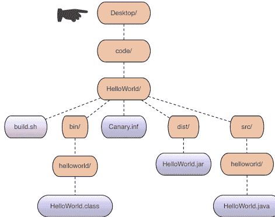

（如果不起作用，请尝试 `cd ~/Desktop`，或者查看本章末尾的提示。）

接下来输入以下命令进入 `code` 目录：

```
$ cd code
```

现在你在这里：

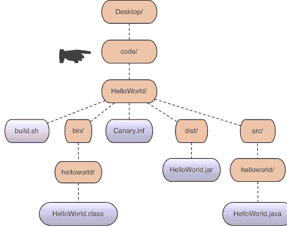

进入 `HelloWorld`：

```
$ cd HelloWorld
```

现在你在这里：

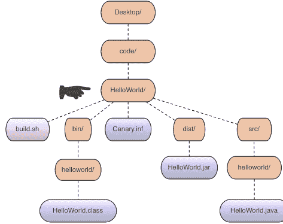

现在列出那里的文件。你会看到：

```
$ ls
Canary.inf bin/ build.sh dist/ src/
```

我的系统（Mac OS X）配置为显示以斜杠结尾的目录。（如果你的不是，输入 `ls -F`）。所以我的当前目录下有两个文件和三个目录。文件类型通常由文件名的最后部分——即后缀表示。这里我有一个 `.sh` 后缀的脚本，和一个 `.inf` 后缀的配置。在 `src/` 目录下有一个 `.java` 文件。

你也将能够使用用于构建和安装插件的命令脚本。

列出你桌面上的文件（使用 `ls`），你将看到你那里的所有文件以及新目录 `myplugins`。让我们进入 `myplugins` 并做一些工作。

```
$ cd myplugins
```

执行 `pwd` 确认你正处于 `myplugins` 目录。

如果你在这里执行 `ls`，你什么也看不到——因为我们还没有在那里创建任何文件。让我们通过创建目录结构来修复这个问题，这与创建 `HelloWorld` 的相同。首先创建一个名为插件本身的名的目录：

```
$ mkdir HelloWorld
```

然后（你猜对了！）进入 `HelloWorld`。

```
$ cd HelloWorld
```

现在你可以创建几个需要的目录：`src`、`src/helloworld` 和 `dist`。在这里创建这些目录吧：

```
$ mkdir src
$ mkdir src/helloworld
$ mkdir bin
$ mkdir dist
```

使用 `ls` 确保它们存在。

```
$ ls
bin/ dist/ src/
```

```
$ ls src
helloworld/
```

现在你需要在这里三个文件，你可以从书中的示例代码中复制它们。你可以使用普通的图形化窗口进行拖拽，或者使用复制命令 `cp`：

```
$ cp ~/Desktop/code/HelloWorld/build.sh
```

波浪符号（`~`）是“我的主目录”的缩写。还有这里——我们必须使用单点！整个命令行的意思是“将此文件复制到当前目录”。

你也需要这个文件，所以在这里时也把它复制过来。

```
$ cp ~/Desktop/code/HelloWorld/Canary.inf
```

现在你已经创建了开发插件所需的目录和支持文件。

## 桌面上的文件

我们所有的工作都在桌面上进行，因为那里是你找到文件最方便的地方，而且在 Windows、Mac 和 Linux 上都是通用的。

在现实世界中，你可能不想让每个新项目都弄乱你的桌面。但在你更熟练地移动和设置一切之前，请停留在桌面。

## 如果它不起作用

你可能会遇到问题的一个方面是你的主目录路径中包含空格。例如，如果你在 Windows 上且名字是 "John Smith"，输入使用波浪号的命令如下所示：

```
$ cp ~/Desktop/code/HelloWorld/build.sh
```

看起来看起来就像你输入了：

```
$ cp C:/Users/John Smith/code/HelloWorld/build.sh
```

计算机将此解释为“将 C.Users/John 和 Smith/code/HelloWorld/build.sh 复制到当前目录”。你会得到相应的错误。

你有两个通用的办法：你可以使用相对路径，通过输入 `..` 表示父级目录，或者你“向上”并进入代码目录：

```
$ cp ../code/HelloWorld/build.sh
```

或者可能只是手动操作，在文件名周围加上双引号：

```
$ cp "C:/Users/John Smith/code/HelloWorld/build.sh"
```

你可能遇到的另一个问题是不在你认为自己所处的目录中。当有疑问时，你始终可以执行 `pwd` 命令查看你的当前工作目录：

```
$ pwd
/Users/andy/Desktop
```

在这里我在我的桌面目录中，这是我们大部分工作的起点。

## 从桌面开始

在大多数系统上，你应该能够通过 `cd Desktop` 进入你的桌面。如果这不起作用，你可能需要输入 `cd ~/Desktop`——使用波浪号——或者你可能需要写出整个路径，如 `cd /Users/andy/Desktop`。

无论你如何实现，当我说“从你的桌面开始”或直接说 `cd Desktop` 时，那是你一直需要做的，无论从哪里开始，如下：

```
$ cd Desktop
```

首先从你的主目录开始：

```
$ cd
$ cd ~/Desktop
```

使用波浪号代表主目录：

```
$ cd ~/Desktop
```

显式地输入你的主目录名称：

```
$ cd /Users/andy/Desktop
```

或者因为名字中包含空格而使用“引号”：

```
$ cd /Users/"John Smith"/Desktop
```

无论如何，它始终将显示为

```
$ cd Desktop
```

## 现在来玩点有趣的

在本书下载的代码中，在你的 `Desktop/code` 目录下，有一个名为 `Adventure` 的特殊子目录。使用命令行 `cd` 进入那里并查看那些文件和目录。

你可以使用 `ls` 列出目录正如我们之前做的那样。要快速查看文本文件（以 .txt 命名），你可以使用 `cat` 命令。

从桌面开始（如上节所述，以任何适合你的的方式）。

```
$ cd Desktop
$ cd code
$ cd Adventure
$ cat README.txt
```

这些是一些可以让探索文件系统变得更有趣的文件。

执行 `ls` 看看还有什么，并在子目录中探索一下。

看看你发现了什么宝藏以及哪些危险。

## 常用命令

以下是你将在 shell 中最常用的命令：

| 命令 | 描述 |
|---|---|
| `java` | 将 Java 类和 Java 归档 (jars) 作为程序运行 |
| `javac` | 将 Java 源码编译为类文件 |
| `cd` | 切换目录 |
| `pwd` | 打印工作（当前）目录 |
| `ls` | 列出目录 |
| `cat` | 显示文件内容 |
| `echo` | 显示文本 |
| `mkdir` | 创建目录 |
| `cp` | 复制文件 |
| `mv` | 移动或重命名文件 |
| `chmod` | 修改文件权限 |
| `.` | 表示当前目录 |
| `..` | 表示父级目录 |
| `~` | 表示主目录 |

## 下一步

在下一章中，我们将学习如何配置开发环境并构建你的第一个插件。在此之前，你已经准备好了所有基础。

## 总结

你现在已经学会了如何在命令行中导航、创建目录、复制文件以及了解了一些基本的命令。这些都是开发 Java 插件的基础知识。准备好开始你的插件之旅了吗？

## 亲自尝试一下

让我们确保你能够创建一个文件、编辑它并保存它。你还没有准备好编写完整的插件，所以让我们先从一个简单的测试文件开始。

在编辑器的菜单中，从 File（文件）-> New File（新建文件）开始，创建一个可以输入的空白文本窗口。

在输入之前，先通过命名保存文件。选择菜单项 File（文件）-> Save（保存），并将文件保存为桌面上的 `Creeper.java`。就是这样——包含一个大写的 C 和 T，其余为小写字母。现在你已经保存了文件，你的编辑器将用来输入 Java 代码。

像我这样做的那样输入以下文本：

```
public class Creeper {
    public static void main(String args[]) {
        System.out.println("That's a very niccce program you have there...");
    }
}
```

确保完全复制文本，从 “public class” 直到 “}”——包括所有的标点、拼写、大小写和间距——但不要包含行号，因为那些是编辑器的一部分。使用 Delete 键（有时标记为 "backspace"）来删除任何错误。

现在选择 File -> Save 来保存带有你文本的文件。

搞定！现在你有了一个包含 Java 源代码的文件。

而计算机并不知道该如何处理它。它是一个文本文件；在你的计算机看来，它可能是一份零食食谱、一篇论文或一份游戏作弊列表。我们接下来需要解决这个问题。

你现在需要的是 Java 本身。

## Windows 路径

> 提示：当我们使用来自 BusyBox 的 bash shell 时，所有目录都使用正斜杠 ("/")。Windows 系统的其他部分仍使用反斜杠 ("\")。所以 Windows 和安装程序称其为：
>
> ```
> C:\Users\username\Desktop\server
> ```
>
> 我们将其称为 `C:/Users/username/Desktop/server`。

## 安装 Java 语言

“Java” 不仅仅是一个应用程序——它实际上是几个。Java 编译器 `javac`、Java 程序运行器 `java` 以及归档工具 `jar`。`javac` 接收你的文本文件并创建一个它被称为类文件（class file）的魔法垃圾堆。你运行 `java` 命令并告诉它使用那堆垃圾，你的程序就会活起来。我们将在后续的学习中详细查看该过程，这就是它的核心。

你可能已经安装了 Java。尝试运行 Java 编译器 `javac`，看看它是否：

```
$ javac -version
javac 1.7.0
```

是的，我的机器上已经安装了，版本为 1.7。如果没有安装，我会收到类似这样的消息：

```
$ java -version
bash: java: command not found
```

你可能还想检查你的 `javac` 版本是否与你的 `java` 版本一致（应该是一致的，但总会有意外发生）：

```
$ java -version
java version "1.7.0.67"
Java(TM) SE Runtime Environment (build 1.7.0_67-b01)
Java HotSpot(TM) 64-Bit Server VM (build 24.65-b04, mixed mode)
```

如果你需要安装 Java，需要 Java 开发工具包标准版 (JDK SE) 7 或更高版本，你可以为不同的操作系统下载它。根据你的操作系统和供应商，可能安装了 Java，也可能没有，你可能只有 `java` 而没有 `javac`，或者你可能拥有一个略有不同的版本。再次，你需要 JDK 1.7 或更高版本来运行书中的示例。

无论你安装什么操作系统，我都强烈建议你对任何安装问题接受所有默认答案，特别是安装位置。如果 Java 及其相关程序不在它们预期的位置，它们可能会变得非常古怪和挑剔。

所以下载 Java 开发工具包 (JDK) 安装程序并按照其说明操作。

- 3. http://www.oracle.com/technet/java/javase/downloads/index.html

根据你的平台，你可能需要将 JDK 的 `bin` 目录添加到“path”（路径）中。我们将在下一节中查看这意味着以及你如何操作。

但在那之前先尝试一个小练习并看看它是否有效。

## 亲自尝试一下

安装 JDK 后，你现在可以运行输入的测试程序了。再次，这只是一个确保 Java 运行良好的简单程序。它还不是 Minecraft 插件，但这是一个开始。只要你运行了它，你就准备好开始编写 Minecraft 插件了。

进入你的桌面并确保 `CreeperTest.java` 文件在这里：

```
$ cd Desktop
$ ls
CreeperTest.java
```

现在通过执行 `javac`（Java 编译器）命令对 `CreeperTest.java` 运行 Java 编译器。

```
$ javac CreeperTest.java
$ ls
CreeperTest.class CreeperTest.java
```

Java 程序首先检查它是否理解你在 `CreeperTest.java` 文件中输入的所有内容。如果没有错误，它会创建一个二进制类文件。

但事实是大多数时候会有错误。如果你收到大量的错误信息，不要担心：你没有弄坏计算机。像 Java 这样的编程语言对大小写是出名的挑剔。

## 其他可能不起作用的原因

即使 PATH 设置正确，也可能出现以下其他问题：

确保你处于正确的目录；输入 `ls` 并检查 `CreeperTest.java` 文件是否就在那里。

确保你输入的是 `javac CreeperTest.java`（带有 `.java` 部分）。否则，你可能会看到一个非常令人困惑的错误信息，如下：

`error: Class names, 'CreeperTest', are only accepted if annotation processing is explicitly requested`

如果 `javac` 命令报告某种“语法”或“未找到”或“未定义”错误，意味着它无法理解 `CreeperTest.java` 文件中的文本，你可能漏掉了某些内容。这类错误看起来可能像：

`CreeperTest.java:1: class, interface, or enum expected`

或者你可能会看到其他错误。冒号之间的数字（1:）是类型所在的行号。

如果你找不到 `CreeperTest.class`，请从这本书下载源码中获取该文件的最新副本，路径为 `code/install/CreeperTest.java`，并尝试一下。

如果 `java` 命令能找到 `CreeperTest.class`，请确保 `javac` 命令运行正常并成功生成了 `.class` 文件。运行时，你应该处于相同的目录下。

如果你看到此错误

`Exception in thread "main" java.lang.NoClassDefFoundError: CreeperTest/class`

你可能不小心输入了 `java CreeperTest.class`（结尾带有 `.class` 部分）而不是 `java CreeperTest`（不带后缀）。总结一下，这些是编译和运行的命令：

```
$ javac CreeperTest.java
$ java CreeperTest
```

也就是说，在编译时必须指定 `.java` 后缀，但在使用 `java` 运行时不要输入 `.class` 部分。

此外，检查是否有针对 `CLASSPATH` 的设置（它类似于 `PATH`，但用于 Java 类）。

```
$ echo $CLASSPATH
```

如果其他所有方法都失败了，不要害怕寻求帮助。编程通常是一项团队协作。

呼！那是最困难的部分了。

一旦 Java 运行正常，你就需要安装 Minecraft 的部分。

# 安装 Minecraft 客户端和服务器

Minecraft 是一个客户端-服务器系统，因此你需要两个部分：用于玩游戏的桌面图形客户端，以及你连接的服务器进程（我们将添加插件）。

## 安装 Minecraft 图形客户端

你可能已经拥有这个部分了，但如果没有，请从 [minecraft.net](http://minecraft.net) 下载适用于电脑的 Minecraft 安装程序。按照安装说明进行安装，但先不要运行它。

当你玩 Minecraft 时，这个“客户端”是你运行的应用程序。它连接到你在 [minecraft.net](http://minecraft.net) 的付费账户。

还有 iOS 和 Android 设备的客户端（包括手机），但它们是死路一条。在我写这些时，它们无法连接到普通的 Minecraft 服务器，因此无法使用我们自己的插件。

客户端处理图形和声音，并允许你在游戏中输入命令。但目前还没有本地游戏可以连接——最好去获取并下载服务器代码。

## 安装 CanaryMod 服务器

现在是有趣的部分了。你将为自己的服务器添加插件，因此你需要 CanaryMod，这是由 CanaryMod 优秀团队提供的特殊 Minecraft 服务器，专为使用插件而设计。


在桌面上创建一个名为 `server` 的目录（这意味着它位于类似 `/Users/yourname/Desktop/server` 的目录中）：

```bash
$ cd Desktop
$ mkdir server
```

我们把这个目录称为服务器目录，你将在那里安装服务器部分。

# 第 2 章 添加编辑器和 Java

CanaryMod 项目以单个 jar 文件的形式提供：`CanaryMod.jar`，它用于运行游戏服务器本身，也是我们用于开发新插件的工具。

访问 Web 查看 CanaryMod 项目的发布页面 [http://canarymod.net/releases](http://canarymod.net/releases)。你会看到发布列表，按相应的 Minecraft 版本号分组。我正在使用的是最新发布版本，目前适用于 Minecraft 1.17.0。你需要下载最新的 jar 文件。为了方便起见，我也在书的下载包中包含了一份副本。

每个 jar 文件名可能带有额外的版本号（类似于 `CanaryMod-1.7.10-1.1.0.jar`；你的数字可能会更大）。将文件下载到 `Desktop/server` 目录，并将其重命名为 `CanaryMod.jar`。

你可以在 shell 中使用 `mv`（移动命令）和通配符 `*` 来执行此操作，它可以匹配所有数字，这样你就不需要手动输入它们了：

```bash
$ cd server
$ pwd
/Users/andy/Desktop/server
$ ls
CanaryMod-1.7.10-1.1.0.jar
$ mv CanaryMod*.jar CanaryMod.jar
$ ls
CanaryMod.jar
```

书中的示例代码包含一个名为 `runtime` 的子目录。在 `runtime` 目录你会看到一个名为 `start_minecraft` 的启动脚本。使用 `cp` 命令将其复制到你的服务器目录。你仍在该目录中，可以使用 `..` 指向桌面，使用 `.` 指向当前目录 `runtime`：

```bash
$ cp ../code/runtime/start_minecraft .
```

## 安装 Minecraft 客户端和服务器

当你启动 Minecraft 客户端时，你可以告诉它要使用哪个版本。这需要与你下载的 Canary 版本匹配。在我写这段文字时，Canary 服务器的最新版本是 1.7.10，但你刚刚安装的客户端默认是 Minecraft 1.8，CanaryMod 不支持该版本。那将无法运行。你需要告诉 Minecraft 客户端使用正确的版本。

在 Minecraft 启动程序中，点击左下角的“编辑配置”（Edit Profile）。


在弹出的对话框中寻找“使用版本”（Use Version）设置。将选项更改为使用你 Minecraft 服务器的当前版本，并点击“保存配置”（Save Profile）。

| 版本选择 |
| :--- |
| [ ] 启用实验性开发版本（“快照”） |
| [ ] 允许使用“Beta” 版 Minecraft 版本（来自 2010–2011 年） |
| [ ] 允许使用“Alpha” 版 Minecraft 版本（来自 2010 年） |
| 使用版本：release 1.7.10 |

当你读到这里时，版本号可能已经完全不同。无论版本是什么，你都需要检查客户端中的版本并确保它与服务器版本匹配。现在点击“游戏”（Play）按钮。

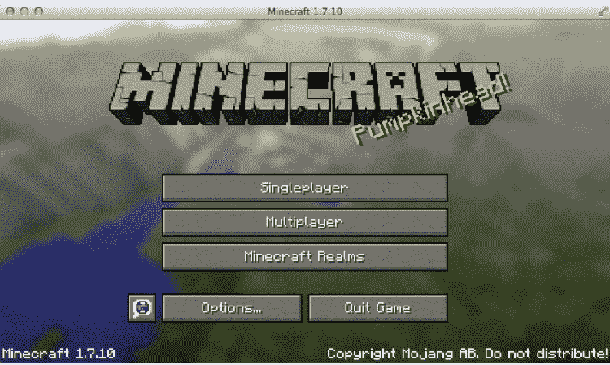

Minecraft 1.7.10 版所有 Mojang AB。请勿分发！

报告错误 · 讨论

现在，点击“多人游戏”（Multiplayer）。接下来，你需要添加本地服务器。点击“添加服务器”（Add Server）并为你的服务器输入名称。服务器地址使用 `localhost`，如下所示：

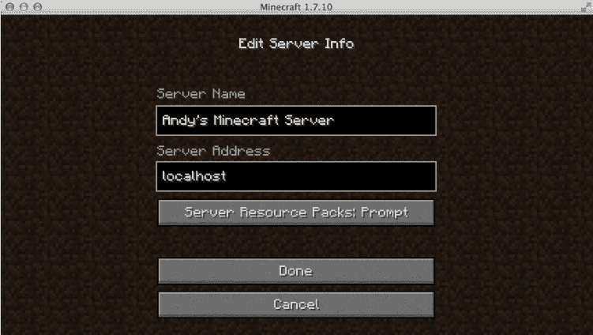

你的服务器将出现在列表中（以及你经常连接的其他任何服务器），如下图所示：

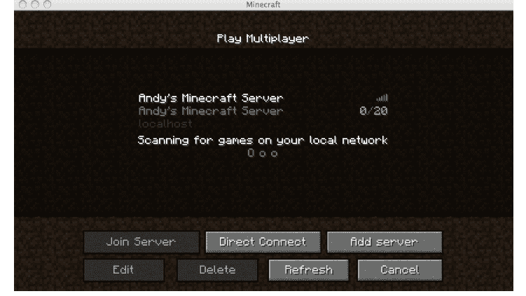

从列表中选择你的服务器，然后点击“加入服务器”（Join Server）。欢迎来到！

如果你立即被断开连接，可能是版本不匹配；请双检你使用的是哪个版本的客户端。

一旦连接成功，你就进入本地 Minecraft 服务器的 Minecraft 世界了。恭喜！

你可以利用这段时间在 Minecraft 世界中进行一些设置。也许在苦力怪来之前，先给自己盖一间漂亮的房子……

## 下节预告

这是一个非常棒的开始，现在你已经在自己的电脑上运行了一个功能完整的 Minecraft 服务器。

在下一章中，我们将卷起袖子，编译并安装我们的第一个真实插件。

## 你不断成长的工具箱


你现在知道如何：

- 使用命令行终端
- 使用 Java `javac` 进行编译
- 运行 Minecraft 服务器

完成本章后，你将学会如何：

- 将 Java 源代码编译为 `.class` 文件，将其封装成 `jar` 包并安装到 Minecraft 服务器上
- 使用新插件运行你的本地服务器
- 连接到你的本地服务器

# 第 3 章 编译并安装插件

现在你已经安装了工具，我们将构建一个简单、基础的插件。就插件而言，它的功能不多，但它能确保你能够编译和运行自己的插件，并将作为我们书中将编写的所有插件的起点（骨架）。

那么，你输入的指令是如何在 Minecraft 服务器上运行的？这里是整个过程的工作原理。

你输入 Java 语言指令（我们称之为“源代码”）并将其保存到文本文件中，然后 Java 编译器 `javac` 会读取你的文本文件并将其转换为计算机可以运行的内容。

你之前编写简单的 `CreeperTest.java` 程序时已经经历过这个过程。

对于你输入到 `CreeperTest.java` 文件中的源代码，你将得到一个名为 `CreeperTest.class` 的二进制文件（非文本）。二进制文件只是一个包含数字的文件——它对计算机是有意义的，但对人类不是。

由于一个典型的程序可能会使用大量的类文件，你通常会将一组类文件归档成一个 `jar` 包，然后 Java 会从 `jar` 包中运行代码。

Java（Java 程序本身）读取类文件和 `jar` 文件以在计算机上创建一个运行进程。对于 Minecraft 来说，这将是你 Minecraft 客户端连接的服务器进程。目前，客户端将只有一个。

下图显示了这些部分是如何整合在一起的。`javac` 编译你的 Java 源代码，并在 CanaryMod 中定义它，并生成一个类文件。该类文件与 `Canary.inf` 文件一起打包成一个 `jar` 包，这就是你的插件。然后，运行时，Java 从 CanaryMod 启动服务器并从 `jar` 包中加载你的插件。


如果这些现在看起来像外星人语言或者猫王猫维斯的歌词，请不要气馁。在接下来的几个章节中，我们会理解它的。相反，请关注熟悉的内容：里面有一些英语单词，如 "import"、"public" 和 "return"，以及某些可能是句子或语句的内容，它们都以分号（`;`）结尾。这里还有一些奇怪的字符，如 "f" 和 "j"，它们似乎很重要。

这一切意味着什么呢？嗯，这个插件实现了一个用户命令 `/hello`，它会向 Minecraft 中的所有在线玩家广播传统的苦力怪问候语：“That's a very nice EVERYTHING you have there...”（你那里的东西真不错……）。

注意，该插件的名字在某行声明为 `public class HelloWorld`。这与包含此代码的文件名 `HelloWorld.java` 相同。这段代码还设置为放在一个包（package）中——即一组相关文件——在某行使用了相同的名称。包名全小写，它也是我们 Java 源代码所在的目录，路径为 `src/helloworld/HelloWorld.java`。

所有这些地方的名称匹配非常重要；其中任何一个拼写错误都可能导致奇怪的错误。

你使用 `import` 语句（你会在某行看到这个）来获取插件中需要的其他内容，例如 Canary 库的部分和其他 Java 库。如果你忘记包含你所需的导入项，将会收到一条显示为“cannot find symbol”（找不到符号）的错误，因为 Java 不知道你想要什么。为了方便起见，我在第 253 页的附录 7“常用导入”中列出了我们使用的所有导入项列表。

我们插件的代码从某处开始，这里有一个有趣的 `@Command` 注解（一种标签，不是实际代码），它描述了命令本身。最后，命令代码从某处开始。

我们稍后会查看所有内容，但首先，我们需要让服务器知道我们有一个插件供它加载。

## 使用 Canary.inf 配置

仅有这些源代码是不够的；你还需要一个配置文件，以便 Minecraft 能够找到并启动你的插件。配置文件名为 `Canary.inf`，如下：

```
HelloWorld-class = helloworld.HelloWorld
name = HelloWorld
author = AndyHunt, Learn to Program with Minecraft Plugins
version = 1.0
```

这里是对该文件的描述。不要担心细节——随着我们深入书籍，它会变得更有意义。

### main-class

Java 运行以启动此插件的包和类名 (`package.classname`)。

### name

插件的名字——在此例中为 HelloWorld。

### author

作者的名字（那个）。

### version

你插件的版本号。从低数字开始，每当向世界发布新版本时就增加数字。

## 使用 build.sh 构建和安装

你在终端窗口中输入的命令也可以保存到文件中；这样你就可以反复运行它们，而不需要每次都重新输入。我们称之为 *shell script*（壳脚本），它是为计算机编程的另一种方式。

构建插件只比我们在上一个中编译单个 Java 文件稍微复杂一点，但尽管如此，它仍然涉及许多我们不想每次都输入的命令。

为了方便，我为你制作了一个壳脚本 `build.sh`，它将执行三个主要步骤：

1. 使用 `javac` 将 `.java` 源代码编译为 `.class` 文件。
2. 使用 `jar` 将类文件、清单文件（manifest）和配置文件存档。
3. 将 jar 文件复制到服务器。

之后，你需要停止并重启服务器，以便它能够读取更改。

构建脚本需要知道你的服务器目录在哪里。在脚本的最顶部，有如下内容：

```
MCSERVER=$HOME/Desktop/server
```

> 对于较大的项目，当构建更复杂且必须管理许多部分之间的依赖时，人们会使用 Ant、Maven 或 Gradle 等工具。但这对我们这里的需求来说过度了。

对于大多数人，如果你的服务器目录位于桌面，它应该可以直接工作。如果没有，你需要编辑 `build.sh` 文件并更改目录，使 `MCSERVER=` 指向你的 Minecraft 服务器目录。`MCSERVER` 设置是脚本知道在哪里找到服务器的方法。

将你的当前目录更改到 HelloWorld 目录。从那里运行你的 `build.sh` 脚本（我们以后每个插件都会这样做）：

```bash
$ cd
$ cd Desktop
$ cd code/HelloWorld
$ ./build.sh
```

（记住，无论你实际上如何到达桌面，从现在起我将只显示 `cd Desktop` 以供参考。你可能需要执行 `cd ~/Desktop` 或从主目录开始进入，取决于你的特定系统）。

你应该会看到像下面这样的结果：

```
Compiling with javac...
Creating file...
Deploying jar to /Users/andy/Desktop/server/plugins...
Completed Successfully.
```

检查文件是否已安装在服务器目录中：

```bash
$ cd Desktop
$ cd server/plugins
$ ls
HelloWorld.jar
```

是的，jar 文件在服务器目录中。成功！

如果你遇到错误，这里有几点需要检查：

- 如果你遇到错误 `/build.sh: Permission denied`（拒绝访问），你可能需要执行 `chmod +x build.sh`。
- 如果你看到语法错误，确保路径正确。
- 如果所有内容都编译了但收到错误，确保名称正确。
- 如果 Minecraft 服务器找不到插件，确保目录正确。


```
$ cd Desktop
$ cd server/plugins
$ ls
HelloWorld.jar
```

是的，jar 文件在服务器目录中。成功！

如果你遇到错误，这里有几点需要检查：

- 如果你遇到错误 `/build.sh: Permission denied`（拒绝访问），你可能需要执行 `chmod +x build.sh`。
- 如果你看到语法错误，确保路径正确。
- 如果所有内容都编译了但收到错误，确保名称正确。
- 如果 Minecraft 服务器找不到插件，确保目录正确。

并且一旦你连接并进入世界，你可以从聊天窗口测试你的新命令。只要输入 `/hello` 看看发生了什么。一旦你输入 `/` 字符，就会看到我们的消息出现在服务器日志和游戏窗口中。这是服务器控制台的样子：

```
14:47:58 [INFO]: Command used by AndyHunt: /hello
14:47:58 [INFO]: That's a very nice EVERYTHING you have there...
```

这是游戏窗口的样子：


### 在 Minecraft 中移动

如果你不熟悉 Minecraft 的图形界面（GUI），这里有一些提示。你可以查看一些 YouTube 教程或官方文档获取更多信息。

`W`、`A`、`S`、`D` 键分别让你向前、向左、向后和向右移动。使用空格键跳跃。

使用鼠标控制面向的方向。

用左鼠标按钮“击”物体——例如用剑攻击或用铁镐/铲子挖掘。

用右鼠标按钮“使用”物品——例如放置物品或打开门。

带有前缀 `/` 字符向 Minecraft 输入命令。你可以通过 `/gamemode c` 将游戏更改为创造模式，通过 `/gamemode s` 回到生存模式。

### 使用 EZPlugin

随着我们阅读这本书，我们会更多地讨论 Java 语言，并解释 `HelloWorld.java` 中的所有部分具体的作用。但这些代码的一半现在对你来说并不重要。更重要的是，它在我们处理的每个插件中将完全相同。我们将它移开，这样你就不需要在每个插件中一直看到它。

## 第 3 章 构建并安装插件

在下载的代码中，我包含了一个名为 `EZPlugin` 的特殊库。我将所有对所有插件都相同的内容都移动到了 `EZPlugin.java` 中。这将使接下来的插件变得更小且更易于阅读。

所有其他插件（HelloWorld 之外）都依赖于 `EZPlugin`，因此在继续之前，我们需要先构建它。构建过程会将它安装在服务器的 `lib`（library 的缩写）目录下：

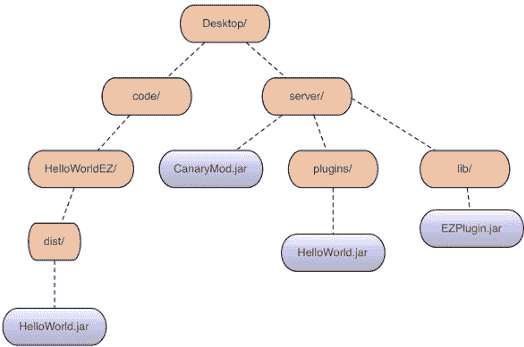

在你的命令行中，将当前目录更改到 `EZPlugin` 目录。从那里运行 `build_lib.sh` 脚本。对于我来说，我可以从任何地方开始并回到主目录，然后 `cd` 进入 Desktop、`code`，最后 `EZPlugin`：

```
$ cd
$ cd Desktop
$ cd code/EZPlugin
$ ./build_lib.sh
```

你应该能看到类似下面的的结果：

```
Compiling with javac...
Creating jar file...
Deploying jar to /Users/andy/Desktop/server/plugins/
Completed Successfully.
```

检查文件是否真的已安装在服务器的 `lib` 目录下：

```
$ cd Desktop
$ cd server/lib
$ ls
EZPlugin.jar
```

一旦 `EZPlugin.jar` 在那里，你就不需要再次运行 `build_lib.sh` 了。所有其他插件现在可以使用它了。

接下来，删除服务器 plugins 目录中第一个版本的 `HelloWorld.jar`：

```bash
$ cd ../plugins
$ ls
HelloWorld.jar
$ rm HelloWorld.jar
$ ls
```

现在你可以看到一个更简单的 HelloWorld 版本，它使用了 `EZPlugin`，并位于 `code/HelloWorldEZ/src/helloworld/HelloWorld.java`：

```
HelloWorldEZ/src/helloworld/HelloWorld.java
package helloworld;
import net.canarymod.plugin.Plugin;
import net.canarymod.logger.Logman;
import net.canarymod.Canary;
import net.canarymod.commands.*;
import net.canarymod.chat.MessageReceiver;
import com.pragrog.amine.ez.EZPlugin;
public class HelloWorld extends EZPlugin {
    @Command(aliases = {"hello"}, description = "Displays the hello world message.", tooltip = "hello")
    public void helloCommand(MessageReceiver caller, String[] msg="Thatss very nicce EVERYTHING you have there...") {
        Canary.instance().getServer().broadcastMessage(msg);
    }
}
```

注意，这在顶部有很多导入（imports），而通用的业务逻辑——我们真正感兴趣的部分——位于底部。这将成为我们后续所有插件的骨架。

继续吧，确保你可以构建它，并且它能找到 `EZPlugin` 库文件：

- `cd Desktop`
- `cd code/HelloWorldEZ`
- `./build.sh`

你应该看到通常的成功输出：

```
Compiling with javac...
Creating jar file...
Deploying jar to /Users/android/Desktop/server/plugins/
Completed Successfully.
```

如果没有，请双双检查 `EZPlugin.jar` 是否在 `Desktop/server/lib` 中，并根据需要回到 `EZPlugin.jar` 所在目录重新构建。

## 接下来的内容

恭喜你！你刚刚从源代码编译并安装了一个插件，将其安装在本地服务器上，进行了连接并测试了它！你还构建了 `EZPlugin` 库并安装了它。

处理完这些后，我们将在接下来的几章中深入研究构成插件的所有源代码，并了解 Java 的运行机制，这样你就可以编写自己的插件。

## 你不断增长的工具箱


你现在知道了如何：

- 使用命令行 shell
- 使用 Java 和 `javac` 进行构建
- 运行 Minecraft 服务器
- 部署插件
- 连接到本地服务器

在本章中，我们将处理许多编写 Java 代码的基础知识。有了你工具箱里的这些工具，你将了解：

- Java 中那些奇奇怪字符的含义
- 如何使用变量存储数字和字符串值
- 如何声明和使用函数：Java 指令列表
- 如何使用 `if`、`for` 和 `while` 语句控制代码

## 第 4 章 插件拥有变量、函数和关键字

正如你可能注意到的，插件源代码中有很多我还没有解释的内容。让我们深入研究 Java，看看所有这些文本的含义——这些编程插件的原材料。

正如你在 [第 3 章，构建并安装插件，第 31 页](#) 中看到的，Java 程序是一个文本文件。看看 `HelloWorld.java` 中的文本：那里有很多英文单词和一些看起来很奇怪的标点符号。所有内容都有其含义，而且 Java 编译器在读取你的代码时非常挑剔。首先是区分大小写的字符。`Entity` 不等于 `entity`。`Player` 不等于 `player`，所以大小写也很重要。有时你需要使用大写，有时你又需要使用小写。

这些奇怪的字符每一个都有特殊的含义，并且它们被用于不同的地方。这里是一些例子：

```java
// 注释，这是一个单行注释

/* 这是一个多行
   注释，跨越多行。 */
```

括号用于调用函数或传递参数：

```java
helloCommand("message");
```

方括号用于数组或列表：

```java
int[] numbers = {1, 2, 3};
```

大括号用于定义代码块：

```java
if (true) {
    // 执行某些操作
}
```

点用于访问方法或变量：

```java
System.out.println("Hello");
```

分号用于结束语句：

```java
int age = 15;
```

等号用于赋值：

```java
age = 20;
```

双引号用于定义字符串：

```java
String name = "Java";
```

单引号用于单字符：

```java
char grade = 'A';
```

叹号在 Java 代码中不常用：

```java
int count = 10; // 这是没的
```

## 跟踪数据

Java 确实试图防止你将苹果和橘子混为一谈。虽然它不知道你正在将一个 `int` 用作“人类年龄”，但它知道 `int`、`float`、`String` 等之间的区别。它不会允许你混淆这些类型。如果你声明了一个应该存储整数的变量，你就不能尝试向其中存储一个 `String`。这将抛出错误：

```java
int age = "old enough to know better"; // 错误！
```

我们尝试在 `int` 中存储一个字符字符串。这行不通，Java 会报错的。反过来也不行。这里是在尝试将一个整数值 (42) 存储到声明为存储 `String` 的变量中：

```java
String answer = 42; // 错误！
```

但对于数字和字符串等常见类型，如果合理，你有很多方法根据需要进行相互转换。例如，假设你需要从用户输入的内容获取一个数值，而它是以字符串 `str` 的形式给你的。你可以这样将其转换为 `int`：

```java
String str = "1066";
int value = Integer.parseInt(str);
// value 现在被设置为数字 1066
```

所以你可以进行转换，但你必须自己完成：Java 不会为你猜测。常见类型转换的列表（包括我们在这里没有涵盖的）请参见附录 5 “速查表”，第 241 页。

让我们试一下。

### 插件：BuildAHouse

我为你准备好了一个插件：你只需要声明变量，就可以执行 `buildahouse` 命令。

首先进入你下载的代码目录，进入 `BuildAHouse` 插件文件夹：

```
$ cd Desktop
$ cd code/BuildAHouse/src/buildahouse
$ ls
BuildAHouse.java  MyHouse.java
```

你将要编辑 `MyHouse.java` 文件，它是整个插件中的一小部分（不要看其他的！）。它现在看起来是：

#### BuildAHouse/src/buildahouse/MyHouse.java

```java
package buildahouse;
public class MyHouse {
    public static void build_me() {
    // 声明宽度
    // 将宽度设置为块的数量
    // 声明高度
    // 将高度设置为块的数量

    BuildAHouse.buildHouse(width, height);
    }
}
```

如果你尝试使用 `./build.sh` 进行编译和安装（就像我们之前 `HelloWorld` 那样），你会得到两个错误：

```
$ cd Desktop
$ cd code/BuildHouse
$ ./build.sh
Compiling with javac...
src/buildahouse/MyHouse.java:10: cannot find symbol
symbol : variable width
location: class buildahouse.MyHouse
BuildAHouse.buildHouse(width, height);
    ^
src/buildahouse/MyHouse.java:10: cannot find symbol
symbol : variable height
location: class buildahouse.MyHouse
BuildAHouse.buildHouse(width, height);
```

2 个错误

这就是你的第一个任务：声明并设置名为 `width` 的变量和名为 `height` 的变量，并将它们设置为对房子合理的数值，例如高度不小于 5 块，宽度不小于 5 块。或者如果你觉得空间宽敞，可以设为 10x10。

删除那些注释行，并用你的两个宽度和高度变量替换它们。保存文件，然后重新运行 `build.sh`：

```
$ ./build.sh
Compiling with javac...
Creating jar file...
Deploying jar to /Users/andy/Desktop/server/plugins...
Completed Successfully.
```

停止并重启你的服务器，然后连接（或重新连接）你的 Minecraft 客户端。在 Minecraft 景观中选择一个漂亮的地方，输入命令 `/buildahouse`。


砰！你现在进入了你全新的、防苦力的房子，它是根据你通过 `width` 和 `height` 变量指定的精确尺寸建造的。顺便说一下，右键点击可以打开门。

### 不同类型的数字

Java 区分了整数（没有小数点，如 8）和带有带小数部分的浮点数（带有小数点，如 10.125）。

对于普通的整数，你使用 `int`，正如我们所看到的那样。

浮点数可以是 `float` 或 `double`。`double` 更大且存储得更精确，但代价是需要更多的空间和性能来管理。但现在的计算机运行很快且有足够的存储空间，几乎每个人在需要双精度浮点小数数字时都直接使用 `double`。

当你在 Java 中输入一个带小数点的数字时，它假设你输入的是一个 `double`：

```java
3.1415 // 假设为 double
```

但如果你真的需要该数字是 `float`，你必须在数字后面加上字母 `f`：

```java
3.1415f // 现在它是 float，而不是 double。
```


我们稍后需要使用 `float` 来播放音效，这是 Canary 插件设置所需的。（等一下，文本里写的是 "Canary"，但通常是 "plugin"）。

在 `BuildAHouse` 插件中，我有一堆你没看到的代码，它们实际上执行了盖房子的工作，而你只需要声明几个变量。但现在，你将从零开始创建一个整个插件，而且完全由你自己完成。

为了让事情尽可能简单，起初你只需要打印一些值。事实上，让我们把这个插件称为 `Simple` 插件。

首先，你需要为新插件创建一个 `Simple` 目录，其中包含一个 `src/` 子目录、一个 `src/simple` 子目录，以及 `Canary.inf`、`Manifest.txt` 和 `build.sh`，就像我们在 `HelloWorldZ` 中做的那样。

我已经在 `Desktop/` 下提供了一个 `Simple` 目录供你参考，但除非卡住了，否则不要看。你将在 `Desktop` 下创建你自己的 `Simple`。

由于你可能会多次进行操作，我写了一个名为 `mkplugin.sh` 的 shell 脚本来帮助你快速开始。

在你的 `Desktop` 中，使用你想创建的插件名称运行 `mkplugin.sh`，它就会创建下方的目录并为你提供基础的 Java 代码：

```
$ cd Desktop
$ code/mkplugin.sh Simple
$ cd Simple
$ ls
Canary.inf Manifest.txt bin build.sh src
$ cd src
$ ls
simple/
$ cd simple
$ ls
Simple.java
```

`Simple.java` 顾名思义；它实际上并没有做任何事情。

你将在标有“在此行之后放置你的代码”和“……在此行之前完成你的代码”的地方之间添加一些代码，正如在下方列表底部所示。

在你的文本编辑器中打开此文件（`Desktop/src/simple/Simple.java`），准备好打字。

## 插件：Simple

```java
Simple/src/simple/Simple.java
package simple;
import net.canarymod.plugin.Plugin;
import net.canarymod.logger.Logman;
import net.canarymod.Canary;
import net.canarymod.commands.*;
import net.canarymod.chat.MessageReceiver;
import net.canarymod.api.entity.living.humanoid.Player;
import com.pragprog.amine.ez.EZPlugin;

public class Simple extends EZPlugin {

  @Command(aliases = {"simple"},
    description = "显示简单的变量赋值",
    permissions = {""},
    tooltip = "/simple")
  public void simpleCommand(MessageReceiver caller, String[] parameters) {

    if (caller instanceof Player) {
      Player me = (Player)caller;

      // 在此行之后放置你的代码：

      // ...在此行之前完成你的代码。

    }
  }
}
```

现在先不用管那些额外的文本。目前只需在所示位置的行上放置新代码，它就能正常工作。以下是你需要做的：

首先，在文件的顶部、其他 `import` 语句之后添加两个 `import` 语句。输入它们：

```java
import net.canarymod.api.world.effects.SoundEffect;
import net.canarymod.api.world.position.Location;
```

接下来，在显示 `// Put your code after this line:` 之后，执行以下操作：

1. 创建一个名为 `myAge` 的整数变量，并设置为你的年龄。
2. 创建另一个名为 `twicemyAge` 的整数变量，并将其设置为 `myAge` 的 2 倍。
3. 创建一个名为 `volume` 的浮点数变量，并设置为 0.1。
4. 创建一个名为 `pitch` 的浮点数变量，并将其设置为 1.0。
5. 创建一个名为 `dayOnIo` 的双精度（浮点数）变量，并设置为 152853.5047。这是木星卫星伊奥（Io）上每天持续的秒数。
6. 创建一个名为 `myName` 的字符串，并设置为你的名字。
7. 使用 `me.chat(string msg)` 向玩家发送聊天消息来显示这些值中的每一个。例如，显示你的名字，类型如下：

使用字符串（如 "My name is"）和加号陈述每条消息。然后添加你的变量。不要忘记在每个语句的末尾加上分号。

最后，添加代码在你的所在位置播放音效，使用刚刚声明的浮点数值：

```java
Location loc = me.getLocation();
playSound(loc, SoundEffect.Type.GHAST_SCREAM, volume, pitch);
```

保存文件，然后运行 `Simple` 目录下的 `build.sh`。（如果你的服务器仍在运行，请确保停止它；如果需要在服务器运行时安装 jar 包，某些操作系统可能会抛出错误）。

```
$ cd Desktop
$ cd Simple
./build.sh
Compiling with javac...
Creating jar...
Deploying jar to /Users/andy/Desktop/server/plugins... evenCompleted Successfully.
```

停止并重启你的服务器，然后从 Minecraft 客户端连接。运行你的命令 `/simple`，并对控制台上的消息（以及音效）感到惊讶。

一旦运行成功，尝试更改 `volume` 和 `pitch` 的值。将 `volume` 调高到 1.0f 以获得恐怖的尖叫。对于 `pitch`，一个非常低的值（如 0.1f）更像低吼声，而高值（如 10.0?）则产生尖锐的刺声。

在 Java 源码中更新新值后，不要忘记执行以下步骤：

1. 保存文件。
2. 使用 `/build.sh` 编译并安装。
3. 停止并重启服务器。
4. 重新连接你的 Minecraft 客户端。
5. 在客户端中输入 `/simple` 并享受音效。

`getServer()` 调用返回某些内容（实际上是一个 `Server`）。一旦我们拥有它，就可以调用该 `Server` 的任何函数。在这种情况下，我们正在调用 `Server` 的 `broadcastMessage()` 函数，并传入一个名为 `msg` 的字符串参数。请看这一行：

```java
Canary.instance().getServer().broadcastMessage(msg);
```

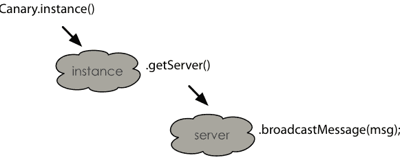

为了让它更清晰，你可以将这一链式调用拆分成独立的部分，看起来像这样：

```java
instance = Canary.instance();
server = instance.getServer();
server.broadcastMessage(msg);
```

看到了吗？这仅仅是一组函数调用。到目前为止明白了吗？

你可以自己定义函数。这里有一个定义名为 `castIntoBlackHole` 新函数的示例。仔细看，因为你之后将自己操作这个。

```java
public static void castIntoBlackHole(String playerName) {
    // 在这里对玩家做一些有趣的操作...
}
```

这里的干扰比蛋糕例子多一点。让我们看看这些内容意味着什么。

- `public` 意味着程序的任何其他部分都可以使用它，目前你希望是这样。
- `static` 意味着你可以独立调用此函数（不像插件）；我们将在下一节中查看区别以及它的含义。
- `void` 意味着此函数将运行几条指令，但不会向你返回任何数据——它不会向调用者“返回（return）”任何值。
- `castIntoBlackHole` 是我们自己起的名字：它是函数的名称，`()` 字符表示它是一个函数，并将接收我们列出的参数。你需要括号，即使函数不接受任何参数也是如此。

在这种情况下，它接受一个名为 `playerName` 的参数，它期望该参数是 `String` 类型。对于你的函数接受的每个参数，你的函数可以接受多个参数；包括一个变量名和它的类型：你使用逗号来分隔每一对类型和值组成的组合，就像我们在 `HelloWorld` 的 `helloCommand` 中做的那样。

在花括号 `{}` 之间是该函数的代码所在。你可以在函数中放置任意数量的代码，但一个好的黄金准则是不要让它超过 30 行。短的总是更好：如果你发现自己在写很长的函数，你将希望把它们拆分成几个较小的函数，以便代码更易读。

这是一个返回值的函数示例；它会将你给它的任何数字三倍：

```java
public static double multiplyThree(double amt) {
    double result = amt * 3.0;
    return result;
}
```

此函数计算一个结果并使用 `return` 关键字将该值返回给调用者。你可以这样调用 `multiplyThree` 函数并将返回的值赋值给变量：

```java
double myResult = multiplyThree(10.0);
double myOtherResult = multiplyThree(1.25);
```

现在 `myResult` 将是 30.0，`myOtherResult` 将是 33.75。

## 尝试自己

你将编写一个名为 `howlong()` 的函数来计算你活了多少秒：

```java
public static long howlong(int years) {
    // 编写此函数...
}
```

该函数将接受年份并返回一个 `long` 类型的秒数（一个超大整数）。我们将稍微作个弊来使其变得简单，将年份转换为秒。（如果你需要提示，请查看脚注）⁴

你将此函数添加到 `Simple` 插件中，并调用该函数来打印它的值，就像我们之前处理你的名字和年龄的那样。

在顶部箭头指向的地方定义函数：

```java
17 import net.canarymod.api.world.position.Location;
18 import com.pragprog.amine.ez.EZPlugin;

19
20 public class MySimple extends EZPlugin {
21     @Command(aliases = { "mysimple" },
22         description = "Displays Andy's simple var",
23         permissions = { "" },
24         toolTip = "/mysimple")
25     public void mysimpleCommand(MessageReceiver caller,
26     if (caller instanceof Player) {
27         Player me = (Player)caller;
28         // 在此行之后放置你的代码：

29         int myAge = 99;
30         int myAgeDoubled = myAge * 2;
31         float volume = 0.1f;
32         float pitch = 1.0f;
33         double dayOnIo = 152853.5047;
34         String myName = "Andy Hunt";

35         me.chat("My age " + myAge);
36         me.chat("My age doubled " + myAgeDoubled);
```

并在你的光标所在处（即第二个箭头处）将其添加到函数中。将其赋值给超大整数（`long`）并传入一个年龄（我在这里使用 10），如下所示：

```java
long secondsOld = howlong(10);
```

然后将其打印给玩家，就像其他的 `chat()` 调用一样。

# 第 4 章 插件拥有变量、函数和关键字 • 62

这就像现实世界一样。我们一直都在运行 "if" 语句。如果你的年龄 >= 16，你就被允许开车。如果门没锁，你就可以打开它，否则打不开。如果发送给 Minecraft 的命令等于 "hello"，就发送一条消息。如果你的健康值降为 0，你就死了。

这在 Java 中看起来是这样的：

```java
if (something) {
  // 执行这段代码...
}
```

括号中的部分 `(something)` 可以是任何结果为真或假的内容；换句话说，这是一个布尔条件（稍后我们会详细介绍这一点）。

如果你需要，你也可以编写当某个条件为真时运行的代码，并指定当它为假时运行什么：

```java
if (something) {
  // 如果 something 为真，运行这段代码
} else {
  // 如果 something 为假，运行这段代码
}
```

例如，这里有一段代码会根据变量 `playerName` 中的字符串是否包含 Notch 来输出不同的内容。

```java
if (myName.equalsIgnoreCase("Notch")) {
  say("Greetings from Notch!");
} else {
  say("Notch isn't here anymore.");
}
```

`if` 语句（无论是否带有 `else`）对于编程都是至关重要的：通过这种方式让计算机做出决策并假装在“思考”。强大的功能，但用起来非常简单。

## 使用布尔条件比较内容

`if` 语句根据某个条件是否为真来决定运行什么。但什么是真呢？

除了我们见过的数字和字符串，你还可以创建一个变量来跟踪某个东西是否开启，就像开关一样。在 Minecraft 中，我们将用它来确定各种事情：玩家是否在地面上、一个字符串是否匹配另一个字符串、是使用游戏事件还是忽略它，等等。


Java 将这种变量称为布尔（`boolean`），它可以被赋值为 `true` 或 `false`，或者你可以使用任何这些运算符给它赋值数学表达式，所有运算符都会返回 `true` 或 `false`：

| 运算符 | 描述 |
| :--- | :--- |
| `==` | 等于（两个等号） |
| `!=` | 不等于 |
| `!` | 取反（所以“非真”为假，“非假”为真） |
| `<` | 小于 |
| `>` | 大于 |
| `<=` | 小于等于 |
| `>=` | 大于等于 |
| `&&` | 与（如果两个都为真，则为真） |
| `||` | 或（如果其中一个为真，则为真） |

例如，给定这些变量：

```java
int a = 10;
int b = 5;
String h = new String("Hello");
boolean result = true;
boolean badone = false;
```

Java 将计算出这些比较：

- `a == 10` 为 `true`
- `b == 6` 为 `false`
- `a < 20` 为 `true`
- `b >= 5` 为 `true`
- `a > 100` 为 `false`
- `result` 为 `true`
- `!result` 为 `false`（读作 "not result"——`!` 返回值的反面）
- `result && badone` 为 `false`（读作 "and"——只有当两者都为真时才为真）
- `result || badone` 为 `true`（读作 "or"——只要其中一个为真即为真）

但这一个并不是你认为的那个；它不会为真：

`h = "Hello";` // 陷阱！

那一个很棘手。对于字符串和对象（下一章会详细介绍），请使用 `equals` 函数而不是双等号 (`==`)，如下所示：

`h.equals("Hello");` // 为 `true`

- * 以英国数学家乔治·布尔（George Boole）的命名命名，他在 1800 世纪提出了这些思想。

```java
h.equalsIgnoreCase("HELLO"); // 为 true
```

## 使用循环根据条件重复

当你需要运行一段固定次数的代码时，你会使用 `for` 循环。但如果你不确定需要循环多少次呢？如果你想只要某个其他条件仍然为真就一直循环下去呢？在这种情况下，你将使用 `while` 循环。`while` 循环只要布尔条件为真，就会一直执行某段代码：

```java
while (stillHungry) {
  // ...
  // 某种方法让 stillHungry 变为 false！
}
```


在某种程度上，它是 `if` 语句和 `for` 循环的混合体：它像 `for` 循环一样循环代码，但只要条件为真，它就会保持循环，像 `if` 语句那样测试条件。

是的，如果你忘记将值改为 `false`，`while` 将永远持续下去，你的整个 Minecraft 服务器将卡死，直到你杀死它或重启或掉电，以最先发生的情况为准。

## 亲自尝试一下

现在轮到你自己创建一个循环了。让我们回到 `~/Desktop/code/BuildAHouse/src/buildhouse` 下的 `MyHouse.java`，不要只用下面这段代码创建一个房子：

```java
BuildHouse.buildMyHouse(width, height);
```

写一个运行十次的循环，在循环体中调用 `buildMyHouse`。这将建造十个房子。你自己的微城市！

编辑 `MyHouse.java` 并添加：

```java
for (int i = 0; i < 10; i++) {
  BuildHouse.buildMyHouse(width, height);
}
```

# 第 4 章 插件拥有变量、函数和关键字 • 62

这就像现实世界一样。我们一直都在运行 "if" 语句。如果你的年龄 >= 16，你就被允许开车。如果门没锁，你就可以打开它，否则打不开。如果发送给 Minecraft 的命令等于 "hello"，就发送一条消息。如果你的健康值降为 0，你就死了。

这在 Java 中看起来是这样的：

```java
if (something) {
  // 执行这段代码...
}
```

括号中的部分 (`something`) 可以是任何结果为真或假的内容；换句话说，这是一个布尔条件（稍后我们会详细介绍这一点）。

如果你需要，你也可以编写当某个条件为真时运行的代码，并指定当它为假时运行什么：

```java
if (something) {
  // 如果 something 为真，运行这段代码
} else {
  // 如果 something 为假，运行这段代码
}
```

例如，这里有一段代码会根据变量 `playerName` 中的字符串是否包含 Notch 来输出不同的内容。

```java
if (myName.equalsIgnoreCase("Notch")) {
  say("Greetings from Notch!");
} else {
  say("Notch isn't here anymore.");
}
```

`if` 语句（无论是否带有 `else`）对于编程都是至关重要的：通过这种方式让计算机做出决策并假装在“思考”。强大的功能，但用起来非常简单。

## 使用布尔条件比较内容

`if` 语句根据某个条件是否为真来决定运行什么。但什么是真呢？

除了我们见过的数字和字符串，你还可以创建一个变量来跟踪某个东西是否开启，就像开关一样。在 Minecraft 中，我们将用它来确定各种事情：玩家是否在地面上、一个字符串是否匹配另一个字符串、是使用游戏事件还是忽略它，等等。


Java 将这种变量称为布尔（`boolean`），它可以被赋值为 `true` 或 `false`，或者你可以使用任何这些运算符给它赋值数学表达式，所有运算符都会返回 `true` 或 `false`：

| 运算符 | 描述 |
| :--- | :--- |
| `==` | 等于（两个等号） |
| `!=` | 不等于 |
| `!` | 取反（所以“非真”为假，“非假”为真） |
| `<` | 小于 |
| `>` | 大于 |
| `<=` | 小于等于 |
| `>=` | 大于等于 |
| `&&` | 与（如果两个都为真，则为真） |
| `||` | 或（只要其中一个为真，则为真） |

例如，给定这些变量：

```java
int a = 10;
int b = 5;
String h = new String("Hello");
boolean result = true;
boolean badone = false;
```

Java 将计算出这些比较：

- `a == 10` 为 `true`
- `b == 6` 为 `false`
- `a < 20` 为 `true`
- `b >= 5` 为 `true`
- `a > 100` 为 `false`
- `result` 为 `true`
- `!result` 为 `false`（读作 "not result"——`!` 返回值的反面）
- `result && badone` 为 `false`（读作 "and"——只有当两者都为真时才为真）
- `result || badone` 为 `true`（读作 "or"——只要其中一个为真即为真）

但这一个并不是你认为的那个；它不会为真：

`h = "Hello";` // 陷阱！

那一个很棘手。对于字符串和对象（下一章会详细介绍），请使用 `equals` 函数而不是双等号 (`==`)，如下所示：
`h.equals("Hello");` // 为 `true`

- * 以英国数学家乔治·布尔（George Boole）的命名命名，他在 1800 世纪提出了这些思想。

```java
h.equalsIgnoreCase("HELLO"); // 为 true
```

## 使用循环根据条件重复

当你需要运行一段固定次数的代码时，你会使用 `for` 循环。但如果你不确定需要循环多少次呢？如果你想只要某个其他条件仍然为真就一直循环下去呢？在这种情况下，你将使用 `while` 循环。`while` 循环只要布尔条件为真，就会一直执行某段代码：

```java
while (stillHungry) {
  // ...
  // 某种方法让 stillHungry 变为 false！
}
```

在某种程度上，它是 `if` 语句和 `for` 循环的混合体：它像 `for` 循环一样循环代码，但只要条件为真，它就会保持循环，像 `if` 语句那样测试条件。

是的，如果你忘记将值改为 `false`，`while` 将永远持续下去，你的整个 Minecraft 服务器将卡死，直到你杀死它或重启或掉电，以最先发生的情况为准。

## 亲自尝试一下

现在是时候让你自己创建一个循环了。让我们回到 `~/Desktop/code/BuildAHouse/src/buildhouse` 下的 `MyHouse.java`，不要只用下面这段代码创建一个房子：

```java
BuildHouse.buildMyHouse(width, height);
```

写一个运行十次的循环，在循环体中调用 `buildMyHouse`。这将建造十个房子。你自己的微城市！

编辑 `MyHouse.java` 并添加：

```java
for (int i = 0; i < 10; i++) {
  BuildHouse.buildMyHouse(width, height);
}
```

## 为什么要费劲使用对象？

想象你是你自己宇宙的主神。你花费了几个纪元来排列每一个夸克、每一个原子、每一个分子，一直到行星和星系，完全按照你的意愿来布置。现在，万物运转起来，而你必须同时负责整个宇宙中的每一个亚原子粒子。作为一个孩童般的生物，试图通过处理每一个电子、每个夸克或每个分子来维持宇宙的运行，这工作量太大了（更不用说极其无聊了）。

因此，你根据问题发生的规模来处理问题。如果是某颗行星的位置不对，你就移动那颗行星。如果你需要调整一个星系，你就调整那个星系——而不是去处理每一个行星，更不用去处理每个系统、每个行星上的每一个生命形式。


虽然这听起来可能很宏大，但编写程序非常像这样做。你是你自己小宇宙一个非常强大的创造者。也许不完全像神，但你确实必须面对同样的问题：既要处理极底层的东西（如原子或分子），又要处理极高层次（如生物、山脉、行星和星系）。而且是同时处理。在编程时，你经常需要放大到“原子”，缩小到“星系”。它们都是相互关联的，并且具有意义。

这就是我们使用对象来编写代码的原因。这是一种组织数据（在变量中）和行为（在函数中）的方法，当我们需要处理一头牛时，可以像对待牛一样对待它，而不需要处理这头牛的数百万个原子——或者一个生物群、一个世界或一把火炬。

更好的是，我们可以编写代码让只有 `Cow`（牛）拥有函数和数据需求。没有什么比杂乱的函数到处乱跑更糟糕了——你可能会得到一个会锚定的火炬，或者一头会发光的牛。尽管如此，你还是会有一大堆函数，而你并不确定哪个函数可以与哪些数据包配合。

例如，Minecraft 中的一个 `Cow` 对象有很多可以调用的函数。这里是其中几个：

- `teleport(Location location)`
- `setFireTicks(int ticks)`
- `setAge()`
- `getAge()`
- `swingArm()`

它还维护了一些内部状态：一些变量用来跟踪单只牛的位置、它是否在着火、它的年龄等。

这些都是你通过 `Cow` 对象可以做的事情。但它们对于玩家（`Player`）、箭（`Arrow`）或树（`Tree`）来说就没有意义了。

你想把关于牛的事放在 `Cow` 对象中，把关于箭的事放在 `Arrow` 对象中，以此类推。如果你不这样做，事情就会变得异常混乱，你最终可能会写出一堆你再也无法理解或处理的代码。这实际上是一个良好的习惯问题，就像把牛奶保存在冰箱的牛奶盒里，而不是储存在衣柜的椒饼干袋里。继续用这个比喻，你甚至会把玉米片和条豆片混在一起。

在不同的对象中将不同的事物保持分开是简单的部分。

编程最难的就是同时处理极低级细节和极高级细节的问题。我们把这些层次称为**抽象层**。面对现实吧：当你编写代码来处理 Minecraft 中的玩家时，那并不是那个玩游戏的真实的人。在某个地方有一个真实的人坐在那里，流着汗，吃着薯片，听着响亮的音乐。你的代码是现实玩家的抽象表示；一个包含了运行游戏所需的数据和行为的抽象。

正像现实世界一样，每个抽象都可以包含部分。因此，你可以根据需要选择关注分子或行星——或者在软件中，关注分子对象或行星对象。你可以根据所需的层级进行放大或缩小，并处理你想要操作的部分。

让我们仔细看看这在 Minecraft 和 Java 中意味着什么。

## 将数据和指令合并成对象

假设你要从零开始写一个像 Minecraft 这样的游戏。你的游戏中会有一群玩家。每个人都有自己的名字、背包、生命值等，但每个玩家的结构是相同的。

也就是说，每个玩家都将拥有相同的变量集合（名字、生命值、位置等）以及你可能想要运行的相同函数（设置该玩家的生命值、将玩家传送到新位置之类的）。这正是对象派上用场的地方。你会在 Java 中创建一个对象来代表系统中的每个玩家。你会编写代码对玩家进行操作，无论你当时正在使用哪个玩家，该代码都有效。这正是 Minecraft 开发人员所做的。其工作原理如下：

在 Java 中，你可以定义一组变量和许多使用这些变量的代码，这相当于定义了一个食谱。然后你可以创建并使用从该食谱构建的对象。Java 将这种食谱称为 `class`（类）。从那个类食谱中，Java 将创建对象。看下图；你有一个示例 `Player`（玩家）类的几个变量和一些函数，以及它可以创建的一些对象。

| Player |
| :--- |
| `int health;` |
| `String name;` |
| `Location location;` |
| `setHealth();` |
| `teleportTo();` |
| `getName();` |

类就像一个食谱……它可以制作出一堆对象。


你还可以运行一些有趣的命令。例如，你可以像 Fred 一样执行命令：

```java
fred.executeCommand("tell mary179 I love you");
```

现在，Mary 会认为是 Fred 给她发了情信。让我们玩玩 Fred 的位置（`Location`），看看他还能制造什么恶作剧。

```java
Location where = fred.getLocation();
```

我们在这里命名的变量将指向一个代表 Fred 在世界上位置的 `Location` 对象。

## 创建对象

你也可以从零创建一个新位置：

```java
double x, y, z;
x = 10;
y = 0;
z = 10;
Location whereNow = new Location(x, y, z);
```

或者一步到位：

```java
Location whereNow = new Location(10, 0, 10);
```

这就是在 Java 中创建新对象的方法：通过使用 `new` 关键字。

当你使用 `new` 来创建一个对象时，Java 会为你创建该对象并运行它的构造函数：这是一个与类名同名的函数（例如，`public Location()`）。构造函数让你有机会设置对象中任何需要设置的内容。它不返回任何内容，也没有声明返回类型：在你完成设置后，Java 会自动返回该新对象。

我们将在书的后面讨论如何定义我们的对象，但目前我们将先使用 Minecraft 提供的内容加上我们的骨架代码。

现在，有了位置后，你可以把 Fred 瞬间带走了：

```java
fred.teleportTo(whereNow);
```

突然之间，Fred 发现自己……在基岩岩中窒息了（因为这个位置的 `y` 值为 0）。哎哟。

## 插件：PlayerStuff

让我们多玩玩 `Player` 吧。

我们将安装 `PlayerStuff` 插件，并更改 Minecraft 世界中玩家的一些对象属性。

在 `Player` 对象中，有各种有趣的函数可以获取玩家的信息，也可以设置这些值。这里是我们将查看的几个：


我们可以向玩家发送消息、获取某些值等等。这里有一个完整插件的代码，演示了其中一些功能。它提供了命令 "whoami"。对于更高级的插件，这种方法可能是通过显示 Minecraft 对象的信息来调试游戏内对象的绝方法。当你编写代码但它不起作用时，打印几个不同变量的值是发现发生什么的好方法。

这里是代码，位于插件目录 `Desktop/code/PlayerStuff`。完整插件包含了必要的 `Canary.inf` 文件和更改：

```java
PlayerStuff/src/playerstuff/PlayerStuff.java

package playerstuff;

import net.canarymod.plugin.Plugin;
import net.canarymod.logger.Logman;
import net.canarymod.command.canary;
import net.canarymod.commandsys.*;
import net.canarymod.api.world.position.Location;
import net.canarymod.chat.MessageReceiver;
import net.canarymod.api.entity.living.humanoid.Player;
import com.praprog.ahmine.ez.EZPlugin;
```

```java
public class PlayerStuff extends EZPlugin {

    @Command(aliases = { "whoami" },
        description = { "Displays information about the player." },
        permissions = { "" },
        tooltip = "/whoami")
```

```java
public void playerStuffCommand(MessageReceiver caller, String[] parameters) {
    if (caller instanceof Player) {
        Player me = (Player)caller;
        String msg = "Your display name is " + me.getName();
        me.chat(msg);
        me.getWorld().setRaining(true);
```


## 第 6 章 添加聊天命令、位置与目标

### 插件：PlayerStuff

```java
me.getWorld().setRainTime(100); // 5 secs

float exp = me.getX();

int food = me.getHunger();

float health = me.getHealth();

Location loc = me.getLocation();

me.chat("your experience points are " + exp + ");

me.chat("food is " + food + ");

me.chat("health is " + health + ");

me.chat("you are at " + printLoc(loc) + ");

me.chat("water falls from the sky");
```

现在安装它：

```bash
$ cd Desktop
$ cd code/PlayerStuff
$ ./build.sh
```

重启你的服务器并连接你的 Minecraft 客户端。

当你从 Minecraft 客户端输入命令 `/whoami` 时会发生什么？

这是我的结果：


```
<FindyHunt>Dined the azhe.
<FindyHunt>Your display name is FindyHunt
<FindyHunt>Your experience points are 0.0
<FindyHunt>food is 20
<FindyHunt>health is 20.0
<FindyHunt>you are at 264, 92, 431
<FindyHunt>water falls from the sky
<FindyHunt>and you are not sleeping.
```

---

### 插件：SkyCmd

我们将创建一个名为 `SkyCmd` 的新插件。在其中，我们将创建一个命令名称，该命令将让所有生物（而非玩家）飞到空中 50 格高处。这在夜晚当有骷髅和爬行者出没时非常实用。

以下是完整的源文件：

```java
// SkyCmd/src/skycmd/SkyCmd.java
package skycmd;

import net.canarymod.plugin.Plugin;
import net.canarymod.logger.Logman;
import net.canarymod.Canary;
import net.canarymod.commands.*;
import net.canarymod.chat.MessageReceiver;
import net.canarymod.entity.living.humanoid.Player;
import net.canarymod.entity.world.position.Location;
import net.canarymod.entity.living.LivingEntity;
import java.util.List;
import com.pragprog.ahme.EZPlugin;

public class SkyCmd extends EZPlugin {

    @Command(aliases = { "sky" },
        description = "Fling all creatures into the air",
        permissions = { "" },
        toolTip = "sky")
    public void skyCommand(MessageReceiver caller, String[] parameters) {

        if (caller instanceof Player) {
            Player me = (Player) caller;
            List<LivingEntity> list = me.getWorld().getEntityLivingList();
            for (Entity target : list) {
                if (!target instanceof Player) {
                    Location loc = target.getLocation();
                    double y = loc.getY();
                    loc.setY(y + 50);
                    target.teleportTo(loc);
                }
            }
        }
    }
}
```

将此与我们最初非常简单的 `HelloWorld.java` 文件进行对比。注意最顶部，`package` 语句和后面的 `public class` 语句现在指向的是 `SkyCmd` 而不是 `HelloWorld`。

### 处理聊天命令

`@Command` 部分告诉系统此函数 `skyCommand` 负责处理 `/sky` 命令。也就是说，当玩家输入 `/sky` 命令时，你的 `skyCommand` 函数将被调用。

我们需要检查的第一点有点笨拙；证明带我们这里的 `MessageReceiver` 可能不是一个 `Player`（玩家）。它可能是一个 `Player` 对象，或者谁知道呢。我们想要确保它确实是一个 `Player`，所以我们将使用 Java 关键字 `instanceof` 来进行显式检查。这会测试该对象是否真的是一个 `Player`。如果是，我们将开始执行聊天的大部分。（如果不是 `Player`，那么它可能是一个控制台命令，如果你允许的话）。

`skyCommand` 函数以另一段魔法代码开始，就像我们在第 5 章第 67 页“插件拥有对象”中使用的父/子配方一样。现在我们已经确认了该变量确实是该类型（而不仅仅是 `MessageReceiver` 或任何其他父类或子类），可以使用强制转换符将其转换为该类型。

因此，表达式 `(Player)caller` 返回变量 `caller`，通过强制转换转换为 `Player` 类型，以便将其赋值给变量。这听起来很乱，确实有点乱，但这是你可以直接复制粘贴的内容，因为我们将在几乎每个命令中通过这个小配方来获取一个 `Player` 对象。

现在我们已经通过 `me` 引用了一个真实的 `Player` 对象，我们通过 `me.getWorld().getEntityLivingList()` 获取所有生物实体列表，这将获取该世界中的所有生物实体并以 `List` 形式返回，我们将对其进行循环。

我们将在下一章详细介绍列表的细节，但我们先看 `Location` 对象是如何工作的。在这种情况下，我们在遍历循环时，将变量 `target` 设置为实体中的每一项。如果目标不是玩家，我们就想将其抛向天空，我们通过 `teleportTo()` 修改其位置来实现。

### 使用 Minecraft 坐标

`Location` 对象非常重要——这是你获取和设置 Minecraft 中任何物体坐标的方法。以下是我们如何操作位置来将生物抛向空中。

`Location` 存储三个坐标：x、y 和 z，如下所示。

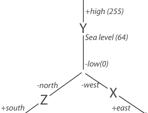

x 值从西（负）向东（正）移动，z 坐标从北（负）向南（正）移动，y 则从下（负）向上（正）移动，其中 y 值为 0 位于基岩底层和 64（海平面）之间。这意味着要让一个玩家或其他实体飞向空中，你需要向 y 值增加一些数值。

我们将从 `loc` 获取每个目标的当前值并将其保存为 `y`。接下来我们将更改它。

---

### 插件：LavaVision

为了增强视觉效果，我在遍历的每个区块上都添加了一个效果：
`spawnParticle(b.getLocation(), Particle.Type.LAVSPARK);`

`LAVASPARK` 在我们的视线线上产生了一组很酷的火花。

我还添加了一个音效，使用了 `playSound` 函数，它接收一个 `Location`（位置）和一个 `SoundEffect`（音效，如果你需要，还可以指定音量和音调）。
`playSound(b.getLocation(), SoundEffect.Type.EXPLODE);`

在 Canary 文档中列出了所有可能的效果：`canarymod.api.world.effects.SoundEffect.Type`。我选择了 `EXPLODE`——你可以在之后添加音调和两个数字；它们被指定为 `float`（浮点数），所以记得加上修饰符。这里是完整的代码，包含了迭代器效果：

```java
// LavaVision/src/lavavision/LavaVision.java
package lavavision;

import net.canarymod.plugin.Plugin;
import net.canarymod.Logger.Logger;
import net.canarymod.commands.*;
import net.canarymod.chat.MessageReceiver;
import net.canarymod.api.entity.Player;
import net.canarymod.api.world.effects.Particle;
import net.canarymod.api.world.effects.Particle.Type;
import net.canarymod.api.world.position.Location;
import net.canarymod.api.world.SoundEffect;
import net.canarymod.api.world.Block;
import net.canarymod.api.blocks.BlockType;
import net.canarymod.api.BlockIterator;
import net.canarymod.LineTracer;
import com.canarymod.amine.ez.EZPlugin;

public class LavaVision extends EZPlugin {

    @Command(aliases = {"lavision"},
        permissions = {"Explode your target into a ball of lava"},
        type = "",
        tip = "/lavision")
    public void lavaVisionCommand(MessageReceiver caller, String[] args) {

        if (caller instanceof Player) {
            Player me = (Player) caller;
            BlockIterator sitter = new BlockIterator(new LineTracer(me), true);
            while (sitter.hasNext()) {
                Block b = sitter.next();
                spawnParticle(b.getLocation(), Particle.Type.LAVSPARK);
                if (b.getType() != BlockType.Air) {
                    b.getWorld().setBlockAt(b.getLocation(), BlockType.Lava);
                    playSound(b.getLocation(), SoundEffect.Type.EXPLODE);
                    break;
                }
            }
        }
    }
}
```

```bash
$ cd Desktop
$ cd code/LavaVision
$ ./build.sh
```

在我们循环时，会为视线上的每个区块生成一个 `LAVASPARK` 效果。如果我们碰到了不是空气的物体，就会将该区块的类型设为岩浆（`Lava`），播放音效并跳出循环。完成。

停止并重启服务器，在 Minecraft 中环顾四周并选择一个目标。输入 `/lavision` 命令并观察岩浆涌出。


### 现在轮到你了！

更改此插件使用的效果。将粒子效果类型从 `LAVASARK` 更改为其他有趣的类型。所有可用效果类型都列在文档中。
3. https://ci.visualillusions.net/job/CanaryLib/javac/net/canarymod/api/world/effects/Particle.Type.html

接下来，将音效从 `EXPLODE` 更改为更微妙的，也许是 `BURP`（嗝声）。音效列在文档中。

### 下一步

在这一章中，你学习了如何向插件添加新命令。现在，你可以开始为现有插件添加你自己的新想法，并处理游戏中的位置和区块。但一旦你开始处理大量位置或大量区块时，你就遇到了一个问题：Java 是如何存储这类列表的？你如何处理可能需要按名称或顺序查找的“数据堆”？

在下一章中，我们将添加一个用于记录信息的命令：那些你需要记录跟踪的内容。我们将更多关于 Java 变量的内容：谁可以看到它们，谁不能，以及——最重要的点是——如何存储和处理数据堆。

简而言之，我们将学习如何跟踪各种事物。

---

## 你不断增长的工具箱


你现在已经知道如何：

- 使用命令行 shell
- 使用 Java, `javac` 进行编译
- 运行 Minecraft 服务器
- 部署插件
- 连接到本地服务器
- 使用 Java 变量处理数字和字符串
- 使用 Java 函数
- 使用 `if`、`for` 和 `while` 语句
- 使用 Java 对象
- 使用 `import` 导入 Java 包
- 使用 `new` 创建对象
- 为插件添加新命令
- 处理位置（`Location`）对象
- 查找区块/实体

4. https://ci.visualillusions.net/job/CanaryLib/javadoc/net/canarymod/api/world/effects/SoundEffect.Type.html

你的头脑装满了吗？我希望没有，因为你还有几个有趣的东西要学。在本章中，我们将为你的工具箱添加这些能力：

- 使用仅存在于块内的局部变量
- 使用可以在类任何地方访问的类级变量
- 管理数据堆

---

# 第 7 章 数组的使用

变量存在于块内部。我们已经见过它的声明和结束括号（`}` 符号）。你无法在此之外程序的任何地方使用这个 `msg` 变量。你可能在其他地方定义了名为 `msg` 的变量，但它是完全不同的变量。这个 `msg` 仅在块内可见并可用。我们说它的作用域是局部的。你在函数定义的参数也被视为局部。在 `helloCommand` 的声明中：

```java
public void helloCommand(MessageReceiver caller, String[] args) {
```

变量 `caller` 和参数 `args` 在该函数内可用，但在其他任何地方都不可见。它们是局部的。大部分只需要局部变量。事实上，局部变量的使用是非常安全的。程序的其他部分无法使用或更改它们，而且清楚地知道哪行代码设置了局部变量的值以及在哪里使用了它。

### 全局变量

但你可以创建范围更广的变量而不仅仅是局部的（我们正要对插件这样做）。

也许你定义了一个许多不同函数都可以使用的变量。也许整个类，甚至整个程序以及所有的库都可以看到并更改它。我们称之为全局变量。

我们以前用过这个，但你还没有见过。让我们偷看一下 `EZPlugin`，我们在第一个 `HelloWorld` 插件中使用了它。顶部的类级静态变量，命名为 `logger`。

```java
// EZPlugin/src/com/pragprog/amine/ez/EZPlugin.java
package com.pragprog.amine.ez;

public class EZPlugin extends Plugin implements CommandLine {
    /* 我们所有插件的样板方法 */
    public static Logger logger;

    public EZPlugin() {
        logger = getLogman();
    }

    @Override
    public boolean enable() {
        logger.info("Starting up");
    }
}
```


我们调用 `getLogman` 并请求获取 `logger` 对象。它将其返回给我们，并将其赋值给名为 `logger` 的变量。`logger` 的类型是 `Logan`。

这就是文档告诉我们它所需要的样子，但请注意我们在该声明中添加了 `static` 关键字。

**Static**（静态）在这里意味着两点：

* 你可以使用插件的名字访问变量，而无需插件对象。在这种情况下，`HelloWorld.logger` 可以在任何地方（对象内部或外部）处正常工作。
* 静态变量（`logger`）是所有 `HelloWorld` 对象共有的，并且它的生命周期持续在任何对象中局部变量的生命周期之外。

这意味着 `HelloWorld` 对象内的任何函数都可以创建和销毁，但静态变量仍然会在那里，并记住它们的值。

由于 `logger` 是我们定义插件时声明的第一个成员，而且它本身不在函数内部，因此我们插件中的所有函数——即这对顶部 `{ }` 字符内部的所有内容——都可以使用它。它不是任何函数的局部变量。

你可以在 `HelloWorld.java` 中使用 `logger`：

```java
public void myFavoriteFunction() {
    logger.info("Made it this far");
}
```

注意，我们不需要任何额外的声明；你只需要在插件中任何你想的地方使用 `logger` 即可。这是一个追踪插件中发生情况的实用技巧：添加一个日志记录语句，你就可以打印出代码该点变量的值。

然而，像这样的全局变量也可能是危险的。

它们为什么是危险的？恰恰因为任何人、任何地方都可以更改该变量的值。也许你知道他们这么做了，但也许你不知道——从现在起，即使“他们”就是“你”。如果出现任何问题，你将不得不检查系统中的每一段代码，以找出哪部分代码错误地设置了变量，以及为什么要这么做。这是一项巨大的工作，并且创造了许多出错的机会。

但有时你确实需要那样的全局变量。你可能不想让任何人更改它，但可能有很多不同的代码段需要引用它。`logger` 就是一个很好的例子：它是所有插件和服务器本身都使用的共享服务。我们都需要访问日志对象，并且我们希望在一个不会消失的变量中拥有它。与局部变量不同，我们希望它对插件中的所有函数可见，并且只要插件存在它就一直存在。

以下是我们到目前为止故事的总结：

* 代码块被写在 `{` 和 `}` 内部。
* 在代码块体内部声明的变量对于该代码块是局部的。它们在函数结束并返回时消失。
* 函数的参数对于该函数是局部的。
* 为 `static` 的变量其寿命比函数内部声明的任何局部变量都长。

## 插件：CakeTower

这是一个简单的插件，它提供了一个 `/caketower` 命令。它的想法是建造一个蛋糕块塔。但代码中有一个涉及局部变量的细微问题，塔可能不会按照你预期的那样出现。让我们来看看。

```java
CakeTower/src/caketower/CakeTower.java

package caketower;

import net.canarymod.plugin.Plugin;
import net.canarymod.logger.Logger;
import net.canarymod.canary;
import net.canarymod.commands.*;
import net.canarymod.chat.MessageReceiver;
import net.canarymod.api.entity.Living.humanoid.Player;
import net.canarymod.api.world.position.Location;
import net.canarymod.api.world.blocks.BlockType;
import com.pragrah.amine.ez.EZPlugin;

public class CakeTower extends EZPlugin {

    public static int cakeHeight = 100;

    @Command(aliases = { "caketower" },
             description = "Build a tall tower of cakes",
             permissions = { "" },
             toolTip = "/caketower")
    public void cakeCommand(MessageReceiver caller, String[] parameters) {

        if (caller instanceof Player) {
            Player me = (Player)caller;
            me.chat("cake height is " + cakeHeight); // 打印
            cakeHeight = 50;
            int cakeHeight;
            cakeHeight = 5;
            me.chat("2) cake height is " + cakeHeight); // 打印
            makeCakes(me);
        }
    }

    public void makeCakes(Player me) {
        me.chat("3) cake height is " + cakeHeight); // 打印
        Location loc = me.getLocation();
        loc.setY(loc.getY() + 2);
        setBlockAt(loc, BlockType.Stone);
        for(int i = 0; i < cakeHeight; i++) {
            loc.setY(loc.getY() + 1);
            setBlockAt(loc, BlockType.Cake);
        }
    }
}
```

运行时，这段代码将打印三次 `cakeHeight` 的值。注意，变量 `cakeHeight` 有两个声明，还有一个在第 31 行。

这段代码会打印什么，塔里最后会有多少蛋糕？尝试想一下。然后像往常一样使用 `build.sh` 进行编译和安装。

## 发生了什么？

欢迎来到遮蔽（shadowing）奇妙困惑的世界。

在这段代码中，在插件顶部声明了一个变量 `cakeHeight`。这是你期望在插件内任何地方访问的变量——从某一行开始，到与之匹配的大括号结束。

但在第 31 行，我们又声明了一个同名的变量。从这里开始，直到下一个大括号之前，你使用的都是这个变量。它遮蔽了之前的变量。

虽然这里可以存放 5 个值，但我们在这里只使用了前 3 个，这没关系。

获取值看起来和存入值一样，只是方向相反。使用我们看过的代码，我们这样检索值：

```java
int myBestQuiz = quizScores[1];
int myBadDay = quizScores[2];
```

对于所有的值，你可以使用旧式的 for 循环：

```java
for (int i=0; i < 5; i++) {
    me.chat("Quote score #" + i + " " + quizScores[i]);
}
```

请记住 Array（数组）是固定大小的；如果你尝试获取位于数组末尾的值（例如 `quizScores[15]`），你的插件将抛出错误并崩溃。在这种情况下，由于我们定义的 `quizScores` 数组大小为 5，你可以安全地存储和检索索引为 0, 1, 2, 3 和 4 的值。这就是为什么我们在中间使用 `i < 5` 而不是 `<=`。

使用 Array 的 `length` 字段而不是硬编码数字如“5”要好得多。因此，最好这样写：

```java
for (int i=0; i < quizScores.length; i++) {
    me.chat("Quote score #" + i + " " + quizScores[i]);
}
```

稍后我们将讨论一种更优遍历数组中所有值的方法。

让我们做同样的事情，但是是针对 Minecraft 的方块。

这是一个快速插件的代码示例，用于构建一个不同类型方块的塔。我正在使用它们的辅助函数 `setBlockAt` 将空气更改为不同的材料。让我们过一遍并看看发生了什么。

## 插件：ArrayOfBlocks

```java
ArrayOfBlocks/src/arrayofblocks/ArrayOfBlocks.java

package arrayofblocks;

import net.canarymod.plugin.Plugin;
import net.canarymod.logger.Logman;
import net.canarymod.Canary;
import net.canarymod.commands.*;
import net.canarymod.chat.MessageReceiver;
import net.canarymod.api.entity.living.humanoid.Player;
import net.canarymod.api.world.position.Location;
import net.canarymod.api.world.blocks.Block;
import net.canarymod.api.world.blocks.BlockType;
import com.pragprog.ahmine.ez.EZPlugin;

public class ArrayOfBlocks extends EZPlugin {

    public void buildTower(Player me) {
        Location loc = me.getLocation();
        loc.setX(loc.getX() + 1); // 不在玩家正上方
        BlockType[] towerMaterials = new BlockType[5];
        towerMaterials[0] = BlockType.Stone;
        towerMaterials[1] = BlockType.Cake;
        towerMaterials[2] = BlockType.Oakwood;
        towerMaterials[3] = BlockType.Glass;
        towerMaterials[4] = BlockType.Anvil;
        for (int i=0; i < towerMaterials.length; i++) {
            loc.setY(loc.getY() + 1); // 每次向上一层
            setBlockAt(loc, towerMaterials[i]);
        }
    }

    @Command(aliases = {"arrayblocks"},
        description = "创建一个方块数组",
        permissions = {""},
        tooltip = "arrayblocks")
    public void arrayOfBlocksCommand(MessageReceiver caller, String[] args) {
        if (caller instanceof Player) {
            Player me = (Player)caller;
            buildTower(me);
        }
    }
}
```

使用 `build.sh` 安装 `ArrayOfBlocks`，停止并重启服务器，然后尝试 `/arrayblocks` 命令。你应该看到类似图 1 所示的结果。见第 98 页的“Array of Blocks”（你可能需要转过身才能看到）。

注意，我将命令的核心逻辑放在它自己的函数 `buildTower` 中，而不是 `arrayblocksCommand` 函数本身中。

这只是一个长度为 5 的简单 Array，值一个接一个值。从索引 0 到 4 的 for 循环将方块更改为列表中的新材料。


图 1—方块数组

## 你来尝试一下

现在轮到你了。做一个小改动来反转塔中元素的顺序，使得铁砧位于底部，石头位于顶部。

修改 for 循环来实现此操作。不要从 0 直到 < 5，而是将循环改为从 4 减到 >= 0。提示：在这种情况下，减法可能比加法更好用。

重新构建、停止、启动，并再次尝试 `/arrayofblocks` 命令。

## 插件：ArrayAddMoreBlocks

让我们来玩玩这个吧。我们将从 ArrayOf 插件开始，但将其改为使用 `ArrayList` 而不是 `Array`。我们将新插件命名为 ArrayAddMore-Blocks。

由于我们可以轻松地向列表添加内容，让我们让它成为静态的：

```java
public static List<BlockType> towerMaterials = new ArrayList<BlockType>();
```

然后，多亏了 `ArrayList` 的特性，我们每次执行 `/arrayaddmoreblocks` 时都能为新塔添加几个方块：

```java
ArrayAddMoreBlocks/src/arrayaddmoreblocks/ArrayAddMoreBlocks.java

public void buildTower(Player me) {
    if (towerLoc == null) {
        towerLoc = new location(me.getLocation());
        towerLoc.setX(towerLoc.getX() + 2); // 不在玩家正
        towerBase = new location(towerLoc);
    }
    towerMaterials.add(BlockType.Glass);
    towerMaterials.add(BlockType.Stone);
    towerMaterials.add(BlockType.OakWood);
    for (BlockType material : towerMaterials) {
        logger.info("Building block at " + printLoc(towerLoc));
        setBlockAt(towerLoc, material);
        towerLoc.setY(towerLoc.getY() + 1); // 逐层向上
    }
}
```

要重置列表，我们使用 `clear()` 函数，我设置了一个单独的命令来执行操作：

```java
ArrayAddMoreBlocks/src/arrayaddmoreblocks/ArrayAddMoreBlocks.java

public void clearTower() {
    if (towerLoc == null) {
        return;
    }
    while (towerBase.getY() < towerLoc.getY()) {
        setBlockAt(towerBase, BlockType.Air);
    }
}
```


```java
logger.info("Clearing block at " + printLoc(towerBase));

towerBase.setY(towerBase.getY() + 1); // 逐层向上
}

towerLoc = null; // 为下一个塔重置
towerBase = null;
towerMaterials.clear();
}
```

关于变量的最后一个有趣的说明：注意在 ❓ 和 ❓ 处我创建了一个新变量，例如 `towerBase = new Location(towerLoc)`，而不是简单地赋值 `towerBase = towerLoc`。你认为我为什么要那样做？

记住，当你用新名称创建一个变量时，你的名字就是它的名字。所以，如果我输入 `towerBase = towerLoc`，那么将只有一个 `Location` 对象，但有两个名字。它们不是独立的变量。通过输入 `towerBase = new Location(towerLoc)`，我创建了一个名为 `towerBase` 的新变量，并复制了 `towerLoc` 的值。

如果你计划更改变量的值，但不想更改原始值，请务必创建一个副本。

完整的插件位于 `code/ArrayAddMoreBlocks` 中。现在进行构建、停止、启动，并试着现在建造和清除一些塔。记住，你可能需要转身面向不同的方向才能看到那座塔。

## 亲自尝试一下

现在修改代码并添加几种不同的建筑材料。然后尝试只使用一种材料，比如泥土（Dirt）。或者混合漂亮的泥土和草地（Grass）。控制权由你掌握。

## 下节内容

在本章中，你学习了局部变量和全局变量之间的区别。你可以使用简单的 `Array` 或更灵活的 `ArrayList` 来存储大量数据，并使用 `for-each` 迭代器遍历它。

如果你并不在意在数组中单独查找某个对象，那么 `Arrays` 是很棒的。但是，如果你按名称关注对象——比如玩家（Player）——那么你需要一些更高级的东西。

在下一章中，我们将介绍如何使用 `HashMap` 来按名称（或位置 Location，或你可能需要的任何其他内容）存储数据。

## 你不断成长的工具箱


你现在知道如何：

- 使用命令行 shell
- 使用 Java, `javac` 进行构建
- 运行 Minecraft 服务器
- 部署插件
- 连接到本地服务器
- 使用 Java 变量处理数字和语句
- 使用 Java 函数
- 使用 `if`、`for` 和 `while` 语句
- 使用 Java 对象
- 使用 `imports` 导入 Java 包
- 使用 `new` 创建对象
- 为插件添加新命令
- 处理 `Location` 对象操作
- 查找方块/实体
- 使用局部变量
- 使用类级全局变量
- 使用 `ArrayList`


在本章中，我们将处理稍微复杂的数据堆和插件结构，并将这些能力添加到你的工具箱中：

- 在哈希（hashes）中存储数据堆
- 使用 `private` 隐藏你的私有数据，使用 `public` 让其他人看到并使用的内容

# 第 8 章

# 使用变量组：HashMap

## 使用 Java HashMap

HashMap 是一个有趣的名字。“hash”（哈希）部分指的是它的内部工作原理；这与你如何使用它无关。

但“map”（映射）部分正如你想象的那样：它将一个键（key，可以是任何内容）映射到一个值（value，也可以是任何内容）。

其他语言可能将其称为字典（dictionary）。在本章中，我们将处理稍微复杂的数据堆和插件结构，并将这些能力添加到你的工具箱中：

- 在哈希中存储数据堆
- 使用 `private` 隐藏你的私有数据，使用 `public` 让其他人看到并使用的内容

我们所做的唯一不同之处是决定了我们要返回什么种类型的值（在本例中为 `int`），而不是在声明中使用 `void`。然后，我们使用 `return` 关键字并带有我们想要返回给调用者的值。通常，我们希望将 `return` 作为函数的最后一次操作。这是因为它指定了要返回的值，并立即执行返回操作。在方法遇到 `return` 之后，你的方法中将不再有其他代码运行。你已经完成了。

## 亲手尝试一下

修改 `HashPlay.java` 源码，使得任何人的分数都不会低于 0 或高于 1.000。使用一个返回返回值的辅助函数来将分数限制在 0 到 1.000 之间。

你可以在 `HashPlayClamp/src/hashplay/HashPlay.java` 中看到我的解决方案。事实上，你可能会在其中看到另一个微妙的技巧：我没有将辅助函数设为 `public`，而是将它声明为 `private`。这有什么含义呢？

## 保持私有或将其设为公共

到目前为止，我们在创建静态变量以及定义函数和插件时，倾向于使用 Java 关键字 `public`。这告诉 Java 我们正在定义一个公开访问的内容——我们所有的插件代码都可以访问它，系统中的任何其他插件也可以使用它（比如我们使用 `logger` 时）。

还有另一种选择。你可以创建其他人看不见的函数、变量，甚至是辅助对象。与其使用 `public`，不如将它们设为 `private`。

在编程中，有一条简单的规则——这种规则是你会告诉五岁小孩的：不要暴露你的私有产物。

换句话说，如果你正在使用一个只有你应该使用的函数或东西，请将其标记为 `private`，以确保外部无人可以使用它。你为什么要这样做呢？

假设在你的插件某处，你有一个函数可以将玩家标记为超级、高级的“超级巫师（Uber-Wizard）”。你不希望任何其他插件对它选择的玩家调用该函数。因此，通常你会在插件中这样声明该函数（省略所有其他部分）：

```java
public class WizardingWorld extends EZPlugin {

  public void makeSuperUberHighWizard(Player p) {

    // 任何其他插件都可以调用 WizardingWorld.makeSuperUberHighWizard()

  }

}
```

## 栈（Stack）vs 堆（Heap）

你已经注意到，有时我们会创建并直接将一个简单的值赋值给变量，如 `int a = 25`，而有时我们会使用 `new` 关键字来创建一个对象，比如插件。

这两种类型的对象的存储方式不同。即时值（如整数和浮点数）保存在 Java 正在进行的调用列表中。该列表被称为**栈（stack）**。它就像一叠煎饼。每次新的函数调用都会在栈上放上一块新的煎饼，当调用完成后，你会移除这块煎饼并回到上一个。当一个函数结束时，它的“煎饼”就会被丢弃，它的任何变量都会随之消失。

但你用 `new` 创建的对象被保存在我们称为**堆（heap）**的大内存池中。如果你愿意，它们在函数消失后仍然可以留存（比如插件）。

你只需要在某处保留一个指向你对象的变量；该变量可以是局部的并传递，也可以是全局的。Java 会追踪用 `new` 创建的对象被多少不同的变量引用。一旦不再使用该对象，它就会被扔进垃圾桶。然后当系统觉得合适时，它会清空垃圾桶，你的对象就消失了。（Java 甚至称之为“垃圾回收（garbage collection）”。）正如我们在章节最后部分提到的，你需要小心：赋值会带给你对同一个对象的两个引用；而使用 `new` 则会创建一个对象的新副本。

你可以将其设为 `private`，如下所示：

```java
public class WizardingWorld extends EZPlugin {

...

    private void makeSuperUberHighWizard(Player p) {

    // 只有这里的函数可以调用 makeSuperUberHighWizard()

}
```

通常情况下，如果你正在编写一个在该插件内部使用的函数，且其他插件不应该直接调用，那么将其设为 `private`。你正在使用的变量几乎应该总是 `private` 的。

如果你希望其他插件看到并使用它，就将其设为 `public`。

我们现在开始为我们的辅助函数使用 `private`。

## 插件：命名路牌（NamedSigns）

让我们把这些想法结合起来，制作一个使用辅助函数（带返回值和不带返回值）、私有函数和变量、一些低级数组访问以及一个存储名称和位置的哈希表（hash）的插件。

这个插件允许你在游戏中创建路牌并为它们命名。然后你可以通过名称在任何路牌上放置文本。例如，假设我通过在聊天窗口输入这些命令创建了两个路牌，分别命名为 1 号 2 号：

```
/signs new one
/signs new two
/signs set one Hello!
/signs set two Goodbye!
```

我会看到类似这样的效果：

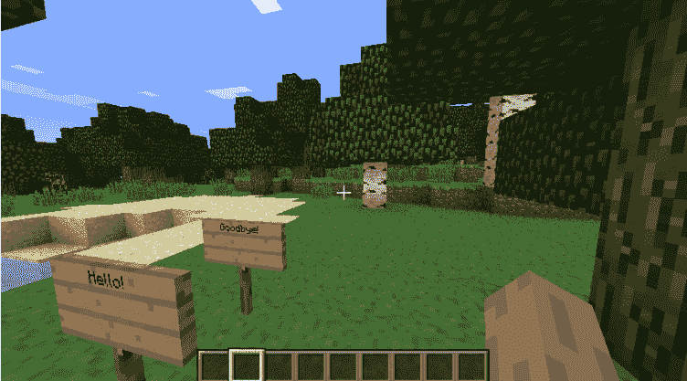

现在我可以通过发布另一个 `signs set` 命令来随心所欲更改每个路牌的文本，例如：

```
/signs set two Adios!
```

让我们先从插件的全貌开始，然后查看其中一些有趣的片段：

```java
NamedSigns/src/namedsigns/NamedSigns.java

package namedsigns;

import java.util.HashMap;
import java.util.Iterator;
import java.util.Map;
import namedsigns.commands.*;
import com.canary.commands.*;
import org.bukkit.Location;
import org.bukkit.World;
import org.bukkit.entity.Player;
import org.bukkit.block.Block;
import org.bukkit.block.Sign;
import org.bukkit.block.BlockType;
import com.canary.plugin.EZPlugin;
import com.canary.api.MessageReceiver;
import com.canary.util.ChatUtils;
import com.canary.util.Canary;

public class NamedSigns extends EZPlugin {

    private static Map<String, Location> signs = new HashMap<>();

    @Command(aliases = {"signs"},
    description = "Create and name signposts",
    permissions = {""},
    toolTip="/signs new name, or /signs set message")
    public void signsCommand(MessageReceiver receiver, String[] args) {

        if (caller instanceof Player) {
            Player me = (Player)caller;
            parseArgs(me, args);
        }
    }

    private void parseArgs(Player me, String[] args) {
        if (args.length < 3) {
            usage(me);
            return;
        }

        if (args[0].equalsIgnoreCase("new")) {
            makeNewSign(me, args);
        } else if (args[0].equalsIgnoreCase("set")) {
            if (args.length < 4) {
                usage(me);
                return;
            }
            setSign(me, args);
        }
    }

    private void usage(Player me) {
        me.chat("Usage: signs new name");
        me.chat("signs set message");
    }

    private void makeNewSign(Player me, String[] args) {
        Location loc = me.getLocation();
        int y = loc.getWorld().getHighestBlockY(loc.getX(), loc.getZ()).getY();
        loc.setY(y);
        signs.put(args[1], loc);
        loc.getWorld().getBlockAt(loc).setType(BlockType.SIGN);
    }

    private void setSign(Player me, String[] args) {
        String name = args[1];
        String msg = args[2];
        if (!signs.containsKey(name)) {
            me.chat("No sign named " + name);
            return;
        }
        Location loc = signs.get(name);
        World world = loc.getWorld();
        Sign sign = (Sign)world.getBlockAt(loc);
        sign.setText(msg, 0);
        sign.update();
    }
}
```

## parseArgs 函数

由于用户输入命令时有几处需要检查，因此我将其拆分成一个独立的函数，而不是直接写在 `signsCommand` 函数中。

注意，我们使用了命令函数中一个之前没用过的参数：`String[] args`。这些是玩家在聊天窗口输入命令时输入的任何参数。例如，如果我们输入 `/signs`，它将作为 `args[0]` 传递给 `signsCommand` 的 `args` 数组；`args` 的长度为 1。如果我们输入 `/signs set one Hello!`，那么 `args[0]` 仍然是 "signs"，`args[1]` 将是 "set"，`args[2]` 将是 "one"，而 `args[3]` 将是 "Hello"！

我们知道 `args` 数组中至少需要三个值：它要么是 "signs new name"，要么是 "signs set something"。

记住处理数组时，你必须检查数组长度是否足够；否则你将收到来自服务器的生动错误信息，其结尾类似于下面的内容：

```java
Caused by: java.lang.ArrayIndexOutOfBoundsException: 1
at at NamedSigns.NamedSigns.makeSign(NamedSigns.java:26)
at at NamedSigns.NamedSigns.signsCommand(NamedSigns.java:47)
 ... 15 more
```

我们正在手动检查参数的长度。但我们也可以在 `@Command` 注解中设置 `min == 3` 部分。如果我们没有至少三个参数，系统将向玩家发送一条带有 `toolTip` 作为帮助消息的友善提示。

在确认 `args` 数组中至少有三个值可以操作的操作后，让我们来看看玩家到底输入了什么。

## "signs new" 命令

这里是处理 "new" 命令的部分：

```java
NamedSigns/src/namedsigns/NamedSigns.java

// signs new sign name
private void makeSign(Player player, String [] args) {
    Location loc = player.getLocation();
    loc.setX(loc.getX() + 1); // 不在玩家正上方
    int y = loc.getWorld().HighestBlockAt((int)loc.getX(), (int)loc.getZ());
    loc.setY(y);
    signs.put(args[2], loc);
    setBlock(loc, BlockType.Sign);
}
```

我们首先获取玩家旁的一个行方块（`getX() + 1`），并使用 `getHighestBlock()` 获取该位置的最高区块。这样我们就不会把牌子放在水下、基岩或其他任何地方。

接下来，我们使用玩家提供的名称（`args[2]`）将该区块的位置设置到哈希映射中。

最后，我们将该区块的类型设置为 `BlockType.SignPost`。现在它是一个牌子了。

## /signs set 命令

这里是处理 "set" 命令的部分：

```java
```


# NamedSigns 插件代码分析

## `setSign` 方法实现

```java
// signs set sign name line1
private void setSign(Player me, String[] args) {
    String name = args[2];
    String msg = args[3];

    if (!signs.containsKey(name)) {
        // 没有名为这个牌子
        me.chat("No sign named " + name);
        return;
    }

    Location loc = signs.get(name);
    World world = loc.getBlock();
    Sign sign = (Sign) world.getBlockAt(loc);

    sign.setTextOnLine(msg, 0);
    sign.update();
}
```

注意，我们正在将两个局部变量 `name` 和 `msg` 分别设置为 `args[2]` 和 `args[3]`。为什么它们不一样？是的，它们是一样的，但读取 `name` 比读取 `args[2]` 并尝试记住 2 代表名称、3 代表消息要容易易读一些。

接下来，我们将检查哈希映射中是否真的存在该 `name` 的条目，如果没有，我们将向玩家报错。否则，我们可以安全地获取牌子区块的位置。

接下来是魔法时刻。我们可以获取正确位置的区块，但它仍然是一个区块——`net.canarymod.api.blocks.Block`。`Block` 对 `Sign` 的功能一无所知。`Sign` 是区块的一种，所以我们必须说服 Java 将其转换为 `net.canarymod.api.blocks.Sign`。

Canary 文档告诉我们要对区块调用 `world.getEntity()`，然后使用转换操作符 `(Sign)` 对其进行强制转换，以创建一个正确的牌子。有了 `sign` 变量，我们可以调用需要的两个 `Sign` 函数：`setTextOnLine()` 和 `update()`。

`setTextOnLine` 在指定的索引（本例中为 0）处在牌子上放置一行文本，而 `update()` 则确保牌子在客户端重绘，这样你就能看到新文本。

这看起来代码挺多的，但如果你逐个查看，其实并没有那么难。事实上，现在轮到你来一些修改了。

## 亲自尝试一下

按照目前的写法，插件只设置了牌子的第一行，但每个牌子最多可以四行。修改插件，使得如果用户输入了额外的单词，你会将每个单词传递给 `sign.setTextOnLine()`。记住：如果它可以容纳四行，那么它们的编号就是 0, 1, 2 和 3。

---

# Stuck 插件实现

在 `@Command` 规范中，我们将参数最小数量设置为 2。这样，我们就不需要自己编写代码来检查它；系统会自动完成。在 `stuckCommand` 本身，我们将尝试获取命名的玩家，这可能成功也可能失败。如果失败（即没有该命名的玩家在线），我们将跳出 `if` 体并返回，不执行任何操作。

如果成功（即我们找到了该玩家），我们将继续调用 `stuck`，并传入从服务器获取的玩家对象。

以下是 `stuck` 函数的开头：

```java
// Stuck/src/src/Stuck.java
public void stuck(Player player) {
    Location loc = player.getLocation();

    int playerX = (int) loc.getX();
    int playerY = (int) loc.getY();
    int playerZ = (int) loc.getZ();

    loc.setX(playerX + 0.5);
    loc.setY(playerY);
    loc.setZ(playerZ + 0.5);

    player.teleportTo(loc);
}
```

我们在 `stuck` 函数内部做的第一件事是将玩家的当前位置存入 `loc`。在接下来的几行中，我们将设置将玩家传送到他们目前被困住的区块中心。这使得在玩家四周填充方块变得更容易。

那么，我们具体要怎么做呢？嗯，我们知道玩家会占据方块。我们获取玩家的位置实际上是角色腿部和脚部所在。之上的方块（y+1）是玩家的头部和胸部。我们需要一组方块，在玩家的四侧各堆叠两个方块，下方一个，上方一个。如图 3 所示，总共 10 个方块。参考《用方块困住玩家》，第 120 页。

根据玩家的位置，我们知道这些方块每个的位置。我们需要十个坐标，每个坐标都相对于玩家基础方块进行偏移。我们需要一个列表列表（list of lists）。

这就是你接下来看到的。这是一个包含 10 个元素的数组，每个元素都是包含三个偏移量的数组，分别对应 x、y 和 z 值：

```java
// Stuck/src/src/Stuck.java
int[][] offsets = {
    // x, y, z
    {0, -1, 0},
    {0, 2, 0},
    {1, 0, 0},
    {1, 1, 0},
    {-1, 0, 0},
    {-1, 1, 0},
    {0, 0, 1},
    {0, 1, 1},
    {0, 0, -1},
    {0, 1, -1}
};
```

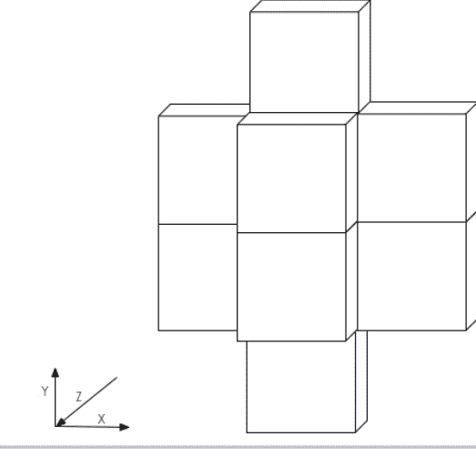

我们将使用一个简单的循环来遍历这个偏移量列表。列表中的第一个元素索引为 0，我们将一直运行到（但不包含）列表的长度。通过使用 `offsets` 的长度而不是固定的数字 10，如果我们以后需要，可以轻松地向列表中添加额外的方块（记住，我们在之前的代码中加上了 `playerX`、`playerY` 和 `playerZ` 的偏移量）：

```java
// Stick/src/stuck/Stick.java
for (int i = 0; i < offsets.length; i++) {
    int x = offsets[i][0];
    int y = offsets[i][1];
    int z = offsets[i][2];

    setBlockAt(new Location(x + playerX, y + playerY, z + playerZ), BlockType.Stone);
}
```

所以我们正在遍历这个偏移量列表。在每个列表（通过 `i` 指定）中，我们需要挑选出 x、y 和 z 这三个元素。在每个小数组中，x 位于索引 0 处。Java 语法允许你通过编写两个索引来处理二维数组，先写大列表的索引。将这些想象成你在表格或矩阵中看到的数字，具有行和列，就像 Microsoft Excel 表格一样。你以“行优先顺序”指定索引，这意味着行在前。在循环的每次迭代中，我们都从列表中挑出 x、y 和 z 值。这就是我们想要转换的方块的位置。

我们获取该位置的方块——在这种情况下，通过将 x、y、z 偏移量加上玩家的位置（代码中的 `velocityX`、`playerY` 和 `playerZ`）。拿到方块后，只需使用常量 `BlockType` 将其材质设置好。所有不同的方块类型都列在 `net.canarymod.api.world.blocks.BlockType` 的文档中。例如，你可以在不破坏它的情况下移除方块——你可以将方块的材质设置为 `BlockType.Air`，就像我们处理箭箭塔的那样。

这里是完整插件的代码：

```java
// Stuck/src/stuck/Stuck.java
import net.canarymod.api.world.blocks.BlockType;
import net.canarymod.api.world.Location;
import net.canarymod.api.entity.Player;
import net.canarymod.api.command.MessageReceiver;
import net.canarymod.api.command.Command;
import net.canarymod.api.plugin.Plugin;

public class Stuck extends Plugin {

    @Command(aliases = {"stuck"}, description = "Trap a player", min = 2)
    public void stuck(MessageReceiver caller, String[] args) {
        Player victim = caller.getPlayer(args[1]);

        if (victim != null) {
            // ...逻辑继续 ...
        }
    }

    public void stuck(Player player) {
        Location loc = player.getLocation();

        int playerX = (int) loc.getX();
        int playerY = (int) loc.getY();
        int playerZ = (int) loc.getZ();

        loc.setX(playerX + 0.5);
        loc.setY(playerY);
        loc.setZ(playerZ + 0.5);

        player.teleportTo(loc);

        int[][] offsets = {
            // x, y, z
            {0, -1, 0},
            {0, 2, 0},
            {1, 0, 0},
            {1, 1, 0},
            {-1, 0, 0},
            {-1, 1, 0},
            {0, 0, 1},
            {0, 1, 1},
            {0, 0, -1},
            {0, 1, -1}
        };

        for (int i = 0; i < offsets.length; i++) {
            int x = offsets[i][0];
            int y = offsets[i][1];
            int z = offsets[i][2];

            setBlockAt(new Location(x + playerX, y + playerY, z + playerZ), BlockType.Stone);
        }
    }
}
```

---

# 第 9 章 Minecraft 中的修改、生成与监听

另一方面，玩家（`Player`）并不使用 `Ageable` 接口，因此你无法将玩家变成婴儿，即使他们表现得像婴儿一样。相反，玩家有一套不同的可用函数，包括设置和获取玩家经验等级、食物栏物品等函数。

## 生成实体

你可以使用几个函数来生成不同的实体、生物以及游戏对象——例如**末影珍珠**²。为了在世界中创建新事物，我们将使用定义在 `EZPlugin` 中的中的函数，而不是直接编写所有代码。这并不是说代码特别复杂或难以理解；而是那几行代码将是相同的，因此使用辅助函数是有意义的。这样，你只需要使用单行的辅助函数调用，而不需要使用几行重复的代码。让我们仔细观察这些辅助函数实际上执行了什么。

以下是我们一直以来用于生成奶牛和鱿乌鱼的方法：

```java
// EZPlugin/src/com/pragrog/ahmine/ez/EZPlugin.java
public static EntityLiving spawnEntityLiving(Location loc, EntityType type) {
    EntityFactory factory = Canary.factory().getEntityFactory();
    EntityLiving thing = factory.newEntityLiving(type, loc);
    thing.spawn();
    return thing;
}
```

这看起来有点乱，但是一种常见的模式。其核心是：首先获取一个工厂对象，在这种情况下，是一个 `EntityFactory`。工厂的作用正如其名所示；它生成 `EntityLiving` 对象。但仅仅创建一个新对象（即使是 `Cow` 对象）还不足让它出现在 Minecraft 世界中。你需要告诉对象去生成自己。

生成粒子要简单一些：

```java
// EZPlugin/src/com/pragrog/ahmine/ez/EZPlugin.java
public static void spawnParticle(Location loc, Particle.type type) {
    loc.getWorld().new Particle(loc.getX(),
    loc.getY(), loc.getZ(), type);
}
```

在这里，我们需要在世界中使用 `spawnParticle` 函数，并向它传递一个用单个坐标 x、y 和 z 初始新的 `Particle`。同样，这并不复杂，但辅助函数字面上“帮助”了我们保持代码的整洁和易读性。

> 2. 在生存模式下，右键点击末影珍珠会将你传送到它落下的地方。

我们一直用于设置区块类型的函数也非常直接：

```java
// EZPlugin/src/com/pragrog/ahmine/ez/EZPlugin.java
public static void setBlockAt(Location loc, BlockType type) {
    loc.getWorld().getBlockAt(loc, type);
}
```

虽然 `Block` 有它自己的类型，但这并不能产生我们想要的场景更改。因此，我们使用 `World` 的 `setBlockAt()` 函数。通过始终使用辅助函数，我们确保始终使用正确的版本。

## 插件：飞行苦力 (FlyingCreeper)

这是一个具有实体生成功能的插件：一只蝙蝠和一个苦力。我们将让苦力骑在蝙蝠上，然后用药水效果让蝙蝠隐形。结果是一个噩梦般的、恐怖的、飞行苦力。

以下是药水的核心代码。注意，这次我没有使用辅助函数来生成；相反，我直接使用工厂调用，我使用了一个略有不同的 `spawn` 版本。

```java
// FlyingCreeper/src/flyingcreeper/FlyingFlyingCreeper.java
Location loc = me.getLocation();
loc.setY(loc.getY() + 5);
```

```java
EntityFactory factory = Canary.getEntityFactory();
EntityLiving bat = factory.newEntityLiving(EntityType.BAT, loc);
EntityLiving creep = factory.newEntityLiving(EntityType.CREEPER, loc);
bat.spawn(creep);
```

```java
PotionFactory = Canary.getPotionFactory();
Potion effect = 
potfact.newPotionEffect(PotionType.INVISIBILITY,
Integer.MAX_VALUE, 1);
bat.addPotionEffect(potion);
```

所有实体都有骑者。理论上，你甚至可以骑着 TNT。我不建议这样做。在这里我们将通过生成带有苦力的蝙蝠来让苦力骑在蝙蝠上（生成参数）。

我们需要让蝙蝠隐形，让飞行苦力看起来更有说服力。诚实地说，所有实体都可以使用药水效果³。我们将创建一个药水效果，允许我们指定药水的类型、持续时间和强度：

`PotionEffect (PotionEffect type, int duration, int amplifier)`

- 所有药水类型列在：<https://ci.visualusionsent.net/job/CanaryLib/javadoc/canarymod/api/potion/PotionType.html>

在这种情况下，类型是 `PotionEffect.INVISIBILITY`，我们希望它持续存在，因此我们将持续时间设置为最大值：`Integer.MAX_VALUE`。没有更大的整数了。在这种情况下，强度并不重要，因为你无法变得“更隐形”，所以我们只使用 `1`。

最后，我们为蝙蝠添加了新的药水，它是隐形的。

恭喜！你现在是这只飞行苦力的自豪主人。

---

此插件将监听事件以追踪你去过的地方，并允许你按顺序返回之前的位置。

```java
// BackCmd/src/backcmd/BackCmd.java
package backcmd;

import java.util.ArrayList;
import java.util.HashMap;
import java.util.List;
import java.util.Stack;
import net.canarymod.plugin.Plugin;
import net.canarymod.logger.Logman;
import net.canarymod.Canary;
import net.canarymod.commands.Chat.*;
import net.canarymod.chat.MessageReceiver;
```


# 第 9 章：在 Minecraft 中修改、生成和监听

## 代码示例：BackCmd 插件

```java
import net.canarymod.api.entity.living.humanoid.Player;
import net.canarymod.api.position.Location;
import net.canarymod.hook.HookHandler;
import net.canarymod.hook.player.TeleportHook;
import net.canarymod.plugin.PluginListener;
import com.pragprog.ahmine.ez.EZPlugin;

public class BackCmd extends EZPlugin implements PluginListener {

    private static List<Player> isTeleporting = new ArrayList<Player>();
    private static HashMap<String, Stack<Location>> playerTeleports = new HashMap<String, Stack<Location>>();

    @Override
    public boolean enable() {
        Canary.hooks().registerListener(this, this);
        return super.enable(); // 同时调用父类版本。
    }

    public boolean equals(Location loc1, Location loc2) {
        return ((int) loc1.getX() == (int) loc2.getX()) &&
               ((int) loc1.getZ() == (int) loc2.getZ());
    }

    @HookHandler
    public void onTeleport(TeleportHook event) {
        Player player = event.getPlayer();

        if (isTeleporting.contains(player)) {
            isTeleporting.remove(player);
        } else {
            Stack<Location> locs = playerTeleports.get(player.getName());
            if (locs == null)
                locs = new Stack<Location>();
            locs.push(player.getLocation());

            locs.push(event.getDestination());
            playerTeleports.put(player.getName(), locs);
        }
    }

    @Command(aliases = {"back"},
             description = "回到你之前传送过的地方。",
             permissions = {""},
             tooltip = "/back")
    public void backCommand(MessageReceiver caller, String[] args) {
        if (caller instanceof Player) {
            Player me = (Player) caller;
            Stack<Location> locs = playerTeleports.get(me.getName());
            if (locs != null && !locs.empty()) {
                Location loc = locs.peek();
                while (!loc.equals(me.getLocation()) && locs.size() > 1) {
                    locs.pop();
                    loc = locs.peek();
                }
                isTeleporting.add(me);
                me.teleportTo(loc);
            } else {
                me.chat("你还没有传送过。");
            }
        }
    }
}
```

## 特殊操作说明

由于此插件使用了事件监听，以下是你需要执行的特殊操作：

1. 在 ① 处，声明此类实现了 `Listener`。
2. 在 ② 处，注册插件的事件。
3. 在 ③ 处，添加 `@EventHandler` 注解，并声明此事件监听器将监听 `TeleportEvents`。

## 代码逻辑解析

每当玩家传送时，`onTeleport` 函数就会被调用。我们做的第一件事是获取正确的 `Player` 对象，它存储在传递给我们的事件中。现在我们知道正在处理什么了：

接下来，我们查看名为 `isTeleporting` 的列表，以确定该玩家是否正在传送过程中。你可能会问 `isTeleporting` 是什么？

啊，看看插件上方 ④ 附近，你会看到两个声明为 `private static` 的变量。这意味着没有人能看到它们，并且这些值在这些命令执行期间会一直存在。

我们使用 `isTeleporting` 和 `playerTeleports` 来追踪玩家以及他们传送去往所在的位置。

我们正在检查 `isTeleporting` 列表是否已经包含了该玩家。如果没有，我们将添加它——该玩家已开始传送。如果 `isTeleporting` 列表已经包含了该玩家，那么我们应该忽略此事件（并从列表中移除该玩家）。这意味着我们生成了这个事件，而且我们不希望我们自己的事件再次传送玩家，否则它会持续进行。因此，我们丢弃这个额外的传送事件。

如果此玩家以前传送过，我们将使用玩家作为键从 `playerTeleports` 哈希（位置的哈希表）中获取一个 `loc`。我们将此位置添加到现有列表中。如果这是玩家第一次传送，我们将创建一个新的列表（`Location` 列表）并将此位置作为其第一个条目。

但这并不是普通的列表。它确实是一种列表，但它是一个栈（`Stack`），而不是普通的列表。栈的工作方式就像一叠煎饼。你向栈的顶部添加元素，当你移除一个煎饼时，它是从顶部移除的。

## 权限管理命令

- `/groupmod permission add groupName permissionName` — 为组 `groupName` 的成员添加 `permissionName` 权限。
- `/groupmod check groupName permissionName` — 检查 `groupName` 是否拥有 `permissionName` 权限。

例如，在我们的插件中，为了给 `jack37` 赋予使用我们 `/fire` 命令的权限，你需要在控制台中输入以下命令：

```
playmod permission add jack37 commands.firebow.enable
```

查看 Canary 文档以获取更多详情。

## 下一步

在这一章中，我们学习了许多新能力：你可以修改 Minecraft 方块并生成实体，管理插件权限，最重要的是，监听游戏中发生的有趣事件并做出反应。插件真正的核心在于，它们能够在事件发生时自动采取行动，从而改变 Minecraft 世界的运行方式。

在下一章中，我们将学习如何调度未来发生的事件，并制作一个会爆炸的“不爆炸牛发射器”。下章节见。

## 你不断成长的工具箱


你现在已经知道如何：

- 使用命令行 shell
- 使用 Java, `javac` 进行编译
- 运行 Minecraft 服务器
- 部署插件
- 连接到本地服务器
- 使用 Java 变量处理数字和字符串
- 使用 Java 函数
- 使用 `if`, `for` 和 `while` 语句
- 使用 Java 对象
- 使用 `imports` 导入 Java 包
- 使用 `new` 创建对象
- 为插件添加新命令
- 使用 `Location` 对象操作
- 查找方块/实体
- 使用局部变量
- 使用类级全局变量
- 使用 `ArrayList`
- 使用 `HashMaps`
- 使用 `private` 和 `public` 控制可见性
- 修改 Minecraft 方块
- 修改和生成实体
- 监听并响应游戏事件
- 管理插件权限

报告错误 · 讨论

在这一章中，你将学习更多关于对象、类以及稍后运行的任务调度的知识。你会将这些知识加入你的工具箱：

- 如何创建一个单独的类
- 如何调度一个任务对象稍后运行
- 如何调度一个任务对象稍后持续运行

你的工具箱现在几乎完全了。基于我们目前的内容，你就可以编写一些非常酷的插件了。

# 第 10 章：调度任务稍后执行

我们将讨论如何让 Minecraft 中发生一些并非直接响应事件或用户发布命令的事情：即如何调度在未来某个时间自动发生的任务——而这些任务是独立运行的。这一功能可以帮助你实现那些看起来是独立运行的内容，例如攻击苦力怕或其他敌人。

在 Java 方面，你还将看到如何放在单独的文件中创建类，我们将看看 Java 在同时运行多次时遇到的一些问题。

## 什么时候会发生什么？

当我们谈论“稍后”运行某些内容时，它揭示了一个残酷的事实：世界并没有因为你的代码正在运行就停止变化。计算机一次可以做多件事，并且一直都在这样做。但大多数代码并不是这样写的。

想想我们到目前为止过的某些插件。如果在运行那段代码的中途，另一个玩家输入了相同的命令并开始从头开始运行，会发生什么？

看看第 136 页的图。每一行和代码片段都代表计算机同时执行的一组指令。我们把每一组称为一个“线程”（thread）——就像小说中情节的线索，或者午餐时众多对话中某一段对话的线索。

通常，你认为计算机只运行一遍你的代码，如图左侧所示。你会认为计算机是从上到下一个接一个执行指令的，没有其他事情在同时发生。那是一个执行线程（就像一次对话）。

```java
if (caller instanceof Player) {
    Player me = (Player) caller;
    Location loc = me.getLocation();
    double y = loc.getY();
    loc.setY(y+50);
    me.teleport(loc);
}
```

但事实并非如此；计算机可能正在运行许多不同的执行线程，显然它们都是同时运行的。我们的代码可以那样工作吗？如果我们的代码被多个线程运行，会发生什么？

如果你使用的是局部变量，并且没有尝试修改 Minecraft 世界中的共同内容，那可能没问题——每个运行中的代码版本都有它自己的变量副本，不会造成伤害。但如果你在使用静态变量，比如用 `HashMap` 来跟踪玩家和值，呢？那么就有两段代码同时对它进行读取和写入，这通常会导致灾难。

## 延迟执行任务

```java
public class ExampleTask extends ServerTask {

    private final EZPlugin plugin;

    public ExampleTask(EZPlugin plugin) {
        super(Canary.getServer(), 0, true); // delay, isContinuous
        this.plugin = plugin;
        // 你可以像我在这里这样做，保留插件的引用，
        // 或者保留你传递的任何其他变量
    }

    public void run() {
        // 做一些有趣的事情...
        Canary.instance().getServer().broadcastMessage("Surprise!");
    }
}
```

在这种情况下，你将把这段代码放在一个单独的文件中，必须命名为 `ExampleTask.java`（以与类名匹配），并放在与包名同名的目录中。

到目前一切顺利，但这个看起来有趣的、没有返回类型且名为 `ExampleTask`（与我们的类名完全相同）的函数是怎么回事？记住，那被称为**构造函数**。那是 Java 在创建新的 `ExampleTask` 时所调用的函数。

因此，要创建一个 `ExampleTask`，你必须向 `new` 传递一个 `EZPlugin`（它会被传递给你的构造函数）。换句话说，你必须提供主插件对象。这样任务就可以获取它可能需要的所有服务器内容，比如世界、玩家等等。这并不是强制的，但可能会很有用。

现在你有了一个会执行有趣操作（嗯，某种程度上）的任务，你该如何调度它呢？

回到你的主插件：一旦你在它的类中定义了任务，你就可以从主插件中使用 `new` 创建该类的实例对象，并使用 `addSynchronousTask()` 将其调度在未来执行。

```java
ExampleTask task = new ExampleTask(plugin);
Canary.getServer().addSynchronousTask(task);
```

`plugin` 应该是一个设置在你的主插件中的变量。如果你将这段代码放在插件的非静态函数中，这意味着“*此插件对象*”。如果你将这段代码放在静态函数中，你需要一个静态变量（如 `plugin`），该变量之前已经被设置为该插件。例如，在像构造函数这样的对象函数（*方法*）中，为了启用它，你应当设置 `plugin = this;`。

你可能想保留 `task` 变量，但这不是必须的。无论是否有它，你都创建了一个 `ExampleTask`，它将调度 `run` 函数在未来的某个时刻执行。

## 运行一次或持续运行的任务

你可以通过设置启动前的延迟，以及设置它应该只运行一次还是持续运行，来指定任务的运行方式。看看我们在构造函数中所做的第一件事：对 `super()` 的调用。`super()` 的调用将调用父类 `ServerTask` 中的构造函数并传入所需信息。

`ServerTask` 构造函数接受三个参数：服务器本身、运行前的等待延迟，以及一个布尔标记（如果任务需要持续运行，则标记为 `true`；如果只需运行一次（单次），则为 `false`）。如果你设置为持续运行，任务将一直运行，直到你取消它。

我们可以修改上一个示例，使其延迟 60 秒后运行一次：

```java
super(Canary.getServer(), 1200, false);
```

在每秒 20 刻的情况下，1200 刻大约是 60 秒（一分钟）。

# 插件：CowShooter

现在我们有足够的组件来制作一个非常有趣的插件了：CowShooter。如果你手里拿着一块皮革，你就可以点击向世界中射出一只燃烧的牛。当牛撞击地面时，它会爆炸成一个由火焰、火和汉堡组成的球体。

这个插件与我们目前看到的有点不同；它完全没有命令（`Command`）部分。它完全由事件驱动。

燃牛的一个问题是它不会一直保持燃烧状态，即使是很长一段时间。通常情况下，燃牛会着火，然后牛死去，火焰熄灭。这并不完全符合我们的需求：我们需要牛在穿过空气时保持在空中。

为了实现这一点，我们将调度一个任务。只要牛在空中，该任务就会重复执行，在该任务中，我们可以让牛保持存活并燃烧，直到它撞击地面。

这里是主事件监听器的代码：

### CowShooter/src/cowShooter/CowShooter.java

```java
@HookHandler
public void onItemInteract(ItemUseHook event) {
    Player player = event.getPlayer();

    if (player.getItemHand().getType() == ItemType.Leather) {
        Location loc = player.getLocation();
        loc.setY(loc.getY() + 2);
        Cow victim = (Cow) Canary.getServer().spawnSynchronousEntity(loc, EntityType.COW);
        Canary.getServer().addSynchronousTask(new CowTask(victim));
        fling(player, 3);
        victim.setFireTicks(600);
    }
}
```


`ItemUseHook` 事件意味着玩家使用了多种不同物品之一，因此我们需要检查并确认玩家是否持有皮革。如果答案是否定的，我们只需忽略该事件，生活照常。

但如果答案是定的，我们将使用 `fling` 方法来增加速度——我们将朝着玩家面对的方向将其掷出去。为了做到这一点，我们将通过乘以 3 来增加速度。燃牛的一个问题是它不会一直保持燃烧状态，即使是很长一段时间内。通常情况下，燃牛会着火，然后牛死去，火焰熄灭。这并不完全符合我们的需求：我们需要牛在穿过空气时保持在空中。

为了实现这一点，我们将调度一个任务。只要牛在空中，该任务就会重复执行，在该任务中，我们可以让牛保持存活并燃烧，直到它撞击地面。

### CowShooter/src/cowShooter/CowTask.java

```java
package com.praprog.ahmine.ez.EZPlugin;

import net.canary.tasks.ServerTask;

import org.bukkit.entity.living.Cow;

import org.bukkit.location.Location;

import org.bukkit.entity.Entity;

public class CowTask extends ServerTask {

    private Cow cow;

    public CowTask(Cow myCow) {

        super(Canary.getServer(), 0, true); // delay, isContinuous

        cow = myCow;

    }

    public void run() {

        if (cow.isOnGround()) {

            Location loc = cow.getLocation();

            cow.setHealth(0);

            cow.kill();

            cow.getWorld().makeExplosion(cow, loc.getX(), loc.getY(), loc.getZ(), 2.0f, true);

            Canary.getServer().removeSynchronousTask(this);

        } else {

            cow.setFireTicks(600);

            cow.setHealth((float)cow.getMaxHealth());

        }

    }

}
```

## 你不断成长的工具箱


你现在已经学会：

- 使用命令行 shell
- 使用 Java 和 `javac` 进行编译构建
- 运行 Minecraft 服务器
- 部署插件
- 连接到本地服务器
- 使用 Java 变量处理数字和字符串
- 使用 Java 函数
- 使用 `if`、`for` 和 `while` 语句
- 使用 Java 对象
- 使用 `imports` 导入 Java 包
- 使用 `new` 创建对象
- 为插件添加新命令
- 操作 `Location` 对象
- 查找方块/实体
- 使用局部变量
- 使用类级全局变量
- 使用 `ArrayList`
- 使用 `HashMap`
- 使用 `private` 和 `public` 控制可见性
- 修改 Minecraft 方块
- 修改并生成实体
- 监听并响应游戏事件
- 管理插件权限
- 创建独立的类
- 调度在稍后运行的任务
- 调度周期性运行的任务

现在，我们将为你的工具箱添加一些存储功能，并发现更多高级的 Java 语言特性。你将学习这些技能：

- 从本地文件保存和加载用户可编辑的配置数据
- 从数据库保存和加载你的私人游戏数据
- 从较小的函数构建更复杂的代码
- 使用 Canary 的 `DataAccess` 使用其内置数据库函数
- 理解 Java 异常和注解

# 第 11 章

## 使用配置文件和存储游戏数据

现在我们进入正题了。根据你到目前所学到的知识，你可以监听事件、调度稍后运行的任务、在列表或哈希表中保留数据，并且只要服务器运行，你的整个插件就会存在。这为你构建一些有趣的插件奠定了良好的基础。然而，你还缺少一个关键部分：服务器不会永远运行。

任何 Minecraft 服务器（包括你的）都可能停止运行。到现在已经停止了很多次，仅仅是为了安装插件！即使你没有安装新插件，硬件可能会崩溃，或者你可能只是合上了笔记本电脑。一旦服务器重新启动，你的插件就会忘记它曾经知道的一切。所有数据都会丢失。

因此，我们需要弄清楚如何将重要数据保存到磁盘某处，以便我们经常保存它并在需要时将其加载。

你可能关心的数据两类：

- 配置数据：包含了你需要了解插件应该如何运行的内容。这些内容可能只设置一次且很少更新，但每次插件运行时都会被读取。你可能可能在其他插件或 Minecraft 自身的服务器设置中使用过配置文件。
- 游戏数据：包含了玩家分数、背包等随游戏进行而频繁变化的内容。这会变得有点复杂，我们稍后会看到。

让我们来看每种类型的数据以及如何保存和加载它们。

## 使用配置文件

许多插件以及服务器本身都使用配置文件来精调和自定义不同的值，并选择不同的行为。配置文件就是一个简单的文本文件，旨在供人类直接读取和编辑。其核心思想是你可以自定义插件的某些方面，而无需胡乱源代码或重新编译任何内容。用户、服务器管理员、开发者——每个人都可以使用它们。而我们也会使用。

我们将修改一个插件以使用配置文件。在此之前，在第 83 页，我们构建了一个在你的当前位置掉落乌鱼的插件——一个“乌鱼炸弹”。我们将为 `SquidBomb` 插件添加一些配置选项：

- 掉落的乌鱼数量
- 乌鱼掉落的高度
- 干净清除乌鱼的能力，或让乌鱼着火（一个新功能！）

我们幸运的是，Canary 插件带有内置且备用的配置机制。以下是它的工作原理。

配置文件本身将命名为 `PluginName.cfg`，并放置在 `Server/config` 下插件的子目录下。因此，对于我们的 `SquidBombConfig` 插件，配置文件将为：

`~/Desktop/server/config/SquidBombConfig/SquidBombConfig.cfg`

配置文件本身看起来如下：

```
numSquids=6
squidDropHeight=5.0
setFire=false
```

该文件中使用的格式非常简单。事实上，你一直在使用它——它也是 Canary 文件的格式。每行代表一个设置，并包含一个你想要存储的值的名称（请在名称中不要留空格），后面是一个等号（=），然后是值。你可以存储字符串、整数。

如果插件启动时 `cfg` 文件不存在，它将根据你在插件中设置的值创建一个默认文件。这是一个非常容易的入门方法；一旦文件被创建，你（或用户或服务器管理员）就可以进入对磁盘上的文件进行更改。

让我们看看如何修改插件代码以使用配置文件。重要的部分在 `enable()` 函数中。当它启动时，它将从配置文件中获取值并将它们设置为几个静态变量，供我们的插件使用。以下是我添加的内容：

```java
// SquidBombConfig/src/squidbombConfig/SquidBombConfig.java
private static int numSquids;
private static double SquidDropHeight;
private static boolean setFire;
```

```java
// Server/config/SquidBombConfig/SquidBombConfig.cfg
numSquids=6
squidDropHeight=5.0
setFire=false
```


# 第 11 章 使用配置文件和存储游戏数据

## 插件: SquidBombConfig

### 配置文件

配置文件路径：`SquidBombConfig/src/squidBombConfig/SquidBombConfig.java`（源码）及 `Server/config/SquidBombConfig/SquidBombConfig.cfg`（配置）。

配置文件内容示例：

```
numSquids=6
squidDropHeight=5.0
setFire=false
```

该文件采用简单的键值对格式（Canary 标准格式），每行一个设置，格式为 `名称=值`（名称中不含空格），支持字符串、整数、布尔值等类型。

### 功能介绍

所有这些堆积的乌鱼可能让你的世界变得混乱，因此我们需要一种方法快速清除世界上所有的乌鱼。为了启动“大乌鱼清理行动”，我在此插件中添加了 `squidpurge` 命令（我们稍后会查看源代码）。试一下吧。

你还可以更改插件的行为，而不仅仅是限制和数量。回到 `SquidBombConfig.cfg` 文件并将 `setFire` 设置为 `true`。重启服务器，现在当你进行清理时，它们会被点燃，而不仅仅是死亡。

一打子燃烧的乌鱼。

### 完整源码

`SquidBombConfig/src/squidbombconfig/SquidBombConfig.java`

```java
package squidbombconfig;

import java.util.Collection;
import java.util.Iterator;

import net.canarymod.plugin.Plugin;
import net.canarymod.logger.Logman;
import net.canarymod.Canary;
import net.canarymod.commands.*;
import net.canarymod.chat.MessageReceiver;
import net.canarymod.api.entity.living.humanoid.Player;
import net.canarymod.api.world.position.Location;
import net.canarymod.api.world.blocks.Block;
import net.canarymod.api.world.blocks.BlockType;
import net.canarymod.api.entity.EntityType;
import net.canarymod.api.entity.living.EntityLiving;
import net.canarymod.api.entity.living.animal.Squid;
import com.prag.amine.EZPlugin;
import net.visualillusents.utils.PropertiesFile;

public class SquidConfig extends EZPlugin {

    private static int numSquids = 6;
    private static double squidDropHeight = 5;
    private static boolean setFire = false;

    // Server/config/SquidBombConfig/SquidBombConfig.cfg:
    // numSquids=6
    // squidDropHeight=5
    // setFire=false

    public boolean enable() {
        super.enable(); // 如果你不调用，编译器将调用此方法
        logger.info("Getting config data");

        PropertiesFile config = getConfig();
        numSquids = config.getInt("numSquids", 6);
        squidDropHeight = config.getDouble("squidDropHeight", 5.0);
        setFire = config.getBoolean("setFire", false);
        config.save(); // 如果需要则创建一个新的

        return true;
    }

    @Command(aliases = {"squidbombc"},
        description = "在你头上掉落可配置数量的乌鱼。",
        permissions = {""},
        toolTip = "/squidbombc")
    public void squidbombCommand(MessageReceiver caller, String[] args) {
        if (caller instanceof Player) {
            Player me = (Player) caller;
            Location loc = me.getLocation();
            double y = loc.getY();
            loc.setY(y + squidDropHeight);
            me.chat("Spawning " + numSquids + " squid.");

            // 产生一些乌鱼。笨拙。
            for (int i = 0; i < numSquids; i++) {
                spawnEntityLiving(loc, EntityType.SQUID);
            }
        }
    }

    @Command(aliases = {"squidpurge"},
        description = "清除乌鱼。",
        permissions = {""},
        toolTip = "/squidpurge")
    public void squidpurgeCommand(MessageReceiver caller, String[] args) {
        if (caller instanceof Player) {
            Player me = (Player) caller;
            Collection<EntityLiving> squidList = me.getWorld().getEntityLivingList();

            for (EntityLiving entity : squidList) {
                if (entity instanceof Squid) {
                    Squid victim = (Squid) entity;
                    if (setFire) {
                        victim.setFireTicks(600);
                    } else {
                        victim.setHealth(0.0f);
                    }
                }
            }
        }
    }
}
```

### 代码解析

箭头显示了我添加 `squidpurge` 命令的地方。我通过 `me.getWorld().getEntityLivingList()` 获取世界中所有实体的列表，然后遍历该列表。对于每条乌鱼，根据配置文件中的设置，我可以决定是否将其点燃，如下所示：

```java
victim.setFireTicks(600);
```

或者通过突然将其健康值设为零来杀死它：

```java
victim.setHealth(0.0F);
```

所以，只需要一个简单的 `if` 语句和一个配置文件，你的插件用户就可以在不修改源代码的情况下调整插件的行为。

---

## 在数据库中存储游戏数据

这对配置数据来说很棒，但对于某些游戏数据没用——这些数据随着游戏进行而变化，例如玩家得分和状态、物品、健康值等。我们需要以不同的方式访问数据，并能够从插件写入和读取游戏数据。

存储方法有一个重要的局限性：你只能保存和加载简单类型：字符串、整数、浮点数和布尔值。你无法保存 Minecraft 特有的对象——例如 `Location` 或 `Player`。你可以将玩家名称保存为 `String`，并将 `Location` 保存为一组数据。

### 定义 DataAccess 类

使用注解映射数据库字段：

```java
@Column(columnName = "x", dataType = DataType.DOUBLE)
public double x;
```

现在系统将知道如何存储每个坐标。我们可以对玩家名称执行类似的操作：

```java
@Column(columnName = "player_name", dataType = DataType.STRING)
public String player_name;
```

这次，我们指定了它是一个 `String` 类型。但我们需要为 `player_name` 添加一些额外内容。我们希望数据库中的该字段是唯一的：即主键。对于任何一个玩家名称，数据库中应该只有一条包含 x、y 和 z 坐标的记录。你可以这样指定 `columnType`：

```java
@Column(columnName = "player_name",
  columnType = Column.ColumnType.PRIMARY,
  dataType = DataType.STRING)
public String player_name;
```

既然列已经指定好了，你需要为存储这些记录的数据库表命名。你可以在构造函数中直接进行此操作：

```java
public AllPlayerLocations() {
  super("all_player_locations");
}
```

这告诉数据库，你想将这些字段保存到名为 `all_player_locations` 的数据库表中。

最后，你需要让这个类继承 `DataAccess` 父类，并添加一个返回该类对象的 `getInstance` 方法。总而言之，最终的 `DataAccess` 类如下：

`LocationSnapshot/src/locationsn/AllPlayerLocations.java`

```java
package locationsn;

import net.canarymod.database.Column;
import net.canarymod.database.Column.DataType;
import net.canarymod.database.DataAccess;

public class AllPlayerLocations extends DataAccess {

  @Column(columnName = "player_name",
    columnType = Column.ColumnType.PRIMARY,
    dataType = DataType.STRING)
  public String player_name;

  @Column(columnName = "x", dataType = DataType.DOUBLE)
  public double x;

  @Column(columnName = "y", dataType = DataType.DOUBLE)
  public double y;

  @Column(columnName = "z", dataType = DataType.DOUBLE)
  public double z;

  public AllPlayerLocations() {
    super("all_player_locations");
  }

  public DataAccess getInstance() {
    return new AllPlayerLocations();
  }
}
```

### 插件：LocationSnapshot

这是一个在新插件中使用 `DataAccess`（在本例中为 `AllPlayerLocations`）的示例。针对 `LocationSnapshot`。对于此插件，我们将提供两个新命令：

- `/savelocations`
- `/loadlocations`

你可能想将此类功能作为比赛的一部分，在比赛结束时将所有玩家带回起始点。

`savelocations` 命令正如你预期的那样，会将所有在线玩家的当前位置保存到磁盘。`loadlocations` 读取这些位置并将所有人传送回保存的位置。我们将使用 Canary 的数据库函数结合我们的 `AllPlayerLocations` DataAccess 对象来保存和加载玩家与位置的哈希数据。

该插件包含两个部分：`savelocations` 和 `loadLocations`。为了保持代码整洁并养成良好的习惯，我们将每个部分的代码放在它们自己的函数中。

#### savelocations

`savelocations` 的逻辑看起来如下：

`LocationSnapshot/src/locationsnapshot/LocationSnapshot.java`

```java
private void saveLocations() {
    List<Player> playerList = Canary.getServer().getPlayerList();

    // 对于所有玩家...
    for (Player player : playerList) {
        // 保存坐标，而不是位置
        AllPlayerLocations apl = new AllPlayerLocations();
        apl.player_name = player.getDisplayName();
        Location loc = player.getLocation();
        apl.x = loc.getX();
        apl.y = loc.getY();
        apl.z = loc.getZ();

        HashMap<String, Object> search = new HashMap<String, Object>();
        search.put("player_name", player.getDisplayName());

        try {
            Database.get().update(apl, search);
        } catch (DatabaseWriteException e) {
            logger.error(e);
            logger.info("error");
        }
    }
}
```

我们遍历所有在线玩家列表。对于每个玩家，我们将他们的姓名和 x、y、z 坐标放入一个新的 `AllPlayerLocations` 对象中。通过底部的 `update()` 调用，这些内容将被保存到数据库中。

数据库如何知道要更新什么？你必须传递一个 `HashMap`，其中指定你想要更新的记录（如果是第一次执行，则创建）。因此，我们将构建一个快速的哈希映射，告诉数据库“更新名为 `player_name` 字段等于此玩家 `getDisplayName()` 的记录”。

现在我们可以调用数据库的 `update` 函数了，它看起来如下：

```java
try {
  Database.get().update(apl, search);
} catch (DatabaseWriteException e) {
  logger.error(e);
  logger.info("error");
}
```

### 在 Java 中捕获异常

看到被 `try/catch` 关键字包裹的代码块了吗？数据库函数被定义在出现问题时“抛出异常”。

---

## XML 或 SQLite

在服务器配置文件 `server/config/server.cfg` 中，你可以选择数据库加载和保存时使用的后端。默认情况下，它使用 XML 格式的文件，该文件将保存在 `server/db` 目录下。

你可以通过编辑服务器配置文件中的这一行来切换到 xml、mysql 或 sqlite 中的任一类型：

```
data-source=xml
```


为了获得更好的性能，你可以直接将该选项更改为 `sqlite`，而无需进行任何额外配置。要使用性能更高的 `mysql` 选项，你需要使用 `server/config/db.cfg` 进行设置并运行一个 MySQL 服务器。

## 插件：带保存功能的 BackCmd

利用与 `LocationSnapshot` 相同的思路，你为 `BackCmd` 插件添加数据存储功能，以便在服务器重启后保存位置。我将提供大纲和函数签名，但你将编写函数体，即使其运行所需的代码。准备好了！

现在，`BackCmd` 插件比我们简单的 `LocationSnapshot` 要复杂一点。正如你可能记得第 128 页的插件，`BackCmd` 插件为每个玩家跟踪多个位置；它为每个玩家跟踪一个 `Location` 对象的栈（Stack）。

请记住，数据库系统实际上无法存储 `Location` 对象。我们可以存储一个列表并将其作为栈使用，但它只能存储基本类型的列表。它不能存储单独的 x-、y- 和 z 坐标列表，也无法存储数组列表。因此，我们将稍微“作弊”：我们将坐标存储在一个我们编写的字符串中，然后将它们从字符串中提取出来并读取为独立的 `double` 类型。

以下是你需要编写的代码任务列表：

- 创建一个 `SavedLocation`，它将是一个 `DataAccess` 对象。
- 主插件处理玩家，并希望为给玩家添加新位置并获取其最后一个位置。因此，让 `SavedLocation` 看起来像一个栈，具有 `pop` 和 `push` 方法是有意义的。
- 因为 `SavedLocation` 在插件看来像一个栈，它将在内部执行数据库加载和保存函数（作为私有函数）。你需要在 `SavedLocation` 中编写调用数据库并检查任何异常的私有函数。
- 编写一个转换函数，接收一个 `Location` 对象并返回一个包含每个坐标的字符串，坐标之间用 `,` 字符分隔。
- 编写一个转换函数，接收一个用 `,` 字符分隔的坐标字符串，并构建一个 `Location` 对象。

这只是你可能需要做的第一步。随着课程的进行，可能会出现其他问题，这没关系：软件开发正是就是这样工作的。

在过程中，不要害于添加 `logger.info()` 消息来帮助追踪插件的操作。

好了，你的任务已经很重了。我来带你开始。

## 创建 SavedLocation 类

由于你不能直接将 `Location` 对象的栈保存到磁盘，因此你需要创建一个可以保存到磁盘的对象：一个 `DataAccess` 对象。你将创建一个 `SavedLocation`，为每个玩家保存一个字符串列表。

让我们开始编写代码吧。进入 `BackCmd` 插件的 `src/backcmd` 目录并创建一个名为 `SavedLocation.java` 的新文件。你首先需要包语句和导入语句。

你的 `SavedLocation` 开头如下所示：

```
BackCmdSave/src/backcmdsave/SavedLocation.java

package backcmdsave;

import java.util.ArrayList;

import java.util.HashMap;

import net.canarymodad.database.Column;

import net.canarymodad.database.Column.DataType;

import net.canarymodad.database.DataAccess;

import net.canarymodad.database.exceptions.*;

import net.canarymodad.api.entity.humanoid.Player;

import net.canarymodad.api.position.Location;

import net.canarymodad.api.world.World;

import net.canarymodad.database.Database;

import net.canarymodad.Canary;

public class SavedLocation extends DataAccess {
```

将这些复制到你的新文件中，或者在我们进行时手动输入。

接下来你需要添加 `@Column` 注解来描述你想保存到数据库的字段。记住，你需要两个字段：

- `player_name` —— 一个字符串，并且为主键，就像我们在 `LocationSnapshot` 插件中使用的那样。
- `location_strings` —— 一个字符串列表。要创建一个列表，在注解中添加参数 `isList=true`，并将变量设置为字符串列表：`ArrayList<String>` 而不是普通的 `String`。

尝试一下。你最终得到的应该像这样的：

```
BackCmdSave/src/backcmdsave/SavedLocation.java

@Column(columnName = "player_name",
columnType = Column.ColumnType.PRIMARY,
      dataType = DataType.STRING)
public String player_name;
```

```
@Column(columnName = "location_strings",
      dataType = DataType.STRING,
      isList = true)
public ArrayList<String> location_strings;
```

在这段代码能够编译之前，你还需要两件事，就像我们在之前的 `SavedLocation` 插件中做的一样：

- 添加一个提供名称的默认构造函数。
- 添加一个名为 `getInstance` 的函数，返回一个 `DataAccess` 对象。
- 额外添加：一个接收字符串并设置 `player_name` 的构造函数。

完成后，它应该像这样：

```
BackCmdSave/src/backcmdsave/SavedLocation.java

public SavedLocation() {
    super();
}

public SavedLocation(String name) {
    super();
    player_name = name;
    location_strings = new ArrayList<>();
}

public DataAccess getInstance() {
    return this;
}
```

## 读取并写入数据库

现在你有了一个可以更新并从数据库加载的 `DataAccess` 类。但还没有好的方法将其连接到插件，所以我们需要处理一下这个问题。

正如我们所知，有两个字段：`player_name` 和 `location_strings`。我们需要处理这些字段的读取和写入。

```java
private void read(String name) {
    try {
        Database.get().load(this, name);
    } catch (DatabaseException e) {
        System.err.println("Error loading data");
    }
}

private void write() {
    try {
        Database.get().update(this);
    } catch (DatabaseException e) {
        System.err.println("Error writing data");
    }
}
```

## 将 Location 转换为字符串

在我们继续之前，我们可能会跳处理 `Location` 的转换函数，因为我们在开始栈操作之前需要它们。

将 `Location` 转换为字符串很容易：只需使用非数字字符从 `getX()`、`getY()` 和 `getZ()` 的结果构建字符串。你可以使用空格，但我倾向于使用逗号（`,`），因为那样看起来更易读。

编写一个名为 `locationToString` 的函数，接收一个 `Location` 对象并返回一个 `String`。

但现在如何反过来呢？Java 来救援！在 Java 文档中，你会找到一个名为 `split` 的函数，它接收一个字符串并将其分成数组。如果 `str="110,75,220"`，那么 `str.split(",")` 将返回一个包含三个字符串的数组："110","75" 和 "220"。

然后只需要使用 `Double.parseDouble(string)` 将每个字符串转换为 `double`。有了这些 `double`，你就可以创建一个 `Location`。

现在你可以编写一个名为 `stringToLocation` 的函数，接收一个 `String` 并返回一个 `Location`。

当你完成后，它可能像这样：

```java
private String locationToString(Location loc) {
    return loc.getX() + "," +
           loc.getY() + "," +
           loc.getZ();
}

private Location stringToLocation(String str) {
    String[] arr = str.split(",");
    double x = Double.parseDouble(arr[0]);
    double y = Double.parseDouble(arr[1]);
    double z = Double.parseDouble(arr[2]);
    return new Location(x, y, z);
}
```

## 像栈一样操作

尽管这是一个 Access 对象，但我们仍然自由地向它添加其他函数和数据，以帮助更轻松地构建插件。从主插件的角度来看，我们希望能够为给定的玩家将 `SavedLocation` 保存为一组 `Locations` 栈。这意味着我们需要至少暴露一个公共的 `push` 和 `pop` 函数。

这里是第一个障碍：`location_strings` 被声明为 `ArrayList<String>`，而不是 `Stack`。那么，你将如何使用普通列表来实现 `push` 和 `pop` 呢？

嗯，`pop` 很容易：一个数组的添加方法会将新项添加到列表的末尾。所以你只需要用它来实现 `push` 即可。

为了从栈中 `pop`，你必须使用索引删除列表中的最后一个项，索引为列表的 `size()` 减一。

好的，这听起来合理。在 `push` 函数中，你需要从数据库中读取该玩家的栈；调用一个内部私有函数来实际上将其推入栈中；然后将其保存回数据库。`pop` 也类似：从数据库读取、弹出栈，并将新的栈写回数据库。如果你还记得 `BackCmd` 插件，仅仅弹出最新值是不够的——我们必须使用 `equals` 函数来确保我们已经远远远离了传送的位置。

将所有内容整合在一起，`SavedLocation` 中的公共函数看起来如下：

```java
BackCmdSave/src/backcmdsave/SavedLocation.java

public void push(Location loc) {
    myRead(player_name);
    // 如果存在之前的位置，确保保存的位置是不同的
    if (peek_stack() == null ||
        equals(peek_stack(), loc)) {
        push_stack(loc);
    }
    myWrite();
}

public Location pop(Location here) {
    myRead(player_name);
    if (location_strings.size() == 0) {
        return null;
    }
    Location loc = pop_stack();
    myWrite();
    return loc;
}
```

# 第 11 章。使用配置文件和存储游戏数据

你仍然需要编写一些内容：内部的 `push_stack`、`pop_stack` 以及数据库函数 `myRead` 和 `myWrite`。你可以直接从 `BackCmd` 插件中拷贝 `equalsish` 函数。

让我们开始编写内部栈函数。我们希望能够向 `push` 传递一个位置，并从 `peek` 和 `pop` 获取一个 `Location`，因此我们使用了转换函数 `locationToString` 和 `stringToLocation`。

先让你自己尝试一下。完成后，回到这里检查它看起来是否像这样：

```java
BackCmdSave/src/backCmdmsave/SavedLocation.java

private void push_stack(Location loc) {
  String s = locationToString(loc);
  location_strings.add(s);
}
```

```java
private Location peek_stack() {
  if (location_strings.isEmpty()) {
    return null;
  }
  String s = location_strings.get(location_strings.size()-1);
  return stringToLocation(s);
}
```

```java
private Location pop_stack() {
  Location loc = peek_stack();
  location_strings.remove(location_strings.size()-1);
  return loc;
}
```

确保这些内容可以编译，并像照常一样运行 `build.sh`。

# 为 BackCmd 添加保存和加载功能

现在你已经有一个知道如何为玩家 `push` 和 `pop` 个位置的 `SavedLocation`，是时候将代码添加到 `BackCmd.java` 并调用它们了。

打开 `BackCmd.java` 并开始以下更改：

- 在 `InTeleport` 中，删除该块部分的所有代码，并将其替换为创建新的 `SavedLocation` 并使用玩家的位置调用它的代码。
- 在 `BackCmd` 中，通过创建一个新的 `SavedLocation` 并调用其 `pop` 获取最新值来获取传送位置。

新的插件主类结尾应该如下：

```java
BackCmddSave/src/backcmdsave/BackCmddSave.java

package backcmdsave;
```

```java
import java.util.ArrayList;
import java.util.HashMap;
import java.util.List;
import java.util.Stack;
import net.canarymod.plugin.Plugin;
import net.canarymod.logger.Logger;
import net.canarymod.Canary;
import net.canarymod.commands.*;
import net.canarymod.chat.MessageReceiver;
import net.canarymod.api.entity.living.humanoid.Player;
import net.canarymod.api.world.position.Location;
import net.canarymod.hook.HookHandler;
import net.canarymod.hook.player.TeleportHook;
import net.canarymod.plugin.PluginListener;
import com.pragahime.ee.EZPlugin;
```

```java
public class BackCmddSave extends EZPlugin implements PluginListener {
private static List<Player> isTeleporting = new ArrayList<Player>();
```

```java
@HookHandler
public void onTeleport(TeleportHook event) {
  Player player = event.getPlayer();
  if (isTeleporting.contains(player)) {
    isTeleporting.remove(player);
  } else {
    SavedLocation sp = new SavedLocation(player.getName());
    sp.push(player.getLocation());
  }
}
```

```java
@Command(aliases = { "back" },
description = "回到上一个位置",
permissions = { "*" })
public void backCommand(MessageReceiver receiver, String args) {
  if (receiver instanceof Player) {
```


```java
Player player = (Player) receiver;

SavedLocation sp = new SavedLocation(player.getName());

Location loc = sp.pop(player.getLocation());

if (loc != null) {
    player.teleport(loc);
} else {
    player.sendMessage("没有可以返回的位置。");
}
```

安装完成后，你应该使用你的名字和邮箱地址对它进行全局配置：

```bash
$ git config --global user.name "Your Name"
$ git config --global user.email "you@example.com"
```

## Windows 上的 Git

Windows 版本的 Git 发行版包含一个初衷良好但存在问题的 Bash shell 版本。读者告诉我它运行并不良好。在 Windows Git 安装程序中，你应该选择“从 Windows 命令提示符运行 Git”（Run Git from Windows command prompt），而不是选择默认的“Git bash”选项。

此外，你可能会遇到关于行符差异的抱怨。Windows 使用 `CR` 字符标记行尾，而其他系统只使用 `LF`。Java 对这两种约定都兼容，而且大多数编辑器可能会警告你它正尝试转换行符：不用担心它。

每个项目只需要设置一次。让我们现在就在 `CowShooter` 插件中操作吧。进入 `CowShooter` 顶层目录并输入 `git init`：

```bash
$ cd CowShooter/
$ ls
Canary.inf Manifest.txt bin build.sh dist src
$ git init
Initialized empty Git repository in /Users/andy/Desktop/CowShooter/.git/
```

这会创建一个名为 `.git` 的魔法隐藏目录，Git 将在其中存储它的记忆——即 Git 所说的仓库（repository）。你每个项目只需要这样做一次，在我们的案例中，就是每个插件操作一次。

## 记住更改

现在你已经有了 Git，你需要告诉它需要记住你的哪些文件。你实际上并不想记住所有的文件。

通常情况下，你不想存储 `.class` 或 `jar` 文件，因为这些文件可以随时重新创建。你绝对想要 Git 记住你所有的 Java 源代码，以及你的插件配置文件和构建脚本。

所以首先，清理插件目录并删掉多余的垃圾：

```bash
$ rm -r bin
$ rm -r dist
```

这删除了生成的 `.class` 和 `jar` 文件。现在你只剩下一个整洁的目录树，其中包含了你想要记住并跟踪更改的文件。

你使用 `git add <files>...`，其中 `<files>` 可以是单个文件名或目录名。由于你从现在起想要当前目录下的所有内容，你只需要输入 `git add .`。

```bash
$ git add .
```

（记住 `.` 意味着当前目录。）现在 Git 知道要监控所有这些文件了。

但它还没有对你文件的当前状态拍摄快照。要做到这一点，你需要提交（commit）你的更改：

```bash
$ git commit -a -m 'My first commit'
```

该命令会将你源代码的当前状态记录在 Git 仓库中。`-a` 表示提交已跟踪文件的更改，`-m` 让你指定一条消息。

消息非常重要：你通过它告诉自己在修改这些文件时在做什么。如果你使用一个糟糕的描述性消息如“I did stuff”（我做了一些事），那对你没有任何帮助。

让我们尝试一下那个时刻。在 `CowShooter` 目录下创建一个新文件并命名为 `README.txt`。在文件中放入任何你想要的内容：插件、你的个人宣言、无意义文本，随你。

现在添加文件并提交这次添加：

```bash
$ git add README.txt
$ git commit -a -m "Add my personal screed"
[master 50847c8] Add my personal screed
1 changed, 1 insertion(+)
create mode 100644 README.txt
```

要查看你提交消息的历史，请使用 `git log`：

```bash
$ git log
commit 50847c8a3e60dbc8cf44189420765eb23ebd9a5
Author: Andy Hunt <andy@toolshed.com>
Date: Jan 7 15:51:22

    Add my personal screed

aa58dfaa87fa79b01e2c7ce72bccdd41b7e962d6
Author: Andy Hunt <andy@toolshed.com>
Date: Tue 7 15:50:31

    首次提交
```

这显示了完整的日志记录，包含长版本的提交标识符、作者、日期和日志消息。那些看起来随机的、在密码学上很有有趣的 SHA1 哈希值，实际上标识了每次提交。但它们真的很长。通常你只需要使用哈希的前八个字符作为唯一字符串。

你可以使用以下命令获取相同信息的更简洁报告：

```bash
$ git log --oneline
50847c8 Add my personal screed
aaa58dfa First Commit
```

提交哈希的短版本就是你所需要的。

所以记住：当你创建一个新文件并让 Git 跟踪它时，不要忘记执行 `add`：

```bash
$ git add File.java
```

然后执行 `commit` 以在仓库中保存所有文件的快照。你始终可以通过输入以下命令来检查 Git 知道哪些文件，哪些它不知道，哪些已提交，哪些尚未提交：

```bash
$ git status
# On branch master
# Untracked files:
# (use "git add <file>..." to include in what will be committed)
# bin/
# dist/
nothing added to commit but untracked files present (use "git add")
```

哎！我可能在某处执行了编译，我们不希望 Git 跟踪它们，但我们也不希望 Git 每次都抱怨。如果这些文件是你关心的，我们会让 Git 跟踪它们，但我们也不希望 Git 每次都抱怨。你可以这样做：

1. 在目录下创建一个名为 `.gitignore` 的文件。
2. 在文件中列出你想要忽略的文件名。
3. 添加并提交 `.gitignore`。

现在 `.gitignore` 文件看起来像这样：

```
bin/
dist/
```

## 轻松撤销

假设你不小心从目录中删除了文件。或者你进行了一系列被证明是糟糕主意的编辑，并且你想回去。噢，别担心：我们都经历过。

事实上，让我们现在故意这样做——在 `CowShooter` 插件中设置的 `src/CowTask.java`。

在 `CowTask.java` 的中间随机输入一些如“Zombie cows are coming! Run for your life! Braaaa...”的文本。这将作为我们在文件中犯错误的示例。Java 当然会对我们的僵尸末日发出警告，而你不知道这意味着什么。尝试用 `build.sh` 编译，你会看到大量的错误信息：

```text
src/cowshooter/CowTask.java:20: illegal start of type
Zombie cows are coming! Run for your life! Braaaainsss. ^

src/cowshooter/CowTask.java:20: <identifier> expected
Zombie cows are coming! Run for your life! Braaaainsss. ^

src/cowshooter/CowTask.java:22: '; expected
    public void run() {
^

src/cowshooter/CowTask.java:22: invalid method declaration;
    return type required
    public void run() {"
```

啊！由于某些原因搞砸了编译。现在，如果这是一个真正的紧急情况，你将不知道是因为你输入的垃圾僵尸文本。

所以这里有一个有趣的问题：你的本地文件中哪些更改与你上一次提交（即拍摄快照）时相比不同？

你可以使用 `diff` 查看更改了哪些内容：

```bash
$ cd src
cd cowshooter
$ diff CowTask.java
diff --git a/src/cowshooter/CowTask.java b/src/cowshooter/CowTask.java
index 4894201..5560d3 100644
--- a/src/cowshooter/CowTask.java
+++ b/src/cowshooter/CowTask.java
@@ -16,6 +16,8 @@ public class CowTask extends ServerTask {
    cow = myCow;
 }
+Zombie cows are coming! Run for your life! Braaaainsss.
    public void run() {
    if (cow.isOnGround()) {
```

输出顶部有一些杂质，然后是来自 `CowTask.java` 中间的几行，其中两行用加号 (`+`) 标记了。那两行就是添加的行。啊，问题就在这里！添加这些行是个糟糕的主意：事实上，如果直接丢弃上一次提交的所有内容，并将此文件恢复到之前的状态会更好。

```bash
$ git checkout MyMessedUpFile.java
```

静静而确实，`MyMessedUpFile.java` 回到了它原来的样子。自上一次提交以来输入的任何内容都消失了。无影无踪。

所以对于我们的情况下，我们可以这样做：

```bash
$ cd src/cowshooter
$ ls
CowShooter.java CowTask.java
$ git checkout CowTask.java
```

现在 `CowTask.java` 回到了一个已知状态。我们甚至可以重新编译：

```bash
$ cd ~/Desktop/code/CowShooter
$ ./build.sh
Compiling javac...
Creating jar file...
Deploying jar to /Users/andy/desktop/server/plugins...
Completed Successfully.
```

所以，丢弃糟糕的更改并回到上一个保存点很容易。但如果你在备份时提交了更改，直到现在才发现问题怎么办？你可以使用相同的 `checkout` 命令，但这次要指定要获取哪个提交。

让我们试试看。回到 `CowTask.java` 并再次添加那行糟糕的僵尸代码。但现在用以下命令提交它：

```bash
$ git commit -a -m 'Added zombie warning'
[master edee198] Added zombie warning
1 file changed, 2 insertions(+)
```

现在让它搞得更糟一点。找到这一行：

```java
private Cow cow;
```

并删除它。也将其提交：

```bash
$ git commit -a -m 'Deleted variable declaration'
[master 44b39f3] Deleted variable declaration
1 file changed, 3 deletions(-)
```

现在让我们看看 `CowTask.java` 的日志（在 `src/cowshooter/` 目录下）：

```bash
$ cd ~/Desktop/code/CowShooter/src/cowshooter
$ git log --oneline CowTask.java
44b39f3 Deleted variable declaration
e4ee198 Added zombie warning
aa58fa First Commit
```

你的提交 ID（那些列在每行上的魔法数字）会与我的不同。但让我们在示例中使用我的吧。

所以在这种情况下，我们想要回到该文件的最后一个已知版本。这意味着我们想要跳过提交 `44b39f3` 和 `e4ee198`，并通过我们的提交 ID `aa58df` 检出此文件，那时生活还美好：

```bash
$ git checkout aa58df CowTask.java
```

（记住，你的提交 ID 将被删除。）

静静而确实，`CowTask.java` 回到了它之前的状态，回到了你添加僵尸文本之前、在你删除那些变量之前。

现在文件实际上发生了变化，就像你手动编辑过一样，所以请确保用适当的消息提交这次最新更改（也许类似于“那是个糟糕的主意：回到重来吧。”）。

```bash
$ git commit -m 'That was a bad idea'
1 file changed, 3 insertions(+), 2 deletions(-)
[master 0b6b051] That was a bad idea
```

我们糟糕的主意被遗忘了：就像历史一样

```bash
$ git log --oneline CowTask.java
0b6b051 That was a bad idea
44b39f3 Deleted variable declaration
e4ee198 Added zombie warning
aa58fa First Commit
```

而且如果你愿意，你甚至可以回到提交 `44b39f3` 或 `e4ee198` 时的糟糕代码版本。这就是 Git 的美之处：它记得一切，无论好的还是坏的，你总是可以回到过去。

你可以将此相同思路用于提交中涉及的多个文件——通过指定所有文件而不仅仅是一个文件。你甚至可以跨整个项目进行——只需不要向 `git checkout` 指定任何文件，它就会在整个项目仓库上进行操作。

## 访问多个现实

能够回到之前的提交太棒了；这就像时间旅行。你随时可以重温你的过去。但为什么要停留在一个过去呢？

Git 有一个非常酷的功能叫做“分支”（branches）。这些不是树上的分支，而像是时空连续中的分支：它们是替代的现实，或者是科幻小说中的替代时间线。

这里是使用分支的方法：假设你一切运行良好，也许你已经将你的插件发布到了世界上。你想要实验一个新功能，但你也需要保留插件的当前版本，以防你需要为用户进行任何修复。你需要两个不同的时间线：一个是插件保持原样（可能带有几次修复），另一个是它不断成长并获得新功能。也许你还想要另一个时间线，在那里尝试以完全不同的方式实现功能。

没问题！

你可以使用 Git 的 `branch` 命令轻松创建一个新时间线，`branch` 本身会列出项目中的所有当前分支：

```bash
$ git branch
* master
```

默认只有一个分支。它名为 `master`，你正处于那个时间线中。现在让我们把宇宙分成两部分，并创建一个替代现实！这很简单（先不要输入这个，我们稍后会讲到）：

```bash
$ git branch cow-plane
```

现在你创建了一个新的时间线。但你不在里面；你还在 `master` 中。（输入 `git branch`，你会发现星号仍在 `master` 旁边。）要切换到另一个时间线，输入这个：

```bash
$ git checkout cow-plane
```

是的，又是我们的好朋友 `checkout`。强大的魔法。它现在被传输到了一个不同的现实。你在这里做的任何操作都不会影响 `master` 时间线。你可以编辑文件、删除文件、添加新文件、提交更改——一切。这一切都在 `cow-plane` 宇宙中。你可以随时回到 `master`：

```bash
$ git checkout master
```

现在你将看到 `master` 时间世界的模样，没有你来自 `cow-plane` 的任何更改。你修复问题并发布这个版本的插件，而没有任何来自你 `cow-plane` 的进行中的部分。

### 尝试这个


在 `Shooter.java` 中，修改生成行以生成苦力怕（Creeper）而不是牛（Cow）：

```java
Creeper victim = (Entity)spawnEntity(loc, EntityType.CREEPER);
```

太棒了！现在在 `Task.java` 中修改顶部的变量：

```java
private cow; // 删除这一行
private creeper; // 添加这一行
```

再次将所有从 `cow` 的引用更改为 `creeper`（有很多处）。一旦编译成功，将其提交以确保安全：

```bash
$ git commit -a -m 'Changed to creepers'
2 files changed, 13 insertions(+), 3 deletions(-)
```


## 当我们在 `master` 分支工作时

如果能将更改合并就很好。为此，你可以使用：

```bash
git merge play -m 'Bringing over'
Auto-merging src/Shooter/Shooter.java
src/cow/Shooter.java | ++++++
1 file changed, 8 insertions(+)
```

现在查看 `Shooter.java` 文件，你会发现来自 `play` 分支的更改已经合并。`master` 现在包含了移动到函数的更改以及来自 `cow` 的更改。

在 `play` 中合并更改并不意味着它消失了。`play` 分支仍然存在，只要你愿意，你就可以继续对它操作。如果你真的完成了对它的工作并且再也不想看到它，可以将其删除：

```bash
git branch -d play
Deleted branch (was master).
```

正如 `git branch` 所示，这就是现实情况：

```bash
git branch
* master
```

## 备份到云端

这是一个相当高级的话题。第一次阅读时可以随时跳过——毕竟，硬盘会故障，笔记本电脑会坏，优盘会丢失。Git 在其本地仓库中保留你所有文件和所有更改的本地副本，你还可以设置为云端保留一份仓库副本。你可以通过运行 `push` 命令来决定何时将更改发送到云端。在你本地进行更改后执行。

要设置它，你需要一个 Git 托管平台的账户。最流行的是 GitHub，尽管许多人也喜欢 Bitbucket。对于打算与他人共享或作为开源提供的代码，GitHub 是标准；而 Bitbucket 更适合你不打算与世界共享的私有项目。两者都提供了简单的 Web 界面帮助你上手。例如，一旦你在 GitHub 上创建了账户，就可以点击按钮创建一个新仓库，你将看到类似下面的屏幕：


为你的项目选择名称，并选择公共（Public）或私有（Private）。GitHub 上的公共仓库免费可用，但私有仓库需要付费。另一方面，Bitbucket 提供免费的无限私有仓库。不要初始化仓库，因为你已经在本地有一个了。只需点击 Repository 按钮，**砰**——搞定了。

1. <http://github.com>
2. <http://bitbucket.com>

现在你将看到关于下一步做什么的说明。


首先，复制并保存顶端仓库的 URL。在示例中，那将是一个本地仓库，请遵循 `https://github.com/andyhunt/minecraft.git`。由于你已经有一个本地仓库，请按照底部的“从命令行推送现有仓库”的说明进行。我的看起来像这样：

```bash
git remote add origin https://github.com/andyhunt/minecraft.git
git push -u origin master
```

第一个命令设置了一个名为 `origin` 的远程仓库并将其与给定的 URL 关联。接下来，带有 `-u` 选项的 `push` 将 `master` 分支设置为跟踪 `origin`。每当你达到良好的停止点时，都可以运行 `push`，你所有的代码和更改将安全地保存在云端。

你（如果是公共仓库，则可以是任何人）可以通过 `git clone` 将仓库副本克隆到空目录中，从而获取所有代码的副本和更改历史：

```bash
mkdir newcopy
cd newcopy
git clone https://github.com/andyhunt/minecraft.git
```

## 友好的代码

当你编写要与他人共享的代码——这意味着与整个世界共享时——你需要多花一点精力来编写“友好”的代码：

- 整洁很重要。将括号放在它们应该在的地方；不要尝试将所有内容挤在一行中，或使用不一致的缩进。对于人类阅读者来说，代码的格式可能与代码本身一样重要。
- 保持紧凑。不要让行或函数显得非常孤单。
- 为你的函数编写注释。解释为什么会有这个函数以及它是做什么的。不要对显而易见的内容进行注释。

接下来，我们将介绍如何从零开始设计并构建自己的插件。

## 你不断完善的工具箱


你现在已经学会了如何：

- 使用命令行 shell
- 使用 Java 和 `javac` 进行构建
- 运行 Minecraft 服务器
- 部署插件
- 连接到本地服务器
- 使用 Java 变量处理数字和字符串
- 使用 Java 函数
- 使用 `if`、`for` 和 `while` 语句
- 使用 Java 对象
- 使用 `imports` 导入 Java 包
- 使用 `new` 创建对象
- 为插件添加新命令
- 处理位置对象（location objects）
- 查找方块/实体
- 使用局部变量
- 使用类级全局变量
- 使用 `ArrayLists`
- 使用 `HashMaps`
- 使用 `private` 和 `public` 控制可见性
- 修改 Minecraft 方块
- 修改并生成实体
- 监听并响应游戏事件
- 管理插件权限
- 创建独立的类
- 调度任务以稍后运行
- 调度任务以定期运行
- 保存并加载配置数据
- 从简单函数构建复杂代码
- 保存并加载插件游戏数据
- 使用 `DataAccess` 使用数据库
- 捕获并抛出 Java 异常
- 使用 Git 跟踪代码更改
- 回到代码的早期版本（“撤销按钮”）
- 同时维护多个版本的代码
- 将你的代码备份到云端

在本章中，你将设计你自己的插件。你将为工具箱添加最后必要的部分。你将学习到以下内容：

- 如何为类分配职责
- 如何将职责转化为函数
- 如何在过程中不断进行一些设计、一些编码和一些测试

你将能够开始编写完全属于你自己的插件了。

## 第 13 章：设计你自己的插件

对于目前为止我们过的所有插件，都是由我带路并向你展示该怎么做。在本章中，我将给你一些建议和提示，帮助你从零开始开发自己的插件。我们将一起完成一个新插件的步骤，看看它是如何运作的。

我们将（多或少）遵循以下步骤：

1. 产生想法：我想要一个插件来实现____功能。
2. 收集材料。
3. 布局方案。
4. 尝试每个部分。
5. 将它们缝合在一起。
6. 大功告成！

> **重要提示：** 尽管我按顺序列出了这些步骤，而且我们将按顺序进行，但现实世界通常不是那样的。

创造力和发明很少遵循从想法到执行的直接线性路径。相反，你会发现某些东西的运行方式并不如你想象的那样。你写的代码完全错误。或者代码完全正确，但并不是你需要的。这完全正常，实际上，这正是编写代码的意义所在。

你可能需要丢弃已发现任何内容并重来，甚至包括整个项目。嘿，即使政府在处理 1000 亿美元的项目时也会这样做，所以我们也可以。

专业程序员通过采取非常小的步骤来解决这个问题：一次只做一个小小的、易于处理的事，确保它运行正常，然后再继续。每当你意识到自己犯了错误或误解了什么时，立即回去修复。不要想着“等以后再修复”，你不会记得的。听我的没错。


## 让我们深入并设计一个新插件

我将在我的新插件上执行这些步骤，你也将与我一起为你的新插件做同样的事情。你的插件应该做一些不同的事情。而且花一些时间也没关系；这不是那种你一个晚上就能冲完的章节。

### 产生一个想法

在开始之前，你对想写的内容需要有一个大致的想法。这可能不是一个伟大的主意或完美的想法，这没关系。毕竟这是软件，你被允许改变主意。但我们需要从某个地方开始。

所以，我想弄清楚如何随机生成“苦力帕牛”——即四处跳跃并攻击你，并在跳到身上时爆炸的牛。这可能很有趣。

到目前，我完全不知道该如何开始这样的事情。

#### 亲自自己尝试一下

你的想法是什么？现在记录下来。如果你卡住了，看看别人写的插件，或者只是浏览 Canary 文档，看看是否有什么能给你灵感。

### 收集材料

有了想法后，你就开始“收集材料”。如果你在制作一个手工项目，你会收集所有的原材料（胶水、木头、纸、粘稠的眼睛、钚）和工具（剪刀、锤子、斧头、焊接枪——无论是什么）。我们需要做同样的事。但我们需要哪些材料？

我们需要首先猜测插件需要什么类型的数据、如何跟踪它，以及什么让插件运行——是通过命令运行还是通过事件运行。以下是一些问题：

- 你需要什么？
- 你需要多久？
- 你需要游戏的哪些部分？
- 可能会出现什么问题？

到目前为止，我们的主插件类应该是这样的：


然后是 `CreeperCowTimer`，它将持有一头牛并处理攻击性牛需要做的事情：


注意，我们还没有进入任何具体细节的细节：你需要在脑海中清楚地理解为什么某个特定的类需要存在。它负责做什么？

对于每项责任，尝试推演出它需要做什么。为了不至于太纠结于 Java 语法和问题（或者任何其他编程语言的问题，同理），请用通俗的语言描述你想做的事情。讲述一个关于你想做什么的故事——不要担心如何实现。

每一步都将变成一个函数，如果你决定将该步骤拆分为几个更简单的函数和/或类，则变成多个函数。

- 创建我们的牛列表。
- 生成苦力牛并将其加入我们的列表。
- 为每只苦力牛设置计时器。
- 监听创建和移除牛的事件。

那部分很容易。但苦力牛应该做什么呢？我们说我们的责任是“攻击玩家”。这意味着什么？看这样如何：

1. 找到最近的玩家。（可能没有玩家。）
2. 向最近的玩家跳去。（不要在碰撞中死掉！）
3. 如果你击中了最近的玩家，就爆炸。

所以对于 `CreeperCow` 插件，让我们拿我们收集的材料列表加上步骤列表，想一些函数名称，看看我们需要编写什么代码：

**CreeperCow（主插件类）：**

- `cowList`、`random()`：我们需要一个随机数，Java 文档说这将返回返回一个 0 到 1 之间的 double。¹
- `spawnCows()`：创建若干随机数量的牛，不超过设定的的限制。我们将创建一个 `CreeperCowTimer` 来持有每只牛并启动它的计时器。
- `eventListener()`：一个用于调用 `spawnCows()` 的监听器。

**CreeperCowTimer（每只牛一个）：**

- `findClosestPlayer()`：可能没有玩家。
- `jump(Location loc)`：跳到空中且不要在碰撞时死掉。
- `explode()`：如果我们击中了玩家（或距离足够近），就爆炸并告诉插件移除这只牛。

这些是我们目前已经想到的，但这让我们可以开始组合一些代码了。这将帮助我们解决剩余的问题，并且可能会引发一些新问题。我们继续吧。

#### 亲自尝试一下

拿几张索引卡或纸片，写下你的主类及其职责，以及它可能需要的 Canary 的任何部分。如果你像我们这里这样需要额外的类（例如用于任务运行器），或者任何你需要跟踪的任何内容，也为它们创建那些卡片。

对于每项责任，写出一个读起来像故事的步骤列表。然后通过你的“材料”列表，初步尝试列出一份函数和变量列表，并问出与我们问过相同的问题。

1. <http://docs.oracle.com/javase/7/docs/api/java/lang/Math.html#random%28%29>

一旦你整理好了列表，就可以开始编写一些代码了——但不要一次写完，正如我们在下一节中看到的。

### 尝试每个部分

我们现在开始编写代码，但尽管这令人兴奋，我们希望缓慢地进行。无论你是在这里跟着我操作，还是在编写你自己的插件，请记住一次迈一小步——不要急于。

让我们从创建一个新目录和每个插件需要的常规文件开始。再次，我们将使用 `mkplugin.sh` 脚本开始。不要忘记，你将在桌面上创建你自己的插件；我的版本在 `Desktop/code` 下。

```bash
~/Desktop$ .mkplugin.sh CreeperCow
~/Desktop$ cd CreeperCow
~/CreeperCow ls -a
.gitignore Manifest.txt build.sh src
Canary.inf bin dist
```

我们将立即开始使用 Git 来跟踪我们的工作（第 12 章，“保护你的代码安全”，第 169 页），如果你需要的话可以复习。

`mkplugin.sh` 脚本贴心地为我们制作了一个 `.gitignore`，它将忽略 `bin/` 和 `dist/` 目录。我们将添加前几个文件并将它们提交作为基准：

```bash
~/Desktop/CreeperCow$ git init
Initialized empty Git repository in /Users/andy/Desktop/CreeperCow/
~/Desktop/CreeperCow$ git add -a .gitignore Canary.inf Manifest.txt src
~/Desktop/CreeperCow$ git commit -a -m First
[master (root-commit) 24eb3f1] First
5 files changed, 95 insertions(+)
create 100644 .gitignore
create 100755 build.sh
create 100644 Canary.inf
create 100644 Manifest.txt
create 100644 src/creepercow/CreeperCow.java
```

如果你连接了远程仓库，也可以执行 `git push`。

现在进入代码。

我们知道需要一个监听器来调用 `spawnCows()`。我们知道我们需要一个监听器和 `spawnCows()`，在继续之前，让我们在 `CreeperCow.java` 中开始。

```java
import canarymod.plugin.PluginListener;
import canarymod.api.entity.animal.Cow;
import canarymod.api.world.Location;
import java.util.ArrayList;

public class CreeperCow extends Plugin implements PluginListener {

    private static ArrayList<Cow> cowList = new ArrayList<>();

    public void spawnCows() {

    }

    @Command(aliases = { "testcows" },
        description = "Test spawning cows",
        permissions = { },
        tooltip = "Test spawning cows")
    public void testCows(MessageReceiver caller, String[] args) {
        if (caller instanceof Player) {
            Player me = (Player)caller;
            Location loc = me.getLocation();
            spawnCows();
        }
    }
}
```

（我们还需要导入 `canarymod.entity.Player`。）

现在我们能够运行 `testcows` 命令并看到它正常工作。

```bash
~/Desktop/CreeperCow build.sh
Compiling with javac...
Creating jar file...
Deploying jar to /Users/andy/Desktop/server/plugins/
Completed Successfully.
```

这是一个确保我们一切正确并提交的好机会。

#### 亲自尝试一下

现在你自己来做：使用 `mkplugin.sh` 创建一个新的插件目录，为它设置 Git 仓库，并添加你认为需要的任何函数和数据。如果你需要，可以参考书前面的部分。

将测试命令添加到 `@Command`，即使你之后会添加真实的命令。再次，小步进行。你想编写可以独立运行的小函数，并在继续之前让它们正确运行。

不要忘记执行 `git commit` 来“保存你的游戏”。

### 填充细节：`spawnCows()` 函数

现在我们已经有了测试方法，让我们转向 `spawnCows()` 本身。我们之前注意到我们需要执行以下操作：

- 创建我们的牛列表。
- 生成苦力牛并将其加入我们的列表。
- 为每只苦力牛设置计时器。
- 监听创建和移除牛的事件。

让我们一个一个处理。我们已经创建了牛列表，所以让我们看看生成。

我们需要创建一些随机的牛。这产生了一个问题：我们应该把它们放在哪里？整个游戏里？你附近？直接在你朋友头顶？所有这些选择都有其吸引力。

……将其作为参数传入。现在你就不需要做决定，而且该函数可以使用各种不同的细节。

所以我们需要更改我们为 `spawnCows()` 设置的临时声明，并传入一个东西来指示我们想要这些牛在哪里。它看起来像什么样？

让我们从一个位置（Location）开始，然后是一个若干数量的方块区域。该位置将是大正方形的一个角，正方形将在 x 和 z 方向上延伸若干个区块。因此，我们将函数签名更改如下所示：

```java
public void spawnCows(Location start, int size) {
```


然后我们可以决定传入什么了。为了测试，我们可以传入你的玩家位置（Player location）和一个你任选的数字。让我们现在写下这些代码。

啊，有一个小插曲：命令函数以 `String` 对象数组的形式向我们传递用户命令的参数。我们不想给 `spawnCows()` 传递一个字符串——虽然我们想要一个整数（int）。那个转换我是怎么做的，来着着？

搜索“java convert string to int”发现了这段神奇的咒语：

```
int foo = Integer.parseInt("1234");
```

现在我们可以完成代码了以便从我们的测试命令中调用 `spawnCows`：

```java
@Command(aliases = { "testspawncows"},
description = "Test cow spawning",
permissions = { "" },
min = 2, // 参数数量
tooltip = "/testspawncows <number to spawn>")
public void testSpawnCommand(MessageReceiver caller, String[] args) {
    if (caller instanceof Player) {
        Player player = (Player)caller;
        Location loc = me.getLocation();
        spawnCows(loc, Integer.parseInt(args[1]));
    }
}
```

好了，现在可以安全地添加实现 `spawnCows` 的代码了，因为我们在编写代码本身之前有一种检查你代码的方法。我们不能全自动完成——我们仍然必须手动登录游戏并在视觉上确认我们正在生成苦力怕牛（creeper cows），但原理是类似的。

所以我们需要开始生成一些牛了！我们将使用一个 `for` 循环、起始位置和大小来创建一个生成每只新牛的新位置。要生成多少只牛？哎呀。我们没考虑到这一点。最好把它加入函数签名中：

```java
public void spawnCows(Location start, int size, int number) {
```

并在 `testSpawnCommand` 中传递它：

```java
spawnCows(loc, Integer.parseInt(args[1]), Integer.parseInt(args[2]));
```

现在我们知道如何进行循环来创建牛，并将它们加入我们的 `Cows` 列表。我们终于可以将代码放入 `spawnCows` 中了：

```java
public void spawnCows(Location target, int size, int count) {
    World world = target.getWorld();
    double x = target.getX();
    double z = target.getZ();
    for (int i=0; i< count; i++) {
        Location loc = new Location(world,
            x + (Math.random() * size),
            0,
            z + (Math.random() * size),
            0);
        loc.setY(world.getHighestBlockAt((int)loc.getX(), (int)loc.getZ()) + 2);
        Cow cow = (Cow)spawnEntityLiving(loc, EntityType.COW);
    }
}
```

让我们编译并构建它，然后测试一下。

我会登录游戏并尝试命令 `/testspawncows 108`，这将在我当前位置 10x10 方块范围内生成八只牛。


嘿，我们生成了一些牛！不过它们并不怎么吓。它们只是坐在那里，像牛通常做的那样。我们需要让它们跳跃并攻击。

我写了一些代码，经过了测试，现在在继续下去之前，我会执行一次 `git commit` 来保存这个世界的状态。

## 自己尝试一下

轮到你了！像我在这里这样做一样，开始完善你的函数。不要觉得它们现在必须完成所有功能——只需要足够开始即可（例如，我们这里的牛不会跳跃）。

对于你创建的每个函数，请包含一个测试命令，以便你可以在游戏内部尝试它。

确保你所有的测试命令都能与你目前完成的所有内容正常工作。别忘记用 Git 保存你的进度。

## 填充细节：CreeperCowTimer

早些时候我们决定将跳转、攻击、爆炸牛的代码放入一个新的 `CreeperCowTimer` 类中。最终，我们将它从主 `CreeperCow` 插件中的一个事件中提升出来。

给定一个目标和牛的位置，我们通过取 Location 坐标中 x 和 y 方向的差值创建一个新的 `Vector3D`：这给了我们牛与其目标之间的位移。但对于速度来说这太大了，所以我们将其乘以一个我通过实验发现的方便数字（0.075）。最后，我们设置牛的速度，这将让它以该速度沿着 `Vector3D` 跳跃。

```java
public class CreeperCowTimer {
    private Cow cow;

    public void jump(Location target) {
        Location cowLoc = cow.getLocation();
        double factor = 0.075;
        Vector3D v = new Vector3D(
            (target.getX() - cowLoc.getX()) * factor,
            (target.getZ() - cowLoc.getZ()) * factor
        );
        cow.moveEntity(v.getX() + (Math.random() * -0.1),
            v.getZ() + (Math.random() * -0.1));
    }
}
```

## 第 13 章 设计你的插件 · 202

快速浏览 Canary 文档中 `net.canary-mod.hook` 下的事件，就能发现我们需要的：当世界部分加载时使用 `ChunkLoadedHook`，当它被删除时使用 `ChunkUnloadHook`。因此，每当 16x16 的世界区块加载时，我们都会收到一个事件。有一个微小的细节：区块通过区块网格告诉我们它处于哪个位置；你需要乘以 16 才能获得真实的坐标。

我们的待办列表包含以下项目：

- 添加一个 `DamageHook` 事件处理器，让牛不会死掉。
- 添加 `getClosestPlayer`，让每只牛都能找到附近的目标。
- 添加 `ChunkLoadedHook` 以在 16x16 的区域内生成牛。
- 添加 `ChunkUnloadHook` 从该区块中移除牛。
- 设置一个任务器（tasker），让每只牛都能寻找目标、跳跃并在需要时爆炸。
- 在所有这些函数中管理 `allCows`（在生成时添加，死亡或卸载时删除）。

呼！这工作不小。但所有这些活动使用的都是已经用过的函数和技能，所以我不会再用冗长的细节来骚扰你了。

这里是完整的代码，供你阅读和参考：

```java
CreeperCow/src/creepercow/CreeperCow.java
package creepercow;

import java.util.HashMap;
import java.util.ArrayList;
import java.util.Iterator;
import java.util.List;
import java.util.Collection;
import net.canarymod.plugin.Plugin;
import net.canarymod.logger.Logman;
import net.canarymod.Canary;
import net.canarymod.command.Chat.MessageReceiver;
import net.canarymod.api.entity.Entity;
import net.canarymod.api.entity.humanoid.Player;
import net.canarymod.api.world.World;
import net.canarymod.api.world.position.Location;
import net.canarymod.api.world.position.Vector3D;
import net.canarymod.hook.HookHandler;
import net.canarymod.api.inventory.ItemType;
import net.canarymod.api.world.blocks.Block;
import net.canarymod.api.world.blocks.BlockType;
import net.canarymod.api.entity.EntityType;
import net.canarymod.api.entity.living.Animal.Cow;
```

```java
import net.canarymod.plugin.PluginListener;
import net.canarymod.hook.world.ChunkedHook;
import net.canarymod.hook.world.ChunkCreatedHook;
import net.canarymod.hook.world.ChunkUnloadedHook;
import net.canarymod.hook.entity.DamageHook;
import net.canarymod.api.DamageType;
import net.canarymod.world.Chunk;
import com.pragrog.ahmine.ez.EZPlugin;
```


# CreeperCow 插件代码分析

## 主类：`CreeperCow.java`

```java
public class CreeperCow extends EZPlugin implements PluginListener {

    private static boolean enabled = false;
    private final static int CHUNK_SIZE = 16;

    @Override
    public boolean enable() {
        Canary.hooks().registerListener(this, this);
        return super.enable(); // 也调用父类的版本
    }

    public void spawnCows(Location target, int size, int count) {
        World world = target.getWorld();
        double x = target.getX();
        double z = target.getZ();
        for (int i = 0; i < count; i++) {
            Location loc = new Location(
                x + (Math.random() * size),
                0,
                z + (Math.random() * size)
            );
            loc.setY(loc.getHighestBlock((int)loc.getX(), (int)loc.getZ()) + 2);
            logger.info("[CreeperCow] spawned at " + loc);
            Cow cow = world.spawnEntityLiving(loc, EntityType.COW);
            CreeperTimer task = new CreeperTimer(this, cow);
            Canary.getServer().addSynchronousTask(task);
            allCows.put(cow, task);
        }
    }

    public void cowDied(Cow cow) {
        logger.info("[CreeperCow] died.");
        allCows.remove(cow);
    }

    @Command(aliases = {"creepercows"},
        description = "开启或关闭苦力牛",
        permissions = {},
        min = 2,
        toolTip = "/creepercows on off")
    public void enabledCommand(MessageReceiver caller, String[] args) {
        if (caller instanceof Player) {
            Player me = (Player)caller;
            if (args[1].equalsIgnoreCase("on") ||
                args[1].equalsIgnoreCase("yes") ||
                args[1].equalsIgnoreCase("true")) {
                enabled = true;
                me.chat("Creeper Cows are enabled");
                // 在这里生成几只
                spawnCows(me.getLocation(), 2, 5);
            } else {
                enabled = false;
                me.chat("Creeper Cows are disabled");
            }
        }
    }

    @Command(aliases = {"testspawnows"},
        description = "测试牛的生成",
        permissions = {},
        min = 3,
        toolTip = "/testspawnows <size> <number to spawn")
    public void testSpawnCommand(MessageReceiver caller, String[] args) {
        if (caller instanceof Player) {
            Player me = (Player)caller;
            Location loc = me.getLocation();
            spawnCows(loc, Integer.parseInt(args[1]), Integer.parseInt(args[2]));
        }
    }

    @Command(aliases = {"testjump"},
        description = "测试牛的跳跃",
        permissions = {},
        min = 1,
        toolTip = "/testjump")
    public void testJumpCommand(MessageReceiver caller, String[] args) {
        if (caller instanceof Player) {
            Player me = (Player)caller;
            for (Cow c : allCows.keySet()) {
                CreeperTimer superC = allCows.get(c);
                superC.jump(me.getLocation());
            }
        }
    }

    @Command(aliases = {"testexplode"},
        description = "测试牛的爆炸",
        permissions = {},
        min = 1,
        toolTip = "/testexplode")
    public void testExplodeCommand(MessageReceiver caller, String[] args) {
        if (caller instanceof Player) {
            Player me = (Player)caller;
            List<CreeperTimer> list = new ArrayList<CreeperTimer>();
            for (Cow c : allCows.keySet()) {
                list.add(allCows.get(c));
            }
            for (CreeperTimer superCow : list) {
                superCow.explode();
            }
        }
    }

    @HookHandler
    public void onChunkLoad(ChunkLoaded event) {
        if (enabled) {
            World world = event.getWorld();
            Chunk chunk = event.getChunk();
            if (Math.random() > 0.1) // 只有1/10的概率
                return;
            logger.info("[CreeperCow] Spawning");
            // 区块的 X 和 Z 是索引：
            // 我们必须乘以 16 以获得实际区块位置
            Location start = new Location(
                chunk.getX() * CHUNK_SIZE,
                0,
                chunk.getZ() * CHUNK_SIZE
            );
            spawnCows(start, 16, 1);
        }
    }

    @HookHandler
    public void onChunkUnload(ChunkUnloaded event) {
        Chunk chunk = event.getChunk();
        List<Entity> all = chunk.getEntityLists();
        for (int i = 0; i < all.length; i++) {
            for (Entity entity : all) { // 16区块子区块
                if (entity instanceof Cow) {
                    Cow cow = (Cow)entity;
                    if (allCows.containsKey(cow)) {
                        allCows.get(cow).removeMe();
                        allCows.remove(cow);
                    }
                }
            }
        }
    }

    @Handler
    public void onEntityDamage(DamageHook event) {
        Entity ent = event.getDefender();
        if (ent instanceof Cow) {
            Cow cow = (Cow) event;
            if (event.getSource().getDamageType() == DamageType.FALL) {
                if (allCows.containsKey(cow)) {
                    event.setanceled(true);
                }
            }
        }
    }
}
```

## 定时器类：`CreeperTimer.java`

### 包声明与导入

```java
package creepercow;

import java.util.List;
import java.util.ArrayList;
import net.canarymod.Canary;
import net.canarymod.api.entity.EntityType;
import net.canarymod.api.world.position.Location;
import net.canarymod.api.entity.living.humanoid.Player;
import net.canarymod.api.entity.living.animal.Cow;
import net.canarymod.api.world.position.Vector3D;
import net.canarymod.api.world.blocks.Block;
import net.canarymod.api.world.blocks.BlockType;
import net.canarymod.api.tasks.ServerTask;
```

### 类定义与核心方法

```java
public class CreeperTimer extends ServerTask {
    private Cow cow;
    private CreeperCow plugin;
    private double minDistance;

    public Player getClosestPlayer(Location loc) { // 失败时返回 -1
        List<Player> list = Canary.getServer().getPlayerList();
        Player closestPlayer = null;
        double distance = -1;
        for(int i = 0; i < list.size(); i++) {
            Player p = list.get(i);
            Location loc = p.getLocation();
            if (Math.abs(loc.getY() - loc.getY()) < 15) {
                double dist = distance(loc, loc);
                if (dist < minDistance || minDistance == -1) {
                    minDistance = dist;
                    closestPlayer = p;
                }
            }
        }
        return closestPlayer;
    }

    // 寻找两个 Location 之间的地面距离（忽略高度）
    public double distance(Location loc1, Location loc2) {
        return Math.pow(loc1.getX() - loc2.getX(), 2) +
               Math.pow(loc1.getZ() - loc2.getZ(), 2);
    }

    // 爆炸你自己
    public void explode() {
        plugin.cowDied(cow); // 通知父类
        Location cowLoc = cow.getLocation();
        cow.getWorld().makeExplosion(cow,
            cowLoc.getX(), cowLoc.getY(), cowLoc.getZ(), 3.0f, true);
        removeMe();
    }

    // 我们都结束了，无论是区块卸载还是爆炸
    public void removeMe() {
        cow.kill();
        Canary.getServer().removeSynchronousTask(this);
    }

    // 朝目标跳跃这只牛
    public void jump(Location target) {
        Location cowLoc = cow.getLocation();
        double multFactor = 0.075;
        Vector3d v = new Vector3d(
            (target.getX() - cowLoc.getX()) * multFactor,
            0.8,
            0
        );
        // ... 实现逻辑 ...
    }
}
```

### 代码片段（疑似 `jump` 方法剩余部分）

```java
{target.getZ() - cowLoc.getZ()) * multFactor
);
cow.moveEntity(cow.getX()) + (Math.random() * -0.1),
v.getY(),
v.getZ() + (Math.random() * -0.1))
}
```

### 任务运行回调

```java
// 用于运行和执行任务体的回调
public void run() {
    if (cow.isOnGround()) { // 否则它仍在跳跃
        Location cowLoc = cow.getLocation();
        Player p = cow.getWorld().getClosestPlayer(cow, 10000);
        if (p == null) {
            return;
        }
        Location pLoc = p.getLocation();
        double dist = distance(cowLoc, pLoc);

        if (dist <= 4) {
            explode();
        } else if (dist <= 200) {
            jump(pLoc);
        }
    }
}
```


你可能会注意到，我并没有真正实现我在列表中提到的所有内容。例如，我没有检查是否生成了过多的牛，也没有直接杀死目标玩家。我可能会以后把这些加上，或者干脆不管。因为我认为这些元素并不意味着我必须把它们写出来。如果需要，我随时可以添加。

而且我遇到了一些没想到的问题。例如，当服务器关闭时牛会发生什么？牛仍然会在世界中，但它们不再是苦力牛了，因为插件没有跟踪它们。也许我应该在关闭时让牛消失。或者，也许有额外的牛并不是真的问题？软件程序的事吧。

## 你自己实践

这就是我们与 CreeperCow 插件之旅。你和你插件的之旅可能会有点不同。但请尝试遵循这些通用步骤：弄清楚你需要哪些部分（可以使用索引卡），然后用英文写出应该发生的事件顺序。将所有这些整合并创建你的函数，传递你需要的数据，存储你需要记录的内容，并始终添加测试命令，以便你可以单独测试每个部分。

记住在将你的插件发给朋友之前移除测试命令。或者，为了增加一点点酷炫，可以设置成需要特殊的“开发者”权限才能运行测试，并给自己赋予该权限。

就这些！你的工具箱现在已经完备了：

## 你的完整工具箱！


你现在已经知道如何：

- 使用命令行壳
- 使用 `Java`、`Javac` 进行构建
- 运行 Minecraft 服务器
- 部署插件
- 连接到本地服务器
- 使用 `Java` 变量处理数字和字符串
- 使用 `Java` 函数
- 使用 `if`、`for` 和 `while` 语句
- 使用 `Java` 对象
- 使用 `imports` 导入 `Java` 包
- 使用 `new` 创建对象
- 为插件添加新命令
- 使用 `Location` 对象操作
- 寻找方块/实体
- 使用局部变量
- 使用类级全局变量
- 使用 `ArrayLists`
- 使用 `HashMaps`
- 使用 `private` 和 `public` 控制可见性
- 修改 Minecraft 方块
- 修改并生成实体
- 监听并响应游戏事件
- 管理插件权限
- 创建单独类
- 调度任务以稍后运行
- 调度任务以周期性运行
- 保存和加载配置数据
- 从简单函数构建复杂代码
- 保存和加载插件游戏数据
- 使用 `DataAccess` 使用数据库
- 捕获并抛出异常
- 使用 `Git` 跟踪代码更改
- 回到代码的早期版本（“撤销按钮”）
- 同时维护多个版本的代码
- 将你的代码备份到云端
- 使用 CRC 卡思考类和职责
- 将职责分解为函数
- 边做边测试

## 仅仅是开始

这是一段有趣的旅程，但我们仅仅触及了冰山。你还有更多 `Java` 需要学习，Canary 也有很多我们在这里涵盖的内容。此外，泛指编程领域还有更多你将在过程中不断发现。

但我希望这对你来说是一个有趣的开始。不要停下！再买几本关于 `Java` 或其他语言、编程、网页设计的书——随你。永远不要停止阅读和学习。

当你做出非常酷的东西时，给我发邮件告诉我。

感谢购买此书，祝一切顺利。


andy@pragprog.com

# 附录 1

# 如何阅读错误信息

来自 `Java` 编译器、运行时系统和 Minecraft 服务器的错误信息试图自解释其义，但它们并不总是成功。特别是 `Java` 编译器，可能会变得非常困惑，并吐出一些毫无帮助的信息。

即使你现在没有遇到特定的错误，也请仔细阅读这整个附录，因为其中的某些信息可能帮助你解读未包含在内的其他错误。

我包含了一些你可能会遇到的常见错误信息，以及一些观察和注释。如果你遇到了一个无法理解的错误，且它没有列在这里，请尝试以下方法。

## Java 错误信息

来自 `Java` 编译器、运行时系统和 Minecraft 服务器的错误信息试图自解释其义，但它们并不总是成功。特别是 `Java` 编译器，可能会变得非常困惑，并吐出一些毫无帮助的信息。

即使你现在没有遇到特定的错误，也请仔细阅读这整个附录，因为其中的某些信息可能帮助你解读未包含在内的其他错误。包含了一些你可能会遇到的常见错误信息，以及一些观察和注释。如果你遇到了一个无法理解的错误，且它没有列在这里，请尝试以下方法。

### 找不到符号 (Cannot Find Symbol)

“找不到符号”意味着编译器不认识该单词。这个错误可能由几个问题引起。首先，如果我在没有声明的情况下直接放入一个赋值语句 `i = 10` 会发生什么？

```
src/helloworld.java:23: cannot symbol
symbol : i
location: HelloWorld
```

编译器不知道 `i` 是什么。

但如果我已经声明了变量，仍然遇到错误呢？例如，在调用 `helloCommand` 时，我声明了一个类型为 `MessageReceiver` 的参数 `caller`，但我得到了相同的错误：

```
src/helloworld.java:21: cannot symbol
symbol : class MessageReceiver
location: HelloWorld
public void helloCommand(MessageReceiver, String[]) parameters
```

这可能表明缺失或写错了导入语句。编译器知道 `caller` 是 `MessageReceiver` 类型的变量，但它不知道 `MessageReceiver` 是什么。在这种情况下，在文件顶部添加

```java
import net.canarymod.chat.MessageReceiver;
``` 修复错误。

### 缺少分号 (Missing Semicolon)

```
src/helloworld.java:6: ';' expected

import net.canarymod.chat.MessageReceiver
```

我们在 import 行末尾忘记了分号。它应该是：

```java
import net.canarymod.chat.MessageReceiver;
```

然而，这种错误信息并不总是万无一失的。例如，如果我不小心漏掉了代码块的起始大括号 `{`，如下所示：

```java
public void disable() {
  log.info("Stopping.");
}
```

我会得到几个错误，从“缺少分号”开始，一直持续到几行代码，越过了我们的初始错误：

```
src/helloworld.java:18: ';' expected
public void disable() {


src/helloworld.java:21: class, interface, or enum expected
public void helloCommand(MessageReceiver, String[]) parameters
^
```

编译器困惑了：它认为我们可能在 `disable()` 之后应该有一个分号，但实际上我们需要一个起始大括号 `{`。然后它就不知道正在发生什么，并开始抱怨整个文件的剩余部分都不是预期的。

### javac: 表达式非法起始 (Illegal Start of Expression)

这是一个通用的错误信息，意味着我们没有按照要求闭合表达式，且编译器尚未准备好开始一个新的表达式——例如，如果我在函数末尾漏掉了右大括号：

```java
public void disable() {
    log.info("Stopping.");
}
```

同样，我会得到一堆错误，从缺失大括号的地方开始，并按照你传递给文件的其余部分继续：

```
src/helloworld/HelloWorld.java:21: illegal start of expression
    public void helloCommand(MessageReceiver caller, String[] parameters)
src/helloworld/HelloWorld.java:21: ';' expected
    public void helloCommand(MessageReceiver caller, String[] parameters)
src/helloworld/HelloWorld.java:21: ';' expected
    public void helloCommand(MessageReceiver caller, String[] parameters)
src/helloworld/HelloWorld.java:21: "illegal start" 实际上意味着“没有正常结束。”
```

### javac: 类必须公共，应声明在名为...的文件 (Class Is Public, Should Be Declared in a File Named...)

在我的 `HelloWorld.java` 中，我发挥了创意，在文件末尾添加了另一个类声明：

```java
public class TooMany {
    // ...
}
```

这生成了一个非常具描述性的错误信息：

```
src/helloworld/HelloWorld.java:32: class TooMany is public,
    should be declared in a file named TooMany.java
    public class TooMany {}
```

记住，每个类都必须位于一个单独的文件中，文件名与类名相同，并位于与包同名的目录下。

然而，你可以在同一个文件的公共类内部声明一个私有类（`private class`）。这对于小型辅助类有时很有帮助。

### javac: 不兼容的类型 (Incompatible Types)

在 `BackCmd` 插件版本中，我们将玩家位置保存到磁盘，我写了一个拼写错误：`playerTeleports` 返回的是一个 `Location` 对象的 `Stack`。但我不小心地将其赋值给一个 `Player` 对象的 `Stack`，如下：

```java
Stack<Player> locs = playerTeleports.get(player.getName());
```

这导致了非常直观的错误信息“类型不兼容”（incompatible types）：

```
src/backcmdmsave/BackCmdSave.java:98: incompatible types
found : java.util.Stack<net.canymod.api.position.Location>
required: java.util.Stack<net.canymod.api.entity.living.humanoid.Player>
Stack<Player> locs = playerTeleports.get(player.getName());
```

`Java` 说它在预期使用 `Player` 的地方发现了一个 `Location`。当然，这完全说反了——那不是我的意思。

在这样的时刻，像计算机那样思考（在本例中，即像编译器那样思考）真的很有帮助。想象你就是 `Java` 编译器。你刚刚读完以分号结尾的一行代码，正准备开始下一行。你看到这部分：

```java
Stack<Player> locs =
```

啊！程序员正在声明一个名为 `locs` 的变量，它的类型是泛型 `Player` 对象。我们正准备给它赋一个初始值。

然后编译器看到了语句的下部分：

```java
playerTeleports.get(player.getName());
```

你（编译器）查找了 `playerTeleports.get()` 并发现它返回一个 `Location` 对象的 `Stack`。嗯，事实并非如此。这里程序员说我们有一个 `Player` 对象的 `Stack`，而现在代码尝试赋值一个 `Location` 对象的 `Stack`。从编译器的角度来看，你预期一个 `Player` 却得到了一个 `Location`。

当然，编译器是错的。

这是因为没有编译器可以推断你的意图。编译器只能判断你实际上做了什么，而不能判断你想要做什么。

在尝试解读编译器错误信息时，请务必记住：它们是从编译器的角度给出的，它无法读取你的心想法。至少目前不能。我们正在努力中。

无论如何，修正 `Stack` 的类型以匹配问题：

```java
Stack<Location> locs = playerTeleports.get(player.getName());
```

### Canary 服务器错误信息 (Canary Server Error Messages)

Canary 服务器会在服务器日志（`~/Desktop/server/logs/latest.log`）中或在你玩游戏时直接在 Minecraft 游戏控制台中显示错误信息。以下是你在使用新插件时可能会的最常见错误。

### 服务器日志：插件无法加载 (Plugin Won't Load)

日志文件或服务器控制台（在你的 screen 会话中）中的大多数错误比编译器错误信息要直接得多。这是一个最关键且常见的错误之一：

```
[SEVERE] Could not load 'plugins/HelloWorld.jar in folder 'plugins'
net.canarymod.exceptions.InvalidPluginException:
java.lang.ClassNotFoundException: helloworld
```

你写了一个新插件，但收到了无法加载的错误。

这通常意味着 `Canary.inf` 文件指定的包名和插件名与代码中的包名和类名不匹配。检查你的拼写。记住，包名习惯上全小写，而类名是大小写混合的。

### Minecraft 控制台：未知命令 (Unknown Command)

如果插件编译正常但 Minecraft 给了你“未知命令”（Unknown command）错误，请务必检查你的 `@Command()` 注解，确保命令拼写正确，并且如果你指定了最小参数数量或权限。

# 附录 2 (APPENDIX 2)

# 如何阅读文档 (How to Read the Documentation)

很多时候，你需要直接阅读文档来发现如何处理 `Block`、`Player`、`Creeper` 或其他内容。Canary 文档列出了：

## Canary 文档 (Canary Documentation)

**Canary 文档**集中在包上：

- 用于 `import` 语句的包名
- 用于 `new` 关键字的类名
- 类中提供的函数（方法）
- 它使用的父类或接口

啊，这是什么意思？在哪里？

1. 第 2 章，Editor and Java，第 15 页，以及附录 7，Common Imports，第 253 页。
2. 第 4 章，Variables, Functions, and Keywords，第 43 页，以及第 5 章，Objects，第 67 页。
3. 第 7 章，Arrays，第 89 页。
4. 第 5 章，Objects，第 67 页。
5. https://ci.visualillusion.net/job/Canary/javadoc

在屏幕左侧，列出了 所有的顶级包，从 `net.canym` 开始。在文档中你会看到链接。点击一个链接，就会显示 `net.canymod.api` 的所有内容。点击左上角的包（如 `net.canymod.api`），该包中的所有类等将显示在左下面板中。

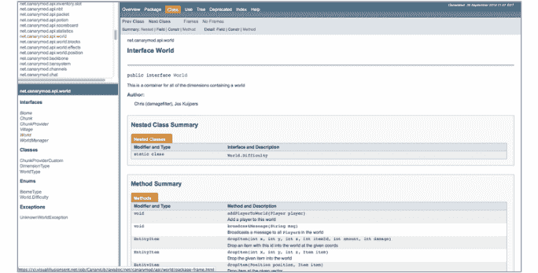

在左下面板点击 `World`，你将看到 `World` 中可以使用的所有函数。点击任何方法或类名查看详细信息。

## Oracle Java 文档 (Oracle Java Documentation)

如果你寻找通用的 `Java` 类文档，而不仅仅是 Canary 类，请将浏览器指向 Oracle 的文档。它看起来和 Canary 站点非常相似（见图 6，第 219 页的 JavaDoc）。

在左上角，有一个包的滚动列表，包括非常有用的 `java.util` 和 `java.math`。下方是接口（类似于类，但没有自己的函数）以及该包中的类。右侧面板是你点击的类的文档。在这里我进入了 `java.util` 包的 `ArrayList` 类。

类文档在你知道想要什么但需要细节时非常有用。但如果你不知道从哪里开始呢？

⁶. - http://docs.oracle.com/javase/7/docs/api/

# 维基与教程 219

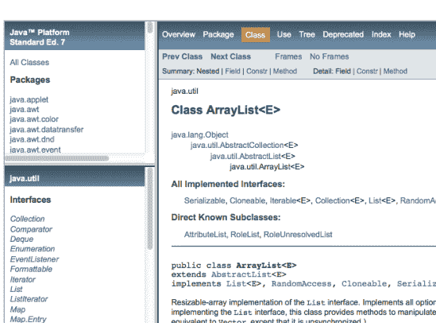

图 6—Java 的 JavaDoc

# 维基与教程

希望这本书让你了解了去哪里查找关于不同 `BlockTypes` 块以及不同类型 `Entity` 对象的具体信息。但对于我们还没有涵盖的内容呢？

除了基于类的文档外，Canary 网站上还包含了各种主题的教程和详细解释，地址为：http://canarymod.net/books。

此外，还有一个论坛，你可以在那里提问并寻求帮助：http://canarymod.net/forum。

别忘记 Pragmatic Books 网站上的这个论坛，你可以在那里对这本书本身提问并发表评论，分享任何你觉得非常酷的内容，吗？

- 1. https://forums.pragprog.com/forums/382

# 附录 3

# 附录 3

## 如何安装桌面服务器

现在，你已经在电脑的服务器上运行了非常棒的新自定义插件，你想让你的朋友能够连接并一起玩。

有两种方法可以实现：设置你自己的个人电脑供朋友访问，或者在云端设置一台永久服务器。（请参阅下一个附录，附录 4，“如何安装云服务器”，位于第 229 页）。

要使用你的电脑，请记住它必须处于开启状态并运行你的 Minecraft 服务器才能生效。如果你接受这个主意，这里你需要这样做。

需要解决两个主要问题：

- 你需要一种机制让你的朋友在互联网上找到你机器的地址。
- 你需要让你的 Minecraft 端口 `25565` 对外开放。


有几种方法可以实现。最简单的是使用可以为你完成所有工作的软件。你也可以手动处理所有细节，这更有趣但工作量更大。

## 简单方法：LogMein

Hamachi 是 LogMein 提供的一款产品，适用于最多五个用户的免费版本（“未托管”），以及适用于 Windows 和 Mac 电脑的功能丰富的付费版本（“托管”）。

它为你的朋友设置了一个用于连接的 IP 地址。你不需要弄本地的防火墙或路由器或任何设置；它可以直接运行。要设置它，先下载并安装未托管版本。

- 1. https://secure.logmein.com/products/hamachi/download.aspx

## 什么是端口？

在本附录和下一个附录中，你会看到对网络端口以及 Minecraft 默认端口 `25565` 的引用。端口仅仅是一个约定的数字，允许计算机通过网络进行通信。例如，浏览器使用端口 `80` 和 `443` 与 Web 服务器进行交谈。

当你第一次运行它时，LogMeIn 会要求你加入或创建一个网络：


你会想要创建一个。我将其命名为 `andys_minecraft_server`：


现在我们运行起来了！


现在告诉你的朋友下载相同的软件，并使用你选定的名称（`andys_minecraft_server`）加入你的网络。

他们可以加入你的网络。当他们右键点击你的网络名称时，应该选择“复制 IPv4 地址”，并在 Minecraft 客户端中使用该地址连接到你。

Ping

Ping `135-621-876.local`

| 访览 Apple 文件共享 (afp://) |

| 访览 Windows 文件共享 (smb://) |

| 聊天 |

| 复制 IPv4 地址 |

| 复制 IPv6 地址 |

| 复制 `135-621-876.local` |

| 逐出... |

| 详情 |

当你不想让朋友连接时，只需点击电源开关图标关闭你的网络。

你就完成了。

## 较难的方法：手动操作

在没有 LogMein 之类工具帮助的情况下，设置你的电脑在互联网上开放并可被发现并不是魔法，但确实需要一些工作。采用这种“硬方法”有一些优势：

- 它是免费的。
- 如果你想的话，可以连接五个以上的用户。
- 你可以面向全世界，而不仅仅是你的朋友。
- 这些是非常有趣且实用的知识。

你需要学习更多关于网络以及互联网如何工作的知识。我将概述重要的步骤，但你可能需要自己进行额外的阅读。最重要的是，我无法给你分步骤的指导，因为每个路由器（或电缆调制解调器、DSL 调制解调器等）都是不同的。但你可以通过 Google 或 `http://portforward.com` 等信息网站在网上找到。

让我们来看看步骤。

首先，你的朋友需要找到你的机器。

## 静态 DNS 与动态 DNS

IP 地址是任何人都可以使用的数字。IP 地址通常显示为四个数字。IP 地址每隔几小时就会变化，除非使用动态 DNS。为了获得一个静态名称，你需要从 `noip.com` 或 `dyndns.com` 注册。一旦你有了名称，软件会在你的 IP 地址改变时自动更新它。这让你的朋友能够始终通过该名称找到你，即使你的 IP 地址发生了变化。

但是，如果你通过路由器或电缆调制解调器连接到互联网，那么该设备可能也有防火墙。为了让端口对开放，有一些免费的地方：

- 1. https://noip.com
- 2. https://dyndns.com
- 3. https://dyns.org
- 4. http://example.com

但是，仅在电脑上开启防火墙可能是不够的。检查互联网是否可以获取端口，这取决于你的操作系统。

## 在 Windows 上打开防火墙

在 Windows 8 中，开始输入“防火墙”，Windows 将引导你“允许应用通过防火墙”：


在 Windows 7 中，在控制面板搜索“防火墙”并“允许程序通过防火墙”：


然后启用 Java 连接：

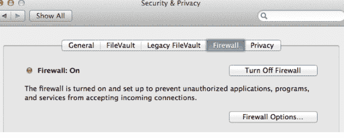

- 2. http://windows.microsoft.com/en-us/windows-8/windows-firewall-from-start-to-finish

## 在 Mac 上打开防火墙

打开系统设置并进入“安全性与隐私”面板：


## 在 Linux 上打开防火墙

如果你使用 `IPTables` 设置了防火墙，请确保端口 `25565` 是开放的。

## 所有操作系统

如果防火墙已关闭（未启用），那么你就可以了。如果它是开启的，请确保 Java 允许入站连接：


## 端口转发

在更改路由器设置时，你需要谨慎和克制。如果你更改了你不打算更改的内容，可能会搞乱设备并丢失互联网访问。请按照计划操作。然而，每个路由器都是不同的，所以我无法给你提供任何具体的分步骤说明。这里是基础知识：

- 1. 登录你的路由器。你可能已经知道路由器的用户名和密码。如果不知道，可以通过 Google 搜索默认用户名和密码。
- 2. 在某些菜单中，它会有一个“端口转发”（Port Forwarding）部分。在我的路由器上，它被列在“网关”（Gateway）和“转发”（Forwarding）下。
- 3. 你需要告诉它将外部世界（你的外部 IP，可以通过 `http://www.checkip.org` 报告）的端口 `25565`（如果系统询问，请同时选择 TCP 和 UDP）转发到你电脑的内部 IP。

你的电脑有一个内部 IP 地址，用于它与路由器/电缆调制调器之间的通信。你可以在电脑上运行命令来查看此地址：

### Windows

运行 `ipconfig`，并查找“以太网适配器”（Ethernet adapter）或“无线局域网”（Wireless LAN）下的“IPv4 Address”。

### Mac/Linux

运行 `ifconfig`。你可能可以在 Google 上搜索“inet”后面的“en1”。

你可以在 Google 上搜索更多关于你路由器设置的信息，或者检查 `http://portforward.com` 等网站获取额外信息。

一个复杂的问题是：你的内部 IP 地址可能会经常变化，就像你的 ISP IP 地址可能会变化一样。你也可以从路由器上的 DHCP 服务器让它创建一个 DHCP 留，这样你就能获得相同的内部 IP 地址。你只需要在内部 IP 地址变化时（如果变化的话）进去更改端口转发即可。

如果你偶尔有朋友来，并且不介意设置的麻烦，这种工作方法完全可行。但如果你希望有超过几个人连接，并且服务器 `24x7` 全天运行，你需要在云端设置一台服务器，这将在第 229 页的附录 4“如何安装云服务器”中详细介绍。

## 服务质量 (Quality of Service)

许多路由器都有一个功能，你可以为不同的端口/服务指定所需的质量（通常称为 QoS）。其原理是你可以对不同类型的网络流量设置高或低优先级。

在运行本地 Minecraft 服务器时，你可能会发现这很有用：你可以将 Minecraft 端口设置为非常低优先级。

将 Minecraft 端口设置为最低优先级，将确保你自己的流量优先于使用你服务器的朋友流量。

# 附录 4

## 如何安装云服务器

你可以在自己的电脑上运行 Minecraft 服务器，但这样做有一些缺点。最大的缺点是你的电脑需要 `24x7` 开启并连接到互联网。这对于笔记本电脑来说有点困难。此外，你在电脑上做的任何操作都可能减慢 Minecraft 服务器和你所有玩家的速度——而服务器运行的任何操作都会降低你电脑上其他程序的速度。因此，如果有很多人连接你的服务器并玩，你可能更倾向于在云端设置一个远程服务器。

在云端设置 Minecraft 服务器与在本地设置非常相似，但有一个重要的区别：你无法对运行 Minecraft 服务器的电脑进行物理访问。这意味着没有键盘、没有屏幕、没有电源开关或重启按钮。但不用担心；你如何使用命令行，这已经是你需要的了。

我们将在本附录中看看这些意味着什么以及如何与其进行工作。

## 什么是云？

有人说“云”实际上只是弗吉尼亚州的一大机架计算机。这与事实其实并不遥远，因为亚马逊等其他公司确实在该地区（以及加利福尼亚和世界其他许多地方）维护着大型数据中心。“云”只是互联网上某处的一群计算机。

当人们谈论云端计算机时，指的是一台仅通过互联网访问的电脑，你可能甚至不知道（或不在乎）它的物理位置，并且由他人拥有和维护。如你所见，这是一个非常通用且灵活的定义。市上有各种云服务可用，价格、可靠性以及你花钱所得到的内容范围同样巨大。你可能感兴趣的服务主要分为两类：

- Minecraft 专用：服务提供商完成所有维护和管理服务器的工作。提供商将加载或提供插件，可能处理破坏者和攻击，并保持服务器运行。你什么都不需要做。你可能会根据在线玩家的数量收费，而不是根据服务器的大小收费。
- 通用：服务提供商提供一个运行系统和登录权限，别无其他：你必须安装 Java 和 Canary，并提供插件、管理服务器、在它卡死时重启它等。你通常根据 CPU 数量、内存大小、可能还有每月使用的网络流量收费。

虽然你可能想寻找 Minecraft 专用的提供商，但在易用性和控制之间是一种权衡。在这种情况下，你无法获得服务器的控制权；你可能必须要求加载插件，而且服务器可能只加载著名的插件，而不是你的开发版本。

相反，你可能想要的是*虚拟私有服务器*，简称为 VPS。互联网上有大量的 VPS 提供商，拥有不同的定价计划和套餐，位于不同的国家，并提供不同的硬件和功能。只需 Google 搜索“VPS providers”即可。

对你来说，VPS 看起来就像一整台电脑。你可以登录并拥有所有的文件和处理器。实际上，好消息是你可以使用命令行 Shell 在远程服务器上工作，就像我们一直以来做的那样，因为你的远程服务器运行的是 Linux。

# 远程操作系统

几乎所有的 VPS 服务都提供一种操作系统作为你的操作系统：Linux。某些提供商（如 Windows）很少见。但 Linux 不仅仅是某种东西。Linux 是一个组合：

## VPS 特性

虽然价格和功能可能异，但这里有一些共同点：

- Web 前端（类似于控制面板）。
- Minecraft 相关的工具和插件。
- 兼容各种标准 (POSIX)。

这些是一些流行的发行版，按流行程度排序：

- CentOS
- Ubuntu
- Fedora
- Debian
- Linux Mint

注意，当你直接使用 `ssh` 或 `scp` 而不进行其他操作时，它会要求你输入远程机器的密码。每次都是。这很快就会让人感到厌烦，幸运的是有一种更好的方法来设置远程登录。

## Windows上的 SSH

Windows 用户可能无法使用 `ssh` 和 `ssh-keygen` 命令程序；你可以使用一个名为 "PuTTY" 的 Windows 应用程序来生成密钥并登录远程系统。

- a. http://www.chiark.greenend.org/~sgatham/putty/download.html

## 设置 SSH 密钥

这个设置包含几个步骤，但它们非常直观。我们将介绍细节，但总的步骤如下：

- 1. 生成一组特殊的密钥对，包括一个“公钥”。
- 2. 将公钥拷贝到远程机器。
- 3. 确保公钥在远程机器上是安全的。

一旦完成这些操作，你就可以使用 `ssh` 和 `scp` 而无需提供密码了。这意味着你可以在 shell 脚本中使用 `ssh` 和 `scp`——当你需要对远程机器执行大量系列操作时，这非常有用。

以下是详细步骤。

首先，切换到你的主目录并使用 `ssh-keygen` 生成一对 RSA 风格密钥。

```
$ cd
$ ssh-keygen -t rsa
```

当要求输入密码短语（passphrase）时，按回车——此时不要输入任何文本。这将创建一个名为 `.ssh` 的子目录，它位于你的主目录下。由于开头有一个点（`.`），你通常无法通过 `ls` 查看这个目录，除非使用 `ls -a` 可以显示它：

```
$ ls -a
.. .ssh (以及许多其他内容)
$ cd .ssh
id_rsa id_rsa.pub known_hosts
```

- 3. RSA 是一种公钥加密系统，以其发明者的名字命名。

## 附录 A. 如何安装云服务器

你的公钥是 `id_rsa.pub`，你需要将其添加到服务器上名为 `~/.ssh/authorized_keys` 的文件中。

要这样做，先在服务器上创建 `.ssh` 目录。我会将服务器上的登录提示显示为 `$`，这样你就能看出我在哪台机器上。

```
$ ssh username@example.com
Password:
Welcome to My Awesome Minecraft Server
Last login: Mon Feb 16 12:16:57 from xyzzy-plugh
Server$ mkdir .ssh
```

现在回到你的电脑，使用 `scp` 将 `id_rsa.pub` 文件（或任何命名的文件）发送到服务器，将其放入 `.ssh` 目录并重命名为 `authorized_keys`：

```
$ scp id_rsa.pub username@example.com:~/.ssh/authorized_keys
```

这将把文件拷贝到你主目录（`~`）下的 `.ssh` 目录中，并命名为 `authorized_keys`。如果你以后需要，可以将来自其他机器的密钥添加到此文件中（这就是为什么 "keys" 是复数）。但现在你只有一个条目。

最后，你需要回到服务器检查并修复文件权限。`.ssh` 目录应该只允许你本人读取和列出，而且在大多数情况下，如果文件权限没有受到限制，`ssh` 将无法工作。这是为了你好。

你可以使用 `chmod` 命令设置文件权限：

```
$ ssh username@example.com
Password:
Welcome to My Awesome Minecraft Server
Last login: Mon Feb 16 12:26:13 from xyzzy-plugh
Server$ cd .ssh
Server-~/ chmod 700 .
Server-~/ chmod 600 authorized_keys
```

现在从你的电脑上，你应该可以在无需指定密码的情况下使用 `ssh` 或 `scp`：

```
$ ssh username@example.com
Welcome to My Awesome Minecraft Server
Last login: Mon Feb 16 12:32:07 from xyzzy-plugh
Server$
```

我们进入成功了！

你的下一个问题可能是：“太好了，但我该如何离开呢？”问得好。

## 更改你的提示符

环境变量 `PS1` 设置了 bash 的提示符字符串。在那个字符串中，你使用 `\w` 来打印当前目录。所以如果你设置

```bash
$ PS1="Server\$ "
```

你的提示符将返回为

```bash
Server ~$
```

将此内容放入你的 bash 启动文件中以使更改永久生效（正如我们在第 2 章“添加编辑器和 Java”第 15 页中所看到的）。

你可以通过按下 `Ctrl-d` 或输入 `exit` 来注销。现在你回到了本地 shell。

## 具有 Root 权限的管理员

在任何现代系统中，普通用户都没有完全权限在系统上执行所有操作。你通常需要输入密码来获得系统的管理员权限。在 Windows 机器上此账户被称为 `Administrator`，在 Linux 和 Mac 系统上它被称为 `root`。

虽然你可以使用相应的密码直接以 `root` 身份登录，但这通常是不受欢迎的。很容易写错字符并突然毁掉半个系统。`root` 终究是强大的，能力越大责任越大。

但你仍然需要在不登录 root 身份的情况下以 root 执行某些命令。你可以使用 `sudo` 命令来实现这一点，它让你能够像超级用户一样执行的操作。在你想要执行的命令前加上 `sudo`，它会提示你输入普通用户账户密码。

## 加固 Root

为了确保服务器的安全，你应该禁用 root 登录。在配置文件 `/etc/sshd_config` 中，找到这两行并取消它们的注释，或者将它们改为 `no`：

```
PasswordAuthentication no
PermitRootLogin no
```

然后你需要重启 ssh 守护进程。在许多系统中，你可以通过以下命令实现：

```
sudo service sshd restart
```

你可能还想将默认端口从 `22` 改为其他数字。由于大家都知道端口 `22` 是 SSH，攻击者会轰炸你的服务器。在同一个文件 `/etc/sshd_config` 中，添加或更改此行：

```
Port 2345
```

当使用 ssh 连接服务器时，你需要指定新端口，可以使用 `-p` 选项：

```bash
$ ssh -p 2345 username@example.com
```

## 安装软件包

你的 Linux 发行版可能包含了你需要的一切。也可能缺少部分组件。为了方便，Linux 将所有的工具和程序分成不同的软件包。例如，如果你不从事出版工作，你就不需要 TeX 或 Ghostscript。如果你不用 C 或 C++ 编程，你就不需要 GCC。如果你在桌面电脑上，你可能不需要 Gnome 或 KDE 这样的窗口管理器。


所有这些软件包都可以使用包管理器进行安装、删除、更新和列出。每个主要的 Linux 发行版都使用不同的包管理器。事实上，你几乎可以说包管理器是区分不同发行版的标准。

流行的包管理器命令包括 `yum`、`rpm`、`apt-get` 和 `deb`。

特别地，如果你还没有安装 SSH，你需要安装 `open-ssh` 包，以便以安全的方式登录你的服务器。在 Ubuntu 上，你可以运行类似这样的命令：

```
$ sudo apt-get install openssh-server
```

`sudo` 以 root 身份运行命令；`apt-get` 是 Ubuntu 下的包管理器命令，你正在赋予它安装 `openssh-server` 包的选项。

在 CentOS 上，你会运行一个非常相似的命令，但使用的是 `yum` 代替 `apt-get`。

```
$ sudo yum install openssh-server
```

同样，你可能在服务器上需要一个文本编辑器。你无法真正通过互联网在远程服务器上运行完整的图形编辑器，所以你可能想要一个像 `nano` 这样简单的屏幕编辑器：

```
$ sudo apt-get install nano
```

## 安装 Java

无论你可能或想要哪些可选包，你至少需要 Java 来运行你的服务器。你可以像我们在书中之前做的那样安装它，但请记住一个重要的细节：你需要官方的 Oracle（原 Sun）版本的 Java。OpenJDK 版本的 Java（你的系统上可用或已安装）已知会导致 Minecraft 出现问题。

你可能需要使用系统的包管理器卸载 OpenJDK。例如，要在具有 Red Hat 包 (RPM) 的系统上删除 1.6 版本，你需要运行：

```
$ rpm -e java-1.6.0-openjdk
```

现在去获取好用的 Java 吧。你需要在本地计算机上下载安装程序，然后通过 `scp` 将其传输到服务器。

在你的本地机器上，将浏览器指向 http://www.java.com/en/download/manual.jsp 并滚动到 Linux 部分。下载普通版本或 64 位版本（取决于你的服务器），并按照你 Linux 版本的说明进行操作。

你需要在服务器上设置你的 minecraft 脚本和 jars 文件，就像我们在第 2 章第 15 页“添加编辑器和 Java”中本地操作的那样。

- 4. 实际上你可以使用 X 窗口系统 (XWindows)，但它很麻烦，而且体验并不尽意。

## 远程运行

当你通过 ssh 登录时，运行类似 `start_minecraft` 的脚本会有一个小问题。你一旦注销，脚本就会被杀死。这在服务器环境中没有太大帮助。

幸运的是，你可以使用 `screen` 命令在注销后继续保持 Java 运行。它接受一个参数字符串 `-d -m -S`，后面跟着你的服务器名称。我们将会话使用 `mcserver`，新的服务器风格启动脚本看起来如下：

```bash
#!/bin/bash
cd $(dirname "$0")
screen -d -m -S mcserver java -Xms1024M -Xmx1024M -jar CanaryMod.jar --noControl
```

（记得，`start_minecraft` 需要具有执行权限；如果遇到“permission denied”错误，请执行 `chmod +x start_minecraft`）。

这将使服务器在它自己的小世界中启动，不会受注销的影响。如果你想“连接”到服务器以便发布命令并使用它，使用带有 `-r` 选项和会话名的 `screen`：

```
$ screen -r mcserver
```

你将以通常的用户和提示符连接到服务器：

16:47:49 [INFO] Done (1.1635)! 如需帮助，请输入 "help" 或 "?">

要从你的服务器会话中分离，按下 Ctrl-a 然后 d。你将回到原始 shell，而你的服务器仍在后台运行。

要查看正在运行的进程，使用 `ps` 命令：

```
Server - $ ps
PID TTY TIME CMD
337 tty000 00:00:09 -bash
842 tty020 00:13:78 /usr/bin/java -jar CanaryMod.jar
```

要查看机器上所有的进程，使用 `ps ax`。（`ps -?` 会列出选项）。

紧急情况下，如果你需要杀死所有 Java 进程，你可以使用

```
Server - $ killall java
```

这要求 Java 执行一些清理并安全可靠地退出。然而，如果它很固执不听话，你可以使用粗暴的

- 5. 使用 `noh` 命令（名为“No Hangup”，即不挂断）有一种稍微简单的方法；但是，你会失去轻松向服务器输入命令的能力。

```
Server - $ killall -9 java
```

这将立即强制杀死所有 Java 进程。就这样。

## 域名

当你设置 VPS 时，你的 VPS 提供商会告诉你服务器的 IP 地址。这是世界上任何人都可以用来连接你服务器的数字。IP 地址通常是四组带有点点的数字，如 93.184.216.119 (example.com) 或 127.0.0.1 (你的本地机器，localhost)。

你可以设置域名，这样人们可以通过像 pragprog.com 或 example.com 这样的名称找到你，而不是像 93.184.216.119 这样的名字。你的 VPS 提供商可能作为可选服务为你安排，或者你可以使用许多

## 决策

使用 `if` 决定运行哪些代码（`else {}` 部分是可选的）：

```java
if (true or false comparison) { // 为真
    doSomething();
} else { // 为假
    doOtherThing();
}
```

## 循环

有三种方法对代码块进行循环：

- for-each 结构：`for(type variable : collection)` 示例：`for (Player : playerList) { }`
- for 循环：`for (int i=0; i<limit; i++) { block }`
- while 循环：`while (somethingIsTrue) { block }`

## 创建新对象

`Foo = new Foo();` `Foo` 是类名，而 `thing` 是要赋值给新对象的变量。

## 调用函数

使用括号，例如 `getServer()`，它为插件返回一个 `Server` 对象。

## Java 可见性修饰符

- **final**（最终）

一旦我设置了这个值，就不要让我或任何其他人改变它。

- **static**（静态）

在任何给定对象之外保留此数据或函数。

你可以根据需要组合使用 `final` 和 `static`。

- **public**（公共）

其他人可以看到并使用此函数或数据。

- **protected**（受保护）

此类以及此包中的其他类可以看到并使用此函数或数据。

- **private**（私有）

只有此类可以看到并使用此函数或数据，子类或同一包中的其他类均不行。

你使用使用 `public` 或 `private` 声明，因此此代码将在任何对象之外创建一个公开的、不可变的常量：

```java
public static int pi = 3.1415;
```

## Java 数据类型转换

### int 转 double

直接赋值：`int now = 72; double temperature = now;`

### double 转 int

强制转换：小数部分会被丢弃：`double when = 15.375; int day = (int)when;`

### String 转 int

使用 `parseInt`：`int foo = Integer.parseInt("365");`

### String 转 double

使用 `parseDouble`：`double foo = Double.parseDouble("3.1415");`

### double 转 String

使用 `valueOf`：`String.valueOf(3.1415);`

### int 转 String

使用 `valueOf`：`String.valueOf(72);`

### Double 转 String

（使用 Double 类而非基本类型）`Double.toString(3.1415);`

### Integer 转 String

（使用 Integer 类而非基本类型）`Integer.toString(72);`

字符串拼接会自动转换，结果为字符串：

```
"Temperature is 72 degrees."
```

# 附录 6

# 术语表

- **annotation**（注解）

添加到 Java 源代码中的命令，用于修改或添加信息（例如将函数标记为事件处理程序）。

- **argument**（参数）

传递给函数供其使用的值。

- **array**（数组）

一个带有整数偏移索引的值的顺序列表。

- **Array**（Array 类）

实现数组的 Java 类。

- **binary file**（二进制文件）

包含二进制数字且人类不可读的文件。

- **block**（代码块）

一对大括号 `{` 和 `}` 之间的代码语句列表。

- **boolean**（布尔值）

可以等于 `true` 或 `false` 的逻辑值。

- **cast**（强制类型转换）

改变值的解释，通常是从一个对象转换为某个特定父类的类型。

- **class**（类）

一个告诉编译器如何创建对象的配方：即它应该包含哪些数据和函数。

- **client**（客户端）

你运行的软件，通常带有图形界面。连接到服务器。

- **command line**（命令行）

你可以在其中输入命令的终端窗口。

- **compile**（编译）

将人类可读的语言指令的文本文件转换为计算机可以运行的内容（通常是二进制格式）。`javac` 是 Java 编译器。

- **constructor**（构造函数）

类定义中在创建新对象时调用的函数。你可以用它来设置对象的变量等。

- **current directory**（当前目录）

在 shell 中，当前的目录（哈，同义反复！）。

- **deploy**（部署）

将资源安装到服务器环境中。

- **DNS**（域名系统服务）

将如 `example.com` 的域名转换为如 `93.184.216.119` 的 IP 地址的全局系统。

- **double**（双精度浮点数）

一个较大的浮点数。

- **environment variable**（环境变量）

shell 和应用程序所使用的设置。

- **event**（事件）

代表某些真实世界动作的对象，例如鼠标点击。

- **exception**（异常）

中断当前函数并开始运行最外层 `catch` 块的错误；如果没有，则终止程序。

- **executable**（可执行文件）

计算机可以运行的文件，通常是带有底层机器指令的二进制文件，但有时是 shell 运行的文本。

- **file system**（文件系统）

计算机上文件和文件夹（目录）的集合和组织。

- **final**（最终）

指示此变量无法更改的 Java 关键字。

- **float**（单精度浮点数）

一个不那么大的浮点数。

- **floating point**（浮点数）

带有小数点和小数部分的数字，例如 1.25。

- **function**（函数）

一组 Java 指令，声明了返回类型、名称、接收的参数以及 `{` 和 `}` 之间的代码块。

- **global variable**（全局变量）

可以被多个函数和/或多个类使用的变量。

- **hash**（哈希）

一个由任何类型的对象（但通常是字符串）索引的对象列表。

- **HashMap**

实现哈希映射的 Java 类。

- **import**（导入）

一个允许你使用另一个包中的类的 Java 关键字，例如 `java.util.HashMap`（它是 `java.util` 包中的 `HashMap` 类）。

- **inherit**（继承）

从父类使用某些东西。

- **integer**（整数）

没有小数点和没有分数的整数，例如 7。

- **I/O**（输入输出）

从其他地方发送和接收数据，例如文件或通过网络。

- **iterator**（迭代器）

一个允许你从集合中检索一个值的对象。

- **jar**

包含 `.class` 和配置文件的 Java 包。

- **keyword**（关键字）

Java 语言中定义的单词。你可以将其作为变量使用。

- **listener**（监听器）

当发生某些事情时被调用的函数。

- **literal**（字面量）

直接输入的值，如 `123`、`true`。

- **localhost**（本地主机）

计算机的网络名称。

- **local variable**（局部变量）

声明在 `{` 和 `}` 块内的变量。

- **long**（长型整数）

一个很大的整数。

- **map**（映射）见 `HashMap`。

- **parameter**（参数）

传递给函数使用的值。

- **path**（路径）

计算机搜索查找命令或其他资源的目录列表。

- **plugin**（插件）

添加到已编译代码中的编译代码。

- **port**（端口）

让计算机通过网络通信的约定编号。例如 80。

- **private**（私有）只有此类可以看到并使用此函数或数据，子类或同一包中的其他类均不行。

- **public**（公共）其他人可以看到并使用此函数或数据。

- **script**（脚本）用解释型语言编写的程序或脚本。

- **server**（服务器）

为其他计算机（客户端）提供服务的计算机或程序。

- **source**（源代码）

计算机程序前的原始代码。

- **string**（字符串）

表示文本的字符序列。

- **static**（静态）在任何给定对象之外保留此数据或函数。

- **task**（任务）

要执行的工作单元。

- **text**（文本）

文字或打印的单词、符号。

- **thread**（线程）

由调度器独立管理的程序指令序列。

- **tick**（滴答）

时间单位，通常用于游戏或模拟。

- **void**（空）

指示函数不返回值的类型。

- **variable**（变量）具有指定名称的存储位置。

- **VPS**（虚拟专用服务器）你可以按月租用的远程计算机。

- **web**（网络）通过互联网访问的互联文档的全局系统。

- **while**（当）只要指定条件为真就重复代码块的循环。

- **word**（单词）具有意义的语言单一单位。

- **write**（写入）在计算机程序中输入数据或命令。


```java
import net.canarymod.api.world.Chunk;
import net.canarymod.api.world.World;
import net.canarymod.api.world.blocks.Block;
import net.canarymod.api.world.blocks.BlockType;
import net.canarymod.api.world.blocks.Sign;
import net.canarymod.api.effects.Particle.Type;
import net.canarymod.api.effects.Particle;
import net.canarymod.api.effects.SoundEffect;
import net.canarymod.api.position.Location;
import net.canarymod.api.position.Vector3D;
import net.canarymod.api.chat.MessageReceiver;
import net.canarymod.commandsys.*;
import net.canarymod.database.Column.DataType;
import net.canarymod.database.Column;
import net.canarymod.database.DataAccess;
import net.canarymod.database.Database;
import net.canarymod.database.exceptions.*;
import net.canarymod.hook.HookHandler;
import net.canarymod.hook.entity.DamageHook;
import net.canarymod.hook.entity.ProjectileHitHook;
import net.canarymod.hook.player.ItemUseHook;
import net.canarymod.hook.player.TeleportHook;
import net.canarymod.hook.world.ChunkCreatedHook;
import net.canarymod.hook.world.ChunkLoadedHook;
import net.canarymod.hook.world.ChunkUnloadHook;
import net.canarymod.logger.Logman;
import net.canarymod.plugin.Plugin;
import net.canarymod.plugin.PluginListener;
import net.canarymod.tasks.ServerTask;
import net.visualillusents.utils.Properties;
```

# 参考文献

- Travis Smalls. *Pragmatic Version Control Using Git*. Pragmatic Bookshelf, NC and Dallas, TX. 2008.
- Travis Smalls. *Pragmatic Guide to Git*. Pragmatic Bookshelf, NC and Dallas, TX. 2010.

# 索引

### 符号

- `.` (点), 选择部分，44
- `;` (分号), 终止 Java 语句，44
- `&` (和符号), 通配符字符，72-242
- `(` (左括号), 在声明中包含类型，98, 243
- `*` (星号) 乘法运算符，49, 242
- `\` (反斜杠), 在路径中，17
- `{}` (大括号) 编码代码块，44, 58, 213
- `{}` (大括号), 43, 95
- `$` (美元符号), 复合提示符，2, 当前目录，8, 13-74
- `.` (点), 句号，8, 11, 13
- `=` (等号), 等于运算符，63, 242
- `!` (感叹号), 非运算符，63, 242
- `!` (感叹号符号), 不等于，63, 242
- `<` (左括号), 小于运算符，63, 242
- `<` (左括号), 等于，63, 82
- `-` (减号) 减法运算符，49, 242
- `-` (减号), 减一，50
- `()` (圆括号) 包含参数，43, 分组操作，242
- `%` (百分号) 命令提示符，取余运算符，49, 242
- `+` (加号), 加法运算符，50
- `"` (引号) 包含包含空格的目录，11
- `>` (右括号), 大于运算符，63, 242
- `>=` (右括号), 大于等于运算符，63, 242
- `;` (分号), 终止 Java 语句，23
- `/` (斜杠) 除法运算符，49, 242, 前置命令，1, 39
- `/*` (斜杠，星号), 注释，43
- `//` (双斜杠), 前置注释，43
- `~` (波浪号), 目录，10, 13
- `||` (双竖线), “或”运算符，63, 242
- `(())`, 同步函数，139-140
- `(+)`, 49, 242
- `(&&)`, “与”运算符和 `&`，63, 242
- `(` (左括号), 在声明中包含类型，98, 243, 符号，247
- `in`, 内置，61, 总和，56, 28
- 数组, 二维，121
- `Array` 类，94-98, 247
  - 访问元素，95-96
  - 赋值给，95
  - 遍历，96
  - 长度，95
- `ArrayBlocks` 插件示例，101-102

### 索引

- `ArrayList`, 98–102
  - 访问元素，100
  - 赋值给，100
  - 清空元素，101
  - 声明大小，100
- `BuildHouse` 插件示例，46–50
- `BusyBox` 应用，4
  - 安装所需的包，237–238
  - 远程访问，232, 237
  - 根访问，235–237

### C

- `CakeTower` 插件示例，92–94
- `Canaryfile`, 35–36, 80
- `CanaryMod` 项目，23, 219, 见 Minecraft
- `class`
  - 声明，217–223
  - SSH 密钥，233–235
  - VPS，230
- 云，备份到，180–182
- `ArrayBlocks` 插件示例，66–98
- 数组，94, 241, 见特定数组类型
- 类，见 `HashMap`
- `Canaryclass`, 24, 见 Minecraft server
- Java 中的大小写敏感，43
- 转换，81, 115, 244, 237
- `cat` 命令，12–13
- `cd` 命令，3, 5–9
- `cfg` 文件，146–149
- `cmd` 示例，2
- 代码，见源代码
- 代码块，89–90, 213, 243, 247
- 代码示例
  - `*` (星号) 乘法运算，49, 242
  - 通配符，24
  - `ArrayBlocks` 插件示例，101–102
  - `ArrayBlocks` 插件，96–98
  - `BackCmd` 插件，128–133, 158–166
  - `BuildVerse`, 46–50
  - `CakeTower` 插件，92–94
  - `Shooter` 插件，140–148
- 作者，配置文件，36
- 授权密钥，234
- 自动补全，在路径中 (`$`)
- Shell，见 `bash_profile`, 21
- 二进制文件，31
- `Bitbucket`, 181, 183
- `Block`, 设置，125
- 阻塞对象，84–86
- 修改，118
- 查找，84–86
- 修改，117–122
- 类型，118
- `Flying` 插件，125–126
- 字体变体，5, 7–37
- `LavaVision`, 84–86
- `Snapshot` 插件，154–157
- `NameCov`, 67–68
- 登录，109–115
- `PlayerStuff`, 75–77
- `Simple`, 50–54
- `Sky`, 80–84
- `SquidBomb` 插件，149–151
- `Boolean`, 见条件
- 布尔值，241, 247
- 大括号 `()`, 44, 58, 213
- 结束的数组或哈希值，95
- 编码块，44, 58, 213
- 括号 `( | )`, 43, 95
- `build.sh` 文件，36–37
- 字符，见字符串
- 类名后缀，22
- 类，18–19, 31
- 类，247, 见对象
  - 声明，35, 70–74
  - 设计，190–193
  - 文档，217–212, 243
  - 导入，35, 72–73, 253
  - 多个，在 `false`, 137–138
  - 用途，138
  - 公共，315, 244
  - 与 对象，137
- `CLASSPATH` 环境变量，218
- 客户端，见注解
- 图形客户端-服务器应用程序，xi-iii
- 云服务器，229–230
- 域名，240
- IP 地址，240
- 安装 Java，238
- 杀死 Java 进程，235
- Linux 发行版，230–235
- 登销，235
- `Stack` 插件，118–122
- 网站，用于
- `@Column` 注解，152
- 数据库列，152
- `@Command` 注解，81–83
- 命令参数解析，113
- 命令行，1–3, 248
- 云服务器，232
- 命令提示符，2, 235
- 复制和粘贴，9
- 默认目录，主目录
- 启用函数，127, 147
- 用户许可协议 (`EULA`), 25
- (`Git` 命令)，184
- 命令，3, 11-12
- (`Java` 命令)，见 `java commands`：`java command`
- (`Minecraft` 命令)，1, 39
- 手动设置，223–227
- 药水效果，125
- (`Shell` 命令)，13, 见如此特定的命令
- `DHCP` 参考，227
- 字典，见 `HashMap` 字典，目录和路径的更改，9-10
- 入口，用于，56
- 环境变量，248

# 索引 260

- 感叹号，等号
  - `(!)`, 不等于运算符，63, 242

## G

- 可执行文件，248
- `extends` 关键字，79
- `EZPlugin` 库，40
- `EZPlugin` 父类，79

## H

- 游戏数据，存储，145, 151–154
  - 在 SQL 数据库中，151
- 垃圾回收，109
- `getConfigFunction`, 147
- `getっていく`, 128
- `getDestination`, 118
- `getEmptyListingList`, 81, 151
- `getHealth`, 123
- `getInstance`, 153
- `getItemHandle`, 123
- `getItemLocation`, 118
- `getPlayer`, 72, 128
- `getServer`, 72
- 哈希 (`hash`), 249
- `HashMap` 类，105–108, 249
  - 访问元素，105
  - 赋值值，105
  - 创建，107, 112

## F

- 文件系统，248
- 文件
  - 二进制文件，31, 247
  - 类列表，19, 31
  - 配置文件，35–36, 80, 146–149
  - 拷贝，10, 23
  - 创建，17
  - 可执行文件，248
  - `jar` 文件，31, 249
  - 列表，3, 7
  - 文本文件，12, 251
  - `zip` 文件，xiv
- `final` 关键字，248
- `final` 修饰符，244
- 防火墙，开启端口，222–226
- 堆 (`heap`), 109
- `HelloWorld` 插件示例
  - 构建，36–37
  - 配置文件，35–36
  - 目录结构，5–32–33
  - 源码，33–35
  - 主目录，3, 10
- `@HookHandler` 注解，127, 130
- 浮点数，48, 249
- 浮点 (`floats`), 48, 248
- `FlyChanger` 插件示例，125–126

## I

- `getTextFieldFunction`, 115
- `Git`, 169–176
  - 将成员添加到列表并备份到云端。180–182
  - 用于 Bash shell 的，170
  - 分支，17–180
  - 命令列表，18
  - 提交更改，171
  - 配置，170
  - 忽略文件，172
  - 日志用于，171
  - 仓库用于，170
  - 状态，172
  - 索引更改，173–179
- `I/O` (输入/输出)，249
- `id_rsa_pub` 文件，234
- `if` 语句，61, 243
- `lfconfig` 命令，227
- `import` 语句，35, 72–73, 212, 243, 259
- 继承，249
- 输入/输出, `I/O`
- `instance` 关键字，81
- 整数，48–250
- 物品栏，142
- `IP` 地址
- 文件夹，见目录 (`directories`)
- `for` 语句，60, 94
- `for-statement`, 100–102, 243
- 函数，249
  - 参数的，56, 58
  - 调用，56, 59, 244
  - 构造函数，139
  - 创建，54, 58–195–201
  - 声明，243
  - 索引，190–193
  - 入口点，56
  - 监听器，249
  - 名称，58
  - 参数的，56, 250
  - 公有的 (`public`), 273
  - 参数的作用范围，90
  - 静态的 (`static`), 57, 251
  - `super`, 140
  - 任务，138–140
  - 空 (`void`), 57, 252
- 用于云服务器的，240
- 外部，224
- 内部，227
- `jsoncopy` 命令，227
- `isObjectFound` 函数，143
- 迭代器，249
- `dict.directory`, 170
- `GitHub`
  - 备份到云端。181–182
  - 共享代码，183–184
- `gitignore` 文件，172
- 全局变量，90–92
- 图形客户端，见 Minecraft 客户端

## J

- `jar` (Java 归档) 文件，31, 249
- `jar` 命令，18
- `java` 命令，13–22, 31
- Java 开发 Kit (`JDK`), 见 `JDK`
- `java` 文件后缀，7, 22
- Java 语言，243–244
  - 块结构，89
  - 大小敏感性，43
  - 注释，43
  - 比较运算符，244–245
  - 数据类型，241
  - 数学运算符，244
- `javac` 命令，13, 18–22, 31, 211–215
- `JDK` (Java Development Kit) 未找到：18–19, 23, 38
- 循环语句，60, 64, 100–102, 243
- `mkplugin.sh` 文件，51, 193
- `vm` 命令，13

## M

- Mac OS
  - 命令行，2
  - 命令行提示符，2
  - 开启防火墙，225
- 主类 (`main-class`)：配置文件，36
- `make` 函数，132
- `math.function`, 83
- 方法，139
- Minecraft
  - 构建代码，31, 33, 36, 37, 193–209
    - 配置文件，35–36
    - 设计，187–193
    - 结构，32–33
    - 源码，33–35
    - 错误来源，216
    - 暂停，23–24
    - 启动和重启，38
- 减号 (`-`), 减法运算符，49, 242
- 减号 (`-`), 减一，50
- `mkdir` 命令，9–10, 13

## L

- Linux
  - 命令行，2
  - 命令行提示符，2
  - 开启防火墙，226
- 监听器，127, 130–132
- 字面量，50, 241, 249
- 面面向编程，67, 250
- 对象，67–70，见类 (`classes`); 特定对象
  - 创建，74, 244
  - 部分，72–74
- 在线资源，可见性
- `CanaryMod` 项目，24
- 动态 DNS 注册，224
- `Git`, 160
- `IP` 地址，检查，224
- Oracle 类文档，218，可检查性
- 本书，219
- `open-sh` 包，238

## P

- `build.sh` 文件，36–37
- `mkplugin.sh`, 51, 193
- `package` 语句，35, 243
- 包，250
  - 声明，243
  - 导入，73
  - 在云服务器上安装，235–238
- 安全外壳 (`SSH`), 232
- 私有关键字 (`private`), 108, 244, 250
- 编程语言，见 Java 语言
- 权限，26, 33
- 参数，56, 90
- 父目录，8, 13
- 括号 `()` 包含参数，43
- 百分号 (`%`) 取模运算符，242
- 随机数，83
- 远程访问云服务器，232–137
- 来源，在线来源
- 回车键，58

## R

- 右尖括号 (`<`), 大于运算符，63, 242
- 右等号 (`>=`), 大于等于运算符，63, 242
- `rightClick` 函数，118
- `rm` 命令，13
- 云服务器 `root` 权限，232–237
- 根目录，8
- 根级别，35, 214, 243, 251
- 运行时应用程序，见 `java` 命令
- `playSound` 函数，53, 85
- `Player` 对象，71–77
  - 检查有效性，81


## 索引

### 符号

- **playmost 命令**, 133
- **PlayerStuff 示例**, 75–77
- **Plugin 对象**, 79
- **插件**, 210, 252，见 Minecraft 插件
- **加号 (`+`)** 加法运算符, 49, 242
- **字符串拼接**, 50
- **加号 (`++`)**，加一运算符, 50
- **端口**, 222, 250
- **检查能力**, 226
- **转发**, 226–227
- **简单角**, 50–54
- **Skynd 插件**, 80–84
- **引号 (`"`)** 包含空格的目录, 11
- **包含字符串**, 50

### Q

- **QoS (服务质量)**, 227
- **快速编辑模式**, 9

### S

- **保存函数**, 148
- **任务调度**, 139–140
- **索引**, 263
- **source_code**, xiv, 31, 251, 另见示例：Java 语言共享, 183–184
- **样式实践**, 183
- **更改跟踪**, 169–n176

### T

- **表格**, 数据库, 152
- **任务**, 251
  - **创建**, 138–139
  - **调度运行**, 139–140
- **同步**, 137
- **teleport**, 128
- **`teleport()` 函数**, 74, 123
- **文本**, string
- **文本命令**, 见命令
- **阴影**, 93–94, 251
- **静态**, 91, 251
- **版本**: 项目, 配置文件, 36
- **垂直线 (`|`)**, 或运算符, 63, 242
- **虚拟专用服务器 (Virtual Private Server)**, 见–VPS
- **可见性修饰**, 244
- **访问者权限**, 26
- **`void` 关键字**, 57, 252
- **卷**, 53
- **VPS (虚拟专用服务器)**, 230, 252
- **名称中的空格**, 119
- **生成**, 123
- **`spawnliving()` 函数**, 83, 124
- **`spawnparticle()` 函数**, 124
- **split fusion**, 126
- **squidBomConfig 插件示例**, 149–151
- **文本编辑器**, 编辑器尺寸
- **文本文件**, 251
- **配置文件**, 作为, 16
  - **作为 Java 文件**, 18, 31, 43
  - **作为脚本**, 251
- **查看内容**, 12
- **线程**, 135–137, 251
- **ticks**, 251

### W

- **网站资源**, 见在线资源
- **`while` 语句**, 64, 243
- **`who` 命令**, 240
- **SSH (shell)**, 232
- **`ssh` 命令**, 232
- **`ssh` 目录**, 233
- **SSH 密钥**, 233–235
- **`sshkey` 命令**, 233
- **`shhd` 命令**, 233
- **Windows**
  - **BusyBox 应用**, 4
  - **命令行**, 使用, 2, 4
  - **命令提示符**, 2
  - **内部 IP 地址**
  - **告别**, 225
  - **路径**, 语法, 17
  - **命令行 QuickEdit 模式**, 9
- **栈**, 109, 131
- **服务器启动错误**, 26
- **`start_minecraft` 脚本**, 24, 239
- **静态 IP 地址**, 224
- **`static` 关键字**, 57, 91, 244, 251
- **字符串**, 50, 241, 251
  - **连接**, 50, 245
- **Stuck 插件编辑器**, 15
- **Sublime Text**, 编辑器
- **减法运算符 (`-`)**, 50
- **减法运算符 (`-`)**, 49, 242
- **`sudo` 命令**, 235–237
- **`super()` 函数**, 140
- **符号**, 251
- **同步任务**, 137
- **语法高亮**, 16

### U

- **波浪号 (`~`)**, 主目录, 10, 13
- **时间**, 单位, 见 ticks
- **`try` 命令**, 155
- **`.xt` 文件后缀**, 12
- **不兼容类型**, 215

### V

- **变量**, 44–46, 89–90, 251
  - **赋值**, 44–46, 243
  - **复制**, 102
  - **声明**, 54
  - **声明**, 212, 243
  - **环境变量**, 248
  - **全局**, 90–92, 249
  - **局部**, 89, 250
  - **作用域**, 89

### Y

- **`yum` 命令**, 238

### Z

- **zip 文件**, 214
