# Minecraft 插件编程入门：在 Java 中创建飞行苦力帕和火焰之牛（实战程序员系列）

在 Java 中创建飞行苦力怕和火焰牛


# 书评

只需要少量样板代码和大约五行自定义代码，箭矢就会爆炸了！突然之间，在一个功能完整的 3D 游戏引擎中做些酷的事情变得非常简单。这正是编程应该学习的方式……通过简单、易于吸收的小块。

- Carl Cravens
  Linux 系统架构师及 Minecraft 爸爸

《通过 Minecraft 插件学习编程》讲解得非常好——不需要编程经验。它对新程序员非常有帮助。到为止，它是我们高质量父子互动的绝佳媒介。

- Mei Riffe（Minecraft 爸爸）和 12 岁的 Noah Riffe

太赞了。方法平易近人且简单，完全没有俯视读者。我觉得任何年龄的人都能读这本书。

- David Bock，44 岁

我非常喜欢制作服务器插件。我最喜欢的是“牛射击器”。

- Jonathan Knowles，13 岁

加油吧，伙计——这书太棒了！

- Stina Gvärnström
  瑞典 Bool Noride AB 开发者

sssssssss

- 一个苦力怕


制作本书的团队包括：

- Brian Hogan（编辑）
- Potomac Indexing, LLC（编索引）
- Candace Cunningham（校对）
- David J Kelly（排字）
- Janet Furlow（制片）
- Ellie Callahan（支持）

## 使用布尔条件比较内容

使用循环根据条件进行重复

下节介绍

- 5. 插件拥有对象 65

# 致谢

特别感谢我的儿子 Stuart，他提议了这本书，并回答了我许多关于《我的世界》（Minecraft）的愚蠢问题；感谢我的家人，在我戴着耳机、消失在虚拟世界里疯狂敲字时对你们的包容。

感谢我的编辑 Brian Hogan、执行编辑 Susannah Pfalzer、制作经理 Janet Walley，以及那位布局和 XSLT 领域的魔法师 David Kelly。

感谢我的早期审稿员：David Bock、Jerrel Blankenship、Jedidja Bourgeois、Aditya Gupta、Daniel Hampikian、Chris Johnson、Jonathan Knowles；感谢我的技术评审员：Ana Blaser、A. Mitch Bullard、Scott Davis、Ian Dees、Jeff Holland、Nicholas LaMuro、Tim Langr、Jeremy Sydik、Andrew Walley 和 Bruce Williams；并特别感谢 Venkat Subramaniam 博士那如鹰隼般的眼光。

还要特别感谢测试读读者，尤其是 Carl Cravens、Scott Lyden 和 Eric Pfisterer。

Bukkit（包括 CraftBukkit 和 Bukkit API）是一个免费的开源软件，为扩展流行的 Minecraft 多人服务器提供了手段。它位于 http://www.bukkit.org。

# 从这里开始

欢迎！

感谢你花时间拿起这本书。我希望你会发现它读起来很快，并在这个过程中获得很多乐趣。如果你以前从未写过程序，不要担心。我们会放慢速度，从最基础的开始。不需要任何先验经验。

每个人都喜欢 Minecraft。我认为它成功的一个很大原因是你可以参与到游戏的制作中。你有机会去建造；去创造。无论是生存模式下快速搭建的避难所、一个巨大的红石模拟器，还是你自己的城堡，你都可以进行创造。

但有时 Minecraft 游戏本身的功能还不够。你想做更多事情。你想射出带火焰的牛，或者将对手关在实岩做的笼子里。为了实现这些以及许多其他额外能力，你需要为游戏本身添加功能。

你电脑或手机上的应用程序是用我们称为编程语言的特种文本编写的。它们不像自然语言（如英语或中文）那样巨大或难以学习，但它们与你每天写作和说话时使用的语言不同。

今天有很多非常多的编程语言。有些非常流行但并不强大。有些只有少数人使用，但它们极其强大且难以掌握。

Minecraft 是用 Java 编程语言编写的。Java 性能适中，但它也有一些困难且令人困惑的部分。我们将专注于基础，避开那些困难的内容。

这是一本快速且随性的书籍，旨在帮助你快速上手 Java 编程。你将学习足够的 Java 编程语言知识来创建你自己的 Minecraft 插件并在 Java 中完成常见任务。

我们将查看如何设置你自己的 Minecraft 服务器，分享并保留你编写代码的云端备份，我们还将查看一些高级编码技术。

# 本书适合谁读

本书针对没有编程经验但有一定玩 Minecraft 经验的读者。如果你不熟悉 Minecraft，有大量的视频和书籍可以帮助你入门。我猜你已经对 Minecraft 非常精通且充满热情，并且想要学习编程引擎。

年龄小于 8 或 9 岁的读者，或者任何年龄段在理解 Java 编程方面遇到困难的读者，可能想绕道一段短暂的小路，尝试一种更友好的编程语言。`Scratch` 和较新版本 `Snap!` 是非常棒的小型语言，可以帮助你学习编程的基本概念。它们展示了编程元素是如何视觉化地组合在一起的。一旦掌握了这些，再回到 Java 这种基于文本的语言就会意义得多。

否则，你只需要一台运行 Windows、Mac OS X 或 Linux 的现代电脑，我们将从那里开始。

# 入门

Minecraft 被设计为一个“客户端-服务器”应用程序。这意味着它被分为两个部分。首先是客户端，它是运行在你电脑上的程序，它渲染图像并接收命令。其次是服务器，它运行在另一个地方，它跟踪一切。客户端和服务器通过网络进行通信。

为了实现这些以及许多其他额外能力，你需要为游戏本身添加功能。

你电脑或手机上的应用程序是用我们称为编程语言的特种文本编写的。它们不像自然语言（如英语或中文）那样巨大或难以学习，但它们与你每天写作和说话时使用的语言不同。

今天有很多非常多的编程语言。有些非常流行但并不强大。有些只有少数人使用，但它们极其强大且难以掌握。

Minecraft 是用 Java 编程语言编写的。Java 性能适中，但它也有一些困难且令人困惑的部分。我们将专注于基础，避开那些困难的内容。

这是一本快速且随性的书籍，旨在帮助你快速上手 Java 编程。你将学习足够的 Java 编程语言知识来创建你自己的 Minecraft 插件并在 Java 中完成常见任务。

我们将查看如何设置你自己的 Minecraft 服务器，分享并保留你编写代码的云端备份，我们还将查看一些高级编码技术。

Minecraft 被设计为一个“客户端-服务器”应用程序。这意味着它被分为两个部分。首先是客户端，它是运行在你电脑上的程序，它渲染图像并接收命令。其次是服务器，它运行在另一个地方，它跟踪一切。客户端和服务器通过网络进行通信。

为了实现这些以及许多其他额外能力，你需要为游戏本身添加功能。

*(注：由于提供的文本中存在大量重复段落，已根据“不要重复输出原文”的原则进行了去重合并翻译。)*

# 第一章 控制你的电脑

## 你的工具箱

在本章中，你将学习 shell，你可以在其中向你的计算机输入命令。你将把这些主题加入你的心理工具箱：

- 如何打开命令行 shell 并输入命令
- 文件和目录如何组成文件系统
- 如何在文件系统的目录之间导航

最早且最伟大的创造了一个供你探索世界的计算机游戏之一，是 1976 年的《巨洞探险》（Colossal Cave Adventure）¹。它是一个纯粹基于文本的冒险游戏——没有图像或图形。你使用简单的句子向游戏输入指令，根据需要命令它“向北走”、“拿上斧头”或“杀死巨魔”。它会按照你的要求执行，甚至用赤手空杀死巨魔。

今天，文本命令仍然存在于游戏中——即使是《我的世界》（Minecraft）也有文本命令。你可能已经在《我的世界》聊天窗口中使用 "/" 字符输入过命令。

你将通过命令行的方式向你的计算机发出命令，以构建插件并处理文件。

命令行是一个强大的工具，让你不仅可以在本地计算机上工作，也可以在云端的远程计算机上工作。事实上，我们将在书的后面部分介绍如何实现这一点，见第 229 页附录 4，“如何安装云服务器”。

> 1. http://en.wikipedia.org/wiki/Colossal_Cave_Adventure

你甚至可以使用命令行处理器来编写程序；它本身包含一种完整的编程语言，与 Java 独立。我已经为你做了一些工作，编写了几个帮助你构建和安装插件的脚本。将在后续过程中使用这些脚本。

如果你已经熟悉命令行，可以随时跳到本章末尾。

## 使用命令行

命令行在我的电脑上看起来像这样。你的电脑可能使用不同的颜色和字体，你通常可以将它们设置成你喜欢的样式。我显然更喜欢浅褐色背景上的黑色字体：


根据你运行的操作系统类型，访问命令行的方式略有不同，它应该是以下之一：

### Windows

Windows 自带了一个非常简陋的命令行。你通过运行 `cmd.exe` 进入。

### Mac OS

通过“应用程序 -> 终端”打开应用程序。

### Linux

如果你运行 Linux，你可能已经知道如何进入命令行了。但为了完整起见，请尝试以下任何一种方式：打开 shell、启动 `Konsole`，或者在桌面上右键点击打开终端。

（幸运的是，一旦你开始编写，Windows、Mac 和 Linux 之间的这些烦人的差异就会消失。）

一旦你的命令行程序启动并运行，你就可以在命令行处理器（我称之为 shell）中输入命令。我们将在过程中向你展示一些简单的命令。

## 在 Windows 上安装命令行

Mac OS 和 Linux 环境基于 Unix，它们拥有一个非常丰富的命令行环境。该环境有一个发布标准叫做 POSIX，它包含了命令和功能。POSIX 标准 shell 本身是一门完整的编程语言，你可以编写脚本来让计算机执行基本任务。

然而，Windows 并不完善。默认命令行几乎不起作用，命令名称不同，目录和文件名的指定方式也不同。为了让大家保持一致，我建议 Windows 下载 `BusyBox`。它安装了一个更专业的、符合 POSIX 标准的 shell 以及命令——与 Mac OS、Linux 以及世界其他地方相同。

为了给 Windows 安装 shell 和基本命令，请下载此内容到桌面：`ftp://it.busybox.co.uk/public/6.0/busybox`

一旦下载到桌面，将 `busybox.exe` 文件重命名为 `sh.exe`。然后打开 cmd 窗口并输入：

```
C> cd Desktop
C> \system32\cmd.exe /c sh.exe -l
```

现在你会看到一个带有美元符号提示符的新 shell。这就是我们运行命令执行工作的地方。注意一个细节：这是运行带有 `-l` 标志（读作 "minus ell"）的 `sh.exe`，它告诉它像“登录 shell”。

为了方便，你可以在桌面创建一个批处理文件来启动这个命令行 shell。这样做，请创建一个文本文件并保存到桌面。命名为 `shell.bat` 并在文件中使用此行：

```
C:\Windows\system32\cmd.exe /c sh.exe -l
```

保存文件，现在你可以双击 `shell.bat`，你就拥有了一个 POSIX 兼容的 shell。通过它，你可以访问我们将使用的命令（如 `ls`、`mv`、`cp` 和 `pwd`），并且你会使用 "/" 而不是 Windows 的 "\" 来指定目录名称，这样在 Windows、Mac 和 Linux 上效果都是一样的。

你也将能够利用构建和安装插件的脚本。

关于 Windows 版 BusyBox 的更多信息，请查看其首页。

> http://int.tigress.co.uk/busybox/index.html

每个 shell 都会打印一条短消息，表示它已准备好让你输入内容。但不像“准备好输入”这样直接的提示符，大多数提示符更加晦涩。

Windows 会显示类似 `C>`。Linux 和 Mac 系统可能会显示 `$` 或 `%`。这些提示符中的任何一个可能包含额外信息，如你的名字、计算机名称或目录名。由于每个人的情况都不同，我将在书中示例中选择最简单的并将命令行提示符显示为 `$`。无论你的提示符看起来像什么，那里就是你输入命令的地方。

不要输入美元符号 ($)。我显示它是为了指示输入位置，但你不需要输入 `$`：

- `$` 你输入这部分，但不输入美元符号

当你输完命令并想让计算机运行它时，按下键盘上的 Enter（或 Return）键。这是简单部分。接下来你只需要学习几个要输入的基本命令！

你可以使用目录列表命令列出文件和目录：

```
$ ls
```

要更改当前目录，使用更改目录命令。例如，将目录切换到桌面，你需要输入：

```
$ cd Desktop
```

并传输到桌面（或你输入的任何其他目录）。

例如，当你的 shell 打开时，你将处于某种默认目录或文件夹中（有时称为家目录）。你可以通过输入命令 `ls`（“list files”的缩写）并按 Return 键来查看当前目录中有哪些文件。

你会看到一系列文件列表。输入 `cd Desktop`，你就进入了桌面。现在你会看到所有文件的列表。此时应输入 `dir`（“directory listing”的缩写）。在 Windows 上使用 `cmd.exe` 时，你必须输入这个。此外，当世界其他地方使用 "/" 时，Windows 使用 "\"。这些和其他差异就是我推荐使用前文描述的 bash shell 的原因。

## 在文件目录中移动

通常当你想要查看计算机上的文件时，会使用图形化程序，如 Windows 的 Explorer 或 Mac 的 Finder。无论哪种方式，其核心都是向你展示文件、文件夹和应用程序，以便你导航和运行它们。

我们在这里做同样的事情，但方式更强大且没有图形。如果你已经熟悉这些，请跳到本章末尾的小惊喜。否则，请继续阅读。

计算机上的文件和目录集合被称为文件系统。在任何时刻，桌面或命令行 shell 中的 Finder（或 Explorer）窗口都处于某个当前目录。在你的桌面上可能有多个文件夹窗口，每个查看不同的文件夹（目录）。

在每个 shell 中，你都可以通过输入 `pwd` 命令（意为“print working directory”）来找到自己所在的位置：

```
$ pwd
/Users/andy/Desktop
```

现在尝试一下：打开一个新的 shell，在执行任何操作之前，在提示符（此处显示为 $）处输入 `pwd`：

```
$ pwd
```

这将打印出你的家目录，你的每一个 shell 都从这里开始。

在每个 shell 中，你运行的所有命令都基于这个特定的当前目录（或当前工作目录）的概念运行。你使用的许多程序都会在这里（即当前目录）查找运行、打开和保存文件。

如果你还没有，请下载桌面下载随书附带的文件³并解压缩包³。这将解压出一个名为 `code` 的目录，其中包含了书中的所有示例。

`code` 目录下有一系列插件目录，对应书中的每个插件。我们将首先查看 HelloWorld 插件文件。在该目录下还有其他一些文件和子目录。

从这里开始：

```
$ cd Desktop
```

你就会到达这里：

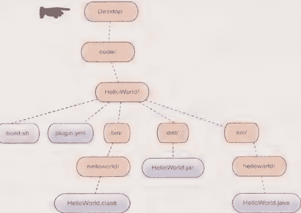

(如果不起作用，请尝试 `cd ~/Desktop`，或者查看本章末尾的提示。)

接下来，输入以下命令进入代码目录：

```
$ cd code
```

现在你就在这里了：

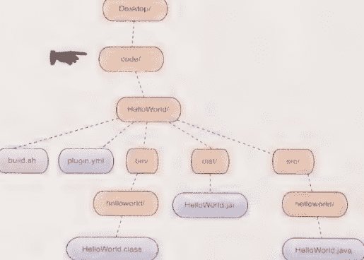

进入 HelloWorld 文件夹：

```
$ cd HelloWorld
```

现在你就在这里了：

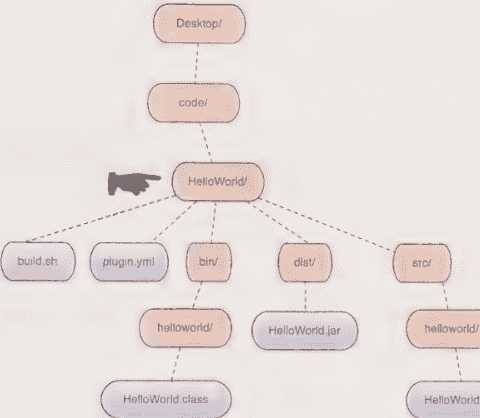

现在列出那里的文件。你会看到：

```
$ ls
bin/  build.sh  dist/  plugin.yml  src/
```

我的系统（Mac OS X）配置为在目录末尾显示斜杠。（如果你的系统没有，请尝试使用 `-F`）。所以在这里我的当前目录下有两个文件和三个目录。文件类型通常由文件名的最后部分——后缀名表示。这里我有一个 `.sh` 后缀的 shell 脚本，和一个 `.yml` 后缀的 Yam 文件。在 `src/` 目录下有一个 `helloworld` 子目录；我有一个 `.java` 后缀的 Java 源文件（随着我们的学习，我们会介绍更多文件类型）。

要进入 `src` 目录，输入 `cd src`，你就进去了了。

```
$ cd src
$ ls
helloworld
```

再进入一层 `helloworld`：

```
$ cd helloworld
$ ls
HelloWorld.java
```

在 `src/helloworld` 目录中，有一个 `HelloWorld.java` 文件——这是我们第一个插件的“内部核心”。

但现在你已经在 `HelloWorld/src/helloworld` 下了。你如何回到 HelloWorld 呢？要向上移动一级，你可以这样做：

```
$ cd ..
```

或者向上移动两级，输入以下命令：

```
$ cd ../
```

那是两个点（或点），读音为“上一级”。单个点本身表示当前目录，这在 `cd` 命令中并不好用，但我们会在其他命令中使用 `.`——特别是在复制文件时。


但现在假设你需要访问一个既不在当前目录也不在上一级目录的目录。你如何到达那里呢？假设我在一个完全不同的地方，比如 `/home/minecraft`，我想去 `/Users/andy/Desktop/code/HelloWorld`。

我会像这样做：

```
$ cd /Users/andy/Desktop/code/HelloWorld
```

开头的斜杠是区别所在。早些时候当你输入 `cd src` 时，`cd` 命令会在当前目录下查找 `src`。但如果你输入的是 `cd /src`，它会在一个名为 `/` 的目录下查找 `src` 目录——我们称之为根目录。

根目录（Root）是你系统上的顶层目录。它是你的代码、桌面之上、一切之上的。在根目录下的某个地方是你的家目录和桌面。在我的情况下，那是 `/Users/andy/Desktop`。我可以通过慢速通过输入以下命令序列到达那里：

```
$ cd /
$ cd Users
$ cd andy
$ cd Desktop
```

但我们稍后就会看到一种简单得多的。说到快捷方式，你甚至不需要完全拼出每个目录名称，比如 D-e-s-k-t-o-p。

在大多数系统中，都有一个好用的键盘快捷键可以免去输入整个名称——Tab 键。如果你输入一个长名的前几个字母然后按 Tab 键，它将自动补全该长名。假设我在代码目录中：

```
$ ls
BackCmd EarthMover PerMap
SquidBomb FlashMob PlayerStuff
SquidBombConfig FlingCmd SaveAHash
CowShooter HelloWorld SkyCmd
DataDemo ListDemo Stuck
```

## 在文件目录中移动 • 9

如果我输入 `cd[Tab]`，它将补全为

$ cd HelloWorld/

然后我只需要按回车键（Return）即可。对于短名称，这看起来可能没什么，但如果你有一个像 `RumpeistiltkskinReincarnationSpellPlugin` 这样长的目录名，输入 `Ru[Tab]` 看起来就非常有吸引。

## 复制与粘贴

有时你可能想复制一段文本并将其粘贴到命令行。例如，你可能想从这本书里复制一行并粘贴进去。

在命令行中复制和粘贴与在 Mail 或网络浏览器等应用程序中复制略有不同。你仍然需要点击并拖动鼠标来选择文本。

- On Linux 上，你可以使用 `Ctrl-C` 复制，使用 `Ctrl-V` 粘贴。
- On Mac 上，你使用 `Cmd-C` 和 `Cmd-V` 复制和粘贴。
- Windows 上的命令略有不同。选择文本后，你需要按 Enter 复制，右键点击或 `Ctrl-V` 粘贴。
- 如果这对你不起，你可能需要启用此功能。右键点击窗口栏并选择“属性”。在“选项”选项卡中，在“编辑选项”部分，勾选“快速编辑模式”（QuickEdit Mode）将其开启。

## 自己尝试一下

让我们使用命令行创建一些目录和文件。你将创建一个插件的副本，包含目录在内。

首先在当前目录下创建一个插件副本，包含所有目录和文件。

# 第1章 命令行计算机 • 12

```
$ cd
$ cd Desktop
```

使用波浪号（tilde）作为主目录：

```
$ cd ~/Desktop
```

显式输入你的主目录名称：

```
$ cd /Users/andy/Desktop
```

或者使用引号，因为名称中包含空格：

```
$ cd /Users/'"John Smith"/Desktop
```

无论如何，它在这里始终会显示为

```
$ cd Desktop
```

## 现在我们来玩点有的

在本书下载的代码中，在你的 `Desktop/code` 目录下，有一个名为 `Adventure` 的特殊子目录。使用命令行 `cd` 进入该目录并查看那些文件和目录。

你可以使用 `cd` 来列出目录，就像我们在这里做的那样。为了快速查看文本文件（以 `.txt` 命名），你可以使用 `cat` 命令。

从你的桌面开始（根据上一节的描述，取决于你的操作方式）。

```
$ cd Desktop
$ cd code
$ cd Adventure
$ cat README.txt
```

这些文件可以让探索文件系统变得更有趣。

执行 `ls` 看看还有什么，并在子目录中探索一下。看看你发现了什么宝藏——以及什么危险。

## 常用命令

以下是在 shell 中使用的最常用命令：

| 命令 | 描述 |
| :--- | :--- |
| java | 作为程序运行 Java 类和 Java 归档 (JARs) |
| javac | 将 Java 源代码编译为类文件 |
| cd | 切换目录 |
| pwd | 打印工作（当前）目录 |
| ls | 列出当前目录下的文件 |
| cat | 显示文件内容 |
| echo | 显示文本；也可以使用 `$` 前缀显示环境变量 |
| mkdir | 创建新目录 |
| cp | 复制文件 |
| mv | 移动文件 |
| rm | 永久删除（移除）文件（使用时请务必极其小心；这不同于回收站，而且没有“撤销”操作） |
| chmod | 修改文件权限（包括读取、写入和执行） |
| . | (单点) 表示当前目录 |
| .. | (双点) 表示父目录 |
| ~ | (波浪号) 表示你的主目录 |

# 下一步计划

接下来，你需要一种输入 Java 源代码的方法。你需要 Java 本身，以及一个将它们整合在一起的应用程序。我们将在下一章安装所有这些内容，然后开始构建插件。


你的工具箱已填充了 2%。现在你可以执行以下操作：

- 使用命令行 shell

# 第 2 章

## 添加编辑器和 Java

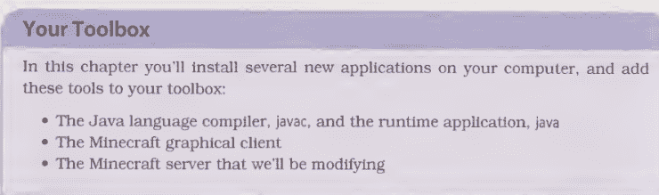

要用 Java 编写程序，你需要一个编写工具：一种编写 Java 文本的方法。虽然你可以使用像 Notepad（记事本）或 TextEdit（文本编辑）这样的基础文本编辑器，但那样非常痛苦。

你不能使用 Microsoft Word 或其他办公类文字处理器。这些应用程序并不是为编程设计的，而且它们存储文件的方式格式 Java 无法使用——Word 文件中充满了字体、颜色、字号和各种格式信息。

你需要一个专为编程设计的文本编辑器。我有一个很好的推荐，我们稍后看到。你还需要安装 Java 来构建和运行插件，当然你还需要 Minecraft。安装好所有内容后，你就可以准备在下一章构建插件了。

让我们从编辑器开始。

## 安装编辑器编写代码

你通过输入类似英语的单词和一些有趣的标点符号编写插件和程序。你编写的大部分内容比短信长，但比英语课上的论文短。你需要一个合适的编辑器来输入你的程序。

我的建议使用一个名为 Sublime Text 的编辑器（见图 1，第 16 页的带有语法高亮的编辑器截图）。它可以下载并运行在 Windows、Mac 和 Linux 上。

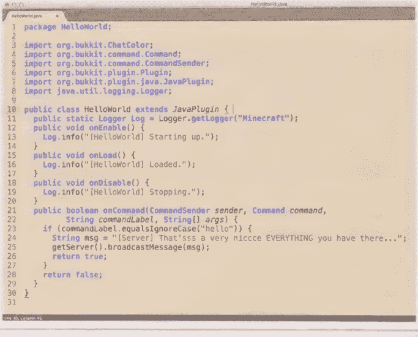

你可以尝试免费评估版（没有时间限制，但它会经常骚扰你），或者掏点钱购买。如果你有读过或更喜欢的其他编辑器，也没关系——用那个即可。例如，在 Windows 上，你可能想看看免费的编辑器 Notepad++。编辑器的选择很大程度上取决于个人。没有所谓的“正确”答案、尺寸、形状或颜色。但你确实需要一个具备正确功能的编辑器。

1. http://www.sublimeext.com
2. http://notepad-plus-plus.org/download/v6.4.2.html

专为程序员构建的编辑器的一个大优势是语法高亮。编辑器了解 Java 语言的不同部分，并会让函数、变量、字符串和关键字等语言元素显示不同的颜色和字体（见下图示例）。当你初次学习所有这些不同概念的含义时，那种视觉支持真的非常有帮助。我们将在后续一两个章节中探索这些内容，但首先请选择你即将成为喜爱的编辑器并安装它。^3

所以，选择 Sublime Text（或其他代码编辑器）并试一试。如果你用过类似 Word 的东西，这看起来至少会有些眼熟：顶部有一个菜单栏，在 File（文件）菜单下，你会看到像 New（新建）、Open（打开）和 Save（保存）这样用的选项。

动手输入一些文本吧。也许是一个两行的短恐怖故事之类的（比如“镜子里的影像眨眼了”）。点击并拖动选择文本，按删除键将其移除。现在它只是一个普通的文本编辑器，我们不需要尝试任何太花哨的东西。

## 亲自尝试

让我们确保你能够创建文件、编辑它并保存它。我们还没有准备好编写完整的插件，所以先从一个简单的测试文件开始。

在编辑器的菜单中，从 File -> New File（文件 -> 新建文件）开始，创建一个可以输入的空缓冲区。

在开始输入之前，选择文件名。选择菜单项 File -> Save（文件 -> 保存），并将文件保存为桌面上的 `CreeperTest.java`。就这么——C 和 T 大写，其余字母小写。现在你已经保存了文件，你的编辑器就知道你将输入 Java 代码了。

在桌面上，确保 `CreeperTest.java` 文件在这里。

输入以下文本，如文所示：


```
public class CreeperTest {
    public static void main(String[] args) {
        System.out.println("Java is working...");
    }
}
```

- 3. 你可能还会关注 IntelliJ IDEA 或 Eclipse。这些是全开发环境，包含了编辑器和支持，但对初学者来说比较复杂。

# 2. 添加编辑器和 Java • 18

确保你输入**完全正确**，从 "public class" 到最后的 "}"。使用删除键（有时标记为退格键）清除错误。

选择 File -> Save 保存你的文本。

搞定！现在你有了一个 Java 源代码。

而电脑不知道该对它做什么。


## 安装 Java 语言

如果你需要安装 Java，你需要 Java 开发工具包（JDK）6 或更高版本，你可以在不同的操作系统下载。取决于你的操作系统和供应商，你可能还没有 Java，或者版本稍有不同。再次，你需要 Java JDK 1.6 或更高版本来处理书中的示例。

无论你使用什么操作系统，我强烈建议接受任何安装程序的默认回答，特别是安装位置。如果位置不符合预期，Java 及其相关程序可能会变得非常怪异和挑剔。

所以去下载 JDK 安装程序并按照其说明操作。

在尝试这些之前，你现在可以运行你输入的测试程序。再次，这只是一个确保 Java 运行良好的简单程序。它还不是 Minecraft 插件，但这是一个开始。一旦你让它运行，你就可以开始构建 Minecraft 插件了。

进入桌面并确保 `CreeperTest.java` 文件在这里：

```
$ cd Desktop
$ ls CreeperTest.java
```

现在通过执行 `javac`（Java 编译器）命令对 `CreeperTest.java` 运行 Java 编译器。

```
$ javac -version
javac 1.6_65
```

如果没有安装，我会得到这样的消息：

```
$ javac -version
bash: javac: command not found
```

- 4. http://www.oracle.com/technet/java/javase/downloads/index.html

## 第 2 章.添加编辑器和 Java • 20

```
$ javac CreeperTest.java
$ ls
CreeperTest.class CreeperTest.java
```

Java 程序首先会检查它是否理解了 `CreeperTest.java` 文件中输入的所有内容。如果没有错误，它就会创建一个二进制类文件。

但大多数情况下，很可能会出现错误。如果你收到了一堆错误信息，不要担心：你并没有弄坏你的电脑。像 Java 这样的编程语言对大小写、标点符号以及我们在文件中输入的所有其他内容都是挑剔得臭名昭著。

保持冷静。（顺便说，在与计算机打交道时，这通常是一个很好的建议。）

尝试破译计算机给你的信息，并对照我们刚才的示例仔细检查你的所有代码。接下来我们将介绍几个可能出现的问题。在第 211 页的附录 1“如何阅读错误信息”中也有一些建议。如果其他所有方法都失败了，别忘了这本书有一个网站，其他人在那里也在纠结这些问题！

一旦 `javac` 终于无错误地完成了工作，你就可以运行了。你可以调用 Java 来运行你的程序，只需提供名称部分（不要带 `.class` 后缀）：

```
$ java CreeperTest
That'sss a very niccce program you have there...
```

嘿，成功了！恭喜你——你编译并运行了你的第一段代码。跳到第 23 页开始的 Minecraft 安装部分。否则，让我们来看看可能哪里出了问题。

## 如果找不到 Java 命令

你最可能看到的错误是 "javac not found" 或 "java not found"，这意味着尽管你安装了 Java，你的 shell 仍然找不到 `java.exe` 或 `javac.exe` 应用程序。以下是其发生的原因：

到目前为止你使用的命令要么是内置的，要么是由 BusyBox 安装程序安装的。但当你安装 Java 时，电脑可能不知道你把它放在了哪里。

当你准备输入命令 `javac` 时，电脑需要找到一个名为 "javac" 的可执行文件（在 Windows 上是 `javac.exe`，在 Mac/Linux 上直接是 `javac`）。它知道有几个标准查找位置。在 Windows 上，这可能包括 `C:\windows\System32` 目录；而在 Mac/Linux 上有几个目录，比如 `/usr/bin`、`/usr/local/bin` 等。

因为系统有它你不应该去触碰的命令，而且因为你想添加自己的命令来运行，结果就是电脑需要查找很多地方！你可以通过一个目录名称列表精确地告诉它去哪里查找。我们称之为搜索路径（search path），简称为 path。

你可以通过输入以下命令查看你的 shell 窗口中 path 的内容：

```
$ echo PATH
```

为了让 shell/命令行处理器找到要执行的命令，它必须位于你搜索路径中的某个目录。因此，你需要将 Java 的 `bin` 目录添加到你的 path 中。

该目录的位置取决于你的操作系统以及你使用了什么安装程序。Windows 的典型位置是 `C:\Program Files\Java\jdk1.7.0_45\bin`（你的版本号可能会略有不同）。

在 Mac 上，它可能安装在 `/usr/bin` 或 `/usr/local/bin`，这两个已经在你的 path 中。但它也可能安装在完全不同的地方，比如 `/opt/local/java`。

无论如何，一旦你安装了 Java 的安装目录，你会在那里看到一个 `bin` 目录。在该目录中，你会看到 `java`、`jar` 以及许多东西。你需要将该 `bin` 目录的完整路径添加到 shell 的 PATH 中。

PATH 是一个目录列表，在 Windows 上用冒号（分号）分隔。要更改你正在使用的 bash shell 的 PATH，请遵循以下步骤：

第2章. 添加编辑器和 Java • 24

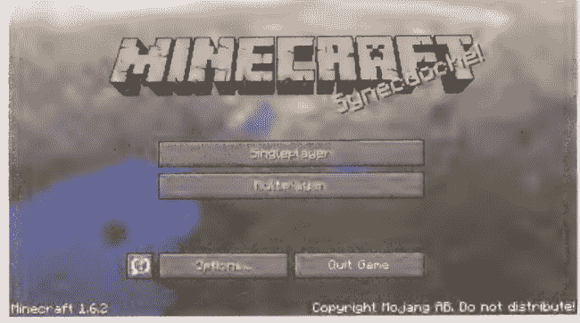

还有适用于 Apple iOS 和 Android 设备的客户端（包括智能手机），但它们是一条死胡同。在我写这些内容时，它们无法连接到普通的 Minecraft 服务器，因此无法使用我们自定义的插件。

客户端处理图形和音效，并允许你在游戏中输入聊天命令。但现在它没有可以连接的本地游戏——我想我们最好还是去获取并下载那个服务器代码。


## 安装 Bukkit 服务器

现在到了好玩的部分。你将为自己的服务器添加插件，因此你需要 CraftBukkit，这是由来自 Bukkit 的优秀同们设计的特殊 Minecraft 服务器，专为使用插件而设计。

在你的桌面上创建一个 `server` 目录（这意味着它将位于类似 `/Users/username/Desktop/server` 的目录下）：

```bash
$ cd Desktop
$ mkdir server
```

我们将此称为你的服务器目录，你将在此处安装服务器组件。

Bukkit 项目包含两个不同的 JAR 文件：`CraftBukkit.jar`，用于运行游戏服务器；以及 `bukkit.jar`，我们用于开发新插件。

访问网络并进入 Bukkit 项目的主页 http://wiki.bukkit.org/Main_Page。在“Downloads（下载）”部分，你会看到两个项目：

- CraftBukkit - Recommended Build（推荐构建版本，用于运行 Minecraft 服务器）
- Bukkit API - Recommended Build（推荐构建版本，用于开发新插件）

两个都要下载。每个 JAR 文件都会带有额外的版本号（有些像 `craftbukkit-1.6.4-R1.0.jar`；你的数字可能会更大）。将这两个文件都下载到 `Desktop/server` 目录，并将它们重命名为 `craftbukkit.jar` 和 `bukkit.jar`。

你可以通过 shell 中的 `mv`（移动文件）命令和通配符 `*` 来执行操作，它可以匹配所有数字，这样你就不需要手动输入它们了：

```bash
$ cd server
$ pwd
/Users/andy/Desktop/server
$ ls
bukkit-1.6.4-R2.0.jar craftbukkit-1.6.4-R1.0.jar
$ mv craftbukkit* craftbukkit.jar
$ mv bukkit* bukkit.jar
$ ls
bukkit.jar craftbukkit.jar
```

本书的示例代码包含一个名为 `runtime` 的子目录。在 `runtime` 目录中你会看到一个名为 `start_minecraft` 的启动脚本。使用拷贝命令 `cp` 将其拷贝到你的服务器目录。你仍然在该目录下，所以可以使用 `.` 指代桌面，使用 `.` 指代当前目录：

```bash
$ cp ../code/runtime/start_minecraft .
```

我们将使用 `start_minecraft` 脚本来启动并运行服务器。它将运行 `java` 命令，传入一个选项以确保我们有足够的内存来运行（看起来像魔法的 `-Xmx1024M`），然后传入要运行的 JAR 文件 `craftbukkit.jar`：

```bash
java -Xmx1024M -jar craftbukkit.jar
```

Minecraft 服务器第一次运行时，它会创建大量文件，包括默认的世界（World）。尽管运行它吧（仍仍在服务器目录下）：

```bash
$ ./start_minecraft
```

注意我在命令名中使用了 `./`。这将从当前目录运行该命令。如果当前目录（`./`）在你的路径中，你就不需要使用 `./` 序列。

如果你遇到读取 `/start_minecraft: Permission denied` 的错误，那么你需要输入以下行来使文件变为可执行：

```bash
$ chmod +x start_minecraft
```

## 第2章 添加编辑器和 Java

一旦服务器启动，Minecraft 将向你的终端输出大量文本。这是在我机器上的样子；你的目录名、时间戳和版本号会有所不同，但看起来应该是：

```bash
$ cd Desktop
$ cd server
./start_minecraft
14:20:45 [INFO] Starting minecraft version 1.6.4
14:20:45 [INFO] Loading properties
14:20:45 [INFO] Default game type: SURVIVAL
14:20:45 [INFO] Generating keypair
14:20:46 [INFO] Starting Minecraft server on *:25565
14:20:47 [INFO] This server is running CraftBukkit version git-Bukkit-1.6.4
Implementing API version 1.6.4
14:20:51 [INFO] Done (364s)! For help, type "help"
```

它正在等待你在提示符处输入命令。中间有很多输出，但你明白意思。当你准备好时，可以随时通过输入 `stop` 命令停止你的 Minecraft 服务器，如下：

```text
>>stop
14:29:05 [INFO] CONSOLE: Stopping the server...
14:29:05 [INFO] Stopping server
...14:29:05 [INFO] Saving players
14:29:05 [WARNING] Socket closed
14:29:05 [INFO] Saving worlds
14:29:05 [INFO] Saving chunks for level 'world'/Overworld
14:29:05 [INFO] Closing listening thread
14:29:06 [INFO] Saving chunks for level 'world_nether'/Nether
14:29:06 [INFO] Saving chunks for level 'world_end'/The End
14:29:06 [INFO] Stopping server
$
```

你又回到了命令行提示符。重新启动它（如果关闭了的话），当服务器运行时，你现在可以通过本地 Minecraft 客户端连接。像往常一样，登录你的 Minecraft 账户并准备连接多人服务器：

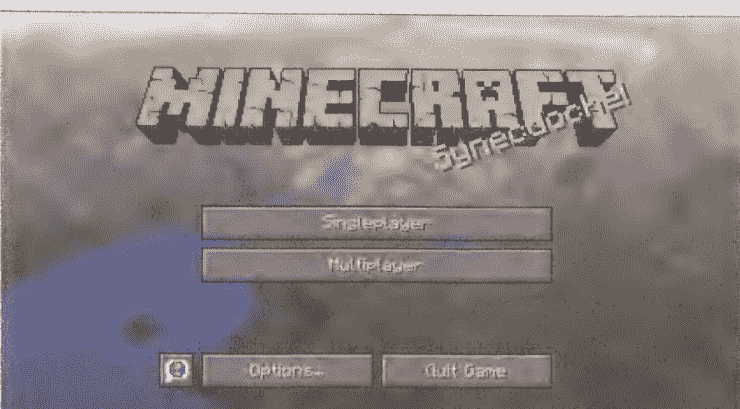

Minecraft 1.6.2 Copyright Mojang. 不要发行！注意左下角的版本号。稍后可能需要它。

现在你需要添加本地服务器。点击“Add Server（添加服务器）”并为你的服务器输入名称。服务器地址使用 `localhost`，如下：


你的服务器将出现在列表中（以及你经常连接的其他服务器），如下：

## Minecraft 版本

当你启动 Minecraft 游戏时，你可以指定使用的版本。通常你可以使用最新版本。但在我写这些内容时，Bukkit 服务器的最新版本是 1.6.4，但你刚刚安装的客户端默认是新的 Minecraft 1.7，Bukkit 还不支持。这是不可行的。

你需要告诉 Minecraft 客户端使用正确的版本。


- 版本选择
- 启用开发版本（快照版）
- 允许使用旧版 Beta 版本（自2010年）
- 允许使用旧版 Alpha 版本（自2010年）
- 使用版本：1.6.4

当你启动 Minecraft 游戏时，你可以指定使用的版本。通常你可以使用最新版本。但在我写这些内容时，Bukkit 服务器的最新版本是 1.6.4，但你刚刚安装的客户端默认是新的 Minecraft 1.7，Bukkit 还不支持。这是不可行的。

你需要告诉 Minecraft 客户端使用正确的版本。

在 Minecraft 启动时，点击“Edit Profile（编辑配置）”。

从列表中选择你的服务器，然后点击 Join（加入）按钮。欢迎来到世界！

如果你立即断开连接，可能是版本不匹配；请参阅第28页的“Minecraft 版本”。

一旦连接上，你就在本地服务器的世界里了。

你可以利用这段时间在世界里做一些简单的设置。也许在苦力人来之前给自己盖一间漂亮的房子……

这是一个很棒开始，现在你的电脑上运行了一个完整的 Minecraft 服务器。

在下一章节中，我们将卷起袖子，编译并安装我们的第一个插件。


## 构建并安装插件

## 工具箱

完成本章后，你将学会如何：

- 将 Java 源代码编译为类文件，将其封装成 JAR，并安装到 Minecraft 服务器上
- 使用新插件运行你的本地服务器
- 连接到你的本地服务器

### 所以指令有效吗？

你输入 Java 语言指令（我们称之为“源代码”）并将其保存到文本文件中，然后 Java 编译器 `javac` 读取你的文本文件并将其转换为计算机可以运行的内容。

你之前输入的简单 `CreeperTest.java` 程序已经经历过这个过程。

对于你输入到 `CreeperTest.java` 文件中的源代码，你会得到一个名为 `CreeperTest.class` 的二进制（非文本）文件。二进制文件是数字文件——对计算机是有意义的，但对人类不是。

因为一个典型的程序可能会使用大量的类文件，我们通常会将一组类文件存档为 JAR 文件，Java 从 JAR 中运行代码。

Java（Java 程序本身）会读取类文件和 JAR 文件，以在计算机上创建一个运行的进程。对于 Minecraft 来说，这将是你的 Minecraft 客户端连接的服务器进程。目前，唯一的客户端就是你。

下面的图展示了这些部分是如何结合在一起的。

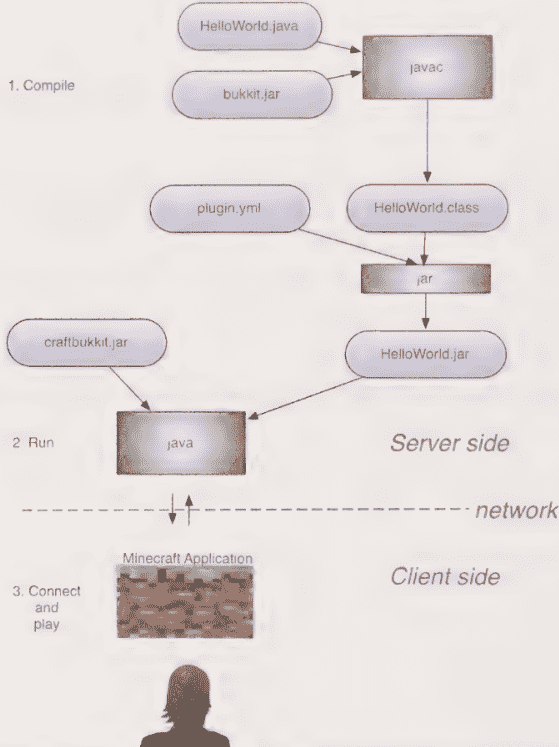

图 2—编译插件并在服务器上运行。

在 Java 世界中，你必须将所有这些文件放在特定的位置，这一切才能正常工作。我们之前已经创建了这样的目录结构，已经为你的 HelloWorld 插件版本准备就绪。在这本书的代码中，我在 HelloWorld 目录中也为你设置好了一个完整的插件，你已经将其下载到了 `Desktop/code/HelloWorld`。

因此，在 `Desktop/code/HelloWorld` 中，你会在 `src` 目录下找到一个源代码的目录树。你还会看到一个 `bin` 目录，用于生成编译后的类文件，以及一个 `dist` 目录，将类文件和配置文件打包成一个 jar 文件。当你准备好与他人分享你的插件时，只需给他们 JAR 文件即可。

HelloWorld 是一个开发目录。你开发的每个插件可能都有一个这样的目录，每个目录都有自己的 `src`、`bin`、`dist` 等。

然后，在 `Desktop/server` 的服务器目录中，你拥有 Minecraft 服务器文件，包括 `craftbukkit.jar`（它包含了运行游戏所需的所有部分），以及我们用于在 Minecraft 世界中开发代码的 `bukkit.jar`。此外，在 `server` 中有一个用于插件的目录，Minecraft 服务器在运行时会使用该目录。

在开发目录中编写代码时，当你准备好在服务器中测试时，最后一步是将 jar 文件复制到服务器的插件目录（见下图）。我们稍后会看到如何自动完成这一操作。

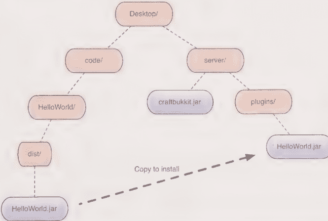

图 3—安装插件

Java 使用路径和配置文件来指定所有这些文件和目录的位置。这有时会变得有点棘手，因为有很多变动，而且当 Java 找不到明明就在你面前的某些文件时，会令人感到沮丧。仅仅因为你知道文件在哪里，并不意味着 Java 知道。

现在让我们来看源代码，然后介绍如何构建和安装它。

## 插件：HelloWorld

在编程世界中，有一个久以来形成的传统是从一个打印“Hello, World.”消息的简单测试程序开始。因此，我们将从构建并运行一个在 Minecraft 中实现此功能的现有插件开始——我们将发送一条稍微有趣一点的消息。

这是我们 HelloWorld 插件的 Java 源代码，它已经输入到 `~/Desktop/code/HelloWorld/src/helloworld/HelloWorld.java` 文件中。这里有很多奇怪的内容。

```java
HelloWorld/src/HelloWorld/HelloWorld.java
package helloworld;
import java.util.logging.Logger;
import org.bukkit.ChatColor;
import org.bukkit.command.Command;
import org.bukkit.command.CommandSender;
import org.bukkit.plugin.Plugin;
import org.bukkit.plugin.java.JavaPlugin;
public class HelloWorld extends JavaPlugin {
    public static Logger log = Logger.getLogger("Minecraft");
    public void onLoad() {
        log.info("[HelloWorld] Loaded.");
    }
    public void onEnable() {
        log.info("[HelloWorld] Starting up.");
    }
    public void onDisable() {
        log.info("[HelloWorld] Stopping.");
    }
    public boolean onCommand(CommandSender sender, Command command,
        String commandLabel, String[] args) {
        if (commandLabel.equalsIgnoreCase("hello")) {
            String msg = "Server's greeting";
            getServer().broadcastMessage(msg);
            return true;
        }
        return false;
    }
}
```

1. 如果你还没有将这本书的代码下载到 Desktop，现在请从 http://media.prog.com/titles/ahmine/code/ahmine-code.zip 获取并解压所有文件。不要因为这些看起来像英语就感到沮丧，我们将在接下来的几个章节中解释它们。关注熟悉的内容：这里有一些英文单词，如 `import`、`public` 和 `return`，以及以分号（`;`）结尾的语句。还有一些奇怪的字符如 `[` 和 `]`，它们是重要的。这些是什么意思？嗯，这个插件实现了一个命令，会向 Minecraft 中的所有玩家广播问候。注意这个插件的名字声明在第 ① 行。`public class HelloWorld` 与包含此代码的文件名 `HelloWorld.java` 相同。这段代码也设置在源代码所在的目录 `src/` 下，第 ② 行。这些地方的名称匹配很重要；任何拼写错误都会导致问题。使用 `import` 语句（你将在 ③ 行看到）来访问插件中需要的项，如 Bukkit 库和其他 Java 库。如果你忘记包含某些需要的导入，你将收到一个“找不到符号”的错误，因为 Java 不知道你在说什么。参见第 253 页常见导入。

## 使用 plugin.yml 配置

但只有源代码是不够的，你还需要一个配置文件以便 Minecraft 能够找到并启动你的插件。配置文件名为 `plugin.yml`，如下所示：

```yaml
HelloWorld/plugin.yml
name: HelloWorld
author: AndyHunt, Learn to Program with Minecraft Plugins
website: http://prag.com/ahmine
main: helloworld.HelloWorld
commands:
  hello:
    description: Say Hello to everyone!
    usage: /hello [optional message]
version: 0.1
```

这是该文件需要的描述。先不要太担心细节——随着书籍的深入，你会明白更多的。

- **name**: 插件的名字——在此例下为 `HelloWorld`。
- **author**: 作者的名字（即你）。
- **main**: Java 运行此插件的包名和类名（`package.classname`）。
- **version**: 插件的版本号。从低数字开始，每次向世界发布新版本时增加数字。
- **commands**: 此插件支持的用户命令列表。

对于每个命令，你必须指定三点：

- **command**: 用户可以输入的命令。
- **description**: 命令作用的简单描述。
- **usage**: 命令用法及任何选项。

格式是重要的：用于缩进某些行的空格必须存在。你可以在第 241 页找到更多细节。

## 使用 build.sh 构建和安装

你在终端中输入的命令也可以保存到文件中；这样你就可以反复运行它们。构建插件比我们上一章编译单个 Java 文件稍微复杂一点，但即使，它涉及到许多我们不想每次都输入的命令。

为了方便，我为你制作了一个名为 `build.sh` 的 shell 脚本，它将执行三个步骤：

1. 使用 `javac` 将 `.java` 源码编译为 `.class` 文件。
2. 使用 `jar` 将类文件和配置文件存档。
3. 将 jar 部署到服务器。


之后，你需要停止并重启服务器以便使其获取更改。

构建脚本需要知道你的服务器目录在哪里。在脚本的最顶端，写着如下：

```
MCSERVER=$HOME/Desktop/server
```

对于大多数人来说，如果你的服务器目录位于 `Desktop`，这应该是可以正常运行的。如果不起作用，你需要编辑 `build.sh` 文件并将该目录更改为本地服务器目录。该 `MCSERVER=` 设置是脚本知道去寻找服务器的方式。

让我们尝试看会发生什么。

在命令行中，将你的当前目录切换到 `HelloWorld` 目录。从那里运行 `build.sh` 脚本。对于我来说，我可以从任何地方开始进入主目录，然后 `cd` 进入 `Desktop`，进入 `code`，最后进入 `HelloWorld`：

```
$ cd
$ cd Desktop
$ cd code/HelloWorld
./build.sh
```

（记住，无论你实际上如何到达 `Desktop`，从现在起我将显示 `cd Desktop` 作为参考。根据你的特定系统，你可能需要执行 `cd ~/Desktop` 或从主目录开始向下进入。）

你应该能看到如下所示的结果：

```
Compiling with java...
Creating jar file...
Deploying jar to /Users/andy/Desktop/server/plugins...
Completed Successfully.
```

检查文件是否已安装在服务器目录中：

```
$ cd Desktop
$ cd server/plugins
$ ls
HelloWorld.jar
```

是的，JAR 文件在服务器目录中。成功了！

如果你遇到了错误，请检查以下几点：

- 如果你看到警告：`[options] bootstrap class path not set in conjunction with -source 1.6`，请忽略它。这只是 Java 在挑剔。我们将在书的后面部分介绍如何处理这个问题。

- 如果你遇到错误 `./build.sh: Permission denied`（权限拒绝），你可能需要输入 `chmod +x build` 来赋予脚本可执行权限。

- 如果你遇到错误 `package org.bukkit does not exist` 后面跟着一大堆错误，说明它没有找到服务器目录（见下文）。

- 如果你看到语法错误，请确保你使用的是从本书网站下载的最新文件副本，没有进行任何本地修改。

- 如果所有内容都编译正常，但在尝试编译 JAR 文件时出错，请确保服务器目录正确。

如果脚本在寻找服务器目录时遇到困难，编辑 `build.sh` 并将 `MCSERVER=` 后的目录更改为 Minecraft 服务器的正确位置。

一旦编译并安装完成，你就太棒了！现在你有了一个编译好的插件，准备供 Minecraft 服务器使用。

如果你的服务器仍在运行，它将不知道这个新插件。你必须停止它并重启，如下所示：

```
$ cd ~/Desktop/server
$ ./start_minecraft
```

或者如果它已经在运行，在控制台中使用 `reload` 命令：

```
>reload
08:47:32 [INFO] [HelloWorld] Loading HelloWorld v0.1
08:47:32 [INFO] [HelloWorld] Loaded.
08:47:32 [INFO] [HelloWorld] Enabling HelloWorld v0.1
08:47:32 [INFO] [HelloWorld] Starting up.
08:47:32 [INFO] Server permissions file permissions.yml is empty, ignoring it
08:47:32 [INFO] CONSOLE: Reload complete.
```

- 确保它的拼写正确并以 `/` 字符开头，这样你就有从根目录开始的服务器完整路径。

这是来自我们新的 HelloWorld 插件的启动消息。如果你没有看到 HelloWorld 启动的任何消息，说明你的 Minecraft 服务器找不到它。请确保 `HelloWorld.jar` 文件位于服务器的 `plugins` 目录，停止服务器并尝试重新启动。

一旦你连接到 Minecraft 世界，你就可以在客户端聊天窗口测试你的新命令了。在 Minecraft 游戏中，只需开始输入 `/hello` 看看会发生什么。只要你一输入 `/` 字符，你就会看到自己正在屏幕底部的聊天窗口输入。按下回车键（Return），然后……

……你应该能在服务器日志控制台和游戏窗口中看到我们的消息。服务器控制台显示如下：

```
14:47:58 [INFO] AndyHunt issued server command: /hello
14:47:58 [INFO] [Server] That's a very nice EVERYTHING you have...
```

## 在 Minecraft 中漫游

- 如果你不熟悉 Minecraft 的用户界面（GUI），这里有几个快速提示。你可以查看 YouTube 上的许多教程或官方文档以获取更多信息。

- `W`、`A`、`S`、`D` 键分别代表向前、向后、向左和向右移动。使用空格键跳跃。

- 使用鼠标控制你面朝的方向。

- 使用左鼠标键“攻击”物体——例如，用剑挥击，或用铁镐、铲子挖掘。

- 使用右鼠标键“使用”物品——例如，放置物品或打开门。

- 以 `/` 字符开头向 Minecraft 输入命令。你可以通过 `/gamemode` 将游戏切换到创造模式，并通过 `/gamemode` 回到生存模式。

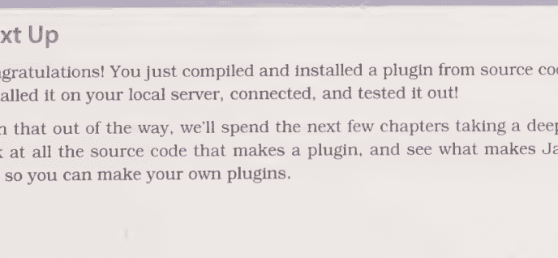

## 下一步

恭喜你！你刚刚从源代码编译并安装了一个插件，将其安装在本地服务器上，进行了连接并测试了它！

搞定这些之后，我们将在接下来的几章中深入研究构成插件的所有源码，并了解 Java 的运行原理，这样你就可以编写自己的插件了。

## 你不断增长的工具箱

你的工具箱已填充 13%。你现在可以执行以下操作：

- 使用命令行 shell

- 使用 Java、`javac` 进行编译

- 运行 Minecraft 服务器

- 部署插件

- 连接到本地服务器

# 第 4 章 插件拥有变量、函数和关键字

## 你的工具箱

在本章中，我们将处理编写 Java 代码的大许多基础知识。有了工具箱中的工具，你将了解以下内容：

- Java 中那些奇怪字符的含义

- 如何使用变量来存储数字和字符串值

- 如何声明和使用函数：Java 指令列表

- 如何使用 `if`、`for` 和 `while` 语句控制代码

正如你可能注意到的，插件源码中有很多我还没有解释的文本。让我们深入研究 Java，看看所有这些文本意味着什么——它们是编写插件的原始材料。

## 变量：给事物贴标签

变量是给内存中的一个存储位置贴上标签，以便你可以稍后引用它。你可以把变量想象成一个贴有标签的盒子。你可以把东西放进盒子里，稍后再拿出来。

在 Java 中，声明变量需要指定类型和名称：

```java
int age = 15;
```

这行代码的意思是：创建一个名为 `age` 的变量，类型为 `int`（整数），并将其初始值设为 `15`。

### 变量赋值与重复声明

一旦声明了变量，就不能再次声明同名变量：

```java
int age = 15;
int age = 21;
// 错误！
```

相反，你只需要将它声明为 `int` 一次，然后如果需要，使用 `age =` 来更改值：

```java
int age = 15;
age = 21; // 正确：重新赋值
```

### 变量命名与类型安全

现在，仅仅因为你给盒子贴上了 `age` 的“标签”，并不意味着它真的必须存储一个年龄。没有什么能阻止你向那个盒子里放入其他数字：

```java
int age = 2048;
```

这是完全合法的 Java 代码，因为 `2048` 是一个完全合理的数字。对于历史文物的年龄来说这可能还可以，但对于人类来说，这不是一个现实的年龄。给一个人设定这样的年龄是愚蠢的，但法律并没有禁止愚蠢。这意味着，给变量起有意义的名字完全取决于你。将此变量重命名为 `ageyears`（年龄年份）之类的名称可能会更有意义，以避免像著名的“火星气候轨道器”崩溃那样的问题。[^1]

Java 确实试图防止你把苹果和橘子混在一起。尽管它不知道你正在将一个 `int` 用作“人类年龄”，但它确实知道 `int`、`float`、`String` 等东西之间的区别。它不会允许你混合这些类型。如果你声明一个变量应该存储整数，那么你就不能在其中存储一个 `String`。这会抛出一个错误：

```java
int age = "Old enough to know better"; // 错误！
```

我们尝试在 `int` 中存储一个字符字符串。这是行不通的，Java 会报错的。你不能反过来操作。在这里，我们正尝试将一个整数值（`42`）存储到一个声明为存储字符字符串（一个 `String`）的变量中：

```java
String answer = 42; // 错误！
```

但对于数字和字符串等常见类型，如果合理的话，你有方法根据需要对它们进行相互转换。例如，假设你从用户输入的内容中读取了一个数值，并且它是以名为 `str` 的 `String` 形式给你的。你可以这样将其转换为 `int`：

```java
String str = "1066";
int value = Integer.parseInt(str);
// value 现在被设置为数字 1066
```

所以你可以进行转换，但你必须自己动手；Java 不会为你猜测。关于常见类型转换的列表，包括我们在这里没有涵盖的，请见附录 5，“速查表”，第 241 页。

## 插件：BuildAHouse

我已经为你准备好了一个插件；你只需要声明一些变量，就可以执行 `/buildahouse` 命令了。

首先，进入下载的代码目录，进入 `BuildAHouse` 插件目录：

```
$ cd Desktop
$ cd code/BuildAHouse/src/buildahouse
$ ls
BuildAHouse.java MyHouse.java
```

你将编辑 `MyHouse.java` 文件，它是该插件的一个小部分。现在它看起来是这样：

```java
// BuildAHouse/src/buildahouse/MyHouse.java
package buildahouse;

public class MyHouse {
    public static void build_me() {
        // 声明宽度
        // 将宽度设置为方块数
        // 声明高度
        // 将高度设置为方块数
        BuildAHouse.buildMyHouse(width, height);
    }
}
```

如果你尝试像我们之前 `HelloWorld` 那样使用 `build.sh` 进行编译和安装，你会得到两个错误：

```
$ cd Desktop
$ cd code/BuildAHouse
$ ./build.sh
```

```
Compiling with javac...
src/buildahouse/MyHouse.java:10: cannot find symbol
symbol : variable width
location: class buildahouse.MyHouse
BuildAHouse.buildMyHouse(width, height)
src/buildahouse/MyHouse.java:10: cannot find symbol
symbol : variable height
location: class buildahouse.MyHouse
BuildAHouse.buildMyHouse(width, height)
2 errors
```

这就是你的首要任务：声明并设置一个名为 `width` 的 `int` 变量和一个名为 `height` 的 `int` 变量，并将它们设置为对房子合理的数值，也许高度不小于 5 块，宽度也不小于 5 块。或者，如果你觉得空间宽裕，也可以是 10×10。

删除那些注释行，并用你的两个宽度和高度变量替换它们。保存文件，然后再次运行 `build.sh`：

```
$ ./build.sh
Compiling with javac...
Creating jar file...
Deploying jar to /Users/andy/Desktop/server/plugins...
Completed Successfully.
```

停止并重启你的服务器，然后连接（或重新连接）你的 Minecraft 客户端。


在 Minecraft 环境中选择一个好看的地方，然后输入命令 `/buildhouse`。砰！你现在进入了你全新的、防止苦力入侵的房子，这个房子是根据你通过 `width` 和 `height` 变量指定的精确尺寸建造的。顺便说一下，右键将打开门。

## 不同类型的数字

Java 在整数和小数之间做了区分。

[^1]: 一组程序员使用了公制单位，另一组使用了英制单位。哎呀：http://mars.nasa.gov/msp98/news/mco990930.html


# 插件：BuildAHouse

我已经为你准备好了一个插件；你只需要声明一些变量，就可以执行 `/buildhouse` 命令了。

首先，进入下载的代码目录，进入 `BuildAHouse` 插件目录：

```bash
$ cd Desktop
$ cd code/BuildAHouse/src/buildahouse
$ ls
BuildAHouse.java MyHouse.java
```

你将编辑 `MyHouse.java` 文件，它是该插件的一个小部分。现在它看起来是这样：

```java
// BuildAHouse/src/buildahouse/MyHouse.java
package buildahouse;

public class MyHouse {
    public static void build_me() {
        // 声明宽度
        // 将宽度设置为方块数
        // 声明高度
        // 将高度设置为方块数
        BuildAHouse.buildMyHouse(width, height);
    }
}
```

如果你尝试像我们之前 `HelloWorld` 那样使用 `build.sh` 进行编译和安装，你会得到两个错误：

```bash
$ cd Desktop
$ cd code/src/BuildAHouse.sh
$ ./build.sh
```

正在使用 javac 编译...

src/buildahouse/MyHouse.java:10: cannot find symbol

symbol : variable width

location: class buildahouse.MyHouse

BuildAHouse.buildMyHouse(width, height)

src/buildahouse/MyHouse.java:10: cannot find symbol

symbol : variable height

location: class buildahouse.MyHouse

BuildAHouse.buildMyHouse(width, height)

2 个错误

这就是你的首要任务：声明并设置一个名为 `width` 的 `int` 变量和一个名为 `height` 的 `int` 变量，并将它们设置为对房子合理的数值，也许高度不小于 5 块，宽度也不小于 5 块。或者，如果你觉得空间宽裕，也可以是 10×10。

删除那些注释行，并用你的两个宽度和高度变量替换它们。保存文件，然后再次运行 `build.sh`：

```bash
$ ./build.sh
正在使用 javac 编译...
正在创建 Jar 文件...
正在将 jar 部署到 /Users/andy/Desktop/server/plugins...
完成。
```

停止并重启你的服务器，然后连接（或重新连接）你的 Minecraft 客户端。


在 Minecraft 环境中选择一个好看的地方，然后输入命令 `/buildhouse`。砰！你现在进入了你全新的、防止苦力入侵的房子，这个房子是根据你通过 `width` 和 `height` 变量指定的精确尺寸建造的。顺便说一下，右键将打开门。

# 不同类型的数字

Java 在整数和小数之间做了区分。

Java 区分整数和带小数的数字。

Java 确实试图防止你把苹果和橘子混在一起。尽管它不知道你正在将一个 `int` 用作“人类年龄”，但它确实知道 `int`、`float`、`String` 等东西之间的区别。它不会允许你混合这些类型。如果你声明一个变量应该存储整数，那么你就不能在其中存储一个 `String`。这会抛出一个错误：

```java
int age = "Old enough to know better"; // 错误！
```

我们尝试在 `int` 中存储一个字符字符串。这是行不通的，Java 会报错的。你不能反过来操作。在这里，我们正尝试将一个整数值（42）存储到一个声明为存储字符字符串（一个 `String`）的变量中：

```java
String answer = 42; // 错误！
```

但对于数字和字符串等常见类型，如果合理的话，你有方法根据需要对它们进行相互转换。例如，假设你从用户输入的内容中读取了一个数值，并且它是以名为 `str` 的 `String` 形式给你的。你可以这样将其转换为 `int`：

```java
String str = "1066";
int value = Integer.parseInt(str);
// value 现在被设置为数字 1066
```

1. 一组程序员使用了公制单位，另一组使用了英制单位。哎呀：

<http://mars.nasa.gov/msp98/news/mco990930.html>

所以你可以进行转换，但你必须自己动手；Java 不会为你猜测。关于常见类型转换的列表，包括我们在这里没有涵盖的，请见附录 5，“速查表”，第 241 页。

让我们试一一下吧。

# 字符字符串

世界不仅仅有数字。

在 Java 中，你使用 `String` 类型来处理字符字符串。我们会在 Minecraft 中经常使用字符串，用于玩家名称、文件名、消息——任何可以改变数值的文本数据，数字也是如此。

要在代码中字面量地指定一个字符串，你只需要把它放在双引号内，看起来“像这样”。我们会在插件中使用字符串，并随着学习的深入了解更多对字符串的操作。

你可以使用加号将字符串相加：

```java
String first = "Jack";
String middle = "D.";
String last = "Ripper";
```

注意，字符串是你的数据，与我们用于给 Java 提供指令的字符（我们的程序代码）不同。

# 亲手试一下

是时候尝试这些点子了：我们将从零开始创建一个简单的插件。

在 `BuildAHouse` 插件中，我有一堆你看不见的代码，实际上执行了盖房子的操作，而你只需要声明几个变量。但现在，你将自己从零开始创建一个整个插件。

为了保持简单，起初你只需要打印一些值。事实上，让我们把这个插件命名为 `Simple`。

首先，你需要为新插件创建一个 `Simple` 目录，其中包含一个 `src/` 子目录，并带有 `plugin.yml` 和 `build.sh`，就像我们在 `HelloWorld` 中做过的那样。由于你可能会多次执行此操作，我制作了一个名为 `mkplugin.sh` 的 shell 脚本来帮助你开始。

使用你想创建的插件名称运行它，它将在你的当前目录下创建相应的目录，并从基础代码开始：

```bash
$ cd Desktop
$ code/mkplugin.sh
$ cd Simple
$ ls
bin/ build.sh dist/ plugin.yml src/
$ cd src
$ ls
simple/
$ cd simple
$ ls
Simple.java
```

`Simple.java` 文件名副其实；它实际上并没有执行任何操作。

你将在显示“在此行之后放置你的代码”和“……并在此行行之前结束你的代码”的地方之间添加一些代码，如下方的代码列表所示。

在你的文本编辑器中打开此文件（`Desktop/Simple/src/simple/Simple.java`），准备好打字。

## 插件：Simple

```java
// Simple/src/simple/Simple.java
package simple;

import java.util.logging.Logger;
import org.bukkit.command.Command;
import org.bukkit.command.CommandSender;
import org.bukkit.entity.Player;
import org.bukkit.plugin.Plugin;
import org.bukkit.plugin.java.JavaPlugin;

public class Simple extends JavaPlugin {
    public static Logger log = Logger.getLogger("Minecraft");
    public void onEnable() {
        log.info("[Simple] Start up.");
    }
    public void onReload() {
        log.info("[Simple] Server reloaded.");
    }
    public void onDisable() {
        log.info("[Simple] Server stopping.");
    }
    public boolean onCommand(CommandSender sender, Command command, String commandLabel, String[] args) {
        if (commandLabel.equalsIgnoreCase("Simple")) {
            if (sender instanceof Player) {
                Player me = (Player)sender;
                // Put your code after this line:
                // ...and finish your code before this line.
                return true;
            }
        }
        return false;
    }
}
```

暂时先不要担心那些额外的程序文本。我们将随着学习进行讨论更多内容。现在只需按照所示的行上放置新代码，它就能正常工作。以下是你将要的操作：

首先，在文件顶部的其他 `import` 行之后添加一个 `import` 语句：

```java
import org.bukkit.Sound;
```

接下来，在显示 `// Put your code after this line:` 的地方，执行以下操作：

1. 创建一个名为 `myAge` 的整数变量，并设置为你的年龄。
2. 创建另一个名为 `twiceMyAge` 的整数变量，并将其设置为 `myAge` 乘以 2。
3. 创建一个名为 `volume` 的浮点变量，并将其设置为 0.1。
4. 创建一个名为 `pitch` 的浮点变量，并将其设置为 1.0。
5. 创建一个名为 `dayOn` 的双精度（浮点）变量，并将其设置为 152853.5047。这是木卫（Io）一天的秒数。
6. 创建一个名为 `myName` 的字符串，并设置为你的名字。
7. 使用 `me.sendMessage(string msg)` 向玩家发送聊天消息来显示这些值的每一个。例如，要显示你的名字，请输入：

```java
me.sendMessage("My name is " + myName);
```

始终以带引号的字符串（如 `"My name is"`）和加号开始消息，然后添加你的变量。不要忘记每个语句末尾的分号。

最后，添加一行代码来播放音效，使用你刚刚声明的浮点值：

```java
me.playSound(me.getLocation(), Sound.GHAST_SCREAM, volume, pitch);
```

保存文件，然后在 `Simple` 目录中运行 `build.sh`。

```bash
$ cd Desktop
$ cd Simple
./build.sh
Compiling with javac...
Creating jar file...
Deploying jar to /Users/andy/Desktop/server/plugins...
Completed Successfully.
```

停止并重启你的服务器，然后从 Minecraft 客户端连接。运行你的新命令 `/simple`，并观察控制台上的消息（以及音效）！

3. Io 非常酷。它有超过 400 个活跃火山。参见：<http://en.wikipedia.org/wiki/Io>。

在我们通常的 `Command` 中，我们正在调用其他函数。这里是来自 `HelloWorld` 的部分：

```java
public boolean onCommand(CommandSender sender, Command command,
    String commandLabel, String[] args) {
    if (commandLabel.equalsIgnoreCase("hello")) {
        String msg = "[Server] That's a very nicce EVERYTHING you have there...";
        getServer().broadcastMessage(msg);
        return true;
    }
    return false;
}
```

这里有一个对 `equalsIgnoreCase()` 的调用，对 `getServer()` 的调用以及对 `broadcastMessage()` 的调用。Java 通过函数名后面的括号来判断你正在调用一个函数。它会预期有人根据该名称定义一个函数，并向该函数传递消息。我们将传递给函数的内容称为**参数 (arguments)**。当参数传递给函数时，函数将它们识别为**形式参数 (parameters)**。我们说值被传入了，或者使用这些值调用了函数。所有这些词和短语指的同一个概念。

例如，`getServer()` 函数不接受任何参数。你仍然使用括号字符 `(` 和 `)`，这样 Java 就知道它是一个函数。该 `getServer()` 返回某些内容（我猜它是一个 `Server`），我们正在调用 `Server` 的 `broadcastMessage()` 函数，并传入一个名为 `msg` 的字符串参数。到这里能听懂吗？

你可以自己定义一个函数。这里有一个定义名为 `castIntoBlackHole` 新函数的示例。仔细看，因为接下来你就要自己动手了。

```java
public static void castIntoBlackHole(String playerName)
{
    // 在这里对玩家做一些有趣的操作...
}
```

这里的冗余信息比蛋糕示例中要多一点。让我们看看这些内容意味着什么。

- `public` 意味着程序的任何其他部分都可以使用它，目前你希望情况是这样的。
- `static` 意味着你可以独立调用这个函数（不像插件；我们将在下一节看到它们的区别及其含义）。
- `void` 意味着这个函数将运行一些指令，但不会给你返回任何数据——它不会向调用者“返回 (return)” 任何值。
- `castIntoHole()` 是我们刚刚起的名字；它是函数的名称，而 `()` 字符表示它是一个函数，并将接受我们列出的参数。你始终需要括号，即使该函数不接受任何参数。

在这种情况下，它接受一个名为 `playerName` 的参数，并预期它是一个 `String`。对于你的函数接受的每个参数，你都需要指定一个变量及其类型。你的函数可以接受多个参数；你使用逗号来分隔每一对类型和变量组成的组合（就像我们在 `HelloWorld` 的 `onCommand` 中做的那样）。


# 第 4 章 插件拥有变量、函数和关键字 • 60

大括号 `{ }` 是放置该函数代码的地方。你可以在一个函数中放入任何你想要数量的代码，但一个好的经验法是不要让它超过大约 30 行。*越短越好*；如果你发现自己正在写很长的函数，你可能需要将它们拆分成几个较小的函数，以帮助代码更易于阅读。

这里有一个返回值的函数示例；它会将你给它的任何数字乘以三倍（*triple* 增加三倍）：

```java
public static double multiplyByThree(double amt)
{
    double result = amt * 3.0;

    return result;
}
```

此函数计算一个结果并使用 `return` 关键字将值返回给调用者。你可以这样调用 `multiplyByThree()` 函数并将返回的值赋值给变量：

`double myResult = multiplyByThree(10.0);`

`double myOtherResult = multiplyByThree(1.25);`

现在 `myResult` 将是 30.0，而 `myOtherResult` 将是 3.75。

## 你来尝试

你将编写一个名为 `howlong()` 的函数来计算你活了多少秒。

```java
public static int howlong(int years) {
    // 编写此函数...
}
```

该函数将接受年份并返回秒数。

我们会作弊让这变得简单，并将年份转换为秒。（如果需要，请查看脚注。）

你把这个新函数添加到 Simple 插件中，并像我们之前处理名字和年龄那样调用该函数。

在箭头指向的地方定义函数：

```csharp
public void onDestroy() {
    Log.info("[MySimple] Server stopping.");
}

// 在此处添加函数定义

public boolean onCommand(CommandSender sender, Command command,
    String commandLabel, String[] args) {
    if (commandLabel.equalsIgnoreCase("mysimple")) {
        if (sender instanceof Player) {
            Player me = (Player)sender;
            // 在此行之后放入你的代码
            int my_age = 99;
            int my_age_doubled = my_age * 2;
            double day_on_io = 152853.5047;
            String my_name = "Andy Hunt";

            // 在此处调用它
            me.sendMessage("My age " + my_age);
            me.sendMessage("My age doubled " + my_age_doubled);
            me.sendMessage("A day on Io " + day_on_io);
            me.sendMessage("My name " + my_name);

        // ...在此行之前完成你的代码。
        return true;
    }
}
```

然后在光标所在的第二个箭头处添加函数的调用。将其赋值给一个大整数（`long`），并传入一个年龄（在这里我使用 10），如下：

`long seconds1d = howlong(10);`

然后像其他 `sendMessage()` 调用一样将其打印给玩家。

- 1. 换句话说，将年份乘以一年的天数，乘以一天的小时数，乘以每小时分钟数，最后乘以每分钟秒数。

如果我用 `/build.sh` 编译并安装，停止服务器并重启（或重载服务器），然后在 Minecraft 中运行 `/simple` 命令，我的 10 年测试结果是 315,360,000。

这就像现实世界一样。我们一直都在使用“if”语句。如果你的年龄 >= 16 岁，你就被允许开车。如果门没锁的，你就可以打开它，否则你就不能。如果发送给 Minecraft 的命令等于“hello”，就发送一条消息。如果你的健康值降为 0，你就死了。

这在 Java 中看起来是这样的：

```java
if (something) {
  // 运行这段代码...
}
```

括号中的部分 (something) 可以是任何结果为真或假的内容；换句话说，它是一个布尔条件（稍后我们会详细介绍这一点）。

如果你需要的话，你还可以编写代码，以便在某个条件为真时运行，并指定当它为假时运行什么：

```java
if (something) {
  // 如果 something 为真，则运行这段代码
} else {
  // 如果 something 为假，则运行这段代码
}
```

例如，这里有一段代码会根据你是否叫 Notch（通过检查一个 String 变量名）显示不同的内容：

```java
if (myname.equalsIgnoreCase("Notch")) {
  say("来自 Notch 的问候!");
} else {
  say("Notch 不在这里。");
}
```

if 语句（无论是否带有 else）对编程至关重要；通过这种方式让计算机做出决策并假装在“思考”。这是非常强大的功能，但使用起来非常简单。

## 使用布尔条件比较内容


if 语句根据某个内容是否为真来决定运行什么内容。什么是真？

除了我们见过的数字和字符串外，你还可以创建一个变量来跟踪某个东西是否开启，就像切换开关一样。在 Minecraft 中，我们将用它来确定各种事情：玩家是否在地面上，一个字符串是否匹配另一个字符串；是使用游戏事件还是忽略它，等等。

- 6. 照片由 Jason Zack 拍摄于 en.wikipedia

Java 将这种变量称为布尔值（boolean），它可以被赋值为 true 或 false，你也可以使用以下运算符之一给它赋值数学表达式，所有这些运算符都返回 true 或 false：

```
== 等于（两个等号）
!= 不等于
! 非（所以“not true”是假，"not false”是真）
< 小于
> 大于
<= 小于等于
>= 大于等于
&& 与（如果两件事都为真，则为真）
|| 或（如果其中一事为真，则为真）
```

例如，给定这些变量：

```java
int a = 10;
int b = 5;
String h = "Hello";
boolean result = true;
boolean badone = false;
```

Java 将得出这些比较结果：

- `a == 10` 为 true
- `b == 6` 为 false
- `a < 20` 为 true
- `b >= 5` 为 true
- `a > 100` 为 false
- `result` 为 true
- `!result` 为 false（读作 "not result"——“not”返回值的反方向）
- `result && badone` 为 false（读作 "and"——只有当两者都为真时才为真）
- `result || badone` 为 true（读作 "or"——只要其中一个为真即为真）

但这个你在想它时不会这样做：它不会为真：

```java
h == "Hello"; // 陷阱！
```

那一个很棘手。对于字符串和对象（在下一章中会详细介绍），你需要使用 equals 函数而不是双等号 (==)，如下所示：

```java
h.equals("Hello"); // 为 true
// 或者
h.equalsIgnoreCase("HELLO"); // 为 true
```

# 第 4 章 插件拥有变量、函数和关键字 • 62

我们之前在 HelloWorld 中用过 `equalsIgnoreCase()` 来检查用户的聊天命令，随着学习的深入，我们将更多地使用它。

## 使用 while 循环根据条件进行重复

当你需要以固定次数运行一段代码时，你使用 for 循环。但如果你不确定需要循环多少次呢？如果你想只要其他条件仍然为真就一直循环下去呢？在这种情况下，你将使用 while 循环。只要布尔条件为真，while 循环就会一直执行某段代码：

```java
while (stillHungry) {
    // ...
    // 某处将 stillHungry 设置为 false;
}
```

在某种程度上，它是 if 语句和 for 循环的混合体：它像 for 循环一样对代码循环，但只要条件为真它就会持续循环，并像 if 语句一样测试条件。

而且是的，如果你忘记将值改为 false，while 将永远持续下去，你的整个 Minecraft 服务器将卡死，直到你杀死它或重启或断电，以先发生者为准。

## 亲自尝试一下

现在是时候你自己来创建一个循环了。让我们回到 `MyHouse.java`，路径位于 `~/Desktop/code/BuildAHouse/src/buildahouse`，不要只通过此调用来创建一个房子：

`BuildAHouse.buildMyHouse(width, height);`

而是写一个运行十次的循环，在 for 循环的体中包含 `buildMyHouse()` 调用。这将产生十栋房子。你自己的微型城市！

编辑 `MyHouse.java`：

```java
for (int i = 0; i < 10; i++) {
    BuildAHouse.buildMyHouse(width, height);
}
```

# 为什么要费劲使用对象？ • 67

这个插件在你每次运行时都会生成一个新的“牛（Cow）”对象。每只牛都有内部变量，用来追踪它独特的状态：牛自己的名字、它在 Minecraft 世界中的位置、它的健康值等。

虽然让每只牛都由其自己的独立对象来表示是重要的，但这并不是使用对象的充分理由。那么，我们为什么要使用对象呢？这里有一个更深层的原因。

## 为什么要费劲使用对象？

想象一下，你是你自己宇宙的神。你花费了一些硬币来排列夸克、每一个原子、每一个分子，一直到行星和银河系，完全按照你的意愿来布置。现在，整个系统运转起来了，你必须同时负责整个宇宙中的每一个亚原子粒子。即使是像神一般的生物，试图通过处理每一个电子、夸克甚至每一个分子来维持宇宙的运行，工作量也太大了（更不用说极其无聊了）。

因此，你应该根据问题发生的规模来处理问题。如果是一颗行星的位置不对，你就移动这颗行星。如果你需要调整一个银河系，你就调整这个银河系——而不是去调整每一颗行星，更不用去管每个系统里每个行星上的每一个生命。

尽管这听起来很宏大，但编写程序非常像这样做。你是你自己小宇宙的强大创造者。也许不完全像神，但你确实必须面对同样的问题：处理非常低层次的东西（如原子或分子）以及非常高层次的东西（如生物、山脉、行星和银河系）。同时进行——就像第 68 页的图 4，从原子到银河系的放大与缩小。在编程中，你经常需要放大到“原子”并缩小到“银河系”。它们都是相互关联的，并且必须合乎自洽。


这就是为什么我们使用对象来编写代码。这是一种组织数据（在变量中）和行为（在函数中）的方法，当我们想要处理某只牛时，我们可以把它当作牛来对待，而不需要处理组成这只牛的数百万原子——或者一个生物群、一个世界，或者一个火炬。

更好的是，我们可以编写代码，让只有“牛”拥有牛所需的函数和数据。没有什么比各种函数散落在各地更糟糕的了——你最终可能会得到一个会月亮的火炬，或者一只会把你点亮的牛。更糟糕的是，你将得到一大堆函数，而你并不确定哪个函数可以和哪组数据配合使用。


图 4——从原子到银系的放大与缩小。

例如，Minecraft 中的一个“牛”对象有很多你可以调用的函数。这里是其中几个：

- `teleport(Location location)`
- `setFireTicks(int ticks)`
- `setBaby()`
- `setAdult()`
- `setBreed(boolean canBreed)`

它还维护着一些内部状态：一些变量用来追踪那只特定牛的位置、它是否着火、它是小牛还是成年牛等。

这些都是你对“牛”对象可以做的好事。但这些操作对于玩家、箭头或树木来说没有意义。玩家对象不能繁殖，你无法把一个玩家变成婴儿，即使该玩家表现得像个孩子一样。

你想把关于牛的事放在“牛”对象中，把关于箭的事放在“箭头”对象中，以此类推。如果不这样做，事情会很快变得非常混乱，你最终可能会写出一段再也无法理解或处理的代码。所以，这实际上只是一种良好的习惯，就像把牛奶放在冰箱的奶盒里，而不是放在饼干袋里。

# 第 5 章 插件拥有对象

现在有了 `fred`，你可以为玩家获取并设置数据，使用点符号 `.` 来指定你想在该对象内部使用的哪个函数或变量。这里有几段代码片段，展示了它的样子：

```java
// fred 在潜行吗？
boolean sneaky = fred.isSneaking();
```

```java
// 饿了吗？
int fredFood = fred.getFoodLevel();
```

```java
// 让他饿肚子！
fred.setFoodLevel(0);
```

```java
// fred 在哪里？
Location myloc = fred.getLocation();
```

`Player` 对象有一个名为 `isSneaking()` 的函数，它返回 `true` 或 `false`，取决于玩家是否处于潜行模式。

记住，这是你可以在 `if` 语句此类内容：

```java
if (fred.isSneaking()) {
    fred.setFireTicks(20); // 让他着火！
}
```

还有一个 `getFoodLevel()` 函数，它返回一个 `int`，告诉你的玩家有多饿。你也可以设置玩家的饥饿值。最后一段片段展示了如何获取玩家在世界中的当前位置。

正如你所猜想的，对象包含了其函数使用的内部变量。例如，在这些示例中，Fred 的 `Player` 对象在内部存储了一个位置。我们可以获取 Fred 位置的值，也可以设置一个新值，但在任何时候，Fred 都有他自己当前位置的内部副本。

你还可以运行一些有趣的命令。例如，你可以像 Fred 一样执行一个命令：

```java
fred.performCommand("tell mary179 I love you")
```

现在，Mary 会认为是 Fred 给她发了一封情书。让我们玩玩 Fred 的位置，看看我们还能制造出什么恶作剧。

```java
Location where = fred.getLocation();
```

现在，我们命名为 `where` 的变量将指向一个代表 Fred 在世界位置的 `Location` 对象。

## 创建对象

你也可以从零创建一个新位置：

```java
double x, y, z;
x = 10;
y = 0;
z = 0;
Location whereNow = new Location(fred.getWorld(), x, y, z);
```

或者一步到位：

```java
Location whereNow = new Location(fred.getWorld(), 10, 0, 19);
```

这就是在 Java 中创建新对象的方法：使用 `new` 关键字。

当你使用 `new` 创建对象时，Java 会为你创建该对象并运行它的构造函数：一个名称与类名相同的函数（例如 `public Location()`）。构造函数给了你机会去设置对象中任何需要设置的内容。它不返回任何内容，也没有声明返回类型；在你完成设置后，Java 会自动返回新对象。

我们将在书的后面讨论如何定义我们自己的对象，但现在我们使用 Minecraft 提供的类加上我们的插件骨架。

现在由于有了位置，你可以把 Fred 传走：

```java
boolean ok = fred.teleport(whereNow);
```

如果传送如预期般工作，变量 `ok` 将设置为 `true`，而 Fred 会发现自己……在基岩中窒息了（因为 `y` 是 0）。哎哟。

## 插件：PlayerStuff

让我们多玩玩 `Player`。

我们将安装 `PlayerStuff` 插件，并更改 Minecraft 世界中玩家的一些对象属性。

在 `Player` 对象中，有各种有趣的函数来获取玩家信息，并设置这些值。这里是我们将查看的几个：

- `sendMessage()`
- `getPlayerListName()` (也可以设置)
- `setPlayerWeather(WeatherType type)` (也可以设置)
- `getExp()` (获取经验等级；也可以设置)
- `getFoodLevel()` (也可以设置)

我们可以向玩家发送消息、获取某些值、更改玩家位置的天气等等。这里有一个完整插件的代码，演示了了中的一些功能。它提供了命令 `"whoami"`。对于更高级的插件，这种方法可以作为通过显示 Minecraft 对象的信息来调试游戏内对象的极佳方法。当你编写代码但它不起作用时，打印出不同变量的数值是发现发生情况的好方法。

这里是代码，插件目录位于 `Desktop/code/PlayerStuff`。完整的插件包含必要的 `config.yml` 文件等：

```java
PlayerStuff/src/playerstuff/PlayerStuff.java
package playerstuff;

import java.util.logging.Logger;
import org.bukkit.WeatherType;
import org.bukkit.command.Command;
import org.bukkit.command.CommandSender;
import org.bukkit.entity.Entity;
import org.bukkit.entity.Player;
import org.bukkit.plugin.Plugin;
import org.bukkit.plugin.java.JavaPlugin;

public class PlayerStuff extends JavaPlugin {
    public boolean onCommand(CommandSender sender, Command command,
                                 String commandLabel, String[] args) {
        if (commandLabel.equalsIgnoreCase("whoami")) {
            if (sender instanceof Player) {
                Player me = (Player) sender;
                String msg = "Your list name is " + me.getPlayerListName();
                me.sendMessage(msg);
                me.setPlayerWeather(WeatherType.CLEAR);
                int exp = me.getExp();
                int food = me.getFoodLevel();
                me.sendMessage("Your experience level is " + exp);
                me.sendMessage("Your food level is " + food);
                return true;
            }
        }
        return false;
    }
}
```

*(注：原文中 OCR 文本部分存在大量重复和错误，已根据逻辑进行了清理和翻译)*

这使得 `JavaPlugin` 成为你的类 `MyFavoritePlugin` 的父类，就像上一章中的示例一样。

Minecraft 服务器已经知道如何与 `JavaPlugin` 协作，由于它是你插件的父类，它现在知道如何与你的插件协作——即使你的插件在 Minecraft 创建时还并不存在。它依赖于这样一个事实：你会编写一些它知道如何调用的函数。

除了插件代码本身，Minecraft 还需要一个名为 `plugin.yml` 的插件配置文件。在我们第一次构建插件时，你曾在第 35 页看到过关于它的描述。它告诉服务器你的插件将处理哪些命令。

有了这个配置文件和你的代码，Minecraft 服务器就可以像运行游戏的任何其他部分一样运行你的插件了。

## 插件：SkyCmd

我们将创建一个名为 `SkyCmd` 的新插件。在其中，我们将创建一个名为 `sky` 的命令，它会将所有附近的生物（不包括玩家）传送到空中五十个方格处。在晚上有骷髅架和爬行者出没时，这非常有用。

在 `SkyCmd` 目录中，`plugin.yml` 为我们的新命令 `/sky` 有一个条目。这里是插件的完整源代码：

```java
SkyCmd/src/skycmd/SkyCmd.java
package skycmd;

import java.util.logging.Logger;
import org.bukkit.Location;
import org.bukkit.command.Command;
import org.bukkit.command.CommandSender;
import org.bukkit.entity.Player;
import org.bukkit.plugin.Plugin;
import org.bukkit.plugin.java.JavaPlugin;
import org.bukkit.entity.Entity;
import java.util.List;

public class SkyCmd extends JavaPlugin {

    public boolean onCommand(CommandSender sender, Command command, String commandLabel, String[] args) {
        if (commandLabel.equalsIgnoreCase("sky")) {
            if (sender instanceof Player) {
                Player me = (Player) sender;
                List<Entity> nearby = me.getNearbyEntities(50, 50, 50);
                for (Entity target : nearby) {
                    if (!(target instanceof Player)) {
                        Location loc = target.getLocation();
                        double y = loc.getY();
                        loc.setY(y + 50);
                        target.teleport(loc);
                    }
                }
                return true;
            }
        }
        return false;
    }
}
```

将此与我们原始简单的 `HelloWorld.java` 文件对比。注意最顶部，`package` 语句和后面的 `public class` 语句现在都指向 `SkyCmd` 而不是 `HelloWorld`。

让我们仔细看看插件是如何处理像 `/sky` 这样的聊天命令的。

## 处理聊天命令

当玩家输入命令时，你的 `onCommand` 方法将被调用。

玩家的命令以字符串的形式传递给你，我们将其命名为 `commandLabel`。你需要做的第一件事是检查并查看玩家输入的命令是否是你想要的那个。你如何检查字符串是否相等？在下方的 ① 行，我们将使用字符串的函数 `equalsIgnoreCase` 来检查玩家是否输入了 "sky"。（记住，你不能在字符串上使用 `==`；你必须使用 `equals` 或 `equalsIgnoreCase`，而且大多数情况下你想忽略大小写，所以 "sky" 会匹配 "Sky"、"SKY" 甚至 "sky"）

如果我们匹配到了 "sky"，那么我们将执行接下来的大括号 `{` 和 `}` 之间的代码块。

我们需要检查的下一点有点笨拙；事实是传递给我们的 `CommandSender` 可能不是一个 `Player`。它可能是一个 `Player` 对象，但也可能是控制台，或者谁知道还有什么。我们想要确保它确实是一个 `Player`，因此将在 ② 处使用 Java 关键字 `instanceof` 进行显式检查。这会测试传递进来是否真的是一个 `Player`。如果是，我们将从 ③ 开始执行命令的大部分。

这起始于另一个魔法，就像我们在第 5 章“插件拥有对象”第 65 页结尾看到的父/子配方一样。现在我们已经确认变量 `sender` 确实是 `Player` 类型（而不仅仅是 `CommandSender` 或任何其他父子类），我们可以使用强制转换运算符将其转换为 `Player` 类型。

因此，表达式 `(Player) sender` 返回变量 `sender`，通过强制转换运算符转换为 `Player` 类型，以便你可以将其赋值给变量 `me`。这听起来很乱，确实有一点，但它也是你可以直接复制粘贴的内容，因为我们将在几乎每个命令插件中通过这个小配方来获取 `Player` 对象。

现在我们有了由 `me` 的真实 `Player` 对象，我们可以通过 `me.getNearbyEntities(50, 50, 50)` 获取附近生物的列表，这将获取我们周围五十方格内的所有生物，并将这些生物返回到一个 `List` 中，我们将通过 `for` 循环遍历它。

我们将在下一章介绍列表的细节，但首先我们将来看 `Location` 对象是如何工作的。在这种情况下，当我们遍历 `for` 循环时，我们将变量 `target` 设置为附近生物列表中的每一项。如果 `target` 不是玩家，那么我们就想将其抛向天空，我们通过改变它的位置来实现。

`Location` 对象非常重要——这就是你获取和设置 Minecraft 中任何东西坐标的方法。以下是我们如何操纵位置将生物抛向空中。

## 使用 Minecraft 坐标

一个 `Location` 存储三个坐标：x、y 和 z，如下所示所示。


图 6—Minecraft 坐标系

x 值从西（负方向）到东（正方向），z 坐标从北（负方向）到南（正方向），而 y 从下（负方向）到上（正方向），y 值为 0 是底层的基岩层，64 是海平面。这意味着

这意味着要让玩家或其他实体飞向空中，你需要在 y 值上增加一些数值。

我们将从 `loc` 获取 `target` 当前的 y 值并将其保存为 `y`。接下来，我们将通过增加 50 来更改 `loc` 中的值。这里是有趣的部分：通过调用 `target.teleport(loc)`，我们让目标传送到这个新位置。最后，我们返回 `true` 表示这是我们的命令且我们执行成功了。

注意，如果调用者不是 `Player`，或者输入的命令不是 "sky"，我们返回 `false`，表示那不是我们插件的命令。

呼！几行代码里包含了这么多内容。但尝试一下，并使用 `build.sh` 编译并安装它，就像我们一直做的那样：

```bash
$ cd Desktop
$ cd code/SkyCmd
./build.sh
```

## 自己尝试

很好，很有趣！让我们尝试一点不同的：为 `SkyCmd` 插件添加新命令。

例如，为了生成一只鱿鱼，你需要在文件顶部导入 `org.bukkit.entity.Squid`。然后在稍后的函数中，将 `Squid.class` 传递给 `spawn` 函数。这样我们可以做一个简单的“鱿鱼炸弹”：

```java
import org.bukkit.entity.Squid;

//... 其他未显示部分

// 生成一些鱿鱼。
for (int i = 0; i < 10; i++) {
    me.getWorld().spawn(loc, Squid.class);
}
```

在 `SkyCmd` 的新命令中使用它。不要忘记：

- 将你的新命令 (squidbomb) 添加到 `SkyCmd` 的 `plugin.yml` 文件中（否则你会收到服务器的“未知命令”错误）。
- 使用 `build.sh` 重新编译。
- 重启服务器以获取更改。

在进行此更改之前，`plugin.yml` 看起来如下：

```yaml
SkyCmd/plugin.yml
name: SkyCmd

author: AndyHunt, Learn to Program with Minecraft Plugins
website: http://prprog.com/book/ahmine

main: SkyCmd

commands:
  sky:
    description: 将附近的爬行者抛向空中
  squidbomb:
    description: 在头上掉固定数量的鱿鱼
```

你需要在 `commands` 部分添加新命令，使其看起来如下：

```yaml
commands:
  sky:
    description: 让爬行者飞向天空
  squidbomb:
    description: 在头上掉固定数量的鱿鱼
```

（记住，不要使用制表符——只使用空格，并确保 sky 和 squidbomb 对齐，并且两个描述行也对齐。）


现在，这有点无聊了——所有的乌鱼炸弹都堆在了一起。随机化每个乌鱼的位置可能会更好一些。Java 提供了一个函数 `Math.random()`，它会给我们返回一个从 0 到 1（不包含 1）之间的随机数。

要获取从 0 到 5 之间的随机数，只需将 `Math.random()` 乘以 5 即可。例如，为了获取一个新的 x 坐标，可以使用类似 `loc.getX() + (Math.random() * 5)` 的表达式。在进行乘法和加法时，通常使用括号是个好主意——以防我们需要将 0..1 乘以 5 随机化，然后将其加到原始 x 上。

现在又轮到你了：根据你已有的玩家位置创建一个新位置来改进乌鱼炸弹，并为 x 和 z 坐标添加一些随机性。为了让乌鱼从上方掉在你身上，请给 y 坐标加上 10。

尝试先自己独立完成这个练习。如果你卡住了并需要帮助，我为乌鱼炸弹制作了一个全新的插件。你可以在 `code/SquidBomb` 中看到我的代码和配置文件。

## 寻找附近的区块或实体

Bukkit 在 `org.bukkit.util.BlockIterator` 中提供了一个非常实用的功能。`BlockIterator` 允许你找到游戏中沿着某条线的区块。最有用的可能是通过传入一个 `LivingEntity`（如玩家）和一个最大距离的版本：

```
new BlockIterator(LivingEntity entity, int maxDistance);
```

这会给你一个 `BlockIterator` 对象，你可以用它来获取该实体视线范围内的区块，如下：

```
BlockIterator sightItr = new BlockIterator(me, 100);
while (sightItr.hasNext()) {
  Block b = sightItr.next();
  // 对这个区块 b 执行某些操作
}
```

你可以检查该玩家视线上的每个区块，并找到第一个不是 `AIR` 的区块。那就是玩家的“目标”。或者我们可以为路径上的每个区块点火，然后将该目标变成 `LAVA`。

这是一个正是执行此操作的插件。

## 插件：LavaVision

这个插件为玩家运行一个 `BlockIterator` 并检查路径上的每个区块，设置火焰效果。第一个不是 `AIR` 的区块就是目标，所以我们将其设置为 `LAVA`。

为了增加视觉冲击，我在遍历的每个区块上添加了一个效果：

```
me.playEffect(b.getLocation(), Effect.MOBSPAWNER_FLAMES, null);
```

`MOBSPAWNER_FLAMES` 在我们的视线范围内产生了一组好看的火焰。

我还使用 `Player` 对象的 `playSound` 函数添加了音效，该函数接收一个 `Location`、一个 `Sound` 以及音量和音调的 `float` 参数。

```
me.playSound(b.getLocation(), Sound.EXPLODE, 1.0f, 0.5f);
```

Bukkit 文档的 `org.bukkit.Sound` 下列出了可能的效果列表。为了戏剧效果选择了 `EXPLODE`。接下来的两个数字指定为 `float` 而不是 `double`，所以我必须添加 `f` 修饰符。

```
LavaVision/src/lavavision/LavaVision.java
package lavavision;

import java.util.logging.Logger;
import org.bukkit.command.Command;
import org.bukkit.command.CommandSender;
import org.bukkit.entity.Player;
import org.bukkit.plugin.Plugin;
import org.bukkit.plugin.java.JavaPlugin;
import org.bukkit.block.Block;
import org.bukkit.util.BlockIterator;
import org.bukkit.Material;
import org.bukkit.Sound;
import org.bukkit.Effect;

public class LavaVision extends JavaPlugin {
    public static Logger log = Logger.getLogger("Minecraft");

    public void onEnable() {
        log.info("[[LavaVision] Start up.");
    }
    public void onReload() {
        log.info("[[LavaVision] Server reloaded.");
    }
    public void onDisable() {
        log.info("[[LavaVision] Server stopping.");
    }
}
```

- $ cd Desktop

- $ cd code/LavaVision

- ./build.sh

停止并重启服务器，在 Minecraft 中环顾四周选择一个目标。

输入 `/lavision` 命令并观察岩浆喷涌。


## 下一步

在本章中，你已经了解了如何向插件添加一个新命令。现在你可以开始在现有插件中添加你自己的新想法，并且可以处理游戏中的位置和区块。但当你开始处理大量位置或大量区块时，你就会遇到一个问题：Java 是如何存储这类列表的？你又如何处理那些可能需要通过名称或顺序查找的“数据堆”？

在下一章中，我们将添加一个用于记录信息的命令：即你将需要跟踪的内容。我们将更多地讨论 Java 中的变量：谁可以看到它们，谁又不能。

## 第 7 章：变量与数组

## 变量存在于区块中

在 Java 中，变量存在于区块内部。例如，在 `HelloWorld` 插件中，看这个创建并发送消息的章节：

```
if (commandLabel.equalsIgnoreCase("hello")) {
    String msg = Color.RED + "[Server] Hello, World!";
    getServer().broadcastMessage(msg);
    return true;
}
```

在这一语句体中，我们声明并赋值了一个变量 `msg`。它是一个局部变量——它只在该特定代码块运行时存在，从声明一直到结束大括号（`}` 符号）。你无法在此处或程序的任何其他地方使用 `msg`。你可能在其他地方有另一个 `msg`，但它是一个完全不同的变量。这个 `msg` 只在局部可见并可用。我们说它的作用域是局部的。

你在函数定义的参数也被视为局部变量。记住 `onCommand` 的声明：

```
public boolean onCommand(CommandSender sender, Command command, String commandLabel, String[] args) {
```

变量 `sender`、`command`、`commandLabel` 和 `args` 在此函数内部可用，但在其他地方不可见。它们是局部的。大部分只需要局部变量。事实上，局部变量非常安全。程序的其他部分无法使用或更改它们，而且非常清楚是哪行代码设置了局部变量的值以及在哪里使用的。

### 全局变量

但你可以创建具有更宽范围的变量，而不仅仅是局部的（我们在本章中将对你的插件这样做）。

你可能声明了一个许多不同函数都可以使用的变量。可能整个类，甚至整个程序和所有的库都可以看到并更改它。我们称之为全局变量。我们以前见过它——事实上，从第一个 `HelloWorld` 插件开始，该插件在顶部就声明了一个类静态变量：

我们调用 Logger 系统并向它请求 Minecraft 日志器对象。它返回给了我们，我们将其赋值给名为 `log` 的变量。`log` 的类型是 `Logger`，这正是文档告诉我们需要的类型，但请注意，我们在声明中添加了 `static` 关键字。

这里的 `static` 意味着两点：

- 使用插件的名称而不是插件对象来访问变量。在这种情况下，`HelloWorld.log` 可以在地方工作，无论是在对象内部还是外部。

- 静态变量 (`log`) 是所有 `HelloWorld` 对象共有的，并且它的生命周期长于任何对象中的任何局部变量。

这意味着 `HelloWorld` 对象内的任何函数都可以来来去去，它们的局部变量也可以来来去去，但静态变量仍然会在那里，并且仍然记得它们的值。

由于 `log` 是我们在插件内部声明的第一个东西，而且它本身不在任何函数内部，因此我们插件中的所有函数——即这对 `{` 和 `}` 字符之间的所有内容——都可以使用它。它不是任何函数的局部变量。

这里是我们在 `HelloWorld.java` 中第一次使用 `log` 的地方：

```
public void onCreate() {
  log.info("[HelloWorld] Start up.");
}
```

注意，我们不需要任何额外的声明；然而，我们可以直接使用 `log`。像这样的全局变量是非常危险的。

它们为什么是危险的？正因为任何人、在任何地方都可以改变那个变量的值。也许你知道他们做了，但也许你不知道。即使“他们”是你“你”，几周后如果出了什么问题，你必须去检查系统中的每一段代码，找出是哪部分代码错误地设置了变量，以及为什么。这是大量的工作，并创造了许多搞砸的机会。

但有时你确实需要这样的全局变量。你可能不希望其他人改变它，但可能有很多不同的代码需要引用它。`log` 就是一个很好的例子：它是所有插件和服务器本身都使用的共享服务。我们都需要访问日志对象，并且我们需要它在一个不会消失的变量中。与局部变量不同，我们希望它对插件中的所有函数可见，并且只要插件存在它就一直存在。

以下是我们到目前为止故事的总结：

- 代码块写在 `{` 和 `}` 之间。

- 你在代码块主体声明的变量是该代码块的局部变量。它们在函数结束并返回时消失。

- 函数的参数是该函数的局部变量。

- 声明为 `static` 的变量将比函数内声明的任何局部变量存活更久。

这是一个带我们 `/caketower` 命令的快速插件。它的想法是建立一个由蛋糕块组成的塔。但代码中有一个涉及局部和全局变量的细微问题，塔的结果可能不符合你的预想。让我们来看看吧。

## 插件：CakeTower

```
CakeTower/src/caketower/CakeTower.java
package caketower;

import java.util.logging.Logger;
import org.bukkit.Location;
import org.bukkit.Material;
import org.bukkit.command.Command;
import org.bukkit.command.CommandSender;
import org.bukkit.entity.Player;
import org.bukkit.plugin.Plugin;
import org.bukkit.plugin.java.JavaPlugin;

public class CakeTower extends JavaPlugin {
    public static Logger log = Logger.getLogger("Minecraft");

    public static int cakeHeight = 100;

    public void onEnable() {
        log.info("[CakeTower] Start up.");
    }
    public void onReload() {
        log.info("[CakeTower] Server reloaded.");
    }
    public void onDisable() {
        log.info("[CakeTower] Server stopping.");
    }
}
```

```
public boolean onCommand(CommandSender sender, String command,
  String commandLabel, String[] args) {
  if (commandLabel.equalsIgnoreCase("caketower")) {
    if (sender instanceof Player) {
      Player me = (Player)sender;

      me.sendMessage("1) cake height is " + cakeHeight); // 打印

      cakeHeight = 50;

      int cakeHeight;
      cakeHeight = 5;
      me.sendMessage("2) cake height is " + cakeHeight); // 打印

      makeCakes(me); // 打印
      return true;
    }

    return false;
  }
}

public void makeCakes(Player me) {
  me.sendMessage("3) cake height is " + cakeHeight);
  Location loc = me.getLocation();
  loc.setY(loc.getY() + 2);
  loc.getWorld().getBlockAt(loc).setType(Material.STONE);
  for (int i = 0;i < cakeHeight;i++) {
    loc.setY(loc.getY() + 1);
    loc.getWorld().getBlockAt(loc).setType(Material.CAKE_BLOCK);
  }
}
```

运行时，这段代码会打印三次 `cakeHeight` 的值。注意变量 `cakeHeight` 有两次声明，一次在 ①，另一次在 ②。

这段代码会打印什么，塔里最后会有多少蛋糕？先尝试想一下。然后像往常一样使用 `build.sh` 进行编译和安装。

## 发生了什么？

欢迎来到变量屏蔽（shadowing）奇妙困惑的世界。

在这段代码中，一个名为 `cakeHeight` 的变量在插件顶部声明。这是你期望在插件内任何地方访问的变量——从某一行开始，到匹配的大括号 `}` 结束。

但在 ① 处，我们又声明了一个同名的变量。从这里开始到下一个右大括号 `}`，每当我们提到 `cakeHeight` 时，我们操作的都是局部变量，而不是类级别的变量。这个局部版本屏蔽了类级别的版本。所以当我们将其设置为 5 并打印它时，我们修改的是这个局部版本。

调用 `makeCakes` 然后使用类级别的版本来建造塔。`makeCakes` 函数对 `onCommand` 函数内部被屏蔽的变量一无所知。所以你最后得到了五十块；而不是一百块，也不是五个。


- 1) cake_height is 50

- 2) cake_height is 5

- 3) cake_height is 50

这个故事的教训：不要这样做。如你所见，被屏蔽的变量名可能会非常困惑。给你的变量起唯一的名称。

## 尝试你自己

由于蛋糕塔运行并不符合预期，让我们修复它！修改 `code/CakeTower/src/caketower/CakeTower.java` 以将 `cakeHeight` 传递给 `makeCakes`。

既然你已经知道了变量存储在哪里，让我们来看看几种不同的 Java 集合。我们将关注几种：简单的 `Array`、`ArrayList` 以及非常实用的 `HashMap`（下文介绍）。它们的工作方式、存储方式以及处理大量或少量数据时的性能各相同，但核心思想是相同的。

## 使用 Java 数组

Array 可能是这些数据集合中最简单的。Array 主要用于你有一组直接在代码中创建并使用的小型值列表。Array 是固定长度——你不能扩大或缩小它们。对于这一点我们将使用 `ArrayList`，它在下文中。

当你想要通过索引访问值，或者通过循环遍历所有值并对其进行操作时，通常会使用 Array。

你可以使用方括号声明数组，并使用大括号加载值。这里有一个 String 列表的示例：

```
String[] grades = {"A", "B", "C", "D", "F", "Inc"};
```

你可以使用方括号从列表中访问单个元素：

```
String myGrade = grades[2];
```

在这种情况下，`myGrade` 将是 C。嘿，等一下——为什么是 C 而不是 B？那是因为 Java 与 C 语言及其先驱一样，是从 0 开始计数的。任何列表的第一个元素都是 0。第二个是 1。第三个是 2，以此此类推。你会习惯的。把访问第一个元素理解为在列表开始处添加 0，第二个元素理解为在开始处添加 1。

这正是 Array 在计算机内存中的存储方式。只是一排排齐的值。

你可以通过查看 `length` 字段来获取 Array 的长度（注意这不是函数调用；没有括号）

```
int numGrades = grades.length;
```

## 第 7 章. 使用变量堆：数组 * 94

`numGrades` 将设置为 6。这意味着这六个值中的每一个都将编号为 0 到 5。最后一个元素的索引始终是长度减1（在本例中为 6-1，即 5）。


我们不需要像之前那样直接硬编码所有的值，而是可以创建一个固定大小的数组（`Array`），然后将值填充其中。这里是一个 `int` 类型值列表的示例：

```java
int[] quizScores = new int[5];
quizScores[0] = 85;
quizScores[1] = 92;
quizScores[2] = 63;
```

取出值的方法和存入值一样，只是方向相反。使用我们刚刚看过的代码，你可以这样获取值：

```java
int myBestQuiz = quizScores[1];
int badDay = quizScores[2];
```

要获取所有值，你可以使用传统的 `for` 循环：

```java
for (int i = 0; i < 5; i++) {
    me.sendMessage("Quiz score " + i + ": " + quizScores[i]);
}
```

记住，数组是固定大小的；如果你检索了一个超出数组末尾的值（例如 `quizScores[15]`），你的插件将抛错误并崩溃。在这种情况下，由于我们定义的 `quizScores` 数组大小为 5，你可以安全地存储和检索索引为 0, 1, 2, 3 和 4 的值。这就是为什么我们在循环中使用 `i < 5` 而不是 `i <=`。

使用数组的 `length` 字段比硬编码数字如“5”要安全得多。因此，这样写循环会更好：

```java
for (int i = 0; i < quizScores.length; i++) {
    me.sendMessage("Quiz score " + i + ": " + quizScores[i]);
}
```

稍后我们将讨论一种遍历数组中所有值的更好方法。

让我们现在来做一下这个操作，但用的是 Minecraft 方块。

这是一个快速插件的代码示例，用于构建一个由不同类型方块组成的塔。我正在使用方块的 `setType()` 方法将其类型更改为几种不同材料之一。让我们过一遍代码看看发生了什么。

- 不同材料的代码可以在 Bukkit 文档找到：`http://jd.bukkit.org/rb/doxygen/d6/d0e/enumorg_1_bukkit_1_1Material.html`。

## 插件：ArrayOfBlocks

`ArrayOfBlocks/src/arrayofblocks/ArrayOfBlocks.java`

```java
package arrayofblocks;

import java.util.logging.Logger;
import org.bukkit.Location;
import org.bukkit.Material;
import org.bukkit.command.Command;
import org.bukkit.command.CommandSender;
import org.bukkit.entity.Player;
import org.bukkit.plugin.Plugin;
import org.bukkit.plugin.java.JavaPlugin;
```

```java
public class ArrayOfBlocks extends JavaPlugin {
    public static Logger log = Logger.getLogger("Minecraft");

    public void buildTower(Player player) {
        Location loc = player.getLocation();
        loc.setX(loc.getX() + 1); // 不在玩家正上方

        Material[] towerMaterials = new Material[5];
        towerMaterials[0] = Material.STONE;
        towerMaterials[1] = Material.CAKE_BLOCK;
        towerMaterials[2] = Material.WOOD;
        towerMaterials[3] = Material.GLASS;
        towerMaterials[4] = Material.ANVIL;

        for (int i = 0; i < towerMaterials.length; i++) {
            loc.setY(loc.getY() + 1); // 每次向上一个
            loc.getWorld().getBlockAt(loc).setType(towerMaterials[i]);
        }
    }

    public boolean onCommand(CommandSender sender, Command command,
        String commandLabel, String[] args) {
        if (commandLabel.equalsIgnoreCase("arrayofblocks")) {
            if (sender instanceof Player) {
                Player player = (Player) sender;
                // 在这一行之后放入你的代码：
                buildTower(player);
                // ...并在这一行之前结束你的代码。
                return true;
            }
        }
        return false;
    }
}
```

## 第 7 章. 使用变量堆：数组 • 96

使用 `build.sh` 安装 ArrayOfBlocks，重载服务器，并尝试 `/arrayofblocks` 命令。你应该能看到类似这样的（你可能需要转身来看）：


注意我将命令的核心逻辑放在了它自己的函数 `buildTower()` 中，而不是 `onCommand()` 本身中。

这只是一个长度为 5 的简单数组，我们正在一个一个地向它填充值。`for` 循环从索引 0 到 4，并将方块更改为新材料。

## 动手尝试

注意，我将命令的核心逻辑放在了它自己的函数 `buildTower()` 中，而不是 `onCommand()` 本身中。

这只是一个长度为 5 的简单数组，我们正在一个一个地向它填充值。`for` 循环从索引 0 到 4，并将方块更改为新材料。

### 110: ArrayList

## 动手尝试

注意，我将命令的核心逻辑放在了它自己的函数 `buildTower()` 中，而不是 `onCommand()` 本身中。

这只是一个长度为 5 的简单数组，我们正在一个一个地向它填充值。`for` 循环从索引 0 到 4，并将方块更改为新材料。

### 111: 第 7 章. 使用变量堆：数组 • 98

```java
// 打印列表中的每个值
for (String value : listOfStrings) {
    me.sendMessage(value);
}

listOfStrings.clear();

me.sendMessage("现在它已清空，大小为 " + listOfStrings.size());

hasIt = listOfStrings.contains("is");

me.sendMessage("现在列表包含 'is' 吗 " + hasIt);
```

相反，你可以使用 `for-each` 结构。语句 `for (String value : listOfStrings)` 就像一个 `for` 循环，用于遍历 `listOfStrings` 集合，在循环体中，它会在遍历过程中将变量 `value` 设置为每一个条目。我们之前在 SkyCmd 中就见过这种用法。

呼！为了几行简短的代码解释了这么多。但这是一个非常强大的想法，我们稍后将在一个插件中使用它。

最后，当我们完全清空列表会发生什么呢？没有什么意思的，因为现在它是空了。

## 插件：ArrayAddMoreBlocks

让我们玩玩这部分。我们将从 ArrayBlocks 插件开始，但将其改为使用 `ArrayList` 而不是数组（`Array`）。我们将新插件命名为 ArrayAddMoreBlocks。

由于我们可以轻松地向列表中添加内容，让我们把它设置为静态的：

```java
public static List<Material> towerMaterials = new ArrayList<Material>();
```

然后，令 `ArrayList` 惊喜的是，每次我们调用 `/arrayaddmoreblocks` 时，都可以为新塔添加几个方块：

`ArrayAddMoreBlocks/src/arrayaddmoreblocks/ArrayAddMoreBlocks.java`

```java
public void buildTower(Player player) {
    Location loc = player.getLocation();
    loc.setX(loc.getX() + 1); // 不在玩家正上方
    towerMaterials.add(Material.GLASS);
    towerMaterials.add(Material.STONE);
    towerMaterials.add(Material.WOOD);
    for (Material material : towerMaterials) {
        loc.setY(loc.getY() + 1); // 每次向上一个格
        loc.getWorld().getBlockAt(loc).setType(material);
    }
}
```

如果你留在原地，它会继续向那座塔添加内容；如果你移动，它会不断创建新塔，每次调用都会变得更高。

要重置列表，你可以使用 `clear()` 函数，我设置了一个单独的命令专门执行此操作：

```java
if (commandLabel.equalsIgnoreCase("arrayclearblocks")) {
    towerMaterials.clear();
}
```

## 第 7 章. 使用变量堆：数组 • 100

完整的插件位于 `code/ArrayAddBlocks` 中。现在进行构建、重载并尝试一下。构建并清空一些塔。

## 尝试一下

现在修改代码并添加几种不同的建筑材料。然后尝试将其更改为只使用一种材料，比如 `GLASS`。或者制作一个 `GLASS` 和 `STONE` 的漂亮混合。控制权在你手中。

## 接下来是

在本章中，你学习了局部变量和全局变量之间的区别。你可以使用简单的 `Array` 或更灵活的 `ArrayList` 来存储大量数据，并使用 `for-each` 迭代器对其进行遍历。

如果你并不真正关心在数组中单独查找某个对象，那么数组是非常棒的。但是，如果你按名称关注对象——例如玩家（`Player`）——那么你需要一些更高级一点的东西。

在下一章中，我们将介绍如何使用 `HashMap` 按名称（或 `Location`，或任何你需要的类型）来存储数据。

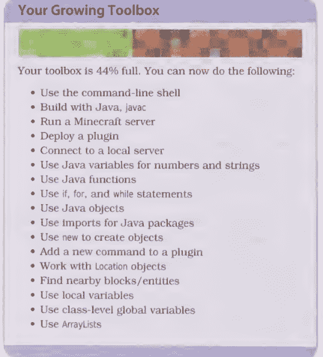

## 使用变量堆：HashMap

> 在这一章中，我们将数据堆和插件结构上变得更高级一些，并为你的工具箱添加这些功能：

* 在哈希（hashes）中保留大量数据
* 使用 `private` 隐藏你的私有数据，使用 `public` 处理其他人应该看到和使用的内容

## 一个 Java HashMap

`HashMap` 是一个有趣的名字。“hash”部分指的是它的内部工作原理；这与你如何使用它完全无关。

但“map”（映射）部分正如你所想的那样：它将一个键（`key`，可以是任何内容）映射到一个值（`value`，也可以是任何内容）。


其他语言可能将其称为字典（dictionary）、关联数组（associative array）或某种类型的关联内存。它们的意思是相同的。在我们看过的简单数组中，你使用整数作为索引。但在 `HashMap` 中，你可以使用任何对象作为键，特别是 `Strings`（见第 102 页的图 7。一个 `HashMap`）。

我们将在插件中频繁地使用它。它是跟踪玩家、你生成的牛或任何你想要记录的东西的绝佳方法。虽然它的工作方式有点像数组，但你使用它的方式并不相同。当我们看数组时，你学会了可以这样通过索引来获取和设置值：

```java
myList[9] = "Andy";
String who = myList[9];
```

## 键值

| Key | Value |
|---|---|
| "Andy" | "www.PragProg.com" |
| "Dave" | "www.PragProg.com" |
| "Steve" | "www.apple.com" |
| "Bill" | "microsoft.com" |

**图 7—一个 HashMap**

但你不能对 `HashMap` 使用那样的赋值和括号表示法。相反，你使用 `put` 和 `get` 函数。不过好处是，现在你可以使用任何内容作为键。在大多数情况下，你可能会使用 `String`。假设你有一个巧妙命名为 `myHash` 的 `HashMap`。

```java
myHash.put("Andy", "www.PragProg.com");
// 作用类似于 myHash["Andy"] = "www.PragProg.com";
```

```java
String myUrl = myHash.get("Andy");
// 作用类似于 myHash["Andy"];
```

现在 `myUrl` 将拥有 "www.PragProg.com" 的值。

`HashMap` 是通过字符串索引存储大量数据的棒方法，就像字典一样。你可以使用 `HashMap` 存储大量属性。这种方法的好处是属性名仅仅是 `Strings`。当插件运行时，你可以添加或删除它们——这用硬编码的函数或变量名很难做到。

让我们玩玩这个。也许你会制作一个实现某种饥饿游戏（Hunger Games）风格的插件，你需要为每个玩家记录分数。使用 `HashMap` 来跟踪每个玩家的分数，如下：

```java
HashPlay/src/hashplay/HashMap.java
HashMap<String, Integer> currentScores = new HashMap<String, Integer>();

public static void buildTower(Player player) {
    Location loc = me.getLocation();
    loc.setX(loc.getY() + 1); // 不在玩家正
    towerMaterials.add(Material.GLASS);
    towerMaterials.add(Material.STONE);
    towerMaterials.add(Material.WOOD);
    for (Material material : towerMaterials) {
        loc.setY(loc.getY() + 1); // 每次向上一个格
        loc.getWorld().getBlockAt(loc).setType(material);
    }
}
```

```java
if (commandLabel.equalsIgnoreCase("arrayclearblocks")) {
    towerMaterials.clear();
}
```

```java
HashPlay/src/hashplay/HashMap.java
HashMap<String, Integer> currentScores = new HashMap<String, Integer>();

public static void addScore(String playerName, int amount) {
    int score = currentScores.get(playerName);
    if (score == null) score = 0;
    score += amount;
    currentScores.put(playerName, score);
}
```

```java
myHash.put("Andy", "www.PragProg.com");
// 作用类似于 myHash["Andy"] = "www.PragProg.com";
```

```java
String myUrl = myHash.get("Andy");
// 作用类似于 myHash["Andy"];
```

```
| Key | Value |
|---|---|
| "Andy" | "www.PragProg.com" |
| "Dave" | "www.PragProg.com" |
| "Steve" | "www.apple.com" |
| "Bill" | "microsoft.com" |
```

```java
HashPlay/src/hashplay/HashMap.java
HashMap<String, Integer> currentScores = new HashMap<String, Integer>();

public static void addScore(String playerName, int amount) {
    int score = currentScores.get(playerName);
    if (score == null) score = 0;
    score += amount;
    currentScores.put(playerName, score);
}
```

```java
int score = currentScores.get(playerName);
if (score == null) score = 0;
score += amount;
currentScores.put(playerName, score);
```

```java
int score = currentScores.get(playerName);
if (score == null) score = 0;
score += amount;
currentScores.put(playerName, score);
```

```java
score += amount;
currentScores.put(playerName, score);
```

[11]

## 第 8 章. 使用变量堆：数组 • 104

注意我们没有从这个函数中返回任何特定值，因为它被声明为 `void`；就像 `main` 函数一样。相反，它修改了全局的 `currentScores`。但在大多数情况下，你可能想要返回值的函数。例如，有一个简单的短易函数可以给任何数字加 10。

```java
public static int addTen(int originalNumber) {
  int newNumber = originalNumber + 10;
  return newNumber;
}
```

```java
int score = currentScores.get(playerName);
if (score == null) score = 0;
score += amount;
currentScores.put(playerName, score);
```

```java
int score = currentScores.get(playerName);
if (score == null) score = 0;
score += amount;
currentScores.put(playerName, score);
```

```java
int score = currentScores.get(playerName);
if (score == null) score = 0;
score += amount;
currentScores.put(playerName, score);
```

```java
score += amount;
currentScores.put(playerName, score);
```

```java
int score = currentScores.get(playerName);
if (score == null) score = 0;
score += amount;
currentScores.put(playerName, score);
```

```java
int score = currentScores.get(playerName);
if (score == null) score = 0;
score += amount;
currentScores.put(playerName, score);
```

```java
int score = currentScores.get(playerName);
if (score == null) score = 0;
score += amount;
currentScores.put(playerName, score);
```

```java
score += amount;
currentScores.put(playerName, score);
```

```java
int score = currentScores.get(playerName);
if (score == null) score = 0;
score += amount;
currentScores.put(playerName, score);
```

```java
int score = currentScores.get(playerName);
if (score == null) score = 0;
score += amount;
currentScores.put(playerName, score);
```

```java
int score = currentScores.get(playerName);
if (score == null) score = 0;
score += amount;
currentScores.put(playerName, score);
```

```java
score += amount;
currentScores.put(playerName, score);
```

## 栈 vs 堆 (Heap)

你可能注意到，有时我们会创建并直接将一个简单的值赋值给变量，例如 `int a=25`，而有时我们会使用 `new` 关键字来创建一个对象，比如一个插件。

这两种不同的对象存储方式不同。像整数和浮点数这样的即时值存储在 Java 正在调用的函数调用列表中该列表被称为**栈（stack）**。它就像一叠煎饼。每次新的函数调用都会在栈上堆上一块新煎饼，当调用完成时，你就移除那块煎饼，并回到上一个。当一个函数结束时，它的“煎饼”就会被丢弃，它的任何局部变量都会随之消失。

但你通过 `new` 创建的对象被存储在一个巨大的内存池中，我们称之为**堆（heap）**。如果你希望的话，它们可以在你的函数执行后仍然存在（比如插件）。

你只需要在某处保留一个变量指向你的对象；该变量可以是局部的并传递，也可以是全局的。Java 会跟踪有多少个不同的变量引用了用 `new` 创建的对象。当没有再使用该对象时，它就会被扔进垃圾桶。然后当系统觉得时，它会清空垃圾桶，你的对象就消失了。（Java 甚至称之为“垃圾回收”。）

换句话说，如果你正在使用一个只有你应该使用的函数或内容，请将其标记为 `private`（私有），以确保外部没有人可以使用它。你为什么要这样做呢？

假设在你的插件的某处，你有一个函数可以将玩家标记为超级的、高级的、超强巫师（über-Wizard）。你不希望任何其他插件对你的玩家调用该函数。因此，通常情况下你会在插件中像这样声明该函数（省略所有其他部分）：

```java
public class WizardWorld extends JavaPlugin {

    public void makeSuperUberHighWizard(Player p) {
        ...
    } // 任何其他插件都可以调用 makeSuperUberHighWizard()
}
```

相反地，你可以将其设置为 `private`，如下所示：

```java
public class WizardWorld extends JavaPlugin {

    private void makeSuperUberHighWizard(Player p) {
        ...
    } // 只有这里的函数可以调用 makeSuperUberHighWizard()
}
```

# 第 8 章. 使用变量堆：HashMap • 106

通常情况下，如果你正在编写一个在该插件内部使用的函数，或者其他插件不应该直接调用它，那么就将其设置为 `private`。

如果你想让其他插件看到并使用它，请将其设置为 `public`。

我们现在开始为我们的辅助函数使用 `private`。

## 插件：命名告示牌 (NamedSigns)

让我们把这些想法结合起来，制作一个插件，该插件将使用辅助函数（带和不带返回值的）、私有函数和变量、一些底层数组访问，以及一个存储名称和位置的哈希表（hash）。

这个插件允许你在游戏中创建告示牌并为它们命名。然后你可以通过名称在任何一个告示牌上放置文本。例如，假设我通过在聊天窗口中输入以下命令创建了两个告示，分别命名为 `one` 和 `two` 的告示牌：

- /signs new one
- /signs new two
- /signs set one Hello!
- /signs set two Goodbye!

我会看到类似这样的效果：


现在我只需通过发布另一个 `signs set` 命令即可随意更改任何一个告示牌的文本，如下：

- /signs set two Adios!

让我们先从插件的完整面貌开始，然后看看那些有趣的部分。

NamedSigns/src/namedsigns/NamedSigns.java

```java
package namedsigns;
```

```java
import java.util.HashMap;
import java.util.Iterator;
import java.util.Map;
import java.util.logging.Logger;
import org.bukkit.Location;
import org.bukkit.Material;
import org.bukkit.block.Block;
import org.bukkit.sign.Sign;
import org.bukkit.command.Command;
import org.bukkit.command.CommandSender;
import org.bukkit.entity.Player;
import org.bukkit.plugin.Plugin;
import org.bukkit.plugin.java.JavaPlugin;
```

```java
public class NamedSigns extends JavaPlugin {
    private static Logger log = Logger.getLogger("Minecraft");
    private static Map<String, Location> signs = new HashMap<String, Location>();
```

```java
    private void sendMessage(Player me) {
        me.sendMessage("Usage: signs new name");
        me.sendMessage("signs set name message");
    }
```

```java
    private boolean parseArgs(Player me, String [] args) {
        if (args.length < 2) {
            usage(me);
            return false;
        }
        if (args[0].equalsIgnoreCase("new")) {
            return makeNewSign(me, args);
        }
        if (args[0].equalsIgnoreCase("set")) {
            if (args.length < 3) {
                usage(me);
                return false;
            }
            return setSign(me, args);
        }
        return false;
    }
```


```java
// signs new sign_name
private boolean makeNewSign(Player me, String[] args) {
    Location loc = me.getLocation();
    loc.setX(loc.getX() + 1); // Not 
    Block block = loc.getWorld().getBlockAt(loc);
    signs.put(args[1], loc);
    block.setType(Material.SIGN_POST);
    log.info("Made new sign " + args[1]);
    return true;
}
```

```java
// signs set_name
private boolean setSign(Player me, String[] args) {
    String name = args[1];
    String msg = args[2];
    if (!signs.containsKey(name)) {
        me.sendMessage("No sign named " + name);
        return false;
    }
    Location loc = signs.get(name);
    Sign sign = (Sign) loc.getWorld().getBlockAt(loc);
    sign.setLine(0, msg);
    sign.update();
    log.info("Set sign " + name + " to " + msg);
    return true;
}
```

```java
public boolean onCommand(CommandSender sender, Command command, String[] args) {
    String commandLabel = command.getName();
    if (commandLabel.equalsIgnoreCase("signs")) {
        if (sender instanceof Player) {
            Player me = (Player) sender;
            return parseArgs(me, args);
        }
    }
    return false;
}
```

## signs HashMap

首先，我们设置了一个名为 `signs` 的 `HashMap`，用于通过名称（`String`）跟踪 `Location`。当我们创建一个新告示牌时，将其位置放入哈希表，使用用户提供的名称。当我们设置告示牌文本时，从哈希表中取出该位置。

## parseArgs 函数

由于用户输入命令时有几点需要检查，我们将其拆分到一个函数中，而不是直接写在 `onCommand` 中。

注意我们使用了 `onCommand` 中的一个之前未使用的参数：`String[] args`。这些是玩家在聊天窗口中输入的任何参数。例如，如果我输入 `/signs`，这将作为 `commandLabel` 传递给 `onCommand`，`args` 将为空（长度为 0）。如果我输入 `/signs set Hello!`，我们知道 `args` 数组至少有两个值：“set Hello”。所以如果没有至少两个值，我们将向玩家发送一条友好的消息并返回 `false`。

记住在处理数组时，你必须检查长度是否足够；否则你会收到来自服务器的长长错误信息，其结果类似于：

```
Caused by: java.lang.ArrayIndexOutOfBoundsException: 1
nat namedsigns.NamedSigns.makeSign(NamedSigns.java:26)
at namedsigns.NamedSigns.onCommand(NamedSigns.java:47)
at org.bukkit.command.PluginCommand.execute(PluginCommand.java:44)
... 15 more
```

这些是主要部分：

- 静态 `HashMap` ①

- 不返回（`void`）的私有辅助函数 ② 该函数向玩家打印用法信息。

- 返回 `true` 或 `false` (`boolean`) 的私有函数 ③ 该函数将创建新告示牌。

- 返回 `true` 或 `false` (`boolean`) 的私有函数 ⓓ 该函数将更改现有告示牌的名称。

- `args` 数组长度检查。由于用户可能没有足够的单词，我们必须检查长度，否则指示错误。

- 一些魔法。这是 Bukkit 文档说明从 `org.bukkit.Block` 获取 `org.bukkit.Sign` 对象的方法。

放心地，因为我们在 `args` 数组中至少有两个值可以操作。

## "/signs new" 命令

这里是处理 "new" 命令的部分：

```java
// NamedSigns/src/namedsigns/NamedSigns.java
// signs new sign_name
private boolean makeNewSign(Player me, String[] args) {
    Location loc = me.getLocation();
    loc.setX(loc.getX() + 1); // 不在玩家正上方
    Block block = loc.getBlock().getHighestBlockAt(loc);
    signs.put(args[1], block.getLocation());
    block.setType(Material.SIGN_POST, args[1]);
    log.info("Made new sign named " + args[1]);
    return true;
}
```

首先，我们获取玩家旁边一个方便的方块（`getX() + 1`），并通过 `getHighestBlockAt()` 获取该位置最高的方块。这样我们就不会把牌子放在水下、基岩或其他任何地方。

接下来，我们使用玩家提供的名称（`args[1]`）将该区块的位置保存到哈希表（hash）中。

最后，我们将该方块的类型保存为 `Material.SIGN_POST`。现在它是一个牌子了。

## "/signs set" 命令

这里是处理 "set" 命令的部分：

```java
// NamedSigns/src/namedsigns/NamedSigns.java
// signs set sign_name_line
private boolean setSign(Player me, String[] args) {
    String name = args[1];
    String msg = args[2];
    if (!signs.containsKey(name)) {
        // 没有此命名的牌子
        me.sendMessage("No sign named " + name);
        return false;
    }
    Location loc = signs.get(name);
    Sign sign = (Sign) loc.getWorld().getBlockAt(loc).getState();
    sign.setLine(0, msg);
    sign.update();
    log.info("Set sign named " + name + " to " + msg);
    return true;
}
```

接下来，注意我们将两个本地变量 `name` 和 `msg` 分别赋值为 `args[0]` 和 `args[1]`。为什么要此此呢？它们不是一回事吗？是的，它们是一样的，但读取 `name` 要比读取 `args[1]` 并尝试记住 `1` 代表名称、`2` 代表消息要容易得多。

接下来，我们将检查哈希表中是否确实存在 `name` 对应的条目，如果没有，我们将向玩家报错。否则，我们就可以安全地获取牌子方块的位置。

接下来是神奇的部分。我们可以获取正确位置的方块，但它仍然是一个方块——一个 `org.bukkit.block.Block`。`Block` 并不知道任何关于 `Sign` 的的功能。`Sign` 是 `Block` 的一种，所以我们必须说服 Java 将其转换为一个 `org.bukkit.block.Sign`。

Bukkit 文档告诉我们对方块调用 `getState()`，然后使用转换操作符将其转换为一个真正的牌子。拿到 `sign` 变量后，我们可以调用需要的两个牌子函数：`setLine()` 和 `update()`。

`setLine()` 在指定的索引（在此情况下为 0）处在牌子上放置一行文本，而 `update()` 则确保在客户端重绘牌子，这样你就能看到新文本了。

这看起来有很多代码，但如果你一次看每一个部分，其实并不难。事实上，现在轮到你来一些更改了。

## 亲自尝试一下

按照目前的写法，插件只设置牌子的第一行，但每个牌子最多可以有四行。修改牌子，使得如果用户输入额外的单词，你会将每个单词传递给 `sign.setLine()`。记住：如果它可以容纳四行，那么它们的编号就是 0, 1, 2 和 3。我们已经有了 `setLine()`，所以如果 `args` 足够长，你就需要添加其他的。

## 下节预告

在本章中，我们学习了如何使用 `HashMap` 来根据名称或其他对象来跟踪重要的游戏数据，以及如何将函数设置为 `private` 以便其他插件无法访问，或者设置为 `public` 以便可以访问。

在下一章中，我们将做的不仅仅是响应用户命令。我们将学习如何监听 Minecraft 服务器并在游戏事件发生时做出响应，甚至创建一些自己的事件。

## 你不断增长的工具箱

你的工具箱已经填充了 50%。你现在可以执行以下操作：

- 使用命令行 shell
- 使用 Java, `javac` 进行编译
- 运行 Minecraft 服务器
- 部署插件
- 连接到本地服务器
- 使用 Java 变量处理数字和字符串
- 使用 Java 函数
- 使用 `if`, `for`, 和 `while` 语句
- 使用 Java 对象
- 使用 `imports` 导入 Java 包
- 使用 `new` 创建对象
- 为插件添加新命令
- 处理 `location` 对象
- 寻找附近的方块/实体
- 使用本地变量
- 使用类级全局变量
- 使用 `ArrayList`
- 使用 `HashMap`
- 使用 `private` 和 `public` 控制可见性

## 在 Minecraft 中修改、生成和监听

通过这一章，你将为工具箱添加这些能力：

- 修改世界中的方块
- 修改并生成新实体
- 监听并响应游戏事件
- 管理插件权限

这太棒了！现在你拥有了大部分基础的——（等等，纠正：现在你拥有了大部分基础能力！）

玩家的各个侧面，加上下方的一个块和上方的一个块。总共应该是十个块，如图所示。


根据玩家的位置，我们知道这些块中每一个的放置位置。因此，我们需要十组坐标，每组坐标相对于玩家的基础块都有偏移。我们需要一个列表的列表。

这就是你接下来将看到的。它是一个包含十个元素的 `int` 数组，每个元素都是一个包含三个偏移量的 `int` 数组，分别对应 x、y 和 z 值：

```java
// Stuck/src/stuck/Stuck.java
int[] offsets = {
  // X, Y, Z
  {0, -1, 0},
  {0, 2, 0},
  {1, 0, 0},
  {1, 1, 0},
  {-1, 0, 0},
  {-1, 1, 0},
  {0, 0, 1},
  {0, 1, 1},
  {0, 0, -1},
  {0, 1, -1}
};
```

我们将使用一个简单的循环来遍历这个偏移列表。列表中的第一个元素索引为 0，我们将一直循环到（但不包含）列表的长度。通过使用 `offsets` 列表的长度而不是固定一个数字（如 10），如果我们想向列表中添加额外的块时，操作会变得更容易（记住我们在前面的代码中已经添加了玩家、playerY 和 playerZ 的偏移量）：

```java
// src/stuck/Stuck.java
for (int i = 0; i < offsets.length; i++) {
    int x = offsets[i][0];
    int y = offsets[i][1];
    int z = offsets[i][2];

    Block b = world.getBlockAt(x + playerX, y + playerY, z + playerZ);
    b.setType(Material.STONE);
}
return true;
```

现在我们正在遍历偏移列表。在每个索引（即 `i`）处，我们需要提取出 `x`、`y` 和 `z` 这三个元素。在每个小数组中，`x` 都在索引 0 处。Java 语法允许通过先写出大列表来处理数组数组。将这些数字想象成一个表格或矩阵，具有行和列，就像你在 Excel 表格中看到的那样。你以“行主序”指定索引，这意味着先是行，后是列。在每次循环循环中，我们都会从列表中选出一个 `x`、`y` 和 `z` 值。这就是我们想要变成石头的块的位置。

我们获取该位置上我们需要的块——在这种情况下，通过将 `x`、`y` 和 `z` 偏移量加到玩家的位置（代码中的 `playerX`、`playerY` 和 `playerZ`）。获取该块后，只需使用常量 `Material.STONE` 将其材质设置为石头即可。所有的材质类型都列在 `org.bukkit.Material` 的文档中。例如，你可以在不破坏块的情况下移除它——你只需将块的材质设置为 `Material.AIR`。

这里是完整插件的代码合集：


# 第9章. Minecraft 中的修改、生成与监听

## Stuck 插件示例

```java
src/stuck/Stuck.java
package stuck;

import org.bukkit.Location;
import org.bukkit.Material;
import org.bukkit.World;
import org.bukkit.block.Block;
import org.bukkit.command.Command;
import org.bukkit.command.CommandSender;
import org.bukkit.entity.Player;
import org.bukkit.plugin.Plugin;
import org.bukkit.plugin.java.JavaPlugin;

public class Stuck extends JavaPlugin {
    public boolean onCommand(CommandSender sender, Command command,
    String commandLabel, String[] args) {
        if (commandLabel.equalsIgnoreCase("Stuck")) {
            if (args.length == 1) {
                Player player = getServer().getPlayer(args[0]);
                if (player != null) return stuck(player);
            } else {
                sender.sendMessage("Usage: /stuck playerName");
            }
        }
        return false;
    }
    public boolean stuck(Player player) {
        World world = player.getWorld();
        Location loc = player.getLocation();
        int playerX = (int) loc.getX();
        int playerY = (int) loc.getY();
        int playerZ = (int) loc.getZ();
        loc.setX(playerX + 0.5); loc.setY(playerY); loc.setZ(playerZ + 0.5);
        player.teleport(loc);

        int[][] offsets = {
            {0, -1, 0},
            {0, 2, 0},
            {1, 0, 0},
            {1, 1, 0},
            {-1, 0, 0},
            {-1, 1, 0},
            {0, 0, 1},
            {0, 1, 1},
            {0, 0, -1},
        };

        for (int i = 0; i < offsets.length; i++) {
            int x = offsets[i][0];
            int y = offsets[i][1];
            int z = offsets[i][2];
            Block b = world.getBlockAt(x + playerX, y + playerY, z + playerZ);
            b.setType(Material.STONE);
        }
        return true;
    }
}
```

编译并部署该插件并尝试一下。如果玩家站在地上还是在空中，会如何？从玩家的角度看，它看起来是什么样的？

### 你自己尝试

在 `Stuck` 插件中，我们用最少的块包裹了玩家。但从外面看，它的形状很奇怪。

所以这里你需要做的是：添加块，使玩家封装在一个宽 3 块、深 3 块、高 4 块的实体矩形内。将额外的块添加到列表中。

## 修改实体

你可能注意到所有这些方法都定义在 `LivingEntity` 中。这让 Java 变得有点复杂。熟悉的实体包含了许多不同的父类。例如，`Cow` 既是 `Animals`，也是 `Ageable`、`Creature`、`LivingEntity`、`Damageable` 对象，当然还有 `Entity`。这意味着你可以使用所有父类的方法。因为 `Cow` 继承自 `Ageable`，你获得了更改其年龄的方法——让它变成婴儿或成年、让它繁殖等。

相反，`Player` 不使用 `Ageable`，所以你无法把玩家变成婴儿。相反，`Player` 有另一套完全不同的方法，包括更改天气、时间以及玩家的经验等级、食物库存等。

## 生成实体

你可以使用多种方法来生成不同的实体和生物，以及游戏对象——例如末珍珠。要在世界中创建新事物，我们将使用在 `org.bukkit` 中定义的方法。有几种实用的生成方法，取决于你要制作什么以及你如何指定它：

- `spawn(Location location, Class whatTo)` 是我们之前生成鱿鱼时。你可以通过在类名上使用类函数来获取传递的类，例如：`Cow.class`。

- `spawnArrow(Location location, Vector velocity, 0.6, 12)` 返回一个新的箭。硬编码数字 0.6 和 12 似乎让箭飞行得良好。

- `spawnCreature(Location loc, CreatureType type)` 返回一个 `LivingEntity`。

- `spawnEntity(Location loc, EntityType type)` 用于非生物实体；它返回一个 `Entity`。

- `spawnFallingBlock(Location location, Material material, byte data)` 意味着“当心下方”。你传入的 `data` 取决于材料。

- `strikeLightning(Location loc)` 让你投掷出闪电，如果你想当宙斯的话。

## 插件：FlyingCreeper

这是一个展示了如何生成两个实体的插件：一只蝙蝠和一个苦力爬。让苦力爬骑在蝙蝠上，然后使用药水效果让蝙蝠隐形。结果就是一个噩梦般的、恐怖的、飞行的苦力爬。

以下是插件的核心代码：

```java
FlyingCreeper/src/flyingcrereeper/FlyingCreeper.java
Location loc = player.getLocation();
loc.setY(loc.getY() + 5);
Bat bat = player.getWorld().spawn(loc, Bat.class);
Creeper creeper = player.getWorld().spawn(loc, Creeper.class);
bat.setPassenger(creeper);
PotionEffect effect = new PotionEffect(
EffectType.INVISIBILITY,
Integer.MAX_VALUE,
1);
bat.addPotionEffect(effect);
```

注意，我们使用的是刚刚看到的第一个 `spawn` 版本，我们传入了一个位置和一个类——在这种情况下是 `Bat.class` 和 `Creeper.class`。

所有的 `Entity` 对象都有一个 `setPassenger()` 函数。理论上，你甚至可以骑在点燃的 `TNT` 上。但不建议这样做。我们将通过设置蝙蝠的乘客为苦力爬，让苦力爬骑在蝙蝠上。

接下来我们需要让蝙蝠隐形，让飞行的苦力爬看起来更真实。幸运的是，所有的 `LivingEntity` 对象都可以使用药水效果。我们创建一个新的药水效果，允许指定效果类型、持续时间和强度：

`PotionEffect(EffectType type, int duration, int amplifier)`

在这种情况下，类型是 `EffectType.INVISIBILITY`，我们希望它永远存在，所以我们将持续时间设置为最大值：`Integer.MAX_VALUE`。没有更大的整数了。在这种情况下，强度并不重要，因为你无法变得“更隐形”，所以我们直接用 1 即可。

- 3. 所有药水效果类型都列在 http://jd.bukkit.org/rb/doxygen/d3/d70/class-org_1_bukkit_1_potion_1_PotionType.html。

最后，我们将那个新药水加入蝙蝠，它就隐形了。

恭喜你！你现在是飞行苦力爬的自傲主人。祝你好运，保持低空飞行。


作为额外奖励，你可以回去修改 `SquidBomb`，让它生成大量的隐形苦力爬而不是乌鱼。那会很有趣的。

在下一节中，我们将看到更多修改和生成实体的例子，一旦我们学会了如何监听游戏事件。

## 监听事件

现在到了最棒的部分。你已经知道如何为用户输入的命令编写代码，也知道如何操作来影响世界。现在是时候看看如何监控世界中发生了什么了，这样你就可以自动响应游戏，而无需输入命令或其他操作。

它的工作原理是：你设置好代码，当某些有趣的事件发生时，你的函数会被调用。在你的函数中，你可以让事件发生，也可以停止它们。

我们将从在主插件中直接监听事件开始。在下一章中，我们将查看如何将其拆分为独立的类和源代码文件。

以下是为了整合监听器而在基础插件中需要添加的骨架。它包含四个部分：

- 1. 导入监听器。

- 2. 声明你的插件实现 `Listener`。

- 3. 使用 `registerEvents` 注册监听事件。

- 4. 添加魔法标签 `@EventHandler` 来将你的函数标记为事件处理器，并将你想要的事件作为参数列表。

你在这个监听器的简短示例骨架中看到所有四个部分：

```java
import org.bukkit.plugin.java.JavaPlugin;
import org.bukkit.event.Listener;
import org.bukkit.event.EventHandler;
// // 这里是某种类型的事件 //
```

```java
// 在这里添加 'implements Listener':
public class HelloWorld extends JavaPlugin implements Listener {}
```

```java
public void on() {
    // 注册此插件以监听事件
    getServer().PluginManager().registerEvents(this, this);
}
```

```java
// 这里有一个事件监听器：
@EventHandler
public void anyname(SomeEvent event) {
    // 这里写一些代码
}
```

首先，你必须导入你感兴趣的事件类（你会在第 1 点附近添加它）。

有很多可用事件，都列在 Bukkit 文档的 `org.bukkit.event` 下。假设你感兴趣在游戏中每有人传送时做些事情。你会使用 `EntityTeleportEvent` 类，所以第一件事就是导入 `org.bukkit.event.entity.EntityTeleportEvent`。

然后插件的声明需要添加 `implements Listener` 这几个魔法单词，如第 2 点所示。

```java
public boolean equalsIsh(Location loc1, Location loc2) {
    return ((int) loc1.getX()) == ((int) loc2.getX()) &&
           ((int) loc1.getZ()) == ((int) loc2.getZ());
}
```

```java
@EventHandler
public void onTeleport(PlayerTeleportEvent event) {
    Player player = event.getPlayer();
    if (isTeleporting.contains(player)) {
        isTeleporting.remove(player);
    } else {
        Stack<Location> locs = playerTeleports.get(player.getName());
        if (locs == null) {
            locs = new Stack<Location>();
        }
        locs.push(event.getFrom());
        locs.push(event.getTo());
        playerTeleports.put(player.getName(), locs);
    }
}
```

```java
public boolean onCommand(CommandSender sender, String command,
    String commandLabel, Case(String[]) args) {
    if (commandLabel.equalsIgnoreCase("back")) {
        if (sender instanceof Player) {
            Player player = (Player) sender;
            Stack<Location> locs = playerTeleports.get(player.getName());

            if (locs == null && !locs.empty()) {
                Location loc = locs.peek();
                while (equalsIsh(loc, player.getLocation()) && locs.size() > 1) {
                    locs.pop();
                    loc = locs.peek();
                }
                isTeleporting.add(player);
                player.teleport(loc);
                return true;
            } else {
                player.sendMessage("You have not teleported yet.");
            }
        } else {
            sender.sendMessage("You must be a player to use this command.");
        }
    }
    return false;
}
```

由于此插件使用了事件监听，这里我们需要做一些特殊操作：

- 在 1 处，声明此插件实现了 `Listener` 接口。

- 在 2 处，注册插件的事件。

- 在 3 处添加 `@EventHandler` 注解，并声明此事件监听器将监听 `PlayerTeleportEvent`。

每当玩家传送时，`onTeleport` 函数就会被调用。我们做的第一件事是获取正确的 `Player` 对象，它存储在传递给我们的事件中。现在我们知道处理的是谁了。

接下来，我们在查找名为 `playerTeleports` 的列表，看看该玩家是否是正正在传送的对象。你问 `isTeleporting` 是什么？

啊，看看插件上方第 2 附近的地方，你会看到两个声明为 `private static` 的变量。这意味着没有其他人能看到它们，而且这些值在运行期间会保持不变。因此，我们有了 `isTeleporting` 和 `playerTeleports` 来跟踪玩家以及他们传送的位置。

我们正在检查 `isTeleporting` 列表是否已经包含了该玩家。如果还没有，我们就添加它——这个玩家刚刚开始传送。如果 `isTeleporting` 列表已经包含了该玩家，我们应该忽略这个事件（并将玩家从列表中移除）。这意味着该事件是由我们自己生成的，我们不希望自己的传送再次触发传送，因为那样会陷入无限循环。所以我们丢弃了这个额外的传送事件。

如果该玩家以前传送过，我们将使用玩家作为键，从 `playerTeleports` 哈希表（位置的哈希表）获取获取 `loc`。我们将此位置添加到现有列表中。如果这是玩家第一次传送，我们将创建一个新列表（`Locations` 列表）并将其作为第一个条目。

但这不是普通的列表。它确实是一种列表，但它是 `Stack`（栈），而不是普通的列表。栈的工作原理就像一叠煎饼。你向栈的顶部添加煎饼，当你取走一个煎饼时，它从栈的顶部取下。这就是我们用于传送位置列表的模型。当你传送时，每个位置都会被添加到栈顶——而你下一个想要返回的地方就是栈顶，然后是下面一个，依此类推。

要将对象添加到栈顶，需要使用 `push` 方法。要获取值并移除栈顶的对象，需要使用 `pop` 方法。如果只想检查栈顶的值而不将其移除，可以使用 `peek` 方法。


# 第9章. Minecraft 中的修改、生成与监听

因此，当玩家四处传送时，我们为他们的每个传送位置都维护一个栈，存储在 `playerTeleports` 变量的 `Stack` 中，我们可以使用 `Player` 对象作为键来获取。你可以从下面的图中看到样子。

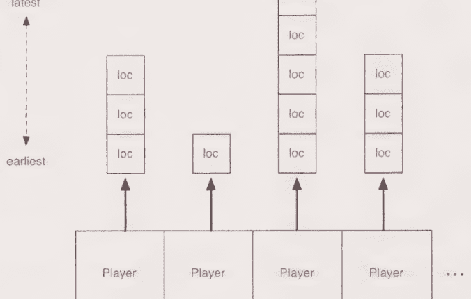

图 9—`playerTeleports` 是一个以 `Player` 为键、`Stack` 为值的哈希表。

`player_teleports` 是一个以 `Player` 为键、`Stack` 为值的哈希表。

最后，我们处理 `onCommand`。当我们接收到 `back` 命令时，我们将获取玩家的传送位置列表（如果有的话），并查看栈顶的位置，暂时将其保存在 `loc` 中。

也许是玩家第一次传送，我们将创建一个新的列表（`Locations`）并将其作为第一个条目。

但这不是普通的列表。它确实是一种列表，但它是 `Stack`，而不是普通的列表。栈的工作原理就像一叠煎饼。你向栈的顶部添加煎饼，当你取走一个煎饼时，它从栈的顶部取下。这就是我们用于传送位置列表的模型。当你传送时，每个位置都会被添加到栈顶——而你下一个想要返回的地方就是栈顶，然后是下面一个，依此类推。

要将对象添加到栈顶，需要使用 `push` 方法。要获取值并移除栈顶的对象，需要使用 `pop` 方法。如果只想检查栈顶的值而不将其移除，可以使用 `peek` 方法。

## 现在我们说的“靠近它”是什么意思 [第 142 页]

在编写插件时，你可能想要限制你创建的命令——也许只有管理员才能运行。例如，假设你想将命令限制为一组玩家。我们将发明一个名字，叫它 `FireBow.enable`。

你随后可以使用 `Player` 的 `hasPermission` 函数来判断当前玩家是否属于其中：

```
player.hasPermission("FireBow.canEnable")
```

这将根据玩家是否拥有该权限返回 `true` 或 `false`。

在我们的 FireBow 插件中，它看起来这样的：

```java
if (commandLabel.equalsIgnoreCase("firebow") &&
player.hasPermission("FireBow.canEnable")) {
  enabled = true;
  return true;
}
```

命令字符串是 `firebow`，我们将设置必要的变量。否则，就像玩家根本没有输入该命令一样。

你也可以将该逻辑分开处理，并且在没有权限的情况下采取其他操作：

### 检查权限

如果你运行一个拥有许多用户的大服务器，设置和管理权限可能是一件大事。你可能会在服务器的 `permissions.yml` 文件中设置组或用户类，或者使用额外的插件来帮助管理用户。

但对于开发插件和测试，你可以直接在 `permissions.yml` 中指定权限，或者使用一个管理基础权限的插件，例如 PermissionsBukkit。⁵

PermissionsBukkit 插件增加了许多游戏内命令，用于设置玩家权限并检查某人的拥有权限：

- `/permissions player setperm <player> <world:node> [true|false]`
- `/permissions check <node> [player]`

例如，在我们的插件中，给 jack33 使用我们 `/firebow` 命令的权限，你会在控制台输入以下命令：

- `/permissions player setperm jack33 FireBow.canEnable true`

查看 Bukkit 文档获取更多详情。

⁵ 5. 位于 http://dev.bukkit.org/bukkit-plugins/permubukkit

## 下一节预告

在本章中，我们获取了许多新能力：你现在可以修改 Minecraft 方块并生成实体，管理插件权限，最重要的一点是，监听游戏中发生的有趣事件并做出响应。这正是插件的核心所在——通过在事件发生时自动采取行动，来改变 Minecraft 世界的工作方式。

在下一章中，我们将学习如何为未来调度事件，并制作一个爆炸牛射击器。我们下节见。

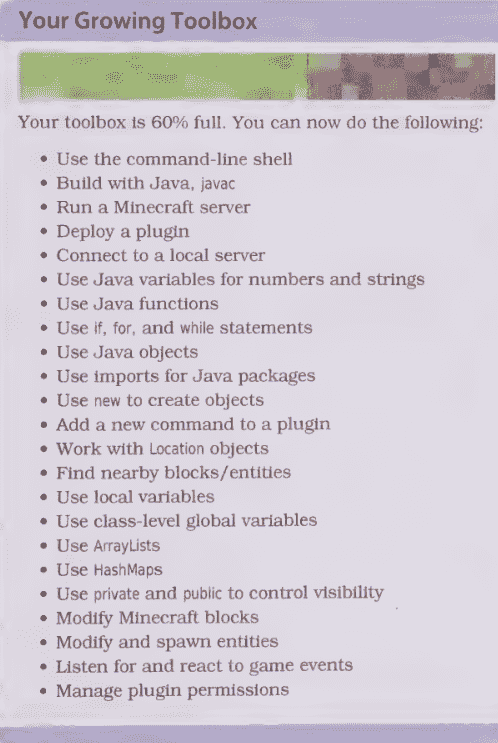

## 安排稍后任务

> ### 你的工具箱
>
> 在本章中，你将学习更多关于对象、类以及稍后运行的任务调度。你将把这些知识加入你的工具箱：
>
> * 如何创建一个独立的类
> * 如何调度一个任务对象在稍后运行
> * 如何调度一个任务对象稍后持续运行
>
> 你的工具箱现在几乎完成了。你现在可以根据目前所学的内容编写一些非常酷的插件了。

现在我们讨论如何在 Minecraft 中实现某些不是直接响应事件或用户命令的事情：如何调度在未来某个时间发生——甚至持续运行的任务——完全独立运行。这个功能可以帮助你实现那些看起来是自动运行的功能，比如攻击苦绿或其他敌人。

在 Java 方面，你还将看到如何在单独的文件中创建你自己的类，我们将看看 Java 在同时运行多个任务时遇到的一些问题。

## 在什么时候会发生什么？

当我们谈论“稍后”运行某些东西时，它揭露了一个残酷的真相：世界并不会因为你的代码正在运行就停止变化。计算机可以同时做多件事，并且一直都在这样做。但大多数代码并不是那样写的。

回想一下我们到目前看过的某些插件。如果在运行那段代码的中途中，另一个玩家输入了相同的命令，导致该代码从头开始运行，会发生什么？

请看下面的图。每个箭头和代码片段代表计算机正在同时运行的一组指令。我们将每一组独立的指令称为一个**线程**（thread）——就像小说中副情节的线索，或者像午餐时许多对话中的某一段对话的线索。

```java
if (commandLabel.ignoreCase("sky")) {
  if (sender.instanceof Player) {
    Player me = (Player)sender;
    Location loc = me.getLocation();
    double y = loc.getY();
    loc.setY(y+50);
    me.teleport(loc);
    return true;
  }
  return false;
}
```

```java
if (commandLabel.ignoreCase("sky")) {
  if (sender.instanceof Player) {
    Player me = (Player)sender;
    Location loc = me.getLocation();
    double y = loc.getY();
    loc.setY(y+50);
    me.teleport(loc);
    return true;
  }
  return false;
}
```

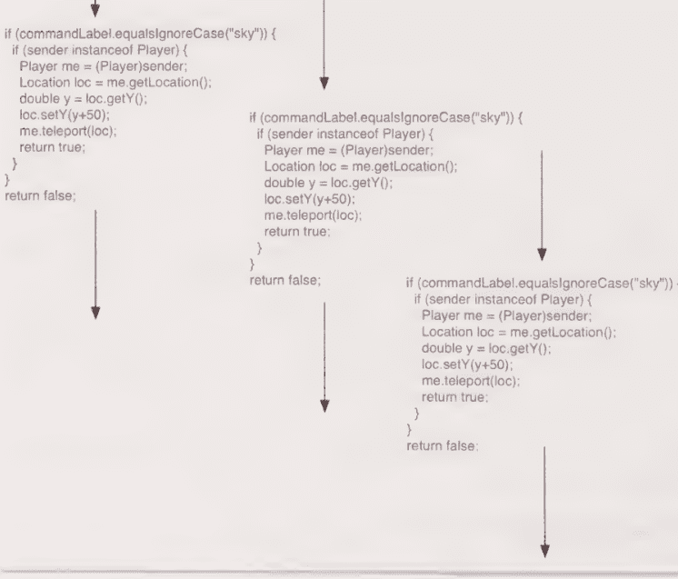

通常情况下你认为计算机只运行一次你的代码，如图表左侧所示。你会认为计算机从上到下一个接一个地执行指令，同时没有没有其他事情在发生。那将是一个执行线程（就像一段对话）。

但事实并非如此；计算机可能正在运行许多不同的执行线程，显然都是同时运行的。我们的代码能以这种方式工作吗？如果我们的代码被多个线程运行，会发生什么？

如果你只使用局部变量，并且没有尝试更改 Minecraft 世界中的任何公共内容，那可能没问题——每个正在运行的代码版本都会拥有它自己的变量副本，不会造成损坏。但如果你在使用静态变量，比如一个用来跟踪玩家和值的巨大 `HashMap` 呢？那么你就有两段代码同时对其进行读取和写入，这通常会导致灾难。

设想一下，你在一个线程中读取玩家的血量为 50，但随后第二个线程将其设置为 0——杀死了玩家。你并不知道这一点，于是从玩家血量中减去 10 并将其重置为 40。现在另一个线程认为它已经杀死了玩家，但血量不是 0，而是被“魔法般”地设置成了 40！这是一个简单无害的例子，但可能会发生糟糕糟糕，导致奇怪的 Bug 或让你的代码崩溃。

有方法可以编写可以被多线程安全运行的代码；然而，Bukkit 的代码并不是那样构建的。

这一点非常重要，值得重复强调：Bukkit 库以及你使用它的代码并不是为多线程运行而设计的。它会崩溃。

所以，当我们想要“稍后”运行一段代码时，我们并不能真的让它在某个随机时间运行——我们不能让它与我们的代码（或 Bukkit 代码）同时运行。

相反，我们必须让 Bukkit 来决定何时运行代码。然后它运行代码的方式几乎就像是你玩家输入命令或响应游戏内事件一样；它是当时运行的唯一任务。Bukkit 将之为同步任务（synchronous task）。

## 创建一个可运行的任务

这里有一个用于发送广播消息的任务的最简单代码。它可能没做什么用，但你可以将这段代码作为初始模板来创建你自己的任务。

只需在 `run` 函数的体中添加你想要的代码，更改包名，并添加你可能需要的导入包即可。（记住，常用名称列在第 253 页的附录 7“常用导入”中，你也可以在 Bukkit 或 Java 文档找到其他的。）

```java
package examplepackage;
import org.bukkit.Bukkit;
import org.bukkit.plugin.java.JavaPlugin;
import org.bukkit.scheduler.BukkitRunnable;

public class ExampleTask extends BukkitRunnable {
    private final JavaPlugin plugin;

    public ExampleTask(JavaPlugin plugin) {
        this.plugin = plugin;
        // 你可以像我在这里做的那样保留对插件的引用，
        // 或者对传入的任何其他变量的引用
    }

    public void run() {
        // 做一些有趣的事情...
        plugin.getServer().broadcast("Surprise!");
    }
}
```

在这种，你将把这段代码放在它自己的文件中，该文件必须命名为 `ExampleTask.java`（以与 ① 处的行匹配）。

到目前为止很好，但这个看起来很有趣、没有返回值且命名为 `ExampleTask` 的函数——与我们的类名完全相同——是怎么回事？记住，那被称为**构造函数**。那是 Java 在创建新的 `ExampleTask` 时调用的函数。

因此，要创建一个 `ExampleTask`，你必须向 `new` 传递一个 `JavaPlugin`（它会被传递给你的构造函数）。换句话说，你必须给它你的主插件对象。这样这个任务就可以获取它可能需要的所有 Bukkit 内容，如世界、玩家等。

现在你有了一个会执行有趣事情的任务（嗯，某种程度上），你如何调度它呢？

## 调度在之后运行

现在回到你的主插件：一旦你在自己的类中定义了任务，你就可以从主插件中使用 `new` 创建该类的的一个对象，并使用 `runTaskLater()` 设置它在未来的若干个服务器刻（ticks）后运行。

```java
BukkitTask task = new ExampleTask(plugin);
task.runTaskLater(plugin, 20);
```

`plugin` 应该是一个设置为你主插件的变量。如果你在插件的非静态函数中编写此代码，你可以使用 Java 关键字 `this`，它的意思是“这个插件对象”。如果你在静态函数中编写此代码，你需要一个之前已经设置为该插件的静态变量（如 `plugin`）。例如，在像 `onEnable` 这样的对象（方法）中，你将设置 `plugin = this;`。

你可能想要保留 `task` 变量，但这不是必须的。即使不使用它，你也创建了一个 `ExampleTask`，它的 `run` 函数将在现在 20 刻后（大约一秒后）运行。

然而，它只会运行一次，之后再也不会运行。

## 调度持续运行

如果你想要一个任务持续运行，那么你将使用一个稍微不同的调度函数 `runTaskTimer()`。

```java
BukkitTask task = new ExampleTask(plugin);
task.runTaskTimer(plugin, long delay, long period);
```

在这里，你将传递一个持有插件的变量和两个数字。这些数字被声明为 `long`，它是 `long int` 的缩写，意味着它可以是一个非常大的数字。

这将在初始延迟（以服务器刻为单位）后运行给任务，并在再次运行之前等待指定的周期（也以刻为单位）。这样它将一直运行，直到它自己取消（或者你可以取消它）。

我们可以将之前的示例改为延迟 1 秒，然后每分钟运行一次 `ExampleTask`：

```java
BukkitTask task = new ExampleTask(plugin).runTaskTimer(plugin, 20, 1200);
```

按照每秒 20 刻，延迟为 1 秒，周期为 60 秒。

## 插件：CowShooter

现在我们有足够的组件来制作非常有趣的插件：CowShooter。如果你在游戏世界手中有一块皮革，你可以点击向世界射出一只燃烧的牛。当牛撞击地面时，它会爆炸成由火焰、火和汉堡组成的球。

这个插件与我们目前看到的有点不同；完全没有命令部分。它完全由事件驱动。


燃烧牛的一个问题是，它不会永远燃烧下去，甚至持续不了多久。通常情况下，燃烧的牛会着火，然后牛和火都会熄灭。这并不完全符合我们的需求：我们需要牛在飞行过程中一直保持着火焰状态。

为了实现这一点，我们将调度一个任务。只要牛在空中，该任务就会不断重复，在该任务中我们可以保持牛存活并燃烧，直到它撞击地面。

这里是主事件监听器的代码：

```java
CowShooter/src/cowshooter/CowShooter.java
@EventHandler
public void onInteract(PlayerInteractEvent event) {
    if (event.getAction() == Action.LEFT_CLICK_BLOCK ||
        event.getAction() == Action.AIR) {
        final player = event.getPlayer();
        if (player.getItemInHand().getType() == Material.LEATHER) {
            Location loc = player.getLocation();
            Vector vec = loc.getDirection();
            int mult = 3;
            vec.setX(vec.getX() * mult);
            vec.setY(vec.getY() * mult);
            vec.setZ(vec.getZ() * mult);
            final cow = player.getWorld().spawn(loc, Cow.class);
            BukkitRunnable runnable = new CowTask(player.getWorld(), cow);
            runnable.runTaskTimer(this, 0, 20);
        }
    }
}
```

## 我如何获得一块皮革的？

你只需要尝试。

# 下一步计划

在这一章中，你学习了一些 Java 机制，包括如何创建一个新类以及更多关于从类创建对象的知识。但最酷的部分是能够在后台运行持续执行的任务，这让你能够实现一些很酷的功能，比如燃烧的、会爆炸的牛。

接下来，我们将介绍如何保存数据，并在游戏关闭、重启或关闭后仍能记住这些数据。

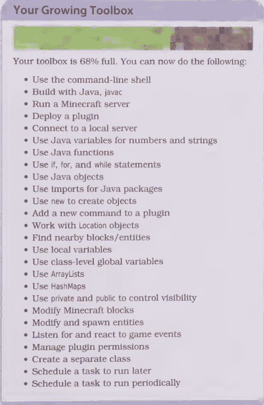

你的工具箱已填充 66%。你现在可以完成以下操作：

- 使用命令行 shell
- 使用 Java, `javac` 进行编译
- 运行 Minecraft 服务器
- 部署插件
- 连接到本地服务器
- 使用 Java 变量处理数字和字符串
- 使用 Java 函数
- 使用 if, `for`, 和 `while` 语句
- 使用 Java 对象
- 使用 `import` 导入 Java 包
- 使用 `new` 创建对象
- 为插件添加新命令
- 处理位置对象
- 寻找附近的方块/实体
- 使用局部变量
- 使用类级全局变量
- 使用 ArrayList
- 使用 HashMap
- 使用 `private` 和 `public` 控制可见性
- 修改 Minecraft 方块
- 修改并生成实体
- 监听并响应游戏事件
- 管理插件权限
- 创建独立的类
- 安排任务稍后运行
- 安排任务定期运行

## 第 11 章

## 使用配置文件和存储游戏数据

## 你的工具箱

现在我们正为你的工具箱增加一些存储能力，并发现一些更高级的 Java 语言特性。你将学习这些技能：

- 从本地文件保存和加载用户可的配置数据
- 从本地文件保存和加载你的私人游戏数据
- 从小的函数构建更复杂的代码
- 理解 Java 文件函数
- 理解 Java 异常和注解

现在我们正进入正题。根据你目前为止学到的内容，你可以监听事件、安排任务稍后运行、在列表或哈希表中保留数据，并且只要服务器运行，你的整个插件就可以使用它们。这让你为构建一些有趣的插件奠定了良好的基础。然而，你还缺少一个关键部分：服务器不是永远运行的。

任何 Minecraft 服务器（包括你的）都可能随时停止运行。你现在已经为了安装插件多次停止过它了！即使你没有安装新插件，硬件也可能崩溃，或者你只是关上了笔记本电脑。一旦服务器停止运行，你的插件就会忘记它曾经知道的一切。它所有数据都消失了。

所以我们需要弄清楚如何将重要数据保存到磁盘的某个地方，以便我们可以经常保存它并在需要时将其加载回来。

## 第 11 章 使用配置文件和存储游戏数据 · 146

如果我们能知道服务器何时关闭，以及我们的插件何时被加载和运行，那将非常方便。遗憾的是，服务器的设置是在这些事件发生时调用你的插件。从 `HelloWorld` 开始，你已经在我们的插件中看到这些入口点了（在过去的两个章节中，我们一直在使用 `onEnable()` 为监听器进行设置）：

```java
public void onLoad() {
    log.info("[HelloWorld] Plugin已加载.");
}
```

```java
public void onEnable() {
    log.info("[HelloWorld] Plugin已启用.")
}
```

```java
public void onDisable() {
    log.info("[HelloWorld] Plugin正在停止.")
}
```

我在第 6 章“添加聊天命令、位置和目标”中描述了这些函数，我们已经用过 `onEnable` 了。现在我们将开始使用 `onDisable()`。为了从磁盘保存和加载插件数据，我们可以同时使用这两个函数：

正如你可能记得的，当你的插件从磁盘加载时，`onLoad()` 会被调用。此时，Minecraft 世界还不存在！但如果你需要在 Bukkit 之前执行一些设置，那么这就是你的机会（尽管我们在这里不需要使用它）。

当服务器关闭或你的插件关闭时，`onDisable()` 会被调用，这就是你保存数据的机会。当服务器启动时，你可以使用 `onEnable()` 函数将数据读回插件中（除了 `onEnable()` 中的任何其他设置——例如，设置监听器）：

你可能关心的有两种不同的数据：

- 配置数据，包含了你需要了解插件应该如何工作的信息。这可能只设置一次且很少更新，但每次插件运行时都会读取它。你可能在其他插件或 Minecraft 服务器设置中使用过配置文件。
- 游戏数据，包含了如玩家分数、背包等随游戏进行而频繁变化的内容。这会变得有点复杂，正如我们很快就会看到的。

让我们来看看这些数据的每种类型以及如何保存和加载它们。

## 使用配置文件

许多插件以及 Bukkit 服务器本身都使用配置文件来精调和自定义不同的值并选择不同的行为。配置文件只是一个简单的文本文件，旨在供人类直接读取和编辑。其理念是你可以自定义插件的某些方面，而无需摆弄源代码或重新编译任何内容。用户、服务器管理员、开发者——每个人都可以使用它们。现在我们将修改一个插件以使用配置文件。之前，在第 82 页，我们构建了一个在你当前位置掉落一堆乌鱼的插件——“乌鱼炸弹”。我们将为 `SquidBomb` 插件添加配置选项：

- 掉落的乌鱼数量
- 掉落的高度

## 第 11 章 使用配置文件和存储游戏数据 · 148

```bash
--/Desktop/code/SquidBomb$ ls
bin/ build.sh config.yml dist/ src/
```


当你部署插件时，这个文件需要被包含。诚实，`build.sh` 会包含任何 yml 文件。接下来，让我们来看看如何修改插件代码以使用配置文件。重要的部分在 `onCreate()` 函数中。如果它启动，它会从文件中获取值并将其设置几个变量中。这是我添加的：

```java
SquidBombConfig/src/squidbomb/SquidBomb.java
private static int numSquids;
private static double squidDropHeight;
private static boolean fire;

public void onCreate() {
    FileConfiguration config = getConfig();
    numSquids = config.getInt("numSquids");
    squidDropHeight = config.getDouble("squidDropHeight");
    fire = config.getBoolean("setFire");
    setDefaultConfig();
}
```

首先，调用 `getConfig()` 获取插件的配置文件对象。（如果还没有实际文件，我们将得到一个空对象。）有了它，我们现在可以获取值。

每次读取数据的调用看起来像 `getType()`，其中 `Type` 是你尝试获取的变量类型，所以你有 `getInt`、`getDouble`、`getBoolean`、`getString` 等。使用命名为 `getXXX` 和 `setXXX` 的函数来读取和保存变量是 Java 非常标准的做法。

我们将这类函数称为 getters 和 setters。好吧，可能不是原创的名字。

在函数的最后我们将调用 `setDefaultConfig()` 作为安全措施。万一实际配置文件丢失，它至少会创建一个带有默认值的副本。

在插件的后半部分，我们将使用这些静态类级变量来代替我们在之前的版本中使用的硬编码数字：

1. 你必须使用数据类型的驼峰命名版本，所以是 `getInt` 而不是 `getint`；`getBoolean` 不是 `getboolean`；`getDouble` 不是 `getdouble`；以此类推。

## SquidBombConfig/src/squidbombconfig/SquidBombConfig.java

```java
double y = loc.getY();
loc.setY(y + squidDropHeight);
player.sendMessage("Spawning " + numSquids + " squids.");
//spawning some squids.
for (int i = 0; i < numSquids; i++) {
    player.getWorld().spawn(loc, Squid.class);
}
```

轻而易举。

# 自己尝试一下

尽管对你的新 SquidBombConfig 插件运行 `build.sh`，并尝试 `SquidBomb` 命令——它的工作方式与之前的版本完全一样。

现在进入你服务器的插件目录，在部署好的 `SquidBomb-Config.jar` 文件旁边，你会看到一个新的 `SquidBombConfig` 目录。在该目录下，你会找到你的 `config.yml` 文件：

```
~/Desktop/server/plugins$ cd SquidBombConfig
~/Desktop/server/plugins/SquidBombConfig$ ls
config.yml
~/Desktop/server/plugins/SquidBombConfig$ cat config.yml
numSquids: 10
squidDropHeight: 0.0
setFire: false
```

这里我使用了 `cat` 命令来列出文件的内容。

去编辑那个文件，将乌鱼的数量更改为更大的值，比如 50 左右，并将掉落高度改为 10 左右。保存文件，构建插件，然后重启或重载你的服务器。

现在，当你运行 `SquidBomb` 命令时，你的目标会被五十只乌鱼淹没。

恭喜你！你的用户现在有了微调你插件的能力，而完全不需要访问源代码。

这些堆积在一起的乌鱼可能会让你的世界变得有点混乱，所以我们需要一种方法来快速清除世界中的所有乌鱼。为了启动“乌鱼大清洗行动”，我在此插件中添加了一个 `squidpurge` 命令（我们稍后会查看源码）。尝试一下吧。

你还可以更改插件的行为，而不仅仅是更改限制和数量。回到 `config.yml` 文件并将 `setFire` 设置为 `true`。重载或重启服务器，现在当你清除乌鱼时，它们会被点燃，而不仅仅是直接死亡。

# 第 11 章 使用配置文件和存储游戏数据 * 150

五十只飞行的乌鱼。

让我们来看看最终的 SquidBombConfig 插件的完整代码。

## 插件: SquidBombConfig

```java
SquidBombConfig/src/squidbombconfig/SquidBombConfig.java
package squidbombconfig;

import java.util.Collection;
import java.util.Iterator;
import java.util.logging.Logger;
import org.bukkit.Location;
import org.bukkit.command.Command;
import org.bukkit.command.CommandSender;
import org.bukkit.configuration.file.FileConfiguration;
import org.bukkit.entity.Squid;
import org.bukkit.entity.Player;
import org.bukkit.plugin.Plugin;
import org.bukkit.plugin.java.JavaPlugin;
```

```java
public class SquidBombConfig extends JavaPlugin {
    private static Logger log = Logger.getLogger("Minecraft");
    private static int numSquids;
    private static double squidDropHeight;
    private static boolean setFire;

    public void onEnable() {
        FileConfiguration config = getConfig();
        numSquids = config.getInt("numSquids");
        squidDropHeight = config.getDouble("squidDropHeight");
        setFire = config.getBoolean("setFire");
        saveDefaultConfig();
    }

    public boolean onCommand(CommandSender sender, Command command, String commandLabel, String[] args) {
        if (commandLabel.equalsIgnoreCase("squidbomb")) {
            if (sender instanceof Player) {
                Player player = (Player)sender;
                Location loc = player.getLocation();
                double y = loc.getY();
                loc.setY(y + squidDropHeight);
                player.sendMessage("Spawning " + numSquids + " squids.");
                //spawning some squids.
                for (int i = 0; i < numSquids; i++) {
                    player.getWorld().spawn(loc, Squid.class);
                }
            }
            return true;
        } else {
            log.info("[SquidBombConfig] Console cannot use this command");
            return false;
        }
    } else if (commandLabel.equalsIgnoreCase("squidpurge")) {
        if (sender instanceof Player) {
            Player player = (Player)sender;
            Collection<Squid> squidlist =
                player.getWorld().getEntitiesByClass(Squid.class);
            for (Squid victim : squidlist) {
                if (setFire) {
                    victim.setFireTicks(500);
                } else {
                    victim.setHealth(0.0);
                }
            }
            return true;
        }
    } else {
        log.info("[SquidBombConfig] Console cannot use this command");
        return false;
    }
    return false;
}
```

你可以看到我在哪里添加了 `squidpurge` 命令，从 `else if` 开始直到结束。我通过 `player.getWorld().getEntitiesByClass(Squid.class)` 获取你世界中所有乌鱼的列表，然后正如我们之前看到的那样，使用迭代器遍历列表。对于每只乌鱼，根据配置文件中的设置，我可以决定是否对其进行点燃，如下所示：

`victim.setFireTicks(500);`

或者直接通过设置其生命值来杀死它：

`victim.setHealth(0.0);`

# 第 11 章 使用配置文件和存储游戏数据 154

因此，与其存储 Player 对象，不如只存储玩家名称。当你将数据加载回来并准备使用它时，请检查玩家是否确实在线。

让我们看看如何在插件中使用这些代码。

## 插件：LocationSnapshot

这是一个关于 PerMap 如何在新插件 LocationSnapshot 中使用的简单示例。在这个插件中，我们将提供两个新命令：

- `/savelocations`
- `/loadocations`

你可能想将此类功能作为比赛的一部分，在比赛结束时将所有人送回起点。

正如你预期的那样，`savelocations` 命令会将所有在线玩家的当前位置保存到磁盘。`loadocations` 则将它们读取回来并将所有人传送回这些保存的位置。我们将使用 PerMap 函数来保存和加载玩家与位置的哈希表（hash）。

这是一个很长的插件，让我们将其拆分并观察各个部分。

插件以通常的方式启动，我们将使用字符串来保留数据文件的名称：

```java
LocationSnapshot/src/locations/LocationSnapshot.java
public class LocationSnapshot extends JavaPlugin {
    public static Logger log = Logger.getLogger("Minecraft");
    private final String datafile = "locations.dat";
}
```

为什么要费劲把它放在字符串中，而不是直接字面输入（如 `"locations.dat"`）几次呢？因为每当你需要重复执行某些操作时，都有在第二次或第三次输入出错的很大风险。在这种情况下，编译器无法帮助你：它并不知道当你保存到 `"locations.dat"` 和从 `"locations.dat"` 读取时是否存在问题。结果就是你只能对着一个奇怪的 bug 抓耳挠腮，因为你永远看不到你写入的数据。所以，让我们把名称保留在字符串中，并将该字符串标记为 `final`。这意味着我们即使无意中也不会更改它。这是一件好事，因为它应该以插件命名，并且不应该被更改。

现在让我们看看保存和加载部分。为了保持代码整洁并养成良好的习惯，我们将每个部分的代码放在它们自己的函数中。因此，`savelocations` 的逻辑看起来如下：

```java
private void saveLocations() {
    Player[] playerList = getServer().getOnlinePlayers();
    HashMap<String, Object> map = new HashMap<String, Object>();
    // 遍历所有玩家...
    for (Player player : playerList) {
        String name = player.getPlayerListName();
        Location where = player.getLocation();
        double[] coordinates = { where.getX(), where.getY(), where.getZ() };
        // 保存原始坐标，而不是 Location map
        map.put(name, coordinates);
    }

    if (!PerMap.Map.save(this, datafile, map)) {
        log.info("[Locations] 无法保存文件.");
    }
}
```

我们遍历所有在线玩家的列表，并将当前位置放入哈希映射中。哈希中的键是玩家名称，这样我们就能再次找到该玩家。我们存储的值是玩家位置原始坐标的数组，使用大括号—`{` 和 `}` 进行字面声明。

有时当你输入 `loadocations` 命令时，你会遍历在线玩家列表，查找他们保存的位置，将其转换回正确的 Location 对象，并将他们传送到这里：

```java
private void loadLocations() {
    HashMap<String, Object> map = PerMap.load(this, datafile);
    // 遍历玩家列表；如果他们在哈希表中，则将他们传送。
    Player[] playerList = getServer().getOnlinePlayers();
    for (Player player : playerList) {
        String name = player.getPlayerListName();
        double[] coordinates = (double[])map.get(name);
        if (coordinates != null) {
            // 从坐标重建一个 Location
            Location loc = new Location(player.getWorld(),
            coordinates[0],
            coordinates[1],
            coordinates[2]);
            player.teleport(loc);
        }
    }
}
```

“保存”显然需要通过遍历所有在线玩家的列表来完成，对加载也执行相同的操作是最容易的。我们可以从在哈希中保存的所有玩家列表开始，然后检查他们是否在线，但这样做可能更简单。无论哪种情况，可能存在之前在线但现在不在，反之亦然。

现在，如果保存文件时出错，我们将记录一条错误消息但继续执行工作。如果读取文件时出错，PerMap 假设并没有错误，我们从一个全新的、空的哈希表开始。你可能想以不同的方式处理错误；我们将在章节末尾查看 PerMap 内部结构时再讨论更多。

请注意，我们没有保存 Player 对象或 Location 对象。相反，我们存储的是玩家名称（普通的 String）和他们位置的坐标（Java double）。当我们准备好传送玩家时，我们根据保存的坐标创建一个新的 Location 对象。

## 一个 Java 包

PerMap 是一个通用的、可重用的代码段。你可以使用它...

## 创建 SavedLocation 类

由于你无法直接将 SavedLocation 对象保存到磁盘，因此你需要创建一个可以保存到磁盘的对象：即 SavedLocation。你将通过创建一个新的 SavedLocation 对象来从一个 Location 创建一个 SavedLocation，具体如下所示：

```
SavedLocation saved = new SavedLocation(loc);
```


# 让我们开始编写代码

进入 `BackCmd` 插件的 `src/backcmd` 目录并创建一个名为 `SavedLocation.java` 的新文件。首先你需要一个包语句：

```java
package backcmd;
```

你的 `SavedLocation` 类开头看起来如下：

```java
// BackCmdSave/src/backcmdsave/SavedLocation.java
import java.util.Stack;
import org.bukkit.Location;
import org.bukkit.Server;
import org.bukkit.World;

public class SavedLocation implements java.io.Serializable {
    public String worldName;
    public double x;
    public double y;
    public double z;

    public SavedLocation(Location loc) {
        // ...
    }
}
```

将上述代码复制到你的新文件中，或者在我们编写的过程中手动输入。

首先，声明该类实现了 `java.io.Serializable`。这是告诉 Java 该类的对象可以写入磁盘的缺失部分。这意味着你其中包含的任何数据也必须是可序列化的，而所有的基础 Java 类都是如此。在这种情况下，你的每个 `SavedLocation` 对象将持有四部分数据：用于该 `Location` 的世界名称的 `String`，以及三个坐标 `x`、`y` 和 `z`。

当你使用它来创建一个对象时，Java 会为你创建该对象并运行构造函数。这让你有机会设置对象中任何需要设置的内容。这正是你将要开始编写代码的地方。

现在轮到你了。填充构造函数的体，并将对象的内部变量（`worldName`、`x`、`y`、`z`）设置为从传入函数的名为 `loc` 的 `Location` 获取的正确值。你可能需要查看 Bukkit 中关于 `Location` 和 `World` 的文档。记住，因为这是一个构造函数，你不需要返回语句或返回类型。只需根据传入的内容设置对象的变量即可。

确保这部分代码编译通过，像往常一样使用 `build.sh`。

# 转换为 Location

到此为止，你的 `SavedLocation` 类已经包含了此类代码，让你能够构建一个包含可保存版本的 `Location` 对象。

现在你需要进行反向操作。从你的 `SavedLocation` 对象，你需要写一个返回 `Location` 的函数。如果我们有一个保存过的 `SavedLocation` 对象，你会这样调用它：

```java
Location loc = saved.toLocation(getServer());
```

因此你需要写一个名为 `getLocation` 的函数，它接受一个 Bukkit `Server` 并返回一个 `Location`。

在 `SavedLocation.java` 中添加该函数的声明：

```java
// BackCmdSave/src/backcmdsave/SavedLocation.java
public Location getLocation(Server s) {
    //....
}
```

要创建并返回一个新的 `Location`，必须传递一个 `World`。幸运的是，`Server` 中有一个函数可以根据名称返回 `World`。你可以直接传递 `World`，但这样你每次从插件中调用它时，都必须传递 `getServer().getWorld()` 或者保留一个 `World` 变量。我认为在这种情况下传递 `Server` 更容易一些。

你已经有了世界名称以及 `x`、`y`、`z`，所以你可以创建一个新的 `Location` 并返回它。

现在填充该函数的体，并确保 `SavedLocation.java` 编译正常。

# 转换 Location 栈

现在变得复杂一点了。只有一点。你需要在栈之间来回拷贝。你知道如何使用 `for-each` 结构来遍历栈。如果 `locStack` 是一个 `Location` 栈（`Stack`），你可以这样遍历它：

```java
for (Location loc : locStack) {
    //....
}
```

因此你需要创建一个正确类型的新栈，遍历另一个栈并将项推入新栈中，然后返回新栈。

以下是给你的函数声明。将它们添加到 `SavedLocation.java` 中：

```java
// BackCmdsSave/src/backcmdsave/SavedLocation.java
public static Stack<SavedLocation> LocationStackToSavedStack(
        Stack<Location> locStack) {
    //...
}

public static Stack<Location> SavedStackToLocationStack(Server server,
        Stack<SavedLocation> saveStack) {
    //...
}
```

现在填充这些函数的体，并确保 `SavedLocation` 编译正常。

# 在 BackCmd 中添加保存和加载

现在你已经有了在 `Location` 和 `SavedLocation` 以及它们的栈之间进行转换的底层机制。现在该时候你将代码添加到 `BackCmd.java` 中了，它们会被调用。

打开 `BackCmd.java` 开始进行以下更改。

首先，在类顶部添加一个文件名的声明：

```java
// BackCmdsSave/src/backcmdsave/BackCmdSave.java
private static final String datafile = "BackSave.dat";
```

接下来，在 `onDisable` 函数中添加以下保存数据的代码：

```java
// BackCmdsSave/src/backcmdsave/BackCmdSave.java
// 创建一个我们要保存的 Hash
HashMap<String, Object> myHash = new HashMap<>();

// 从磁盘加载
for (String playerName : myHash.keySet()) {
    Stack<SavedLocation> saveStack = LocationStackToSavedStack(myHash.get(playerName));
    myHash.put(playerName, saveStack);
}

// 保存到磁盘
if (!PermaMap.save(this, myHash)) {
    log.severe("Couldn't save data");
}
```

# 将 PermaMap 添加到 BackCmd

最后，你需要将 `PermaMap.java` 复制到你的 `BackCmd/src/` 目录，并将包语句（位于顶部）修改为与 `SavedLocation.java` 一致。你的新文件开头应该是：

```java
package backcmd;
```

现在使用 `build.sh` 编译整个项目，就可以运行了。

# 测试它

假设一切正常，你应该可以进行测试：

1. 启动服务器。
2. 从客户端连接。
3. 传送到一个新地方，可以使用 `/tp` 命令或扔出末影珍珠。这样做几次。
4. 断开连接并关闭服务器。
5. 重启并重新连接。
6. 现在在客户端输入 `back` 命令。你的历史被保存并加载了，你应该能够回到每一个点。

# 你可以自己尝试

你知道我们需要什么吗？一个 `clear` 命令，以便我们可以清除传送历史。

去实现它吧。这是一个新命令，不要忘记在 `plugin.yml` 中添加它。在代码中，你需要做的只是清除玩家哈希表。（你可以使用栈的 `clear` 函数来实现这一点。）

# PermaMap: 保存和加载 Java HashMap

在本节中，我们将查看 `PermaMap` 的内部结构，学习一些 Java 文件读写、Java 异常处理以及如何抑制警告消息。此部分是可选的，你可以在第一次阅读时跳过。但请找时间回来读读它。

好的，现在业余读者已经跳过了，让我们来看看 `PermaMap` 的底层原理。`PermaMap` 首先需要导入包：

```java
// LocationSnapshot/src/locationsn/PermaMap.java
import java.io.*;
import java.util.HashMap;
import java.util.Map;
import org.bukkit.plugin.JavaPlugin;
```

我在这里偷了小懒，`java.io` 下有很多我们需要的包，所以我简单地说了 `java.io.*` 来获取所有它们。

此外，由于我们要使用哈希表，我们需要 `HashMap` 及其更通用的父类 `Map`，并且我们需要插件类来确定写入文件的位置。

现在让我们开始正课本身。在这种情况下，我们只需要两个函数——保存哈希和加载哈希——所以我使用了两个静态函数（请查看侧边栏了解为什么我没有让保存操作本身实现）。

## 不要保存你自己

与其保存一个原始的 `HashMap`，我可以创建一个作为 `HashMap` 子类的类，并让它可以保存和加载自己。但由于它是 `HashMap` 的子类而不是直接的 `HashMap`，这样做有一个缺点。

如果你以任何方式更改了该类——例如，通过更新某个函数中的代码——你将无法读回数据。相反，在服务器上，你会得到一个类似下面的异常：

```text
11:58:49 [SEVERE] java.io.InvalidClassException: backcmdsave.PerMap:
local class incompatible: stream classdesc serialVersionUID = 
30762320184477006, local class serialVersionID = -417317193578203929
```

解决这个问题的方法有很多，但那样整个过程会变得比现在复杂得多。

让我们先看第一个，因为它非常直观，但我们我们需要处理一个新功能。这里是将哈希保存到文件的函数：

```java
// LocationSnapshot/src/locationshot/PerMap.java
public static boolean save(
        JavaPlugin plugin, String aFileName, Map<String, Object> data) {
    boolean result = true;
    try {
        String filename = plugin.getDataFolder().getAbsolutePath() +
                File.separator + aFileName;
        File file = new File(filename);
        file.getParentFile().mkdirs(); // 如果需要则创建父目录
        FileOutputStream outputStream = new FileOutputStream(file);
        ObjectOutputStream stream = new ObjectOutputStream(outputStream);
        stream.writeObject(data);
        stream.close();
    } catch (Exception e) {
        // 将错误报告到日志
        // 如果需要
        System.err.println(e);
        result = false;
    }
    return result;
}
```

从 ① 到 ② 的行最终让我们得到了一个名为 `stream` 的变量，我们可以用它写入文件。这让我们进入了真正的操作：这一行 `stream.writeObject(data)`。它将把传入的数据（一种 `HashMap`）写入我们打开的文件中。

写入完成后，你必须调用 `stream.close()`。在处理文件时这很重要，而不仅仅是在 Java 中。很多时候当你写入文件时，计算机并不会立即写入磁盘。它会等待直到有一大堆要写入的内容，然后一次性完成以提高效率。

缺点是，如果在发生这种情况之前程序崩溃，文件可能没有完全写入。当你关闭文件时，它会刷新任何挂起的写入。

现在让我们来看另一端，看看加载函数是什么样的：


# 第11章 使用配置文件和存储游戏数据

## 从磁盘加载数据

```java
LocationSnapshot/src/locationsapshot/PermaMap.java
@SuppressWarnings("unchecked")
public static HashMap<String, Object> load(
    JavaPlugin plugin, String aFileName) {
    try {
        String filename = plugin.getDataFolder().getAbsolutePath() +
            File.separator + aFileName;
        File file = new File(filename);
        InputStream input = new FileInputStream(file);
        ObjectInputStream stream = new ObjectInputStream(input);
        Object pileBits = stream.readObject();
        stream.close();
        if (pileBits instanceof HashMap) {
            return (HashMap<String, Object>) pileBits;
        }
    } catch (Exception e) {
        // 忽略读取错误
        System.err.println(e);
    }
    return new HashMap<String, Object>(); // 空
}
```

它和 `save` 非常相似——设置是一样的，只是现在我们是在读取而不是写入，我们最终执行的是 `readObject()` 而不是 `writeObject()`。

从磁盘读入这堆位数据后，我们需要做一些额外的工作让这些位数据可用。

我们使用 `instanceof` 关键字来检查读取的位数据是否确实是 `HashMap`（就像我们在通常的 `onCommand()` 中使用 `instanceof` 一样，以确保我们的命令中有一个 `Player`）。如果它不是一个 map，那么就是有人在文件中写了一些垃圾数据，或者我们以某种方式读了错误的文件。我们失败了（并且我们会记录它）。

否则，如果是一个 map，我们就将其强制转换为实际类型（`HashMap<String, Object>`）并返回它。如果我们读取文件失败（可能是因为文件还不存在，嗯），那么在函数的底部我们将返回一个空哈希。

## 在 Java 中捕获异常

看到被 `try/catch` 关键字包裹的代码块了吗？某些函数被声明为在出现问题时“抛出异常”；如果出现没有文件可读，或者因为磁盘已满导致写文件出错等问题。什么是异常？

异常会中断当前运行的代码，丢弃函数的剩余部分，并直接跳转到 `catch` 块。

如果我们读取文件失败了，到底会发生什么？这段额外的、神秘的代码是做什么的？

在理论上，异常应该只用于异常情况。如果你尝试生成一个小丑，结果得到一个苦力怕，那就是异常情况。

如果你只是将一个玩家添加到列表中，结果列表长度仍然为 0，那表明发生了灾难。但读取一个不存在的文件并不属于异常灾难，这是一种常见的情况。所以我们捕获异常（任何异常）并返回一个空哈希。现在，这是我这个特定插件决定的行为。这可能并不适用于所有。对于你自己的插件，如果你真的预期数据存在但实际上不存在，那就是严重的错误。你会怎么办？

如果我们在尝试写入文件时失败，会发生什么？这可能意味着出现了严重问题——例如服务器磁盘空间不足。你应该做什么？

如果我是你，我会尽可能优雅地关闭服务器。死程序比仍在运行的损坏程序造成的损害小得多。在为大多数系统编写代码时，这几乎总是最佳行动：快速且响亮地失败。

但不一定是我们的服务器；我们只是制作了一个别人正在运行的插件，因为我们无法写入文件就关闭别人的服务器是不礼貌的。所以在这种情况下，我们将错误信息记录到日志并继续。

## 隐藏编译器警告

这里的另一个新功能是看起来奇怪的 `@SuppressWarnings("unchecked")` 注解，你可以在 `PermaMap.java` 这一行看到它。

我们在上一章中标记了事件监听器，现在我们给这个函数标记了不同的注解。原因如下：通常当我们在程序源码中犯错时，编译器会通过错误信息报错并且不产生 `class` 文件。但有时它知道你在做什么，并且并不喜欢。在这种情况下，它会打印出一条比较友好的警告信息，让你知道它不高兴。

在大多数情况下，你应该仔细听取这些警告。它们通常预示着你确实有一个错误：代码本身可能是完全合法的，但它可能不会按照你想要的方式运行。

```java
if (pileBits instanceof HashMap) {
    return (HashMap<String, Object>) pileBits;
}
```

我们首先检查这一点是为了确保类型是正确的，但编译器仍然并不信任我们（并且不知道我们已经手动执行了检查）。因此，在这种情况下，`@SuppressWarnings` 注解可以防止虚假的警告信息。

## 下一步内容

这很有趣！你已经快完成了。这是你需要的最后一批 Java 技术了。现在你已经能够保存和加载数据、使用 Java 文件函数并处理 Java 异常，你的状态已经很棒了。

在下一章中，我们将稍微改变一下风格，不再编写代码，而是学习一种管理你所写代码的技术。你将为你的插件项目设置一个“撤销按钮”。

之后，你将准备好通过演示如何从零开始设计自己的插件来结束学习。


你的工具箱已填满了 81%。现在你可以执行以下操作：

- 使用命令行 shell
- 使用 Java 和 `javac` 进行构建
- 运行 Minecraft 服务器
- 部署插件
- 连接到本地服务器
- 使用 Java 变量处理数字和字符串
- 使用 Java 函数
- 使用 `if`、`for` 和 `while` 语句
- 使用 Java 对象
- 使用 `Imports` 导入包
- 使用 `new` 创建对象
- 为插件添加新命令
- 使用位置对象操作
- 查找附近的区块/实体
- 使用局部变量
- 使用类级全局变量
- 使用 `ArrayList`
- 使用 `HashMap`
- 使用 `private` 和 `public` 控制可见性
- 修改 Minecraft 方块
- 修改并生成实体
- 监听并响应游戏事件
- 管理插件权限
- 创建独立状态
- 调度以后运行的任务
- 调度定期运行的任务
- 保存和加载配置数据
- 从简单函数构建复杂的代码
- 保存和加载插件游戏数据
- 使用 Java 输入输出
- 捕获和抛出 Java 异常

# 第12章 确保你的代码安全

## 你的工具箱

在这一章中，我们将 Git 引入你的武器库。有了 Git，你可以修改代码而无需担心丢失任何内容或搞乱一切。Git 为你提供了最强大的工具之一：你项目的“撤销按钮”。你将向工具箱中添加这些技能：

- 如何安装 Git
- 使用 Git 跟踪代码更改
- 回到代码的早期版本（一个“撤销按钮”）
- 同时维护多个版本的代码
- 将你的代码备份到云端

现在你可能在编程时遇到过令人沮丧的时刻：一切运行得好好的，但你在几个不同的文件中添加了几行代码，现在所有东西都无法工作了。你做了哪些更改？哪一个搞乱了？是在这个文件还是那个文件里？

如果能按下某种巨大的“撤销按钮”，丢弃这组效果不佳的更改，并回到几分钟前运行正常的代码以便你重新尝试，那不是太好了吗？

我有一份礼物送给你。

你可以使用一个名为 Git 的工具来恰好做到这些甚至更多。Git 就像是你对代码所做的所有更改的巨大记忆。你可以回溯到任何之前的点，即使你不小心删除了某个文件或重命名了它、将代码从一个文件移动到另一个文件，等等——Git 都会为你跟踪这一切。此外，你可以设置它，将 Git 记忆的副本备份到云端，这样即使你的整个电脑损坏或被盗，你所有的源代码和完整的记忆也是安全的。你可以将其恢复到你的新电脑或朋友的电脑上并继续进行。

既然你已经有了 Git，你需要告诉它需要记住你的哪些文件。你实际上并不想记住所有的文件。

通常，你不想存储 `.class` 或 `.jar` 文件，因为这些文件总是可以重新创建。你绝对想要 Git 记住你所有的 Java 源代码，以及你的插件配置和构建配置。

所以首先，让我们清理插件目录并去掉多余的垃圾：

```bash
$ rm -f bin/*.class
$ rm -f dist/*.jar
```

这删除了生成的 `.class` 和 `.jar` 文件。现在你留下了一个整洁的目录树，其中包含了你想 Git 记住并跟踪更改的文件。

你使用 `git add files...`，其中 `files` 可以是单个文件名或目录名。由于你现在想要从这里开始当前目录下的所有内容，你只需要输入 `git add .`。

```bash
$ git add .
```

（记住 `.` 代表当前目录。）现在 Git 知道要监控所有这些文件了。

但它还没有对你文件的当前状态拍摄快照。要这样做，你必须提交（commit）你的更改：

```bash
$ git commit -a -m 'My first commit'
```

该命令会将源代码的当前状态记录在 Git 仓库中。`-a` 表示提交所有跟踪文件的更改，`-m` 允许你指定消息。

消息非常重要：你通过它来告诉自己更改这些文件时在做什么。如果你使用一个像“我做了一些事情”这样完全没有描述性的消息，那这对你没有任何帮助。

让我们玩玩那个时刻。在 `CowShooter` 目录下创建一个新文件并命名为 `README.txt`。在里面放入任何你想的内容：关于插件的注释、你的个人宣言、无意义的文本，随便。

现在添加文件并提交添加：

```bash
$ git add README.txt
$ git commit -a -m "Add my screed"
[master 50847c8] Add my screed
1 file changed, 1 insertion(+)
create mode 100644 README.txt
```

要查看提交消息的历史，你使用 `git log`：

```bash
$ git log
commit 50847c8a36e0dbfc844189420765eb23fbd9a5
Author: Andy Hunt <andy@toolshed.com>
```

你再次获得了那句令人放松的“无内容可提交，工作目录干净的”

```bash
$ git status
## On branch master
nothing to commit, working directory clean
```

这里有一条重要的规则需要记住：

> 在工作目录变干净之前，不要离开现场。

## 易于撤销

假设你正在操作过程中，不小心从插件目录中删除了一个文件。或者，你做了一系列编辑，结果发现那是一个非常糟糕的主意，你想回退。哎呀。别担心：我们都曾经历过这种情况。

事实上，让我们现在就刻意这样做一次——并使用你设置了 Git 仓库的 CowShooter 插件来查看如何修复它。

打开 `CowShooter/src/CowShooter/CowTask.java`，在文件中间某个随机位置，输入一些胡乱的内容，比如“僵尸牛来了！快逃命吧！脑——脑——……”这足够作为我们在文件中犯错的示例了。当然，Java 语言对我们关于即将来临的僵尸牛末日的警告并不买账，你会看到大量的此类数组错误信息：尝试用 `build.sh` 编译。

```text
src/cowShooter/CowTask.java:20: illegal start of type
  Zombie cows are coming! Run for your life! Braaaainss....

src/cowShooter/CowTask.java:20: <identifier> expected
  Zombie cows are coming! Run for your life! Braaaainss....

src/cowShooter/CowTask.java:22: ';' expected
public void run() {
  }

src/cowShooter/CowTask.java:22: invalid method declaration; return type required
public void run() {
}
```

啊！我们把编译搞崩溃了。现在，如果这是一个真正的紧急情况，你根本不知道刚刚输入的其实是虚假的僵尸警告文本。

所以有一个有趣的问题：你的本地文件中发生了哪些变化，与你上次提交（即拍摄快照）时不同之处？

你可以使用 `git diff` 查看变化的内容：

```bash
$ cd src
$ cd cowshooter
$ git diff CowTask.java
diff --git a/src/cowshooter/CowTask.java b/src/cowshooter/CowTask.java
index 4894201..556d0d3 100664
--- a/src/cowshooter/CowTask.java
+++ b/src/cowshooter/CowTask.java
@@ @ -16,6 +16,8 @@ public class CowTask extends BukkitRunnable {
    world = myWorld;
    cow = myCow;
}
+Zombie cows are coming! Run for your life! Braaaaainss....

public void run() {
    if (cow.isOnGround()) {
}
```

阅读这些，你可以看到顶部有一些杂质，然后显示了 `CowTask.java` 中间的行，包括两行带有 `(+)` 标记的行。这些就是新添加的两行。啊，问题就在这里。添加这些行是一个糟糕的主意；事实上，如果能直接丢弃上次提交之后的所有内容，并将文件恢复到之前的状态就太好了。

如果你还没有提交某个文件，始终可以通过输入以下命令回到上一次提交（就像游戏中的存档点）：

```bash
$ git checkout MyMessedUpFile.java
```

无声但确实，`MyMessedUpFile.java` 回到了它原来的样子。你自上次提交以来输入的任何内容都消失了。无影无踪。

因此在我们的案例中，我们这样做：

```bash
$ cd src/cowshooter
$ ls
CowShooter.java CowTask.java
$ git checkout CowTask.java
```

现在 `CowTask.java` 回到了已知状态，我们甚至可以重新编译：

```bash
$ cd ~/Desktop/code/Cowshooter
$ ./build.sh
```

正在用 javac 编译...

正在创建 jar 文件...

正在部署 jar 到 /Users/andy/Desktop/server/plugins... 完成。

棒了。丢弃糟糕更改并回到最后的存档点很容易。

但如果你已经提交了糟糕更改，而现在才发现问题呢？你可以使用相同的 `checkout` 命令，但这次要指定获取哪个提交。

让我们现在试试看。回到 `CowTask.java` 并再次添加僵尸内容。但现在用以下命令提交：

```bash
$ git commit -a -m 'Added zombie warning'
[master e4eee198] Added zombie warning
1 file changed, 2 insertions
```

现在让我们把它搞得更糟一点。找到这两行：

```java
private World world;
private cow;
```

并删除它们。同样提交：

```bash
$ git commit -a -m 'Deleted variable declarations'
[master 44b9f3f] Deleted variable declarations
1 file changed, 3 deletions
```

现在让我们看看 `CowTask.java` 的日志：

```bash
$ git log --oneline CowTask.java
```

```text
44b9f3f Deleted variable declarations
e4eee198 Added zombie warning
cc0c244 ignoring bin and dist
50847c8 Added my script
aaa58dfa First Commit
```

你的提交 ID（每行列出的那些魔法数字）会和我的不同。但让我们用我的示例。

在这种情况下，我们想要回到文件的最后一个良好版本。那就是我们记录“ignoring bin and dist”的地方。这意味着我们想要跳过 ID 为 `44b9f3f` 和 `e4eee198` 的提交，并在 ID 为 `cc0c244` 的处检出它，那时生活还很美好：

```bash
$ cd ~/Desktop/code/CowShooter/src/cowshooter
$ git checkout cc0c244 CowTask.java
```

无声但确实，`CowTask.java` 回到了它的之前的状态，回到你添加僵尸文本和删除那些变量之前。

现在文件实际上被更改了，就像你手动编辑过一样，为了提交这个。


```
$ git commit -a 'Added zombie warning'
[master e4eee198] Added zombie warning
1 file changed, 2 insertions
```

现在让我们把它搞得更糟一点。找到这两行：

```
private World world;
private cow;
```

并删除它们。同样提交：

```
$ git commit -a -m 'Deleted variable declarations'
[master 44b9f3f] Deleted variable declarations
1 file changed, 3 deletions
```

现在让我们看看 `CowTask.java` 的日志：

```
$ git log --oneline CowTask.java
```

```
44b9f3f Deleted variable declarations
e4eee198 Added zombie warning
cc0c244 ignoring bin and dist
50847c8 Added my script
aaa58dfa First Commit
```

你的提交 ID（每行列出的那些魔法数字）会和我的不同。但让我们用我的示例。

在这种情况下，我们想要回到文件的最后一个良好版本。那就是我们记录“ignoring bin and dist”的地方。这意味着我们想要跳过 ID 为 `44b9f3f` 和 `e4eee198` 的提交，并在 ID 为 `cc0c244` 的处检出它，那时生活还很美好：

```
$ cd ~/Desktop/code/CowShooter/src/cowshooter
$ git checkout cc0c244 CowTask.java
```

无声但确实，`CowTask.java` 回到了它的之前的状态，回到你添加僵尸文本和删除那些变量之前。

现在文件实际上被更改了，就像你手动编辑过一样，为了提交这个。

# 访问多个现实

能够回到之前的状态是非常棒的。这就像时间旅行。但为什么要只停留在一个呢？

Git 有一个非常酷的功能叫做“分支”。这些不像树，而是替代现实。以下是使用分支的方法：假设你的插件运行良好，可能你想要发布这个版本的插件。你需要两个时间线。

# 第 12 章 保护你的代码安全 • 178

你可以创建一个新分支并将其命名为 `cow-plane`。但你还没有进入它；你仍在 `master` 中。（输入 `git branch`，你会看到星号仍在 `master` 旁边。）要切换到另一个时间线，输入以下命令：

```
$ git checkout cow-plane
```

是的，又是我们的老朋友 `checkout`。强大的魔法。它现在将你带到了一个不同的现实。你所做的一切都不会影响 `master` 时间线。你可以编辑文件、删除文件、添加新文件、提交更改——这一切。它们都在 `cow-plane` 宇宙中。你可以随时回到 `master`：

```
$ git checkout master
```

现在你将看到 `master` 时间的世界，完全没有你在 `cow-plane` 中做的更改。现在你可以修复问题并发布这个版本的插件，而不会包含来自 `cow-plane` 时间线的任何进行中的部分。

## 亲自尝试

让我们在 CowShooter 中真实尝试一下。我们将创建一个名为 `play` 的新分支，在 `master` 和 `play` 分支中进行一些更改，并将 `play` 的更改合并回 `master`。想象一下这样：


`master` 时间流在继续运行，忙它自己的。我们将创建一个供玩的分支，并将其命名为 `play`：

```
$ cd ~/Desktop/code/CowShooter
$ git branch play
```

然后使用 `git checkout` 切换到该分支：

```
$ git checkout play
Switched to branch `play`
```

当你不确定当前所在地时，只需输入不带参数的 `git branch`，它会告诉你存在哪些分支，并用星号（*）标记出你所在的分支：

```
$ git branch
master
* play
```

所以现在有两个分支，我们正处于 `play` 分支上。目前，这两个分支的内容是完全相同的。让我们来解决这个问题。

编辑 `CowShooter.java`。在检查玩家是否持有皮甲的语句之后，有一段代码用于设置向量（vector）：

```
Location loc = player.getLocation();
Vector vec = loc.getDirection();
int mult = 3;
vec.setX(vec.getX() * mult);
vec.setY(vec.getY() * mult);
vec.setZ(vec.getZ() * mult);
```

这有点乱。让我们把它整理一下。在 `public void onCreate` 上方创建一个新函数并命名为 `calculateVector`。它需要接收一个 `Location` 作为参数并返回一个 `Vector`。将这些行移动到函数体内，它看起来如下：

```
private static Vector calculateVector(Location loc) {
    Vector vec = loc.getDirection();
    int mult = 3;
    vec.setX(vec.getX() * mult);
    vec.setY(vec.getY() * mult);
    vec.setZ(vec.getZ() * mult);
    return vec;
}
```

然后当你删掉下面这些行时，在调用 `calculateVector` 的地方：

```
if (player.getItemInHand().getType() == Material.LEATHER) {
    Location loc = player.getLocation();
    Vector vec = calculateVector(loc); // 添加这一行
```

```
final Cow cow = player.getWorld().spawn(loc, Cow.class);
```

## 第 12 章. 保护你的代码安全 • 180

运行 `build.sh` 确保它仍然有效。现在假设它没有正常工作——你在某个地方写了拼写错误。如果能回去查看原始版本，不是很好吗？这看起来足够简单：

```
$ cd ~/Desktop/code/CowShooter/src/cowshooter
$ git checkout master
error: Your local changes to the following files would be overwritten by checkout: src/cowshooter/CowShooter.java
```

请在切换分支之前，提交你的更改（commit）或将其暂存（stash）。

中止（Aborting）

啊！Git 确实尽力确保你不会丢失输入的任何代码。如果 Git 可以，它将合并你新的、未提交更改并在切换分支时带上这些更改。在这种情况下，向量计算与 `master` 分支冲突，而且你没有保存其他任何内容。让我们继续提交正在进行的工作：¹

```
$ git commit -a -m 'Moved vector calculation'
[play 411208c] Moved vector calculation
1 file changed, 10 insertions(+), 5 deletions(-)
```

现在有了这个快照的安全保障，让我们看看原始版本：

```
$ git checkout master
M src/cowshooter/CowShooter.java
Switched to branch 'master'
```

现在磁盘上的 `CowShooter.java` 版本就是 `master` 分支现实中的版本。查看它，并注意一点：Git 修改了磁盘上的文本文件。你编辑器缓冲区中的版本可能是旧版本。大多数编辑器都足够智能，能够意识到文件在外部发生了变化，但如何处理这取决于编辑器。

现在回到 `master` 分支，让我们把牛改为射击苦力怕者（creepers）。

在 `CowShooter.java` 和 `CowTask.java` 中，将 `import` 从 `Cow`（我们不再需要它）更改为 `Creeper`：

```
import org.bukkit.entity.Cow; // 删除此行
import org.bukkit.entity.Creeper; // 添加此行
```

在 `CowShooter.java` 中，更改生成行以生成一个苦力怕者而不是牛：

```
final Creeper creeper = player.getWorld().spawn(loc, Creeper.class)
```

现在将接下来的几个引用更改为新的 `creeper` 变量：

1. 你也可以使用 `git stash` 来临时跟踪你的更改。

```
creeper.setVelocity(vec);
creeper.setFireTicks(20);
BukkitRunnable runnable = new CowTask(player.getWorld(), creeper);
```

太棒了！然后在 `CowTask.java` 中，更改我们顶部的变量：

```
private Cow cow; // 删除此行
private Creeper creeper; // 添加此行
```

再次将所有从 `cow` 的引用更改为 `creeper` 以匹配。

一旦成功构建，就提交它以确保安全：

```
$ git commit -a -m 'Changed to shoot creepers'
[master ea618af] Changed to shoot creepers
2 files changed, 13 insertions(+), 10 deletions(-)
```

我们在 `master` 分支工作时，如果能将这些更改带到 `play` 分支就太好了。为此，你可以使用 `git merge`：

```
~/Desktop/cowShooter/src/cowShooter$ git merge play
Auto-merging src/cowShooter/CowShooter.java
Merge made by the 'recursive' strategy.
src/cowShooter/cowShooter.java | ++++++
1 file changed, 17 insertions(+), 5 deletions(-)
```

## 云端备份

最流行的是 GitHub，尽管许多人喜欢 Bitbucket。GitHub 是开源的标准，而 Bitbucket 更适合私有项目。它们都提供了非常简单的界面来帮助你。例如，一旦你在 GitHub 上创建了账户，你会看到：

1. 你也可以使用 `git stash` 来临时跟踪你的更改。
2. github.com, bitbucket
3. GitHub 的公共仓库是免费的，但私有仓库需要付费。而 Bitbucket 提供无限的私有仓库。

## 快速设置 — 如果你以前做过这件事

或 HTTP SSH https://github.com/andyhunt/minecraft.git

我们建议每个仓库都包含 README、LICENSE 和 gitignore。

## 在命令行创建新仓库

```
touch README.md
git init
git add README.md
git commit -e "first commit"
git remote add origin https://github.com/andyhunt/minecraft.git
git push -u origin master
```

## 将现有仓库推送到云端

```
git remote add origin https://github.com/andyhunt/minecraft.git
git push -u origin master
```

首先，将 URL 复制并保存到仓库顶部。在示例中，它是 `https://github.com/andyhunt/minecraft.git`。

由于你已经有了本地仓库，请按照底部“将现有仓库推送到云端”的指令操作。我的操作如下：

```
$ git remote add origin https://github.com/andyhunt/minecraft.git
$ git push -u origin master
```


# 第 12 章 保护你的代码安全

第一个命令设置了一个名为 `origin` 的远程并在与指定的 URL 关联。下一个命令使用 `-u` 选项将 `master` 分支跟踪 `origin`。每当你达到良好的停点时，都可以运行 `git push`，你所有的代码和更改将安全地保存在云端。

## 分享代码

通过 GitHub 分发代码是与世界分享代码的一种非常流行的方式。你只需要给出你的 GitHub 项目 URL（例如，`https://github.com/andyhunt/minecraft.git`）。现在，世界上的任何人都可以使用 `git clone` 获取你代码的副本，并且他们可以进行自己的修改、编译、安装等。

向世界发布你的源代码的优点之一是，其他程序员可以帮助添加功能和修复漏洞。

GitHub 和 Bitbucket 都有非常好的网页界面来帮助完成这些工作。

## 友好的代码

当你编写代码并分享给他人时——这意味着分享给全世界——你需要在编写代码上额外多花一点精力，写出“友好的”代码：

- **整洁至关重要。** 把大括号放在它们应该在的地方；不要试图把所有内容都挤在一行里，或者使用不一致的缩进。对于人类阅读者来说，代码的格式可能与代码本身一样重要。
- **保持紧凑。** 不要让行或函数过长。
- **为你的函数注释。** 解释一个函数为什么存在，以及它是用来做什么的。不要注释它是如何实现的——那是代码本身要做的。
- **遵守命名规范。** Java 偏于驼峰命名标识符（如单词 `camel` 所示），并嵌入大写字母。其他语言可能使用带有下划线的名称或其他规范。变量名要让读者能够轻松理解它们的用途。虽然单字母变量（尤其是 `i`）经常用于循环计数器，但这并没有描述性。但如果把 `i`（通常表示索引 Index）作为字符串或位置 Location 就更糟糕了！请遵循规范。

假设你的其中一个粉丝有一个新功能，希望你将其包含在你的插件中。她会在自己的仓库上派生（制作你仓库的副本），并在她仓库的某个命名分支中做出建议的更改。然后通过 GitHub（或 Bitbucket）的魔力，她会将该分支的更改作为 `pull request`（拉取请求）提交给你。这就是向你发送一个请求，将她的分支拉取到你的仓库并使用。

在网页界面中，你可以通过问题和评论对 `pull request` 进行回复，并对更改进行充分讨论。如果你以及当你想要合并这些更改时，只需点击 `Merge Pull Request`（合并拉取请求）按钮。如果新代码可以在没有任何冲突的情况下合并，你就完成了。否则，点击 `Command Line`（命令行）按钮，你将获得进一步的指令。

我们仅仅接触了 Git 的皮毛：它是一个非常强大且有时相当复杂的工具。整本书都是专门讲 Git 的（包括《Pragmatic Version Control Using Git》 [Swi08] 和《Pragmatic Guide to Git》 [Swi10]）。但希望这些足够让你入门了。

## 下一步

Git 是一个强大的工具，不仅因为它为你提供了一个全项目范围“撤销按钮”，还因为它允许你放心地进行实验。你不需要担心自己会搞砸一切。当你真的搞砸一切时，Git 让你“卸下螺丝”并回到一切运行良好的那个点。通过分支，你甚至可以在代码中尝试几种不同的方法。不确定是否应该使用数组还是哈希表？不确定监听器是否应该在一个单独的类中？你可以使用分支来尝试。

掌握了这些之后，你就准备好进行最后一步了。

| 命令 | 描述 |
| :--- | :--- |
| `git config --global user.email email` | 设置你的邮箱地址 |
| `git config --global user.name "Name"` | 设置你的用户名 |
| `git init` | 在当前目录初始化 Git 仓库 |
| `git add <files>` | 将文件（目录）添加到 Git 跟踪范围 |
| `git commit -a -m 'Commit message'` | 提交更改 (-a 表示所有) |
| `git log --oneline <files>` | 显示一个或多个文件的提交信息 |
| `git status` | 显示你修改过的、创建了但 Git 不知道的文件（未跟踪）等等 |
| `git diff <files>` | 显示版本之间的差异 |
| `git checkout <files>` | 丢弃文件的本地更改（请谨慎使用） |
| `git checkout <name>` | 切换到命名分支 |
| `git branch` | 列出所有分支 |
| `git branch <name>` | 创建命名分支 |
| `git remote add origin <url>` | 添加远程仓库为 "origin" |
| `git push -u origin master` | 将 master 分支上的更改复制到命名为 "origin" 的远程仓库 |

接下来，最后，我们将看看如何从零开始设计并构建自己的插件。

## 你不断增长的工具箱

你的工具箱已经填充了 92%。你现在可以进行以下操作：

- 使用命令行 shell
- 使用 Java, `javac` 编译
- 运行 Minecraft 服务器
- 部署插件
- 连接到本地服务器
- 使用 Java 变量处理数字和字符串
- 使用 Java 函数
- 使用 `if`, `for` 和 `while` 语句
- 使用 Java 对象
- 使用 `imports` Java 包
- 使用 `new` 创建对象
- 为插件添加新命令
- 使用 `Location` 对象操作
- 寻找附近的区块/实体
- 使用局部变量
- 使用类级全局变量
- 使用 `ArrayLists`
- 使用 `HashMaps`
- 使用 `private` 和 `public` 控制可见性
- 修改 Minecraft 块
- 修改并生成实体
- 监听并响应游戏事件
- 管理插件权限
- 创建单独类
- 调度任务以稍后运行
- 调度任务以定期运行
- 保存和加载配置数据
- 从简单函数构建复杂代码
- 保存和加载插件游戏数据
- 使用 Java 输入和输出
- 捕获 Java 异常
- 使用 Git 跟踪代码
- 回到早期版本
- 维护多个版本

# 第 13 章 设计你的插件

你需要的。这正是写代码的核心所在。

你可能需要丢弃所做的一切并重来，直到整个项目。嘿，政府也这样做，所以我们也可以。

专业程序员通过采取非常小的步骤来解决这个问题：一次只做一个一个小功能，确保它运行，然后继续。任何当你意识到犯了错或误解了什么，就立即修复它。不要认为你以后会修复；你不会的。

让我们开始设计一个新插件。我将通过我的新插件演示这些步骤，你对你的新插件执行同样的操作。你的插件应该是不同的。

## 有一个想法

在开始之前，你对你想写什么要有些想法。这可能还不是一个伟大的主意或完美的主意，这没关系。毕竟这是软件，你有权改变主意。但我们需要从某个地方开始。

所以，我想学会如何随机生成“苦力怕之牛”。也就是说，那种会跳跃并尝试攻击你，并在跳到你身上时爆炸的牛。这可能很有趣。

在这一点上，我不知道如何开始这样的事情。

## 尝试一下

你的想法是什么？现在把它记下来。如果你卡住了，看看别人写的插件，或者浏览一下 Bukkit 文档，看看什么能给你灵感。

## 收集你的材料

有了想法后，下一步是“收集你的材料”。如果你是在做一个手工项目，你会收集所有的原材料（胶水、木头、纸张、忧郁的眼睛、钚）和工具（剪刀、锤子、焊机、冷却塔——任何需要的）。我们需要这样做。

## 准备你的材料

好了，我们需要对插件中需要什么类型的数据进行初步猜测，如何跟踪这些数据，以及是什么让插件运行——它是通过命令、事件还是定时器运行的？这里是一些值得提问的问题：

- 你需要跟踪什么？
- 你需要保留它多久？（在命令执行期间、服务器运行期间、跨越磁盘上的服务器重启……）
- 触发器是什么？（用户输入的命令、游戏内事件、内部状态、定时器、组合……）
- 你需要影响游戏的哪些部分（方块、玩家、药水、背包等）？你将需要为它们使用哪些 Bukkit 或 Java 函数？
- 可能会出现什么问题？

你可能还没有所有的答案。但这阻止不了我们；让我们开始吧（使用“苦力怕牛”这个主意）。

你需要跟踪什么？我们可能需要跟踪每只牛正在获取并试图攻击的玩家，或者也许我们可以在进行过程中再为每只牛确定。我们现在还不知道是哪一个。其他的吗？哦，我们想为牛随机创建位置；你还记得在 Java 中使用哪个函数来获取随机数吗？

你需要保留它多久？由于这些是随机生成的攻击牛，我不认为我们需要在服务器关闭时跟踪它们——我们只需创建新的即可。不过，在服务器运行时我们需要在内存中跟踪它们，所以我们至少需要对生成的牛建立某种静态列表或哈希表。如果你需要复习，请重读第 7 章“使用变量堆：数组”（第 87 页），或第 11 章“使用配置文件和存储游戏数据”（第 145 页）。

触发器是什么？如果必须通过输入命令来被苦力怕牛攻击，那就太蠢了，所以我们不会使用命令函数。相反，我们需要一个事件来触发牛的生成，可能还需要一个定时器来保持牛的攻击并让它最终爆炸。我们需要找到某种合适的事件来监听。详情请参阅第 9 章“在 Minecraft 中修改、生成和监听”（第 113 页），以及第 10 章“为稍后的时间安排任务”（第 133 页）。

你需要影响游戏的哪些部分？我们需要移动这些杀手牛并让它们爆炸，我们从之前的插件中已经知道了如何做。我们需要爆炸我们正在攻击的玩家。我们可以在牛在玩家旁边时直接爆炸吗，还是我们需要显式地杀死玩家（通过将健康设置为零或让玩家着火之类的）？我们需要实验并看看效果如何。

可能会出现什么问题？这是你在创建插件时不断要问自己的问题。目前看来，我们的牛在攻击时可能会困惑并卡在某个地方，或者附近没有玩家可以攻击。所以我们会处理这个问题。此外，限制我们要生成的牛的数量可能也是个好主意，以免不小心制造出“大牛泛滥”。

虽然不多，但这是一个开始。以下是我们目前收集到的内容：

- 我们生成的牛的静态列表或哈希表
- 用于生成随机数的 Java 函数（那又是什么来着呢？）
- 一个用于生成牛的事件
- 每只牛都需要一个定时器的想法，这样它才有机会找到玩家并攻击他们
- 牛不能被卡在地形中的想法（如果附近没有玩家怎么办？）
- 知道我们可能需要对生成的牛的数量设置限制

---

## 亲自尝试一下

现在针对你想要构建的插件过这些问题，并列出你自己需要的物品清单——你的“材料”。

包括那些你不确定的事情——如果你最终使用了它们，也没有惩罚。

## 布局它们

在我们创建插件并开始编写代码之前，让我们思考可能会出现什么问题。换句话说，所有内容都能放进一个函数甚至一个类中吗？如果有几个函数或类，哪些该放在哪里？如果有额外的类，它们需要了解关于我们或它们彼此的什么？如果你忘记了一些函数和对象的细节，请回过复习第 4 章“插件拥有变量、函数和关键字”（第 41 页），以及第 5 章“插件拥有对象”（第 65 页）。

所以这些是我们的问题：

- 哪些该放在哪里？你需要哪些函数和类？
- 你为什么需要这个函数（或类）？它负责什么？
- 还有谁需要知道这个函数或类（如果有的话）？

解决这个问题的一种方法，特别是在处理复杂的插件时，是使用老式的索引卡。（这些被称为 CRC 卡片，其中 CRC 是“类-职责-协作者”的缩写，由我们的朋友 Ward Cunningham 和 Kent Beck 发明。）将每张卡片分成三部分：顶部是一个标题，左侧是它负责的事项列表，右侧是它需要协作的其他类。

我们目前主要的插件类看起来像这样：


然后是 `CreeperTimer`，它将持有牛并处理攻击牛需要的事情：


注意我们还没有进入具体函数的细节：为了在大脑中建立关于为什么某个特定类存在的固定想法。它负责做什么？

那么对于每个职责，尝试弄清楚它需要做什么。为了不至于纠结于 Java 语法和问题（或者任何其他语言的问题），用简单的英语步骤描述你想做什么。

## 现在进入代码阶段

我们知道需要创建一个静态的 `listOfCows` 和一个 `spawnCows()` 方法，并且我们需要监听某些事件，让我们从 `CreeperCow.java` 开始吧。这里是有趣的部分（省略了其他导入和常见的其他内容）：

```java
import org.bukkit.event.Listener;
import org.bukkit.entity.Cow;
import java.util.List;

public class CreeperCow extends JavaPlugin implements Listener {
    public static Logger log = Logger.getLogger("Minecraft");
    public static List<Cow> cowList = new ArrayList<Cow>();

    public void spawnCows() {
    }
}
```

我们已经为主插件设置了监听器（`Listener`），并添加了 `cowList` 变量以及 `spawnCows()` 函数的开头。现在在继续之前，让我们先测试这部分，看看它是否能无错误编译，并运行这个（空的）`spawnCows` 函数。

记住，小步快跑。我们还没有事件监听器（事实上，我们甚至不知道要监听什么），所以我们将使用一个小技巧。

我们要在 `onCommand()` 中添加一个仅供我们使用的命令——它不是给用户用的，完成后我们甚至不会把它包含在 `plugin.yml` 中。但可以用它来在过程中测试我们正在做。

所以让我们先把它连接起来，即使我们还没有向 `spawnCows` 添加任何代码：

```java
public boolean onCommand(CommandSender sender, Command command,
    String commandLabel, String[] args) {
    if (commandLabel.equalsIgnoreCase("testSpawnCows")) {
        if (sender instanceof Player) {
            Player me = (Player) sender;
            spawnCows();
            return true;
        }
    }
    return false;
}
```

并将命令添加到 `plugin.yml` 文件中：

### 尝试每个部分

```yaml
name: CreeperCow
author: Andy Hunt
main: creepercow.CreeperCow

commands:
  testSpawnCows:
    description: 测试牛的生成，仅供开发使用
    usage: testSpawnCows

version: 0.1
```

现在我们就有了登录游戏并运行 `/testSpawnCows` 命令的能力——来匹配我们的牛生成并确保其工作正常。

我们实际上还没有生成任何牛，但在添加更多代码之前，让我们现在试一下，并使用 `build.sh` 确保一切都编译通过。

```bash
~/Desktop/CreeperCow$ build.sh
Compiling with java...
Creating jar file...
Deploying jar to /Users/andy/Desktop/server/plugins...
Completed Successfully.
```

这是一个确保我们拥有正确的导入和一切，并且没有出现任何拼写错误的好机会。既然它运行正常，我会进行一次 `git commit`。

## 你自己尝试一下

现在你自己来做这些：使用 `mkplugin.sh` 创建一个新的插件目录，为它设置 Git 仓库，并添加你需要的任何函数和数据。如果你需要回顾任何内容，请参考书的早期部分。

将测试命令添加到 `onCommand`（以及 `plugin.yml` 中），即使你也有之后要添加的真实命令。再次强调，编写可以独立运行的小函数，并在继续之前确保它们是正确的。不要急着完善函数；只需像我们之前做的那样，从空的函数体开始。不要忘记在过程中进行 `git commit` 来“保存游戏”。

## 填充细节：spawnCows() 函数

现在我们已经了测试方法，让我们进入 `spawnCows()` 的核心部分。之前提到我们需要执行以下操作：

1. 创建我们的牛列表。
2. 生成牛并将它们添加到我们的列表中。
3. 为每只牛设置定时器。
4. 监听事件以创建和移除牛。

让我们一个一个处理。我们已经创建了简单的静态牛列表，所以来看看生成部分。我们需要创建一些牛。这引发了一个问题：我们应该把它们放在哪里？整个游戏到处？你附近？就在你头顶？这些选择可能各有其吸引力。

在编程时，做决策可以做的最好的事情之一就是推迟决策。在很多情况下，你不知道“正确”的答案，或者永远不知道。但这正是函数参数的作用：你不需要现在做决定。与其决定某个特定的细节，不如将其作为参数传递。现在你不需要做决定了，该函数可以使用各种不同的细节。因此，我们需要更改之前为 `spawnCows()` 设置的临时声明，并传入一些内容来指示我们想要这些牛出现在哪里。让我们从 `Location` 开始，然后是区块数量。该位置将是一个大正方形的一个角，然后正方形将在 x 和 z 方向上延伸若干数量。因此，我们将函数签名更改如下：

```java
public void spawnCows(Location start, int size) {
```


（我们还需要导入 `org.bukkit.Location`。）然后我们可以以后再决定传入什么。对于测试，我们可以传入玩家的位置和一个数字。让我们现在把它连接起来。啊，有一个小插曲：`onCommand()` 将参数作为字符串数组传递给我们。我们不希望给 `spawnCows()` 传入字符串——我们需要一个整数。如何转换？搜索“java string to int”揭示了方法：

```java
int foo = Integer.parseInt("1234");
```

现在我们可以从命令调用它：

```java
public boolean onCommand(CommandSender sender, Command command,
    String commandLabel, String[] args) {
    if (commandLabel.equalsIgnoreCase("testSpawnCows")) {
        Player me = (Player) sender;
        spawnCows(me.getLocation(), Integer.parseInt(args[0]));
        return true;
    }
    return false;
}
```

现在我们知道了如何测试 `spawnCows()` 的实现：

```java
public void spawnCows(Location start, int size, int count) {
    World world = start.getWorld();
    for (int i=0; i < count; i++) {
        Location loc = new Location(world,
        start.getX() + (Math.random() * size),
        0,
        start.getZ() + (Math.random() * size));
        loc.setY(world.getHighestBlockY(loc) + 2);
        Cow cow = world.spawn(loc, Cow.class);
    }
}
```

总结一下：我们正在将随机数（0..1）乘以正方形的大小，这样将产生一个从零到正方形大小的数字。我们将使用它作为正方形位置的 x 和 z 坐标，然后询问服务器该点的最高块，并将其作为 y 坐标。这就是我们生成新牛的位置。

现在我们知道如何完善这个循环来生成牛了。我们需要把数量添加到函数签名中：

```java
public void spawnCows(Location start, int size, int number) {
```

并从命令中调用：

```java
spawnCows(me.getLocation(), Integer.parseInt(args[0]), Integer.parseInt(args[1]));
```

现在我们可以编译并构建它，然后进行它。

我将登录游戏并尝试命令 `/testSpawnCows 10 8`，这将在我当前位置周围 10x10 的区块内生成八只牛。


首先，我们需要一个让牛跳跃并攻击的函数。我们将先构建并测试它。

根据目标位置和牛的位置，我们通过计算 x 和 z 方向 `Location` 坐标的差来创建一个新的 `Vector`：这让我们得到了牛和其目标之间的位移。对于速度来说，这个数字太大了，所以我们乘以一个我通过实验发现的方便数字（0.1）。最后，我们将将其设置为牛的速率，这会让它会以该速度沿着 `Vector` 的方向进行跳跃。

```java
public class CreeperCowTimer implements Listener {

import org.bukkit.event.Listener;
import org.bukkit.entity.Cow;
import org.bukkit.util.Vector;
import org.bukkit.Location;

private Cow cow;

public void jump(Location target) {
    Location cowLoc = cow.getLocation();
    double multFactor = 0.1;
    Vector v = new Vector(
        (target.getX() - cowLoc.getX()) * multFactor,
        1,
        (target.getZ() - cowLoc.getZ()) * multFactor
    );
    cow.setVelocity(v);
}
}
```

我会对新的 `CreeperCowTimer.java` 文件执行 `git add`，以便我的更改可以被跟踪。

太好了。现在我们需要某种方法来设置这个私有的 `cow` 对象。稍后我们将将其挂载到 `spawnCows` 函数，但现在我们只需传入一个已经生成的牛。为此，我们将使用构造函数：

```java
CreeperCowTimer(Cow aCow) {
    cow = aCow;
}
```

接下来，我们需要为插件中添加一个 `jump` 命令用于测试。现在我们回到 `spawnCows` 函数，并将生成的牛添加到 `ArrayList` 中。然后，在 `jump` 命令中，我们可以遍历列表并让每只生成的牛向我们我们跳跃。

所以我们从这里开始：

# 第 13 章 设计你自己的插件 · 200

```java
Cow cow = world.spawn(loc, Cow.class);
cowlist.add(cow);
```

然后我们将添加一个测试命令：

```java
if (commandLabel.equalsIgnoreCase("testJump")) {
    if (sender instanceof Player) {
        Player me = (Player)sender;
        for (Cow c : cowlist) {
            c.jump(me.getLocation());
        }
        return true;
    }
}
```

哎，那样行不通。

我们不应该保留一个牛的列表。我们真的需要跟踪 `CreeperCowTimer` 对象，因为那将带给我们 `jump()` 函数以及我们需要编写的其他核心内容，以及 `Cow` 本身。

如果我们真的这样做，可能应该将列表更改为 `HashMap` 而不是 `ArrayList`，这样我们就可以通过 `Cow` 查找 `CreeperCowTimer` 对象，因为这正是我们从事件和生成等操作中获取的。现在我们需要重做几件事。

列出我们为此需要更改的清单，等准备完成后回来。

## 我们需要的更改

这是我的想法：

1. 将 `import java.util.ArrayList;` 更改为 `import java.util.HashMap;`。

2. 将 `cowList` 从 `public static ArrayList<Cow> allCows = new ArrayList<Cow>();` 更改为使用哈希：`public static HashMap<Cow, CreeperCowTimer> allCows = new HashMap<Cow, CreeperCowTimer>();`。（同时，我也重命名了它，这样名称中就不会包含列表类型）。

3. 将 `cowlist.add(cow);` 更改为 `allCows.put(cow, CreeperCowTimer(cow));`，因为你必须放入哈希中。

4. 更改 `for` 循环以遍历 `HashMap`，使其像这样：

```java
for (Cow c : allCows.keySet()) {
    CreeperCowTimer superCow = allCows.get(c);
    superCow.jump(me.getLocation());
}
```

现在这样做可能会令人沮丧。

没关系，第一次没做对并不重要。这种情况很少发生，而且没什么用处。最后做对是很重要的。

有了这些更改，我们现在可以测试跳跃了。我会启动服务器，从客户端连接，并首先通过生成一只牛来测试。然后我可以使用 `testjump` 命令查看它是否向我移动：

```
/testpawnows 5 1
```


太好了！现在进行几次跳跃：

- `/testjump`
- `/testjump`
- `/testjump`


# 第 13 章 设计你自己的插件 · 202

啊，牛死了。我们在 `CowShooter` 插件中遇到过同样的问题——我们必须使用类似这样的代码设置牛的生命值：

`cow.setHealth(cow.getMaxHealth());`

但我们应该这样做呢？完成这个插件还需要什么？当前版本可以运行但有问题。在开始重大更改之前，对当前状态执行 `git commit`。

## 整合

我们需要从列表中添加一些东西并处理一些问题。

首先我们需要修复牛死亡的问题，让我们添加一个监听 `EntityDamageEvent` 的事件，如果原因是 `DamageCause`。在测试 `spawn` 函数和 `jump` 时，我们需要做得更好一点，所以我们需要添加 `getClosestPlayer()` 来寻找最近的玩家。正如我们之前所说的，我们需要一个事件来生成这些牛。可能有几种方法可以做到。你不想在整个世界生成牛；如果当每个区块加载时发送某种事件就太棒了。快速查看一遍 Bukkit 文档显示了我们需要的：部分加载时使用 `ChunkLoadEvent`，删除时使用 `ChunkUnloadEvent`。每当一个 16x16 的区块加载时，我们都会得到一个事件。一个小细节：区块告诉我们在网格中的位置，你必须乘以 16 得到真实的坐标。

我们的列表现在包含了这些：

- 添加 `EntityDamageEvent` 处理器让牛不死。
- 添加 `ClosestPlayer` 让每只牛都能找到附近的目标。
- 添加 `ChunkLoadEvent` 在 16x16 区域生成牛。
- 添加 `ChunkUnloadEvent` 从该区块移除牛。
- 设置计时器让每只牛都能找到目标、跳跃并在需要时爆炸。
- 在这些函数中管理 `cowList`（生成时添加，死亡或卸载时删除）。

呼！有些工作。这些活动我们已经使用过了，所以我不会用冗长的过程让你感到无聊。这里是完整的代码供根据需要阅读。

```java
// CreeperCow/src/creepercow/Creeper.java
package creepercow;

import java.util.logging.Logger;
import org.bukkit.command.Command;
import org.bukkit.command.CommandSender;
import org.bukkit.entity.Player;
import org.bukkit.plugin.Plugin;
import org.bukkit.plugin.java.JavaPlugin;

import org.bukkit.entity.Entity;
import org.bukkit.entity.Cow;
import java.util.HashMap;
import org.bukkit.Location;
import org.bukkit.World;
import org.bukkit.Chunk;
import org.bukkit.event.Listener;
import org.bukkit.event.EventHandler;
import org.bukkit.event.entity.EntityDamageEvent;
import org.bukkit.event.entity.EntityDamageEvent.DamageCause;
import org.bukkit.world.ChunkLoadEvent;
import org.bukkit.world.ChunkUnloadEvent;

public class CreeperCow extends JavaPlugin implements Listener {
    public static Logger log = Logger.getLogger("CreeperCow");
    private static HashMap<Cow, CreeperCowTimer> allCows =
        new HashMap<Cow, CreeperCowTimer>();

    private final static CHUNK_SIZE = 16;

    public void spawnCows(World world, double x, double z, int size, int count) {
        for (int i=0; i< count; i++) {
            Location loc = new Location(world,
                x + (Math.random() * size),
                0,
                z + (Math.random() * size));
            loc.setY(world.getHighestBlockAt(loc) + 2);
            log.info("[CreeperCow] spawned cow at " + loc);
            Cow cow = world.spawn(loc, Cow.class);
            allCows.put(cow, new CreeperCowTimer(this, cow));
        }
    }
```

# 第 13 章 设计你自己的插件 · 204

```java
public void cowDied(Cow cow) {
    log.info("[CreeperCow] cow died.");
    allCows.remove(cow);
}
```

```java
public void onEnable() {
    log.info("[CreeperCow] enabling.");
    getServer().getPluginManager().registerEvents(this, this);
}
```

```java
public boolean onCommand(CommandSender sender, Command command,
    String commandLabel, String[] args) {
    if (sender instanceof Player) {
        Player me = (Player)sender;
```

```java
        if (commandLabel.equalsIgnoreCase("testCows")) {
            Location loc = me.getLocation();
            spawnCows(loc.getWorld(), loc.getX(), loc.getY(),
                Integer.parseInt(args[0]), Integer.parseInt(args[1]));
            return true;
        }
        if (commandLabel.equalsIgnoreCase("testJump")) {
            for (Cow c : allCows.keySet()) {
                CreeperCowTimer superCow = allCows.get(c);
                superCow.jump(me.getLocation());
            }
            return true;
        }
        if (commandLabel.equalsIgnoreCase("testJump")) {
            for (Cow c : allCows.keySet()) {
                CreeperCowTimer superCow = allCows.get(c);
                superCow.explode();
            }
            return true;
        }
    }
    return false;
}
```

```java
@EventHandler
public void onChunkLoad(ChunkLoadEvent event) {
    World world = event.getWorld();
    Chunk chunk = event.getChunk();
}
```

```java
    if (Math.random() > 0.10) { // Only make a cow 1 in 10
        return;
    }
    log.info("[CreeperCow] Spawning");
    // The X and Z from the chunk are indices:
```


## CreeperCow 插件代码示例

### 生成牛群

```java
// 我们必须乘以 16 来获取实际
// 区块位置。
spawnCows(world, chunk.getX() * CHUNK_SIZE,
chunk.getZ() * CHUNK_SIZE,
16, 1);
```

### 区块卸载事件处理

```java
@EventHandler
public void onChunkUnload(ChunkUnloadEvent event) {
    Entity[] ents = event.getChunk().getEntities();
    for(int i = 0; i < ents.length; i++) {
        if (ents[i] instanceof Cow) {
            Cow cow = (Cow) ents[i];
            if (allCows.containsKey(cow)) {
                allCows.get(cow).cancel();
                allCows.remove(cow);
            }
        }
    }
}
```

### 实体受伤事件处理

```java
@EventHandler
public void onEntityDamage(EntityDamageEvent event) {
    Entity ent = event.getEntity();
    if (ent instanceof Cow) {
        Cow cow = (Cow) ent;
        if (event.getCause() == DamageCause.FALL) {
            if (allCows.containsKey(cow)) {
                event.setCancelled(true);
            }
        }
    }
}
```

### CreeperCowTimer.java 完整代码

**文件路径**：`CreeperCow/src/creepercow/CreeperCowTimer.java`

```java
package creepercow;

import org.bukkit.plugin.java.JavaPlugin;
import org.bukkit.event.Listener;
import org.bukkit.entity.Cow;
import org.bukkit.entity.Player;
import org.bukkit.util.Vector;

import java.util.List;
import java.util.ArrayList;

import org.bukkit.Location;
import org.bukkit.scheduler.BukkitRunnable;
import org.bukkit.scheduler.BukkitTask;

public class CreeperCowTimer extends BukkitRunnable {
    private Cow cow;
    private CreeperCow plugin;
    private BukkitTask task;

    CreeperCowTimer(CreeperCow parentPlugin, Cow aCow) {
        cow = aCow;
        plugin = parentPlugin;
        runTaskTimer(plugin, 10, 10);
    }

    public void run() {
        if (cow.isOnGround()) { // 否则——它在跳
            Location cowLoc = cow.getLocation();
            Player p = getClosestPlayer(cowLoc);
            if (p == null) {
                return;
            }
            Location pLoc = p.getLocation();
            double dist = distance(cowLoc, pLoc);

            if (dist <= 4) {
                explode();
            } else if (dist <= 20) {
                jump(pLoc);
            }
        }
    }

    public Player getClosestPlayer(Location loc) { // 失败时返回 -1
        List<Player> list = loc.getWorld().getPlayers();
        Player closestPlayer = null;
        double minDistance = -1;
        for (int i = 0; i < list.size(); i++) {
            Player p = list.get(i);
            Location plc = p.getLocation();
            if (Math.abs(plc.getY() - loc.getY()) < 15) {
                double dist = distance(loc, plc);
                if (dist < minDistance || minDistance == -1) {
                    minDistance = dist;
                    closestPlayer = p;
                }
            }
        }
        return closestPlayer;
    }
    // 找到两个位置（Location）之间
    // 地面的距离（忽略高度）
    public double distance(Location loc1, Location loc2) {
      return Math.sqrt(
        Math.pow(loc1.getX() - loc2.getX(), 2) +
        Math.pow(loc1.getZ() - loc2.getZ(), 2)
      );
    }

    // 自己爆炸
    public void explode(Cow cow) {
      plugin.cowDied(cow); // 通知父类
      Location cowLoc = cow.getLocation();
      cow.getWorld().createExplosion(cowLoc, 6f, true);
      cow.setHealth(0.0);
      cancel(0); // 此任务
    }

    // 让这头牛向目标跳跃
    public void jump(Location target) {
      Location cowLoc = cow.getLocation();
      double multFactor = 0.1;
      Vector v = new Vector(
        (target.getX() - cowLoc.getX()) * multFactor,
        0.5,
        (target.getZ() - cowLoc.getZ()) * multFactor
      );
      cow.setVelocity(v);
    }
}
```

## 你自己尝试一下

这就是我们与 CreeperCow 插件的旅程。你自己的插件旅程可能会有点不同。但可以遵循这些通用步骤：弄清楚你需要哪些部分，可能需要使用索引，写出应该发生的事件序列。将所有内容整合并创建函数，传递你需要存储的数据，并始终添加测试，以便你能够单独测试每个部分。记住在把插件发给朋友之前移除测试代码。或者，再进阶一点，设置成需要特殊的“开发者”（Developer）权限才能运行测试，并给自己赋予该权限。

## 你不断成长的工具箱


## 仅仅刚刚开始

这就是我们与 CreeperCow 插件的旅程。你自己的插件旅程可能会有点不同。但可以遵循这些通用步骤：弄清楚你需要哪些部分，可能需要使用索引，写出应该发生的事件序列。将所有内容整合并创建函数，传递你需要存储的数据，并始终添加测试，以便你能够单独测试每个部分。记住在把插件发给朋友之前移除测试代码。或者，再进阶一点，设置成需要特殊的“开发者”（Developer）权限才能运行测试，并给自己赋予该权限。

# 附录 1：如何阅读错误信息

来自编译器、运行时系统和 Minecraft 服务器的错误信息尝试自解释，但并不总是成功。特别是 `javac` 编译器经常变得非常困惑并输出无用的信息。

即使你现在没有遇到特定的错误，也请仔细阅读整个章节，因为这里的某些信息可能帮助你理解此处未包含的其他错误信息。

我包含了一些可能会遇到的常见错误信息，并附带了一些观察和评论。如果你遇到了无法理解的错误，且它没有列在这里，请尝试 Google 错误信息的文本。很可能其他人也遇到过相同的问题，你可以从中获得经验。

## Java 编译器错误信息

Java 编译器的错误信息通常如下所示：

```
src/helloworld/HelloWorld.java:21: cannot find symbol
symbol: class CommandSender
location: class HelloWorld.HelloWorld
public boolean onCommand(CommandSender sender, Command command,
```

Java 试图告诉你错误发生的位置以及它认为问题是什么。

第一个部分是 Java 认为错误所在的文件名——在这种情况下是文件 `src/helloworld/HelloWorld.java`。接下来是冒号之间的数字——那是文件中的行号（这里是 21）。接下来是错误信息本身，“找不到符号”。之后是针对特定的符号信息。

在这个例子中，这个错误信息指的是它无法找到的符号，以及关于缺失符号位置的更多信息。

因此在 `HelloWorld.java` 的第 21 行，Java 并不知道名为 `CommandSender` 的东西。让我们来看一些可能的原因。

### javac: 找不到符号

"Cannot find symbol"（找不到符号）意味着编译器遇到了一个它不理解的单词或文本。

这种错误可能由几个问题引起。首先，如果我直接放入一个赋值语句如 `i = 10`，但从没有声明 `i` 是什么，会发生什么？

```
src/helloworld/HelloWorld.java:23: cannot find symbol
symbol : variable i
location : class helloworld.HelloWorld
i=10;
```

编译器不知道 `i` 是什么或者它应该是什么，所以它报错了。

要修复它，我可以在此代码上方添加一个如 `int i;` 的声明，或者在同一行写成 `int i = 10;`，这样编译器就知道 `i` 是一个局部变量了。

但如果我已经声明了变量，却仍然得到错误呢？例如，对 `onCreate()` 的调用。我声明了一个 `CommandSender sender`。`sender` 是我的变量，类型为 `CommandSender`，但我收到了这个错误：

```
src/helloworld/HelloWorld.java:21: cannot find symbol
symbol : class CommandSender
location : class helloworld.HelloWorld
public boolean onCreate(CommandSender sender, Command command,
```

这可能表明导入语句（import）缺失或拼写错误。编译器知道 `sender` 是一个类型为 `CommandSender` 的变量，但它不知道 `CommandSender` 是什么。

在这种情况下，在文件顶部添加

```java
import org.bukkit.command.CommandSender;
```

即可修复该错误。请参阅附录 7“常用导入”，获取我们在书中使用的常用导入列表，或者在 Java 或 Bukkit 文档查询。

### javac: 缺少分号

```
src/helloworld/HelloWorld.java:6: ';' expected
import org.bukkit.command.CommandSender
```

我们忘记在导入行的末尾加上分号。它应该是：

```java
import org.bukkit.command.CommandSender;
```

然而，这个错误信息并不总是万无一失的。例如，如果我不小心漏掉了代码块的左大括号 `{`，如下所示：

```java
public void onDisable() {
    log.info("[HelloWorld] Stopping.");
}
```

我会得到大量的错误，从“缺少分号”开始，一直持续到后面的几行代码，越过了我的初始错误：

```
src/helloworld/HelloWorld.java:18: ';' expected
public void onDisable()
```

```
src/helloworld/HelloWorld.java:21: class, interface, or enum expected
public boolean onCommand(CommandSender sender, Command command,
```


# 编译错误示例

```
src/helloworld/HelloWorld.java:25: class, interface, or enum expected
getServer().broadcastMessage(msg);
```

编译器困惑了：它认为可能我们应该在 `onDisable()` 后面有一个分号，但实际上我们需要的是一个左大括号 `{`。然后它不知道应该发生什么，并开始抱怨整个文件的剩余部分都不符合它的预期。

这就是为什么在大多数情况下，你只需要读取前一两个错误并暂时忽略其他的，因为一旦你修复了第一个错误，后续的许多错误将会消失。

## javac: 表达式的非法开始 (Illegal Start of Expression)

这是一个通用的错误信息，意味着我们没有按照要求清理表达式，导致编译器还没有准备好开始一个新表达式——例如，如果我漏掉了函数末尾的右大括号 `}`：

```java
public void onDisable() {
    log.info("[HelloWorld] Stopping.");
}
```

再次，我会得到一堆错误，从缺失大括号的地方开始，一直持续到文件的其余部分：

```
src/helloworld/HelloWorld.java:21: illegal start of expression
public boolean onCommand(CommandSender sender, Command command,
```

```
src/helloworld/HelloWorld.java:21: ';' expected
public boolean onCommand(CommandSender sender, Command command,
```

```
src/helloworld/HelloWorld.java:21: ';' expected
public boolean onCommand(CommandSender sender, Command command,
```

```
src/helloworld/HelloWorld.java:21: not a statement
```

记住，“illegal start”（非法开始）实际上意味着“没有正常结束”。

## javac: 类是公有的，应在名为...的文件中 (Class Is Public, Should Be Declared in a File Named...)

在我的 `HelloWorld.java` 中，我突发奇想开始在文件末尾添加另一个类声明：

```java
public class TooMany {
  // ...
}
```

这产生了一个非常详细的错误信息：

```
src/helloworld/HelloWorld.java:32: class TooMany is public,
should be declared in a file named TooMany.java
public class TooMany {
```

记住，每个公共类必须位于与类同名的独立文件中，位于与包同名的目录下。

但是，你可以在同一个文件的公共类内部声明一个私有类。这对于小型辅助类有时很有帮助。

## javac: 类型不兼容 (Incompatible Types)

在文件中，我突发奇想开始在文件末尾添加另一个类声明：

```java
public class TooMany {
  // ...
}
```

这产生了一个非常详细的错误信息：

```
src/helloworld/HelloWorld.java:32: class TooMany is public,
should be declared in a file named TooMany.java
public class TooMany {
```

# 如何阅读 Bukkit 文档

很多时候，你将直接阅读 Bukkit 文档，以查找如何在 Minecraft 世界中处理方块（Block）、玩家（Player）、薮猫（Ocelot）、牛（Cow）、苦力怕（Creeper）等。你需要确定使用哪些类以及它们提供了哪些函数。Bukkit 文档列出了这些信息，我们将在这里快速查看如何查找。

## Bukkit JavaDoc 文档

Bukkit JavaDoc 文档以系统类为中心，按包（package）列。在这里你可以找到以下内容：

- 包名，这是你在 `import` 语句中使用的名称。
- 类名，这是你用于声明变量和使用 `new` 创建对象的名称。
- 类中的函数（方法），你可以通过 `()` 和参数来运行它们。
- 它所使用的父类或接口，其中将包含你可以调用的额外函数。

将你的浏览器指向 Bukkit 文档，Bukkit 的所有隐藏宝藏都属于你了！⁵ 噢，但是这些东西意味着什么呢？一切又在哪里呢？

1. 第 2 章“添加编辑器和 Java”，第 15 页，以及附录 7“常用导入”，第 253 页。
2. 第 4 章“插件拥有变量、函数和关键字”，第 41 页，以及第 5 章“插件拥有对象”，第 65 页。
3. 第 7 章“使用大量变量：数组”，第 87 页。
4. 第 5 章“插件拥有对象”，第 65 页。
5. [http://jd.bukkit.org/rb/doxygen/annotated.html](http://jd.bukkit.org/rb/doxygen/annotated.html)

在屏幕左侧，列出了 Bukkit 中所有的顶级包名，从 `org` 开始。

在整个文档中，你会看到指向右的三角形。每一个都是一个展开按钮。点击它，该元素的所有子元素就会显示出来。所以，点击 `org` 的三角形，你会看到 `bukkit`；点击 `bukkit` 的三角形，你会看到一大包包，从 `block` 和 `command` 开始一直到 `entity` 和 `event`。

打开 `event`，会有一个全新的列表，包括 `world`。打开包 `org.bukkit.event.world` 会揭示该包中的类：


在右侧，你会看到一个名为 `ChunkLoadEvent` 的类。对于一个会生成苦力怕牛的插件，你可能对它感兴趣（第 13 章“设计你自己的插件”，如果你点击该类，将看到 `ChunkLoadEvent` 提供的所有成员函数（“方法”）列表（参见图 12，“显示成员函数的类名”，第 219 页）。

所以，给定一个 `ChunkLoadEvent` 类型的对象（我们称其为“event”），你可以调用这些函数，例如 `getWorld()`，它在这里显示返回一个 `World` 对象且不接受任何参数：

```java
public void handleEvent(ChunkLoadEvent event) {
    World home = event.getWorld();
}
```

### 公有成员函数

- `boolean ChunkLoadEvent(final Chunk chunk, final boolean newChunk)`
- `boolean IsNewChunk()`：获取此区块是否是新创建的。
- `HandlerList.getHandlers()`
- 公有成员函数，继承自 `org.bukkit.event.ChunkEvent`
- `Chunk.getChunk()`：获取正在加载/卸载的区块。
- 继承自 `org.bukkit.event.WorldEvent` 的公有成员函数
- `WorldEvent(final World world)`
- `getWorld()`：获取主要涉及此事件的世界。
- 继承自 `org.bukkit.event.Event` 的公有成员函数
- `Event()`
- `Event(boolean async)`：此构造函数用于显式声明事件是同步还是异步的。
- `String getEventName()`：提供用户友好标识符的方法。
- `boolean isAsync()`：任何自定义事件都不应被其他事件同步，可以使用特定的构造函数。

图 12—显示成员函数的类名

## Oracle JavaDoc 文档

如果你正在寻找的是通用的 Java 类文档，而不仅仅是 Bukkit 特有的类，请将浏览器指向 Oracle 的 Web 文档。

它看起来和 Bukkit 网站上的文档几乎一样（图 13，“Bukkit 的 JavaDoc”，第 220 页）。

在左上角，有一个滚动的包列表，包括非常有用的包，如 `java.util` 和 `java.math`。下面是接口列表（类似于类，但没有它们自己的函数）以及该包中的类。在右侧面板中，是你所点击的类的文档。在这里我进入 `java.util` 包的 `ArrayList` 类。

当你大致知道想要什么但需要具体细节时，类文档是非常棒的。但如果你不知道从哪里开始怎么办？

## Wiki 和教程

希望这本书已经让你很好地了解了去哪里查找关于由不同材质（Materials）制成的方块以及不同类型的实体（Entity）对象的具体信息。但对于我们还没有涵盖的内容该呢？

6. [http://docs.oracle.com/javase/7/docs/api](http://docs.oracle.com/javase/7/docs/api)

在屏幕左侧，列出了 Bukkit 中所有的顶级包名，从 `org` 开始。

在整个文档中，你会看到指向右的三角形。每一个都是一个展开按钮。点击它，该元素的所有子元素就会显示出来。所以，点击 `org` 的三角形，你会看到 `bukkit`；点击 `bukkit` 的三角形，你会看到一大包包，从 `block` 和 `command` 开始一直到 `entity` 和 `event`。

打开 `event`，会有一个全新的列表，包括 `world`。打开包 `org.bukkit.event.world` 会揭示该包中的类：


除了文档，还有一个任何人都可以编辑的 wiki。Wiki 的简写是一组页面，由 Ward 发明。


Bukkit 站点包含你可能觉得有用的信息。还有论坛，你可以在那里提问。

1. [http://wiki.bukkit.org/Main_Page](http://wiki.bukkit.org/Main_Page)
2. [http://en.wikipedia.org/wiki](http://en.wikipedia.org/wiki)

# 附录 3：如何安装桌面服务器

## 简单方法：Hamachi

Hamachi 是一个来自 Logmein 的产品，有一个免费版本（未管理）支持五个用户，以及功能更丰富的付费版本（托管），适用于 Windows 和 Mac 电脑。

它为你的朋友连接设置了一个 IP 地址。你不需要处理本地防火墙或路由器；它直接就能用。要设置它，首先下载未管理版本并安装。当你第一次运行时，Logmein 会要求你加入或创建一个网络：


你会想要创建一个。我把它命名为 `andys_minecraft_server`：


我们已经运行了！


## 如何安装桌面服务器

所以你运行了 Minecraft 服务器，并且你想让朋友能够连接。有两种方法可以实现：设置你自己的电脑，或者在云端设置一个永久服务器。（请参见下一个附录，附录 4“如何安装云服务器”，第 229 页。）

要使用你自己的电脑，记住它需要开启并运行才能工作。有两个主要问题需要解决：

- 你需要一种机制让你的朋友找到你在互联网上的地址。
- 你需要确保你的 Minecraft 端口 25565 对外开放。

### 什么是端口？

在本以及下一个附录中，你会看到关于网络端口和 Minecraft 默认端口 25565 的引用。端口只是一个数字——一个允许计算机在网上通信的约定数字。例如，Web 使用端口 80。

有几种方法可以实现。最简单的方法是使用一个为你完成所有工作的软件。你也可以手动处理所有细节，这更有趣但工作量更大。

现在告诉你的朋友下载相同的软件，并使用你选择名称（如 `andys_minecraft_server`）加入你的网络。

他们可以加入你的网络。当他们右键点击你的网络名称时，应该选择“复制 IPv4 地址”，并在 Minecraft 客户端中使用该地址连接到你。

| Ping |
| :--- |
| 135-621-876.local |
| 浏览 Apple 文件共享 (afp://) |
| 浏览 Windows 文件共享 (smb://) |
| 聊天 |
| 复制 IPv4 地址 |
| 复制 IPv6 地址 |
| 复制 135-621-876.local |
| 逐出... |
| 详情 |

当你不想让朋友连接时，只需按下电源开关图标关闭你的网络。

你就完成了。

## 更困难的方法：手动操作

在没有像 LogMeIn 之类的工具帮助的情况下让你的电脑在互联网上开放并可被发现并不是魔法，但确实需要一些工作。以下是采用这种“硬方法”的的一些优点：

- 它是免费的。
- 如果你想的话，可以连接五个以上的用户。
- 你可以面向全世界，而不仅仅是你的朋友。
- 学习这些是非常有趣且实用的东西。

你将学习一些网络知识以及互联网是如何工作的。我将概述重要的步骤，但你可能需要自己进行一些额外的阅读。最重要的是，我无法为你提供精确的逐步指导，因为每台路由器（或电缆调制调制解调器、DSL 调制解调器等）都是不同的。但你可以通过 Google 的帮助或通过 http://portforward.com 之类的信息网站在线找到这些信息。

让我们来看看步骤。

首先，你的朋友需要找到你的机器。

### 静态 DNS 与动态 DNS

IP 地址是世界上任何人都可以用来连接到你服务器的数字。一个 IP 地址通常是四组由点隔开的数字，例如 93.184.216.119 (example.com) 或 127.0.0.1（你的本地机器，localhost）。

你的 ISP（互联网服务提供商）可能会经常更改你的 IP 地址；除非你额外支付静态 IP 的费用，否则你无法保证获得相同的 IP 地址分配。如果你想请求静态 IP，你可能已经知道如何设置域名和 DNS 服务器来指向你的 IP（如果不知道，且你想要静态 IP，请查看附录 4 结尾的“如何安装云服务器”，第 229 页）。

但为了让你的朋友找到你，你不需要静态 IP。有一个技巧可以让你像以前一样轻松地使用你不断变化的动态 IP。

首先，如果你不知道你的 IP 看起来什么样，请将浏览器指向此 URL：http://www.checkip.org。

这就是你的 IP 在外部世界的样子。

如果它每隔几小时或每几天变化一次，那将很困恼，因为你必须不断告诉你的朋友使用哪个 IP 地址来连接你。但你运气不错！你可以从像 http://dyndns.org 或 http://www.noip.com 等地方免费或低成本地设置动态 DNS 注册。

它们将被设置为，使得你的朋友可以使用友好的名称在互联网上找到你——类似于 `andyminecraft.dns.org` 的东西。

现在你已经能够找到你的机器了，你需要让他们进来。

### 开启你的防火墙

Windows、Mac 和 Linux 机器，以及你的电缆调制解调器或 ISP 路由器都可以运行防火墙软件，这些软件的设计恰是为了阻止我们在这里试图实现的。这种想法是扭曲的，恶意的破坏者总是试图攻击你的机器并闯入。因此，大多数机器都会运行某种防火墙，锁定你真正想要开放并期望的端口之外的所有端口。

所以首先，你需要确保你的电脑对端口 25565 开放。

**Windows:**

- 在 Windows 8 上，开始输入 Firewall，Metro 将引导你通过“允许应用或功能通过 Windows 防火墙”。更多信息请参阅 Windows 在线文档。² 在 Windows 7 上，在控制面板下搜索“防火墙”和“允许程序通过 Windows 防火墙”：


然后为 Java 启用公共访问：


**Mac OS X:**

打开系统偏好并进入“安全性与隐私”面板：

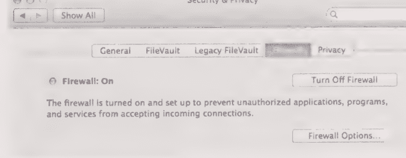

如果防火墙已关闭（未启用），那么你就可以正常了。如果它是开启的，请确保 Java：

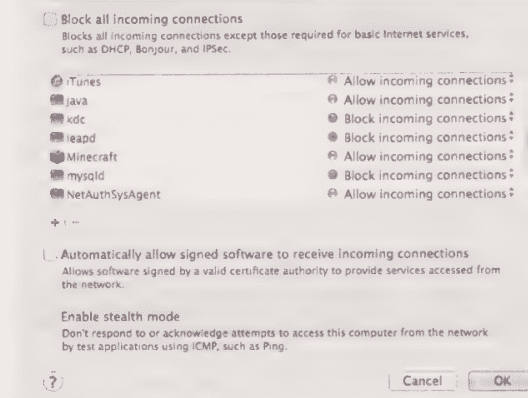

**Linux:**

- 如果防火墙已关闭（未启用），那么你就可以正常了。如果它是开启的，请确保 Java：


---

2. [http://windows.microsoft.com/en-us/windows-8/windows-firewall-from-start-to-finish](http://windows.microsoft.com/en-us/windows-8/windows-firewall-from-start-to-finish)

# 附录 4：如何安装云服务器


你可以在自己的电脑上运行 Minecraft 服务器，但这样做会有一些缺点。最大的缺点是你的电脑需要 24/7 开启并连接互联网。这对于笔记本电脑来说有点困难。此外，你自己在电脑上做的任何操作都会减慢服务器，而服务器做的任何操作都会减慢电脑上的其他程序。所以如果很多人想连接到你的服务器并玩，你可能更倾向于在云端设置它。

在云端设置 Minecraft 服务器与在本地设置非常相似，一个重要的区别是：你无法对运行 Minecraft 服务器的电脑进行物理访问。这意味着没有键盘、屏幕、电源开关或重启按钮。

但别担心；会使用命令行就足够了。

我们将在本附录中看看这一切意味着什么以及如何操作。

## 什么是云？

有人说“云”实际上只是位于吉尼亚州的一大架计算机。这实际上并不遥远，因为亚马逊等公司在该地区拥有大型数据中心，在加州以及世界其他许多地方也有。当人们谈论云计算机时，指的是通过互联网访问的计算机，你可能不知道（或不在乎）它的物理位置，并且由他人拥有和维护。正如你所看到的，这是一个相当通用且灵活的定义。市上有各种云服务，其价格、可靠性范围也同样巨大。

## 服务质量

现代路由器有一个功能，允许为不同的端口指定所需的服务质量（通常称为 `QoS`）。这种想法是你可以为网络流量设置高优先级或低优先级。当你运行本地服务器时，你可能会发现这有用：将 Minecraft 端口设置为非常低。

将 Minecraft 端口设置为最低设置将确保你的流量优先于使用服务器的朋友。

## 附录 4. 如何安装云服务器

以及你付钱能得到什么。你可能感兴趣的服务主要分为大类：

- Minecraft 专用：服务提供商负责服务器维护和管理的所有工作。提供商将加载或提供插件，可能处理恶意破坏者和攻击，并保持服务器运行。你什么都不需要做。你可能会根据在线玩家人数计费，而不是根据服务器的大小收费。
- 通用：服务提供商仅提供一个运行的系统和登录口，别无他物：你必须安装 `Java` 和 `Bukkit`、加载并提供插件、管理服务器、在它卡死时重启它等。你通常根据 CPU 数量、内存大小以及可能还有每月使用的网络流量来收费。

虽然你可能想寻找 Minecraft 专用的提供商，但这是在易用性和控制权之间的权衡。在这种情况下，你对服务器没有太大的控制权；你可能需要请求加载插件，而且服务可能只加载知名插件，而不加载你的开发版本。

相反，你可能想要的是被称为虚拟专用服务器，简称 `VPS` 的东西。互联网上有大量的 `VPS` 提供商，拥有不同的价格计划和方案，位于不同的国家，提供不同的硬件和功能。只需在 Google 上搜索“VPS providers”即可。

`VPS` 对你来说就像一整台电脑。你可以登录并独享所有的文件和处理器。实际上，你正在和许多其他人共享一大块硬件。但每个人看到的都像是一台完全属于自己的电脑。这意味着作为系统管理员，你可以安装任何需要的软件。你可以添加用户账户、重启并设置你自己的域名（例如 `example.com` 或 `any.prog.com`）。

好消息是，你可以使用命令行 shell 在远程服务器上工作，就像我们一直以来所做的那样，因为你的远程服务器可能运行的是 Linux。

## 远程操作系统

几乎所有的 `VPS` 服务都为你的服务器提供一种操作系统：Linux。某些提供商（如微软及其 Azure 云服务）可以提供 Windows，极少数提供 Mac OS X。这些非常罕见且相对昂贵。大多数提供商（包括亚马逊的云服务）提供某种“口味”的 Linux，一种类 Unix、很大程度上符合 `POSIX` 标准的操作系统。

## VPS 特性

虽然 `VPS` 产品的价格和功能差异很大，但这里是一些共同点和需要注意的地方：

- 大多数 `VPS` 系统包含一个非常流行的基于 Web 的前端（称为控制面板），它允许你重启系统、添加用户之类操作。
- 虽然运行越快的电脑总是越好，但 Minecraft 对你可用内存的大小更为敏感。你可能想要一个内存尽可能大的方案——至少 2 GB（吉字节），通常是 4 GB 左右。
- 在我写这些文字时，有几家优秀的提供商提供了每月 20 美元和 850 美元的系统。对于一个爱好来说这是一笔大钱，但你可以通过向玩家索捐来帮助支持服务器。每月几美元就能资助你的服务器。然而，一旦你开始收钱，可能会涉及到你所在法律和税法的问题，因此在开始之前，你应该咨询当地了解此类事务的人。

某些提供商允许无限网络流量（“带宽”），而另一些则设定上限。就像手机套餐一样，如果你超过了带宽限制，提供商将收取你更多费用。

某些提供商可能对内存或磁盘存储采取类似的操作：你被允许使用总量，如果超过了，他们将开始收取额外费用。

在比较方案时，务必加上你可能需要支付的额外费用。

在为所有这些不同的组合恐慌之前，请意识到一个非常重要且令人安心的事实：命令行 shell `bash` 在这些每一个发行版中的工作方式都是完全相同的。我们在书中使用的所有命令，如 `ls`、`cp` 和 `cd`，无论你选择哪种口味的 Linux，它们的运行方式都完全一样。

Ubuntu 和 CentOS 似乎是目前最常见的服务器发行版。大多数 `VPS` 服务都会让你从少量的可选方案中选择你想要的发行版。

你在不同发行版之间会遇到的最大区别是它们的包管理：即你使用什么工具来安装软件包，以及默认包含哪些包。

## 远程访问

要登录你远程服务器的命令行 shell，你需要使用一组被称为 `SSH`（代表“安全外壳”）的程序。`ssh` 是你运行的连接到服务器的命令；服务器上运行着 `sshd`（用于“ssh 守护进程”），这是你连接的对象。你的服务器可能已经在运行一个 `sshd`。

以下是一些流行的发行版，按流行程度大致排序：

- CentOS
- Ubuntu
- Fedora
- Debian
- Linux Mint

### 修改你的提示符

环境变量 `PS1` 设置了你 `bash` 的提示符字符串。在该字符串中，你可以使用 `w` 来打印当前目录。所以，如果你设置：

```bash
$ PS1=Server|w$
```

你的提示符将显示为：

```
Server -$
```

将此内容放入你的 `bash` 启动文件中以使更改永久（正如我们在第 2 章“添加编辑器和 Java”第 15 页所所示）。

现在回到你的电脑，使用 `scp` 将 `id_rsa.pub` 文件（或任何命名的 `.pub` 文件）复制到服务器，将其存放在 `.ssh` 目录并重命名为 `authorized_keys`：

```bash
$ scp id_rsa.pub username@example.com:~/.ssh/authorized_keys
```

这将文件复制到你家目录（"~”）下的 `.ssh` 目录，并命名为 `authorized_keys`。如果你以后需要，可以将来自其他机器的密钥添加到此文件中（这就是为什么“keys”用的是复数形式）。但现在你只有这一个条目。

最后，你需要回到服务器检查并修复文件权限。`.ssh` 目录应该只允许你读取和列出，内部的文件也应该只允许你读取。在大多数情况下，如果文件权限没有限制，`ssh` 将完全无法工作。这是为了你的你好。

你可以使用 `chmod` 命令设置文件权限：

```bash
$ ssh username@example.com
Welcome to My Awesome Minecraft Server
Last login: Mon Feb 16 12:26:13 from xyzzy-plugh
Server$ cd .ssh
Server ~/.ssh chmod 700
Server ~/.ssh chmod 600 authorized_keys
```

现在从你的电脑上，你应该可以在无需指定密码的情况下进行 `ssh` 或 `scp`：

```bash
$ ssh username@example.com
Welcome to My Awesome Minecraft Server
Last login: Mon Feb 16 12:32:07 from xyzzy-plugh
Server$
```

我们成功进入了！

你的下一个问题可能是：“太棒了，但我该如何离开？”这很有道理。

你可以通过按下 `Ctrl-d` 或输入 `exit` 来登出。现在你回到了本地 shell。

### Root 权限管理员

在任何现代系统中，普通用户通常不具有执行系统上所有操作的全权限。你通常需要输入密码来获取系统的管理员权限。在 Windows 上，此账户被称为 Administrator，在 Linux 和 Mac 上，它被称为 root。

虽然你可以使用相应的密码直接以 root 身份登录，但这通常是不受欢迎的。这很容易写错字符并突然毁掉一半的系统。Root 根结底是强大的，权力越大责任越大。

但你仍然需要能够以 root 身份执行某些命令。你可以使用 `sudo` 命令来实现，它让你能够像超级用户 root 一样执行的操作。在你想要运行的命令前加上 `sudo`，它会提示你输入普通用户账户密码。输入正确后，剩下的命令将以 root 身份执行。例如，这里我正在使用 `sudo` 运行 `adduser` 命令来添加用户 'fred'。

```bash
Remote sudo adduser fred
Password:
User 'fred' added.
```

这种方法允许你拥有 root 的完整权力，但仅限于有限、受控且已知的情况，而不是仅仅登录为 root。

事实上，如果你的 `SSH` 设置为允许 root 直接登录，你应该查找如何禁用该功能。你可能需要使用用户账户和 `SSH` 密钥登录，然后通过 `sudo` 提供密码。这是允许你自己获得 root 访问的最安全方法，而不是留给此刻正盯着你系统的数百万敌意攻击者。

### 加固 Root 访问

你可能已经配置好使用 `sudo`。登录你的服务器并尝试运行一些简单的命令（如 `id`，它只是报告你是谁）`sudo`：

```bash
Remote sudo id
[sudo] password for and:
uid=0(root) gid=0(root)
groups=0(root),1(bin),2(daemon),3(sys),
4(adm),6(disk),10(wheel).
```

成功了！这台机器已经配置好让我可以使用 `sudo` 了。但在一台未配置的机器上，你会看到这个可怕的警告：

andy is not in the sudoers file. This incident will be reported.

哎！听起来警察要来抓我们了。不要担心：这只是将尝试操作记录到日志文件中。这意味着你必须将你的名字添加到 `sudo` 的权限文件中。

要做到这一点，以 root 登录并将以下行添加到 `/etc/sudoers` 文件的末尾（`nano` 是一个在 `SSH` 上使用的方便编辑器；我们将在下一节介绍如何安装它以及更多内容）：

```bash
andy ALL=(ALL) ALL
```

但要使用你的名字，而不是 "andy"—除非你的名字确实是 Andy。

保存文件并尝试使用 `sudo`。

一旦你可以成功地无密码 `ssh` 登录，并且可以使用 `sudo` 以 root 身份执行操作，你就可以关闭密码的使用并不允许 root 直接 `ssh` 登录了。

显然这听起来有点危险，因为你可能会意外把自己锁在电脑之外。为了防止这种情况，打开一个窗口并以 root 身份登录你的服务器。

### 安装软件包

无论你可能或想要哪些可选软件包，你至少需要 `Java` 来运行你的服务器。你可以像我们在书前面之前那样安装它，但请记住一个重要的细节：你需要官方的 Oracle（原 Sun）版本的 `Java`。`JDK` 版本的 `Java`（可能在你的系统中可用或已安装）已知会导致 Minecraft 产生问题。

你可能需要通过系统的包管理器卸载 `OpenJDK`。例如，在运行红帽包管理器 (`RPM`) 的系统上删除 1.6 版本：

```bash
$ rpm -e java-1.6.0-openjdk
```

现在去获取正确的 `Java`。你必须在本地电脑上下载安装程序，然后将其 `scp` 到服务器。

在你的本地机器上，将浏览器指向 `http://www.java.com/en/download/manual.jsp` 并向下滚动到 Linux 部分。下载普通或 64 位版本（取决于你的服务器），并按照你的 Linux 发行版的说明操作。

### 远程运行

通过 `ssh` 时运行像 `start_minecraft` 这样的脚本有一个小问题。一旦你登出，脚本就会被杀死。这在服务器环境中并没有太大帮助。

幸运的是，你可以使用名为 `screen` 的命令。即使你注销，`Java` 也会运行。它接受一个参数字符串 `-d -m -S`，后面跟着服务器会话名称。我们将使用 `mcserver` 来命名会话，因此新的服务器风格启动脚本看起来如下：

```bash
#!/bin/bash
cd $(dirname "$0")
screen -m -S mcserver Java -Xms1024M -Xmx1024M -jar craftbukkit.jar nogui
```

（记住，`start_minecraft` 需要具有可执行权限；如果遇到“permission denied”，请确保执行了 `chmod +x start_minecraft`。）

这将会在会在自己的小世界中启动，且不会受注销影响。如果你想“连接”到服务器以便发布命令，可以使用带有 `-r` 选项的服务器名称：

```bash
$ screen -r mcserver
```

你将连接到服务器，并看到常规输出和提示符：

```
16:47:49 [INFO] Done (1.163s)! For help, type "help" or "?"
>
```

要分离服务器会话，请按 `Ctrl-a` 然后按 `d`。你将返回原始 shell，而你的服务器仍在后台运行。

要查看你正在运行的进程，使用 `ps` 命令：

```bash
Server - $ ps
PID TTY TIME CMD
337 tty0 0:00:09 -bash
842 tty2 0:13:78 /usr/bin/java -jar craftbukkit.jar
```

要查看机器上所有的进程，尝试 `ps -?`，它将列出所有选项。有很多。

在紧急情况下，如果你需要杀死所有的 `Java` 进程，可以使用：

```bash
Server - killall java
```

这会礼貌地请求 `Java` 退出。它会尝试进行清理并以安全可靠的方式退出。然而，如果它固执不听话，你可以使用粗暴的：

```bash
Server - killall -9 java
```

这将立即杀死所有 `Java` 进程——没有任何例外。

## 域名

当你首次设置 `VPS` 时，你的 `VPS` 供应商会告知你你服务器的 IP 地址。这是世界上任何人都可以用来连接到你服务器的数字。IP 地址通常是四组数字，中间用点分隔，例如 `93.184.216.119` (example.com) 或 `127.0.0.1` (你的本地机器，localhost)。

你可以设置域名，这样人们可以通过 `pragprog.com` 或 `example.com` 等名称找到你，而不是通过像 `93.184.216.119` 这样的数字。你的 `VPS` 供应商甚至可以为你安排这项可选服务，或者你可以互联网上的许多供应商之一。

域名注册的典型费用约为 10–20 美元。这让你拥有使用该名称的权利。你还需要运行 DNS 托管服务的人来说你的名称对应你的 IP 地址。许多注册商在域名注册之外还提供此类服务，或者你可以使用独立的供应商。

要检查你想要的域名是否可用，可以使用命令行工具 `whois`。在使用任何其他工具检查域名时要小心：众所周知，域名囤积者和其他不法之徒监控网络上的域名搜索，并在你之前抢占该名称，然后尝试以高价卖给你。

与互联网上的任何服务一样，请查阅相关的评论和反馈。一些在重大体育赛事期间大打广告的知名 DNS 供应商声誉非常糟糕。

## 下一步

这几页仅触及了某些非常深奥话题的表面。

作为 Linux 系统管理员，你可以做很多我们尚未涵盖的事情，包括在特定时间运行任务、备份数据、应用系统安全和更新补丁、防止恶意破坏者（griefers）、调整性能以及设置你自己的邮件服务器；各种有趣的操作。

这些主题有整本书在写，但这并不是其中之一。希望这足以让你入门。

# 附录 5 速查表

读完一个章节后兴奋不已，你坐下来准备写代码却卡住了：在 `Java` 中又是怎么做那个东西来着？在我们学习新语言时都会遇到这种情况。当我尝试用新语言工作时，我做的第一件事之一就是寻找或编写一张“速查表”来帮助我记住细节。

## Java 语言

这并不是每个 `Java` 特性的完整列表——它只是你可能需要的关键部分，在大多数情况下以示例的形式显示。

### 字面量数据类型

#### 整数

```java
int i = 7; i = -5;
```

#### 带有小数部分的数字

```java
double num = 3.14; num = 0.01; num = -3e15 (意味着 -3 乘以 10 的 15 次)
```

#### 真或假

```java
boolean shouldGetUp=true; shouldGetUp=false (或任何布尔表达式解析为真或假)
```

#### 文本字符串

```java
String s = "Hello";
```

#### 数组

```java
String[] grades = {"A", "B", "C", "D"};
```

### 数学运算符

#### 加法

```java
a + b
```

#### 减法

```java
a - b
```

#### 乘法

```java
a * b
```

#### 除法


```java
a / b
```

取模

```java
a % b
```

# 比较运算符

等于

```java
a == b
```

不等于

```java
a != b
```

小于

```java
a < b
```

大于

```java
a > b
```

小于等于

```java
a <= b
```

大于等于

```java
a >= b
```

与

```java
a && b
```

或

```java
a || b
```

# Java 语言

声明包

```java
package name;
```

导入类

```java
import org.bukkit.*;
```

声明类

```java
public class name { }
```

声明函数

```java
public return-type name();
```

声明一个代码块

```java
{ }
```

声明变量

```java
type name;
```

给变量赋值

```java
a = 10; s = "Bob"; x=3.1415;
```

# 循环

有三种方法可以在代码块周围创建循环：

- for-each 结构：`for (type variable : collection)` 示例：`for (Player player : playerlist()) { block }`
- for 循环：`for (int i=0; i<limit; i++) { block }`
- while 循环：`while (somethingIsTrue) { block }`

# 附录 5. 速查表

# 创建新对象

`Foo thing = new Foo()`，其中 `Foo` 是类名，`thing` 是赋值给新对象的变量。

# 调用函数

使用括号，例如 `getServer()`，它为插件返回一个 `Server` 对象。

# Java 可访问性修饰符

- `final`：如果我设置了这个值，不要让我或其他人更改它。
- `static`：在任何给定对象周围保留此数据或函数。
- 你可以根据需要混合 `final` 和 `static`。
- `public`：任何人都可以查看并使用此函数或数据。
- `protected`：此类以及此包中的其他类可以看到并使用此函数或数据。
- `private`：只有此类类可以看到并使用此函数或数据，子类或同包中的其他类不行。

你在声明时使用 `public` 或 `private`，因此此代码将在对象外部创建一个公开的常量：

```java
public static final int pi = 3.1415;
```

# Java 数据类型转换

## int 转 double

赋值：`int now = 72; double temperature = now;`

## double 转 int

强制转换；小数部分被丢弃：`double when = 15.375; int day = (int)when;`

## String 转 int

使用 `parseInt`：`int foo = Integer.parseInt("365");`

## String 转 double

使用 `parseDouble`：`double foo = Double.parseDouble("3.1415");`

## double to String

使用 valueOf: `String.valueOf(3.1415);`

## int to String

使用 valueOf: `String.valueOf(72);`

## Double to String

(使用 Double 类而非基本类型) `Double.toString(3.1415);`

## Integer to String

(使用 Integer 类而非基本类型) `Integer.toString(72);`

字符串拼接将自动转换，所以

```java
String s = "Temperature is " + 72 + " degrees.",
```

将导致字符串

```
"Temperature is 72 degrees."
```

# YAML 文件

YAML（读音与 "camel" 押韵）文件用于插件安装和配置选项。这里是一些快速提示：

1. 缩进很重要：每个缩进层级被视为一个子节点。
2. 不要使用制表键进行缩进：这是非法的。
3. 对包含空格、冒号或其他特殊字符的字符串加引号。

这里是一些常见数据类型的简单示例。它是一个哈希表（hashes）的数组，每个哈希表都是一组命名属性的集合。顶层数组命名为 songs。songs 中的第一个哈希包含键名 title、track_number 和 bpm。title 和 path 具有字符串值，track_number 和 bpm 是整数。

```yaml
songs:
  title: "Greensleeves (Progressive Rock Version)"
  path: /iTunes/media/new/GodRestProg.mp3
  track_number: 3
  bpm: 120
  title: "Silent Night"
  path: /iTunes/media/new/SilentNight.mp3
  track_number: 4
  bpm: 65
  track: "God Rest Ye Merry Gentlemen"
  path: /iTunes/media/new/GodRestBlues.mp3
  track_number: 0
  bpm: 80
```

详请请参见 <http://www.yaml.org>。

# 附录 6

# 术语表

- **annotation（注解）**：添加到 Java 源代码中的命令，用于修改或添加信息（例如将函数标记为事件处理器）。
- **argument（参数）**：你传递给函数供其使用的值。
- **array（数组）**：值的顺序列表，通过整数偏移量索引。
- **Array（数组类）**：实现数组的 Java 类。
- **binary file（二进制文件）**：包含二进制数字且人类不可可读的文件。
- **block（块）**：一对大括号 `{` 和 `}` 内部的代码语句列表。
- **Boolean（布尔值）**：一个只能等于 `true` 或 `false` 的逻辑值。
- **cast（类型转换）**：改变对值的解释，通常是指从一个对象转换为特定父类的类型。
- **class（类）**：一种告诉编译器如何创建对象的“配方”：它应该包含什么数据和函数。
- **client（客户端）**：你运行的软件，通常带有图形用户界面。它连接到服务器。
- **command line（命令行）**：你可以在其中输入命令的终端窗口。
- **compile（编译）**：将包含人类可读语言指令的文本文件转换为计算机可以运行的内容（通常是二进制格式）。`javac` 是 Java 编译器。
- **constructor（构造函数）**：类定义中的一个函数，在创建新对象时被调用。你可以用它来设置对象的变量等。
- **current directory（当前目录）**：在 shell 中，当前的目录（哈，一个同义反复！）
- **deploy（部署）**：在服务器环境中安装资源。
- **DNS（域名系统服务）**：将如 example.com 的域名转换为如 93.184.216.119 的 IP 地址的全局系统。
- **double（双精度浮点数）**：大浮点数。
- **environment variable（环境变量）**：shell 和应用程序使用的设置。
- **event（事件）**：代表某些真实世界动作的对象，例如鼠标点击。
- **exception（异常）**：一种中断当前函数并启动最外层 catch 的错误，如果没有 catch 则终止程序。
- **executable（可执行文件）**：计算机可以运行的文件，通常是带有低级机器指令的二进制文件，有时是 shell 运行的文本脚本。
- **file system（文件系统）**：计算机上文件和文件夹（目录）的集合和组织。
- **final（最终）**：Java 关键字，表示该变量无法更改。
- **float（浮点数）**：不太大的浮点数。
- **floating point（浮点数）**：带有小数点和小数部分的数字，例如 1.25。
- **function（函数）**：一组 Java 指令列表，用返回类型、名称、接收的参数以及 `{ }` 之间的代码块进行声明。
- **global variable（全局变量）**：可以被多个函数和/或多个类使用的变量。
- **hash（哈希）**：由任何类型的对象（通常是字符串）索引的对象的列表。
- **HashMap（哈希映射）**：实现哈希的 Java 类。
- **import（导入）**：Java 关键字，允许你使用来自另一个包的类，例如 `java.util.HashMap`（它是 `java.util` 包中的 `HashMap` 类）。
- **inherit（继承）**：从父类使用某些东西。
- **integer（整数）**：没有小数点和分数的全数字，例如 7。
- **I/O（输入/输出）**：输入/输出：从其他地方（如文件或网络）发送和接收数据。
- **iterator（迭代器）**：允许你从某种集合（如 `ArrayList` 或 `HashMap`）中一次检索一个值的对象。
- **JAR（Java 包）**：包含 `.class` 和配置文件的 Java Archive 文件。
- **keyword（关键字）**：Java 定义的单词。
- **listener（监听器）**：发生时被调用的对象。
- **literal（字面量）**：直接的值，例如 123。
- **localhost（本地主机）**：本地服务器。
- **local variable（局部变量）**：在作用域内声明的变量。
- **map（映射）**：键值对集合。
- **null（空）**：无值的表示。
- **object（对象）**：类的实例。
- **object-oriented（面向对象）**：一种基于对象概念的编程范式。
- **package（包）**：相关类的分组。
- **parameter（参数）**：传递给函数的值。
- **path（路径）**：文件位置。
- **plugin（插件）**：扩展功能的软件组件。
- **port（端口）**：通信的网络端点。
- **private（私有）**：限制可见性的修饰符。
- **public（公共）**：允许可见性的修饰符。
- **script（脚本）**：要执行的指令集。
- **server（服务器）**：向其他设备提供服务的计算机。
- **shadow（隐藏）**：隐藏或叠加。
- **shell（壳）**：命令行界面。
- **source code（源代码）**：人类可读的代码。
- **static（静态）**：属于类而非实例的修饰符。
- **string（字符串）**：字符序列。
- **task（任务）**：要执行的工作单元。
- **text（文本）**：人类可读的数据。
- **thread（线程）**：执行序列。
- **variable（变量）**：数据的存储位置。
- **void（空）**：表示不返回内容的返回类型。
- **VPS（虚拟专用服务器）**：你可以租用的远程计算机。
- **YAML**：一种数据序列化格式。

```java
import org.bukkit.entity.Player;
import org.bukkit.entity.Squid;
import org.bukkit.entity.TNTPrimed;
import org.bukkit.event.EventHandler;
import org.bukkit.event.Listener;
import org.bukkit.event.block.Action;
import org.bukkit.event.entity.EntityDamageEvent;
import org.bukkit.event.entity.EntityDamageByCause;
import org.bukkit.event.entity.EntityShootBowEvent;
import org.bukkit.event.player.PlayerInteractEvent;
import org.bukkit.event.player.PlayerTeleportEvent;
import org.bukkit.event.world.ChunkLoadEvent;
import org.bukkit.event.world.ChunkUnloadEvent;
import org.bukkit.plugin.java.JavaPlugin;
import org.bukkit.plugin.Plugin;
import org.bukkit.potion.PotionEffect;
import org.bukkit.potion.PotionEffectType;
import org.bukkit.scheduler.BukkitRunnable;
import org.bukkit.scheduler.BukkitTask;
import org.bukkit.util.Vector;
```

# 参考文献

- [Swi08] Travis Swicegood. Pragmatic Version Control Using Git. The Pragmatic Bookshelf, Raleigh, NC and Dallas, TX, 2008.
- [Swi10] Travis Swicegood. Pragmatic Guide to Git. The Pragmatic Bookshelf. Raleigh, NC and Dallas, TX, 2010.

# 索引

# 符号

- `*` `&` (和符号，两个)，与（and）运算符，61, 242
- `<` (角括号)，在声明中包围代码块类型，97, 242
- `*` (星号) 乘法运算符，48, 242
- `*` 通配符字符，25 `\` (反斜杠)，在路径中，18
- `*` (括号) 包围数组或哈希值，93, 42, 256, 213
- `*` `[方括号][brackets]`，48 `$` (美元符号)，逗号提示符，4
- `*` (点) 当前目录，8, 13 分隔项目，42, 72
- `*` (点，两个)，括号内的，8, 111
- `*` `==` (等号，两个)，等于运算符，61, 242
- `*` `!` (感叹号)，不等于运算符，61, 242
- `*` `<` (左角括号) 小于运算符，61, 242
- `*` `<=` (左角括号，符号)，小于等于运算符，61, 242
- `*` `-` (减号) 减法运算符，48, 242
- `*` `--` (减号，两个)，减法运算符，48, 242
- `*` `()` (括号) 包围参数，42
- `*` `%` (百分号) 常用提示符，4 余数运算符，242
- `*` `+` (加号) 加法运算符，48, 242
- `*` `++` (加号，加1运算符) 连接字符串，94, 243
- `*` `"` (引号) 包围包含空格的目录，11 字符串，48
- `*` `>` (右角括号) 大于运算符，61, 242
- `*` `>=` (右角括号，符号)，大于等于运算符，61, 242
- `*` `;` (分号)，终止值，242
- `*` `/` (除法运算符)，48, 242 在路径中，18
- `*` `/*` (斜杠，星号)，包围注释，42
- `*` `//` (斜杠，两个)，前置注释，42
- `~` (波浪号)，主目录，10, 13
- `||` (竖线，两个)，运算符，61, 242

- A 抽象，层级 69
- 加1运算符 (`++`)，48, 242
- 和符号，两个 (`&&`)，与运算符，61, 242
- 与运算符 (`&&`)，角括号 (`>`)，声明中的类型，97, 243
- 注解，237
- 归档器工具，见 jar 命令
- 参数，55-56, 247
- Array 类，92-96，访问元素的，93-94
- 赋值给，93, 声明，93-94
- 遍历，94 长度，93
- ArrayMoreBlocks 插件示例，99-100
- ArrayList 类，97-100
- 访问元素的，98, 清空元素的，99, 大，98
- ArrayBlocks 插件示例，数组，92-93, 241, 247，特定类型数组
- 关联数组，HashMap 类
- 云端，备份到，181-183
- bukkit.jar 文件，24
- BusyBox 应用，3
- cmd exe 应用，2-3
- 源代码-星号 (`*`) 乘法运算符，48, 242
- CakeTower 插件示例，90-92
- 代码块，87-88, 213, 243, 247，通配符，25
- code-item：配置文件，36
- 代码示例 ArrayAddMore 插件，99-100
- Java 中的大小写敏感，41
- 强制转换，111, 244, 247
- cat 命令，12-13
- 字符，字符串
- cd 命令，4-9-12
- chmod 命令，13, 25, 234
- 构建插件，45-94
- bukkit 项目，见 all-classes，文档，217-218
- 用于 bukkit 的，219-220
- 运行 Minecraft 远程
- 插件的，92-243


- 代码示例 `ArrayAddMore` 插件，99-100
- Java 中的大小写敏感，41
- 强制转换，111, 244, 247
- `cat` 命令，12-13
- 字符，字符串
- `cd` 命令，4-9-12
- `chmod` 命令，13, 25, 234
- 构建插件，45-94
- `bukkit` 项目，见 `all-classes`，文档，217-218
- 用于 `bukkit` 的，219-220

---

- `&` (和符号，两个)，与（`and`）运算符，61, 242
- `<` (角括号)，在声明中包围代码块类型，97, 242
- `*` (星号) 乘法运算符，48, 242
- `*` 通配符字符，25 `\` (反斜杠)，在路径中，18
- `()` (括号) 包围数组或哈希值，93, 42, 256, 213
- `[]` [方括号][brackets]，48 `$` (美元符号)，逗号提示符，4
- `.` (点) 当前目录，8, 13 分隔项目，42, 72
- `..` (点，两个)，括号内的，8, 111
- `==` (等号，两个)，等于运算符，61, 242
- `!` (感叹号)，不等于运算符，61, 242
- `<` (左角括号) 小于运算符，61, 242
- `<=` (左角括号，符号)，小于等于运算符，61, 242
- `-` (减号) 减法运算符，48, 242
- `--` (减号，两个)，减法运算符，48, 242
- `()` (括号) 包围参数，42
- `%` (百分号) 常用提示符，4 余数运算符，242
- `+` (加号) 加法运算符，48, 242
- `++` (加号，加1运算符) 连接字符串，94, 243
- `"` (引号) 包围包含空格的目录，11 字符串，48
- `>` (右角括号) 大于运算符，61, 242
- `>=` (右角括号，符号)，大于等于运算符，61, 242
- `;` (分号)，终止值，242
- `/` (除法运算符)，48, 242 在路径中，18
- `/*` (斜杠，星号)，包围注释，42
- `//` (斜杠，两个)，前置注释，42
- `~` (波浪号)，主目录，10, 13
- `||` (竖线，两个)，运算符，61, 242

### A
- 抽象，层级 69
- 加1运算符 (`++`)，48, 242
- 和符号，两个 (`&`)，与运算符，61, 242
- 与运算符 (`&`)，角括号 (`>`)，声明中的类型，97, 243
- 注解，237
- 归档器工具，见 `jar` 命令
- 参数，55-56, 247
- `Array` 类，92-96，访问元素的，93-94
- 赋值给，93, 声明，93-94
- 遍历，94 长度，93
- `ArrayMoreBlocks` 插件示例，99-100
- `ArrayList` 类，97-100
- 访问元素的，98, 清空元素的，99, 大，98
- `ArrayBlocks` 插件示例，数组，92-93, 241, 247，特定类型数组
- 关联数组，`HashMap` 类
- 云端，备份到，181-183
- `bukkit.jar` 文件，24
- `BusyBox` 应用，3
- `cmd.exe` 应用，2-3
- 源代码-星号 (`*`) 乘法运算符，48, 242
- `CakeTower` 插件示例，90-92
- 代码块，87-88, 213, 243, 247，通配符，25
- `code-item`：配置文件，36
- 代码示例 `ArrayAddMore` 插件，99-100
- Java 中的大小写敏感，41
- 强制转换，111, 244, 247
- `cat` 命令，12-13
- 字符，字符串
- `cd` 命令，4-9-12
- `chmod` 命令，13, 25, 234
- 构建插件，45-94
- `bukkit` 项目，见 `all-classes`，文档，217-218
- 用于 `bukkit` 的，219-220
- 复制，10, 13, 25
- 创建，17-18
- 可执行文件，248
- `JAR` 文件，31, 249
- 列出，4
- 文本文件，12, 251
- `YAML` 文件，252
- `zip` 文件，xiv
- `final` 关键字，248
- `final` 修饰符，244
- 防火墙，开启端口，224-226
- 浮点数，47, 249
- 浮点型，248
- `Firewall` 插件示例，121-122
- 文件夹，见目录 (`directories`)
- `for` 语句，58, 243
- `for each` 语句，99-100, 243

### 函数
- 参数的，55-56, 247
- 调用，55, 57, 244
- 构造函数，创建，56, 195-202
- 声明，243
- 设计，190-191
- 入口，54
- 监听器，249
- 名称，56
- 参数的，55, 50
- 公有的，243
- 范围，248
- 状态，55, 251
- 任务，13-139
- `void`，56, 251
- `getServer()` 函数，71
- `gettype()` 函数，114

### Git
- 记录要添加的文件，170
- 备份到云端，181-183
- 用于 `Bash` 的 `shell`，170
- 其中的分支，178-181
- 命令列表，185
- 创建更改，171
- 配置，170
- 跟踪文件，173
- 安装，170
- 日志，171
- 仓库的，170
- 状态，172
- 撤销更改，174-177
- `.git` 目录，170

### GitHub
- 备份到云端，182-183
- 显示代码，183-185
- `.gitignore` 文件，173

- 全局变量，88-90, 249
- 图形图表，见 Microsoft 图图表
- 大于运算符 (`>`)，61, 242
- 大于等于 (`>=`)，242
- `hasPermission()` 函数，129
- 哈希值，249

### HashMap 类
- 元素，102
- 赋值，102
- 创建，103, 108
- 在其中存储游戏数据，152-154, 162-167

- 堆，109
- `HelloWorld` 插件示例
    - 构建，36
    - 配置文件，35-36
    - 目录结构，5-7, 32-34
    - 源码，34-35
    - 主目录，4-10
- `if` 语句，59, 243
- `config` 命令，227
- `import` 语句，35, 71, 212, 243, 249, 253
- 继承，249
- 输入/输出，见 `I/O`
- 实例，79, 164
- 整数，46, 249

### IP 地址
- 用于云服务器的，240
- 外部，224

- `ipconfig` 命令，227
- 项目，65
- 迭代器，249
- `JAR` (Java 归档) 文件，31, 249
- `jar` 命令，180
- `java` 命令，18-23, 32
- Java 开发包，见 `JDK`
- `.java` 文件后缀，7, 23

### Java 语言
- 作为块级结构，87
- 敏感性，41
- 注释，42
- 比较运算符，244
- 数据类型转换，244-245
- 数据类型，241
- 数学运算符，244
- 可见性修饰符，244

- `java` 命令，12, 18-22, 31, 211-215
- `JSONObject` 类，77

### JDK (Java 开发包)
- 未找到命令的，20-22
- 安装，18-239
- 版本，19

### G
- 游戏数据存储，146, 151-167
    - 在数据库中，152
    - 在 `HashMap` 中，152-154, 162-167
    - 在本地文件中，151-153
- 垃圾回收，105
- `getConfig()` 函数，148
- `getDataFolder()` 函数，152
- `getDrops()` 函数，114
- `getHealth()` 函数，120
- `lastDamage()` 函数，119
- `getLocation()` 函数，114, 119
- `getNearbyEntities()`，80
- `getPlayer()` 函数，71

### K
- 关键字，249，见特定关键字

### L
- `launchProjectile()` 函数，119
- `JavaVision` 插件示例，84-85
- 皮子材料，141

### I
- `I/O` (输入/输出)，249
- 左角括号 (`<`)，61, 242
- 左括号 (`=`)，34, 193

### Index
- 配置文件，35-36
- 目录结构，32-34
- `disable()` 函数，54, 146
- `enable()` 函数，54, 123, 127
- `load()` 函数，54, 146
- 小于，61, 242
- 小于等于，61, 242
- 抽象级别，69
- 在线资源，217-218
- 源码，34-35
- `tion`，219-220
- 命令行，使用 2, 4
- 远程，云服务器，230-232
- 监听器，249
- IP 地址检查，224
- 注册，219
- 分离类，136-137
- 创建，123, 127-129
- 用于 `this`，220
- 本地变量，88
- `localhost`，250
- 操作符，60-62
- 数学，47-48, 242
- 或运算符 (`||`)，61, 242
- `Location` 对象，80-81, 153
- `Snapshot` 插件示例，154-157
- `LogTool`，222-223
- `ls` 命令，58, 92
- `ls` 命令，4, 7, 12
- `package` 语句，35, 243
- 包，250
- 部署插件，150
- 内部 IP 地址检查，227
- 远程，225
- 导入，71
- ，253
- 安装在云服务器上，237-238
- `main`：配置文件，36
- `map`，见 `HashMap` 类
- `Minecraft` 实体，8, 13
- 模式中，更改，39
- 播放，39
- 版本，28
- 分组操作，242
- 连接服务器，26-29
- 安装，23-24
- 路径，20-22
- 百分号 (`%`)
- 取余运算符，242
- `PerMap` 类，152-161-167
- 减号，减法运算符，48, 242
- 两个减号，减法运算符，48
- 多个真值，134
- 乘法运算符 (`*`)，48, 242
- 名称：`Item`，配置文件，36
- `Namecw` 插件，66-67
- `NamedSigns` 插件示例，106-111
- `new` 关键字，73, 103, 105
- 不等于运算符 (`!=`)，61, 243
- 非运算符 (`!`)，61, 243
- 空值，250
- 数字，46, 241
- 浮点数，249
- 整数，46, 249
- 数学运算符，47-48, 242

### 面向对象编程
- 对象，65-69，见特定类：特定对象的组成，71-72
- 处理，73, 244
- `onCommand()` 函数，54, 79-80, 109-110

### 权限
- 检查，129–130
- 设置，130
- `permissions.yml` 文件，130
- `PermissionsBukkit` 插件，130

- `playSound()` 函数，51
- `Player` 对象，70-75
- 有效性，79
- `PlayerStuff` 插件，73-75
- `plugin.yml` 文件，35-36
- 加号，31, 25
- 加法，48
- 可访问性，226
- 优先级，227
- `protected` 修饰符，244
- 公钥，104-106, 244
- 编程语言，xl, 243-244
- 引号，111
- `QoS` (服务质量)
- 重载命令，38
- 取余运算符，48
- 远程访问云服务器，235-237
- 根目录，8
- `RunTask()` 函数，139
- `RunTimer`，139
- 运行时应用，见 `java` 命令
- `safeDefault()` 函数，148
- 调度任务，248
- `screen` 命令，232
- 脚本，250
- 构建的，36-38
- 搜索路径，169-177
- 安全 `SSH`，232
- 安全备份到云端，181-183

### T
### U
### W
- 任务，251
- 创建，138
- 调度以继续
- 运行，139
- 调度到稍后，139
- 同步，135
- 传送函数，119
- 文本，见 `strings`
- 文本命令，见 `commands`
- 文本编辑器，见 `editor`
- 文本文件，251
- 作为配置文件，147
- 作为 `Java` 文件，18, 31, 41
- 作为脚本，20
- 查看内容，12
- 线程，134–135, 251
- 滴答（`ticks`），251
- 波浪号 (`~`)，主目录，10, 13
- 时间单位，见 `ticks`
- `try` 关键字，165
- `.xt` 文件名后缀，12
- 类型，不兼容的，214
- `unzip` 命令，xiv
- 变量，42–45, 87–88, 251
- 赋值，43–44, 243
- 创建，43
- 声明，212, 243
- 环境变量，246
- 全局的，88–90, 249
- 局部的，88
- 作用域，88
- 阴影，91–92, 251
- 静态的，89, 251
- 版本项，配置文件
- 垂直竖线，两个 (`||`)，或运算符，61, 242
- 虚拟专用服务器，见 `VPS`
- 可见性修饰符，244
- `void` 关键字，56, 251
- `VPS`（虚拟专用服务器），230, 252
- 网站资源，见在线资源
- `while` 语句，62, 243
- `who` 命令，240

### Windows
- `BusyBox` 应用，3
- 命令行，使用，2–3
- 命令提示符，4
- 内部 IP 地址，
- 检查防火墙，227
- 打开防火墙，224
- 工作目录，见当前目录
- `writeObject()` 函数，163

## Y
- `YAML` 文件，147, 245, 252，另见配置文件
- `.yml` 文件名后缀，7, 252
- `yum` 命令，238

## Z
- `zip` 文件，xiv

---

# Andy Hunt 的其他书籍

是时候重新布线你的大脑以获得更好的思考和学习能力了，然后看看成为一名现代软件开发者需要什么。

## 务实思维与学习

软件开发发生在你的脑海中，而不是编辑器、`IDE` 或设计工具中。你对如何处理软件和硬件已经接受了良好的教育，但我们使用的——我们的大脑呢？学习新技能和新技术对你的职业生涯至关重要，而这一切都在你的脑子里。

在 Andy Hunt 的这本书书中，你将学习我们大脑是如何连接的，以及如何利用你大脑的架构。你将学习新的技巧和方法，以学得更多、更快，并记住更多你学到的内容。

你需要一种务实的思维和学习方法。你需要重构你的生物硬件（`Refactor Your Wetware`）。

全彩印刷。

Andy Hunt

(290 页) ISBN: 9781934356050, 83.95

http://pragprog.com/book/ahptl


## 敏捷开发者实践

想成为更好的开发者吗？这本书收集了敏捷软件开发者的个人习惯、思想和方法，并以一系列简短、易于消化的提示呈现。

你将学习如何改进你的软件开发流程，看看真正的敏捷实践是什么感觉，避免那些扼杀项目的常见诱惑，并保持敏捷实践的平衡。

Venkat Subramanianiam 和 Andy Hunt

(208 页) ISBN: 9780974514086, 82.95

http://pragprog.com/book/pad


## 移动游戏与声音

为 `Android` 和 `iOS` 设备构建移动游戏，并查看如何为你的应用程序添加实时音效。

### 使用 Corona 创建移动游戏

使用 `Lua` 编程语言通过 `Corona` 开发跨平台移动游戏！`Corona` 在移动游戏开发者中正经历着爆炸式增长，这本书将帮助你快速上手如何使用这个多功能平台。你将使用 `Corona SDK` 来简化游戏编程，并用一种有趣、实切不虚脑的方法来编写和添加必不可少的游戏性功能：菜单、精灵、移动、透视和音效、关卡、加载与保存以及游戏物理学。在此过程中，你将学习如何从零构建常见的移动游戏，这些可以运行在 `iPhone`、`iPad`、`Kindle Fire`、`Nook Color` 以及所有其他 `Android` 智能手机和平板上。

全彩印刷。


# 书籍推荐

## 使用 Pure Data 制作声音

**作者**：Silvia Domenech  
**页数**：220 页  
**ISBN**：9781937785574, 836  
**链接**：<http://pragprog.com/book/sdcorona>


让你的原生、Web 应用做出反应。与其使用现成的样本，你将学习如何从零开始构建动态声音。即使你是初学者，它也能提供所需的一切。

## 数学的乐趣

**作者**：Tony Hill  
**页数**：196 页  
**ISBN**：9781937785666, 836  
**链接**：<http://pragprog.com/book/sound>


数学是美的，而且是有趣的。如果你好奇数学的极限，这本书非常适合你。在接下来的书中，你将看到更高级的技巧，以此激发你的兴趣，同时也为更优雅的解决方案提供某种“罗塞塔”。

## 少儿童编程

**作者**：Mark C. Chu  
**页数**：282 页  
**ISBN**：9781933785338  
**链接**：<http://pragprog.com/book/math>


即使你是初学者，这本书也会教你如何制作自己的。你将惊讶于 `JavaScript`（这种 Web 语言）能做的事情。适用于 10 到 99 岁人群。全彩印刷。

## 学习硬件，学习 Ruby！

**作者**：Chris Strom  
**页数**：250 页  
**ISBN**：9781933785444  
**链接**：<http://pragprog.com/book/java>

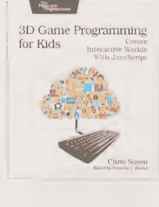

通过树莓派开启 DIY 精神，或者使用 `Ruby on Rails` 应用程序进行编程。

---

# 实用主义书架 (The Pragmatic Bookshelf)

实用主义书架汇聚了开发者为开发者编写的书籍。这些延续了广闻盛名的《实用主义程序员》系列风格，并持续获得奖项和极好评。随着开发变得日益困难，实用主义程序员们将提供更多书目和产品，帮助你保持顶尖水平。

## 在线访问我们

- [本书主页](http://pragprog.com/book/ahmine)  
  包含本书的源代码、勘误表和其他资源。欢迎向我们提供反馈！

- [注册获取更新](http://pragprog.com/updates)  
  当有更新和新书发布时，您将收到通知。

- [加入社区](http://pragprog.com/community)  
  阅读我们的博客，加入在线讨论，参与我们的邮件列表，与我们的 wiki 互动，并从其他实用主义程序员的经验中获益。

- [新动态与值得关注](http://pragprog.com/news)  
  查看最新的实用主义进展、新书目和其他产品。

## 购买电子书优惠

购买本书的电子版可享优惠。拥有此书的纸质版即可以极低折扣购买电子版。

`PDF` 非常适合在笔记本电脑上携带——它们带有超链接、彩色并支持全文搜索。大多数书目也适用于 iPhone、iPod touch、Amazon Kindle 以及其他流行的电子阅读器。

立即前往 <http://pragprog.com/coupon> 购买

## 联系我们

- 在线订单：<http://pragprog.com/catalog>
- 客户服务：`support@pragprog.com`
- 国际版权：`translations@pragprog.com`
- 学术用途：`academic@pragprog.com`
- 为我们撰稿：<http://pragprog.com/write-for-us>
- 电话：`+1 800-699-7764`

`CPSIA` 信息可在 <www.ICGtesting.com> 获取

印刷于美国

`LVOW02a0707260514`  
`387239LV00004B/14/P`


> “只需少量的样板代码和大约五行自定义代码，突然之间，爆炸的箭就出现了！这正是学习编程应该所在——通过简单、易于消化的片段。”
>
> — Carl Cravens，Linux 系统架构师，Minecraft 之父亲

## 通过 Minecraft 插件学习编程

编写你自己的 Minecraft 插件，看着你的代码通过火焰之牛、飞行的苦力怕、传送和交互变得鲜活。你将学习如何使用 `Java` 和 `Bukkit` 为自己的 Minecraft 服务器编写代码并构建插件。

你将操纵并控制 3D 游戏环境中的元素，无需编写大量代码或学习巨大的框架。你将使用变量和函数编写对游戏事件做出响应的插件，并调度稍后运行的任务。你将学习 `Java` 编程，使用 `Git` 备份代码，并设置和运行自己的服务器。在书结束时，你将能够从零设计并编写自己的插件。

你不需要编程经验即可开始——这本书将教你需要知道的一切！

**Andy Hunt** 曾撰写和合著过六多本书，包括经典的《实用主义程序员》、《敏捷开发者的实践》以及《实用主义思维与学习》，并经常在世界各软件开发会议上演讲。他曾使用 Minecraft 来帮助儿子学习编程。

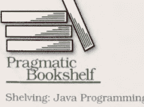

