# 学习 Small Basic 编程：通过游戏、艺术、科学和数学学习编程入门指南（早期访问）


# 1 介绍 SMALL BASIC

## 介绍 Small Basic


比尔·盖斯曾有一个目标，是让每个家庭都拥有一台计算机。现在，几乎每个桌面上都有个人电脑——所以几乎任何人都可以学习编程。在本书中，你将学习使用名为 Microsoft Small Basic 的语言进行编程。

我们在本章开头将介绍一些通用计算概念以及 Small Basic 本身。然后，我们将向你展示如何配置使用 Small Basic 所需的一切，并以编写你的第一个程序作为收尾！

## 什么是计算机？

计算机是一种根据一组指令处理数据的电子设备——它是你口袋里、桌上或大腿上那个神奇设备。计算机可以进行计算（就像你的数学老师）、比较数字（就像幻想足球），它们还可以以极高的速度和准确性存储、检索和处理数据（就像父母记住宵禁）。

计算机的硬件是你可以在电脑上触碰的一切东西——在每台计算机的内部，有数百个相互连接的电子元件。如果你想想象计算机内部的数据，可以想象一堵巨大的墙，墙上有数百家商店，成千上万名购物者在商店之间像发条一样移动。

但如果没有其他东西，所有硬件都无法执行任何有用的工作。每台计算机都需要程序来告诉它做什么——我们把这些指令称为软件。能够编写软件的人被称为程序员——你很快就要成为其中之一了。

## 什么是计算机程序？

计算机程序是给计算机执行特定任务的一组指令（就像老师给的作业列表）。你的网络浏览器、你的视频游戏、文字处理器——都是计算机程序。

程序告诉计算机要读取什么数据（如数字或文本）、从哪里读取数据（从用户、文件或互联网）、如何处理这些数据（它可能会搜索或计算数据）、产生什么类型的信息（如段落、报告或图表）、将产生的输出存储在哪里（如磁盘、网络或数据库），以及如何显示结果（如通过显示器、打印机或绘图仪）。哇！真多！

计算机程序规定了细节中的每一个细节！计算机使用机器语言进行通信，那是一堆 1 和 0。（你能想象和朋友说话时用 1 和 0 吗？）很久以前，编写的首批程序实际上是通过拨动计算机前面板上的开关输入计算机的（开启为 1，关闭为 0）。你想整天拨动所有开关吗？想象一下那些错误吧！

幸运的是，计算机科学家发明了编程语言，它们比机器语言易用得多。Small Basic 就是你将在书中学习的编程语言！

## 什么是 Small Basic？

Small Basic 是微软为任何想学习编程的人创建的编程语言。你可以用 Small Basic 编写各种应用程序，包括游戏、模拟、动画等。

计算机是如何出现的？它始于微软的一名叫 Vijay Raji 的程序员。Vijay 刚读了 David Brill 的文章《为什么约翰尼不会写代码》¹，这篇文章描述了在 BASIC 中学习和教授编码有多么价值。在文章中，Brill 挑战微软，开发一种新的 BASIC 语言来帮助孩子学习编程，而 Raji 接受了这一挑战。尽管 BASIC 对微软在 20 世纪 70 年代、80 年代和 90 年代的成功至关重要，但在 2007 年还没有适合初学者的优秀编程语言。

因此，Vijay 想想他是否可以使用原始语言最简单的部分创建一个更小的 BASIC 版本。2008 年 10 月 23 日，他发布了 Microsoft Small Basic v0.1，这是 Small Basic 的第一个版本。

## Small Basic 的愿景

Small Basic 的四个目标将帮助你的学习体验变得非常棒：

- **它简单。** Small Basic 是一种简单的语言，带有实用的编辑器和帮助区域。
- **它有趣。** Small Basic 让你创建游戏和其他程序。
- **它具有社交性。** 通过 Small Basic，你可以在网络上共享你的程序。
- **它是渐进的。** Small Basic 让你按照自己的节奏学习。

¹. http://www.salom.com/2006/09/14/basic_2/

## Small Basic 基础

Small Basic 的三个主要部分是语言、库和环境。我们将涵盖入门所需的所有内容。

## Small Basic 语言

要编写有效的程序，你必须遵守语法规则。语法包括标点符号、拼写、语句排序等。当你违反这些规则时，Small Basic 会检测到程序中的所有错误并将它们报告给你。

## Small Basic 库

Small Basic 库包含了你可以在程序中使用的数百种方法。例如，你可以使用这些方法在屏幕上显示图像、画一个圆、从互联网下载文件，甚至计算平方根。

## Small Basic 开发环境

Small Basic 自带一个集成开发环境 (`IDE`)，它是你用于编写程序的应用程序。`IDE` 包含一个编辑器（你在其中输入程序）和一个工具栏。工具栏上有按钮，可以让你保存和运行程序、打开程序以便进行修改，以及许多其他功能。

## 安装 Small Basic

你学习旅程的第一步是在你的计算机上安装 Small Basic。打开网络浏览器，访问微软的 Small Basic 网站 `http://www.smallbasic.com/`，点击右上角的下载按钮。你将转到下载页面选择操作系统和语言。当你开始下载时，会弹出一个对话框请求许可安装 `SmallBasic.msi` 文件。点击运行或打开启动设置向导。

当设置向导启动时，在第一页点击“下一步”，接受许可协议，再次点击“下一步”进行默认设置，然后点击“安装”。如果弹出账户控制对话框并许可安装程序，点击“是”）。完成后点击“完成”。如果你需要这些详细步骤，请查看附录 A。

## Small Basic IDE

安装完成后，你已准备好开始使用 Small Basic `IDE`。要启动 Small Basic，打开 Windows 开始菜单，并输入 Small Basic 来搜索它（并点击打开）所有程序 > Basic > Microsoft Basic。当你首次运行程序时，你会看到类似图 1-1 的内容（在编辑器中输入 `Prog` 以查看 `IntelliSense` 菜单）。

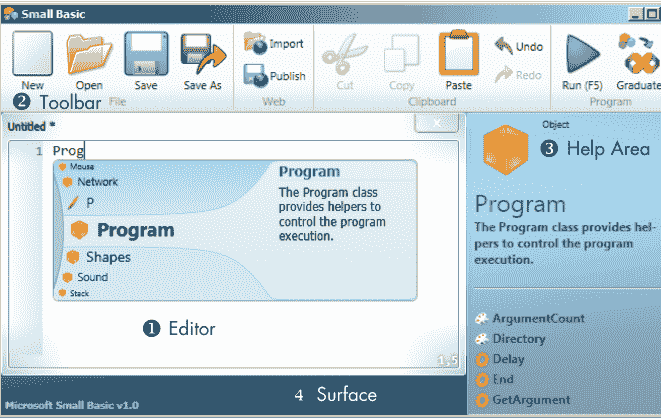

图 1-1：Small Basic IDE

工具栏包含允许你编辑和运行程序的按钮，帮助区域提供关于你在编辑器中输入代码的即时信息。画布是一个开放区域，你可以在其中移动和组织每个 Small Basic 程序的编辑器窗口。你会经常使用工具栏，让我们详细探索一下。

### 打开和保存你的工作

在工具栏的“文件”组中，点击“新建”（`CTRL-N`）从零开始编程，或点击“打开”（`CTRL-O`）从你上次编写程序的地方继续。经常点击“保存”（`CTRL-S`）以免丢失工作，并点击“另存为”将你的程序保存到新文件中。

### 分享你的工作和导入游戏

假设你的朋友刚刚在 Small Basic 网站发布了一个新游戏，你想查看一下。在“网络”组中，点击“导入”输入导入 ID（你从朋友那里获得的），并下载朋友的代码。然后你可以通过自己的修改让游戏变得更酷。

让我们尝试打开一个已经做好的游戏。点击“导入”，然后输入代码 `TETRIS`。你将看到某人编写的重新创建相同游戏的代码，你可以看到它是如何制作的。现在要玩游戏，点击“运行”。

以后，当你准备好分享自己的程序时，可以点击“发布”，Small Basic 将把你的程序发布到网上，这样你的朋友就可以在线玩你的游戏或应用了。你也可以在 Small Basic 论坛分享你的程序，从社区获得直接帮助。Small Basic 甚至为你提供了嵌入代码片段的选项，你可以将项目添加到你的网站中。

### 当你点击**发布**时，你会看到类似于图 1-2 所示的对话框。

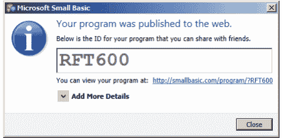

图 1-2：发布到网络对话框

发布代码时，除了获取导入 ID 和网页 URL 外，你还可以点击**添加更多细节**为你的程序输入标题、描述和类别（如*游戏、示例练习、样例、数学、趣味或其他杂项*）。

### **复制和粘贴；撤销和重做**

在 Small Basic 中，你可以像编辑任何文本一样编辑你的代码。在“剪贴板”组中，点击**剪切**（`CTRL-X`）从编辑器的某处移除一段代码并将其粘贴到其他地方。为了避免重复代码，点击**复制**（`CTRL-C`）。要选择所有代码，按 `CTRL-A`，然后进行剪切或复制。

剪切或复制后，点击**粘贴**（`CTRL-V`）将内容粘贴到编辑器中。如果你犯了错，别担心！点击**撤销**（`CTRL-Z`）。如果你点击“撤销”次数过多，点击**重做**（`CTRL-Y`）来恢复更改。你还可以在大文件中查找某些代码。要打开“查找”窗口并搜索你的文本，只需按 `F3`、按 `CTRL-F`，或者在编辑器中右键并在右菜单中点击**查找**。

### **运行你的程序并毕业**

当你完成一个程序时，点击“程序”组中的**运行**（`F5`）进行*编译*；编译器会检查是否有任何错误，如果没有，则构建你的程序。当你掌握了 Small Basic，只需点击**毕业**将你的代码导出到 Visual Studio Community 版中的 Visual Basic，并继续学习你的下一种语言。

### **编写并运行你的第一个程序**

现在你已经熟悉了 `IDE` 的操作，让我们来写一个 Small Basic 程序。首先，在你的电脑上创建一个名为 *Small Basic* 的新文件夹；这是你在整个书中创建的所有程序保存的地方。

### 得力助手：IntelliSense 和语法高亮

如果你正在跟着操作并在 Small Basic 中输入，你已经看到它在你完成单词之前就已经对你进行了分析。Small Basic 提供了一个建议列表，可以帮助你完成正在输入的内容。你可以通过键盘上的向上和向下箭头来滚动此列表。按回车键或双击选定即可将高亮文本插入到你的代码中。这项技术被称为智能感应（intelligent sense），简称 `IntelliSense`。利用它可以来加快你的打字速度并减少语法错误。

你只需按住 `CTRL` 键即可让 `IntelliSense` 透明，看到下面的代码。

你可能还会注意到 Small Basic 编辑器对程序某些单词使用了不同的颜色。这种功能被称为语法高亮。关键字（对 Small Basic 具有特殊含义的保留字）显示为蓝紫色。字符串（引号括起的字符序列）为橙色，数字也是如此。方法名称为深红色，对象名称为蓝绿色，此类推。语法高亮有助于你区分代码的不同部分，使你的程序更易读。你将在书的后面学习更多关于这些代码部分的知识。

### 尝试 1-1

在编辑器中输入以下程序并运行它，看看会发生什么。程序的输出如图 1-5 所示。

```
GraphicsWindow.DrawEllipse(20, 20, 100, 100)
GraphicsWindow.DrawRectangle(140, 20, 100, 100)
GraphicsWindow.FillEllipse(260, 20, 200, 100)
```

数字说明了 Small Basic 如何遵循你的代码执行。


### 使用 Small Basic 绘图

我们之前使用的 `TextWindow` 对象适用于没有图形用户界面（`GUI`）的应用程序，`GUI` 是一个包含按钮、编辑框和图像的界面，类似于 Microsoft Word 或愤怒鸟。例如，你可以使用 `TextWindow` 编写执行数学题或处理数据的程序，输入输出仅使用字符。这被称为文本用户界面。如果你想创建一个带有 `GUI` 的应用程序，可以使用 Small Basic 库中的 `GraphicsWindow` 对象。使用 `GraphicsWindow`，你可以创建图形、图像以及更多供用户交互的程序。让我们试试看！

在编辑器中输入示例 1-2 中的程序，然后点击工具栏上的运行。

```
1 Graphics.sb
2 GraphicsWindow.DrawText(100, 50, "Greetings, Planet!")
```

示例 1-2：你的第一个程序

该程序使用 `GraphicsWindow` 对象的 `DrawText()` 方法显示消息。前两个参数告诉 Small Basic 输出消息的水平 (x) 和垂直 (y) 位置，从窗口的左上角开始。第三个参数告诉 Small Basic 显示什么文本。输出如图 1-4 所示。


图 1-4：示例 1-2 的输出

如你所示，消息显示在 (100, 50) 位置。`GraphicsWindow` 对象包含许多其他方法可以让你创建 `GUI` 应用程序；在尝试！1-1 中探索其中的几个。

## 编程挑战

- 1. 识别以下代码段中的对象、方法、参数和关键字。

```
If (today = "Friday") Then
TextWindow.WriteLine("Today is Friday.")
Else
TextWindow.WriteLine("I lost track of what day it is.")
EndIf
```

- 2. 写一个程序在文本窗口中显示你的名字。

- 3. 写一个程序使用 `GraphicsWindow` 对象在消息框中显示你的名字。提示：使用 `GraphicsWindow` 对象的 `ShowMessage()` 方法。

如果你遇到困难，查看 `http://www.nostarch.com/smallbasic/` 获取解决方案！

查看第 1 章资源和复习指南获取更多针对老师和学生的资源和复习题。

# 2 开始

现在我们将逐步讲解代码，以便你学习重要的部分。在阅读时，输入示例，我们将解释如何运行和修改它们。但不要止于此：通过实验为你的程序增加个人特色。我们在每个章节末尾都包含了练习，帮助你成为编程大师（像 Jedi 一样，但没有危险的光剑）。尝试这些练习来提高你的技能。


## 程序的组成部分

让我们通过一个简单的示例来探索程序的不同部分。示例 2-1 显示了一个与你在第 1 章编写的 `Greetings.sb` 类似的程序。在 Small Basic 编辑器中输入此程序，然后点击工具栏上的运行（或按键盘上的 `F5`）运行它。

```
1 ' Welcome.sb
2 TextWindow.WriteLine("Welcome to Small Basic.")
```

示例 2-1：编写欢迎消息

你刚刚输入的两行是你的 `Welcome.sb` 的源代码。

当你运行这段代码时，你将看到一个类似于图 2-1 的输出窗口。（注意，窗口标题显示了我们保存文件的位置，因此路径可能不同。）


图 2-1：Welcome.sb 的输出窗口

你的控制台窗口看起来可能略有不同，因为窗口默认是黑色背景。在书的剩余部分中，除非必须看到窗口，否则我们将以文本形式输出。

Small Basic 会自动添加“按任意键继续...”的窗口，给你一个查看输出的机会（键盘上没有“任意键”键，别找了）。否则，窗口将会消失。

## 注释和语句

以单引号 (`'`) 开头的行被称为注释。第 1 行的注释是文件名。你应该养成注释代码的习惯，以解释你的程序的功能。Small Basic 只会忽略它们。

Small Basic 编辑器将所有注释显示为绿色，以便你轻松将它们与代码行（语句）区分开来。注释使程序更易读，你可以在任何地方添加！你可能需要与朋友分享代码以寻求帮助。

| WriteLine: 将文本或数字写入文本窗口。输出结果后会附加一个换行符，这样下一次向窗口写入内容时，它将出现在新的一行。 | 方法名称以及对该方法功能的简要描述。 |
|---|---|
| `TextWindow.WriteLine(data)` | 如何调用该方法。这告诉你 `WriteLine()` 接受一个参数作为输入。 |
| `data`: 要写入窗口的文本或数字。 | 方法参数的含义。 |
| Returns Nothing | 方法返回给调用者的值。 |

图 2-3: `WriteLine()` 方法的帮助区域信息

帮助区域是你的朋友！阅读它以避免不必要的错误和挫败感。

> 尝试 2-1

在在这些用例中指出对象、方法和参数：

1. `Shapes.AddRectangle(100, 50)`
2. `Math.Max(5, 10)`
3. `Sound.PlayBellRing()`

## 探索其他功能

在本节中，你将通过对 `Welcome.sb` 程序进行细微修改，探索 Small Basic 的其他关键功能。每个示例都突出显示一个不同的功能，让我们开始吧！Small Basic 是亲切且迷人的！

## 大小写敏感性

你最初输入了 `TextWindow.WriteLine("Welcome to Small Basic.")`，但 Small Basic 并不在乎你改变 `TextWindow` 或 `WriteLine` 中任何字母的大小写。例如，你可以输入：`TextWindow.WriteLine("welcome to small basic.")`。这将给你与之前相同的输出，因为 Small Basic 是不区分大小写的，这意味着代码是用大写字母还是小写字母写的无关。

像 `Writeline`、`writeline` 和 `WriteLine` 这样的标识符被编译器以相同的方式解释，编译器读取每行代码并构建应用程序。但你应该养成尊重标识符大小写的习惯。

因为其他语言是大小写敏感的。Small Basic 是一位友好的教练，不会因为你大小写不规范而对你大吼。感谢 `IntelliSense` 的自动修正功能，它会为你修复输入错误。

但如果你更改字符串会发生什么？尝试全大写的欢迎消息：

```
TextWindow.WriteLine("WELCOME TO SMALL BASIC.")
```


当你运行此程序时，输出窗口将以全大写字母打印字符串 "WELCOME TO SMALL BASIC."。原因是 Small Basic 的 `WriteLine()` 方法会完全按照你编写的方式显示引号之间的任何内容！

## 顺序执行

列表 2-1 中的程序只显示了一行文本，但你可以根据需要显示许多行。让我们按照列表 2-2 的操作来扩展程序以显示三行：

```
' ThreeLines.sb
2 TextWindow.WriteLine("Welcome to Small Basic.")
3 TextWindow.WriteLine("")
4 TextWindow.WriteLine("Anyone can code!")
```

> 列表 2-2: 显示程序的更多行数

当你运行此程序时，你将看到此输出：

Small Basic.

Anyone can code!

你的程序输出显示，每行都是按照它们在程序中列出的顺序（从上到下）执行的。你在输出中看到空行了吗？那是由第 3 行的语句生成的，该语句中的 `WriteLine()` 一对内部没有任何字符的双引号。因为 `""` 不包含任何字符，所以它被称为空字符串。当你想要显示空行来分隔程序的输出并使其易于阅读时，空字符串非常有用。

## 显示数字和数学计算

你也可以使用 `WriteLine()` 显示数字。尝试列表 2-3 中的程序。

```
' TextAndNum.sb
2 TextWindow.WriteLine("5 + 7")
3 TextWindow.WriteLine(5 + 7)
```

> 列表 2-3: 显示字符串与数字之间的差异

入门 17

## 这是此程序的输出结果：

5 + 7

12

当你通过双引号将任何内容传递给 `WriteLine()` 时，输出将准确显示引号内的内容。因此，当你在第 2 行将 "5 + 7" 传递给 `WriteLine()` 时，Small Basic 将加号视为与其他任何其他字符，而不将其视为加法问题！

然而，第 3 行的 `WriteLine()` 命令则不同。你在没有双引号的情况下传递了 `5 + 7`。在这种情况下，Small Basic 理解这些数字而不是字符串的一部分。在后台，它将 5 加 7 得到 12，并将和传递给 `WriteLine()`。

## 拼接字符串

你还可以连接字符串来构建句子或扩展短语，如列表 2-4 所示。组合字符串被称为连接（concatenation）。

```
1 JoinString.sb
2 TextWindow.WriteLine("Hello," + " oblate spheroid!")
```

> 列表 2-4: 连接示例

在第 2 行中，`WriteLine()` 方法接收两个字符串 "Hello," 和 " oblate spheroid!"，中间有一个加号 (`+`)。在这种情况下，你并没有在进行加法，加号有不同的含义；它是一个连接运算符，可以将两个字符串连接成一个单一字符串。注意 " oblate spheroid!" 中额外的空格！它使你的消息显示时带有空格。

第 2 行设置了 `Title` 属性，这告诉文本窗口标题。第 3 行将 `BackgroundColor` 属性设置为“Yellow”，适用于后续所有的文本输出。`Clear()` 方法（第 4 行）告诉 `TextWindow` 使用其 `BackgroundColor` 属性进行自我修复，这使得窗口背景变为了黄色。在程序中删除这一行将改变你的程序输出。

第 6–8 行将光标位置设置在第 4 列、第 1 行，并将前景色颜色（文本颜色）设置为“BLUE TEXT”。第 9 行的 `Write()` 方法从光标当前位置开始写入字符串“BLUE TEXT”。`Write()` 方法与 `WriteLine()` 方法相似，不同在于它在显示字符串后不会将光标移动到下一行。此之后，第 13 列的光标仍停留在第 1 行。

第 11 行将光标向下移动到第 3 行。第 12 行将前景色颜色设置为红色，第 13 行调用 `Write()` 显示字符串“RED TEXT”。

第 15 和 16 行将光标移动到第 1 列、第 5 行；第 17 行将背景颜色设置为绿色。这是最后一条语句，因此程序在此处终止（因为没有更多代码要运行了）。由于文本窗口的前景色仍设置为红色，因此“按任意键继续...”的消息将以绿色背景上的红色字体形式显示。

```
TextWindow.CursorLeft = 4
TextWindow.CursorTop = 1
TextWindow.ForegroundColor = "Blue"
TextWindow.Write("BLUE TEXT")
```

光标现在这里。

| col 0 | col 3 | col 4 | col 13 | col 21 |
|---|---|---|---|---|
| row 0 | | | | |
| row 1 | | | | |
| row 3 | | BLUE TEXT | | |
| row 5 | | | RED TEXT | |

```
TextWindow.CursorTop = 3
TextWindow.ForegroundColor = "Red"
TextWindow.Write("RED TEXT")
```

```
TextWindow.CursorLeft = 1
TextWindow.CursorTop = 5
TextWindow.BackgroundColor = "Green"
```

图 2-7：图解 2-6 中程序的输出结果

> 提示：要获取在 Small Basic 程序中使用的完整颜色列表，请查看 http://tiny.cc/hexcolors/。

## 尝试 2-3

现在你有机会在下个情人节大显身。编写一个程序画一张类似于图 2-8 所示的卡片，并将其分享给你的心仪对象。

（提示：先用红色画心形。然后将前景色切换为绿色，并调用三次 `Write()` 来绘制文本）。发挥你的色彩创意，让它更个性化。）

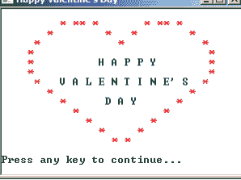

图 2-8：送给秘密恋人的情人节心形

## 算术运算符

计算机非常擅长处理数字（它们是兆字节级别的！），并像高级计算器一样工作。Small Basic 包含了四种算术运算：加、减、乘、除，分别由 `+`、`-`、`*` 和 `/` 表示。这些符号被称为运算符，因为它们对值进行操作，而值被称为操作数。让我们来看几个。这些数学运算对你来说很熟悉。在编辑器中输入这些行：

```
TextWindow.WriteLine(4 + 5)
TextWindow.WriteLine(3 / 6)
TextWindow.WriteLine(8 / 4)
TextWindow.WriteLine(3 * 4)
TextWindow.WriteLine(9 - 3)
```

当你运行此程序时，每个答案都会出现在新行，如下：

- 9
- 0.5
- 2
- 12

但 Small Basic 如何找到表达式如 `6 * 2 + 3` 的结果呢？这意味着是将 6 乘以 2 再加 3（等于 15），还是将 6 乘以 2 之和（等于 30）？当一个算术表达式包含不同的运算符时，Small Basic 将使用与代数相同的优先级来完成表达式，如图 2-9 所示。

| 运算符 | 优先级 |
|---|---|
| ( ) | 括号优先，然后是 |
| * / | 乘法和除法按顺序执行（从左到右），然后是 |
| + - | 加法和减法按顺序执行（从左到右）。 |

**图 2-9：** Small Basic 中的运算顺序

所以，对于没有括号的 `6 * 2 + 3`，Small Basic 会将 6 乘以 2 再加 3，结果为 15。在普通数学中，Small Basic 程序中的每个括号都必须有匹配的括号。例如，`(6 + 4)` 是合法的，但 `(6 + (8 - 2))` 是不合法的，因为它多了一个括号。为了确保你得到想要的结果，请使用括号。这可以帮助你避免错误并让你的代码更容易理解。例如，输入以下内容：

```
TextWindow.WriteLine((3 + 6) - (5 - 2))
```

如果你正确放置了括号，你应该得到 7。

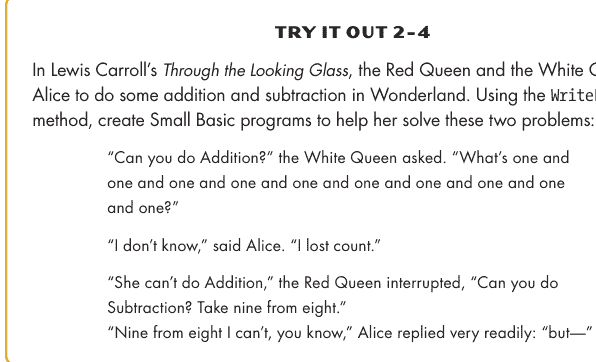

使用 Small Basic 编程（早期访问），© 2016 由 Majed Marji 和 Ed Price

在运算符两边添加空格也是好主意。例如，表达式 `5 + 4 * 8` 比 `5+4*8` 更易读。Small Basic 允许你连续使用两个算术运算符，如 `5 + 4 * 8`；为了让代码易读并避免混淆。

## 编程错误

仅仅程序能运行并不意味着它是正确的。程序员在某些地方都会出错，特别是在编写长程序时。别担心！随着练习，你的错误会减少。编程中的主要错误类型是语法错误、逻辑错误和运行时错误；我们将学习如何发现并修复它们。

## 语法错误

当程序违反语言的语法规则时，就会出现错误。语法错误的示例包括：

- 缺少标点符号，例如 `WriteLine("Hello"` 缺少结束引号
- 语句末有多余的标点
- 关键字拼写错误，例如将 `While` 写成 `while`
- 算术运算符使用错误，例如 `5 ** 2`
- 算术表达式中的括号不匹配，例如 `5 * (3 + 2))`

> 关键字是告诉 Small Basic 执行某些操作的特殊单词，例如重复语句。我们将在后面的章节解释每一个。

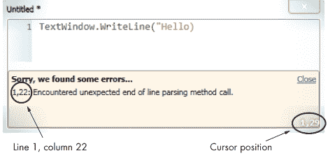

图 2-10：语法错误示例

使用 Small Basic 编程（早期访问），© 2016 由 Marji 和 Ed Price

需要快速找到问题？双击错误消息跳转到包含错误的行。（很酷，对吧？）

## 逻辑错误

有时，你可能在程序的逻辑上出错。这些*逻辑错误*会导致你的程序产生错误的结果。例如，如果你不小心用减号代替加号，你就犯了逻辑错误。你的程序运行正常，但输出是错误的！

逻辑错误是*漏洞*，而*调试*是我们用于寻找和修复这些漏洞的过程。对于短程序，你可能可以通过手动跟踪来定位漏洞，这意味着按行读取程序并写下预期的输出。另一种常用技术是插入额外的 `WriteLine()` 语句打印程序不同部分的输出。这可以帮助你缩小可能出错的范围。

## 运行时错误

运行时错误发生在你运行程序后，当它遇到了代码中未解决的问题。例如，用户可能会输入错误的数字，导致你的程序停止工作或崩溃。当你开始尝试 Small Basic 时，你会发现这些错误。

## 编程挑战

1. 编写一个程序显示你的名字和年龄，类似于下面的输出。使用颜色让输出符合你的风格！

我的名字是 Sandra Wilson

我今年 12 岁

2. 替换以下程序中的问号，为用户提供关于你选择的某美国总统的信息字符串。运行程序检查其输出。

```
TextWindow.Write("?" + " was " + "")
TextWindow.WriteLine(" president of the United States.")
```

4. 编写一个程序，创建一个与此处类似的圣诞卡片。可以使用任何颜色来装饰树。

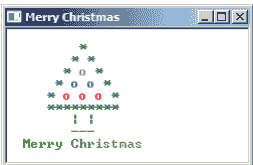

卡住了吗？访问 http://www.nostarch.com/smallbasic/ 查看解决方案！

查看第 2 章的资源和复习指南，获取适用于教师和学生的更多资源和复习题。

## 绘图基础


通过 Small Basic，你可以成为大师。你拥有的不是画笔，而是代码的力量。让我们开始吧，让你开始创作你自己的杰作！我们向你展示了 `TextWindow` 对象，在本章中，你将探索 `GraphicsWindow` 对象，它包含了绘制线条、三角形、矩形、椭圆甚至华丽文本的方法。

## 图形坐标系

将图形窗口想象成一个矩形网格。网格上的每个点都由两个数字描述，称为坐标。x 坐标告诉点的水平位置，y 坐标告诉点的垂直位置。你使用括号来指定点的位置，例如：`(x, y)`。

《Learn to Program with Small Basic (Early Access)，© 2016 by Majed Marji and Ed Price

在你在学校使用的系统中，点 (0,0) 位于图表的中间，但在图形窗口中，情况略有不同。图 3-1 显示，点 (0, 0) 位于图形窗口的左上角，这意味着你只能看到 x 值和 y 值为正数的点。

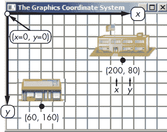

图 3-1：图形窗口的坐标系

现在你已经知道了图形窗口坐标系的工作原理，让我们来实际操作一下它吧。接下来的章节将带你浏览一些可以用来绘制简单图片的方法。在整个章节中，我们将向你展示用 Small Basic 创建的图形，并包含网格线以帮助你可视化每个图形涉及的坐标。

### 用线条绘图

要画线，请使用 `DrawLine()` 方法：

```
GraphicsWindow.DrawLine(x1, y1, x2, y2)
```

| Line | Code | Comment |
| :--- | :--- | :--- |
| 1 | ParallelLines.sb | |
| 2 | GraphicsWindow.Title = "Parallel Lines" | |
| 3 | GraphicsWindow.DrawLine(40, 50, 100, 50) | Top line |
| 4 | GraphicsWindow.DrawLine(40, 70, 100, 70) | Bottom line |

> 列表 3-1：绘制平行线

在第 3 行中，Small Basic 从左上角开始，向右移动 40 单位向下移动 50 单位。从那里开始，它向右画线到 (100, 50) 终点。然后，在第 4 行中，它跳到 (40, 70) 并向右画第二条线，到达 (100, 70) 终点。每对终点使用相同的 x 坐标；不同的 y 坐标将第二条线画在第一条线下方。

干得好！但线条本身并不无趣（除非它们是迪士尼乐园里的短线）！让我们使用几条不同的线来画一只像图 3-2 那样的帆船。

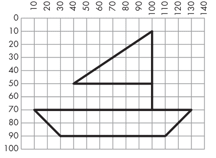

图 3-2：完全用线条绘制的帆船

这个形状由七段线条组成，你的程序包含了七个 `DrawLine` 语句。该程序的代码位于列表 3-2，你可以在图 3-3 中看到它的输出。

| Line | Code | Comment |
| :--- | :--- | :--- |
| 1 | SailBoat.sb | |
| 2 | GraphicsWindow.Title = "SailBoat" | |
| 3 | GraphicsWindow.DrawLine(10, 70, 100, 70) | Top of the boat |
| 4 | GraphicsWindow.DrawLine(100, 70, 110, 90) | Right side |
| 5 | GraphicsWindow.DrawLine(110, 90, 30, 90) | Bottom of the boat |
| 6 | GraphicsWindow.DrawLine(30, 90, 10, 70) | Left edge |
| 7 | GraphicsWindow.DrawLine(10, 70, 100, 100) | Mast |
| 8 | GraphicsWindow.DrawLine(100, 100, 40, 50) | Slanted sail edge |
| 9 | GraphicsWindow.DrawLine(40, 50, 100, 50) | Bottom edge of sail |

> 列表 3-2：用线条画船

恭喜，你刚刚在 Small Basic 中画了第一幅画。你正走向成为伟大艺术家的道路。

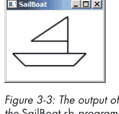

图 3-3：SailBoat.sb 的输出

### 绘制形状

你可以使用线条绘制很多酷图片，但速度很慢。你可以通过内置方法绘制几何形状来简化代码，这将为你节省大量时间！

### 三角形

使用 `DrawTriangle()` 和 `FillTriangle()` 方法绘制三角形：

```
GraphicsWindow.DrawTriangle(x1, y1, x2, y2, x3, y3)
GraphicsWindow.FillTriangle(x1, y1, x2, y2, x3, y3)
```

这些方法接收三角形三个角的 x y 坐标。`DrawTriangle()` 方法绘制三角形的轮廓，`FillTriangle()` 方法用你设置的 `BrushColor` 填充三角形内部。

关于可以在 Small Basic 程序中完整颜色列表，请查看 http://tiny.cc/hexcolors。

例如，画一个蓝色的三角形，使用这两个语句：

```
GraphicsWindow.BrushColor = "Blue"
GraphicsWindow.FillTriangle(100, 10, 40, 50, 100)
```

如果你想设置边界，先用 `FillTriangle()` 用所需的颜色填充三角形内部，然后用 `DrawTriangle()`：

```
GraphicsWindow.BrushColor = "Blue"
GraphicsWindow.FillTriangle(100, 10, 40, 50, 100)
GraphicsWindow.DrawTriangle(100, 10, 40, 50, 100)
```

尝试这些方法来绘制各种三角形。通过 Try Out 3-1 检查你的理解。

### 矩形和正方形


使用 `DrawRectangle()` 和 `FillRectangle()` 方法，你可以绘制不同大小的矩形或正方形。

```
GraphicsWindow.DrawRectangle(x, y, width, height)
GraphicsWindow.FillRectangle(x, y, width, height)
```

在这方法的前两个参数 (x 和 y) 是矩形左上角的坐标。第三参数设置宽度，第四参数设置高度。第三和第四参数使用相同的数字可以绘制正方形。

### 尝试一下！3-1

编写一个绘制图 3-4 中形状的程序。（提示：从画四个蓝色三角形开始，然后画四个黄色三角形。）

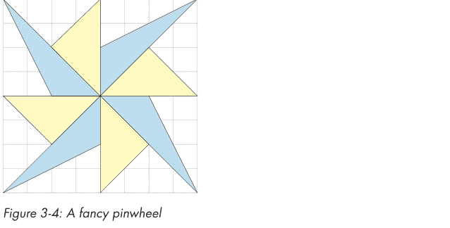

为了尝试这些方法，让我们写一个绘制图 3-5 所示房子的程序。

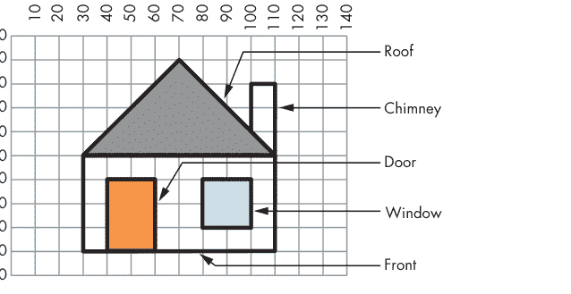

完整的程序位于列表 3-3。图 3-6 显示了输出的样子。

| Line | Code | Comment |
| :--- | :--- | :--- |
| 1 | `House.sb` | |
| 2 | `GraphicsWindow.Title = "House"` | |
| 3 | `GraphicsWindow.DrawRectangle(30, 50, 80, 60)` | |
| 4 | | |
| 5 | `GraphicsWindow.BrushColor = "Orange"` | Front of the house |
| 6 | `GraphicsWindow.FillRectangle(40, 60, 20, 30)` | |
| 7 | `GraphicsWindow.DrawRectangle(40, 60, 20, 30)` | |
| 8 | | |
| 9 | `GraphicsWindow.BrushColor = "Lightblue"` | |
| 10 | `GraphicsWindow.FillRectangle(80, 60, 20, 20)` | |
| 11 | `GraphicsWindow.DrawRectangle(80, 60, 20, 20)` | |
| 12 | | |
| 13 | `GraphicsWindow.DrawRectangle(100, 20, 10, 30)` | |
| 14 | | |
| 15 | `GraphicsWindow.BrushColor = "Gray"` | |
| 16 | `GraphicsWindow.FillTriangle(30, 50, 70, 10, 110)` | |
| 17 | `GraphicsWindow.DrawTriangle(30, 50, 70, 10, 110)` | |

列表 3-3：建造你梦想中的房子

正面是一个矩形，左上角坐标位于 (30, 50)，宽度为 80，高度为 40。门是一个填充的矩形，左上角坐标位于 (40, 60)，宽度为 20，高度为 30。窗是一个填充的正方形，左上角坐标位于 (80, 60)，边长为 20。屋顶是一个填充的三角形，其三个顶点位于 (30, 50)、(70, 10) 和 (110, 50)。烟囱也是一个矩形，左上角坐标位于 (100, 20)。它的宽度为 10，高度为 30。然而，矩形的一部分被屋顶挡住了，因此你需要先画烟囱，然后在上方画屋顶以覆盖烟囱的底部。

现在你有了你梦想中的房子！

### 尝试一下！3-2

现在你已经了绘制线条、三角形、矩形和正方形，请编写一个绘制图 3-7 所示狐狸的程序。添加一些颜色。

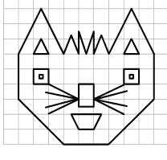

图 3-7：绘制并为狐狸上色。

使用 Small Basic 编程（早期访问），© 2016 由 Majed Marji 和 Ed Price

### 椭圆与圆

`GraphicsWindow` 也有绘制椭圆和圆的方法。椭圆是一个椭圆形。这里有两个使用四个参数的椭圆方法：

```
GraphicsWindow.DrawEllipse(x, y, width, height)
GraphicsWindow.FillEllipse(x, y, width, height)
```

第 3-8 节解释了这四个参数。前两个参数 x 和 y 设置椭圆的左上坐标。第三个参数 width（宽度）设置椭圆的宽度，第四个参数 height（高度）设置椭圆的高度。要画圆，只需将椭圆的宽度高度高度设置为相同的值。

为了使用这些绘制方法，让我们写一个程序画出图 3-9 所示的脸。

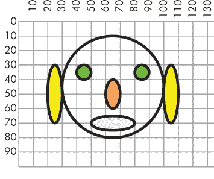

要画这张脸，你只需要使用正确的参数画一个圆和一些不同的椭圆。完整程序位于列表 3-4 中，其输出位于图 3-10。

```
1 Face.sb
2 GraphicsWindow.Title = "Face"
4 GraphicsWindow.BrushColor = "Yellow" ' 两只耳朵的颜色
5 GraphicsWindow.FillEllipse(20, 30, 10, 40) ' 左耳
```

- `GraphicsWindow.DrawEllipse(20, 30, 10, 40)` ' 左耳边界
- `GraphicsWindow.DrawEllipse(100, 30, 10, 40)` ' 右耳
- `GraphicsWindow.DrawEllipse(100, 30, 10, 40)` ' 右耳边界
- `GraphicsWindow.BrushColor = "Lime"` ' 两只眼睛的颜色
- `GraphicsWindow.FillEllipse(40, 30, 10, 10)` ' 左眼
- `GraphicsWindow.DrawEllipse(80, 30, 10, 10)` ' 左眼边界
- `GraphicsWindow.FillEllipse(80, 30, 10, 10)` ' 右眼
- `GraphicsWindow.DrawEllipse(80, 30, 10, 10)` ' 右眼边界
- `GraphicsWindow.BrushColor = "SandyBrown"` ' 鼻子的颜色
- `GraphicsWindow.FillEllipse(60, 40, 20, 20)` ' 鼻子
- `GraphicsWindow.DrawEllipse(60, 40, 20, 20)` ' 鼻子边界
- `GraphicsWindow.BrushColor = "LightCyan"` ' 嘴的颜色
- `GraphicsWindow.FillEllipse(50, 65, 30, 10)` ' 嘴
- `GraphicsWindow.DrawEllipse(50, 65, 30, 10)` ' 嘴边界
- `GraphicsWindow.DrawEllipse(30, 10, 70, 70)` ' 脸边界

列表 3-4: 绘制世界上最酷的椭圆脸

图中所有的椭圆都使用相同的大小和颜色，但你可以通过更改这些属性为你的 Small Basic 绘制添加更多细节。让我们来看看。


### 笔的大小和颜色

要更改大小和颜色，可以在绘制线条或形状之前设置以下属性：

```
GraphicsWindow.PenWidth = 20   ' 设置线宽
GraphicsWindow.PenColor = "Green" ' 设置线条
```

如果你想尝试一下，可以在每次运行程序时使用 `GraphicsWindow` 的 `GetRandomColor()` 方法更改笔颜色：

```
GraphicsWindow.PenColor = GetRandomColor()
```

该方法没有参数，这就是为什么 `GetRandomColor()` 括号是空的；它返回一个随机颜色。去试试吧！

### 笔宽与形状大小

在绘制三角形、矩形和椭圆时，使用的笔宽会影响形状的大小。列表 3-5 显示了这一点。图 3-11 显示了程序的输出。

```
1 PenWidthDemo.sb
2 GraphicsWindow.Title = "Pen Width"
3 GraphicsWindow.PenWidth = 20
5 GraphicsWindow.PenColor = "Lime"
6 GraphicsWindow.DrawEllipse(20, 20, 100) 100)
7
8 GraphicsWindow.PenWidth = 1
9 GraphicsWindow.PenColor = "Black"
10 GraphicsWindow.DrawRectangle(20, 20, 100, 100)
```

列表 3-5: 笔宽影响形状的大小。

此程序使用宽度为 20 的笔绘制圆的边界。结果显示边界从边缘延伸了若干像素，尽管圆和正方形的尺寸相同。当跨边缘测量时，圆的直径是 120 像素，而不是指定的 100。


图 3-11: PenWidthDemo.sb 的输出

编写一个绘制图 3-12 所示程序的（提示：使用网格线确定不同形状的坐标）。


图 3-12: 自己画一辆自行车。

### 绘制文本

一画胜千言，但你也可以这样在图形窗口绘制文本：

```
GraphicsWindow.DrawText(x, y, "text")
```

`DrawText()` 需要三个参数。前两个参数设置文本左上角的 x 和 y 坐标，第三个参数接收要绘制的文本字符串（或数字）。如果你想更改文本的外观，可以使用表 3-1 中的 `GraphicsWindow` 属性。

#### 表 3-1: 字体名称、大小和颜色的 GraphicsWindow 属性

| 属性 | 默认 | 说明 |
|---|---|---|
| `FontName` | "Tahoma" | 字体名称 |
| `FontSize` | 12 | 字体大小 |
| `FontBold` | "True" | 是否加粗 |
| `FontItalic` | "False" | 是否斜体 |
| `BrushColor` | "SlateBlue" | 绘制文本的笔颜色 |

如果你不更改这些任何属性，Small Basic 将使用表 3-1 中的值。列表 3-6 中的程序更改这些属性以绘制示例文本。

```
1 Fonts.sb
2 GraphicsWindow.Title = "Fonts"
3 GraphicsWindow.BackgroundColor = "LightYellow"
4 GraphicsWindow.FontName = "Times New Roman"
5 GraphicsWindow.FontSize = 12
6 GraphicsWindow.FontItalic = "True"
7
8 GraphicsWindow.BrushColor = "Silver" ' 文本投影颜色
9 GraphicsWindow.DrawText(5, 5, "Hello") ' 投影位置/文本
11 GraphicsWindow.BrushColor = "Roseberry" ' 文本颜色
12 GraphicsWindow.DrawText(0, 0, "Hello") ' 位置和文本
```

列表 3-6: 尝试一些字体

在第 3 行，`BackgroundColor` 更改图形窗口的背景颜色。第 4-6 行设置调用 `DrawText()` 时使用的字体名称、大小和斜体属性。第 8 行设置 `BrushColor` 属性，第 9 行在点 (5, 5) 绘制字符串 "Hello!"。这一行绘制了你在图 3-13 中看到的背景投影。在第 11 行，程序更改了 `BrushColor` 属性，然后第 12 行在不同的位置绘制相同的字符串。这创建了带有背景投影的文本效果，如图 3-13 所示。


图 3-13: Fonts.sb 程序的输出

通过这样将文本叠加在其他文本之上，你可以创建酷炫。尝试玩玩这段代码看看你能做出什么！你也可以使用 `DrawBoundText()` 方法绘制特定宽度的文本。

```
GraphicsWindow.DrawBoundText(x, y, width, "text")
```

参数 x、y 和 "text" 的含义与 `DrawText()` 方法相同：x 和 y 是你开始绘制的位置，“text" 是要绘制的字符串。第三个参数 width 告诉 Basic 输出文本的最大宽度。如果文本不符合给定的宽度，它将换到新行。尽管文本所在的矩形具有固定宽度，文本会继续，但如果一个单词太长无法放入你的边界框（这在字体过大时会发生），它会被裁剪！

```
1 BoundTextDemo.sb
2 GraphicsWindow.Title = "DrawBoundText Demo"
3
4 No clipping
5 GraphicsWindow.FontSize = 15 较小字体
6 GraphicsWindow.DrawBoundText(10, 10, 70, "Today is my birthday")
7
8 With clipping
9 GraphicsWindow.FontSize = 18 较大字体
10 GraphicsWindow.DrawBoundText(150, 10, 70, "Today is my birthday")
11 GraphicsWindow.DrawRectangle(150, 10, 70, 80)
```

列表 3-7: 包含文本的边界

### 插入图像

某些图像可能太复杂，无法用基本形状绘制，或者编写代码可能花费太长时间。相反，你可以先用绘图程序画好，然后在应用程序中使用它们。`GraphicsWindow` 提供了两种插入图像的方法。虽然这些方法以 Draw 开头，但它们实际上是在图形窗口中插入已已的图像：

```
GraphicsWindow.DrawImage(imageName, x, y)
GraphicsWindow.DrawResizedImage(imageName, x, y, width, height)
```

两种方法都接受路径以及 x 和 y 坐标来确定图像在图形窗口中的位置。`DrawResizedImage()` 额外接受两个参数（宽度和高度），以便你调整图像的大小。

列表 3-8 显示了带有示例文件的 `DrawImage()` 方法。图 3-15 显示了输出结果。

```smallbasic
1 ImageDemo.Title = "Image Demo"
2 GraphicsWindow.Width = 320 "与背景图像宽度相同"
3 GraphicsWindow.Height = 240 "与图像高度相同"
4 GraphicsWindow.Draw("C:\Small Basic\Ch03\Bkgnd.bmp", 0, 0)
5 GraphicsWindow.BrushColor = "White"
6 GraphicsWindow.FontSize = 50
7 GraphicsWindow.DrawText(10, 120, "Hello Moon!")
```

列表 3-8: 插入你的第一张图像

程序首先将 `GraphicsWindow` 的宽度和高度分别设置为 320 和 240 像素，以匹配图像的大小。第 5 行调用 `DrawImage()` 并传入保存图像的文件路径。

在 7-9 行中，程序在背景图像上绘制了白色的文本 Hello Moon!。当你的电脑上运行此程序时，请确保你设置了 Bkgnd.bmp 的正确位置。


图 3-15: ImageDemo.sb 程序的输出

Small Basic 还可以从 Web 绘制图像。这是一个示例：

```smallbasic
GraphicsWindow.DrawImage("http://smallbasic.com/bkgnd.jpg", 0, 0)
```

## 编程挑战

1. 写一个程序用线段连接以下六点：(20, 10), (110, 50), (10, 50), (100, 110), (60, 20), (20, 110)。你得到了什么形状？

2. 下一个程序的输出是什么？

```smallbasic
GraphicsWindow.DrawLine(50, 18, 61, 37)
GraphicsWindow.DrawLine(61, 37, 83, 43)
GraphicsWindow.DrawLine(83, 43, 69, 60)
GraphicsWindow.DrawLine(69, 60, 71, 82)
GraphicsWindow.DrawLine(71, 82, 50, 73)
GraphicsWindow.DrawLine(50, 73, 29, 82)
GraphicsWindow.DrawLine(29, 82, 31, 60)
GraphicsWindow.DrawLine(31, 60, 17, 43)
GraphicsWindow.DrawLine(17, 43, 39, 37)
GraphicsWindow.DrawLine(39, 37, 50, 18)
```

3. 下一个程序的输出是什么？


```smallbasic
GraphicsWindow.DrawRectangle(10, 10, 90, 50)
GraphicsWindow.DrawRectangle(15, 60, 75, 4)
GraphicsWindow.DrawRectangle(34, 64, 6, 6)
GraphicsWindow.DrawRectangle(74, 64, 6, 6)
GraphicsWindow.DrawRectangle(30, 70, 75, 10)
GraphicsWindow.DrawRectangle(20, 80, 8, 2)
```

### 4. 你家里最小的东西是什么？使用 `DrawLine()` 方法画出它。下面的问题为你提供了一个网格以便你绘制。每个方格的大小为 20 像素。

### 5. 写一个程序画出这颗星星。

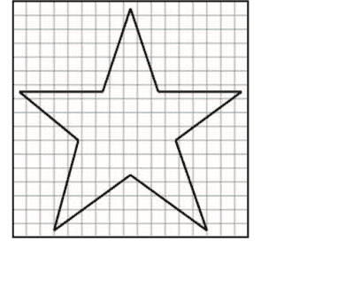

### 6. 写一个程序画出这个银行，使用你喜欢的任何颜色。

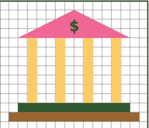

### 7. 写一个程序像这样画出这辆卡车。

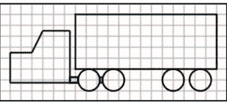

### 8. 写一个程序像这样画出这个交通灯。

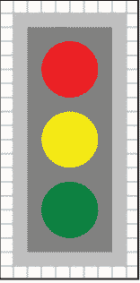

### 9. 写一个程序像这样画出这辆火车。

```smallbasic
GraphicsWindow.DrawImage("http://smallbasic.com/bkgnd.jpg", 0, 0)
```

### 10. 写一个程序画出这辆火车。


### 11. 写一个程序画出这辆火车。


### 12. 写一个程序画出这辆火车。


使用 Small Basic 编程（早期访问），© 2016 Majed Marji 和 Ed Price

## 更改变量的值

当你在程序中创建一个变量时，使用赋值运算符为它分配一个初始值。你也可以使用赋值运算符来更改现有变量的值，这会覆盖旧值，如下所示：

```
ferrets = 5
ferrets = 15
TextWindow.WriteLine("There are " + ferrets + " ferrets in my bed!")
```

示例中的第一行创建了一个新变量 `ferrets` 并将其赋值为 5，但第二行将其值更改为 15。`WriteLine` 语句将输出 `15 ferrets in my bed!`。

在底层，变量指向计算机内存中的一个存储区域。当你写下 `ferrets = 15` 时，你告诉 Small Basic 进入为 `ferrets` 预留的内存并将 5 替换为 15。当你显示 `ferrets` 的值时，你获取的是该时刻存储在该空间中的任何内容。

你也可以通过给变量增加来更改它的值。想象一个玩家必须射击飞机的游戏。当玩家射中飞机时，你想让他们的分数（存储在名为 `score` 的变量中）增加 5 分。你会如何更新 `score` 变量？这里有一种方法：

```
score = 10          假设玩家已经有了 10 分
temp = score + 5   temp = 10 + 5 (= 15)
score = temp       现在玩家有了 15 分
```

第二行使用一个名为 `temp` 的临时变量来存储在 `score` 当前值上加 5 的结果。然后将 `temp` 的值赋值给 `score`。

但你可以在一条语句中更快地完成：

```
score = score + 5
```

你看到同一个变量 `score` 同时出现在赋值运算符的两侧了吗？这条语句将变量 `score` 的当前值加 5，并将结果存回同一个变量中。旧值 10 被新值 15 替换。见图 4-1。

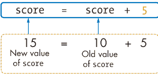

图 4-1：阐释语句 `score = score + 5`

更新 `score` 变量的这两种方法基本上相同，但第二种更常见，你会在别人的程序经常看到它。

## 使用空格提高可读性

添加制表符和空格让你的表达式更易读。例如，看这两个表达式：

```
x=y+10*(x-3)-z
x = y + 10 * (x - 3) - z
```

它们在 Small Basic 中是相同的，但第二行中的空格让人类（以及非机器人）更容易阅读。

## 尝试一下 4-1

以下程序计算你两门课程每周投入作业的平均小时数。首先，识别此程序中的所有变量。运行程序时它会显示什么？试一试！

```smallbasic
mathHours = 8
scienceHours = 6
avHours = (mathHours + scienceHours) / 2
TextWindow.write("I spend " + mathHours)
TextWindow.write(" hours a week on homework and " + scienceHours)
TextWindow.WriteLine("hours a week on science homework.")
TextWindow.write("The average of " + mathHours + " and " + ")
TextWindow.WriteLine(scienceHours + " is " + avgHours + ".")
```

现在替换为你两门课程的实际每周小时数。你花多少时间做作业？把结果给你的父母看——在讨论成绩单之前，这可能是一个很好的预热！

## 变量命名规则

你赋予变量的名字称为**标识符**。变量名可以包含字母（大小写均可）、数字（0到9）和下划线字符（_）。你可以为变量命名任何名称，只要遵循以下规则：

1. 名称必须以字母或下划线开头。不能以数字开头。
2. 不要使用 Small Basic 的关键字，如 `If`、`Else`、`Then`、`And` 或 `While`。这些关键字有特殊含义，不能用于其他地方。你将在书中后面学习更多关于它们的知识。
3. Small Basic 中的变量名不区分大小写；`side`、`SIDE` 和 `Side` 是同一个变量。

根据这些规则，`MyAddress`、`totalScore`、`player1`、`sum`、`room_temperature` 和 `x123` 都是有效名称。除了我们提到的规则外，这些约定也是良好的编程实践，你也应该遵循。让我们看看这些约定：

### 说明你的含义

尽管你可以为变量命名任何名称，但我们建议选择一个能解释变量用途的名字。例如，使用命名的 `address` 来存储人的地址比使用名为 `xy123` 的变量更有意义。

### 选择合适的长度

避免使用像 `m`、`j`、`x` 和 `w` 这样的单字母名称，除非它们的含义非常明确，否则会让你的程序难以阅读。选择有意义的名字。

### 保持你的风格

这种风格被称为**驼峰命名**（camel case），因为它以小写字母开头，每个单词的首字母大写。例如，使用 `firstName`、`roomLength` 或 `isAwesome`。如果你喜欢不同的风格也可以，但要保持一致。

当你创建一个变量时，使用赋值运算符为其分配一个初始值。你也可以使用赋值运算符更改现有变量的值，这会覆盖旧值，如下：

```
ferrets = 5
ferrets = 15
TextWindow.WriteLine("There are " + ferrets + " ferrets in my bed!")
```

示例中的第一行创建了一个新变量 `ferrets` 并将其赋值为 5，但第二行将其值更改为 15。`WriteLine` 语句将输出 `15 ferrets in my bed!`。

在底层，变量指向内存中的一个存储区域。当你写下 `ferrets = 15` 时，你告诉 Small Basic 进入为 `ferrets` 预留的内存并将 5 替换为 15。当你显示 `ferrets` 的值时，你获取的是该时刻存储在该空间中的任何内容。

你也可以通过给变量增加来更改它的值。想象一个玩家必须射击飞机的游戏。当玩家射中飞机时，你想让他们的分数（存储在名为 `score` 的变量中）增加 5 分。你会如何更新 `score` 变量？这里有一种方法：

```
score = 10          假设玩家已经有了 10 分
temp = score + 5   temp = 10 + 5 (= 15)
score = temp       现在玩家有了 15 分
```

第二行使用一个名为 `temp` 的临时变量来存储在 `score` 当前值上加 5 的结果。然后将 `temp` 的值赋值给 `score`。

但你可以在一条语句中更快地完成：

```
score = score + 5
```

你看到同一个变量 `score` 同时出现在赋值运算符的两侧了吗？这条语句将变量 `score` 的当前值加 5，并将结果存回同一个变量中。旧值 10 被新值 15 替换。见图 4-1。

## 尝试一下 4-3

编写一个程序来计算以下表达式。尝试几种不同的方法。试着边跳舞边做！不要害羞！

1 / 9 + 7 / 8

1 / 5 + 6 / 7

## 使用变量解决问题

人们在解决问题时，往往不会仔细思考过程中的每一个步骤。但计算机无法做到这一点：它们需要为我们仔细思考每一个步骤（至少在《终结者》或《黑客帝国》变成现实之前）。这就是为什么使用计算机解决问题需要一些规划的原因。在开发编程问题的解决方案时，你应该执行以下操作：

- 理解问题是什么。
- 设计解决方案。
- 编写程序。
- 测试程序以确保它的运行结果符合你的预期。

假设你想创建一个程序来计算给定半径的圆的面积。为了解决这个问题，你需要回答以下这些基础问题：

- 你需要程序输出什么？
- 你需要什么输入，程序从何处获取这些输入？
- 程序需要进行什么处理才能将输入转换为输出？

对于这个问题，以下是你将回答这些问题的方式：

- 你的程序需要输出圆的面积。它将在文本窗口中向用户显示此输出。
- 这个程序需要来自用户的一个单一输入：圆的半径。
- 你的程序将使用以下公式计算面积，这个公式你在数学课上可能很熟悉：

area = π × (radius)²

> **注意** 希腊字母 π，读作 pi，是一个特殊的数字，可以四舍五入为 3.1416。我们免费送给了你 pi！

Learn to Program with Small Basic (Early Access), © 2016 Majed Marji and Ed Price

现在你已经定义了问题，让我们设计一个分步进行的解决方案，这被称为算法。首先，让我们将问题的每个部分（输入、处理和输出）分解为详细的步骤。

养成编写程序大纲的习惯，将每个步骤按顺序排列。这被称为伪代码，因为它不是真正的程序，但它解释了代码应该做什么。查看你的伪代码可以让你清楚地知道为每个步骤需要编写的真实代码。对于复杂的问题，伪代码用简单的术语表达你的思考过程，然后你可以将其翻译成真实代码。图 4-3 显示了算法伪代码。

## 算法伪代码

| 算法 | 伪代码 |
|---|---|
| 创建一个名为 `radius` 的变量以存储程序的输入。 | `radius = 5` |
| 计算圆的面积。 | `area = π × (radius)²` |
| 在文本窗口中显示计算结果。 | `Display area` |

图 4-3：计算圆面积的算法和伪代码

最后一步是将你的伪代码翻译成 Small Basic 程序。在列表 4-2 中输入该程序。

```smallbasic
1 CircleArea.sb
2 radius = 5
3 area = 3.1416 * radius * radius
4 TextWindow.WriteLine("Area = " + area)
```

列表 4-2：计算圆的面积

在第 2 行中，你创建了一个名为 `radius` 的变量并给其赋值为 5。在第 3 行中，你使用公式计算圆的面积，并将结果赋值给名为 `area` 的新变量。在第 4 行中，你使用文本 "Area = " 打印 `area` 的值，以便清楚显示的数字的含义。

当你运行代码时，你将看到：

Area = 78.5400

## 尝试一下 4-4

编写一个程序，计算并显示半径为 5 个单位的圆的周长。我们将给你提示：圆的周长方程是 2 × π × radius。

## 两种类型

程序使用各种类型的数据：进行计算的应用程序使用数字，而其他可能使用文本。

你不需要告诉 Small Basic 你要在变量中存储什么类型的数据。这是一种对初学者友好的编程方式。

## 全局变量

Small Basic 中的变量作用域是全局的。这意味着你可以在程序的任何地方定义变量并从那里访问它。这很有帮助，因为这让你在需要时定义变量（而不是把所有变量都放在顶部）。但你必须小心！Small Basic 按照顺序读取你的变量，因此可能会产生逻辑错误。尝试列表 4-3 中的程序。

```smallbasic
1 LogicError.sb
2 y = x / 10
3 TextWindow.WriteLine("y = " + y)
```

列表 4-3：带有全局变量的逻辑错误

如果你正在阅读这段代码，你已经注意到在第 2 行中，我们在赋值任何值之前就使用了变量 `x`。当我们运行这段代码时，我们得到了以下输出：

y = 0

这个答案让你感到惊讶吗？这是正在发生的情况。当 Small Basic 读取这些内容时，它列出你定义的所有变量。这些变量的初始值留空，就像空盒子。只要程序中的表达式使用变量名，编译器就会满意，程序将成功运行。

当程序运行第 2 行的 `x / 10` 时，它将 `x` 解释为数字，因为除法对数字是有意义的。大多数其他语言会报告语法错误，因为第 2 行中的表达式 `/ 10` 使用了一个在程序中尚未定义的变量。Small Basic 允许你在程序的任何地方定义变量；只是不要期望在其他语言中也能这样做。

在安排语句顺序时要小心，因为 Small Basic 从上到下运行。确保在你第一次使用变量之前定义了它们。

## 尝试一下 4-5

```smallbasic
这个程序的输出是什么？解释你看到的内容。

TextWindow.WriteLine("Before: x = " + x + " and y = " + y)
x = 10
y = 10
TextWindow.WriteLine("After: x = " + x + " and y = " + y)
```

## 编程挑战

- 你喜欢脑筋笑话吗？尝试以下程序，看看如何在 Small Basic 中讲这些笑话！你需要更改程序的哪几行来变成不同的笑话？进行更改并再次运行程序看看发生了什么。

```smallbasic
1 KnockKn.sb
Small Basic 可以讲脑筋笑话！

name = "Orange"
reply = "you going to answer the door?"

TextWindow.WriteLine("Knock Knock")
TextWindow.WriteLine("Who's there?")
TextWindow.WriteLine(name)
TextWindow.WriteLine(name + " who?")
TextWindow.WriteLine(name + " " + reply)
TextWindow.WriteLine("")
```

- 将这段伪代码翻译成 Small Basic 程序：
  - 将 `quantity` 设置为 10。
  - 将 `item price` 设置为 15 美元。
  - 通过将数量乘以单价计算总价。
  - 显示总价。

如果你卡住了，请查看 http://www.nostarch.com/smallbasic 获取解决方案，以及为老师和学生提供的更多资源和复习题！

## 5 使用乌龟图形绘制形状

在第 3 章中，你学习了如何使用代码画画，但在 Small Basic 中，乌龟为你画画！在本章中，你将探索 `Turtle` 对象。你还将学习如何使用 `For` 循环重复代码来绘制精美的设计。

## 认识乌龟

在编辑器中输入此语句：

```smallbasic
Turtle.Show()
```

现在点击运行。变戏法！一只乌龟出现在图形窗口（图 5-1）的中心，等待你的命令。

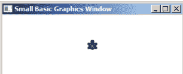

图 5-1：你好龟

你可能怀疑这个慢生物有多用，但不要低估它的能力。曾经乌龟赢了兔子！

Small Basic 的乌龟使用图形窗口的笔来画线。它总是带着这支笔（可能隐藏在乌龟的壳里），你可以决定笔的抬落。当笔落下时，乌龟移动时就会绘制。当笔抬起时，乌龟移动时不留痕迹。你可以通过 `PenDown()` 和 `PenUp()` 方法命令乌龟放下或拿起笔（见图 5-2）。


`Turtle.PenDown()`

`Turtle.PenUp()`

图 5-2：演示 `PenUp()` 和 `PenDown()`

默认笔的状态是落下的，所以乌龟从出生起就准备好了。现在让我们探索它可以做什么。

## 移动乌龟

你可以输入命令告诉乌龟做什么。就像小智命令皮卡丘一样，你也将命令你的乌龟。首先，让我们使用 `Turtle` 对象告诉乌龟移动！

通过在编辑器中输入这些行来推动。然后点击运行。

```smallbasic
Turtle.Show()
Turtle.Move(100)
```

去吧乌龟，示例中的 `Move()` 方法命令乌龟向前移动 100 像素。

现在让我们看看移动乌龟的两种方式：绝对运动和相对运动。


### 绝对运动

绝对运动是指你让乌龟移动到图形窗口上的某一点。无论乌龟在何处，它移动到你选择的精确点。

将乌龟移动到图形窗口特定点的一种方法是改变它的 `X` 和 `Y` 属性。要查看方法，请运行列表 5-1 所示程序：

```
1 SetTurtle.sb
2 Turtle.Show()
3 Program.Delay(1000)
4 Turtle.X = 100
5 Turtle.Y = 140
```

列表 5-1：设置乌龟的位置

`Show()` 方法（第 2 行）使乌龟出现在图形窗口中心附近 (320, 240)。第 3 行的 `Delay()` 方法让程序睡眠 1000 毫秒（即 1 秒），这样你就能看到乌龟的初始位置。第 4 行将乌龟的 `X` 位置设置为 100，第 5 行将乌龟的 `Y` 位置设置为 140。运行第 4 行和第 5 行后，乌龟将出现在图形窗口的 (100, 140) 处，如图 5-3 所示。注意，乌龟移动到新位置没有留下任何痕迹；它就像乌龟被捡起并放置在 (100, 140) 一样。

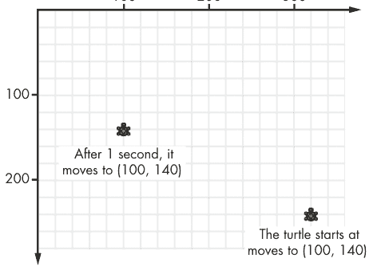

图 5-3：不留痕迹地移动乌龟

将乌龟移动到图形窗口绝对位置的另一种方法是使用 `MoveTo()` 方法。该方法接受所需位置的 x 和 y 坐标作为参数。运行列表 5-2 中的程序以查看此方法的作用。

```
1 MoveTo.sb
2 Turtle.Show()
3 Program.Delay(1000)
4 Turtle.MoveTo(100,140)
```

### 列表 5-2：使用绝对运动移动乌龟

你可以在图 5-4 中看到此程序的输出。同样，乌龟从 (320, 240) 开始面朝北（第 2 行），程序睡眠 1 秒以便你观察乌龟的动作（第 3 行）。1 秒后，乌龟在开始向该点的缓慢旅程之前转向指向 (100, 140)。这次，乌龟在移动时会画一条线（因为乌龟的笔默认是放下的）。如果你在调用 `MoveTo()` 之前的任何地方添加 `Turtle.PenUp()`，乌龟将移动到 (100, 140) 而不留下任何痕迹。

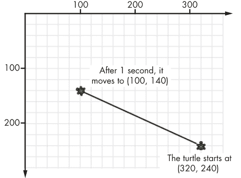

图 5-4：使用 `MoveTo()` 设置乌龟的绝对运动

注意，当乌龟停止移动时，它保持转向后的方向。它不会再次重置为面朝北。将此图与图 5-3 比较，在图中乌龟保持面朝北，它是被捡起并移动到新位置。

假设你让乌龟在完成行程后面朝北。在列表 5-2 的末尾添加以下语句：

```
Turtle.Angle = 0
```

当乌龟到达点 (100, 140) 时，它将原地旋转面朝北。尝试一下！查看图 5-5 以理解 `Angle` 属性与乌龟面向方向之间的关系。

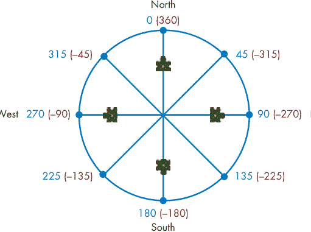

图 5-5：对于乌龟来说，0 是北，90 是东，180 是南，270 是西。

如图 5-5 所示，当你将乌龟的 `Angle` 设置为 0 或 360 时，它面朝北。你可以将乌龟的 `Angle` 设置为 45，使其面朝东北；90，使其面朝东；135（东南）；180（南）；225（西南）；270（西）；315（西北）；以及 360（回到北）。当然，你可以将乌龟的 `Angle` 设置为任何数字。尝试通过将 Turtle 对象的 `Angle` 属性设置为不同的数字，观察乌龟将面向哪个方向。不要忘记尝试负数。

### 相对运动

在相对运动中，你告诉乌龟从当前位置移动多远；也就是说，你告诉它相对于当前位置移动多远。让我们通过让乌龟命中图 5-6 所示的虚拟目标来练习。列表 5-3 是一种编写让乌龟命中目标的方法：

```
1 RelativeMotion.sb
2 Turtle.Show()
3 Turtle.Move(150)
4 Turtle.TurnRight()
5 Turtle.Move(100)
```

列表 5-3：使用相对运动移动乌龟

输出如图 5-6 所示。第 3 行让乌龟移动 150 像素，第 4 行让乌龟向右转，第 5 行让乌龟向前移动 100 像素。

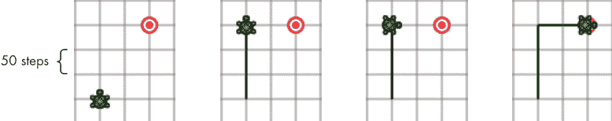

### 为你的步骤上色

你可以使用 `GraphicsWindow.PenWidth` 和 `PenColor` 属性设置乌龟的笔画大小和颜色。例如，以下代码让你的乌龟用 5 像素宽的红笔画图。

```
GraphicsWindow.PenColor = "Red"
GraphicsWindow.PenWidth = 5
```

在命令乌龟移动之前添加此代码，然后观察会发生什么。

### 控制你的速度

乌龟还有一个你需要了解的属性。`Speed` 属性设置了乌龟移动的速度。可能的 `Speed` 值为 1 到 10。按照列表 5-5 进行操作，观察你的乌龟在屏幕上跑步：

```
1 TurtleSpeed.sb
2 Turtle.Show()
3 Turtle.Speed = 2 '将初始速度设置为 2
4 Turtle.Move(100) '让乌龟向前移动 100 像素
5 Turtle.Speed = 5 '将速度更改为 5
6 Turtle.TurnRight() '让乌龟向右转
7 Turtle.Speed = 9 '将速度设置为 9
8 Turtle.TurnRight()
10 Turtle.Move(100)
```

列表 5-5：设置乌龟的速度

第 3 行将乌龟的速度设置为 2。第 4 行让乌龟缓慢移动 100 像素，第 5 行让乌龟向右转。你已经看到速度在增加，第 7 行将速度设置为 9，第 8 行让乌龟向右转，第 10 行让它冲刺 100 像素。如果你不想看乌龟在画图时缓慢移动，在程序开始处将其设置为 10，它移动得快到你几乎看不见。

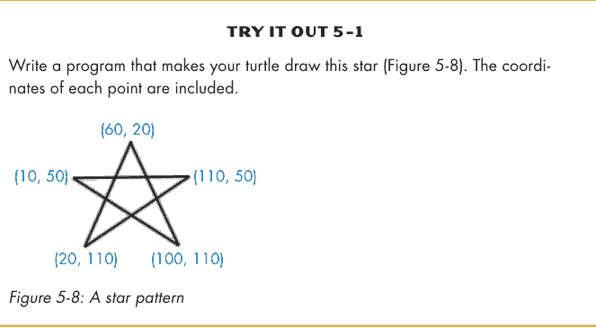

## For 循环

当你开始编写更长的程序时，你需要重复某些语句。例如，让我们让乌龟画一个正方形：输入列表 5-6 所示的代码。

```
1 Square.sb
2 Turtle.Move(60)      移动 60 像素
3 Turtle.TurnRight()  转向 90 度
4 Turtle.Move(60)      移动 60 像素
5 Turtle.TurnRight()  转向 90 度
6 Turtle.Move(60)      移动 60 像素
7 Turtle.TurnRight()  转向 90 度
8 Turtle.Move(60)      移动 60 像素
9 Turtle.TurnRight()  转向 90 度
```

列表 5-6：让乌龟画正方形

乌龟面朝北开始。这段代码告诉乌龟移动 60 像素画正方形的一边，向右转 90 度，移动 60 像素画另一边，转 90 度面朝下，移动 60 像素画第三条边，转 90 度面朝左，并移动 60 像素完成正方形。最后，乌龟再次转了 90 度，使其像开始时一样面朝北。查看图 5-9 中的结果。你的正方形看起来像？

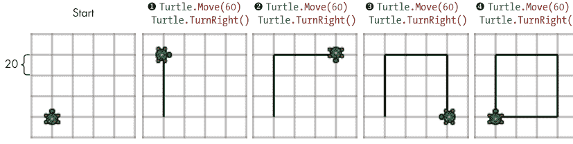

你重复了四次 `Move(60)` 和 `TurnRight()` 方法。计算机不介意重复这些任务，但对你来说，输入所有代码很无聊。如果你能用更简单的方法让乌龟画出同样的正方形那不是更好吗？

当然可以！你可以通过几行代码让乌龟画出与列表 5-6 所示相同的正方形。使用 `For` 循环，像列表 5-7 所示的：

```
1 Square2.sb
2 For I = 1 To 4      重复 4 次
3 Turtle.Move(60)      画一条边
4 Turtle.TurnRight() ' 向右旋转 90 度
5 EndFor
```

### 列表 5-7：使用 For 循环循环绘制正方形

For 循环会运行 `Turtle.Move(60)` 和 `Turtle.TurnRight()` 四次。当你知道想要重复某些代码多少次时，就可以使用 For 循环。在这个示例中，你的程序启动循环，然后回到循环开头再次运行。它运行四次后退出循环。尝试一下吧！

在这个短小的程序中，你使用了三个新的 Small Basic 关键字：`For`、`To` 和 `EndFor`。

这些关键字（`For`、`To` 和 `EndFor`）不需要像你在列表 5-7 中看到的那样大写，For 循环中的语句也不需要缩进，但这是默认格式。编辑器会在你输入代码时自动编辑 `For` 循环内部的语句，使你的代码更易读。

图 5-10 显示了发生的情况。

这是循环的计数器。你可以给它起任何名字。在本章中，它的值始终是 1。

这是你想要重复的次数。

将你想重复的语句放在 `For` 和 `EndFor` 关键字之间。

```
For I = 1 To 4
Turtle.Move(60)
Turtle.TurnRight()
EndFor
```

图 5-10：For 循环的组成部分

要重复代码行，你将想要重复的语句放在 `For` 和 `EndFor` 关键字之间。如果你想重复这四条语句，请这样写：

```
For I = 1 To 4
```

变量 `I` 是计数器。它记录循环运行了多少次以及还剩下运行多少次。每当你的程序运行循环时，它都会给计数器加 1。

下次你在学校遇到麻烦时，记得用这个 For 循环！如果你的老师发现你嚼口香糖，并让你写 100 次“我不会在课上嚼口香糖了”，Small Basic 会来救你！改写这段代码即可：

```
For I = 1 To 100
TextWindow.WriteLine("I won't chew gum in class again.")
EndFor
```

用乌龟绘图绘制形状 63

使用 Small Basic 学习编程（早期访问），© 2016 Majed Marji 和 Ed Price

尝试一下。不，不是在课上嚼口香糖；而是尝试运行这个程序！

> 程序员通常使用单字母变量来命名循环计数器（如 I、J 或 K），但任何其他名字也可以。使用大写或小写字母没有关系——Small Basic 会将 `i` 和 `I` 视为同一个变量。

### 尝试一下 5-2

预测以下程序的输出。然后运行程序检查你的答案。

```
GraphicsWindow.PenColor = "Red"
GraphicsWindow.PenWidth = 3

For I = 1 To 4
Turtle.Move(30)
Turtle.Turn(-60)
Turtle.Move(30)
Turtle.Turn(120)
Turtle.Move(30)
Turtle.Turn(-60)
Turtle.Move(30)
Turtle.TurnRight()
EndFor
```

### 绘制正多边形

你可以轻松修改绘制正方形的程序（列表 5-7）来绘制其他多边形（不要太“呆板”！）。多边形只是一个简单的闭合图形。某些示例，请查看图 5-11 中的三个多边形。

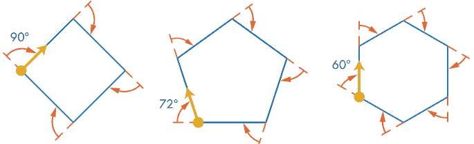

图 5-11：三个多边形的外角

你使用一种通用模式来绘制这些形状。要创建图 5-11 中的正方形，绘制四条边，每条边有一个 90 度的旋转角（即 360 度除以 4）。对于五边形（中间的多边形），绘制五条边，每条边有一个 72 度的旋转角（360 除以 5）。对于六边形（右侧的多边形），绘制六条边，每条边有一个 60 度的旋转（360 除以 6）。你发现规律了吗？角度是 360 除以边数。记住这一点，你就可以创建列表 5-8 中的多边形绘制程序了：

```
1 Polygon.sb
2 numSides = 5 ' 设置为 3(三角形), 4(正方形), 5(五边形)...
4 For I = 1 To numSides
5 Turtle.Move(60) ' 多边形的边长
6 Turtle.Turn(360 / numSides)
7 EndFor
```

列表 5-8：绘制正多边形

要绘制不同的多边形，将第 2 行 `numSides` 变量中的数字替换为另一个数字。图 5-12 显示了你可以用这个程序绘制的八个多边形（所有边长相同）。尝试一下！当你为 `numSides` 值一个很大的数字时会发生什么？多边形开始看起来越来越像圆！将 `numSides` 设置为 36，将 `Move(60)` 改为 20，看看会发生什么。


图 5-12：列表 5-8 的输出

### 星形的诞生

根据你现在对多边形角度的知识，当你让乌龟旋转 72 度的倍数时（例如 72 * 2 = 144 度）会发生什么？运行以下程序以发现：

```
1 Penta.sb
2 For I = 1 To 5
3 Turtle.Move(150)
4 Turtle.Turn(144) ' 角度是 72
5 EndFor
```

列表 5-9：绘制五边形

如果角度是 144 而不是 72，输出就是星形而不是五边形。查看图 5-13，通过实验不同的 `numSides`，可以创建各种星形。


图 5-13：列表 5-9 的输出

用乌龟绘图绘制形状 65

使用 Small Basic 学习编程（早期访问），© 2016 Majed Marji 和 Ed Price

使用嵌套循环可以创建漂亮的形状。通过改变 `numSides` 和 `repeatCount` 变量来实验不同的多边形和旋转次数。图 5-10 显示了你可以通过旋转正边形创建的形状。可能性是无限的！

```
1 Rotated.sb
2 numSides = 4
3 repeatCount = 12
4 For I = 1 To repeatCount
5 Turtle.Move(60) ' 多边形的边长
6 Turtle.Turn(360 / repeatCount)
7 For j = 1 To numSides
8 Turtle.Move(60)
9 Turtle.Turn(360 / numSides)
10 EndFor
11 EndFor
```

列表 5-10：旋转多边形的图案绘制

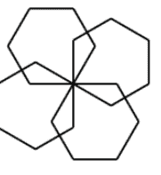

repeatCount = 4

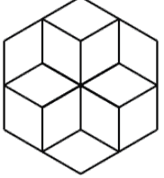

repeatCount = 6


repeatCount = 10


repeatCount = 12


repeatCount = 15


repeatCount = 20

图 5-17：通过旋转六边形创建的图案

### 尝试一下 5-4

预测以下程序的输出结果。在运行代码之前，尝试想象代码执行的结果。运行代码来检查你的答案。

```
repeatCount = 5

For I = 1 To repeatCount
  For J = 1 To 4
    Turtle.Move(60)
    Turtle.Turn(90)
  EndFor

  For J = 1 To 3
    Turtle.Move(60)
    Turtle.Turn(120)
  EndFor

  Turtle.Turn(360 / repeatCount)
EndFor
```

### 无限图形

在列表 5-10 中你通过旋转单个多边形创建了图案。你也可以使用两个或多个不同大小的多边形创建图案。为了保持代码简单，让我们绘制两个不同大小的多边形并旋转它们。运行列表 5-11 所示的程序，看看你可以制作什么样的图案：

```
1 PolygonArt.sb
2 Turtle.Speed = 10
3 numSides = 6 ' 设置为 3(三角形), 4(正方形)...
4 repeatCount = 8 ' 旋转多少次
5 sideLen1 = 30 ' 多边形 1 的边长
6 sideLen2 = 40 ' 多边形 2 的边长
7
8 For I = 1 To repeatCount
9 For J = 1 To numSides ' 绘制第一个多边形
10 Turtle.Move(sideLen1)
11 Turtle.Turn(360 / numSides)
12 EndFor
13
14 For J = 1 To numSides ' 绘制第二个多边形
15 Turtle.Move(sideLen2)
16 Turtle.Turn(360 / numSides)
17 EndFor
18
19 旋转乌龟准备下一轮
20 Turtle.Turn(360 / repeatCount)
21 EndFor
```

### 列表 5-11：旋转两个相似的多边形

此程序将两个六边形（第一个边长为 30，第二个长度为 40）旋转八次。第 8 行的外部循环重复到 repeatCount 指定的次数。程序每循环一次，代码都会执行三个操作：

1. 使用第 10 行的 `sideLen1` 边长绘制第一个多边形。
2. 使用第 15 行的 `sideLen2` 边长绘制第二个多边形。
3. 旋转乌龟为下一轮循环做好准备（第 20 行）。

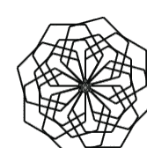


### 尝试一下 5-4

预测以下程序的输出结果。在运行代码之前，尝试想象代码执行的结果。运行代码来检查你的答案。

```
repeatCount = 5

For I = 1 To repeatCount
  For J = 1 To 4
    Turtle.Move(60)
    Turtle.Turn(90)
  EndFor

  For J = 1 To 3
    Turtle.Move(60)
    Turtle.Turn(120)
  EndFor

  Turtle.Turn(360 / repeatCount)
EndFor
```

### 无限图形

在列表 5-10 中你通过旋转单个多边形创建了图案。你也可以使用两个或多个不同大小的多边形创建图案。为了保持代码简单，让我们绘制两个不同大小的多边形并旋转它们。运行列表 5-11 所示的程序，看看你可以制作什么样的图案：

```
1 PolygonArt.sb
2 Turtle.Speed = 10
3 numSides = 6 ' 设置为 3(三角形), 4(正方形)...
4 repeatCount = 8 ' 旋转多少次
5 sideLen1 = 30 ' 多边形 1 的边长
6 sideLen2 = 40 ' 多边形 2 的边长
7
8 For I = 1 To repeatCount
9   For J = 1 To numSides ' 绘制第一个多边形
10    Turtle.Move(sideLen1)
11    Turtle.Turn(360 / numSides)
12   EndFor
13
14   For J = 1 To numSides ' 绘制第二个多边形
15    Turtle.Move(sideLen2)
16    Turtle.Turn(360 / numSides)
17   EndFor
18
19   ' 旋转乌龟准备下一轮
20   Turtle.Turn(360 / repeatCount)
21 EndFor
```

### 列表 5-11：旋转两个相似的多边形

此程序将两个六边形（第一个边长为 30，第二个长度为 40）旋转八次。第 8 行的外部循环重复到 `repeatCount` 指定的次数。程序每循环一次，代码都会执行三个操作：

1. 使用第 10 行的 `sideLen1` 边长绘制第一个多边形。
2. 使用第 15 行的 `sideLen2` 边长绘制第二个多边形。
3. 旋转乌龟为下一轮循环做好准备（第 20 行）。


图 5-18 显示此程序的输出。现在尝试使用图 5-19 中的 `repeatCount` 值创建许多不同的图案。尝试将 `side1` 设置为 40，`side2` 设置为 60！

图 5-18：列表 5-11 的输出

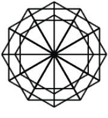
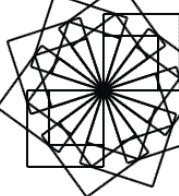
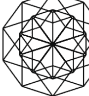

使用 `repeatCount = 12` 的三角形

使用 `repeatCount = 10` 的正方形

使用 `repeatCount = 10` 的五边形

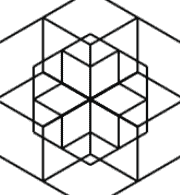
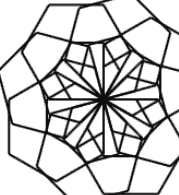
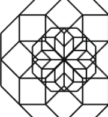

使用 `repeatCount = 6` 的六边形

使用 `repeatCount = 8` 的六边形

使用 `repeatCount = 8` 的八边形

图 5-19：通过尝试列表 5-11 可以创建的部分图案

用乌龟画形状 69

### 尝试一下 5-5

修改列表 5-11 以绘制三个不同大小（而不是两个）的多边形，然后将它们旋转。保存好你的发现以建立你的新画廊。或者，如果你不想成为百万富翁，去 `tiny.cc/patterns` 与世界分享它们吧！

## 编程挑战

如果你遇到困难，请检查 `http://nostarch.com/smallbasic/` 以获取解决方案以及更多针对教师和学生的资源！

- 编写一个程序画出如下所示的花：

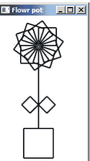

- 这段代码画了一个圆：

```
' 这段代码画了一个圆
For K = 1 To 36
  Turtle.Move(6)
  Turtle.Turn(10)
EndFor
```

编写一个程序，让乌龟重复这段代码 12 次以创建此处所示的图案。

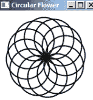

- 3. 在此处重新创建代码并进行实验：

```
' 重复 20 次
For I = 1 To 20
  For K = 1 To 36 ' 画一个圆
    Turtle.Move(12)
    Turtle.Turn(10)
  EndFor
  Turtle.Turn(18) ' 为下一个圆做好准备
  Turtle.Move(12)
EndFor
```

---

## 处理用户输入

让我们通过编写几个程序来运用你的新知识：从用户那里读取输入、处理输入并将输出返回给用户。

### 将华氏度转换为摄氏度

接下来，你将创建一个程序，将温度从华氏度转换为摄氏度。程序会提示用户输入华氏度，然后使用以下公式转换为摄氏度：

`C = (5 / 9) * (F - 32)`

多次运行程序查看其工作原理。要使用度符号，按住 ALT 键并在数字键盘上输入 48，然后松开 ALT 键。

```
1 Fahrenheit2Celsius.sb
2 TextWindow.Write("Enter a temperature in F: ")
3 F = TextWindow.ReadNumber()
4 C = (5 / 9) * (F - 32)
5 C = Math.Round(C)
6 TextWindow.WriteLine(F + " F = " + C + " C")
```

列表 6-4：华氏度转换

首先，程序提示用户输入温度。当按下 ENTER 时，输入被赋值给变量 `F`。然后你的程序将 `F` 中的值转换为摄氏度，并将结果存储在变量 `C` 中。在第 5 行，程序使用 `Math.Round()` 将 `C` 四舍五入到最接近整数，并替换 `C` 的旧值。你将在第 7 章学习更多关于 `Round()` 的知识，但在这里使用它是为了让输出更易读。最后，程序显示输出。

### 尝试 6-1

尝试猜测以下程序的功能。运行它来检查答案：

```
TextWindow.Write("How old are you?")
age = TextWindow.ReadNumber()
TextWindow.WriteLine("In years, you'll be " + (age + 10))
```

### 计算平均值

让我们写一个程序计算用户提供的四个数字的平均值。有几种明显的方法可以实现，一种是使用五个变量，如列表 6-5 所示：

```
1 Avg1.sb
2 TextWindow.Write("Enter 4 numbers.")
3 TextWindow.WriteLine("Press Enter after each one:")
4 n1 = TextWindow.ReadNumber()
5 n2 = TextWindow.ReadNumber()
6 n3 = TextWindow.ReadNumber()
7 n4 = TextWindow.ReadNumber()
8 avg = (n1 + n2 + n3 + n4) / 4
9 TextWindow.WriteLine("Average = " + avg)
```

列表 6-5：计算四个数字的平均值

当你输入 10、20、15 和 25 时，查看输出：

Enter 4 numbers. Press Enter after each one:

10

20

15

25

Average = 17.5

程序提示用户输入四个数字并每个按回车。它逐个读取这些数字，并将它们保存在变量 `n1`、`n2`、`n3` 和 `n4` 中（第 4-7 行）。它计算这些数字的平均值，并将结果存储在变量中（第 8 行）。

列表 6-6 显示了编写此程序的另一种方法。输入程序并运行。它使用一个变量 `sum`：

```
1 Avg2.sb
2 TextWindow.Write("Enter 4 numbers.")
3 TextWindow.WriteLine("Press Enter after each one:")
4 sum = sum + TextWindow.ReadNumber()
5 sum = sum + TextWindow.ReadNumber()
6 sum = sum + TextWindow.ReadNumber()
7 sum = sum + TextWindow.ReadNumber()
8 TextWindow.WriteLine("Average = " + sum / 4)
```

列表 6-6：使用累加器计算四个数字的平均值


为了理解程序是如何工作的，让用户根据提示输入数字 10、20 和 25。在第 3 行，`sum` 变为 10。在第 5 行，第二个数字（20）加上第一个数字（10）并保存到 `sum`（总计 30）。在第 6-7 行，第三个数字（15）和第四个数字（25）相加并保存到 `sum`（总计 70）。程序将平均值（`sum / 4`）显示给用户（第 8 行）。

由于变量 `sum` 将输入相加（累加），它被称为累加器（也称为运行和）。这可能类似于收集丝带或精灵球卡，但这些数字只占用计算机内存，不会弄乱房间。

## 读取文本

接下来，让我们写一个简单的程序，使用莎士比亚名句中的单词制作有趣的句子：“存在还是不存在，这是一个问题。”你将要求用户输入两个动词和一个名词，然后你用这些条目替换莎士比亚名句中的 `be`、`be` 和 `question`。列表 6-7 显示了完整的：

```
1 Silly.sb
2 TextWindow.Write("Please enter a verb: ")
3 verb1 = Window.Read()
4
5 TextWindow.Write("Please enter another verb: ")
6 verb2 = Window.Read()
7
8 TextWindow.Write("Now, please enter a noun: ")
```

### 列表 6-7：有趣的莎士比亚句

当我们运行这段代码时，输入了 eat、swim 和 cow。这是输出：

| Please enter a verb: eat |
| Please enter another verb: swim |
| Now please enter a noun: cow |
| To eat or not to swim: that is the cow. |

试一下，然后回来。我们在等。回来了吗？你的输出比我们的更有趣吗？那么，给某人看看！

### 尝试 6-2

编写一个交互式的 Mads 风格程序，让用户输入他们喜欢的公主的名字（例如白雪公主）、一个邪恶的东西、一个学校的名字、好吃的东西、一个矮人的名字、一件从未见过的贵重物品、一个动词、小生物和一个超级英雄的能力。

然后为用户显示故事，并用用户的输入替换括号中的术语：

“[PrincessName] 正在森林中旅行，突然邪恶的 [Evil] 跳出来并给她一个苹果。[PrincessName] 拒绝了，因为她的妈妈送她去了 [NameSchool]，在那里她学会不要接受陌生人未包装的食物（可能有毒）。[PrincessName] 继续穿过森林，直到来到一个 [SomethingYummy] 的房子。由于不想破坏财产，她继续行走。接下来，[PrincessName] 遇到一个纺织轮，一个叫 [WizardName] 的矮人诱导她用 [SomethingValuable] 交換黄金。但 [PrincessName] 的妈妈已经告诉过她，有一个恶仙子在她婴儿时期施下了咒，她害怕纺织。所以公主 [PrincessName] 继续行走，安全地回到一个有七个 [SmallCreatures] 的小屋，在那里她把自己关在房间里过了一余生，因为她拥有 [SuperHero] 的力量。”

然后制作你自己的交互式故事程序，使用新角色（如英雄、忍者、海盗或小马马），并分享它！

## 编程挑战

如果你遇到困难，请访问 `http://nostarch.com/smallbasic/` 获取解决方案，以及查看针对教师和学生的更多资源和复习题！

- 1. 使用 Small Basic，你可以轻松地将计算机变成数字魔术师！打开本章练习文件夹中的 `Magician.sb` 文件并运行。解释该程序是如何工作的。

- 2. 使用短语“一个人的垃圾是另一个人的宝宝”制作一个简单的填空游戏（Mad Libs-style game）。该短语的另一个版本是“一个人的损失是另一个人的收获”。对于你的版本，要求用户输入两个生物和两个不同的名词。然后让你的程序输出为：“一个 [Creature1] 的是另一个 [Creature2] 的 [Noun]。”

- 3. Eve 正在举行车大卖。因为 Eve 想赚钱，她摆了一张桌子卖柠檬水、饼干和她手工制作的问候卡，顾客经过车道（她是一个天才销售员，所以卖了很多！）。创建一个程序来帮助 Eve 计算客户给她的钱，该程序要求 Eve 输入她赚取的美元、四分之一币（quarters）、十分角币（dimes）、五分币（nickels）和分（pennies）的数量。然后让它转换为总金额，并以美元和分的形式显示（例如 $23.34）。尝试使用以下金额运行你的程序使其工作：

- 35 美元，3 个四分之一币，3 个分

- 2 美元，1 个四分之一币，2 个分

- 10 美元，1 个五分币，3 个分

- 6 美元，1 个四分之一币，3 个分

- 3 美元，2 个四分之一币，1 个十分角币，1 个五分币，3 个分

- 1 美元，2 个十分角币，1 个五分币，4 个分


## 用数学为程序

如果你觉得数学无聊或可怕，没关系。你很快就会发现 Small Basic 让编写为你计算的程序（甚至帮你做数学作业）变得多么简单。许多程序使用简单的运算，如加法、减法、乘法和除法。对于这类问题，你只需要四个基础运算符 `+`、`-`、`*`、`/`。星号 (`*`) 代表乘法，斜杠 (`/`) 代表除法。

其他程序会使用一些你在代数中学习过的数学函数（如平方根、绝对值和三角函数）。Small Basic 的 `Math` 对象提供了这些以及许多其他函数。

如果你不知道什么是平方根或三角函数，不要恐慌；你仍然可以使用这些函数编写程序。跳过本章中的一些示例也可以的。

Learn to Program with Small Basic (Early Access), © 2016 by Majed Marji and Ed Price

# 要使用 Math 对象的任何方法，你将编写如下的语句：

```
ans = Math.SquareRoot(16)
```

在这个示例中，你调用了 `SquareRoot()` 方法并向它传递了 16（为了求16的平方根）。方法的输出或结果被称为返回值（return value）。在这条语句中，方法的返回值被赋值给变量 `ans`。在本章中，你将学习 `Math` 对象的方法以及如何使用它们。

### 指数方法

Math 有四个与指数相关的方法，但我们书中将涵盖 `SquareRoot()` 和 `Power()`。

### SquareRoot() 和古老的勾股定理

在第一个示例中，我们将找到直角三角形最长边（即斜边）的长度。如果你调用两条边的长度 `s1` 和 `s2`，勾股定理告诉你斜边的长度是每条边平方之和的平方根。这里是方程：

√s1² + s²²我们将此公式放在列表 7-1 的程序中，这样你就不需要过多思考。给定直角三角形的两边，使用以下程序利用勾股定理计算斜边长度：

```
1 SquareRootDemo.sb
2 Window.Write("Enter the length of side 1: ")
3 s1 = Window.Read(Number())
4
5 Window.Write("Enter the length of side 2: ")
6 s2 = Window.Read(Number())
7
8 hypot = Math.SquareRoot(s1 * s1 + s2 * s2)
9 Window.WriteLine("Hypotenuse = " + hypot)
```

列表 7-1：第一边的长度

该程序提示用户输入第一边的长度（第2行）并将其保存在 `s1` 中（第3行）。然后询问第二个输入并将其保存在 `s2` 中（第6行）。在第8行，注意 s1（和 s2）的平方是通过与自身相乘计算的。

Learn to Program with Small Basic (Early Access), © 2016 by Majed Marji and Ed Price

这是我们程序的运行示例。记住该程序只适用于直角三角形：

```
Enter the length of side 1: 3
Enter the length of side 2: 4
Hypotenuse = 5
```

你可以使用 `Power()` 处理所有涉及指数的计算。你可能在数学课上看到 3³，它等于 3 x 3。3 是底，5 是指数。在 Small Basic 中可以这样做：

```
answer = Math.Power(3, 5)
TextWindow.Write(answer)
```

注意 `Power()` 取两个参数：第一个是底，第二个是指数。结果保存在变量 `answer` 中。语句显示输出以便你检查。让我们来看稍微复杂的程序。我们将使用 `Power()` 方法显示资金如何增长。如果你在利率为 r% 的银行存入 P 美元，那么 n 年后你有 A 美元：

A = P × (1+r)ⁿ

不用担心这个公式，让我们写一个为给定的 P、r 和 n（用户输入）计算 A 的值。输入列表 7-2 中的程序：

```
1 PowerDev.sb
2 Window.Write("Principal (in dollars)........ ")
3 P = Window.ReadNumber()
4
5 Window.Write("Interest rate (decimal form)...: ")
6 r = Window.ReadNumber()
7
8 Window.Write("Number of years................: ")
9 n = Window.ReadNumber()
10
11 A = P * Math.Power(1+r, n)
12
13 Window.WriteLine("")
14 Window.Write("After " + n + " years, ")
15 Window.WriteLine("you will have $" + A)
16 Window.WriteLine("That fortune's between Batman and Scrooge!")
```

列表 7-2：计算资金的增长

Learn to Program with Small Basic (Early Access), © 2016 by Majed Marji and Ed Price

运行程序看看如果你在 6% 的利率下存入 $1,000，20年后会有多少钱：

```
Principal (in dollars)........ 1000
Interest rate (decimal form).: 0.06
Number of years.................. 20

20年后，你会有 $3207.13547221285
这财富在 Batman 和 Scrooge 之间！
```

我们承认看到这么多小数位的美元分很奇怪。在这种情况下，你不需要小数点后的所有数字。接下来，你将学习如何将长答案四舍入到最近的美元和分。

## 尝试 7-1

马团正在寻找人才，他们认为你就是那个人！他们想在你平衡一只猫时给你 $1，平衡两只猫时给你 $2，平衡第三只猫时给你 $4，以此类推，每增加一只猫，钱就翻一倍！写一个程序，找出当你头上平衡 n 只猫时得到多少钱，其中 n 是用户输入的。足够退休并买一座猫豪宅吗？

## 四舍入方法

有时你需要在程序中对数字进行四舍入。如果你的程序发现你所在社区每户的平均儿童人数，你不希望程序显示 2.25（每家两个又一个孩子）。这没有任何意义！

`Math` 对象提供了三种方法来四舍入或截断数字：`Round()`、`Floor()` 和 `Ceiling()`。参见图 7-1，快速概述每个方法对数字的处理。

`Round(x)` 返回最接近 x 的整数（或整数）。`Floor(x)` 返回小于或等于 x 的整数，`Ceiling(x)` 返回大于或等于 x 的整数。尝试这些方法方法看看得到什么结果。

让我们用这些四舍入知识来修复我们计算器的输出。在列表 7-2 的第 11 行之后添加以下语句：

```
A = Math.Round(A)
```

在计算 A 后，对其进行四舍入并将舍入后的结果赋值回 A。当你使用相同的输入运行程序时，它将显示 $3207。好多了！

使用 Small Basic 学习编程（早期访问），© 2016 由 Majed Marji 和 Ed Price

### Round()

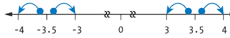

| Math.Round(3.4) = 3 |
| Math.Round(3.6) = 4 |
| Math.Round(-3.4) = -3 |
| Math.Round(-3.6) = -4 |

`Round()` 在对数字进行舍入时的行为大部分符合你的预期。大于 0.5 时，它会向上舍入；小于 0.5 时，它向下舍入。

### Floor()

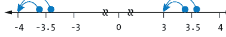

| Math.Floor(3.4) = 3 |
| Math.Floor(3.6) = 3 |
| Math.Floor(-3.4) = -4 |
| Math.Floor(-3.6) = -4 |

`Floor()` 始终向下舍入，舍弃任何整数的小数部分。看看负值情况下发生了什么！

### Ceiling()

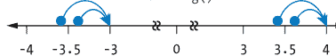

| Math.Ceiling(3.4) = 4 |
| Math.Ceiling(3.6) = 4 |
| Math.Ceiling(-3.4) = -3 |
| Math.Ceiling(-3.6) = -3 |

`Ceiling()` 始终向上舍入。

图 7-1：带有参数和返回值的舍入方法

### 传统舍入

当使用 `Round()` 方法且数字的小数部分好等于 0.5 时要小心。在这种情况下，`Round()` 方法会舍入到最近的偶整数（这被称为“银行舍入法”）。例如，0.5 和 -0.5 被舍入到 0，1.5 和 2.5 被舍入到 2，而 -1.5 和 -2.5 被舍入到 -2。这与你在学校学到的不同，在学校里0.5 总是向上舍入到 1！尽管这并不习惯，但银行舍入法非常常见，并被提供此类服务的银行家经常使用。

但我们如何让 Small Basic 向上舍入呢？我们将使用一些 `Floor()` 方法而不是 `Round()` 方法，如下：

```
Math.Floor(x + 0.5)
```

使用这种方法，x 代表你想要舍入的任何值。所以如果 x 是 0.6，那么 x + 0.5 = 1.1，且 `Floor(1.1)` = 1。很酷！这正是你预期的工作方式。但假设 x 是 2.5。如果我们使用 `Math.Round(2.5)`，我们将得到 2，如果你想要的是传统舍入，这并不是你想要的结果。我们想要向上舍入并得到 3。使用我们的小技巧，你会得到 x + 0.5 = 3.0，且 `Floor(3.0)` = 3。现在就更像样了！这能得到你预期的对于末位为 5 的小数的舍入值。

### 舍入到最近的百分位

让我们进一步探索。对答案使用 `Round()` 或 `Floor()` 会给你一个整数（美元）。但如果你想显示精确到分的金额呢？你如何让 Small Basic 将答案舍入到最近的百分位？考虑这条语句：

```
Math.Floor(100 * x + 0.5) / 100
```

例如，如果 x = 2.875，那么 100 * x + 0.5 = 288，`Floor()` 返回 288。除以 100 是我们需要的结果。你也可以使用此语句舍入到最近的百分位：

```
Math.Round(x * 100) / 100
```

让我们使用第二种技术将答案舍入到最近的分。在第 11 行添加以下语句：

```
A = Math.Round(A * 100) / 100
```

在第 11 行计算 A 后，程序将其舍入到最近的百分位（分）并将答案保存在 A 中。如果使用输入运行程序，输出将是 $27.14。完美！现在我们开始讨论钱了！

Helen 在她的店里很忙。她使用计算器为购买价格添加 6% 的税。例如，如果客户的总额为 $27.46，她将 27.46 乘以 1.06 得到 29.106。但她应该收客户 $29.10 还是什么？她没有时间自己计算！她的店让她太忙了！Helen 听说了编程技巧，她向你寻求帮助。她需要一个程序让她输入金额。然后她希望程序添加销售税，将结果舍入到最近的分并显示答案。

### Abs, Min 和 Max 方法

Math 对象提供了寻找数字绝对值的方法。当你计算一个数字的绝对值时，你是在寻找它到 0 的距离，这将是一个正数。例如，-1 和 1 的绝对值都是 1。这段代码片段向你展示了一些示例：

```
Math.Abs(-2)   = 2
Math.Abs(-3.5) = 3.5
Math.Abs(4)    = 4
```

`Abs()` 方法接收一个数字（正或负）并返回该数字到 0 的距离，或者说它的绝对值。这个返回值始终正数。例如，假设你的游戏给出一个秘密数字 (10)，猜测不需要是。相反，你的游戏接受 8 到 12 之间的任何猜测。要检查用户的猜测是否正确，你可以测试猜测（保存在变量 `guess` 中）与 10 之间的绝对差；即 `Abs(guess - 10)`。你将在下一章学习使用 If 语句进行检查。

现在找到两个数字的最小值或最大值。`Min()` 方法返回两个数字中较小的，`Max()` 方法返回较大的：

```
Math.Min(5, 10)    = 5
Math.Min(-3.5, -5.5) = -5.5
Math.Max(3, 8)      = 8
Math.Min(-2.5, 4.7) = -2.5
```

你可以使用这些方法限制用户输入程序的数字。例如，如果你的程序期望一个小于 100 的数字，你可以写道：

```
ans = TextWindow.ReadNumber()
ans = Math.Min(ans, 100)
```


TextWindow.WriteLine(ans)

尝试一下！运行这段代码两次。第一次输入一个小于 100 的数字，第二次输入一个大于 100 的数字。

### Remainder 方法

你可以使用 `Remainder` 方法从任何除法运算中获取余数。例如，`Math.Remainder(10, 3)` 返回 1，因为 10 除以 3 余 1。知道是否存在余数有各种用途。例如，如果你想检查一个数字是偶数还是奇数，你可以检查该数字除以 2 的余数：如果余数为 0，则是偶数；否则是奇数。为了看到 `Remainder` 方法的作用，让我们写一个程序来计算给定金额中美元、角、镍和分的数量。要找到最高数量的美元和硬币，你需要从最大的面值（美元）开始一直到最小的（分）。列表 7-3 显示了完整的程序。通读程序，看看当输入为 25.36 时输出是什么。

```
basic
1 Money.sb

2 TextWindow.Write("Enter an amount of money (such as 25.36): ")

3 total = TextWindow.ReadLine() ' In dollars and cents

4 cents = Math.Floor(total * 100) ' Total cents = 2536

5 dollars = Math.Floor(cents / 100) ' Number of dollars = 25

6 cents = Math.Remainder(cents, 100) ' Remaining cents = 36

7 quarters = Math.Floor(cents / 25) ' Number of quarters = 1

8 cents = Math.Remainder(cents, 25) ' Remaining cents = 11

9 dimes = Math.Floor(cents / 10) ' Number of dimes = 1

10 cents = Math.Remainder(cents, 10) ' Remaining cents = 1

11 nickels = Math.Remainder(cents, 5) ' Number of nickels = 0

12 pennies = Math.Remainder(cents, 5) ' Number of pennies = 1

13 TextWindow.Write("$ " + total + ",")

14 TextWindow.Write("$ " + dollars + ",")

15 TextWindow.Write(quarters + " Q,")

16 TextWindow.Write(dimes + " D,")

17 TextWindow.Write(nickels + " N,")

18 TextWindow.Write(pennies + " P.")

19 TextWindow.WriteLine("")
```

列表 7-3: 寻找美元和硬币面值

90 第 7 章

使用 Small Basic 学习编程（早期访问版），© 2016 Majed Marji 和 Ed Price

让我们逐行跟踪这个程序，以理解它是如何工作的。用户在第 2 行处输入 25.36（即 25 美元 36 分），因此总数 `total = 25.36`。第 4 行计算总数为 `Floor(25.36 * 100) = 2536`。这个数字除以 100 得到 25 并以美元单位保存（第 5 行），余数为 36，以分单位保存（第 6 行）。接下来，36 分除以 25 得到 1 个季度硬币（第 7 行），余数为 11 分（第 8 行）。11 分的余数除以 10 得到 1 个一角硬币（第 9 行），余数为 1 分（第 10 行）。第 11 行和 12 行以相同的方式计算可用的镍币和分币。程序的其余部分（第 13–19 行）显示结果。图 7-2 说明了这一点。

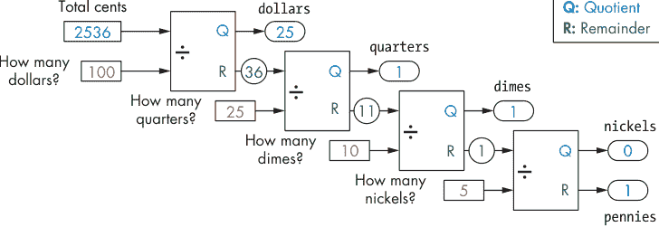
图 7-2：展示 Money.sb 的输出

让我们尝试另一个金额并查看输出：输入一个金额（例如 25.36）：$23.78 = $23.78。如果你在找零钱，这非常方便：

#### 尝试一下 7-4
编写一个程序，读取一个三位数并按其位值输出每个数字。例如，如果输入是 368，程序应该显示：
- 3 百
- 6 十
- 8 个

提示：如果把 368 除以 100，你会得到 3，余数为 68。如果你将 68 除以 10，你会得到 6，余数为 8。

## 随机数

随机数用于许多应用程序，如模拟和游戏。它们还用于软件测试（以查看程序对不同输入的响应）或模拟随机事件（如彩票）。`GetRandomNumber()` 方法返回一个介于 1 和你传递给方法的上限之间的随机整数。使用此方法，你的程序可以生成随机数，你可以将其用于各种应用程序，例如，查看你是否赢了。

要模拟掷骰子，编写以下代码：
```
basic
dice = Math.GetRandomNumber(6)
TextWindow.WriteLine("你掷了：" + dice)
```
变量 `dice` 包含一个 1 到 6 之间的随机选数字的数字，类似于从帽子里抽签。

要模拟抛硬币，你可以写：
```
basic
coinFlip = Math.GetRandomNumber(2)
TextWindow.WriteLine("结果: " + coinFlip)
```
变量 `coinFlip` 为 1 或 2。变量 1 代表正面，变量 2 代表反面（或反之亦然！）。

要模拟掷两个骰子并求它们的和，你可以写这段代码：
```
basic
num1 = Math.GetRandomNumber(6)
num2 = Math.GetRandomNumber(6)
outcome = num1 + num2
TextWindow.Write("你得到了 " + num1 + ", " + num2)
TextWindow.WriteLine("总计是 " + outcome)
```
虽然你的结果将介于 2（掷出两个一）和 12（掷出两个六）之间的数字，但不要犯下这样的代码错误：
```
basic
outcome = 1 + Math.GetRandomNumber(11)
```
这条语句将给你一个 1 到 12 之间的数字，这与两个数字相加不同。

### 尝试一下 7-5
一个袋子里有 20 个编号从 1 到 20 的球。编写一个程序模拟从袋子里随机取出一个球。

## 三角函数方法

三角函数是高中生的宿敌（正弦、余弦、正切等）。我们不会解释这些是什么，但如果你不知道什么是三角函数，或者从未听说过三角学这个词，不要担心。直接跳到第 8 章即可。否则，让我们从一个例子开始。

想象来自未来的机器人回到了我们的时代以毁灭人类；你是唯一能阻止他们攻击的人。你需要使用你的大炮摧毁他们的仓库，如图 7-3 所示。

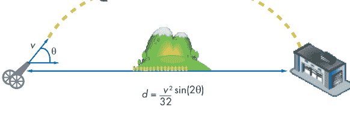
图 7-3：摧毁机器人的仓库

你的大炮发射的初速度 v 为每秒 160 英尺。你需要使用你的大炮摧毁他们的仓库，如图 7-3 所示。

大炮以初速度 `v = 160` 英尺/秒发射。仓库在 500 英尺外。你需要做的是根据公式找到距离 `d`。程序 7-4 提示你输入角度。你需要多次运行程序以找到最佳角度。

```
basic
AndroidAttack.sb

v = 160 ' 英尺/秒

TextWindow.WriteLine("摧毁 500 英尺外的仓库！")

TextWindow.Write("输入角度（度）：")

angle = TextWindow.ReadNumber() ' 弧度

theta = Math.Radians(angle)

d = (v * v) * Math.Sin(theta)

d = Math.Round(d) ' 四舍五入到整数

TextWindow.WriteLine("距离 = " + d + " 英尺")
```
程序 7-4：寻找距离

在提示后，程序读取你的输入并将其保存变量 `angle`（第 6 行）。然后第 7 行将角度从度转换为弧度（`Sin` 方法需要输入弧度）。之后，程序根据给定公式计算距离（第 9 行），四舍五入到整数（第 10 行），并显示结果（第 12 行）。这是一个示例运行：

除了 `Sin` 方法外，`Math` 对象还提供 `Cos()`、`Tan()`、`ArcSin()`、`Arccos()` 和 `Arctan()`。你可以在本章的附加资源部分阅读这些方法：http://www.nostarch.com/small-basic/

### 尝试一下 7-6
你想为节日选择距离 $d$ 和角度 $\theta$。找到高度的方法是使用三角函数。如果你测量了 $d$ 和 $\theta$，如下所示：$h = d \tan(\theta)$

## 挑战

如果你卡住了，请查看 http://nostarch.com/small-basic 获取答案和练习题！

1. 为每个代数表达式编写 Small Basic 语句：
   a. $a = \sqrt{r^2 + h^2}$
   b. $a = x^y$
   c. $a = \frac{x+y}{z}$

2. 以下谜题是由古埃及书吏 Ahmes 在公元前 1650 年写的：“七间房子各有七只猫。每只猫抓七只老鼠。每只老鼠如果活着会吃七穗谷。每穗谷能产生七桶小麦。猫拯救了多少小麦？”编写一个 Small Basic 程序找到答案。提示：使用 `Power()` 方法。

3. 创建一个程序，将用户输入的秒数转换为最大小时、分钟和秒。例如，如果用户输入 8110 秒，程序报告 2 小时 15 分 10 秒。

## 使用 IF 语句做决定

穿哪件衣服？晚餐吃什么？去哪里？我的裤子拉得那么低会让内裤露出来吗？你每天都会问自己这些问题并回答。就像你做决定一样，你的程序也可以！当然，它们不会自动这样做。你的程序只会执行你想让它进行的比较，然后运行某些语句或跳过它们。

使用 Small Basic 学习编程（早期访问版），© 2016 Majed Marji 和 Ed Price

Small Basic 使用几种不同的方式来控制程序中运行哪些语句：选择语句（`If`、`If/Else`、`If/ElseIf`）、跳转语句（`Goto`）以及迭代或循环语句（`For` 和 `While`）。在本章和下一章中，我们将解释选择语句和跳转语句，并在第 13 和 14 章中解释循环。在本章中，你将学习关系运算符、布尔表达式以及如何使用 `If/Else` 语句来编写一些有趣的程序。

### If 语句

假设你妈妈打电话告诉你：“在你回家的路上，去一下 Snarf 披萨店。如果店开门，就买一个大披萨。”她的指令没有说如果店关门了该怎么办；你不会空手而回。列表 8-1 用代码表示了这一点：

```
basic
' SnarfPizza.sb

2 TextWindow.WriteLine("Is Snarf's Pizza open?")

3 TextWindow.Write("Enter 1 (for open) or 2 (for closed): ")

4 status = TextWindow.ReadNumber()

5

6 If (status = 1) Then

7 TextWindow.WriteLine("You bought a delicious pizza!")

8 EndIf

9 TextWindow.WriteLine("time to go home!")
```

列表 8-1：使用 `If` 和 `EndIf` 关键字

运行此程序，并在提示时输入 1（表示 Snarf's 店开门）。因为第 6 行的条件为真，程序会打印第 7 行的消息，即“You bought a delicious pizza!”。第 9 行的语句（位于 `EndIf` 关键字之后）无论你是否买了披萨都会执行。再次运行这段代码，但这次在提示时输入 2。发生了什么？

第 6 行的语句是一个 `If` 语句。`If` 关键字之后的语句（`status = 1`）是条件。程序会检查条件是否为真。在这种情况下，它会检查 Captain Snarf's 披萨店是否开门。在 `Then` 和 `EndIf` 关键字之间是动作——即程序执行的操作。如果条件为真，程序就会执行该动作。程序员通常使用“代码块”一词来指 `If` 和 `EndIf` 关键字之间的语句（6–8）。

> Small Basic 不要求你对条件表达式加上括号，这意味着你可以像这样写第 6 行的语句：`If status = 1 Then`。但括号会让语句更容易读，所以我们将在本书中使用它们。

在你输入代码时，Small Basic 会自动对 `If` 语句进行缩进。这使得程序更容易阅读，并清楚地显示哪些语句是代码块的一部分。如果你的代码变得混乱，在编辑器中点击右键，并从弹出菜单中选择“格式化程序”（Format Program）来缩进你的所有代码。太棒了！

`If` 语句是 Small Basic 中所有决策的基础。查看图 8-1 中的插图来理解它的工作原理。

`If` 语句的条件是一个逻辑表达式（也称为布尔表达式或条件表达式），其结果为真或假。程序运行 `If` 和 `EndIf` 关键字之间的语句（称为 `If` 语句的体）。但如果条件为假，块中的语句将被跳过。无论条件是否为真，程序都会运行 `EndIf` 之后的语句。

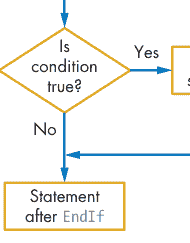

图 8-1：解释 If-Then-EndIf 块的结构

> 你可以将 `If` 语句想象成程序流中的一个绕道。它就像一个可选的过山车循环。

你可以使用关系运算符来测试各种条件，我们接下来将讨论它们。

### 现实世界布尔

布尔的使用是为了纪念乔治·布尔（George Boole），他是一位 19 世纪的英国数学家，发明了一种仅基于两个值（1 和 0，真和假）的逻辑系统。布尔代数最终成为了现代计算机科学的基础。

在生活中，我们一直使用布尔表达式来决策。计算机使用它们来确定遵循程序的哪个分支。

### 关系运算符

列表 8-1 中的条件 `(status = 1)` 测试 `status` 是否等于 1。我们将其称为关系运算符（或比较运算符），因为它测试了两个值之间的关系。Small Basic 支持另外五个关系运算符。

表 8-1：Small Basic 中的关系运算符

| 运算符 | 含义 | 符号 |
| :--- | :--- | :--- |
| `=` | 等于 | `=` |
| `<` | 小于 | `<` |
| `<=` | 小于或等于 | `<=` |
| `>` | 大于 | `>` |
| `>=` | 大于或等于 | `>=` |
| `<>` | 不等于 | `<>` |

让我们来看几个例子看看它们是如何工作的。其中一个要求是申请人必须至少 21 岁。

```
basic
TextWindow.Write("How old are you?")
age = TextWindow.ReadNumber()

If (age < 21) Then
    TextWindow.WriteLine("Sorry! You're not enough!")
EndIf
```

`If` 条件检查 `age` 是否小于 21。如果是，则申请人不符合。检查此点的另一种方法是：

```
basic
If (age >= 21) Then
    TextWindow.WriteLine("So far good!")
EndIf
```

但如果公主还要求申请人身高 6 英尺高？你会如何检查这一点？

```
basic
TextWindow.Write("What is your height (in feet)?")
height = TextWindow.ReadNumber()

If (height <> 6) Then
    TextWindow.WriteLine("Sorry! You don't have the height.")
EndIf
```

注意 `If` 条件使用了不等于 (`<>`) 运算符。如果申请人输入 6 以外的任何数字，游戏结束了！

### 尝试 8-1

老人想更高效地送送礼物。他不再爬烟囱，而是从他的雪橇上掉礼物。他需要一个程序，输入雪橇的高度（米），然后计算礼物掉到烟囱所需的时间（秒）。以下是公式：

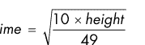

程序在计算时间之前必须检查老人输入的高度是否为正数。运行程序两次。第一次输入正数，第二次输入负数。解释每种情况下发生了什么。

```
basic
FallTime.sb

TextWindow.Write("Please enter the height (meters):")
height = TextWindow.ReadNumber()

If (height > 0) Then
    time = Math.SquareRoot(10 * height / 49)
    time = Math.Round(time * 100) / 100 ' 保留两位小数
    TextWindow.WriteLine("Fall time = " + time + " sec.")
EndIf
```

### 复杂的 If 条件

就像算术运算符一样，关系运算符也需要左右有两个操作数。这些操作数可以是简单的（使用变量和常量），也可以是复杂的表达式。例如，如果你想检查是否有足够的钱买两个大披萨和 5 美元的小费，请输入：

```
basic
If (myMoney >= (2 * pizzaPrice + 5)) Then
```

Small Basic 首先找到 `2 * pizzaPrice + 5` 的值（使用 `pizzaPrice` 的当前值）。然后将结果与 `myMoney` 的当前值进行比较，以确定 `If` 条件为真为假。

使用 Small Basic 学习编程（早期访问），© 2016 Majed Marji 和 Ed Price

你也可以在 `If` 条件内部使用任何返回值的方法。例如，如果你创建了一个比萨外卖游戏，并想在玩家的分数达到 100、200、300 等时给他们一个额外的生命值，你可以这样输入：


如果 `Math.Remainder(score, 100) = 0` 则

```
此条件检查了当前得分除以 100 的余数。如果余数为 0，则 `If` 条件为真，玩家将获得他们赚到的额外生命。
```

### 尝试一下 8-2

将下列每个陈述翻译为逻辑表达式，并检查该条件为真还是假。假设 `x = 4` 且 `y = 5`。

1. `x` 和 3 之和小于 8。
2. `x` 除以 3 的余数小于 2。
3. `x²` 和 `y²` 之和大于或等于 40。
4. `x` 正好被 2 整除。
5. `x` 和 `y` 中的最小值小于或等于 10。

### 比较字符串

我们向你展示了如何使用关系运算符来比较数字，但在某些应用程序中，你可能需要比较字符串。例如，你可能需要检查用户是否为程序输入了正确的密码，或者你在使用一个猜词游戏。

你可以使用 `=`（等于）或 `<>`（不等于）运算符来测试两个字符串是否相同。列表 8-2 要求用户猜秘密密码：

```
1 SecretCode.sb
2 TextWindow.Write("Guess the secret code!")
3 guess = TextWindow.Read()
4 If (guess = "Pizza rules!") Then
5 TextWindow.WriteLine("You're right!")
6 End
7 TextWindow.WriteLine("Goodbye!")
```

列表 8-2：在 Small Basic 中比较字符串

多次运行此程序，并尝试几个不同的猜测。例如，输入 `pizza rules!`（使用小写字母 p）。发生了什么？

再次运行程序，但这次输入 `Pizza rules!`。这次起作用了吗？这是因为当你比较字符串时，它们必须完全匹配。所有的大小写、空格和标点符号都必须一致。

注意，其他关系运算符（`<`, `<=`, `>`, `>=`）不能用于字符串。如果你在非数字字符串上使用这些运算符任何一个，结果将始终为假。

### If/Else 语句

你妈妈又给你回了电话并给了你更多指令。“还有一件事！如果 Captain Snarf 店关门了，请顺过 LongLine 超市买一个冷比萨。”现在你可以使用 Small Basic 中的 `If/Else` 语句来帮助你了！

`If/Else` 语句还允许你在条件为真时执行一个操作，在条件为假时执行另一个操作。图 8-2 展示了该语句的结构。

如果条件为真，Small Basic 运行块（`If` 和 `Else` 关键字之间的部分）。如果语句为假，Small Basic 运行 `Else` 块（`Else` 和 `EndIf` 关键字之间的部分）。Small Basic 只运行两个块中的一个（`If` 块或 `Else` 块）。

你可以像列表 8-3 所示编写你妈妈的新指令：

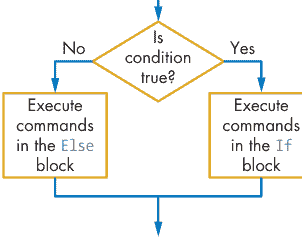

图 8-2：If/Else 语句的结构和流程图

```
1 SnarfPizza.sb
2 TextWindow.WriteLine("Is Snarf's Pizza open?")
3 TextWindow.WriteLine("Enter 1 (for open) or 2 (for closed):")
4 status = TextWindow.ReadLine()
5
6 If (status = 1) Then
7 TextWindow.WriteLine("You bought a delicious pizza!")
8 Else
9 TextWindow.WriteLine("You got a frozen pizza!")
10 EndIf
11 TextWindow.WriteLine("Time to go home!")
```

列表 8-3：演示 If/Else 语句

如果 `status = 1`，意味着 Captain Snarf's 开门，你将买一个美味的比萨然后回家。但如果 `status` 不是 1（Captain Snarf's 未开门），你将在 LongLine 超市买一个冷比萨然后回家。

你妈妈的指令假设 LongLine 总是开门的，并且你能找到想要的东西。但如果超市比萨卖光了呢？请关注；你可能会收到妈妈的另一个电话来给你新指令！

### 尝试一下 8-3

完成以下程序以创建一个脑筋转弯题。这个程序将用它的答案让你惊喜。确保在呈现答案的方式上发挥创意！

```
* BrainTeaser.sb
* 实现一个有趣的问答

询问第一个问题
TextWindow.Write("If you take 2 pizzas, how many do you have?")
ans = TextWindow.ReadNumber()

If (ans = 2) Then
    TextWindow.Write("Correct.")
Else
    TextWindow.Write("Nope.")
EndIf

TextWindow.WriteLine("If you take 2 pizzas, then you have pizzas!")
TextWindow.Write("")
```

这里是一些你可以添加的问题建议：
- 一个深 1 英尺、宽 1 英尺的洞里有多少英寸的土？（答案：0。洞里没有土！）
- 一吨黄金比一吨羽毛重吗？（答案：否）
- 一个打里有多少个分？（答案：12）

### 嵌套 If 和 If/Else

你可以在 `If` 语句的体中编写任何语句，这包括另一个嵌套的 `If` 语句。

```
If (condition1)
    If (condition2)
        Statement(s)
    Else
        Statement(s)
    EndIf
Else
    Statement(s)
EndIf
```
嵌套的 If/Else 语句

```
If (condition) Then
    Statement(s)
Else
    Statement(s)
EndIf
```
嵌套的 If 语句
嵌套 If 语句

图 8-3：演示嵌套 If 和 If/Else

当你需要测试多个条件时，可以嵌套 `If` 语句。在挂电话之前，妈妈认为 LongLine 可能比萨卖光了。所以她又打了电话说：“听着，如果 Captain Snarf's 关门了，我们要比萨。”列表 8-4 展示了如何将这些转换为代码。

```
1 SnarfPizza.sb
2 TextWindow.WriteLine("Is Snarf's Pizza open?")
3 TextWindow.WriteLine("Enter 1 for open or 2 for closed:")
4 status = TextWindow.ReadNumber()
5 If (status = 1) Then 'Snarf's is open
6 TextWindow.WriteLine("You bought a delicious pizza!")
7 Else 'Snarf's is closed, so you'll go to LongLine
8 TextWindow.WriteLine("Snarf's is closed. Try LongLine.")
9 hasPizza = Math.RandomNumber(2) Checks your luck
10 If (hasPizza = 1)
11 TextWindow.WriteLine("You got a frozen pizza!")
12 Else
13 TextWindow.WriteLine("You got a bag of frozen wings!")
14 EndIf
15 EndIf
16 TextWindow.WriteLine("Time to go home!")
```

列表 8-4：演示嵌套 If

这是一个嵌套的 If/Else 语句！如果 Captain Snarf's 关门，你运行了一个嵌套的 If/Else 语句来决定从超市买什么。第 9 行将变量 `hasPizza` 随机设置为 1 或 2。1 表示 LongLine 有比萨，2 表示超市卖光了。这个程序运行几次以查看你今晚买什么。

但等等，妈妈刚刚意识到你可能没钱，她又说：“抱歉，我忘了告诉你。如果你没钱，就去 Steve 家吃晚餐！”现在我们必须增加另一个嵌套层。列表 8-5 展示了如何处理这种情况：

```
1 SnarfPizza.sb
2 TextWindow.Write("How dollars do you have?")
3 money = TextWindow.ReadNumber()
5 If (money >= 25) Then I have enough money
6 TextWindow.WriteLine("Is Snarf's Pizza open?")
7 TextWindow.WriteLine("Enter 1 (for open) or 2 (for closed):")
8 status = TextWindow.ReadNumber()
9 If (status = 1) Then Snarf's is open
10 TextWindow.WriteLine("You bought a delicious pizza!")
11 Else 'Snarf's is closed, so you'll go to LongLine
12 TextWindow.WriteLine("Snarf's is closed. Try LongLine.")
13 hasPizza = Math.RandomNumber(2) Checks your luck
14 If (hasPizza = 1)
15 TextWindow.WriteLine("You got a frozen pizza!")
16 Else
17 TextWindow.WriteLine("You got a bag of frozen chicken wings!")
18 EndIf
19 EndIf
21 Else I don't have enough money
22 TextWindow.WriteLine("Go to Steve's house for dinner.")
23 TextWindow.WriteLine("It's earthworm pizza night!")
24 EndIf
25 TextWindow.WriteLine("Time to go home!")
```

列表 8-5：更多嵌套层

除了妈妈关心你之外，这个故事的论点在于，你在程序中做决策的方式与现实生活中做决策的方式没有区别！

### 尝试一下 5-4

修改以下程序，使其开始时读取用户输入的 `x` 和 `y` 的值。修改输出信息让用户大笑吧！

```
If (x > 5) Then
    If (y > 5) Then
        TextWindow.WriteLine("The skylight is falling!")
    Else
        TextWindow.WriteLine("Now it's time to play the piper!")
    EndIf
Else
    TextWindow.WriteLine("I'll huff, puff, and blow $s on tacos!")
EndIf
```

## Goto 语句

`Goto` 语句通过允许跳转到程序中较早或较晚出现的语句来改变程序的流程。请看列表 8-6 中 Mark 和 Andy 之间烦人的对话：

```
1 GotoDemo.sb
2 Again:
3 TextWindow.Write("Mark: Pete and Repeat were in a boat. ")
4 TextWindow.WriteLine("Pete fell out, who was left?")
5 TextWindow.WriteLine("Andy: Repeat.")
6 TextWindow.WriteLine("")
7 Program.Delay(1000) ' 等待 1 秒以减慢程序速度
8 Goto Again ' 无尽 Goto 循环
```

列表 8-6：无尽 Goto 循环

第 2 行的语句被称为*标签*（label）；它用于标识程序的特定行。标签以冒号结尾；你可以将其放置在程序的任何位置。

程序随后运行第 3–7 行。当它到达第 8 行时，会返回到第 2 行（`Again` 标签），Small Basic 再次运行第 3–7 行。当你多次运行同一代码块时就是循环，这个循环会无限持续下去（就像《完不了的歌》和《巴比之歌》）。运行此程序查看其输出（并尝试把这些歌从脑海里赶出去；哈哈）。

《使用 Small Basic 编程》（早期访问），© 2016 由 Majed Marji 和 Ed Price

`Goto` 语句是一种无条件跳转（或无条件转移）语句，程序会无条件地（不问任何问题）跳转到 `Goto` 标签指定的位置。相反，`If/Then` 语句是条件转移语句，因为程序只在满足特定条件时才会改变流程。

大多数程序员建议你避免使用 `Goto` 语句，因为这会导致“意大利面代码”——即代码错综复杂、混乱，以至于没人能跟上！但有时 `Goto` 语句非常有用，了解它何时派上用场是有帮助的。

`Goto` 的一个常用用途是检查用户输入的数据以确保正确，如列表 8-7 所示：

```
1 ValidateWithGoto.sb
2 TryAgain:
3 TextWindow.Write("Enter a positive number: ")
4 num = TextWindow.Read()
5 If (num <= 0) Then
6 Goto TryAgain
7 EndIf
8 TextWindow.Write("You entered: " + num)
```

列表 8-7：使用 Goto 检查用户输入

此代码要求用户输入正数（第 3 行），并将输入读入 `num` 变量（第 4 行）。如果输入的数字不是正数（第 5 行），`Goto` 语句会将程序送回 `TryAgain` 标签并要求用户重新输入。如果数字是正，程序继续执行第 8 行的语句。你将在第 14 章学习使用 `While` 循环检查用户输入的方法。

## 尝试一下 8-5

我们（本书作者）计划使用以下程序来衡量读者的满意度。你认为这公平吗？我们认为公平！重写它并使其个性化。找个人来做你的调查吧！

```
Again:
TextWindow.Write("How many stars do you give this book [1-5]?")
ans = TextWindow.ReadNumber()
ans = Math.Floor(ans) ' 如果用户输入了小数
If (ans <> 5) Then
    TextWindow.Write("Invalid number! Please enter an integer")
    TextWindow.WriteLine("that's greater than 4 but less than 6.")
    Goto Again
EndIf
TextWindow.WriteLine("Wow! Thank you. You made our day!")
```

## 编程挑战

如果你遇到困难了，请访问 `http://nostarch.com/smallbasic/` 获取解决方案、更多资源以及教师和学生的复习题！

- 以下程序通过要求用户抛掷硬币并输入 `h`（正面）或 `t`（反面）来创建一个硬币掷游戏。根据用户的输入，程序会显示不同的信息。你认为电脑玩的游戏公平吗？试着让你或朋友玩玩这个不公平的硬币游戏吧！

```
TextWindow.Write("Toss a coin. Heads(h) or Tails(t)")
ans = TextWindow.Read()
If (ans = "h")
    TextWindow.WriteLine("I won. I'm the champion!")
Else
    TextWindow.WriteLine("You lost. Go home.")
EndIf
```

- 詹姆斯·柯克船长正驾驶着“世纪号”级星际舰。柯克拦截了信息。编写一个程序读取数字并进行从小到大的排序。

- 编写一个程序让用户输入高度并显示结果。

## 9 使用决策来制作游戏


有时决策是复杂的。假设一个男孩和女孩想看电影，女孩想看动作片，男孩想看喜剧片。电影必须在晚上 10 点前开始且在电影范围内。想象一下代码会是什么样子！

在本章中，我们将继续讨论决策问题并查看一些语句。我们将首先介绍 `ElseIf` 语句，展示它如何简化嵌套 `If` 语句。然后，你将探索逻辑运算符 `And` 和 `Or`，它们能让你进行更多操作。我们还将介绍 `Shapes` 对象，让你熟悉图形处理。你通过制作游戏来将这些新知识付诸实践！

## If/Else 阶梯

到处都是新闻！外星人 Frank 逃离了监禁。坦白说，当你发现他在社区袭击时，你有激光枪。瞄准并射击。运行 9-1 程序查看接下来会发生什么！

```
1 AlienAttack.sb
2 TextWindow.Write("A scary alien monster approaches.")
3 TextWindow.WriteLine("Press any key to shoot...")
4 TextWindow.PauseWithoutMessage()
5
6 damage = Math.RandomNumber(5) ' 随机选择结果
7 If (damage = 1) Then
```


8 `TextWindow.Write("Wow You got him.")`

9 `TextWindow.WriteLine("Now you can watch SpongeBob!")`

10 `ElseIf(damage = 2) Then`

11 `TextWindow.WriteLine("You injured him.")`

12 `TextWindow.WriteLine("He wants a Band-aid.")`

13 `ElseIf(damage = 3) Then`

14 `TextWindow.Write("Weak shot. Run for your life!")`

15 `TextWindow.WriteLine("Now dance! You'll confuse him.")`

16 `Else`

17 `TextWindow.Write("You missed! He got you.")`

18 `TextWindow.WriteLine("You should stick to video games.")`

19 `EndIf`

```

列表 9-1：爬上 If/Else 阶梯。程序选取 1 到 5 之间的随机数（第 6 行），然后检查该数字以决定外星人的命运。第 7–19 行被称为 If/Else 阶梯，通常用于构建语句链。其通用形式如图 9-1 所示。

从第一个语句开始，程序遍历每个条件。当发现真值时，它运行与该条件相关的语句，并移动到 `EndIf` 之后的语句，跳过阶梯的剩余部分。如果没有任何条件为真，程序将运行阶梯末尾 `Else` 子句中的语句，然后程序在 `EndIf` 之后继续。

《使用 Small Basic 编程》（早期访问），© 2016 Majed Marji 和 Ed Price

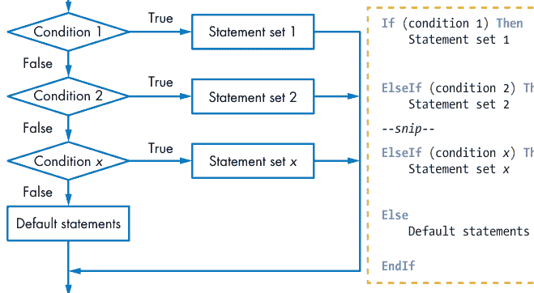

图 9-1：If/ElseIf 链的结构

让我们另一种另一种 If/ElseIf 链的方法。

## 字母等级

在例示例中，你将创建一个程序，读取 0 到 100 之间的测试分数，并根据表 9-1 显示字母等级。

表 9-1：字母等级评分表

| 分数 | 字母等级 |
| --- | --- |
| `score >= 90` | A |
| `80 <= score < 90` | B |
| `70 <= score < 80` | C |
| `60 <= score < 70` | D |
| `score <= 60` | F |

完整的程序位于列表 9-2 中。

使用决策制作游戏 113

《使用 Small Basic 编程》（早期访问），© 2016 Majed Marji 和 Ed Price

```

12 Else

13 grade = "F"

14 Endif

15 TextWindow.WriteLine("The grade is " + grade)

```

列表 9-2：评分

试着运行该程序并输入一些数字以查看结果。这里是一些输出示例：

输入分数：90
等级为 A
输入分数：72
等级为 C

该程序使用 If/Else 链对输入的分数进行测试。让我们来看看这个程序是如何运行的。

程序测试第一个条件 `score >= 90` 是否为真。如果为真，`grade` 被设置为 A，程序跳转到第 15 行。

如果不为真，`score` 必须小于 90，因此程序检查第 6 行的下一个条件 `score >= 80`。如果此条件为真（这意味着 `score` 大于或等于 80 但小于 90），`grade` 被设置为 B，程序跳转到第 15 行。

如果仍为假，`score` 必须小于 80。接下来，程序检查第 8 行的 `score > 70`。如果此条件为真（这意味着 `score` 大于或等于 70 但小于 80），`grade` 被设置为 C，程序跳转到第 15 行。

如果仍然为假，`score` 必须小于 70。在这种情况下，程序检查第 10 行的条件 `score >= 60`。如果此条件为真（这意味着 `score` 大于或等于 60 小于 70），`grade` 被设置为 D，程序跳转到第 15 行。

最后，最后一个条件仍然为真，`score` 必须小于 60。在这种情况下，不检查任何条件，`grade` 被设置为 F，程序跳转到第 15 行。

## 掩盖之地下的 Bug

当你编写 If/Else 链时，条件状态的顺序非常重要。在测试条件时要注意顺序。例如，回到列表 9-2 并将第 4–7 行替换为以下代码：

```

If (score >= 80) Then

grade = "B"

ElseIf (score >= 90) Then

grade = "A"

```

114 第 9 章

《使用 Small Basic 编程》（早期访问），© 2016 Majed Marji 和 Ed Price

程序的此更改意味着你首先检查条件 `score >= 80` 而不是 `score > 90`。现在，如果用户输入 95，程序仅测试第一个条件，看到 `score >= 80` 为真，并将等级设置为 B。在这段代码中，无论 `score` 的值有多高，`grade` 永远不会达到 A 等。没有人能得到 A！当程序在这个 If/ElseIf 链中找到真条件时，它会跳过所有其他语句并直接跳到 `Endif`。

为了避免这个问题，请确保 If/ElseIf 链中的条件顺序是正确的。你可能永远不想先检查中间值。此外，务必运行程序几次以测试这些值，并在用户之前发现任何问题。

## 尝试一下 9-1

在列表 9-2 中，你从检查条件 `score >= 90` 开始。你也可以从检查最后一个条件开始，即 `score < 60`，然后是 `60 < score < 70`，`70 <= score < 80` 等。使用这种反向检查等级的顺序重写程序。

## 让我们逻辑化

有时，你可能想检查多个条件以判断是否运行某语句。例如，你只有在狗很大、受过如厕训练且有三个头时才会收养一只狗。测试多个条件的方法之一是像你在前面的章节中所做的那样嵌套 If/Else。另一种方法是使用逻辑运算符（也称为布尔运算符）。使用逻辑运算符，你可以编写组合了两个或多个逻辑表达式的测试条件。让我们看看如何操作。

你在小学数学课上学习不等式时，还记得像 `x < 10` 这样的表达式吗？这个表达式描述了一个数字 `x`，它大于 5 且小于 10。图 9-2 显示如何在 Small Basic 中编写此表达式。

这是一个由两个逻辑表达式 `x > 5` 和 `x < 10` 组成的复合条件，你使用逻辑运算符 `And` 将它们组合起来。为了使这个复合条件为真，两个表达式都必须为真。

Small Basic 支持两个逻辑运算符：`And` 和 `Or`。图 9-3 描述了它们是如何工作的。

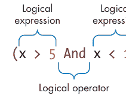

> 图 9-2：Small Basic 中的复合条件

使用决策制作游戏 115

> `thingie And thingie`
> 只有当两个 `thingie` 都为真时，才为真。
> `something Or something`
> 如果其中一个或两个 `something` 为真，则为真。

图 9-3：解释逻辑运算符 `And` 和 `Or`

接下来，我们将进一步解释这些运算符。

## 动物园里的逻辑运算符

看图 9-4 并回答这个问题：猴子如何才能拿到香蕉？如果这三个条件中的任何一个为假，猴子就拿不到香蕉。

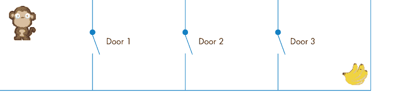

图 9-4：使用 `And` 执行逻辑

现在看图 9-5。在这种情况下，猴子只需要一个为真。

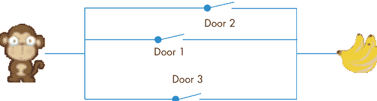

图 9-5：使用 `Or` 执行逻辑

116 第 9 章

《使用 Small Basic 编程》（早期访问），© 2016 Majed Marji 和 Ed Price

### And 运算符

`And` 运算符接受逻辑表达式作为操作数。如果两者都为真，则结果为真；否则为假。表 9-2 列出了 `And` 运算符的输出。

表 9-2：`And` 运算符的真值表

| X | Y | X And |
|---|---|---|
| True | True | True |
| True | False | False |
| False | True | False |
| False | False | False |

列表 9-3 显示了它的操作数组合。

```

1 AndDemo.sb

2 TextWindow.Write("Time left: ")

3 gameLevel = Window.ReadNumber()

4

5 TextWindow.Write("Score: ")

6 score = Window.ReadNumber()

7

8 If ((gameLevel = 1) And (score > 100)) Then

9 TextWindow.WriteLine("You get 200 points!")

10 End If

```

列表 9-3：`And` 运算符

If 块内部的语句（第 9 行）在等级等于 1 且分数大于 100 时运行。如果这两个条件中的任何一个为假，整个条件即为假。

你可以通过将第 8–10 行替换为以下嵌套 If 语句来实现相同的效果：

```

If (gamelevel = 1) Then

  If (score > 100) Then

    Text.WriteLine("You get 200 points!")

End If

```

你看到 `And` 运算符是测试多个条件的简洁方式了吗？嵌套 If 语句需要五行代码，但使用 `And` 你只需要三行代码就能完成任务。

### Or 运算符

你喜欢什么样的披萨？你可能只有在披萨有肉或饼皮是软的时才想吃。当你有多个条件但只需要其中一个为真时，就会用 `Or` 运算符。如果两个表达式中的任何一个为真，或者两者都为真，组合后的逻辑表达式就为真。当操作数都为假时，表达式为假。查看表 9-3 中 `Or` 运算符的真值表。

表 9-3：`Or` 运算符的真值表

| X | Y | X Or Y |
|---|---|---|
| True | True | True |
| True | False | True |
| False | True | True |
| False | False | False |

列表 9-4 展示了使用 `Or` 运算符的示例。目标是在如果没有时间玩（`timeLeft = 0`）或者玩家耗尽所有能量（`energyLevel = 0`）时结束游戏。

```

1 OrDemo.sb

2 TextWindow.WriteLine("Time left: ")

3 timeLeft = Window.ReadNumber()

4

5 TextWindow.WriteLine("Energy level: ")

6 energyLevel = Window.ReadNumber()

7

8 If ((timeLeft = 0) Or (energyLevel = 0)) Then

9 TextWindow.WriteLine("Game Over!")

10 End If

```

列表 9-4：`Or` 运算符

如果 `timeLeft` 为 0 或 `energylevel` 为 0，Small Basic 就会执行 If 块中的命令（第 9 行）。该程序通过不同的输入运行，以让你理解 `Or`（或）运算符是如何运作的。

你可以通过嵌套 If 语句来实现相同的功能。例如，你可以将第 8-10 行替换为以下代码：

```

If (timeLeft = 0) Then

  TextWindow.WriteLine("Game Over!")

Else

  If (energyLevel = 0) Then

    TextWindow.WriteLine("Game Over!")

  EndIf

EndIf

```

然而，如你所见，使用嵌套 If 语句占据了七行代码，但使用 `Or` 仅需三行！使用 `Or` 运算符是测试多个条件的更简洁的方法。

### 评估的宇宙顺序

查看以下条件。Small Basic 如何评估这个表达式的？

`If (A = 1 Or B = 1 And C = 1) Then`

事实证明，Small Basic 对 `And` 的优先级高于 `Or`。这意味着它会找到 `B = 1 And C = 1`，然后将结果作为 `Or` 运算符的右操作数。要更改顺序，你可以使用括号，例如：

`If ((A = 1 Or B = 1) And C = 1) Then`

这段代码首先找到 `A = 1 Or B = 1`，并将结果作为 `And` 运算符的左操作数。我们建议你使用括号来避免任何混淆！

> 注意
> 在组合表达式中，像 `And` 和 `Or` 这样的逻辑运算符会在算术运算符（`+`, `-`, `*`, `/`）和关系运算符（`<`, `<=`, `>`, `>=`）之后求值。在逻辑运算符中，`And` 的优先级高于 `Or`；可以使用括号更改顺序并使你的代码更易读。

现在差不多是应用你所学到的所有决策信息并构建一些有趣应用程序了。但首先，我们需要引入一个新的 Small Basic 对象——`Shapes`（形状）对象，它可以让你使用丰富的图形来构建应用程序。让我们画一些漂亮的图片吧！

### 尝试 9 - 2

打开本章文件夹中的 `DiceGame_Incomplete.sb` 文件，并编写缺失的代码来完成这个游戏。玩家输入他们的注码（从 $1 到 $10）并掷出一对骰子。如果骰子总和为 2 或 12，玩家赢得注码的三倍收益。如果总和为 4 或 10，玩家赢得注码的两倍收益。如果总和为 7 或 11，玩家输掉注码。否则，玩家的余额不变，玩家再次投掷骰子。

## Shapes 对象

在第 3 章中，你学习了如何在图形窗口中绘制各种形状和图像。但那些形状是固定的；一旦你在某个位置画了形状，将其移动到另一个地方唯一的方法就是清除窗口并在新位置重新绘制该形状。如果你需要在程序中移动形状（例如当玩家按下按键时移动角色），最好使用 `Shapes` 对象。

`Shapes` 允许你向图形窗口中添加、移动和旋转形状。运行此代码画一个矩形：

```

rectID = Shapes.AddRectangle(100, 50)

Program.Delay(1000)

Shapes.Move(rectID, 400, 200)

```

程序调用 `AddRectangle()` 添加一个 100x50 的矩形，并将创建的形状的标识符保存在 `rectID` 中。创建的矩形默认出现在图形窗口的左上角。第二条语句暂停程序 1 秒，以便你可以看到矩形的初始位置。第三条语句 `Move()` 移动矩形，使其左上角位于 (400, 200)。注意 `rectID` 是如何作为第一个参数传递给 `Move()` 的，让它知道要移动的形状的标识。

将 `Shapes` 对象想象成一个“形状工厂”——一个制造线、三角形、矩形、椭圆和其他形状的工厂。当你要求它创建一个新形状时，它会创建该形状并返回一个标识符。每当你对对创建的形状进行某些操作时，你将把此标识符传递给 `Shapes` 对象（作为你调用的方法的参数）。

我们在这里不会涵盖 `Shapes` 对象的所有方法。相反，我们将讨论你在下一个程序将用到的方法。随着本书的进行，你将学习其他方法。

我们现在将使用的两个方法是 `AddImage()` 和 `Move()`。要理解这些方法如何工作，请打开本章文件夹中的 `ImageDemo.sb` 文件。你将看到如列表 9-5 所示的代码，它移动了一个：

- 1 `ImageDemo.sb`
- 2 `path = Program.Directory + "\Flower.png"`
- 3 `imgID = Shapes.AddImage(path)`
- 4 `Shapes.Move(imgID, 60, 20)`

列表 9-5：使用 `Shapes` 对象移动图像

点击运行按钮。该程序的输出如图 9-7 所示（我们添加了网格线和数字以显示代码原理）。

假设此程序保存在 `C:\Ch09\ImageDemo`。`ImageDemo` 文件夹还包含 `Flower.png` 文件。`Program.Directory` 属性（第 2 行）指向 `C:\Ch09\ImageDemo`。第 3 行调用 `AddImage()` 并返回一个标识符，保存在 `imgID` 中。标识符类似于 `Shapes` 对象用于跟踪的标签。加载的图像显示在图形窗口的左上角。第二条语句暂停程序 1 秒，以便你可以看到矩形的初始位置。第三条语句 `Move()` 移动矩形，使其左上角位于 (400, 200)。注意 `rectID` 是如何作为第一个参数传递给 `Move()` 的，让它知道要移动的形状的标识。

`Flower.png` 的宽度为 100 像素，高度为 140 像素。如果你想移动图像使其中心位于 (100, 100)，你需要写：

```

Shapes.Move(imgID, 100-50, 100-70)
```


因为你希望图像的中心位于 (100, 100)，你需要减去图像宽度的一半（50）使其水平居中，并减去高度的一半（70）使其垂直居中。

这就是你在学习 `Shapes` 对象时需要的所有信息，以便在下一节中构建应用程序。是时候做点游戏了！

[PAGE 134]
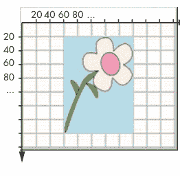

### 第一步：打开启动文件

从 `Ch09` 文件夹开始打开 `GuessMyCoordinates_Incomplete.sb` 文件。该文件仅包含命令。你将一次获取所有的代码。

该章节文件夹还包含你将看到的两张图片（`Grid.png` 和 `Star.png`）。`Grid.png` 是一个 480x360 的笛卡尔网格图像，`Star.png` 是一张 24x24 的星星图像。

如果你遇到任何问题，请检查章节文件夹中包含的完成程序（`GuessMyCoordinates.sb`），看看你哪里做错了。

### 第二步：设置游戏

输入列表 9-6 中的代码来设置游戏界面。这些代码位于文件的开头。

```smallbasic
1 GraphicsWindow.Title = "Guess My Coordinates"
2 GraphicsWindow.CanResize = "False"
3 GraphicsWindow.Width = 480  ' 与背景图片相同
4 GraphicsWindow.Height = 360  ' 与背景图片相同
5 GraphicsWindow.Top = 200  ' 在桌面上的位置
6 GraphicsWindow.Left = 50  ' 在桌面上的位置
7 TextWindow.Title = "Guess My Coordinates"
8 TextWindow.Top = GraphicsWindow.Top
9 TextWindow.Left = GraphicsWindow.Left + GraphicsWindow.Width + 15
10 path = Program.Directory  ' 程序目录
11 bgnd = Shapes.Image(path + "\Grid.png")  ' 背景图 (480 x 360)
12 star = Shapes.Image(path + "\Star.png")  ' 星星图像 (24 x 24)
15 While "True"  ' 无限循环
16   ' 你将在这里添加来自列表 9-7 和 9-8 的代码
17 EndWhile
```

列表 9-6：设置游戏

第 1–6 行设置图形窗口的标题、大小和位置。窗口的大小与网格图像的大小相等（第 3–4 行）。

第 8–9 行设置文本窗口的标题并将其放在图形窗口的右侧（见图 9-8）。程序将程序目录（第 11 行）保存到 `path` 中，你将用它来创建两张图片的完整路径，以便在屏幕上绘制它们。接下来，程序加载这两张图片，并将它们的标识符（由 `Shapes` 对象返回）存在两个变量中：`bgnd` 和 `star`（第 12–13 行）。

第 15 行和 17 行的 `While`/`EndWhile` 关键字将在第 14 章中详细解释。现在，你只需要知道这段代码创建无限循环（一个永远重复的循环，类似于你在第 8 章编写的 Pete and Repeat 程序，`GotoDemo.sb`）。你将在这些 `While`/`EndWhile` 关键字之间添加应用程序的剩余代码。

测试你目前编写的内容。你应该能看到两个窗口并排显示，就像图 9-8 所示。星星图像出现在图形窗口的左上角，但它没有任何作用，因为你没有编写任何移动它的代码。

关闭图形窗口，以便你添加剩余代码。

### 第三步：隐藏星星

在游戏的每一轮中，你将把星星移动到网格上的随机位置，并让玩家猜测它的坐标。让我们添加移动星星的代码。

在 `While` 循环内部（回到列表 9-6 的第 16 行）添加列表 9-7 中的代码：

```smallbasic
1 ' 寻找星星的随机位置（网格单位）
2 X0 = Math.RandomNumber(23) - 12  ' 范围从 -11 到 11
3 Y0 = Math.RandomNumber(17) - 9   ' 范围从 -8 到 8
4 pt = "(" + X0 + ", " + Y0 + ")"
```

列表 9-7：放置星星

在图 9-8 中，你可以看到网格在 x 方向从 -12 到 12，y 方向从 -9 到 9。如果你将星星放在网格边界的任何点，玩家只能看到它的一部分；星星的部分会被裁剪。如果你将星星的 x 坐标限制在 [-11, 11] 范围内，y 坐标限制在 [-8, 8] 范围内。

但是如何创建一个 -11 到 11 之间的随机数呢？这很简单！从 -11 到 11 有 23 个整数（-11, -10, ..., 10）。如果你调用 `RandomNumber(23)`，你会得到一个 1 到 23 之间的随机整数。如果从这个整数中减去 12，结果将在 -11 (1 - 12) 和 11 (23 - 12) 之间，这正是你需要的。

你使用两个变量 `X0` 和 `Y0` 来存储星星的随机坐标。在第 2 行，给 `X0` 变量赋予一个 -11 到 11 之间的随机值。在第 3 行，给 `Y0` 变量赋予一个 -8 到 8 之间的随机数。这些 `X0` 和 `Y0` 的随机值告诉星星落在哪个交点上。接下来，程序构建一个名为 `pt` 的字符串，格式为 `(X0, Y0)`。如果玩家输入正确答案，此字符串将向玩家显示坐标。现在你需要将星星移动到你刚刚创建的新坐标 `(X0, Y0)`。图 9-9 显示了网格的放大视图以及星星可能的位置。如你所示，网格上的每个单位对应图形窗口中的 20 个像素；对比图 9-8 来理解网格的缩放。


要将星星移动到随机位置，你首先需要将网格单位 `(X0, Y0)` 转换为像素单位 `(xPos, yPos)`（使用 Small Basic）。这样做。如果星星的 x 坐标是 -11，你需要在图形窗口的水平位置 20 处绘制。你需要在水平位置 40 处绘制，依此类推。你需要一个公式将星星的 x 坐标 `X0 = [-11, -10, -9, ...]` 映射到对应的水平位置 `xPos = [20, 40, 60, ..., 240]`。为了实现这一点，将 `X0` 加上 12 并乘以 20。测试一下！当 `X0 = -11` 时，`(-11 + 12) × 20 = 20`。当 `X0 = -10` 时，`(-10 + 12) × 20 = 40`，依此类推。这就是你需要的。

y 坐标的映射相同。如果星星的 y 坐标是 8，你需要在图形窗口的垂直位置 20 处绘制。如果星星的 y 坐标是 7，你需要在垂直位置 40 处绘制，依此类推。你需要一个公式将星星的 y 坐标 `Y0 = [8, 7, 6, ...]` 映射到垂直位置 `yPos = [20, 40, 60, ..., 180]`。通过从 9 中减去 `Y0` 并将结果乘以 20 来实现这一点。测试一下！当 `Y0 = 7` 时，`(9 - 7) × 20 = 40`，依此类推，这就是需要的。你还需要考虑一个小细节。假设星星的 `(X0, Y0)` 坐标是 `(-10, 2)`，如图 9-9 所示。你可能会映射像素并发现需要在图形窗口的点 `(xPos, yPos) = (40, 140)` 显示星星。但你需要知道中心位于 `(40, 140)`。因为星星图像是 24×24 像素，星星的左位置必须是 28 (40 – 12)，顶部位置必须是 28 (140 – 12)。这些是你传递给 `Move()` 方法的数字。也就是说，为了让星星的中心与网格交线对齐，你必须从 `xPos` 中减去星星的宽度（12 像素），从 `yPos` 中减去它的高度（12 像素）。

在列表 9-7 中，第 7 行找到星星的 `xPos`，第 8 行找到图形窗口中的 `yPos`。第 9 行调用 `Move()` 方法将星星放置在网格上的位置。

### 第四步：让用户猜测

现在星星已显示在网格上，你需要让玩家猜测它的坐标。在添加 9-7 代码之后（仍在 `While` 循环内）添加列表 9-8 中的代码。

```smallbasic
1 TextWindow.Write("What is the x-coordinate? ")
2 xAns = TextWindow.ReadNumber()
3 If (xAns = X0) Then
4   TextWindow.Write("What is the y-coordinate? ")
5   yAns = TextWindow.ReadNumber()
6   If (yAns = Y0) Then
7     TextWindow.WriteLine("Good job! You're a star!")
8   Else
9     TextWindow.WriteLine("Sorry. The star is at " + pt)
10   EndIf
11 Else
12   TextWindow.WriteLine("Sorry. The star is at " + pt)
13 EndIf
14 TextWindow.WriteLine("")
```

列表 9-8：猜测坐标

此代码要求玩家输入星星的 x 坐标并等待答案（第 1-2 行）。然后它检查 x 坐标猜测是否正确（第 3 行）。如果答案正确，程序移动到第 4 行要求玩家输入星星的 y 坐标并等待答案（第 4–5 行）。如果玩家回答正确（第 6 行），脚本显示“Good job! You're a star!”。否则，程序移动到第 9 行显示正确坐标。

在所有情况下，程序最终都会到达第 14 行打印空行，然后 `While` 循环进入游戏的另一轮。游戏永远不会结束！（这正是你父母在你玩电子游戏时的感受。）

游戏现在已经完成了。尝试玩玩吧！

使用 Small Basic 学习编程（早期访问），© 2016 由 Majed Marji 和 Ed Price

# 尝试 9-4

修改程序列表 9-8，要求玩家输入 x 和 y 坐标，然后使用 `And` 运算符在单个 `If` 语句中同时检查 `xAns` 和 `yAns`。

## 编程挑战

记得与家人和朋友分享你喜爱的程序（点击发布！）访问 `http://nostarch.com/smallbasic/` 获取第 9 章资源和复习指南，以获得教师和学生所需的更多资源、复习题和练习题！

- 编写一个程序模拟老鼠寻找食物（见下图）。老鼠从 1 号房间开始。从那里，老鼠进入 2 号房间或 4 号房间（随机决定）。暂停并向用户显示这次移动。如果老鼠进入 4 号房间，那么在下一步它可以移动到 1 号房间、2 号房间或 5 号房间（随机决定），然后显示移动。当老鼠进入 3 号房间（找到奶酪）或进入 5 号房间（猫正在那里等待它的零食）时，结束模拟。打开本章练习文件夹中的 `HungryMouse_Incomplete.sb` 文件，按照指示完成模拟！


2. 爱情计给出一个 1 到 5 之间的数字，表示你内心的温度（数字越小越热）。编写一个程序读取该数字并显示以下消息之一：

```
1: 你的心像岩浆一样热！
2: 你的心很温暖。
3: 你的心很平静。
4: 你的心很冷，像北极一样！
5: 如果你的心是一部电影，它会是《冰雪奇缘》！
```

3. 欧比万·肯比需要知道今天是星期几。但 R2-D2 只对他发出哔哔声。欧比万数着哔哔声，但他你需要帮助将那个数字翻译成星期几。编写一个 `If/ElseIf` 阶梯，比较变量 `dayNum` 的值与 1, 2, 3, ..., 7，并将变量 `dayName` 的值设置为 "Sunday", "Monday", "Tuesday", ..., "Saturday"（所以 1 是星期日，7 是星期六）。帮助欧比万·肯比。你是他唯一的希望！

## 使用子程序解决问题

你目前为止编写的程序都很短且易于理解。但当你开始处理更复杂的问题时，你需要编写更长的程序。理解长程序可能是一个挑战，因为你需要跟踪程序的许多不同部分。在本章中，你将学习如何将程序组织成更小的部分。

被称为结构化编程的方法始于 20 世纪 60 年代中期，旨在编写、理解和维护计算机程序的过程。与其编写一个单一巨大的程序，不如将你的程序分成较小的部分。每个部分解决整体任务的一部分，而子程序作为长程序的一部分来实现这些较小的部分。

使用 Small Basic 学习编程（早期访问），© 2016 由 Majed Marji 和 Ed Price

子程序是创建大型程序的基础构建块（见图 10-1）。在本章中，你将深入子程序的奇妙世界，学习如何在它们之间移动数据，并使用它们来构建大型程序和有趣的游戏！


### 为什么要使用子程序？

假设你经营一家建筑公司。你的任务是协调承包商的工作并建造房屋。作为经理，你不需要了解盖房的所有琐细节：水管工处理管道，屋顶工铺设屋顶，电工处理所有线路。作为老板，你的任务是在正确的时间调用承包商并让他们开始工作。每个承包商都了解自己的工作，并在你调用他们时随时准备好工作。这与子程序的工作方式非常相似！每个子程序都有自己的名字，就像水管工。每个子程序执行不同的任务，就像水管工和屋顶工的工作不同，但都需要盖房子。作为程序员，你是经理，你的任务是在编写程序时解决问题。你调用承包商（即你的子程序），并在需要时告诉他们。通过在编辑器中输入语句来编写你的程序。当你需要执行某个任务时，只需调用该子程序并等待。当子程序完成任务时，你继续执行程序的下一步。这种“调用并等待”的策略并不新；你从第一章就开始这么做了。当你调用对象的方法时，你实际上是将工作交给 Small Basic 库中的该对象。子程序就像方法，但你必须在它们内部编写语句。子程序有助于组织思维并更容易修复错误。

### 编写子程序

让我们通过例子学习如何编写子程序：在旅行中，格立维与小立普国王和女王（小人的土地）跳舞。在晚餐期间，国王解释他有 8.5 个 glumuffs。格立维后来得知 1 个 glumuff 大约是 0.75 英寸。为了比较小立普的大小与我们土地的大小，编写列表 10-1 中的程序，将 glumuffs 转换为英寸：

**列表 10-1：转换测量值**

```smallbasic
1 ' GlumGluff.sb
2 TextWindow.Write("How many glumuffs? ")
3 glumuffs = TextWindow.ReadNumber()
4
5 inches = 0.75 * glumuffs
6 inches = Math.Round(inches * 100) / 100
7 TextWindow.WriteLine("That's about " + inches + " inches.")
```

这个程序看起来你已经很熟悉！提示用户输入 glumuff 测量值（第 2 行），将输入读入 `glumuffs` 变量（第 3 行），将输入转换为英寸（第 5 行），将答案保留两位（第 6 行），然后显示结果（第 7 行）。运行程序以确定国王有多高英寸；接下来，重写此程序，并将转换语句（5–6 行）放入名为 `GlumGluffInch()` 的子程序。输入列表 10-2：

**列表 10-2：使用子程序转换测量值**

```smallbasic
1 ' GlumGluff.sb
2 TextWindow.Write("How many glumuffs? ")
3 glumuffs = TextWindow.ReadNumber()
4
5 GlumGluffInch()  ' 调用子程序
6 TextWindow.WriteLine("That's about " + inches + " inches.")
7
8 ' 此子程序将 glumuffs 转换为英寸
9 ' 输入：glumuff 单位
10 ' 输出：保留两位的英寸
11 Sub GlumGluffInch
12   inches = 0.75 * glumuffs
13   inches = Math.Round(inches * 100) / 100
14 EndSub
```


### 列表 10-2：调用子程序

这段代码的功能与 101 相同，但它使用了子程序。要运行子程序，你需要调用（或触发）它，输入其名称后跟括号。仅仅定义了子程序并不意味着你的程序会运行它。子程序是执行特定任务的语句集合（例如雇佣水管工）。在这种情况下，你的子程序将 `glumuffs` 转换为英寸。构成子程序的语句位于 `Sub` 和 `End` 关键字之间（第 11–14 行）。子程序的名称位于 `Sub` 之后。定义子程序时，不要在其名称后加括号。第 5 行的语句说“运行子程序 `GlumGlInch()`，然后返回到调用之后的行（即第 6 行）”。

使用子程序解决问题 131

| 主程序 | 子程序 |
| --- | --- |
| `Window.Write(...)` | `Sub GlumGluffInch` |
| `glumuff = ...` | `...` |
| `GlumGluffInch()` | `...` |
| `Window.WriteLine(...)` | `EndSub` |

图 10-2：显示如何

这是该程序的一个输出示例：

有多少个 glumuffs? **8.5**
大约是 6.38 英寸。

子程序可以访问主程序中的所有变量，主程序也可以访问子程序中的所有变量。变量 `glumuffs` 在主程序第 3 行创建并赋值，但它被子程序使用以知道需要转换多少个 glumuffs（第 12 行）。而变量 `inches` 在子程序内部创建（第 12 行），但主程序读取并将其显示给用户（第 6 行）。

以下是将单位转换代码放入子程序的几个理由：

1. 你将单位转换细节从主程序中隔离（或分离）。主程序不需要担心转换是如何完成的。这使得你的代码更容易阅读和维护。
2. 如果发生错误，你知道该去哪里，这使得调试变得容易。
3. 你不需要反复编写相同的代码！如果不使用子程序，如果程序需要多次运行同一组语句，你必须在代码中重复这些语句。但如果你将这些语句放在子程序中，你可以在程序的任何地方调用它（代码重用）。

### 尝试 10-1

当格立维询问 glumuff 是什么时，有人告诉他是 mum-gluff 的 1/20。编写一个名为 `GlumGluffToFoot()` 的子程序，将 glumuffs 转换为脚。编写一个程序，提示用户输入 glumuff 测量值，调用子程序，然后显示结果。

132 第 10 章

使用 Small Basic 编程（早期访问），© 2016 Majed Marji 和 Ed Price

> 注意
> 在本书中，我们将子程序（subroutine）名称以大写字母开头。我们还将所有子程序都放在每个主程序的底部。我们建议你在自己的程序中也遵循同样的做法；这有助于你保持结构整洁！

## 子程序的输入与输出

你可以将子程序认为是一个为主程序提供服务的微型程序。当主程序需要该服务时，它会准备好子程序所需的输入，然后调用子程序开始工作。子程序运行，将它的输出保存在某些变量中，然后返回到主程序。当主程序继续执行时，它会查看来自子程序的任何新信息，并使用这些数据来决定下一步的操作。

Small Basic 不允许你向括号传递参数（就像你对对象的方法所做的那样，例如 `Graphics` 的 `DrawLine` 方法）。它也没有定义直接返回值的子程序（就像 `Math.Round()` 方法所做）。因此，你需要使用变量在主程序和子程序之间传递数据。让我们来看看它是如何运作的。

好消息！你从钱袋叔叔那里继承了一些土地（图 10-3）。但在出售土地之前，你需要知道土地的面积。它还使用了海伦公式，该公式根据三角形的三条边长度计算三角形的面积。如果你不熟悉这个公式，不要担心；你不需要完全理解每一个细节为了使用它（否则大多数人都会被允许使用厕所）。


图 10-3：计算你继承的土地面积

由于土地由两个三角形组成，你可以计算这些三角形的面积并将它们相加。参考列表 13-3，注意我们是如何将计算三角形面积（海伦公式）的代码放在一个子程序中的。

```
1 LandArea.sb

2 Calculates the area of the first triangle

3 side1 = 7

4 side2 = 20.6

5 side3 = 25

6 TriangleArea()

7 totalArea = area    ' Saves the result from the subroutine call

8

9 ' Calculates the area of the second triangle

10 side1 = 30

11 side2 = 14

12 side3 = 22.3

13 TriangleArea()

14 totalArea = totalArea + area    ' Adds the new area

15

16 totalArea = Math.Round(totalArea * 100) / 100    ' Rounds the answer

17 Textwindow.WriteLine("Area = " + totalArea + " square meters")

18

19 ' Subroutine computes the area of a triangle given its three sides

20 ' Inputs: side1, side2, and side3; the length of the three sides

21 ' Outputs: area; the area of the triangle

22 ' Temporary variables s; the semiperimeter

23 Sub TriangleArea()

24 s = 0.5 * (side1 + side2 + side3)

25 area = Math.SquareRoot(s - side1) * (s - side2) * (s - side3)

26 EndSub
```

### 列表 10-3：多次调用子程序

这是程序的输出：

Area = 208.63 square meters

主程序设置了第一个三角形的三边长度（第 3–5 行），然后调用 `TriangleArea()` 子程序（第 6 行）。子程序（第 23–26 行）将计算出的面积保存在名为 `area` 的变量中。子程序调用后，主程序将此面积存储在 `totalArea` 变量中（第 17 行）。然后主程序设置了计算第二个三角形面积的值（第 10–12 行）并调用子程序（第 13 行）。当子程序结束时，主程序将新面积加到 `totalArea` 中（第 14 行）。主程序对结果进行四舍入（第 16 行）并显示（第 17 行）。

`TriangleArea()` 子程序使用一个名为 `s` 的临时变量来存储周长。注意这个变量是如何在第 25 行用于计算面积的。这个变量并不是供主程序使用的，主程序并不关心该变量。但主程序知道它的存在（例如，它可以显示该变量）。由于你的子程序可以更改属于主程序的变量，请务必仔细、清晰地命名你的变量。例如，如果 `s` 变量看起来很困惑，请将其重命名为 `semiperimeter`，这样你就记得它的作用了。

第 10 章

### 尝试一下 10-2

钱袋叔叔留给你另一块土地（图 10-4）。更新列表 10-3 中的程序以计算它的面积（所有尺寸均为米）。


### 子程序的嵌套

如果你的任务是打扫房屋，你可能会通过和妹妹达成协议让她擦窗户，并让狗清理桌下的地板来获得帮助。同样，子程序可能会调用其他子程序来帮助它完成更大工作的一部分。在图 10-5 中，程序调用了子程序 `SubA()`，然后调用了另一个子程序 `SubC()`。从其他子程序调用的子程序被称为嵌套子程序。


如果你的程序包含许多子程序，你可以按照你喜欢的顺序将这些子程序放在程序的末尾。例如，将 `SubH()` 的代码放在 `SubB()` 之前或之后并没有关系。重要的是你调用子程序的顺序，而不是你将它们放置在代码中的位置！

为了尝试这个概念，你将在游戏“辣椒大大冒险”（Pepper Dare）中与电脑对战，这是一个有趣的概率游戏。游戏开始时，玩家手有 10 张面朝下的卡片。其中一张上面有一个墨西哥辣椒；其他的是空白。玩家抽取一张卡片，并希望抽到空白。如果玩家抽到了带有辣椒的卡片，玩家就必须吃掉大辣椒，电脑胜！如果玩家没有抽到辣椒，则由电脑回合。当玩家或电脑一方吃掉辣椒并去喝水时，游戏结束。将列表 10-4 中的主程序输入 Small Basic。稍后我们会添加子程序。

```
1 PepperDare.sb

2 player = 1 for player, 2 for computer

3 pepper = Math.RandomNumber(10) ' Which card has the pepper

5 Again:

6 Pick() ' Updates the two variables: card and name

7 If (card = pepper) Then

8 TextBox.Write("Hot tomate, it's a pepper!")

9 TextBox.WriteLine(name + " wins!")

10 TextBox.WriteLine("")

11 Else

12 TextBox.Write("Hot tomato, it's a pepper.")

13

14

15 Set player = 1

16 Goto Again

17 Endif
```

列表 10-4：设置辣椒大冒险

游戏通过将玩家变量（你或电脑）设置为 1 开始。然后它随机抽取哪张卡片带有辣椒（第 3 行）。如果玩家抽到了带有墨西哥辣椒的卡片，玩家就必须吃大辣椒且电脑胜！（第 7–9 行）。如果玩家没有抽到辣椒，则电脑回合（第 11–15 行）。当玩家或电脑吃掉辣椒并去喝水时，游戏结束。将列表 10-4 中的主程序输入 Small Basic。稍后我们会添加子程序。

（注：后续文本中存在大量重复的 OCR 错误，已根据上下文进行了逻辑清理和翻译。）

使用 Small Basic 学习编程（早期访问），© 2016 由 Majed Marji 和 Ed Price

尝试一下 10-3
多次玩几次“辣椒挑战”游戏来理解它的工作原理。想出改进它的想法，然后实现这些想法。

### 分而治之：创建一个龙类游戏

上一个示例向你展示了子程序如何为程序添加结构和清晰度。你将程序拆分成较小的部分并逐个处理它们。虽然每个问题都是不同的，没有一劳永逸的解决方案，但我们推荐了几种思考任何问题的方法。

首先，花些时间充分理解问题。你不会在不先看一眼池的情况下就跳进去的，对吧？！（如果池子里装满了水洼呢？）当你对需要解决的问题有了良好的了解时，规划一个通用的解决方案。将其分为几个主要任务。根据解决方案决定任务包含什么。这没有对错之分；通过练习，你将越来越擅长做出这些选择。但如果你从通用解决方案开始并将其拆解为较小的任务，你程序的逻辑将会保持良好。

为了展示这种解决问题的策略，让我们拖动图 10-6 所示的龙。


图 10-6：龙游戏的用户界面

在这个游戏中，你控制骑士，你的任务是杀掉龙。在屏幕上，你可以看到我们将显示的变量，用于记录分数以及当玩家在三个动作中做出选择时

138 第 10 章

退一步。如果箭头击中龙，它会立即杀死龙！使用剑，骑士有 50% 的概率杀死龙（但只有当他离得足够近时）。如果好骑士击败了 Draggy，他将成为“年度骑士”，举办自己的舞蹈派对，并且他的照片被挂在城堡墙上。

一旦好骑士成功了，Draggy 就会向骑士喷射火焰。如果火焰击中骑士，就会削弱骑士的盾牌。当盾牌失去力量时，骑士就毫无防备。从这一点开始，龙的火击中它，它就会被烧焦！整个城市将处于无情、凶猛的龙的攻击下，这都是它的错。游戏结束！

游戏使用了五张图像，你可以在本章的代码中找到：背景图像（你的战场）、两张龙的图像（一张显示龙的火）、骑士的图像以及一张箭头的图像。按照步骤 1-10 制作一个有趣的龙游戏！

#### 步骤 1：打开启动文件

从本章的代码文件夹中打开 `Dragon_Incomplete.sb` 文件。该文件包含列表 10-7 中的代码，并为你的子程序留了空占位符。你将一个接一个添加这些子程序的代码。程序文件夹也包含了你需要的所有图像。它还包含完整的游戏 `Dragon.sb`，以防你卡住。

```
1 Dragon_Incomplete.sb

2 Setup() ' 执行一次性设置

3

4 NewGame() ' 为新游戏设置参数

5

6 UpdateInterface() ' 在背景图像上显示值

7

8 Next()

9 GetChoice() ' 显示选项并获取骑士的选择

10

11 ProcessChoice() ' 处理用户的回合

12

13 DragonFire() ' 现在轮到龙的回合了

14 Goto NextMove
```

列表 10-7：龙游戏的高层结构

首先，调用 `SetUp()` 子程序来绘制背景图像，创建文本形状（用于显示距离、箭头数量等），并加载游戏图像（龙、骑士和箭头）。第 4 行调用 `NewGame()` 为新游戏设置参数，包括骑士的箭头、盾牌以及与龙的距离。在第 6 行中，你调用 `UpdateInterface()` 来更新游戏的用户界面（UI）。然后代码进入循环（第 8-14 行）来管理游戏。每一回合，通过为骑士的移动调用 `ProcessChoice()`（第 9 行），通过给龙轮回合（第 13 行）来处理该移动。正如你很快看到的，这些子程序将跟踪游戏状态并在产生胜者时结束游戏！

#### 步骤 2：编写 `Setup()` 子程序

接下来，你将一个一个处理子程序。你将从编写 `Setup()` 子程序开始，它为你的游戏创建场景。将列表 10-8 中的代码添加到你的程序中：

```
1 Sub Setup

2 GraphicsWindow.Title = "Slay the Dragon"

3 TextWindow.Title = GraphicsWindow.Title

4

5 GraphicsWindow.Width = 480

6 GraphicsWindow.Height = 380

7 GraphicsWindow.Resize = 0

8 GraphicsWindow.FontSize = 14

9 GraphicsWindow.Left = 40

10 TextWindow.Left = GraphicsWindow.Left + 20

11 TextWindow.Top = GraphicsWindow.Top

12

13 path = GraphicsWindow

14 GraphicsWindow.DrawImage(path + "bkg.png", 0, 0)

15 创建对象

16 distText = TextWindow.AddText("")

17 arrows = TextWindow.AddText("")

18 shield = TextWindow.AddText("")

19 msgText = TextWindow.AddText("")

20 distText.Move(60, 30)

21 arrows.Move(200, 30)

22 shield.Move(370, 30)

23 msgText.Move(5, 30)

24 加载图像

25 knightImg = GraphicsWindow.AddImage(path + "knight.png")

26 dragonImg = GraphicsWindow.AddImage(path + "dragon1.png")

27 dragonImg = GraphicsWindow.AddImage(path + "dragon2.png")

28 arrowImg = GraphicsWindow.AddImage(path + "arrow.png")

29 knightImg.Move(0, 250)

30 dragonImg.Move(0, 250)

31 arrowImg.Move(380, 250)

32 文本

33 GraphicsWindow.Hide(dragonImg)

34 GraphicsWindow.Hide(arrowImg)

35 EndSub
```

列表 10-8：设置窗口

#### 步骤 3：增加一点运气

接下来，你需要为游戏增加运气。每当我们加载游戏时，我们希望好骑士获得不同数量的箭头、与龙的随机距离以及不同的盾牌强度。为了实现这一点，将 1-6 行的 `newGame()` 子程序添加到你的程序中：

```
1 Sub Game

2 dist = 9 + Math.RandomNumber(10) ' 10 到 19

3 arrows = Math.Floor(0.4 * dist) ' 4 到 8

4 shield = Math.Floor(0.4 * dist) ' 4 到 8

5 moveStep = 280 / dist ' 骑士移动的像素

6 EndSub
```

使用 Small Basic 学习编程（早期访问），© 2016 Majed Marji 和 Ed Price 版

### 第 4 步：让玩家知道发生了什么

在设置好游戏参数后，你需要将它们显示给用户。这是列表 10-10 中 `UpdateUserInterface()` 子程序完成的工作。将此内容添加到你的子程序代码中：

```
1 Sub UpdateUserInterface

2 Shapes.SetText(distText, dist)

3 Shapes.SetText(arrowsText, arrows)
```


4 `Shapes.SetText(shieldText, shield)`

5 `EndSub`

```

列表 10-10：更新文本的子程序

这个子程序非常基础（而且很短！你只需要使用 `Shapes` 对象的 `SetText()` 方法，并传递形状的标识符和你想显示的数字。回想一下我们在 `SetUp()` 子程序中创建了这些文本形状（见列表 10-8 中的第 19–21 行）。

### 第 5 步：使用 GetChoice() 让玩家进入游戏

如果你运行游戏，你应该看到所有的图像和数字都就位了，但还没有发生任何事情。你需要开始接受骑士的命令了，所以是时候添加列表 10-11 中的 `GetChoice()` 子程序了：

```
1 Sub GetChoice

2 AskAgain:

3 TextWindow.WriteLine("Select: ")

4 TextWindow.WriteLine("[1] 向前移动")

5 TextWindow.WriteLine("[2] 射一箭")

6 TextWindow.WriteLine("[3] 刺龙（你必须距离它 1 步）")

7 TextWindow.Write("Your choice [1-3]: ")

8

9

10 choice = TextWindow.ReadNumber()

11 If((choice < 1) And (choice < 2) And (choice < 3)) Then

12 Go AskAgain

13 EndIf

14

15 If ((choice = 2) And (arrows = 0)) Then

16 Shapes.SetText(msgText, "你箭箭了！向 Link 借一些吧.")

17 Go AskAgain

18 EndIf

19

20 If ((choice = 3) And (dist > 1)) Then

21 Shapes.SetText(msgText, "你太远了，无法使用剑。真遗憾

22 你无法驯服龙.")

23 Go AskAgain

24 EndIf

25 Shapes.SetText(msgText, "")

26 TextWindow.Writeline("")

27 EndSub
```

列表 10-11：获取用户选择并显示错误

你首先向用户显示选项（第 3–7 行）。你读取用户对 Good Knight 选择（第 9 行）并确保它是有效的。如果用户输入了 1、2 或 3 以外的任何数字，你会要求他们重新输入（第 10–12 行）。如果用户选择射箭但手里没有箭，你告诉他们箭用光了并让他们重新选择（第 14–17 行）。如果他们想刺龙，你告诉他们距离太远了并要求他们重新选择（第 19–22 行）。否则，骑士出的选择是可以接受的。你在第 24 行清空消息文本，在第 25 行在文本窗口中添加一个空行为下一次提示做准备，并返回主程序（第 26 行）。

### 第 6 步：处理玩家选择

现在用户已经做出了选择，你需要检查 `choice` 变量来决定下一步做什么。将列表 10-12 中的 `ProcessChoice()` 子程序添加到你的程序中：

```
1 Sub ProcessChoice

2 If (choice = 1) Then

3 MoveKnight() ' 向前移动子程序

4 ElseIf (choice = 2) Then

5 ShootArrow() ' 射箭子程序

6 Else

7 StabDragon() ' 刺龙程序

8 Endif

9 EndSub
```

列表 10-12：跳转到对应的子程序

你对 `choice` 变量使用了 `If/Else` 阶，并为每个选择调用不同的程序。接下来，你将编写这些子程序：

### 第 7 步：使用 MoveKnight 增加动作

添加列表 10-13 中的 `MoveKnight()` 子程序，为 Good Knight 注入活力并让他动起来：

```
1 Sub MoveKnight

2 dist = dist - 1

3 Shapes.SetText(distText, dist)

4 Shapes.Move(knightImg, 100 + dist * moveStep, 250)

5 If (dist = 0) Then 检查骑士是否触碰了龙

6 Shapes.SetText(msgText, "龙吞了你！你尝起来像鸡肉.")

7 GameOver()

8 EndIf

9 Sub
```

列表 10-13：移动 Good Knight 的子程序

你首先将骑士与龙的距离减少 1 步（第 2 行），更新显示的距离（第 3 行）。使用 `Shapes.Move` 移动骑士（第 4 行）。如果 `dist` 等于 0，则骑士触碰了龙（第 5 行），显示消息（第 6 行）并调用 `GameOver()`（第 7 行）。*（注：原文第 9 行 `Sub` 应为 `EndSub` 的笔误，此处按原意翻译或修正逻辑）*

（关于移动 Good Knight 的详细说明（由于原文中列表 10-13 描述部分存在逻辑混乱，此处根据代码逻辑进行翻译）：

你通过将骑士与龙的距离减少 1 步开始（第 2 行），然后在游戏界面上显示新的距离（第 3 行）。你移动骑士图像（第 4 行）。为了理解这是如何工作的，假设骑士距离龙的初始距离 `dist` 是 10，`moveStep` 是某个固定值。当骑士距离龙 10 步时，图像的左上角位于 `100 + 10 * moveStep, 250`。当骑士距离龙 9 步时，图像左上角位于 `100 + 9 * moveStep, 250`。以此类推，当距离为 8 步时，位置是 `(100 + 8 * moveStep, 250)`。*（注：原文列表 10-13 下方的描述存在多处重复和混乱，翻译时已尽量还原核心逻辑）*

在移动骑士后，你检查他是否触碰了龙（第 7 行）。如果是，你告诉他结果并结束程序：

```
1 Sub GameOver

2 TextWindow.Pause()

3 EndSub
```

列表 10-14：GameOver 子程序

`GameOver` 子程序调用 `Pause()` 让用户有时间阅读消息（第 2 行），在按下任意键后结束程序（第 3 行）。

### 第 8 步：使用 ShootArrow 射箭

添加列表 10-15 中的 `ShootArrow()` 子程序：

```
1 Sub ShootArrow

2 arrows = arrows - 1

3 Shapes.SetText(arrowsText, arrows)

4 range = RandomNumber(dist)

5 posIX = 100 + range * moveStep

6 posIY = 250

7 Shapes.Move(arrowImg, posIX, posIY)

8 Shapes.SetText(msgText, "正在射箭...")

9 Program.Delay(1000)

10 Shapes.HideShape(arrowImg)

11 If range = dist Then

12 Shapes.SetText(msg, "正中！你杀了龙！")

13 GameOver()

14 Else

15 Shapes.SetText(msg, "你的箭射偏了！")

16 EndIf

17 EndSub
```

列表 10-15：射箭

你首先减少箭的数量（第 2 行），并在界面上显示剩余数量（第 3 行）。然后将 `range` 随机设置为骑士距离龙的距离（第 4 行）。你计算箭的水平位置 `posIX` 和垂直位置 `posIY`（第 5–6 行），并移动箭的图像（第 7 行）。显示“正在射箭...”（第 8 行），延迟 1000 毫秒（第 9 行），然后隐藏箭图像（第 10 行）。如果 `range` 等于 `dist`，说明射中了（第 11 行），显示胜利消息（第 12 行）并调用 `GameOver()`（第 13 行）。否则，显示射偏的消息（第 14–16 行）。

### 第 9 步：使用 StabDragon 刺龙

现在，添加列表 10-16 的最后一个子程序：

```
1 Sub StabDragon

If RandomNumber(2) = 1 Then

Shapes.SetText(msg, "你杀了龙！你和公主结婚了。")

GameOver()

Else

Shapes.SetText(msg, "你的剑刺空了！好样的，骑士！")

Program.Delay(2000)

EndIf

EndSub
```

列表 10-16：刺龙

你随机选择一个 1 或 2 数字。如果是 1（第 2 行），骑士刺中了龙，游戏结束（第 3–4 行）。如果没刺中，你告诉骑士刺空了（第 6 行），延迟 2000 毫秒让用户阅读消息（第 7 行），返回 `ProcessChoice()` 子程序。

### 第 10 步：喷火

如果骑士没有杀死龙，主程序将调用 `DragonFire()` 进行战斗。将列表 10-17 添加到你的程序中：

```
1 Sub DragonFire

Shapes.SetText(msgText, "龙喷火了！宝可梦快逃！")

Shapes.HideShape(dragonImg)

Shapes.ShowShape(dragon2Img)

Program.Delay(1000)

Shapes.HideShape(dragon2Img)

Shapes.ShowShape(dragonImg)

If RandomNumber(2) = 1 Then 骑士被击中了

If (shield = 0) Then 盾牌受损

Shapes.SetText(msgText, "龙火烧伤了你！")

GameOver()

Else

shield = shield - 1

Shapes.SetText(shieldText, shield)

Shapes.SetText(msgText, "你被击中了！盾牌变弱了。用力点！")

EndIf

Else

Shapes.SetText(msgText, "龙火避开了你！米尔德德奶奶可能需要点运气。")

EndIf

Sub
```

列表 10-17：龙向 Good Knight 喷火

第 3–7 行让龙的火焰产生动画。你隐藏了普通的龙的图像（第 3 行），并显示喷火的图像（第 4 行）。你等待 1 秒（第 5 行）并将图像切换回（第 6–7 行）。之后，龙有 50% 的概率用火击中骑士。你选取一个 1 或 2 的随机数。如果值为 1，则意味着龙击中了骑士（第 9 行）。在这种情况下，你检查盾牌的强度（第 10 行）；如果强度为 0，游戏结束（第 11–12 行）。如果不为 0，你将盾牌的强度减 1（第 14 行），显示新值（第 15 行），告诉骑士他被击中了（第 16 行），并返回主程序。如果随机数是 2（第 18 行），你告诉骑士龙的火避开了他（第 19 行）并返回主程序。

你的游戏制作完成了！多玩几次并加入你的作品吧！

## 尝试 10-4

龙之游戏很有趣，但它并不完美。当你玩过几次游戏时，你会发现一些你不喜欢或可以改进的问题。现在游戏是你的游戏了，进行任何你认为能让游戏更好的更改。你甚至可以更改消息和图形。前往 `http://tiny.cc/dragongame/` 在画廊中分享你的游戏，并看看别人做了什么！

## 编程挑战

如果你遇到遇到困难，请查看 `http://nostarch.com/smallbasic/` 以获取解决方案，并查阅第 10 章的“资源与复习指南”以获取更多资源、复习题以及针对教师和学生的练习题。

- 1. 此练习的文件夹包含一个外星生物的头部、眼睛、嘴巴和身体的图像（见下图）。


编写一个程序，提示用户输入外星人的眼睛数量（2、4 或 6）和嘴巴数量（1 或 2）。然后让你的主程序调用 `DrawHead()`、`DrawEyes()`、`DrawMouth()` 和 `DrawBody()` 来画出这个外星人！例如，这里有一个六只眼睛两个嘴巴的外星人：


一个有六只眼睛两个嘴巴的外星人

- 在这个练习中，你将开发游戏“幽魂搜索”（Ghost Hunt）（见下图）。打开此示例文件夹中的 `GhostHunt_Incomplete.sb` 文件（该文件夹包含此游戏所需的所有图像）。幽魂躲在 12 个房间中的其中一个。为了找到幽魂，用户选择一个房间。如果用户在该房间找到了幽魂，他们就赢了！否则，幽魂会尝试寻找用户（通过随机选择房间号）。如果幽魂找到了用户，游戏结束。否则，幽魂移动到另一个房间，用户再次尝试。


在某些方面，这可以类比你的日常活动：你起床、铺床、洗澡、吃早餐、看电视、梳头等等。但如果电话在你的日常活动期间响了怎么办？如果你在等朋友的电话来确认今晚的安排，电话响了怎么办？（此处根据原文翻译逻辑）如果你在等朋友的电话来确认今晚的安排，电话响了怎么办？如果你在等朋友的电话来确认今晚的安排，电话响了怎么办？

许多情况下，程序是事件驱动的。你可以将事件视为对某种操作做出响应的信号，比如移动鼠标、点击按钮、按下键盘、计时器到期。Small Basic 知道这些事件的发生，你可以编写一些程序来处理这些事件。你可以编写一些程序来处理这些事件。


图 11-1：事件模型

在图 11-1 中，事件是顶层的。如果你想知道事件的发生，Small Basic 会通知你。Small Basic 拥有三个对象（见图 11-2）：`GraphicsWindow`、`Timer` 和 `Controls`。你将在下一章学习 `GraphicsWindow` 事件。

## GraphicsWindow 事件

让我们从探索 `GraphicsWindow` 开始。Small Basic 拥有三个对象（见图 11-2）：`GraphicsWindow`、`Timer` 和 `Controls`。你将在下一章学习 `GraphicsWindow` 事件。

## 鼠标事件的模式

让我们创建一个简单的应用程序，每当用户点击时都画一个圆。输入列表 11-1 中的代码：

```basic
* Circles.sb

GraphicsWindow.MouseDown = OnMouseDown

Sub OnMouseDown

  GraphicsWindow.PenColor = GraphicsWindow.RandomColor()

  XO = GraphicsWindow.MouseX - 10

  YO = GraphicsWindow.MouseY - 10

  GraphicsWindow.Ellipse(XO, YO, 20, 20)

EndSub
```


图 11-3：Circles.sb 的示例输出


《使用 Small Basic 编程》（早期访问版），© 2016 Majed Marji 和 Ed Price

第 2 行的语句告诉 `GraphicsWindow` 对象，当发生 `MouseDown` 事件时，它应该运行 `OnMouseDown` 子程序。这个子程序也被称为事件处理器，因为它的目的是处理（或响应）事件。你可以给这个子程序命名任何名称，通常使用 `OnName` 的格式，这就是为什么我们把处理器命名为 `OnMouseDown`。第 2 行的语句是在注册事件处理器。在这个示例中，每当用户点击时，Small Basic 都会调用 `OnMouseDown`。

```
GraphicsWindow.MouseDown = OnMouseDown
```

图 11-4：事件处理器

## 使用 KeyDown 事件发射导弹

许多电脑游戏使用键盘玩。例如，玩家可能使用方向键移动主角色，使用空格键发射导弹，使用 F1 获取帮助，使用 P 选择角色名称，使用 ESC 退出。如果你想做一个使用键盘输入的游戏，你需要在程序中添加 `KeyDown` 事件，让你知道用户按了哪个键以及何时按下。

为了理解 `KeyDown` 事件，让我们写一个简单的应用程序，显示用户按的每个键的名称。输入列表 11-2 中的程序：

```basic
* KeyDown.sb

yPos = 10

GraphicsWindow.KeyDown = OnKeyDown
```


# 使用 Small Basic 编程（早期访问）

© 2016 由 Majed Marji 和 Ed Price 所有

## 列表 12：显示用户按下的每个键

```vb
Sub OnKeyDown
    GraphicsWindow.DrawText(10, yPos, GraphicsWindow.LastKey)
    yPos = yPos + 15
EndSub
```

示例运行结果如图 11-5 所示。


图 11-5：KeyDown.sb 程序的示例运行，输出按类型分离

变量 `yPos` 设置了显示用户按键的按键名称的垂直位置。它的初始值为 10，并在显示上一次按下的键的名称后（第 7 行）增加 15。

你在第 3 行注册了 `OnKeyDown` 事件处理程序。每当用户按下键时，程序都会运行 `OnKeyDown()` 子程序。该子程序显示键的名称（第 6 行），并将 `yPos` 增加 15（第 7 行），准备在下一行显示下一个键的名称。第 6 行的 `GraphicsWindow.LastKey` 属性提供了按下键的名称。该只读属性可以用户按了哪个键。

这个示例的意义在于，它向你展示了 Small Basic 为不同键盘键分配的名称。如果你想创建一个响应这些键的应用程序，你需要知道 Small Basic 是如何称呼它们的。还有其他你应该了解的细节：

1. 字母键（A–Z）的名称始终是大写的。例如，如果你输入字母 a，无论大写锁定是否开启或你是否按住 SHIFT 键，`LastKey` 都会将其注册为大写的 A。
2. 数字键（0–9）的名称使用 `DDigit` 格式。例如，键 5 的名称是 `D5`。
3. 四个方向键被命名为 `Up`、`Down`、`Right` 和 `Left`。
4. ENTER（或 RETURN）键被命名为 `Return`。

如果你想在程序中测试某些特定的按键，知道键的名称是非常重要的。

### 尝试一下 11-2

输入并运行以下代码。在键盘上按下一些键，并在文本窗口中观察它们的名称。按住一个键一段时间看看会发生什么。（确保在打字时图形窗口是活动窗口。）

```vb
TextWindow.Show()
GraphicsWindow.Show()
GraphicsWindow.KeyDown = OnKeyDown

Sub OnKeyDown
    TextWindow.WriteLine(GraphicsWindow.LastKey)
End Sub
```

当你尝试这个示例时，你注意到了什么？

## 使用 TextInput 事件制作一台打字机

`TextInput` 事件与 `KeyDown` 事件非常相似，但它只在用户按下键盘上与文本相关的键时才被触发。这包括字母（A–Z）、数字（0–9）、特殊字符（!@#$%^）以及其他键，如 ENTER、空格键、TAB 和 BACKSPACE。当 `TextInput` 事件被触发时，键盘上按下的最后一个字符被保存在 `GraphicsWindow.LastText` 属性中。

让我们看看它是如何工作的。列表 11-3 中的代码用于模拟打字机。

### 列表 11-3：每次按键时发出打字机声音

```vb
' Typewriter.sb
x = 0                         ' 打印最后一个字符的位置
y = 0                         ' 打印最后一个字符的位置
GraphicsWindow.Title   = "Typewriter"
GraphicsWindow.FontName = "Courier New"
GraphicsWindow.TextInput = OnTextInput

Sub OnTextInput
    Sound.PlayClick() ' 播放打字机音效
    If (GraphicsWindow.LastKey = "Return") Then
        x = 0                        ' 移动到下一行
        y = y + 15
    Else
        GraphicsWindow.DrawText(x, y, GraphicsWindow.LastText)
        x = x + 8 ' Advance下一个字符的位置
        If (x > GraphicsWindow.Width) Then ' 如果超过了右边距
            x = 0 ' 移动到下一行
            y = y + 15
        EndIf
    EndIf
EndSub
```

查看图 11-6 中的示例。


图 11-6：Typewriter.sb 程序的示例输出

第 2 行和第 3 行将光标设置在图形窗口的角。第 4 行给出窗口标题，第 5 行设置字体样式，第 6 行注册事件处理程序。第 9 行放置点击声，第 10–12 行定义用户按下 ENTER 时的行。第 14 行写入用户输入的字符，第 15 行将光标移动到下一行，第 16–18 行当光标到达右边缘时将光标移动到下一行。

> 当你尝试这个应用程序时，你会发现 `TextInput` 事件在设置 `LastText` 属性值之前会查看不同键盘键的状态。例如，如果你在按下 A 时，它会查看状态。

### 尝试一下 11-3

如果你想在程序中测试某些特定的按键，知道键的名称是非常重要的。

## 使用鼠标事件画图

### 列表 11-4：使用鼠标移动画图

```vb
' Scribble.sb
GraphicsWindow.MouseMove = OnMouseMove

Sub OnMouseMove
    x = GraphicsWindow.MouseX ' Current x-pos of mouse
    y = GraphicsWindow.MouseY ' Current y-pos of mouse

    If (Mouse.LeftButtonDown) Then
        GraphicsWindow.DrawLine(prevX, prevY, x, y)
    EndIf

    prevX = x ' Updates the last position
    prevY = y
EndSub
```


图 11-7：Scribble.sb 程序的示例输出

`OnMouseMove` 子程序从 `prevX` 和 `prevY`（第 12 和 13 行保存的最后一次位置）到新的鼠标位置（通过 `MouseX` 和 `MouseY` 获取）画一条线。因为你希望在按下左键时才画图，所以 `OnMouseMove` 检查左键状态（第 8 行）；如果该值为真，则会画图。

### 尝试一下 11-4

更改列表 11-4 使用 `TextInput` 事件设置笔颜色（R 代表红色，G 代表绿色，B 代表黑色等）。

## 提示

在继续之前，我们将提供一些关于处理事件和处理程序的技巧。

你可以使用同一个子程序处理多个事件。例如，查看这些语句：

```vb
GraphicsWindow.MouseDown = OnMouseEvent
GraphicsWindow.MouseMove = OnMouseEvent
```

这些语句导致 `MouseDown` 和 `MouseMove` 事件调用 `OnMouseEvent`。这个功能对于使用许多事件的复杂游戏非常有用。

你可以在注册后更改事件处理程序。例如，假设你使用以下语句注册了 `OnMouseDown` 来处理 `MouseDown` 事件：

```vb
GraphicsWindow.MouseDown = OnMouseDown
```

如果你以后决定停止响应 `MouseDown` 事件（例如，游戏结束），你可以编写此语句：

```vb
GraphicsWindow.MouseDown = DoNothing
```

`DoNothing` 是 `MouseDown` 事件的新处理程序。如果你不在 `DoNothing` 子程序中编写任何语句，你的程序将对 `MouseDown` 事件做出任何反应。

# 制作黄金热夺游戏

让我们创建一个简单的游戏，其中玩家使用方向键移动乌龟以收集尽可能多的金袋。金袋会出现在网格上的随机位置。如果玩家在 2 秒内没有抓到金袋，它就会移动到其他地方。看看你能多快让乌龟移动！


每当你捡起一个袋子，你的得分就会增加 1。金袋出现在网格上的随机位置。使用方向键移动乌龟，以捡到尽可能多的黄金。快点！你只有 2 秒钟到达袋子。背景图像显示了玩家可以移动的方格。

图 11-8：帮助乌龟抓取尽可能多的金袋

> 网格是背景图像的一部分，但我们在图 11-8 中添加了 x 和 y 坐标，以帮助你理解代码中使用的数字。参考这张图片，了解乌龟和金袋是如何移动的。

从本章文件夹中打开 `GoldRush_Incomplete.sb` 文件。文件夹中还包含此游戏所需的三个图像。按照接下来的步骤逐步应用程序的代码。

### 第 1 步：启动代码

启动文件包含程序的主代码，如列表 11-5 所示。它准备了游戏的用户界面，注册了事件处理程序，并初始化了游戏变量。该文件还包含你将添加的所有子程序的空占位符（列表 11-5 中未包含）。

### 列表 11-5：设置图形窗口

```vb
' GoldRush_Incomplete.sb
GraphicsWindow.Title = "GOLD RUSH"
GraphicsWindow.CanResize = "False"
GraphicsWindow.Width = 480
GraphicsWindow.Height = 360

path = Program.Directory
grid = Shapes.AddImage(path + "Grid.png")
player = Shapes.AddImage(path + "Turtle.png")
gold = Shapes.AddImage(path + "Gold.png")

' 将乌龟放在中间附近
XP = 4 * X-位置（从 0 到 7）
YP = 3 * Y-位置（从 0 到 5）
Shapes.Move(player, XP * 60, YP * 60)

' 创建文本形状（在黑色矩形上）
GraphicsWindow.BrushColor = "Black"
Shapes.AddRectangle(90, 20)
GraphicsWindow.FontSize = 14
GraphicsWindow.BrushColor = "Red"
scoreID = Shapes.AddText("Score: 0") ' 暂时如此

' 注册两个事件处理程序
GraphicsWindow.KeyDown = OnKeyDown
Timer.Tick = OnTick

' 初始化变量
Timer.Interval = 2000 ' 每 2 秒触发一次
score = 0 ' 跟踪玩家得分
bagCount = 0 ' 统计为止出现了多少个袋子
```

列表 11-5 设置图形窗口的大小以匹配背景图像（`grid.png`）的大小。第 7–10 行使用 `Shapes` 对象加载三张图像（背景网格、乌龟和金袋）并保存返回的标识符。稍后你需要移动乌龟和金袋的标签。第 13–15 行将乌龟放在网格附近。注意网格上的每个方格都是 60x60 像素。第 18–22 行创建了你应该用于显示玩家得分的文本形状。得分以红色显示在屏幕左上角的黑色背景上（见图 11-8）。`KeyDown` 处理程序处理方向键，然后根据玩家的控制移动乌龟。`OnTick` 处理程序处理计时器的 `Tick` 事件，限制玩家到达每个袋子的时间。第 29 行将计时器间隔设置为 2 秒（2000 毫秒），告诉 `Timer` 每 2 秒产生一次 `Tick`。然后代码初始化了那两个变量和 `bagCount` 为 0；`score` 跟踪玩家得分（第 30 行），`bagCount` 跟踪到为止出现了多少个袋子（第 31 行）。

运行代码；你应该能看到网格中间有乌龟，网格左上角有金袋，且得分文本显示为 0。

### 第 2 步：移动乌龟

为了在玩家按下方向键时移动乌龟，请参考列表 11-6 中的代码：

### 列表 11-6：移动乌龟

```vb
Sub OnKeyDown
    key = GraphicsWindow.LastKey
    If ((key = "Up") And (YP > 0)) Then
        YP = YP - 1
    ElseIf ((key = "Down") And (YP < 5)) Then
        YP = YP + 1
    ElseIf ((key = "Left") And (XP > 0)) Then
        XP = XP - 1
    ElseIf ((key = "Right") And (XP < 7)) Then
        XP = XP + 1
    EndIf
    Shapes.Move(player, XP * 60, YP * 60)
    ' 检查是否触碰
EndSub
```


# 列表 11-6：随着玩家的控制移动乌龟

网格是背景图像的一部分，但我们在图 11-8 中添加了 x 和 y 坐标，以帮助你理解代码中使用的数字。参考这张图片，了解乌龟和金袋是如何移动的。例如，网格有 8 个方格，垂直方向为 0 到 5。`KeyDown` 处理程序处理方向键，然后根据玩家的控制移动乌龟。`OnTick` 处理程序处理计时器的 `Tick` 事件，限制玩家到达每个袋子的时间。第 29 行将计时器间隔设置为 2 秒（2000 毫秒），告诉 `Timer` 每 2 秒产生一次 `Tick`。然后代码初始化了那两个变量和 `bagCount` 为 0；`score` 跟踪玩家得分（第 30 行），`bagCount` 跟踪到为止出现了多少个袋子（第 31 行）。

## 第 3 步：移动金袋

现在 `OnTick` 将金袋移动到一个随机位置。在列表 11-7 中：

```
1 Sub OnTick
2 NewRound()
3 EndSub
```

列表 11-7：OnTick 子程序

如前所述，金袋出现在随机位置，程序：

```
1 Sub NewRound
2 bagCount = bagCount + 1
3 If (bagCount <= 20) Then
4 X = Math.RandomNumber(8) - 1
5 Y = Math.RandomNumber(6) - 1
6 Shapes.Move(player, XP * 60, YP * 60)
7 CheckTouch()
8 Else
9 Shapes.Remove(gold) ' 删除金色形状
10 GraphicsWindow.KeyDown = OnKeyDown ' 什么都不做
11 Timer.Tick = OnTick ' 什么都不做
12 EndIf
13 EndSub
```

列表 11-8：开始新的一回合

`NewRound` 子程序通过将 `bagCount` 加 1 开始（第 2 行）；`bagCount` 统计为止出现了多少个袋子。计划向玩家显示 20 个袋子。如果还没有显示 20 个袋子（第 3 行），子程序会为袋选择一个随机位置（第 4–5 行），并将袋移动到图形窗口的该位置（第 6 行）。我们在 `CheckTouch()` 子程序中使用变量 `X` 和 `Y`（袋的 x 和 y 坐标）。移动袋后，代码调用 `CheckTouch()` 检查袋是否正好落在玩家正上方（第 7 行）——太幸运了！

如果已显示 20 个袋子，什么都没有发生。当然，这可能会让用户感到意外。还有其他结束游戏的方法，但如果你想更改，我们将留给你想象。

你需要添加的下一个子程序是 `OnGameOver` 子程序，在列表 11-9 中：

```
1 Sub OnGameOver
2 End
3 EndSub
```

列表 11-9：OnGameOver 子程序

# 第 4 步：更新用户分数

为了完成游戏，请在列表 11-10 中添加 `CheckTouch` 子程序，以检查玩家是否成功捡起了一个金袋，如果是，则增加你的分数：

```
1 Sub CheckTouch
2 If (XP = XG) And (YP = YG) Then
3 score = score + 1 ' 给玩家加一分
4 Shapes.SetText(scoreId, "Score: " + score)
5 Sound.PlayClick() ' 添加音效
6 Timer.Pause() ' 重置计时器
7 Timer.Resume() ' 启动计时器
8 NewRound() ' 开始新的一轮
9 EndIf
10 EndSub
```

列表 11-10：检查乌龟是否得到了乌龟的目标

如果玩家的 x 位置和 y 位置与乌龟相同，乌龟就会抓取袋子（第 2 行）。真乌龟！如果幸运的乌龟拿到了金袋，增加你的分数（第 3 行），显示它（第 4 行），并使用 `Sound` 对象播放一段短片段（第 5 行）作为音频效果。我们还需要为新的一轮将计时器设回 2 秒。我们通过暂停计时器（第 6 行）并恢复它（第 7 行）来实现这一点。然后我们调用 `NewRound()` 在这一胜利后在随机位置设置另一个袋子。这完成了游戏，在付出这些努力之后，你应该可以享受你的创作了。你的最高分是多少？（提示：按住箭头键可以更快地跨格移动。）分享给你的朋友，看看他们是否能超过你的分数。玩得开心！

## 尝试一下

想一些增强游戏的方法，并尝试你的想法。这里：
- 用更震撼的方式结束游戏！显示消息或展示一些图形。
- 添加第二个金袋。
- 每当乌龟抓到袋子时，时间限制都缩短。访问 `http://tiny.cc/turtlegame/` 分享你的游戏更新。

## 编程挑战

1. 他正在和朋友一起玩问答游戏，当朋友回答问题错误时他需要一个蜂器。编写一个程序，在他点击左键时在图形窗口中画一个巨大的 X 并播放声音。确保他可以随心所欲重复（这是一个长时间的游戏）。
2. 编写一个程序，每当用户点击时，在点击处盖一个脸脸图像。从本章文件夹中获取 `turtleface.jpg`。提示：从列表 11-1 中的代码开始，使用 `GraphicsWindow.DrawImage()` 方法绘制你的图像。
3. 打开本章文件夹中的 `Maze_Incomplete.st`。目标是在最短时间内离开迷宫，但这个迷宫还没有出口。如何添加迷宫出口。当玩家离开迷宫时，显示解决所需的时间。

访问 `http://nostarch.com/smallbasic/` 查看第 11 章资源和回顾指南，获取更多教师和学生的复习问题和练习题。

# 构建图形界面

每个设备都有一组接口。例如，接口可以是微波炉或电梯上的按钮，洗碗机上的旋钮，甚至是你喜欢的汉堡店里的汽水机。计算机程序也有界面。在过去，程序只有文本菜单，但现在我们使用不同的方式与计算机交互，例如桌面上的图标。虽然你在这书中写了一些实用的程序，但它们看起来不像你所熟悉的程序，如文字处理器、绘画程序、网络浏览器、视频游戏等。

今天，大多数程序使用图形界面，或称 GUI（读作 "gooey"，但不用担心——它不是粘稠的）。GUI 可以拥有菜单、按钮、文本框等。一个例子是图 12-1 所示的计算器。当用户点击程序中的一个数字按钮时，窗口顶部的框中会出现什么数字。当用户点击 = 按钮时，程序会计算数学运算的结果并显示出来。在本章中，你将学习 `Controls` 对象，它可以让你为程序和游戏创建图形界面。

# 设计用户界面：控件 Controls

让我们从一个简单的程序开始，让用户输入姓，然后程序用友好的消息通过名字向他们问候。图 12-2 显示了 `FirstGUIApp.sb`，这将是你的 GUI。图中的网线和坐标并不是输出的一部分，但包含它们是为了说明界面不同组件的 x 和 y 坐标。


图 12-2：FirstGUIApp.sb 程序的用户界面

## 第 1 步：设计阶段

在这个程序中，用户在文本框中输入姓和名，然后点击“显示消息”按钮。如果他们的名字是 Alpaca，姓是 Bag，程序将显示如下消息（在多行文本框中）：

> Hello there, Alpaca Bag!

开始 Small Basic 并输入以下两行：

```
GraphicsWindow.DrawText(20, 20, "First name:") ' 标签
fnText = Controls.AddTextBox(100, 20) ' 名框
```

第一行在 (20, 20) 绘制 "First name:"。第二行在 (100, 20) 创建名字框。该框的标识符保存在 `fnText` 中。你需要它来知道用户输入了什么。接下来，添加以下两行创建姓：

```
GraphicsWindow.DrawText(20, 60, "Last name:") ' 标签
lnText = Controls.AddTextBox(100, 60) ' 姓框
```

第一行在 (20, 60) 绘制 "Last name:"。第二行在 (100, 60) 创建姓框。该框的标识符保存在 `lnText` 中。现在，创建“显示消息”按钮：

```
showBtn = Controls.AddButton("Show Message", 280, 20) ' 按钮
```

第一个参数是 "Show Message"。第二个参数 (280) 是宽度，第三个参数 (20) 是高度。按钮的左上角应该是 (20, 20)。如果你运行代码，将看到一个与图 12-2 类似的界面。注意当你调用 `SetSize()` 时，消息框的左上角没有变化。

## 第 2 步：程序交互性

你已经创建了所有的控件并将它们放置。接下来，你要让这些控件具有交互性。你需要编写响应按钮点击的代码。当用户点击按钮时，程序需要读取姓和姓框的内容并在多行框中显示问候语。首先，创建一个显示消息的多行框：

```
msgText = Controls.MultilineTextBox(100, 100) ' 消息文本框
```

默认情况下，此框的大小为 200×80。如果你想更改大小，可以使用 `SetSize` 方法。在创建多行框之后添加此行代码：

```
Controls.SetSize(msgText, 280, 80) ' 使宽=280 & 高=80
```

第一个参数是你想要调整大小的控件标识符，在这里是 `msgText`。第二个参数 (280) 是宽度，第三个参数 (80) 是高度。接下来，为按钮点击事件注册处理器：

```
Controls.OnClicked(showBtn, OnHandler) ' 处理器
```

第 13 行注册了 `OnClicked` 事件的处理器。此行告诉 `Controls` 每当用户点击“显示消息”按钮时调用 `OnHandler` 子程序。最后，让我们编写该子程序：

```
Sub OnHandler()
  firstName = Controls.TextBox(fnText)
  lastName = Controls.TextBox(lnText)
  Controls.SetText(msgText, "Hello there, " + firstName + " " + lastName + "!")
EndSub
```

在 `OnButtonClick` 子程序中，首先调用 `GetTextBox()` 来获取在名字框中输入的文本，并将其保存到 `firstName` 变量中（第 16 行）。该方法接受一个参数——所需文本的文本框标识符。再次调用 `GetTextBox()`，但使用了不同的参数，以获取在姓框中输入的文本并将其保存到 `lastName` 中（第 17 行）。然后，通过连接 `firstName` 和它们之间的空格来设置 `fullName` 变量（第 18 行）。在第 19 行，你创建了问候消息并将其保存到 `message` 变量中。最后，你调用 `SetTextBox()` 来设置消息文本框。第一个参数是待设置文本的控件标识符，第二个参数是新文本（第 20 行）。运行程序，在框中输入一些文本，然后点击按钮查看程序是如何运行的。

在下一节中，你将学习如何制作具有多个按钮的 GUI 程序。现在，你可以挑战 Small Basic 的极限了！

### 尝试一下 12-1

使用列表 12-1 中的代码，获取用户的姓和名，并更新代码以显示一个包含用户名字的趣味短故事。

# 创建一个彩色绘制程序

如果你创建一个带有多个按钮的程序，当用户点击这些按钮中的任何时，`ButtonClicked` 处理器就会触发。要找到点击的是哪个按钮，你使用 `Controls.LastButtonClick` 属性来获取被点击按钮的标识符；这就像让朋友告诉你你的新鞋品牌一样。

为了展示当程序有多个按钮时如何使用 `ButtonClicked` 事件，让我们编辑你在第 11 章中创建的 `Scribble.sb` 程序（见第 156 页的列表 11-4）。用户可以通过点击按钮来选择笔的颜色。尝试图 12-3 中的程序 GUI。

尝试列表 12-2 所示的更新程序 `Scribble.sb`。你可能会注意到此程序使用的 `OnMouseMove` 事件与列表 11-4 中的相同。


图 12-3: Scribble.sb 程序的示例输出

```
1 Scribble
2 btnR = Controls.AddButton("Red", 10, 30)
3 btnG = Controls.AddButton("Green", 10, 65)
4 btnB = Controls.AddButton("Blue", 10, 100)
5 Controls.SetSize(btnR, 60, 30)
6 Controls.SetSize(btnG, 60, 30)
7 Controls.SetSize(btnB, 60, 30)
8
9 GraphicsWindow.MouseMove = OnMouseMove
10 Controls.ButtonClick = OnButtonClick
11
12 Sub OnButtonClick ' 改变笔颜色
13 If (Controls.LastButtonClicked = btnR) Then
14 GraphicsWindow.PenColor = "Red"
15 Else If (Controls.LastButtonClicked = btnG) Then
16 GraphicsWindow.PenColor = "Green"
17 Else
18 GraphicsWindow.PenColor = "Blue"
19 EndIf
20 EndSub
21
22 Sub OnMouseMove
23 x = GraphicsWindow.MouseX ' 鼠标当前 x 位置
24 y = GraphicsWindow.MouseY ' 鼠标当前 y 位置
25
26 If (Mouse.IsLeftDown) Then
27 GraphicsWindow.DrawLine(prevX, prevY, x, y)
28 EndIf
29
30 prevX = x ' 更新上一次位置
31 prevY = y
32 EndSub
```

列表 12-2：点击按钮选择颜色。三个按钮的左上角坐标分别为 (30, 10)、(60, 10) 和 (100, 10)。

第 2–4 行创建了三个按钮。第 5–7 行设置了每个按钮的大小为 60×30（宽为60）。第 9–10 行注册了 `MouseMove` 和 `ButtonClick` 处理器。

当用户点击任何按钮时，程序调用 `OnButtonClick`（第 12 行）。为了知道点击了哪一个，子程序使用 `If/Else` 结构将 `LastButtonClicked` 属性与三个按钮的标识符进行比较（第 13–19 行）。识别识别按钮后，子程序将 `GraphicsWindow` 的 `PenColor` 属性设置为所选颜色。`OnMouseMove` 子程序与之前的版本相同，定义在第 22–32 行。

### 尝试一下 12-2

你可以在创建按钮之前通过设置 `GraphicsWindow.BrushColor` 来更改按钮颜色。修改列表 12-2，使每个按钮的颜色与其标题匹配（将蓝色按钮设为蓝色，依此类推）。

# ONBUTTONCLICK 程序

你也可以这样写 `OnButtonClick` 子程序：

```
Sub OnButtonClick
  btnID = Controls.LastButton
  GraphicsWindow.PenColor = Controls.GetButtonCaption(btnID)
EndSub
```

与其硬编码按钮颜色，不如使用 `GetButtonCaption()` 方法获取按钮颜色。

# 使用代码探索电路

在本节中，你将创建一个演示串电路的程序。电路包含一个电池、三个电阻和一个串联的开关。用户可以通过输入文本框更改电池电压和三个电阻的值。当用户在任何文本框中输入新值时，`Controls` 对象会触发 `TextTyped` 事件。响应此事件，程序会自动计算并显示流过电路的电流以及每个电阻两电压（见图 12-4）。


图 12-4: 显示串电路工作的程序

以下是描述程序背后科学的方程：

**总电阻 R_tot = R1 + R2 + R3**

**电路电流 I = V ÷ R_tot**，其中 V 是电池电压

**R1 电压 V1 = I × R1**
**R2 电压 V2 = I × R2**
**R3 电压 V3 = I × R3**

让我们来看看计算。通过相加三个电阻的值来计算总电阻 ($R^{(tot)}$)。接下来，用电池电压 ($\mathcal{V}$) 除以总电阻来计算流过电路的电流 ($I$)。然后，通过乘法计算每个电阻两电压……（向朋友读这段话时要表现得简单一样！）

## 第一步：打开文件

要启动这个电路，打开 `SeriesCircuit.sb`。以下步骤将引导你完成程序。文件包含注释说明开关的状态：`bgndOff.bmp`（开）和 `bgndOn.bmp`（闭）。


图 12-6: Illust SeriesCircuit.sb 中使用的魔数字

## 第二步：添加主代码

与之前的示例相同，你将设计用户界面。你将编写代码加载背景图像、创建并定位 GUI 元素（文本框），然后注册事件处理器。程序的主部分位于列表 12-3。

```
1 SeriesCircuit.sb
```


# 重复循环

你是否注意到，无论倒多少次垃圾、洗多少次碗或洗衣服，都要重复操作？如果你只需要执行一次这些任务，然后创建一个机器人版本每次都执行它呢？

在 Small Basic 世界中，自动化重复任务是非常费劲的。你只需要为重复任务编写一次代码，然后可以使用循环根据所需的次数重复该任务。

Small Basic 使用两种类型的循环语句：`For` 循环和 `While` 循环。在本章中，你将学习 `For` 循环，深入探索嵌套 `For` 循环，并利用计算机处理重复工作的特性创建程序。你将学习如何在广泛的应用中使用 `For` 循环。让我们进入循环吧！

## For 循环

假设你想创建一个显示 1 到 9 的乘法表的程序。你的第一次尝试可能是这样的：

```
TextWindow.WriteLine("1 x 9")
TextWindow.WriteLine("2 x 9")
TextWindow.WriteLine("3 x 9")
TextWindow.WriteLine("4 x 9")
TextWindow.WriteLine("5 x 9")
TextWindow.WriteLine("6 x 9")
TextWindow.WriteLine("7 x 9")
TextWindow.WriteLine("8 x 9")
TextWindow.WriteLine("9 x 9")
TextWindow.WriteLine("10 x 9")
```

嘿！看看这一堆代码！虽然 Small Basic 可以让你轻松复制粘贴语句，但这个程序重复了大量代码。如果你想显示到 100 或 1000 的乘法表呢？显然这不是编写程序的最佳方法。这里有一个使用 `For` 循环的版本：

```
For N = 1 To 10
  TextWindow.WriteLine(N + " x 9")
EndFor
```

运行这个程序看看会发生什么。这不比逐行编写容易吗？现在你见证了循环的力量！循环每次使用不同的 `N` 值运行相同的语句。首先，代码将 `N` 设置为 1，这是我们开始创建乘法表的值。接下来，它运行 `For` 和 `EndFor` 关键字之间的语句。在这种情况下，它运行 `WriteLine()` 方法，替换当前的 `N`。这就是循环的迭代。

然后它将 `N` 设置为 2。将 `N` 值与结束值（10）进行比较。如果 `N` 小于 10，`For` 循环体的语句再次运行，完成下一次迭代。注意 `For` 循环在每次迭代中自动将 `N` 加 1。过程继续，使用 `N = 3`，然后 `N = 4`……当循环达到第十次迭代后，程序在 `EndFor` 关键字处结束。现在你看到了 `For` 循环的运行。

循环以 `For` 开始。`For` 和 `EndFor` 之间的语句被称为循环体。变量 `N` 是循环计数器，它决定了循环运行的次数。要注意检查循环是否运行的条件位于循环顶部。例如，如果 `N` 大于 10，代码将不会执行：

```
For N = 1 To 10
  TextWindow.WriteLine()
EndFor
```

### 尝试 13-1
考虑一些可以使用循环自动化的重复任务。

## 魔法文本

在这个示例中，你将使用 `For` 循环让句子跨越文本窗口。

| CursorLeft | 0 | 1 | 2 | 3 | 4 | 5 | 6 | 7 | 8 | 9 | 10 |
|---|---|---|---|---|---|---|---|---|---|---|---|
| 迭代 1 | | | | | | | | | | | |
| 迭代 2 | | | | | | | | | | | |
| 迭代 3 | | | | | | | | | | | |
| 迭代 4 | | | | | | | | | | | |
| 迭代 5 | | | | | | | | | | | |
| 迭代 6 | | | | | | | | | | | |
| 迭代 7 | | | | | | | | | | | | |
| 迭代 8 | | | | | | | | | | | | |
| 迭代 9 | | | | | | | | | | | | |
| 迭代 10 | | | | | | | | | | | | |

图 13-2 显示，你将 `CursorLeft` 设置为 0 并使用 `Write()` 方法输出单词。在短时间延迟后，你将把 `CursorLeft` 改为 1、2 等。使用 `For` 循环，你将自动化这一过程，让单词跨越窗口。

```smallbasic
' Moving.sb

For N = 0 To 40
  TextWindow.CursorLeft = N
  TextWindow.Write(" Moving") ' 擦除上一行
  Program.Delay(250) ' 延迟以便阅读
EndFor

TextWindow.WriteLine("")
```

列表 13-1：让单词跨越窗口

程序启动了一个从 `N = 0` 到 40 的循环（第 2 行）。在每次迭代中，它将 `CursorLeft` 属性设置为计数器 `N`（第 3 行），然后使用 `Write()` 输出单词（第 4 行）。文字 "Moving" 之前的空格有助于删除之前的单词。第 5 行的 `Program.Delay(250)` 导致程序在循环下次迭代之前等待 250 毫秒。当循环结束时，程序写入一个空行（第 7 行）。让我们看另一个例子。

虽然不是强制的，将 `For` 体中的语句缩进会让你的代码更易读。

## 相加

> **尝试 13-2**
> 修改列表 13-1，为你的朋友或家人制作动画消息。我的是“我喜欢塔可！”

在编程中，循环有多种用法。循环的一种重要用法被称为累加循环，它在循环的每次迭代中累积（或相加）一个值。累加循环常用于程序计数。

假设你需要找到 1 到 10 的所有整数的和：1 + 2 + 3 ... + 10。列表 13-2 中的程序会做什么？

```smallbasic
' Sum.sb

sum = 0

For N = 1 To 10
  sum = sum + N ' 将 N 的新值加到 sum
EndFor

TextWindow.WriteLine("sum = " + sum)
```

列表 13-2：使用 For 循环相加数字

该程序使用名为 `sum` 的变量来累加运行总和（该变量通常被称为累加器）。程序首先将 `sum` 初始化为 0（第 2 行）。然后，一个 `For` 循环遍历从 1 到 10 的值（第 3 行）。在每次迭代中，程序使用第 4 行的语句将 `N` 的值加到累加器中。该语句将 `N` 的当前值加上 `sum` 的当前值，并将结果存回 `sum`。第一次迭代后，`sum` 为 1 (0 + 1)；第二次迭代后，`sum` 为 3 (1 + 2)；第三次迭代后，`sum` 为 6 (3 + 3)，以此类推。当循环结束时，程序在第 6 行显示变量的值：sum = 55。

### 尝试练习 13-3
当伟大的数学家高斯第一次上学时，他的老师让同学计算 1 到 100 之间所有数字之和，即 1 + 2 + 3 + 4 + ... 100。高斯看了一眼这个问题，立即就把答案放在了老师的办公桌上。老师感到非常惊讶——高斯是对的！编写一个程序来找出高斯算出的答案。当然，高斯没有使用 Small Basic，但他确实发现了一种捷径。你能猜出他的秘密方法吗？

## 格式化输出

显示程序输出的方式往往与你显示的信息同样重要。如果输出难以阅读，人们就无法理解这些信息的含义。良好的布局是程序设计中不可或缺的一部分，但设置正确的格式可能是枯燥的。为了方便，你可以使用 `For` 循环编写一个程序，以表格格式输出 1 到 5 的平方数（图 13-3）。

| 平方数表 | |
|---|---|
| 1 | 1 |
| 2 | 4 |
| 3 | 9 |
| 4 | 16 |
| 5 | 25 |
| 按任意键继续... |

图 13-3：SquareTable.sb 程序的输出

输入并运行列表 13-3 中的程序：


# SquareTable.sb

```
1 SquareTable.sb
2 TextWindow.Title = "Table of Squares"
3 TextWindow.WriteLine("Number  Square")
4 TextWindow.WriteLine("======== =======")
5
6 For N = 1 To 5
7   TextWindow.CursorLeft = 3  ' 移动到第一列的中间
8   TextWindow.Write(N)  ' 写入数字
9   TextWindow.CursorLeft = 14  ' 移动到下一列
10  TextWindow.WriteLine(N * N)  ' 写入其平方
11 EndFor
```

### 列表 13-3：使用 For 循环构建列表

第 3–4 行写入两列的表头。第 6 行的循环写入五个数字及其平方。`TextWindow.CursorLeft` 设置了每列下方所需的位置（第 7 行和第 9 行）。代码每次循环时，它都会在正确的位置显示正确的值。

## 尝试练习 13-4

著名的《圣诞节十二天》歌词是这样的：“在圣诞的第一天，我的真爱人送给我一棵梨树上的梨。在圣诞的第二天，我的真爱人送了两只斑鸠鸽和一个梨树上的梨。在圣诞的第三天……”以此类推 12 天。在第十二天，歌手收到了 12 + 11 + ... + 2 + 1 份礼物。编写一个程序，显示 12 天每天收到的礼物总数。在输出中包含两列：天数和当天收到的礼物总数。

## 绘制各种线条

你可以使用 `For` 循环来创建各种值，包括视觉显示。列表 13-4 在图形窗口绘制了 10 条宽度增加的线。

```
1 Lines.sb
2 GraphicsWindow.Title = "Lines"
3 GraphicsWindow.PenColor = "Blue"
4 For N = 1 To 10
5   GraphicsWindow.PenWidth = N
6   y = N * 15  ' 线的垂直位置
7   GraphicsWindow.DrawLine(0, y, 200, y)
8 EndFor
```

列表 13-4：第 2–3 行设置画笔颜色，程序启动了一个名为 `N` 的 `For` 循环，值从 1 到 10。在每次迭代中，程序将画笔宽度设置为 `N` 的当前值（第 5 行），然后设置线的垂直位置（第 6 行），绘制一条长度为 200 像素的线。输出见图 13-4。


## 尝试练习 13-5

以下程序是做什么的？运行程序检查答案。

```
For N = 1 To 200
  GraphicsWindow.PenColor = GraphicsWindow.RandomColor()
  x2 = Math.RandomNumber(300)
  y2 = Math.RandomNumber(300)
  GraphicsWindow.DrawLine(0, 0, x2, y2)
EndFor
```

## 修改步长

上一节显示 `For` 循环会自动将计数器增加 1。但 `For` 循环有一个通用形式，允许你按需控制循环变量的步长（增加或减少）。其通用形式如下：

```
For N = A To B Step C
  Statement(s)
EndFor
```

这和你之前看到的简化循环类似。但你不是让计数器加 1，而是决定 `N` 的变化量。通过设置步长 `C` 来实现，`C` 可以是一个正数或任何表达式。

### 倒数计数

在这个示例中，程序从一个初始值（10）开始计数，每次减 2，因此程序输出 10, 8, 6, 4, 2。

```
1 Count.sb
2 For N = 10 To 0 Step -2
3   TextWindow.WriteLine(N)
4 EndFor
```

列表 13-5：使用 Step 倒数。第 2 行使用了负值，每次迭代减少计数器的值。输出如下：

```
10
8
6
4
2
```

### 使用小数步长

步长不需要整数。你也可以使用小数，如列表 13-6 所示。

```
1 DecimalStep.sb
2 GraphicsWindow.FontSize = 10
3 GraphicsWindow.BrushColor = "Black"
4 yPos = 0
5 For angle = 0 To (2 * Math.PI) Step 0.3
6   xPos = 100 * (1 + Math.Sin(angle))
7   GraphicsWindow.DrawText(xPos, yPos, "Hello")
8   yPos = yPos + 8
9 EndFor
```

列表 13-6：这里的计数器是一个角度（弧度），以 0.3 为增量使用从 0 到 2π 的值（第 5 行）。在每次迭代中，计算角度的正弦值，并使用结果设置光标的水平位置（第 6 行）。然后在该位置显示 Hello（第 7 行），调整变量 `yPos` 设置下次输出的垂直位置（第 8 行）。不同的步长可以创建一些酷东西，如图 13-5 所示的波浪设计。


## 尝试练习 13-6

编写一个程序，找出从 5 到 25 所有奇数之和。

## 嵌套循环

`For` 循环体中的语句可以是任何 Small Basic 语句，包括另一个 `For` 循环。嵌套是将一个 `For` 循环放在另一个内部。嵌套循环允许你在两个或多个维度上创建迭代。这项技术非常重要，你可以用它解决广泛编程问题。

为了理解嵌套循环的概念，我们将检查一个让电脑“跳”四次、并在每次跳后“拍”三次的程序。因为程序需要计算两个东西（跳和拍），所以使用了两个循环，如列表 13-7 所示。外层循环计数器 `j` 使用 1 到 4 的值。内层循环计数器 `c` 使用 1 到 3 的值。

```
NestedLoops.sb
For j = 1 To 4
  TextWindow.Write("jump " + j + ": ")
  For c = 1 To 3
    TextWindow.Write("clap " + c + ": ")
  EndFor
  TextWindow.WriteLine("")
EndFor
```

列表 13-7：嵌套 For 循环

在外层循环的第一次迭代中（`j = 1`），内层循环重复三次（对应 `c` 的三个值）；每次写入单词后跟一个空格、`c` 的当前值以及另一个空格（第 5 行）。当你这样嵌套 `For` 循环时，外层循环的每次迭代内层循环都会完成所有的迭代。外层循环的第一次迭代让程序显示 `Jump 1: Clap 1 Clap 2 Clap 3`。当内层循环结束，程序输出一个空行（第 7 行）将光标移动到下一行，外层循环的第二次迭代从 `j = 2` 开始。内层循环为 `c = 1`、`2`、`3` 运行。这导致程序显示 `Jump 2: Clap 1 Clap 2 Clap 3`。以此类推，程序显示：`Jump 3: Clap 1 Clap 2 Clap 3`，然后是 `Jump 4: Clap 1 Clap 2 Clap 3`。程序结束。也许你的电脑想当啦啦队！

图 13-6 帮助解释程序是如何运作的。输出应该是这样的：

```
Jump 1: Clap 1 Clap 2 Clap 3
Jump 2: Clap 1 Clap 2 Clap 3
Jump 3: Clap 1 Clap 2 Clap 3
Jump 4: Clap 1 Clap 2 Clap 3
```


现在让我们来看看其他嵌套 `For` 循环派上用场的地方！

# 趣味平接镶贴

在示例中，应用程序通过在图形窗口上盖章一个小图像来覆盖整个窗口。完整程序如列表 13-8 所示。

```
1 ' Stamp.sb
2 GraphicsWindow.Title = "Stamp"
3
4 path = Program.Directory
5 img = ImageList.LoadImage(path + "\Trophy.ico")
6
7 width = ImageList.GetWidthOfImage(img)  ' 图像宽度
8 height = ImageList.GetHeightOfImage(img)  ' 图像高度
9
10 GraphicsWindow.Width = 8 * width  ' 8列
11 GraphicsWindow.Height = 3 * height  ' 3行
12
13 For row = 0 To 2  ' 3行
14   For col = 0 To 7  ' 8列
15     GraphicsWindow.DrawImage(img, col * width, row * height)
16   EndFor
17 EndFor
```

列表 13-8：在图形窗口上盖章图案

从此文件夹将 `Trophy.ico` 文件复制到你的应用程序文件夹，然后运行此程序查看结果。你的屏幕应该看起来像图 13-7。

程序从你的应用程序文件夹加载一个图像文件（`Trophy.ico`），并将图像保存到变量 `img`（第 5 行）。这是通过调用 `ImageList` 的 `LoadImage()` 方法实现的。程序使用 `ImageList` 对象的方法来获取加载的图像的像素宽度和高度（第 7–8 行）。图像的标识符（`img` 变量）作为参数传递给调用的方法。在第 10–11 行中，程序调整图形窗口的大小以容纳图像的水平和垂直副本。程序使用嵌套循环在图形窗口的不同位置盖章图像。外层循环运行三行，内层循环运行列，总共执行 24 次（3 × 8）迭代（第 13–14 行）。在每次迭代中，根据图像的尺寸计算图像的 x 和 y 坐标，并在该位置绘制图像（第 15 行）。现在，你的奖杯收藏比佩顿·曼宁的还要多了！


## 尝试一下 13-7

> 更新列表 13-8 以盖章一张不同的图像而不是奖杯。然后展示给你的朋友和家人看！

## 多级嵌套

你可以拥有超过两层的嵌套。列表 13-9 打印了四分币、一角币和镍币总和为 50 美分的所有可能组合：

```
1 CoinsAdder.sb
2 TextWindow.WriteLine("Quarters      Dimes      Nickels")
3 TextWindow.WriteLine("--------------------------------------")
4
5 For Q = 0 To 2  ' 四分币
6   For D = 0 To 5  ' 一角币
7     For N = 0 To 10  ' 镍币
8       If (Q * 25 + D * 10 + N * 5 = 50) Then
9         TextWindow.Write(Q)
10        TextWindow.CursorLeft = 14
11        TextWindow.Write(D)
12        TextWindow.CursorLeft = 24
13        TextWindow.WriteLine(N)
14      EndIf
15    EndFor
16  EndFor
17 EndFor
```

列表 13-9：列出总和为 50 分的硬币组合

第一个循环通过设置 `Q = 0` 跟踪四分币。第二个循环运行六次并计算所有一角币：`D = 0 To 5`。在第二个循环的每次通过中，第三个循环运行 11 次，跟踪镍币：`N = 0 To 10`。这意味着第 8 行中的 `If` 条件被检查了 198 次（3 × 6 × 11）！如果硬币值总和为 50，则在循环时执行该组合，代码使用 `CursorLeft` 属性来正确对齐列行。以下是输出：

| 四分币 | 一角币 | 镍币 |
|---|---|---|
| 0 | 0 | 10 |
| 0 | 1 | 8 |
| 0 | 2 | 6 |
| 0 | 3 | 4 |
| 0 | 4 | 2 |
| 0 | 5 | 0 |
| 1 | 0 | 7 |
| 1 | 1 | 5 |
| 1 | 2 | 3 |
| 1 | 3 | 1 |
| 2 | 0 | 4 |
| 2 | 1 | 2 |
| 2 | 2 | 0 |

# 14 创建条件 While 循环


在第 13 章中，我们向你展示了如何使用 `For` 循环重复代码。`For` 循环适用于确切重复次数的情况。`While` 是另一个 Small Basic 关键字，允许你创建循环。当你不知道需要重复多少次时非常有用，因为 `While` 循环在条件为真时一直运行。

`While` 循环条件类似于你父母让你一直打扫房间直到干净，或者你一直吃火鸡直到饱！当条件变为假，循环结束，程序继续。

在本章中，你将学习如何编写 `While` 循环并使用它们验证用户输入和制作游戏。`While` 循环是一个强大的编程概念；一旦掌握了它们，你就能制作各种酷的应用。

## 何时使用 While 循环

假设你想做一个猜数字游戏，在 1 到 100 之间选择一个随机数并提示玩家猜测。如果玩家猜测错误，游戏会告诉他们数字高还是低，并要求他们再次猜测。游戏会一直让他们猜，直到猜对为止。

`For` 循环在这里不是最佳选择，因为你不知道玩家需要多少次才能猜中秘密数字。玩家可能第一次就猜中了，也可能需要 100 次！`While` 循环在这种情况下是完美的。

在下一节中，你将学习 `While` 循环的语法并将其用于猜数字游戏。

## 编写 While 循环

尝试列表 14-1 中的代码。

```
1 GuessMyNumber.sb
2 num = Math.GetRandomNumber(100)  ' 从1到 100
3 ans = 0  ' 任何不等于 num 的值
4 While (ans != num)  ' 只要猜测错误就重复执行
5   TextWindow.Write("输入你的猜测 [1-100]:")
6   ans = TextWindow.ReadNumber()
7   If (ans = num) Then  ' 玩家猜测正确
8     TextWindow.WriteLine("真棒！你获得了糖粉!")
9   ElseIf (ans > num) Then
10    TextWindow.WriteLine("太高了。调低你的标准吧。")
11  Else
12    TextWindow.WriteLine("太低了。瞄准星空吧！")
13  EndIf
14 EndWhile
15 TextWindow.WriteLine("你的得分是：" + score)
```

这段代码的意思仅仅是：“只要 `ans` 不等于 `num`，就运行 `While` 和 `EndWhile` 关键字之间的语句。”首先，评估测试条件（`ans != num`）。如果为真，程序将运行循环体中的语句，并不断重复，直到条件变为假。当测试条件变为假时，程序将移动到 `EndWhile` 关键字之后的语句。图 14-1 中的流程图说明了 `While` 循环是如何工作的。


在猜数字游戏中，当程序第一次运行第 4 行时，条件 `(ans != num)` 为真（因为我们知道 `num` 不可能为 0），循环运行其体中的语句（第 5–13 行）。在循环的每次迭代中，玩家会被提示输入一个猜测（第 5 行），该猜测被保存到变量 `ans` 中（第 6 行）。代码将玩家的猜测与秘密数字进行比较。如果玩家猜测正确（第 7 行），代码显示“Good Job! You get sprinkles!”并移动到 `EndIf` 之后的语句。在这个示例中，它找到了 `EndWhile`，这让你的程序返回去检查 `While` 循环的条件。因为现在 `ans` 等于 `num`，测试条件为假，`While` 循环终止，程序结束（因为 `EndWhile` 之后没有语句了）。

如果玩家的猜测错误，代码会检查猜测是否大于秘密数字（第 9 行）。程序显示“Too High. Lower your standards.”

如果玩家的猜测小于秘密数字（第 11 行的 `Else` 语句），程序显示“Too Low. Aim for the stars!”（第 12 行）并开始新一轮。

这里是一个幸运的玩家玩游戏的示例：

```
Enter your guess [1-100]: 50
Too High. Lower your standards.
Enter your guess [1-100]: 25
Too Low. Aim for the stars!
Enter your guess [1-100]: 37
Good Job! You get sprinkles!
```


# 使用 Small Basic 学习编程（早期访问版），© 2016 Majed Marji 和 Ed Price

## 猜数字游戏

这段代码的意思仅仅是：“只要 `ans` 不等于 `num`，就运行 `While` 和 `EndWhile` 关键字之间的语句。”首先，评估测试条件（`ans <> num`）。如果为真，程序将运行循环体中的语句，并不断重复，直到条件变为假。当测试条件变为假时，程序将移动到 `EndWhile` 关键字之后的语句。图 14-1 中的流程图说明了 `While` 循环是如何工作的。


图 14-1：While 循环的流程图

在猜数字游戏中，当程序第一次运行第 4 行时，条件 `(ans <> num)` 为真（因为我们知道 `num` 不可能为 0），循环运行其体中的语句（第 5–13 行）。在循环的每次迭代中，玩家会被提示输入一个猜测（第 5 行），该猜测被保存到变量 `ans` 中（第 6 行）。代码将玩家的猜测与秘密数字进行比较。如果玩家猜测正确（第 7 行），代码显示“Good Job! You get sprinkles!”并移动到 `EndIf` 之后的语句。在这个示例中，它找到了 `EndWhile`，这让你的程序返回去检查 `While` 循环的条件。因为现在 `ans` 等于 `num`，测试条件为假，`While` 循环终止，程序结束（因为 `EndWhile` 之后没有语句了）。

如果玩家的猜测错误，代码会检查猜测是否大于秘密数字（第 9 行）。程序显示“Too High. Lower your standards.”

如果玩家的猜测小于秘密数字（第 11 行的 `Else` 语句），程序显示“Too Low. Aim for the stars!”（第 12 行）并开始新一轮。

这里是一个幸运的玩家玩游戏的示例：

```
Enter your guess [1-100]: 50
Too High. Lower your standards.
Enter your guess [1-100]: 25
Too Low. Aim for the stars!
Enter your guess [1-100]: 37
Good Job! You get sprinkles!
```

多玩几次这个游戏看看它是如何运行的！

> **注意** 虽然 Small Basic 没有强制要求，我们将通过在 `While` 循环条件周围使用括号并对 `While` 循环体进行缩进，使程序更易读。

在下一节中，我们将向你展示如何使用 `While` 循环来检查用户输入的数据。

### 尝试一下 14-1
如果土木鼠能扔，它能扔多少呢？打开本章节文件夹中的 `Woodchuck.sb` 文件并运行它来回答这个老问题。然后想出一些改进程序的方法。

## 验证你的输入

当你编写一个从用户读取数据的程序时，应该在继续运行程序之前始终检查输入。这被称为验证。在本节中，我们将向你展示如何使用循环来确保用户为程序输入正确的输入。

假设你需要用户输入一个 1 到 5 之间的数字（包括 1 或 5）。如果他们输入的数字小于 1 或大于 5，你需要提示他们重新输入数字。列表 14-2 显示了如何使用 `While` 循环来实现这一点：

```
1 Input.sb
2 num = -1 ' Invalid value (to a pass through the loop)
3 
4 While ((num < 1) Or (num > 5))
5   TextWindow.Write("Enter the number between 1 and 5:")
6   num = TextWindow.ReadNumber()
7 EndWhile
8 TextWindow.WriteLine("You entered: " + num)
```

列表 14-2 使用 While 循环检查输入数字

第 2 行将变量 `num`（它将保存用户输入的数字）设为 -1。这使得 `While` 循环的条件（第 4 行）为真，因此循环体至少运行一次。如果不这样做，这个循环也可以运行，但我们正在养成一个良好的习惯！程序提示用户输入一个数字并将他们的输入赋值给变量 `num`（第 5–6 行）。如果 `num` 小于 1 或大于 5（用户输入了无效数字），循环将再次运行，提示用户重新输入数字。如果 `num` 在 1 到 5 之间，循环结束，程序移动到第 8 行。

> **提示** 在 `While` 循环在使用任何变量之前，请确保已初始化它。如果不这样做，你的程序可能会完全跳过循环！现在你知道如何验证用户输入了。

### 尝试一下 14-2
如果土木鼠能扔，它能扔多少呢？打开本章节文件夹中的 `Woodchuck.sb` 文件并运行它来回答这个老问题。然后想出一些改进程序的方法。

## 石头剪刀布游戏

...以及 `choice2`（第 17 行）。然后，我们调用 `ShowWinner()` 来显示游戏结果（第 18 行）。最后，我们将 `choice2` 重置为 0，告诉 `OnMouseDown()` 子程序用户已准备好开始另一轮游戏（第 19 行）。

接下来，你将逐一个添加每个子程序。

### MouseDown 处理程序

现在处理 `MouseDown` 事件以确定玩家的选择。通过第 14-15 行的 `OnMouseDown()` 子程序：

```
1 Sub OnMouseDown
2   If choice1 = 0 Then ' 准备开始另一轮
3     y = GraphicsWindow.MouseY ' 垂直点击位置
4     If ((y > 80) And (y < 120)) Then ' 在范围内
5       x = GraphicsWindow.MouseX ' 水平点击
6       If ((x > 40) And (x < 80)) Then ' 石头
7         choice1 = 1
8       ElseIf ((x > 110) And (x < 150)) Then ' 纸
9         choice1 = 2
9       ElseIf ((x > 175) And (x < 215)) Then ' 剪刀
11        choice1 = 3
12       EndIf
13     EndIf
14   EndIf
15 EndSub
```

列表 14-5：检查用户点击的选择

当玩家点击图形窗口中的任何位置时，Small Basic 会调用此子程序。首先，子程序检查 `choice1` 的值（第 2 行）。如果 `choice1` 为 0，子程序将检查玩家点击位置的值，以查看他们是否点击了三个按钮之一。如果 `choice1` 不为 0，则意味着主程序仍在处理上一个选择，因此子程序将直接忽略鼠标点击。即使玩家到处乱点，你的游戏也不会产生混乱。

为了检查玩家是否点击了三个图像按钮之一，子程序会检查点击的垂直位置（第 4 行）。如果它在图像范围内，子程序会检查水平位置（第 6 行）。随后 `If/ElseIf` 阶梯结构会将水平位置与每个图像的左边缘和右边缘进行比较，并相应设置 `choice1`（第 6–12 行）。

> **提示** 如果你想找到三个图像按钮的精确位置，请向程序中添加此代码：将鼠标移动到背景上查看文本窗口中显示的坐标。与朋友分享游戏之前不要忘记删除这段代码！

### 切换图像

当玩家做出选择时，你需要显示电脑的选择，让他们知道自己没有作弊。为了增加趣味性，你将在显示最终选择之前对图像进行动画。列表 14-6 中的 `SwitchImages()` 子程序：

```
1 Sub SwitchImages
2   For M = 1 To 10 ' 翻转图像10次
3     N = 1 + Math.Remainder(M, 3) ' N=1,2,3
4     img1 = path + "P" + N + ".png" ' P1, P2 或 P3
5     img2 = path + "C" + N + ".png" ' C1, C2 或 C3
6     GraphicsWindow.DrawImage(img1, 40, 150) ' 绘制 img1
7     GraphicsWindow.DrawImage(img2, 280, 150) ' 绘制 img2
8     Program.Delay(100) ' 等待短时间
9   EndFor
10   ' 显示玩家和电脑的实际选择
11   img1 = path + "P" + choice1 + ".png"
12   img2 = path + "C" + choice2 + ".png"
13   GraphicsWindow.DrawImage(img1, 40, 150)
14   GraphicsWindow.DrawImage(img2, 280, 150)
15 EndSub
```

列表 14-6：为了视觉效果切换图像

`SwitchImages()` 让玩家和电脑的选择切换 10 次以达到视觉效果（第 9 行）。然后通过 `choice1` 和 `choice2` 显示对应的图像。在显示玩家和电脑的选择之前，它会快速切换图像以达到一种效果（视觉效果）。

### 宣布胜利者

游戏的最后部分，`ShowWinner()` 子程序检查并显示结果。列表 14-7 中的 `ShowWinner()` 子程序：

```
1 Sub ShowWinner
```


## 列表 14-7：显示谁获胜

```smallbasic
If choice1 = choice2 Then ' 平局
  GraphicsWindow.Text = "Tie!"
ElseIf choice1 = 1 And choice2 = 2 Then ' 玩家赢
  GraphicsWindow.Text = "Player Wins!"
ElseIf choice1 = 2 And choice2 = 3 Then ' 玩家赢
  GraphicsWindow.Text = "Player Wins!"
ElseIf choice1 = 3 And choice2 = 1 Then ' 玩家赢
  GraphicsWindow.Text = "Player Wins!"
EndIf
EndSub
```

该子程序通过 `If/ElseIf` 阶梯检查 `choice1` 和 `choice2` 的值来显示结果。

> **尝试 14-4**
> 看看你是否能把石头剪刀布游戏变成这样。记住，1 代表石头，2 代表纸，3 代表剪刀。尝试！

## 编程挑战

如果你需要帮助，请访问 `http://smallbasic.com/` 了解解决方案、教师和资源！

- 打开本章节中的 `Race_In.sb` 文件。该程序模拟了玩家之间的比赛。运行程序后，你可以看到界面。查看源代码以完成缺失的代码。
- 打开本章节中的 `SimpleSlot.sb` 文件。该程序模拟了一个简单的老虎机。


- 打开 `Space.sb` 文件。在这个游戏中，它模拟了一个简单的老虎机。

# 创建 While 循环

数组可以帮助你组织数据，使得数据更容易更改和使用。数组的名称遵循与你命名变量时使用的相同规则和准则。

# 数组基础

数组中的每条信息被称为一个**元素**（element）。要访问数组中的元素，你使用以下语法：

```smallbasic
array[index]
```

`array` 变量是数组名称，而 `index`（索引）是一个标识符，可以是数字或字符串，用于标识数组中的元素（参见图 15-1）。这种语法被称为**索引变量**（indexed variable）或下标变量。放在方括号之间的索引可以唯一地标识数组中的一个元素。


图 15-1：一维数组的图形化表示

你可以通过使用正确的语法将索引变量像普通变量一样对待。例如，以下语句初始化并显示了图 15-1 中 `score` 数组的前三个元素：

```smallbasic
score[1] = 80
score[2] = 85
score[3] = 90
TextWindow.WriteLine(score[1] + " " + score[2] + " " + score[3])
```

如果你运行这段代码，你将看到此输出：

```
80, 85, 90
```

如果你想更改第一个分数，可以写这条语句：

```smallbasic
score[1] = score[1] + 5
```

这行代码在索引为 1 的第一个分数上加五。如果你现在显示 `score` 的值，你会看到 `score[1] = 85`。你可以使用下一个语句将索引为 1 和 2 的两个元素相乘：

```smallbasic
score[1] = score[1] * score[2]
```

如果 `score[1]` 是 80，`score[2]` 是 85，它们相乘得到 6800，保存回 `score[1]` 中。

## 初始化数组

你可以使用整数索引访问索引数组。索引数组的威力在于你可以使用循环访问它们的元素。在本节中，我们将展示如何初始化索引数组、显示它们以及对它们执行一些常用操作，例如寻找最大值、总和、平均值等。

假设你想创建一个包含四个分数的数组（不是 Lincoln 类型）。这是此事的常用方法：

```smallbasic
score[1] = 80
score[2] = 85
score[3] = 90
score[4] = 95
```

你也可以使用字符串初始化在一行内设置四个值，如下：

```smallbasic
score = "1=80;2=85;3=90;4=95"
```

此字符串初始化包含四个令牌（或字段），用分号分隔。每个令牌的格式如下（而且你不能交换这些令牌）：

在这个例子中，第一个令牌是 `1=80`；第二个是 `2=85`；第三个是 `3=90`；第四个是 `4=95`。等号之前的数字是存储在元素索引中的值。注意等号前后没有空格。图 15-2 显示了这种字符串初始化是如何工作的。

图 15-2：数组字符串初始化的语法

> **注意**：Small Basic 允许你选择任何数字作为索引。它甚至允许你使用负数和小数，并不要求索引是连续的。但在书中，第一个数组总是使用从 1 开始的整数索引。

数组和 `For` 循环经常一起使用。当数组的大小已知，你可以使用 `For` 循环遍历数组中的每个元素并执行操作。接下来的示例展示了如何使用 `For` 循环对数组执行操作。

### 尝试 15-1

假设数组 `S` 中的元素以及变量 `A` 和 `B` 的值如图 15-3 所示：

| | | A | B |
|---|---|---|---|
| S[1] | 2 | | |
| S[2] | 3.5 | | |
| S[3] | 2 | | 3 |
| S[4] | 1 | | |
| S[5] | 6 | | |
| S[6] | 8 | | |

图 15-3：数组 S 和变量 A、B 的值

什么是 `S[A] + B`?

## 填充数组

很多时候你需要用常量、随机值、公式或用户输入的值填充数组。让我们来看：

### 常量初始化

以下代码显示了如何用常量初始化 `scoreback` 数组的元素：

```smallbasic
For N = 1 To 10
  scoreback[N] = 0
EndFor
```

`For` 循环重复 10 次。在第一次迭代中，`N` 的值为 1，所以循环设置 `scoreback[1] = 0`。在第二次迭代中，`N` 的值为 2，所以循环设置 `scoreback[2] = 0`。

### 随机初始化

你也可以用随机数填充 `scoreback` 数组的元素，如下：

```smallbasic
For N = 1 To 10
  scoreback[N] = Math.RandomNumber(5)
EndFor
```

`For` 循环迭代 10 次。在第一次迭代中，`N` 的值为 1，所以循环设置 `scoreback[1]` 为 1 到 5 之间的随机数。通过显示 `scoreback` 的值来看看得到了什么随机数！

### 公式初始化

你还可以使用公式初始化数组元素。在这个示例中，你将 `scoreback` 数组设置为 `N * 8`：

```smallbasic
For N = 1 To 10
  scoreback[N] = N * 8
EndFor
```

### 用户初始化

如果你想用用户输入的值初始化数组元素怎么办？下面的程序提示用户输入数字并在每次按回车：

```smallbasic
TextWindow.WriteLine("Enter numbers. Press Enter after each.")
For N = 1 To 5
  ther[N] = TextWindow.ReadNumber()
EndFor
```

这种技术对于存储用户的大量数据非常有用。你可能还会请求其他数据集合？比如早餐菜单（`breakfastMenu`）、喜欢的游戏（`favoriteGames`）、最佳密码（`bestPasswords`）、冷笑话（`funnyJokes`）或冻名（`frozenNames`）？

### 尝试 15-2

编写一个程序，用 20 到 40 的偶数填充 `skeleton` 数组（例如 `skeleton[1] = 20, skeleton[2] = 22, ...`）。

## 显示数组

假设有一个名为 `age` 的数组，存储了三个兄弟的年龄，如下：

```smallbasic
age[1] = 14
age[2] = 15
age[3] = 16
```

你有两种方式显示此数组的内容。第一种最简单的方法是将数组名称传递给 `WriteLine()` 方法，如下：

```smallbasic
TextWindow.WriteLine(age)
```

此语句的输出是：

```
1=14;2=15;3=16;
```

此语句用分号在一行内显示数组的元素。每个令牌显示了索引和该索引元素的值。你能看到数组的字符串初始化在哪里了吗？如果你想以更易读的格式显示数组，可以使用 `For` 循环显示数组的每个元素：

```smallbasic
For N = 1 To 3
  TextWindow.WriteLine("age[" + N + "] = " + age[N])
EndFor
```

以下是该循环的输出：

```
age[1] = 14
age[2] = 15
age[3] = 16
```

如果你正在处理一个短数组，在单行中显示它是没问题的。但如果你正在处理大量数据，最好用易读的格式显示数组。

## 尝试一下 15-3

编写一个程序，向一个名为 `burps` 的数组中填充 5 个 80 到 100 之间的随机数，并显示该数组。通过将数组名称传递给 `TextWindow.WriteLine()` 然后使用 `For` 循环来实现。哪种方式看起来更好看？

## 处理数组

许多程序涉及对数组元素的处理，例如将它们相加并找到它们的平均值、最小值、最大值等。在本节中，你将学习如何完成这些任务。

## 寻找总和

超级 Super Here-O 想知道他从镇上的 10 个劫匪手中救回了多少钱。以下程序让 Super Here-O 将救出的金额输入到一个名为 `moneyReturned` 的数组中。程序将计算该数组所有元素的总和：

```smallbasic
sum = 0
TextWindow.WriteLine("Enter the 10 amounts that were returned:")
For N = 1 To 10
  moneyReturned[N] = TextWindow.ReadNumber()
  sum = sum + moneyReturned[N]
EndFor
For N = 1 To 10
  TextWindow.Write("$ " + moneyReturned[N])
  TextWindow.WriteLine(" rescued from robber " + N)
EndFor
TextWindow.WriteLine("$ " + sum + " was rescued by Super Here-O!")
```

为了找到总和，首先将 `sum` 变量初始化为 0。然后运行一个 `For` 循环读取 `moneyReturned` 数组的每个元素并将其加到 `sum` 变量中。循环结束后，启动另一个循环显示从每个劫匪那里救回了多少钱，然后显示返回的总金额。运行程序看看钱是否够买一套超级英雄紧身衣！

## 寻找最大元素

假设你正在和 9 个好朋友竞争，看谁在 Facebook 上的朋友最多。使用以下代码段找到数组 `friends` 中的最大值：

```smallbasic
friends = "1=10;2=30;3=5;4=10;5=15;6=8;7=1;8=23;9=6;10=11"
max = friends[1]
For N = 2 To 10
  If friends[N] > max Then ' Nth element is larger than max
    max = friends[N]
    ' Update max to hold the new maximum
  EndIf
EndFor
TextWindow.WriteLine("The most friends is " + max + ".")
```

首先，我们用你和你九个好友的 Facebook 朋友数量填充了 `friends` 数组的 10 个元素。在这个例子中，你的第一个朋友有 10 个，第二个有 30 个，第三个有 5 个，依此类推，而你（数组中的 10）有 11 个朋友。你可以随意更改这些数字。程序开始假设第一个元素 `friends[1]` 是最大的。然后进入一个循环，从第二个元素开始检查数组的剩余元素。每当它发现一个比当前最大值更大的数字时，它就会更新 `max` 的值。循环结束后，显示最大值。

## 在数组中使用字符串值

数组并不局限于数字。你也可以使用数组来存储字符串。例如，假设你想创建一个数组来存储你收藏书籍的书名。你可以这样初始化该数组：

```smallbasic
book[1] = "The Hobbit"
book[2] = "Little Women"
book[3] = "My Little Pony vs Hello Kitty"
```

> 你也可以使用字符串初始化器像这样初始化 `book` 数组（确保整个语句在同一行上）：

```smallbasic
book = "1=The Hobbit;2=Little Women;3=My Little Pony vs Hello Kitty"
```

### 尝试一下 15-4

编写一个程序，向两个名为 `noun` 和 `verb` 的数组中填充你选择的复数名词和动词。让程序以这种形式显示随机句子：动词 名词（例如：dogs delight cats）。

## 存储记录

你可以在单个数组中混合不同的数据类型。你可以将数字（整数和小数）以及字符串作为同一个数组中的不同元素。
例如，以下数组是有效的。（你知道这栋大楼吗？）

```smallbasic
arr[1] = 1600
arr[2] = "Pennsylvania Avenue NW"
arr[3] = 20500
```

该数组的第一和第三个元素是数字。第二个元素是字符串。这三个元素可以分别代表门牌号、街道名和邮政编码。这是在 Small Basic 中创建记录（一组相关数据）的方法。

哇！我们已经涵盖了足够解决的问题。现在让我们花时间编写

## 使用索引数组

使用索引数组是为了从数组进行选择。本节的第一个示例展示了如何从数组中选择。第二个示例通过随机选取来模拟魔力球游戏。

## 随机选择

假设我们有一个有 1 到 10 号的小袋，想要从中取出球（见图 15-4）。为了创建这个程序，我们将使用一个数组来存储数字。为了不重复选取同一个球，我们将 `ball[idx]` 设置为 0。程序通过设置 `ball[1] = 1`、`ball[2] = 2` 直到 `ball[10] = 10` 开始。在 `For` 循环中，它选取 1 到 10 之间的随机数。`While` 循环只要 `idx` 不为 0 就会继续运行（第 7-10 行）。显示结果后，将其标记为已选。

```smallbasic
Random.sb
For N = 1 To 10
  ball[N] = N
EndFor
For N = 1 To 5
  idx = Math.RandomNumber(10)
  While ball[idx] = 0
    idx = Math.RandomNumber(10)
  EndWhile
  TextWindow.WriteLine(ball[idx])
  ball[idx] = 0
EndFor
```

在这个例子中，我们将编写一个模拟魔力球的程序。用户问一个是非问题，计算机回答。完整程序所示 15-3：

```smallbasic
Magic8Ball.sb
ans[1] = "It is certain. Like really, certain."
ans[2] = "It is decided. By me. decided."
ans[3] = "Without a doubt. Maybe so."
ans[4] = "Yes, decidedly. Isn't it obvious?"
ans[5] = "Maybe. Depends on the horse."
ans[6] = "No. Wait, Yes, it's no."
ans[7] = "Very doubtful. Outlook full."
ans[8] = "Outlook not good. Restart."
ans[10] = "Try again. It says."
While "True"
  TextWindow.WriteLine("Ask me a yes-no question. Do it!")
  ques = TextWindow.Read()
  num = Math.RandomNumber(10)
  TextWindow.WriteLine(ans[num])
  TextWindow.WriteLine("")
EndWhile
```


游戏有 10 个可能的答案存储在 `ans` 数组中。在初始化数组后（第 2-11 行），游戏启动了一个无限循环与用户交互。在每次迭代中，它要求用户输入一个是非问题。读取用户的问题（第 15 行），生成一个 1 到 10 之间的随机数（第 16 行），并使用它通过 `ans[num]` 显示答案之一（第 17 行）。在显示消息后，我们显示一个空行（第 18 行）。

使用 Small Basic 学习编程（早期访问），© 2016 由 Majed Marji 和 Ed Price


图 15-5：接苹果游戏 (Catch Apples)

按照以下步骤逐部分构建这个很棒的游戏。

## 第 1 步：打开启动文件

打开本章文件夹中的 `CatchApples_incomplete.sb` 文件。该文件夹还包含了此程序所需的所有图像。启动文件包含主代码（如列表 15-4所示）以及你将编写的四个子程序的空占位符。让我们从主代码开始：

```
1 CatchApples_Incomplete.sb

2 GraphicsWindow.Title = "Catch Apples"

3 GraphicsWindow.CanResize = "False"

4 GraphicsWindow.Width = 480

5 GraphicsWindow.Height = 360

6 GraphicsWindow.FontSize = 14

7 GraphicsWindow.BrushColor = "Black"

8

9 path = Program.Directory

10 GraphicsWindow.DrawImage(path + "\background.png", 0, 0)

11

12 msgID = Shapes.AddText("")

13 Shapes.Move(msgID, 240, 0)

14

15 MAX_APPLES = 5      ' 修改以获得更多苹果

16 AddApples()         ' 创建苹果数组

17

18 cartImg = Shapes.AddImage(path + "\Cart.png") ' 100x80 pixels

20 numMissed = 0 ' 错过的苹果

21 numCaught = 0 ' 接住的苹果

22

23 While ("True")

24 Shapes.Move(cartImg, GraphicsWindow.MouseX - 50, 280)

25 MoveApps()

26 Program.Delay(5)

27 EndWhile
```

### 列表 15-4：接苹果游戏的主代码

在第 2–7 行中，我们设置了图形窗口的标题；还设置了背景图像的大小、字体大小和字体颜色。然后我们绘制了背景图像（第 10 行），并创建了显示接住和掉落苹果数量的文本形状（第 12–13 行）。第 15 行中的 `MAX_APPLES` 变量是出现在图形窗口中的最大苹果数量。一旦游戏运行，可以尝试修改这个数字来让游戏变得更容易或更难。

第 16 行调用 `AddApples()` 子程序来创建一个存储掉落苹果的数组。第 18 行添加了小推的图像并将其保存到 `cartImg` 中；我们需要这个标识符来移动小推。

第 20–21 行将变量 `numMissed`（错过的苹果数量）和 `numCaught`（接住的苹果数量）初始化为 0。代码开始执行游戏的主循环（第 23–27 行）。在每次迭代中，我们移动小推，使其中心与鼠标的 x 轴对齐（第 24 行）。因为小推的宽度为 100 像素，所以小推的左侧位置设置为 `Mouse - 50`。小推的 y 轴位置是固定的。我们调用 `MoveApps()` 子程序让苹果掉落，并检查它们是否碰到了小推或地面（第 25 行）；然后在重复这些步骤之前等待 5 毫秒（第 26 行）。但可别让你爸爸也等 5 毫秒，否则他可能会认为你是在顶嘴！

运行游戏并移动鼠标。小推会跟随鼠标移动，但还没有苹果出现。你只需添加缺失的子程序即可完成游戏。

## 第 2 步：添加苹果

在列表 15-5 中添加 `AddApples()` 子程序：

```
1 Sub AddApples

2 For appleNum = 1 To MAX_APPLES

3 apple[appleNum] = Shapes.AddImage(path + "\Apple.png")

4 scale = (3 + Math.RandomNumber(5)) / 10

5 Shapes.Zoom(apple[appleNum], scale)

6 SetPosition()

7 EndFor

8 EndSub
```

### 列表 15-5：AddApples() 子程序

该子程序使用 `For` 循环创建五个苹果。在每次迭代中，我们调用 `AddImage()` 从文件夹加载苹果图像，并将标识符保存到 `apple` 数组中（第 3 行）。第一个苹果保存在 `apple[1]`，第二个保存在 `apple[2]`，以此类推。为了给苹果增加多样性，我们将改变苹果的大小。在第 4 行中，我们将 `scale` 设置为 4 到 8 之间的随机值，计算公式为 `(3 + Math.RandomNumber(5)) / 10`。在第 5 行中，我们将该值传递给 `Zoom()` 方法来改变苹果的大小。这会将苹果的大小设置为原始大小的 40% 到 80%。接下来，我们将调用 `SetPosition()` 子程序来定位新苹果。让我们看看这个子程序的作用。

## 第 3 步：定位苹果

在列表 15-6 中添加 `SetPosition()` 子程序：

```
1 Sub SetPosition

2 xPos = Math.RandomNumber(420)

3 yPos = -Math.RandomNumber(500)

4 Shapes.Move(apple[appleNum], xPos, yPos)

5 EndSub
```

### 列表 15-6：SetPosition() 子程序

我们将水平位置设置为 1 到 420 之间的随机整数（第 2 行），并将垂直位置设置为 -1 到 -500 之间的负值（第 3 行）。我们在第 4 行中使用 `Move()` 将数组中索引为 `appleNum` 的苹果放在图形窗口上方的某个位置。通过这种方式，`yPos = -1` 的苹果会比 `yPos = -500` 的苹果早出现，因为它的掉落距离更短。

## 第 4 步：移动苹果

现在准备好让苹果掉落了。在 `MoveApps()` 的占位符中添加列表 15-7 中的代码：

```
1 Sub MoveApps

2 For appleNum = 1 To MAX_APPLES

3 xPos = Shapes.Left(apple[appleNum])

4 yPos = Shapes.Top(apple[appleNum])

5 Shapes.Move(apple[appleNum], xPos, yPos + 5)

6 If yPos > 300

7 Shapes.Delete(apple[appleNum])

8 numMissed = numMissed + 1

9 Else

10 CheckCatch()

11 EndIf

12 EndFor

13 EndSub
```

### 列表 15-7：MoveApps() 子程序

`CheckCatch` 子程序检查苹果（由 `appleNum` 指定）与小推中心之间的距离。如果苹果距离小推 20 像素以内，该子程序将其设为 1；否则，设为 0。

## 第 5 步：接住或错过

最后一个要编写的部分是列表 15-8 中的 `CheckCatch()` 子程序：

```
1 Sub CheckCatch

2 xApple = Shapes.Left(apple[appleNum])

3 yApple = Shapes.Top(apple[appleNum])

4 xCart = Shapes.Left(cartImg)

5 yCart = Shapes.Top(cartImg)

6 xdiff = Math.Abs(xApple - xCart)

7 ydiff = Math.Abs(yApple - yCart)

8 gottit = 0

9 If (xdiff < 20) And (ydiff < 20)

10 gottit = 1

11 EndIf

12 EndSub
```

### 列表 15-8：CheckCatch() 子程序

如果 `gottit` 为 1，我们播放声音并增加 `numCaught`。如果它不是 1，我们增加 `numMissed`。然后用接住和错过的数量更新消息。

```
8 If gottit = 1

9 Sound.Play()

10 numCaught = numCaught + 1

11 Else

12 numMissed = numMissed + 1

13 EndIf

14 msg = "Caught: " + numCaught + " Missed: " + numMissed

15 Shapes.Text(msgID, msg)
```

### 尝试一下 15-6

目前，接苹果游戏会无限运行。想一种结束游戏的方法并实现它。你还能想到其他改进游戏的方法吗？也许如果玩家接住了一个大苹果，可以给他们更多分数！`While` 循环内部移动小推的语句呢？你能把它移动到 `MouseMove` 事件处理器中吗？

使用 Small Basic 编程（早期访问版），© 2016 Majed Marji 和 Ed Price

-- 从位置 4 开始
-- 位置 = 3.5
-- 位置 = 3
-- 位置 = 2.5
-- 位置 = 3
-- 位置 = 2.5


1 2 3 4 5 6 7 -- 2

+ 3. 打开此文件夹中的 `FlowerAnatomy.sb` 文件。该程序展示了一个教育游戏，通过测试玩家对花卉部分的了解（见下所示）。玩家输入字母来匹配花朵上标记的部分，然后点击 Check 按钮检查答案；程序会显示用户的答案和正确答案；然后通过在每个正确答案旁边放置绿色对勾，在每个错误答案旁边放置红色 X，来显示用户的完成情况。研究该程序并解释它的工作原理。


两个 18×20 的图像（是和否）
九个编辑框：`edit[1]`, `edit[2]`, ..., `edit[9]`
保存在 `part[1]`, `part[2]`, ..., `part[9]` 中的九个标签

224 第15章

4. 打开本章文件夹中的 `USMapQuiz_Incomplete.sb` 文件。该文件夹还包含此处显示的背景图像（以及上一个练习中的“是”和“否”图像）。完成程序使该测验运行。


# 第 16 章：使用关联数组存储数据


在 Facebook 和 LinkedIn 等社交网站上，人们会在文本框中输入信息，例如他们的姓名、关系状态，甚至向朋友发布定期更新（如，“噢不不！！我刚刚踩到了一只虫，我觉得我可能中毒了！”）。需要搜索或过滤这些数据的程序可以使用关联数组来存储文本的不同部分。

除了第 15 章中使用的索引数组外，Small Basic 还支持其他类型的数组，这些数组可以简化许多编程任务。在本章中，你将从学习关联数组开始。然后，你将学习 `Array` 对象，用它来创建一些有趣的应用程序，甚至让你的电脑变成一个诗人！

## 关联数组

在上一章中，你学习了如何使用整数索引来访问数组的元素。在 Small Basic 中，数组的索引也可以是字符串。由字符串索引的数组被称为关联数组、映射（maps）或字典（dictionaries）。在书中我们称之为关联数组。与索引数组一样，关联数组可以存储任何类型的值。你可以使用关联数组在一组键（字符串索引）和一组值之间建立关联，这被称为键值对映射。

下面的代码展示了关联数组运行的示例。它列了一些以双字母缩写作为键的示例：

```
state["CA"] = "California"
state["MI"] = "Michigan"
state["OH"] = "Ohio"
... 等此类推
```

要显示某个州名，只需使用其对应的键和正确的语法。例如，要打印密歇根（Michigan），你可以写此语句：

```
TextWindow.WriteLine(state["MI"])
```

通过编写数组名称后紧跟方括号括起的键，你可以访问相应的项目。关联数组的工作原理类似于查找表，将键映射到值；如果你知道键，就可以非常快速地找到它的值。

为了学习如何使用关联数组，让我们写一个程序，按姓名跟踪朋友的年龄。请在列表 16-1 中输入程序：

### 列表 16-1：使用关联数组

第 2–5 行创建了一个名为 `age` 的关联数组，其中包含四个元素。如果你愿意，可以添加更多元素，也可以更改数组来存储你朋友的年龄。第 6 行要求你输入朋友的名字，第 7 行将其读取到 `name` 中。在第 9 行中，`age[name]` 查找该朋友的年龄。

让我们看看该程序的一些示例运行：

输入朋友的名字：Ernie
Ernie 是 6 岁。

输入朋友的名字：ernie
ernie 是 6 岁。

注意，键是不区分大小写的；无论输入 `age["Ernie"]`、`age["ernie"]` 还是 `age["ERNIE"]` 都没有影响。假设你忘记了存储在数组中的某个键并尝试访问它，只要数组包含该键（无论大小写），Small Basic 就会返回其值。例如，你忘记了某个朋友的年龄。

如果数组不包含某个键，Small Basic 将返回空字符串，这就是为什么 `GGrover` 是空的。

## 关联数组对比 IF/ELSE

在编程中，通常有很多方法来处理特定问题。这里有一种类似于列表 16-1 的程序写法：

```
TextWindow.Write("输入朋友的名字：")
name = TextWindow.Read()

If (name = "Bert") Then
    age = 7
ElseIf (name = "Ernie") Then
    age = 6
ElseIf (name = "Zoe") Then
    age = 6
ElseIf (name = "Elmo") Then
    age = 7
Else
    age = ""
EndIf

TextWindow.WriteLine(name + " 是 " + age + " 岁。")
```

虽然这个程序与列表 16-1 相似，但区别之处在于：这里是区分大小写的。如果你输入 `ernie`（小写），程序会显示：

ernie 是 岁。

## 关联数组的应用

现在你已经了解了关联数组的基础知识，让我们检查几个使用它们的程序。

### 法语 Days

第一个示例将星期几从英语翻译成法语。该程序提示你输入英语的名称，并输出对应的法语。在列表 16-2 中输入代码：

```
FrenchDays.sb

day["Sunday"] = "Dimanche"
day["Monday"] = "Lundi"
day["Tuesday"] = "Mardi"
day["Wednesday"] = "Mercredi"
day["Thursday"] = "Jeudi"
day["Friday"] = "Vendredi"
day["Saturday"] = "Samedi"

TextWindow.Write("输入星期几的名字：")
name = TextWindow.Read()
TextWindow.WriteLine(name + " 的法语是 " + day[name])
```

### 列表 16-2：英语到法语翻译

数组存储了星期几的法语名称（第 2–8 行）。每个键都是英语名称。第 10 行提示你输入英语的名称，第 11 行将其存储在变量 `name` 中。第 12 行使用用户的输入作为键查找并显示结果。这是示例运行的输出：

输入星期几的名字：Monday
Monday 的法语是 Lundi

你知道其他语言吗？修改程序帮助你的朋友学习另一种语言的星期几。觉得神秘？你甚至可以发明自己的秘密语言！

### 尝试 16-1

如果用户输入无效的名称（如 Windy），列表 16-2 的输出是什么？更新程序以便在这种情况下显示错误信息。提示：使用如下语句：

```
If (day[name] = "") Then
    告诉用户他们输入错误
Else
    显示翻译
EndIf
```


## 存储记录

业务非常兴隆，当地的割草服务公司 Mows 雇用你编写一个显示其客户信息的程序。当公司输入客户姓名时，程序需要显示客户的地址、电话号码和电子邮件地址。在列表 16-3 中输入程序：

```
Mows.sb
address["Natasha"] = "3215 Romanoff Rd"
phone["Natasha"] = "(321) 555-8745"
email["Natasha"] = "blackwid64@shield.com"
address["Tony"] = "8251 Stark St"
phone["Tony"] = "(321) 555-4362"
email["Tony"] = "ironman63@shield.com"

TextWindow.Write("客户姓名：")
name = TextWindow.Read()
TextWindow.WriteLine("地址：" + address[name])
TextWindow.WriteLine("电话：" + phone[name])
TextWindow.WriteLine("电子邮件：" + email[name])
```

列表 16-3：构建简单的数据库

该程序使用了三个关联数组：客户姓名作为键，数组用于存储客户的记录。记录是相关项的集合。在本例中，每个客户的记录都有三个字段：地址、电话和电子邮件。无论程序中有两条记录还是 1000 条记录，搜索方式都是相同的。例如，第 12 行中的语句 `address[name]` 返回与地址数组中键 `name` 关联的值。我们不需要搜索地址数组；Small Basic 会为我们完成工作！

使用 Small Basic 学习编程（早期访问），© 2016 Majed Marji 和 Ed Price

以下是该程序示例运行的输出：

客户名称：Tony

地址.... 8251 Stark St

电话......: (321) 555 4362

邮箱......: ironman63@shield

### 尝试一下 16-2

更新列表 16-3 中的程序，以存储你一些朋友的联系信息（但不是你所有的 500 个 Facebook 朋友）。添加另一个数组来存储每个朋友的生日。这样你再也不会忘记任何生日了！

## Array 对象

Small Basic 库中的 `Array` 对象可以帮助你查找有关程序中数组的重要信息。在本节中，我们将详细探索该对象，并查看一些使用它的示例。为了探索 `Array` 对象，让我们从输入以下代码开始：

```
name = "Bart"
age["Homer"] = 18
marge["Marge"] = 17
score[1] = 90
' 一个普通变量
' 一个具有两个元素的关联数组
' 一个具有一个元素的索引数组
```

这段代码定义了一个名为 `name` 的普通变量，一个具有两个元素的关联数组，以及一个具有一个元素的名为 `score` 的数组。你将在后面的示例中使用这些数组。`Array` 对象能告诉你什么呢？让我们发现吧！

### 它是数组吗？

你认为 Small Basic 知道 `name` 是一个普通变量而 `score` 是数组吗？运行列表 16-4 中的程序来寻找：

```
IsArray.sb
name = "Bart"
age["Homer"] = 18
age["Marge"] = 17
score[1] = 90
ans1 = Array.IsArray(name) ' 返回 False
ans2 = Array.IsArray(age) ' 返回 True
ans3 = Array.IsArray(score) ' 返回 True
TextWindow.WriteLine(ans1 + ", " + ans2 + ", " + ans3)
```

列表 16-4：演示 `IsArray()` 方法

此代码使用了 `Array` 对象的 `IsArray()` 方法。如果变量是数组，该方法返回 True；否则返回 False。该方法表明这两个变量（`age` 和 `score`）是数组，但 `name` 变量不是数组。`IsArray()` 方法可以帮助你确定程序中的变量确实数组。

### 数组有多大？

`Array` 对象还可以告诉你你的数组中存储了多少个元素。运行列表 16-5 中的程序：

```
GetItemCount.sb
name = "Bart"
age["Homer"] = 18
age["Marge"] = 17
score[1] = 90
ans1 = Array.GetItemCount(name)    ' 返回: 0
ans2 = Array.GetItemCount(age)      ' 返回: 2
ans3 = Array.GetItemCount(score)    ' 返回: 1
TextWindow.WriteLine(ans1 + ", " + ans2 + ", " + ans3)
```

列表 16-5：演示 `GetItemCount()` 方法

`GetItemCount()` 方法返回指定数组中的项数。注意 `GetItemCount(name)` 并不是一个数组。另外两次调用返回每个数组中的元素数量。使用 `GetItemCount()` 来跟踪你在数组中存储了多少项。你可能会在一个允许玩家在背包中存储物品的游戏中使用此方法，并且你想检查他们捡了多少物品。

### 它包含特定索引吗？

你还可以使用 `Array` 对象来确定你的数组是否包含某个索引。要查看如何操作，运行列表 16-6 中的程序：

```
ContainsIndex.sb
age["Homer"] = 18
age["Marge"] = 17
score[1] = 90
ans1 = Array.ContainsIndex(age, 1)    ' 返回 False
ans2 = Array.ContainsIndex(age, "homer") ' 返回 True
ans3 = Array.ContainsIndex(age, "Lissa")  ' 返回 False
TextWindow.WriteLine(ans1 + ", " + ans2 + ", " + ans3)

ans1 = Array.ContainsIndex(score, "1")    ' 返回 True
ans2 = Array.ContainsIndex(score, 1)     ' 返回 True
ans3 = Array.ContainsIndex(score, 2)     ' 返回 False
TextWindow.WriteLine(ans1 + ", " + ans2 + ", " + ans3)
```

列表 16-6：演示 `ContainsIndex()` 方法

`ContainsIndex()` 方法接受两个参数。第一个参数是数组名称，第二个参数是你正在检查的索引。该方法根据索引是否存在于数组中返回 True 或 False。注意第 5 行的语句返回 False，因为 `age` 不是一个索引数组。第 6 行显示搜索索引是不区分大小写的，搜索 `score` 数组返回 True。如果你不确定数组是否包含某个特定索引，可以使用 `ContainsIndex()` 来查找。

### 它包含特定值吗？

`Array` 对象还提供了一个方法，用于检查数组是否包含某个特定值。运行列表 16-7 中的程序来发现它是如何工作的：

```
ContainsValue.sb
age["Homer"] = 18
age["Marge"] = 17
score[1] = 90
ans1 = Array.ContainsValue(age, 1)   ' 返回 True
ans2 = Array.ContainsValue(age, 20)  ' 返回 False
ans3 = Array.ContainsValue(score, 90) ' 返回 True
TextWindow.WriteLine(ans1 + ", " + ans2 + ", " + ans3)
```

列表 16-7：演示 `ContainsValue()` 方法

`ContainsValue()` 方法根据值是否存在于数组中返回 True 或 False。与 `ContainsIndex()` 方法不同，`ContainsValue()` 是区分大小写的。

### 获取所有索引

`Array` 另一个有用方法是 `GetAllIndices()`。该方法返回一个包含数组所有索引的数组。为了理解它是如何工作的，运行列表 16-8 中的程序：

```
GetAllIndices.sb
age["Homer"] = 18
age["Marge"] = 17
names = Array.GetAllIndices(age)
TextWindow.WriteLine("Indices of age")
For N = 1 To Array.GetItemCount(names)
    TextWindow.WriteLine(N + " = " + names[N])
EndFor
```

列表 16-8：演示 `GetAllIndices()` 方法

`GetAllIndices()` 方法返回一个包含所有索引的数组。循环使用 `GetItemCount()` 从第一个元素运行到最后一个。这里是输出：

Indices of age:

1 = Homer

2 = Marge

### 尝试一下 16-3

打开本章节中的 `Speed.sb` 文件。这个游戏测试玩家不同动物的速度（英/小时）。程序如下：

```
speed["cheetah"] = 70
speed["antelope"] = 60
speed["lion"] = 50
```

运行这个游戏查看它是如何工作的。游戏使用了哪个数组方法？想一些让游戏变得有趣的点。

## 你的电脑诗人

现在让我们利用关于关联数组的知识来编写一个生成诗的程序。每个诗人从五个列表（冠词、形容词、名词、动词、介词）中随机选择并将它们组合成句。为了给诗一个中心主题，这些列表中的所有单词都自然有关。

### 第一步：打开启动文件

打开文件夹中的 `Poet_In.sb`。该文件包含一个名为 `CreateLists()` 的子程序，它创建了程序所需的五个列表。添加该子程序是为了避免你手动输入大量的单词。它看起来是：

```
Sub CreateLists
    article = "1=a;2=the;...;5=every;"
    adjective = "1=beautiful;2=blue;...;72=yellow;"
    noun = "1=baby;2=bird;...;100=winter;"
    verb = "1=admires;2=amuses;...;92=whispers;"
    prepos = "1=about;2=above;...;37=without;"
EndSub
```

省略号 (...) 代表了缺失的数组元素，但当你打开文件时，你可以看到所有的元素。

### 第二步：设置图形用户界面

将列表 16-9 中的代码添加到程序文件的开头，以设置图形用户界面（GUI）并注册按钮的事件处理程序。

```
GraphicsWindow.Title = "The Poet"
GraphicsWindow.CanResize = "False"
GraphicsWindow.Width = 480
GraphicsWindow.Height = 360
GraphicsWindow.FontBold = "False"
GraphicsWindow.FontItalic = "True"
GraphicsWindow.FontSize = 16

path = Program.Directory
GraphicsWindow.DrawImage(path + "Background.png", 0, 0)
Controls.AddButton("New", 10, 10)

CreateLists()

count = Array.GetCount(article)
adjCount = Array.GetCount(adjective)
nounCount = Array.GetCount(noun)
verbCount = Array.GetCount(verb)
prepCount = Array.GetCount(prepos)

Controls.OnClick = OnButtonClick
OnButtonClick()
```

列表 16-9：设置 GUI

程序首先通过初始化图形窗口（第 1–7 行）、绘制背景图像（第 9–10 行）并创建“New”按钮（第 11 行）来启动。接下来，它调用 `CreateLists()` 子程序来初始化五个索引数组（第 13 行）。然后，程序使用 `Array` 对象获取每个数组中的项目数量，并将这些值保存存在第 15–19 行。这样，你就可以向这些数组的末尾添加更多元素，而不会影响程序的其他部分。例如，如果你想添加第三个形容词，可以在 `CreateLists()` 子程序中形容词数组行的引号内添加“73-calligraphous”；由于列表 16-9 中的第 16 行获取了数组中元素的计数，你添加的新元素将自动被计数并随机选择到诗歌中，就像其他元素一样。

最后，程序为 `ButtonClicked` 事件注册了一个处理程序（第 21 行），并调用该处理程序子程序来显示第一首诗歌（第 22 行）。

### 第三步：响应按钮点击

你需要添加 `OnButtonClick()` 子程序，如列表 16-10 所示。

```
Sub OnButtonClick()
    GraphicsWindow.DrawImage(path + "\Background.png", 0, 0)
    MakeLine1() ' Constructs poemLine1
    MakeLine2() ' Constructs poemLine2
    MakeLine3() ' Constructs poemLine3
    GraphicsWindow.DrawText(180, 140, poemLine1)
    GraphicsWindow.DrawText(100, 165, poemLine2)
    GraphicsWindow.DrawText(180, 190, poemLine3)
EndSub
```

列表 16-10：OnButtonClick 子程序

该子程序通过重绘背景图像来清除图形窗口（第 2 行）。它调用了三个编写诗歌三行的子程序（第 4–6 行），并在图形窗口中绘制了这些行（第 8–10 行）。接下来，你将添加另外三个缺失的子程序。

### 第四步：编写诗歌的第一行

诗歌的第一行按这种形式编写：文章、形容词、名词。我们在列表 16-11 中添加该子程序，它创建诗歌的第一行并将其赋值给变量 `poemLine1`：

```
Sub MakeLine1()
    art1 = article[Math.GetRandomNumber(count)]
    adj1 = adjective[Math.GetRandomNumber(adjCount)]
    noun1 = noun[Math.GetRandomNumber(nounCount)]
    poemLine1 = art1 + " " + adj1 + " " + noun1
EndSub
```

列表 16-11：MakeLine1() 子程序

`MakeLine1()` 从文章、形容词和名词数组中选择随机单词，并将值存储在 `art1`、`adj1` 和 `noun1` 中（第 2–4 行）。它通过将这些变量与空格连接来填充 `poemLine1`（第 5 行）。

### 第五步：编写诗歌的第二行

`MakeLine2()` 和 `MakeLine3()` 子程序与 `MakeLine1()` 非常相似。第二行的形式为：名词、动词、介词、文章、名词。第三行的形式为：文章、形容词、名词。请自己创建这些子程序。如果你卡住了，可以把你最喜欢的诗歌输出给家人，看看他们是否也这么想！

`Array` 对象包含了三个创建数组类型的方法：`SetValue()`、`GetValue()` 和 `RemoveValue()`。尽管这些方法运行良好，但括号风格的数组写法在编程语言中是通用的。要了解更多关于这三个方法的信息，请查看 www.smallbasic.com/ 上的资源和本章的复习指南。

运行你的程序几次。

## 随机矩阵

客户 M16 希望你帮助它为安全锁生成随机数字。列表 17-1 所示的程序创建一个由随机数组成的矩阵。该矩阵包含三行四列，是一个 3x4（读作 3 行 4 列）矩阵，或者说 3x4 数组。

```
Random2Array.sb
For r = 1 To 3   ' 3行
    For c = 1 To 4   ' 4列
        mat[r][c] = Math.GetRandomNumber(9)
    EndFor
EndFor
' 显示矩阵以查看其内容
For r = 1 To 3   ' 3行
    For c = 1 To 4   ' 4列
        TextWindow.Write(mat[r][c] + " ")
    EndFor
    TextWindow.WriteLine("")
EndFor
```

列表 17-1：带有随机数的 3x4 数组

该程序使用嵌套循环来用随机数填充矩阵（第 2–6 行）。当你处理二维数组时，嵌套循环非常有帮助，因为你可以用其中一个循环遍历行，用另一个循环遍历列。在这个示例中，外部循环使用控制变量 `r`（代表行）并从 1 运行到 3（第 2 行）；内部循环使用控制变量 `c`（代表列）并从 1 运行到 4（第 3 行）。


外部循环的第一次（`r = 1`）导致内部循环执行四次（`c = 1, 2, 3, 4`），从而填充了 `mat[1][1]`、`mat[1][2]`、`mat[1][3]` 和 `mat[1][4]`。外部循环的第二次（`r = 2`）导致内部循环再次迭代（`c = 1, 2, 3, 4`），并填充了 `mat[2][1]`、`mat[2][2]`、`mat[2][3]` 和 `mat[2][4]`。同样，外部循环的第三次（`r = 3`）填充了矩阵的第三行。

参照图示，当 `r = 1` 时，它显示顶部分支并填充所有四组二维数组元素。当 `r = 2` 时，它遍历四次中间分支。当 `r = 3` 时，它遍历底部分支。

在用随机数填充矩阵后，程序使用另一个嵌套循环通过相似的过程显示其内容（第 9–14 行）。外部循环从 1 运行到 3 以索引三行（第 9 行），内部循环从 1 运行到 4 以索引四列（第 10 行）。第 11 行显示 `[r][c]`（行中的列 `c`）处的元素，后跟着一个空格。当内部循环结束时，整行已经显示，光标移动到下一行准备显示下一行（第 14 行）。

Learn to Program with Small Basic (Early Access), © 2016 by Majed Marji and Ed Price


图 17-3：使用嵌套 For 循环访问矩阵元素

是时候把你的程序交给你的 MI6 客户了。这里是该程序的示例输出，但你的输出可能会不同：

```
2816
3939
1578
```

你可以通过编程让矩阵接受用户输入，使其变得更有用。接下来我们将看看如何这样做。

### 尝试一下 17-1

在列表 17-1 中，矩阵中的数字是按行存储的。首先填充第 1 行，然后是第 2 行，最后是第 3 行。原因是我们将 `r` 循环（代表行的外部循环）和 `c` 循环（代表列的内部循环）设置为。更改程序使其按列填充矩阵。

## 带有用户输入的矩阵

你的 MI6 客户喜欢你编写的程序，但他们希望能够在矩阵中输入数字。你可以轻松地更改列表 17-1 以接收输入而不是随机数。将第 4 行替换为以下两行：

```
TextWindow.Write("mat[" + r + "][" + c + "]:")
mat[r][c] = TextWindow.ReadNumber()
```

第一语句提示用户输入矩阵中的元素，第二行读取用户的输入。进行此更改并尝试一下。

Learn to Program with Small Basic (Early Access), © 2016 by Majed Marji and Ed Price

但矩阵不仅仅是数字。你可以利用它们制作一些有趣的彩色应用程序。在下一个示例中，我们将创建一个彩色网格并对其动画。

## 动画

在这个示例中，你将编写一个程序创建一个 4x8 的随机彩色网格，然后让这些方形飞到 `GraphicsWindow` 的左上角，如图 17-4 所示。


图 17-4：AnimatedSquares.sb 的输出

完整的程序位于列表 17-2。

```
1 AnimatedSquares.sb
2 创建 4x8 的随机彩色网格
3 For r = 1 To 4   * 行
4 For c = 1 To 8   * 列
5 cls = GraphicsWindow.GetRandomColor()
6 GraphicsWindow.BrushColor = cls
7 box[r][c] = Shapes.AddRectangle(20, 20) * 添加一个方形
8 Shapes.Move(box[r][c], c * 20, r * 20) * 放置位置
9 EndFor
10 EndFor
11 将方形动画到左上角
12 For r = 1 To 4
13 For c = 1 To 8
14 Shapes.Animate(box[r][c], 0, 1000)
15 Program.Delay(400) * 小延迟 (ms)
16 EndFor
17 EndFor
```

列表 17-2：使用矩阵存储 ID

程序使用嵌套 `For` 循环来创建方形（第 3–10 行）。外部循环（创建行）运行四次，内部循环（创建列）运行八次（第 3–4 行），总共 32 次迭代。在内部循环的每次迭代中，通过更改 `BrushColor` 属性设置方形的颜色（第 5–6 行）。我们将标识符保存在 `box[r][c]` 中（第 7 行），然后将方形移动到网格上的位置（见图 17-4）。

Learn to Program with Small Basic (Early Access), © 2016 by Majed Marji and Ed Price

在第 7 行，`AddRectangle()` 方法接收所需矩形的宽度和高度，并返回创建的形状的标识符。在这个示例中，我们为两个参数都传递了 20，创建一个方形并将返回的标识符保存在 `box[r][c]`。

要移动方形，我们调用 `Shapes` 对象的 `Move()` 方法。此方法接受三个参数：我们要移动的形状的标识符以及目标位置的 x 和 y 坐标。在每行中，它们的 x 位置（左边缘）分别为 `1x20`、`2x20`、`3x20` 等。每列的方形的 y 位置（顶边缘）分别为 `1x20`、`2x20` 等。这就是为什么我们在调用 `Move()` 时使用 `c*20` 和 `r*20`。

在该代码块结束后，`box` 矩阵包含了 `Shapes` 对象创建的 32 个方形的唯一标识符。

程序对方形执行动画（第 12–17 行）。它使用嵌套循环访问 `box` 的行和列。在每次迭代中，我们要求 `Shapes` 对象对一个执行动画（第 14 行）并暂停一会（第 15 行）。`Animate()` 方法接受四个参数：我们要动画化的形状的标识符、目的地的 x 和 y 坐标以及毫秒为单位的动画持续时间。我们要求 `Shapes` 对象在一秒（1000 毫秒）内将每个方形移动到点 (0,0)。

### 尝试一下 17-2

更改列表 17-2 中的程序，按列而不是行执行方形动画。如果你很有艺术细胞，尝试移动方形在 `GraphicsWindow` 创建图案。

## 使用字符串索引

之前的示例使用整数索引来访问矩阵元素。这个示例教授如何使用字符串作为索引。你将检查一个跟踪学生不同科目得分的应用程序。

欢迎来到 X 教授的天才学校！现在教室只有三个学生：Scott、Jean 和 Logan（其他人正在执行一项重要任务）。学校只教三门学科：数学、科学和战斗。程序提示用户输入学生的姓名，然后显示学生的平均分。完整程序所示于列表 17-3。

```
1 StudentAvg.sb
2 score["Scott"]["Math"] = 92
3 score["Scott"]["Science"] = 90
4 score["Scott"]["Combat"] = 87
5 score["Jean"]["Math"] = 85
6 score["Jean"]["Science"] = 82
```

Learn to Program with Small Basic (Early Access), © 2016 by Majed Marji and Ed Price

列表 17-3：使用字符串索引

程序首先通过三个学生的成绩初始化评分矩阵（第 2–10 行）。行按学生索引，列按学科索引。图 17-5 显示了评分矩阵的可视化表示。


图 17-5：列表 17-3 中的评分矩阵

程序提示用户输入姓名（第 12 行）并将输入赋值给 `name` 变量（第 13 行）。它提取学生的科学得分进行求和（第 15 行），加上学生的战斗得分（第 16 行）。最后，程序计算平均分（第 17 行）并显示它（第 18 行）。这里是示例运行的输出：

```
Enter student name: scott
scott average score = 90
```

字符串索引是不区分大小写的，这就是为什么当我们输入小写的 `scott` 时程序可以正常工作。如果你输入一个无效的学生姓名，你认为输出会是什么？运行程序检查你的答案。

扩展到高维数组 251

使用 Small Basic 编程（早期访问版），© 2016 Majed Marji 和 Ed Price

### 尝试一下 17-3

更新代码列表 17-3 中的程序，以显示某个学生在给定科目上的分数。让用户输入学生的姓名和分数。

## 交互式

让我们探索如何从用户那里获取学生的分，而不是像我们在列表 17-3 中做的那样将其硬编码在程序中。我们将使用循环来遍历学生的姓名和科目，如伪代码所示（稍后你将学习如何将此伪代码翻译成实际代码）：

```
For each student in the array: [Scott, Jean, Logan]
  For each subject in the array: [Math, Science, Combat]
    score[student][subject] = read score from user
EndFor
```

你可以将学生姓名存储在一个一维数组中，将科目名称存储在另一个一维数组中，然后使用带有整数索引的嵌套 `For` 循环来访问这两个数组的各个元素。然后你可以使用字符串（学生姓名和科目）作为分数矩阵的索引。查看列表 17-4 以查看代码的运行情况：

```
1 StudentAvg.sb
2 nameList = "1=Scott;2=Jean;3=Logan;"
3 subList = "1=Math;2=Science;3=Combat;"
4
5 For I = 1 To 3                 ' 三个学生
6 name = nameList[I]            ' 第 i 个学生的姓名
7 For j = 1 To 3                 ' 三个科目
8 subj = subList[j]             ' 第 j 个科目的名称
9 TextWindow.Write(name + " " + subj + " score: ")
10 score[name][subj] = TextWindow.ReadNumber()
11 EndFor
12 EndFor
13 TextWindow.Write("Enter student name: ")
14 name = TextWindow.Read()
15 sum = score[name]["Math"]
16 sum = sum + score[name]["Combat"]
17 sum = sum + score[name]["Science"]
18 avg = Math.Round(sum / 3)
19 TextWindow.WriteLine(name + " average score = " + avg)
```

列表 17-4：从用户处读取分数

程序通过创建姓名和科目数组开始（第 2–3 行）。然后开始嵌套循环来填充分数矩阵。外层循环遍历学生，内层循环处理程序的工作方式；外层循环从 `I = 1` 开始。这里 `name` 被赋值为 `nameList[1]`，即 "Scott"（第 6 行）。

外层循环以 `I = 2` 重复执行。这将 `name` 设置为 `nameList[2]`，即 "Jean"，内层循环再次工作填充 `score["Jean"]["Math"]`、`score["Jean"]["Science"]` 和 `score["Jean"]["Combat"]`。

外层循环以 `I = 3` 重复执行。这将 `name` 设置为 `nameList[3]`，即 "Logan"，内层循环再次工作填充 `score["Logan"]["Math"]`、`score["Logan"]["Science"]` 和 `score["Logan"]["Combat"]`。

追踪程序的第二个版本理解它是如何工作的。思考每一步发生了什么是学习矩阵如何工作的极方法！

## 尝试 17-4

将列表 17-4 中寻找总和的语句（第 15–17 行）替换为 `For` 循环，如下所示代码段所示：

```
sum = 0
For J = 1 To 3
  Add student's score in the Jth subject to sum
EndFor
```

## 数值二维数组的常用操作

在本节中，我们将开发一组实用的子程序，可以对由数字组成的二维数组执行常用操作。我们将使用一家虚拟公司 Duckberg Industries 的销售额，其12月的销售额如图 17-6所示。该公司有四家商店（Beddy Buy、UBro i.T. Emporium、LAN Lord's Cyber Store 和 Mother Bordered Electronics），销售五种产品：爆炸鞋 (eShoes)、iShirt 电脑 (iShirt)、洗发水、脱水水 (dWater) 和隐形帽子 (iHat)。数字是以千为单位的销售数额。

## Duckberg Industries 12 月销售额

| eShoes | iShirt | Shampoo | dWater | iHat |
|---|---|---|---|---|
| Beddy Buy | 50 | 60 | 90 | 85 | 60 |
| UBroken I.T. Emporium | 35 | 55 | 75 | 70 | 85 |
| LAN Lord's Cyber Store | 40 | 45 | 85 | 95 | 75 |
| Mother Border Electronics | 65 | 40 | 60 | 80 | 90 |

图 17-6：Duckberg Industries 12 月销售报告（单位：千）

打开第 17 文件夹中的文件 `Duckberg_Incomplete.sb`。该文件包含图 17-6 中的数据，其形式如下所示语句：

- `sales[1][1] = 50` Beddy Buy
- `sales[1][2] = 60` iShirt
- `sales[1][3] = 60` Shampoo
- `sales[4][4] = 80` Dehydrated Water
- `sales[4][5] = 90` iHat

程序还定义了以下变量：

- `ROWS` = 行数
- `COLS` = 列数
- `product` = 产品数量

## 添加元素

Donald 经理想知道总额。`TotalSales()` 子程序在列表 17-5 中展示了如何操作：

```
1 TotalSales
2 sum = 0
3 For r = 1 to ROWS For each row
4 For c = 1 to COLS For each column
5 sum = sum + sales[r][c]
6 EndFor
7 EndFor
8 TextWindow.WriteLine("Total Sales: $" + sum)
9 End
```

列表 17-5：添加

程序通过创建姓名和科目数组开始（第 2–3 行）。然后开始嵌套循环填充分数矩阵。外层循环遍历学生，内层循环处理程序的工作方式；外层循环从 `I = 1` 开始。这里 `name` 被赋值为 `nameList[1]`，即 "Scott"（第 6 行）。

外层循环以 `I = 2` 重复执行。这将 `name` 设置为 `nameList[2]`，即 "Jane"，内层循环再次工作填充 `score["Jane"]["Math"]`、`score["Jane"]["Science"]` 和 `score["Jane"]["Combat"]`。

外层循环以 `I = 3` 重复执行。这将 `name` 设置为 `nameList[3]`，即 "Logan"，内层循环再次工作填充 `score["Logan"]["Math"]`、`score["Logan"]["Science"]` 和 `score["Logan"]["Combat"]`。

追踪程序的第二个版本理解它是如何工作的。思考每一步发生了什么是学习矩阵如何工作的极方法！

## 查找列的和

Donald 想查看每列的总和。为了提供这些信息，你将使用列表 17-6 中的 `ColumnSum`：

```
1 ColumnSum
2 For c = 1 to COLS For each column
3 sum = 0
4 For r = 1 to ROWS For each row
5 sum = sum + sales[r][c]
6 EndFor
7 colName = product[c] + " Sales: $"
8 TextWindow.WriteLine(colName + sum)
9 End
```

列表 17-6：Column 程序

你开始外层循环遍历列（第 2 行）。对于每一列（即 `c`），你将列和初始化为零（第 3 行），然后开始一个循环来加行数据（4–6 行）。当内层循环完成后，你获得了产品名称（来自 `product[c]`），将其附加 "Sales: $"，并保存结果字符串 `colName`（第 7 行）。在第 8 行，你显示字符串以及和。外层循环重启以查找下一列的和。

## 扩展到高维数组

你已经学习了使用二维数组是表示表格或矩阵的一种方法。Small Basic 还支持超过两个维的数组。你可以使用创建二维数组的语法来创建更高维数组。让我们探索如何创建三维（3D）数组。

让我们处理一个五个架子。每个架有三行四列，架上的每个位置有一个装特定螺丝的盒子。观察图 17-7，想象每列每行都有不同尺寸的螺丝（那是 12 个盒子）。然后想象五个架上有同样数量的盒子。共有 60 个盒子！


图 17-7：可视化三维数组

我们将检查一个填充每个盒子随机数字的程序，该数字表示盒中螺丝的大小。程序如列表 17-7 所示：

```
1 '3DArrayDemo.sb
2 For rack = 1 to 5 For each rack
3 For row = 1 to 3 For each row
```

### 尝试一下 17-5


# 宝藏地图游戏

Donald 想通过比较每家商店的总销售额来回顾其四家商店的表现。写一个子程序 `RowSum()`，计算并显示矩阵中每一行的总和。

## 列表 17-7：演示 3D 数组的语法

此程序创建了一个 3D 数组。其元素通过三个下标进行索引：`rack` 范围从 1 到 5（第 2 行），`row` 从 1 到 3（第 3 行），`col` 从 1 到 4（第 4 行）。该数组有 60 个元素（5×4×3），就像示例中的架子一样。第 5 行使用 `box[rack][row][col]` 语法访问第 `rack` 号架、第 `row` 行、第 `col` 列的框，并在其中放入一个随机数。

```
For rack = 1 To 5
  For row = 1 To 3
    For col = 1 To 4
      box[rack][row][col] = Math.GetRandomNumber(9)
    EndFor
  EndFor
EndFor
```

注意，这里使用了另一个嵌套的 `For` 循环，但在示例中，我们嵌套了三个 `For` 循环而不是两个（第 2–8 行）。通常情况下，对于高维数组，你需要为每个维度使用一个 `For` 循环；结果是你将能够访问矩阵中的每一个元素。

在下一节中，你将利用目前所学的知识来创建一个有趣的宝藏游戏。准备好另一场冒险吧！

### 尝试一下 17-6

编写一个程序显示列表 17-7 中 `box` 数组的输出。你的输出应具有以下格式：

```
Rack 1:
2 7 3 2
4 3 1 3
1 2 6 4

Rack 2:
8 8 2 1
7 4 2 7
1 5 2 7

... 以此类推
```

## 宝藏地图

你一天早上醒来，发现自己独自在一个岛屿上。你身边躺着一张宝藏地图和一个旧指南针。你忍住了内心的激动，决定寻找宝藏！图 17-8 显示了岛屿地图。


图 17-8：宝藏地图游戏的用户界面

你可以向北、东、南或西移动，每次移动一格。但因为指南针是旧的，它可能会带你走向错误的方向。例如，如果你向北或向南，有 20% 的概率同时向左或向右移动一格。如果你向东或向西，有 20% 的概率同时向上或向下移动一格。每次移动时，你都会收到关于当前位置的信息。如果你找到了宝藏，或者掉进了有饥饿鲨鱼的水里，游戏就会结束！玩这个游戏时不要想着《大白鲨》！（抱歉，这可能没帮助。）

因为你手里拿着宝藏地图，你应该能够猜出自己的位置。例如，假设你在一片森林里，当你点击 S 按钮向南移动时，游戏告诉你你就在火山旁边。看着地图，你可以推出宝藏就在东边两格处。

接下来的章节将一步一步引导你，展示如何整合这个游戏。冒险在等待你！

### 打开启动文件

打开第 17 文件夹中的 `TreasureMap_In.sb` 文件。该文件包含一些注释和所需子程序的占位符。你将逐步添加所有代码。

第 17 文件夹还包含你将用到的图像。`Background.png` 是一张 580×450 的游戏背景图像。文件夹中还有 7 个用于宝藏地图上不同对象的 32×32 图标。

> 如果你遇到任何问题，请检查完成程序 `TreasureMap`，它也包含在第 17 文件夹中。

### 创建 GUI 元素

添加列表 17-8 中的代码以初始化 `GraphicsWindow` 并为游戏创建控制控件（按钮和文本形状）：

```
GraphicsWindow.Title = "Treasure Map"
GraphicsWindow.Width = 580
GraphicsWindow.Height = 450
GraphicsWindow.CanResize = "False"
GraphicsWindow.FontSize = 14
GraphicsWindow.FontName = "Courier New"

' 创建一个显示玩家位置的文本形状
GraphicsWindow.BrushColor = "Black"
txtID = Shapes.AddText("")
Shapes.Move(txtID, 60, 415)

' 创建 4 个移动按钮和新游戏按钮
GraphicsWindow.BrushColor = "Red"
btnN = Controls.AddButton("N", 507, 10)
btnS = Controls.AddButton("S", 507, 90)
btnW = Controls.AddButton("W", 467, 50)
btnE = Controls.AddButton("E", 541, 50)
btnNew = Controls.AddButton("New Game", 480, 370)

Controls.ButtonClick = OnButtonClicked
NewGame()
```

列表 17-8：初始化 GraphicsWindow

列表 17-8 中的代码初始化了 `GraphicsWindow` 并创建了游戏的控制控件（按钮和文本形状）：第 1–6 行设置了 `GraphicsWindow` 的属性；第 8–11 行创建了显示玩家位置的文本形状；第 13–18 行创建了 4 个移动按钮和新游戏按钮；第 20–21 行注册了 `ButtonClick` 事件并调用 `NewGame()`。

### 开始新游戏

`NewGame()` 子程序

```
Sub NewGame
  gameOver = 0
  moveNumber = 0
  path = ""
  GraphicsWindow.DrawImage(path + "\Background.png", 0, 0)
  ShowLocation()
EndSub
```

`NewGame()` 子程序将 `gameOver` 标志设为 0，因为游戏还没有结束；将 `moveNumber` 设为 0，因为玩家还没有移动；在第 4 行将 `path` 赋值为空字符串；在第 6 行调用 `ShowLocation()` 以显示位置。

### 创建新地图

现在当你调用 `NewGame()` 时，会调用 `CreateMap()`。

`CreateMap()` 子程序构建一个 10x10 的数组来代表地图。数组中的每个元素都是 0 到 7 之间的数字：0 表示空地，1 表示草地，2 表示森林，3 表示火山，4 表示山洞，5 表示雨林，7 表示宝藏。

```
Sub CreateMap
  For row = 1 To 10
    For col = 1 To 10
      map[row][col] = 0
    EndFor
  EndFor
  
  objID = ["1","1","1","1","1","1","1","1", "2","2", "3","3", "4","4", "5","5", "6","6", "7", "0"]
  
  For i = 1 To Array.GetItemCount(objID)
    row = Math.GetRandomNumber(10)
    col = Math.GetRandomNumber(10)
    If (map[row][col] = 0) Then
      map[row][col] = objID[i]
      DrawObject(row, col)
      i = i + 1
    EndIf
  EndFor
  
  rowP = row
  colP = col
EndSub
```

首先，你将地图的所有元素都设为 0（第 2–6 行）。在第 8 行，你定义了一个数组 `objID`，它存储了要添加到地图上的对象标识符。该数组要求有八个草地、两个森林、两个火山、两个山洞、两个雨林、两个花地和一个宝藏点。数组的最后一个元素特意设为 0，以便循环为玩家找到空地。

接下来，你启动一个循环来将对象添加到宝藏地图。首先，在地图上随机选择一个单元格（第 10–11 行）。如果该单元格是空的（第 12 行），将其标记为一个非 0 的数字，以便为 `objID` 中的下一个对象留位（第 13 行），调用 `DrawObject()` 将添加的对象绘制在宝藏地图上（第 14 行），并增加计数器变量以指向 `objID` 中的下一个元素（第 15 行）。循环结束后，你将玩家当前的行 `rowP` 和列 `colP` 设置为循环在最后迭代中找到的空位置（第 17–18 行）。这确保了玩家从地图上的空单元格开始。

### 在地图上绘制对象

在添加 `ShowLocation()` 子程序之前，你需要添加 `DrawObject()` 子程序。该子程序将在 `[row][col]` 处绘制一个对象。

```
Sub DrawObject
  ' 根据 map[row][col] 的值绘制对应图标
  ' 此处省略具体绘制代码
EndSub
```

### 显示玩家的位置

你现在可以添加 `ShowLocation()` 子程序，它会告诉玩家他们在岛上的当前位置：

```
Sub ShowLocation
  locID = map[rowP][colP]
  If (locID = 1) Then
    msg = "You're in a grass field."
  ElseIf (locID = 2) Then
    msg = "You're in a forest."
  ElseIf (locID = 3) Then
    msg = "You're next to volcano."
  ElseIf (locID = 4) Then
    msg = "You're in a cave."
  ElseIf (locID = 5) Then
    msg = "You're in the rain."
  ElseIf (locID = 6) Then
    msg = "You're in a flower field."
  ElseIf (locID = 7) Then
    gameOver = 1
    msg = "Congratulations! You found the treasure!"
  Else
    msg = "You're in the clear!"
  EndIf
  Shapes.SetText(txtID, "" + moveNumber + ":" + msg)
EndSub
```

列表 17-12：`ShowLocation()` 子程序

该子程序使用 `If/ElseIf` 链结构根据玩家的当前位置创建消息，位置由 `rowP` 和 `colP` (1–10) 确定。然后子程序调用 `SetText()` 使用由 `txtID` 标识的文本形状显示此消息。注意玩家的移动次数 `moveNumber` 是包含在消息中的，这样他们就知道自己移动了多少次。

### 处理按钮点击

这是完成游戏的最后一步！你只需要处理按钮点击。`OnButtonClicked()` 子程序如下：

```
Sub OnButtonClicked
  btnID = Controls.LastClickedButton
  
  If (btnID = btnNew) Then
    NewGame()
  ElseIf (gameOver = 0) Then
    moveNumber = moveNumber + 1
    
    MovePlayer() ' Finds the player's new row and column
    
    If ((rowP < 1) Or (rowP > 10) Or (colP < 1) Or (colP > 10)) Then
      gameOver = 1
      Shapes.SetText(txtID, "Sorry! You were eaten by the shark")
    Else
      ShowLocation() ' Tells the player her new position
    EndIf
  EndIf
EndSub
```

列表 17-13：`OnButtonClicked()` 子程序

由于使用了五个按钮，首先找到被点击按钮的标识符（第 2 行）。如果是“新游戏”按钮（第 4 行），你调用 `NewGame()` 重新开始（第 5 行）。否则，玩家点击了四个按钮之一。你只需要在游戏未结束时才处理玩家的请求。如果游戏正在进行中（第 6 行），你增加 `moveNumber`（第 7 行），调用 `MovePlayer()` 设置玩家的新位置（第 9 行），然后检查移动后的状态（第 11–16 行）。如果玩家掉入了充满鲨鱼的水域（第 11 行），你将 `gameOver` 设置为 1（第 12 行）并告知玩家她的坏运（第 13 行）。否则，如果玩家仍在岛上，你可以调用 `ShowLocation()` 提供关于她新位置的信息（第 15 行）。

你添加到这个游戏的最后一个子程序如下。`MovePlayer()` 子程序根据玩家点击了哪个方向（N、E、S 或 W）设置玩家的下一个位置。

```
Sub MovePlayer
  shift = 0 ' How to shift direction
  randNum = Math.GetRandomNumber(10)
  If (randNum = 1) Then
    shift = 1
  ElseIf (randNum = 2) Then
    shift = -1
  EndIf
  
  If (btnID = btnN) Then ' North
    rowP = rowP - 1
    colP = colP + shift
  ElseIf (btnID = btnS) Then ' South
    rowP = rowP + 1
    colP = colP + shift
  ElseIf (btnID = btnE) Then ' East
    colP = colP + 1
    rowP = rowP + shift
  ElseIf (btnID = btnW) Then ' West
    colP = colP - 1
    rowP = rowP + shift
  EndIf
EndSub
```

列表 17-14：`MovePlayer()` 子程序

记得旧指南针有 20% 的概率是错误的。为了模拟这一点，创建一个变量 `shift` 来改变玩家的方向。首先，你获取一个 1 到 10 之间的随机数（第 3 行）。如果这个数字是 1，`shift` 设置为 1。如果这个数字是 2，`shift` 设置为 -1（第 4–7 行）。否则，保持 `shift` 为 0，这意味着你不会以任何方式影响玩家的移动（第 2 行）。

你开始使用 `If/Else` 链来处理被点击的按钮（第 9–21 行）。如果玩家点击了 N （第 9 行），你向上移动一行（第 10 行），并使用 `shift` 变量改变当前的列（第 11 行）。如果是 0，玩家当前的列将不会改变，她将主要向北移动。链的其余部分以相同的方式工作。

现在游戏已经完成了，你可以享受它。看看你花多久才能在不被鲨鱼吃掉的情况下找到宝藏！

### 尝试一下 17-7


宝藏地图游戏有很多改进空间。例如，如果玩家受于鲨鱼之手，你可以给她另一个机会。你还可以给玩家更多的线索。

## 挑战

宝藏地图游戏有很多改进空间。例如，如果玩家受于鲨鱼之手，你可以给她另一个机会。你还可以给玩家更多的线索。

---

# 字符串操作

在书的前面的部分，你学习了如何使用符号 `+` 来连接字符串。当你想要添加被该符号处理为数字的文本时，`Text.Append()` 方法非常有用，例所示：

```
res = Text.Append("1", "5")   ' Output: 15 (1 后面跟着 5)
TextWindow.WriteLine("1" + "5")   ' Output: 6
```

第一条语句将两个字符串附加到变量 `res`（result 的缩写）中。第二条语句的输出显示字符串 "5" 被附加到字符串 "1" 上，生成了新字符串 "15"。第三条语句显示你不能使用 `+` 符号进行拼接。`+` 运算符将其操作数解释为数字（1 和 5）并将这些数字相加，这就是为什么第三条语句显示为 6。

在 Small Basic 中，使用 `Text.Append()` 是拼接字符串的唯一方法。

## 获取字符串的长度

字符串中的字符数量构成了它的长度。要找到字符串的长度，你可以使用 `Text.GetLength()` 方法，例所示：

```
res = Text.GetLength("")           ' res = 0 (空字符串)
res = Text.GetLength("Careless Bears")   ' res = 14 (空格也计算！)
res = Text.GetLength("1023")           ' res = 4
res = Text.GetLength(-101.5)         ' res = 6
```


`GetLength()` 将其参数视为字符串并返回该字符串中字符的数量。第一行显示字符串 "Careless Bears" 的长度为 0。第二行显示字符串 "Careless Bears" 的长度为 14，因为它包含了 14 个字符（空格也是字符）。第三行使用数字 (1023) 作为参数调用 `GetLength()`。`GetLength()` 将此数字视为字符串 ("1023") 并返回 4 作为该字符串的长度。第四行对数字 -101.5 发生了类似的过程，`GetLength()` 返回了 6（四位数字、一个负号和一个点）。

### 试一尝试一下 18-1

编写一个程序，提示用户输入一个形容词。让程序通过在输入后附加 `ly` 来显示副词。例如，如果用户输入 `mad`，程序显示 `badly`。这个程序适用于所有形容词！提示：考虑以 y 结尾的形容词（如 happy），或以 ic 结尾的形容词（如 heroic）。

## 拆分字符串：子字符串

正如你可以通过连接字符串来创建更大的字符串，你也可以将字符串拆分为更小的字符串，这些字符串被称为子字符串（substrings）。子字符串只是大字符串的一部分。`Text` 对象有六个方法可以让你处理子字符串。让我们来看看：

### IsSubText() 方法

你可以使用 `IsSubText()` 来判断一个字符串是否是另一个字符串的一部分。该方法接受两个参数：你想搜索的字符串和你想搜索的子字符串。根据子字符串是否存在于源字符串，它返回 `True` 或 `False`。以下是一些示例：

```
myString = "The quick fox"

res = Text.IsSubText(myString, "brown")  res = True

res = Text.IsSubText(myString, "BROWN")  res = False

res = Text.IsSubText(myString, "dog")  res = False
```

如示例所示，`IsSubText()` 是区分大小写的。在第三条语句中搜索 "BROWN" 返回 `False`。

### EndsWith() 方法

使用 `EndsWith()` 来查找字符串是否以特定的子字符串结尾。以下是一些示例：

```
myString = "The quick brown fox"

res = Text.EndsWith(myString, "fox")  res = True

res = Text.EndsWith(myString, "x")  res = True

res = Text.EndsWith(myString, "FOX")  res = False

res = Text.EndsWith(myString, "dog")  res = False
```

再次，字符串的大小写非常重要：搜索 "FOX" 返回 `False`。

### StartsWith() 方法

使用 `StartsWith()` 来判断字符串是否以特定的子字符串开头。以下是一些示例：

```
myString = "The quick brown fox"

res = Text.StartsWith(myString, "The")  res = True

res = Text.StartsWith(myString, "T")  res = True

res = Text.StartsWith(myString, "the")  res = False
```

同样，第四条语句中搜索 "the" 返回 `False`。

### GetSubText() 方法

你可以使用 `GetSubText()` 从字符串的任何位置提取文本。该方法接受三个参数：用于获取子字符串的源字符串、子字符串的起始位置以及你想要的子字符串长度。为了理解该方法如何工作，请看图 18-2。

| 1 | 2 | 3 | 4 | 5 | 6 | 7 | 8 | 9 | 10 | 11 | 12 | 13 | 14 | 15 | 16 | 17 | 18 | 19 |
|---|---|---|---|---|---|---|---|---|---|---|---|---|---|---|---|---|---|---|
| T | h | e | | q | u | i | c | k | | b | r | | w | n | | f | o | x | |

图 18-2：字符串中字符位置的图示

第一个字符的位置为 1，第二个字符的位置为 2，依此类推。现在考虑以下示例：

```
1 myList = "The quick brown fox"

2 res = GetSubText(myString, 1, 3)  res = "The"

3 res = GetSubText(myString, 0, 3)  res = ""

4 res = GetSubText(myString, 17, 3)  res = "fox"

5 res = GetSubText(myString, 17, 4)  res = "fox"
```

第二行获取从位置 1 开始的长度为 3 的子字符串，返回字符串 "The"。第三行未能获取从位置 0 开始的子字符串，因为第一个有效位置是 1。相反，它返回了一个空字符串。第四行获取从位置 17 开始的三个字母子字符串，返回 "fox"。第五行请求从位置 17 开始的长度为 4 的子字符串，由于子字符串超出了字符串的末尾，长度被截短，该方法返回 "fox"，其长度为 3。

你可以在 `For` 循环内部使用 `GetSubText()` 来遍历字符串的每个字符。例如，以下代码将 `strIn` 的每个字符写入新行。输入并运行此代码以理解它是如何运行的：

```
strIn = "Pirate squids hate hotdogs."
For N = 1 To Text.Length(strIn)
    ch = Text.GetText(strIn, N, 1)
    TextWindow.WriteLine(ch)
End
```

循环计数器 N 从 1 运行到字符串结束。每次迭代请求长度为 1 的子字符串（单个字符）并显示。

### GetSubToEnd() 方法

`GetSubToEnd()` 方法类似于 `GetSubText()`，它返回从某个位置到字符串末尾的子字符串。以下是一些示例：

```
1 myList = "The quick brown fox"

2 res = Text.GetSubToEnd(myString, 13)  res = "own fox"

3 res = Text.GetSubToEnd(myString, 19)  res = "x"

4 res = Text.GetSubToEnd(myString, 20)  res = ""
```

第二行获取从位置 13 开始的子字符串，返回 "own fox"。第三行获取从位置 19 开始的子字符串，返回 "x"。第四行请求从位置 20 开始的子字符串。因为源字符串只包含 19 个字符，它返回了一个空字符串。

### GetIndexOf() 方法

你将要搜索的字符串传递给 `GetIndexOf()` 方法，它返回该子字符串在源字符串中的索引。以下是一些示例：

```
1 myList = "The quick brown fox"

2 res = Text.GetIndexOf(myString, "The")  res = 1

3 res = Text.IndexOf(myString, "quick")  res = 5

4 res = Text.GetIndexOf(myString, "QUICK")  res = 0

5 res = Text.GetIndexOf(myString, "o")  res = 13

6 res = Text.GetIndexOf(myString, "dog")  res = 0
```

搜索是区分大小写的，第三行返回 0 是因为源字符串中没有找到 "QUICK"。第五行请求字母 o 的索引，但因为有两个，它会给你找到的第一个 o 的索引。最后一行返回 0，因为它在源字符串中没有找到 "dog"。

## 修改大小写

有时你可能想以大写或小写字母显示字符串。`ToLower()` 和 `ToUpper()` 方法可以为你完成工作。输入并运行列表 18-1 中的示例：

```
1 ChangeCase.sb
2 var1 = "Ewok"
3 lwrCase = Text.ToLower(var1)      lwrCase = "ewok"
4 Window.WriteLine(lwrCase)                   Displays: ewok
5 Window.WriteLine(var1)                     Displays: Ewok
6 upCase = Text.ConvertToUpperCase(var1)    upCase = "EWOK"
7 Window.WriteLine(upCase)                   Displays: EWOK
8 Window.WriteLine(lwrCase)                   Displays: ewok
```

列表 18-1：更改字符串的大小

第 3 行对 `ConvertLowerCase` 的调用返回字符串 "Ewok" 的小写版本，并显示在第 4 行。第 5 行的语句显示原始字符串不受小写转换的影响；调用 `ConvertLowerCase()` 会返回一个字符均为小写的新字符串。第 6 行的 `ConvertToUpperCase()` 方法返回 "Ewok" 的大写版本，并显示在第 7 行。第 8 行也显示原始字符串不受转换的影响。

你可以使用这些方法进行不区分大小的字符串比较。例如，假设你的程序询问用户他最喜欢的史瑞（Shrek）角色。如果用户喜欢驴子（Donkey），他将获得 200 分；否则，获得 100 分。用户可以针对你的问题输入 "donkey"、DONKEY"、Donkey" 或任何字符组合。与其检查所有可能性，不如你可以将用户的字符串转换为大写（或小写），并将结果与新字符串 "DONKEY"（如果你使用小写则为 "donkey"）进行比较。在列表 18-2 中输入并运行程序：

```
1 StringMatch.sb
2 While ("True")
3 Window.WriteLine("Who's your favorite Shrek character?")
4 name = Text.ToUpper(Window.Read())
5 If (name = "DONKEY") Then
6 Window.WriteLine("You win 200 ogre points!")
7 Else
8 Window.WriteLine("You win 100 ogre points!")
9 Endif
10 EndWhile
```

列表 18-2：不区分大小写的字符串匹配

第 4 行的 `Read()` 方法读取用户输入的文本。随后，用户的文本被转换为大写，结果存储在 `name` 变量中。注意我们如何直接将 `Read()` 方法作为 `ConvertToUpperCase()` 的参数；这等同于以下两个语句：

```
name = Text.Window.Read()
name = Text.ConvertToUpperCase(name)
```

第 5 行的 `If` 语句将用户输入的大写版本与字面字符串 "DONKEY" 进行比较，并相应奖励用户。

高级文本魔法 273

使用 Small Basic 学习编程（早期访问），© 2016 Majed Marji 和 Ed Price

这里有一个输出示例：

Who’s your favorite Shrek character? dOnkey

You won 200 ogre points!

### 尝试一下 18-3

编写一个程序，向用户提出一个是/否问题，例如“你能用风之色绘画吗？”创建一个程序，它接受 y、yes、n 或使用任何大小写组合作为有效答案。如果答案无效，请用户重新输入答案。

## 使用 Unicode 进行字符编码

所有计算机数据（包括文本）都被存储为 0 和 1 的二进制序列。例如，字母 A 是 01000001。字符与其二进制表示之间的映射称为编码。

Unicode 是一种通用方案，允许你对来自许多语言的一百万多个字符进行编码。每个字符都分配有一个唯一的数字（代码点）。例如，字符 A 的代码点是 65，美元符号 $ 的代码点是 36。`GetCharCode()` 方法返回字符的代码点。但 `GetCharacter()` 方法返回相反的内容：当你给它一个字符的代码点时，它返回对应的字符。

在列表 18-3 中输入并运行程序：

```
1 CharCode.sb
2 str = "Abcd12"
3 For N = 1 To Text.GetLength(str)
4     ch = Text.SubText(str, N, 1)
5     code = Text.GetCharCode(ch)
6     TextWindow.WriteLine(ch + ": " + code)
EndFor
```

列表 18-3：演示 GetCharCode() 方法

第 2 行了一个包含六个字符的字符串。第 3 行开始一个循环来访问这些字符中的每一个；`GetLength()` 设置了循环的上限。循环的每次迭代从字符串中读取一个字符并将其保存在名为 `ch` 的变量中（第 6 行）。随后循环获取字符的 Unicode 代码点并将其保存在 `code` 变量中（第 5 行）。第 6 行显示字符及其代码点。当你运行此程序时，你将看到以下输出：

A: 65

B: 66

a: 97

b: 98

1: 49

2: 50

## 花哨字符

让我们探索一些英语之外的使用的字符（但不是克林贡语）。

使用 Small Basic 编程（早期访问版），© 2016 Majed Marji 和 Ed Price

凭借你到目前所学到的知识，你已经准备好创建以各种花哨方式使用字符串的完整程序了！

### 尝试一下 18-4

以下程序将显示英语字母表中的字母。请解释该程序是如何工作的。

```
For code = 65 To 90
    ch = Text.GetCharacter(code)
    TextWindow.WriteLine(ch)
EndFor
```

## 字符串的实际示例

之前你已经学习了如何使用 `GetLength()` 获取字符串的长度，以及使用 `GetSubText()` 字符串中的单个字符。当你结合 `For` 循环使用这两种方法时，你可以统计特殊字符、多个字符以及其他若干处理字符串的有用任务。让我们探索一些示例吧！

## 统计特殊字符

18-5 显示了一个统计字符串中元音数量的程序。它要求用户输入字符串，然后统计并显示该字符串中元音的数量。

```
1 VowelCount.sb
2 TextWindow.Write("Enter a sentence: ")
3 str = TextWindow.Read()
4 count = 0
5 For n = 1 To Text.GetLength(str)
6     ch = Text.GetCharAt(str, n)
7     ch = Text.ToUpper(ch)
8     If (ch="A") Or (ch="E") Or (ch="I") Or (ch="O") Or (ch="U") Then
9         count = count + 1
10     EndIf
11 EndFor
12 TextWindow.Write("Your sentence contains ")
13 TextWindow.WriteLine(count + " vowels.")
```

第 6 行使用 `Sub()` 获取输入字符串的第 n 个字符并将其赋值给变量 `ch`（字符）。代码将字符转换为大写（第 8 行）并与元音进行比较（第 9 行）。如果该字符是元音，`count` 加 1（第 10 行）。循环结束后，程序显示统计到的元音数量（第 13–14 行）。以下是该程序的示例输出：

Enter sentence: Small Basic is Fun

Your sentence contains [5] vowels.

Enter sentence: Giants leave nasty.

Your sentence contains [9] vowels.

### 尝试一下 18-5

将列表 18-5 中的代码转换为一个双人玩家的游戏。第一个玩家输入一个单词，第二个玩家必须猜该单词中元音的数量。玩家轮替进行。玩家每猜一次得一分。游戏十轮后结束并显示胜者。

## 回文检查器

在本节中，我们将编写一个程序来检查用户输入的整数是否为回文。回文是指正读和反读都相同的数字或短语。例如，123421 和 123321 是回文。同样，racecar、Hannah 和 Bob 也是回文。让我们看看图 18-4 显示的输入数字 123421。


图 18-4：使用两个变量检查数字是否为回文


# 回文检查

要检查一个数字是否为回文，你需要比较第一位和第八位、第二位和第七位、第三位和第六位等，以此类推。如果比较中的任何两个数字不相等，该数字就不是回文。如图所示，可以使用两个变量（`pos1` 和 `pos2`）向相反方向移动来访问想要比较的数字。第一个变量（`pos1`）从第一个数字开始向前移动，第二个变量（`pos2`）从最后一个数字向后移动。如果输入数字是偶数，所需的比较次数最多为数字的一半。在这个例子中，你需要比较四次。如果输入是奇数，逻辑相同，因为中间的数字不需要比较。列表 18-6 显示完整的程序。注释将帮助你理解程序的原理。

```
1 Palindrome.sb
2 Again:
3 TextWindow.WriteLine("Enter a number: ")
4 ans = TextWindow.Read() 将用户的输入保存到 ans
5 length = Text.GetLength(ans) 输入数字的位数
7 pos1 = 1 设置读取第一个数字
8 pos2 = length 设置读取最后一个数字
9 For N = 1 To (length / 2) 执行 (length/2) 次比较
10 ch1 = Text.GetSub(ans, pos1, 1) 读取 pos1 位置的数字
11 ch2 = Text.GetSub(ans, pos2, 1) 读取 pos2 位置的数字
12 If ch1 <> ch2 如果不等则不需要继续
13 TextWindow.WriteLine(ans + " isn't a palindrome.") 显示结果
14 EndIf
15 Goto Again
16 EndFor
17
18 TextWindow.WriteLine(ans + " is a palindrome.")
19 Again
```

列表 18-6：测试输入的数字是否为回文

这是该程序的示例运行：

```
enter a number: 123421
123421 is a palindrome.
enter a number: 1234568
1234568 isn't a palindrome.
```

创建列表 18-6 的另一种方法是反转输入字符串，然后将其与原始字符串比较。使用这种方法创建一个新的回文检查器。

### 尝试一下 18-6

## 猪英语

让电脑学习一种被称为猪英语（pig latin）的语言。创建猪英语单词的规则很简单。要将单词转换为猪英语，将第一个字母移到末尾并在后面加上 ay。这样，talk 变成了 lofty，fun 变成了 unfay 等。你能破译这一节的含义吗？图 18-5 显示了你将把单词转换为猪英语的策略。


图 18-5：将英语单词翻译为猪英语

你从第二个字符到结尾提取子字符串并赋值给输出字符串。然后将输入字符串中的第一个字母添加到输出中。输入列表 18-7 中的代码来实现这些步骤：

```
PigLatin.sb
TextWindow.Title = "Pig Latin"
While ("True")
  TextWindow.Write("Enter a word: ")
  word = TextWindow.ReadLine()
  piglatin = Text.ToEnd(word, 2)
  piglatin = piglatin + Text.GetSub(word, 1)
  piglatin = piglatin + "ay"
  TextWindow.WriteLine(piglatin)
  TextWindow.WriteLine("")
End While
```

列表 18-7：转换单词

程序运行无限循环允许用户尝试不同的单词（第 4 行）。从用户处读取输入单词（第 6 行），提取从位置 2 开始（即第二个字符到结尾）的子字符串并赋值给 `piglatin`。然后从 word 中提取第一个字母添加到 `piglatin`（第 9 行），最后加上 "ay"（第 10 行）。显示猪英语（第 11 行），后面跟着空行（第 12 行），进入下一轮。恭喜！

## 修正拼写

现在我们将开发一个显示拼写错误并要求玩家输入正确拼写的游戏。游戏通过在英语单词的随机位置插入随机字母来创建拼写错误。例如，错误单词可能有多个正确拼写。如果原始单词是 wall 而游戏显示 mull，那么 mall 或 wall 都可能是。为了保持游戏简单，我们将忽略这种可能性并坚持特定的正确拼写。你看到本节标题中的拼写错误了吗？

首先，从 words 中选择一个要拼错的单词，并将选定的单词保存到名为 `str` 的变量中。然后我们随机选择一个字符 `char` 插入到 `str`。插入点 `charPos` 是 1 到 `str` 长度之间的随机数。图 18-6 显示了生成错误的 `str` 的过程。

### 尝试一下 18-7

编写一个程序，将猪英语作为输入并显示其英语单词。

```
我们从字母 1 到位置 charPos - 1 的字母提取子字符串并赋值给 strOut（这使得 strOut = "he"）。然后我们将 randChar 添加到 strOut（这使得 strOut = "hew"）。我们从 charPos 到结尾（在这种情况下为 "lp"）提取子字符串并添加到 strOut（这使得 str = "hewlp"）。
```

列表 18-8 显示了完整的程序。确保你下载并打开第 18 文件夹中的 FixMySpelling.sb，以获取我们为此程序编写的单词列表。

```
1 FixMySpelling.sb
2 words = "1=mountain;2=valley;...22=animation;" - 查看文件列表
3 While ("True") - 永久运行
5 str = words[Math.GetRandomNumber(Array.GetItemCount(words))]
6 randChar = Text.GetCharacter(96 + Math.GetRandomNumber(26))
7 charPos = Math.GetRandomNumber(Text.GetLength(str))
9 strOut = Text.GetSubText(strIn, 1, charPos-1)
10 strOut = strOut + randChar
11 strOut = strOut + Text.GetSubTextToEnd(strIn, charPos)
12
13 TextWindow.WriteLine("Enter correct spelling for " + strOut + ": ")
14 ans = TextWindow.Read()
15 ans = Text.ToLowerCase(ans)
16 If (ans = strIn) Then
17 TextWindow.WriteLine("Good Job!")
18 Else
19 TextWindow.WriteLine("Incorrect. It is " + strIn + ")
20 EndIf
21 TextWindow.WriteLine("")
22 EndWhile
```

列表 18-8：创建错误的单词并要求玩家修复

`words` 数组包含了游戏的单词（第 2 行）。程序从 `words` 数组中随机选取一个单词并保存为 `strIn`（第 5 行）。注意我们是如何使用数组的项计数来设置随机数的上限的。程序随后从字母表中随机选择一个字母 `randChar`（第 6 行）。它是通过获取一个从 1 到 26 的随机数并加上 96 来完成的；这将给你一个介于 97（字母 a 的代码点）和 122（字母 z 的代码点）之间的数字。接下来，程序在 `strIn` 中随机选择一个位置 `charPos`（第 7 行）：这是插入随机字符的位置。程序创建拼错误的单词并将其存储在 `strOut` 中（第 9–11 行）。

在第 13 行中，程序要求玩家输入正确的拼写。它读取用户的答案（第 14 行）并将其转换为小写（第 15 行）。然后，它将答案与正确的单词进行比较（第 16 行）。如果玩家的答案与原始单词匹配，游戏将显示“Good Job!”（第 17 行）。否则，游戏将显示错误信息并给出正确的拼写（第 19 行）。在这两种情况下，程序都会显示一个空行（第 21 行），然后循环以给用户提供一个新的错误的单词。

以下是该程序的运行示例：

```
Enter correct spelling for [mirror]: interface
Incorrect. is mirror.
Enter correct spelling for [inteof]: interface
Good Job!
```

### 尝试一下 18-8

更新列表 18-8 中的程序，使拼错误的单词包含两个额外的随机字母而不仅仅是一个。此外，向列表中添加更多单词以增加多样性。提示：你需要增加 `getRandomNumber()` 的值以匹配新的单词数量。

## 字母重序 (Unscramble)

现在我们将创建一个单词游戏，用户中通过重序字母来找到单词。游戏从一个英文单词开始，打乱它的字母，并要求玩家猜原始单词。你能解开这个章节的标题吗？

列表 18-9 显示了程序的主体。打开第 18 文件夹中的 `Unscramble.sb` 获取完整的单词列表。

```
1 ' Unscramble.sb
2 words = "1mountain;2valley;...22animation;" ' 完整列表请查看文件
4 While ("True"
5 strIn = words[Math.GetRandom(Array.GetLength(words))]
6 Scramble() ' 返回 strIn 的打乱版本'
7 TextWindow.Write("Unscramble [" + strOut + ":")
8 ans = TextWindow.Read()
9 ans = Text.ConvertToLowerCase(ans)
11 If (ans != strIn)
12 TextWindow.WriteLine("Good Job!")
13 Else
14 TextWindow.WriteLine("No. It is " + strIn + ".")
15 EndIf
16 TextWindow.WriteLine("")
17 While
```

列表 18-9：打乱单词并要求玩家重序

数组包含了该游戏的单词（第 2 行）。程序从数组中随机选取一个单词并保存为 `strIn`（第 5 行）。它调用 `Scramble()` 来产生 `strOut`，即 `strIn` 的打乱版本（第 6 行）：稍后我们会添加 `Scramble()` 子程序。接下来，程序要求玩家重序 `strOut`（第 8 行）。它读取玩家的答案（第 9 行）并转换为小写（第 10 行）。它将玩家的答案与正确的单词进行比较（第 12 行）。如果玩家的答案与原始单词匹配，游戏将显示“Good Job!”（第 13 行）。否则，游戏将显示一个空行（第 17 行）并重复循环。

现在来看 `Scramble()` 子程序，它将字符串的字符随机打乱顺序。该子程序返回一个包含打乱后 `strIn` 字符的新字符串 `strOut`。列表 18-10 显示了这个子程序：

```
1 Sub Scramble ' Scramble 子程序
2 len = Text.Length(strIn) ' 循环到字符串长度
3 For N = 1 to len
4 char[N] = Text.Get(strIn, N, 1) ' 将每个字母保存到数组
5 End
6 strOut = ""
7 While (strOut.GetLength(strOut) < len)
8 pos = Math.GetRandom(len)
9 If (char[pos] <> "")
10 strOut = strOut + char[pos]
11 EndIf' 清空输出字符串
' 选择字母的位置
' 添加额外的字母
' 清空该项
15 EndSub
```

列表 18-10：单词打乱子程序。该子程序将输入字符串的长度保存为 `len`（第 2 行）。它使用 `for` 循环将 `strIn` 的字母保存到一个名为 `char` 的数组中；它清空输出字符串 `strOut`，并启动 `while` 循环按字母组装 `strOut`（第 7–14 行）。`while` 循环一直持续 `strOut` 的长度等于 `len`（这意味着我们已添加 `strIn` 的所有字母）。循环每次从 `char` 数组中随机选取一项（第 9 行）。如果项为空，则再次循环。否则，我们将选定的字母添加到 `strOut`（第 11 行）并清空该项（防止再次使用）（第 12 行）。这是该程序的运行示例：

```
Unramble [lalvey]: No. It is valley.
```

### 尝试一下 18-9

使用之前的技能更新单词打乱游戏。让游戏持续十轮，并显示玩家得分：有多少个单词重序正确？接下来再添加 28 个单词进行重序，总共 50 个！然后把游戏给你的朋友，看看谁能得最高分！

# 韵律时间：杰克盖的房子

让我们用一个显示流行童谣和累积故事的程序结束本章节。在累积故事中，动作会重复并推动故事发展。图 18-7 显示了该程序的进度；每当用户点击“Next”按钮时，就会出现更多的韵律。


图 18-7：杰克盖的房子韵律

仔细观察这段韵律，你会注意到故事页面之间的常用字符串。研究图 18-8 以了解如何在每个阶段通过追加短句创建这段韵律。


图 18-8：构成韵律的字符串

例如，让我们追踪图中的第三行。跟随第三个箭头，你将得到：

This is the Rat,

That ate

当你继续跟随第二个箭头时，你将得到：

This is the Rat,

That ate the Malt,

That lay in

并且，当你跟随第一个箭头时，你将得到出现在第三页的完整韵律：

This is the Rat,

That ate the Malt,

That lay in the House Jack built.

另一种视觉化和跟随韵律的方法是如图 18-9 所示排列方框。


图 18-9：韵句如何相互构建

打开第 18 文件夹中的 `House_In.sb` 文件。该文件包含了列表 18-11 中的主程序以及 `OnClick()` 子程序的占位符，我们稍后会添加它。文件夹还包含 11 张背景图像（Page1.png, Page2.png... Page11.png），我们将为韵律的每一页显示。

```
1 'JackHouse.sh
2 GraphicsWindow.Title = "The House That Jack Built"
3 GraphicsWindow.Window.Resize = "False"
4 GraphicsWindow.Width = 480
5 GraphicsWindow.Height = 360
6 GraphicsWindow.FontBold = "False"
7 GraphicsWindow.FontSize = 20
8 GraphicsWindow.FontName = "Times New Roman"
10 LF = Text.GetCharacter(10) = 换行符
11
12 rhyme[1] = "the Farmer who sowed the corn," + LF + "That fed"
13 rhyme[2] = "the Cock that crowed in the moon," + LF + "That waked"
14 rhyme[3] = "the Priest all shaved and short," + LF + "That married"
15 rhyme[4] = "the Man all tattered and torn," + LF + "That kissed"
16 rhyme[5] = "the Maiden all forlorn," + LF + "That milked"
17 rhyme[6] = "the Cow with the bell," + LF + "That tossed"
18 rhyme[7] = "the dog," + LF + "That worried"
19 rhyme[8] = "the Cat," + LF + "That killed"
20 rhyme[9] = "the Rat," + LF + "That ate"
21 rhyme[10] = "the Malt," + LF + "That lay in"
22 rhyme[11] = "the House that Jack built."
24 Controls.AddButton("Next", 420, 320)
25 Controls.ButtonClick = OnClicked
26 nextLine = 11
27 OnClicked()
```

列表 18-11：“杰克盖的房子”的主体定义了行 char


第 2–8 行设置了 `GraphicsWindow`。第 10 行定义了变量 `char`（用于向字符串末尾添加新行）。第 12–22 行定义了韵律数组 `rhyme`，其中包含了该韵律的字符串。注意此数组中的元素与图 18-8 中框的关系。第 24 行创建了“Next”按钮，第 25 行注册了 `ButtonClicked` 的处理程序。然后将换行变量 `nextLine` 设置为 11，即韵律数组的第 11 个元素，这是故事的第一页（第 26 行），并调用 `OnClicked()` 来显示韵律的第一页（第 27 行）。

现在我们将在列表 18-12 中添加 `OnClicked` 子程序。当用户点击“Next”时，就会运行该子程序：

```basic
1 Sub OnClicked
2 img = Program.Directory + "Page" + (12 - nextLine) + ".png"
3 GraphicsWindow.DrawImage(img, 0, 0)
4
5 strout = "This is"
6 For N = nextLine To 11
7 strout = Text.Append(strout, rhyme[N])
8 EndFor
9 GraphicsWindow.DrawText(10, 0, strout)
10
11 nextLine = nextLine - 1
12 If (nextLine = 0) Then
13 nextLine = 11
14 EndIf
15 End
```

### 列表 18-12: 当前页的 OnClicked() 子程序

它填充当前韵律页的图像名称。当 `nextLine` 为 11 时，我们将显示 `Page1.png`（即 12 减 1）。当 `nextLine` 为 10 时，我们将显示 `Page2.png`（即 12 减 10），当 `nextLine` 为 9 时，我们将显示 `Page3.png`（即 12 减 9），第 3 行在 `GraphicsWindow` 上绘制图像。我们构建了输出字符串（第 5–8 行）。我们将 `strout` 设置为 "This is "（第 5 行），并开始一个从 `rhyme[11]` 直到末尾的循环。当 `nextLine` 为 10 时，循环从 10 到 11 运行一次，并将 `rhyme[10]` 以及 `rhyme[11]` 添加到 `strout`。同样，当 `nextLine` 为 9 时，循环从 9 到 11 运行，并将 `rhyme[9]`、`rhyme[10]` 以及 `rhyme[11]` 添加到 `strout`。

当循环结束时，`strout` 包含了故事该阶段韵律的整个字符串。我们在第 9 行使用 `DrawText()` 显示它。

然后将 `nextLine` 减 1，以指向韵律数组中的上一个元素（第 11 行）。如果 `nextLine` 变为 0（第 12 行），则将其置回 11 以重新开始（第 13 行）。结果是，当用户点击故事最后一页的“Next”按钮时，程序返回显示第一页。我们在故事被偷走之前已经讲完了它！

高级魔法 287

使用 Small Basic 学习编程（早期访问），© 2016 Majed Marji 和 Ed Price

## 尝试 18-10

使用你在“杰克盖的房子”示例中学到的技巧，编写一个 Small Basic 程序来讲述你最喜欢的故事。没有故事吗？写一个关于被困在塔里的外星鼠的故事，那里只有果冻、弹弓和一套先进的化学实验箱。解释老鼠是怎么去那里的，它是如何逃脱的！

## 编程挑战

### 1. 打开第 18 章练习文件夹中的 `Shoot_Incomplete.sb` 文件。运行程序查看以下界面。


这个游戏的目标是估计乌龟与目标之间的转动角度和移动距离。当玩家按下输入键时，它会被保存在命名变量 `strIn` 中。你的任务是将 `strIn` 分为两部分：将逗号之前的子字符串赋值给 `angle`，将逗号后的子字符串赋值给 `dist`。文件中的注释告诉你在何处添加代码。如果你遇到困难，请查看 `Shoot.sb` 文件，它包含了所有的代码。

### 2. 在此练习中，你将完成一个将二进制数转换为十进制数的应用程序，如图。程序要求用户输入一个 8 位二进制数。然后它会在 `GraphicsWindow` 中显示输入的数字，计算其十进制值并显示转换结果。


打开第 18 章练习文件夹中的 `Binary_Incomplete.sb` 文件。运行程序查看以下界面。

这个游戏的目标是估计乌龟与目标之间的转动角度和移动距离。当玩家按下输入键时，它会被保存在命名变量 `strIn` 中。你的任务是将 `strIn` 分为两部分：将逗号之前的子字符串赋值给 `angle`，将逗号后的子字符串赋值给 `dist`。文件中的注释告诉你在何处添加代码。如果你遇到困难，请查看 `Shoot.sb` 文件，它包含了所有的代码。

### 2. 在此练习中，你将完成一个将二进制数转换为十进制数的应用程序，如图。程序要求用户输入一个 8 位二进制数。然后它会在 `GraphicsWindow` 中显示输入的数字，计算其十进制值并显示转换结果。

高级魔法 287

使用 Small Basic 学习编程（早期访问），© 2016 Majed Marji 和 Ed Price

# 19 文件输入与输出


在本章中，你将学习处理文件。到目前，你使用了两种方式存储数据：

- 变量
- 数组

但存储在变量和数组中的数据是临时性的：当程序结束或关闭电脑时，所有数据都会丢失。当你再次运行程序时，它不会记得你输入的内容。如果你想永久存储数据，你需要将其保存到文件中。

## 持久性数据

文件提供了处理大量数据的方便方法。如果你的程序需要大量数据（如朋友的名字），你可以让用户每次运行时都输入。她很可能会感到厌烦并停止使用程序。如果程序可以从文件中读取输入，用户就不需要手动输入数据，可能会通过更改文件来定制应用程序。例如，如果你写了一个从文件读取输入的拼字游戏，用户可以设置短单词来进行简单的游戏，设置长单词来进行更困难的游戏！

## 文件命名

大多数编程语言中，处理文件是一个高级话题，但 Small Basic 让它变得简单。在本章中，你将发现 `File` 对象并学习如何使用它来游刃有余！

包含了一些常见的文件扩展名及其含义。文件扩展名通常由你使用的程序自动添加。例如，Small Basic IDE 会为源代码文件添加 `.sb` 扩展。

#### 表 19-1: 常见文件扩展

| 扩展名 | 含义 |
| --- | --- |
| .dat | 通用数据文件 |
| .exe | 可执行文件；用于 Small Basic |
| .gif | 图形接口格式；用于大多数网站图像 |
| .html | 超文本标记语言网站；用于网页文件 |
| .jpg | 使用 JPEG 标准编码的图像；用于相机拍摄的照片 |
| .mp3 | 使用 MPEG 第 3 音频格式编码的音乐 |
| .pdf | 用于阅读的便携式文档格式；用于电子书 |
| .txt | 通用文本文件；用于你在记事本中编写的笔记 |

在本章中，你将处理文本和 `.txt` 文件。

## 文件组织

想象一下，在一个有几层架的书柜里有几十本书。每个层架都有一个标签（如科学、数学、小说、苏斯博士等），并合在一起摆满了书。每个层架都作为一个将相关内容组合在一起的容器。同样，计算机上的文件存储在称为目录（或文件夹）的容器中。一个目录包含文件和其他目录（称为子目录）。子目录是目录中的目录。

文件系统是操作系统的一部分，负责组织计算机上的文件和目录，并提供管理它们的方法。当你从 Small Basic 程序中调用文件相关方法（以创建、删除、读取或写入文件）时，操作系统会为你处理所有底层细节，因此你不需要担心实际文件是存储在硬盘、闪存、CD、DVD 等什么地方。Small Basic 库与操作系统通信以访问各种介质上的文件，如图 19-1 所示。


图 19-1: 文件系统如何让你访问不同介质上的文件

文件系统具有树形结构，如图 19-2 所示。树的顶部被称为根目录（在此图中为驱动器 D:）。根目录下有许多文件和其他目录。这些目录中的每一个都可能包含其他文件和子目录。

你可以通过从根目录向下沿树的路径直到到达该文件来定位任何文件。你遵循的目录序列组成了文件的路径名。例如，要找到图 19-2 中的文件，你会查看根目录 D:，然后进入 `Book`，然后进入 `Chapter03` 来定位该文件。如果你使用反斜杠 (`\`) 分隔每个目录，路径名为 `D:\Book\Chapter03\Ch03.docx`。你可以使用其路径名定位系统上的每一个文件。

- D:
- Book
- Chapter01
- Examples
- Test1.dat
- Test1.exe
- Data
- Test2.dat
- Figure 2
- Fig1.bmp
- Fig2.png
- Chapter02
- Ch02.docx
- Test3.dat
- Chapter03
- Ch03.docx

要从 Small Basic 程序访问文件，你需要指定文件的路径。要学习学习，请查看图 19-2 中的可执行文件 `Test.exe`。当你运行它时，运行的程序知道其当前目录（在这种情况下为 `D:\Book\Chapter01\Examples`）。如果你想访问数据文件（如 `Test1.dat` 或 `Test2.dat`），你需要指定该文件的绝对路径。绝对路径是从根开始的目录序列。在图 19-2 中，`Test1.dat` 的绝对路径是 `D:\Book\Chapter01\Examples`，而 `Test2.dat` 的绝对路径是 `D:\Book\Chapter01\Data`。

如果你编写一个只使用硬编码绝对路径来访问这些文件的程序，例如，你可以写道：

```basic
str = File.ReadContents("D:\Book\Chapter01\Examples\Test1.dat")
```

但如果你把这个程序交给朋友尝试（可能会失败），除非你的朋友有相同的文件。更好的解决方案是在运行时将路径包含在程序中，如下：

```basic
path = Program.Directory
str = File.ReadContents(path + "\Test1.dat")
```

现在程序会将 `Test1.dat` 添加到其当前目录末尾，这意味着它将在程序所在的文件夹中查找 `Test1.dat`。你的朋友只需要将 `Test.exe` 和 `Test1.dat` 放在同一个文件夹中；绝对路径就不再重要了。你可以右键点击文件夹，点击**发送到**，并点击**压缩（文件夹）**将该 ZIP 文件发送给朋友。你的朋友可以在 `C:\`、`D:\`、`C:\Temp` 或任何选择的文件夹中保存文件，程序就能工作。

图 19-2: 作为树的文件系统

通过理解文件以及如何构建绝对路径，就可以学习 `File` 对象以及如何使用它的方法从文件中读取数据、写入数据并执行文件管理操作。

## File 对象

Small Basic 的 `File` 对象包含了处理读取和写入文件数据、删除和复制文件以及列目录内容的方法。由于此对象支持许多方法，本节分为两个部分。首先，我们将探索与读取和写入文件的方法。其次，我们将查看与文件管理的方法。

## 输入/输出方法

`File` 对象常用的方法是写入和读取文件。让我们详细探索这些方法。首先，打开记事本并在编辑器中输入一些单词，使其看起来如图 19-3。将文件保存为 `Test.txt`，假设它的路径是 `C:\Temp`。如果你不想创建文件，可以将其复制到文件夹：


图 19-3: 一个示例文件

### 从文件中读取

现在尝试读取 `Test.txt` 的内容。你可以使用 `File` 对象的 `ReadContents()` 方法一次读取整个文件的内容。输入并运行列表 19-1 中的程序查看它是如何工作的：

```basic
path = "C:\Temp\Test.txt"
str = File.ReadContents(path)
len = Text.Length(str)
Window.WriteLine(str)
Window.WriteLine(len)
```

这是该程序的输出：

```
This a test
19
```

为什么 `GetLength()` 输出 "This a test" 输出 19 个字符？为了理解发生了什么，你需要检查组成的实际字符。回想第 18 章，字符是以格式（如 ASCII 或 Unicode）编码的。添加以下代码运行你的程序：

```basic
For N = 1 to len
ch = Text.Substring(str, N, 1) ' 获取一个字符
code = Text.GetCharacterCode(ch) ' 获取该字符的代码
Window.WriteLine(code) ' 显示它
End
```

这段代码显示 `str` 变量有 19 个字符。图 19-4

| 代码 | 84 | 104 | 105 | 115 | 13 | 10 | 115 | 32 | 97 | 13 | 10 | 13 | 84 | 101 | 115 | 116 | 46 |
|---|---|---|---|---|---|---|---|---|---|---|---|---|---|---|---|---|---|
| 字符 | T | h | i | s | | | i | s | a | | | | T | e | s | t | . |

图 19-4: 列表 19-1 中 str 变量的 19 个字符

记事本插入两个特殊字符（称为回车和换行），其 ASCII 代码为 13 和 10，用于标记每行的结束。将换行标记想为当你按下键盘上的 Enter 键时产生的一对字符。没有这些字符，文件中的行将连成一条长行。换行字符是控制字符；它们只控制光标在屏幕或打印机上的位置。

`ReadContents()` 方法将文件的内容作为单个字符串返回，包括行之间的换行符。

### 写入文件

`WriteContents()` 方法允许将字符串的内容保存到你选择的文件中。要创建多行文本，你需要手动插入换行符。例如，让我们写一个程序从键盘读取文本输入并将其写回文件。该程序是列表 19-2：

```basic
1 WriteContentsDemo.sb
2 CR = Text.GetCharacter(13) ' 回车符代码
3 LF = Text.GetCharacter(10) ' 换行符代码
4 outfile = "C:\Temp\Out.txt" ' 输出文件的绝对路径
5 strOut = "" ' 要写入文件的文本
6 strin = "" ' 一行（来自用户）
7 While (strin <> "exit") ' 直到用户输入 exit
8 TextWindow.Write("Data to end: ") ' 提示文本
9 strin = TextWindow.Read() ' 读取行
10 If (strin <> "exit") Then ' 如果用户没有输入 exit
11 strOut = strOut + strin + CR + LF ' 附加到 strOut
12 EndIf
13 EndWhile
14 File.WriteContents(outfile, strOut) ' 将 strOut 写入文件
```

列表 19-2：演示 WriteContents() 方法

这里是该程序的运行示例，显示了用户的输入：

Data (exit to end): If Peter Piper picked a peck of pickled peppers,

Data (exit to end): Where's the peck of pickled peppers? I'm hungry.

Data (exit to end): exit

现在用记事本打开 `C:\Temp\Out.txt`。该文件包含了你在 `TextWindow` 中输入的内容。很酷对吧？你可以在没有使用记事本的情况下写了所有这些文本！

以下是程序的工作原理。我们在第 2-3 行定义了回车符和换行符字符的代码，并在第 4 行定义了输出文件的路径。然后，我们启动一个循环来获取用户的文本（第 8-14 行）。在每次迭代中，我们提示用户输入她想要的任何文本（第 9 行），并将输入文本读取到名为 `strin` 的变量中（第 10 行）。如果用户输入了 exit 以外的任何文本（第 11 行），我们将该文本连同回车符和换行符附加到 `strOut` 字符串中（第 12 行）。当用户退出时，循环结束，我们调用 `WriteContents()` 将 `strOut` 写入输出文件（第 16 行）。如果文件不存在，`WriteContents()` 会自动创建它。如果文件存在，`WriteContents()` 用 `strOut` 变量中的内容覆盖原有内容。

### 尝试一下 19-1

一个读取输入文本文件、将文本转换为小写、并将结果保存到新输出文件的程序。

接收文件输入和输出 297

《使用 Small Basic 编程（早期访问版）》，© 2016 Majed Marji 和 Ed Price

### 检查错误

与处理用户输入一样，你无法控制用户保存到你的程序读取的文件中的内容。有时，文件中的数据可能因为人为错误而不正确。可能会发生很多问题（正如你将在示例中看到的那样），你的程序需要准备好处理这些错误。


幸运的是，Small Basic 总是准备就绪！当你调用 `WriteContents()` 时，方法会根据操作是否成功自动返回“SUCCESS”或“FAILED”。编写良好的程序会检查返回的字符串，并在失败时采取行动。更新列表 19-2 以检查 `WriteContents()` 的返回值。将第 17 行的语句替换为列表 19-3 中的以下代码：

```basic
1 result = File.WriteContents(outfile, strOut)
2 If (result = "SUCCESS") Then
3 TextWindow.WriteLine("Output saved to: " + outputFile)
4 Else
5 TextWindow.WriteLine("Failed to write to: " + outputFile)
6 TextWindow.WriteLine(File.LastError)
7 EndIf
```

列表 19-3：检查 `WriteContents()` 的返回值

首先，我们将 `WriteContents()` 的返回值保存在变量 `result` 中（第 1 行），然后检查方法的返回值（第 2 行），告知用户输出已成功保存（第 3 行）。如果操作失败（第 4 行），我们告诉用户程序未能写入输出文件（第 5 行），然后我们使用 `File` 对象的 `LastError` 属性显示失败的原因（第 6 行）。如果写入文件，该属性会被 `WriteContents()` 自动更新。

在写完处理失败情况的代码后，我们需要通过故意使其失败来测试代码。以下是可能导致 `WriteContents()` 失败的几种错误：

1. 输出文件的路径不存在。
2. 输出文件在另一个程序中打开。
3. 没有足够的空间保存文件。

让我们尝试第一种可能性看看发生什么。

### 路径不存在

输入列表 19-4 中的程序。

```basic
1 Path.sb
2 path = "C:\Temp\Out.txt"
3 res = File.WriteContents(path, "Hello")
4 TextWindow.WriteLine(res + ": " + File.LastError)
```

列表 19-4：路径不存在时写入文件

当路径不存在时，该程序的输出：

```
FAILED: Could not find the part of the path 'C:\Temp\Out.txt'
```

在 `TextWindow` 中写了你的内容。文件包含了你写的内容。很酷对吧？你可以在没有使用记事本的情况下写了所有这些文本！

这里是程序的工作原理...（此处省略原文中的重复部分）

现在用记事本打开文件 `C:\Temp\Out.txt`。

### 附加到文件

与 `WriteContents()` 不同，`AppendContents()` 方法不会覆盖现有内容，而是向文件末尾添加内容。与 `WriteContents()` 类似，`AppendContents()` 需要两个参数：文件路径和要追加的字符串。如果操作成功，它返回“SUCCESS”；否则，返回“FAILED”。

让我们看列表 19-5：

```basic
1 Append.sb
2 outFile = "C:\Temp\Out.txt"
3 result = File.AppendContents(outFile, "Hello")
4 If (result = "SUCCESS") Then
5 TextWindow.WriteLine("Log updated.")
6 Else
7 TextWindow.WriteLine("Failed to update log.")
8 TextWindow.WriteLine(File.LastError)
9 EndIf
```

列表 19-5：演示 `AppendContents()` 方法

每次运行此程序时，都会向文件中添加新行。这是 `Log.txt` 在运行程序后的输出：

```
Monday 10:00:01 AM
Monday 10:00:05 AM
Monday 10:00:10 AM
```

### WriteLine, WriteContents, and InsertLine

`ReadContents()` 和 `WriteContents()` 方法让你一次性读取和写入整个文件内容。有时这是你需要的。但在其他情况下，逐行读取或写入可能更好。

`File` 对象提供了 `ReadLine()` 方法，从文件中读取一行文本。一行文本是以回车符和换行符结束的字符串。`ReadLine()` 读取直到但不包括回车符的字符。该方法接受两个参数：文件路径和行号。文件的第一行是行号 1，第二行是 2，以此类推。如果文件包含指定的行号，该方法返回该行的文本。否则，返回空字符串。

`File` 对象还提供了 `WriteLine()` 方法，输出一行文本。该方法接受三个参数：文件路径、要写入的行号和要写入的文本。在使用该方法时注意：

- 如果文件不存在，`WriteLine()` 会创建它。
- 如果文件包含指定的行，`WriteLine()` 会覆盖该行。
- 如果指定的行号大于文件的行数，指定的文本将附加到文件末尾。
- `WriteLine()` 自动在传递的文本末尾写入回车符和换行符。
- 如果操作成功，`WriteLine()` 返回“SUCCESS”；否则，返回“FAILED”。

`File` 对象提供了 `InsertLine()` 方法，在指定的行号处向文件插入一行。与 `ReadLine()` 方法类似，此方法接受三个参数：文件路径、要插入文本的行号和要插入的文本。`InsertLine()` 不会覆盖任何现有内容。如果操作成功，`InsertLine()` 返回“SUCCESS”。

作为一个示例，让我们来编写一个简单的程序，根据用户的姓和名创建登录名（username）。该程序将读取一个包含用户姓和名的输入文件，并创建一个包含这些用户登录名的输出文件。用户的登录名由用户名的第一个字母和姓氏中多多五个字符组成。例如，如果用户是 Jack Skellington（姓氏为三个字母），则登录名为 jskill。如果他将睡觉（此处原文似乎不完整）。完整的程序位于列表 19-6 中：

```basic
1 LoginName.sb
2 infile = Program.Directory + "\Names.txt"
3 outfile = Program.Directory + "\LoginNames.txt"
4 
5 N = 1                             ' 跟踪行号
6 While (N > 0)                       ' 当检测到文件结束时我们将 N 设置为0
7 strline = Text.ReadLine(infile, N)   ' 读取该行
8 If (strline = "")               ' 如果字符串为空
9 N = 0                            ' 退出循环
10 Else                            ' 我们有一个条目
11 idx = Text.IndexOf(strline, " ")  ' 姓和名之间的空格
12 firstName = Text.GetSubstring(strline, 1, 1) ' 获取名字的第一个字母
13 lastName = Text.GetSubstring(strline, idx + 1, 5) ' 获取姓氏的前五个字母
14 loginName = firstName + lastName
15 loginName = Text.ToLower(loginName)
16 File.WriteLine(outfile, loginName)  ' 保存到文件
17 N = N + 1                       ' 准备读取下一行
18 EndIf
19 EndWhile
```

列表 19-6：为姓和名创建登录名

我们首先为输入和输出文件提供路径（第 2–3 行）。我们开始一个循环，逐行读取输入文件的内容（第 6–19 行）。在读取一行（第 7 行）后，我们检查该行是否为空，如果是空的（第 8 行），我们设置 N=0 以退出循环（第 9 行）。否则，我们使用从输入文件中读取的用户姓名（第 11–15 行）。首先，我们找到姓和名之间的空格（第 11 行）。接下来，我们获取名字的第一个字母（第 12 行）和姓氏的前五个字母（第 13 行），将它们组合创建登录名（第 14 行），并将登录名转换为小写字母（第 15 行）。我们将登录名写入输出文件（第 16 行），并使 N 增 1 以读取输入文件中的下一行（第 17 行）。

为了保持代码简单，我们没有添加错误检查。我们还假设输入文件格式正确：每行包含用户的姓和名，用单个空格隔开。表 19-2 显示了该程序的示例输入文件。

表 19-2：用户与登录名

| Users.txt | LoginNames.txt |
|---|---|
| Johnny Carson | jcarson |
| Jimmy Fallon | jfallon |
| David Letterman | dletter |
| Jay Leno | jeno |
| Steve Bad | sbad |

### 尝试 19-2

编写一个程序，读取输入文件并统计其中包含的行数、字符数和空格数。

## 文件管理

除了让你执行 I/O 操作的方法外，`File` 对象还提供了几个与文件和目录相关的方法。使用这些方法，你可以复制和删除文件、创建和删除目录以及列出文件。

### 复制和删除文件

你可以使用 `CopyFile()` 方法创建现有文件的副本。该方法接受源文件名和目标文件名作为参数。如果操作成功，它返回 "SUCCESS"。否则，返回 "FAILED"。如果目标路径指向的位置不存在，该方法会创建它。例如，查看以下代码：

```basic
srcPath = "C:\Temp\Test.txt"          ' 源文件
dstPath = "C:\Temp\Temp2"             ' 目标文件
File.CopyFile(srcPath, dstPath)
```

如果 `Temp2` 不存在，`CopyFile()` 会尝试创建它。当路径指向已存在的文件时，该方法什么都不做并返回 "SUCCESS"。如果源文件不存在，则返回 "FAILED"。

### 创建和删除目录

你可以轻松使用 `CreateDirectory()` 方法来创建目录。该方法接受一个参数：要创建的目录路径名。如果目录已存在，该方法什么都不做并返回 "SUCCESS"。这里有一个例子：

```basic
File.CreateDirectory("C:\Temp\Temp1")
```

如果 `Temp1` 不存在，`CreateDirectory()` 会尝试创建它。如果路径已经存在，该方法返回 "SUCCESS"。

> 如果 `GetFiles()` 失败，则 `fileArray` 存储字符串 "FAILED"。在这种情况下，调用 `Array.GetCount(fileArray)` 返回 0。因此你可能不需要对 `GetFiles()` 的返回值进行额外检查。

### 列出文件和目录

`File` 对象包含了 `GetFiles()` 方法，它可以让你列出目录中的所有文件。该方法接受目标路径作为参数。列表 19-7 展示了如何使用该方法：

```basic
1 GetFilesDemo.sb
2 path = "D:\Temp"
3 fileArray = File.GetFiles(path)
4 count = Array.GetLength(fileArray)
5 Window.WriteLine(path + " contains " + count + " files:")
6 For N = 1 to count
7 Window.WriteLine(" " + fileArray[N])
8 EndFor
```

列表 19-7：演示 `GetFiles()` 方法

这是运行程序后的输出（更改第 2 行的路径变量）：

```
D:\Temp contains 3 files:
D:\Temp\Fig1.bmp
D:\Temp\keys.txt
D:\Temp\Test.txt
```

我们首先指定要列出的目录路径（第 2 行）。接下来，我们带有路径调用 `GetFiles`（第 3 行）。该方法创建一个包含目录中所有文件路径名的数组；我们将返回数组的标识符保存到 `fileArray` 中。然后我们使用长度获取返回数组的元素数量（第 4 行），并使用循环显示其元素（第 6–8 行）。

> 如果 `GetFiles()` 失败，则 `fileArray` 存储字符串 "FAILED"。在这种情况下，调用 `Array.GetCount(fileArray)` 返回 0。因此你可能不需要对 `GetFiles()` 的返回值进行额外检查。

`GetDirectories()` 方法列出给定目录中的所有子目录。列表 19-8 展示了该方法的示例：

```basic
1 GetDirectoriesDemo.sb
2 path = "D:\Temp"
3 dirArray = File.GetDirectories(path)
4 count = Array.GetLength(dirArray)
5 Window.WriteLine(path + " contains " + count + " directories:")
6 For N = 1 to count
7 TextWindow.WriteLine(" " + dirArray[N])
8 EndFor
```

列表 19-8：演示 `GetDirectories()` 方法

这是运行该程序后的输出结果：

```
D:\Temp contains 3 directories:
D:\Temp\Chapter01
D:\Temp\Chapter02
D:\Temp\Chapter03
```

你的输出可能会有所不同，取决于你的 Temp 目录的内容。此程序与列表 19-7 类似。我们首先从感兴趣的路径开始（第 2 行）。接下来，我们带有路径调用 `GetDirectories()`（第 3 行）。该方法会创建一个包含指定路径下所有目录名称的数组；我们将返回数组的标识符保存在 `dirArray` 中。然后，我们调用 `GetItemCount()` 来找到返回数组中的元素数量（第 4 行），并使用 `for` 循环显示其元素（第 6–8 行）。尝试更改第 2 行以访问不同的目录。

到此为止，我们已经涵盖了你关于 `File` 对象需要知道的一切内容。让我们运用这些新学的知识来创建一些酷炫的应用程序吧！

## 实际程序

我们将展示两个程序，旨在突出文件 I/O 的不同方面，并提供一些你可以在自己的创作中使用的想法和新技巧。

### 诗人 (The Poet)

在这个示例中，我们将修改在第 16 章中创建的诗人程序，使其从文件中读取输入，而不是将单词列表硬编码到程序中。这样做，你的程序将变得更加强大且简洁，并且易于添加单词！

该程序使用了五个输入文件：`article.txt`、`adjective.txt`、`noun.txt`、`verb.txt` 和 `preposition.txt`。`article.txt` 文件包含冠词列表；`adjective.txt` 文件包含形容词列表，依此类推。为了利用 Small Basic 处理这五个文件的方式，每个文件都经过格式化为便于读取到程序中的数组中。例如，图 19-6 显示了在记事本中加载的 `article.txt` 文件。

```basic
art = File.ReadContents("article.txt")
```

此语句创建了一个名为 `art` 的数组，包含以下 5 个元素：

```
art[5] = every
art[4] = each
art[3] = one
```

图 19-6：将 `article.txt` 文件的内容读取到数组

看这个语句：

```basic
art = File.ReadContents("article.txt")
```

我们将 `article.txt` 文件的内容自动加载到名为 `art` 的数组中，其中包含列表 19-6 所示的五个元素。

打开第 19 文件夹中的 `Poet_incomplete.sb`。该文件夹包含背景图像，且输入文件为 `CreateLists()` 子程序预留了空占位符，你现在将添加它。该子程序如列表 19-9 中：


# 列表 19-9：CreateLists()

```smallbasic
Sub CreateLists
  article = File.ReadContents(path + "\article.txt")
  adjective = File.ReadContents(path + "\adjective.txt")
  noun = File.ReadContents(path + "\noun.txt")
  verb = File.ReadContents(path + "\verb.txt")
  prepos = File.ReadContents(path + "\preposition.txt")
EndSub
```

运行此程序。它的工作方式与之前一样，但有一个优势！用户可以更改输入文件来创建自己的诗句。

## 数学巫师

在这个示例中，我们将创建一个特征为一个精通数学的巫师的程序。这位巫师不是梅林、甘道夫或哈利·波特：欢迎来到数学巫师的世界！巫师让用户想一个数字。然后要求用户对该数字进行一些数学运算（例如翻倍、减法、除以 10 等）。

> **306 第 19 章**
>
> 使用 Small Basic 编程（早期访问版），© 2016 由 Majed Marji 和 Ed Price

该巫师利用他的魔法力量告知执行这些操作后的结果数字（尽管他不知道用户的秘密数字！）

程序的思路非常简单。我们将每个数学题保存在文本文件中，格式见图 19-7。第一行是题目的答案，其余行是巫师要求执行的指令。此程序包含 `Puzzle01.txt`、`Puzzle02.txt` ... `Puzzle11.txt` 中的 11 个题目。你可以按照图 19-7 的格式添加更多题目。


图 19-7：开发此程序的策略概述如下：

1. 程序启动时，我们将列出目录中的文件以获取题目的文件名。
2. 程序每轮，都会选择一个可用题目。
3. 我们读取所选文件的第一行并将其解释为题目的答案。其余行是巫师显示的指令。
4. 巫师逐行显示指令，直到遇到空行。巫师在每个指令后要求用户按回车。
5. 巫师显示题目答案。

打开第 19 文件夹中的 `Wizard_incomplete.sb`。该文件包含程序的主代码（见列表 19-10），以及你将添加的 `DoPuzzle()` 子程序的空占位符。程序目录包含 11 个文本文件。

### 列表 19-10：数学巫师代码

```smallbasic
Wizard_incomplete.sb
TextWindow.Title = "MATHIZARD"
TextWindow.WriteLine("================ MATHIZARD ==")
TextWindow.WriteLine("Press Enter after each instruction")
TextWindow.WriteLine("===============")
TextWindow.WriteLine("")
puzzle = File.GetFiles(Program.Directory)  // 将文件名存入数组
For P = 1 To Array.GetLength(puzzle)
  path = puzzle[P]  // 目录中的
  If (Text.EndsWith(path, ".txt") = "True") Then
    DoPuzzle()
  EndIf
Next
TextWindow.WriteLine("The game won, the math was fun, and the magic is one!")
TextWindow.WriteLine("There is one Math Wizard to rule them all!")
```

在显示程序标题和指令（3–6 行）后，使用 `GetFiles()` 获取目录中的所有文件列表，并将返回数组的标识符保存在 `puzzle` 变量中（第 8 行）。然后我们启动循环来处理找到的题目（10–15 行）。在每次迭代中，我们从 `puzzle` 变量获取一个名称并检查它是否具有 ".txt" 扩展名（第 12 行）。如果文件具有 .txt 扩展名（意味着包含题目），我们调用 `DoPuzzle()` 显示（第 13 行）。程序以给数学巫师的消息结束（16–17 行）。

将列表 19-11 中的 `DoPuzzle()` 子程序添加到 `Wizard_incomplete.sb` 中：

### 列表 19-11：DoPuzzle() 子程序

```smallbasic
Sub DoPuzzle
  puzzleAns = File.ReadLine(path, 1)  // 从第一行读取答案
  N = 2  // 从第二行开始
  line = ">"  // 进入循环
  While (line <> "")  // 只要有指令就循环
    line = File.ReadLine(path, N)  // 读取第 N 行
    If (line <> "") Then  // 如果有指令
      TextWindow.WriteLine(line)  // 写入指令
      TextWindow.Pause("")  // 等待用户按键
    EndIf
    N = N + 1  // 准备读取下一行
  EndWhile
  TextWindow.WriteLine("You have: " + puzzleAns)
  TextWindow.WriteLine("")
EndSub
```

> **注意**：此片段中未完整显示代码，且原代码逻辑有误，已按语义修正循环条件与变量名。


图 19-8：展示数学巫师程序的输出

> **思考**：改进数学巫师程序的方法并尝试实现它们。例如，添加一些颜色让输出看起来更漂亮，或者在每个谜题后画一些东西。

## 编程挑战

如果你遇到困惑，请访问 `http://nostarch.com/smallbasic` 查看答案，以及更多针对教师和学生的资源和复习题！

### 1. 同音词

**同音词** 是指拼写和读音相同但含义不同的单词。在本次练习中，你将使用同音词创建一个拼写测验。使用记事本创建一个类似于如下所示的文本文件：

```text
In your math class;ad/add;add
Halloween queen;which/witch;witch
Eyes do this;sea/see;see
In the church;altar/alter;altar
A rabbit;hair/hare;hare
A good story;tail/tale;tale
Animals have them;clause/claws;claws
Pencils do this;right/write;write
```

该文件中的每行包含三个用分号分隔的字段。第一个字段是你显示给玩家的提示，例如 `In your math class`。第二个字段是玩家可能选择的两个答案，例如 `ad/add`。第三个字段是正确答案，例如 `add`。

在每一轮中，程序将向玩家显示提示和两个选项，并等待她输入答案。程序会将用户的答案与正确答案进行比较，然后告诉她她的答案是否正确。

### 2. 科学测验

在本次练习中，你将创建一个科学测验，测试学生对动物王国的知识。首先，使用记事本创建一个类似于如下所示的文本文件：

```text
1=Invertebrates;2=Fish;3=Amphibians;4=Reptiles;5=Birds;6=Mammals
Bat;6
Clam;1
Dog;6
Frog;3
Lizard;4
Peacock;5
Salamander;3
Salmon;2
Spider;1
Turkey;5
Turtle;4
```

第一行包含可能的分类。剩下的每行包含一个动物名称及其正确的分类。向玩家显示动物名称，然后让她通过输入正确分类的数字对该动物进行分类。然后处理玩家的答案并告诉她答案是否正确；如果不正确，则显示正确的分类。
