# Java 学习：测试驱动方法

**摘要** 本章向读者介绍 Java 编程和测试的基础。我们将涵盖 Java 语法的基础，包括变量和数据类型。同时，我们讨论了测试驱动开发的重要性，以及如何在 Java 中为方法编写测试用例。我们对测试的强调体现了这样一个事实：测试是编写正确且健壮软件的关键部分。测试驱动开发作为一种类似于“设计配方”，被程序员用来解决任务。

## 1.1 初探 Java

避开当前的话题几乎没有意义，所以让我们直接开始并编写一个程序吧！我们之前见过函数，以及一些数学运算，可能是在不同的（语言）语境下。

**示例 1.1.** 我们的程序将包含一个函数，用于将给定的华氏温度转换为摄氏度。

```java
class TempConverter {

    /**
     * 将温度从华氏度转换为摄氏度。
     * @param f 华氏度温度。
     * @return 摄氏度温度。
     */
    static double fToC(double f) {
        return 0.0;
    }
}
```

在 Java 中，所有的代码都属于一个类。类有更复杂且具体的定义，我们将在以后进行研究，但目前我们把它们看作函数的“家”。顺便说一下，函数被称为方法（methods）¹。这种术语上的区分并非无缘故，但从实际意义上来说，函数就是方法，反之亦然。我们在接下来的列表中定义的类名为 `TempConverter`，这让人认为该类执行了与温度转换有关的操作。

我们编写了 `fToC` 方法，它的返回类型是 `double`，并且有一个参数，该参数类型也是 `double`。`double` 是一个浮点值，意味着它可能带有小数。对于我们的方法来说，这个选择是合理的，因为如果我们相反接收的是 `int`，我们能够无法转换像 35.5 华氏度这样的温度。

在此方法*签名*（signature）之上是一个 Java 文档注释（documentation comment），它提供了方法目的的简要总结，因为方法接收作为参数的数据及其返回值是必要的。

方法体内部有一个 `return` 语句，其中我们返回了 `0.0`。*返回值*（return value）是*方法调用*（method call）或*方法激活*（method invocation）解析的结果。例如，如果我们使用任何任意 `double` 值调用 `fToC`，该调用将被替换为 `0.0`。向方法传递值或参数（argument）有时被称为*方法应用*（method application）。

```
fToC(5)    => 0.0
fToC(78)   => 0.0
fToC(-3123) => 0.0
```

如果没有完整的实现，`fToC` 是没有意义的。然而，在编写方法体之前，我们设计了测试用例以确保它按预期工作。测试用例验证方法的正确性（或错误性）。我们作为读者，要把温度从华氏度转换为摄氏度，但这种转换乍看显而易见。为了测试我们的方法，我们将使用 JUnit 框架。为 `fToC` 创建测试是简单的；我们将创建一个名为 `TempConverterTester` 的第二个类来测试单个方法：`testFToC`。

```java
class TempConverterTester {
    @Test
    void testFToC() {
        Assertions.assertAll(
            () -> Assertions.assertEquals(0, TempConverter.fTToC(32));
        );
    }
}
```

我们希望 JUnit 识别出 `fToC` 包含测试代码，因此我们在方法签名之前加上 `@Test` 注解。在方法体中，我们调用了 `Assertions.assertAll`，它驱动了一系列连续运行的方法。在我们的情况下，我们想要断言 `fToC` 方法在温度为 30 华氏度时应该返回 0 摄氏度。`assertEquals` 的第一个参数是期望值（expected value），即我们想要（并知道）它产生的结果。第二个参数是实际值（actual value），即代码产生的结果。

编写测试时，考虑边界情况（edge cases）和实现的所有可能分支很重要。边界情况是实现中可能遗漏的输入，例如 0，因为它在华氏度和摄氏度中都是相同的。为了精简代码，我们排除 `TempConverter` 类名。另一方面，通过导入列表中所示的两个方法，我们可以省略 `Assertions`。

> ¹ 理由很简单：方法属于一个类。其他编程语言（如 C++ 或 Python）不限制程序员只在类内编写代码。因此，函数和方法之间存在区别。

> ² 为了精简代码，`TempConverter` 类名。另一方面，通过导入列表中所示的两个方法，我们可以省略 `Assertions`。

```java
import static Assertions.assertAll;
import static Assertions.assertEquals;

class TempConverterTester {
    @Test
    void testFToC() {
        assertAll(
            () -> assertEquals(0, fToC(32), .01),
            () -> assertEquals(100, fToC(12), .01),
            () -> assertEquals(-40, fToC(-40), .01),
            () -> assertEquals(37.778, fToC(100), .01),
            () -> assertEquals(-273.15, fToC(-459), .01)
        );
    }
}
```

遗憾的是，计算机并不完美；浮点运算可能会导致误差。因此，作为 `assertEquals` 的可选参数，我们可以提供一个 `delta`，允许到一定范围内的数值作为有效结果。现在我们有了足够的测试用例，可以编写方法定义了。当然，它是显而易见的且遵循数学定义的。

```java
class TempConverter {
    /**
     * 将温度从华氏度转换为摄氏度。
     * @param temperature 华氏度温度。
     * @return 摄氏度温度。
     */
    static double fToC(double d) {
        return (d - 32) * 5.0 / 9.0;
    }
}
```

`fToC` 的定义涉及到 Java 类型系统的几点。原始数学运算考虑了它的参数。例如，两个整数相减会产生另一个整数。更重要的是，整数除产生另一个整数，即使结果看起来不对。因此，如果我们将操作数之一视为浮点值，我们得到大约 0.5555555555556 的结果。Java 在评估表达式时默认使用标准运算顺序，因此我们使用括号强制某些操作优先。与某些动态类型的编程语言（如 Scheme、Python、JavaScript）不同，Java 语言要求程序员指定变量的类型（Sebesta, 2012, 第 5 章）。Java 有几种原始数据类型，它们是值的简单形式。此类类型包括 `int`、`double` 等。对象是任何类型的正负数。

> 3 我们所说的“标准”是指广泛接受的范式：括号优先，然后是指数，接着是从左到右的乘除，最后是从左到右的加减。

> 4 Java 引入了 `var` 关键字，它可以自动推断给定的类型（Gols 等，2023，第 14 章）。

或 `double` 是带小数的值。字符（char）是单单引号包围的单个字符，例如 'X'。最后，布尔值（boolean）是真或假。还有其他 Java 数据类型可以为给定值指定不同级别的精度。整数是 32 位有符号值，意味着它们的范围是 [-2¹¹, 2³¹]。相反，`short` 类型是 16 位的。除此之外是 `byte` 类型，顾其名，它存储 8 位整数。浮点值要复杂得多，`double` 使用 64 位精度，而 `float` 类型使用 32 位精度。

**示例 1.2.** 让我们设计一个获取三维向量并返回它们之间距离的方法。那么，我们可以有效地将其视为三维平面上两点之间的距离。因此，由于每个向量包含三个组件，我们需要六个参数，每个三元组代表向量 $v1$ 和 $v2$。

```java
class VectorDistance {
    /**
     * 计算两个给定向量之间的距离：
     * v1*(x1, y1, z1) 和 v2*(x2, y2, z2)
     */
    static double computeDistance(double x1, double y1, double z1,
                                   double x2, double y2, double z2) {
        return 0.0;
    }
}
```

再次，我们开始编写带有相应参数的方法签名以及解释其目的 Java 文档注释。对于测试，我们知道三维平面上笛卡尔点之间的距离为：

$D(v1, v2) = \sqrt{(x1-x2)^2 + (y1-y2)^2 + (z1-z2)^2}$

所以，让我们为一些任意点编写几个测试用例，我们可以用计算器或手动计算进行验证。

```java
import static Assertions.assertAll;
import static Assertions.assertEquals;

class VectorDistanceTester {
    @Test
    void testComputeDistance() {
        assertAll(
            () -> assertEquals(8.66, computeDistance(3, 2, 1, 8, 7, 6), .01),
            () -> assertEquals(12.20, computeDistance(0, 0, 8, 7, 6), .01),
            () -> assertEquals(8.30, computeDistance(-8, -2, 1, 0, 0, 0), .01),
            () -> assertEquals(37.778, computeDistance(100, 0, 0, 0, 0, 0), .01),
            () -> assertEquals(-273.15, computeDistance(-459, 0, 0, 0, 0, 0), .01)
        );
    }
}
```

```java
class VectorDistance {

/**

 * 计算两个给定向量之间的距离。

 * @param x1 第一个向量的 x。

 * @param y1 第一个向量的 y。

 * @param z1 第一个向量的 z。

 * @param x2 第二个向量的 x。

 * @param y2 第二个向量的 y。

 * @param z2 第二个向量的 z。

 * @return y1 和 y2 之间的距离。

 */

static double computeDistance(double x1, double y1, double z1,

    double x2, double y2, double z2) {

    return Math.sqrt(Math.pow(x1 - x2, 2) + Math.pow(y1 - y2, 2) + Math.pow(z1 - z2, 2));

}

}
```

在设计这个方法时，我们大量使用了 Java 的 Math 类；我们使用 sqrt 方法来计算结果的平方根，并计算每个中间差值的平方。

示例 1.3. 斜率-截距式是一个极其常见的代数和几何问题，甚至在我们计算最佳拟合线时，它也会渗透到机器学习中。让我们设计两个方法，这两种方法都接收两个点 (x1, y1) 和 (x2, y2)。第一个方法返回点的斜率 m，第二个方法返回直线的 y 截距 b。它们的签名非常直观——每组点由两个整数表示，并返回双精度浮。

> m = \frac{y_2 - y_1}{x_2 - x_1}
> b = y_1 - mx_1

```java

class SlopeIntercept {

```

/**
 * 计算由两点表示的直线的斜率。
 * @param x1 点 1 的 x 坐标。
 * @param y1 点 1 的 y 坐标。
 * @param x2 点 2 的 x 坐标。
 * @param y2 点 2 的 y 坐标。
 * @return 点斜率。
 */
static double slope(int x1, int y1, int x2, int y2) { return 0.0; }

/**
 * 计算由两点表示的直线的 y 截距。
 * @param x1 点 1 的 x 坐标。
 * @param y1 点 1 的 y 坐标。
 * @param x2 点 2 的 x 坐标。
 * @param y2 点 2 的 y 坐标。
 * @return 点表示的直线 y 截距。
 */
static double yIntercept(int x1, int y1, int x2, int y2) { return 0.0; }
```

我们编写的测试可以通过计算器或心算来验证。我们的 `yIntercept` 依赖于 `slope` 的成功实现，由后者的公式指定。在下一章中，我们将考虑使公式失效的情况，例如当两个点共享一个 x 坐标时，这些点的斜率未定义。

```java
import static Assertions.assertAll;
import static Assertions.assertEquals;

class SlopeInterceptor {

    @Test
    void testSlope() {
        assertAll(
            () -> assertEquals(1, slope(0, 0, 1, 1)),
            () -> assertEquals(0, slope(0, 0, 1, 0)),
            () -> assertEquals(2, slope(8, 4, 2, 4)),
            () -> assertEquals(0.5, slope(-1, 5, 3, 7));
        );
    }

    @Test
    void testIntercept() {
        assertAll(
            () -> assertEquals(0, yIntercept(0, 0, 1, 1)),
            () -> assertEquals(0, yIntercept(0, 0, 1, 0)),
            () -> assertEquals(4, yIntercept(8, 4, 2, 4)),
            () -> assertEquals(5.5, yIntercept(-1, 5, 3, 7));
        );
    }

    /**
     * 计算由两点表示的直线的斜率。
     * @param x1 点 1 的 x 坐标。
     * @param y1 点 1 的 y 坐标。
     * @param x2 点 2 的 x 坐标。
     * @param y2 点 2 的 y 坐标。
     * @return 点斜率。
     */
    static double slope(int x1, int y1, int x2, int y2) {
        return (y2 - y1) / (x2 - x1);
    }

    /**
     * 计算由两点表示的直线的 y 截距。
     * @param x1 点 1 的 x 坐标。
     * @param y1 点 1 的 y 坐标。
     * @param x2 点 2 的 x 坐标。
     * @param y2 点 2 的 y 坐标。
     * @return 点 y 截距。
     */
    static double yIntercept(int x1, int y1, int x2, int y2) {
        return y1 - slope(x1, y1, x2, y2) * x1;
    }
}
```

这两个方法的实现直接遵循数学定义。我们将临时的 0.0 值替换为相应的表达式，所有测试都通过了。

**示例 1.4.** 我们开始逐渐习惯 Java 的某些冗长了！现在让我们设计一个方法，当给定一个数值 $x$ 时，计算以下公式：

$q(x) = 4x^4 + 7x^3 + 21x^2 - 65x + 3$

它的签名非常直观：我们接收一个 $x$ 的值（即 double），并返回一个 double，因为我们的操作在 double 之上进行以确保过程完成。

```java
class QuarticSolver {
  /**
   * 计算公式 $4x^4 + 7x^3 + 21x^2 - 65x + 3$ 的值。
   * @param x 数值。
   * @return 公式的结果。
   */
  static double quartic(double x) {
    return 4 * Math.pow(x, 4) + 7 * Math.pow(x, 3) + 21 * Math.pow(x, 2) - 65 * x + 3;
  }
}
```

让我们为这个方法编写测试：


```java
import static Assertions.assertAll;
import static Assertions.assertEquals;

class QuarticTest {

    @Test
    void testQuartic() {
        assertAll(
            () -> assertEquals(3, quartic(0)),
            () -> assertEquals(0, quartic(1)),
            () -> assertEquals(33, quartic(2)),
            () -> assertEquals(-36, quartic(-1))
        );
    }
}
```

字符串是一个不可变的字符序列。字符串的索引从 0 到 |S|-1，其中 |S| 是 S 的字符数。

```
S1 + S2 将 S2 的字符添加到 S1 的末尾，产生一个新的字符串。
int S.length() 返回 S 中字符的数量。
char S.charAt(i) 获取 S 中的第 (i+1) 个字符。我们也可以说，这获取了位于索引 i 处的字符。
String.substring(i, j) 返回一个新字符串，该字符串包含从 i 到 j 的字符，包含 i 但不包含 j。提取的字符数量为 j - i。我们将使用符号 S' 来表示 S' 是 S 的子字符串。
String.substring(i) 返回一个从索引 i 到 S 的末尾的新字符串。
boolean S.contains(S') 如果 S' ⊆ S，则返回 true；否则返回 false。
String.repeat(n) 返回一个包含 n 个 S 拷贝的新字符串。
String.valueOf(v) 返回 v 的字符串化版本，其中 v 是某个原始值。
int Integer.parseInt(s) 如果字符串 s 可以被解析为整数，则返回其整数表示。
```

> 图 1.1 有用的字符串方法。

值在“底层”被合并为一个值。我们可以使用关键字 `String` 结合变量名来将 String 声明为变量，就像我们处理原始类型一样。

```java
class NewStringTests {
    public static void main(String[] args) {
        String s1 = "Hello, world!";
        String s2 = "How are you doing?";
        String s3 = "This is another string!";
    }
}
```

我们可以使用 `+` 运算符将字符串连接（拼接）在一起。将 s2 拼接到字符串 s1 的末尾会按顺序复制 s1 和 s2 的字符，创建一个新字符串 s3。

图 1.1 显示字符串是不可变的，那么我们如何在不改变其中任何一个的情况下将它们结合呢？在拼接 s1 和 s2 时，Java 会创建一个作为拼接结果的新字符串，而保持 s1 和 s2 变不变。

要获取字符串中的字符数量，`.length()` 会统计字符串。字符串长度包括空格，因为空格也是字符。例如，" a " 的长度是五，因为它有两个空格，后面跟着一个小写字母 'a'，然后又是两个空格。

比较字符串的相等性似乎很直接：我们可以使用 `==` 来判断字符串是否相等——这是一个 Java 初学者的陷阱！字符串是对象，不能使用 `==` 运算符进行值相等比较。引入“值相等”（value-equality）这个术语暗示了字符串实际上可以使用 `==` 进行比较，这在技术上是正确的。问题在于，使用 `==` 比较的结果比较的是字符串的内存地址。换句话说，s1 == s2 返回两个字符串是否引用或指向内存中的同一个字符串。

```java
class NewStringTests {
    public static void main(String[] args) {
        String s1 = "Hello";
        String s2 = s1;
        String s3 = "Hello"; System.out.println(s1 == s2); // true
    }
}
```

在上面的代码段中，我们将 s1 声明为字符串字面量 "Hello"，然后将 s2 初始化指向 s1。因此实际上，我们有两个对字符串字面量 "Hello" 的引用。让我们尝试稍微复杂一点：我们声明了三个字符串，s1 与之前相同，s2 是字符串字面量 "Hello"，s3 是字符串字面量 "World"。比较 s1 和 s2，奇怪的是，也是 true，但为什么呢？因为尽管 s1 和 s2 包含相同的字符，它们引用的不同的字符串。后者显然是由于，但 Java 执行了一种名为“字符串池”（string pooling）的优化。如果两个字符串是同一个字符串字面量，让它们指向两个不同的引用是没有意义的，因为字符串是不可变的。因此 Java 优化了这些引用，使其指向单个分配的字面量。比较 s1 或 s2 与 s3 输出 false，这是预期的结果。

```java
class NewStringTests {
    public static void main(String[] args) {
        String s1 = "Hello"; String s2 = "Hello";
        String s3 = "World";
        System.out.println(s1 == s2); // true (?)
        System.out.println(s2 == s3); // false
    }
}
```

如果我们出于某种原因，为了绕过 Java 的字符串创建能力，我们需要实例化新字符串供我们的变量引用。我们使用 `new String` 的功能来创建一个全新的、不缓存的字符串引用。我们将此视为某种方法，即被调用的对象构造函数。在第 4 章中，我们将在讨论对象和类时重新发明构造函数，但现在，请将它（即 `String`）视为一种创建字符串实例的方法。后者的实现接收一个 String，其字符被从新字符串复制到字面量中。如果我们将一个字符串字面量传递给构造函数，它会复制这些字符。此时，唯一与 s1 相等的对象是 s1 本身以及另一个指向其值的字符串。

```java
class NewStringTests {
    public static void main(String[] args) {
        String s1 = new String("hello"); String s2 = new String("hello");
        String s3 = new String("World"); String s4 = s1;
        System.out.println(s1 == s4); // true
        System.out.println(s1 == s2); // false
        System.out.println(s1 == s3); // false
    }
}
```


在上面的代码段中，我们将 `s1` 声明为字符串字面量 `"Hello"`，然后将 `s2` 初始化指向 `s1`。因此实际上，我们有两个对字符串字面量 `"Hello"` 的引用。让我们尝试稍微复杂一点：我们声明了三个字符串，`s1` 与之前相同，`s2` 是字符串字面量 `"Hello"`，`s3` 是字符串字面量 `"World"`。比较 `s1` 和 `s2`，奇怪的是，也是 `true`，但为什么呢？因为尽管 `s1` 和 `s2` 包含相同的字符，它们引用的不同的字符串。后者显然是由于，但 Java 执行了一种名为“字符串池”（string pooling）的优化。如果两个字符串是同一个字符串字面量，让它们指向两个不同的引用是没有意义的，因为字符串是不可变的。因此 Java 优化了这些引用，使其指向单个分配的字面量。比较 `s1` 或 `s2` 与 `s3` 输出 `false`，这是预期的结果。

```java
class NewStringTests {
    public static void main(String[] args) {
        String s1 = "Hello"; String s2 = "Hello";
        String s3 = "World";
        System.out.println(s1 == s2); // true (?)
        System.out.println(s2 == s3); // false
    }
}
```

如果我们出于某种原因，为了绕过 Java 的字符串创建能力，我们需要实例化新字符串供我们的变量引用。我们使用 `new String` 的功能来创建一个全新的、不缓存的字符串引用。我们将此视为某种方法，即被调用的对象构造函数。在第 4 章中，我们将在讨论对象和类时重新发明构造函数，但现在，请将它（即 `String`）视为一种创建字符串实例的方法。后者的实现接收一个 `String`，其字符被从新字符串复制到字面量中。如果我们将一个字符串字面量传递给构造函数，它会复制这些字符。此时，唯一与 `s1` 相等的对象是 `s1` 本身以及另一个指向其值的字符串。

```java
class NewStringTests {
    public static void main(String[] args) {
        String s1 = new String("hello"); String s2 = new String("hello");
        String s3 = new String("World"); String s4 = s1;
        System.out.println(s1 == s4); // true
        System.out.println(s1 == s2); // false
        System.out.println(s1 == s3); // false
    }
}
```

```java
String s2 = String.valueOf(Math.PI); // "3.141592653589793"

int n1 = Integer.parseInt(s1); // 1234

double n2 = Double.parseDouble(s2); // 3.141593
```

在 Java 程序员职业生涯早期，他们会遇到从“控制台”（或标准输入）读取数据的问题，以及通过向标准输出打印数据进行调试这一显然非常有用的操作。许多程序员由于接触过其他编程语言，对这两个话题都非常熟悉。

首先，我们需要讨论数据流。Java（以及整个操作系统）利用了三种数据流：标准输入、标准输出和标准错误。我们可以将这些视为读取数据和写入数据的源。标准输出通过 `System.out` 类以及它的各种方法（例如 `println`、`print` 和 `printf`）来访问。要向标准输出输出一行数据，我们调用 `System.out.printf` 并传入一些数据（在本例中是一个字符串）。在基于终端的应用程序中，与用户建立消息关联或在调试时，向标准输出输出信息是一个好主意。另一方面，如果程序失败或程序员想向标准输出输出错误消息（因为在其他情况下它们是无法区分的），Java 有一个专门的错误流通过 `System.err` 输出错误消息。现在，让我们详细讨论一下 `printf`，因为它非常强大。

`printf` 方法源自 C 语言，便于一次性打印多个值，而无需诉助于不必要的字符串拼接。此外，它保留了数据的格式，这在处理字符串表示中将 `double` 视为浮点数时非常有用。它至少接收一个参数：格式化字符串，并且它是我们将讨论的几个变长方法之一。

示例 1.12。要使用 `printf` 输出 `int` 或 `long`，我们使用 `%d` 格式说明符。

```java
int x = 42;

System.out.printf("The value of x is %d\n", x);

System.out.printf("We can inline 42 or as literals %d\n", x);
```

示例 1.13。要使用 `printf` 输出 `double`，我们使用 `%f` 格式说明符。我们还可以使用格式说明符 `%.nf` 指定小数点后的数字位数 `n`。注意，将小数格式化为 `n` 位不会改变该变量的值；它只是改变了字符串/输出表示。

```java
double x = 42.0;

System.out.printf("The value of x is %f\n", x);

System.out.printf("PI to 2 decimals is %.2f\n", Math.PI);

System.out.printf("PI with all decimals is %f\n", Math.PI);
```

使用 `printf` 创建内容有很多方法，包括空格填充、格式化、左/右对齐等。我们在这里不会详细讨论这些内容，而是提供表 1.2，最常用的格式说明符。

| 格式说明符 | 说明 |
|---|---|
| `%d` | 整数 (int/long) |
| `%nf` | 保留 n 位小数的浮点数 (float/double) |
| `%s` | 字符串 |
| `%c` | 字符 (char) |
| `%b` | 布尔值 (boolean) |

图 1.2：常见格式说明符

标准输入流允许我们“从控制台读取数据”。我们将这个短语放在引号中是因为标准输入流并不一定是控制台/终端；它仅仅指的是从键盘读取字符并添加到数据流中。

**示例 1.14。** 假设我们想从标准输入读取一个整数。为了做到这一点，我们首先需要实例化 `Scanner`，通俗地说，它声明了一个“管道”，从中读取信息。需要说明的是，`Scanner` 可以从标准输入流读取，也可以从其他输入流读取，例如文件或网络连接。我们将在后续章节中进一步探讨这一点，但现在，让我们声明一个 `Scanner` 从标准输入读取。

```java
Scanner in = new Scanner(System.in);
```

`Scanner` 具有方便的方法，可以从它正在扫描的流（我们称之为 scannee）中检索数据。如示例提示所示，要从 `scannee` 读取一个整数，我们使用 `nextInt()`，它会从 `scannee` 获取并移除下一个可用的整数。注意，`Scanner` 类默认是行缓冲的，这意味着在输入流中出现换行符之前，数据不会被“检索方法”（例如 `nextInt()`）处理。要强制换行，我们使用“回车/Return”键。

```java
Scanner in = new Scanner(System.in);

int x = in.nextInt();

System.out.println(x);
```

运行程序并输入 32 位整数将其馈送到标准输入流，然后任何非整数值都会导致程序因 `InputMismatchException` 异常而崩溃。那么，如果我们想从 `scannee` 读取一个字符串呢；我们会使用 `nextString()` 吗？遗憾的是，这是不对的。我们需要使用 `nextLine`。`nextLine` 方法从 `scannee` 中以字符串形式从到读取一“行”文本。我们将“行”定义为直到第一次出现换行符之前的所有字符。`nextLine` 会从输入流中消耗这些字符（包括换行符），并将它们存储在……中。

我们注意到，在静态方法内部从扫描器读取数据来计算某些值并不是一个好主意。更好的替代方案是在另一个不相关的方法（例如 `main`）中读取数据，然后用六个参数（代表每个点）调用 `computeThreePointArea`。

```java
import java.util.Scanner;
```

```java
class ThreePointArea {

/**
 * 给定三个笛卡尔点作为参数计算三角形的面积：
 * @param x1 第一个点的坐标。
 * @param y1 第一个点的坐标。
 * @param x2 第二个点的坐标。
 * @param y2 第二个点的坐标。
 * @param x3 第三个点的坐标。
 * @param y3 第三个点的坐标。
 * @return 三角形的面积。
 */
 static double computeThreePointArea(double x1, double y1,
                                     double x2, double y2,
                                     double x3, double y3) {
 return (x1 * (y2 - y3) + x2 * (y3 - y1) + x3 * (y1 - y2)) / 2.0;
}
}
```

```java
public static void main(String[] args) {
 Scanner in = new Scanner(System.in);
 int x1 = in.nextInt();
 int y1 = in.nextInt();
 System.out.println(computeThreePointArea(x1, y1, x2, y2, x3, y3));
}
```

从可计算性的角度来看，所谓的“真”随机性很难实现。因此，对于大多数情况和目的（即本教科书中描述的所有内容），在生成随机值时使用伪随机性就足够了。伪随机数生成器 (PRNG) 使用确定性算法生成看起来像随机的值，这意味着生成器的输出值是可预测的。虽然预测伪随机生成的数字可能极其困难，但在理论上是可行的，这使得它们对于加密方案和算法来说这些数字是不充分的且不安全的。对于设计一个从列表中随机选择单词的猜词游戏来说，使用伪随机数生成器是完全合理的。

那么，我们如何在 Java 中生成伪随机数呢？有几种方法，许多教科书选择使用 `Math.random`，我们将对此解释，但我们的示例将很大程度上使用 `Random` 类。依赖随机性的测试方法是困难的，因此我们后面的代码片段没有带有测试套件。

**示例 1.17.** 使用 `Random`，让我们生成一个 0 到 9 之间的整数（包含两个边界）。为了这一点，我们首先需要实例化 `Random` 对象，我们称之为 `random`。然后，我们应该在 `random` 对象上调用 `nextInt`，参数为 10。向 `nextInt` 传递参数 $n$ 会返回一个整数 $x \in [0, n-1]$。

```java
Random random = new Random();
int x = random.nextInt(10); // x 在 [0, 9]
```

**示例 1.18.** 假设我们想生成一个 -50 到 50 之间的整数（包含两个边界）。思路是生成一个 0 到 100 之间（包含边界）的整数，然后从结果中减去 50。

```java
Random random = new Random();
int x = random.nextInt(101) - 50; // x 在 [-50, 50]
```

**示例 1.19.** 在创建 `Random` 对象时，我们可以向构造函数传递一个*种子*（seed），它是一个决定我们的 `Random` 实例生成的伪随机数序列的整数。因此，如果我们向两个 `Random` 对象传递相同的种子，我们将生成相同的伪随机数序列。如果我们不向构造函数传递种子，`Random` 对象将使用当前系统时间作为种子。理论上，我们可以选择一个预定义的种子来用于 JUnit 测试依赖随机性的方法。

```java
import static Assertions.assertAll;
import static Assertions.assertEquals;
import java.util.Random;

class DualRandomTester {
@Test
void testDualRand() {
    Random r1 = new Random(21);
    Random r2 = new Random(21);
    for (int i = 0; i < 1000000; i++) {
        assertEquals(r1.nextInt(1000000), r2.nextInt(1000000));
    }
}
}
```

诚然地说，上面的测试有些没用，因为它只测试了 Java `Random` 类的效能，而不是我们写的代码。无论如何，观察两个生成器的行为是有有趣的，以发现伪随机性只是稍微高级一点。

**示例 1.20.** Java 的 `Math` 类提供了一个 `random` 方法，它不接收参数。为了进行任何重要的操作，必须理解这个方法是如何工作的以及它可以返回什么类型的值。读者应该意识到，这个版本的 `nextInt` 与 `Random` 类提供的不同，且不能互换使用。作为补充，整数字面量可以使用下划线分隔以更好地可视化其大小，但永远不等于一个。例如，为了生成一个 [0, 10] 之间的随机 `double` 值，我们将输出乘以十，例如 `Math.random() * 10`。最后，为了使用 `Math.random` 方法生成一个 -5 到 15 之间（包含）的随机整数，我们首先将 `Math.random()` 的结果乘以 20 生成 [0, 20] 之间的值。类型转换（即将返回的表达式转换为整数）得到了所需的范围。

```java
int x = ((int)(Math.random() * 20)) - 5;
```


# 练习题

## 1.1 设计 `double celsiusFahrenheit(double c)` 方法，将给摄氏度转换为华氏度。

## 1.2 设计 `double feetCm(double f, double in)` 方法，分别接收英尺和英寸并返回厘米。

## 1.3 设计 `double combineDigits(int a, int b)` 方法，接收 0 到 9 之间的两个值，并将它们合并为一个两位数字。

## 1.4 设计 `double meterSecond(double gm)` 方法，将米转换为光秒（即光在一秒内移动的距离）。千米等于 1,000,000,000 米，光每秒移动 299,792,458 米。

## 1.5 设计 `double billTotal(double t)` 方法，计算账单总额。总金额是小计 $t$ 加上 6.75% 的税，以及税后总额的 20% 小费。

## 1.6 设计 `double grocery(int a, int b, int o, int g, int p)` 方法，接收代表商店中苹果、香蕉、葡萄串和菠萝数量的五个整数。使用下表用美元计算总费用。

| 项目 | 单价 |
| --- | --- |
| 苹果 | $0.59 |
| 香蕉 | $0.99 |
| 橙子 | $0.45 |
| 葡萄串 | $1.39 |
| 菠萝 | $2.24 |

## 1.7 设计 `double pointDistance(double px, double py, double qx, double qy)` 方法，接收表示笛卡尔坐标的四个 `double` 值。该方法应返回这些点之间的距离。

## 1.8 设计 `int sumOfSquares(int x, int y)` 方法，计算并返回两个整数 $x$ 和 $y$ 的平方和。

## 1.9 设计 `double octagonArea(double s)` 方法，计算给定边长 $s$ 的八边形的面积。公式为：

$$A = 2(1 + \sqrt{2})s^2$$

## 1.10 设计 `double pyramidSurfaceArea(double l, double w, double h)` 方法，计算给定底长 $l$、底宽 $w$ 和高 $h$ 的金字塔的表面积。公式为：

$$A = lw + l\sqrt{(\frac{w}{2})^2 + h^2} + w\sqrt{(\frac{l}{2})^2 + h^2}$$

## 1.11 设计 `double logBase(double n, double b)`，给定数字 $n$ 和底 $b$，返回 $\log_b(n)$。你将需要换底公式，我们在下方提供了该公式（$n$ 是要计算对数的数，$b'$ 是旧底，$b$ 是新底）。

$$\log_b(n) = \frac{\log_x(n)}{\log_x(b)}$$

## 1.12 设计 `double crazyMath(double x)` 方法，接收 $x$ 的值并计算以下表达式的值：

$$\sqrt{\left(e^{-x} + \cos(\pi x)\right)^2 \cdot \sin(|\pi x|)}$$

以下是测试用例。提示：测试此方法时，你可能想使用 `assertEquals` 的 `delta` 参数！

- `crazyMath(0)` => NaN
- `crazyMath(1)` => Infinity
- `crazyMath(2)` => 2.5236897301328
- `crazyMath(3)` => 14.692493055407
- `crazyMath(10)` => 9.574086130494
- `crazyMath(10000)` => 8.665976328125

## 1.13 z 分数是给定数据点距离正态分布样本均值的距离量。本质上，大约 68% 的数据落在 z 分数 $[-1,1]$ 之间，大约 95% 落在 $[-2,2]$ 之间，99.7% 落在 $[-3,3]$ 之间。这意味着极端异常值的 z 分数小于 -3 或大于 3。

设计 `boolean isExtremeOutlier(double x, double avg, double stddev)` 方法，给定数据点 $x$、平均值 $\mu$ 和标准差 $\sigma$，计算对应的 $z$ 分数并返回它是否为“极端”异常值。使用以下公式：

$$Z = \frac{(x - \mu)}{\sigma}$$

## 1.14 设计 `double lawOfPdf(double mean, double stddev, double x)`，计算均值为 $\mu$ 标准差为 $\sigma$ 的正态分布给定值 $x$ 的概率密度。正态分布的概率密度函数 (PDF) 公式如下：

$$f(x) = \frac{1}{\sigma\sqrt{2\pi}}e^{-1/2(x-\mu/\sigma)^2}$$

## 1.16 设计 `double angle(double a, double b, double c)` 方法，该方法在给定三角形三边长 $a, b$ 和 $c$ 时，返回 $c$ 对应的角度 $\theta$（角度）。计算公式如下。提示：Java 中的 `arccos` 是 `Math.acos`。

$$\theta = \cos^{-1}\left(\frac{a^2 + b^2 - c^2}{2ab}\right)$$

## 1.17 计算物体位移的物理公式

$$d = v_i t + \frac{1}{2}at^2$$

其中 $d$ 是以米为单位的最终距离，$v_i$ 是初速度，$t$是以秒为单位的时间，$a$ 是每秒的加速度。设计 `double distanceTraveled(double vi, double a, double t)` 方法，该方法在接收这些变量作为参数时，返回所述体的距离。

## 1.18 设计 `String weekday(int d)` 方法，该方法在给定 1 到 7 之间的整数 $d$ 时，返回星期几，其中 1 对应 "Monday"，7 对应 "Sunday"。你**不能**使用任何条件判断或数据结构来解决这个问题。提示：声明一个包含每周每一天的的字符串，并用空格填充天数，然后使用 `indexOf()` 和 `substring`。

## 1.19 设计 `String flipStrip(String s)` 方法，该方法在给定一个字符串时，返回一个去除了第一个和最后一个字符的新字符串。你可以假设输入字符串包含两个字符。

## 1.20 设计 `String stats(double x, double y)` 方法，该方法接收 `double` 参数，并返回一个包含以下信息的字符串：和、乘积、差、平均值、最大值和最小值。字符串的格式如下，每个类别之间用换行符 `\n` 分隔。假设 XX 是计算值的占位符。

```
sum=XX
product=XX
difference=XX
average=XX
max=XX
min=XX
```

## 1.21 设计 `String userId(String f, String l, int y)` 方法，根据三个值（名、姓和出生年份）计算用户 ID。用户 ID 的计算方法是取姓氏的前五个字母、名字的首字母，以及出生年份的最后两位，并将它们组合。因此，你的方法应该接收两个 `String` 参数和一个 `int`。请将年份转换为 `String`。以下是一些测试用例。

```
userId("Joshua", "Crotts", 1999) => "Crott99"
userId("Katherine", "Johnson", 1918) => "JohnK18"
userId("Fred", "Fu", 1957) => "FuF57"
```

## 1.22 设计 `String getUsername(String email)` 方法，该方法接收 X@Y.Z 格式的邮箱地址并返回用户名。邮箱地址的用户名是 X。

## 1.23 设计 `String cutDomain(String url)` 方法，该方法返回 www.X.Z 格式的网站 URL 的域名，其中 X 是域名，Z 是顶级域名。

## 1.24 设计 `int nextClosest(int m, int n)` 方法，该方法在给定两个正（非零）整数 $m$ 和 $n$ 时，找到离 $m$ 最近的正整数 $z$，使得 $z$ 是 $n$ 的倍数且 $z \le m$。例如，如果 $m = 67$ 且 $n = 15$，则 $z = 60$。

# 摘要

本章向读者重新介绍了编程中的三个核心概念：条件判断、递归和循环。我们解释了围绕 `if`、`else if` 和 `else` 的 Java 语法和复杂性，以及著名的 `switch/case` 语句。循环部分与递归一起讨论，将其作为将问题分解为更容易解决的小问题的手段。我们最后通过从尾递归的转换流水线引入循环，并证明了循环可以替代任何递归算法，事实上对于某些问题，循环可能更简单。

# 条件判断

计算机程序通过*条件判断*不断地做出决策。我们之前已经见过条件判断，但在本节中，我们将它作为一个概念重新引入，并讨论 Java 条件判断的复杂性，包括不同的逻辑运算符及其逻辑行为。

在 *Java* 中，我们使用 `if` 来指定代码中的分支。我们向其提供一个条件表达式，称为*谓词*（predicate），其解析结果为真或假。否则，谓词解析为布尔值。例如，如果我们想在两个整数 *a* 和 *b* 数值相同时返回 5，我们写如下：

```java
static int foo() {
    int a = ...;
    int b = ...;
    if (a == b) { return 5; }
    return 0;
}
```

`==` 运算符比较基本类型值的相等性，正如我们在 Java 入门教程中所述的。如果我们想将一个（布尔）方法的结果作为条件，我们可能想要内联该调用。

```java
static boolean bar() {
    ...
}

static int foo() {
    if (bar()) { return 5; }
    return 0;
}
```

我们使用感叹号运算符来取反条件表达式，即 `!`。也就是说，如果 *e* 为真，`!` 将输出值从真翻为假，反之亦然。

在确定初始 GPA 值时，如果我们使用一系列的 `if` 语句而不是 `if/else if/else`，那么无论谓词是否有意义，每个谓词都将需要评估。我们所说的“有意义”是指，例如，当我们已经知道 GPA 是 4.0 时，判断成绩是否为 'B' 就没有意义了，因为我们从上一个分支已经知道它是 'A'。如果前面的条件解析为真，`else if` 语句将会被跳过。

```java
import static Assertions.assertAll;
import static Assertions.assertEquals;

class GpaCalculator {
    @Test
    void testGpa() {
        assertAll(
            () -> assertEquals(4.0
        ); // （注：源文件中的代码片段不完整）
    }
}
```

```java
/**
 * 为给定的字母等级计算数值 GPA。
 * @param grade 于 A 和 F 之间，带有可选的 + 号。
 * @return 从 4.0 到 0.0 的数值等级。
 */
static double gpa(String grade) {
    boolean plus = grade.contains("++");
    boolean minus = grade.contains("-");
    char letter = grade.charAt(0);
    double gpa = 0.0;

    // 计算等级。
    if (letter == 'A') { gpa = 4.0; }
    else if (letter == 'B') { gpa = 3.0; }
    else if (letter == 'C') { gpa = 2.0; }
    else if (letter == 'D') { gpa = 1.0; }
    else { gpa = 0.0; }

    // 如果适用，则计算 +/-。
    if (letter == 'A' && letter != 'F') { gpa = plus ? gpa + 0.3; }
    if (letter == 'F') { gpa = minus ? gpa - 0.3; }

    return gpa;
}
```

正如我们所说，这两个 `if` 语句根据成绩是 + 还是 - 来应用加或减操作。我们使用不等于运算符 `!=` 来避免在另一个条件上使用取反，即 `!(letter == 'A')`。然而，这些情况的体部是不熟悉的；我们使用了三元运算符。三元运算符是解决这个问题的办法，它允许将条件内联到表达式中。我们使用 `r = p ? e : a` 如下：“如果 p 为真，将 e 赋值给 r，否则将 a 赋值给 r。” 以这种方式内联表达式可以减少代码冗余，但应该谨慎使用。我们可以所有的 `if` 语句写成三元操作，但这样做可能会模糊代码的逻辑。

除了 'if'/'else if'/'else' 三剑和三元运算符外，Java 还有 `switch/case` 语句，它们有助于简化重复的分类分析问题。`switch` 语句接收一个表达式 `e`，其解析为某个值 `v`。在 `switch` 块内部存在对应于 `e` 解析的 `case` 语句。例如，如果我们想设计一个方法来确定（非闰）年有多少天，我们可能会倾向使用多个 `if` 语句。相反，让我们看看使用 `switch` 和 `case` 语句解决这个问题的答案。

```java
import static Assertions.assertAll;
import static Assertions.assertEquals;

class MonthToDaysTester {
    @Test
    void monthToDays() {
        assertAll(
            () -> assertEquals(31, monthToDays("January")),
            () -> assertEquals(28, monthToDays("February")),
            () -> assertEquals(31, monthToDays("May")),
            () -> assertEquals(31, monthToDays("July")),
            () -> assertEquals(31, monthToDays("August")),
            () -> assertEquals(30, monthToDays("September")),
            () -> assertEquals(31, monthToDays("December"))
        );
    }
}

class MonthToDays {
    /**
     * 确定给定月份有多少天，不考虑闰年。
     * @param m 大写字母字母月份，例如 "July"
     * @return 月份的天数
     */
    static int monthToDays(String m) {
        int days = 0;
        switch (m) {
            case "February":
                days = 28;
                break;
            case "April":
            case "June":
            case "September":
            case "November":
                days = 30;
                break;
            default:
                days = 31;
        }
        return days;
    }
}
```

我们评估 `switch` 语句的参数 `m`，它解析为十二可能的字符串之一（假设输入是有效且经过的月份）。例如，如果字符串是 "February"，我们将 `days` 赋值为 28 并执行 `break`。`switch` 块可以“穿透到下一个 case”，这意味着如果我们不插入 `break`，程序将一直回落到 `default` 情况并将 31 赋值给 `days`。`default` 情况对应于“其他任何数据”，类似于 `else` 块。在我们的示例中，我们将所有拥有 31 天的月份放在 `default` 情况中，以减少代码行数。当一个月份有 30 天时，有四种可能，因此我们将它们堆叠在一起，说明这些月份应该给 *days* 赋值为 30。如果我们想省略 `break` 语句，反而可以直接内联 `return` 语句，因为在方法结束处的 *return days* 之外，`switch` 块外部没有发生任何事情。当然，这种解决方案只有当 switch 块的结果为目标值时才有效。

# 递归

在本节中，我们重新引入递归作为一种问题分解和重复手段。我们介绍了两种形式：标准递归和尾递归，以及这形式在 Java 中存在的问题。讨论从基础算术与其递归的关系开始。

你可能见过递归，或者在理论上这个概念非常简单：如果方法 $f$ 的定义中某处调用了自己，那么它就是*递归的*。例如，在下面的代码段中，我们定义 $f$ 为一个从其体部调用自身的任意参数方法。

```java
static int f(...) {
    f(...);
}
```


# 2 条件判断、递归与循环

## 递归的必要性

有些人可能会质疑递归方法的必要，因为它看起来是循环的；我们为什么想要让方法调用自己呢？有两个原因，后者的重要性我们认为大于前者：

1. 它允许程序人员将复杂问题分解为更小、更易管理的子问题。
2. 它对于自然具有递归属性（如遍历树结构或计算阶乘）的问题提供了更优雅、简洁的解决方案。

换句话说，为了解决 `3 + 4`，我们需要解决 `3 + 3`，这意味着我们需要解决 `3 + 2`，这意味着我们需要解决 `3 + 1`，这意味着我们需要解决 `3 + 0`。因为 `3 + 0 = 3`，我们知道 `3 + 1 = 4`。因为 `3 + 1 = 4`，我们知道 `3 + 2 = 5`。因为 `3 + 2 = 5`，我们知道 `3 + 3 = 6`。因为 `3 + 3 = 6`，我们知道 `3 + 4 = 7`。

```
3 + 4
= (3 + 3) + 1
= ((3 + 2) + 1) + 1
= ((3 + 1) + 1) + 1
= (((3 + 0) + 1) + 1) + 1
```

## 递归加法实现

```java
import static Assertions.assertAll;
import static Assertions.assertEquals;

class AddTester {

    @Test
    void testAdd() {
        assertAll(
            () -> assertEquals(7, add(3, 4)),
            () -> assertEquals(12, add(1, 1)),
            () -> assertEquals(6, add(0, 6)),
            () -> assertEquals(6, add(6, 0))
        );
    }
}
```

```java
class Add {

    /**
     * 两个自然数相加。使用了递归和 addOne、
     * subOne 以及 isZero 方法。
     * @param m 第一个数字。
     * @param n 第二个数字。
     * @return 结果和。
     */
    static int add(int m, int n) {
        if (isZero(n)) {
            return m;
        } else {
            return addOne(add(m, subOne(n)));
        }
    }
}
```

我们的递归实现仅仅是对数学定义的重新表述，这非常方便。让我们追踪从调用 `add(3, 4)` 开始的递归调用序列。

- 4 是零吗？不是，返回 `addOne(add(3, 3))`
- 3 是零吗？不是，返回 `addOne(add(3, 2))`
- 2 是零吗？不是，返回 `addOne(add(3, 1))`
- 1 是零吗？不是，返回 `addOne(add(3, 0))`
- 0 是零吗？是！返回 3。

一旦到达基础情况，我们就会展开递归调用，用已知的值替换它们之前未知的值。

- 我们现在知道 `add(3, 0)` 是 3。因此，返回 `addOne(add(3, 0))` 结果 4
- 我们现在知道 `add(3, 1)` 是 4。因此，返回 `addOne(add(3, 1))` 结果 5
- 我们现在知道 `add(3, 2)` 是 5。因此，返回 `addOne(add(3, 2))` 结果 6
- 我们现在知道 `add(3, 3)` 是 6。因此，返回 `addOne(add(3, 3))` 结果 7
- 我们现在知道 `add(3, 4)` 是 7。因此，我们完成了。

## 阶乘的递归实现

正如我们之前提到的，递归通过首先解决更小的“更容易”的问题来组合大问题的解决方案。

**示例 2.4。** 考虑阶乘数学运算。自然数 $n$ 的阶乘遵循以下定义：

```
0! = 1
n! = n · (n - 1) · (n - 2) · ... · 1
```

阶乘是一个天然递归的数学运算。要解决 $n!$，我们需要解决 $(n-1)!$，这意味着我们需要解决 $(n-2)!$，一直追溯到我们的基础情况 $0! = 1$。将之前的定义重写为使用显式递归，我们得到以下结果：

```
0! = 1
n! = n · (n - 1)!
```

让我们追踪一次阶乘调用。

```
5! = 5 · 4!
4! = 4 · 3!
3! = 3 · 2!
2! = 2 · 1!
1! = 1 · 0!
```

所以，在递归调用之后，我们到达了基础情况。我们仍然需要做后续工作，就像 `add` 展开它的递归一样。为了简洁起见，我们将上下文扩展到包含乘法，并将其视为一种操作。因此，在展开递归调用时，我们得到如下追踪：

```
0! = 1
1! = 1 · 1
2! = 2 · 1
3! = 3 · 2
4! = 4 · 6
5! = 5 · 24
= 120
```

让我们在 Java 中设计阶乘方法，再次让测试优先于方法定义之前。

```java
import static Assertions.assertAll;
import static Assertions.assertEquals;

class FactorialTester {

    @Test
    void testFact() {
        assertEquals(1, fact(0));
        assertEquals(120, fact(5));
    }
}
```

```java
class Factorial {

    /**
     * 计算数字的阶乘。
     * @param n 需要计算阶乘的数字。
     * @return 阶乘结果。
     */
    static int fact(int n) {
        if (isZero(n)) {
            return 1;
        } else {
            return n * fact(subOne(n));
        }
    }
}
```

我们再次推出一个追踪，但这次是 `fact` 方法在调用 5 时的情况。

- 5 是零吗？返回 `5 * fact(4)`
- 4 是零吗？返回 `4 * fact(3)`
- 3 是零吗？返回 `3 * fact(2)`
- 2 是零吗？返回 `2 * fact(1)`
- 1 是零吗？返回 `1 * fact(0)`
- 0 是零吗？返回 1

到达基础情况后，我们开始展开递归调用。

- 我们现在知道 `fact(0)` 是 1。因此，返回 `1 * 1` 结果 1
- 我们现在知道 `fact(1)` 是 1。因此，返回 `2 * 1` 结果 2
- 我们现在知道 `fact(2)` 是 2。因此，返回 `3 * 2` 结果 6
- 我们现在知道 `fact(3)` 是 6。因此，返回 `4 * 6` 结果 24
- 我们现在知道 `fact(4)` 是 24。因此，返回 `5 * 24` 结果 120
- 我们现在知道 `fact(5)` 是 120。因此，我们完成了。

漂亮，我们得到了所需的解决方案。

## 2.2 尾递归与累加器

在上一节中，我们讨论了递归，或者说标准递归。这种递归风格因为其易于使用和定义清晰而流行。遗憾的是，标准递归存在一个严重问题：它是内存大户并可能导致灾难。原因并没有向程序员轻易呈现，我们必须深入研究 Java 是如何调用方法的。每当 Java 调用方法时，它都会向栈中推入激活记录。调用栈是所有方法调用所在的地方。激活记录包含被调用方法的信息，如其参数、局部变量和其他数据。更重要的是，激活记录表示方法的“返回位置”。当方法调用返回时，它会从栈顶弹出。调用栈的内存，或者说其本身，是标准递归问题的根源。正如所说，调用方法会向栈中推入激活记录。然后，因为不是零，我们递归地调用 `add(3, 1999)` 并将其推入调用栈。这种想法一直持续直到没有足够的内存推入另一个激活记录，导致 Java 虚拟机抛出 `StackOverflowError`。我们需要一种编写递归算法的方法而不浪费这么多内存并导致栈溢出。我们问题的潜在解决方案是通过累加器传递的尾递归。

| 调用栈 |
| :--- |
| `add(3, 1996)` |
| `add(3, 1997)` |
| `add(3, 1998)` |
| `add(3, 1999)` |
| `add(3, 2000)` |

图 2.1：向调用栈推入记录

如果所有递归调用都在尾部，则该方法是尾递归的。由于使用了相似的术语，这个定义看起来是循环的。但请考虑这一点：如果一个表达式是方法返回之前的最后一个操作，那么它处于尾部。`add` 和 `fact` 都是非尾递归方法，因为它们都有额外工作要做；这些工作就是递归调用的展开。

**示例 2.5。** 我们想使用尾递归计算某个数字的阶乘。让我们为这种方法设计一个模板。我们知道方法必须在调用处于尾部的地方调用，所以我们可以将其作为一个初步步骤。最后，我们可以复制之前递归算法逻辑，异常是我们不在基础情况返回 1，而是返回结果。目标是构造或生成某个 $n$ 的阶乘作为方法的参数。

```java
class Factorial {

    /**
     * 计算数字阶乘的尾递归方法。
     * @param n 需要计算阶乘的数字。
     * @param acc 结果的累加器。
     * @return 数字的阶乘。
     */
    static int factTR(int n, int acc) {
        if (isZero(n)) return acc;
        else { return factTR(n - 1, acc * n); }
    }
}
```

观察到基础情况唯一的变化发生在条件体内。所以，`factTR` 的第一个参数即 `n` 仍然指向基础情况，因此应该是 `n` 的递减。相反，`acc` 存储了累积的阶乘结果。我们在尾递归调用用累加器变量乘以 `n`，这意味着累加器在不断积累。

让我们对 `factTR` 执行一次追踪，看看我们如何在 `acc` 参数中构建结果。尾递归方法的起始值取决于用例的上下文，对于阶乘，唯一的合理值是 1。例如，如果我们将 `acc` 初始化为零，我们将持续乘以零并作为递归调用的参数，并始终返回任何数字的阶乘为零。

- 5 是零吗？不是！`factTR(4, 5)`
- 4 是零吗？不是！`factTR(3, 20)`
- 3 是零吗？不是！`factTR(2, 60)`
- 2 是零吗？不是！`factTR(1, 120)`
- 1 是零吗？不是！`factTR(0, 120)`
- 0 是零吗？是！返回 120

基础情况简单地从方法返回累加的值。我们从根本不需要展开递归调用。尽管如此，有些人可能质疑这如何避免栈错误，因为我们每次调用 `factTR` 时仍然向调用栈推入一个激活记录，对吧？确实，这个解决方案并没有解决栈溢出问题，Java 没有采用必要的优化来这样做。事实上，其中一个解决方案可能是什么？作为一个假设，如果方法是尾递归的，Java 编译器可以检测到这一点，而不是向调用栈推入新的激活记录，而是覆盖现有的记录，使用常数空间和一个阶。覆盖现有激活记录是允许的，因为在标准递归中，我们向栈推入激活记录以表示我们递归的有多深，此外还有在展开阶段需要替换回未知值的值。


方法。我们应该将逻辑从 `factTR` 重构为从类外部无法访问的辅助方法。为了做到这一点，我们在 `static` 之前加上 `private` 关键字。私有方法在声明它的类外部是不可访问/不可调用的。

```java
class Factorial {

    /**
     * 计算数字阶乘的尾递归（驱动）方法。
     * @param n 要计算阶乘的数字。
     * @return 阶乘。
     */
    static int factTR(int n) {
        return factHelper(n, 1);
    }

    /**
     * 使用尾递归计算数字阶乘的辅助方法。
     * @param n 要计算阶乘的数字。
     * @param acc 结果的累加器。
     * @return 数字的阶乘。
     */
    private static int factHelper(int n, int acc) {
        if (isZero(n)) return acc;
        else return factHelper(subOne(n), acc * n);
    }
}
```

注意，我们将递归方法局部化在此类中，并更新了 `factTR` 的签名，使其仅有一个参数。我们将 `factTR` 指定为启动在 `factHelper` 中发生的尾递归的驱动方法。驱动方法与其标准的递归对应版本具有相同的签名，以便于不向调用者暴露方法的内部实现。以这种方式隐藏方法的实现被称为封装。

**示例 2.6。** 让我们通过将字符串整合到混合中来练习递归。假设我们想设计一个方法，移除所有位置是三的倍数的字符。例如，给定字符串 `"ABCDEFGHIJ"`，我们想要返回 `"ABDEGH"`，`"C"`、`"F"` 和 `"I"` 位于能被三整除的位置（注意这里使用的是位置而不是索引）。当然，测试是很有必要且必要的。

```java
import static Assertions.assertAll;
import static Assertions.assertEquals;

class RemoveDivThreeCharsTest {
    // 测试代码省略
}
```

我们分为两种情况：当字符串至少有三个字符时，以及其他情况。如果字符串少于三个字符，我们返回字符串本身。如果字符串至少有三个字符，我们组合一个新的字符串，包含前两个字符，跳过第三个，并对剩余部分进行递归。在 `else` 分支，我们保证输入字符串至少有三个字符，这意味着 `substring(3)` 永远不会失败。因为单参数的 `substring` 方法是排他的，如果提供的索引是字符串的末尾，则返回空字符串。

```java
class RemoveDivThreeChars {

    /**
     * 移除位置位于三的倍数处的字符。
     * @param s 给定的字符串。
     * @return 结果字符串。
     */
    static String removeDivThreeChars(String s) {
        if (s.length() < 3) {
            return s;
        } else {
            return s.substring(0, 2) + removeDivThreeChars(s.substring(3));
        }
    }
}
```

递归性思考需要时间，没有比大量练习更好的提高水平的方法了。由于编写测试非常简单，我们在尾递归版本中省略了它们。算法在很大程度上保持相同，增加了一个累加器，用于构建结果字符串，而不是依赖递归回溯来组合解决方案。我们的基准情况是将 `s` 拼接到累加器的末尾。

```java
class RemoveThreeDivChars {

    /**
     * 尾递归（驱动）方法，用于移除位置位于
     * 三的倍数处的字符。
     * @param s 给定的字符串。
     * @return 结果字符串。
     */
    static String removeDivThreeCharsTR(String s) {
        return removeThreeDivCharsHelper(s, "");
    }

    /**
     * 使用尾递归移除位置位于
     * 三的倍数处的字符的辅助方法。
     * @param s 给定的字符串。
     * @param acc 结果的累加器。
     * @return 结果字符串。
     */
    private static String removeThreeDivCharsHelper(String s, String acc) {
        if (s.length() < 3) {
            return acc + s;
        } else {
            return removeThreeDivCharsHelper(s.substring(3), acc + s.substring(0, 2));
        }
    }
}
```

**示例 2.7.** 设计一个方法来移除重复字符序列。例如，考虑 `"aaabbc"`。这产生了 `"abc"`。让我们考虑基准情况和递归步骤。在递归步骤中，我们检查第一个字符是否与第二个字符相同。如果是，我们跳过第一个并递归。如果不是，我们保留第一个并对剩余部分进行递归。

```java
class RemoveSequentialChars {

    @Test
    void testRemoveSequential() {
        assertAll(
            () -> assertEquals("abc", removeSequential("aaabbc")),
            () -> assertEquals("ab", removeSequential("aabbcc")),
            () -> assertEquals("a", removeSequential("aaaa"))
        );
    }

    static String removeSequential(String s) {
        if (s.length() < 2) {
            return s;
        }

        if (s.charAt(0) == s.charAt(1)) {
            return removeSequential(s.substring(1));
        } else {
            return s.charAt(0) + removeSequential(s.substring(1));
        }
    }
}
```

（注：原文的后半部分高度碎片化/交织；我根据递归的上下文和提供的代码片段重构了逻辑流。）

```java
class Pow {
    /**


# 条件、递归与循环

## 示例 2.9

让我们设计一个计算正整数位数的方法。重要的一点是，意识到我们可以仅使用数学运算（即指数和对数）来编写算法以计算此类值。让我们首先设计标准的递归算法，然后编写尾递归变体。标准递归算法有一个基准情况，即当数字只有一个位数时，可以相应地返回。我们在移除一个数字后对该数字进行递归。通过将数字除以十来移除数字。尾递归算法将返回值委托给一个累加器。通过为其中一个算法设计测试，我们无意中也为另一个算法写了测试用！

```java
import static Assertions.assertAll;
import static Assertions.assertEquals;

class CountDigitTester {

    @Test
    void testCountDigit() {
        assertAll(
            () -> assertEquals(1, countDigits(0)),
            () -> assertEquals(3, countDigits(123)),
            () -> assertEquals(4, countDigits(5192));
        );
    }
}
```

```java
class CountDigit {

    /**
     * 计算正整数的位数。
     * @param n 正整数。
     * @return 位数。
     */
    static int countDigits(int n) {
        if (n < 10) {
            return 1;
        } else {
            return 1 + countDigits(n / 10);
        }
    }
}
```

```java
class CountDigit {

    /**
     * 使用尾递归计算正整数的位数。
     * @param n 正整数。
     * @return 位数。
     */
    static int countDigitsTR(int n) {
        return countDigitsTRHelper(n, 1);
    }

    /**
     * 计算位数的辅助方法。
     * @param n 正整数。
     * @param acc 位数的累加器。
     * @return 位数。
     */
    private static int countDigitsTRHelper(int n, int acc) {
        if (n < 10) {
            return acc;
        } else {
            return countDigitsTRHelper(n / 10, acc + 1);
        }
    }
}
```

```java
@Test
void testCountDigitsTR() {
    assertThat(
        () -> assertEquals(1, countDigitsTR(0)),
        () -> assertEquals(3, countDigitsTR(123)),
        () -> assertEquals(4, countDigitsTR(5192));
    );
}
```

因此，我们探索了标准递归和尾递归方法，以及编程语言如何优化尾递归调用。关键在于，尾递归与循环（即 `while`）有直接对应关系。事实上，某些编程语言会将所有的尾递归函数转换为相应的迭代版本，从而消除了对栈的需求。尾递归（或尾调用）结合迭代被称为尾优化。正如我们所说的，Java 并不是一种在调试时通过维护栈调用支持尾调用优化的语言。此外，Java 允许程序员在程序中显式地调查尾调用。采用尾优化将破坏依赖于能够遍历栈帧的现有程序。Java 不执行尾调用优化意味着尾调用将继续溢出栈。在下一节中，我们将更详细地讨论从尾递归到循环的转换流水线，并描述 Java 迭代结构的语法和语义。

## 2.3 循环

循环是计算机编程中的基本概念。循环允许动作或任务的重复。正如我们在上一节关于递归中提到的，任何尾递归算法都可以转换为使用循环的算法。在本节中，我们将这种转换描述为一系列步骤的流水线，然后当递归不是最优选择时，开始远离递归。

### 2.3.1 尾递归方法的转换流水线

#### 粗粒度方法

以下是从尾递归方法转换为迭代的高级介绍。虽然你起初可能无法理解一切，但我们将用一个全面的转换方案进行补充。

编写递归方法确实……（注意：文本根据提供的 OCR 流程截断/继续）

```c
static int fact(int n) {
    // acc 存储 n 趋于零时的当前阶乘乘值。
    int acc = 1;
    while (!(n == 0)) {
        acc = acc * n;
        n = n - 1;
    }
    return acc;
}
```

太棒了，我们现在有了阶乘方法的迭代版本！让我们对比一下这两个实现，并对它们的相似之处进行颜色编码。基础情况为红色，累加变量/步骤为黄色，返回值为绿色。

```c
static int fact(int n, int acc) {
    if (n == 0) {
        return acc;
    } else {
        return fact(n - 1, acc);
    }
}

static int fact(int n) {
    // acc 存储 n
    // 趋于零时的当前
    // 阶乘值。
    int acc = 1;
    while (!(n == 0)) {
        acc = acc * n;
        n = n - 1;
    }
    return acc;
}
```

#### 细粒度方法

我们刚刚看到的是从尾递归方法转换为使用循环方法的快速、高层级概述。让我们后退一步，放慢速度来理解每个部分。首先，我们想描述翻译流水线中成功步骤的通用大纲。

时间上的目标是从 TR 变为 I，但这个过程包含几个中间组件。请注意，从 P 到 R 以及 R 的行对于转换的这部分并不重要。

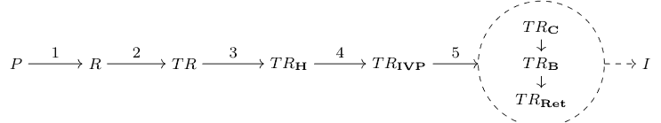

图 2.3: 细粒度翻译流水线

`TR` 是根据问题描述 `P` 或标准递归步骤 `R` 导出的尾递归方法。从这里，我们进入 `TRH`，表示“颜色编码”阶段，在该阶段，我们标记尾递归方法的三个子组件：基础情况、尾递归调用中更新的变量以及来自基础情况的返回值。

`TR_IVP`（或“迭代变量目的”）是跟在方法签名之后、循环定义之前的步骤。在 `TR_IVP` 中，我们检查 `TR_H` 中标记的更新变量/累加器，并将它们局部化为不作为方法参数传递的变量，而是作为值的序列。此外，我们为这些变量声明添加注释来解释它们的目的。

`TR_C` 是定义 `while` 关键字的步骤，随后是取反的基础情况条件，并作为一系列合取（即逻辑“与”）。

`TR_B` 是我们设计循环体的地方，它包含了对局部化变量的更新语句，而不是递归调用的参数。

最后，在 `TR_ret` 中，我们添加返回累加的局部变量的行。`I` 是输出翻译。

##### `TR_H`

在设计递归方法时，有几个值需要牢记：基础情况（即终止条件）、不是方法调用的返回值以及累加器。这些每一项在转换为 `I` 的过程中都起着至关重要的作用，而且快速识别出它们如何适应尾递归方法至关重要。让我们重新看看旧的阶乘函数来说。

```c
static int fact(int n, int acc) {
    if (n == 0) {
        return acc;
    } else {
        return fact(n - 1, acc * n);
    }
}
```

标记基础情况通常非常简单，因为它们大多数是返回值的选择语句，而不是递归方法调用。因此，在上面的定义中，这种实例只有一个 `n==0`，意味着我们用红色高亮它。

```c
static int fact(int n, int acc) {
    if (n == 0) {
        return acc;
    } else {
        return fact(n - 1, acc * n);
    }
}
```

为了与基础情况一致，我们还想高亮不是递归调用的返回值。只有一个，即 `acc`。让我们用绿色高亮 `acc`。

```c
static int fact(int n, int acc) {
    if (n == 0) {
        return acc;
    } else {
        return fact(n - 1, acc * n);
    }
}
```

现在，我们想高亮传递给（尾）递归调用的更新变量。当我们说“更新”时，指的是“修改”，因为它们没有被逐字复制，例如 `f(n)=f(n)`，我们在其中看到 `n` 在方法调用之间保持不变。方便的是，`n` 和 `acc` 都更新了（`n` 减了 1；`acc` 乘以 `n`）。让我们用黄色高亮这些变化。

```c
static int fact(int n, int acc) {
    if (n == 0) {
        return acc;
    } else {
        return fact(n - 1, acc * n);
    }
}
```

##### `TR_IVP`

尾递归方法中的所有累加变量都以某种方式具有其必要性。定义为替换的局部变量也是如此。方便的是，每个被指定为替换的变量都是。

```c
static int fact(int n, int acc) {
    if (n == 0) {
        return acc;
    } else {
        return fact(n - 1, acc * n);
    }
}
```

这种顺序产生的结果是 120，这与我们的递归追踪相符。因此，在不失一般性的情况下，我们可以得出结论：在这种情况下我们应该在更新 `n` 之前更新累加器变量。

根据我们指定的规则，确定更新的正确顺序可能需要尝试几次才能成功。其思想是与之前验证过的尾递归追踪的结果相匹配。

##### `TR_ret`

在最后阶段，我们添加了必要的返回语句，用于从循环中返回累加的结果。在突出显示/颜色编码阶段，我们用绿色高亮了这些返回值。

```java
static int fact(int n) {
    // acc 存储当前的阶乘乘积。
    int acc = 1;
    while (!n == 0) {
        acc *= n;
        n = n - 1;
    }
    return acc;
}
```

翻译流水线已经完成，我们现在知道如何将一个尾递归方法转换为使用循环的方法。

敏锐的读者可能会质疑是否有必要从尾递归到迭代的转换方案。我们在上一节关于递归的章节中提到了尾调用优化，现在我们将解释它与循环的关系。

回想尾递归相对于标准递归的优势：它只使用一个（可替换的）激活记录。尽管如此，由于我们可以将任何递归方法转换为迭代算法，我们完全忘记了这个任务。

从这里开始我们提出了一个类似的问题：我们可以将任何递归方法转换为使用尾递归（根据传递性，即迭代）的方法吗？通常情况下，答案是肯定的，通过一个名为*延续传递风格*（continuation-passing style）的概念。由于在 Java 中实现延续困难，我们将省略进一步讨论，但感兴趣的读者如果对此好奇，应该深入研究函数式编程（Friedman and Wand, 2008; Friedman and Felleisen, 1996; Sussman and Steele, 1975）。

## 示例 2.10

让我们设计 `isDisarium` 方法，该方法返回一个正整数是否为水仙数。水仙数是一个正整数，其各位数字之和（每个数字提升其所在位置的幂）等于该数字本身。例如，135 是一个水仙数，因为 $1^1 + 3^2 + 5^3 = 1 + 9 + 125 = 135$。

我们将使用翻译流水线设计该算法的标准递归、尾递归和循环变体。此外，我们还将为该方法的三个变体编写测试，这些测试显而易举地相互迁移。由于所有测试集都是相同的，我们只展示标准递归变体中的一种。

```java
import static assertions.assertAll;
import static assertions.assertTrue;
import static assertions.assertFalse;

class DisariumTester {
    @Test
    void testDisariumSr() {
        assertAll(
            () -> assertTrue(isDisarium(135)),
            () -> assertTrue(isDisarium(89)),
            () -> assertFalse(isDisarium(101)),
            () -> assertFalse(isDisarium(202)),
            () -> assertFalse(isDisarium(0)),
            () -> assertFalse(isDisarium(1))
        );
    }
}
```

标准递归辅助方法也有两个参数。第一个参数 `n` 是我们正在检查“水仙性”的数字。第三个累加器 `p` 是我们当前检查的数字的位置。该辅助方法也说明了返回类型可能与驱动方法签名不同的事实。也就是说，`isDisarium` 返回的是一个布尔值，而其辅助方法返回的是数字提升到各自对应位置幂的和。

```java
class Disarium {
    /**
     * 确定给定的整数是否为水仙数。
     * @param n 正整数。
     * @return 如果是水仙数返回 true，否则返回 false。
     */
    static boolean isDisariumSr(int n) {
        return isDisariumSrHelper(n, 1) == n;
    }

    /**
     * 递归计算 n 的各位数字提升到
     * 各自对应位置幂的和。
     * @param n 正整数。
     * @param p 当前正在检查的数字的位置。
     * @return 各位数字提升到各自对应位置的和。
     */
    private static int isDisariumSrHelper(int n, int p) {
        if (n == 0) return 0;
        else return (int)Math.pow(n % 10, p) + isDisariumSrHelper(n / 10, p + 1);
    }
}
```

尾递归变体与标准递归变体相似，但多了一个额外的参数 `s`，它作为一个参数来累加结果。

```java
class Disarium {
    /**
     * 确定给定的整数是否为水仙数。
     * @param n 正整数。
     * @return 如果是水仙数返回 true，否则返回 false。
     */
    static boolean isDisariumTr(int n) {
        return isDisariumTrHelper(n, 1, 0) == n;
    }

    /**
     * 尾递归地计算 n 的各位数字提升到
     * 各自对应位置幂的和。
     * @param n 正整数。
     * @param p 当前正在检查的数字的位置。
     * @param s 累加的和。
     * @return 各位数字提升到各自对应位置的和。
     */
    private static int isDisariumTrHelper(int n, int p, int s) {
        if (n == 0) return s;
        else return isDisariumTrHelper(n / 10, p + 1, s + (int)Math.pow(n % 10, p));
    }
}
```


尾递归变体与标准递归变体相似，但多了一个额外的参数 `s`，它作为一个参数来累加结果。

```java
class Disarium {
    /**
     * 确定给定的整数是否为水仙数。
     * @param n 正整数。
     * @return 如果是水仙数返回 true，否则返回 false。
     */
    static boolean isDisariumTr(int n) {
        return isDisariumTrHelper(n, 1, 0) == n;
    }
}
```

```java
class Disarium {
    /**
     * 确定给定的整数是否为水仙数。
     * @param n 正整数。
     * @return 如果是水仙数返回 true，否则返回 false。
     */
    static boolean isDisariumIter(int n) {
        int sum = 0;
        int pos = 1;
        int temp = n;
        while (temp > 0) {
            sum += (int) Math.pow(temp % 10, pos);
            temp /= 10;
            pos++;
        }
        return sum == n;
    }
}
```

迭代变体是最有效的，因为它避免了多次方法调用的开销。它使用循环遍历数字，在此计算和。

### 2.3 迭代构造

在设计循环条件时，我们问自己“循环结束后什么应该是正确的”，并围绕这个答案设计条件。我们的计数器 `c` 在完成后将正好是一百，因此条件是此点的否定。

**示例 2.11.** 假设我们要打印前一百个素数。回想素数的定义：一个正整数如果只能被 1 和它整除。然而，数学上已知我们只需要检查到 $\sqrt{n}$ 来判断素性（Riesel, 1994）。让我们设计这样一个方法，并编写相应的测试。

```java
class SumPrimes {
    /**
     * 计算前一百个素数的和。
     * @return 前100个素数的和。
     */
    static int sum100Primes() {
        int count = 0;
        int num = 2;
        while (count < 100) {
            if (isPrime(num)) {
                count++;
            }
            num++;
        }
        return num - 1; // 注意：此处逻辑可能需要微调以符合求和逻辑
    }

    static boolean isPrime(int n) {
        if (n < 2) return false;
        for (int i = 2; i <= Math.sqrt(n); i++) {
            if (n % i == 0) return false;
        }
        return true;
    }
}
```

迭代方法在 Java 中通常更受青睐，因为它避免了与深度递归相关的栈溢出风险。通过使用循环，我们可以更显式地控制执行流。

# 条件判断、递归与循环

```java
class Prime {

    /**
     * 判断一个给定的整数是否为素数。
     * @param n 正整数。
     * @return 如果是素数返回 true，否则返回 false。
     */
    static boolean isPrime(int n) {
        if (n < 2) {
            return false;
        } else {
            int bound = (int) Math.sqrt(n);
            int i = 2;
            while (i <= bound) {
                if (n % i == 0) {
                    return false;
                } else {
                    i++;
                }
            }
            return true;
        }
    }
}
```

素性测试通过，这意味着可以将 `isPrime` 应用于 `sum100Primes` 中。逻辑看起来非常直观：将计数器 `c` 初始化为1。我们还需要一个变量来跟踪上一个素数整数，以便知道从哪里开始搜索。我们将此变量命名为 `l` 并将其初始化为0。一个最终变量用于累加每个素数的和。在循环内部，我们声明了另一个变量 `v`，作为检查素性的值，其取值为 `l+1`（如果只是 `l`，那么它的素性值将相同）。将 `v` 传入 `isPrime` 方法，如果它是素数，则将 `v` 的值赋给 `l`，将 `v` 加到和中，并增加 `c`。否则，将 `l` 加1。运行代码产生 24133：所需的答案。

> 我们注意到，这段代码为了教学目的显得冗长。

```java
if (isPrime(v)) {
    l = v;
    sum += v;
    c++;
} else {
    l++;
}
return sum;
}
```

# **示例 2.12.** 继续延续数论主题，让我们设计 `isDePolignac` 方法，该方法返回一个给定的正整数是否为德波利尼克数（De Polignac，Polignac）。

德波利尼克数是一个奇正整数 $n$，它不能表示为 $2^k$ 和 $p$ 之和，其中 $k$ 是非负整数，$p$ 是素数。我们刚刚设计了一个检查素性的方法，所以当数字是德波利尼克数时可以使用它。

该算法无法简单地用标准的递归问题表示，我们可以分解问题，但没有结果需要累加；我们只是在检查一个条件。因此，尾递归方法返回值 `n` 和一个从小于 `n` 的最近的2幂开始的值 `i`。检查 `n-i` 是否为素数，如果是，则返回 false。如果 `i` 等于1，我们返回 true，我们已经耗尽了所有可能的2的幂。每次递归调用都会将2幂减半。再次，我们为尾递归变体编写测试，但省略了迭代算法的测试。我们强调德波利尼克数的尾递归方法，作为持续练习递归的手段。

```java
static Assertions.assertAll();
static Assertions.assertTrue();
static Assertions.assertFalse();
```

```java
class DePolignacTester {
    @Test
    void testDePolignacTr() {
        assertAll(
            () -> assertTrue(isDePolignacTr(1)),
            () -> assertTrue(isDePolignacTr(959)),
            () -> assertFalse(DePolignac.isDePolignacTr(7)),
            () -> assertFalse(DePolignac.isDePolignacTr(1001))
        );
    }
}
```

```java
/**
 * 判断一个给定的整数是否为德波利尼克数。
 * @param n 正整数。
 * @return 如果是德波利尼克数返回 true，否则返回 false。
 */
```

```java
static boolean isDePolignacTr(int n) {
    int nextPower = (int) Math.pow(2, (int) (Math.log(n) / Math.log(2)));
    return isDePolignacTrHelper(n, 1);
}
```

```java
/*
 * 德波利尼克数的尾递归辅助方法。
 * @param n 正整数。
 * @param i 要检查的2幂，从小于 n 的最近的2幂开始。
 * @return 如果是德波利尼克数返回 true，否则返回 false。
 */
private static boolean isDePolignacTrHelper(int n, int i) {
    if (n % 2 == 0) { return false; }
    else if (i <= 1) { return true; }
    else if (isPrime(n - i)) { return true; }
    else { return isDePolignacTrHelper(n, i / 2); }
}
```

循环对应的版本将累加器位于变量 `i` 中，该变量从小于 $n$ 的最近的2幂开始。

```java
class DePolignac {
```

```java
/*
 * 判断一个给定的整数是否为德波利尼克数。
 * @param n 正整数。
 * @return 如果是德波利尼克数返回 true，否则返回 false。
 */
static boolean isDePolignac(int n) {
    if (n % 2 == 0) {
        return false;
    } else {
        int i = (int) Math.pow(2, (int) Math.log(n) / Math.log(2));
        while (i > 1) {
            if (isPrime(n - i)) {
                return true;
            } else {
                i /= 2;
            }
        }
        return true;
    }
}
```

**示例 2.13.** 假设我们要计算倒数的和。即，1/1+1/3+1/5+...+1/(2n-1)。我们知道如何使用迭代算法。其签名是直观的：

```java
import static assertions.assertAll;
import static assertions.assertEquals;

class ReciprocalTester {
    static final double DELTA = 0.001;

    @Test
    void sum() {
        assertAll(
            () -> assertEquals(0, reciprocalSum(0), DELTA),
            () -> assertEquals(1, reciprocalSum(1), DELTA),
            () -> assertEquals(1.333, reciprocalSum(2), DELTA),
            () -> assertEquals(1.533, reciprocalSum(3), DELTA)
        );
    }
}
```

```java
class Reciprocal {
/**
 * 到 n。
 * @param n 项数。
 * @return 倒数的和。
 */
static double reciprocalSum(int n) {
    double sum = 0;
    for (int i = 0; i < n; i++) {
        sum += 1.0 / (2 * i + 1);
    }
    return sum;
}
```

**示例 2.14.** 假设我们要设计一个返回 a 到 b 之间整数和的方法。我们知道如何使用 for 循环来实现。如下：

```java
class Interval {
/**
 * a 到 b 之间。
 * @param a 下界。
 * @param b 上界。
 * @return 整数的和。
 */
static int sum(int a, int b) {
    if (a > b) {
        return 0;
    } else {
        int sum = 0;
        for (int i = a; i <= b; i++) {
            sum += i;
        }
        return sum;
    }
}
```

```java
class IntervalTester {
    @Test
    void testSum() {
        assertAll(
            () -> assertEquals(0, sum(5, 4)),
            () -> assertEquals(5, sum(5, 5)),
            () -> assertEquals(11, sum(5, 6)),
            () -> assertEquals(18, sum(5, 7))
        );
    }
}
```

**示例 2.15.** 让我们写一个不可预测循环的示例；一个最适合使用 while 的。假设我们要手动计算正值的平方根，即不使用 Java 的实现。一种简单的算法是使用*牛顿逼近法*：

> $g_{x+1} = \frac{g_x + \frac{n}{g_x}}{2}$

当 $g_x$ 被称为“猜测值”。这种思想是持续应用牛顿逼近公式，直到我们足够接近平方根。足够接近是一个启发式值，当非常小时，会增加我们循环的运行时间。$g_x$ 的小值表示越接近真实的平方根。例如，假设 $n = 64$ 且 $\Delta = 0.1$。应用公式（将 $g_0$ 初始化为 $n$）得到以下轨迹：

## 2.3 循环

$g_1 = \left(\frac{64 + 64}{2}\right) = 32.500$

$g_2 = \left(\frac{32.5 + 64}{2}\right) = 47.234$

$g_3 = \left(\frac{17.234 + 64}{2}\right) = 40.617$

$g_4 = \left(\frac{10.474 + 64}{2}\right) = 37.237$

$g_5 = \left(\frac{8.2921 + 64}{2}\right) = 36.1461$

在每次迭代中，我们对当前猜测值平方，并判断它与 $n$ 之间的绝对差是否小于该猜测值。如果是，则 $g_x$ 的迭代即为平方根近似值。否则，我们继续接近平方根值。我们无法合理地预测它何时发生（即需要多少次迭代），因此我们使用 `while` 循环。由于该算法中存在多个潜在的失败点，我们确保编写了完善的测试套件。该方法本身是对数学定义的重述，并点缀了一些 Java 语法。

```java
import static Assertions.assertAll;
import static Assertions.assertEquals;

class NewtonApproximationTester {

    final double DELTA = 0.1;

    @Test
    void testNewtonApproximation() {
        assertAll(
            () -> assertEquals(Math.sqrt(0), sqrtApp(0, DELTA)),
            () -> assertEquals(Math.sqrt(1), sqrtApp(1, DELTA)),
            () -> assertEquals(Math.sqrt(3), sqrtApp(3, DELTA)),
            () -> assertEquals(Math.sqrt(16), sqrtApp(16, DELTA)),
            () -> assertEquals(Math.sqrt(64), sqrtApp(64, DELTA)),
            () -> assertEquals(Math.sqrt(256), sqrtApp(256, DELTA)),
            () -> assertEquals(Math.sqrt(4000), sqrtApp(4000, DELTA)),
            () -> assertEquals(Math.sqrt(129600), sqrtApp(129600, DELTA))
        );
    }
}
```

```java
class NewtonApproximation {

    /**
     * 通过牛顿近似法计算 n 的平方根近似值。
     * @param n 要开根的数。
     * @param delta 范围。
     * @return n 的平方根近似值。
     */

    static double sqrtApprox(double n, double delta) {

        double g = n;

        // 只要猜测值距离真实值太远...

        while (Math.abs(g * g - n) > delta) {

            g = (g + n / g) / 2;

        }

        return g;

    }

}
```

为了降低精度，应该传递不同的 `delta` 值。相反，为了寻求更高的精度，一个更接近（但不等于）零的值是必要的。我们的平方根算法实现并不是最优的，但演示了循环的必要性。重要的是，当我们只考虑它们的语义时，`for` 循环和 `while` 循环是彼此无关的。这意味着任何循环都可以用 `for` 或 `while` 表示。取决于具体情况，一种可能优于另一种。当我们知道迭代次数时，应该使用 `for` 循环；而 `while` 循环用于不确定的终止条件。

**示例 2.16.** 设计 `generateAcronym` 方法，它返回给定字符串的缩写。对于我们的目的，缩写是字符串中每个单词的首字母，输入中可能包含多个空格、开头或结尾空格。递归算法背后的想法是跟踪我们是否处于单词的开头。我们可以通过检查当前字符是否为空格来实现，如果是，我们就知道下一个字符是一个单词，这意味着将其添加到缩写中。基本情况是我们到达字符串的结尾，此时返回空字符串。我们的递归方法需要一个辅助方法来跟踪我们是否处于单词的开头。缩写是通过系列递归调用构建的。


# 2.3 循环

## 测试用例

```java
import static Assertions.assertAll;
import static Assertions.assertEquals;

class GenerateAcronymTester {

    @Test
    void testAcronym() {
        assertAll(
            () -> assertEquals("gaia", generateAcronym("get away from it")),
            () -> assertEquals("NEWS", generateAcronym("Never Egg Waffles")),
            () -> assertEquals("abc", generateAcronym("a b c")),
            () -> assertEquals("abc", generateAcronym("a b c")),
            () -> assertEquals("FBI", generateAcronym("Federal Bureau of Investigation")),
            () -> assertEquals("CIA", generateAcronym("Central Intelligence Agency")),
            () -> assertEquals("HVAC", generateAcronym("Heating Ventilation Air Conditioning")),
            () -> assertEquals("W", generateAcronym("Word"))
        );
    }
}
```

## 递归实现

```java
class GenerateAcronym {

    /**
     * 生成给定字符串的缩写。
     * @param s 要生成的字符串。
     * @return s 的缩写。
     */
    static String generateAcronym(String s) {
        return generateRecursiveHelper(s, true);
    }

    /**
     * 递归生成字符串的缩写。
     * @param s 要生成的字符串。
     * @param isStart 是否处于单词的开头。
     * @return s 的缩写。
     */
    private String generateRecursiveHelper(String s, boolean isStart) {
        if (s.isEmpty()) {
            return "";
        } else if (isStart) {
            return s.charAt(0) + generateRecursiveHelper(s.substring(1), false);
        } else if (s.charAt(0) == ' ') {
            return generateRecursiveHelper(s.substring(1), true);
        } else {
            return generateRecursiveHelper(s.substring(1), false);
        }
    }
}
```

作为尾递归方法，我们需要通过累加器跟踪状态，即我们正在构建的缩写。

## 尾递归实现

```java
class GenerateAcronym {

    /**
     * 生成给定字符串的缩写。
     * @param s 要生成的字符串。
     * @return s 的缩写。
     */
    static String generateAcronym(String s) {
        return generateTailRecursiveHelper(s, true, "");
    }

    /**
     * 尾递归生成字符串的缩写。
     * @param s 要生成的字符串。
     * @param isStart 是否处于单词的开头。
     * @param acc 缩写的累加器。
     * @return s 的缩写。
     */
    private String generateTailRecursiveHelper(String s, boolean isStart, String acc) {
        if (s.isEmpty()) {
            return acc;
        } else if (isStart) {
            return generateTailRecursiveHelper(s.substring(1), false, acc + s.charAt(0));
        } else if (s.charAt(0) == ' ') {
            return generateTailRecursiveHelper(s.substring(1), true, acc);
        } else {
            return generateTailRecursiveHelper(s.substring(1), false, acc);
        }
    }
}
```

## 迭代实现

```java
class GenerateAcronym {

    /**
     * 生成给定字符串的缩写。
     * @param s 要生成的字符串。
     * @return s 的缩写。
     */
    static String generateAcronym(String s) {
        String acc = "";
        boolean isStart = true;
        while (!s.isEmpty()) {
            if (isStart) {
                acc = acc + s.charAt(0);
                isStart = false;
                s = s.substring(1);
            } else if (s.charAt(0) == ' ') {
                isStart = true;
                s = s.substring(1);
            } else {
                isStart = false;
                s = s.substring(1);
            }
        }
        return acc;
    }
}
```

---

**示例 2.17.** 我们将再写一个示例，首先编写一个递归算法、它的尾递归版本，然后是迭代版本，以描述在翻译特定的尾递归算法时出现的问题。假设我们要写一个方法来确定第 $n$ 个斐波那契数。*斐波那契数列*递归定义如下：

> Fib(0) = 0
> Fib(1) = 1
> Fib(n) = Fib(n-1) + Fib(n-2)

## 斐波那契测试用例

```java
import static Assertions.assertAll;
import static Assertions.assertEquals;

class FibonacciTester {
    @Test
    void testFib() {
        assertAll(
            () -> assertEquals(0, fib(0)),
            () -> assertEquals(1, fib(1)),
            () -> assertEquals(1, fib(2)),
            () -> assertEquals(8, fib(5)),
            () -> assertEquals(55, fib(10))
        );
    }
}
```

标准的递归算法编写起来非常简单，但效率极其低下。因为我们对 `fib` 进行了两次递归调用，导致我们多次计算相同的数据，从而产生指数级算法。换句话之，较小的输入（例如 `Fib(40)`）需要非常长的时间才能完成。

## 标准递归实现

```java
class Fibonacci {
    static int fib(int n) {
        if (n <= 1) return n;
        else { return fib(n - 1) + fib(n - 2); }
    }
}
```

我们的工作和所有测试都通过了，这很棒，但我们可以通过使用尾递归来做得更好。尾递归变比之前的尾递归定义稍微复杂，因为需要使用两个累加器。我们使用两个变量来计算“下一个数字：上一个和上上一个”。因此，将这些值存储在变量中（例如 `a` 和 `b`）是合理的，其中 `a` 是“上上一个”，`b` 是“上一个”。然后，在进行递归调用时，我们调用 `b` 作为 `a + b`，以及 `b`。我们不能忘记驱动方法！

## 尾递归实现

```java
class Fibonacci {
    static int fibTR(int n) {
        return fibHelper(n, 0, 1);
    }

    /**
     * 使用尾递归计算第 n 个斐波那契数。
     * @param n 第 n 个斐波那契数。
     * @param a “上上”斐波那契数。
     * @param b “上一个”斐波那契数。
     * @return 结果。
     */
    static int fibHelper(int n, int a, int b) {
        if (n == 0) return a;
        else if (n == 1) return b;
        else { return fibHelper(n - 1, b, a + b); }
    }
}
```

---

## 64 条件判断、递归与循环

我们的尾递归实现基于数学递归定义中的两种情况之一。要视觉化初始累加器值（即 *a* 和 *b* 的起始值）可能很困难，但只需考虑标准递归算法的情况，并让它引导你的决策。

最后得到迭代算法。为了避免转换过程中的任何混淆，我们将使用迭代流水线。跳过我们 TR 的几步：

```java
static int fibint(int n, int a, int b) {
    // 保存上一个。
    if (n == 0) {
        a = 0;
        return a;
    } else if (n == 1) {
        // 保存上。
        b = 1;
        return b;
    } else {
        while (???) {
            // TODO.
        }
        return fibint(n - 1, b, a + b);
    }
}
```

现在的问题是，我们使用什么作为 `while` 循环条件？我们显然在每次（尾）递归情况下将 `n` 减 1，但由于有两种情况，我们该怎么办？现实情况下，我们只需要为基础情况使用循环：`n == 1`，由于 1，`n` 的另一种可能性是零（意味着返回零）。因此，我们的循环条件是 `n == 1` 的否定（即 `!(n == 1)`）。在这一点，我们遇到了另一个问题：根据更新规则，因为 `b` 的值依赖于 `a`，我们需要在 `a` 之前更新 `b`，因为 `a` 的值依赖于 `b`，我们陷入了僵局。不要担心，因为我们有一个 TR 的障碍，引入了临时规则。

**规则：** 如果参数 `p` 和 `q` 相互依赖，引入一个临时变量 $t_p$，将 `p` 赋值给 $t_p$，使用我们的累加器之一来更新 `p`。之后，我们生成一个局部变量来持有累加器的旧值。我们创建变量 $t_a$，将其赋值给 `a`，更新 `a`，然后用 `b` 代替 `a`。由于 `n` 不是依赖变量，它的顺序在混合中。

最后阶段是简单的：返回另一种基础情况的结果，当 `n` 是 `b` 时：

```java
static int fib(int n) {
    // 保存上一个。
    int a = 0;
    // 保存上。
    int b = 1;
    // 初始基础情况。
    if (n == 0) {
        return a;
    } else {
        while (n == 1) {
            int ta = a;
            a = b;
            b = ta + b;
            n = n - 1;
        }
        return b;
    }
}
```

斐波那契数列是可以预测的，我们知道需要多少迭代来计算结果。因此，`for` 循环是一个合理的替代。

## for 循环实现

我们仍然必须声明 `a` 和 `b`，但不是增加 `n`，而是将 `a` 局部化。

---

**示例 2.18.** 假设有 `findVowel(n)`，我们可以使用 `break` 和 `continue`。斐波那契数列是可以预测的，我们知道需要多少迭代来计算结果。因此，`for` 循环是一个合理的替代。想法是在我们生成 96 到 100 之间的整数时使用 `break`，并在发现小于 50 的数时使用 `continue`。`continue` 关键字将程序控制权移到循环顶部，跳过体内的剩余语句。我们使用方法来判断字符是大写还是小写。

**示例 2.19.** 为了更好地说明 `break` 和 `continue` 的工作，让我们写一个没有实际用途的方法，只需演示这些关键字的作用。我们的方法 `countOdds` 计算随机数生成器从 1 到 100 生成的奇数。为了增加趣味性，我们不会计算小于 50 的奇数，如果我们生成的数字大于 95，我们就停止循环并返回。想法是在我们生成 96 到 100 之间的整数时使用 `break`，并在发现小于 50 的数时使用 `continue` 跳过计数器。

```java
import java.util.Random;

class RandomNumbers {

    /**
     * 统计随机生成器生成的奇数个数。
     * @return 统计的奇数个数。
     */
}
```


```java
static int countOdds() {
    int cnt = 0;
    Random rng = new Random();
    while (true) {
        int r = 1 + rng.nextInt(100);
        if (r > 95) {
            break;
        } else if (r < 50 || r % 2 == 0) {
            continue;
        }
        cnt++;
    }
    return cnt;
}
```

**示例 2.20.** 让我们再写一个循环的示例，直接从问题描述到问题。假设我们正在设计一个方法，它接收一个字符串 `x`、一个“搜索字符串” `f` 和替换字符串 `r`，目标是在不使用 `String` 类中的辅助方法（例如 `indexOf()`、`contains()`，显然不包括 `replace()`）的情况下替换 `f` 的所有出现次数。我们首先编写方法签名、文档注释以及一些测试。由于该问题的复杂性以及“边缘情况”的数量（即方法可能没有考虑到其模糊性的情况），我们强调编写的测试比针对该特定问题被认为的要多。

```java
import static Assertions.assertAll;
import static Assertions.assertEquals;

class FindReplaceTester {
    @Test
    void testFindReplace() {
        assertAll(
            () -> assertEquals("hiya there!", replace("hiya there!", "", "replace!")),
            () -> assertEquals("hiya there!", replace("hiya there!", "ya T", "replace!")),
            () -> assertEquals("Spaces_With_Underscores", replace("Spaces With Underscores", " ", "_")),
            () -> assertEquals("heyyyyyaj", replace("heyyyaaaay", "aa", "yy")),
            () -> assertEquals("hello", replace("hello")),
            () -> assertEquals("hello", replace("hello", "i", "e")),
            () -> assertEquals("heheyeheye", replace("hihiyihiy", "i", "e")),
            () -> assertEquals("we replaced the entire string!", replace("hihiyihiy", "we replaced the entire string!")),
            () -> assertEquals("We replaced the entire string!", replace("Hello world, how are you?", "We replaced the entire string!"))
        );
    }
}
```

随后，我们完成 `replace` 的实现，它被简化为几种情况：在遍历过程中，我们是否找到了搜索字符串 `f` 的开头，我们是否找到了 `f` 的结尾，以及我们是否遇到了 `f` 的断开？让我们从开始到结束进行分析。

在遍历输入字符串 `s` 时，当特定部分中的字符匹配时增加计数器 `c`，并继续匹配 `s` 中的字符。

例如，在字符串 `s = "hello"` 中，如果 `f = "ell"`，我们的遍历找到了 "e"，并将 `c` 加 1，表示我们匹配了 `f` 的一个字符。这个过程一直持续，直到我们到达 `f` 的结尾、`s` 的结尾或者我们找到了一个不匹配的字符。

在第一种情况下，我们将替换字符串 `r` 附加到新构建的 `s'` 上，因为这意味着我们在 `s` 内部遇到了 `f` 的完全匹配，意味着它将被替换为 `r`。

在第二种情况下，我们到达了 `s` 的结尾，意味着我们没有更多字符可以匹配了。因此，如果我们还没有到达 `f` 的结尾，我们就将最后 `c` 个字符复制到 `s'`，否则复制 `r`。例如，如果 `s = "hello"` 且 `f = "low"`，我们到达了 `s` 的结尾并完成了子字符串 `f`，这意味着我们只复制了 `s` 的最后几个字符而不附加 `r`。相反，如果 `f = "llo"`，我们将后缀 "lo" 替换为 `r`。

最后，当我们遇到不匹配的字符时，我们终止当前的替换策略，只需将 `s` 的最后 `c` 个字符附加到 `s'` 并向前移动索引。

我们还没有讨论过的小细节：`StringBuilder`。如之前所述，字符串是不可变的，拼接两个字符串会产生另一个字符串。将重复的拼接操作与循环或递归结合起来是非常低效的。为了解决这个问题，Java 提供了 `StringBuilder` 类，使得重复的字符串附加操作快得多且更节省内存。¹

总结来说，`StringBuilder` 类分配了一个缓冲区来存储字符串的字符，任何“附加”操作都会直接操作缓冲区，而不需要重新分配一个完全新的、长度为之前大小加上要连接字符串字符数的字符串。

> ¹ Java 库中也有 `StringBuffer` 类来实现相同的效果，但在编写单线程程序（即非并发程序）时，它并不是最优的。

## 2.3 循环

```java
import java.lang.StringBuilder;

class FindReplace {
    /**
     * 在字符串中搜索 "find" 的出现情况
     * 并将其替换为 "repl"
     * @param s 要搜索的字符串。
     * @param find 要查找的字符串。
     * @param repl 用来替换 "find" 的字符串。
     * @return 替换后的新字符串。
     */
    static String replace(String s, String find, String repl) {
        StringBuilder sb = new StringBuilder(s.length());
        for (int i = 0; i < s.length(); i++) {
            int pos = 0;
            int j;
            for (j = i; j < s.length(); j++) {
                // 如果我们找到了整个 find，则附加替换内容。
                if (pos == find.length()) {
                    sb.append(repl);
                    i = j;
                    break;
                }
                // 如果我们找到了不匹配的字符，终止
                if (s.charAt(j) != find.charAt(pos)) {
                    //
                }
                pos++;
            }
            // 如果我们到达了字符串末尾
            if (j == s.length()) {
                sb.append(s.substring(i));
            }
        }
        return sb.toString();
    }
}
```

# 2.3 条件判断、递归与循环

## 2.4 练习

2.1 设计 `boolean isStrictlyIncreasing(int x, int y, int z)`，判断三个整数 x, y, z 是否是递增的。通过此意味着 x < y < z。

2.2 设计 `String numStuff(int n)`，判断整数 n 是否大于 100。如果是，返回 n 除以二的字符串。如果数字是 50，返回字符串 "N/A"。

2.3 设计 `boolean canVote(int age)`，当给定整数 age 时，返回某人是否可以在美国投票。参考：满十八岁即可投票。

2.4 设计 `int max(int x, int y, int z)`，返回三个整数 x, y, z 中的最大值。不要使用 `Math` 方法。

2.5 设计 `int sum(int x, int y, int z)` 方法，计算三个整数 x, y, z 的舍入值的和。“舍入值”意味着我们处理个位，例如 12 取整到 10，59 进入到 60，109 进入到 110。如果数字是负数，向零舍入，例如 -7 进到 -10，-2 进到 0。

2.6 设计 `boolean lessThan20(int x, int y, int z)` 方法，给定三个整数 x, y, z，返回其中是否有一个数字小于另一个二十。例如，`lessThan20(19, 42)` 返回 true，因为 2 距离 19 的距离小于 20。另一个例子是 `lessThan20(999, 888, 777)`，返回 false，因为没有两个数字的差小于二十。

2.7 设计 `boolean canSleepIn(String d, boolean onVacation)` 方法，判断某人是否可以睡懒。如果是周末或者他们正在度假。输入 d 是天的名称，例如 "Monday", "Sunday"。

2.8 设计 `boolean isEvenSpaced(int x, int y, int z)` 方法，接收三个整数 x, y, z，并返回它们是否等间距。等间距意味着最小与中间数字之间的差等于中间与最大数字之间的差。

2.9 设计 `String cutTry(String s)` 方法，接收字符串 s，如果 s 以 "try" 结尾，则将其移除。否则返回原始字符串。

2.10 设计 `String popChars(String s, char c, char d)` 方法，接收字符串 s 和两个字符 c, d。如果 s 以 c 开头则移除 c，如果 s 的第二个字符是 d 则移除 d。

## 2.4 练习

2.12 在命题逻辑中，有几种作用于布尔真值的逻辑连接符。这些包括逻辑与 ∧、逻辑析或 ∨、条件蕴 →、双含条件 ↔ 和否定 ¬。我们可以将模式表示为一系列组合的方法调用。例如，对以下表达式进行求值

```
P → ¬(Q ↔ R)
```

其中 'P' 和 'R' 被赋值为假，'Q' 被赋值为真，这等价于

```java
static final boolean P = false;
static final boolean Q = true;
static final boolean R = false;
cond(P, bicond(Q, not(R)))
```

给出的模式解析为真。
根据下面的真值表为五种连接符设计方法。这些方法应该调用 `cond()`、`bicond()`、`and()`、`or()` 和 `not()`。假设 T 为真，F 为假。

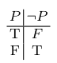

'¬P' 的真值表

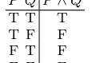

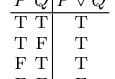

'P ∧ Q' 的真值表

'P ∨ Q' 的真值表

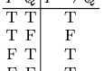

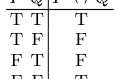

'P → Q' 的真值表

'P ↔ Q' 的真值表

2.13 设计布尔型 `InsideCircle(double dx, double dy, double px, double py)` 方法，当给定一个中心在 (cx, cy) 半径为 r 的圆以及一个点 (px, py) 时，返回该点是否位于圆内。

2.14 设计布尔型 `InsideRectangle(double rx, double ry, double w, double h, double px, double py)` 方法，当给定一个中心在 (rx, ry)、宽度为 w 高度为 h 的矩形以及一个点 (px, py) 时，返回该点是否严格位于矩形内部。

2.15 (*) Carlo 正在配送当地杂货店的订单。箱子的最大重量由值 `w` 定义，我们可以（可能）在箱子里同时放入小糖棒和大糖棒。设计 `fitCandy(int s, int l, int w)` 方法，当给定小糖的数量 `s`、大糖的数量 `l` 和最大重量 `w` 时，确定箱子里能装下多少根糖棒，返回大糖减去一公斤的数量。注意 Carlo 还会尝试先放入大糖再放入小糖。如果无法根据给定标准填满箱子，则返回 -1。以下是一些示例。提示：将其视为对三种情况的分析。

```
fitCandy(4, 1, 9) => 4
fitCandy(1, 4, 4) => 4
fitCandy(1, 2, 6) => 1
fitCandy(6, 1, 13) => -1
fitCandy(60, 10, 150) => 50
fitCandy(7, 1, 12) => 7
fitCandy(7, 1, 3) => -1
```

2.16 (*) 一个 IPv4 地址包含存储在四个字节中的四个整数值，用点分隔。例如，192.168.1.244 是一个有效的 IPv4 地址。定义布尔型 `isValid4(String ip)` 方法，当给定一个字符串时，确定它是否代表一个 IPv4 地址。每个字节都是 0 到 255 之间的整数。注意，实际上某些地址实际上是无意义的，例如 0.0.0.0，我们不会将这些视为有效地址。下面是一个辅助方法 `isNumeric`，用于判断字符串是否为“数字”。目前理解这个辅助方法非常重要。你将需要使用 `Integer.parseInt()`、`substring()` 或正则表达式来解决这个问题。

```
isValid4("192.168.1.244") => true
isValid4("149.165.19.52") => true
isValid4("192.168.1.256") => false
isValid4("192.168.120.203") => false
isValid4("192.168.121.ABC") => false
isValid4("ABC.DEF.GHI.I06") => false
isValid4("192.168.1.A66") => false
```

> /*
>  * 判断我们是否可以将字符串转换为
>  * 整数数据类型。
>  * @param n 输入字符串。
>  * @return 如果可以将 n 转换为 int，返回 true，否则返回 false。
>  */

```java
static boolean isNumeric(String n) {
    try {
        Integer.parseInt(n);
        return true;
    } catch (NumberFormatException) {
        return false;
    }
}
```


## 2.17
设计字符串型 `setStateOf(double t, char u)` 方法，接收一个 `double` 类型的温度和一个 `char` 类型的单位（即 `'C'` 或 `'F'` 代表摄氏度或华氏度）。返回代表水在海平面上是液态、固态还是气体的字符串。

## 2.18
设计 `String(String a, String b, String c)` 方法，接收三个字符串并按字典顺序排序。返回排序后的字符串集合本身，并用逗号分隔。例如，如果输入是 `Charlie, Baker`，你应该返回 `Able,Baker,Charlie`。

## 2.19
设计整数型 `sum(int x, int y, int z)` 方法，对三个整数输入求和。然而，如果其中一个值为 `17`，则其右侧的所有数字都不应包含在和中。例如，`sum(13, 17, 3)` 的结果为 `13`，因为当 `y = 17` 时，我们既没有将 `x` 也没有 `z` 加到结果中。

## 2.20
一个有 366 天的一年是闰年。闰年对于保持日历与太阳同步是必要的，因为地球绕太阳运行一圈需要 365.25 天。实际上，那个数字并不完全准确。每被 4 整除的年份但不能被 100 整除的年份是闰年，但能被 400 整除的年份除外。设计 `isLeYear(int y)` 方法，接收一个整数并判断其是否为闰年。

## 2.21
设计 `discount(double c, int age, boolean isStudent)` 方法，根据年龄和学生状态计算折扣。使用以下标准：

- 如果年龄 < 18，不应用折扣。
- 如果 18 ≤ age ≤ 25 且是学生，则应用折扣。如果不是学生，则不应用折扣。
- 如果年龄 ≥ 65 且是学生，则应用折扣。如果不是学生，则不应用折扣。

## 2.22
设计双精度型 `getCost(double item, String state)` 方法，根据状态计算物品的税费。该方法应返回税后的总费用。税率如下：

- `"CA"`: 9.25%
- `"NY"`: 4.0%
- `"SC"`: 6.25%
- `"VA"`: 6.0%
- `"WA"`: 6.5%
- `"IN"`: 8.0%

## 2.23
设计双精度型 `computeOvertimePay(double hrRate, boolean onVac, double taxRate)` 方法，计算工作超过 40 小时的加班费（注意）。该方法应考虑以下情况：

- 加班费为薪率的 1.5 倍。
- 如果员工在休假，则薪率翻倍。
- 如果工作时间小于或等于 70 小时，不给加班费。
- 如果工作时间大于 70 小时，则总工资增加 15%。

## 2.24
设计双精度型 `computeBonusPay(double baseSalary, int yearsOfService, boolean achievedTarget, double salesAmount, double targetSales)` 方法，根据以下条件计算奖金（仅指奖金部分）：

- 达到销售目标的员工将获得基础工资的 10%。
- 工龄超过 5 年的员工额外获得基础工资的 5%。
- 如果销售额超过目标销售额的 50%，则额外获得基础工资的 25%。
- 如果未达到目标，无论销售额或工龄如何，都获得基础工资的 2% 固定比例奖金。

## 2.25
设计双精度型 `cookingScore(String type, double oz, int costDollars, int cents, boolean isAppearing)` 方法，为烹饪比赛评分。返回的分数在 [0, 10] 之间。类型为之一：

- `"Cake"`
- `"Pasta"`
- `"Pie"`
- `"Burger"`

以下是评分标准：

- 如果类型是 `"Cake"` 或 `"Pasta"`，基础分为 1。如果类型是 `"Burger"`，基础分为 0.5。如果类型是 `"Pie"`，基础分为 0.75。任何其他类型自动为 0。
- 如果重量小于 4，当前分乘以 0.9。如果 4 ≤ oz ≤ 20，则当前分乘以 `y = 1/16oz + 0.25`。否则，当前分乘以 0.2。
- 物品的总价为分数增加一个固定金额，最高 $5.00。超过部分将从分数中减去该金额。
- 如果作品参赛，则分数乘以 1.5 的常数系数。

## 2.26
是 `s` 的镜像。如果布尔值为 `false`，则返回一个字符串 `st`，其中 `t` 包含 `s` 的所有最后一个字符并且是反转。你不能使用任何辅助类，例如 `StringBuilder` 来解决这个问题。

## 2.27 练习包含两个部分。

- (a) 设计递归的 `countStr(String s)`，统计给定字符串中子字符串 `"str"` 出现的次数。
- (b) 设计 `countStrTR` 方法解决相同的问题，但使用尾递归。
提示：你将需要设计一个私有的静态辅助方法。`countStrTR` 方法应该只有一个参数。

如果你为这些方法中的一个编写了测试，你应该能够通过此扩展到另一个方法，因此请多写一些测试吧！

## 2.28 练习包含两个部分。

- (a) 设计递归的 `replaceAB(String s)` 方法，替换给定字符串 `s` 中任何出现的字符 `'A'`。
- (b) 设计 `replaceABTR` 方法解决相同的问题，但使用尾递归。
提示：你将需要设计一个私有的静态辅助方法。`replaceABTR` 方法应该只有一个参数。

如果你为这些方法中的一个编写了测试，你应该能够通过此扩展到另一个方法，因此请多写一些测试吧！

## 2.29 练习包含两个部分。

- (a) 大象有只耳朵，设计递归的 `countElephantEars(int n)`，返回 `n` 头大象的耳朵总数。你必须通过递归解决。
- (b) 设计 `countElephantEarsTR` 方法解决相同的问题，但使用尾递归。提示：你将需要设计一个私有的静态辅助方法。`countElephantEarsTR` 方法应该只有一个参数。

如果你为这些方法中的一个编写了测试，你应该能够通过此扩展到另一个方法，因此请多写一些测试吧！

## 2.30 本题包含两个部分。

- (a) 设计尾递归方法 `raiseLowerToToUpperTR`，它接收一个字符串并返回将小写字母转换为大写字母的数量，忽略任何其他字符。如果没有小写或大写字母，则返回零。你将需要设计一个私有的静态辅助方法来解决这个问题。
- (b) 设计 `raiseLowerToToUpperLoop` 方法，使用循环解决这个问题。

如果你为这些方法中的一个编写了测试，你应该能够通过此扩展到另一个方法，因此请多写一些测试吧！

## 2.31 本题包含两个部分。

- (a) 设计尾递归方法 `isPalindromeTR`，它接收一个字符串并判断它是否为回文。记住，回文是正向和反向读取都相同的字符串。例如 `"racecar"`。**不要**使用（字符）数组、`StringBuilder`、`StringBuffer` 或类似工具来解决这个问题。它必须是自然递归的。
- (b) 设计 `isPalindromeLoop` 方法，使用循环解决问题。与上一个问题相同的限制也适用于本题。

如果你为这些方法中的一个编写了测试，你应该能够通过此扩展到另一个方法，因此请多写一些测试吧！

## 2.32 本题包含两个部分。

- (a) 设计尾递归方法 `gcdTR`，接收两个整数并返回它们之间的最大公约数。欧几里得算法是这种方法的基础，并且在设计上就是尾递归的。
- (b) 设计 `gcdLoop` 方法，使用循环解决问题。

如果你为这些方法中的一个编写了测试，你应该能够通过此扩展到另一个方法，因此请多写一些测试吧！

## 2.33 本题包含三个部分。

- (a) 设计尾递归方法 `nestedParenthesesTR`，接收一个字符串并判断其括号是否“平衡”。一对括号是平衡的，当是它是零对或多对括号的嵌套，但请注意像 `"()()"` 或 `"(((()))"` 这样的组合不会被测试。
- (b) 设计 `nestedParenthesesLoop` 方法，使用循环解决问题。

如果你为这些方法中的一个编写了测试，你应该能够通过此扩展到另一个方法，因此请多写一些测试吧！

## 2.34 本题包含三个部分。

- (a) 阶因子数（factorion）是一个等于其数字阶乘之和的数（Gardner, 1990）。例如 `145` 是一个阶因子数，因为 `1! + 4! + 5! = 1 + 24 + 120 = 145`。
- (b) 设计尾递归方法 `gcdTR`，接收两个整数并返回它们之间的最大公约数。欧几里得算法是这种方法的基础，并且在设计上就是尾递归的。
- (c) 设计 `gcdLoop` 方法，使用循环解决问题。

如果你为这些方法中的一个编写了测试，你应该能够通过此扩展到另一个方法，因此请多写一些测试吧！

## 2.35 本题包含三个部分。

- (a) 一个数的超阶乘（hyperfactorial）`H(n)` 是 `1 · 2 · · n` 的值。正如你想象的，结果数字非常巨大，因此我们使用 `long` 类型而不是 `int`。设计标准的递归 `hyperfactorial` 方法，接收 `n` 并返回其超阶乘。
- (b) 设计尾递归方法 `hyperfactorialTR` 使用递归和累加器解决问题。提示：你将需要设计一个私有的静态辅助方法来解决这个问题。
- (c) 最后，设计 `hyperfactorialLoop` 方法使用循环解决问题。

如果你为这些方法中的一个编写了测试，你应该能够通过此扩展到另一个方法，因此请多写一些测试吧！

## 2.36 本题包含三个部分。

- (a) 一个数的反阶乘（subfactorial）`!n` 是 `n` 个对象中没有元素出现在其位置上的排列数。因此，我们说 `!3 = 2`。我们将反阶乘描述为递归公式：

```
!0 = 1
!1 = 0
!n = (n-1) · !(n-1) + !(n-2)
```

- (b) 然后，设计尾递归方法 `subfactorialTR` 使用递归和累加器解决问题。由于反阶乘的值增长异常，我们使用 `long` 而不是 `int`。
- (c) 设计 `subfactorialLoop` 方法解决问题。

如果你为这些方法中的一个编写了测试，你应该能够通过此扩展到另一个方法，因此请多写一些测试吧！

## 2.37 本题包含三个部分。

- (a) 设计递归 `collatz` 方法，接收一个正整数并返回该整数的 Collatz 序列。该序列由以下递归过程定义：

```
collatz(1) = 1
如果 n 是奇数，collatz(n) = collatz(3 * n + 1)
如果 n 是偶数，collatz(n) = collatz(n / 2)
```

生成的序列是方法接收的数字，直到序列达到 1（注意，该序列是否收敛于每个正整数仍是一个开放的研究问题）。因此，`collatz(5)` 返回逗号分隔的字符串：`"5,16,8,4,2,1"`。最后一个数字不能有逗号。
- (b) 然后，设计尾递归方法 `collatzTR` 使用递归和累加器解决问题。
- (c) 最后，设计 `collatzLoop` 方法使用循环解决问题。

如果你为这些方法中的一个编写了测试，你应该能够通过此扩展到另一个方法，因此请多写一些测试吧！

## 2.38 本题包含三个部分。

- (a) 设计标准的递归 `parenthesesDepth` 方法，接收括号字符串并返回表示字符串末尾“深度”的整数。每个 `(` 实例增加深度计数器，每个 `)` 实例减少深度计数器。因此，例如 `"((()())))()"` 的结果是 `1+1-1-1+1-1-1-1+1+1=-2`。
- (b) 然后，设计 `parenthesesDepthTR` 方法，使用尾递归和累加器来解决这个问题。提示：你需要设计一个私有静态辅助方法来解决这个问题。
- (c) 最后，设计 `parenthesesDepthLoop` 方法，使用循环来解决这个问题。

如果你写了这些方法中的一个，你就能以此类推完成剩下的部分，所以多写几个吧！

## 2.39 这个问题包含三个部分。

带括号的字符串是用括号括的字符串。例如，字符串 `"abc)pq(de"` 包含两个带括号的字符串：`"abc"` 和 `"de"`。对于后续的问题，你可以假设没有嵌套括号，或者括号是平衡的，并且如果存在带括号字符串，它至少包含一个字符。

- (a) (9 分) 设计标准的递归 `collectParenthesizedStrings` 方法，该方法接收一个字符串 `S` 并返回 `S` 中所有带括号字符串的列表。
- (b) 设计 `collectParenthesizedStringsTR` 方法及其配套的辅助方法 `collectParenthesizedStringsTRHelper` 作为后者的驱动程序；后者解决的是与 `collectParenthesizedStrings` 相同的问题，但它使用了尾递归。记得包含相关的访问修饰符！
- (c) 设计 `collectParenthesizedStringsLoop` 方法，使用 `while` 或 `for` 循环解决这个问题。

## 2.40 这个问题包含三个部分。

- (a) 设计标准的递归 `countdown` 方法，它接收一个整数 `n ≥ 0` 并返回一个从 `n` 到 0（包含 0）的偶数序列，用逗号分隔。
- (b) 然后，设计 `countdownTR` 方法，使用尾递归和累加器来解决这个问题。提示：你需要设计一个私有静态辅助方法来解决这个问题。
- (c) 最后，设计 `countdownLoop` 方法，使用循环解决这个问题。如果你写了这些方法中的一个，你就能以此类推完成剩下的部分，所以多写几个吧！

## 2.41 这个问题包含三个部分。

- (a) 设计标准的递归 `chickenCounter` 方法，它接收一个字符串 `s` 并返回子字符串 `"chicken"` 在 `s` 中出现的次数。你必须考虑到 `"chicken"` 的重叠实例。例如，调用该方法传入 `"abcchicken"` 会返回 2，从原始字符串中删除子字符串 `"chicken"` 后，我们剩下 `"abchicken"`，它本身又包含另一个 `"chicken"`。
- (b) 然后，设计 `chickenCounterTR` 方法，使用尾递归和累加器。提示：你需要设计一个私有静态辅助方法来解决这个问题。
- (c) 最后，设计 `chickenCounterLoop` 方法，使用循环解决这个问题。

## 2.42 这个问题包含五个部分。我们需要先为问题提供一些背景知识。一个 `编码字符串 S` 具有如下形式：

```
S = G*
G = N "[ L]"
N = [0-z]+
```

我们想象这理清了定义。以编码字符串 `3[a]2[b]` 为例。生成的解码后字符串是 `aaababb`，因为我们创建了三个 `"a"` 的副本，后面跟着两个 `"b"` 的副本。另一个例子是 `4[abcd]`，它返回包含 `abcdabcdabcd` 的字符串。

- (a) 设计 `int retrieve(String s)`，返回编码字符串开头的整数。参考以下示例：
  `retrieve("3[a]2[b]") => 3`
  `retrieve("47[abcd]") => 47`
  `retrieve("1[bbbb3[a]") => 1`

- (b) 设计 `String cut(String s)` 方法，返回不包含编码字符串开头整数的字符串。提示：使用 `indexOf` 和 `substring`。
  `cut("3[a]2[b]") => "a[2]"`
  `cut("47[abcd]") => "abcd"`
  `cut("1[bbbb3[a]") => "bbbb3[a]"`

- (c) 设计标准的递归 `decode` 方法，返回一个编码字符串并执行解码操作。
- (d) 设计 `decodeTR` 和 `decodeHelper` 方法。前者作为后者的驱动程序，后者解决的是与 `decode` 相同的问题，但它使用了尾递归。记得包含相关的修饰符！
- (e) 设计 `decodeLoop` 方法，使用 `while` 或 `for` 循环解决这个问题。

## 2.43
布尔值 `isNumber(int n)` 方法在给定整数 `n` 时，返回 `n` 是否为回文。

## 2.44
C 语言包含 `atoi` 函数，它返回一个表示某些整数的字符串。`atoi(String s)` 方法在给定字符串 `s` 时，如果可以解析，则返回其整数值。解析时，忽略所有前导零和领先非数字字符。找到第一个非零数字后（如果存在），返回到该点为止数字。该整数也可以包含符号，例如 `+` 或 `-`。如果值超过了整数的范围（即 `Integer.MAX_VALUE` 或 `Integer.MIN_VALUE`），则返回零。编写足够的测试对于正确实现至关重要！我们在下面提供了一些示例：

```
atoi("ABCD") => 0
atoi("42") => 42
atoi("000042") => 42
atoi("004200") => 4200
atoi("ABCD42") => 42
atoi("ABCD-+42") => 42
atoi("ABCD-42") => -42
atoi("99999999999") => 0
atoi("-99999999999") => 0
atoi("00-4200") => -42000
atoi("00-ABCD") => 0
atoi("0042ABCD") => 42
atoi("8080-8080") => 8080
```


## 2.45 与 `atoi` 类似，C 语言也有通过 `atof` 转换字符串表示的浮点值的方法。设计 `double atof(String)`，它接收一个字符串并在可以被解释时将其转换为 `double`。为了让这更容易一点，确保只有有效的浮点值可以被解析。解析时，忽略所有前导零和领先非数字字符。找到第一个非零数字后（如果存在），返回到该点为止数字。该整数也可以包含符号，例如 `+` 或 `-`。如果值超过了整数的范围（即 `Integer.MAX_VALUE` 或 `Integer.MIN_VALUE`），则返回零。编写足够的测试对于正确实现至关重要！我们在下面提供了一些示例：

```
atof("3.14") => 3.14
atof("42.5") => 42.5
atof("00042.5") => 42.5
atof("042.0") => 42.0
atof("abc42.5") => 42.5
atof("abc+-42.5") => 42.5
atof("abc-42.5") => -42.5
atof("99999999999.9") => 0
atof("-99999999999.9") => 0
atof("00-42.0") => -42.0
atof("00-abc") => 0
atof("0042.abc") => 42.0
atof("8080-8080") => 8080.0
```

设计 `double atof(String)`，它接收一个字符串并在其可以被解释时将其转换为 `double`。为了让这更容易一点，确保只有有效的浮点值可以被解析。解析时，忽略所有前导零和领先非数字字符。找到第一个非零数字后（如果存在），返回到该点为止数字。该整数也可以包含符号，例如 `+` 或 `-`。如果值超过了整数的范围，则返回零。

## 2.46 Wordle 是一个由 Josh 创建的游戏，其目标是实现。设计 `(String W, String G)` 方法，在给定字符串 $W$ 时，返回 $W$ 是否包含 $G$ 的属性：

- 如果 $|W| \neq |G|$，返回。
- 如果 $W_i = G_i$，返回 $W_i$。

下面是一些示例：

```
atof("apple", "apple") true
atof("apple", "orange") false
```

## 2.47 设计 `indexOf(String s, String k)` 方法，它接收一个字符串 $s$ 和 $k$，返回 $k$ 在 $s$ 中的第一个索引。如果 $k$ 不在 $s$ 中，返回 -1。你不能使用 `String` 类的方法。

## 2.48 设计 `substring(String s, int a, int b)` 方法，它接收一个字符串和两个整数 $a, b$，返回这些索引之间的子字符串。如果任一超出字符串范围，返回 `null`。你不能使用 `String` 类提供的方法。

## 2.49 设计 `equals(String s1, String s2)` 方法，它接收两个字符串 $s1$ 和 $s2$，并判断它们在字典序上是否相等。你不能使用内置的 `equals` 或方法。

## 2.50 设计 `compareTo(String s1, String s2)` 方法，它接收两个字符串 $s1$ 和 $s2$，并比较它们的字典序内容。如果 $s1$ 小于 $s2$，返回 -1。如果 $s1$ 大于 $s2$，返回 1。否则，返回 0。注意文件名通常按字典序比较。例如，名为 "File12.txt" 的文件大于 "File.txt"。

```
compareFiles("File12.txt","File.txt") > 1
compareFiles("File10.txt","File11.txt") > -1
compareFiles("File1.txt","File12.txt") > -1
compareFiles("File1.txt","File1.txt") > 0
```

## 2.52 设计 `trim(String s, char c)` 方法，它接收一个字符串 $s$ 和一个字符 $c$，返回移除所有开头和结尾 $c$ 的字符串。例如，`trim("aaHello",'a')` 返回 "Hello"。提示：虽然你不能使用 `substring`，但你可以使用你编写的来解决这个问题！

## 2.53 设计 `trimSpace(String s)` 方法，它接收一个字符串 $s$ 并返回一个去除了所有开头和结尾空格的新字符串。你不能使用 `String` 类提供的方法。

## 2.54 设计 `containsMiddle(String s)` 方法，它接收一个字符串 $s$，并返回 $s$ 是否包含位于“中间”的子字符串 "ABC"。我们将中间定义为左右字符数量最多差一个的点。你不能使用任何 `String` 方法来解决这个问题，除了 `.length` 和 `.charAt`。

```
assertTrue(containsMiddle("helloABchiya!"))
assertTrue(containsMiddle("ABC"))
assertFalse(containsMiddle("notInMiddleABC"))
```

# 2 条件判断、递归与循环

## 2.57 设计 `boolean selfDividing(int n)` 方法，该方法接收一个整数并返回每个数字是否都能整除 `n`。如果任何数字为 0，则返回 `false`。你必须手动进行算术运算，不能将值转换为 `String` 或使用数组。

## 2.58 设计 `int sumNums(String s)` 方法，计算字符串 `s` 中每个正整数（>=0）的和。请参考下方的测试用例以示例。你可以假设 `s` 中的每个整数都在正 `int` 的范围内，即 0 到 $2^{31} - 1$。提示：使用 `Character.isdigit` 检查字符 `c` 是否为数字，并使用 `Integer.parseInt` 将 `String` 转换为 `int`。

```
assertEquals(100, sumNums("hello50hox2are30you"))
assertEquals(10, sumNums("thiiiisislaisiyoi!"))
assertEquals(0, sumNums("there are no numbers :"))
assertEquals(0, sumNums("still 0 zero01"))
assertEquals(5, sumNums("500000"))
```

## 2.59 设计 `String Strip(String s)` 方法，当给定一个代表（有效）Java 程序的字符串 `s` 时，返回一个移除所有注释（单行、行内和 Java 注释）的字符串。你不能使用任何 `String` 方法（例如 `strip`、`split`）来解决此问题，也不能使用正则表达式。

## 2.60 设计 `double approx(int n)` 方法，使用以下公式近似 $\pi$：

```
π = 4 * (1 - 1/3 + 1/5 - 1/7 + 1/9 - 1/11 + 1/13 - 1/15 + 1/17 - ...)
```

也就是说，给定输入 `n`，计算上述序列的多少项。使用 `Math.abs` 返回此近似值与 Java 内置 `Math.PI` 之间的差值。

## 2.61 设计 `binary(int n)` 方法，将正整数 `n` 转换为表示其二进制对应项的字符串。我们在下面提供了一些示例。

```
toBinary(13) => "1101"
toBinary(144) => "10010000"
toBinary(25) => "11001"
```

## 2.62 设计 `toBase(int n, int u, int v)` 方法，将进制 `u` 的正整数 `n` 转换为进制 `v`。你可以假设 $2 \le u, v \le 16$。任何大于 10 的进制都使用 `A, B, ..., F` 分别表示 11, 12, ..., 15。提示：在降低进制时（$v < u$），在增加 `n` 时进行除法。

## 2.63 设计 `countPairs(int n)` 方法，计算满足方程 $(a^2+b^2)/(ab)$ 的数对 $(a, b)$ 的数量，使得 $1 \le a \le b < n$。“满足条件”意味着商为整数。

## 2.64 设计 `String Ends(String s)` 方法，当给定字符串 `s` 时，在给定字符串的开头和结尾寻找镜像（倒序）字符串。换句话说，字符串的最开头有零或多个字符，在字符串结尾以倒序排列（可能重叠）。例如，字符串 "abXYZba" 有镜像结尾 "ab"。如果没有这样的字符串，则返回 `null`。

```
mirrorEnds("abXYZba") => "ab"
mirrorEnds("abca") => "a"
mirrorEnds("aba") => "aba"
mirrorEnds("abc") => null
```

## 2.4 练习

## 2.65 设计 `String Multtable(int a, int b)` 方法，当给定两个整数 `a` 和 `b` 使得 $a \le b$ 时，计算从 $a$ 到 $b$ 的“乘法表”。我们提供了一些测试用例。注意换行符仅用于格式化。

```
multTable(3, 3) => "1*1=1,1*2=2,1*3=3,2*1=2,2*2=4,2*3=6,3*1=3,3*2=6,3*3=9"
multTable(2, 6) => "1*1=1,1*2=2,1*3=3,1*4=4,1*5=5,2*1=2,2*2=4,2*3=6,2*4=8,..."
```

## 2.66 这项练习包含两个部分。

- (a) 设计 `int nCk(int n, int k)` 方法，返回从 $n$ 个值的集合中选择 $k$ 个元素的方法，不考虑顺序。公式也称为二项系数 ($\binom{n}{k}$)，列如下：

> $\binom{n}{k} = \frac{n!}{k!(n-k)!}$

- (b) 使用你设计的 `nCk` 方法设计另一个方法：`String binomial(int x, int y, int n)`，返回二项式展开的字符串表示，即 $(x+y)^n$。公式如下，其中 $\binom{n}{k}$ 代表 `nCk` 中的值：

> $(x+y)^n = \binom{n}{0}x^ny^0 + \binom{n}{1}x^{n-1}y^1 + \dots + \binom{n}{n-1}x^1y^{n-1} + \binom{n}{n}x^0y^n$

## 2.67 我们可以通过说出每个数字的数量及其本身来“读出”数字序列。例如，数字 11 被读作“two is”或“21”。同样，“21”被读作“one 2”或“121”。最后，“121”被读作“one 1, one 2, two is”或“1121”。我们可以推导出一个递归序列来表示该算法。

```
$a_1 = "1"
a_2 = "11"
a_3 = "21"
a_4 = "121"$
```

设计 `String speakSequence(int n)` 方法，返回该序列中的第 $n$ 个数字：提示辅助方法当给定 $(n-1)$ 个“读出的数字”时，返回第 $n$ 个读出的数字。为了这一点，你还需要设计一个辅助方法 `countPrefix`，统计字符在前缀中出现的次数。

# 2 条件判断、递归与循环

## 2.68 (*) 设计 `double area(double r, double delta)` 方法，接收半径 $r$ 和一个 `delta`。它计算圆的面积。注意面积将根据选择的 $\Delta$ 变化。我们将在图 2.5 中说明，其中 $\Delta=2$。虽然这看起来很吓，但实际上很简单且不需要条件判断。使用此公式设计 `midpointArea(double r, double delta)` 方法，使用以下公式近似面积：

```
π = 4 * (1 - 1/3 + 1/5 - 1/7 + 1/9 - 1/11 + 1/13 - 1/15 + 1/17 - ...)
```

也就是说，给定输入 `n`，计算上述序列的多少项。使用 `Math.abs` 返回此近似值与 Java 内置 `Math.PI` 之间的差值。

# 数组、集合与泛型

**摘要** 数据结构是编程语言的基础，幸运的是，Java 为不同的情况提供了大量的选项以供选择。在本章中，我们将分析并举例 Java 提供的常用数据结构。我们从原始类型（以及静态大小的）数组开始讨论，然后过渡到动态调整大小的列表、栈、队列、集合和映射。我们还解释了 Java Stream API 及其相较于标准数据结构操作的优势。

在数据结构部分之后，我们讨论了针对静态方法的类型类型参数化，即泛型。虽然泛型在仅与静态方法配合时并不强大，但我们需要理解它们在 Java 集合（Collections）框架中的作用。

最后一部分是对树数据结构的简单概述，将在随后的计算机科学教科书中进行更详细的介绍。Java 在集合框架中没有提供树形结构，因此我们为读者编写了一个供其使用。

## 3.1 数组

到目前为止，我们处理的所有数据都是作为方法参数传递的。当我们调用一个方法时，我们可以访问该时间点的参数。**数组**允许我们存储多个值，类似于我们使用变量的方式，但额外的好处是在一个位置存储多个值。

数组存储某种类型的元素和索引。元素只是数组中的一个值。元素的*索引*是它在数组中的位置。数组的索引从零开始，就像字符串一样。数组的第一个元素位于索引零，而最后一个位于索引 $|A|-1$ 处，其中 $|A|$ 表示某些数组 $A$ 的元素数量或*基数*（cardinality）。

我们在数组中连续地存储元素，且所有元素都是相同类型。这意味着，如果我们声明一个 *int* 类型的数组，我们不能在该数组中存储一个 String。我们可以使用*初始化器*声明一个带有演示值的数组：

```java
int[] array = {5, 10, 15, 20, 100};
```

要获取数组的大小（即它能存储的元素数量），我们需要访问数组的 *length* 字段，例如 `array.length`。对于我们的示例数组，我们看到它的大小是六。此外，`array[0]` 存储五，而`array[5]` 存储五。访问负索引或超出长度范围的索引会导致 `ArrayIndexOutOfBoundsException`。因此，访问 `array[-1]` 或 `array[6]` 等会导致程序崩溃。一个常见的错误是访问数组的长度来获取最后一个元素，这代表了对数组索引的误解。

# Java 数组

数组存储某种类型的固定大小元素集合。

```java
T[] A = new T[n] 创建一个类型为 T、名为 A 的数组，存储 n 个元素。
A[i] 获取 A 中索引为 i 的位置的元素。我们将此位置称为 i+1。
A[i] = v 将 v 赋值给 A 的索引 i。
A.length 返回数组可以存储的元素数量。
Arrays.equals(A1, A2) 返回 A1 的元素是否与 A 的元素相等（此处误）。
Arrays.toString(A) 返回 A 中元素的字符串表示，用逗号分隔并括在括号中。
Arrays.fill(A, v) 在 A 的每个索引处都填充 v。
Arrays.copyOf(A, n) 返回一个类型相同但大小更新的新数组 A'，用必要的默认元素填充或截断。
Arrays.sort(A) 对 A 进行原地排序，意味着 A 的内容被修改了。
```

图 3.1：实用的数组方法。

要声明一个存储 N 个元素的、名为 A 的 T 类型数组，我们写道：

```java
T[] A = new T[N];
```

除了访问某些索引的值外，我们还可以在数组 A 的任意索引 i 处存储值 e。

```java
// 在 A 的索引 i 处存储 "e"。
A[i] = e;
// 打印 A[i] 的值。
System.out.println(A[i]);
```

示例 3.1。声明一个整数数组 A，用于存储从零到一百、十十递增的整数。

```java
int[] A = {0, 10, 20, 30, 40, 50, 60, 70, 80, 90, 100};
```

初始化列表非常冗长，且要求我们显式地指定每个常量。更好的解决方案是初始化数组为某个大小，并使用循环填充其元素。

```java
final int SIZE = 11;
int[] A = new int[SIZE];
for (int i = 0; i < A.length; i++) { A[i] = i * 10; }
```

我们使用 i 来遍历数组可能的索引。我们之前解释过 i 被用在标准循环之外，但现在我们说（注：此处原文似乎存在逻辑跳跃或重复，已按意译处理）。

访问 `array[-1]` 或 `array[6]` 等会导致程序崩溃。一个常见的错误是访问数组的长度来获取最后一个元素，这代表了对数组索引的误解。

## 3.1 数组

```java
class WordLengths {
```


# 数组、集合与泛型

## 示例 3.5

让我们设计一个方法，返回一个整数数组中的最大整数。它的算法看起来很直观，但由于我们确定“最大整数”的方式，正确设计它可能会有一点棘手。某些程序员可能会选择声明一个值 `largest` 并给它赋值（例如 -1），如果我们发现一个更大的值，就覆盖旧值。但如果我们的数组只包含正整数，但包含的负数全都是小于 -1 的负数呢？在这种情况下，我们的算法将返回 -1，而这并不是数组中的最大整数。为了避免这种情况，我们可以将 `largest` 初始化为数组的第一个元素，然后遍历剩余元素，当发现更大的值时更新 `largest`。为了简化实现，我们假设给定的数组是非空的。

```java
import static Assertions.assertAll;
import static Assertions.assertEquals;

class LargestIntTester {
    @Test
    void largestIntTester() {
        assertAll(
            assertEquals(4, largestInt(new int[]{12, 13, 10, 9})),
            assertEquals(13, largestInt(new int[]{-5, -7, -1932, -6, -6})),
            assertEquals(9, largestInt(new int[]{9, 9, 9, 9, 9, 9})),
            assertEquals(0, largestInt(new int[]{-321, -43, 0, -321})),
            assertEquals(0, largestInt(new int[]{-9, 0, -8, -7, -1234}))
        );
    }
}
```

```java
class LargestInt {
    static int largestInt(int[] arr) {
        int max = arr[0];
        for (int i = 1; i < arr.length; i++) {
            if (arr[i] > max) { max = arr[i]; }
        }
        return max;
    }
}
```

稍微紧凑一点的解决方案是对 `Math.max` 进行条件调用，因为逻辑上实际上是相同的：`max = Math.max(arr[i], max)`。与其他更复杂的数据结构相比，Java 数组是非常原始的。`Arrays` 类提供了几个处理数组的方便方法，但在大多数情况下，数组是其他数据结构的骨干。数组保证了元素的常量级访问时间。如果我们知道元素的索引，可以使用上述数组语法来检索或修改它。

## 示例 3.6

假设我们想设计一个方法，返回字符串数组 `values` 中某个元素的索引。这并不是什么挑战：逐个检查每个元素，直到找到该元素，或者返回 -1。这与 `String` 的 `indexOf` 方法并行的。为了练习递归和另一种方法，我们将设计该方法的两个版本：一个使用尾递归，它使用当前索引作为检查索引。如果此值超过了数组边界，我们返回 -1。如果 `S[i]` 等于 `k`，我们返回 `i`。否则，我们递归并将 `i` 加 1。这两个方法的测试设计非常简单易。

```java
import static Assertions.assertAll;
import static Assertions.assertEquals;

class ArrayFinderTailRecursiveTester {
    @Test
    void testArrayFinderTailRecursive() {
        String[] arrS = new String[]{"Hello", "hi", "hiya", "howdy", "hello"};
        assertAll(
            () -> assertEquals(2, indexOfTR(arrS, "hiya")),
            () -> assertEquals(0, indexOfTR(arrS, "Hello")),
            () -> assertEquals(4, indexOfTR(arrS, "hello")),
            () -> assertEquals(-1, indexOfTR(arrS, "ahoy"))
        );
    }
}
```

```java
class ArrayFinder {
    static int indexOfTR(String[] arrS, String k) {
        return indexOfHelper(arrS, k, 0);
    }

    private static int indexOfHelper(String[] arrS, String k, int i) {
        if (i >= arrS.length) return -1;
        else if (arrS[i].equals(k)) return i;
        else return indexOfHelper(arrS, k, i + 1);
    }
}
```

在将递归解决方案转换为迭代时，我们将使用流水线。我们的基本情况是 `i` 超过了数组的长度，因此在“原始类型”中使用。不要将“原始（primitive）”一词的这种用法与其用法混淆。当遍历数组时，通常会有一个参数来表示索引，该索引对应当前元素。注意，这可以通过标准递归和尾递归来实现。我们没有对这个特定问题使用标准递归，因为在回溯递归调用时，返回 -1 将导致错误的最终值。此外，我们在循环内部放置了一个条件语句，当 `i` 的值为某值时，它会返回 `S[i]` 等于 `k`，并返回 `i`。我们还可以在两个存在的条件之间建立逻辑与关系。

```java
class ArrayFinder {
    int i = 0;
    while (i < arrS.length) {
        if (arrS[i].equals(k)) {
            return i;
        }
        i++;
    }
    return -1;
}
```

## 示例 3.7

假设我们正在编写一个多选择考试评分。正确答案加三分，错误减一分，问号 `?` 代表猜测不计分。由于负分是没有意义的，我们的驱动方法返回零和得分之间的最大值。为了过滤负分，我们需要 `Math.max(0, score)`。由于 `E = |A|`，我们需要递归。基础情况发生在 `i >= |E|`，此时我们返回 0。否则，我们需要分析答案：如果等于预期答案，我们加三分。如果答案是问号字符串，即 `?`，我们不计分。否则答案错误，扣一分。

```java
class McqCalculator {
    /**
     * 计算测试得分。
     * @param E 预期的测试答案。
     * @param A 提供的答案。
     * @return 测试得分，>= 0。
     */
    static double scoreTRHelper(String[] E, String[] A) {
        return Math.max(0, scoreTRHelper(E, A, 0, 0)) / (E.length * 3) * 100;
    }

    /**
     * 递归地计算考试得分。
     * @param E 预期的答案。
     * @param A 提供的答案。
     * @param i 待检查的索引。
     * @param s 当前累加得分。
     * @return 测试得分。
     */
    private static double score(int i, int s) {
        if (i >= E.length) return s;
        else if (A[i].equals(E[i])) { return scoreTRHelper(E, A, i+1, s+3); }
        else if (A[i].equals("?")) { return scoreTRHelper(E, A, i+1, s); }
        else { return scoreTRHelper(E, A, i+1, s-1); }
    }
}
```

最后，那个拙劣的版本只差转换流水线。然而，在遍历数组时，由于边界是预先知的，使用循环要更加口语化。

```java
class McScoreCalculator {
    /**
     * 计算测试得分。
     * @param E 预期的测试答案。
     * @param A 提供的答案。
     * @return 测试得分，>= 0。
     */
    static double scoreLoop(String[] E, String[] A) {
        int score = 0;
        int i = 0;
        while (i < E.length) {
            if (A[i].equals(E[i])) score += 3;
            else if (A[i].equals("?")) score += 0;
            else score -= 1;
            i++;
        }
        int maxScore = E.length * 3;
        return Math.max(0, score) / maxScore * 100;
    }
}
```

这个示例的核心思想包含两个方面：首先，辅助方法并不总是非要是尾递归的。其次，标准的递归方法在需要时利用辅助方法。

## 3.1 数组

我们正在理解 `main` 方法完整签名的路上。现在我们已经涵盖了数组，我们知道 `String[] args` 代表什么，但为什么这个字符串数组仍然是一个谜团。我们可以使用终端命令编译 Java 文件。此外，在执行 Java 文件时，我们可能会向终端传递参数，这些值是程序可能用于配置设置或在运行时处理的值。

### 示例 3.8

假设我们想写一个程序，使用 `main` 方法和终端参数，对整数值 `5 + 3 + 17` 进行算术运算评估。此外，我们可能允许用户传递标志来表示这些操作，例如 `--add` 表示加法，`--sub` 表示减法等等。用户可能还会提供 `--help` 选项，该选项将在请求或提供错误参数时显示。

首先，我们必须解释终端参数是如何工作的。终端参数指定在可执行文件（名称）之后，并用空格分隔。例如，如果我们的程序名称是 `calculator`，我们使用 `./calculator --add 5 4 17`。`args[0]=--add`，`args[1]` 是 "5"，`args[2]` 是 "4"，`args[3]` 是 "17"。为了简单起见，我们假设第一个参数始终是操作/帮助标志，而剩余值是操作数。这意味着程序应该输出 26。让我们设计一个解析操作/帮助标志的方法。成功时返回 `true`，失败时返回 `false`。这可以防止程序进一步解释错误的参数，例如 `./calculator --wrong 5 12`。我们还应该使用标志作为已请求或提示帮助菜单的指示。为了不重复代码，我们应该设计另一个方法来显示相关的程序用法信息。

```java
class Calculator {
    public static void main(String[] args) {
        if (parseCommand(args[0])) {
            // 继续。
        }
        // 否则，停止。
    }

    static boolean parseCommand(String cmd) {
        if (cmd.equals("--add") || cmd.equals("--sub")) {
            return true;
        } else {
            displayHelp();
            return false;
        }
    }

    static void displayHelp() {
        System.out.println("usage: ./calculator --help | add | sub <n>");
    }
}
```

接下来是解释每个有效操作的过程，即 `--add` 和 `--sub`。前者将逐个相加每个参数，后者将从左到右减去它们。因为我们以字符串的形式接收终端参数，所以我们需要使用 `Double.parseDouble` 将它们的值转换为 `double`。目前，我们假设这些值实际上是 `double` 值，而不是通过费力的解析来检查是否存在适当的数据类型。我们鼓励读者自己实现此方法并进行相应的测试。注意，在下面的代码中，我们使用了没有伴随 `else` 的 `if/else`，这通常是不被鼓励的。然而，由于我们通过 `parseCommand` 穷尽了所有可能性，我们将允许它的使用以节省空间并避免不必要的重复。

```java
class Calculator {
    public static void main(String[] args) {
        if (parseCommand(args[0])) {
            String cmd = args[0];
            double[] operands = convertToDoubleArray(args);
            if (cmd.equals("--add")) {
                System.out.println(parseAdd(operands));
            } else if (cmd.equals("--sub")) {
                System.out.println(parseSub(operands));
            }
        }
    }
}
```

### 示例 3.9

让我们写一个程序，通过终端生成整数列表（作为某种“参数数组”），并允许用户传递标志来表示执行的操作。我们的程序将支持以下操作：`--sum`、`--product`、`--min` 和 `--max`。我们还将提供一个 `--help` 标志来显示程序用法信息。这是一个实质性的项目，但这样做允许我们练习使用数组并整合复杂的参数。作为简化的措施，我们假设第一个参数是数值，而剩余参数是操作标志。我们不会考虑给定语境下的无效输入，例如在未提供任何值时的最小/最大值。第一个终端表示预期的值数量，因此我们将用它来初始化我们的数组。为了开始，让我们看到一些包含标志的程序示例。

```
./ArrayArguments 5 12 3 4 5 --sum --max
sum: 29
max: 12
```

```
./ArrayArguments 3 100 200 --product --min
sum: 303
product: 20000
min: 100
```

```
./ArrayArguments --help
usage: ./ArrayArguments n [sum | product | min | max]
```

输出的顺序无关，取决于我们在 `main` 方法中解析标志的方式。为了扫描标志，让我们设计一个静态方法来返回标志是否在参数数组中。

```java
import static assertions.assertAll;
import static assertions.assertEquals;

class ArrayArgumentsTester {
    @Test
    void testScanFlag() {
        String[] args = new String[]{"--sum", "--max", "--min"};
        assertAll(
            () -> assertEquals(true, isFlagPresent(args, "--sum")),
            () -> assertEquals(true, isFlagPresent(args, "--max")),
            () -> assertEquals(true, isFlagPresent(args, "--min")),
            () -> assertEquals(false, isFlagPresent(args, "--product"))
        );
    }
}

class ArrayArguments {
    /**
     * 返回标志是否在参数数组中。
     * @param args 参数数组。
     * @param flag 要搜索的标志。
     * @return 标志是否存在。
     */
    static boolean isFlagPresent(String[] args, String flag) {
        for (String arg : args) {
            if (arg.equals(flag)) {
                return true;
            }
        }
        return false;
    }
}
```

其他的“操作”方法以及它们的测试创建起来很简单，我们将省略它们的实现。


我们的 `main` 方法检查用户是否输入了“帮助”命令，如果是，则展示运行程序的必要信息。否则，我们对终端参数进行用例分析，寻找操作标志的存在。

一个一些人可能会忽略的重要细节是，我们使用了一系列 `if` 语句，而不是 `if/else` 语句。这是因为我们想要允许用户传递多个标志；使用 `if/else` 语句会无意中限制他们只能传递一个标志。每个标志都是独立检查的，一个标志的输入不会影响另一个的状态。

## 3.1 数组

```java
class ArrayArguments {
    public static void main(String[] args) {
        if (isFlag(args, "--help")) {
            displayHelp();
        } else {
            int n = Integer.parseInt(args[0]);
            double[] values = new double[n];
            for (int i = 0; i < n; i++) {
                values[i] = Double.parseDouble(args[i + 1]);
            }
            if (isFlag(args, "--sum")) {
                System.out.printf("sum: %f\n", sum(values));
            }
            if (isFlag(args, "--product")) {
                System.out.printf("product: %f\n", product(values));
            }
            if (isFlag(args, "--min")) {
                System.out.printf("min: %f\n", min(values));
            }
            if (isFlag(args, "--max")) {
                System.out.printf("max: %f\n", max(values));
            }
        }
    }
}
```

**示例 3.10.** 数组并不局限于一维。在当前这个问题中，我们将使用一个二维数组，它可以被视为矩阵或网格。具体来说，我们将设计一个方法，返回一个整数二维数组中元素的和。遍历 $n$ 维数组通常会生成嵌套循环。遍历数组的顺序可能是重要的。例如，以下代码使用了行优先排序（row-major ordering），因为我们先遍历行，然后遍历列，这意味着我们按照以下顺序访问（3 × 3 数组的）元素：

```
$A_{0,0}, A_{0,1}, A_{0,2}, A_{1,0}, A_{1,1}, A_{1,2}, A_{2,0}, A_{2,1}, A_{2,2}$
```

相反，列优先排序（column-major ordering）将按照以下顺序访问元素：

```
$A_{0,0}, A_{1,0}, A_{2,0}, A_{0,1}, A_{1,1}, A_{2,1}, A_{0,2}, A_{1,2}, A_{2,2}$
```

多维数组本质上就是数组。例如，我们如下所示声明了一个 $3 \times 4$ 的整数二维数组（三行四列）：

```java
int[][] A = {{1, 2, 3, 4},
    {5, 6, 7, 8},
    {9, 10, 11, 12}};
```

> 4 行/元素之间的间距/位置是无关的；我们可以并排输入这些行，结果将得到相同的数组。

# 3 数组、集合与泛型

```java
import static Assertions.assertAll;
import static Assertions.assertEquals;
```

```java
class SumOf2ArrayTester
```

```java
@Test
void testSumOf2Array() {
    int[][] A = {{1, 2, 3, 4}, {5, 6, 7, 8}, {9, 10, 11, 12}};
    assertAll(
        () -> assertEquals(78, sumOf2Array(A)),
        () -> assertEquals(0, sumOf2Array(new int[][]{{}})),
        () -> assertEquals(1, sumOf2Array(new int[][]{{1}}))
    );
}
```

遍历二维数组需要同时知道行数和列数。要获取行数，我们引用数组的长度 `A.length`。获取列数，由于我们知道 `A` 是一个一维数组的数组，我们使用 `A[0].length`，或者通常对于任何满足 $0 \le i < A.length$ 的 $i$，使用 `A[i].length`。$^5$ 要访问第 $i$ 行第 $j$ 列的元素，我们使用 `A[i][j]`。

```java
class SumOf2Array {
```

```java
/*
 * 计算二维数组中值的和
 * @param arr 整数二维数组。
 * @return 这些值的和。
 */
static int sumOf2Array(int[][] arr) {
    int sum = 0;
    for (int i = 0; i < arr.length; i++) {
        for (int j = 0; j < arr[i].length; j++) {
            sum += arr[i][j];
        }
    }
    return sum;
}
```

**示例 3.11.** 让我们设计 `int[][] removeZeroRows(int[][] A)` 方法，从二维数组中删除所有包含 0 的行。记住，数组是不可变的，因此我们返回一个经过适当修改的新数组。例如，假设我们的数组 `A` 包含以下内容：

| 3 | 4 | 5 | 6 |
|---|---|---|---|
| 7 | 8 | 9 | |
| 10 | 11 | 12 | 13 |
| 2 | 2 | 0 | |
| 0 | 2 | 2 | |

$^5$ 这种泛化是成立，因为 Java 中的数组不能是锯齿状（ragged）：即不同的行/列的大小可以不同。

## 3.1 数组

调用 `removeZeroRows` 返回一个新数组 `A'`：

```
3 4 5 6
10 11 12 13
```

我们在处理输入数组 `A` 时立即遇到一个问题：无法预测需要删除多少行。因此，为了设计 `removeRows` 方法，我们需要两个辅助方法，即 `boolean contains(int[] A)` 和 `int countZeros(int[][] A)`，它们分别返回某行是否包含 0，以及包含至少一个 0 的行数。这两种实现都比对数组中所有元素的单遍历复杂，因此我们将设计一个测试套件。此外，由于它们很简单，对其中任何一个使用全局测试套件都是不恰的。完成实现后，我们可以处理 `removeRows`。结果数组是固定的。然而，行数不是固定的，因此我们调用 `countZeros` 并实例化结果。因此，我们遍历一次数组：以确定它是否包含 0，如果不包含，则将每个元素添加到新数组中。我们必须小心正确地访问结果数组；请记住，它的数量最多等于 `A` 的计数计数，因此我们需要一个变量来对其进行索引。

```java
import static Assertions.assertAll;
// ... (后续代码部分保持逻辑一致，根据要求不翻译代码块)
```

为了防止代码越界，我们需要将输入数组的边界加 1。也就是说，如果我们想计算从 (0,0) 到 (n,m) 的可能路径数，我们需要创建一个大小为 (n+1) × (m+1) 的数组，因为数组在 (n,m) 处的当前值依赖于数组在 (n+1,m) 和 (n,m+1) 处的值。

动态规划问题通常使用二维数组，通过以下三个步骤来解决：

1. 对于一个大小为 n 和 m 的问题，我们首先初始化一个大小为 (n+1) × (m+1) 的二维数组。
2. 用必要的边界情况（base cases）填充数组。
3. 遍历数组，使用递归关系的值。

```java
import static Assertions.assertAll;
import static Assertions.assertEquals;

class RookPathTester {
  @Test
  void testRookPath() {
    assertAll(
      () -> assertEquals(2, rookDP(0, 0, 1, 1)),
      () -> assertEquals(10, rookDP(0, 0, 2, 3)),
      () -> assertEquals(7, rookDP(0, 0, 4, 4))
    );
  }
}
```

```java
class RookPath {
  /**
   * 计算车（rook）从棋盘的 (x, y) 位置
   * 到右下角的可能路径数，假设它不能向左或向上移动。
   * @param x 起始位置的 x 坐标。
   * @param y 起始位置的 y 坐标。
   * @param n 棋盘的行数。
   * @param m 棋盘的列数。
   * @return 可能路径数。
   */
  int rookDP(int x, int y, int n, int m) {
    int[][] dp = new int[n + 1][m + 1];
    // 构建初始的第一行解。
    for (int i = 0; i < n; i++) dp[i][0] = 1;
    // 构建初始的最右侧解。
    for (int i = 0; i < m; i++) dp[0][i] = 1;
    // 现在执行动态规划算法。
    for (int i = n - 1; i >= 0; i--) {
      for (int j = m - 1; j >= 0; j--) {
        dp[i][j] = dp[i + 1][j] + dp[i][j + 1];
      }
    }
    return dp[x][y];
  }
}
```

> 在编写动态规划算法时，按照惯例调用辅助数据结构是常见的做法。

## 3.1 数组

**示例 3.13.** 让我们解决另一个基础动态规划问题，这次只使用一个一维数组。假设我们正在一家木材店工作，为了制造目的锯锯木材。我们按米销售和锯切木材。不同长度的木材价格不同，我们希望在锯木材时利润最大化。例如，考虑下表：

| 长度（米） | 0 | 1 | 2 | 3 | 4 | 5 | 6 | 7 | 8 |
|---|---|---|---|---|---|---|---|---|---|
| 价格（美元） | 0 | 1 | 4 | 6 | 7 | 12 | 18 | 25 | 30 |

假设我们有一根 4 米长的木头。有 $2^{4-1} = 2^3 = 8$ 种锯木头的方法：'1|1|1|1'、'1|1|2'、'1|3'、'2|1'、'2|2'、'4|0'。如果我们计算这些切割的价格，得到 $1+1+1+1=4$，$1+1+2=4$，$1+3=4$，$2+1=3$ 以及 $2+2=4$。为了利润最大化，我们希望将木头分成两段，每段 2 米长。

问题是，我们如何通过算法确定最大利润？分解问题显示，如果我们将木头锯成 $i$ 米大，那么我们就希望最大化锯剩余木头（大小为 $n-i$ 米）的利润。这种关系是递归的，我们可以设计一个方法来模拟它。即，我们使用循环尝试所有可能的 $i$ 的切割方式，然后递归地分解问题。

```java
import static Assertions.assertAll;
import static Assertions.assertEquals;

class LogSawTester {

    @Test
    void testLogSaw() {
        assertAll(
            () -> assertEquals(0, logSaw(new int[]{0})),
            () -> assertEquals(8, logSaw(new int[]{0,1,4,6,7,12,18,25,30}))
        );
    }
}

class LogSaw {

    /**
     * 对给定的木头进行传统的递归切割。
     * 警告：这个算法慢得离谱！
     * @param P 从 0 到 n 的价格数组。
     * @param n 要锯木头的长度。
     * @return 长度为 n 的木头切割的最大利润。
     */
    static int logSaw(int[] P, int n) {
        if (n == 0) {
            return 0;
        } else {
            int r = 0;
            for (int i = 1; i <= n; i++) {
                r = Math.max(r, P[i] + logSaw(P, n - i));
            }
            return r;
        }
    }
}
```

# 数组、集合和泛型

虽然递归算法可行，但它效率极低；它在所有间隔上锯木头。类似于斐波那契数列，`logSaw` 是一个指数级算法！我们可以做得更好。正如我们所说，我们在确定最大价格的地方重复工作。因此，让我们设计另一个传递结果数组的递归方法。在尝试从 1 到 n 的切割后，我们在 n 处存储最大价格。递归时，如果是非零元素，它将跳过原始算法，将其运行时间从指数级变为二次级。我们认为该算法是备忘的（memoized），因为它从 n 到 1 递归，并将部分解存储在数组中。

```java
class LogSaw {

    /**

     * 对给定的木头进行自顶切割。

     * @param P 从 0 到 n 的价格数组。

     * @param n 要锯木头的长度。

     * @return 长度为 n 的木头的最大利润。

     */

    static int logSawDown(int[] P, int n) {

        int[] R = new int[P.length];

        return logSawHelper(P, R, n);

    }

    /**

     * 自顶切割辅助方法。

     * @param P 从 0 到 n 的价格。

     * @param R 备忘的价格。

     * @param n 木头的长度（米）。

     * @return 长度为 n 的木头的最大利润。

     */

    private static int logSawHelper(int[] P, int[] R, int n) {

        if (R[n] > 0) {

            return R[n];

        } else if (n == 0) {

            return 0;

        } else {

            int r = 0;

            for (int i = 1; i <= n; i++) {

                r = Math.max(r, P[i] + logSawHelper(P, R, n - i));

            }

            R[n] = r;

            return r;

        }

    }

}
```

尽管如此，我们仍然需要担心较大 n 值的递归深度。让我们进一步，将其转换为“自底向上”的迭代算法。本质上，我们不再进行递归调用，而是使用两个循环，通过保存较小问题（较小的 n 值）的解来构建较大问题（较大的 n 值）的解。自顶向下和自底向上方法的测试相同。

```java
class LogSaw {

    /**

     * 对给定的木头进行自底向上切割。

     * @param P 从 0 到 n 的价格。

     * @param n 要锯木头的长度。

     * @return 长度为 n 的木头的最大利润。

     */

    static int logSawBottomUp(int[] P, int n) {

        int[] r = new int[P.length];

        for (int i = 1; i <= n; i++) {

            int pr = 0;

            for (int j = 0; j <= i; j++) {

                pr = Math.max(pr, P[j] + r[i - j]);

            }

            r[i] = pr;

        }

        return r[n];

    }

}
```


# 示例 3.14

一个银行劫匪正在抢当地的珠宝店，他预先知道展柜中每个物品的重量和价值。劫匪最多携带 `m` 盎司珠宝，并希望开发一种计算可获得最高利润的算法。

给定价值数组 `V` 和盎司重量 `W`，我们可以通过暴力破解所有物品组合来找到最大利润。也就是说，在每次选择珠宝时，劫匪要么偷取展柜中的物品，要么不偷。使用两个递归调用来表示这些决策很容易；边界情况是我们没有物品可以检查了，在这种情况下返回零作为利润。如果目标物品超过了劫匪包中物品的重量，我们必须跳过它。例如，如果珠宝 `j` 重 3 盎司，而劫匪有一个装有 14 盎司珠宝的 16 盎司包，劫匪无法将 `j` 放入包中。

```java
import static assertions.assertAll;
import static assertions.assertEquals;

class MaxJewelProfitTester {
    @Test
    void testMaxJewelProfit() {
        int[] V1 = new int[]{1, 2, 4, 2, 5};
        int[] W1 = new int[]{5, 3, 5, 3, 2};
        int[] V2 = new int[]{7, 5, 5};
        int[] W2 = new int[]{4, 2, 2};
        assertAll(
            () -> assertEquals(9, maxJewelProfit(V1, W1, 8)),
            () -> assertEquals(10, maxJewelProfit(V2, W2, 4))
        );
    }
}
```

> 我们，作者不赞成抢劫当地珠宝店的行为。

## 3.1 数组

```java
class MaxJewelProfit {
    /**
     * 给定一组具有价值 V 和重量 W 的宝石列表，以及一个
     * 最大重量为 m 的包子，返回可以拾取的宝石的最大总价值。
     * @param V 宝石的价值。
     * @param W 宝石的重量。
     * @param m 包子可以容纳的最大重量。
     * @return 可以拾取的宝石的最大总价值。
     */
    static int maxJewelProfit(int[] V, int[] W, int m) {
        return maxJewelProfitHelper(V, W, m, 0);
    }

    /**
     * maxJewelProfit 的辅助方法。使用暴力法，
     * 尝试对每件宝石进行选取或不选取的所有可能组合。
     * @param V 宝石的价值。
     * @param W 宝石的重量。
     * @param m 包子中剩余的重量。
     * @param i 当前可拾取的宝石的索引。
     * @return 可以拾取的宝石的最大总价值。
     */
    private int maxJewelProfitHelper(int[] V, int[] W, int m, int i) {
        if (i >= V.length || m == 0) {
            return 0;
        } else {
            int noPick = maxJewelProfitHelper(V, W, m, i + 1);
            // 如果能放得下，就放入它。
            if (m - W[i] >= 0) {
                int pick = V[i] + maxJewelProfitHelper(V, W, m - W[i], i + 1);
                return Math.max(pick, noPick);
            } else {
                // 如果放不下，则直接使用“不选取”的结果。
                return noPick;
            }
        }
    }
}
```

与许多包含两次递归调用的算法一样，这种方法效率极低，是一个指数级时间算法。动态规划通过缓存中间“子问题”的结果来救了我们。我们所说的子问题是指：对于商店里的每件物品，强盗选择偷或不偷。通过这个决策，强盗通过查看候选对象来决定添加该物品是否有利于实现利润最大化。我们将中间子问题存储在一个二维数组中，其中行对应商店里的物品，列对应包的重量。其核心思想是迭代地构建一个最大利润表，并在中间步骤确定物品。

让我们考虑一个例子。假设我们有一个容量为 70 盎司的包，而一个 40 盎司的包的最大利润为 80 美元。如果我们正在称量一个重量 30 盎司、价值 10 美元的物品，我们发现偷走这件 30 盎司的物品的最大利润是 90 美元。这是因为如果我们偷了这件物品，我们的包现在剩余 40 盎司的容量。我们知道 40 盎司的最大利润是 80 美元。因此，这两个值之和为 90 美元。另一方面，选择不取物品意味着复制给定包所存储的任何价值。

是否包含某个物品的决策与递归方法中的模型类似，通过取两种利润中的最大值来实现。

让我们初始化动态规划数组 `dp`，大小为 `|V|+1`, `m+1`。边界情况是显而易见的：如果包的总重量为 0，则无法获得利润。同样，对于第 0 个物品，也不可能利润。在所有情况下，对于每件物品和从 0 到 `m` 的每一个重量（对应 `dp` 表中的一个条目），我们取不添加 `i` 的利润与添加 `i` 后可实现的利润之间的最大值。后者的金额通过将 `i` 的价值加到包的当前容量减去 `i` 的重量后可实现的最大利润得到的。我们会注意到，我们的代码比需要的稍微冗长，因为我们清晰地标记了每个变量。这已经是一个复杂的问题了，一次性解决多个表达式并让初学者（即使是更高级的读者）更容易理解。

```java
/**
 * 使用动态规划计算宝石的最大利润。
 * @param V 宝石的价值。
 * @param W 宝石的重量。
 * @param m 包子可以容纳的最大重量。
 * @return 可以拾取的宝石的最大总价值。
 */
static int maxJewelProfit(int[] V, int[] W, int m) {
    int[][] dp = new int[V.length + 1][m + 1];
    // 价值为 0 的宝石不应被拾取。
    for (int i = 0; i < V.length; i++) {
        dp[i][0] = 0;
    }
    // 重量为 0 的包无法容纳任何宝石。
    for (int i = 0; i <= m; i++) {
        dp[0][i] = 0;
    }
    for (int i = 1; i < dp.length; i++) {
        for (int j = 1; j < dp[i].length; j++) {
            // 如果能放得下，就放入它。
            // 表示包中剩余的重量。
            if (j - W[i-1] > 0) {
                int currentValue = V[i-1];
                int prevProfit = dp[i-1][j - W[i-1]];
                int noProfit = dp[i-1][j];
                int remainingWeight = j - W[i-1];
                int currentMaxProfit = currentValue + prevProfit;
                dp[i][j] = Math.max(currentMaxProfit, noProfit);
            } else {
                dp[i][j] = noProfit;
            }
        }
    }
    return dp[V.length][m];
}
```

## 3.2 集合

在本节中，我们将引入集合框架。我们将数据结构分为三大类：

1. 基于序列
2. 基于字典
3. 基于集合

数组是固定大小的；一旦创建就无法调整大小。为了解决这个问题，我们需要一种可以增长的结构。这就是 `ArrayList` 的用处。`ArrayList` 是一个随着元素的添加而增长的动态数组。

```java
class DIntArray {
    private int[] array;
    private int size;

    /**
     * 创建给定大小的动态数组。
     * 每个槽位初始化为 -1。
     * @param size 初始大小。
     */
    public DIntArray(int size) {
        array = new int[size];
        size = 0;
        for (int i = 0; i < size; i++) { // 注意：此处原文逻辑有误，应为循环 size
            array[i] = -1;
        }
    }

    /**
     * 创建一个具有十个槽位的动态数组。
     */
    public DIntArray() {
        this(10);
    }

    /**
     * 向列表中添加元素。如果数组满了，它会调整大小。
     * @param value 要添加的值。
     */
    public void add(int value) {
        if (size.size == array.length) {
            resize();
        }
        array[size++] = value;
    }

    private void resize() {
        int[] newArray = new int[array.length * 2];
        for (int i = 0; i < size; i++) {
            newArray[i] = array[i];
        }
        array = newArray;
    }

    /**
     * 从列表中检索元素。
     * @param index 要检索的索引。
     */
    public int get(int index) {
        if (index < 0 || index >= size) {
            throw new IndexOutOfBoundsException();
        }
        return array[index];
    }
}
```

```java
class DIntArray {
    /**
     * 将列表的容量翻倍，返回一个
     * 将旧元素复制进来的新列表。
     * @param list 需要调整大小的旧动态列表。
     * @return 一个新的调整大小后的动态列表。
     */
    private static int[] resize(int[] list) {
        int[] newList = new int[list.length * 2];
        for (int i = 0; i < list.length; i++) {
            newList[i] = list[i];
        }
        return newList;
    }
}

class DIntArray {
    /**
     * 将值添加到列表的下一个可用位置。
     * 我们将“下一个可用”定义为从左侧找到的 -1。
     * @param list 要添加 v 的列表。
     * @param v 要插入的整数。
     * @return 添加了值后的新列表。
     */
    static int[] addTo(int[] list, int v) {
        boolean added = false;
        int[] newList = makeList(list.length);
        for (int i = 0; i < list.length; i++) {
            // 如果我们还没有插入该值并且我们找到了
            if (list[i] == -1) {
                newList[i] = v;
                added = true;
                break;
            } else {
                // 否则，只需复制旧值。
                newList[i] = list[i];
            }
        }
        if (!added) {
            return resize(newList, v);
        } else {
            return newList;
        }
    }
}
```

我们有两个方法需要设计：`getList` 和 `setInList`。前者获取给定索引处的元素，后者替换给定索引处的元素。这两个方法都接收一个索引 `i`，该索引必须在边界之内，其中，边界之内不仅指数组的边界（即既不为负也不超过列表的长度），还包括逻辑索引。列表的逻辑索引是（真实）元素存在的索引。对于我们的目的，这些索引从零到排除第一个 -1 之前。我们还将设计一个辅助方法来获取列表第一个“空闲”槽位的索引，即第一个 -1 的（索引）。

```java
class DIntArray {
    /**
     * 从指定的动态列表中
     * 获取给定索引处的值。
     * @param list 动态列表。
     * @param idx 要获取的索引。
     * @return 给定索引处的值。
     */
    static int getFromList(int[] list, int idx) {
        int upperBound = getFirstFreeSlot(list);
        return (idx < 0 || idx >= upperBound) ? -1 : list[idx];
    }

    /**
     * 在动态列表中查找“空闲”的槽位。
     * @param list 动态列表。
     * @return -1 首次出现的索引，如果不存在则返回 -1。
     */
    private static int getFirstFreeSlot(int[] list) {
        for (int i = 0; i < list.length; i++) {
            if (list[i] == -1) { return i; }
        }
        return -1;
    }

    /**
     * 在动态列表中设置一个值。
     * @param list 动态列表。
     * @param idx 要替换的索引。
     * @param v 在索引处替换的值。
     * @return 带有替换值的新新动态列表，
     * 如果索引不正确则返回 null。
     */
    static int[] setList(int[] list, int idx, int v) {
        int upperBound = getFirstFreeSlot(list);
        if (idx < 0 || idx >= upperBound) {
            return null;
        } else {
            // 拷贝旧元素。
            int[] newList = makeList(list.length);
            for (int i = 0; i < list.length; i++) {
                newList[i] = (i == idx) ? v : list[i];
            }
            return newList;
        }
    }
}
```


需要注意的是我们的实现是一个持久性列表（persistent list），这意味着传入的（旧）列表本身并没有被修改。相反，我们在每次修改时都会创建一个新列表。

因此，依赖方法的问题变得显而易见：我们没有办法追踪最后一个逻辑元素的位置。通过假设输入为正整数，我们可以说 `-1` 的首次出现标记了添加的下一个可用位置。

## Java 数组列表

`ArrayList` 是一种用于存储元素的动态大小数据结构。

- `List<T> A = new ArrayList<>()` 创建一个类型为 `T` 名为 `A` 的 `ArrayList`。
- `T A.get(i)` 获取 `A` 中索引为 `i` 的元素。我们通常称此位置为 `i + 1`。
- `void A.set(i, v)` 将 `v` 分配给 `A` 的索引 `i`。
- `int A.size()` 返回列表中的元素数量，即逻辑大小。
- `boolean A.equals(A2)` 使用 `A1` 的 `equals` 方法实现，返回 `A1` 的元素是否与 `A2` 的元素相等。
- `String A.toString()` 返回 `A` 中元素的字符串表示，用逗号分隔。

因此，为了从 `ArrayList` 的头部删除 1,000,000 个元素，我们需要执行大约 1,000,000/2 次操作，这对于如今的计算机来说是一个天文数字。从除末尾以外的其他索引处删除元素，会由于位移而产生（较小的）开销。正如我们在本章稍后将检查的那样，当我们持续从列表头部删除元素时，有更好的数据结构。

**示例 3.17.** 当我们没有空间添加新元素时，我们对底层数组的增长做了大做文章。我们现在可以问一个简单的问题：当从一个相当大的列表中删除大量元素时该怎么办？例如，如果我们的列表包含百万个元素且我们清空了列表，那么（乍一看）为这一百万个不存在的值留出空间是没有意义的。尽管如此，Java 的 `ArrayList` 实现并没有减小底层数组的大小，而是优先考虑了性能而非内存消耗。这种设计选择背后的逻辑如下：假设我们有一个包含 500 个元素的 `ArrayList`，并删除了 250 个元素。将列表的大小减半是一个好主意吗？如果是，当我们再添加一个元素（总计 251 个）时会发生什么？我们不得不再次增长底层数组，浪费宝贵的时间。

```java
List<Integer> ls1 = new ArrayList<>();

ls1.add(10);

List<Integer> ls2 = ls1;

ls2.add(20);

ls1.add(30);

String s = ls1.toString() + " " + ls2.toString();
```

如果你对别名（aliasing）并不熟悉，可能会发现它解析为 "[10, 30] [20]"。别名是对象共享的一种形式。在分配任何类型的*对象*时，无论该对象是 `ArrayList`、`String` 还是其他，我们都通过变量声明为内存中的该对象分配一个引用。也就是说，在前面的代码中，`ls1` 指向内存中 `ArrayList` 的位置。相应地，当我们声明 `ls2` 并将其赋值给 `ls1` 时，我们并没有复制列表，而是引用了与 `ls1` 相同的同一个列表。因此，断言 `ls2` 是 `ls1` 的别名，对其中任何一个进行的修改都会在引用另一个时反映出来。在此实例中，`s` 解析为 "[10, 20, 30] [10, 20, 30]"。

**示例 3.19.** 考虑两个方法：`incrementInt(int x)`，用于增加整数变量，以及 `incrementList(ArrayList<Integer> ls, int idx)`，用于增加列表中给定索引处的值。

```java
static void incrementInt(int x) {
    x = x + 1;
}

static void incrementList(ArrayList<Integer> ls, int idx) {
    ls.set(idx, ls.get(idx) + 1);
}
```

如果我们向 `incrementInt` 方法传递一个值，我们可能期望方法外部的结果值被增加。这是一个误区——在代码段中，我们观察到原始类型变量在方法调用之外保持不变。这是因为原始类型变量是按值传递的。方法接收的是变量值的副本，这意味着原始变量没有被修改，且在 `incrementInt` 作用域内做的更改在其作用域外是不存在的。对比我们将 `ArrayList<Integer>` 传递给 `incrementList` 的情况：我们看到变化在方法体内部和外部都发生了。

## 3.2 集合 (Collections)

对象，例如 `String`、`ArrayList`、数组等，当作为方法的参数提供时，是通过我们所说的伪引用（pseudo-reference）¹¹传递的。按伪引用传递意味着我们并不是真的按参数引用传递，这是正确的。Java 中的对象仍然是按值传递的，而不是创建对象的副本；方法接收的是一个对象引用值，该值指向分配对象的位置。因此，对值的任何更改会反映在方法之外。

```java
int y = 5;
assertEquals(5, y); // 增加之前的断言。
incrementInt(y);
assertEquals(5, y); // 增加后的断言。

List<Integer> ls = new ArrayList<>();
ls.add(5);
assertEquals(5, ls.get(0)); // 增加之前的断言。
incrementList(ls, 0);
assertEquals(6, ls.get(0)); // 增加后的断言。
```

**示例 3.20.** 我们已经看到在为 `ArrayList` 参数类型时反复使用 `Integer` 和 `Double` 类，但意义何在？我们不能像传统那样选择 `int` 和 `double` 吗？答案是否定的；我们必须利用 Java 通过包装类进行自动装箱（autoboxing）和拆箱（unboxing）的便利。`Integer`、`Double` 以及 `Short`、`Long`、`Character` 和 `Boolean` 类封装了（或装箱了）原始类型值。泛型类型仅对类有效；对原始类型无效。因此，例如如果我们想处理整数的 `ArrayList`，我们必须在类型声明中使用 `Integer` 包装类。我们可以使用以下过度冗长的语法声明一个 `Integer`：

```java
Integer x = new Integer(42);
int y = x.intValue(); // y = 42.
```

我们显式地将字面量 42 包装在 `Integer` 类型的 `x` 中，并拆箱其值存储在 `y` 中。手动装箱和拆箱原始类型是乏味的且会导致冗余代码，这就是为什么 Java 会需要对原始类型进行自动装箱和拆箱。例如，如果我们想处理整数的 `ArrayList`，我们必须在类型声明中使用 `Integer` 包装类。

## 3.3 数组、集合与泛型

`List.of` 接收任意数量的参数并将它们存储在一个不可变的列表中。由于结果列表是不可变的，其内容无法被更新。如果我们希望列表是可变的，可以将其传递给一个新的 `ArrayList`，如下文所示：

```java
// 旧方法：
List<Integer> l1 = new ArrayList<>();
l1.add(0);
l1.add(40);
l1.add(4);
l1.add(42);

// 新方法：
List<Integer> l2 = new ArrayList<>(List.of(5, 40, 44, 22));
```

使用 `List.of` 引起了一个问题：`List` 只接收四个参数吗？如果我想指定多于四个参数，或者少于四个呢？这个极佳问题的答案是，`List.of` 是一个变参数方法（variadic-argument method）。变参数方法接收任意数量的参数，这些参数合并为一个数据结构。

**示例 3.22.** 假设我们想设计一个变参数方法来计算某些值的平均值。如果没有变参数，我们需要显式地将这些值写入列表或数组，然后将其传递给方法。有了它们，我们可以用我们想要的值来调用方法。

```java
import static org.junit.jupiter.api.Assertions.assertAll;
import static org.junit.jupiter.api.Assertions.assertEquals;

class NumberAverageTester {
    @Test
    void testNumberAverage() {
        assertAll(
            () -> assertEquals(0, numAverage()),
            () -> assertEquals(5.66, numAverage(5, 2, 10), 0.01),
            () -> assertEquals(55.2, numAverage(10, 65, 77, 81, 43), 0.01)
        );
    }
}
```

```java
class NumberAverage {
    /**
     * 计算提供的整数序列的平均值。
     * @param nums 变参数整数。
     * @return 如果有一个数字则返回平均值，否则返回 0。
     */
    static double numAverage(int... nums) {
        double sum = 0;
        for (int e : nums) { sum += e; }
        return nums.length == 0 ? 0 : sum / nums.length;
    }
}
```

**示例 3.23.** 如果我们想说，指定一个方法接收至少两个参数（一个 `String` 和一个 `int`），后面跟着零或多个 `String` 值，我们可以声明前两个参数，然后对剩余参数整合变参数符号。这样做确保了我们传递了必需的参数，但此后仍然是可选的变参数。

```java
class RequiredVariadicParameters {
    static int doSomething(String s, int v, String... vals) { ... }
}
```

**示例 3.24.** 我们来设计 `List<Character> explode(String)` 方法，它返回一个包含字符串所有字符的列表。我们可以使用递归和迭代来解决这个问题，因此我们将开发所有三个版本。在本例中，递归版本比迭代计数器更冗长：基准情况是字符串为空，在递归步骤中，我们把字符串的第一个字符添加到列表中，并对剩余字符调用该方法。迭代版本则对字符进行循环，并将每个字符添加到列表中。这个例子再次证明，虽然递归对于那些抑制递归结构的任务是有益的，但迭代可能更简洁地表达解决方案。

```java
import static org.junit.jupiter.api.Assertions.assertAll;
import static org.junit.jupiter.api.Assertions.assertEquals;
import java.util.List;

class ExplodeTester {
    @Test
    void testExplode() {
        assertAll(
            () -> assertEquals(List.of(), explode("")),
            () -> assertEquals(List.of('H', 'e', 'l', 'l', 'o'), explode("Hello"))
        );
    }
}
```

```java
import java.util.List;

class Explode {
    static List<Character> explode(String s) {
        if (s.isEmpty()) {
            return new ArrayList<>();
        } else {
            List<Character> ls = new ArrayList<>();
            ls.add(s.charAt(0));
            ls.addAll(explode(s.substring(1)));
            return ls;
        }
    }
}
```

```java
class Explode {
    /**
     * 使用尾递归将字符串拆分为字符列表
     * @param s 需要拆分的字符串。
     * @return 字符串中字符的列表。
     */
    static List<Character> explodeTR(String s) {
        List<Character> ls = new ArrayList<>();
        return explodeTRHelper(s, ls);
    }

    /**
     * explodeTR 的尾递归辅助方法。
     * @param s 需要拆分的字符串。
     * @param ls 用于存储字符的列表。
     * @return 字符串中字符的列表。
     */
    private static List<Character> explodeTRHelper(String s, List<Character> ls) {
        if (s.isEmpty()) {
            return ls;
        } else {
            ls.add(s.charAt(0));
            return explodeTRHelper(s.substring(1), ls);
        }
    }
}
```

```java
import java.util.List;

class Explode {
    /**
     * 将字符串拆分为字符列表。
     * @param s 需要拆分的字符串。
     * @return 字符串中字符的列表。
     */
    static List<Character> explode(String s) {
        List<Character> ls = new ArrayList<>();
        for (int i = 0; i < s.length(); i++) {
            ls.add(s.charAt(i));
        }
        return ls;
    }
}
```

**示例 3.25.** 我们来定义 `List<Integer> takeEvens(List<Integer> ls, int n)` 方法，它从整数列表中获取前 `n` 个偶数。如果偶数少于 `n` 个，则获取所有偶数。考虑到列表不会被修改；相反返回一个包含所需内容的新列表。所有部分都必须跟踪一个计数器，记录我们看到了多少个偶数，并确保我们没有超出列表范围。现在，我们可以声明一个局部变量，例如 `countEvens`，来跟踪已看到的数值数量。尽管循环不受限于只有一个变量声明，但为什么不把它也包含进来呢？为了添加我们的索引变量 `i`，让我们也声明 `countEvens` 为零，并让循环条件为 `i` 达到列表末尾或 `countEvens` 等于 `n`。我们只在遇到偶数时才增加 `countEvens`。此外，请注意，我们需要足够的测试来涵盖所有可能的输入，即 `n` 小于偶数个数，以及 `n` 超过或大于该数量的情况。

```java
import static org.junit.jupiter.api.Assertions.assertAll;
import static org.junit.jupiter.api.Assertions.assertEquals;
import java.util.List;

class TakeEvensTester {
    @Test
    void testTakeEvens() {
        List<Integer> list1 = List.of(41, 42, 90, 50, 80, 75, 73);
        List<Integer> list2 = List.of();
        assertAll(
            () -> assertEquals(List.of(42, 90, 50), takeEvens(list1, 3)),
            () -> assertEquals(List.of(42), takeEvens(list1, 1)),
            () -> assertEquals(List.of(), takeEvens(list2, 5)),
            () -> assertEquals(List.of(), takeEvens(list2, 0))
        );
    }
}
```

```java
import java.util.List;
```


# 3 数组、集合与泛型

## 示例 3.26

我们来设计 `void filterQuarters(List<String> times)` 方法，当给出一个表示 24 小时格式时间的字符串列表时（例如 `"12:30"` 或 `"17:55"`），移除所有处于 15 分钟间隔的时间。首先，我们应该设计一个辅助方法来返回时间是否为 15 分钟间隔。也就是说，分钟是 `"0"`、`"15"`、`"30"` 或 `"45"`。除了辅助方法外，`filterQuarters` 方法本身是 `void` 类型。注意，我们需要足够的辅助方法来处理这些逻辑。在这种情况下，`filterQuarters` 接收一个字符串列表，并对其进行操作。

```java
import static Assertions.assertAll;
import static Assertions.assertEquals;
import java.util.List;

class FilterQuartersTester {

    @Test
    void testFilterQuarters() {
        List<String> times1 = List.of("12:00", "12:10", "12:15", "12:30", "12:40");
        List<String> times2 = List.of("12:05", "12:20", "12:25");

        assertAll(
            () -> assertEquals(List.of("12:10", "12:40"), filterQuarters(times1)),
            () -> assertEquals(List.of("12:05", "12:20", "12:25"), filterQuarters(times2))
        );
    }

    static void filterQuarters(List<String> times) {
        // 实现细节略
    }
}
```

## 示例 3.27

我们来设计 `String shortestDurationFlight(List<String> L)` 方法，当给出一个飞行信息列表时，返回飞行时间最短的飞行标识符。飞行时长是结束时间和开始时间之间的差。数据格式为 `FLIGHT-ID;PASSENGERS;START-TIME;END-TIME`，例如 `U2065;0900;1215`。

```java
import java.util.List;

class FlightUtils {

    /**
     * 在飞行信息列表中找到时长最短的飞行。
     * @param L 飞行信息列表。
     * @return 最短飞行的标识符。
     */
    static String shortestDurationFlight(List<String> L) {
        // 实现逻辑
    }
}
```

## 3.2 集合

### 示例 3.28

让我们使用数组列表（array lists）来完成最后一个问题。给定一个由整数列表组成的三角形列表，我们想要返回从顶部到底部任意路径的最大和。

虽然存在更快的解决方案（稍后会演示），但我们将使用暴力破解法，递归地计算从顶部到底部的所有路径之和。每个元素在所在行中可能有两个其他元素：一个索引加 1 的元素，另一个索引减 1 的元素。让我们通过设计一个返回给定索引可以访问的索引的方法来分解问题。给定一个索引和一个层级（level），`getAdjacentPaths` 方法返回给定索引可以访问的两个元素。例如，如果索引为 1 且层级为 2，它可以访问第 3 层中索引为 1 和 2 的元素。

如果没有可视化图，这个问题可能很难理解，所以让我们来看一个例子。下面的三角形分别有包含 1、2、3 和 4 个元素的行。对于任何 $n$ 行的三角形，在上述限制条件下，从顶部到底部有 $2^{n-1}$ 条路径。目标是找到三角形中所有路径中和最大的那条路径。可能的路径也都被计算出来了，其中我们观察到路径 9 = 2 + 8 + 5（用红色标记，和为 24）是最大值。

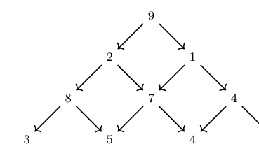

```text
9 + 2 + 8 + 3 = 22
9 + 2 + 8 + 5 = 24
9 + 2 + 7 + 5 = 23
9 + 2 + 7 + 4 = 22
9 + 1 + 7 + 5 = 22
9 + 1 + 7 + 4 = 21
9 + 1 + 4 + 4 = 18
```

现在，我们将设计方法本身。在设计递归算法时，我们必须考虑所有有效的边界情况（base cases）。在这种情况下，有一个：如果我们处于三角形的底部，我们返回给定索引处的值。否则，我们递归地对两个相邻路径调用方法，累加当前索引的值，并返回这两个递归调用中的最大值。我们存储左、右递归调用的结果，将两者中的最大值加到当前值。遗憾的是，该解决方案远不高效，需要指数级的时间，但它是学习递归的一个很好的练习。

```java
import static Assertions.assertAll;
import static Assertions.assertEquals;

class MaxPathSumTester {

    @Test
    void testGetAdjacentPaths() {
        assertAll(
            () -> assertArrayEquals(new int[]{2, 3}, getAdjacentPaths(1, 1)),
            () -> assertArrayEquals(new int[]{4, 5}, getAdjacentPaths(2, 2)),
            () -> assertArrayEquals(new int[]{6, 7}, getAdjacentPaths(3, 3))
        );
    }

    @Test
    void testMaxSum() {
        List<List<Integer>> t0 = List.of();
        List<List<Integer>> t1 = List.of(
            List.of(3),
            List.of(7, 4),
            List.of(2, 4, 6),
            List.of(8, 5, 9, 3)
        );

        assertAll(
            () -> assertEquals(0, maxSum(t0)),
            () -> assertEquals(23, maxSum(t1))
        );
    }
}
```

```java
class MaxPathSum {

    /**
     * 计算三角形从顶部到底部任意路径的最大和。
     * @param ls 整数列表的列表。
     * @return 最大和。
     */
    static int maxPathSum(List<List<Integer>> ls, int i) {
        return ls.isEmpty() ? 0 : maxPathSumHelper(ls, i);
    }

    /**
     * 返回给定索引可以访问的两个索引。
     * @param idx 元素的索引。
     * @param level 元素的层级。
     * @return 给定索引可以访问的两个索引。
     */
    static int[] getAdjacentPaths(int idx, int level) {
        return new int[]{idx, idx + 1};
    }
}
```

```java
/**
 * 计算从顶部到底部任意路径的最大和。
 * @param triangle 整数列表的列表。
 * @param i 元素的索引。
 * @param l 元素的层级。
 * @return 从顶部到底部任意路径的最大和。
 */
private static int maxPathSize(List<List<Integer>> triangle, int i, int l) {
    if (l == triangle.size()) {
        return triangle.get(l - 1).get(i);
    } else {
        int[] adjacentPaths = getAdjacentPaths(i, l);
        int left = maxPathSize(triangle, adjacentPaths[0], l + 1);
        int right = maxPathSize(triangle, adjacentPaths[1], l + 1);
        return triangle.get(l).get(i) + Math.max(left, right);
    }
}
```

### Java 链表 (Linked Lists)

`LinkedList` 是一种基于节点的数据结构，每个元素都包含指向其后继（以及可能的前驱）元素的链接。

```text
List<T> A = new LinkedList<>()  创建了一个名为 A 的 T 类型 LinkedList。
T.get(i)                        获取 A 中第 i 个的元素。我们将此位置标记为 i + 1。
void A.set(i, v)                将 v 赋值给 A 的索引 i。
int A.size()                    返回列表中逻辑元素的数量，即逻辑数量。
```

图 3.3：基于链表的常用方法。

从列表头部移除元素需要时间，且该时间与列表中元素的数量成线性比例，而不是呈平方级增长。

当然，这些优势并非没有缺点。移除和修改元素的操作比数组对应的操作要慢，因为元素在内存中不是连续的。请记住，对于 `ArrayList`，由于元素在内存中是顺序存储的，我们知道数组中任何任意索引的位置都是起始索引的偏移量加上每个元素“字节大小”的倍数。此外，每个节点都位于内存中一个不可预测的位置，这意味着我们失去了数组列表提供的常数访问时间。在某种意义上，添加和删除元素是“更快”的，因为正如提到的，列表不会复制和调整缓冲区大小。正因如此，每当我们想要引用提供的索引时，我们都需要遍历链表。向列表中插入元素也是如此。另一方面，从列表头部或末尾添加或删除元素是常数（时间）操作，因为我们维护了列表的第一个元素（同样地，我们可以维护最后一个元素！）。列表也是许多其他数据结构的骨干，我们很快就会看到。

### Java 栈 (Stacks)

`Stack`（栈）是一种后进先出（LIFO）的数据结构，其中每个元素都链接到紧邻下方的元素。

```text
Stack<T> S = new Stack<>()  创建了一个名为 S 的 T 类型 Stack。
T.peek()                    返回但不移除 S 的顶端元素。
T.pop()                     返回并移除 S 的顶端元素。
void S.push(e)              将 e 推入 S 的顶部，使其成为栈顶元素。
int S.size()                返回栈中逻辑元素的数量。
```

图 3.4：基于栈的常用方法。

#### 栈类 (Stack Class)

想象你正在厨房水池旁用手洗碗。盘子在你的左侧堆成了一个单栈。盘子无法从栈顶移除，任何位置的移动都会破坏栈的结构。此外，进一步想象，人们正让你沮丧地向栈中添加更多的盘子。同样，盘子不能在栈顶以外任何地方添加，否则会破坏栈。

栈数据结构如听起来一样简单——它是一个按照后进先出（LIFO）原则运行元素集合。换句话说，我们最后进入的东西是第一个移除的。栈的实现至少包含以下操作：`POP` 和 `PUSH`，其中前者从栈中移除顶端元素（如果存在），后者将新元素添加到栈顶。可能还存在一种通过 `PEEK` 查看（但不移除）最顶端元素的操作。

栈具有即时插入和移除时间的优势，但显然没有数组或链表那样灵活。栈数据结构的一个实际应用用例是在文档编辑程序中实现“撤销”功能——每当执行一个操作时，它会被推入撤销栈中。“撤销”事件代表从该栈中弹出一个操作。我们在图 3.5 中阐明了这个概念。


### 比较器 (Comparator)

**比较器**（comparator）是一种比较两个任意“事物”的方法。无论这些“事物”是数字（即包装类）、字符串还是任何类型的对象，我们都可以定义自定义的方法来比较**任何**非原始数据类型。

## 示例 3.30

让我们定义一个比较器，对以小写字母 `'p'` 开头的字符串进行优先排序。比较器像所有其他对象一样通过继承来构建，但它们实现中有一个有趣的点是，我们必须指定如何比较两个对象。因此，当我们创建一个 `Comparator` 的新实例时，必须重写它的 `compare` 方法。比较器的签名根据我们提供给比较器的参数类型而变化，但由于我们要比较字符串，应该将其声明如下：

```java
import java.util.Comparator;
import java.util.PriorityQueue;

class PriorityQueueByP {

    /**
     * 返回一个优先队列，其优先考虑以 'p' 开头的字符串。
     * @return 优先队列实例。
     */
    static PriorityQueue<String> priorityByP(
        Comparator<String> c = new Comparator<>() {
            @Override
            public int compare(String s1, String s2) { /* TODO */ }
        }
    ) {
        // 方法体
    }
}
```


我们必须描述如何比较 `s1` 和 `s2` 以实现我们的目标。奇怪的是，如果我们想说 `s1` 的优先级高于 `s2`，我们必须返回一个负值，这与字符串的自然排序相似（然而，这个想法也扩展到我们想要比较的任何类型）。幸运的是，一旦我们理解了为什么需要负值，这就不再奇怪了。在对数字升序排列时，值 `-1` 排在 `1` 之前。因此，当比较任意值 `t1` 和 `t2` 时，若要说 `t1` 在 `t2` 之前，我们返回一个负数。

让我们对输入字符串进行分类分析。如果提供的字符串非空，我们获取它们的第一个字符。如果它们都以 'p' 开头，那么它们的顺序取决于字符串剩余部分的标准字典序比较。如果 `s1` 的第一个字符是 'p'，我们返回 -1 来指定 `s1` 的优先级高于 `s2`。相反，如果 `s2` 以 'p' 开头，我们返回 1 来指定相反的情况。如果两者都不以 p 开头，那么我们再次对整个字符串进行字典序比较。算法 1 显示了该方法的伪代码，但正如我们将看到的，我们可以将其逐字地翻译成 Java 语法。`priorityByP` 的最后一行实例化了一个新的 `PriorityQueue`，其构造函数接收了我们刚刚设计的 `Comparator`。

# 算法 1 用于 'p' 优先比较两个字符串的伪代码

```
procedure COMPARE(s1, s2)

  if s1 and s2 are non-empty then

    c1 <- First(s1)

    c2 <- First(s2)

    if c1 is 'p' and c2 is 'p' then

      xs1 <- s1.substring(1)

      xs2 <- s2.substring(1)

      return xs1.compareTo(xs2)

    else if c1 is 'p' then

      return -1

    else if c2 is 'p' then

      return 1

    else

      return s1.compareTo(s2)

    end if

  else

    return s1.compareTo(s2)

  end if

procedure
```

```java
import java.util.Comparator;
import java.util.PriorityQueue;

class PriorityQueueByP {

  static PriorityQueue<String> priorityByP() {

    Comparator<String> c = new Comparator<>() {

      @Override
      public int compare(String s1, String s2) {

        if (s1.isEmpty() && s2.isEmpty())
          return 0;

        char c1 = s1.charAt(0);
        char c2 = s2.charAt(0);

        if (c1 == 'p' && c2 == 'p') {
          return s1.substring(1).compareTo(s2.substring(1));
        } else if (c1 == 'p') {
          return -1;
        } else if (c2 == 'p') {
          return 1;
        } else {
          return s1.compareTo(s2);
        }
      }
    };

    return new PriorityQueue<String>(c);
  }
}
```

让我们向带有自定义比较器的优先队列中添加几个元素以说明这一思想。为了添加元素，我们使用 `.add`；为了移除优先级最高的元素，我们调用 `.poll`。

```java
import java.util.Comparator;
import java.util.PriorityQueue;

class PriorityQueueByP {

    static PriorityQueue<String> priorityByP() { /* Code hidden. */ }

    public static void main(String[] args) {

        PriorityQueue<String> pq1 = priorityByP();

        // 添加几个元素
        pq1.add("pool"); pq1.add("hello"); pq1.add("barks");
        pq1.add("park"); pq1.add("pecking"); pq1.add("shrub");

        // 从队列中取出每个元素并打印出来。
        while (!pq1.isEmpty()) { System.out.println(pq1.poll()); }
    }
}
```

## 3.2 集合

### TreeSet 类

`TreeSet` 是一个具有确定顺序的集合，这种顺序可以是元素的自然排序，也可以由 `Comparator` 比较器定义，类似于优先级队列。Set 中的所有方法在定义上都是由某个具体的类来实现的。

### LinkedHashSet 类

`LinkedHashSet` 是一个根据元素插入顺序进行排序的集合。Set 中的所有方法在定义上都是由 `LinkedHashSet` 实现的。

**示例 3.31。** 集合的典型用法是通过 `removeDuplicatesList` 方法去除重复项，该方法接收一个整数列表并返回一个不包含任何重复项的新列表。我们将添加一个后置条件要求，即整数的输出顺序必须与输入顺序一致。为了解决这个问题，我们将创建一个辅助的 `LinkedHashSet`，将列表中的所有元素添加到集合中，然后将集合中的这些值添加到新列表中。在向集合添加元素时，如果该元素已存在，则不会重复添加。

```java
import static assertions.assertAll;
import static assertions.assertEquals;
import java.util.List;

class RemoveDuplicatesListTester {

  @Test
  void testRemoveDuplicatesList() {
    assertAll(
      () -> assertEquals(List.of(), removeDuplicatesList(List.of())),
      () -> assertEquals(List.of(3, 4), removeDuplicatesList(List.of(3, 3, 4, 4, 3)))
    );
  }
}
```

```java
import java.util.List;
import java.util.ArrayList;
import java.util.Set;
import java.util.LinkedHashSet;

class RemoveDuplicatesList {

  /**
   * 去除整数列表中的重复项。
   * @param list 整数列表。
   * @return 一个不含重复项的新列表。
   */
  static List<Integer> removeDuplicatesList(List<Integer> ls) {
    List<Integer> newList = new ArrayList<>();
    Set<Integer> set = new LinkedHashSet<>();
    for (int x : ls) { set.add(x); }
    for (int x : set) { newList.add(x); }
    return newList;
  }
}
```

**示例 3.32。** 假设我们想要找到两个无序元素链表之间的所有公共元素。让我们设计 `commonValues` 方法，该方法在接收两个整数链表时，返回一个按排序排列的值列表，其中包含两个列表中都出现的值，且不应重复计数某个值，例如，结果输出列表应只包含一个 `2`。让我们利用树（tree）来按顺序存储公共值，然后将这些值添加到新的链表中。

```java
import static Assertions.assertAll;
import static Assertions.assertEquals;
import java.util.List;
import java.util.LinkedList;
import java.util.Set;
import java.util.TreeSet;

class CommonValuesTester {

  @Test
  void commonValues() {
    assertAll(
      () -> assertEquals(List.of(), commonValues(List.of(), List.of(5, 4, 3, 2, 1))),
      () -> assertEquals(List.of(), commonValues(List.of(10, 20, 30, 40, 50), List.of(5, 4, 3, 2, 1))),
      () -> assertEquals(List.of(1, 4), commonValues(List.of(2, 1, 3, 5, 6), List.of(1, 4, 3, 10, 20))),
      () -> assertEquals(List.of(-2, 0, 2), commonValues(List.of(2, -2, 0, -2, 2), List.of(-2, 2, 0)))
    );
  }
}
```

```java
import java.util.List;
import java.util.LinkedList;
import java.util.Set;
import java.util.TreeSet;

class CommonValues {

  /**
   * 两个整数链表之间的所有公共值。
   * @param s1 第一个链表。
   * @param s2 第二个链表。
   * @return （去重的）公共值的列表。
   */
  static List<Integer> commonValues(LinkedList<Integer> s1, LinkedList<Integer> s2) {
    Set<Integer> set = new TreeSet<>();
    for (int x : s1) {
      if (s2.contains(x)) { set.add(x); }
    }
    List<Integer> newLs = new LinkedList<>();
    newLs.addAll(set);
    return newLs;
  }
}
```

**示例 3.33。** 给定一个从 1 到 `n` 的数字数组，其中缺少了一个数字，且重复了一个数字。让我们设计 `findDupMissing` 方法，它返回一个包含两个元素的数组：第一个是缺失的数字，第二个是重复的值。使用 `TreeSet` 来处理这个问题是合理的，我们可以按顺序存储数字，并在遍历过程中找出哪一个被遗漏了，并只找到重复的项。

```java
import static Assertions.assertAll;
import static Assertions.assertArrayEquals;

class FindDupMissingTester {

  @Test
  void testFindDupMissing() {
    assertAll(
      () -> assertArrayEquals(new int[]{2, 3}, findDupMissing(new int[]{1, 3, 4})),
      () -> assertArrayEquals(new int[]{5, 1}, findDupMissing(new int[]{1, 4, 3, 2, 6, 7})),
      () -> assertArrayEquals(new int[]{3, 2}, findDupMissing(new int[]{7, 4, 5}))
    );
  }
}
```

```java
import java.util.Set;
import java.util.TreeSet;

class FindDupMissing {

  /**
   * 从数组中找到一个重复数字和一个缺失数字。
   * 数组包含 1 到 n 的数字，其中一个缺失，一个重复。
   * @param a 输入数组。
   * @return 返回 [缺失, 重复] 数组。
   */
  static int[] findDupMissing(int[] a) {
    Set<Integer> set = new TreeSet<>();
    int[] res = new int[2];
    int n = a.length;
    for (int x : a) {
      if (!set.add(x)) {
        res[1] = x; // 重复项
      }
    }
    for (int i = 1; i <= n; i++) {
      if (!set.contains(i)) {
        res[0] = i; // 缺失项
      }
    }
    return res;
  }
}
```

```java
frequencies.put(v, 1);
} else {
    frequencies.put(v, frequencies.get(v) + 1);
}
```

```java
// 找到最高频率。
int highestFreq = -1;
for (int k : frequencies.keySet()) {
    highestFreq = Math.max(highestFreq, frequencies.get(k));
}
```

```java
// 现在，找到匹配该频率的值。
return frequencies.keySet()
    .stream()
    .filter(k -> frequencies.get(k) == highestFreq)
    .collect(Collectors.toList());
```

**示例 3.35.** `sharesFirstChar` 方法的设计是在给定一个字符串数组时，返回一个 `Map<Character, Set<String>>`，其中每个按字母排序的字符映射到一个以该字符开头的按字母排序的字符串集合。我们进一步假设忽略大小写。考虑以下输入和输出：

```
sharesFirstChar("se", "sells", "sea", "shells", "by", "the", "sea")
=> {'b': ["by"],
   's': ["sea", "sells", "shells"],
   't': ["the"]}
```

因为我们要求集合和映射都按字母排序，所以使用 `TreeSet` 和 `TreeMap` 是合适的。因此，我们首先遍历输入列表并初始化一个键为每个单词首字母的 map，其值为 `TreeSet` 的新实例。然后我们通过第二次遍历列表来填充集合。

```java
import static Assertions.assertAll;
import static Assertions.assertEquals;
import java.util.List;
import java.util.Map;
import java.util.Set;
import java.util.TreeMap;
```

```java
class ShareFirstCharacterTester {
    @Test
    void testShareFirstChar() {
        Map<Character, Set<String>> exp1 = new TreeMap<>();
        assertEquals(exp1, shareFirstChar(List.of("by")));

        Map<Character, Set<String>> exp2 = new TreeMap<>();
        exp2.put('b', new TreeSet<>());
        exp2.put('s', new TreeSet<>());
        exp2.put('t', new TreeSet<>());
        exp2.get('s').addAll(Set.of("sells", "sea", "shells"));
        exp2.get('t').add("the");
    }
}
```


## 3.2 Collections

```java
exp2.get('b').add(Set.of("by"));
}
}
```

```java
assertEquals(exp2,
    shareFirstChar(List.of("she", "sells", "sea", "shells", "by", "the", "sea"))
);
```

```java
import java.util.HashMap;
import java.util.List;
import java.util.Map;
import java.util.Set;
import java.util.TreeSet;

class shareFirstCharacter {
    /**
     * 返回一个 map，其键是字符串的第一个字符，
     * 其值为以该字符开头的字符串集合。
     * @param ls 字符串列表。
     * @return 字符串集合的 map。
     */
    static Map<Character, Set<String>> shareFirstChar(List<String> ls) {
        Map<Character, Set<String>> M = new HashMap<>();
        // 使用初始的 TreeSets 填充 map。
        for (String s : ls) {
            char lc = Character.toLowerCase(s.charAt(0));
            if (!M.containsKey(lc)) {
                M.put(lc, new TreeSet<>());
            }
        }
        // 将字符串添加到每个集合中。
        for (String s : ls) {
            M.get(Character.toLowerCase(s.charAt(0))).add(s);
        }
        return M;
    }
}
```

**示例 3.36.** 让我们设计 `firstUniqueDigit` 方法，该方法在给定一个字符串时返回第一个非重复的数字。如果没有非重复的数字，则返回空字符串。由于我们关心插入顺序，我们应该使用 `LinkedHashMap`，其键是字符串中的字符，其值为频率计数。该思想是统计每个（数字）字符的频率，然后遍历链接 map 并找到第一个键（值）频率。由于我们现在理解了如何组合并放入以插入和增加频率计数，我们将选择使用 `getOrDefault`，这消除了对条件判断的需求.¹⁶

> ¹⁶ 此问题类似于 frew@mclean.com 在 codingbat.com 上创建的一个。感谢。

```java
import static Assertions.assertAll;
import static Assertions.assertEquals;

class FirstUniqueDigitTester {
    @Test
    void testFirstUniqueDigit() {
        assertAll(
            () -> assertEquals("3", ...)
        );
    }
}
```

```java
import java.util.HashMap;
import java.util.LinkedHashMap;
import java.util.Map;

class FirstUniqueDigit {
    /**
     * 返回字符串中第一个唯一的数字，以字符串形式返回。
     * 如果没有唯一的数字，则返回空字符串。
     * @param s 字符串。
     * @return 字符串形式的第一个唯一数字。
     */
    static String firstUniqueDigit(String s) {
        Map<Character, Integer> m = new LinkedHashMap<>();
        // 统计每个数字的频率
        for (int i = 0; i < s.length(); i++) {
            String c = s.substring(i, i + 1);
            if (Character.isDigit(c.charAt(0))) {
                m.put(c.charAt(0), m.getOrDefault(c.charAt(0), 0) + 1);
            }
        }
        // 找到第一个唯一的字母
        for (char c : m.keySet()) {
            if (m.get(c) == 1) {
                return String.valueOf(c);
            }
        }
        return "";
    }
}
```

**示例 3.37.** 我们考虑的一个示例是 `nthFrequentChar` 方法，在给定一个字符串和一个整数时，返回第 $n$ 次高频的字符，或者如果没有这样的字符。如果有多个字符共享相同的频率，我们按字典顺序返回第一个。

例如，考虑字符串 "aabbabcabcc" 和 $n = 3$。按顺序的字符是 'a', 'b', 'c'。因此高频字符是 'c'。

另一个示例是 "aabbcc" 和 $n = 2$。按顺序的字符是 'a', 'b', 'c'。因此高频字符是 'b'。

另一个示例是 "aabbcc" 和 $n = 3$。按顺序的字符是 'a', 'b', 'c'。因此高频字符是 'c'。

另一个示例是 "aaaccccc" 和 $n = 2$。按顺序的字符是 'a', 'c'。因此高频字符是 'c'。

另一个示例是 "aaacccccbbeeff" 和 $n = 3$。按顺序的字符是 'a', 'c', 'b', 'e', 'f'。因此第 3 次高频字符是 'b'。

另一个示例是 "aaacccccbbeeff" 和 $n = 4$。按顺序的字符是 'a', 'c', 'b', 'e', 'f'。因此第 4 次高频字符是 'e'。

另一个示例是 "aaacccccbbeeff" 和 $n = 5$。按顺序的字符是 'a', 'c', 'b', 'e', 'f'。因此第 5 次高频字符是 'f'。

另一个示例是 "aaacccccbbeeff" 和 $n = 1$。按顺序的字符是 'a', 'c', 'b', 'e', 'f'。因此第 1 次高频字符是 'a'。

另一个示例是 "aaacccccbbeeff" 和 $n = 2$。按顺序的字符是 'a', 'c', 'b', 'e', 'f'。因此第 2 次高频字符是 'c'。

另一个示例是 "aaacccccbbeeff" 和 $n = 3$。按顺序的字符是 'a', 'c', 'b', 'e', 'f'。因此第 3 次高频字符是 'b'。

另一个示例是 "aaacccccbbeeff" 和 $n = 4$。按顺序的字符是 'a', 'c', 'b', 'e', 'f'。因此第 4 次高频字符是 'e'。（注：此处原文似乎有重复逻辑，翻译已按原文保留）。

上上，按顺序的字符是 'a', 'c', 'b', 'e', 'f'。因此第 5 次高频字符是 'f'

首先，我们统计每个（数字）字符的频率，然后遍历链接 map 并找到第一个键（值）频率。由于我们现在理解了如何组合并放入以插入和增加频率计数，我们将选择使用 `getOrDefault`，这消除了对条件判断的需求.¹¹⁶

```java
import static Assertions.assertAll;
import static Assertions.assertEquals;

class FirstUniqueDigitTester {
    @Test
}
```

> ¹⁶ 此问题类似于 frew@mclean.com 在 codingbat.com 上创建的一个。感谢。

## 3.2 Collections

首先，我们统计每个（数字）字符的频率，然后遍历链接 map 并找到第一个键（值）频率。由于我们现在理解了如何组合并放入以插入和增加频率计数，我们将选择使用 `getOrDefault`，这消除了对条件判断的需求.¹¹⁶

我们知道 $K$ 是 Character，$V$ 是 Integer。要从 `Map.Entry` 中检索键和值，分别使用 `getKey()` 和 `getValue()` 方法。为了让代码更简洁，我们将设计一个私有辅助方法，使用上述标准创建一个 `Comparator`。

```java
import static Assertions.assertAll;
import static Assertions.assertEquals;

class NthFrequentCharTester {
    @Test
    void testNthFrequentChar() {
        assertAll(
            () -> assertEquals("null", nthFrequentChar("abacab", 1)),
            () -> assertEquals("d", nthFrequentChar("aaaaddccccbee", 3)),
            () -> assertEquals("q", nthFrequentChar("ppqqrss", 2)),
            () -> assertEquals("null", nthFrequentChar("aabbccdd", 2))
        );
    }
}
```

```java
import java.util.Comparator;
import java.util.HashMap;
import java.util.Map;
import java.util.PriorityQueue;

class NthFrequentChar {
    /**
     * 给定字符串，返回该字符串中第 $n$ 次高频的字符。
     * @param s 检查的字符串。
     * @param n 整数 n >= 0。
     * @return 第 $n$ 次高频字符，如果不存在则返回 null。
     */
    static String nthFrequentChar(String s, int n) {
        // 步骤 1：计算频率。
        Map<Character, Integer> m = new HashMap<>();
        s.chars().forEach(c -> m.merge((char)c, 1, Integer::sum));
        // 步骤 2：用元素填充优先级队列。使用比较器。
        PriorityQueue<Map.Entry<Character, Integer>> Q = new PriorityQueue<>(getComparator());
        m.entrySet().forEach(e -> Q.add(e));
        // 步骤 4：从队列中弹出 n-1 个项。
        while (!Q.isEmpty()) {
            n--;
            if (n == 0) return String.valueOf(Q.peek().getKey());
            else Q.poll();
        }
        return null;
    }

    static Comparator<Map.Entry<Character, Integer>> getComparator() {
        return (e1, e2) -> {
            int freq1 = e1.getValue();
            int freq2 = e2.getValue();
            if (freq1 != freq2) {
                return freq2 - freq1;
            }
            return e1.getKey().compareTo(e2.getKey());
        };
    }
}
```

```java
private static Comparator<Map.Entry<Character, Integer>> getCmp() {
    return new Comparator<>() {
        @Override
        public int compare(Map.Entry<Character, Integer> e,
            Map.Entry<Character, Integer> f) {
            if (e.getKey() != f.getKey()) {
                return Character.compare(e.getKey(), f.getKey());
            } else {
                return f.getValue() - e.getValue();
            }
        }
    };
}
```

## 3.3 迭代器 (Iterators)

如何遍历如数组等简单数据结构。想法是使用一个变量作为索引并不断递增，直到达到数组的上边界。下面是一个简单的示例，用于计算数组元素的和。

```java
static int sum(int[] arr) {
    int sum = 0;
    for (int i = 0; i < arr.length; i++) { sum += arr[i]; }
    return sum;
}
```

问题不在于所有的数据结构，但我们无疑见过的结构是顺序的；集合（sets）和映射（maps）是非顺序数据结构的示例，那么我们如何遍历它们呢？一种方案是增强 for 循环（enhanced-for loop），但正如我们之后所示，这种方法有缺点，尽管它的语法非常直观。栈和队列也是不一定是顺序的数据结构的示例。`Iterator` 对象定义了一种遍历数据结构的机制。任何数据结构的类元素必须至少定义两个方法：`boolean hasNext()` 和 `T next()`，分别用于判断我们是否已到达数组末尾以及获取下一个元素。注意，此时 T 仅指代“任何类型”，并与参数类型有关。所有的 Java 集合都实现了 `Iterable`，并返回相应的 `Iterator` 对象。

在获取迭代器后，我们可以使用循环持续获取数据结构中的元素，直到没有更多元素可以访问。迭代器的元素是即时生成的；只有在调用 `next()` 时，值才会真正从数据结构本身中读取。与 Collections 框架的其他部分一样，我们在初始化 `Iterator` 时传递泛型类型，以便它知道用什么类型来替换 T。

**示例 3.38.** 让我们使用迭代器遍历 `LinkedHashSet`，它的元素顺序由插入顺序决定，这意味着迭代器应该按照它们被插入的顺序产生元素。

```java
import static Assertions.assertAll;
import static Assertions.assertEquals;
import static Assertions.assertTrue;
import java.util.Set;
import java.util.LinkedHashSet;
import java.util.Iterator;

class IteratorTester {
    @Test
    void test() {
        Set<Integer> lhs = new LinkedHashSet<>(Set.of(8, 90));
        Iterator<Integer> it = lhs.iterator();
        assertAll(
            () -> assertEquals(8, it.next()),
            () -> assertEquals(90, it.next()),
            () -> assertFalse(it.hasNext())
        );
    }
}
```

如果我们想再次遍历数据，我们需要实例化另一个迭代器实例，没有办法恢复迭代器的“位置”；它们是某种“一次性”对象。应该说明的是，增强 for 循环几乎完成了 `Iterator` 的工作，因此程序员可能会疑惑为什么不使用前者而不是后者。相反，迭代器允许在遍历时进行结构性修改，尽管 Java 允许这样做，但可能会产生 bug。

**示例 3.39.** 现在让我们使用增强循环遍历 `LinkedHashSet`。我们可以通过选取声明语句左侧的元素来实现。

```java
import static Assertions.assertEquals;
import java.util.Set;
import java.util.LinkedHashSet;

class EnhancedLoop {
    @Test
    void testEnhancedLoop() {
        Set<Integer> lhs = new LinkedHashSet<>();
        lhs.add(1); lhs.add(2); lhs.add(3); lhs.add(4);
        int diff = 0;
        for (Integer e : lhs) { diff += e; }
        assertEquals(10, diff);
    }
}
```

**示例 3.40.** 使用增强 for 循环不仅不允许结构性修改，而且不会保留特定数据结构的顺序。例如，假设我们有一个栈 S = [10, 20, 30, 40, 50]，其中 50 是栈顶。如果我们想在不使用迭代器或不修改栈本身的情况下打印 S 的每个元素，显然的选项是使用 `ArrayDeque`。

```java
import java.util.ArrayDeque;
import java.util.Deque;
```


import java.util.Iterator;
import java.util.List;
import java.util.Stack;

### 示例 3.41

增强 `for` 循环的非直观性以及某些迭代器的行为不仅限于栈。优先级队列也受到其实现的影响。让我们看看当创建一个优先级队列比较器时，让字符串 "Joshua" 的优先级高于所有字符串，并让字符串 "Jack" 的优先级最低。换句话说，任何 "Joshua" 的出现都应该出现在优先级队列中所有字符串之前，而任何 "Jack" 的出现应该出现在所有其他字符串之后。之间的任何字符串按自然排序（即通过字典序排序）。

```java
import java.util.List;
import java.util.PriorityQueue;
import java.util.Comparator;

class PriorityQueuePrinting {

    private static PriorityQueue<String> initPriorityQueue() {

        Comparator<String> S = new Comparator<>() {

            @Override
            public int compare(String s1, String s2) {

                // 如果 Joshua 在前或 Jack 在后，
                // 那么 s1 优先级更高。
                if (s1.equals("Joshua") || s2.equals("Jack")) return -1;

                // 如果 Jack 在前或 Joshua 在后，
                // 那么 s2 优先级更高。
                else if (s1.equals("Jack") || s2.equals("Joshua")) return 1;

                // 所有其他字符串采用标准优先级（自然顺序）。
                else { return s1.compareTo(s2); }
            }
        };

        return new PriorityQueue<>(S);
    }

    public static void main(String[] args) {
        PriorityQueue<String> pq = initPriorityQueue();

        pq.add("Peter"); pq.add("Joshua"); pq.add("Gautam"); pq.add("Jane");
        pq.add("Jack"); pq.add("Ratan"); pq.add("Dharmik"); pq.add("Sakshi");

        // 打印出一个看似随机的顺序！
        for (String s : pq) { System.out.println(s); }

        // 使用 Arrays 根据 PQ 的比较器对元素排序。
        String[] elements = pq.toArray(new String[0]);
        Arrays.sort(elements, pq.comparator());
        System.out.println(Arrays.toString(elements));
    }
}
```

> 17 一个 deque，读音为 'deque'，是一个双端队列。
> 18 参见 Oracle 的 Stack 文档：https://docs.oracle.com/java/8/docs/api/java/util/Stack.html

通过使用增强 `for` 遍历元素，我们发现元素打印的顺序看似是随机的，并不遵循我们的比较器。一种解决方案是将优先级队列转换为数组，使用 `Arrays.sort` 对数组排序，然后使用 `Arrays.toString` 打印数组内容。记住，如果我们只传递数组类型 `T`，看到的将是数组的哈希值而不是元素。

一个我们需要关注的复杂问题是如何使用 `.toArray()` 将优先级队列（或任何集合）转换为数组。它接收一个类型为 `T` 的数组，如果数组足够大以存储集合的所有元素，则会被填充。否则，将返回一个相同类型 `T` 的数组。总结，如果我们想将优先级队列转换为数组，必须向 `.toArray` 方法传递 `new T[0]`。返回的数组随后会被排序和打印。

## 数组、集合与泛型

（从最大到最小），它一次处理两个项，并按相反的顺序将它们添加到结果列表中。要创建一个使用“最大值”作为“最高”优先级指标的比较器，我们使用 `Collections.reverseOrder` 方法，它返回一个按反序排序项的比较器。

```java
import static Assertions.assertAll;
import static Assertions.assertEquals;
```

```java
import java.util.List;
```

```java
class MaximalMovesTester {

    @Test
    void testMaximalMoves() {
        () -> assertEquals(List.of(),
                           maximalMoves(List.of())),
        () -> assertEquals(List.of(4, 5, 3, 2, 0, 1),
                           maximalMoves(List.of(0, 1, 2, 3, 4, 5))),
        () -> assertEquals(List.of(45, 60, 35, 25, 45, 15, 5),
                           maximalMoves(List.of(20, 40, 30, 25, 25, 15, 5, 60, 35)));
    }
}
```

```java
import java.util.Collections;
import java.util.List;
import java.util.PriorityQueue;
import java.util.ArrayList;
```

```java
class MaximalMoves {

    /**
     * 给定一个数字列表，返回玩家所做的移动
     * @param ls 长度为偶数的数字列表。
     * @return 移动列表。
     */
    static List<Integer> maximalMoves(List<Integer> ls) {
        PriorityQueue<Integer> pq = new PriorityQueue<>(Collections.reverseOrder());
        pq.addAll(ls);
        List<Integer> moves = new ArrayList<>();
        for (int i = 0; i < ls.size(); i += 2) {
            moves.add(pq.poll());
            moves.add(pq.poll());
        }
        return moves;
    }
}
```

## 3.4 Streams

Stream 实际上是“事物”的惰性集合。我们所说的“惰性”是指如果如果没有必要或未被请求，那么它就不会被计算。

### 示例 3.43

考虑一种情况，我们将定义为无限循环的 `omega()` 方法作为参数传递给 `foo` 方法，即得到 `foo(omega())`。在 Java 中，所有参数都是急于求值的，这意味着参数在应用方法之前就会被求值。对于 `foo` 的调用者来说，遗憾的是方法体并没有使用 `x`，这意味着我们无缘地评估了 `omega()`。这意味着由于 `omega` 永远不会结束，`foo` 同样不会返回结果。

```java
static int omega() {
    while (true) {
        return 10;
    }
}

static int foo(int x) {
    return 5;
}
```

如果 Java 支持方法调用的惰性求值，我们就没有这个问题。我们的讨论并非完全源于对惰性求值的渴望，而是对易于组合的操作渴望；惰性求值是一个好处，因为它允许我们定义无限数据结构！“无限”数据结构引发了关于如何存储“无限”数据的重要问题。假设我们想要计算一个包含每个正整数的列表。我们可以将其表示为归纳集：

0 ∈ S
如果 x ∈ S，则 x + 2 ∈ S

因此，S 是一个包含无限个值的集合。在 Java 中用 `ArrayList` 实现 S 可能会创建一个包含我们不知道该如何解决的条件的 `for` 循环：由于我们不知道需要添加多少值，我们可能会倾向于通过 `while(true)` 设计一个无限循环，但这样循环永远不会结束，程序最终会因为向无止尽的列表添加值而耗尽内存。正如我们建议的，解决方案是使用流。

创建一个无限数据的流是在 `IntStream` 实例内部重建定义并调用 `iterate` 方法。

```java
IntStream is = IntStream.iterate(0, x -> x);
```

让我们解释一下，但必须同时引入 lambda 表达式。lambda 表达式是一个匿名函数，没有名字定义。在代码段中，我们定义了一个接收值 `x` 并返回 `x` 加二的函数。与定义一个静态方法来给整数加 2 是相同的，但我们喜欢 lambda 表达式是因为它们的局部性；它们可能在一个上下文中被使用。也可以使用 lambda 表达式的方法引用。

```java
import java.util.stream.IntStream;

class PositiveEvents {
    private static int addTwo(int x) { return x + 2; }

    public static void main(String[] args) {
        IntStream is = IntStream.iterate(0, PositiveEvents::addTwo);
    }
}
```

对于来自 Python 等语言的人，流等于生成器。

## 数组、集合和泛型

`IntStream` 实例声明了一个在请求时调用并填充的流。因为使用现代计算机无法表示真正的无限数据结构，我们需要限制从流中获取多少值。事实上，`.limit` 方法从流中计算 n 个元素。所以，为了计算 `IntStream` 的前十个元素，我们在流上调用了 `.limit(10)`。

```java
import java.util.stream.IntStream;

class PositiveEvents {
    public static void main(String[] args) {
        IntStream is = IntStream.iterate(0, x -> x + 2).limit(10);
    }
}
```

现在，假设我们想要查看这些元素。现在它们合并到了 `IntStream` 中，但我们需要将它们转换为列表。解决方案是通过 `boxed()` 将值转换为 `Stream<Integer>`，然后使用方便的 `.toList()` 方法转换为列表。

```java
import java.util.stream.IntStream;
import java.util.List;

class PositiveEvents {
    public static void main(String[] args) {
        IntStream is = IntStream.iterate(0, x -> x + 2).limit(10);
        List<Integer> ls = is.boxed().toList();
        System.out.println(ls); // [0, 2, 4, 6, 8, 10, 12, 14, 16, 18]
    }
}
```

### 示例 3.44

假设我们需要无限重复的 "a" 流。我们可以通过 `generate` 方法轻松创建一个，它作为流的构造函数，接收一个 lambda 表达式来持续生成新元素。

```java
import java.util.stream.Stream;

class Generator {
    public static void main(String[] args) {
        Stream<String> as = Stream.generate(() -> "a");
        // ["a","a","a","a","a","a","a"]
        System.out.println(as.limit(10).boxed().toList());
    }
}
```

理解流的*底层*发生了什么是非常重要的。元素在我们通过某种手段（例如 `limit`）请求它们时才会生成。正如我们之前建议的，访问无限流（不加 limit）会导致程序挂起并最终因 `MemoryError` 崩溃。

### 示例 3.45

假设我们想要创建一个所有斐波那契数的流。问题是，我们最终会达到 `int` 类型的 32 位限制，所以我们应该利用 `BigInteger`，允许我们表示任意大的整数。这次，我们将设计一个重启流实例的方法，而不是在 `main` 方法中创建一个。

我们需要做的是：迭代以生成序列中的新值。这里有一个小问题，斐波那契序列有两个起始（累加）值：0 和 1。问题是 `iterate` 只接收一个“初始化”值。为了解决这个困境，我们可以传递一个包含当前和“下一个”斐波那契数的数组。在 lambda 表达式内部，我们接收一个值数组，并从中计算斐波那契数。然而，我们没有使用 `IntStream`，而是泛化到了 `Stream` 类，因为我们的初始值不是整数。

```java
import static Assertions.assertEquals;
import static Assertions.assertArrayEquals;
import java.util.stream.Stream;
import java.util.List;
import java.util.ArrayList;
import java.math.BigInteger;

class BigIntFibStreamTester {

    @Test
    void testBigIntFibStream() {
        // 获取流，十个值，确保列表是相同的。
        Stream<BigInteger[]> s = StreamExample.fibonacciStream();
        List<BigInteger[]> actuals = s.limit(10).toList();
        List<BigInteger[]> expecteds = List.of(
            new BigInteger[]{new BigInteger("0"), new BigInteger("1")},
            new BigInteger[]{new BigInteger("1"), new BigInteger("1")},
            new BigInteger[]{new BigInteger("1"), new BigInteger("2")}
        );

        // 检查预期和实际的 BigInteger 数组。
        assertEquals(expecteds.size(), actuals.size());
        for (int i = 0; i < expecteds.size(); i++) {
            assertArrayEquals(expecteds.get(i), actuals.get(i));
        }
    }
}
```

```java
import java.util.stream.Stream;
import java.math.BigInteger;

class BigIntFibStream {

    /**
     * 计算第 n 个斐波那契数的 BigInteger 流。
     * @return 包含后续顺序 BigInteger 数组的流。
     */
    static Stream<BigInteger[]> fibonacciStream() {
        BigInteger[] vals = {new BigInteger("0"), new BigInteger("1")};
        return Stream.iterate(vals, v -> new BigInteger[]{v[1], v[0].add(v[1])});
    }
}
```


21 现在担心 `BigInteger` 类如何工作对于我们目前演示流特性的计划来说是不必要的。

# Java Streams

流（Stream）是元素的惰性集合，在需要时才进行计算。

- `S.count()` 返回流中元素的数量。
- `Stream<T> S.map(f)` 返回一个新流，其元素是对比 `S` 的每个元素应用函数 `f` 的结果。
- `S.filter(p)` 返回一个包含 `S` 中满足谓词 `p` 的元素流。
- `T S.reduce(a,f)` 返回将二元函数 `f` 应用于 `S` 的每个元素的结果，从 `a` 开始，它作为累加器的初始值。`a` 的类型为 `T`，与流的元素类型匹配。
- `Stream<T> S.limit(n)` 返回一个包含 `S` 前 `n` 个元素的新流。
- `Stream<T> S.skip(n)` 返回一个包含 `S` 前 `n` 个元素之后元素的新流。
- `Optional<T> S.min/max(c)` 根据比较器 `c` 返回 `S` 的最小/最大元素。如果 `S` 为空，则返回 `Optional.empty()`。

| 图 3.11: 有用的基于流的方法 |
| :--- |

# Java 流搜索方法

我们可以在流中搜索元素的类型。

- `boolean S.anyMatch(p)` 如果 `S` 中至少有一个元素满足谓词 `p`，则返回 `true`；否则返回 `false`。
- `boolean S.allMatch(p)` 如果 `S` 的所有元素都满足谓词 `p`，则返回 `true`；否则返回 `false`。
- `boolean S.noneMatch(p)` 如果 `S` 中没有元素满足谓词 `p`，则返回 `true`；否则返回 `false`。

| 图 3.12: 有用的流搜索方法。 |
| :--- |

我们的代码生成了一个包含 `BigInteger` 数组的列表，其中包含斐波那契值及其后继值。但是，这真的是我们想要的吗？更好的解决方案是返回元组/二元数组的第一个元素，这可以通过 `map` 方法实现。`map` 接收一个 Lambda 表达式作为参数，并将其应用于作用流的每个元素。让我们修改代码以查看改进后的输出。方便的是，我们不需要在单元测试方法中遍历导出的/实际列表，因为 `assertEquals` 在 `List` 对象上可以正常工作。

```java
import static assertions.assertEquals;

import java.util.Stream;

import java.util.List;

import java.util.ArrayList;

import java.util.BigInteger;

class BigIntFibStreamTester {

    @Test
    void testBigIntFibStream() {
        Stream<BigInteger> s = StreamLimit.fibonacciExample();
        List<BigInteger> actuals = s.limit(10).toList();
        List<BigInteger> expectedLs =
            List.of(new BigInteger("0"), new BigInteger("1"),
            new BigInteger("1"), new BigInteger("2"),
            ..);
        assertEquals(expectedLs, actuals);
    }
}
```

```java
import java.util.Stream;

import java.util.BigInteger;

class BigIntFibStream {
    /**
     * 计算第 n 个斐波那契值的 BigInteger 值流。
     * @return 包含后续顺序斐波那契整数数组的流。
     */
    static Stream<BigInteger> fibonacciStream() {
        BigInteger[] vals = new BigInteger[]{new BigInteger("0"), new BigInteger("1")};
        return Stream.iterate(vals, v -> new BigInteger[]{v[1], v[0].add(v[1])})
              .map(v -> v[0]);
    }
}
```

让我们进一步了解一下 `map` 以及其他 `filter` 和 `reduce` 等有用的高阶函数。

高阶函数是接收函数作为参数的函数。我们已经看到 `map` 接收一个 Lambda 表达式并将其应用于流的每个元素。

**示例 3.46.** 设计 `sqlList` 方法，它接收一个 `List<Integer>` 并使用 Stream API 对每个元素进行平方。该方法应该返回一个新的 `List`。流方法中存在的一个模式是它们不会修改原始数据。我们应该使用 `map` 来应用一个接收整数并返回其平方的 Lambda 表达式。幸运的是，我们可以使用 `.stream()` 方法将任何内容收集到流中。从那里，我们可以使用 `map` 调用来得到所需的结果。

```java
import static Assertions.assertAll;

import static Assertions.assertEquals;

import java.util.List;

import java.util.ArrayList;

class SqlListTester {
    @Test
    void testSqlList() {
        List<Integer> ls1 = new ArrayList<>(List.of(0, 1, 2));
        List<Integer> ls2 = new ArrayList<>();
        assertAll(
          () -> assertEquals(ls1, List.of(0, 1, 4)),
          () -> assertEquals(ls2, List.of(0, 1, 4))
        );
    }
}
```

# 数组、集合与泛型

```java
import java.util.List;

class List {
    /**
     * 从整数列表返回平方后的整数列表。
     * @param ls 整数列表。
     * @return 整数列表。
     */
    static List<Integer> sqList(List<Integer> ls) {
        return ls.stream()
            .map(x -> x * x)
            .toList();
    }
}
```

**3.47.** 现在，让我们设计 `removeVowels` 方法，它接收一个字符串并移除元音，返回一个字符串。我们应该使用 `map` 来应用一个接收整数并返回其平方的 Lambda 表达式。对我们来说幸运的是，我们可以使用 `.stream()` 方法将任何内容收集到流中。从那里，我们可以使用 `map` 调用来得到所需的结果。

1. 将给定字符串转换为整数流。
2. 将每个整数转换为字符。
3. 根据比较器过滤掉元音。
4. 将其累加到新的字符串中。

如下：

```java
import static Assertions.assertAll;

import static Assertions.assertEquals;

class RemoveVowels {
    @Test
    void removeVowels() {
        assertAll(
            () -> assertEquals("ll", "hello"),
            () -> assertEquals("h", "how are"),
            () -> assertEquals("", "aeiou"),
            () -> assertEquals("bb("bb",",bbbbbbbb"),
            () -> assertEquals("abababa", "abababa"),
            () -> assertEquals("h", "aeaeU")
        );
    }
}
```

## 158 3 数组、集合与泛型

```java
M.put(94, 1);

assertEquals(
    () -> assertEquals(Map.of(), rankMap(Set.of())),
    () -> assertEquals(M2, rankMap(Set.of(44, 41, 23, 94, 10, 0))));
}
```

```java
import java.util.Set;

import java.util.Map;

import java.util.TreeMap;

class RankMap {
    /**
     * 为给定的数字集合创建一个排名映射。
     * 它将数字与等于该数字的数量关联。
     * @the number 数字。此方法使用了流（stream）方法。
     * @param S 整数集合。
     * @return 排名映射。
     */
    static Map<Integer, Integer> rankMap(Set<Integer> S) {
        Map<Integer, Integer> M = new TreeMap<>();
        S.forEach(n -> M.put((int) S.stream().filter(m -> m == n).count()));
        return M;
    }
}
```

让我们设计一个 `rankMap` 的实现，对于集合中的元素，我们根据位置将它们插入映射中。排序有一个固定的成本，但它比流和过滤的方法快得多。这里的教训不是要让读者摒弃流 API；事实上，我们主张相反的。流是 Java 的一个非常棒补充，但程序员应该始终考虑流操作的性能，因为可能存在其他方法。

```java
import java.util.ArrayList;

import java.util.Collections;

import java.util.LinkedHashMap;

import java.util.List;

import java.util.Map;

import java.util.Set;

import java.util.TreeMap;

class RankMap {
```

```java
/**
 * 为给定的数字集合创建一个排名映射。排名映射
 * 将数字与等于该数字的数量关联。
 * @the number 数字。此方法比流方法更快。
 * @param S 整数集合。
 * @return 排名映射。
 */
static Map<Integer, Integer> fasterRankMap(Set<Integer> S) {
    // 步骤 1：创建一个列表并对元素进行排序。
    List<Integer> list = new ArrayList<>();
    S.forEach(x -> list.add(x));
    Collections.sort(list);
    // 步骤 2：遍历列表并将元素添加到映射中。
    Map<Integer, Integer> M = new LinkedHashMap<>();
```

```java
for (int i = 0; i < list.size(); i++) {
  M.put(list.get(i), list.size() - i);
}
return M;
}
```

# 流

# Optional 类型

流的主要优势是它们的可组合性；我们可以顺序地将多个操作链在一起以计算出结果。尽管如此，在某些情况下，值可能不存在，流必须以某种方式处理这些情况。

**示例 3.49.** 考虑一系列流操作来找到列表中的最大整数。对于一般情况，这是直接的，但当列表为空时呢？返回 0 是没有意义的，因为列表中的最大整数可能就是 0，这会导致错误的结论。在这种情况下，解决方案是 `Optional` 类。`Optional` 是一个可能包含也可能不包含值的容器。如果 `Optional` 包含一个值，我们通过 `.get` 直接访问该值。如果我们不知道它是否包含值，可以使用 `.orElse()`，它在值存在时返回封装的值，否则返回其他值。我们还可以在获取值之前，通过 `.isPresent` 方法检查 `Optional` 是否包含值。`Optional` 是泛型的，适用于任何类类型，就像集合框架中的几乎所有类一样。为了测试返回值，我们实例化一个包装结果（如果存在）的 `Optional`，或者使用 `Optional.empty()`。

```java
import static Assertions.assertAll;

import static Assertions.assertEquals;

import static Assertions.assertNull;

import java.util.Optional;

import java.util.List;

class OptionalTester {
  private static final List<Integer> LS1 = List.of(10, 20, 42, 12, 5);
  private static final List<Integer> LS2 = List.of();
  @Test
  void testMaxValue() {
    Optional<Integer> op1 = Optional.of(42);
    Optional<Integer> op2 = Optional.empty();
    assertAll(
      () -> assertEquals(op1, LS1.stream().max((a, b) -> a)),
      () -> assertEquals(op2, LS2.stream().max((a, b) -> a)),
      () -> assertEquals(42, LS1.stream().max((a, b) -> a).orElse(null)),
      () -> assertNull(LS2.stream().max((a, b) -> a).orElse(null))
    );
  }
}
```


`Optional` 值，正如我们所说的，与流的可组合性一起工作；如果值不存在，流 API 将传播一个空实例而不是导致程序崩溃。作为本文哲学的一部分，这些决策（即是否让程序崩溃）仍然

## 3.5 类型参数

泛型作为一个概念，在编程历史中可以追溯到很久以前了，通常被称为参数化（parameterization）和参数化多态（parametric polymorphism），在我们讨论程序员如何必须手动为 `Integer`、`String`、`Double` 等设计 `ArrayList` 的不同实现时，我们曾简要提到过这一点。这不仅是不可能的（因为有无数种类型），而且是繁琐且冗余的，因为唯一更改的参数是元素类型。在 Java 5 之前，我们只能通过 `Object` 类型的集合使用“泛型”，这意味着任何元素都可以存储在任何类型中。

```java
import java.util.ArrayList;

class WeakGenerics {

  public static void main(String[] args) {

    ArrayList al1 = new ArrayList();

    al1.add(new Integer(42));

    al1.add(new Integer(43));

    Integer x = (Integer)al1.get(0);

  }

}
```

在 Java 意义上进行强制类型转换很容易出错，而不是由于向集合中添加不相关的类型的可能性。例如，没有什么能阻止我们向 `ArrayList` 中添加 `String` 或 `Integer` 对象。泛型的引入是为了将此问题从运行时转换为编译时。由于我们还没有详细讨论，我们将暂缓对泛型实现进行重大讨论。为了保持一切在正轨，我们可以编写任何类并存储任意类型的对象。幸运的是，我们也可以设计泛型方法。要声明一个静态方法，我们必须指定该方法所需的类型。例如，如果我们想表示在静态方法中使用类型为 `T` 的对象，则将其声明为 `static <T> void(...)`。然后，如果我们想表示该方法返回类型为 `T` 的对象，我们将返回类型替换为 `T`，例如 `static <T> T foo(T arg)`。在编译时，Java 会寻找 `foo` 的调用并用 `T` 替换为 `foo` 被调用时的类型。

**示例 3.50。** 让我们设计一个搜索方法，它接收一个列表和一个对象，其中 `t` 的元素类型为 `T`，且 `k` 也是类型 `T`。它的目的是返回 `k` 在 `t` 中首次出现的索引，如果它不存在则返回 -1。由于所有对象都有相等性方法，当在 `t` 中的对象与搜索方法进行比较时，我们可以利用这一点。在测试时，我们将类型参数实例化为几种对象类型以演示。

```java
import static Assertions.assertAll;
import static Assertions.assertEquals;
import java.util.List;
import java.util.ArrayList;

class GenericSearchTest {

    @Test
    void testGenericSearch() {
        List<Integer> list11 = new ArrayList<>(List.of(1, 2, 3, 4, 5));
        List<String> list12 = new ArrayList<>(List.of("a", "b", "c", "d", "e"));
        List<Double> list13 = new ArrayList<>(List.of(1.0, 2.0, 3.0, 4.0, 5.0));
        List<Character> list14 = new ArrayList<>(List.of('a', 'b', 'c', 'd', 'e'));
        List list15 = new ArrayList<>();

        assertAll(
            () -> assertEquals(1, genericSearch(list11, 2)),
            () -> assertEquals(-1, genericSearch(list11, 6)),
            () -> assertEquals(1, genericSearch(list12, "b")),
            () -> assertEquals(-1, genericSearch(list12, "f")),
            () -> assertEquals(1, genericSearch(list13, 2.0)),
            () -> assertEquals(-1, genericSearch(list13, 6.0)),
            () -> assertEquals(1, genericSearch(list14, 'b')),
            () -> assertEquals(-1, genericSearch(list14, 'f')),
            () -> assertEquals(-1, genericSearch(list15, List.of(1, 2, 3)))
        );
    }
}
```

```java
import java.util.List;

class GenericSearch {

    /**
     * 返回 k 在 t 中首次出现的索引，如果不存在则返回 -1。
     * @param t 类型为 T 的列表
     * @param k 要搜索的类型 T 的 对象
     * @return k 的索引或 -1。
     */
    static <T> int genericSearch(List<T> t, T k) {
        for (int i = 0; i < t.size(); i++) {
            if (t.get(i).equals(k)) {
                return i;
            }
        }
        return -1;
    }
}
```

## 3.5.1 边界类型参数

为了将类型参数限制为类型的子集，我们可以使用边界类型参数。例如，我们可能希望将一个方法的类型参数限制为仅实现了 `Comparable` 接口的类型。这样做可以使类型参数访问接口中定义的任何方法，在这种情况下，`compareTo` 是唯一可用的方法。要指定一个边界类型参数，我们使用关键字，例如 `<T extends Comparable>`，它作为类型参数的上界（upper-bound），因为我们将类型参数限制在位于指定类型“之上”的类型子集中。我们可能还希望使用下界（lower-bound），它将类型参数限制在位于指定类型“之下”的类型子集中。如果我们想将类型参数限制为仅实现 `Integer` 的类型，可以使用 `<T super Integer>`。

**示例 3.51。** 让我们定义 `max(List<T> l)` 方法，该方法接收一个包含 `T` 类型 `t` 元素的列表，并返回列表中的最大元素。确定列表的最大元素涉及基于比较的检查，因此我们将类型参数限制为仅实现 `Comparable` 的类型。在下一节中，我们将讨论 `Optional`，它是一个容器类，它要么包含一个值要么为空。本节末尾的一项练习要求你使用 `Optional` 设计一个类似的方法，而不是像我们这样返回 `null`。

```java
import static Assertions.assertAll;
import static Assertions.assertEquals;
import java.util.List;
import java.util.ArrayList;

class GenericMaxTester {

    @Test
    void testGenericMax() {
        List<Integer> l1 = new ArrayList<>(List.of(5, 10, 20, 7, 2));
        List<String> l2 = new ArrayList<>(List.of("A", "e", "x", "3", "N"));
        List<Double> l3 = new ArrayList<>(List.of(500.0, 3.0, Math.PI));
        List<Character> l4 = new ArrayList<>(List.of('?', '@', 'A', 'a', 'Z'));
        List<Integer> l5 = new ArrayList<>(List.of(15));

        assertAll(
            () -> assertEquals(20, genericMax(l1)),
            () -> assertEquals("x", genericMax(l2)),
            () -> assertEquals(500.0, genericMax(l3)),
            () -> assertEquals('a', genericMax(l4)),
            () -> assertEquals(null, genericMax(l5))
        );
    }
}
```

```java
import java.util.Comparable;
import java.util.List;

class GenericMax {

    /**
     * 根据类型 T 的 compareTo 方法返回列表中的最大元素。
     * @param t 类型为 T 的列表，其中 T 是实现了 Comparable 的类型。
     * @return 列表中的最大元素。
     */
    static <T extends Comparable<T>> T genericMax(List<T> t) {
        if (t.isEmpty()) return null;
        else {
            T max = t.get(0);
            for (int i = 1; i < t.size(); i++) {
                if (t.get(i).compareTo(max) > 0) {
                    max = t.get(i);
                }
            }
            return max;
        }
    }
}
```

> 23 更多信息，“接口”意味着一个类型“行为类似于”另一种类型。因此，实现 `Comparable` 意味着它行为像一个“可比较”的对象。

### 通配符与无特定边界

有时，我们希望指定集合包含不同但相关的类型。如果我们声明一个 `List<Integer>`，那么当我们尝试传递一个未拆箱的 `double` 时，Java 会抛出编译错误，因为 `Double` 不是 `Integer` 类型。作为解决方案，Java 允许程序员对类型强制执行通配符边界（wildcard bounds）。

**示例 3.52。** 有时我们希望指定集合包含不同但相关的类型。如果我们声明一个 `List<Integer>`，那么当我们尝试传递一个未拆箱的 `double` 时，Java 会抛出编译错误，因为 `Double` 不是 `Integer` 类型。作为解决方案，Java 允许程序员对类型强制执行通配符边界。

```java
import static Assertions.assertAll;
import static Assertions.assertEquals;
```

```java
import java.util.List;

class NumberTester {

    private static final double DELTA = 0.0;

    @Test
    void testSum() {
        assertAll(
            () -> assertEquals(0, sum(List.of())),
            () -> assertEquals(42, sum(List.of(10.5, 20.0, 11.5)), DELTA) // 示例用逻辑
        );
    }
}
```

```java
import java.util.List;

class NumberList {

    /**
     * 计算 Number 类的列表之和。
     * @param ls 扩展 Number 的列表。
     * @return double 的和。
     */
    static double sum(List<? extends Number> ls) {
        return ls.stream()
            .mapToDouble(Number::doubleValue)
            .sum();
    }
}
```

下界类型是上界的对立。如果我们想将类型参数限制为仅实现 `Integer` 的类型，可以使用 `<T super Integer>`。

## 3.6 基于树的结构

在 3 的开始，我们区分了三种类型：基于数组的、基于字典的和基于集合的。为了结束本部分，我们将深入探讨更复杂的结构：树。树本质上是递归结构。树由节点和节点之间的边组成。

在此时，读者可能会要求我们展示一个集合框架实现。遗憾的是，Java 没有提供树的实现。为了补偿，我们提供了一个模拟 Java 可能提供的库（代码见附录 B）。在这个库中，我们包含了 `BinaryTree` 类，以及一些更复杂的树实现。二叉搜索树与标准二叉树的区别在于元素是有序的。节点 T 左侧的所有“小于” T，而 T 的右侧节点大于 T。来自 3.13 的树示例实际上是一个二叉搜索树。

要创建一个二叉树，我们初始化并实例化 `BinaryTree` 对象。类似于 `ArrayList` 和 `LinkedList` 是 `List` 对象的一种，`BinarySearchTree` 是“Tree”对象的一种。要向二叉搜索树添加元素，我们调用它的 `add` 方法。如果在实例化搜索树时没有指定 `Comparator`，节点将根据自然顺序插入。请注意，树的元素必须实现 `Comparable`。

**示例 3.54。** 为了访问二叉树的元素，我们可以编写三种方法之一：前序遍历、中序遍历或后序遍历。这三种遍历在设计上都是递归的。

- 前序遍历访问当前节点，递归处理其左子节点，递归处理其右子节点。

> 24 我们没有将类型初始化为 `Tree`，因为 `Tree` 不包含访问树节点的方法。

### 教学 Java 二叉搜索树

二叉搜索树是一种按有序顺序存储元素的数据结构。

- `BinarySearchTree<T> t = new BinarySearchTree<>(v)` 创建一个二叉搜索树 t，其根节点值为 v。
- `BinarySearchTree<T> t = new BinarySearchTree<>(v, cmp)` 创建一个二叉搜索树 t，其根节点值为 v，并在插入时使用 cmp 作为比较器。
- `void insert(v)` 使用存储的比较器或 T 类型的自然排序将 v 插入现有树中。
- `BinarySearchTree<T> contains(v)` 确定 v 是否在树中。如果是，则返回以 v 为根的子树；否则返回 null。
- `int size()` 返回树中元素的数量。
- `BinarySearchTree<T> getLeft()` 返回树的左孩子，如果不存在则返回 null。
- `BinarySearchTree<T> getRight()` 返回树的右孩子，如果不存在则返回 null。
- `BinarySearchTree<T> getParent()` 返回树的父节点，如果不存在则返回 null。
- `boolean isLeaf()` 如果此树没有孩子则返回 true，否则返回 false。
- `boolean isRoot()` 如果此树没有父节点则返回 true，否则返回 false。

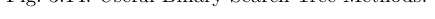

- 中序遍历递归地处理其左孩子，访问当前节点，然后递归处理其右孩子。
- 后序遍历递归地处理其左孩子，然后递归处理其右孩子，最后访问当前节点。

让我们来设计 `List<T> inorderTraversal(Tree<T>)` 方法，该方法返回中序遍历后树中元素的列表。这种遍历的一个有趣的（且数学上的）特性是，它总是按照有序顺序（根据自然排序或比较器）访问元素。为了方便测试此方法，我们将利用这样一个事实：可以向 BinarySearchTree 构造函数传递一个值列表并对其进行“批量添加”。

```java
import static Assertions.assertAll;
import static java.util.List;
import learning.java.trees.BinarySearchTree;

class InorderTraversalTest {

    @Test
    void testInorderTraversal() {
        BinarySearchTree<Integer> t1 = new BinarySearchTree<>();
    }
}
```


# 3 数组、集合与泛型

## 3.6 树数据结构

```java
BinarySearchTree<Integer> t2 = new BinarySearchTree<>(List.of(7, 42, 1, 6, 15, 84, 26));

assertAll(
    () -> assertEquals(List.of(t1), inorderTraversal(t1)),
    () -> assertEquals(List.of(1, 6, 7, 15, 26, 42, 84), inorderTraversal(t2))
);
```

### InorderTraversal 类

```java
import java.util.Comparable;
import java.util.List;
import java.util.ArrayList;
import learningjava.trees.Tree;
import learningjava.trees.BinarySearchTree;

class InorderTraversal {

    /**
     * 返回中序遍历后树中元素的列表。
     * @param t 要遍历的树。
     * @return 元素列表。
     */
    public static <T extends Comparable<T>> List<T> inorder(BinarySearchTree<T> t) {
        if (t == null) return new ArrayList<>();
        else {
            List<T> left = inorder(t.getLeft());
            List<T> right = inorder(t.getRight());
            List<T> res = new ArrayList<>();
            res.addAll(left);
            res.add(t.getValue());
            res.addAll(right);
            return res;
        }
    }
}
```

如果一棵树的左、右孩子的高度之差最多为 1，则称该树是*平衡的*。这种属性允许非常快速的查找、插入和删除。维护树的平衡因子是一项复杂的任务，尽管 `BinarySearchTree` 类并没有对树进行平衡处理，这意味着无法保证快速的操作时间。事实上，这些操作在最坏情况下与列表相同，因为*完全不平衡*的二叉搜索树的形状退化为一个列表。我们说的“完全不平衡”是指所有元素都在根节点的左侧或右侧，这一属性递归地适用于其孩子。

### 示例 3.5：findMax 方法

让我们来设计 `findMax(BinarySearchTree t)` 方法，寻找二叉搜索树中最大的元素。这涉及到一直沿着最右侧的孩子找下去，直到到达尽头。因为节点右侧的所有元素都大于该节点，所以任务是显而易见的。

```java
import static assertions.assertEquals;
import static assertions.assertAll;
import java.util.List;
import learningjava.trees.BinarySearchTree;

class FindMaxTester {

    @Test
    void testFindMax() {
        BinarySearchTree<Integer> t1 = new BinarySearchTree<>();
        BinarySearchTree<Integer> t2 = new BinarySearchTree<>(List.of(7, 42, 1, 6, 84, 26));

        assertAll(
            () -> assertEquals(null, findMax(t1)),
            () -> assertEquals(84, findMax(t2))
        );
    }
}
```

### FindMax 类实现

```java
import java.util.Comparable;
import learningjava.trees.BinarySearchTree;

class FindMax {

    /**
     * 寻找树中的最大值。
     * @param t 要搜索的树。
     * @return 最大值，如果为空则返回 null。
     */
    static <T extends Comparable<T>> T findMax(BinarySearchTree<T> t) {
        if (t.isEmpty()) return null;
        BinarySearchTree<T> current = t;
        while (current.getRight() != null) {
            current = current.getRight();
        }
        return current.getValue();
    }
}
```

### 示例 3.6：isBalanced 方法

让我们来设计 `boolean isBalanced(Tree t)` 方法来判断一棵树是否平衡。如果一棵树左右子树的高度之差最多为一，则该树是平衡的。

```java
import java.util.Comparable;
import learningjava.trees.BinarySearchTree;

class Balanced {

    /**
     * 判断树是否平衡。
     * @param t 要检查的树。
     * @return 如果平衡返回 true，否则返回 false。
     */
    static <T extends Comparable<T>> boolean isBalanced(BinarySearchTree<T> t) {
        if (t.isEmpty()) return true;
        int leftHeight = height(t.getLeft());
        int rightHeight = height(t.getRight());
        return Math.abs(leftHeight - rightHeight) <= 1 && isBalanced(t.getLeft()) && isBalanced(t.getRight());
    }

    private static int height(BinarySearchTree<?> t) {
        // 高度的实现
        return 0; // 占位符
    }
}
```

### 示例 3.58：findBetween 方法

让我们来看一个我们可能关心寻找节点中序后继节点的例子。我们将设计 `Set<T> findBetween(BinarySearchTree<T> t, T min, T max)` 方法，其中 `T` 实现了 `Comparable<T>`，返回树中所有位于 min 和 max 之间元素的集合。解决此问题有两种方法：(1) 遍历树，如果元素位于 min 和 max 之间，则将其添加到集合中；或 (2) 找到 min 的中序后继，然后遍历树直到到达 max。前者方法更直观，但后者更高效，因为它利用了树是有序的特性。后者的算法如下：

- 找到 min 的中序前驱，或者如果 min 在树中，则返回 min。
- 遍历树直到到达 max，在此过程中向集合中添加元素，并计算每个节点的中序后继。

首先，我们需要一个寻找节点中序前驱的算法。这包括在树中搜索节点的位置并在如果存在则返回。否则，我们返回最后访问的节点的父节点。我们将显式地展示 `findPredecessor` 方法，它将在我们 `findBetween` 方法的实现中使用。

```java
static <T extends Comparable<T>> T inorderSuccessor(BinarySearchTree<T> t) {
    if (t.isEmpty()) { return null; }
    else if (t.getRight() != null) {
        BinarySearchTree<T> temp = t.getRight();
        while (temp.getLeft() != null) {
            temp = temp.getLeft();
        }
        return temp.getValue();
    } else {
        BinarySearchTree<T> parent = t.getParent();
        while (parent != null && t == parent.getRight()) {
            t = parent;
            parent = parent.getParent();
        }
        return parent != null ? parent.getValue() : null;
    }
}
```

### FindBetweenTester 测试类

```java
import static Assertions.assertEquals;
import static Assertions.assertAll;
import learningjava.trees.BinarySearchTree;

class FindBetweenTester {

    @Test
    void findBetween() {
        BinarySearchTree<Integer> t1 = new BinarySearchTree<>();
        BinarySearchTree<Integer> t2 = new BinarySearchTree<>(List.of(7, 42, 1, 6, 84, 26));

        assertAll(
            () -> assertEquals(Set.of(), findBetween(t1, 0, 100)),
            () -> assertEquals(Set.of(1, 6, 7, 42), findBetween(t2, 0, 100)),
            () -> assertEquals(Set.of(6, 7, 26), findBetween(t2, 3, 26)),
            () -> assertEquals(Set.of(6, 7), findBetween(t2, 3, 25))
        );
    }
}
```

### FindBetween 类实现

```java
import java.util.Comparable;
import java.util.HashSet;
import java.util.Set;
import learning.java.trees.BinarySearchTree;

class FindBetween {

    /**
     * 返回树中所有位于 min 和 max 之间元素的集合。
     * @param t 要搜索的树。
     * @param u 最小值。
     * @param v 最大值。
     * @return u 和 v 之间元素的集合。
     */
    static <T extends Comparable<T>> Set<T> findBetween(BinarySearchTree<T> t, T u, T v) {
        Set<T> res = new HashSet<>();
        BinarySearchTree<T> temp = findPredecessor(t, u);
        while (temp != null && temp.getValue().compareTo(v) <= 0) {
            // 如果元素位于 u 和 v 之间，将其添加到集合中。
            if (temp.getValue().compareTo(u) >= 0) {
                res.add(temp.getValue());
            }
            temp = inOrderSuccessor(temp);
        }
        return res;
    }
}
```

正如我们之前建议的那样，维护平衡二叉树可以保证快速的操作。有几种高度平衡树数据结构可以做到这一点。例如，有 AVL 树、红黑树和伸展树（此列表并不详尽）（Cormen et al., 2009; Weiss, 1998）。树是编程语言解释器和设计的自然选择。此外，高度平衡树是 `TreeSet` 和 `TreeMap` 类的基础，它们保证了快速的操作时间。我们在此结束对树的讨论，但将在后续高级面向对象编程章节中再次回到它们，在那里它们的实用性将显而易见。

## 3.7 练习

3.1 设计 `int[] operate(int[] A)` 方法，当给定一个整数数组时，返回一个新数组，其中的元素是对每个元素应用以下操作的结果：如果第 $i$ 个元素是奇数，则将其乘以其索引 $i$ 加一；否则，将其除以其索引 $i$ 加一。

3.2 设计 `int[] multiplesOf8(int[] A)` 方法，当给定一个整数数组时，返回一个新数组，找到 8 的倍数后，每个后续元素都变为 8 的倍数。如果发现另一个 8 的倍数，则不替换它，而是替换其右侧的所有元素。考虑以下示例：`multiplesOf8([3, 4, 8, 2, 19, 24])`。

3.3 本练习有两个部分。矩形坐标是传统的 x 和 y 坐标。极坐标反而在两个维度上操作，但具有半径和角度。
(a) 设计 `double[] toPolar(double x, double y)` 方法，当给定 x 和 y 坐标时，返回一个包含半径（索引 0）和角度（索引 1）的数组，使用公式：$r = \sqrt{x^2 + y^2}, \theta = \arctan(y/x)$。
(b) 设计 `double[] toRectangular(double r, double theta)` 方法，当给定半径 r 和角度 theta 时，返回一个包含 x（索引 0）和 y（索引 1）的数组，使用公式：$x = r \cos(\theta), y = r \sin(\theta)$。

3.4 设计 `boolean containsPrime(int[] arr)` 方法，判断给定数组是否包含质数。

3.5 设计 `int linearSearch(int[] S, int k)` 方法，当给定数组 S，返回 k 在 S 中的索引，如果 k 不在数组中则返回 -1。
(a) 设计递归版本的 `linearSearch`；
(b) 设计使用循环的 `linearSearch` 方法来解决该问题。

3.6 设计 `int[] accSum(int[] A)` 方法，它接收一个整数数组并返回累加和。给出一些示例：
`accSum({1, 2, 3, 4, 5}) => 15`
`accSum({5, 6}) => 11`

3.7 设计 `String[] fizzBuzz(int min, int max)` 方法，它遍历区间 [min, max] 并返回一个满足以下标准的字符串数组：
- 如果 i 能被 3 整除，插入 "Fizz"。
- 如果 i 能被 5 整除，插入 "Buzz"。
- 如果 i 同时能被 3 和 5 整除，插入 "FizzBuzz"。
- 否则，插入 "i"。

`fizzBuzz(1, 12) => {"Fizz", "2", "Fizz", "4", "Buzz", "Fizz", "7", "8", "Fizz", "Buzz", "11", "Fizz"}`
`fizzBuzz(15, 18) => {"FizzBuzz", "16", "17", "Fizz"}`

3.8 仅使用数组，设计 `int[] intersection(int[] A, int[] B)` 方法，返回两个数组的交集。两个数组的交集是共同元素的集合。例如，{7, 4, 8, 0, 2} 和 {8, 6, 4} 的交集是 {8, 4}。不要假设数组是有序的，且不能对它们进行排序。

3.9 设计 `median(int[] A, int[] B)` 方法，当给定两个有序（升序）数组 A 和 B 时，返回列表的中位数。可以使用辅助数据结构来帮助解决问题，但不是必须。

3.10 设计 `double sumOfAverages(int[] A)` 方法，当给定一个整数列表时，返回按个位数分组的平均值。也就是说，考虑列表 [91, 34, 87, 22, 67, 41, 10, 12, 23, 34]。如果我们按个位数分组，将得到 [[10], [41, 91], [12], [23], [34], [67]]。桶的平均值和为结果。你可以使用任何 Java 集合结构（例如映射/列表）来解决此问题；仅允许使用数组。你的算法还在线性时间内运行，即仅取决于输入大小，且最多遍历两次。

3.11 设计 `double sumNa(ArrayList<Integer> vals)` 方法，返回列表中数字的平均值，但有一个例外：数字 9 不应计入平均值，且不应存在。

```java
sumNa({8, 7, 11, 9, 12, 0}) => 9.0
sumNa({120, 9, 9}) => 109.5
sumNa({9}) => 0.0
sumNa({}) => 0.0
```


### 3.12 设计 `int[] countEvenOdds(int[] vals)` 方法，返回一个元组（两个值的数组），其中索引 0 存储偶数个数，索引 1 存储奇数个数。

```
countEvenOdds({11, 9, 2, 7, 10, 12, 114}) => {4, 4}
countEvenOdds({11, 13, 15, 17}) => {0, 4}
```

### 3.13 这个问题包含两个部分。

- (a) 设计 `AlmostStrictlyIncreasing` 尾递归方法。该方法在给定整数数组时，判断其是否为严格递增。这里有一个特殊之处：如果通过移除数组中的一个元素可以让数组变为严格递增，我们也返回 true。例如，`isStrictlyIncreasing({1, 3, 2, 4})` 返回 true，因为通过移除 3，我们得到了一个严格递增的列表。与之相比，`{2, 3, 4}` 是无法被变为严格递增的。
- (b) 设计 `AlmostStrictlyIncreasingLoop` 方法，使用循环来解决问题。

如果你为其中一个方法编写了测试，你应该能够推导出其他方法，所以机会非常多！

### 3.14 设计布尔类型 `isArray` 方法，该方法返回两个整数数组 A 和 B，并判断 B 是否为 A 的“子数组”。这意味着 B 的所有元素都是 A 的元素。

### 3.15 设计 `twoToOneDim` 方法，将一个二维整数数组展平为一个一维数组。提示：先计算出一维数组有多少个元素，然后再确定如何放置元素。

### 3.16 设计布尔类型 `balanceArray` 方法，判断整数数组 A 是否可以被分为两个包含等的侧的划分。请使用以下示例作为参考。

```
balanceArray(new int[]{1, 1, 1, 5}) => false

balanceArray(new int[]{2, 3, 5}) => true

balanceArray(new int[]{-10, 2, -58, 50}) => true

balanceArray(new int[]{3, -1, -1, 0}) => true

balanceArray(new int[]{3, 2, 1, 0}) => true

balanceArray(new int[]{10}) => false
```

### 3.17 跨度（span）是指一个值与该值的另一个不同出现位置之间的距离。设计 `largestSpan(int[])` 方法，在给定非空整数数组的情况下，返回最大的跨度。编写 `firstIndexOf` 和 `lastIndexOf` 方法可能对你的设计有所帮助。请使用以下示例作为参考。

```
largestSpan(new int[]{4, 2, 3, 5}) => 3

largestSpan(new int[]{1, 2, 3, 4, 5}) => 1

largestSpan(new int[]{5, 4, 4, 3, 4, 1, 1}) => 7
```

### 3.18 固定窗口（fixed window）是数组的一个“窗口”或子数组。设计 `List<List<Integer>> computeFixedWindows(int[] A, int k)` 方法，在给定整数数组 A 和整数 k 的情况下，返回一个列表 L，其中每个列表都是一个在 A 中移动的大小为 k 的固定窗口。

例如，如果 A = [1, 2, 3, 4, 5, 6, 7] 且 k = 2，那么 `computeFixedWindows` 返回 {{1, 2}, {3, 4}, {5, 6}, {7}}。

### 3.7 练习

#### 3.19 滑动窗口（sliding window）是数组中在元素间移动的“窗口”或子数组。设计 `List<List<Integer>> computeSlidingWindows(int[] A, int k)` 方法，在给定整数数组 A 和整数 k 的情况下，返回一个列表，其中 L 中的每个元素都是一个在 A 中移动的大小为 k 的滑动窗口。

例如，如果 A = {1, 2, 3, 4, 5, 6, 7} 且 k = 2，`computeSlidingWindows` 返回 {{1, 2}, {2, 3}, {3, 4}, {4, 5}, {5, 6}, {6, 7}}。注意滑动窗口和固定窗口的区别。

#### 3.20 设计 `String[] computeBowlingScores(String[] S, int[])` 方法，计算 S 中每个人的得分。按行分隔，第 i 行代表 S 中的第 i 个人。每行包含十个拥有三个元素的数组。这些三元组（我们称之为 triples）对应于保龄球的一个回合。前九个人只使用三元组的前两个元素，而最后一个可能使用全部三个。

计算玩家得分遵循一些规则。注意，在保龄球中，目标是击倒十根瓶。

对于第 1 到 9 回合：

- 如果玩家得中（strike），即一次投掷击倒十根瓶，得 10 分加上下两次球的分数（如果存在）。
- 如果玩家得补（spare），即恰好两次投掷击倒所有瓶，得 10 分加上下一次球的分数（如果存在）。
- 如果玩家既没有命中也没有得补，则为击倒的瓶数得分。

对于第 10 回合：

- 如果玩家在第一次投掷中命中，他们获得两次机会。
- 如果玩家在前两次投掷中得补，他们获得额外一次机会。
- 如果玩家既没有命中也没有得补，则为击倒的瓶数得分。

#### 3.21 我们可以假设输入是二维的。例如：

```
1 2 3
4 5 6
7 8
```

设计 `int[][] transpose(int[][] matrix)` 方法，返回矩阵的转置。例如：

```
1 4 7
2 5 8
3 6 9
```

设计 `int[][] rotate(int[][] matrix)` 方法，返回顺时针旋转 90 度的矩阵。例如：

```
7 4 1
8 5 2
9 6 3
```

---

### 3.7 练习

$x$ 和 $y$ 之间的线性关系较小。相关系数的公式如下（King and Minium, 2008）：

```
$r = \frac{1}{n-1} \frac{1}{S_x \cdot S_y} \sum_{i=1}^{n} (x_i - \bar{x})(y_i - \bar{y})$
```

当 $n$ 是数据点的数量，$x_i$ 和 $y_i$ 是第 $i^{th}$ 数据点，$\bar{x}$ 和 $\bar{y}$ 分别是 $x$ 和 $y$ 的平均值，$S_x$ 和 $S_y$ 分别是 $x$ 和 $y$ 的标准差。为了计算一组样本 $S$ 的标准差，我们使用公式（King and Minium, 2008）：

```
$S_x = \sqrt{\frac{\sum|S|(x_i - \bar{x})^2}{|S|-1}}$
```

设计 `double correlationCoefficient(double[] ys)` 方法，该方法在给定两个 double 类型数组 $xs$ 和 $ys$ 时，返回这两个数组之间的相关系数。如果两个数组长度不同，则返回 null。

**3.27** 在本章中，我们展示了一个将字符串“爆炸”为其组成字符的示例。设计 `List<Integer> explode(int n)` 方法，该方法在给定一个整数 $n$ 时，返回一个表示 $n$ 的数字的整数列表。例如，`explode(123)` 返回 [1, 2, 3]。*你不能将整数转换为字符串来解决此问题，也不能使用任何辅助数据结构。*

**3.28** 这个练习有两个部分。

- (a) 设计 `tail cycleOperationsTR` 方法，循环地对列表元素应用 `+`、`-`，然后 `*`。你需要设计一个合适的辅助方法。记得包含相关的修饰符：

```
cycleOperationsTR({})
=> 0

cycleOperationsTR({1, -4, 9, -16, 25, -36})
=> (((((0 + 1) - (-4)) * 9) + (-16)) * 25) * (-36))
=> -144

cycleOperationsTR({10, 5, -2, 1, -2})
=> ((((0 + 10) * 5) + (-2)) + 1) * (-2))
=> -7
```

- (b) 设计 `cycleOperationsLoop` 方法，使用 `while` 或 `for` 循环解决该问题。

如果你为这些方法编写测试，你就能将其传播到其余部分，所以请多写一些！

**3.29** 设计 `List<Integer> sumEvenOdd(int[] A)` 方法，该方法在给定一个整数数组 $A$ 时，返回一个 `List<Integer>`，其第一个元素是 $A$ 中所有偶数索引元素之和，第二个元素是 $A$ 中所有奇数索引元素的乘积。如果你在奇数索引处遇到零，不要继续相乘多个值（即不要继续乘以随后的值，而是返回遇到零之前的乘积，因为从该点起乘积将永远为 0）。

设计 `Set<List<Integer>> twoSum(int[] A, int t)` 方法，该方法在给定一个整数数组 $A$ 和一个目标 $t$ 时，返回 $A$ 中所有和为 $t$ 的可能数字对。例如，如果 $A = \{2, 2, 4, 10, 6, -2\}$ 且 $t = 4$，我们返回一个包含两个元素列表集合：{{2,2}, {-2}}。不要添加已存在于集合中的对，或者通过反转该对后在现有集合中存在的对。例如，{-2, 6} 不应被添加。

有一个简单的暴力算法通过两个循环解决此问题，但通过引入第二个集合进行查找，可以做得更好：对于 $A$ 中的每个数字 $n$，将其加入集合 $S$，如果对于某个 $m \in S$ 使得 $t-n=m$，我们就知道 $m+n$ 等于 $t$，因此我们将 $\{n, m\}$ 添加到结果集中。通过这个例子，操作序列如下：

- 初始化 $S=\{\}$ 和 $L=\{\}$。已知 $t=4$。
- 将 2 添加到 $S$。$S=\{2\}$。
- 因为 $2 \in S$，双元素列表 $\{2, 2\}$ 被添加到 $L$。2 不再添加到 $S$。
- 因为 $4 \neq S$，我们将 4 添加到 $S$。$S=\{2, 4\}$。
- 因为 $10 \neq S$，我们将 10 添加到 $S$。$S=\{2, 4, 10\}$。
- 因为 $6 \neq S$，我们将 6 添加到 $S$。$S=\{2, 4, 10, 6\}$。
- 因为 $-2 \in S$，双元素列表 $\{6, -2\}$ 被添加到 $L$。我们将 -2 添加到 $S$。$S=\{2, 4, 10, 6, -2\}$。

**3.31** 设计 `ArrayList<String> shift(ArrayList<String> list, int i)` 方法，该方法给定一个字符串列表和索引 $i$，返回一个新的列表，其中每个元素移动了 $i$ 位。负值向左移动，正值向右移动。如果移动没有意义，则不移动。无意义的移动包括：

- 列表中没有元素。
- 列表中只有一个元素。
- 列表中只有两个元素，只需移动一次。

计算数学！这个方法比看起来要难，多写些测试！你不能使用任何数据结构或方法来解决这个问题。

```
shift({11, 12, 13, 14}, -1) => (12, 13, 14, 11)

shift({120, 140, 140}, 2) => (140, 140, 120)

shift({99999}, 1000) => (99999)

shift({}) => {}

shift({120, 80, 70, 50, 40, 20}, -3) => (50, 40, 20, 120, 80, 70);
```

**3.32** 二维形状的质心是其点的算术平均值。即表示形状“中间”的点。该方法给定一个坐标数组，返回形状的质心。输入数组每两个元素 $P[i], P[i+1]$ 形成一组坐标。例如，$P[0]=x1$ 和 $P[1]=y1$，这意味着有 $|P|/2$ 对坐标。质心方法应该返回一个双元素数组，其第一个是 x 坐标，第二个是 y 坐标。质心（点集）的公式为：

```
C(x,y) = \frac{1}{|P|-1} \sum_{i=0}^{|P|-1} P[2i], \frac{1}{|P|-1} \sum_{i=0}^{|P|-1} P[2i+1]
```

**3.33** 对于此问题，不允许使用 `ArrayList` 或任何辅助方法（例如 `.contains`）或 `Arrays` 类的方法。你可以（并且应该）使用 `Set<Integer>` 来跟踪过的峰。

登山者 Joe 有一个巨大的山脉。他想爬上该地区最高的山。设计 `int peak(int[] H)` 方法，返回 `int[]` 高度中所有峰的数组 $H$。峰 $p$ 定义为高度为 $i$ 的元素，使得 $p(i-1) < p(i) > p(i+1)$。如果 $i = 0$ 或 $i = |H|-1$，Joe 不计入 $p(i)$。Joe 不想重复爬同一高度的山，所以不要添加任何已添加到 $H'$ 中的峰。我们在下面提供了一些测试用例：

```
peakFinder(0, 13, 7, 2) => {13}

peakFinder(8, 7, 8, 7, 8, 7) => {8}

peakFinder(11, 27, 84, 31, 5, 9, 3, 2, 64) => {84, 9}

peakFinder() => {}

peakFinder([]) => {}

peakFinder(1, 2) => {2}

peakFinder(1, 2, 1) => {2}

peakFinder(1, 2, 3, 2, 1) => {3}
```

**3.34** 如果学生能猜出的平均分在实际平均分的 5% 以内，教授就会给他们考试额外加分。

设计 `boolean extraCredit(List<Double> D, double g)` 方法，该方法在给定分数列表 $D$ 和猜测 $g$ 时，返回学生是否获得了额外分数。

**3.35** 设计 `List<String> roundTimes(List<String> T)` 方法，该方法在给定一个“时间”列表时，$T$ 返回一个新的列表，其中每个时间都四舍入到最近的小时。“时间”采用 24 小时格式“HHMM”，其中 $0 \le HH \le 23$ 且 $0 \le MM \le 59$四舍入到最近的小时意味着分钟为 0、15、30 或 45。例如，“1247”四舍入到“1245”，而“1330”保持为“1330”。如果时间四舍入到下一个小时，则更新小时。例如，“2359”四舍入到“0000”，而“1955”四舍入到“2000”。

**3.36** 一个村庄成员都有伴侣。成员以对的形式分组在 `ArrayList<Integer>` 中，每对索引代表村庄的一种关系，即 $A.get(j)$ 和 $A.get(j+1)$ 存在关系。如果一对夫妇的年龄和最高，则被认为是最“热烈”。设计 `ArrayList<Integer> wildest(ArrayList<Integer> A)` 方法，该方法在给定一个整数列表时，返回一个包含最热烈年龄的新 `ArrayList<Integer>`。如果平局，返回平均值最高的一对。顺序不重要。我们在下面提供了一些测试用例：

```
widest({31, 42, 43, 35, 21, 27, 24, 44}) => {43, 35} or {35, 43}

widest({47, 51, 52, 48, 33, 67, 45, 35}) => {33, 67} or {67, 33}
```

**3.37** 设计 `charMatching(Set<Character> s)` 方法，该方法给定一个范围为 a..z 但缺少一个字符的字符集，返回缺失的字符。

**3.38** 设计 `boolean canPalindrome(String s)` 方法，该方法给定一个不是回文的字符串，返回其字符是否可以重新排列成回文。提示：存在哪些可能性？例如，

racecar 和 abbbbbba 都是回文。除了这一点，它们还有什么相似之处？

**3.39** 设计 `Map<String, Integer> updateTransactions(Map<String, Integer> inv, List<String> transactions)` 方法。该方法在接收一个产品名称到数量的映射以及一个交易列表时，返回一个项目计数的新库存映射。给定的交易列表包含产品名称，当产品缺货时，应从返回的映射中移除。

**3.40** (*) 文件权限以八进制符号表示。考虑一个具有三种权限的文件：所有者 o、组 g 和其他 u（代表其他用户）。处理文件有三种方式：读取 r、写入 w 或执行 x。我们可以将其表示为位字符串 `R_oW_oRg_gWg_gRu_Xu_u`。我们使用 1 或 0 表示文件的权限。`111000100` 表示文件所有者可以读取、写入和执行文件，与所有者同一组的用户可以执行该文件，且无法与文件进行任何交互。设计 `Set<String> availableFiles(Map<String, Integer> F, String, int, boolean r, boolean w, boolean x)` 方法，该方法在接收权限映射 F、用户名和该用户的组标识符 g 时，返回一个满足传递给方法的过滤条件的列表。文件到权限的键本身是一个 3 元素的数组，其中第一个元素是名称，第二个元素是文件的所有者，第三个元素是所有者的组标识符（字符串类型）。

**3.41** 你得到了一个 `String` 键到 `Integer` 值的 HashMap，值对应于长度。`ArrayList<TreeSet<String>> categorize(HashMap<String, Integer> M)` 接收 M 并将其转换为 `TreeSet` 值的 `ArrayList`。ArrayList 的每个元素本身是一个 `TreeSet`。这些 `TreeSet` 元素应该存储映射到 `TreeSet` 值索引的字符串。集合的顺序很重要！这里有一个用例


["" : 1, "hello": 5, "world": 5, "hi": 2]

=> [{}, ("hi"), ({}), ({}), ("world")]

### 3.42
设计 `List<String, Integer> tokenize(String s, char d)` 方法。该方法在接收字符串 `s` 和字符 `d` 时，返回一个在分隔符处分割的标记列表。必须通过这种方式实现；你不能调用任何字符串方法（`.length` 和 `.charAt()` 除外）。

### 3.43
设计 `Map<String, Integer> count(String s)` 方法。该方法在接收 `s` 时，统计列表中单词的数量，并将结果频率存储在 `HashMap<String, Integer>` 中。假设 `s` 未经过清理。也就是说，你应该首先从 `s` 中删除所有标点符号（句号、逗号、问号、分号、破折号、井号、& 和括号），生成新字符串 `s'`。然后根据空格进行分割。不要将不同类型的单词视为同一个单词。返回的映射顺序不重要。例如 "Factor" 和 "factor" 视为同一个。

```
String s = "Hello world, the world is healthy,
it not? I agree that the word
is #1 and \"world\""

wordCount(s) => ["hello": 1, "world": 2, "the": 2,
"is": 3, "healthy": 2, "it": 1,
"i": 1, "certainly": 1, "agree": 1,
"that": 1, "": 1, "and": 1, "not": 1]
```

### 3.7 练习

#### 4.44
设计 `LinkedHashSet<String> largeToSmall(Map<String, Integer> M)` 方法。该方法在接收 `Map<String, Integer> M` 时，返回一个 `String` 值的 `LinkedHashSet`，其中单词按计数递减的顺序插入集合。计数相同的单词不需要按特定顺序插入。例如，“is" 可能在 "word" 之前。你不能进行排序。提示：创建一个大小为 `c` 的数组（`c` 是最大单词计数），其中每个元素是一个 `LinkedHashSet<String>`。对于 `M` 中的每个元素 `e`，将它添加到索引为 `i` 的集合中，其中 `i` 是 `e` 的计数。提供一个伪代码。

```
largeToSmall(M)
// M 是 M.size().
// c = 最大单词计数
// array = [0 ... c-1];
for i in [0 ... c-1]:
  array[i] = new LinkedHashSet<String>();
  for every k in M:
    i = M.get(k)
    array[i-1].add(k)
// 反序追加这些集合。
return array[c-1] to array[0]

count = {"word":"is","the","hello","it","certainly","agree","that","not"}
```

#### 3.45
设计 `Set<Integer> symmetricDifference(Set<Integer> s1, s2)` 方法。该方法在接收整数集合 `s1` 和 `s2` 时，返回一个新的集合 `s3`，使得 `s3` 的所有元素都在 `s1` 或 `s2` 中，但不在交集中。

#### 3.46
设计 `Map<String, Set<String>> trending(Map<String, Set<String>> regions)` 方法。该方法在接收趋势映射 `regions` 时，返回一个映射，其键为主题，值为区域，当该主题至少在两个区域中处于趋势时。提供一个示例：

```
trending("North America") = {"Tech","Sports"},
{"Europe":"Music","Sports"},
{"Asia":"Music","Tech"}

=> ["North America,Europe,Asia", "Music"]
```

#### 3.47
设计 `LinkedList<Integer> pushlast(LinkedList<Integer> l, int v)` 方法。该方法在接收 `LinkedList<Integer> l` 和 `int v` 时，返回一个将 `v` 添加到 `l` 末端的 `LinkedList`。

#### 3.48
设计 `LinkedList<Integer> set(LinkedList<Integer> l, int i, int v)` 方法。该方法在接收 `LinkedList<Integer> l`、`int v` 和索引 `i` 时，返回一个新的 `LinkedList`，其元素相同但索引 `i` 处的元素变为 `v`。如果 `i` 小于零或超过 `l` 的长度，返回 `null`。

#### 3.49
设计 `int[] toArray(LinkedList<Integer> l)` 方法。该方法接收整数列表 `l`，返回一个包含 `l` 中值的数组。

#### 3.50
设计 `LinkedList<Integer> reverse(LinkedList<Integer> l)` 方法。该方法在接收整数列表 `l` 时，返回一个包含 `l` 的元素但反序的链表。

#### 3.51
设计 `HashSet<Integer> moreThanThree(int[])` 方法。该方法接收 `int[]` 并返回一个包含出现次数严格大于三次值的 `HashSet`。

#### 3.52
设计 `List<String> collectComments(String s)` 方法。该方法在接收表示（有效）Java 程序的字符串 `s` 时，返回一个包含输入字符串所有注释的列表。你不能使用字符串辅助方法（如 `strip`、`split`）来解决此问题，也不能使用正则表达式。

#### 3.53
设计 `List<String> removeSideByDups(List<String> ls)` 方法。接收一个字符串列表，返回一个去除了相邻重复的新列表。

#### 3.54
设计 `boolean isPalindrome(LinkedList<Integer> l)` 方法。该方法接收一个整数列表，判断其是否为回文。你不能使用 `.get` 来解决此问题，也不能使用循环。思考如何使用循环、`Iterator` 和 `Stack` 来完成。

#### 3.55
设计 `double prefixEvaluator(List<String> l)` 方法。该方法在接收字符串形式的二元运算符和数字操作数列表时，返回前缀表达式的结果。你需要编写几个方法来解决这个问题，最好将其拆分为步骤。首先，编写一个方法判断给定字符串是否为四个运算符之一：“+”、“-”、“*”、“/”。你可以假设任何非二元运算符的输入都是操作数（即数字）。然后，编写一个方法将二元运算符解析为操作数列表，即 `ArrayList<Double>`。

```
prefixEvaluator("5", "2", "*", "5", "2", "+") => 17
prefixEvaluator("1", "2", "3", "4", "+", "+") => 10
prefixEvaluator("*", "-", "100", "20", "*") => 800
```

#### 3.56
设计 `double postfixEvaluator(List<String> l)` 方法。该方法在接收表示为字符串的二元运算符和数字操作数列表时，返回后缀表达式的结果。这比后缀解析器稍微复杂一点，但并没有多少。结合上一个练习，编写辅助方法来判断字符串是运算符还是操作数，并使用栈：从右到左遍历输入，但注意非交换操作！

```
postfixEvaluator("+", "3", "4") => 7
postfixEvaluator("+", "2", "10", "-5", "/", "16", "4") => -8
postfixEvaluator("*", "100", "20", "*") => 2000
```

#### 3.57 (*)
设计 `List<String> displayOrders(List<String>> orderInfo)` 方法。该方法在接收一个订单项列表时，返回一个按客户表格分类的规格列表。具体来说，订单是一个 `List<String>`，其第一个元素是客户名称，第二个元素是桌号，第三个元素是客户订购的食物。以行列表的形式返回数据。第一行显示表头。第一个表头应该是 `Table`，然后是按字母顺序排列的食物。每个连续的行表示数值顺序排列的表格。以下是一个输入和输出：

```
{{"John", "Chicken"}, {"Samantha", "3", "Pasta"},
 {"Tim", "2", "BBQ Chicken"}, {"Christina", "8", "Grilled Cheese"},
 {"Tymberlyn", "2", "Chicken"}, {"TJ", "3", "Water"}}

{{"Table", "BBQ Chicken", "Chicken", "Grilled Cheese", "Water"},
 {"2", "1", "2", "0", "0"},
 {"3", "0", "0", "0", "1", "1"},
 {"8", "0", "0", "1", "0", "0"}}
```

#### 3.58
设计 `substitute` 方法，给定一个 `String` 类型的 `exp` 和一个 `HashMap<String, Integer>` 类型的环境时，将表达式中每个出现的 "identifier" 替换为映射中的值计数器。

```
substring("f(x) = 3 * a + b", <a: 10>, <b: 13>)
=> "f(x) = 3 * 10 + 13"

substring("g(h, f) = y + x", <q: 200>)
=> "g(h, f) = y + x"
```

#### 3.59
设计 `unifyAll` 方法，它接收一个包含统一赋值的 `HashMap<String, Integer> M` 和一个目标列表列表 `ArrayList<LinkedList<G>>`。每个目标 `G` 都是一个由 `LinkedList` 表示的元组；目标由两个 `x, y` 组成，如果这两个值可以相同，则可以将 `x` 与 `y` 统一。任何不在 `M` 中的变量的成功统一操作都应该添加到 `M` 中。我们在下方展示了一些示例（假设所有值都是字符串；为了简洁起见，我们使用了引号）。提示：你可能想写一个 `isVar` 方法来判断一个值是否为变量，即不以美元符号 `$` 开头的。

```
M1 = <<x: 5>, <y: 10>, <z: 15>, <w: 5>
G1 = <<x, x>, <x: 10>, <z, 15>, <x, w>
unifyAllM(M1, G1) => true

M2 = <<x: 5>, <y: 10>, <z: 15>, <w: 5>
G2 = <<x, y>
unifyAllM(M2, G2) => false

M3 = <<x: 5>, <y: 10>, <z: 15>, <w: 5>
G3 = <<q, y>, <w: 5>, <q, w>
unifyAllM(M3, G3) => true

M4 = <<x: 5>, <y: 10>, <z: 15>, <w: 5>
G4 = <<x, q>, <q: 10>
unifyAllM(M4, G4) => false
```

#### 3.60
如果我们可以从 `s1` 创建到 `s2` 的映射，则两个字符串 `s1` 和 `s2` 是同构的。字符串 "DEBA" 和 "ZYX" 是同构的，因为我们将 `D` 映射到 `Z`，将 `C` 映射到 `Y`，依此类推。另一个例子是 "ABAC" 和 "XYZXY"，原因相同。一个反例是 "PROXY" 和 "ALPHA"，因为我们将 "A" 映射到 "P"，无法在 "A" 和 "Y" 之间创建映射。设计布尔方法 `isomorphic(String s1, String s2)` 来判断两个字符串是否同构。

#### 3.61
异位词是指通过重新排列另一个字符串的字母而形成的字符串。例如，“plea" 是 "leaf" 的异位词，但我们考虑的是字母顺序的排列。例如，“alrst" 是 "alter" 和 "slater" 的异位词。设计静态 `Map<String, List<String>> alphaGroups(List<String> los)` 方法，根据上述标准将所有按字母排序的异位词映射到对应的字符串。

```
los = ["presorting", "plea", "anger", "leap", "petals", "donate", "range", "reductions", "tapers", "pale", "staple", "report"]

alphaGroups(los) = ["anger", "range", "aelp", "plea", "pale", "aelpst", "petals", "staple", "aelst", "tapers", "cdein", "reductions", "adonit", "donate", "atoned", "egosinprist", "presorting"]
```

#### 3.2
连续序列是指字符序列，其中每个字符都比另一个字符大一个。例如，`['c', 'f', 'h', 'p', 'c', 'm', 'g']` 包含连续序列 `['f', 'g', 'h']`。设计 `List<Character> findCommonSequence(List<Character> l)` 方法，返回一个字符列表并返回最长的连续序列。如果有多个连续序列，返回在字母表中顺序靠前的一个。例如，`['n', 'o', 'f', 'h', 'm', 'g']` 包含两个连续序列：`['f', 'g']`。

### SLC（简化 lambda 演算法）
SLC（简化 lambda 演算法）表达式有两种形式之一：`varList` 和 `x`，其中 `x` 是从 'u' 到 'z' 的小写字母；`varList` 是变量序列，而 `E` 是一个变量或另一个表达式。我们在下方提供了一些示例。

```
λx.xyz
λx.x
λy.y
λw.Ay
```

你的任务是确定哪些变量是绑定的，哪些是自由的。绑定的变量是表达式中紧跟 `λ` 的变量。例如，在表达式 `λx` 中，`x` 是绑定的。自由变量是未在 `λ` 中定义的变量。在表达式 `λy` 中，`y` 是出现且不是绑定的。设计 `HashMap<String, String> classifyVars(String E)` 方法，返回变量到分类的映射。使用 `F`、`B` 和 `N` 分别代表自由、绑定和未知。

```
classifyVars("xyz") => {x: F, y: F, z: F}
classifyVars("λx.xyz") => {x: B, y: F, z: F}
classifyVars("λx") => {x: B}
```


# 3 数组、集合与泛型

| (-1, 1) | (0, 1) | (1, 1) |
|---|---|---|
| (-1, 0) | (0, 0) | (1, 0) |
| (-1, -1) | (0, -1) | (1, -1) |

- (c) 设计静态方法 `List<int[]> getMineNeighbors(char[] board, int mx, int my)`，该方法接收一个棋盘和一个移动位置，并返回所有非地雷的邻居列表。你必须定义中必须使用 `ValidNeighbors`。
- (d) 设计静态方法 `List<int[]> getMineNeighbors(char[] board, int mx, int my)`，该方法接收一个棋盘和一个移动位置，并返回所有地雷的邻居列表。你在定义中必须使用 `ValidNeighbors`。
- (e) 设计静态方法 `count countAdjacentMines(char[] board, int mx, int my)`，该方法接收一个棋盘和一个移动位置，并返回与给定位置相邻的地雷数量。该方法应该只有一行，并包含对 `getMineNeighbors` 的调用。
- (f) 辅助方法完成后，我们现在需要一个方法来搜索某个位置并显示所有非地雷的相邻位置。通常情况下，这种遍历算法的思路是递归地扩展路径，直到遇到地雷，在此时，回溯调用以扩展另一条路径。设计静态方法 `void extPath(char[] board, int mx, int my)`，该方法接收一个棋盘和一个移动位置，并根据以下规则从该位置扩展路径：
    - (i) 如果移动位置无效，则返回。
    - (ii) 如果 `board[mx][my]` 处的字符不是横杠 `'-'`，则返回。
    - (iii) 否则，确定移动位置相邻的地雷数量。如果相邻的地雷数量不零，则将该位置的地雷数量赋值给 `board[mx][my]`。
    - (iv) 如果相邻的地雷数量为零，则可以将路径扩展到所有非地雷邻居。将字符 `'X'` 赋值给 `board[mx][my]`，然后遍历的所有非地雷邻居。在循环体内，对每个邻居调用 `extendPath`。
- (g) 扫雷棋盘的生成本身就是一个算法问题，我们的实现也是如此。设计静态方法 `char[] makeBoard(int N, int M, int B)`，该方法接收一个 N 行 M 列的棋盘和要放置的 B 个地雷。为了随机放置地雷，创建一个棋盘上所有可能单元的 `List<int[]>`，打乱列表，获取前 B 个单元，并将所有其他单元赋值为字符 `'-'`。为所有单元分配字符字面量 `'B'`。
- (h) 最后，设计静态方法 `char[] play(char[] board, int mx, int my)`，该方法接收一个棋盘和一个移动位置，并尝试操作棋盘上的该位置。如果棋盘上的该位置有雷，返回 `null`。否则，在棋盘和位置上调用 `extPath`，然后返回棋盘。本质上，`play` 接收一个游戏状态并将其转换为下一个状态。

## 3.67
设计方法 `List<String> getAll(List<Integer> lon)`，当给定一个数字列表时，返回这些数字转换为字符串的列表，并以美元符号 `$` 为前缀。你必须使用 Stream API。

## 3.68
设计方法 `boolean containsHigh(List<int[]> lop)`，当给定一个表示 x, y 坐标的二元素数组列表时，返回 y 坐标是否大于 450。提示：使用 `anyMatch` 方法。

## 3.69
设计方法 `List<int[]> removeCollisions(List<int[]> lop, int p)`，当给定一个表示 x, y 坐标的二元素数组列表时，返回那些不等于 p 的数组列表。你必须使用 Stream API。

## 3.70
设计方法 `List<Integer> sqAddFive(List<Integer> lon)`，该方法接收一个数字列表，返回这些数字平方并加五的列表，省略任何以 5 或 6 结尾的生成数字。你必须使用 Stream API 方法。

## 3.71
设计方法 `List<Integer> remDups(List<Integer> lon)`，该方法接收一个整数列表，移除所有重复整数。作为新列表返回此结果。你必须使用 Stream API。

## 3.72
设计方法 `List<String> removeLong(List<String> los, int n)`，该方法接收一个字符串列表，并移除所有包含大于整数 n 个字符的字符串。作为新列表返回此结果。你必须使用 Stream API。

## 3.73
设计方法 `List<Double> filterThenSquare(List<Double> lon)`，该方法接收一个双精度数列表，移除所有七的倍数，并对剩余值平方。作为新列表返回此结果。你必须使用 Stream API。

## 3.74
设计方法 `double filterDoubleAvg(List<Integer> lon)`，当给定一个整数列表时，移除所有非质数，将每个值翻倍，并计算这些值的平均值。以双精度值返回此结果。你可以调用一个判断质数的辅助方法。

## 3.75
设计方法 `Optional<Integer> maximum(List<Integer> lon)`，当给定一个整数列表时，将列表中的最大值作为 `Optional<Integer>` 返回。如果列表中没有值，则返回 `Optional.empty()`。你必须使用 Stream API。

## 3.76
设计方法 `int sumCharacters(String s)`，当给定一个 s 时，返回其字符的 ASCII 值之和。你必须使用 Stream API。

## 3.77
设计方法 `String rejoin(List<String> los)`，当给定一个字符串列表时，将所有字符串拼接成单个字符串，用逗号分隔。你必须使用 Stream API。

## 3.78
设计方法 `int sumEvens(List<Integer> l)`，当给定一个整数列表时，过滤掉奇数然后计算剩余数字之和。你必须使用 Stream API。

## 3.79
设计方法 `List<String> addRemove(List<String> los)`，当给定一个字符串列表时，返回一个列表，其中每个字符串末尾都加上 "y"，省略任何包含 "yy" 作为子字符串的字符串。你必须使用 Stream API。

## 3.80
设计方法 `int filterChars(String s)`，当给定一个字符串时，移除所有非字母数字字符，将所有字母转换为大写，并计算字母的 ASCII 值之和。数字也应该加上，但使用数字本身而不是 ASCII 值。你必须使用 Stream API。

## 3.81
设计泛型方法 `<K, V> lookup(Map<K, V> m)`，当给定 `Map<K, V> m` 和值 k 时，返回与 M 中的键关联的值（类型为 V）。如果键不存在，则返回 `null`。将需要使用 `equals` 方法。

## 3.82
设计泛型方法 `<T> toStringList(List<T> l)`，当给定一个列表 l 时，返回一个逗号分隔的值的字符串，其中每个值都是转换为字符串的元素。你需要使用泛型类型 T 的 `toString` 实现。

## 3.83
设计方法 `<T extends Comparable<?>> Optional<T> minimum(List<T> l)`，该方法接收一个可比较元素的列表，并返回列表中的最小元素。它应该返回一个 T 的 Optional 值，其中 T 是列表的类型。如果列表为空，返回一个空的 Optional。记住 T 必须是实现了 `Comparable` 接口的类型。

## 3.84
设计泛型方法 `<T extends List<Integer>> boolean areLists(T t, T u)`，给定两个存储整数值的列表类型 t 和 u，确定它们是否相同。

## 3.85
设计泛型方法 `<T extends Comparable<?>> boolean equalSets(T t, T u)`，当给定两个表示可比较元素的的集合 t 和 u 时，返回它们是否相等。两个集合相等当它们是彼此的子集。你必须使用 `equals` 方法。

# 面向对象编程

## 抽象
本章分为两部分。在第一部分，我们开始介绍面向对象编程的基础。我们从只包含不可变字段的小类开始。随着引入可变性，复杂度逐渐增加。本章还描述了若干类似于集合框架的数据结构，使用了 `ArrayList`、`HashSet` 和映射。在第二部分，我们通过描述接口和继承来扩展面向对象编程。接口赋予类行为和特征，而继承表示“是”的关系。我们通过编写一个简单的编程语言示例来结束本章。

## 4.1 类
从第一页开始，我们就反复使用了类，但在本章中，我们终于进入了类的内部工作原理，以及如何创建自己的类。

*类*是对象的蓝图。当我们创建一个类时，我们声明了一个新类型。类封装了数据和方法定义以供以后使用。

### 实例变量与封装
(entity)。例如，如果我们声明一个 Point 对象 p，那么 p 有两个实例变量 x 和 y，它们是 p 的 x 坐标和 y 。如果我们声明另一个 Point 对象 p2，那么 p2 有它自己的实例变量 x 和 y，这些变量与 p 的变量相互独立。在任何情况下，类的实例变量都应该标记为私有（private）。私有的实例变量仅可供类定义内部的方法访问。目前，实例变量是不可变的；每个实例变量在声明时都将使用 `final` 关键字，并配合大写命名规范。

提到访问修饰符，我们应该提到 Java 提供的四种，尽管我们基本上用到了所有它们：

- 使用 `public` 修饰符声明的类、变量可以被任何其他类访问/由其访问。变量应谨慎使用。
- 使用 `private` 修饰符声明的类、变量只能被其声明的类访问/由该类访问。
- 未声明修饰符的类、变量（也称为默认修饰符），其行为与 `public` 类似，但它只能被同一个包中的类访问/由该包中的类访问。包是将类分组的一种手段，类似于目录。

第四种也是最后的访问修饰符是 `protected`，它与默认访问修饰符类似，但允许子类访问受保护的资源。我们在本文中不会使用 `protected`，但它值得提及。作为一种类推论，在任何可以使用 `protected` 的地方，几乎肯定有更好的设计方案，无论是将变量/方法标记为 `private` 还是 `public`，我们认为 `protected` 的用处很少。此外，由于我们不会使用 `protected`，因此 `public` 的使用将非常频繁，且仅在必要时使用。

```java
class Point {
    private final int X;
    private final int Y;
}
```

我们现在需要一种创建 Point 实例的方法。对象的实例是通过 `new` 关键字加上类构造函数创建的。构造函数是实例化类对象的特殊方法。我们的类构造函数接收参数，我们将使用这些参数初始化相关的 x 和 y 实例变量。通常，构造函数不应该是私有的；让我们为我们的 Point 类设计构造函数。根据具体情况，这会相应变化，因为类是局部于另一个类定义的，因此是私有的。

构造函数的特殊之处还在于它们没有显式的返回类型，但它们是非 `void` 的，因为它们返回该类的对象。

Java 中的所有类只有在类实现者没有指定构造函数时，才能拥有默认构造函数。类的默认构造函数不接收参数，仅用于创建类的实例。

> **注**：
> 1. 如果你还没有听说过继承/子类，不要担心，我们将在下一章中介绍这些；我们在这里解释是为了引用访问修饰符之间的相关区别。
> 2. 正如我们将看到以及之前看到的，某些方法被要求是 `public` 的。例如，`main` 方法必须标记为 `public`。
> 3. 还有一些设计模式（如第 8 章所示），它们依赖于类构造函数为私有来禁止不必要的实例化。
> 4. 在本章后面部分，我们将看到某些类和类型是无法实例化的。

### 构造函数与 `this` 关键字
```java
class Point {
    private final int X;
    private final int Y;

    Point(int x, int y) {
        this.X = x;
        this.Y = y;
    }
}
```

记住 Point 构造器的目的是初始化类的实例变量。因此，除非我们想使用不同的标识符来引用参数和实例变量，否则我们需要使用左侧的变量标识符 `x` 指向构造函数的、Point 对象的 `this`。这个关键字指向当前对象，并有助于区分实例变量和参数。“当前对象”指的是调用该方法的对象。

在构造函数内部，我们将参数 `x` 的值赋值给实例变量 `x`。如果我们使用左侧的变量标识符，那么参数将 `shadow`（遮蔽）实例变量 `x`，这意味着编写 `x = x` 是将参数赋值给自身。最后，我们可以通过调用构造函数创建一个 Point，等等，我们没有办法访问/引用 Point 对象的实例变量！我们需要创建访问器方法（accessor methods）来获取实例变量的值。访问器方法是非私有的，并且有严格的用途：返回实例变量的值。

```java
class Point {
    private final int X;
    private final int Y;

    Point(int x, int y) {
        this.X = x;
        this.Y = y;
    }

    int getX() { return this.X; }
    int getY() { return this.Y; }
}
```

隐藏类及其属性实现细节的被称为封装（encapsulation）。封装是面向对象编程的基本思想，也是面向对象编程如此强大的原因之一。直接修改或访问对象的字段可能是危险的。

### 对象声明与实例化
创建 Point 类的实例与创建任何其他任意实例是相同的。不过，我们应该先解释一个微小的术语区别。

声明、初始化（`initializing`）对象是指输入类名后跟变量名。例如，以下代码声明/初始化了一个 Point 对象 p。

```java
Point p;
```

默认情况下，p 指向 `null`，因为我们还没有创建 Point 类的实例。我们可以通过调用其构造函数来创建 Point 类的实例，这一动作反之被称为对象实例化。我们使用 `new` 关键字并传递所需的 x 和 y 整数坐标。

```java
Point p = new Point(3, 4);
```

我们应该编写一些测试来确保我们的 Point 类按预期工作。我们注意到，对于这样一个简单的类，这似乎是多余的，而且访问器方法除了检索实例变量外别无他用，但对于初学面向对象的程序员来说，这是一个良好的习惯。

```java
import static Assertions.assertEquals;

class PointTester {
    @Test
    void testPoint() {
        Point p = new Point(3, 4);
        assertEquals(3, p.getX());
        assertEquals(4, p.getY());
    }
}
```

当然，使用访问器方法有点无聊，所以让我们重写 `toString` 方法来打印 Point 类的字符串表示。Java 中的每个对象都有 `toString` 方法，它返回对象的字符串表示。默认情况下，`toString` 方法返回类名后跟对象。

> **注**：
> 5. 某些软件工程师和项目使用标识符前缀来引用实例变量。
> 6. 我们所说的“危险”是指它容易产生逻辑错误。

### 实例方法与静态方法
```java
class Point {
    // ... 显示了之前的代码。

    /**
     * 两个点之间的欧几里得距离。
     * @param p 另一个点。
     * @return 此点与 p 之间的距离。
     */
    double distance(Point p) {
        int dx = this.X - p.X;
        int dy = this.Y - p.Y;
        return Math.sqrt(dx * dx + dy * dy);
    }
}
```

`distance` 方法被称为实例方法，因为它与类的实例相关联。我们还可以编写静态方法，它们不与对象相关联，而是与整个类相关联。静态方法与与类的特定实例相关联的工具方法一样有用。在本章之前，我们设计的所有方法都是静态方法，它们与所属的类没有相关联，因为我们设计的类仅用于持有方法本身。

### 方法重载
一个方法通过两个属性来标识：它的名称和签名。Java 允许我们通过相同的标识符但不同的参数来重载方法或构造函数。

**示例 4.2**。让我们通过设计一个完全不接收参数的版本来重载 `distance` 方法，该版本返回从点到原点的幅度/距离。幸运的是，这容易，因为我们可以利用现有的接收 `Point` 的 `distance` 方法。也就是说，我们向它传递原点，即 `new Point(0, 0)`，一切运行得非常完美。由于这个版本的 `distance` 仅仅引用了现有的定义（我们已经对该定义进行了彻底测试），我们将省略一组单独的测试。

```java
class Point {
    // 未显示之前的代码。

    /**
     * 计算从此点到原点的距离，
     * 即到 (0, 0)。
     * @return 返回此距离的幅度。
     */
    double distance() {
        return this.distance(new Point(0, 0));
    }
}
```

如果需要，我们也可以重载 `Point` 构造函数。尽管在这一特定语境下这样做意义不大，因为点是由它的坐标成员定义的。然而，在随后的章节中，我们将重载其他类的构造函数以演示其用性/实用性。


# 示例 4.3

让我们设计静态 `avgDist` 方法，它返回一个 `List<Point>` 并计算每个点距离原点的平均距离。我们已经有一个方法计算点到原点的距离了，所以让我们利用静态 API 将距离映射到每个点，找到这些生成的 `double` 值的平均值。`avgDist` 方法在提供的列表为空时返回一个 `OptionalDouble`，作为 `Optional<Double>` 类型的包装器。

```java
import static Assertions.assertAll;
import static Assertions.assertEquals;

import java.util.List;
import java.util.Optional;
```

```java
class PointTester {

    @Test
    void testAvgDist() {
        List<Point> lop1 = List.of();
        List<Point> lop2 = List.of(new Point(4, 0), new Point(0, 4),
                                    new Point(-4, 0), new Point(0, -4),
                                    new Point(2, 2), new Point(-2, -2),
                                    new Point(-2, -2), new Point(2, -2));
        assertAll(
            () -> assertEquals(OptionalDouble.empty(), Point.avgDist(lop1)),
            () -> assertEquals(3.414, Point.avgDist(lop2).get(), 0.01));
    }
}
```

```java
import java.util.List;
import java.util.Optional;
```

```java
class Point {
    // ... 未显示之前的代码。

    /**
     * 计算到原点的平均距离。
     * @param list 点列表。
     * @return 如果列表为空则返回 OptionalDouble。
     */
    static OptionalDouble avgDist(List<Point> lop) {
        return lop.stream()
            .mapToDouble(p -> p.distance(new Point(0, 0)))
            .average();
    }
}
```

# 面向对象编程

需要验证传递给 `equals` 方法的对象实际上是该类型，否则它们就不可能相等。要对参数进行“类型检查”，我们使用 `instanceof` 关键字。如果输入参数确实是一个 `Point`，我们将其强制转换为 `Point` 实例，然后检查坐标是否匹配。此外，与 `toString` 一样，`equals` 和 `hashCode` 方法必须明确定义为公共的（public），所以不要省略访问修饰符。

`assertEquals` 和 `assertNotEquals` 在判断相等性时会调用对象的 `.equals` 方法，该方法默认比较的是对象引用。由于我们最终在 `Point` 类中重写了它的实现，我们可以测试两个任意 `Point` 实例在定义上的相等性。

```java
import static Assertions.assertAll;
import static Assertions.assertEquals;
import static Assertions.assertNotEquals;
```

```java
class PointTester {
    @Test
    void testEquals() {
        assertAll(
            () -> assertEquals(new Point(3, 3), new Point(3, 3)),
            () -> assertNotEquals(new Point(3, 4), new Point(3, 7)),
            () -> assertNotEquals(new Point(7, 4), new Point(10, 4)),
            () -> assertNotEquals(new Point(10, 30), new Point(3, 7))
        );
    }
}
```

```java
class Point {
    // ... 之前的代码。
```

```java
    @Override
    public boolean equals(Object obj) {
        if (!(obj instanceof Point)) return false;
        else {
            Point otherPt = (Point) obj;
            return this.x == otherPt.x && this.y == otherPt.y;
        }
    }
}
```

让我们创建一个 `HashSet<Point>`，然后在添加了两个相同的 `Point` 实例（即共享相同坐标）后遍历这些元素。这样做展示了一个明显的缺陷：集合似乎将两个 `Point` 都添加到了同一个集合中，尽管它们的坐标是相同的。结果非常微妙且容易被忽略：类不变性（Class invariant）规定，如果两个对象根据 `equals` 相等，那么它们的哈希值（hash codes）也必须相等。对象的哈希值是一个用于在 `HashSet` 和 `HashMap` 等可哈希数据结构中快速访问/查找的整数。事实上，问题在于我们在 `Point` 类中重写 `equals` 方法后忘记了重写 `hashCode`。Bloch (2018) 指出，每当我们重写 `equals`，应该配合 `hashCode` 的实现。

现在，你可能会说：“我如何对对象的哈希值？”遗憾的是，Java 在 `Objects` 类中有一个名为 `hash` 的方法，它可以接收任意数量的参数并通过哈希算法处理，从而返回参数的哈希值。重写 `hashCode` 时，我们应该包含对象的所有实例变量，以指定哪些属性影响对象的哈希值。

## 4.1 类

修复问题后，我们看到 `HashSet` 正确地只包含了我们添加的 `Point` 对象之一。

```java
import static Assertions.assertTrue;

import java.util.Set;
import java.util.HashSet;

class PointTester {
    @Test
    void testHashSetPoint() {
        Set<Point> p = new HashSet<>();
        p.add(new Point(3, 3));
        p.add(new Point(3, 3));
        assertTrue(p.size() == 1);
    }
}
```

```java
import java.util.Objects;

class Point {
    // ... 之前的代码未显示。
    @Override
    public int hashCode() {
        return Objects.hash(this.x, this.y);
    }
}
```

# 示例 4.7

让我们设计 `removeLinearPoints` 方法，该方法在给定一个 `List<Point>` 时，过滤掉所有“线性”点，即它们的 x 和 y 坐标相同的点。通过上一个例子，流（streams）让这个练习变得轻而易举。在比较列表时，`equals` 方法会调用列表每个元素的 `equals` 方法，这意味着我们调用了 `Point` 对 `equals` 的实现。

```java
import static Assertions.assertAll;
import static Assertions.assertEquals;

import java.util.List;

class PointTester {
    @Test
    void testRemoveLinearPoints() {
        List<Point> lop = List.of(new Point(5, 10), new Point(7, 7),
                                    new Point(2, 3), new Point(4, 4),
                                    new Point(1, 1), new Point(-4, -10),
                                    new Point(-2, -23), new Point(1, 0));
        List<Point> lopRes = List.of(new Point(5, 10), new Point(2, 3), new Point(4, 4),
                                     new Point(-6, -10), new Point(1, 0));
        assertAll(
            () -> assertEquals(List.of(), Point.removeLinearPoints(List.of())),
            () -> assertEquals(lopRes, Point.removeLinearPoints(lop));
        );
    }
}
```

```java
import java.util.List;

class Point {
    // ... 之前的代码。
    /**
     * 返回非线性的点。
     * @param op 点列表。
     * @return 过滤掉线性点列表。
     */
    static List<Point> removeLinearPoints(List<Point> op) {
        return op.stream()
            .filter(p -> p.x() != p.y())
            .toList();
    }
}
```

# 示例 4.8

假设我们正在编写一个跟踪配料的程序。让我们设计 `PizzaOrder` 类，它存储一个 `Map<String, Integer>`。映射将配料与其数量关联起来。返回某个配料的数量。

```java
import java.util.HashMap;
import java.util.HashSet;
import java.util.Map;
import java.util.Optional;
import java.util.Set;

class PizzaOrder {

    final Map<String, Integer> TOPPINGS;

    PizzaOrder() {
        this.TOPPINGS = null;
    }

    PizzaOrder(String[] toppings, int[] count) {
        this.TOPPINGS = new HashMap<>();
        // ... (省略填充 map的逻辑)
    }

    /**
     * 返回配料集合。
     * @return 包含配料的 HashSet。
     */
    Set<String> getToppings() {
        Set<String> set = new HashSet<>();
        this.TOPPINGS.keySet().forEach(k -> set.add(k));
        return set;
    }

    /**
     * 返回某个配料的数量。
     * @param topping 四种配料之一。
     * @return 包含值的 Optional<Integer>或空可选。
     */
    Optional<Integer> getToppingCount(String topping) {
        return Optional.ofNullable(this.TOPPINGS.get(topping));
    }
}
```

```java
import static Assertions.assertAll;
import static Assertions.assertEquals;

class PizzaTester {
    @Test
    void testPizzaOrder() {
        PizzaOrder p1 = new PizzaOrder();
        PizzaOrder p2 = new PizzaOrder(new String[]{"Pepperoni", "Anchovy"}, new int[]{3,2});
        assertAll(
            () -> assertEquals(Set.of(), p1.getToppings()),
            () -> assertEquals(Set.of("Pepperoni", "Anchovy"), p2.getToppings()),
            () -> assertEquals(Optional.of(3), p2.getToppingCount("Pepperoni")),
            () -> assertEquals(Optional.empty(), p2.getToppingCount("Pineapple"))
        );
    }
}
```

# 示例 4.9

我们通过设计一个“21”点牌游戏来增加复杂度，这是一种玩家试图使点数总和为 21 而不超过它的游戏。我们应该考虑这个游戏的流程，即我们需要设计哪些类。使用一个 `Card` 类是合理的，它存储了自己的花色和数值。花色有四种可能，每种花色使用不同的符号，这意味着我们应该创建一个名为 `Suit` 的类。在 `Suit` 中，我们实例化四个 `Suit` 实例，每个实例代表一种有效的花色。它的构造函数是私有的，因为由我们（程序员）来定义这四种花色，而不是让用户定义自己的自定义花色，至少在这个特定的游戏中是。`Suit` 作为 `Card` 的实例变量，且仅作为支持 `Card` 类的手段，这种概念被称为对象组合。最后，我们将提供一个返回 `Iterator<Suit>` 的方法。

在设计 `Deck` 类时，利用四种花色的可能性让我们的设计更加简单。该方法应该是静态的，这样可以通过类而不是实例来访问。

```java
class Suit {
    static final Suit CLUBS = new Suit("♠");
    static final Suit DIAMONDS = new Suit("♢");
    static final Suit HEARTS = new Suit("♥");
    static final Suit SPADES = new Suit("♣");
    static final int NUM_SUITS = 4;

    private final String S_VAL;

    private Suit(String s) { this.S_VAL = s; }
    static Iterator<Suit> iterator() {
        return new ArrayList<Suit>(List.of(CLUBS, DIAMONDS, HEARTS, SPADES))
            .iterator();
    }

    @Override
    public String toString() {
        return this.S_VAL;
    }
}
```

测试 `Card` 类非常简单；我们只需要测试一个方法，即 `toString`，因为测试 `getValue` 是多余的。我们也可以测试 `Suit` 类，但考虑到唯一有方法是访问器和迭代器获取器，我们在这里不会这样做。

```java
import static assertions.assertAll;
import static assertions.assertEquals;

class Card {
    @Test
    void testCardToString() {
        assertAll(
            () -> assertEquals("2 of ♠", new Card(Suit.CLUBS, 2).toString()),
            () -> assertEquals("3 of ♢", new Card(Suit.DIAMONDS, 3).toString()),
            () -> assertEquals("4 of ♥", new Card(Suit.HEARTS, 4).toString()),
            () -> assertEquals("5 of ♣", new Card(Suit.SPADES, 5).toString())
        );
    }
}
```


# 4 面向对象编程

设计交互类是面向对象编程中的一项很好的练习，也是所讨论主题的总结。

**示例 4.10.** 假设我们被要求为当地图书馆设计一个简单的图书管理系统。也就是说，该系统需要能够借出书籍、判断书籍是否存在于系统中以及剩余库存。至少我们需要一个 `Author`（作者）类和一个 `Book`（书籍）类。为了简洁起见，`Author` 只包含一个姓名。`Book` 包含标题、作者、发布日期、版本号和页数。因为书籍包含作者，所以我们使用对象组合。`Author` 和 `Book` 这两个类的设计都很简单。这两个类都重写了 `equals`、`hashCode` 和 `toString` 方法，以便用于哈希数据结构和等性比较。

```java
class Author {
    private final String NAME;

    Author(String name) { this.NAME = name; }

    @Override
    public boolean equals(Object o) {
        if (!(o instanceof Author)) {
            return false;
        } else {
            Author otherAuthor = (Author) o;
            return this.NAME.equals(otherAuthor.getName());
        }
    }

    @Override
    public int hashCode() {
        return this.NAME.hashCode();
    }

    @Override
    public String toString() {
        return this.NAME;
    }

    String getName() {
        return this.NAME;
    }
}
```

```java
import java.util.Objects;

class Book {
    private final String TITLE;
    private final Author AUTHOR;
    private final int EDITION;
    private final int NUM_PAGES;

    Book(String title, Author author, int edition, int numPages) {
        this.TITLE = title;
        this.AUTHOR = author;
        this.EDITION = edition;
        this.NUM_PAGES = numPages;
    }

    @Override
    public boolean equals(Object o) {
        if (!(o instanceof Book)) {
            return false;
        } else {
            Book othBook = (Book) o;
            return this.TITLE.equals(othBook.TITLE)
                && this.AUTHOR.equals(othBook.AUTHOR)
                && this.EDITION == othBook.EDITION
                && this.NUM_PAGES == othBook.NUM_PAGES;
        }
    }

    @Override
    public int hashCode() {
        return Objects.hash(this.TITLE, this.AUTHOR, this.EDITION, this.NUM_PAGES);
    }

    @Override
    public String toString() {
        return String.format("%s [%s]. Edition: %d Page Count: %d",
            this.TITLE, this.AUTHOR, this.EDITION, this.NUM_PAGES);
    }

    String getTitle() {
        return this.TITLE;
    }

    Author getAuthor() {
        return this.AUTHOR;
    }

    int getEdition() {
        return this.EDITION;
    }

    int getNumPages() {
        return this.NUM_PAGES;
    }
}
```

## 4.1 类

```java
class Card {
    private final Suit SUIT;
    private final int VAL;

    Card(Suit suit, int value) { this.SUIT = suit; this.VAL = value; }

    @Override
    public String toString() {
        return String.format("%d %s", this.VAL, this.SUIT);
    }

    int getValue() {
        return this.VAL;
    }
}
```

在标准的五十二张扑克牌中，有些牌是“特殊的”，例如 J、Q、K 和 A 牌，它们也被称为“面牌”。为了简化我们的游戏设计，面牌将视为与“10”牌相同，在语法或语义上均没有区别。现在我们有了一个类来表示 `Card`，让我们设计 `Deck` 类，它存储一个代表牌组当前状态的 `ArrayList<Card>`。它还包含一个表示允许牌最大数的静态变量。对于我们的目的，正如我们提到的，最大值是五十二。在构造函数中，我们调用了 `populateDeck` 方法，该方法会添加四张值相同但花色不同的牌。例如，有四张值为 3 的牌，每张都属于其中一种花色。我们利用来自 `Suit` 类的迭代器来简化牌组的生成。只有 `Deck` 类知道如何填充初始（空）牌组，因此我们将其访问设为私有。

为了测试 `Deck`，我们设计了 `drawCard` 方法，它从牌组中获取“最顶部”的牌。根据我们对迭代器的实现，最顶部的牌值应该是十且属于同一种花色。从这里开始，我们可以抽取三张牌以确保它们的值是十、十，且花色相同。将方块（DIAMOND）作为最终花色，这是我们在测试中假设的。测试 `isEmpty` 方法可能也有益处，该方法在牌组为空时返回 true，否则返回 false。我们可以通过从牌组中抽取所有五十二张牌并确保牌组最终为空来测试 `isEmpty`。请注意，我们抽取了四张十，因为牌组中没有“王牌”、“皇后”或“杰克”。

```java
import static org.junit.jupiter.api.Assertions.assertAll;
import static org.junit.jupiter.api.Assertions.assertEquals;
import static org.junit.jupiter.api.Assertions.assertTrue;
import static org.junit.jupiter.api.Assertions.assertFalse;
import org.junit.jupiter.api.Test;

class DeckTester {
    @Test
    void testDrawCard() {
        Deck d = new Deck();
        assertAll(
            () -> assertEquals("10 ♢", d.drawCard().toString()),
            () -> assertEquals("10 ♢", d.drawCard().toString()),
            () -> assertEquals("10 ♢", d.drawCard().toString()),
            () -> assertEquals("10 ♣", d.drawCard().toString()),
            () -> assertEquals("10 ♠", d.drawCard().toString())
        );
    }

    @Test
    void testDeckIsEmpty() {
        Deck d = new Deck();
        for (int i = 0; i < 52; i++) {
            assertFalse(d.isEmpty());
            d.drawCard();
        }
        assertTrue(d.isEmpty());
    }
}
```

```java
import java.util.ArrayList;
import java.util.Iterator;

class Deck {
    private static final int MAX_NUM_CARDS = 52;
    private final ArrayList<Card> CARDS;

    Deck() {
        this.CARDS = new ArrayList<>();
        populateDeck();
    }

    /**
     * 从牌组中获取“最顶部”的牌。
     * @return 顶牌，如果为空则返回 null。
     */
    Card drawCard() {
        if (CARDS.isEmpty()) {
            return null;
        }
        return CARDS.remove(0);
    }

    /**
     * 如果牌组为空则返回 true。
     */
    boolean isEmpty() {
        return CARDS.isEmpty();
    }

    /**
     * 用每种花色的四张牌填充牌组。
     */
    private void populateDeck() {
        Iterator<Suit> it = Suit.iterator();
        for (int value = 2; value <= 10; value++) {
            while (it.hasNext()) {
                CARDS.add(new Card(it.next(), value));
            }
        }
        // 为了测试起见，将面牌作为十添加...
    }
}
```

## 4.1 类

在完成这两个类之后，让我们开始考虑 `Library`（图书馆）类。假设它存储了一个按字母排序的 `Map<Book, Integer>`，其中将书籍实例映射到未借出的数量。我们希望能够添加书籍、借出书籍并判断书籍是否在图书馆中。因此，让我们设计 `void addBook(Book b, int qty)`、`Book checkout(String title)`、`int getQuantity(String title)` 和 `boolean containsBook(String title)` 方法。测试将使用上一个测试套件中的 `Author` 和 `Book` 声明。

```java
import static org.junit.jupiter.api.Assertions.assertAll;
import static org.junit.jupiter.api.Assertions.assertEquals;
import static org.junit.jupiter.api.Assertions.assertTrue;
import static org.junit.jupiter.api.Assertions.assertFalse;
import static org.junit.jupiter.api.Assertions.assertNull;
import org.junit.jupiter.api.Test;

class LibraryTester {
    // ... 省略之前的测试和声明。

    @Test
    void testLibrary() {
        Library l1 = new Library();
        l1.addBook(B1, 10);
        l1.addBook(B2, 1);
        l1.addBook(B3, 3);
        l1.addBook(B4, 5);
        assertAll(
            () -> assertEquals(1, l1.getQuantity("Principles of Computer Science")),
            () -> assertTrue(l1.containsBook("Methods of Logic")),
            () -> assertFalse(l1.containsBook("Frankenstein")),
            () -> assertEquals(B2, l1.checkout("Principles of Computer Science")),
            () -> assertNull(l1.checkout("Principles of Computer Science")),
            () -> assertEquals(0, l1.getQuantity("Principles of Computer Science"))
        );
    }
}
```

```java
import java.util.Map;
import java.util.TreeMap;

class Library {
    private final Map<Book, Integer> BOOKS;

    Library() {
        this.BOOKS = new TreeMap<>();
    }

    /**
     * 将书籍/数量关联插入到映射中。如果书籍已存在，
     * 我们增加其频率。
     * @param b 要添加到映射中的书籍。
     * @param qty 提供的书籍数量。
     */
    void addBook(Book b, int qty) {
        this.BOOKS.put(b, this.BOOKS.getOrDefault(b, 0) + qty);
    }

    /**
     * 将书籍借出给某人。我们说的借出是指
     * 根据给定的标题搜索书籍，
     * 返回其实例并减少其书籍计数器。
     * 如果书籍不可用，我们返回 null。
     * @param t 要搜索的标题。
     * @return 如果存在则返回 Book，否则返回 null。
     */
    Book checkout(String t) {
        for (Book b : BOOKS.keySet()) {
            if (b.getTitle().equals(t) && this.BOOKS.get(b) > 0) {
                this.BOOKS.put(b, this.BOOKS.get(b) - 1);
                return b;
            }
        }
        return null;
    }

    /**
     * 返回特定书籍可用数量。
     * @param title 要搜索的标题。
     * @return 可用数量。
     */
    int getQuantity(String title) {
        for (Book b : BOOKS.keySet()) {
            if (b.getTitle().equals(title)) {
                return BOOKS.get(b);
            }
        }
        return 0;
    }

    /**
     * 判断书籍是否在图书馆中。
     * @param title 要搜索的标题。
     * @return 如果存在则为 true，否则为 false。
     */
    boolean containsBook(String title) {
        for (Book b : BOOKS.keySet()) {
            if (b.getTitle().equals(title)) {
                return true;
            }
        }
        return false;
    }
}
```


```java
import java.util.HashMap;
import java.util.Map;
import java.util.Set;
import java.util.TreeSet;

class VideoGameStore {
    private final Map<VideoGame, Integer> STOCK;
    private final Map<Integer, Set<VideoGame>> RENTALS;

    VideoGameStore() {
        this.STOCK = new HashMap<>();
        this.RENTALS = new HashMap<>();
    }
}

/**
 * 尝试向给定 id 的用户租借标题为 t 的视频游戏。
 * 如果商店没有该视频游戏的库存（由于缺货或数量为 0），
 * 或者该用户已经拥有该标题的游戏，则更新库存并
 * 将租赁记录添加到用户的视频游戏集合中。
 * 如果用户不在系统中，则将其添加。
 * @param id 用户标识符。
 * @param t 视频游戏的标题。
 * @return 如果租赁成功则返回 true，否则返回 false。
 */
boolean rent(int id, String t) {
    Set<VideoGame> user = this.RENTALS.computeIfAbsent(id, k -> new TreeSet<>());
    // 查找 VideoGame 实例，如果存在否则返回 null。
    VideoGame g = this.STOCK.keySet().stream()
        .filter(vg -> vg.getTitle().equals(t))
        .findFirst()
        .orElse(null);

    // 条件 1：如果商店不包含该 VideoGame。
    if (g == null) {
        return false;
    }
    // 条件 2：如果商店没有副本。
    else if (this.STOCK.get(g) == 0) {
        return false;
    }
    // 条件 3：如果用户已经拥有该 VideoGame。
    else if (user.stream().anyMatch(g -> g.getTitle().equals(t))) {
        return false;
    }
    // 否则，可以租借。
    else {
        this.STOCK.put(g, this.STOCK.get(g) - 1);
        user.add(new VideoGame(g.getTitle(), g.getRating()));
        return true;
    }
}
```

## 4.1 类

```java
/**
 * 返回视频游戏租借给用户时出现频率最高的评分。
 * @return 整数形式的最高频率评分。如果平局，
 * @method 返回最高评分。
 */
String frequentRating() {
    Map<String, Integer> M = new LinkedHashMap<>();
    M.put("C", 0); M.put("E", 0); M.put("E10", 0);
    M.put("T", 0); M.put("MA", 0); M.put("A", 0);
    for (Integer i : this.RENTALS.keySet()) {
        for (VideoGame g : this.RENTALS.get(i)) {
            M.put(g.getRating(), g.getOrDefault(g.getRating(), 0) + 1);
        }
    }
    return M.entrySet().stream()
        .max((e1, e2) -> e1.getValue() - e2.getValue())
        .get()
        .getKey();
}
```

**示例 4.12.** 假设我们有以下类，它表示二维字符棋格上的位置：

```java
class BoardPosition {
    private final char CH;

    BoardPosition(char ch) { this.CH = ch; }

    // 省略 Getter。
}
```

让我们设计 `Board` 类来表示由 `BoardPosition` 实例组成的二维棋格。每个实例包含一个存储 `BoardPosition` 的 `BoardPosition`。

- 每一个实例包含一个存储 `BoardPosition` 的 `BoardPosition`。
- 构造函数接收行和列的整数。
- 表示棋格的。
- 该示例演示了如何将一维数组转换为二维数组。
- 注意，虽然这在实践中并不特别有用，但在二维数组之间转换
- 0
- 1
- 2
- 3
- 4
- 5
- 6
- 7
- 8

```java
import static Assertions.assertAll;
import static Assertions.assertEquals;

import java.util.List;
import java.util.Map;

class BoardTester {

    private final char[] BOARD = {'a', 'b', 'c', 'd', 'e', 'f'};

    @Test
    void testBoard() {
        assertAll(
            () -> assertEquals(2, new Board(2, 3).rows()),
            () -> assertEquals(3, new Board(2, 3).cols()),
            () -> assertEquals('a', new Board(2, 3).get(0)[0]),
            () -> assertEquals('f', new Board(2, 3).get(1)[2])
        );
    }

    @Test
    void testPredecessors() {
        Map<Integer, List<Character>> map =
            new Board(2, 3).getPredecessors();
        assertAll(
            () -> assertEquals(List.of('a'), map.get(0)),
            () -> assertEquals(List.of('a'), map.get(1)),
            () -> assertEquals(List.of('a'), map.get(2)),
            () -> assertEquals(List.of('a', 'd'), map.get(3)),
            () -> assertEquals(List.of('a', 'd', 'e'), map.get(4))
        );
    }
}
```

```java
import java.util.ArrayList;
import java.util.HashMap;
import java.util.List;
import java.util.Map;

class Board {

    private final BoardPosition[][] BOARD;

    Board(int rows, int cols, char[] chars) {
        this.BOARD = new BoardPosition[rows][cols];
        for (int i = 0; i < rows; i++) {
            for (int j = 0; j < cols; j++) {
                this.BOARD[i][j] = new BoardPosition(chars[i * cols + j]);
            }
        }
    }

    public int rows() { return BOARD.length; }
    public int cols() { return BOARD[0].length; }
    public BoardPosition get(int r, int c) { return BOARD[r][c]; }

    public Map<Integer, List<Character>> getPredecessors() {
        Map<Integer, List<Character>> map = new HashMap<>();
        for (int i = 0; i < BOARD.length; i++) {
            List<Character> list = new ArrayList<>();
            for (int j = 0; j < BOARD[i].length; j++) {
                int index = i * BOARD[i].length + j;
                if (i > 0) list.add(BOARD[i-1][j].charAt());
                if (j > 0) list.add(BOARD[i][j-1].charAt());
                map.put(index, list);
            }
        }
        return map;
    }
}

class BoardPosition {
    private final char CH;
    public BoardPosition(char ch) { this.CH = ch; }
    public char charAt() { return CH; }
}
```

## 4.1 类

```java
class Rational {

/**
 * 将两个有理数相加
 * @param r 另一个有理数。
 * @return 此与 r 的（简化）和。
 */
Rational add(Rational r) {
    long commonDenominator = this.DENOMINATOR * r.DENOMINATOR;
    long newNumerator = this.NUMERATOR * r.DENOMINATOR + r.NUMERATOR * this.DENOMINATOR;
    return new Rational(newNumerator, commonDenominator);
}
```

由于减法与加法的对应关系，我们将减法留给读者练习。我们现在实现乘法，它比加法更简单；只需将分子和分母相乘即可。我们将除法也留给读者练习。我们鼓励读者编写方法来比较有理数是否相等，以及比较它们的大于/小于小的关系。

此外，我们还可以扩展此系统以支持分子和分母的 `BigInteger` 值（而不是 `long` 类型），这将允许我们表示任意大的有理数，这需要更新所有方法以使用 `BigInteger` 算术，这本身就是一个很好的练习。

```java
import static Assertions.assertAll;
import static Assertions.assertEquals;
class RationalTester {

void testRationalMultiply() {
    assertAll(
        () -> assertEquals("14/27",
            new Rational(2, 3).multiply(new Rational(7, 9)).toString()),
        () -> assertEquals("1/25",
            new Rational(1, 5).multiply(new Rational(1, 5)).toString()),
        () -> assertEquals("1/1",
            new Rational(1, 1).multiply(new Rational(1, 1)).toString());
    );
}
}
```

```java
class Rational {

/**
 * 将两个有理数相乘
 * @param r 另一个有理数。
 * @return 此与 r 的（简化）积。
 */
Rational multiply(Rational r) {
    return new Rational(this.NUMERATOR * r.NUMERATOR, this.DENOMINATOR * r.DENOMINATOR);
}
```

## 4 面对象编程

示例 4.14。让我们使用类来演示一个理论上强大的想法：将递归方法转换为迭代方法。我们已经见过如何机械地翻译一个尾递归方法，但标准递归在讨论中被忽略了。事实上，任何递归方法都可以重写为使用迭代的形式。我们在标准递归算法中遇到的问题是，它们通常会导致过程调用栈溢出，而过程调用栈的大小在大多数编程语言中是受限的。如果我们完全不向栈中推入任何内容，而是实现我们自己的栈呢？通过这种方式，我们将递归调用的空间从（调用）栈转移到了堆，堆那里的内存空间要大好几个数量级。这种解决方案既快速也不节省空间，但它证明了自然的标准递归算法（例如阶乘）在某种意义上仍然可以使用标准的递归算法。

为了创建我们自己的栈，我们首先需要决定在栈上放置什么。我们知道每个方法调用都会向过程栈推入一个激活记录（或称为栈帧），其中包含局部变量和参数。为了简单起见，让我们假设我们的方法声明了局部变量。我们需要一个存储从标识符到值映射的类，这些值可以是任何类型。解决“任何类型”问题的简单方案是使用 `Object` 类，因为所有类都是一种“对象”。所以，`Frame` 类存储一个 `Map<String, Object>` 作为实例变量。它的构造函数接收参数，因为我们不知道它可能需要多少个。作为补偿，让我们设计一个 `addParam` 方法，它接收一个 `String` 和一个 `Object`，进入现有的 map 并返回已有的条目。10 我们以这种方式设计方法，是为了避免单独插入帧，并且如果 `addParam` 的类型其参数在分行上，

## 4.1 类

```java
import java.util.HashMap;
import java.util.Map;

class Frame {
    private Map<String, Object> PARAMS;

    Frame() {
        this.PARAMS = new HashMap<>();
    }

    Object get(String s) {
        return this.PARAMS.get(s);
    }

    Frame addParam(String s, Object o) {
        this.PARAMS.put(s, o);
        return this;
    }
}
```

现在，我们将递归调用的空间转移到了堆，堆那里的内存空间要大好几个数量级。这种解决方案既快速也不节省空间，但它证明了自然的标准递归算法（例如阶乘）在某种意义上仍然可以使用标准的递归算法。

为了创建我们自己的栈，我们首先需要决定在栈上放置什么。我们知道每个方法调用都会向过程栈推入一个激活记录（或称为栈帧），其中包含局部变量和参数。为了简单起见，让我们假设我们的方法声明了局部变量。我们需要一个存储从标识符到值映射的类，这些值可以是任何类型。解决“任何类型”问题的简单方案是使用 `Object` 类，因为所有类都是一种“对象”。所以，`Frame` 类存储一个 `Map<String, Object>` 作为实例变量。它的构造函数接收参数，因为我们不知道它可能需要多少个。作为补偿，让我们设计一个 `addParam` 方法，它接收一个 `String` 和一个 `Object`，进入现有的 map 并返回已有的条目。10 我们以这种方式设计方法，是为了避免单独插入帧，并且如果 `addParam` 的类型其参数在分行上，

## 4.1 类

```java
import java.util.HashMap;
import java.util.Map;

class Frame {
    private Map<String, Object> PARAMS;

    Frame() {
        this.PARAMS = new HashMap<>();
    }

    Object get(String s) {
        return this.PARAMS.get(s);
    }

    Frame addParam(String s, Object o) {
        this.PARAMS.put(s, o);
        return this;
    }
}
```

现在，我们将递归调用的空间转移到了堆，堆那里的内存空间要大好几个数量级。这种解决方案既快速也不节省空间，但它证明了自然的标准递归算法（例如阶乘）在某种意义上仍然可以使用标准的递归算法。


## 4.1 类

```java
import java.util.HashMap;
import java.util.Map;

class Frame {
    private Map<String, Object> PARAMS;

    Frame() {
        this.PARAMS = new HashMap<>();
    }

    Object get(String s) {
        return this.PARAMS.get(s);
    }

    Frame addParam(String s, Object o) {
        this.PARAMS.put(s, o);
        return this;
    }
}
```

为了创建我们自己的栈，我们首先需要决定在栈上放置什么。我们知道每个方法调用都会向过程栈推入一个激活记录（或称为栈帧），其中包含局部变量和参数。为了简单起见，让我们假设我们的方法声明了局部变量。我们需要一个存储从标识符到值映射的类，这些值可以是任何类型。解决“任何类型”问题的简单方案是使用 `Object` 类，因为所有类都是一种“对象”。所以，`Frame` 类存储一个 `Map<String, Object>` 作为实例变量。它的构造函数接收参数，因为我们不知道它可能需要多少个。作为补偿，让我们设计一个 `addParam` 方法，它接收一个 `String` 和一个 `Object`，进入现有的 map 并返回已有的条目。

现在，我们将递归调用的空间转移到了堆，堆那里的内存空间要大好几个数量级。这种解决方案既快速也不节省空间，但它证明了自然的标准递归算法（例如阶乘）在某种意义上仍然可以使用标准的递归算法。

## 4.2 有理数类示例

```java
class Rational {

    /**
     * 将两个有理数相加。
     * @param r 另一个有理数。
     * @return 此与 r 的（简化）和。
     */
    Rational add(Rational r) {
        long commonDenominator = this.DENOMINATOR * r.DENOMINATOR;
        long newNumerator = this.NUMERATOR * r.DENOMINATOR + r.NUMERATOR * this.DENOMINATOR;
        return new Rational(newNumerator, commonDenominator);
    }

    /**
     * 将两个有理数相乘。
     * @param r 另一个有理数。
     * @return 此与 r 的（简化）积。
     */
    Rational multiply(Rational r) {
        return new Rational(this.NUMERATOR * r.NUMERATOR, this.DENOMINATOR * r.DENOMINATOR);
    }
}
```

由于减法与加法的对应关系，我们将减法留给读者练习。我们现在实现乘法，它比加法更简单；只需将分子和分母相乘即可。我们将除法也留给读者练习。我们鼓励读者编写方法来比较有理数是否相等，以及比较它们的大于/小于关系。

此外，我们还可以扩展此系统以支持分子和分母的 `BigInteger` 值（而不是 `long` 类型），这将允许我们表示任意大的有理数，这需要更新所有方法以使用 `BigInteger` 算术，这本身就是一个很好的练习。

```java
import static Assertions.assertAll;
import static Assertions.assertEquals;

class RationalTester {

    void testRationalMultiply() {
        assertAll(
            () -> assertEquals("14/27",
                new Rational(2, 3).multiply(new Rational(7, 9)).toString()),
            () -> assertEquals("1/25",
                new Rational(1, 5).multiply(new Rational(1, 5)).toString()),
            () -> assertEquals("1/1",
                new Rational(1, 1).multiply(new Rational(1, 1)).toString())
        );
    }
}
```

## 4 面向对象编程

示例 4.14。让我们使用类来演示一个理论上强大的想法：将递归方法转换为迭代方法。我们已经见过如何机械地翻译一个尾递归方法，但标准递归在讨论中被忽略了。事实上，任何递归方法都可以重写为使用迭代的形式。我们在标准递归算法中遇到的问题是，它们通常会导致过程调用栈溢出，而过程调用栈的大小在大多数编程语言中是受限的。如果我们完全不向栈中推入任何内容，而是实现我们自己的栈呢？通过这种方式，我们将递归调用的空间从（调用）栈转移到了堆，堆那里的内存空间要大好几个数量级。这种解决方案既快速也不节省空间，但它证明了自然的标准递归算法（例如阶乘）在某种意义上仍然可以使用标准的递归算法。

## 4.3 对象变异与别名

变器方法（mutator method）接收一个参数并将其赋值给相应的实例变量。让我们回到 `Point` 类来演示。假设我们实例化了一个位于 (7,4) 的 `Point` 对象 `p`，但我们想要更改或修改每个坐标。我们可以通过调用 `setX` 或 `setY` 方法来实现。测试方法非常重要，可以验证在调用 setter/变器方法时是否发生了变化，这可以通过访问器方法（accessor method）来确认。

另一种表述方式是，在测试变器方法时，我们关心的是方法的副作用，而不是它的返回值（即无返回值）。setter 方法，或修改外部值或数据的方法，显然是不纯的。因为我们想要修改实例变量，这些变量不能再被标记为 `final` 了，所以我们删除了该关键字。

> 12 这并不是说我们永远不应该使用 `final` 实例变量。事实上，我们应该尽可能使用 `final` 实例变量，因为对象变异引入了容易被忽视的错误的可能性。

```java
import static Assertions.assertEquals;

class PointTester {
    @Test
    void testX() {
        Point p = new Point(7, 4);
        p.setX(3);
        assertEquals(3, p.getX());
    }

    @Test
    void testSetY() {
        Point p = new Point(7, 4);
        p.setY(2);
        assertEquals(2, p.getY());
        p.setY(p.getY() - 4);
        assertEquals(-2, p.getY());
    }
}

class Point {
    private int x;
    private int y;

    Point(int x, int y) {
        this.x = x;
        this.y = y;
    }

    int getX() { return this.x; }
    int getY() { return this.y; }
    void setX(int x) { this.x = x; }
    void setY(int y) { this.y = y; }
}
```

修改对象会导致什么后果？其中后果就是对象别名（object aliasing）的概念。记住，对象引用的是内存中的引用。因此，如果我们实例化了一个 `Point` $p_1$，然后将另一个 `Point` $p_2$ 初始化为 $p_1$，那么两个对象都引用内存中的同一个实例。如果我们通过 setter 方法修改了 $p_1$，那么 $p_2$ 也会受到影响。

```java
import static Assertions.assertAll;
import static Assertions.assertEquals;

class PointTester {

    @Test
    void testPointAliasing() {
        Point p1 = new Point(7, 4);
        Point p2 = p1;
        p1.setX(3);
        assertAll(
            () -> assertEquals(3, p1.getX()),
            () -> assertEquals(3, p2.getX()),
            () -> assertEquals(p1, p2)
        );
    }

    @Test
    void testSetX() {
        Point p1 = new Point(11, 13);
        Point p2 = p1;
        p2.setX(100);
        assertAll(
            () -> assertEquals(100, p1.getX()),
            () -> assertEquals(100, p2.getX()),
            () -> assertEquals(p1, p2)
        );
    }

    @Test
    void testSetY() {
        Point p1 = new Point(7, 4);
        Point p2 = p1;
        p1.setY(0);
        assertAll(
            () -> assertEquals(0, p1.getY()),
            () -> assertEquals(0, p2.getY()),
            () -> assertEquals(p1, p2)
        );
    }
}
```


## 4.2 对象变异别名

别名也会延续到其他更复杂的类中。例如，字符串、数组、列表等都是对象，并且受到对象别名的影响。修改一个 `ArrayList` 实例将修改所有引用相同对象的其他 `ArrayList` 实例。无意的别名（或相关的操作）是 Java 程序中常见的错误来源，意识到这种行为是非常重要的。

在接下来的示例中，我们将通过包含 `Point` 对象的 `ArrayList` 结构来演示别名。我们向 `ArrayList` 中添加一系列 `Point` 实例，然后通过另一个 `ArrayList` 对其进行别名引用。接着我们向第一个 `ArrayList` 添加另一个 `Point` 实例，然后验证这些列表的大小是否相同。我们遍历列表并使用 `==` 运算符验证元素是否相同。记住，`==` 返回的是两个对象是否引用内存中的同一个实例。因为这些列表仅仅是彼此的别名，它们实际上包含了对相同 `Point` 实例的引用。

### 示例 4.15：Point 别名测试

```java
import static Assertions.assertAll;
import static Assertions.assertEquals;
import static Assertions.assertTrue;

import java.util.ArrayList;
import java.util.List;

class PointTester {
    @Test
    void testPointAliasing() {
        Point p1 = new Point(7, 4);
        Point p2 = p1;
        p1.setX(3);
        assertAll(
            () -> assertEquals(3, p1.getX()),
            () -> assertEquals(3, p2.getX()),
            () -> assertEquals(p1, p2)
        );
    }
}
```

**图 4.15.** 现在我们有了类、访问权限和变异，可以实现如 `ArrayList` 这样的泛型数据结构。在这个示例中，我们将设计一个与 `ArrayList` 行为匹配的类。就像泛型方法一样，我们必须量化泛型类型，但并没有绑定到任何实例。

我们的类提供两个构造函数：一个实例化底层数组，另一个允许用户指定初始容量。有趣的是，这展示了一个构造函数调用另一个构造函数的很好的例子，即构造器链。然而，“十”是一个魔法数字：没有上下文的数字无法确定其含义。因此，让我们将其重构为类变量。

### 示例 4.16：MiniArrayList 初始版本

```java
class MiniArrayList<T> {

    private static int DEFAULT_CAPACITY = 10;

    private T[] elements;

    private int size;

    private int capacity;

    MiniArrayList() {

        this(DEFAULT_CAPACITY);

    }

    MiniArrayList(int capacity) {

        this.size = 0;

        this.capacity = capacity;

    }

}
```

注意我们声明了一个类型为 `T` 的数组来存储列表的元素。我们现在必须在构造函数内部实例化数组。我们立即遇到的问题是无法实例化泛型数组，因为 Java 数组在运行时使用类型信息。相比之下，泛型是编译时特性，这意味着无法直接实例化泛型数组。相反，我们必须实例化类型为 `Object` 的数组，然后进行转换以包含类型 `T`。

这被称为未检查转换，它是 Java 为了支持操作泛型数组的强大类而付出的代价。

### 示例 4.17：MiniArrayList 修正版本

```java
class MiniArrayList<T> {

    private static final int DEFAULT_CAPACITY = 10;

    private T[] vals;

    private int size;

    private int capacity;

    MiniArrayList() {

        this(DEFAULT_CAPACITY);

    }

    MiniArrayList(int capacity) {

        this.size = 0;

        this.capacity = capacity;

        this.vals = (T[]) new Object[this.capacity];

    }

}
```

现在我们需要实现 `add` 方法，它将元素添加到列表的末尾。我们首先检查数组是否满了，如果是，则调整数组大小。然后我们将元素添加到数组的末尾并增加大小。幸运的是，调整数组的大小并不复杂；我们所做的只是实例化一个新的、更大的数组，将现有元素复制过去，然后重新赋值实例变量。现在的问题是，数组容量应该以多少倍的因子增加？这个决定取决于实现，但我们将使用通用的翻倍因子作为做法。我们将 `resize` 设为私有，因为它是一个实现细节，使用 `MiniArrayList` 的程序员不应该将其考虑在内。为了编写连贯的测试，我们还应该编写 `get` 方法，它返回列表中的逻辑元素数量。对于给定的索引以及 `size`，目前我们不会考虑无效输入（例如负数数组索引），并假设对所有方法的输入在语义上都是正确的。

### 示例 4.18：MiniArrayList 核心实现与测试

```java
import static Assertions.assertAll;
import static Assertions.assertEquals;

class MiniArrayListTester {
    @Test
    void testAdd() {
        MiniArrayList<Integer> list = new MiniArrayList<>();
        list.add(100);
        list.add(200);
        list.add(300);
        assertAll(
            () -> assertEquals(3, list.size()),
            () -> assertEquals(100, list.get(0)),
            () -> assertEquals(200, list.get(1)),
            () -> assertEquals(300, list.get(2))
        );
    }
}
```

```java
class MiniArrayList<T> {
    private static final int RESIZE_FACTOR = 2;

    /**
     * 将元素添加到列表的末尾。
     * @param element 要添加的元素。
     */
    void add(T element) {
        if (this.size == this.capacity) {
            this.resize();
        }
        this.vals[this.size++] = element;
    }

    /**
     * 获取指定索引处的元素。如果不是，则抛出 IndexOutOfBoundsException。
     * @param index 在 0 <= index < L.size() 之间的列表索引
     * @return 指定索引处的项。
     */
    T get(int index) { return this.vals[index]; }

    /**
     * 返回列表的逻辑大小，即实际元素的数量。
     * @return 元素数量。
     */
    int size() { return this.size; }

    /**
     * 按类指定的因子调整底层数组的大小。
     */
    private void resize() {
        this.capacity *= RESIZE_FACTOR;
        T[] newArray = (T[]) new Object[this.capacity];
        for (int i = 0; i < this.size; i++) {
            newArray[i] = this.vals[i];
        }
        this.vals = newArray;
    }

    /**
     * 在指定索引处插入元素。
     * @param e 要插入的元素。
     * @param idx 插入的索引。
     */
    void insert(T e, int idx) {
        if (this.size == capacity) {
            this.resize();
        }
        this.shiftRight(idx);
        this.vals[idx] = e;
    }

    /**
     * 移除指定索引处的元素。
     * @param idx 要移除的索引。
     * @return 被移除的元素。
     */
    T remove(int idx) {
        T e = this.get(idx);
        this.shiftLeft(idx);
        this.size--;
        return e;
    }

    /**
     * 将指定索引左的所有元素向左移动一个位置。
     * @param idx 要移动的索引。
     */
    private void shiftLeft(int idx) {
        for (int i = idx; i < this.size; i++) {
            this.vals[i] = this.vals[i + 1];
        }
    }

    /**
     * 将指定索引右的所有元素向右移动一个位置。
     * @param idx 要移动的索引。
     */
    private void shiftRight(int idx) {
        for (int i = size; i > idx; i--) {
            this.vals[i] = this.vals[i - 1];
        }
    }
}
```

我们将再写两个方法：`insert` 和 `remove`，分别在指定索引 `i` 处插入元素 `e` 和移除元素 `e`。这两个方法的相似之处在于它们通过向右和向左移动值来改变底层数组。因此，我们的实现将包含私有辅助方法 `shiftRight` 和 `shiftLeft`。如果我们尝试向一个必须调整大小的列表插入元素，我们将进行调整。`insert` 和 `remove` 都需要新的测试用例。与 `get` 对应类似，这两个方法都不会执行边界检查，因此越界行为并不相关。

### 示例 4.19：Insert 与 Remove 测试

```java
class MiniArrayListTester {
    @Test
    void testInsert() {
        MiniArrayList<Integer> list = new MiniArrayList<>();
        list.add(100);
        list.add(300);
        list.insert(1, 150);
        assertAll(
            () -> assertEquals(3, list.size()),
            () -> assertEquals(100, list.get(0)),
            () -> assertEquals(150, list.get(1)),
            () -> assertEquals(300, list.get(2))
        );
    }

    @Test
    void testRemove() {
        MiniArrayList<Integer> list = new MiniArrayList<>();
        list.add(100);
        list.add(300);
        list.remove(1);
        assertAll(
            () -> assertEquals(1, list.size()),
            () -> assertEquals(100, list.get(0))
        );
    }
}
```

## 4.3 数组别名详解

对象 `e` 被实例化为 `E` 的一个新实例，其构造函数接收 `42` 作为参数。随后，我们实例化 `arrOfE` 为一个包含十个对象的数组。以下循环将数组的每个索引实例化为一个新的、互不相同的 `E` 对象，并将整数 `i` 作为构造函数的参数传递。

如果我们将任何任意元素 `e` 与另一个任意元素 `e'` 进行比较，且满足 `e != e'`，会发生什么？由于它们都被实例化为 `E` 的不同实例，任何相等性比较都是虚假的。我们可以将此扩展为获取每个 `E` 对象内部的数字并进行比较。每个 `E` 实例接收到不同的 `i` 值，这意味着相等性比较并不成立。

循环将 `e` 对象赋值给数组的每个索引。然后我们可以将任何任意元素与另一个元素进行比较，它们对于 `==` 和 `equals` 而言将始终是相等的，因为每个元素都是指向同一个内存引用的引用。因此，更改一个位置的整数值会传播到数组中的每个其他元素，同样，所有引用都指向同一个对象。最后的断言是将索引四赋值一个新的 `E` 实例，该实例封装了整数 `2`。更改四以外的任何索引都会修改 `e`，但不会修改索引四处的 `E`，反之亦然。

### 示例 4.20：数组别名测试

```java
class ArrayAliasingTester {

    static int baz(int[] A) {
        A[3] = 42;
        return A[3];
    }

    static void modify(int[] A) {
        A = new int[100];
    }

    @Test
    void testBaz() {
        int[] A = new int[]{0, 0, 0, 0};
        A[2] = baz(A);
        assertEquals(84, A[2] + A[3]);

        int[] B = new int[]{0, 0, 0, 0, 0};
        int[] C = B;
        assertEquals(84, C[3] + baz(B));

        int[] D = new int[]{0, 0, 0, 0, 0, 0};
        int[] E = D;
        int res = baz(E);
        assertEquals(84, D[3] + res);
        D = new int[]{1, 2, 3, 4, 5, 6, 7};
        assertNotSame(E, D);

        int[] F = new int[]{0, 1, 2, 3, 4};
        int h1 = F.hashCode();
        modify(F);
        assertEquals(h1, F.hashCode());
    }
}
```

同样，我们鼓励读者停下来思考应该用什么种断言来填充空白。考虑当数组传递给方法时会发生什么，然后继续检查你的理解。

我们首先检查 `baz` 方法，它接收一个整数数组作为参数，将索引 3 处的值覆盖为 `42`，然后返回该元素。

在 JUnit 测试中，我们首先实例化一个数组 `A` 包含四个零。随后，我们通过调用 `baz(A)` 对 `A` 的索引 2 进行赋值，这意味着 `A[2]` 是 `42`，但 `A[3]` 也是，因为将数组传递给方法是复制引用的副本。因此，所传递数组的索引发生了变异。我们验证这些元素的和为 `84`，这是正确的（`42 + 42 = 84`）。

其次，我们实例化另一个数组 `B` 包含五个零。这是因为通过将数组 `C` 初始化为 `B`，意味着 `C` 是 `B` 的别名。由于求值顺序，我们验证 B 的和。运算符计算加法。在调用 `baz(B)` 之前，`C[3]` 的值为 `0`，所以加法的左侧是 `0`。立即执行 `baz(B)`，它不仅改变了 `B` 的索引 3，也改变了 `C` 的索引 3，因为 `C` 别于 `B`。表达式现在是 `0 + 42`，等于 `84`。

第三，我们实例化另一个数组 `D` 包含六个零。然后我们将数组 `E` 别名为 `D`。我们考虑 `E` 包含 `42`，并且想知道 `D[3]` 是否也包含 `42`。由于 `D` 别名为 `E`，测试 `D[3]` 为 `42`，我们的断言成立。

第四个断言是更改 `D` 的引用。记住 `D` 初始指向零数组。`D` 别名为 `E`，这可能意味着改变 `E` 会改变指向的内容，但事实并非如此。当我们实例化 `D` 指向 1 到 7 的整数数组时，`E` 仍然指向零数组。

最后，实例化数组 `F` 包含 0 到 4 的整数。我们计算 `h1` 的哈希值。`modify(F); assertEquals(h1, F.hashCode());`。

### 示例 4.21：集合别名陷阱

一些读者可能会质疑为什么我们要强调变异和别名。在处理集合和设计结构时，必须小心以避免出现意外的行为。如果我们定义一个接收 `List<Integer>` 的 `F` 类构造函数，并将其直接赋值给实例变量呢？假设我们实例化两个 `F` 实例，即 `f1` 和 `f2`，它们都接收同一个列表。

# 4 面向对象编程


```java
import static Assertions.assertAll;
import static Assertions.assertEquals;

class ClassTester {

    @Test
    void testListAliasing() {
        List<Integer> is = ArrayList.of(1, 2, 3, 4, 5);
        F f1 = new F(is);
        F f2 = new F(is);
        assertEquals(100, f1.get(2)); // 注意：原始逻辑有缺陷，但保留文本
    }
}

import java.util.*;

class F {
    private final List<Integer> ls;

    F(List<Integer> ls) { this.ls = ls; }
    List<Integer> get() { return ls; }
}
```

### 示例 4.20

关于第三章中的 `LinkedList` 类：首先，记住链表的结构：它由节点组成，节点持有数据以及指向下一个元素的指针。这类链表是*单链的*，因为节点只引用后续元素。相比之下，我们的类模型是双链表，因为它的节点指向后继和前驱。

我们需要一个泛型类来存储链表首尾元素的引用。让我们设计 `DoublyLinkedList` 类来创建类型 `T`，并将首尾节点作为实例变量。重要的是，任何使用该类的人都不会（也不应该）暴露于类的内部实现，即链接是如何建立/构建/移除的。毕竟，我们将保留封装。

当我们设计封装节点值并持有前驱和后续节点引用的类时，会遇到一个方便的问题。某些程序员可能会考虑为此类设计一个*独立的* Java 文件，但记住封装方法：该类外部的人甚至应该不知道节点的存在。因此，我们可以创建一个私有的静态 `Node<T>` 类，它局部于 `DoublyLinkedList` 定义。私有类只能是静态的，因为说私有类属于该类的任意实例是没有意义的。我们还重写了 `toString` 方法使用节点数据输出字符串。这种主意味着 `DoublyLinkedList` 的每个实例都会携带实例化节点的数据，这是浪费的。

## 4.2 对象变异别名

```java
class DoublyLinkedList<T> {
    private static class Node<T> {
        private T value;
        private Node<T> prev;
        private Node<T> next;

        private Node(T value) { this.value = value; }
    }
    @Override
    public String toString() { return this.value.toString(); }

    private Node<T> first;
    private Node<T> last;

    DoublyLinkedList() { this.last = this.first = null; }
}
```

注意，在 `DoublyLinkedList` 的构造函数中，我们将首尾引用互相赋值，它们都指向 `null`。空列表既不包含头部也不包含尾元素。

为了测试我们即将设计的方法，我们将重写 `DoublyLinkedList` 的 `toString` 方法，打印括号内的元素，并用逗号和空格分隔。然而，为了遍历列表，我们应该使用自定义 `Iterator`，我们见过迭代器将是它们自己的局部类定义。但到目前我们还没有实现自己的。幸运的是，这个想法非常简单：我们跟踪当前节点，并在调用 `hasNext` 时返回节点是否为 `null`。同样，调用 `next` 返回存储节点的值，并通过“next”实例将指针向前移动。最后，我们创建 `.iterator` 方法，它返回迭代器基类的实例。我们不想向调用者暴露迭代器基类的实现；他们只关心遍历双链表。

```java
import java.util.Iterator;
```

```java
class DoublyLinkedList<T> {
    // ... 之前的代码未显示

    Iterator<T> iterator() {
        return new DoublyLinkedListIterator<>(this.first);
    }

    private static class DoublyLLIterator<T> implements Iterator<T> {
        private Node<T> current;

        private DoublyLLIterator(Node<T> first) {
            this.current = first;
        }

        @Override
        boolean hasNext() {
            return this.current != null;
        }
    }
}
```

```java
@Override
T next() {
    T value = this.current.value;
    this.current = this.current.next;
    return value;
}
```

使用迭代器转换为字符串是简单的：我们有一个 `while` 循环，直到没有更多元素为止。通过使用迭代器，我们同时完成了两个任务，使得后续对列表的遍历变得更加容易。

现在我们可以编写方法来从列表中添加、检索和删除元素。要添加元素，我们需要获取第一个和最后一个元素的链接，并相应地重新赋值它们以保持与我们的双链表属性一致。如果列表为空，我们需要将新节点分配给第一个和最后一个引用。否则，我们将最后一个的 "next" 指针指向 `n`，并将 `n` 的 "previous" 指针指向新节点。

```java
import static Assertions.assertAll;
import static Assertions.assertEquals;
```

```java
class DoublyLinkedList {
    @Test
    void testAdd() {
        DoublyLinkedList<Integer> list = new DoublyLinkedList<>();
        assertAll(
            () -> assertEquals("[]", list.toString()),
            () -> list.add(1),
            () -> list.add(3),
            () -> assertEquals("[1, 3]", list.toString()),
            () -> list.add(4),
            () -> list.add(1),
            () -> assertEquals("[1, 3, 4, 1]", list.toString())
        );
    }
}
```

```java
class DoublyLinkedList<T> {
    /**
     * 在列表末尾添加一个新节点。
     * @param data 要存储在节点节点中的数据。
     */
    void add(T data) {
        Node<T> newNode = new Node<T>(data);
        // 如果列表为空，将新节点设为第一个和最后一个节点。
        if (this.first == null) { this.first = newNode; }
        else {
            // 否则，将新节点添加到列表的末尾。
            newNode.prev = this.last;
            this.last.next = newNode;
        }
        this.last = newNode;
    }
}
```

## 4.2 对象变异别名

检索元素是轻而举举的，因为只需遍历列表并返回节点索引处的数据。如果索引越界，我们返回一个空的 `Optional`.¹⁷

```java
import static Assertions.assertAll;
import static Assertions.assertEquals;

class DoublyLinkedListTester {

  @Test
  void testGet() {
    DoublyLinkedList<Integer> list = new DoublyLinkedList<>();
    assertAll(
      () -> assertEquals(Optional.empty(), list.get(0)),
      () -> list.add(50),
      () -> list.add(25),
      () -> assertEquals(Optional.of(50), list.get(0)),
      () -> assertEquals(Optional.of(25), list.get(1)),
      () -> assertEquals(Optional.empty(), list.get(2)),
      () -> list.add(1000),
      () -> list.add(50),
      () -> assertEquals(Optional.of(1000), list.get(2)),
      () -> assertEquals(Optional.of(50), list.get(3)),
      () -> assertEquals(Optional.empty(), list.get(4)));
  }
}
```

```java
import java.util.Optional;
class DoublyLinkedList<T> {
  // ... 之前的代码未显示。
}

/**
 * 以 Optional 返回给定索引处的元素。
 * @param idx 要检索的索引。
 * @return 如果索引越界则返回 Optional.empty()，否则返回 Optional.of(data)。
 */
Optional<T> get(int idx) {
  Node<T> curr = this.first;
  int i = 0;
  while (curr != null && i < idx) {
    curr = curr.next;
    i++;
  }
  return idx >= 0 && curr != null ? Optional.of(curr.data) : Optional.empty();
}
```

我们最后来了删除操作，这并不那么简单明了。我们想要传递要删除的元素（通过 `equals` 比较），但我们需要相应地调整指针。特别是，有四种情况需要考虑：

- (a) 如果要删除的元素是列表的第一个，那么它的后继者现在是第一个。它的前一个索引被调整为指向 `null`。
- (b) 如果要删除的元素是列表的最后一个，它的前驱者现在是最后一个。它的 `next` 被调整为指向 `null`。

> ¹⁷ 通常情况下，在遇到错误输入时使用异常是更好的主意，但我们在文中此处已经涵盖了它们。

- (c) 如果元素 `e` 既不是第一个也不是最后一个，我们检索它的前一个节点 `p`、下一个节点 `n`，并赋值 `p_next = n` 且 `n_prev = p`。这实际上是将 `e` 从列表中“断开链接”，并最终被垃圾回收器回收。
- (d) 如果要删除的元素 `e` 不在列表中，则什么都不做。

```java
import static Assertions.assertAll;
import static Assertions.assertEquals;

class DoublyLinkedListTester {

  @Test
  void testRemove() {
    DoublyLinkedList<Integer> list = new DoublyLinkedList<>();
    assertAll(
      () -> assertEquals("[]", list.toString()),
      () -> list.add(50),
      () -> list.add(25),
      () -> assertEquals("[50, 25]", list.toString()),
      () -> list.remove(50),
      () -> assertEquals("[25]", list.toString()),
      () -> list.remove(25),
      () -> assertEquals("[]", list.toString())
    );
  }
}
```

```java
class DoublyLinkedList<T> {
// ... 之前的代码未显示。

/**
   * 从链表中删除元素，如果它存在。
   * @param data 要删除的值。
   */
  void remove(T data) {
    Node<T> curr = this.first;
    while (curr != null) {
      if (curr.data.equals(data)) {
        if (curr == this.first) {
          this.first = curr.next;
          if (this.first != null) {
            this.first.prev = null;
          } else {
            this.last = null;
          }
        } else if (curr == this.last) {
          this.last = curr.prev;
          this.last.next = null;
        } else {
          curr.prev.next = curr.next;
          curr.next.prev = curr.prev;
        }
        break;
      }
      curr = curr.next;
    }
  }
}
```


```java
import java.lang.StringBuilder;
import java.util.Optional;

class AssociationList<K, V> {

    private final K KEY;
    private final V VALUE;
    private final AssociationList<K, V> PARENT;

    AssociationList() {
        this(null, null);
    }

    private AssociationList(K key, V value, AssociationList<K, V> parent) {
        this.KEY = key;
        this.VALUE = value;
        this.PARENT = parent;
    }

    /**
     * 返回与给定键关联的值。
     * @param key 要查找的键。
     * @return 与该键关联的值，如果它存在。
     */
    Optional<V> lookup(K key) {
        AssociationList<K, V> curr = this;
        while (curr != null) {
            if (curr.KEY.equals(key)) return Optional.of(curr.VALUE);
            else curr = curr.PARENT;
        }
        return Optional.empty();
    }

    /**
     * 向列表添加新的关联。
     * @param key 要关联的键。
     * @param value 要关联的值。
     * @return 带有新关联的新型关联列表。
     */
    AssociationList<K, V> extend(K key, V value) {
        return new AssociationList<>(key, value, this);
    }

    @Override
    public String toString() {
        StringBuilder sb = new StringBuilder("[");
        AssociationList<K, V> curr = this;
        while (curr != null) {
            sb.append(String.format("%s, %s", curr.KEY, curr.VALUE));
            curr = curr.PARENT;
            if (curr != null) { sb.append(", "); }
        }
        sb.append("]");
        return sb.toString();
    }
}
```

## 4.2 对象变异别名 (Object Mutation Aliasing)

在我们表示中，每个关联列表都只存储一个关联。每当我们扩展关联时，我们都会创建一个指向上一个列表的新列表。与 `HashMap` 或 `TreeMap` 等数据结构相比，这种存储和查找关联的方式是非常低效的。但是，关联列表通常用于编程语言中添加（变量）绑定，通常是在编写解释型语言时。

**示例 4.22.** 在第 3 章中，我们开始探索和使用集合框架中的 `Set` 数据结构。集合的一种现有实现是 `HashSet`，它根据哈希码存储不重复的元素。在这个示例中，我们将设计一个名为*哈希表*（hash table）的相关数据结构。

哈希表中的元素通过它们的哈希码存储。哈希表的属性（以及哈希函数）保证了极快的查找、插入和删除速度。一个简单的方法是通过表的容量修改对象的哈希码。这样，每个元素都保证在表中有一个有效的索引。这种方法存在的问题是，多个对象可能会映射到同一个“桶”。例如，如果某个对象 $o_1$ 的哈希值为 100，而表的容量为 40，我们将 $o_1$ 存储在索引 $100 \mod 40 = 2$ 处。但是，考虑另一个哈希值为 1000 的对象 $o_2$，我们将其存储在索引 $1000 \mod 40 = 2$ 处。正如我们所演示的，我们不能在同一个索引处存储多个对象，当两个对象哈希到同一个索引时就会发生这种情况。

正如我们在对哈希表数据结构的初始讨论中提到的，有几种算法来解决哈希冲突。最简单、性能最低的是*链法*（chaining），哈希表的每个索引都存储一个元素列表。如果元素哈希到同一个索引，我们通过遍历该列表来查询哈希表。

让我们从设计泛型 `HashTable` 类的构造函数、字段和方法框架开始。它存储一个列表实例的数组，构造函数通过静态类变量指定的容量来实例化它。我们将包含第二个构造函数，允许该类的用户指定容量。

```java
import java.util.LinkedList;
import java.util.List;

class HashTable<T> {

    private final int DEFAULT_CAPACITY = 50;

    private final List<T[]> ELEMENTS;

    private int size;

    HashTable(int capacity) {
        this.ELEMENTS = new List[capacity];
        for (int i = 0; i < this.ELEMENTS.length; i++) {
            this.ELEMENTS[i] = new LinkedList<>();
        }
    }

    HashTable() {
        this(DEFAULT_CAPACITY);
    }

    /**
     * 将一个值添加到哈希表中。我们计算其哈希码，然后
     * 将其插入到表中索引处桶的末尾。
     * 如果值已经在哈希表中，我们返回 false 且
     * 不将其添加到表中。
     * @param value 要添加的值。
     * @return 如果元素在哈希表中，则返回 true；否则返回 false。
     */
    boolean add(T v) { /* TODO */ }

    /**
     * 确定元素是否存在于哈希表中。我们计算
     * 输入参数的哈希码，然后遍历
     * 该索引处的桶。
     * @param value 要搜索的值。
     * @return 如果元素在哈希表中，则返回 true；否则返回 false。
     */
    boolean contains(T v) { /* TODO */ }

    /**
     * 返回哈希表中的元素数量。
     * @return 元素数量。
     */
    int size() { /* TODO */ }
}
```

`add` 方法依赖于 `contains`：我们计算哈希码，然后遍历桶，并且如果元素不在表中，我们增加 `size`。

Java 的取模运算符可能会返回负数，所以我们将操作封装在 `Math.abs` 中。

```java
import static org.junit.jupiter.api.Assertions.assertAll;
import static org.junit.jupiter.api.Assertions.assertEquals;
import static org.junit.jupiter.api.Assertions.assertFalse;
import static org.junit.jupiter.api.Assertions.assertTrue;

class HashTableTester {

    @Test
    void testHashTable() {
        HashTable<String> t = new HashTable<>();
        assertAll(
            () -> assertTrue(t.add("Tarski")),
            () -> assertTrue(t.add("Quine")),
            () -> assertTrue(t.add("Russell")),
            () -> assertFalse(t.add("Boole")),
            () -> assertFalse(t.add("Tarski")),
            () -> assertTrue(t.contains("Quine")),
            () -> assertFalse(t.contains("Carnap")),
            () -> assertEquals(4, t.size())
        );
    }
}
```

## 4.3 接口

```java
class HashTable<T> {
    // ... 其他方法
}
```

```java
/**
 * 将一个值添加到哈希表中。我们计算其哈希码，然后
 * 将其插入到表中索引处桶的末尾。如果值已经在
 * 哈希表中，我们返回 false 且不将其添加。
 * @param v 要添加的值。
 * @return 如果元素在哈希表中，则返回 true；否则返回 false。
 */
```

```java
boolean add(T v) {
    if (contains(v)) {
        return false;
    } else {
        int idx = Math.abs(v.hashCode()) % ELEMENTS.length;
        List<T> bucket = ELEMENTS[idx];
        bucket.add(v);
        size++;
        return true;
    }
}
```

```java
/**
 * 确定元素是否存在于哈希表中。我们计算
 * 输入参数的哈希码，然后遍历
 * 该索引处的桶。
 * @param v 要搜索的值。
 * @return 如果元素在哈希表中，则返回 true；否则返回 false。
 */
```

```java
boolean contains(T v) {
    int idx = Math.abs(v.hashCode()) % ELEMENTS.length;
    List<T> bucket = ELEMENTS[idx];
    return bucket.stream().anyMatch(t -> t.equals(v));
}
```

接口是一种通过通用接口将类分组在一起的方法。我们在承认其接口属性之前已经处理过接口。例如，`Comparable` 接口被想要继承“可比较”行为的类实现。特别是任何实现 `Comparable` 接口的类都必须实现一个方法：`compareTo`。`compareTo` 方法接收与实现 `Comparable` 接口的类相同类型的参数，并返回一个整数。如果此对象实例等于参数，则返回负数；如果此对象实例大于参数，则返回正数。

除了 `Comparable` 接口外，我们还处理过 `List`、`Queue` 和 `Map` 接口，这些接口都有一组任何实现接口的类必须实现的方法。记住 `ArrayList` 和 `LinkedList` 是 `List` 对象的“一种”[^20]，而这个接口描述了所有列表根据定义都重写（override）的几个方法。重写方法意味着我们提供了该方法的新实现，它与接口提供的默认实现不同。

[^20]: 在这里我们澄清，“一种”在这里是指实现 `List` 接口。

### 定义接口

**示例 4.23.** 假设我们想设计一个描述形状的接口。所有的（二维）形状都有面积和周长，因此我们可以定义一个接口，当它被某个类实现时，要求该类提供面积和周长方法的实现。用户定义接口的一个常见约定是用 `I` 作为名称的前缀，以与类区分开来。此外，接口的名称通常是形容词，或者更传统的动词，因为它们描述了类的行为或特征。

```java
interface IShape {
    double area();
    double perimeter();
}
```

我们无法直接为 `IShape` 接口编写任何测试，因为实例化接口是不可能的。按照定义，接口是根据行为对类进行分组的一种方式。因此，实例化接口是没有意义的，因为那本身就是一个对象。然而，我们可以编写两个实现 `IShape` 的不同类并测试这些类。为了演示这个概念，我们设计并测试了 `Pentagon` 和 `Octagon` 类，它们的构造函数接收（然后存储为变量）形状的边长。幸运的是，定义非常简单，因为它们仅仅是数学公式的重复。注意，在测试时，我们将对象初始化为 `IShape` 类型，而不是 `Pentagon` 或 `Octagon`。我们希望将这些类分类为 `IShape` 实例类型，而不仅仅是分别是 `Pentagon` 或 `Octagon` 的实例。将变量实例化为接口类型，然后实例化为子类型，是多态的一种。多态是对象呈现多种形式的能力。在这种情况下，`IShape` 是 `Pentagon` 和 `Octagon` 类用来呈现我们所描述的形状形态的形式。

在类中实现接口的方法时，我们必须将这些方法标记为 `public`，因为所有接口方法无论是显式的还是隐式的都是 `public` 的。在此语境中，`area` 和 `perimeter` 方法在 `Octagon` 和 `Pentagon` 类中被重写。

[^21]: 我们没有在接口定义或内部的任何方法添加 `public` 关键字；所有接口方法都是隐式 `public` 的。

```java
import static org.junit.jupiter.api.Assertions.assertAll;
import static org.junit.jupiter.api.Assertions.assertEquals;
```

```java
class IShapeTester {
    private static final double DELTA = 0.01;

    @Test
    void testPentagon() {
        IShape p1 = new Pentagon(1);
        IShape p2 = new Pentagon(7.25);
        assertAll(
            () -> assertEquals(1.72, p1.area(), DELTA),
            () -> assertEquals(90.43, p2.area(), DELTA),
            () -> assertEquals(5, p1.perimeter(), DELTA),
            () -> assertEquals(36.25, p2.perimeter(), DELTA)
        );
    }

    @Test
    void testOctagon() {
        IShape o1 = new Octagon(1);
        IShape o2 = new Octagon(7.25);
        assertAll(
            () -> assertEquals(4.83, o1.area(), DELTA),
            () -> assertEquals(253.79, o2.area(), DELTA),
            () -> assertEquals(8, o1.perimeter(), DELTA),
            () -> assertEquals(58, o2.perimeter(), DELTA)
        );
    }
}
```

```java
class Pentagon implements IShape {
    private final double SIDE_LENGTH;

    Pentagon(double sideLength) {
        this.SIDE_LENGTH = sideLength;
    }

    @Override
    public double area() {
        return 0.25 * Math.sqrt((5 + 2) * Math.pow(this.SIDE_LENGTH, 2));
    }

    @Override
    public double perimeter() {
        return 5 * this.SIDE_LENGTH;
    }
}
```

```java
class Octagon implements IShape {
    private final double SIDE_LENGTH;

    Octagon(double sideLength) {
        this.SIDE_LENGTH = sideLength;
    }

    @Override
    public double area() {
        return 2 * (1 + Math.sqrt(2)) * Math.pow(this.SIDE_LENGTH, 2);
    }

    @Override
    public double perimeter() {
        return 8 * this.SIDE_LENGTH;
    }
}
```


## 示例 4.24

回顾上一章的“二十一点”扑牌游戏示例。在那个小项目中，我们设计了 `Suit` 类，它封装了 `Suit` 的静态实例，每个实例代表四种有效花色之一。尽管这种工作方式符合预期，但它并不优雅，且未能展示出所有花色都是相同的，仅在字符串表示上有所不同。现在我们来设计 `ISuit` 接口，从而要求任何实现类都重写 `stringify` 方法。

```java
interface ISuit {

    /**
     * 返回花色的字符串表示。
     */
    String stringify();
}
```

从这里开始，我们定义了单独类 `Diamond` 和 `Heart`，它们都实现了 `ISuit`。

```java
class Diamond implements ISuit {

    @Override
    public String stringify() {
        return "Diamond";
    }
}

class Heart implements ISuit {

    @Override
    public String stringify() {
        return "Heart";
    }
}
```

所示，`Diamond` 和 `Heart` 都实现了 `ISuit` 并以不同的方式处理“字符串化”。我们可以通过存储一个 `ISuit` 实例列表并确保返回正确的字符来测试这些类。

```java
import static Assertions.assertAll;
import static Assertions.assertEquals;
import java.util.List;
import java.util.ArrayList;

class ISuitTester {

    @Test
    void testSuitTester() {
        List<ISuit> suit = new ArrayList<>();

        // 在偶数索引处添加方形，奇数索引处添加心形
        for (int i = 0; i < 100; i++) {
            if (i % 2 == 0) {
                suit.add(new Diamond());
            } else {
                suit.add(new Heart());
            }
        }

        // 现在检查验证字符串化是否有效
        for (int i = 0; i < suit.size(); i++) {
            if (i % 2 == 0) {
                assertEquals("Diamond", suit.get(i).toString());
            } else {
                assertEquals("Heart", suit.get(i).toString());
            }
        }
    }
}
```

## 示例 4.25

动物是接口的一个常见例子。假设在我们的动物领域中，每只动物都能发出某种声音。说话涉及到返回一个代表动物发出的声音的字符串。通过设计 `IAnimal` 接口，我们可以将具有“说话”能力的类组合在一起。我们可以通过设计实现 `IAnimal` 的类来继续，这些类提供了 `speak` 方法的实现。在此过程中，我们将首次引入 Stream API 的回顾。

```java
interface IAnimal {

    /**
     * 返回动物发出的声音。
     */
    String speak();
}

import static Assertions.assertAll;
import static Assertions.assertEquals;
import java.util.List;
import java.util.ArrayList;
import java.util.stream.Collectors;

class IAnimalTester {

    @Test
    void testCat() {
        IAnimal cat = new Cat();
        assertEquals("Meow!", cat.speak());
    }

    @Test
    void testDog() {
        IAnimal dog = new Dog();
        assertEquals("Woof!", dog.speak());
    }

    @Test
    void testListOfAnimals() {
        List<IAnimal> animals = new ArrayList<>();
        animals.add(new Cat());
        animals.add(new Dog());
        animals.add(new Cat());

        assertEquals("Meow! Woof! Meow!",
            animals.stream()
                .map(IAnimal::speak)
                .collect(Collectors.joining(" ")));
    }
}

class Cat implements IAnimal {

    @Override
    public String speak() {
        return "Meow!";
    }
}

class Dog implements IAnimal {

    @Override
    public String speak() {
        return "Woof!";
    }
}
```

## 4.3 接口

假设我们想设计一个能够“装箱”任意值的接口。我们已经通过 Java 包装类的自动装箱（autoboxing）和自动拆箱（autounboxing）机制见过这种思想。然而，我们的接口将该概念扩展到了任何类型。我们可以定义一个接口，要求任何类实现它以提供装箱、get 和 set 方法的实现。箱值意味着我们可以通过引用而非原始值传递它。记住，在 Java 中，我们通过值传递将原始类型传给方法，因此对参数的任何更改都不会在方法体外保留。如果我们对原始类型进行装箱，则箱将通过引用传递，这样就可能操作箱的内容了。我们将先设计泛型 `IBox` 接口，然后设计一个实现接口指定方法的类。

有趣的是，接口可以包含静态方法。我们的 `IBox` 接口有一个静态方法 `box`，它返回一个封装了所提供值的箱。无需实例化实现 `IBox` 接口的类即可使用 `box` 方法。从那里开始，我们可以编写 `get` 和 `set` 方法来检索和更改箱的值。

```java
interface IBox<T> {

    /**
     * 装箱类型 T 的值。
     */
    static IBox<T> box(T t);

    /**
     * 返回类型 T 的装箱值。
     */
    T get();

    /**
     * 设置类型 T 的装箱值。
     */
    void set(T t);
}
```

```java
import static Assertions.assertAll;
import static Assertions.assertEquals;

class IBoxTester {

    private static <T> void modifyBox(IBox<T> box, T t) {
        box.set(t);
    }

    @Test
    void testIntegerBox() {
        IBox<Integer> box = IntegerBox.box(5);
        assertAll(
            () -> assertEquals(5, box.get()),
            () -> modifyBox(box, 10),
            () -> assertEquals(10, box.get()));
    }
}
```

```java
class IntegerBox implements IBox<Integer> {

    private Integer value;

    private IntegerBox(Integer value) {
        this.value = value;
    }

    @Override
    public static IBox<Integer> box(Integer value) {
        return new IntegerBox(value);
    }

    @Override
    public Integer get() {
        return this.value;
    }

    @Override
    public void set(Integer value) {
        this.value = value;
    }
}
```

## 示例 4.27

Java Swing API 是一个用于设计图形界面和绘制形状/图像的图形框架。除了这些功能外，它支持通过键盘、鼠标等方式进行输入。与 `Scanner` 类相比（后者会等待用户在完成输入后按下“回车”键），Swing API 允许动态输入，并在事件发生时立即对其进行处理。我们将程序中监听并处理事件的部分称为事件监听器。Java 中一个常见的例子是 `ActionListener` 接口，它用于监听从按钮到菜单的广泛分类的事件。例如，在 Swing 组件内部，我们可能会将该类挂钩为鼠标监听器，当用户点击时，就会调用 `mouseClicked` 方法。Swing API 提供了更具体的监听器来处理键盘和鼠标事件，例如 `KeyListener`、`MouseListener` 等。由于接口设计超出了本教科书的范围，我们将不再提到不受限的监听器。`ActionListener` 接口只有一个方法 `actionPerformed`，该方法在事件发生时被调用。`actionPerformed` 方法接收有关发生事件的信息，该方法可以使用这些信息来确定对事件做出什么响应。

## 示例 4.28

Java 中已经存在对接口力量的深刻见解，但推导出它是很有用的。考虑一等方法（first-class methods）的概念：即方法和数据是平等的，都可以被传递给方法并从方法返回。在 Java 中，我们可以通过设计函数接口将方法作为参数传递。让我们设计泛型 `Function<T, V>` 接口，它量化了两个类型：代表输入类型的 `T` 和代表输出类型的 `V`。`Function<T, V>` 接口有一个单一的方法 `apply`，它接收类型为 `T` 的参数并返回类型为 `V` 的值。然后我们可以设计一个实现 `Function<T, V>` 的类并提供 `apply` 方法的实现。然后通过将该类作为参数传递给其他方法，我们可以调用 `apply` 方法来获取结果。一个极其简单的例子是 `AddOne`，它实现了 `Function<Integer, Integer>` 并对其输入加一。在任何实例化之前，我们将实现类的构造函数标记为私有；类本身应该只作为一等公民使用，而不是对象。

```java
interface Function<T, V> {

    /**
     * 对输入应用函数。
     * @param t 输入值
     * @return 结果值
     */
    V apply(T t);
}
```

```java
import static Assertions.assertAll;
import static Assertions.assertEquals;

class AddOneTester {

    @Test
    void addOneTester() {
        Function<Integer, Integer> addOne = new AddOne();
        assertAll(
            () -> assertEquals(1, addOne.apply(0)),
            () -> assertEquals(2, addOne.apply(1)),
            () -> assertEquals(3, addOne.apply(2)));
    }
}

class AddOne implements Function<Integer, Integer> {

    private AddOne() { }

    @Override
    public Integer apply(Integer i) {
        return i + 1;
    }
}
```

到目前为止，我们还没有在 Java 中演示一等方法的潜力。假设 `l` 是一个 Integer 列表 `v1, v2, ..., vn`，且 `f: Integer -> Integer`。我们想对 `l` 的每个元素应用 `f`。通过传递一个实现函数接口的类作为其他方法的参数，我们可以调用 `apply` 方法来获取结果。

> **注**：原文中 `AddOne` 的实现部分似乎不完整，已根据上下文逻辑补全了代码 `return i + 1;`。

## 示例 4.29

```java
import static Assertions.assertAll;
import static Assertions.assertEquals;
import java.util.List;
import java.util.ArrayList;

class FunctionMapTester {

    static int addOne(int i) {
        return i + 1;
    }

    static <T> List<T> map(List<T> list, java.util.function.Function<T, T> f) {
        List<T> result = new ArrayList<>();
        for (T item : list) {
            result.add(f.apply(item));
        }
        return result;
    }

    @Test
    void testMap() {
        List<Integer> l = List.of(1, 2, 3, 4, 5);
        assertAll(
            () -> assertEquals(List.of(2, 3, 4, 5, 6), map(l, FunctionMapTester::addOne)),
            () -> assertEquals(List.of(), map(List.of(), FunctionMapTester::addOne)),
            () -> assertEquals(List.of(2, 3, 4, 5, 6), map(List.of(1, 2, 3, 4, 5), i -> i + 1)),
            () -> assertEquals(List.of(), map(List.of(), i -> i + 1))
        );
    }
}
```

## 示例 4.30

我们指的是什么？考虑算术表达式 `'5 + (3 + 4)'`。根据标准的运算顺序，我们首先评估括号内的子表达式，然后还原外层表达式。在我们的案例中，我们将 3 和 4 相加得到 7，然后再加 5。我们将这个思想表示为评估树，其中我们从下往上遍历，在遇到子表达式时对其进行评估。评估树的概念与接口有何关系？假设我们创建一个 `IExpr` 接口，它包含一个 `value` 方法，用于解析表达式的值。

```java
interface IExpr {

    /**
     * 返回表达式的值。
     */
    int value();
}
```

我们语言中最简单的（原子）值是数字，或者说数字字面量。`Lit` 将单个整数存储在实例变量中，并在调用值时返回该实例变量，这意味着 `Lit` 应该实现 `IExpr` 接口。测试这个类轻而易举，所以我们只写两个测试。

```java
import static Assertions.assertEquals;

class LitTester {

    @Test
    void testLit() {
        assertEquals(42, new Lit(42).value());
    }
}
```

```java
class Lit implements IExpr {

    private final int N;

    Lit(int n) {
        this.N = n;
    }

    @Override
    public int value() {
        return this.N;
    }
}
```

我们如何相加数字？或者说，我们如何表示两个（字面量）数字的相加？这个问题通过对我们另一个关于表示字面量数字问题的回答而来。加法表达式将两个 `IExpr` 对象表示为实例变量，并（相互）递归地调用它们的 `value` 方法，然后对这些结果进行求和。与此并行的是我们在手动评估（例如评估带括号的加法表达式）时的做法。

```java
import static Assertions.assertAll;
import static Assertions.assertEquals;

class AddTester {

    @Test
    void testAdd() {
        assertAll(
            () -> assertEquals(12, new Add(new Lit(5), new Add(new Lit(3), new Lit(4))).value()),
            () -> assertEquals(42, new Add(new Lit(41), new Lit(1)).value()),
            () -> assertEquals(101, new Add(new Add(new Lit(123), new Lit(-43)), new Add(new Lit(2), new Lit(19))).value())
        );
    }
}
```

```java
class Add implements IExpr {

    private final IExpr LHS;
    private final IExpr RHS;

    Add(IExpr lhs, IExpr rhs) {
        this.LHS = lhs;
        this.RHS = rhs;
    }

    @Override
    public int value() {
        return LHS.value() + RHS.value();
    }
}
```


# 4 面向对象编程

## 4.3 接口

**示例 4.31.** 符号求分器是接收数学表达式并计算其导数的非数值程序。也就是说，符号求分器检查并解释表达式的结构来计算其导数。在这个示例中，我们将使用接口和类在 Java 中编写一个符号求分器。注意，你不需要任何微积分知识就能合理地跟随并理解高层和相关的对象细节。

函数导数的正式定义并不是关注的必要细节：但简而言之，它衡量函数在给定点的变化率，即函数在该点处切线的斜率。计算函数导数有多种规则，这些规则都作为入门课程的常见练习。我们将能够以一种方式构造它们，使得对（子）组件进行求分非常简单。例如，$x^2-10x$ 的导数是6，这是由于我们稍后解释的规则。然而，如果我们有一个很大的表达式需要求导，并且通过对其子组件进行求分，我们可以得到更大表达式的导数，类似于我们的算术解析。让我们用我们需要的一切来解决。

```java
interface Expression {
    Expression derivative(String v);
}
```

使用一些基本规则，我们可以对类型进行求分。例如，常数的导数始终为 0。相反，单项式对于任何 $n > 1$ 遵循 $ax^{n-1}$。如果 $n=1$，则导数为 0。

```java
return new ConstantExpression(0);
}

@Override
public boolean equals(Object obj) {
    if (!(obj instanceof MonomialExpression)) { return false; }
    else {
        MonomialExpression expr = (MonomialExpression) obj;
        return this.VAR.equals(expr.VAR)
            && this.COEFFICIENT == expr.COEFFICIENT
            && this.EXPT == expr.EXPT;
    }
}

@Override
public int hashCode() {
    return Objects.hash(this.VAR, this.COEFFICIENT, this.EXPT);
}

@Override
public String toString() {
    return String.format("%d%sx%d", this.COEFFICIENT, this.VAR, this.EXPT);
}
```

让我们进入组合表达式，即那些包含作为实例变量的表达式。例如一个加法运算符：加法表达式导数为 $(f(x) + g(x)) = f'(x) + g'(x)$，其中 $f'$ 是 $f$ 的导数。和的导数等于其操作数导数的和。在顺序操作数中，例如 $x+y+z+\dots+w$，我们将表达式存储在一个列表中。请注意，我们的符号求分器会简化表达式或合并类项。

```java
import static Assertions.assertAll;
import static Assertions.assertEquals;

class DerivativeTest {
    @Test
    void testExpressionDerivative() {
        assertAll(
            () -> assertEquals(new MonomialExpression("x", 3, 2),
                         new MonomialExpression("x", 6, 5)),
            () -> assertEquals(new MonomialExpression("x", 1, 3),
                         new MonomialExpression("x", 1, 6)).derivative("x")),
            () -> assertEquals(new MonomialExpression("x", 10, 4),
                         new MonomialExpression("x", 12, 2),
                         new MonomialExpression("x", -14, 1),
                         new NumberExpression(6),
                         new NumberExpression(0)),
            () -> assertEquals(new MonomialExpression("x", 2, 5),
                         new MonomialExpression("x", 4, 3),
                         new MonomialExpression("x", -7, 2),
                         new MonomialExpression("x", 6, 1),
                         new NumberExpression(9).derivative("x"))
        );
    }
}
```

```java
import java.util.ArrayList;
import java.util.Arrays;
import java.util.List;
import java.util.Objects;
import java.util.stream.Collectors;

class AddExpression implements Expression {
    private final List<Expression> EXPR_LIST;

    AddExpression(Expression... exprs) {
        this.EXPR_LIST = Arrays.asList(exprs);
    }

    AddExpression(List<Expression> exprs) {
        this.EXPR_LIST = exprs;
    }

    @Override
    public Expression derivative(String v) {
        List<Expression> exprs = new ArrayList<>();
        this.EXPR_LIST.forEach(e -> exprs.add(e.derivative(v)));
        return new AddExpression(exprs);
    }

    @Override
    public boolean equals(Object obj) {
        if (!(obj instanceof AddExpression)) {
            return false;
        } else {
            AddExpression expr = (AddExpression) obj;
            for (int i = 0; i < this.EXPR_LIST.size(); i++) {
                if (!this.EXPR_LIST.get(i).equals(expr.EXPR_LIST.get(i))) {
                    return false;
                }
            }
            return true;
        }
    }

    @Override
    public int hashCode() {
        return this.EXPR_LIST.hashCode();
    }

    @Override
    public String toString() {
        return this.EXPR_LIST.stream()
            .map(Object::toString)
            .collect(Collectors.joining(" + "));
    }
}
```

**示例 4.3.** 让我们阐明 `Comparable` 和 `Comparator` 之间的区别。考虑一个 `Employee` 类，它存储名和姓。如果我们想按姓对员工进行排序，一种方法是实现 `Comparable` 接口。默认情况下，`Collections.sort` 将使用 `compareTo` 方法对集合排序。

```java
class Employee implements Comparable<Employee> {
    private String firstName;
    private String lastName;
    private double salary;

    Employee(String firstName, String lastName, double salary) {
        this.firstName = firstName;
        this.lastName = lastName;
        this.salary = salary;
    }

    @Override
    public int compareTo(Employee o) {
        return this.lastName.compareTo(o.lastName);
    }

    // Getters and setters omitted
}
```

现在，假设我们想使用不同的指标来比较员工。例如，如果我们想按名排序，这样做的问题是 `Employee` 类的源代码现在损坏了。解决方案是使用 `Comparator` 对象。`Comparator` 表示对象之间的比较。例如：

```java
class FirstNameComparator implements Comparator<Employee> {
    @Override
    public int compare(Employee o1, Employee o2) {
        return o1.getFirstName().compareTo(o2.getFirstName());
    }
}
```

我们可以将此比较器的实例作为第二个参数传递给 `Collections.sort` 方法：

```java
import static Assertions.assertEquals;
import java.util.ArrayList;
import java.util.Collections;
import java.util.List;
import java.util.stream.Collectors;

class EmployeeTestable {
    @Test
    void testEmployeeComparable() {
        List<Employee> loel = new ArrayList<>();
        loel.add(new Employee("John", "Doe", 100));
        loel.add(new Employee("Alex", "Smith", 200));
        loel.add(new Employee("Barbara", "Jones", 300));
        loel.add(new Employee("Trevor", "Wilson", 400));
        loel.add(new Employee("Jennifer", "Clark", 500));
        Collections.sort(loel, new FirstNameComparator());
        assertEquals("Alex, Barbara, Jennifer, John, Trevor",
            loel.stream()
                .map(e -> e.getFirstName())
                .collect(Collectors.joining(", ")));
    }
}
```

让我们创建另一个比较器，根据员工的薪水进行比较。工资较低表示排序关系中的索引较低。

```java
import java.util.Comparator;

class EmployeeSalaryComparator implements Comparator<Employee> {
    @Override
    public int compare(Employee o1, Employee o2) {
        return (int) Math.signum(o1.getSalary() - o2.getSalary());
    }
}
```

## 4.4 继承

当我们引入接口时，我们提到接口将执行相似行为的类组合在一起。继承描述了两个类之间的“是”（IS-A）关系。也就是说，如果一个类 $C_1$ 扩展了类 $C_2$，那么 $C_1$ “就是”另一个类。在示例中，$C_1$ 被称为*子类*，而 $C_2$ 被称为*父类*。子类继承自其父类中的所有非私有方法和字段。与 C++ 等编程语言不同，类一次只能扩展一个类。

在 Java 中，每个类都有一个隐式的父类，`Object`。`Object` 类充当了一种基础的“模板”，为类的定义提供了要素。这些要素包括通过 `equals` 将一个对象与另一个对象比较、比较两个对象、通过 `hashCode` 计算哈希码以及通过 `toString` 将类转换为字符串的方法。我们在各种上下文中都拥有这三个方法，现在我们详细阐述它们的起源。

**示例 4.33.** 从类类继承时，正如我们所描述的，所有非私有属性都会被继承。因此，让我们考虑一个之前见过的例子：`Point` 类。正如我们记得的，它存储了 $x$ 和 $y$ 坐标。如果我们要在 `Point` 类内部存储一个“颜色”值怎么办？修改 `Point` 的实现以包含颜色是否有意义呢？不一定，因为任何使用 `Point` 的现有代码只知道两个坐标，而不知道颜色。因此，我们应该在一个名为 `ColorPoint` 的新子类中*扩展* `Point` 类。重要的是，不要将 `Point` 类中的任何代码复制到 `ColorPoint` 中，因为这违背了扩展/继承的初衷。我们的 `ColorPoint` 类将通过 `super` 调用父类构造函数，将提供的 $x$ 和 $y$ 坐标传递给父类。记住，$x$ 和 $y$ 在 `Point` 内部是私有访问，这意味着 `ColorPoint` 不能直接初始化它们的值。

在设计 `ColorPoint` 类时，我们将重写父类的 `equals`、`hashCode` 和 `toString` 实现。这样做的好处是，我们不需要分别重复现有的比较、哈希码计算和拼接。相反，我们通过 `super.equals` 或 `super.toString` 调用父类的方法变体。如果两个 `ColorPoint` 实例的颜色相同且坐标值相等，则它们是等的。我们所说的“不需要重复现有的比较”，是指 `ColorPoint` 内部的方法不应该（也不会）将它的 $x$ 和 $y$ 坐标与参数的坐标进行比较。

与接口相同，我们应该按父类类型初始化实例，但按子类类型实例化。

```java
class ColorPointTester {
    @Test
    void testColorPoint() {
        Point p1 = new ColorPoint(3, 4, "RED");
        Point p2 = new ColorPoint(4, 3, "GREEN");
        Point p3 = new ColorPoint(3, 4, "RED");
        assertAll(
            () -> assertEquals("Color-RED [x=3, y=4]", p1.toString()),
            () -> assertEquals("Color-GREEN [x=4, y=3]", p2.toString()),
            () -> assertEquals(p1, p3),
            () -> assertNotEquals(p1, p2)
        );
    }
}

import java.util.Objects;

class ColorPoint {
    private final String COLOR;

    ColorPoint(int x, int y, String color) {
        super(x, y);
    }
}
```


# 4 面向对象编程

## 4.4 继承

```java
this.COLOR = color;
}

@Override
public boolean equals(Object o) {
    ColorPoint pt = (ColorPoint) o;
    return this.COLOR.equals(pt.COLOR) && super.equals(pt);
}

@Override
public int hashCode() {
    return Objects.hash(this.COLOR) + super.hashCode();
}

@Override
public String toString() {
    return String.format("Color=%s, %s", this.COLOR, super.toString());
}

public Color getColor() {
    return this.COLOR;
}
```

某些读者可能会质疑继承的必要；毕竟，`Point` 难道不能是一个接口并让 `ColorPoint` 实现该接口吗？答案是否定的，因为 `Point` 包含字段和私有方法，而这些在接口中是不可能的。

### 示例 4.94

假设我们有如下定义的 `Alien` 类，它可以在其所在的世界向前移动一个单位并转动 90 度。

```java
import static Assertions.assertAll;
import static Assertions.assertEquals;
```

```java
class AlienTester {
    @Test
    void testAlien() {
        Alien r1 = new Alien();
        assertAll(
            () -> r1.turnLeft(),
            () -> assertEquals(Alien.Direction.NORTH, r1.getDir()),
            () -> r1.moveForward(),
            () -> assertEquals(Alien.Direction.NORTH, r1.getDir()),
            () -> r1.turnLeft(),
            () -> assertEquals(Alien.Direction.WEST, r1.getDir()),
            () -> r1.moveForward(),
            () -> assertEquals(Alien.Direction.WEST, r1.getDir()),
            () -> r1.turnLeft(),
            () -> assertEquals(Alien.Direction.SOUTH, r1.getDir()),
            () -> r1.moveForward(),
            () -> assertEquals(Alien.Direction.SOUTH, r1.getDir()),
            () -> r1.turnLeft(),
            () -> assertEquals(Alien.Direction.EAST, r1.getDir()),
            () -> r1.moveForward(),
            () -> assertEquals(Alien.Direction.EAST, r1.getDir())
        );
    }
}
```

```java
class Alien {
    enum Direction { NORTH, SOUTH, EAST, WEST };
    private int x;
    private int y;
    private Direction dir;

    Alien() {
        this.x = 0;
        this.y = 0;
        this.dir = Direction.EAST;
    }

    /**
     * 按其面向的方向向前移动一个单位。
     */
    void moveForward() {
        switch (this.dir) {
            case NORTH -> y++;
            case SOUTH -> y--;
            case EAST -> x++;
            case WEST -> x--;
        }
    }

    /**
     * 向左转动 90 度。
     */
    void turnLeft() {
        switch (this.dir) {
            case NORTH -> dir = Direction.WEST;
            case SOUTH -> dir = Direction.EAST;
            case EAST -> dir = Direction.NORTH;
            case WEST -> dir = Direction.SOUTH;
        }
    }

    public Direction getDir() {
        return dir;
    }
}
```

太好了，我们可以以外星人的风格右转了！不过，向前移动一个单位实在慢得离谱，现在让我们来设计 `MileMoverAlien` 类，它每调用一次 `moveForward` 会移动十个单位。在这个二维世界中，一英里等于十个单位。因为我们想要覆盖 `Alien` 的 `moveForward` 功能，我们必须在子类中重定义该方法并使用 `@Override` 注解。此外，我们根据父类的 `moveForward` 来定义这个特定的 `moveForward` 版本。这是重写方法时的一种常用模式。在这种情况下，我们想要向前移动十个单位而不是一个。为了调用“父类”的 `moveForward`，我们在方法调用前加上前缀 `super` 而不是 `this`。如果我们不小心在方法调用前加上了 `this`，我们就会调用子类定义的 `moveForward`，从而导致无限循环！² 人可以争辩说这实际上是递归的一种形式，虽然这并不错，但它是“无意义的递归”，因为其结果不仅不是我们想要的，而且永远不会结束。

```java
import static Assertions.assertAll;
import static Assertions.assertEquals;
```

```java
class MileMoverAlienTester {
    @Test
    void testMileMoverAlien() {
        Alien r1 = new MileMoverAlien();
        assertAll(
            () -> r1.moveForward(),
            () -> assertEquals(10, r1.getX()),
            () -> r1.turnLeft(),
            () -> r1.moveForward(),
            () -> assertEquals(10, r1.getY())
        );
    }
}
```

```java
class MileMoverAlien extends Alien {
    MileMoverAlien() {
        super();
    }

    @Override
    void moveForward() {
        for (int i = 0; i < 10; i++) {
            super.moveForward();
        }
    }
}
```

现在，假设我们想要一个能在世界中“跳跃”的外星人。跳跃的外星人会随机选择一个方向，然后在该方向移动两个位置，模拟跳跃的效果。由于外星人选择随机方向，在没有随机数生成器预设知识的情况下，测试其实现是非常困难的。因此，我们将省略该类的测试器。我们只需要重写 `moveForward` 方法，并在面向随机方向后调用两次 `super.moveForward`。

> ²¹ 省略 `this.` 仍然会导致方法无限循环，因为没有限定符将导致 Java 在当前类定义中查找。

```java
import java.util.Random;
```

```java
class BouncerAlien extends Alien {
    private final Random RNG;

    BouncerAlien() {
        super();
        this.RNG = new Random();
    }

    @Override
    void moveForward() {
        switch (this.RNG.nextInt(4)) {
            case 0: { this.setDir(Direction.NORTH); break; }
            case 1: { this.setDir(Direction.SOUTH); break; }
            case 2: { this.setDir(Direction.EAST); break; }
            case 3: { this.setDir(Direction.WEST); break; }
        }
        super.moveForward();
        super.moveForward();
    }
}
```

为什么不为外星人创建一个它们可以居住的世界，以及可以交互或碰撞的对象呢？让我们设计这个类，它存储一个 `WorldPosition` 实例的二维数组。`WorldPosition` 类是一个非常通用的封装类，用于存储我们所谓的 `WorldObject` 实例。因为 `WorldObject` 并不具体，我们将通过子类（即 `DataObject`）来扩展它的实现。星星是世界中外星人可以捡起和掉落的对象。

要考虑的信息很多，让我们回退一步，从设计 `WorldPosition` 类开始。`WorldPosition` 包含一个 `WorldObject` 实例列表。因此，我们知道 `WorldPosition` 封装了存在于特定位置的对象。我们还需要编写 `WorldObject` 类，它唯一的作用是作为其他对象扩展的占位符；其中之一就是 `StarObject`。

理想情况下，我们希望外星人能够在世界位置上捡取和放置星星。然而，让外星人在没有现有星星的 `WorldPosition` 上捡起星星是没有意义的。因此，在 `WorldPosition` 类中，我们将编写一个返回给定类型实例数量的方法。这样做引发了一个问题：“我们如何指定要计数的类”，其答案通过反射得到。

反射是一种编程特性，允许我们在运行时检查类的结构。我们可以使用反射来确定对象的类，然后将该类与我们用于搜索数据结构的类进行比较。如果实例匹配（即列表中的对象是所需的搜索类），在“计数器”方法的情况下，我们通过反射访问对象的类信息来增加计数器，我们使用 `getClass` 方法，它返回一个类。为了接收任何类型的类，我们使用反射。

```java
class WorldObject {
    WorldObject() {}
}
```

```java
class StarObject extends WorldObject {
    StarObject() {}
}
```

```java
import java.lang.Class;
import java.util.ArrayList;
import java.util.List;

class WorldPosition {
    private List<Object> WORLD;

    WorldPosition() {
        super();
        this.WORLD = new ArrayList<>();
    }

    /**
     * 使用流返回给定类型的数量
     * @param cls 要搜索的类
     * @return 位置上该类的实例
     */
    int count(Class<?> cls) {
        return WORLD.stream()
            .filter(obj -> obj.getClass().equals(cls))
            .count();
    }
}
```

```java
final class World {
    private final WorldPosition[][] WORLD;

    World(int numRows, int numCols) {
        this.WORLD = new WorldPosition[numRows][numCols];
        for (int i = 0; i < numRows; i++) {
            for (int j = 0; j < numCols; j++) {
                this.WORLD[i][j] = new WorldPosition();
            }
        }
    }

    /**
     * 将 WorldObject 分配给世界的某个位置，
     * 将其添加到列表中
     * @param obj 要分配的对象
     * @param x 位置的 x 坐标
     * @param y 位置的 y 坐标
     */
    void addObject(WorldObject obj, int x, int y) {
        this.WORLD[x][y].add(obj);
    }

    /**
     * 统计世界上给定位置的星星数量
     * @param x 位置的 x 坐标
     * @param y 位置的 y 坐标
     * @return 星星的数量
     */
    int countStars(int x, int y) {
        return this.WORLD[x][y].count(StarObject.class);
    }
}
```

在后面追加他们的名字和 " is working."。员工拥有的唯一标识是由一个静态递增的计数器变量生成的，类似于我们在第 4 章中计数 `Point` 类实例的方式。

```java
import static Assertions.assertAll;
import static Assertions.assertEquals;

class EmployeeTester {
    @Test
    void testEmployee() {
        Employee e1 = new Employee("Chaitrali");
        Employee e2 = new Employee("Owen");
        assertAll(
            () -> assertEquals("Chaitrali is working.", e1.work()),
            () -> assertEquals("Owen is working.", e2.work())
        );
    }
}
```

```java
class Employee {
    private static int empCounter = 1;
    private String name;
    private int id;

    Employee(String name) {
        this.name = name;
        this.id = empCounter;
        Employee.empCounter++;
    }

    @Override
    public String toString() {
        return String.format("Name=%s,ID=%d", this.name, this.id);
    }

    public String work() {
        return this.name + " is working.";
    }
}
```

如前所述，`HourlyEmployee` 和 `SalaryEmployee` 类继承了 `Employee` 类，唯一的区别在于它们还接收时薪和年薪值。

为了保持对话的趣味性，我们避免了重写 `work` 方法，因为通用 `Employee` 的工作方式与其直接子类的工作方式没有显著区别。通过不重写方法的实现，Java 默认使用父类中现有的实现。另一方面，`toString` 方法被更新为包含时薪或薪资，具体取决于子类。

```java
import static Assertions.assertAll;
import static Assertions.assertEquals;

class EmployeeTester {
```


## 测试用例

```java
@Test
void testHourlySalary() {
    Employee es1 = new HourlyEmployee("Andrew", 67500);
    Employee eh1 = new HourlyEmployee("Priyanka", 42.80);
    assertAll(
        () -> assertEquals("Andrew is working.", es1.work()),
        () -> assertEquals("Priyanka is working.", eh1.work()),
        () -> assertEquals("Name=Andrew, ID=1, Hourly=$67500.00", es1.toString()),
        () -> assertEquals("Name=Priyanka, ID=2, Hourly=$42.80", eh1.toString())
    );
}
```

## HourlyEmployee 类

```java
class HourlyEmployee extends Employee {
    private double hrRate;

    HourlyEmployee(String name, double hrRate) {
        super(name);
        this.hrRate = hrRate;
    }

    @Override
    public String toString() {
        return String.format("%s, Hourly=%.2f", super.toString(), this.hrRate);
    }
}
```

## SalaryEmployee 类

```java
class SalaryEmployee extends Employee {
    private double annualSalary;

    SalaryEmployee(String name, double annualSalary) {
        super(name);
        this.annualSalary = annualSalary;
    }

    @Override
    public String toString() {
        return String.format("%s, Salary=%.2f", super.toString(), this.annualSalary);
    }
}
```

## Developer 类体系

接下来是 `Developer` 类，它使用某种语言进行编程，并有两个子类：`JuniorDeveloper` 和 `SeniorDeveloper`。这两者之间的区别在于经验年限，以及它们是导师还是初级人员。初级开发者恰好有一个导师，而高级开发者有许多徒弟，其中就包括初级开发者。由于 `SeniorDeveloper` 无法晋升，因此只有 `JuniorDeveloper` 类将实现 `IPromotable` 接口。从初级开发者到高级开发者的晋升还伴随着 25% 的薪资增长。

### 继承关系

在实例化 `JuniorDeveloper` 时，它必须接收一个作为导师的 `SeniorDeveloper`。在 `SeniorDeveloper` 类内部，我们将暴露一个方法，将 `JuniorDeveloper` 添加到他们的徒弟列表中。⁷

最后，我们必须考虑 `SeniorDeveloper` 和 `JuniorDeveloper` 如何“工作”。高级开发者通过指导他们的徒弟来工作。初级开发者通过在他们的编程语言中编写代码来工作，但受导师的指导。

⁷ 如果我们有一个更健壮、真实的系统，我们可能会重写 `equals` 和 `hashCode`。

### 测试用例

```java
import java.util.Set;

class EmployeeTester {
    @Test
    void testDeveloper() {
        Developer d1 = new SeniorDeveloper("Ron", 89500, "C", 10);
        JuniorDeveloper d1 = new JuniorDeveloper("Calvin", 55000, "C", 1, d1);
        Developer d2 = new JuniorDeveloper("Kushagra", 61000, "Java", 6, d6);
        Developer d3 = new JuniorDeveloper("Tim", 57000, "C++", 2, d2);
        assertAll(
            () -> assertEquals(Set.of(d1, d2, d3),
            () -> assertEquals("Ron is a senior developer mentoring Calvin, Kushagra, Tim.", d1.work()),
            () -> assertEquals("Calvin is a junior developer working in C, mentored by Ron.", d2.work()),
            () -> assertEquals("Kushagra is a junior developer working in Java, mentored by Ron.", d3.work()),
            () -> assertEquals("Tim is a junior developer working in Java, mentored by Ron.", d4.work()),
            () -> assertEquals("Name=Ron, ID=1, Salary=$89500, Senior Developer in C with 10 yoe.", d1.toString()),
            () -> assertEquals("Name=Calvin, ID=2, Salary=$55000, Junior Developer in C with 1 yoe.", d2.toString()),
            () -> assertEquals("Name=Kushagra, ID=3, Salary=$61000, Junior Developer in Java with 6 yoe.", d3.toString()),
            () -> assertEquals("Name=Tim, ID=4, Salary=$57000, Junior Developer in C++ with 2 yoe.", d4.toString())
        );
    }

    @Test
    void testPromotion() {
        Developer d1 = new SeniorDeveloper("Cole", 75000, "Python", 6);
        Developer d2 = new JuniorDeveloper("Adam", 45000, "Python", 0);
        assertAll(
            () -> assertTrue(d1.promote() instanceof SeniorDeveloper),
            () -> assertFalse(d2.promote() instanceof JuniorDeveloper)
        );
    }
}
```

### IPromotable 接口

```java
interface IPromotable {
    Employee promote();
}
```

### Developer 基类

```java
class Developer extends SalaryEmployee {
    private String language;
    private int yearsOfExperience;

    Developer(String name, double salary, String language, int yoe) {
        super(name, salary);
        this.language = language;
        this.yearsOfExperience = yoe;
    }
}
```

### SeniorDeveloper 类

```java
import java.util.ArrayList;
import java.util.Collectors;
import java.util.List;

class SeniorDeveloper extends Developer {
    private List<JuniorDeveloper> mentees;

    SeniorDeveloper(String name, double salary, String language, int yoe) {
        super(name, salary, language, yoe);
        this.mentees = new ArrayList<>();
    }

    @Override
    public String toString() {
        return String.format("%s, Developer in %s with %d yoe",
            super.toString(),
            getLanguage(),
            yearsOfExperience());
    }

    @Override
    String work() {
        String names = mentees.stream()
            .map(m -> m.getName())
            .collect(Collectors.join(", "));
        return String.format("%s is a senior developer mentoring %s.",
            getName(), names);
    }

    void addMentee(JuniorDeveloper jd) {
        this.mentees.add(jd);
    }
}
```

### JuniorDeveloper 类

```java
class JuniorDeveloper extends Developer implements IPromotable {
    private static final double RAISE_FACTOR = 1.25;
    private static final int PROMOTION_YEARS = 5;
    private SeniorDeveloper mentor;

    JuniorDeveloper(String name, double salary, String lang, int yoe, SeniorDeveloper mentor) {
        super(name, salary, lang, yoe);
        this.mentor = mentor;
        this.mentor.addMentee(this);
    }

    @Override
    public Employee promote() {
        if (yearsOfExperience() >= PROMOTION_YEARS) {
            return new SeniorDeveloper(getName(),
                getSalary() * RAISE_FACTOR,
                getLanguage(),
                yearsOfExperience());
        } else {
            return this;
        }
    }

    @Override
    public String toString() {
        return String.format("%s, Junior Developer in %s with %d yoe",
            super.toString(),
            getLanguage(),
            yearsOfExperience());
    }

    @Override
    String work() {
        return String.format("%s is a junior developer working in %s, mentored by %s.",
            getName(),
            getLanguage(),
            mentor.getName());
    }
}
```

`Developer` 系列类确实需要大量的编写和设计工作。最后一个类，即 `Manager`，是一种按小时工作的员工，负责监督任何类型的员工，包括其他经理。他们的“工作”方式是按字母顺序“监督”员工名称。这部分“工作”唯一复杂之处在于我们提供给 `TreeSet` 的比较器要复杂得多。因为集合存储的是员工实例，我们的比较器必须接收两个员工，但根据他们的名称返回比较结果。

## Mythic 类层次结构设计

### 继承体系

示例 4.3。让我们为一组 Mythic 对象设计一个类层次结构。在 Mythic 的世界里，有三种生物：法师（Mage）、战士（Warrior）和游侠者（Rogue）。在此基础上，每种生物都可以转化为更强大的形态：法圣（Archmage）、狂战士（Berserker）和刺客（Assassin）。

Mythic 生物拥有一组生命值、关于力量/速度的统计数据。此外，它们还有一个等级来表示强度。我们稍后会回到攻击的概念。最后，它们还有一种或两种类型，通过 `getType` 方法以 `Set<IType>` 返回。

正如我们所说，Mythic 拥有攻击或战斗方式。攻击有一种类型、基础力量以及一个代表攻击“使用次数”的数字。每次使用攻击时，其使用计数器就会减一。一旦达到零，该攻击将无法再次使用。攻击还恰好属于一种类型，且无法更改。让我们设计 Mythic 类。

### Mythicriter 类

```java
import java.util.HashSet;
import java.util.Set;

class Mythicriter {
    private int maxHealth;
    private int currentHealth;
    private int level;
    private int power;
    private Set<Attack> attacks;

    Mythicriter(int maxHealth, int level, int power) {
        this.maxHealth = maxHealth;
        this.currentHealth = maxHealth;
        this.level = level;
        this.power = power;
        this.attacks = new HashSet<>();
    }

    void addAttack(Attack a) {
        if (this.attacks.size() < 2) {
            this.attacks.add(a);
        }
    }

    Set<IType> getType() {
        return Set.of();
    }
}
```

我们将在几段落后设计 `IType`。

### Attack 类

```java
class Attack {
    private final IType TYPE;
    private final int NUM_USES;
    private int remainingUses;
    private int basePower;

    Attack(String name, int numUses, int basePower, IType type) {
        this.name = name;
        this.basePower = basePower;
        this.NUM_USES = numUses;
        this.TYPE = type;
    }

    // Accessors and mutators omitted
}
```

最后，Mythic 和攻击一样，都有相关的类型。Mythic 世界中的类型是其属性，会影响其攻击的力量，还会影响它们对什么类型脆弱或克制什么类型。总而言之，这类似于“剪刀石头布”游戏。也就是说，剪刀胜布，布胜石头，石头胜剪刀。Mythic 和攻击的工作原理也类似：如果一种攻击是 `ZapType`，而 Mythic 面对的是 `OceanicType`，那么该攻击对该 Mythic 是被“增强”的。防御的 Mythic 受到的伤害比预期的多。反之，如果攻击是 `InfernoType`，则 Mythic 对 `Boulder`（岩石）“脆弱”的。防御的 Mythic 受到的伤害比预期的少。


现在，让我们定义一个其他类实现的“基础”接口：`Set<IType> vulnerableTo()` 和 `Set<IType> strongAgainst()`。这些方法代表了一个类型所脆弱的或所克制的类型。这些方法将调用一个我们称为“类型注册表”（type registry）的数据结构，该表定义了从一种类型到另一种类型的关系。有趣的是，这意味着 `IType` 内部的方法应该有方法体来引用类型注册表，但接口的方法不能有方法体。相反，接口的默认方法（default methods）可以有方法体，并在接口没有重写其定义时作为该方法的“默认实现”。

```java
interface IType {
    default Set<IType> vulnerableTo() {
        return TypeRegistry.vulnerableTo(this);
    }

    default Set<IType> strongAgainst() {
        return TypeRegistry.strongAgainst(this);
    }
}
```

简而言之，让我们只设计三种类型：`ZapType`（闪电）、`OceanicType`（海洋）和 `FlameType`（火焰）。重复剪刀石头布的比喻，闪电类型克制海洋类型但被火焰类型克制。海洋类型克制火焰类型但被闪电克制。火焰类型克制闪电但被海洋克制。

这三种类型，即 zap、oceanic 和 flame，被设计为类仅用于实例化恰好一个实例。类型不需要多次实例化，因为它们是不可变的且不包含任何相关的状态。我们正在利用一种被称为“单例”（singleton）的设计范式。类构造函数是私有的，以防止外部实例化该类型，但唯一的实例是公开的、静态的最终的，以实现全局、无限制且不可变。

```java
class FlameType implements IType {
    static final IType FLAME_TYPE = new FlameType();

    private FlameType() {}
}

class OceanicType implements IType {
    static final IType OCEANIC_TYPE = new OceanicType();

    private OceanicType() {}
}

class ZapType implements IType {
    static final IType ZAP_TYPE = new ZapType();

    private ZapType() {}
}
```

上述类型注册表是一个存储了两个类型弱点和优势的 Map 的类。它提供了两个静态方法：`vulnerableTo` 和 `strongAgainst`，与 `IType` 接口相同，它们通过 Map 数据结构进行查询。

```java
import java.util.Map;
import java.util.Set;

class TypeRegistry {
    private static final Map<IType, Set<IType>> vulnerabilities = 
        Map.of(OceanicType.OCEANIC_TYPE, Set.of(ZapType.ZAP_TYPE),
        ZapType.ZAP_TYPE, Set.of(FlameType.FLAME_TYPE),
        FlameType.FLAME_TYPE, Set.of(OceanicType.OCEANIC_TYPE));

    private static final Map<IType, Set<IType>> strengths = 
        Map.of(OceanicType.OCEANIC_TYPE, Set.of(FlameType.FLAME_TYPE),
        ZapType.ZAP_TYPE, Set.of(OceanicType.OCEANIC_TYPE),
        FlameType.FLAME_TYPE, Set.of(ZapType.ZAP_TYPE));

    private TypeRegistry() {}

    static Set<IType> vulnerableTo(IType t) {
        return vulnerabilities.getOrDefault(t, Set.of());
    }

    static Set<IType> strongAgainst(IType t) {
        return strengths.getOrDefault(t, Set.of());
    }
}
```

在 `Mythicriter` 类内部，让我们设计两个方法：`vulnerableTo` 和 `strongAgainst`，它们都调用了类型注册表。问题是，我们潜在可能会

## 4 面向对象编程

我们需要取两个集合的并集，因为 `Mythriter` 存储了一个类型集合。为了补偿这一点，我们可以使用流来取多个集合的并集，这把问题从独立处理一个或两个集合简化为仅处理一个流。我们可以使用 `flatMap` 流方法，这是一个高阶方法，用于对集合列表应用 lambda 表达式，然后将结果扁平化为单个集合。具体来说，我们获取类型集合，在这些类型上映射 `vulnerableTo` 或 `strongAgainst`，从而创建一个类型集合。最后，我们收集这些结果本身并将它们扁平化为单个流。最后，我们将这些结果收集到一个集合中。

在编写这两个方法之前，让我们实际创建一个 `Mythriter` 实例来展示我们的工作成果：`Mage`，它是一个 Zap 类型的 `Mythriter`，展示了子类/父类的关系。我们将实例化它，使其初始生命为 50，等级为 1，且“力量”属性为 4。由于我们也将类型传递给父类构造函数，因此除了类型外，我们还需要使用子类构造函数提供的信息调用 `super(...)`。创建子类实例后，我们可以为类型注册表编写测试。

```java
import java.util.Set;

class Mage extends Mythriter {

    Mage(int health, int level, int power) {
        super(health, level, power);
    }

    @Override
    Set<Type> getTypes() {
        return Set.of(ZapType.ZAP_TYPE);
    }
}
```

```java
import static Assertions.assertAll;
import static Assertions.assertEquals;

import java.util.Set;

class MythriterTest {
    @Test
    void testMythriter() {
        Mythriter p1 = new Mage(50, 1, 4);
        assertAll(
            () -> assertEquals(Set.of(Flame.FLAME_TYPE), p1.weakTo()),
            () -> assertEquals(Set.of(Oceanic.OCEANIC_TYPE), p1.strongAgainst())
        );
    }
}
```

为了让转换更有趣，我们将设计 `ITransformable` 接口，任何可转换的 `Mythriter` 都实现该接口。该接口包含两个方法：`boolean canTransform()` 和 `Mythriter transform()`。

前者描述了 `Mythicriter` 转换之前的要求，例如它是否必须达到某个等级。后者的 `transform` 方法在可以转换时返回转换后的新实例，否则返回自身。

以这种方式设计接口意味着 `Mythriter` 转换一次，之后无法再转换。子类也必须重写 `ITransformable` 接口中的方法，分别表示拒绝和转换。

为了方便理解，`Mage` 会转换为 `Archmage`（大法师）。`Mage` 可以转换为 `Archmage` 是因为在包含了 `MythicalType` 之后，它几乎是其他类型的完全副本。

```java
import static Assertions.assertAll;
import static Assertions.assertEquals;

class MythicriterTest {
    @Test
    void testTransformation() {
        Mythicriter p1 = new Mage(20, 1, 4);
        Mythicriter p2 = new Mage(1000, 40, 100);
        assertAll(
            () -> assertFalse(p1.canTransform()),
            () -> assertTrue(p1.transform() instanceof Mage),
            () -> assertTrue(p2.canTransform()),
            () -> assertTrue(p2.transform() instanceof Archmage)
        );
    }
}
```

```java
interface ITransformable {
    boolean canTransform();
    Mythicriter transform();
}
```

```java
class Mage extends Mythicriter implements ITransformable {
    // ... 省略之前的方法。

    @Override
    public boolean canTransform() {
        return this.getLevel() >= 30;
    }

    @Override
    public Mythicriter transform() {
        if (this.canTransform()) {
            return this;
        } else {
            return new Archmage(super.getHp() * 2, super.getLevel(), super.getPower() * 3);
        }
    }
}
```

```java
import java.util.Collectors;
import java.util.Set;
import java.util.Stream;

class Archmage extends Mage implements ITransformable {

    Archmage(int health, int level, int power) {
        super(health, level, power);
    }

    @Override
    public boolean canTransform() {
        return false;
    }

    @Override
    public Mythicriter transform() {
        return this;
    }

    @Override
    Set<Type> getTypes() { 
        Stream<Type> ot = super.getTypes().stream();
        Stream<Type> nt = Set.of(MythicalType.MYTHICAL_TYPE).stream();
        return Stream.concat(ot, nt)
            .collect(Collectors.toSet());
    }
}
```

我们费了这么多精力来创建一个复杂的系统，那么它的意图目的是什么？通过前期的工作，我们轻松地扩展此系统以包含新的类型、类型的 `Mythricters` 以及等等。

## 4.5 抽象类

如果一个类无法通过任何实例来表示，则该类是抽象的。也就是说，当我们想要定义一个作为其他类泛化的类，但不想创建该泛化的实例时，抽象类是非常有用的。

**示例 4.37.** 再次考虑，如果一个类无法通过任何实例来表示，则该类是抽象的。也就是说，当我们想要定义一个作为其他类泛化的类，但不想创建该泛化的实例时，抽象类是非常有用的。

**示例 4.38.** 假设我们正在编写一个二维游戏，世界中有不同类型的可交互对象。核心游戏对象存储了 (x, y) 位置，且内部为空。我们设计了一个类来指定游戏对象可以扩展的类型。

```java
abstract class Animal {
    Animal() {}
    abstract String speak();
}
```

让我们声明两个子类：`Dog` 和 `Cat`，分别代表狗和猫。猫可以发出“Meow!”的字符串，而狗可以发出“Woof!”的字符串。

```java
class Dog extends Animal {
    Dog() { super(); }

    @Override
    String speak() {
        return "Woof!";
    }
}
```

```java
class Cat extends Animal {
    Cat() { super(); }

    @Override
    String speak() {
        return "Meow!";
    }
}
```

这似乎可以使用一个抽象类 `Speakable` 接口来实现相同的逻辑。抽象类和接口之间的区别对于初级程序员来说是一个模糊的界限（甚至对于编程多年的的人来说也是如此），但本质上，当我们想要强制执行“是一个”（is-a）关系的类层次结构时，我们使用抽象类，例如，猫是动物，狗也是是动物。此外，抽象类可以包含非抽象方法，这意味着子类不需要重写它们。相反，接口只包含实现类必须重写的方法。

## 4 面向对象编程

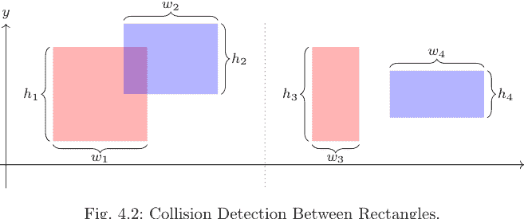

```java
abstract class GameObject {
  private int x;
  private int y;

  GameObject(int x, int y) {
    this.x = x;
    this.y = y;
  }
}
```

```java
abstract class AxisAlignedBoundingBox extends GameObject {
  private int width;
  private int height;

  AxisAlignedBoundingBox(int x, int y, int width, int height) {
    super(x, y);
    this.width = width;
    this.height = height;
  }
}
```

```java
/**
 * 确定此对象是否另一个
 * AxisAlignedBoundingBox 碰撞。
 * @param obj AxisAlignedBoundingBox 的实例。
 * @return 如果对象重叠则返回 true，否则返回 false。
 */
```

```java
boolean collidesWith(AxisAlignedBoundingObject obj) {
  return (this.getX() < obj.getX() + obj.width) &&
         (this.getX() + this.width >= obj.getX()) &&
         (this.getY() < obj.getY() + obj.height) &&
         (this.getY() + this.height >= obj.getY());
}
```

我们声明了一个抽象类来扩展另一个抽象类；这是完全可以的。因为实例化一个名为 `AxisAlignedBoundingBoxObject` 的实体本身是没有意义的，所以我们将其声明为抽象类，但我们需要它包含 `GameObject` 的功能，这就需要了继承。通常，我们会立即为 `collidesWith` 编写广泛的测试套件，但由于我们无法直接实例化 `AxisAligned-BoundingBox`，目前我们无法测试 `collidesWith`。不过，在几段文字之后，通过添加 `CircleObject` 和 `RectangleObject`，这是可能的。


```java
import static Assertions.assertAll;
import static Assertions.assertEquals;

class AxisAlignedBoundingObjectTester {

  @Test
  void testCollidesWith() {
    AxisAlignedBoundingBox o1 = new RectangleObject(30, 30, 1000, 2000);
    AxisAlignedBoundingObject o2 = new RectangleObject(0, 0, 5, 5);
    AxisAlignedBoundingObject o3 = new RectangleObject(400, 200, 750, 250);
    AxisAlignedBoundingObject o4 = new RectangleObject(300, 100, 300, 200);
    AxisAlignedBoundingObject o5 = new CircleObject(20, 30, 1000);
    AxisAlignedBoundingObject o6 = new RectangleObject(200, 250, 500);
    AxisAlignedBoundingObject o7 = new CircleObject(30, 300, 1500);
    AxisAlignedBoundingObject o8 = new CircleObject(90, 85, 200);
    assertAll(
      () -> assertTrue(o1.collidesWith(o2)),
      () -> assertTrue(o1.collidesWith(o4)),
      () -> assertTrue(o2.collidesWith(o3)),
      () -> assertTrue(o2.collidesWith(o5)),
      () -> assertTrue(o5.collidesWith(o4)),
      () -> assertTrue(o6.collidesWith(o7)),
      () -> assertTrue(o7.collidesWith(o3));
    );
  }
}
```

我们需要将我们的圆形转换为轴对齐边界框（axis-aligned bounding），但这意味着什么呢？简而言，我们将给定的半径转换为对应的直径，并将此直径指定为边界框的宽高。另一方面，矩形对象不需要这种复杂的处理，因为边界框本身就是一个矩形。子类都没有将尺寸存储为实例变量，因为父类已经为我们处理了它们。

我们预计许多读者在思考的问题是，如果它们以相同的方式实现碰撞检测，我们为什么还要区分不同“类型”的对象呢？由于我们是在游戏上下文中工作，绘制这些对象是为了……

# 284

# 4 面向对象编程

## 4.5 抽象类

```java
import java.util.List;
import java.util.Map;

abstract class Argument {

    private String key;

    Argument(String key) {
        this.key = key;
    }

    String getKey() {
        return this.key;
    }

    abstract boolean validate(Map<String, List<String>> args);
}
```

从这里开始，我们描述了类型的参数：一种是可选的，另一种是接收 n 个参数的。也就是说，可选参数根据 `validate` 总是有效的，因为并不一定存在。相反，n 值参数要求传递的标志位恰好包含 n 个值。例如，如果我们说 `--input` 标志需要 3 个参数，如果我们没有恰好传递三个空格分隔的非标志值，它将验证失败。

```java
import java.util.List;
import java.util.Map;

class OptionalArgument extends Argument {

    OptionalArgument(String key) { super(key); }

    @Override
    boolean validate(Map<String, List<String>> args) {
        return true;
    }
}
```

```java
import java.util.List;
import java.util.Map;

class NumberedArgument extends Argument {

    private final int NUM_REQUIRED_ARGS;

    NumberedArgument(String key, int n) {
        super(key);
        this.NUM_REQUIRED_ARGS = n;
    }

    @Override
    boolean validate(Map<String, List<String>> args) {
        if (args.containsKey(key.getKey())) {
            return false;
        } else return args.get(key.getKey()).size() == this.NUM_REQUIRED_ARGS;
    }
}
```

现在是参数解析器本身，它接收一个参数值的字符串数组（类似于 `main` 函数），并将标志位和参数提取到 `Map<String, List<String>>` 中，其中键代表标志，值是该标志的参数列表。我们还存储了一个 `Set<Argument>`，允许程序员为解析器指定参数。

这非常直接；在遍历 `args` 时，如果我们遇到一个以双连字符 `--` 开头的阶段，它被归类为标记（flag），随后的 `args` 直到另一个标记，都被标记为该标记的参数。我们按照描述将这些添加到相应的 map 中，并持续直到数组中的元素用尽。

```java
import java.util.HashMap;
import java.util.HashSet;
import java.util.Map;
import java.util.Set;
```

```java
class ArgumentParser {

    private final Map<String
```

解析后的 `parsedArguments` 返回提供的 `args` 是否根据通过 `addArgument` 填充的参数有效。使用流（streams），我们验证了调用每个参数时，每个单独的结果都返回 `true`，这意味着所有参数都是有效且正确的。因为对于使用此解析器的程序员来说，返回与标记相关的参数可能是很有用的，我们获取了 `getArguments` 方法返回传递给标记的参数列表。

```java
import java.util.HashMap;
import java.util.HashSet;
import java.util.Map;
import java.util.Set;
```

```java
class ArgumentParser {

    /**
     * 确定存储字段中的所有参数是否都是“有效的”。
     * 如果所有参数有效，则返回 true，否则返回 false。
     */

    boolean parseArguments() {
        return this.arguments.stream()
            .allMatch(e -> e.validate(this.parsedArguments));
    }
}
```

# 抽象类 (Abstract Classes)

示例 4.40。继承是一种真正强大的编程语言结构，我们现在尝试通过一个微型项目的设计来描述它的美。该项目将包含编写一种名为 ASPL 或“简单编程语言”（A Simple Programming Language）的小型编程语言。编程语言的语法和语义合起来需要许多该领域范围之外的知识，但我们将看到，即使工具箱相当有限，我们也可以构建出相当强大的编程语言。我们的语言将最初是我们在接口章节中解释器的再创作，但包含了修改以使其具有灵活性。

为了一种动力手段，让我们用这种语言编写几个程序来展示它的功能。第一个列表是一个将两个数字相加的简单程序。第二个列表绑定变量，如果它们的和等于 42，则结果为 100，否则为 0。第三个列表声明一个变量，随后跟一个条件判断，两者都包含另一个变量的绑定，并以乘积结束。

```lisp
(+ 25 17)

(let ((x 10))
(let (y 32))
(if (eqq (+ x y) 42)
100
0)))

(let ((z 95))
(if (eqq (- 100 5) z)
(let (w -10))
(* w z))
(let (w -5))
(* w -2))))
```

编程语言语法通常被拆分为抽象语法树的节点，此时一个子句无非是对语言操作的描述。为了开始，我们需要描述我们语言的能力。为了保持简单，我们的语言将包含容器、变量、一些算术运算符和条件判断。需要注意的是，由于我们略过了词法（lexing）和解析（parsing）的内部细节，所有的测试都将以抽象语法树的形式存在。我们需要一个 AST 节点类，其他每个 AST 节点继承自它。使用特定用途的节点来实现我们想要的功能。每个 AST 都会定义一个 `toString` 方法，将以可读的格式打印出抽象语法树。我们的抽象语法树类使用了两个构造函数：一个接收抽象语法树节点列表，另一个是针对 AST 类型的可变参数（variadic）的。为了测试期间的方便，我们实现了两个不同的构造函数。

每个抽象语法树都应该是可求值的，以作为一种将表达式归约为最简单形式的手段。例如，数字和布尔值——即我们语言的字面量（literals）——解析为它们自身。操作（operations）将操作应用于其参数，然后最终归约为一个值。条件判断被解析为其两个分支之一，而 "let" 绑定解析为其正体。我们将在涵盖材料时逐一介绍每一个。不过，目前抽象语法树类包含 `eval` 方法，该方法定义了节点如何被求值。

> ¹ 最初，我们将解释器称为 API 或“一种编程语言”。我们更改了名称，增加了一个额外的 'S'，以防我们的实现与名为 ASPL 的实际语言产生混淆 (Iverson, 1962)。如果你想玩得“有趣”，可以稍微绕个路去那里看看！

# 4 面向对象编程 (Object-Oriented Programming)

```java
import java.util.List;
```

```java
abstract class AstNode {

    private final List<AstNode> CHILDREN;

    AstNode(List<AstNode> children) {
        this.CHILDREN = children;
    }

    AstNode(AstNode... children) {
        this(List.of(children));
    }

    abstract AstNode eval();

    List<AstNode> getChild() {
        return this.CHILDREN;
    }

    public abstract String toString();
}
```


# 抽象语法树节点类

抽象语法树节点类，其他每个 AST 节点继承自它。使用特定用途的节点来实现我们想要的功能。每个 AST 都会定义一个 `toString` 方法，将以可读的格式打印出抽象语法树。我们的抽象语法树类使用了两个构造函数：一个接收抽象语法树节点列表，另一个是针对 AST 类型的可变参数的。为了测试期间的方便，我们实现了两个不同的构造函数。

每个抽象语法树都应该是可求值的，以作为一种将表达式归约为最简单形式的手段。例如，数字和布尔值——即我们语言的字面量——解析为它们自身。操作将操作应用于其参数，然后最终归约为一个值。条件判断被解析为其两个分支之一，而 `let` 绑定解析为其正体。我们将在涵盖材料时逐一介绍每一个。不过，目前抽象语法树类包含 `eval` 方法，该方法定义了节点如何被求值。

> ¹ 最初，我们将解释器称为 API 或“一种编程语言”。我们更改了名称，增加了一个额外的 'S'，以防我们的实现与名为 ASPL 的实际语言产生混淆 (Iverson, 1962)。如果你想玩得“有趣”，可以稍微绕个路去那里看看！

## 通过 `PrimNode` 添加原始操作

接下来的逻辑步骤是通过 `PrimNode` 添加原始操作。原始运算符是一种类似于加法、减法、值相等等的操作。原始运算符接收任意数量的参数，其行为通过 `eval` 方法的用例分析来处理。然而，求值原始操作并不简单是将运算符应用于参数。考虑以下代码段，其中我们将原始操作 `+` 应用于两个原始操作。我们看到无法直接将运算符应用于这两个原始操作，因为加法只适用于 `NumNode` 值而不是 `Ast` 实例。因此，在应用原始操作时，我们递归地求值它的子节点，即参数。参数列表被转换为流，我们对每个元素映射 `eval` 方法。之后，我们对操作编写上述的用例分析。对于加法运算符，我们相加所有子节点的值。

```java
import static Assertions.assertAll;
import static Assertions.assertEquals;
```

```java
class AstNodeTest {

    @Test
    void testNumNode() {
        assertEquals("42", NumNode("42").toString());
    }

    @Test
    void testBoolNode() {
        assertEquals("true", BoolNode("true").toString());
    }
}
```

> 32 我们说“为了目的”，因为语言也可以支持字符串。

```java
import java.util.Objects;

abstract class LiteralNode<T> extends AstNode {

    private final T VALUE;

    LiteralNode(T value) { this.VALUE = value; }

    @Override
    AstNode eval(Environment env) { return this; }

    @Override
    public boolean equals(Object o) {
        if (!(o instanceof LiteralNode)) {
            return false;
        } else { return this.VALUE.equals(((LiteralNode<?>) o).VALUE); }
    }

    @Override
    public int hashCode() { return Objects.hash(this.VALUE); }

    @Override
    public String toString() { return this.VALUE.toString(); }

    T getVal() { return this.VALUE; }
}
```

```java
final class NumNode extends LiteralNode<Double> {

    NumNode(double value) { super(value); }

    NumNode(String value) { super(Double.parseDouble(value)); }
}
```

```java
final class BoolNode extends LiteralNode<Boolean> {

    BoolNode(boolean value) { super(value); }

    BoolNode(String value) { super(Boolean.parseBoolean(value)); }
}
```

```java
class PrimNode extends AstNode {

    private final String op;
    private final List<AstNode> args;

    PrimNode(String op, AstNode... args) {
        super(args);
        this.op = op;
    }

    @Override
    AstNode eval(Environment env) {
        List<Object> results = new ArrayList<>();
        for (AstNode arg : args) {
            results.add(arg.eval(env));
        }

        switch (op) {
            case "+":
                double sum = 0;
                for (Object res : results) {
                    sum += (Double) res;
                }
                return new NumNode(sum);
            case "-":
                double sub = (Double) results.get(0);
                for (int i = 1; i < results.size(); i++) {
                    sub -= (Double) results.get(i);
                }
                return new NumNode(sub);
            case "*":
                double prod = 1;
                for (Object res : results) {
                    prod *= (Double) res;
                }
                return new NumNode(prod);
            case "eqq":
                return new BoolNode(results.get(0).equals(results.get(1)));
            default:
                throw new RuntimeException("Unknown operator: " + op);
        }
    }

    @Override
    public String toString() {
        return op + " " + String.join(" ", args.stream().map(Object::toString).toArray(String[]::new));
    }
}
```

```java
class LetNode extends AstNode {

    private final String var;
    private final AstNode value;

    LetNode(String var, AstNode value) {
        this.var = var;
        this.value = value;
    }

    @Override
    AstNode eval(Environment env) {
        Object val = value.eval(env);
        env.set(var, val);
        return getChild(0).eval(env);
    }

    @Override
    public String toString() {
        return "let ((" + var + " " + value + ")) " + getChild(0);
    }
}
```

```java
class IfNode extends AstNode {

    private final AstNode condition;
    private final AstNode thenBranch;
    private final AstNode elseBranch;

    IfNode(AstNode condition, AstNode thenBranch, AstNode elseBranch) {
```


# 4 面向对象编程

## 4.5 抽象类

```java
this.condition = condition;
this.thenBranch = thenBranch;
this.elseBranch = elseBranch;
}

@Override
AstNode eval(Environment env) {
    if ((Boolean) condition.eval(env)) {
        return thenBranch.eval(env);
    } else {
        return elseBranch.eval(env);
    }
}

@Override
public String toString() {
    return "if (" + condition + ") " + thenBranch + " else " + elseBranch;
}
}
```

```java
class VariableNode extends AstNode {
    private final String name;
    VariableNode(String name) {
        this.name = name;
    }

    @Override
    AstNode eval(Environment env) {
        return new LiteralNode(env.get(name));
    }

    @Override
    public String toString() {
        return name;
    }
}
```

```java
class LiteralNode extends AstNode {
    private final Object value;
    LiteralNode(Object value) {
        this.value = value;
    }

    @Override
    AstNode eval(Environment env) {
        return this;
    }

    @Override
    public String toString() {
        return value.toString();
    }
}
```

```java
class Environment {
    private final Map<String, Object> variables = new HashMap<>();
    void set(String name, Object value) {
        variables.put(name, value);
    }
    Object get(String name) {
        return variables.get(name);
    }
}
```

将它们安全地强制转换为 `NumNode`，因为我们知道该操作在语义上仅对数字有效（相同的逻辑适用于其他此类原始运算符）。

```java
import static Assertions.assertAll;
import static Assertions.assertEquals;
```

```java
class AstTest {
    @Test
    void testPrimNode() {
        assertAll(
            () -> assertEquals(new NumNode(42)
```

```java
import java.util.List;
final class PrimNode extends AstNode {
```

```java
    private final String OP;
    PrimNode(String op, AstNode... children) {
        super(children);
        this.OP = op;
    }
```

```java
    @Override
    public String toString() {
        return String.format("%s %s", this.OP, this.getChildren().toString());
    }
}
```

```java
/**
 * 解释一个原始操作。
 * @param env 解释该操作的环境。
 * @return 原始操作的结果。
 */
@Override
AstNode eval(Environment env) {
    List<AstNode> operands = this.getChildren().stream()
        .map(n -> n.eval(env))
        .toList();

    switch (this.OP) {
        case "+": return this.primPlus(operands, env);
        case "-": return this.primMinus(operands, env);
        case "*": return this.primProduct(operands, env);
        case "==": return this.primEq(operands, env);
        default: return null;
    }
}

private AstNode primPlus(List<AstNode> args, Environment env) {
    return new NumNode(args.stream()
        .map(t -> ((NumNode) t).getValue())
        .sum());
}

private AstNode primMinus(List<AstNode> args, Environment env) {
    double res = ((NumNode) args.get(0)).getValue();
    for (int i = 1; i < args.size(); i++) {
        res -= ((NumNode) args.get(i)).getValue();
    }
    return new NumNode(res);
}

private AstNode primEq(List<AstNode> args, Environment env) {
    return new NumNode(args.stream()
        .map(t -> ((NumNode) t).getValue())
        .reduce(1.0, (a, c) -> c * a));
}

private AstNode primProduct(List<AstNode> args, Environment env) {
    return new BoolNode(args.get(0).equals(args.get(1)));
}
```

添加等号运算符为条件表达式（即 IF）提供了路径。它有三个子节点：谓词、结果分支和备选分支。`IFNode` 的 `eval` 方法会评估谓词，如果为真，则评估结果分支，否则评估备选分支。假设程序是良好的，谓词必须解析为布尔值。由于我们只关心良好的程序，因此不需要检查谓词是否为布尔值，在评估相应的抽象语法树时，可以安全地将其转换为 `BoolNode`。

```java
import static Assertions.assertAll;
import static Assertions.assertEquals;
```

```java
class Test {
    @Test
    void testIfNode() {
        assertAll(
            () -> assertEquals(new NumNode(100),
                new IfNode(new BooleanNode(true),
                    new NumNode(100),
                    new NumNode(0)).eval()),
            () -> assertEquals(new BooleanNode(false),
                new IfNode(new PrimNode("eq?"),
                    new NumNode(5),
                    new NumNode(5),
                    new BooleanNode(true),
                    new BooleanNode(false)).eval())
        );
    }
}
```

处理了数字、布尔值、原始操作和条件后，现在来到具有挑战性的部分：变量绑定。我们需要通过 `LetNode` 类引入变量的方法。我们从函数式编程语法树中获得启发。`LetNode` 类有三个孩子：变量名、值和主体。`LetNode` 类将有一个 `toString` 方法，以 `({<var><body>)` 的形式返回字符串。同时，我们还将编写 `VarNode` 类，它表示占位符。为了对这两个类进行有意义的操作，我们需要讨论变量的作用域以及如何处理封装作用域。

变量的作用域指的是其生命周期。考虑我们语言中的以下程序。程序没有变量绑定。遇到 `let` 后，我们进入一个将 `x` 绑定到 5 的范围。这个 `let` 的主体是 `x` 的作用域。在这个主体内部，我们遇到了另一个变量 `y`，它绑定到 10。这个 `let` 的主体是 `y` 的作用域。在 `y` 的作用域之外，`y` 是不存在的。当我们在脑海中执行这个程序时，直觉上知道 `x` 指向 5，`y` 指向 10。编写语言需要“变量查找”的概念。编程语言使用环境将标识符与值关联起来。遇到变量声明时，扩展环境以包含新的绑定。这引发了一个问题：“为什么不修改环境？”答案是我们要尊重变量的作用域。如果我们修改现有环境中的变量绑定，变量的作用周期将扩展到整个程序，而不是它被声明的作用域。相反，我们扩展环境，建立了当前环境与新声明环境之间的链接。通过这种方式，我们可以在当前环境中查找变量，如果它们在父环境中不存在，我们返回一个 `null` 值。因此，环境包含两个实例变量：一个 `Map<String, AstNode>` 和一个 `Environment` 指针。我们的环境类包含两个方法：`lookup` 和 `extend`。`lookup` 方法尝试上述方法查找给定变量标识符的绑定。`extend` 方法实例化一个新的环境，其父环境是当前环境。这个新实例化的环境包含一个新的绑定。

```java
import static Assertions.assertAll;
import static Assertions.assertEquals;
```

```java
class EnvironmentTester {
    @Test
    void testEnvironment() {
        Environment root = new Environment();
        Environment e1 = root.extend("x", new NumNode(5));
        Environment e2 = e1.extend("y", new NumNode(6));
        assertAll(
            () -> assertEquals(new NumNode(5), e2.lookup("x")),
            () -> assertEquals(new NumNode(6), e2.lookup("y")),
            () -> assertNull(e2.lookup("z"))
        );
    }
}
```

```java
import java.util.HashMap;
import java.util.Map;
```

```java
final class Environment {
```

```java
    private final Map<String, AstNode> ENV;
    private final Environment PARENT;
```

```java
    Environment(Environment parent) {
        this.ENV = new HashMap<>();
        this.PARENT = parent;
    }
```

```java
    AstNode lookup(String id) {
        if (this.ENV.containsKey(id)) return this.ENV.get(id);
        else if (this.PARENT != null) return this.PARENT.lookup(id);
        else return null;
    }
```

```java
    Environment extend(String id, AstNode value) {
        Environment env = new Environment(this);
        env.ENV.put(id, value);
        return env;
    }
}
```

现在我们可以设计 `VarNode` 类了。明显的问题是：“我们如何评估变量？”使用环境查找变量标识符并返回其抽象语法树。但环境来自哪里？环境作为参数传递给 `eval` 方法的，这意味着所有之前的 `eval` 方法都必须更新以接受环境作为参数。

变量节点本身是简单但无用的，如果没有将它们引入环境上下文，它们无法存在。这就是 `LetNode` 登场的地方。`LetNode` 向环境引入新的变量绑定。表达式被评估，其值被绑定到扩展后的环境 `e2` 中的之前的变量标识符，其父环境是当前环境 `e1`。`LetNode` 的主体使用扩展后的环境 `e2` 进行评估。

```java
class VarNode extends AstNode {
```

```java
    private final String NAME;
    VarNode(String name) {
        super();
        this.NAME = name;
    }
```

```java
    @Override
    public String toString() {
        return this.NAME;
    }
```

```java
    /* 解释一个变量。我们在环境中查找该变量
     * 返回与其关联的值。
     * @param env 解释该变量的环境。
     * @return 解释后变量查找的结果。
     */
```

```java
    @Override
    AstNode eval(Environment env) {
        String id = this.NAME;
        AstNode res = env.lookup(id);
        return res.eval(env);
    }
```

```java
    String getName() {
        return this.NAME;
    }
```

```java
final class LetNode extends AstNode {
    private final String ID;
    LetNode(String id, AstNode exp, AstNode body) {
        super(exp, body);
        this.ID = id;
    }
```

```java
    @Override
    public String toString() {
        AstNode e = this.getChildren().get(0);
        AstNode b = this.getChildren().get(1);
        return String.format("let (%s %s)", this.ID, e, b);
    }
```

* 解释一个 let 语句。体在扩展后的环境中求值。
* 扩展环境包含了由 ID 引入的绑定。
* 标识符的绑定表达式 "exp" 在 "env" 中求值。
* 参数 env 用于 let 的环境。
* 返回 let 语句的结果。

```java
    @Override
    AstNode eval(Environment env) {
        String id = this.ID;
        AstNode exp = this.getChildren().get(0);
        AstNode body = this.getChildren().get(1);
        // 解释表达式并将其转换为 AST。
        AstNode newExp = exp.eval(env);
        Environment e = env.extend(id, newExp);
        return body.eval(e);
    }
```

最后，我们终于可以写一些全面的测试了！我们将每个测试存储在 `InterTester` 类中。实例用空环境初始化，因为在程序开始时没有（局部声明的）变量绑定。遗憾的是，我们仍然需要将程序编写为一系列组合语法树，但词法分析和将原始输入解析为抽象语法树的问题可以以后再说（或者完全是一门独立的课程）。

```java
import static Assertions.assertAll;
```


```java
import static Assertions.assertEquals;

class InterpTester {

    @Test
    void testEval() {
        assertAll(
            () -> assertEquals(new NumNode("42"),
                new NumNode("42").eval(new Environment())),
            () -> assertEquals(new Boolean(true),
                new PrimNode("?",
                    new NumNode("42"),
                    new PrimNode("-"),
                    new NumNode(100),
                    new NumNode("58")).eval(new Environment())),
            () -> assertEquals(new NumNode("42"),
                new LetNode("x"),
                new NumNode("42"),
                new VarNode("x")).eval(new Environment())),
            () -> assertEquals(new NumNode("42"),
                new LetNode("x", new NumNode("1"),
                    new LetNode("y", new NumNode("41"),
                        new PrimNode("+"),
                        new VarNode("x"),
                        new VarNode("y"))).eval(new Environment()))
        );
    }
}
```

带有继承关系的面向对象程序应该构造为扩展抽象类的特定子类的序列，正如我们通过不同的抽象语法树节点类型以及根 `AST` 抽象类演示的那样。

## 4.6 练习

### 4.1
设计 `Car` 类，它存储一个表示汽车品牌的 `String`，一个表示汽车型号的 `String`，以及一个表示汽车年份的 `int`。它的构造函数应该接收这三个值并将它们存储在实例变量中。确保编写用于修改所有三个字段的实例访问方法（accessor）和修改器方法（mutator）。也就是说，你应该编写 `getMake()`、`setName(String s)` 等来直接访问和修改字段。

### 4.2
设计 `Dog` 类，它存储一个表示品种的 `String`，一个表示名字的 `String` 以及一个表示年龄的 `int`。你还应该存储一个布尔值来跟踪是否是幼狗。如果狗小于两岁，那么它就是幼狗。它的构造函数应该接收这三个值并将它们存储在实例变量中。确保编写用于修改所有三个字段的实例访问方法和修改器方法。也就是说，你应该编写 `getBreed()`、`setBreed(String s)` 等来直接访问和修改字段。

### 4.3
设计 `Person` 类，它存储一个表示人名字的 `String` 以及一个表示人年龄的 `int`。它的构造函数应该接收这三个值并将它们存储在实例变量中。确保编写用于修改所有三个字段的实例访问方法和修改器方法。也就是说，你应该获取 `getFirstName()`、`setFirstName(String s)` 等来访问并修改字段。

### 4.4
在此练习中，你将设计一个存储员工的类。这依赖于章节中可用的 `Employee` 类及其子类。

- (a) 设计 `Job` 类，它存储一个员工列表 `List<Employee>` 作为实例变量。你将其实例化为 `ArrayList` 还是 `LinkedList` 取决于你，对于这个问题来说区别不大。它的构造函数不应接收任何参数。实例变量及其访问方法和修改器方法应该命名为 `employees`、`getEmployees()` 和 `setEmployees()`。
- (b) 设计 `void addEmployee(Employee e)` 方法，向 `Job` 添加一个员工。
- (c) 设计 `void removeEmployee(Employee e)` 方法，从 `Job` 中移除员工。
- (d) 设计 `Optional<Double> computeAverageSalary()` 方法，返回 `Job` 中所有员工的平均薪水。如果没有员工，返回一个空的 `Optional`。
- (e) 设计 `Optional<Employee> highestPaid()` 方法，返回 `Job` 中工资最高的员工。如果没有员工，返回一个空的 `Optional`。
- (f) 重写 `toString()` 方法以打印 `Job` 中的员工列表。为了方便，你可以直接解析原始输入为抽象语法树。

## 面向对象编程

### 4.5
在此练习中，你将设计一个类似于 Spotify 的简单音乐系统。

- (a) 设计 `Song` 类，它存储其标题、艺术家和流派。前三个字段是字符串，最后一个是整数。创建访问方法，然后重写 `equals`、`hashCode` 和 `toString`。
- (b) 设计 `Playlist` 类，它存储标题和歌曲集合。在此类中，创建访问方法，然后重写 `equals`、`hashCode` 和 `toString`。设计 `boolean addSong(Song s)` 方法，尝试向集合添加 `s`。如果已存在，返回 `false`。否则添加歌曲并返回 `true`。
- (c) 设计 `User` 类，它存储名字和播放列表。它的构造函数应该接收名字并赋值给实例变量。将列表实例化为 `ArrayList`。创建访问方法，然后重写 `equals`、`hashCode` 和 `toString`。
- (i) 设计 `createPlaylist(String t, String... S)` 方法，创建一个 `t` 和可变数量的歌曲。如果已存在，返回 `false` 并什么都不做。否则，声明一个新的 `Playlist` 并添加。
- (d) 设计 `MusicSystem` 类，它存储用户列表和系统中所有的歌曲。在构造函数中，分别将这些实例化为 `ArrayList` 和 `HashSet`。
- (i) 设计 `addUser(User u)` 方法，接收用户 `u` 并将其添加到列表中。
- (ii) 设计 `boolean addSong(User u, String t, Song s)` 方法，给定用户 `u`、播放列表 `t` 和歌曲 `s`，将 `s` 添加到 `u` 的播放列表中。如果 `u` 不存在或 `t` 不在 `u` 的播放列表中，返回 `false`。
- (iii) 设计 `Map<User, String> getLongestSong()` 方法，返回用户所有歌曲中最长的（长度）。如果用户播放列表中没有歌曲，不要将该用户添加到 map。

### 4.6
在此练习中，你将创建两个类：`Chocolate` 和 `ChocolateBox` 来存储巧克力二维数组。

- (a) 设计 `Chocolate` 类，它存储一个表示名称的字符串和一个表示盎司重量的整数。
- (b) 设计 `ChocolateBox` 类，它存储一个 `Chocolate[][]` 数组作为实例变量。构造函数应该接收行数和列数。
- (i) 设计 `int numberOfChocolates()` 方法，返回 `ChocolateBox` 中非 `Chocolate` 实例的数量。
- (ii) 设计 `void shuffleChocolate()` 方法，随机化箱中的元素。如何洗牌都可以，只要它是充分的洗牌（而不是仅仅对所有巧克力进行线性平移）。
- (iii) 设计 `int removeFirst(String kind)` 方法，从顶部移除第一个出现的 `kind` 类的巧克力。移除巧克力意味着将索引赋值为 `null`。返回被移除的内容，假设位置从 1 到 n 编号，顺序从左到右，然后从上到下（类似于标准的格里历日历）。如果箱中没有 `kind` 类的巧克力，返回 -1。
- (iv) 设计 `ChocolateBox allergy(String kind)` 方法，返回一个新的移除了所有 `kind` 类的巧克力的 `ChocolateBox`。如果 `ChocolateBox` 中有空位...

### 4.6 练习题（续）

在旧盒子的巧克力之间，相应地移动巧克力。考虑以下 `ChocolateBox`：

| 黑 | 白 | 牛奶 | 坚 | 甜 |
| --- | --- | --- | --- | --- |
| null | 坚 | 黑 | null | null |
| 白 | 甜 | 坚 | null | 坚 |

在此盒子上上调用 `allergyBox("Nut")` 将返回以下 `ChocolateBox`：

| 黑 | 白 | 牛奶 | 甜 | 黑 |
| --- | --- | --- | --- | --- |
| 白 | 甜 | null | null | null |
| null | null | null | null | null |

### 4.7
在此项练习中，你将设计一个线性同余数生成器：一种伪随机数生成算法。特别是 C 语言语言标准定义了两个函数：`rand` 和 `srand`。后者为生成器设置种子，并返回一个在 [0, $2^{15}$] 之间的随机整数。该生成器的公式是一个递推关系：

```
next = r_n * 1103515245 + 12345
r_{n+1} = (next / 2^{16}) % 2^{15}
```

- (a) 设计 `LcgRandom` 类，实现这种行为。特别是，它应该有两个构造函数：一个初始化种子值 $s$，另一个将种子设置为 1。种子初始化 $r_0$ 的值。
- (b) 设计 `genInt()` 方法，使用该算法返回一个在 0 到 $2^{15}$ 之间的随机整数。
- (c) 设计 `IntStream stream()` 方法，返回一个使用 `genInt` 生成数字的随机数流。提示：使用 `generate`！
- (d) 设计 `genInt(int b)` 方法，返回一个在 [0, b] 之间的整数。注意 $0 \le b < 2^{15}$；你不需要考虑此范围之外的值。**不要**简单地循环直到找到该范围内的值；相反，要利用模运算来为你创造优势。

### 4.8 (*)
此题包含六部分。

- (a) 设计 `Matrix` 类，存储一个整数二维数组。它的构造函数应该接收两个整数 $m$ 和 $n$ 分别代表行数和列数，以及一个整数二维数组（你可以假设传入数组的行列等于 $m$ 和 $n$）。将传入的数组复制到实例数组中。不要将提供的数组简化为实例！
- (b) 设计 `void set(int i, int j, int val)` 方法，设置第 $i$ 行第 $j$ 列的值。如果行或列超出边界，则什么都不做。
- (c) 设计 `boolean add(Matrix m)` 方法，将传入矩阵的值加到当前矩阵。如果传入矩阵的维度与当前矩阵的维度不匹配，返回 `false` 且不加矩阵。
- (d) 设计 `boolean multiply(Matrix m)` 方法，将传入矩阵的值乘以当前矩阵。如果我们无法用此矩阵乘以 $m$，则返回 `false` 且不进行乘法。
- (e) 设计 `void transpose()` 方法，对矩阵进行转置。即行变列，列变行。你可能需要更改矩阵的维度。
- (g) 重写公共的 `toString()` 方法以返回矩阵的字符串版本。例如，`[[1, 2, 3], [4, 5, 6]]` 代表以下矩阵：

```
1 2 3
4 5 6
```

### 4.9
此项练习包含五部分。

- (a) 设计 `GameObject` 类，存储一个表示其 $(x, y)$ 位置的 `Pair<Double, Double>` 和一个表示其宽度和高度的 `Pair<Double, Double>`。它的构造函数应该接收四个表示 $x$、$y$、$width$ 和 $height$ 的双浮点数。确保使用实例访问器和变异器方法来修改这两个字段。也就是说，你应该使用 `getLocation()`、`setLocationX(double d)` 等来直接访问和修改值。
- (b) 设计 `boolean collides(GameObject obj)` 方法，返回 `GameObject` 是否与参数 `obj` 碰撞。你应该这样设计此解决方案，因为所有游戏对象的形状都是矩形（它们确实如此）。
- (c) 设计 `double distance(GameObject obj)` 方法，返回此 `GameObject` 中心到参数 `obj` 中心之间的欧几里得距离。
- (d) 设计 `void move(double dx, double dy)` 方法，在笛卡尔（二维）平面上移动对象。距离应该表示为两个直接操作对象位置的双浮点数 $dx$ 和 $dy$。例如，如果 $dx$ 是 $3.0$ 且 $dy$ 是 $-2.0$，且对象当前位于 $<2.0, -9.0>$，调用 `move(3.0, -2.0)` 将对象更新为 $<5.0, -11.0>$。
- (e) 重写公共的 `String toString()` 方法，以调用两个实例变量的 `toString()` 方法，并用逗号连接。

### 4.10
此项练习包含三部分。

- (a) 设计 `GameRunner` 类，将一个对象列表 `List<GameObject>` 作为实例变量。它的构造函数应该接收一个表示随机数生成器种子的整数。它应该首先用此种子实例化 `rand` 为一个新对象，并在列表中于 [-10, 10] 之间的随机整数位置填充二十个随机 `GameObject` 实例。
- (b) 设计 `void moveObjects()` 方法，移动每个单位。
- (c) 设计 `String stringify()` 方法，将列表中的每个转换为字符串表示，并用逗号分隔。你可以使用 Stream 来快速完成这一点。

### 4.11
此项练习使用“二十一点”游戏实现。

- (a) 使用符号而非 X 来更改每个，参考 PDF：https://www.unicode.org/charts/UFA0.pdf。其中 X 是值，Y 是单位。这可能很麻烦，但它让游戏看起来很不错！
- (b) 在实现中添加 A（王）、Q 和 K。
- (c) 设计 `boolean play(Deck d)` 方法，使用以下伪代码：

```java
boolean play(Deck d) {
    score = getScore();
    if (score < 16) {
        cards.add(d);
        return true;
    } else if (score < 21) {
        score = getScore();
        cards.add(d);
    }
    return false;
}
```

- (d) 在 `ArrayList` 中设计 `void set(T e, int idx)` 方法。

### 4.17
此题包含七部分。

在此题中，你设计一个处理时间的 `Time` 类。编程语言通常以不同程度支持时间。Java 提供了一些类和方法，但不能使用这些，否则将失去练习意义。

- (a) 设计 `Time` 类。它应该包含接收以下内容的构造函数：
    * `Time(int h, int m, int s)` 接收表示小时、分钟和秒的整数。
    * `Time(int s)` 接收表示秒的整数。
    * `Time(String t)` 接收格式为 "hh:mm:ss" 的三个部分：小时、分钟和秒。时间字符串的范围是 00:00:00 到 23:59:59。

无论你如何存储时间单位，只要你的类支持 `Time` 对象即可。

- (b) 设计 `int getNumberOfSeconds()` 方法，返回此 `Time` 对象表示的秒数。
- (c) 设计 `int getNumberOfMinutes()` 方法，返回此 `Time` 对象表示的分钟数。如果有部分分钟，只需返回分钟。例如，`new Time("02:30:45").getNumberOfMinutes()` 返回 150。
- (d) 重写公共的 `String toString()` 方法，返回时间的字符串版本，其中小时、分钟和秒用冒号分隔。单数字时间单位必须包含前导零。
- (e) 重写 `boolean equals(Object o)` 方法，如果给定的 `Time` 对象与此实例表示相同的时间，则返回 `true`。

```java
Time t1 = new Time("02:30:45");
Time t2 = new Time("11:45:18");
Time t3 = new Time("00:53:57");

t1.add(t2);
t1.toString(); // => 14:16:03
```

### 4.6 练习（续）

```java
t1.add(t3);
t1.toString(); // => 15:00:00
```

- (g) 设计 `boolean increment(String u)` 方法，该方法接收一个表示增加时间单位字符串 `u`。如果 `u` 不是 "HOUR"、"MINUTE" 或 "SECOND" 之一，返回 `false`；否则返回 `true`。参考以下调用示例。请考虑边界情况，例如增加一个即将进位的下一个单位。

```java
Time t1 = new Time("02:30:45");
t1.increment("HOUR");
t1.toString(); // => "03:30:45"
t1.increment("MINUTE");
t1.toString(); // => "03:31:45"
t1.increment("SECOND");
t1.toString(); // => "03:31:46"
```


## 4.18 本练习包含六部分

在本题中，你将实现 `MiniStack` 数据结构。这与章节中的 `MiniArrayList` 类相似，但显然是一个栈而不是数组列表。与许多栈实现不同，我们将使用基于数组的栈。这意味着我们不再使用私有和静态 `Node` 类的集合，栈将使用一个数组来存储其元素。当数组空间耗尽时，将分配一个新的数组并将元素复制过去。

- (a) 首先，设计泛型 `MiniStack` 类。它的构造函数不应接收任何参数，并实例化两个实例变量 `[T]` 元素，并分别设置为新数组和零。记住，你不能实例化泛型数组，那么我们该如何做呢？数组的初始容量应设置为 `INITIAL_CAPACITY`，它是类中声明的一个 `private final` 变量，值为 10。
- (b) 其次，设计 `void add(T t)` 方法，该方法将元素添加到栈顶。在使用数组时，“栈顶”是右侧的元素，即索引最大的元素。设计一个私有的辅助方法，在需要时调整底层数组的大小可能是一个好主意。你的缩放因子（即你如何调整栈的大小）由你决定。
- (c) 第三，设计 `T peek()` 方法，该方法返回（但不移除）栈顶元素。
- (d) 第四，设计 `pop()` 方法，该方法返回并移除栈顶元素。确保在设计 `pop` 之后你的 `add` 方法仍然可以工作。
- (e) 第五，设计 `int size()` 方法，该方法返回栈中逻辑元素的数量。
- (f) 最后，重写 `public toString()` 方法，返回一个包含从栈顶到栈部的元素的字符串，并用逗号和空格分隔。例如，如果栈从顶到部的包含元素是 10, 20, 30, 40 和 50，则 `toString` 方法返回 "50, 40, 30, 20, 10"。

## 4.19 (*) 本练习包含七部分

分块数组数据结构避免了在底层数组耗尽可用空间时复制的开销。其思想是将集合分成多个块，即一个存储块的 `ArrayList`。假设底层的块集合已充分填充，该集合将需要调整大小的操作。此数据结构不支持任意的插入或删除。

- (a) 设计泛型 `ChunkedArrayList` 类。它应该作为实例变量存储一个块的 `ArrayList<T>`，其中 `T` 是参数化类型。设计两个构造函数：一个接收块大小 `s` 和预分配块的数量 `n`；另一个不接收参数，默认 `n` 为 10 且 `s` 为 50。
- (b) 设计 `add(T t)` 方法，当给定一个项目时，它将其添加到当前块的末尾。如果当前块空间耗尽，将其添加到下一个块。如果没有后续可用的块，则会创建一个大小为 `s` 的新块。提示：使用取模运算。
- (c) 设计 `get(int i)` 方法，当给定索引 `i` 时返回该索引处的项。该数据结构的用户不应该知道块的实现。
- (d) 设计 `resize(int n)` 方法来调整底层数组。如果数组已满，我们将分配一个大小加倍的新数组并复制元素。
- (e) 设计 `getCapacity()` 方法，返回最大容量。
- (f) 设计 `size()` 方法，返回元素的总数。
- (g) 设计 `chunkCount()` 方法，返回块的数量。

## 4.20 (*) 本练习包含七部分

持久性数据结构是在执行会改变数据结构的操作后保存其状态。例如，队列。当我们调用 `enqueue` 时，它返回一个新的队列而保持原始队列不变。

- (a) 首先，设计泛型 `PersistentQueue` 类。它应该作为实例变量存储指向头部和尾部的指针。
- (b) 构造函数应该是空的，类定义应该存储元素的数量。
- (c) 设计 `PersistentQueue<T> of(T... vals)` 方法，使用传入的参数创建一个队列。
- (d) 设计 `enqueue(T t)` 方法，将值添加到队列的末尾。
- (e) 设计 `dequeue()` 方法，移除队列的第一个元素。
- (f) 设计 `peek()` 方法，返回队列的第一个元素。
- (g) 设计 `size()` 方法，返回元素的数量。

## 4.21 (*) 本练习包含三部分

确定性有限状态机是一种极其原始的机器，表示系统不同状态之间的转换。例如，一个灯开关；它有一个“关闭”状态和一个“开启”状态，拨动开关代表了从一个状态到另一个状态的输入。编程语言经常使用自动机进行字符识别，即哪些字符在语言中是有效的。这是一个 DFA 示例，接受来自输入字母 Σ = {a, b} 的包含奇数个 'a' 字符的字符串。

- (a) 首先，开始设计 DFA 类，它包含以下私有静态类定义：
  - `State`：存储一个字符串标识符、一个 `isStart` 布尔标记和一个 `isFinal` 标记。该类应包含相应的访问器但不包含修改器。
  - `Transition`：存储两个 `State` 对象 `a` 和 `b`，代表“源”和“目标”，以及从 `a` 转换到 `b` 所需的输入。
- (b) DFA 构造应该是空的，类定义应该存储一个 `Set<Transition>` 以及一个 `Set<State>`。
- (c) 设计 `void addState(State s)` 方法，向有限自动机添加一个新的 `State`。
- (d) 设计 `State transition(State s, String i)` 方法，返回通过输入 `i` 从 `s` 转换到达的状态。
- (e) 最后，设计 `boolean accept(String v)` 方法，它接收一个输入字符串 `v` 并遍历自动机以确定它是接受还是拒绝输入。如果我们最后结束的状态被标记为最终状态，则接受 `v`。

## 4.22 (*) 二元关系 $\mathcal{R}$ 是两个集合 $A$ 和 $B$ 的笛卡尔积子集

即 $\mathcal{R} \subseteq A \times B$，使得 $A \times B = \{(x,y) \mid x \in A \land y \in B\}$。二元关系有多种描述方式，包括自反、对称、传递、反对、非对称、反反射和等。

设计泛型 `BinaryRelation<T, U>` 来表示数学二元关系。它应该存储一个 `Set<Pair<T, U>>`，其中内部的对是集合相关的元组。构造函数应该实例化实例变量。

然后，设计以下方法：

- (a) `addTuple(T x, U y)` 分别返回 $T$ 和 $U$ 的两个值 $x$ 和 $y$，并将它们作为一对添加到底层集合中。
- (b) `isReflexive()` 如果关系是自反，则返回 true。如果对于所有 $x \in S, (x,x) \in \mathcal{R}$，则关系 $\mathcal{R}$ 为自反。
- (c) `isSymmetric()` 如果关系是对称，则返回 true。如果对于所有 $x,y \in S, (x,y) \in \mathcal{R}$ 且 $(y,x) \in \mathcal{R}$，则关系 $\mathcal{R}$ 为对称。
- (d) `isTransitive()` 如果关系是传递，则返回 true。如果对于所有 $x,y,z \in S$，若 $(x,y) \in \mathcal{R}$ 且 $(y,z) \in \mathcal{R}$，则 $(x,z) \in \mathcal{R}$，则关系 $\mathcal{R}$ 为传递。
- (e) `isEquivalence()` 如果关系是等价关系，则返回 true。关系是自反、对称且传递的。
- (f) `isIrreflexive()` 如果关系是反反射，则返回 true。如果对于所有 $x \in S, (x,x) \notin \mathcal{R}$，则关系 $\mathcal{R}$ 为反反射。
- (g) `isAntisymmetric()` 如果关系是反对，则返回 true。如果对于所有 $x,y \in S, (x,y) \in \mathcal{R}$ 且 $(y,x) \in \mathcal{R}$，则 $x = y$，则关系 $\mathcal{R}$ 为反对。
- (h) `isAsymmetric()` 如果关系是非对称的，则返回 true。如果对于所有 $x,y \in S, (x,y) \in \mathcal{R}$ 蕴含 $(y,x) \notin \mathcal{R}$，则关系 $\mathcal{R}$ 为非对称。
- (i) `isSerial()` 如果关系是序列，则返回 true。如果对于所有 $x \in S$，存在一个 $y \in S$ 使得 $(x,y) \in \mathcal{R}$，则关系 $\mathcal{R}$ 为序列。
- (j) `Set<Pair<T, U>> reflexiveClosure()` 返回一个表示二元关系反射闭包的集合，即 $\mathcal{R} \cup r(\mathcal{R})$，其中 $r$ 返回一个 $S$ 上的反射集合。
- (k) `Set<Pair<T, U>> symmetricClosure()` 返回一个表示二元关系对称闭包的集合，即 $\mathcal{R} \cup s(\mathcal{R})$，其中 $s$ 返回一个 $S$ 上的对称集合。
- (l) `Set<Pair<T, U>> transitiveClosure()` 返回一个表示二元关系传递闭包的集合，即 $\mathcal{R} \cup t(\mathcal{R})$，其中 $t$ 返回一个 $S$ 上的传递集合。

作为一种额外的优化，我们可以在被提示时缓存这些属性之一的当前结果。如果我们没有向关系中添加对，那么重新计算它是否（例如）是自反射的意义不大了。请以你中意的方式将其作为优化实现到类中。

# 4.6 练习题

## 4.23 本练习包含五个部分

重复的字符串拼接是 Java 中一个常见的性能问题。正如我们所知，Java `String` 对象是不可变的，这意味着拼接会创建新的 `String` 对象。对于短字符串这没问题，但对于较大的字符串（或在循环中执行拼接），这可能会成为性能瓶颈。每次拼接都需要复制整个字符串。Java 提供了 `StringBuilder` 类来缓解这个问题。在练习中，你将设计一个模拟 `StringBuilder` 行为的 `MiniStringBuilder` 类。你不能在实现中使用 `StringBuilder` 或旧的 `StringBuffer` 类。

- (a) 设计 `MiniStringBuilder` 类，它存储一个 `char[]` 作为实例变量。该类还应该存储一个变量来跟踪缓冲区中使用的“逻辑字符”数量。
- (b) 为 `MiniStringBuilder` 类设计两个构造函数：一个不接受参数并将底层的 `char[]` 数组初始化为 20，另一个接收一个 `String` 并将 `char[]` 数组初始化为 `s.length() + 20`（或类似逻辑）。
- (c) 设计 `void append(String s)` 方法，将给定的字符串 $s$ 追加到末尾。给定的字符串 $s$ 不应简单地追加，而是应追加到缓冲区末尾。如果缓冲区空间不足，双倍分配数组，类似于 `ArrayList` 的做法。
- (d) 设计 `void clear()` 方法，将 `char[]` 数组重置为默认。
- (e) 设计 `public toString()` 方法，返回字符数组的字符串。

## 4.24 本练习包含两个部分

复数具有两个部分：$a$ 和 $b$。这些部分共同成了 $a + bi$。

- (a) 设计 `ComplexNumber` 类，存储两个双精度值 $a$ 和 $b$。
- (b) 设计构造函数初始化 $a$ 和 $b$ 为 0。
- (c) 设计 $a$ 和 $b$ 的公共访问器和修改器。
- (d) 重写 `toString()` 方法，当 $b$ 为正或负时，返回 "a + bi" 或 "a - bi"。
- (e) 重写 `equals(Object o)` 方法比较两个复数。
- (f) 重写 `hashCode()` 方法返回哈希码。
- (g) 设计 `double magnitude()` 方法，返回复数的模。模是平方和的平方根。
- (h) 设计 `double argument()` 方法，以弧度返回幅角。
- (i) 设计 `conjugate()` 方法，返回复数的共轭。即如果有一个复数 $a + bi$，其共轭是 $a - bi$。
- (j) 设计 `add(ComplexNumber c2)` 方法，接收一个 `ComplexNumber` 作为参数，并表示此复数与给定数之和的新 `ComplexNumber`。复数的和为 $(a+c) + (b+d)i$。
- (k) 设计 `sub(ComplexNumber c2)` 方法，接收一个 `ComplexNumber` 作为参数，并表示此复数与给定数之差的新 `ComplexNumber`。复数的差为 $(a-c) + (b-d)i$。
- (l) 设计 `mul(ComplexNumber c2)` 方法，接收一个 `ComplexNumber` 作为参数，并表示此复数与给定数之积的新 `ComplexNumber`。两个复数的积为：
  $(a+bi)(c+di) = (ac-bd)+(ad+bc)i$
  提示：利用好 `add` 和 `mul`。

## 4.25 本练习包含三个部分

- (a) 设计 `Accumulator` 类，它存储一个实例变量。`Accumulator` 构造函数接收一个值并初始化它。
- (b) 设计 `apply` 方法，接收一个 `Number` 并将其添加到实例。如果参数只有整数，则结果应解释为整数或浮点值。我们正在重现 Paul Graham 发明的“累加器”挑战。例如，创建以下序列：

```
Accumulator acc1 = new Accumulator(1);

acc1.apply(5);

acc1.apply(7);

assertEquals(13, acc1.apply(0));

assertEquals(15.3, acc1.apply(2.3));
```

## 4.26 本练习包含三个部分

Kotlin 语言自定义了范围。也就是说，我们可以使用点符号定义一个区间，例如 `1..10`，然后查询该区间上的值是否在 1 到 10 之间。这种比较扩展到了原始数据；范围可以作用于类。例如，我们可以创建一个 `"hi".."howdy"`，它定义了从 `"hi"` 到 `"howdy"` 的字符串范围。

- (a) 设计泛型 `Range` 类。它应该作为实例变量存储最小值最大值，两者都是类型 `<T extends Comparable<T>>`，T 必须是可比较类型。
- (b) `Range` 构造函数接收这两个值作为参数，并相应的赋值给实例。`boolean contains(T v)` 方法返回 v 是否在范围作用的区间内。
- (c) 设计泛型静态方法 `<T, U extends Predicate<T>> T validateInput(String prompt, String errorResp, U p)`，它接收一个提示、一个错误响应以及一个实现 `Predicate` 接口的对象，以测试接收到的值，通过标准输入接收的内容是有效的。如果该值根据谓词无效，则打印错误响应并重新提示用户。否则，返回输入的值。

## 4.28 本练习包含三个部分

在本次练习中，你将开发一个 `Document` 接口及其实现类：

- `TextDocument`
- `SpreadsheetDocument`
- `PresentationDocument`

`Document` 接口定义如下：

```java
interface Document {

    /**
     * 返回此文档的页数。
     */
    int numberOfPages();

    /**
     * 返回一个表示 Document 正在打印的字符串。
     */
    default String print() {
        return "Printing the document";
    }
}
```


# 练习题

## 4.29 本练习包含三个部分。

- (a) 设计 `INumberFormat` 接口，其中包含 `String format(int n)` 方法。
- (b) 设计 `DollarFormat` 类，它实现了 `INumberFormat`，并返回一个在数字前带有美元符号 "$" 的字符串。
- (c) 设计 `CommaFormat` 类，它实现了 `INumberFormat`，并返回一个在适当位置包含逗号的数字字符串。例如，`format(4412)` 应该返回 "4,412"。

## 4.30 (*) 在章节中，我们描述了 `PizzaOrder` 类。本练习向读者介绍访问者模式（visitor pattern），我们将在第 8 章详细探讨。

- (a) 首先，设计 `GroupOrder` 类，用于跟踪订单中的多个披萨。存储一个 `Queue<PizzaOrder>` 作为实例变量，并将其实例化为 `PriorityQueue`。`GroupOrder` 构造函数应该接收一个 `Comparator<PizzaOrder>`。将其传递给 `PriorityQueue` 的实例化。
- (b) 设计 `ITopping` 接口，它代表一种配料。目前，它包含方法。然后设计四个类：`Pepperoni`、`Onion`、`Pineapple` 和 `Anchovy`，它们都实现了 `ITopping`。
- (c) 让我们设计一个允许我们对配料执行多个操作的类。设计泛型 `IToppingVisitor<T>` 接口，它有四个方法：`visit(Pepperoni p)`、`visit(Onion o)`、`visit(Pineapple p)` 和 `visit(Anchovy a)`。
- (d) 设计 `PricingVisitor` 类，它实现了 `IToppingVisitor<Double>` 接口。这样 `ToppingVisitor` 类就可以作为一种将属性与配料关联的方式，而无需修改/添加类定义。重写这四个方法以分别返回 3.50, 2.50, 5.75 和 4.00。
- (e) 修改 `PizzaOrder` 类，允许其 `map` 实例变量将 `ITopping` 对象映射到 `Integer`，而不是 `String` 到 `Integer`。
- (f) 修改 `ITopping` 接口以提供 `<T> T visit(IToppingVisitor<T> v)` 方法。其子类型应该通过定义 `<T> T visit(IToppingVisitor<T> v)` 为对 `v.visit(this)` 的调用来重写 visit，其中 `v` 是访问者对象。
- (g) 最后，设计 `PizzaOrderComparator` 类，它实现了 `Comparator<PizzaOrder>`，并根据配料的价格比较披萨。成本高的披萨优先于成本低的披萨。

## 4.31 (*) 懒性列表（lazy list）在理论上可以产生无限结果！考虑 `ILazyList` 接口：

```java
interface ILazyList<T> {
    T next();
}
```

当对懒性列表调用 `next` 时，我们更新该列表的内容并返回下一个结果。我们将其标记为泛型接口，允许任何所需的返回类型。例如，下面是一个产生阶乘值的懒性列表：

```java
class FactorialLazyList implements ILazyList<Integer> {
    private int n;
    private int fact;

    FactorialLazyList() {
        this.n = 1;
        this.fact = 1;
    }

    @Override
    public Integer next() {
        this.fact *= this.n;
        this.n++;
        return this.fact;
    }
}
```

通过十次调用 `next` 测试得到可预测的结果。

设计 `FibonacciLazyList` 类，它实现了 `ILazyList<Integer>` 并正确重写 `next`。使用循环或递归。记住斐波那契序列定义为 $f(n) = f(n-1) + f(n-2)$。

*注：原文提供的示例代码实现如下：*

```java
class FibonacciLazyList implements ILazyList<Integer> {
    private int a = 0;
    private int b = 1;
    private int count = 0;

    @Override
    public Integer next() {
        if (count == 0) {
            count++;
            return 0;
        }
        if (count == 1) {
            count++;
            return 1;
        }
        int next = a + b;
        a = b;
        b = next;
        return next;
    }
}
```

```java
import static org.junit.jupiter.api.Assertions.assertEquals;
import static org.junit.jupiter.api.Assertions.assertAll;

class FibonacciListTester {
    @Test
    void testFibonacciList() {
        ILazyList<Integer> FS = new FibonacciLazyList();
        assertAll(
            () -> assertEquals(0, FS.next()),
            () -> assertEquals(1, FS.next()),
            () -> assertEquals(1, FS.next()),
            () -> assertEquals(2, FS.next()),
            () -> assertEquals(3, FS.next())
        );
    }
}
```

## 4.32 设计 `LazyList` 类，它实现了 `ILinkedList`。其构造函数应该接收一个 `ILazyList` 和一个表示要取多少元素的整数 `n`。然后，从给定的懒性列表编写一个 `List<T> getList()` 方法。

## 4.33 Java 的函数式 API 允许我们将 Lambda 表达式作为其他方法的参数，以及引用（如我们在第 3 章所示）。设计 `GenericLazyList` 实现 `ILazyList`，其构造函数接收一个单目函数 `Function<T, T> f` 和一个初始值 `T`。然后，重写 `next` 方法对懒性列表的当前元素调用 `f` 并返回结果。

## 4.34 设计泛型 `CyclicList` 类，它实现了 `ILinkedList`，其构造函数是可变的并接收任意数量的值。调用 `next` 时，循环列表应该返回从构造函数接收的第一个值、第二个，依此类推直到结束。在返回所有值后，回到开头并继续。

实例，如果我们调用 `new CyclicList<Integer>(1, 2, 3)`，调用 `.next` 五次将产生 1, 2, 3, 1, 2。

## 4.35 (\*) 在此练习中，由于你将设计一个简单的粒子系统管理器。粒子系统是一种在图形引擎中管理粒子（或小特效）的数据结构。想象一个带有烟雾、火焰、水、爆炸或其他类型效果的视频游戏。通常情况下，这些效果都使用粒子引擎来管理成千上万的粒子对象。因此，这种引擎应该是高效的。

### (a) 在此练习的第一部分，你将设计 `Particle` 类。

- (i) 一个 `Particle` 包含一个 `double x` 和 `double y` 表示其位置，一个 `double width` 和 `double height` 表示其尺寸，以及一个 `double vx` 和 `double vy` 表示其速度。最后，它包含一个 `double life` 表示其寿命。构造函数应该接收这些作为参数并将它们赋值给实例变量。
- (ii) 在 `Particle` 类内部，设计 `update` 方法，将粒子的速度加到其位置上。它还应该将 `life` 变量减 1。如果 `life` 变为零或负数，则粒子不再存活。如果粒子未活，则不要更新它（不要减少其寿命）。
- (iii) 设计 `isActive` 方法，返回粒子是否存活。

### (b) 现在，你将设计 `ParticleSystem` 类来高效管理多个粒子。该粒子系统背后的思想是创建一个内存池，并在可用时从中轮询已分配的粒子。也就是说，当一个粒子死亡时，它会移动到“死亡”区域，但该区域仍然存在。然后，当我们想要创建一个新的 `Particle` 时，我们首先检查是否有可以重用的死亡粒子。如果有，我们就重用该粒子的分配内存并简单地赋值变量。

- (i) 在 `ParticleSystem` 类中，存储以下实例变量并在构造函数中将它们实例化为链表（Linked lists）。构造函数还接收一个值 `maxAlive`，并将其赋值给一个 `final int MAX_ALIVE` 实例变量。
  - `List<Particle> alive`，存储系统中的存活粒子。此列表中的所有粒子都不应为空。
  - `List<Particle> dead`，存储系统中的死亡粒子。所有粒子。

- (ii) 设计 `boolean addParticle(double x, double y, double w, double h, double vx, double vy, double life)` 方法，根据给定参数向系统添加粒子。如果没有可用的死亡粒子，直接在 `alive` 列表的末尾分配一个新的 `Particle`。如果有死亡粒子，则使用该分配空间，并使用相应的 setter 将参数赋值给对象。然后，将粒子从 `dead` 列表移动到 `alive` 列表的末尾。如果无法添加新粒子（因为没有空间存放更多存活粒子），则返回 `false`。否则返回 `true`。
- (iii) 设计 `void updateSystem()` 方法，遍历存活粒子并调用它们的 `update` 方法。在调用粒子的 `update` 方法后，检查它是否存活。如果不存活，则将其从 `alive` 列表移动到 `dead` 列表。

### (c) 在练习的最后部分，你将设计两个子类粒子。

- (i) 设计 `SparkParticle` 类，它继承自 `Particle`。“火花粒子”沿直线移动，但它们的速度由于空气阻力随时间减少，直到停止移动。
  - `SparkParticle` 构造函数接收与其父类相同的值。
  - 重写 `update` 方法，在每次调用 `update` 时将垂直和水平速度减少 10%。不要调用 `super.update()`。相反，在该类内部直接更新粒子的位置。记住那些变量在 `Particle` 类中是私有的。
  - 重写 `isActive` 方法，当垂直和水平速度小于零时返回 `false`。

- (ii) 设计 `SmokeParticle` 类，它继承自 `Particle`。“烟雾粒子”沿直线移动，但它们的速度由于空气阻力随时间减少直到停止移动。
  - `SmokeParticle` 构造函数接收与其父类相同的值。
  - 重写 `update` 方法，在每次调用 `update` 时将垂直和水平速度减少 10%。不要调用 `super.update()`。相反，在该类内部直接更新粒子的位置。记住那些变量在 `Particle` 类中是私有的。
  - 重写 `isActive` 方法，否则返回 `true`。

# 4.4 面向对象的编程

递归地可以实现，但使用迭代（或尾递归）来定义要高效得多。请设计 `WhileNode` 类，它接收一个条件和一个抽象语法树，并评估该抽象语法树，直到条件为假。在解释器层级，`WhileNode` 应该评估条件，如果条件为真，则评估抽象语法树，并重复此过程直到条件为假。为了测试你的实现，你需要将 `WhileNode` 与 `SetNode` 和 `BeginNode` 类结合使用。

## 4.49 (*) 这项练习涉及我们在章节中编写的解释器。手动更新对原始操作符类型的用例分析是繁琐且容易出错的。更好的解决方案是存储操作符及其对应的“处理器”（handler）方法，即接收操作数并执行操作符逻辑的方法。我们可以通过映射（map）来实现这一点，其中键是字符串操作符，值是对应处理器的函数引用。遗憾的是，Java 不直接支持将方法作为参数，这意味着它们不是一等公民。相反，我们可以利用 Java 的函数式接口来实现我们的目标。该接口将包含一个方法：`AstNode apply(List<Object> args, Environment env)`，其中 `args` 是已评估参数的列表。我们将调用 `IFunction` 并将其泛化，第一个类型参数量化为 `List<AstNode>`，第二个类型参数量化为 `AstNode`。希望这些泛化类型与 `apply` 签名之间的联系是显而易见的。使用下面的 `IFunction` 定义，更新 `PrimNode` 使其不再进行用例分析，而是使用映射。我们提供了一个在静态块中使用初始操作符填充映射的示例。

```java
@FunctionalInterface
interface IFunction<T, R> {
    R apply(T t);
}
```

```java
import java.util.List;
import java.util.Map;
import java.util.HashMap;

class PrimNode extends AstNode {
    private static final Map<String, IFunction<List<AstNode>, AstNode>> OPS;

    static {
        OPS = new HashMap<>();
        OPS.put("+", this::primPlus);
    }

    private AstNode primPlus(List<AstNode> args, Environment env) { /* TODO. */ }
}
```


# 4.50 (*) 这项练习是多部分的，涉及我们在章节中编写的解释器。

(a) 首先，设计 `ProgramNode` 类，允许用户将程序定义为语句的序列，而不是单个表达式。

(b) 设计 `DefNode` 类，允许用户创建全局定义。由于我们现在处理的是不扩展环境的定义，我们应该使用 `environment` 中的 `set` 方法。当通过 `DefNode` 创建全局定义时，我们应该表达出从现在起，（根）环境应该包含一个指向标识符到其绑定任何值的绑定。

(c) 设计 `FuncNode`。我们将函数定义为一个抽象树节点，它的构造函数有两个参数：一个参数（字符串）标识符的列表，以及一个表示函数体的单体抽象语法树。我们只考虑有返回值的函数；这种语言中不存在 `void` 函数。

(d) 设计 `ApplyNode` 类，它用于应用函数。你不需要考虑第一个参数不是函数的情况。调用/触发函数可能是这项练习中最困难的部分。这里是核心思想，它与所有编程语言都是通用的且相同的：

- (i) 首先，评估函数调用的每个参数。这将导致已评估的抽象语法树，它们应该存储在列表中。
- (ii) 我们想要创建一个环境，其中形式参数绑定到它们的参数上。重载 `Environment` 中的 `extend` 方法，使其现在接收一个字符串标识符列表和一个（已评估的）AST 参数列表。将每个形式参数绑定到其对应的 AST，并返回扩展的环境。
- (iii) 评估函数抽象语法树，以获取其抽象语法树形式的函数定义。
- (iv) 在函数体上调用 `all` 并传递新的（扩展的）环境。

这看起来工作量很大（确实如此），但这意味着你可以编写酷炫的程序，包括使用递归的程序！

```java
new ProgramNode(
  new DefNode("")
)
```

# 4.51 这项练习涉及我们在章节中编写的解释器，并依赖于 `FuncNode` 和 `ApplyNode` 的添加。我们目前的解释器版本使用动态作用域。动态作用域解释器使用变量最近声明的值。在没有示例的情况下，这似乎是毫无意义的，所以请考虑以下代码：

```lisp
define f (let (x [10])
  (lambda () x))
(let (x [3]) (f))
```

在动态作用域下，该程序输出 3，因为 x 的绑定取值为 3。另一方面，如果我们使用词法作用域的解释器，程序将输出 10，由于紧邻上面的绑定，这似乎是有意义的。问题是：我们如何在解释器中实现词法作用域？答案是闭包（closures），闭包是将函数定义与环境耦合在一起的数据结构。然后，当我们将闭包应用到参数上时，我们会恢复被闭包捕获的环境。为了设计这一点，`ApplyNode` 返回一个 `Closure`，它会创建一个 `FuncNode` 和传递给它的环境。最后，`ApplyNode` 应该解析闭包，扩展被捕获的环境，并在该扩展的环境内部绑定参数。闭包函数定义的体然后在这个新环境中进行评估。这种分配不仅让我们的程序输出正确的结果，还意味着我们可以使用 `LetNode` 实现递归函数。

# 4.52 (*) 这项练习涉及我们在章节中编写的解释器。动态作用域解释器使用变量最近声明的值。在没有示例的情况下，这似乎是毫无意义的，所以请考虑以下代码：

```lisp
define f (let (x [10])
  (lambda () x))
(let (x [3]) (f))
```

在动态作用域下，该程序输出 3，因为 x 的绑定取值为 3。另一方面，如果我们使用词法作用域的解释器，程序将输出 10，由于紧邻上面的绑定，这似乎是有意义的。问题是：我们如何在解释器中实现词法作用域？答案是闭包（closures），闭包是将函数定义与环境耦合在一起的数据结构。然后，当我们将闭包应用到参数上时，我们会恢复被闭包捕获的环境。为了设计这一点，`ApplyNode` 返回一个 `Closure`，它会创建一个 `FuncNode` 和传递给它的环境。最后，`ApplyNode` 应该解析闭包，扩展被捕获的环境，并在该扩展的环境内部绑定参数。闭包函数定义的体然后在这个新环境中进行评估。这种分配不仅让我们的程序输出正确的结果，还意味着我们可以使用 `LetNode` 实现递归函数。

*(注：由于提供的文本中存在大量重复段落，上述翻译已根据输入内容进行了完整处理。)*

# 4 面向对象编程

```java
import java.lang.BigInteger;

class FactorialTailRecursive {
```

```java
/** 
 * 尾递归阶乘函数。使用 BigInteger 避免
 * 数字溢出，并使用 thunk（延迟计算）避免栈溢出。
 * @param n 要计算阶乘的数字。
 * @param ac 累加器。
 * @return 一个完成或未完成的尾调用。
 */
static ITailCall<BigInteger> factTailCall(BigInteger n, BigInteger ac) {
    if (n.equals(BigInteger.ZERO)) {
        return TailCallUtils.done(ac);
    } else {
        return TailCallUtils.call(() ->
            factTailCall(n.subtract(BigInteger.ONE), ac.multiply(n));
        );
    }
}
```

该思想是我们有一个辅助类和方法，在 `while` 循环中持续调用 thunk，直到计算完成。使用“蹦床（trampoline）”类比是因为我们在调用 thunk 时像是在蹦床上跳跃，而在我们“完成”时跳下来。

首先，设计泛型 `ITailCall<T>` 接口。它应该只包含一个（非默认）方法：`ITailCall<T> apply()`，这是 `invoke` 方法必需的。其余方法均为默认 `false`，意味着它们没有方法体。设计 `boolean isDone()` 方法使其始终返回 `false`。设计 `T getValue()` 方法使其直接返回 `null`。最后，设计 `T invoke()` 方法，它存储一个局部变量并不断调用自己，直到“完成”为止。

其次，设计 `TailCallUtils` 最终类，包含一个私有构造函数（该类将仅使用并定义两个静态方法）。这两个方法如下：

- `ITailCall<T> call(ITailCall<T> next)`，接收并返回下一个要执行的尾调用。这个定义应该正好是一行，并且像看起来那样简单。
- `ITailCall<T> done(T val)`，接收从蹦床返回的值。

我们需要创建一个接口的实例，这听起来很奇怪，但只有当我们提供其方法的实现时这才是可能的。因此，返回一个新的 `ITailCall<>()`，并在其体内部用正确的方法体覆盖 `isDone` 和 `getValue` 方法。

最后，是我们在之前的 JUnit 测试套件中提供的阶乘测试。它应该通过且不会发生栈溢出，尽管包含了一个 `assertDoesNotThrow` 调用。

## 4.6 练习

### 4.57 (*) 在系列问题中，你将设计几个使用 `BigInteger` 类处理非常大/大整数的方法。你不能使用 `BigInteger` 类的任何方法，也不能使用 `BigInteger` 类本身。

(a) 设计 `BigInt` 类，它有一个接收字符串的构造函数。`BigInt` 类存储一个 `List<Integer>` 作为实例变量，以及一个用于跟踪是否为负数的布尔值。你需要将字符串转换为数字列表。以反序顺序存储数字，即数字的最低位数字（个位）是列表的第一个元素。表示时应省略前导零。

参数的可能值可以是任何符号（正或负），后跟跟一个或多个数字。
以下是一些示例：

```
new BigInt("42")           => [2, 4], isNegative = false
new BigInt("0420")         => [0, 2, 4], isNegative = false
new BigInt("-42")          => [2, 4], isNegative = true
new BigInt("0004200000")   => [0, 0, 0, 2, 4], isNegative = false
new BigInt("-042")         => [2, 4], isNegative = false
```

(b) 重写公共的 `boolean equals(Object o)` 方法，返回此实例表示是否与参数表示相同的整数。如果 `o` 不是 `BigInt` 的实例，返回 `false`。

```
new BigInt("42").equals(new BigInt("42"))       => true
new BigInt("0042").equals(new BigInt("0042"))   => true
new BigInt("42").equals(new BigInt("42"))       => true
new BigInt("42").equals(new BigInt("-42"))      => false
new BigInt("-42").equals(new BigInt("-42"))     => false
new BigInt("-42").equals(new BigInt("0420"))    => false
```

(c) 重写公共的 `toString()` 方法，返回数字的字符串化版本。如果数字是正数，你不需要包含符号。

(d) 实现 `Comparable<BigInt>` 接口并重写方法 `public int compareTo(BigInt b2)`。返回此实例与参数比较的结果。如果 `a < b`，返回 `-1`，如果 `a > b`，返回 `1`，否则返回 `0`，其中 `a` 是此实例，`b` 是 `b2`。

(e) 设计 `BigInt copy()` 方法，返回一个与此实例表示相同整数的实例的（深拷贝）。不要简单地将数字列表复制到新的 `BigInt` 中（这违反了列表被重复访问且可能导致调试困难的原则）。

(f) 设计 `BigInt negate()` 方法，返回此 `BigInt` 实例的副本，但符号是取反的。不要修改此实例。

(g) 设计公共的 `boolean differentSigns(BigInt b)` 方法，返回此实例和 `b` 是否具有不同的符号。也就是说，如果一个正一个负，`differentSigns` 返回 `true`。

(h) 设计公共的 `boolean addPositive(BigInt b)` 方法，返回此实例和 `b` 是否具有不同的符号。也就是说，如果一个正一个负，`addPositive` 返回 `true`，否则如此。

(i) 设计 `boolean subPositive(BigInt b)` 方法，返回此实例和 `b` 是否具有不同的符号。也就是说，如果一个正一个负，`subPositive` 返回 `true`，否则如此。

(j) 设计 `mul(b)` 方法，返回此与 `b` 的乘积。两个负整数的乘积是正整数，一个正一个负乘积是负整数。

(k) 设计 `BigInt add(BigInt b)` 和 `sub(BigInt b)` 方法，分别返回此与 `b` 的和/差。注意这些方法应该是操作数符号的分类讨论。使用以下等式来指导你的设计。

```
A+(-B) = A-B if A≥B. Otherwise, -(B-A).
(-A)+(-B) = -(A+B).
A-(-B) = A+B.
(-A)-B = -(A+B).
(-A)-(-B) = -A+B if A≥B. Otherwise, -(B-A).
```


(l) 4.58 (*) 回顾第3章中的统一练习。我们可以进一步扩展统一的思想，它是 Prolog 等逻辑编程语言的基础。例如，取表达式 `p(X, f(Y))`；尝试将其与 `p(q(X), f(b))` 统一返回赋值 `X : q(X), Y : b(X)`。统一可能没有任何赋值。

设计类：`Variable`、`Constant` 和 `Predicate`。这些类都应该实现 `Unifiable` 接口，该接口提供一个方法：`Assignment unify(Unifiable object, Assignment)`。`Assignment` 是 `Unifiable` 到对象的映射。在这个语言中，变量用大写字母表示，而常量用小写。如果两个 `Unifiable` 对象无法统一，则 `unify` 返回 `null`。

常量处理很简单：常量只有在它们相等时才能与其他常量统一。常量可以与变量统一，前提是该变量没有现有赋值，如果已有赋值，则必须等于该常量。常量不能与谓词统一。

变量可以与常量统一，前提是变量没有现有赋值，如果已有赋值，则它必须等于作为参数传递的常量。变量可以与其他变量统一，前提是至少有一个绑定了常量；或者如果两者都已绑定，则它们必须是等价常量。

谓词可以与变量统一，前提是能够成功统一其所有参数。例如，`p(a, z(b))` 统一 `p(X, z(Y), Z)` 因为返回了赋值 `X : a, Y : b, Z : c`。

## 4.6 练习题

4.59 (*) Orman Quine (1950) 提出的 Quine 真值解析方法是一种自动推理命题逻辑语句真值的方法（回想一下第 2 章的练习题）。该方法如下：

设计几个类来表示命题逻辑中的一系列构造良好的模式，即 `CondNode`、`BicondNode`、`NegNode`、`AndNode`、`OrNode` 和 `AtomNode`，它们都继承自一个根类 `Node` 类，类似于我们在 ASPL 解释器中对抽象语法树的表示。然后，设计 `boolean isTautology(Node t)`、`boolean isContingency(Node t)` 和 `boolean isContradiction(Node t)` 方法，分别返回给定语句是否为永真式、偶然式或矛盾式。你可以假设输入是一个构造良好的模式。注意，这些方法中只有一个需要对数据进行完整的递归遍历；另外两个可以通过第一个方法来实现。

# 异常与 I/O（注：此处保留 I/O 或 翻译为输入/输出）

**摘要** 在涵盖了 Java 基础、数据结构以及类/对象之后，我们现在进入了更高级的主题，例如异常处理和 I/O。本章将讨论未检查异常和受检查异常，以及如何处理它们。我们还将讨论处理文件 I/O 的几种方法，包括序列化等更高级的主题。最后，本章以对现代 Java I/O 技术的解释结束。

# 5 异常

异常的本质是副作用处理器（effect handlers）。我们使用异常来识别和响应运行时发生的事件。Java 使用对象来实现异常类型层次结构，其中 `Throwable` 是该链中的最高类。`Throwable` 的任何子类或实例都可以被 Java 抛出。我们将通过将异常分为两类（未检查异常与受检查异常）来讨论不同的异常类型。

## 5.1 未检查异常

我们在编译时或运行时处理异常。但某些异常必须由程序显式地处理和引用。未检查异常是异常的一种，其行为由运行时系统决定，或由程序员手动捕获。未检查异常的便利是，我们不需要显式声明发生异常时会发生什么。我们还应该注意，`RuntimeException` 类是所有未检查异常的父类。

**示例 5.1**。考虑当程序包含可能将数值除以零的代码时会发生什么。如果发生了除法操作，Java 会自动抛出一个 `ArithmeticException`，并对该问题给出相关说明，即除以零。该异常在该点停止程序执行，但有趣的是，我们可以通过 `try/catch` 块控制未检查异常的行为。在 `try` 块中，我们包含可能抛出异常的代码。在关联的 `catch` 块中，我们为想要捕获的异常声明一个变量（例如 `ArithmeticException`），然后在块内对其进行管理。让我们写一个方法，只执行两个数之和除以第三个数的操作。

```java
import java.lang.ArithmeticException;

class ArithmeticExceptionExample {

    double div(int a, int b, int c) {
        return (a + b) / c;
    }

    double div2(int a, int b, int c) {
        try {
            return (a + b) / c;
        } catch (ArithmeticException ex) {
            System.err.println("div2: by zero!");
            return 0;
        }
    }
}
```

我们定义了 `div` 的两个版本，第一个没有对异常进行显式检查，而第二个检查了。在后者，我们向标准错误流打印一条消息并返回零。首选的解决方法完全取决于程序员，但在这种情况下，抛出异常并停止程序执行比将零向上传递给调用者更有意义。另一种解决方案可能是从方法返回一个 `Optional`，`Optional` 类更多是关于方法的组合性，而不是异常。

**示例 5.2**。在上一个示例中，我们捕获了 Java 抛出的 `ArithmeticException`。但是，假设我们有一种想要抛出异常的情况。由于 `div` 是由于错误的参数产生的，我们可能希望抛出一个 `IllegalArgumentException`，其名称正如其所示。我们插入一个条件检查来测试除数（即 `c`）是否为零，如果是，我们就抛出一个新的 `IllegalArgumentException`。因为 `IllegalArgumentException` 是未检查异常，调用者不需要处理它，它可能抛出它。我们希望以此作为一个提示，方法签名可以指定该方法可能抛出 `IllegalArgumentException`。由于调用者定义了异常调用的位置，我们只负责抛出异常；控制结果不是我们的责任。

我们可以通过 `assertThrows` 和 `assertDoesNotThrow` 断言方法通过确定是否发生了异常，来测试 `div` 的新版本。然而，`assertThrows` 和 `assertDoesNotThrow` 并不像表面看起来那么简单；我们需要指定代码可能抛出的异常作为对类定义的引用。此外，参数必须作为可执行参数传递。请记住我们已经通过 lambda/匿名函数处理过可执行构造！只需将可能抛出异常的代码封装在 lambda 内部，一切就能按预期工作。

¹ 要将类定义作为对象引用，如果它是一个静态方法，我们对该类使用 `.class`。

```java
import static org.junit.jupiter.api.Assertions.assertDoesNotThrow;
import static org.junit.jupiter.api.Assertions.assertThrows;

import java.lang.IllegalArgumentException;
import org.junit.jupiter.api.Test;

class IllegalArgumentExceptionExampleTester {

    @Test
    void testIllegalArgumentException() {
        assertAll(
            () -> assertDoesNotThrow(() -> { /* 代码逻辑 */ }),
            () -> assertThrows(IllegalArgumentException.class, () -> { /* 代码逻辑 */ })
        );
    }
}
```

## 5.1.3 用户自定义异常

我们可以根据其他异常来定义自己的异常。异常本质上就是类定义，可以被扩展/继承。

**示例 5.6**。考虑到继承自 `RuntimeException` 的 `BadStringInputException` 类。我们可以将 `BadStringInputException` 定义为 Java 在读取用户输入后抛出的异常，其条件为我们发现输入不是一个“字母字符串”（即仅包含字母的字符串）。我们定义了一个接受字符串作为参数的构造函数，作为异常消息。

```java
class BadStringInputException extends RuntimeException {

    BadStringInputException(String msg) {
        super(String.format("BadStringInputException: %s", msg));
    }
}
```

那么，如果我们编写代码从用户处（通过 `Scanner`）读取一个字符串，如果输入是非字母字符串，我们就可以抛出 `BadStringInputException`。接下来的代码使用了 `matches` 方法，该方法接收一个正则表达式并返回字符串是否满足该表达式。具体来说，`[a-zA-Z]+` 表示提供的字符串中必须至少有一个小写或大写字母。调用 `readAlphaString` 的方法没有处理该异常，因为它是未检查的，它将由运行时系统捕获。

> 4 我们注意到，广义地说，创建新类型的异常很少有益，因为 Java 提供了大量的异常，涵盖了大多数用例。

```java
import java.util.Scanner;

class BadStringInputExceptionExample {

    static void readAlphaString() {
        Scanner in = new Scanner(System.in);
        String s = in.nextLine();
        if (!s.matches("[a-zA-Z]*")) {
            throw new BadStringInputException(s);
        }
    }
}
```

## 5.2 受检查异常

*受检查异常*是程序员必须显式处理的异常。如果没有将受检查异常包含在 `try/catch` 块中，或者方法签名中没有指定它会抛出该异常，Java 将无法编译程序。几乎所有的受检查异常都源于 I/O 操作（如从数据源读取），在此处进一步详细阐述并没有特别帮助。我们将在接下来的（子）章节中结合 I/O 操作的上下文讨论受检查异常。

## 5.3 文件 I/O

推测这一节将讨论文件输入输出的语法和语义。尽管这是正确的，我们将解释如何从“非纯文本”源（如网站和通过套接字的网络连接）读取数据。

### 5.3.1 原始 I/O 类

**示例 5.7**。让我们编写一个从文件中读取数据并回显到标准输出程序。

```java
import java.io.IOException;
import java.io.FileNotFoundException;
import java.io.FileInputStream;

class FileInputStreamExample {

    public static void main(String[] args) {
        FileInputStream fis = null;
        String inputFile = "file.in";
        try {
            fis = new FileInputStream(inputFile);
            // 逐字节读取数据。
            int val = -1;
            while ((val = fis.read()) != -1) {
                System.out.print(val);
            }
        } catch (FileNotFoundException ex) {
            System.err.printf("main: could not find %s\n", inputFile);
        } catch (IOException ex) {
            System.err.printf("main: i/o error %s\n", ex.getMessage());
        } finally {
            if (fis != null) {
                fis.close();
            }
        }
    }
}
```

回想上一节中我们提到了受检查异常，并推迟了对通用输入输出的讨论。现在我们来到这里了，可以刷新记忆并实际上将它们投入。受检查异常是在编译时强制执行的异常。我们强调“强制”一词是因为该异常在运行时之前不会被处理，但我们必须将可能抛出异常的行放置在 `try/catch` 块中。在接下来的代码中，`FileInputStream` 构造函数被定义为抛出 `FileNotFoundException`，而其方法抛出 `IOException`。由于 `FileNotFoundException` 是 `IOException` 的子类，我们可以省略对该异常的 catch 子句。

在从输入源读取内容时，必须始终关闭流源。或者当我们从输入流对象读取数据时，最后我们在实例上调用 `.close()` 以释放分配的系统资源。进一步扩展 `finally` 块，它是一段始终执行的代码，无论在发生异常或程序重定向时是否会被释放。许多程序员忘记关闭资源，然后就会纳闷为什么文件被损坏、被覆盖或发生了其他情况。为了解决这个问题，Java 提供了 `try-with-resources` 结构，它可以自动关闭资源。

**示例 5.8**。让我们使用 `try-with-resources` 块将一个文件的内容复制到另一个文件中。本质上，我们将设计一个打开文件输入流和文件输出流的程序，它们分别指向不同的文件。从第一个文件中读取一个字节后，我们将该字节写入第二个文件。

```java
import java.io.*;

class FileCopyExample {

    public static void main(String[] args) {
        try (FileInputStream fis = new FileInputStream("file.in");
             FileOutputStream fos = new FileOutputStream("file.out")) {
            int val = -1;
            while ((val = fis.read()) != -1) {
                fos.write(val);
            }
        } catch (FileNotFoundException ex) {
            System.err.printf("main: could not find file.in\n");
        } catch (IOException ex) {
            System.err.printf("main: i/o error %s\n", ex.getMessage());
        }
    }
}
```


文件输入输出流以及文件读写类的问题在于，它们直接与操作系统进行低级操作。频繁调用这些低级操作对 CPU 是昂贵的，因为按顺序读取单个字节，效率极低。`BufferedReader` 和 `BufferedWriter` 旨在通过利用缓冲区解决这个问题。缓冲区方法是块读取数据，而不是逐字节读取，以减少系统调用次数。当分配的缓冲区满时，数据会被刷新到源或目的地。

为了读取，我们使用 `BufferedReader` 类。它的构造函数接收一个 `Reader` 实例，该实例可以是多个类之一。例如，从文件读取，我们为 `FileReader` 提供给 `BufferedReader` 构造函数。将 `FileReader` 封装在 `BufferedReader` 中，允许缓冲读取器利用其优化技术与文件读取器交互，而文件读取器又与操作系统交互。明确，`FileReader` 用于读取文本数据，即没有编码的文件，示例包括 `.pdf`, `.docx` 等。

**示例 5.9**。使用 `FileReader`，我们将再次编写一个“回显”程序，从源读取数据并将其内容写入标准输出。当然，我们可能想输出到文件，这时我们使用 `FileReader` 的对等类 `FileWriter`。总之，`FileWriter` 提供了多种向数据目的地写入字符串和字符的方法。在这个示例中，我们还将向测试文件写入一些数据，然后根据我们的方法调用来检查输出。

> 5 可以通过 `.available()` 方法检查输入流是否可用。
> 6 锁是并发程序使用的构造结构，我们将在第 8 章讨论它。
> 7 并不是所有资源都可以自动关闭；感兴趣的类必须显式实现 `AutoCloseable` 接口才能被封装在 try-resources 块中。

# BufferedReader 方法

`BufferedReader` 类提供了使用缓冲机制从数据源读取数据的方法。

```
R = new BufferedReader(new FileReader(f))
```
创建一个新的缓冲读取器实例，该实例从文件 `f` 读取内容，其中 `f` 是 `String` 或 `File` 对象。

```
int R.read()
```
从输入流 `R` 读取单个字符。调用它会使文件指针移动一位。如果流为空或读取到 EOF（文件结束）字符，则返回 -1。

```
String R.readLine()
```
从输入流 `R` 读取一行文本。调用 `readline` 会将文件指针移动到下一行。如果流为空或没有后续行，则返回 null。

```
void R.close()
```
关闭输入流 `R`。

> 图 5.1: 有用的 BufferedReader 方法。

# BufferedWriter 方法

`BufferedWriter` 类提供了使用缓冲机制向数据源写入数据的方法。

```
W = new BufferedWriter(new FileWriter(f))
```
创建一个新的缓冲写入器实例，该实例向文件 `f` 写入内容，其中 `f` 是 `String` 或 `File` 对象。

```
void W.write(s)
```
将字符串 `s` 写入输出流 `W`。

```
void W.close()
```
关闭输出流 `W`。

> 图 5.2: 有用的缓冲方法。

为了使用缓冲区输出数据，我们使用类似的 `BufferedWriter` 类，它接收一个 `Writer` 实例。

**示例 5.10**。使用 `BufferedReader` 和 `BufferedWriter`，我们将编写一个程序，从一个文件中读取数据并将其输出到另一个文件中。

缓冲 I/O 的优势对于我们这些程序员来说并不是显而易见的。然而，我们可以直接比较缓冲 I/O 与非缓冲 I/O 的执行时间。

# PrintWriter 方法

`PrintWriter` 类提供了实用方法，用于向数据目标写入不同类型的数据。

```
P = new PrintWriter(new FileWriter(f))
```
创建一个新的打印器实例，写入文件 `f`，其中 `f` 是 `String` 或 `File` 对象。

```
void P.print(x)
```
将 `x` 的表示形式写入输出流 `P`。

```
void P.println(x)
```
将 `x` 的表示形式写入输出流 `P`，随后跟上换行符。

```
void P.printf(f, x)
```
将格式化后的字符串写入输出流 `P`，其中 `f` 是格式字符串，`x` 是待格式化的值。

```
void P.close()
```
关闭输出流 `P`。

> 图 5.3: 有用的 BufferedWriter 和 BufferedWriter 方法。

I/O 操作。以下代码展示了读取大文件内容并将其回到另一个文件的两种实现。我们定义了两个方法：缓冲（buffered）和非缓冲（unbuffered），它们分别利用 `BufferedWriter`/`Writer` 和 `FileInput`/`OutputStream` 类。经过测试，我们缓冲版本大约需要三秒完成，而非缓冲版本花费了四多分钟：

```java
import java.io.*;

class PerformanceExamples {

    private static void buffered() {
        try (BufferedReader br = new BufferedReader(
                new FileReader("huge-2m-file.txt"));
             BufferedWriter bw = new BufferedWriter(
                new FileWriter("bigfile.out"))) {
            int c;
            while ((c = br.read()) != -1) {
                bw.write(c);
            }
        } catch (IOException ex) {
            throw new RuntimeException(ex);
        }
    }
}
```

我们探索的这些类主要用于读取/写入二进制或文本数据。它们希望输出不是严格字符串或原始字节的值，例如整数、双精度浮点数、浮点数和其他原始类型。为了做到这一点，我们可以实例化一个 `PrintWriter`，它本身是 `Writer` 类的实例。某些程序员担心的问题是我们可能会丢失缓冲 I/O 的性能优势，但事实并非如此：`BufferedWriter` 的构造函数将其接收到的写入器对象封装在 `BufferedWriter` 对象的实例化中。因此，我们在不放弃缓冲写入带来的性能提升的同时，获得了写入非严格文本数据的能力。

# 5.2 I/O

**示例 5.11**。使用 `PrintWriter`，让我们向文件输出一些任意常数和格式化字符串。

因此，file4.out 的内容正如我们预期的那样：

```
3.14159265358979
false
这是一个包含 % 和 42 以及 2.718282 和 true 的格式化字符串
```

现在我们拥有了读取字符串和原始字节的方法，以及将所有原始类型和格式化字符串输出到数据目标的方法。我们仍然面临一个问题：如何输出对象的表示形式？例如，`Integer` 类；它有我们需要存储的实例变量和字段。对于这个特定的类，存储一个字符串化的表示形式可能很有吸引力，但如果一个类中的字段本身是一个对象，这并不是一个优解决方案吗？我们需要递归地字符串化对象，这在添加、删除或更改字段时容易出错且增加“字符串化”时间。相反，我们可以使用 `ObjectOutputStream` 和 `ObjectInputStream`，它们分别对对象进行序列化和反序列化。总而言之，当我们序列化对象时，我们保存了对象本身以及关于对象的任何相关信息，例如它的字段、实例变量等。在反序列化该对象时，我们可以将其恢复到原始状态并进行初始化。

**示例 5.12**。让我们使用 `ObjectInput`/`OutputStream` 类序列化一个 `Player` 对象。

# Scanner 构造函数方法

`Scanner` 类有多个构造函数用于从不同的数据源读取。

```
S = new Scanner(System.in)
```
实例化从标准流读取的扫描器。

```
S = new Scanner(f)
```
实例化从文件 `f` 读取的扫描器，其中 `f` 是 `File` 对象。

```
void S.close()
```
关闭输入扫描器 `S`。

> 图 5.4: 有用的 Scanner 构造函数。

```java
import java.io.Serializable;

class ObjectStreamExample {

    // 之前的代码未显示。

    private static class Player implements Serializable {

        private String name;
        private int score;
        private int health;
        private double[] topScores;

        Player(String name, int score, int health, double[] topScores) {
            this.name = name;
            this.score = score;
            this.health = health;
            this.topScores = topScores;
        }

        @Override
        public String toString() {
            return String.format("Player[name=%s, score=%d, health=%d, topScores=%s]",
                name, score, health, Arrays.toString(topScores));
        }
    }
}
```

相反，假设我们想将对象存储在文件中。这有两个问题：首先，正如之前所说的，我们需要递归地序列化被序列对象的的所有组合对象。其次，我们需要编写一个解析器来读取字符串化的对象并重新初始化它。本质上，我们正在发明比现有类更差的版本。

**示例 5.13**。在第 1 章中，我们看到如何使用 `Scanner` 类从标准输入读取数据。事实上，标准输入是一个数据输入源，但我们可以将任何 `InputStream` 或 `File` 的实例封装在 `Scanner` 中，以利用其有用的数据解析方法。让我们设计一个读取代表公司员工数据的系列值的方法。我们刚刚看到可以利用 `Serializable` 来为我们工作，但看到我们也可以使用 `Scanner` 来解决类似的问题是有帮助的。

## 5.2 文件 I/O

我们假设一个 `Employee` 包含一个员工编号、名、姓、薪水以及是否为全职员工。文件中的每一行包含一个 `Employee` 记录。

```java
class Employee {

    private long employeeId;
    private String firstName;
    private String lastName;
    private double salary;
    private boolean fullName;

    Employee(long eid, String f, String l, double s, boolean ft) {
        this.employeeId = eid;
        this.firstName = f;
        this.lastName = l;
        this.salary = s;
        this.fullName = ft;
    }

    @Override
    public String toString() {
        return String.format("[%d] %s, %s. %.2f | FT=%b",
            this.employeeId, this.lastName, this.firstName,
            this.salary, this.fullName);
    }
}
```

我们的方法返回一个 `List<Employee>`，它是在从文件中读取数据后填充的。特别是，`nextLong`、`nextBoolean` 和 `next` 方法会很有帮助。`next` 方法的行为从名称上看并不明显，它返回空白符之前的字符序列。

为了进行测试，我们将创建一个包含以下内容的文件：

```
123 John Smith 100000.00 false
456 Jane Doe 75000.00 true
789 Bob Jones 50000.00 false
```

```java
import static Assertions.assertAll;
import static Assertions.assertEquals;
import java.util.List;

class EmployeeScannerTest {

    @Test
    void readRecords() {
        List<Employee> emps = readRecords("employees.txt");
        assertAll(
            () -> assertEquals(emps.get(0).toString(),
                "[123] Smith, John | 100000.00 | FT=false"),
            () -> assertEquals(emps.get(1).toString(),
                "[456] Doe, Jane | 75000.00 | FT=true"),
            () -> assertEquals(emps.get(2).toString(),
                "[789] Jones, Bob | 50000.00 | FT=false")
        );
    }
}
```

## 5 异常与 I/O

## Scanner 查询方法

`Scanner` 类有几个方法用于确定其输入流中的下一个数据类型。

- `boolean S.hasNext()` 如果扫描器输入中还有另一个标记（token），则返回 `true`。
- `boolean S.hasNextInt()` 如果扫描器输入中还有一个整数，则返回 `true`。
- `boolean S.hasNextDouble()` 如果扫描器输入中还有一个双精度浮点数类型，则返回 `true`。
- `boolean S.hasNextBoolean()` 如果扫描器输入中还有一个布尔值，则返回 `true`。
- `boolean S.hasNextLine()` 如果扫描器输入中还有另一行，则返回 `true`。

> 图 5.5：常用的 Scanner 查询方法。

```java
import java.util.Scanner;
import java.util.List;
import java.util.ArrayList;
import java.io.File;
import java.io.IOException;

class Employee {

    /**
     * 从给定文件名读取员工记录列表。
     * @param filename 文件名。
     * @return 员工实例列表。
     */
    static List<Employee> readRecords(String filename) {
        List<Employee> records = new ArrayList<>();
        try (Scanner f = new Scanner(new File(filename))) {
            while (f.hasNextLine()) {
                long eid = f.nextLong();
                String fname = f.next();
                String lname = f.next();
                double s = f.nextDouble();
                boolean ft = f.nextBoolean();
                records.add(new Employee(eid, fname, lname, s, ft));
            }
        } catch (IOException ex) {
            throw new RuntimeException(ex);
        }
        return records;
    }
}
```


到此时，我们已经看到了几种从各种源读取数据的方法和类。让我们再写几个有意义的段落。

**示例 5.14。** 我们写一个程序，读取包含整数的文件，然后将偶数输出输出（到另一个文件）。由于我们的输入文件只有整数，我们可以使用 `Scanner` 类读取数据，并使用 `PrintWriter` 输出这些整数。为了让程序更有趣，我们将从终端参数读取输入文件，并将偶数输出到与输入文件相同但扩展名为 `.out` 的文件中。

## 5.2 文件 I/O

### Scanner 方法

`Scanner` 类有几个方法用于从其输入流中读取不同类型的数据。

- `String S.next()` 返回扫描器的下一个标记。会跳过任何前导空白符。通常，不应使用此方法，而应选择下面的方法之一。
- `int S.nextInt()` 返回扫描器的下一个整数。如果整数后面有换行符，它将被留在缓冲区中。如果没有可读的整数，则抛出 `InputMismatchException`。
- `double S.nextDouble()` 返回扫描器的 `double`。如果 `double` 后面有换行符，它将被留在缓冲区中。如果没有可读的 `double`，则抛出 `InputMismatchException`。
- `boolean S.nextBoolean()` 返回扫描器的布尔值。`nextInt` 和 `nextDouble` 同样适用于这些规则。
- `String S.nextLine()` 返回扫描器的下一行。换行符会从输入缓冲区中移除，但不会包含在返回的字符串中。

```java
import java.io.*;
import java.util.Scanner;

class EvenIntegers {
    public static void main(String[] args) {
        if (args.length != 1) {
            System.err.println("usage: java EvenIntegers <input-file>");
            System.exit(1);
        }
        String inputFile = args[0];
        String outfile = inputFile.substring(0, inputFile.lastIndexOf('.')) + ".out";
        try {
            Scanner f = new Scanner(new File(inputFile));
            PrintWriter pw = new PrintWriter(new FileWriter(outfile));
            while (f.hasNextInt()) {
                int val = f.nextInt();
                if (val % 2 == 0) {
                    pw.println(val);
                }
            }
        } catch (IOException ex) {
            throw new RuntimeException(ex);
        }
    }
}
```

**示例 5.15。** 我们写一个程序，返回一个包含给定文件中行数、单词数和字符数（不包括换行符）的数组。索引分别对应这些值。为了简化程序，单词将根据空格视为字符串。例如，如果文件包含以下内容：

This is a test file.
It contains three lines.
Here is the last line.

返回的数组应该是 `[3, 14, 46]`。我们可以编写 JUnit 测试来验证我们的程序是否按预期工作。

```java
import static Assertions.assertAll;
import static Assertions.assertEquals;

class LineWordCharTester {
    @Test
    void count() {
        int[] counts = LineWordCounter.count("file1.in");
        assertAll(
            () -> assertEquals(counts[0], 3),
            () -> assertEquals(counts[1], 14),
            () -> assertEquals(counts[2], 46)
        );
    }
}
```

**示例 5.16。** 进一步使用终端参数，我们写一个接收多个文件并将它们合并到一个文件的程序。如果用户的文件没有相同的扩展名，我们将抛出异常。例如，我们将使用输入：

```bash
java concatenateFiles file1.txt file2.txt file3.txt output.txt
```

然后程序应该输出一个包含 `file1.txt`、`file2.txt` 和 `file3.txt` 内容的 `output.txt` 文件。

### 5.2 I/O

```java
import java.io.*;
import java.util.Arrays;

class ConcatenateFiles {
    /**
     * 判断所有文件是否有相同的扩展名。
     * @param files 文件名数组。
     * @return 如果所有文件扩展名相同，则返回 true。
     */
    private static boolean sameExtension(String[] files) {
        if (files[0].lastIndexOf('.') == -1) return false;
        else {
            String extension = files[0].substring(files[0].lastIndexOf('.'));
            for (String file : files) {
                if (file.lastIndexOf('.') == -1
                || !file.substring(file.lastIndexOf('.')).equals(extension)) {
                    return false;
                }
            }
            return true;
        }
    }

    /**
     * 将文件列表的内容合并到一个。
     * @param files 文件名数组。
     * @param outFile 输出文件名。
     */
    private static void concatenate(String[] files, String outFile) {
        try (BufferedWriter bw = new BufferedWriter(new FileWriter(outFile))) {
            for (String file : files) {
                try (BufferedReader br = new BufferedReader(new FileReader(file))) {
                    String line = null;
                    while ((line = br.readLine()) != null) {
                        bw.write(line + "\n");
                    }
                }
            }
        } catch (IOException ex) { throw new RuntimeException(ex); }
    }

    public static void main(String[] args) {
        if (args.length < 3) {
            System.err.println("usage: java ConcatenateFiles <i-files> <o-file>");
            System.exit(1);
        } else {
            String[] inFiles = Arrays.copyOfRange(args, 0, args.length - 1);
            String outFile = args[args.length - 1];
            if (!sameExtension(inFiles)) {
                System.err.println("ConcatenateFiles: bad extensions");
                System.exit(1);
            } else {
                concatenate(inFiles, outFile);
            }
        }
    }
}
```

## 5.3 现代 I/O 类与方法

除了上述处理文件和 I/O 的类，Java 的后续版本还提供了方法和类，可以实现某些任务，而这些我们可能需要编写几行代码才能完成。

**示例 5.17.** 为了从给定文件中读取行，我们可能会使用 `BufferedReader` 和 `FileReader` 对象打开文件，将值读取到某些集合中（例如列表），然后相应地处理这些行。重复编写这些几乎完全相同的代码是重复劳动的，因此编写一个为我们完成这些工作的方法可能是一个好主意，这也是提供给读者的一个练习。Java 8 引入了两个类：`Files` 和 `Path`，它们分别处理文件和路径。让我们使用 `Files` 类中一个方便的方法，名为 `readAllLines`，如其名所示，从输入文件中读取所有行并将它们存储在 `List<String>` 中。

```java
import java.nio.Files;
import java.util.List;

class ReadAll {
  public static void main(String[] args) {
    try {
      List<String> lines = Files.readAllLines(Path.of("test.txt"));
      // 对 lines 进行一些处理...
    } catch (IOException ex) {
      throw new RuntimeException(ex);
    }
  }
}
```

我们需要捕获 `IOException`，因为在发生某些 I/O 错误时，`readAllLines` 可能会抛出异常。遗憾的是我们无法将其封装在 `try-with-resources` 块中，因为 `readAllLines` 会打开并关闭文件，导致代码看起来不够简洁。该方法接收的是 `Path` 而不是 `String`，我们认为这是 Java 试图防止程序员处理字符串和其他输入资源。

**示例 5.18.** 遗憾的是，`readAllLines` 的内存效率低下。考虑一个极大的数据集，其输入包含数十亿行。将这些数据直接存储在内存中并不是一个特别可行的方案，至少从编写这段文本的成本来看不是。解决方案是逐行处理每一行，类似于我们处理 `BufferedReader` 实例的方式。尽管章节标题所示，有一种更好的方法将流（streams）整合进来。`Files` 类提供了 `lines` 方法，它返回一个包含文件中行的流。因此，由于流的惰性特性，如果我们实际上使用了流中的数据，那么什么都不会发生。这是一个没有意义的练习，所以让我们写一个方法来解决 1BR 挑战：给定一个代表不同位置温度的数据点文件，返回一个按字母顺序排列的字符串，其中包含位置以及用等号分隔的该位置所有数据点的最小温度、最大温度和平均温度（Morling, 2023）。

为了开始这个练习，让我们考虑我们的选项：我们有十亿行格式为 "LOCATION;TEMP" 的文本，因此将其直接存储在内存中是一个我们无法克服的挑战。相反地，让我们创建一个 `Map`，将位置标识符映射到 `Measurement` 对象。`Measurement` 存储出现次数、其最小值、最大值以及累积的总温度。我们读取的每一行要么更新 map 中已有的 `Measurement`，要么插入一个新的键值对。

首先，让我们为我们的方法设计骨架，我们将将其命名为 `computeTemperature`，并将其定义为 `Measurement` 私有类。此外，在实例化新的 `Measurement` 时，其当前的最小值、最大值和总和都等于当前行的值。

```java
import java.io.IOException;
import java.nio.file.*;
import java.util.*;
```

```java
class TemperatureComputer {
    /**
     * 返回一个包含位置以及
     * 最小、最大温度和平均温度的字符串。
     * @param filename 输入文件，位置和温度
     * 用 ';' 隔开；
     * @return 如上述格式的字符串。
     */
    static String computeMeasurement(String filename) {
        // TODO.
        return null;
    }

    private static class Measurement {
        private double min, max, total;
        private int noOccurrences;

        Measurement(double t) {
            this.noOccurrences = 1;
            this.min = t;
            this.max = t;
            this.total = t;
        }

        /**
         * 将温度添加到此测量结果的总和中。
         * 我们分别更新最小值、最大值、总和
         * 以及出现次数。
         */
        void add(double t) {
            this.noOccurrences++;
            this.total += t;
            this.min = Math.min(this.min, t);
            this.max = Math.max(this.max, t);
        }
    }
}
```

如所述，使用 map 是适当的数据结构，所以让我们实例化一个 `HashMap` 以利用其快速查找特性。然后，我们在 `try-with-resources` 内部声明一个由 `lines` 方法返回的 `Stream<String>`。一旦流被完全消费、流被关闭或程序执行结束 `try` 块，我们就可以从流中使用传统的 `for-each` 循环，但让我们使用流操作吧。对于每一行，我们想通过分号分割它，获取位置和温度，然后根据需要更新 map。因为如果对象存在于 map 中，我们需要更新其状态，所以我们将利用 `putIfAbsent` 方法，它会返回已存在的关联 `Measurement` 键。最后，我们必须用逗号组合 map 键对，我们可以通过 `sorted()` 和 `joining()` 方法来实现。

**示例 5.19.** 我们最后一个关于 I/O 的示例是一个简单的数独游戏，目标是用 $3 \times 3$ 子网格填充 1 到 9 的数字。机械地解决数独谜的最直接方法是通过回溯。也就是说，我们尝试在单元格中放置数字，如果成功了就继续。否则，我们撤销并并尝试。我们将使用 I/O 读取数独谜题并将解决方案写入文件。

让我们编写 `SudokuSolver` 类，其构造函数创建一个数独谜题。输入规范包含九行九列，用点表示缺失数字。从这里我们将设计 `solve()` 方法返回是否存在解决方案。如果有，将存储在类的实例变量中。我们还将设计 `output(String fileName)` 方法输出到文件。如果没有可能的解决方案，程序将抛出 `IllegalStateException` 来表示失败。

```java
import java.io.IOException;
import java.nio.file.*;
import java.util.*;
import java.util.stream.Stream;

class SudokuSolver {
    private static final int N = 9;
    private int[][] board;
    private int[][] solution;

    SudokuSolver(String fileName) {
        this.board = new int[N][N];
        this.solution = new int[N][N];
    }
}
```


```java
try (Stream<String> lines = Files.lines(Path.of(fileName))) {
    int row = 0;
    lines.forEach(x -> {
        for (int i = 0; i < x.length(); i++) {
            this.board[row][i] = x.charAt(i) == '.' ? 0 : x.charAt(i) - '0';
        }
        this.solution[row][i] = this.board[row][i];
        // 注意：这里的行递增逻辑在 OCR 中是有缺陷的
    });
} catch (IOException e) {
    throw new RuntimeException(e);
}
```

```java
boolean solve() {
    // TODO.
    return false;
}

void output(String fileName) {
    // TODO.
}
```

我们的方法启动了一个回溯算法，尝试递归解决谜题。让我们设计一个私有辅助方法来接收要填充单元格的行 `r` 和列 `c`。如果 `r` 和 `c` 都等于 `N`，我们已经到达了棋盘的末端并有了解决方案。否则，我们需要找到下一个空单元格。这是一个三步骤的过程：

- (首先)，如果 `y` 坐标等于 `N`，那么我们就到达了行的末尾并移动到下一行。
- (ii) 如果单元格为空，我们移动到下一个单元格。
- (iii) 如果单元格为空，我们尝试在单元格中放置一个数字。如果该数字是有效的，我们就继续求解。否则，我们撤销该放置并重试。

数字有效意味着什么？如果一个数字在当前位置没有已经所在的行、列或子网格中，那么它就是有效的。让我们再写另一个私有辅助方法，在给定行 `r` 和列 `c` 的单元格以及数字 `n` 时，判断该数字是否有效。

```java
import java.io.IOException;
import java.nio.file.*;
import java.util.*;

class SudokuSolver {
    // ... 之前的代码未显示。
    SudokuSolver(String filename) { /* 实现省略。 */

    /**
     * 返回数字在给定的单元格中是否有效。
     * @param r 单元格的行
     * @param c 单元格的列
     * @param n 要放置在单元格中的数字。
     * @return 如果数字有效返回 true，否则返回 false。
     */
    private boolean isValid(int r, int c, int n) {
        // 同时检查行和列。
        for (int i = 0; i < N; i++) {
            if (this.board[r][i] == n || this.board[i][c] == n) {
                return false;
            }
        }
        // 检查子网格。
        int sr = (r / 3) * 3;
        int sc = (c / 3) * 3;
        for (int i = sr; i < sr + 3; i++) {
            for (int j = sc; j < sc + 3; j++) {
                if (this.board[i][j] == n) {
                    return false;
                }
            }
        }
        return true;
    }
}
```

从这里开始处理递归回溯算法，使用我们之前提供的大纲。

# 5.3 现代 I/O 类与方法

```java
import java.io.IOException;
import java.nio.file.*;
import java.util.*;

class SudokuSolver {
    // ... 之前的代码未显示。
    SudokuSolver(String filename) { /* 实现省略。 */

    /**
     * 返回是否存在解决方案。如果不存在解决方案，
     * 存储解决方案的变量将设置为 null。
     * @return 如果存在解决方案返回 true，否则返回 false。
     */
    private boolean solve() {
        if (solve(0, 0, this.solution)) {
            return true;
        } else {
            this.solution = null;
            return false;
        }
    }

    /**
     * 用于求解谜题的递归回溯算法。
     * @param r 单元格的行。
     * @param c 单元格的列。
     * @param sol 解决方案数组。
     * @return 如果我们找到了解决方案则返回 true，如果当前放置
     * 无效或导致“死胡同”则返回 false。
     */
    private boolean solve(int r, int c, int[][] sol) {
        if (r == N) {
            return true;
        } else if (c == N) {
            return solve(r + 1, 0, sol);
        } else if (this.board[r][c] != 0) {
            return solve(r, c + 1, sol);
        } else {
            for (int i = 1; i <= N; i++) {
                if (isValid(r, c, i)) {
                    sol[r][c] = i;
                    if (solve(r, c + 1, sol)) {
                        return true;
                    } else {
                        sol[r][c] = 0;
                    }
                }
            }
        }
        return false;
    }
}
```

最后，输出方法非常直观。我们使用 `PrintWriter` 将解决方案写入文件。如果没有解决方案（即解决方案变量设置为 `null`），则抛出 `IllegalStateException`。

# 异常与 I/O

```java
import java.io.IOException;
import java.nio.file.*;
import java.util.*;

class SudokuSolver {
    // ... 之前的代码未显示。
    SudokuSolver(String filename) { /* 实现省略。 */

    /**
     * 将解决方案输出到文件。解决方案是一个数字网格，
     * 不对输出进行任何格式化。
     * @param filename 输出文件名
     */
    void output(String filename) {
        try (PrintWriter pw = new PrintWriter(new FileWriter(filename))) {
            if (this.solution == null) {
                throw new IllegalStateException("不存在解决方案.");
            }
            for (int i = 0; i < N; i++) {
                for (int j = 0; j < N; j++) {
                    pw.print(this.solution[i][j]);
                }
                pw.println();
            }
        } catch (IOException e) {
            throw new RuntimeException(e);
        }
    }
}
```

# 5.4 练习

## 5.1
设计一个 `EchoOdds` 类，它读取一个整数文件并将奇数仅打印到标准输出。如果一个数字不是整数，抛出 `NumberFormatException`。

示例运行：
如果 `input.txt` 内容为：
```
1
2
3
4
5
```
则输出为：
```
1
3
5
```

## 5.2
设计一个 `Capitalize` 类，它读取一个字符串文件并将每个字符串的大写版本输出到文件中。如果一个字符串已经大写了，则保持原样。

示例运行：
如果 `input.txt` 内容为：
```
hello
world
```
则输出为：
```
Hello
World
```

## 5.3
设计一个 `SpellCheck` 类，它读取两个文件：一个单词字典文件和一个句子内容文件。对于内容文件中的每个单词，检查它是否存在于字典中。如果不存在，则用括号括起该单词并将修改后的句子输出到文件中。

## 5.4 练习

### 5.6
回顾 `Optional` 类及其用途。在本次练习中，你将通过 `IMay` 接口在 `Just` 和 `Nothing` 两个子类型之间重新实现它的行为。

### 5.7
重做“Maybe”练习，但这次将其实现为抽象类/子类的层次结构。也就是说，`Maybe` 应该是一个抽象类，包含三个方法：`get()`、`boolean is()` 和 `boolean Nothing()`。`Just` 和 `Nothing` 类应该是 `Maybe` 的子类并相应地覆盖这些方法。不要为这些类创建构造函数。创建静态工厂方法 `Just.of(T t)` 和 `Nothing.of()`，返回相应类的实例。

### 5.8
和类型（sum type）是一种存储不同类型的类型 T。例如，`Either<L, R>` 是一种和类型，它封装了一个类型为 L 或类型为 R 的值，分别称为“左”（left）和“右”（right）。Haskell 程序员（或其他函数式语言程序员）经常使用 `Either` 来表示失败和成功结果，其中失败时填充“左”，成功时填充“右”。常见的例子是设计一个整数除法函数。现在，如果除数为零，它返回一个 `Either`，其“左”部分为字符串“ERR / by zero”或相关内容。相反，如果除数不为零，则除法被声明为“安全”，并存储在返回的 `Either` 的“右”值中。在本次练习中，你将实现 `Either` 类来模拟 Haskell 的类型。

- (a) 设计泛型 `Either<L, R>` 类。它的构造函数应该是私有的，并接收类型 L 和 R 的值，并将它们赋值给实例。
- (b) 设计静态的 `<L, R> left(L v)` 和 `right(R v)`，分别接收类型 L 和 R 的参数。这两个方法应该调用私有构造函数，并为另一个类型的对象传递 `null`。
- (c) 设计 `isLeft()` 和 `isRight()` 方法，返回该 Either 是否代表“左”或“右”。
- (d) 覆盖公有的 `String toString()` 方法，根据存储的值打印出 "Left" 或 "Right"，后跟所存储的值。
- (e) 现在，设计静态的 `<L, R> Either<L, R> safeDiv(int a, int b)` 方法，根据之前 `safeDiv` 定义中的标准返回 `Either` 实例。

### 5.9
文件输入的一个常见用途是数据分析。设计一个 `StatisticsDescriptor` 类，它具有以下方法：

- (a) `void read(String fileName)`，从文件中读取数字列表到集合中。这些数字是整数或浮点数。
- (b) `double mean()`，返回数据集的平均值。
- (c) `double stdDev(double q)`，接收一个分位数 $q \in [0, 1]$，并返回一个值，使得小于该值的值百分比为 $q$。例如，如果你的数据集包含 3, 2, 1, 4, 5, 10, 20，我们调用 `quantile(0.30)`，则返回 2.8，表示数据集中 30% 的值低于 2.8。
- (d) `double median()`，返回中位数，即数据集的中间值。
- (f) `double mode()`，返回数据集的众数，即出现频率最高的值。
- (g) `double range()`，返回范围，即数据集最大值和最小值之间的差值。
- (h) `List<Double> outliers()`，返回数据集中的离群点数字。如果一个点距离平均值超过三个标准差，我们认为它是离群点。使用第 1 章练习中的 z-score 计算公式。
- (i) `void output(String fileName)`，将上述所有统计数据输出到参数指定的文件（顺序无关）。你应该将其输出一系列用等号分隔的 `key-value` 对，例如 `mean=`。

### 5.10
你正在教一门入门课程，并想为学生维护考勤表。考勤表是 $n$ 个学生的安排。设计 `SeatingChart` 类，它具有以下方法：`SeatingChart` 拥有一个私有的 `List<Student>` 成员：

- (a) `SeatingChart()` 是构造函数，初始化考勤表为空。
- (b) `void read(String fileName)`，从文件中读取考勤表。文件以逗号分隔，每行一个学生。
```
Alice,true
Bob
Charlie
```
- (c) `void scramble()`，随机打乱考勤表。
- (d) `void alphabet()`，按字母顺序排序考勤表。
- (e) `List<Student> getStudents()`，返回考勤表。
- (f) `List<Student> getAccommodation()`，按座位号返回考勤表。
- (g) `void output(String fileName)`，将考勤表输出到指定的文件。输出应该是唯一的。

### 5.11
你正在设计一个查询汽车信息的系统，类似于 Blue Book 或 Carvana。

- (a) 设计 `Car` 类，存储品牌、型号、颜色、配置以及 VIN（车辆识别码）、年份和所有者（整数）、一个状态枚举（例如 Clean、Salvaged、Rebuilt）以及其 MSRP（浮点值）。
- (b) 使 `Car` 类可序列化，就像我们之前做的那样。即实现 `Serializable` 接口并覆盖 `writeObject` 和 `readObject` 方法。
- (c) 覆盖 `equals(Object o)` 和 `hashCode` 方法。如果两个对象的 VIN 相同，则它们相等。覆盖 `hashCode` 返回所有成员变量的哈希值。
- (d) 最后，覆盖公有的 `toString()` 方法，返回类似的字符串（每行有一个制表符）：
```
Make: Toyota
Model: Camry
Color: Silver
Trim: 2007
VIN: 1GGH2SLLVRX
Number of Owners: 2
Status: Salvaged
MSRP: $20,475.00
```


现在，设计 `Database` 类，其无参数构造函数实例化 `List<Car>` 成员变量来存储汽车列表。然后设计以下方法：

- (i) `void addCar(Car car)`，将给定的汽车添加到数据库。
- (ii) `boolean removeCar(String vin)`，移除指定 VIN 的汽车。如果汽车在数据库中，方法返回 `true`，否则返回 `false`。
- (iii) `boolean contains(String vin)`，如果数据库中存在指定 VIN 的汽车，返回 `true`，否则返回 `false`。
- (iv) `boolean exists(Car car)`，如果给定的汽车在数据库中，则返回 `true`，否则返回 `false`。注意此方法应该只有一行，并调用另一个 `contains` 方法。
- (v) `void readFile(String in)`，从文件中填充数据库中的汽车对象。文件应只包含序列化的 `Car` 对象而不是纯文本。
- (vi) `void writeFile(String out)`，将所有汽车写入指定的文件。文件应只包含序列化的 `Car` 对象而不是纯文本。
- (vii) `void sort(Comparator<Car> cmp)`，根据提供的 `Comparator` 实现对数据库中的汽车进行排序。
- (viii) `void sort()`，根据 VIN 对数据库中的汽车进行排序。

## 5.12
你感兴趣的是确定一个包含文本文件的字母统计数据。特别是，你想设计一个程序来报告每个字母的频率。设计 `LetterClass` 类，它具有以下方法：

- (a) `Frequency(String fileName)` 是构造函数，将包含文本的文件读取到一个具有 26 个元素的 `long[]` 中。将所有大写字母转换为小写。`frequency` 数组的索引 0 对应 'a'，索引 25 对应 'z'。
- (b) `void add(char c)` 将字符 `c` 写入文件。如果 `c` 不是字母，则抛出 `IllegalArgumentException`。
- (c) `void add(String s)` 对字符串 `s` 中的每个字符调用另一个方法。
- (d) `long get(char c)` 返回给定字符的频率，该字符应转换为小写。如果 `c` 不是字母，则抛出 `IllegalArgumentException`。
- (e) `char get(int i)` 返回第 $i$ 次频繁的字符。如果 $i \notin [0,25]$，则抛出 `IllegalArgumentException`。
- (f) `List<Character> getMost(int n)` 返回前 $n$ 个频繁的字符。如果 $n \notin [0,25]$，则抛出 `IllegalArgumentException`。提示：对于值 1 到 $n$，调用该方法 $n$ 次。

## 5.13
这个练习有两个部分。基于栈的编程语言是一种使用栈来跟踪变量、值和表达式结果的语言。这类语言已经存在十年，在这个练习中，你将实现这种语言。设计 `StackClass`，其构造函数不接收参数。该类包含两个实例方法：`void read(String f)` 和 `double interpret()`。

- `read` 方法从文件中读取一系列“栈命令”。这些命令可以以你认为必要的方式存储在类中，但你不应该在此方法中解释任何内容，也不应该抛出任何异常。你可能想要创建一个私有静态类来存储命令。
- `interpret` 方法解释存储的指令列表。如果 `readFile` 命令没有接收到任何指令，则抛出 `IllegalStateException`。以下是可能的指令：
  - (a) `DECL v` 声明 `v` 是值 $X$。
  - (b) `PUSH X` 将数字 $X$ 推入栈中。
  - (c) `POP` 从栈顶弹出一个元素并将其存储在变量 `v` 中。如果 `v` 未声明，则抛出 `IllegalArgumentException`。
  - (d) `PEEK v` 将栈顶的值返回到变量 `v` 中。如果 `v` 未声明，则抛出 `IllegalArgumentException`。
  - (e) `ADD X` 将 $X$ 加到栈顶元素上。
  - (f) `SUB` 从栈顶元素上减去 $X$。
  - (g) `XCHG v` 将栈顶的值与存储在变量 `v` 中的值交换。如果 `v` 未被声明为变量，则抛出 `IllegalArgumentException`。
  - (h) `DUP` 复制栈顶的值。

如果命令不是以上任何一个，则抛出 `UnsupportedException`。你可以假设所有其他命令格式都是正确的（即它们包含正确数量的参数，且这些参数也是正确的）。在解释所有内容后，返回的值是栈顶的值。如果没有此类值，则抛出 `NoSuchElementException`。
提示：使用 `Map` 来存储变量标识符到值。

## 5.14
(*) Java 提供了许多形式的输入输出流类，例如 `BufferedWriter`。遗憾的是，它没有诸如 `BitInputStream` 和 `BitOutputStream` 用于向文件输出原始位的类。在这个练习中，你将实现这些类。

- (a) 设计 `BitOutputStream` 类，它继承自 `OutputStream`。它应该存储两个实例变量：`OutputStream` 的实例和一个整数数组。每个整数索引对应于发送到输出的位。
  - (i) 设计三个 `BitOutputStream` 构造函数：一个将输出流设置为 `null`，第二个接收一个 `OutputStream` 对象并将其赋值给实例变量，第三个接收一个文件名，并将存储的输出流实例化为 `FileOutputStream`。所有三个构造函数都应该实现输出“位”。
  - (ii) 重写 `OutputStream` 的 `public void flush() throws IOException` 以将位作为一个单个字节输出到文件。这并不意味着你应该输出存储在缓冲区中的原始 '1' 和 '0' 字符。相反，将位转换为单个整数，并将该值写入输出流。提示：位运算操作 `<<` 和 `|` 可能会很有用。
  - (iii) 重写 `OutputStream` 的 `public void write(int b) throws IOException` 将 `b` 赋值给数组中的下一个空索引。如果数组中没有足够的位来存储，则调用 `this.flush()`。
  - (iv) 设计 `void writeBit(int b)` 方法，将一个位添加到数组的第 $i$ 个索引处。如果输入 `b` 不是 0 或 1，则抛出 `IllegalArgumentException`，否则调用 `this.writeBit(b)`。
- (b) 设计 `BitInputStream` 类，它继承自 `InputStream`。该类还应该存储一个 `InputStream` 实例作为字段以及一个位值数组。
  - (i) 设计三个 `BitInputStream` 构造函数，模拟 `BitInputStream` 类构造函数的行为。
  - (ii) 设计私有的 `readBit()` 方法，从缓冲区中读取一个位。你的代码每隔八位（即每个字节）从输入流中读取一次。
  - (iii) 重写 `public int read()` 方法，返回缓冲区中的下一个位。如果没有更多位，则返回 -1。

## 5.15
(*) 迷宫是一个网格，每个单元可以是开放的或阻塞的。设计 `MazeSolver` 类，它具有以下方法：

- (a) `MazeSolver(String fileName)` 是构造函数，从文件中读取迷宫描述。文件是一个字符网格，其中 `' '` 表示开放单元，`'#'` 表示阻塞单元。每行长度相同。
- (b) `solve()` 返回一个用 `*` 标记的路径。起点是左上角，终点是右下角。如果没有解决方案，返回 `null`。
  我们使用回溯算法来求解：从单元开始并将其标记为已访问。然后递归地尝试每个邻居，用 `*` 标记路径。到达迷宫出口，返回 `true`。否则，回溯并尝试其他路径。如果尝试了单元的所有路径都无法到达，从路径中移除 `*` 并返回 `false`。
- (c) `void output(String fileName, char[] sol)` 将解决方案输出到参数指定的文件。参考上述描述获取输出格式。

```java
class MazeSolver {

    private final char[][] MAZE;

    MazeSolver(String fileName) { /* TODO 读取文件迷宫。 */ }

    /**
     * 递归求解迷宫，如果存在则返回解决方案，否则如此。
     * 我们在辅助方法中使用简单的回溯算法。
     * @return 迷宫的解决方案，如果不存在则返回 null。
     */
    char[] solve() {
        char[][] sol = new char[MAZE.length][MAZE[0].length];
        return this.solveHelper(0, 0, sol);
    }

    /**
     * 递归求解迷宫，如果到达出口则返回 true，我们尝试当前单元的所有可能路径，
     * 它们是可行的。如果路径变成死胡同，我们回溯并尝试其他路径。
     * @param r 当前单元的行号。
     * @param c 当前单元的列号。
     * @param sol 当前迷宫的解决方案。
     * @return true 如果我们在出口，否则返回 false。
     */
    private boolean solveHelper(int r, int c, char[][] sol) {
        /* TODO. */
    }
}
```

## 5.4 练习

### 5.16
(*) `cut` 程序是一个用于从数据中提取文本片段的命令行工具。在本练习中，你将实现一个非常基础的程序，从终端读取数据。

- (a) 首先，添加对 `-c X,Y,...,Z` 标志的支持，它输出行中位置 X,Y,...,Z 处的字符。如果任何数字小于 1，则抛出 `IllegalArgumentException`。
- (b) 第二，添加对 `-c X-Y` 标志的支持，它输出位置 X 和 Y 之间的字符。该选项也应支持逗号。
- (c) 第三，添加对 `-c < X -Y` 标志的支持，它打印从 X 到行尾的字符，以及直到 Y 的所有字符。
- (d) 第四，添加对 `-dD -X` 标志的支持。前者作为单个分隔符，后者指示 X 是要打印的字段区间或范围。字段由 D 分隔。注意这两个标志不能在没有另一个的情况下单独使用。X 的格式与 `-c` 标志的输入一致。如果行上不存在 D，则打印整行。

### 5.17
(*) `sort` 程序是一个用于对数据源输入排序的命令行工具。在本练习中，你将实现一个非常基础的程序，从终端读取数据。

- (a) 首先，允许 `sort` 命令接收文件或数据列表。如果传递了 `-dD` 标志，则使用 D 作为分隔符。文件的默认分隔符是换行符，非文件的默认分隔符是空格。
- (b) 第二，添加对 `-r` 标志的支持以进行反序排序。
- (c) 第三，添加对 `-c` 标志的支持以检查文件是否排序。报告第一次出现。
- (d) 第四，添加对 `-n` 标志的支持，如果值是数字则进行排序。注意排序 9, 10, 8 与不使用此标志时的区别。
- (e) 第五，添加对 `-u` 标志的支持以移除重复值。
- (f) 第六，添加对 `-o` 标志的支持，直接输出到指定的文件，但 `-c` 输出除外，它会将文件名输出到标准输出。

这些标志应该是可以组合的，但输出到标准输出的 `-c` 除外。

### 5.18
(*) `awk` 程序是一个用于文本解析和处理的命令行工具。在本练习中，你将实现一个非常基础的程序，从终端读取数据。注意，这个练习更像是一个小型项目。

- (a) 添加对 `-F` 标志的支持，当其后紧跟一个分隔符时，在解析输入文件时使用该分隔符作为“字段分隔符”。例如，`-F,` 使用逗号作为分隔符。
- (b) 添加 `-h` 标志，忽略所有后续文件的第一行。这在处理带有表头的文件（例如逗号分隔值文件）时特别有用。
- (c) 接下来，添加 `'print '` 命令。也就是说，用户应该能够打开大括号，后面跟着 `print`，然后是一些数据，最后是大括号，全部包含在单引号内。`print` 命令接收多个可能的值，包括“列标签”，即 `$N`，其中 `N` 是列号。例如，`awk -F, 'print $1' input.csv` 打印输入文件中每一行的第一列。
- (d) 在让之前的命令工作后，为 `print` 命令添加内联前缀的支持。也就是说，假设我们要打印每行第二列和第四列之和。为了实现这一点，我们可以写 `awk -h -F, 'print ($2 $4)' input.csv`。为了简单起见，你可以假设只有四个操作：`+`、`-`、`*` 和 `/`。
- (e) 在让之前的命令工作后，为它添加多参数支持。如果我们想计算前三列的乘积，输出字符串 'multiplied is ' 后跟乘积，我们可以写 `awk -h -F, 'print $1,$2,$3 " multiplied is " ($1 * $2 $3)'`。注意分隔符列标签必须与 `-F` 匹配，否则没有分隔符。
- (f) 在让之前的命令工作后，添加对条件表达式的支持。也就是说，假设如果第一列大于 100，则打印每行的第二列。为了实现这一点，我们可以写 `awk -h -F, 'print $2 if ($1 > 100)' input.csv`。
- (g) 最后，在 `print` 命令中添加算术操作的支持。也就是说，假设我们要打印每行第二列和第四列之和。为了实现这一点，我们可以写 `awk -h -F, 'print ($2 + $4)' input.csv`。

### 5.19
(*) `grep` 程序是一个用于搜索文本模式的命令行工具。在本练习中，你将实现一个非常基础的程序，从终端读取数据。

- (a) 首先，添加对 `-v` 标志的支持，反转匹配行的选择。
- (b) 第二，添加对 `-c` 标志的支持，统计匹配行的数量。
- (c) 第三，添加对 `-l` 标志的支持，只打印匹配文件的文件名。
- (d) 第四，添加对 `-n` 标志的支持，打印每个匹配行的行号。

### 5.20
(*) `diff` 程序是一个用于比较两个文件的命令行工具。在本练习中，你将实现一个非常基础的程序，从终端读取数据。

- (a) 首先，添加对 `-u` 标志的支持，以统一格式输出差异。
- (b) 第二，添加对 `-y` 标志的支持，并列输出差异。
- (c) 第三，添加对 `-w` 标志的支持，在比较行时忽略空白字符。

## 6 搜索与排序

不使用标准的递归搜索。我们可能会考虑使用 `Optional`，但这不是一个好主意，因为我们需要检查每次递归调用的结果，这削减了算法的简单性。

标准递归版本不是最优的另一个原因是，我们无法直接传递索引到列表；相反，我们创建了原始列表的子列表，这引入了不可忽视的开销。

首先，让我们为设计线性搜索算法创建一个接口。回想一下我们提到的，选择的数据结构应该保证常数访问时间。`List` 接口没有提供这种保证，因此我们将选择泛型的 `AbstractList<V>`（其中 V 是任何不可比较类型），它保证任何扩展 `AbstractList` 的列表类型都能保证元素的常数访问时间。接口提供的方法应该接收列表和要搜索的元素。

```java
import static Assert.assert;
import static Assert.assertEquals;
```

```java
import java.util.AbstractList;
import java.util.NoSuchElementException;
```

```java
class LinearSearchTest {
```

```java
@Test
void testSls() {
    ILinearSearch<Integer> ls = new StandardRecursiveLinearSearch<>();
    assert(
        () -> assertEquals(2, ls.linearSearch(LS1, 22)),
        () -> assertThrows(NoSuchElementException.class, () -> ls.linearSearch(LS1, 102)),
        () -> assertEquals(2, ls.linearSearch(LS2, 3)),
        () -> assertThrows(NoSuchElementException.class, () -> ls.linearSearch(LS2, 13))
    );
}
```

```java
@Test
void testTrls() {
    ILinearSearch<Integer> ls = new TailRecursiveLinearSearch<>();
    assert(
        () -> assertEquals(2, ls.linearSearch(LS1, 22)),
        () -> assertThrows(-1, ls.linearSearch(LS1, 102)),
        () -> assertEquals(2, ls.linearSearch(LS2, 3)),
        () -> assertThrows(-1, ls.linearSearch(LS2, 13))
    );
}
```

```java
@Test
void testLls() {
    ILinearSearch<Integer> ls = new LoopLinearSearch<>();
```


```java
assert(
    () -> assertEquals(2, ls.linearSearch(LS1, 22)),
    () -> assertThrows(-1, ls.linearSearch(LS1, 102)),
    () -> assertEquals(2, ls.linearSearch(LS2, 3)),
    () -> assertThrows(-1, ls.linearSearch(LS2, 13))
);
```

> ¹ 一些语言（例如 Scheme）使用续体（continuations）来表示“跳出”状态；允许程序在返回 -1 时跳过调用栈的回溯。由于 Java 不支持续体，我们无法采用这种方法。

## 6.1 搜索

```java
import java.lang.Comparable;
import java.util.AbstractList;

interface ILinearSearch<V> extends Comparable<V> {
    int linearSearch(AbstractList<V> ls, V v);
}
```

```java
import java.lang.Comparable;
import java.util.AbstractList;
import java.util.NoSuchElementException;

class StandardRecursiveLinearSearch<V> extends Comparable<V> implements ILinearSearch<V> {
    @Override
    public int linearSearch(AbstractList<V> ls, V v) {
        if (ls.isEmpty()) {
            throw new NoSuchElementException();
        } else if (ls.get(0).equals(v)) {
            return 0;
        } else {
            return 1 + linearSearch((AbstractList<V>) ls.sublist(1, ls.size()), v);
        }
    }
}
```

正如示例所示，我们必须处理未找到元素的情况。

### 尾递归线性搜索

尾递归搜索相比标准版本更直观。我们使用累加器来跟踪索引，如果到达列表末尾，则返回 -1。如果找到元素，则返回其索引，这样不会导致栈溢出。

```java
import java.lang.Comparable;
import java.util.AbstractList;

class TailRecursiveLinearSearch<V> extends Comparable<V> implements ILinearSearch<V> {
    @Override
    public int linearSearch(AbstractList<V> ls, V v) {
        return linearSearchHelper(ls, v, 0);
    }

    private int linearSearchHelper(AbstractList<V> ls, V v, int idx) {
        if (idx == ls.size()) {
            return -1;
        } else if (ls.get(idx).equals(v)) {
            return idx;
        } else {
            return linearSearchHelper(ls, v, idx + 1);
        }
    }
}
```

### 循环线性搜索

尽管尾递归搜索相对容易理解，但几乎所有的线性实现都倾向于迭代版本，因为循环不会产生栈帧。

```java
import java.lang.Comparable;
import java.util.AbstractList;

class LoopLinearSearch<V> extends Comparable<V> implements ILinearSearch<V> {
    @Override
    public int linearSearch(AbstractList<V> ls, V v) {
        for (int i = 0; i < ls.size(); i++) {
            if (ls.get(i).equals(v)) {
                return i;
            }
        }
        return -1;
    }
}
```

### 6.1.2 二分搜索

二分搜索是线性搜索的替代方案。幸运的是，二分搜索比线性搜索快得多，但它要求数据是有序的。二分搜索通过不断划分区间来工作。如果搜索值小于中间值，则区间缩小到左半部分；否则到右半部分。

```java
import java.lang.Comparable;
import java.util.AbstractList;

interface IBinarySearch<V> extends Comparable<V> {
    int binarySearch(AbstractList<V> ls, V v);
}
```

```java
import java.lang.Comparable;
import java.util.AbstractList;

class TailRecursiveBinarySearch<V> extends Comparable<V> implements IBinarySearch<V> {
    @Override
    public int binarySearch(AbstractList<V> ls, V v) {
        return binarySearchTRHelper(ls, v, 0, ls.size() - 1);
    }

    private int binarySearchTRHelper(AbstractList<V> ls, V v, int low, int high) {
        if (low > high) {
            return -1;
        } else {
            int mid = (low + high) / 2;
            if (ls.get(mid).compareTo(v) > 0) {
                return binarySearchTRHelper(ls, v, low, mid - 1);
            } else if (ls.get(mid).compareTo(v) < 0) {
                return binarySearchTRHelper(ls, v, mid + 1, high);
            } else {
                return mid;
            }
        }
    }
}
```

```java
import java.lang.Comparable;
import java.util.AbstractList;

class LoopBinarySearch<V> extends Comparable<V> implements IBinarySearch<V> {
    @Override
    public int binarySearch(AbstractList<V> ls, V v) {
        int low = 0;
        int high = ls.size() - 1;
        while (low <= high) {
            int mid = low + (high - low) / 2;
            if (ls.get(mid).compareTo(v) > 0) {
                high = mid - 1;
            } else if (ls.get(mid).compareTo(v) < 0) {
                low = mid + 1;
            } else {
                return mid;
            }
        }
        return -1;
    }
}
```

## 6.1 使用比较器进行搜索

在讨论优先级队列时，回想第 3 部分中比较器（`Comparator`）的使用。我们目前对线性搜索和二分搜索的实现要求泛型类必须实现 `Comparable`，这在我们可以搜索的类类型上产生了些微限制，因为修改 Java 库中已存在的类是不可行的；回到 Java 源文件中重新编写 `compareTo` 的定义非常繁琐；如果该类已经包含了 `compareTo` 的定义，对其进行修改完全是不负责任的。解决这个问题的方法是定义一个自定义的 `Comparator` 对象并将其给搜索方法。

**示例 6.1**。让我们修改 `BinarySearch` 的定义，允许一个接收 `Comparator` 对象的方法。注意，我们需要在比较器的定义中指定该类型应该是列表类型的超类。因此，我们将在参数化类型中使用 `extends` 的对偶形式：即 `super`。我们并不一定关心这个变量的特定类型，因此可以使用通配符 `'?'` 代替字母表中的另一个随机字母。然而，通过这种修改，量化 `V extends Comparable<V>` 不再具有意义，因为后者并不要求其实现某个接口。所以，让我们将其从接口签名中移除，并移动到类型量化中。

```java
import java.lang.Comparable;
import java.util.Comparator;
import java.util.AbstractList;

interface BinarySearch {
    <V extends Comparable<V>> int binarySearch(AbstractList<V> ls, V v);
    <V> int binarySearch(AbstractList<V> ls, V v, Comparator<? super V> c);
}
```

现在，我们不想为了使用不同的比较器而重写整个 `binarySearch` 的定义，而且我们完全不必这样做。我们必须将搜索逻辑移动到接收比较器的版本，并更新另一个版本——在另一个版本我们需要实例化使用元素 `compareTo` 方法的 `Comparator`，这通过 lambda 表达式可以轻而易举。我们必须必须定义从使用来自 `compare.assert` 的 `compareTo` 改为使用 `c` 对象。

```java
import static assertions.assertAll;
import static assertions.assertEquals;
import java.util.AbstractList;
```

```java
class BinarySearchComparator {
    @Test
    void testBinarySearchComparator() {
        BinarySearch<Integer> search = new TailRecursiveBinarySearch<Integer>();
        assertAll(
            () -> assertEquals(0, search.binarySearch(ls, 1, (o1, o2) -> o1.compareTo(o2))),
            () -> assertEquals(4, search.binarySearch(ls, 5, (o1, o2) -> o1.compareTo(o2))),
            () -> assertEquals(-1, search.binarySearch(ls, 1, (o1, o2) -> o1.compareTo(o2)))
        );
    }
}
```

```java
import java.lang.Comparable;
import java.util.AbstractList;
import java.util.Comparator;
```

```java
class TailRecursiveBinarySearch implements IBinarySearch {
    @Override
    public <V extends Comparable<V>> int binarySearch(AbstractList<V> ls, V v) {
        return binarySearchTRHelper(ls, v, 0, ls.size() - 1, (o1, o2) -> o1.compareTo(o2));
    }

    @Override
    public <V> int binarySearch(AbstractList<V> ls, V v, Comparator<? super V> c) {
        return binarySearchTRHelper(ls, v, 0, ls.size() - 1, c);
    }

    private <V> int binarySearchTRHelper(AbstractList<V> ls, V v, int low, int high, Comparator<? super V> c) {
        if (low > high) {
            return -1;
        } else {
            int mid = low + (high - low) / 2;
            if (c.compare(ls.get(mid), v) > 0) {
                return binarySearchTRHelper(ls, v, low, mid - 1, c);
            } else if (c.compare(ls.get(mid), v) < 0) {
                return binarySearchTRHelper(ls, v, mid + 1, high, c);
            } else {
                return mid;
            }
        }
    }
}
```

我们将使用比较器来修改循环变体留作一项练习。更新 `ILinearSearch` 没有意义，因为搜索使用 `equals` 来比较对象，而不是 `.compareTo` 或 `.compare`，因为线性搜索不需要比较的方向性。

## 6.2 排序

在本节中，我们将开始讨论排序算法的实现。每个算法包含两个变体：函数式（functional）和原地（in-place）。函数式变体将返回一个排序后的新列表，而原地变体则对参数列表进行排序。函数式变体更容易实现，但原地变体在内存使用方面更高效。此外，假设传递给排序算法的所有列表都是常量访问列表（constant-access lists）。因此，我们指定输入列表扩展 `AbstractList`，这保证了常量访问属性。

对于每个算法，我们假设三个列表已经在各自的单元测试文件中声明并正确实例化。为了节省空间，我们只列举一次它们的值。

```java
AbstractList<Integer> LS1 = new ArrayList<>(List.of(5, 4, 3, 2, 1));
AbstractList<Integer> LS2 = new ArrayList<>(List.of(
AbstractList<Integer> LS3 = new ArrayList<>(List.of(
```

### 6.2.1 冒泡排序

我们的旅程从冒泡排序开始，反复交换相邻元素，如果它们的顺序是错误的。图6.1 展示了原地冒泡排序，`i` 和 `j` 分别代表外层和内层循环。冒泡排序将最大元素移动到列表末尾。当我们知道列表是排序的之后，我们将最大元素重新插入到列表中。


```java
import static assertions.assertAll;
import static assertions.assertEquals;

class BubbleSort {

    @Test
    void fbs() {
        FunctionalBubbleSort<Integer> fbs = new FunctionalBubbleSort<>();
        assertAll(
            () -> assertEquals(List.of(1, 2, 3, 4, 5), fbs.bubbleSort(LS1)),
            () -> assertEquals(List.of(), fbs.bubbleSort(LS2)),
            () -> assertEquals(List.of(6, 7, 8, 10), fbs.bubbleSort(LS3))
        );
    }

    @Test
    void ipbs() {
        InPlaceBubbleSort<Integer> ipbs = new InPlaceBubbleSort<>();
        assertAll(
            () -> assertEquals(List.of(1, 2, 3, 4, 5), ipbs.bubbleSort(LS1)),
            () -> assertEquals(List.of(), ipbs.bubbleSort(LS2)),
            () -> assertEquals(List.of(6, 7, 8, 10), ipbs.bubbleSort(LS3))
        );
    }
}
```

```java
import java.lang.Comparable;
import java.util.AbstractList;

interface IBubbleSort<V> extends Comparable<V> {
    AbstractList<V> bubbleSort(AbstractList<V> ls);
}
```

## 函数式冒泡排序

函数式冒泡排序移除列表中的最大元素，然后对剩余列表进行递归排序。一旦知道列表是排序的（通过递归），我们将最大元素重新插入列表。函数式冒泡排序不使用交换，而是每一步创建一个新列表，这比原地版本效率低。可以进行优化，但值得考虑。

```java
import java.lang.Comparable;
import java.util.AbstractList;
import java.util.ArrayList;

class FunctionalBubbleSort<V> extends Comparable<V> implements IBubbleSort<V> {
    @Override
    public AbstractList<V> bubbleSort(AbstractList<V> ls) {
        if (ls.size() <= 1) {
            return ls;
        } else {
            // 找到最大元素
            V largest = getLargest(ls);
            boolean removed = false;
            // 获取最大元素以外的所有元素。只移除一个最大元素。
            AbstractList<V> rest = new ArrayList<>();
            for (V v : ls) {
                if (v.equals(largest) && !removed) {
                    removed = true;
                } else {
                    rest.add(v);
                }
            }
            // 排序剩余部分，然后最大元素作为元素添加。
            AbstractList<V> newLs = bubbleSort(rest);
            newLs.add(largest);
            return newLs;
        }
    }

    /**
     * 获取列表中的最大元素。如果列表为空，返回 null。
     * @param ls 要搜索的列表。
     * @return 列表中的最大元素。
     */
    private V getLargest(AbstractList<V> ls) {
        return ls.stream()
                 .max(Comparable::compareTo)
                 .orElse(null);
    }
}
```

## 6.2 排序

| i = 1 | 5 | 12 | 98 | 7 | 2 |
|---|---|---|---|---|---|
| j = 1 | 5 | 12 | 98 | 7 | 2 |
| j = 2 | 5 | 12 | 98 | 7 | 2 |
| j = 3 | 5 | 12 | 98 | | 2 |
| j = 4 | 5 | 12 | | 7 | 98 |
| i = 2 | 5 | 12 | 7 | 2 | 98 |
|---|---|---|---|---|---|
| j = 1 | 5 | 12 | 7 | 2 | 98 |
| j = 2 | 5 | 12 | 7 | 2 | 98 |
| j = 3 | 5 | 7 | 12 | 2 | 98 |
| j = 4 | 5 | 7 | 12 | 98 | |
| i = 3 | 5 | 2 | 7 | 12 | 98 |
|---|---|---|---|---|---|
| j = 1 | 5 | 2 | 7 | 12 | 98 |
| j = 2 | 2 | 5 | 7 | 12 | 98 |
| j = 3 | 2 | 5 | 7 | 12 | 98 |
| j = 4 | 2 | 5 | 7 | 12 | 98 |
| i = 4 | 2 | 5 | 7 | 12 | 98 |
|---|---|---|---|---|---|
| j = 1 | 5 | 2 | 7 | 12 | 98 |
| j = 2 | 2 | 5 | 7 | 12 | 98 |
| j = 3 | 2 | 5 | 7 | 12 | 98 |
| j = 4 | 2 | 5 | 7 | 12 | 98 |

图 6.1: 原地冒泡排序图

### 原地冒泡排序

```java
import java.lang.Comparable;
import java.util.AbstractList;
import java.util.Collections;

class InPlaceBubbleSort<V extends Comparable<V>> implements IBubbleSort<V> {

    @Override
    public AbstractList<V> bubbleSort(AbstractList<V> ls) {
        for (int i = 0; i < ls.size(); i++) {
            for (int j = i; j < ls.size() - i - 1; j++) {
                if (ls.get(j).compareTo(ls.get(j + 1)) > 0) {
                    Collections.swap(ls, j, j + 1);
                }
            }
        }
        return ls;
    }
}
```

### 6.2.2 选择排序

我们将描述的下一个排序算法是选择排序。选择排序通过在列表中查找最小元素并与第一个元素交换来工作。然后我们搜索第二个最小元素，并将其与第二个元素交换。我们继续这个过程直到列表被排序。由于我们总是整个整个列表寻找最小元素，这是一种极其缓慢的排序算法，应该避免使用并采用更快的方法。尽管如此，我们仍然展示函数式版本和原地版本。图 6.2 展示了原地选择排序算法。

```java
import static Assertions.assertAll;
import static Assertions.assertEquals;

import java.util.List;

class SelectionSortTester {

    @Test
    void fSelSort() {
        ISelectionSort<Integer> ss = new FunctionalSelectionSort<>();
        assertAll(
            () -> assertEquals(List.of(),
                ss.selectionSort(LS2)),
            () -> assertEquals(List.of(2, 3, 3, 6, 7, 8, 10, 10, 10),
                ss.selectionSort(LS3))
        );
    }

    @Test
    void ipqSortTest() {
        ISelectionSort ss = new InPlaceSelectionSort();
        assertAll(
            () -> ss.selectionSort(LS2),
            () -> assertEquals(List.of(), LS2),
            () -> ss.selectionSort(LS3),
            () -> assertEquals(List.of(2, 3, 3, 6, 7, 8, 10, 10, 10), LS3))
        );
    }
}

import java.lang.Comparable;
import java.util.AbstractList;

interface ISelectionSort<V extends Comparable<V>> {
    AbstractList<V> selectionSort(AbstractList<V> ls);
}
```

### 函数式选择排序

```java
import java.util.*;
class FunctionalSelectionSort<V extends Comparable<V>> implements ISelectionSort<V> {
    @Override
    public AbstractList<V> selectionSort(AbstractList<V> ls) {
        if (ls.isEmpty() || ls.size() == 1) { return ls; }
        else {
            // 返回最小元素返回一个 Optional
            int minIdx = IntStream.range(0, ls.size())
                .boxed()
                .min((i1, i2) -> ls.get(i1).compareTo(ls.get(i2)))
                .get();

            // 将最小元素与第一个元素交换
            Collections.swap(ls, minIdx);
            // 排序剩余列表（排除第一个元素）
            List<V> rest = new ArrayList<>(ls.subList(1, ls.size()));
            AbstractList<V> sortedRest = selectionSort(rest);
            // 构建最终列表
            AbstractList<V> sortedList = new ArrayList<>();
            sortedList.add(ls.get(0));
            sortedList.addAll(sortedRest);
            return sortedList;
        }
    }
}
```

### 原地选择排序

```java
import java.util.*;
class InPlaceSelectionSort<V extends Comparable<V>> implements ISelectionSort<V> {
    @Override
    public AbstractList<V> selectionSort(AbstractList<V> ls) {
        for (int i = 0; i < ls.size(); i++) {
            V min = ls.get(i);
            int minIdx = 0;
            boolean needSwap = false;
            // 找到最小值。如果得到比 min 小的值，则在末尾交换。
            for (int j = i + 1; j < ls.size(); j++) {
                if (ls.get(j).compareTo(min) < 0) {
                    min = ls.get(j);
                    minIdx = j;
                    needSwap = true;
                }
            }
            if (needSwap) { Collections.swap(ls, minIdx, i); }
        }
        return ls;
    }
}
```

| i | 5 | 2 | 13 | 98 | 12 | 97 |
|---|---|---|---|---|---|---|
| 0 | 5 | 2 | 13 | 98 | 12 | 7 |
| 1 | 2 | 5 | 13 | 98 | 12 | 7 |
| 2 | 1 | 5 | 13 | 98 | 12 | 7 |
| 3 | 2 | 5 | 13 | 98 | 12 | 7 |
| 4 | 2 | 5 | 6 | 98 | 12 | 7 |
| 5 | 2 | 5 | 6 | 7 | 12 | 98 |
| 6 | 2 | 5 | 6 | 7 | 12 | 98 |
| 7 | 2 | 5 | 6 | 7 | 12 | 93 |
| 8 | 1 | 2 | 5 | 6 | 7 | 12 |
| 9 | 1 | 2 | 5 | 6 | 7 | 12 | 13 | |

图 6.2: 原地选择排序图

### 6.2.3 插入排序

插入排序是我们讨论的三种性能较差的排序算法中的最后一种。插入排序通常通过从未排序列表中取一个元素并将其插入到排序列表正确的位置来工作。图 6.3 展示了原地插入排序算法；外循环的每次迭代由图中的行表示，红色下划线表示已排序的子列表。


```java
import static Assertions.assertAll;
import static Assertions.assertEquals;

class InsertionSortTester {

    @Test
    void insertionSort() {
        IInsertionSort<Integer> ss = new FunctionalInsertionSort<>();
        assertAll(
            () -> assertEquals(List.of(1, 2, 3, 4, 5),
                ss.insertionSort(LS1)),
            () -> assertEquals(List.of(),
                ss.insertionSort(LS2)),
            () -> assertEquals(List.of(2, 3, 3, 6, 7, 8, 10, 10, 10),
                ss.insertionSort(LS3))
        );
    }

    @Test
    void iInsertionSort() {
        IInsertionSort<Integer> is = new InPlaceInsertionSort<>();
        assertAll(
            () -> is.insertionSort(LS1),
            () -> assertEquals(List.of(1, 2, 3, 4, 5), LS1),
            () -> is.insertionSort(LS2),
            () -> assertEquals(List.of(), LS2),
            () -> is.insertionSort(LS3),
            () -> assertEquals(List.of(2, 3, 3, 6, 7, 8, 10, 10, 10), LS3))
        );
    }
}

import java.util.AbstractList;

interface IInsertionSort<V> extends Comparable<V> {
    AbstractList<V> insertionSort(AbstractList<V> ls);
}
```

### 函数式插入排序

函数式插入排序是一种递归算法；它通过递归地排序其尾部（即不包含第一个元素的列表）来排序列表。我们知道如何插入到排序列表中：我们将待插入的元素与排序列表的第一个元素进行比较。如果列表为空，我们返回一个包含提供元素的列表。如果待插入的元素小于排序列表的第一个元素，我们将其插入到列表开头，这被证明是正确的。否则，递归地将元素插入到排序后的尾部。

```java
import java.lang.Comparable;
import java.util.AbstractList;
import java.util.ArrayList;

class FunctionalInsertionSort<V extends Comparable<V>> implements IInsertionSort<V> {
  @Override
  public AbstractList<V> insertionSort(AbstractList<V> ls) {
    if (ls.isEmpty()) {
      return new ArrayList<>();
    } else {
      AbstractList<V> rest = (AbstractList<V>) ls.subList(1, ls.size());
      return insert(ls.get(0), insertionSort(rest));
    }
  }

  /**
   * 将元素插入到有序值列表中。
   * @param val 待插入的元素。
   * @param sortedRest 排序子列表。
   * @return 包含新值的排序子列表。
   */
  private AbstractList<V> insert(V val, AbstractList<V> sortedRest) {
    if (sortedRest.isEmpty()) {
      ArrayList<V> ls = new ArrayList<>();
      ls.add(val);
      return ls;
    } else if (val.compareTo(sortedRest.get(0)) < 0) {
      AbstractList<V> ls = new ArrayList<>();
      ls.add(val);
      ls.addAll(sortedRest);
      return ls;
    } else {
      ArrayList<V> ls = new ArrayList<>();
      ls.add(sortedRest.get(0));
      ls.addAll(insert(val, (AbstractList<V>) sortedRest.subList(1, sortedRest.size())));
      return ls;
    }
  }
}
```

## 原地插入排序

```java
import java.lang.Comparable;
import java.util.AbstractList;
import java.util.Collections;

class InPlaceInsertionSort<V extends Comparable> implements InsertionSort<V> {
    @Override
    public AbstractList<V> insertionSort(AbstractList<V> ls) {
        for (int i = 1; i < ls.size(); i++) {
            V curr = ls.get(i);
            int j = i - 1;
            while (j >= 0 && ls.get(j).compareTo(curr) > 0) {
                Collections.swap(ls, j+1, j);
                j--;
            }
        }
        return ls;
    }
}
```

| 1 | 5 | 2 | 1 | 13 | 98 | 12 | 7 | 6 | 97 |
|---|---|---|---|---|---|---|---|---|---|
| 2 | 2 | 5 | 1 | 13 | 98 | 12 | 7 | 6 | 97 |
| 3 | 1 | 2 | 5 | 13 | 98 | 12 | 7 | 6 | 97 |
| 4 | 1 | 2 | 5 | 13 | 98 | 12 | 7 | 6 | 97 |
| 5 | 1 | 2 | 5 | 13 | 98 | 12 | 7 | 6 | 97 |
| 6 | 1 | 2 | 5 | 12 | 13 | 98 | 7 | 6 | 97 |
| 7 | 1 | 2 | 5 | 7 | 12 | 13 | 98 | 6 | 97 |
| 8 | 1 | 2 | 5 | 6 | 7 | 12 | 13 | 98 | 97 |

图 6.3: 原地插入排序图

## 6.2.4 归并排序

归并排序是程序员遇到的显式分治算法之一。我们将有序列表“划分”为两半，并递归地排序这些半部分。基础情况是列表为空或仅含元素，我们显然知道如何对这类列表进行排序。划分之后是“合并”阶段，即取两个已经排序的列表并合并它们的元素以创建另一个有序列表。回想一下，在基础情况下，我们根据定义知道单元素是有序的。因为有了这种不变性，我们知道合并两个有序列表的内容没有问题：我们逐个比较每个元素，将两个中较小的一个放在随后的值之前。

在图 6.4 中，我们通过将列表 `[5, 2, 1, 13, 98, 12, 7, 6, 97]` 分解两个较小的列表：`[5, 2, 1, 13, 98]` 和 `[12, 7, 6, 97]` 来对列表进行排序。我们递归地分解这两个列表，直到达到基础情况，然后我们将现在已排序的子列表合并回一个整体排序结果。

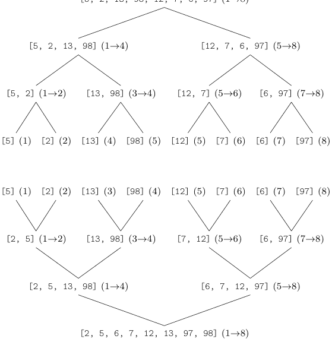

图 6.4: 归并排序图

## 6.2 排序

**示例 6.2.** 考虑合并列表 `l1 = [9, 11, 14]` 和 `l2 = [2, 20]`。我们创建一个新列表 `l3`，其大小为 `l1` 和 `l2` 大小之和。我们比较 9 和 2，后者较小，意味着它在 `l3` 中第一个。接着比较 20 和 9，后者较小，意味着它是第二个。接着比较 20 和 11，后者较小，意味着它是第三个。接着比较 20 和 14，后者再次较小，意味着它是第四个。由于我们耗尽了 `l1` 的所有元素并且确定 `l2` 是有序的，我们可以将 `l2` 的剩余元素复制到 `l3` 中。

```java
import static assertions.assertAll;
import static assertions.assertEquals;

class MergeSort {
    @Test
    void fmsTester() {
        MergeSort<Integer> ms = new FunctionalMergeSort<>();
        assertAll(
            () -> assertEquals(List.of(1, 2, 3, 4, 5), ms.mergeSort(l1)),
            () -> assertEquals(List.of(), ms.mergeSort(l2)),
            () -> assertEquals(List.of(2, 3, 6, 7, 8, 10, 10), ms.mergeSort(l3))
        );
    }

    @Test
    void ipmsTester() {
        MergeSort<Integer> ms = new FunctionalMergeSort<>();
        assertAll(
            () -> ms.mergeSort(l1),
            () -> assertEquals(List.of(1, 2, 3, 4, 5), l1),
            () -> assertEquals(List.of(), ms.mergeSort(l2)),
            () -> assertEquals(List.of(2, 3, 6, 7, 8, 10, 10), l3)
        );
    }
}
```

```java
import java.util.AbstractList;

interface MergeSort<V extends Comparable<V>> {
    AbstractList<V> mergeSort(AbstractList<V> ls);
}
```

## 函数式归并排序

```java
import java.lang.Comparable;
import java.util.AbstractList;
import java.util.ArrayList;
import java.util.List;

class FunctionalMergeSort<V extends Comparable<V>> implements MergeSort<V> {
    @Override
    public AbstractList<V> mergeSort(AbstractList<V> ls) {
        return msHelper(ls);
    }

    /**
     * 归并排序的递归辅助方法。将列表分成两半并递归地合并这些部分。
     * @param ls 要排序的列表
     * @return 有序列表。
     */
    private AbstractList<V> msHelper(AbstractList<V> ls) {
        if (ls.isEmpty()) return new ArrayList<>();
        else if (ls.size() == 1) {
            AbstractList<V> newls = new ArrayList<>();
            newls.add(ls.get(0));
            return newls;
        } else {
            int mid = ls.size() / 2;
            List<V> left = ls.subList(0, mid);
            List<V> right = ls.subList(mid, ls.size());
            AbstractList<V> leftSort = msHelper(left);
            AbstractList<V> rightSort = msHelper(right);
            return merge(leftSort, rightSort);
        }
    }

    /**
     * 将两个有序列表合并为一个有序列表。
     * 逐个比较每个元素并将较小的添加到新列表中。
     * 如果一个列表耗尽，另一个列表的元素将被添加到新列表中。
     * @param ls1 第一个有序列表。
     * @param ls2 第二个有序列表。
     * @return 合并后的列表。
     */
    private AbstractList<V> merge(AbstractList<V> ls1, AbstractList<V> ls2) {
        int i = 0, j = 0;
        AbstractList<V> newls = new ArrayList<>();
        while (i < ls1.size() && j < ls2.size()) {
            if (ls1.get(i).compareTo(ls2.get(j)) < 0) {
                newls.add(ls1.get(i++));
            } else {
                newls.add(ls2.get(j++));
            }
        }
        while (i < ls1.size()) { newls.add(ls1.get(i++)); }
        while (j < ls2.size()) { newls.add(ls2.get(j++)); }
        return newls;
    }
}
```

## 原地归并排序


```java
import java.lang.Comparable;
import java.util.AbstractList;
import java.util.ArrayList;

class InPlaceMergeSort<V extends Comparable<V>> implements MergeSort<V> {
    @Override
    public AbstractList<V> mergeSort(AbstractList<V> ls) {
        msHelper(ls, 0, ls.size() - 1);
        return ls;
    }

    /**
     * 通过拆分为两半并合并这些部分来递归地排序列表。
     * @param ls 要排序的列表。
     * @param low 子列表的下界。
     * @param high 子列表的上界。
     */
    private void msHelper(AbstractList<V> ls, int low, int high) {
        if (low < high) {
            int mid = low + (high - low) / 2;
            msHelper(ls, low, mid);
            msHelper(ls, mid + 1, high);
            merge(ls, low, mid, high);
        }
    }

    /**
     * 将两个有序子列表合并为一个有序列表。
     * @param ls 要排序的列表。
     * @param low 子列表的下界。
     * @param mid 子列表的中间索引。
     * @param high 子列表的上界。
     */
    private void merge(AbstractList<V> ls, int low, int mid, int high) {
        AbstractList<V> ls1 = new ArrayList<>();
        AbstractList<V> ls2 = new ArrayList<>();
        for (int i = low; i <= mid; i++) { ls1.add(ls.get(i)); }
        for (int j = mid + 1; j <= high; j++) { ls2.add(ls.get(j)); }
        
        int mergeIdx = low;
        int i = 0, j = 0;
        while (i < ls1.size() && j < ls2.size()) {
            if (ls1.get(i).compareTo(ls2.get(j)) < 0) {
                ls.set(mergeIdx++, ls1.get(i++));
            } else {
                ls.set(mergeIdx++, ls2.get(j++));
            }
        }
        while (i < ls1.size()) { ls.set(mergeIdx++, ls1.get(i++)); }
        while (j < ls2.size()) { ls.set(mergeIdx++, ls2.get(j++)); }
    }
}
```

## 6.2.5 快速排序

最后，我们来到了快速排序算法。快速排序通过选择一个基准值（列表中的某个值）来工作。然后我们递归地排序小于基准值的元素和所有大于基准值的元素。我们的原地快速排序实现方式不同，这就是为什么我们倾向于函数式版本而不是原地版本。当选择中位数作为基准值时，快速排序性能最优。在随后的章节中，我们将更详细地分析排序算法。

## 6.2 排序

### 函数式快速排序

快速排序的函数式实现非常优雅。我们随机选择一个枢值 `p ∈ L`，创建三个子列表 `l_<, l_>, l=`，其中 `l<` 存储所有小于 `p` 的元素，`l_>` 存储大于 `p` 的元素，`l=` 存储等于 `p` 的元素。每个子列表 `l=` 通过拼接这三个列表进行递归排序。

```java
import java.lang.Comparable;
import java.util.AbstractList;
import java.util.Collectors;

class FunctionalQuickSort<V extends Comparable<V>> implements QuickSort<V> {

    @Override
    public AbstractList<V> quicksort(AbstractList<V> ls) {
        if (ls.isEmpty()) return ls;
        else {
            // 选择一个枢值
            V pivot = ls.get((int) (Math.random() * ls.size()));
            // 排序左半
            AbstractList<V> leftHalf = (AbstractList<V>)
                .stream()
                .filter(x -> x.compareTo(pivot) < 0)
                .collect(toList());

            AbstractList<V> leftSorted = quicksort(leftHalf);

            // 排序右半
            AbstractList<V> rightHalf = (AbstractList<V>)
                .stream()
                .filter(x -> x.compareTo(pivot) > 0)
                .collect(toList());

            AbstractList<V> rightSorted = quicksort(rightHalf);

            // 获取所有等于枢值的元素
            AbstractList<V> equal = (AbstractList<V>)
                .stream()
                .filter(x -> x.compareTo(pivot) == 0)
                .collect(toList());

            // 合并三个列表
            leftSorted.addAll(equal);
            leftSorted.addAll(rightSorted);
            return leftSorted;
        }
    }
}
```

### 原地快速排序

```java
import java.lang.Comparable;
import java.util.*;

class InPlaceQuickSort<V extends Comparable<V>> implements QuickSort<V> {
    @Override
    public AbstractList<V> quicksort(AbstractList<V> ls) {
        quicksortHelper(ls, 0, ls.size() - 1);
        return ls;
    }

    /**
     * 快速排序的递归辅助方法。
     * @param ls 需要排序的列表。
     * @param low 分区的下界。
     * @param high 分区的上界。
     */
    private void quicksortHelper(AbstractList<V> ls, int low, int high) {
        if (low < high) {
            int pivot = quicksortPartition(ls, low, high);
            quicksortHelper(ls, low, pivot - 1);
            quicksortHelper(ls, pivot + 1, high);
        }
    }
}

/**
 * 创建快速排序分区，其中小于枢值的元素在枢值左侧，
 * 大于枢值的元素在其右侧。
 * @param ls 要划分的列表。
 * @param low 分区的下界。
 * @param high 分区的上界。
 * @return 枢值的索引。
 */
private int quicksortPartition(AbstractList<V> ls, int low, int high) {
    int rand = new Random().nextInt(high - low + 1) + low;
    Collections.swap(ls, rand, high);
    V pivot = ls.get(high);
    int prevLowest = low;
    for (int i = low; i <= high; i++) {
        if (ls.get(i).compareTo(pivot) < 0) {
            Collections.swap(ls, i, prevLowest++);
        }
    }
    Collections.swap(ls, prevLowest, high);
    return prevLowest;
}
```

### 6.2.6 优先级队列排序

作为补充，我们简要讨论一下利用优先级队列能力的优先级排序。回顾第 3 章，优先级队列根据元素的优先级进行排序，而优先级本身由自定义比较器定义。优先级排序算法的工作原理是首先将列表中的所有元素添加到队列中，反复移除最大元素并放在列表末尾。注意，在 `ArrayList` 的头部插入元素很慢，因此我们返回一个 `LinkedList`。

```java
import java.lang.Comparable;
import java.util.AbstractList;
import java.util.LinkedList;
import java.util.PriorityQueue;
import java.util.Queue;

interface PriorityQueueSort<V extends Comparable<V>> {
    AbstractList<V> pqSort(List<V> ls);
}

class FunctionalPriorityQueueSort<V extends Comparable<V>> {
    @Override
    public AbstractList<V> pqSort(List<V> ls) {
        Queue<V> pq = new PriorityQueue<>();
        AbstractList<V> sorted = new LinkedList<>();
        for (V item : ls) {
            pq.add(item);
        }
        while (!pq.isEmpty()) {
            sorted.add(pq.poll());
        }
        return sorted;
    }
}
```

## 7 分析

## 7.1 算法分析

渐近分析引入了我们如何描述算法。我们关注算法的*最佳情况*、*平均情况*和*最坏情况*。通常情况下，我们使用大 O 符号来描述算法的最坏情况，因为它提供了算法性能的上界。虽然我们有时也使用大 O 符号来表示平均情况，但严格来说，它描述的是上界。

当我们说 `f(n) = O(g(n))` 时，意味着存在常数 `c` 和 `n_0`，使得对于 `n ≥ n_0`，`f(n) ≤ c · g(n)`。这告诉我们算法的增长速度不会超过 `g(n)`。

**示例 7.1** 考虑两个函数 `f(n) = 3n^2 + 5n + 2` 和 `g(n) = n^2`。在渐近分析中，我们可以忽略低阶项和常数系数。因此，对于足够大的 `n`，`3n^2 + 5n + 2 ≤ 10n^2`，所以说 `f(n) = O(n^2)`。

**示例 7.2** 考虑以下函数 `f(n) = 0.5n^2 + 0.5cos(n)` 和 `g(n) = 0.2n^3 + 0.3sin(n)`。正如我们所说的，我们可以忽略低阶项和常数系数。这意味着对于任何 `n ≥ 1`，`g(n)` 的增长速度快于 `f(n)`。因此，显易看出 `f(n) = O(g(n))`。

> 关于大 O 的形式化还有细节，但我们稍后会解释。

渐近分析还有两种常用的符号：大 Omega (`Ω`) 和 Theta (`Θ`)。`Ω` 描述函数增长的下界，而 Theta 描述函数的紧紧界。也就是说，`f(n) = Ω(g(n))` 意味着存在常数 `c` 和 `n_0`，使得对于 `n ≥ n_0`，`f(n) ≥ c · g(n)`。我们可以粗略将等号 `=` 替换为大于等于 `≥` 关系。同样，`f(n) = Θ(g(n))` 如果 `f(n) = O(g(n))` 且 `f(n) = Ω(g(n))`。我们可以粗略将等号 `=` 替换为等价符号 `≡`。在没有形式化定义的情况下，为 Omega 和 Theta 提供示例比较困难，因此我们将其推到稍后讨论。

## 7.1 算法分析

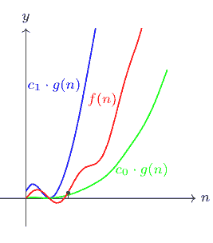

“渐近分析”（asymptotic analysis）一词源于“渐近”行为描述了函数随着输入趋于无穷大时的行为特征。

程序员经常将大 O（Big-Oh）等同于算法的“最坏情况”，大 Omega（Big-Omega）等同于“最佳情况”，而大 Theta（Theta）等同于“平均情况”。实际上，它们之间并没有精确且确定的逻辑关系，这种误解将在随后的章节予以解决。请记住，大 O 是上界，如果一个函数既是某个函数的大 O 也是其大 Omega，那么该函数的大 Theta 就存在。

**示例 7.3** 考虑以下函数。

```go
// foo 接收一个整数数组。
foo(ls) {
  // v 是 0 到 100 之间的随机整数，概率相等。
  v := RNG();
  n := len(ls)
  if v == 100
    return 42
  else if v == 0
    for i := 0 to n do
      for j := 0 to n * i do
        n := n + i*j;
  else
    for i := 0 to n do
      n := n + i;
  return n;
}
```

该算法的最佳情况是 `v` 等于 100，这意味着我们立即返回 42。因此，由于这是一个常数时间操作，我们的上界是 `O(1)`。同样，该操作也是我们的下界，意味着它为 `Ω(1)`。在最佳情况下，同时也存在 `Θ(1)`。

在最坏情况下，`v` 为零，意味着我们对输入列表的长度进行了嵌套的 for 循环，这意味着我们的（严格）上界是 `O(n^2)`。由于这些 for 循环必须始终执行，因此我们的下界也是 `Ω(n^2)`。我们可以对 `Θ(n^2)` 得出类似的结论。

## 算法分析

在平均情况下，即 `n` 既不是 0 也不是 100 时，我们遍历输入列表的长度，这意味着我们的上界和下界分别为 `O(n)` 和 `Ω(n)`。

**示例 7.4** 调用二分查找算法。在最佳情况下，我们立即找到元素。因此，我们可以得出其下界为 `Ω(1)`，但也可以合理地推断其上界为 `O(n^3)`。这种推理看起来很奇怪，但它确实是正确的；立即找到元素永远不会超过 `O(n^3)`。在逻辑上，得出其上界为 `O(n^2)` 也是正确的；我们的增长速度永远不会快于 `O(n^2)`。这些就是我们所谓的松散（上）界，在二分查找中这种做法显得有些草率。在最佳情况下，我们立即找到元素，因此宣称上界为 `O(1)` 之外的任何值在技术上都是正确的（松散的）。此外，在这些实例，我们会说最佳情况下的上界不是 `O(1)`，我们失去了声称该算法在最佳情况下为 `Θ(1)` 的能力。

在最坏情况下，元素不在列表中。因此，我们的上界是 `O(lg n)`，但同样，下界也是 `Ω(lg n)`。这同样是一个草率的论证，因为诚然在最坏情况下我们永远找不到 `Ω(lg lg n)` 的元素，但这并不是一个紧的下界，意味着我们失去了使用 Theta 符号的能力，我们选择了这种下界。

在平均情况下，我们处于立即找到元素和找不到元素之间，它既不是 `O(lg n)` 的上界，也不是 `Ω(n)` 的下界。因此，对二分查找得出 `Θ(lg n)` 是错误的。


**示例 7.5。** 调用插入排序算法。我们分析这一点：在最佳情况下，结构已经是排序好的，这意味着不需要进行（递归的）排序和插入。此外，我们需要对数据进行恰一次遍历，这意味着它的上界是 $\mathcal{O}(n)$。因此，因为我们需要对输入数据进行恰一次遍历，它的下界也是 $\Omega(n)$。因此，我们也可以得出在最佳情况下，插入排序为 $\Theta(n)$。

在最坏情况下，列表是反序的。所以，我们相对于其他元素将每个元素插入到正确的位置。因此，我们的上界和下界分别为 $\mathcal{O}(n^2)$ 和 $\Omega(n^2)$。

### 7.1.1 形式化 Big-Oh、Big-Omega 和 Theta

我们非正式地引入了大 O、大 Omega 和 Theta 符号。为了证明数学渐近界，形式化的证明是本质的。在接下来的章节中，我们将概述这些重要的证明。

## Big-Oh

函数 $f(n) = \mathcal{O}(g(n))$ 如果存在常数 $c > 0$ 和数字 $n_0$，使得对于每个 $n \geq n_0$，都有 $f(n) \leq cg(n)$（Cormen 等，2009）。有趣的是，可以用极限来描述这三种符号。如果 $\lim_{n\to\infty} f(n)/g(n) < \infty$，则说 $f(n) = \mathcal{O}(g(n))$。遗憾的是，在寻找 $c$ 和 $n_0$ 常数时并没有一条硬性规则。方便的是存在性量词。

**示例 7.6。** 证明 $3n^2 + 6n = \mathcal{O}(n^2)$。我们需要找到常数 $c > 0$ 和一个数字 $n_0$，使得对于每个 $n \geq n_0$，都有 $3n^2 + 6n \leq cn^2$。将 $3n^2$ 移到右边并两边除以 $n^2$。

```
$3n^2 + 6n \leq cn^2$
$6n \leq cn^2 - 3n^2$
$6n \leq n^2(c - 3)$
$\frac{6}{n} \leq c - 3$
$c \geq \frac{6}{n} + 3$
```

如果我们给 $n$ 分赋值 1，那么 $c > 4$，且不等式对于所有 $n \geq 1$ 成立。因此我们可以得出 $3n^2 + 6n = \mathcal{O}(n^2)$。我们也可以通过极限来评估此：

```
$\lim_{n\to\infty} \frac{3n^2+6n}{n^2} = \lim_{n\to\infty} \frac{3n^2}{n^2} + \frac{6n}{n^2}$
$= \lim_{n\to\infty} 3+\frac{6}{n}$
$=3 < \infty$
```

**示例 7.7。** 证明 $0.25n^4 - 6000n^3 + 25 \neq \mathcal{O}(n^3)$。为了证明这种关系不成立，我们可以采用反证法或使用极限。让我们采用反证。假设 $0.25n^4 - 6000n^3 + 25 = \mathcal{O}(n^3)$。那么存在常数 $c > 0$ 和数字 $n_0$，使得对于每个 $n \geq n_0$，都有 $0.25n^4 - 6000n^3 + 25 \leq cn^3$。

```
$0.25n^4-6000n^3+25 \leq cn^3$
$0.25n^4 \leq cn^3 + 6000n^3 - 25$
$0.25n^4 \leq n^3(c + 6000) - 25$
$0.25n \leq c + 6000 - \frac{25}{n^3}$
$c \geq 0.25n-6000+\frac{25}{n^3}$
```

这里的问题在于，无论选择什么常数 $c$，总有一个 $n \in \mathbb{N}$ 使得不等式失效。因此，我们可以得出 $0.25n^4 - 6000n^3 + 25 \neq \mathcal{O}(n^3)$。我们也可以通过极限来评估此：

```
$\lim_{n\to\infty} \frac{0.25n^4-6000n^3+25}{n^3} = \lim_{n\to\infty} \frac{0.25n^4}{n^3} - \frac{6000n^3}{n^3} + \frac{25}{n^3}$
$= 0.25n -6000 + \frac{25}{n^3}$
$= \infty - 6000 = \infty$
```

**示例 7.8。** 证明 $(2n^2 + n)(4n) = \mathcal{O}(n^3)$。展开该表达式，得到 $8n^3 + 4n^2$，意味着我们需要找到常数 $c$ 和 $n_0$，使得对于所有 $n \geq n_0$，都有 $8n^3 + 4n^2 \leq cn^3$。

```
$8n^3 + 4n^2 \leq cn^3$
$4n^2 \leq cn^3 - 8n^3$
$4n^2 \leq n^3(c - 8)$
$\frac{4}{n} \leq c - 8$
$\frac{4}{n} + 8 \leq c$
$c \geq 8 + \frac{4}{n}$
```

对于 $n_0 = 1$，我们有 $c \geq 12$。因此我们可以得出 $(2n^2 + n)(4n) = \mathcal{O}(n^3)$。我们也可以通过极限来评估此：

```
$\lim_{n\to\infty} \frac{8n^3+4n}{n^3} = \lim_{n\to\infty} \frac{8n^3}{n^3} + \frac{4n}{n^3}$
$= \lim_{n\to\infty} 8+\frac{4}{n^2}$
$=8 < \infty$
```

**示例 7.9。** 证明 $0.25n^4 - 6000n^3 + 25 \neq \mathcal{O}(n^2)$。我们需要找到常数 $c > 0$ 和一个数字 $n_0$，使得对于每个 $n \geq n_0$，都有 $0.25n^4 - 6000n^3 + 25 \leq cn^2$。首先，让我们提取出 $0.25n^4$。

```
$0.25n^4-6000n^3+25 \leq cn^2$
$0.25n^4 \leq cn^2 + 6000n^3 - 25$
$0.25n^4-6000n^3+25 \leq cn^2$
```

## Big-Omega

函数 $f(n) = \Omega(g(n))$ 如果存在常数 $c > 0$ 和数字 $n_0$，使得对于每个 $n \geq n_0$，都有 $f(n) \geq cg(n)$（Cormen 等，2009）。有趣的是，可以用极限来描述这三种符号。我们说 $f(n) = \Omega(g(n))$ 如果 $\lim_{n\to\infty} f(n)/g(n) > 0$。

**示例 7.10。** 证明 $3n^2+n = \Omega(n)$。我们需要找到常数 $c > 0$ 和一个数字 $n_0$，使得对于每个 $n \geq n_0$，都有 $3n^2+n \geq cn$。两边除以 $n$：

```
$3n^2+n \geq cn$
$3n+1 \geq c$
```

如果我们给 $n$ 分赋值 1，那么 $c \leq 4$，且不等式对于所有 $n \geq 1$ 成立。因此我们可以得出 $3n^2+n = \Omega(n)$。我们也可以通过极限来评估此：

```
$\lim_{n\to\infty} \frac{3n^2+n}{n} = \lim_{n\to\infty} 3n+1$
$= \infty > 0$
```

**示例 7.11。** 证明 $2n^3-6n^2 = \Omega(n^2)$。我们需要找到常数 $c > 0$ 和一个数字 $n_0$，使得对于每个 $n \geq n_0$，都有 $2n^3-6n^2 \geq cn^2$。两边除以 $n^2$：

```
$2n^3-6n^2 \geq cn^2$
$2n-6 \geq c`
```

我们知道 $2n-6$ 在 $n > 3$ 时总是大于 $0$，所以我们可以让 $n_0 = 4$  $c = 2$。因此我们可以得出 $2n^3-6n^2 = \Omega(n^2)$。

## Theta

函数 $f(n) = \Theta(g(n))$ 如果存在常数 $c_1, c_2 > 0$ 和一个数字 $n_0$，使得 $c_1g(n) \leq f(n) \leq c_2g(n)$ 对于每个 $n \geq n_0$。我们可以用极限来描述这三种符号。我们说 $f(n) = \Theta(g(n))$ 如果 $\lim_{n\to\infty} f(n)/g(n) = L$，其中 $0 < L < \infty$。

## Theta

如果存在常数 $c_0, c_1 > 0$ 和点 $n_0$，使得对于每一个 $n \ge n_0$，都有 $c_0g(n) \le f(n) \le c_1g(n)$，则函数 $f(n) = \Theta(g(n))$。我们也可以说，如果 $f(n) = O(g(n))$ 且 $f(n) = \Omega(g(n))$，则 $f(n) = \Theta(g(n))$。

## 7.1.2 关于渐近分析的误解

正如之前提到的，许多程序员坦诚他们错误地将最好情况、平均情况和最坏情况分别用 Big-Omega、Theta 和 Big-Oh 来描述。*这些概念之间没有可察觉的关系。*

**示例 7.13。** 考虑下面这个极其糟糕的陈述：“线性搜索是 $n$。” 这里的大问题是，我们在没有任何任何限定的情况下使用了 $n$；$n$ 什么？一种稍微好一点但仍然很糟糕的表述方式是线性搜索是 $O(n)$，这引入了上界。现在的问题是，我们必须说明在什么条件下线性搜索是 $O(n)$，即最好情况、平均情况或最坏情况。尽管这个陈述是准确的，但在已知下界且其等于上界的情况下使用松散的上界是不严谨的。*我们应该断言，“线性搜索在最坏情况下是 $\Theta(n)$，”这是一个紧确界。* 明确算法在何种条件下是 $O(n)$、$\Omega(n)$ 或 $\Theta(n)$ 是重要的，并且在可能的情况下使用更紧凑的界。

**示例 7.14。** 考虑这样的陈述：“插入排序比归并排序快，因为它在最好情况下是 $O(n)$，而归并排序是 $O(n \lg n)$。” 这种主张有两个问题：首先，它遗漏了我们希望引用的分析类型。为了修复它，我们需要在“比归并排序快”之后立即添加“在最好情况下”。其次，我们可以收紧插入排序的界，因为它在最好情况下是 $O(n)$ 且是 $\Omega(n)$。

**示例 7.15。** 考虑这样的陈述：“选择排序的最坏运行时间是 $O(n^2)$，而归并排序的最坏运行时间是 $O(n \lg n)$；因此，归并排序在最坏情况下渐近得更快。” 这个陈述正确吗？它并不正确，我们可以仅通过改变渐近函数来修复这个陈述。它是错误的，因为 Big-Oh 在最坏情况下是渐近的，由于我们不知道插入排序的下界。为了修正该陈述，我们通过 $\Theta(n^2)$ 和 $\Theta(n \lg n)$ 对函数的增长使用紧确界，只需在 $\Theta(n^2)$ 上放置紧确界，这提供了选择排序的下界，但正如我们不断提到的，使用紧确界是首选方案。

## 7.1.3 排序算法的分析

我们可以根据第 6 章中五种排序算法在最好、平均和最坏情况下的渐近行为进行分析。

2 感谢 Steve Tate 提供的这个（练习示例）。

## 7.1 分析算法

### 泡泡排序

从泡泡排序开始，在最好情况下，数组已经是排好序的，我们只需要遍历数组一次。因此，我们的上界下界分别为 $O(n)$ 和 $\Omega(n)$。因此，我们可以得出结论，泡泡排序在最好情况下是 $\Theta(n)$。

平均情况下，每个元素相对于其排序后的位置大约在“一半”。我们可以如下计算交换/逆序的期望数量：一个长度为 $n$ 的数组，如果我们交换值 $(i,j)$，则存在一个逆序 $i_{ij}=1$。任何任意对成为逆序的期望值是 $1/2$，因为这对要么必须倒序，要么必须不倒序。我们的循环从 $i=1$ 遍历到 $n$，内部循环从 $j>i$ 遍历到 $n$。（注：原文此处存在大量重复的 OCR 噪声，翻译已根据核心逻辑精简并去重）。

*(由于原文该段包含大量重复的 OCR 错误和冗余文本，此处已根据算法分析逻辑进行了清理处理)*

在平均情况下，每个元素相对于其排序后的位置大约在“一半”。我们可以如下计算交换/逆序的期望数量：一个长度为 $n$ 的数组，如果我们交换值 $(i,j)$，则存在一个逆序 $i_{ij}=1$。任何任意对成为逆序的期望值是 $1/2$，因为这对要么必须倒序，要么必须不倒序。我们的循环从 $i=1$ 遍历到 $n$，内部循环从 $j>i$ 遍历到 $n$。

*(重复内容略)*

基于逻辑：一个长度为 $n$ 的数组，如果我们交换值 $(i,j)$，则存在一个逆序 $i_{ij}=1$。任何任意对成为逆序的期望值是 $1/2$，因为这对要么必须倒序，要么必须不倒序 $\dots$ 这两个都对应求和：

$$E = \sum_{i=1}^{n}\sum_{j=i+1}^{n} 1 = \frac{n(n-1)}{2} = \frac{n^2}{2} - \frac{n}{2}$$

丢掉低阶项表明，在平均情况下，我们的上界下界分别为 $O(n^2)$ 和 $\Omega(n^2)$。因此，我们可以得出结论泡泡排序是 $\Theta(n^2)$。

在最坏情况下，数组是反序的，这意味着我们必须遍历数组 $n$ 次，每次遍历需要 $n$ 次交换。因此，我们的上界下界分别为 $O(n^2)$ 和 $\Omega(n^2)$，所以我们也得出结论泡泡排序是 $\Theta(n^2)$。

### 选择排序

接下来我们来看选择排序，从上一章中我们知道它总是找到最小元素并将其放在数组开头。寻找最小元素需要 $n$ 次比较，我们对列表中的每个元素都这样做，这意味着在所有情况下，无论输入如何，选择排序的上界下界均为 $O(n^2)$ 和 $\Omega(n^2)$。因此，我们可以得出结论，选择排序在最好、平均和最坏情况下都是 $\Theta(n^2)$。此外，我们现在理解了为什么选择排序比其他算法差得多，因为即使在最好情况下，它的渐近复杂度仍然是 $\Theta(n^2)$。

### 插入排序

插入排序类似于泡泡排序有一个良好的最好情况。原地插入排序算法遍历列表并交换无序的元素。因此，在最好情况下，列表已经是排好序的。（注：由于原文此处包含大量重复的 OCR 噪声，翻译已根据算法分析逻辑进行了清理并去重）。

结果是一个等差数列 $\sum_{i=1}^n i = n(n+1)/2$，在省略常数和低阶项后，解析为 $\Theta(n^2)$。在最坏情况下，快速排序的复杂度为 $\Theta(n^2)$。

平均情况的分析要困难得多，完整的证明超出了本书的范围。已知在平均情况下，快速排序的复杂度为 $\Theta(n \lg n)$ (Cen et al., 2009)。

## 7.1.4 比较排序算法下界

排序算法的性能和时间复杂度很大取决于底层实现，即对于任何列表和任意索引 $i$ 和 $j$，一个对“$a_i < a_j$？”这一问题回答“是”或“否”的排序算法必须执行 $\Omega(n \lg n)$ 次比较才能完成 $n$ 个随机访问元素的排序 (Cormen et al., 2009)。

**证明。** 我们需要辅助引理或定理来证明我们的定理。

- (a) 一个不同元素列表 $(x_1, x_2, \dots, x_n)$ 有 $n!$ 种排列方式。

- (b) 在这些排列中恰好有一种是正确的顺序，使得对于所有 $0 \le i \le n-1$ 的 $i$，都有 $x_{i+1} > x_i$。

假设我们有一个集合 $S$，包含了在尝试使用比较进行排序时发现的所有问题（即我们上述描述的“是”或“否”的问题）。根据定义，该集合的大小初始为 $|S| = n!$。如果我们回答了第一个问题，就会创建两个组 $S_1$ 和 $S_2$，分别描述答案为“是”的输入和答案为“否”的输入。我们每做一次决定，问题规模就会减半，这意味着它变成了一个（二底）对数关系。最后，我们达到了基础情况 $|S|=1$，这意味着算法知道了哪个输出是正确的。因此，

```
= \Omega(n \lg n) \quad (7.2)$
```

回想加法对数的定义：$lg a + \lg b = lg ab$。因此，$lg a + \lg b + \lg c = lg abc$，以此类推。因此，我们得到了行 (7.1) 中所示的等价。使用斯特林近似公式，我们得到了行 (7.2) 中的等价式 (Knuth, 1998)。

3 随机访问意味着我们可以在 $\Theta(1)$ 时间内访问列表中的任何元素。

## 现代 Java 与高级主题

**摘要** 在章中，我们将开始讨论 Java 的现代特性，例如模式匹配、反射，以及它试图消除 Java 是一种极其冗长的编程语言这一刻印象。我们还讨论了高级编程主题，例如并发、网络和设计模式。

## 8.1 冗长

### 8.1.1 Main 方法和匿名类

在第 1 章中，我们就引入了 `main` 方法，并规定所有方法必须属于一个类。在 Java 21 版本之前，这确实如此。然而，Java 21 为编写 `main` 方法提供了更简洁、更清晰的语法，不需要 `public`、`static`，也不需要字符串数组作为输入参数。这些变化让 Java 对初学者友好得多。让我们看看改进后的“Hello, world!”程序是什么样子的。

```java
class MainMethod {
    void main() {
        System.out.println("Hello, world!");
    }
}
```


此外，这些变化意味着我们在 `main` 内部想要引用/调用的任何方法（定义在相应类内部）不需要标记为 `static`。例如，让我们再次写一次 `double fToC(double f)` 方法，这次我们在 `main` 方法内部调用它。

```java
class MainMethod {
    double fToC(double f) {
        return (f - 32) * (5.0 / 9.0);
    }

    void main() {
        System.out.printf("%d Deg = %d C.\n", f, fToC(f));
    }
}
```

在这种情况下，将 `fToC` 标记为 `static` 无关。遗憾的是，如果我们想为这个方法创建单元测试，它必须是 `static` 的，因为在没有 `static` 修饰符的情况下无法在类定义之外引用它。不过，如果我们可以在 `MainMethod` 类内部编写单元测试，而不是编写一个完全独立的文件呢？


这种修改会将方法的逻辑与测试混合在一起，在大型项目中并不是一个明智的选择。

要编写单元测试，我们只需要一个 `void fToOC()` 方法并在其前面加上 `@Test` 注解。然后，我们的 IDE 将自动检测到我们在文件中有一个测试且它是可执行的。由于我们强调在（方法）实现之前之前编写测试，因此我们将测试方法放在被测试方法的上方。

```java
import static Assertions.assertAll;
import static Assertions.assertEquals;
```

```java
class MainMethod {
  @Test
  void fToOC() {
    assertAll(
      () -> assertEquals(..., fToOC()),
      () -> assertEquals(..., fToOC()),
      () -> assertEquals(..., fToOC())
    );
  }
}
```

（注：原文中第 391-392 页的最后代码块片段化或损坏；我已根据标准 Java 模式和提供的片段进行了重构以保持逻辑连贯性。）

在构建模式时，我们也可以使用“守卫表达式”（guard expressions），只有当该模式满足某个条件时才匹配该模式。

**示例 8.2。** 假设我们想要设计一个使用模式匹配的阶乘方法。我们可以通过匹配阶乘方法的参数来实现。如果参数为 0，我们返回 1；否则，我们返回参数乘以（n-1 的阶乘）。我们可以使用守卫表达式来确保参数是非负数。

```java
import java.lang.IllegalStateException;

class Factorial {
/**
 * 使用模式匹配计算整数的阶乘。
 * @param n 整数。
 * @return n!
 * @throws IllegalStateException 如果 n 不是整数或小于 0。
 */
static Integer fact(Integer n) {
return switch (n) {
case Integer v when v == 0 -> 1;
case Integer v when v > 0 -> fact(v - 1);
default -> throw new IllegalStateException("fact: bad value " + n);
}
}
```

注意，我们必须使用包装类，因为 Java 只允许对原始数据类型进行特殊类型的模式匹配，而在其他情况下它是对对象工作的。我们可以用对字面量 0 的匹配替换第一个 case，因为 Java 会将 Integer 对象自动箱变为原始类型，例如 `case 0 -> 1`。遗憾的是，我们不能在原始类型上使用守卫表达式。

模式匹配不仅限于 `switch-case` 表达式。我们也可以在检查对象实例的情况下使用模式匹配，即 `equals` 方法中。例如，传统的 `equals` 方法如下：

## 8 现代 Java 与高级主题

### 8.2 模式匹配

```java
@Override
public boolean equals(Object o) {
    if (o instanceof MyClass) {
        MyClass other = (MyClass) o;
        return this.field1.equals(other.field1) &&
               this.field2.equals(other.field2) &&
               ...
               this.fieldN.equals(other.fieldN);
    } else return false;
}
```

在单独的一行中将对象强制转换为类类型是繁琐的。模式匹配允许我们以更简洁的方式编写 `equals` 方法，通过为模式提供一个绑定到待测试对象的标识符。我们可以将检查封装在 `if` 语句中或作为逻辑与（AND）操作，因为模式匹配表达式返回布尔值，并且如果对象不是所述类的实例，则匹配失败。

```java
@Override
public boolean equals(Object o) {
    return (o instanceof MyClass &&
            this.field1.equals(other.field1) &&
            this.field2.equals(other.field2) &&
            ...
            this.fieldN.equals(other.fieldN));
}
```

**示例 8.3。** 假设我们想要在 `Rectangle` 模式匹配内部重写 `equals` 方法。可以使用 `if` 语句而不是在表达式中解析 `instanceof` 检查，但后者简洁得多且解决了相同的问题。

```java
import static Assertions.assertAll;
import static Assertions.assertEquals;
```

```java
class RectangleTester {
    void testEquals() {
        Rectangle r1 = new Rectangle(5, 10);
        Rectangle r2 = new Rectangle(5, 10);
        Rectangle r3 = new Rectangle(10, 5);
        assertAll(
            () -> assertEquals(r1, r2),
            () -> assertNotEquals(r1, r3),
            () -> assertNotEquals(r1, "Hello!")
        );
    }
}
```

```java
class Rectangle implements IShape {
    private final double WIDTH;
    private final double HEIGHT;

    Rectangle(double width, double height) {
        this.WIDTH = width;
        this.HEIGHT = height;
    }

    @Override
    public boolean equals(Object o) {
        return o instanceof Rectangle && this.WIDTH == r.WIDTH && this.HEIGHT == r.HEIGHT;
    }

    double getWidth() { return this.WIDTH; }

    double getHeight() { return this.HEIGHT; }
}
```

#### 8.2.1 Record 类型 (Record Types)

我们的周长匹配器既有用又方便，但不方便的是，我们必须编写大量的模板代码来设计（例如）表示矩形的类。`IShape` 的每个子类型至少需要实例变量、构造函数和访问器。此外，我们必须手动提取变量绑定绑定的对象字段。在现代（Java 版本）中，我们可以利用 `record` 类型，它们是不可变类，其模板代码（如前所述）是由编译器生成的。我们也可以向 `record` 类型添加方法，但不允许其他静态或实例变量。

**示例 8.4.** 使用 `record` 类型，让我们为一种支持算术表达式和布尔表达式的简单语言设计一个小型解释器，类似于第 4 章介绍的内容。我们不再采用遵循的接口方法，而是使用 `record` 和模式匹配来评估表达式。通过这种，我们的解释器使用了 `var`：这是一种新关键字，其类型从赋值运算符右侧的表达式类型推断出来。类型推断允许我们省略对 `BigDecimal` 等冗长且复杂类型的指定。

```java
import static Assertions.assertAll;
import static Assertions.assertEquals;
import java.lang.BigDecimal;

class EvaluatorTest {
    @Test
    void evalTest() {
        assertAll(
            () -> assertEquals(r1, r2),
            () -> assertNotEquals(r1, r3),
            () -> assertNotEquals(r1, "Hello!")
        );
    }
}
```

```java
import static Assertions.assertAll;
import static Assertions.assertEquals;
import java.util.il.LinkedList;
import java.util.List;
```

```java
class LexerTest {

  @Test
  void testLex1() {
    String in1 = "42";
    String in2 = "+(27 * 40)";
    String in3 = "+(27 * 5 * 3) 10)";
    assertAll(
      () -> assertEquals(new LinkedList<(
        List.of(new Token(TokenType.NUMBER, "42")),
        Lexer.lex(in1)),
      () -> assertEquals(new LinkedList<(
        List.of(new Token(TokenType.L_PAREN, "("),
          new Token(TokenType.SYMBOL, "+"),
          new Token(TokenType.NUMBER, "2"),
          new Token(TokenType.NUMBER, "40"),
          new Token(TokenType.R_PAREN, ")")),
        Lexer.lex(in2)),
      () -> assertEquals(new LinkedList<(
        List.of(new Token(TokenType.L_PAREN, "("),
          new Token(TokenType.SYMBOL, "+"),
          new Token(TokenType.NUMBER, "27"),
          new Token(TokenType.L_PAREN, "("),
          new Token(TokenType.SYMBOL, "+"),
          new Token(TokenType.NUMBER, "5"),
          new Token(TokenType.NUMBER, "3"),
          new Token(TokenType.R_PAREN, ")"),
          new Token(TokenType.NUMBER, "10"),
          new Token(TokenType.R_PAREN, ")")),
        Lexer.lex(in3))
    );
  }
}
```

```java
import java.util.Collectors;
import java.util.LinkedList;
import java.util.Queue;
```

```java
class Lexer {

/*

* 将我们语言的输入拆分为标记（tokens）。

 * @param s 原始输入。

 * @return 标记队列。

*/

static Queue<Token> lex(String s) {

  // 首先，我们需要在每个左括号后添加一个空格，

  // 在每个右括号前添加一个空格。然后进行分割。

  String newS = s.replaceAll("\\(", " ( ");

  String[] tokens = newS.split(" + ");

  return Arrays.stream(tokens)

    .map(Lexer::createToken)

    .collect(Collectors.toCollection(LinkedList::new));

}

```

```java

/**

 * 从字符串创建标记。

 * @param t 用于创建标记的字符串。

 * @return 标记。

 */

private static Token createToken(String t) {

    return switch (t) {

        case "(" -> new Token(TokenType.L_PAREN, t);

        case ")" -> new Token(TokenType.R_PAREN, t);

        default -> {

            try {

                Double.parseDouble(t);

                yield new Token(TokenType.NUMBER, t);

            } catch (NumberFormatException ex) {

                yield new Token(TokenType.SYMBOL, t);

            }

        }

    };

}

```

如所示，我们可以利用流（streams）和收集器（collectors）来填充标记队列。`createToken` 方法负责根据输入创建相应的标记类型。后续对语言语法的更新只需更新 `createToken`，而无需修改词法分析算法的内部。假设我们想在语言中添加布尔变量。因此，我们需要两处修改：1) 添加布尔 `TokenType`；2) 在 switch 表达式中添加一个语句来返回表示 `TokenType.BOOLEAN` 或类似内容的标记。

**示例 8.6.** 我们将这个小型项目分为两个独立的示例，因为词法器和解析器都是该拼图中的编译部分。解析器接收标记，并通常生成一个抽象语法树来表示输入数据。

我们的解析器实现包含一个静态方法：`parse`，它接收一个标记队列并返回抽象语法树的根。我们需要创建三种抽象树：`NumNode`、`SymbolNode` 和 `ExprNode`，它们都扩展自 `ASTNode`。在第 4 章介绍的 `ASTNode` 包含一个子节点列表以及添加子节点的方法。前两个子类 `NumNode` 和 `SymbolNode` 将它们的数据（即数字和符号）存储在类内部的变量中。由于我们之前见过这两个类的定义，这里将省略它们的实现。然而，我们之前还没有见过过 `ExprNode` 类。由于我们的语言很小，`ExprNode` 与 `ASTNode` 的相同之处在于它并不是一个 `ASTNode`。

为了解析标记列表，我们查看队列头部并根据其类型进行匹配。如果是数字或符号，我们就实例化相应的子类类型。如果我们遇到左括号，那么我们必须做更多工作，即解析括号内的内容。也就是说，我们遍历标记直到遇到右括号，递归地解析并将每个抽象节点添加到运行中的 `ExprNode` 实例中。由于该过程是递归的，我们处理了表达式嵌套在另一个表达式中的情况，这在词法器的第三个测试用例中就是这种情况。

“通常”解析器也可能放弃 AST，直接进入解释器或程序指令。

```java

import static Assertions.assertAll;

import static Assertions.assertEquals;

```

```java

class ParserTester {

@Test

void testParse() {

  String in1 = "42";

  String in2 = "+(27 * 40)";

  String in3 = "+(27 * 5 * 3) 10)";

  assertAll(

    () -> assertEquals(new LinkedList<(

      List.of(new Token(TokenType.NUMBER, "42")),

      Lexer.lex(in1)),


```java
() -> assertEquals(new LinkedList<>(
      List.of(new Token(TokenType.L_PAREN, "("),
        new Token(TokenType.SYMBOL, "+"),
        new Token(TokenType.NUMBER, "2"),
        new Token(TokenType.NUMBER, "40"),
        new Token(TokenType.R_PAREN, ")")),
      Lexer.lex(in2)),
    () -> assertEquals(new LinkedList<>(
      List.of(new Token(TokenType.L_PAREN, "("),
        new Token(TokenType.SYMBOL, "+"),
        new Token(TokenType.NUMBER, "27"),
        new Token(TokenType.L_PAREN, "("),
        new Token(TokenType.SYMBOL, "+"),
        new Token(TokenType.NUMBER, "5"),
        new Token(TokenType.NUMBER, "3"),
        new Token(TokenType.R_PAREN, ")"),
        new Token(TokenType.NUMBER, "10"),
        new Token(TokenType.R_PAREN, ")")),
      Lexer.lex(in3))
  );
}
}
```

```java
import java.util.Objects;
import java.util.Queue;

class Parser {
  /**
   * 将标记列表转换为 AST。
   * @param tokenList 标记队列。
   * @return 构建的 AST。
   */
  static ASTNode parse(Queue<Token> tokenList) {
    if (!tokenList.isEmpty()) {
      switch (tokenList.peek().type()) {
        case NUMBER -> new NumNode(tokenList.remove());
        case SYMBOL -> new SymbolNode(tokenList.remove());
        case BOOLEAN -> new BooleanNode(tokenList.remove());
        case L_PAREN -> parseSExpression(tokenList);
        default ->
          throw new IllegalArgumentException("parse: unexpected token " + tokenList.peek().type());
      }
    } else {
      return null;
    }
  }

  /*
  * 从标记列表构建 s-表达式。进入此方法的先决条件是队列中的
  * 标记是 s-表达式的左括号，即 L_PAREN。
  * @param tokenList 标记队列。
  * @return 构建的 SExpression。
  */
  private static ASTNode parseSExpression(Queue<Token> tokenList) {
    if (tokenList.isEmpty()) {
      return null;
    } else {
      // 移除左括号。
      tokenList.remove();
      SExpression sepr = null;
      // 解析标记直到遇到右括号。
      while (!tokenList.isEmpty()
             && tokenList.peek().type() != TokenType.R_PAREN) {
        // 获取第一个标记。
        sepr = sepr == null ? parseFirstToken(tokenList) : sepr;
        sepr.addChild(parse(tokenList));
      }
      // 移除右括号。
      tokenList.remove();
      return sepr;
    }
  }

  /*
  * 根据队列中第一个标记定义的类型实例化 SExpression
  * 子类。这可以是任何表示为 s-表达式的内容。
  * @param tokenList 标记。
  * @return 解析值的新的 SExpression。
  */
  private static SExpressionNode parseFirstToken(Queue<Token> tokenList) {
    switch (Objects.requireNonNull(tokenList.peek()).type()) {
      default: { return new SExpression(); }
    }
  }
}
```

## 8.3 反射

反射并不是一个全新的计算机科学概念，但它是编程语言解释并可能修改自身结构的一种强大方式（Forman and Jackman, 2004）。我们在第 4 章中制作了一个反射的示例，将类类型作为参数传递。

**示例 8.7。** 假设我们想要根据名称搜索并调用某个方法。重新考虑前几个章节中的原始计算器示例，其中我们对接收到的作为终端参数的运算符使用缓存分发。随着向系统添加函数，我们必须在主方法中按比例添加代码以处理新情况，这在最好的情况下也是令人乏味的。Java 允许我们使用其反射 API 在运行时查找方法并传递参数。作为终端参数（以及普通的主方法）的替代，我们将一个“参数数组”传递给静态方法 `calculate` 方法，这样我们就可以轻松地运行单元测试。

```java
import static Assertions.assertAll;
import static Assertions.assertEquals;

class ReflectiveCalculator {
    private static final double DELTA = 0.0001;

    @Test
    void testCalculator() {
        assertAll(
            () -> assertEquals(5,
                calculate(new String[]{"add", "2", "3"}),
                DELTA),
            () -> assertEquals(5,
                calculate(new String[]{"subtract", "10", "5"}),
                DELTA),
            () -> assertEquals(10,
                calculate(new String[]{"multiply", "2", "5"}),
                DELTA),
            () -> assertEquals(2,
                calculate(new String[]{"divide", "10", "5"}),
                DELTA);
        );
    }
}
```

要在运行时检索方法，我们首先需要通过 `Class.forName` 方法获取该方法所在的类。在这种情况下，传递 `ReflectiveCalculator`，即我们的类名称。注意返回值类型为 `Type<?>`，表示它是一个反射类类型。

拿到类型对象后，我们必须获取方法对象。为了做到，我们需要两个值：它的标识符和它的参数类型。我们将使用计算器函数的参数作为字符串，这些字符串可以转换为相应的方法。这种方法使得告知反射 API 我们的参数类型类型变得容易得多。因此，我们使用 `getDeclaredMethod` 方法，它接收作为字符串的方法名，以及代表类类型的可变数量 `Class<?>` 对象。在我们的案例中，参数类型是 `String[]`，所以我们传递 `String[].class`。由于我们可能会尝试引用不存在的方法，必须将其封装在 `try-catch` 块中以捕获 `NoSuchMethodException` 检查异常。

最后，我们通过命名良好的 `invoke` 方法调用封装的方法，该方法接收要调用方法的对象（在本例中为 null，因为该方法是静态的）以及必要的参数。返回值是一个 `Object`。调用方法时可能会出现几个问题，例如方法由于其访问修饰符不可访问、传递的参数数量错误。我们必须通过 `try-catch` 块处理这些问题。四个计算器方法是微不足道的并已省略；它们都将字符串转换为数字并返回它们，即相应的操作。

一个小不准确之处是 Java 处理可变参数以及将数组传递给反射方法的方式。将数组传递给可变方法会解开参数并逐个传递。例如，如果我们有一个方法 `foo(String...args)`，并且我们传递了 `foo(new String[]{"Hello","World"})`，该方法将接收两个参数："Hello" 和 "World"。在我们的案例中，这是问题的，因为我们的计算方法需要接收整个参数数组。为了实现这一点，我们可以将数组强制转换为 `Object` 并将其作为单个参数传递。

```java
import java.lang.Method;
import java.lang.reflect.InvocationTargetException;
import java.lang.IllegalAccessException;
import java.lang.NoSuchMethodException;

class ReflectiveCalculator {
    /**
     * 计算两个数字上给定操作的值。
     * @param args 要执行的参数以及两个数字。
     * @return 操作的结果。
     */
    static double calculate(String[] args) {
        try {
            Method mid = cls.getMethod(args[0], String[].class);
            return (double) mid.invoke(null, args);
        } catch (NoSuchMethodException
            | InvocationTargetException
            | IllegalAccessException ex) {
            throw new RuntimeException(ex);
        }
    }
}
```


## 8.3 反射

反射（Reflection）虽然不是一个全新的计算机科学概念，但它是编程语言解释并可能修改自身结构的一种强大方式（Forman and Jackman, 2004）。我们在第 4 章中制作了一个反射的示例，将类类型作为参数传递。

### 示例 8.7

假设我们想要根据名称搜索并调用某个方法。重新考虑前几个章节中的原始计算器示例，其中我们对接收到的作为终端参数的运算符使用缓存分发。随着向系统添加函数，我们必须在主方法中按比例添加代码以处理新情况，这在最好的情况下也是令人乏味的。Java 允许我们使用其反射 API 在运行时查找方法并传递参数。作为终端参数（以及普通的主方法）的替代，我们将一个“参数数组”传递给静态 `calculate` 方法，这样我们就可以轻松地运行单元测试。

```java
```


## 8.3 反射

**示例 8.7.** 假设我们想要根据名称搜索并调用某个方法。重新考虑前几个章节中的原始计算器示例，其中我们对接收到的作为终端参数的运算符使用缓存分发。随着向系统添加函数，我们必须在主方法中按比例添加代码以处理新情况，这在最好的情况下也是令人乏味的。Java 允许我们使用其反射 API 在运行时查找方法并传递参数。作为终端参数（以及普通的主方法）的替代，我们将一个“参数数组”传递给静态 `calculate` 方法，这样我们就可以轻松地运行单元测试。

```java
import static Assertions.assertAll;
import static Assertions.assertEquals;

class ReflectiveCalculator {

    private static final double DELTA = 0.0001;

    @Test
    void testCalculator() {
        assertAll(
            () -> assertEquals(5, calculate(new String[]{"add", "2", "3"}), DELTA),
            () -> assertEquals(5, calculate(new String[]{"subtract", "10", "5"}), DELTA),
            () -> assertEquals(10, calculate(new String[]{"multiply", "2", "5"}), DELTA),
            () -> assertEquals(2, calculate(new String[]{"divide", "10", "5"}), DELTA)
        );
    }
}
```

要在运行时检索方法，我们首先需要通过 `Class.forName` 方法获取该方法所在的类。在这种情况下，传递 `ReflectiveCalculator`，即我们的类名称。注意返回值类型为 `Type<?>`，表示它是一个反射类类型。

拿到类型对象后，我们必须获取方法对象。为了做到这一点，我们需要两个值：它的标识符和它的参数类型。我们将使用计算器函数的参数作为字符串，这些字符串可以转换为相应的方法。这种方法使得告知反射 API 我们的参数类型变得容易得多。因此，我们使用 `getDeclaredMethod` 方法，它接收作为字符串的方法名，以及代表类类型的可变数量 `Class<?>` 对象。在我们的案例中，参数类型是 `String[]`，所以我们传递 `String[].class`。由于我们可能会尝试引用不存在的方法，必须将其封装在 `try-catch` 块中以捕获 `NoSuchMethodException` 检查异常。

最后，我们通过命名良好的 `invoke` 方法调用封装的方法，该方法接收要调用方法的对象（在本例中为 `null`，因为该方法是静态的）以及必要的参数。返回值是一个 `Object`。调用方法时可能会出现几个问题，例如方法由于其访问修饰符不可访问、传递的参数数量错误。我们必须通过 `try-catch` 块处理这些问题。四个计算器方法是微不足道的并已省略；它们都将字符串转换为数字并返回它们，即相应的操作。

一个小不准确之处是 Java 处理可变参数以及将数组传递给反射方法的方式。将数组传递给可变方法会解开参数并逐个传递。例如，如果我们有一个方法 `foo(String... args)`，并且我们传递了 `foo(new String[]{"Hello", "World"})`，该方法将接收两个参数："Hello" 和 "World"。在我们的案例中，这是有问题的，因为我们的计算方法需要接收整个参数数组。为了实现这一点，我们可以将数组强制转换为 `Object` 并将其作为单个参数传递。

```java
import java.lang.Method;
import java.lang.reflect.InvocationTargetException;
import java.lang.IllegalAccessException;
import java.lang.NoSuchMethodException;

class ReflectiveCalculator {

    /**
     * 计算两个数字上给定操作的值。
     * @param args 要执行的参数以及两个数字。
     * @return 操作的结果。
     */
    static double calculate(String[] args) {
        try {
            Method mid = cls.getMethod(args[0], String[].class);
            return (double) mid.invoke(null, args);
        } catch (NoSuchMethodException | InvocationTargetException | IllegalAccessException ex) {
            throw new RuntimeException(ex);
        }
    }
}
```

**示例 8.8.** Python 编程语言（包括许多其他语言）提供了一个 REPL，即读取-评估-打印-循环，用户可以在终端运行它以评估表达式和程序。这样做是为了减轻在文本编辑器中打开源文件、输入代码、然后使用文件命令运行的需求。遗憾的是，Java 默认并不是这些语言之一。有一个名为 JShell 的应用程序引入了此功能。在这个示例中，我们将编写自己版本的 JShell，程序员可以在终端上输入并评估表达式。

4. 我们的代码使用了 Java 7 的垂直管道符 `|` 特性来同时捕获/处理多个异常，消除了重复代码。
5. 本示例归功于 Terence Parr，源自他在旧金山大学的编程语言研究生课程的该示例和“作业”。没错——这是一个研究生级别的编程示例！

首先，我们需要建立一些细节。我们的程序将从标准输入读取 Java 代码子集。读取后，我们启动一个 Java 编译器的实例并进行编译。

### 实现细节

对 `i` 的自增操作符 `i++` 语句存储在 `Interp` 的执行体中，并在下一次读取标准输入之前调用。

现在，进入正题。我们知道如何从标准输入读取行/数据，所以这只是对之前所见内容的重构。我们创建一个无限循环，读取单个字符串（行），并通过将其存储在临时类文件（行）中来创建一个 `File`。我们在哪里创建那个临时类文件呢？在一个临时目录中，该目录是由 `Files` 类中的静态方法创建的。让我们在 `JavaRepl` 的构造函数中设置它，因为临时目录（路径）在程序的整个生命周期内不会改变。让我们也实例化标准输入读取机制，即一个操作于 `System.in` 的 `BufferedReader`。

```java
import java.io.*;
import java.nio.file.*;
import java.nio.file.Path;

class JavaRepl {

    private final Path TMP_DIR;
    private final BufferedReader IN;
    private int classNo;

    JavaRepl() {
        try {
            this.TMP_DIR = Files.createTempDirectory();
        } catch (IOException ex) {
            throw new RuntimeException(ex);
        }
        this.IN = new BufferedReader(System.in);
        this.classNo = 0;
    }
}
```

通过此，我们知道在 `createJavaFile` 方法中，我们想要存储类以及它应该是什么名称，我们在正确的位置创建一个 `File`，并用某种类型的写入器填充其内容。这里就是我们利用“声明”的地方——如果我们传递的源代码实际上是一个声明，我们就在它前面加上 `static` 关键字。否则，它将存在于 `static void execute()` 方法内部。创建并返回它是非常直接的。我们需要考虑类编号为零的情况，即不要扩展任何类。作为一个推论，为了能够在 REPL 中使用类（例如 `List`），我们包含了来自 I/O 和 Utility 包的两个通配符导入。

```java
import java.io.*;
import java.nio.file.*;
import java.nio.file.Path;

class JavaRepl {

    // ... 其他未显示的方法。

    private File createJavaFile(String src) {
        File f = new File(String.format("%s/%s%d.java", ...));
        // ...
    }
}
```

```java
// 如果是起始类，我们不让它扩展任何类。
pw.println(String.format("class Interp%s", this.classNo,
    this.classNo == 0
        ? ""
        : "extends Interp" + (this.classNo - 1) + ""));
```

```java
// 如果是声明，它不能是一个方法。
if (this.isDeclaration(src)) {
    pw.printf("static %s\n", src);
    pw.println("static void execute() { }");
} else {
    pw.printf("static void execute() { %s \n", src);
    pw.println("}");
}
```

```java
catch (IOException ex) {
    throw new RuntimeException(ex);
}
return f;
```

在这里，我们遇到了两个障碍中的第一个：如何在运行时编译文件。接近完成的是 Java 编译器 API，它包含了编译文件定义的方法和类。这部分代码大部分是模板化的“设置”，所以理解它并没有必要的。核心在于，我们实例化了一个编译器对象，以及一个可能由于编译程序运行产生的诊断结果列表（例如错误消息）。这些值被传递到一个执行编译器的编译单元中。成功后，我们手动编译了 Java 代码。我们将在 REPL 中实例化 `JavaCompiler`、`StandardJavaFileManager` 和 `DiagnosticCollector` 以及用于标准输入数据的列表。更重要的是，我们使用了 `executeRepl` 方法，它启动了 REPL 并产生 `.class` 文件。

```java
import java.tools.*;
import java.lang.StringBuilder;

class JavaRepl {

    // 其他未显示的实例变量。
}
```


private final JavaCompiler JAVAC;

private final StandardFileManager FILE_MANAGER;

private final DiagnosticCollector<? super JavaObject> DS;

JavaRepl() {

    // 其他未显示的实例化。

    this.JAVAC = ToolProvider.getSystemCompiler();

    this.DS = new DiagnosticCollector<>();

    this.FILE_MANAGER = this.JAVAC.getStandardFileManager(this.DS, null, null);

}

/*
* 持续循环，读取代表有效 Java
* 程序的输入行。这些被转换为语句/表达式，
* 并喂到一个骨架 Java 类文件中。我们使用 Java 的运行时编译器
* 执行此，并使用反射 API 在运行时动态加载
* 该类。
*/

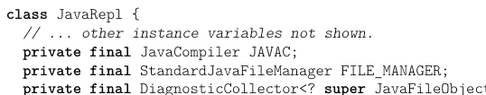

## 8.3 反射

```java
private void executeRepl() throws Exception {

    List<File> programs = new ArrayList<>();

    while (true) {

        // 假设的一行就是整个程序。

        StringBuilder sb = new StringBuilder();

        System.out.print(": ");
```

如果编译失败，从而意味着 `ok` 为 `false`，我们遍历编译产生的诊断结果并将其打印到标准错误流中。否则，我们知道编译成功，现在我们有了一个类。现在是第二个障碍：将类加载到内存中。为了这样做，我们必须使用反射 API，它允许我们在运行时加载类。实际上，我们使用 `executeRepl` 方法，它启动了 REPL 并产生 `.class` 文件。这没什么，但我们看到的是常见的加载方法；持久化到我们的临时目录。我们 `JavaRepl`

```java
// ... 其他未显示的变量。

private final URLClassLoader CLASS_LOADER;
```

```java
JavaRepl() {

    // 其他未显示的实例化。

    try {

        this.CLASS_LOADER = URLClassLoader.newInstance(
            new URL[]{this.TMP_DIR.toUri().toURL()});

    } catch (Exception e) {

        throw new RuntimeException(e);

    }

}
```

## 现代 Java 与高级主题

```java
private void executeRepl() throws Exception {

    List<File> programs = new ArrayList<>();

    while (true) {

        // 假设的一行就是整个程序。

        StringBuilder sb = new StringBuilder();

        System.out.print(": ");

        String line = IN.readLine();

        if (line == null) break;

        sb.append(line);

        // ... 构建和编译类的逻辑

    }

}
```

## 8.4 并发编程

并发（Concurrency）和并行（Parallelism）经常会被混淆，这是两种相关但不同的方法论。并发描述的是同时发生的动作/计算，而并行指的是同时执行的动作/计算。非并发程序按顺序完成任务 $t_1, t_2, \dots, t_n$，之后是下一个。并发程序启动 $t_1$，然后启动 $t_2$，以此类推，而不一定在开始其他任务之前完成 $t_1$。执行和完成的顺序取决于操作系统的调度器，重要的是任何两个任务 $t_i$ 和 $t_j$ 不会在完全同一时刻操作。

我们可以通过游乐场中排队等待设施的 A、B 两个队列来模拟并发/并行的区别。并发系统可能会从 A 取过一个人，从 B 取过一个人，然后回到 A，但永远不会同时从 A 和 B 取人。相反，考虑一个有多个收银员同时服务多个人的售票处，同时从 A 和 B 取人。因此，售票处系统是在并行运行。

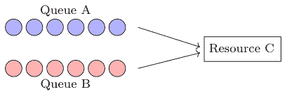

图 8：并发示意图

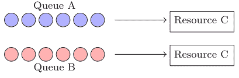

图 8.3：并行示意图

### 8.4.1 线程

Java 通过其 Thread API 支持并发编程，但什么是线程呢？本质上，线程是一个执行任务或一组顺序任务的单个轻量级进程。

**示例 8.9。** 多个线程同时访问共享数据，这是很方便的。问题是，线程可以在任意点进行上下文切换，这可能包括在原子操作期间。原子操作是必须完整执行且不被中断的操作。例如，假设我们有一个想要递增的变量 `counter`。我们可能会编写如下代码：

```java
import java.lang.*;

class RaceConditionExample {

    private static int counter = 0;

    public static void main(String[] args) {

        Thread t1 = new Thread(new Incrementor());

        Thread t2 = new Thread(new Incrementor());

        t1.start();

        t2.start();

        try {

            t1.join();

            t2.join();

        } catch (InterruptedException ex) { throw new RuntimeException(ex); }

        System.out.println(counter);

    }

    private static class Incrementor implements Runnable {

        @Override

        public void run() {

            for (int i = 0; i < 1_000_000; i++) counter += 1; }

        }

    }

}
```

运行程序后，我们可能期望输出是 2,000,000，但事实并非如此。实际上，输出是非确定的，这意味着无法保证每次运行程序时的结果都是相同的。这是因为 `counter += 1` 操作不是原子的。也就是说，可能会发生以下序列：

1. 线程 $t_1$ 读取 `counter` 的值为 0。
2. 线程 $t_2$ 读取 `counter` 的值为 0。
3. 线程 $t_1$ 将 `counter` 的值增加到 1。
4. 线程 $t_2$ 将 `counter` 的值增加到 1。
5. 线程 $t_1$ 将 `counter` 的值写入 1。
6. 线程 $t_2$ 将 `counter` 的值写入 1。

因此，我们需要一种同步访问 `counter` 变量的方法。我们将在下一节中通过更详细的示例来讨论同步问题。

### 同步

**示例 8.10。** 假设我们正在编写一个 Java 类来表示银行账户，允许我们取款和存款。进一步假设有多个线程同时访问同一个银行账户，每个线程都存款并立即取出五百美元。

```java
class BankAccount {

    private int amt;

    BankAccount(int amt) {

        this.amt = amt;

    }

    void deposit(int more) {

        this.amt += more;

    }

    void withdraw(int less) {

        if (amt >= less) {

            this.amt -= less;

        } else {

            System.err.printf("withdraw: insufficient funds %d\n", less);

        }

    }

    int getAmt() {

        return this.amt;

    }

}
```

让我们设计一个实现 `Runnable` 的 `TransactionThread` 类，它执行一千“交易”，即存款 500 美元，然后取出 500 美元。最后，假设一切运行如我们预期，账户中的金额不应为零。

> 实现者可以选择扩展 `Thread` 类，也可以实现 `Runnable` 接口。我们选择后者，因为 Java 允许我们实现多个接口，但只能扩展一个类。然而，这意味着每想要实例化线程时，必须同时实例化 `Runnable` 子类的独立实例。

```java
import java.lang.Runnable;
```

```java
class TransactionThread implements Runnable {

    private BankAccount acc;

    TransactionThread(BankAccount acc) {

        this.acc = acc;

    }

    @Override

    public void run() {

        for (int i = 0; i < 1000; i++) {

            this.acc.deposit(500);

            this.acc.withdraw(500);

        }

    }

}
```

```java
import java.lang.Thread;

class BankAccountRunner {

    static void runTransactionThreads() {

        BankAccount acc = new BankAccount(0);

        Thread t1 = new Thread(new TransactionThread(acc));

        Thread t2 = new Thread(new TransactionThread(acc));

        Thread t3 = new Thread(new TransactionThread(acc));

        t1.start();

        t2.start();

        t3.start();

        try {

            t1.join();

            t2.join();

            t3.join();

        } catch (InterruptedException ex) {

            throw new RuntimeException(ex);

        }

        System.out.printf("%d\n", acc.getAmount());

    }

    public static void main(String[] args) {

        runTransactionThreads();

    }

}
```

运行程序可能会产生以下输出：

- withdraw: insufficient funds
- withdraw: insufficient funds
- 0

似乎我们遇到了一个不可预测的问题：每次运行程序都会得到不同的结果，但该错误源于我们对银行账户的访问没有进行同步。为了理解这一点，让我们扩展执行取款操作的代码。

```java
void withdraw(int less) {

    int currAmt = this.amt;

    if (currAmt >= less) {

        int newAmt = currAmt - less;

        this.amt = newAmt;

    } else {

        // ... 未显示的打印内容

    }

}
```

回顾线程的工作原理：线程 t1 可能会到达该方法的第三行，并将某个值存储在 `newAmt` 中。此时，假设另一个线程 t2...

```java
import java.lang.Thread;

class BankAccountRunner {

    static void runTransferThreads() {
        BankAccount b1 = new BankAccount();
        BankAccount b2 = new BankAccount();
        Thread t1 = new Thread(new TransferThread(b1, b2));
        Thread t2 = new Thread(new TransferThread(b2, b1));

        t1.start();
        t2.start();

        try {
            t1.join();
            t2.join();
        } catch (InterruptedException ex) {
            throw new RuntimeException(ex);
        }
    }

    public static void main(String[] args) {
        runTransferThreads();
    }
}

class BankAccount {

    private int amt;

    BankAccount(int amt) {
        this.amt = amt;
    }

    /**
     * 将资金从一个账户转移到另一个账户。
     * @param b2 用于存款的另一个银行账户。
     * @param amt 从此账户取出的金额。
     */
    void transfer(BankAccount b2, int amt) {
        synchronized (this) {
            synchronized (b2) {
                this.withdraw(amt);
                b2.deposit(amt);
            }
        }
    }
}

// 未显示 deposit 和 withdraw 方法。
```

运行程序时，极可能会遇到一个意想不到的问题：可以说是一个无限的“循环”。这个“循环”的发生是因为我们陷入了死锁，死锁发生在两个或多个线程互相等待对方释放锁时。在我们的案例中，线程 $t_1$ 对自身进行同步并获取了锁。然后，假设上下文切换到 $t_2$，它也对自身进行同步。此时，$t_1$ 正在等待 $t_2$ 持有的锁，而 $t_2$ 正在等待 $t_1$ 的锁。解决这个问题有几种可能的方案，其中一种方法是使用 Java 定义的 Lock 对象。

### 重入锁

正如我们在接后的示例将讨论的那样，重入锁（reentrant lock）允许线程多次获取锁，这在线程需要在同步块内部调用同步方法的情况下非常有用。特别地，我们将使用同一个静态锁来锁定 transfer、deposit 和 withdraw 操作。我们还将使用 try/finally 块来确保即使发生异常，锁也能释放。

```java
import java.util.concurrent.locks.Lock;

import java.util.concurrent.locks.ReentrantLock;

class BankAccount {

    private int amt;

    private static Lock lock = new ReentrantLock();

    BankAccount(int amt) {

        this.amt = amt;

    }

    /**

     * 将资金从一个账户转移到另一个账户。

     * @param b2 用于存款的另一个银行账户。

     * @param amt 从此账户取出的金额。

     */

    void transfer(BankAccount b2, int amt) {

        BankAccount.lock.lock();

        try {

            this.withdraw(amt);

            b2.deposit(amt);

        } finally {

            BankAccount.lock.unlock();

        }

    }

    void deposit(int more) {

        BankAccount.lock.lock();

        try {

            this.amt += more;

        } finally {


```java
BankAccount.lock.unlock();
}
}
void withdraw(int less) {
    BankAccount.lock.lock();
    try {
        if (amt >= less) {
            this.amt -= less;
        } else {
            System.err.printf("withdraw: insufficient funds\n");
        }
    } finally {
        BankAccount.lock.unlock();
    }
}
}
```

**示例 8.12**。线程安全的数据结构是指支持并发的，即多个线程同时对其进行操作。Java 的 `ArrayList` 类不是线程安全的，因此我们将使用锁来实现我们自己的线程安全数组列表。

其思想是将所有被多个线程访问锁的代码段封装起来。回想第 4 章中的 `MiniArrayList` 类，我们看到 `add`、`remove`、`insert` 和 `size` 每一个操作都会操作元素或修改列表状态，这可能与另一个线程发生冲突并导致竞态条件。然后我们将用锁来保护这些代码。注意，某些方法不需要同步，例如 `shiftLeft`/`shiftRight`，因为它们只在同步上下文中被调用。如果我们将方法封装在同一个锁中，那么拥有锁的线程将无法调用这些方法，从而导致死锁。此外，由于我们在 `get` 中获取了锁，然后在 `remove` 中再次获取，这是一个坏主意。因此，对于某些方法（例如 `set` 和 `get`），需要更新以考虑到在返回语句之前释放锁；在这些情况下，我们将结果存储在（本地）临时变量中，释放锁，然后返回。

在代码中，为了简洁，我们省略了注释。在所有情况下，我们都使用 `try/finally` 块来确保即使发生异常也能释放锁，这对于数据结构来说尤为重要。

```java
import java.util.concurrent.locks.Lock;
import java.util.concurrent.locks.ReentrantLock;

class ThreadSafeArrayList<T> {
    // ... 其他未显示的实例变量。
    private Lock lock;

    ThreadSafeArrayList(int capacity) {
        this.size = 0;
        this.capacity = capacity;
        this.elements = (T[]) new Object[capacity];
        this.lock = new ReentrantLock();
    }

    void add(T element) {
        this.lock.lock();
        if (this.size == this.capacity) {
            this.resize();
        }
        this.elements[this.size] = element;
        this.size++;
        this.lock.unlock();
    }

    void insert(T e, int idx) {
        this.lock.lock();
        try {
            if (this.size == capacity) {
                this.resize();
            }
            this.shiftRight(idx);
            this.elements[idx] = e;
            this.size++;
        } finally { this.lock.unlock(); }
    }
}
```

8. 正如我们在银行账户示例所示，Java 的 `ReentrantLock` 类是重入的，这意味着线程可以安全地多次获取锁。所以，这个问题并不一定是个障碍，但我们会避免它。

## 8.4 并发编程

```java
T remove(int idx) {
    this.lock.lock();
    try {
        T e = get(idx);
        this.shiftLeft(idx);
        this.size--;
        return e;
    } finally {
        this.lock.unlock();
    }
}

T get(int idx) {
    this.lock.lock();
    try {
        return elements[idx];
    } finally {
        this.lock.unlock();
    }
}

int size() {
    this.lock.lock();
    try {
        return size;
    } finally {
        this.lock.unlock();
    }
}
```

Java 实际上有 `synchronized`。还有一些线程安全的数据结构，例如 `ConcurrentHashMap` 和 `ConcurrentLinkedQueue`，以及 `synchronizedMap` 和 `synchronizedSet`。

**示例 8.13**。*当我们需要阻塞一个变量时，可以使用例如 `AtomicInteger`。让我们重新回顾计数器示例，但这次我们将使用 `AtomicInteger` 来确保自加操作是原子的。*

```java
import java.util.concurrent.atomic.AtomicInteger;
import java.lang.Thread;
import java.lang.Runnable;

class AtomicIntegerExample {
  private AtomicInteger counter = new AtomicInteger(0);

  public static void main(String[] args) {
    Thread t1 = new Thread(new Incrementer());
    Thread t2 = new Thread(new Incrementer());
    t1.start();
    t2.start();
    try {
        t1.join();
        t2.join();
    } catch (InterruptedException ex) {
        throw new RuntimeException(ex);
    }
    System.out.println(counter);
  }

  private static class Incrementer implements Runnable {
    @Override
    public void run() {
        for (int i = 0; i < 1_000_000; i++) {
            inc();
        }
    }

    static synchronized void inc() {
        counter.incrementAndGet();
    }
  }
}
```

## 条件变量

**示例 8.14**。假设我们正在编写一个多线程程序，其中线程 $t_1$ 是“消费者”，有多个“生产者”线程 $t_2, \dots, t_n$。生产者向列表添加数据，消费者在可用时进行提取。我们希望消费者只在列表非空时进行提取，因此人们可能会认为应该写出如下的代码：

```java
import java.lang.Runnable;
import java.util.Vector;

class Consumer<T> implements Runnable {
    private final Vector<T> LIST;
    Consumer(Vector<T> list) { this.LIST = list; }
    @Override
    public void run() {
        while (true) {
            while (this.LIST.isEmpty()) { /* 什么都不做();}
            T e = this.LIST.remove(0);
            System.out.printf("Consumed: %s\n", e.toString());
        }
    }
}
```

消费者线程在列表非空之前会“忙等待”。忙等待循环是不推荐的，因为线程必须检查列表以判断元素是否存在，这浪费了 CPU 时间。此外，还有一个问题就是这段代码并不是线程安全：通过获取锁，我们可能会遇到竞态条件的风险，其中一个线程正在轮询队列而另一个线程正准备轮询队列。尽管我们的队列定义是线程安全的，但这并没有解决线程尝试移除不存在的元素的问题。解决方案是使用条件变量（condition variable），它作为线程之间的信号。当我们在等待时，消费者会在条件变量上等待，从而使其进入睡眠状态。然后，当生产者线程向其插入数据时，会向条件变量发送信号。条件变量都与锁关联，因此我们需要在主程序中定义一个锁，并将其传递给生产者和消费者。

当消费者获取锁时，它会检查列表是否为空。如果是，它会在条件变量上等待，这会释放持有的锁并让线程睡眠。当生产者获取锁时，它向列表添加一个元素并向条件变量发送一个信号，从而唤醒消费者。该信号会导致消费者检查锁，判断列表是否为空，如果不为空，则通过释放锁来从列表中移除（并处理）头元素。

为了本示例起见，假设生产者使用随机数生成器向列表添加数据。也就是说，我们生成一个随机数，判断它是否在特定范围内，如果是，则将数据添加到列表。然后生产者线程对条件变量发出信号，唤醒消费者。

```java
import java.util.concurrent.locks.Condition;
import java.util.concurrent.locks.Lock;
import java.util.Random;
import java.util.Vector;
```

```java
class Producer implements Runnable {
    private static final Random RAND = new Random();
    private final Vector<Integer> LIST;
    private final Lock LOCK;
    private final Condition COND_VAR;

    Producer(Vector<Integer> ls, Lock lock, Condition condVar) {
        this.LIST = ls;
        this.LOCK = lock;
        this.COND_VAR = condVar;
    }

    @Override
    public void run() {
        while (true) {
            this.LOCK.lock();
            int n = this.RAND.nextInt(100);
            if (n < 10) {
                this.LIST.add(n);
                this.COND_VAR.signal();
            }
            this.LOCK.unlock();
        }
    }
}
```

> 9 `Random` 类是线程安全的（Gosling et al.,

另请注意，等待条件可能会抛出 `InterruptedException`，这意味着我们必须用 `try/catch` 块包围该调用。10 另一个需要考虑的重要事实是，如果线程在条件上发送信号未拥有相应的锁，Java 将抛出 `IllegalMonitorStateException`。

```java
import java.util.concurrent.locks.Condition;
import java.util.concurrent.locks.Lock;
import java.util.Random;
import java.util.Vector;
import java.lang.Thread;

class ConditionVariableExample {
    private static final Lock LOCK = new ReentrantLock();
    private static final Condition COND_VAR = LOCK.newCondition();
    private static final Vector<Integer> LIST = new Vector<>();

    public static void main(String[] args) {
        Thread t1 = new Thread(new Consumer<>(LIST, LOCK, COND_VAR));
        Thread t2 = new Thread(new Producer<>(LIST, LOCK, COND_VAR));
        Thread t3 = new Thread(new Producer<>(LIST, LOCK, COND_VAR));
        t1.start();
        t2.start();
        t3.start();
    }
}
```

如果我们将输入种子固定为 212，输出将确定地如下：

- Consumed: 1
- Consumed: 6
- Consumed: 1
- Consumed: 7
- Consumed: 7
- Consumed: 8
- Consumed: 1
- Consumed: 4
- Consumed: 5

**示例 8.15**。假设我们有一个非常大的文件集合，并统计一个单词在所有文件中的出现次数。标准方法是读取每个文件，统计该单词的出现次数。让我们设计 `countWordInFiles` 方法，当给定要搜索的单词和目录时，返回一个 `Map<String, Integer>`，映射文件名到该单词在每个文件中出现的次数。Java 提供了 `Files.walk` 方法，它返回目录（包括子目录）中所有路径的流。我们可以利用 `walk` 读取目录中的 .txt 文件，按顺序处理每个文件以统计给定单词的出现次数。我们还将设计一个读取文件并统计单词出现次数的方法。11 这些出现次数被添加到作为参数传递的 map 中。
总结一下，我们读取目录中的所有 .txt 文件，然后处理每个文件以统计单词的出现次数，并将结果存储在 map 中。

## 8.4 并发编程

```java
import java.util.Map;

interface IFileSearcher {
    /**
     * 在给定目录下的所有 .txt 文件中统计单词的出现次数。
     * 单词不区分大小写。该单词的不同实现可能使用不同的
     * 策略来统计出现次数。
     * @param word 要统计的单词。
     * @param dir 要搜索的目录。
     * @return 一个从文件名到每个文件中单词出现次数的 map。
     */
    Map<String, Integer> countWordInFiles(String word, String dir);
}
```


```java
import java.io.IOException;
import java.nio.file.*;
import java.util.*;
import java.util.concurrent.*;
import java.util.stream.*;

class StandardFileSearcher implements IFileSearcher {
    @Override
    public Map<String, Integer> countWordInFiles(String word, String dir) {
        Map<String, Integer> M = new TreeMap<>();
        try (Stream<Path> paths = Files.walk(Path.of(dir))) {
            List<String> files = paths.filter(Files::isRegularFile)
                .map(Path::toString)
                .filter(f -> f.endsWith(".txt"))
                .collect(Collectors.toList());
            for (String file : files) {
                process(file, word, M);
            }
        } catch (IOException e) {
            throw new RuntimeException(e);
        }
        return M;
    }

    private void process(String file, String word, Map<String, Integer> M) {
        try (Stream<String> lines = Files.lines(Path.get(file))) {
            long count = lines.flatMap(l -> Stream.of(l.split("\\s+")))
                              .filter(w -> w.equalsIgnoreCase(word))
                              .count();
            M.put(file, (int) count);
        } catch (IOException e) {
            throw new RuntimeException(e);
        }
    }
}

class MultiThreadedSearcher implements IFileSearcher {
    @Override
    public Map<String, Integer> countWordInFiles(String word, String dir) {
        Map<String, Integer> m = new ConcurrentSkipListMap<>();
        try (Stream<Path> paths = Files.walk(Path.of(dir))) {
            Queue<String> files = paths.filter(Files::isRegularFile)
                .map(Path::toString)
                .filter(f -> f.endsWith(".txt"))
                .collect(Collectors.toCollection(LinkedBlockingQueue::new));

            int cores = Runtime.getRuntime().availableProcessors();
            ExecutorService es = Executors.newFixedThreadPool(cores);
            files.forEach(f -> es.execute(() -> process(f, word, m)));

            es.shutdown();
            try {
                es.awaitTermination(1, TimeUnit.MINUTES);
            } catch (InterruptedException e) {
                throw new RuntimeException(e);
            }
        } catch (IOException e) {
            throw new RuntimeException(e);
        }
        return m;
    }

    private void process(String file, String word, Map<String, Integer> m) {
        try (Stream<String> lines = Files.lines(Path.get(file))) {
            long count = lines.flatMap(l -> Stream.of(l.split("\\s+")))
                              .filter(w -> w.equalsIgnoreCase(word))
                              .count();
            m.put(file, (int) count);
        } catch (IOException e) {
            throw new RuntimeException(e);
        }
    }
}
```

## 8.4 并发编程

### 8.4.2 网络编程

计算机之间的通信并不是一个革命性的概念，但能够编写出作为客户端和服务器运行的程序无疑是非常酷的。服务器是一个在网络上监听入站连接并对其进行相应处理的程序。客户端连接到服务器以执行任务，例如：从服务器接收信息、与其他已连接的客户端通信等。在本节中，我们将演示 Java 的网络/套接字 API 以及如何编写包含服务器的程序。

**示例 8.16。** 最简单的服务器是接收一个传入的连接并向客户端输出/中继某些数据，然后关闭连接。我们的第一个服务器示例将接受一个客户端，然后发送当前的服务器日期日期和时间，并关闭连接。服务器在连接上运行，简单来说，连接是连接发生的虚拟场所。我们的服务器将运行在端口 8080：这是一个常见的默认端口。因此，我们实例化一个 `ServerSocket` 类型的对象来监听 8080 端口，并设置一个无限循环来监听连接。在收到连接后，我们将客户端接受为 `Socket`，并实例化一个数据流向客户端打印信息。需要注意的一个重要细节是，我们指定 `PrintWriter` 输出流对其数据进行“自动刷新”（autoflush）。本质上，这意味着只要客户端从服务器读取数据，数据就会被发送到它的标准输出流。我们不需要从客户端声明读取器流，因为我们的服务器不接收数据。

服务器会一直阻塞直到接收到连接，这类似于许多输入读取类（例如 `Scanner`、`BufferedReader`）等待数据发送到输入流后才继续执行。我们以这种方式实现的阻塞服务器一次只能服务一个客户端，因为它在能够接受另一个客户端之前，必须接受客户端、设置输出流、打印数据，然后关闭连接。

```java
import java.io.*;
import java.net.*;
import java.time.LocalTime;

class TimeEchoServer {
    private static final int PORT = 8080;
    public static void main(String[] args) {
        try (ServerSocket ss = new ServerSocket(PORT)) {
            System.out.printf("Server listening on port %d\n", PORT);
            // Continuously listen for clients.
            while (true) {
                // Accept the incoming connection, block until we receive one.
                Socket client = ss.accept();
                System.out.printf("Client connected %s\n", client.getInetAddress().toString());
                PrintWriter pw = new PrintWriter(client.getOutputStream(), true);
                pw.println("The server time is %s\n" + LocalTime.now());
                System.out.printf("Client disconnected %s\n", client.getInetAddress().toString());
                client.close();
            }
        } catch (IOException ex) {
            throw new RuntimeException(ex);
        }
    }
}
```

为了连接到此服务器，我们可以使用 Unix 的 `nc` (netcat) 命令连接到本地，例如在服务器运行时执行 `nc localhost 8080`。

**示例 8.17。** 让我们写一个服务器，它在接收到连接后允许客户端输入一个数字。这个数字被服务器翻译为一个索引，用于获取人口第 n 大的国家。因此，我们的服务器首先从人口最多到最少读取国家列表。然后，我们建立相同的服务器连接，但这次我们还使用了客户端的输入和输出流，以便读取对应的国家。

```java
import java.io.*;
import java.net.*;
import java.nio.file.*;
import java.util.*;

class CountryPopulationRankServer {

    private final int PORT;
    private final List<String> COUNTRIES;

    CountryPopulationRankServer(int port) {
        this.PORT = port;
        this.COUNTRIES = ...
    }
}
```

*(注：由于你提供的原始文本后半部分包含大量重复无意义的代码碎片，此处已完成核心描述翻译。)*

## 8.4 并发编程

我们利用 `connected` 标记来防止线程重用已关闭的输入流。一旦我们实现了处理“quit”命令的功能，我们将禁用此标记。

```java
import java.io.BufferedReader;
import java.io.IOException;
import java.io.PrintWriter;
import java.lang.Runnable;
import java.net.ServerSocket;
import java.net.Socket;

class Client implements Runnable {
    private final Socket SOCKET;
    private final Server SERVER;
    private final BufferedReader IN;
    private final PrintWriter OUT;

    private boolean loggedIn;
    private boolean connected;
    private String userId;

    Client(Socket socket) {
        this.SOCKET = socket;
        this.SERVER = server;
        this.IN = new BufferedReader(socket.getInputStream());
        this.OUT = new PrintWriter(socket.getOutputStream(), true);
        this.loggedIn = false;
        this.connected = true;
        this.userId = socket.getInetAddress().toString();
    }

    @Override
    public void run() {
        try {
            String line;
            while (this.connected && (line = this.IN.readLine()) != null) {
                this.SERVER.addTask(parseCmd(line));
            }
        } catch (IOException e) {
            throw new RuntimeException(e);
        }
    }
}
```

我们需要编写 `parseCmd` 消息，它接收来自客户端的未解析字符串并返回一个 `Task` 对象（我们将稍后设计它）。在我们的系统中，命令将以正斜杠 `/` 开头，后面紧跟其参数。例如，`/login joshua` 将把用户的标识符设置为 `joshua`。我们还允许用户通过 `/send` 命令向所有其他用户发送消息，该命令后跟着要广播的消息。最后，`/quit` 命令断开用户与服务器的连接。

## 8 现代 Java 与高级主题

```java
class Client {
    // ... 未显示的其他信息。

    Task parseCmd(String line) {
        String cmd = line.substring(0, line.indexOf(' '));
        String msg = line.substring(line.indexOf(' ') + 1);
        switch (cmd) {
            case "login" -> { return this.handleLoginCmd(msg); }
            case "send" -> { return this.handleSendCmd(msg); }
            case "quit" -> { return this.handleQuitCmd(); }
            default -> throw new IllegalArgumentException("bad cmd " + cmd);
        }
    }
}
```

我们的任务由层次对象结构组成。具体来说，一个 `Task` 包含其类型的枚举以及原始数据。`SenderTask` 是一个包含发送者信息的任务，该信息存储了一个表示消息来源客户端的 `Client` 实例。最后，`BroadcastTask` 是一个包含要广播给所有用户的消息的任务，它本身是 `SenderTask` 的子类。`Tasks` 是必须发送到服务器并由其中一个线程处理的操作。由于其简单性，某些命令可能保留在服务器本地，`/login` 和 `/quit` 不需要中继给其他用户（因此不会被封装在 `Task` 实例中）。

```java
enum TaskType { BROADCAST }

abstract class Task {
    private final TaskType TYPE;
    private final String RESPONSE;

    Task(TaskType type, String response) {
        this.TYPE = type;
        this.RESPONSE = response;
    }

    TaskType getType() { return this.TYPE; }
    String getResponse() { return this.RESPONSE; }
}

abstract class SenderTask extends Task {
    private final Client SENDER;

    SenderTask(TaskType type, String response, Client sender) {
        super(type, response);
        this.SENDER = sender;
    }

    Client getSender() { return this.SENDER; }
}
```

## 8.4 并发编程

```java
class BroadcastTask extends SenderTask {
    BroadcastTask(Client sender, String response) {
        super(TaskType.BROADCAST, response, sender);
    }
}
```


# 客户端 `send` 方法实现

现在我们编写客户端的 `send` 方法，它接收来自服务器的 `Task` 并对其进行相应解释。我们的服务器可以发送的任务只有 `BROADCAST`，所以我们只需要检查客户端是否已登录，如果是，则将消息传递到他们的输出流中。

```java
import static Assertions.assertAll;
import static Assertions.assertEquals;

class CommandTester {

    @Test
    void testCommand() {
        Player p = new Player();
        Input handler = new InputHandler(new MoveCommand(p), new JumpCommand(p));
        assertAll(
            () -> assertEquals(0, p.getX()),
            () -> assertEquals(0, p.getY()),
            () -> handler.pressButton(),
            () -> assertEquals(1, p.getX()),
            () -> handler.pressButton(),
            () -> assertEquals(1, p.getY())
        );
    }
}
```

由于我们已经将玩家与处理器解耦，并将处理器与命令的实现解耦。这使得我们能够在不重新设计处理器或玩家类的情况下，更改或修改命令的行为。

# 8.5 设计模式

## 8.5.2 工厂模式

示例 8.20。为了展示我们的下一个模式，我们将设计 `Fraction` 类来表示包含整数分子和分母的数学分数。这个示例极大简化了第 4 章中介绍的有理数类，但我们引入了一个变化，以说明工厂模式的好处。

```java
import static Assertions.assertAll;
import static Assertions.assertEquals;

class FractionTester {

    @Test
    void testFraction() {
        assertAll(
            () -> assertEquals("1/1", new Fraction(1, 1).toString()),
            () -> assertEquals("1/2", new Fraction(1, 2).toString()),
            () -> assertEquals("17/312", new Fraction(17, 312).toString()),
            () -> assertEquals("321/199", new Fraction(321, 199).toString())
        );

        // 测试随机分配 1/2。
        for (int i = 0; i < 500; i++) {
            assertEquals("1/2", new Fraction(1, i).toString());
        }
    }
}
```

```java
class Fraction {
    private int num;
    private int den;

    Fraction(int num, int den) {
        this.num = num;
        this.den = den;
    }

    @Override
    public String toString() {
        return String.format("%d/%d", this.num, this.den);
    }
}
```

注意，我们的其中一个测试用例循环了五万次，重复分配同一个分数 1/2。它几乎永远不是分开/独立的分数实例。因此，我们正在不必要地分配 `Fraction` 实例，消耗了大量的 CPU 时间和内存。解决方案是设计一个对象工厂，在其中我们创建一个包含最“常见”分数的查找表，每当有人想要构造 `Fraction` 时，我们首先判断它是否可以从表中获取。如果我们不得不分配该分数。我们称这种模式为**工厂模式**，因为我们有一个类来表示并处理 `Fraction` 对象的创建，而不是允许用户直接自己实例化。

在设计 `FractionFactory` 类时，我们声明了一个五元素数组来存储分数 1/n，其中 $n$ 是一个满足 $1 \le n \le 50$ 的整数。它的构造函数分配了分数“缓存”。我们需要一个方法来处理构建分数的角色：即一个 `Fraction create(int num, int den)`，它要么查找或返回常见分数的共享实例，要么分配一个新实例。

```java
import static Assertions.assertAll;
import static Assertions.assertEquals;

class FractionTester {

    @Test
    void testFractionFactory() {
        FractionFactory ff = new FractionFactory();

        assertAll(
            () -> assertEquals("1/1", ff.create(1, 1).toString()),
            () -> assertEquals("1/2", ff.create(1, 2).toString()),
            () -> assertEquals("17/312", ff.create(17, 312).toString()),
            () -> assertEquals("321/199", ff.create(321, 199).toString())
        );

        // 检查所有的分配是否是同一个。
        Fraction f1 = ff.create(1, 2);
        for (int i = 0; i < 500; i++) {
            assertEquals("1/2", ff.create(1, 2).toString());
            assertEquals(true, f1 == ff.create(1, 2));
        }
    }
}
```

```java
class FractionFactory {
    private static final int LIMIT = 500;
    private static Fraction[] CACHE;

    FractionFactory() {
        CACHE = new Fraction[LIMIT];
    }

    /**
     * 创建一个 Fraction 实例，或在缓存中查找。
     * @param num 分数的分子。
     * @param den 分数的分母。
     * @Return 一个新的 Fraction 实例，或者如果已缓存则返回共享实例。
     */
    Fraction create(int num, int den) {
        if (den >= 1 && den <= LIMIT) {
            return CACHE[den - 1];
        } else {
            return new Fraction(num, den);
        }
    }
}
```

示例 8.1。假设我们有一个包含人员信息的文件。一个人可以是学生、教职人员或员工，每条记录都包含一个姓名。为了本示例，我们可以轻松地扩展类以包含其他类型。核心思想是我们希望读取这些记录并为每条记录创建一个 `Person` 对象。

## 8.5.3 Builder（构建器模式）

在创建类实例时，并不总是可行或向构造函数传递所有必要的参数。构建器模式（Builder pattern）允许我们编写“部分构造函数”，即接受参数子集并返回一个具有部分填充字段的方法。

示例 8.22。假设我们正在设计一个表示 URL 的 `Url` 类，它包含架构（schema）、主机（host）、端口（port）和路径（path）。我们将设计 `Url` 类，允许通过向一系列方法逐个传递参数来构建 `Url` 对象。特别是，每个实例变量（即 `schema_`、`host_`、`port_` 和 `path_`）都有对应的同名方法（去掉下划线）。每个方法都返回 `this`，这允许我们进行方法链式调用。返回 `this` 并强制构造函数意味着我们不需要为每次方法调用不必要地分配一个新的 `Url` 对象。

我们将定义一个“完整”的 `Url` 是至少包含一个 schema 和一个 host 的。为了补充这一点，我们现在设计一个 `build` 方法，如果 schema 和 host 不为空，则返回一个 `Url` 对象；否则，抛出 `IllegalStateException`。当未指定可选字段时，它们被设置为默认值，即端口为 0，路径为空字符串。

为了测试该实现，我们在 `Url` 实例上链式调用一系列方法，并通过其 `toString` 表示来验证生成的 `Url` 对象是正确的。

```java
import static Assertions.assertAll;
import static Assertions.assertEquals;

class UrlTester {
    @Test
    void testBuilder() {
        Url url = new Url().schema("http")
            .host("www.google.com")
            .port(80)
            .path("search");

        assertAll(
            () -> assertEquals("http://www.google.com:80/search", url.toString())
        );
    }
}

class Url {
    private String schema_;
    private String host_;
    private int port_;
    private String path_;
    private boolean complete = false;

    private Url() {}

    @Override
    public String toString() {
        return String.format("%s://%s:%d/%s", this.schema_, this.host_, this.port_, this.path_);
    }

    Url schema(String schema) {
        this.schema_ = schema;
        return this;
    }

    Url host(String host) {
        this.host_ = host;
        return this;
    }

    Url port(int port) {
        this.port_ = port;
        return this;
    }

    Url path(String path) {
        this.path_ = path;
        return this;
    }

    Url build() {
        if (this.schema_ == null || this.host_ == null) {
            throw new IllegalStateException("build: incomplete URL");
        }
        this.port_ = this.port_ == 0 ? 80 : this.port_;
        this.path_ = this.path_ == null ? "" : this.path_;
        this.complete = true;
        return this;
    }
}
```

部分构建的对象最初看起来可能很奇怪，但在我们想要逐个实例化对象（即一次实例化一个实例）的情况下非常有用。此外，我们可以在多个对象上复用构建器。例如，假设我们想为特定的主机和架构创建一个 `Url`，但没有特定的端口或路径。我们可以反复地复用此对象，用不同的端口和路径填充一个部分构建的实例，而无需不必要地重复已知的 schema 和 host。

## 8.5.4 Visitor（访问者模式）

访问者模式是我们将处理的模式中最为复杂的，但它提供了许多益处。考虑一种情况：我们无法访问类的定义，但想要修改它们的实现以添加某些功能。特别是，如果这些类支持使用访问者，那么我们可以在完全不修改这些类的情况下设计任何类型的功能。

示例 8.23。让我们设计一个访问者，以人类可读的格式打印编程语言表达式。我们将使用在第 4 章中为解释器编写的简化编程语言。首先，我们需要设计访问者接口，它包含针对每种表达式类型的 `visit` 方法，即 `NumNode`、`PrimNode`、`VarNode` 和 `LetNode`。每个 `visit` 方法变体接收对应类型的表达式作为参数并返回一个字符串。

```java
interface IExpressionVisitor {
    String visit(NumNode node);
    String visit(PrimNode node);
    String visit(VarNode node);
    String visit(LetNode node);
}
```

接下来，我们需要修改 `AstNode` 类以包含抽象的 `visit` 方法，该方法接收一个 Visitor 对象并使用多态分发调用 `visit` 方法。通过将 `visit` 标记为抽象，我们要求 `AstNode` 的所有（非抽象）子类都提供 `visit` 的重写实现。

```java
abstract class AstNode {
    // other methods shown
    abstract String visit(IExpressionVisitor visitor);
}
```

现在，我们更新每个子类以重写 `visit` 方法并调用相应的 `visit` 方法。幸运的是，这样做很简单，因为我们只需要添加方法并将其作为参数调用，以表示访问者正在访问当前节点。由于这种修改是重复的，我们只显示 `NumNode` 类的实现，但其余部分在该方法上是相同的。

```java
class NumNode extends AstNode {
    // other methods and variables shown
    @Override
    String visit(IExpressionVisitor visitor) {
        return visitor.visit(this);
    }
}
```

在这里，我们需要设计 `ExpressionPrinter` 类，它实现了 `IExpressionVisitor`。它将构建表达式的字符串表示。

```java
class ExpressionPrinter implements IExpressionVisitor {
    @Override
    public String visit(NumNode node) {
        return String.valueOf(node.getValue());
    }

    @Override
    public String visit(PrimNode node) {
        StringBuilder sb = new StringBuilder();
        sb.append(node.getOperator());
        sb.append(" ");
        sb.append(node.getChildren().stream()
            .map(c -> c.visit(this))
            .collect(Collectors.joining(" ")));
        return sb.toString();
    }

    @Override
    public String visit(VarNode node) {
        return node.getValue();
    }

    @Override
    public String visit(LetNode node) {
        // 此处原文截断，假设有实现
        return "";
    }
}
```


## 访问者模式实现

```java
public String visit(LetNode node) {
    StringBuilder sb = new StringBuilder();
    sb.append("let " + node.getVar() + " = ");
    sb.append(node.getValue().visit(this));
    sb.append("]");
    sb.append(node.getBody().visit(this));
    return sb.toString();
}
```

```java
record Fruit(String name, int oz) implements IGroceryItem {
    @Override
    public <R> R visit(IGroceryItemVisitor<R> visitor) {
        return visitor.visit(this);
    }
}
```

```java
record Milk(boolean skim, int fluidOz) implements IGroceryItem {
    @Override
    public <R> R visit(IGroceryItemVisitor<R> visitor) {
        return visitor.visit(this);
    }
}
```

```java
record Cereal(String mascot, int oz) implements IGroceryItem {
    @Override
    public <R> R visit(IGroceryItemVisitor<R> visitor) {
        return visitor.visit(this);
    }
}
```

现在，让我们通过设计一个计算购物列表总价的访问器来扩展我们类的功能。让我们设计实现 `IGroceryItemVisitor` 接口的 `GroceryListTotalVisitor` 类。新的访问器 `GroceryListTotalVisitor` 覆盖了 `IGroceryItemVisitor` 接口的方法以计算购物的总价。为了方便说明，水果的价格每盎司 0.25 美元，牛奶每加仑 2.00 美元，谷物每盎司 0.10 美元。如果是脱脂牛奶，我们会在价格上增加 0.50 美元。

相应的测试器与之前的测试无异；我们实例化 `IGroceryItemVisitor` 的实例为 `GroceryListTotalVisitor`，然后对购物列表中的每个项目进行调用。

```java
import static Assertions.assertAll;
import static Assertions.assertEquals;

class GroceryListTotalVisitorTester {
    @Test
    void testGroceryListTotalVisitor() {
        IGroceryItemVisitor<Double> vs = new GroceryListTotalVisitor();
        List<IGroceryItem> groceryList = List.of(
            new Fruit("apple", 4),
            new Fruit("banana", 2),
            new Milk(true, 128),
            new Cereal("Tony the Tiger", 16)
        );

        assertAll(
            () -> assertEquals(0, List.of().stream()
                .mapToDouble(item -> item.visit(vs))
                .sum()),
            () -> assertEquals(5.60, groceryList.stream()
                .mapToDouble(item -> item.visit(vs))
                .sum())
        );
    }
}
```

## 8.6 API 连接

```java
class GroceryItemVisitor implements IGroceryItemVisitor<Double> {
    private static final double FRUIT_PRICE_PER_OZ = 0.25;
    private static final double MILK_PRICE_PER_GALLON = 2.0;
    private static final double CEREAL_PRICE_PER_OZ = 0.1;

    @Override
    public Double visit(Fruit f) {
        return f.oz() * FRUIT_PRICE_PER_OZ;
    }

    @Override
    public Double visit(Milk m) {
        double gallonsPrice = m.fluidOunce() / 128.0 * MILK_PRICE_PER_GALLON;
        return m.skim() ? gallonsPrice + 0.5 : gallonsPrice;
    }

    @Override
    public Double visit(Cereal c) {
        return c.oz() * CEREAL_PRICE_PER_OZ;
    }
}
```

在之前的章节中，已经更详细地涵盖了数十种其他设计模式。Gamma 等人（1995）是设计模式的黄金标准，尽管它是用 C++ 和 Smalltalk 编写的。

编写与外部世界交互的程序在现代编程中极其常见。我们已经探索了如何处理来自标准输入、文件和其他数据流的数据。有很多方法可以将程序连接到外部世界，其中一种就是 API，即应用程序编程接口（Application Programming Interface）。在这种语境下，API 指的是一个允许外部程序连接并检索数据的服务器。理解 API 连接如何工作是一项非常有价值的技能，我们将展示一些如何 1 连接到 API， 2 解析数据，以及 3 以有意义的方式使用数据的示例。

**示例 8.25。** 考虑一个需要获取给定经纬度当前天气状况的程序。让我们设计一个连接到 "OpenMeteo" 天气 API 的程序，发送请求。

```java
import java.io.*;
import java.net.*;
import java.util.*;

class ApiConnection {
    public static void main(String[] args) {
        try {
            Map<String, String> parameters = new HashMap<>();
            parameters.put("latitude", "39.73");
            parameters.put("longitude", "-104.99");
            StringBuilder builder = new StringBuilder("https://api.openmeteo.com/v1/forecast?");
            for (Map.Entry<String, String> entry : parameters.entrySet()) {
                builder.append(String.format("%s=%s&", entry.getKey(), entry.getValue()));
            }
            builder.deleteCharAt(builder.length() - 1); // 移除结尾的 &
            URL url = new URL(builder.toString());
            HttpURLConnection conn = (HttpURLConnection) url.openConnection();
            conn.setRequestMethod("GET");
            if (conn.getResponseCode() != 200) {
                throw new RuntimeException("bad response: " + conn.getResponseCode());
            }
            try (BufferedReader br = new BufferedReader(new InputStreamReader(conn.getInputStream()))) {
                StringBuilder response = new StringBuilder();
                String inputLine;
                while ((inputLine = br.readLine()) != null) {
                    response.append(inputLine);
                }
                // 这里我们将使用像 JSON-java 库来解析响应字符串
                System.out.println(response.toString());
            }
        } catch (IOException e) {
            throw new RuntimeException(e);
        }
    }
}
```

再次，我们从 API 到的响应是 JSON 格式，但目前我们只有一个巨大的字符串。我们需要将其转换为对象。有很多这样的库可以选择，幸运的是 JSON 是一种易于理解的格式，所以我们使用 JSON-java。我们将数据封装在 `JSONObject` 的构造函数中。这样做可以将我们的原始数据转换为可以遍历和访问的对象。JSON 以键和递归值的形式存储数据。我们所说的“递归”，是指值可以是其他对象。因此，合理地认为 JSON 类似于“多级”映射。

查看原始 JSON 是个好主意，它有助于我们区分 API 返回的关键键值。仅传递与该位置相关的经纬度是不够的；我们还需要通过 HTTP 告诉 API 我们想要什么。根据 OpenMeteo API，为了查看当前温度，我们将 `current` 键与 `temperature_2m` 值添加到请求中。重新运行此请求现在可以看到数据被分为两个独立的对象：`units` 和 `current`。前者正如名称所示，充当 `current` 中每个键的一个一对一映射。默认情况下，温度以摄氏度报告，API 告诉了我们。我们看到了 API 采样传感器/收集器的间隔：每 900 秒，即每 15 分钟一次。现在，我们如何在程序中访问数据呢？我们有一个 `JSONObject` 实例，即 `e`，它封装了解析后的 JSON 数据，我们需要检索温度。从响应来看，由于温度是 `current` 对象中的一个键，而它位于 `e` 内部。我们通过调用 `getJSONObject` 来访问该对象，它本身是一个我们可以操作的 `JSONObject`。最后，我们获取与 "temperature" 键关联的值，我们知道它是一个双精度浮点数，即数值温度。

```java
import java.io.BufferedReader;
import java.io.IOException;
import java.io.InputStreamReader;
import java.net.HttpURLConnection;
import java.net.URL;
import java.util.HashMap;
import java.util.Map;
import org.json.JSONObject;
import com.google.gson.JsonElement;
import com.google.gson.JsonParser;
import com.google.gson.JsonArray;
import com.google.gson.JsonObject;

class ApiConnection {
    public static void main(String[] args) {
        try {
            // 将参数绑定到它们的值。
            String webUrl = "https://api.open-meteo.com/v1/forecast";
            Map<String, String> parameters = new HashMap<>();
            parameters.put("latitude", "39.8563");
            parameters.put("longitude", "-86.5624");
            parameters.put("current", "temperature_2m");

            // 创建带有链接 URL，拼接每个参数。
            StringBuilder baseUrl = new StringBuilder(webUrl + "?");
            for (String s : parameters.keySet()) {
                baseUrl.append(String.format("%s=%s&", s, parameters.get(s)));
            }
            baseUrl.deleteCharAt(baseUrl.length() - 1); // 移除最后的 &

            // 打开连接并将请求设置为 GET。
            URL url = new URL(baseUrl.toString());
            HttpURLConnection conn = (HttpURLConnection) url.openConnection();
            conn.setRequestMethod("GET");

            if (conn.getResponseCode() != 200) {
                throw new RuntimeException("response code was not 200.");
            } else {
                // 逐行从连接中读取响应。
                try (BufferedReader br = new BufferedReader(
                        new InputStreamReader(conn.getInputStream()))) {
                    StringBuilder response = new StringBuilder();
                    String inputLine;
                    while ((inputLine = br.readLine()) != null) {
                        response.append(inputLine);
                    }

                    // 现在我们有了数据，可以对其进行解析。
                    JsonElement jsonElement = JsonParser.parseString(response.toString());
                    JsonObject jsonObject = jsonElement.getAsJsonObject();
                    JsonArray times = jsonObject.get("hourly")
                        .getAsJsonObject()
                        .get("time")
                        .getAsJsonArray();
                    JsonArray temps = jsonObject.get("hourly")
                        .getAsJsonObject()
                        .get("temperature_2m")
                        .getAsJsonArray();
                }
            }
        } catch (IOException e) {
            throw new RuntimeException(e);
        }
    }
}
```

而（承认这很多）就是从 API 读取数据的全部内容。天气 API 项目引入了许多新概念，但它为程序开启了一个全新的可能性；我们现在可以连接到任何（公共）API，获取数据，并根据这些数据做出决策。
