# Java 学习：Java 编程入门指南：Java 完全参考：初学者 Java 编程：10 天快速掌握 Java 实用指南（含实战项目）

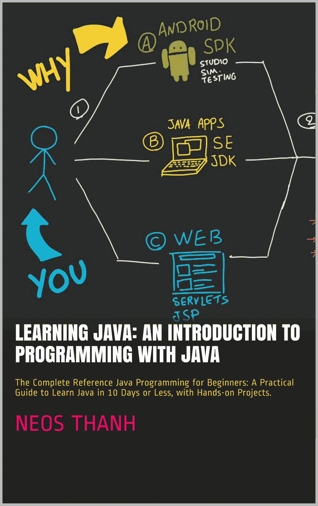


## 练习第 8 题

### b. 练习 #1

### c. `equalsIgnoreCase()`

### d. 练习 #2

### e. 使用运算符 `==` 进行比较

### f. `compareTo()`

### g. 练习 #3

## 5. 其他常用链式方法

### a. `trim()`

### b. 练习 #8

### c. `startsWith()` 和 `endsWith()`

### d. 练习 #9

## III. 熟悉类图

### 3. `boolean equals(Object obj)`

# 3. 公共访问

## II. Static 关键字的用途

## III. Static 属性声明

#### 1. 在项目中声明几何图形计数的示例

#### 2. 为应用程序声明静态配置值的示例

## IV. Static 方法声明

# 第 40 节：线程（部分 3）生命周期

## I. 什么是对象的生命周期？

## II. 为什么人应该学习生命周期？

## III. 理解线程的生命周期

关于“完全”这两个词也有很多观点，事实上只有 Java 的原始数据类型如 `int`、`long`、`float` 等不是面向对象的。除了这些原始数据类型外，在接触 `Java` 时，你必须以面向对象的方式思考和工作。那么什么是面向对象？你会理解的，因为我们将从接下来的课程开始讨论面向对象。

- `Netbeans`：这是一个免费、强大的开源 `IDE`。然而，该工具今天有点过时了，你可能甚至不需要知道它。
- `Eclipse`：它也是一个开源 `IDE`，它的流行程度不亚于 `Netbeans`，即使以前 `Eclipse` 使用更常用。当然，这个工具也是免费的。但可以说，尽管 `Eclipse` 曾被 `Java` 社区使用，但随着我在下一节将介绍的新 `InteliJ` 工具，可能会让 `Eclipse` 像 `Netbeans` 一样过时。
- `InteliJ`：虽然出生较晚，但 `InteliJ` 凭借其稳健性迅速赢得了 `Java` 编程社区的心。

- 在声明变量时，你可以为变量“分配”一个初始值，分配此值将使变量在创建时就立即获得初始数据。如果创建变量时没有分配值，它将被分配一个默认值，该值取决于我们下文将讨论的变量数据类型。
- 最后，在每个变量声明之后，请记住有一个符号 `;` 来通知系统声明结束，如果没有 `;`，系统将立即报告错误。

### 规则 2

### 同时给多个变量赋值

| `++` | 递增运算符，将操作数的值增加 1 个单位。 |

`num1` is 5, `num2` is 10, `result` is 14.

条件运算符比较布尔表达式以产生真或假。以下是 `&&` 和 `||` 的结果：

## VII. 位运算符 (Bitwise Operator)

```java

```

我们刚刚学习了 Java 运算符的课程，通过这节课，你对 Java 语言有了更好的理解，对吧？这些运算符在未来会被应用到知识和实践中。请尝试跟随后续有趣的课程。

## 3. 显式强制转换

你刚刚学习了 Java 强制转换方法以及如何注释源代码。这节课简单但非常重要，你将在项目中多次使用强制转换和注释。

```java
else {

    default:

```

# 第 9 节：循环语句

### 3. for

在这一步中必须有数组大小。如果没有传递此参数，分配将产生错误。这个大小由你决定，通常在应用程序中，如果你确切知道这个大小参数且该大小在应用程序运行期间不会改变，就使用数组；如果我们不确切知道或大小始终变化，我们应该使用 `ArrayList`，正如我们稍后将讨论的那样。按照上面的声明示例，我们添加：

### 练习数字 3

```java
int row = scanner.nextInt();

// 寻找最大列
```

最后，关于数组（Arrays）的知识结束了，希望你掌握了坚实且良好的知识，应用于接下来的 Java 课程。

在本练习中请注意，我调用了 `String` 的 `length()` 函数，它将返回字符串的大小，即该字符串中字符的总数。

#### g. `replace()`

### 6. 字符串反转 - `reverse()`

```java
// 要求用户输入圆的半径
```

从本质上说，这个 `constructor` 也是方法，但它的特殊之处在于，一旦你使用 `new` 关键字初始化一个对象，该对象的 `constructor` 就会被立即调用。这意味着，如果是普通方法，你必须通过点操作符（`"."`）来调用才能执行，但对于 `constructor`，只要 `new` 关键字被编译，系统就会执行对象对应的构造函数，取决于你指定了哪一个构造函数。

```java
    // 但传递了一个参数

        return r;
```

上面的代码是继承的显式表示，其中 `Cylinder` 类通过 `extends` 关键字继承了 `Circle`。根据继承法则，`Cylinder` 可以继承 `Circle` 声明的值（属性和方法）。通过这种继承关系，可以将 `Circle` 类称为基类（Base Class）或父类（Parent Class）。而 `Cylinder` 类被称为派生类（Derived Class）或子类（Subclass, Child Class）。

通常，超类（或基类）是为子类持有公共值或最基础值的类。所以，如果你有多个具有某些相似性的层，比如上面示例中的 `Circle` 和 `Cylinder`，这些层都有圆面（圆柱体有两个圆面），你可以使用 `Circle` 作为基础层（因为它包含了圆柱体可以利用的最小值，在这种情况下，是圆面本身）。或者在许多类具有相似值的情况下，你可以将它们合并为一个单一基类，然后子类只需继承和重用这些相似值，而无需声明更多内容，在下面的练习中，我将创建一个类 `Geometry`，作为 `Circle`、`Square`、`Rectangle` 等类的最基础类。

上面是一个需要继承的示例，但现在我想在组织你的继承的过程中列出一些要点。

- 一个类只被允许继承自一个且仅一个父类。
- 虽然不是继承自许多超类，但继承对象的父类可以继承另一个父类，你可以将这个另一个父类称为“祖父类”以便记忆，如果“祖父类”继承另一个类，自然就存在“太祖父类”。
- 如果一个类完全没有声明继承（如我们在课程课程练习过的类），那么系统将默认它继承自 `Object` 类。在下一节中，我们将讨论这个 `Object` 类。

## III. 熟悉类图

本节继承的概念仅此。但在进入具体的练习之前，我邀请你熟悉一种类图，如果你是一个主流程序员，是无法忽略它的。本部分的主要内容是关于你如何查看和理解图表。因为我们的项目变得更加复杂，会有很多很多类，它们相互使用，相互继承。因此，如果没有图表，我们无法用文字描述所有这些关系。

本节的类图取自 `UML` 的类图构建原理。`UML` 是一套用于软件系统规范和设计的许多不同原则。这样做是为了让你理解这是一个标准的遵循图，如果你理解并遵循这些原则，你就会创建一个通用的模型，让每个阅读并理解你的人都能看到你的软件。你知道，你对这种图有点熟悉，因为我在第 16 节中使用过它，然后我想如下所示表示一个具有三个主要部分的类，而你看到的形状正是类图表示类实例的方式。(Image00068.jpg)

类图中区块的形状和颜色在我们的课程和其他文档中可能会不同，取决于绘图工具。但尽管外观不同，通常情况下，每个图表显示的数据必须符合上述三个部分的立方体原理。我以上面代码中的 `Circle` 类为例，当它被表示为类图中的实体时，它看起来像这样。

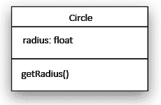

查看此图表，你立刻就能知道构建一个名为 `Circle` 的类，该类有一个名为 `r` 的属性，数据类型为 `float`，以及一个返回 `float` 的 `getRadius()` 方法。尽管它有一个静态值，但它没有显示类内部元素的内容或关系，不过你完全可以轻松地理解并可视化如何根据图表来构建一个类。方法如下。

接下来，我将继续介绍这个类图是如何展示继承的。在预计 `Cylinder` 类将继承 `Circle` 的情况下，我们可以通过如下带有箭头标记的类图来展示这种关系。你必须注意图中所示的空箭头，如果你使用不同类型的箭头，将导致与其他关系产生混淆。

图表的另一个想法是，例如在第 18 节课的案例中，`Circle` 类使用 `Point` 类来创建一个属性，命名为 `prescriptionDo`，因此图表将如下所示显示这种用法：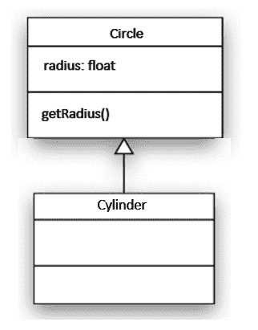

一切都非常清晰，不是吗？好了，通过这节课，我只是简要地介绍了继承和类图。我们将在接下来的课程中为此图表添加知识和符号。

## 继承练习

我们将继续构建应用程序来计算 `Circle`、`Cylinder`、`Rectangle` 和 `Square` 的几何值。你也应该知道，如果你不应用本节课的继承知识，你仍然可以使用之前课节中的 OOP 知识来完美地构建这次练习的结果。但通过应用继承，正如我所说，你将节省大量的代码行。现在邀请你和我一起尝试构建一个新项目。

首先，我邀请你查看本节课的类图（应用了继承），如下所示，请稍微考虑一下（注意图中每个方法或属性前面的 `+` 符号表示用 `public` 关键字声明的，这使得类值是可访问的，我们稍后会讨论这些）。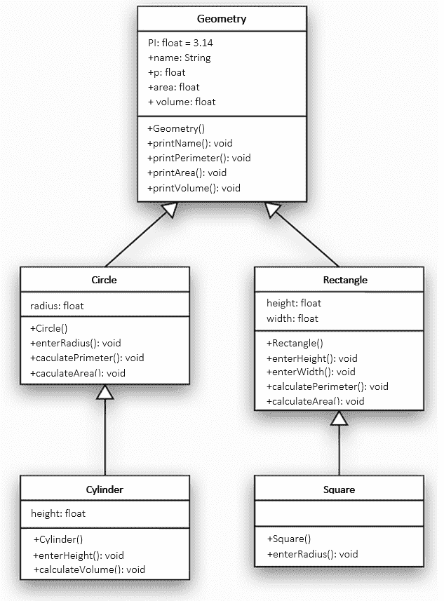

在正式开始之前，我将查看图表并详细说明每个类，然后向你展示运行程序的结果，最后给出每个类的代码。请快速查看类代码，但要根据图表和结果尝试自己编码，每个人的编码方式都不同，你不必写得和我完全一样，只要你的程序运行正常即可。

#### Grade Geometry

这是其余类的父类，或者意味着最基础的类。由于它是基类，如果它包含对子类有用的属性或方法将是最好的，或者说子类可以有效地继承那些值。例如，我将在这个类中声明 `PI` 常量。`name` 属性是共享的，但子类将根据它们的名称具体定义。`p`、`area`、`v` 是相同的，尽管它们是通用定义的，子类将包含不同的值。此父类的方法也是供子类使用的，因此它们将具有特定的函数体，例如 `printName()` 将将在控制台输出名称。或者 `printPerimeter()`、`printArea()`、`printVolume()` 也分别输出变量 `p`、`area`、`v`。

#### Circle class

`Geometry` 的子类。如你所知 `Circle` 将继承其父类的值。除了从父类得到的属性 `name`、`p`、`area`、`v` 之外，它还定义了自己的特殊属性 `radius`。你可以在 `Circle()` 构造函数中为 `Circle` 初始化变量 `name`。`enterRadius()`、`calculatePerimeter()`、`calculateArea()` 方法没有在父类中声明，由 `Circle` 自己设计。

#### Cylinder class

这一层是 `Circle` 的子类，因为正如我上面说的，`Cylinder` 有圆形面，这个圆形与 `Circle` 的属性没有区别，所以 `Circle` 应该是 `Cylinder` 的基础类。因为 `Cylinder` 继承自 `Circle` 的值，而 `Circle` 又继承自 `Geometry`，所以 `Cylinder` 拥有 `Geometry` 和 `Circle` 的所有值。它只需要添加 `High` 属性以及导入自己的 `enterHeight()`、`calculateVolume()` 方法。

#### Rectangle and Square

`Rectangle` 和 `Square` 的关系类似。`Square` 类有一个特殊之处，即由于该形状的长宽相等，正方形的 `enterSide()` 函数只需让用户输入边长，然后你将相同的边长赋值给变量 `height` 和 `width`，因此 `Square` 不需要构建任何其他方法，完美地继承了其父类。

运行程序的结果如下所示。

```
==== Circle ===== Radius = 10

Perimeter = 62,800003 Area = 314.0

==== Cylindrical ===== Radius = 10

Height = 2

Volume = 628.0

==== Rectangles ===== Length = 10

Width = 2

Perimeter = 24.0

Area = 20.0

==== Square ===== Side = 5

Perimeter = 20.0

Area = 25.0
```

至于调用的继承（`OOPLearning` 和 `PackageLearning` 已关闭）。将类组织到包的方法如下。

project, 我创建了一个新项目

以下是源代码。

```java
Cylinder cylinder = new Cylinder();

cylinder.printName();

cylinder.enterHeight();

cylinder.calculateVolume();

cylinder.printVolume(); // 使用 Rectangle 类测试

Rectangle rect = new Rectangle();

rect.printName();

rect.enterHeight();

rect.enterWidth();

rect.calculatePerimeter();

rect.calculateArea();

rect.printPerimeter();

rect.printArea();

// 使用 Square 类测试

Square square = new Square();

square.printName();

square.enterSide();

square.calculatePerimeter();

square.calculateArea();

square.printPerimeter();

square.printArea();
```

看，你必须编写更多的代码，对吧？学习编程的核心在于你不应该害怕写代码，虽然继承知识在减少代码行方面对你很有帮助，但并不会让我们这些程序员完全解脱。

# 第 19 节：this 和 super 关键字

通过上一节，你已经熟悉了 Java 中的继承，通过它你已经知道如何声明继承关系、何时何时继承以及继承属性。以及子类从父类中获得什么值。在本节中，我们先不谈继承的话题，而是来看关键字 `this` 和 `super` 的定义和用法。它们非常重要，但如果你学得太早是没用的，因为它们与继承有关；如果你学得太晚，你将无法理解某些使用它们的场景。让我们开始吧。

## I. this 关键字

你一定还记得。关键字 `this` 在第 17 节中的用法是，即当你想区分变量和类属性（如果它们具有相同的名称）时。在那个节中，我没有解释清楚这一点。这一部分将帮助你列出 `this` 的所有用途。

如你所知，`this` 关键字意味着：这个对象。它反向引用对象，使得能够访问该对象的值。这里有 `this` 的几个有用作用，在今后的 Java 课程以及 Android 编程中也会经常看到它的用法。

### 1. 在类中访问属性和方法时使用 this

正如你在第 17 节中学到的，当你使用 `this` 访问类的属性时，当你使用 `this` 访问方法时，`this` 的作用是类似的。正如你所知，现在使用 `this` 的主要目的是当变量和类属性同名时，帮助区分它们。然而，你完全可以在任何时间任何访问这些属性和方法时使用 `this`，如下例所示。但你不应该随意使用 `this`，这会让我们的代码变得冗肿，下面的示例有点过度使用 `this`，我只是想多展示一些给你们看。

```java
public class Circle {

    public float radius;

    // 构造函数

    public Circle (float radius) {

        this.radius = radius;

    }

    public void calculatePerimeter() {

        // 计算圆周并打印到控制台

    }

    public void calculateArea() {

        // 计算圆的面积并打印到控制台

    }

    public void printCircle() {

        System.out.println("Circle of radius =" + this.radius);

        this.calculatePerimeter();

        this.calculateArea();

    }

}
```

### 2. 在类内部调用另一个构造函数时使用 this

根据构造函数那一节，我应该总是谈论这种用法，但我特意将其放在这一节中进行讨论。如果你的某个类中有多个构造函数，并且你想让某个构造函数调用另一个构造函数，通常这种调用可以帮助构造函数利用彼此的初始化代码，避免重复编写。`this` 的用法与上面略有不同，即你必须带参数的形式进行调用，例如 `([parameter])`，就像调用方法一样。为了方便演示，我称之为 `this()`。

此时，调用时，`this()` 会根据其 `pass_parameter` 调用对应的构造函数。但调用另一个构造函数不会创建新类，而像在类内部调用某些函数一样利用该构造函数。请看这个例子。

```java
public class Rectangle extends Hoc {

    public float height;

    public float width;

    // 构造函数

    public Rectangle() {
```


`name = "Rectangle";`

```
// 构造函数
public Rectangle(float height, float width) {
    this(); // 调用 Rectangle ()
    this.height = height;
    this.width = width;
}

// 构造函数
public Rectangle(float side) {
    this(side, side); // 调用 Rectangle (height, width)
}

public void calculatePerimeter() {
    p = 2 * (height + width);
}

public void calculateArea() {
    area = height * width;
}
```

注意，在这种情况下 `this()` 关键字仅用于构造函数中，以便像上面示例那样利用其他构造函数；如果你把 `this()` 放在普通方法中，系统会报错。还有一点，如果使用 `this()`，那么它必须是构造函数内部的第一行代码，如果放在它后面，系统会报错，因为 `this()` 之前还有其他代码。

```
// 构造函数
public Rectangle(float height, float width) {
    this.height = height;
    this.width = width;
}
```

### 3. 将 `this` 作为参数传递给另一个方法或构造函数

在这一部分，通过 Android 编程你会更多地使用它。正如 Java 节所示，这是将 `this` 作为参数传递给方法或构造函数。下面的例子展示了如何将 `this` 作为参数。在 `Foo` 类中，高亮的行显示了 `this`，因此你不需要使用 `new` 关键字来创建类。

```
public class Foo {
    public void useBarMethod() {
        Bar theBar = new Bar();
        theBar.barMethod(this);
    }
    public String getName() {
        return "Foo";
    }
}

public class Bar {
    public void barMethod(Foo obj) {
        obj.getName();
    }
}
```

### 4. 将 `this` 作为返回值

当结果为 `this` 时，它返回该类的实例。这种 `this` 的用法可能会让你感到困惑。在看到我想讨论的困惑之前，先看这个示例，并且由于这种困惑，在这种情况下你可能不需要使用 `this`。如果你在在这种情况下知道 `this` 的真正含义，请自己留言。首先我有一个 `Student` 类。正如你所见，在 `getStudent()` 方法中，该类返回了 `this` 关键字。

```
public class Student {
    public String name;
    public String age;
    // 构造函数
    public Student(String name, String age) {
        this.name = name;
        this.age = age;
    }
    public Student getStudent() {
        return this;
    }
}
```

那么，在 `main()` 函数中，有一个 `Student` 类声明，看 `main()` 如何使用 `getStudent()`。

```
public class MainClass {
    public static void main(String[] args) {
        Student student = new Student("Yellow", "20");
        System.out.println("Name: " + student.getStudent().name);
        System.out.println("Age: " + student.getStudent().age);
    }
}
```

```
Student student = new Student("Yellow", "20");
System.out.println("Name: " + student.name); System.out.println("Age: " + student.age);
}
```

## II. 关键字 `super`

与 `this` 关键字不同，它帮助的是它自己。`super` 关键字帮助的是指向父类。也就是说，你可以愉快地理解为 `super` 不能用来指代“爷爷”类，而是指代当前对象的父类，即它最邻近的类。

以下是 `super` 的的一些作用，你可以将 `this` 的作用与其他进行对比以查看差异，同时也便于记忆。

### 1. 在访问最近父类的属性和方法时使用 `super`

如果上述的第一个目的是为了在类中成员变量同名时区分哪些是变量，哪些是属性，那么 `super` 的第一个目的就是当它们存在同名时，区分哪些是子类的值，哪些是最近的父类的值。子类方法与父类方法之间的同名情况比属性之间的同名更常见，而且这种同名是有意为之的，你可以预习否定课以更好地理解为什么会有这种同名。

接下来的示例展示了 `Circle` 类与其父类 `Geometry` 定义了相同的方法 `printName()`，然后 `super` 出现在 `Circle` 的 `printName()` 中，帮助先调用父类的 `printName()`，然后执行剩余代码。同样，在 `Circle` 的括号内，你可以测试下面的代码。

```
public class Geometry {
    public String ten;
    public void printName() {
        System.out.println("\n\n===== " + name + " =====");
    }
    // 其他方法在此 // ...
}

public class Circle extends Geometry {
    // 构造函数
    public Circle() {
        ten = "Circle";
    }
    public void printName() {
        super.printName();
        System.out.println("\n Method from Circle");
    }
    // 其他方法在此 // ...
}

public class MainClass {
    public static void main(String[] args) {
        // 对 Circle 进行简单测试
        Circle circle = new Circle();
        circle.printName();
    }
}
```

### 2. 在调用最近父类的构造函数时使用 `super`

与使用 `this`（`传递参数`）的一样，`super`（`传递参数`）帮助你调用，并利用最近父类中的初始化代码。就像关键字 `this()` 一样，`super()` 只在构造函数中使用，如果你在其他普通方法中放置 `this super()`，系统会产生错误。同样，如果存在关键字 `super()`，它必须在构造函数内部首先声明。

```
public class Geometry {
    public String name;
    // 构造函数
    public Geometry(String name) {
        this.name = name;
    }
    // 其他方法在此 // ...
}

public class Circle extends Geometry {
    // 构造函数
    public Circle() {
        super("Circle");
    }
    // 其他方法在此 // ...
}
```


所以我们刚刚看完了`this`和`super`这两个关键字的概念和用例。它们非常重要，并且在我们今后的项目或示例中会频繁出现，请慢慢掌握并练习使用它们。当然，这节课只有理论，与这两个关键字相关的实践将出现在接下来的课程中。

# 第 20 节：开始继承

我们已经学习了面向对象编程中的许多重要知识，例如属性、方法、构造函数。但有一类知识可以被称为面向对象编程精髓，我们将从这节课开始接触它，它将给你一种以这种方式在应用程序中使用和组织类的方法。这种知识比你在之前课程中熟悉的方式完全更加先进和有效，那就是继承的知识。

如果你是 Java 和面向对象编程的新手，继承会让它变得稍微困难一点。在这一点上，Java 代码不再那么重要，你如何在应用程序中组织类或对象的结构才更重要。根据我的经验，在熟悉继承之后，会有无数问题向你袭来。是的，你会好奇什么时候该继承。也有理解继承的朋友，但继承的组织使得他们的“亲戚”关系广泛，导致继承变得更加混乱。那么我们什么时候应该阻止任何给定类的继承呢？等这些问题我将尝试在这系列继承课程中彻底涵盖，以便你有最好的方法将继承应用到你的产品中。

## I. 熟悉继承

### 1. 什么是继承？

面向对象编程中的继承指的是对象之间的关系，有些人说这种关系是父子关系，有些人说它是扩展关系。人们似乎更喜欢父子这个概念，但我认为开放性，而且最接近的，是理解为继承总是更好的。因为这本质上是一种重用，在某些情况下，它从其他对象扩展了对象的属性。

所以，为了理解一种实际的方法，假设我们首先有一个类，这个类可以由我们编写，或者从某处“采集”的，我们暂时将这个可用类命名为`A`。然后，为了利用`A`的功能或属性而不必重写（或复制，也许是盗版），我们构建继承自`A`的新类，我们称这个新类为`B`。那么我们的`B`将拥有`A`拥有的方法和属性。有些时候继承并不是为了重用`A`的值，而是因为`A`的某些值不符合`B`的需求，也就是说继承自`A`也帮助`B`拥有（也被称为扩展的）那些不会改变`A`本质的值。这一点，我们关注的是重用，扩展目的我们将在下节课讨论。

### 2. 为什么要继承？

通过我上面的观点，也许你也理解了必须继承的原因。

嗯，继承的主要目的是重用，并进一步扩展从某个对象的可用属性和方法。仅此，继承的目的并不高深，但它带来的效果是非常巨大的。通过重用这些现有的东西，你的项目结构看起来会更专业，代码也更易读。

上述代码是继承的显式表示，其中`Cylinder`类使用`extends`关键字继承自`Circle`类。根据继承法则，`Cylinder`可以继承`Circle`声明的值（属性和方法）。通过这种继承关系，可以将`Circle`类称为“基类”（Base Class）或“父类”（Parent Class），而`Cylinder`类被称为“派生类”（Derived Class）或“子类”（Subclass, Child Class）。

通常，超类（或基类）是为子类持有公共值（或基础值）的类。因此，如果你有多个具有相似性的层级，例如上述示例中的`Circle`和`Cylinder`，这些层都具有圆形面（圆柱有两个圆形面），所以你可以使用`Circle`作为该层的基础（因为它包含了`Cylinder`可以利用的最小值，在本例中就是圆形面本身）。或者在某些情况下，有许多具有相似属性的类，你可以将它们合并为一个单一基类，然后子类只需继承并复用这些相似的值，而无需额外声明任何内容。在下方的练习中，我将创建一个最基础的类`Geometry`，供`Circle`、`Square`、`Rectangle`等类使用。

上面是一个需要继承的示例，但现在我想列出组织继承关系过程中的一些要点。

- 一个类只允许继承自且仅自一个父类。
- 虽然不是继承自多个超类，但如果该继承对象可以从另一个超类继承，为了方便记忆，你可以将另一个超类称为“祖父类”，而且如果“祖父类”又继承了另一个类，那么肯定还存在“曾祖父类”。
- 如果一个类完全没有声明继承（如我们在之前课程中练习过的类），那么系统将默认它继承自`Object`类。在下节课程中，我们将讨论这个`Object`类。

## III. 熟悉类图

本节中继承的概念仅止于此。但在进入具体实践之前，我邀请你熟悉一种“神圣图表”，如果你是一名主流程序员，是无法忽略它的。本节的重点在于讨论你如何查看和理解这些图表。因为我们的项目会变得越来越复杂，会有很多类，它们相互使用、相互继承。如果没有图表，我们将无法用语言描述所有的这些关系。

本节的类图取自 UML 的类图构建原则。UML 是一套用于软件系统规范和设计的许多不同原则的集合。这么说是为了让你这是一个遵循标准原则的图表，如果你理解并遵循这些原则，你就能创建一个通用的语言模型，让每个阅读并理解你的人都能看到你想要向他们展示的软件结构。你对这种图表已经有点熟悉，因为我在第 16 课中使用它，现在我想以如下方式表示一个包含三个主要组件的类，你看到的形状正是类图表示类实例的方式。

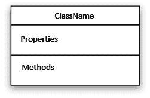

类图中方块的形状和颜色在我们的课程和其他文档中可能会不同，这取决于绘图工具。但尽管外观不同，通常情况下，每个图表所显示的数据必须符合包含上述三个组件的立方体原则。我以上述代码中的`Circle`类为例，当它被表示为类图中的实体时，它看起来像这样。


看着这张图，你立刻就能知道你需要构建一个名为`Circle`的类，该类有一个名为`r`的属性，数据类型为`float`，以及一个返回`float`的`getRadius()`方法。尽管它并没有显示类内部元素的内容或关系，但你当然很容易地理解并可视化如何根据图表构建一个类。就是这样。

接下来，我继续讨论这个类图是如何展示继承的。在预期`Cylinder`类继承`Circle`的情况下，我们可以通过如下带有箭头标记的关系类图来显示这种关系。你必须注意所示的空箭头，如果你使用不同类型的箭头，会导致与其他关系的混淆。

图表的另一个想法，例如在第 18 课的情况下，`Circle`类使用`Point`类来创建一个属性，命名为`prescriptionDo`，因此图表将显示如下用法

一切都非常清晰，不是吗？好了，通过这节课，我简要介绍了继承和类图。在接下来的课程中，我们将向此图中添加知识和符号。现在我们需要练习以适应。

## 继承练习

我们将继续构建应用程序来计算`Circle`、`Cylinder`、`Rectangle`和`Square`的几何值。你应该也知道，如果不应用本课的继承知识，你仍然可以使用之前课程中学的 OOP 知识完美地完成这次练习的结果。但正如我所说，应用继承后，你将节省大量的代码行。现在邀请你和我一起尝试构建新项目。

首先，我邀请你查看本课的类图（应用了继承），如下，请稍作考虑（注意图中每个方法或属性前面的`+`符号表示用`public`关键字声明，这意味着这些类值是可以访问的，我们稍后会讨论）。

在正式开始之前，我将查看图表并详细说明每个类，然后向你展示运行程序的结果，最后是每个类的代码。请快速查看类代码，但依靠图表和结果尝试编写代码，每个人的编码方式都不同，你不需要和我写得完全一样，只要你的程序运行正常即可。

### Geometry 类

这是剩余类的超类，或者意味着最基础的类。由于它是一个基类，最好它包含对子类有用的属性或方法，或者说子类可以有效地继承这些值。例如，我将在这个类中声明常量`PI`。`name`属性是共享的，但将由子类根据它们的名称具体定义。`p`、`area`、`v`是相同的，尽管它们是通用定义的，但子类将包含不同的值。此超类的方法也供子类使用，因此它们将具有特定的函数体，例如`printName()`将在控制台输出名称。或者`printPerimeter()`、`printArea()`、`printVolume()`将分别输出变量`p`、`area`、`v`。

### Circle 类

`Geometry`的子类。如你所知，`Circle`将继承其父类的值。除了从父类获得的属性`name`、`p`、`area`、`v`之外，它还定义了自己的特殊属性`radius`。你可以在`Circle()`构造函数中初始化`Circle`的变量名。`enterRadius()`、`calculatePerimeter()`、`calculateArea()`方法没有在父类中声明，由`Circle`自己设计。

### Cylinder 类

这一层是`Circle`的子类，因为正如我上面提到的，`Cylinder`有圆形面，这个圆形面与`Circle`的属性没有区别，所以`Circle`应该是`Cylinder`的基类。因为`Cylinder`继承自`Circle`，而`Circle`继承自`Geometry`，所以`Cylinder`拥有`Geometry`和`Circle`的所有值。它只需要添加`High`属性以及自己的`enterHeight()`、`calculateVolume()`方法。

### Rectangle 和 Square

`Rectangle`和`Square`的关系类似。`Square`类有一个特殊之处，即由于该形状的长和宽相等，正方形的`enterSide()`函数只需告诉用户输入一条边，然后你将相同的边值赋值给变量`height`和`width`，`Square`不需要再构建任何方法，完全是从其父类继承了完美的继承。

运行程序的结果如下：

```
==== Circle =====

Radius = 10

Perimeter = 62.800003 Area = 314.0

==== Cylindrical =====

Radius = 10

Height = 2

Volume = 628.0

==== Rectangles =====

Length = 10

Width = 2

Perimeter = 24.0

Area = 20.0

==== Square =====

Side = 5

Perimeter = 20.0

Area = 25.0
```

关于调用的继承（OOPLearning 和 PackageLearning 已关闭）。将类组织到包的方式如下。项目，我创建了一个新项目

以下是程序中对应类的源代码供你参考。

#### Class Geometry

```java
package shapes;

public class Geometry {

    public final float PI = 3.14f;

    public String name;

    public float p;

    public float area;

    public float v;

    public void printName() {

        System.out.println("\n\n===== " + name + " =====");

    }

    public void printPerimeter() {

        System.out.println("Perimeter = " + p);

    }

    public void printArea() {

        System.out.println("Diện tích = " + area);

    }

    public void printVolume() {

        System.out.println("Area = " + v);

    }

}
```

#### The Circle class

```java
package shapes;

import java.util.Scanner;

public class Circle extends Geometry {

    public float radius;

    // Constructor

    public Circle() {

        name = "Circle";

    }

    public void enterRadius() {

        System.out.println("Radius = ");

        Scanner scanner = new Scanner(System.in);

        radius = scanner.nextFloat();

    }

    public void calculatePerimeter() {

        p = 2 * PI * radius;

    }

    public void calculateArea() {

        area = PI * radius * radius;

    }

}
```

#### Class Cylinder

```java
package shapes;

import java.util.Scanner;

public class Cylinder extends Circle {

    public float height;

    // Constructor

    public Cylinder() {

        name = "Cylinder";

    }

    public void enterHeight() {

        enterRadius();

        System.out.println("Height = ");

        Scanner scanner = new Scanner(System.in);

        height = scanner.nextFloat();

    }

    public void calculateVolume() {

        v = area * height;

    }

}
```

#### Class Rectangle

```java
package shapes;

import java.util.Scanner;

public class Rectangle extends Geometry {

    public float height;

    public float width;

    // Constructor

    public Rectangle() {

        name = "Rectangle";

    }

    public void enterHeight() {

        System.out.println("Height = ");

        Scanner scanner = new Scanner(System.in);

        height = scanner.nextFloat();

    }

    public void enterWidth() {

        System.out.println("Width = ");

        Scanner scanner = new Scanner(System.in);

        width = scanner.nextFloat();

    }

    public void calculatePerimeter() {

        p = 2 * (height + width);

    }

    public void calculateArea() {

        area = height * width;

    }

}
```

#### The Square class

```java
package shapes;

import java.util.Scanner;

public class Square extends Rectangle {

    // Constructor

    public Square() {

        name = "Square";

    }

    public void enterSide() {

        System.out.println("Side = ");

        Scanner scanner = new Scanner(System.in);

        height = width = scanner.nextFloat();

    }

}
```

#### And finally the MainClass class

```java
package main;

import shapes.Rectangle;

import shapes.Circle;

import shapes.Cylinder;

import shapes.Square;

public class MainClass {

    public static void main(String[] args) {

        // Test with Circle class

        Circle circle = new Circle();

        circle.printName();

        circle.enterRadius();

        circle.calculatePerimeter();

        circle.calculateArea();

        circle.printPerimeter();

        circle.printArea();

        // Test with Cylinder class

        Cylinder cylinder = new Cylinder();

        cylinder.printName();
```


`cylinder.enterHeight();`

`cylinder.calculateVolume();`

`cylinder.printVolume();`

`// Test with Rectangle class`

`Rectangle rect = new Rectangle();`

`rect.printName();`

`rect.enterHeight();`

`rect.enterWidth();`

`rect.calculatePerimeter();`

`rect.calculateArea();`

`rect.printPerimeter();`

`rect.printArea();`

`// Test with Square class`

`Square square = new Square();`

`square.printName();`

`square.enterSide();`

`square.calculatePerimeter();`

`square.calculateArea();`

`square.printPerimeter();`

`square.printArea();`

你看，你必须编写更多的代码，对吧？学习编程的核心在于你不应该害怕写代码，虽然继承的知识在减少代码量方面对我们很有帮助，但并不能让我们程序员完全无负担。

# 第 21 节：继承中的重写（Overriding）

通过这节课，我将介绍继承知识中的下一个点。如果你在第 21 节中已经学会了如何使用 `extends` 关键字来表示从一个类到另一个类的继承，并且你已经习惯了将从 `Parent` 类（或 `Base` 类）的所有值复用到 `Child` 类（或 `Derivative` 类），那么那时我称之为“继承中的复用”。现在我们将来看继承的另一个方面，它不再是简单的复用，而是“重写”。

## I. 什么是重写？

覆盖（Veto/Override）也是继承的一个特性。我以前习惯使用 `veto` 这个词，可能是因为使用 `C++` 或 `C#` 时的习惯。当我来到 Java 语言时，我发现它被称为 `Override`。

正如我之前提到的，如果你熟悉继承，你就知道这个概念意味着特性的复用，我们简要回顾了第 21 节，这个特性允许子类默认获取其父类已声明（并允许）的方法和属性。

覆盖（Veto）特性又是怎样的？这个属性允许子类声明与父类方法相同的方法，然后子类将重新定义该方法的内容，这意味着“不认可”父类的方法。正因为这种对父类的含义，人们经常称之为 Veto（或 `Overriding`，或 `Override`）。

## II. 如何进行重写？

如上所述，为了满足重写，你只需要在子类中声明一个与父类方法同名，并传递与父类方法相同的参数。然后，虽然不是强制性的，但为了代码的清晰性，你应该在每个重写方法上声明一个注解（英语中称为 `Annotation`），其内容为 `@Override`。

通过子类中这个被重写的方法，你可以重新设计其内部逻辑。一旦在某处调用该子类的方法，根据继承原则，将使用子类的方法，而不是使用父类的方法。

让我们来看下面的示例。该示例将使用两个类 `Circle` 和 `Cylinder`，其中 `Cylinder` 继承自 `Circle`。让我们按照下面的类图，在两个类中都声明 `printInfo()` 方法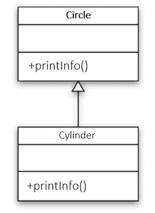

它们的代码简单如下。

```java
public class Circle {

    public void printInfo() {

        System.out.println("This is Circle");

    }

}

public class Cylinder extends Circle {

    @Override

    public void printInfo() {

        System.out.println("This is Cylinder");

    }

}
```

按照上述方式声明这两个类，你就可以看到如何在 `main()` 函数中调用它们。

```java
public class MainClass {

    public static void main(String[] args) {

        Circle Circle = new Circle();

        Cylinder Cylinder = new Cylinder();

        Circle.printInfo();

        Cylinder.printInfo();

    }

}
```

如果你执行该程序，你将看到两个类中的两个 `printInfo()` 命令将在控制台上打印如下所示的内容：

```
This is Circle
This is Cylinder
```

这是因为 `Circle` 中的 `printInfo()` 被 `Cylinder` 中的 `printInfo()` 重写（或覆盖、改写）了。如果你尝试删除 `Cylinder` 中的 `printInfo()`，你将得到相同的两行打印到控制台的内容，这是因为如果没有这个重写，继承的复用将会发挥作用。你已经理解了重写的概念，对吧。

这里有一个开放思路给你。也就是说，如果你希望重写方法使用父类的重复方法，你可以像下面的示例一样使用 `super` 关键字。

```java
public class Cylinder extends Circle {

    @Override

    public void printInfo() {

        super.printInfo();

        System.out.println("This is Cylinder");

    }

}
```

### 继承练习（负）

重写的理论仅如此。很容易记忆，对吧。现在让我们尝试在 `Circle` 和 `Cylinder` 两个层之间建立一个完整的关系。这仍然是继承，但你会看到复用和覆盖特性的完整范围。你可以为这个练习创建一个新项目。

让我们来看下面的类图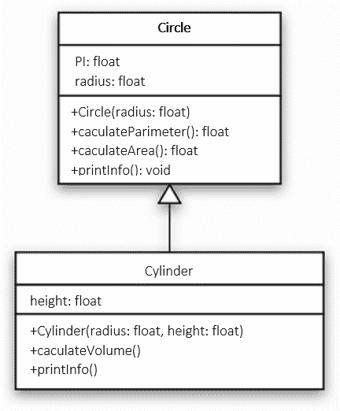

在 `Circle` 类中，我们不需要像之前的练习那样编写一个方法让用户从控制台输入半径，而是立即将此半径传递给构造函数。`calculateParimeter()` 和 `calculateArea()` 方法根据从构造函数获取的半径返回计算结果。最后，`printInfo()` 方法将像上面的示例一样，该方法将被继承 `Cylinder` 类重写。

```java
public class Circle {

    public final float PI = 3.14f;

    public float radius;

    // 构造函数

    public Circle(float radius) {

        this.radius = radius;

    }

    public float calculateParimeter() {

        return 2 * PI * radius;

    }

    public float calculateArea() {

        return PI * radius * radius;

    }

    public void printInfo() {

        System.out.println("This is Circle");

        System.out.println("Circle has Parimeter: " + calculateParimeter() + " and Area: " + calculateArea());

    }

}
```

在 `Cylinder` 类中，该类继承了 `PI` 和 `radius` 属性，`calculateParimeter()` 和 `calculateArea()` 方法。`Cylinder` 额外声明了属性 `height` 和方法 `calculateVolume()`。最后，`printInfo()` 方法将重写父类。

```java
public class Cylinder extends Circle {

    public float height;

    // 构造函数

    public Cylinder(float radius, float height) {

        super(radius);

        this.height = height;

    }

    public float calculateVolume() {

        return calculateArea() * height;

    }

    @Override

    public void printInfo() {

        System.out.println("This is Cylinder");

        System.out.println("Cylinder has Volume: " + calculateVolume());

    }

}
```

完成。现在我们将在 `main()` 函数中使用它们。

```java
public class MainClass {

    public static void main(String[] args) {

        Circle Circle = new Circle(10);

        Cylinder Cylinder = new Cylinder(10, 20);

        Circle.printInfo();

        Cylinder.printInfo();

    }

}
```

这是运行程序的结果。

```
This is Circle
Circle has Parimeter: 62.800003 and Area: 314.0
This is Cylinder
Cylinder has Volume: 6280.0
```

我们刚刚看到了 OOP 知识系列中的又一个特性。通过这些重写的知识，我将其视为继承的一部分，它讨论了 Veto，除了我们在上一节课中已经熟悉的 Reuse。

# 第 22 节：Object 类

在此时出现 `Object` 类可能会让人有点困惑。但当你刚开始接触 Java 时，在你的几行代码中，这个类已经出现了。这个类名为 `Object`，由系统提供，并将其指定所有类的最高超类。为了更好地理解，让我们回顾一下之前课程中美丽的 `Circle` 类声明。

```java
public class Circle {
```

你看到这个 `Circle` 类没有继承任何其他类，你认为它是最高父类，但如果有其他类声明继承自它又该呢？不，正如我上面提到的，在 Java 中，如果你没有为某个类指定父类，该类的默认系统会继承自一个类，即 `Object` 类。但由于它是其他类默认继承的（除了那些显式声明继承自另一个类的类，因为你已经知道一个类不能有多个父类），所以你不需要显式地声明它。显式地说明继承这个 `Object` 类的作用。下面的代码我想把它显式地写出来，目的是让你知道像这样的声明是隐式的，没人会那样写。

```java
public class Circle extends Object { }
```

## II. Object 类是干什么用的？

嗯，你肯定会奇怪，这到底造了什么鬼，好让它能成为另一个类的父亲？

事实上，如果你读完我下述的思路，你会发现 `Object` 类非常重要。首先，`Object` 可以让你预先声明一个对象，但你还不知道那个对象是什么，在特定的情况下，之后你会将这种临时的 `Object` 类强制转换为对应的特定子类。这听起来很模糊，但请记住，在接下来的课程中你会理解这个好处。其次，正如你已经知道继承的主要用途，它有助于将具有相似值的类分组到同一个基类中，例如第 21 课示例，`Geometry` 类是 `Circle`、`Rectangle`、`Square` 等类的基类。`Object` 类也是如此，这个类现在充当了你在 Java 项目中创建的任何类的基类。因此，这里的基类将包含对其他类最有用的公共值，请继续下看。

## III. Object 类提供的方法

`Object` 类的以下方法没有直接的实际意义，也就是说，你只需要读一下并把它放在那儿即可，你以后可以使用。你应该记住，这些方法通过 `Object` 对所有类都是可用的，所以你简要读一下，然后记住，以后会有机会用到它，不要自己去重新设计它。拜托了。

### 1. `public final Class getClass ()`

此方法返回一个 `Class` 类，`Class` 类包含了与被构造对象相关的可用信息。

你可以参考以下代码，你看，我们没有声明这些方法，它们在 `Object` 类中可用，我们只需要获取它们来使用。

```java
public static void main(String[] args) {

    Circle Circle = new Circle();

    System.out.println("Infomation of object Circle: " + Circle.getClass());

    System.out.println("Infomation of object Circle: " + Circle.getClass().getName());

    System.out.println("Infomation of object Circle: " + Circle.getClass().getSimpleName());

}
```

结果打印了关于此对象的一些有用信息，取决于你在 `Class` 中深度调用的方法。

```
Information of object Circle: class shapes.Circle
Information of object Circle: shapes.Circle
Information of object Circle: Circle
```

### 2. `int hashCode ()`

此方法返回一个哈希值。我以前从未用过这个方法，但我想它可以作为区分不同对象的值。

如下代码所示，你可以看到打印同一类两个对象的哈希值的情况。

```java
public static void main(String[] args) {

    Circle circle1 = new Circle();

    Circle Circle2 = new Circle();

    System.out.println("Hashcode of Circle 1: " + circle1.hashCode());

    System.out.println("Hashcode of Circle 2: " + Circle2.hashCode());

}
```

```
Hashcode of Circle 1: 1735600054
Hashcode of Circle2: 21685669
```

### 3. `boolean equals (Object obj)`

这个 `equals()` 方法熟悉吗？不？记住它。实际上，在第 13 课关于 `String` 的课程中，我提到过 `String` 中的这个 `equals()` 方法，它可以帮助比较两个 `String` 是否相同。现在你知道 `String` 也是一个 `Object`，所以它也会从父类 `Object` 继承这个 `equals()` 方法。但更有趣的是，`String` 的 `equals()` 重写了这个类的方法，而不是完全继承。所以类似于 `String`，这个 `equals()` 方法有助于比较任何两个对象以判断它们是否相同。两个对象被认为是恒等的，不是因为它们创建自同一个类，而是因为它们具有相同的引用值。这个引用问题实际上与指针知识有关，但 Java 不想让程序员知道指针，所以我稍后会谈论引用的概念。你肯定也能猜到后面两个比较方法的返回结果对吧？

```java
public static void main(String[] args) {

    Circle circle1 = new Circle();

    Circle Circle2 = new Circle();

    System.out.println(circle1.equals(Circle2));

}
```

```java
public static void main(String[] args) {

    Circle circle1 = new Circle();

    Circle Circle2 = circle1;

    System.out.println(circle1.equals(Circle2));

}
```


你也可以打印它们之间的哈希值，这样你就可以看到`equals()`和`hashCode()`之间的关系。

### 4. `Object clone()`

此方法初始化并返回被调用对象的副本。本质上，我只是没有提到这个方法的具体示例，因为目前`Object`类声明该方法的访问权限是`protected`。你稍会理解这种访问权限，但它是受保护的，并且仅在子类重写了该方法时有用。

### 5. `String toString()`

此方法帮助为此对象返回一个`String`类型的表达式。其内容是字符串组合（`getClass().getName() + "@" + Integer.toHexString(hashCode())`）。有趣的是，这个方法可能不需要显式调用。这就是为什么你熟悉的`String`对象不需要任何`toString()`语句，如下例所示，程序打印了两个对象，一个`String`，外加图片 1。

```java
public static void main(String[] args) {
    Circle circle1 = new Circle();
    System.out.println("Don’t call toString() explicitly:" + circle1);
}
```

这等同于显式调用`toString()`，但你不需要这样做。

```java
public static void main(String[] args) {
    Circle circle1 = new Circle();
    System.out.println("Call toString()explicitly: ".toString() + circle1.toString());
}
```

它们的执行结果是相同的。

```
Don’t call toString() explicitly: shapes.Circle@677327b6
Call toString()explicitly: shapes.Circle@677327b6
```

### 6. `finalize()`

`Object`子类可以重写此方法，以便在垃圾回收（Garbage Collection）之前通过操作释放正在使用的资源——我提到了垃圾回收。打开清理这个未使用的对象。你还看到此方法是由系统自动调用的。而且它非常深入，有时当你使用它并想要释放与文件读取或网络相关的资源时会用到，我们将在后面的课程中熟悉这些内容。除了`Object`类为其子类带来的上述有用方法外，还有许多其他方法，如`notify()`、`notifyAll()`、`wait()`，它们将在后的课程中提到并与此相关联。

# 第 23 课：访问权限（访问修饰符）

我们将讨论一个长期以来承诺的问题，因为你刚刚熟悉了类的属性和方法，即访问类值能力的知识。那么什么是访问权限？它们又有多重要？请观看本课。

## I. 什么是访问修饰符？

访问权限（Accessibility），也称为`Access Modifier`修饰符，是 Java 提供的定义。你或其他程序员将使用这些定义来表示访问类值的权限。在这里我想提到的类值包括类的属性、方法和构造函数。

Java 中的访问修饰符关键字是：`private`、`protected`、`public`和`default`（意味着没有定义）。

## II. 访问权限的定义是什么？

让我们看看上述每种访问能力，但让我们回顾一下如何声明它们。

记住，在类值声明相关的语法中，我已经说明了如何声明这些访问权限。

例如，在声明该类的属性时：

```
[acessibility] attribute_type_type [= initial_value];
```

或者在声明该类的方法时：

```java
[acessibility] payload type () {
    // 代码行
}
```

或者在声明此构造函数时：

```java
[accessibility] method name () {
    // 代码行
}
```

所以你可以理解如何定义类值的访问权限，对吧？下面是`Circle`类中访问权限定义的完整示例。

```java
public class Circle {
    protected final float PI = 3.14f;
    private float radius;

    // 构造函数
    public Circle(float radius) { this.radius = radius; }

    protected float calculatePerimeter() { 
        return 2 * PI * radius;
    }

    protected float calculateArea() { 
        return PI * radius * radius;
    }

    public void xuatThongTin() {
        System.out.println("This is Circle");
    }
}
```

## III. 访问权限的含义

现在，让我们通过每种访问权限，看看它们的含义和作用。首先，我想根据下表总结访问权限，以便记忆。这张表如果定义在某些范围内是可访问的，则带有"Yes"，相反含义则带有"No"。

| | private | default | protected | public |
| :--- | :--- | :--- | :--- | :--- |
| 教室内部 | Yes | Yes | Yes | Yes |
| 在另一个类中，但在同一包内 | No | Yes | Yes | Yes |
| 在子类中，在同一包内 | No | Yes | Yes | Yes |
| 在子类中，不同包 | No | No | Yes | Yes |
| 在包之外的任何其他类（非子类） | No | No | No | Yes |

访问权限含义表

现在我将详细说明每种访问权限。

### 1. Private 访问权限

如果你将类的某个值（属性、方法或构造函数）指定为`private`，如表所示，你只能在该类内部访问该值。

这种私有能力是为了保护类内部的值不被外部类"可见"（读取和编辑）。

- 如果对属性指定为`private`，则该属性将不允许从其他类访问或修改，除非你为该属性构建了 getter 和 setter 方法，我们稍后会讨论。
- 即使给方法分配了`private`，该方法也不会被其他类访问或继承。
- 如果对构造函数指定为`private`，则该构造函数无法用于实例化该类的对象。

据我所知，这种私有能力被广泛使用，如果你不确定某个值是否应该被调用或重用，只需为它指定`private`即可。

**练习 #1**

在本次练习中，我们创建一个`Circle`类，将值声明为`private`。你可以看到当这些值在`Circle`类内部使用时是非常好的，系统没有报错。

```java
public class Circle {
    private final float PI = 3.14f;
    private float radius;

    // 构造函数
    private Circle() { }

    private float calculatePerimeter() { 
        return 2 * PI * radius;
    }

    private float calculateArea() { 
        return PI * radius * radius;
    }
}
```

所以你可以自己测试，通过`main()`函数调用这些`Circle`的值，以下代码行将会报错。

```java
public class MainClass {
    public static void main(String[] args) { 
        Circle circle = new Circle();
        circle.radius = 20;
        circle.calculateArea();
    }
}
```

结果行显示下面的错误。
第 4 行错误
第 5 行错误
第 6 行错误

### 2. default 访问权限

正如我所说，这里的默认意味着完全没有访问权限定义，就像我们熟悉的介绍课程一样，我们暂时将访问权限声明留为空。这次更新。由于类值的访问权限为空，你可以看到，如果在该类内部或同一包的其他类中，将能够看到并访问那些值。只有当你从包外部的类调用这些值时，可见性和访问才会被阻止。这种能力不常用，因为大家都希望代码具有透明性。

**练习 #2**

在这里我省略了`Circle`类中所有值的访问权限声明。

```java
package shapes;

public class Circle {
    final float PI = 3.14f;
    float radius;

    // 构造函数
    Circle() { }

    float calculatePerimeter() { 
        return 2 * PI * radius; 
    }

    float calculateArea() { 
        return PI * radius * radius; 
    }
}
```

同样地，在`main()`函数中带有以下代码行，你可以猜哪一行会失败。

```java
package main;

import shapes.Circle;

public class MainClass {
    public static void main(String[] args) { 
        Circle circle = new Circle();
        circle.radius = 20;
        circle.calculateArea();
    }
}
```

错误行结果如下。
第 8 行错误 第 9 行错误 第 10 行错误 这些行报错的原因是因为它们在"main"包中，不同于`Circle`的"shapes"包。将它们带回同一个包进行验证。

### 3. Protected 访问

这种能力是为了供子类重用或重写类值。因此，保护能力将赋予子类完全自由，无论是在相同包还是不同包。这种能力限于不是子类且在包外的类。

**练习 #3**

这次看`Circle`类内部的`protected`声明如下。

```java
package shapes;

public class Circle {
    protected final float PI = 3.14f;
    protected float radius;

    // 构造函数
    public Circle(float radius) { this.radius = radius; }

    protected float calculatePerimeter() { 
        return 2 * PI * radius;
    }

    protected float calculateArea() { 
        return PI * radius * radius;
    }
}
```

并且在`main()`函数中的代码中，再次尝试猜哪行代码会出错。

```java
package main;

import shapes.Circle;

public class MainClass {
    public static void main(String[] args) { 
        Circle circle = new Circle(10); 
        circle.calculateArea();
    }
}
```

第 9 行报错。`calculateArea()`是`protected`唯一的"NO"情况。因为它是从一个与`Circle`类没有父子关系的类中调用的，而且处于与`Circle`不同的包。

**练习 #4**

仍然使用练习 3 的代码，这次我声明了更多的`Cylinder`继承自`Circle`，以及`main()`函数如下。看看是否有任何错误信息。

```java
package shapes;

public class Cylinder extends Circle {
}
```

```java
public class Cylinder {
    public float height; // 构造函数

    public Cylinder(float radius, float height) {
        super(radius);
        this.height = height;
    }

    public float calculateTheTich() {
        return calculateArea() * height;
    }
}
```

```java
package main;

import shapes.Cylinder;

public class MainClass {
    public static void main(String[] args) {
        Cylinder cylinder = new Cylinder(10, 20);
        cylinder.calculateTheTich();
    }
}
```

这些是错误行的结果。没有哪行报错，因为`Cylinder`继承了父类的方法并重新分配了这些方法的访问权限。

### 4. 公有访问 (Public Access)

关于这种可能性可能不需要很多篇幅。如果你在类中指定一个值为`public`（公有），那么假设所有其他类都可以访问这些值。

所以我刚刚"偿还"了访问性（Accessibility）知识的债，它也称为访问修饰符（Access Modifier）。从下节课开始，我们将使用许多关于这些访问性的知识。

# 课程 24：final 关键字

你可能记得关于常量的课程。到那时你已经知道，要声明一个常量必须使用`final`关键字。在 OOP 课程之前，如果你用这个`final`关键字声明了类的属性，常量仍然会保持原样使用。所以，除了作为常量之外，`final`在这些 OOP 关系中还能做什么。请观看本节课程以更好地理解`final`。

## I. final 变量与 final 属性 (Final Variables & Final Properties)

正如我所说，当`final`关键字用于方法内部的变量时，它的含义与在类属性上使用`this`关键字含义相同。它都是一个不可变的常量。

下面是变量的`final`声明示例，这个古老的知识你可能已经掌握得非常好了。

```java
protected float calculateParimeter() {
    final float PI = 3.14f;
    return 2 * PI * radius;
}
```

至于为属性声明`final`，它同样古老，你在之前的课程在`Circle`类中声明`PI`时已经用过很多次了。然而，你应该记住，访问`final`或非`final`属性的能力声明是完全相同的。

```java
class Circle {
    private final float PI = 3.14f;
    protected float radius;

    // 构造函数
    public Circle(float radius) {
        this.radius = radius;
    }

    protected float calculateParimeter() {
        return 2 * PI * radius;
    }

    protected float calculateArea() {
        return PI * radius * radius;
    }
}
```

正如我在讨论常量时建议的那样，你应该将所有带有`final`声明的变量或属性字符大写，这有助于我们的代码更加清晰、连贯。

### final 属性空白 (Final Attribute Blank)

在这一节中，我想更多关于用于变量或属性的`final`。也就是说，当你将其声明为`final`时，你不需要立即为该属性或变量指定值，可以留空，这样当以后有特定值时，你可以将其赋值给属性或`final`变量，且只赋值一次。这使得看似非常僵板的`final`变得稍微灵活了一些。

下面的示例模拟通过方法设置`final`的准确`PI`值。

**在我们找到更受保护的之后的 PI 变量**

```java
protected float calculateParimeter() {
    final float PI;
    PI = calculatePI();
    return 2 * PI * radius;
}
```

下面的示例模拟设置`final`的官方`PI`值，但与上面的变量示例略有不同，对于`final`属性，你只允许在构造函数中为`final`赋值以下值。

**找到之后的 PI 属性值**

```java
class Circle {
    private final float PI;
    protected float radius;

    // 构造函数
    public Circle(float radius) {
```


#### II. final 方法 (Final Method)

也很容易推断。如果属性在指定为`final`时意味着“钉住”该值，它是可以更改的。那么对于方法，当你为它指定`final`时，似乎该方法不能被重写，这等同于你不能从子类更改该方法。

回到`Circle`循环，假设`calculateParimeter()`和`calculateArea()`方法都被声明为`final`。

```java
class Circle {

    private final float PI = 3.14f;

    protected float radius;

    // 构造函数

    public Circle(float radius) {

        this.radius = radius;

    }

    protected final float calculateParimeter() {

        return 2 * PI * radius;

    }

    protected final float calculateArea() {

        return PI * radius * radius;

    }

}
```

所以在`Cylinder`类中，对于继承自`Circle`的普通`Cylinder()`方法，你可以看到重用`Circle`的方法是完全可以。

```java
public class Cylinder extends Circle {

    public float height;

    public Cylinder(float radius, float height) {

        super(radius);

        this.height = height;

    }

    public float calculateTheTich() {

        return calculateArea() * height;

    }

}
```

但是，正如我在讨论常量时所建议的，如果你将方法声明为`final`，可以防止其他类重写方法，确保一致性。

```java
@Override

protected float calculateParimeter() {

    return super.calculateimeter();

}
```

通过方法封装性（正如我们声明为`private`），允许类内部调用方法。你看到 OOP 的封装性了吗？

但是，你应该注意，你不能为构造函数指定`final`，因为构造函数永远不会被重写。

#### III. final 类 (Final Class)

`final`对类的影响与对方法的影响相似。也就是说，当你将其声明为`final`时，你将无法继承任何`final`类。

假设`Circle`类有`final`声明，那么继承`Circle`的`Cylinder`类将会报告“整个类”错误。

```java
final class Circle {

    // ...

}
```

`methods makeonly`（通过上面的定义，你应该足够理解这种类型的方法是否正确。如果你真的不理解，请继续阅读后续章节。）

## II. 如何组织 Getter 和 Setter？

为了通过 getter 和 setter 为类中的属性创建封装，请遵循以下步骤：

1. 在私有类中定义属性的访问权限。
2. 为每个私有属性构造 getter 或 setter 方法。
3. 对于 setter，你应该将方法命名为`setNameOfProperties()`。
4. 对于 getter，你应该将方法命名为`getNameOfProperties()`。

私有属性的 getter 和 setter 是可选的。如果你不希望属性被任何类看到，你可能不需要声明任何 getter 或 setter。如果你只想让该属性可见而不被修改，则只需为私有属性构建一个 getter。如果你只想让该属性在外部编辑而不可见，则只需为私有属性构建一个 setter。

现在，为了方便理解，让我们来看`Point`类示例。你可以看到，这个类中的`x`和`y`属性被指定为`private`，然后在属性声明下方必须构建更多的 getter 和 setter 方法。

```java
public class Point {

    private int x;

    private int y;

    // getter of property x

    public int getX() {

        return x;

    }

    // setter of property x

    public void setX(int x) {

        this.x = x;

    }

    // getter of property y

    public int getY() {

        return y;

    }

    // setter of property y

    public void setY(int y) {

        this.y = y;

    }

}
```

即使对于你已经熟悉的`Circle`类或其他几何类，我们也可以为它们构建 getter 和 setter。

```java
class Circle {

    private final float PI = 3.14f;

    private float radius;

    public float getRadius() {

        return radius;

    }

    public void setRadius(float radius) {

        this.radius = radius;

    }

    public float calculatePerimeter() {

        return 2 * PI * radius;

    }

    public float calculateArea() {

        return PI * radius * radius;

    }

}
```

所以从类外部调用 getter 和 setter 方法将如下所示。请注意下面的`main()`函数。在这个示例中，我通过调用类的 setter 替换了通过构造函数设置圆的半径。

```java
public class MainClass {

    public static void main(String[] args) {

        // Creat new circle object

        Circle circle = new Circle();

        // set radius of circle by setter

        circle.setRadius(10);

        // Other methods

        float perimeter = circle.calculatePerimeter();

        float area = circle.calculateArea();

        System.out.println("Perimeter of this circle is: " + perimeter + ", and area is: " + area);

    }

}
```

## III. 使用 Eclipse 声明 Getter 和 Setter

你可以看到，类属性的 getter 和 setter 的命名没有特定的规则，它们应该是`getXXX()`和`setXXX()`。

首先，你可以使用`Point`类，或者在 Eclipse 中创建任何类。请为它声明一个或多个私有属性，如下所示。

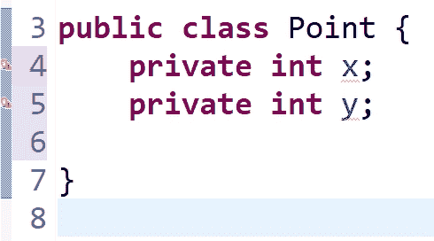

你可以看到编辑器左侧栏上有黄色警告图标，分别对应每个私有属性。由于系统看到我们为属性声明了`private`但没有在类内部使用它们，这显然是一个问题，因为这些值在类外部是不可见的。

当你反复点击这些警告之一时，会弹出一个对话框，选择`Create getter and setter for 'property_name'…`。当对话框出现在此选项旁边时，保持默认并点击 OK 完成。

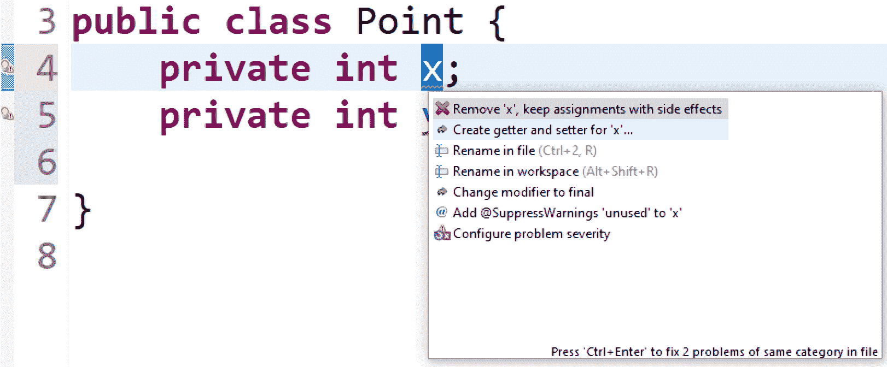

你可以自己验证。此选项的结果帮助你为相应的属性生成 getter 和 setter。你只需要对剩余属性重复操作即可。如果你想移除 getter 或 setter，只需在通过上述步骤创建后删除该方法即可。

## IV. Getter、Setter 和自定义

到目前为止，你一定已经了解了 getter 和 setter 是什么。但你知道，这些 getter 和 setter 方法并不是真的为了获取或设置类属性的输入。因为它们是方法，可以利用它们在获取或设置值之前进行一些操作。

我的示例是一个类`Student`，它对姓名和年龄的导入/导出有各种限制，如下所示。请注意测试返回的结果。

```java
public class Student {

    private String name;

    private String age;

    public String getName() {

        return name;

    }

    public void setName(String name) {

        if (name == null || name.isEmpty()) {

            // 如果 name 未被设置（null），或为空

            // 将 name 设置为“Unknow”

            this.name = "Unknow";

        } else {

            this.name = name;

        }

    }

    public String getAge() {

        if (Integer.valueOf(age) != -1) { // 年龄有效

            return age;

        } else {

            return "Invalid age";

        }

    }

    public void setAge(int age) {

        // 检查年龄是否有效

        // 如果有效，将其设置为 age；否则，将 age 设置为“-1”

        if (age > 18) {

            this.age = String.valueOf(age);

        } else {

            this.age = String.valueOf(-1);

        }

    }

}
```

按照上述类声明。假设我在`main()`函数中如下初始化了这些学生对象。

```java
public class MainClass {

    public static void main(String[] args) {

        // 创建学生对象

        Student student1 = new Student();

        Student student2 = new Student();

        // 为他们设置姓名和年龄

        student1.setName(""); // 未知姓名

        student1.setAge(23);

        student2.setName("Peter");

        student2.setAge(17);

        // 输出学生信息

        System.out.println("Student 1 has name: " + student1.getName() + ", age: " + student1.getAge());

        System.out.println("Student 2 has name: " + student2.getName() + ", age: " + student2.getAge());

    }

}
```

猜猜控制台的输出是什么。这里是结果：

```
Student 1 has name: Unknown, age: 23
Student 2 has name: Peter, age: Invalid age
```

- 关键字`private`、`protected`、`public` - 用于定义访问类值的权限。
- `Final`关键字 - 有助于定义常量，或在面向对象编程（OOP）中防止方法重写。
- Getter 和 setter 名称 - 指通过`get` / `set`方法对`private`属性进行数据封装。

因此，我们继续学习一个新关键字`static`，看看这个关键字是什么以及它的作用是什么。

## I. Static 概念

可以说，编程语言中“static”字在越南语中的含义是最难理解的。“Tĩnh”——翻译为 Static（静态）。并没什么。

实际上，当你像下面所示声明类的组件时，`static`关键字就会被应用，我将清晰地展示。它对内存管理有重大影响。具体来说，`static`成员属于类的内存管理，而不是属于类实例（或对象）的管理。

还不理解吗？我邀请你看下面的例子，也许通过这个例子你仍然不知道`static`关键字的用法，但让我们看看它是如何影响你提到的类内部值的管理的。注意`Point`类中的`static`组件和非`static`组件。

```java
public class Point {

    public static String info; 

    public int x;

    public int y;

}
```

正如我所说，`info`属性是`static`的，属于`Point`类。属性`x`、`y`不是从`Point`声明的实例或对象。它们将由`static`管理。

当另一个类中使用这些`Point`的`static`值时，问题变得更清晰了。

```java
public class MainClass {

    public static void main(String[] args) {

        // 这些 x 和 y 属性只能通过 Point 类的实例 point2 访问

        Point point1 = new Point();

        point1.x = 10;

        point1.y = 20;

        // 这些 x 和 y 属性只能通过 Point 类的实例 point2 访问

        Point point2 = new Point();

        point2.x = 5;

        point2.y = 6;

        // 再次通过 Point 类访问 info 属性

        Point.info = " Save coordinates of the geometry";

    }

}
```


你看到了吗，`x`、`y` 属性以及你所知的任何其他非静态值，必须通过类的实例调用，例如示例中的 `point1`、`point2`。此外，属性 `INFORMATION` 可以直接通过类 `Point` 访问，无需任何显示。到这里，你已经理解 `static` 值是什么了，对吧。你确实猜到了 `static` 的一点含义。

## II. Static 关键字的用途

正如上面提供的一些信息，你可以看到，通过类名调用类的值而无需初始化该类的对象，使得值变得可行。`static` 声明更容易访问。

更具体地说，这些 `static` 值可以被应用程序中的其他类共享。它对整个应用程序具有全局影响。看一眼上面的例子，你尝试通过命令行 `Point.info = "Save geometrical coordinates";` 为 `Point` 中的静态值 `info` 赋值。然后在其他地方，例如另一个类中，你可以获取这个 `Point.info` 值，或重新给它赋一个新值。因此，`static` 值将在类内部或类外的任何地方共享（只要该值没有声明为 `private`）。

但像这样自由地访问和修改类值是一把双刃剑。如果你过度使用 `static` 关键字，你将无意中破坏 OOP 准则。OOP 最初诞生是为了划分每个对象的特征和职责，以便于管理。`static` 关键字带来了某些本应由某个对象负责的、且通用的属性。因此，我建议你在为类的任何值声明 `static` 时要非常小心。

那么，`static` 关键字到底用在什么地方？我邀请你阅读下面的章节。在 `static` 关键字的每个具体工具中，我将找到 `static` 关键字在构建应用程序过程中带来的最实用的示例。

## III. Static 属性声明

也许没什么可说的了。`static` 属性就是声明了 `static` 关键字的属性。至于它们如何使用，我们看下面的例子，你就会得很清楚。

### 1. 项目中声明的几何计数

让我们回到几何类型的示例。例如，我们有 `Geometry`，它是 `Circle` 和 `Rectangle` 两个类的父类。这个例子的要求是，每当我们创建一个几何对象时，有一个计数器会自动递增，表示程序中创建的形状数量。让我们看看 `Geometry` 类，假设我们对其他行的计算代码感兴趣，我们只关注在该类内部设置为 `static` 的计数。

```java
public class Geometry {

    public static int count = 0;

    public Geometry() { 

        count++;

    }

    // 其他代码行 // ...

}
```

然后，对于子类的每个构造函数，我们通过 `super()` 方法调用其最近的父类。此调用会增加父类构造函数中的变量 `count`。

```java
public class Circle extends Geometry {

    // 构造函数 
    public Circle() { 

        super();

    }

    // 计算周长和面积的方法 // ...

}

public class Rectangle extends Geometry {

    // 构造函数
    public Rectangle() { 

        super();

    }

    // 计算周长和面积的方法 // ...

}
```

然后，在 `main()` 函数中，尝试声明 `Circle` 和 `Rectangle` 对象，并在控制台打印变量 `count`。

```java
public class MainClass {

    public static void main(String[] args) {

        // 创建对象
        Geometry geometry = new Geometry(); 

        Circle circle1 = new Circle();
        Circle circle2 = new Circle();
        Rectangle rect = new Rectangle();

        System.out.println("Total " + Geometry.count + " shapes in program");

    }

}
```

应用程序中有 4 个图形。你看到 `static` 是如何共享的了吗？

### 2. 应用程序静态配置值示例

有没有想过如果你想让应用程序拥有共享固定值，这意味着应用程序的配置值。例如，声明此文件的 `static` 路径，或声明此网页的路径……对于所有静态配置，你可以将它们组合在一个文件中并关联 `static` 属性。

继续几何计数示例。假设现在的问题是你不能超过 5 个图形。我们需要创建一个用于配置的类。我将这个类命名为 `Geometry`。

```java
public class Geometry {

    // 声明最小形状数量和最大形状数量
    public static final int MINIMUM_SHAPE= 0;
    public static final int MAXIMUM_SHAPES= 5;

    // 其他可用的配置
    // public static final xxx xxx
    // public static final xxx xxx
    // ...

}
```

回到 `main()` 函数，让我们尝试声明更多几何对象。以下是基于从 `Geometry` 类获取的静态配置值的约束检查。

```java
public class MainClass {

    public static void main(String[] args) {

        // 创建类实例
        Geometry geometry1 = new Geometry(); 
        Geometry geometry2 = new Geometry(); 
        Circle circle1 = new Circle();
        Circle circle2 = new Circle();
        Rectangle rect1 = new Rectangle(); 
        Rectangle rect2 = new Rectangle();

        if (Geometry.count > Geometry.MAXIMUM_SHAPES) {

            System.out.println("你声明的数量超过了允许的几何数量！");
            System.out.println("最小几何数量是："+ Geometry.MINIMUM_SHAPE);
            System.out.println("最大几何数量是: " + Geometry.MAXIMUM_SHAPES);

        }

    }

}
```

```java
} else {

    System.out.println("Total " + Geometry.count + "shape in program.");

}
```

现在你可以运行应用程序来验证它了。

## IV. 静态方法声明

静态方法的使用与上述静态属性具有相同的特性和目的。即：

- 静态方法仍然由类进行管理，而不是实例。
- 当一个方法被应用程序中的所有对象共享时，该方法被设置为静态的。例如：检查某些值的正确性的方法、货币转换的方法、单位转换的方法、将数据存储到内存中的方法、连接到服务器的方法等。

然而，Java 中有一个非常特别的注意：所有的静态方法都只能调用声明为静态的属性。这可以很容易验证：在很久以前的第 8 节中，当变量位于 `main()` 之外时，我必须将变量声明为 `static name`，因为 `main()` 被声明为静态的（`main(function)`），所以必须声明为静态函数，这样系统就可以通过类随时访问它，而不是声明包含 `main()` 函数的类实例。因此，如果 `main()` 想要使用 `name`，那么 `name` 也必须是静态的。

### 几何系统单位转换示例

对于这个示例，假设我们的几何应用程序在输入和单位计算方面有更高的要求。假设我们接受两个输入单位：`inch`（英寸）和 `centimeter`（厘米）。

短期内，`Geometry` 类将需要构建一些静态配置值，并添加单位转换的静态方法。

```java
public class Geometry {

    public static final int MINIMUM_SHAPE = 0;
    public static final int MAXIMUM_SHAPES = 5; // 其他配置
    public static final float PI = 3.14f;
    public static final float INCH_CM = 2.54f; // 1 英寸 = 2.54 
    public static final int UNIT_CM = 1; // 标记应用程序使用厘米
    public static final int UNIT_INC = 2; // 标记应用程序使用英寸
    public static int unit = UNIT_CM; // 标记应用程序正在使用的单位

    // 静态方法将厘米转换为英寸
    public static float ConvertCentimetToInch(float cm) {

        float inch = cm / INCH_CM;
        return inch;

    }

    // 静态方法将英寸转换为厘米
    public static float ConvertInchToCentimet(float inch) {

        float cm = inch * INCH_CM;
        return cm;

    }

}
```

那么，在任何几何类中，我为 `Circle` 类构建了以下示例：此类将询问用户正在使用什么几何单位，并输出相应的信息以及转换信息。另一个基于 `Geometry` 类中的静态配置和静态方法。

```java
public class Circle extends Geometry {

    protected float radius;
    private Scanner scanner;

    // 构造函数
    public Circle() {

        super();
        scanner = new Scanner(System.in);

    }

    public void enterRadius() {

        // 输入你想使用的单位
        System.out.println("What unit you want to use? ");
        System.out.println("\t1 - Centimet");
        System.out.println("\t2 - inch");
        Geometry.unit = scanner.nextInt();

        // Sau đó nhập bán 半径
        System.out.println("Enter Radius of Circle: ");
        radius = scanner.nextFloat();

    }

    public void printInfo() {

        if (Geometry.unit == Geometry.UNIT_CM) {

            System.out.println("The circle has radius " + radius + " cm");
            System.out.println("Equals" + Geometry.ConvertCentimetToInch(radius) + " inch");

        } else {

            System.out.println("The circle has radius " + radius + " inch");
            System.out.println("Equals" + Geometry.ConvertInchToCentimet(radius) + " cm");

        }

    }

}
```

请尝试构建对这些 `Geometry` 方法的调用进行验证。我们刚刚学习了 Java 中 `static` 关键字的概念和用法。你可以看到静态值真的非常容易使用。我的建议总是：要考虑，不要过度使用这些静态值。如果为了为了上面示例那样的用途，否则你不应该使用 `static` 关键字。

# 第 27 节：重载 (Overloading)

如果你还记得，我们学习过**重写**（overriding）。这一节你将学习更多关于**重载**（overloading）的知识。注意你的错误。重写、重载、重、重……开开玩笑的，我如下帮助你记忆一下：

- **重写（Overriding）** 是子类重写了父类的方法。
- **重载（Overloading）** 是重载方法。

我们邀请你加入这一节。这节课将帮助你理解重载的概念。此外，它还能帮助你不要混淆重写和重载。

## I. 什么是重载？

这是 OOP 中一个非常好的概念。重载允许一个类定义具有相同名称但传递参数不同的方法。这里的方法包含了构造函数。重载技术增加了类内部方法的易用性。

试着看下下方的示例。

```java
public class Circle extends Geomertry {

    // 没有传递参数，
    // 应用程序必须调用方法从控制台导入半径和单位
    public void loginRadius () {

    }

    // 传递了一个参数作为半径
    // 应用程序从控制台调用该方法
    public void loginRadius (float baninh) {

    }

    // 传递了两个参数：半径和单位
    // 应用程序将这些值赋值给属性
    public void loginRadius (float banKinh, int donVi) { }

}
```

正如我上面所说，重载允许类定义具有相同名称但传递参数不同的方法。这里的方法包含了构造函数。重载技术增加了类内部方法的易用性。

试着看下下方的示例。

（注：此处代码块内容已在上方逻辑中保持，实际翻译时已遵循代码块不翻译原则）

*注：由于原文文本中代码块重复且包含注释，已按要求逻辑整合。*

- 作为普通员工的全职员工每月获得 1000 万薪资。作为老板的全职员工每月获得 2000 万薪资。
- 全职员工在任何一天加班，不论职位如何，每天将额外增加 80 万的薪资。
- 兼职员工每小时仅能赚取 10 万薪资，不论职位如何。多劳多得。仅此如此，应用程序将允许每位员工进入。每位员工都有姓名。分为全职或兼职员工。全职员工是普通员工或老板员工，是否有额外的加班天数？季节工可以工作多少小时？最后根据这些信息，输出相应的工资界面。

## 类图

由于程序需求较为复杂，只能通过类图进行最清晰的解释。

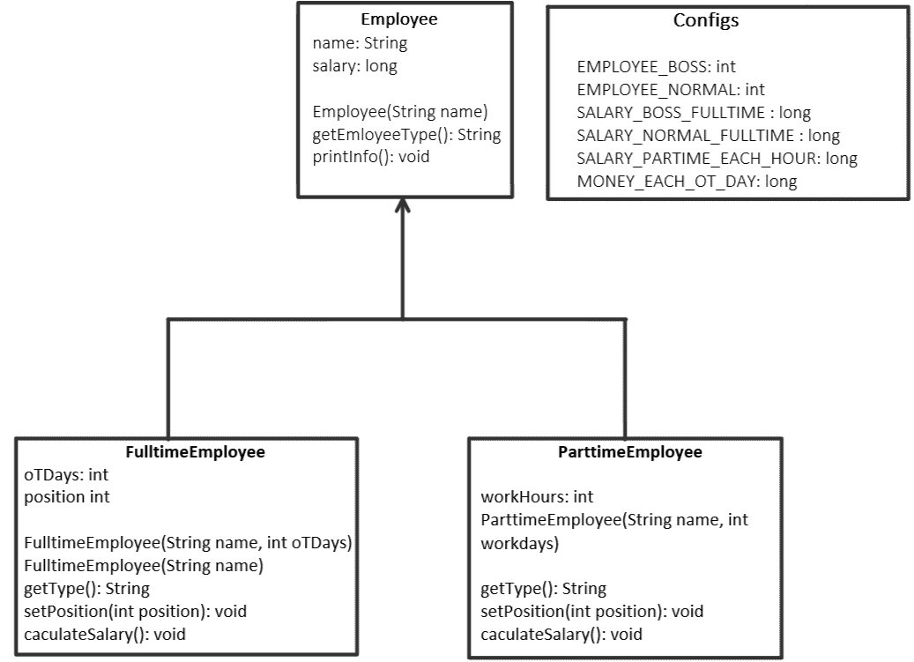

如你所见，这张图包含的信息比你第一天看到的要多得多。让我解释一下这些额外信息。

- 包信息显示在类名下方，字体较小。因此通过查看图表，我们可以看到 `Employee`、`FulltimeEmployee` 和 `ParttimeEmployee` 类位于同一个包 `model` 中。`Configs` 类位于包 `util` 中。
- 常量用大写值表示。
- 静态值将带有下划线，例如 `Configs` 类中的属性。这样我们的图表更加清晰。

## 构建类

在这里你可以自己编写代码。

第一个是 `Configs` 类，用于存储静态值，例如月薪、日薪、时薪等……

```java
package util;

public class Configs {

    // Type of staff
    public static final int EMPLOYEE_BOSS = 1;
    public static final int EMPLOYEE_NORMAL = 2;

    // Staff salary
    public static final long SALARY_BOSS_FULLTIME = 20000000;
    // Boss's monthly salary
    public static final long SALARY_NORMAL_FULLTIME = 10000000;
    // The monthly salary of the staff
    public static final long MONEY_EACH_OT_DAY = 800000; // 全职员工每天加班为 80 万
    public static final long SALARY_PARTIME_EACH_HOUR = 100000; // 兼职员工每小时工资 10 万

}
```

接下来是 `Employee` 类。

```java
package model;

public class Employee {

    protected String name;
    protected long salary;

    public Employee() {

    }

    public Employee (String name) {


# 员工薪资应用与多态

## I. 回顾与引入

在上一节课中，我们构建了一个员工薪资计算应用。现在，我们将引入两个重要的面向对象编程概念：

- **多态**。我们将学习这个。
- **抽象**。下节课我们将学习。

## II. 如何使用多态？

到目前，你应该对多态的概念有了大致的理解。那么在面向对象编程（OOP）中，我们如何组织和使用这种多态属性呢？

首先，多态与继承相关。而且，多态再次与方法重写（overriding）相关。因为如上面提到的，多态是指某个对象能够变成其他对象。因此，为了让一个对象变成某个对象，它必须是一个父对象。而为了让父对象在每情况下都是子对象之一，它必须定义方法供子类进行重写。这有助于系统在应用程序运行时确定实际运行的是哪些对象和方法。因此很多文档将多态称为“运行时多态”。

我们将通过下面的例子来使其更容易理解。这个例子非常简单。`Geometry` 类是父类，两个子类 `Circle` 和 `Rectangle` 都重写了父类的 `caculateArea()` 方法。

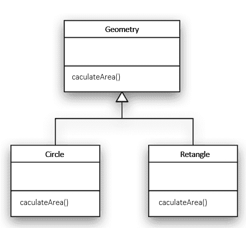

它们的代码也很简单，我们去除了所有其他无关内容，只关注重写的方法。

### `Geometry`

```java
public class Geometry {

    public void caculateArea() {

        System.out.println("Unknow shape");

    }

}
```

### `Circle`

```java
public class Circle extends Geometry {

    @Override

    public void caculateArea() {

        System.out.println("This is area of Circle");

    }

}
```

### `Rectangle`

```java
public class Rectangle extends Geometry {

    @Override

    public void caculateArea() {

        System.out.println("This is area of Rectangle "); 

    }

}
```

现在，多态的魔力在这里，请注意以下声明和使用上述重写方法的代码。

### `MainClass`

```java
public class MainClass {

    public static void main(String[] args) { 

        Geometry geometry = new Geometry();

        // 打印“Unknow Area” 

        geometry.caculateArea();

        // 有时，geometry 变成了另一种形状，这次是一个 Circle 

        geometry = new Circle();

        geometry.caculateArea(); // 这将打印“This is area of Circle”

        // 有时，geometry 变成了另一种形状，这次是一个 Rectangle 

        geometry = new Rectangle();

        geometry.caculateArea(); // 这将打印“This is area of Rectangle”

    }

}
```

你看到，`Geometry` 对象本身有一个方法 `caculateArea()`。但与之前课程中使用的对象不同，之前当我们需要子类来执行面积计算时，我们会声明子类并调用子类上的重写方法。而在本节中，我们允许 `Geometry` 类充当子类，通过将对象重新初始化为其子类 `Geometry geometry = new Circle ()`，让它本身在那里作为子类。多态就在这里。

## III. 在构建员工薪资应用中进行实践

如果在上一节课中，我们为一家“大”公司构建了一个“复杂的”、“完整”工资系统。但那时候的代码并不非常实用，因为我们是“硬编码”的，预先知道了哪些是员工，谁是老板，谁是全职，谁是兼职，并声明了相应的 `FulltimeEmployee` 或 `ParttimeEmployee` 对象。因此，在本节课中，我们将完成上一节课的员工薪资计算应用，使系统更加真实。具体来说，在本节中，我们将让用户手动输入员工信息。因此程序中将有一个员工数组。`Employee` 类将是使用多态属性的类，能够在每个特定情况下充当 `FulltimeEmployee` 或 `ParttimeEmployee`。

### 描述程序需求

工资程序的要求与上一节课没有变化。我刚才描述了。

- 公司有两种类型的员工：全职员工和兼职员工。
- 作为普通员工的全职员工每月获得 10M。作为老板的全职员工每月获得 20M。
- 全职员工如果任何某一天加班，无论职位如何，每天都将获得 800k。
- 兼职员工无论职位如何，每小时只能赚 100k。多劳多得。

应用程序将允许用户输入员工的人数。然后对于每个员工，用户必须输入员工姓名、员工类型（全职或兼职）、全职员工是普通员工还是老板、是否有任何加班工作？你可以做多少小时季节性工作？最后根据这些信息，将显示所有员工的相应薪资界面。

### 类图

我们仍然依靠上一节课的类图。但对其进行修改，以便 `Employee` 类能在其子类中很好地“运行”。通过在类类中构造 `caculateSalary()` 方法，那么在子类中将必须再次重写。

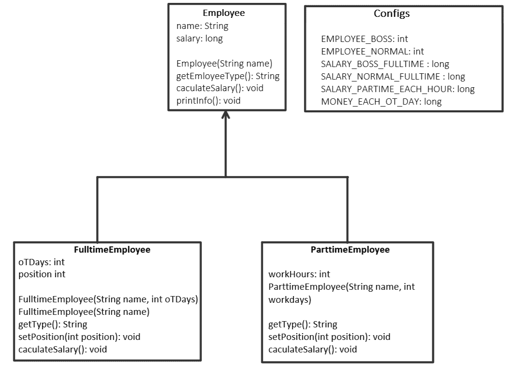

### 构建类

`Configs` 类没有变化。

```java
package util;

public class Configs {

    // 员工类型

    public static final int EMPLOYEE_BOSS = 1; 

    public static final int EMPLOYEE_NORMAL = 2;

    // 员工薪资

    public static final long SALARY_BOSS_FULLTIME = 20000;

    // 全职普通员工工资

    public static final long SALARY_NORMAL_FULLTIME = 10000;

    // 全职员工加班费

    public static final long MONEY_EACH_OT_DAY = 800;

    // 兼职员工每小时工资

    public static final long SALARY_PARTIME_EACH_HOUR = 100; // 兼职员工每小时工资

}
```

（注：`SALARY_PARTIME_EACH_HOUR` 对应原文末尾的 100k）

`Employee` 类添加 `caculateSalary()` 以多态。

```java
package model;

public class Employee {

    protected String name;

    protected long salary;

    public Employee () {

    }

    public Employee (String name) {

        this.name = name;

    }

    // 子类必须重写此方法

    public void caculateSalary() {

    }

    protected String getEmployeeType () {

        // 处理这种类型的员工

        return "";

    }

    public void printInfo() {

        System.out.println("===== Employee:" + name + "=====");

        System.out.println("-Employee type:" + getEmployeeType());

        System.out.println("- Salary:" + salary + "VND");

    }

}
```

`FulltimeEmployee` 和 `ParttimeEmployee` 类没有变化。仅简化构造函数以便输入。

```java
package model;

import util.Configs;

/**

 * 全职员工

 */

public class FulltimeEmployee extends Employee {

    private int oTDays; // 员工加班天

    private int position; // 位置是普通员工还是老板

    public FulltimeEmployee (String name, int oTDays) {

        super(name);

        this.oTDays = oTDays;

        this.position = Configs.EMPLOYEE_NORMAL; // 默认是普通员工

    }

    public void setPosition (int position) {

        this.position = position;

    }

    @Override

    public String getEmployeeType () {

        if (position == Configs.EMPLOYEE_NORMAL) {

            return " Fulltime Employee " + (oTDays > 0 ? "with overtime" : "");

        } else {

            return " Fulltime Boss " + (oTDays > 0 ? "(with overtime)" : "");

        }

    }

    @Override

    public void caculateSalary () {

        if (position == Configs.EMPLOYEE_NORMAL) {

            salary = Configs.SALARY_NORMAL_FULLTIME + oTDays * Configs.MONEY_EACH_OT_DAY;

        } else if (position == Configs.EMPLOYEE_BOSS) {

            salary = Configs.SALARY_BOSS_FULLTIME + oTDays * Configs.MONEY_EACH_OT_DAY;

        }

    }

}
```

然后是 `ParttimeEmployee` 类。

```java
package model;

import util.Configs;

/**

 * ParttimeEmployee

 */

public class ParttimeEmployee extends Employee {

    private int workHours; // 员工的总工作时长

    public ParttimeEmployee (String name, int workHours) {

        this.name = name;

        this.workHours = workHours;

    }

    @Override

    public String getEmployeeType() {

        return "Parttime Employee";

    }

    public void caculateSalary() {

        salary = Configs.SALARY_PARTIME_EACH_HOUR * workHours;

    }

}
```

这是来自 `main()` 方法的调用。

```java
package main;

import model.FulltimeEmployee;

import model.ParttimeEmployee;

import util.Configs;

public class MainClass {

    public static void main(String[] args) {

        // 公司有 3 名全职员工，包括 1 个老板，

        // 老板不加班

        FulltimeEmployee boss = new FulltimeEmployee("Mr.Boss ");

        boss.setPosition(Configs.EMPLOYEE_BOSS);

        FulltimeEmployee normalEmployee1 = new FulltimeEmployee("Mr.NormalEmployee1");

        // Mr.NormalEmployee 没有加班

        FulltimeEmployee normalEmployee2 = new FulltimeEmployee("Ms.NormalEmployee2", 3);

        // Ms.NormalEmployee2 有 3 天加班

        ParttimeEmployee parttimeEmployee = new ParttimeEmployee("Ms.Parttime", 240);

        // 计算每个人的工资

        boss.caculateSalary();

        normalEmployee1.caculateSalary();

        normalEmployee2.caculateSalary();

        parttimeEmployee.caculateSalary();

        // 打印每个人的信息

        boss.printInfo();

        normalEmployee1.printInfo();

        normalEmployee2.printInfo();

        parttimeEmployee.printInfo();

    }

}
```


`salary = Configs.SALARY_BOSS_FULLTIME + oTDays * Configs.MONEY_EACH_OT_DAY;`

```java
package model;

import util.Configs;

/**
 * 兼职员工
 */
public class ParttimeEmployee extends Employee {

    private int workHours; // 员工总工时长

    public ParttimeEmployee(String name, int workHours) {
        this.name = name;
        this.workHours = workHours;
    }

    @Override
    public String getEmployeeType() {
        return "Parttime Employee";
    }

    @Override
    public void caculateSalary() {
        salary = Configs.SALARY_PARTIME_EACH_HOUR * workHours;
    }
}
```

在这里，所有的更改都将在`main()`方法中进行。如果你不注意从台输入的其他代码，`main()`方法有以下几点我们需要注意的思路。我们第一次使用了对象数组。你可以看到，对象数组与你学过的基本类型数组没有区别。

- 对于`Employee`数组中的每个元素，我们根据用户输入的条件，将该`Employee`初始化为`FulltimeEmployee`（全职员工）或`ParttimeEmployee`（兼职员工）。多态在这里发挥了作用。

```java
package main;

import java.util.Scanner;

import model.Employee;
import model.FulltimeEmployee;
import model.ParttimeEmployee;

public class MainClass {

    public static void main(String[] args) {
        // 要求用户输入员工数量
        Scanner scanner = new Scanner(System.in);
        System.out.print("Please enter the number of employees:");
        int numberEmployees = Integer.parseInt(scanner.nextLine());

        // 声明员工数组
        Employee[] arrayEmployees = new Employee[numberEmployees];

        for (int i = 0; i < numberEmployees; i++) {
            // 声明每个类型的员工，并要求用户输入员工信息
            System.out.print("Employee name" + (i + 1) + ":");
            String name = scanner.nextLine();

            System.out.print("Are employees (1-Full-time; 2-Part-time):");
            int isEmployee = Integer.parseInt(scanner.nextLine());

            if (isEmployee == 1) {
                // 全职员工
                System.out.print("Employee position (1-Boss; 2-Normal Employee):");
                int position = Integer.parseInt(scanner.nextLine());

                System.out.print("Overtime (if any):");
                int oTDays = Integer.parseInt(scanner.nextLine());

                arrayEmployees[i] = new FulltimeEmployee(name, oTDays, position);
            } else {
                System.out.print("Working hours:");
                int workHours = Integer.parseInt(scanner.nextLine());

                arrayEmployees[i] = new ParttimeEmployee(name, workHours);
            }
        }

        System.out.println("\nSalary result \n");

        // 计算员工“薪水”并打印员工信息
        for (Employee employee : arrayEmployees) {
            employee.caculateSalary();
            employee.printInfo();
        }
    }
}
```

最后，是程序的执行结果。除了动态输入外，输出与昨天相同。尝试将本节的动态输入与不使用多态（而是使用上一节的方法）结合。通过这个测试，你将更好地理解多态的优势。

多态就是这样的，你觉得它困难吗？还有一些与多态相关的知识，例如 OOP 中的类型转换（casting），我们将在下一节中讨论。

# 第 29 节：OOP 中的类型转换（再次）

正如你记得的，我们在第 6 节中讨论过类型转换。显然，你已经知道类型转换的概念了，我们不需要再提到这一点。那节中的类型转换是对基本数据类型的转换。那时的转换被分为两种独立的情况：隐式转换和显式转换。显然，你已经知道的转换也不算复杂。所以，当我们学习 OOP 时，我们将看到非基本数据类型的转换是什么样子的。

## I. 隐式转换

那么，在 OOP 中，我们也可以将转换分为两类：显式和隐式。OOP 中类的隐式转换与基本数据类型的隐式转换类似。也就是说，如果没有数据丢失，或者没有超出数据存储能力，系统似乎会完全隐式地帮助我们进行转换。然而，在 OOP 中，我们有以下两种默认转换情况，邀请你阅读下面的两个子章节。

### 1. 同一类对象之间的隐式转换

实际上，这个问题也很熟悉。就像你声明了两个变量`int a`和`int b`，然后赋值`b = a`，结果是`a`和`b`将具有相同的值。在 OOP 中也是如此，就像你声明`Employee a`和`Employee b`，然后赋值`b = a`，结果是`b`和`a`将带有相同的内容。然而，并非如此。像上面那样将两个基本变量`int`赋值`int`是正常的。但将两个`Employee`对象赋值给`Employee`被视为一种转换，所以让我们尝试下面的示例。假设有一个简单的`name`属性以及对应的 getter/setter 将名称信息输出到控制台。简单的`Employee`类，它只有这些方法，以及一个输出内容的方法：

```java
public class Employee {

    protected String name;

    public String getName() {
        return name;
    }

    public void setName(String name) {
        this.name = name;
    }

    public void printInfo() {
        System.out.println("Employee: " + name);
    }
}
```

进入`main()`方法。我们将声明两个对象`employee1`和`employee2`，你可以看到系统通过随后的代码行对两个对象进行赋值或隐式转换。

```java
public class MainClass {

    public static void main(String[] args) {
        // 从 Employee 声明 2 个对象 employee1 和 employee2
        Employee employee1 = new Employee();
        Employee employee2 = new Employee();

        // 设置名称
        employee1.setName("David");
        employee2.setName("Jane");

        // 打印信息
        employee1.printInfo(); // Employee: David
        employee2.printInfo(); // Employee: Jane

        // 赋值
        employee2 = employee1;

        // 打印信息
        employee1.printInfo(); // Employee: David
        employee2.printInfo(); // Employee: David

        // 修改名称
        employee1.setName("Sean");

        // 打印信息
        employee1.printInfo(); // Employee: Sean
        employee2.printInfo(); // Employee: Sean
    }
}
```

*(注：由于原文示例代码块中存在拼写错误（如`grades this`、`connamet`等）且在`main`方法中逻辑不完整，翻译时已根据上下文逻辑进行了微调以保持代码可读性，但严格遵循了原始意图)*

**修正后的逻辑代码块参考：**

```java
public class MainClass {

    public static void main(String[] args) {
        // 从 Employee 声明 2 个对象 employee1 和 employee2
        Employee employee1 = new Employee();
        Employee employee2 = new Employee();

        // 设置名称
        employee1.setName("David");
        employee2.setName("Jane");

        // 打印信息
        employee1.printInfo(); // Employee: David
        employee2.printInfo(); // Employee: Jane

        // 赋值
        employee2 = employee1;

        // 打印信息
        employee1.printInfo(); // Employee: David
        employee2.printInfo(); // Employee: David

        // 修改名称
        employee1.setName("Sean");

        // 打印信息
        employee1.printInfo(); // Employee: Sean
        employee2.printInfo(); // Employee: Sean
    }
}
```

*(注：原文提供的示例代码块存在多处拼写错误和逻辑断层，翻译时保持了其结构。)*

进入`main()`方法。我们将声明两个对象`employee1`和`employee2`，你可以看到系统通过随后的代码行对两个对象进行赋值或隐式转换。

```java
public class MainClass {

    public static void main(String[] args) {
        // 从 Employee 声明 2 个对象 employee1 和 employee2
        Employee employee1 = new Employee();
        Employee employee2 = new Employee();

        // 设置名称
        employee1.setName("David");
        employee2.setName("Jane");

        // 打印信息
        employee1.printInfo(); // Employee: David
        employee2.printInfo(); // Employee: Jane

        // 赋值
        employee2 = employee1;

        // 打印信息
        employee1.printInfo(); // Employee: David
        employee2.printInfo(); // Employee: David

        // 修改名称
        employee1.setName("Sean");

        // 打印信息
        employee1.printInfo(); // Employee: Sean
        employee2.printInfo(); // Employee: Sean
    }
}
```

*(注：原文提供的示例代码块存在多处拼写错误和逻辑断层，翻译时保持了其结构。)*

请注意注释“两个对象的第三次输出”。在此之前，请记住，在 OOP 中，当你将对象互相赋值时（例如`employee2 = employee1`），系统会强制转换类型，并将两个对象合并为一个。赋值后，每当你更改其中一个类的值，另一个赋值的类也会发生相应的变化。

### 2. 子类到父类的类转换

就像隐式转换扩展了基本数据的存储能力一样。当数据从小小数据类型向大数据类型转换时，系统会执行转换，例如从`int`到`float`。那么在 OOP 中，如果存在从子类到父类的数据转换，系统也会同样这样做。现在假设我们修改`Employee`子类，即`FullTimeEmployee`类。以便该子类可以重写父类的`printInfo()`方法。该`FullTimeEmployee`类的代码如下：

```java
public class FullTimeEmployee extends Employee {

    @Override
    public void printInfo() {
        System.out.println("Full-time employee: " + name);
    }
}
```

```java
employee.printInfo(); // "Employee: David"
employeeFullTime.printInfo(); // "FullTime Employee: Jane"

// 将默认类型从 FullTimeEmployee 强制转换为 Employee，完全自动
employee = employeeFullTime;

// 第二次打印信息
employee.printInfo(); // "FullTime Employee: Jane"
employeeFullTime.printInfo(); // "FullTime Employee: Jane"

// 修改 employee2 中的名称值
employee.setName("Sean");

// 第三次打印信息
employee.printInfo(); // "FullTime Employee: Sean"
employeeFullTime.printInfo(); // "FullTime Employee: Sean"
```

## II. 显式转换 (Explicit Casting)

你完全可以猜出我们什么时候需要显式转换，对吧。当系统检测到你正尝试将数据从较大的数据类型转换为较小的数据类型时。在 OOP 中，这就是从父类到子类的转换。我们来看一个与上面示例相反的赋值示例。

```java
public class MainClass {

    public static void main(String[] args) {
        // 声明 2 个员工
        Employee employee = new Employee();
        FullTimeEmployee employeeFullTime = new FullTimeEmployee();

        // 为他们设置名称
        employee.setName("David");
        employeeFullTime.setName("Jane");

        // 第一次打印信息
```


`employee.printInfo(); // "Employee: David"`

`employeeFullTime.printInfo(); // "FullTime Employee: Jane"`

// 从 `Employee` 显式转换到 `FullTimeEmployee`

`employeeFullTime = (FullTimeEmployee) employee;`

```
}
```

为什么这次代码这么少？实际上你不需要再写代码了，因为最后一行发生了错误。即使你写了代码，编译器也没有给出任何错误，但如果你现在运行该应用程序，你将得到这样的错误。

```
Employee: David
Fulltime Employee: Jane
Exception in thread "main" java.lang.ClassCastException: model.Employee cannot be cast to model.FullTimeEmployee at main.MainClass.main(MainClass, java: 25)
```

这个错误意味着，当你显式将单词 `employee` 转换为 `employeeFullTime` 时，编译器现在仍然是说通的，因为它们是父子关系。但在真实环境中执行时，`nhanVien` 类本身并不知道 `nhanVienFullTime` 是什么，所以你无法进行转换。

那么 OOP 中的显式转换是为了什么？实际上，如果我们应用了多态，即在某个时刻 `employee` 必须“把自己置入” `employeeFullTime` 的角色中，那么在今后“共同走人生之路”时，它们就能互相理解。这样的代码应该正常工作。

```java
public class MainClass {
    public static void main(String[] args) {
        // 声明 2 个对象
        Employee employee = new Employee();
        FullTimeEmployee employeeFullTime = new FullTimeEmployee();

        // 为他们设置名称
        employee.setName("David");
        employeeFullTime.setName("Jane");

        // 第一次打印 2 个对象的信息
        employee.printInfo(); // "Employee: David"
        employeeFullTime.printInfo(); // "FullTime Employee: Jane"

        // 从 Employee 显式转换到 FullTimeEmployee，
        // 但在 employee = new FullTimeEmployee(); 之前，Employee 必须是多态的
        employeeFullTime = (FullTimeEmployee) employee;

        // 修改 employee 的名称
        employee.setName("Sean");

        // 第二次打印 2 个对象的信息
        employee.printInfo(); // "FullTime Employee: Sean"
        employeeFullTime.printInfo(); // "FullTime Employee: Sean"
    }
}
```

这节课就是这样。也相对复杂，对吧。不过，不要过度担心，OOP 中转换的出现并不多。你现在的工作是阅读并理解这节课的限制条件。以后当你发现自己处于特定情况下，或者你在某处看到演示了这种 OOP 强制转换的源码时，你就会发现问题所在。

# 第 30 节：Java 中的抽象 (Abstraction in Java)

通过这节课，我们还将涵盖面向对象编程的四个核心特性。这四个特性是：

- 计算封装的数据，也称为 `封装 (Encapsulation)`。你可以在以下课程中复习此属性：`访问权限 (accessibility)`、`getter / setter`。
- 计算`继承 (Inheritance)`，也称为 `Inheritance`。你可以在后续课程中复习此属性：`继承 (inheritance)`、`重写 (overriding)`、`重载 (overloading)`。
- 计算`多态 (Polymorphism)`，即 `Polymorphism`。你可以在关于多态的课程中复习此属性。
- 以及这个。计算`抽象 (Abstract)`，即 `Abstraction`。

听起来，它非常抽象。这些知识理解起来困难吗？它有助于组织 OOP 中的代码吗？让我们一起进入课程吧。

## I. 什么是抽象？

事实上，抽象也可以被理解为非真实的东西。所以 OOP 中的 `Abstraction` 指的是引用具有抽象属性、非真实的类。因此你可以理解为抽象类将是不存在的类，对吧？

实际上，`Abstract` 类仍然存在，它仍然是一个类。但它是抽象的，因为它不能像其他普通类一样被用来创建对象。`Abstract` 类只是一个“没有灵魂的”，或者你可以将其理解为一根骨架，这样你就可以根据这根骨架的约束创建它的子类。

听到这里已经看到这个抽象了。让我们看看抽象意味着什么。

### II. 抽象类像什么样？

这里是声明抽象类的语法。

```java
abstract class {
    属性;
    方法;
}
```

## III. 为什么要抽象？

你必须知道 `Abstraction` 的前提原因是，在申请工作的 90% 能力中，面试官会问你这个问题：“请区分抽象类和接口！”开玩笑的！但他们真的会问！

实际上，声明 `Abstract` 类的原因是因为类中至少有一个抽象方法。反之也可以易于理解为：如果一个类至少有一个定义为 `Abstract` 的方法，那么该类必须声明 `Abstract`。这里你会有很多问题，我想慢慢回答。

什么是抽象方法？它是在声明时定义了 `abstract` 关键字的方法。声明抽象方法的语法就像声明抽象类一样。

```java
[访问权限链接] abstract 类型 方法名 ([传递地址]);
```

当使用来自系统（有时称为 Java 平台）或其他分发者的包时，你可能会在某处遇到这种抽象（Abstraction）。当你继承它们的类时，如果系统突然崩溃并强制你立即重写该类的某个方法，你一定会立刻明白该类是 `Abstract`（抽象）类。过后，在完成下面的练习后，我们将检查系统中哪些类是 `Abstract` 类。

# #1. 练习构建员工薪资应用程序

让我们回到员工的数学问题（由越南人提供），我们在第 30 节已经完成了它。从某种意义上说，你不需要向这个练习中添加任何内容。本节仅用于向你展示 `Abstract` 类是如何声明和使用的。你不需要像练习中那样机械地应用抽象。

### a. 描述程序需求

薪资程序的要求与上一节没有变化。我刚刚描述过了。

- 公司有两种类型的员工：全职员工和季节性员工（兼职）。
- 兵士兵的全职员工每月工资为 10 万。老板的全职员工每月获得 20 万。
- 任何一天加班的全职员工无论职位如何，每天将额外增加 800k。
- 季节性员工无论职位如何，每小时只能赚 100k。多劳多得。

应用程序将允许用户输入员工人数。然后对于每个员工，用户必须输入员工姓名、员工类型（全职或兼职）、全职员工是士兵还是老板、你是否有任何加班工作？兼职工可以做多少小时？最后，根据这些信息，将显示所有员工的相应薪资界面。

## b. 通过构建抽象员工类来增强应用

这里是那天练习中 `Employee` 类的代码。

```java
package model;

public class Employee {
    protected String name; 
    protected long salary;

    public Employee () {
    }

    public Employee (String name) { 
        this.name = name;
    }

    public void caculateSalary() {
        // 子类必须重写此方法
    }

    protected String getEmployeeType () {
        // 子类必须重写以处理此类员工的返回 "";
    }

    public void printInfo() {
        System.out.println ("===== Employee:" + name + "====="); 
        System.out.println ("-Employee’s type:" + getEmployeeType ()); 
        System.out.println ("- Salary:" + salary + "VND");
    }
}
```

你看到，在我圈出的的 `getEmployeeType()` 和 `caculateSalary()` 两个方法中，你真的需要子类来重写这两个方法吗？使用这样的代码，没有任何约束，如果有人编写了 `Employee` 子类的代码，他们会记得重写这两个方法吗？因此，本节的要求很明确，我们将通过将 `Employee` 声明为 `Abstract` 类来升级此薪资应用程序。

### c. 类图

我们仍然依赖上一节的类图。但 `Employee` 类中的 `getEmployeeType()` 和 `caculateSalary()` 方法也必须是抽象声明，用斜体表示（为了方便查看，我也加粗了）。它们将是抽象方法。并且是 `Abstract` 类。在类图中，

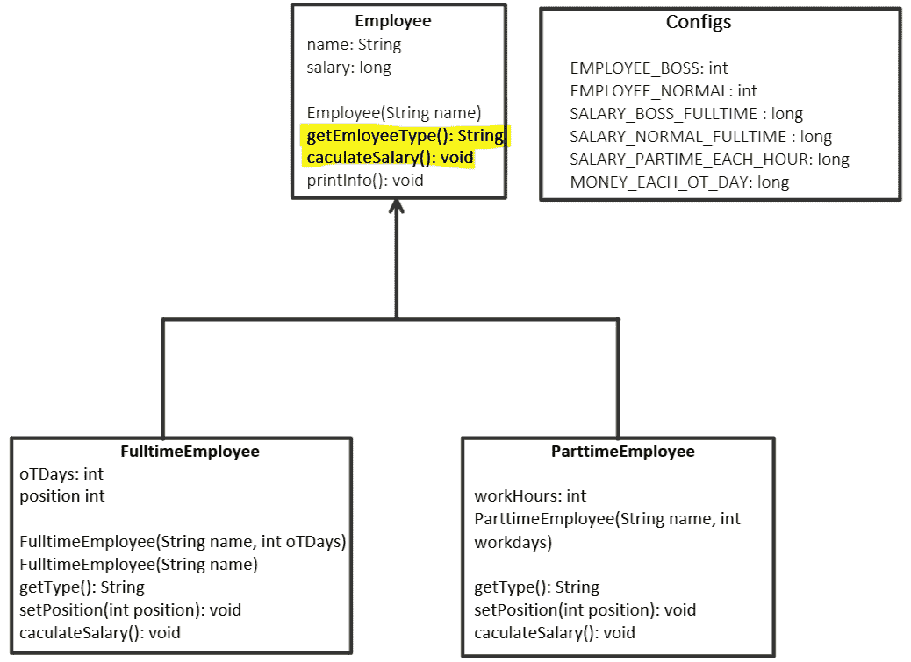

### d. 构建类

`Configs` 类没有变化。

```java
package util;

public class Configs {
    // 员工类型
    public static final int EMPLOYEE_BOSS = 1;
    public static final int EMPLOYEE_NORMAL = 2;

    // 员工薪资
    public static final long SALARY_BOSS_FULLTIME = 20000000;
    // 老板月薪
    public static final long SALARY_NORMAL_FULLTIME = 10000000;
    // 员工月薪
    public static final long MONEY_EACH_OT_DAY = 800000; // 全职员工每天加班费为 800k
    public static final long SALARY_PARTIME_EACH_HOUR = 100000; // 兼职员工每小时薪资 100k
}
```

`Employee` 类现在是 `Abstract` 类。这里是 `Employee` 类的代码，你可以与上述该类的代码对比以查看变化。

```java
package model;

public abstract class Employee {
    protected String name; 
    protected long salary;

    public Employee () {
    }

    public Employee (String name) { 
        this.name = name;
    }

    public abstract void caculateSalary();
    protected String getEmployeeType ();

    public void printInfo() {
        System.out.println ("===== Employee:" + name + "====="); 
        System.out.println ("-Employee’s type:" + getEmployeeType ()); 
        System.out.println ("- Salary:" + salary + "VND");
    }
}
```

`Employee` 子类将有一些约束，我将逐步详细为你构建 `FulltimeEmployee` 类以便查看。当你刚刚声明这个继承自 `Employee` 的类时，你会看到红叉旁边有一个灯泡图标的系统错误。

```java
for (int i = 0; i <numberEmployees; i ++) // 声明每种员工，并要求用户输入员工信息
    System.out.print ("Employee name" + (i + 1) + ":");
    String name = scanner.nextLine();
    System.out.print ("Are employees (1-Full-time; 2-Part-time):");
    int isEmployee = Integer.parseInt(scanner.nextLine());

    if (isEmployee == 1) { // 全职员工
        System.out.print ("Employee position (1-Boss; 2-Normal Employee):");
        int position = Integer.parseInt(scanner.nextLine());
        System.out.print ("Overtime (if any):");
        int oTDays = Integer.parseInt(scanner.nextLine());
        arrayEmployees[i] = new FulltimeEmployee(name, oTDays, position);
    } else {
        System.out.print ("Working hours:");
        int workHours = Integer.parseInt(scanner.nextLine());
        arrayEmployees[i] = new ParttimeEmployee(name, workHours);
    }
}

System.out.println ("\nSalary result \n"); // 计算员工工资并打印员工信息
for (Employee employee: arrayEmployees) {
    employee.caculateSalary();
    employee.printInfo();
}
```

通过这个练习，你已经理解了 `Abstract`（抽象）类的目的和绑定方式，对吧？在最后一个部分中，我将向你展示 Java 库中内置的一些 `Abstraction`（抽象）类，以便你对这一知识有更广泛的理解。

## 2. 体验 Java 平台的抽象层

此实验仅用于验证系统提供的某些 `Abstraction` 类。我们并不总是需要继承这些类，除非你想重写它的某些方法以扩展原始类的的功能范围，这被称为自定义一个对象。在构建 Android 应用程序时，你将遇到更多此类系统的 `Abstraction` 类自定义。

### 第一次体验

如果你的系统中有 `Graphics` 类，来自该类的 `Abstraction` 方法。尝试构建一个类并然后继承它，你将得到一个以实现几十个方法的“调用”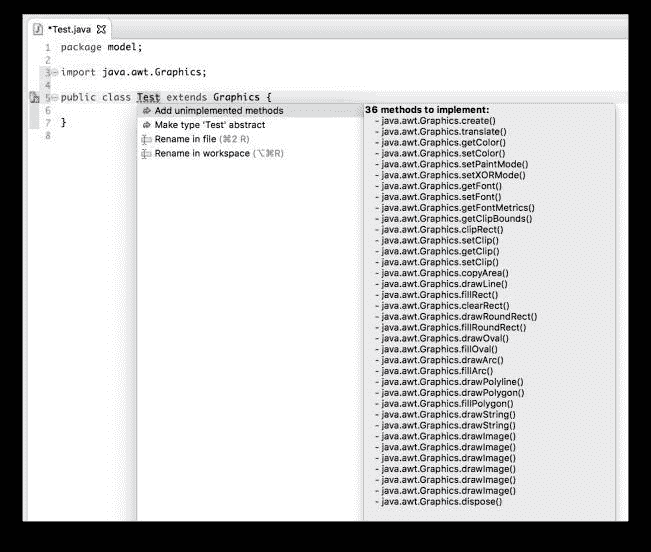 如果你继承 `Number` 类也是一样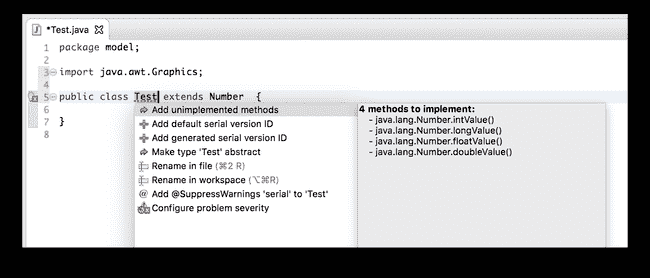 或者使用 `DateFormat` 类以及 Java 平台上的许多其他类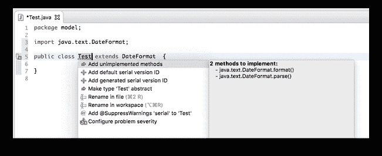

就这些了，足够让你看到 Java 平台内置了许多 `Abstraction` 类。以后如果你在继承一个奇特的类时需要实现方法，那么你就知道该类是 `Abstract` 类。通过检查此类系统中的某些 `Abstraction` 类，我们也得出了本节的结论。

# 第 31 节：嵌套类

看到标题，你可能已经知道本节的内容了。它是在另一个类内部声明类的知识。这不是父子关系，所以它不是继承，它只是在另一个类内部声明的类。所以，让我们找出什么是嵌套类，以及为什么要这样做。

## I. 什么是嵌套类？

我重复一下上面的观点，嵌套类是在另一个类内部声明的类。

包含其他类的类被称为 `Outer Class`（外部类），在越南语中可以理解为 `Bao class`。

而 `Outer Class` 内部的类分为两个不同的类别：

- 一个是非静态类（`non-static class`），它被称为 `Inner Class`（内部类）。
- 另一种类型是静态类（`static class`），它被称为 `Static Nested Class`（静态嵌套类）。

先不谈每种类型 `Inner Class` 和 `Static Nested Class` 的角色，让我们来看每种声明语法，如下。

这是 `Inner Class` 的语法：

```java
class OuterClass {
    ...
    class InnerClass {...
    }
}
```

这是 `Static Nested Class` 的语法：

```java
class OuterClass {...
    static class StaticNestedClass { ... } 
}
```


这两种语法的区别仅仅在于`static`关键字。通过上面的语法，我们有以下需要记住的观点。

然而，语法只有一个`Outer Class`包含一个`Inner Class`或内部的`Static Nested Class`。但你应该知道，`Outer Class`内部可以包含多个`Inner Class`、多个`Static Nested Class`，或者同时包含`Inner Class`和`Static Nested Class`。

- 尽管语法仅提到嵌套类，但你可以在类中嵌套接口，或者将接口嵌套在一起，或者将类嵌套到接口中。
- `Inner class`现在被视为`Outer Class`的成员，因此你可以为它指定访问权限，如`private`、`public`、`protected`或`default`（即没有访问权限声明）。这与你熟悉的`Outer Class`或类不同，类只能被声明为`public`或`default`（此声明仅允许相同包中的类可见）。

## 练习声明与使用内部类

请记住，嵌套类的应用非常多，但是否使用它们是可选的，如果需要，这并不困难。

在这个练习中，我们将看到如何定义和使用一个`Inner Class`。在这个练习之后，我们将在以后更具体地讨论嵌套类的用途。

以下代码声明了位于`Geometry`类内部的`Coordinate`类。你也可以像在某些课程中做的那样在`Geometry`外部声明`Coordinate`类。

```java
public class Geometry {

    public final float PI = 3.14f;

    public String name;

    public Coordinate coordinate;

    // 构造函数

    public Geometry(int x, int y) {

        this.name = "Geometry";

        this.coordinate = new Coordinate();

        this.coordinate.x = x;

        this.coordinate.y = y;

    }

    public class Coordinate {

        int x;

        int y;

        public void printInfo() {

            System.out.println("Shape: " + name);

            System.out.println("Coordinate: x = " + x + "; y = " + y);

        }

    }

}
```

通过上面的代码，我们可以看到在`Geometry`类中放置`Coordinate`类。你也可以在`Geometry`外部声明`Coordinate`类，正如你在某些课程中做的那样，但通过将`Coordinate`放在`Geometry`中，你可以看到`Geometry`的属性。

```java
public class MainClass {

    public static void main(String[] args) {

        Geometry geometry = new Geometry(10, 20);

        geometry.coordinate.printInfo();

    }

}
```

我们将收到以下信息：

```
Shape: Geometry

Coordinate: x = 10; y = 20
```

在`main()`方法的上述代码中，我们可以看到`Geometry`对象并使用它的变量。你也可以这样声明`Coordinate`类，如下：

```java
public class MainClass {

    public static void main(String[] args) {

        Geometry geometry = new Geometry(10, 20);

        Geometry.Coordinate coordinate = geometry.new Coordinate();

        coordinate.printInfo();

    }

}
```

执行上述`main()`行，你将得到略有不同的输出如下。你能告诉自己为什么结果会有所不同吗？

```
Shape: Geometry

Coordinate: x = 0; y = 0
```

上面的写法像一个私有对象让你觉得奇怪但熟悉？你可能理解`Geometry`。因此`Geometry`对象只是`Geometry`。在这一点上，`Coordinate`被视为成员，你可以通过这种方式初始化独立的`Coordinate`。我们在练习#2节中处理`Circle circle = new MyFirstClass().Circle();`

## 练习声明与使用静态嵌套类

我也将使用上面练习的脚本，但将`Geometry`内部的`Coordinate`类替换为`Static Nested Class`。看看是否有任何区别。

```java
public class Geometry {

    public static final float PI = 3.14f;

    public static String name;

    public Coordinate coordinate;

    // 构造函数

    public Geometry(int x, int y) {

        this.name = "Geometry";

        this.coordinate = new Coordinate();

        this.coordinate.x = x;

        this.coordinate.y = y;

    }

    public static class Coordinate {

        int x;

        int y;

        public void printInfo() {

            System.out.println("Shape: " + name);

            System.out.println("Coordinate: x = " + x + "; y = " + y);

        }

    }

}
```

正如你所见，由于`Coordinate`被定义为静态类，它只能访问绑定类的静态方法和属性。这与你学过的静态方法类似，静态方法只能调用声明为静态的属性。通过像这样声明`Coordinate`，你仍然通过通常的`Geometry`对象来调用和使用它。

```java
public class MainClass {

    public static void main(String[] args) {

        Geometry geometry = new Geometry(10, 20);

        geometry.coordinate.printInfo();

    }

}
```

或者，你也可以稍微不同的声明`Coordinate`，这与上面将其声明为内部类时略有不同。

```java
public class MainClass {

    public static void main(String[] args) {

        Geometry.Coordinate coordinate = new Geometry.Coordinate();

        coordinate.printInfo();

    }

}
```

尝试自己运行该应用程序，查看控制台打印的内容。

## II. 我应该何时使用嵌套类及其用途是什么？

根据我们对上述嵌套类的熟悉，我们已经有足够的经验来总结它的一些用途：

- 如果你有一个类`A`仅用于类`B`区域。即除了用户之外，没有其他人访问`B`。那么你可能考虑组织`B`整合到类`A`中的方式。为了这种益处，你可以参考以下观点：
- 类的嵌套增加了数据封装性。例如，如果类`B`在类`A`中，你可以将`B`声明为`private`，那么除了`A`之外，没有其他类可以知道`B`的存在及其值。可以说你从世界中“隐藏”了`B`，除了`A`——
- 反之。嵌套类`B`可以访问包装类`A`的所有成员（属性和方法），即使`A`的成员被声明为`private`。当然，当有这样的嵌套类时，你的代码将更易于阅读（因为你不需要寻找和打开过多的类），从而更容易维护。

### 练习题 1

我们通过这个练习来测试我们是否理解了课程。

假设定义了以下包装类和嵌套类。

```java
public class OuterClass {

    public void show() {

        InnerClass innerClass = new InnerClass();

        innerClass.show();

    }

    public class InnerClass {

        public void show() {

            System.out.println("This is inner class");

        }

    }

}
```

你尝试回答，使用如下`main()`方法中的代码，控制台的输出将会是什么：

```java
public class MainClass {

    public static void main(String[] args) {

        OuterClass outerClass = new OuterClass();

        outerClass.show();

        InnerClass innerClass = outerClass.new InnerClass();

        innerClass.show();

    }

}
```

**输出：**

```
This is inner class

This is inner class
```

### 练习题 2

与练习 1 类似。假设你有有以下包装类和嵌套类的定义。

```java
public class DateMonthYear {

    public int date, month, year;

    public class HourMinuteSecond {

        public int hour, minute, second;

        public void printInfo() {

            System.out.println("Date: " + date + "/" + month + "/" + year);

            System.out.println("Time: " + hour + ":" + minute + ":" + second);

        }

    }

}
```

然后在`main()`方法中，我如下调用它们：

```java
public class MainClass {

    public static void main(String[] args) {

        DateMonthYear date = new DateMonthYear();

        date.date = 31;

        date.month = 10;

        date.year = 2017;

        HourMinuteSecond time = date.new HourMinuteSecond();

        time.hour = 10;

        time.minute = 15;

        time.second = 30;

        time.printInfo();

    }

}
```

尝试回答控制台的输出是什么。答案在这里：

```
Date: 31/10/2017

Time: 10:15:30
```

这仅仅是嵌套类的知识。当你大量使用 Java 语言、阅读他人的代码或使用 Android 编程时，你会习惯使用这种嵌套类。

# 第 32 节：匿名类

我们将带来一种更有趣的方式来在 Java 中使用类和对象。通过本节，你将学会并不总是需要声明一个显式类然后通过该类的对象声明来使用它。你可以从类中创建方便的对象，而没人知道该对象属于哪个类。

在本节之后，你将知道如何以更灵活、简洁的方式在 Java 中使用类，如果你觉得熟悉，理解起来会更容易。我们邀请你加入本节。

## I. 什么是匿名类？

`Anonymous Class`，英语中称为`Anonymous Class`，或者更地称为其全称`Anonymous Inner Class`（匿名内部类）。当然，一个类被称为匿名类意味着它将没有特定的名称。匿名类将包含继承（包括从普通父类或抽象超类的继承），并附加到接口。由于匿名类也被称为匿名内部类，它也对嵌套类有一点点了解。所以，让我们发现匿名类究竟是什么，以及为什么涉及这么多知识。

## II. 识别匿名类

你可以看到这一部分是在说论匿名类的语法。它将帮助你识别什么是正常声明的类，什么是匿名类。由于匿名类没有某些共同点，所以我们讨论的不是语法，而是识别。

你们都知道，要创建一个特定的类，你必须用`class`关键字声明该类，显然，然后你必须给它命名，就像你们在第一几节关于 OOP 中学的那样。

```java
class class {

    properties;

    methods;

}
```

从上面的类声明中，你以后将使用`new`关键字创建类的对象。

至于匿名类，你不需要声明类，但仍然可以创建它的对象。这听起来很模糊，没有类，对象将在哪里创建？首先，请看下面的匿名类的“语法”。通过编写以下内容，你将创建一个名为`employee`的对象，所以这个对象将是从某个类创建的，是 Employee 类？

```java
Employee employee = new Employee () {

    properties;

    methods;

}
```

我想说匿名类是在某处。上面的例子是匿名类是一个带有属性和方法的代码块，在此之前。总结来说，如果你问`employee`是来自哪个类，答案只能是`Anonymous`。

如果你仍然完全理解匿名类的概念，可以阅读下面的内容，我将更具体地介绍。

## III. 我应该何时使用匿名类？

根据上面的观点，我想总结一下。匿名类通常用于你不想具体地声明某个类的子类（包括抽象类和普通的普通类），即使你不想具体地声明某个接口的实现类，但仍然想使用它们的对象。绕圈子说话就是如此。在这里我想给出一个使用匿名类的示例，让你更容易理解。

### 匿名类构建练习

这个练习通过一个名为`Geometry`的内置接口帮助你理解什么是匿名类。我想回到声明你已知的接口的练习，首先创建一个名为`Geometry`的接口，这段代码与匿名类无关。

```java
interface Geometry {

    float PI = 3.14f;

    void enterRadius(float radius);

    float calculatePerimeter();

    float calculateArea();

    void printInfo();

}
```

有了上面的`Geometry`接口，如果用正常方式，你可以声明一个名为“具名”的类`Circle`。这个`Circle`类实现了`Geometry`接口的抽象方法如下：

```java
public class Circle implements Geometry {

    protected String name;

    protected float radius;

    // 构造函数

    public Circle(float radius) {

        this.name = "Circle";

    }

}
```

```java
this.radius = radius; }

@Override

public void enterRadius(float radius) { 

    this.radius = radius;

}

@Override

public float calculatePerimeter() { 

    return 2 * PI * radius;

}

@Override

public float calculateArea() { 

    return PI * radius * radius; 

}

@Override

public void printInfo() {

    System.out.println(name);

    System.out.println("Perimeter: " + calculatePerimeter());

    System.out.println("Area: " + calculateArea()); 

}}
```

继续下去，如果我们想使用上面的`Circle`类，我们将像往常一样声明对象并调用它。

```java
public static void main(String[] args) { 

    Circle circle = new Circle(10); 

    circle.printInfo();

}
```


你声明了一个名为`Circle`的类，这意味着你绝对已经声明了一个具名的类。现在我们来讨论如何使用声明任何`Circle`类，但你的你的父类。所以，忘记上面声明`Circle`类的语句，但现在使用它，并且对象始终在下面的代码中初始化。

即匿名类。首先，你仍然需要`Geometry`接口作为基础：

```java
public static void main(String[] args) {

    Geometry randomShape = new Geometry() { 

        protected float radius;

        @Override

        public void enterRadius(float radius) { 

            this.radius = radius;

        }

        @Override

        public float calculatePerimeter() { 

            return 2 * PI * radius;

        }

        @Override

        public float calculateArea() { 

            return PI * radius * radius; 

        }

        @Override

        public void printInfo() {

            System.out.println("Nameless Shape");

            System.out.println("Perimeter: " + calculatePerimeter());

            System.out.println("Area: " + calculateArea()); 

        }

    };

    randomShape.enterRadius(10); 

    randomShape.printInfo(); 

}
```

通过上面的代码，你必须密切注意，代码的副作用会让那些不熟悉它的人感到眼花。你看，通过声明`Geometry randomShape = new Geometry {…}`，这个声明显然会创建一个对象`randomShape`，但你知道`randomShape`并不是从`Geometry`创建的对吧。这很容易解释，因为`Geometry`是一个接口，你已经知道接口不能用来创建对象！！！所以`randomShape`是从一个匿名类创建的对象，这个匿名类通过它的代码块完全实现了接口`Geometry`。上面方法中的后续几行代码是使用`randomShape`对象输入信息并将其输出到控制台，产生与不使用上面的匿名类相同的结果。你试一试。

## IV. 匿名类

你已经很好地了解并理解了匿名类，对吧？为了方便检测和并将匿名类应用到现实中，我想总结一下匿名类的分类。

### 1. 通过继承另一个类创建的匿名类

如果你有一个类，无论是普通类还是抽象类。那么，与其用一个特定的名称声明它的子类，你可以声明一个匿名的子类。你需要如下所示所示继承系统的`Thread`类。

```java
public static void main(String[] args) {

    // 匿名类示例 // 通过继承 Thread 类创建

    Thread t = new Thread() { 

        @Override

        public void run() {

            System.out.println("You can test this code"); 

        }

    };

    t.start();

}
```

这个例子对你来说可能并不。你声明的对象`t`不是`Thread`类的对象，而只是继承自`Thread`的匿名类对象。

### 2. 通过实现另一个接口创建的匿名类

这一部分与上面的课程示例类似。由于你有一个接口，与其从这个接口声明显式实现，你可以应用匿名类。下面的示例将从一个名为`Runnable`的接口部署。你将在以后关于多线程的课程中熟悉这段代码。

```java
public static void main(String[] args) { 

    // 匿名类的创建 // 通过实现接口 Runnable 创建

    Runnable r = new Runnable() { 

        @Override

        public void run() {

            System.out.println("You can test this code "); 

        }

    };

    Thread t = new Thread(r);

    t.start();

}
```

### 3. 匿名类作为参数传递

下面的示例显示，与其将`r`传递给`Thread()`的构造函数，你可以创建一个匿名类作为参数，而不是声明`r`。

```java
public static void main(String[] args) { 

    // 匿名类的创建 // 作为传递的参数

    Thread t = new Thread(new Runnable() {

        @Override

        public void run() {

            System.out.println("You can test this code"); 

        }

    });

    t.start();

}
```

## V. 匿名类的特征

下面我们将总结匿名类的一些难忘的特征。由于匿名类因其可用性会被频繁使用，你也应该尝试记住这些特征。

- 如果一个普通类可以实现你喜欢的多个接口，那么匿名类只能从一个接口部署。
- 如果一个普通类既可以继承某个类又能从许多其他接口部署，那么匿名类只能选择继承或实现另一个类或接口。
- 对于普通类，你可以定义任意的构造函数。但匿名类没有任何构造函数。这很容易理解，因为构造函数必须与类名相同，但匿名类没有名字，所以你永远为它定义构造函数。
- 并且由于匿名类是在另一个类内部声明的，它与内部类有相似之处，在于它可以访问其包装类的成员。

以上是与匿名类相关的知识。希望读完这节课后，你们中的许多人会大喊到直到为止这种类型一直被称为这种名称。因为我以前也是这样的。

---

关于不可变值，在第 13 节关于`Immutable`的知识中，被称为`Immutable`。此外，`Wrapper`类是`final`类，因此你无法创建它们的子类。

## II. 为什么要使用包装类？

首先，这最根本的一点是，`Wrapper`类帮助我们现在原始数据类型和对象数据类型之间转换，反之亦然。

你可以通过下面的示例看到使用原始数据类型及其包装类型的例子。

```java
int a = 20; // a 是原始数据类型 int 的变量

Integer i = Integer.valueOf(a); // i 是数据类型 Integer 的变量，由原始变量 a 创建
```

如你所见，变变量`a`的类型是`int`，而变量`i`的类型是`Integer`。关于这个问题的下一点是，对于原始数据类型，你只有一个选择：创建一个变量并使用它的值（如果你不赋值，它仍然创建一个变量。关于默认值，你可以复习原始数据类型）。对于对象类型，它的默认值是`null`，这个`null`值在某些情况下可以利用，例如表示没有意义。此外，对象类型还带有许多实用的方法，丰富了数据类型的适用性。

此外，Java 语言中的其他构造（例如我们将会熟悉的列表构造，如`ArrayList`或`Vector`）包含了对象数据类型的集合而不是原始类型，因此了解和操作`Wrapper`类是必须的。此外，对象数据类型更适合实现多线程和同步，我们将在另一节课中讨论。

## III. 在原始类型和包装类之间切换

### 1. 将原始样式转换为包装样式

将原始类型转换为其包装样式被称为`Boxing`（装箱）。并不是为了装箱。这里的 Boxing 是为了装箱，意味着将原始数据封装到它的包装箱中。就像你上面看到的示例，当一个`int a`被转换为`Integer i`时。你可以通过`Wrapper`构造函数进行装箱。

```java
// 装箱的类型

int a = 500;

Integer i = new Integer(a);

Integer j = new Integer(500);

Float f = new Float(4.5);

Double d = new Double(5);

Character ch = new Character('a');

Boolean b = new Boolean(true);
```

或者可以直接将原始值赋值给包装类，这种方式也称为`Autoboxing`（自动装箱），意味着系统会自动转换。

```java
// 自动装箱的类型

int a = 500;

Integer i = a;

Integer j = 500;

Float f = 4.5f;

Double d = 5d;

Character ch = 'a';

Boolean b = true;

// 这也是你在学习集合 章节时会知道的一种自动装箱

ArrayList<Integer> arrInt = new ArrayList<Integer>();

arrInt.add(25);
```

### 2. 将包装类转换为原始样式

与上述相反，当从包装类型切换到其原始类型时，被称为`Unboxing`（拆箱），意味着打开箱子，即打开包装箱以取出原始数据。你可以通过`xxxValue()`方法执行拆箱。其中`xxx`代表每种数据类型，如下例所示。

```java
int a = 500;

Integer i = a; // 自动装箱

int i2 = i.intValue(); // 拆箱

Integer j = 500; // 自动装箱

int j2 = j.intValue(); // 拆箱

Float f = 4.5f; // 自动装箱

float f2 = f.floatValue(); // 拆箱

Double d = 5d; // 自动装箱

double d2 = d.doubleValue(); // 拆箱

Character ch = 'a'; // 自动装箱

char ch2 = ch.charValue(); // 拆箱

Boolean b = true; // 自动装箱

boolean b2 = b.booleanValue(); // 拆箱

ArrayList<Integer> arrInt = new ArrayList<Integer>();

arrInt.add(25);

int arr0 = arrInt.get(0).intValue(); // 拆箱
```

与自动装箱类似，拆箱技术也可以这样写：

```java
int a = 500;

Integer i = a;

int i2 = i.intValue();

Integer j = 500;

int j2 = j.intValue();

Float f = 4.5f;

float f2 = f.floatValue();

Double d = 5d;

double d2 = d.doubleValue();

Character ch = 'a';

char ch2 = ch.charValue();

Boolean b = true;

boolean b2 = b.booleanValue();

ArrayList<Integer> arrInt = new ArrayList<Integer>();

arrInt.add(25);

int arr0 = arrInt.get(0).intValue();
```

## IV. 包装类的实用方法

上面，我说过`Wrapper`类帮助创建仅包含数据的原始数据类型，使其变成一个具有更多实用方法的对象。在这里我将列出它们的实用方法以供参考。

### 1. `parsexxx()`

传递给这个静态方法的参数是一个字符串，结果是与该字符串对应的原始值。

```java
int i = Integer.parseInt("10");

float f = Float.parseFloat("4.5");

boolean b = Boolean.parseBoolean("true");

System.out.println(i);

System.out.println(f);
```

#### 2. `toString()`

`toString()`方法返回字符串表示。

```java
String sI = Integer.toString(10);

System.out.println(sI);
```

### 3. `xxxValue()`

`xxxValue()`方法将包装类转换为原始类型。`xxx`代表每种数据类型，如下例所示。

```java
Integer i = 500;

int a = i.intValue();

Integer j = 500;

int j2 = j.intValue();

Float f = 4.5f;

float f2 = f.floatValue();

Double d = 5d;

double d2 = d.doubleValue();

Character ch = 'a';

char ch2 = ch.charValue();

Boolean b = true;

boolean b2 = b.booleanValue();
```

### 4. `compareTo()`

`compareTo()`方法比较两个包装类的值。它返回一个整数：如果第一个对象小于第二个对象，则返回负整数；如果第一个对象等于第二个对象，则返回零；如果第一个对象大于第二个对象，则返回正整数。

```java
Integer i = 50;

Integer i1 = Integer.parseInt("50");

Integer i2 = Integer.valueOf(52);

System.out.println(i.compareTo(i1)); // 输出 0

System.out.println(i.compareTo(i2)); // 输出负数
```

### 5. `compare()`

`compare()`是一个静态方法，用于比较两个原始值。它与`compareTo()`类似，但它可以直接通过类调用。

```java
System.out.println(Integer.compare(50, 52)); // 输出负数
```

### 6. `equals()`

`equals()`方法比较两个包装类的值。它返回一个布尔类型。

```java
Integer i1 = Integer.parseInt("50");

Integer i2 = Integer.valueOf(50);

System.out.println(i1.equals(i2)); // 输出 true
```

```java
Float f1 = new Float("20.25f"); Float f2 = new Float("2.43f");

System.out.println("Compare f1 & f2: " + f1.equals(f2));
```

控制台的输出为：

```
Compare f1 & f2: false
```

```
Compare i1 & i2: true

Compare f1 & f2: false
```

### 练习 1

尝试执行以下代码，并找出为什么打印到控制台的数据是那样。

```java
int i = Integer.parseInt("10");

float f = Float.parseFloat("4.5a");

System.out.println(i);

System.out.println(f);
```

### 练习 2

请指出下面行代码在控制台的输出。

```java
int i = Integer.parseInt("10.5");

System.out.println(i);
```


### 练习 3

除了我上面列出的包装类（`Wrapper` classes）的实用方法外，请你自己查找其他方法，它们与我提到的一样有用。例如：

- `Integer`、`Long`、`Float` 和 `Double` 类的静态方法：`toHexString()`，`toOctalString()`，`toBinaryString()`，`max()`，`min()`， ...
- `Character` 类的静态方法：`isLowerCase()`，`isUpperCase()`，`isDigit()`，`toLowerCase()`，`toUpperCase()`， ...

通过这节课，你学习了 Java 中的基本数据类型是如何被包装类“封装”的，使得它们变得更加多样和方便。这节课带我们回到过去，增加了一些当时课程中相当“原始”的知识。当我们仍然熟悉 Java 基本数据类型时，过去就在这里。现在你知道 Java 有 8 种基本类型，包括 `int`、`short`、`long`、`byte`、`float`、`double`、`char` 和 `boolean`。你可以回顾第 4 节以获取关于这些数据类型的更多信息。你将会熟悉被称为 `Wrapper` 的类。让我们看看这些类为上述基本数据类型添加了什么内容。

### V. 熟悉包装类

`Wrapper` 类实际上是许多不同类的泛指名称。由于本节课中的所有类具有相同的功能，我们统称为 `Wrapper`。

而且，正如我所说，Java 有 8 种基本数据类型，因此每种基本类型也有对应的 8 种包装类。这些包括：

- `Byte` 类是 `byte` 数据类型的包装类。
- `Short` 类是 `short` 数据类型的包装类。
- `Integer` 类是数据类型 `int` 的包装类。
- `Long` 类是 `long` 数据类型的包装类。
- `Float` 类是 `float` 数据类型的包装类。
- `Double` 类是 `double` 数据类型的包装类。
- `Character` 类是 `char` 数据类型的包装类。
- `Boolean` 类是 `boolean` 数据类型的包装类。

如你所见，每个基本数据类型的包装类都是一个封装了其所支持的基本类型的对象。换句话说，每个包装类内部都包含一个基本类型。而且，包装类有助于构建其他方法来弥补原始基本类型的简单性。你可以记住的一点是，正如你已经对 `Strings` 的了解一样，包装类也是不可变值类，在本节课中称为 `Immutable`。此外，`Wrapper` 类是 `final` 类，因此你不能创建它们的子类。

### VI. 为什么要使用包装类？

首先，这最根本的一点是，包装类帮助我们在基本数据类型和对象数据类型之间转换，反之亦然。

你可以看到使用基本数据类型及其包装类型的示例下。

```java
int a = 20; // a 是基本数据类型 int 的变量

Integer i = Integer.valueOf(a); // i 是数据类型 Integer 的变量，由基本变量 a 创建
```

如你所见，变量 `a` 的类型是 `int`，变量 `i` 的类型是 `Integer`。这个问题的下一个关键点是，对于基本数据类型，你只有一种选择：创建一个变量然后使用它的值（如果你不赋值，它仍然会创建一个带有默认值的变量）。对于对象类型，它的默认值是 `null`，这个 `null` 值在某些情况下是可以利用的，例如表示没有意义。此外，对象类型还携带了许多实用的方法，丰富了数据类型的适用性。此外，Java 语言中的其他一些结构，例如我们将熟悉的列表结构（如 `ArrayList` 或 `Vector`），包含对象数据类型的集合而不是基本类型，因此知道并操作包装类是必须的。此外，对象数据类型更适合实现多线程和同步，我们将在另一节课中讨论。

### VII. 在基本类型和包装类之间切换

#### 1. 将原始转换为包装样式

将基本类型转换为其包装样式被称为 `装箱`（`Boxing`）。这里的装箱是指装箱，意味着将原始数据封装进它的包装盒中。就像你上面看到的示例，当一个 `int a` 转换为 `Integer i` 时。你可以通过包装类的构造函数进行装箱。

```java
// 装箱的类型

int a = 20;

Integer i = new Integer(a);

Integer j = new Integer(500);

Float f = new Float(4.5);

Double d = new Double(5);

Character ch = new Character('a');

Boolean b;
```

或者直接将基本值赋值给包装类，这种方式被称为自动装箱，意味着系统会自动转换。

```java
// 装箱的类型

int a = 20;

Integer i = a;

Integer j = 500;

Float f = 4.5;

Double d = 5;

Character ch = 'a';

Boolean b = true;
```

#### 2. 将包装转换为原始样式

与上述相反，从包装类型切换到其基本类型被称为 `拆箱`（`Unboxing`），意味着打开盒子，从包装盒中取出基本类型。你可以通过 `xxxValue()` 方法进行拆箱。`xxx` 代表每种类型的数据，如下所示。

```java
int a = 500;

Integer i = a; // 自动装箱

int i2 = i.intValue(); // 拆箱

Integer j = 500; // 自动装箱

int j2 = j.intValue(); // 拆箱

Float f = 4.5; // 自动装箱

float f2 = f.floatValue(); // 拆箱

Double d = 5; // 自动装箱

double d2 = d.doubleValue(); // 拆箱

Character ch = 'a'; // 自动装箱

char ch2 = ch.charValue(); // 拆箱

Boolean b = true; // 自动装箱

boolean b2 = b.booleanValue(); // 拆箱

ArrayList<Integer> arrInt = new ArrayList<Integer>();

arrInt.add(25); // 自动装箱

int arr0 = arrInt.get(0).intValue(); // 拆箱
```

类似于自动装箱，拆箱技术也可以这样写。

```java
int a = 500;

Integer i = a;

int i2 = i; // 拆箱

Integer j = 500;

int j2 = j; // 拆箱

Float f = 4.5;

float f2 = f; // 拆箱

Double d = 5;

double d2 = d; // 拆箱

Character ch = 'a';

char ch2 = ch; // 拆箱

Boolean b = true;

boolean b2 = b; // 拆箱

ArrayList<Integer> arrInt = new ArrayList<Integer>();

arrInt.add(25);

int arr0 = arrInt.get(0); // 拆箱
```

### VIII. 包装类的辅助方法

如上所述，我提到过包装类有助于创建只包含数据的新类型，使其变成更多实用方法的对象。在这里我将列出它们的实用方法供你参考。

#### 1. `parseXxx()`

传递给此静态方法的参数是一个字符串，结果是与所传字符串对应的基本值。

```java
int i = Integer.parseInt("10");

float f = Float.parseFloat("4.5");

boolean b = Boolean.parseBoolean("true");
```

你也可以猜出上述代码在控制台的输出，对吧？

#### 2. `toString()`

与 `Object` 类的静态方法 `toString()` 不同，`Wrapper` 类的这个 `toString()` 必须返回与传入的原始数据类型值对应的字符串。此示例以 `Integer` 类为例，其他的 `Wrapper` 类也类似。

```java
String sI = Integer.toString(10);

System.out.println(sI);
```

控制台的输出是字符串 `"10"`。

### 3. `xxxValue()`

你对这个方法已经熟悉了。具体来说，这类类型的方法有助于将 `Wrapper` 类的值转换为原始数据类型（拆箱）。有时该方法还能帮助转换数据类型，就像你显式强制转换值一样。你可以通过查看下面的示例更更容易地理解。

```java
Double d = 50.5;

int i = d.intValue();

byte b = d.byteValue();

System.out.println(d);

System.out.println(i);

System.out.println(b);
```

控制台的输出分别为 `50.5`、`50` 和 `50`。

### 4. `compareTo()`

如果你还记得，在字符串课程中我们也涵盖了用于比较两个字符串之间值的 `compareTo()` 方法。因此，对于我们熟悉的这些 `Wrapper` 类，它的功能仍然完全适用。也就是说，该方法将用于比较两个 `Wrapper` 类（相同数据类型）的两个值。具体来说，当你调用 `lopWrapper1.compareTo(lopWrapper2)` 时，结果如下：

- 如果方法的结果返回负数，则 `lopWrapper1` 的值小于 `lopWrapper2`。
- 如果方法的结果返回 `0`，则 `lopWrapper1` 等于 `lopWrapper2`。
- 如果方法的结果返回正数，则 `lopWrapper1` 的值大于 `lopWrapper2`。

你可以查看下面的示例以更好地理解。

```java
Integer i = 50;

Integer i1 = Integer.parseInt("50");

Integer i2 = Integer.valueOf(52);

Integer i3 = 30;

System.out.println("CompareTo i & i1: " + i.compareTo(i1));

System.out.println("CompareTo i & i2: " + i.compareTo(i2));

System.out.println("CompareTo i & i3: " + i.compareTo(i3));
```

控制台的输出将是：

```
CompareTo i & i1: 0

CompareTo i & i2: -1

CompareTo i & i3: 15
```

### 5. `compare()`

该方法的用法与上述 `compareTo()` 相同。区别在于它是每个 `Wrapper` 类的静态方法，因此你可以直接从类调用它。同时，传递的参数是两个 `Wrapper` 类的两个值。`compare()` 的返回值与上面的 `compareTo()` 一样，也是三个值之一（负数、`0`、正数）。

```java
Integer i1 = Integer.parseInt("50");

Integer i2 = Integer.valueOf(52);

System.out.println("Compare i1 & i2: " + Integer.compare(i1, i2));

Float f1 = new Float("20.25f");

Float f2 = new Float("2.43f");

System.out.println("Compare f1 & f2: " + Float.compare(f1,f2));
```

控制台的输出是：

```
Compare i1 & i2: -1

Compare f1 & f2: 1
```

### 6. `equals()`

类似于比较字符串时的 `equals()`，此方法将比较 `Wrapper` 类的值的值并返回一个布尔类型，其中 `true` 表示相等，`false` 表示不同。如下例所示。

```java
Integer i1 = Integer.parseInt("50");

Integer i2 = Integer.valueOf(50);

System.out.println("Compare i1 & i2: " + i1.equals(i2));

Float f1 = new Float("20.25f");

Float f2 = new Float("2.43f");

System.out.println("Compare f1 & f2: " + f1.equals(f2));
```

控制台的输出是：

```
Compare i1 & i2: true

Compare f1 & f2: false
```

#### 练习题 1

尝试执行以下代码，并尝试找出为什么控制台打印的数据是那样的。

```java
int i = Integer.parseInt("10");

float f = Float.parseFloat("4.5a");

System.out.println(i);

System.out.println(f);
```

#### 练习题 2

请指出以下行代码的控制台输出结果。

```java
int i = Integer.parseInt("10.5");

System.out.println(i);
```


#### 练习题 3

除了我列出的 `Wrapper` 类有用方法外，请你自己寻找其他方法，它们与我提到的一样有用。例如：

- `Integer`、`Long`、`Float` 和 `Double` 类的静态方法：`toHexString()`、`toOctalString()`、`toBinaryString()`、`max()`、`min()`。
- `Character` 类的静态方法：`isLowerCase()`、`isUpperCase()`、`isDigit()`、`toLowerCase()`、`toUpperCase()`……

通过本节，你学习了 Java 中的原始数据类型是如何被 `Wrapper` 类“包裹”，从而使它们变得更加多样和方便。

---

# 第 34 节：异常（部分 1）

在开始详细讲解课程之前，我想让你知道，生活中没有人是完美的。当人变得足够老时，他们会开始犯错。生活中重要的一点不是你总是避免错误（因为，坦率地说，没有人想去添麻烦），而是学习如何克服错误。噢，为什么这节课这么哲学？实际上，我只是为了好玩稍微发挥一下。这节课的核心思想几乎相同：我们将严肃且深入地考虑我们编写的代码中出现的错误方面。

回到刚才那一点点哲学，当我们的应用程序足够大时（从代码行数和功能来说），要控制应用程序逻辑的稳定性确实是很困难的。当错误发生时，一个微小的错误会导致系统向用户发出一些奇怪的消息，导致他们恐慌；更严重的错误会导致应用程序意外终止。正如上面的哲学一样，你并不预期的错误会发生，但你应该理解并区分 Java 中的错误类型，以便为应用程序提供强大的脚本来克服错误，而不是直接终止，至少报告清晰的错误状态，而不是让它们失去对功能的控制。我们讨论的错误在 Java 中被称为 `Exception`。由于其重要性，这个问题将在许多不同的章节中讨论。邀请你熟悉关于这种 `Exception` 系列的第一集。

## I. 异常概念

`Exception` 可以翻译为“异常”。为什么我们说 `Exception` 而不是 `Error`？`Exception` 实际上包含了 `Error`。`Exception` 是用于描述应用程序逻辑受到某些问题（无论是错误还是其他）以坏的方式影响的概念。当异常发生时，它会导致程序偏离我们编写的标准线程，导致应用程序无法处理其逻辑，或者可能突然中断（这种状态可以被称为“死亡”、“猝死”或“崩溃”）。异常是以一种意想不到的方式发生的。即使你已经仔细准备了各种情况，流偏离仍然潜伏着。你可以通过下面的示例更清楚地看到危险的来源：

当用户向应用程序输入错误数据时，可能会发生异常。无论是无意还是故意。正如上一个练习的练习 1，如果你想要程序输入一个实数，用户输入了 `!?!`。或者当应用程序查找并读取一个文件时，找不到该文件。也许该文件已经被删除了。

- 或者当应用程序运行时内存耗尽，导致应用程序无法执行其逻辑。许多其他情况也是如此。简而言之，正如我所说，`Exception`（异常）可以由某些错误产生，例如程序员的代码错误或用户输入错误。异常也产生于非错误的情况，例如内存耗尽、网络连接断开、意外的用户干预等……你必须理解为什么它被称为 `Exception`（异常），对吧？为了更清楚地理解，我们来看看分类了哪些类型的异常。

## II. 异常分类

为了理解并方便地使用 `Exception`，Java 将其分为以下 3 类。

### 1. 检出异常（Checked Exception）

这些异常是无法通过编译器“门槛”的异常。也就是说，当编译器发现你正在编写某些可能发生异常的代码行时，你会从编译器那里获得错误信息。因为编译器已经为你发现了异常，所以它的名字是 `Checked`（检出的），意思是“受监管的”。

如果你想尝试一下编译器，特别是 Eclipse，请尝试在 `main` 方法中输入以下命令。你不需要知道这些代码行的具体含义，只需尝试输入，并确保导入了 `java.io.File` 和 `java.io.FileReader`。

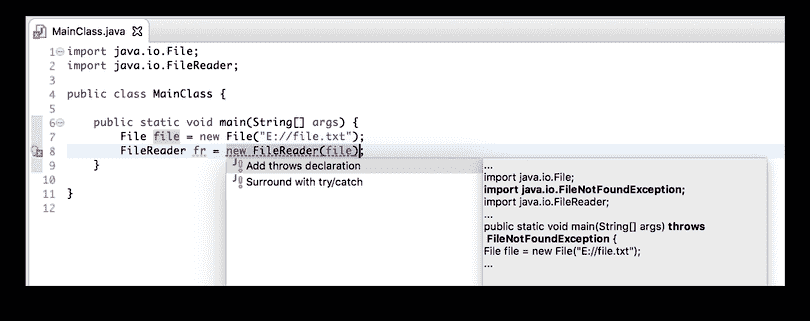

看，你已经看到编译器检测到了错误。与普通的错误不同，如果是一个错误（例如你将 `System.out` 误写为 `Ssytem.out`），你必须立即修复；但对于异常，我们不修复任何东西，而是找到方法来“捕获” Bug 并朝不同的方向打破应用程序的逻辑，我们稍后会详细查看。

### 2. 非检出异常（Unchecked Exception）

这种异常非常危险，因为编译器无法检查它来帮助你。当你的应用程序交付给用户时，当用户正在操作它时……砰！应用程序“猝死”。因为这种异常发生在应用程序执行期间，它也被称为 `RuntimeException`（运行时异常）。

通常，当应用程序因此类问题崩溃时，系统仍然会有一个日志告诉我们错误是什么。你可以尝试在编译以下代码时创建此异常。

```java
int num[] = {1, 2, 3, 4};

System.out.println(num[5]);
```

代码看起来似乎无害（因为编写代码时没有错误）。但如果执行应用程序，系统将无法找到第 5 个数组元素，因为我们的数组只声明了 4 个元素。因此，应用程序在不知道该如何处理的情况下崩溃了。你可以尝试执行上述代码并在控制台中查看日志。

### 3. 错误（Error）

这里的 `Error` 也是 `Exception`，但与 `Exception` 略有不同。我上面提到的两种 `Exception` 实际上不是错误，因为你不应该避免它们，而应该面对并“打破”应用程序流，以便在遇到这种异常时，应用程序知道如何恰当响应。对吧。下节课我们将练习打破这个线程。

此外，`Error` 确实是无法做其他事情的事情。它超出了我们的处理范围。即使你预先知道可能会发生错误，当应用程序崩溃时，通常只能重新编写该部分并更新应用程序的新版本，而无能为力。例如，当系统内存耗尽时，或者当你使用某个库时，不幸某天该库的某个类或方法不再被找到。

## III. Java 异常类的层级树

上述提到的异常都是 Java 中的类。当应用程序偏离线程时，系统还会将该错误专门分配给某个 `Exception` 类进行管理。因为 `Exception` 像上面一样分为 3 类，你可以看到这些 `Exception` 类的分类也分为三个主组。

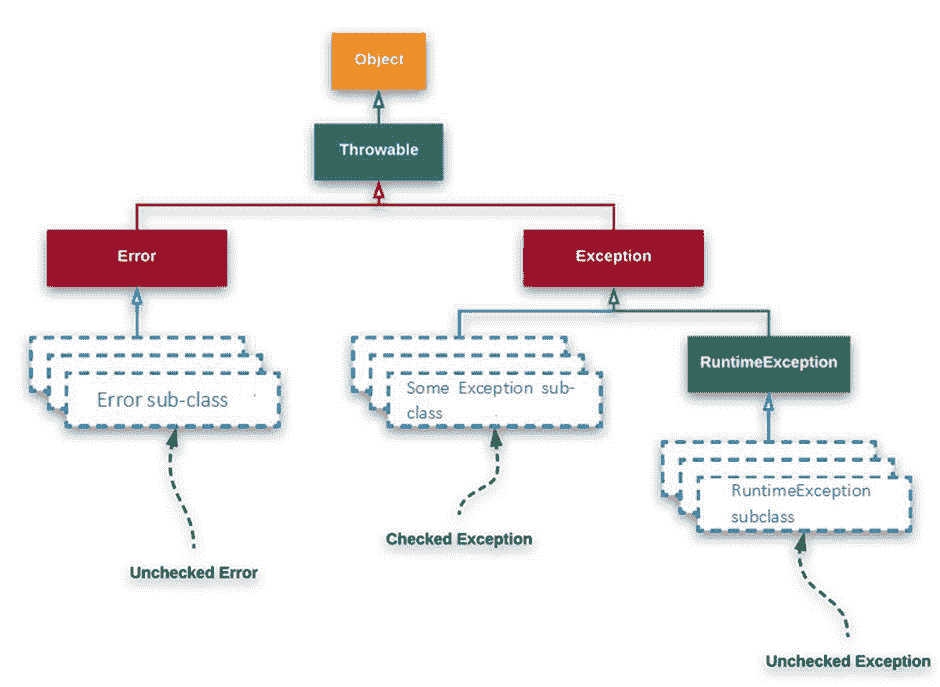

如果你对 `Exception` 一无所知，只需看看即可。下节课开始，我们将根据图中层级结构的内部层次来“捕获”异常。我们也可以根据应用程序的要求创建自己的异常。

就层级结构而言，与所有这些课程相关的顶级类是 `Throwable` 类。我们将在下节课中熟悉 `Throwable` 以及这个超类的有用方法，因为我们已经知道如何捕获异常。

`Throwable` 的两个主类是 `Exception` 和 `Error`。在 `Exception` 中有两种子类类型。一种是 `RuntimeException` 及其子类，它们是我上面提到的 `Unchecked Exceptions`（非检出异常），此分支中的异常不会被编译器审查，因此在真实世界运行的应用程序中具有潜在风险。在 `RuntimeException` 之外的 `Exception` 剩余子类就是其他异常，它们都是 `Checked Exception`（检出异常），如果你使用的代码“触碰”该分支中的异常，将是系统错误，正如你在其他地方看到的示例。

`Error` 分支上的 `Exception` 不会被系统报告，它会发现应用程序运行时我们无法预料的隐藏死亡风险，正如我们上面所提到的。

### 练习题 1

尝试编写上一节课练习 1 的代码，但这次请密切关注控制台输出 `Exception`。

```java
int i = Integer.parseInt("10");

float f = Float.parseFloat("4.5a");

System.out.println(i); System.out.println(f);
```

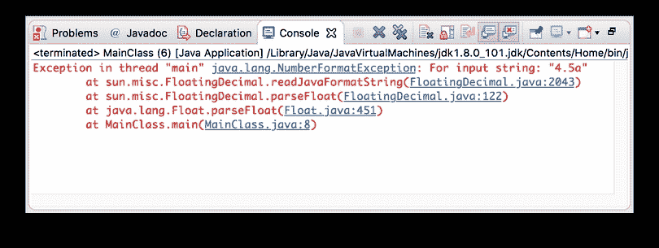

尝试找出控制台显示的 `NumberFormatException` 是什么异常：`Checked Exception`、`Unchecked Exception` 还是 `Error`？提示：你可以在 Eclipse 中对任何层级按 Ctrl + 左键（或 Mac 上按 Command + 左键）跳转到系统中该类的声明，你将更多了解该类与其他类之间的关系。

### 练习题 2

同样，你尝试编写以下代码并告诉它是什么异常，是哪种异常。

```java
int value = 10 / 0;

System.out.println(value);
```

#### 练习题 3

尝试弄清楚下面的代码将产生什么异常。

```java
String s = null;

System.out.println(s.length());
```

所以通过这节课，我们熟悉了 Java 中 `Exception` 是什么。我们还有几节课来讨论关于这种异常的所有知识，请跟进学习。

# 第 35 节：异常（部分 2）

在上一节课中，你熟悉了 `Exception` 的概念，并尝试创建了一些异常来“一起玩玩”。然而，`Exception` 产生的初衷不是让我们只能那样无助地看着。我们可以通过捕获它们来完全处理 `Exception`，阻止它们导致程序崩溃并执行我们想要的操作，正如上一节课中，我们使用了“破解”这个词。因此，异常系列的第二部分我们将讨论捕获这些 `Exception` 的技术。

## I. 熟悉 Try Catch

正如第一节课程有一个介绍，这里我们寻找捕获异常，或者有些文档称之为“Bug 陷阱”。

当然，无论是什么，如果我们想要做某些事情，就必须提供相应的工具。我们所讨论的捕获 `Exception` 的工具被称为 `Try Catch`。`Try catch` 是一个帮助你封装可能发生异常的代码的工具。我们讨论的代码将被封装在 `try` 块中。然后，如果 `try` 块中发生了该异常，系统将迅速“打破”应用程序的逻辑流，转而执行 `catch` 块内部的代码。

根据上面的解释，请看 `try catch` 的语法如下：

```java
try {

    // 可能导致 Exception 的行

} catch (ExceptionClass e) {

}
```

如果发生异常，这些行代码将被调用。

为了更容易理解，请尝试通过以下练习，对你在上一节中已经知道的某种可能的错误情况进行捕获。

### 1. 练习构建 Try Catch

我们来看一下可能导致异常的代码类型，你可以在这一节中复习它们。在这里我把它们写下来。

```java
int num[] = {1, 2, 3, 4};

System.out.println(num[5]);
```

你已经知道这段代码属于 `Unchecked Exception`（未检查异常），这意味着编译器不会为你识别并检查是否发生了异常。但如果编译器什么都不做，我们可不能坐以待毙。为了确保我们的应用程序“健康”，你应该预判异常并在 `try catch` 块中包含“潜在致病性”的代码。如果你固执地执行程序，你将得到类似这样的错误信息。请注意 `Exception`，我们将在下文中捕获它们。

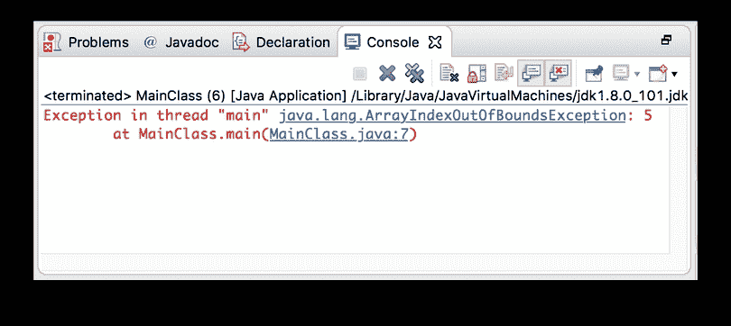

让我们这样用 `try catch` 块包裹可能导致错误的代码片段。

```java
try {

    int num[] = {1, 2, 3, 4};

    System.out.println(num[5]);

} catch (ArrayIndexOutOfBoundsException e) {

    System.out.println("无法打印，因为没有找到预期的数组元素。");

}
```

此时，如果你重新执行程序，用户将看到一个更“人性化”的错误信息，如下：`Cannot print because the array element was not found as expected`。

## 2. 练习验证 Try Catch 的工作

通过这个练习，你将更好地理解“捕获”错误的本质，以及当“陷阱”捕获到错误时，`catch` 行代码是如何立即执行的。

你看到带有完整 `try catch` 的代码如下。猜猜控制台输出会是什么样。

```java
try {

    System.out.println("The program is doing some divides:");

    int result = 10 / 2;

    System.out.println("10 divided by 2 equals " + result);

    result = 10 / 1;

    System.out.println("10 divided by 2 equals " + result);

    result = 10 / 0;

    System.out.println("10 divided by 0 equals " + result);

} catch (ArithmeticException e) {

    System.out.println("There is one divide doesn’t work ");

}
```

结果如下：

```
The program is doing some divides:

10 divided by 2 equals 5

10 divided by 2 equals 5

There is one divide doesn’t work
```

哦。打印控制台的 `System.out.println ("10 divided by 0 equals" + result);` 一行在哪里？事实上，一旦系统检测到 `try` 块中发生异常，该 `try` 块之后的代码将不再执行，而是为下一个执行的 `catch` 块留出空间。一个小有趣的插图是，当第 10 行的代码执行时，它导致了异常并跳转到第 13 行。

## II. 关于 Try Catch 的规则

此时，你已经知道如何用 `try catch` 包裹可能导致异常的代码行了。然而，我知道对于刚开始接触 `try catch` 的你来说，会有很多问题，我想以以下规则的形式列出它们。

### 1. 异常并不总是进入 Catch

正如你所熟悉的，`try` 块内部的语句并不总是会导致异常，因此，如果 `try` 中的逻辑执行安全，`catch` 块内部的语句也不总是会被执行。正如上面的例子，如果你不将 10 除以 0，屏幕上就不会出现显示“There is an unworkable division”的语句。

### 2. 但如果你定义了 Try，就必须定义 Catch

然而，`try` 中的代码并不总是导致异常。但如果有 `try` 定义，你就必须带有一个关联的 `catch` 定义。这保证了在发生异常时，你始终指定一个回退逻辑。

### 3. 可以用异常类捕获吗？

你不需要像上面的示例那样用 `ArrayIndexOutOfBoundsException` 或 `ArithmeticException` 等特定子类进行捕获。你也可以使用异常父类。语句将变为 `try {…} catch (Exception e) {…}`。因为你并不总是记得 `Exception` 的子类！但要小心！让我们学习使用特定的子异常，不要太懒于使用 `Exception` 类，甚至使用 `Throwable` 类。当然，起初你的代码将更容易管理，向用户反馈的 bug 将更具体，当你习惯了同时捕获多个 bug 时，这一点会变得清晰，如下所示。

## III. Try 带多个 Catch

有时我们将过多的代码塞进 `try` 块中，这可能导致产生多个异常。这时我们可以完全应用以下语法，在同一个 `try` 中捕获多个异常。

```java
try { 

    // 可能导致异常的代码行

} catch (ExceptionClass1 e1) {

    // 捕获 ExceptionClass1

} catch (ExceptionClass2 e2) {

    // 捕获 ExceptionClass2

}
```

根据上述语法，我们可以在同一个 `try` 中捕获多个异常。

```java
try {

    // 可能导致异常的代码行

} catch (ExceptionClass1 e1) {

    // 捕获 ExceptionClass1

} catch (ExceptionClass2 e2) {

    // 捕获 ExceptionClass2

} catch (ExceptionClass3 e3) {

    // 捕获 ExceptionClass3

}
```

## 1. 练习构建带多个 Catch 的 Try

在这个练习中，你将熟悉检查异常（Checked Exceptions），并学会如何在 Eclipse 中添加 `try` 块。

首先，将以下代码放入方法中：

```java
FileOutputStream outputStream;

outputStream = new FileOutputStream("file.txt");

outputStream.write(65);

outputStream.close();
```

你将立即看到编译器的信息。


这并不是错误。因为当你点击左侧的灯泡图标时，你会看到如下修复方案。


显然这是一个检查异常，系统为你提供两个选项：

- **Add throws declaration**：此选项允许你不创建 `catch` 块，而是继续“抛出”。这种技术将在下一节讨论。
- **Surround with try / catch**：这是我们想要的选项，选择此选项后，系统将用带有 `FileNotFoundException` 的异常块包裹你的代码。

你可以按照建议手动输入 `try catch`。但如果你选择第二个选项，系统会自动为你 `try catch`，但这种自动处理相当“笨拙”，你应该让代码看起来更美观，如下：

```java


```
try {
    FileOutputStream outputStream;
    outputStream = new FileOutputStream("file.txt");
    outputStream.write(65);
    outputStream.close();
} catch (FileNotFoundException e) {
    // TODO 自动生成的 catch 块
    e.printStackTrace();
}
```

你可以看到，尽管对 `FileNotFoundException` 进行了 `try catch`，系统仍然报错。让我们看看。


结果系统需要你捕获另一个名为 `IOException` 的异常。此时可能会更多选项。如上所示，它们包括：

- **Add throws declaration**：如上所述。
- **Add catch clause to surrounding try**：添加更多的 `catch`，这种形式就像本节中的第一种语法。
- **Add exception to existing catch clause**：在现有的 `catch` 中添加异常。`try catch` 形式 `(ExceptionClass1 | ExceptionClass2)` 就像本节中的第二种语法。
- **Surround with try / catch**：再嵌套一个 `try catch` 来捕获当前的，这种方法会让你的代码适用性降低，因为看起来很复杂。

在此时，你可以选择第二种方式，代码如下：

```java
try {
    FileOutputStream outputStream;
    outputStream = new FileOutputStream("E://file.txt");
    outputStream.write(65);
    outputStream.close();
} catch (FileNotFoundException e) {
    // TODO 自动生成的异常块
    e.printStackTrace();
} catch (IOException e) {
    // TODO 自动生成的异常块
    e.printStackTrace();
}
```

或者选择第三种方式生成这段代码：

```java
try {
    FileOutputStream outputStream;
    outputStream = new FileOutputStream("E://file.txt");
    outputStream.write(65);
    outputStream.close();
} catch (FileNotFoundException | IOException e) { // TODO 自动生成的异常块
    e.printStackTrace();
}
```

### 练习 1

假设我有如下程序。该程序将生成 10 个随机整数并将它们存储在一个 10 个元素的数组中。程序将让用户输入数组索引，然后将该数组的值输出到控制台。

```java
// 创建一个包含 10 个随机整数的数组
int randomIntNumbers[] = new int[10];
Random rand = new Random();
for(int i = 0; i < 10; i++) {
    randomIntNumbers[i] = rand.nextInt(100);
}

// 让用户输入一个整数并打印到屏幕
// 对应的数组元素
Scanner input = new Scanner(System.in);
System.out.println("你想打印哪个数组元素?");
int index = input.nextInt();
System.out.println("好的, 索引为 " + index + " 的数组元素 " + randomIntNumbers[index]);
```

当然，这个程序在运行时有导致异常的可能。请尝试清理对应的 `try catch`，以便在发生异常时，程序能够及时通知用户错误信息。这里是答案代码，你应该在点击此答案之前自己编写代码并尝试“弄坏”程序。

```java
// 创建一个包含 10 个随机整数的数组
int randomIntNumbers [] = new int [10];
Random rand = new Random ();
for (int i = 0; i <10; i ++) {
    randomIntNumbers [i] = rand.nextInt (100); 
}

try {
    // 让用户输入一个整数并打印到屏幕
    // 对应的数组元素
    Scanner input = new Scanner (System.in);
    System.out.println ("你想打印哪个数组元素?");
    int index = input.nextInt ();
    System.out.println ("好的, 数组元素" + index + " 的值为"+ + randomIntNumbers [index]);
} catch (InputMismatchException e) {
    System.out.println ("无效的数组元素，请输入整数!"); 
} catch (ArrayIndexOutOfBoundsException e) {
    System.out.println("无效的数组索引，请输入 0 到 9 之间的值!");
}
```

### 练习 2

我有如下代码，它已经经过了“谨慎”的 `try catch`，你看看这个 `try catch` 是否还会引起任何错误。

```java
Scanner input = new Scanner(System.in);
Integer intNumber = null;
try {
    System.out.println("请输入一个整数: ");
    String strNumber = input.nextLine();
    intNumber = new Integer(strNumber);
} catch (NumberFormatException e) {
    System.out.println("请输入一个整数 "); 
}
System.out.println("转换为十六进制: " + Integer.toHexString(intNumber));
```

我发现这并不好。因为如果在调用用户输入数字的部分发生了异常，那么 `intNumber` 还没有被初始化（值为 `null`），这会导致最后的代码会发生另一个异常。我修改了这段代码，如下：

```java
try {
    Scanner input = new Scanner (System.in);
    Integer intNumber = null;
    System.out.println ("请输入一个整数:");
    String strNumber = input.nextLine ();
    intNumber = new Integer (strNumber);
    System.out.println ("转换为十六进制:" + Integer.toHexString (intNumber)); 
} catch (NumberFormatException e) {
    System.out.println("请输入一个整数");
}
```

你刚刚看完了关于异常系列的第 2 部分。通过这一节，我们习惯了如何通过 `try catch` 工具来捕获错误并中断程序的流程。`try catch` 再次会有“变体”，我将在下一部分继续介绍。

# 课程 36：异常（部分 3）

通过两节关于异常的课程，你对于你创建的代码行的“命运”心里应该更有底气了，对吗？事实是，通过良好使用我在前两节中仔细介绍过的 `try catch`，可以说，当应用程序能够及时通知用户错误情况时，它将变得非常强大、安全且智能。

然而，当我们谈论 `Exception` 时，我们必须说……。不要掉以大意，错过这个工具提供的强大功能。我们将继续深入探讨异常，讨论带有 `finally` 的 `try catch`、带资源的 `try catch` 以及 `Exception` 类的实用方法。

## I. 带有 finally 的 Try Catch

我重复一下之前课程的内容，即当你熟悉了如何捕获异常后……当你熟悉了 `try catch` 的用法后，`try catch` 再次会有“变体”。

通过上述语法，你可以看到 `finally` 会伴随 `try catch`。无论发生异常，`finally` 都会执行。无论是否发生异常，`finally` 帮助我们清理工作。

```java
try { // 可能会导致异常的代码
} catch (ExceptionClass1 e1) {
    // 捕获 ExceptionClass1
} catch (ExceptionClass2 e2) { // 捕获 ExceptionClass2
} catch (ExceptionClass3 e3) { // 捕获 ExceptionClass3
} finally {
    // 释放资源
}
```

1. 仅有 Try - Finally（没有 Catch）也是可以的
你可以理解在这种情况下 `finally` 用于清理某些东西，而不一定发生了异常发生。因为使用 `finally` 的需求很小，下面的示例并不实际，主要为了帮助你理解。

```java
try {
    System.out.println("程序正在进行计算...");
    int result = 10 / 2;
    System.out.println("10 除以 2 等于: " + result);
} finally {
    System.out.println("这是程序的结束");
}
```

2. 你可能不需要 Finally，但如果代码中有 Finally，`finally` 总是会被最后调用的
例如，`try catch` 并不需要 `finally`，你已经通过上一节课知道了。但如果你为 `try catch` 声明了 `finally`，那么 `finally` 块中的语句最终会被执行，在应用程序执行了 `try` 中未引起异常的语句，以及执行了 `catch` 块中的语句之后。无论如何，`finally` 也会到达。

```java
System.out.println("10 divided by 0 equal: " + result);
} catch (ArithmeticException e) {
    System.out.println("Can’t perform the code");
} finally {
    System.out.println("This is the end of program ");
}
```

通过这些行代码，控制台将输出如下。可能我不需要太多的解释。

应用程序正在进行数学运算
无法执行代码
程序结束

### 3. Finally 中仍然可以包含 Try Catch

如果在 `try` 或 `catch` 块中，我们可以嵌套更多的 `try` `catch` 块，那么 `finally` 块也允许这样做。尽管这看起来很复杂且有些不安全，但生活并不完美，在捕获错误的过程中发生错误是很常见的。通过下面的练习，你将熟悉 `finally` 以及在 `finally` 内部的 `try catch`。

### 4. 练习构建带有 Finally 的 Try Catch 结构

这个练习帮助我们习惯 `try catch` 和 `finally` 更具实战性的用法。我们将继承上一个练习的代码。

由于昨天的练习，我们刚刚学会了如何有效地捕获异常。事实上，你正在使用 `FileOutputStream` 从系统打开文件并操作该文件。这个文件是一个可以被其他程序共享的资源。正如我所说，如果你使用了这个文件并且发生了某些错误而你没有释放所有权，那么你就是“自私”地只把文件留给自己，而其他应用程序无法读取这个文件。这就是为什么我们需要构建 `finally` 来如下释放此资源。

首先，我们需要编写如下导致检出异常（Checked Exception）的代码行：

```java
FileOutputStream outputStream = null;
outputStream = new FileOutputStream("E://file.txt");
outputStream.write(65);
outputStream.close();
```

正如上一节课的练习一样，你已经知道系统手动为报告错误的行添加 `try catches` 块的最简单方法。在应用了 Eclipse 的提示（见上一节）后，我们的代码看起来像这样：

```java
FileOutputStream outputStream = null;
try {
    outputStream = new FileOutputStream("E://file.txt");
    outputStream.write(65);
    outputStream.close();
} catch (FileNotFoundException e) {
    // TODO Auto-generated catch block
    e.printStackTrace();
} catch (IOException e) {
    // TODO Auto-generated catch block
    e.printStackTrace();
}
```

上述代码有什么问题吗？你知道名为 `file.txt` 的文件被视为共享资源。这意味着当你打开此文件写入值 `65` 时，同时可能有另一个程序尝试操作此文件。而发生的问题是，如果在向文件写入过程中发生了任何错误，导致程序跳转到下方 `catch` 块内部的代码行中，那么 `outputStream.close()` 语句将没有机会执行。你所操作的文件仍被系统认为正在使用中。因此，其他应用程序必须永远等待，而无法看到你的应用程序返回使用该文件的权限。关于文件操作的问题，我们将在接下来的课程中熟悉。现在，确保你正在使用的文件始终被安全关闭。将资源使用权返回其他程序。这很简单，让我们添加 `finally`，并在该块中关闭此文件的代码就完成了。如下所示。

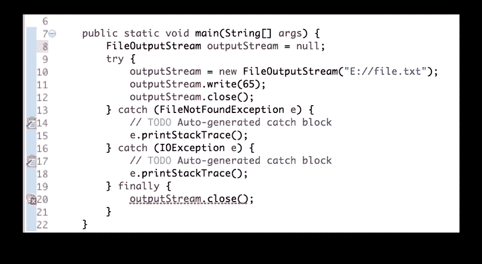

噢但看，进入 `finally` 的代码仍然受检出异常的管辖。很好，我们可能还需要一个 `try catch`。最终代码看起来如下：

```java
FileOutputStream outputStream = null;
try {
    outputStream = new FileOutputStream("E://file.txt");
    outputStream.write(65);
    outputStream.close();
} catch (FileNotFoundException e) {
    // TODO Auto-generated catch block
    e.printStackTrace();
} catch (IOException e) {
    // TODO Auto-generated catch block
    e.printStackTrace();
} finally {
    try {
        outputStream.close();
    } catch (IOException e) {
        // TODO Auto-generated catch block
        e.printStackTrace();
    }
}
```

## II. 带有资源的 Try Catch

这种类型的 `try catch` 自 Java 7 起就存在了。它是你刚刚熟悉的带有 `finally` 的 `try catch` 的升级。具体来说，通过上面的练习，你已经看到了释放系统资源的重要性，对吧。你还看到了如何在 `finally` 块中关闭文件。但如果我们仔细观察上面的练习，可以发现无论 `FileInputStream` 初始化语句是否执行，`finally` 块都会被调用，因此在 `finally` 块中关闭文件可能会导致其他异常。而且由于这个原因，我们必须在 `finally` 内部添加 `try catch`。

但像上面示例那样手动执行 `finally` 和 `finally` 内部的 `try catch` 也是不好的，如果 `try` 中的代码和 `finally` 中的代码都发生了异常，打印的错误行将会错乱。这就是为什么 Java 7 为我们提供了一个新工具，叫做“带有资源的 try catch”（Try With Resources）。它的语法如下：

```java
try (// 初始化资源) {
    // 使用创建的资源
} catch (ExceptionClass1 e1) {
    // 捕获 ExceptionClass1
} catch (ExceptionClass2 e2) {
    // 捕获 ExceptionClass2
} catch (ExceptionClass3 e3) {
    // 捕获 ExceptionClass3
}
```


你可以看到，这种`try catch`不再包含`finally`。因为`try`括号内初始化的资源现在知道自己在块结束时如何关闭。

在进入详细练习之前，让我们过`try catch with resources`的几个要点，以帮助更好地理解：

1. **并不是任何资源都可以在 Try Catch Resource 中使用**
只有像示例中的`FileOutputStream`这样实现了`java.lang.AutoCloseable`接口的对象，才能在`try catch`中。

2. **在关闭系统资源期间发生错误将产生异常**
这意味着，在使用上面的`try catch with finally`时，假设初始化`FileOutputStream`失败，初始化异常会被抛出，程序跳转到对应的`catch`，这一点你很清楚。但随后执行`finally`块的代码，如果通过`outputStream.close()`关闭文件仍然导致错误，关闭异常将再次释放，程序再次跳转到`finally`中的`catch`。但在`try catch with resources`中，情况就不同。如果`FileOutputStream`初始化失败，只有`try`的异常会被抛出，程序跳转到对应的`catch`。这就是我们讨论的两种`try catch`之间的基本区别。

3. **Try Block 中可以生成多个资源**
有时我们要在`try`块中安全一个多个资源，我们只需要初始化这些资源并用`;`分隔即可。关于这个想法的细节将在后续练习中显示。

### 4. 练习构建带有资源的 Try Catch
我们将通过尝试捕获资源来修改上面的练习代码。这非常简单快速，你只需要将资源初始化代码封装在`try`的括号中，并移除上述练习的`finally`块（以及所有关闭资源的代码）。

```java
try(FileOutputStream outputStream = new FileOutputStream("E://file.txt")) {

    outputStream.write(65);

} catch (FileNotFoundException e) {

    // TODO Auto-generated catch block

    e.printStackTrace();

} catch (IOException e) {

    // TODO Auto-generated catch block

    e.printStackTrace();

}
```

### 5. 练习构建带有多个资源的 Try Catch
正如上面提到的，这个练习将帮助你理解在`try`括号内初始化多个资源时，`try catch`是如何工作的。你可能无法理解以下所有的语句，但只需练习即可，我们将在稍后的相关课程中详细讨论这些命令。以下命令将读取你指定的任何文件。由于接下来的代码包含了两个实现了`java.lang.AutoCloseable`接口的资源，即`FileInputStream`和`BufferedInputStream`，我们将按照如下方式在`try`括号内初始化它们。这两个初始化的资源将在`try catch`块结束后后自动关闭。

```java
try(FileInputStream inputStream = new FileInputStream("E://file.txt");BufferedInputStream bufferInputStream = new BufferedInputStream(inputStream)) {

    int data = bufferInputStream.read();

    while(data != -1) {

        System.out.print((char) data);

        data = bufferInputStream.read();

    }

} catch (FileNotFoundException e) {

    // TODO Auto-generated catch block

    e.printStackTrace();

} catch (IOException e) {

    // TODO Auto-generated catch block

    e.printStackTrace();

}
```

## III. 异常类的一些有用方法
这一部分是我在本课程中的额外内容。虽然我只提到了几个方法，但我希望你能更多了解如何使用`Exception`并将其应用于某些特定情况。

#### 1. `getMessage()`
该方法返回一个描述刚刚发生的`Exception`的`String`。你可以通过调用以下代码行进行实验。我刻意让这些代码行产生`Exception`。

```java
try(FileOutputStream outputStream = new FileOutputStream("E://file_not_found.txt")) {

    outputStream.write(65);

} catch (FileNotFoundException e) {

    System.out.println(e.getMessage());

} catch (IOException e) {

    System.out.println(e.getMessage());

}
```
这里是`getMessage()`方法返回的结果。
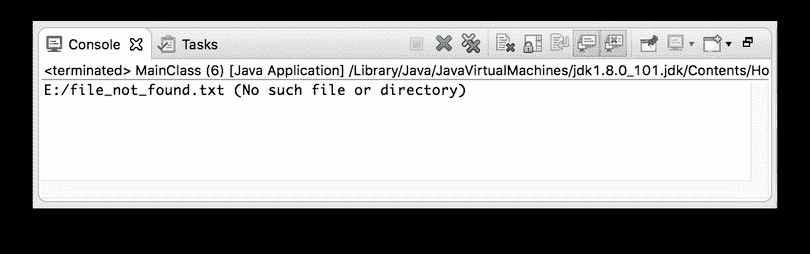

#### 2. `toString()`
返回抛出错误的`Exception`类的名称，以及上面`getMessage()`方法的内容。你可以尝试一下。

```java
try(FileOutputStream outputStream = new FileOutputStream("E://file_not_found.txt")) {

    outputStream.write(65);

} catch (FileNotFoundException e) {

    System.out.println(e.toString());

} catch (IOException e) {

    System.out.println(e.toString());

}
```
这是结果。
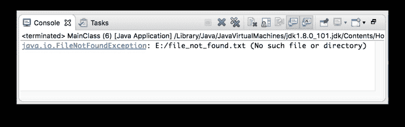

#### 3. `printStackTrace()`
这是一个可以帮助你打印上面`toString()`方法的内容的方法，以及堆栈跟踪（Stack Trace）日志行。让我们一起实验一下。

```java
try(FileOutputStream outputStream = new FileOutputStream("E://file_not_found.txt")) {

    outputStream.write(65);

} catch (FileNotFoundException e) {

    e.printStackTrace();

} catch (IOException e) {

    e.printStackTrace();

}
```
结束。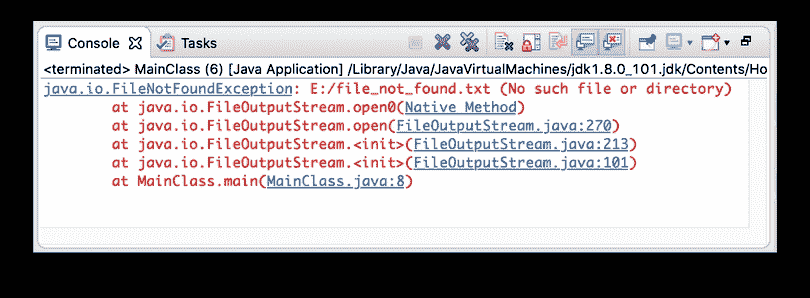

你刚刚完成了关于`Exception`系列的第 3 部分。本课程帮助我们深入了解如何使用`try catch`来捕获异常并释放资源。我们还有另一个关于这个异常知识的章节，你应该看一看。

**第 37 课：异常（第 4 部分)**
我通知你，这是关于这个“系列”`Exception`的最后一节课了。回顾一下，我们关于`Exception`的课程如下：
- **认识 Exception**：这是关于`Exception`的开场课程。这节课将帮助你入门 Java 中的`ERRORS`概念。从那里开始，清楚地理解什么是`Exception`。此外，课程还帮助你区分 Java 系统中`Exceptions`的类型。
- **捕获（拦截）Exception**：在理解了什么是异常之后，你将知道如何捕获或拦截`Exception`。掌握这些知识，你就可以通过`try catch`工具“编织”程序的逻辑。这种线程中断是为了确保你的应用程序始终“存活”，无即使它受到了`ERRORS`的影响。
- **学习更多关于 try catch**：一旦你知道如何通过`try catch`捕获`Exception`，你将通过`Try Catch with Finally`和`Try Catch with Resource`这两个概念学习该工具的进一步用法。我在本课程中还利用了`Exception`类的一些有用方法，帮助你更好地理解如何使用这个工具，并可以在本课应用这些方法。

至此，我们来到了`Exception`的剩余知识。这节课将引导你进入一个无畏异常的领域。你甚至可以“玩弄它们将它们推到另一个地方处理，然后你甚至可以创建自己的`Exception`。如果你觉得有趣，请加入课程。

## I. Throw - 抛出一个异常
到为止，我们所有人都理解`Exception`。但我们仍然只是被动地“等待”`Exception`的发生。这意味着我们只是在尝试并等待（即使不想）捕获错误。但在实践中，某些情况下我们希望更快速地抛出一个`Exception`。我使用“toss”（抛出）这个词是因为这正是`throw`词的含义：`throw`，toss, toss。这个释放的异常可以是`Checked Exception`（受检异常），也可以是`Unchecked Exception`（运行时异常）。这个异常的释放取决于你的意愿。`throw`的使用也非常简单。在方法内部使用`throw`来抛出异常。

### 使用 Throw 抛出异常
我们开始尝试让程序在用户输入无效数据时崩溃。为了确保程序不会崩溃，我们应该在`main()`方法中使用合理的`try catch`。当用户输入异常时使用`throw`，方法如下所示。

```java
private static int enterEmployeeAge() {

    Scanner scanner = new Scanner(System.in);

    System.out.print("Please enter employee’s age: ");

    int age = scanner.nextInt();

    return age;

}
```
你可以看到`enterEmployeeAge()`返回类型为`int`（返回输入的年龄）。这个方法也被声明为`static`，以便我们在`main()`方法中调用它（这是一个静态方法）。接下来，在`main()`方法中，为了确保应用程序不崩溃，我们应该将对`enterEmployeeAge()`的调用封装在`try catch`中。

```java
public static void main(String[] args) {

    try {

        int age = enterEmployeeAge();

        System.out.println("Age you entered: " + age);

    } catch (InputMismatchException e) {

        System.out.println("Age you entered isn’t valid. Error: " + e.toString());

    }

}
```
通过之前的课程，你可以很容易猜到如果你输入 28 岁，应用程序运行良好。但如果用户输入非数字，应用程序会立即向用户报告错误！哦，我多么喜欢`try catch`。

Please enter employee’s age: 28
Age you entered isn’t valid. Error: java.util. InputMismatchException

但如果用户仍有借口，输入负值年龄，例如 -5。我们的应用程序仍然有点“愚蠢”，留下了这个漏洞。

Please enter employee’s age: -5
Age you entered: -5

我没有这个年龄！为了提高应用程序的智能性，我们将利用`throw`关键字。正如我所说，这个关键字将被利用，以便我们随时可以发布异常，在这种情况下，当用户输入负数时，我们应该抛出一个异常。

```java
if (age < 0) throw new InputMismatchException("Age entered can’t bellow 0."); return age;}
```
你可以看到上方高亮的额外代码。我来简单解释一下。在`enterEmployeeAge()`内部，一旦检查到用户输入的年龄小于`0`，应用程序将抛出任何`Exception`，在本例中抛出的是`InputMismatchException`。你可以理解为可以抛出任何你想要的异常。除了抛出一个`Exception`之外，你还可以定义一个`String`类型的消息，并像上面的代码那样将`Exception`的构造函数传递进去。那么在调用`enterEmployeeAge()`的地方，如果该处有`try catch`，它是合理的，并且符合`Exception`被抛出的条件（输入年龄小于`0`），正如在之前的课程中提到的，应用程序的逻辑将在`catch`块处被中断。现在，通过这次升级，如果用户输入一个负值，看这里。

请输入员工年龄：-5

你输入的年龄无效。错误：`java.util.InputMismatchException`: `Age entered can’t bellow 0.`

通过这次练习，你已经理解了如何使用`throw`，对吧。在进入下一节之前，我有一个提示。在上面的示例中，当我们抛出一个`Exception`时，我们选择了`InputMismatchException`。这是一个`Unchecked Exception`（未检查异常）。因此，编译器不会强制要求抛出此`Exception`的方法调用添加`try catch`。但如果你尝试使用`Checked Exception`（检查异常），那么会有很多值得讨论的内容，并且与`throws`概念有关，所以我将在本案例以及接下来的节中进行详细说明。

## II. Throws - 抛出异常以便在其他地方处理
注意，不要误解。上面提到的项关于通过`throw`关键字自愿抛出的异常。而这一节是关于`throws`（多了一个 s）。

### throws（抛出声明）
除了在方法或代码块内部使用的`throw`之外，`throws`是在声明方法时立即使用的。

当你不想在方法内部构建`try catch`时，使用`throws`，你是将这个责任“推”给调用该方法的外部方法，让它来为你尝试处理。

让我们通过下面的练习，以充分利用`throws`的作用，并学习如何将`throw`和`throws`结合使用。

#### 练习 #1：使用 Throw 触发检查异常
你是否在奇怪为什么`throws`练习的标题是关于`throw`的？你只需尝试以下步骤即可看到真实的问题。我将返回上面练习源码。在`enterEmployeeAge()`方法中，我们尝试将抛出`InputMismatchException`替换为特定的`Checked Exception`。我将尝试使用`IOException`。该方法的代码看起来如下：

```java
private static int enterEmployeeAge() {

    Scanner scanner = new Scanner(System.in);

    System.out.print("Please enter employee age: ");

    int age = scanner.nextInt();

    if (age < 0) throw new IOException("Age entered can’t bellow 0.");

    return age;

}
```

像上面一样抛出一个`Checked Exception`后，你会很容易发现系统会要求你执行以下两个操作之一。


第一个选项`Add throws`声明将为这个`enterAgeEmployee()`方法声明`throws`。正如我所说，如果方法声明了`throws`，它就不再需要尝试捕获任何内容，而是可以将此`try catch`的责任推给其他方法。第二个选项`Surround with try / catch`，你从之前的课程中也知道，它将帮助用`try catch`块包裹这段代码。在这种情况下，我们应该选择第一个选项，这既符合课程要求，又让代码更容易管理，因为你只是抛出了异常并尝试捕获它，这看起来只是有点冗余。

使用第一个选项，我们的代码看起来如下：

```java
private static int enterEmployeeAge() throws IOException {

    Scanner scanner = new Scanner(System.in);

    System.out.print("Please enter employee age: ");

    int age = scanner.nextInt();

    if (age < 0) throw new IOException("Age entered can’t bellow 0."); 

    return age;

}
```


由于将捕获此 `Checked Exception` 的责任推出去，调用 `enterEmployeeAge()` 的方法将报告如下熟悉的错误。

 我打赌你已经知道该怎么做了。在这里，我已经按照你的要求进行了全部修正，使用了带有 `IOException` 的 `try catch`。

```java
public static void main(String[] args) {
    try {
        int age = enterEmployeeAge();
        System.out.println("Age you entered: " + age);
    } catch (IOException e) {
        System.out.println("Age you entered isn’t valid. Error: " + e.toString());
    }
}
```

你理解如何使用 `throws` 来将 `try catch` 的责任推出去了吗？

### 练习 #2：使用 Throws 将异常推出去

通过上面的练习，你可能已经理解了如何使用 `throws`。然而，我想让你再做一个示例，专注于 `throws` 本身，且其中不出现 `throw`。

让我们回到构建 `try catch` 情况，就像上节节的练习一样。唯一的不同是这次我们构建了一个单独的文件写入方法，在这个方法中完全没有 `try catch`。现在，让我们开始构建文件记录方法（代码与之前相同）。

```java
private static void writeFile() {
    FileOutputStream outputStream;
    outputStream = new FileOutputStream("E://file.txt");
    outputStream.write(65);
    outputStream.close();
}
```

我们将再次得到错误。

 当你点击左侧的灯泡图标时，你已经知道应该选择哪个选项。

当完全 `throws` 后，该方法看起来如下：

```java
private static void writeFile() throws FileNotFoundException, IOException {
    FileOutputStream outputStream;
    outputStream = new FileOutputStream("E://file.txt");
    outputStream.write(65);
    outputStream.close();
}
```

最后，调用此方法将强制要求 `try catch`，或者在下一个方法中使用 `throws`。

```java
public static void main(String[] args) {
    try {
        writeFile();
    } catch (FileNotFoundException e) { // TODO TODO-generated catch block e.printStackTrace();
    } catch (IOException e) {
        // TODO Auto-generated catch block e.printStackTrace();
    }
}
```

- 所有自定义异常（Custom Exceptions）必须是 `Throwable` 类的子类（如果你忘记了 `Throwable` 是什么类，可以回顾第 37 课的知识）。
- 如果你想创建一个自定义异常，并希望系统在不尝试捕获它时报错，那么就创建一个类并继承 `Exception` 类（你可以查看第 37 课来了解 `Exception` 是什么类）。当然，`Exception` 类是 `Throwable` 的子类，如果你这样做，你就满足了另一个命名要求。
- 如果你想创建一个自定义异常且不让系统报错，你只需要创建一个类并继承 `RuntimeException` 类即可（`RuntimeException` 也是 `Throwable` 的子类，上面的链接也讨论过这个类）。

上面的这些想法只是基础，对吧？让我们一起进入实践吧。

## 练习自建年龄测试异常

我们将重写一个程序，以输入员工年龄并像上面那样检查年龄。但是，我们不再使用 `IOException` 来检查和抛出错误（这看起来毫无意义），我们应该在这个练习中创建一个真正的异常。这个自定义异常将是**受检异常（Checked Exception）**。而且这个自定义异常可以进行调整，使错误更加可见。

我们讨论的自定义异常命名为 `AgeCheckingException`。按照如下所示创建一个新层。

```java
public class AgeCheckingException extends Exception {
    public AgeCheckingException(String message) { 
        super(message);
    }
    @Override
    public String getMessage() {
        return "输入年龄时出错: " + super.getMessage(); 
    }
}
```

非常简单。这个自定义异常继承自 `Exception` 类。所以它已经是一个受检异常了。你应该为它构建一个构造函数来接收消息，并通过 `super()` 调用将消息传递给父类。最后，自定义异常将重写 `getMessage()` 方法以返回更多信息。

我们将如下构建 `enterEmployeeAge()` 方法。也许你已经理解并熟悉了以下使用 `Exception` 的方法，所以我就不再多解释了。

```java
private static int enterEmployeeAge() throws AgeCheckingException {
    Scanner scanner = new Scanner(System.in);
    System.out.print("Please enter employee age: ");
    int age = 0;
    try {
        age = scanner.nextInt();
        if (age < 0) throw new AgeCheckingException("Age entered can’t bellow 0.");
    } catch (InputMismatchException e) {
        throw new AgeCheckingException("Age entered must be a number");
    }
    return age;
}
```

然后在调用 `enterEmployeeAge()` 的 `main()` 方法中，我们将如下进行进行捕获。

```java
public static void main(String[] args) {
    try {
        int age = enterEmployeeAge();
        System.out.println("Age entered: " + age);
    } catch (AgeCheckingException e) {
        System.out.println(e.getMessage());
    }
}
```

如果你故意输入负数，结果将如下：

`Please enter employee age: -5`
`Error when entering age: Age entered can’t bellow 0.`

或者输入带有字符的数字时。

`Please enter employee age: 9s`
`Error when entering age: Age entered must be a number`

所以在本课的结束时，我们也完成了关于 `Exception` 的有趣知识的学习。下一课将是 Java 的另一个有趣知识，即 `Thread`（线程）的知识。

# 第 38 课：线程 Part1 - 线程概念

上次有很多你们在问自己 Java 知识什么时候结束。很好，我也想告诉你们，我们正在接近最后的课程了。然而，我也想让你们知道，事实上，这种结束仅仅就我的课程而言。关于 Java 有很多知识，我希望在其他主题中讨论关于 Java 的其他方面。虽然课程可能跟不上你们学习的欲望速度，但我希望你们也能为其他有价值的 Java 学习材料做好“准备”。

回到关于 `Thread` 的课程。正如我在第 1 课中说过的，一旦你知道 Java 是什么，我也提到过这种语言的优势之一，就是对多线程（Multithread）的支持非常好。直到这节课，我们才聚在一起共同澄清 Java 的这种健壮性。

## I. 线程概念，或多线程

`Thread` 或 `Multithread` 在本课的知识中具有相同的含义。`Thread` 的越南语翻译是 `luồng`，而 `Multithread` 是 `đa luồng`。

这里的线程是系统的处理线程。因为让 `Thread` 出生的一个理由也是让应用程序能够并发控制多个不同的 `Thread`，这许多线程也意味着多线程，或 `Multithread`。这就是为什么知识 `Thread` 或 `Multithread` 是一样的了。

`Thread` 或 `Multithread` 的角色显然与多线程（`Multithreading`）、多任务处理（`Multitasking`）有关。特别是它将支持系统我们将任务分成几个应用程序流（或 `thread`），系统将同时处理这些流的流动。所以，根据我们目前对 Java 的熟悉，如果我们有任务 `A`、`B`、`C`，用旧的编码方式，系统将始终按顺序处理任务。现在假设 `A` 将先处理，然后是 `B`，最后是 `C`。但在这节课之后，如果我们将 `A`、`B`、`C` 组织成每个线程，系统就可以同时处理它们，这太棒了。

这些将在多个 `Process` 内部进行实现和管理。当一个 `Process` 创建时，该 `Process` 内部的应用程序就可以创建许多 `Thread`。基本上，线程会像 `Process` 一样由系统管理，即它们可以并行运行，因此有了“多线程”这个新概念。但 `Process` 内部的线程只能在该 `Process` 的限制内操作。线程将使用其所属 `Process` 允许的资源。但有一个不同之处是，`Threads` 非常轻量，并且可以很容易与 `Process` 内部的其它共享资源共享。就是这样。尽管对这些概念进行了一番闲谈，但请记住，在这一节中，我们只关注一种概念，即 `Thread`。

### III. 何时使用 Thread

这个问题很容易回答，但如果你仔细思考，它包含的信息比我们想象的要多得多。

首先，我在很久以前就提到过，如果你有多个想要协同工作的任务，那么就使用 `Threads`。例如，你只想让应用程序将用户信息获取到对话框中，只需调用服务器检查输入结果。或者你编写一个游戏，你只想让游戏接收来自键盘的控制信号，并根据这些控制在屏幕上绘制字符，同时控制障碍物或控制投射物、分数显示等。

`Thread` 的第二个用途也类似于想要同时处理这些任务，但你希望以某种一致性来控制流程。例如，你在应用程序中启动了多个 `Threads`，但你希望其他 `Threads` 启动后等待，等待某个特定线程完成后再变为激活状态。在关于 `Thread` 的系列教程第三卷中，我将详细说明这种 `Thread` 的用法。

使用 `Thread` 的第三点同样不是为了处理并发任务，而是当你想让应用程序执行耗时巨大的任务时。这里的“大”通常是指时间上的大。例如，当应用程序必须从服务器下载文件，或者必须执行某些完成时间不是瞬时的操作时。如果没有线程，这些耗时任务会严重影响用户体验。

我们将通过下面的练习来学习 `Thread` 的示例，帮助你更好地理解。

#### 构建随机数应用

这个练习能让你对 `Thread` 是什么以及它是如何工作的有一个直观的。我不要求你完全理解这个练习的代码，但我希望你会尝试这些代码，并成功运行程序。如果你遇到了任何错误，请联系我或在本课程下方留言。

想象这个练习是在构建一个游戏。在这个游戏中，有一个转盘，上面有从 0 到 100 的数字。玩家将开始旋转转盘，转盘转动后，玩家看不到上面的数字，直到他们停止转盘，玩家停在哪一个数字就是他们选中的数字。

好了，我们的应用不会构建那种完整的游戏。相反，我们将专注于游戏的逻辑。我们将转盘替换为在控制台上输入任意字符的命令。在接收到刚刚输入的字符后，我们不再启动旋转器，而是启动一个 `Thread`，这个 `Thread` 将反过来“旋转”数字，使其从 0 计数到 100，然后再次拨回 0。我们的线程一直运行，直到玩家从控制台输入一个字符，线程结束。`Thread` 刚刚“停止”的那个数字就是玩家选中的数字。

你已经理解了构建这个游戏的要求，对吧。要开始构建游戏，你应该自己创建一个新项目。你也可以将此项目命名为 `ThreadLearning`。然后创建一个包含 `main()` 方法的新类。

接下来，自己创建一个名为 `CountTheNumberThread` 的新类。等一下，先不要为这个类写任何代码。这个类就是我们所讨论的负责“旋转”数字的 `Thread`。通常，我们的应用程序有如下结构。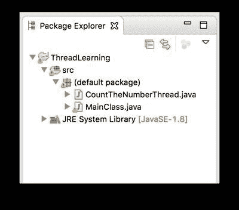 现在，按照如下代码编写 `CountTheNumberThread` 类体。

```java
public class CountTheNumberThread extends Thread {
    private int count = 0;
    private boolean isStop = false;
    @Override
    public void run() {
        while(!isStop) {
            count++;
            if (count > 100) {
                count = 0;
            }
        }
    }
    public void end() {
        isStop = true;
    }
    public int getCount() {
        return count;
    }
}
```

虽然你可能还不熟悉 `Thread`，但也想稍微解释一下，这样在下一节中你就能轻松接触 `Thread`。首先，`CountTheNumberThread` 类想要成为一个 `Thread`，它必须继承 `Thread` 类（还有另一种将类转换为 Thread 的方法，我们将在下一节讨论）。然后在这个类内部必须重写 `run()` 方法。`run()` 方法内部的代码逻辑将是一个 `Flow`（流程），该 `Flow` 将并行系统中执行，如果系统中存在另一个 `Flow`，它将与之并行执行。就这些了，除了我提到的这两个大核心思想外，`CountTheNumberThread` 的其余声明都非常熟悉，所以我没有过多介绍。

到此时，`CountTheNumberThread` 仅仅是一个类。想要启动这个类使其成为一个 `Thread`，我邀请你参考如下的 `main()` 方法中的代码。

```java
public static void main (String [] args) {
    Scanner scanner = new Scanner (System.in);
    // 等待用户按键开始
    System.out.println ("Press any key to start");
    scanner.nextLine ();
    // 声明并启动 CountTheNumberThread 作为 Thread
    // 调用 start() 方法
    CountTheNumberThread countingThread = new CountTheNumberThread ();
    countingThread.start ();
    // 等待用户按键停止
    System.out.println ("Press any key to stop");
    scanner.nextLine ();
    // 停止线程并查看当前“旋转”的数字
    countingThread.end ();
    System.out.println ("Lucky Number:" + countingThread.getCount ());
}
```


观察上面的代码，你可以看到使用`Thread`与使用其他普通类之间的细小区别。实例化普通类和实例化线程是一样的。但对于线程，要启动该线程（即将其转换为系统中的流），必须调用它的`start()`方法，该方法是在`Thread`类中构建的。当`start()`被调用时，父线程将启动你在`CountTheNumberThread`中定义的`run()`方法内部的代码。因此，在`main()`方法中接收键盘输入将与`run()`方法内部的循环并行，没有任何代码需要等待任何代码。如果你运行程序，在控制台中输入一个字符开始“拨号”，再次输入以结束，你将获得属于自己的幸运数字，如下所示：

```
Press any key to start

f

Press any key to stop

r

幸运数字：69。噢呀！我拨通了 69，你呢？祝你好运。
```

## 练习

在这个练习中，我希望你尝试忽略`CountTheNumberThread`类对`Thread`的继承，那么该类的`run()`方法将不再有`override`关键字，这样你已经将这个类变成了一个普通类。而`run()`只是另一个普通方法。然后在`main()`方法中，不要再调用`countingThread.start()`，而是调用`countingThread.run()`。也就是说，在这种情况下你没有使用`Thread`。你可以重新运行应用程序，并比较对这个游戏应用`Thread`与不应用`Thread`有何不同，结果将会如何。我们刚刚接触到关于 Java 多任务的一个非常新且有趣的理解，即`Thread`。本课只是初步的接触，`Thread`还有许多有趣的知识点，我将在接下来的课程中依次介绍。

# 第 39 节：线程（部分 2）

在发布关于`Thread`的第一集后，我收到了你们很多的分享和反馈。我感受你们对这一知识的浓厚兴趣。这真的很有趣。实际上，我以前对接触`Thread`非常感兴趣。尽管这只是 Java 知识海洋中的一小部分，但`Thread`为我们带来了一股新风，一种让我们能够构建多任务、更强大、更实用的应用程序的新能力，充分利用它们发挥更多的系统性能。更具体地说，在了解什么是`Thread`后，我们就可以开始学习构建 Java 游戏了。因此，我们将通过更具体的细节来继续加强我们对`Thread`的兴趣，我们将讨论声明和实例化`Thread`的方法。

## I. 创建线程

在上一节课中，你已经熟悉了创建线程的方法。但我想在这节课中，让你……忘记上一节课的知识，让我们反复回顾一遍。

在 Java 中，你有两种方法来创建`Thread`。根据我的观察，两种方法的使用频率相同。你的任务是了解这两种方法。为什么要了解这两种方法？除了为了能够声明和使用所有方法之外，当别人使用和你不同的方法时，你还需要能够阅读并理解他们的源代码。那么创建`Thread`的两种方法是什么呢？

#### 1. 方法 1 - 继承 Thread 类

方法是上一节课提到的……噢，我叫你忘记了。所以，这种方法你需要执行以下操作。

- 你创建一个新类并继承自`Thread`父类。在新创建的类中，你重写`run()`方法。

最后，在其他地方，当你想要从这个类创建一个`Thread`时，为它声明一个对象，然后调用它的`start()`方法来启动线程初始化。很简单，对吧。没发现`Thread`知识会这么简单。正如你昨天课程中简要了解到的，要声明一个类为线程，只需继承父类`Thread`，类内部的`run()`方法就会在外部调用该类的`start()`方法时，变成由系统处理的一个流（实际上`start()`是继承自超类`Thread`的）。让我们一起通过实践来更好地理解。

#### 2. 练习通过继承 Thread 类创建线程

在这个练习中，我们测试创建一个 10 秒倒数的`Thread`。启动时，`Thread`将开始打印控制台值 10，每过去一秒`Thread`就会将这个数字减一并再次打印到控制台，直到减到数值 0，`Thread`将打印“Time Out”。你可以复用你在上一节课中创建的项目，创建一个名为`CountDownThread`的新类。该类将像我在上面的项目符号中那样继承`Thread`类：

```java
public class CountDownThread extends Thread {

    @Override

    public void run() { // 我们稍后编写代码 }

}
```

`Thread`的框架就是这样。正如提到的，`CountDownThread`启动时将从 10 秒开始倒数，到 0 秒将显示字符串“Time Out”。控制台上的秒数，你知道的，我刚刚提到为了让这个数字每秒更新并显示一次，我们使用了`Thread.sleep(1000)`方法。该方法会导致运行中的线程“睡眠”几毫秒，在这种情况下我们传入 1000 毫秒，即 1 秒。在睡眠允许的最大时间后，`Thread`将“唤醒”并继续执行其`run()`方法，并带有一个名为`InterruptedException`的检查异常。注意，你必须尝试捕获这个`Thread.sleep`。我将在接下来的课程中讲解`Thread.sleep()`方法。这里是`CountDownThread`的完整代码。

```java
public class CountDownThread extends Thread {

    @Override

    public void run() {

        int count = 10;

        for (int i = count; i > 0; i--) {

            System.out.println(i);

            try {

                Thread.sleep(1000);

            } catch (InterruptedException e) {

                // TODO Auto-generated catch block

                e.printStackTrace();

            }

        }

        System.out.println("Time out");

    }

}
```

要启动新创建的`Thread`，我们将如下所示调用它的`start()`方法。

```java
public static void main(String[] args) {

    CountDownThread countDownThread = new CountDownThread();

    countDownThread.start();

}
```

10。这是我们刚刚创建的“计时器”的控制台屏幕。每秒会出现一个数字，直到程序结束（以及`CountDownThread`结束）出现“Time Out”这个单词。

#### 3. 方法 2 - 实现 Runnable 接口

如果上面的方法必须继承`Thread`类，那么这种方法就是实现一个名为`Runnable`的接口。这种方法你需要执行以下操作。

- 你创建一个新类并用`Runnable`实现该类。在新创建的类中，你重写`run()`方法。最后，在其他地方，当你想要从这个类创建一个`Thread`时，首先为它声明一个对象，然后声明另一个`Thread`对象并通过`Thread`构造函数将该类的对象传递过去。当调用新创建的`Thread`类的`start()`方法时，派生类`runnable`中的`run()`方法将被调用从而在系统中形成一个流。这听起来比上面的第一种方法复杂，对吧。但你也应该通过下面的练习尝试一下。

#### 4. 练习通过实现 Runnable 接口创建线程

我们通过通过第二种方法重建上面的 10 秒`Thread`示例。

通过这种方法，你只需要对`CountDownThread`类进行少量修改，将`extends Thread`改为`implements Runnable`即可。你会看到下面的代码很清晰。

```java
public class CountDownThread implements Runnable {

    @Override

    public void run() {

        int count = 10;

        for (int i = count; i > 0; i--) {

            System.out.println(i);

            try {

                Thread.sleep(1000);

            } catch (InterruptedException e) {

                // TODO Auto-generated catch block

                e.printStackTrace();

            }

        }

        System.out.println("Time out");

    }

}
```

声明`Thread`的问题在两者之间没有太大，对吧。更大的区别在于启动`Thread`的方式。`main()`方法中的代码需要修改如下：

```java
public static void main(String[] args) {

    CountDownThread countDownThread = new CountDownThread();

    Thread thread = new Thread(countDownThread);

    thread.start();

}
```

请再次执行程序。这两种方法的结果是相同的。

## II. 在创建新线程时应用匿名类知识

如果你忘记了`Anonymous`类是什么，可以再次阅读此链接中的课程。如果你好奇`Thread`和`Anonymous`类之间到底有什么关系，那么我将这样简要地解释一下。线程基本上被视为系统（以及我们）执行并行任务的一种轻量级方式。为了让这种轻量化更加紧凑（在代码管理方面），`Thread`和`Anonymous`类的结合是实现这一想法的良好解决方案。因为这样我们完全不需要显式地声明一个`Thread`类，只需构造一个`Anonymous`类并启动它。将`Thread`和`Anonymous`类结合起来是非常常见的，它们将这两个名字合并成了一个通用名称，称为“匿名线程”（`Anonymous Threads`）。

让我们看看“匿名化”`Thread`的以下方法。我使用了上面的`Thread`倒计时示例供你查看。

### 1. 通过继承 Thread 类创建匿名线程

让我们通过扩展`Thread`类重新创建一个`Thread`，但按照如下方式对其进行“匿名化”。

```java
public static void main(String[] args) {

    Thread countDownThread = new Thread() {

        @Override

        public void run() {

            int count = 10;

            for (int i = count; i > 0; i--) {

                System.out.println(i);

                try {

                    Thread.sleep(1000);

                } catch (InterruptedException e) { // TODO 自动生成的异常块

                    e.printStackTrace();

                }

            }

            System.out.println("Time out");

        }

    };

    countDownThread.start();

}
```

看，上面就是一个`Anonymous Thread`（匿名线程）。此时，你们中的许多人会好奇`Anonymous Thread`是否真的有助于让代码管理更加紧凑。那么我还有几点想法可以后续讨论。

事实上，与普通的`Thread`相比，使用`Anonymous Thread`是否使代码紧凑取决于每个人的代码写法。你看，在那边构建普通`Thread`的实践中（我将其简称为`Thread-normal-Thread`），你必须构建一个非常明显的`CountDownThread.java`类，这段代码具有非常显式的内容。至于本节中的示例代码，我们不是从`CountDownThread`类或`Thread`类创建`countDownThread`对象，而是从一个继承自`Thread`类的`Anonymous`类创建的。这种声明有助于减少创建另一个 Java 文件的需求，我们只需声明并使用它即可；此外，`Anonymous Thread`还可以使用包含它的类的成员。

声明`Thread`和`Anonymous Thread`的另一个区别是，对于`Thread`你可以为它构建构造函数，因此你可以传递某些作为应用程序逻辑的变量给`Thread`。而`Anonymous Thread`没有构造函数，所以你可能需要使用声明类的全局变量。但你也应该考虑，虽然使用`Anonymous Threads`非常快速方便，但如果有这么多`Anonymous Threads`，可能会导致该使用类中的代码膨胀，更难以管理。如下。

回到`Anonymous Thread`的知识，使用上面的代码，我们可以写得更加简洁。由于不需要声明对象名称，始终可以直接执行`start()`，如下所示。

```java
public static void main(String[] args) {

    new Thread() {

        @Override

        public void run() {

            int count = 10;

            for (int i = count; i > 0; i--) {

                System.out.println(i);

                try {

                    Thread.sleep(1000);

                } catch (InterruptedException e) {

                    // TODO 自动生成的异常块

                    e.printStackTrace();

                }

            }

            System.out.println("Time out");

        }

    }.start();

}
```

### 2. 通过实现 Runnable 接口创建匿名线程

如果你通过上述扩展`Thread`类的方法理解了`Anonymous Thread`，那么也可以自己编写从`Runnable`接口创建`Anonymous Thread`。

```java
public static void main(String[] args) {

    Runnable countDownThread = new Runnable() {

        @Override

        public void run() {

            int count = 10;

            for (int i = count; i > 0; i--) {

                System.out.println(i);

                try {

                    Thread.sleep(1000);

                } catch (InterruptedException e) { // TODO 自动生成的异常块

                    e.printStackTrace();

                }

            }

            System.out.println("Time out");

        }

    };

    Thread thread = new Thread(countDownThread);

    thread.start();

}
```

这段代码也可以通过如下移除`Thread`类中的对象声明变得更加简洁。

```java
public static void main(String[] args) {

    Runnable countDownThread = new Runnable() {

        @Override

        public void run() {

            int count = 10;

            for (int i = count; i > 0; i--) {

                System.out.println(i);

                try {

                    Thread.sleep(1000);

                } catch (InterruptedException e) {
```


# 线程（第 2 部分）

## 使用匿名线程

在上一节中，我们学习了如何通过继承 `Thread` 类和实现 `Runnable` 接口来创建线程。在本节中，我们将探索创建线程的第三种方式：使用匿名线程（`Anonymous Thread`）。

### 什么是匿名线程？

匿名线程是一种无需显式创建类即可创建线程的方式。它通过匿名内部类（`Anonymous Inner Class`）实现 `Runnable` 接口或继承 `Thread` 类，从而简化代码结构。

### 匿名线程的基本用法

使用匿名线程的基本语法如下：

```java
new Thread(new Runnable() {
    @Override
    public void run() {
        // 线程执行的代码
    }
}).start();
```

### 示例：使用匿名线程

以下是一个使用匿名线程的完整示例：

```java
public static void main(String[] args) {
    new Thread(new Runnable() {
        @Override
        public void run() {
            int count = 10;
            for (int i = count; i > 0; i--) {
                System.out.println(i);
                try {
                    Thread.sleep(1000);
                } catch (InterruptedException e) {
                    // TODO 自动生成的异常块
                    e.printStackTrace();
                }
            }
            System.out.println("Time out");
        }
    }).start();
}
```

希望 `Anonymous Thread` 的知识不会让你头疼。

## 练习 1：创建一个线程

要求如下：创建一个用户可以输入 1 到 100 之间整数的游戏。然后 `Thread` 会猜数字，每当随机数匹配到用户输入的数字时，`Thread` 会打印出数字。为了让它更容易理解，我给出了预期的控制台结果如下：

(Image010.jpg)

这个结果基于玩家输入了 15。线程 2 猜了 68 次获胜。线程 1 "没那么聪明"并继续猜。我有两个建议让你只关注代码，而不是担心网络上的代码：

- 要随机 1 到 100 的数字，你需要代码：`randomNumber = (int) (Math.random() * 100 + 1);`
- 父线程有一个 `setName()` 方法让你命名运行中的 `Thread`，这样你可以使用它来命名 `Thread 1`、`Thread 2`。你可以通过调用 `getName()` 方法将指定的名称打印到控制台。

完成后，你可以与你的答案进行比较。首先，线程猜数字，我将其命名为 `GuessANumberThread`。

```java
public class GuessANumberThread extends Thread {
    private int guessNumber = 0;
    private int count = 0;

    public GuessANumberThread(int guessNumber) {
        this.guessNumber = guessNumber;
    }

    @Override
    public void run() {
        int randomNumber = 0;
        do {
            randomNumber = (int) (Math.random() * 100 + 1);
            count++;
            System.out.println(getName() + " 数了" + randomNumber);
            try {
                Thread.sleep(500);
            } catch (InterruptedException e) {
                e.printStackTrace();
            }
        } while (randomNumber != guessNumber);
        System.out.println(getName() + " 数了" + guessNumber + " 经过了 " + count + "次");
    }
}
```

这里是询问用户输入要猜的数字的地方，并创建 2 个线程进行测试。这个地方是 `main()` 方法。

```java
public static void main(String[] args) {
    Scanner scanner = new Scanner(System.in);
    System.out.println("输入一个让他们猜的数字");
    int number = scanner.nextInt();
}
```

```java
GuessANumberThread thread1 = new GuessANumberThread(number);
GuessANumberThread thread2 = new GuessANumberThread(number);
thread1.setName("Thread 1");
thread2.setName("Thread 2");
thread1.start();
thread2.start();
```

程序执行的结果将如所示。

## 练习 2：使用 Runnable 重复练习 1

请尝试使用实现 `Runnable` 的 `Thread` 类来重新编写上述猜数字游戏。有一个注意事项可以让代码编写更简单：为了能够调用 `Runnable` 实现的 `Thread` 类的名称，你不能像练习 1 那样直接调用 `getName()`，你必须调用 `Thread.currentThread().getName()`。

## 练习 3：使用匿名线程重构练习 1

这次你可以使用匿名 `Thread` 重新编写这个猜数字游戏。

这是我的这种方法，你是怎么做的呢。

```java
public static void main(String[] args) {
    Scanner scanner = new Scanner(System.in);
    System.out.println("Enter a number for them to guess ");
    int guessNumber = scanner.nextInt();
    Runnable anonymousGuessANumber = new Runnable() {
        @Override
        public void run() {
            int randomNumber = 0;
            int count = 0;
            do {
                randomNumber = (int) (Math.random() * 100 + 1);
                count++;
                System.out.println(Thread.currentThread().getName() + " has counted" + randomNumber);
                try {
                    Thread.sleep(500);
                } catch (InterruptedException e) {
                    e.printStackTrace();
                }
            } while (randomNumber != guessNumber);
            System.out.println(Thread.currentThread().getName() + " has counted" + guessNumber + " after " + count + "times");
        }
    };
    Thread thread1 = new Thread(anonymousGuessANumber);
    thread1.setName("Thread 1");
    Thread thread2 = new Thread(anonymousGuessANumber);
    thread2.setName("Thread 2");
    thread1.start();
    thread2.start();
}
```

以上是你可以创建线程的所有方法。你可以看到 `Thread` 是否易于使用。如果你有任何问题，请在课程下方留言。

# 第 40 节：线程（第 3 部分）生命周期

进入线程的这部分，我们将学习更多关于 `Thread` 的知识，看看当你创建一个特定的 `Thread` 时，它的生命周期是怎样的？线程在整个生命周期中经历了哪些状态？基于这些状态，线程如何同步，或者可以理解为手动调整同一进程中线程之间任务执行的优先级？我们邀请你加入这段有趣的知识之旅。

首先，让我们回答第一个问题。

## I. 对象的生命周期是什么？

我稍微重复一下，这就是为什么我们考虑对象的"生命周期"，即当一个对象具有特定的寿命时，在对象的生命周期内，我想知道它可能经历许多不同的状态。这些状态是出生、衰老、生病还是死亡吗？简而言之，并不是我们都在谈论它的生命周期，只有那些寿命足够长、在生命过程中经历了许多状态的对象，我们才会看到。例如这个 Java 知识中的 `Thread`。那么，什么是生命周期，或者生命周期内的状态是什么呢。

## II. 为什么人应该学习生命周期？

我们应该知道对象生命周期的最好理由，除了它何时出生、何时死亡之外，理解对象在生命周期内经历的状态也同样重要。当你理解了生命周期的状态时，你会更好地理解对象，从而可以轻松地干预它，插入最相关的任务状态。最终目标是让我们的应用程序更强大，甚至更智能。更多细节请参阅更多。

## III. 理解线程的生命周期

让我们回到课程的主体，一起探索 `Thread` 的生命周期。首先邀请你通过以下图查看此生命周期图。

### 1. 线程生命周期示意图

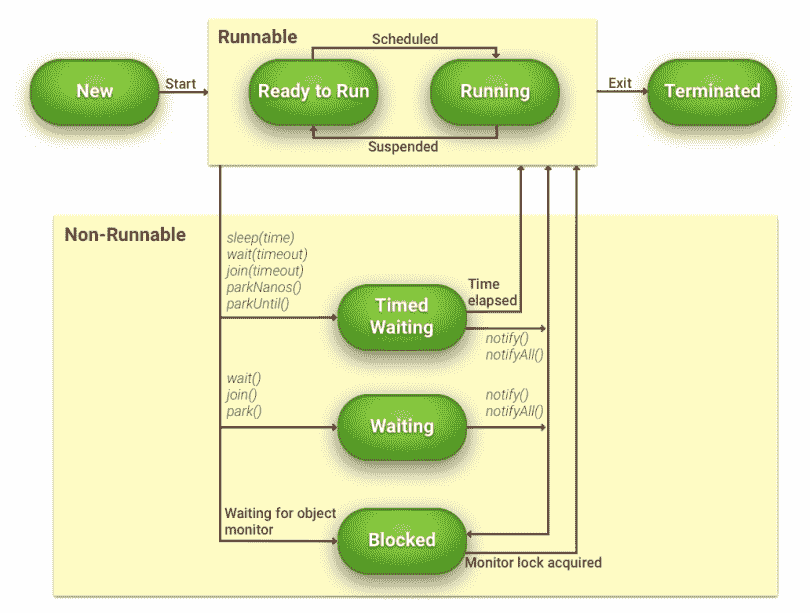

此图基于 `Thread` 类中 `enum` 声明定义的状态构建的。什么是 `Enum`，我们将在下一节中讨论。基本上，`enum` 帮助我们定义一组状态，并在这个情况下帮助我们理解 `Thread` 的生命周期。你可以看到 `Thread` 的状态，你可以看到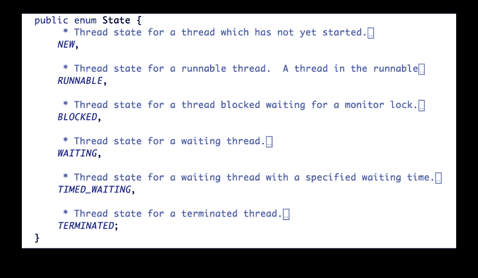

### 2. 线程的生命周期描述

正如我所说的，在这个部分我们将查看线程的概述。

### NEW


- 当你初始化一个线程但还没有调用 `start()` 方法时，它的状态是 `NEW`。
- 一旦你创建了线程并调用 `start()` 方法，它将进入 `RUNNABLE` 状态。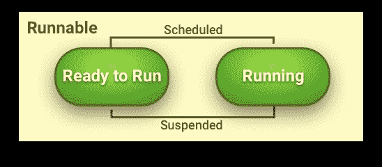
- 在运行期间，如果等待系统分配资源，它处于 `BLOCKED`、`WAITING` 或 `TIMED_WAITING` 状态。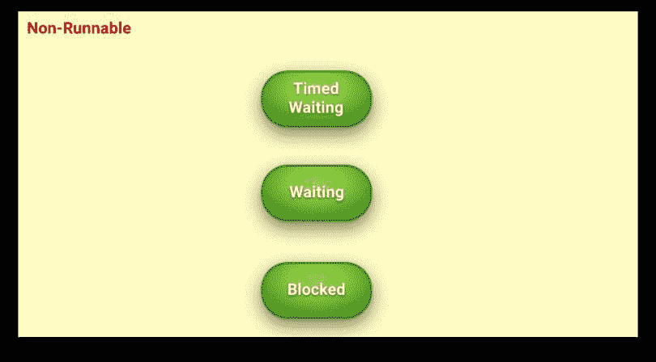
- 最后，当线程结束时，它达到 `TERMINATED` 状态。

## IV. 生命周期内的状态

在这一部分我们将仔细观察每个状态。在这个部分我们将查看 `Thread` 的生命周期，并邀请你查看状态。

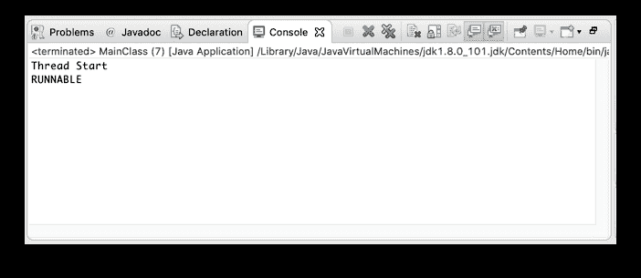

注意，上述代码并不总是向控制台打印 `RUNNABLE` 状态。为什么呢？你可以看到在 `MyThread` 内部只打印了控制台字符串 "Thread Start"，在打印此字符串后，线程将结束其生命周期。因此，可能会出现 `main()` 方法中的 `getState()` 在 `MyThread` 已完成时调用，所以 `RUNNABLE` 可能不会被打印（但在接下来的项中你将看到其他某些状态）。

### 3. BLOCKED（阻塞）

当线程进入 `BLOCKED` 状态时，意味着它不具备运行条件。为什么不具备运行条件？你可以理解，根据应用程序中线程的本质，它们在被 `start()` 启动后能够并行运行。因此，可能会发生一种情况：在某一时刻，会有多个 `Thread` 拥有编辑 `File` 或对象的"方案"，我们称这些 `Files` 或对象为"争用"状态。这些是共享资源。如果发生这种冲突，会导致应用程序崩溃，可能导致数据丢失或计算错误。因此，Java 中有一种控制线程的机制，确保在任何时候只有一个 `Thread` 可以干扰共享资源。这种机制与同步（Synchronization）的概念有关，我们将在专门的课程中介绍。所以，如果发生了这种同步，那么只有一个 `Thread` 有优先使用此共享资源，而剩余的 `Threads` 将被锁定并必须等待其他优先 `Thread` 完成资源的使用后才能运行，这些被锁定的线程将进入 `BLOCKED` 状态。因此，为了能够看到这种状态，我们将在下一个练习中熟悉一些关于同步的知识，然后在下节课中一起详细讨论它。

#### 练习题 3

为了练习这一部分，让我们创建一个共享资源，即某个类，我们将这个共享类命名为 `DemoSynchronized`。在此类中，有一个标记为 `synchronized` 的静态方法。该方法名为 `commonResource()`。不要过分关注 `synchronized` 关键字，下一节将会进行解释。你只需要理解这个标记为 `synchronized` 的 `commonResource()` 方法会被系统"赞助"，以便只有一个 `Thread` 可以访问它。

让我们在构建这个类之前。

```java
public class DemoSynchronized {
    public static synchronized void commonResource() {
        for (int i = 0; i < 100000; i++) {
            // 什么都不做，只运行循环以
            // 确保这个方法存得久一点，
            // 让有线程使用并让其他
            // 线程必须等待
        }
    }
}
```

然后我们让 `MyThread`（在上面的练习中编写）有机会调用 `commonResource()`。如下：

```java
public class MyThread extends Thread {
    @Override
    public void run() {
        DemoSynchronized.commonResource();
    }
}
```

然后在 `main()` 方法中，我们将创建多个 `MyThread` 对象，即 2 个对象，你也可以创建 3 个或 4 个 `MyThread` 来进行验证。在创建 `MyThreads` 后，我们同时 `start()` 它们，以便它们在运行时调用 `commonResource()`。然后你只需要"随性"地调用它们的 `getState()` 即可。

```java
public class MainClass {
    public static void main(String[] args) {
        // 声明多个 MyThread 对象
        MyThread myThread1 = new MyThread();
        MyThread myThread2 = new MyThread();

        // 都 start 所有的 MyThread 对象
        // 查看哪个线程将进入 commonResource()
        myThread1.start();
        myThread2.start();

        // 打印它们的状态
        System.out.println(myThread1.getName() + ": " + myThread1.getState());
        System.out.println(myThread2.getName() + ": " + myThread2.getState());
    }
}
```


结果是，现在只有一个`Thread`是`RUNNABLE`，其余将是`BLOCKED`。

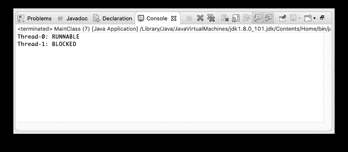

### 4. WAITING（等待）

这种状态发生在线程必须等待另一个线程完成其任务，且时间无限。这种状态与上面的`BLOCKED`状态不同，上述是指线程在共同访问同一个系统资源时被系统锁定。这种状态是线程之间的自我协商。`BLOCKED`就像被交通警察拦截的车辆以让其他优先车辆通过。而`WAITING`是另一种自我妥协的方式，不需要那种警察来监管。由于线程会互相让让，如果一个`Thread`调用了以下方法之一，它将“让出”并进入这种`WAITING`状态，方法是：
- `Object.wait()`
- `Thread.join()`
- `LockSupport.park()`

具体来说，上述方法是什么，将在接下来的课程中为你澄清。我们尝试用`join()`方法来练习。当一个`Thread`调用另一个`Thread`的`join()`方法时，它必须等待另一个`Thread`死亡后才能继续其剩余的任务。注意，我列出的这些方法没有传递参数。

我们将通过练习更好地理解线程的这种状态。

#### 练习题 4

首先，让我们修改如下类：

```java
public class MyRunnable implements Runnable {

    @Override
    public void run() {
        System.out.println("Runnable Start");
        for (int i = 0; i < 100; i++) {
            try {
                Thread.sleep(100);
            } catch (InterruptedException e) {
                // 异常处理
                e.printStackTrace();
            }
        }
        System.out.println("Runnable End");
    }
}
```

上述方法并不与让`Thread`进入`WAITING`状态有关，我们在下一节会详细讨论`join()`方法。

```java
public class MyThread extends Thread {

    @Override
    public void run() {
        System.out.println("MyThread Start");
        Thread myRunnableThread = new Thread(new MyRunnable());
        myRunnableThread.start();
        try {
            myRunnableThread.join();
        } catch (InterruptedException e) {
            e.printStackTrace();
        }
        System.out.println("MyThread End");
    }
}
```

然后在`main()`方法中，你只需要启动`MyThread`，等待大约 100 毫秒，然后打印`MyThread`的状态。等待一会儿打印`MyThread`状态是为了给`MyThread`足够的时间，打印太快很难看到状态。

```java
public class MyThread {
    public static void main(String[] args) {
        MyThread myThread = new MyThread();
        myThread.start();
        try {
            Thread.sleep(100);
        } catch (InterruptedException e) {
            e.printStackTrace();
        }
        System.out.println("MyThread State: " + myThread.getState());
    }
}
```

控制台输出如下。

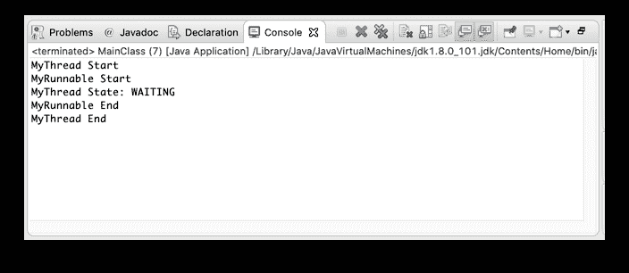

### 5. TIMED_WAITING（超时等待）

这种状态与上面的`WAITING`相似，但当方法让一个`Thread`“让出”给另一个线程执行时，传递了`Thread`经过的时间参数。这些方法是：
- `Thread.sleep(long milis)`
- `Object.wait(int timeout)`或`Object.wait(int timeout, int nanos)`
- `Thread.join(long milis)`
- `LockSupport.parkNanos()`
- `LockSupport.parkUtil()`

嗯，`sleep()`方法很熟悉吧？现在你理解了，在`Thread`某处调用此`Thread.sleep()`时，该`Thread`将进入`TIMED_WAITING`状态，并让其他`Threads`在指定的毫秒时间内运行。然而，我们将在下一节课中也会讨论这些方法。现在让我们看看练习题的代码。

## 练习 5

对于这个练习，你只需要参考上面的代码 4。在`MyThread`启动`MyRunnable`并到`MyRunnable`的地方，将`milliseconds`的值传递给这个`join()`方法。这意味着尽管`MyThread`之前已经让`MyRunnable`运行，但仅持续指定的时间，在我运行期间，它都会被阻塞。

```java
public class MyThread extends Thread {

    @Override
    public void run() {
        System.out.println("MyThread Start");
        Thread myRunnableThread = new Thread(new MyRunnable());
        myRunnableThread.start();
        try {
            myRunnableThread.join(500);
        } catch (InterruptedException e) {
            e.printStackTrace();
        }
        System.out.println("MyThread End");
    }
}
```

如果你执行该程序，请注意，在打印 "MyThread State: TIMED_WAITING" 后，`MyThread`将等待剩余的`milliseconds`，并为`MyRunnable`打印（少于 500 后）"MyThread End"。问题在于`MyRunnable`还没有完成循环，所以它最终打印了 "MyRunnable End"。你看到线程之间的节奏了吗？！

## 6. TERMINATED（已终止）

此状态标志着`Thread`生命周期的结束。当线程完成其`run()`方法中的所有操作，或者发生其他异常结束（例如掉异常）时就会发生。

## 练习 6

本课的代码不多。你只需要获取上面练习 5 的代码。然后在`main()`方法中，让它`sleep()`一段时间，以等待`MyThread`完成它的任务，然后打印它的状态。我设置了 20 秒的睡眠，如下：

```java
public static void main(String[] args) {
    MyThread myThread = new MyThread();
    myThread.start();
    try {
        Thread.sleep(20000);
        System.out.println("MyThread State: " + myThread.getState());
    } catch (InterruptedException e) {
        e.printStackTrace();
    }
}
```

控制台的输出如下。呼！我们刚刚接触了`Thread`生命周期的知识，通过它我们知道了`Thread`在生命周期中会经历哪些状态。你肯定也知道`Thread`并不总是经过上述所有状态，有些线程只有`NEW`、`RUNNABLE`和`TERMINATED`。然而，通过这些生命周期的知识，你对线程如何同步、如何相互让让执行任务也有大致的想法，对吧？关于`Thread`的知识也非常多，而且同样有趣。下节课见。

# 第 41 节：同步（部分 1）

记得上一节课吗？我在课程结束时承诺过我们将查看`Thread`的所有有用方法。但我意识到，`Thread`带来的大多数酷炫方法都围绕着如何帮助在进程中共同同步`Threads`。因此，为了方便整合我承诺的方法，我决定先介绍这个“线程同步”的知识。当你接近同步这个概念时，你将对`Thread`内部的有用方法有更好的理解。我们将开始熟悉早期的同步概念。欢迎加入课程。

## I. 什么是同步？

正如我在关于同步的介绍中简要提到的，但这并不是离线设备与云端数据之间的同步。这里的同步是指线程之间是如何工作的。所以它到底是什么？我将在关于`Thread`的章节，特别是`Thread`第 3 集中清楚地解释。现在你一定已经理解了`Thread`，也知道`Thread`中有一个非常头疼的问题，即`Thread`是否是我们应用程序内部组织任务的好方法（由于它的并行处理特性更快、更流畅），但这反过来导致了风险：同时可能有多个线程想要干扰同一个共享资源。我们需要一种机制来帮助调节，以便同时只有一个`Thread`有权使用此共享资源，而其他`Threads`必须轮流等待。这种调节机制被称为同步（英语中`Synchronized`或 Synchronization）。

然而，我想再补充一个关于同步的问题。即，如果独立提到同步，那么你可以理解我上面提到的它的功能。如果将“同步”与“真实的同步”（当同步是同步的，而无同步是异步的）进行比较，会有其他背景问题。同步有助于按特定顺序组织`Thread`，在一个线程完成后，另一个线程可以执行，按顺序且平滑地进行。而异步是无序的……无序，也就是说，我们不关心哪个`Thread`先完成，哪个线程后结束。而且我们这个同步系列只讨论`Synchronized`概念（即不比较同步和异步的区别）。

## II. 什么时候会用到同步？

正如我上面所说，同步有助于调节，以便一次时刻只有一个`Thread`可以使用某些共享资源。那么什么时候需要这种调整呢？事实上，应用程序内的资源（文件或对象）并不总是需要与系统保持同步。只有当资源存在冲突、在线程之间有共同线程，导致一个线程正在修改对象的值，而另一个线程也在对该对象进行修改，导致线程之间产生不必要的“误解”，并可能导致运行时崩溃……这时才使用同步。

一个实际的例子是银行的账户管理应用程序。假设你是这个账户管理应用程序的构建者，在你的应用程序中有一个对象负责读取和写入客户账户余额数据库。一天，一个客户去 ATM 提取款，假设他的账户有 2000 万越南盾，他需要提取 1500 万越南盾。你也知道为了取款，ATM（即你的应用程序）必须对该账户进行余额检查，然后该 ATM 接收客户的取款订单并准备取款（此时你的应用程序对象刚刚读取了余额数据，还没有余额校正）。但与此同时，在家里，客户的妻子与其丈夫共用同一个账户，她正通过丈夫的账户提取 2000 万越南盾，在检查账户余额后，妻子发现钱还足够（因为 ATM 还没有扣款操作），妻子执行了转账订单。然后发生了什么？由于你的应用对象看到剩余金额（在丈夫的 ATM 和妻子的转账网站上都是），它在数据库中为丈夫扣减了 1500 万越南盾，为妻子扣减了 2000 万越南盾。丈夫和妻子收到了要取的钱，妻子的账户也收到了转账的钱。简而言之，银行亏了钱（1500 万越南盾），你会被解雇。

现在，现在，我只是假设，当然，在读完这个同步系列后，你就可以完全避免未来可能发生的错误，例如。为了方便理解，让我们把这个情况重构成为一个小项目，如下：

• 未同步的银行取款示例

在这个示例中，我邀请你构建一个如上述模拟从银行取款的应用程序。

我们首先构建一个持有客户账户余额信息的对象。这个对象由你经过仔细构建，它可以在允许取款之前检查账户余额（初始余额设置为 2000 万）。在检查余额并确认允许取款后，它将扣除账户中的余额。假设检查账户余额和将新余额更新回数据库每次操作需要 2 秒。这些都通过下面的类代码进行模拟。我将这个类命名为`BankAccount`。

```java
public class BankAccount {
    long amount = 20000000; // The amount in the account

    public boolean checkAccountBalance (long withDrawAmount) { // Simulate time to read the database and check money
        try {
            Thread.sleep (2000);
        } catch (InterruptedException e) {
            e.printStackTrace();
        }
        if (withDrawAmount <= amount) { // Allow to withdraw money
            return true;
        }
        // No withdrawal allowed
        return false;
    }

    public void withdraw (String threadName, long withdrawAmount) { // Print withdrawal information
        System.out.println (threadName + "withdraw:" + withdrawAmount);
        if (checkAccountBalance (withdrawAmount)) { // Simulate withdrawal time and
        // update the remaining amount into the database
            try {
                Thread.sleep (2000);
            } catch (InterruptedException e) {
                e.printStackTrace();
            }
            amount -= withdrawAmount;
        }
        // Print out the account balance
        System.out.println (threadName + "see balance:" + amount);
    }
}
```

上面的代码很容易理解，对吧？你已经知道这个`BankAccount`是一个共享资源。既然是共享资源，你应该如下所示构建一个取款线程。该线程将允许访问这个共享资源并传递取款金额，然后调用该资源的取款方法。我将这个取款线程命名为`WithdrawThread`。

```java
public class WithdrawThread extends Thread {
    String threadName = "";
    long withdrawAmount = 0;
    BankAccount bankAccount;

    public WithdrawThread(String threadName, BankAccount bankAccount, long withdrawAmount) {
        this.threadName = threadName;
        this.bankAccount = bankAccount;
        this.withdrawAmount = withdrawAmount;
    }

    @Override
    public void run() {
        bankAccount.withdraw(threadName, withdrawAmount);
    }
}
```

最后，`main()`方法的代码非常简单，我们只需要声明 2 个`Thread`来取款，并让它们使用同一个资源`bankAccount`即可。

```java
public static void main(String[] args) {
    BankAccount bankAccount = new BankAccount();
    // 丈夫取 1500 万
    WithdrawThread husbandThread = new WithdrawThread("Husband", bankAccount, 15000000);
    husbandThread.start();
    // 妻子取走所有钱 (2000 万)
}
```


`WithdrawThread wifeThread = new WithdrawThread("Wife", bankAccount, 20000000); wifeThread.start();`

当执行此程序时，你将看到如下所示的结果。这个结果是两个线程 `husbandThread` 和 `wifeThread` 检查账户并发现可以取款，然后它们都执行了取款订单，结果双方都看到执行成功。但是……它的余额变成了负数（意味着银行亏了钱）。

我们先停在上面的示例，在下一节中，当我们开始了解同步（`Synchronization`）方法的细节时，我们将知道上述银行是如何不亏钱的，可能还能保命，不，保住你的工作。

## III. 同步方法

在系列同步课程中，我将它们分为两种方式，这两种我们最容易实现和记忆的两种方式。

第一种被称为 `Mutual Exclusive`（互斥）。可以理解为相互斥。这种方式系统将优先考虑一个线程，并帮助防止其他线程发生冲突的风险。因为这种机制的特性，它让我们想起了对系统的剧烈干预，所以被称为“消除（eliminates）”。这种方式将在下节中封装。

第二种被称为 `Cooperation`（协作）。它可以意味着共同协作。这种方式线程将相互握手，并共同调节优先级顺序以自我避免冲突。这种方式将在下一节关于上述互斥方法中讨论。

事实上，在上一节中，你已经简要地熟悉了这两种同步方式。记住它。这个链接是 `Mutual Exclusive` 方式，这个链接是 `Cooperation`。好了，这节课很简单，不是吗。本节的知识点仅集中于同步概念的介绍，以及我们将在后续章节中看到的两种主要的同步方式。

## 第 42 节：同步部分 2

在在完成昨天关于同步线程的开场课程后，我说过会有两种方式同步线程。这些同步的共同目标都是限制线程访问同一个共享资源。在本节中，我将详细介绍上述两种方式中的第一种，这种方法被称为 `Mutual Exclusive`。在这些同步课程之后，你将学习如何在与多线程工作时避免系统资源冲突，并知道在什么时候使用哪种方法进行同步。欢迎加入课程。

### I. 什么是互斥同步？

无疑，互斥同步是一种同步 `Thread` 的方法，帮助线程保持同步以便它们不会同时干扰共享资源。那么为什么被称为 `Mutual Exclusive` 呢？这里的 `Exclude`（排除）意味着 `Block`（阻塞），意味着系统将阻塞调用同一个共享资源的线程，只允许一个线程使用该资源。那些阻塞的线程将等待直到它们停止后才能使用该资源。简而言之，这里的 `Exclude` 被理解为 `Prevent`（防止），而不是终止（`Abort`）线程。

那么系统将如何执行这种消除或防止呢？为了最直观的可视化，让我们来看下面的实际示例（这是我看到很多文档使用的最易理解的 `Mutual Exclusive` 示例）。例如，在某次会议上有很多演讲者坐在一起，他们都在讨论关于如何最好地学习 Java 的话题（这个话题是我发起的）。和我们讨论的 `Thread` 问题相同的是，只有一个话题，每个演讲者都有自己的意见，每个人都争抢着提出意见。结果是，听众会收到杂乱的信息，没有人能听懂会议传达了什么。

如果你把每个演讲者看作一个 `Thread`，而他们讨论的话题是共享资源。演讲者本身是导致话题如此拥挤的因素。为了解决这个问题，你想了一种机制，这种机制被称为 `Mutual Exclusive`。该机制的想法是演讲者必须获得他们自己的发言权，排除其他演讲者的发言权，强制其他演讲者倾听，直到该演讲者发言。这就是故事。噢，那么该做呢，你不能介入并指定谁说话谁必须听，因为那会花费太多精力。不，你不需要。你给他们一个麦克风。砰！问题解决了。把一个麦克风放在桌子上，由演讲者拿自己的麦克风，演讲者就有发言权，其他人听直到演讲者交出麦克风。倾听的演讲者有权将发言加入一个列表，这样当另一个演讲者结束发言后，列表中的下一个人就可以使用麦克风。

上面的示例清楚地展示了执行 `Mutual Exclusive` 同步的方法。我们只需要考虑将上述示例应用到我们的线程同步知识时，系统将如何操作，欢迎进入下一节。

### II. 互斥同步是如何？

这种演讲者只有在有麦克风时才被允许说话的机制应用于线程同步时，它被称为另一个名字 `Monitor & Lock`，或者许多文档称为 `Monitor Lock`。我不必理解 `Monitor` 是屏幕而 `Lock` 是锁。这种机制可以理解为麦克风或其他共享文档将被一个名为 `Monitor` 的对象保护。对于每个想要使用麦克风（或共享资源）的演讲者（或 `Thread`），必须通过 `Monitor` 注册以获取一个 `Lock`。每个 `Monitor` 将只有一个 `Lock`。哪个线程可以获得上述 `Monitor` 的 `Lock`，该线程就被允许使用共享资源，直到该 `Thread` 完成使用并返回 `Lock`。

（注：原文此处有断句，此处衔接了麦克风）

在这个练习中，我们将回到上节课中的银行取款示例。我在这个示例中对内容进行了简要总结。

在上一个示例中，你构建了一个 `BankAccount` 类。该类包含两个方法：`checkAccountBalance()` 和 `withdraw()`，它们分别是检查余额和在余额充足时从银行取款的方法。然后，我们声明了两个线程 `Thread`，即 `husbandThread` 和 `wifeThread`，并进行取款，上一节课第二天获得的结果如下。

控制台上的行表示两个 `Threads` 想要取款，而两个 `Threads` 取款后的结果显示为负数，这表明余额检查出现了错误，因为两个线程都进行了余额检查。两个 `Threads` 都发现余额可用，并都执行了总额超过允许余额的取款。

因此，我们需要同步这些 `Threads`，也就是说，对共享资源 `BankAccount` 进行同步。让 `BankAccount` 对象受 `Monitor` 保护。然后当 `Thread` 想要使用该对象的方法时，它们必须请求 `Lock`。因此根据课程，我们只需要在 `BankAccount` 中如所示添加 `synchronized` 关键字（我更改了代码以打印控制台，使其比上一节课更清晰）。

```java
public class BankAccount {

    long amount = 20000000; // 账户金额

    public synchronized boolean checkAccountBalance (long withDrawAmount) { // 模拟读取数据库和检查金额的时间

        try {

            Thread.sleep (2000);

        } catch (InterruptedException e) {

            e.printStackTrace ();

        }

        if (withDrawAmount <= amount) { // 允许取款

            return true;

        }

        // 不允许取款返回 false;

    }

    public synchronized void withdraw (String threadName, long withdrawAmount) { // 打印取款信息

        System.out.println (threadName + "check:" + withdrawAmount);

        if (checkAccountBalance (withdrawAmount)) { // 模拟取款时间并

            // 将剩余金额更新到数据库

            try {

                Thread.sleep (2000);

            } catch (InterruptedException e) {

                e.printStackTrace ();

            }

            amount -= withdrawAmount;

            System.out.println (threadName + "withdraw successful:" + withdrawAmount);

        } else {

            System.out.println (threadName + "withdraw error!");

        }

        // 打印账户余额

        System.out.println (threadName + "see balance:" + amount);

    }

}
```

当涉及到性能时，比较一下结果。

丈夫想要取 1500 万。丈夫成功取了 1500 万。余额为 500 万。妻子想要取 2000 万，妻子无法这样做。余额仍然是 500 万。

你看，这种同步的结果是：`husbandThread` 先请求取款，它会先获得 `Lock`，直到 `husbandThread` 完成取款，`wifeThread` 才能开始执行而不会发生竞争。

### 2. 在代码块内部使用 synchronized 方法

此时，你已经部分理解了 `synchronized` 关键字是如何工作的，对吧？为了更清楚，当你在类内部的一个或多个方法中放置 `synchronized` 关键字时，该类的对象将由 `Monitor` 管理。一旦一个 `Thread` 注册使用带有 `synchronized` 关键字的方法，`Monitor` 就会授予该线程 `Lock`，直到它完成这些方法。

因此，有时你不需要为整个方法请求 `Lock`。如果你只需要方法的一个部分受 `Monitor` 保护，那么就对该项的块应用 `synchronized` 方法。你可以参考以下 `synchronized` 语句块在方法内部的语法结构：

```java
synchronized (object) {

    // 块内容

}
```

语法并不太困难，你只需要考虑传递给 `synchronized` 块的参数 `doi_tuong`。此参数告诉系统哪个对象应该仅由其 `Monitor` 进行同步管理。为了更好地地理解，邀请你进行练习。

#### 练习 #2

我们将获取上述练习 1 中 `BankAccount` 类的代码。但现在我们只需要同步稍后高亮的一个块代码。你会发现，除了在熟悉的代码行中封装这个同步块，并像练习 #1 那样从方法中移除 `synchronized` 项外，其他一切都没有变化。

```java
public class BankAccount {

    long amount = 20000000; // 账户金额

    public boolean checkAccountBalance (long withDrawAmount) { // 模拟读取数据库和检查金额

        try {

            Thread.sleep (2000);

        } catch (InterruptedException e) {

            e.printStackTrace ();

        }

        if (withDrawAmount <= amount) { // 允许取款

            return true;

        }

        // 不允许取款返回 false;

    }

    public void withdraw (String threadName, long withdrawAmount) { // 打印取款信息

        System.out.println (threadName + "check:" + withdrawAmount);

        synchronized (this) {

            if (checkAccountBalance (withdrawAmount)) { // 模拟取款时间并

                // 将剩余金额更新到数据库

                try {

                    Thread.sleep (2000);

                } catch (InterruptedException e) {

                    e.printStackTrace ();

                }

                amount -= withdrawAmount;

                System.out.println (threadName + "withdraw successful:" + withdrawAmount);

            } else {

                System.out.println (threadName + "withdraw error!");

            }

        }

        // 打印账户余额

        System.out.println (threadName + "see balance:" + amount);

    }

}
```


使用上述代码，我只同步了一小块命令。屏幕打印是不同步的，当运行应用程序时，结果略有不同。然而，应用程序仍然运行正常。如上述语法所示，将此内容传递给`synchronized`块会告诉`Monitor`对该对象进行保护，但仅在块内进行保护。

如果按照练习 1，同步是同时在“检查”和“取款”方法上进行的，那么当丈夫先进入时，系统会检查丈夫是否已完成所有为妻子提供服务的操作。因此，使用练习 1 的系统时，当妻子来使用系统时，需要很长时间才能看到系统响应，因为丈夫仍然需要等待丈夫完成。至于这个练习，你会发现系统会对两者都做出响应（在屏幕上打印可用余额），因为同步代码行尚未到达。直到丈夫正式进入检查金额的方法，新系统才会对妻子执行互斥操作（Mutual Exclusive）。正如你在上面的控制台上看到的那样。

所以我们查看了同步`Thread`的第一种方法。这个`synchronized`关键字的使用非常简单，我看到它被广泛用于多线程冲突避免场景。

# 第 43 课：同步部分 3 同步协作

这篇 Java 续作已经有一段时间了。这可以看作是开启新年的 Java 课程，但是去年欠的话题。也许是因为长时间的等待会让你忘记一点。我们再次讨论 Java 编程中的`Thread Synchronization`方法。我们找到了一种让`Threads`在并行任务执行中“自由释放”的方法，让它们在共同使用对象状态（我们称之为资源）时知道要遵循某些顺序规则。上一节是一种方法，现在我们来看第二种。欢迎来到课程。

## 一. 什么是同步协作？

同步协作（Synchronization Cooperation），某些文档称为“线程间通信”（Inter-Thread Communication），这种同步方法的目的是无意中避免线程同时使用同一个对象或系统资源时发生冲突。那么，为什么被称为“协作”呢？与上一节概述的互斥同步方法不同，上一节的方法创建了一种排斥机制，帮助先使用资源的`Threads`优先考虑，后使用的`Threads`被排除并必须等待。这种方法恰恰相反。不再有“先来后得”，但它们之间有“协作”（`Cooperation`），以一种精神协作，即一个`Thread`可以完全“让出”另一个线程来使用它先“赢得”的资源，这样当另一个`Thread`完成使用该资源后，该线程就必须“唤醒”它，以便它继续在该资源上工作。

## 二. 如何进行同步协作？

正如你所知，这种同步方法的核心是线程在资源使用上必须相互调整和让位。因此，我们必须熟悉涉及修改和让位的方法，而不仅仅像上一节那样仅使用关键字。我们讨论的是`wait()`、`notify()`和`notifyAll()`方法。

在学习这 3 个方法的含义和用法之前，我想简单地重复一下上一节提到的`Monitor` & `Lock`机制。因为本节的同步并不是脱离这个`Monitor`和`Lock`的。如上一节所述，系统中的每个对象都有一个管理的`Monitor`。每个`Monitor`只有一个`Lock`。当线程想要使用该对象时，它必须通过该对象的`Monitor`进行注册，`Monitor`将`synchronized`关键字上的`Lock`授予有权使用该对象的线程。你所熟悉的：告诉`Monitor`如果你将`Lock`给某些线程，其他线程将留在`Monitor`中等待，直到`Lock`返回。

所以仍然基于这个`Monitor` & `Lock`机制，本节的内容将如下。我们将结合上面提到的方法一起。请注意，这些方法是构建在`Object`超类中的，这意味着 Java 中的所有对象都有这些方法。

1. `wait()`：此方法被调用时，会导致持有该对象`Lock`的`Thread`将该`Lock`返回给该对象的`Monitor`。同时，该线程进入睡眠，等待另一个线程通过下面两种方法之一唤醒它。
2. `notify()`：如上所述，此方法帮助“唤醒”通过`wait()`方法进入睡眠的`Thread`。
3. `notifyAll()`：此方法比`notify()`更具扩展性。它唤醒所有在该对象内调用过`wait()`的线程。

如你看到的，使用本节同步方法的核心思想是“让出”。一个`Thread`先进入对象的`Monitor`，获得了该对象的`Lock`，但由于某些实际情况，该`Thread`还没有使用该对象。它执行`wait()`让某个线程先使用该对象，然后唤醒它，以便它可以继续当前正在进行的工作。为了更好地理解如何在同步中中使用这些方法，让我们进入接下来的练习。

## 三. 练习解决从银行取款

我们继续构建银行相关的操作。你可以回顾之前的练习以复习旧的同步模式，并与本次练习的脚本进行比较。

此前，你建立了一个“完美”的算法，丈夫和妻子在同一个账户上执行取款。你通过回顾之前的练习来复习旧的同步模式，并与本次练习的脚本进行比较。

假设你所工作的银行有一个新服务，即协助用户在账户余额充足时提交取款订单。这意味着，当客户提交取款订单且银行账户足以执行此操作时，客户将立即收到资金；但如果不足，它将等待账户恰好足够，然后执行取款订单。这部分的要求有点复杂。如果你不看本节，可以为应用程序构建一个定期检查账户的功能，例如每分钟检查一次，只要有足够的资金取款，订单就会立即执行。定期测试的想法似乎正确，但并不好。

```java
long amount = 5000000; // 账户金额

public synchronized boolean checkAccountBalance(long withDrawAmount) {

    // 参考上一节课的代码，请你自己复制/粘贴它，

    // 本节不再再次显示它

}

public synchronized void withdraw(String threadName, long withdrawAmount) {

    // 参考上一节课的代码，请你自己复制/粘贴它，

    // 本节不再再次显示它

}

public synchronized void withdrawWhenBalanceEnough(String threadName, long withdrawAmount) {

    // 打印检查取款信息

    System.out.println(threadName + "check:" + withdrawAmount);

    while (!checkAccountBalance(withdrawAmount)) {

        // 如果余额不足，则等待直到余额足够后再取款

        System.out.println(threadName + "wait for balance enough");

        try {

            wait();

        } catch (InterruptedException e) {

            // TODO 自动生成的异常处理块

            e.printStackTrace();

        }

    }

    // 资金充足或不再等待，则允许取款

    // 模拟取款时间并

    // 将剩余金额更新到数据库

    try {

        Thread.sleep(2000);

    } catch (InterruptedException e) {

        e.printStackTrace();

    }

    amount -= withdrawAmount;

    System.out.println(threadName + "withdraw successful:" + withdrawAmount);

}

public synchronized void deposit(String threadName, long depositAmount) {

    // 打印存款者信息

    System.out.println(threadName + "deposit:" + depositAmount);

    // 模拟充值时间并

    // 将新金额更新到数据库

    try {

        Thread.sleep(2000);

    } catch (InterruptedException e) {

        e.printStackTrace();

    }

    amount += depositAmount;

    // 唤醒休眠的对象并等待取款

    notify();

}
```

注意`BankAccount`方法中使用的`wait()`和`notify()`方法。首先，你应该知道，本节的同步方法必须保持在`synchronized`块内部，以避免冲突。因此，`withdrawWhenBalanceEnough()`和`deposit()`方法都是同步方法。如果你不理解`synchronized`关键字的用途，请复习上一节。

回到`BankAccount`。`withdrawWhenBalanceEnough()`方法刚刚进入检查余额阶段。如果余额不足，它会立即遇到`wait()`命令。话如此，该命令会导致持有当前`Lock`的`Thread`返回`Lock`并进入睡眠，等待其他`Thread`唤醒。此段落中检查余额的`while`循环有助于`Thread`在存活时仍然再次检查余额。如果唤醒时余额充足，将在下方的代码行执行取款。余额不足，则`wait()`并再次睡眠。你理解了吗？

`BankAccount`中的`deposit()`方法是账户充值的方法。充值完成后，该方法会持续调用`notify()`来唤醒某些休眠的线程，并等待取款。实际上，`deposit()`中的`notify()`并不知道哪个`thread`在休眠并等待唤醒，所以如果你确定，只需调用`notifyAll()`来唤醒所有调用过`wait()`的线程，这在`BankAccount`中是没问题的。

然后，为了方便，我们构建了 2 个`Threads`：一个用于余额足够时取款的`Thread`，另一个用于充值的`Thread`。`Thread`的取款逻辑如下。

```java
public class WithdrawThread extends Thread {

    String threadName = "";

    long withdrawAmount = 0;

    BankAccount bankAccount;

    public WithdrawThread(String threadName, BankAccount bankAccount , long withdrawAmount) {

        this.threadName = threadName;

        this.bankAccount = bankAccount;

        this.withdrawAmount = withdrawAmount;

    }

    @Override

    public void run() {

        bankAccount.withdrawWhenBalanceEnough(threadName, withdrawAmount);

    }

}
```

`WithdrawThread`的取款很容易理解，对吧？并没有新内容。这里是充值的`Thread`。

```java
public class DepositThread extends Thread {

    String threadName = "";

    long depositAmount = 0;

    BankAccount bankAccount;

    public DepositThread(String threadName, BankAccount bankAccount , long depositAmount) {

        this.threadName = threadName;

        this.bankAccount = bankAccount;

        this.depositAmount = depositAmount;

    }

    @Override

    public void run() {

        bankAccount.deposit(threadName, depositAmount);

    }

}
```

`Threads`的取款和充值没有区别，我们只是将 2 个`Threads`分离到`main()`方法中以便观察。你仍然可以将这两个 2 个线程合并为 1 个。你可以尝试一下。

我们在`main()`方法中如下调用 2 个`Thread`：

```java
public class MainClass {

    public static void main (String [] args) {

        BankAccount bankAccount = new BankAccount ();

        // 妻子想要取 1000 万越南盾

        // （注意资金不足取款的情况）

        WithdrawThread wifeThread = new WithdrawThread ("Wife", bankAccount, 10000000);

        wifeThread.start ();

        // 丈夫存款 500 万越南盾

        DepositThread husbandThread = new DepositThread ("Husband", bankAccount, 5000000);

        husbandThread.start ();

    }

}
```

此时，你可以运行程序以查看结果是如何打印到控制台的。


我们刚刚完成了`Thread Synchronization`系列知识的第 3 部分。但这已经是`Thread`知识系列中的第 6 个知识点了。你可以看到`Thread`的重要性。我们在这里结束`Thread Synchronization`系列。但并不是`Thread`知识链的终点。下一节我们将来到关于`Thread`的新知识。

# 第 44 节：死锁

通过上一节，我们完成了`Thread Synchronization`。你已经看到了`synchronized`关键字在确保共享资源不发生冲突方面的强大作用。确实，`synchronized`非常有用，但如果你在错误的地方误用了它，就会出现本节所针对的情况。这种情况被称为`死锁` (Deadlock)。

虽然这种情况不会导致编程中那种“程序等死”，但它也让诉讼者不知道如何处理。下图显示了一名警察正抓着一名劫匪。警察希望另一个劫匪先交出人质，然后才释放他所抓持的那个劫匪。与此同时，另一个劫匪绝对不会归还人质，迫使警察先释放他的同伙。


### 在现实中模拟死锁的可能性
因此，在这种情况下，双方都持有着自己的人质，且都不会向对方归还人质。这种情况在短期内显然很难达成。这种情况发生时就产生了死锁。

## II. 编程中的死锁
在编程中，死锁的情况与上述有趣的现实案例相似。假设`Police`和`Robbery`分别是两个`Thread`。那么劫匪团和`Hostages`就是资源。`Police Thread`正在通过`synchronized`关键字持有着`Robber's`的同伙，但`Police Thread`真正想要的是`Hostages`。我相信这些人质也被`Thread Pirates`通过`synchronized`关键字持有着，而`Pirates`也想要获得`posse robbery`。在编程中，死锁也会发生。

### III. 导致死锁的应用构建实践
如果上述的实践和理论情况能让你更好地理解死锁，那么现在我邀请你构建一个能够导致死锁的真实应用程序。我们仍然回到银行应用的构建场景，就像你已经熟悉的`Thread synchronization`课程一样。假设银行老板来找你，让你构建账户间的转账功能。功能构建完成后，家里有一对夫妇。丈夫有自己的账户，妻子在同一银行也有一个独立的账户。某天，由于他们互不理解，丈夫从自己的账户向妻子转账了 300 万越南盾，同时，妻子也从她的账户向丈夫转账了 200 万越南盾。讽刺的问题在于，这两个人在同时执行转账。奇怪的是，应用程序挂起了，这意味着这对夫妇一直在等待，而转账仍然失败了。为什么呢？让我们来看看你写的代码。

假设你的`BankAccount`类已经根据之前的课程构建了内置`withdraw`和`deposit`方法。这里我写的比上一节课短，忽略了余额检查，并尽可能简洁地模拟该类的取款/充值时间。

```java
public class BankAccount extends Object {

    long amount = 5000000; // 账户中的金额

    String accountName = "";

    public BankAccount (String accountName) {

        this.accountName = accountName;

    }

    public synchronized void withdraw (long withdrawAmount) {

        // 打印开始扣钱的状态

        System.out.println (accountName + "withdrawing ...");

        // 扣除

        amount -= withdrawAmount; 

    }
```


`public synchronized void deposit(long depositAmount)` 方法用于向账户充值，其实现如下：

```java
public synchronized void deposit (long depositAmount) {

    // 打印开始充值的状态
    System.out.println (accountName + "depositting ...");

    // 充值
    amount += depositAmount; 

}
```

现在你为这个类构建了更多转账方法。你将其命名为 `transferTo()`。由于过于谨慎，你在这个方法中加入了 `synchronized` 块。`BankAccount` 类的完整代码如下：

```java
public class BankAccount extends Object {

    long amount = 5000000; // 账户中的金额
    String accountName = "";

    public BankAccount (String accountName) {
        this.accountName = accountName;
    }

    public synchronized void withdraw (long withdrawAmount) {
        // 打印开始扣钱的状态
        System.out.println (accountName + "withdrawing ...");

        // 扣除
        amount -= withdrawAmount;
    }

    public synchronized void deposit (long depositAmount) {
        // 打印开始充值的状态
        System.out.println (accountName + "depositting ...");

        // 充值
        amount += depositAmount;
    }

    public void transferTo (BankAccount toAccount, long transferAmount) {
        synchronized (this) {
            // 从此账户取钱钱
            this.withdraw (transferAmount);

            synchronized (toAccount) {
                // 存入 toAccount
                toAccount.deposit (transferAmount);
            }

            // 转账结束打印账户余额
            System.out.println ("The amount of" + accountName + "is:" + amount);
        }
    }
}
```

在 `main()` 方法中，按照如下方式调用转账指令：

```java
public static void main (String [] args) {
    // 丈夫和妻子的账户
    BankAccount husbandAccount = new BankAccount ("Husband's Account");
    BankAccount wifeAccount = new BankAccount ("Wife's Account");

    // 丈夫想从照片中的账户向妻子账户转账 300 万
    Thread husbandThread = new Thread () {
        @Override
        public void run () {
            husbandAccount.transferTo (wifeAccount, 3000000);
        }
    };

    // 妻子想从她的账户向丈夫账户转账 200 万
    Thread wifeThread = new Thread () {
        @Override
        public void run () {
            wifeAccount.transferTo (husbandAccount, 2000000);
        }
    };

    // 两个人几乎同时进行转账订单
    husbandThread.start();
    wifeThread.start();
}
```

这里是程序执行的结果：

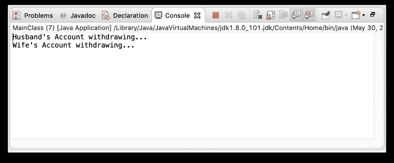

这些执行结果是在程序执行时打印到控制台的。正如你所理解的，两个 `Thread` 启动后，只能执行对源账户自身的扣除操作。然后对目标账户的充值方法……无法被调用。此时应用程序仍在运行，证据是控制台标签页旁边的红色正方形停止按钮仍然开启，也就是说，应用程序仍在运行，且 Eclipse 仍然允许你随时停止应用程序。应用程序无法被永久终止，因为每个 `Thread` 自身在初始化时都持有某个账户的 `Monitor` 的 `Lock`，其他 `Threads` 无法干扰每个线程持有的账户。每个 `Thread` 持有一个账户并等待使用另一个账户（由另一个 `Thread` 持有）的事实被称为死锁。

它与下图相似：

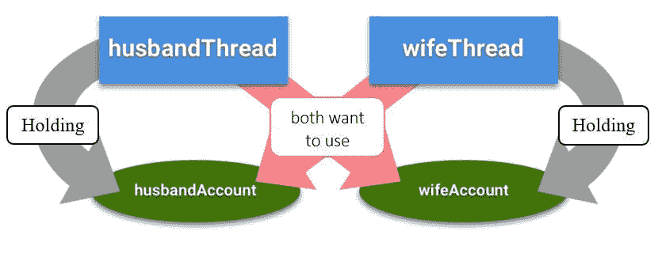

上述示例的死锁产生图 III。

### III. 死锁何时出现？

正如你所了解的，当我们过度使用 `synchronized` 关键字时，经常会出现死锁。它导致 `Threads` 永久地持有共享对象，并且不将其归给其他对象使用。

然而，这关于死锁的课程仅仅是一堂理论课程，在我看来它主要是一个警告。事实上，发生这样的死锁是非常困难的。但是，尽管不太可能发生，但它确实发生过，作为开发者，我们的职责仍然需要了解并准备好相关的必要知识。

### IV. 如何避免死锁以及如果遇到死锁该如何处理？

正如我所说，死锁在实践中极少发生。实际上，在我的编程生涯中，从未遇到过这种情况。据我所知，我们的应用程序使用了许多 `Threads`，但还没有多到足够复杂到导致像上面示例那样的冲突。

但即使不太可能发生，我们仍然需要知道如何最大限度地减少这种死锁现象的风险。即便避免了它，万一有一天死锁真的发生在你的应用程序上了呢？你仍然应该准备好相关知识，以修复源代码并立即发布补丁。本节将涵盖如何避免和修复死锁错误。

首先，在我看来，为了避免死锁，你仍然需要理解你的代码。你必须知道所使用的 `Threads` 使用了哪些资源。是否有大量线程占用共享资源？确保 `Threads` 在消耗资源后最终尽快将资源返回给系统，以便其他 `Threads` 才有机会使用并结束这些线程的生命周期。最简单的方法是不像上面的示例那样嵌套 `synchronized` 块，以确保死锁极不可能发生。

然后，如果你的应用程序在真实环境中执行时遇到了死锁。如果你的项目相对较小，你也可以通过阅读代码和推理来检测它。但如果项目太大，你可以使用许多具有 `Thread Dump` 功能的工具。如下所示，感谢 JDK `/bin` 目录下提供的一个工具，名为 `jvisualvm` 的工具。关于如何使用该工具并找到 `Thread Dump`，你可以参考网上的更多信息，或者查看此链接以了解所有包括 `jvisualvm` 在内的工具：

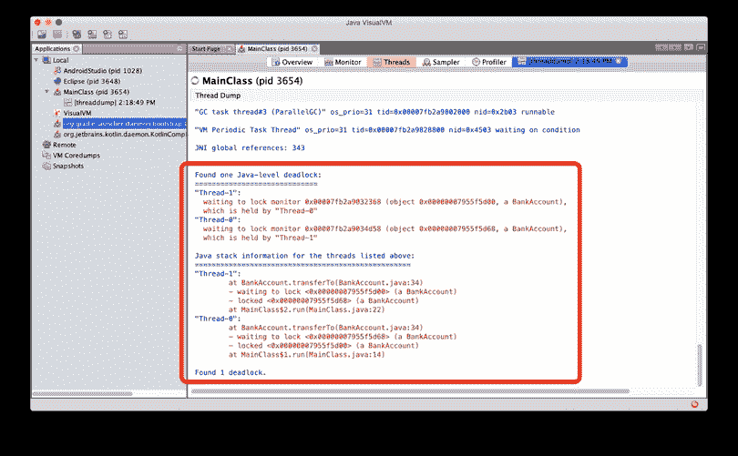

线程中的死锁检测工具及相关资源

死锁课程到此结束。你可以看到死锁仍然与强大的线程知识链相关。借此，你已经看到了 Java 中 `Threads` 的重要性，对吧？

这是 Java 核心的最后一节课。我希望你现在对 Java 技能充满了信心。祝愿大家好运。
