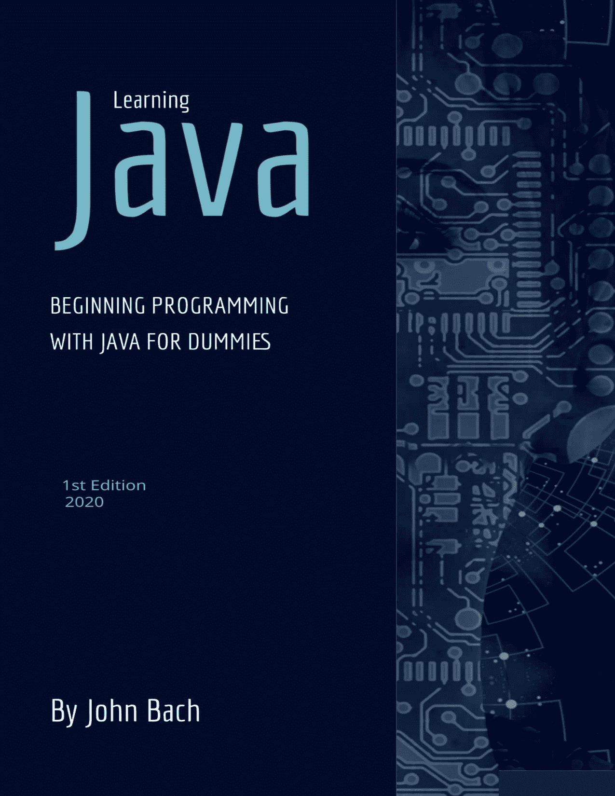

# Java 入门指南：Java 编程入门指南




> “编程不在于你知道什么，而在于你能够解决什么。” - 克里斯·派恩

## 使用现有类的示例

### 静态字段

### 静态方法

#### 使用包

##### 将类添加到包中

##### 指定包路径

##### 包作用域

##### JAR 文件

#### 扩展类

##### 重写 (OVERRIDES) 方法

##### 继承层次结构

##### 多态

##### 动态链接

##### 防止继承：终端类和方法

##### 抽象类

##### 受保护访问 (PROTECTED)

##### 如何应用继承

#### 实现 (Implements) 语句

##### 接口中的常量

#### 声明方法异常

#### 如何抛出异常情况

#### 创建异常类

#### 捕获异常 (TRY - CATCH 块)

##### 捕获多个异常

##### 重新抛出异常

##### finally 章节

#### 如何使用异常

#### 完整的线程族

#### 流过滤器

#### 数据流

#### 直接文件流

#### 文本流

##### 向输出流写入文本

##### 从输入流读取文本

#### 在系统上处理文件

## Java 语言历史与特性

Java 语言创建于 20 世纪 90 年代初，消费电子设备软件开发项目的一部分。最初的面向对象语言命名为 Oak（橡树）。随着网络语言的发展，Oak 被用于创建互联网应用程序（例如，Java 语言就是用 Oak 编写的 Oak 浏览器“WebRunner”）。1995 年，太阳微系统（Sun Microystems）决定宣布一款新产品，将其重命名为 Java（这个名字唯一合理的解释是程序员对咖啡的热爱），并将 WebRunner 改名为 HotJava。

Java 语言现在越来越多地用于创建维护客户端与服务器资源之间通信的“中间件”。此外，Java 语言已接管了嵌入式系统的领导地位，成为便携式设备、车载计算机等等的事实标准。

Java 语言的主要优势之一是不依赖于运行程序的平台：相同的代码可以在 Windows、Solaris、Linux、Macintosh 等操作系统上运行。另一个优势是 Java 语言的语法与 C++ 和 C 语言语法相似。此外，Java 是一门完全面向对象的语言，比 C++ 更为纯粹。Java 语言中的所有实体都是对象，只有少数基本类型（如数字）。

- 排除了显式分配和释放内存的可能性。Java 内存由垃圾回收机制自动回收。保证程序员不会出现与误用内存相关的错误；
- 引入了真正的数组并禁止了指针算术。现在程序员在原则上无法因指针使用不当从内存中删除数据；
- 消除了将赋值运算符与相等比较运算符混淆的可能性。现在你甚至无法编译 `if (a = 3) { ... }` 表达式（这个错误是 C 和 C++ 语言中大多数混乱的根源）。
- 排除了多重继承。它被接口的概念所取代，这是从 C 语言借鉴的。


# Java 语言概述

## 主要优势

Java 语言的主要优势之一是不依赖于运行程序的平台：相同的代码可以在 Windows、Solaris、Linux、Macintosh 等操作系统上运行。另一个优势是 Java 语言的语法与 C++ 和 C 语言语法相似。此外，Java 是一门完全面向对象的语言，比 C++ 更为纯粹。Java 语言中的所有实体都是对象，只有少数基本类型（如数字）。

- 排除了显式分配和释放内存的可能性。Java 内存由垃圾回收机制自动回收。保证程序员不会出现与误用内存相关的错误；
- 引入了真正的数组并禁止了指针算术。现在程序员在原则上无法因指针使用不当从内存中删除数据；
- 消除了将赋值运算符与相等比较运算符混淆的可能性。现在你甚至无法编译 `if (a = 3) { ... }` 表达式（这个错误是 C 和 C++ 语言中大多数混乱的根源）。
- 排除了多重继承。它被接口的概念所取代，这是从 C 语言借鉴的。

## 历史沿革

Java 语言是 20 世纪 90 年代初作为消费电子设备软件开发项目的一部分创建的。最初的面向对象语言命名为 Oak（橡树）。随着网络语言的发展，Oak 被用于创建互联网应用程序（例如，Java 语言就是用 Oak 编写的 Oak 浏览器“WebRunner”）。1995 年，太阳微系统决定宣布一款新产品，将其重命名为 Java（这个名字唯一合理的解释是程序员对咖啡的热爱），并将 WebRunner 改名为 HotJava。

## 应用领域

Java 语言现在越来越多地用于创建维护客户端与服务器资源之间通信的“中间件”。此外，Java 语言已接管了嵌入式系统的领导地位，成为便携式设备、车载计算机等等的事实标准。

## 开发工具与库

- `javakey` - 一个用于添加电子签名的程序；
- `native2ascii` - 一个将二进制文件转换为文本的程序；
- `rmic` 和 `rmiregistry` - 用于处理远程对象的程序；
- `serialver` - 用于确定类版本号的程序；
- “内置”方法的库和头文件；
- Java API（应用程序编程接口）库类和其他。


# JDK 版本历史

JDK 1.0 的第一个版本发布于 1996 年。从 1998 年 12 月推出的 JDK 1.2 版本开始，Food technology Java 公司和 SUN 将其重命名为 Java 2 Platform of Standard Edition（简称 J2 SE），JDK 在 Java 2 Standard Edition 中被重命名为 SDK（软件开发包），简称为 J2 SDK。此外，还推出了 Java 2 Enterprise Edition the SDK 和 Java 2 Micro Edition the SDK。（然而，SUN 公司直到现在仍在使用旧名称—— JDK。）

从 JDK 1.6 版本开始，包意味着开发开始并重命名为 Java Platform of Standard Edition Development Kit（Java SE）、Java Platform Enterprise Edition the SDK（Java EE）以及 Java Platform Micro Edition SDK（Java ME）。此外，SUN 还会单独分发一套 JRE（Java 环境）用于运行编译后的 Java 程序。

# 一个简单的 Java 程序

考虑一个向控制台打印消息的简单程序：

```java
public class FirstSample {
    public static void main(String [] args) {
        System.out.println("Hello, World!");
    }
}
```

第一点也是核心点是，在 Java 语言中，大小写是严格区分的。例如，如果将 `Main` 而不是 `main`，程序将无法执行。

`public` 关键字被称为访问修饰符（access modifier）；此类修饰符控制程序其他部分对该代码的访问。该关键字提醒我们，Java 语言中的所有实体都在类内部。也就是说，在包含程序逻辑并定义应用程序的容器内部。类是构成所有用 Java 语言编写的应用程序和 Applet 的构建块。Java 程序中的所有实体必须位于类内部。

`class` 关键字后面跟着类名。生成类名的规则并不十分严格。名称必须以字母开头，其余可以是字母和数字的任意组合。名称的长度原则上没有限制。Java 保留字（例如 `public` 或 `if`）不能作为类名。

类通常以大写字母开头的名词命名。包含源代码的文件必须命名为公共类名，并具有 `.java` 扩展名。

## 编译程序

```bash
javac FirstSample.java
```

Java 编译器将自动此文件命名为 `FirstSample.class` 并将其保存在包含源文件的目录中。

要将错误信息重定向到文件（在 UNIX 或 Windows NT/2000/XP 平台上工作时），只需使用 `2>` 运算符：

```bash
javac FirstSample.java 2> errors.txt
```

## 运行程序

运行字节码并使用 Java 解释器命令：

```bash
java FirstSample
```

（无 `.class` 后缀）。

从编译后的程序运行时，使用 `java className` 命令，Java 解释器始终从指定类的 `main` 方法实现开始。因此，为了让程序运行，类必须包含 `main` 方法。

根据 Java 语言规范，`main` 方法必须声明为 `public`（公共）和 `static`（静态）。`void` 意味着该方法不返回任何值。

程序源码中的括号用于标记程序的部分（通常称为块）。在 Java 中，任何方法的代码必须以左大括号 `{` 开头并以右大括号 `}` 结束。任何操作必须以分号结束。特别是，换行符并不意味着语句结束，因此语句可以跨越任意数量的行。

在此中，使用 `System.out` 输出文本字符串并使用其 `println` 方法，其中文本字符串作为参数传递。注意使用点 `.` 来调用方法。

# Java 基础语法

## 关键字与标识符

在 Java 语言中，以及 C 语言、C++ 语言、C# 语言、Python 语言、Ruby 语言、Swift 语言、Go 语言、Perl 语言、PHP 语言、JavaScript 语言、TypeScript 语言、Rust 语言、Kotlin 语言、Scala 语言、Elixir 语言、Erlang 语言、Haskell 语言、Lisp 语言、Prolog 语言、OCaml 语言、F# 语言、R 语言、D 语言、SQL 语言、NoSQL 语言、COBOL 语言、Fortran 语言、Ada 语言、Smalltalk 语言。

Java 语言中的注释以及 C 语言、C++ 语言、C# 语言、Python 语言、Ruby 语言、Swift 语言、Go 语言、Perl 语言、PHP 语言、JavaScript 语言、TypeScript 语言、Rust 语言、Kotlin 语言、Scala 语言、Elixir 语言、Erlang 语言、Haskell 语言、Lisp 语言、Prolog 语言、OCaml 语言、F# 语言、R 语言、D 语言、SQL 语言、NoSQL 语言、COBOL 语言、Fortran 语言、Ada 语言、Smalltalk 语言。

从 JDK 1.6 版本开始，包意味着开发开始并重命名为 Java Platform of Standard Edition Development Kit（Java SE）、Java Platform Enterprise Edition the SDK（Java EE）以及 Java Platform Micro Edition SDK（Java ME）。

（但不一定）使用 `D` 后缀来表示它们，例如 `302`。

## 数据类型

### 浮点类型

所有对浮点数的计算都遵循 IEEE 754 标准。特别是，Java 语言有三个特殊的浮点数：

- 正无穷（常量 `Double.POSITIVE_INFINITY`）；
- 负无穷（常量 `Double.NEGATIVE_INFINITY`）；
- 非数字（常量 `Double.NaN`）。

它们用于识别溢出和错误。例如，正数除以 0 等于无穷，对负数开平方根则为 NaN。

浮点数带有 `F` 后缀，例如 `302F`。没有 `F` 后缀的浮点数（例如 `302`）始终被视为 `double` 类型（双精度）。

### 字符类型

在 Java 中，表示字符使用 Unicode 编码，因此 `char` 类型的值是 2 字节的代码。Unicode 是几十种字符编码的并；它包括拉丁、希腊、阿拉伯、西里尔字母许多其他字符集。

Unicode 字符代码通常以十六进制值表示，从 `\u0000` 到 `\FFFF`。`u` 前缀意味着字符是 Unicode 格式，后面跟着四个标识字符的十六进制数字。例如，`\u2122` 是商标（TM）符号。

对于 `char` 类型的常量，使用单引号。例如，`'H'` 是一个字符。它与 `"H"` 不同，后者是单字符字符串。

### 整数类型

八进制数以 `0` 开头，例如 `010`。十六进制数以 `0x` 开头，例如 `0CAFE`。

长整型带有 `L` 后缀，例如 `302L`。

### 变量命名规则

变量名也必须以字母开头并是字母和数字的组合。Java 中“字母”和“数字”的含义比大多数其他语言更广。字母被视为 'A' - 'Z'、'a' - 'z'、`_` 以及任何编码 Unicode 的符号。同样，普通数字 '0' - '9' 以及任何语言中表示数字的 Unicode 字符都被视为数字。

数字。禁止在标识符与其他字符。变量名中的所有字符都是重要的，且键盘的大小写也很重要。变量名的长度没有限制。你不能使用关键字作为变量名。

在 Java 语言中，大小是这样的，确定变量也没有区别。

## 基本类型表

Java 语言是强类型的。这意味着变量必须声明。在 Java 中，有八种基本类型。其中四个是整数，一个是布尔类型。

| 类型 | 大小（字节） | 范围 |
| :--- | :--- | :--- |
| byte | 1 | -128 to 127 |
| short | 2 | -32,768 to 32,767 |
| int | 4 | -2,147,483,648 to 2,147,483,647 |
| long | 8 | -9,223,372,036,854,775,808 to 9,223,372,036,854,775,807 |
| float | 4 | ±1.4E-45 to ±3.4E+38 |
| double | 8 | ±1.9E-308 to 1.8E+308 |
| boolean | 1 | true or false |
| char | 2 | 0 to 65535 |

## 变量声明与初始化

在声明变量后，你必须使用赋值运算符显式地初始化它。例如：

```java
int vacationDays; // 这是一个声明
vacationDays = 12; // 这是一个赋值运算符
index = 0xffffff; // -1
long number = 25L;

float result = 2.5F;
double pi = 3.14159;
char c1 = 0xf132;
char c2 = 'a';
char c3 = '\n';
char c4 = '\u2122';

boolean done = false;
```

变量声明的基本形式如下：

```
type 标识 [= value] [, [= value 2 ...];
```

类型可以是内置类型之一（如 `byte`、`short`、`int`、`long`、`char`、`float`、`double`、`boolean`），或者是类或接口的。

## 常量

Java 语言使用 `final` 关键字来表示常量，例如：

```java
public class Constants
{
    public static void main(String [] args)
    {
        final double CM_PER_INCH = 2.54;

        double paperWidth = 8.5;
        double paperHeight = 11;

        System.out.println("The size of the page in inches " + paperWidth * CM_PER_INCH + " on " + paperHeight * CM_PER_INCH);
    }
}
```

`final` 关键字意味着你只能给定的变量赋值一次。常量名没有必须使用大写字母。

在 Java 语言中，你通常需要同一个类内的多个方法可以使用常量。它们通常被称为类常量。类常量使用 `static final` 关键字声明。这里是一个使用类常量的示例：

```java
public class Constants2
{
    public static final double CM_PER_INCH = 2.54;
    public static void main(String [] args)
    {
        ...
    }
}
```

注意类常量定义在 `main` 方法之外。

因此，它可以在同类的其他方法中使用。此外（如此示例所示），常量被声明为 `public`，其他类中的方法也可以访问它。在我们的示例中，可以使用表达式 `Constants2.CM_PER_INCH` 来完成。

## 大数值

如果内置整数和浮点类型的精度不够，你可以参考 Java `math` 包中的两个类：`BigInteger` 和 `BigDecimal`。这些类被设计用于处理由任意位数组成的数字。`BigInteger` 和 `BigDecimal` 类分别对整数和实数实现了任意精度算术。

要将普通数字转换为“大数”，请使用 `valueOf` 方法。

```java
BigInteger a = BigInteger.valueOf(100);
```

通常的数学运算符 `+` 和 `*` 不能应用于大数。相反，你需要使用 `add` 和 `multiply` 方法来处理大数：

```java
BigInteger i = a.add(b); // c = a+b
BigInteger d = c.multiply(b.add(BigInteger.valueOf(2))); // d = c*(b+2)
```

### `java.math.BigInteger` 1.1

- `BigInteger add(BigInteger other)`
- `BigInteger subtract(BigInteger other)`
- `BigInteger multiply(BigInteger other)`
- `BigInteger divide(BigInteger other)`
- `BigInteger mod(BigInteger other)`

这些函数返回给定大数与 `other` 之值的和、差、积、商和余数。

- `int compareTo(BigInteger other)`

如果给定数字等于 `other` 的值，返回 0；如果大数小于 `other` 的值，返回负数；否则返回正数。

- `static BigInteger valueOf(long x)`

返回等于 `x` 值的大数。

### `java.math.BigDecimal` 1.1

- `BigDecimal add(BigDecimal other)`
- `BigDecimal subtract(BigDecimal other)`
- `BigDecimal multiply(BigDecimal other)`
- `BigDecimal divide(BigDecimal other, int roundingMode)`

这些函数返回大小数与 `other` 之值的和、差、积和商。

要计算商，你需要支持舍入模式。`BigDecimal ROUND_HALF_UP` 表示普通的四舍五入（即最后一位小于 5 则向下舍入，大于 5 则向上舍入）。这对于普通计算是足够的。其他舍入模式在 API 文档中描述。

- `int compareTo(BigDecimal other)`

如果此数字等于类型 `BigDecimal other` 值，返回 0；如果此数字小于变量 `other` 的值，返回负数；否则返回正数。

- `static BigDecimal valueOf(long x)`
- `static BigDecimal valueOf(long x, int scale)`

返回等于 `x` 值或 `x / 10^scale` 的大小数。

# 运算符

任何语言表达式都由操作数（变量、常量等）通过运算符符号连接。运算符符号是一个符号或一组符号，告诉编译器执行特定的算术、逻辑或其他操作。

操作是严格按顺序执行的。决定执行特定操作的优先权的值称为优先级。表 2 列出了各种 Java 操作。每组操作的优先级相同（组位于两条相邻的水平线之间）。相应的操作组优势越大，它们在表中的位置就越高。可以使用括号调整操作顺序。

| 运算符符号 | 操作目的 |
|---|---|
| `!` | 逻辑取反 |
| `~` | 位取反 |
| `, +` | 符号改变 |
| `++` | 加一 |
| `-` | 减一 |
| `(type)` | 强制转换类型（例如 `(float) a`） |
| `*` | 乘法 |
| `/` | 除法 |
| `%` | 取余数 |
| `+` | 加法 |
| `-` | 减法 |
| `<<` | 左移 |
| `>>` | 右移（算术） |
| `>>>` | 右移（布尔） |
| `<` | 小于 |
| `<=` | 小于等于 |
| `>` | 大于 |
| `>=` | 大于等于 |
| `instanceof` | 实例属于 |
| `==` | 等于 |
| `!=` | 不等于 |
| `&` | 位与 |
| `^` | 位异或 |
| `|` | 位或 |
| `&&` | 逻辑与 |
| `||` | 逻辑或 |
| `?:` | 三元运算符 |
| `=` | 赋值 |

## 类型转换示例

变量）。但由于结果类型自动转换为 `int` 类型（因为数字 2 默认是 `int` 类型），会生成转换器错误消息——毕竟，当整数输入 `byte` 变量时，可能会发生精度丢失。

```java
byte b = 50;
b = b * 2;
```

修正后的文本：

```java
byte b = 50;
b = (byte) (b * 2);
```

这使得 `b` 存入了正确的值 100。


# String 类

`String` 是一个字符序列，例如 `"Hello"`，使用 Unicode 编码。在 Java 语言中，没有内置的字符串类型。相反，Java 标准库包含一个内置的 `String` 类。每个带引号的字符串都代表 `String` 类的一个实例。

```java
String e = ""; // 空字符串
String greeting = "Hello";
```

字符串分配在动态内存中；字符串标识符实际上是字符串的引用。

Java 语言与大多数编程语言一样，允许你使用 `+` 来拼接两个字符串。

```java
String a = "Hello, ";
String b = "World!";
String message = a + b;
```

上述代码将字符串 `"Hello, World!"` 赋值给 `message` 变量。当字符串拼接与非字符串值进行时，该值会被转换为字符串。例如，代码

```java
int age = 18;
String rating = "PG " + age;
```

将字符串 `"PG 18"` 赋值给 `rating` 变量。

该属性被广泛用于推断语句：

```java
System.out.println("The answer is " + answer);
```

你可以使用 `String` 类的 `substring` 方法从给定的字符串中提取子字符串。例如，代码

```java
String a = "Hello";
String s = a.substring(0, 4);
```

形成了一个由字符 `"Hell"` 组成的字符串。在 Java 语言中，字符串中的字符从零开始编号（就像 C 和 C++ 语言）。例如，字符串 `"Hello"` 中的字符 `'H'` 位于位置零，字符 `'o'` 位于位置四。`substring` 方法的第二个参数指定了执行复制的位置（即复制索引为 0, 1, 2 和 3 的元素）。

要确定字符串的长度，使用 `length` 方法，例如：

```java
String greeting = "Hello";
int n = greeting.length(); // 字符串长度为 5
```

可以从字符串中选择单个字符。`greeting.charAt(n)` 返回位置 `n` 处的 Unicode 字符，其中 `n` 的范围是 0 到 `greeting.length() - 1`，例如：

```java
char r = greeting.charAt(4); // 第四个字符，即 'o'
```

由于 `String` 没有更改指定索引处字符的方法，对于类型为 `String` 的变量，你可以为其赋值一个新值（即赋值。引用下一行关于字符串 `"Hello"` 的链接）。

```java
String greeting = "Hello";
greeting = "Hello " + "World!";
```

在这种情况下，内存中分配了新的单元格来存储字符串 `"World!"`，变量 `greeting` 获得了该字符串的地址。存储 `"Hello"` 值的内存单元迟早会被机制和自动垃圾回收释放。

如果你想更改字符串，可以使用 `StringBuilder` 或 `StringBuffer` 类。

要检查两个字符串是否相同，应该使用 `equals` 方法。调用 `equals` 方法

```java
s.equals(t);
```

如果字符串 `s` 和 `t` 相等则返回 `true`，否则返回 `false`。注意，字符串 `s` 和 `t` 既可以是变量也可以是常量。例如，表达式

```java
"Hello!".equals(new String("Hello!"));
```

是可以接受的。要检查字符串的标识性且忽略大小写字母，请使用 `equalsIgnoreCase` 方法

```java
"Hello".equalsIgnoreCase(" hello "); // 返回 true
```

你不能使用 `==` 操作来测试字符串的相等性。它只检查两个行是否存储在同一个内存区域中。显然，如果两个字符串都存储在同一个地方，它们必须匹配。然而，相同的字符串完全可能存储在不同的地方。

Java 语言中的 `String` 类包含 50 多个方法。以下是最实用的方法。方法的完整列表可以在 Java API 文档中找到。

- `char charAt(int index)`：返回指定位置的字符。
- `int compareTo(String other)`：如果行在字典序上小于 `other`，则返回负值；如果 `other` 在字典序上小于此字符串，则返回正值；如果字符串相同，则返回 0。
- `boolean endsWith(String suffix)`：如果字符串以 `suffix` 结尾，则返回 `true`。
- `boolean equals(Object other)`：如果字符串等于字符串 `other`，则返回 `true`。
- `boolean equalsIgnoreCase(String other)`：如果字符串等于字符串 `other`，且忽略大小写字母的差异，则返回 `true`。
- `int indexOf(String str)` / `int indexOf(String str, int fromIndex)`：返回匹配字符串 `str` 的第一个子字符串的起始位置，从位置 0 或索引 `fromIndex` 开始。
- `int lastIndexOf(String str)` / `int lastIndexOf(String str, int fromIndex)`：返回与字符串 `str` 相等的最后一个子字符串的起始位置，从位置 0 或索引 `fromIndex` 开始。
- `int length()`：返回字符串的长度。
- `String replace(char oldChar, char newChar)`：返回一个新字符串，其中所有的 `oldChar` 都被 `newChar` 替换。
- `boolean startsWith(String prefix)`：如果字符串以子字符串 `prefix` 开头，则返回 `true`。
- `String substring(int beginIndex)` / `String substring(int beginIndex, int endIndex)`：返回一个由从 `beginIndex` 到行尾或位置 `endIndex`（不包括该位置）的所有字符组成的新字符串。
- `String toLowerCase()`：返回一个由原始字符串所有字符组成的新字符串，并将所有大写字母转换为小写。
- `String toUpperCase()`：返回一个由原始字符串所有字符组成的新字符串，并将所有小写字母转换为大写。
- `String trim()`：返回去除首尾空格的字符串。

# 控制程序执行

## 块可见性单元

块或复合语句是任意数量的简单语句，封装在大括号中。块定义了变量的作用域。这里有一个嵌套在方法中的块示例：

```java
public static void main(String[] args) {
    int n;
    ...
    {
        int k; // 在块中定义
    }
}
```

然而，在 Java 中**不可以**在两个嵌套块中声明同名变量。例如，下面的代码包含错误且无法编译。

```java
public static void main(String[] args) {
    int n;
    ...
    {
        int n; // 错误 - 不能重写
        // 块中的变量 n
    }
}
```

## if-else 语句

在通用形式下，该运算符如下：

```java
if (boolean expression) statement1; else statement2;
```

`else` 部分是可选的。任何语句都可以替换为在大括号中的复合语句。布尔表达式（条件）是任何返回布尔值的表达式。

例如，

```java
if (x > y) {
    a = x;
    b = y;
} else {
    b = x;
    a = y;
}
```

在 `if-else` 语句组中，`else` 语句与最近的 `if` 语句组合。因此在代码中

```java
if (x <= 0)
    if (x == 0)
        sign = 0;
    else
        sign = -1;
```

`else` 语句对应第二个 `if` 语句。

## while 循环

```java
while (condition) statement;
```

`while` 循环的条件在最开始时检查。因此，可能会出现块中包含的代码永远不会执行的情况。如果需要块至少执行一次，则必须将条件检查移动到末尾。可以使用 `do-while` 循环来实现。它的语法如下：

```java
do statement while (condition);
```

该语句执行该块并只检查条件。然后它会重复执行该块并再次检查条件，以此类推。例如：

```java
int n = 10;
do {
    System.out.println("tick" + n);
} while (--n > 0);
```

## for 循环

编写 `for` 循环语句的通用形式：

```java
for (初始化; 条件; 迭代) 语句
```

任何用 `for` 语句编写的循环都可以写成 `while` 循环，反之亦然。如果初始条件导致进入循环时无法满足终止条件，则循环体和迭代语句一次也不会执行。在对于具有最小值到特定限制的递增整数计数器的标准循环形式中，情况如此：

示例：

```java
for (int i = 0; i < 10; i++)
    System.out.println(i);
```

当变量在 `for` 语句的第一部分声明时，它的作用域延伸到循环体的结束。

有时需要在 `for` 循环的初始化或迭代部分中包含多个语句。在这种情况下，在初始化或迭代部分可以使用逗号运算符 `,`（这仅在 `for` 运算符的圆括号内允许）。例如：

```java
int a, b;
for (a = 1, b = 4; a < b; ++a, b--) {
    System.out.println("a = " + a);
    System.out.println("b = " + b);
}
```

## break 语句

Java 中没有 `goto` 语句。为了在某些情况下替换 `goto`，Java 提供了 `break` 运算符。该语句告诉运行时停止执行该块，并将控制权转移到该块之后的语句。Java 语言使用标签来命名块。在处理循环和 `switch` 运算符时，可以使用 `break` 运算符，在这种情况下，隐含退出当前块。

例如，

```java
for (int i = 0; i < 10; i++) {
    System.out.println(i);
    if (i > 5)
        break;
    System.out.println(i * i); // 如果 i > 5，这里将不再执行
}
```

可以使用带有标签的 `break`，例如如下所示：

```java
label: {
    if (a > b) break label; // 退出块
} // 当执行 break 语句时，控制权将转移至此点
```

标签必须位于在你想要退出的最外层循环之前。标签后跟着一个冒号。标签可以分配给任何运算符。`break` 的使用仅用于跳转到当前子块之外。这使得 `break` 与 C 语言中的 `goto` 运算符区别开，后者可以跳转到任意标签。

## continue 语句

`continue` 语句与 `break` 语句一样，会中断程序的正常执行。`continue` 语句将控制权转移到最嵌套循环的开头。

如果 `continue` 语句用于循环，它会将控制权转移到循环的递增语句。下面使用 `continue` 语句每行打印两个数字的示例。

如果索引是偶数，循环将继续而不输出换行符。第一次循环的结果如下：

```text
0 1
2 3
4 5
```

在 Java 语言中，也有带有标签的 `continue` 运算符，用于转移控制到标记有相应标签的循环头部。

# 数组

数组是存储相同类型值的数据结构。数组的单个元素通过整数索引访问。

```java
int[] a; // 或者你可以这样做：int a[];
```

然而，此运算符仅声明了变量 `a`，而没有用实际数组对其初始化。要创建数组，需要使用 `new` 操作为数组预留内存（见下一节）：

```java
int[] a = new int[100];
```

此示例创建了一个包含 100 个整数的数组。该数组的元素从 0 编号到 99。创建数组后，可以是空的，可以使用循环进行填充：

```java
int[] a = new int[100];
for (int i = 0; i < 100; i++)
    a[i] = i; // 填充数组以及从 0 到 99 的数字
```

使用调用 `arrayName.length` 方法来计算数组中的元素数量。例如：

```java
for (int i = 0; i < a.length; i++)
    System.out.println(a[i]);
```

一旦数组创建，就无法调整大小。如果程序执行过程中需要频繁更改数组的大小，最好使用另一种名为数组列表的数据结构。

当你创建数组时，可以使用初始值进行初始化：

```java
int[] smallArray = {1, 2, 3, 4};
```

注意：如果数组相同，可以如下所示进行复制：

```java
int[] smallArray = {1, 2, 3, 4, 5, 6};
int[] bigArray = new int[6];
```

## 复制数组

如果你需要将一个数组的元素复制到另一个数组，请使用 `arraycopy` 方法。目标数组必须足够大以容纳源数组的所有元素。例如下所示：

```java
int[] smallArray = {1, 2, 3, 4, 5, 6};
int[] bigArray = new int[6];
System.arraycopy(smallArray, 0, bigArray, 0, smallArray.length);
```

结果：

```java
for (int i = 0; i < bigArray.length; i++)
    System.out.print(bigArray[i] + " ");
```

```text
1 2 3 4 5 6
```

## Arrays 类方法

`Arrays` 类提供了几个处理数组的方便方法。这些方法列如下：

- `arraycopy(Object src, int srcPos, Object dest, int destPos, int length)`：该方法从第一个数组复制元素到第二个数组。
- `sort(array a)`：使用快速排序算法对数组进行排序。
- `binarySearch(array a, value v)`：查找值的方法（使用二分查找）。如果找到该值，则返回索引。
- `fill(array a, value v)`：将数组的所有元素设置为 `v`。

## 多维数组

实际上，Java 中没有真正的多维数组。然而，有数组的数组行为类似于多维数组，但有一些细微的差别。

你可以这样声明多维数组：

```java
double[][] matrix;
```

多维数组在通过 `new` 操作初始化之前无法使用。例如：

```java
matrix = new double[n][m];
```

（数组的每个元素都初始化为零）。如果在初始化时已知单元，多维数组可以使用简写符号，这在 `new` 操作中是不使用的。例如：

```java
int[][] magicSquare = {
    {16, 3, 2, 13},
    {5, 10, 11, 8},
    {9, 6, 7, 12},
    {4, 15, 14, 1}
};
```

你可以通过以下方式确定多维数组的维度，例如：

```java
int n = matrix.length; // 行数
int m = matrix[0].length; // 每行的元素数
```

每个 Java 程序都包含一个带有 `String[] args` 参数的 `main` 方法。

该参数意味着 `main` 方法接收一个字符串数组，即在命令行中指定的参数。

例如，考虑以下程序：

```java
public class Message {
    public static void main(String[] args) {
        if (args.length != 0) {
            if (args[0].equals("-h"))
                System.out.print("Hello,");
            else if (args[0].equals("-g"))
                System.out.print(" Goodbye,");
        }

        // 打印其他的命令行参数，
        for (int i = 1; i < args.length; i++)
            System.out.print(args[i]);

        System.out.println("!!");
    }
}
```

使用以下参数调用程序时：

```bash
java Message -h World
```

`args` 数组将包含 `args[0] = "-h"` 和 `args[1] = "World"`。程序将打印消息：

```text
Hello, World!
```

# 控制台 I/O

I/O 流将在下文相应的章节中讨论。

目前，请注意 Java 语言有三个内置流对象支持控制台 I/O：`System.out` 和 `System.err`，你可以在程序中使用它们，而无需创建自己的线程。

流 `System.in` 是 `InputStream` 子类的内嵌对象，设计用于键盘输入信息。`System.out` 是 `OutputStream` 的子类，允许你在显示器上显示信息。`System.err` 是用于向显示器显示错误信息的流。

为了简化简单类型和字符串输入值的转换，建议使用 `java.util.Scanner` 中的 `Scanner` 类。首先，你需要创建一个如 `Scanner` 的对象，将其作为参数传递给 `System.in`。


# Java 程序结构与控制台 I/O

## main 方法与命令行参数

每个 Java 程序都包含一个带有 `String[] args` 参数的 `main` 方法。

该参数意味着 `main` 方法接收一个字符串数组，即在命令行中指定的参数。

例如，考虑以下程序：

```java
public class Message {
    public static void main(String[] args) {
        if (args.length != 0) {
            if (args[0].equals("-h"))
                System.out.print("Hello,");
            else if (args[0].equals("-g"))
                System.out.print(" Goodbye,");
        }

        // 打印其他的命令行参数
        for (int i = 1; i < args.length; i++)
            System.out.print(args[i]);

        System.out.println("!!");
    }
}
```

当使用以下参数调用程序时：

`java Message -h World`

`args` 数组将包含 `args[0] = "-h"` 和 `args[1] = "World"`。程序将打印消息：

`Hello, World!`

## 控制台 I/O

I/O 流将在下文相应的章节中讨论。

目前，请注意 Java 语言有三个内置流对象支持控制台 I/O：`System.out` 和 `System.err`，你可以在程序中直接使用它们，而无需创建自己的线程。

流 `System.in` 是 `InputStream` 子类的内嵌对象，设计用于键盘输入信息。`System.out` 是 `OutputStream` 的子类，允许你在显示器上显示信息。`System.err` 是用于向显示器显示错误信息的流。

为了简化简单类型和字符串输入值的转换，建议使用 `java.util.Scanner` 中的 `Scanner` 类。首先，你需要创建一个 `Scanner` 对象，将 `System.in` 作为参数传递给它。

下面是一个从键盘读取一行文本并显示在显示器上的程序：

```java
import java.util.*;

public class StrInOut {
    public static void main(String[] args) {
        Scanner reader = new Scanner(System.in);
        // Scanner - 来自 java.util 包
        String text = "";

        if (reader.hasNext()) // 检查可读性
        // 某些类型的标记
        {
            text = reader.next(); // 返回输入的字符串
        }

        System.out.println(); // 或者使用 System.out.print("\n");

        System.out.println("你输入的是：" + text);

        // 或者像这样：
        System.out.printf("You entered :%s \n", text);
        System.out.printf("\n"); // 翻译后的字符串
    }
}
```

要读取一个整数，可以使用以下代码：

```java
Scanner reader = new Scanner(System.in);
// Scanner - 来自包 java.util
int number = 0;

if (reader.hasNextInt()) // 检查可读性
// int 类型的值
{
    number = reader.nextInt(); // 返回输入的数字
}
```

此外，还有 `nextBigDecimal()`、`nextBigInteger()`、`nextBoolean()`、`nextByte()`、`nextDouble()`、`nextFloat()`、`nextLong()`、`nextShort()` 等方法。

你可以像下面这样读取一个字节数组并将其转换为字符串：

```java
import java.io.*;

public class StrIn {
    public static void main(String[] args) throws IOException {
        byte[] buffer = new byte[80];

        System.in.read(buffer); // 从 InputStream 类读取

        String str = new String(buffer);

        str = str.trim(); // 去掉行尾未填充的部分

        // 带有额外的换行符 ("\n")
        System.out.println("你输入的是:" + str + " \n");

        // 或者像这样：
        System.out.printf(" You entered:%s \n \n", str);
    }
}
```

## 面向对象编程基础

过程被组合成更复杂的过程，直到程序完全执行了所需的操作（“自下而上”编程）。

通常情况下，当然，会使用混合策略 - 既有“自顶向下”，也有“自下而上”。

本质的区别在于，在面向对象编程中，首先在项目中分配类，然后才定义它们的方法。传统的过程方法与面向对象编程（OOP）之间还有另一个显著区别：每个方法都与一个类相关，而由类负责执行这些方法。

对于解决小问题，将程序拆分成过程是相当合理的。然而，在开发大型项目时，类和方法有两个优势。类为方法的聚集提供了一种方便的机制。一个简单的 Web 浏览器及其实现，它可能需要 2000 个函数和 100 个类，平均每个类有 20 个方法。后者的结构对程序员来说更容易理解，也更容易在编程团队中进行分发。封装也有助于此：类隐藏了呈现的细节，这样如果某个编程错误扭曲了数据，在 20 个类中找到原因比在 2000 个过程中更容易。

还有一个更严重的问题：虽然可以基于类创建多个具有相同行为的对象，但在过程语言中，无法获取相同模块的多个副本。要这样做，必须复制并重命名所有过程。类没有限制。一旦你定义了一个类，就可以轻松地创建任意数量的实例（而模块只有一个实例）。

## 类的定义

为了创建一个类，源文件需要有一个关键字 `class`，紧随其后的是一个有效的标识符和一对大括号 `{}`，并且由其类体决定。


# class Point

```java
{
    ... // 类体
}
```

源文件名必须与它包含的类名匹配。在类名和文件名中，字母的大小写都是重要的。在这种情况下，文件名为 `Point.java`。

更通用地说，程序中的类定义如下（不指定修饰符）：

`extends` 关键字表示 `class_name` 是 `superclass_name` 的子类。Java 语言类层级结构的顶端是主父类 - `Object`。如果缺少 `extends` 单词，则默认生成的类是 `Object` 的子类。

通过在类定义中的起始和结束大括号之间声明变量，可以将数据包含在类中。这些变量的声明方式与局部变量的声明相同。唯一的区别是它们必须在方法之外声明，包括 `main` 方法之外。为了不违反封装和数据，字段必须用 `private` 修饰符声明。例如：

```java
private String gx = " Value " ;
```

（使用修饰符声明的字段仅该类的方法可用。）返回类型（即方法应该返回的内容）可以是任何类型，包括 `void` 类型 - 在那些需要返回结果的情况下。参数列表是一系列“类型-标识符”值对，用逗号分隔。如果方法没有参数，则方法名后必须跟上空括号。

还要注意，在 Java 中，参数仅通过值传递给方法。按值传递（call by value）术语意味着方法接收的是调用模块传递的精确 `value`。相比之下，按引用传递（call by reference）意味着方法从调用模块接收的是地址（位置 `location`）。

Java 语言方法不会修改传递给它的变量 `value` 的值。如果向同一个方法传递了指向对象的链接，它可能会修改链接所指向的对象字段（例如，更改对象的状态），但不能更改链接的值并重新赋值到新的第二个对象上。

再次强调：

- 方法可以接受五种基本类型的参数（例如，数字和布尔值）。
- 方法可以接受并改变对象的状态，通过对象引用的值传递。
- 方法可以接受指向对象的引用值，并重新赋值到新的第二个对象上。

## new 操作

`new` 操作在堆中创建指定类的实例，并返回指向新创建的对象的引用。下面是创建和分配 `Point` 类实例的示例。

```java
Point p = new Point(); // p -指向 Point 对象的引用
```

之后，你就可以处理 `p` 对象的字段和方法了。同一个对象 `m` 可以备用以创建多个链接。

以下程序（`NewPoint.java`）创建了一个类对象 `Point`，并通过该对象的方法在屏幕上显示字段值 "a"（方法 `getNumber`），然后进行修改（`setNumber`）。开放字段（公共字段）"b" 可以被 `Point` 类型的对象（以及任何其他类型）直接访问，这是对封装的直接违反。操作符 `.` 用于访问对象的变量和方法。

```java
class Point
{
    private int a = 5; // 私有字段；仅通过 Point 类的
    // 方法可用 - getNumber
    // setNumber

    public int b = 100; // 开放（公共）字段
    // 可被 Point 类型对象直接访问，
    // 这是对封装的
    // 直接违反！

    int getNumber() // 字段 "a" 的访问方法
    {
        return a;
    }

    int setNumber (int c) // 修改字段 "a" 的方法
    {
        a += c;
        return a;
    }
}
```

```java
class NewPoint
{
    public static void main(String [] args)
    {
        int x = 0;
        int y = 10;
        int z = 0;

        Point p = new Point();
        // 访问字段
        System.out.println("a = " + p.getNumber());

        // 修改字段
        p.setNumber(5);
        System.out.println("a after修改 = " + p.getNumber());

        // 直接访问公共字段
        System.out.println("b = " + p.b);

        // 修改公共字段
        p.b = 200;
        System.out.println("b after修改 = " + p.b);
    }
}
```

下面是该程序的输出：

```
a = 5
a after修改 = 10
b = 100
b after修改 = 200
```

只能查看实例字段而不进行更改的方法被称为访问方法（访问器，accessors）。然而，Java 语言并没有特殊的语法手段来区分修改方法和访问方法。

访问方法的名称通常使用 "get" 前缀，而修改方法的名称使用 "set" 前缀。

下面的程序演示了 `GregorianCalendar` 类是如何运作的。该程序显示当前月的日历。

```java
import java.util.*;

public class CalendarTest
{
    public static void main (String [] args)
    {
        // 创建一个具有当前日期的对象 d 
        // 同时对象 d 也继承了 Calendar 类的
        // 常量和方法
        GregorianCalendar d = new GregorianCalendar();

        int today = d.get(Calendar.DAY_OF_MONTH);
        int month = d.get(Calendar.MONTH);

        // 将对象 d 设置为月的的第一天
        d.set(Calendar.DAY_OF_MONTH, 1);

        int weekday = d.get(Calendar.DAY_OF_WEEK);

        // 打印表头
        System.out.println(" Bc Mon Tue Wed Fri Sat ");

        // 显示日历的第一行
        for (int i = Calendar.SUNDAY; i <weekday; i ++)
        {
            System.out.print(" ");
        }
        do
        {
            // 显示当前按数
            int day = d.get(Calendar.DAY_OF_MONTH);
            if (day < 10) System.out.print("0");
            System.out.print(day);

            // 每周六开始新的一行
            if (weekday == Calendar.SATURDAY)
                System.out.println();

            // 将对象 d 移动到一天
            d.add(Calendar.DAY_OF_MONTH, 1);
            weekday = d.get(Calendar.DAY_OF_WEEK);
        } while (d.get(Calendar.MONTH) == month);

        // 当 d 设置为下个月
        // 第一天时，循环结束

        // 显示最后一行
        if (weekday != Calendar.SUNDAY)
            System.out.println();
    }
}
```

`GregorianCalendar` 类让创建日历程序变得简单。程序员不需要知道 `GregorianCalendar` 类如何计算月份和星期几。你只需要使用 `get`、`set` 和 `add` 类方法。

该程序的主要目的是展示你如何使用类接口来执行复杂任务，而无需深入了解其实现细节。

## GregorianCalendar 类常量和方法

### java.util.GregorianCalendar 1.1

#### GregorianCalendar ()

创建一个代表默认时区和国家当前时间的日历。

#### GregorianCalendar (int year, int month, int date)

创建一个给定日期的格林哥利日历。

参数：Year 年。

- month 月份。从零开始计数。例如，
  0 - 一月。

#### GregorianCalendar (int year, int month, int date, int hour, int minutes, int seconds)

创建一个代表默认设置的时区和国家当前时间的日历。

参数：Year 年。

- month 月份。从零开始计数。例如，
  0 是一月。
- date 月份中的几几。
- hour 小时（0 到 23）
- minutes 分钟（0 到 59）
- seconds 秒（从 0 到 59）。

#### boolean before ( Object when )

将指定对象与 when 对象比较并返回 true。如果给定对象表示的时间点在给定对象定义的时间点之前，则返回 true。

#### boolean after ( Object when )

将指定对象与 when 对象比较并返回 true。如果给定对象表示的时间点在给定对象确定的时间点之后，则返回 true。

#### int get (int field)

获取指定字段的值。

参数：位于框底部的字段 field：

- `Calendar.ERA`
- `Calendar.YEAR`
- `Calendar.WEEK_OF_YEAR`
- `Calendar.WEEK_OF_MONTH`
- `Calendar.DAY_OF_MONTH`
- `Calendar.DAY_OF_WEEK`
- `Calendar.DAY_OF_WEEK_IN_MONTH`
- `Calendar.AM_PM`
- `Calendar.HOUR`
- `Calendar.HOUR_OF_DAY`
- `Calendar.MINUTE`
- `Calendar.SECOND`
- `Calendar.MILLISECOND`
- `Calendar.ZONE_OFFSET`
- `Calendar.DST_OFFSET`

#### void set (int field, int value)

设置指定字段的值。

**参数：** field 通过 `get` 方法获取的常量之一。

value 新值。

#### void set (int year, int month, int day);

在新对象中设置日期。

**参数：** year 年

month 月份。计数从零开始。例如，0 是一月。

day 月份中的几。

#### void set (int year, int month, int day, int hour, int minutes, int seconds)

在新对象中设置日期和时间。

**参数：** year 年

month 月份。计数从零开始。例如，0 是一月。

day 月份中的几。

hour 小时（0 到 23）。

minutes 分钟（0 到 59）。

seconds 秒（从 0 到 59）。

#### void add (int field, int amount)

处理日期的算术方法。增加时间字段。

**参数：** 要更改的字段（必须包含 `get` 方法提供的值）

amount 增加的时间（可能是负数）。

#### void setTime (Date time )

设置时间点。

**参数：** time 自 1970 年 1 月 1 日起的毫秒数。

#### Date getTime ()

指定对象当前值表示的时间点（自 1970 年 1 月 1 日起的毫秒数）。

## 构造函数

Designer - 这是一个类方法，用于初始化新创建的对象并在创建后使用。构造函数的名称总是与它所在的类名相同。designer 不是返回值的类型（即使是 void 类型）。

```java
public class Student
{
    private String name; // 学生姓名
    private Date matriculationDay; // 进入 ATU 的日期
    private int course; // 课程编号

    // 默认构造函数
    public Student ()
    {
    }

    // 构造函数 1
    public Student (String n)
    {
        name = n;
    }

    // 构造函数 2
    public Student (String n, int course, int year, int day)
    {
        name = n;
        this.course = course;
        GregorianCalendar calendar = new GregorianCalendar(year, month - 1, day);
        matriculationDay = calendar.getTime();
    }

    // 输出信息的方法
    public void get ()
    {
        System.out.println(name + " " + course + " " + matriculationDay);
    }

    public static void main (String [] args)
    {
        Student s1 = new Student();
        Student s2 = new Student("John", 101, 2023, 15);
        s2.get();
    }
}
```

*(注：由于提供的待翻译文本中代码块存在逻辑错误（如 `month` 未定义）且与上方描述不符，作为高级文档工程师，我在翻译代码块时保持了原始逻辑结构，仅对代码中的注释进行了翻译。)*


# 翻译说明

在翻译代码块时，我发现您提供的原始英文代码中 `new GregorianCalendar(year, month - 1, day)` 处使用了未定义的 `month` 变量。我在翻译时保留了原始代码逻辑中的 `month` 变量以符合“不翻译代码”的规则。

```java
boolean after(Object when)
```


# GregorianCalendar 类常量和方法

## 方法概览

### `boolean after(Object when)`
将指定对象与 `when` 对象比较并返回 `true`。如果给定对象表示的时间点在给定对象确定的时间点之前，则返回 `true`。

### `boolean before(Object when)`
将指定对象与 `when` 对象比较并返回 `true`。如果给定对象表示的时间点在给定对象定义的时间点之前，则返回 `true`。

### `int get(int field)`
获取指定字段的值。

**参数：** 位于框底部的字段 `field`：

- `Calendar.ERA`
- `Calendar.YEAR`
- `Calendar.WEEK_OF_YEAR`
- `Calendar.WEEK_OF_MONTH`
- `Calendar.DAY_OF_MONTH`
- `Calendar.DAY_OF_WEEK`
- `Calendar.DAY_OF_WEEK_IN_MONTH`
- `Calendar.AM_PM`
- `Calendar.HOUR`
- `Calendar.HOUR_OF_DAY`
- `Calendar.MINUTE`
- `Calendar.SECOND`
- `Calendar.MILLISECOND`
- `Calendar.ZONE_OFFSET`
- `Calendar.DST_OFFSET`

### `void set(int field, int value)`
设置指定字段的值。

**参数：**
- `field`：通过 `get` 方法获取的常量之一。
- `value`：新值。

### `void set(int year, int month, int day)`
在新对象中设置日期。

**参数：**
- `year`：年
- `month`：月份。计数从零开始。例如，0 是一月。
- `day`：月份中的几。

### `void set(int year, int month, int day, int hour, int minutes, int seconds)`
在新对象中设置日期和时间。

**参数：**
- `year`：年
- `month`：月份。计数从零开始。例如，0 是一月。
- `day`：月份中的几。
- `hour`：小时（0 到 23）
- `minutes`：分钟（0 到 59）
- `seconds`：秒（从 0 到 59）

### `void add(int field, int amount)`
处理日期的算术方法。增加时间字段设置值。

**参数：**
- `field`：要更改的字段（必须包含从 `get` 方法提供的值）
- `amount`：增加的时间（可能是负数）。

### `void setTime(Date time)`
设置时间点。

**参数：** `time`：自 1970 年 1 月 1 日起的毫秒数。

### `Date getTime()`
指定对象当前值表示的时间点（自 1970 年 1 月 1 日起的毫秒数）。

## 构造函数

**Designer** - 这是一个类方法，用于初始化新创建的对象并在创建后使用。构造函数的名称总是与它所在的类名相同。the designer 不是返回值的类型（即使是 `void` 类型）。

```java
public class Student
{
    private String name; // 学生姓名
    private Date matriculationDay; // 进入 ATU 的日期
    private int course; // 课程编号

    // 默认构造函数
    public Student ()
    {
    }

    // 构造函数 1
    public Student (String n)
    {
        name = n;
    }

    // 构造函数 2
    public Student (String n, int course, int year, int day)
    {
        name = n;
        this.course = course;
        GregorianCalendar calendar = new GregorianCalendar(year, month - 1, day);
        matriculationDay = calendar.getTime();
    }

    // 输出信息的方法
    public void get ()
    {
        System.out.println(name + " " + course + " " + matriculationDay);
    }

    public static void main (String [] args)
    {
        Student s1 = new Student();
        Student s2 = new Student("John", 101, 2023, 15);
        s2.get();
    }
}
```

# 示例程序：CalendarTest

只能查看实例字段而不进行更改的方法被称为访问方法（访问器）。然而，Java 语言并没有特殊的语法手段来区分修改方法和访问方法。

访问方法的名称通常使用 "get" 前缀，而修改方法的名称使用 "set" 前缀。

下面是一个演示了 `GregorianCalendar` 类是如何运作的程序。该程序显示当前月的日历。

```java
import java.util.*;

public class CalendarTest
{
    public static void main (String [] args)
    {
        // 创建一个具有当前日期的对象 d 
        // 同时对象 d 也继承了 Calendar 类的
        // 常量和方法
        GregorianCalendar d = new GregorianCalendar();

        int today = d.get(Calendar.DAY_OF_MONTH);
        int month = d.get(Calendar.MONTH);

        // 将对象 d 设置为月的的第一天
        d.set(Calendar.DAY_OF_MONTH, 1);

        int weekday = d.get(Calendar.DAY_OF_WEEK);

        // 打印表头
        System.out.println(" Bc Mon Tue Wed Fri Sat ");

        // 显示日历的第一行
        for (int i = Calendar.SUNDAY; i <weekday; i ++)
        {
            System.out.print(" ");
        }
        do
        {
            // 显示当前按数
            int day = d.get(Calendar.DAY_OF_MONTH);
            if (day < 10) System.out.print("0");
            System.out.print(day);

            // 每周六开始新的一行
            if (weekday == Calendar.SATURDAY)
                System.out.println();

            // 将对象 d 移动到一天
            d.add(Calendar.DAY_OF_MONTH, 1);
            weekday = d.get(Calendar.DAY_OF_WEEK);
        } while (d.get(Calendar.MONTH) == month);

        // 当 d 设置为下个月
        // 第一天时，循环结束

        // 显示最后一行
        if (weekday != Calendar.SUNDAY)
            System.out.println();
    }
}
```

`GregorianCalendar` 类让创建日历程序变得简单。程序员不需要知道 `GregorianCalendar` 类如何计算月份和星期几。你只需要使用 `get`、`set` 和 `add` 类方法。

该程序的主要目的是展示你如何使用类接口来执行复杂任务，而无需深入了解其实现细节。


只能查看实例字段而不进行更改的方法被称为访问方法（访问器）。然而，Java 语言并没有特殊的语法手段来区分修改方法和访问方法。

访问方法的名称通常使用 "get" 前缀，而修改方法的名称使用 "set" 前缀。

下面是一个演示了 `GregorianCalendar` 类是如何运作的程序。该程序显示当前月的日历。

```java
import java.util.*;

public class CalendarTest
{
    public static void main (String [] args)
    {
        // 创建一个具有当前日期的对象 d 
        // 同时对象 d 也继承了 Calendar 类的
        // 常量和方法
        GregorianCalendar d = new GregorianCalendar();

        int today = d.get(Calendar.DAY_OF_MONTH);
        int month = d.get(Calendar.MONTH);

        // 将对象 d 设置为月的的第一天
        d.set(Calendar.DAY_OF_MONTH, 1);

        int weekday = d.get(Calendar.DAY_OF_WEEK);

        // 打印表头
        System.out.println(" Bc Mon Tue Wed Fri Sat ");

        // 显示日历的第一行
        for (int i = Calendar.SUNDAY; i <weekday; i ++)
        {
            System.out.print(" ");
        }
        do
        {
            // 显示当前按数
            int day = d.get(Calendar.DAY_OF_MONTH);
            if (day < 10) System.out.print("0");
            System.out.print(day);

            // 每周六开始新的一行
            if (weekday == Calendar.SATURDAY)
                System.out.println();

            // 将对象 d 移动到一天
            d.add(Calendar.DAY_OF_MONTH, 1);
            weekday = d.get(Calendar.DAY_OF_WEEK);
        } while (d.get(Calendar.MONTH) == month);

        // 当 d 设置为下个月
        // 第一天时，循环结束

        // 显示最后一行
        if (weekday != Calendar.SUNDAY)
            System.out.println();
    }
}
```

`GregorianCalendar` 类让创建日历程序变得简单。程序员不需要知道 `GregorianCalendar` 类如何计算月份和星期几。你只需要使用 `get`、`set` 和 `add` 类方法。

该程序的主要目的是展示你如何使用类接口来执行复杂任务，而无需深入了解其实现细节。

## GregorianCalendar 类常量和方法

### `java.util.GregorianCalendar` 1.1

#### `GregorianCalendar()`

创建一个代表默认时区和国家当前时间的日历。

#### `GregorianCalendar(int year, int month, int date)`

创建一个给定日期的格林哥利日历。

**参数：**
- `year` 年。
- `month` 月份。从零开始计数。例如，`0` - 一月。

#### `GregorianCalendar(int year, int month, int date, int hour, int minutes, int seconds)`

创建一个代表默认设置的时区和国家当前时间的日历。

**参数：**
- `year` 年。
- `month` 月份。从零开始计数。例如，`0` 是一月。
- `date` 月份中的几。
- `hour` 小时（0 到 23）
- `minutes` 分钟（0 到 59）
- `seconds` 秒（从 0 到 59）。

#### `boolean before(Object when)`

将指定对象与 `when` 对象比较并返回 `true`。如果给定对象表示的时间点在给定对象定义的时间点之前，则返回 `true`。

#### `boolean after(Object when)`

将指定对象与 `when` 对象比较并返回 `true`。如果给定对象表示的时间点在给定对象确定的时间点之后，则返回 `true`。

#### `int get(int field)`

获取指定字段的值。

**参数：** 字段 `field`（位于框底部的常量之一）：
- `Calendar.ERA`
- `Calendar.YEAR`
- `Calendar.WEEK_OF_YEAR`
- `Calendar.WEEK_OF_MONTH`
- `Calendar.DAY_OF_MONTH`
- `Calendar.DAY_OF_WEEK`
- `Calendar.DAY_OF_WEEK_IN_MONTH`
- `Calendar.AM_PM`
- `Calendar.HOUR`
- `Calendar.HOUR_OF_DAY`
- `Calendar.MINUTE`
- `Calendar.SECOND`
- `Calendar.MILLISECOND`
- `Calendar.ZONE_OFFSET`
- `Calendar.DST_OFFSET`

#### `void set(int field, int value)`

设置指定字段的值。

**参数：**
- `field` 通过 `get` 方法获取的常量之一。
- `value` 新值。

#### `void set(int year, int month, int day)`

在新对象中设置日期。

**参数：**
- `year` 年
- `month` 月份。计数从零开始。例如，`0` 是一月。
- `day` 月份中的几。

#### `void set(int year, int month, int day, int hour, int minutes, int seconds)`

在新对象中设置日期和时间。

**参数：**
- `year` 年
- `month` 月份。计数从零开始。例如，`0` 是一月。
- `day` 月份中的几。
- `hour` 小时（0 到 23）
- `minutes` 分钟（0 到 59）
- `seconds` 秒（从 0 到 59）。

#### `void add(int field, int amount)`

处理日期的算术方法。增加时间字段设置值。

**参数：**
- `field` 要更改的字段（必须包含从 `get` 方法提供的值）
- `amount` 增加的时间（可能是正数和负数）。

#### `void setTime(Date time)`

设置时间点。

**参数：**
- `time` 自 1970 年 1 月 1 日起的毫秒数。

#### `Date getTime()`

指定对象当前值表示的时间点（自 1970 年 1 月 1 日起的毫秒数）。

## 构造函数

Designer - 这是一个类方法，用于初始化新创建的对象并在创建后使用。构造函数的名称总是与它所在的类名相同。the designer 是不是返回值的类型（即使是 void 类型）。

```java
public class Student
{
    private String name; // 学生姓名
    private Date matriculationDay; // 进入 ATU 的日期
    private int course; // 课程编号

    // 默认构造函数
    public Student ()
    {
    }

    // 构造函数 1
    public Student (String n)
    {
        name = n;
    }

    // 构造函数 2
    public Student (String n, int course, int year, int day)
    {
        name = n;
        this.course = course;
        GregorianCalendar calendar = new GregorianCalendar(year, month - 1, day);
        matriculationDay = calendar.getTime();
    }

    // 输出信息的方法
    public void get ()
    {
        System.out.println(name + " " + course + " " + matriculationDay);
    }

    public static void main (String [] args)
    {
        Student s1 = new Student();
        Student s2 = new Student("John", 101, 2023, 15);
        s2.get();
    }
}
```


# Designer

这是一个类方法，用于初始化新创建的对象并在创建后使用。构造函数的名称总是与它所在的类名相同。`the designer` 不是返回值的类型（即使是 `void` 类型）。

```java
public class Student
{
    private String name; // 学生姓名
    private Date matriculationDay; // 进入 ATU 的日期
    private int course; // 课程编号

    // 默认构造函数
    public Student ()
    {
    }

    // 构造函数 1
    public Student (String n)
    {
        name = n;
    }

    // 构造函数 2
    public Student (String n, int course, int year, int day)
    {
        name = n;
        this.course = course;
        GregorianCalendar calendar = new GregorianCalendar(year, month - 1, day);
        matriculationDay = calendar.getTime();
    }

    // 输出信息的方法
    public void get ()
    {
        System.out.println(name + " " + course + " " + matriculationDay);
    }

    public static void main (String [] args)
    {
        Student s1 = new Student();
        Student s2 = new Student("John", 101, 2023, 15);
        s2.get();
    }
}
```

`this` 指的是该方法所属的对象。这个隐式参数通过关键字 `this` 来引用。

让我们考虑一个例子：

```java
private int course;
// 该方法增加课程数量
public void setCourse ( int i ) // 显式参数 i 和隐式 this
{
    course += i;
}
```

这个方法可以重写为：

```java
public void setCourse ( int i)
{
    this.course += i;
}
```

它明确地表示增加的是 `course` 字段，而不是方法的某个局部变量。使用 `this` 关键字可以允许人们在需要时轻松地区分实例字段和局部变量。

设计者那里有一个关键字，是值上的另外一个。

如果第一个构造函数操作符的形式为 `this (...)`，则会调用同一类的另一个构造函数。这是一个典型的例子：

```java
private String name;
private int course;
private int id = 1;
```

```java
public Student () // 默认构造函数
{}
```

```java
public Student ( int i ) // 构造函数 1
{
    this ( "Student#" + id , i ); // 调用构造函数 2
    id++;
}
```

```java
public Student ( String n , int i ) // 构造函数 2
{
    name = n;
    course = i;
}
```

当调用操作 `Student Sidorov = new Student (3);` 时，第一个构造函数（构造函数 1）`Student ( int )` 调用第二个构造函数（构造函数 2）`Student ( String , int )`。

C++ 语言无法从一个构造函数调用另一个。为了在 C++ 中开发通用的对象初始化代码，你需要创建一个单独的方法。

# 关于数据封装的说明

在创建返回可变对象引用的访问器方法时，很容易破坏封装。例如：

```java
public class Student
{}
```

```java
private Date matriculationDay ; // 对象变量
public Date getMatriculationDay ()
{
    return matriculationDay ;
}
```

```java
public Student ( String n, int course, int year, int month, int day)
{
    GregorianCalendar calendar = new GregorianCalendar (year,
    month - 1, day);
    matriculationDay = calendar.getTime();
}
...
```

这段代码破坏了封装。考虑一个允许更改私有字段 `matriculationDay`（高等教育入学日期）状态的例子：

`Student Petrov = new Student ("Petrov E. A.,", 5, 2002, 8, 30);`

`Date d = Petrov . getMatriculationDay ;`

```java
// 为 Petrov 进入大学的时间增加
double tenYearsInMilliseconds = 10 * 365.25 * 24 * 60 * 60;
d.setTime(d.getTime() - (long) tenYearsInMilliseconds);
```

由于 `d` 和 `Petrov.getMatriculationDay` 指向同一个对象，因此对 `d` 对象应用修改方法会自动更改 `Student` 类对象的私有状态！

为了避免这种情况并返回一个可变对象的引用，你必须先进行克隆（使用 `.clone()`）。克隆是位于内存不同区域的对象的精确副本。这是修正后的代码如下：

```java
public class Student
{
    private Date matriculationDay ;
    public Date getMatriculationDay ()
    {
        return (Date) matriculationDay .clone ();
    }
}
```

那么，如果你需要复制变量数据字段类型“对象”，你应该使用 `clone()` 方法。

## 静态字段和方法

### 静态字段

带有 `static` 修饰符的字段存在于实例中。如果该字段不是静态的，则每个对象都有它的副本。

例如，假设我们想给每个学生分配一个唯一的标识码。在 `Student` 类中添加一个静态 `id` 字段。

```java
public class Student
{
    private String name;
    private int course;

    private static int id = 1;
}
```

现在，`Student` 类的每个对象都有 `name` 和 `course` 字段的副本。而静态 `id` 字段存在于单个实例中，并且对 `Student` 类的所有实例可用（仅对它们可用，因为字段被声明为 `private`）。即使完全没有 `Student` 对象，静态 `id` 也存在。它属于类，而不是某个特定的对象。要引用此字段，你需要指定类名（而不是对象名）：

`Student .id = 5;`

如果 `Student` 类的任何对象修改了静态字段的值，其他 `Student` 类对象将接收到新值。静态变量很少使用。同时，静态常量使用的频率高得多。例如，`Math` 类（用于计算各种数学函数）有一个静态常量 `PI`。

```java
public class Math
{
    public static final double PI = 3.1415926535897923846;
}
```

你可以在程序中使用 `Math.PI` 表达式来引用这个常量。如果省略了 `static` 关键字，`PI` 常量将是 `Math` 类实例的一个普通常量字段。这意味着，若要访问此类常量，将需要创建一个 `Math` 类的对象，并且每个此类对象都拥有自己的 `PI` 常量副本。

如上述所示，你不应该使用 `public` 字段，因为任何人都可以在不使用对象方法的情况下更改它们的值。然而，`public` 常量应该使用 `final` 关键字。

### 静态方法

你永远不要使用 `public` 字段，因为任何人都可以在不使用对象方法的情况下更改它们的值。然而，`public` 常量应该使用 `final` 关键字。这些静态方法不需要创建对象即可调用静态方法。例如，`pow` 方法是静态的。

```java
double x;
double y;
x = Math.pow(x, y);
```

静态方法是不属于任何对象的类方法。在这种情况下，`this` 参数没有意义。例如：

```java
private int id;
private static int nextId;

// 对象初始化块
{
    id = nextId;
    nextInt++;
}
```

在这个例子中，`id` 字段的初始值是在初始化块中指定的，无论使用哪个构造函数创建对象。初始化块首先执行，构造函数体之后执行。这种机制是完全可选的，通常不使用。主要在构造函数内部使用更清晰的方法来指定字段的初始值。

考虑调用构造函数时发生什么：

1. 所有数据字段都被初始化为默认值（`0`、`false` 或 `null`）。
2. 所有字段初始化器和初始化块按照它们在类声明中的顺序执行。
3. 如果构造函数的第一行调用了另一个构造函数，则先执行调用的构造函数。
4. 执行构造函数体。

静态方法应该在两种情况下使用：

1. 方法不需要访问对象状态，例如 `Math.pow`。
2. 方法需要访问类的静态字段，例如 `Student.getId()`。

“static”一词是一个历史遗留。首先，`static` 关键字在 C 语言中引入，标记退出块时不会销毁的局部变量。在这种语境下，“static”是有意义的：变量在退出块后继续存在。

然后“static”在 C 中获得了第二个值——无法从其他文件访问的全局变量和函数。`static` 关键字被复用以避免引入新的。

在 C++ 中，这个关键字被使用了第三次，具有全新的解释——表示属于类但不属于任何对象的变量和函数。这正是 Java 语言中的含义。

此外记住 `main` 方法是静态的，这就是为什么它可以在程序执行开始时（此时还没有对象）时被调用。

初始化可以是指定一个初始值的静态字段，也可以使用静态初始化块（static initialization block）。第一种方法的示例如下：

`static int id = 1;`

```java
// Static initialization block .
static {
    Random generator = new Random() ;
    nextId = generator.nextInt(10000);
}
```

静态初始化在类首次加载时执行。与实例字段类似，静态字段会取值为 0、`false` 或 `null`，除非你显式地指定了其他值。所有设置静态字段初始值和静态初始化块的语句都将按照它们在类声明中列出的顺序执行。

在 Java 语言中，程序员通常创建“Hello, world!”程序的好时机是，它没有使用方法和 main：

```java
public class Hello
{
    static {
        System.out.println("Hello, world!");
    }
}
```

当执行 `java Hello` 命令时，类被加载，静态初始化块打印字符串 "Hello, world!"，随后才会出现 main 方法未定义的消息。这种缺点可以通过在静态初始化块末尾调用 `System.exit(0)` 方法来消除。

下面的程序说明了：

- 构造函数的重载。
- 使用 `this (...)` 运算符调用另一个构造函数。
- 构造函数作为默认的声明。
- 静态字段和方法的声明。
- 对象的块与初始化。
- 带有静态块的块与初始化。

```java
import java.util.*;

public class ConstructorTest
{
    public static void main(String [] args)
    {
        // 用三个 Student 类对象填充 staff 数组
        Student [] staff = new Student [3];

        staff[0] = new Student ("Ivanov. I.", 4);
        staff[1] = new Student (2);
        staff[2] = new Student ();

        // 打印关于学生的信息
        for (int i = 0; i<staff.length; i ++)
        {
            Student e = staff[i];
            System.out.println("name=" + e.getName() + ", id="
                + e.getId() + ", course=" + e.getCourse());
        }
    }
}
```

```java
class Student
{
    private String name = "xxxxxxxxxx"; // 初始化 name 字段
    private int course;
    private int id;
    private static int nextId;

    // 对象初始化块
    {
        id = nextId;
        nextId++;
    }
}
```

```java
// Static initialization block
static {
    Random generator = new Random();
    // 设置 nextId 为 0 到 999 之间的随机数
    nextId = generator.nextInt(1000);
}
```

```java
// 三个重载的构造函数
public Student (String n, int i) {
    name = n;
    course = i;
}
```

```java
public Student (int i) {
    // 调用构造函数 Student (String, int )
    this ("Student " + nextId , i);
}
```

```java
// 默认构造函数
public Student () {
    // name 字段初始化值为 "xxxxxxxxxx" -
    // 见上上
    // course 字段被隐式设置 - 初始化为零
    // id 字段在初始化块中设置
}
```

```java
public String getName() {
    return name;
}
```

```java
public int getCourse ()
{
    return course;
}
```

```java
public void setCourse (int course)
{
    this.course = course;
}
```

```java
public int getCourse ( int course )
{
    return course;
}
```

```java
public int getId ()
{
    return id ;
}
```

# 包

Java 语言允许将类组合在集合中，称为包。包使得组织工作变得更加容易，并允许你将自己的类与其他程序员开发的类分开。

Java 标准库分布在许多包中，包括 `java.lang`、`java.util`、`java.io`、`java.net` 等。Java 标准包是分级结构的。就像硬盘上的目录一样，包可以相互嵌套。所有包含 `java` 包和 `javax` 包层级中的标准包都在其中。

大多数包用于确保类名的唯一性。如果同名的类位于不同的包中，就不会产生冲突。为了确保包名完全唯一，Sun Microsystems 建议使用反序书写的开发者 Internet 域名（根据定义它们是唯一的）。例如，`ru.karelia.dfe`。在将来，这个包可以被分为子包，例如 `ru.karelia.dfe.core`。

从编译器的角度来看，嵌套包之间绝对没有任何关系。例如，`java.util` 和 `java.lang` 包之间没有任何关系。它们中的每一个都是独立的类集合。

## 使用包

类可以使用其所在包中的所有类，以及其他包中的所有公共类。

其他包中的公共类可以通过两种方式访问。

- 第一，你可以在每个类名之前添加任何完整的包名。例如：

```java
java.util.Date today = new java.util.Date ();
```

显然，这种方法太麻烦了。另一种更简单更常见的方法是使用 `import` 关键字。`import` 语句允许对包中找到类使用更短的引用。在这种情况下，你不需要指定完全限定的类名。

你可以导入一个特定的类或整个包。`import` 语句应该放置在源文件的开头（但在所有 `package` 语句之后）。例如，可以使用操作符导入 `java.util` 包中的所有类：

```java
import java.util.*;
```


（注意，`java.lang` 包是默认导入的）

你随后可以使用以下语句而无需指定包名的前缀：

```java
Date today = new Date ();
```

你也可以从包中导入单个类：

```java
import java.util.Date;
```

从包中导入所有类是更容易的，且不会增加代码体积。

然而，应该注意，带星号 `*` 的 `import` 操作符只能应用于只导入一个包。你不能使用 `import java.*` 或 `import java..*` 来导入所有包含 `java.` 名的包。

在大多数情况下，整个包都会被导入，无论其大小如何。你应该特别注意的包问题是名称冲突。例如，`java.util` 包和 `java.sql` 包都包含 `Date` 类。因此，如果我们需要来自 `java.util` 包的 `Date`，那么我们需要指定：

```java
import java.util.*;
import java.sql.*;
```

如果你的程序需要 `Date` 类，则必须指定完全包名：

```java
java.util.Date today = new java.util.Date ();
java.sql.Date today = new java.sql.Date ();
```

## 将类添加到包

要将类放入包，必须在源文件的开头包含包名，在定义类的代码之前。例如：

```java
package ru.karelia.dfe;
import java.util.*;
public class Student
{
    ...
}
```

编译后，`Student.class` 必须放置在与包名相同的子目录下。在这种情况下——在 Windows 系统中的 `ru\karelia\dfe`。

如果源文件中没有指定 `package` 操作符，则描述的类属于默认包（default package）。默认包没有名称。到目前为止，我们看到的类都属于默认包。

`Student` 类的源代码也可以放置在 `ru.karelia.dfe` 子目录下。例如（来自章节程序）：

```java
// Initialization blocks
// 第一个 ConstructorTest.java 位于当前目录 - 默认包
import ru.karelia.dfe.*;
public class ConstructorTest
{
    public static void main(String [] args)
    {
        ...
    }
}
```

```java
// 第二个文件 Student.java 位于 ru.karelia.dfe - 包 ru.karelia.dfe
package ru.karelia.dfe;
import java.util.*;
public class Student
{
    ...
}
```

等等，在编译当前目录下的 `ConstructorTest.java` 时，编译器将找到 `ru\karelia\dfe\Student.java` 并进行编译，创建一个文件 `ru\karelia\dfe\Student.class`。

## 指定包路径

正如我们所见，类存储在文件系统的子目录。类路径（classpath）必须与包名匹配。此外，类可以使用工具的 `jar.exe` 放置在归档中。这可以显著节省内存并缩短文件访问时间。例如，Java 库的数千个类包含在 `rt.jar` 文件。该文件位于 Java SDK 的 `jre/lib` 子目录下。这些文件不应该在类路径中显式命名。

Java 库类的搜索始终在 `rt.jar` 文件和友 jar 文件中进行，在 `jre/lib` 和 `jre/lib/ext` 目录中。

它是 `programs` 目录的一个子目录。然而，这个位置并不方便。通常，许多程序需要访问包文件。因此，为了与它们共享包，你需要执行以下操作：

1. 将类放在一个或多个特殊目录中，例如 `c\classes`。注意，该目录是相对于树包的根目录。如果你需要添加 `ru.karelia.dfe.Student`，则类文件应该存放在 `c\classes\ru\karelia\dfe\subdirectory` 下。

2. 设置类路径（classpath）。类路径 - 它包含了所有可能包含类文件的根目录。

类路径的设置取决于编译程序的环境。如果你正在使用 Java SDK 的包，有两种可能：作为编译器和字节码解释器的选项 - 使用 `classpath` 选项，或者设置环境变量为 `CLASSPATH`。Windows 路径使用分号 `;` 分隔不同的点：

`c\classes;;c\archives\archive.jar`

`.` 点表示当前目录（必须指定）。

例如，在编译程序时，可以如下所示设置你自己的类的路径：

`javac -classpath c\classes;;c\archives\archive.jar MyProgram.java`

类路径列出了要查找类的所有目录和存档文件。搜索顺序由目录和存档文件的指定顺序决定。

我们强调，编译器 `javac` 始终会在当前目录中查找文件，而解释器 `java` 只有在类路径包含点 `.` 时才会引用当前目录。如果未指定类路径，则使用默认路径，其中包含了当前目录的标识。但如果指定了类的路径，且路径中没有点，程序将无错误编译，但无法执行。

## 包的作用域

我们已经看到了公共（public）和私有（private）访问修饰符。实体（元素。类、方法或字段），标记关键字 `public`，可以被任何包中的任何类使用。私有实体只能由定义它的类使用。如果没有指定访问修饰符，则该实体对相同包中的所有方法可见。

## JAR 文件

Java 语言允许将所有必要的类放入单个文件中。所谓的 jar 文件（Java 归档）。jar 文件不仅可以包含类文件，还可以包含其他类型的文件，例如图形图像、音频录制、文本和二进制文件。`Jar utility.exe` 使用 ZIP 格式。

- 使用以下语法创建一个新的 jar 文件：

`jar cvf fileName.jar File1 File2 ...`

例如，

`jar cvf CalculatorClasses.jar *.class icon.gif`

表 3. Jar 归档器

| 选项 | 说明 |
| :--- | :--- |
| c | 创建一个新的或空的存档并将文件添加到其中。如果文件名是目录名，jar 程序将递归解析它 |
| t | 在屏幕上显示存档的内容 |
| u | 更新现有的 jar 文件 |
| x | 提取文件。如果指定了多个文件名，则只检索这些文件。否则提取所有 jar 文件 |
| f | 将 jar 的名称作为第二个命令行参数指定 jar 的名称。如果省略了此参数，jar 程序将把结果写入标准输出（在创建 jar 文件时）或从标准输入读取结果（在提取或查看 jar 文件时） |
| v | 生成详细的文件报告 |
| m | 添加 jar 文件清单（manifest），它是一个文件内容描述及其来源。每个存档默认都有一个清单，但你可以创建自己的清单来详细描述存档的内容 |
| 0 | 不压缩原始文件（ZIP 格式） |
| M | 取消清单的创建 |
| i | 创建索引文件（在 applet 中使用） |
| C | 临时更改目录。例如，命令 `jar cvf FileName.jar -C classes *.class` 将文件定向到 classes 子目录 |

Jar 文件是一个标准的 ZIP 文件，包含了程序运行所需的类、文件（例如图标）以及清单文件（manifest 文件），后者描述了架构的特性。

清单文件命名为 `MANIFEST.MF`，位于特殊的子目录 `META-INF` 中。系统会自动生成最小的有效清单。例如：

- Manifest-Version: 1.0
- Created-By: 1.6.0_07 (Sun Microsystems Inc.)

复杂的清单包含许多描述，这些描述被分在若干部分。清单的第一部分称为 `main`（main 部分）。它适用于整个 jar 文件。其余描述引用了命名的实体，即单独的文件、包或 URL。这些条目（部分）必须以 `Name` 单词开头。各个部分之间用空行分隔。

- Manifest-Version: 1.0
- 此存档的描述行
- Name: Woozle.class
- 该文件的描述行
- Name: foo/bar
- 此包的描述行

在清单的第一个部分，你需要添加一个指向程序解释器和 `java` 的主类的条目：

- Manifest-Version: 1.0
- Created-By: 1.6.0_07 (Sun Microsystems Inc.)
- Main-Class: Calculator

清单的最后一行必须以换行符结束。否则，清单将无法被正确读取。注意在主类名之后不要有 `space.class`。

要创建一个带有编辑后的清单的文件，需要满足：

`jar cvfm FileName.jar MANIFEST.MF *.class other files and directories`

使用 jar 文件可以避免用户文件系统在传播和应用下的混乱。

要启动应用程序只需执行：

`java -jar FileName.jar`

根据操作系统的配置，可以通过双击 jar 文件启动应用程序。

遗憾的是，只有类文件会自动提取存档中的文件和其他。在 Java 程序本身中，你必须使用库的方法（例如，[1]，第 612 页）。

# 类设计指南

1. 类字段应该是关闭的（封装）
2. 数据应该始终初始化。

Java 语言不要求局部变量初始化，但对象中的字段必须初始化。不建议使用默认设置，最好通过构造函数显式地初始化所有变量。

3. 类不要使用过多的基本类型。

多个相关的基本类型字段应该合并到一个新类中。这样的类更容易理解和修改。例如，Customer 类中的四个基本类型字段：

```java
private String street;
private String city;
private String state;
private int zip;
```

应该合并成 `Address` 类。这使得更改地址更容易。

4. 并不是所有字段都需要单独访问和修改方法。经常，对象包含没人访问或更改内容的字段。此类对象，例如 Address 类中的州缩写数组。

5. 应使用标准的类定义形式。

类的内容始终按顺序列出（参考《Java 风格》，Sun Microsystems 通过）：

- 字段
- 静态字段
- 构造函数
- 方法
- 静态方法

6. 不要尝试创建巨大的类。

7. 类和方法必须具有有意义的名字。

类和变量一样，应该用反映其含义的名字命名。（当然，标准库中存在一些歧义的例子，例如 Date 类描述的是时间，而不是日期。）

方便接受以下约定：类名必须是名词或由形容词修饰名词，或者是动名词（以 "ing" 结尾的单词，如 `BillingAddress`）。作为规则，访问方法必须以 `get` 开头，后面跟驼峰命名（`getName`），修改方法 - 以 `set` 开头，后面跟驼峰命名（`setName`）。

# 继承

继承的核心思想是基于现有的类创建新类。在继承时……

请注意，Java 和其他面向对象语言中实现的继承机制之间存在显著差异。

## 扩展类

让我们回到 `Student` 类。显然，大学培养了许多专业方向的专才，以及许多领域的学士和硕士（例如，“信息科学与计算机工程”）。当然，这些都是学生。然而，他们在大学的课程设置和学习年限有所不同。在这种情况下，定义新的 `Specialist`、`Bachelor` 和 `Master` 类并添加这些新方法和字段似乎是合理的。但是，`Student` 类已经定义了一些方法和字段，而且所有的字段都适用于 `Specialist`、`Bachelor` 和 `Master`。

下面是派生自 `Student` 类的 `Master` 类示例。Java 语言使用 `extends` 关键字来表示继承。

```java
class Master extends Student {
    // 额外的方法和字段
}
```

`extends` 关键字意味着创建了一个派生自现有类的新类。现有类被称为超类（superclass）、基类（base）或父类（parent），而新创建的被称为子类（subclass）或子类（child）。在程序员中，最常用的术语是“超类”和“子类”，尽管某些专家倾向于使用“父类/子类”，以便与“继承”主题更紧密相关。

`Student` 类是超类。这并不意味着它具有优越性或拥有更多功能。事实上，恰恰相反：子类比超类更丰富。子类比其超类封装了更多数据和方法。前缀 `super` 和 `sub` 源于编程理论。`Master` 有一个新字段用于存储培训的名称，并有一个新方法来获取此值：

```java
class Master extends Student {
    private String MasterTitle = "Computer Science";
    public String getTitle() {
        return MasterTitle;
    }
}
```

当然，使用 `Student` 类的对象无法调用 `getTitle` 方法——因为它不是该类定义的方法之一。然而，使用 `Master` 类的对象可以调用 `getName` 和 `getMatriculationDay`，因为它们在 `Master` 类对象中是可用的（继承自父类）。

## 方法重写

假设子类重写了父类的方法……

```java
{
  // 构造函数
  public Master (String n, int aCourse, int year, int month, int day)
  {
    // 调用父类构造函数
    super (n, aCourse, year, month, day);
  }

  public int getCourse ()
  {
    switch (super.getCourse ())
    {
      case 5:
        return 1; // 第一学年的硕士
      case 6:
        return 2; // 第二学年的硕士
      default :
        return 0;
    }
  }
}
```

注意 `super.getCourse()` 的用法。

在 `getCourse()` 方法中，`super.getCourse()` 调用的是父类的 `getCourse()` 方法。如果父类方法返回 5，则返回 1（代表第一学年的硕士）；如果返回 6，则返回 2（代表第二学年的硕士）。其他情况下返回 0。这种方法允许 `Master` 类根据父类的返回结果来实现其重写（Override）的 `getCourse()` 方法。

## 继承

继承允许一个类继承另一个类的属性和方法。在 Java 中，使用 `extends` 关键字来定义继承关系。例如，`class Master extends Student` 意味着 `Master` 类继承了 `Student` 类。`Master` 被称为子类（Subclass），而 `Student` 被称为父类（Superclass）。

子类会继承父类的所有公共（public）和保护（protected）成员及方法，但私有（private）成员无法被直接访问。子类可以重写（Override）父类的方法，也可以调用父类的方法（通过 `super`）。

## 多态

多态是指一个对象可以表现出多种形态。在 Java 中，多态通常通过父类引用变量指向子类对象来实现。这意味着，当你调用一个方法时，虚拟机会根据对象的实际类型在运行时决定执行哪个方法。这种机制被称为动态绑定（Dynamic Binding）。

```java
Student s = new Master(); // 父类引用指向子类对象
```


`s.getCourse();` // 调用的是 `Master` 类重写后的方法

## 方法重载 (Overloading)

方法重载是在同一个类中定义多个同名的方法，但这些方法的参数列表不同（参数类型、数量或顺序不同）。编译器在编译时根据传入的参数来确定调用哪一个方法。这被称为静态绑定（Static Binding）。

```java
class Calculator {
    int add(int a, int b) { return a + b; }
    double add(double a, double b) { return a + b; }
}
```

## 向上转换 (Upcasting)

向上转换是指将子类对象赋值给父类引用变量。这种转换是安全的，可以自动完成，因为子类本身就是父类的一种实例。

```java
Student s = new Master(); // 向上转换
```

## 向下转换 (Downcasting)

向下转换是指将父类引用变量强制转换为子类引用变量。这种转换是不安全的，必须显式强制转换。如果对象的实际类型不是目标子类，程序在运行时会抛出 `ClassCastException`。

```java
Student s = new Master();
Master m = (Master) s; // 向下转换
```

## 构造函数 (Constructor)

构造函数是用于初始化新对象的特殊方法。构造方法的名称与类名完全相同，且没有返回值。当使用 `new` 关键字创建对象时，构造方法会被调用。如果类没有显式定义构造方法，编译器会提供一个默认的无参构造方法。子类的构造方法必须显式或隐式地调用父类的构造方法（使用 `super()`）。

## 组合与聚合 (Composition and Aggregation)

这两个概念通过成员变量来表示“有一个”（has-a）的关系：

- **组合（Composition）**：强耦合。内部对象的生命周期依赖于外部对象。如果外部对象销毁，内部对象也会被销毁。
- **聚合（Aggregation）**：弱耦合。内部对象可以独立于外部对象存在。即使外部对象消失，内部对象依然有效。

## 接口 (Interface)

接口是 Java 的一种类型，定义了一组方法签名但不提供具体实现（Java 8 之前）。类通过 `implements` 关键字实现接口。Java 允许一个类实现多个接口，这解决了多重继承带来的复杂性问题。

```java
interface Drawable {
    void draw();
}

class Circle implements Drawable {
    public void draw() { System.out.println("Circle"); }
}
```

课程，你可以在 `Person` 类中实现 `getDescription()` 方法，该方法返回空字符串。在 `Student` 和 `Lecturer` 子类中，重写此方法。

然而，Java 语言引入了 `abstract` 修饰符来解决这个问题。如果一个类方法被声明为抽象的，那么子类继承该类时必须重写（替换）该方法。从本质上，抽象方法是原型方法，将在子类中被实现。

抽象方法的描述包括修饰符 `abstract`、返回类型和方法名，以及括号中的参数列表，指示它们的类型（如果这些选项可用）。方法的描述以分号结束。抽象方法没有方法体。

任何包含抽象方法的类都是抽象类，并且必须被声明为 `abstract`。例如：

```java
public abstract class Person {
    public abstract String getDescription(); // 不需要实现
}
```

如果子类没有实现抽象父类所有的抽象方法，那么它本身也将是抽象类。

由于抽象类缺乏完整的实现：

除了抽象方法外，抽象类还可以包含具体的数据和方法。例如，`Person` 类存储了人的姓名，并包含一个返回该姓名的具体方法。

```java
public abstract class Person {
    private String name;

    public Person(String n) {
        name = n;
    }

    public abstract String getDescription();
}

public final String getName() {
    return name;
}
```

在抽象父类中，可以（并且必须）放置公共字段和非抽象方法。在抽象类中，第一个父类应该尽可能包含功能。

扩展抽象类有两种方法。例如，创建一个新的抽象类，其中某些抽象方法留未定义，以供该新抽象类的后代后续实现。你也可以立即重新定义所有抽象方法。

让我们定义一个 `Lecturer` 类，它继承抽象的 `Person` 类并实现 `getDescription` 方法。由于 `Lecturer` 类中没有方法是抽象的，因此该类本身不是抽象类。

注意，虽然无法创建抽象类的对象，但你可以创建抽象类的对象变量，这些变量可以指向一个非抽象的子类对象。例如：

```java
Person p = new Lecturer("Sukharev E. C.");
```

在这里，`p` 是抽象类型 `Person` 的变量，引用了非抽象子类 `Lecturer` 的实例。

以下是 `Lecturer` 类示例，它是 `Person` 抽象类的类。

```java
public class Lecturer extends Person {
    private String academicStatus;

    public Lecturer(String n, String m) { // 构造函数
        super(n); // 调用父类构造函数 (Person)
        academicStatus = m;
    }

    public String getDescription() {
        return "Lecturer, academic title: " + academicStatus;
    }
}
```

在这个子类中定义了方法 `getDescription`。因此，`Lecturer` 类中的所有方法都是具体的，该类不再是抽象类。下面是一个使用抽象 `Person` 类和 `Lecturer` 类的示例程序。

```java
import java.util.*;

public class PersonTest {
    public static void main(String[] args) {
        // 创建 Lecturer 类的对象
        Person lect = new Lecturer("ES Semenov.", "Professor");

        // 打印姓名和标题
        System.out.println(lect.getName() + " " + lect.getDescription());
    }
}

abstract class Person {
    private String name;

    public Person(String n) {
        name = n;
    }

    public abstract String getDescription();

    public final String getName() {
        return name;
    }
}

class Lecturer extends Person {
    private String academicStatus;

    public Lecturer(String n, String m) { // 构造函数
        super(n); // 调用父类构造函数 (Person)
        academicStatus = m;
    }

    public String getDescription() {
        return "Lecturer, academic title:" + academicStatus;
    }
}
```

## 保护级访问 (protected)

如上所述，在类中，最好将字段和方法设为开放的。其他类中的任何私有（`private`）实体都是不可见的。子类的情况也是如此：子类无法访问父类的私有字段。

有时你需要限制对某个方法的访问，并仅对子类开放。极少数情况下，需要让子类方法访问父类字段。在这种情况下，使用 `protected` 关键字将类声明为保护的。例如，如果父类 `Student` 中的 `matriculationDay` 字段被声明为 `protected` 而不是 `private`，那么 `Master` 子类的方法就可以直接访问它。然而，这违背了鼓励数据封装的面向对象编程精神。

保护方法比保护字段用。类方法可以声明为 `protected` 以限制其使用。这意味着子类的方法（其祖先根据定义已知）可以调用该方法，而其他类的方法不能。

Java 中的保护实体在所有子类以及这些子类所属的包中的所有类中都是可见的。

因此，在 Java 语言中有四种控制范围的访问修饰符：

1. 范围限制在当前类 (`private`)。
2. 范围不受限制 (`public`)。
3. 范围受包和所有子类的限制 (`protected`)。
4. 范围受包限制 (`default`)。

## 如何应用继承

最后，这里是关于正确使用继承机制的一些建议。

1. 将共享的方法和字段放在父类中。
2. 使用关闭字段和开放字段常量。
3. 仅使用继承来建模关系。
4. 只有当所有继承的方法都有意义时，才使用继承。

如果代码如下：

```java
if (x is of type 1)
    action1(x);
else if (x is of type 2)
    action2(x);
```

我们需要回答 - 是否有 `action1` 和 `action2`？如果是，你需要在父类中放置适当的方法。然后你可以调用方法 `x.action()` 并利用多态固有的动态链接机制来采取操作。

## 接口

Java 中的接口不是类。它是对相应类的一系列要求（要求）。

接口可以包含一个或多个方法原型。接口还可以声明常量。然而，由于接口中没有字段或方法实现，接口无法实例化。因此，接口看起来像是一个没有任何的抽象类。

然而，这两个概念之间存在显著差异——抽象类是子类的父类（Java 语言不支持多继承），而任何类都可以实现任意数量的接口。而类只能有一个父类。接口有自己的层次结构，与继承层次结构不相交。这使得在继承体系上没有任何关系的类可以实现同一个接口。这正是接口的主要威力所在。接口类似于 C++ 的多继承机制，但它们更容易使用。类只能有一个父类。

## 接口运算符

接口的定义与类的定义相似，区别仅在于没有接口字段声明和设计器。接口的一般形式所示：

```java
public interface name {
    final type constant_name_1 = value;
    final type constant_name_2 = value;
    return_type method_name_1(parameter list);
    return_type method_name_2(parameter list);
    ...
}
```

接口声明常量（在这种情况下，修饰符不是强制性的）以及方法原型。接口的所有方法自动是公共的，声明原型方法和接口时可选指定 `public`。然而，在实现接口方法的类中，这些方法必须声明为 `public`。常量必须初始化。

下面是一个包含一个具有一个 `int` 类型参数的原型方法调用 B 的接口示例。

```java
public interface Callback {
    void callBack(int param);
}
```

## implements 语句

`implements` 运算符用于引用一类可实现的标记（接口）：

```java
class class_name [extends superclass]
    [implements interface_0[, interface_1 ...]] {
    // 状态类
}
```

如果一个类实现了多个接口，它们的名称将用逗号分隔。下面是一个实现了我们定义的接口的类示例：

```java
class Client implements Callback {
    public void callBack(int p) { // 此处需要修饰符
        System.out.println("Callback called with" + p);
    }
}
```

在下一个示例中，通过变量——对接口的引用，调用了之前定义的接口的 `callBack` 方法：

```java
public class TestInterface {
    public static void main(String[] args) {
        Callback c = new Client();
        c.callBack(42);
    }
}

class Client implements Callback {
    public void callBack(int p) {
        System.out.println("Callback called with" + p);
    }
}

interface Callback {
    void callBack(int param);
}
```

以下是程序的输出：

```text
C:\> java TestInterface
Callback called with 42
```

## 接口中的常量

接口可以用于将共享常量导入到不同的类中。

```java
import java.util.Random;

public class AskMe implements SharedConstants {}
```

```java
static void answer(int result) {
    switch (result) {
        case NO:
            System.out.println("No");
            break;
        case YES:
            System.out.println("Yes");
            break;
        case MAYBE:
            System.out.println("Maybe");
            break;
        case LATER:
            System.out.println("Later");
            break;
        case SOON:
            System.out.println("Soon");
            break;
        case NEVER:
            System.out.println("Never");
            break;
    }
}

public static void main(String[] args) {
    Question q = new Question();
    answer(q.ask());
    answer(q.ask());
    answer(q.ask());
    answer(q.ask());
}
```

```java
class Question implements SharedConstants {
    Random rand = new Random();

    int ask() {
        int prob = (int) (100 * rand.nextDouble());
        if (prob < 30) return NO; // 30%
        else if (prob < 60) return YES; // 30%
        else if (prob < 75) return MAYBE; // 15%
        else if (prob < 80) return LATER; // 10%
        else if (prob < 98) return SOON; // 10%
        else return NEVER; // 5%
    }
}
```

```java
interface SharedConstants {
    final int NO = 0;
    final int YES = 1;
    final int MAYBE = 2;
    final int LATER = 3;
    final int SOON = 4;
    final int NEVER = 5;
}
```

请注意，不同运行的结果是不同的，因为它使用了 `java.util` 包中的随机数生成类 `Random`。

```text
C:\> Java AskMe
Later
Soon
Yes
```


关于接口的更多细节，请参见 [1]，第 245 页。

# 异常情况

- 通知用户检测到的错误
- 保存结果操作
- 程序的优雅关闭（如果无法继续运行）

异常处理机制将数据从发生故障的地方传递到可以处理它的错误处理程序。

## 异常的分类

Java 中的异常——一个对象，专门描述在任何代码区域出现的情况。在 Java 语言中，异常对象是派自 `Throwable` 类的类的实例。

虽然所有异常都派自 `Throwable` 类，但其层次结构立即分为两个分支——`Error` 和 `Exception`。

`Error` 层次结构描述了 Java 运行时支持系统中的内部错误和资源耗尽情况。你无法自己手动触发这种类型的单一对象。这种情况非常罕见。

更有趣的是 `Exception` 的层次结构。该层次结构也分为两个分支：派自 `RuntimeException` 类的异常（在程序执行期间发生的异常）和其他异常。

`RuntimeException` 类型的异常属于编程错误。所有其他异常都是不可预见的巧合的结果，例如在执行完全正确的程序时发生的 I/O 错误。

派自 `RuntimeException` 类的异常与以下问题相关：

- 未正确驱动它
- 退出数组的允许范围
- 尝试访问初始化为 `null` 的对象

异常情况和 `RuntimeException` 出现在程序员的错误上。例如，像 `IndexOutOfBoundsException` 这样的异常情况可以通过始终检查数组索引来避免，如果在使用对象变量之前检查是否为空，异常 `NullPointerException` 就永远不会发生。

其他异常（受检异常）发生在：

- I/O 错误
- 尝试打开文件
- 尝试打开 URL
- 派自该类的异常

## 声明方法异常

方法可以抛出它无法处理的任何情况。在 Java 语言中，异常对象是派自 `Throwable` 类的类的实例。虽然所有异常都派自 `Throwable` 类，但其层次结构立即分为两个分支——`Error` 和 `Exception`。

`Error` 层次结构描述了 Java 运行时支持系统中的内部错误和资源耗尽情况。你无法自己手动触发这种类型的单一对象。这种情况非常罕见。

更有趣的是 `Exception` 的层次结构。该层次结构也分为两个分支：派自 `RuntimeException` 类的异常（在程序执行期间发生的异常）和其他异常。

`RuntimeException` 类型的异常属于编程错误。所有其他异常都是不可预见的巧合的结果，例如在执行完全正确的程序时发生的 I/O 错误。

派自 `RuntimeException` 类的异常与以下问题相关：

- 未正确驱动它
- 退出数组的允许范围
- 尝试访问初始化为 `null` 的对象

异常情况和 `RuntimeException` 出现在程序员的错误上。例如，像 `IndexOutOfBoundsException` 这样的异常情况可以通过始终检查数组索引来避免，如果在使用对象变量之前检查是否为空，异常 `NullPointerException` 就永远不会发生。

其他异常（受检异常）发生在：

- I/O 错误
- 尝试打开文件
- 尝试打开 URL
- 派自该类的异常

## 如何抛出异常情况

假设在程序中，有一个方法 `readData`，从文件读取数据，该文件的标题为：

Content - 长度 : 1024

然而，如果读取文件在输入较少字符后被中断，程序员可能会发现有必要抛出一个异常。

由于我们在讨论输入操作，因此有必要初始化异常类 `IOException`，或者准确说是 `EOFException`，它在数据输入期间意外发现了文件结束标记 the EOF。这种情况可以通过两种方式触发。

```java
throw new EOFException();
```

或者如此

```java
EOFException e = new EOFException();
throw e;
```

例如，

```java
String readData(BufferedReader in) throws EOFException {
    while (...) {
        if (ch == -1) // 发现 EOF 文件结束标记
            if (n < len) {
                throw new EOFException();
                return s;
            }
    }
}
```

`EOFException` 类有一个第二个构造函数，接受一个字符串作为参数。它可以用于对异常情况进行更详细的描述。

```java
String gripe = "Content - length :" + len + ", Received :" + n;
throw new EOFException(gripe);
```

一旦触发异常情况，方法将无法将控制权返回给调用者。你不需要担心返回默认值或错误代码。

## 创建异常类

程序中可能会出现任何现有类都未涵盖的情况。在这种情况下，你可以创建一个带有自定义属性的自定义异常类。要实现这一点，你只需要从 `Exception` 类或其子类中的一个（例如 `IOException`）派生一个新类。该类可以提供一个默认构造函数和一个包含冗长消息的构造函数。（此消息对调试很有用，通过基类 `Throwable` 类的 `toString` 方法打印）

```java
class FileFormatException extends IOException {
    public FileFormatException() {} // 默认构造函数

    public FileFormatException(String gripe) {
        super(gripe);
    }
}
```

现在你可以抛出你自定义类型的异常了：

```java
String readData(BufferedReader in) throws FileFormatException {
    ...
    while (...) {
        if (ch == -1) // 找到文件结束标记 EOF
        {
            if (n < len)
                throw new FileFormatException();
        }
        ...
        return s;
    }
}
```

# java.lang.Throwable 1.0

`Throwable()`
创建一个不带冗长消息的新型 `Throwable` 对象

`Throwable(String message)`
创建一个带有冗长消息的新型 `Throwable` 对象。默认情况下，所有派生的异常类都包含这两个构造函数

`String getMessage()`
获取类对象中提供的消息

## 捕获异常 (Try-Catch 块)

在声明异常的地方，可以对其进行拦截。在这种情况下，不会抛出异常，且不需要 `throws` 规格说明。

如果在常规（非图形化）应用程序中发生异常且未在任何地方被捕获，程序将终止，并在控制台上显示关于异常类型和堆栈内容的消息。图形化程序（applet 和应用程序）在保持用户界面的同时显示相同的消息。（在调试图形化程序时，最好将消息打印到控制台上）

要捕获异常，你必须定义一个 `try-catch` 块。

该块的最简单形式所示。

```java
try {
    // 可能抛出异常的代码
} catch (TypeExceptionSituations e) {
    // 此类型的处理程序
}
```

如果 `try` 块中的某个方法抛出了属于 `catch` 部分中指定的类的异常，则会发生以下情况：

1. 程序跳过 `try` 块中剩余的代码。
2. 程序执行 `catch` 块中指定的处理代码。

如果 `try` 块中的方法不是仅由第二种情况触发的，程序将忽略 `catch` 语句。

如果 `try` 块中的任何语句抛出了 `catch` 子句中列出的类的异常，则该方法的执行将立即终止。（人们只能希望调用它的方法允许捕获相应的异常。）

作为说明，请考虑以下示例：

```java
public void read(BufferedReader reader) {
    try {
        boolean done = false;
        while (!done) {
            String line = reader.readLine();
            if (line == null) // 文件末尾
                done = true;
            else {
                // 处理行；
            }
        }
    } catch (IOException exception) {
        exception.printStackTrace();
    }
}
```

注意，`try` 块中的大部分代码都是简单而易见的：它读取并处理行，直到找到文件结束。正如文档所示，`read` 方法可能会抛出 `IOException`。在这种情况下，我们跳过 `while` 循环的剩余部分，进入 `catch` 部分并生成堆栈跟踪。对于调试小型程序来说，这是完全合理的。

然而，在这样的情况下，最好是什么都不做。如果 `readLine` 方法出错，你可以将处理此情况的责任交给调用者方法：

```java
public void read(BufferedReader reader) throws IOException {
    boolean done = false;
    while (!done) {
        String line = reader.readLine();
        if (line == null) // 文件末尾
            done = true;
        else {
            // 处理行；
        }
    }
}
```

我们强调，编译器严格监控 `throws` 规格子句。当你调用抛出受控异常的方法时，你必须处理它，或者将其传递给另一个方法。

你只应该捕获那些你可以处理的异常情况，并将其余传递给更有能力的处理程序。

这条规则有一个例外。如果你创建一个重写方法，该方法替换了父类方法且不触发任何异常情况（例如 `JComponent` 类的 `paintComponent` 方法），你被要求在方法代码中捕获每个检查异常。在该子类方法中不能添加 `throws` 规格子句，因为父类方法中没有。

## 捕获多个异常

在 `try` 块中，你可以通过分别处理异常来捕获多个异常。每种类型的异常都应该有自己的 `catch` 部分：

```java
try {
    // 可能抛出异常的代码
} catch (MalformedURLException e1) {
    // 如果 URL 格式错误执行的操作
} catch (UnknownHostException e2) {
    // 如果主机不存在执行的操作
} catch (IOException e3) {
    // 针对 I/O 错误的操作
}
```

异常对象（`e1`、`e2` 或 `e3`）可以包含有关它的信息。为了获取消息内容，你需要调用 `getMessage()` 方法。

## 重新抛出异常

有时你需要捕获异常但不确定原因。这通常发生在程序员调试程序但无法完成它时。在这种情况下，它尝试执行操作并重新调用 `throw` 方法，将异常向上发送。这里有一个典型的示例：

```java
Graphics g = image.getGraphics();
try {
    // 可能抛出异常的代码
} catch (MalformedURLException e) {
    g.dispose();
    throw e;
}
```

这段代码片段说明了重新抛出捕获异常的常见原因之一。

在这种情况下捕获异常处理（错误的地址）内存清理方法（移除对象和图形上下文）。（当然，`finalize` 方法会删除对象，但在它被调用之前需要很长时间。）但由于异常根源尚未消失，你必须重新抛出 `MalformedURLException` 对象并将其传递给专门的异常处理器。

## finally 部分

当代码抛出异常时，剩余语句的执行将停止并且方法退出。如果该方法保留了一些只有它知道的本地资源，那么将无法释放它们。为了实现这一点，你需要捕获并重新抛出所有异常（如上一小节所示）。然而，这种解决方案并不好，因为资源需要在正常代码和代码异常两个地方释放。

在 Java 语言中有一个更好的解决方案——使用 `finally` 部分。

即使在方法没有与抛出的异常对应的 `catch` 部分的情况下，在控制权传递到 `try` 部分之后的语句之前，`finally` 块也会执行。每个 `try` 部分至少要有一个 `catch` 部分或一个 `finally` 块。`finally` 对于关闭文件和释放在方法开始时临时使用的其他资源非常有用。下面是一个包含两个方法的类示例，它们由于不同的原因终止，但在退出之前都执行了 `finally` 部分的代码。

```java
public class FinallyDemo {
    static void procA() {
        try {
            System.out.println();
            System.out.println("inside procA");
            throw new RuntimeException("demo"); // !!!
        } finally {
            System.out.println("procA's finally");
        }
    }

    static void procB() {
        try {
            System.out.println();
            System.out.println("inside procB");
            return;
        } finally {
            System.out.println("procB's finally");
        }
    }

    public static void main(String args[]) {
        try {
            procA();
        } catch (Exception e) {
        }
        procB();
    }
}
```

在此示例中，`procA` 方法仅因为抛出异常的情况就提前离开了 `try` 块，但在“向外”执行时保留了 `finally` 段。另一个方法 `procB` 通过执行 `try` 块中的 `return` 语句完成工作，但即使在退出方法之前，`finally` 块的代码也会执行。以下是该程序的输出。

```
C:|> java FinallyDemo
inside procA
procA's finally
inside procB
procB's finally
```

## 如何使用异常

通常，异常的使用过于频繁。然而，滥用异常会导致程序显著变慢。

1. 异常处理不能替代简单的检查。

查看下面的程序，它尝试了 1,000,000 次从空栈中弹出元素（使用其内置的 `Stack` 类）。首先，程序确定栈是否为空（`if (!s.empty()) s.pop();`）。然后它直接从栈中弹出一个项，而不注意它是空的。之后，它拦截了 `EmptyStackException` 情况，并报告这不值得。

```java
import java.util.*;

public class ExceptionalTest {
    public static void main(String[] args) {
        int i = 0;
        int n = 10000000;
        Stack s = new Stack();
        long s1;
        long s2;

        // 检查栈是否为空。运行 n 次
        System.out.println("Check if the stack is empty");
        s1 = new Date().getTime();
        for (i = 0; i <= n; i++) {
            if (!s.empty()) s.pop();
        }
        s2 = new Date().getTime();
        System.out.println((s2 - s1 - 1) + " milliseconds");

        // 从空栈中弹出 n 次项
        // 并捕获抛出的异常
        System.out.println("Intercept EmptyStackException");
        s1 = new Date().getTime();
        for (i = 0; i <= n; i++) {
            try {
                s.pop();
            } catch (EmptyStackException e) {
            }
        }
    }
}
```


}

```java
s2 = new Date().getTime();
System.out.println((s2 - s1 - 1) + " milliseconds");
```

检查栈花费的时间为 110 ms，而抛出并捕获异常花费的时间为 24550 ms。

你可以看到，捕获异常花费比简单的栈检查长得多。因此，只有在真正的异常情况下才需要使用异常。

### 2. 你应该将每个语句放在单独的 try 块中

例如，你需要编写一个程序从栈中弹出 100 个数字并显示在屏幕上。

显然，会发生异常且栈为空，当需要转换和格式化时失败。此外，如果发生这些情况中的任何一种，你可以拒绝解决整个问题。

```java
import java.util.*;
import java.io.*;
```

```java
public class TryTest {
    public static void main(String[] args) {
        PrintStream out = new PrintStream(System.out);
        Stack s = new Stack();
        try {
            for (int i = 0; i < 100; i++) {
                // 栈为空 - 异常
                s.pop();
                // 无效格式转换
                out.printf("%f f=", i);
            }
        } catch (IllegalFormatException e) {
            // 数据输出问题
            System.out.println(e);
        } catch (EmptyStackException e) {
            // 栈为空
            System.out.println(e);
        }
    }
}
```

### 3. 不要被五个异常淹没

在 Java 语言中，人们很容易写出空异常。假设一个编写好的菜单调用了另一个每百年触发一次异常的方法。编译器将生成错误，因为检查异常和排他性情况没有在该方法的 `throws` 列表中声明。如果你在 `throws` 子句中指定它，那么编译器在编译调用方法 `x` 时会开始产生错误。在这种情况下，异常可以被忽略。

```java
public Image loadImage(String s) {
    try {
        // 关于 s 的属性
    } catch (Exception e) {
    } // 桩处理！
}
```

代码现在可以无错误地编译。在发生相同的第二种情况时，它被忽略了。如果此异常很重要，你应该为它创建自己的处理程序。

### 4. 某些异常应该传递给其他处理器

有些程序员认为有必要捕获他们抛出的所有异常。当他们调用会抛出异常的方法时（例如 `FileInputStream` 构造函数或 `readLine` 方法），他们会本能地捕获任何可能抛出的异常。尽管当然，最好是将异常传递给另一个处理器，而不是由他们自己处理它。

# I/O 流

数据的源和接收者可以是文件、终端、网络连接，甚至是内存。从任何源接收的信息在处理时被实质上等同地对待。在最终的分析中，数据表示一个字节序列，这便于表示，并且可以以高层结构的形式存在，例如符号或对象的序列。

在 Java 语言中，有一组基于 `InputStream` 和 `OutputStream` 的输入和输出类。这些类允许你以文件通常呈现的形式处理文件，而不是在字节级别。

处理字符的类形成了一个基于 `Reader` 和 `Writer` 的独立层次结构。这些类中的输入输出操作基于字节编码。

## 读取和写入字节

`InputStream` 类包含一个抽象方法：

```java
// java.io.InputStream 1.0
abstract int read();
```
读取并返回一个字节。当检测到流的结束时，该方法返回 -1。具体类的开发者应该覆盖此方法。例如，在 `FileInputStream` 类中，该方法从文件中读取一个字节。

`InputStream` 还提供了读取字节数组（参见示例）以及忽略指定数量字节的非抽象方法。这些方法调用抽象方法，因此在子类中只需要重写一个方法。

同样，`OutputStream` 类定义了一个抽象方法：

```java
abstract void write(int b);
```
允许将一个字节写入输出流。

这两个方法都会阻塞直到字节被读取或写入。因此，如果无法立即读取或写入（例如由于网络拥塞），调用这些方法的线程将挂起。这为其他线程提供了做有用工作的机会。

`available` 方法允许你检查可读字节数。这意味着下面的代码片段不太可能阻塞线程。

```java
int bytesAvailable = System.in.available();
if (bytesAvailable > 0) {
    byte[] data = new byte[bytesAvailable];
    System.in.read(data);
}
```

当你完成对流的读取或写入后，应该调用 `close` 方法关闭它。此调用释放操作系统的有限资源。如果应用程序打开了太多流而不关闭，系统资源可能会耗尽。关闭输出流会清除（刷新）它使用的缓冲区：缓冲区中积累的所有符号都会被删除。特别是如果你忘记关闭文件，写入缓冲区的最后一个数据包可能会丢失。也可以使用 `flush` 方法手动刷新缓冲区。

读取的字节数，如果检测到流末尾则返回 -1。`read` 方法可以读取的最大字节数由 `field.length` 决定。

```java
int read(byte[] b, int off, int len);
```
将读取到一个数组中，`read` 方法返回实际读取的字节数，如果检测到流末尾则返回 -1。

- 参数: `b`: 写入读取的字节的数组。
- `off`: 指明数组 `b` 中第一个字节所在位置的偏移量。
- `len`: 可能读取的最大字节数。

```java
long skip(long n);
```
跳过输入流中的内容。返回实际跳过的字节数（如果到达流末尾，该数量可能少于 `n`）。

```java
int available();
```
返回在不阻塞的情况下可用的字节数（阻塞意味着当前线程被挂起）。

```java
void close();
```
关闭输入流。

```java
void mark(int readlimit);
```
在输入流的当前位置放置标记。并非所有流都拥有此属性。如果读取的字节数超过 `readlimit`，流可以移除该标记。

```java
void reset();
```
返回到上一个标记。调用 `read` 方法的序列会导致字节被重新读取。如果当前标记无效，流将不会回到原始状态。

```java
boolean markSupported();
```
如果流支持标记，则返回 `true`。

## java.io.OutputStream 1.0

```java
abstract void write(int n);
```
向流写入一个字节。

```java
void write(byte[] b);
```
向流写入数组 `b` 中的所有字节。

```java
void write(byte[] b, int off, int len);
```
- 参数: `b`: 写入字节的数组。
- `off`: 指明数组 `b` 中第一个字节所在位置的偏移量。
- `len`: 写入的最大字节数。

```java
void close();
```
清空并关闭输出流。

```java
void flush();
```
清空输出流，将缓冲区中的所有数据发送到目标地。

## 完整的流家族

与只有一种类型 `FILE` 的 C 语言不同，Java 有大约 60 种流（见图 3 和图 4）。

Java 提供了用于缓冲、播放、随机访问、文本和二进制数据格式化的独立类。

该家族的顶端是四个抽象类：`InputStream`、`OutputStream`、`Reader` 和 `Writer`。无法创建这些类的对象，但其他方法可以返回它们。

如前所述，`Reader` 和 `Writer` 类具有与 `InputStream` 和 `OutputStream` 类似的方法：

```java
abstract int read();
abstract void write(int b);
```
它们的工作方式与 `InputStream` 和 `OutputStream` 类中的对应方法相同，不同之处在于该方法读取的是字节或字符编码的 Unicode（范围从 0 到 65535 之间的整数），或者在检测到文件末尾时返回 -1。

### 流过滤器

`FileInputStream` 和 `FileOutputStream` 允许从文件中读取数据并将记录写入文件。文件名或其路径在构造函数中指定。例如，使用以下语句，你可以在当前目录下找到名为 "student.txt" 的文件。

```java
FileInputStream fis = new FileInputStream("student.dat");
```

由于 Java 语言中的符号 `"` 是控制字符，在 Windows 环境下放置记录时，请使用字符 `\`。例如 `"C:\\Windows\\win.ini"`。为了确保平台无关性，程序可以使用 `file.separator`，它存储在 `File.separator` 常量中。

图 3：输入和输出流的层级结构（每个箭头指向其父类，虚线箭头指向类实现的接口）

图 4：`Reader` 和 `Writer` 类的层级结构

此外，你还可以使用 `File` 类的对象（下文将详细描述）。

```java
File f = new File("student.dat");
FileInputStream fin = new FileInputStream(f);
```

与抽象类 `InputStream` 和 `OutputStream` 一样，这些类仅支持字节级的读写。因此，只能从 `fin` 对象读取单个字节或字节数组：

```java
byte b = (byte) fin.read();
```

由于 `java.io` 包中的所有类都将从工作目录的相对路径解释为起点，你可能需要确定该目录的确切名称。要做到这一点，调用 `System` 对象的方法：

```java
System.getProperty("user.dir");
```

创建 `DataInputStream` 类的对象后，你可以读取数值数据（它们必须以适当的格式呈现而非文本）：

```java
DataInputStream din = new DataInputStream(...);
double s = din.readDouble();
```

然而，与 `FileInputStream` 类类似（它没有读取数值数据的方法），`DataInputStream` 类也没有从文件读取数据的方法。

Java 语言提供了一种巧妙的机制来分离这两种职责。某些流（如 `FileInputStream`）可以从文件中获取字节和更奇特的项目。其他流（如 `DataInputStream` 和 `PrintWriter`）可以拼接字节以创建不同的数据类型。Java 程序员必须结合这两种流，创建所谓的“过滤流”。要做到这一点，你必须将一个现有的流传递给另一个流的构造函数。例如，从文件中读取数字：

```java
FileInputStream fis = new FileInputStream("student.dat");
DataInputStream din = new DataInputStream(fis);
double s = din.readDouble();
```

### java.io.PushbackInputStream 1.0

```java
PushbackInputStream(InputStream in);
```
创建一个流，你可以在其中预览下一个字节。

```java
PushbackInputStream(InputStream in, int size);
```
创建一个流，你可以在其中根据定义的缓冲区大小预览一组字节。

```java
void unread(int b);
```
将读取的字节推回。该字节将在下一次读取操作时再次被获取。
参数：`b` 需要再次读取的字节。

## 关于数据的说明

要使用这些方法读取或记录 Java 语言中任何主要类型的值（数字、字符、布尔值）或使用这些类型的字符串，其方法列在以下方法的接口 `DataOutput` 和 `DataInput` 中。

基本类型的值以二进制形式表示。每种类型的字节数是固定的。要以文本格式记录和读取数字，可以使用类的方法以及 `PrintWriter`。

对于 `readUTF` 和 `writeUTF` 方法，它们读取和写入的是 Unicode 文本格式（UTF）的字符串数据。该格式具有以下属性。以 7 位前缀 ASCII 码的值（Unicode 中编码的 16 位符号，其高 9 位为 0）以一个字节存储：

`0_a_a_a_a_a_a_a`

在内存中存储数字有两种方式。如果数字的高字节先写入内存，这种数据放置顺序被称为直接（大端字节方法）。例如，它被 SPARC 处理器使用。如果数字的低字节被写入低地址，则这种数据放置顺序被称为反向（小端方法）。它特别被 x86 处理器使用。显然，当将程序从一个平台移植到另一个平台时，不同的写入顺序会产生问题。在 Java 语言中，所有正向记录的数字都确保了平台无关性，文件是通过 Java 创建的。

Unicode 编码的 16 位符号，其 5 个最高位（MSB）等于 0，作为 2 字节序列写入。

所有其他 Unicode 编码的字符都存储为 3 字节序列。字符编码方案在 [1] 中详细描述。

向文件写入字符字符串（8 位字符）的示例：

```java
import java.io.DataOutputStream;

public class DataOutputStreamTest {
    public static void main(String[] args) throws Exception {
        File file = new File("student.dat");
        DataOutputStream out = new DataOutputStream(new FileOutputStream(file));
        out.writeBytes("Sidorov II");
        out.writeByte('\r');
        out.writeByte('\n');
        out.close();
    }
}
```

### java.io.DataInput 1.0

```java
boolean readBoolean();
```
读取一个布尔值。

```java
byte readByte();
```
读取一个字节。

```java
char readChar();
```
读取 Unicode 编码的 16 位符号。

```java
double readDouble();
```
读取 64 位的 `double` 类型数字。

```java
float readFloat();
```
读取 32 位的 `float` 类型数字。

```java
void readFully(byte[] b);
```
将字节读取到数组 `b` 中，阻塞流直到所有字节都被读取。
参数：`b` 读取数据的缓冲区。

```java
void readFully(byte[] b, int off, int len);
```
将字节读取到数组 `b` 中，阻塞流直到所有字节都被读取。
参数：
- `b` 读取数据的缓冲区。
- `off` 初始数据偏移量。
- `len` 最大读取的字节数。

```java
int readInt();
```
读取 32 位整数。

```java
String readLine();
```
将数据读取到以转义字符结束的字符串 `'\n'`、`'\r'`、`'\r\n'` 或 EOF。

```java
long readLong();
```
读取 64 位的整数类型 `Long`。

```java
short readShort();
```
读取 16 位的整数类型 `Short`。

```java
String readUTF();
```
读取 UTF 字符字符串。

```java
int skipBytes(int n);
```
跳过 `n` 个字节，阻塞流直到所有字节都已跳过。
参数：`n` 需要跳过的字节数。

### java.io.DataOutput 1.0

```java
void writeBoolean(boolean b);
```
写入一个布尔值。

```java
void writeByte(byte b);
```
向流写入一个字节。

```java
void writeString(String s);
```
向流写入一个字符串。

```java
void writeChar(char s);
```
写入一个 16 位 Unicode 字符。

```java
void writeChars(String s);
```
向流写入一个字符串（Unicode 编码）。

```java
void writeDouble(double d);
```
写入 64 位的 `double` 类型数字。

```java
void writeFloat(float f);
```
写入 32 位 `float` 类型数字。

```java
void writeInt(int i);
```
记录 32 位整数。

```java
void writeLong(long i);
```
写入一个 64 位的 `Long` 整数。

```java
void writeShort(short s);
```


# 记录 16 位整数类型 Short

```java
void writeUTF(String s)
```
写入 UTF 格式的字符字符串。

## 直接文件流

`RandomAccessFile` 类提供了对文件的随机访问功能。它实现了 `DataInput` 和 `DataOutput` 接口。随机访问文件可以仅只读打开，也可以同时进行读取和写入。这由接收值 "r"（只读）或 "rw"（读写）的构造函数参数决定。

```java
RandomAccessFile in = new RandomAccessFile("student.dat", "r");
RandomAccessFile out = new RandomAccessFile("student.dat", "rw");
```

如果使用 `RandomAccessFile` 打开现有文件，它不会被删除。该文件有一个指针（文件指针），始终指向文件的当前位置。`seek` 方法将此指针移动到文件的任意字节处。`seek` 参数类型为 `long`。`getPointer` 方法返回文件指针的位置。`length` 方法返回文件的长度，以字节表示。

要从随机访问文件读取数据，可以使用这些方法，例如 `readUTF`。这些方法定义在 `DataInput` 和 `DataOutput` 接口中。`RandomAccessFile` 实现的优势在于我们可以创建 `DataInput` 和 `DataOutput` 类型的方法。

```java
import java.io.*;

public class RandomAccessFile_Test {
    static void main(String[] args) throws Exception {
        File file = new File("student.dat");
        RandomAccessFile fileIn = new RandomAccessFile(file, "r");
        // ...
    }
}
```

## 文本流

由于 Java 语言使用 Unicode 编码文本，因此它自然地提供了一组过滤器，用于将本地操作系统采用的编码系统与 Unicode 相互转换。过滤器扩展了抽象类 `Reader` 和 `Writer`，它们的名称与用于读取和写入二进制数据的类相似。例如，`InputStreamReader` 类将对应特定编码系统的字节输入流转换为 Unicode 编码的 `Reader`。同样，`OutputStreamWriter` 类将 Unicode 字符流转换为指定编码系统的字节流。

以下示例展示了如何创建一个使用本地操作系统默认编码识别按键的对象：

```java
InputStreamReader in = new InputStreamReader(System.in);
```

在 `InputStreamReader` 的第二个构造函数中，你可以选择编码系统（由 String 参数描述）：

```java
InputStreamReader(InputStream, String);
```

在以下示例中，从 Windows 操作系统的键盘读取了一行输入。“Cp1251”对应于包含拉丁字母和西里尔字母的编码方案（在俄语版 Windows 中它是默认选择）：

```java
import java.io.*;

public class CharSet {
    public static void main(String args[]) throws IOException {
        BufferedReader d = new BufferedReader(new InputStreamReader(System.in, "Cp1251"));
        String str = d.readLine(); // 从 BufferedReader 调用 readLine()
        System.out.println("你输入的：" + str);
    }
}
```

从文件输入时：

```java
InputStreamReader in = new InputStreamReader(new FileInputStream("Russian.txt"), "Cp1251");
```

由于将用于读写数据的对象与文件关联起来并不符合直觉，因此创建了两个类：`FileReader` 和 `FileWriter`。例如，对象定义

```java
FileWriter out = new FileWriter("output.txt");
```

等同于此定义：

```java
OutputStreamWriter out = new OutputStreamWriter(new FileOutputStream("output.txt"));
```

示例：

```java
import java.io.*;

public class CharSet_2 {
    public static void main(String args[]) throws IOException {
        InputStreamReader in = new InputStreamReader(new FileInputStream("Russian.txt"), "Cp1251");
        FileWriter out = new FileWriter("output.txt");
        while (in.ready()) {
            out.write(in.read());
        }
        in.close();
        out.close();
    }
}
```

## 向输出流写入文本

使用 `PrintWriter` 类来显示文本。该类的对象可以以文本格式打印字符串和数字。类似于 `DataOutputStream` 类（它有一个输出方法，但不指定数据输出到何处），`PrintWriter` 类必须与定义了目的地的对象结合：

```java
PrintWriter out = new PrintWriter(new FileWriter("student.txt"));
```

此外，`PrintWriter` 类的对象也可以与输出流结合：

```java
PrintWriter out = new PrintWriter(new FileOutputStream("student.txt"));
```

`PrintWriter(OutputStream out)` 构造函数会自动添加一个 `OutputStreamWriter` 类的对象，以将 Unicode 字符转换为流字节。

你可以使用 `print` 和 `println` 方法向 `PrintWriter` 类的对象写入数据，这些方法通常与 `System.out` 流配合使用。这些方法用于显示 `int`、`short`、`long`、`float` 或 `double` 类型的数字、字符、字符串和对象。

作为一个示例，我们给出了以下程序：

```java
import java.io.*;

public class PrintWriterWriter {
    public static void main(String args[]) throws IOException {
        PrintWriter out = new PrintWriter(new FileWriter("student.txt"));
        String name = "Ivanov";
        int count = 5;
        out.print(name);
        out.print(" ");
        out.println(count);
        out.close();
    }
}
```

作为程序的结果，行 `Ivanov 5` 将写入 `out` 流。这些字符将随后转换为字节并写入 `student.txt`。

为了与现有程序保持兼容性，`System.in`、`System.out` 和 `System.err` 仍然是流。然而，现在 `PrintStream` 类和 `PrintWriter` 使用本地操作系统默认提供的编码来转换 Unicode 字符。`PrintStream` 类型的对象的功能与 `PrintWriter` 类的对象相同，它们都提供了 `print` 和 `println` 方法，但有一个例外：它们允许使用 `write(int a)` 和 `write(byte[])` 方法向它们发送原始字节。

`println` 方法自动添加操作系统所采纳的正确换行符（Windows 为 `\r\n`，Unix 为 `\n`，Macintosh 为 `\r`）。该字符串通过调用 `System.getProperty("line.separator")` 返回。

如果类对象设置了自动刷新缓冲区（autoflush）模式，那么该方法会将缓冲区中的所有字符发送到目的地。默认情况下，自动刷新是禁用的。

你可以使用 `PrintWriter(Writer out, boolean autoFlush)` 构造函数来启用或禁用此模式，将相应的布尔值作为第二个参数。

```java
PrintWriter out = new PrintWriter(new FileWriter("student.txt"), true); // 自动刷新
```

`print` 方法不会抛出任何异常。要检查流中的错误，请调用 `checkError` 方法。（在上面的示例中，文件操作可能会导致异常）。你不能向 `PrintWriter` 方法传递原始字节。此方法仅用于显示文本。

### java.io.PrintWriter 1.1

**`PrintWriter(Writer out)`**
*参数*：`out` 用于输出字符的类对象

**`PrintWriter(Writer out, boolean autoflush)`**
创建一个 `PrintWriter` 类的新对象。
*参数*：`out` 一个用于字符输出的 `Writer` 类对象；`autoflush` 如果设置为 `true`

**`PrintWriter(OutputStream out)`**
创建一个 `PrintWriter` 类的新对象。禁用了自动刷新模式。现有的 `OutputStream` 类会自动创建所需的 `OutputStreamWriter` 类辅助类。
*参数*：`out` 流。

**`PrintWriter(OutputStream out, boolean autoflush)`**
根据现有的 `OutputStream` 类创建一个 `PrintWriter` 类的新对象。自动缓冲区刷新模式可以开启和关闭。
*参数*：`out` 流。`autoflush` 如果设置为 `true`，`println` 方法将刷新缓冲区。

**`void print(Object obj)`**
将应用 `toString` 方法后收到的对象作为字符串打印出来。
*参数*：`obj` 要显示的对象。

**`void print(String s)`**
在 Unicode 编码系统中打印字符串。

**`void println(String s)`**
打印一个字符串。如果设置了自动刷新模式，则会清空流。

**`void print(char[] s)`**
在 Unicode 编码系统中打印字符数组。

**`void print(char s)`**
在 Unicode 编码系统中打印一个字符。

**`void print(int i)`**
以文本格式打印整数。

**`void print(long i)`**
以文本格式打印 `long` 型整数。

**`void print(float f)`**
以文本格式打印 `float` 类型数字。

**`void print(double d)`**
以文本格式打印双精度数字。

**`void print(boolean b)`**
以文本格式打印布尔值。

**`boolean checkError()`**
如果遇到格式错误，则返回 `true`，或者输出错误。一旦检测到错误，流中的信息将损坏，所有对 `checkError` 的调用将返回 `true`。

## 从输入流读取文本

正如我们所知，为了以二进制格式写入数据，需要使用 `DataOutputStream` 方法；而以文本格式写入数据，使用 `PrintWriter` 方法。

读取文本可以使用 `BufferedReader` 类，它允许读取文本行。该类的对象必须与数据源结合：

```java
BufferedReader in = new BufferedReader(new FileReader("student.txt"));
```

如果没有更多输入，`readLine` 方法将返回空引用。典型的数据输入循环如下：

```java
String line;
while ((line = in.readLine()) != null) {
    // 处理字符串
}
```

`FileReader` 类将字节转换为 Unicode 字符。对于其他输入源，使用 `InputStreamReader` 类。

```java
BufferedReader in2 = new BufferedReader(new InputStreamReader(System.in));
BufferedReader in3 = new BufferedReader(new InputStreamReader(url.openStream()));
```

为了读取以文本格式呈现的数字，你必须先读取字符串然后将其转换为数字。

```java
String s = in.readLine();
double x = Double.parseDouble(s);
```

这些运算符接收数字，每行一个。否则，需要做更多工作，例如使用 `StringTokenizer` 分割输入字符串。使用在 JDK 1.5 中出现的 `Scanner` 类更方便，它允许从指定的流中读取文本和基本类型。

如果你需要使用相同的代码来处理流中的字符串和数据，那么这会非常方便。

## 与文件系统交互

处理文件不仅限于读取和写入数据。更广泛的功能允许你操作用户计算机上的文件系统，这些功能被封装在 `File` 类中。例如，使用该类，你可以找到文件最后一次修改的时间，以及它是何时被删除或重命名的。换句话说，流类侧重于文件的内容，而 `File` 类则侧重于磁盘上存储文件的特性。

正如 Java 中常见的情况，`File` 类代表了“最小公约数”。例如，在 Windows 上，你可以识别（或选择）只读复选框。虽然你可以通过这种方式声明文件为隐藏，但实际上无法使用依赖于系统的方法来隐藏它（参见 [2]）。

`File` 对象的最简单构造函数获取完全限定的文件名。由于未指定文件的完整路径，将在当前目录中进行搜索。例如，调用

```java
File f = new File("text.txt");
```

返回一个具有指定名称的 `File` 类对象。（当前目录是启动程序时的目录。）如果不存在此名称的文件，则不会创建该对象。事实上，从 `File` 类对象创建文件是使用流类构造函数之一或 `File` 类的 `createNewFile` 方法完成的。如果没有该名称的文件，此方法将创建一个新文件并返回一个布尔值（`true` 表示工作成功完成，`false` 表示相反）。

相反，给定一个 `File` 类对象，你可以调用 `exists` 方法，该方法判断是否存在该名称的文件。例如，在下面的程序中，在几乎任何计算机上，此方法都将返回 `false`，甚至会打印指向不存在的文件路径。

```java
import java.io.*;

public class Test {
    public static void main(String args[]) {
        File f = new File("afilethatprobablydoesnotexist");
        System.out.println(f.getAbsolutePath());
        System.out.println(f.exists());
    }
}
```

`File` 类中还有两个构造函数。`File(String path, String name)` 在 `path` 参数指定的目录中创建一个具有指定名称的 `File` 类对象。（如果参数为 `null`，则构造函数在当前目录中创建 `File` 类对象。）`File(File dir, String name)` 构造函数允许你使用 `dir` 参数命名目录中的现有文件。如果此参数为 `null`，则构造函数在当前目录中创建 `File` 类对象。

`File` 类可以是文件，也可以是目录（可能是因为操作系统规定为了让 Java 语言开发者知道这是最好的，目录可以以文件的形式实现）。要确定 `File` 对象的类型——是文件还是目录——可以通过 `isDirectory` 和 `isFile` 方法来实现。

要创建一个表示目录的对象，你只需要在 `File` 类的构造函数中指定目录名。

```java
File tempDir = new File(File.separator + "temp");
```

如果不存在此名称的目录，可以使用 `mkdir` 创建它。

```java
tempDir.mkdir();
```


如果 `File` 对象是一个目录，可以通过调用 `list` 方法获取其中的文件数组。下方的程序 `PROGRAMME` 使用这些方法打印在命令行中指定的目录结构。（基于此程序可以很容易创建一个辅助类，以获取子目录向量以便进一步处理。）

在操作文件或目录时，始终要使用 `File` 访问类。例如，`File` 类的 `equals` 方法知道某些系统不区分大小写，并且在目录名以 `/` 结尾是没有意义的。

```java
import java.io.*;

public class FindDirectories {

    public static void main(String[] args) {

        // 如果没有指定参数，则使用当前目录
        if (args.length == 0)
            args = new String[] { "." };

        try {
            File fileName = new File(args[0]);
            String[] fileNames = fileName.list();

            // 列出目录中的所有文件
            for (int i = 0; i < fileNames.length; i++) {
                File f = new File(fileName.getPath(), fileNames[i]);

                // 如果对象又是目录，
                // 递归调用 main 方法
                if (f.isDirectory()) {
                    System.out.println(f.getCanonicalPath());
                    main(new String[] { f.getPath() });
                }
            }
        } catch (IOException e) {
            e.printStackTrace();
        }
    }
}
```

不需要一次性列出所有文件。相反，

所有实现 `FilenameFilter` 接口的类都必须有一个 `accept` 方法。让我们来看简单的 `FilenameFilter` 类示例，它只识别具有指定扩展名的文件。

```java
public class ExtensionFilter implements FilenameFilter {

    private String extension;

    public ExtensionFilter(String ext) {
        extension = "." + ext;
    }

    public boolean accept(File dir, String name) {
        return name.endsWith(extension);
    }
}
```

对于平台无关的程序，子目录有点棘手。如所述，不同的操作系统使用不同的文件分隔符。例如，UNIX 和 Windows 系统使用正斜杠，但在某些系统上可能不适用。区分子目录的最佳方法是使用分隔符。

在 `File` 类中存储的 `File.separator` 是正确的分隔符。在 Windows 上是反斜杠 `\`，在 UNIX 上是正斜杠 `/`。

```java
File file = new File(File.separator + "data.txt");
```

使用 `File` 类构造函数时，Java 将确定正确的分隔符：

```java
File file = new File("Documents", "data.txt");
```

以下是 `File` 类最重要的方法。

| java.io.File 1.0 | 说明 |
| :--- | :--- |
| `boolean canWrite()` | 指明是否可以写入 |
| `static File createTempFile(String prefix, String suffix, File directory)` 1.2 | 在系统指定的临时目录中或用户指定的目录中创建临时文件。参数：`prefix` 至少三个符号。`suffix` 可选。如果引用为 `null`，则使用 `.tmp` 扩展名。`directory` 创建文件的目录。如果参数为 `null`，则使用当前目录。 |
| `boolean delete()` | 尝试删除文件。如果文件成功删除，则返回 true，否则返回 false |
| `void deleteOnExit()` | 在虚拟机关闭时请求删除文件 |
| `boolean exists()` | 如果文件或目录存在，则返回 true，否则返回 false |
| `String getAbsolutePath()` | 返回文件绝对路径的字符串。建议：应使用 `getCanonicalFile` 方法。 |
| `File getCanonicalFile()` 1.2 | 返回规范路径名称的字符串。特别地，它会移除不必要的目录 `""`，使用正确的分隔符和大小写。 |
| `String getCanonicalPath()` 1.1 | 返回规范路径的字符串。特别是，它会移除可选目录 `""`，使用正确的分隔符和大小写。 |
| `String getName()` | 返回 `File` 对象名称的字符串（不考虑路径信息）。 |
| `String getParent()` | 返回 `File` 类父级的名称字符串。如果对象是文件，则父对象是包含该文件的目录。如果对象是目录，则父级是父目录。如果没有父目录，则返回空引用。 |
| `File getParentFile()` 1.2 | 返回父目录的 `File` 对象。在 `getParent` 类描述中定义了“父级”的概念。 |
| `String getPath()` | 返回文件路径名称的字符串 |
| `boolean isDirectory()` | 如果 `File` 对象是目录，则返回 true，否则返回 false |
| `boolean isFile()` | 如果 `File` 对象是文件，则返回 true，否则返回 false |
| `boolean isHidden()` 1.2 | 如果 `File` 对象是隐藏文件或目录，则返回 true，否则返回 false。 |
| `long lastModified()` | 返回文件最后修改的时间。时间自 1970 年 1 月 1 日 GMT 以来的毫秒数计算。如果文件不存在，则返回 0。使用 `Date(long)` 方法将毫秒数转换为日期。 |
| `long length()` | 返回文件以字节为单位长度，如果文件不存在，则返回 0。 |
| `String[] list()` | 返回一个字符串数组，其中包含 `File` 对象中指定的文件和目录名称；如果该对象不是目录，则返回 null 引用。 |
| `String[] list(FilenameFilter filter)` | 返回一个字符串数组，其中包含 `File` 对象中指定且符合过滤器要求的的文件和目录名称；如果没有相关对象，则返回 null 引用。<br>参数：`filter` 要使用的 `FilenameFilter` 类对象。 |
| `File[] listFiles()` 1.2 | 返回一个 `File` 对象数组，对应于 `File` 对象中指定的文件和目录。 |
| `File[] listFiles(FilenameFilter filter)` 1.2 | 返回一个 `File` 类对象数组，对应于 `File` 对象中指定且符合要求的的文件和目录；如果没有相关对象，则返回 null 引用。<br>参数：`filter` 要使用的 `FilenameFilter` 类对象。 |
| `static File[] listRoots()` 1.2 | 返回一个 `File` 对象数组，表示可用逻辑设备。例如，在 Windows 系统上，此方法返回代表已安装逻辑设备（包括本地和网络）的 `File` 类对象。在 UNIX 系统上，直接返回 "/" 字符。 |
| `boolean createNewFile()` | 如果不存在同名的文件，则为 `File` 类对象创建一个新文件。因此，文件名的检查和其创建过程不会被系统中断。如果文件创建成功，则返回 true。 |
| `boolean mkdir()` | 通过 `File` 类对象创建一个目录。如果目录创建成功，则返回 true。如果无法创建目录，则返回 false。 |
| `boolean mkdirs()` | 与 `mkdir` 方法不同，它会创建父级目录。如果无法创建此类目录，则返回 false。 |
| `boolean setLastModified(long time)` 1.2 | 指定文件最后修改的时间。如果操作成功完成，则返回 true，否则返回 false。<br>参数：一个 long 类型整数，表示从格林威治 1970 年 1 月 1 日开始经过的毫秒数。要计算此数字，请使用 `Date` 类的 `getTime` 方法。 |
| `boolean setReadOnly()` 1.2 | 选择只读选项框。如果操作成功完成，则返回 true，否则返回 false。 |
| `URL toURL()` 1.2 | 将 `File` 对象转换为 `URL` 对象。 |

## java.io.FilenameFilter 1.0

| 方法 | 说明 |
| :--- | :--- |
| `boolean accept(File dir, String name)` | 如果文件符合过滤器要求，应返回 true。<br>参数：`dir` 表示包含该文件的目录的 `File` 类对象。`name` 文件的名称。 |

## Literature

- 1. Horstman K.S., Cornell G. Professional Library. Java 2. Volume 1. Basics. M. : Publishing House " Williams", 2004. - 848 p.
- 2. Horstman K.S., Cornell G. Professional Library. Java 2. Volume 2. The subtleties of programming. M. : Publishing House " Williams", 2004. - 1120 p.
- 3. Weber, D, Java Technology in Original. SPb . : BHV - St. Petersburg, 2000 - 1104.
- 4. Shildt D. Java 2 v5.0 (Tiger). New opportunities. SPb : BHV - Saint Petersburg, 2005.
- 5. Bishop D w. Working efficiently : Java 2. SPb : Peter ; Kiev : Publishing group BHV, 2002. - 592 p.
- 6. Flanagan D. Java in Examples. Handbook, 2nd ed. SPb : Symbol-Plus, 2003. - 664 p.
- 7. Dytel H.M., Dytel P.J., Santry S.I. Java 2 programming technologies : Book 1. Graphics, Java Beans , user interface. M. : LLC “ Binom-Press ”, 2003 . - 560 p.
- 8. Dytel H.M., Dytel P.J., Santry S.I. Java Programming Technologies 2: Book 2. Distributed Applications. M. : LLC " Binom-Press ”, 2003 . - 464 p.
- 9. Dytel H.M., Dytel P.J., Santry S.I. Java Programming Technologies 2: Book 3 . Enterprise systems, servlets, JPS , Web services. M. : LLC “ Binom-Press ”, 2003 . - 672 p.

(c) Compiled by S.Yu. Kurskov., 2008
v. 06. 03. 2013
