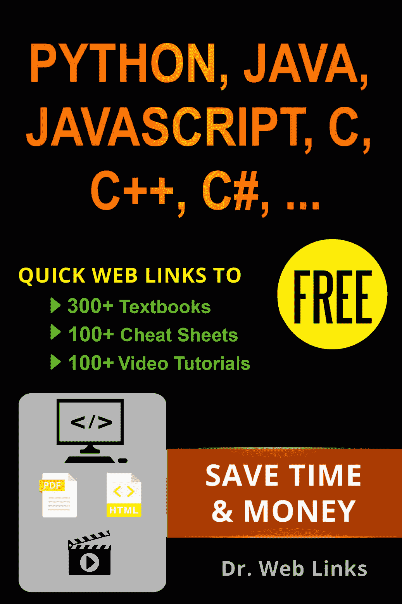
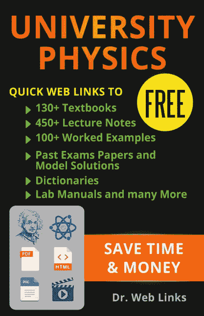
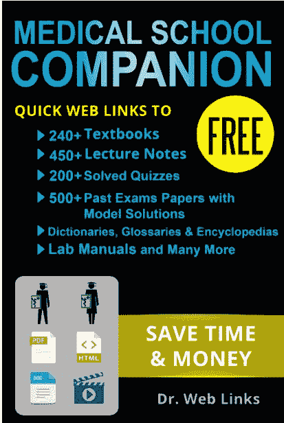
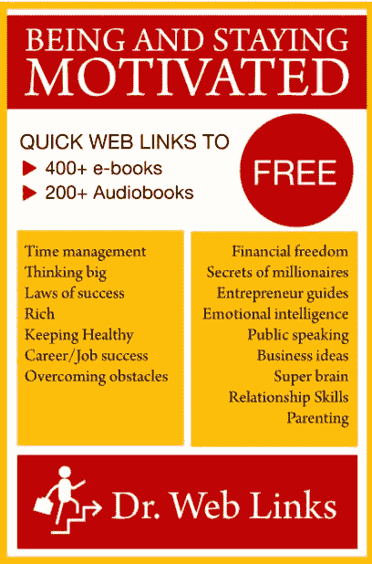

# 学习 Python、Java、JavaScript、C、C++、C#、CSS、HTML、jQuery、MySQL、SQL、LINUX、Perl、PHP 或 XML：300+ 免费教科书、100+ 备查表、100+ vi 快速链接

## 献辞

献给所有勤工作的特邀作者以及 Dr. Links 网页搜索团队

# 缩写

| 缩写 | 含义 |
| :--- | :--- |
| AJAX | 异步 JavaScript 和 XML |
| C# | C Sharp |
| CSS | 级联样式表 |
| HTML | 超文本标记语言 |
| N/A | 不适用 |
| NF | 未找到 |
| PHP | 超级文本预处理器 |
| SQL | 结构化查询语言 |
| XML | 可扩展标记语言 |

# 关于作者

Dr. Web Links 是一位亚马逊畅销书作者的笔名，他拥有奥克兰大学博士学位，那里是 R 编程语言的诞生地。他曾在两所政府设立大学授课，现在致力于帮助学生取得优异成绩。[Dr. Links](https://www.amazon.com/s/ref=dp_byline_sr_ebooks_1?ie=UTF8&text=Dr+Web+Links&search-alias=digital-text&field-author=Dr+Web+Links&sort=relevancerank) 团队的其他类似书籍：

- [大学生物课程](https://www.amazon.com/dp/B07HMT7KSY)
- [大学数学与统计学：](https://www.amazon.com/dp/B07G5X3JWD)
- [大学物理](https://www.amazon.com/dp/B07DSLQJ1C)
- [大学化学与生物化学](https://www.amazon.com/dp/B07GZ8TZTL)
- [医学院指南](https://www.amazon.com/dp/B07JDJVY97)
- [护理学院指南](https://www.amazon.com/dp/B07JLBZZNT)

# 介绍

如你可能所知，互联网包含许多针对学生、教师、专业人士以及想要精通编程或编码的人的优秀计算机编程学习材料。这些资源包括开源/免费教材、优秀的参考指南以及视频课程/教程。挑战在于，这些资源分散、杂乱，并充满了广告和浏览干扰。大多数情况下，即使运气好，也需要多次点击才能获得良好的网页材料。因此，在网上寻找可以免费阅读或下载的关键计算机编程材料既令人沮丧又耗时。这正是本书的用武之处，它将带你接近互联网提供的最相关且令人兴奋的链接。

这些链接可以帮助你进行补充阅读，找到更多示例、代码、备查表，并在学习或使用`python`、`java`、`javascript`、`C`、`C++`、`C#`、`CSS`、`HTML`、`jQuery`、`MySQL`、`SQL`、`LINUX`、`Perl`、`PHP`、`Ruby`、`BASH`、`D`、Unix 和`XML`时享受乐趣。最重要的是，这本书可以节省大量的金钱。

在我的教育过程中（从本科到博士阶段），我发现比较学习材料以及解决更多问题是促进理解的最佳方式之一。本书将引导你准确这样做。

本书将你连接到来自世界优秀程序员的最相关的计算机编程学习资源。它将让你能够快速在线探索或免费下载：

- 多本教材
- 多段视频教程
- 大量示例
- 关键备查表和参考指南
- 致力于所介绍编程语言的优秀 YouTube 频道
- 以及更多有趣的内容。

将所有这些链接汇总在一个方便的地方，难道不酷吗？

预计这本书将引导你找到实用的学习资源，这将对增强你对任何编程语言的理解非常有帮助。

## 如何使用本本书

预计这本书将引导你找到实用的学习资源，这将对增强你对任何编程语言的理解非常有帮助。

## 链接集 1\. Python, Java, JavaScript, C, C++, C#...你现在就可以下载的备查表和参考指南

`Python`、`Java`、`JavaScript`、`C`、`C++`、`C#`

## 链接集 2\. 关于 Python, Java, JavaScript, C, C++, C# 以及其他 13 种编程语言的可访问/可下载教材

`Python`、`Java`、`JavaScript`、`C`、`C++`、`C#`

## 链接集 3\. 你可以访问以下载额外书籍的计算机编程书籍网页数据库

## 链接集 4\. 你会喜欢的优秀 YouTube 频道和其他相关视频

## 链接集 5\. 你可以探索的计算机编程在线论坛

## 免责声明

# Python 速查表

- [Python 教程 - 速查表](https://ehmatthes.github.io/pcc/cheatsheets/README.html)
- [Python 语言与语法速查表](https://ddi.ifi.lmu.de/probestudium/2013/ws-i-3d-programmierung/tutorials/python-referenzkarte)
- [Python 速查表](http://www.datasciencefree.com/python.pdf)
- [Python 3 – 快速参考卡](https://www.cs.put.poznan.pl/csobaniec/software/python/py-qrc.html)
- [数据科学 Python 速查表 - Python 基础](http://www.utc.fr/~jlaforet/Suppl/python-cheatsheets.pdf)
- [Python 基础](http://huttenhower.sph.harvard.edu/moodle/pluginfile.php/1409/mod_folder/content/0/python_cheat_sheet.pdf?forcedownload=1)
- [Python 2.7 快速参考表](http://huttenhower.sph.harvard.edu/moodle/pluginfile.php/1409/mod_folder/content/0/Python_qr.pdf?forcedownload=1)
- [Python 语言与语法速查表](http://huttenhower.sph.harvard.edu/moodle/pluginfile.php/1409/mod_folder/content/0/PythonCheatSheet.pdf?forcedownload=1)
- [PYTHON 速查表](http://vis.usal.es/rodrigo/documentos/bioinfo/avanzada/pythonCheatsheet.pdf)
- [Python 快速入门手册](https://s3.amazonaws.com/michael-kennedy/downloads/DM/python_cheat_sheet.pdf)
- [Python 速查表](https://blogs.sans.org/pen-testing/files/2016/07/SEC573_PythonCheatSheet_06272016.pdf)
- [Python 速查表](https://bit.ly/2TqHxxj)
- [Python 速查表](http://ai.unibo.it/webfm_send/27)
- [Python & Pylab 速查表](https://www.uzh.ch/cmsssl/physik/dam/jcr:1d91aa92-1c3a-419a-b3dd-6688a2b1b187/python.pdf)
- [ANACONDA 速查表](http://janroman.dhis.org/AFI/Python/Anaconda_CheatSheet.pdf)
- [Python 快速参考 (PQR 2.7 及以下)](http://rgruet.free.fr/#QuickRef%20)
- [Python 参考指南](http://overapi.com/python)

# Ajax 速查表

- [Ajax 入门](http://web-algarve.com/books/JS%20AJAX%20jquery%20&%20angular/ajax_online%20QuickRef.pdf)
- [ajax 速查表](https://gist.github.com/joelrojo/c54765a748cd87a395a2b865359d6add)

# BASH 速查表

- [BASH 参考](http://index-of.es/EBooks/English/Bash%20Quick%20Reference.pdf)
- [Linux Bash Shell 速查表](https://learncodethehardway.org/unix/bash_cheat_sheet.pdf)
- [Bash 速查表](http://ftp.psu.ac.th/pub/bash-howto/reference_bash-cheat.pdf)
- [Bash 参考手册](https://www.gnu.org/software/bash/manual/bash.pdf)

# C 速查表

- [C 参考卡](http://mmc.geofisica.unam.mx/femp/Herramientas/Lenguajes/CyC++/ReferenceC.pdf)
- [C 语言快速粗的指南](https://courses.cs.washington.edu/courses/cse351/14sp/sections/1/Cheatsheet-c.pdf)
- [C 参考速查表](https://www.cheatography.com/ashlyn-black/cheat-sheets/c-reference/pdf/)
- [C 速查表](https://sites.ualberta.ca/~ygu/courses/geoph624/codes/C.CheatSheet.pdf)
- [C 语言编程快速参考](https://www.engr.uvic.ca/~mech410/ACAD_and_C/c_reference.pdf)
- [C 参考速查表](https://www.cs.mun.ca/~dchurchill/pc/pdf/c.pdf)
- [C 参考卡](https://www.math.brown.edu/~jhs/ReferenceCards/CRefCard.v2.2.pdf)
- [C 参考手册](https://www.bell-labs.com/usr/dmr/www/cman.pdf)

# C# 速查表

- [C# 参考表](https://www.dreamincode.net/downloads/ref_sheets/csharp_basics_reference_sheet.pdf)
- [C# 速查表](https://www.thecodingguys.net/resources/cs-cheat-sheet.pdf)
- [C# 速查表](http://www.cogsci.rpi.edu/public_html/igp/cSharpSheet.pdf)
- [基础 C# 速查表](https://learnappdevelopment.com/wp-content/uploads/2016/05/basic_c_sharp_cheat_sheet.pdf)
- [C# 参考指南](https://www.glowtouch.com/C_Reference_Guide_83mvGu7u)
- [面向 Java 开发者的 C#](https://download.microsoft.com/download/D/E/DE91FC0-AA6F8E/CSharp-for-Java)

# C++ 速查表

- [C++ 参考卡](http://index-of.es/Programming/C++)
- [如何用 C++ 编程](https://cs.fit.edu/~mahoney/cse2050)
- [学者（Dummies）版 C++ 速查表](https://xlb3.es/C++%20Dummies%20Sheet)
- [C++ 语法表](https://github.com/josejose/cheat-sheet/master/C++Syntax)
- [C++ 快速参考](https://pa.msu.edu/duxbury/phy480/Cpp_ref)
- [C++ 参考卡](https://www.disi.unige.it/person/13/Cpp_reference)

# CSS 速查表

- [快速参考 1.0](http://web-algarve.com/books/css1_QuickRef)
- [CSS3 基础](http://web-algarve.com/books/css3_basics)
- [CSS 3 速查表](https://www.workflower.com/vocabs/html/en/css-sheet)
- [HTML 速查表](https://digital.com/wp-content/uploads/html-sheet.pdf)
- [HTML 5 速查表](https://www.onblast.com/wp-content/uploads/2017/01/HTML-5-Cheat-Sheet.pdf)
- [HTML CheatSheet](https://htmlcheatsheet.com/)
- [HTML 词汇](http://apps.workflower.fi/vocabs/html/en/css)
- [HTML 速查表（学者）](https://hostingfacts.com/wp-content/uploads/2016/06/hf-html-sheet.pdf)

# HTML 速查表

- [HTML & XHTML 快速参考](http://web-algarve.com/books/HTML%20&%20XHTML/HTML_QuickRef)
- [HTML5 Canvas 速查表](http://web-algarve.com/books/HTML%20&%20HTTP/HTML5_QuickRef)
- [HTML CheatSheet](http://www.stanford.edu/group/cs21/htmlatsheet)
- [html5 速查表](https://www.hostingreview.com/wp-content/uploads/2016/02/html5-cheat-sheet)
- [HTML5 超级速查表](https://cdn.makeawebsitehub.com/wp-content/uploads/2015/06/HTML5-Mega-Cheat-Sheet-A4-ready.pdf)
- [HTML5 速查表](https://websitesetup.org/HTML5-cheat-sheet)
- [HTML5 视觉化速查表](https://cdn.woorkup.com/wp-content/uploads/2016/01/HTML5-Visual-Cheat-Sheet.pdf)
- [HTML5 快速参考指南](https://cloud.netlifyusercontent.com/assets/344dbf88-fdf9-42bb-adb4-4601eedd629/06ffd509-ac92-4b81-bfa0-9c3a34ab35/html5-cheat-sheet.pdf)
- [HTML5 快速参考](https://adactio.com/extras/pocketbooks/html5/)
- [HTML 语义速查表](https://learn-the-web.algonquindesign.ca/topics/html-semantics-cheat-sheet/)
- [CSS 词汇](http://apps.workflower.fi/vocabs/html/en/css)

# Java 速查表

- [JAVA 快速参考](https://robot.bolink.org/ebooks/Java%20Quick%20Reference.pdf)
- [核心 Java](http://enos.itcollege.ee/~jpoial/java/naited/pildid/corejava.pdf)
- [Java 基础速查表](https://www.cheatography.com/sschaub/cheat-sheets/java-fundamentals/pdf_bw/)
- [Java 参考表](https://www.dreamincode.net/downloads/ref_sheets/java_reference_sheet.pdf)
- [Java® 语言规范](https://docs.oracle.com/javase/specs/jls/se8/html/index.html)
- [一天学会 Java](http://www.paradise.caltech.edu/cook/Workshop/Java/Overview.html)
- [Java 速查表（词汇）](http://mindprod.com/jgloss/jcheat.html)
- [JAVA 快速参考](http://www.cheat-sheets.org/saved-copy/java_quickref.pdf)
- [Java 泛型速查表](http://files.zeroturnaround.com/pdf/zt_java_generics_cheatsheet.pdf)

# 编程参考指南

## Java

- [Java 参考指南](http://overapi.com/java)

# 编程语言速查表与参考资源

## Java

- [Java 编程速查表](https://introcs.cs.princeton.edu/java/11cheatsheet/)
- [JAVA 语法速查表](http://lesliefranke.com/sandbox/ref/javacheatsheet.html)

## JavaScript

- [Javascript 速查表](http://www.cheat-sheets.org/saved-copy/jsquick.pdf)
- [JavaScript 与浏览器对象快速参考](http://web-algarve.com/books/JS%20AJAX%20jquery%20&%20angular/JS%20&%20visual%20objects%20QuickRef.pdf)
- [javascript 速查表](http://web-algarve.com/books/JS%20AJAX%20jquery%20&%20angular/javascript%20QuickRef.pdf)
- [Javascript 快速参考卡](http://web-algarve.com/books/JS%20AJAX%20jquery%20&%20angular/jsquick%20QuickRef.pdf)
- [JavaScript 速查表](https://www.cheatography.com/davechild/cheat-sheets/javascript/pdf_bw/)
- [JavaScript 速查表](https://htmlcheatsheet.com/js/)
- [JavaScript 速查表（入门必备）](https://websitesetup.org/wp-content/uploads/2018/04/wsu-js-cheat-sheet.pdf)
- [javascript 参考指南](http://overapi.com/javascript)

## jQuery

- [jQuery 1.5 视觉速查表](http://index-of.co.uk/Cheat-Sheet/jQuery-1.5-Visual-Cheat-Sheet.pdf)
- [jQuery 1.5 视觉速查表](http://web-algarve.com/books/JS%20AJAX%20jquery%20&%20angular/jQuery-1.5%20QuickRef.pdf)
- [jquery_online 快速参考](http://web-algarve.com/books/JS%20AJAX%20jquery%20&%20angular/jquery_online%20QuickRef.pdf)
- [jquery 速查表](http://www.define-web.com/jquery_cheat_sheet/jquery_cheat_sheet_080306_v1.pdf)
- [jquery 速查表](http://www.define-web.com/jquery_cheat_sheet/jquery_cheat_sheet_080306_v1_pg2.pdf)
- [jQuery 速查表](https://htmlcheatsheet.com/jquery/)
- [jquery 参考指南](http://overapi.com/jquery)
- [jQuery 视觉速查表](http://researchers.lille.inria.fr/~yabouzid/refCardJQUERY.pdf)
- [jQuery 快速 API 参考](https://oscarotero.com/jquery/)

## MySQL

- [MYSGL 参考指南](http://overapi.com/mysql)
- [MySQL 速查表](http://www.dusun-think.net/dosya/czyayin/mysqlcheatsheet.pdf)
- [核心 MySQL 速查表](https://www.cheatography.com/guslong/cheat-sheets/essential-mysql/pdf_bw/)
- [MySQL 速查表](https://havel.mojeservery.cz/wp-content/uploads/2015/10/mysql-ref-card.pdf)
- [MySQL 速查表](http://www.davidmckie.com/Carleton%20MySQL%20cheat%20sheet.pdf)
- [MySQL 速查表](https://www.codeconquest.com/wp-content/uploads/MySQL-Cheat-Sheet-by-CodeConquestDOTcom.pdf)
- [MySQL 教程](https://downloads.mysql.com/docs/mysql-tutorial-excerpt-5.5-en.pdf)
- [MySQL 速查表](https://appletree.or.kr/quick_reference_cards/Databases-SQL-NoSQL/mysql-reference-sheet.pdf)

## Perl

- [Perl 快速参考卡](http://index-of.co.uk/Cheat-Sheet/Perl%20Quick%20Reference%20Card%20%5bjjohnbokma%5d.pdf)
- [Perl 正则表达式快速参考卡](http://index-of.co.uk/Cheat-Sheet/Perl%20Regular%20Expression%20Quick%20Reference%20Card%20%5bIain%20Truskett%5d.pdf)
- [Perl 正则表达式快速参考](http://index-of.co.uk/Cheat-Sheet/Perl%20Regular%20Expression%20Quick%20Reference%20v1.04.pdf)

## PHP

- [PHP 速查表](http://index-of.co.uk/Cheat-Sheet/php_cheat_sheet%20%5bDave%20Child%5d.pdf)
- [PHP 参考表](https://www.dreamincode.net/downloads/ref_sheets/php_reference_sheet.pdf)
- [PHP 参考表（高级）](https://www.dreamincode.net/downloads/ref_sheets/php_reference_sheet.pdf)
- [PHP 速查表](http://www.fzolee.hu/download.php?fname=./cheatsheets/php-cheat-sheet-v1)
- [PHP 速查表](https://www.cheatography.com/krabat1/cheat-sheets/php_bw/)
- [PHP 速查表（入门必备）](https://websitesetup.org/wp-content/uploads/2018/04/wsu-js-cheat-sheet.pdf)
- [PHP 参考表](http://overapi.com/php)
- [PHP 速查表](http://www.cheatography.org/saved-copy/php-cheatsheet.pdf)
- [PHP 速查表](https://www.cheatography.com/davechild/cheat-sheets/php/pdf)

## 教材

### AJAX

| 作者 | 标题 | 日期 |
| :--- | :--- | :--- |
| Thomas A. Powell | [AJAX: 完整参考](https://robot.bolink.org/ebooks/AJAX%20-%20Complete%20Reference.pdf) | 2008 |
| Steve Holzner | [Ajax 入门](https://robot.bolink.org/ebooks/AJAX%20-%20Complete%20Reference.pdf) | 2008 |
| Dave Crane et al. | [AJAX 实战](https://robot.bolink.org/ebooks/AJAX%20-%20Complete%20Reference.pdf) | 2006 |
| Jeremy Keith | [AJAX 实战指南](https://doc.lagout.org/programmation/Ajax/Bulletproof.pdf) | 2007 |
| Nathaniel Shutta | [从入门到精通 PHP](https://web-algarve.com/books/JS%20AJAX%20jquery%20&%20angular/JS%20&%20visual%20objects%20QuickRef.pdf) | 2007 |
| Ryan Asleson | [AJAX 基础](https://doc.lagout.org/programmation/Ajax/Foundations%20Ajax.pdf) | 2006 |
| Andy Harris | [JavaScript 与 AJAX 入门](http://www.shrani.si/f/T/jB/k4qOd4/cfordummies.pdf) | 2010 |
| Rebecca M. Riordan | [Head First AJAX](https://robot.bolink.org/ebooks/Head%20First%20Ajax.pdf) | 2008 |

### Bash

| 作者 | 标题 | 日期 |
| :--- | :--- | :--- |
| Carl Albing et al. | Bash 速查表 | 2007 |
| Cameron Newham | [学习 Bash Shell](https://doc.lagout.org/operating%20system%20/linux/Learning%20the%20Shell%20-%20Unix%20Programming.pdf) | 2009 |
| Arnold Robbins | [Bash 参考手册](https://the-eye.eu/public/HumbleBundle/bashpocket_2edition.pdf) | 2016 |

### C

| 作者 | 标题 | 日期 |
| :--- | :--- | :--- |
| Brian Kernighan and Dennis Ritchie | [C 语言（第二版）](https://robot.bolink.org/ebooks/The%20C%20Language%202nd%20Edition%20By%20Kernighan%20and%20Ritchie.pdf) | 1988 |
| Dan Gookin | [C 入门](http://www.shrani.si/f/T/jB/k4qOd4/cfordummies.pdf) | 2004 |
| Michael Vine | [小白 C 编程](http://cache3.pdfdrive.com/dl.php?id=21732003&h=b8f01746e87dec6ffcaff4c0dfac1d9&u=cache) | 2008 |
| Ivor Horton | [C 语言入门阶](https://doc.lagout.org/programmation/C/Beginning%20C%20From%20Novice%20to%20Professional%20%284th.ed.%29.pdf) | 2006 |
| P. J. Deitel and H. M. Deitel | [C 编程](http://index-of.es/C++/C%20How%20to%20Program.pdf) | 2010 |

> **注意**：如果你的电脑浏览器设置过强，它会将某些链接标记为危险。为了避免此类警报，请使用不同的浏览器（例如 Internet Explorer），复制并粘贴链接。

| 作者 | 标题 | 年份 |
| :--- | :--- | :--- |
| Gary J. Bronson | [工程师和科学家的 C 语言 - ANSI C 编程入门](http://index-of.es/C++/C%20for%20Engineers%20and%20Scientists%20-%20An%20Introduction%20to%20Programming%20With%20ANSI%20C.pdf) | 1993 |
| David Griffiths and Dawn Griffiths | [入门 C 语言](http://index-of.es/C++/Griffiths%20D.,%20Griffiths%20D.%20-%20Head%20First%20C%20-%202012-.pdf) | 2012 |
| Stephen G. Kochan | [C 语言编程](http://index-of.es/C++/Programming%20in%20C%203rd%20edition%20by%20Stephen%20G.%20Kochan.pdf) | 2005 |
| Greg Perry and Dean Miller | [C 语言编程初学者指南](http://cache3.pdfdrive.com/dl.php?id=34434517&h=16305f3570927791787abd82e5e0ea39&u=cache) | 2014 |
| Bradley L. Jones and Peter Aitken | [Sams 21 天自学 C 语言](http://www.e-reading.mobi/bookreader.php/135186/Aitken,_Jones_-_Sams_Teach_Yourself_C_in_21_Days,_6th_Edition.pdf) | 2003 |
| Ben Klemens | [21 世纪的 C 语言](https://doc.lagout.org/programmation/C/21st%20Century%20C%20%5BKlemens%202012-11-05%5D.pdf) | 2013 |
| Paul Deitel and Harvey Deitel | [C 语言程序设计](https://drive.uqu.edu.sa/_/ajshaor/files/Deitel-C_%20How%20to%20Program,%207th.pdf) | 2013 |
| Tim Bailey | [C 语言编程与软件设计入门](http://www-personal.acfr.usyd.edu.au/tbailey/ctext/ctext.pdf) | NF |

### C#

| 作者 | 标题 | 日期 |
| :--- | :--- | :--- |
| Svetlin Nakov and Veselin Kolev | [使用 C# 的计算机编程基础](http://ksuweb.kennesaw.edu/~rgesick1/Fundamentals-of-Computer-Programming-with-CSharp-Nakov-eBook-v2013.pdf) | 2013 |
| Andrew Stellman and Jennifer Greene | [入门 C#](https://robot.bolink.org/ebooks/Head%20First%20CSharp%202e%20May%202010.pdf) | 2010 |
| Andrew Stellman and Jennifer Greene | [链接 2](https://doc.lagout.org/programmation/CSharp/Head%20First%20CSharp%202nd%20Edition%20May%202010.pdf) | 2010 |
| Jesse Liberty | [C# 编程](http://index-of.es/Programming/CSharp/O'Reilly%20-%20Programming%20C%23%202nd%20Edition.pdf) | 2002 |
| Jesse Liberty | [链接 2](https://doc.lagout.org/programmation/CSharp/Programming_C%23.pdf) | 2002 |
| Jay Hilyard and Stephen Teilhet | [C# 3.0 菜谱](http://index-of.es/Programming/CSharp/O'Reilly%20C%23%203.0%20Cookbook%20(3rd%20Edition).pdf) | 2008 |
| Bradley L. Jones | [Sams 21 天自学 C# 语言](http://ceit.aut.ac.ir/~shiry/lecture/programming/Sams%20-%20Teach%20Yourself%20the%20C%20sharpLanguage%20in%2021%20Days.pdf) | 2004 |
| Eric Gunnerson | [程序员 C# 入门](https://doc.lagout.org/programmation/CSharp/APress%20A%20Programmer%27s%20Introduction%20to%20C%23.pdf) | 2000 |
| Trey Nash | [加速 C# 2010](https://doc.lagout.org/programmation/CSharp/Apress%20Accelerated%20C%20Sharp%202010.pdf) | 2010 |
| Stephen Randy Davis and Chuck Sphar | [傻呆 C# 2005](https://doc.lagout.org/programmation/CSharp/C%23%202005%20for%20Dummies.pdf) | 2006 |

# 编程书籍参考列表

## C# 相关书籍

| 作者 | 书名 | 年度 |
| :--- | :--- | :--- |
| Paul Deitel and Harvey Deitel | [Visual C# 2012 程序设计](http://cache3.pdfdrive.com/dl.php?id=1943714&h=c0d5ec4d2f8190) | 2012 |
| John Sharp | [Microsoft C# 2012 入门](https://zeus.nyf.hu/~bajalin/MS_VS_C_2012_Step) | 2012 |

## C++ 相关书籍

| 作者 | 书名 | 年度 |
| :--- | :--- | :--- |
| Bjarne Stroustrup | [C++ 语言](https://robot.bolink.org/ebooks/The%20C++%20Language) · [链接 2](https://index-of.es/C++/Addison%20Wesley%20-%20Third%20Edition.pdf) | 1997 |
| C. Pozrikidis | [C++ 编程与图形](https://robot.bolink.org/ebooks/Introduction%20to%20C++%20and%20Graphics.pdf) | 2007 |
| Alan Parker | [C++ 中的算法与数据结构](https://robot.bolink.org/ebooks/CRC%20Press%20-%20Algorithms%20Structures%20in%20C++.pdf) | 1993 |
| Herbert Schildt | [C++：完全参考](http://amarblog.yolasite.com/resources/c++) | 2003 |
| Stanley B. Lippman | [Essential C++](http://index-of.es/C++/Addison%20Wesley%20-%20Essential%20C++) | 2002 |
| Nicolai M. Josuttis | [C++ 标准库：教程与参考](http://index-of.es/C++/Addison%20Wesley%20-%20The%20C++%20Standard.%20A%20Tutorial%20Reference.pdf) | 1999 |
| Stephen Prata | [C++ Plus](http://index-of.es/C++/Addison.Wesley.CPP.6th.Edition.Oct.2011.pdf) | 2012 |
| Ivor Horton | [入门 Visual C++](http://index-of.es/C++/Beginning%20Visual%20C++%202005.pdf) | 2005 |
| P. J. Deitel and H. M. Deitel | [C++ 程序设计](https://profs.basu.ac.ir/y-seifi/upload_file/deitel%20c++%20how%20to%20program,%207th%20edition%22010(pre_co_prj.2714.733.pdf) | 2009 |
| Jesse Liberty et al. | [Sams 每天小时自学 C++](http://index-of.es/C++/Computer%20-%20Sams%20Teach%20Yourself%20C++%20in%20One%20Hour%20a%20Day,%206th%20Edition%20-%20(Jesse%20Liberty)%20Sams%20009.pdf) | 2009 |
| Victor Shtern | [Core C++：软件工程方法](http://index-of.es/C++/Core%20C++.pdf) | 2000 |
| Joe Pitt-Francis and Jonathan Whiteley | [C++ 科学计算指南](http://index-of.es/C++/Guide%20to%20Scientific%20Computing%20in%20Cpp.pdf) | 2012 |
| John Smiley | [用 C++ 编程](http://index-of.es/C++/Learn%20To%20Program%20With%20CPP%20(2003)[english].pdf) | 2003 |
| Jeff Kent | [C++ 揭秘：自学指南](http://index-of.co.uk/Misc/McGraw-Hill%20-%20C++%20Demystified%20(2004).pdf) | 2004 |
| Nicholas A. Solter and Scott J. Kleper | [专业 C++](http://index-of.es/C++/Professional%20CPP%20[english].pdf) | 2005 |
| Vladimir Kushnir | [安全的 C++](http://index-of.es/C++/Safe%20cpp.pdf) | 2012 |
| Matthew Telles | [傻呆 C++ 提高效率技巧](http://index-of.es/C++/C++%20Timesaving%20Techniques%20for%20Dummies.pdf) | 2005 |
| Stephen Randy Davis | [傻呆 C++](http://doc.lagout.org/programmation/CSharp/C%23%202005%20for%20Dummies.pdf) | 2006 |

## HTML 与 CSS 相关书籍

| 作者 | 书名 | 年度 |
| :--- | :--- | :--- |
| Elisabeth Freeman and Eric Freeman | [Head First HTML with CSS & XHTML](https://robot.bolink.org/ebooks/Head%20First%20HTML%20with%20CSS%20&%20XHTML%20Big.pdf) | 2006 |
| Molly E. Holzschlag | [250 HTML 与 Web 设计秘密](https://robot.bolink.org/ebooks/250%20HTML%20And%20Web%20Design%20Secrets.pdf) | 2004 |
| Thomas A. Powell | [HTML & CSS: 完整参考指南](http://cloudforall.weebly.com/uploads/1/2/7/5/12759856/htmlandcss-thecompletereference5thed-t.powellmcgraw-hill2010bbs_nxpowerlite.pdf) | 2010 |
| Rob Larsen | [入门 HTML 和 CSS](http://pdf.th7.cn/down/files/1312/beginning_html_and_css.pdf) | 2013 |
| Jeremy Osborn | [使用 HTML 和 CSS 进行 Web 设计](https://stevebraysduis.files.wordpress.com/2014/02/web-design-with-html-and-css-digital-classroom.pdf) | 2011 |
| Jeremy Osborn et al. | [使用 HTML 和 CSS 进行 Web 设计](https://stevebraysduis.files.wordpress.com/2014/02/web-design-with-html-and-css-digital-classroom.pdf) | NF |
| Jon Ducket | [HTML & CSS 设计与网站网站](https://robot.bolink.org/ebooks/HTML%20And%20CSS%20-%20Design%20And%20Build%20Websites.pdf) | 2011 |
| Leslie F. Sikos | [精通 HTML5、CSS3 和 XML](https://robot.bolink.org/ebooks/Web%20Standards%20Mastering%20HTML5,%20CSS3,%20and%20XML.pdf) | NF |
| Luke Stevens | [HTML5 的真相（针对 Web 设计师）](https://robot.bolink.org/ebooks/Preview%20-%20The%20Truth%20About%20HTML5%20(For%20Web%20Designers).pdf) | 2012 |
| Andy Harris | [自从 HTML5 快速参考](https://bit.ly/2BUwK6K) | 2011 |
| Steve Fulton and Jeff Fulton | [HTML5 Canvas](https://robot.bolink.org/ebooks/HTML5%20Canvas%20-%20S.%20Fulton,%20J.%20Fulton%20(O'Reilly,%202011)%20WW.pdf) | 2011 |
| Eric Freeman and Elisabeth Robson | [Head First HTML5 编程](https://robot.bolink.org/ebooks/Head%20First%20HTML5%20Programming%20-%20Building%20Web%20Apps%20with%20JavaScript.pdf) | 2011 |
| Jeremy Keith | [面向 Web 设计师的 HTML5](https://robot.bolink.org/ebooks/HTML5%20for%20Web%20Designers%20By%20Jeremy%20Keith.pdf) | 2010 |
| Eric Rowell | [HTML5 Canvas 食南](https://robot.bolink.org/ebooks/HTML5%20Canvas%20Cookbook%20-%20Eric%20Rowell.pdf) | 2011 |
| Rob Hawkes | [游戏和娱乐的基础 HTML5 Canvas](https://robot.bolink.org/ebooks/Foundation%20HTML5%20Canvas%20-%20Rob%20Hawkes.pdf) | NF |
| Mark Pilgrim | [深入学习 HTML5](https://robot.bolink.org/ebooks/Dive%20into%20HTML5%20By%20Mark%20Pilgrim.pdf) | NF |
| David Geary | [核心 HTML5 Canvas：图形、动画与游戏开发](https://robot.bolink.org/ebooks/Core%20HTML5%20Canvas%20-%20Graphics,%20Animation,%20and%20Game%20Development%20By%20David%20Geary.pdf) | 2012 |
| ALEXIS GOLDSTEIN et al. | [实战中的 HTML5 和 CSS3](http://index-of.es/CSS/HTML5%20and%20CSS3%20for%20the%20real%20world.pdf) | 2011 |
| PETER LUBBERS et al. | [专业 HTML5 编程：用于更丰富的互联网应用开发的强大 API](http://index-of.es/HTML/Pro%20HTML5%20Programming.pdf) | 2010 |
| Christopher Schmitt and Kyle Simpson | [HTML5 食南](http://index-of.es/HTML/Oreilly.HTML5.Cookbook.Nov.pdf) | 2012 |
| Bruce Lawson and Remy Sharp | [引入 HTML5](http://index-of.es/HTML/Introducing HTML5) | 2011 |
| Jesse Cravens and Jeff Burft | [HTML5 技巧](http://web-algarve.com/books/HTML5%Hacks) | 2013 |
| Brian P. Hogan | [HTML5 和 CSS3](http://web-algarve.com/books/HTML5%20and%20CSS3,%202nd%20Edition) | ü |

## Java 与 JavaScript 相关书籍

| 作者 | 书名 | 年度 |
| :--- | :--- | :--- |
| Java Wikooks.org | [Java 编程](https://robot.bolink.org/ebooks/Java) | 2011 |
| Brian D. Eurb | [有趣的 Java：开源项目](https://robot.bolink.org/ebooks/Wicked%20Cool%20Java:%20Open-Source%20Project) | ü |
| James Gosling et al. | [Java 语言](https://robot.bolink.org/ebooks/The%20Language,%20SE%20Edition) | 2012 |
| Danny Goodman with Michael Morrison | [JavaScript 食南](https://robot.bolink.org/ebooks/Sams%20Teach%20Yourself%20Ajax%20PHP) | 2004 |
| Nathan Meyers | [Linux Java 编程](https://robot.bolink.org/ebooks/Waite-%20Java%20Linux) | 2001 |
| Tim Lindholm et al. | [Java 虚拟机](https://robot.bolink.org/ebooks/The%20Java%20Machine,%20SE%20Edition) | 2013 |
| Phil Ballard and Michael Moncur | [自学 Ajax 和 PHP](https://robot.bolink.org/ebooks/Sams%20Teach%20Ajax%20PHP) | 2009 |
| E. Balagurus | [Java 编程：入门](https://robot.bolink.org/ebooks/Programming%20with%20Java%20a%20Primer%203e%20By%20Balagurus) | 2007 |
| Mauro Marnilli | [专业 Java 接口](https://robot.bolink.org/ebooks/Professional%20Java%20Interfaces) | 2006 |
| W. Clay Richardson et al. | [专业 Java JDK](https://robot.bolink.org/ebooks/Professional%20Java%20JDK%26e) | 2007 |
| Herbert Schildt and James Holmes | [Java 艺术](https://robot.bolink.org/ebooks/The%20Art%20Of%20Java(2003).) | 2003 |
| Nicholas C. Zakas | [面向 Web 开发者的专业 JavaScript](https://robot.bolink.org/ebooks/Professional%20JavaScript%20For%20Web%20Developers%202e) | 2009 |
| Gennadiy Nikishkov | [Java 有限元素编程](https://robot.bolink.org/ebooks/Programming%20Finite%20Elements%20in%20Java) | 2010 |
| David Flanagan | [Java 大全：桌面快速参考](https://robot.bolink.org/ebooks/OReilly%20-%20Java%20In%20A%20Nutshell%205e) | 2005 |
| Danny Goodman | [JavaScript 大全](https://robot.bolink.org/ebooks/JavaScript%20Bible%20Gold%20Edition) | 2001 |
| Emily A. Vander Veer | [自从学者 JavaScript 快速参考](https://robot.bolink.org/ebooks/Javascript%20For%20Dummies%20Quick%20Reference.pdf) | NF |
| ü | [链接 2](https://the-eye.eu/public/Books/robot.bolink.org/Javascript%20For%20Dummies%20Quick%20Reference.pdf) | ü |
| Emily Vander Veer | [自从学者 JavaScript 第 4 版](http://index-of-es/JS/Wiley%20-%20JavaScript%20for%20Dummies,%204th%20Ed%20-%202005%20-%20(By%20Laxxuss).pdf) | 2005 |
| Dr. Axel Rauschmayer | [急急者的 JavaScript](http://exploringjs.com/impatient-js-preview.pdf) | NF |

# 图书资源列表

| 作者 | 书名 | 出版年份 |
| :--- | :--- | :--- |
| Marijn Haverbek | [精通 JavaScript：现代入门](http://art.yale.edu/file_columns/0000/9186/eloquent_javascript.pdf) | 2014 |
| Marijn Haverbek | [精通 JavaScript：现代入门](https://eloquentjavascript.net/Eloquent_JavaScript.pdf) | 2018 |
| ü | [链接 2](https://eloquentjavascript.net/) | ü |
| Mark Myer | [一种更聪明的 JavaScript 方法：让努力减半的新方法](https://www.cpp.edu/~jcmcgar/513_2016/ASmarterWaytoLearnJavaScript.pdf) | 2013 |
| Herbert Schildt | [Java：初学者指南](https://robot.bolink.org/ebooks/Java%20A%20Beginners%20Guide%203e%20McGrawHill.pdf) | 2005 |
| Jonathan Knudsen | [Java 2D 图形](https://robot.bolink.org/ebooks/Java%202D%20Graphics.pdf) | 2001 |
| Michael Morrison | [入门级 JavaScript](https://robot.bolink.org/ebooks/Head%20First%20Java%20Script.pdf) | 2008 |
| ü | [链接 2](http://web-algarve.com/books/JS%20AJAX%20jquery%20&%20angular/Head%20First%20JavaScript.pdf) | ü |
| Kathy Sierra and Bert Bates | [入门级 Java](https://robot.bolink.org/ebooks/Head%20First%20Java%202e%20by%20Kathy%20Sierra%20and%20Bert%20Bates.pdf) | NF |
| Joan Krone et al. | [Java 语言编程](https://robot.bolink.org/ebooks/Essentials%20of%20the%20Java%20Programming%20Language.pdf) | NF |
| Joshua Bloch | [Effective Java：编程语言指南](https://robot.bolink.org/ebooks/Effective%20Java%20Programming%20Language%20Guide.pdf) | 2001 |
| JOHN R. HUBBARD | [Java 数据结构](https://robot.bolink.org/ebooks/Data%20Structures%20with%20Java%20e%20By%20John%20R%20hubbard,%20Schaum's%20Outline%20Series.pdf) | 2007 |
| Michelle Waite | [Java 中的数据结构与算法](https://robot.bolink.org/ebooks/Data%20Structures%20&%20Algorithms%20in%20Java%20-%20Robert%20Lafore.pdf) | 2001 |
| Robert Lafore | [Java 中的数据结构与算法](https://robot.bolink.org/ebooks/Data%20Structures%20and%20Algorithms%20in%20Java%202e%20-%20Robert%20Lafore.pdf) | 2003 |
| Vivek Chopra et al. | [入门 JavaServer Pages](https://robot.bolink.org/ebooks/Beginning%20JavaServer%20Pages.pdf) | 2005 |
| Herbert Schildt | [Java 完全参考指南](https://memberfiles.freewebs.com/74/74/55387474/documents/Java%20The%20Complete%20Reference,%207th%20Edition.pdf) | 2007 |
| Cay Horstmann | [大 Java：兼容 Java 5, 6 和 7](http://newton.uam.mx/xgeorge/uea/Lab_Prog_O_O/materiales_auxiliares/Big_Java_4th_Ed.pdf) | 2010 |
| Paul Wilton and Jeremy McPeak | [入门 JavaScript](https://robot.bolink.org/ebooks/Beginning%20JavaScript%204e.pdf) | 2010 |
| Kevin Mukhar et al. | [入门 Java EE 5：从新手到专业人士](https://robot.bolink.org/ebooks/Beginning%20Java%20EE%205.pdf) | 2006 |
| Bruce Eckel | [Java 编程](http://www.dblab.ntua.gr/~gtsat/collection/Java%20books/Bruce.Eckel.Thinking.In.Java.4th.Edition.Dec.2007.eBook-BBL.pdf) | 2006 |
| Doug Lowe | [自学者必备 Java 全合一](http://1.droppdf.com/files/1lTSh/java-all-in-one-for-dummies-4th-edition-doug-lowe.pdf) | 2014 |
| Mark Watson | [Java 编程：10 分钟解决方案](https://doc.lagout.org/programmation/Java/Java%20Programming_%2010-Minute%20Solutions%20%5BWatson%202003-12-30%5D.pdf) | 2004 |
| Rogers Cadenhead | [Sams 21 天自学 Java 教程](http://file.allitebooks.com/20151230/Java%20in%2021%20Days,%20Sams%20Teach%20Yourself%20(Covering%20Java%208),%207th%20Edition.pdf) | 2016 |
| Danny Goodman | [JavaScript 经，黄金版](http://www3.dsi.uminho.pt/iiee/JavaScript%20Bible.pdf) | 2001 |
| Danny Goodman al. | [JavaScript 经第 7 版](https://bit.ly/zDhr) | 2010 |
| Danny Goodman | [JavaScript 示例](https://doc.lagout.org/programmation/Javascript%20Examples%20Essential%20to%20Bible[2001-08]) | 2001 |
| David Sawyer McFarland | [JavaScript & jQuery：缺失指南](https://web-algarve.com/books/JS%20AJAX%20jquery%20rd) | 2014 |
| Andriy Redko | [高级 Java](http://enos.it/alladim/reading-java) | NF |
| jQuery | ü | ü |
| Castledine and Craigie | [jQuery：入门指南](https://robot.bolink.org/ebooks/jQuery%20Novice%2to%20Ninja.pdf) | 2012 |
| Bear Bibeault and Yehuda Katz | [jQuery 实战](http://dl.daneshoyar.com/book/Manning.jQuery.in_.2nd.pdf) | 2010 |
| Ryan Benedetti and Cranley | [入门 jQuery](https://web-algarve.com/books/JS%20AJAX%20jquery%20First.pdf) | 2011 |
| Jonathan Chaffer and Karl Swedberg | [学习 jQuery](https://web-algarve.com/books/JS%20AJAX%20jquery%204th%20Edition.pdf) | 2013 |
| Leon Revill | [jQuery 2.0 开发指南](https://web-algarve.com/books/JS%20AJAX%20jquery%202.0%20Development.pdf) | 2014 |
| Arun K. Pande | [jQuery 2 Recipes：问题解决方法](https://web-algarve.com/books/JS%20AJAX%20jquery%20Recipes.pdf) | NF |

## LINUX 编程

| 作者 | 书名 | 年份 |
| :--- | :--- | :--- |
| Neil Matthew and Richard Stones | [专业 Linux 编程](https://robot.bolink.org/ebooks/Wrox%20-%20Linux.pdf) | 2004 |
| Neil Matthew and Richard Stones | [入门 Linux 编程](https://robot.bolink.org/ebooks/Wrox%20-%20Beginning%20Linux%203e-%202004.pdf) | 2004 |
| Daniel J. Barrett | [Linux Pocket 指南](https://the-eye.eu/public/HumbleBundle/linuxpocketguide_3rdition.pdf) | 2016 |

## MySQL

| 作者 | 书名 | 年份 |
| :--- | :--- | :--- |
| Seyed M.M. “Saied” Tahagoghi and Hugh E. Williams | [学习 MySQL](https://robot.bolink.org/ebooks/Learning%20MySQL.pdf) | 2007 |
| Mark Maslakowski | [Sams 21 天自学 MySQL](http://www.webbasedprogramming.com/MySQL/Teach%20self%20MySQL%20in%2021Days.pdf) | 2000 |
| Michael Kofler | [MySQL 5 权威指南](https://doc.lagout.org/programmation/databases/mysql/The%20Definitive%20Guide%20To%20MySQL%205%2C%203rd%20Ed%202005.pdf) | 2005 |
| Alexander Pachev | [MySQL 企业解决方案](http://index-of.es/EBooks/English/John%20Wiley%20&%20Sons%20-%20MySQL%20Enterprise%20Solutions.pdf) | 2003 |
| Paul DuBois | [MySQL 食指南](http://index-of.es/EBooks/O'Reilly%20-%20MySQL%20Cookbook.pdf) | 2002 |
| ü | [链接 2](https://doc.lagout.org/programmation/databases/mysql/MySQL%20Cookbook.pdf) | ü |
| ü | [链接 3](http://web-algarve.com/books/MySQL%20&%20PHP/MySQL%20Cookbook.PDF) | ü |
| George Reese | [MySQL 便携指南](http://index-of.es/EBooks/O'Reilly%20-%20MySQL%20Reference%202nd.pdf) | 2007 |
| ü | [链接 2](https://web-algarve.com/books/JS%20AJAX%20jquery%20pocket%20reference.pdf) | ü |
| ü | [链接 3](https://web-algarve.com/books/JS%20AJAX%20jquery%20pocket%20reference.pdf) | ü |

## Perl

| 作者 | 书名 | 年份 |
| :--- | :--- | :--- |
| Ellen Siever et al. | [命令行中的 Perl](http://index-of.es/Perl/O'Reilly%20-%20Perl%20Nutshell.pdf) | 1998 |
| Brian D. Foy | [精通 Perl](http://index-of.es/Perl/O'Reilly%20-%20Mastering%20Perl%20(2009).pdf) | 2007 |
| Paul Gruhn | [图解 Perl](http://index-of.es/Perl/PERL_Basics.pdf) | NF |
| David Till | [21 天自学 Perl 5](http://index-of.es/Perl/Teach%20yourself%20Perl%20in%2021Days.pdf) | NF |

## PHP

| 作者 | 书名 | 年份 |
| :--- | :--- | :--- |
| David Powers | [PHP 解决方案：动态 Web 设计](https://robot.bolink.org/ebooks/PHP%20Solutions%202e%20%5bA4%5d.pdf) | 2010 |
| Jason Lengstor | [入门级 PHP](https://robot.bolink.org/ebooks/PHP%20for%20Absolute%20Beginners.pdf) | 2009 |
| David Powers | [PHP 解决方案 - 动态 Web 设计](https://robot.bolink.org/ebooks/PHP%20Solutions%20-%20Dynamic%20Web%20Design%20Made%20Easy%20(2006).pdf) | 2006 |

## PHP 资源

| 作者 | 书名 | 年份 |
| :--- | :--- | :--- |
| George Schlossnagle | [高级 PHP 编程](https://doc.lagout.org/programmation/tech_web/Sams.Advanced.PHP.Programming.673pp.3-2004.pdf) | 2004 |
| Marc Rochkind | [Expert PHP and MySQL](http://web-algarve.com/books/MySQL%20&%20PHP/Expert%20PHP%20and%20MySQL.pdf) | 2013 |
| Robin Nixon | [学习 PHP, MySQL, JavaScript, CSS & HTML5](http://web-algarve.com/books/MySQL%20&%20PHP/Learning%20PHP,%20MySQL,%20JavaScript,%20CSS%20&%20HTML5,%203rd%20Edition.pdf) | 2014 |
| Andrew Curioso 等人 | [Expert PHP and MySQL.](https://robot.bolink.org/ebooks/Expert%20PHP%20and%20MySQL.pdf) | 2010 |

## PHP and MySQL

| 作者 | 书名 | 年份 |
| :--- | :--- | :--- |
| Shelley Johnston 等人 | [PHP and MySQL Web 开发](https://robot.bolink.org/ebooks/PHP%20and%20MySQL%20Web%20Development.pdf) | 2001 |
| KevinYank | [PHP & MySQL: 从入门到精](https://robot.bolink.org/ebooks/PHP%20&%20MySQL%20Novice%20To%20Ninja.pdf) | 2012 |
| Tim Converse 等人 | [PHP5 And MySQL Bible](https://robot.bolink.org/ebooks/PHP5%20And%20MySQL%20Bible%20(2004).pdf) | 2004 |
| ü | [链接 2](https://robot.bolink.org/ebooks/PHP5%20and%20MySQL%20Bible%20-%20John%20Wiley%20&%20Sons.pdf) | ü |

## PHP & MySQL 资源

| 作者 | 书名 | 年度 |
| :--- | :--- | :--- |
| Ellie Quigley | [PHP & MySQL 实例](https://robot.bolink.org/ebooks/PHP%20and%20MySQL%20by%20Example.pdf) | 2007 |
| Brett McLaughlin | [PHP & MySQL: 缺少的手册](https://robot.bolink.org/ebooks/PHP%20and%20MySQL%20The%20Missing%20Manual.pdf) | 2012 |
| Steve Suehring and Janet Valade | [自学： PHP MySQL JavaScript 和 HTML5](https://robot.bolink.org/ebooks/PHP%20MySQL%20JavaScript%20and%20HTML5%20All-in-One%20For%20Dummies%20Small.pdf) | 2013 |
| ü | [链接 2](https://khmerbamboo.files.wordpress.com/2014/09/php-mysql-javascript-html5-all-in-one-for-dummies.pdf) | ü |
| Robin Nixon | [学习 PHP, MySQL, JavaScript, and CSS](https://robot.bolink.org/ebooks/PHP%20MySQL%20JavaScript%20And%20CSS%202e.pdf) | 2012 |
| Robin Nixon | [学习 PHP, MySQL, and JavaScript](https://robot.bolink.org/ebooks/Learning%20PHP,%20MySQL,%20and%20JavaScript%20-%20Robin%20Nixon.pdf) | 2009 |
| Kevin Yank | [使用 PHP & MySQL 构建你自己的数据库驱动网站](https://robot.bolink.org/ebooks/Build%20Your%20Own%20Database%20Driven%20Website%20Using%20PHP%20&%20MySQL%204e%20By%20Kevin%20Yank%20Big.pdf) | 2009 |
| W. Jason Gilmore | [入门 PHP and MySQL: 从新手到专业](http://minitorn.tlu.ee/~jaagup/kool/java/kursused/14/webpr/beginning_php_and_mysql_from_novice_to_professional_4th_edition.pdf) | 2010 |
| Larry ULLman | [动态网站的 PHP and MySQL](http://personal.graceland.edu/~aallshou/classwork/csit2100/GFX-PHP.and.MySQL.for.Dynamic.Web.Sites.Visual.QuickPro.Guide.4th.Edition.pdf) | 2012 |
| Lynn Beighley and Michael Morrison | [上入门学 PHP & MySQL](http://web-algarve.com/books/MySQL%20&%20PHP/Head%20First%20PHP%20&%20MySQL.pdf) | 2009 |

## Python 资源

| 作者 | 书名 | 年度 |
| :--- | :--- | :--- |
| John M. Zelle | [Python 编程: 计算机科学导论](https://mybiostats.files.wordpress.com/2015/03/python-programming-an-introduction-to-computer-science.pdf) | 2002 |
| ü | [链接 2](https://robot.bolink.org/ebooks/Python%20Programming-An%20Introduction%20to%20Science.pdf) | ü |
| Jennifer Campbell 等人 | [Python 实用编程入门](https://robot.bolink.org/ebooks/Practical%20Programming%20Introduction%20to%20Science.pdf) | 2009 |
| ü | [链接 2](https://doc.lagout.org/programmation/Pragmatic.pdf) | ü |
| Allen B. Downey | [Python 设计: 像科学家一样思考](https://robot.bolink.org/ebooks/Python%20for%20Design%20-%20Like%20Scientist) | 2009 |
| Allen B. Downey | [Python 设计: 像科学家一样思考 (精简版)](https://robot.bolink.org/ebooks/Python%20for%20Design%20-%20Like%20Scientist.Small.pdf) | 2009 |
| Paul Barry | [上入门学 Python](https://robot.bolink.org/ebooks/Head%20First%20Python%20ora%211.pdf) | 2011 |
| Dave Kuhlman | [Python 书籍: 入门与](http://www.daveuhl.org/python_book_01.pdf) | 2009 |
| Allen B. Downey | [像科学家一样思考 Python (第 2 版)](http://file.allitebooks.com/20151218/Think%20Python,%20nd%20Edition.pdf) | 2016 |
| ü | [链接 2](http://mmc.geofica.unam.mx/femp/Herramientas/Lenguajes/thinkpython.pdf) | ü |
| David Beazley | [Python 核心参考](https://bit.ly/2jnH) | 2006 |
| NAOMI R. CEDER | [Python 快速手册](http://www.astro.caltech.edu/vieira/The_Quick_Book.pdf) | 2010 |
| ü | [链接 2](https://github.com/varunkyapks/master/The-Quick-Book.pdf) | ü |
| John Paul Mueller | [自学 Python 编程入门](https://doc.lagout.org/programmation/Beginning%20Programming%20with%20Python%20Dummies%20%5BMueller%2014-09-22.pdf) | 2014 |
| Magnus Lie Hetland | [从入门到专业 Python](https://www.pallier.org/lectures/AIP2016/books/Beginning_Python_from_Novice_to_pro.pdf) | 2008 |
| ü | [链接 2](https://bit.ly/2AqghaD) | ü |
| Charles R. Severance | [Python 教程: 使用 Python3 探索数据](http://do1.dr-chuck.com/pythonlearn/EN_us/pythonlearn.pdf) | 2016 |
| Mark Lutz | [学习 Python](http://mmc.geofica.unam.mx/femp/Herramientas/Lenguajes/Python/Learning%20Python,%205th%20Edition.pdf) | 2013 |
| Alex Martelli and David Ascher | [Python 食谱](http://index-of.es/Programming/O'Reilly%20-%20Python%20Cookbook.pdf) | 2001 |
| Mark Lutz | [Python 口袋参考](http://mmc.geofica.unam.mx/femp/Herramientas/Lenguajes/Python/Python%20Pocket%20Reference_%20Python%20in%20Your%20Pocket%20(5th%20ed.)%20%5bLutz%20014-02-09%5d.pdf) | 2014 |
| Zed A. Shaw | [硬核学习 Python](http://index-of.es/Python/Shaw%20Z.A.%20-%20Learn%20Python%20the%20Hard%20Way,%202nd%20Edition%20%5b2011,%20PDF,%20ENG%5d.pdf) | 2011 |
| Anders Michel | [Python 3 Web 开发新手指南](http://index-of.es/Python/Anders%20Michel%20-%20Python%203%20Web%20Development%2020.pdf) | |
| James Payne | [使用 Python 2.6 和 3.1 入门 Python](http://index-of.es/Python/Beginning%20Python%20Using%202.6%20and%20Python%203.1.pdf) | 2010 |
| Steven F. Lott | [培养 Python 技能](http://index-of.es/Python/Building.Skills.in.Python.pdf) | 2010 |
| Timothy A. Budd | [探索 Python](http://index-of.es/Python/Exploring%20Python.pdf) | NF |
| Tarek Ziad | [ExpertPython 编程](http://index-of.es/Python/Expert.Python.pdf) | 2008 |
| ü | [链接 2](http://www.e-reading.by/bookreader/13816/Ziade_Expert_python.pdf) | ü |
| Anthony Briggs | [Hello Python](http://index-of.es/Python/Hello%20Python.pdf) | 2012 |
| Igor Milovanović 等人. | [Python 数据可视化实战](http://file.allitebooks.com/20151216/Python%20Data%20Visualization%20Cookbook,%20Second%20Edition.pdf) | 2015 |
| Brett Slatkin | [Effective Python：编写更好 Python 的 59 种方法](https://arisuchan.jp/%CE%BB/src/1498628824511-0.pdf) | 2015 |
| Luciano Ramalho | [精练 Python](http://1.droppdf.com/files/X06AR/fluent-python-2015-.pdf) | 2014 |
| Al Sweigart | [用 Python 编写你自己的游戏](http://inventwithpython.com/IYOCGwP_book1.pdf) | 2012 |
| Zed A. Shaw | [Python way 之路：入门计算机与代码的极其惊人的美丽世界](http://nuovolabs.fauser.edu/~valeria/materiale-didattico/python/Learn%20Python%20The%20Hard%20Way%203rd%20Edition.pdf) | 2014 |
| ü | [链接 2](http://nuovolabs.fauser.edu/~valeria/materiale-didattico/python/Learn%20Python%20The%20Hard%20Way%203rd%20Edition.pdf) | ü |
| Michael Driscoll | [Python 101](http://nuovolabs.fauser.edu/~valeria/materiale-didattico/python/python_101.pdf) | 2014 |
| Samir Madhavan | [数据科学 Python 精通](http://nuovolabs.fauser.edu/~valeria/materiale-didattico/python/Packt.Mastering.Aug.2015.ISBN.1784390151.pdf) | 2015 |
| Wes McKinney | [Python 数据分析](http://nuovolabs.fauser.edu/~valeria/materiale-didattico/python/Wes%20McKinney-Python%20for%20Data%20Analysis-O'Reilly%20Media%20(2012).pdf) | 2013 |
| Bryson Payne | [教孩子写代码：Python 编程友好指南](http://file.allitebooks.com/20150810/Teach%20Your%20Kids%20to%20Code.pdf) | 2015 |
| Peter Norten 等人. | [入门 Python](https://doc.lagout.org/programmation/python/Beginning%20Python.pdf) | 2005 |
| Hans Petter Langtangen | [Python 科学编程入门](https://doc.lagout.org/programmation/python/A%20Primer%20on%20Scientific%20Programming%20with%20Python%20%5BLangtangen%202009-09-10%5D.pdf) | 2009 |
| Brian Heinold | [Python 编程实用入门](https://www.brianheinold.net/python/A_Practical_Introduction_to_Python_Programming_Heinold.pdf) | 2012 |
| Mark Summerfield | [Python 3 编程：Python 语言教程](https://www.pdfdrive.com/download.pdf?id=34537598&h=51ee9445b7237dc5cf409130e860fa35&u=cache) | 2010 |
| Jason R. Briggs | [少 Kids Python](https://the-eye.eu/public/Books/HumbleBundle/pythonforkids_1490905401.pdf) | 2013 |
| Mahesh Venkitachalam | [Python 乐场](https://the-eye.eu/public/Books/HumbleBundle/pythonplayground_geekyprojectsforthecuriousprogrammer.pdf) | 2016 |
| Eric Matthes | [Python 快速教程](https://the-eye.eu/public/Books/HumbleBundle/pythoncrashcourse_updated.pdf) | 2016 |

## Ruby 资源

| 作者 | 书名 | 年度 |
| :--- | :--- | :--- |
| Peter Cooper | [入门 Ruby：从新手到专家](http://index-of.es/Ruby/Begining%20Ruby-1.9.pdf) | 2009 |
| Huw Collingbourne | [Ruby 之书](http://index-of.es/Ruby/Book%20of%20Ruby.pdf) | 2009 |

## SQL 资源

| 作者 | 书名 | 年度 |
| :--- | :--- | :--- |
| Paul Weinberg 等人. | [SQL 完全参考](https://robot.bolink.org/ebooks/SQL%20-%20The%20Complete%20Reference%203e.pdf) | 2010 |
| James R. Groff 等人. | [SQL - 完全参考](https://robot.bolink.org/ebooks/SQL%20-%20The%20Complete%20Reference) | 2009 |
| Lynn Beighley | [精通 SQL](https://robot.bolink.org/ebooks/Head%20SQL%20Beighley) | 2007 |
| ü | [链接 2](http://web-algarve.com/books/MySQL%20&%20PHP) | |

## SQL 相关书籍

| 作者 | 书名 | 出版年份 |
| :--- | :--- | :--- |
| Dušan Petković | [Microsoft SQL Server 2008 入门指南](https://robot.bolink.org/ebooks/Beginners%20Guide%20SQL2008) | |
| Andy Oppel 和 Robert Sheldon | [SQL 指南](https://doc.lagout.org/programmation/Databases/SQL-%ABeginner%2C%20Edition) | |
| Allen G. Taylor | [SQL 教程](http://file.allitebooks.com/20151213/SQL%20Dummies,%208th%20Edition) | 2013 |
| Allen G. Taylor | [SQL 全攻略](https://drive.google.com/uc?export=download&id=1xn0dCF5nL7soEWkfaRVds) | |
| Alex Kriegel | [初探 SQL：学者指南](https://www.pdfdrive.com/download.pdf?id=15684426&h=518bb689413e64f21be06ca) | 2011 |
| Ryan Stephens 等人 | [24 小时精通 SQL](http://file.allitebooks.com/20151224/SQL%20in%24Hours,%20Sams%20self,%206th%20Edition) | 2016 |
| Jonathan Gennick | [SQL 口袋指南](https://isidore.co/calibre/pdf/6535) | 2011 |
| Alan Beaulieu | [学习 SQL](http://r-5.org/files/languages/mysql/Alan_Beaulieu-Learning-SQL) | 2009 |

## Unix 相关书籍

| 作者 | 书名 | 出版年份 |
| :--- | :--- | :--- |
| Unix | ü | ü |
| Kay A. Robbins 和 Steven Robbins | [Unix 操作系统编程：并发与线程](https://robot.bolink.org/ebooks/Unix%20Systems%20Programming-%20Communication,%20Concurrency,%20and%20Threads) | 2003 |
| W. Richard Stevens 和 Stephen A. Rago | [Unix 环境下的高级编程](http://file.allitebooks.com/20150519/Advanced%20Programming%20in%20UNIX%20Environment,%203rd%20Edition.pdf) | 2013 |

## XML 相关书籍

| 作者 | 书名 | 出版年份 |
| :--- | :--- | :--- |
| XML | ü | ü |
| Lucinda Dykes 和 Ed Tittel | [XML 入门](https://robot.bolink.org/ebooks/XML%20For%20Dummies%204e.pdf) | 2005 |
| ü | [链接 2](https://robot.bolink.org/ebooks/XML%20For%20Dummies%204e%20img.pdf) | ü |
| ERIK WESTERMANN | [周末学会 XML](https://robot.bolink.org/ebooks/Learn%20XML%20In%20a%20Weekend.pdf) | 2002 |
| Brian Benz 与 John R. Durant | [XML 编程 Bible](https://doc.lagout.org/science/0_Computer%20Science/9_Others/9_Misc/John.Wiley.and.Sons.XML.Programming.Bible.May.2004.eBook-DDU.pdf) | 2003 |

## 链接集 3：可以访问下载额外书籍的计算机书籍数据库

如果你需要更多书籍，请查看这些数据库！

| 链接 | 描述 |
| :--- | :--- |
| [C](https://doc.lagout.org/programmation/C/) | |
| [C#](https://doc.lagout.org/programmation/CSharp/) | |
| [C++](https://doc.lagout.org/programmation/C%2B%2B/) | |
| [Django](https://doc.lagout.org/programmation/Django/) | |
| [Fortran](https://doc.lagout.org/programmation/Fortran/) | |
| [Java](http://www.dblab.ntua.gr/~gtsat/collection/Java%20books/) | |
| [Java](https://doc.lagout.org/programmation/Java/) | |
| [MySQL](https://doc.lagout.org/programmation/Databases/) | |
| [MySQL](http://web-algarve.com/books/MySQL%20&%20PHP) | |
| [Python](https://doc.lagout.org/programmation/python/) | |
| [树莓派](http://web-algarve.com/books/Raspberry%20Pi/) | |

## 链接集 4：优秀的 YouTube 频道和视频

这些 YouTube 频道非常棒。在空闲时间看它们可以增加理解。

| 标题 | 链接 |
| :--- | :--- |
| Ajax | [面向 PHP 的 Ajax 教程](https://www.youtube.com/playlist?list=PL7K_NRckWlJb_dzXTojmuVAT0NWIUhY) |
| Ajax | [Ajax 快速课程](https://youtu.be/82hnvUYY6QA) |
| Ajax | [Ajax 教程 \| 完整教程 \| 面向初学者](https://youtu.be/Y4rG-zTNuro) |
| Ajax | [初学者 Ajax 教程：学习 Ajax 的完整教程](https://youtu.be/ejUQGl0PNfE) |
| Bash | [今天开始学习脚本！](https://youtu.be/tPKdfbL1Zv4) |
| Bash | [Bash 脚本教程](https://youtu.be/zWVV31NYi1U) |
| Bash | [Linux BASH 编程](https://youtu.be/dOCqHJ1i_Jw) |
| C | [C 视频教程](https://www.youtube.com/playlist?list=PLGLfVvz_LVvSaXCpKS395wbCcmsgRea7) |
| C | [C 语言教程](https://www.youtube.com/playlist?list=PL6gx4Cwl9DGAKIXv8Yr6nhGJ9Vlcjyymq) |
| C | [面向初学者的 C 语言教程（完整系列）](https://www.youtube.com/playlist?list=PLS1QulWo1RIZlA5oGczk8Y7Eenytc33s) |
| C | [面向初学者的 C 语言教程](https://www.youtube.com/playlist?list=PLsyeobzWxl77oBxHp43xQTFrw9f1CDPR6C) |

### C 语言编程

- [面向初学者的 C 语言编程视频教程](https://www.youtube.com/playlist?list=PLfVsf4Bjg79CZ5kHTiQHcm-l2q8j06ofd)
- [C 语言编程教程 \[基础\]](https://www.youtube.com/playlist?list=PLfVsf4Bjg79A_LrMgUr5DUkT4IBAAb1it)

### C#

- [C# 教程](https://youtu.be/lisiwUZJXqQ)
- [Visual Studio C# 编程教程](https://www.youtube.com/playlist?list=PLS1QulWo1RIZrmdggzEKbhnfvCMHtT-Sa)
- [面向初学者的 C# 教程（适合零基础学者）](https://www.youtube.com/playlist?list=PLS1QulWo1RIZWLRQfMwDjdknN5cV7LM9m)
- [C# 教程 - 针对初学者的完整课程](https://youtu.be/GhQdlIFylQ8)
- [零基础 C# 基础知识](https://youtu.be/nRjHGKaJY8M)
- [完整 C# 教程：从零开始精通 C# 编程](https://youtu.be/QKzqmV1ofig)
- [面向初学者的 C# 教程](https://www.youtube.com/playlist?list=PLAC325451207E3105)

### C++

- [C++ 编程](https://youtu.be/Rub-JsjMhWY)
- [面向初学者的 C++ 教程 - 完整课程](https://youtu.be/vLnPwxZdW4Y)
- [从基础到进阶的 C++ 教程](https://youtu.be/mUQZ1qmKlLY)
- [C++ 编程教程播放列表](https://www.youtube.com/playlist?list=PLAE85DE8440AA6B83)
- [面向初学者的 C++ 编程教程（适合零基础学者）](https://www.youtube.com/playlist?list=PLS1QulWo1RIYSyC6w2-rDssprPrEsgtVK)
- [面向初学者的 C++ 编程视频教程（完整系列）](https://www.youtube.com/playlist?list=PLfVsf4Bjg79Cu5MYkyJ-u4SyQmMhFeC1C)
- [高级 C++ 编程视频教程](https://www.youtube.com/playlist?list=PLfVsf4Bjg79AxxmZwARAh3J9SHNGarty8)
- [让我们学习 C++：中级教程](https://www.youtube.com/playlist?list=PL82YdDfxhWsBZG0EwdxNIegmCc7LtQv5l)
- [让我们学习 C++：基础教程](https://www.youtube.com/playlist?list=PL82YdDfxhWsCyZLsg_kXhH8sy5ixQNras)
- [从基础到进阶的 C++ 教程](https://youtu.be/mUQZ1qmKlLY)

### CSS

- [面向零基础者的 CSS 速成](https://youtu.be/yfoY53QXEnI)
- [面向初学者的 CSS 教程](https://www.youtube.com/playlist?list=PLr6-GrHUlVf8JIgLcu3sHigvQjTw_aC9C)
- [CSS 视频教程](https://www.youtube.com/playlist?list=PL07454EA7FF8D28AB)

### D

- [D 编程语言](https://www.youtube.com/playlist?list=PLW0ahWDuXZ9w0brZKNFXMkT4Db57Sb-gf)
- [D 编程语言](https://www.youtube.com/playlist?list=PLBF7AE87D0F93C02D)

### HTML

- [HTML5 教程播放列表](https://www.youtube.com/playlist?list=PL081AC329706B2953)
- [面向初学者的 HTML5 教程](https://www.youtube.com/playlist?list=PLS1QulWo1RIbU9SCKLXBou3-p6LZye5L_)
- [HTML5 教程](https://www.youtube.com/playlist?list=PL1A2CSdiySGIlme1vVXbXBZpK1aDb4TBG)
- [HTML 教程](https://www.youtube.com/playlist?list=PLWKjhJtqVAbnSe1qUNMG7AbPmjIG54u88)

### HTML & CSS

- [面向初学者的 HTML 和 CSS 教程](https://www.youtube.com/playlist?list=PLS1QulWo1RIbPrLaiosApdbbTwk-xMlIa)
- [HTML & CSS](https://www.youtube.com/playlist?list=PLillGF-RfqbZTASqIqdvm1R5mLrQq79CU)
- [HTML 和 CSS 教程](https://www.youtube.com/playlist?list=PL0eyrZgxdwhwNC5ppZo_dYGVjerQY3xYU)
- [面向初学者的 HTML & CSS](https://www.youtube.com/watch?v=48FS3q1sg)
- [HTML5 & CSS3 教程：从入门到专家](https://youtu.be/3MHZIFylQ8)
- [面向零基础者的 HTML5 & CSS 基础知识](https://youtu.be/nRRx5Q8)

### Java

- [Java 视频教程](https://www.youtube.com/playlist?list=PL4E7C12557)
- [面向初学者的 Java 教程](https://www.youtube.com/playlist?list=PL94HW117g)
- [Java 零基础编程教程](https://www.youtube.com/playlist?list=PL44G1B22222)
- [面向初学者的 Java 教程](https://www.youtube.com/playlist?list=PLS1QulWo1RIb37Z)
- [面向初学者的 Java 教程](https://www.youtube.com/playlist?list=PLsyeobWxl7qt)

### JavaScript

- [JavaScript 教程](https://youtu.be/fju98Gs)
- [JavaScript 教程](https://www.youtube.com/playlist?list=PL4E7C1255)
- [JavaScript 进阶教程](https://www.youtube.com/playlist?list=PL94HW117g)
- [JavaScript 基础教程](https://www.youtube.com/playlist?list=PL96ZX_ms)
- [JavaScript 零基础编程教程](https://www.youtube.com/playlist?list=PL44G1B22222)
- [JavaScript 教程](https://www.youtube.com/playlist?list=PLS1QulWo1RIb37Z)
- [JavaScript 教程](https://www.youtube.com/playlist?list=PLsyeobWxl7qt)
- [JavaScript 教程](https://youtu.be/fju98Gs)
- [JavaScript 视频教程](https://www.youtube.com/playlist?list=PL4E7C1255)
- [JavaScript 进阶教程](https://www.youtube.com/playlist?list=PL94HW117g)
- [JavaScript 基础教程](https://www.youtube.com/playlist?list=PL96ZX_ms)
- [JavaScript 零基础编程教程](https://www.youtube.com/playlist?list=PL44G1B22222)
- [JavaScript 教程](https://www.youtube.com/playlist?list=PLS1QulWo1RIb37Z)
- [JavaScript 教程](https://www.youtube.com/playlist?list=PLsyeobWxl7qt)

### JQuery

- [JQuery 视频教程](https://www.youtube.com/playlist?list=PL3877C5434C042349)
- [JQuery 教程](https://www.youtube.com/playlist?list=PLXmMXHVSvS-CroDWZxHTy7K9pdzCB)
- [JQuery 速成课](https://www.youtube.com/playlist?list=PLillGF-RfqbYJVXBgZ_nA7FTAAEpp_Iac)
- [面向初学者的 JQuery 教程](https://www.youtube.com/playlist?list=PLoYCgNOIyGABdI2V8I_SWo22tFpgh2s_)
- [Jquery](https://www.youtube.com/playlist?list=PL41lfR-6DnOrwYi5d824q-Y6z3Jsgqa)

### Python

- [Python 编程](https://youtu.be/N4mEzFDjqtA)

- [Python 教程](https://www.youtube.com/playlist?list=PL-osiE80TeTt2d9bfVyTiXJA-UTHn6WwU)
- [Python 编程入门教程](https://www.youtube.com/playlist?list=PL-osiE80TeTskrapNbzXhwoFUiLCjGgY7)
- [Python - 配置 Python 环境](https://www.youtube.com/playlist?list=PL-osiE80TeTt66h8cVpmbayBKlMTuS55y)
- [Python 初学者教程](https://www.youtube.com/playlist?list=PLei96ZX_m9sWS2gm1zGqGq6ZzU9T5QSg7)
- [学习 Python 3.5](https://www.youtube.com/playlist?list=PLei96ZX_m9sW2Ih2W_MVi0kMscY3CfCpG)
- [面向零基础者的 Python 教程](https://www.youtube.com/playlist?list=PLBZBJbE_rGRWeh5mIBhD-hhDwSEDxogDg)
- [Python 训练：操作指南](https://www.youtube.com/playlist?list=PLYx7XA2nY5Ge5eBbY1f-eDNPy3A8ANgvF)
- [用 Python 3 编程 (py 3.7)](https://www.youtube.com/playlist?list=PLQVvvaa0QuDeAams7fkdcwOGBpGdHpXln)
- [使用 Python 进行机器学习](https://www.youtube.com/playlist?list=PLQVvvaa0QuDfKTOs3Keq_kaG2P55YRn5v)
- [面向初者的 Python 教程](https://www.youtube.com/playlist?list=PL9ooVrP1hQOHY-BeYrKHDrHKphsJOyRyu)
- [Python 3.4 编程教程](https://www.youtube.com/playlist?list=PL6gx4Cwl9DGAcbMi1sH6oAMk4JHw91mC_)
- [Python 初学者教程（面向零基础者）](https://www.youtube.com/playlist?list=PLS1QulWo1RIaJECMeUT4LFwJ-ghgoSH6n)
- [面向初者的 Python 3 教程](https://www.youtube.com/playlist?list=PLS1QulWo1RIYt4e0WnBp-ZjCNq8X0FX0J)
- [学习 Python - 初学者完整课程](https://youtu.be/rfscVS0vtbw)
- [面向初者的 Python 教程](https://www.youtube.com/playlist?list=PLsyeobzWxl7poL9JTVyndKe62ieoN-MZ3)
- [初学者 Python 实战入门](https://youtu.be/rkx5_MRAV3A)
- [Python 教程](https://www.youtube.com/playlist?list=PLTjRvDozrdlxj5wgH4qkvwSOdHLOCx10f)
- [Python 编程入门](https://youtu.be/2Thymdugfp4)
- [面向大家的 Python 编程](https://www.youtube.com/playlist?list=PLaatXkJEXKyKLF0T-sk0so4Lrb7o2DHlj)
- [Python 教程 - 初学者完整课程](https://www.youtube.com/playlist?list=PLlz0muypSBNaksy2PnUeA7NQqGJc17VBH)
- [使用 Python 的统计学教程](https://www.youtube.com/playlist?list=PLlz0muypSBNZXEDDy7RftBdIJNHEN0t1a)
- [Python 编程从零到大师 - 2017 从学者到高级学习者的完整 Python 教程](https://youtu.be/3cZsjOclmoM)
- [Python 与编程入门](https://youtu.be/Xmxy2NU9LOI)
- [使用 Python 的编程入门](https://www.youtube.com/playlist?list=PL0845FEB57E5894C2)
- [微软虚拟学院 Python 编程入门播放列表](https://www.youtube.com/playlist?list=PLK_wBJzvInVUFcLYuThCG_5mpxd954zv8)
- [可汗学院 - Python](https://www.youtube.com/playlist?list=PLJR1V_NHIKrCkswPMULzQFHpYa57ZFGbs)
- [让我们学习 Python：基础](https://www.youtube.com/playlist?list=PL82YdDfxhWsDJTq5f0Ae7M7yGcA26wevJ)
- [Python3 进阶教程](https://www.youtube.com/playlist?list=PL1A2CSdiySGIPxpSlgzsZiWDavYTAx61d)
- [Python3 初学者教程](https://www.youtube.com/playlist?list=PL1A2CSdiySGIPxpSlgzsZiWDavYTAx61d)
- [Python3 中级教程](https://www.youtube.com/playlist?list=PL1A2CSdiySGIPxpSlgzsZiWDavYTAx61d)

[`www.amazon.com/dp/B07F76N8QH`](https://www.amazon.com/dp/B07F76N8QH) (Kindle 版)

[`www.amazon.com/dp/1983311022`](https://www.amazon.com/dp/1983311022) (平装版)

[`www.amazon.com/dp/B07JYN1MQK`](https://www.amazon.com/dp/B07JYN1MQK)

1
