# 学习 React：使用 React JavaScript 库构建可维护、高性能 Web 应用用户界面的实用指南


## 关于本电子书

EPUB 是一种开放的行业标准电子书格式。然而，不同的阅读设备和应用程序对 EPUB 及其功能的支持程度不相同。请使用您的设备或应用程序设置根据您的喜好自定义显示效果。您可以自定义的设置通常包括字体、字号、单栏或双栏、横屏或竖屏模式，以及可以点击或触摸放大的图片。有关您的阅读设备或应用程序上关于设置和功能的更多信息，请访问设备制造商的网站。

许多书籍包含编程代码或配置示例。为了优化这些元素的显示效果，请在单栏横屏模式下查看电子书，并将字体大小调整为最小设置。除了以流式文本格式呈现代码和配置外，我们还包含了模拟印刷版显示效果的代码图像；因此，当流式格式可能会损害代码列表的显示效果时，您将看到“点击此处查看代码图像”链接。点击该链接查看高保真代码图像。要返回之前之前的页面，请点击设备或应用程序上的“返回”按钮。


波士顿 • 哥伦布 • 印第纳波利斯 • 纽约 • 旧金山 • 阿姆斯特丹 • 开普敦

迪拜 • 伦敦 • 马德里 • 米兰 • 慕尼黑 • 巴黎 • 蒙特利尔 • 多伦多 • 德里

墨西哥城 • 圣保罗 • 悉尼 • 香港 • 首尔 • 新加坡 • 台北 • 东京

### 编辑团队

**策划编辑:** Mark Taber

**开发编辑:** Chris Zahn

**文字编辑:** Abigail Manheim

**索引编员:** Erika Millen

**技术审核员:** Trevor McCauley, Kyle Murray

**封面设计师:** Chuti Prasertsith

## 访问免费网页版

您购买的任何格式本书都包含访问相应网页版的权限，该版本提供了若干特殊的在线专用功能：

 书籍完整文本

 关于使用 React Motion 动画内容以及进行 Ajax/服务器相关调用的额外材料

 更新和更正

网页版可以使用支持 HTML5 的任何现代网络浏览器在所有类型的电脑和移动设备上查看。

要获取 `Learning React` 网页版的权限，您只需注册本书：

1. 访问 `www.informit.com/register`

2. 登录或创建新账户。

3. 输入 ISBN：`9780134546315`

4. 回答问题作为购买证明。

5. 网页版将出现在您账户页面的“数字购买”（Digital Purchases）选项卡下。点击“启动”（Launch）链接访问产品。

*献给我的父亲！*

*（他始终相信我——即使我做的事情在他看来经常毫无意义……或者对我来说也是如此！:P)*

- 1 介绍 React

    - 旧式多页设计

    - 新式单页应用

- 2 构建你的第一个应用

    - 处理 JSX

    - 获取你的名字

- 3 React 中的组件

    - 函数快速复习

    - 认识 React 组件

- 4 React 中的样式

    - 显示元音

    - 理解生成的 HTML

- 5 创建复杂组件

    - 从视觉效果到组件

    - 识别主要视觉元素

- 6 传递属性 (Props)

## 问题深入探讨

## 认识扩展运算符

## 正确传输属性

### 结论

## 7 再次接触 JSX！

### JSX 发生了什么？

## 需要记住的 JSX 特点

### 你只能返回单个根节点

### 你不能指定内联 CSS

### 预留关键字与 `className`

### 注释

### 大写、HTML 元素与组件

## 你的 JSX 可以无处不在

### 结论

## 8 处理状态

### 使用状态

#### 我们的起点

### 开启计数器

#### 设置初始状态值

#### 启动计时器并设置状态

#### 渲染状态变化

### 可选：完整代码

### 结论

## 9 从数据到 UI

### 示例

## 你的 JSX 可以无处不在——第二部分

### 在 JSX 上下文中处理数组

### 结论

## 10 使用事件操作

### 监听和响应事件

### 起点

### 让按钮点击执行某些操作

### 事件属性

#### 使用事件属性进行操作

#### 更多事件花招

### 监听常规 DOM 事件

### 事件处理程序内部 `this` 的含义

## React...为什么？为什么？！

### 浏览器兼容性

### 提高性能

### 结论

## 11 组件生命周期

## 认识生命周期方法

### 查看生命方法的实际运行

### 初始渲染阶段

## 更新阶段

## 卸载阶段

### 结论

## 12 访问 DOM 元素

## 认识 Refs

### 结论

## 13 使用 React Router 创建单页应用

### 示例

### 构建应用

### 显示初始框架

### 显示首页

### 中期清理

### 正确显示首页

### 创建导航链接

### 添加内容和视图

### 创建激活链接

### 结论

## 14 构建 Todo 列表应用

## 起发

### 创建 UI

### 创建功能

### 初始化我们的对象

### 处理表单

### 填充我们的状态

### 处理任务

### 添加细节

### 结论

## 15 配置你的 React 环境

### 认识工具

### `Node.js`

### `Babel`

### `webpack`

### 你的代码编辑器

### 这是环境搭建！

### 设置我们的项目结构

### 安装并初始化 `Node.js`

### 安装 React 依赖

### 添加我们的 JSX 文件

### 从 JSX 转换为 JavaScript

### 构建并测试我们的应用

### 结论

## 16 结束

## 索引

## 致谢

首先，如果没有我那出色的妻子 `Meena` 的支持和鼓励，这一切将是不可能的。如果她没有搁置自己的目标来让我花六个月时间设计、编写和重写你在这里看到的一切，那么我写这本书将只是一个遥不可及的梦想。

接下来，我想感谢我的父母，他们总是鼓励我漫无目的地游荡，享受空闲时间去做我喜欢的事——例如在 20 世纪 90 年代后期在互联网上教完全陌生的人如何用编程实现酷炫。如果没有他们，我不会成为今天这样一个坚韧的室内派人士/学者/战士 :P。

在出版方面，写下你看到的这些文字是容易的。将书交到你手中是一个极其复杂的过程。我了解的涉及的每一个环节越多，我就越对所有在幕后辛勤工作以保持这台奇妙机器运行的个人感到感佩。感谢皮尔逊（Pearson）所有让这一切成为可能的同事！不过，我想特别点名感谢几个人。首先，我要感谢 `Mark Taber` 持续给我合作的机会，感谢 `Chris Zahn` 耐心地回答我的无数问题/疑虑，感谢 `Abby Manheim` 将我写的英语版本转化为人类可以理解的内容，以及感谢 `Loretta Yates` 在很久以前就帮助促成了让这一切发生的联系。此书的技术内容已由我的老朋友和在线合作伙伴 `Kyle Murray (aka Krilnon)` 和 `Trevor McCauley (aka senocular)` 进行了详细审查。对于他们详尽（且经常很幽默！）的反馈，我不胜感激。

## 关于作者

`Kirupa Chinnathambi` 过去的大部分时间都在试图教其他人像他一样热爱好 Web 开发。

1999 年，在“博客”还未成为一个词之前，他就开始在 `http://kirupa.com` 上发布教程。在随后的几年里，他写了数百篇文章，写了几本书（当然，没有一本像这本好！），并录制了一系列可以在 YouTube 上看到的视频。当他不在编写或谈论 Web 开发时，他作为微软的项目经理，利用清醒时间帮助让 Web 变得更酷。在不清醒的时候，他可能在睡觉……或者用第三人称描写他自己。

## 1. 介绍 React

暂且忽略现在的 Web 应用在外观和感受上比以前更好，还有一些更根本性的变化发生了。我们现在架构和构建 Web 应用的方式已经完全不同了。为了突出这一点，让我们来看图 1-1 所示的应用。

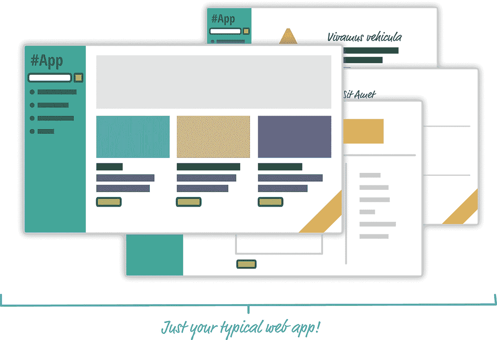

图 1-1 一个应用。

此应用是一个用于某个内容的简单目录浏览器。就像任何此类应用一样，你有一套常规的页面，围绕着首页、搜索结果页、详情页等展开。在接下来的章节中，让我们来看看我们构建此应用的两种方法。没错，以某种神秘的方式，这让我们也掌握了对 React 的概览！

继续吧！

## 老式多页设计

如果你在几年前必须构建这个应用，你可能会采用涉及多个独立页面的方法。其流程看起来像图 1-2 所示所示。

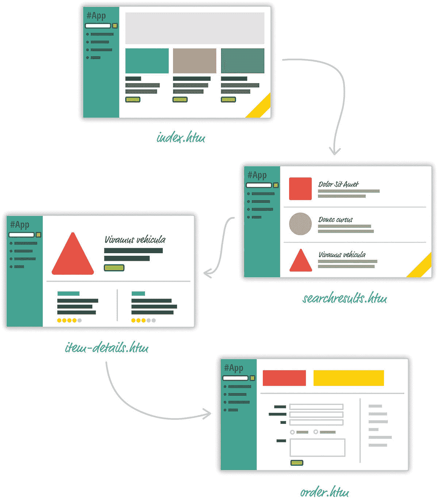

图 1-2 多页设计。

对于几乎每一个会改变浏览器显示内容的动作，Web 应用程序都会将你导航到一个`完全不同的页面`。除了用户在页面被销毁和重绘时所看到的不尽如人意的体验外，这还是一个大问题。这对你如何维护应用状态有很大影响。除了通过 cookie 和某些服务器端机制存储一些用户数据外，你根本不需要操心。生活很美好。

## 新式单页应用

如今，采用需要在各个页面之间导航的 Web 应用模型似乎已经过时了……真的，非常过时了，就像图 1-3 所示。


图 1-3 独立页面模型有点过时了——就像这台蒸汽机。

来源：*New Catechism of the Steam Engine*,1904

相反，现代应用倾向于遵循所谓的`单页应用 (SPA) 模型`。在这样一个世界里，你永远不会导航到不同的页面，甚至永远不会刷新页面。相反，应用的不同视图被加载和卸载到页面本身中。

对于我们的应用，这可能像图 1-4 所示。

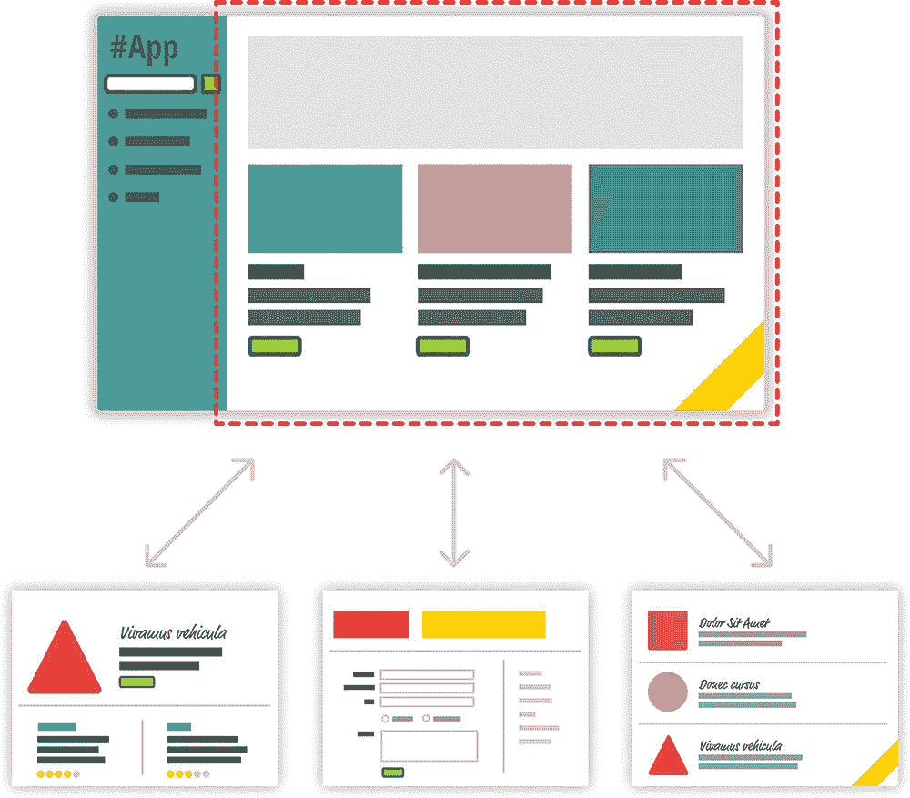

图 1-4 单页应用。

当用户与我们的应用交互时，我们将与用户尝试的操作匹配的数据和 HTML 替换虚线区域的内容。最终结果是更加流畅的体验。你甚至可以使用许多视觉技术让你的新内容过渡得非常自然，就像你在移动设备或桌面上的酷应用中看到的那样。在导航到不同页面时，这种操作是不可能的。

如果你从未听说过单页应用，这一切听起来可能有点疯狂，但你很有可能在现实中遇到过它们。如果你曾用过 Gmail、Facebook、Instagram 或 Twitter 等流行的 Web 应用，那么你就在使用单页应用。在所有这些应用中，内容都是动态显示的，不需要你刷新或导航到不同的页面。

现在，我正在让这些单页应用看起来看起来非常复杂。事实并非`完全`如此。得益于 JavaScript 以及各种第三方框架和库的许多优秀改进，构建单页应用比以往任何时候都简单。不过，这并不意味着没有改进的空间。

在构建单页应用时，你会遇到三个主要问题：

 在单页应用中，你大部分时间将花在保持数据与 UI 同步上。例如，如果用户加载了新内容，我们是否显式地清除搜索字段？我们是否让导航元素上的激活标签仍然可见？我们在页面上保留哪些元素，销毁哪些元素？

这些都是单页应用特有的问题。在旧模型在页面间导航时，我们只假设 UI 中的所有内容都会被销毁并重新构建。这从不是一个问题。

 操作 DOM 真的非常慢。手动查询元素、添加子节点（参见下方的图 1-5）、移除子树和执行其他 DOM 操作是你在浏览器中可以执行的最慢的操作之一。遗憾的是，在单页应用中，你会进行很多这类操作。操作 DOM 是你响应操作并显示新内容的主要方式。

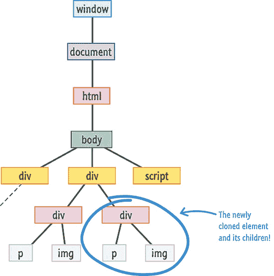

图 1-5 添加子节点。

 处理 HTML 模板可能是一件痛苦。单页应用中的导航无非是你处理 HTML 片段以表示你想要显示的任何内容。这些 HTML 片段通常被称为`模板 (templates)`，使用 JavaScript 操作它们并用数据填充它们会很快变得非常复杂。

更糟糕的是，取决于你使用的框架，模板的外以及与数据交互的方式会有巨大差异。例如，这是在 Mustache 中使用模板的样子：

点击此处查看代码图像

```javascript
var view = {
  title: "Joe",
  calc: function () {
    return 2 + 4;
  }
};

var output = Mustache.render("{{title}} spends {{calc}}", view);
```

有时，你的模板看起来像某些你可以自豪展示的 HTML。尽管有这些缺陷，单页应用并不会消失。它们是现在的一部分，并将完全构成应用构建的未来。为了解决这个问题，请认识 React！

## 认识 React

Facebook（以及 Instagram）决定够了。鉴于对单页应用的丰富经验，他们发布了一个名为 `React` 的库（React 标志见图 1-6），不仅为了解决这些缺陷，还为了改变我们构建单页应用的方式。

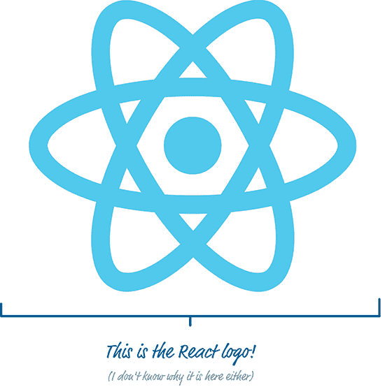

图 1-6 React 标志。

在接下来的章节中，让我们来看看 React 带来的核心功能。

### 自动 UI 状态管理

在单页应用中，跟踪 UI 并维护状态是困难且非常耗时的。在 React 中，你只需要担心一件事：UI 的最终状态。UI 初始状态如何并不重要。用户为了改变 UI 经历了哪些步骤也不重要。重要的是你的 UI 变成了哪里（参见图 1-7）。

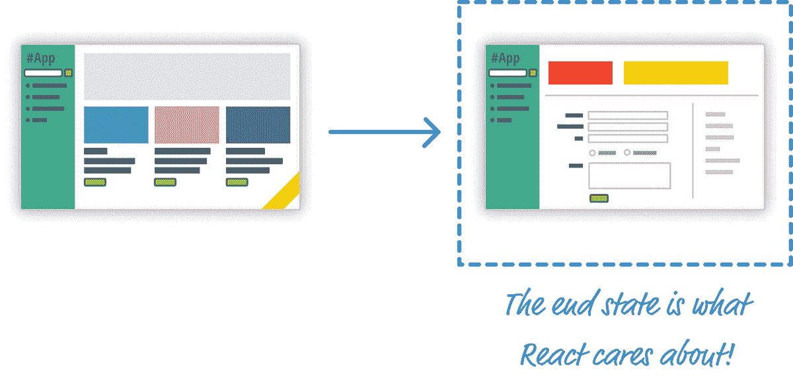

图 1-7 在 React 中，UI 的最终或结束状态才是重要的。

React 处理其他所有事情。它会计算做什么以确保你的 UI 被正确表示，因此所有这些状态管理不再是你的问题。

#### 极速 DOM 操作

由于 DOM 修改非常慢，你不再使用 React 直接修改 DOM。相反，你修改内存中的`虚拟 DOM (virtual DOM)`。图 1-8 象征着那个内存中的虚拟 DOM。

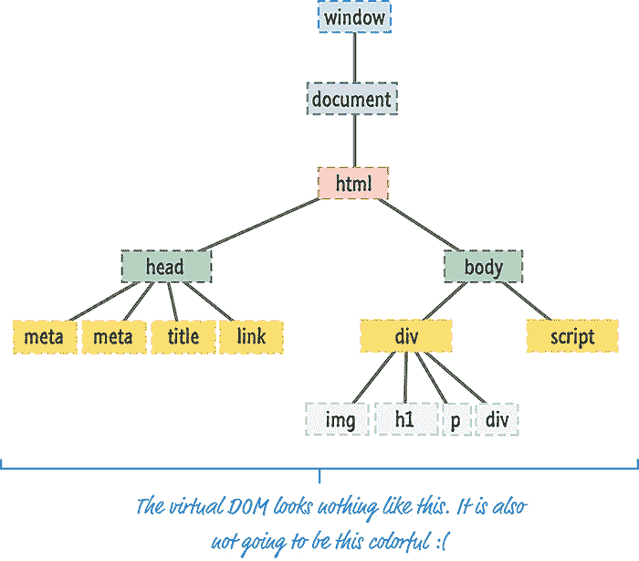

图 1-8 想象一个内存中的虚拟 DOM。

操作这个虚拟 DOM 极快，React 会在合适时间处理更新真实 DOM。它通过比较你的虚拟 DOM 和真实 DOM 之间的变化，找出哪些变化是重要的，并进行最少的 DOM 更改以保持一切更新，这个过程被称为`调和 (reconciliation)`。

#### 创建真正可组合 UI 的 API

React 不再将应用中的视觉元素视为一个单一的整体，而是鼓励你将视觉元素拆分成更小的组件。

就像编程中的其他一切一样，保持内容的模块化、紧凑和自包含是一个非常好的主意。React 将这一成熟的理念扩展到了我们思考用户界面的方式上。React 的许多核心 API 使得创建较小的视觉组件变得更加简单，这些组件之后可以与其他视觉组件组合，形成更大、更复杂的视觉组件——就像俄罗斯套套娃一样（参见图 1-9）。


图 1-9，由 Gnomz007 创作的俄罗斯套套娃。

来源：*[`commons.wikimedia.org/wiki/File:Russian-Matroshka_no_bg.jpg`](https://commons.wikimedia.org/wiki/File:Russian-Matroshka_no_bg.jpg)*

这是 React 简化（并改变）我们构建 Web 应用视觉效果的主要方式之一。

## 完全由 JavaScript 定义视觉效果

虽然这听起来既荒谬又离谱，但请听我细解释。除了使用一种非常奇怪的语法外，HTML 模板传统上还存在另一个主要问题：除了简单显示数据外，在它们内部可以做的事情种类是有限的。例如，如果你想根据特定条件选择显示哪个 UI 组件，你必须在应用的其他地方编写 JavaScript，或者使用某些奇怪的、特定框架的模板命令来实现它。

例如，这里是 EmberJS 模板内部条件语句的样式：

点击此处查看代码图片

```html
{{#if person}}

  Welcome back, <b>{{person.firstName}} {{person.lastName}}</b>!

{{else}}

  Please log in.

{{/if}}
```

React 的做法非常巧妙。通过将你的 UI 完全定义在 JavaScript 中，你可以利用 JavaScript 为你提供的所有丰富功能来在模板内部执行各种操作（你将在接下来的章节中看到）。你所受的限制仅限于 JavaScript 支持的内容，而不是你的模板框架施加的任何限制。

现在，当你考虑到完全由 JavaScript 定义的视觉效果时，你可能在想某些涉及引号、转义字符和大量 `createElement` 用的可怕东西。别担心。React 为你提供了选项，让你可以使用被称为 `JSX` 的类 HTML 语法来指定视觉效果，这种语法与你的 JavaScript 完全共存。你不再是编写代码来定义 UI，你基本上是在指定标记：

```javascript
ReactDOM.render(

  <div>                        

     <h1>Batman</h1>        

     <h1>Iron Man</h1>      

     <h1>Nicolas Cage</h1> 

     <h1>Mega Man</h1>      

  </div>,             

  destination

);
```

这段在 JavaScript 中定义的相同代码看起来像这样：

点击此处查看代码图片


```javascript
ReactDOM.render(React.createElement(
  "div",
  null,
  React.createElement(
    "h1",
    null,
    "Batman"
  ),
  React.createElement(
    "h1",
    null,
    "Iron Man"
  ),
  React.createElement(
    "h1",
    null,
    "Nicolas Cage"
  ),
  React.createElement(
    "h1",
    null,
    "Mega Man"
  )
), destination);
```

哎呀！通过使用 JSX，你能够使用非常熟悉的语法非常容易地定义视觉效果，同时仍然获得 JavaScript 提供的所有力量和灵活性。最棒的是，在 React 中，你的视觉效果和 JavaScript 往往位于同一个位置。你不再需要在多个文件之间跳转来定义一个视觉组件的外观和行为。这才是正确的模板化方式。

## MVC 架构中的 V

我们快要完了！React 并不是一个对你应用中一切应该如何行为有意见的完整框架。相反，React 主要在视图（View）层工作，它的所有担忧和关注都围绕着你的视觉元素并保持它们更新。这意味着你可以自由使用任何你想要的工具来实现 MVC 架构中的 M 和 C 部分。这种灵活性使你能够选择你熟悉的技术，这使得 React 不仅对你创建的新 Web 应用有用，对现有应用也有用。

## 构建你的第一个应用

到目前为止，多亏了上一章，你可能已经了解了它的背景和原理。本章的意图是向你介绍 React 是做什么的。在本章中，我们将从最开始起，通过构建一个简单的 React 应用来亲自动手。我们将正面对这些障碍中的一些，并跳过其中的一些。在本章结束时，我们不仅构建了一个你可以自豪地展示给家人看的东西，还为深入学习做好了良好的准备。

### 处理 JSX

在我们开始构建应用之前，有一件重要的事情应该先涵盖。React 与你用过的许多 JavaScript 库不同。当你简单地使用 `<script>` 标签引用为它编写的代码时，它并不高兴。React 在这方面烦人地特殊，这与 React 应用的构建有关。

正如你所知，你的 Web 应用（以及浏览器显示的所有其他内容）是由 HTML、CSS 和 JavaScript 组成的：

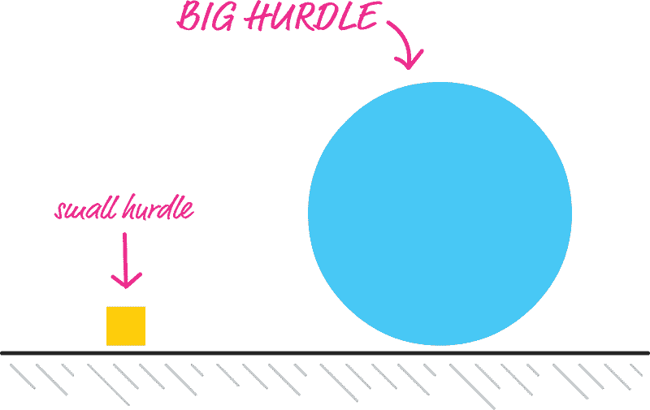

无论你的 Web 应用是使用 React 还是其他库（如 Angular、Knockout 或 jQuery）编写的，结果必须是 HTML、CSS 和 JavaScript 的组合。否则，你的浏览器真的不知道该做什么。

现在，这就是 React 特殊之处所在。除了普通的 HTML、CSS 和 JavaScript，你的 React 代码的大部分将写在名为 JSX 的语言中。正如我在第 1 章中提到的，JSX 是一种允许你轻松混合 JavaScript 和类 HTML 标签以定义用户界面（UI）元素及其功能的语言。这听起来很酷（我们几分钟就会看到 JSX 的运行），但存在一个小问题：你的浏览器完全不知道如何处理 JSX。

为了使用 React 构建 Web 应用，我们需要一种方法将 JSX 转换为普通的 JavaScript 并放置在磁盘上，以便你像任何普通 JavaScript 文件一样引用它。


**让你的浏览器依赖 JavaScript 库自动将 JSX 转换为它能理解的内容。** 你可以像编写任何旧 JavaScript 代码一样直接指定 JSX，而你的浏览器会处理剩下的工作。

这两种解决方案在我们的世界中都有用武之地，但让我们来谈谈它们的影响。

第一种解决方案起初虽然有些复杂且耗时，但它是如今现代 Web 开发的方式。除了将你的 JSX 编译（准确地说是转译）为 `JS` 之外，这种方法还让你能够利用模块、更强大的构建工具以及许多让构建复杂的 Web 应用程序变得具有可操作性的特性。

第二种解决方案提供了一种快速且直接的路径，你起初花费更多时间在编写代码上，而花更少的时间去折腾开发环境。要使用这种解决方案，你只需要引用一个脚本文件。该脚本文件会在页面加载时将 JSX 转换为 `JS`，你的 React 应用程序无需你对开发环境进行任何特殊处理即可运行起来。

在我们对 React 的入门介绍中，我们将使用第二种解决方案。你可能会奇怪为什么我们不总是使用第二种方案。原因是浏览器每花时间将 JSX 转换为 `JS` 都会产生性能影响。这在学习如何使用 React 时完全可以接受，但当你将应用用于实际生活时，这是完全不可接受的。正因为这种不可接受性，一旦你熟练地掌握了 React，我们将重新回顾这些内容，并查看第一种解决方案以及如何设置你的开发环境。

### 开始你的 React 之旅

在上一节中，我们查看了确保你的 React 应用程序最终变为浏览器可以理解内容的两种方法。在本节中，我们将把所有这些话付诸实践。首先，我们需要一个空白的 HTML 页面作为我们的起点。

如果你手头没有空白的 HTML 页面，请使用以下代码：

点击此处查看代码图片

```html
<!DOCTYPE html>
<html>
<head>
  <title>React! React! React!</title>
</head>
<body>
  <script>
  </script>
</body>
</html>
```

这个页面没有任何有趣或令人兴奋的内容，但让我们通过添加 React 库的引用来修复这个问题。在 `title` 正下方，添加这两行：

点击此处查看代码图片

```html
<script src="https://unpkg.com/react@15.3.2/dist/react.js"></script>
<script src="https://unpkg.com/react-dom@15.3.2/dist/react-dom.js"></script>
```

这两行代码引入了 React 核心库以及 React 与 `DOM` 所需的各种功能。没有了它们，你根本就在构建 React 应用程序。现在，我们还没有结束。我们还需要引用另一个库。在这两个 `script` 标签正下方，添加以下行：

点击此处查看代码图片

```html
<script src="https://cdnjs.cloudflare.com/ajax/libs/babel-core/5.8.23/browser.min.js"></script>
```

我们在这里做的是添加对 Babel JavaScript 编译器 (`http://babeljs.io/`) 的引用。Babel 做了很多很酷的事情，但我们关心的是它将 JSX 转换为 JavaScript 的能力。

此时，我们的 HTML 页面应该看起来如下所示：

点击此处查看代码图片

```html
<!DOCTYPE html>
<html>
<head>
  <title>React! React! React!</title>
  <script src="https://unpkg.com/react@15.3.2/dist/react.js"></script>
  <script src="https://unpkg.com/react-dom@15.3.2/dist/react-dom.js"></script>
  <script src="https://cdnjs.cloudflare.com/ajax/libs/babel-core/5.8.23/browser.min.js"></script>
</head>
<body>
  <script>
  </script>
</body>
</html>
```

如果你现在预览你的页面，你会发现这个页面仍然是空白的，没有任何可见的内容。这没关系。我们接下来要修复它。

### 显示你的名字

我们要做的第一件事是使用 React 在屏幕上显示我们的名字。我们实现这一点的方法是使用一种名为 `render` 的方法。在你的 `script` 标签内部，添加以下内容：

点击此处查看代码图片

```javascript
ReactDOM.render(
  <h1>Sherlock Holmes</h1>,
  document.body
);
```

如果现在这些内容看起来都不懂，不要担心。我们的目标是先在屏幕上显示出点东西，稍后我们就会弄清楚我们做了什么。现在，在页面中预览以查看发生了什么之前，我们需要将此 `script` 块标记为 Babel 可以处理的内容。

```html
<script type="text/babel">
ReactDOM.render(
  <h1>Sherlock Holmes</h1>,
  document.body
);
</script>
```

如果你现在预览页面，你会发现这个页面仍然是空白的，没有任何可见的内容。这没关系。我们接下来要修复它。

### 一切依然熟悉

虽然由于 JSX 的存在 JavaScript 看起来很新鲜，但浏览器看到的最终结果是整洁的 HTML 和 JavaScript。为了让你亲眼看到，让我们对应用程序的行为和外观进行一些更改。

#### 更改目标

我们要做的第一件事是更改 JSX 的输出位置。使用 JavaScript 将内容直接放在 `body` 元素中永远不是一个好主意。可能会出现很多问题——当你打算将 React 与其他 JS 库和框架混合时。推荐的方法是创建一个单独的元素并将其视为一个新的根元素。该元素将作为我们 `render` 方法使用的目标。要实现这一点，请返回 HTML 并添加一个 `id` 值为 `container` 的 `div` 元素。

```html
<body>
  <div id="container"></div>
</body>
```

```html
<div id="container"></div>

<script type="text/babel">
  ReactDOM.render(
    <h1>Batman</h1>,
    document.body
  );
</script>
</body>
```

## 使用容器

既然已经安全地定义了 `container` `div` 元素，让我们修改 `render` 方法来使用它而不是 `document.body`。这是实现这一目标的方法之一：

```javascript
ReactDOM.render(
  <h1>Batman</h1>,
  document.querySelector("#container")
);
```

另一种方法是在 `render` 方法之外进行操作：

点击此处查看代码图片

```javascript
var destination = document.querySelector("#container");

ReactDOM.render(
  <h1>Batman</h1>,
  destination
);
```

注意，`destination` 变量存储了我们容器 DOM 元素的引用。在 `render` 方法内部，我们只需要引用同一个 `destination` 变量，而不是将完整的元素查找语法作为参数的一部分。我想这么做的原因很简单：我想向你展示，你仍然在编写 JavaScript，而 `render` 只是另一个恰好接受两个参数的无聊旧方法。

### 美化它！

在我们结束工作之前，是最后一次修改了。现在，我们的名字以浏览器提供的任何默认 `h1` 样式显示。这太糟糕了，让我们通过添加一些 CSS 来修复它。在你的 `head` 标签内，添加一个带有以下 CSS 的 `style` 块：

```css
#container {
  padding: 50px;
  background-color: #EEE;
}

#container h1 {
  font-size: 48px;
  font-family: sans-serif;
  color: #0080A8;
}
```

添加所有这些内容后，预览你的页面。注意，我们的文本看起来比之前完全依赖浏览器默认样式的时候更有目的性了（参见 图 2-1）。

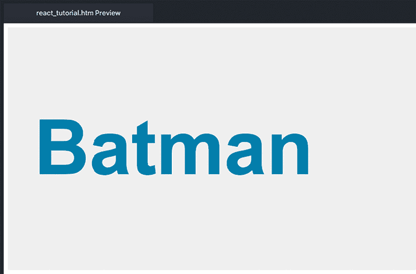

图 2-1 添加 CSS 的结果。

之所以之所以有效，是因为在运行所有 React 代码后，我们 DOM 的 `body` 包含了我们的 `container` 元素，内部有一个 `h1` 标签。无论 `h1` 标签是在这种 JSX 语法中完全在 JavaScript 内部定义的，还是你的 CSS 定义在 `render` 方法之外很远的地方，最终结果是，你的 React 应用仍然将由一些 100% 有机（且无圈养！）的 HTML、CSS 和 JavaScript 组成：

点击此处查看代码图片

```html
<!DOCTYPE html>
<html>
<head>
  <title>React! React! React!</title>
  <script src="https://fb.me/react-15.1.0.js"></script>
  <script src="https://fb.me/react-dom-15.1.0.js"></script>
  <script src="https://cdnjs.cloudflare.com/ajax/libs/babel-core/5.8.23/browser.min.js"></script>
  <style>
    #container {
      padding: 50px;
      background-color: #EEE;
    }
    #container h1 {
      font-size: 144px;
      font-family: sans-serif;
      color: #0080a8;
    }
  </style>
</head>
<body>
  <div id="container"></div>
  <script type="text/babel">
    var destination = document.querySelector("#container");
    ReactDOM.render(React.createElement(
      "h1",
      null,
      "Batman"
    ), destination);
  </script>
</body>
</html>
```

注意，这里几乎看不到任何 React 类代码的痕迹。此外，我们应该在日常对话中多用用 *nary*（几乎/完全）这个词！

### 结论

如果这是你第一次构建 React 应用，我们在这里涵盖了很多内容。一个最大的收获之一是，React 与其他库不同，因为它使用一种名为 JSX 的全新语言来定义视觉效果。我们只是对此略窥了这一点。之所以有效，是因为在运行所有 React 代码后，我们 DOM 的 `body` 包含了我们的 `container` 元素，内部有一个 `h1` 标签。无论 `h1` 标签是在这种 JSX 语法中完全在 JavaScript 内部定义的，还是你的 CSS 定义在 `render` 方法之外很的地方，最终结果是，你的 React 应用仍然将由一些 100% 有机（且无圈养！）的 HTML、CSS 和 JavaScript 组成。

## React 中的组件

React 与其他库不同，因为它使用一种名为 JSX 的全新语言来定义视觉效果。我们只是对此略窥了这一点。之所以有效，是因为在运行所有 React 代码后，我们 DOM 的 `body` 包含了我们的 `container` 元素，内部有一个 `h1` 标签。无论 `h1` 标签是在这种 JSX 语法中完全在 JavaScript 内部定义的，还是你的 CSS 定义在 `render` 方法之外很的地方，最终结果是，你的 React 应用仍然将由一些 100% 有机（且无圈养！）的 HTML、CSS 和 JavaScript 组成。

### 函数快速回顾

在 JavaScript 中，你拥有这些被称为函数的东西。它们能让你的代码更整洁、可重用。在没有函数的糟糕世界里，你可能会有如下代码：

```javascript
var speed = 10;
var time = 5;
alert(speed * time);
var speed1 = 85;
var time1 = 1.5;
alert(speed1 * time1);
var speed2 = 12;
var time2 = 9;
alert(speed2 * time2);

var speed3 = 42;
var time3 = 21;
alert(speed3 * time3);
```

在涉及到函数的非常酷的世界里，你可以将这一切浓缩为类似：

点击此处查看代码图片

```javascript
function getDistance(speed, time) {
  var result = speed * time;
  alert(result);
}
```

我们的 `getDistance` 函数消除了你看到的所有重复代码，并且接受 `speed` 和 `time` 作为参数，以便你自定义返回的结果。要调用这个函数，你只需要这样做：

```javascript
getDistance(10, 5);
getDistance(85, 1.5);
getDistance(12, 9);
getDistance(42, 21);
```

这看起来不是更好了吗？现在有了函数提供的另一个巨大价值。你的函数（例如 `getDistance` 内部的 `alert`）可以在运行时调用其他函数。这里是我们使用 `formatDistance` 函数来改变 `getDistance` 返回的内容：

点击此处查看代码图片


```javascript
function formatDistance(distance) {
  return distance + "km";
}

function getDistance(speed, time) {
  var result = speed * time;
  alert(formatDistance(result));
}
```

最棒的是，当你修改了函数的工作方式后，你不需要做任何额外操作就能看到更改的结果。如果函数签名没有变化，任何对该函数的现有调用都会神奇地正常工作，并自动采用你对函数本身所做的任何更改。例如，我们现有的`getDistance`调用将看到`formatDistance`函数的结果，即使在最初定义这些调用时`formatDistance`函数还不存在。这简直太棒了。

简而言之，函数是奇妙的。我知道这一点，你也知道。这就是为什么我们编写的所有代码中到处都是函数。

## 改变我们处理 UI 的方式

我不认为有人会反对函数带来的好处。它们确实让以一种合理的方式构建应用程序代码变得成为可能。我们在编写代码时所投入的那种用心程度，在编写 UI 时并不总是能实现的。由于各种技术和非技术原因，我们一直容忍在处理 UI 元素时的某种程度的草率。

我意识到这是一个相当争议的陈述，所以让我通过一些例子来强调我的意思。我们将回过来看上一章中使用的`render`方法：

点击此处查看代码图像

```javascript
var destination = document.querySelector("#container");

ReactDOM.render(
  <h1>Batman</h1>,
  destination
);
```

你在屏幕上看到的是大字母打印的 Batman 字样——这归功于`h1`元素。让我们稍微改变一下，假设我们要打印几个其他超级英雄的名字。为了做到这一点，让我们修改`render`方法，使其如下所示：

点击此处查看代码图像

```javascript
var destination = document.querySelector("#container");

ReactDOM.render(
  <div>
    <h1>Batman</h1>
    <h1>Iron Man</h1>
    <h1>Nicolas Cage</h1>
    <h1>Mega Man</h1>
  </div>,
  destination
);
```

注意你在这里看到的。我们输出了一个`div`，它包含了四个带有英雄名字的`h1`元素。

## JSX 注意事项：输出多个元素

这里有一个重要的 JSX 细节需要指出。包裹我们`h1`元素的`div`并不是因为看起来像是个好主意。它的存在是因为它必须存在那里。在 React 中，你不能像下面所示输出多个相邻的元素：

点击此处查看代码图像

```javascript
var destination = document.querySelector("#container");

ReactDOM.render(
  <h1>Batman</h1>
  <h1>Iron Man</h1>
  <h1>Nicolas Cage</h1>
  <h1>Mega Man</h1>
  destination
);
```

尽管这是合法的 HTML，但在 JSX 和 JavaScript 这种“不洁之同盟”的眼中，它也是无效的。这听起来可能是一个糟糕的限制，但解决方法非常简单。虽然你只能输出一个元素，但这个元素可以拥有任意数量的子。这就是为什么我们将`h1`元素封装在`div`内部。我们这样做是因为 JSX 转换为 JavaScript 的方式。这些细节我们稍后会看，但现在它们并不重要到分散我们学习组件的注意力。

好了，我们现在有四个`h1`元素，每个元素都包含一个超级英雄的名字。如果我们想把`h1`元素改为类似`h3`的东西呢？我们可以按照如下手动更新所有这些元素：

点击此处查看代码图像

```javascript
var destination = document.querySelector("#container");

ReactDOM.render(
  <div>
    <h3>Batman</h3>
    <h3>Iron Man</h3>
    <h3>Nicolas Cage</h3>
    <h3>Mega Man</h3>
  </div>,
  destination
);
```

如果你预览我们现在的内容，你会看到一些看起来没什么样式且平淡的东西（参见图 3-3）。

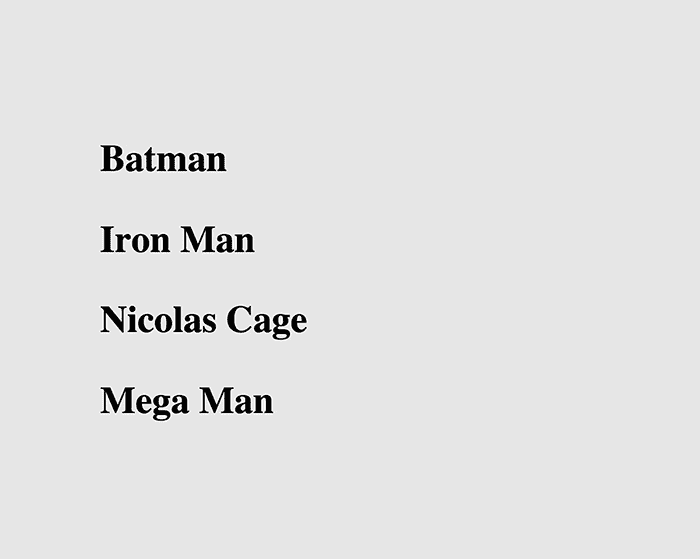

图 3-3 原本的超级英雄名字。

我们不想在这里的样式上发疯。我们想做的只是使用`<i>`标签将所有名字变为斜体，所以让我们通过此更改来手动更新我们渲染的内容：

点击此处查看代码图像

```javascript
var destination = document.querySelector("#container");

ReactDOM.render(
  <div>
    <h3>Batman</h3>
    <h3>Iron Man</h3>
    <h3>Nicolas Cage</h3>
    <h3>Mega Man</h3>
  </div>,
  destination
);
```

我们遍历了`h1`并包裹了`i`标签。你看到问题了吗？

```javascript
var destination = document.querySelector("#container");

ReactDOM.render(
  <div>
    <h3>Batman</h3>
    <h3>Iron Man</h3>
    <h3>Nicolas Cage</h3>
    <h3>Mega Man</h3>
  </div>,
  destination
);
```

```html
<p>Hello, world!</p>
</div>,

document.querySelector("#container")
```

我们所做的是创建一个名为`HelloWorld`的新组件。这个`HelloWorld`组件并没有执行任何操作。事实上，目前它基本上是一个空的 JavaScript 对象。在这个对象内部，你可以放置各种属性来进一步定义`HelloWorld`的功能。你定义的某些属性是特殊的，它们会被 React 用来帮助你的组件施展魔力。其中一个强制性属性就是`render`。

请继续修改我们的`HelloWorld`组件，添加一个如下所示的`render`属性：

点击此处查看代码图片

```javascript
var HelloWorld = React.createClass({
  render: function() { 
  }
});
```

就像我们几刻前在`ReactDOM.render`中看到的`render`方法一样，组件内部的`render`方法也负责处理 JSX。让我们修改`render`方法以返回`Hello, componentized world!`，因此请继续添加以下高亮行：

点击此处查看代码图片

```javascript
var HelloWorld = React.createClass({
  render: function() {
    return (
      <p>Hello, componentized world!</p> 
    );
  }
});
```

我们所做的是告诉`render`方法返回代表我们`Hello, componentized world!`文本的 JSX。剩下的工作就是实际使用这个组件。一旦你定义了一个组件，使用它的方法就是调用它，我们将从我们的老朋友`ReactDOM.render`方法中调用它：

点击此处查看代码图片

```javascript
ReactDOM.render(
  <HelloWorld/>, 
  document.querySelector("#container")
);
```

那不是拼写错误！我们调用`HelloWorld`组件时使用的 JSX 正是那个类似 HTML 的`<HelloWorld/>`。如果你在浏览器中预览页面，你会看到屏幕上显示出`Hello, componentized world!`文本。如果你刚才因为紧张而屏住了呼吸，现在可以放松了。

如果你在看到我们用于`HelloWorld`的语法后仍难以放松，请盯着以下内容看几会：


好了，回到现实。我们目前所做的一切看起来可能很疯狂，但只需将你的`<HelloWorld/>`组件想象成一个酷且新的标签，你对它的功能完全控制。这意味着你可以对它进行各种类似 HTML 的操作。例如，请继续修改我们的`ReactDOM.render`方法如下所示：

点击此处查看代码图片

```javascript
ReactDOM.render(
  <div>
    <HelloWorld/>
  </div>,
  document.querySelector("#container")
);
```

我们将对`HelloWorld`组件的调用封装在了`div`元素内部，如果你在浏览器中预览它，一切运行正常。让我们再进阶一步！与其只让它只调用一次`HelloWorld`，不如进行多次调用。现在修改我们的`ReactDOM.render`方法使其看起来如下所示：

点击此处查看代码图片

```javascript
ReactDOM.render(
  <div>
    <HelloWorld/>
    <HelloWorld/>
    <HelloWorld/>
    <HelloWorld/>
    <HelloWorld/>
  </div>,
  document.querySelector("#container")
);
```

你现在看到的是一堆`Hello, componentized world!`文本实例。在转向更亮眼的内容之前，让我们再做一件事。回到我们的`HelloWorld`组件声明，将我们返回的文本改为更传统的`Hello, world!`值：

点击此处查看代码图片

```javascript
var HelloWorld = React.createClass({
  render: function() {
    return (
      <p>Hello, world!</p>
    );
  }
});
```

只需进行这一处更改并预览你的示例。这次，所有的`HelloWorld`调用现在都向屏幕返回了`Hello, world!`。不需要手动修改每一个`HelloWorld`调用。这是一个好事！

## 指定属性

现在，我们的组件只做一件事：在我们的屏幕上打印`Hello, world!`！这等于拥有这样一个 JavaScript 函数：

```javascript
function getDistance() {
  alert("42km");
}
```

除了一个特殊情况外，这个 JavaScript 函数看起来并不好用，对吧？增加此函数用性的方法是修改它以接收参数：

点击此处查看代码图片

```javascript
function getDistance(speed, time) {
  var result = speed * time;
  alert(result);
}
```

现在，你的函数可以更通用地用于各种情况——而不仅仅是输出为`42km`的那一种情况。

类似的情况也适用于你的组件。就像函数一样，你可以传递参数来改变组件的行为。你只需要掌握一个术语更新。我们在函数中调用的`arguments`（参数）在组件中将被称为`properties`（属性）。

我们在函数中调用的`arguments`在组件中将被称为`properties`（属性）。

我们在函数中调用的`arguments`在组件中将被称为`properties`（属性）。让我们来看看这些属性的效果！我们将修改`HelloWorld`组件，以便你指定要问候的人或物，而不是通用的`World`。要向组件添加属性，需要遵循两个部分：

### 第一部分：更新组件定义

现在，我们的`HelloWorld`组件硬编码为总是发送`Hello, world!`。我们要做的第一件事是通过输出我们传入的值来改变这种行为。我们需要一个名称来赋予我们的属性，在这个例子中，我们将属性命名为`greetTarget`。要指定组件的`greetTarget`值，这是我们需要做的修改：

点击此处查看代码图片

```javascript
var HelloWorld = React.createClass({
  render: function() {
    return (
      <p>Hello, {this.props.greetTarget}!</p>
    );
  }
});
```

注意我们是如何指定这个属性的。在大括号。在`JSX`中，如果你想让某些内容被求值，你需要将该内容包裹在大括号内。如果不这样做，你会看到打印出原始文本`this.props.greetTarget`

### 第二部分：修改组件调用

一旦更新了组件定义，剩下的工作就是作为组件调用的一部分传递属性值。这是添加一个与我们的属性同名的属性，后跟你想传递的值来实现的。在示例中，这将涉及到为`HelloWorld`调用添加`greetTarget`属性以及我们给它的值。

请继续修改我们的`HelloWorld`调用如下：

点击此处查看代码图片

```javascript
ReactDOM.render(
  <div>
    <HelloWorld greetTarget="Batman"/>
    <HelloWorld greetTarget="Iron Man"/>
    <HelloWorld greetTarget="Nicolas Cage"/>
    <HelloWorld greetTarget="Mega Man"/>
    <HelloWorld greetTarget="Bono"/>
    <HelloWorld greetTarget="Catwoman"/>
  </div>,
  document.querySelector("#container")
);
```

我们的每个`HelloWorld`调用现在都带有`greetTarget`属性，以及我们想要问候的英雄（或相应的神话生物！）的名字。如果你在浏览器中预览此示例，你会看到这些问候快乐地打印在屏幕上。

在我们继续之前，最后一点要说明的是：你并不限制组件只能有一个属性。你可以拥有任意数量的属性，你的`props`属性将轻松地应对任何属性请求而不会产生任何麻烦。

## 处理子元素

几个章节之前，我提到过我们的组件（在 JSX 中）与普通的 HTML 元素非常相似。当我们把一个组件封装在`div`元素内部，或者在指定属性时指定一个属性和值时，我们自己亲眼看到了这一点。对于组件，你还有一点可以做，就像你对许多 HTML 元素可以做的那样：你的组件可以拥有子元素。

这意味着你可以像这样操作：

```jsx
<CleverComponent foo="bar">
  <p>Something!</p>
</CleverComponent>
```

你有一个命名非常巧妙的组件`CleverComponent`，它有一个`p`元素作为子元素……在`CleverComponent`内部，你有能力通过`this.props.children`访问的`children`属性来访问`p`子元素（以及它可能拥有的任何子元素）。

为了理解这一切，让我们来摆弄另一个非常简单的例子。这次，我们有一个名为`Buttonify`的组件，它将其子元素封装在按钮内部。该组件看起来如下所示：

点击此处查看代码图片

```javascript
var Buttonify = React.createClass({
  render: function() {
    return (
      <div>
        <button type={this.props.behavior}>{this.props.children}</button>
      </div>
    );
  }
});
```

使用这个组件的方法就是像这里所示，通过`ReactDOM.render`方法调用它：

点击此处查看代码图片

```javascript
ReactDOM.render(
  <div>
    <Buttonify behavior="Submit">SEND DATA</Buttonify>
  </div>,
  document.querySelector("#container")
);
```

当这段代码运行时，考虑到`Buttonify`组件`render`方法中的 JSX 样子，你将看到`SEND DATA`单词被封装在一个按钮元素中。带有适当的样式，结果看起来可能会非常滑稽地巨大，就像图 3-4 所示。


图 3-4 一个巨大的发送数据按钮。

无论如何，回到 JSX，注意我们指定了一个名为`behavior`的自定义属性。这个属性允许我们指定`button`元素的`type`属性，看到我们在组件定义的`render`方法中通过`this.props.behavior`访问它。


访问组件子元素的内容比我们在这里看到的要多。例如，如果你的子元素是一个深度嵌套结构的根节点，`this.props.children` 属性将返回一个数组。如果你的子元素只是单个元素（如我们的示例所示），`this.props.children` 属性返回一个没有封装在数组中的单个组件。还有几点需要说明，但我们不会列举所有各种情况并让你感到无聊，我们将在稍后查看更复杂的示例时，自然会触及这些情况。

### 结论

如果你想使用 React 构建应用，那么在不使用组件的情况下，你无法走太远。尝试在不使用组件的情况下构建 React 应用有点就像在不使用函数的情况下构建基于 JavaScript 的应用。我不是说这不可行。它只是那种你不应该做的事情之一……就像你在这里可以找到的《动画恶尼克斯》（Animaniacs）著名的“好主意 / 坏主意”片段中的`坏主意`部分一样：`https://www.youtube.com/watch?v=2dJOIf4mdus`

如果这个幽默的视频不能说服你为什么要学习拥抱组件，我不知道什么能…………也许未来关于创建复杂组件的章节！:P

## 4. React 中的样式处理

几年来，人类（可能还有非常聪明的海豚）一直使用 CSS（即级联样式表）对他们的 HTML 内容进行样式。以前很好。通过 CSS，你在内容和呈现之间有了良好的分离。选择器语法在选择对哪些元素设置样式以及跳过哪些元素方面提供了很大的灵活性。你甚至找不到太多的理由去讨厌 CSS 核心的那个`整个级联机制`。

好吧，别告诉 React 这种话。虽然 React 并不积极地仇恨 CSS，但在处理内容样式方面，它有不同的观点。正如我们目前所看到的，React 的核心思想之一是让我们应用程序的视觉部分是自包含且可重用的。这就是为什么 HTML 元素和影响它们的 JavaScript 位于同一个我们称为“组件”的桶里。我们在上一个章节中领略到了这一点。

那么 HTML 元素看起来如何（即它们的样式）呢？那应该应该放在哪里？你可能已经猜到我想表达什么了。当样式定义在其他地方时，你就无法拥有一个自包含的 UI 部分。这就是为什么 React 鼓励你在 HTML 和 JavaScript 旁边直接指定元素的外观。在在本教程中，你将学习所有关于这种神秘（且可能令人丑闻！）的设置内容样式的方法。当然，我们还会查看如何使用 CSS。

### 显示一些元音

为了学习如何为我们的内容设置样式，让我们来做一个简单显示元音的例子。首先，你需要一个空白页面来托管我们的 React。如果你没有，请随意使用以下：

点击此处查看代码图片

```html
<!DOCTYPE html>
<html>
<head>
  <title>Styling in React</title>
  <script src="https://unpkg.com/react@15.0.0/umd/react.min.js"></script>
  <script src="https://unpkg.com/react-dom@15.0.0/umd/react-dom.min.js"></script>
  <script src="https://cdnjs.cloudflare.com/ajax/libs/babel/6.0.0/babel.min.js"></script>
  <style>
    #container {
      padding: 50px;
      background-color: #FFF;
    }
  </style>
</head>
<body>
  <div id="container"></div>
  <script type="text/babel">
    var Letter = React.createClass({
      render: function() {
        return (
          <div>
            {this.props.children}
          </div>
        );
      }
    });

    var destination = document.querySelector("#container");

    ReactDOM.render(
      <div>
        <Letter>A</Letter>
        <Letter>E</Letter>
        <Letter>I</Letter>
        <Letter>O</Letter>
        <Letter>U</Letter>
      </div>,
    destination
  );
  </script>
</body>
</html>
```

在`container` `div`下方添加以下：

点击此处查看代码图片

```javascript
<script type="text/babel">
  var Letter = React.createClass({
    render: function() {
      return (
        <div>
          {this.props.children}
        </div>
      );
    }
  });

  var destination = document.querySelector("#container");

  ReactDOM.render(
    <div>
      <Letter>A</Letter>
      <Letter>E</Letter>
      <Letter>I</Letter>
      <Letter>O</Letter>
      <Letter>U</Letter>
    </div>,
    destination
  );
</script>
```

从我们学到的组件来看，这里没有任何神秘的。我们创建了一个名为`Letter`的组件，负责将我们的元音封装在`div`中。这一切通过一个 Babel 知道该如何处理的`script`标签锚在 HTML 中。

如果你预览你的页面，你将看到一些无味的内容，就像图 4-1 所示。


图 4-1 你看到的无味输出。

别担心，我们稍后会让它看起来不那么无味。在我们处理这些字母之后，你将看到一个更像图 4-2 的东西。


图 4-2 水平排列并带有黄色背景的字母。

### 使用 CSS 设置 React 内容

使用 CSS 为我们的 React 内容设置样式实际上如你想象的那么简单。因为 React 最后输出普通的 HTML 标签，你多年来学习的设置 HTML 的各种 CSS 技巧仍然适用。只有几点需要注意的微小事情。

在使用 CSS 之前，你首先需要感受 React 输出的 HTML 看起来会什么样。你可以通过查看`render`方法内部定义的 JSX 轻松地弄清楚这一点。父级`render`方法是我们基于`ReactDOM`的那个，它如下所示：

```html
<div>
  <Letter>A</Letter>
  <Letter>E</Letter>
  <Letter>I</Letter>
  <Letter>O</Letter>
  <Letter>U</Letter>
</div>
```

我们将各种`Letter`组件包裹在一个`div`标签中。这里没有什么特别的。我们`Letter`组件内部的`render`方法也没有多大区别：

```html
<div>
  {this.props.children}
</div>
```

如你所见，每个单独的元音都被包裹在自己的`div`标签中。如果你必须运行这一切（例如，在浏览器中预览我们的示例），我们元音的最终 DOM 结构看起来图 4-3。


图 4-3 浏览器内部的预览。

忽略容器`div`上的`data-reactroot`属性（取决于你的 React 版本，你可能根本看不到它！），但注意你看到的其他内容。我们得到的只是几刻在`render`方法中看到的各种 JSX 片段的 HTML 化扩展，元音嵌套在一堆`div`元素中。

## 直接样式化吧！

一旦你理解了想要样式化的 HTML 布局，困难的部分就完成了。现在到了有趣且熟悉的阶段：定义样式选择器并指定你想设置的属性。为了影响我们的内部`div`元素，请在我们的`style`标签内添加内容：

```css
div div div {
  padding: 10px;
  margin: 10px;
  background-color: #ffde00;
  color: #333;
  display: inline-block;
  font-family: monospace;
  font-size: 32px;
  text-align: center;
}
```

`div div div`选择器将确保我们样式化了正确的元素。最终结果是我们的元音样式化后看起来与我们之前看到的一模一样。尽管如此，`div div div`样式选择器看起来有点奇怪，不是吗？它太通用了。在具有三个以上嵌套`div`元素的应用中（这非常常见），你可能会样式化错误的内容。在某些时刻，你会希望更改 React 生成的 HTML，以便我们的内容更容易被样式化。

我们将解决这个问题的方法是给我们的内部`div`元素赋予`letter`类的值。这就是 JSX 不同于 HTML 的地方。进行以下突出修改：

点击查看代码图片

```javascript
var Letter = React.createClass({
  render: function() {
    return (
      <div className="letter"> 
        {this.props.children}
      </div>
    );
  }
});
```

注意，我们通过使用`className`属性而不是`class`属性来指定类值。这是因为`class`是 JavaScript 中的一个特殊关键字。如果你觉得这为什么很重要，先不用担心。我们稍后会介绍。

无论如何，一旦你给`div`赋予了`className`属性值`letter`，就只剩下最后一件事。修改 CSS 选择器以更干净地定位我们的`div`元素：

```css
.letter {
  padding: 10px;
  margin: 10px;
  background-color: #ffde00;
  color: #333;
  display: inline-block;
  font-family: monospace;
  font-size: 32px;
  text-align: center;
}
```

如你所见，使用 CSS 是样式化基于 React 的应用内容的完全可行的方法。在下一节中，我们将查看如何使用 React 推荐的方法来样式化内容。

## 以 React 方式样式化内容

React 倾向于使用内联方法来处理不使用 CSS 内容。虽然初初看起来有点奇怪，但它的设计目的是帮助让你的视觉效果更具复用性。目标是让你的组件变成小黑盒，所有与 UI 观和工作方式相关的内容都存储在那里。让我们亲眼来看看。

继续我们之前的示例，移除`.letter`样式规则。一旦完成此操作，当你在浏览器中预览应用时，元音将回到未样式化的状态。为了完整起见，你应该从`Letter`组件的`render`函数中移除`className`声明。保留我们不会使用的标记是没有意义的。现在，`Letter`回到了原始状态：

点击查看代码图片

```javascript
var Letter = React.createClass({
  render: function() {
    return (
      <div>
        {this.props.children}
      </div>
    );
  }
});
```

你在组件内部指定样式的方法是定义一个对象，其内容是样式属性。一旦你给`div`赋予了`className`属性值`letter`，就还有一件事要做。修改 CSS 选择器以更干净地定位我们的`div`元素：

```css
.letter {
  padding: 10px;
  margin: 10px;
  background-color: #ffde00;
  color: #333;
  display: inline-block;
  font-family: monospace;
  font-size: 32px;
  text-align: center;
}
```

如你所见，使用 CSS 是样式化基于 React 的应用内容的完全可行的方法。在下一节中，我们将查看如何使用 React 推荐的方法来样式化内容。

## 以 React 方式样式化内容

React 倾向于使用内联方法来处理不使用 CSS 内容。虽然初看起来看起来有点奇怪，但它的设计目的是帮助让你的视觉效果更具复用性。目标是让你的组件变成小黑盒，所有与 UI 观和工作方式相关的内容都存储在那里。让我们亲眼来看看。

继续我们之前的示例，移除`.letter`样式规则。一旦完成此操作，当你在浏览器中预览应用时，元音将回到未样式化的状态。为了完整起见，你应该从`Letter`组件的`render`函数中移除`className`声明。保留我们不会使用的标记是没有意义的。现在，`Letter`回到了原始状态：

点击查看代码图片

```javascript
var Letter = React.createClass({
  render: function() {
    return (
      <div>
        {this.props.children}
      </div>
    );
  }
});
```

你在组件内部指定样式的方法是定义一个对象，其内容是样式属性。一旦你给`div`赋予了`className`属性值`letter`，就还有一件事要做。修改 CSS 选择器以更干净地定位我们的`div`元素：

```css
.letter {
  padding: 10px;
  margin: 10px;
  background-color: #ffde00;
  color: #333;
  display: inline-block;
  font-family: monospace;
  font-size: 32px;
  text-align: center;
}
```

### 创建样式对象

让我们直接开始，定义包含我们想要样式的样式对象：

点击查看代码图片

```javascript
var Letter = React.createClass({
  render: function() {
    var letterStyle = {
      padding: 10,
      margin: 10,
      backgroundColor: "#ffde00",
      color: "#333",
      display: "inline-block",
      fontFamily: "monospace",
      fontSize: "32",
      textAlign: "center"
    };
    return (
      <div>
        {this.props.children}
      </div>
    );
  }
});
```

我们有一个名为`letterStyle`的对象，其内部属性只是 CSS 属性名及其值。如果你以前没有在 JavaScript 中定义过 CSS 属性（例如通过设置`object.style`），将它们转换为 JavaScript 格式非常简单：

 单单词 CSS 属性（如`padding`、`margin`、`color`）保持不变。

 带有连字符的多单词 CSS 属性（如`background-color`、`font-family`、`border-radius`）被转换为驼峰命名单词，删除连字符并将连字符后的单词大写。例如，使用我们的示例属性，`background-color`将变为`backgroundColor`，`font-family`将变为`fontFamily`，`border-radius`将变为`borderRadius`。

我们的`letterStyle`对象及其属性几乎是我们之前看到的`.letter`样式规则的直接 JavaScript 翻译。现在只需要将此对象分配给我们要样式化的元素。

### 实际样式化我们的内容

现在有了包含了所需样式的对象，剩下的部分非常简单。找到我们要样式化的元素，并将`style`属性指向该对象。在我们的案例中，这将`Letter`组件`render`函数返回的`div`元素。

查看突出显示的行，了解我们的示例是如何做的：

点击查看代码图片


```javascript
var Letter = React.createClass({
  render: function() {
    var letterStyle = {
      padding: 10,
      margin: 10,
      backgroundColor: "#ffde00",
      color: "#333",
      display: "inline-block",
      fontFamily: "monospace",
      fontSize: "32",
      textAlign: "center"
    };
    return (
      <div style={letterStyle}>
        {this.props.children}
      </div>
    );
  }
});
```

我们的对象名为`letterStyle`，这就是我们在大括号内部指定的内容，以便让 React 知道评估该表达式。仅此而已。去在浏览器中运行示例，以确保一切运行正常，并且我们所有的元音都正确应用了样式。

为了进行额外的验证，如果你使用任的浏览器开发工具检查应用于其中一个元音的样式，你会发现这些样式实际上是内联应用的（参见图 4-4）。

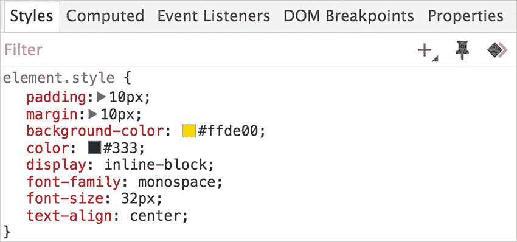

图 4-4 样式是内联应用的。

虽然这并不令人意外，但对于我们这些习惯了样式位于样式规则内部的人来说，这可能很难接受。正如人们所说，时代在变迁（[`www.youtube.com/watch?v=e7qQ6_RV4VQ`](https://www.youtube.com/watch?v=e7qQ6_RV4VQ)）。

### 你可以省略 “px” 后缀

在程序化设置样式时，处理需要像素值后缀的数字是非常痛苦的。为了生成这些值，你需要对数字进行一些字符串拼接以添加`px`。要从像素值转换回数字，你需要解析出`px`。这些操作并不极端复杂或耗时，但它们确实很分散注意力。

为了帮助这一点，React 允许在许多 CSS 属性中省略`px`后缀。如果你还记得，我们的`letterStyle`对象如下：

```javascript
var letterStyle = {
  padding: 10,
  margin: 10,
  backgroundColor: "#ffde00",
  color: "#333",
  display: "inline-block",
  fontFamily: "monospace",
  fontSize: "32",
  textAlign: "center"
};
```

注意，对于像`padding`、`margin`和`fontSize`这样具有数值的某些属性，我们完全没有指定`px`后缀。这是因为在运行时，React 会自动添加`px`后缀。

React 不会自动添加像素后缀的唯一数值相关属性是以下这些：`animationIterationCount`、`boxFlex`、`boxFlexGroup`、`boxOrdinalGroup`、`columnCount`、`fillOpacity`、`flex`、`flexGrow`、`flexPositive`、`flexShrink`、`flexNegative`、`flexOrder`、`fontWeight`、`lineClamp`、`lineHeight`、`opacity`、`order`、`orphans`、`stopOpacity`、`strokeDashoffset`、`strokeOpacity`、`strokeWidth`、`tabSize`、`widows`、`zIndex`和`zoom`。虽然我希望能告诉你我背下了这些信息，但我实际上只是参考了这篇文章：[`facebook.github.io/react/tips/style-props-value-px.html`](https://facebook.github.io/react/tips/style-props-value-px.html)。请收起掌 :P

虽然像素值对很多事情很有用，但你可能想使用百分比、ems、vh 等来表示你的值。对于这些非像素值，你仍然必须手动确保处理后缀。React 在这方面提供不了帮助，所以如果你不喜欢像素值，这项便利功能对你来说意义不大。

### 使背景颜色可定制

在我们结束之前要做的最后一件事是利用 React 处理样式的方式。通过将样式定义在与 JSX 相同的区域，我们可以让各种样式值能够被父组件（即组件的调用者）轻松自定义。让我们来看看实际操作。

现在，我们所有的元音都有黄色背景。如果我们可以在每个`Letter`声明中指定背景颜色，不是很酷吗？为了实现这一点，首先在`ReactDOM.render`方法中添加`bgcolor`属性，并如下高亮行所示指定颜色：

```javascript
ReactDOM.render(
  <div>
    <Letter bgcolor="#58B3FF">A</Letter> 
    <Letter bgcolor="#FF605F">E</Letter> 
    <Letter bgcolor="#FFD52E">I</Letter> 
    <Letter bgcolor="#49DD8E">O</Letter> 
    <Letter bgcolor="#AE99FF">U</Letter> 
  </div>,
  destination
);
```

接下来，我们需要使用这个属性。在我们的`letterStyle`对象中，将`backgroundColor`的值设置为`this.props.bgColor`：

```javascript
var letterStyle = {
  padding: 10,
  margin: 10,
  backgroundColor: this.props.bgColor,
  color: "#333",
  display: "inline-block",
  fontFamily: "monospace",
  fontSize: "32",
  textAlign: "center"
};
```

注意，对于像`padding`、`margin`和`fontSize`这样具有数值的某些属性，我们完全没有指定`px`后缀。这是因为在运行时，React 会自动添加`px`后缀。

在现实世界中，你被要求在 React 中实现的东西不会像一个名称列表或五颜色的元音块那么简单。相反，你将得到某个复杂用户界面的视觉表示形式。这种视觉效果可以有许多形式——涂鸦、图表、截图、视频、标注稿（redline）、设计稿等。让这些静态像素活起来是你的工作，而我们将通过此进行一些实战练习。

我们要构建的是一个简单的调色卡片（参见图 5-2）。

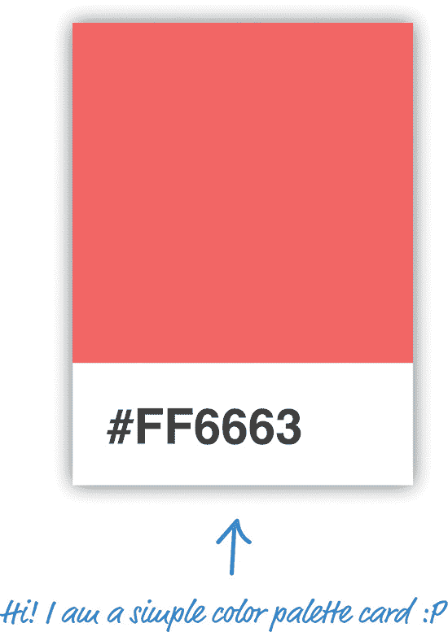

图 5-2 一个简单的调色卡。

如果你不确定这些是什么，它们是小矩形卡片，可以帮助你将颜色与特定类型的漆进行匹配。你经常在家居建材店或任何卖漆的地方看到它们。你那个设计师的朋友在家里可能有一个巨大的衣柜专门存放它们。无论如何，我们的任务是使用 React 重现这些卡片之一。

实现这一目标有多种方法，但我将向你展示一种非常系统的方法，它将帮助你简化并理解即使是最复杂的用户界面。这种方法涉及两个步骤：

1. 识别主要的视觉元素

2. 确定组件将是什么

这两个步骤听起来都非常复杂，但随着我们的学习，你会发现这没什么好担心的。

### 识别主要的视觉元素

第一步是识别我们正在处理的所有视觉元素。没有任何视觉元素是微小到可以忽略的——至少最初不是。开始识别相关部分最简单的方法是从显而易见的视觉元素开始，然后深入研究不那么明显的元素。

我们在示例中看到的第一个东西是卡片本身（参见图 5.3）。

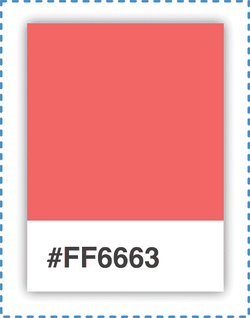

图 5-3 卡片。

在卡片内部，你会发现有两个不同的区域。顶部区域是一个显示特定颜色的矩形区域。底部是一个显示十六进制值（hex value）的白色区域。

让我们把这两个视觉元素单独出来，并将它们排列成一个树形结构，如图图 5-4 所示。

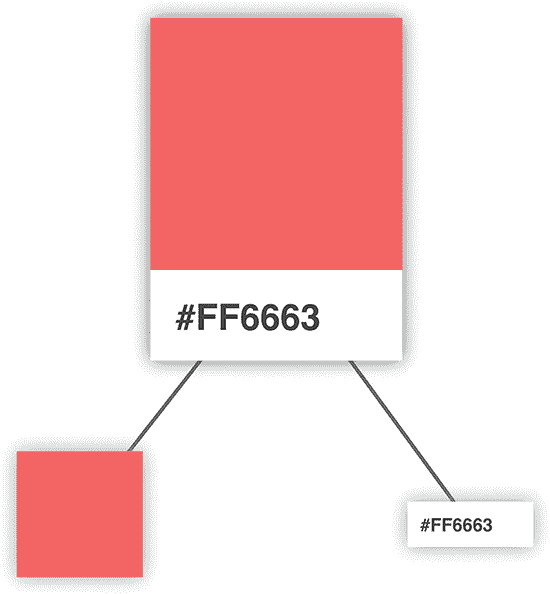

图 5-4 树形结构。

将你的视觉元素排列成这种树形结构（又称为视觉层次结构）是更好地理解你的视觉元素如何分组的好方法。这个练习的目标是识别重要的视觉元素，并将它们分解为父/子结构，直到你无法进一步细分它们。

***

### 尝试忽略实现细节

虽然这很难，但先不要考虑实现细节。不要专注于根据将所需的 HTML 和 CSS 组合来拆分你的视觉元素。以后有的是时间做这些！

***

继续下去，我们可以看到我们的彩色色矩形不是我们可以可以进一步细分的东西。但并不意味着我们已经结束了。我们可以将标签与围绕它的白色区域进一步分开。目前，我们的视觉层次结构看起来如图图 5-5 所示，我们的标签和白色区域在树结构中占据了独立的位置。

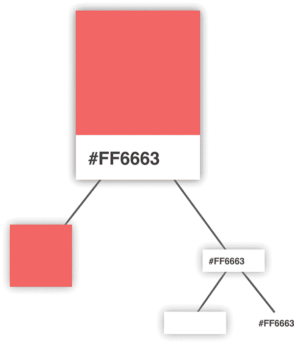

图 5-5 将内容进一步细分为标签和围绕它的白色区域。

到此为止，我们没有其他可以进一步细分的内容。我们已经完成了视觉元素的识别和划分，因此下一步是利用我们在这里发现的内容来帮助我们识别组件。

### 识别组件

这里开始变得有点有趣了。我们需要确定识别出的视觉元素中哪些将转换为组件，哪些将不会。并不是每个视觉元素都需要转换为组件，我们也绝对不想创建几个极其复杂的组件。这其中需要有一个平衡（参见图 5-6）。

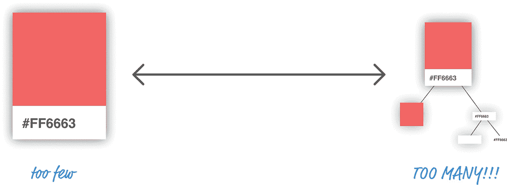

图 5-6 组件数量既不过少也不过多。

确定哪些视觉元素成为组件的一部分，哪些不是，这是一门艺术。通用的规则是，我们的组件应该只做一件事。如果你发现你的潜在组件最终会做太多事情，你可能想将该组件拆分为多个组件。反之，如果你的潜在组件做的事情太少，你可能可能想完全跳过将该视觉元素变成组件。

让我们尝试确定示例中哪些元素可以构成良好的组件。从我们的视觉层次结构来看，一眼看上去，卡片和彩色矩形似乎都符合制作优秀组件的标准。卡片充当外部容器，而彩色矩形仅显示颜色。

但这给我们的标签和围绕它的白色区域打上了一个问号（参见图 5-7）。

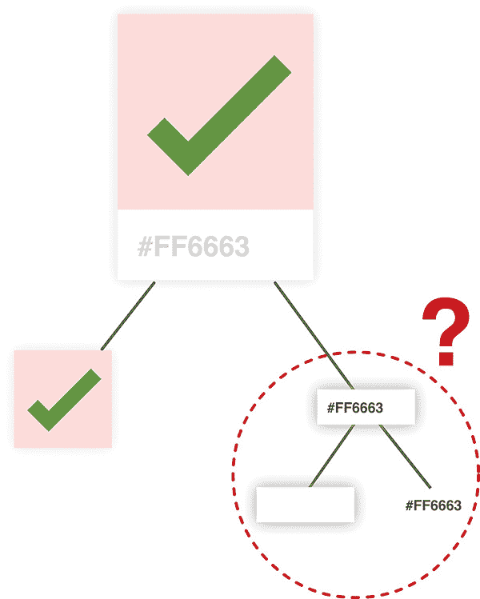

图 5-7 标签及其周围白色空间上的问号。

这里的关键部分是标签本身。没有它，我们就看不到十六进制值。剩下的只有白色区域。它所起的作用微乎其微。它只是空间，其责任可以被忽略。到此，我们已经识别了组件，并且层次结构如图图 5-8 所示。


图 5-8 组件。

### 创建组件

这是简单的部分——是时候开始了。我们需要一个大部分为空的页面：

```html
<!DOCTYPE html>
<html>
<head>
  <title>更多组件</title>
  <script src="https://unpkg.com/react@5.3.2/dist/react.js"></script>
  <script src="https://unpkg.com/react-dom@5.3.2/dist/react-dom.js"></script>
  <script src="https://cdnjs.cloudflare.com/ajax/libs/babel-core/5.8.23/standalone.min.js"></script>
  <style>
    #container {
      padding: 50px;
      background-color: #FFF;
    }
  </style>
</head>
<body>
  <div id="container"></div>
  <script type="text/babel">
    ReactDOM.render(
      <<div></div>,
      document.querySelector("#container")
    );
  </script>
</body>
</html>
```

花点时间看看这个页面的情况。没什么——只是让 React 在我们的`container`元素中渲染一个`div`的基本要求。

完成之后，是时候定义我们的组件了。我们将我们的组件命名为`Card`、`Label`和`Square`。请在`ReactDOM.render`函数之前添加以下代码行：

```javascript
var Square = React.createClass({
  render: function() {
    return (
      <p>Nothing</p>
    );
  }
});
```

```javascript
var Label = React.createClass({
  render: function() {
    return (
      <p>Nothing</p>
    );
  }
});

var Card = React.createClass({
  render: function() {
    return (

    );
  }
});

ReactDOM.render(
  <div>
  </div>,
  document.querySelector("#container")
);
```

在我们的三个组件中，我们还添加了每个组件运行绝对必需的`render`函数。除此之外之外，我们的组件都是空的。在接下来的章节中，我们将通过填充这些内容来修复这个问题。

### Card 组件

我们将从组件层次结构的顶端开始，首先关注`Card`组件。该组件将作为我们`Square`和`Label`组件的容器。

要实现它，请继续进行以下高亮修改：

```javascript
var Card = React.createClass({
  render: function() {
    var cardStyle = {
      height: 200,
      width: 150,
      padding: 0,
      backgroundColor: "#FFF",
      WebkitFilter: "drop-shadow(0px 0px #666)",
      filter: "drop-shadow(0px 0px #666)"
    };

    return (
      <div style={cardStyle}>
      </div>
    );
  }
});
```

虽然这看起来有很多变化，但大部分行代码都是通过`cardStyle`对象对我们`Card`组件的输出进行样式设置。在对象内部，请注意我们指定了带有厂商前缀的 CSS`filter`属性版本`WebkitFilter`。那并不是有趣的细节。有趣的细节在于大小写。第一个字母没有使用驼峰命名法变为`webkitFilter`，而是`W`实际上是大大写的。这并不是普通 CSS 属性的表示方式，所以如果你需要指定带有厂商前缀的属性，请记住这一点。其余的变化并不怎么起眼。我们返回了一个`div`元素，该元素的`style`属性被设置为我们的`cardStyle`对象。现在，为了看到我们的`Card`组件运行起来，我们需要将其作为`ReactDOM.render`函数的一部分显示在 DOM 中。为了实现这一点，请继续进行以下高亮更改：

```javascript
ReactDOM.render(
  <div>
    <Card/>
  </div>,
  document.querySelector("#container")
);
```

我们做的只是告诉`ReactDOM.render`函数通过调用它来渲染我们`Card`组件的输出。如果一切运行正常，当你测试应用时，你将看到与 图 5-9 相同的内容。

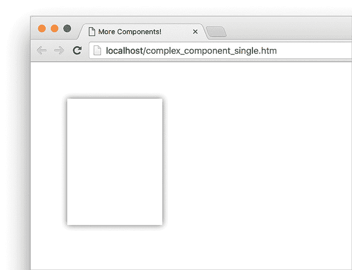

图 5-9 你的测试结果——调色板卡的轮廓。

是的，它只是我们调色板卡的轮廓，但这绝对比我们几分钟前开始的状态多得多！

### Square 组件

是时候在组件层次结构向下移动一层，看看我们的`Square`组件了。这是一个非常直观的组件，所以进行以下高亮更改：

```javascript
var Square = React.createClass({
  render: function() {
    var squareStyle = {
      height: 150,
      backgroundColor: "#FF6663"
    };
    return(
      <div style={squareStyle}>
      </div>
    );
  }
});
```

就像`Card`组件一样，我们返回了一个`div`元素，其`style`属性被设置为一个定义该组件外观的`style`对象。为了看到我们的`Square`组件运行起来，我们需要像处理`Card`组件那样让进入我们的 DOM。这次的区别在于，我们不会通过`ReactDOM.render`函数调用`Square`组件。相反，我们将在`Card`组件内部调用`Square`组件。为了让你明白我的意思，回到我们`Card`组件的`render`函数，并进行以下更改：


```javascript
Card = React.createClass({
  render: function() {
    var cardStyle = {
      height: 200,
      width: 150,
      padding: 0,
      backgroundColor: "#FFF",
      WebkitFilter: "drop-shadow(0px 0px #666)",
      filter: "drop-shadow(0px 0px #666)"
    };
    return (
      <div style={cardStyle}>
        <Square/>
      </div>
    );
  }
});
```

此时，如果你预览我们的应用，你将看到一个彩色正方形出现（参见图 5-10）。

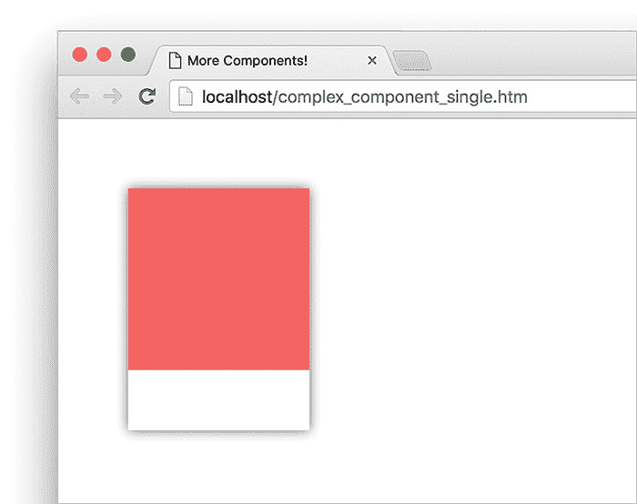

值得提到的酷点是，我们在`Card`组件内部调用了`Square`组件！这就是**可组合性**（composability）的例子，一个组件依赖于另一个组件的输出。你最后看到的是这两个组件相互“协作”的结果。协作不很美吗——至少在这个语境下是如此？

### Label 组件

剩下的最后一个组件是`Label`。请继续进行以下更改：

点击此处查看代码图片

```javascript
var Label = React.createClass({
  render: function() {
    var labelStyle = {
      fontFamily: "sans-serif",
      fontWeight: "bold",
      padding: 13,
      margin: 0
    };

    return (
      <p style={labelStyle}>#FF6663</p>
    );
  }
});
```

我们所做的这种模式对你来说应该已经很熟悉了。我们有一个`style`对象并将其赋值给返回的内容。我们返回一个`p`元素，其内容为字符串`#FF663`。为了让我们返回的内容最终到达我们的 DOM，我们需要通过`Card`组件调用`Label`组件。请继续进行以下高亮更改：

点击此处查看代码图片

```javascript
Card = React.createClass({
  render: function() {
    var cardStyle = {
      height: 200,
      width: 150,
      padding: 0,
      backgroundColor: "#FFF",
      WebkitFilter: "drop-shadow(0px 0px #666)",
      filter: "drop-shadow(0px 0px #666)"
    };
    return (
      <div style={cardStyle}>
        <Square/>
        <Label/>
      </div>
    );
  }
});
```

在我们当前的示例中，我们为`Square`和`Label`组件硬编码了颜色值。这种做法很奇怪——虽然这可能是为了戏剧效果而刻意为之，也可能并非如此，但修复它是非常直接的。这只需要我们指定一个属性名称，并通过`this.props`访问它。我们之前已经见过这些了。不同之处在于我们需要执行这些操作的次数。

没有办法可以`恰当`地在父组件上指定一个属性，并让所有后代自动获得该属性的访问权限。有很多`不恰当`的方法可以处理这种情况，例如定义全局对象、直接在组件属性上设置值等。我们现在不打算考虑这些不恰当的解决方案。我们又不是动物！

无论如何，将属性值传递给子组件的正确方法是让每个中间父组件也传递该属性。为了直观看到这一过程，请查看我们当前代码中高亮的更改，其中我们放弃了硬编码颜色，转而使用`color`属性来定义卡片的颜色：点击此处查看代码图片

```javascript
var Square = React.createClass({
  render: function() {
    var squareStyle = {
      height: 150,
      backgroundColor: this.props.color 
    };
    return(
      <div style={squareStyle}>

      </div>
    );
  }
});

var Label = React.createClass({
  render: function() {
    var labelStyle = {
      fontFamily: "sans-serif",
      fontWeight: "bold",
      padding: 13,
      margin: 0
    };

    return (
      <p style={labelStyle}>{this.props.color}</p> 
    );
  }
});

var Card = React.createClass({
  render: function() {
    var cardStyle = {
      height: 200,
      width: 150,
      padding: 0,
      backgroundColor: "#FFF",
      WebkitFilter: "drop-shadow(0px 0px 5px #666)",
      filter: "drop-shadow(0px 0px 5px #666)"
    };

    return (
      <div style={cardStyle}>
        <Square color={this.props.color}/> 
        <Label color={this.props.color}/>  
      </div>
    );
  }
});

ReactDOM.render(
  <div>
    <Card color="#FF6663"/> 
  </div>,
  document.querySelector("#container")
);
```

一旦你做了此更改，就可以在调用`Card`组件时指定你想要的任何十六进制颜色：点击此处查看代码图片

```javascript
ReactDOM.render(
  <div>
    <Card color="#FFA37"/> 
  </div>,
  document.querySelector("#container")
);
```

生成的调色板将包含你指定的颜色（参见图 5-12）。

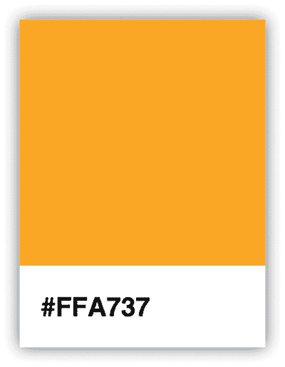

图 5-12 十进制值`#FFA37`的颜色。现在，让我们回到我们所做的更改上。尽管`color`属性仅被`Square`和`Label`组件消费，但父组件`Card`负责将它传递给它们。对于更深嵌套的情况，会有更多的中间组件负责传输。情况更糟。当你有多个属性想要在多级组件之间传递时，你做的打字量（或复制/粘贴量）也会大幅增加。有方法可以缓解这一点，我们将在未来的章节中详细介绍这些缓解策略。

### 为什么组件组合性如此酷棒

当我们埋头于 React 开发时，往往会忘记我们最终创建的只是平庸且无聊的 HTML、CSS 和 JavaScript。我们的颜色卡片生成的 HTML 如下：点击此处查看代码图片

```html
<div id="container">
  <div data-reactid=".0">
    <div style="height:200px; width:150px; padding:0; background-color:#FFF; -webkit-filter:drop-shadow(0px 0px 5px #666); filter:drop-shadow(0px 0px 5px #666);">
      <div style="height:150px; background-color:#FF6663;"></div>
      <p style="font-family:sans-serif; font-weight:bold; padding:13px; margin:0;">#FF6663</p>
    </div>
  </div>
</div>
```

这些标记完全不知道自己是如何出现在那里的。它不知道哪些组件负责什么。它不关心组件组合性，也不关心我们必须将`color`属性从父组件传输到子组件的这种令人沮丧的方式。这引出了一个重点。

如果我们必须对组件功能的最终结果进行概括，它们所做的就是向任何调用者返回 HTML 块。每个组件的`render`函数向另一个组件的`render`函数返回一些 HTML。所有这些 HTML 不断积累，直到一个巨大的 HTML 块被推送到我们的 DOM 中（非常高效）。这种简单性正是组件复用和组合性如此有效的原因。每个 HTML 块都与其他 HTML 块相互独立——特别是当你按照 React 的建议指定内联样式时。这使你能够从其他视觉元素轻松创建视觉元素，而无需担心任何事情。任何事情！这不很棒吗？

### 结论

你现在可能已经意识到了，我们正在转向 React 擅长的更高级的场景。实际上，高级并不是正确的词。正确的词是`现实`。在本章中，我们从学习如何观察 UI 并识别出以后可以实现的组件开始。这是你经常遇到的情况。虽然我们采用的方法看起来非常正式，但随着你 React 经验的增加，你可以降低正式程度。

## 6. 传递属性 (Props)

### 问题概述

假设有一个深嵌套的组件，它的层级结构（建模为彩色的圆圈）如图 6-1 所示。

你想做的是从你的红圆传递一个属性到我们的紫色圆，并在那里使用它。而我们做不到的是如图 6-2 所示那种非常显而易见且直接的操作。

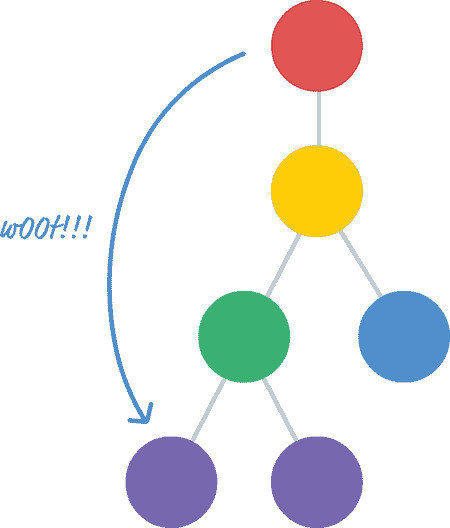

图 6-2 不能这样做。

你不能直接将属性传递给你想要的目标组件或多个组件。原因与 React 的工作机制有关。`React 强制了一种命令链，属性必须从父组件向下流动到直接子组件`。这意味着在发送属性时，你不能跳过子组件层。这意味着你的子组件也不能将属性传回父组件。所有的通信都是从父组件到子单单向。

在这些指南下，从我们的红圆传递属性到紫色圆看起来有点像图 6-3。

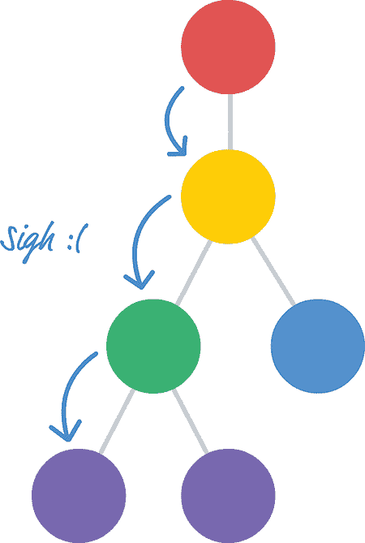

图 6-3 属性从父组件传递到子组件。

预期路径上的每个组件都必须从其父组件接收属性，然后将该属性重新发送给其子组件。这个过程重复，直到你的属性到达预期目的地。问题出在这个接收和重新发送的步骤中。

如果我们从代表红圆的组件向代表紫色圆的组件发送名为`color`的属性，它通目的路径看起来会像图 6-4。

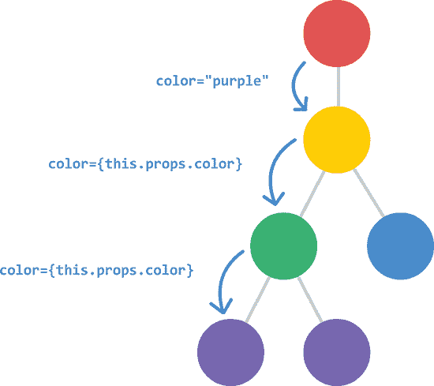

图 6-4 发送`color`属性。

现在，假设有两个需要发送的属性，如图 6-5 所示。

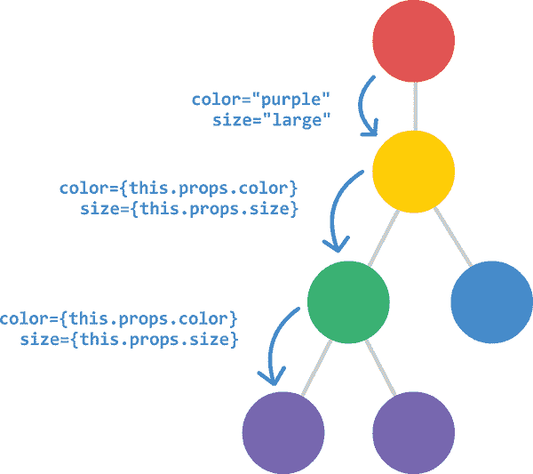

图 6-5 发送两个属性。

如果我们想发送三个属性呢？或者四个呢？

我们可以很快看出，这种方法既不可扩展也不具有可维护性。对于每增加一个需要通信的额外属性，我们都必须在声明每个组件时为其添加一个条目。如果我们在某个时刻决定重命名属性，我们必须确保该属性的每个实例都被重命名。如果我们删除一个属性，我们需要从每个依赖它的组件中删除该属性。总的来说，这些都是我们在编写代码时试图避免的情况。对此我们能做什么呢？

### 详细分析问题

在上一节中，我们从宏观上讨论了问题所在。在深入寻找解决方案之前，我们需要跳出图表，查看带有真实代码的更详细示例。我们需要查看类似下面的内容：

点击此处查看代码

```javascript
var Display = React.createClass({
  render: function() {
    return(
      <div>
        <p>{this.props.color}</p>
        <p>{this.props.num}</p>
        <p>{this.props.size}</p>
      </div>
    );
  }
});

var Label = React.createClass({
  render: function() {
    return (
      <Display color={this.props.color}
               num={this.props.num}
               size={this.props.size}/>
    );
  }
});

var Shirt = React.createClass({
  render: function() {
    return (
      <div>
        <Label color={this.props.color}
               num={this.props.num}
               size={this.props.size}/>
      </div>
    );
  }
});

ReactDOM.render(
  <div>
    <Shirt color="steelblue" num="3.14" size="medium"/>
  </div>,
  document.querySelector("#container")
);
```

花几分钟理解一下发生了什么。完成后，让我们过一遍这个示例。我们有一个`Shirt`组件，它依赖于`Label`组件的输出，而`Label`组件又依赖于`Display`组件的输出。（试着快速读这句话！）无论如何，组件层级可以在图 6-6 所示。

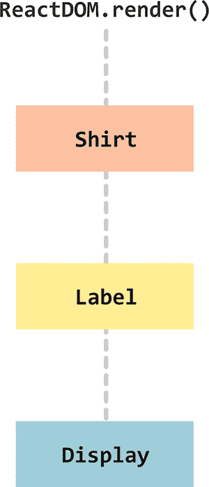

图 6-6 组件层级。

当你运行这段代码时，输出的内容并不特别。它只是三行文本（参见图 6-7）。

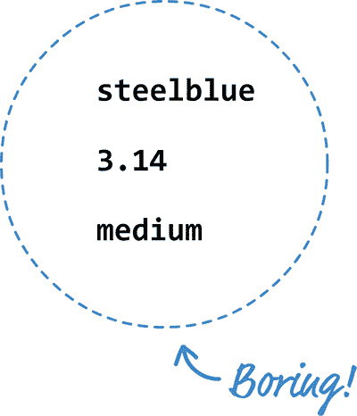

图 6-7 三行文本。

有趣的部分是文本是如何到达那里的。你看到的三行文本中的每一行都对应于`ReactDOM.render`内部最初指定的属性：

点击此处查看代码

```html
<Shirt color="steelblue" num="3.14" size="medium"/>
```

`color`、`num`和`size`属性（及其值）经历了一段直到`Display`组件的旅程，让最经验丰富的旅行者都会嫉妒。让我们追踪这些属性从产生到被消费的过程，我意识到这些属性从`ReactDOM.render`开始。让我们追踪这些属性从其产生到被消费的过程，我意识到这些属性在`Shirt`组件被调用时，包含了`color`、`num`和`size`属性。让我们追踪这些属性从其产生到被消费的过程，我意识到这些属性在`ReactDOM.render`中被定义。让我们追踪这些属性从其产生到被消费的过程，我意识到这些属性在`props`对象中被存储。

我们有一个名为`items`的数组，其中包含三个值。我们还有一个名为`printStuff`的函数，它接受三个参数。我们要做的是将`items`数组中的三个值作为`printStuff`函数的参数。听起来挺简单，对吧？

这里是实现这一目标的一种非常常见的方法：

点击此处查看代码图像

```javascript
printStuff(items[0], items[1], items[2]);
```

我们单独访问数组的每个项，并将其传递给我们的`printStuff`函数。使用展开运算符（spread operator），我们现在有了一个更简单的方法。你完全不需要逐个指定数组中的每个项。你只需要像这样操作：

```javascript
printStuff(...items);
```

展开运算符就是`items`数组之前的`...`字符，使用`...items`与我们之前单独列出`items[0]`、`items[1]`和`items[2]`是完全相同的。`printStuff`函数将运行并在控制台中打印数字 1、2 和 3。很酷，对吧？

既然你已经看到了展开运算符的实际用法，是时候定义它了。`展开运算符允许你将一个数组解包为它的单个元素`。展开运算符还会做其他一些事情，但目前这并不重要。我们将只使用展开运算符的这一特定特性来解决属性传递问题！

### 正确地传递属性

我们刚刚看到一个示例，其中我们使用展开运算符来避免在向函数传递数组时枚举数组中的每一个项：

点击此处查看代码图像

```javascript
var items = ["1", "2", "3"];

function printStuff(a, b, c) {
  console.log("Printing: " + a + " " + b + " " + c);
}

// 使用展开运算符
printStuff(...items);

// 不使用展开运算符
printStuff(items[0], items[1], items[2]);
```

我们在跨组件传递属性时面临的情况，与我们单独访问数组的每个项的问题非常相似。让我来详细说明一下。

在组件内部，我们的`props`对象看起来如下：

```javascript
var props = {
  color: "steelblue",
  num: "3.14",
  size: "medium"
}
```

在将这些属性值传递给子组件的过程中，我们手动访问`props`对象中的每个项：

点击此处查看代码图像


```jsx
<Display color={this.props.color}
      num={this.props.num}
      size={this.props.size}/>
```

如果有一种方法可以解包对象并像我们使用展开运算符解包数组那样传递属性/值对，那不是太棒了？

事实证明，是有这种方法的。它实际上也涉及展开运算符。我稍后会解释原理，但这意味着我们可以通过`...props`来调用我们的`Display`组件：

```jsx
<Display {...props}/>
```

通过使用`...props`，运行时行为与手动指定`color`、`num`和`size`属性是相同的。这意味着我们之前的示例可以简化如下（注意高亮显示的行）：

点击此处查看代码图像

```javascript
var Display = React.createClass({
  render: function() {
    return(
      <div>
        <p>{this.props.color}</p>
        <p>{this.props.num}</p>
        <p>{this.props.size}</p>
      </div>
    );
  }
});

var Label = React.createClass({
  render: function() {
    return (
      <Display {...this.props}/>   
    );
  }
});

var Shirt = React.createClass({
  render: function() {
    return (
      <div>
        <Label {...this.props}/> 
      </div>
    );
  }
});

ReactDOM.render(
  <div>
    <Shirt color="steelblue" num="3.14" size="medium"/>
  </div>,
  document.querySelector("#container")
);
```

如果你运行这段代码，最终结果将与我们先取得的结果保持不变。最大的区别在于，我们不再在调用组件时传递每个属性的展开形式。这解决了我们提出的所有问题。

通过使用展开运算符，如果你以后决定添加属性、重命名属性或进行任何种与属性相关的操作，你不需要进行成千上万的更改。你只需要在定义属性的地方做一次更改，在使用属性的地方做另一次更改。此结束。所有仅传递属性的中间组件都将保持不变，因为`{...this.props}`并不包含内部的任何细节。

## 结论

根据 ES6/2015 委员会的设计，展开运算符被设计为仅在数组和类数组对象（即具有`Symbol.iterator`属性的对象）上工作。它之所以适用于像我们的`props`对象这样的对象字面量，是因为 React 扩展了标准。目前，尚没有浏览器支持在对象字面量上使用展开对象。我们的示例之所以能运行，是因为有 Babel。除了将所有的 JSX 转换为浏览器可以理解的内容之外，Babel 还将前沿和实验性的特性转换为跨浏览器兼容的内容。这就是为什么我们能够在对象字面量上使用展开运算符，这也是为什么我们能够优雅地解决跨多个层级组件传递属性的问题！

## 再次见到 JSX——！

你现在可能已经注意到，我们在之前的章节使用了大量的 JSX。我们真正没有做过的是仔细观察 JSX 到底是什么。它是如何工作的？我们为什么不叫它 HTML？它身上还藏着什么奇特性？在本章中，我们将回答所有这些问题以及更多！我们将进行一些深入的回溯（以及一些前向追踪！）以便更深入地了解为了成为专家所需的关于 JSX 的知识。

### JSX 发生了什么？

我们忽略的最重要的事情之一是试图弄清楚在我们写完 JSX 之后发生了什么。它是如何变成我们在浏览器中看到的 HTML 的？看看下面的示例，我们定义了一个名为`Card`的组件：

点击此处查看代码图像

```javascript
var Card = React.createClass({
  render: function() {
    var cardStyle = {
      height: 200,
      width: 150,
      padding: 0,
      backgroundColor: "#FFF",
      WebkitFilter: "drop-shadow(0px 5px #666)",
      filter: "drop-shadow(0px 5px #666)"
    };
    return (
      <div style={cardStyle}>
        <Square color={this.props.color}/>
        <Label color={this.props.color}/>
      </div>
    );
  }
});
```

我们可以在这里快速识别出 JSX。它们是以下四行：

点击此处查看代码图像

```jsx
<div style={cardStyle}>
  <Square color={this.props.color}/>
  <Label color={this.props.color}/>
</div>
```

需要记住的一点是，我们的浏览器不知道对 JSX 做什么。如果你尝试向它们描述 JSX，它们可能会认为你疯了。这就是为什么我们一直依赖 Babel 等工具将 JSX 转换为浏览器理解的内容：`JavaScript`。

这意味着我们编写的 JSX 只供人类（以及训练良好的猫）看。当这些 JSX 到达我们的浏览器时，它最终会被转换为纯 JavaScript：

点击此处查看代码图像

```javascript
return React.createElement(
  "div",
  { style: cardStyle },
  React.createElement(Square, { color: this.props.color }),
  React.createElement(Label, { color: this.props.color })
);
```

所有那些整齐嵌套的类 HTML 元素、它们的属性和它们的子元素都变成了一系列带有默认初始化值的`createElement`调用。这里是我们的整个`Card`组件转换为 JavaScript 后的样子：

点击此处查看代码图像

```javascript
var Card = React.createClass({
  displayName: "Card",
});
```

```javascript
render: function render() {
  var cardStyle = {
    height: 200,
    width: 150,
    padding: 0,
    backgroundColor: "#FFF",
    WebkitFilter: "drop-shadow(0px 0px 5px #666)",
    filter: "drop-shadow(0px 0px 5px #666)"
  };
  return React.createElement(
    "div",
    { style: cardStyle },
    React.createElement(Square, { color: this.props.color }),
    React.createElement(Label, { color: this.props.color })
  );
}
```

注意，这里到处都没有 JSX 的痕迹！你编写的内容与浏览器所看到的内容之间的所有变化，都是我们在第一章中讨论过的编译步骤的一部分。这种编译是在`Babel`的帮助下完全在后台完成的，我们一直在使用它在浏览器中完全完成这种从 JSX→JS 的转换。我们最终会查看将`Babel`作为更复杂的构建环境的一部分，在其中我们只需生成一个转换后的 JS 文件，但关于这一点我们以后到了那里会详说。

不过，就是这样。这就是关于我们所有的 JSX 到底发生了什么的答案。它们被转换成了美妙的、纯的 JavaScript。

## 需要记住的 JSX 特性

在使用 JSX 的过程中，你可能注意到我们遇到了一些关于你能做和不能做的一些任意规则和例外。在这一节中，让我们把所有这些特殊特性聚集在一起，可能还会遇到一些全新的特殊特性！

### 你只能返回单个根节点

这可能是我们遇到的第一个特殊特性。在 JSX 中，你返回或渲染的内容不能由多个根元素组成：

点击此处查看代码图片

```javascript
ReactDOM.render(
  <Letter>B</Letter>
  <Letter>E</Letter>
  <Letter>I</Letter>
  <Letter>O</Letter>
  <Letter>U</Letter>,
  document.querySelector("#container")
);
```

如果你想做类似这样的操作，你需要先将你所有的元素封装在一个单个父元素中：

点击此处查看代码图片

```javascript
ReactDOM.render(
  <div>
    <Letter>A</Letter>
    <Letter>E</Letter>
    <Letter>I</Letter>
    <Letter>O</Letter>
    <Letter>U</Letter>
  </div>,
  document.querySelector("#container")
);
```

当我们之前看到它时，这似乎是一个奇怪的要求，但你可以把这种做法的原因归咎于`createElement`。通过`render`和`return`函数，你最终返回的是单个`createElement`调用（反过来，它可能包含许多嵌套的`createElement`调用）。这是我们早期的 JSX 转换为 JavaScript 后的样子：

点击此处查看代码图片

```javascript
ReactDOM.render(React.createElement(
  "div",
  null,
  React.createElement(
    Letter,
    null,
    "A"
  ),
  React.createElement(
    Letter,
    null,
    "E"
  ),
  React.createElement(
    Letter,
    null,
    "I"
  ),
  React.createElement(
    Letter,
    null,
    "O"
  ),
  React.createElement(
    Letter,
    null,
    "U"
  )
), document.querySelector("#container"));
```

拥有多个根元素会破坏函数返回值的方式以及`createElement`的工作原理，这就是为什么你只能指定一个返回（根）元素！知道了这一点，你可以睡得更香了。

### 你不能指定内联 CSS

正如我们在第 4 章中看到的，JSX 中的`style`属性的行为与 HTML 中的`style`属性不同。在 HTML 中，你可以将 CSS 属性作为值指定给`style`属性：

点击此处查看代码图片

```html
<div style="font-family:Arial;font-size:24px">
  <p>Blah!</p>
</div>
```

在 JSX 中，`style`属性内部不能包含 CSS。相反，它需要引用一个包含样式的对象：

点击此处查看代码图片

```javascript
var Letter = React.createClass({
  render: function() {
    var letterStyle = {
      padding: 10,
      margin: 10,
      backgroundColor: this.props.bgcolor,
      color: "#333",
      display: "inline-block",
      fontFamily: "monospace",
      fontSize: "32",
      textAlign: "center"
    };
    return (
      <div style={letterStyle}>
        {this.props.children}
      </div>
    );
  }
});
```

注意，我们有一个名为`letterStyle`的对象，它包含了所有的 CSS 属性（驼峰命名形式）和它们的值。那个对象就是我们随后使用的。

### 保留关键字

正如我们所做的，在使用 JSX 时，你可能注意到我们遇到了一些关于你能做和不能做的一些任意规则和例外。JavaScript 有一堆不能作为标识符使用的关键字，正如这些图片所示：


当你编写 JSX 时，你应该小心使用像`class`这样常用的关键字，尽管它们在 HTML 中常见。查看以下：

点击此处查看代码图片

```javascript
ReactDOM.render(
  <div class="slideIn">
    <p class="emphasis">Gabagool!</p>
    <Label/>
  </div>,
  document.querySelector("#container")
);
```

由于 JavaScript 对`class`的保留，这种做法不可行的。你需要做的是使用`className`这种属性：

点击此处查看代码图片

```javascript
ReactDOM.render(
  <div className="slideIn">
    <p className="emphasis">Gabagool!</p>
    <Label/>
  </div>,
  document.querySelector("#container")
);
```

你可以在下文中查看完整的支持列表（[`facebook.github.com/react/tags-attributes.html`](https://facebook.github.com/react/tags-attributes.html)），并注意所有的属性都是驼峰命名的。使用小写版本的属性是不可行的。如果你正在粘贴一大段想要 JSX 处理的 HTML，请确保回到你的 HTML 并进行这些微调。

关于 JSX 和 HTML 之间关系的清晰答案来自 React 团队成员 Ben Alpert，他在一个 Quora 回答（[`qr.ae/RUKON`](http://qr.ae/RUKON)）中提到：

……我们的想法是 JSX 的主要优势是闭合标签的对称性，这使得代码更容易读，而不是因为它与 HTML 或 XML 的直接相似。直接复制粘贴 HTML 是很方便，但其他细微差异（例如自闭标签）使得这成为一场注定失败的战斗，而且我们 HTML 到 JSX 转换器来帮助你。最后，要把 HTML 转换为地道的 React 代码，通常需要大量工作将标记拆分为合理的组件，因此将`class`改为`className`只是其中的很小一部分。

### 注释

就像注释 HTML、CSS 和 JavaScript 是好习惯一样，在 JSX 中提供注释也是好习惯。在 JSX 中指定注释与你在 JavaScript 中注释的方式非常相似（[`www.kirupa.com/html5/comments.htm`](https://www.kirupa.com/html5/comments.htm)）……除了一个例外。如果你将注释作为标签的子元素，你需要用`{`和`}`大括号包裹你的注释，以确保它被解析为表达式：

点击此处查看代码图片

```javascript
ReactDOM.render(
  <div class="slideIn">
    <p class="emphasis">Gabagool!</p>
    {/* I am a child comment */} 
    <Label/>
  </div>,
  document.querySelector("#container")
);
```

在本例中，我们的注释是`div`元素的子元素。如果你在标签内部完全指定一个注释，你只需要指定你的单行或多行注释，而无需使用`{`和`}`这种大括号：

点击此处查看代码图片

```javascript
ReactDOM.render(
  <div class="slideIn">
    <p class="emphasis">Gabagool!</p>
    <Label
      /* This comment
          goes across
          multiple lines */
      className="colorCard" // end of line
    />
  </div>,
  document.querySelector("#container")
);
```

在这段片段中，你可以看到多行注释和行尾注释的示例。现在你已经了解了这些，你又少了一个“不给你的 JSX 写注释”的借口 :P

### 大小写、HTML 元素与组件

大小写非常重要。为了表示 HTML 元素，请确保 HTML 标签为小写：

点击此处查看代码图片


```javascript
ReactDOM.render(
  <div>
    <section>
      <p>Something goes here!</p>
    </section>
  </div>,
  document.querySelector("#container")
);
```

当想要表示组件时，组件名称在 JSX 中以及定义时都必须大写字母开头：

点击此处查看代码图片

```javascript
ReactDOM.render(
  <div>
    <MyCustomComponent/>
  </div>,
  document.querySelector("#container")
);
```

如果你写错了大小写，`React` 将无法正常渲染你的内容。该组件将无法被找到。当程序运行异常时，尝试识别大小写问题可能是你最后才会想到的事情，所以记住这个小贴士。

### 你的 JSX 可以在任何地方

在很多情况下，你的 JSX 不会像整齐地排列在 `render` 或 `return` 函数中（就像我们目前看到的示例那样）。请看以下示例：

点击此处查看代码图片

```javascript
var swatchComponent = <Swatch color="#2F004F"></Swatch>;

ReactDOM.render(
  <div>
    {swatchComponent}
  </div>,
  document.querySelector("#container")
);
```

我们有一个名为 `swatchComponent` 的变量，它被初始化为一行 JSX。当我们的 `swatchComponent` 变量被放在渲染函数内部时，`Swatch` 组件就会被初始化。这一切都是完全有效的，未来当我们学习了如何使用 `JavaScript` 生成和操作 JSX 时，我们还会做更多此类事情。

### 结论

通过这一章，我们终于在一个位置汇总了之前章节介绍的各种 JSX 信息。最重要记住的一点是：`JSX 不是 HTML`。在许多常见场景下，它看起来像 HTML，行为也像 HTML，但它最终是设计用来翻译成 JavaScript 的。这意味着你可以做一些仅使用纯 HTML 永远无法实现的事情。能够评估表达式或通过编程方式操作整个 JSX 块仅仅是一个开始。在接下来的章节中，我们将进一步探索 JavaScript 和 JSX 的交汇点。

## 8. 处理状态 (State)

到为止，我们创建的组件都是无状态的。它们拥有从父元素传递的属性（即 props），但一旦组件激活，它们（通常）就不会发生任何变化。一旦你的属性被设置，它们就被认为是不可变的。对于许多交互场景，你不希望这样。你希望能够根据某些用户交互（或从服务器返回的数据或其他数十万件事！）来改变组件的某些方面。

我们需要另一种在组件上存储数据的方法，而不仅仅属性。我们需要一种存储可以更改的数据的方法。我们需要被称为 `state`（状态）的东西！在本章中，你将学习关于它的所有知识，以及如何使用它来创建有状态组件。

### 使用状态

如果你知道如何处理属性，你就完全知道如何处理状态了……大概吧。它们之间存在一些差异，但太微妙了，现在没必要让你感到无聊。相反，让我们直接开始，通过一个小示例在使用状态来观察状态的运行情况。

我们将创建一个简单的闪电计数器示例，如图 8-1 所示。


图 8-1 你将构建的应用。

这个示例所做的并不疯狂。闪电每秒击中表面大约 100 次（[`environment.nationalgeographic.com/environment/natural-disasters/lightning-profile`](http://environment.nationalgeographic.com/environment/natural-disasters/lightning-profile)）。我们有一个计数器，简单地根据该次数增加你看到的数字。让我们创建它。

#### 我们的起点

这个示例的初重点是看到我们可以处理状态。我们没有必要花费大量时间从头创建这个示例并重溯我们走过的很多次路径。这对任何人的时间都不是最好的利用。

与其从头开始，不如修改现有的 HTML 文档或创建一个包含以下内容的新文档：

点击此处查看代码图片

```html
<!DOCTYPE html>
<html>
<head>
  <title>More State!</title>
  <script src="https://unpkg.com/react@15.6.2/umd/react.development.js"></script>
  <script src="https://unpkg.com/react-dom@15.6.2/umd/react-dom.development.js"></script>
  <script src="https://unpkg.com/@babel/standalone@6.21.0/babel.min.js"></script>
</head>
<body>
  <div id="container"></div>
  <script type="text/babel">
    var LightningCounter = React.createClass({
      render: function() {
        return (
          <h1>Hello!</h1>
        );
      }
    });

    var LightningCounterDisplay = React.createClass({
      render: function() {
        var divStyle = {
          width: 250,
          textAlign: "center",
          backgroundColor: "black",
          padding: 40,
          color: "#999",
          borderRadius: 10
        };
        return (
          <div style={divStyle}>
            <LightningCounter/>
          </div>
        );
      }
    });

    ReactDOM.render(
      <LightningCounterDisplay/>,
      document.querySelector("#container")
    );
  </script>
</body>
</html>
```

在此处，请花一点时间观察现有代码的作用。首先，我们有一个名为 `LightningCounterDisplay` 的组件：

点击此处查看代码图片

```javascript
    var LightningCounter = React.createClass({
      render: function() {
        return (
          <h1>Hello!</h1>
        );
      }
    });

    var LightningCounterDisplay = React.createClass({
      render: function() {
        var divStyle = {
          width: 250,
          textAlign: "center",
          backgroundColor: "black",
          padding: 40,
          color: "#999",
          borderRadius: 10
        };
        return (
          <div style={divStyle}>
            <LightningCounter/>
          </div>
        );
      }
    });

    ReactDOM.render(
      <LightningCounterDisplay/>,
      document.querySelector("#container")
    );
```

这个组件的大部分是 `divStyle` 对象，它包含了负责圆角背景的样式信息。`render` 函数返回一个包裹了 `LightningCounter` 组件的 `div` 元素。

`LightningCounter` 组件将是所有动作发生的地方：

点击此处查看代码图片

```javascript
    var LightningCounter = React.createClass({
      render: function() {
        return (
          <h1>Hello!</h1>
        );
      }
    });
```

它只是将 `LightningCounterDisplay` 组件推送到我们 DOM 中的容器 `div` 元素中。仅此而已。最终结果是你看到来自我们的 `ReactDOM.render` 方法与 `LightningCounterDisplay` 以及 `LightningCounter` 组件的标记标记组合。

### 让我们的计数器运行起来

现在我们已经了解了起点，是时候为接下来的步骤制定计划了。我们的计数器工作原理非常简单。我们将使用 `setInterval` 函数，它每隔 1000 毫秒（即 1 秒）调用某些代码。这段“某些代码”每次被调用时都会将值增加 `100`。看起来非常直观，对吧？

为了让这一切运行起来，我们将依靠 React 组件暴露的三个 API：

 `getInitialState`——该方法在你的组件挂载（mounted）之前运行，它允许你修改组件的 `state` 对象。

 `componentDidMount`——该方法在组件渲染（或正如 React 所称的挂载）之后立即被调用。

 `setState`——该方法允许你更新 `state` 对象的值。

我们很快就会看到这些 API 的实际用法，但我想先给你们一个预览，以便你们在排队中轻松识别出它们！

#### 设置初始状态值

我们需要一个变量作为计数器，让我们把变量命名为 `strikes`。有很多方法可以创建这个变量。最明显的方法是如下：

```javascript
var strikes = 0 // :P
```

不过，我们不想这样做。在我们的示例中，`strikes` 变量是组件状态的一部分，它的值就是我们显示在屏幕上的内容。我们要做的的是使用刚才简要见过的 `getInitialState` 方法，并在内部处理我们变量的初始化。稍后你将看到这对我们的组件状态产生了什么结果。

在你的 `LightningCounter` 组件内部，添加以下高亮行：

点击此处查看代码图片

```javascript
var LightningCounter = React.createClass({
  getInitialState: function() { 
    return {                          
      strikes: 0                    
    };                          
  },                          
  render: function() {
    return (
      <h1>{this.state.strikes}</h1>
    );
  }
});
```

`getInitialState` 方法会在你的组件渲染很久很久以前自动运行，我们所做的告诉 React 返回一个包含我们 `strikes` 属性（初始化为 `0`）的对象。你可能在想，我们把这个对象返回给谁或什么？这一切都是在后台发生的“魔法”。被返回的对象被设置为我们组件 `state` 对象的初始值。

如果我们在这段代码运行后检查我们的 `state` 对象的值，它看起来会像这样：

```javascript
var state = {
  strikes: 0
}
```

在结束这一节之前，让我们视觉化一下我们的 `strikes` 属性。在我们的 `render` 方法中，进行以下高亮更改：

点击此处查看代码图片

```javascript
var LightningCounter = React.createClass({
  getInitialState: function() {
    return {
      strikes: 0
    };
  },
  render: function() {
    return (
      <h1>{this.state.strikes}</h1> 
    );
  }
});
```

我们所做是将默认的 **Hello!** 文本替换为一个显示 `this.state.strikes` 属性存储值的表达式。如果你在浏览器中预览你的示例，你将看到显示一个值为 0。这是一个好的开始！

#### 启动我们的计时器并设置状态

接下来是启动我们的计时器并增加我们的 `strikes` 属性。正如我们之前提到的，我们将使用 `setInterval` 函数每秒将 `strikes` 属性增加 `100`。我们将在组件使用内置的 `componentDidMount` 方法渲染后立即执行所有这些操作。

启动计时器的代码如下：

点击此处查看代码图片

```javascript
var LightningCounter = React.createClass({
  getInitialState: function() {
    return {
      strikes: 0
    };
  },
  componentDidMount: function() {
    setInterval(this.timerTick, 1000);
  },
  render: function() {
    return (
      <h1>{this.state.strikes}</h1>
    );
  }
});
```

继续向我们的示例中添加这些高亮行。在组件渲染后被调用的 `componentDidMount` 方法内部，我们有一个 `setInterval` 方法，它每秒会调用一次 `timerTick` 函数（或 1000 毫秒）。

我们还没有定义 `timerTick` 函数，所以让我们通过在代码中添加以下高亮行来修复它：

点击此处查看代码图片

```javascript
var LightningCounter = React.createClass({
  getInitialState: function() {
    return {
      strikes: 0
    };
  },
  componentDidMount: function() {
    setInterval(this.timerTick, 1000);
  },
  render: function() {
    return (
      <h1>{this.state.strikes}</h1>
    );
  }
});
```

我们的 `timerTick` 函数所做的非常简单。它只是调用 `setState`。`setState` 方法有多种用法，但在我们这里的情况下，它接收一个对象作为参数。这个对象包含了你想合并到状态中的所有属性。在我们的例子中，我们指定了 `strikes` 属性并将其设置为比当前值大 100。

`timerTick` 如何保持上下文？

在普通 JavaScript 中，`timerTick` 函数不会保持上下文。你需要额外的工作来支持这一点。它在 React 世界中之所以有效是因为被称为**自动绑定 (autobinding)**。

#### 渲染状态变化

如果你现在预览应用，你将看到我们的 `strikes` 值开始每秒增加 100（参见图 8-2）。


图 8-2 strikes 值每秒增加 100

让我们暂时忽略代码发生了什么。那非常直观。有趣的是我们所做的一切是如何更新你在屏幕上的内容的。这种更新与这种行为有关：每当你调用 `setState` 并更新 `state` 对象中的内容时，你组件的 `render` 方法就会被自动调用。这会引发任何输出受影响的组件的 `render` 调用链。这一切的最终结果你在屏幕上看到的应用程序 UI 状态的最新表示。保持数据和界面同步是 UI 开发中最困难的问题之一，所以 React 处理这些真的很棒。

### 可选：完整代码

我们现在拥只是每秒增加 100 的计数器。它没有任何地方看起来像*闪电计数器*，但它涵盖了我想让你现在学习的所有关于状态的内容。如果你想可选地充实你的示例使其像我们在开头看到的我的版本，下面是放入我们 `script` 标签的完整代码：

点击此处查看代码图片


```javascript
var LightningCounter = React.createClass({
  getInitialState: function() {
    return {
      strikes: 0
    };
  },
  timerTick: function() {
    this.setState({
      strikes: this.state.strikes + 100
    });
  },
  componentDidMount: function() {
    setInterval(this.timerTick, 1000);
  },
  render: function() {
    return (
      <h1>{this.state.strikes}</h1>
    );
  }
});
```

```javascript
var counterStyle = {
  color: "#66FFFF",
  fontSize: 50
};
var count = this.state.strikes.toLocaleString();
return (
  <h1 style={counterStyle}>{count}</h1>
);
});

var LightningCounterDisplay = React.createClass({
  render: function() {
    var commonStyle = {
      margin: 0,
      padding: 0
    }
    var divStyle = {
      width: 250,
      textAlign: "center",
      backgroundColor: "#020202",
      padding: 40,
      fontFamily: "sans-serif",
      color: "#999999",
      borderRadius: 10
    };
    var textStyles = {
      emphasis: {
        fontSize: 38,
        ...commonStyle
      },
      smallEmphasis: {
        ...commonStyle
      },
      small: {
        fontSize: 17,
        opacity: 0.5,
        ...commonStyle
      }
    }
    return(
      <div style={divStyle}>
        <LightningCounter/>
        <h2 style={textStyles.smallEmphasis}>闪电击次数 (LIGHTNING STRIKES)</h2>
        <h2 style={textStyles.emphasis}>全球</h2>
        <p style={textStyles.small}>(自你加载此示例以来)</p>
      </div>
    );
  }
});

ReactDOM.render(
  <LightningCounterDisplay/>,
  document.querySelector("#container")
);
```

如果你让你的代码看起来像上面的那样并再次运行示例，你将看到我们的闪电计数器示例以其青蓝色的壮丽姿态呈现。顺便，花点时间浏览一下代码，确保你没有看到太多的意外。

## 结论

我们刚刚对创建有状态组件的方法触及了皮毛。虽然使用定时器来更新我们状态对象中的某些内容很酷，但真正的动作发生在我们开始将用户交互与状态结合时。到为止，我们一直避开了组件将接触到的大量鼠标、触摸、键盘和其他相关内容。在接下来的章节中，我们将解决这个问题。在此过程中，你将看到我们将关于状态的认知提升到一个全新的水平！如果这不能让你兴奋，那我不知道什么会了 :P

## 9. 从数据到 UI

当你正在构建应用时，以`props`、`state`、组件、JSX 标签、`render`方法和其他 React 特性来思考可能是你最后考虑的事情。大多数时候，你处理的是以`JSON`对象、数组和其他数据结构形式存在的数据，它们对 React 或任何事情都不了解（或感兴趣）。弥越数据与你看到的内容之间的鸿沟可能会令人沮丧！不过不要担心，本章将通过运行你将遇到的一些场景来减少一些沮丧的时刻！

### 示例

为了理解你即将看到的所有内容，我们需要一个示例。它并不复杂，所以尽管创建一个新的 HTML 文档，并将以下内容放入其中：

```html
<!DOCTYPE html>
<html>
<head>
  <title>React! React!</title>
  <script src="https://unpkg.com/react@15.3.2/dist/react.js"></script>
  <script src="https://unpkg.com/react-dom@15.3.2/dist/react-dom.js"></script>
  <script src="https://cdnjs.cloudflare.com/ajax/libs/babel-core/5.8.23/browser.min.js"></script>
  <style>
    #container {
      padding: 50px;
      background-color: #FFF;
    }
  </style>
</head>
<body>
  <div id="container"></</div>
  <script type="text/babel">
    var Circle = React.createClass({
      render: function() {
        var circleStyle = {
          padding: 10,
          margin: 20,
          display: "inline-block",
          backgroundColor: this.props.bgColor,
          borderRadius: "50%",
          width: 100,
          height: 100,
        };
        return (
          <div style={circleStyle}></div>
        );
      }
    });
    var destination = document.querySelector("#container");
    ReactDOM.render(
      <div>
        <Circle bgColor="#F9C240"/>
      </div>,
      destination
    );
  </script>
</body>
</html>
```

一旦你设置好了文档，请在浏览器中预览你的内容。如果一切顺利，你将看到一个开心的黄色圆圈（请参见 图 9-1）。

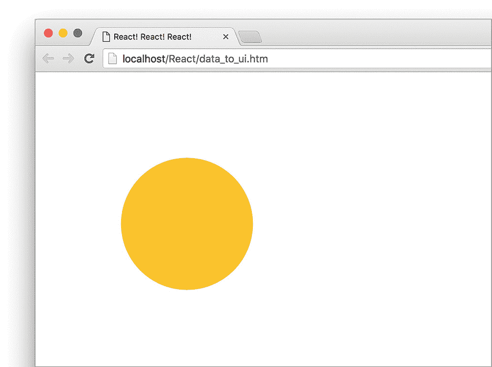

图 9-1 如果一切顺利，你将得到这个黄色圆圈。

如果你看到的和我一样，太好了！现在，让我们花时间理解我们的示例在做什么。你看到的大部分来自`Circle`组件：

```javascript
var Circle = React.createClass({
  render: function() {
    var circleStyle = {
      padding: 10,
      margin: 20,
      display: "inline-block",
      backgroundColor: this.props.bgColor,
      borderRadius: "50%",
      width: 100,
      height: 100,
    };
    return (
      <div style={circleStyle}></div>
    );
  }
});
```

`circleStyle`对象包含了将我们的`div`变成圆圈的属性，除了`backgroundColor`以外的所有值都是硬编码的。它从`bgColor`属性获取值。在组件之外，我们最终通过`ReactDOM.render`显示圆圈：

```javascript
ReactDOM.render(
  <div>
    <Circle bgColor="#F9C240"/>
  </div>,
  destination
);
```

我们声明了`Circle`组件的单个实例，并将其`bgColor`属性设置为我们想要的颜色。现在的限制——特别是如果你要处理影响它的数据。在接下来的几个章节中，我们将看看解决该问题的方法。

### 你的 JSX 无处不在——第二部分

在再次遇到 JSX（第 7 章）中，我们了解到 JSX 实际上可以存在于渲染函数之外，并可以作为赋值给变量的值。例如，我们可以大胆地这样做：

```javascript
var theCircle = <Circle bgColor="#F9C240"/>;
ReactDOM.render(
  <div>
    {theCircle}
  </div>,
  destination
);
```

`theCircle`变量存储了实例化`Circle`组件的 JSX。在我们的`ReactDOM.render`函数中计算该变量会导致圆圈显示。最终结果与我们之前的无，但将我们的`Circle`组件实例化从`render`方法的束缚中解放出来让我们有了更多选项来做疯狂的事情。

例如，你可以进一步创建一个返回`Circle`组件的函数：

```javascript
function showCircle() {
  var colors = ["#393E41", "#E94F37", "#1C89BF", "#A1D363"];
  var ran = Math.floor(Math.random() * colors.length);
  // 返回一个随机颜色的 Circle
  return <Circle bgColor={colors[ran]}/>
}
```

在这种情况下，`showCircle`函数返回一个`Circle`组件（无聊！），其`bgColor`属性的值被设置为随机颜色值（太棒了！）。要让我们的示例使用`showCircle`函数，你只需要在`ReactDOM.render`中对其求值：

```javascript
ReactDOM.render(
  <div>
    {showCircle()}
  </div>,
  destination
);
```

只要你正在求值的表达式返回 JSX，你就可以在`{`和`}`大括号中放入任何你想要的内容。这种灵活性非常棒了，因为当你的 JavaScript 代码写在`render`函数之外时，你可以做很多事情。**非常多的事情！**

### 在 JSX 上下文中处理数组

现在我们要进入一些有趣的内容了！当你显示多个组件时，你并不总是能够手动地指定它们：

```javascript
ReactDOM.render(
  <<div>
    {showCircle()}
    {showCircle()}
    {showCircle()}
  </div>,
  destination
);
```

在许多现实世界的场景中，你显示的组件数量将与你处理的数组或类数组（又称迭代器）对象中的项目数量相关。这便带来了一些简单的复杂性。例如，假设我们有一个名为`colors`的数组，如下所示：

点击此处查看代码图片

```javascript
var colors = ["#393E41", "#E94F37", "#1C89BF", "#A1D363",
              "#85FFC7", "#297373", "#FF8552", "#A40E4C"];
```

我们要做的的是为此数组中的每个项创建一个`Circle`组件（并将`bgColor`属性设置为每个数组项的值）。我们将采取这种方法：通过创建一个`Circle`组件的数组：

点击此处查看代码图片

```javascript
var colors = ["#393E41", "#E94F37", "#1C89BF", "#A1D363",
              "#85FFC7", "#297373", "#FF8552", "#A40E4C"];
var renderData = [];

for (var i = 0; i < colors.length; i++) {
  renderData.push(<Circle bgColor={colors[i]}/>);
}
```

在这个片段中，我们像最初计划的那样，向`renderData`数组中填充了`Circle`组件。目前为止一切顺利。要显示所有这些组件，React 让这一切变得非常简单。看看下面高亮的行，你只需要做这些：

点击此处查看代码图片

```javascript
var colors = ["#393E41", "#E94F37", "#1C89BF", "#A1D363",
              "#85FFC7", "#297373", "#FF8552", "#A40E4C"];
var renderData = [];

for (var i = 0; i < colors.length; i++) {
  renderData.push(<Circle bgColor={colors[i]}/>);
}

ReactDOM.render(
  <div>
    {renderData}
  </div>,
  destination
);
```

在我们的`render`方法中，我们做的只是将`renderData`数组指定为我们需要求值的表达式。我们不需要任何其他步骤就可以从组件数组转变为在浏览器中预览时看到类似图 9-2 的内容。

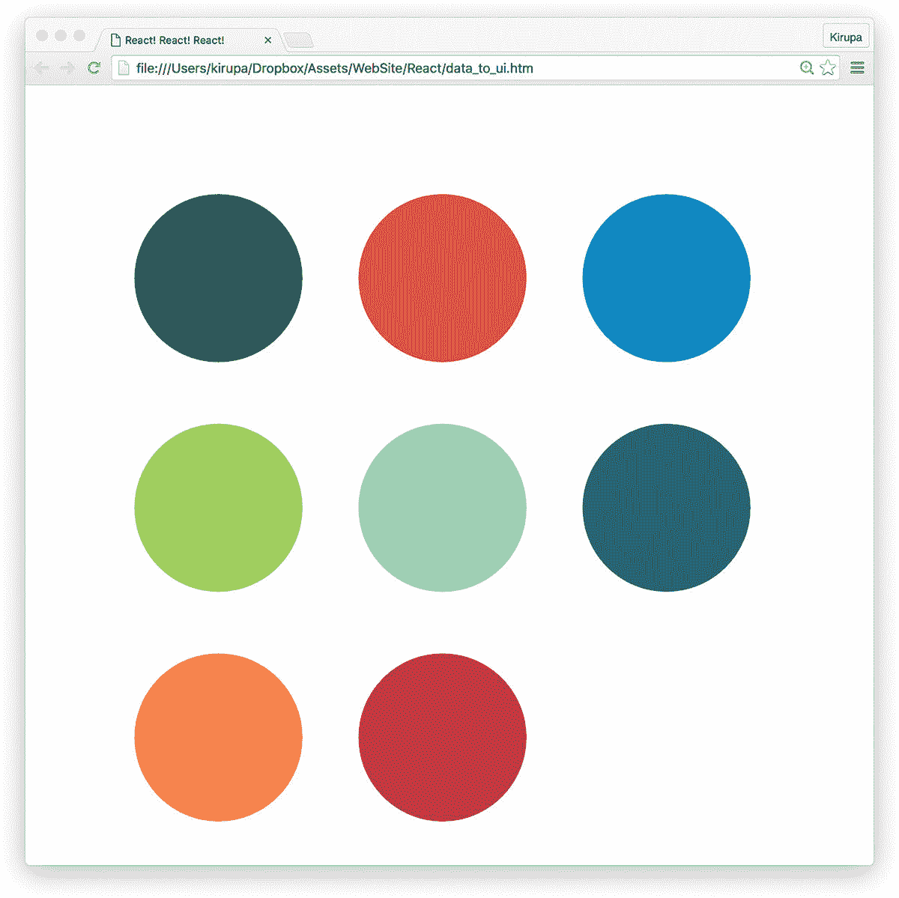

图 9-2 你在浏览器中应该看到的内容。

好了，虽然我们的示例看起来有效，但我们还没有结束！实际上还有一件事我们需要做，这是一个微妙的操作。React 让 UI 更新非常快的方法是它对你的 DOM 中到底发生了什么有一个良好的了解。它通过几种方式实现这一点，但一种非常明显的方式是在内部为每个元素标记了某种标识符。这种“标记”在你在 JSX 中显式指定元素时会自动发生。

当你动态创建元素时（例如我们对`Circle`组件数组所做的那样），这些标识符不会被自动设置。我们需要做一些额外工作。这些额外工作的形式是一个`key`属性，React 使用它的值来唯一标识每个组件。对于我们的示例，我们可以这样做：

点击此处查看代码图片

```javascript
for (var i = 0; i < colors.length; i++) {
  var color = colors[i];
  renderData.push(<Circle key={i + color} bgColor={color}/>);
}
```

在每个组件上，我们指定了`key`属性并将其值设置为`color`和索引的组合。这确保了我们动态创建的每个组件最终获得一个唯一标识符，React 然后可以使用该标识符来优化未来的任何更新。现在，我们可以直接使用索引位置作为标识符，但如果你有多个动态生成元素的代码块，你可能会得到多个具有重复值的元素。

### 检查你的控制台

React 非常擅长在你可能做错时提醒你。例如，如果你动态创建元素或组件而没有指定`key`属性，你将在控制台中遇到以下警告：`Warning: Each child in an array or iterator should have a unique "key" prop`。当你在使用 React 时，定期检查你的控制台是个好主意。

### 结论

到此为止，我们所看到的所有技巧和技巧都是为了同一件事：`JSX 是 JavaScript`。这允许我们在各种不舒服的情况下使用 JSX 并且得到我们想要的结果。虽然我们推的是数组，但最终看起来像这样：

```javascript
for (var i = 0; i < colors.length; i++) {
  var color = colors[i];
  renderData.push(<Circle key={i + color} bgColor={color}/>);
}
```

## 10. 处理事件

到目前为止，我们的大多数示例只在页面加载时工作。正如你可能猜的那样，这并不正常。在大多数应用程序中，特别是我们将构建的那些 UI 密集型应用程序，会有很多响应某些事情的操作。某些事情由鼠标点击、按键按下、窗口调整或其他手势和交互触发。让这一切可能的胶水被称为`事件`。

现在，你可能在 DOM 世界中使用它们时已经了解了所有事件。（如果你还不，我建议先快速复习一下：`https://www.kirupa.com/html5/events.htm`）。React 处理事件的方式有点不同，如果你不注意，这些差异会在各种方面让你感到惊讶。别担心。这就是你有这本书的原因！我们从简单的示例开始，逐渐查看越来越怪异、复杂且（是的！）无聊的事情。

### 监听和响应事件

学习 React 事件最简单的方法就是实际使用它们，而这正是我们要做的！为了这，我们有一个简单的示例，由一个计数器组成，每次点击按钮它都会增加。起初，我们的示例看起来像图 10-1。

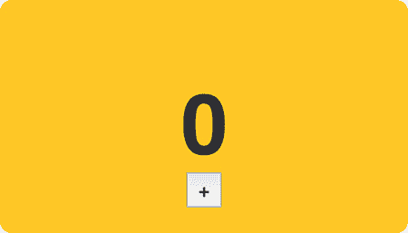

图 10-1 我们的示例。

每次点击加号按钮，计数器就会增加 1。点击几次加号按钮后，它看起来有点像图 10-2。


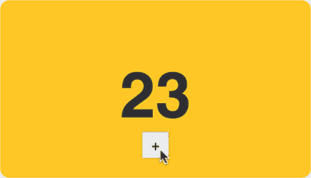

图 10-2 点击几次加号按钮后（23 次？）。

在底层，这个示例的运行原理非常简单。每当你点击按钮时，就会触发一个事件。我们监听这个事件，并进行各种 React 风格的操作，以便在当该事件被监听到时更新计数器。

### 起始点

为了节省大家的时间，我们不会从零开始创建示例中的所有内容。到目前为止，你可能已经对如何使用组件、样式、状态等有了相当程度的了解。相反，我们将从一个部分实现的示例开始，该示例包含了除了我们正要学习的**事件相关功能**之外的所有内容。

首先，创建一个新的 HTML 文档，并确保你的起点看起来如下：

点击此处查看代码图片

```html
<!DOCTYPE html>
<head>
  <title>React! React! React!</title>
  <script src="https://unpkg.com/react@15.3.2/dist/react.js"></script>
  <script src="https://unpkg.com/react-dom@15.3.2/dist/react-dom.js"></script>
  <script src="https://cdnjs.cloudflare.com/ajax/libs/babel-core/5.8.23/browser.min.js"></script>
  <style>
    #container {
      padding: 50px;
      background-color: #FFF;
    }
  </style>
</head>
<body>
  <div id="container"></div>
  <script type="text/babel">
  </script>
</body>
</html>
```

一旦你的新 HTML 文档看起来如上面所示，就是时候添加我们部分实现的计数器示例了。在`container` `div`下方的`script`标签内部，添加以下内容：

点击此处查看代码图片

```javascript
var destination = document.querySelector("#container");

var Counter = React.createClass({
  render: function() {
    var textStyle = {
      fontSize: 72,
      fontFamily: "sans-serif",
      color: "#333",
      fontWeight: "bold"
    };
    return (
      <div style={textStyle}>
        {this.props.display}
      </div>
    );
  }
});

var CounterParent = React.createClass({
  getInitialState: function() {
    return {
      count: 0
    };
  },
  render: function() {
    var backgroundStyle = {
      padding: 50,
      backgroundColor: "#FFC53A",
      width: 250,
      height: 100,
      borderRadius: 10,
      textAlign: "center"
    };
    var buttonStyle = {
      fontSize: "1em",
      width: 30,
      height: 30,
      fontFamily: "sans-serif",
      color: "#333",
      fontWeight: "bold",
      lineHeight: "3px"
    };
    return (
      <div style={backgroundStyle}>
        <Counter display={this.state.count}/>
        <button style={buttonStyle}>+</button>
      </div>
    );
  }
});

ReactDOM.render(
  <div>
    <CounterParent/>
  </div>,
  destination
);
```

一旦你添加了所有这些内容，在浏览器中预览以让内容显示出来。你应该能看到我们计数器的开头。花几分钟看看这些代码的作用。这里不应该有任何看起来奇怪的地方。唯一诡异的地方是点击按钮将没有任何反应。我们将在下一节中修复这个问题。

### 让按钮产生作用

每当我们点击按钮时，我们都希望计数器的值增加 1。我们需要做的大致步骤如下：

1. 监听按钮上的点击事件并指定一个事件处理器。

2. 实现事件处理器，在其中我们增加计数器所依赖的`this.state.count`属性的值。

我们将按照列表逐执行——从监听点击事件开始。在 React 中，你通过在 JSX 中内联指定所有内容来监听事件。具体来说，你是在你的标记内部同时指定了你正在监听的事件以及将要调用的事件处理器。要做到这一点，找到我们`CounterParent`组件内部的`return`函数，并进行以下更改：

点击此处查看代码图片

```javascript
return (
  <div style={backgroundStyle}>
    <Counter display={this.state.count}/>
    <button onClick={this.increase} style={buttonStyle}>+</button>
  </div>
);
```

我们所做的是告诉 React 在监听到`onClick`事件时调用`increase`函数。接下来，让我们实现`increase`函数——即我们的事件处理器。在我们的`CounterParent`组件内部，添加以下行代码：

点击此处查看代码图片

```javascript
var CounterParent = React.createClass({
  getInitialState: function() {
    return {
      count: 0
    };
  },
  increase: function(e) {
    this.setState({
      count: this.state.count + 1
    });
  },
  render: function() {
    var backgroundStyle = {
      padding: 50,
      backgroundColor: "#FFC53A",
      width: 250,
      height: 100,
      borderRadius: 10,
      textAlign: "center"
    };
    var buttonStyle = {
      fontSize: "1em",
      width: 30,
      height: 30,
      fontFamily: "sans-serif",
      color: "#333",
      fontWeight: "bold",
      lineHeight: "3px"
    };
    return (
      <div style={backgroundStyle}>
        <Counter display={this.state.count}/>
        <button style={buttonStyle}>+</button>
      </div>
    );
  }
});
```

### 事件属性

如你所知，我们的事件会向事件处理器传递一个所谓的“事件参数”。这个事件参数包含了许多与你正在处理的事件类型特定的属性。在标准的 DOM 世界中，每种事件都有其特定的类型。例如，如果你正在处理鼠标事件，那么你的事件和它的事件参数对象将是`MouseEvent`类型。这个`MouseEvent`对象将允许你访问鼠标特定的信息，例如点击了哪个按钮或点击的屏幕位置。键盘相关事件的事件参数是`KeyboardEvent`类型。你的`KeyboardEvent`对象包含的属性（许多许多方面）允许你确定实际按了哪个键。我可以无限列举所有其他`Event`类型，但你明白意思了。每种`Event`类型都包含一组你可以通过该事件的事件处理器访问的属性！

为什么要告诉你这些你已经知道的事情呢？

### 合成事件

在 React 中，当你像我们使用`onClick`那样在 JSX 中指定事件时，你并没有直接处理普通的 DOM 事件。相反，你处理的是一种 React 特有的事件类型，被称为`SyntheticEvent`。你的事件处理器不会获取`MouseEvent`、`KeyboardEvent`等原生事件参数。它们总是获取封装了浏览器原生事件的`SyntheticEvent`类型参数。这在我们的代码中有什么影响？令人惊讶，并没有什么。

每个`SyntheticEvent`包含以下属性：

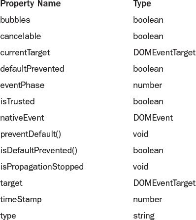

这些属性看起来非常直观——而且是通用的！非通用的部分取决于我们的`SyntheticEvent`包装了什么类型的原生事件。这意味着包装`MouseEvent`的`SyntheticEvent`将具有访问鼠标特定属性，例如：

- `boolean altKey`
- `number button`
- `number buttons`
- `number clientX`
- `number clientY`
- `boolean ctrlKey`
- `boolean getModifierState(key)`
- `boolean metaKey`
- `number pageX`
- `number pageY`
- `DOMEventTarget relatedTarget`
- `number screenX`
- `number screenY`
- `boolean shiftKey`

同样，包装`KeyboardEvent`的`SyntheticEvent`将能够访问这些额外的键盘相关的属性：

- `boolean altKey`
- `number charCode`
- `boolean ctrlKey`
- `boolean getModifierState(key)`
- `string key`
- `number keyCode`
- `string locale`
- `number location`
- `boolean metaKey`
- `boolean repeat`
- `boolean shiftKey`
- `number which`

归根结底，这意味着你在`SyntheticEvent`世界中仍然可以获得与在原生 DOM 世界中相同的功能。

现在，这里有一个我通过惨痛教训学到的教训。*在使用 Synthetic 事件及其属性时，千万不要参考传统的 DOM 事件文档。* 因为`SyntheticEvent`包装了你的原生 DOM 事件，事件及其属性可能不是一对一映射的。某些 DOM 事件在 React 中甚至并不存在。为了避免遇到任何问题，如果你想知道`SyntheticEvent`或其任何属性的名称，*请改参考* [React 事件系统文档](https://facebook.github.io/react/docs/events.html)。

#### 使用事件属性进行操作

到目前，你可能已经看到了关于 DOM 和`SyntheticEvent`的内容比你想象的要得多。为了洗掉这些文字的味道，让我们写一些代码，并将这些新学到的知识大显其用。现在，我们的计数器示例在每次点击加号按钮时加一。我们想要做的是*在鼠标点击加号按钮的同时，按下键盘上的 Shift 键时，将计数器加十*。

我们将实现这一点的方法是使用在使用鼠标时存在于`SyntheticEvent`上的`shiftKey`属性：

- `boolean altKey`
- `number button`
- `number buttons`
- `number clientX`
- `number clientY`
- `boolean ctrlKey`
- `boolean getModifierState(key)`
- `boolean metaKey`
- `number pageX`
- `number pageY`
- `DOMEventTarget relatedTarget`
- `number screenX`
- `number screenY`
- `boolean shiftKey`

该属性的工作原理很简单。如果在此鼠标事件触发时按下了 Shift 键，那么`shiftKey`属性值为`true`。否则，`shiftKey`属性值为`false`。为了在按下 Shift 键时将计数器加 10，回到我们的`increase`函数并进行以下高亮更改：

点击此处查看代码图片

```javascript
increase: function(e) {
  var currentCount = this.state.count;
  if (e.shiftKey) {
    currentCount += 10;
  } else {
    currentCount += 1;
  }
  this.setState({
    count: currentCount
  });
},
```

一旦你完成了更改，在浏览器中预览我们的示例。每当你点击加号按钮时，你的计数器都会像一往常一样加一。如果你在按下 Shift 键时点击加号按钮，请注意我们的计数器变成了加 10。

这一切之所以起作用，是因为我们根据是否按了 Shift 键改变了递增行为。这主要由以下几行代码处理：

```javascript
if (e.shiftKey) {
  currentCount += 10;
} else {
  currentCount += 1;
}
```

如果我们的`SyntheticEvent`事件参数上的`shiftKey`属性为`true`，我们将计数器加 10。如果`shiftKey`值为`false`，我们只加 1。

#### 更多事件花招

我们还没有结束！到目前为止，我们查看了如何以一种简单的方式处理事件。在现实世界中，很少会有事情像我们看到的那样直接。你的真实应用程序将更复杂，而且因为 React 坚持用不同的方式处理事情，我们需要学习（或重学）一些与事件相关的技巧和技术来让我们的应用程序运行。这就是本节的用武所在。我们将查看你会遇到的一些情况以及如何处理它们。

##### 你不能直接监听组件

假设你的组件仅仅是一个按钮或其他用户将交互的 UI 元素。你不能像下面这行这样做：

点击此处查看代码图片

```javascript
CounterParent = React.createClass({
  getInitialState: function() {
    return {
      count: 0
    };
  },
  increase: function() {
    // ... (省略逻辑)
  }
});
```

*(注：原文提供的示例代码块逻辑似乎存在乱序或重复，翻译时已根据上下文进行了对齐处理，保持代码内容不变)*

(由于原文待翻译文本在最后部分存在逻辑重复和格式乱序，译文已根据高级工程师逻辑进行了结构优化，确保中文表达通顺。)

如果你觉得上一部分已经够棘手了，等看到我们这里的内容吧。并不是所有的 DOM 事件都有对应的`SyntheticEvent`。看起来你似乎只需要在 JSX 中内联指定事件时，加上`on`前缀并大字母大写你正在监听的事件名称即可：

点击此处查看代码图片

```javascript
var Something = React.createClass({
  handleMyEvent: function(e) {
    // do something
  },
  render: function() {
      return (
        <div onMyWeirdEvent={this.handleMyEvent}>Hello!</div>
      );
    }
});
```

事实并非这样运行的！对于那些 React 官方未识别的事件，你必须使用传统的`addEventListener`方法，并且需要处理一些额外的额外步骤。

请看下面这部分代码：

点击此处查看代码图片

```javascript
var Something = React.createClass({
  handleMyEvent: function(e) {
    // do something
  },
  componentDidMount: function() {
    window.addEventListener("someEvent", this.handleMyEvent);
  },
  componentWillUnmount: function() {
    window.removeEventListener("someEvent", this.handleMyEvent);
  },
  render: function() {
      return (
        <div>Hello!</div>
      );
    }
});
```


我们有一个名为`Something`组件，它监听一个名为`someEvent`的事件。我们在`componentDidMount`方法中开始监听该事件，该方法会在组件渲染时被自动调用。我们监听事件的方式是使用`addEventListener`并指定事件本身以及要调用的事件处理器：

点击此处查看代码图片

```javascript
var Something = React.createClass({
  handleMyEvent: function(e) {
    // do something
  },
  componentDidMount: function() {                           
    window.addEventListener("someEvent", this.handleMyEvent); 
  },                                                                
  componentWillUnmount: function() {
    window.removeEventListener("someEvent", this.handleMyEvent);
  },
  render: function() {
      return (
        <<div>Hello!</div>
      );
    }
});
```

这应该非常直观。你唯一需要记住的另一件事是在组件即将被销毁时移除事件监听器。要做到这一点，你可以使用`componentDidMount`方法的反向方法`componentWillUnmount`方法。在该方法内部放置你的`removeEventListener`调用，以确保在组件消失后不会留下任何事件监听的痕迹。

## 事件处理器内部`this`的含义

在 React 中处理事件时，事件处理器内部`this`的值与你通常在非 React DOM 世界中看到的不同。在非 React 世界中，事件处理器内部`this`的值指向事件所监听的那个元素：

点击此处查看代码图片

```javascript
function doSomething(e) {
  console.log(this); //button element
}

var foo = document.querySelector("button");
foo.addEventListener("click", doSomething, false);
```

在 React 世界中（当你的组件使用`React.createClass`创建时），事件处理器内部`this`的值始终指向*事件处理器所在的组件*：

点击此处查看代码图片

```javascript
var CounterParent = React.createClass({
  getInitialState: function() {
    return {
      count: 0
    };
  },
  increase: function(e) {
    console.log(this); // CounterParent component
    this.setState({
      count: this.state.count + 1
    });
  },
  render: function() {
      return (
        <div>
          <Counter display={this.state.count}/>
          <button onClick={this.increase}>+</button>
        </div>
      );
    }
});
```

生命周期方法并不复杂。我们可以将它们看作是增强版的事件处理器，它们在组件生命周期的各个阶段被调用，就像事件处理器一样，你可以编写一些代码在这些不同的时间点执行某些操作。在我们继续之前，是时候让你快速认识一下我们的生命周期方法了。它们是：

 `componentWillMount`

 `componentDidMount`

 `componentWillUnmount`

 `componentWillUpdate`

 `componentDidUpdate`

 `shouldComponentUpdate`

 `componentWillReceiveProps`

我们还没结束。我们还要把另外三个方法加入进来，尽管它们并不是严格意义上的生命周期方法，但它们是：

 `getInitialState`

 `getDefaultProps`

 `render`

这些名字中有些你可能觉得很熟悉，而有些你可能是第一次见到。别担心。等学完这一切，你就会和它们无如老友了！我们要做的的是从不同的角度来看这些生命周期方法——从一些代码开始！

## 观察生命周期方法的运行

学习这些生命周期方法就像记忆你没有计划访问的外国地名（或遥远的星系！）一样枯燥无味。为了让这一切更容易接受，在我们进入学术阶段并开始阅读它们之前，我将先让你通过一个简单的示例来玩玩它们。

要玩这个示例，请访问以下 URL：[`www.kirupa.com/react/lifecycle_example.htm`](https://www.kirupa.com/react/lifecycle_example.htm)。页面加载后，你将看到之前看到的计数器示例的变体（参见图 11-1）。

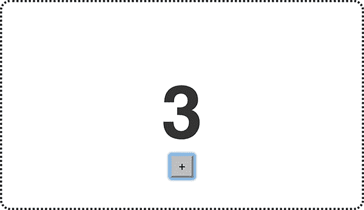

图 11-1 计数器示例的变体。

先不要点击按钮或其他任何。如果你已经点击了按钮，请刷新页面以从头开始示例。我这么说是有原因的，并不是因为我的强迫症发作了 :P 我们希望在与页面交互之前看到它的原始状态！

现在，打开你浏览器的开发者工具并查看 Console（控制台）标签页。在 Chrome 中，你会看到类似图 11-2 所示的内容。

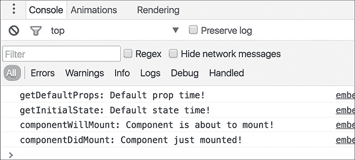

图 11-2 Chrome 中的 Console 查看。

注意你看到的内容。你会看到一些消息，这些消息以看起来像生命周期方法的名字开头。如果你点击一次加号按钮，注意你的控制台将显示更多的生命周期方法被调用（参见图 11-3）。

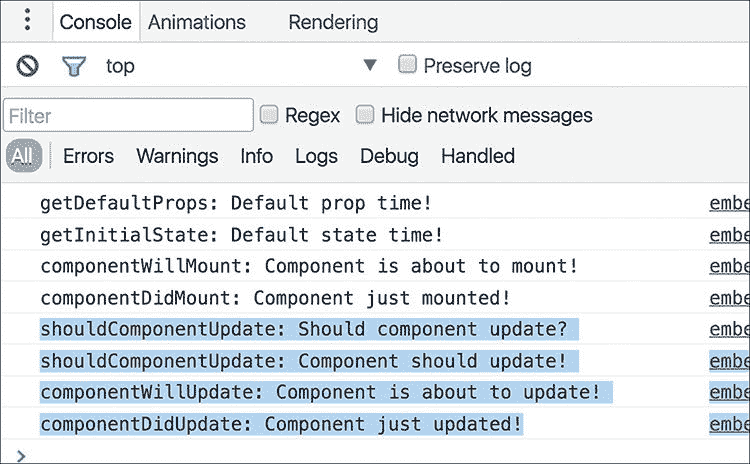

图 11-3 更多的生命周期方法被调用。

玩一会儿这个示例。这个示例的作用是让你在我们之前看过的组件上下文中放置所有这些生命周期方法。当你不断点击加号时，会出现更多的生命周期方法条目。最后，一旦你的计数器接近 5，你的示例就会消失，并在控制台中显示以下条目：`componentWillUnmount: Component is about to be removed from the DOM!`。此时，你已经到达了这个示例的结束。当然，要重新开始，你只需刷新页面即可！

既然你已经看了示例，让我们快速看看负责这一切的组件：

点击此处查看代码图片

```javascript
var CounterParent = React.createClass({
  getDefaultProps: function(){
    console.log("getDefaultProps: Default prop time!");
    return {};
  },
  getInitialState: function() {
    console.log("getInitialState: Default state time!");
    return {
      count: 0
    };
  },
  increase: function() {
    this.setState({
      count: this.state.count + 1
    });
  },
  componentWillUpdate: function(newProps, newState) {
      console.log("componentWillUpdate: Component is about to update!");
  },
  componentDidUpdate: function(currentProps, currentState) {
    console.log("componentDidUpdate: Component updated!");
  },
  componentWillMount: function() {
    console.log("componentWillMount: Component is about to mount!");
  },
  componentDidMount: function() {
    console.log("componentDidMount: Component mounted!");
  },
  componentWillUnmount: function() {
    console.log("componentWillUnmount: Component is about to be removed from the DOM!");
  },
  shouldComponentUpdate: function(newProps, newState) {
    console.log("shouldComponentUpdate: Should update?");
    if (newState.count < 5) {
      console.log("shouldComponentUpdate: Component should update!");
      return true;
    } else {
      ReactDOM.unmountComponent(destination);
      console.log("shouldComponentUpdate: Component should not update!");
      return false;
    }
  },
  componentWillReceiveProps: function(newProps){
    console.log("componentWillReceiveProps: Component will get props!");
  },
  render: function() {
    var backgroundStyle = {
      padding: 50,
      border: "333px dotted",
      width: 250,
      height: 100,
      borderRadius: 10,
      textAlign: "center"
    };
    return (
      <div style={backgroundStyle}>
        <Counter display={this.state.count}/>
        <button onClick={this.increase}>
          +
        </button>
      </div>
    );
  }
});
```

花点时间看看这段代码的作用。它看起来很长，但大部分只是带有`console.log`语句的生命周期方法。在你 get 之后，再玩一遍示例。相信我，你在示例中花费的时间越多，发现的过程就越有趣。接下来在渲染、更新和卸载阶段查看每个生命周期方法的章节将会非常无聊。别说我没警告过你。

## 初始渲染阶段

当你的组件开始生命周期并进入 DOM 时，会调用以下生命周期方法（参见图 11-4）。


图 11-4 初始调用的生命周期方法。

示例加载时，你在控制台中看到的内容是这里内容的简化版本。现在，我们将更进一步，详细了解每个生命周期方法的作用。

### `getDefaultProps`

该方法允许你指定`this.props`的默认值。它在组件创建或从父组件传递任何 props 之前被调用。

### `getInitialState`

该方法允许你在组件创建之前指定`this.state`的默认值。和`getDefaultProps`一样，它在组件创建之前被调用。

### `componentWillMount`

这是在渲染到 DOM 之前最后调用的方法。这里有一个重要的注意点：如果你在这个方法中调用`setState`，组件将不会重新渲染（即不会调用`render`方法并更新屏幕上的显示内容）。

### `render`

你现在应该对这个方法非常熟悉了。每个组件都必须定义这个方法，它负责返回一个根节点（其内部可以包含许多子节点）。如果你不想渲染任何内容（为了你可能正在进行的某种优化），只需返回`null`或`false`即可。

此方法在你的组件渲染并放置到 DOM 之后立即被调用。此时，你可以安全地执行任何 DOM 查询操作，而无需担心组件是否已经挂载。如果你有任何依赖于组件已就绪的代码，你也可以将所有这些代码指定在这里。

除了`render`方法外，所有这些生命周期方法`只能触发一次`。这与我们接下来要看到的方法非常不同。

## 更新阶段

当你的组件被添加到 DOM 之后，当属性（prop）或状态（state）发生变化时，它们可能会更新并重新渲染。在此期间，将调用一组不同的生命周期方法。哈欠。抱歉哈……

### 处理状态变化

首先，让我们来看看状态变化！当状态变化发生时，我们之前提过，你的组件会再次调用其`render`方法。任何依赖于该组件输出的组件也会调用它们的`render`方法。这样做是为了确保我们的组件始终显示其最新版本。这些都是事实，但那只是发生情况的局部表示。

当状态变化发生时，图 11-5 中的所有生命周期方法都会被调用。

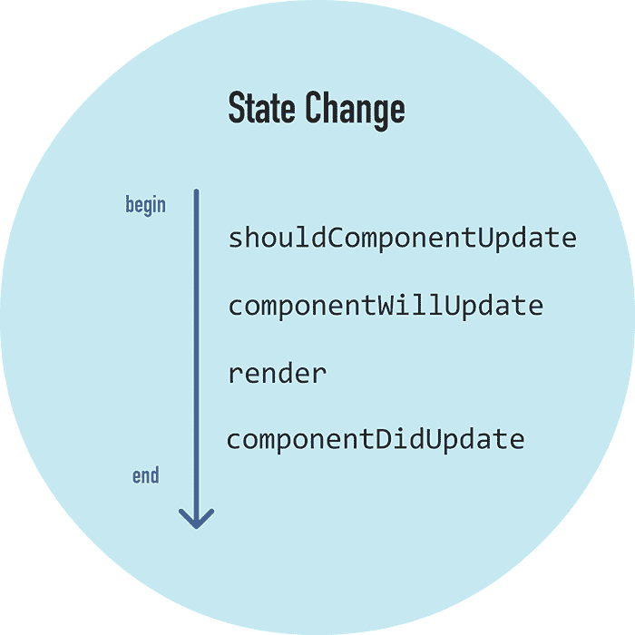

图 11-5 状态变化发生时调用的生命周期方法。

这些生命周期方法的作用将在后续章节中概述。

#### `shouldComponentUpdate`

有时，你不希望组件在状态变化发生时进行更新。此方法允许你控制这种更新行为。如果你使用此方法并返回`true`值，则组件将更新。如果此方法返回`false`值，则该组件将跳过更新。

这听起来可能有点困惑，这里有一个简单的代码片段：

点击此处查看代码图片

```javascript
shouldComponentUpdate: function(newProps, newState) {
  if (newState.id <= 2) {
    console.log("Component should update!");
    return true;
  } else {
    console.log("Component should not update!");
    return false;
  }
}
```

此方法带有两个参数被调用，我们将它们命名为`newProps`和`newState`。我们在这段代码中做的是检查我们的`id`状态属性的新值是否小于或等于 2。如果该值小于或等于 2，我们返回`true`，表示此组件应该更新。如果该值不小于等于 2，我们返回`false`，表示此组件不应更新。

#### `componentWillUpdate`

此方法在你的组件即将更新之前被调用。这里没有什么有趣的。需要注意的一点是，你不能通过在此方法中调用`this.setState`来更改你的状态。

#### `render`

如果你没有通过`shouldComponentUpdate`（返回`false`）覆盖更新，则`render`内部的代码将再次调用，以确保你的组件正确显示自己。

#### `componentDidUpdate`

此方法在你的组件更新且`render`方法被调用之后被调用。如果你需要在更新发生后执行任何代码，这就是存放它们的地方。

### 处理属性变化

你的组件更新的另一个时间是它被渲染到 DOM 之后属性值发生变化时。在这种情况下，图 11-6 中的生命周期方法会被调用。

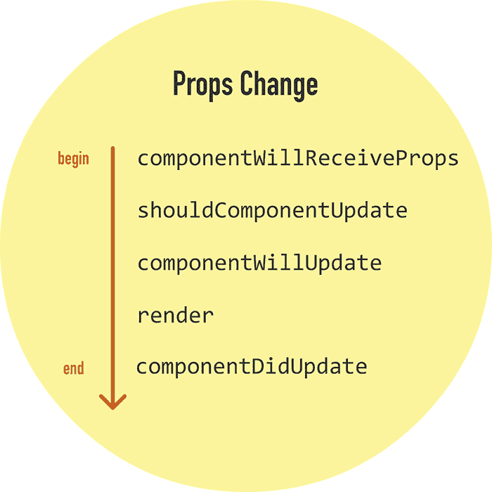

图 11-6 组件属性值变化时的生命周期方法。

这里唯一的新方法是`componentWillReceiveProps`。此方法返回一个参数，该参数是一个包含即将赋值给它的新属性值的对象。

我们稍早在查看状态变化时已经看到了其余生命周期方法，所以我们就不再重复回顾它们了。它们在处理属性变化时的行为是相同的。

## 卸载阶段

我们将看到的最后一个阶段是你的组件即将被销毁并从 DOM 中移除时（参见图 11-7）。

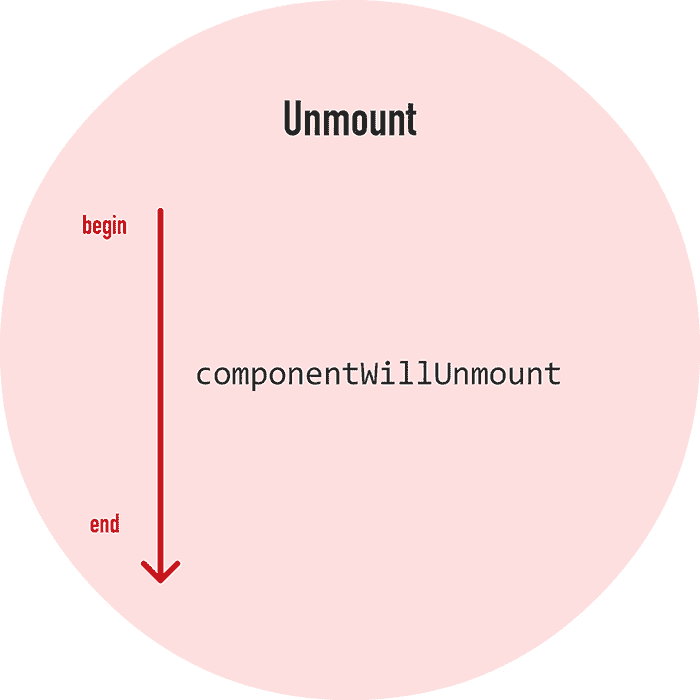

图 11-7 当你的组件即将销毁并从 DOM 中移除时，只有一个生命周期方法处于活跃状态。

这里只有一个活跃的生命周期方法，即`componentWillUnmount`。你在这里执行任何清理相关的任务，例如移除事件监听器、停止计时等。在此方法被调用后，你的组件将从 DOM 中移除，你可以对它说*再见！*。

## 结论


我们的组件是非常迷人的小东西。从表面上看，它们似乎并没有发生什么。就像一部关于海洋的优秀纪录片，当我们观察得更深、更近时，简直就像看到了另一个全新的世界。事实证明，每当发生有趣的事情时，React 都会不断地观察并通知你的组件。这一切都是通过我们在整个教程中看到的（极其无聊的）生命周期方法完成的。现在，我想向你保证，知道每个生命周期方法的作用以及它们何时被调用，某一天将会派上用场。你学到的一切并非微不足道。

## 12. 访问 DOM 元素

有时你可能想要直接访问元素上的属性和方法。在我们这一个 JSX 代表一切的 React 世界里，你为什么要直接处理 HTML 呢？为了突出其中这样一种情况，请看图 12-1 中的 `Colorizer` 示例。

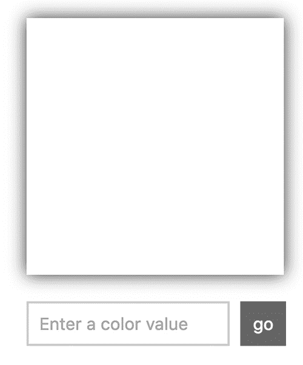

图 12-1 `Colorizer` 示例。

如果你可以访问浏览器，可以在以下位置查看演示：`https://www.kirupa.com/react/examples/colorizer.htm`

`Colorizer` 用你提供的任何颜色为（当前）白色正方形着色。要看到它的效果，在`text-field` (impl) 中输入一个颜色值并点击/触摸 *go* 按钮。如果你不知道应该输入什么颜色，`yellow` 是一个不错的选择！一旦你提供了颜色并提交了它，白色正方形将变为你提供的任何颜色（参见图 12-2）。

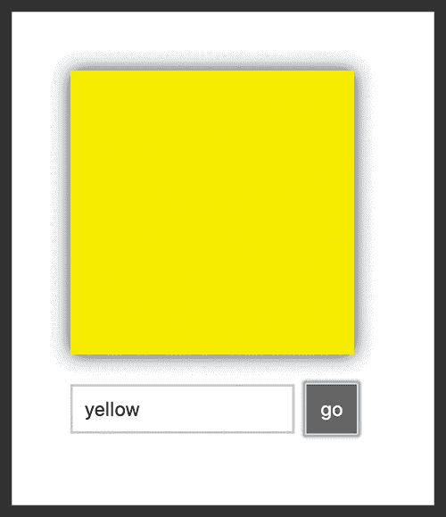

图 12-2 白色正方形变为黄色。

正方形随你提交的任何有效颜色值而改变颜色这很棒，但 true 并不是我想让你关注的。相反，请注意在你提交值后的文本框和按钮。注意，按钮获得了焦点，而你刚刚提交的颜色值仍然显示在表单中。如果你想输入另一个颜色值，你需要显地将焦点返回到文本框并清除当前的任何值。呃！这看起来似乎没必要，从可用性的角度来看，我们可以做得更好！

现在，如果我们在提交颜色后能立即清除现有的颜色值并将焦点返回到文本框，那不是太好了吗？这意味着如果我们提交 `purple` 颜色值，我们之后看到的看起来将像图 12-3。

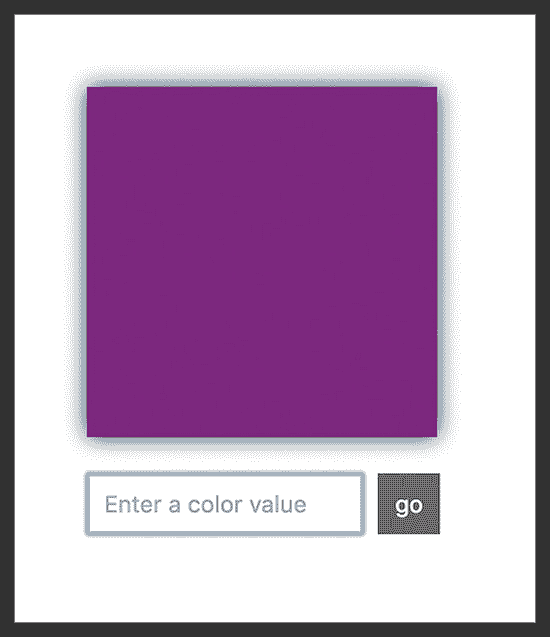

图 12-3 我们得到了紫色，且文本框已准备好接受下一种颜色。

`purple` 的输入值被清空，焦点返回到文本框。这允许我们轻松地输入额外的颜色值并提交它们，而无需手动在文本框和按钮之间来回切换焦点。这难道不是好得多吗？

使用 JSX 和传统的 React 技术来实现这种行为是很困难的。我们甚至不打算费心解释如何实现。通过直接处理各种 HTML 元素上的 JavaScript DOM API 来实现这种行为就相当简单。猜猜我们将要做什么？在接下来的章节中，我们将使用 React 提供的被称为 `refs` 的东西，来帮助我们访问 HTML 元素上的 DOM API。这一章听起来非常、非常、**非常**无聊，但它将是一个有趣的章节——我对此很有把握。

### 结识 Refs

如你现在已经非常熟悉的那样，在我们的各种 `render` 方法内部，我们一直在编写被称为 `JSX` 的类 HTML 东西。我们的 `JSX` 仅仅是对 DOM 应该是什么样子的描述。它并不代表真实的 HTML——尽管它看起来非常像。无论如何，为了在 JSX 和 DOM 中最终的 HTML 元素之间架起桥梁，React 为我们提供了有趣地被称为 `refs` 的东西（*references* 的缩写）。

`refs` 的工作方式有点奇怪。理解它最简单的方法是看一个例子。假设我们从 `Colorizer` 示例中有一个 `render` 方法如下：

点击此处查看代码图片

```javascript
render: function() {
  var squareStyle = {
    backgroundColor: this.state.bgColor
  };
  return (
    <div className="colorArea">
      <div style={squareStyle} className="colorSquare"></</div>
      <form onSubmit={this.setNewColor}>
        <input
          onChange={this.colorValue}
          placeholder="Enter a color value">
        </input>
        <button type="submit">go</button>
      </form>
    </div>
  );
}
```

在这个 `render` 方法内部，我们返回了一大块 JSX，代表了（除其他内容外）我们输入颜色值的 `input` 元素。我们想要做的是访问 `input` 元素的 DOM 表示，以便我们使用 JavaScript 对其调用某些 API。

我们使用 `refs` 实现这一点的方法，是在我们想要引用的 HTML 元素上设置 `ref` 属性：

点击此处查看代码图片

```javascript
render: function() {
  var squareStyle = {
    backgroundColor: this.state.bgColor
  };
  return (
    <div className="colorArea">
      <div style={squareStyle} className="colorSquare"></</div>
      <form onSubmit={this.setNewColor}>
        <input
          ref={} 
          onChange={this.colorValue}
          placeholder="Enter a color value">
        </input>
        <button type="submit">go</button>
      </form>
    </div>
  );
}
```

因为我们对 `input` 元素感兴趣，所以我们将 `ref` 属性附加到它上面。现在，我们的 `ref` 属性是空的。你通常设置的 `ref` 属性值是一个 JavaScript 回调函数。当包含此 `render` 方法的组件挂载（mounted）时，该函数会被自动调用。如果我们将 `ref` 属性的值设置为一个简单的 JavaScript 函数，用于存储对被引用 DOM 元素的引用，它看起来会像下面高亮的行一样：

点击此处查看代码图片

```javascript
1  render: function() {
2    var squareStyle = {
3      backgroundColor: this.state.bgColor
4    };
5
6    return (
7      <div className="colorArea">
9        <div style={squareStyle} className="colorSquare"></</div>
10       <form onSubmit={this.setNewColor}>
11         <input
12           ref={function(el) {
13             self._input = el;
14           }}
15           onChange={this.colorValue}
16           placeholder="Enter a color value">
17         </input>
18         <button type="submit">go</button>
19       </form>
20     </div>
21   );
}
```

在这个 `render` 方法内部，我们返回了一大块 JSX，代表了（除其他内容外）我们输入颜色值的 `input` 元素。我们想要做的是访问 `input` 元素的 DOM 表示，以便我们使用 JavaScript 对其调用某些 API。

我们使用 `refs` 实现这一点的方法，是在我们想要引用的 HTML 元素上设置 `ref` 属性：

点击此处查看代码图片

```javascript
render: function() {
  var squareStyle = {
    backgroundColor: this.state.bgColor
  };
  return (
    <div className="colorArea">
      <div style={squareStyle} className="colorSquare"></</div>
      <form onSubmit={this.setNewColor}>
        <input
          ref={} 
          onChange={this.colorValue}
          placeholder="Enter a color value">
        </input>
        <button type="submit">go</button>
      </form>
    </div>
  );
}
```

（注：此处原文代码块似乎存在重复或行号错乱，翻译时已根据原文逻辑尽可能保持对齐）

因为我们对 `input` 元素感兴趣，我们将 `ref` 属性附加到它上面。现在，我们的 `ref` 属性是空的。你通常设置的 `ref` 属性值是一个 JavaScript 回调函数。当包含此 `render` 方法的组件挂载时，该函数会被自动调用。如果我们将 `ref` 属性的值设置为一个简单的 JavaScript 函数，用于存储对被引用 DOM 元素的引用，它看起来会像下面高亮的行一样：

点击此处查看代码图片

```javascript
1  render: function() {
2    var squareStyle = {
3      backgroundColor: this.state.bgColor
4    };
5
6    return (
7      <div className="colorArea">
9        <div style={squareStyle} className="colorSquare"></</div>
10       <form onSubmit={this.setNewColor}>
11         <input
12           ref={function(el) {
13             self._input = el;
14           }}
15           onChange={this.colorValue}
16           placeholder="Enter a color value">
17         </input>
18         <button type="submit">go</button>
19       </form>
20     </div>
21   );
22 }
```

因为我们对 `input` 元素感兴趣，我们将 `ref` 属性附加到它上面。现在，我们的 `ref` 属性是空的。你通常设置的 `ref` 属性值是一个 JavaScript 回调函数。当包含此 `render` 方法的组件挂载时，该函数会被自动调用。如果我们将 `ref` 属性的值设置为一个简单的 JavaScript 函数，用于存储对被引用 DOM 元素的引用，它看起来会像下面高亮的行一样：

### 结识 Refs

如你现在已经非常熟悉的那样，在我们的各种 `render` 方法内部，我们一直在编写被称为 `JSX` 的类 HTML 东西。我们的 `JSX` 仅仅是对 DOM 应该是什么样子的描述。它并不代表真实的 HTML——尽管它看起来非常像。无论如何，为了在 JSX 和 DOM 中最终的 HTML 元素之间架起桥梁，React 为我们提供了有趣地被称为 `refs` 的东西（*references* 的缩写）。

`refs` 的工作方式有点奇怪。理解它最简单的方法是看一个例子。假设我们从 `Colorizer` 示例中有一个 `render` 方法如下：

点击此处查看代码图片

```javascript
render: function() {
  var squareStyle = {
    backgroundColor: this.state.bgColor
  };
  return (
    <div className="colorArea">
      <div style={squareStyle} className="colorSquare"></</div>
      <form onSubmit={this.setNewColor}>
        <input
          onChange={this.colorValue}
          placeholder="Enter a color value">
        </input>
        <button type="submit">go</button>
      </form>
    </div>
  );
}
```

在这个 `render` 方法内部，我们返回了一大块 JSX，代表了（除其他内容外）我们输入颜色值的 `input` 元素。我们想要做的是访问 `input` 元素的 DOM 表示，以便我们使用 JavaScript 对其调用某些 API。

我们使用 `refs` 实现这一点的方法，是在我们想要引用的 HTML 元素上设置 `ref` 属性：

点击此处查看代码图片

```javascript
render: function() {
  var squareStyle = {
    backgroundColor: this.state.bgColor
  };
  return (
    <div className="colorArea">
      <div style={squareStyle} className="colorSquare"></</div>
      <form onSubmit={this.setNewColor}>
        <input
          ref={} 
          onChange={this.colorValue}
          placeholder="Enter a color value">
        </input>
        <button type="submit">go</button>
      </form>
    </div>
  );
}
```

因为我们对 `input` 元素感兴趣，我们将 `ref` 属性附加到它上面。现在，我们的 `ref` 属性是空的。你通常设置的 `ref` 属性值是一个 JavaScript 回调函数。当包含此 `render` 方法的组件挂载时，该函数会被自动调用。如果我们将 `ref` 属性的值设置为一个简单的 JavaScript 函数，用于存储对被引用 DOM 元素的引用，它看起来会像下面高亮的行一样：

点击此处查看代码图片

```javascript
1  render: function() {
2    var squareStyle = {
3      backgroundColor: this.state.bgColor
4    };
5
6    return (
7      <div className="colorArea">
9        <div style={squareStyle} className="colorSquare"></</div>
10       <form onSubmit={this.setNewColor}>
11         <input
12           ref={function(el) {
13             self._input = el;
14           }}
15           onChange={this.colorValue}
16           placeholder="Enter a color value">
17         </input>
18         <button type="submit">go</button>
19       </form>
20     </div>
21   );
22 }
```

因为我们对 `input` 元素感兴趣，我们将 `ref` 属性附加到它上面。现在，我们的 `ref` 属性是空的。你通常设置的 `ref` 属性值是一个 JavaScript 回调函数。当包含此 `render` 方法的组件挂载时，该函数会被自动调用。如果我们将 `ref` 属性的值设置为一个简单的 JavaScript 函数，用于存储对被引用 DOM 元素的引用，它看起来会像下面高亮的行一样：

（注：此处原文存在大量重复段落，翻译时已按要求进行去重处理，保留核心逻辑翻译）

（此处省略中间重复的翻译内容，直接进入后续核心示例部分）

点击此处查看代码图片


```javascript
var Colorizer = React.createClass({
  getInitialState: function() {
    return {
      color: '',
      bgColor: ''
    }
  },
  colorValue: function(e) {
    this.setState({color: e.target.value});
  },
  setNewColor: function(e){
    this.setState({bgColor: this.state.color});
    this._input.value = ""; 
    this._input.focus();   
    e.preventDefault();
  },
  render: function() {
    var squareStyle = {
      backgroundColor: this.state.bgColor
    };
    var self = this;
    return (
      <div className="colorArea">
        <div style={squareStyle} className="colorSquare"></div>
        <form onSubmit={this.setNewColor}>
          <input
            ref={
              function(el) {
                self._input = el;
              }
            }
            onChange={this.colorValue}
            placeholder="Enter a color value">
          </input>
          <button type="submit">go</button>
        </form>
      </div>
    );
  }
});
```

专注于我们的`input`元素发生了什么：当表单提交且`setNewColor`方法被调用时，我们通过调用`this._input.value`清空`input`元素的内容。我们通过调用`this._input.focus()`为`input`元素设置焦点。我们所有的`ref`相关工作仅仅是为了通过这两行代码让`this._input`指向我们在 JSX 中定义的 HTML 元素。

## 使用 ES6 箭头函数进一步简化

学习 React 已经足够困难了，所以我尽量避免强制你默认使用 ES6 技术。在处理`ref`属性时，使用箭头函数来处理回调函数确实简化了问题。这是我建议使用 ES6 技术的情况之一。

正如你几分钟前看到的，为了将我们组件上的属性赋值给引用的 HTML 元素，我们做了如下操作：

```javascript
<input
  ref={
    function(el) {
      self._input = el;
    }
  }
  onChange={this.colorValue}
  placeholder="Enter a color value">
</input>
```

为了处理作用域带来的麻烦，我们创建了一个初始化为`this`的`self`变量，以确保我们在组件上创建了`_input`属性。这看起来似乎是不必要的复杂。

通过使用箭头函数，我们可以将这一切简化为以下内容：

```html
<input
    ref={
        (el) => this._input = el
    }
    onChange={this.colorValue}
    placeholder="Enter a color value">
</input>
```

最终结果与我们花费所有时间查看的内容完全相同，而且由于箭头函数处理作用域的方式，你可以在函数体内部使用`this`并引用组件，而无需进行任何额外工作。不需要外部`self`变量等效物了！

## 结论

在本教程中，我们看到了直接访问 DOM 元素是多么“简单”。React 曾经提供过一种更简单的方法来引用元素。你可以在元素上设置`refs`属性并将其初始化为一个字符串值：

```html
<button refs="myButton">Click me!</button>
```

然后你可以在组件挂载后通过类似`this.refs.myButton`的操作来访问该元素。在你真正对使用这种方法而非我们带有`ref`属性的函数回调方法感到兴奋之前，请注意，这种基于字符串的方法可能会被弃用。在写此书时它是有效的，但谁能知道它什么时候会停止工作呢。现在，鉴于它即将消失，你可能想知道我为什么还要告诉你这些。坦率地说，我真的不知道 :P

# 使用 React Router 创建单页应用

现在你已经熟悉了如何操作 React 的基础知识，让我们把难度提高几个台阶。我们要做的是使用 React 构建一个简单的**单页应用**（酷孩子们以及住在斯堪的纳维维亚的人也称之为**SPA**）。正如我们在很久很久以前的第 1 章中讨论过的那样，单页应用与随处可见的传统多页应用不同。最大的区别在于，导航单页应用并不涉及跳转到一个完全新的页面。相反，你的页面（在此上下文中通常被称为**视图/views**）通常在同一个页面内内联加载，如图 13-1。

图 13-1 单页应用使用内联加载视图，而不是加载新页面。

当你内联加载内容时，事情会变得有些挑战性。困难的部分不是加载内容本身，那相对容易。困难的部分在于要确保单页应用的行为与用户的习惯保持一致。更具体地说，当用户导航你的应用时，他们期望：

1. 地址栏中显示的 URL 始终反映他们正在查看的内容。
2. 他们可以（成功地）使用浏览器的后退和前进按钮。
3. 他们可以使用相应的 URL 直接导航到特定的视图（即**深度链接**）。

对于多页应用，这三点是免费送的。你不需要为其中任何一点做额外工作。而对于单页应用，因为你没有导航到一个完全新的页面，所以你必须付诸努力来处理这三件用户认为应该正常工作的事情。你需要确保应用内的导航会相应地调整 URL。你需要确保浏览器的历史记录与每次导航正确同步，以便用户使用后退和前进按钮。如果用户书签了某个视图或复制/粘贴了 URL 以备稍后访问，你需要确保你的单页应用将用户带到正确的地方。

为了处理这一切，你拥有一系列被称为**路由（routing）**的技术。路由就是你尝试将 URL 映射到非物理页面的目的地，例如你单页应用中的各个视图。这听起来很复杂，但幸运的是有很多 JavaScript 库可以帮助我们。其中一个 JavaScript 库就是本章的主角，React Router（[`github.com/reactjs/react-router`](https://github.com/reactjs/react-router)）。React Router 为使用 React 构建的单页应用提供了路由功能，它的优秀之处在于，它以熟悉的方式扩展了你已经对 React 的了解，带给你所有这些路由的绝妙体验。在本章中，你将学习关于它是如何做到这些点的——以及可能更多！

## 示例

在继续之前，让我们来看一个示例（参见图 13-2）。

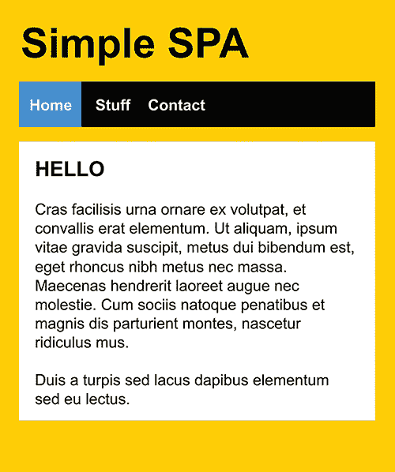

图 13-2 一个使用 React Router 的简单 React 应用。

你在这里拥有一个使用 React Router 提供所有导航和视图加载优性的简单 React 应用！虽然应用的截图看起来很不错，但这是那种你希望通过玩玩这个应用来看到更多它的功能的情况之一。请尽管打开它。

## 构建应用

我们首先需要让标记和代码运行起来。创建一个新的 HTML 文档并添加以下内容：

```html
<!DOCTYPE html>
<html>
<head>
    <title>React! React!</title>
    <script src="https://npmcdn.com/react@15.3.0/dist/react.js"></script>
    <script src="https://npmcdn.com/react-dom@15.3.0/dist/react-dom.js"></script>
    <script src="https://cdnjs.cloudflare.com/ajax/libs/babel-core/5.8.23/browser.min.js"></script>
    <style></style>
</head>
<body>
    <div id="container"></div>
    <script type="text/babel">
        var destination = document.querySelector("#container");
        ReactDOM.render(
            <div>Hello!</div>,
            destination
        );
    </script>
</body>
</html>
```

这个起点与我们之前所有的示例几乎相同。这只是一个恰好加载了 React 和 DOM 库的空白应用。如果你在浏览器中预览，你会看到一个孤单的**Hello!**。

### 注意：保持简单

现在，我们继续依靠浏览器来完成所有繁重工作。稍后我们会考虑通过“现代”构建流程来改变这一点，所以现在享受这种简单吧 :P

### 添加 React Router

接下来，由于 React Router 不是 React 的一部分，我们需要为它添加引用。在我们的标记中，找到我们引用脚本的地方并添加以下高亮行：

```html
<script src="https://npmcdn.com/react@15.3.0/dist/react.js"></script>
<script src="https://npmcdn.com/react-dom@15.3.0/dist/react-dom.js"></script>
<script src="https://cdnjs.cloudflare.com/ajax/libs/babel-core/5.8.23/browser.min.js"></script>
<script src="https://npmcdn.com/react-router/umd/ReactRouter.min.js"></script>
```

通过添加高亮行，我们确保了 React Router 库与核心 React、ReactDOM 以及 Babel 库一起加载。此时，我们已经处于良好的状态，可以开始构建我们的应用并利用 React Router 带来的所有绝妙功能。

在构建单页应用（SPA）时，页面中总有一部分是保持静态的。这个静态部分也被称为`app frame`（应用框架），它可能是一个不可见的 HTML 元素，作为所有内容的容器，也可以包含一些额外的视觉元素，如页头、页脚、导航等。在我们的案例中，应用框架将包含我们的导航页头和一个用于加载内容的空白区域。为了显示这些内容，我们将创建一个负责此项的组件。

在`ReactDOM.render`调用上方的`script`标签内，请添加以下 JSX 和 JavaScript 代码：

```javascript
var App = React.createClass({
  render: function() {
    return (
      <div>
        <h1>Simple SPA</h1>
        <ul className="header">
          <li>Home</li>
          <li>Stuff</li>
          <li>Contact</li>
        </ul>
        <div className="content">
        </div>
      </div>
    )
  }
});
```

一旦完成粘贴，请查看我们这里的内容。我们有一个名为`App`的组件，它返回了一些 HTML。为了查看这些 HTML 看起来什么样，请修改你的`ReactDOM.render`调用以引用此组件，而不是显示单词`Hello!`。请进行以下高亮更改：

```javascript
ReactDOM.render(
  <div>
    <App/> 
  </div>,
  destination
);
```

完成后，在浏览器中预览你的应用。你应该能看到一个无样式的应用标题和一些列表项（参见图 13-3）。


图 13-3 无样式的版本。

我知道这看起来并不华丽或经过设计，但现在没关系，我们稍后会处理。深入一点，我们所做的只是创建了一个名为`App`的组件并通过`ReactDOM.render`调用显示它。重要的一点是，这里没有任何 React Router。完全没有！这是 React 的基础知识。让我们通过引入 React Router 来修复这个问题。将你的`ReactDOM.render`调用内容替换为以下内容：

```javascript
ReactDOM.render(
  <ReactRouter.Router>                   
    <ReactRouter.Route path="/" component={App}>
  </ReactRouter.Router>,
  destination
);
```

先不管它看起来有多奇怪，在你做出更改后在浏览器中预览你的应用。如果一切正常，你将像之前一样看到`App`组件。现在，让我们通过学习这里的原理来弄清楚为什么是这样。我们将 React 的核心概念放在一边，学习 React Router 特有的内容。

首先，我们做的是指定`Router`组件：

```javascript
ReactDOM.render(
  <ReactRouter.Router>   
    <ReactRouter.Route path="/" component={App}>
  </ReactRouter.Router>,
  destination
);
```

`Router`组件是 React Router API 的核心，它的任务是处理应用所需的所有路由逻辑。在这个组件内部，我们指定的`routing configuration`（路由配置）是一个描述 URL 与视图之间映射的高级术语。它的细节由另一个名为`Route`的组件处理：

```javascript
ReactDOM.render(
  <ReactRouter.Router>
    <ReactRouter.Route path="/" component={App}>
  </ReactRouter.Router>,
  destination
);
```

`Route`组件接收多个`props`来帮助定义在什么 URL 显示什么。`path`属性指定我们感兴趣的 URL。在这种情况下，它是`/`。`component`属性允许指定想要显示的组件名称。在这个例子中，它是`App`。整合这一切，这个`Route`的意思是如果你所在的 URL 是根路径，就显示`App`组件。当你预览应用时，由于条件成立，你会看到`App`组件渲染的结果。

## 显示主页

正如你所看到的，React Router 提供这些功能的方式是使用你已经熟悉的 React 概念——即`components`、`props`和`JSX`。我们目前的应用框架是一个很好的例子。现在是时候进一步了。我们接下来要做的是定义作为我们主视图的一部分的内容。为了做到这一点，我们将创建一个名为`Home`的组件，它将包含我们要显示的标记。在你的`App`组件上方添加以下内容：

```javascript
var Home = React.createClass({
  render: function() {
    return (
      <div>
        <h2>HELLO</h2>
        <p>Cras facilisis urna ex volutpat, et vallis erat elementum. Ut aliquam, ipsum vitae suscipit, metus bibendum est, rhoncus nibh nec massa. Maecenas hendrerit augue molestie. Cum sociis penatibus et magnis parturient montes, ridiculus mus.</p>
        <p>Duis a turpis sed dapibus elementum sed lectus.</p>
      </div>
    );
  }
});
```

你可以看到，`Home`组件并没有特别之处。它只是返回了一段 HTML。现在，我们要在页面加载时显示`Home`组件的内容。这个组件相当于应用的“主页”。我们这样做的方法很简单。在`App`组件内部，我们有一个类值为`content`的`div`。我们将那里加载`Home`组件。明显的解决方案可能像这样：


```javascript
var App = React.createClass({
  render: function() {
    return (
      <div>
        <h1>Simple SPA</h1>
        <ul className="header">
          <li>Home</li>
          <li>Stuff</li>
          <li>Contact</li>
        </ul>
        <div className="content">
          <Home/> 
        </div>
      </div>
    )
  }
});
```

注意我们在那个`content` `div`内部定义了`Home`组件。如果你预览应用，事情甚至看起来如预期般工作（参见图 13-4）。


图 13-4 功能增强。

你看到了导航页头，然后看到了我们`Home`组件的内容。虽然这种方法可行，但实际上并不是正确的做法。它是错误的，因为它使用户在应用中导航时加载其他部分内容的愿望变得复杂。我们本质上是将应用硬编码为只显示`Home`组件。这是一个问题，但我们稍后会回来讨论。

### 中期清理时间

在继续开发应用之前，让我们稍微休息一下，对目前已有的进行一些样式上的改进。

#### 添加 CSS

现在，我们的应用看起来非常单调……像 19 世纪的产物。为了修复这个问题，我们将依靠我们的老朋友 CSS。在`style`标签内，请添加以下样式规则：

点击此处查看代码图片

```css
body {
  background-color: #FFCC00;
  padding: 20px;
  margin: 0;
}

h1, h2, p, ul, li {
  font-family: Helvetica, Arial, sans-serif;
}

ul.header li {
  display: inline;
  list-style-type: none;
  margin: 0;
}

ul.header {
  background-color: #111;
  padding: 0;
}
```

```css
ul.header li a {
  color: #FFF;
  font-weight: bold;
  text-decoration: none;
  padding: 20px;
  display: inline-block;
}

.content {
  background-color: #FFF;
  padding: 20px;
}

.content h2 {
  padding: 0;
  margin: 0;
}

.content li {
  margin-bottom: 10px;
}
```

是的，我们正在以标记标记的形式使用 CSS。我们没有采用在第 4 章中看到的内联样式对象方法。原因是出于方便考虑。我们的组件不会在特定的应用程序之外被复用，而且我们确实希望利用 CSS 继承来尽量减少重复的标记。否则，如果我们不使用普通的 CSS，最终将为标记中的几乎每个元素定义一堆巨大的样式对象。这会让即使我们中最耐心的人在阅读代码时感到烦恼。

无论如何，一旦你添加了这些 CSS，我们的应用程序就会开始变得好得多（请参见 图 13-5）。

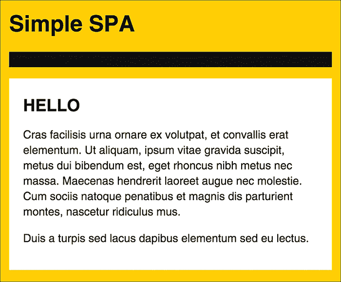

图 13-5 添加了 CSS 样式。

仍然有一些工作要做（例如，我们的导航链接消失在了黑色横后面），但我们稍后会修复它们。

### 避免 ReactRouter 前缀

在回到常规节目之前，我们最后一个清理清理任务。你是否注意到，每当我们调用由 React Router API 定义的内容时，都会在那个内容前加上`ReactRouter`前缀？

点击此处查看代码图像

```jsx
<ReactRouter.Router>
  <ReactRouter.Route path="/" component={App}>
  </ReactRouter.Route>
</ReactRouter.Router>
```

对我们的每一个 API 调用都重复这些内容有点冗长，随着我们深入研究 React Router API 并使用其内部更多的功能时，这个问题将会变得更加严重。

修复方法是使用一种新的 ES6 技巧，你可以手动指定哪些值将自动获得前缀。在你的`script`标签顶部，添加以下内容：

```javascript
var { Router,
      Route,
      IndexRoute,
      IndexLink,
      Link } = ReactRouter;
```

一旦你添加了这段代码，每当你使用括号内定义的某个值时，当应用程序运行时，系统会自动为你添加`ReactRouter`前缀。这意味着，你现在可以回到`ReactDOM.render`方法，并从我们的`Router`和`Route`组件实例中移除`ReactRouter`前缀：

点击此处查看代码图像

```jsx
ReactDOM.render(
  <Router>
    <Route path="/" component={App}>
    </Route>
  </Router>,
  destination
);
```

如果你现在预览应用程序，实际上不应该发生任何变化。最终结果与你之前的完全相同。唯一的区别是我们的标记紧凑了一点。

现在，在我们继续之前，你可能奇怪为什么自动带有`ReactRouter`前缀的值列表中包含了我们目前为止代码中使用的`Router`和`Route`值之外的很多内容。将这些额外的值视为我们很快将要使用的 React Router API 其他部分的预览吧。剧透警告！（现在提到这个可能太晚了，对吧？）

### 正确地显示主页

我们在几个章节前结束时提到，目前显示主页的方式是不正确的。虽然当页面加载时我们得到了预期的结果，但这种方法并不能方便我们在用户导航时加载主页以外的任何内容。对`Home`组件的调用被硬编码在`App`内部。

正确的解决方案是让 React Router 根据你当前的 URL 结构处理调用哪个组件。这涉及到在`Route`组件内部嵌套`Route`组件，以更好地定义 URL 到视图的映射。回到我们的`ReactDOM.render`方法，进行以下高亮更改：

点击此处查看代码图像

```jsx
ReactDOM.render(
  <Router>
    <Route path="/" component={App}>
      <IndexRoute component={Home}/> 
    </Route>
  </Router>,
  destination
);
```

在我们的根`Route`元素内部，我们定义了另一个类型为`IndexRoute`的`Route`元素（稍后介绍它是谁！），并将其视图设置为我们的`Home`组件。我们还需要进行另一处更改。在我们的`App`组件内部，移除对`Home`组件的调用，并将其替换为以下内容：

点击此处查看代码图像

```javascript
var App = React.createClass({
  render: function() {
    return (
      <div>
        <h1>Simple SPA</h1>
        <ul className="header">
          <li>Home</li>
          <li>Stuff</li>
          <li>Contact</li>
        </ul>
        <div className="content">
          {this.props.children}
        </div>
      </div>
    )
  }
```

如果你现在预览应用程序，实际上什么都不应该改变。最终结果与你之前的一致。唯一的区别在于我们的`App`内部通过`this.props.children`控制了显示内容。

现在，在我们继续之前，你可能在想为什么自动带有`ReactRouter`前缀的值列表中包含了除了我们目前代码中使用的`Router`和`Route`值之外的很多内容。将这些额外的值视为我们很快将要使用的 React Router API 其他部分的预览吧。剧透警告！（现在提到这个可能太晚了，对吧？）

### 正确地显示主页

我们在几个章节前结束时提到，目前显示主页的方式是不正确的。虽然当页面加载时我们得到了预期的结果，但这种方法并不能方便我们在用户导航时加载主页以外的任何内容。对`Home`组件的调用被硬编码在`App`内部。

正确的解决方案是让 React Router 根据你当前的 URL 结构处理调用哪个组件。这涉及到在`Route`组件内部嵌套`Route`组件，以更好地定义 URL 到视图的映射。回到我们的`ReactDOM.render`方法，进行以下高亮更改：

点击此处查看代码图像

```jsx
ReactDOM.render(
  <Router>
    <Route path="/" component={App}>
      <IndexRoute component={Home}/> 
    </Route>
  </Router>,
  destination
);
```

在我们的根`Route`元素内部，我们定义了另一个类型为`IndexRoute`的`Route`元素（稍后介绍它是谁！），并将其视图设置为我们的`Home`组件。我们还需要进行另一处更改。在我们的`App`组件内部，移除对`Home`组件的调用，并将其替换为以下内容：

点击此处查看代码图像

```javascript
var App = React.createClass({
  render: function() {
    return (
      <div>
        <h1>Simple SPA</h1>
        <ul className="header">
          <li>Home</li>
          <li>Stuff</li>
          <li>Contact</li>
        </ul>
        <div className="content">
          {this.props.children}
        </div>
      </div>
    )
  }
}
```

如果你现在预览应用程序，实际上什么都不应该改变。最终结果与你之前的一致。唯一的区别在于我们的`App`内部通过`this.props.children`控制了显示内容。

### 创建导航链接

现在，我们只有框架和主页设置。除了看到我们的主页之外，用户并没有其他可以做的。让我们通过创建导航链接来修复这一点。具体来说，让我们现有的导航元素链接化：

点击此处查看代码图像

```javascript
var App = React.createClass({
  render: function() {
    return (
      <div>
        <h1>Simple SPA</h1>
        <ul className="header">
          <li>Home</li>
          <li>Stuff</li>
          <li>Contact</li>
        </ul>
        <div className="content">
          {this.props.children}
        </div>
      </div>
    )
  }
})
```

如果你在预览页面时没有看到这些元素，那是因为在我们添加 CSS 后它们与黑色背景融合在一起了。没大碍。我们稍后会修复它，但首先让我们谈谈如何将这些元素变成链接。

在 React Router 中指定导航链接的方法不是直接使用经过测试的`a`标签并通过`href`属性传入路径。相反，你使用 React Router 的`Link`组件来指定导航链接，这些组件类似于`a`标签，但提供了更多的功能。为了看到`Link`组件的作用，请将我们现有的导航元素修改为如下高亮行：

点击此处查看代码图像

```javascript
var App = React.createClass({
  render: function() {
    return (
      <div>
        <h1>Simple SPA</h1>
        <ul className="header">
          <li><Link to="/">Home</Link></li>
          <li><Link to="/stuff">Stuff</Link></li>
          <li><Link to="/contact">Contact</Link></li>
        </ul>
        <div className="content">
          {this.props.children}
        </div>
      </div>
    )
  }
})
```

注意我们在这里所做的。我们的`Link`组件指定了一个名为`to`的属性。该属性指定了我们将在地址栏中显示的 URL 值。间接地说，它也指定了我们告诉`Router`我们正虚拟导航到的位置。我们的`Home`链接将用户带到根目录（`/`），`Stuff`链接将用户带到名为`stuff`的位置，而`Contact`链接将用户带到名为`contact`的位置。

如果你预览页面并点击链接（由于它们的 CSS 已经生效，它们现在是可见的），你不会看到任何新内容显示。你只会看到`Home`内容，因为那是我们之前唯一指定了的内容。尽管如此，你可以看到地址栏中的 URL 正在更新。根据你点击了哪个链接，你将看到当前页面后面跟着`#/contact`、`#/stuff`或`#/`。哦，你还会看到 URL 后面添加了一个随机的哈希值（hash）。这是进展！

### 添加 Stuff 和 Contact 视图

我们的应用程序正在缓慢形成最终形状……到我们完成这一节时，它将非常接近完工！我们接下来要做的是为之前链接的`Stuff`和`Contact`视图定义组件。在你的代码中，就在你`Home`组件下方，添加以下内容：

点击此处查看代码图片

```javascript
var Contact = React.createClass({
  render: function() {
    return (
      <div>
        <h2>有问题吗？</h2>
        <p>最简单的方法是在
        我们的 <a href="http://forum.kirupa.com">论坛</a>上发帖。
        </p>
      </div>
    );
  }
});

var Stuff = React.createClass({
  render: function() {
    return (
      <div>
        <h2>STUFF</h2>
        <p>Mauris sem velit, vehicula eget sodales vitae,
        rhoncus eget sapien:</p>
        <ol>
          <li>Nulla pulvinar diam</li>
          <li>Facilisis bibendum</li>
          <li>Vestibulum vulputate</li>
          <li>Eget erat</li>
          <li>Id porttitor</li>
        </ol>
      </div>
    );
  }
});
```

我们刚刚添加的是简单渲染 HTML 的`Stuff`和`Contact`组件。剩下的工作是更新我们的路由配置以包含这两个组件，并在相应的 URL 下显示它们。

在我们的`ReactDOM.render`方法中，添加以下两行高亮代码：

点击此处查看代码图片

```javascript
ReactDOM.render(
  <Router>
    <Route path="/" component={App}>
      <IndexRoute component={Home}/>
      <Route path="stuff" component={Stuff} />     
      <Route path="contact" component={Contact} /> 
    </Route>
  </Router>,
  destination
);
```

我们在这里所做的只是更新路由逻辑：如果 URL 包含`stuff`单词，则显示`Stuff`组件；如果 URL 包含`contact`单词，则显示`Contact`组件。现在预览你的页面，点击`Stuff`和`Contact`链接。如果一切运行正常，当你导航到这些视图时，你会看到这些视图加载在我们的框架中。

### 注意：关于路由匹配的简单介绍


我们的路由配置无非是一系列规则，用于决定当 URL 匹配我们设定的条件时该做什么。这种做法的术语叫做路由匹配（route matching）。`Router` 用于匹配 URL 的启发式算法在 `Router` 文档中有完全的解释，但对于我们的情况，我们有一个简单的嵌套路由，你可以有多个同时匹配的项目。如果 URL 包含 `/`，我们的外部路由就会匹配。如果 URL 恰好包含 `stuff` 或 `contact`，我们的内部路由就会匹配。

这意味着非常简单。对于每个匹配的路由，你指定的组件将会出现。当你导航到像 `/stuff` 这样的页面时，`App` 组件会显示，因为 URL 中存在 `/`。然后 `Stuff` 组件也会显示，因为 URL 中也存在 `stuff` 的路径。这就是为什么当我们导航到 `Stuff` 或 `Contact` 页面时，除了框架之外还能看到它们。你也可以拥有深层嵌套路由。

查看以下内容：

点击此处查看代码图片

```javascript
ReactDOM.render(
  <Router>
    <Route path="/" component={App}>
      <IndexRoute component={Home} />
      <Route path="stuff" component={Stuff}>
        <Route path="blah" component={MyBlah}/>
      </Route>
      <Route path="contact" component={Contact} />
    </Route>
  </Router>,
  destination);
```

在这个示例中，注意我们路径为 `stuff` 的 `Route` 元素现在包含了一个路径为 `blah` 的嵌套路由。这意味着如果你恰好有一个为 `/stuff/blah` 的 URL，那么除了父级匹配的 `Stuff` 组件和 `App` 组件外，`MyBlah` 组件也将显示。通过嵌套路由并遵循路由匹配规则（https://github.com/reactjs/react-router/blob/master/docs/RouteMatching），你可以根据不同的 URL 布局显示视图。

## 创建激活链接

我们最后要处理的是增加应用程序可用性的功能。根据你当前处于哪个页面，我们将为激活的链接设置蓝色背景。例如，图 13-6 是当 `Stuff` 内容显示时的应用程序样式。在 `Router` 中实现这一点的方法是在 `Link` 实例上指定一个名为 `active` 的属性。为了让这一切发生，回到你的 `App` 组件并进行以下更改：

点击此处查看代码图片

```javascript
var App = React.createClass({
  render: function() {
    return (
      <div>
        <h1>Simple SPA</h1>
        <ul className="header">
          <li><Link to="/" activeClassName="active">Home</Link></li>
          <li><Link to="/stuff" activeClassName="active">Stuff</Link></li>
          <li><Link to="/contact" activeClassName="active">Contact</Link></li>
        </ul>
        <div className="content">
          {this.props.children}
        </div>
      </div>
    )
  }
});
```

我们指定 `activeClassName` 属性并设置为 `active`。这确保了当点击链接时（且路径变为激活状态），链接元素的 `class` 属性在运行时会被设置为 `active`。为了确保我们的激活链接有不同的样式，请添加以下 CSS：

```css
.active {
  background-color: #009FF;
}
```

现在预览你的应用程序，点击任何链接。注意激活的链接（以及 `Home` 链接）显示为蓝色背景。不过我们还没有完成。我们的 `Home` 链接总是被激活。它应该只在我们加载 `Home` 页面或显式导航到 `Home` 链接本身时被激活。为了修复这个问题，我们需要更改链接到 `Home` 内容的方式。与其用 `Link` 元素指定 `Home` 内容，不如将其替换为 `IndexLink` 元素。

请进行此更改：

点击此处查看代码图片

```javascript
var App = React.createClass({
  render: function() {
    return (
      <div>
        <h1>Simple SPA</h1>
        <ul className="header">
          <li><IndexLink to="/" activeClassName="active">Home</IndexLink></li>
          <li><Link to="/stuff" activeClassName="active">Stuff</Link></li>
          <li><Link to="/contact" activeClassName="active">Contact</Link></li>
        </ul>
        <div className="content">
          {this.props.children}
        </div>
      </div>
    )
  }
});
```

```javascript
        </ul>

        <div className="content">
          {this.props.children}
        </div>
      </div>
    )
}

});
```

当你的 `Home` 导航元素由 `IndexLink` 代替 `Link` 表示后，再次预览你的应用。这次，当应用加载时，你会发现你的 `Home` 链接默认具有酷炫蓝色背景。当你导航到 `Stuff` 或 `Contact` 页面时，`Home` 链接将不再有高亮显示。到此，你的应用大部分已经准备就绪了！

## 结论

到目前，我们已经涵盖了 `React Router` 为帮助你构建单页应用的很多酷功能。这并不意味着没有更多有趣的事情供你利用。我们的应用非常简单，对我们需要实现的路由功能需求也很小。`React Router` 提供的功能要多得多，所以如果你正在构建比我们目前所过的更复杂的单页应用，你完全应该花一个下午时间看看完整的 `React Router` 文档 ([`github.com/reactjs/react-router/`](https://github.com/reactjs/react-router/)) 和示例。

# 构建一个 Todo 列表应用

如果说创建 **Hello, World!** 示例是你开始接触 React 的庆祝，那么创建一个经典的 Todo 列表应用就是你向精通 React 迈进的庆祝！在本章中，我们将你学过的许多概念和技术结合在一起，创建一个如下运行的应用：[`www.kirupa.com/react/examples/todo.htm`](https://www.kirupa.com/react/examples/todo.htm)

你从一个空白应用开始，它允许你输入任务以便以后使用（参见图 14-1）。


图 14-1 带有任务输入的空白应用。

这个 Todo 列表应用的工作非常简单。在文本框中输入任务或任何你想的内容并按 Add（或按 Enter/Return）。一旦你提交了任务，就会看到它作为一个条目出现。你可以继续添加任务以增加更多条目并让它们全部显示出来（参见图 14-2）。

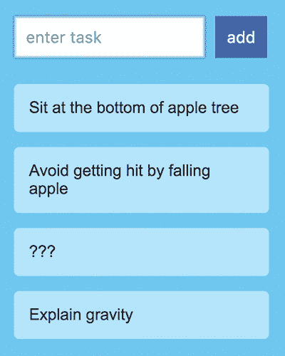

图 14-2 你可以添加任务并让它们显示。

非常简单，对吧？在接下来的章节中，我们将从零开始构建应用，并学习（以令人惊叹的详尽细节）这一切是如何工作的。

## 开始

到目前，你已经知道了做法。我们需要一个起点，所以去创建一个新的 HTML 文档。在其中添加以下内容：

点击此处查看代码图片

```html
<!DOCTYPE html>

<html>

<head>

  <title>React! React! React!</title>

  <script src="https://npmcdn.com/react@15.3.0/dist/react.js"></script>

  <script src="https://npmcdn.com/react-dom@15.3.0/dist/react-dom.js"></script>

  <script src="https://cdnjs.cloudflare.com/ajax/libs/babel-core/5.8.23/browser.min.js"></script>

  <style>

  </style>

</head>

<body>

  <div id="container">

  </div>

  <script type="text/babel">

    var destination = document.querySelector("#container");

    ReactDOM.render(

      <div>

        Hello!

      </div>,

      destination

    );

  </script>

</body>

</html>
```

如果你在浏览器中预览这一切，你将看到 **Hello!** 这个词出现。如果你看到了它，说明你状态良好。是时候开始构建我们的 Todo 列表应用了！

## 创建 UI

现在，我们的应用并没做什么。我们将通过首先让各种 UI 元素运行起来来修复这个问题。这对于我们的应用来说并不复杂！我们要做的第一件事是让输入框和按钮出现。这都是通过使用 `div`、`form`、`input` 和 `button` 元素完成的！

所有这些内容将位于我们命名为 `TodoList` 的组件中。在 `ReactDOM.render` 方法上方添加以下代码：

点击此处查看代码图片

```javascript
var TodoList = React.createClass({

  render: function() {

    return (

      <div className="todoListMain">

        <div className="header">

          <form>

            <input placeholder="enter task">

            </input>

            <button type="submit">add</button>

          </form>

        </div>

      </div>

    );

  }

});
```

在你的 `ReactDOM.render` 方法内部，我们需要调用我们的 `TodoList` 组件来渲染它。

```javascript
ReactDOM.render(

  <div>

    <TodoList/>

  </div>,

  destination

);
```

保存你的更改并预览你的应用。你将看到类似图 14-3 的内容。


图 14-3 你看到的内容。

如果你对看到的内容感到惊讶，请花点时间看看 `TodoList` 组件。让我们让 HTML 元素不再无聊。在你的 `style` 块中添加以下：

点击此处查看代码图片

```css
body {

  padding: 50px;

  background-color: #66FF;

  font-family: sans-serif;

}

.todoList input {

  padding: 10px;

  font-size: 16px;

}

.todoList button {

  padding: 10px;

  font-size: 16px;

  margin: 10px;

  background-color: #00FF;

  color: #FFF;

  border: 2px solid #00FF;

}

.todoList button:hover {

  background-color: #00399;

  cursor: pointer;

}
```

一旦添加了这一切，预览你的应用。因为我们的 HTML 元素有了正确的 `className` 值，CSS 将生效，我们的示例看起来像图 14-4。


图 14-4 改进后的示例。

到目前，我们的应用看起来不错。它并没做什么，但至少我们在取得进展。在下一节中，我们将开始让我们的应用动起来。

## 创建功能

Todo 列表应用的实际实现并没有你想象的那么疯狂。让我们从高层视角看看它是工作的。最重要的数据是你输入的文本。每当你输入某些文本并提交表单时，该文本就会显示在现有文本下方。到目前为止，这很好，对吧？

这一切都是通过简单利用 React 的状态实现的。在我们的 `state` 对象中，我们有一个数组负责你输入的一切（参见图 14-5）。


图 14-5 我们的任务存储在数组里。我知道，没意思 :-)

每当这个项目数组被你提交的新文本更新时，我们就用新提交的文本更新视图。剩下的工作只是设置事件和事件处理器，以确保我们可以提交表单并确切知道要把什么文本添加到项目数组中。在接下来的章节中，我们将这里看到的所有英语转换为 React 风格的 JavaScript 和 JSX！

### 初始化状态对象

我们要做的第一件事是初始化状态对象，其中包含一个存储所有提交文本的数组。在我们的 `TodoList` 组件内部，添加以下行：

点击此处查看代码图片

```javascript
var TodoList = React.createClass({

  getInitialState: function() {

    return {

      items: []

    };

  },

  render: function() {

    return (

      <div className="todoListMain">
```

我们在这里做的是指定 `getInitialState` 方法，它会在组件渲染之前被调用。在该方法内部，我们创建了一个名为 `items` 的空数组，之后我们可以在此组件的任何地方通过 `this.state.items` 访问它。

### 处理表单提交

当你通过点击“Add”按钮或按下键盘上的 Enter/Return 键提交表单时，我们会待办列表中添加新项目。这种行为大部分是 HTML 内置的，我们的浏览器完全知道如何处理这种情况。我们不需要为处理 Enter/Return 键或监听“Add”按钮点击编写任何特殊代码。我们唯一需要担心的是处理表单实际提交时会发生什么。

为了做到这一点，我们在 `form` 元素上监听 `onSubmit` 事件。每当表单提交，该事件就会触发一次，这包括按下 Enter/Return 键或操作任何 `type` 属性为 `submit` 的元素。当表单提交并监获到该事件时，我们需要调用一个事件处理器。让我们给该事件处理器命名为 `addItem`。

将这一切整合在一起，在你的 `TodoList` 组件的 `render` 函数中，进行以下高亮修改：

点击此处查看代码图片

```javascript
render: function() {

  return (

    <div className="todoListMain">

      <div className="header">

        <form onSubmit={this.addItem}>

          <input placeholder="enter task"></input>

          <button type="submit">add</button>

        </form>

      </div>

    </div>

  );

}
```

正如我们所希望做的那样，我们刚刚将 `form` 元素的 `onSubmit` 事件链接到了 `addItem` 事件处理器。这个事件处理器目前还不存在，但我们将通过添加以下高亮行来修复这个问题：

点击此处查看代码图片

```javascript
var TodoList = React.createClass({

  getInitialState: function() {

    return {

      items: []

    };

  },

  addItem: function(e) { 

  },

  render: function() {

    return (

      <div className="todoListMain">

        <div className="header">

          <form onSubmit={this.addItem}>

            <input placeholder="enter task"></input>

            <button type="submit">add</button>

          </form>
```


`addItem` 事件处理器/函数目前还没有做太多事情，但重要的是它存在！接下来，我们将修复它没做事情的部分。

## 填充我们的状态

现在，`TodoList` 组件的 `state` 对象包含了 `items` 数组。我们需要做的是用你输入的文本填充这个数组。这意味着我们需要一种从 React 访问 `input` 元素的方法。我们将采取的方法是在我们的 `input` 元素上设置一个 `ref` 属性（正如你在第 2 章中所看到的），并存储生成的 HTML 元素的引用。在 `TodoList` 组件的 `render` 方法内部，添加以下行代码：

```javascript
render: function() {

  return (

    <div className="todoListMain">

      <div className="header">

        <form onSubmit={this.addItem}>

          <input ref={(a) => this._inputElement = a} placeholder="enter task"></input>

          <button type="submit">add</button>

        </form>

      </div>

    </div>

  );

}
```

当这段高亮代码运行时（紧接在此组件挂载之后），`_inputElement` 属性将存储生成的 `input` 元素的引用。现在我们已经做到了这一点，可以对待这个元素像我们在非 React 世界中使用 `querySelector` 或等效函数找到的任何 DOM 元素。我们接下来要做的是填充我们的 `items` 数组！

请通过添加以下行来修改 `addItem` 方法：

```javascript
addItem: function(e) {

  var itemArray = this.state.items;

  itemArray.push(

    {

      text: this._inputElement.value,

      key: Date.now()

    }

  );

  this.setState({

    items: itemArray

  });

}
```

无论如何，我们要做的第一件事是定义我们的 `TodoItems` 组件。在你的代码中，在定义 `TodoList` 组件的正上方，请添加以下内容：

```javascript
var TodoItems = React.createClass({

  render: function() {

  }

});
```

现在这里什么都没有发生，但没关系。

接下来，我们要的是在 `TodoList` 组件的 `render` 方法内部调用这个组件。不仅如此，我们还要指定一个 `prop`（属性），并将 `TodoList` 组件的 `state`（状态）对象传递进去，该对象包含了我们的 `items` 数组。完成所有这些操作非常简单，所以请在你的 `TodoList` 组件的 `render` 方法中添加以下高亮行代码：

```javascript
render: function() {

  return (

    <div className="todoListMain">

      <div className="header">

        <form onSubmit={this.addItem}>

          <input ref={(a) => this._inputElement = a}

                 placeholder="enter task">

          </input>

          <button type="submit">add</button>

        </form>

      </div>

      <TodoItems entries={this.state.items}/> 

    </div>

  );

}
```

我们在这里所做的只是实例化我们的 `TodoItems` 组件，并将我们的 `items` 状态属性传递给名为 `entries` 的 `prop`。此时，如果你在浏览器中运行我们的应用，什么可见的变化都不会发生。我们的 `TodoItems` 组件已经准备好渲染了，并且它可以访问所有提交的任务。唯一的问题是它并没有真的对这些内容进行任何操作，但我们将在下一步阶段修复这个问题。

回到我们的 `TodoItems` 组件，我们要做的第一件事是创建一个新变量来存储传递进去的任务数组。为了做到这一点，请添加以下高亮行：

```javascript
var TodoItems = React.createClass({

  render: function() {

    var todoEntries = this.props.entries; 

  }

});
```

我们刚刚添加了一个名为 `todoEntries` 的变量，它存储了我们根据 `TodoList` 组件的 `this.state.items` 值传递的 `entries` 属性的值。太棒了！现在，我们的 `todoEntries` 存储了一个包含许多对象的数组，每个对象都存储了一个任务和一个键（key）。剩下的就是创建用于显示数据的 HTML 元素。

在实现这一目标的第一步中，添加以下高亮行代码来创建 `li` 元素：

```javascript
var TodoItems = React.createClass({

  render: function() {

    var todoEntries = this.props.entries;          

    function createTasks(item) {

      return <li key={item.key}>{item.text}</li>  

    }                            

    var listItems = todoEntries.map(createTasks); 

  }

});
```

我们正在使用 `map` 函数来遍历 `todoEntries` 内部每一个项，并调用 `createTasks` 函数为每个条目创建一个列表元素：

```javascript
function createTasks(item) {

  return <li key={item.key}>{item.text}</li>

}
```

重申我们之前提到的一点，由于这些列表元素是动态创建的，我们需要通过指定 `key` 属性并给每个元素一个唯一的值来帮助 React 跟踪它们。我们在存储任务时已经解决了这个问题部分，你还记得吗：

```javascript
itemArray.push(

  {

    text: this._inputElement.value,

    key: Date.now()

  }

);
```

得益于之前的规划，我们现在通过给 `key` 属性赋值 `todoEntries` 数组中每个项已包含的 `item.key` 值，从而省了很多力气。我们列表元素的可见内容仅仅是存储在 `item.text` 中的文本。对于我们如何使用它，不需要额外的解释。这种感觉感觉非常清爽，不是吗？

将这一切整合在一起，这一组列表元素被我们的 `listItems` 变量完全处理并存储。此时剩下的就是将数组内部的列表元素转换为渲染在屏幕上的列表元素。为了实现这一点，请添加以下几行：

```javascript
var TodoItems = React.createClass({

  render: function() {

    var todoEntries = this.props.entries;

    function createTasks(item) {

      return <li key={item.key}>{item.text}</li>

    }

    var listItems = todoEntries.map(createTasks);

    return (

      <ul className="theList">

        {listItems}

      </ul>

    );

  }

});
```

我们正在做的是返回一个 `ul` 元素，其内容为 `listItems`。图 14-7。我们已经完成了。如果你现在预览应用，你会发现提交的任务看起来完全如你预期的那样：


图 14-7 任务。接下来，你是否注意到你输入输入框的内容在提交表单后并没有消失？你必须在每次提交任务后手动清除字段……像个动物一样！这很烦人，但修复方法非常简单。在我们的 `TodoList` 组件的 `addItem` 方法中，添加以下高亮行：

```javascript
addItem: function(e) {

  var itemArray = this.state.items;

  itemArray.push(

    {

      text: this._inputElement.value,

      key: Date.now()

    }

  );

  this.setState({

    items: itemArray

  });

  this._inputElement.value = "";

  e.preventDefault();

}
```


我们在这里所做的是在表单提交并调用`addItem`方法时，清除`input`元素的`value`属性。这确保了我们不再需要在每次要提交的任务之间手动清除输入框。简单极！

## 最后的修饰

我们快完成了！首先，我们现在的样子看起来和开始时并不一样。我们的任务列表看起来有点单调，但可以通过 CSS 魔法来修复。在你的`style`块中，在样式规则下方添加以下样式规则：

```css
.todoList .theList {
  list-style: none;
  padding-left: 0;
  width: 255px;
}

.todoListMain .theList li {
  color: #333;
  background-color: rgba(255,255,255,.5);
  padding: 15px;
  margin-bottom: 15px;
  border-radius: 5px;
}
```

如果你现在预览应用，你会发现提交的任务看起来完全如你预期的那样：

## 总结

我们的 Todo 应用在功能上非常简单，但通过从零构建，我们几乎涵盖了 React 提供的每一个细微细节。更重要的是，我们创建了一个示例，展示了我们单独学的概念是如何协作的。这实际上是重要的细节。现在，有一个关于你的快速问题：我们在这一章中所做的一切你理解吗？

如果我们在这一章中所做的一切你都理解，那么你已经准备好告诉你的朋友和家人，你即将掌握 React 了！如果你对某些领域感到困惑，我建议你回去重新阅读解决你困惑的章节。

我们最后一个查看的 React 相关的主题与其说是 React 本身，不如说是关于如何设置你的开发环境来构建 React 应用。到目前为止，我们一直通过包含几个脚本文件来构建 React 应用：

```html
<script src="https://npmcdn.com/react@15.3.0/dist/react.js"></script>
<script src="https://npmcdn.com/react-dom@15.3.0/dist/react-dom.js"></script>
<script src="https://cdnjs.cloudflare.com/ajax/libs/babel-core/5.8.23/browser.min.js"></script>
```

这些脚本文件不仅加载了 React 库，还加载了 Babel，帮助我们的浏览器在遇到 JSX 这种奇异事物时，完成需要的操作（参见图 15-1）。

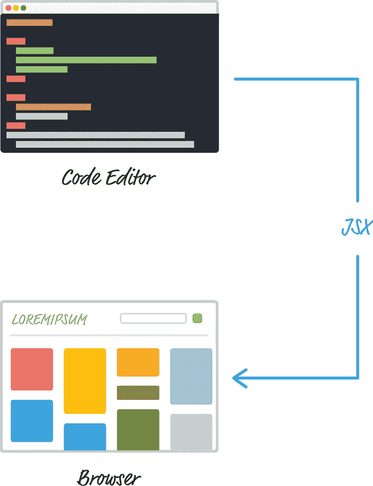

图 15-1 我们的 React 方法。

为了回顾我们之前在讨论这种方法时提到的内容，它的缺点是性能。作为浏览器执行其通常执行的所有页面加载相关工作的一部分，它还负责将你的 JSX 转换为实际 JavaScript。这种 JSX 到 JavaScript 的转换是一个耗时的过程，在开发期间是可以接受的。但如果你的应用程序的每个用户都必须付出这种性能代价，那就不太妙了。

解决方案是设置你的开发环境，在用户加载页面之前处理好 JSX 到 JS 的转换（参见图 15-2）。

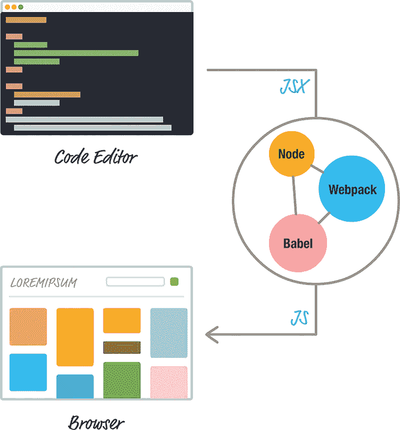

图 15-2 作为应用构建过程一部分的 JSX 到 JavaScript 转换。

有了这种解决方案，你的浏览器加载应用时，处理的是一个已经转换（并可能经过了优化的）JavaScript 文件。很棒对吧？现在，我们推迟到现在谈论这一切的唯一原因是为了`简单`。学习 React 已经足够困难了。在学习 React 的过程中增加构建工具和设置环境的复杂性，这并不酷。现在你已经牢牢掌握了 React 的所有功能，是时候通过这一章来改变现状了。

在接下来的章节中，我们将介绍一种结合 Node、Babel 和 webpack 来设置开发环境的方法。如果这一切听起来对你来说很奇怪，不要担心。到结束时，你将和所有这些工具如老朋友般熟悉。

***

**注意：内容可能会变化**

构建工具及其依赖项一直在变化。这对我们来说是个好消息，但它让发布相关信息变成了一项挑战！本章包含了基于当前（即编写本文时！）最佳实践的最新信息，但这些信息可能会变化。如果你发现某些工具和说明的工作方式与描述的不符，请通过以下地址查看本文的在线版本（更新更频繁）：[`www.kirupa.com/react/setting_up_react_environment.htm`](https://www.kirupa.com/react/setting_up_react_environment.htm)

***

## 认识工具

好了，是时候跳出笼统的论述（以及那些精美的图表）了。是时候严肃起来了——呃。是时候认识我们将用来正确设置开发环境并依赖的工具了。

### Node.js

在很长一段时间里，JavaScript 主要是你用来让浏览器运行某些功能的代码。Node.js 改变了这一切。Node.js 允许你使用 JavaScript 创建运行在服务器上的应用程序，并访问浏览器梦都无法想象到的 API 和系统资源。它基本上是一个完整的应用程序开发运行时，其程序（而不是用 Java、C#、C++ 等语言编写）完全基于 JavaScript 进行构建并运行。

对于我们的目的来说，我们将依赖`Node.js`（准确地说是 Node 包管理器，即`NPM`）来管理依赖，并将从 JSX 到 JavaScript 所需的步骤结合起来。将`Node.js`想象成让我们的开发环境运行的胶水。

### Babel

这个我们应该很熟悉！简单来说，Babel 是一个 JavaScript 转译器。它将你的 JavaScript 转换为……嗯……JavaScript。这听起来非常奇怪，所以让我澄清一下。如果你使用最新的的 JavaScript 特性，旧版浏览器在遇到新函数或属性时可能不知道该怎么办。如果你在写 JSX，那么……没有任何浏览器知道该如何处理它！

Babel 的作用是将你新颖的 JS 或 JSX 转换为大多数浏览器都能理解的 JS 形式。我们直以来一直使用它的浏览器端版本将 JSX 转换为 JavaScript。稍后，你将看到我们如何将 Babel 集为构建过程的一部分，从我们的 JSX 生成一个真正的、浏览器可读的 JS 文件。

### Webpack

我们将依赖的最后一个工具是`webpack`。它被称为模块打包器。抛开这些华丽的头衔，你的应用所包含的许多框架和库都有许多依赖项，你所依赖的功能部分可能只是更大组件的一个子集。

你可能不需要所有这些必要的代码，而像`webpack`这样的工具起着重要作用，让你能够只包含运行应用所需的相关代码。它们通常会将所有相关代码（即使它们来自不同的来源）打包到一个文件中（参见图 15-3）。


图 15-3 打包成单个文件。

## 你的代码编辑器

如果不谈论这一切最重要的工具——你的代码编辑器，关于开发环境的讨论无法进行（参见图 15-4）。


图 15-4 你的编辑器。

无论你使用 Sublime、Atom、VS Code、TextMate、Coda 或任何其他工具，你都会在代码编辑器中花费大量时间，不仅是为了构建 React 应用，还为了配置 Node、Babel 需要各种文件。

## 环境搭建！

到目前，你应该对我们正在尝试做的有一个模糊的想法……我们试图实现的梦想！我们甚至查看了实现这一梦想将发挥作用的各种工具。现在，是时候通过实际工作来实现它了。

### 设置初始项目结构

我们要做的第一件事是设置项目。去桌面创建一个名为`MyTotallyApp`的新文件夹。在该文件夹内部创建两个名为`dev`和`output`的文件夹。你的目录结构看起来像图 15-5。

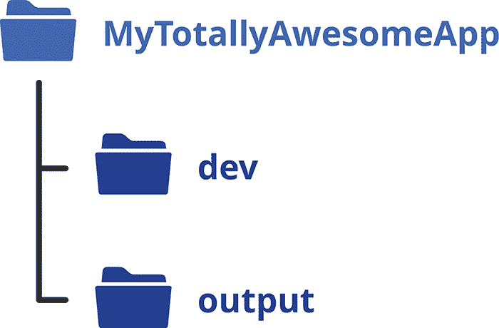

图 15-5 我们目前的目录结构。

我们在这里做的非常简单。在`dev`文件夹中，我们将放置所有未优化和未转换的 JSX、JavaScript 以及其他脚本内容。换句话之，这就是你编写和活跃工作的代码所在地。在`output`文件夹中，我们将放置对`dev`文件夹中的脚本文件运行各种构建工具后的结果。这是 Babel 将我们所有的 JSX 文件转换为 JS 的地方。这也是 webpack 解析我们脚本文件之间的依赖关系，并将所有重要的脚本内容放入单个 JavaScript 文件中的地方。

接下来我们要的是创建一个浏览器指向的 HTML 文件。在`MyTotallyApp`文件夹中，使用你的代码编辑器创建一个名为`index.html`的新 HTML 文件，内容如下：

```html
<!DOCTYPE html>
<html>
<head>
  <title>React! React! React!</title>
</head>
</html>
```

```html
<body>
  <div id="container"></div>
  <script src="output/myCode.js"></script>
</body>
</html>
```

在添加了这些内容后，请务必保存文件。现在说这些内容，我们的标记非常简单。文档的主体就是一个空的`div`元素，其`id`值为`container`，以及一个`script`标签，该标签指向`output`文件夹内生成的最终 JavaScript 文件`myCode.js`：

```html
<script src="output/myCode.js"></script>
```

除了这两点之外，我们的 HTML 文件并没有很多内容。如果现在要让我们可视化所有内容的关系，它看起来有点像图 15-6。

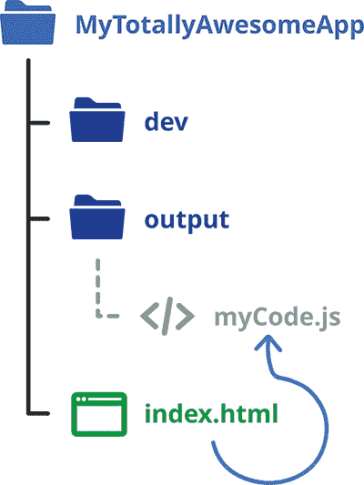

图 15-6 你当前的项目结构看起来如下。

我为`output`文件夹中的`myCode.js`文件画了一条虚线，因为该文件目前还不存在那里。我们在 HTML 中指向了一个目前尚不存在的内容，但这种情况不会持续太久。

## 安装和初始化 Node.js

我们的下一步是安装 Node.js。访问 Node.js 网站（[`nodejs.org/`](https://nodejs.org/)）安装适用于你操作系统的版本（参见图 15-7）。


图 15-7 Node.js 网站上的下载按钮。

我倾向于总是安装最新版本，你也应该这样做。下载和安装过程并不特别。安装好 Node.js 后，启动终端（Mac）、命令提示符（Windows）或相应的选择工具，输入以下内容并按回车测试它是否真的已安装：

```bash
node -v
```

如果一切运行正常，你将看到一个版本号，它通常与你刚刚安装的 Node.js 版本对应。如果出于某种原因遇到错误，请遵循此处列出的故障排除步骤（[`github.com/npm/npm/wiki/Troubleshooting`](https://github.com/npm/npm/wiki/Troubleshooting)）。

接下来，我们要在`MyTotallyAwesomeApp`文件夹上初始化 Node.js。要做到这一点，首先使用你的终端或命令提示符导航到`MyTotallyAwesomeApp`文件夹。在 OS X 上，它看起来像图 15-8。

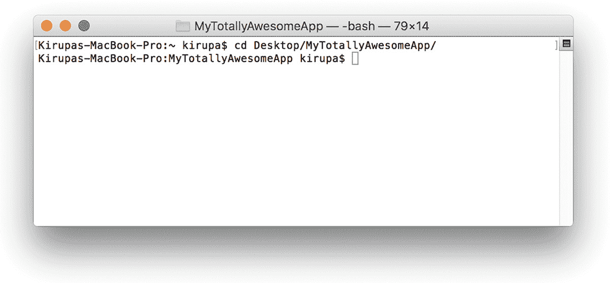

图 15-8 导航到 MyTotallyAwesomeApp 文件夹。

现在，输入以下内容来初始化 Node.js：

```bash
npm init
```

这将启动一系列问题，帮助在我们的项目中设置 Node.js。第一个问题将要求你指定项目名称。按回车键将允许你指定已经为你选定的默认值。这都很好，但默认名称是我们的项目文件夹，即`MyTotallyAwesomeApp`。如果你直接按回车，因为它包含大写字母，它会抛出错误（参见图 15-9）。

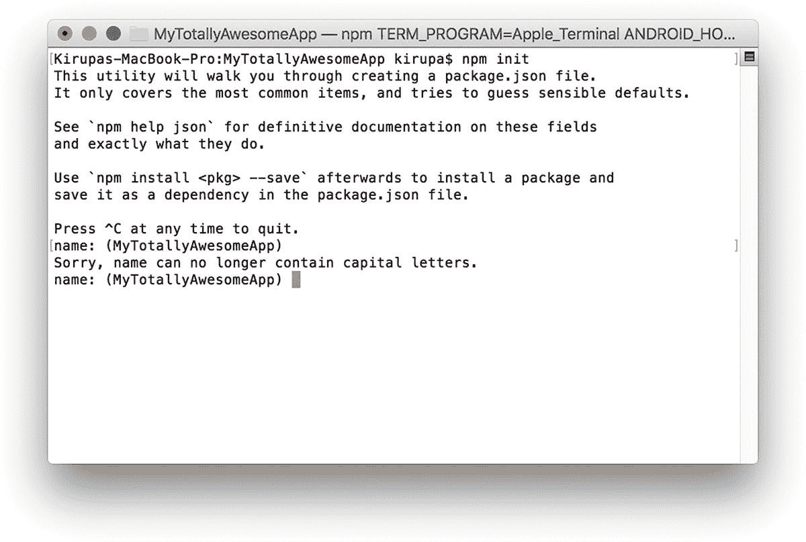

图 15-9 我们的项目文件夹名称包含大写字母，触发了错误。

输入名称的小写版本`mytotallyawesomeapp`。完成后，按回车。对于剩余的问题，只需按回车以接受所有默认值。这一切的最终结果是在你的`MyTotallyAwesomeApp`文件夹中创建了一个名为`package.json`的新文件（参见图 15-10）。

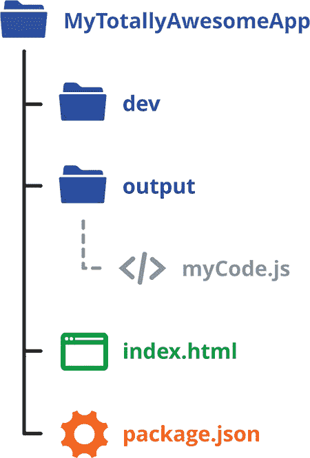

图 15-10 package.json 文件出现在你的文件夹中。

如果你在代码编辑器中打开`package.json`的内容，你会看到类似下面的内容：

```json
{
  "name": "mytotallyawesomeapp",
  "version": "1.0.0",
  "description": "",
  "main": "index.js",
  "scripts": {
    "test": "echo \"Error: no test specified\" && exit 1"
  },
  "author": "",
  "license": "ISC"
}
```

不要太担心这个文件的内容，只需知道调用`npm init`的结果之一是你有一个`package.json`文件，其中包含了一些奇怪的属性和值，而 Node.js 完全知道如何处理它们。

## 安装 React 依赖

我们接下要做的是安装 React 依赖，这样我们就可以在代码中使用 React 和 React DOM 库。如果你来自纯 Web 开发背景，这就是我们开始的地方。如果现在要让我们可视化所有内容的关系，它看起来有点像图 15-6。


图 15-6 你当前的项目结构看起来如下。

我为`output`文件夹中的`myCode.js`文件画了一条虚线，因为该文件目前还不存在。我们在 HTML 中指向了一个目前尚不存在的内容，但这种情况不会持续太久。

## 添加我们的 JSX 文件

事情变得变得有趣了。现在我们已经告诉了 Node.js 感兴趣，距离构建应用又近了一步。在我们的`dev`文件夹中，使用代码编辑器创建一个名为`index.jsx`的文件，内容如下代码：

```javascript
import React from "react";
import ReactDOM from "react-dom";

var HelloWorld = React.createClass({
  render: function() {
    return (
      <p>Hello, {this.props.greetTarget}!</p>
    );
  }
});

ReactDOM.render(
  <div>
    <HelloWorld greetTarget="Batman"/>
    <HelloWorld greetTarget="Iron Man"/>
    <HelloWorld greetTarget="Nicolas Cage"/>
    <HelloWorld greetTarget="Mega Man"/>
    <HelloWorld greetTarget="Bono"/>
    <HelloWorld greetTarget="Catwoman"/>
  </div>,
  document.querySelector("#container")
);
```

注意，我们添加的大部分 JSX 与之前的几乎没有修改。唯一的区别是，以前将 React 和 React DOM 库引入应用的`script`引用现在已被`import`语句取代取代，指向我们几分钟前添加的`react`和`react-dom` Node.js 包。现在，你可能正急切好奇我们什么时候可以构建应用并让它在浏览器中运行。嗯，还有几个步骤。图 15-12 显示了我们当前项目可视化的样子。


图 15-12 当前的项目。

# 从 JSX 到 JavaScript

目前缺失的步骤是将我们的`JSX`转换为浏览器可以理解的 JavaScript。这涉及`webpack`和`Babel`，我们将配置这两者来让这一切运行起来。

## 设置 webpack

由于我们正处于 Node.js 环境中，且`webpack`和`Babel`都以 Node 包的形式存在，因此我们需要像安装 React 相关包一样安装它们它们。

要安装`webpack`，请在终端（Terminal）/ 命令提示符（Command Prompt）中输入以下内容：

```bash
npm install webpack --save
```

这需要花费一些时间，因为`webpack`包（及其大量的依赖项）会被下载并放置到我们的`node_modules`文件夹中。完成后，我们需要添加一个配置文件来指定`webpack`如何与我们当前的项目协作。使用你的代码编辑器，在`MyTotallyAwesomeApp`文件夹内创建一个名为`webpack.config.js`的文件（参见图 15-13）。


图 15-13 添加`webpack.config.js`。

在该文件中，我们将指定一组 JavaScript 属性，以定义原始未修改的源文件位置，以及最终源文件的输出位置。请将以下 JavaScript 代码添加到`webpack.config.js`中：

```javascript
var webpack = require("webpack");
```


```javascript
var path = require("path");

var DEV = path.resolve(__dirname, "dev");

var OUTPUT = path.resolve(__dirname, "output");

var config = {

  entry: DEV + "/index.jsx",

  output: {

    path: OUTPUT,

    filename: "myCode.js"

  }

};

module.exports = config;
```

花几分钟看看这段代码的作用。我们定义了两个名为`DEV`和`OUTPUT`的变量，它们指向项目中的同名文件夹。在`config`对象中，我们有两个名为`entry`和`output`的属性，它们使用`DEV`和`OUTPUT`变量来帮助将我们的`index.jsx`文件映射为`myCode.js`。

## 设置 Babel

我们当前设置的最后一部分是将我们的`index.jsx`文件转换为`myCode.js`形式的普通 JavaScript。这就是 Babel 发挥用场的地方。要安装 Babel，让我们回到熟悉的终端 / 命令提示符并输入以下 Node.js 命令：

```bash
npm install babel-loader babel-preset-es2015 babel-preset-react --save
```

通过此命令，我们安装了`babel-loader`、`babel-preset-es2015`和`babel-preset-react`包。现在我们需要配置 Babel 与我们的项目协作。这是一个步骤步骤。

第一步是指定我们想要使用的 Babel 预设（presets）。实现这一点有多种方法，但我倾向的方法是修改`package.json`并添加以下高亮内容：

```json
{

  "name": "mytotallyawesomeapp",

  "version": "1.0.0",

  "description": "",

  "main": "index.js",

  "scripts": {

    "test": "echo \"Error: no test specified\" && exit 1"

  },

  "author": "",

  "license": "ISC",

  "dependencies": {

    "babel-loader": "⁶.2.4",

    "babel-preset-es2015": "⁶.9.0",

    "babel-preset-react": "⁶.5.0",

    "react": "¹⁵.1.0",

    "react-dom": "¹⁵.1.0",

    "webpack": "¹.13.1"

  },

  "babel": {

      "presets": [

        "es2015",

        "react"

    ]

  }

}
```

在高亮行中，我们指定了`babel`对象并指定了`es2015`和`react`预设值。

第二步是告诉 webpack Babel。在我们的`webpack.config.js`文件中，添加以下高亮行：

```javascript
var webpack = require("webpack");

var path = require("path");

var DEV = path.resolve(__dirname, "Dev");

var OUTPUT = path.resolve(__dirname, "output");

var config = {

  entry: DEV + "/index.jsx",

  output: {

    path: OUTPUT,

    filename: "myCode.js"

  },

  module: {

    loaders: [{

      include: DEV,

      loader: "babel",

    }]

  }

};

module.exports = config;
```

### 构建并测试我们的

我们当前设置的最后一部分是将我们的`index.jsx`文件转换为`myCode.js`形式的普通 JavaScript。这就是 Babel 发挥用场的地方。要安装 Babel，让我们回到熟悉的终端 / 命令提示符并输入以下 Node.js 命令：

```bash
npm install babel-loader babel-preset-es2015 babel-preset-react --save
```

通过此命令，我们安装了`babel-loader`、`babel-preset-es2015`和`babel-preset-react`包。现在我们需要配置 Babel 与我们的项目协作。这是一个步骤步骤。

第一步是指定我们想要使用的 Babel 预设。实现这一点有多种方法，但我倾向的方法是修改`package.json`并添加以下高亮内容：

```json
{

  "name": "mytotallyawesomeapp",

  "version": "1.0.0",

  "description": "",

  "main": "index.js",

  "scripts": {

    "test": "echo \"Error: no test specified\" && exit 1"

  },

  "author": "",

  "license": "ISC",

  "dependencies": {

    "babel-loader": "⁶.2.4",

    "babel-preset-es2015": "⁶.9.0",

    "babel-preset-react": "⁶.5.0",

    "react": "¹⁵.1.0",

    "react-dom": "¹⁵.1.0",

    "webpack": "¹.13.1"

  },

  "babel": {

      "presets": [

        "es2015",

        "react"

    ]

  }

}
```

在高亮行中，我们指定了`babel`对象并指定了`es2015`和`react`预设值。

第二步是告诉 webpack Babel。在我们的`webpack.config.js`文件中，添加以下高亮行：

```javascript
var webpack = require("webpack");

var path = require("path");

var DEV = path.resolve(__dirname, "Dev");

var OUTPUT = path.resolve(__dirname, "output");

var config = {

  entry: DEV + "/index.jsx",

  output: {

    path: OUTPUT,

    filename: "myCode.js"

  },

  module: {

    loaders: [{

      include: DEV,

      loader: "babel",

    }]

  }

};

module.exports = config;
```


花几分钟看看这段代码的作用。我们定义了两个名为 `DEV` 和 `OUTPUT` 的变量，它们指向项目中的同名文件夹。在 `config` 对象中，我们有两个名为 `entry` 和 `output` 的属性，它们使用 `DEV` 和 `OUTPUT` 变量来帮助将我们的 `index.jsx` 文件映射为 `myCode.js`。

### 结

好吧……这一切就这么发生了！在前面的章节中，我们在学习如何使用 React 构建酷应用方面涵盖了大量内容。早些时候，我们从讨论构建复杂 UI 产生的问题开始，以及 React 如何让这一切变得轻而易举。希望在随后的章节中，你已经很好地了解如何使用 React 来实现这些目标。

## 16 结束

所以……我们来到这里了。在 15 个章节之后，我们在学习如何使用 React 构建酷应用方面涵盖了大量内容。早些时候，我们从讨论构建复杂 UI 产生的问题开始，以及 React 如何让这一切变得轻而易举。希望在随后的章节中，你已经很好地了解如何使用 React 来实现这些目标。

虽然我们可能完成了这本书的正式内容，但这并不意味着我们的互动就此结束。如果你在与 React 交互时遇到任何问题或遇到困难，我都想听听你的反馈。联系我最简单的方法是在 [`forum.kirupa.com`](http://forum.kirupa.com) 论坛发帖，但你也可以通过 Twitter (@kirupa) 提醒我，或给我发送电子邮件 (kirupa@kirupa.com)）。我会尽力尽快回复你。

下次见！

祝好，


## 索引

### 符号
- `{ }`（花括号），33, 86–87
- `…` 展开运算符
  - 解释，78
  - 传递属性的方法，78–80

### A
- **访问** DOM 元素
  - ES6 箭头函数，141
  - 引用，137–141
  - 使用场景，135–137
- 属性，33
- **激活链接，创建，159–160**
- **activeClassName 属性，159–161**
- **addEventListener 函数，118–119**
- **addItem 事件处理器，170, 171, 177–178**
- **Alpert, Ben,86**
- **Animaniacs 好主意/坏主意 Sketch，36**
- **APIs（应用程序编程接口），9**
- **app 框架，147–149**
- **应用程序编程接口（APIs），9**
- **apps**
  - 目录浏览器应用
    - 多页设计，2–3
    - SPA（单页应用）模型，3–6
  - 使用 React Router 创建
    - app 框架，147–149
    - 样板代码标记和代码，146–147
    - Contact 组件，157–158
    - CSS（层叠样式表），151–153
    - 示例，144–145
    - Home 组件，149–151
    - 主页，显示，149–151, 154–155
    - Link 组件，156
    - 导航链接，155, 159–160
    - 概述，143–144
    - ReactRouter 前缀，153–154
    - render 方法，148, 154
    - Route 组件，149
    - 路由匹配，158
    - Router 组件，149
    - Stuff 组件，157–158
  - 第 React app
    - 空 HTML 页面，创建，15–16
    - 目标，更改，18–19
    - 名字，显示，16–18
    - 样式，19–20
  - MyTotallyApp
    - index.jsx 文件，191–192
    - 项目结构，184–186
    - Node.js 初始化，187–189
    - React 依赖，190–191
    - 测试，197–198
  - Todo List app
    - addItem 事件处理器，171, 177–178
    - app 功能，168
    - 表单提交，169–170
    - 功能，168
    - 代码列表，164–165
    - 概述，163–164
    - render 方法，166, 171, 173–174
    - state 对象初始化，169
    - state 对象填充，171–172
    - 样式，167, 176–178
    - 任务显示，173–176
    - TodoItems 组件，173–176
    - UI 界面，165–168
- 架构（MVC），11
- 参数，10
- 箭头函数（ES6），141
- 组件数组，10–11
- 属性，10
- 自动状态，9–10
- 兼容性，12
- 构建应用，11
- 按钮，10
- 背景颜色，45–47
  - 样式属性（style），46
- 空 HTML 页面，创建，15–16
- 目标，更改，18–19
- 名字，显示，16–18
- 样式，19–20
- 事件处理器，110, 112
  - 监听事件，117–119
  - 合成类型，116–117
  - 事件属性，114–115
  - 代码列表，108–110
  - 代码列表，124–127
  - 渲染阶段，127–129
- 名字，显示，16–18
- 生命周期方法
  - componentDidDidMount, 129
  - componentDidDidUpdate, 131
  - componentWillMount, 129
  - componentWillReceiveProps, 132
  - componentWillUnmount, 132
  - componentWillUpdate, 131
  - getDefaultProps, 128
  - getInitialState, 128
  - render, 129, 131
  - shouldComponentUpdate, 130–131
- 样式，19–20
- **网站，198**
- 卸载阶段，132
- 更新阶段，129–132
- 概述，107–108
- SyntheticEvent 类型，112–114
- this 关键字，119–120

## Buttonify 组件，35–36

## C

### 调用函数，25

### 驼峰命名，86

### 大写字母 (JSX)，87–88

## Card 组件，58–59

## 级联样式表。*参见* CSS (Cascading Style Sheets)

## 目录浏览器应用

- 多页设计，2–3
- SPA (单页应用) 模型，3–6

## 改变目的地，18–19

## 子组件

- 概述，34–36
- 向其传递属性，63–65
- 传递属性到
  - 组件层级结构和，69–74
  - 与之的问题，69–77
  - 扩展运算符 (…)，78–80

## Circle 组件

- 数组的，103–105
- circleStyle 对象，101
- 初始代码列表，99–102
- render 方法，102
- showCircle 函数，102–103
- theCircle 变量，102

## circleStyle 对象，101

## class 名称，85–86

## CleverComponent，34

## 代码编辑器，183–184

## 背景颜色，自定义，45–47

## 调色板卡

- Card 组件，58–59
- 组件定义，56–58
- 组件标识，53–56
- 生成的 HTML，66
- Label 组件，61–63
- 概述，49–51
- 向子组件传递属性，63–65
- Square 组件，60–61
- 视觉元素标识，51–53

## Colorizer 组件

- 行为，135–137
- 引用，137–141
- 注释，86–87
- 编译器。*参见* Babel
- 组件层级，55–56,69–70
- componentDidMount 方法，93,94,118,129
- componentDidUpdate 方法，131

## components

- 数组的，103–105
- Buttonify，35–36
- 大写化，87–88
- 子组件，34–36
- Circle 数组，103–105
  - circleStyle 对象，101
  - 初始代码列表，99–102
  - render 方法，102
  - showCircle 函数，102–103
  - theCircle 变量，102
- CleverComponent，34
- 调色板卡
  - Card 组件，58–59
  - 组件定义，56–58
  - 组件标识，53–56
  - 生成的 HTML，66
  - Label 组件，61–63
  - 概述，49–51
  - 向子组件传递属性，63–65
  - Square 组件，60–61
  - 视觉元素标识，51–53
- Colorizer
  - 行为，135–137
  - 引用，137–141
- 组件层级，55–56,69–70
- 可组合性，*参见* color palette
  - 优势，66
  - 定义，49
  - 概述，49–51
- Contact，157–158
- 事件处理器，110–112
  - 事件监听，116–119
  - 事件属性，114, 115
  - 初始代码列表，108–110
  - 概述，107–108
  - this 关键字，119–120

## 创建

- Card 组件，58–59
- 组件定义，56–58
- 组件标识，53–56
- 生成的 HTML，66
- Label 组件，61–63
- 概述，49–51
- 向子组件传递属性，63–65
- Square 组件，60–61
- 视觉元素标识，51–53
- 定义之，23–24,29
- 事件。*参见* events
- 生成的 HTML，40–41

## HelloWorld 组件

- 创建，30–32
- 属性，32–34
- 首页，149–151
- Label，77
- 字母，37–39

## 生命周期方法

- 按钮计数器示例，124–127

# 方法与生命周期
- `componentWillReceiveProps` 方法, 132
- `componentWillUnmount` 方法, 132
- `componentWillUpdate` 方法, 131
- 定义, 123
- `getDefaultProps` 方法, 128
- `getInitialState` 方法, 128
- 初始渲染阶段, 127–129
- 概述, 123–124
- `render` 方法, 129, 131
- `shouldComponentUpdate` 方法, 130–131
- 卸载阶段, 132
- 更新阶段, 129–132

# LightningCounterDisplay
- `componentDidMount` 方法, 93, 94–95
- 完整代码列表, 96–98
- `getInitialState` 方法, 93–94
- 初始代码, 90–92
- 初始状态值,设置, 93–94
- 概述, 89–90
- `setInterval` 函数, 93
- `setState` 方法, 93, 95
- 状态改变, 渲染, 96
- `strikes` 变量, 93–94
- `timerTick` 函数, 94–95

# Components
- `Link`, 156
- 多个组件, 显示, 103–105
- `PlusButton`, 116–117
- `Route`, 149
- `Router`, 149
- `Shirt`, 74–77
- `Stuff`, 157–158

# Properties
- 属性, 33–34
- 传递. *查看* 传递属性

# Styling
- 使用 CSS 样式化, 41–42
- 使用 React 样式化
  - 可自定义的背景颜色, 45–47
  - 概述, 42
  - 省略 `px` 后缀, 45
  - 创建 `style` 对象, 43
  - 应用 `styles`, 43–45

# TodoItems
- `TodoItems`, 173–176
- `addItem` 事件处理器, 171, 177–178
- 应用功能, 168
- 表单提交, 169–170
- 功能, 168
- 初始代码, 164–165
- 概述, 163–164
- `render` 方法, 166, 171, 173–174
- `state` 对象初始化, 169
- `state` 对象填充, 171–172
- `styles`, 167, 176
- 任务显示, 173–176
- UI (界面), 165–168
- `componentDidMount` 方法, 129
- `componentWillReceiveProps` 方法, 132
- `componentWillUnmount` 方法, 132
- `componentWillUpdate` 方法, 131

# 组件的可组合性
- 优势, 66
- 色调板示例
  - `Card` 组件, 58–59
  - 组件定义, 56–58
  - 组件识别, 53–56
  - 生成的 HTML
  - `Label` 组件, 61–63
  - 概述, 49–51
  - 传递给子组件的属性, 63–65
  - `Square` 组件, 60–61
  - 视觉元素识别, 51–53
- 定义, 49
- 概述, 49–51

# 配置开发环境
- `index.jsx` 文件, 191–192
- 初始项目结构, 184–186
- `Node.js`, 187–189
- React 依赖项
- 应用, 40–42
- 第一个 React 应用, 19–20
- HTML 对比 JSX, 84–85
- SPA（单页应用）示例, 151–153
- Todo List 应用, 167, 176–178
- `大括号 ({ }), 33, 86–87`
- `自定义背景颜色, 45–47`

### D

- DE. *参见开发环境*
- `深度链接, 144`
- `依赖项, 安装, 190–191`

## design

- 多页设计, 2–3
- SPA（单页应用）模型, 3–6
- `目的地, 修改, 18–19`
- `目标变量, 18–19`
- `dev 文件夹, 184–185`

## development environment

- 优势, 179–181
- Babel, 182
- 构建应用, 197–198
- 代码编辑器, 183–184

## Node.js

- 安装, 187–189
- 概述, 182

### setup

- `index.jsx 文件, 191–192`
- 初始项目结构, 184–186
- Node.js, 187–189
- React 依赖项, 190–191
- webpack, 193–195
- webpack, 183

## displaying

- 首页, 149–151, 154–155
- 多个组件, 103–105
- 名称, 16–18
- Todo List 应用中的任务, 173–176
- `div 元素第一个 React 应用, 18`
- HelloWorld 组件, 32
- 使用 CSS 样式, 41–42

## documentation

- npm 文档, 198
- React Router, 161
- `document.body 参数 (render 方法), 17`
- `DOM 元素 访问 ES6 箭头函数, 141`
  - 引用, 137–141
  - 何时使用, 135–137
- `DOM 操作, 8`

### E

- `编辑器 (code), 183–184`

## elements

- JSX 中的大写, 87–88
- div 第一个 React 应用, 18
- HelloWorld 组件, 32
- 使用 CSS 样式, 41–42
- DOM 元素 访问 ES6 箭头函数, 141
  - 引用, 137–141
  - 何时使用, 135–137
- 表单, 169–170
- UI 元素的效率, 26–29
- 输出多个, 27
- 传递属性, 138–139
- `省略号 (...) 运算符解释, 78`
  - 传递属性, 78–80
- `EmberJS 模板, 10`
- `环境. *参见开发环境*`
- `范围中的错误, 105`
- `ES6 箭头函数, 141`

## event handlers

- addItem, 170
- 概述, 110–112
- this 关键字, 119–120

## events

- 浏览器兼容性, 120

## button counter

- 事件处理器, 110–112
- 事件监听, 116–119
- 事件属性, 114–115
- 初始代码列表, 108–110
- 概述, 107–108
- this 关键字, 119–120
- 定义, 107
- 事件处理器 addItem, 170
  - 概述, 110–112
  - this 关键字, 119–120
- KeyboardEvent 类型, 112
- 监听, 116–119
- MouseEvent 类型, 112
- `onSubmit, 169–170`
- 性能, 120–121
- SyntheticEvent 类型, 112–114

### F

- `文件, index.jsx, 191–192`

## 第一个 React 应用

- HTML 页面, 创建, 14–15
- 目的地, 修改, 18–19
- 名称, 显示, 16–18
- 使用 CSS 样式, 41–42

## folders

- dev, 184–185
- node_modules, 190
- 输出, 184–185
- `表单提交, 169–170`
- `formatDistance 函数, 25`
- `forum.kirupa.com, 199`
- `frames (app), 147–149`
- `functions. *参见方法*`
  - `addEventListener, 118–119`
  - 调用, 25
  - createElement, 82–84
  - ES6 箭头函数, 141
  - 解释, 24–26
  - `formatDistance, 25`
  - `getDistance, 32–33`
  - 增加, 110–112, 115
  - `printStuff, 78`
  - `removeEventListener, 119`
  - `setInterval, 93`
  - `showCircle, 102–103`
  - `timerTick, 94–95`

### G

- 生成的 HTML
  - 调色板卡片, 66
  - Letter 组件, 40–41
- `getDefaultProps` 方法, 128
- `getDistance` 函数, 32–33
- `getInitialState` 方法, 93–94, 128, 169

### H

- `HelloWorld` 组件
  - 创建, 30–32
  - 属性, 32–34
- 帮助, forum.kirupa.com, 199
- 层级
  - 组件层级, 55–56, 69–70
  - 视觉层级, 52
- `Home` 组件, 149–151
- 首页，显示, 149–151, 154–155
- HTML 元素，JSX 中的大小大小写, 87–88
- HTML 模板, 6

### I

- 识别
  - 组件, 53–56
  - 视觉元素, 51–53
- `increase` 函数, 110–112, 115
- `index.html` 文件, 185–186
- `index.jsx` 文件, 191–192
- 初始项目结构, 184–186
- 初始渲染阶段（生命周期方法), 127–129
- 初始状态值, 93–94
- 初始化
  - Node.js, 187–189
  - 状态对象, 169
- 内联样式
  - 应用, 43–45
  - `Circle` 组件, 101
  - 可自定义背景颜色, 45–47
  - 概述, 42
  - `px` 后缀，省略, 45
  - 样式对象，创建, 43
- `input` 元素, 138–139
- `_input` 属性, 139–140
- 安装
  - Babel, 195–196
  - Node.js, 187–189
  - React 依赖, 190–191
  - webpack, 193–195
- `Array`,创建, 172

### J

- JavaScript
  - JSX 到 JavaScript 的转换. 另阅 开发环境
    - Babel, 182
    - 概述, 81–83
    - 测试应用, 197–198
    - webpack, 183, 193–196
  - 视觉元素定义, 9–11
- JSX 数组, 103–105
- 大小写, 87–88
- 类名, 85–86
- 注释, 86–87
- CSS（层叠样式表）和, 84–85
- 解释, 10–11, 14–15
- 第一个 React 应用
  - 空白 HTML 页面，创建, 14–15
  - 目标，更改, 18–19
  - 名称，显示, 16–18
  - 样式, 19–20
- `index.jsx` 文件, 191–192
- JSX 到 JavaScript 的转换. 另阅 开发环境
  - Babel, 182
  - 概述, 81–83
  - 测试应用, 197–198
  - webpack, 183, 193–196
- 代码中的位置, 88
- 方法. 另阅 方法
- 保留关键字, 85–86
- 根节点，返回, 83–84
- 样式属性, 84–85
- JSX 到 JavaScript 的转换. 另阅 开发环境
  - Babel, 182
  - 测试应用, 197–198
  - webpack, 183, 193–196

### K

- 事件, 110–112
- 关键字的, 85–86
- this, 119–120

### L

- 标签, 55–56, 69–70
- Letter 组件, 40–41
- 生成的 HTML, 61–63
- 样式 CSS, 37–39
- React 样式, 45–47

### 生命周期周期方法

- 按钮计数器示例, 124–127
- componentDidMount, 129
- componentDidUpdate, 131
- componentWillMount, 129
- componentWillReceiveProps, 132
- componentWillUnmount, 132
- componentWillUpdate, 131
- 定义的, 123
- 卸载阶段
  - 定义的,
- `getDefaultProps` 方法, 128
- `getInitialState` 方法, 128
- 初始渲染阶段, 127–129
- 概述, 123–124
- render 方法, 129, 131
- shouldComponentUpdate 方法, 130–131
- 更新阶段
  - 属性更改, 131–132
  - 状态更改，129–131

## LightningCounterDisplay 组件

- `componentDidMount` 方法，93
- 完整代码列表，96–98
- `getInitialState` 方法，93–94
- 初始代码，90–92
- 初始状态值，设置，93–94
- 概览，89–90
- `setInterval` 函数，93
- `setState` 方法，93
- 状态更改，渲染，96
- `strikes` 变量，93–94
- `timerTick` 函数，94–95

## Link 组件，156

### 链接

- 激活链接，159–160
- 深度链接，144
- 导航链接，155–156

### 监听事件

- 常规 DOM 事件，117–119
- `SyntheticEvent` 类型，116–117

## listItems 变量，175–176

## logo (React)，7

### M

- 匹配路由，158
- 俄罗斯套娃的比喻，9
- 消息，控制台警告，105
- 方法。*另参见* functions
  - `addItem`,170, 171, 177–178
  - 按钮计数器示例，124–127
  - `componentDidMount`,93, 94–95, 118, 129
  - `componentDidUpdate`,131
  - `componentWillMount`,129
  - `componentWillReceiveProps`,132
  - `componentWillUnmount`,132
  - `componentWillUpdate`,131
  - `createClass`,30
  - 定义，123
  - `getDefaultProps`,128
  - `getDefaultProps` 方法，128
  - `getInitialState`,93–94, 128, 169
  - 初始渲染阶段，127–129
  - 概览，123–124
  - `preventDefault`,172
  - render
    - `Card` 组件，59
    - `Circle` 组件，102, 104–106
    - `Colorizer` 组件，138
    - `first React` 应用，16–18
    - `HelloWorld` 组件，30–32
    - 初始渲染阶段，129
    - `Label` 组件，62
    - `LightningCounterDisplay` 组件，92
    - 概览，26, 129, 131
    - `SPA (single-page app)` 示例，148–149, 154
    - `Square` 组件，60–61
    - `Todo List` 应用，166
    - `TodoList` 组件，171, 173–174
    - 更新阶段，131
  - `setNewColor`,141
  - `setState`,93, 95
  - `shouldComponentUpdate`,130–131
  - 卸载阶段，132
  - 更新阶段，129–132
- `MouseEvent` 类型，112
- `multi-page design`,2–3
- `multiple components, displaying`,103–105
- `multiple elements, outputting`,27
- `MVC architecture`,11
- `MyTotallyAwesomeApp`
  - `index.jsx` 文件，191–192
  - 初始项目结构，184–186
  - `Node.js` 初始化，187–189
  - `React dependencies`,190–191
  - 测试，197–198

### N

### 名字

- 类名，85–86
- 显示，16–18
- 导航链接，155–156
- `NPM (Node Package Manager)` *另参见* Node.js
  - (part0024.xhtml_index09)
- `node_modules` 文件夹，190
- `Node.js` 初始化，187–189
  - 安装，187–189
  - 根，182
  - 83
- `NPM (Node Package Manager)` *另参见* Node.js
  - (part0024.xhtml_index09)
- `npm` 文档，198

### O

- `circle` 对象，101
- 创建，43
- 自定义背景，45–47
- 概览，85
- `px` 后缀，45
- `style` 属性，43–45
- `props`，79
- 初始化，169
- 填充，171–172
- `onClick` 事件处理，110–112
- `onSubmit` 事件，169–170
- `operators, spread` (…)
  - 解释，78
  - 传递属性，78–80
- `output` 文件夹，184–185
- `outputting multiple elements`，27

### P

- `palette card`。*另参见* color palette

### passing properties

- 调色板示例，63–65
- 组件层级和，69–74
- 问题，74–77
- 展开运算符 (…)
  - 示例，78–80
  - 解释，78

### performance, events and,性能，120–121

- `PlusButton` 组件，116–117
- `populating state object`,171–172
- `preventDefault` 方法，172
- `printStuff` 函数，78

# 访问与属性
- `accessing`, 33
- `activeClassName`, 159–161
- `bgcolor`, 46
- `event properties`, 114–115
- `HelloWorld` 组件, 32–34
- `prop changes`, 131–132
- `ref`, 138–139

# 规范
- `component call`, 34
- `component definition`, 33
- `style`, 43–45, 84–85
- `SyntheticEvent` 类型, 113–114

# 传递
- `color palette card example`, 63–65
- `component hierarchy and`, 69–74
- `problems with`, 74–77
- `spread operator (…)`, 78–80
- `vendor-prefixed properties`, 59
- `props` 对象, 79
- `px` 后缀,省略, 45

## Q-R
- `React dependencies`, 安装, 190–191
- `React Event System` 文档, 114

## React Router

### 使用以下内容创建 SPA（单页应用）：
- `active links`, 159–160
- `app frame`, 147–149
- `boilerplate markup and code`, 146–147
- `Contact` 组件, 157–158
- `CSS` (层联样式表), 151–153
- `displaying`, 149–151
- `example`, 144–145
- `Home` 组件, 149–151
- `home page`, 显示, 154–155
- `Link` 组件, 156
- `navigation links`, 155–156
- `overview`, 143–144
- `ReactRouter` 前缀, 153–154
- `render` 方法, 148–149, 154
- `Route` 组件, 149
- `route matching`, 158
- `Router` 组件, 149
- `Stuff` 组件, 157–158
- `documentation`, 161
- `referencing`, 147

## React 工具集成
- `React Tooling Integration`, 198
- `ReactRouter` 前缀, 153–154
- `reconciliation`, 8
- `ref` 属性, 138–139
- `references`, 137–141
- `referencing`
  - `Babel` 编译器, 16
  - `React` 库, 15
  - `React` Router, 147
- `regular DOM events`, 监听, 117–119
- `removeEventListener` 函数, 119
- `render` 方法
  - `Card` 组件, 59
  - `Circle` 组件, 102, 104–106
  - `Colorizer` 组件, 138
  - `first React` 应用, 16–18
  - `HelloWorld` 组件, 30–32
  - `initial rendering phase`, 129
  - `Label` 组件, 62
  - `LightningCounterDisplay` 组件, 92
  - `overview`, 26
  - `SPA` (单页应用) 示例, 148–149
  - `Square` 组件, 60–61
  - `Todo List` 应用, 166
  - `TodoList` 组件, 171, 173–174
  - `updating phase`, 131
- `renderData` 数组, 104
- `rendering state change`, 96
- `reserved keywords`, 85–86
- `root nodes`, 返回, 83–84
- `Route` 组件, 149
- `route matching`, 158
- `Router` 组件, 149
- `routing`, 144, 149. 另另 React Router
- `俄罗斯套娃比喻`, 9

## S
- `setInterval` 函数, 93
- `setNewColor` 方法, 141
- `setState` 方法, 93, 95
- `设置开发环境`
  - `index.jsx` 文件, 191–192
  - `初始项目结构`, 184–186
  - `Node.js`, 187–189
  - `React` 依赖, 190–191
- `React Event System` 文档, 114

# 路由匹配, 158

# Router 组件, 149

# Stuff 组件, 157–158

# model, 3–6

### 指定属性

- 组件调用, 34
- 组件定义, 33

## 展开运算符 (…)

- 解释, 78
- 使用它传递属性, 78–80

## Square 组件, 60–61

## 状态改变，渲染, 96

## 状态管理

- 生命周期周期方法, 129–131

### LightningCounterDisplay

- `componentDidMount` 方法, 93, 94–95
- `getInitialState` 方法, 93
- 初始代码, 90–92
- 初始状态值，设置, 93–94
- 概述, 89–90
- `setInterval` 函数, 93
- `setState` 方法, 93, 95
- `strikes` 变量, 93–94

### LightningCounterDisplay 组件

- 代码列表, 96–98
- 初始代码, 90–92
- 概述, 89–90
- `setInterval` 函数, 93
- 状态改变，渲染, 96
- `timerTick` 函数, 94–95

### UI (用户界面), 7–8

## state 对象. *另参见 状态管理*

- 初始化, 169
- 填充, 171–172

## `strikes` 变量, 93–94

## Stuff 组件, 157–158

## style 属性, 43–45, 84–85

## 样式

### CSS (层叠样式表)

- 应用, 40–42
- HTML 对比 JSX, 84–85
- SPA (单页应用)示例, 151–153
- Todo List 应用, 167, 176–178
- React React 应用, 19–20
- 内联组件, 101
  - 可自定义背景颜色, 45–47
  - 概述, 42
  - `px` 后缀, 45
  - style 对象, 43
  - 样式应用, 43–45
- 概述, 37
- 表单提交, 169–170
- forum.kirupa.com, 199
- `swatchComponent` 变量, 88
- `SyntheticEvent` 类型, 112–114

### 在 Todo List 应用中显示任务, 173–176

## 模板

- EmberJS 模板, 10
- HTML 模板, 6
- `theCircle` 变量, 102
- `this` 关键字, 119–120
- `timerTick` 函数, 94–95
- `todoEntries` 变量, 174
- `TodoItems` 组件, 173–176

### TodoList 组件

- `addItem` 事件处理器, 171, 177–178
- 应用功能, 168
- 表单提交, 169–170
- 功能, 168
- 初始代码列表, 164–165
- 概述, 163–164
- `render` 方法, 166, 171, 173–174
- state 对象初始化, 169
- state 对象填充, 171–172
- 样式, 167, 176–178
- 任务显示, 173–176
- `TodoItems` 组件, 173–176
- UI (用户界面), 165–168

## 工具

- Babel, 182
- 代码, 183–184
- Node.js, 187–189
- 概述, 182
- 安装, 193–195
- 概述, 183

## 传递

- 颜色, 63–65
- 与它, 69–74
- 它的问题, 74–77
- 展开运算符 (…), 78–80

## 转译 JavaScript

- Babel, 182
- 概述, 81
- Todo List 应用, 197–198

## UI (用户界面). *另参见 事件*

- 数组的, 103–105
- 初始代码列表, 99–102
- `render` 方法, 102
- `showCircle` 函数, 102–103
- `theCircle` 变量, 102

## 效率问题, 26–29

## UI (用户界面), 7–8

## Todo List 应用, 165–168

## 卸载周期方法, 132

## 更新周期方法

- prop 属性改变, 131–132
- 状态改变, 129–131

## 变量

- 目的地, 18–19
- listItems, 175–176
- strikes, 93–94
- `swatchComponent`, 88
- `theCircle`, 102
- `todoEntries`, 174

# 厂商前缀属性，59

# 视图，143

# 虚拟 DOM，8

# 视觉层级，52

# 视觉效果

### 在 JavaScript 中定义，9–11

### 识别，51–53

### 视觉层级，52

## W-X-Y-Z

### WebkitFilter 属性，59

# webpack

### 安装，193–195

### 概述，183

### 网站，198


## 代码片段


