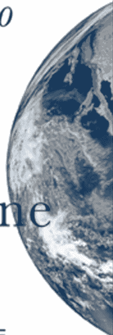

# 在人类世学习死亡：对文明终结的反思

> “斯克拉顿利用他在伊克的经历来面对气候变化的严峻现实。其结果是一本激烈且具有挑衅性的书籍。”
>
> — 伊丽莎·科尔伯特（Elizabeth Kolbert，《第六次灭绝》作者）

> “斯克拉顿利用他在伊克的经历来面对气候变化的严峻现实。其结果是一本激烈且具有挑衅性的书籍。”
>
> — 伊丽莎·科尔伯特，《第六次灭绝》作者

# 罗伊·斯克兰顿的赞誉

## 在人类世中学习死亡

> “在《在人类世中学习死亡》中，罗伊·斯克兰顿利用他在伊克的经历来面对气候变化的严峻现实。其结果是一本激烈且具有挑衅性的书籍。”
>
> — 伊丽莎·科尔伯特，2015年普利策奖获得者，《第六次灭绝：非自然史》作者

> “罗伊·斯克兰顿以极其罕见的诚实清晰地阐述了气候危机的深度，然后呼吁一种重新想象的人性，以帮助我们以竭尽最大的尊严面对风暴肆虐的未来。虽然我不认同他关于社会运动推动雄心缓解措施潜力的结论，但这是由一位优雅作家和原创思想者提出的明智且重要的挑战。这是一次批判性的干预。”
>
> — 娜奥米·克莱因（Naomi Klein，《改变一切：资本主义对抗气候》作者）

> “我们完蛋了。我们知道。某种程度上如此。但罗伊·斯克兰顿在这部灼热的新书中深入黑暗，凝视着它，目不眨眼。他带回了些许来之不易的光亮……哲学是什么？它是在思想中被理解的时间。这是我们的时代，而罗伊·斯克兰顿有勇气用散文来思考它，这种文字有时感觉像子弹，但又是要点。”
>
> — 西蒙·克里奇莱（Simon Critchley，《纽约时报》观点专栏编辑，《石块》作者，《无限的需求：承诺的伦理，抵抗的政治》作者）

> 罗伊·斯克兰顿看透了。他骨子里知道这个文明已经结束了。他知道现在是时候重新开始人类的舞蹈，去创造另一种生活方式了。他以他独特且原创的方式，梳理了一种常见的文化遗产，为这些引人入胜的时代创造了新鲜的新事物。这篇简洁而精炼的文字既提供了令人不安的真相，也带来了意想不到的喜悦。
>
> — 麦肯齐·瓦克（McKenzie Wark，《分子红：人类世理论》作者）

> “一本雄辩、有野心且具有挑衅性的书籍。”
>
> — 罗布·尼松（Rob Nixon，《慢暴力与穷人的环保主义》作者）

> “罗伊·斯克兰顿为人类世写了一声哀嚎——一本充满激情、火花、科学和智慧的书。它比以往关于该主题写过的任何东西都更深刻。”
>
> — 戴尔·杰米森（Dale Jamieson，《黑暗时代的理性：为什么反对气候变化的斗争失败了——这对我们的未来意味着什么》作者）

> “Fade.” 由凯莉·布朗斯坦（Carrie Brownstein）、科林·塔克尔（Corin Tucker）和珍特·魏斯（Janet Weiss）创作，©2015 BMG Gold 歌曲/Big Deal/Code nemesis (ASCAP)。版权由 BMG Rights Management (US) LLC 管理。经许可使用。保留所有权利。

## 致谢

> 献给教我记住死者的哥哥，以及劳拉（Laura）。

可能到2040年。仅南极冰盖的崩溃——这一过程已经在进行——最终将导致海平面升高20英尺。

随着冰川和冰盖的融化，长期封锁在海底和永冻土中的碳和甲烷也将被释放。作为一种温室气体，甲烷的威力是二氧化碳的二十倍以上，数千亿吨的这种物质以水合物的形式存在海洋下，等待着释放：海洋学家约翰·凯斯勒（John Kessler）写道：“这些固态的冰状结构仅在特定条件下才是稳定的，估计其含量的甲烷总量相当于地球上所有燃料储量的总和。” 西伯利亚出现了富含甲烷的塌洞，北冰洋海底也追踪到了泄漏的甲烷气泡，这标志着一场巨大的行星级“打嗝”的开始，这种现象足以引发灾难性的温室效应。地质物理学家大卫·阿彻（David Archer）警告说：“甲烷水合物储层引发行星性毁灭的潜力……似乎与核冬天、彗星或小行星撞击的破坏潜力相当。”

我们完蛋了。唯一的问题是何时发生，以及程度有多严重。政府间气候变化专门委员会（IPCC）2014年关于气候影响的报告警告说：“如果不采取目前之外的额外缓解措施，即使采取适应措施，到21世纪末，全球将面临严重、广泛且不可逆影响的高风险至极高风险。” 根据世界银行的数据，即使我们现在在全球范围内停止二氧化碳（CO₂）排放，2.7度的升温似乎已不可避免。夏威夷大学研究者的预测发现，早在2047年，我们将面临“史无前例”的气候。曾任职于NASA的气候科学家詹姆斯·汉森（James Hansen）认为，我们正面临着一个“末日性”的未来——这一阴暗的观点也得到了全球研究者的认同。

这群“卡珊德拉”式的预言者预言了全球气候的剧烈变化将引发广泛动荡，而他们的末日愿景得到了压倒性的硬性数据的支持。全球变暖不是某个陈旧灭绝神话的最新版本。这不是歇斯底里。它是一个事实。而且我们可能已经过了可以采取任何行动的界点。从许多政策专家、气候科学家、国家安全官员的角度来看，担忧不是全球变暖是否存在或我们如何防止它，而是我们将如何适应我们所创造的炎热且不稳定的世界的生活。

这个新世界有一个名字：人类世（Anthropocene）。这个词源于古希腊语。最近一个地质时代（新生世）的所有纪元都以后缀“cene”结尾，源自kainos，意为“新”。Anthro指人类。“人类世”背后的观点是，我们进入了地球地质历史上的一个新纪元，其特征是人类作为一种地质力量的出现。生物学家Eugene·F·斯托默（Eugene F. Stoermer）和诺贝尔奖化学家保罗·克鲁曾（Paul Crutzen）在2000年提出了这一术语，它已获得认可，证明全球变暖带来的变化不仅将影响世界的气候和生物多样性，还将影响其地质结构，而且持续不仅是几世纪，而是千年。威廉·布莱克（William Blake）在两百多年前碳时代黎明写下的预言性诗句中写道：“人类的世代随时间的潮汐流逝 / 但他们留下的命运轨迹将永远永恒。”

国际地层学委员会（负责驱动划分不同地质时期“金钉”的地质学家们）已采纳“人类世”作为一个值得进一步考虑的术语，认为“在地球历史尺度上具有重要意义”，并讨论它可能属于何种地质时间尺度，以及我们可能认为它是何时开始的。像全新世那样的“世”，还是仅仅像卡拉布里亚世那样的“代”？它是从1800年左右工业革命的开始开始，还是从20世纪中叶的大加速开始的？是从12,000年前农业的起源，还是从1945年7月16日第一枚原子弹开始的？

无论何时，这都是我们居住的新世界。几代人之后，我们将面临比今天高出7华氏度的平均温度，海平面至少上升十英尺，以及全球作物带、生长季节和人口中心的迁移。除非我们现在就全面停止排放温室气体，否则人类将在几百年内生活在地球自300万年前上新世以来未曾过的气候中，那时的海平面高出75英尺。一旦海底和永冻土下的甲烷水合物开始融化，我们可能很快发现自己生活在接近古新世-始新世极热气候中（大约5600万年前），那时地球没有冰，极地是热带气候。我们面临着全球经济所依赖的农业、航运和能源网络的迫在崩溃，生物圈中正在进行的大规模死亡，以及我们作为一个物种的灭绝。如果智人能活过下一个千年，那也将是在与我们过去20万年来所熟知的世界截然不同的世界中生存。

为了适应这个奇特的新世界，我们需要的不仅仅是科学报告和军事政策。我们需要新的神话和新的故事，一种关于现实的新多语言概念传统，以及与人类文化深层品质的新关系，而碳基资本主义通过商品化和同化侵蚀了这种深度。面对资本主义，我们需要一种新的人文主义。我们需要一种新的人文主义愿景。

诚然，海洋酸化、物种灭绝是人文科学通过其细微分析、档案辩论似乎无法解决的问题。但人类世提出的概念和存在性问题，正是人文探究的核心。作为人类意味着什么？什么是好的？在人类世的世界中，个体死亡的问题——我的生命意味着什么——被泛化到了难以想象的尺度。正如环境哲学家杰米森（Jamieson）所说，“人类世为生活带来了新的挑战。” 历史学家和理论家迪佩什·查克拉巴蒂（Dipesh Chakrabarty）声称，全球变暖引发了我们从未考虑过的人类愿景。” 无论我们讨论的是伦理还是政治、本体论还是认识论，面对终结都剧烈地挑战了我们的视角和优先事项。在不可避免的终结面前，我们如何做出有意义的决定？

作为一名士兵为了生存，我必须学会接受死亡的必然性。为了让人类在人类世（Anthropocene）存续，我们需要学会与我们当前文明的终结共处。变化、风险、冲突、斗争和死亡是生命本身的过程，我们无法回避它们。我们必须学会接受并适应。

人类心理本能地反抗“终结”的想法。同样，历史上的文明一直盲目地向灾难行进，因为人类天生倾向于相信明天会和今天大体无异。我们很难记住，这种生活方式、此时此刻、这种秩序并不是稳定且永久的。在当今世界，我们的行为证明了我们的信念：我们可以永远这样持续下去：燃烧石油、毒害海洋、杀灭其他物种、向空气中排放碳、忽视煤矿井金丝雀那不祥的沉默，转而追求我们新数字想象空间中无止境的机器人推文。然而，全球气候变化的现实将继续侵入我们对永恒增长、持续创新和无尽能源的集体幻象，正如个体死亡的现实正冲击着我们对永恒的因果信仰。

人类世带来的最大挑战并不是国防部应该如何规划资源路径，我们是否应该修筑海墙来保护曼哈顿，或者我们何时应该放弃迈阿密。这些问题无法通过买一辆普锐斯、关空调或签署条约来解决。我们面临的最大挑战是一个哲学问题：理解这个文明已经死亡了。我们越早面对自己的处境并意识到我们无能为力地自救自己，就越早能投入到艰巨的任务中——以凡人的谦卑适应我们的新现实。

碳驱动的资本主义是一个僵尸系统，贪婪却贫瘠。这种侵略性的人类单一文化被证明具有惊人的毒性，但也具有毒性、自残性和自我毁灭性。它本身是不可持续的，对灾难性气候变化的反应也是不可持续的。坦率地说，碳驱动的资本主义并不是人类组织生活的唯一方式。在历史上，我们一次一次证明了自己有能力摒弃适应不当的意义和经济分配系统，针对贫困和威胁开发出韧性的社会技术，将过时的社会实践转化为新的生命形式。人类能否通过碳驱动资本主义的崩溃并进入人类世的新世界而生存，取决于我们是否能够在保护、维持和重塑我们集体文化技术故事的同时，放弃我们旧的生活方式。毕竟，我们创新和适应的能力取决于我们是否能从庞大的知识生产遗产中汲取养分，无论生与死、异域与近旁：从《伊法特》到伊斯兰教，从赫拉克利特到庄子，从《托拉法》到佛陀，从《联邦党人文集》到《共产党宣言》。碳驱动的资本主义产生了一种真正奇妙的自由多元文化主义，但如果我们想在它的临终挣扎中幸存，宽容必须成熟为保护与综合，并植根于对超越任何派系认同、局部时间或单一地点的人类共同体的信仰。

本书的观点是，我们未能防止无法调控的全球变暖，而且我们所熟知的资本主义文明已经结束，但如果我们接受人类的局限性和瞬时性是基本真理，并致力于培养我们集体遗产的多样性和丰富性，人类就可以生存并适应人类世的新世界。作为个体学会死亡意味着放下我们的偏见和恐惧。作为文明学会死亡意味着放弃这种特定的生活方式及其关于身份、自由、成功和进步的观念。这两种学习死亡的方式在人文主义思想者的角色中汇合：那个愿意停下来并提出棘手问题的人，那个愿意中断的人，那个在其他频道和更慢节奏上产生共鸣的人。

本书的形式是一个故事，但不是关于某人的故事。气候变化太大了，无法简化为单一的叙事，它带给我们的问题要求我们超越视觉表象的“图像思维”，转而努力创造一种超越地点、生命或时间的集体感。这本书讲述的故事是人类灵魂在死亡中认清自我的过程。它始于我们与地球关系的深层起源，在第一章“人类生态学”中，追溯到我们的当代困境。在第二章“棘手问题”中，我们思考这一困境。碳驱动资本主义及其技术乌托邦意识形态者推崇无限增长，但事实证明无法拯救我们。针对气候变化的各种“解决方案”从碳税到地球工程，没有一个是奏效的。

全球应对气候变化的失败根本上是一个集体行动问题，意味着是一个政治问题。在第三章“碳政治”中，我们思考应对气候变化的集体失败是如何成为政治体系的结果。我们所陷入的麻烦可能无法很好管理，如果我们能管理的话。面对人类世的死亡恐惧和冲突的必然性，是第四章“斗争的强制”的任务。接受我们的局限意味着与生的纯真和不可避免的死亡和解。

然而，通过学会死亡，我们可以连接并为人类未来开启可能，正如我在第五章“新启蒙”中所述。通过中断恐惧和反应的循环，深视死亡，并培养我们丰富的文化技术——从《吉尔伽美什史诗》到《薄伽梵歌》，从想象的人类世未来——我们开启了与宇宙的新关系，在这种关系中，我们可能不是作为寄生消费者生存，而是作为创造者——在这种关系中，我们可能作为我们一切力量源头的光芒生存。

# 人类生态系统

> Erpe toc of erpe erpe wyp woh,
>
> Erpe oper erpe to pe erpe droh,
>
> Erpe lyde erpe in erpe proh,
>
> Po heude erpe of erpe erpe ynoh.
>
> Earth took of Earth, Earth with woe,
>
> Earth other Earth to the Earth drew,
>
> Earth laid Earth in an Earthen trough,
>
> Then had Earth of Earth Earth enough.
>
> — 匿名中世纪英语抒情诗

第一批人类大约在二十万年前出现在热带非洲，由原始人科人类演化而来，他们出生时的世界正经历着剧烈的气候变迁。当时地球的平均温度比现在低 3.5 华氏度，很快将维持在平均低 5 华氏度到 9 华氏度的水平。全球气候寒冷、干燥且严酷。北半球被厚达二五半英里的巨大冰盖覆盖，范围一直延伸到俄亥俄、英国、德国和中国北部。地球表面的 30% 被冰川覆盖。海洋平面比现在低了 270 英尺以上。这就是我们最初演化并学习生存的世界。

我们的祖先是成小群体旅行的杂食性狩猎采集者，在赤道非洲生活了数万年。但当大约 13.5 万年前温度升高，平均比现在高出达 5 华氏度时，我们的祖先逃离热带寻找更温和的气候，通过狩猎进入了当时撒哈拉郁郁葱葱的草原。地球进入了地理学家所谓的“间冰期”，即每隔十万年左右的漫长寒冷期之间发生的周期性变暖期。从地质学角度来说，这些时期通常很短暂，每个持续一万年。

我们在撒哈拉的祖先所经历的如此：几千年后，温度下降，变得比现在还要冷（比现在低 7 到 10 华氏度），冰川再次向赤道推进，海洋面积萎缩。撒哈拉失去了它保持的温暖，我们的狩猎采集者祖先散回热带非洲，向东到达尼罗河谷及以外地区，向北环绕地中海进入欧洲；在那里，他们与我们的表亲尼安德特人生活在一起、杂交，并最终消灭了他们。在持续数千年的漫长冬季里，随着微小的气候变化在几十年或几个世纪内略微引起温度波动，人类狩猎部落扩张到整个亚洲，最终跨越白令陆桥到达美洲。

在那个时期（即从 10 万年前到 5 万年前）的某些时候，我们开发出了证明我们拥有最实质捕食优势的关键社会技术：文化和符号推理。这一进步无疑是帮助我们消灭尼安德特人并在严酷寒冬中生存的一部分，它还帮助我们将从早期人科那里继承的基础工具使用转化为克罗马格农人狩猎者的复杂技术：多层冬衣、猛犸骨房屋、缝纫针、鹿角尖矛、宗教仪式和精密的部落组织。从大约 5 万年前到 1 万年前，上旧石器时代的人们经历了一场真正的文化爆炸。他们留下的器物展示的技术在几乎每一个方面都比前人更先进、更多样化、更复杂、更精细、更美丽，某些工具的设计似乎纯粹是为了审美——也就是说就是艺术品。

在飓风卡特里娜发生约 1.5 万年后，地球开始再次变暖，进入另一个间冰期，最剧烈和最快速的变暖发生在公元前 11000 年左右。人类开始建立村庄、基础畜牧业和更有计划的采集系统。一次短暂的局部冷潮由于冰川融水流入大西洋关闭了湾流，给欧洲带来了持续千年的严寒，给亚洲南部带来了干旱。根据考古学家布莱恩·法根（Brian Fagan）的说法，正是这种干旱促使了幼发拉底河畔一个小村庄的人们（他们此前一直依靠狩猎沙漠羚羊、采集坚果和野草生存）开始有意识地栽培水稻、扁豆和一种名为单粒小麦的谷物。到公元前 9000 年，随着新冰期结束和湾流恢复，农业革命已经开始。新石器时代的人类从欧洲到南美进行狩猎、放牧、采集和耕作，在现在被称为全新世的温暖温和的气候中繁荣发展。

几千年后，加拿大的劳伦泰德冰盖崩塌，导致海平面迅速上升，正如新冰期发生的情况一样，关闭了大西洋湾流。寒冷干燥的状况降临欧洲和亚洲南部。这种寒冷干旱在湾流恢复之前持续了四个世纪。在底格里斯河和幼发拉底河的沼泽交汇处，农民开始挖掘灌溉渠以控制洪水并增加产量。村庄发展成长城镇，随着住在新城镇的人们努力应对复杂艰巨的集体协作——建造和维护堤坝系统、记录洪水和农作物产量、运输收获——他们开始对劳动进行精细定义，建立阶级化的政治结构、复杂的地区管理和文字。神庙和市场落建成，商人将货物从一个城镇运到另一个，祭司通过积累天气模式和种子生长知识积累权力。乌里德（Urid）和乌鲁克（Uruk）的定居点从村落群发展为数万人的巨城。通过干旱、人口增长和农业日益中心化的复杂相互作用，以城市为基础和中心的人类社会——我们所谓的“文明”，出现在从现今黎巴嫩穿越叙利亚、伊拉克到达波斯湾的肥沃新月地带。大约从公元前 3100 年到 2200 年，苏美尔和随后的阿卡德国王统治着横跨美索不达米亚的活力生命形态。但当一场持续三百年的干旱袭击该地区时，这个帝国崩溃了。伟大的乌鲁克沦为荒芜。如果人类在地球上的存在是一天，我们大约五千年的记载历史只占最后的一个小时。工业煤炭改变了一切。在过去的两百年里（仅占人类存在的百分比之十分之一），我们大部分能量不再来自直接光合作用，而是来自化石燃料中储存的碳。从光合作用的能量经济转向碳基能量经济，使人类创造了超乎想象的财富，通过柴油拖拉机、哈伯法固氮肥料、贝塞麦炼钢、铁路、蒸汽轮、飞机、发电厂、内燃机和汽车等技术，提高了全球整体生活水平。

这是至少十万年来大气甲烷浓度最高的一次。这些变化破坏了由地球绕太阳运行调节的气候模式，并在未来数千年内继续产生破坏。

我们的行星之所以能维持生命，是因为太阳能量击中地球时，部分能量会以热量的形式在大气中滞留。有几种温室气体有助于这一点，包括二氧化碳、甲烷、水蒸气和氧化二氮。这些气体对于行星复杂的地球物理稳态至关重要。在数百万年里，这种稳态在“温室”状态和“冰室”状态之间来回移动。在上一次温室时期（始新世），地球是没有冰川的，从北极到南极都是热带气候，温度比现在高出20华氏度，二氧化碳浓度是现在的十倍。

当时的海平面高出300英尺。大型爬行动物和矮小哺乳动物穿梭在茂密的森林中：长40英尺、重量超过一吨的蛇、像狗一样的小马、敏捷的猫科掠食者以及类猴的灵长类动物。鳄鱼和棕榈树在北极圈繁荣生长。那是五千万年前的事。从那以后，地球开始冷却，处于“冰室”状态已超过了250万年。我们很可能已经过早结束了那种状态。

在智人出现在地球的前六千万年里，全球温度比覆盖现在的芝加哥和纽约的冰盖要低5到9华氏度。同样的幅度——5到9华氏度——正是地球预计在未来几代人内升升的幅度，这听起来并不多。毕竟，温度的变化每天都在发生，而且根据季节和地点，频率往往大得多。但当你谈论全球平均水平时，这些差异是巨大的。未来温度每升高5华氏度，意味着北大将在夏季不再结冰。山冰川将全部消失，随之消失的还有滑雪、雪层和许多淡水径。极端天气将对农业系统、植物动物栖息地以及人类基础设施造成破坏。我们将不得不应对更极端的温度波动、更高的湿度和剧烈的降雨、更强且持续时间更长的风暴、严重的干旱，以及曾经可靠的气候动力（如急流、厄尔尼诺南方涛动和湾流）发生不可预测的变化。珊瑚礁将灭绝，还有无数其他由于生态系统变化太快，以至于它们无法适应或迁迁的物种。

更重要的是，5到9华氏度的升温最终将导致海平面上升高达200英尺。没有人确定这将发生得有多快：如果冰融化得缓慢，我们可能到2100年只看到海平面上升几英尺；如果冰融化迅速且格陵兰冰盖崩溃，我们可能在几十年内看到海平面上升20到30英尺。冰盖的融化速度已经比模型预测的快，有证据表明它们在过去曾迅速破碎，而且冰融化是一种反馈现象，这意味着融得越快，剩下的冰融化得就越快。这些因素意味着海平面快速且不可预测的上升完全可能。根据詹姆斯·汉森（James Hansen）的话，“经验数据显示，自然冰盖解体的速度可以达到每世纪海平面上升数米。”无论是缓慢还是快速，海平面上升对现代文明来说都是灾难性的：居住在低洼沿海城市的数亿人不仅面临洪水的威胁，还将面临由于海平面升高、气候更湿润和风暴增强共同导致的风暴潮加剧的影响。

情况更糟。5到9华氏度的全球变暖取决于“照常经营”，但有很大概率经营不会照常进行。人口的增长和碳消费的激增（特别在中国和印度）意味着在未来85年内，碳的产量可能会像最近几十年里那样增加。全球气候系统的反馈动力可能会让温度升高得更快。加拿大和西伯利亚的冻土融化可能会让温度升高得更快，显著增加大气中的二氧化碳，并可能导致温度升高80%。正如之前提到的，海洋底部的甲烷水化物可能会“释放”，使地球变得不再宜居。

智人出现在地球的前六千万年里，全球温度比覆盖现在的芝加哥和纽约的冰盖要低5到9华氏度。我们的人类祖先是在一个冷却的气候中演化的，而我们现在所处的气候。人类文明的发展处于一个异常长且稳定的时期，即全新世，这个时期始于一万年前最后一次冰期结束后开始。在全新世期间，气候非常稳定，允许了农业和城市的发展。但现在，这种稳定性正在结束。大气中温室气体的快速增加正导致气候以人类历史上未有的速度发生变化。我们正在见证一个持续千年稳定时期的结束，其后果将影响后代。

## 问题的两个方面

对气候变化的科学研究可以追溯到19世纪初，当时地质学家和自然学家试图解释地球曾被冰川覆盖的证据，随着物理学家和化学家试图理解大气的组成和机制，科学得到了发展。

瑞典科学家斯万特·阿伦尼斯（Svante Arrhenius）在1895年证明了二氧化碳水平与大气温度之间的密切关系，理论化了我们现在理解的温室效应，以及广泛的燃煤可能会升高全球温度。在20世纪50年代和60年代，工业污染对全球气候的影响正被许多科学家研究，其中包括查尔斯·大卫·基林（Charles David Keeling），他在夏威夷马纳洛亚观测台测量的二氧化碳图表（即现在著名的“基林曲线”）清楚地显示大气中的二氧化碳正在增加。在接下来的三十年里，人为全球变暖的证据不断增加，到20世纪80年代后期已经形成了科学共识。

1988年，美国航空航天局空间研究所所长詹姆斯·汉森（James Hansen）在美国参议院作证，地球确实在变暖，并且“有99%的变暖趋势不是自然变率，而是由大气中二氧化碳和其他人工气体的积累引起的。”同年，政府间气候变化委员会（IPCC）成立，就气候变化问题向联合国提供报告和建议，《联合国气候变化框架公约》于1992年建立，其签署承诺将全球温室气体排放稳定在安全水平。在随后的几十年里，虽然近两百个承诺履行公约的国家制定了各自的排放目标，但他们在监测或执行方面尚未达成任何共识。会议之后会议因自身的问题而陷入困潭：缺乏问责、美国、中国和印度的固执、设定了缺乏可行计划的宏大目标、内耗以及全球权力政治导致了一次又一次的失败。与此同时，全球温室气体排放量自1990年以来增加了35%，主要受北美和亚洲能源消耗扩张所产生的废物二氧化碳驱动。

防止全球变暖加速失控的唯一方法是立即停止排放二氧化碳。正如政府间气候变化委员会（IPCC）严厉的辞令：“只有限制二氧化碳总量且排放最终趋于零时，气候变化才能得到缓解，温度才能保持稳定。”根据目前大气和海洋中的二氧化碳，我们已经注定了比工业前水平至少升高2到3度华氏的温度，而且可能达到5或6度华氏。从现在起，我们投入的任何二氧化碳（例如启动汽车或为手机充电）只会放大这一程度。因此，即使我们现在这一刻就禁止二氧化碳，在未来几个世纪内仍将面临严重的气候影响。遗憾的是，鉴于全球政治的现实，一项全面、可执行的全球二氧化碳禁令纯属幻想。

但还有什么解决方案呢？缓解措施如何？经济去碳化如何？用可再生能源或核能替代煤炭和石油如何？碳税如何？碳排放交易、碳捕集与封存、碳提取和地球工程如何？这些策略是否能帮助我们在达到临界点且为时已晚之前结束、减少或至少缓解二氧化碳？

结束对碳基化石燃料的依赖——全球经济去碳化——是限制并最终停止浪费二氧化碳的最可靠途径。问题在于，全球去碳化与全球资本主义实际上不可调和。资本主义需要利润来刺激投资。利润需要增长。全球经济增长、甚至是基本的经济稳定，都取决于廉价、高效的能源。

在没有替代能源的情况下去碳化意味着关闭大约80%的电力，导致全球经济崩溃，使大萧条看起来像是一个平淡的销售季。虽然没有那么严重，但带有替代能源的全球去碳化看起来仍然非常难以接受。最可靠的研究表明，即使将二氧化碳稳定在相对较低但仍不安全的水平，也需要长期的经济紧缩。根据波茨坦气候研究所的报告，将二氧化碳水平稳定在450-500 ppm（这比保持温度接近3.6度华氏[2摄氏度]的上限高出100–200 ppm）允许全球经济无限放缓甚至可能收缩，基本上是将衰退延伸到无限的未来。今天地球上没有任何国家愿意用经济增长来换取更低的碳排放，尤其是经济实力仍然是全球地位的关键指标。今天欧洲因强制紧缩而对国家进行排名的政治发作，仅仅是我们在碳紧缩体制下必须面对的冰山一角。

IPCC2014年关于缓解的报告提供了一丝希望，认为我们可以通过全球经济增长的略微下降（约0.06%）来避免全球变暖最糟糕的情况。该报告声称，将投资从石油和煤炭生产转向可再生能源、核能以及碳捕集与封存的研究，可以在三十或四十年内实现去碳化，而对全球国内总值的成本非常微小。报告可能是正确的，但IPCC的数字是推测性的而非预测性的：报告数字所依赖的可再生能源和碳捕集技术仍处于新兴阶段，我们还不知道它们是否能在足够大的规模上发挥作用并产生影响，也不知道它们可能比碳燃料贵出多少。此外，批评者还指出了IPCC去碳化数字的各种问题，从影响数据的过度政治影响到模型低估经济影响的偏差应有。

增加我们困难的是，要完全翻新已建成多年的全球能源基础设施并非易事。世界领先的能源分析师之一瓦茨拉夫·斯莫尔（Vaclav Smol）观察到：“从化石供应向非化石供应的转型将比通常认为的困难得多，有五个主要原因：转型的规模；替代燃料能量密度较低；可再生能源提取功率密度大幅降低；可再生流的间歇性；以及可再生资源分布的不均。”开发和实施新的无碳或极低碳能源基础设施系统需要几十年（如果这是可能的话），而我们没有几十年的时间。即使是2035年，即二十年后，也太晚了。现在很可能已经太晚了。

我们在去碳化和重建全球能源基础设施方面面临的另一个大问题是，清洁可再生电力的主要候选者太阳能和风能，本身并不足够可靠，无法提供维持灯光亮起、心电图和医疗呼吸机鸣叫泵水以及服务器处理数据所需的基础能。记者兼历史学家格温·戴尔（Gwynne Dyer）写道：“关于电力一个核心且极棘手的事实是，它必须在使用的瞬间产生。这为负责给社会供电的人员带来了严峻问题，因为……需求从夏季一个温和的周末白天到寒冷的冬天晚上，可以波动三倍。”需求波动的问题就是供应波动的问题：它们取决于天气，而天气每天、每小时都在剧烈变化。

大型电网经理已经必须应对剧烈波动的需求水平，现在被要求处理不可控波动的供应水平，而他们能力有限；只有德国和丹麦接近了20%，但大多数电网经理对超过这一水平非常不悦。如果有更好的预测波动的计划，他们可能会被说服达到50%，但除非准备接受整个电网的周期性崩溃，否则无法做到。

每吨成本“从几美元到几百美元不等。”经济学家迈克尔·格鲁布（Michael Grubb）描述这个问题时说：

> 应用于气候变化的经济效益分析的圣杯是建立“二氧化碳排放的社会成本”——即排放每吨二氧化碳所造成的损害。所示，这种计算结果与其他任何事情一样充满不确定性——事实上甚至如此。在观点分立的世界里，它并不能提供客观的答案，而是不可避免地反映了人们在讲述故事中所带入的假设和价值观。气候政策将面临“不可比拟的效益估算”。即使是世界顶尖的经济学家也承认，他们无法就如何解决这个问题达成共识，甚至在如何权衡随时间变化的影响这一单一维度上无法一致，更不用其他维度了。

处于经济竞争中的人口和国家，在化石燃料储备上的投资极不平等，且面临着全球气候变化带来的不平等影响，极不可能对每吨二氧化碳应该价值多少达成共识，因此，建立严格、通用的碳税几乎是不可能的。如果这听起来过于悲观，请考虑美国、俄罗斯和中国——它们共同承担了全球约48%的二氧化碳排放——都没有国家级碳税，而这些国家中的一些是化石燃料出口国，依赖第三个国家日益增长的能源市场。此外，碳税不仅面临化石燃料生产者的剧烈反对，还面临选民的反对：最引人注目的是澳大利亚在2014年成为第一个废除国家碳税的国家。

许多人主张的不是这种税收，而是通过全球性的“总量与交易”机制来实现去碳，这种机制曾帮助解决了酸雨问题。在总量与交易方案中，会设定排放限制并逐渐逐步收紧，同时允许排放者在之间进行排放额度交易，以使合规成本最小化。但托马斯·谢林（Thomas Schelling），一位诺贝尔奖得主经济学家和战略系统理论学家，强有力地论证了碳交易根本行不通。

虽然谢林“相信激励的必要性、明确定义的义务以及交易的优处”，但他“无法想象出一种针对二氧化碳排放的此类制度”。他的主要理由非常直白。首先，“任何严肃的制度都必须在几十年内分配排放权，而不仅仅是一次十年，而是累积的”，而且没有办法就未来百年的排放限制应该是多少达成共识，也无法决定超出限制的成本。其次，“在最初的半个世纪左右时间内，几乎不可能判断一个国家是否朝着实现其最终累积限制的目标。”第三，执行需要一个既能惩罚富国也能惩罚贫穷国家的独立机构，而很难想象这样一个执行机构将如何运作，或者它的权威从何处而来。正如谢林指出的，“历史上没有任何先例表明，有任何国际制度可以施加与全球变暖规模相称的惩罚……这种东西从未存在过，甚至难以想象。”考虑这样一个事实：人类贩卖、种族灭绝、酷刑或使用化学武器以及侵略战争都已受到国际协议的禁止，但此类犯罪仍在发生，而且往往是由许多禁止这些行为的条约的主要签署国实施的。在倾倒碳排放方面，期望事情会有所不同似乎是不负责任的。

由于我们不太可能通过监管来消除二氧化碳排放，也许我们应该把它们埋掉。碳捕集与封存（CCS）被提作为一种可以实现这一点的技术解决方案。通过CCS，你在烟囱顶部安装管道来收集CO₂，然后将其埋在任何地方。问题是，CCS是一项新型且昂贵的技术，在全球范围内快速开发以产生真正影响的机会很小。根据国际能源署（IEA）的数据，要将全球变暖控制在7.2华氏度以下，足够的CCS开发每年需要50亿到60亿美元的全球投资。截至2013年，全球对CCS技术的累计投资平均每年仅为20亿美元。IEA解释道：“由于市场并不看重CCS的效益，且由于化石燃料公司依然强大，我们没有理由预计其将在大规模上得到实施。”

如果用碳来建造和维持基础设施，那么就不会有任何全球文明需要拯救了。

溶解从低向高攀升，

又从高向低沉没，沿着一条

由恐怖音符组成的阶梯，其和谐终将失败。

> — 威廉·华兹华斯，《易变性》

当一个蜜蜂群需要寻找新家时，它们会派遣出一波侦察蜂来寻找新的蜂巢所在地。当侦察蜂回来时，它们会向其他蜜蜂跳舞。每只侦察蜂的舞蹈都在传达蜂群未来的可能位置。随着新的一波侦察蜂出发并返回，它们会根据自己的发现，与某一种舞蹈保持一致。很快，在一个巨大而喧闹的会议中，成群的蜜蜂以各种不同的节奏跳舞，每种舞蹈都为明天提供了不同的愿景。一种舞蹈可能是为了附近的橡树，另一种则是为了远处的榆树；一种舞蹈代表着了一场雄心勃勃的旅程，另一种则更为保守。随着时间的推移，一种舞蹈变得越来越流行，直到大多数蜜蜂都在跳这种舞。蜂群做出了决定并起飞。

政治，无论是对于蜜蜂还是对于人类，都是系统中身体的能量分布。这正是投票、市政会议和公共辩论等理念获得力量之处：人类聚集在一起，在某一个或另一个频率上产生共鸣。系统中身体的安排并非源于对治理运作方式的理想化，而是产生于震动的身体本身、它们所居住的系统，以及两者之间的相互作用。

关键在于能量：能量生产和社会能量动力学。正如蜂巢的结构是围绕蜂蜜的生产构建的一样，人类社会也是围绕劳动力、马匹、小麦、煤炭和石油构建的。身体如何采集、生产、组织和分配能量决定了权力的流动方式，塑造了特定集体有机体的政治安排，而在这些安排背后，统治阶级可能使用任何意识形态来制造共识、掩盖控制机制，或说服他们自己完美无缺的全知。

在过去的200,000年里，人类在能源生产政治结构上经历了三次重大革命：农业革命、工业革命和大加速时代（从煤炭到混合化石燃料的转型）。农业革命将人类的社会组织从族群转变为畜群，从游牧生活转变为定居生活，开启了我们所理解的政治（意味着城邦生活、城市生活、城市存在、“文明”）。随着农场和城市的出现，人类不再跟随迁徙的牲群，不再追踪曾经作为食物主要来源的大规模迁徙蹄类动物群，而是在田里耕作牲畜：羊、小麦、二粒小麦、椰枣。田野、牧场、运河和城市中身体的分布引发了新的社会能量动力学形式，取代了部落和联盟。在古乌鲁克（Ancient Uruk），专制和帝国作为政治技术出现，以应对基于洪水的灌溉的复杂需求：单个农民或家族无法管理在生长季节关键时刻疏浚运河和收获谷物所需的密集的大量劳动力，因此，发明了中央集权的、绝对主义的系统和意识形态来控制生产。在其他地方，随着农业技术传播到不那么依赖年度洪水和复杂灌溉的肥沃地区，发展出了较低程度的集权化政治技术（如封建制度）。

在农业发明约12,000年后，工业革命将人类的社会组织从光合作用能量转向了化石碳储。这使我们摆脱了对植物和动物能量的依赖，开启了难以想象的新能量流，而19世纪和20世纪初围绕煤井、铁路和密集的聚居地的身体组织，催生了大众民主、国家民族主义和工业资本主义。正如蒂莫西·米切尔（Timothy Mitchell）在其著作《碳民主》中所论述的，坚韧且高度组织化的煤工中断能量流的能力，使他们在以前封建和绝对主义的系统中获得了重大的筹码。统治者被迫听取工人的意见，因为处于劳动运动前线的煤工可以中断整个国家的运作。通过工会、总罢工和破坏，在煤工、铁路工人、车夫夫和码头工人能力的支撑下，他们能够瘫痪整个经济。米切尔写道：

> “这些工人并非由于阶级文化、集体意识形态或政治组织而逐渐连接在一起，而是通过他们采矿、装载、运输和燃料的日益集中的碳量。这些煤矿、铁路、发电站和他们的操作者的协调行动，创造了一种在19世纪以前是不可能的集体能力。”

在大加速时代，这种集体能力减弱了，因为工业社会从依赖煤炭转向了混合煤炭、石油和天然气。与依赖数量的煤炭经济不同，劳动保留了几十年，但从煤炭向石油和天然气的重新调整严重削弱了煤工及其盟友可以利用的权力。

液体碳储通过由少数人管理的去中心化网络进入我们。煤炭必须从地面挖掘并通过固定轨道运输到配送中心，但石油和天然气从遥远的井机械泵到港口，在那里可以被送到任何地方。正如米切尔解释的，“煤炭的运动倾向于遵循树状网络，末端有分支但通道单一；而石油沿着具有网格属性的网络流动，就像电力网一样，有很多路径可以切换以避免阻塞。”曾经能够围绕集中煤炭流进行组织的民粹运动，在面对更灵活的石油和天然气流时几乎无能为力（例如基石石管道等孤立的知名案例）。

源于支撑它们的物质流并与其产生共鸣，我们今天的政治安排是技术人员为少数人管理的去中心化系统中的消费性有机体。在顶端，是一个控制着大部分能源生产的所有者寡头。他们通过一个技术官僚化的行政和政治家阶层进行统治，并运行大众媒体选举来相互竞争控制并制造仪式性的共识。大多数人的参与只是作为消费者，观看选举游戏并为官方认可的候选人投票。少数尝试改革的活动家受到系统性限制的阻碍。抗议政治和网络上的愤怒可能会向统治精英发出信号，但这些策略并没有产生有效的压力。

以人民气候游行为例。2014年9月一个温和多云的早晨，超过30万聚集在纽约中央公园西侧，参加了被称为“历史上规模最大的游行”。这次游行是在联合国秘书长潘基文组织的联合国气候峰会之前举行的，在会议上，一百多个国家首脑计划做出公开承诺，投资可再生能源、支持全球南方的绿色发展、制定具有约束力的碳监管，并合作帮助受气候威胁最严重的国家适应气候风险。我作为一名自由记者在那里，是为了与游行者交流并感受活动氛围，但也是作为他们所谓的游行的“人们”之一出现在那里——一个关注的全球公民，一个焦虑且内疚的美国人。

我以前曾在纽约参加过游行，为了反对伊拉克战争、纪念退伍军人日、同性恋骄傲、万圣节以及西印度人日，而这次游行与那些一样，是一场精心管理的活动。事实上，“人民气候游行”是一个后勤保障上的巨兽，涉及超过 1500 多个组织，每个组织都有自己的利益和关切。为了保持这些组织的团结，游行的领导小组 Avaaz 和 350.org 决定统一信息、汇合诉求，或设定一个明确的目标：游行的核心信息将是游行本身。

然而，这场游行本应传达的信息从未明确。其意图是提高意识，我们有权质问，一场游行究竟能做哪些是海量的科学数据、数十年的研究、全球各大主流媒体几乎每天报道的文章，以及 1995 年在柏林首次举行的联合国气候变化会议无法做到的呢？如果《联合国气候变化公约》的计划是说服保守和主流美国人关注气候变化，那么很难想象一群环保主义者穿过一个大多数美国人认为是富裕自由派堡垒的城市，如何能实现这一目标。如果意图是展示伞型组织在选民方面能激发的政治力量，我们有权质问是哪些选民、他们来自哪里、通常投给谁，以及有多少人。这些信息均未被收集，因此人们不禁疑惑，这场游行究竟想要对美国政治进程（或者说对任何政治进程）施加何种压力。游行受到警察路障的严格限制，被引导通过远离其本应影响的联合国所在地的街道，最后被驱散在曼哈顿中城哈德逊河边的空旷街区。由于没有没有游行者的结束集会，游行以一种无意义的哀鸣结束，成千上万个原子化的个体回到了自己的地铁、汽车，以及他们与数字连接但在政治上脱节的生活。

事实上，“人民气候游行”只不过是一场民主情感的宣泄，是一个以行动主义为主题的、类似于推特标签活动的现实世界对应品：它让你感觉良好，说你属于某个群体，但与实际的立法和治理完全脱节73。考虑到游行巨大的内在缺陷，我们最好的希望或许是它一无所获。然而，更有可能的情况是，它消耗了本可以在别处发挥作用的组织能量，公开展示了气候行动主义的政治无能，并用一种虚假的希望安慰了数十万人。

在游行两天后的气候峰会期间，与会者甚至没有得到那种虚假的灵丹妙药，那里唯一的疗法是官僚主义的麻醉剂。我赶到大会厅的上层阳台，正好赶上了列奥纳多·迪卡普里奥悦耳的开场白的最后几分钟，并和其他记者、观察者一起坐在高处的座席上度了一整天，看着政客们在下方举行那场乏味的表演。虽然一系列开发和融资方案被当作解决方案提出，仿佛峰会变成了一场冷酷的僵局仪式，仿佛是萨缪尔·贝克特《终局》的商业版。

一个接一个，他们站在台上重复着空洞的话，大胆地承诺那些做得太少、为时已晚的全面自愿减排。俄罗斯、澳大利亚、德国、印度和中国的首脑甚至没懒得出席。巴拉克·奥巴马发表了激昂的演说，呼吁每个人都要共同努力，在赞美美国微不足道的排放减量的同时进行指责，忽视了美国煤炭和美国消费在推动中国增长方面所起的作用。坦桑尼亚总统贾卡亚·基基韦特抱怨非洲国家对问题的贡献是多么地小，而他们将遭受多少痛苦，深情地谈到了乞力马扎罗山消失的冰川。瑙鲁总统、小岛国联盟主席瓦卡（Baron Waqa）激昂地论证，需要更多投资来帮助像他的国家这样面临生存威胁的国家进行适应。中国副总理张高利在联合国发表了辞严厉且具有防御性的演讲，承诺中国将“尽快”实现碳排放达峰，并在时间合适时减少人均排放（这一立场仅在随后的美中气候协议中得到了缓解）。

在周日的抗议游行和周二的联合国峰会之间，我周一整天在曼哈顿上下奔波，在两个似乎能带来具体结果的活动之间穿梭：在岛屿狭窄的南端，数百名核心活动主义者用身体筑挡以“占领华尔街”；而在中城的哈佛俱乐部，一群政府官员、企业代表、银行家和经济学家聚在一起，在国际排放贸易协会制定全球定价机制。

在“占领华尔街”活动中，随着行进、舞蹈以及娜奥米·克莱因、克里斯·赫奇斯、马马杜·戈塔、伊莉莎·埃斯特罗尼等人的演讲，信息、使命和敌人被清晰地确定。游行者走向华尔街，对他们认为气候变化的真正问题——资本主义进行非暴力直接行动。标语上写着常见的：邪恶的科赫兄弟、埃克森美孚和壳牌。由无政府主义者、环保主义者和占领华街的退伍军人组成的游行队伍在阿尔图·莫迪卡设计的“公牛”周围堵塞了几个小时，然后前往布罗德和华尔街的交汇处。纽约警察局在整个过程中保持着控制，从头到尾用松散的警戒围着游行者。直升机在低空轰嗡，一名衣着自然的社区联系员密切观察着局面。⁴华尔街本身被路障和骑警封锁。游行者没有机会通过。唯一的唯一希望就是重蹈覆辙。

也就是自愿的、因此在功能上毫无意义的协议。与此同时，就在人民气候游行启动的同一天，全球碳项目发布了一份新报告，显示2013年全球温室气体排放增加了2.3%，其中中国增长了4.2%，印度增长了5.1%，美国增长了2.9%。^78 奥巴马的口才也就如此了。

这似乎是我们陷入的困境。在左翼和右翼，许多外交官、能源公司高管、投资者、科学家、无政府主义者、神职人员和活动人士——这些严肃的人都在对全球变暖以及迫切需要采取行动感到担忧。然而，跨整个光谱，似乎没有人拥有我们修复问题所需的工具、影响力或概念框架，来制定出保护我们免受最大危险的良好计划。文明没有“重置”按钮，也没有在未来十到二十年内转型全球基础设施、农业和能源网络的可行计划。当简单、专注且深思熟虑的人在那些失灵的政治机器（如碳定价市场、抗议活动和联合国）面前挣扎时，我们这些全球北方的人都在忙于自己的事情：开车、飞行、开着灯、运行暖气和空调、吃肉、为设备充电，过着基于廉价消费的不可持续的生活。

一种荒谬的讽刺是，连接联合国、“冲击华尔街”、国际能源协会（IETA）和人民气候游行的这些不同群体的主要联系之一，是一种文化技术系统，它在默默埋没大量碳的同时，将愤怒转嫁到无能的反馈循环中。在那周的所有活动中，最常见的景象是人们在使用他们的 iPhone 和安卓手机查看邮件、发推特和拍照。他们所接入的全球信息通信生态系统现在估计消耗了世界约10%的电力。^79 这个生态系统依赖煤炭。每当你查看邮件时，你都在加热地球。我们每天都这样做。我们停不下来。我们不会停止。

人民气候游行的问题并不在于它缺乏目标，或者在于它分散注意力、肤浅和空洞。联合国的问题不在于政治家们无知、固执、自为利是或腐败。我们应对气候变化的方法的问题，不在于没有通过正确的法律、找到正确的碳价、改变人们的想法或提高意识。每个人已经很清楚了。问题在于问题太大了。问题在于不同的人想要不同的东西。问题在于没有人有真正的答案。问题在于，问题就是我们自己。

鸽子存在，梦想者存在，娃娃存在；

杀手存在，鸽子存在，鸽子存在；

霾，二毒，日子

存在，日子和死亡；还有诗

存在；诗，日子，死亡

> 因格尔·克里斯滕森，《字母表》

1931年春天，一位肯塔基州名叫弗洛伦斯·里斯（Florence Reece）的女性重写了她在大约二十年前的一首歌，当时她才十二岁。这首歌原本关于她父亲（一名煤矿工）参加的一场罢工，具有直率的论战色彩。它的标题和副歌要求人们知道：“你站在哪边？” (Which Side Are You On?) 一新的罢工爆发了，里斯正在修改歌曲以适应一场新的战斗，只是这次是她的丈夫在游行和战斗。

《你站在哪边？》后来成为一首经典的工会歌曲。艾兰·洛马克斯（Alan Lomax）在1937年录下了她本人演唱的版本。多年后，它被学生非暴力协调委员会自由歌手队（Freedom Singers）改编为一首民权歌曲。在里斯1931年的版本中，一些诗节这样写：

- 他们说在哈兰县，
  那里没有中立者。
  你要么是工会人，
  要么是J.H.布莱尔的暴徒。

- 噢，工人能忍受吗？
  噢，告诉我你是怎么做到的。
  你是要当一个卑劣的敲工（scab），
  还是要做个汉子？

- 不要为老板当敲工，
  不要听他们的谎言。
  我们这些穷人没有机会，
  除非我们组织起来。

里斯丈夫卷入的劳工纠纷在当时的报上被称为“哈兰县战争”，是肯塔基州煤矿工与哈兰县煤矿经营者协会之间系列冲突。麻烦始于该协会削减了煤炭的市场价格，并通过从矿工中中扣来补偿。矿工们已经因为掠夺性贷款行为、秤重欺诈、病假过度扣薪以及缺乏医疗福利而感到愤愤，他们发起了罢工。煤炭公司雇用了私人保安来保护他们带进的替代罢工工人（即他们的“敲工”），在接下来的几周里，罢工矿工与公司打手之间爆发了日益激烈的暴力冲突。这些受雇佣兵——里斯歌中的“暴徒”——经过了哈兰县 sheriff 长J.H.布莱尔的授权，他们被允许肆意骚扰和逮捕矿工。双方都有人丧生，在矿工伏击了一支护卫队并并杀了其中三人后，肯塔基州国民卫军被征调入。在国民卫军的支持下，布莱尔 sheriff 长禁止了所有公共集会，对矿工施了催泪气，并在几周内破了罢工。

在1877年至1937年间，美国发生了30场重大劳工冲突，包括海麦市场事件、普尔曼罢工、拉蒂默大屠杀、鲁德洛大屠杀，等等，包括海麦市场事件、普尔曼罢工、拉蒂默大屠杀、鲁德洛大屠杀、埃弗里特大屠杀和马特万战役。这些冲突通常发生在罢工工人与公司老板雇佣的杂牌力量（通常包括国民卫军）之间。例如，在1914年的鲁德洛大屠杀中，矿工及其家人被杀，其中包括几名妇女和儿童。

随着时间的推移，在大萧条将数十万失业工人推向街头之后，美国政府通过了1935年的《国家劳工关系法》，颁布了其他各种劳动法，并部署了一系列新政社会服务，所有这些都有助于改善工人的生活。统治寡头集团并没有赋予工人权利：有组织的劳工通过数十年的斗争赢得了这些权利。

民权运动通常被奉为非暴力民抗的美国伟大典范，它就像劳工斗争一样，是一场关于社会和政治权力的持续数十年的暴力冲突。正如记者兼历史学家查尔斯·科布（Charles Cobb）在其著作《这些非暴力的东西会被杀死的：枪支如何成就民权运动》中所示，武装抵抗和防御是民权运动的基础，它们保护了领导者和组织者，展示了黑人社区和活动人士的政治意志，并在敌对环境中使非暴力民抗变得可行。

1957年，罗伯特·F·威廉姆斯（Robert F. Williams）成为武装抵抗有效性的伟大范例之一，他组织了北卡罗来纳州蒙罗市全国有色人种进步协会（NAACP）分会保护他的朋友兼盟友阿尔伯特·E·佩里（Albert E. Perry）的家。佩里因领导反对禁止黑人使用市政游泳池规则的抗议而被蒙罗克鲁斯三K党（KKK）盯上。当一支武装车队在佩里居住的社区追他，企图通过恐吓令其屈服时，这位二战美国老军人威廉姆斯让他的 NAACP 分会用“有纪律齐射”回击了三K党。三K党进行了反击，就在第二天，蒙罗市议会禁止了三K党的游行。

鉴于民权运动在南方面临的激烈敌意和暴力，如果没有背景中武装军事的真实威胁，由于餐桌静坐、自由之行和游行活动是否可能实现。正如詹姆斯·鲍德温（James Baldwin）在1963年写道：“黑色已变成一种美丽的颜色——不是因为它被喜爱，而是因为它被恐惧。”更进一步，如果不考虑联邦军事干预，就无法正确理解民权运动的成功，特别是艾森豪威尔总统的

1957年，第101空降师成员部署于阿肯色州的小石城以强制消除种族隔离；1962年，罗伯特·肯尼迪派遣一组联邦法警保护詹姆斯·梅雷迪斯，并在密西西比大学强制执行消除种族隔离；约翰·F·肯尼迪总统随后派遣美国陆军平息密西西比大学的暴乱，并于1963年派遣美军驻阿拉巴马大学；以及1965年，约翰逊总统将美军、联邦化国民卫队和联邦法警派往阿拉巴马州，以保护前往蒙哥马利参加塞尔玛游行的行进者。

生产中的煤矿工罢工不仅仅是抗议、分享新闻和发布信息。他们不仅仅是在游行。为民权斗争的非裔美国活动人士不仅仅是在发起推特标签活动。他们不仅仅是召开会议。他们为了他们所信仰的世界战斗、流血并死亡，为了在他们创造的权力中获得一份份额。19世纪和20世纪初的煤矿罢工，只有通过劳工对资本所有者的激进战争，他们才赢得了几十年来被我们认为是基本的权利，例如组织权或八小时工作制权利。同样，从种族隔离主义者和种族主义者手中赢得基本民权和政治平等的斗争是艰辛、危险且具有进取性的；它力争从南方白人种族主义者手中夺他们他们愿交出的东西，即权力。

有些人喜欢说“暴力从未解决过任何问题”，但这是一个安慰人的谎言，而且这种安慰恰恰给了最错误的人。非暴力之所以对无权者来说可能是一种美德，真实原因是权力者不希望看到自己的生活或财产受到威胁。事实上，暴力解决了许多冲突。暴力在第二次世界大战中执行了法西斯主义和纳粹主义。暴力在美国内战后的重建时期执行了奴隶制的结束。暴力将美国殖民地从英国统治下解放，正如它将世界上其他许多殖民地从帝国统治下解放一样。暴力在1789年推翻了法国贵族，在1917年推翻了专制的俄罗斯贵族。暴力是劳工运动成功的核心，而暴力的威胁是民权斗争的关键。暴力也曾被征服脆弱国家、压迫弱者、折磨无辜、威胁批评者、强迫女性遭受侵奸、掠夺城市以及消灭整个人口。剑就是剑，无论它朝哪个方向挥砍。

在人类历史的大部分时间内，暴力一直是社会冲突的核心元素。人类大规模暴力的第一个明确证据与文明一样古老；而其结束的第一个证据尚未出现。84 根据生物考古学家菲利普·沃尔（Philip Walker）的观点，“正如我们所知，没有任何社会组织形式、生产模式或环境设定能够长期免于人与人之间的暴力。”85 如弗洛伊德在与爱因斯坦关于战争问题的辩论中写道，“这是一个普遍原则……利益冲突是通过暴力来解决的。对于整个动物界都是如此，人类没有理由将自己排除在外。”96 人类残暴行为的长久记录提供了确凿证据，表明个人暴力和社会有组织的暴力在生物学上都是人类生活的一部分，就像性、语言和进食一样；侵略性和追求统治地位的驱动既不是退化行为也不是社会适应不良，而是物种特征，而且我们几乎没有理由希望战争和杀戮有一天会消失。

我们的未来可能与我们的过去一样野蛮。也许两个世纪碳驱动的经济富足和国家控制的广泛影响导致了日常暴力的普遍减少，至少在工业化国家，人类动物尚未清除自身的血欲，我们也没有将战争和暴力作为解决问题的方案。为了理解在人类世生存和死亡意味着什么，我们必须开始理解希腊哲学家赫拉克利特（Heraclitus）写下的含义：“应当理解，战争是常态，斗争是正义，万物通过斗争而产生。”

涉及到全球变暖，对人类未来的不同愿景已硬化为冲突。煤炭石油公司及其政府代理已让他们使用军事武力保护自己和推进利益的意愿显而易见。19世纪和20世纪的劳工战争清楚地说明了这一点。尼日利亚政府对其人民发起的持续数十年残暴战争，在壳牌（Shell）和雪佛龙（Chevron）的直接支持下进行的，另一个例子，这记录在肯·萨罗·威瓦（Ken Saro-Wiwa）的《一年与一天》和《尼日利亚的种族灭绝》等书中，他因活动家而被处决。

你听到了那个号召：我们必须做些什么。我们需要战斗。我们需要识别敌人并追捕他们。有些人回应、游行和唱号。有些人避开、否认正在发生的事情，并寻找通往想象明天的逃生路线；一种离网的生活、太空殖民地、天堂里的永生、明确的否认，或者在一个无线的、机器人充斥的、3D打印的科技乌托邦中消费满足。与此同时，富人躲在他们的堡垒中，信赖他们的空调、私立学校和高薪守卫。战斗。逃跑。逃跑。战斗。死亡的威胁激活了其最深层次的动物本能。

时间，塑造了我们的习惯和性格。当我们训练自己去对恐惧和攻击性产生共鸣时，我们强化了那些塑造出一个产生此类现象的思想和情感模式。

恐惧性逃避是引人注目的，因为它具有至重要的进化意义。它增加了警觉性和肾上腺素的流量，通常能维持人类动物的生存。然而，当我们进入人类世时，资本主义用来平衡恐惧、攻击性与欲望、快乐的文化机制正在咯咯作响并溅射火花。文化理论家劳伦·伯兰特（Lauren Berlant）所说的这种由永远无法实现的希望所维持的系统的“残酷乐观”，实际上实际上与一种被围困的焦虑氛围危险地混合，增加了对工人阶级和中产阶级经济停滞的挫败感，以及一种随着其所的对象而增长的普遍施虐窥淫癖pigt89} 尽管美国破碎的社会基础设施仍维持着，我们的恐惧和攻击性可以引导到劳动、消费和经济竞争中，并通过职业体育、超暴力的电视和偶尔的抗议来宣泄。然而，一旦社会结构开始撕裂，我们面临的风险不仅是引发暴乱、叛乱和内战，还有足以让我们胆战心惊的杀人政治。

想想：伊拉克曾是中东最现代、最西方国家之一，拥有强大且受过良好教育的中产阶级，但几十年来一直受到帝国主义侵略、犯罪团伙、国内政治干涉、经济自由化和教派冲突的祸害。今天，它正被一个腐败的石油政治政权、一个分裂的库尔德飞地和一个自封的伊斯兰教旨主义哈里发国撕裂，而邻国叙利亚的内战蔓延到了它的边界。这些冲突可能部分由中东历史上最严重的干旱引起，并因此加剧。自2006年以来，叙利亚一直遭受致命的水资源短缺，这在某些地区导致了75%的作物歉收，消灭了85%的牲畜，使超过80万叙利亚人失去生计，并导致成千上万贫困青年涌入其城市pigt90} 这场干旱是正在改变中东的长期变暖和干燥趋势的一部分.¹¹ 不仅仅是水，石油这些冲突的要素。伊拉克拥有世界上第五大探明储量。与此同时，伊斯兰国之所以能够生存，是因为它控制了叙利亚大部分的油气生产。我们倾向于将气候变化和暴力的宗教基础主义视为孤立的现象，正如退役海军少将大卫·泰特利（David Titley）所说，“你现在可以对这场我们称为ISIS的灾难建立起一个非常可信的气候联系。”⁹²

几百英里外，以色列士兵在2014年夏天于加沙杀杀了巴勒斯坦人。以色列也遭受着干旱，而加沙正处于由于以色列军事侵略加剧的关键水危机之中。国际红十字委员会报告说，在2014年夏天，以色列轰炸机目标了巴勒斯坦人的水井和水利设施。⁹³ 这不是水或石油的问题，一些观察者认为，以色列的“保护卫岸行动”旨在进一步控制2010年在地中海加沙离岸发现的巨大“利维坦”气田.¹¹⁴

与此同时，在南方数千英里外的北方，受俄罗斯支持的分离分子与捍卫乌克兰选任政府的准军事力量战斗，乌克兰也遭受着干旱。⁹⁵ 俄罗斯作为向欧洲出口油气的角色，不可能是冲突中的关键问题之一。在其他地区和天然气管道沿线，2014年的干旱导致来自危地马拉和洪都拉斯的难民北上美国边境，摧毁了加州和澳大利亚的作物，并威胁到厄立特里亚、索马里、埃塞俄比亚、苏丹、乌干达、阿富汗、印度、摩洛哥、巴基斯坦和中国部分地区的生命。全球范围内，抗议和暴乱出现在波黑、委内瑞拉、巴西、土耳其、埃及和泰国，而冲突在哥伦比亚、利比亚、中非、苏丹、尼日利亚、也门和印度激烈进行。当世界燃烧时，美国一直在操控东欧和北极，并与中国争夺东南亚和南海控制权，威胁着七年来未见的全球性战争。这就是我们的现在和未来：干旱和飓风、难民和边卫、为了石油、水、气体和食物的战争。

我们今天以两种模式之一经历这个动荡的世界：要么它是我们的环境，我们身处其中；要么它以图像、社会激发、重传的恐惧的形式找到我们。人们在地球各地的废墟城市中战斗和死亡。邻里之间互相残杀。老人在轰炸后的瓦砾中血死，孩子们正在被杀害，可能就在你读到这句话时。生活在那个世界是恐怖的。持续的危险紧绷着每一根神经。唯一重要的是生存、杀掉敌人以及有一个安全的地方睡觉。人类的体验收窄到了刀刃上。

我记得多年前在被占的巴格达生活过那个世界。今天，那个世界似乎遥不可及，但它每天都通过无止尽的文字、图像、诉求和报告向我施压。我看到视频。我读到故事。我看到或痛苦或不公的图片，我深受感动。也许是采取行动，但更准确地说是发泄情感。做出反应。去感受去表演。我们通常不问这些感觉来自哪里，或为谁服务，但我们都知道，传输这些情感波动的技术并不是中立的：新闻机构塑造信息以符合其所有者的偏见，而`Facebook`、`Twitter`和`Google`则通过隐藏的算法塑造我们的认知。当代媒体的专业化和人口统计学定位倾向于收窄感知通道，以至于我们只接收那些与我们自身偏见、与自身预偏见相和谐的图像和波动。

由人类活动引起。与此同时，收听 `NPR` 的自由主义者希望相信茶党共和党人负有责任，这样他们就可以将问题定性为可以通过道德教育和启蒙式消费主义来解决的问题，仿佛这一切仅仅取决于说服人们多吃羽衣甘蓝和开电动汽车。一位气候活动人士认为，仅 90 家公司就承担了几乎历史温室气体排放量的三分之二，这方便地免除了数十亿汽车司机、飞机乘客、肉食者和手机用户的责任。96 敌人并不在某处——敌人就是我们自己。不是作为个体，而是作为一个集体。一个系统。一个蜂巢。

我们如何阻止自己沦为一个碳成瘾蜂巢中具有社会生产力的工蜂，履行命运，在某种精神病态的菌落崩溃综合征中自我毁灭？我们又如何中断恐惧、侵略、危机和反应的持续循环，这些循环不断促使我们进入愈发疯狂的绝望状态？我们可能开始回答这些问题的方法之一是根据彼得·斯洛特里克（Peter Sloterdijk）关于哲学家作为“中断者”的思想来思考全球变暖问题：

> 我们不断生活在激发场中；只要我们还是社会生物，这一点就无法改变。压力输入进入我的体内；思想不是自由的，我们每一个人都能预判它们。它们源于报纸，最终回到报纸。我的主权，如果存在的话，只能通过我让整合的冲动在我体内死去来体现，或者如果失败了，通过我以一种完全蜕变、经过验证、过滤或重新编码的形式重新传输它。反抗它是毫无意义的：我的自由程度取决于我能在多大程度上使自己免受意见感染。这恰恰是哲学家在社会中持续的任务，如果我可以用这样可怜的辞藻表达的话。我的使命是证明主体可以是一个中断者，而不仅仅是一个让主题流行病和激发浪潮流而过的通道。经典著作用“沉思”（pondering）一词表达了这一点。通过这个概念，伦理与能量学产生了联系：作为哲学功能的载体，我既没有权利也没有欲望成为压力-语义链中的导体，或伦理命令的自动机。97

斯洛特里克将政治功能类比为集体震动的构想与哲学的中断功能相比较。与冲击系统并将整体粉碎的“破坏”（disruption）不同，“中断”（interruption）是悬停持续的过程。不是粉碎，而是共处。不是阻塞，而是反思。

斯洛特里克认为，哲学家在人类群中的角色是一个异类的“反工蜂”，它按照自己的节奏跳慢舞，既不适应集体的节拍，也不以机械的、教条的、义务论的方式运作，而是通过不断中断自身与生命的连接，对我们生活并穿行其中的社会能量浪潮不断进行自我免疫。只要一个人允许自己成为“压力-语义链中的导体”，无论内容如何，他都在加强重新传输的连接通道，加厚了大众社会的反射性结缔组织，使我们所有人更容易受到民族主义、替罪羊化、恐慌和战争狂热等病毒式现象的影响。中断社会生产的流向是无政府主义且适得其反的，就像所有优秀的哲学一样：如果它有效，它能帮助我们停下来，以新的方式看待我们的世界；如果它失败了（正如它经常且通常那样），中断者就会被整合、被逼疯、被忽视或被毁灭。

斯洛特里克帮助我们看到的是，对社会激发的自主反应，意味着不对其做出反应，不传递它，而是中断它，然后让这种激发消失或将其完全转化。对持续的恐惧和暴力的图像做出自由反应，对永恒的快乐与恐惧媒体循环做出自由反应，对战争、环境灾难和全球毁灭的持续警报做出自由反应，需要情感的重新定位，以便每一个新冲动都能保持距离，直到它消退或可以被改变。当生命跳动着红色的节奏，人类群顺从冲突的强迫跳舞时，中断者在练习死亡。

# 新启蒙

让我的眼睛看见太阳并被光芒满足！

黑暗是隐藏的，只要我们还是社会生物，这一点就无法改变。有多少光？

> 吉尔伽美什史诗

死亡从我们出生起就开始了。从我们生命的最初、眨眼、哭泣到死亡，我们是凡俗的，被赋予了生命，却注定要腐朽。在非常重要的意义上，我们并不需要学习死亡。

虽然死亡可能是世界上最容易的事情，但它是最困难的事情——我们被驱使回避、逃避、战斗，直到最后一刻。每当你感到饥饿或野心，每当你因愤怒或恐惧颤抖，你体内的动物都在渴望生命。我们被困在两种需求之间：为了活着，注定死去。调和它们一直是我们最具挑战性的难题之一。我们的大部分能量消耗在否定死亡上。一些人认为否定死亡是文化的根源和胚胎，从我们的葬礼、祖先崇拜到整形手术和太空计划。人类学家埃内斯特·贝克（Ernest Becker）在他获得普利策奖的著作《死亡恐惧》中写道：“死亡的思想，对死亡的恐惧比任何事物都困扰人类。它是人类活动的主源——很大程度上是为了避免死亡的命运。”¹⁰⁰ 在整个人类历史上，我们在死后世界的无数光明愿景中投入了无数小时：天堂与地狱，家庭与国家，星际迷航。我们有了孩子，并将我们的基因传递给未来。我们建造金字塔、大教堂、寺庙、清真寺、纪念碑和摩天大楼，为了证明我们的某些部分将生存。当我们的建筑倒塌、身体衰弱时，我们通过快乐或战争分散注意力。自荷马时代以来，经历过战争的人就证明过，这里是“在杀戮中的喜悦感”，洗刷了死亡的苦味。”¹⁰¹

接受存在的真相是智慧的开始。当蒙田写下“哲学就是学习死亡”时，他正处于一个已经存在数百年的哲学传统之中工作。他引用了他的一位关键先驱——罗马修辞家西塞罗，蒙田写道：“西塞罗说，哲学的意义无非是为了准备死亡。这是因为研究和沉思在某种程度上将我们的灵魂引出并保持在身体之外；这是一种死亡的学徒制和假象。或者是因为世界上所有的智慧和推理归结于一点：教我们不要害怕死亡。”¹⁰² 西塞罗反过来重新解读了柏拉图《斐多篇》中对苏格拉底死的描述，在书中苏格拉底认为哲学是学习如何将灵魂分离的练习。¹⁰³

既然我们在未付诸实践之前无法知道如何做某事，那么学习死亡意味着接受：只要我们活着，就不可能获得那种知识。我们将一直在实践、在失败、不断尝试并一次一次地失败，直到我们生命的终点。实践本身就是智慧。正如禅师道元所说：“独坐修行，其本身即觉悟。”105

正如在伊拉克所学到的，以及必须一次又一次重新学到的那样，学习死亡的练习就是学会放手的练习：学习死亡意味着放下自我、放下自我的观念、未来、确定性、执着、对享乐的追求、永恒和稳定。学会放下救赎。学会放下希望。学会放下死亡。这意味着要意识到斯多葛哲学家马库斯·奥勒留所说：

“对于人类生命而言，时间只是一个点，物质处于流变之中，感知是迟钝的，整个身体的构造易受腐烂的影响，灵魂在旋转，命运难以捉摸，名声是虚无判断的事物。简言之，一切属于身体的都是流水，一切属于灵魂的都是梦幻和云烟，生命是一场战争和异乡人的寄留，死后则是遗忘。”106

学习死亡意味着与德国哲学家G.W.F.黑格尔一起意识到，人类意识通过否定的辩证法运作，而启蒙的自我意识是对自身局限的意识——也是对自己死亡的意识：

“人是夜晚，这种在其简单性中包含万物的空虚无——无穷多表象、图像的财富，其中没有一个是它直接产生的，但也没有一个不在。这就是夜晚，人性的内在——纯粹的自我——在幻影般的表象中，处处是夜晚：这里一个血红的人头突然冒起，那里另一个白色的形状，随即又突然消失。当我们直视一个人的眼睛时，我们看到了这片夜晚，看向一个变得恐怖的夜晚。因为从他的眼中，世界的夜晚正向我们延伸而来。”107

这片夜晚正当我面对自己死亡这一事实时所看到的脸。那是我们所有人迟早都会看到的脸，因为那是我们自己的脸——我们自己的意识，我们自己的死亡面具。它在镜子中等着我们。

接受这种空虚，放下自我，只是理解我参与一个更大集体自我的责任的第一步，这是一种超越任何特定地点或时间的人类存在，回到我们20万年前在非洲的最初时刻，并生活在今天这个充满危机的人类世未来。我们是人类。我们是死者。他们已成为我们，正如我们将成为后世的死者一样。

我们出生时是半盲的、困惑的，被连接在一个我们无法理解的世界里。在这个世界的夜晚中，我们将未来理解为一片自由的领域。我们作为个体面对这种自由，完全处于当下，但我们的行动是由过去决定的，并且只有在未来才具有完全的意义。随着我们智慧的增长，个体意识揭示了它与集体生活、历史和宇宙之间复杂的纠缠。我们通过概念和叙事结构来维系我们的生存，这些结构使我们的冲动合理化，使我们的习惯模式化，并将我们的行为与集体节奏联系起来。这些概念和叙事结构是我们创造意义和塑造欲望的文化技术。`Facebook`塑造欲望的方式与《古兰经》不同，后者塑造欲望的方式也不同于`West Elm`的目录、艾米莉·迪金森的诗歌、太极、伊博格人的新米节、民主、逾越节市场，”或墨西哥长剧。

人类区别于其他动物的唯一内在特征是人对符号操纵的天赋。除了智人以外的其他物种也通过语言交流、进行社会组织、建造结构、使用工具、大笑并表现情感。甚至火和简单的社会技术也是从直立人和尼安德特人继承下来的部分.¹¹⁰ 然而，有时在史前冰冷的深处，物种开始发展超越以往任何事物的符号交流。我们学会了让死者开口，学会了向未出生者诉说。我们学会了看到未来。我们学会了从现在抽象出一种超越时空的概念现实。通过过去的冰河时代进入全新世漫长的夏季，我们携带了工具、皮草、火，以及我们最大的宝藏和最强大的适应技术——这是在人类世可能拯救我们的唯一东西，因为它是唯一能拯救已经死者的东西：记忆。

稍早3000年前，一群迈锡尼的牧羊人战士袭击并焚毁了安纳托利亚沿岸的一座围墙城市。究竟发生了什么仍然是一个推测问题，因为经验证据并不充分。一方面，我们有被毁之城镇的考古遗迹、一些火的痕迹和几个箭镞，这一切都是在过去的130年里才被挖掘出来的。另一方面，我们有两首长诗，可能是在2700年前通过口头创作并写下的，讲述了这些牧羊人战士和他们袭击的故事。那两首长诗最初记录在纸草或羊皮纸卷上，后来成为古希腊城邦国家、罗马帝国、拜占庭文明以及现代欧洲和美国文学的权威文本，启发并影响了从柏拉图到米尔顿、从亚历山大·蒲柏到托马斯·杰斐逊、从西蒙·韦伊到德瑞克·沃尔科特的思想家。这些长诗通过世世代代相传得以生存，保存在神庙和图书馆中，并由僧侣和诗人抄写。

虽然数百片荷马史诗的碎片日期可以追溯到2300年前，但最老的《伊利亚特》完整副本只能追溯到10世纪。《伊利亚特》的创作并非偶然行为，而是一项学术事业，”古典学者马丁·韦斯特写道¹¹¹ 这种手稿保存在威尼斯的圣马可图书馆，并由哈佛大学数字化¹¹¹ 总之，我们拥有埃斯库罗斯的七部剧，据估计他写了七十到九十部。这具有代表性。大部分古典希腊文化已经消失了。然而，幸存下来的——包括柏拉图和亚里士多德的作品、索福克勒斯和欧里庇得斯的部分剧作、萨福和卡利马科斯的诗歌碎片，以及色诺丰、希罗多德和修昔底德的历史——与荷马时代或几百年前流传下来的传闻和碎片相比，仍是一笔巨大的财富。

在有人首次转抄《伊利亚特》后400年，一位雅典人埃斯库罗斯为纪念狄奥尼索斯的年度节日创作了一部三部曲。我所描述的这三部剧讲述了阿特柔斯家族的血腥故事。在第一部剧中，阿伽门农从特洛伊战争归来被他的妻子克吕泰涅斯特拉杀害，是为了一个更残忍的罪：多年前，阿伽门农为了确保军队进入特洛伊牺牲了他们的女儿。在第二部剧《奠酒人》中，克吕泰涅斯特拉反过来被她的儿子俄瑞斯特斯杀害。这些剧为冲突的强迫、暴力的不断循环、血债与血仇、欲望与死亡赋予了叙事形式。然而，它们也向我们展示了走出循环的方法：在第三部剧《复仇女神》中，阿波罗和雅典娜就俄瑞斯特斯的命运进行了辩论，最终判定他无罪。复仇女神作为旧复仇法律的化身，曾不得不追杀俄瑞斯特斯直到死亡，现在被雅典娜转化为“仁慈者”，并成为雅典法律的守护者。通过反思，正义从复仇转变为仁慈。这部三部曲的最后一部《普罗米修斯》已经失传了。

在《伊利亚特》中，这些古老人的行为在我们看来不仅原始，而且不理性、迷信，甚至是疯狂。然而，他们就是我们：不仅在历史上，在基因和技术上也是如此。

埃斯库罗斯与现在之间仅隔着人生的瞬间，而在那一瞬间，孕育了我们所认为的现代的一切。我们的语言、思想、建筑和文化都承载着嵌入在语法、词汇和句法中的古老记忆。我们认知和民主的符号-认识论结构并没有历史，而是由历史构成的，由如“astron”和“nomos”、“ge”和“logos”、“anthropos”和“kainos”等词汇构建的。我们的思想和叙事建立在阿基琉斯和卡珊德拉等沉淀的原型之上，建立在命运、正义、民主以及“理念”概念本身（*eidos*，意为所见之物、形式或形状）等概念之上。

关注我们当前存在的概念、符号结构的历史和语言学谱系，有助于识别我们是谁、我们曾经是谁，以及我们可能成为谁。对跨越全球和时代的人类文化进行比较研究，有助于我们看到，我们此时此地行事的特定方式是对特定环境的偶然适应，但同时，这也是一种用通用的意义创造和符号推理模板所构建的适应，利用了我们从过去继承的工具和技术。我主要依赖希腊案例，但我们当代全球文明的根源还包括阿卡德、苏美尔、中国、印度、中美洲、犹太、埃及、努比亚、图特勒、多尔塞和芬兰-乌戈尔。无论人类生活在何处，我们都在创造意义。这一记录，逝者的遗产，是我们留给未来最宝贵的礼物。

人文科学的研究无异于对人类符号生命的根源和传种品种的耐心培育。这种培育并非今天许多人所认为的那种严格的策展，而是一种积极的关注、培养、创造与重塑。仅仅让档案被存储、映射或数字化是不够的。它必须被不断运作。正如汉娜·阿伦特写道：

> 如果所有的思考都始于记忆是事实，那么如果记忆不被浓缩和提炼成一个概念框架，使其在其中进一步发挥作用，那么也没有任何记忆是安全的。人们所为、所经而生长出的经历甚至是故事，以及种种发生和事件，如果不被反复谈论，就会退回活生世界和活生行为所固有的徒劳之中。拯救凡人事务免受其内在徒劳的，唯有对它们持续不断的谈论，而这种谈论除非从中产生某些概念、某些引导未来记忆的指南针，甚至是纯粹的参考，否则其本身也将是徒劳的。¹¹²

面对没有记忆的生活的虚无，我们只有这种脆弱的积聚。纸莎草会腐烂，纸质博物馆会被洗劫，硬盘会崩溃。我们集体文化事业的脆弱性，在本章标题的题铭以及它所自属的长诗中得到了很好的说明。《吉尔伽美什史诗》作为地球上最古老的文学作品之一，最早是在公元前21世纪或20世纪被刻在粘泥板上的，随后在近2500年里，直到19世纪中叶被一位来自摩苏尔的亚述学考古学家霍尔穆兹·拉萨姆（Hormuz Rassam）重新发现¹¹³。《吉尔伽美什史诗》之所以能存下来的唯一原因是，它曾被古代书吏抄写，作为对其他更“重要”的行政和商业工作的机械化训练。

史诗讲述了乌鲁克王吉尔伽美什的故事，他是一个“暴怒的牛”，因力量而受人仰望，因暴政而招人怨恨¹¹⁴。正如史诗所叙：“乌鲁克的年轻人无故地骚扰百姓，/ 吉尔伽美什不让任何儿子自由回到父亲身边。/ 日日夜夜，他的暴政愈发严酷。”乌鲁克的妇女们祈求解脱，抱怨吉尔伽美什坚持夺取城中所有新娘的贞洁。神灵听到了妇女们的祈祷，其中一位神创造了一个与吉尔伽美什相匹配的野人，一个长满毛发的人兽，恩基杜（Enkidu），被称为“沉默的后裔”。恩基杜被投入世间，他与羚群奔跑，破坏陷阱者的陷阱恶作剧，并派了一位来自乌鲁克的名叫沙姆哈特（Shamhat）的女性来驯化他。她找到了恩基杜，诱惑他，给他穿上衣服，教他如何吃喝啤酒，并告诉他城市生活的奇妙。然而，当恩基杜听到吉尔伽美什在婚夜掠夺他人新娘的习惯时，“他的脸因愤怒而苍白”，飞奔回到乌鲁克。在那里，恩基杜挑战了吉尔伽美什，他们的战斗以平局结束，两人拥抱并成为朋友。

以经典的搭档电影风格，恩基杜和吉尔伽美什结队前往雪松森林，“神的秘密居所”，他们在那里杀死了巨魔洪巴巴，并夺取了他雄伟的树木。当他们回到乌鲁克时，爱之女神伊什塔尔（Ishtar）试图诱惑吉尔伽美什。他拒绝了她，于是她派出巨大的天牛摧毁乌鲁克，吉尔伽美什却反为主胜，杀掉了那头牛。那天晚上，恩基杜做了一个梦，梦中神灵宣布英雄们做得太过分，其中一人必须死。他们指名是恩基杜。他醒来讲述了自己的梦，随后在许多哀悼之后，死于一种致命疾病。

吉尔伽美什被悲痛所淹没。“害怕死亡，”他在地球上寻找他的朋友。乌特纳皮什提（Utnapishtim）告诉吉尔伽美什，如果他走六天六夜，他也可以永生。但吉尔伽美什试图保持清醒，他的眼睛在那个晚上闭上了。乌特纳皮什提叫醒了他，吉尔伽美什如此忧心以至于睡了一周。乌特纳皮什提给了他一株回春草。但在回家的路上，吉尔伽美什的草被蛇偷走了。这位强大的国王对存在的意义感到诅咒：“为了谁，乌尔沙纳比（Urshanabi）如此辛苦劳作？”他哀道，“为了谁，我的心血干涸了？”

我们可能会回答：为了我们。为了未来。尽管是四千年前历史，《吉尔伽美什史诗》延续了一个文明的故事。它的第一个主叙事——驯化野人恩基杜，在结尾得到了重申，即暴怒的吉尔伽美什学会了接受死亡。恩基杜和吉尔伽美什代表了社会发展的两个阶段：狩猎采集和农业。吉尔伽美什身上体现的农业文明的绝对主义要求，如果没有野性的调和是暴政的；但当文明与荒野汇合时，它们创造了一个破坏神圣秩序的吞噬机器。神灵规定野人必须死，强大的国王必须屈从人类的极限。

《吉尔伽美什史诗》也为在灾难性气候变化之后维持和恢复文化遗产提供了教训。正如史诗序言所示，吉尔伽美什“揭示了秘密，发现了隐藏，/他带回了洪水之前的故事。”翻译家兼学者安德鲁·乔治（Andrew George）解释道：“序言的含义是，吉尔伽美什在洪水后恢复洪水前的秩序中发挥了关键作用，特别是恢复了神灵崇拜应有的光。……对于诗人来说，仅仅包含这些引用是不够的，但显然吉尔伽美什负责了他国家的文明。”¹⁵

现在，“吉尔伽美什史诗》是一个非常奇异的故事，”胡赛因告诉我，“而且非常、非常现代。它是用来讲述当今中东发生的事情的方式：吉尔伽美什是一个暴君。他不是一个好国王。他很软弱。在我看来，他一直是一个迷失的灵魂，直到最后他才与自己的凡性达成和解。最终，这是一个关于重生的故事。”

对于 Acrassicauda 乐队的成员来说，“重生”是一个引起共鸣的概念：他们成长在萨达姆统治的伊拉克，经历了2003年的入侵，在2005年和2006年间从该国残酷的教派内战中逃离，并在《时代周》杂志联合创始人苏罗什·阿尔维（Surosh Alvi）以及他为他们拍摄的纪录片（《巴格达的重金属》）的帮助下，经由叙利亚和土耳其到达美国.¹在他们在巴格达组建乐队、通过盗版录带自学弹 Metallica 和 Slayer 乐曲的十五年后，他们终于发行了第一张专辑——这张专辑既是他们艺术抱心的见证，也是对他们独特历史处境的反思，更是对其传承的缅怀。正如胡赛因对我说的，“我们尝试制作一张中东金属专辑。我们完成了整个过程。我们做了打击乐，我们做了达布卡鼓（darbuka），我们做了拍子，我们做了演唱。”

Acrassuda 正在致力于培养和重塑他们交织的文化技术的艰苦工作。他们本不必这样做。他们的命运本可以完全不同。在伊拉克，在叙利亚，甚至在新新泽西生活的难民，Acrassicauda 都有充分理由将接受现状等同于放弃，或将仇恨误认为正义。他们本可以留在巴格达，为将自己的国家从外国入侵者手中解放而战战。许多人确实这样做了。许多人选择了另一边，为美国人战斗，或为基地组织战斗。相反，胡赛因和他的乐队伙伴们选择了音乐和艺术。他们选择探索并加强文化之间的联系，我们共同的节奏和共同传统。他们为粉丝体现了这种超越狭隘和冲突的同时与传统保持联系的实现的希望，了不通过暴力而是通过尊严和相互支持在战争中生存的勇气，以及我们可能——像饱扰的吉尔伽美什一样——学习死亡却依然存在的生动可能性。

在荷马吟唱阿基琉之愤怒之前的6000多年，在《吉尔伽美什史诗》创作之前的5000多年，生活在今天中国、塞尔维亚和伊拉克的人类开始在骨头和粘土上留下标记。相对稳定的农业和天文知识曾存储在记忆的节奏性语言中，但随着时间的推移，这种新的写作技术允许我们记录更多多变的数据：财产、粮仓、贸易。写作的实践整合了为其他目的开发的古老社会技术，随着写作变得日益复杂和重要，它也观察到了这些。仪式之歌、图像制作、神话、宗教、押韵语言、记忆联想、比喻抽象——这些社会调适、信息存储、意识形态映射、情感调节和政治组织的技术——在几千年内都已紧密地连接到了语言的图形表示中。

写作首先通过粘土和石头，然后通过莎莎草、羊皮纸和纸张，成为农业之后、蒸汽机之前最重要的人类发展，导致了广泛的社会变革，并使不可的新技术成为可能。从写作，乌鲁克的古代苏美尔人发展了数学，使他们能够抽象且准确地描述物理关系。书面法律为政治和宗教权威提供了具体形式。能够追踪和比较信息允许观察者裁定证据，这在几个世纪中催生了经验主义和科学方法。1450年印刷术的发展以及后来廉价书籍的普及（通过18世纪的手摇印刷机，然后是19和20世纪的蒸汽和煤炭驱动工业印刷机），意味着任何会阅读的人都可以访问海量的存储信息。人类生活的充分表达很快被认为与素写能力本身等同。随着19世纪和20世纪初大批量生产的声音和图像复制技术的出现（唱片机、无线电、电影、电视），作为素写能力的人文主义被取代了，它被重新整合并转化为作为数字素写能力的人文主义，或者我们所说的“光人文主义”。

一种新的生命形式已显而易见：人类揭示出自己是集体能量，是跨越黑暗星球的光流，是地质强迫、数据和流动。我们生活在网络、网格和蜂群中，接入远程控制设备和自主应用程序，处于处于时间之中、时间之外的时刻。我们不再是个体主体或离散的对象，我们成了频道者、推特者和关注者。通过我们的设备连接我们，光人文主义技术以惊人的速度实现了集体连接，比无线电、印刷、电视和电影提供的速度快得多。

正如旧技术既提供了巨大的潜力也带来了巨大的危险，新的光人文主义技术也是如此。人类——可能在生物上仍然保持反应性，容易恐慌，很快就被仇恨点燃。杰伦·兰尼（Jaron Lanier）在2006年警告过他所谓的“数字毛泽主义”：“至少有可能，在不远的将来，通过匿名互联网聚合将进行足够的交流和教育，以至于我们可能会群体意识突然而危险的赋能。历史向我们展示并再次证明了，集体意识在自动驾驶运行时是一个残忍的白痴。”¹18 集体疯狂的危险、猎猎和全权主义战争在新社交网络中的存在程度，与20世纪初的无线电广播、报纸故事和电影胶片中一样，甚至更多。我们在光人文主义时代维持传统人文研究的集体义务既是发展性的也是预防性的：我们必须练习中断以培养新的流动，同时防范这些流动。

当我们沉浸在恐惧和攻击的社会震动中挣扎，面对全球文明灾难性的自我毁灭时，保持我们长期人文探究传统的唯一方法就是学会死亡。我们必须通过保持过去的过去、培养档案的内在花园、阅读、解释、分类、培育，以及最重要的重新加工我们的记忆库，来练习暂停压力语义链以及通过重新组合、混混、翻译、转换和游戏，不断革新和创新感知、情感和概念领域。我们必须通过教授缓慢、对细节的关注、论证的严谨、仔细阅读和冥想反思，在人类动物中注入反刍频率。我们必须继续与死者交流，因为他们就是我们，正如我们是未来后代的死者。

战争开始又结束。帝国兴起又衰。建筑倒塌，书籍焚毁，服务器故障，城市沉入大海。人类可以在化石燃料文明的终结中生存，也可以在废墟中出现的任何专制或野蛮中生存。我们甚至可以在温室世界中生存。也许我们的后代将在北冰洋岸建立新的城市，而地球的其他地方是酷热的沙漠和蒸腾的丛林。如果在人类世中“人类”还意味着某种意义，如果我们拒绝让自己陷入没有记忆的生命虚无中，那么我们绝不能丢失我们几千年来付出巨大代价、克服困难获得的知识。我们绝不能抛弃对死者的记忆。

> 当最后一抹光芒变得暗淡
>
> 当聚光灯开始消逝
>
> 如果没有明天
>
> 你最好活下去
>
> —Sleater-Kinney，“消逝”（Fade）

正如我们所理解的，宇宙始于一次光之爆发，我们所知的一切都是通过恒星的剧烈爆炸而产生的。随着旋转的岩石吸积物开始环绕单个太阳运行，星系缓慢形成。我们的地球大约在45 亿年前由气体和尘埃形成，在那之后的约十亿年，在地球炎热、动荡的海洋深处，生命开始了.¹¹⁹ 微生物繁荣、多样化并演化，但在十亿年内，它们面临了一场几乎杀灭了星球的气候变迁：大量繁殖的光合作用蓝细菌将氧气充满了大气，而氧气对地球上占统治的厌氧生命形式是有毒的，并几乎将它们消灭。氧气还与还原态甲烷发生反应，使地球进入了长达三亿年的冰期。大氧化事件事件剧烈地改变了地球的生物圈。它也为更复杂的植物动物生命的演化提供了可能。

在过去的二十亿里，复杂的单细胞以及后的多细胞生命在人口爆发和物种灭绝的动态循环中发展。每一个遗传系、每一个物种，甚至整个生态系统都会随着环境和气候条件的改变而出现、演化和消失。几亿年后，随着我们的太阳成熟并变得更加明亮，它将把地球加热到超级温室状态，毁灭所有的陆地生命。最终，我们的太阳将膨胀成一颗红巨星，然后坍缩。在更宏大的尺度上，宇宙可能会由于熵增而扩张为由缓慢消散黑洞组成的黑暗冰冷空虚，或者自我坍缩并再次爆炸，陷入无尽的大挤压与大爆炸循环。

这个令人惊叹的宇宙是我们的家。别无他。没有天堂，没有地狱，没有审判，没有极乐。我们人类是早熟的多细胞能量机器，在空间中的一块岩石上建造蜂巢，由无数机器组成并连接在一起的机器，我们每个人都是一个微观世界。数万亿亿微生物生活在我们的皮肤、胃部、口腔、肠道和呼吸道里，而我们在无数相互交错的轨道中穿过生命，被超越我们想象的力量塑造和拉引。我们是机器中的机器，机器中的机器，都在寻求稳态的扰动，我们的生死穿过这个伟大的循环，就像夏日阳光下干涸的水洼中起落的蚊子。对于一只蚊子、一个人或一个文明来说，生命是一个持续不断的“生成中”的过程，是不断涌入吸引与排斥、欲望与痛苦、快乐与疼痛的模式之中。生命是一种流动。形式是转瞬即逝的。

……在那个位置，没有一个μ子子发生故障。一切进展顺利。没有犯下任何错误。没有罪孽，没有失误，没有坠落。只有必然性。

明天，后天，以及大之后，也将如此。如果我们能像神一样，看到每一个光子的轨迹和每一颗中微子的摇晃，我们就能看到过去和未来呈现在一个单一的数学设计之中：无限的、确定的、完美的。

我们永远无法获得这样的知识。我们只能模糊地、在闪烁中观察到这种模式。然而，我们可以练习并培养对万物之间那种亲密且必然联系的理解。光从数百万英里外来到我们这里，穿过空间的虚空，我们能看到它。它的热量温暖着我们的皮肤。当我们感到自己与这种崇崇的力量调谐并连接时，愉悦便产生了。留下的唯一现实问题是，我们作为现在这样存在着，是否会成为那道光。

在编写本书时，参考的书籍、网站、讲座和报告比直接引用的要多得多。这份简短的参考文献侧重于气候变化及其一些哲学和伦理影响，列出了这些作品中的部分内容以及选用的引文。未在此列出的参考文献请参见脚注。

- Archer, David. *The Long Thaw: How Humans Are Changing the Next 100,000 Years of Earth's Climate*. Princeton: Princeton University Press, 2009.
- Broome, John. *Climate Matters: Ethics in a Warming World*. New York: W.W. Norton, 2012.
- Dyer, Gwynne. *Climate Wars*. Toronto: Random House, 2008.
- Fagan, Brian. *The Long Summer: How Climate Changed Civilization*. Cambridge, MA: Basic Books, 2004.
- Grubb, Michael, with Jean-Charles Hourcade and Karsten Neuhoff. *Planetary Economics: Energy, Climate Change and the Three Domains of Sustainable Development*. New York: Routledge, 2014.
- Hansen, James. *Storms of My Grandchildren: The Truth About the Coming Climate Catastrophe and Our Last Chance to Save Humanity*. New York: Bloomsbury, 2009.
- Hertzgaard, Mark. *Living Through the Next Fifty Years on Earth*. New York: Houghton Mifflin, 2011.
- Hulme, Mike. *Why We Disagree About Climate Change: Understanding Controversy, Inaction, and Opportunity*. New York: Cambridge, 2009.
- Jamieson, Dale. *Reason in a Dark Time: Why the Struggle Against Climate Change Failed—And What It Means for Our Future*. New York: Oxford University Press, 2014.
- Klein, Naomi. *This Changes Everything: Capitalism vs. the Climate*. New York: Simon & Schuster, 2014.
- Klein, Richard G. *The Human Career: Human Biological and Cultural Origins*, 3rd edition. Chicago: University of Chicago Press, 2009.
- Kolbert, Elizabeth. *The Sixth Extinction: An Unnatural History*. New York: Henry Holt & Co., 2014.
- McKibben, Bill. *Earth: Making a Life on a Tough New Planet*. New York: St. Martins, 2011.
- Mitchell, Timothy. *Carbon Democracy: Political Power in the Age of Oil*. New York: Verso, 2011.
- Monbiot, George. *Heat: How to Stop the Planet Burning*. London: Allen Lane (Penguin), 2006.
- Morton, Timothy. *The Ecological Thought*. Cambridge, MA: Harvard University Press, 2010.
- Mulgan, Tim. *Ethics for a Broken World: Imagining Philosophy After Catastrophe*. Cambridge: Acumen Publishing, 2011.
- Nixon, Rob. *Slow Violence and the Environmentalism of the Poor*. Cambridge, MA: Harvard University Press, 2013.
- Norgaard, Kari Marie. *Living in Denial: Climate Change, Emotions, and Everyday Life*. Cambridge, MA: MIT, 2011.
- Pielke, Jr., Roger. *The Climate Fix: What Scientists and Politicians Won't Tell You About Global Warming*. New York: Basic Books, 2010.
- Scheffler, Samuel. *Death and the Afterlife*. New York: Oxford University Press, 2013.
- Smil, Vaclav. *Global Catastrophes and Trends: The Next 50 Years*. Cambridge, MA: MIT, 2008.
- Spinoza, Baruch. *The Ethics*. Trans. Samuel. Indianapolis: Hackett, 1992.
- Wilson, E.O. *The Future of Life*. New York: Vintage, 2003.
- Yelgin, Daniel. *The Quest: Energy, Security, and the Remaking of the World*. New York: Penguin, 2011.

1. Bryan Bender, “Chief of US forces climate biggest worry.” *Boston Globe*, March 9, 2013. http://www.bostglobe.com/news/nation/ (Bryan Bender，“美国陆军司令官称气候变化是最大的担忧。”《波士顿环报》，2013年3月9日。)
2. 如果像神一样，我们能看到每一个光子的弧线和每一个中微子的摇晃，我们就能看到过去和未来呈现在一个单一的数学设计之中：无限的、确定的、完美的。
3. [climate-change-understanding, New York: Cambridge, 2009] (《为什么我们对气候变化产生分歧：理解争议、不行动与机遇》，纽约剑桥大学出版社，2009年。)
4. [reason in a dark time, New York: Oxford University Press, 2014] (《黑暗时代的理性：为什么反对气候变化的斗争失败了——它对我们的未来意味着什么》，纽约牛津大学出版社，2014年。)
5. [this changes everything, New York: Simon & Schuster, 2014] (《这改变了一切：资本主义对抗气候》，纽约西蒙与舒纳斯特出版社，2014年。)
6. [Storm of My Grandchildren: The Truth About The Coming Climate Catastrophe and Our Last Chance to Save Humanity, New York: Bloomsbury, 2009] (《我孙辈的风暴：关于即将到来的气候灾难的真相以及我们拯救人类的最后机会》，纽约布鲁姆斯出版社，2009年。)
7. [living through the next fifty years on earth, New York: Houghton Mifflin, 2011] (《生活在地球的未来五十年》，纽约霍顿·米菲林出版社，2011年。)
8. [the sixth extinction: An Unnatural History, New York: Henry Holt & Co., 2014] (《第六次灭绝：一段非自然的历史》，纽约亨利·霍尔特公司，2014年。)
9. [earth: Making a Life on a Tough New Planet, New York: St. Martins, 2011] (《地球：在严酷的新星球上生活》，纽约圣马丁斯出版社，2011年。)

# 参考文献

10. **Carbon Democracy: Political Power in the Age of Oil**. New York: Verso, 2011. (《碳民主：石油时代的政治权力》，纽约Verso出版社，2011年。)

11. **Heat: How to Stop the Planet Burning**. London: Allen Lane (Penguin), 2006. (《热量：如何停止地球燃烧》，伦敦Allen Lane（企鹅出版社），2006年。)

12. **The Ecological Thought**. Cambridge, MA: Harvard University Press, 2010. (《生态思想》，马萨诸塞剑桥：哈佛大学出版社，2010年。)

13. **Ethics for a Broken World: Imagining Philosophy After Catastrophe**. Cambridge: Acumen Publishing, 2011. (《破碎世界的伦理：想象灾难后的哲学》，剑桥：Acumen出版社，2011年。)

14. **Slow Violence and the Environmentalism of the Poor**. Cambridge, MA: Harvard University Press, 2013. (《慢速暴力与贫穷的环保主义》，马萨诸塞剑桥：哈佛大学出版社，2013年。)

15. **Living in Denial: Climate Change, Emotions, and Everyday Life**. Cambridge, MA: MIT, 2011. (《在否认中生活：气候变化、情感与日常生活》，马萨诸塞剑桥：麻省理工，2011年。)

16. **The Climate Fix: What Scientists and Politicians Won’t Tell You About Global Warming**. New York: Basic Books, 2010. (《气候解决方案：科学家和政治家不会告诉你的全球变暖内幕》，纽约Basic Books出版社，2010年。)

17. **Death and the Afterlife**. New York: Oxford University Press, 2013. (《死亡与来世》，纽约牛津大学出版社，2013年。)

18. **Global Catastrophes and Trends: The Next 50 Years**. Cambridge, MA: MIT, 2008. (《全球灾难与趋势：未来50年》，马萨诸塞剑桥：麻省理工，2008年。)

19. **The Ethics**. Trans. Samuel. Indianapolis: Hackett, 1992. (斯宾诺莎，《伦理》，Samuel译。印第纳波利斯：Hackett，1992年。)

20. **The Future of Life**. New York: Vintage, 2003. (《生命的未来》，纽约Vintage出版社，2003年。)

21. **The Quest: Energy, Security, and the Remaking of the World**. New York: Penguin, 2011. (《追求：能源、安全与世界的重塑》，纽约企鹅出版社，2011年。)

## 注释

16. “人类世”一词意味着：(i) 地球现在正离开其目前的地质时代，(ii) 人类活动是导致其离开全新世的主要原因，也就是说，人类本身已成为一种全球性的地质力量。Will Steffen, Jacques Grinevald, Paul Crutzen, and John Mc-Neill, “人类世：概念与历史视角，” *Philosophical Transactions of the Royal Society* 369: 1938 (2011年3月), 842–867.

17. Paul J. Crutzen and Eugene F. Stoermer, “人类世，” *Global Change Newsletter: International Geosphere–Biosphere Newsletter* 41 (2000年5月), 17–18.

18. William Blake, *Milton*, f. 20, il. 15–25, *The Poetical Works of William Blake*, ed. John Sampson (London: Oxford University Press, 1908).

19. N. Waters, Jan A. Zalasiewicz, Mark Williams, Michael A. Ellis and Andrea M. Snelling, “人类世的地层学基础？” Geological Society, London, Special Publications 395 (2014), 1–21. Zalasiewicz, et al., “人类世的地层学，” *Philosophical Transactions of the Royal Society* 369:1938 (2011年3月), 1036–1055.

20. 该领域的领先研究人员现在认为，这一日期将作为标记人类世开始的最佳“金尖峰”（golden spike）。Jan Zalasiewicz, et al., “人类世何时开始？20世纪中期的边界水平在地层学上是最优，” *Quaternary International* (即将出版，2015年1月12日在线发布). doi:10.1016/j.quaint.2014.11.045. http://www.sciencedirect.com/science/article/pii/S1040618214009136.

21. Ian Baucom 曾写道：“尽管我一直以来都接受了弗德里克·詹姆斯（Fredric Jameson）格言的力量——‘我们无法进行时期划分’，但直到最近我才没有想到，后殖民研究、批判理论或广义的人文学科在进行时期划分时，不仅要相对于资本，还要相对于碳；不仅要针对现代性和后现代性，还要以百万分（ppm）为单位；不仅要针对日期，还要以摄氏度为单位。” Ian Baucom, “历史 4：后殖民方法与人类世时代，” *Cambridge Journal of Postcolonial Literary Inquiry* 1:1 (2014年3月), 123–142.

22. Dale Jamieson. *Reason in a Dark Time: Why the Struggle Against Climate Change Failed—And What It Means for Our Future* (New York: Oxford University Press, 2014), 185.

23. Dipesh Chakrabarty, “后殖民研究与气候变化的挑战，” *New Literary History* 43:1 (2012年冬季), 1–18. 9.

24. Michel de Montaigne, *Essays and Selected Writings*, trans. Donald M. Frame (New York: St. Martin's Press, 1963), 9.

25. 感谢 Smokey 和 Stretch，C 连，1/9FA 医护。

26. Simone Weil, “伊利亚特史，或武力的诗，” *War and the Iliad*, trans. Mary McCarthy (New York: The New York Review of Books, 2005), 22.

27. Yamamoto Tsunamoto, *Hagakure: The Book of the Samurai*, trans. William Scott Wilson (New York: Kodansha International, Ltd., 1979), 164. 正是吉姆·贾姆石（Jim Jarmusch）那部诡异而美丽的电影《武士道》（Ghost Dog: Way of the Samurai, 1999）让我注意到了山本常隆斋。

28. Peter Slotderijk, “人类动物园规则：对人文主义信的回应，” trans. Mary Varney Roy, *Environment and Planning D: Society and Space* (2009), 12–28. 24.

29. MS Harley 2253, f.59v, British Library, London. http://www.bl.uk/catalogues/illuminatedmanuscripts/ILLUMIN.ASP?size=mid&IllID=19740. 感谢 D. Vance Smith 向我介绍了这首摄魂夺魄的诗句。

30. Richard G. Klein, *The Human Career: Human Biological and Cultural Origins*, 3rd edition (Chicago: University of Chicago Press, 2009), 615.

31. 这种现象发生是因为地球轨道参数的变化——地球在绕太阳公转时会缓慢地摇摆。

32. Klein, *The Human Career*, 645.

33. 同上, 656–659.

34. 随着格陵兰岛和北极的冰川融水淹没大西洋，这种情况可能正在发生。参见 Stefan Rahmstorf, et al., “二十世纪大西洋环流异常减缓，” *Nature Climate Change* (2015年3月23日). http://www.nature.com/nclimate/journal/vaop/ncurrent/pdf/nclimate2554.f.

35. 在此处及本章中，我高度依赖 Brian Fagan 的 *The Long Summer: How the Climate Changed* (Cambridge: Basic Books, 2004).

36. 141–145. 另 F.M. Hansen, “气候变化与阿卡德帝国的崩溃，” *Science* 312(5775), 995–1004.

49. 例如，参见 Nafeez Ahmed 的“为了保护化石燃料利益，IPCC 报告在‘政治压力’下被‘稀释’，”，《卫报》（The Guardian），2014年5月15日。http://www.theguardian.com/environment/Earth-insight/2014/may/15/ipcc-un-climate-reports-diluted-protect-fossil-fuel-interests; Dimitri Henghel, “理查德·托尔对《斯德恩报告》的错误主张，”，《商业观察者》（Business Spectator），2014年4月9日。http://www.bsspectator.com/article/2014/4/9/policy-politics/richard-tols-flawed-claims-about-stern-review; Biofuelwach 等，“气候正义活动人士谴责 IPCC 对‘虚假解决方案’的支持，”，联合新闻稿，2014年4月13日。http://www.biofuelwatch.org/uk/2014/ipccwg3-joint-pr/.

50. Vaclav Smil, *Global Catastrophes and Trends: The Next 50 Years* (Cambridge, MA: MIT, 2008), 82.

51. “用一种能源形式替代另一种需要很长时间。” Vaclav Smil, “怀疑论者看替代能源，”，《IEEE 电谱》（IEEE Spectrum）第28期，2012。http://spectrum.ieee.org/energy/a-skeptic-at-alternative-energy/0. 另见 Arnuf Grübler, Nebboša Nakićević 和 David G. Victor, “能源技术的动态与全球变化，”，《能源政策》（Energy Policy）第27卷（1999），247–280。

52. Gwynne Dyer, *Climate Wars* (Toronto: Random House, 2008), 134.

53. 德国最近引起了巨大轰动，其高达 27% 的电力源自可再生能源，包括光伏、风能、水电和生物能的混合体。但这可能意味着代价，随着德国能源价格不断攀升，这让经济学家和能源分析师感到担忧。根据 Daniel Yergin 的说法，“德国目前不断增加的高成本能源路径将使该国在世界经济中失去竞争力，在就业和工业投资方面惩罚德国，并对整体经济和家庭收入施加巨大成本。” Matthew Karnitsnick, “德国在可再生能源上的昂贵赌博，”，《华尔街日报》（Wall Street Journal），2014年8月26日。http://www.wsj.com/germany/expensive-gamble-on-renewable-energy-1409106602.

54. Dyer, 136。关于 Dyer 的来源数据，参见 George Monbiot, *Heat: How to Stop the Planet Burning* (London: Allen Lane (Penguin), 2006), 100–123.

55. Hansen, *Storms*, 193页。

56. James Hansen, Ken Caldeira, Kerry Emanuel 和 Tom Wigley, “顶级气候变化科学家致政策影响者的信，”，CNN网（CNN），2013年11月3日。http://www.cnn.com/2013/11/03/world/nuclear-energy-climate-change-scientists-letter/.

57. Pielke, 116页。

58. Michael Grubb, Jean-Charles Hourcade 和 Karsten Neuhoff, *Planetary Economics: Energy, Climate Change and the Three Domains of Sustainable Development* (New York: Routledge, 2014), 28页。

59. 同上，29页。

60. 关于碳排放交易（或配额交易）历史的一种种叙述，其是为应对二氧化硫（SO₂）污染（“酸雨”）而发展的，请参见 Daniel Yergin, *The Quest: Energy, Security, and the Remaking of the World* (New York: Penguin, 2011), 475–483页。

61. Thomas C. Schelling, “什么让温室效应产生意义？” *Strategies of Commitment and Other Essays* (Cambridge, MA: Harvard University Press, 2006), 27–44页。感谢 Dek Nabbers 向我介绍 Schelling 的作品。

62. 同上，36–38页。

63. 这些数字来自国际能源署（IEA）2013年报告。国际能源署, *Technology Roadmap: Carbon Capture and Storage*, 2013, 10–11页。http://www.iea.org/publications/freepublications/publication/TechnologyRoadmapCarbonCaptureAndStorage.pdf

64. C. Leroy 等. “2013年全球碳预算。”《地球系统数据》（Earth System Data）6卷（2014），235–263页。http://www.earth-system-data.net/6/2014/essd-235. (注：OCR 中的 URL 似乎格式错误，已根据上下文修正)。

在为《华尔街日报》撰文时，Keith Johnson 提到，国际能源署的报告指出，如果考虑到 2.5 万亿美元的额外成本，那么地球工程的另一个显著问题是……如果考虑到 3 万亿美元的成本……如果考虑到 5.8 万亿美元……为了增加水获取，那就是地球工程。如果我们在南极通过增加雪来减少碳排放，那就是地球工程。其国家自主贡献（NDCs）的特征和雄心取决于国内政治可行性和其他因素，并将受到国际同行评审系统的约束。如果我们在内华达山脉或洛基山脉增加雪，那就是地球工程。如果我们在高层大气中增加溶胶，那就是地球工程。如果我们通过增加雪来减少排放，那就是地球工程。Thomas Schelling, “地球工程的经济外交,” *Strategies of Commitment and Other Essays* (Cambridge, MA: Harvard University Press, 2006), 45–50页。

68. Mike Hulme, *Why We Disagree About Climate Change: Understanding Controversy, Inaction and Opportunity* (New York: Cambridge University Press, 2009), 334页。

69. 关于该过程的详细说明，请参见 Thomas Willey, *Honeybee Democracy* (Princeton University Press, 2010).

70. Timothy Mitchell, *Carbon Democracy: Political Power in the Age of Oil* (New York: Verso, 2011), 12–42页。

71. Mitchell, 27页。

72. Mitchell, 39页。

73. 参见包括 Arun Gupta 在内的，“气候游行如何变成公司公关活动，”，《Counter》，2014年9月19日。http://www.counterpunch.org/2014/09/19/how-the-peoples-march-became-a-corporate-pr/

74. 纽约警察局 Rick Lee，占领华街运动闻名的“文青警察”。

75. Tang Jie 的演示文稿可见此处：https://iota.memberclicks.net/assets/UNFCCC/New_York_2014/Presentation/2014922.pdf

76. Daniel Bodansky, Seth Hoedel, Gilbert Metcalf 和 Robert Stavins, “通过未来国际协议促进异质区域、国家和亚国家气候政策。”http://belfercenter.ksg.harvard.edu/files/letta-hpca-es-sept-2014.pdf.

每年消耗 1,500 太亿千瓦时的电力，相当于日本和德国所有发电量的总和——正如 1985 年全球照明使用的电力一样。如今 ICT 生态系统已接近全球发电量的 10%。在其他能源术语中——泽字节时代使用的能量比全球航空多出约 50%。”Mark Mills，《云始于煤炭：大数据、大网络、基础设施与电力》，国家矿业协会，2013年8月，3。http://www.tech-pundit.com/wp-content/uploads/2013/07/Cloud_Begins_With_Coal.pdf?c761ac。另见 Gary Gray，“云有多干净？》，绿色和平会，2012年4月。

http://www.greenpeace.org/international/Global/international/publications/climate/2012/iCoalCleanYourCloud.pdf.

- 80. Charles E. Cobb, Jr. 《这些非暴力的东西会死掉的：枪支如何让民权运动成为可能》（纽约：Basic Books, 2014）。

- 81. Cobb, 111.

- 82. 历史学家 Walter Rucker 在讨论 Williams 的遗产时写道：“虽然黑人的激进主义确实可以追溯到殖民时代 . . . Williams 和马尔科·X 的出现代表了这种精神的重大觉醒。随后的十年里 . . . 爆发了激进黑人革命者的浪潮、数十次城市起义以及无数次武装自卫的呼声。在经历了几个世纪的反黑人暴力之后，全美的非洲裔美国人开始积极地捍卫自己的社区——在必要时采取公开武力。”Walter Rucker，《流亡的十字军：罗伯特·F·威廉姆斯与美国黑人自由的国际斗争》，《黑人学者》36:2–3 (2006), 19–34。

- 83. James Baldwin，《下一次火降临》（纽约：1993/1963），77。

- 84. Phillip L. Walker，“暴力历史的生物考古视角”，“《人类学年评》30 (2001), 586. http://journals.annualreviews.org/doi/pdf/10.1146/annurev.anthro.30.1.57-3.

- 85. 同上, 590.

- 86. Sigmund Freud，“为何战争？”，“西格蒙德·弗洛伊德全心理著作标准版’，第22卷: (1932-1936): 心理分析导论及其他著作，204. http://www.pep-web.org/document.php?id=SE.022.0195A.

- 87. 赫拉克利特，碎片 26。Philip Wheelwright，《赫拉克利特》（普林斯顿：普林斯顿大学出版社，1959），29。

- 88. Tom Pyszczyn，“我们到底恐惧什么？恐惧管理理论视角下的恐惧政治”，“社会研究》71:4 (2004年冬季), 827–847. 827.

- 89. Lauren Berlant，《残酷的乐观主义》（达勒：杜克大学出版社，2011）。

- 90. Francesco Femia 和 Caitlin Weil，“叙利亚：气候变化、干旱与动荡”，气候与安全中心，2012年2月29日。http://climatesecurity.org/2012/02/29/syria-climate-change-drought-and-unrest/

- 91. Colin P. Kelley, Shahrzad Mohtadi, Mark A. Kane, Richard Seager, 以及 Yochanan Kushlin，“肥沃新月带气候变化的影响”，“美国国家科学院会报”，2015年1月30日。http://www.pnas.org/early/2015. 2015/05/23/14312.

- 92. 引自 Eric Holthaus，“气候变化如何引发叙利亚战争”，“Slate.com，2015年3月3日。http://www.slate.com/future/03/。

- 93. 国际红十字会，“加沙危机”，新闻稿，2015年7月15日。http://www.icrc.org/eng/news-release/

- 94. Nafeez Ahmed，“以色列夺取加沙天然气”，“卫报，2014年7月9日。http://www.theguardian.com/environment/2014/07/。

- 95. Julie Levesque，“与约旦达成150亿美元交易”，“全球研究，2014年9月。http://www.globalresearch.ca/

- 96. Jeff Wilson，“乌克兰小麦面临风险，”Martell，《彭博社，2014年3月5日。http://www.bloomberg.com/news/2014-03/05.

- 97. Heede，“追踪人为二氧化碳和甲烷”，“气候变化”(2010), 185–249。

- 88. 有证据表明尼安德特人通过偶然发现的器斯泰岩文化器物组合发展了基础文化。”Klein，《人类职业》，65。

- 99. Martin L. West，《伊利亚特的文本与流传》（慕尼黑：K.G. Saur, 2001), 140. 我参考 West 关于《伊利亚特》及早期流传的描述，5–7。

- 100. Amy Hackney Blackwell，“机器人3D扫描古代手稿”，“Wired，2007年6月5日。http://archive.wired.com/gadgets/miscellaneous/news/2007/06/

- 111. 荷马文本项目：http://www.homermitext.org/manuscripts-venetusA.html。

- 112. Hannah Arendt，《论革命》（纽约：Penguin,2006/1963），212。

- 113. 见 Andrew George，《吉伽美什序》（伦敦：Allen Lane,1999），xvi-xxx。

- 114. George，《吉伽美什》。

- 115. George，序，《吉伽美什》，l。

- 116. 以下内容基于我在《石石》杂志的报道。Roy Scranton，“一个伊拉克乐队的（半）圆满结局”，“石石杂志》，2015年4月9日。

- 117. 关于 Acrasicauda 的故事，除了个人采访外，我还参考了以下：《巴格达的金属》，DVD，Suroosh Alvi导演（布鲁克林：Video Films,2007）；Andy Copper 和 Gazi Sibi，《巴格达的金属：Acrasicauda的故事》（纽约：Pocket Books,2009），http://acrasicauda.com/bio。

- 118. Jaron Lanier，“数字主义主义：新在线集体主义的危害”，“Edge，2006年5月29日。http://edge.org/conversation/digital-maoism-the-hazards-of-the-new-collectivism。

- 119. 澳大利亚的化石证明地球上在348万年前就有微生物生命。Nora Noffke, Daniel Christian, David Wacey,

以及罗伯特·M·哈森，“微生物诱导的沉积结构记录了约34.8亿年前西澳大利亚皮尔巴拉德雷岩层的远古生态系统，”载于《天体生物学》13:12（2013年12月），1103–1124。

+ 120. 赫拉克利特，片段 29。Wheelwright, 37。

+ 121. 芭芭拉·斯托勒·米勒译，《薄行奴曼歌：战时的克里希纳建议》（纽约：Bantam出版社，1986），138。

+ 122. 箴言 20:27。

+ 123. http://www.space.com/17755-farthest-universe-view-hble-telescope.html。

+ 124. 路德维希·维特根斯坦，《逻辑哲学论》，C.K. 奥格登译本（纽约：Harcourt, Brace, & Co.出版社，1922），25。

## 致谢

这本书是无数次对话和思想碰撞的结晶，如果没有许多人的帮助、建议和支持，它是不可能实现的。首先，我要感谢我在城市之光出版社（City Lights）的编辑格雷格·鲁吉耶罗（Greg Ruggiero），他看到了这本书雏形——《纽约时报》文章的潜力，并滋养了从中产生的一些最重要的思想。其次，衷心感谢我在《纽约时报》哲学博客的编辑们——无与伦比的彼得·卡塔帕诺（Peter Catapano）和才华横溢的西蒙·克里奇莱（Simon Critchley）。不仅因为他们给予我的机会，更因为他们的思想、智慧和支持而深感无尽。特别感谢伊恩·鲍科姆（Ian Baucom）、阿曼达·安德森（Amanda Anderson）、简·贝内特（Jane Bennett），以及我在2013年夏天在康奈尔大学批评与理论学院的各位参与者，那段经历让我开阔眼界，关注人类世所带来的哲学问题，并帮助我开始思考如何应对这些问题。

引言的大部分和其他章节的部分最初发表在《纽约时报》上，在此带着谢意予以转载。书中的部分曾以不同形式发表在《理论与事件》（Theory & Event）和《滚石石》（Rolling Stone）杂志上。我要感谢《2014年美国最佳科学与自然写作》（Mariner Books）的编辑德德波拉·布姆（Deborah Blum），她选择了我的文章收录于书中；以及《美国最佳科学与自然写作》的系列编辑提姆·福尔格（Tim Folger）。

我很幸运能结识许多聪明、有才华的人，他们充满耐心且慷慨，愿意考虑我初期的想法并阅读我的草稿。这些朋友和同事的悉心帮助我对我本书的每一个方面进行了更深层次的思考，并将这本可能是相当孤独的冥想转变为了一系列充满活力的对话。

我特别想感谢劳拉·卡弗（Laura Carver）、米汉·克里斯特（Meehan Crist）、约翰·弗里克（Johann Frick）、戴尔·杰米森（Dale Jamieson）、娜奥米·克莱因（Naomi Klein）、迪亚克·纳伯斯（Deak Nabers）、迈克尔·奥本海默（Michael Oppenheimer）以及雅各布·西格尔（Jacob Siegel）提供的对话与灵感。帕特里克·布兰奇尔德（Patrick Blanchfield）、玛丽亚·迪巴蒂斯（Maria DiBattista）、杰夫·多尔文（Jeff Dolven）、拉斐尔·克鲁特-兰道（Raphael Krut-Landau）、希拉里·普鲁姆（Hilary Plum）、多萝特亚·冯·莫特（Dorothea von Moltke）、杰森·丹尼尔·施瓦茨（Jason Daniel Schwartz）和苏珊·斯图华特（Susan Stewart）慷慨抽出时间阅读手稿，并给予我重要的反馈。特别感谢辩证法大师安德鲁·科尔（Andrew Cole），马丁·沃斯纳（Martin Woessner），后者自2007年在新学院修读他的《围城之城》课程以来，一直是我文明崩溃研究的导师，他们两人都读过书的草稿，但他们对我思想的帮助和影响比任何单一文本所显示的要深得多。

书中的部分曾向不同的听众进行演讲，我对这些活动的参与者和组织者都表示感谢。具体来说，我要感谢多米尼克·鲍耶（Dominic Boyer）和人文科学能源与环境研究中心邀请我参加在莱斯大学举办的第四届年度能源文化会议（这在学术会议中很寻常），感觉像回到了一个我未曾梦想过的知识共同体；苏珊·安克（Suzanne Anker）在曼哈顿视觉学院邀请我参加“自然的超：自然的愿景”会议；斯蒂芬·韦克斯菲尔（Stephanie Wakefield）和皇后区的1882 Woodine 邀请我去那里演讲；以及凯蒂·霍滕（Katie Holten）和迪隆·科恩（Dillon Cohen）邀请我参加关于人类世的沙龙。

如果不感谢城市之光出版社明智且优雅的出版人埃莱诺·卡岑贝格（Elaine Katzenberger），以及细致入微的公关斯泰西·刘易斯（Stacey Lewis），我将是不称职的。还要感谢内特·多沃德（Nate Dorward）提供完美的校对。我还应该感谢我的代理人梅莉莎·钦奇基洛（Melissa Chinchillo）、塞尔维·格林伯格（Sylvie Greenberg）以及 Fletcher & Co. 的唐纳德·拉（Donald Lamm），他们在手稿和出版方面提供的帮助。你们的指导和帮助至关重要。

感谢普林斯顿大学和吉尔斯·惠廷基金会（Mrs. Giles Whiting Foundation）资助我对本书及其他课题的研究。感谢罗莎林德·帕里（Rosalind Parry），她的款待让我在缅因州的森林里有了完成这本书初稿的时间空间。还要感谢米尔斯（Miles），帮我赶走了郊狼。

由于这是我的第一本书，请允许我花时间感谢几位在途中担任老师、激励者、朋友、有时甚至是守护天使的人：朱莉·福克斯（Julie Fox）、克里斯托弗·希特森斯（Christopher Hithens）、詹姆斯·米勒（James Miller）、梅莉莎·门罗（Melissa Monroe）、本·普罗查卡（Ben Prochazka）、菲丝·普维斯（Faith Purvis）、迈克尔·辛博德（Michael Reinbold）、克里斯·罗伯茨（Chris Roberts，他向我介绍了斯宾诺莎）以及苏珊·沃尔夫森（Susan Wolfson）。谢谢大家。

最后，也是最重要的，感谢我最好的编辑、最挑剔的读者，以及我最顽强且不懈的对话者——莎拉·马库斯（Sara Marcus）。没有她坚强的耐心、执着的希望和温柔的关怀，我几乎没有理由在气候变化带来的绝望中写下去。这本书发出的任何光都只是她爱的反射。

## 关于作者

罗伊·斯克兰特（Roy Scranton）的新闻、随文和小说发表于《滚石》、《纽约时报》、《LIT杂志》、《波士顿评论》、《草原之燕》（Prairie Schooner）、洛杉矶书评、《当代文学》、《理论与事件》、《The Appendix》等杂志。他是《遗忘与记忆：长期战争短故事》（Fire and Forget: Short Stories from the Long War, Da Capo, 2013）的编辑之一。他在俄勒冈州长大，在新社会研究学院获得学士学位和硕士学位，目前正在普林斯顿大学攻读英语博士学位。
