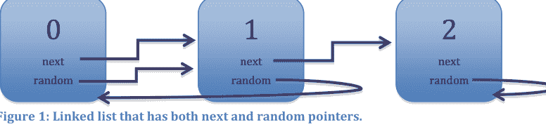
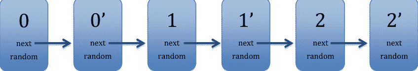
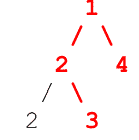
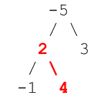
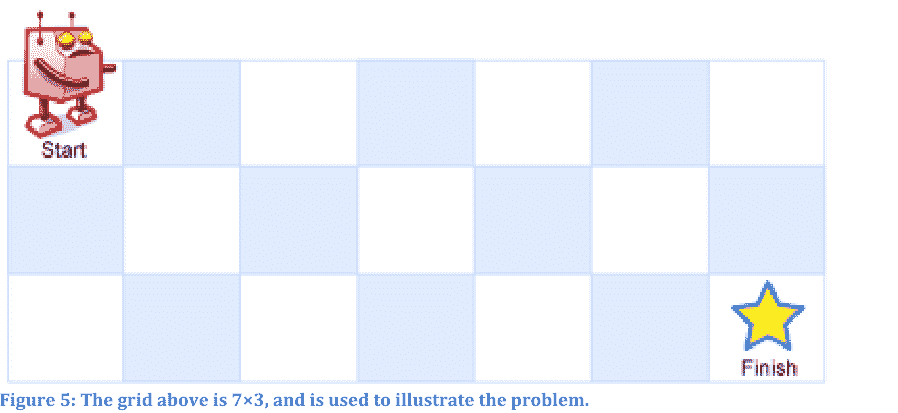
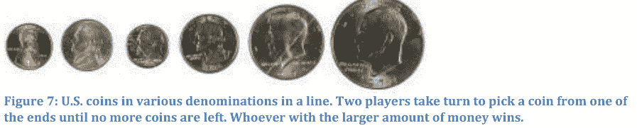
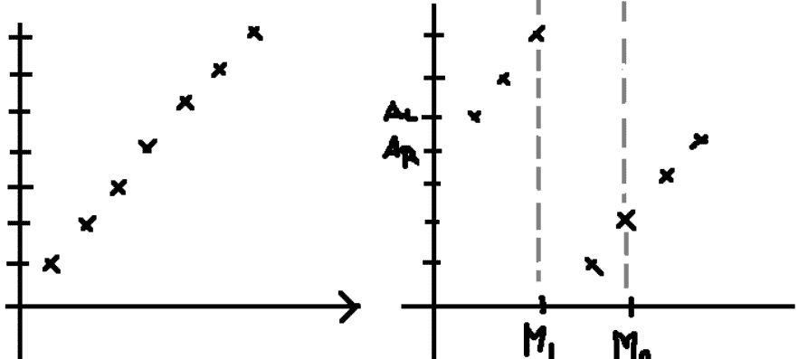

# LeetCode Clean Code 手册：50 道常见面试题

## 第 0 章：前言

你好，LeetCode er们：

首先，我想感谢你购买本本《洁代码手册：50 道高频面试题》。正如标题所示，这是编写面试代码的终极指南。你将学习如何编写洁代码，然后你将赢得面试。

本书的编写旨在成为 LeetCode 在线判题（OJ）的完美伙伴。

每个题目都有一个“立即代码”链接，它可以跳转到 OJ。你可以在那里编写代码并提交，从而获得关于解决方案是否正确的即时反馈。如果“立即代码”显示“即将上线”，则该题目将在以后添加，敬请关注。

每个题目的右侧是难度和频率评分。难度分为三个级别：简单（Easy）、中等（Medium）和困难（Hard）。简单题目是容易想出来的题目，实现也相当直接。大多数面试题都属于这一类。

在另一端，是困难题目。困难题目通常需要更多的算法思考。

频率分为三个级别：低（Low）、中等（Medium）和高（High）。题目在真实面试中出现的频率基于用户调查卷的数据：“你在真实面试中遇到过这个问题吗？”这让你了解目前真实面试中哪些类型的问题。

你自己解决问题时学习效果最好。如果你遇到困难，书中通常会有提示帮助你。如果你仍然卡住了，请阅读分析并尝试在在线判题中编写代码。

即使你认为一个题目很简单，编写简洁洁的代码并不像大多数人想象的那么容易。例如，如果你在编码面试中写了超过 30 行代码，那么你的代码可能不够简洁。

## 第 1 章：数组/字符串

## 1. 两数之和 (Two Sum)

现在编写代码：https://oj.leetcode.com/problems/two-sum/ 难度：简单，频率：高

### 题目

给定一个整数数组，找到两个数字，它们的和等于特定的目标数字。

函数 `twoSum` 应返回这两个和等于目标的数字的索引，其中 `index1` 必须小于 `index2`。请注意，你返回的答案（`index1` 和 `index2`）不是从 0 开始的。

你可以假设每个输入恰好有一个解。

### 解决方案

**O(n²) 时间复杂度，O(1) 空间 – 暴力法：**

暴力法非常简单。遍历每个元素 `x`，并查找是否存在另一个等于 `target - x` 的值。通过遍历数组剩余部分来寻找另一个值，其时间复杂度为 O(n²)。

**O(n) 时间复杂度，O(n) 空间 – 哈希表：**

我们可以使用哈希表（`hash map`）将值映射到其索引，将查找值的时间复杂度降低到 O(1)。

```java
public int[] twoSum(int[] numbers, int target) {
  Map<Integer, Integer> map = new HashMap<>();
  for (int i = 0; i < numbers.length; i++) {
    int x = numbers[i];
    if (map.containsKey(target - x)) {
      return new int[] { map.get(target - x) + 1, i + 1 };
    }
    map.put(x, i);
  }
  throw new IllegalArgumentException("No two sum solution");
}
```

### 扩展

如果给定的输入已经是升序排列的怎么办？参见题目 [2. 两数之和 II – 输入数组已排序]。

## 2. 两数之和 II – 输入数组已排序

现在代码：即将发布！难度：中等，频率：不适用

### 题目

与题目 [1. 两数之和] 类似，但输入数组已经是按升序排序的。

### 解决方案

当然我们仍然可以使用 [哈希表] 方法，但它消耗了 O(n) 的额外空间，而且没有利用输入已排序的特性。

**O(n log n) 时间复杂度，O(1) 空间 – 二分查找：**

对于每个元素 `x`，我们可以在排序后的数组上应用二分查找，在 O(log n) 时间内查找 `target - x` 是否存在。总时间复杂度为 O(n log n)。

```java
public int[] twoSum(int[] numbers, int target) {
    // 假设输入已排序。
    for (int i = 0; i < numbers.length; i++) {
        int j = bsearch(numbers, target - numbers[i], i + 1);
        if (j != -1)
            return new int[] {i + 1, j};
    }
    throw new IllegalArgumentException("No two sum solution");
}

private int bsearch(int[] A, int key, int start) {
    int L = start, R = A.length - 1;
    while (L < R) {
        int M = (L + R) / 2;
        if (A[M] < key)
            L = M + 1;
        else
            R = M;
    }
    return (L <= R && A[L] == key) ? L : -1;
}
```

**O(n) 时间复杂度，O(1) 空间 – 双指针：**

假设我们有两个索引分别指向第 $i$ 个和第 $j$ 个元素，即 $A_i$ 和 $A_j$。$A_i$ 和 $A_j$ 之和只可能属于三种情况之一：

- i. $A_i + A_j > target$。增加 $i$ 不对我们有帮助，因为它会让和更大。因此我们应该减小 $j$。
- ii. $A_i + A_j < target$。减小 $j$ 不对我们有帮助，因为它会让和更小。因此我们应该增加 $i$。
- iii. $A_i + A_j = target$。我们找到了答案。

```java
public int[] twoSum(int[] numbers, int target) {
    // 假设输入已排序。
    int i = 0, j = numbers.length - 1;
    while (i < j) {
        int sum = numbers[i] + numbers[j];
        if (sum < target) {
            i++;
        } else if (sum > target) {
            j--;
        } else {
            return new int[] { i + 1, j + 1 };
        }
    }
    throw new IllegalArgumentException("No two sum solution");
}
```

## 3. 两数之和 III – 数据结构设计

现在编写代码：即将发布！难度：简单。频率：不适用

### 题目

设计并实现一个 `TwoSum` 类。它应该支持以下操作：`add` 和 `find`。

- `add(input)` – 将数字 `input` 添加到内部数据结构中。
- `find(value)` – 查找是否存在一对数字，它们的和等于 `value`。

例如 `add(1); add(3); add(5); find(4) → true; find(7) → false`

### 解决方案

**add – O(n) 时间复杂度，find – O(1) 时间复杂度，O(n²) 空间 – 在哈希表中存储数字对的和：**

可以将所有可能的和存储在哈希表中。额外的空间需求为 O(n²)。`add` 操作遍历列表，`find` 操作涉及 O(1) 时间复杂度的哈希表查找。如果 `find` 操作多于 `add` 操作，这种方法非常有用。

**add – O(log n) 时间复杂度，find – O(n) 时间复杂度，空间 – 二分查找 + 双指针：**

维护一个排序的数字数组。每个 `add` 操作需要 O(log n) 时间通过二分查找插入到正确位置（参见 [4. 查找]）。`find` 操作在 O(n) 时间内应用 [双指针] 方法。

**add – O(1) 时间复杂度，find – O(n) 时间复杂度，空间 – 在哈希表中输入：**

更简单的方法是将每个输入存储在哈希表中。要查找是否存在对，只需在 O(n) 时间内遍历表即可。确保能够处理重复项。

```java
public class TwoSum {
    private Map<Integer, Integer> table = new HashMap<>();

    public void add(int input) {
        int count = table.containsKey(input) ? table.get(input) : 0;
        table.put(input, count + 1);
    }

    public boolean find(int val) {
        for (Map.Entry<Integer, Integer> entry : table.entrySet()) {
            int num = entry.getKey();
            int y = val - num;
            if (y == num) {
                // 对于重复项，确保至少有两个数字。
                if (entry.getValue() >= 2) return true;
            } else if (table.containsKey(y)) {
                return true;
            }
        }
        return false;
    }
}
```

## 4. 回文 (Valid Palindrome)

现在编写代码：https://oj.leetcode.com/problem/valid-palindrome/ 难度：简单，频率：中等

### 题目

给定一个字符串，在忽略非字母数字的情况下判断它是否为回文。

例如：

- "A man, a plan, a canal Panama" 是回文。
- "race car" 不是回文。

### 可能会的问题

Q：空字符串呢？它是有效的回文吗？

A：对于本题，定义空字符串为有效回文。

### 解决方案

**O(n) 时间复杂度，O(1) 空间：**

思路很简单，使用两个指针——一个在头，一个在尾。在它们相遇之前，跳过非字母数字字符。考虑字符串只包含非字母数字的情况：空字符串也是有效回文。

```java
public boolean isPalindrome(String s) {
    int i = 0, j = s.length() - 1;
    while (i < j) {
        while (i < j && !Character.isLetterOrDigit(s.charAt(i))) i++;
        while (i < j && !Character.isLetterOrDigit(s.charAt(j))) j--;
        if (Character.toLowerCase(s.charAt(i)) != Character.toLowerCase(s.charAt(j))) {
            return false;
        }
        i++; j--;
    }
    return true;
}
```

## 5. 实现 strstr()

现在编写代码：https://oj.leetcode.com/problems/implement-strstr/ 难度：简单，频率：高

### 题目

实现 `strstr()`。返回 `needle` 在 `haystack` 中第一次出现的索引，如果 `needle` 不是其的一部分则返回 -1。

### 解决方案

**O(nm) 时间复杂度，O(1) 空间 – 暴力法：**

存在高效的算法，如 Rabin-Karp 算法、KMP 算法或 Boyer-Moore 类。由于这些算法通常在高级算法课程中学习，因此在面试中使用最直接的方法——暴力法就足够。

暴力法很容易实现。我们可以从 `haystack` 的第一个位置开始搜索 `needle`，并逐个匹配字母。如果字母不匹配，我们从 `haystack` 的下一个位置重新开始。

假设 $n =$ `haystack` 的长度，$m =$ `needle` 的长度，运行时间复杂度为 O(nm)。

你考虑过这些场景吗？

- `needle` 或 `haystack` 为空。如果 `needle` 为空，始终返回 0。如果 `haystack` 为空，则没有匹配（返回 -1），除非 `needle` 也为空（返回 0）。
- `needle` 的长度大于 `haystack` 的长度。始终返回 -1。
- `needle` 位于 `haystack` 的末尾。例如 "aaaba" 和 "ba"。捕捉可能的 off-by-one 错误。
- `needle` 在 `haystack` 中出现多次。例如 "mississippi" 和 "issi"。它应该返回 "issi" 第一次匹配的索引 2。
- 假设两个长度为 $n$ 的长字符串，`haystack` = “aaa...aa”，`needle` = “aaa...ab”。你不应该进行超过 $n$ 次比较，否则你的代码将在 OJ 中超时。

以下是一个简单的实现——对于上述所有场景没有特殊语句。

```java
public int strStr(String haystack, String needle) {
  for (int i = 0; i < haystack.length(); i++) {
    for (int j = 0; j < needle.length(); j++) {
      if (j == needle.length()) return i;
      if (i + j == haystack.length()) return -1;
      if (needle.charAt(j) != haystack.charAt(i + j)) break;
    }
  }
  return -1;
}
```

## 6. 反转字符串中的单词

立即开始编码：https://oj.leetcode.com/problems/reverse-words-in-a-string/ 难度：中等，频率：高

### 题目

给定一个输入字符串 `s`，按单词反转该字符串。

例如，给定 `s = "the sky is blue"`，返回 `"blue is the sky"`。

### 候选人可能提问的问题

- Q：什么构成单词？
- 答：一序列非空格字符构成了一个单词。
- Q：制表符或换行符算作空格字符吗？
- 答：假设输入中不包含任何制表符或换行符。
- Q：输入字符串可能包含开头或结尾空格吗？
- 答：是的。但是，你反转后的字符串不应该包含开头或结尾空格。
- Q：两个单词之间有多少个空格？
- 答：在反转字符串中将它们减少为一个空格。

### 解决方案

**O(n) 时间复杂度，O(n) 空间复杂度：**

一种简单的方法是两遍遍历法：首先通过空格将字符串拆分为单词数组，然后第二次遍历按反向顺序提取单词。

我们可以在一遍遍历中做得更好。在按反序遍历字符串时，我们记录单词的起始和结束位置。当我们处于单词的开头时，将其进行追加。

```java
public String reverseWords(String s) {
    StringBuilder reversed = new StringBuilder();
    int j = s.length();
    for (int i = s.length() - 1; i >= 0; i--) {
        if (s.charAt(i) == ' ') {
            j = i;
        } else if (i == 0 || s.charAt(i - 1) == ' ') {
            if (reversed.length() != 0) {
                reversed.append(' ');
            }
            reversed.append(s.substring(i, j));
        }
    }
    return reversed.toString();
}
```

### 进阶

如果输入字符串不包含开头或结尾空格，可以在不分配额外空间的情况下完成吗？参见题目 [7. 反转字符串中的单词 II]。

## 7. 反转字符串中的单词 II

立即开始编码：即将上线！难度：中等，频率：N/A

### 题目

类似于题目 [6. 反转字符串中的单词]，但带有以下限制：

“字符串不包含开头或结尾空格，且单词始终由单个空格分隔。”

你可以在不分配额外空间的情况下完成吗？

### 解决方案

**O(n) 时间复杂度，O(1) 空间复杂度 – 原地反转：**

让我们用 $w_i$ 表示第 $i$ 个单词，其反转后的表示为 $w_i'$。注意，当你反转一个单词时，你会得到原始单词。也就是说，$(w_i')' = w_i$。


输入字符串为 $w_1 w_2 ... w_n$。如果我们反转整个字符串，它变成了 $w_n' ... w_2' w_1'$。最后，我们反转每个个体，它就变成了 $w_n ... w_2 w_1$。同样，可以通过先反转每个单词，然后反转整个字符串得到结果。

```java
public void reverse(char[] s) {
    reverse(s, 0, s.length);
    for (int i = 0, j = s.length - 1; j < s.length; j++) {
        if (s[j] == ' ') {
            reverse(s, i, j);
            i = j + 1;
        }
    }
}

private void reverse(char[] s, int begin, int end) {
    for (int i = 0; i < (end - begin) / 2; i++) {
        char temp = s[begin + i];
        s[begin + i] = s[end - i - 1];
        s[end - i - 1] = temp;
    }
}
```

### 挑战1：不使用库函数实现两遍遍历方案。

### 挑战2：在不分配额外空间的情况下向右旋转 $k$ 步。例如，当 $k = 3$ 时，数组 [0, 1, 2, 3, 4, 5, 6] 旋转到 [4, 5, 6, 0, 1, 2, 3]。

## 8. 字符串转整数 (atoi)

立即开始编码：https://oj.leetcode.com/problems/string-to-integer/ 难度：简单，频率：高

### 题目

实现 `atoi` 将字符串转换为整数。

`atoi` 函数首先丢弃尽可能多的空格字符，直到找到第一个非空格字符。然后从该字符开始，取一个可选的正负号，后跟尽可能多的数字，并将它们解释为数值。

字符串在形成整数的字符之后可能包含额外字符，这些字符会被忽略且不影响函数行为。

如果字符串中的第一个非空格字符不是有效的整数，或者字符串为空或只包含空格字符，则返回零。如果正确的值超出范围，返回最大值 (2147483647) 或最小整数值 (-2147483648)。

### 解决方案

该问题的核心是处理溢出。直接的方法是将数字存储为字符串，以便我们在每一步评估数字是否溢出。理想的解决方案是在每一步通过乘法和加法构建数字。另一方面，如果当前数字大于 214748364，我们就知道会溢出了。还要考虑最小数字的边界情况。

```java
private static final int max10 = 2147483647;

public int atoi(String str) {
    int i = 0, n = str.length();
    while (i < n && Character.isWhitespace(str.charAt(i))) i++;
    int sign = 1;
    if (i < n && str.charAt(i) == '+') {
        i++;
    } else if (i < n && str.charAt(i) == '-') {
        sign = -1;
    }
    int num = 0;
    while (i < n && Character.isDigit(str.charAt(i))) {
        int digit = Character.getNumericValue(str.charAt(i));
        if (num > max10 / 10 || (num == max10 / 10 && digit > 7)) {
            return sign == 1 ? Integer.MAX_VALUE : Integer.MIN_VALUE;
        }
        num = num * 10 + digit;
        i++;
    }
    return sign * num;
}
```

## 9. 有效数字

立即开始编码：https://oj.leetcode.com/problem/valid-number/ 难度：简单，频率：低

### 题目

验证给定字符串是否为数字。

一些示例：

- "0" -> true
- "0.1" -> true
- "abc" -> false

### 候选人可能提问的问题

- **Q**：如何处理字符串中的空格？
- **答**：在判断字符串是否为数字时，忽略开头和结尾空格。
- **Q**：应该忽略数字之间的空格（如 "1 1"）吗？
- **答**：不，只忽略开头和结尾空格。“1 1”不是数字。
- **Q**：如果数字后面还有额外字符，它是有效的吗？
- **答**：如果字符串包含任何非数字字符（空格和小数点），它不是数字。
- **Q**：数字前出现正负号是有效的吗？
- **答**：是的，“+1”和“-1”都是数字。
- **Q**：应该只考虑十进制吗？十六进制（如 0xFF）如何？
- **答**：只考虑十进制。“0xFF”不是数字。
- **Q**：应该把指数“1e0”视为数字吗？
- **答**：不是。但可以尝试考虑指数的挑战。在线判断题考虑了指数。

### 解决方案

这个问题与题目 [8. 字符串转整数 (atoi)] 非常相似。由于边界情况的存在，将问题分解为可以单独解决的组件很有帮助。

字符串可以从左到右分为以下四个子字符串：

- s1. 开头空格（可选）。
- s2. 正号 (+) 或负号 (-)（可选）。
- s3. 数字。
- s4. 结尾空格（可选）。

我们忽略 $s1, s2, s4$ 并评估 $s3$ 是否为有效数字。我们意识到一个数字可以是整数，也可以是小数。对于整数，很简单：我们评估 $s3$ 是否仅包含数字，然后完成了。

另一方面，小数可以进一步分为三部分：

整数部分和小数部分只包含数字。例如，数字“3.64”有整数部分（3）和小数部分（64）。两者都是可选的，但至少必须存在一个。例如，单个点 '.' 不是有效数字，但“1.””、“.1”和“1.0”都是有效的。请注意，“1.”是有效的，因为它意味着“1.0”。

到目前，将需求转换为代码是非常直接的，判断 x 为数字的主要逻辑来自第 6 行到第 17 行。

```java
public boolean isNumeric(String s) {
    int i = 0, n = s.length();
    while (i < n && Character.isWhitespace(s.charAt(i))) i++;
    if (i < n && (s.charAt(i) == '+' || s.charAt(i) == '-')) i++;
    boolean isNumeric = false;
    while (i < n && Character.isDigit(s.charAt(i))) {
        i++;
        isNumeric = true;
    }
    if (i < n && s.charAt(i) == '.') {
        i++;
        while (i < n && Character.isDigit(s.charAt(i))) {
            i++;
            isNumeric = true;
        }
    }
    while (i < n && Character.isWhitespace(s.charAt(i))) i++;
    return isNumeric && i == n;
}
```

### 进一步思考

数字可以包含一个可选的指数，由字符 'e' 后面跟一个整数（指数）标记。例如，“1e10”是一个数值。修改上面的代码以适应这一要求。

从之前的解决方案进行扩展非常简单。新增的代码块如亮所示。

```java
public boolean isNumber(String s) {
    int i = 0, n = s.length();
    while (i < n && Character.isWhitespace(s.charAt(i))) i++;
    while (i < n && (s.charAt(i) == '+' || s.charAt(i) == '-')) i++;
    boolean isNumeric = false;
    while (i < n && Character.isDigit(s.charAt(i))) {
        i++;
        isNumeric = true;
    }
    if (i < n && s.charAt(i) == '.') {
        while (i < n && Character.isDigit(s.charAt(i))) {
            i++;
            isNumeric = true;
        }
    }
    if (isNumeric && i < n && s.charAt(i) == 'e') {
        i++;
        isNumeric = false;
        if (i < n && (s.charAt(i) == '+' || s.charAt(i) == '-')) i++;
        while (i < n && Character.isDigit(s.charAt(i))) {
            i++;
            isNumeric = true;
        }
    }
    while (i < n && Character.isWhitespace(s.charAt(i))) i++;
    return isNumeric && i == n;
}
```

## 10. 无重复字符的最长子串

现在编码：难度：中等，频率：中等

https://leetcode.com/problems/longest-substring-without-repeating-characters/

### 题目

给定一个字符串，找到无重复字符的最长子串的长度。例如，对于“abcabcbb”，无重复字母的最长子串是“abc”，长度为 3。对于“bbbb”，最长子串是“b”，长度为 1。

### 解决方案

O(n) 运行时间，O(1) 空间复杂度 – 两次迭代：

我们如何瞬间查找某个字符是否存在于子串中？答案是使用一个简单的表来存储出现过的字符。如果字符串包含 ‘a’–z’ 以外的字符，请确保与面试官沟通（例如：数字？大写字母？只包含 ASCII 字符？甚至是唯一的字符集？）。

下一个问题是问自己，当你发现重复字符时会发生什么？例如，如果字符串是“abcd”，当你遇到第二个“c”时会发生什么？

当你发现一个重复字符时（假设在索引 j 处），意味着当前子串（当然不包括重复字符）是一个潜在的最大值，如果有必要，更新最大值。这也意味着重复字符必须在之前的索引 i 出现过，其中 i 小于 j。

由于你知道所有从索引 i 之前或在该索引处开始的子串长度都小于你当前的最大值，你可以安全地从恰索引 i + 1 处开始寻找下一个子串。

因此，你需要两个索引来记录当前子串的头部和尾部。由于 i 和 j 都最多遍历 n 步，最坏情况是 2n 步，运行复杂度必须是 O(n)。

注意空间复杂度是常数 O(1)，尽管我们分配了一个数组。这是因为无论字符串有多长，数组的大小始终保持为 256。

```java
public int lengthOfLongestSubstring(String s) {
    boolean[] exist = new boolean[256];
    int i = 0, maxlen = 0;
    for (int j = 0; j < s.length(); j++) {
        while (exist[s.charAt(j)]) {
            exist[s.charAt(i)] = false;
            i++;
        }
        exist[s.charAt(j)] = true;
        maxlen = Math.max(j - i + 1, maxlen);
    }
    return maxlen;
}
```

如果字符集包含 ascii 之外的 unicode 怎么办？我们可以通过 `Set` 代替大小为 256 的布尔数组来修改上面的解决方案。

### O(n) 运行时间，O(1) 空间 – 单次

上面的解决方案最多 2n 步。事实上，它可以优化为只需要 n 步。与其使用表来判断字符是否存在，我们可以定义字符到其索引的映射。这样当发现重复字符时，我们可以立即跳过它。

```java
public int lengthOfLongestSubstring(String s) {
    int[] charMap = new int[256];
    Arrays.fill(charMap, -1);
    int i = 0, maxlen = 0;
    for (int j = 0; j < s.length(); j++) {
        if (charMap[s.charAt(j)] >= i) {
            i = charMap[s.charAt(j)] + 1;
        }
        charMap[s.charAt(j)] = j;
        maxlen = Math.max(j - i + 1, maxlen);
    }
    return maxlen;
}
```

## 11. 最多两种字符的最长子串

现在编码：即将推出！难度：困难，频率：无

### 题目

给定一个字符串 S，找到包含最多两个字符的最长子串 T 的长度。例如，给定 S = "ceba"，T = "ece" 的长度为 3。

### 解决方案

首先，通过假设 S 包含两个或多个不同字符来简化问题，这意味着 T 必须包含两个字符。暴力法方法为 O(n²)，其中 n 是 S 的长度。我们可以形成所有可能的子串，并对每个子串插入 `Set` 以指示不同字符的数量。通过重用同一个 `Set` 可以很容易改进为 O(n)。技巧是维护一个始终包含两个字符的滑动窗口。当我们添加打破该约束的新字符时，我们如何移动指针以满足约束？使用上面的例子，我们的第一个窗口是“abba”。当向滑动窗口添加字符 'c' 时，它打破了约束。因此，我们需要重新调整窗口以满足约束。问题是选择哪个起始点可以满足约束。让我们另一个例子 S = "abaac"。当向窗口添加 'c' 时，新的滑动窗口应该是“aac”。这种方法迭代 n 次，我们使用三个指针：i，j 和 k。

```java
public int longestSubstringTwoDistinct(String s) {
    int i = 0, j = -1, maxLen = 0;
    for (int k = 0; k < s.length(); k++) {
        if (s.charAt(k) == s.charAt(k - 1)) continue;
        if (j > 0 && s.charAt(j) == s.charAt(k)) {
            maxLen = Math.max(k - i, maxLen);
            i = j + 1;
        }
        j = k - 1;
    }
    return Math.max(s.length() - i, maxLen);
}
```

### 进一步思考

虽然上面的方法可行，但它很难推广到 T 包含最多 k 个不同字符的情况。关键在于当我们调整滑动窗口以满足约束时，我们需要一个每个字符在子串中出现次数的计数。

```java
public int lengthOfSubstringTwoDistinct(String s) {
    int[] count = new int[256];
    int i = 0, numDistinct = 0, maxLen = 0;
    for (int j = 0; j < s.length(); j++) {
        if (count[s.charAt(j)] == 0) numDistinct++;
        count[s.charAt(j)]++;
        while (numDistinct > 2) {
            count[s.charAt(i)]--;
            if (count[s.charAt(i)] == 0) numDistinct--;
            i++;
        }
        maxLen = Math.max(j - i + 1, maxLen);
    }
    return maxLen;
}
```

## 12. 缺失范围

现在编码：即将推出！难度：中等，频率：无

### 题目

给定一个排序整数数组，元素范围为 [0, 99]（包含），返回其缺失范围。例如，给定 [0, 1, 3, 50, 75]，返回 ["2->49", "51->74", "76->99"]。

### 示例问题可能会问

- **Q**：如果给定的范围是空的怎么办？
- **A**：那么你应该返回 "0->99"，因为这些范围是缺失的。
- **Q**：如果给定的范围包含了范围内的所有元素怎么办？
- **A**：返回空列表，没有缺失。

### 解决方案

比较相邻元素之间的间隙并输出其范围，就如此？这看起来异常简单，但有多个边界情况需要考虑，例如第一个和最后一个元素，它们没有前一个或后续元素。此外，当给定的范围为空时怎么办？我们应该输出范围 "0->99"。事实上，如果我们可以在第一个元素之前添加“虚拟”元素 -1，在最后一个元素之后添加 100，就可以避免上述所有棘手情况。

### 进一步思考

- i. 列出测试例。


- i. 你应该能够将上述情况不仅适用于 `[0, 99]` 范围，还适用于任何任意范围 `[start, end]`。

```java
public List<String> findMissingRanges(int[] vals, int start, int end) {
    List<String> ranges = new ArrayList<>();
    int prev = start - 1;
    for (int i = 0; i <= vals.length; i++) {
        int curr = (i == vals.length) ? end + 1 : vals[i];
        if (curr - prev > 1) {
            ranges.add(getRange(prev + 1, curr - 1));
        }
        prev = curr;
    }
    return ranges;
}
```

```java
private String getRange(int from, int to) {
    return (from == to) ? String.valueOf(from) : from + "->" + to;
}
```

## 13. 最长回文子串

代码地址：https://oj.leetcode.com/problems/longest-palindromic-substring/ 难度：中等，频率：中等

### 题意

给定一个字符串 `S`，找到 `S` 中最长的回文子串。你可以假设 `S` 的最大长度为 1000，且存在一个唯一的回文子串。

### 提示

首先，确保你理解什么是回文。回文是一个正着读和反过来读都相同的字符串。例如，`"aba"` 是一个回文，而 `"abc"` 则不是。

### 常见错误

有些人会倾向于想出一个快速解决方案，遗憾的是该方案是有缺陷的（但可以很容易修正）：

> 反转 `S` 得到 `S'`。找到 `S` 和 `S'` 的最长公共子串，这必须也是最长回文子串。

这看起来似乎可行，让我们看下面的几个示例。

例如，`S = "caba"`，`S' = "abac"`。

`S` 和 `S'` 之间的最长公共子串是 `"aba"`，这是答案。

让我们尝试另一个例子：`S = "abcdaba"`，`S' = "abcddfdcaba"`。

`S` 和 `S'` 之间的最长公共子串是 `"abacd"`。显然，这不是一个有效的回文。

我们可以看到，当 `S` 的其他部分存在非回文子串的反转副本时，最长公共子串方法就会失效。为了修正这一点，每当我们找到一个公共子串候选时，检查该子串的索引是否与反转子串的原始索引相同。如果是，我们尝试更新目前为止发现的最长回文；如果不是，我们就跳过它并寻找下一个候选。

这是一个使用 `O(n)` 空间的 `O(n^2)` DP 解决方案（可以优化到 `O(n)` 空间）。请在此处阅读更多关于最长公共子串的内容。

### `O(n^3)` 运行时间，`O(1)` 空间 – 暴力法

显然的暴力破解法是选取子串所有可能的起始和结束位置，并验证它是否为回文。总共有 `C(n, 2)` 个子串（不包括字符本身就是回文的平凡解）。

由于验证每个子串需要 `O(n)` 时间，因此运行时间复杂度为 `O(n^3)`。

### `O(n^2)` 运行时间，`O(n)` 空间 – 动态规划

为了通过 DP 方法改进暴力法，首先考虑我们如何避免在验证回文时进行不必要的计算。考虑 `"ababa"` 的情况。如果我们已经知道 `"bab"` 是一个回文，那么显然 `"ababa"` 也必须是一个回文，因为左右两端的字母是相同的。

下面是更正式的表述：

如果子串 `S_i ... S_j` 是回文，则定义 `P[i, j] <- true`，否则为 false。

因此，

```
P[i, j] <- (P[i+1, j-1] and S_i == S_j)
```

基础情况为：

```
P[i, i] <- true
```

```
P[i, i+1] <- (S_i == S_{i+1})
```

这产生了一个直接的 DP 解决方案，我们首先初始化一个和两个字母的回文，然后逐向上寻找所有三个字母的回文，以此类推……

这给了我们一个 `O(n^2)` 的运行时间复杂度，并使用 `O(n^2)` 空间存储表格。

#### 额外练习

你能进一步改进空间复杂度吗？如何做？

### `O(n^2)` 运行时间，`O(1)` 空间 – 更简单的

事实上，我们可以在 `O(n^2)` 时间内仅用常数空间解决它。

我们观察到回文围绕其中心对称。因此，回文可以从它的中心扩展，且只有 `2n-1` 个这样的中心。

你可能会问为什么是 `2n-1` 而不是 `n` 个中心？原因是回文的中心在两个字母之间。回文具有偶数个字母（例如 `"abba"`），它的中心在两个 `'b'` 之间。

由于围绕其中心扩展回文需要 `O(n)`，因此整体复杂度是 `O(n^2)`。

```java
public String longestPalindrome(String s) {
    int start = 0, end = 0;
    for (int i = 0; i < s.length(); i++) {
        int len = expandAroundCenter(s, i, i);
        int len2 = expandAroundCenter(s, i, i + 1);
        len = Math.max(len, len2);
        if (len > end - start) {
            start = i - (len - 1) / 2;
            end = i + len / 2;
        }
    }
    return s.substring(start, end + 1);
}
```

```java
private int expandAroundCenter(String s, int left, int right) {
    int L = left, R = right;
    while (L >= 0 && R < s.length() && s.charAt(L) == s.charAt(R)) {
        L--;
        R++;
    }
    return R - L - 1;
}
```

### `O(n)` 运行时间，`O(n)` 空间 – Manacher 算法

有一种名为 Manacher 算法的 `O(n)` 算法，在这里详细解释。然而，这是一个非平凡的算法，没人期望你能在 30 分钟的编码面试中想出这个算法。但是，请尽管理解它，我保证它会非常有趣。

## 14. 单编辑距离

### 题意

给定两个字符串 `S` 和 `T`，判断它们是否好差一个编辑距离。

### 提示

1. 如果 `|n - m|` 大于 1，我们立即知道两者不是一个编辑距离。
2. 如果你分别考虑这些情况，`m == n` 和 `m != n`，可能会对你有帮助。
3. 假设 `m` 总是 `<= n`，这极大地简化了条件语句。如果 `m > n`，我们只需交换 `S` 和 `T`。
4. 如果 `m == n`，则变为寻找是否存在*恰好*一次修改操作。如果 `m != n`，你不需要考虑删除操作。只需考虑 `T` 中的插入操作。

### 解决方案

让我们假设 `m = S.length()`，`n = T.length()`。

`O(n)` 运行时间，`O(1)` 空间 – 简单单次遍历：

1. 检查长度差，若差 `> 1` 返回 false。
2. 如果长度相等 `m == n`，遍历字符串找到第一个不同的字符，检查后续剩余部分是否完全相等。
3. 如果长度不等 `m != n`，确保 `S` 是短字符串，找到第一个不同的字符，检查短字符串剩余部分是否等于长字符串对应的剩余部分。

## 16. 给定 Read4 读取 N 个字符 – 多次调用

现在编码：即将上线！难度：困难，频率：N/A

### 问题

类似于题目 [15. 给定 Read4 读取 N 个字符]，但读取函数可能会被多次调用。

### 解决方案

这使得问题变得复杂得多，因为它可以被多次调用，并且涉及状态的存储。

因此，我们设计了以下类成员变量来存储状态：

- i. `buffer` – 一个大小为 4 的数组，用于临时存储 `read4` 返回的数据。如果字符被读入缓冲区且没有被部分使用，它们将在下一次调用中用。
- ii. `offset` – 用于跟踪下一次读取调用中数据开始的偏移索引。缓冲区可能会被部分读取（由于读取最多 n 字节的限制），从而遗留一些数据。
- iii. `bufsize` – 存储实际数据的真实缓冲区大小。如果 `bufsize > 0`，意味着上一次读取调用在缓冲区中留下了部分数据，我们应该在再次调用 `read4` 之前消耗它。另一方面，如果 `bufsize == 0`，则意味着缓冲区中没有剩余数据。

这个问题是一个非常好的编码练习。由于需要考虑的边界情况很多，正确地编写代码极其棘手。

```java
/* The read4 API 定义在父类 Reader4 中。
 * int read4(char[] buf); */

public class Solution extends Reader4 {
    private char[] buffer = new char[4];
    int offset = 0, bufsize = 0;

    /**
     * @param buf 目标缓冲区
     * @param n 最大读取字符数
     * @return 读取的字符数
     */
    public int read(char[] buf, int n) {
        int readBytes = 0;
        boolean eof = false;
        while (!eof && readBytes < n) {
            int sz = (bufsize > 0) ? bufsize : 4;
            if (bufsize > 0 && sz < 4) eof = true;
            int bytes = Math.min(n - readBytes, sz);
            System.arraycopy(buffer, offset, buf, readBytes, bytes);
            offset = (offset + bytes) % 4;
            bufsize -= bytes;
            readBytes += bytes;
            if (bufsize == 0) {
                bufsize = read4(buffer);
                offset = 0;
                if (bufsize < 4) eof = true;
            }
        }
        return readBytes;
    }
}
```

## 第 2 章：数学

## 17. 反转整数

现在编码：https://oj.leetcode.com/problems/reverse-integer/ 难度：简单，频率：高

### 问题

反转整数的数字位。例如：`x = 123`，返回 `321`。

#### 候选人可能会问的问题

- Q: 负整数怎么办？
- A: 对于输入 `x = -123`，应该返回 `-321`。
- Q: 如果整数的最后一位是 0 呢？例如，`x = 10, 100, ...`
- A: 忽略反转后整数中的零，`10` 和 `100` 反转后都转为 `1`。
- Q: 如果反转后的整数溢出了怎么办？例如，输入 `x = 1000000003`。
- A: 在这种情况下，你的函数应该返回 `0`。

### 解决方案

让我们从简单的实现开始。我们不需要单独处理负整数，因为取模运算符对负整数也有效（例如，`-43 % 10 = -3`）。

```java
public int reverse(int x) {
    int ret = 0;
    while (x != 0) {
        ret = ret * 10 + x % 10;
        x /= 10;
    }
    return ret;
}
```

上面的代码存在一个缺陷——反转后的整数可能会溢出。以 `x = 1000000003` 为例。在乘以 10 之前，我们可以检查 `ret > 214748364` 或 `ret < -214748364`。另一方面，如果 `ret == 214748364`，由于 `x` 的限制，最后一位不会溢出。

```java
public int reverse(int x) {
    int ret = 0;
    while (x != 0) {
        // 溢出检查
        if (Math.abs(ret) > 214748364)
            return 0;
        ret = ret * 10 + x % 10;
        x /= 10;
    }
    return ret;
}
```

## 18. 加一

现在编码：https://oj.leetcode.com/problems/plus-one/ 难度：简单，频率：高

### 问题

给定一个用数组表示的数字，加一。

#### 候选人可能会问的问题

- Q: 数字可能是负数吗？
- A: 不。假设是非负数。
- Q: 数字是如何排序的？例如，`12` 表示为 `[1,2]` 还是 `[2,1]`？
- A: 最高位在头部。
- Q: 数字可能包含前零吗，例如 `[0,0,1]`？
- A: 不。

### 解决方案

从最低位开始遍历，通过加 1 来模拟。对于小于 9 的数字非常直接——加 1 即可。另一方面，如果数字是 9，它会变成 10，这种行为持续到最高位。最后，如果每一位都是 9，则添加 0 并将最高位设为 1。

```java
public void plusOne(List<Integer> digits) {
    for (int i = digits.size() - 1; i >= 0; i--) {
        int digit = digits.get(i);
        if (digit < 9) {
            digits.set(i, digit + 1);
            return;
        } else {
            digits.set(i, 0);
        }
    }
    digits.add(0);
    digits.set(0, 1);
}
```

当所有数字都是 9 时，添加 0 并修改最高位为 1。如果实现为 `ArrayList`，追加比在前面插入高效，因为所有元素都需要移动。

## 19. 回文数

现在编码：https://oj.leetcode.com/problems/palindrome-number/ 难度：简单，频率：中

### 问题

判断一个整数是否为回文。在不使用额外空间的情况下。

#### 候选人可能会问的问题

- Q: 负整数 `-1` 符合回文吗？
- A: 就讨论而言，我们定义负整数不是回文。

### 解决方案

最直观的方法首先将整数转换为字符串，因为这样更容易操作。虽然这可行，但它违反了不使用额外空间的限制（即你必须分配 `n` 个字符来存储整数字符串，其中 `n` 是位数）。我知道这听起来像是不合理的要求（因为它用的空间很小），难道面试题不都有要求吗？

另一种方法是先反转数字。如果数字与其反转数字相同，那么它必须是回文。

```java
public int reverse(int num) {
    assert num >= 0; // 仅限非负整数
    int rev = 0;
    while (num != 0) {
        rev = rev * 10 + num % 10;
        num /= 10;
    }
    return rev;
}
```

这似乎可行，但你考虑过反转后的数字溢出的可能？如果溢出，行为取决于语言（Java 在溢出时会回绕，但在 C/C++ 中行为是未定义的）。糟糕。

当然，我们可以通过返回一个比 `int` 更大的类型（`long`）来避免溢出。但请注意，这是特定语言的，较大的类型可能在所有语言上都可用。

我们可以构建一个更好、更通用的解决方案。一点是我们必须从某处开始比较数字。你知道只有两种方法：从中间扩展或从两端比较。

事实是从两端比较更简单。首先比较第一位和最后一位。如果它们不同，则一定不是回文。如果它们相同，从两端各切掉一位并继续，直到没有数字为止，得出结论是回文。现在，获取并切掉最后一位很容易。然而，以通用方式获取并切掉第一位需要一些思考。我把它留给你作为一个练习。请在看下面的解决方案之前先思考你的方案。

```java
public boolean isPalindrome(int x) {
    if (x < 0) return false;
    int div = 1;
    while (x / div >= 10) {
        div *= 10;
    }
    while (x != 0) {
        int l = x / div;
        int r = x % 10;
        if (l != r) return false;
        x = (x % div) / 10;
        div /= 100;
    }
    return true;
}
```

## 第 3 章：链表

## 20. 合并两个有序链表

现在编写代码：https://oj.leetcode.com/problems/merge-two-sorted-lists/ 难度：简单，频率：中等

### 题目描述

合并两个有序链表并返回一个新的新列表。新列表应通过拼接前两个列表的节点来形成。

### 解决方案


我们在新列表之前插入一个虚拟头节点（`dummy head`），这样我们就不需要处理初始化新列表头部的特殊情况。然后，新列表的头部就可以轻松地作为虚拟头节点的下一个节点返回。

使用虚拟头可以让你写出更简洁的代码，并为你的面试兵库增添一个强大的工具。要查看更多关于虚拟头使用的示例，请参考这些题目：[21. 两个数字相加]、[22. 两两交换节点] 和 [23. 合并 K 个有序链表]。

```java
public ListNode mergeTwoLists(ListNode l1, ListNode l2) {
    ListNode dummyHead = new ListNode();
    ListNode p = dummyHead;
    while (l1 != null && l2 != null) {
        if (l1.val < l2.val) {
            p.next = l1;
            l1 = l1.next;
        } else {
            p.next = l2;
            l2 = l2.next;
        }
        p = p.next;
    }
    if (l1 != null) p.next = l1;
    if (l2 != null) p.next = l2;
    return dummyHead.next;
}
```

## 21. 两个数字相加

现在编写代码：https://oj.leetcode.com/problems/add-two-numbers/ 难度：中等，频率：高

**题目描述：**

给你两个链表，表示两个非负数。数字以反序存储，且每个节点包含一个单独的数字。这两个数字相加，并以链表的形式返回。

输入：(2 → 4 → 3) + (5 → 6 → 4)

输出：7 → 0 → 8

**解决方案：**

使用一个变量记录进位（`carry`），并从链表头部（包含最低位）开始模拟逐位相加。

需要特别注意以下情况：

- 当一个列表比另一个列表长时。
- 和在末尾可能会有一个额外的进位，这很容易被忘记。（例如：(9 → 9) + (1) = (0 → 0 → 1)）。

```java
public ListNode addTwoNumbers(ListNode l1, ListNode l2) {
    ListNode dummyHead = new ListNode();
    ListNode p = l1, q = l2, curr = dummyHead;
    int carry = 0;
    while (p != null || q != null) {
        int x = (p != null) ? p.val : 0;
        int y = (q != null) ? q.val : 0;
        int digit = carry + x + y;
        carry = digit / 10;
        curr.next = new ListNode(digit % 10);
        curr = curr.next;
        if (p != null) p = p.next;
        if (q != null) q = q.next;
    }
    if (carry > 0) {
        curr.next = new ListNode(carry);
    }
    return dummyHead.next;
}
```

## 22. 两两交换节点

现在编写代码：https://oj.leetcode.com/problems/swap-nodes-in-pairs/ 难度：中等，频率：中等

**题目描述：**

给定一个链表，交换每两个相邻节点并返回它的头部。

例如，

给定 1 → 2 → 3 → 4，你应该返回列表 2 → 1 → 4 → 3。

你的算法应该只使用常数额外空间。你不能修改列表中的值，只能改变节点本身。

**面试候选者可能会问的问题：**

- Q：如果链表中的节点数是奇数怎么办？
- A: 最后一个节点不应该被交换。

**解决方案：**

假设 `p`、`q`、`r` 分别是当前节点、下一个节点以及下下一个节点。

我们可以通过调整它们的指向来两两对地交换节点：

`q.next = p`; `p.next = r`;

上述操作将列表从 `{ p → q → r → s }` 转换到 `{ q → p → r → s }`。

如果下一对节点存在，我们应该记住将 `p` 的下一个节点连接到 `s`。因此，在移动下一对节点之前，我们应该记录当前节点。

为了确定新列表的头部，你应该检查列表是否包含两个或多个元素。基本上，这些额外的语句可以通过在列表前端插入一个额外的节点（也称为虚拟头）来避免。

```java
public ListNode swapPairs(ListNode head) {
    ListNode dummy = new ListNode(0);
    dummy.next = head;
    ListNode p = head;
    ListNode prev = dummy;
    while (p != null && p.next != null) {
        ListNode q = p.next, r = p.next.next;
        prev.next = q;
        q.next = p;
        p.next = r;
        prev = q;
        p = r;
    }
    return dummy.next;
}
```

## 23. 合并 K 个有序链表

现在编写代码：https://oj.leetcode.com/problems/merge-k-sorted-lists/ 难度：困难，频率：高

**题目描述：**

给定一组有序的链表，将它们合并成一个排序后的有序链表。

**解决方案：**

- `O(n^2)` 时间复杂度，`O(1)` 空间 —— 暴力法：
  遍历所有链表，找到最小节点并取出。
- `O(n log k)` 时间复杂度，`O(1)` 空间 —— 分治法：
  每次两两合并链表，直到剩下一个。
- `O(n log k)` 时间复杂度，`O(k)` 空间 —— 堆排序：
  使用一个最小顶堆来维护所有链表的头部。

## 24. 带有随机指针的链表拷贝

立即代码：https://oj.leetcode.com/problems/copy-list-with-random-pointer/ 难度：困难，频率：高

### 问题：

给定一个链表，其中每个节点包含一个额外的随机指针，该指针可以指向列表中的任意节点或空。

返回该链表的深拷贝。

### 解决方案：

克隆一个没有额外随机指针的链表是很容易解决的。然而，棘手的部分是克隆链表的节点结构。



### `O(n^2)` 时间复杂度，`O(n)` 空间 – 暴力法：

为了开始，给每个单独的节点标记是有帮助的。根据上述列表，节点 0 的随机指针指向节点 1，节点 1 的随机指针指向节点 0，节点 2 的随机指针指向它自己，即节点 2。

假设我们拥有上述连接，我们可以重建该结构。由于我们知道节点 0 的随机指针指向节点 1，我们需要将从节点 0' 的拷贝版本连接到节点 1'。我们需要每次遍历列表来连接节点，这需要 `O(n)`，使得整体复杂度为 `O(n^2)`。

我们如何表示这种连接？我们可以建立一个映射，将原始节点映射到它的索引。拥有这个映射将允许我们克隆结构。如果我们有了它，我们只需要连接它们，对吧？唯一的问题是连接它们的复杂度是 `O(n)`，因为我们必须遍历拷贝链表来找到要连接的节点。

### `O(n)` 时间复杂度，`O(n)` 空间 – 哈希表：

使用映射来快速查找要连接的节点是自然的。我们可以轻松地构建克隆节点的索引映射。因此，我们在连接随机节点时将复杂度降低到了 `O(1)`。

这让我们开始了工作，尽管它需要两个映射。仔细观察，发现两个映射可以缩减为一个单一映射。我们只需要将原始节点直接映射到它的随机节点。

```java
public RandomListNode copyRandomList(RandomListNode head) {
    Map<RandomListNode, RandomListNode> map = new HashMap<>();
    RandomListNode p = head;
    RandomListNode dummy = new RandomListNode(0);
    RandomListNode q = dummy;
    while (p != null) {
        q.next = new RandomListNode(p.label);
        map.put(p, q.next);
        p = p.next;
        q = q.next;
    }
    p = head;
    q = dummy;
    while (p != null) {
        q.next.random = map.get(p.random);
        p = p.next;
        q = q.next;
    }
    return dummy.next;
}
```

### `O(n)` 时间复杂度，`O(1)` 空间 – 修改原始结构：

该算法使用了额外的空间 `O(n)`，不能使用额外空间吗？如果我们消除映射呢？唯一的方法是修改原始结构。想象一下修改原始节点的下一个节点，指向它自己的拷贝。



现在，假设我们拥有上述配置，可以使用以下代码为每个拷贝分配随机节点指针：

`node.next.random = node.random.next;`

总结，我们需要对列表进行三次迭代：

- i. 创建每个原始节点的拷贝，并以交替的方式插入到两个原始节点之间。
- ii. 为每个节点拷贝分配随机指针。
- iii. 将输入恢复到原始配置。

我们通过只使用常数额外空间实现了 `O(n)` 的时间复杂度。

```java
public RandomListNode copyRandomList(RandomListNode head) {
    RandomListNode p = head;
    while (p != null) {
        RandomListNode next = p.next;
        RandomListNode copy = new RandomListNode(p.label);
        p.next = copy;
        copy.next = next;
        p = next;
    }
    p = head;
    while (p != null) {
        p.next.random = (p.random != null) ? p.random : null;
        p = p.next.next;
    }
    p = head;
    RandomListNode headCopy = (p != null) ? p.next : null;
    while (p != null) {
        RandomListNode copy = p.next;
        p.next = copy.next;
        copy.next = (p.next != null) ? p.next.next : null;
        p = copy.next;
    }
    return headCopy;
}
```

## 第 4 章：二叉树

## 25. 验证二叉搜索树

立即代码：https://oj.leetcode.com/problems/validate-binary-search-tree/ 难度：中等，频率：高

### 问题：

给定一个二叉树，判断它是否为有效的二叉搜索树 (BST)。

### 解决方案：

首先，你必须理解二叉树和 BST 之间的区别。二叉树是一种数据结构，其中每个节点包含一个额外的随机指针，该指针可以指向列表中的任意节点或空。（此处原文 OCR 文本存在错误，已按要求保留核心逻辑）

## 26. 二叉树的最大深度

立即代码：https://oj.leetcode.com/problems/maximum-depth-of-binary-tree/ 难度：简单, 频率：高

### 题目：

给定一个二叉树，找到它的最大深度。

最大深度是指从根节点到最远叶子节点的最长路径上的节点数。

### 解决方案：

二叉树的最大高度定义为从根节点到最深叶子节点路径上的节点数。请注意，空树的最大深度为 0。

### `O(n)` 时间复杂度，`O(log n)` 复杂度 – 递归：

我们可以使用递归轻松地解决这个问题，因为每个节点的左孩子和右孩子本身就是一棵子树。我们首先计算左子树的高度，然后计算右子树的高度。当前节点的最大深度是两者中较大值加 1。对于边界情况，我们查看一个空树，并返回 0。

假设 `n` 是树中的节点总数。时间复杂度为 `O(n)`，因为每个节点恰好被遍历了一次。由于二叉树的最大深度为 `O(log n)`，由于递归所使用的额外空间，额外的空间代价为 `O(log n)`。

```java
public int maxDepth(TreeNode root) {
    if (root == null) return 0;
    return Math.max(maxDepth(root.left), maxDepth(root.right)) + 1;
}
```

## 27. 二叉树的最小深度

立即代码：https://oj.leetcode.com/problems/minimum-depth-of-binary-tree/ 难度：简单, 频率：高

### 题目：

给定一个二叉树，找到它的最小深度。

最小深度是指从根节点到最近的叶子节点最短路径上的节点数。

与[26. 二叉树的最大深度]类似，在这里我们需要找到最小深度。

### 解决方案：

### `O(n)` 时间复杂度，`O(n)` 复杂度 – 深度优先遍历：

与寻找最大深度的[递归]方法类似，但确保你考虑了这些情况：

- i. 节点是叶子节点。最小深度为 1。
- ii. 节点有一个空子树而另一个非空。返回该非空子树的最小深度。

```java
public int minDepth(TreeNode root) {
  if (root == null) return 0;
  if (root.left == null) return minDepth(root.right) + 1;
  if (root.right == null) return minDepth(root.left) + 1;
  return Math.min(minDepth(root.left), minDepth(root.right)) + 1;
}
```

### `O(n)` 时间复杂度，`O(n)` 复杂度 – 广度优先遍历：

注意，之前的这种方法对于高度不平衡的树会遍历所有节点。事实上，我们可以通过广度优先遍历（也称为层序遍历）来优化这一点。当我们遇到第一个叶子节点时，立即停止遍历。

我们还跟踪当前的深度，并在到达层尾时增加它。当当前节点是最右侧的节点时，我们知道到达了层尾。

与递归方法相比，广度优先遍历对于高度不平衡的树效果良好，因为它不需要遍历所有节点。最坏的情况是树是一个总共有 `n` 个节点的完全二叉树。在这种情况下，我们必须遍历所有节点。最坏情况的空间复杂度为 `O(n)`，因为在队列中存储当前层节点需要额外空间。

```java
public int minDepth(TreeNode root) {
    if (root == null) return 0;
    Queue<TreeNode> q = new LinkedList<>();
    q.add(root);
    TreeNode rightMost = root;
    int depth = 1;
    while (!q.isEmpty()) {
        TreeNode node = q.poll();
        if (node.left == null && node.right == null) break;
        if (node.left != null) q.add(node.left);
        if (node.right != null) q.add(node.right);
        if (node == rightMost) {
            rightMost = (node.right != null) ? node.right : node.left;
            depth++;
        }
    }
    return depth;
}
```

## 28. 平衡二叉树

立即代码：https://oj.leetcode.com/problems/balanced-binary-tree/ 难度：简单, 频率：高

### 题目：

给定一个二叉树，判断它是否是高度平衡的。

对于这个问题，高度平衡的二叉树定义为：每个节点的子树深度之差不超过 1 的二叉树。

### 解决方案：

### `O(n^2)` 时间复杂度，`O(n)` 栈空间 – 暴力法自顶向下递归：

我们可以设计一个暴力算法来寻找子树的最大深度。我们还复用了[递归]方法来寻找当输入树退化时的最坏情况复杂度 `O(n²)`。


```java
public boolean isBalanced(TreeNode root) {
    if (root == null) return true;
    return Math.abs(maxDepth(root.left) - maxDepth(root.right)) <= 1
    && isBalanced(root.left)
    && isBalanced(root.right);
}
```

```java
public int maxDepth(TreeNode root) {
    if (root == null) return 0;
    return Math.max(maxDepth(root.left), maxDepth(root.right)) + 1;
}
```

### O(n) 时间复杂度，O(n) 栈空间 – 暴力法自顶向下递归

我们可以设计一个暴力算法来寻找子树的最大深度。我们还复用了`递归`方法来寻找当输入树退化时的最坏情况复杂度 O(n²)。

### O(n) 时间复杂度，O(n) 栈空间 – 暴力法自底向上递归

高度平衡的二叉树定义为：每个节点的子树深度之差不超过 1 的二叉树。

```java
public boolean isBalanced(TreeNode root) {
    if (root == null) return true;
    return Math.abs(maxDepth(root.left) - maxDepth(root.right)) <= 1
    && isBalanced(root.left)
    && isBalanced(root.right);
}
```

```java
public int maxDepth(TreeNode root) {
    if (root == null) return 0;
    return Math.max(maxDepth(root.left), maxDepth(root.right)) + 1;
}
```

## 29. 有序数组转换为二叉搜索树

立即代码：https://oj.leetcode.com/problems/convert-sorted-array-to-binary-tree/ 难度：中等, 频率：低

### 题目

给定一个有序数组，将其转换为一棵平衡的二叉搜索树。

### 提示

这个问题具有高度递归性。思考二分查找是如何工作的。


图 2：平衡树的示例。高度平衡树是指子树的高度差不超过1，且子树也是平衡的。

### 解决方案

### O(n) 时间复杂度，O(log n) 空间 – 分治法

如果你必须选择一个数组元素作为平衡二叉树的根，你会选择哪一个？平衡二叉树的根应该是数组的中间元素。

你每次迭代都会选择数组的中间元素，并在树中创建该元素。选择元素后，剩下什么？你能识别问题中的子问题吗？

剩下两个数组——左边的和右边的。这两个数组是原问题的子问题，因为它们都是有序的。此外，它们是当前节点的左子树和右孩子。

以下代码以 O(n) 时间从有序数组创建平衡二叉树（n 是数组中的元素数量）。比较这段代码与二分查找算法有多相似。它们都使用了分治方法。由于输入数组最多被分割 log(n) 次，递归使用的额外栈空间为 O(log n)。

```java
public TreeNode sortedArrayToBST(int[] num) {
  return sortedArrayToBST(num, 0, num.length-1);
}

private TreeNode sortedArrayToBST(int[] arr, int start, int end) {
  if (start > end) return null;
  int mid = (start + end) / 2;
  TreeNode node = new TreeNode(arr[mid]);
  node.left = sortedArrayToBST(arr, start, mid-1);
  node.right = sortedArrayToBST(arr, mid+1, end);
  return node;
}
```

### 进一步思考

考虑将题描述改为“将单链表转换为平衡的二叉搜索树”。你的实现与上述相比会有什么变化？见题目 [30. Convert Sorted List to Balanced Binary Search Tree]。

## 30. 将有序列表转换为平衡二叉搜索树

立即代码：https://oj.leetcode.com/problems/convert-sorted-list-to-binary-search-tree/ 难度：困难 (Hard), 频率：低

### 题目

给定一个按升序排列的元素的单链表，将其转换为一个高度平衡的二叉搜索树（BST）。

### 提示

当你使用单链表而不是数组时，情况会变得复杂一些。请注意，在链表中，你不再能够以 $O(1)$ 时间内随机访问某个元素。

按照列表的顺序插入节点如何？如果我们能实现这一点，就不再需要寻找中间元素了，因为我们在向树中插入节点的同时正在遍历列表。

$O(n \log n)$ 运行复杂度，$O(n \log n)$ 栈空间 – 暴力法

一种朴素的方法是使用之前题目 [29. 将有序数组转换为平衡二叉搜索树] 中的解决方案。在每次递归调用中，你必须遍历列表长度的一半来找到中间元素。运行复杂度显然是 $O(n \log n)$，其中 $n$ 是列表中元素的总数。这是因为每层递归调用都需要在列表中进行总计 $\frac{n}{2}$ 的遍历步骤，而总共有 $O(n \log n)$ 层的节点（即平衡树的高度）。

$O(n)$ 运行复杂度，$O(n \log n)$ 栈空间 – 自底向上的递归

和通常一样，最佳解决方案需要你从另一个角度考虑问题。换句话说，我们不再使用自顶向下的方法在树中创建节点。我们从自底向上创建节点，并将它们分配给父节点。自底向上的方法允许我们在创建节点的同时按顺序访问列表。

自底向上的方法不是很好吗？每当你被自顶向下的方法困住时，尝试一下自底向上。虽然自底而上不是我们最自然的思考方式，但在某些情况下非常有帮助。然而，通常情况下应该优选择自顶向下而不是自底而上，因为后者的正确性更难验证。

以下是将单链表转换为平衡 BST 的代码。请注意，该算法要求在函数参数中传递列表的长度。可以通过遍历整个列表在 $O(n)$ 时间内找到列表长度。递归调用按照列表顺序遍历列表并创建树节点，也需要 $O(n)$ 时间。因此，整体运行复杂度仍然是 $O(n)$。

```java
private ListNode sortedToListBST(int start, int end) {
    if (start > end) return null;
    int mid = (start + end) / 2;
    TreeNode leftChild = sortedListToBST(start, mid-1);
    TreeNode parent = new TreeNode(list.val);
    parent.left = leftChild;
    list = list.next;
    parent.right = sortedListToBST(mid+1, end);
    return parent;
}

public TreeNode sortedListToBST(ListNode head) {
    int n = 0;
    ListNode p = head;
    while (p != null) {
        p = p.next;
        n++;
    }
    list = head;
    return sortedListToBST(0, n - 1);
}
```

## 31. 二叉树最大路径和

立即代码：https://oj.leetcode.com/problems/binary-tree-maximum-path-sum/ 难度：困难 (Hard), 频率：中

### 题目

给定一个二叉树，找到最大路径和。

路径可以起始于树中的任何节点并结束于任何节点。

例如，给定下面的二叉树：



高亮的路径和产生了最大和 10。

### 面试官可能会问的问题

- 问：如果树是空的怎么办？

  答：假设树是非空的。

- 问：只有一个只有一个节点的树怎么办？

  答：那么最大路径将起始并结束于同一个节点。

- 问：如果每个节点都包含负值怎么办？

  答：那么你应该返回负值最小的单个节点值。

- 问：最大路径必须通过根节点吗？

  答：不一定。例如，下方的树 6 为最大路径和，且没有通过根节点。



### 提示

每当你发现使用自顶向下方法会导致大量重复计算时，自底向上方法通常更高效。

### 节点

左子树 右子树

尝试自底向上的方法。在每个节点上，潜在的最大路径可以是以下情况之一：

- i. max(左子树) + 节点
- ii. max(右子树) + 节点
- iii. max(左子树) + max(右子树) + 节点
- iv. 节点本身

然后，我们需要返回通过该节点并到其左或右子树的最大路径和。这里有一个小技巧：如果最大值恰好为负数，我们应该返回 0。

```java
int maxSum = Integer.MIN_VALUE;
public int maxPathSum(TreeNode root) {
    // ... (实现逻辑)
}
```

## 第5章：位运算

## 33. 单数出现数字

立即代码：https://oj.leetcode.com/problems/single-number/ 难度：中 (Medium), 频率：高

### 题目

给定一个整数数组，每个元素出现两次，除了一个元素出现一次。找到那一个。

### 面试官可能会问的问题

- 问：数组包含包含正负整数吗？

  答：包含。

- 问：任何元素会出现两次以上吗？

  答：不会。

### 解决方案

我们可以使用哈希表来跟踪元素的次数。在第二次遍历中，我们可以通过查询哈希表提取单数。由于哈希表提供了常数查找，整体复杂度为 O(n)，其中 n 是元素的总数。

```java
public int singleNumber(int[] nums) {
    Map<Integer, Integer> map = new HashMap<>();
    for (int x : nums) {
        int count = map.containsKey(x) ? map.get(x) : 0;
        map.put(x, count + 1);
    }
    for (int x : nums) {
        if (map.get(x) == 1) {
            return x;
        }
    }
    throw new IllegalArgumentException("无单元素");
}
```

虽然这种方法有效，但我们没有利用“每个元素出现两次，除了一个”的特性。我们能在一次遍历中做得更好吗？

将元素插入集合中如何？如果元素已经存在，我们就从集合中删除该元素，因为知道它不会再次出现。第一次遍历后，集合中必须只包含那个元素。

### 异或法

我们使用异或运算符。由于 $a \oplus a = 0$ 且 $a \oplus 0 = a$，对数组中的所有元素进行异或将导致成对元素抵消，只留下单数。

```java
public int singleNumber(int[] nums) {
    int result = 0;
    for (int x : nums) {
        result ^= x;
    }
    return result;
}
```

```java
public int singleNumber(int[] A) {
    Set<Integer> set = new HashSet<>();
    for (int x : A) {
        if (set.contains(x)) {
            set.remove(x);
        } else {
            set.add(x);
        }
    }
    return set.iterator().next();
}
```

使用集合的方法非常高效，只需遍历一次。然而，它使用了 O(n) 的额外空间。

一个数字与其自身异或的结果为零。如果我们将所有数字进行异或，它将有效地抵消所有出现两次的元素，只留下那个唯一的数字。由于异或运算同时满足交换律和结合律，因此你进行异或的顺序并不重要。

```java
public int singleNumber(int[] A) {
    int num = 0;
    for (int x : A) {
        num ^= x;
    }
    return num;
}
```

### 进一步思考

让我们稍微修改一下问题：“如果每个元素都出现偶数次，除了一个元素出现奇数次外，找到那个元素”，异或方法有效吗？为什么？

## 34. 单一数字 II

现在编写代码：https://oj.leetcode.com/problems/single-number-ii/ 难度：困难，频率：中等

### 题目

给定一个整数数组，每个元素都出现*三次*，除了其中一个数字外。找到那个唯一的数字。

注意：

你的算法应该具有线性时间复杂度。你可以在不使用额外内存的情况下实现它吗？

### 解决方案

要仅用常数空间解决这个问题，你必须重新思考计算机是如何表示数字的——使用位。

如果你将所有数字 $n$ 的第 $i^{th}$ 位求和，由于本题的限制（每个数字必须出现三次或一次），其结果必须是 0 或 1。这将是“单一数字”的第 $i^{th}$ 位。

一种直接的实现方法是使用一个大小为 32 的数组来跟踪第 $i^{th}$ 位的总计数。

```cpp
int singleNumber(int A[], int n) {
  int count[32] = {0};
  int result = 0;
  for (int i = 0; i < 32; i++) {
    for (int j = 0; j < n; j++) {
      if ((A[j] >> i) & 1) {
        count[i]++;
      }
    }
    result |= ((count[i] % 3) << i);
  }
  return result;
}
```

我们可以根据之前的解决方案，使用三个位变量来改进它：

- 1. `ones` 作为位掩，表示第 $i^{th}$ 位出现过一次。
- 2. `twos` 作为位掩，表示第 $i^{th}$ 位出现过两次。
- 3. `threes` 作为位掩，表示第 $i^{th}$ 位出现过三次。

当第 $i^{th}$ 位第三次出现时，将 `ones` 和 `twos` 的第 $i^{th}$ 位都清零。最终的答案将是 `ones` 的值。

```cpp
int singleNumber(int A[], int n) {
    int ones = 0, twos = 0, threes = 0;
    for (int i = 0; i < n; i++) {
        twos |= A[i];
        ones ^= A[i];
        threes = ones & twos;
        ones &= ~threes;
        twos &= ~threes;
    }
    return ones;
}
```

### 进一步思考

如果我们将问题扩展为：

给定一个整数数组，每个元素都出现 $k$ 次，除了一个出现 $l$ 次的单一数字。

你会如何解决它？

请参见这个优秀的答案：https://leetcode.com/discuss/problem/single-number-ii/solution/181833/general-solution-for-k-occurrences-using-bit-manipulation (3)

## 35. 螺旋矩阵

现在编写代码：https://oj.leetcode.com/problems/spiral-matrix/ 难度：中等，频率：中等

### 题目

给定一个 $m \times n$ 的整数矩阵，按顺时针顺序返回所有元素。

例如，给定矩阵：

```
[1, 2, 3],
[4, 5, 6],
[7, 8, 9]
```

你应该返回：[1, 2, 3, 6, 9, 8, 7, 4, 5]。

### 解决方案

我们可以使用四个边界来模拟顺时针方向的遍历。


```java
public List<Integer> spiralOrder(int[][] matrix) {
    List<Integer> elements = new ArrayList<>();
    if (matrix == null || matrix.length == 0) return elements;
    int m = matrix.length, n = matrix[0].length;
    int top = 0, bottom = m - 1, left = 0, right = n - 1;
    while (top <= bottom && left <= right) {
        // 向右
        for (int i = left; i <= right; i++) {
            elements.add(matrix[top][i]);
        }
        top++;
        // 向下
        for (int i = top; i <= bottom; i++) {
            elements.add(matrix[i][right]);
        }
        right--;
        // 向左
        if (top <= bottom) {
            for (int i = right; i >= left; i--) {
                elements.add(matrix[bottom][i]);
            }
            bottom--;
        }
        // 向上
        if (left <= right) {
            for (int i = bottom; i >= top; i--) {
                elements.add(matrix[i][left]);
            }
            left++;
        }
    }
    return elements;
}
```

# 36. 整数转罗马数字

现在编写代码：https://oj.leetcode.com/problems/integer-to-roman/ 难度：中等，频率：低

## 题目

给定一个整数，将其转换为罗马数字。

输入保证在 1-3999 范围内。

## 提示

| Roman | Decimal |
|---|---|
| I | 1 |
| V | 5 |
| X | 10 |
| L | 50 |
| C | 100 |
| D | 500 |
| M | 1000 |

## 解决方案

首先，理解如何读取数字。罗马数字的规则很简单：从最大的开始累加值。然而，符号重复时有一个例外，被称为减法符号。当较小的符号出现在较大符号之前时，它是被减的。例如，`IV` 是 4，`IX` 是 9，`XL` 是 40，`XC` 是 90，`CD` 是 400，`CM` 是 900。

使用加法符号，我们通过分解将其转换为罗马，每个部分都可以由符号表示。例如，11 = 10 + 1 = "X" + "I"。同样，6 = 5 + 1 = "V" + "I"。让我们来看一个减法法的例子：49 = 40 + 9 = "XL" + "IX"。

```java
private static final int[] values = {
    1000, 900, 500, 400,
    100, 90, 50, 40,
    10, 9, 5, 4,
    1
};
private static String[] symbols = {
    "M", "CM", "D", "CD",
    "C", "XC", "L", "XL",
    "X", "IX", "V", "IV",
    "I"
};
public String intToRoman(int num) {
    StringBuilder roman = new StringBuilder();
    int i = 0;
    while (num > 0) {
        int k = num / values[i];
        for (int j = 0; j < k; j++) {
            roman.append(symbols[i]);
        }
        num -= values[i];
        i++;
    }
    return roman.toString();
}
```

# 37. 罗马数字转整数

现在开始代码：https://oj.leetcode.com/problems/roman-to-integer/ 难度：中等，频率：低

## 题目

给定一个罗马数字，将其转换为整数。

输入范围保证在 1 到 3999 之间。

## 解决方案

| 罗马数字字面 | 十进制 |
| :--- | :--- |
| I | 1 |
| V | 5 |
| X | 10 |
| L | 50 |
| C | 100 |
| D | 500 |
| M | 1000 |

表 2：罗马数字及其十进制表示。

让我们来看一些例子。假设输入是“VII”，使用[加法计数法]，我们可以简单地相加每个罗马数字，‘V’ + ‘I’ = 5 + 1 + 1 = 7。

现在来看另一个例子“IV”。这时我们需要使用[减法计数法]。我们首先看‘I’，并给它加1。然后我们看‘V’，由于较小的罗马数字‘I’出现在它前面，我们需要从‘V’中减去‘I’。记住我们已经在它前面加了另一个‘I’，所以我们需要从它减去总共两个1。

下面是一个涉及加法和减法计数法的更复杂的例子：“MXCVI”。

| 从左到右的罗马数字 | 累计总和 |
| :--- | :--- |
| M | 1000 |
| MX | 1000 + 10 = 1010 |
| MXC | 1010 + (100 – 2 * 10) = 1010 + 80 = 1090 |
| MCV | 1090 + 5 = 1095 |
| MXCVI | 1095 + 1 = 1096 |

表 3：罗马数字“MXCVI”的逐步计算过程。

```java
private Map<Character, Integer> map =
    new HashMap<Character, Integer>() {{
        put('I', 1); put('V', 5); put('X', 10);
        put('L', 50); put('C', 100); put('D', 500);
        put('M', 1000);
    }};

public int romanToInt(String s) {
    int prev = 0, total = 0;
    for (char c : s.toCharArray()) {
        int curr = map.get(c);
        total += (curr > prev) ? (curr - 2 * prev) : curr;
        prev = curr;
    }
    return total;
}
```

# 38. 复制图

现在开始代码：https://oj.leetcode.com/problems/clone-graph/ 难度：中等，频率：中

## 题目

克隆一个无向图。图中的每个节点包含一个标签和一个其邻居节点的列表。

## 解决方案

遍历图有两种主要方法：`广度优先`或`深度优先`。让我们尝试深度优先方法，这是一种递归算法。然后我们来看广度优先方法，这是一种使用队列的迭代算法。

### O(n) 运行时间，O(n) 空间 – 深度优先遍历

图简单地由一个作为起点的图节点表示。事实上，起点可以是任何其他图节点，且它不会影响复制算法。

由于它的每个邻居都是一个图，我们可以递归地复制每个邻居，并将其赋值给复制节点的每个邻居。我们可以很容易地看到它正在对每个节点进行深度优先遍历。

注意，图可能包含环，因为一个节点可能有一个指向它自身的邻居。因此，我们应该使用一个 map 来记录每个节点的副本，以避免无限递归。

```java
public UndirectedGraphNode cloneGraph(UndirectedGraphNode graph) {
    if (graph == null) return null;
    Map<UndirectedGraphNode, UndirectedGraphNode> map = new HashMap<>();
    return DFS(graph, map);
}
```

```java
private UndirectedGraphNode DFS(UndirectedGraphNode graph, Map<UndirectedGraphNode, UndirectedGraphNode> map) {
    if (map.containsKey(graph)) {
        return map.get(graph);
    }
    UndirectedGraphNode graphCopy = new UndirectedGraphNode(graph.label);
    map.put(graph, graphCopy);
    for (UndirectedGraphNode neighbor : graph.neighbors) {
        graphCopy.neighbors.add(DFS(neighbor, map));
    }
    return graphCopy;
}
```

### O(n) 运行时间，O(n) 空间 – 广度优先遍历

广度优先遍历是如何工作的？很简单，当我们从队列中弹出一个节点时，我们复制它的每个邻居，并将它们推入队列。

简单的广度优先遍历似乎可行。但仍然缺少一些细节。例如，我们如何连接复制图的节点？

B 可以遍历回 A 这一事实意味着图可能包含环。你必须额外小心处理这种情况，否则你的代码可能会出现无限循环。

让我们通过下面的示例进一步分析：

 图 4：简单图

假设图的起点是 A。首先，你制作 A 的副本 (A2)，并发现它有一个邻居 B。你制作 B 的副本 (B2) 并将其连接为 A2 的邻居。接下来，你发现 B 有一个邻居，你已经制作了它的副本。这里需要小心不要制作 A 的副本，而是使用 A2 的邻居连接它。但我们如何知道一个节点已经被复制了？

很简单，可以使用哈希表！当我们复制一个节点时，将其插入表中。如果我们发现节点的邻居已经在表中，我们就不再制作副本。相反，哈希表需要存储键值对，键是原图中的节点，值是节点的副本。

```java
public UndirectedGraphNode cloneGraph(UndirectedGraphNode graph) {
    if (graph == null) return null;
    Map<UndirectedGraphNode, UndirectedGraphNode> map = new HashMap<>();
    Queue<UndirectedGraphNode> q = new LinkedList<>();
    q.add(graph);
    UndirectedGraphNode graphCopy = new UndirectedGraphNode(graph.label);
    map.put(graph, graphCopy);
    while (!q.isEmpty()) {
        UndirectedGraphNode node = q.poll();
        for (UndirectedGraphNode neighbor : node.neighbors) {
            if (map.containsKey(neighbor)) {
                map.get(node).neighbors.add(map.get(neighbor));
            } else {
                UndirectedGraphNode neighborCopy = new UndirectedGraphNode(neighbor.label);
                map.get(node).neighbors.add(neighborCopy);
                map.put(neighbor, neighborCopy);
                q.add(neighbor);
            }
        }
    }
    return graphCopy;
}
```

# 第7章：栈

# 39. 最小栈

现在开始代码：https://oj.leetcode.com/problems/min-stack/ 难度：简单，频率：无

## 题目

设计一个支持 push、pop、top 以及常量时间获取最小元素的栈。

- `push(x)` – 将元素推入栈。
- `pop()` – 移除栈顶元素。
- `top()` – 获取栈顶元素。
- `getMin()` – 获取栈中的最小值。

## 提示

- 考虑空间换时间。如何使用额外空间跟踪最小值？
- 确保考虑重复元素。

## 解决方案

### O(n) 运行时间，O(n) 空间 – 额外栈

使用额外的栈来跟踪最小值。在 `push` 操作期间，我们选择新元素或当前最小值中较小的推入栈中。

对于 `pop` 操作，我们从两个栈中弹出。`getMin()` 由最小栈的顶元素反映。

为了说明这个想法，我们按顺序推送元素 1, 4, 3, 0, 3。

| 主栈 | 最小栈 |
| :--- | :--- |
| 3 | 0 |
| 0 | 0 |
| 3 | 0 |
| 4 | 1 |
| 1 | 1 |

弹出两个元素后，栈变为：

| 主栈 | 最小栈 |
| :--- | :--- |
| 3 | 1 |
| 4 | 1 |
| 1 | 1 |

### O(n) 运行时间，O(n) 空间 – 微优化

如果新元素大于当前最小值，我们不需要将其推入最小栈。当我们执行 `pop` 操作时，检查弹出的元素是否等于当前最小值。如果是，也从最小栈中弹出。

```java
class MinStack {
    private Stack<Integer> stack = new Stack<>();
    private Stack<Integer> minStack = new Stack<>();

    public void push(int x) {
        stack.push(x);
        if (minStack.isEmpty() || x <= minStack.peek()) {
            minStack.push(x);
        }
    }

    public void pop() {
        if (stack.pop().equals(minStack.peek())) minStack.pop();
    }

    public int top() {
        return stack.peek();
    }

    public int getMin() {
        return minStack.peek();
    }
}
```

# 40. 逆波兰表达式求值

现在开始代码：https://oj.leetcode.com/problems/evaluate-reverse-polish-notation/ 难度：中等，频率：低

## 题目

求逆波兰表达式算术表达式的值。

有效的运算符有 `+`, `-`, `*`, `/`。每个操作数可以是整数或另一个表达式。

一些例子：

- `["2", "1", "+", "3", "*"]` -> ((2 + 1) * 3) -> 9
- `["4", "13", "5", "/", "+"]` -> (4 + (13 / 5)) -> 6

## 候选者可能会问的问题

Q：空数组是有效输入吗？

A：不是。

## 解决方案

逆波兰表达式（RPN）也称为后缀表示法，因为每个运算符出现在其操作数*之后*。对于中缀表达式 "3 + 4"，在逆波兰表达式中表示为 "3 4 +"

### 暴力破解法

我们寻找可以立即计算的最简单逆波兰序列，即：两个连续的操作数后跟着一个运算符，如“4 2 +”。用表达式的值替换该序列并重复，直到只下一个操作数。

例如：

- `["4", "13", "5", "/", "+"]`
- `["4", "2", "+"]`
- `["6"]`

你会如何替换它？你可以在输入数组上直接进行吗？但每当发生替换时都需要移动元素，这会导致平方级运行时间。

### 优方法

观察到，每当我们看到一个操作符时，都需要评估最后两个操作数。栈（Stack）作为后进先出（LIFO）数据结构，完美契合这一需求。

我们从左到右评估表达式，并将操作数推入栈中，直到遇到操作符，此时我们从栈中弹出两个值。然后，我们以这些值为参数对操作符进行计算，并将结果推回栈中。

例如，逆波兰表达式（RPN）中的中缀表达式“8 – ((1 + 2) * 2)”如下：

| 输入 | 操作 | 栈 | 备注 |
| --- | --- | --- | --- |
| 8 | 推入操作数 | 8 | |
| 1 | 推入操作数 | 1 | |
| | | 8 | |
| 2 | 推入操作数 | 2 | |
| | | 1 | |
| | | 8 | |
| + | 加法 | 3 | 弹出两个值 1, 2 并推入结果 3 |
| 2 | 推入操作数 | 2 | |


## 逆波兰表达式求值示例

| 栈状态 | 操作 | 结果 | 说明 |
| :--- | :--- | :--- | :--- |
| | | 3 | |
| | | 8 | |
| `*` | 乘法 | 6 | 弹出两个值 3, 2 并推入结果 6 |
| | | 8 | |
| `–` | 减法 | 2 | 弹出两个值 8, 6 并推入结果 2 |

算法完成后，栈中仅剩下一个值，即 RPN 表达式的结果；在本例中，为 2。

```java
private static final Set<String> OPERATORS =
    new HashSet<>(Arrays.asList("+", "-", "*", "/"));

public int evalRPN(String[] tokens) {
    Stack<Integer> stack = new Stack<>();
    for (String token : tokens) {
        if (OPERATORS.contains(token)) {
            int y = stack.pop();
            int x = stack.pop();
            stack.push(eval(x, y, token));
        } else {
            stack.push(Integer.parseInt(token));
        }
    }
    return stack.pop();
}

private int eval(int x, int y, String operator) {
    switch (operator) {
        case "+": return x + y;
        case "-": return x - y;
        case "*": return x * y;
        default: return x / y;
    }
}
```

### 进阶思考

上述代码包含重复逻辑。例如，如果我们决定添加一个新的操作符，我们需要在两个地方更新代码——集合的初始化和 `switch` 语句。你会重构代码以使其更具扩展性吗？

在面试过程中，可能并不要求你写出重构后的代码。但是，如果你能观察到这一点并指出，将使你更有竞争力，因为它向面试官展示了你对整体代码的关注。

在 Java 中，创建一个名为 `Operator` 的接口，并将每个操作符字符串映射到 `Operator` 接口的实现。对于 C++ 等语言，每个操作符将映射到函数指针。

```java
interface Operator {
    int eval(int x, int y);
}

private static final Map<String, Operator> OPERATORS = 
    new HashMap<String, Operator>(){
        {
            put("+", new Operator() {
                public int eval(int x, int y) { return x + y; }
            });
            put("-", new Operator() {
                public int eval(int x, int y) { return x - y; }
            });
            put("*", new Operator() {
                public int eval(int x, int y) { return x * y; }
            });
            put("/", new Operator() {
                public int eval(int x, int y) { return x / y; }
            });
        }
    };

public int evalRPN(String[] tokens) {
    Stack<Integer> stack = new Stack<>();
    for (String token : tokens) {
        if (OPERATORS.containsKey(token)) {
            int y = stack.pop();
            int x = stack.pop();
            stack.push(OPERATORS.get(token).eval(x, y));
        } else {
            stack.push(Integer.parseInt(token));
        }
    }
    return stack.pop();
}
```

## 41. 有效括号

现在开始代码：https://oj.leetcode.com/problems/valid-parentheses/ 难度：简单，频率：高

### 题目

给定一个仅包含字符 `'('`、`')'`、`'{'`、`'}'`、`'['` 和 `']'` 的字符串，判断输入字符串是否有效。

括号必须以正确的顺序关闭，“`()`” 和 “`(){}`” 都是有效的，但 “`[]`” 和 “`([)]`” 则无效。

### 候选人可能问的问题示例

- **Q**：空字符串是有效的吗？
- **A**：是的。

### 解决方案

为了验证括号，我们需要将每个右括号与其对应的左括号匹配。像栈这样的后进先出（LIFO）数据结构是完美的选择。

当我们看到左括号时，我们将其推入栈中。另一方面，当我们遇到右括号时，我们从栈中弹出最后一个插入的括号，并检查这对组合是否有效匹配。

在匹配括号时，避免编写多个语句是明智的，你的面试官可能会认为你写的代码很草率。你可以使用 map，这样会更具可维护性。

```java
private static final Map<Character, Character> map =
    new HashMap<Character, Character>() {{
        put('(', ')');
        put('{', '}');
        put('[', ']');
    }};

public boolean isValid(String s) {
    Stack<Character> stack = new Stack<>();
    for (char c : s.toCharArray()) {
        if (map.containsKey(c)) {
            stack.push(c);
        } else if (stack.isEmpty() || stack.pop() != map.get(c)) {
            return false;
        }
    }
    return stack.isEmpty();
}
```

## 42. 爬楼梯

现在开始代码：https://oj.leetcode.com/problems/climbing-stairs/ 难度：简单，频率：高

### 题目

你正在爬楼梯，共 $n$ 阶。每次你可以爬 1 阶或 2 阶。有多少种不同的方法可以到达顶部？

### 解决方案

**$O(n)$ 时间复杂度，$O(1)$ 空间复杂度——动态规划**

到达顶端需要 $n$ 阶，每次你可以爬 1 阶或 2 阶。这是一个经典的动态规划问题：

$f(n) = f(n-1) + f(n-2)$

到达 $n-1$ 阶有 $f(n-1)$ 种方法，到达 $n-2$ 阶有 $f(n-2)$ 种方法。

因此，$f(n)$ 是斐波那契数列的变体：

```java
public int climbStairs(int n) {
    if (n <= 2) return n;
    int p = 1, q = 2;
    for (int i = 3; i <= n; i++) {
        int temp = q;
        q = p + q;
        p = temp;
    }
    return q;
}
```

#### 组合数学

有趣的是，这个问题也可以用组合数学来解决（如果你对数学感兴趣可以跳过此部分）。例如，假设 $n = 6$。设 $x$ 为 1 阶的数量，$y$ 为 2 阶的数量。我们可以通过以下组合来到达顶部：

| x | y | 说明 |
| :--- | :--- | :--- |
| 6 | 0 | 1) 六个 1 阶的组合 |
| 4 | 1 | 2) 四个 1 阶和一个 2 阶的组合 |
| 2 | 2 | 3) 两个 1 阶和两个 2 阶的组合 |
| 0 | 3 | 4) 三个 2 阶的组合 |

通常，对于组合 $(x,y)$，总共有 $\frac{(x+y)!}{x!y!}$ 种排列 1 阶和 2 阶的方法。

$f(6) = \binom{6}{0} + \binom{5}{1} + \binom{4}{2} + \binom{3}{3} = 1 + 5 + 6 + 1 = 13$。

推广到所有 $n$（包括奇数）：

$f(n) = \binom{n}{0} + \binom{n-1}{1} + \dots + \binom{\lceil\frac{n}{2}\rceil}{\lfloor\frac{n}{2}\rfloor}$

## 43. 路径数

现在开始代码：https://oj.leetcode.com/problems/unique-paths/ 难度：中，频率：低

### 题目

一个机器人位于 $m \times n$ 网格的左上角（图中标记为 'Start'）。机器人在任何时候只能向下或向右移动。机器人试图到达网格的右下角（图中标记为 'Finish'）。有多少种可能的唯一路径？



### $O((m+n))$ 时间复杂度，$O(n)$ 空间复杂度 - 回溯

最直接的方法是编写遍历所有路径的代码，这可以通过回溯来实现。当到达 $row = m$ 且 $col = n$ 时，我们知道到达了右下角，有一条唯一的路径。当到达 $row > m$ 或 $col > n$ 时，说明是无效路径，应该停止遍历。对于任何网格点 $row = r$ 和 $col = c$，你有两个选择：向右移动或向下移动。

```java
private int backtrack(int r, int c, int m, int n) {
    if (r == m - 1 && c == n - 1)
        return 1;
    if (r >= m || c >= n)
        return 0;

    return backtrack(r + 1, c, m, n) + backtrack(r, c + 1, m, n);
}

public int uniquePaths(int m, int n) {
    return backtrack(0, 0, m, n);
}
```

### 使用备忘录的改进型回溯解

虽然上面的回溯解容易编写，但它的效率非常低，因为它会针对同一个网格反复计算相同的解决方案。通过缓存结果，我们防止了重复计算，并仅在需要时进行计算。在这里，我们使用了备忘录的动态规划（DP）技术。

```java
private int backtrack(int r, int c, int m, int n, int[][] mat) {
    if (r == m - 1 && c == n - 1)
        return 1;
    if (r >= m || c >= n)
        return 0;

    if (mat[r][c] == -1)
        mat[r][c] = backtrack(r + 1, c, m, n) + backtrack(r, c + 1, m, n);
    return mat[r][c];
}

public int uniquePaths(int m, int n) {
    int[][] mat = new int[m + 1][n + 1];
    for (int i = 0; i < m; i++) {
        for (int j = 0; j < n; j++) {
            mat[i][j] = -1;
        }
    }
    return backtrack(0, 0, m, n);
}
```

### $O(mn)$ 时间复杂度，$O(mn)$ 空间复杂度 - 自底向上动态规划

如果你仔细观察，上面的 DP 解使用的是自顶向下的方法。现在让我们尝试一种自底向上的方法。该 DP 解能够运行所必需的重要关系：

在 $(r, c)$ 处的总唯一路径数等于从网格右侧 $(r, c + 1)$ 和下方网格 $(r + 1, c)$ 的唯一路径数之和。

这种关系如何解决问题？我们观察到底部边缘和右边缘的所有网格到右下角都只有一条唯一路径。以此作为基准情况，我们可以利用上面的关系逐步构建出网格 $(1, 1)$ 处的解决方案。

| 21 | 15 | 10 | 6 | 3 | 1 |
| :--- | :--- | :--- | :--- | :--- | :--- |
| 7 | 6 | 5 | 4 | 3 | 2 | 1 |
| 1 | 1 | 1 | 1 | 1 | 1 | 结束 |

图 6：网格 $(r, c)$ 处的总唯一路径数等于网格右侧 $(r, c+1)$ 和下方网格的唯一路径数总和

```java
public int uniquePaths(int m, int n) {
    int[][] mat = new int[m+1][n+1];
    mat[m][n] = 1;
    for (int r = m; r >= 0; r--) {
        for (int c = n; c >= 0; c--) {
            mat[r][c] = mat[r+1][c] + mat[r][c+1];
        }
    }
    return mat[0][0];
}
```

### 组合数学解

事实证明这个问题可以使用组合数学来解决，这无疑是最优的解决方案。为了将其视为组合数学问题，有一些观察结果。看上图中 7x3 的示例网格。注意，无论你如何遍历网格，你都必须选择 6 步向右（R）和 2 步向下（B）。因此，问题可以转换为：在这些 8 步中，选择 6 个 R 和 2 个 B 的方法有多少。答案是 $\binom{8}{2}$ 或 $\binom{8}{6}$。因此，$m \times n$ 网格的通用解为 $\binom{m+n-2}{m-1}$。

### 进一步思考

现在考虑如果在网格中标记为 'X' 的位置添加一些障碍物。会有多少条唯一路径？很难获得组合解，但 DP 解可以很容易修改以适应这一约束。问题 [44. 路径数 II](#44-路径数-ii)。

## 44. 路径数 II

现在编写代码：https://q.leetcode.com/problems/unique-paths-ii/ 难度：中等，频率：高

### 问题

与问题 [43. 路径数](#43-路径数) 类似，但现在考虑如果在网格中添加一些障碍物。会有多少条唯一路径？

障碍物和空区域在网格中分别标记为 1 和 0。

例如，在如下所示的 3x3 网格中间有一个障碍物。

```
[
  [0,0,0],
  [0,1,0],
  [0,0,0]
]
```

唯一路径的总数为 2。

### 解法

**O(mn) 时间复杂度，O(mn) 空间复杂度 – 动态规划**

事实证明从自底向上的动态规划方法进行扩展非常容易。只需在遇到障碍物时将总路径数设为 0 即可。

```java
public int uniquePathsWithObstacles(int[][] obstacleGrid) {
    int m = obstacleGrid.length;
    if (m == 0) return 0;
    int n = obstacleGrid[0].length;
    int[][] mat = new int[m+1][n+1];
    mat[0][0] = 1;
    for (int r = 1; r <= m; r++) {
        for (int c = 1; c <= n; c++) {
            if (obstacleGrid[r-1][c-1] == 1) {
                mat[r][c] = 0;
            } else {
                mat[r][c] = mat[r-1][c] + mat[r][c-1];
            }
        }
    }
    return mat[m][n];
}
```

## 45. 最大子数组和

现在编写代码：https://oj.leetcode.com/problems/maximum-sum-subarray/ 难度：中等，频率：高

### 问题

在一个数组中找到和最大的连续子数组。例如，给定数组 `[-2, 1, -3, 4, -1, 2, 1, -5, 4]`，最大的子数组是 `[4, -1, 2, 1]`，其和为 6。

### 解法

**O(n log n) 时间复杂度，O(log n) 空间复杂度 – 分治法**

将数组分为两部分。最大子数组可能在：

1. 左半部分
2. 右半部分
3. 跨越中间点


## 最大子数组和算法

### 分治法 O(n log n) 时间，O(log n) 空间

```java
public int maxSubArray(int[] nums, int left, int right) {
    if (left == right) return nums[left];
    int mid = (left + right) / 2;
    int leftMax = maxSubArray(nums, left, mid);
    int rightMax = maxSubArray(nums, mid + 1, right);
    int crossMax = maxCrossingSum(nums, left, mid, right);
    return Math.max(Math.max(leftMax, rightMax), crossMax);
}

private int maxCrossingSum(int[] nums, int left, int mid, int right) {
    int sum = 0, leftSum = Integer.MIN_VALUE;
    for (int i = mid; i >= left; i--) {
        sum += nums[i];
        if (sum > leftSum) leftSum = sum;
    }
    sum = 0; int rightSum = Integer.MIN_VALUE;
    for (int i = mid + 1; i <= right; i++) {
        sum += nums[i];
        if (sum > rightSum) rightSum = sum;
    }
    return leftSum + rightSum;
}
```

### 动态规划 O(n) 时间，O(1) 空间

维护一个当前位置的最大子数组和。如果当前和变为负数，则从零开始。

```java
public int maxSubArray(int[] nums) {
    int currentMax = nums[0], globalMax = nums[0];
    for (int i = 1; i < nums.length; i++) {
        currentMax = Math.max(nums[i], currentMax + nums[i]);
        if (currentMax > globalMax) globalMax = currentMax;
    }
    return globalMax;
}
```

## 47. 一行中的硬币

**即将上线！** | 难度：困难，频率：不适用

### 题目描述

有一行 $n$ 个硬币。（假设 $n$ 为偶数）。两个玩家轮流从行的末端取一个硬币，直到硬币取完。金钱最多的人获胜。

1. 你想先手还是后手？这重要吗？
2. 假设你先手，描述一个算法来计算你可能获得的最大金额。



### 提示

如果你先手，是否存在一种你可以遵循的策略可以防止你失败？尝试考虑当硬币数量为奇数和偶数时会有什么影响。

### 解决方案 (1)：不失败策略

先手将保证你不会失败。通过遵循以下策略，将始终赢得游戏（或可能获得平局）。

1. 计算所有奇数位置硬币的总和。（记为 X）
2. 计算所有偶数位置硬币的总和。（记为 Y）
3. 如果 X > Y，先取最左边的硬币。在后续移动中选择所有奇数位置的硬币。
4. 如果 X < Y，先取最右边的硬币。在后续移动中选择所有偶数位置的硬币。
4. 如果 X == Y，如果你坚持只取偶数/奇数位置的硬币，你保证获得平局。

你可能会好奇你如何总是选择奇数/偶数位置的硬币。让我用一个有 10 个硬币的例子来解释这一点：

如果你取第 1 号硬币（最左边的硬币），你的对手只能选择取 2 号或 10 号硬币（它们都是偶数位置的硬币）。另一方面，如果你选择取 10 号硬币（最右边的硬币），你的对手只能取 1 号或 9 号硬币（它们都是奇数位置的硬币）。

注意当玩家每次取硬币时，硬币的总数从偶数变为奇数，反之亦然。因此，通过先手并根据你选择的硬币，你本质上是在强迫对手取偶数位置或奇数位置的硬币。

现在你已经找到了一种不失败的策略，你能计算你可能获得的最大金额吗？

### 提示 (2)

一个误区是认为上述不失败策略也会产生最大金额。这可能是错误的（你可能至少需要 6 个硬币才能找到一个反例）。

假设你正在寻找某个范围内的最大金额（即：从编号为 $i$ 到 $j$ 的硬币，包含端点）。你能将其表示为递归公式吗？找到使其尽可能高效的方法。

### 解决方案 (2)：动态规划最优解

虽然解决方案 (1) 中说明的简单策略保证了你不会失败，但它并没有保证在任何方面都是最优的。

这里，我们使用一个很好的反例来更好地理解为什么是这样。假设硬币布局如下：

> 3, 2, 2, 3, 1, 2

按照我们之前的不失败策略，我们将计算奇数位置硬币的总和 X = 3 + 2 + 1 = 6，以及偶数位置硬币的总和 Y = 2 + 3 + 2 = 7。由于 Y > X，我们将先取最后一个硬币，并最终通过只取偶数位置的硬币以总金额 7 获胜。

然而，让我们尝试另一种方法，改为取第一个硬币（值为 3，记为 (3)）。对手剩下两个选择：左边的硬币 (2) 和右边的硬币 (2)，价值均为 2。无论对手选择哪一个硬币，你都可以取另一个硬币 (2)，然后硬币的配置为：{ 2, 3, 1 }。现在，中间的硬币 (3) 将留给你。因此，你以总金额 3 + 2 + 3 = 8 赢得游戏，这证明了之前的不失败策略并不一定最优。

要以最优方式解决这个问题，我们需要找到枚举所有可能的高效方法。这就是动态规划（DP）大显身手并变得如此强大以让你觉得像魔法的地方。

首先，我们需要一些观察来建立递归关系，这对我们解决 DP 问题的第一步至关重要。

**图 8**：剩余的硬币为 $\{ A_i \dots A_j \}$，轮到你了。你应该选择 $A_i$ 还是 $A_j$？

假设 $P(i, j)$ 表示当剩余硬币为 $\{ A_i, \dots, A_j \}$ 且现在轮到你时，你可以获得的最大金额。你有两个选择，取 $A_i$ 或取 $A_j$。首先，让我们关注你取 $A_i$ 的情况，此时剩余硬币变为 $\{ A_{i+1} \dots A_j \}$。由于对手和你一样聪明，他必须选择对他产生最大收益的最佳移动，其中你能获得的最大金额记为 $P(i+1, j)$。

因此，如果你选择 $A_i$，你可能获得的最大金额：

$$P_1 = \sum_{k=i}^{j} A_k - P(i+1, j)$$

同样，如果你选择 $A_j$，你可能获得的最大金额：

$$P_2 = \sum_{k=i}^{j} A_k - P(i, j-1)$$

因此，

$$P(i, j) = \max(P_1, P_2) = \max \left( \sum_{k=i}^{j} A_k - P(i+1, j), \sum_{k=i}^{j} A_k - P(i, j-1) \right)$$

事实上，我们可以进一步简化上述关系（为什么？）：

$$P(i, j) = \sum_{k=i}^{j} A_k - \min(P(i+1, j), P(i, j-1))$$

虽然上述递归易于理解，但我们需要在每一步中计算 $\sum_{k=i}^{j} A_k$ 的值，这并不高效。为了避免这个问题，我们可以在表中存储 $\sum_{k=i}^{j} A_k$ 的值，并通过特定顺序进行计算来避免重复计算。尝试自己找出这一点。（提示：你首先会计算 $P(1, j)$）。

### 记忆化搜索优化

| 特性 | 说明 |
|------|------|
| 避免重复计算 | 使用表存储中间结果 |
| 时间复杂度 | $O(n^2)$ |
| 空间复杂度 | $O(n^2)$ |


```cpp
const int MAX_N = 100;

void printMoves(int P[MAX_N][MAX_N], int A[], int N) {
    int m = 0, n = N-1;
    bool myTurn = true;
    while (m < n) {
        int P1 = P[m+1]; // 如果 Take A[m],对手可以得到...
        int P2 = P[n-1]; // Take A[n]
        cout << (myTurn ? " I " : "You") << "take coin no. " << "\n";
        if (P1 < P2) {
            cout << " " << m+1 << " (" << A[m] << ");";
            m++;
        } else {
            cout << " " << n+1 << " (" << A[n] << ");";
            n--;
        }
        cout << (myTurn ? ", " : " ") << "\n";
        myTurn = !myTurn;
    }
    cout << "\nt total amount of money (maximum) I gets " << P[0][N-1] << endl;
}

int maxMoney(int A[], int N) {
    int P[MAX_N][MAX_N] = {0};
    for (int i = 0; i < N; i++) {
        for (int m = 0, n = i; n < N; m++, n++) {
            int a = (m+2 < N-1) ? P[m+2][n] : 0;
            int b = (m+1 < N-1 && n-1 >= 0) ? P[m+1][n-1] : 0;
            int c = (n > 0) ? P[m][n-2] : 0;
            P[m][n] = max(A[m] + min(a,b),
                A[n] + min(b,c));
        }
    }
    printMoves(P, A, N);
    return P[0][N-1];
}
```

### 进一步思考

假设你的对手非常愚蠢，以你能够操纵他选择你想让他选择的硬币。现在，你可能获得的最大金额是多少？

# 第9章：二分查找

## 48. 搜索插入位置

现在编写代码：https://leetcode.com/problems/search-insert-position/ 难度：中等，频率：低

### 题目

给定一个升序数组和一个目标值，如果找到目标值，则返回它的索引。如果没有找到，则返回它按序插入后应所在的索引。

你可以假设数组中没有重复元素。

以下是几个示例：

- `[1,3,5,6]`, 5 → 2
- `[1,3,5,6]`, 2 → 1
- `[1,3,5,6]`, 7 → 4
- `[1,3,5,6]`, 0 → 0

### 解决方案

这个问题是二分查找的直接应用，你可以通过`排序`和`查找`目标等关键词轻松发现它。要求看起来很复杂，但让我们先从已经熟悉的开始——最基础的二分查找算法。

让我们开始定义两个变量 `L` 和 `R`，它们分别代表搜索范围的最低和最高包含索引，初始化为 0 和 `n-1`。

```
int L = 0, R = A.length - 1;
while (L < R) {
    int M = (L + R) / 2;
    // TODO: 实现条件检查。
}
```

代码 1：从二分查找模板开始。

现在，二分查找的关键部分——查看中间元素，并询问：“中间元素是否小于目标元素？”如果为真，则意味着从 `L` 到 `M`（包含 `M`）的所有元素都可以从搜索中排除。否则，中间元素大于等于目标元素，这意味着从 `M+1` 到 `R` 的所有元素都可以被排除。

```cpp
int L = 0, R = A.length - 1;
while (L < R) {
  int M = (L + R) / 2;
  if (A[M] < target) {
    L = M + 1;
  } else {
    R = M;
  }
}
```

代码 2：填充二分查找算法的关键部分。

验证你的二分查找不会陷入无限循环的一个好方法是使用包含两个元素的输入进行测试，例如 `[1,3]`，并测试目标值 = 0 和 1。在这里，我们的二分查找工作正常，但如果我们把 `M` 定义为上中间，即：`M = (L+R+1)/2`，那么它就会陷入无限循环。

我们现在到了最后一步。当循环结束时，`L` 必须等于 `R`，且它是一个有效的索引。显然，如果 `A[L]` 等于目标值，我们返回 `L`。如果 `A[L]` 大于目标值，意味着我们在 `A[L]` 之前插入目标值，因此返回 `L`。如果 `A[L]` 小于目标值，意味着我们在 `A[L]` 之后插入目标值，因此返回 `L + 1`。

```java
public int searchInsert(int[] A, int target) {
  int L = 0, R = A.length - 1;
  while (L < R) {
    int M = (L + R) / 2;
    if (A[M] < target) {
      L = M + 1;
    } else {
      R = M;
    }
  }
  return (A[L] < target) ? L + 1 : L;
}
```

## 49. 在旋转排序数组中寻找最小值

现在编写代码：https://oj.leetcode.com/problems/find-minimum-in-rotated-sorted-array/ 难度：中等，频率：高

### 题目

假设一个升序数组在某个预先的枢纽上进行了旋转（例如，`0 1 2 3 4 5 6 7` 可能会变成 `4 5 6 7 0 1 2`）。

找到最小元素。

你可以假设数组中不存在重复元素。

### 解决方案

最小值位于 `A[L]` 处，其中 `A[L-1] > A[L]`。注意，如果我们将数组分为两部分，其中一个始终是有序的，而另一个部分包含最小值。



我们有一个数组 `[1,2,3,4,5,6,7]`（见图 1），它向右旋转了3 步变为 `[5,6,7,1,2,3,4]`（见图 2）。假设我们在点 `k` 处将数组分为子数组 `[A[L], A[L+1], ..., A[k]]` 和 `[A[k+1] ... A[R]]`。

如果数组没有旋转，那么 `A[L] < A[R]`，我们可以立即返回 `A[L]` 作为最小值。

否则，对于至少旋转了一步的排序数组，`A[L]` 必须始终大于 `A[R]`。

我们选择 `M1` 为划分点。由于 `A[M1] > A[R]`，我们知道 `[A[L] ... A[M1]]` 中的每个元素都大于 `A[R]`。另一方面，假设我们选择 `M2` 为划分点。由于 `A[M2] <= A[R]`，我们知道 `[A[M2+1] ... A[R]]` 中的每个元素都大于 `A[R]`。

为了理解正确的终止条件，观察两个元素。让我们选择中位数 `M = (L + R) / 2`。对于两个元素，有两种情况：

- `A = [1,2]`
- `B = [2,1]`

对于 `A`，`1 < 2` => `A[M] < A[R]`，因此设置 `R = M = 0`。

对于 `B`，`2 > 1` => `A[M] > A[R]`，因此设置 `L = M + 1 = 1`。

因此，显然当 `L == R` 时，我们找到了最小值。

```java
public int findMin(int A[]) {
    int L = 0, R = A.length - 1;
    while (L < R && A[L] >= A[R]) {
        int M = (L + R) / 2;
        if (A[M] > A[R]) {
            L = M + 1;
        } else {
            R = M;
        }
    }
    return A[L];
}
```

## 50. 在旋转数组中寻找最小值 —— 重复元素

现在编写代码：https://oj.leetcode.com/problems/find-minimum-in-rotated-sorted-array/ 难度：困难，频率：中等

### 题目

如果旋转数组可能包含重复元素呢？你的算法还是 O(log n) 吗？

### 解决方案

对于 `A[L] == A[M] == A[R]` 的情况，最小值可能在 `A[M]` 的左侧或右侧（例如 `[1, 1, 1, 0, 1]` 或 `[1, 0, 1, 1, 1]`）。在这种情况下，我们无法排除任何一个子数组，因此最坏情况退化为 O(n)。

```java
public int findMin(int[] A) {
    int L = 0, R = A.length - 1;
    while (L < R && A[L] <= A[R]) {
        int M = (L + R) / 2;
        if (A[M] > A[R]) {
            L = M + 1;
        } else if (A[M] < A[L]) {
            R = M;
        } else { // A[L] == A[M] == A[R]
            L = L + 1;
        }
    }
    return A[L];
}
```
