# Let Us Java - 第6版


献给 Alaline 和 Prabhakar Kanetkar

- Yashavant Kanetkar

# 关于作者

通过他关于 C、Java、C++、数据结构、VC++.NET、嵌入式系统等书籍和 Quest 视频 DVD，Yashavant Kanetkar 在过去的二十年里创造、塑造并培养了数十 IT 职业人才。Yashavant 的书籍和 Quest DVD 为印度和海外培养顶尖 IT 人才做出了巨大贡献。

Yashavant 的书籍全球认可，数百万学生/专业人士从中受益。Yashavant 的书籍已被翻译成印地语、古吉拉语、日语和中文。他的许多书籍在印度、美国、日本、新加坡、韩国和中国出版。

Yashavant 是 IT 领域受邀的讲师，曾在 TedEx、IIT、REC 以及全球软件公司举办过研讨会/工作坊。

Yashavant 最近因其创业、专业和学术成就荣获了 IIT 加理工学院颁发的荣誉“杰出校友奖”。该奖授予了 IIT 加理工学院前 50 名校友，他们在过去 50 年里对行业和社会进步做出了重大贡献。

为了感谢他对印度 IT 教育的巨大贡献，他连续 5 年获得微软的“最佳 .NET 技术贡献者”和“最有价值专业人士”。

Yashavant 拥有孟买 VJTI 的工程学士学位和 IIT 加理工学院的技术硕士学位。Yashavant 目前的身份包括 KiCIT Pvt. Ltd. 和 KSET Pvt. Ltd. 的董事。可以通过 kanetar@kicit.com 或通过 http://www.kicit.com 与他联系。

# 致谢

《让我们学习 Java》不仅仅是我个人的工作。一本关于这种动态语言的书需要许多人的投入、帮助和建议。其中最重要的是我们在纳格普尔培训中心的学生以及各种研讨会和工作坊的参与者。他们的投入使这本书形成了你现在手中的这种形状和形式。

多年来，我使用 Java 构建了许多应用程序。所有这些经验和使用场景都考虑在了《让我们学习 Java》中。

我非常感激 BPB 出版公司的 Manish Jain，他对这个书籍想法充满信心，相信我的写作能力，给予鼓励并随时提供有用的建议。我希望每位作者都能遇到像 Manish 这样既合作、博学又支持他们的出版者。

我感谢我的家人忍受了深夜、键盘敲击声，最重要的是忍受了又一本书。

# 目录

- try 块 292
- 异常处理 (catch) 块 292
- 整个过程是如何工作的? 292
- 一些提示... 293
- 练习 294
- KanNotes 295
- 16. 有效输入输出 299
- 启动线程 332
- 启动多个线程 335
- 练习 347
- KanNotes 350
- KanNotes 369
- 练习 385
- KanNotes 447
- 包的常见问题 459
- 包与访问机制 460
- 位运算符 461

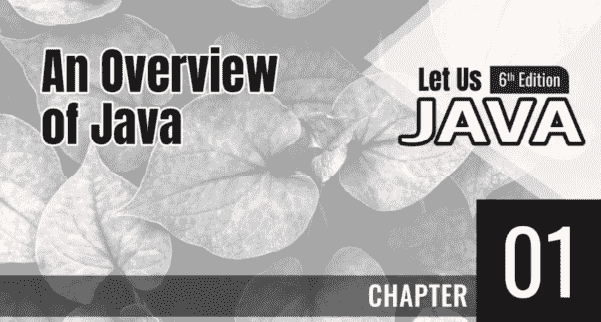

了解自己的根源才能脚踏稳地。Java 也是如此。让我们来看看它是如何产生的，以及与其他编程语言相比如何……

# 第 1 章：Java 概览

在我们开始用 Java 编写程序之前，了解 Java 到底是什么、它是如何产生的，以及它与其他计算机语言相比如何将是非常有趣的。此外，了解我们将在本书中使用哪些工具来执行程序、从哪里获取它们以及如何安装它们也是重要的。在本章中，我们将简要概述这些问题。

## 演变

编程方法一直在不断演变。这些方法在多大程度上受那个时代计算需求的驱动。当那个时代的语言无法满足这些需求时，人们就会对新语言产生需求。随着多年推移，这些需求变得越来越复杂。

在计算早期，需求是机器能够以某种方式执行指令，编程是通过手动键入二进制机器指令来完成的。只要编程任务很小，程序员就愿意忍受输入二进制指令的痛苦。

随着任务变得越来越复杂，程序长度增加，人们需要一种能够更易编写程序的程序的语言。这时，汇编语言诞生了。在汇编语言中，不再使用二进制，而是使用短小的缩写来编写指令。这些缩写无非是二进制指令的表示。这让程序员的生活变得简单了许多。汇编语言程序非常高效。

随着计算需求的增加，人们觉得学习和使用汇编语言并不容易。为了满足这一需求，人们发明了许多语言，包括 FORTRAN、BASIC 和 COBOL。但事实证明这些语言适用于特定领域。例如，FORTRAN 在科学和工程应用中被广泛接受，而 COBOL 通常用于构建工资单、库存管理等业务应用程序。

这些语言存在着三个重要的局限性。如下：

- (a) 它们无法用于它们本应服务的领域之外的地方。因此，领域的改变意味着程序员必须学习新语言。
- (b) 它们无法用于编写能够与硬件交互的系统级代码。
- (c) 它们无法用于编写平台无关的高级代码。

微处理器能够理解的机器语言指令通常称为指令集（`Instruction Set`）。问题在于，不同微处理器的指令集是不同的。因此，Intel 微处理器的指令与 ARM 微处理器的指令不同。所以，任何在特定微处理器上执行的程序都需要转换为该微处理器能够理解的机器语言指令。因此，对于同一个程序，不同的微处理器对应的机器语言指令也是不同的。因此，如果程序是为一个微处理器编译的，它可能在另一个微处理器上运行。为了让它在另一个微处理器上运行，需要再次为该微处理器进行编译。如图 1.1 所示。

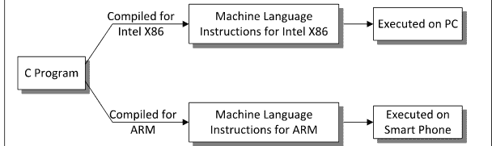

图 1.1

任何运行中的程序在执行过程中都需要使用操作系统（`OS`）的服务。这些包括执行输入/输出、分配内存等服务。你必须意识到，在同一个微处理器上，可以使用不同的操作系统。例如，假设有两台具有相同 Intel Pentium 微处理器的笔记本电脑。在其中一台电脑上可以运行 Windows，而在另一台电脑上可以运行 Linux。由于这些服务是不同的，在转换为机器语言时必须考虑这些变化。因此，对于同一个程序，Intel + Windows 组合的机器语言指令与 Intel + Linux 组合的机器语言指令不同。如图 1.2 所示。

| Intel X86 + Windows | Intel X86 + Windows 的机器语言指令 | 在笔记本 1 上执行 |
|---|---|---|
| C 程序 | Intel X86 + Linux | Intel X86 + Linux 的机器语言指令 | 在笔记本 2 上执行 |

图 1.2

图 1.1 和图 1.2 描述了一种“一次编写，随处编译”的场景。这意味着，为了让同一个程序在不同的微处理器 + 操作系统组合上运行，我们不需要重写程序，但需要为该微处理器 + 操作系统组合重新编译程序。这是 C 和 C++ 等流行传统语言所采用的方法。

## Java 有何不同之处？

Java 采取了与 C 和 C++ 等传统语言不同的方法。它让应用程序开发者能够遵循“一次编译，随处运行”的场景。这意味着一旦 Java 程序完成编译，它就可以在不同的微处理器 + 操作系统组合上执行，而无需重新编译程序。这使得 Java 在不同的微处理器 + 操作系统组合之间具有极强的移植性。微处理器 + 操作系统组合通常被称为“平台”。因此，Java 通常被称为平台无关语言或架构中立语言。Java 被认为是可移植的，因为它们可以在不同的微处理器 + 操作系统组合上使用，而无需对其进行任何更改。

Java 通过名为 Java 虚拟机（`JVM`）程序实现了“一次编译，随处运行”和平台无关性。当我们比较 Java 程序时，它们并没有转换为针对特定微处理器 + 操作系统组合的机器语言指令。相反，我们的 Java 程序被转换为字节码指令。这些字节码与机器码相似，但旨在由 `JVM` 解释。`JVM` 提供了一个可以在其中执行 Java 字节码的环境。不同的 `JVM` 是专门为不同的主机硬件和操作系统编写的。例如，专门为 Intel + Windows 组合、ARM + Linux 组合等编写了不同的 `JVM`。

在执行期间，`JVM` 运行时通过使用解释器（`Interpreter`）程序解释字节码，或通过即时编译器（`JIT`）编译字节码来执行。`JIT` 编译器更受青睐，因为它们的工作比解释器更快。在解释或 `JIT` 编译期间，字节码指令被转换为程序正在执行的微处理器 + 操作系统对应的机器语言指令。这完美地促进了在连接到互联网的不同机器上执行 Java 程序。

Java 程序通常存储在 `.java` 文件中，字节码通常存储在 `.class` 文件中。一个复杂的程序可能包含许多 `.class` 文件。为了方便分发，这些类文件可以打包成一个 jar 文件（Java 归档的缩写）。上述讨论的 Java 程序的工作如图 1.3 所示。

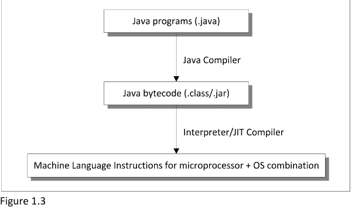

图 1.3

## Java 如何解决安全问题？

让我们先了解在使用互联网上的某些 Web 应用程序时会发生什么。通过电脑/笔记本电脑/平板电脑/手机上的浏览器，我们使用 URL 访问互联网上某个服务器上的应用程序。Web 应用程序发送 HTML 并在我们的浏览器中渲染。然而，除了最简单的 Web 应用程序外，除了 HTML，还会将一些可执行的 Java 程序发送到我们的浏览器。这个程序通常很小，被称为 Applet。applet 的目的是让 Web 应用程序更具响应性。例如，如果我们输入密码，应该能够在浏览器内直接使用下载的 applet 检查它是否符合密码创建规则，而不是将密码发送到服务器进行验证。

这确实提升了用户体验。这是因为检查是在机器本身上进行的，而不是在服务器机器上进行的。这节省了往返服务器的开销。

但当我们下载 applet 时，始终存在 applet 包含恶意代码（如病毒或木马）的可能性，这会对我们的机器造成伤害。`JVM` 通过限制 applet 代码访问其本应之外的机器其他资源来防止这种情况发生。这使得 applet 变得安全。`JVM` 一次解决了两个昂贵的问题——移植性和安全性。

## Java 还是 C++

重要的是，两者都是面向对象的语言，尽管 Java 有许多特性。当你开始学习 Java 时，你会发现它许多特性类似于 C++。这并非偶然，而是有意设计的。

## Java 环境

`JVM` 与一组实现 Java 编程接口（`API`）的标准库一起发布。Java `API` 和 `JVM` 共同形成了 Java 运行环境（`JRE`）。如果你需要在机器上执行 Java 程序，你只需要 `JRE`。例如，如果你想在机器上玩基于 Java 的游戏，只需要安装 `JRE`。

然而，如果你想在机器上开发程序，你需要 Java 开发工具包（`JDK`）。`JDK` 包含了开发程序所需的工具以及运行它们的 `JRE`。工具包括编译器（`javac.exe`）、Java 启动器（`java.exe`）、Appletviewer 等。编译器将 Java 代码转换为字节码。Java 启动器打开 `JRE`，加载类并调用其 `main()` 方法。图 1.4 显示了 Java 环境的所有部分。

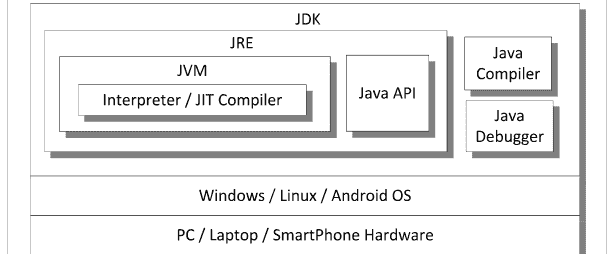

图 1.4

## 行业工具

为了创建和运行 Java 程序，你需要在电脑上安装两个软件。这些是

- (a) Java 开发包 (`JDK`)
- (b) 集成开发环境，如 NetBeans 或 Eclipse

`JDK` 通常称为标准开发包或 Java SE 19 JDK 或简单的 Java 19，其中 19 是版本号。随着时间的推移，版本号会不断增加。`JDK` 包含 `JVM`、`JRE`、Java 编译器和调试器。编译器将 Java 程序转换为相应的字节码。调试器用于检测、分析和消除程序中的错误。可以通过链接下载 Java 19：

https://www.oracle.com/java/technologies/download

在此下载页面，选择相应的版本号、操作系统（Windows/Mac/Linux）和处理器（x86 或 x64）并下载 `JDK`。下一步是安装下载的 `JDK`。这是一个非常简单的工作。我相信你完全可以完成。你只需要双击下载的安装程序文件 `jdk-19_windows-x64_bin.exe` 即可（假设使用 Windows 和 64 位机器配置），安装程序将引导你完成安装过程。

当你编写 Java 程序时，你需要一个编辑器来输入程序代码。较短的 Java 程序可以写在一个文件中。但更复杂的程序可能会拆分到多个文件中。为了让你能够运行程序、管理程序的多个文件、编译它并调试它，你需要一个能够以视觉化且用户友好的方式执行这些任务的工具。这个工具通常被称为集成开发环境（`IDE`）。一些用于构建 Java 程序的流行 `IDE` 包括 NetBeans、Eclipse 和 IntelliJ。本书中的所有程序都是用 NetBeans `IDE` 创建的。你可以通过链接 www.netbeans.org 下载它。

## 在线 Java 编译器

随着互联网的普及和无处不在，如果你愿意，可以完全避免在你的机器上安装 `JDK` 和 `IDE`。通过浏览器，你可以连接到以下任何一个站点来编写、编译和执行你的 Java 程序：

https://www.onlinedb.com/

https://www.tutorialspoint.com/compile_java_online.php

使用在线编译器的局限性在于，你在使用它们时需要稳定的网络连接。大多数编译器使用 gcc 编译器来编译你的程序。

在使用像 onlinedb.com 这样的在线编译器时，你必须记住从下拉菜单中选择语言（在我们例中是 Java）。接下来，我们需要输入你的程序并点击 Run/Execute 按钮。当我们这样做时，输入的程序会被发送到网络服务器，并在那里进行编译和执行。执行时产生的输出将传回并显示在浏览器中。如果在编译过程中在程序中有任何错误，错误也会回传并显示在浏览器中。

Onlinedb.com 还提供了创建多文件 Java 程序的规定、提供命令行参数、使用调试器调试程序、创建文件夹并在其中存储多个文件的功能。从安全的角度来看，在线编译器不是 Java 严肃软件开发的首选。尽管如此，当你学习 Java 时，这是一个零安装和无配置烦恼的良好选择。

我们现在已经有了坚实的基础。我们已经了解了导致 Java 诞生的历史背景、它主要尝试解决的问题，以及我们在开始 Java 程序开发之前需要安装的哪些工具。

在从下一章开始正式开始学习 Java 语言之前，尝试下一页的练习对于帮助你巩固这些想法将是一个主意。

## 练习

### [A] 匹配以下项：

- (a) Java 的创建者
- (b) JRE
- (c) Java 程序
- (d) JVM
- (e) NetBeans
- (f) C++ 的创建者
- (g) JDK
- (h) 结构化语言
- (i) OOP 语言
- (j) JVM
- (k) Java 编译器
- (l) Java 解释器
- (m) Java API
- (1) 提供安全性和移植性
- (2) 依赖平台
- (3) Bjarne Stroustrup
- (4) 包含编译器和调试器
- (5) 执行 Java 程序所需
- (6) 与平台无关
- (8) 将字节码转换为机器码
- (9) Java
- (10) James Gosling
- (11) C
- (12) 将 Java 程序转换为字节码
- (13) 类库

### [B] 简述下列哪些陈述是正确的（True）或错误的（False）：

- (a) 不同微处理器使用不同的指令集。
- (b) 所有的微处理器 + 操作系统组合使用相同的 JVM。
- (c) 在我们只想执行 Java 程序的机器上，只需安装 JRE 即可。
- (d) NetBeans 只是一个 IDE，它内部没有内置 Java 编译器。
- (e) Java 编译器将 Java 中的指令转换为机器语言指令。
- (f) JRE 和 JDK 都包含 Java 编译器。
- (g) JRE 是 JDK 的一部分。
- (h) Onlinedb.com 还提供了创建多文件 Java 程序的规定、提供命令行参数、使用调试器调试程序、创建文件夹并在其中存储多个文件的功能。从安全的角度来看，在线编译器不是 Java 严肃软件开发的首选。尽管如此，当你学习 Java 时，这是一个零安装和无配置烦恼的良好选择。
- (k) 运行 Java 程序需要 JDK。
- (l) Java 是为了不同的电子设备而创建的。
- (m) 多个 .class 文件可以打包在一起。
- (n) 在执行期间，Java 解释器将字节码转换为机器语言。
- (o) Java 是为了电子设备而创建的。

### [C] 下列各项：

- (a) 结构化
- (b) 面对象
- (c) 可移植的
- (d) 安全
- (e) 适用于互联网
- (f) 简单
- (g) 与架构无关
- (h) 管理

### [D] 为下列选择正确的选项：

- (1) 写一次，到处运行
- (2) 写一次，到处编译
- (3) 多次编译，到处运行
- (4) 多次写

### [E] 回答下列：

- (a) 为什么在 Linux x86 上编写的程序可以在 Windows x86 上运行？
- (b) 如果我们既要开发又要执行 Java 程序，应该安装 JDK 还是 JRE？
- (c) 为什么 Java 程序比 C 和 C++ 程序更容易移植？


# 为什么 Java 语言是架构无关的？

# 导致 Java 诞生的痛点有哪些？

# Java 环境有哪些不同的组件？

# 你所什么是计算平台？

# 第1章：Java 概述


- 软件的两类：
  - 系统软件 - 操作系统、编译器、设备驱动程序
  - 应用软件 - 用于桌面/笔记本、网页、移动端的软件

- Java 世界不同平台的技术：
  - 桌面 - JSSE
  - 移动端 - JME
  - 网页 - J2

- Java 流行的原因：
  - 同一种语言适用于多种应用
  - 可以进行快速应用开发 (RAD)
  - 开发周期简单
  - 易于管理大型项目

- 缩写：
  - API = 应用程序接口
  - JVM = Java虚拟机
  - JRE = Java 运行时环境
  - JDK = Java 开发包

- `API` = 以包形式存在的类库
- `JVM` = 内存管理器 + 解释器 / 即时编译 (`JIT`) 编译器
- `JRE` = `JVM` + `API`
- `JDK` = `JRE` + 开发工具，如 `javac`, `java`, `debugger`
- `NetBeans`、`Eclipse` 是流行的开发环境
- `NetBeans` 和 `Eclipse` 内部使用 `java`, `javac`, `debugger`
- 不同的硬件 + 操作系统组合需要下载不同的 `JRE` 和 `JDK`
- 执行 Java 程序只需要 `JRE`
- 创建和执行 Java 程序需要 `JDK` + `NetBeans`
- 为了进一步提高移植性，Java 使用“写一次，到处运行”的原则


在下水之前，先湿湿脚是好的。看看如何用 Java 创建一个小型程序……

# 第 2 章：入门

任何语言的重要方面都包括它存储数据的方式、操作这些数据的方式、如何实现输入和输出，以及它如何让你控制程序中指令的执行顺序。在本章中，我们将讨论这前三个构建模块。

## Java 数据类型

在编写 Java 程序之前，理解 Java 中如何表示数据是非常重要的。这是通过数据类型来实现的。数据类型指定了两个点：

- (a) 数据类型可以取什么值？
- (b) 在数据类型上可以执行哪些操作？

例如，整数数据类型可以取 -2147483648 到 +2147483647 范围的值，并可以对其执行加、减、乘、除等操作。同样，布尔数据类型可以取真或假，并允许对其进行比较操作。

根据数据类型在内存中的创建位置，它被称为原始类型（也称为值类型）或引用类型。

Java 强制原始数据类型只创建在栈（`stack`）中，引用类型只创建在堆（`heap`）中。例如，整数（如 `2341`）始终创建在栈中，而字符串（如 `"Quest"`）始终创建在堆中。Java 此决策的指导原则是——所有较小的数据类型都创建在栈中，所有占用较大内存的类型都创建在堆中。

原始类型和引用类型可以进一步划分为预定义和用户定义。这里预定义是指 Java 提供的现成数据类型，而像我们这样的普通用户可以创建的数据类型。例如，整数是一个预定义的原始数据类型，而枚举（`Enumeration`）是一个用户定义的值类型。图 2.1 显示了 Java 中可用的不同数据类型分类。注意，预定义的值类型通常也称为原始类型（`Primitives`）。

## 20 让我们学习 Java

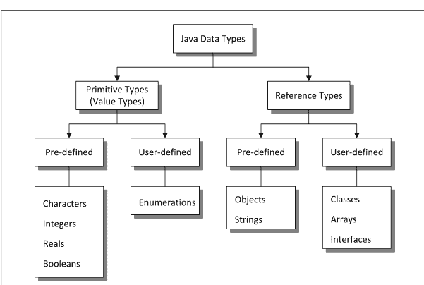

图 2.1

在图 2.1 显示的所有数据类型中，我们首先将关注预定义值数据类型。要在 Java 程序中使用这些数据类型，我们必须创建常量和变量。常量只不过是数据类型提供的值范围内的一个变量，而变量是一个可以存放常量值的容器。该容器通常是一个内存位置，变量是赋给该内存位置的名字。例如，如果我们使用表达式 `x = 5`，那么常量值 `5` 将存储在一个内存位置中，并给该位置赋予变量 `x`。每当我们想要检索并使用 `5` 时，只需使用变量名 `x` 即可。如图 2.2 所示。

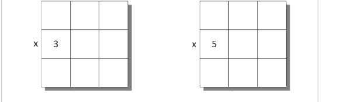

图 2.2

# 第 2 章：入门

顾其实义，常量的值不能改变（固定的），而变量的值可以改变（变化的）。常量通常被称为字面量（`literal`），而变量被称为标识符（`identifier`）。图 2.3 给出了常用预定义原始数据类型的列表，以及它们可以取的值范围和在内存中所占用的字节数。

| 数据类型 | 范围 | 字节（bytes） |
|---|---|---|
| `char` | 0 to 65535 | 2 |
| `int` | -2147483648 to +2147483644 | 4 |
| `float` | -3.4e38 to +3.4e38 | 4 |

图 2.3

在创建常量和变量时，需要遵守某些规则。下面将讨论。

## 常量的构造规则

- (a) 如果数字常量前没有符号，则假设它为正数。
- (b) 常量内部不允许有逗号或空格。
- (c) 每个常量占用的字节是固定的，不会在不同编译器之间改变。
- (d) 只有 `float` 常量后面可以跟后缀。
- (e) `float` 常量后面必须跟 `f`。
- (f) `float` 常量可以用分数形式（例如 `3.1456f`）或指数形式（例如 `3.1456e2`）表示。
- (g) 字符常量是括在单引号内的单个字母、单个数字或单个特殊符号。两个引号必须匹配。例如，`'A'` 是一个有效的字符常量，而 `'AB'` 则不是。

下面给出了一些有效常量的示例。由于对变量名的允许长度没有限制，可以使用上述规则构造出海量的变量名。利用这种选择是一个良好的做法。

## 关键字

关键字是 Java 提供的现成的字，而像我们这样的普通用户可以创建的字。例如，整数是一个预定义的原始数据类型，而枚举是一个用户定义的值类型。

| abstract | class | final | int | return | throw |
|---|---|---|---|---|---|
| boolean | default | finally | interface | new | switch |
| break | do | for | long | synchronized | throws |
| byte | double | package | try | static | transient |
| case | else | implements | protected | void |
| char | enum | import | instanceof | public | volatile |
| extends | float | super | this | while |

图 2.4

## 第一个 Java 程序

掌握了变量、常量和关键字的知识后，逻辑步骤是将它们组合成指令。然而，我们现在将编写第一个 Java 程序。

在我们开始编写 Java 程序之前，请记住以下规则：

- (a) Java 程序中的每条指令都是独立的语句。因此，一个完整的 Java 程序由一系列语句组成。
- (b) 单词之间可以插入空格以提高语句的可读性。但是，变量、常量或关键字内部不允许空格。
- (c) 所有语句均使用小写。
- (d) 每个 Java 语句必须以分号（`;`）结束。

让我们写出第一个 Java 程序。它将简单地根据一组代表值来计算利息。

```java
// 计算利息
package calOfSi
class CalOfSi {
 public static void main (String[] args) {
     float p;
 }
}
```

关于程序的一些实用提示……

- 关于程序的注释应该括在 `/* */` 中，或者以 `//` 开头。例如，程序的第一个语句是一个注释。
- 虽然注释不是必须的，但从程序开始处用注释说明程序的目的、作者和编写日期是一个良好的习惯。
- 有时，程序中的某条语句的功能并不直观。在这种情况下，使用注释说明该语句（或一组语句）的目的是有价值的。例如，注释可以跨行显示，如下所示：

```java
/* 这是一个
多行
注释 */
```

这种注释通常被称为多行注释。

- Java 程序 是一个或多个包的集合。每个包可以包含多个类。每个类可以包含多个函数。每个函数可以包含多条指令。这种典型的 Java 程序结构如图 2.5 所示。
- Java 程序中的每个指令都属于一个函数。每个函数必须属于一个类，每个类必须属于一个包。在我们的程序中，有一个名为 `calofsi` 的包，一个名为 `CalofSi` 的类以及一个名为 `main()` 的函数。`package` 和 `class` 都是关键字。

现在不想进入细节。我们将在后面的章节中学习包和类。但现在是引入函数概念的好时机。

# 26

## 让我们学习 Java

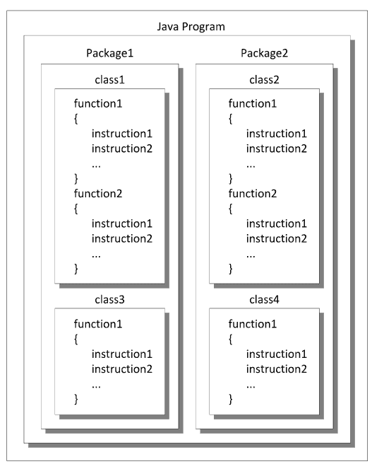

`main()` 是一个函数。一个函数包含一组语句。虽然一个 Java 程序可以包含多个函数，但起初，我们将只关注那些只有一个函数的程序。所有属于 `main()` 的语句都包含在一对括号 `{ }` 之间，如下所示。

```java
public static void main ( String[] args )
{
    statement 1;
    statement 2;
    statement 3;
}
```

# 第 2 章：入门

与计算器中的函数返回一个值的方式类似，Java 中的函数同样也会返回一个值。由于我们不希望从 `main()` 函数返回任何值，我们必须在 `main()` 之前使用关键字进行指定。`main()` 前面总是带有关键字 `static`。该关键字的作用和函数的详细工作分别在第 9 章和第 7 章中讨论过。

程序中使用的任何变量在在使用之前必须先声明。例如：

```java
int p, n; /* 声明 */
float r, si; /* 声明 */
si = p * n * r / 100; /* 使用 */
```

任何 Java 语句始终以分号 (`;`) 结束。例如：

```java
float r, si;
r = 15.5f;
```

在语句中，

`si = p * n * r / 100;`

`*` 和 `/` 是算术运算符。Java 中可用的算术运算符有 `+`, `-`, `*`, `/`。Java 的运算符非常丰富。Java 总共有 41 个可用运算符。

一旦计算出 `si` 的值，就需要显示在屏幕上。与其他语言不同，Java 不包含任何输出到屏幕的指令。所有屏幕输出都是通过库函数实现的。其中一个函数是 `println()`。我们使用它来显示 `si` 中包含的值。

实际上，`println()` 是 `PrintStream` 类的一个函数，而 `out` 是 `System` 类中定义的静态对象。我们将使用 `System` 类中的类、对象和静态成员。目前，每当我们想在屏幕上显示输出时，只需使用语法 `System.out.println()` 即可。

我们可以使用 `println()` 函数打印多个值。如下所示。

```java
System.out.println(si + " " + p + " " + n + " " + r);
System.out.println("Simple interest = Rs. " + si + ");
System.out.println("Principal = " + p + " Rate = " + r + ");");
```

# 28

## 让我们学习 Java

这些语句的输出看起来如下...

```text
465.2325 1000.5 3 15.5
Simple interest = Rs. 465.2325
Principal = 1000.5 Rate = 15.5
```

## 编译与执行

我们需要执行以下步骤来创建、编译和执行我们的第一个 Java 程序。假设你已经按照第 1 章中的说明安装了 `JDK` 和 `NetBeans`。

- (a) 从“开始 | 所有程序”启动 `NetBeans`。
- (b) 从“文件”菜单选择“文件 | 新项目”。在“类别”列表框中选择“Java”，在“项目”框中选择“Java Application”。点击“下一步”按钮。
- (c) 在“项目名称”文本框中为项目赋予适当名称（例如 `CalOfFsi`）。为项目文件夹选择合适的位置，然后点击“完成”。
- (d) `NetBeans` 将提供一个骨架程序，其中包含一个包语句、一个公共类 `CalOfFsi` 和一个函数 `main()`，都定义在一个名为 `CalOfFsi.java` 的文件中。注意，在所有 Java 程序中，文件名和公共类名是相同的。
- (e) 在 `main()` 中输入我们简单利程序的语句。
- (f) 使用 `Ctrl+S` 保存程序。
- (g) 使用 `F6` 编译并执行程序。

## 另一个程序

我们现在知道如何编写一个基础 Java 程序、输入它、编译并执行它。这些是你编写每个程序时必须执行的步骤。为了帮助你理清思路，这里有另一个程序。它计算并打印 3 个数字的平均值。

```java
/* 计算平均值 */
package calofavg ;
public class CalOfAvg
{
  public static void main ( String[] args ) {
    int x, y, z, avg;
    x = 73;
    y = 70;
    z = 65;
    avg = (x + y + z) / 3;
    System.out.println( avg );
  }
}
```

## 练习

[A] 下面哪个是无效的变量名？为什么？

| 变量名 |
| :--- |
| `BASICSALARY` `_basic` `basic-hra` |
| `#MEAN` `group.` `422` |
| `population in 2006` `over time` `mindovermatter` |
| `SINGLE` `hELLO` `queue.` |
| `team_victory` `Plot # 3` `2015_DDay` |

[B] 指出以下 Java 语句中的错误（如有）：

- (a) `int = 314.562f * 150;`
- (b) `name = 'Ajay';`
- (c) `varchar = '3';`
- (d) `float_of =`
- (e) `count = '3';`
- (f) `avg = (x+y+z)/3;`
- (g) `int = 314.562f * 150;`
- (h) `population = 2006 over time;`
- (j) `k =`

[C] 下面哪个是正确的注释方式？

- (a) 下面哪种是正确的：
  1. `//`
  2. `/`
  3. `*`
  4. `/* ...`
- (b) 整数的最大值是：
  1. `-2147483648`
  2. `2147483647`
  3. `3.4 × 10`
- (c) 变量名不能以开头：
  1. 字母
  2. 数字
  3. 下划线
  4. 以上 (2)
- (d) 下面哪个是错误的？
  1. `+`
  2. `-`
  3. `/`
  4. `*`

[D] 回答以下：

- (a) 假设 Ramesh 的工资。津贴为基本工资的 40%，房租补贴为基本工资的 20%。编写一个 Java 程序计算总薪。
- (b) 假设两个城市之间的距离（公里）。编写一个 Java 程序将距离转换为米、英尺和厘米。
- (c) 假设五门课的成绩通过键盘输入。编写一个 Java 程序计算总分和百分比。假设每门科满分为 100。
- (d) 假设城市的华氏度温度。编写一个 Java 程序将其转换为摄氏度并打印。
- (e) 假设矩形的长和宽，以及圆的半径。编写一个 Java 程序计算矩形的面积和周长，以及圆的面积和周长。


- `常量` = `字面量` -> 不改变
- `变量` = `标识符` -> 可以改变
- 数据类型：
  1) 原生类型（值类型）
  2) 引用类型
- 原生类型：
  - 字符 - 2 字节
  - 整数型 - `byte`, `short`, `int`, `long`（大小分别为 1, 2, 4, 8 字节）
  - 实 - `float`, `double`（大小分别为 4, 8 字节）
  - 布尔型 - `true` / `false`（1 位）
- 派生类型（类）：
  - 库：`String`, `System`, `Exception` 等。
  - 用户定义：`calSi`, `calOfAvg` 等。
- 变量名对大小写敏感且应以字母开头
- 总关键字 = 48。示例：`int`, `char`, `float`
- 一个 Java 程序是一个或多个包的集合
- 每个包可以包含多个类

# 32 让我们学习 Java

- 每个类可以包含多个函数
- 变量必须属于某个函数或类
- Java 中没有全局函数或变量
- 公共类可以从包外部访问
- 公共函数可以从类外部访问
- 3 种注释：
  - 单行注释 `//`
  - 多行注释 `/* ... */`
  - 文档注释 `/** ... */`

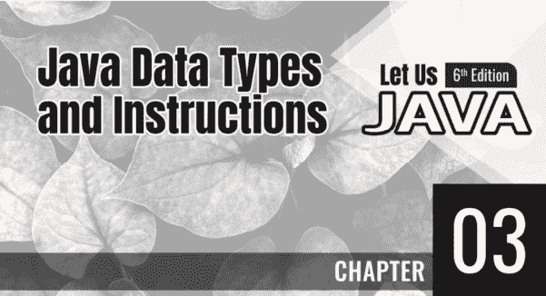

良好的开端是成功的一半！学习 Java 语言的基础构建模块...

34 让我们学习 Java

- 复习数据类型
  - 整数类型
  - 实类型
  - `char` 数据类型
  - `boolean` 数据类型
- 接收输入
- 接收输入 - 另一种方式
  - 命令行参数
- 类型声明指令
- 算术指令
  - 算术指令中的类型转换
  - 显式转换
  - 运算优先级
  - 运算符的结合性
  - 常量变量
- Java 中的控制台输出
  - `printf()` 和 `format()` 函数
- Java 中的控制指令


* 练习
* 笔记

# 第 3 章：Java 数据类型与指令

在上一章中，我们仅根据数据类型和指令的极少知识编写了程序。结果是程序仅对特定数据有效。如果它们要与其他数据一起工作，就需要对程序进行修改，这并不是一个好主意。在本章中，我们建议纠正这种局面。为此，我们需要对数据类型和指令有更深入的了解。有很多内容需要介绍。让我们从数据类型开始。

## 重温数据类型

到为止，我们只使用了 `int` 来处理整数值，使用 `float` 处理实数。然而，Java 提供了多种类型的整数和实数。让我们从整数开始。

## 整数类型

Java 提供了 4 种整数——`byte`、`short`、`int` 和 `long`，大小分别为 1 字节、2 字节、4 字节和 8 字节。图 3.1 显示了 Java 中可用的不同整数类型及其大小范围。

| 数据类型 | 范围 | 字节 | 默认值 |
|---|---|---|---|
| byte | -128 到 +127 | 1 | 0 |
| short | -32768 到 +32767 | 2 | 0 |
| int | -2147483648 到 +2147483647 | 4 | 0 |
| long | -9223372036854775808 到 +9223372036854775807 | 8 | 0 |

图 3.1

现在让我们讨论一下与整数类型相关的细微之处。

- (a) 默认情况下，没有小数点的数被视为 `int`。在赋值过程中，如果赋值的值超过了变量的范围，则会发生错误。如下所示。

```java
byte a = 300; // error
short b = 40000; // error
int c = 2200000000; // error
```

- (b) 如果我们希望将整数视为长整数，必须在它的末尾添加后缀 `L` 或 `l`，例如

```java
long a = 3651 * 1000;
```

- (c) 可以在数字之间使用下划线来提高代码的可读性，如下所示。

```java
long creditCardNo = 1211_5178_9212_4231L;
```

注意，我们不能在数字的开头或结尾使用下划线，也不能在后缀 `L` 之前使用。

## 实类型

实数可以表示为 `float` 和 `double`。它们之间的区别在于所占据的字节数、范围和精度。这如图 3.2 所示。

| 数据类型 | 范围 | 默认值 | 字节 |
|---|---|---|---|
| float | ±1.5 × 10⁻⁴⁵ 到 ±3.4 × 10³⁸ | 0.0f | 4 |
| double | ±5.0 × 10⁻³²⁴ 到 ±1.7 × 10³⁰⁸ | 0.0 | 8 |

图 3.2

与这些实数类型相关的一些细微之处将在下文中讨论。

- (a) 默认情况下，带有小数点的数被视为 `double`。如果我们想将其视为 `float`，我们需要在末尾添加后缀 `f` 或 `F` 使其成为 `float`，如下所示。

```java
float x = 3.5; // error
float y = 3f; // correct
double d = 3.5f; // correct
double e = 3.5; // correct
```

- (b) 如果我们希望将整数视为 `double`，请使用后缀 `d` 或 `D`，例如

```java
double a = 3d;
```

- (c) 在数字之间可以使用任意数量的下划线来提高代码的可读性，如下所示。

```java
float pi = 3.14_28_57F;
```

注意，我们不能在数字的开头或结尾、后缀 `F` 之前或紧邻小数点处使用下划线。

- (d) 如果 `float`/`double` 的值太小或太大，我们可以使用科学计数法。如下所示。

```java
float a = 5e-5; // normal notation
double b = 3.4e3; // normal notation
```

## Char 类型

`char` 数据类型用于存储单个字符。它是 16 位的 Unicode 字符。字符包含在单引号内。如下所示。

```java
char ch = 'A';
char symbol = '$';
```

注意我们也可以使用 Unicode 值来表示字符。

```java
char ch = '\u0041';
```

## Boolean 类型

`boolean` 数据类型用于存储两个值：`true` 和 `false`。它被用于条件逻辑。

```java
boolean isJavaFun = true;
boolean isEasy = false;
```

## String 类型

`String` 不是基本数据类型，而是表示字符序列的类。它包含在双引号内。

```java
String greeting = "Hello World";
```

## 获取输入

为了从用户获取输入，我们使用 `java.util` 包中的 `Scanner` 类。如下所示：

```java
// 计算利息
package receivinginput;
import java.util.*;
public class SIByReceiving {
    public static void main(String[] args) {
        float p, r, si;
        int n;
        System.out.println("Enter values of p, n and r");
        Scanner sc = new Scanner(System.in);
        p = sc.nextFloat();
        n = sc.nextInt();
        r = sc.nextFloat();
        si = (p * n * r) / 100;
        System.out.println(" Simple interest = Rs. " + si);
    }
}
```

现在让我们看看执行此程序时会发生什么。首先，第一个 `println()` 在输出窗口输出消息“Enter values of p, n and r”。在这个窗口中，我们应该提供三个数字。我们的程序应该读取这些数字中的每一个。为了做到这一点，我们必须通过语句创建一个 `Scanner` 类型的对象：

`Scanner sc = new Scanner(System.in);`

这里 `System.in` 代表键盘。

在第 9 章我们将学习什么是对象以及如何创建它们。现在让我们机械地执行。为了能够使用 `Scanner` 类，我们需要在程序的开头、包语句下方添加以下语句：

```java
import java.util.*;
```

正如前面提到的，Java 库中的类组织在不同的包中。通过上面的语句，我们导入了 `java.util` 包中的所有 (`*`) 类。这使得 `Scanner` 类变得可用。

```java
double salary = sc.nextDouble();
boolean status = sc.nextBoolean();
char sex = sc.next().charAt(0);
String name = sc.nextLine();
```

注意，为了接收一个字符，我们必须通过调用 `next()` 接收一个字符串，然后通过调用 `charAt()` 函数获取该字符串第 0 位置的字符。

## 接收输入 - 另一种方式

还有一种从键盘接收输入的方法。它使用了 `InputStreamReader` 和 `BufferedReader` 对象，而不是 `Scanner` 对象。下面的程序展示了如何使用这些对象。

```java
package sibyreceivinginput;
import java.io.*;
public class SiByReceivingInput {
    public static void main(String[] args) throws Exception {
        float p, r, si;
        int n;
        InputStreamReader isr;
        BufferedReader br;
        isr = new InputStreamReader(System.in);
        br = new BufferedReader(isr);
        System.out.println("Enter values of p, n and r ");
        p = Float.parseFloat(br.readLine());
        n = Integer.parseInt(br.readLine());
        r = Float.parseFloat(br.readLine());
        si = (p * n * r) / 100;
        System.out.println("Simple interest is Rs. " + si);
    }
}
```

我们首先创建了两个 `BufferedReader` 和 `InputStreamReader` 类型的对象。然后我们调用了三次 `readLine()` 函数。为了能够使用 `BufferedReader` 和 `InputStreamReader` 类，我们必须从 `java.io` 包中导入它们。

我们提供给三个 `readLine()` 函数的数值值被视为字符字符串，而不是数字。因此，我们需要将这些字符串转换为数字。这种转换是通过 `parseFloat()` 和 `parseInt()` 函数完成的。这些函数分别属于名为 `Float` 和 `Integer` 的库类。然后将转换后的值赋值给相应的变量。最后，计算并打印出简单利息。

如果我们向 `readLine()` 提供了错误的输入，那么通过 `parseInt()` / `parseFloat()` 将此输入转换为 `int` / `float` 将在执行期间导致错误。有多种方法可以处理这个问题，最简单的一种是在 `main()` 旁边写 `throws Exception`。我们不会详细介绍这些以及处理执行期间发生错误的其他机制。这些机制将在第 14 章中详细讨论。

## 命令行参数

在我们的简单利息程序中，我们不需要在执行期间使用 `Scanner` 对象读取值，而可以在命令行本身处提供这些值。这是向程序提供输入的另一种方式。修改后的程序看起来如下：

```java
// Calculation of simple interest
package siusingcmdlineargs;
import java.lang.*;
public class SiUsingCmdLineArgs {
    public static void main(String[] args) {
        float p, r, si;
        int n;
        p = Float.parseFloat(args[0]);
        n = Integer.parseInt(args[1]);
        r = Float.parseFloat(args[2]);
        si = p * n * r / 100;
        System.out.println(" Simple interest = Rs. " + si);
    }
}
```

要将 `p`、`n` 和 `r` 的值作为命令行参数提供，在 NetBeans 的项目列表中右键点击项目 `siusingcmdlineargs`，并在弹出的菜单中选择“Properties”（属性）。这样做会显示项目属性窗口。在此窗口中，从“Categories”（类别）选择“Run”（运行），并在“Arguments”（参数）文本框中输入值 `1000.50f 15.5f`。

现在你可以像往常一样使用 F6 编译并运行程序了。当我们执行程序时，命令行参数以字符串数组（集合）的形式存在 `main()` 的 `args` 中。从这个集合，我们可以使用 `args[0]` 和 `args[2]` 访问单个字符串。这些字符串包含了我们作为命令行参数提供的值。然而，我们不能对这些字符串进行算术运算。必须先将它们转换为数字。这种向 `float` 和 `int` 的转换是通过语句完成的：

```java
p = Float.parseFloat(args[0]);
n = Integer.parseInt(args[1]);
r = Float.parseFloat(args[2]);
```

注意，`int` 和 `float` 是原始数据类型。`Integer` 和 `Float` 是像 `parseFloat()` 和 `parseInt()` 这样的类。基本上有五种指令。转换后的数字被赋值给 `p`、`n` 和 `r`。最后，计算并打印出简单利息。为了能够使用 `Integer`，我们必须从 `java.lang` 包中导入它们。

## Java 指令

现在我们已经写了几个程序，让我们看看在这些程序使用的指令。基本上有五种指令。每条指令的目的如图 3.3 所示。

| 指令 | 目的 |
| :--- | :--- |
| 类型声明 | 声明 Java 程序中变量类型 |
| 算术 | 在常量和变量之间执行算术运算 |
| 控制 | 控制各种语句的执行顺序 |
| 异常处理 | 处理执行期间发生错误的情况 |
| 高级 | 用于线程同步、处理溢出等。 |

图 3.3

由于基础程序通常只包含类型声明和算术指令；因此我们将在现阶段只讨论两种。其他类型的指令将在后续章节中讨论。

## 类型声明

此指令用于声明 Java 程序中使用的每个变量的类型。程序中的任何变量必须在使用之前声明类型。类型声明有几种变体。如下所示：

```java
int budget;
float alpha;
```

(a) 变量类型的声明也可以如下所示：

```java
int budget;
float alpha;
```

(b) 声明的顺序有时很重要。例如：

```java
int budget = 10;
float alpha = 1.5f;
```

(c) 这种语句是有效的：

```java
int budget, alpha;
```

然而，这种语句是无效的：

```java
int budget = 10, alpha = 1.5f; // 修正了原文中格式混乱的代码片段
```

## 算术指令

算术指令看起来容易，容易出错。请仔细注意以下几点：

- 除了除法运算符，还有取模运算符 (`%`)。该运算符返回一个操作数除以另一个操作数的余数。`10 / 2` 返回 5，而 `10 % 2` 返回 0。注意在使用 `%` 时，余数的符号始终与被除数的符号相同。因此 `-5 % 2` 返回 -1，而 `5 % -2` 返回 1。

- 取模运算也可以对浮点数进行。如果 `a` 和 `b` 是浮点数，`a % b` 计算为 `a - n * b`，其中 `n` 是小于或等于 `a / b` 的最大整数。`16.5f % 1.25f` 返回 0.25。

- 算术有时用于在字符变量中存储常量。

```java
char a, b;
a = 'F';
b = '+';
```

当我们执行此操作时，字符的 Unicode 值会被存储在变量中。

- 可以在 `int`、`float` 和 `char` 上进行算术运算。以下语句：

```java
char x = 'a', y = 'b';
int z;
z = x + y;
```

是完全有效的，因为加法是在字符的 Unicode 值上进行的，而不是在字符本身上。'a' 和 'b' 的 Unicode 值分别是 97 和 98，因此它们可以相加。


- 不假设存在运算符。必须显式地写出。在下面的示例中，`b` 后面的乘法运算符必须显式写出：

```
a = c.d(xy)               // 通常算术语句
b = c * d * b * (x * y)   // Java语句
```

- 如果我们想执行幂运算，可以通过这种方式完成：

```java
double a;
a = Math.pow(3.0, 2.0);
```

在这里，`pow()` 是 `Math` 类中的一个函数。它被用于将 `3.0` 提升到 `2.0` 的幂。注意，我们应该始终在 `pow()` 中使用 `double` 类型的值。

`Math` 类中许多许多数学函数，如 `sqrt()`、`abs()`、`sin()`、`cos()`、`tan()`、`log()`、`log10()` 等。

## 算术指令中的类型转换

为了有效地开发 Java 程序，必须理解用于实数和整数隐式转换的规则。这些规则如下。请仔细注意。

- 整数与整数之间的算术运算始终产生整数结果。
- 实数与实数之间的运算始终产生实数结果。
- 整数与实数之间的运算始终产生实数结果。在此运算中，整数首先被提升为实数，然后执行运算。因此结果是实数。

认为图 3.4 中所示的几个示例可以消除这一疑问。

| 运算 | 结果 | 运算 | 结果 |
|---|---|---|---|
| 5 / 2 | 2 | 2 / 5 | 0 |
| 5.0 / 2 | 2.500000 | 2.0 / 5 | 0.400000 |
| 5 / 2.0 | 2.500000 | 2 / 5.0 | 0.400000 |
| 5.0 / 2.0 | 2.500000 | 2.0 / 5.0 | 0.400000 |

图 3.4

这里有几个隐式转换规则。

- (a) 任何 `byte`、`short`、`int` 或 `char` 之间的运算结果均为 `int`。在这里，这些运算的结果应始终赋值给 `int` 变量。否则将报告错误。下面的代码片段说明了这一点：

```java
byte a = 100, b = 50;
byte c = a + b; // 错误，产生的 int 不能赋值给 byte
int d = a + b; // 正常

short l = 45, m = 20;
short n = l + m; // 错误，产生的 int 不能赋值给 short（注：原文误为byte，应为short）
int p = l + m; // 正常

char ch = 'A', dh = 'B';
char eh = ch + dh; // 错误，产生的 int 不能赋值给 char
int fh = ch + dh; // 正常
```

- (b) 在赋值过程中，左侧的类型可能与右侧的类型不同。在这种情况下，如果右侧的值在左侧的范围内，则没有错误。下面的代码片段说明了这一点：

```java
byte s;
s = 20; // 尽管 20 是 int，但在 byte 的范围内
short a;
a = 100; // 尽管 100 是 int，但在 short 的范围内
```

如果右侧的值不在左侧类型的范围内，则报告错误。例如：

```java
byte s;
s = 200; // 错误，200 不在 byte 的范围内
short a;
a = 400; // 错误，400 不在 short 的范围内
```

- `char` 会隐式转换为 `short`、`int`、`float` 或 `double`。然而，没有到 `char` 的隐式转换。下面的代码片段说明了这一点：

```java
float a = 'A'; // 正常
char ch = a; // 错误
```

## 显式转换

有时我们需要将一种类型显式转换为另一种。这是通过类型转换完成的。让我们考虑一个示例：

```java
float a, b;
int x = 6, y = 4;
a = x / y;
b = (float) x / y;
System.out.println("Value of a = " + a);
System.out.println("Value of b = " + b);
```

输出如下：

```
Value of a = 1.0
Value of b = 1.5
```

`x` 和 `y` 都是整数，因此 `x / y` 产生整数。如果我们不希望商被截断，可以像下一个语句那样使用类型转换。类型转换涉及在数据周围加上 `()`。在我们的程序中 `(float) x / y` 将 `x` 转换为 `float`。这是另一个类型转换的示例：

```java
float a = 6.35f;
int b = (int) a;
System.out.println("Value of a = " + a + "\n" + b);
```

输出如下：

```
Value of a = 6.35
Value of b = 6
```

注意，由于类型转换，`a` 的值不会改变。相反，当我们执行时，是表达式的值发生了转换。

## 运算符优先级

在执行包含两个或更多运算符的算术语句时，关于具体的执行顺序可能会出现问题。例如，表达式 `2 * x - 3 * y` 是对应 `(2*x) - (3*y)` 还是 `2*(x-3y)`？同样，`A / B * C` 是对应 `(A/B)*C` 吗？为了回答这些问题，必须理解运算符的“优先级”。优先级决定了执行运算的顺序。常用运算符的优先级如图 3.5 所示。

| 优先级 | 运算符 | 说明 |
|---|---|---|
| 第一 | * / % | 乘、除、取模 |
| 第二 | + - | 加、减 |
| 第三 | = | 赋值 |

图 3.5

在括号内，图 3.5 中提到的相同优先级依然有效。此外，如果有多个括号，将先执行最内层的操作，然后是第二层，依此类推。一个示例可以清楚这个问题。

示例 3.1：假设 `i` 是整数变量，确定运算优先级并求以下表达式的值：

```java
i = 2 * 3 / 4 + 4 / 8 - 2 + 5
```

该表达式的逐步求值过程所示：

```
i = 2 * 3 / 4 + 4 / 8 - 2 + 5
i = 6 / 4 + 4 / 8 - 2 + 5
i = 1 + 4 / 8 - 2 + 5
i = 1 + 0 - 2 + 5
i = 1 - 2 + 5
i = -1 + 5
i = 4
```

等等，让我们根据规则重新评估：

`i = 2 * 3 / 4 + 4 / 8 - 2 + 5`

`i = 6 / 4 + 4 / 8 - 2 + 5` （先执行乘/除）

`i = 1 + 0 - 2 + 5` （整数除法）

`i = 1 - 2 + 5` （加/减）

`i = -1 + 5`

`i = 4`

注意 `6 / 4` 得到 `1` 而不是 `1.5`。这是因为两个整数之间的运算结果为整数。同样，`5 / 8` 的结果为零，因为 `5` 和 `8` 都是整数。

## 运算符结合性

当一个表达式包含两个优先级相同的运算符时，它们之间的冲突通过运算符的结合性来解决。Java 中的所有运算符都有从左到右或从右到左的结合性。让我们通过几个示例来理解。

这里有一个相同运算符之间的冲突，即 `/` 和 `*` 之间。这种冲突通过 `/` 和 `*` 的结合性解决。两者都具有从左到右结合性。因此首先执行 `/`，然后执行 `*`。考虑另一个表达式：

`a = b = 3;`

在这里，两个赋值运算符的优先级相同。因此运算顺序由 `=` 运算符的结合性决定。`=` 从右到左结合。因此，第二个 `=` 比第一个先执行。

考虑另一个表达式：

`z = a * b + c / d;`

在这里，`*` 和 `/` 具有相同的优先级和相同的结合性（从左到右）。编译器可以根据方便执行 `*` 或 `/`，因为无论先执行哪一个，结果都是相同的。注意，由于类型转换，`a` 的值不会永久改变。相反，当我们执行时，是表达式的值发生了转换。

# 常量变量

很多时候我们在程序中使用常量。例如，普朗克常数或阿伏伽德罗数。假设我们在 Java 程序中多处需要 `pi` 的值。如果在所有这些地方直接使用 `3.14` 是坏主意，我们可能会在某处犯类型错误而编译器无法察觉。为了避免这种情况，可以将 `3.14` 存储在 `float` 变量 `pi` 中，然后在需要 `pi` 的地方使用该变量。这种方案的局限性在于作为变量，它是可以变的。所以如果我们给这个变量赋新值，编译器将无法报告错误。

解决此问题的方案是使用 `final` 关键字将变量声明为常量。如下代码片段所示：

```java
final float pi = 3.14f;
float radius = 1.5f;
float area = pi * radius * radius;
```

## Java 中的控制台输出

屏幕和键盘统称为控制台。我们已经学会如何使用 `Scanner` 类的对象从键盘接收输入。为了向屏幕输出内容，常用的两个函数是 `println()` 和 `format()`。现在让我们理解这些函数。

## `println()` 和 `format()` 函数

到为止我们一直使用 `println()` 函数向屏幕输出内容。下面是它的用法示例：

```java
int avg = 346;
float per = 69.5f;
System.out.println("Output: " + avg + "\n" + "Percentage = " + per);
```

此代码片段产生如下输出：

```
Output:
Average = 346
Percentage = 69.5
```

在第一个 `println()` 中我们仅仅打印了字符串 `Output:`，而在下一个中我们将整数 `avg` 和浮点 `per` 转换为字符串，并将它们附加在 `Average =` 和 `Percentage` 的末尾。

分别地。我们还在它们之间插入了 `\n` 以在两个不同的行中显示字符串。请注意，每个 `println()` 函数的输出都会出现在新行上，因为它会打印输出并将光标移动到下一行。

如果我们希望控制输出在屏幕上的显示格式，应该使用 `format()` 或 `printf()` 函数，而不是 `println()` 函数。它们可以用于控制细节，例如输出在屏幕上的位置、两个值之间存在多少个空格、小数点后的位数等。其通用形式如下...

在 `format()` 函数的格式字符串中使用的不同格式占位符如图 3.7 所示。

| 格式占位符 | 用于打印 |
|---|---|
| %d | 十进制形式的整数 |
| %e | 计数法形式的实数 |
| %f | 小数形式的实数 |
| %o | 八进制形式的整数 |
| %X 或 %x | 十六进制形式的整数 |

图 3.7

我们还可以配合上述格式提供可选的占位符——宽度、零、逗号和符号。它们的用法如以下代码段所示：

```java
int num = 762432;
System.out.format("%10d\n", num);
System.out.format("%010d\n", num);
System.out.format("%+10d\n", num);
System.out.format("%,10d\n", num);
System.out.format("%+,10d\n", num);
System.out.format("%10.2f\n", 5.05);
System.out.format("%10.2f\n", 413.25);
```

这是该代码段的输出：

```
0000762432
+762432
762,432
+762432
     5.05
   413.25
```

宽度表示打印数字时预留的列数。例如，`%10d` 表示将十进制整数打印在 10 列中。如果数字小于预留的打印列数，则数字将右对齐。如果我们想让数字左对齐，我们使用 `%-10d`。如果宽度小于打印数字所需的宽度，则该宽度将被忽略。

占位符 `%010d` 将数字在 10 列中右对齐打印，并在左侧填充相应数量的零。`%+10d` 在数字开头添加一个 `+` 号。如果数字的值为负数，则会显示一个 `-` 号。`%,10d` 在数字中引入逗号以使其更具可读性。最后，`%+,10d` 结合了 `,` 和 `+` 的效果。

占位符 `%10.2f` 将 `double` 类型数字对齐在 10 列中，并在小数点后保留 2 位。

## Java 中的控制指令

顾名思义，“控制指令”允许我们指定计算机执行程序中各种指令的顺序。换句话说，控制指令决定了程序的“控制流”。Java 中有四种类型的控制指令，它们是：

- (a) 顺序控制指令
- (b) 选择或决策控制指令
- (c) 重复或循环控制指令
- (d) 分支控制指令

顺序控制指令确保指令按照它们在程序中出现的顺序执行。决策和分支控制指令允许计算机做出决定下一步执行哪条指令。循环控制指令帮助计算机重复执行一组语句。

在接下来的章节中，我们将学习这些指令。

## 练习

[A] 求值以下表达式并显示它们的层级。

- (a) `g = big / 2 * 4` （假设 `abc = 2.5, big = 2`）
- (b) `on = ink * act / 2 + 3` （假设 `ink = 4, act = 1`）
- (c) `s = qui * act / 4 - 6` （假设 `qui = 4.2, god = 2`）
- (d) `s = 1/3 * 4 - 6 + 3` （假设 `a = 4.2, b = 0.0, s` 为 `int`）
- (e) `t = c + a * y` （假设 `a = 2.2, b = 3.0, c = 4.1, y` 为 `int`）
- (f) `R = x * x + 2 * 1` （假设 `x = 3.5, R` 为 `float`）

[B] 计算以下语句的结果。

- (a) `g = 10 / 5 * 2`
- (b) `b = 3 / 2 * 5`
- (c) `a = b = 3 + 4`
- (d) `x = 2 - 3 + 5 * 2`
- (e) `z = 5 % 3`

[C] 将以下方程转换为相应的 Java 语句：

```
Z = 8.8(a+b)
```

- (d) `A = 7.7b(xy + a)`

[D] 匹配以下项：

- (a) `char` 的范围 (1) 4 字节
- (b) `int` 的范围 (2) 2 字节
- (c) `float` 的范围 (3) -2147483648 到 2147483648
- (d) `int` 的大小 (4) -3.4e38 到 3.4e38
- (e) `float` 的大小 (5) 4 字节
- (f) `char` 的大小 (6) 65535
- (g) `bool` 的范围 (7) 位
- (h) `book` 的大小 (8) 4 字节

[E] 填空：

- (a) 带有小数点的数字是 `double`。
- (b) 所有函数 `sin()`、`cos()`、`tan()` 都存在于 ______。
- (c) 两个 `long` 之间的运算结果为 ______。
- (d) 窄转换会报告错误。例如：______
- (e) 如果字符串包含数字，则转换为整数 ______。
- (f) 显式转换为另一种类型是 ______。
- (g) 可能的精度丢失会被报告为错误。

[F] 判断下列对错：

- (a) `println()` 的输出总是在新行。
- (b) 在 `System.println()` 中，对象是静态的。
- (c) 我们可以使用 ______ 打印值。
- (d) 取款金额为 10、50 和 100。
- (e) 货币是 ______。
- (f) 求值顺序由 ______ 决定。

---

- 在 Windows 中从命令行接收输入的方法

```
C:\> javac myprogram.java
C:\> java myprogram
```

- 在 Linux 中从命令行接收输入的方法

```
$ java myprogram
```

- 在 NetBeans 中从命令行接收输入的方法

  - 右键点击 Project | Properties
  - 在 "Arguments" 中输入 `cat dog`

- 程序可以使用 `Scanner` 类的函数从键盘接收输入：

```java
Scanner scn = new Scanner(System.in);
int n = scn.nextInt();
```

- 程序可以通过命令行参数接收输入。这些参数是字符串。如果字符串包含数字，则转换为整数/浮点数：

```java
int n = Integer.parseInt(args[1]); // 方法 1
int n = Integer.valueOf(args[1]).intValue(); // 方法 2
float p = Float.parseFloat(args[0]); // 方法 1
float p = (Float.valueOf(args[0])).floatValue(); // 方法 2
```

- 整数类型：
  - 4 类型 - `byte`, `short`, `int`, `long`。最常用 `int`
  - 不带小数点的数字根据其所能容的范围是 `byte`, `short`, `int` 或 `long`
  - 例如：`35` - `byte`，`400` - `short`，`45000` - `int`

- 实数类型：
  - 2 类型 - `float`, `double`。最常用 `float`
  - `double` 用于处理非常大的实数值
  - 默认情况下，带有小数点的数字是 `double`
  - 赋值的值不应超过变量的范围

除了最简单的逻辑外，所有的逻辑都会涉及即时决策。学习如何在 Java 程序中做出决策……

# 目录

- 决策！决策！
- `if-else` 语句
- 更复杂的决策制定
  - `else if` 子句
  - `&&` 和 `||` 运算符
  - `!` 运算符
  - 重新审视运算符优先级
- 注意事项
- 条件运算符
- 练习题
- KanNotes

# 第 4 章：决策控制语句


# 决策控制语句

面对不断变化的情况，我们所有人都需要调整自己的行为。如果天气晴，我会去散步。如果高速公路拥堵，我会绕道而行。如果球出了旋转球，我将赢得比赛。如果她说不，我将会在其他地方寻找。如果你喜欢这本书，我会编写下一个版本。你可以发现，所有这些决策都取决于是否满足某些条件。Java 语言同样能够根据情况执行不同的动作集。在本章中，我们将探索 Java 程序如何应对变化的情况。

## 决策！决策！

在第 2 章和第 3 章编写的程序中的指令是顺序执行的。然而，在许多编程情况下，我们希望在某一种情况下执行一条指令，而在另一种情况下执行另一组完全不同的指令。Java 程序使用决策控制语句来处理此类情况。可以使用以下方式在 Java 中实现决策控制：

- (a) `if-else` 语句
- (b) 条件运算符

现在让我们轮流学习这些每一个项及其变体。

## if-else 语句

与大多数语言一样，Java 使用 `if-else` 来实现决策控制语句。`if` 语句的通用形式如下：

```java
if ( this condition is true )
{
  execute statement1;
  execute statement2;
}
else
{
  execute statement4;
  execute statement5;
}
```

关键字 `if` 告诉编译器后面跟着的是决策控制语句。跟在关键字 `if` 后的条件始终包含在一对括号中。如果条件为真，则执行语句 1, 2。如果条件为假，则执行语句 4, 5。

但我们如何在 Java 中表达条件本身呢？我们又如何评估它的真假？我们使用 Java 的“关系”运算符来表达条件。这些运算符允许我们比较两个值，以查看它们是否相等、不相等，或者一个是否大于另一个。以下是它们在 Java 中的外观以及如何评估。

| 此表达式 | 在满足以下时为真 |
|---|---|
| `x == y` | x 等于 y |
| `x != y` | x 不等于 y |
| `x < y` | x 小于 y |
| `x > y` | x 大于 y |
| `x <= y` | x 小于等于 y |
| `x >= y` | x 大于等于 y |

除了相等运算符 `==` 和不等运算符 `!=` 之外，你应该熟悉关系运算符。请注意，`=` 用于赋值，而 `==` 用于两个数量的比较。让我们基于示例 4.1 的简单程序来理解关系运算符的使用。

### 示例 4.1：在一家公司，员工的工资计算如下：

如果他的基本工资低于 1500 卢，那么 HRA = 基本工资的 10%，DA = 基本工资的 90%。如果他的工资等于或高于 1500 卢，那么 HRA = 1500 卢，DA = 基本工资的 98%。如果员工的工资通过键盘输入，请编写一个程序找到他的工资。

现在让我们来看实现此逻辑的程序。

```java
// Calculation of gross salary
package calofgrosssalary;
import java.util.*;

public class CalOfGrossSalary {
    public static void main ( String[] args ) {
        float bs, gs, da, hra;
        Scanner scn;

        scn = new Scanner ( System.in );
        bs = scn.nextFloat();
        if ( bs < 1500 ) {
            hra = bs * 10 / 100;
            da = bs * 90 / 100;
        }
        else {
            hra = 1200;
            da = bs * 98 / 100;
        }
        gs = bs + hra + da;
        System.out.println("Gross salary = Rs. " + gs);
    }
}
```

这里是与其一些示例的交互示例。

```text
Enter basic salary
1200
Gross salary = Rs. 2400.0

Enter basic salary
2000
Gross salary = Rs. 4660.0
```

几个值得注意的点……

- (a) `if` 之后 `{ }` 中的语句组被称为“if 块”。同样，`else` 之后 `{ }` 中的语句构成了“else 块”。
- (b) 注意 `else` 正好写在 `if` 下方。块中的语句已经向右缩进了。
- (c) 如果只有一个语句，我们可以去掉大括号。
- (d) 在第一次运行中，条件求值为真。
- (e) 如果我们写整个块，那是完全正确的。
- (f) 有时，如果条件失败，我们可能不想做任何事情。

## 更复杂的决策制定

有时决策变得复杂。我们可能希望在多个条件为真时执行一组语句，或者其中一个条件为真时执行。为了处理这种情况，Java 提供了逻辑运算符 `&&`、`||` 和 `!`。它们分别读作“与”、“或”和“非”。

这两个运算符 `&&` 和 `||` 允许在 `if` 语句中组合两个或多个条件。让我们看看如何在程序中使用。考虑以下示例：

### 示例 4.2：学生的三科目成绩通过键盘输入。根据以下情况获得等级：

- 高于或等于 60% - 一等
- 50 到 59% - 二等
- 40 到 49% - 三等
- 低于 40% - 不及格

编写一个程序确定学生所获得的等级。

这里是实现此点的程序。

```java
// Determining student's division
package studentdiv;
import java.util.*;

public class StudentDiv {
    public static void main ( String[] args ) {
        int m1, m2, m3, per;
        Scanner scn;

        scn = new Scanner (System.in);
        System.out.println("Enter marks in three subjects");
        m1 = scn.nextInt();
        m2 = scn.nextInt();
        m3 = scn.nextInt();
        per = (m1 + m2 + m3) * 100 / 300;

        if ( per >= 60 ) {
            System.out.println("First division");
        }

        if ( ( per >= 50 ) && ( per < 60 ) ) {
            System.out.println("Second division");
        }

        if ( ( per >= 40 ) && ( per < 50 ) ) {
            System.out.println("Third division");
        }

        if ( per < 40 ) {
            System.out.println("Fail");
        }
    }
}
```

从第二个 `if` 语句可以看出，`&&` 运算符用于组合两个条件。当两个条件都求值为真时，会打印“二等”。如果其中一个条件求值为假，则整个表达式被视为假。

我们可以在不使用逻辑运算符的情况下，通过嵌套 `if-else` 语句来实现相同的逻辑。你可以尝试这样做。如果你这样做，你会发现程序不必要变得很长。

## else if 子句

我们还有另一种编写示例 4.1 程序的方法。这涉及如所示的 `else if` 块的使用。

```java
// else if ladder demo
package elseifladdderdemo;
import java.util.*;

public class ElseIfLadderDemo
{
    public static void main ( String[] args ) {
        int m1, m2, m3, per ;
        Scanner scn = new Scanner ( System.in );
        System.out.println(" Enter marks in three subjects ");
        m1 = scn.nextInt();
        m2 = scn.nextInt();
        m3 = scn.nextInt();
        per = (m1 + m2 + m3) * 100 / 300;

        if ( per >= 60) {
            System.out.println(" First division ");
        } else if ( per >= 50) {
            System.out.println(" Second division ");
        } else if ( per >= 40) {
            System.out.println(" Third division ");
        } else {
            System.out.println(" Fail ");
        }
    }
}
```

你可以注意到此程序减少了语句的缩进。在这种情况下，每个 `else` 都与其之前的 `if` 相关联。最后一个 `else` 只有在所有条件都失败时才会执行。此外，如果满足第一个条件，其他条件将不会被检查。在 `else if` 链中，最后一个 `else` 是可选的。

另一个逻辑运算符很有用的地方是我们想要为复杂的逻辑编写程序时，而这些逻辑最终只会有两个答案。下方的示例 4.3 所示。

### 示例 4.3：某公司在以下情况下为其司机投保：

- 如果司机已婚。
- 如果司机未婚、男性且年龄超过 30 岁。
- 如果司机未婚、女性且年龄超过 25 岁。

在所有其他情况下，司机均不受保险保护。如果司机的婚姻状况、性别和年龄是输入，请编写一个程序判断司机是否需要投保。

在检查完一组复杂的指令后，程序的最终输出将是两个之一——要么司机应该投保，要么司机不应该投保。由于这是唯一的结果，因此这个问题可以使用逻辑运算符来解决。

如果我们列出司机投保的所有情况，它们将是：

- (a) 司机已婚。
- (b) 司机是未婚且超过 30 岁的男性。
- (c) 司机是未婚且超过 25 岁的女性。

由于所有这些情况都会导致司机投保，可以使用 `&&`、`||` 将它们组合在一起，如下方的程序所示。

```java
// 司机的保险 - 使用逻辑运算符
package driverinsurance;
import java.util.*;

public class Driver {
    public static void main ( String[ ] args ) {
        char sex, ms;
        int age;
        String str;
        Scanner scn;

        scn = new Scanner ( System.in);
        System.out.println ( "Enter age, sex, marital status" );
        age = scn.nextInt();
        sex = scn.next().charAt ( 0 );
        ms = scn.next().charAt ( 0 );

        if ( ( ms == 'M' ) || ( ms == 'U' && sex == 'M' && age > 30 )
        || ( ms == 'U' && sex == 'F' && age > 25 ) )
            System.out.println ( "Driver is insured" );
        else {
            System.out.println( "Driver is not insured" );
        }
    }
}
```

在此程序中，重要的注意点是：

- 只有当括号内的一个条件评估为 `true` 时，司机才会投保。
- 要使第二对括号评估为 `true`，括号内用 `&&` 分隔的每个条件都必须评估为 `true`。
- 如果第二个括号中的条件之一评估为 `false`，则整个第二个括号评估结果为 `false`。
- 上述最后两个参数也适用于第三对括号。

## `&&` `||` `&` `|` 运算符

考虑以下代码段：

```java
int a = 1, b = 1, c = 5, d;
if (a > 3 && (b = c + 4) > 1)
  d = 35;
System.out.println ( b );
```

在执行时，我们预期输出为 9。然而，输出结果实际上是 1。这是因为一旦 `a > 3` 失败，表达式 `(b = c + 4)` 就不会被评估。这被称为“短路求值”。可以通过重写 `if` 来避免这种情况：

```java
if (a > 3 & (b = c + 4) > 1)
  d = 35;
```

注意，我们使用了运算符 `&` 而不是 `&&`。使用 `&` 确保即使第一个条件结果为 `false`，两个条件也都会被评估。下表总结了使用 `&&`、`||`、`&`、`|` 运算符的效果。

| 表达式 | Condition2 是否被评估 |
|---|---|
| `condition1 && condition2` | 仅当 condition1 为真时 |
| `condition1 & condition2` | 总是 |
| `condition1 || condition2` | 仅当 condition1 为假时 |
| `condition1 | condition2` | 总是 |

## `!` 运算符

到目前，我们只使用了逻辑运算符 `&&`、`||`、`|`。第三个逻辑运算符是逻辑运算符 `!`。该运算符反转表达式的结果。如果表达式为真，应用 `!` 运算符后结果为假。反之，如果表达式为假，则应用 `!` 运算符后结果为真。例如，`!(y < 10)` 意味着“y 不小于 10”。`!` 运算符通常用于反转布尔变量的值，如下：

```java
if (! flag )
```

这等同于

```java
if ( flag == false )
```

下表总结了所有逻辑运算符的工作。

| 运算符 | 说明 |
|---|---|
| `!` | 逻辑非 |
| `&&` | 逻辑与 |
| `||` | 逻辑或 |
| `=` | 赋值 |

## 运算符优先级

由于我们现在已经将逻辑运算符加入了列表中，是时候回顾这些运算符的优先级了。下表总结了运算符。运算符在表格中的位置越高，优先级越高。

| 运算符 | 类型 |
|---|---|
| `* / %` | 算术和取模 |
| `+ -` | 算术 |
| `< <= > >=` | 关系 |
| `== !=` | 关系 |
| `!` | 逻辑非 |
| `&&` | 逻辑与 |
| `||` | 逻辑或 |
| `? :` | 条件 |
| `=` | 赋值 |

## 注意用语

在使用 `if` 语句时一个常见的错误是在条件后写一个分号（`;`），如下所示：

```java
if (i == 5);
  System.out.println("Reached here" );
```

`;` 使编译器将语句解释为如下编写方式：

```java
if (i == 5)
{
    ; // 空语句
}
System.out.println("Reached here");
```

在这里，如果条件为真，则执行 `;`（一个什么都不做的空语句），随后执行 `println()`。如果条件失败，则直接执行 `println()`。因此，无论条件结果如何，`println()` 都会执行。编译器不会指出这一点，因为从语法上来说没有问题，但逻辑已经消失了。教训是，要小心这种陷阱。

## 三元运算符

条件运算符 `?` 和 `:` 有时被称为三元运算符，因为它们接受三个参数。实际上，它们形成了一种类似于 `if-else` 的结构。它们的通用形式为：

```
表达式1 ? 表达式2 : 表达式3
```

这个表达式的意思是：“如果表达式1为真，则返回的值将是表达式2的结果，否则返回的值将是表达式3的结果”。

让我们通过以下几个示例来理解这一点。

- (a) `int x, y; y = x > 5 ? 3 : 4;` 如果 `x` 大于 5，该语句将 3 存储在 `y` 中，否则将 4 存储在 `y` 中。
- (b) `int y; y = a >= 65 && a <= 90 ? 1 : 0; System.out.println( y );` 在这里，如果 `a >= 65 && a <= 90` 评估为 `true`，则将 1 赋值给 `y`，否则将 0 赋值给 `y`。

关于条件运算符可以注意以下几点：

- (c) 如果我们在 `?` 部分或 `:` 部分使用函数，则该函数必须返回一个值，该值可以被赋值给变量。如果我们使用一个不返回结果（void）的函数，将导致错误。如下例所示：

```java
double j;
j = ang > 45 ? Math.sin(0.5) : Math.cos(0.5);
```

这将可以工作，因为返回的正弦或余弦值被赋值给 `j`。


# 条件运算符示例

```java
Ex.: int x;
x = act == 1 ? System.out.println ( "Amitabh" ) :
System.out.println ( "All and sundry" ) ;
```

这将不起作用，因为 `println()` 函数不返回任何内容，因此无法赋值给 `x`。

```java
Ex.: double j;
System.out.println ( j = 3 > 4 ? 4.4 : 3.3 );
System.out.println ( 3 > 4 ? 4.4 : 3.3 );
```

这些语句可以正常工作，表明条件运算符可以在 `println()` 函数内部使用。

(d) 条件运算符可以像下面一样嵌套。

```java
int big, a, b, c;
big = a > b ? (a > c ? 3 : 4 ) : (b > c ? 6 : 8 );
```

(e) 检查以下条件表达式：

```java
a > b ? g = a : b;
```

这会导致错误，因为表达式 `g = a` 或 `g = b` 的返回结果没有被赋值给任何变量。可以通过重写语句来克服此错误：

```java
g = a > b ? a : b;
```

条件运算符的局限性在于 `?` 之后或 `:` 之后只能出现一个语句。

# 第 4 章：决策控制语句

## 练习题

[A] 以下程序的输出将是什么：

- (a) 
```java
package sampleproject;

public class SampleProject
{
    public static void main (String[] args)
    {
        int a = 300, b = 0, c;
        if (a >= 400)
            b = 300;
        c = 200;
        System.out.println (b + "" + c);
    }
}
```

- (b) 
```java
package sampleproject;

public class SampleProject
{
    public static void main (String[] args )
    {
        int x = 10, y = 20;
        if (x == y)
            System.out.println (x + "" + y);
    }
}
```

- (c) 
```java
package sampleproject;

public class SampleProject
{
    public static void main (String[] args )
    {
        int i = -4, j, num = -4;
        j = i < 0 ? 0 : num * num;
        System.out.println ( j);
    }
}
```

```java
public static void main ( String[] args )
{
    int k, num = 30;
    k = ( num > 5 ? ( num <= 10 ? 100 : 200 ) : 500);
    System.out.println( k );
}
```

[B] 指出以下程序中的错误（如有）：

```java
package sampleproject;

public class SampleProject
{
    public static void main ( String[] args )
    {
        int x = 10;
        if ( x >= 2 ) then
            System.out.println( x );
    }
}
```

```java
package sampleproject;

public class SampleProject
{
    public static void main ( String[] args )
    {
        int x = 10, y = 15;
        if ( x % 2 = y % 3 )
            System.out.println( "Carpathians" );
    }
}
```

```java
package sampleproject;

public class SampleProject
{
    public static void main ( String[] args )
    {
        char spy = 'a', password = 'z';
        if ( spy ==='a' or password ==='z' )
            System.out.println( "All the birds safe in the nest" );
    }
}
```

- (d) 
```java
package sampleproject;

public class SampleProject
{
    public static void main ( String[] args )
    {
        int a = 5, b = 6;
        a == b ? System.out.println( a );
    }
}
```

- (e) 
```java
package sampleProject;
public class SampleProject
{
    public static void main ( String[] args )
    {
        int x = 10, y = 20;
        boolean ret;
        ret = ( x == 20 && y != 10 ) ? true : false;
        System.out.println( ret );
    }
}
```

## [C] 尝试以下操作：

- (a) 如果通过键盘输入物品的成本和售价，编写一个程序来判断销售者是盈利了还是亏损了。同时确定盈利了多少或亏损了多少。
- (b) 通过键盘输入任意整数，编写一个程序判断它是奇数还是偶数。
- (c) 给定一个通过键盘输入的数字，编写一个程序求其绝对值。
- (d) 通过键盘输入 Raj、Shyam 和 Ajay 的天数，编写一个程序判断谁最年轻。
- (e) 通过键盘输入三个角度，编写一个程序判断三角形是否有效（和应为 180 度）。
- (f) 通过键盘输入三条边，编写一个程序判断三角形是等腰、等边还是不等边。
- 通过键盘输入三角形的三条边，编写一个程序求最大边。
- 通过键盘输入矩形的长和宽，编写一个程序求其面积和周长。
- 给坐标 (x, y) 和圆半径，编写一个程序判断点在圆内、圆上还是圆外。（使用 `Math.sqrt()` 和 `Math.pow()`）
- 通过键盘输入任意年份，编写一个程序判断是否为闰年。
- 以下表达式的结果是什么：
```java
int a = 10;
int b = 20;
a > 5 || b != 3;
a > 5 || b >= 10;
```
- 使用条件运算符判断字符是否为小写字母。
- 通过键盘输入的字符是否为特殊符号。
- 通过键盘输入的字符是否为数字。
- 通过键盘输入的字符是否为字母数字。

# 第 4 章：决策控制语句（总结）

* 控制语句控制程序的执行序列
* 4 种控制类型：
```java
if (condition) {
    statement1;
}
else
    statement2;

if (condition1) {
    statement1;
} else if (condition2) {
    statement2;
} else if (condition3) {
    statement3;
} else
    statement4;
```
`{}` 是可选的

* 条件使用关系运算符构建 `<` `>` `>=`
* `a = b` 是赋值。`a == b` 是比较
* 更复杂的决策可以使用逻辑运算符完成
* 逻辑运算符有 `!=`, `||`, `&&`
* `&&`, `||` - 连接两个条件
* `!` - 取反条件的结果
* 逻辑运算符的工作原理：
  - `condition1 && condition2` - 只有当两个条件都为真时，结果为真；只有当 `condition1` 为真时，才执行 `condition2`（短路求值）
  - `condition1 || condition2` - 只有当至少一个条件为真时，结果为真；两个条件始终被求值（注：Java中 `||` 也是短路的，原文可能有误）
  - `condition1 ^ condition2` - 当任意一个条件为真时，结果为真（异或）
  - `! condition` - 如果条件为真，结果为假；如果条件为假，结果为真
* 优先级：`!` `*` `/` `%` `+` `-` `<=` `>=` `&&` `||` `=` 
* 一元运算符 - 只需要一个操作数
* 二元运算符 - 只需要两个操作数
* `(a<b)` 与 `(a>b)` 逻辑相反；`(a>=b)` 与 `(a<b)` 逻辑相同
* 条件运算符 `? :` 三元运算符
* 通用形式：`result = condition ? value1 : value2`
* `value1` 和 `value2` 必须是相同类型
* `?:` 每个只能有一个语句
* `?:` 可以嵌套
* `?:` 总是成对出现。`:` 不是可选的
* 在与 `:` 使用赋值操作时，始终对赋值操作加括号

---

# 目录

- 循环
- while 循环
  - 关于 while 的提示
- for 循环
  - 部分 for 循环
  - 循环的嵌套
  - for 循环中的多次初始化
- do-while 循环
- break 语句
- continue 语句
- 常见用法
- 练习题
- KanNotes

# 第 5 章：循环控制语句

到目前为止，我们开发的程序使用了顺序语句或决策控制语句。这些程序具有局限性，因为它们在执行时，总是以相同的方式、完全一次地执行相同的系列动作。在程序设计中，我们经常需要重复执行某个操作，而且每次的细节往往会有不同。满足这种需求的机制是循环控制语句，而循环正是本章的主题。

## 循环

计算机的多功能性在于它能够重复地执行一组指令。这涉及到重复程序的某些部分，可以是重复指定的次数，也可以直到某个特定条件满足。我们有三种方法可以重复程序的一部分。它们是：

- (a) 使用 `for` 语句
- (b) 使用 `while` 语句
- (c) 使用 `do-while` 语句

现在让我们来理解这些循环方法。

## while 循环

在程序设计中，经常会有你想执行固定次数某项操作的情况。也许你想计算十个不同人的总工资，或者你想将 15 个不同城市的温度从摄氏度转换为华氏度。`while` 循环非常适合这种情况。让我们来看使用 `while` 循环的简单程序。

```java
// 计算 3 组 p, n 和 r 的单利
package siusingwhileloop;

import java.util.*;

public class SiUsingWhileLoop {
    public static void main ( String[] args ) {
        float p, r, si;
        int n, count;
        Scanner scn;
        count = 1;
        scn = new Scanner ( System.in );
        while ( count <= 3 ) {
            System.out.println ( " Enter values of p, n and r " );
            p = scn.nextFloat();
            n = scn.nextInt();
            r = scn.nextFloat();
            si = p * n * r / 100;
            System.out.println ( "Simple interest = Rs. " + si );
            count = count + 1;
        }
    }
}
```

这里是该程序的几次运行示例……

```text
Enter values of p, n and r
1000
5
13.5
Simple interest = Rs. 675.0

Enter values of p, n and r
2000
5
13.5
Simple interest = Rs. 1350.0

Enter values of p, n and r
3500
5
3.5
Simple interest = Rs. 612.5
```

该程序会执行 `while` 之后的所有语句 3 次。计算单利的逻辑写在 `while` 关键字后紧的一对括号内。这些语句构成了 `while` 循环的“体”。`while` 之后的括号内包含一个条件。只要这个条件一直保持为真，`while` 循环体内的所有语句就会不断重复执行。开始时，变量 `count` 初始化为 1，每执行一次单利逻辑，`count` 的值就会加 1。变量 `count` 通常被称为“循环计数器”或“索引变量”。当 `count` 的值达到 4 时，`while` 中的条件失败，循环终止。

## 关于 while 的提示

注意关于 `while` 的以下几点……

- `while` 循环内的语句将一直执行，直到测试的条件保持为真。当条件变为假时，控制将传递到 `while` 循环体之后的第一个语句。
- 被测试的条件可以使用关系运算符或逻辑运算符，如下例所示：
```java
while (i <= 10)
while (i >= 15 & j <= 15)
while (j > 10 & (b < 15 | c < 20))
```
- 循环内的语句可以是单行，也可以是一个语句块。在第一种情况下，括号是可选的。因此，
```java
while (i <= 10)
    i = i + 1;
```
等同于
```java
while (i < 10)
{
    i = i + 1;
}
```
- 几乎总是如此，`while` 必须测试一个最终会变成假的条件，否则循环将无限执行下去。
```java
int i = 1;
while (i <= 10)
    System.out.println (i);
```
这是一个无限循环，因为 `i` 永远等于 1。正确的格式如下所示。
```java
int i = 1;
while (i <= 10)
{
    System.out.println(i);
    i = i + 1;
}
```
与其递增变量，我们甚至可以递减。如下所示。
```java
int a = 5;
while (a > 0) {
    System.out.println("Value: " + a);
    a--;
}
```
注意，变量加 1 可以使用 `a++` 或 `a = a + 1` 完成。同样，减 1 可以使用 `a--` 或 `a = a - 1` 完成。

在这种情况下，`++` 的位置决定了操作顺序。如果 `++` 使用在变量之前，则称为前置自增；如果用在变量之后，则称为后置自增。以下示例将阐明它们的用法：
```java
int i = 1;
System.out.println (++i); // 先自增后打印
System.out.println(i++); // 先打印后自增
```

## for 循环

`for` 可能是最流行的循环指令。与 `while` 循环不同，`for` 循环允许我们在单行内初始化、测试和增加循环计数器，如下所示。

```java
for ( 初始化计数器 ; 测试计数器 ; 增加计数器 )
{
  执行此操作 ;
  以及这个 ;
  这个
}
```

让我们使用 `for` 编写单利程序。将此程序与我们写的 `while` 程序进行比较。

```java
// 计算 3 组 p, n 和 r 的单利
package siusingforloop;

import java.util.*;

public class SiUsingForLoop {
  public static void main (String[] args ) {
    float p, r, si;
    int n, count;
    Scanner scn;
    scn = new Scanner (System.in);
    for (count = 1; count <= 3; count = count + 1) {
      System.out.println("Enter values of p, n and r ");
      p = scn.nextFloat();
      n = scn.nextInt();
      r = scn.nextFloat();
      si = p * n * r / 100;
      System.out.println("Simple Interest = Rs. " + si);
    }
  }
}
```


# 第 5 章：循环控制语句

- 当 `for` 语句第一次执行时，`count` 的值被设置为初始值 1。
- 现在测试条件 `count <= 3`。由于 `count` 为 1，条件满足，并首次执行循环体。
- 当到达 `for` 的结束大括号时，控制返回到 `for` 语句，此时 `count` 的值加 1。
- 再次进行测试，检查 `count` 的新值是否超过 3。
- 如果 `count` 的值小于或等于 3，则再次执行 `for` 大括号内的语句。
- `for` 循环体将继续执行，直到 `count` 不超过最终值。
- 当 `count` 达到值 4 时，控制退出循环，并转移到 `for` 循环体之后的语句（如果有）。

需要注意的是，循环的初始化和递增部分可以被任何有效的表达式替换。因此，以下循环都是完全正确的。

```java
for ( i = 1; i <= 10; System.out.println (i++ ));
```

```java
Scanner scn = new Scanner ( System.in);

for ( i = scn.nextInt(); i <= 10; i++)
    System.out.println(i);
```

## 部分 for 循环

我们可以省略 `for` 循环的初始化、测试（条件）或递增部分。因此，以下所有循环都是正确的，并将打印从 1 到 10 的数字。

```java
// 方法 1 - 普通 for 循环
int i;
for (i = 1; i <= 10; i=i+ 1)
    System.out.println (i);
```

```java
// 方法 2 - 省略初始化
int i = 1;
for (; i <= 10; i++)
    System.out.println(i);
```

```java
// 方法 3 - 省略初始化和递增
int i = 1;
for (; i <= 10;)
{
    System.out.println(i);
    i++;
}
```

```java
// 方法 4 - 省略初始化、递增和测试
int i = 1;
for (; ; )
{
    System.out.println(i);
    i++;
    if (i > 10)
        break;
}
```

注意，尽管省略了初始化/递增/测试，`for` 循环中的两个分号始终是必要的。

方法 4 中的 `for` 循环行为类似于无限循环。因此，我们检查 `i` 的值是否大于 10。如果它超过了 10，我们使用 `break` 语句终止 `for` 循环。

## 循环嵌套

就像 `if` 语句可以嵌套一样，`while` 和 `for` 也可以嵌套。要理解嵌套循环如何工作，请看下面的程序。

```java
// 嵌套循环演示
package nestedforloopsDemo;

public class NestedForLoopsDemo{
    public static void main ( String[] args )
    {
        int r, c, sum;
    }
}
```

```java
for (r=1; r<=3; r++) // 外层循环
{
    for (c=1; c<=2; c++) // 内层循环
    {
        sum = r+c;
        System.out.println("r=" + r + " c=" + c + " sum=" + sum);
    }
}
```

当你运行此程序时，将得到以下输出：

```
r=1 c=1 sum = 2
r=1 c=2 sum = 3
r=2 c=1 sum = 3
r=2 c=2 sum = 4
r=3 c=1 sum = 4
r=3 c=2 sum = 5
```

在这里，对于每个 `r` 的值，内层循环都会循环两次，变量 `c` 取值 1 到 2。当 `c` 的值超过 2 时，内层循环终止；当 `r` 的值超过 3 时，外层循环终止。

## for 循环中的多个初始化

`for` 循环的初始化表达式可以包含多个由逗号（`,`）分隔的语句。例如：

```java
for (i=1, j=2; j<10; j++);
```

多个语句也可以用于 `for` 循环的递增表达式；即，你可以同时递增（或递减）两个或多个变量。然而，测试表达式只允许一个语句。该表达式可以包含使用逻辑运算符连接的多个条件。

初始化表达式中使用多个分号也展示了它们如何被用于分隔 `for` 循环中的三个表达式。虽然使用了逗号，但也可以使用它们来分隔初始化表达式中的多个语句，而不会混淆编译器。

## do-while 循环

`do-while` 循环如下：

```java
do {
  这个；
  还有这个；
  还有这个；
} while (条件为真 ) ;
```

`while` 循环和 `do-while` 循环的工作之间存在细微区别在于测试条件的位置。`while` 在执行 `while` 循环内的任何语句之前测试条件。而 `do-while` 则在执行完循环内的语句后测试条件。

这意味着，即使条件为假，`do-while` 也会至少执行一次其语句。

## break 语句

我们经常遇到想要立即跳出循环的情况。`break` 关键字允许我们这样做。

**示例 5.1**：编写一个程序判断一个数字是否为质数。如果数字能被任何数整除，则使用 `break` 语句。

以下程序实现了这一点：

```java
package primoproject;

import java.util.*;

public class PrimeNumber {
    public static void main ( String[] args ) {
        int num, i;
        Scanner scn = new Scanner(System.in);
        System.out.println("输入一个数字 ");
        num = scn.nextInt();
        i = 2;
        while ( i <= num - 1 ) {
            if (num % i == 0) {
                System.out.println("不是质数");
                break;
            }
            i++;
        }
        if ( i == num ) {
            System.out.println("质数");
        }
    }
}
```

在这个程序中，一旦 `num % i` 结果为零（即 `num` 可被 `i` 整除），就会打印“不是质数”并跳出 `while` 循环。如果循环在第二情况下终止，意味着在 2 到 `num-1` 之间没有能整除 `num` 的数字。也就是说，该 `num` 确实是一个质数。

`break` 关键字仅跳出它所在的 `while` 循环。因此在嵌套循环的情况下，如果我们在内层循环中使用 `break`，内层循环将终止。如果我们想跳出外层循环呢？嗯，我们只需要给外层循环命名并使用 `break` 跳出命名的循环。以下程序演示了如何做到这一点：

```java
first : while ( i++ <= 100 )
{
    while ( j++ <= 200 )
    {
        if ( j == 150 )
            break first;
        else
            System.out.println(i + "" + j);
    }
}
```

注意我们给 `while` 循环命名了名字——`first`。当条件 `j == 150` 满足，执行语句 `break first`。结果控制离开了名为 `first` 的循环，即外层 `while` 循环。

## continue 语句

在某些编程情况下，我们想要将控制转移到尚未执行的循环开头。`continue` 关键字允许我们这样做。当在任何循环内部遇到 `continue` 时，控制会自动传递到循环开头。

`continue` 通常与 `if` 关联。作为一个示例，让我们考虑以下程序。

```java
// continue 关键字的用法演示
package continuedemoproject;

public class ContinueDemoProject
{
    public static void main ( String[] args )
    {
        int i, j;
    }
}
```

```java
for (i = 1; i <= 2; i++) {
    for (j = 1; j <= 2; j++) {
        if (i == j) {
            continue;
        }
        System.out.println(i + " " + j);
    }
}
```

上述程序的输出将是...

```
1 2
2 1
```

注意，当 i 的值等于 j 的值时，`continue` 语句会将控制权交回给 for 循环（内部），跳过 for 循环中等待执行的剩余语句。

在嵌套循环中工作时，我们可以通过命名循环来跳出所需的循环，同样，我们也可以对命名循环使用 `continue`。下文所示。

```java
first: while ( i++ <= 100 ) {
    while ( j++ <= 200 ) {
        if ( j == 150 ) {
            continue first;
        }
        System.out.println(i + " " + j);
    }
}
```

当 `continue first` 执行时，控制权将转移到 `while ( i++ <= 100 )`。

`break` 和 `continue` 也可以用于 `do-while`，就像它们在 `while` 或 `for` 循环中一样。`break` 会让你离开 `do-while` 并跳过条件测试。`continue` 会让你直接进入循环末尾的测试。

## 常用用法

原则上，在实践中人们使用三种循环出于以下目的：

- (a) 重复未知次数的逻辑 - while 循环
- (b) 重复有限次数的逻辑 - for 循环
- (c) 至少重复一次逻辑 - do -while 循环

如果你遵循同样的做法，那么在阅读程序时，只需观察循环的类型就能识别循环的目的。


## [A] 以下程序的输出将是什么：

- (a) 
```java
package sampleproject;
public class SampleProject
{
    public static void main ( String[ ] args ) {
        int i = 1;
        while (i <= 10) {
            System.out.println(i);
            i++;
        }
    }
}
```

- (b) 
```java
package sampleproject;
public class SampleProject
{
    System.out.println( x + " " + y + " " + z);
}
```

```java
(c) package sampleproject ;
    public class SampleProject
    {
        public static void main ( String[ ] args ) {
            int x = 4, y = 3, z;
            z = x--; y;
            System.out.println( x + " " + y + " " + z);
        }
}
```

```java
(d) package sampleproject;
    public class SampleProject
    {
        public static void main ( String[ ] args ) {
            int x = 4, y = 0, z ;
            while ( x >= 0 )
                {
                    if ( x == y)
                        break;
                    else
                        System.out.println( x + " " + y);
                    x--;
                    y++;
                }
    }
}
```

```java
(e) package sampleproject ;
    public class SampleProject
    {
        public static void main ( String[ ] args ) {
            int i;
            for ( i = 1; i <= 5 ; i++)
                System.out.println ( i);
        }
    }
}
```

## [B] 回答以下问题：

(a) 表达式包含关系运算符、赋值运算符和算术运算符。在没有括号的情况下，它们将按照下列顺序求值：

- 1. 赋值、关系、算术
- 2. 算术、关系、赋值
- 3. 关系、算术、赋值
- 4. 赋值、算术、关系

(b) `break` 语句用于退出：

- 1. 一个 if 语句
- 2. 一个 for 循环
- 3. 一个程序
- 4. main() 函数

(c) do-while 循环中初始化、测试和执行循环体的执行顺序是：

- 1. 初始化、执行循环体、测试
- 2. 执行循环体、初始化、测试
- 3. 初始化、测试、执行循环体
- 4. 以上都不是

(d) 下列哪个语句用于跳过循环中的剩余指令并进入循环的下次迭代？

- 1. exit
- 2. break
- 3. continue
- 4. goto

(e) 关于 Java 程序中使用的 for 循环，下列哪个说法是正确的？

- (1) `for` 循环比 `while` 循环快。
- (2) 所有可以使用 `for` 循环完成的事情也可以用 `while` 循环完成。
- (3) `for { ; ; }` 实现无限循环。
- (4) 如果我们希望循环中的语句至少执行一次，则可以使用 `for` 循环。

## [C] 尝试以下内容：

(a) 编写一个程序找到通过键盘输入的任意数字的阶乘值。

(b) 通过键盘输入两个数字。编写一个程序找到一个数另一个数的次方。

(c) 编写一个程序打印 1 到 500 之间的阿马马数。如果每个数字的立方立方和等于该数字，它被称为阿马马数。

(d) 编写一个程序打印 1 到 300 之间的素数。提示：使用嵌套循环、`break` 和 `continue`。

(e) 使用嵌套循环生成 1 到 5 的立方。

(f) 根据研究，对数可以通过以下方式近似：

```java
while (i) {
  ...
}
```

(g) 以以下形式编写一个程序打印 x 的乘法表：

```java
while (i <= 10) {
  ...
}
```

(h) 编写一个程序计算年利率 r：

```java
while (i) {
  ...
}
```

(i) 使用 for 循环编写一个程序计算前七项的和：

```java
for (i = 1; i <= 7; i++)
  ...
```

(j) 编写一个程序计算以下数列的和：

- 重复控制语句用于重复程序中的一组语句。
- 它也称为循环。
- 它通过 1) while 循环 2) for 循环 3) do-while 实现。
- 三种循环的等效形式：

```java
i = 1;
while (i <= 10) {
  statement1;
  statement2;
}
for (i = 1; i <= 10; i++) {
  statement1;
  statement2;
}
i = 1;
do {
  statement1;
  statement2;
} while (i <= 10);
```

- 创建无限循环使用：

```java
while (i <= 10) {
  statement
}
while (true) {
  statement
}
while (true);
```

- for 循环中的多个初始化、条件和递增是允许的。例如：

```java
for (i=1, j=2; i<=44 && j<=24; i++, j+= 3)
{
    statement1; statement2;
}
```


- `break` - 终止循环的执行
- `continue` - 放弃循环中的剩余指令并进入循环的下次迭代

通常 `break` 和 `continue` 以以下形式使用：

```java
while (condition1) {
    if (condition2)
        break;
    statement1;
    statement2;
}

while (condition1) {
    if (condition2)
        continue;
    statement1;
    statement2;
}
```

- `i++` 将 `i` 的值加 1
- `i--` 将 `i` 的值减 1
- 没有 `++` 和 `--` 运算符（注：原文为 `%%`，推测为笔误）

- 表达式 `i=i+1`、`i++` 和 `++i` 都是相同的

- `while (i < 10)` 先增加 `i`，再检查条件
- `while (i++ < 10)` 先检查条件，后增加 `i`

- `i=i+5` 等于 `i+=5`

- 复合赋值运算符：`+=` `-=` `*=` `/=` `%=`

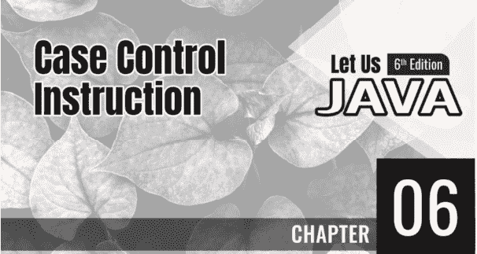

人们经常面临多重选择。学习如何使用 `switch` 来处理此类情况……

# 目录

- 使用 switch 进行决策
- 技巧与陷阱（提示）
- switch 对比 if-else 链
- 练习题
- Java 笔记

# 第 6 章：分支控制语句

在生活中，我们经常面临需要从多个备选项中做出选择，而不仅仅是一个或两个的情况。例如，加入哪所学校，或者去哪家酒店，或者看哪部电影等。严肃的 Java 编程也是如此；我们被要求的选择比仅仅在替代方案之间进行要复杂得多。Java 提供了一种分支控制语句，允许我们有效地处理此类情况，而不是使用一系列的 if 语句。分支控制语句实际上是本章的主题。

## 使用 switch 进行决策

允许我们从许多选择中做出决策的控制语句被称为 `switch`，或者更准确地说是 `switch-case-default`，因为这两个关键字共同构成了这一控制语句。它们通常如下所示：

```java
switch (expression) {
    case constant1:
        do this;
        break;
    case constant2:
        do this;
        break;
    case constant3:
        do this;
        break;
    default:
        do this;
        break;
}
```

关键字 `switch` 之后的表达式可以是任何产生整数或字符值的 Java 表达式。关键字 `case` 后面紧跟一个整数或字符常量。每个 `case` 中的每个常量必须与其他所有常量都不同。上述 switch 形式中的 "do this;" 行代表任何有效的语句。

当我们运行包含 `switch` 的程序时会发生什么？首先，计算关键字 `switch` 之后的表达式。它得到的值将与 `case` 语句后面的常量值进行逐一匹配。一旦找到匹配项，程序将执行该 case 之后的语句，直到遇到 `break`。遇到 `break` 时，控制权将跳到 `switch` 外部。如果任何 `case` 语句都没有找到匹配项，则执行 `default` 之后的语句。让我们现在来看一个使用这种控制语句的程序。

```java
// switch 的演示用法
package switchdemoproject;

public class SwitchDemoProject {
    public static void main(String[] args) {
        int i = 2;
        switch (i) {
            case 1:
                System.out.println("I am in case 1");
                break;
            case 2:
                System.out.println("I am in case 2");
                break;
            case 3:
                System.out.println("I am in case 3");
                break;
            default:
                System.out.println("I am in default");
                break;
        }
    }
}
```

该程序的输出将是：

I am in case 2

输出符合预期。注意，在每个 case（包括 `default` case）中，使用 `break` 是强制性的。

## 技巧与陷阱

让我们来看关于 `switch` 使用的一些实用技巧以及应该避免的几个陷阱。

- (a) `switch` 中的 `case` 可以以任何顺序编写。
- (b) 即使每个 `case` 中有多个要执行的语句，也没有必要将它们封装在括号内。
- (c) `switch` 中的每个语句必须属于某个 `case`。如果一个语句不属于任何 `case`，编译器将报告错误。
- (d) 如果我们没有 `default` case 且没有其他 `case` 被满足，那么程序将直接跳过整个 `switch`，并继续 switch 右括号之后的后续指令（如果有的话）。
- (e) `switch` 的 `case` 不能像下面所示：
```java
case i <= 20:
```
`case` 之后可以是 `byte`、`short`、`int`、`char` 或 `string` 常量，或者评估为这些常量之一的表达式。即使是 `float`、`double`、`long` 或 `boolean` 也不允许。
- (f) 从 JDK 7 开始，switch 也可以检查字符串。
- (g) `switch` 相比 `if` 的优势在于它使程序更具结构化，缩进级别是可控的，特别是当 `switch` 的每个 `case` 中有多个语句时。
- (h) 可以在 `switch` 中检查任何表达式的值。因此，以下 switch 语句是合法的：
```java
switch (i + j * k)
switch (23 + 45 % 4 * k)
```
- (i) 表达式也可以用在 case 中，前提只要它们是常量表达式。因此 `case 3 + 7` 是正确的，但 `case a + b` 是错误的。
- (j) 在 `switch` 中使用 `break` 语句会将控制权带到 `switch` 外部。然而，使用 `continue` 不像人们可能认为的那样将控制权带回到 switch 的开头。这是因为 `switch` 不是循环语句，不像 `while`、`for`、`do-while`。
- (k) 原则上，switch 可以发生在另一个 switch 内部，但在实践中很少这样做。
- (l) `switch` 语句对于菜单驱动的程序非常有用。这一点将在练习中讨论。
- (m) 有时我们可能想要执行多个 `case`。如下例所示：

```java
package switchform;

import java.util.Scanner;

public class SwitchForms {
    public static void main(String[] args) throws Exception {
        Scanner in = new Scanner(System.in);
        char ch;
        System.out.println("Enter an alphabet:");
        ch = in.next().charAt(0);
        switch (ch) {
            case 'a':
                System.out.println("a selected");
                break;
            case 'b':
            case 'B':
                System.out.println("b selected");
                break;
            default:
                System.out.println("default selected");
                break;
        }
    }
}
```

一旦满足了 case，控制权就会进入下一个。

## switch 对比 if-else 链

有些事情在 `switch` 中是无法做的。这些是：

- (a) `float`、`double`、`boolean` 或 `long` 表达式无法通过 `switch` 测试。
- (b) 多个 `case` 不能使用相同的表达式。

那么为什么要用 `switch` 呢？为了速度——`switch` 比等价的 `if-else` 快。为什么？这是因为编译器在编译期间生成了跳转表。因此，在执行期间只需引用跳转表来决定执行哪个 case，而不是实际检查条件，特别是当条件复杂时。

### 练习题

[A] 以下哪些是合法的 `case` 标签？

- (a) `case 10 :`
- (b) `case 'a' :`
- (c) `case a + b :`
- (d) `case 1.5f :`
- (e) `case true :`
- (f) `case 8 % 5 + c :`
- (g) `case (temp <= 20) :`
- (h) `case a || b :`

[B] 判断以下陈述对错：

- (a) `float` 或 `double` 无法在 `switch` 中检查。
- (b) 如果 `case` 中有多个语句，它们应该被封装在 `{}` 中。
- (c) `case` 后面不能跟变量表达式。
- (d) 不允许嵌套 `switch` 语句。
- (e) 如果 `switch` 中的 `break` 执行，程序执行将终止。
- (f) `switch` 语句运行比等价的 `if-else` 语句慢。

[C] 编写一个菜单驱动的程序，具有以下选项：

1. 数字阶乘
2. 是否为质数
3. 奇偶数
4. 退出

一旦选择了菜单项，应采取相应的操作，并在操作完成后，菜单应再次出现。除非用户选择“退出”选项，否则程序应继续运行。

（提示：利用无限循环 `while` 和 `switch` 语句）。


# 第 6 章：控制语句

- `switch` 不应用于检查范围或解决是/否问题

```java
switch (expression) // expression 可以是常量/变量
{
    case constant expression:
        ...
        break;
    case constant expression:
        ...
        break;
    default:
        ...
}
```

- 如果一个 case 匹配失败，控制将跳转到下一个 case
- 如果一个 case 匹配成功，则执行其下方直到 switch 的 `}` 之前的所有语句
- 即使一个 case 中有多个语句，也没有必要用 `{ }` 将它们括起来
- 通常在每个 case 的语句末尾使用 `break`
- `break` 将控制权移出 switch 语句
- `continue` **不会**将控制带回 switch 的开头
- case 编写的顺序并不重要
- default 情况是可选的
- switch 中的 cases 必须始终是唯一的
- switch 可以与 `byte`、`short`、`int`、`char` 或 `string` 使用
- switch 不能与 `float`、`double`、`long`、`boolean` 使用
- switch 的运行速度比一系列的 ifs 快
- switch 常用于菜单驱动型程序，以检查用户从菜单中选择了哪一项

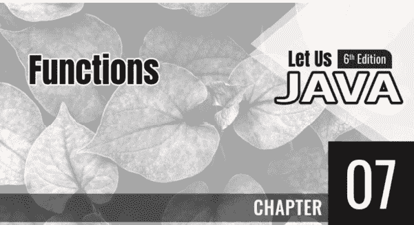

学习如何使用函数提高 Java 程序的功能...

# 目录

- 什么是函数？
- 为什么要使用函数？
- 函数之间的值传递
- 练习题
- 笔记

# 第 7 章：函数

## 什么是函数？

函数是一个自包含的语句块，用于执行某种连贯的任务。每个 Java 程序都包含一个或多个函数。现在让我们来看包含两个函数的简单程序。

```java
// 函数调用和函数定义
package functiondemoproject;

public class FunctionDemoProject {
    public static void main(String[] args) {
        message(); /* 函数调用 */
        System.out.println("哭吧，你就会停止单调！");
    }

    static void message() /* 函数定义 */ {
        System.out.println("微笑吧，世界也会对你微笑...");
    }
}
```

执行时，程序将产生下面的输出。

微笑吧，世界也会对你微笑...
哭吧，你就会停止单调！

在这里，我们定义了两个函数——`main()` 和 `message()`。事实上，我们在程序中使用了两次单词 `message`。让我们理解它们的含义。

message 的第一次用法是...

```java
static void message() {
    System.out.println("Smile, and the world smiles with you...");
}
```

这是函数定义。在这个定义中，我们现在只是打印一个字符串。

第二次用法是...

`message();`

在这里，从 `main()` 调用了函数 `message()`。当我们说 `main()` “调用”函数 `message()` 时是什么意思？我们的意思是控制权传递到了函数 `message()`。`main()` 的活动被临时挂起；它在 `message()` 函数醒来并工作时进入睡眠状态。当 `message()` 执行完语句后，控制返回到 `main()`，它重新恢复运行并从上次离开的地方开始执行代码。因此，`main()` 变成了“调用”函数，而 `message()` 变成了“被调用”函数。

如果你已经掌握了“调用”函数的概念，你就准备好调用多个函数了。考虑以下程序：

```java
// 调用和定义多个函数
package multiplefunctionproject;

public class MultipleFunctionProject {
    public static void main(String[] args) {
        System.out.println("I am in main");
        italy();
        brazil();
        argentina();
    }

    static void italy() {
        System.out.println("I am in italy");
    }

    static void brazil() {
        System.out.println("I am in brazil");
    }

    static void argentina() {
        System.out.println("I am in argentina");
    }
}
```

上述程序执行时的输出如下：

I am in main
I am in italy
I am in brazil
I am in argentina

从这个程序中可以得出若干结论：

- 一个 Java 程序可以包含一个或多个类。
- Java 程序中的一个类必须被标记为“主类”（Main class）。当我们在 NetBeans 的“New Application”窗口中创建 Java 项目时，有一个标题为“Create Main Class”的复选框。此选项默认勾选。因此，NetBeans 为我们创建了主类的骨架代码。


# 第 7 章：函数

## 让我们学习 Java

库函数通常是分组合在不同类中的常用函数，并存储为 Java API 库。调用这两类函数的过程是完全相同的。

## 为什么要使用函数？

为什么要编写单独的函数呢？为什么不将整个逻辑都挤在一个函数 `main()` 中呢？这是一种非常糟糕的编程风格。相反，应该将程序分解为小的单元，并为每一个这些孤立的子部分编写函数。不要犹豫编写只被调用一次的函数。重要的是函数要执行某些逻辑上孤立的任务。

## 在函数之间传递值

我们到为止使用的函数并不十分灵活。我们调用它们，它们就执行了设计的功能。如果“调用者”函数和“被调用者”函数之间能通信就太好了。

考虑以下程序。在这个程序中，我们在 `main()` 中通过键盘接收 **a**、**b** 和 **c** 的值，然后输出 **a**、**b** 和 **c** 的和。然而，和的计算是在一个名为 `calSum()` 的不同函数中完成的。由于和要在 `calSum()` 中计算，而 **a**、**b** 和 **c** 的值是在 `main()` 中接收的，我们必须将这些值传递给 `calSum()`，一旦 `calSum()` 计算出和，我们必须将它从 `calSum()` 返回到 `main()`。

```java
// 函数之间的通信

package functioncommunicationproject;

import java.util.*;

public class FunctionCommunicationProject {

    public static void main(String[] args) {

        int a, b, c, sum;

        Scanner scn;

        scn = new Scanner(System.in);

        System.out.println("Enter any three numbers ");

        a = scn.nextInt();

        b = scn.nextInt();

        c = scn.nextInt();

        sum = calSum(a, b, c);

        System.out.println("Sum = " + sum);
    }

    static int calSum(int x, int y, int z) {

        int d;

        d = x + y + z;

        return (d);
    }
}
```

这里是输出结果...

- Enter any three numbers
  10
  20
  30
  Sum = 60

关于这个程序有很多点需要注意：

- (a) 为了将 **a**、**b** 和 **c** 的值传递给函数 `calSum()`，在调用函数 `calSum()` 时我们在括号中提到了 **a**、**b** 和 **c**。

```java
sum = calSum(a, b, c);
```

在 `calSum()` 函数中，这些值被收集到三个变量 x、y 和 z 中：

```java
calSum(int x, int y, int z)
```

- (b) 变量 **a**、**b** 和 **c** 被称为“实际参数”，而变量 **x**、**y** 和 **z** 被称为“形式参数”。实际参数通常直接称为参数，而形式参数通常被称为形。实际参数和形式参数的类型、顺序和数量必须始终一致。

与其使用不同的变量名 **x**、**y** 和 **z**，我们可以使用相同的变量名 **a**、**b** 和 **c**。但编译器仍会将它们视为不同的变量，因为它们位于不同的函数中。

- (c) 由于函数 `calSum()` 将返回一个 **int**，因此我们在定义 `calSum()` 时将通常 `void` 替换为了 **int**。

## 让我们学习 Java

(d) 在早期的程序中，一旦遇到被调用函数的闭大括号 `{ }`，控制权就会返回到调用函数。不需要单独的 `return` 语句来发送控制权。

如果被调用函数不会向调用函数返回任何有意义的值，那么这种方法是可以行的。但在上面的程序中，我们想要返回 x、y 和 z 的和。因此，使用 `return` 语句是必要的。

(e) `return` 语句有两个作用：

1. 在执行 `return` 语句时，它会立即将控制权传回到调用函数。
2. 它将 `return` 之后括号中的值返回给调用函数。在上面的程序中，返回的是三个数字的和。

(f) 函数中可以存在的 `return` 语句数量没有限制。此外，`return` 语句并不总是需要出现在被调用函数的末尾。

(g) 每当控制权从函数返回时，调用函数通过将被调用函数赋值给某个变量来接收所返回的和。例如，

```java
sum = calSum(a, b, c);
```

(h) 以下所有都是有效的 `return` 语句：

```java
return (a);

return (23);

return (a + b + c);

return;
```

最后一条语句可以在我们希望将控制权返回给调用函数而不返回值时使用。注意，在这种情况下，`return` 之后的括号被省略了。在其他 `return` 语句中，括号也可以被省略。

(i) 函数一次只能返回一个值。因此，以下语句是无效的：

```java
return (a, b);

return (x, 12);
```

# 第 7 章：函数 121

(j) 如果 a 的值在被调用函数发生了变化，该变化不会发生在调用函数中。例如，

```java
// Effect of changing formal arguments

package changeproject;

public class ArgChange {

    public static void main(String[] args) {

        int a = 30;

        fun(a);

        System.out.println(a);

    }

    static void fun(int b) {

        b++;

    }

}
```

上述程序的输出为：
30

因此，尽管 `fun()` 中的 b 发生了变化，`main()` 中的值保持不变。这意味着当值传递给函数时，实际参数是不变的。

- (k) 实际参数可以是常量、表达式，而形式参数必须是变量。因此以下调用是正常的：

```java
sum = calSum(a, 25);
```

- (l) 嵌套调用是真实的，也可以表达式中调用。因此以下调用是正常的：

```java
sum = calSum(a, c) + 23;
```

# 122

## 让我们学习 Java

```java
sum = calSum(a, c)
```

## 练习

### [A] 以下程序的输出是什么？

- (a)

```java
package sampleproject;

public class SampleProject {
    public static void main(String[] args) {
        int a = 10, b = 20;
        modify(a);
        System.out.println(a + " " + b);
    }

    static void modify(int a) {
        a++;
    }
}
```

- (b)

```java
package sampleproject;

public class SampleProject {
    public static void main(String[] args) {
        // 代码不完整
    }
}
```

### [B] 指出以下程序中的错误：

- (a)

```java
package sampleproject;

public class SampleProject {
    public static void main(String[] args) {
        int i = 3, j = 4, k, l;
        k = addMult(i, j);
        l = addMult(i, j);
        System.out.println(k + " " + l);
    }

    static int addMult(int ii, int jj) {
        int kk, ll;
        kk = ii + jj;
        ll = ii * jj;
        return (kk, ll); // 错误：Java 不支持返回多个值
    }
}
```

- (b)

```java
package sampleproject;

public class SampleProject {
    public static void main(String[] args) {
        // 代码不完整
    }
}
```

### [C] 判断以下陈述的对错：

- (a) Java 函数中常用的变量对程序中的所有函数都可用。 **错**
- (b) 要将控制权交回调用函数，我们必须使用 `return` 关键字。 **对**
- (c) 在不同的函数可以使用相同的变量名，而不会产生冲突。 **对**
- (d) 每个被调用的函数必须包含一个 `return` 语句。 **错** (void 类型函数可省略)
- (e) 一个函数可以包含多个 `return` 语句。 **对**
- (f) 函数中的每个 `return` 语句可以返回不同的值。 **对** (前提是类型兼容)
- (g) 即使你不向函数传递任何参数且该函数不返回任何值，它仍然可以是有用的。 **对**
- (h) 一个函数可以从任何其他函数被调用多次。 **对**
- (i) 函数返回某些值是有必要的。 **错**
- (j) 函数定义不能嵌套；但函数调用是可以嵌套的。 **对**

## 第7章：函数 125

### [D] 请为下列每个问题选择正确选项：

- (a) 下列哪个 `return` 语句是无效的？
  (1) `return (x);`
  (2) `return (20);`
  (3) `return (x + y + z);`
  (4) `return (x, y, z);` **正确答案**

- (b) 下列哪个语句是正确的？
  (1) 每个被调用的函数可能可能不包含 `return` 语句
  (2) 一个函数可以包含多个 `return` 语句
  (3) 函数中的每个 `return` 语句可以返回不同的值
  (4) (1), (2) 和 (3) **正确答案**

- (c) 关于函数，下列哪个语句是正确的？
  (1) 一个函数可以从另一个函数被调用多次
  (2) 函数返回某些值是有必要的
  (3) 函数调用是可以嵌套的
  (4) (1), (2) 和 (3) **正确答案** (注：原文选项(2)说法错误，但原文答案为(4)，此处保留原文逻辑)

- (d) 关于给出的代码段，哪些语句是正确的：

```java
void fun(int a, int b, int c) {

}

...

fun(10, 20, 30, 40, 50);
```

- (1) 值 40 和 50 将被忽略
- (2) 错误：实际参数和形式参数的数量不匹配 **正确答案**
- (3) 错误：fun 不能用作函数名
- (4) 程序将成功编译

- (e) 下列哪个是 `main()` 的正确形式？
  (1) `public static void main(String[] args)` **正确答案**
  (2) `public static void main(String args)`
  (3) `public static void main(int argc, char *argv[])`
  (4) `public static void main(int argc, String argv[])`

### [E] 回答下列：

- (a) 编写一个函数计算键盘输入的任意整数的阶乘。
- (b) 编写一个函数 `power(a, b)`，计算 a 的 b 次幂之值。
- (c) 通过键盘输入任意年份。编写一个函数判断该年份是否为闰年。
- (d) 编写一个函数，从 `main()` 接收一个 `float` 和一个 `int`，找到这两者的积并通过 `main()` 打印该积。
- (e) 如果三角形的三边长表示为 a、b 和 c，则三角形的面积公式为

```
area = sqrt((S-a)(S-b)(S-c))
where, S = (a+b+c)/2
```

- (f) 如果一个函数要接收一个 `int`、一个 `float` 和一个 `double` 并返回一个小数，那么你将如何定义这个函数？

---

## 函数总结

- 函数是实现某些预期目标的指令组

- 为什么要创建函数：
  1. 更好的复杂度管理 - 易设计，便于调试
  2. 使用复用机制 - 避免重复编写相同的代码

- 函数的类型：
  1. 库 - `println()`, `printf()`, `pow()`, `parseInt()`
  2. 用户定义 - `main()`

- 构建两者的规则相同

- 创建函数时应完成以下两件事：
  1. 函数定义
  2. 函数调用

- 函数定义的通用形式：

```java
return-type function-name(type arg1, type arg2, type arg3) {

    statement1; statement2;

    return (variable/constant/expression); // 只能返回一个值

}
```

- 函数可以被调用任意次数

## 函数可以任意顺序定义

- 任何 Java 程序的执行始终从主类中存在的 `main()` 开始
- 函数调用越多，执行速度越慢
- 函数之间的通信通过参数和返回值完成
- 在调用函数时，可以传递任意数量的参数，但如果没有返回返回值，则函数的返回类型必须是 `void`
- 实际参数和形式参数在数量、顺序和类型上必须匹配
- 实际参数可以是常量/变量/表达式
- 形式参数只能是变量
- 嵌套调用是合法的
  例：`a = Math.sin(Math.cos(b));`
- 表达式中的调用是合法的
  例：`a = Math.sin(Math.cos(b));`

---

# 第8章：函数的高级特性 133

```java
System.out.printf("%d %d", a, b);

System.out.printf("%d %d %f", a, b, c, d);
```

在这里，第一次调用 `printf()` 时我们传递了 3 个参数，而第二次调用传递了 5 个参数。

我们甚至可以定义接收变数量参数的函数。下面的程序说明了这一点：

```java
package varargproject;

public class VarArgsProject {

    public static void main(String args[]) {

        double d1 = 10.0;
        double d2 = 20.0;
        double d3 = 30.0;
        double d4 = 40.0;

        System.out.printf("Avg = %f%n", average(d1, d2));

        System.out.printf("Avg = %f%n", average(d1, d2, d3));

        System.out.printf("Avg = %f%n", average(d1, d2, d3, d4));
    }

    static double average(double... numbers) {

        double total = 0.0;

        for (double d : numbers)
            total = total + d;

        double avg;

        avg = total / numbers.length;

        return avg;
    }
}
```


# 第8章：函数的高级特性

在这里，我们每次调用 `average()` 函数时都传递了不同数量的参数。为了让 `average()` 能够接收这种变数量的参数，在定义参数时使用了特殊的语法。

```java
static double average(double... numbers) {
    ..
}
```

## 可变参数

在这里，`double` 后面跟着三个点号 (`...`)，这意味着该函数在每次调用中将接收不同数量的 `double`。`numbers` 被视为一个数组。因此，在计算平均值时，我们需要遍历数组元素。为了实现这一点，进化出了一种特殊的 `for` 循环语法。

每次通过这个 `for` 循环，`d` 从 `numbers` 数组中获取下一个值。数组中值的数量可以通过数组的 `length` 属性获得。数组的这一方面将在第12章详细讨论。

有时我们可能需要定义一个既接收固定参数又接收变长参数的函数。在定义此类函数时，我们必须确保在调用此类函数时固定参数位于变长参数之前。

## 递归

在 Java 中，函数可以调用自己。如果函数体内的某个语句调用了同一个函数，则该函数是“递归”的。递归有时被称为“循环定义”，它是这种将事物定义为其自身的过程。

现在来看一个递归的简单示例。假设我们要计算一个整数的阶乘。如我们所知，一个数的阶乘是 1 到该数之间所有整数的乘积。例如，4 的阶乘是 `4 * 3 * 2 * 1`。这也可以表示为 `4! = 4 * 3!`，其中 `!` 代表阶乘。因此，一个数的阶乘可以用其自身的形式表示。在这里，这种逻辑可以使用递归进行编程，如下所示。

```java
// 使用递归函数计算阶乘
package recursivefactorialproject;
import java.util.*;

public class Main {
    public static void main(String[] args) {
        int a, fact;
        Scanner scn = new Scanner(System.in);

        System.out.println("Enter any number");
        a = scn.nextInt();

        fact = rec(a);
        System.out.println("Factorial value = " + fact);
    }

    static int rec(int x) {
        int f;
        if (x == 1)
            return 1;
        else
            f = x * rec(x - 1);
        return f;
    }
}
```

这是程序的示例运行输出：

```text
Enter any number
3
Factorial value = 6
```

让我们彻底理解递归阶乘函数。当 `a` 为 3 时，`main()` 会将 3 作为参数调用 `rec()`，`rec()` 将返回计算结果。在发送计算值之前，`rec()` 调用了 `rec()` 并等待值的返回。`rec()` 刚刚调用了另一个 `rec()`，参数 `x` 减少了 1。对于这些递归调用，当最后一次 `rec()` 调用使用它自己的 `f` 值，以此类推。所以我们可以说，发生了什么：

- `rec(3)` 返回 `3 * rec(2)`
- `rec(2)` 返回 `2 * rec(1)`
- `rec(1)` 返回 `1`

好了，这就是递归的最简单形式。我希望你同意理解控制流是如何流动的。

调用另一个函数。图 8.1 会让情况更清晰。

假设通过 `readline()` 输入的数字是 3。图 8.1 让我们观察递归函数 `rec()` 被调用时到底发生了什么。

递归初看之下可能奇怪且复杂，但一旦你熟悉了递归，它是解决此类问题最清晰的方法。

## 练习题

### [A] 为下列每一项选择正确替代项：

- **(a)** 下列哪项正确？
  - Java 函数总是接收固定数量的参数。
  - Java 函数总是接收变长参数。
  - **Java 函数既可以接收固定参数，也可以接收变长参数。**
  - Java 函数永远无法接收变长参数。

- **(b)** 关于下面的语句，以下哪项是正确的？
  `System.out.printf("%d %d %f", a, b, c);`
  - 4 个参数被传递给 `printf()`。
  - 1 个固定参数被传递给 `printf()`。
  - `printf()` 是 C 库，不能在 Java 中使用。
  - **5 个参数被传递给 `printf()`。**

- **(c)** 如果调用下面的 `fun()` 5 次：
  ```java
  int fun(a, b)
  ```
  - 创建了 5 组 a 和 b。
  - **创建了 1 组 a 和 b。**
  - 创建了 4 组 a 和 b。
  - 创建了无限组 a 和 b。

- **(d)** 递归函数中可以表示多少个 return 语句？
  - 0
  - 1
  - 如果函数是静态的为 0，否则为 1
  - **可以有多个 return 语句。**

- **(e)** 下列哪个是可变参数的正确语法？
  ```java
  static double average(double... numbers) { }
  ```
  ```java
  static double average(double numbers) { }
  ```
  ```java
  static double average(double[] numbers) { }
  ```
  ```java
  static double average(double numbers[]) { }
  ```

### [B] 回答以下问题：

- **(a)** 定义一个重载的 `max()` 函数，返回两个整数/float/double 的最大值。
- **(b)** 定义一个函数 `min()` 找出并返回传递给它的变数量整数的最小值。
- **(c)** 通过键盘输入一个五位正整数，写一个递归函数来计算该五位数字的和。
- **(d)** 通过键盘输入一个正整数，使用递归函数编写程序获取该数的质因数。
- **(e)** 写一个递归函数来获取斐波那契数列的前25个数字。斐波那契数列中，两个连续项之和等于第三项。以下是斐波那契数列的前几项：1 2 3 5 8 13 21 34 55 89...
- **(f)** 通过键盘输入一个正整数，写一个函数使用递归找到该数字的二进制等值物。
- **(g)** 写一个递归函数来获取前25个自然数的和。
- **(h)** 编写函数 `fun()`，从传递给它的变长参数列表中找到最小值。

## 示例代码

```java
package sampleproject;

public class Main {
    public static void main(String[] args) {
        int a = 5, b = 4, res;
        res = fun(a, b);
        System.out.println(res);
        res = fun(1, 5, a, 7, 99, 100);
        System.out.println(res);
    }

    // 在此处添加代码
}
```


- 类中的函数可以相同。这类函数被称为重载函数（Overloaded Functions）。
- 如果函数名相同，则它们的参数在数量、顺序或类型上必须不同。
- 通常，重载函数执行相似的任务。例如：获取不同数据类型的绝对值。
- 函数可以接收变数量参数。
- 如果一个函数既接收固定数量的参数又接收变数量的参数，则固定参数必须位于参数列表的开头，变数量参数位于末尾。
- 变数量参数通过数组接收。该数组可以使用特殊的 `for` 循环进行处理：

```java
static void fun(int a, float b, double... numbers) {
    for (double d : numbers) {
        System.out.println(d);
    }
}
```


- 能够调用自身的函数被称为递归函数（`recursive function`）。
- 任何函数包括 `main()` 都可以变成递归函数。
- 递归调用始终会导致无限循环。因此，必须采取措施跳出此无限循环。
- 这种措施通过将递归调用放在 `if` 块或 `else` 块来实现。
- 如果在 `if` 块中进行递归调用，`else` 块应包含结束条件逻辑。
- 如果在 `else` 块中进行递归调用，`if` 块应包含结束条件逻辑。
- 在每次函数调用（普通调用和递归调用）期间都会产生一组新的变量。
- 当控制权从函数返回时，变量会销毁。
- 递归函数可能包含也可能不包含 `return` 语句。
- 递归是逻辑上可以用自身形式表示的替代 `for` 循环。
- 递归调用比等效的 `while` / `for` / `do-while` 循环慢。
- 如果在使用递归时陷入无限循环，将会发生栈溢出，程序执行将结束。

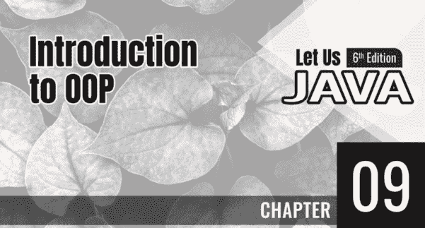

范式转移！这一章将改变你对如何组织程序的思考……

# 目录

- 开始...
- 结构化编程
- 面向对象编程
- OOP 的特性
    - 对象
    - 类
    - 继承
    - 多态
    - 包含关系
    - 可重用性
- 练习题
- 笔记 (KanNotes)

# 第 9 章：面向对象编程 (OOP) 简介

数据类型、控制指令和函数是任何 Java 程序的构建块。掌握了这些主题后，是时候转向更复杂的内容了，即面向对象编程。

Java 是一种面向对象编程（OOP）语言。许多程序员倾向于机械地使用 Java 的面向对象特性。虽然这可能让程序运行，但除非你理解面向对象编程的概念以及它提供的特性，否则面向对象编程的真正优势将无法体现。因此，在本章中，我们不会编写任何程序。相反，我们将集中于理解什么是 OOP 以及我们为什么需要它。

本章解决了这些问题，并对书中其余部分将讨论的特性进行了概述。我们所说的内容将是通用且简要的。如果你在第一遍阅读时没有掌握本章的所有内容，不要担心；OOP 有些复杂，理解它需要时间。我们将在后续章节中再次复习这些特性。这里有很多内容要涵盖，让我们开始吧。

编程语言的目的是通过算法（逐步过程）来表达问题的解决方案。解决方案的成功取决于解决方案如何对问题进行建模（表示）。多年来，演化出了不同的方法来对问题的解决方案进行建模。其中主要的有结构化编程模型（也称为过程化编程模型）和面向对象编程模型。这些模型通常被称为编程范式（`programming paradigms`），即程序组织的原则。要理解这些模型，我们首先需要了解一下编程模型的历史。

## 开始...

最早的计算机是用二进制编程的。随着大规模存储设备和廉价计算机内存的出现，第一批高级计算机编程语言应运而生。随着它们的到来，程序员不再需要用位和字节来思考，而是编写一系列类似于英语的指令，编译器可以将这些指令翻译成计算机的二进制语言。

这些语言设计简单且易于使用，因为那时的程序主要关注相对简单的任务，如计算。结果是程序非常短，仅限于几百行指令。

随着计算机容量的增加，开发更复杂程序的能力也随之增长。然而，早期的编程语言在执行复杂的编程任务时显得不从心。这些语言存在以下局限性：

- (a) 没有重用现有程序代码的机制。在任何需要相同代码的地方，都是简单的复制。
- (b) 程序内部的执行控制通过危险的 `goto` 语句进行传输。结果是程序中存在过多的跳转，通常没有清晰的指示来说明控制是如何、在何处以及为什么流动的。
- (c) 程序中的所有变量都是全局变量。在长程序中追踪全局数据的意外变化是一项枯味的工作。
- (d) 编写、理解和维护长程序变成了程序员的噩梦。

简而言之，我们将这种开发程序的方法称为非结构化编程（`Unstructured programming`）。

## 结构化编程

为了克服上述局限性，人们开始寻求具有新特性的新语言，以创建更复杂的应用程序。20 世纪 60 年代末和 70 年代初，随着结构化编程的引入取得了突破。程序员发现难以理解的长程序可以被分解为几百条语句的小单元。这些语言引入了函数/子程序/过程，使程序对人类创造者更容易理解。现在程序被划分为函数，每个函数都有明确定义的用途。

结构化编程如何克服非结构化编程中遇到的局限性所示：

- (a) 重用现有程序代码——在程序多处需要相同代码的地方，使用包含该代码的函数。结果是不需要在多处重复相同的代码。
- (b) 过度使用 `goto` 语句——通过引入强大的控制指令，以易于理解的方式在程序内传输控制，减少了这一点。
- (c) 全局变量的意外变化——随着函数的引入，对全局变量的需求减少到了最低。
- (d) 程序的复杂性——由于结构化编程允许更好的程序组织，复杂性变得更易管理。

结构化程序通过将解决方案分解为更小的部分来构建，这些部分变成了程序中的函数。每个函数都可以有自己的局部变量和逻辑。执行从 `main()` 函数开始，然后所有其他函数都从该函数直接或间接地调用。这如图 9.1 所示。

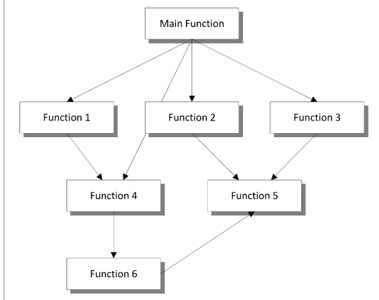

图 9.1

在结构化编程中，对全局变量的需求减少了，它们被范围更小、更易控制的局部变量所取代。信息通过参数在函数之间传递，函数可以拥有在外部无法访问的局部变量。

通过将过程隔离在函数内部，结构化程序最大限度地减少一个函数影响另一个函数的概率。这使得发现问题（如果有的话）更容易。结构化编程有助于编写更整洁的代码并保持对每个函数的控制。这使得代码的开发和维护变得同样高效。

结构化编程引入了一个新概念——抽象（`Abstraction`）。抽象允许程序员观察某个事物而不关注其内部细节。在结构化程序中，只需知道任务由哪个函数执行就足够了。只要函数能够可靠地完成任务，程序员并不关心任务是如何实现的。这被称为抽象，是结构化编程的基石。

结构化编程主导了软件世界近二十年——从 1970 年代到 1990 年代。随着硬件的不断改进以及用户对功能丰富的程序的需求增加，程序的复杂性呈倍数增长，结构化编程方法开始出现疲态。这是由于结构化编程模型存在以下局限性：

- (a) 结构化编程的主要组件——函数和数据结构——无法以自然的方式构建现实世界的问题。
- (b) 重用现有代码的机制有限。
- (c) 维护、调试和升级大型程序是一项艰巨的任务。

这些局限性的解决方案将在下一节中讨论。

## 面向对象编程

现实世界的问题及其解决方案并不是被组织成相互独立的值和过程。相反，它们被视为包含值的对象，这些对象可以访问或操纵这些值。世界充满了对象，而 OOP 方法论帮助我们以模拟人类感知世界的方式来表达计算机程序。

OOP 的根本变化是，程序是围绕被操作的数据进行设计的，而不是围绕操作本身设计。一旦我们意识到程序的首要目的是访问或操纵数据，这种变化就是预料之中的。面向对象语言的基本思想是将数据和操作数据的函数结合成一个单一单元。这样的单元被称为对象（`object`）。

对象的函数被称为成员函数或方法（`methods`），它们通常提供了访问其数据的唯一方式。如果你想访问对象中的某个数据项，可以调用对象中的成员函数。它将读取该项并将值返回给你。你不能直接访问数据。

如果你想修改对象中的数据，可以调用对象中的成员函数。没有其他函数可以访问这些数据。这简化了程序的编写、调试和维护。

一个 Java 程序通常由许多对象组成，它们通过调用对方的成员函数来相互通信。Java 程序的结构如图 9.2 所示。

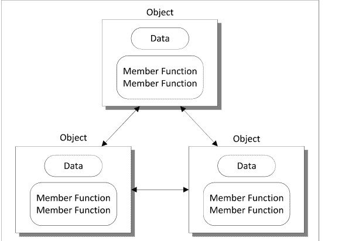

图 9.2

当你以面向对象的方式处理编程问题时，你不再问问题将如何划分为函数，而是问它将如何划分为对象。用对象而非函数来思考，对程序设计的易用性具有显著的帮助。这源于编程世界中的对象与现实世界对象之间的紧密匹配。

编程对象与现实世界对象之间的匹配是数据和函数结合的理想结果。产生的对象为程序设计带来了革命。在过程化语言中，编程结构与概念之间不存在这种紧密的匹配。

OOP 不仅仅是将数据和函数结合在一起。以下列出了 OOP 中引入的一些新概念：

- (a) 数据隐藏（`Data hiding`）
- (b) 封装（`Encapsulation`）
- (c) 继承（`Inheritance`）
- (d) 组合/包含关系（`Containership`）
- (e) 多态（`Polymorphism`）
- (f) 泛型（`Generics`）
- (g) 异常处理（`Exception handling`）

不要被这个新特性列表所吓倒。其中一些将在下一节中简要介绍。每个概念的详细解释将在后续章节中给出。

## OOP 的特性

面向对象编程使用一套过程化程序员不熟悉的词汇。现在让我们结合面向对象语言的主要元素，简要检查这些词汇。

### 对象

在结构化编程中，解决问题是将其划分为函数。与此不同，在面向对象编程中，问题被划分为对象。用对象而非函数来思考使得程序设计变得更容易。以下是在相应情况下可以视为对象的候选者：

- 工资处理系统中的员工
- GUI 元素，如窗口、菜单、图标等
- 计算机游戏中的元素，如大炮、枪、动物等
- 销售跟踪系统中的客户、销售人员

### 类

大多数语言提供原始数据类型，如 `int`、`long` 和 `float`。它们的数据表示以及对算术、赋值和关系运算符的响应被定义为语言的一部分。然而，并不是所有关于现实世界对象的信息都能够使用这些有限的内置数据类型来表示。程序员通常需要通过定义**类**（`class`）来创建自己的数据类型。

例如，`Date` 类是一种用于表示日期的用户定义数据类型。程序员必须通过设计 `Date` 类来定义日期的行为。该类表达了日期的格式以及可以在其上执行的操作。就像我们可以声明许多原始类型 `int` 变量一样，我们可以定义许多 `Date` 类对象。类充当蓝图、计划或模板。它规定了该类型对象将包含的数据和函数。定义类并不会创建任何对象。

### 继承

OOP 允许你像内置语言一样创建自己的数据类型（类）。然而，与内置数据类型不同，用户定义的类可以使用其他类作为构建块。使用一种称为继承（`inheritance`）的概念；新类可以在旧类之上构建。被称为*派生类*（`derived class`）的新类可以继承原始**基类**（`base class`）的数据和函数。新类可以在继承基类功能的基础上添加自己的数据元素和函数。

例如，我们可以构建一组描述图书馆出版物的类——期刊和书籍。我们可以通过定义出版者名称、页数和索号的数据项来创建一个通用的 `Publication` 类。出版物可以被检索、存储和读取。这些将是 `Publication` 类的函数。

接下来我们可以定义两个名为 `Periodical` 和 `Book` 的类。这两个类都派生自基类 `Publication`。这是自然的，因为期刊和书籍都具有出版者名称、页数和索号等属性。

此外，期刊还有卷号和期号，并包含不同作者编写的文章。这些数据项应该包含在期刊类的定义中。`Periodical` 类还需要一个函数：订阅（`subscribe`）。

`Book` 类的数据项将包括作者姓名、封装类型（硬装或软装）以及其 ISBN（国际标准书号）。该类也拥有一个名为 `subscribe` 的函数。正如你所见，`Book` 类和 `Periodical` 类共享 `Publication` 类的特性，同时具有自己独特的属性。整个场景如图 9.3 所示。

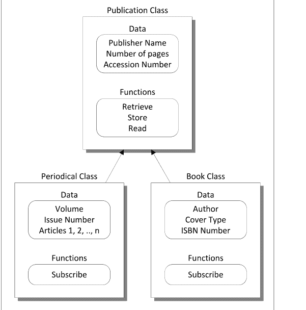

图 9.3

### 多态

延续出版（`Publication`）、期刊（`Periodical`）和书籍（`Book`）的相同示例，现在让我们理解另一个重要概念。我们的基类 `Publication` 定义了存储和检索数据的方法。期刊可以存储在活夹中，而书籍通常放置在书架上。此外，寻找特定期刊的检索方法与寻找书籍的方法不同。期刊是通过期刊文献指南找到的，而书籍则是通过使用卡片目录系统找到的。基于此，我们可以为期刊设计一个“通过期刊文献查找”的函数，为书籍设计一个“通过卡片目录查找”的函数。

OOP 提供了一种优雅的多态机制来处理此类情况。在我们的示例中，期刊的检索方法与书籍的检索方法不同，尽管最终结果是相同的。多态允许我们为期刊和书籍都定义一个可以工作的函数。当检索期刊时，使用特定于期刊的 `retrieve` 函数；当检索书籍时，使用与书籍相关的 `retrieve` 函数。结果是，即使该函数的实现在不同类之间不同，对相关类执行的相同操作也可以使用同一个函数名。这种多态概念（一个事物具有多个不同形式）可以扩展到操作符，正如我们在后面的章节中看到的那样。

### 包含关系

在典型的超市中，每件商品都可以用一个类来表示。这些物品反过来属于不同的类别，如化妆品、饮料、衣服、书籍、电子产品等。这种关系可以使用包含关系（`containership`）表示。例如，面霜、洗面奶、洗发水等对象包含在名为化妆品（`cosmetics`）的类别对象内部。你将在现实问题中观察到这种包含关系。

### 可重用性

面向对象的程序由可重用的软件组件构建。一旦完成并测试了一个类，就可以将其分发给其他程序员，在他们自己的程序中使用。这被称为可重用性。如果那些程序员想要添加新功能或更改现有功能，可以从现有类派生出新类。基类经过尝试和测试的能力不需要重新开发。程序员可以花时间编写新类，而不是在重写代码上浪费时间。这种软件变得更容易测试，因为编程错误可以隔离在派生类的新代码中。

例如，你可能编写（或从他人那里购买）了一个创建系统菜单的类。你对这个类的运行非常满意，不想改变它，但你想添加为每个菜单项显示帮助的功能。为了实现这一点，你只需要创建一个继承现有类所有功能但添加了帮助功能的新类。这种现有软件可以被重用的便利性是 OOP 的主要优势。


## [A] 判断下列陈述对错（对/错）：

(a) 面向对象编程允许现有代码的可重用。
(b) 比过程化语言更早的语言只使用全局变量。
(c) 与结构化编程模型相比，使用面向对象编程模型编写、理解和维护程序更简单。
(d) 与过程相比，数据在过程化编程中没有得到足够的重视。
(e) 结构化编程模型对现实问题的表示不如面向对象编程模型好。
(f) 类允许我们构建用户定义的数据类型。
(g) 封装使得同一个函数名可以用于在相关派生类上执行相同的操作。
(h) 在多态中，尽管函数名相同，但它们的实现可能随类而异。
(i) 从同一个类中可以创建多个对象。
(j) 面向对象编程范式强调将逻辑分成较小的部分并为每个部分编写过程。
(k) 类和对象是结构化编程范式的基石。
(l) 面向对象编程范式对数据和处理数据的过程给予同等重视。
(m) Java 是一门结构化编程语言。

## [B] 填空：

(a) 对象的两个主要部分是 ____ 和 ____。
(b) 函数对不同数据类型以不同方式执行的能力被称为 ________。
(c) 从现有类构建新类的过程是 ________。
(d) 如果类 A 从类 B 继承其属性，那么 A 和 B 分别称为 ____ 类和 ____ 类。
(e) Pascal 和 C 是 ____ 语言，而 Java 是 ____ 语言。
(f) 将一个对象嵌套在另一个对象之中的现象被称为 ____。
(g) ____ 无非都是用户定义类型。

## [C] 为下列每个问题选择正确选项：

(a) 从 `main()` 中调用多个函数是 ____ 的特征
(1) 结构化编程
(2) 面向对象编程
(3) 函数式编程
(4) 动态规划

(b) 将给定的任务分成多个较小的任务是 ____ 使用的特征
(1) 结构化编程
(2) 面向对象编程
(3) 函数式编程
(4) 事件驱动编程

(c) `Vehicle` 和 `Car` 之间存在什么关系？
(1) 封装
(2) 多态
(3) 包含关系
(4) 继承

(d) `Car` 和 `bmw` 之间存在什么关系？
(1) 都应该是类
(2) 都应该是对象
(3) `Car` 应该是一个类，而 `bmw` 应该是一个对象
(4) `Car` 应该是一个对象，而 `bmw` 应该是一个类

(e) 从 OOP 角度，销售系统中的 `Customers` 应该表示为
(1) 类
(2) 对象
(3) 接口
(4) 方法

(f) 从 OOP 角度，工资处理中的 `Employees` 应该表示为
(1) 类
(2) 对象
(3) 接口
(4) 方法

(g) OOP 系统中的类无非是
(1) 原始类型
(2) 用户定义类型
(3) 接口
(4) 方法

(h) 对象包含
(1) 只有数据
(2) 只有成员函数
(3) 数据和成员函数
(4) 抽象函数

## [D] 回答下列：

(a) 编程模型与面向对象编程模型的基本区别是什么？
(b) 给类和对象的例子。
(c) 什么是封装？
(d) 什么是继承？
(e) 什么是多态？
(f) 在结构化编程中，数据受到了弃女对待，整个重点放在“做”。这在程序员语言中意味着什么？
(g) 什么是抽象？
(h) 创建良好的抽象是必要的吗？
(i) 人们为什么从结构化编程转向面向对象编程？
(j) 用通俗的话说类和对象有什么区别？用程序员的术语说类和对象有什么区别？

编程范式意味着组织程序的方式。

两种主要的编程范式是：
1) 结构范式 - 被 C、Pascal 采用
2) 面向对象编程 (OOP) 范式 - 被 C++、Java、VB.NET 采用

结构化编程：
1) 强调将给定的任务分成较小的子任务
2) 为每个子任务编写函数
3) 这些函数直接或间接地从 `main()` 调用
4) 对数据没有给予重视，它只是根据需要从函数之间传递

结构化编程的缺点 - 编写涉及复杂任务的程序很难

面向对象编程 (OOP)：
1) 强调识别给定问题中的对象，然后编写促进对象交互的程序
2) 对象包含数据以及访问/操作数据的函数
3) 对数据和函数给予同等重视

类和对象的例子：
类 - 人 对象 - 阿诚、姚林、小华
类 - 鸟 对象 - 雀子、乌鸦、鹦鹉

类具有属性（数据）和方法（函数）：
例如。车辆具有轮子、引擎、燃料等属性

对象具有属性的具体值：
汽车 - 4 个轮子、四冲程、柴油
摩托车 - 2 个轮子、二冲程、汽油

对象总是无名的，并在堆上使用 `new` 算符创建

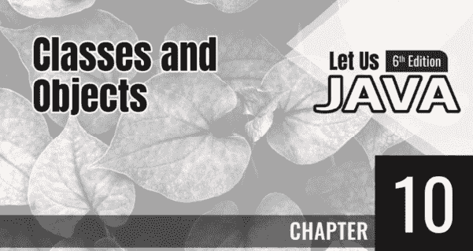

类和对象之于 OOP，就像函数之于结构化编程。在类和对象上拥有良好的基础将使你成为一名出色的 Java 程序员……

# 目录

- 类与构造函数
- 对象销毁
- 术语
- 复杂类
- `this` 引用
- 静态数据与函数
- 静态块
- 将对象传递给函数
- 练习题
- 编程笔记 (KanNotes)

# 第 10 章：类与对象

在熟悉了面向对象的基本原理后，是时候开始通过 Java 程序来实现这些原理了。让我们从类和对象开始吧。

在我们目前为止创建的所有程序中，我们只是在类内部定义了函数。Java 允许我们在类中将数据和函数结合在一起。类内部定义的函数与类中存在的数据元素之间有着特殊的关系。将数据和函数（作用于数据的函数）放在同一个实体中，是面向对象编程的核心思想。

首先，让我们来看一个演示 Java 类语法和通用特性的程序。在我们目前为止进行的所有程序中，都只有一个类。这个类通常是由 NetBeans 向导创建的，且名称与项目名称相同。现在我们将第一次看到一个使用两个类的程序。在 NetBeans 中创建此项目时，我们将命名为 `ClassesAndObjectsProject`。结果向导会创建一个名为 `classesandobjectsproject` 的包，其中包含一个 `ClassesAndObjectsProject` 类。此外，我们将在同一个包中创建 `Rectangle` 类。以下是程序的代码列表。

```java
```


# 第 10 章：类与对象

## 类与对象

```java
// Demonstration of classes and objects

package classesandobjectsproject;

import java.util.*;

class Rectangle {

    private int len, brd;

    public void getData() {

        Scanner scn;

        scn = new Scanner(System.in);

        System.out.println("Enter length and breadth ");

        len = scn.nextInt();

        brd = scn.nextInt();

    }

    public void setData(int l, int b) {

        len = l;

        brd = b;

    }

    public void displayData() {

        System.out.println("length = " + len);

        System.out.println("breadth = " + brd);

    }

    public void areaPeri() {

        int a, p;

        a = len * 2 * (len + brd);

        System.out.println("area = " + a);

        System.out.println("perimeter = " + p);

    }

}

public class ClassesAndObjectsProject {

    public static void main(String[] args) {

        Rectangle r1, r2, r3; // define three references

        r1 = new Rectangle();

        r2 = new Rectangle();

        r3 = new Rectangle();

        r1.setData(10, 20); // set data in elements of the object

        r1.displayData(); // display the data by setData()

        r1.areaPeri(); // calculate and print area and perimeter

        r2.setData(5, 8);

        r2.displayData();

        r2.areaPeri();

        r3.getData(); // receive data from keyboard

        r3.displayData();

        r3.areaPeri();

    }

}
```

看我们程序中 `Rectangle` 类的定义。关键字 `class` 后面紧跟的是类名，即 `Rectangle`。类的体由大括号定义。`Rectangle` 类包含两个数据项 `len` 和 `brd` 以及四个函数 `setData()`、`getData()`、`displayData()` 和 `areaPeri()`。正如它们的名称所示，第一个函数将数据项（`len` 和 `brd`）设置为传递给它的值，第二个函数接收数据项的值，第三个函数显示这些值，而第四个函数计算并打印面积和周长。

在类中定义的数据项通常称为数据成员（data members），而在其中定义的函数称为成员函数或方法（methods）。成员函数提供了对类成员的受控访问。这种受控访问通过两个关键字——`private`（私有）和 `public`（公共）来管理。

注意，我们将数据成员定义为 `private`。因此，无法从 `Rectangle` 类外部直接访问它们。这样数据就免受受到意外操作了。

只有 `Rectangle` 类的成员函数可以访问私有数据成员。为了允许从 `Rectangle` 类外部访问这些成员函数，它们被被定义为 `public`。因此，当我们想要从外部访问或操作数据成员时，我们调用公共成员函数，再由这些函数访问私有数据成员。这就是我们所说的受控访问。

通常，类中的数据成员是 `private` 的，而成员函数是 `public` 的。这确保了数据免受无意操作。然而，并没有规定数据必须是私有或公共。事实上，在某些情况下，你可能需要使用私有函数和公共数据。

不要将“数据隐藏”（hiding）与保护计算机数据的安全技术混淆。安全技术防止非法用户访问数据。而数据隐藏则用于保护良好的用户免受偶然错误。

现在让我们理解“对象”一词的含义以及它们是如何创建的。对象是类的实例，创建的过程被称为实例化（instantiation）。在我们的程序中，创建了三个对象：

```java
r1 = new Rectangle();

r2 = new Rectangle();

r3 = new Rectangle();
```

同一类的所有对象具有相同的结构，但它们可以拥有不同的值。例如，`r1` 可以拥有 `len=10` 和 `brd=20`，而 `r2` 可以拥有 `len=5` 和 `brd=8`。这就是对象的威力。

## 类与构造函数

```java
// Different types of constructors

package constructorsproject;

import java.util.*;

class Number {

    private int i;

    public void setData(int j) {

        i = j;

    }

    public void getData() {

        Scanner scn;

        scn = new Scanner(System.in);

        System.out.println("Enter any integer");

        i = scn.nextInt();

    }

    public Number() // zero argument constructor

    {

    }

    public Number(int j) // one argument constructor

    {

        i = j;

    }

    public void displayData() {

        System.out.println("value of i =" + i);

    }

}
```

```java
public class ConstructorsProject {

    public static void main(String[] args) {

        Number n1, n2, n3;

        n1 = new Number();

        n1.displayData();

        n1.setData(200); // first method to set data in object

        n1.displayData();

        n2 = new Number();

        n2.displayData();

        n2.getData(); // second method to set data in object

        n2.displayData();

        n3 = new Number(100); // third method to set data in object

        n3.displayData();

    }

}
```

这个程序展示了我们给对象数据项赋值的三种方法。一种是通过 `setData()` 函数传递要设置的值；另一种是如 `getData()` 函数所示从键盘接收值。这引出了第三种方法，使用一种称为“构造函数”（constructor）的实体。构造函数是一种特殊的成员函数，允许我们在创建对象时设置值，而无需单独调用成员函数。

构造函数有一些不寻常之处。首先，它们与所属类的名称完全相同并非巧合。事实上，类与其内部的构造函数必须具有相同的名称。正是借此判断该成员函数是构造函数。

其次，构造函数没有使用返回类型。为什么呢？因为构造函数是在对象创建时自动被调用的，返回一个值是没有意义的。

在我们的程序中，语句

```java
n1 = new Number(); // 调用零参数构造函数

n2 = new Number(); // 调用零参数构造函数

n3 = new Number(100); // 调用单参数构造函数
```

创建了三个 `Number` 类型的对象并调用了相应的构造函数。注意在创建对象时使用了 `new` 运算符。该运算符为对象分配内存，然后调用该对象的构造函数。

如果你仔细观察，会发现有两个同名为 `Number()` 的构造函数。因此，我们把这些构造称为**重载构造函数**。在创建对象时调用哪一个构造函数，取决于使用了多少参数。这可以在创建对象时完成的。

由于我们在零参数构造函数中没有做任何操作，由 `n1` 和 `n2` 引用的对象 `i` 的值被设置为 0，这可以从程序的输出中验证。调用 `setData()` 和 `getData()` 时 `i` 的值可以重置，就像这里通过在对象中通过构造函数调用 `set` 以及 `setData()` 函数所做的那样。为什么要在类中同时定义它们呢？这是因为构造函数只能在对象创建时被调用，而 `setData()` 方法在对象创建后可以被多次调用。因此，可以通过构造函数在对象中设置初始数据，并在需要后通过 `setData()` 方法进行更改。

如果我们声明一个特定类的对象而该类没有构造函数，会发生什么？什么都不会。当类中没有构造函数时，编译器会在其中插入一个零参数构造函数。如果我们声明一个单参数构造函数，我们就有必要定义零参数构造函数。

### 对象销毁

使用 `new` 运算符创建对象时，会为它分配内存。当我们用完这个对象后应该释放这部分内存吗？这不是必要的，因为这是 JVM 为我们完成的。它有一个名为垃圾回收器（Garbage Collector）的程序，它定期运行。当它运行时，会检查应用程序不再使用的对象。然后它会回收（释放）存储所有对象所需的内存。因此，就对象的内存管理而言，我们不需要过多担心，可以安全地依靠垃圾回收器为我们处理。这与 C++ 等面向对象的语言不同，在这些语言中，程序员必须显式地管理内存。

然而，在许多 Java 程序中，内存并不是唯一的资源。其他资源如文件、网络连接、数据库连接也被使用。当我们不再需要使用的对象时，应该以有规律的方式释放这些资源。这是对资源的浪费。有时，如果资源池耗尽，程序可能会停止运行。Java 提供了一种名为 `finalize()` 函数的机制，用于放弃对象不再需要的资源。该函数定义在类内部，并在垃圾回收器回收对象之前由其调用。

因此，`finalize()` 函数是构造函数的相反操作。构造函数在对象创建时被调用。同样，当对象被垃圾回收器销毁时，`finalize()` 函数会被调用。注意，我们无法控制垃圾回收器调用 `finalize()` 函数的时机。

以下程序展示了 `finalize()` 的作用：

```java
/* 使用 finalize()销毁对象 */

package objectdestructionproject;

class Example {

    private int data;

    public Example() // 构造函数（与类名相同）

    {

        System.out.println("Inside the constructor");

    }

    protected void finalize() throws Throwable {

        super.finalize();

    }

}

public class ObjectDestructionProject {

    public static void main(String[] args) {

        Example e = new Example();

    }

}
```

当由 `e` 引用的对象被创建时，构造函数会被调用。当控制权离开 `main()` 方法时，该对象就不再被使用。当垃圾回收器发现这一点时，它会调用 `finalize()` 函数。`finalize()` 函数不接收任何参数，也不返回任何值。`finalize()` 方法不能显式调用。此外，我们不应该将其声明为 `public`。

在 `finalize()` 方法中，我们只是调用了基类的 `finalize()` 方法。注意，Java 中包括 `Example` 类在内的所有类都派生自基类 `Object`。我们将在第十三章中学习更多关于这种派生过程。

在这个程序中，我们在 `finalize()` 函数中做的很少。在一个对象使用文件、网络和数据库连接的程序中，`finalize()` 方法应该执行如关闭打开的文件、终止网络连接、终止数据库连接和其他清理工作的操作。

## 术语

考虑以下代码段：

```java
Sample s1, s2;

s1 = new Sample(1.0f, 2.0f);

s2 = new Sample();

s2.Function(s1);
```

## 让我们学习 Java

从代码中显而易见，我们正在创建两个 `Sample` 类的对象并调用它的零参数构造函数。

`mulComplex()` 函数的调用工作原理类似：

`c6 = c4.mulComplex(c5);`

此程序中还有另一个有趣的调用：

`c7 = c1.addComplex(c2.mulComplex(c3));`

在这里，`c2` 和 `c3` 的乘法结果被加到 `c1` 上，加法的结果存储在 `c7` 中。你可能在想，当 `c2` 和 `c3` 的乘法结果由 `mulComplex()` 返回时，它存储在哪里呢？那么，这个临时对象被传递给了 `addComplex()`。

我们完全可以按照所示的方式实现加法和乘法函数。

```java
void addComplex(Complex x, Complex y) {

    Complex t;

    real = x.real + y.real;

    imag = x.imag + y.imag;

}
```

```java
void mulComplex(Complex x, Complex y) {

    real = x.real * y.real - x.imag * y.imag;

    imag = x.real * y.imag + y.real * x.imag;

}
```

如果我们以这种方式实现函数，它们的调用方式也会发生变化。现在的调用看起来如下：

```java
c3.addComplex(c1, c2);

c6.mulComplex(c4, c5);
```

在第一次调用中，`c1` 和 `c2` 是被显式传递的，而 `c3` 将通过这种引用机制对 `addComplex()` 可用。同样，在第二次调用中，`c4` 和 `c5` 是被显式传递的，而 `c6` 将通过这种引用机制可用。我们可以在同一个类中同时使用 `addComplex()` 和 `mulComplex()` 的两种形式吗？当然，可以。它们随后将被视为重载函数。在这种情况下，你可以灵活地以上述讨论的两种方式中的任意一种调用它们。

### this 引用

每当我们使用对象调用类的成员函数时，除了显式传递给函数的参数外，对象的地址也会隐式地传递给它。这个地址由成员函数隐式地收集在一个具有特殊名称——`this` 的引用中。因此，通过这个引用，每个成员函数都可以访问调用它的对象的地址。当控制从成员函数返回时，`this` 引用不再存在。`this` 引用可以像任何其他对象引用一样处理。它可以用于访问它指向的对象中的数据。下面的程序展示了 `this` 引用的工作原理：

```java
// this的用法

package thisreferenceproject;

class Example {

    private int i;

    public void setData(int ii) {

        i = ii; // 设置数据的一种

        this.i = ii; // 设置数据的另一种方式

    }

    public void showData() {

        System.out.println(i); // 显示数据的一种

        System.out.println(this.i); // 显示数据的另一种方式

    }

}

public class ThisReferenceProject {

    public static void main(String[] args) {

        Example e1;

        e1 = new Example();

        e1.setData(10);

        e1.showData();

    }

}
```

这里是程序的输出...

10

10

由于 `this` 引用包含了对象的地址，通过使用它，我们可以通过类似下面的语句访问 `Example` 对象的成员变量：


```java
this.i = ii; // 设置数据的另一种方式
System.out.println(this.i); // 显示数据的另一种方式
```

但如果我们可以在不使用 `this` 引用的情况下设置 `i` 的值并显示它，为什么还要费心它呢？在一种情况下，我们无法不使用 `this` 引用运行。假设我们如下所示定义了 `setData()` 函数。

```java
public void setData(int i) {
    this.i = i;
}
```

在这里，我们将传递给 `setData()` 的值收集在了变量 `i` 中，而不是 `ii`。这个局部 `i` 现在将与 `Example` 类的私有 `int` 冲突。因此，如果我们使用语句，就不能期望获得私有的 `int i`：

```java
i = i;
```

在这种情况下，引用 `Example` 对象的私有 `int i` 的唯一方法是通过语句使用 `this` 引用：

```java
this.i = i;
```

## 静态数据和函数

类可以包含实例数据成员和静态数据成员。多个对象拥有它们自己的实例数据成员，而所有的对象将共享静态数据成员。当我们希望在所有对象之间共享某些数据时，静态数据成员非常有用。例如，如果我们想跟踪目前为止从类中创建的对象数量，我们可以使用静态数据成员进行跟踪，如下所示。

```java
// this的用法
package sample;

public class Sample {
    public static void main(String[] args) {
        Ex e1 = new Ex(10);
        Ex.showCount();
        Ex e2 = new Ex(20);
        Ex.showCount();
        Ex e3 = new Ex(30);
        Ex.showCount();
    }
}
```

```java
class Ex {
    private int i;
    private static int count = 0;

    public Ex(int i) {
        this.i = i;
        count++;
    }

    public static void showCount() {
        System.out.println(count);
    }
}
```

实例数据成员和静态数据成员。多个对象拥有它们自己的实例数据成员，而所有的对象共享静态数据成员。

# 第 10 章：类与对象

## 静态块

静态块在类首次加载时执行。它通常用于初始化静态数据。看下面的程序：

```java
// 静态块
package staticblock;
import java.util.Calendar;

public class StaticBlock {
    public static void main(String[] args) {
        Sample.showDate();
    }
}

class Sample {
    private static int y;
    private static int m;
    private static int d;

    static {
        Calendar cal = Calendar.getInstance();
        y = cal.get(Calendar.YEAR);
        m = cal.get(Calendar.MONTH);
        d = cal.get(Calendar.DAY_OF_MONTH);
    }

    public static void showDate() {
        System.out.println("Year: " + y);
        System.out.println("Month: " + m);
        System.out.println("Day: " + d);
    }
}
```

## 将对象传递给函数

我们可以将基本类型传递给函数，也可以将对象传递给函数。由于对象是无名的，传递对象时，我们传递的是它的引用。被调函数可以在另一个引用中收集这个传递的引用。由于传递的是地址，函数中的引用也指向同一个对象。因此，如果我们使用它更改了对象中的值，我们实际上是在更改原始对象。下面的程序说明了这一事实。

```java
package passingobject;

public class PassingObjectsProject {
    public static void main(String[] args) {
        Ex e = new Ex();
        e.setData(1, 2.5f);
        e.displayData();
        fun(e);
        e.displayData();
    }

    static void fun(Ex p) {
        p.setData(3, 8.5f);
    }
}
```

```java
class Ex {
    private int i;
    private float f;

    public void setData(int x, float y) {
        i = x;
        f = y;
    }

    public void displayData() {
        System.out.println(i);
        System.out.println(f);
    }
}
```

第二次调用 `displayData()` 输出了 3 和 8.5，证明了通过 `fun()` 操作对象时，原始对象被修改了。

## 练习

### [A] 以下程序的输出是什么？

-   (a) 
    ```java
    package sampleproject;

    class MyData {
        private int dd, mm, yy;

        public MyData() {
            System.out.println("Reached here");
            System.out.println(this);
        }
    }
    ```

-   (b) 
    ```java
    package sampleproject;

    class StudentRecord {
        private int m1, m2, m3;
        private float percentage;

        public StudentRecord() {
            m1 = m2 = m3 = 0;
            percentage = 0.0f;
        }

        public void calculatePercentage(int x, int y, int z) {
            m1 = x;
            m2 = y;
            m3 = z;
            percentage = (m1 + m2 + m3) / 3.0f;
        }

        public void displayPercentage() {
            System.out.println("Percentage = " + percentage);
        }
    }

    public class SampleProject {
        public static void main(String[] args) {
            StudentRecord s1;
            s1 = new StudentRecord();
            s1.displayPercentage();
            s1.calculatePercentage(35, 35, 35);
            s1.displayPercentage();
        }
    }
    ```

-   (c) 
    ```java
    package SampleProject;

    class Sample {
        public static int d, m, y;

        static {
            d = m = y = 10;
        }

        public Sample() {
            y++;
            m++;
            d++;
        }

        public static void Show() {
            System.out.println("y: " + y);
            System.out.println("m: " + m);
            System.out.println("d: " + d);
        }
    }

    class SampleProject {
        static void main(String[] args) {
            Sample s = new Sample();
            s.Show();
        }
    }
    ```

### [B] 回答以下问题：

- (a) 对象的两个主要部分是什么？
- (b) 对象在内存的哪里被创建？
- (c) 对象在内存中创建后，是通过名称还是引用来访问它们？
- (d) 成员函数会占用对象的空间吗？
- (e) 我们能通过语句 `Sample s;` 创建 `Sample` 类的对象吗？
- (f) 成员函数是如何知道它是在哪个对象上工作的？
- (g) 该引用的类型是什么？
- (h) `this` 引用是在什么时候创建的？
- (i) Java 中的所有对象都是动态创建的吗？如果是，为什么？
- (j) 类中的数据成员始终是私有的（`private`），而成员函数始终是公开的（`public`）吗？
- (k) 类声明是否会为其中定义的成员在内存中创建空间？
- (l) 类中的构造函数是否有必要始终是**公开的**（`public`）？
- (m) 对象的大小是否等于类中数据成员和成员函数的大小之和？
- (n) 定义一个类 `Cartesian`（笛卡尔），用于存储点的笛卡尔坐标。定义另一个类 `Polar`（极），用于存储点的极坐标。提供从笛卡尔坐标到极坐标以及反向转换机制。

    ```java
    // 极坐标到笛卡尔坐标转换
    x = radius * cos(angle);
    y = radius * sin(angle);
    ```

    ```java
    // 笛卡尔坐标到极坐标转换
    angle = atan(x / y);
    radius = sqrt(x * x + y * y);
    ```

- (o) 我们能从**静态块**（`static block`）访问非静态或实例成员函数吗？
- (p) 如果使用两个不同的对象调用一个方法，那么 `this` 引用在每次调用期间会包含相同的地址吗？

### [C] 尝试以下题：

- (a) 当执行以下代码段时，**s1** 和 **s2** 的内容是相同还是不同？

    ```java
    // Sample 是一个自定义类
    Sample s1, s2;
    s1 = new Sample();
    s2 = new Sample();
    ```

- (b) 当执行以下代码段时，对象和引用会在内存的哪里创建？

    ```java
    Sample c;
    c = new Sample();
    ```

- (c) 对象始终是无名的吗？它们是在栈（`stack`）还是堆（`heap`）中？
- (d) 对象的大小？
- (e) 构造函数被调用多少次？
- (f) 成员函数是如何知道它是在哪个对象上工作的？
- (g) 该引用的类型是什么？
- (h) `this` 引用是在什么时候创建的？
- (i) Java 中的所有对象都是动态创建的吗？如果是，为什么？
- (j) 类中的数据成员始终是私有的（`private`），而成员函数始终是公开的（`public`）吗？
- (k) 类声明是否会为其中定义的成员在内存中创建空间？
- (l) 类中的构造函数是否有必要始终是**公开的**（`public`）？
- (m) 对象的大小是否等于类中数据成员和成员函数的大小之和？
- (n) 定义 `Cartesian` 和 `Polar`。
- (o) "`this`" 的用法。
- (p) 如果使用两个不同的对象调用一个方法，那么 `this` 引用在每次调用期间会包含相同的地址吗？

# 目录

- 什么是数组
  - 使用数组的简单程序
- 关于数组的更多
  - 数组初始化
  - 数组访问
  - 边界检查
  - 将数组元素传递给函数
  - 将数组引用传递给函数
  - 返回数组
- 常用数组操作
- 对象数组
- 多维数组
  - 传递和返回二维数组
- 锯齿形数组（Jagged Array）
- 数组的调整大小
- 练习题
- 知识笔记 (KanNotes)

# 第 11 章：数组

Java 语言提供了一种功能，使用户借此设计一组相似的数据类型，称为数组。本章描述了如何在 Java 中创建和操作数组。我们还将讨论如何以及为什么将数组实现为对象。

## 什么是数组

假设我们希望将 50 名学生的百分比分数按从小到大的顺序排列。为了做到这一点，我们首先必须能够在内存中容纳 50 个学生的数据。在这种情况下，我们有两种方案在内存中存储这些分数：

- (a) 构建 50 个变量，每个变量包含一个学生的分数。
- (b) 构建一个能够存储所有 50 个值的变量。

显然，第二种方案更好，因为处理一个变量比处理 50 个变量要容易得多。这种能够存储多个值的变量被称为数组。

数组是相似元素的集合——全都是整数（`int`），或全是浮点数（`float`），或全是字符（`char`）等。通常，字符数组被称为“字符串”，而整数或浮点数数组简单称为数组。记住，我们不能拥有一个包含 10 个数字的数组，其中 5 个是整数，5 个是浮点数。

## 使用数组的简单程序

让我们尝试编写一个程序来计算一个 30 人班级测试的平均分。这里是该程序...

```java
// First array program
package firstarrayprogramproject;
import java.util.*;

public class FirstArrayProgramProject {
    public static void main(String[] args) {
        int i, avg, sum = 0;
        int[] marks;
        Scanner scn;
        marks = new int[30];

        scn = new Scanner(System.in);

        // store data in the array
        for (i = 0; i <= 29; i++) {
            System.out.println("Enter marks ");
            marks[i] = scn.nextInt();
        }

        // read data from the array
        for (i = 0; i <= 29; i++) {
            sum = sum + marks[i];
        }

        avg = sum / 30;
        System.out.println("Average marks = " + avg);
    }
}
```

这个程序中有很多新内容，让我们逐部分理解它。

## 数组声明

和其他变量一样，数组也需要声明。在我们的程序中，我们通过语句完成了这一点：

```java
int[] marks;
```

这条语句告诉编译器 `marks` 是指向整数数组的引用。

一旦声明了数组引用，我们就必须在内存中为数组分配空间。这是通过语句完成的：

```java
marks = new int[30];
```

该语句在内存中为 30 个整数分配空间，并返回该内存块的基地址（起始地址）。返回的地址存储在引用 `marks` 中。在堆（`heap`）中创建的数组没有任何名称。它始终通过存储在栈（`stack`）中的数组引用 `marks` 来被引用。

## 访问数组的元素

一旦创建了数组，就可以通过元素在数组中的位置来访问其单个元素。所有数组元素从 0 开始计数。因此，`marks[2]` 不是数组的第二个元素，而是第三个。在我们的程序中，我们使用变量 `i` 来引用数组的各种元素。这个变量可以取不同的值，因此可以引用数组中不同的元素。这种使用变量表示数组元素位置的能力使得数组非常有用。

## 向数组输入数据

以下是将数据放入数组的代码段：

```java
for (i = 0; i <= 29; i++) {
    System.out.println("Enter marks ");
    marks[i] = scn.nextInt();
}
```

循环第一次执行时，它的值为 0，因此通过 `nextInt()` 函数读取的第一个值将存储在 `marks[0]` 中。这个过程将重复 30 次，直到最后一个值存储在 `marks[29]` 中。

## 从数组读取数据


剩余的程序从数组中读取数据并使用它计算平均分。`for` 循环非常相似，但现在循环体导致每个学生的成绩被加到存储在变量 `sum` 中的运行总和中。当所有分数都相加后，结果除以30（学生人数），以得到平均分。

## 关于数组的更多

数组是 Java 程序员中非常流行的数据类型。这是因为数组为编程带来了许多便利性。下面将讨论使数组如此易于编程的特性，以及使用它们时可能遇到的陷阱。

## 数组初始化

在上一节中，我们使用了一个初始不包含任何值的数组。我们在程序执行期间成功地向其中存储了值。现在让我们看看如何初始化数组。以下是几个示例：

```java
int[] ages = {20, 24, 18, 22};
float[] press = {12.3f, 34.2f, 23.1f, 25.4f};
int[] marks = {55, 65, 75, 56, 78, 78, 90};
int[] marks = new int[]{55, 65, 75, 56, 78, 78, 90};
```

## 数组访问

在 Java 中，我们可以通过以下三种方法之一访问数组元素：

```java
// method 1
for (int i = 0; i < marks.length; i++) {
    System.out.print(marks[i] + " ");
}
```

```java
// method 2
for (int i = 0; i <= marks.length - 1; i++) {
    System.out.print(marks[i] + " ");
}
```

```java
// method 3
for (int j : marks) {
    System.out.print(j + " ");
}
```

第一方法很常规。在第二方法中，我们通过 `length` 属性获取元素数量。在第三方法中，我们不需要担心元素数量。

## 边界检查

在 Java 中访问数组时，如果超出数组边界将在执行期间报告错误。例如，如果执行以下代码段将会报错：

```java
int[] num = {2, 4, 12, 5, 45};
num[6] = 72;
```

## 将数组元素传递给函数

像普通变量一样，我们也可以通过调用函数将数组元素传递给函数。如下所示：

```java
// Demonstration of passing array elements
package passingelementject;
public class PassingElementsProject
{
    public static void main (String[] args )
    {
        int [] marks = {55, 65, 75, 56, 78, 78, 90};
        int i;

        for (i = 0; i <= 6; i++)
            modify (marks[i]);

        for (i = 0; i <= 6; i++)
            System.out.println (marks[i]);
    }
    static void modify (int m)
    {
        m = m * 2;
    }
}
```

这里的输出是...

55 65 75 56 78 78 90

在这里，我们一次将一个独立的数组元素传递给 `modify()` 函数。由于每次只传递一个元素，该元素被收集在整数变量 `m` 中。尽管我们在 `modify()` 中对接收到的每个元素翻倍，但在返回时打印所有数组元素，发现它们完全没有翻倍。这是因为我们按值传递了每个数组元素。

## 将数组引用传递给函数

如果我们希望在 `modify()` 函数中做的修改反映回 `main()` 中，那么我们需要传递数组的引用，而不是传递每个单独的元素。如下所示：

```java
// 传递数组引用
package passarrayreferenceproject ;

public class PassArrayReferenceProject
{
    public static void main ( String[] args )
    {
        int[] marks = { 55, 65, 75, 56, 78, 78, 90 };
        int i;

        modify ( marks );

        for (i = 0; i < marks.length; i++)
            System.out.print( marks[i] + " ");
    }

    static void modify ( int[] m)
    {
        int i;
        for (i = 0; i <= m.length - 1; i++)
            m[i] = m[i] * 2;
    }
}
```

程序的输出如下：

110 130 150 112 156 156 180

传递给 `modify()` 的数组被收集在另一个数组引用 `m` 中。`m` 是指向同一个数组的引用，因为它包含了与 `marks` 相同的地址。当我们修改数组元素时使用该引用，修改的是我们在 `main()` 方法中定义的数组。因此，一旦控制权返回 `main()`，当我们打印此数组并使用 `marks` 时，会发现数组元素已经翻倍。

## 返回数组

我们可以将数组传递给函数，那么我们能从函数返回数组吗？肯定的。即使在这里，返回的也仅仅是数组的引用。下面的程序展示了如何实现：

```java
package returningarrayproject ;

public class ReturningArrayProject {
    public static void main ( String[] args ) {
        int[] p;
        p = func();
        for ( int i = 0; i <= p.length - 1; i++)
            System.out.println(p[i] + "");
    }

    static int[] func() {
        int[] arr = { 10, 20, 30, 40, 50 };
        return arr;
    }
}
```

在这里，数组 `arr` 的引用从 `func()` 返回，并收集在 `main()` 中的引用 `p` 中。在 `for` 循环遍历数组时使用该引用，我们能够访问 `arr` 的所有元素。

## 常见的数组操作

数组上会有某些非常常用的操作。例如，将数组元素按升序或降序重新排列、在数组中搜索某个元素等。为了执行这些操作，Java 库提供了一个名为 `Arrays` 的类。下面的程序展示了如何使用 `Arrays` 类执行这些操作：

```java
// 执行不同的数组操作
package morearrayoperationsproject;
import java.util.*;

public class MoreArrayOperationsProject {
    public static void main ( String[] args ) {
        int[] arr = { 23, 45, 11, 54, 89, 32 };
        int i;

        System.out.println ( "Original array" );
        for ( i = 0; i < arr.length; i++)
            System.out.print ( arr[i] + " ");

        Arrays.sort ( arr );
        System.out.println ( "\nSorted array" );
        for ( i = 0; i < arr.length; i++)
            System.out.print ( arr[i] + " ");

        int index = Arrays.binarySearch ( arr, 54 );
        System.out.println ( "\nElement found at " + index );

        int[] newarr = new int[6 ];
        newarr = Arrays.copyOf ( arr, arr.length);
        System.out.println ( "\nNew array contents" );
        for ( i = 0; i < newarr.length; i++)
            System.out.print ( newarr[i] + " ");

        Arrays.fill ( arr, 0 );
        System.out.println ( "\nCleared array" );
        for ( i = 0; i < arr.length; i++)
            System.out.print ( arr[i] + " ");
        System.out.println();
    }
}
```

下面是程序的输出...

Original array

23 45 11 54 89 32

Sorted array

11 23 32 45 54 89

Element 54 found at 4

New array contents

11 23 32 45 54 89

Cleared array

0 0 0 0 0 0

`sort()` 函数将数组元素按升序排列，而 `binarySearch()` 函数在排序后的数组中搜索某个元素，并报告其在数组中的位置。`copyOf()` 函数将一个数组的内容复制到另一个数组中，而 `fill()` 函数则将数组每个元素的值设置为 0。你可以在程序的输出中观察到这些效果。所有这些函数都是静态函数，因此调用它们的语法是 `类名.函数名()`。你可以尝试 `Arrays` 类中存在的其他函数来熟悉它们。

你也可以依靠上下文感应帮助（context-sensitive help）来了解 `Arrays` 类。也就是说，当你输入 `Arrays` 时，NetBeans 会弹出一个该类中可用的方法列表。此列表可以充当快速参考。

## 对象数组

到目前为止，我们构建了如整数或浮点数等预定义类型的数组。创建自定义类型的数组也是可能的。例如，我们可以创建一个如下所示的 3 个对象的数组：

```java
// 创建并处理数组
package arraysproject;

class Sample {
    private int i;
    private float a;

    public Sample ( int ii, float aa ) {
        i = ii;
        a = aa;
    }

    public void display() {
        System.out.println("i = " + i + " a = " + a);
    }
}

public class ArrayOf {
    public static void main ( String[] args ) {
        Sample[] arr = new Sample[3];
        arr[0] = new Sample(10, 1.1f);
        arr[1] = new Sample(20, 2.2f);
        arr[2] = new Sample(30, 3.3f);
        for ( Sample s : arr ) {
            s.display();
        }
    }
}
```

程序的输出如下：

i = 10 a = 1.1

i = 20 a = 2.2

i = 30 a = 3.3

## 多维数组

到目前为止，我们探索了单维数组。数组也可以具有两个或多个维度。二维数组也被称为矩阵。这里有一个处理矩阵的简单程序：

```java
package twodarray;

public class Main {
    public static void main(String[] args) {
        int[][] a = {{7, 2, 6}, {3, 5, 4}, {1, 8, 9}};
        int i, j, big;
        int r, c;

        for (i = 0; i < a.length; i++) {
            for (j = 0; j < a[i].length; j++) {
                if (a[i][j] > big) {
                    big = a[i][j];
                    r = i;
                    c = j;
                }
            }
        }
        System.out.println("Biggest number = " + big);
        System.out.println(" Row = " + r + " Col = " + c);
    }
}
```

在 `a[][]` 中，变量 `a` 的第一个下标是行号。第二个下标告诉我们是在讨论哪一列。记住行列计数从零开始。因此，7 存储在 `a[0][0]` 中，8 存储在 `a[2][1]` 中，以此类推。

与其原地初始化二维数组，我们也可以从键盘接收其值，如下：

```java
int[][] a = new int[3][4];
Scanner sc = new Scanner(System.in);
for (int i = 0; i < a.length; i++) {
    for (int j = 0; j < a[i].length; j++)
        a[i][j] = sc.nextInt();
}
```

类似的原理，我们可以构建一个三维数组，它是多个二维数组的集合。

## 传递和返回二维数组

我们可以通过传递引用将二维数组传递给函数。同样，我们可以通过返回引用从函数返回二维数组。在下面的程序中进行了说明：

```java
package passingandreturning2darraysproject;
public class PassingAndReturning2dArraysProject {
    public static void main (String[] args) {
        int[][] a = {{1, 2, 3}, {4, 5, 6}};
        int sum;

        sum = getSum ( a );
        System.out.println("Sum = "+ sum);

        int[][] d;
        d = getArray();
        int i, j, prod = 1;
        for (i = 0; i < d.length; i++) {
            for (j = 0; j < d[i].length; j++)
                prod = prod * d[i][j];
        }
        System.out.println("Product = "+ prod);
    }

    public static int getSum(int[][] b)
    {
        int i, j;
        int s = 0;
        for (i = 0; i < b.length; i++)
        {
            for (j = 0; j < b[i].length; j++)
                s = s + b[i][j];
        }
        return (s);
    }

    public static int[][] getArray()
    {
        int[][] c = {{1, 2, 3}, {4, 5, 6}, {7, 8, 9}};
        return c;
    }
}
```

这里是输出结果...

Sum = 21

Product = 45360

在 `main()` 方法中，我们定义了一个二维数组并将其传递给函数 `getSum()`。`getSum()` 函数收集了传递给它的 `b` 中二维数组的引用。通过该引用，它访问了所有数组元素并将它们相加。此和被返回到 `main()` 并被立即打印出来。

接下来，`main()` 调用了函数 `getArray()`。该函数定义了另一个二维数组 `c`，并将其引用返回给 `main()`。当控制权从 `getArray()` 返回时，尽管引用 `c` 已失效，但引用 `d` 仍然指向该二维数组，该数组不会被垃圾回收器收集。一旦进入 `main()`，它会遍历二维数组，这次计算所有元素的乘积。然后这个乘积被打印出来。

从这个程序可以明显看出，当我们需要传递或返回数组时，需要做的就是传递或返回数组的引用。

## 锯齿数组


# 二维锯齿数组

二维数组的每一行并不总是具有相同数量的列。例如，阶梯院每行的座位安排可能是不等的。阶梯院就像一个二维数组，但每行的座位数可能不相等。如果我们要在 Java 中用二维数组表示这些座位，我们使用锯齿数组。锯齿数组允许二维数组的每行具有不等数量的元素。

现在让我们构建一个包含 3 行的二维锯齿数组。这三行的元素数分别为 4、3 和 2。因此，这个锯齿数组的安排如图 11.2 所示。

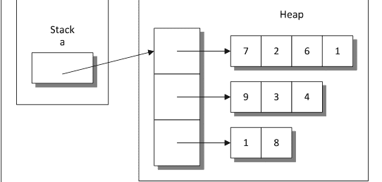

图 11.2

这是一个实现该锯齿数组的程序。

```java
// 二维锯齿数组的实现
package twodjaggedarrayproject;

public class Main {
    public static void main(String[] args) {
        int[][] a = new int[3][];

        a[0] = new int[4];
        a[1] = new int[3];
        a[2] = new int[2];

        a[0][0] = 7; a[0][1] = 2; a[0][2] = 6; a[0][3] = 1;
        a[1][0] = 9; a[1][1] = 3; a[1][2] = 4;
        a[2][0] = 1; a[2][1] = 8;

        for (int i = 0; i < a.length; i++) {
            for (int j = 0; j < a[i].length; j++) {
                System.out.print(a[i][j] + ", ");
            }
            System.out.println();
        }
    }
}
```

在这个程序中，`a` 是一个指向一维引用数组的引用。该数组中的每个引用都指向一个一维整数数组。注意我们是如何遍历锯齿数组的。在外部层 `for` 循环中，我们使用 `length` 来获取锯齿数组中存在的一维整数数组的数量，而在内部 `for` 循环中，我们使用 `a[i].length` 来获取每个一维数组中的整数数量。我留给你们去找出这个程序的输出。

我们还有两种方式可以定义和初始化锯齿数组。如下所示。

```java
// 定义锯齿数组的一种方式
int[][] a = { new int[4], new int[3], new int[2] };
a[0][0] = 7; a[0][1] = 2; a[0][2] = 6; a[0][3] = 1;
a[1][0] = 9; a[1][1] = 3; a[1][2] = 4;
a[2][0] = 1; a[2][1] = 8;
```

```java
// 定义锯齿数组的另一种方式
int[] a1 = new int[] { 7, 2, 6, 1 };
int[] a2 = new int[] { 9, 3, 4 };
int[] a3 = new int[] { 1, 8 };
int[][] a = { a1, a2, a3 };
```

我们可以向函数传递普通的二维数组一样，我们也可以传递或返回锯齿数组。

# 数组的大小调整

众所周知，数组是在执行期间动态创建的。因此，我们可以对数组做两件事：

- a) 可以在运行时决定数组元素的数量，而不需要在编写程序时做承诺。
- b) 一旦数组创建，我们就可以在执行期间增加或减少它的大小。

让我们现在通过编程的方式来实现。

```java
// 灵活数组与数组的大小调整
package resizingarray;
import java.util.*;

public class ResizingArray {
    public static void main(String[] args) {
        int[] arr, newarr;
        int i, num, newnum;
        Scanner scn;

        scn = new Scanner(System.in);
        System.out.println(" Enter number of students ");
        num = scn.nextInt();
        arr = new int[num];

        System.out.println(" Enter marks for " + num + " students ");
        for (i = 0; i < arr.length; i++)
            arr[i] = scn.nextInt();

        System.out.println(" Enter additional number of students ");
        newnum = scn.nextInt();
        newarr = new int[num + newnum];

        // 将现有元素复制到新数组
        for (i = 0; i < arr.length; i++)
            newarr[i] = arr[i];

        System.out.println(" Enter marks for " + newnum + " students ");
        for (i = arr.length; i < newarr.length; i++)
            newarr[i] = scn.nextInt();

        System.out.println("The new array now contains");
        for (i = 0; i < newarr.length; i++)
            System.out.print(newarr[i] + " ");
    }
}
```

下面是程序的示例交互。

```text
Enter number of students
5
Enter marks for 5 students
55
43
65
78
66
Enter additional number of students
3
Enter marks for 3 students
70
80
90
The new array now contains
55 43 65 78 66 70 80 90
```

看这一语句定义的方式：

```java
int[] arr, newarr;
```

`int[]` 同时适用于 `arr` 和 `newarr`。它们都被视为整数数组的引用。这两个数组都是灵活的，因为它们的大小是由用户在执行期间决定的。数组是根据用户在执行期间提供的 `num` 和 `newnum` 创建的。为了增加数组的大小，我们创建了一个新数组 `newarr`，将现有数组 `arr` 的元素复制进去，并在之后填充额外的值。一旦完成，如果我们愿意，可以通过将其引用设置为 `null` 来删除旧数组。这样做，该数组将被垃圾回收器回收。这种方法允许你在执行期间增加现有数组的大小；如果需要，我们也可以在执行期间缩小现有数组的大小。

## 练习

### [A] 回答以下问题：

- a) 哪个数组声明是正确的？

  `int a(25);`

  `int size = 10, b[size];`

  `int[] c = {0, 1, 2 };`

- b) 如果给超出数组的元素赋值会发生什么？

- c) 当将数组作为参数传递时，实际传递的是什么？

- d) 如何初始化三维数组 `three[3][2][3]`？如何引用该数组中的第一个和最后一个元素？

- e) 下面代码段的输出是什么？

  ```java
  int[][] a = new int[2][];
  a[0] = new int[] { 6, 1, 4, 3 };
  a[1] = new int[] { 9, 2, 7 };
  System.out.println(a[1].length);
  ```

- f) 下面代码段的输出是什么？`int[][][] a = new int[3][2][3];`

- g) 如何获取下面数组中的元素数量？

  `int[] a = { 25, 30, 45, 15, 60 };`

- h) 如何定义并初始化一个 5 个整数的数组？如何将其大小增加到 10 个元素？

- i) 关于下面提供的 Java 代码段，以下哪些陈述是正确的？

  ```java
  int[][] a = new int[2][];
  a[0] = new int[] { 6, 1, 4, 3 };
  a[1] = new int[] { 9, 2, 7 };
  ```

  1. `a` 是二维锯齿数组的引用。
  2. `a[0]` 指向第 0 个一维数组，`a[1]` 指向第 1 个一维数组。
  3. `a` 指向 `a[0]` 和 `a[1]`。
  4. `a` 指向 `a[1]` 和 `a[2]`。

- k) 遍历一维数组元素有多少种不同的方法？它们的优缺点是什么？

- l) 使用二维锯齿数组相比二维矩形数组有什么优势？

- m) 矩形数组无法访问 `Arrays` 类的方法是否正确？

### B 尝试以下题目：

- a) 从键盘输入 25 个数字到数组。通过键盘输入要搜索的数字。编写一个程序查找数组中是否存在该数字，如果存在，则显示它出现的次数。
- b) 从键盘输入 25 个数字到数组。编写一个程序找出其中有多少个正数、多少个负数、多少个偶数和多少个奇数。
- c) 编写一个程序交换数组中奇偶元素的位置。
- d) 编写一个程序按逆序将一个数组的内容复制到另一个数组。
- e) 编写一个程序获取 4x4 矩阵的转置。矩阵的转置是通过交换每一行的元素与对应列的元素得到的。
- f) 通过键盘输入 10 个不同点的 X 和 Y 坐标。编写一个程序找到最后一个点到第一个点的距离（相邻点之间距离之和）。
- g) 创建一个整数类型的锯齿数组。该数组应该由二维数组组成。第一个二维数组应包含 3 行，长度分别为 4、3 和 2。第二个二维数组应包含 2 行，长度分别为 3 和 4。使用合适的元素初始化数组，并使用 `for` 循环显示它们。


# 数组核心要点

- 数组是一个一次能够持有大于 1 个值的变量
- 数组的两个基本属性：
  1. 相似性 - 所有数组元素彼此都是相似的
  2. 连续性 - 所有数组元素都存储在相邻的内存位置
- 如果数组元素提前未知，声明数组有 3 种方法：

```java
int per[] = new int[10];
int per[] = new int[10];
int per[]; per = new int[10];
```

- 如果所有数组元素提前已知，可以定义为：

```java
int[] a = { 7, 6, 11, -2, 26 }; // 在这种情况下不能指定大小
```

- 数组元素始终从 0 开始计数。因此 `arr[9]` 是第 10 个元素
- 数组元素可以像这样计算：`arr[5] = 3 + 7 % 2;`
- 允许对数组元素进行算术运算，如：`arr[6] = arr[1] + arr[3] / 16;`
- Java 对数组进行边界检查，如果我们超出边界将会警告
- 逐个处理数组元素的三个方法：

```java
int a[] = {7, 9, 16, -2, 8}; int i;
for (i = 0; i <= 4; i++)
    System.out.println(a[i]);
```

```java
for (i = 0; i < a.length; i++) // length 是数组的一个属性
    System.out.println(a[i]);
```

```java
for (int item : a) // 用于处理数组的特殊 for 循环
    System.out.println(item);
```

- 数组被实现为一个对象，因此它是无名的。它在堆上创建，其引用设置在栈中。引用包含数组对象的基地址。
- 在执行期间可以增加或减小数组的大小
- 在执行期间可以释放数组以便垃圾回收器收集它
- 向函数传递数组和从函数返回数组是相似的，因为在两种情况下我们都是传递引用或返回引用

```java
public static int[] display(int[] p) // p - 数组引用
{
    int a[] = {1, 4, 6, 2, 8};
    return a; // 返回一个数组 ID
}
```

- 二维数组是多个一维数组的集合

```java
int a[][] = {{2, 3, 11, 4}, {4, 7, 8, 9}, {33, 2, 1, 1}};
```

- 不能指定维度，因为数组是在就地初始化的
- 每个一维数组的 `{}` 是强制性的
- 每个一维数组后的 `;` 是强制性的
- `a` 是一个引用，它将在栈上创建
- `a` 将指向一个引用的数组（在堆上）。此数组中的每个引用将指向一个整数的一维数组
- `a.length` 将给出 3，因为二维数组中共有 3 个一维数组
- `a[2].length` 将给出 4，因为第 2 个一维数组中有 4 个元素
- 传递和返回二维数组与传递和返回一维数组是相似的

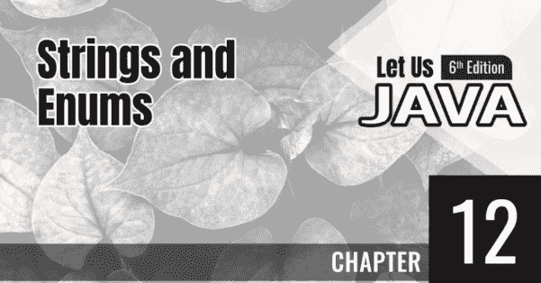

严格来说，我们可以创建没有字符串和枚举的 Java 程序。但一旦你看到了它们为你的工作带来的优雅感，你就永远不会放弃它们……

# 目录

- 什么是字符串？
- 关于字符串的更多
- 分割字符串
- StringBuilder 类
- 字符串数组
- 字符串排序
- 枚举
- 枚举数据类型的使用
- 练习题
- KanNotes

# 第12 章：字符串与枚举

在上一章中，你学习了如何定义各种大小和维度的数组，如何初始化它们，如何将它们传递给函数等。掌握了这些知识，你应该准备好处理字符串了，简单来说，字符串就是一种特殊的数组。字符串以及操作它们的方法将是本章讨论的话题。

## 什么是字符串？

一组字符的表示方式就是字符串。字符串是不可变的，意味着一旦创建了 `String` 对象，它的值就不能被更改。如果你尝试修改字符串，将会创建一个新的 `String` 对象。

字符串在 Java 中被广泛用于存储文本数据，如名称、消息等。`String` 类提供了许多操作字符串的方法，如拼接、子串、替换等。


# 第 12 章：字符串与枚举

## 什么是字符串？

一组字符的表示方式就是字符串。字符串是不可变的，意味着一旦创建了 `String` 对象，它的值就不能被更改。如果你尝试修改字符串，将创建一个新的 `String` 对象。

在 Java 中字符串被广泛用于存储文本数据，如名称、消息等。`String` 类提供了许多操作字符串的方法，如拼接、子串、替换等。

严格来说，我们可以创建没有字符串和枚举的 Java 程序。但一旦你看到了它们为你的工作带来的优雅感，你就永远不会放弃它们……

字符串是不可变的字符串，可用于表示 Java 中的文本。

## 字符串操作示例

首先，我们创建了两个 `String` 变量 `s1` 和 `s2`，并将它们初始化为“kicit”和“Nagpur”。

要访问字符串的单个字符，我们必须使用 `charAt()` 方法。因此，`s1.charAt()` 获取了字符串 `s1` 中的字符 'c'。与数组不同，我们无法通过 `s1[2]` 访问第 3 个字符。

`concat()` 方法拼接两个字符串，它从一个新字符串开始并返回其引用，该引用存储在 `s3` 中。因此，`s3` 引用的对象将包含 "KicitNagpur"。字符串的 `length()` 方法返回字符串中字符的数量。在程序中，`s3` 的长度为 11。`replace()` 方法将所有实例的字符（作为第一个参数提到）替换为作为第二个参数给出的字符。在这里，我们将 `s3` 引用的字符串中的 'p' 替换为 'P'。`copyValueOf()` 是一个静态方法，返回一个表示传递给它的字符对象中字符序列的 `String`。

`compareTo()` 方法按字母顺序比较两个字符串。这意味着起始首字母为 'a' 的字符串始终小于起始首字母为 'b' 的字符串。如果调用 `compareTo()` 方法的 `String` 对象包含的字符串小于作为方法参数传递的引用对象所包含的字符串，则该方法返回一个负整数。如果字符串对象是反的，则返回一个正数。当两个字符串相等时返回 0。

同样地，`==` 运算符比较两个字符串并返回一个布尔值——如果字符串相等则返回 `true`，如果不相等则返回 `false`。为了以不区分大小写的方式进行字符串比较，还有另一个名为 `compareIgnoreCase()` 的方法。

`toUpperCase()` 方法创建一个新对象，将其存储在转换大小后的字符串中，并返回该对象的地址。此地址在 `s3` 中被调用。注意 `s1` 不受影响。在这里我们可以得出一个结论：我们用于调用操作字符串方法的对象并不会影响对象本身。

`indexOf()` 方法返回给定字符在字符串中首次出现的索引。同样，`lastIndexOf()` 方法返回给定字符在字符串中最后一次出现的索引。在我们的程序中，'i' 的第一个索引恰好是 1，而最后一个索引是 3。

`substring()` 方法返回一个新字符串，该字符串从作为第一个参数传递的索引开始，并在作为方法第二个参数传递的索引结束。

`format()` 方法是一个静态方法，它使用字符串和数字构建一个新的字符串对象。在这里，我们将新创建的字符串对象的地址收集在 `s3` 中。

如果我们需要，可以像下面将所有的 `String` 类函数组合起来。

```java
String s1 = "Hello";
s1 = s1.toUpperCase().substring(2, 5);
System.out.println(s1);
```

在这里，首先使用 `toUpperCase()` 将 Hello 转换为 HELLO，并从这个字符串中使用 `substring()` 提取出 LLO。

在许多 Java 应用中，验证用户输入时非常常用 `isEmpty` 函数。此函数允许一次性检查字符串是否为空，即其长度是否为 0。在缺少此函数的情况下，我们需要编写如下所示的 `if` 语句：

```java
if (s == "")
```

`contains()` 如果输入字符串出现在当前字符串对象的任何位置，则返回 `true`。它使我们能够高效地在大字符串中搜索字符串。

## 分割字符串

在 Java 应用中处理字符串时，需要根据某些分隔符将字符串分成若干部分，从而得到字符串数组。下面的程序说明了如何进行这种字符串分割：

```java
// Split string operations
package splitandjoinproject;
import java.io.*;

public class SplitAndJoinProject {
    public static void main(String[] args) throws Exception {
        File f = new File(" ");
        String d = f.getCanonicalPath();
        String[] parts = d.split("\\\\");
        System.out.println("Complete path: " + d);
        System.out.println("Dir name: " + parts[parts.length - 1]);
    }
}
```

输出：

```
Complete path: D:\Books\J
Dir name: SplitAndJoin
```

在这个程序中，我们通过调用 `getCanonicalPath()` 获取了路径。然后使用 `split("\\\\")` 将路径拆分。

## StringBuilder 类

正如前面所述，当字符串需要被修改时，它是不可变的。`StringBuilder` 类提供了如追加、删除、反转等方法。

## 字符串排序示例

```java
package sortingstringsproject;

public class SortingStringsProject {
    public static void main(String[] args) {
        String[] names = new String[] {
            "Akshay", "Parag",
            "Raman", "Srinivas",
            "Gopal", "Rajesh"
        };
        int i, j, result;
        String temp;
        for (i = 0; i <= names.length - 1; i++) {
            for (j = i + 1; j <= names.length - 1; j++) {
                result = names[i].compareTo(names[j]);
                if (result > 0) {
                    temp = names[i];
                    names[i] = names[j];
                    names[j] = temp;
                }
            }
        }
        for (String n : names) {
            System.out.println(n);
        }
    }
}
```

为了对字符串进行排序，我们使用了选择排序逻辑。为了比较字符串的字母顺序，我们使用了 `compareTo()` 函数，当两个字符串不符合字母顺序时，该函数会返回一个大于 0 的值。在这种情况下，我们交换数组中两个字符串的位置。一旦完成所有字符串的排序，我们就使用 `for` 循环打印排序后的列表。

## 枚举

枚举数据类型为你提供了一个发明自己的数据类型的机会，并定义该数据类型变量可以取的值。这有助于提高程序列表的可读性，当程序变得复杂或有多个程序员共同工作时，这将是一个优势。使用枚举数据类型还可以帮助你减少编程错误。

例如，可以创建一个名为 `MaritalStatus`（婚姻状况）的数据类型，它可以有四个可能的值：单身、已婚、离婚或寡偶。以下是 `MaritalStatus` 数据类型的实现方式。

```java
enum MaritalStatus {
    single, married, divorced, widowed
}
MaritalStatus person1, person2;
```

此声明包含两个部分：

- (a) 第一部分声明了数据类型并指定了它的可能值。这些值被称为“枚举常量”（enumerators）。
- (b) 第二部分定义了该数据类型的变量。

现在我们可以给这些变量赋值：

```java
person1 = MaritalStatus.married;
person2 = MaritalStatus.divorced;
```


在内部，编译器将枚举常量视为整数。许可值列表中的每个值都对应一个整数，从 0 开始。在这个示例中，`single` 存储为 0，`married` 存储为 1，`divorced` 存储为 2，`widowed` 存储为 3。

最后，枚举中使用的枚举常量名称中不包含空格。因此，“eligible bachelor”对于 `MaritalStatus` 来说是一个不可接受的枚举常量。

# 枚举数据类型的使用

枚举变量通常用于阐明程序的操作。例如，如果我们要在薪资程序中使用员工部门，那么使用 `assembly`、`manufacturing`、`accounts` 等值比使用 `0`、`1`、`2` 等整数值会让程序列表更易读。以下程序说明了我想表达的观点：

## 让我们学习 Java

// 使用枚举

```java
package usingenumproject;

enum Department {
    assembly, manufacturing, accounts, stores
}

class Employee {
    private String name;
    private int age;
    private float salary;
    private Department dept;

    public Employee(String n, int a, float s, Department d) {
        name = n;
        age = a;
        salary = s;
        dept = d;
    }

    public void displayData() {
        System.out.println(name + " " + age + " " + salary + " " + dept);
        if (dept == Department.accounts)
            System.out.println(name + " " + " is an accountant\n");
        else
            System.out.println(name + " " + " is not an accountant\n");
    }
}

public class UsingEnumProject {
    public static void main(String[] args) {
        Employee e = new Employee("Sandeep Shah", 28, 15575.50f, Department.manufacturing);
        e.displayData();
    }
}
```

# 第 12 章：字符串与枚举

这里是程序的输出结果...

```
Sandeep Shah 28 15575.5 manufacturing
Sandeep Shah is not an accountant
```

现在让我们详细分析这个程序。我们首先定义了数据类型 `enum Department`，并指定了四个可能的值，即 `assembly`、`manufacturing`、`accounts` 和 `stores`。当我们声明一个 `Employee` 类来管理员工数据时，它包含了 `name`、`age` 和 `dept`。其中，最后一个是特别的——它是一个 `Department` 类型的变量。`Employee` 类的构造函数从 `main()` 被调用。在对构造函数的调用中，员工工作的部门值作为 `Department.manufacturing` 传递。与简单地传递一个值 `1` 来代表制造部门相比，这对于任何阅读程序的人来说包含的信息多得多。在构造函数中，通过语句将传递的枚举值赋值给类的私有变量：

```java
dept = d;
```

## 枚举常量作为 String

```java
package enumvalue;

enum CarTypes {
    suv, hatchback, sedan
}

public class EnumValuePair {
    public static void main(String[] args) {
        CarTypes car1 = CarTypes.sedan;
        System.out.println("Value of car1 is " + car1);
        System.out.println("Value of car1 is " + car1.ordinal());
        System.out.println("Car names and their values:");
        for (CarTypes c : CarTypes.values()) {
            System.out.println(c + " = " + c.ordinal());
        }
    }
}
```

给定输出：

```
Value of car1 is sedan
Value of car1 is 2
Car names and their values:
SUV = 0
hatchBack = 1
sedan = 2
```

在这里，首先我们声明了一个名为 `CarTypes` 的枚举，包含了不同类型的汽车。然后我们创建了一个枚举变量 `car1` 并将 `CarTypes.sedan` 赋值给它。接着我们通过 `println` 了字符串 "sedan" 以及它的底层值，即 2。注意，为了获取整数值我们调用了 `ordinal()` 方法。该方法返回枚举常量在其声明中的位置。

# 第 12 章：字符串与枚举

## 练习

### [A] 回答下列：

- (a) 下述 Java 代码段的输出是什么？

```java
String s1 = "Kicit";
System.out.println(s1.indexOf('c'));
System.out.println(s1.length());
```

- (b) 下述 Java 代码段的输出是什么？

```java
String s1 = "Nagpur";
String s2;
s2 = s1.concat("Mumbai");
System.out.println(s2);
```

- (c) 下述 Java 代码段的输出是什么？

```java
String s1 = "Five Star";
String s2 = "FIVE STAR";
int c;
c = s1.compareTo(s2);
System.out.println(c);
```

- (d) 下述 Java 代码段的输出是什么？

```java
String s1 = "ALL MEN ARE CREATED EQUAL";
String s2;
s2 = s1.substring(12, 3);
System.out.println(s2);
```

- (e) 参考下述语句，如何将 `s1` 的内容复制到 `s2`？

```java
String s1 = "String";
String s2;
```

- (f) 如何找到字符串 "She sells sea shells on the sea-shore" 中第二个 's' 的索引？

### [B] 为下列问题选择正确答案：

- (a) 下列哪创建 String 对象的正确方法是？
  1. `String s = "Hello"`
  2. `String s[] = "Hello";`
  3. `char s[] = new char[20]; s = "Hello"`
  4. `String s = "Hello";`

- (b) 在以下代码段中，`str` 在哪里创建：
  `String str = "Good Morning";`
  1. 栈 (Stack)
  2. 堆 (Heap)
  3. 虚拟内存 (Virtual Memory)
  4. 磁盘文件 (Disk file)

- (c) 在以下代码段中，`str` 包含：
  `String str = "Bye Bye";`
  1. 匿名 String 对象的地址
  2. Bye Bye
  3. B
  4. B 的地址

- (d) 在以下代码段中，**String** 对象的名称是：
  `String s = "Snakes and Pythons"; String t = s;`
  1. s
  2. t
  3. Snakes and Pythons
  4. 对象是无名的

- (e) 在以下代码段中，`t` 包含？
  `String s = "Horses for courses"; String t = s;`
  `t = s;`
  1. "Horses for courses"
  2. 匿名 String 对象的地址
  3. s
  4. H

- (f) 关于枚举值（enum value），下列哪项是正确的？
  1. 它总是公共的
  2. 它总是静态的
  3. 它总是终结的
  4. A、B 和 C

### [C] 尝试完成以下练习：

(a) 编写一个程序，使用字符串数组 `str[]`。接收两个字符串 `str1` 和 `str2`，并检查 `str1` 是否嵌入 `str[]` 中的任何字符串中。如果找到了 `str1`，则将其替换为 `str2`。

```java
String str[] = {
    "We will teach you how to",
    "Move a mountain",
    "Erase the past",
    "Make a million",
    "...all through Java!"
};
```

例如，如果 `str1` 包含 "mountain"，`str2` 包含 "car"，那么 `str` 中的第二个字符串应该变为 "Move a car"。

(b) 编写一个程序反转存储在以下内容的字符串：

```java
String s[] = {
    "To err is human...",
    "But to really mess things up...",
    "One needs to know Java!!"
};
```


(c) 编写一个程序，删除句子中所有的元音。

(d) 编写一个程序，读取一行并删除单词 `the` 的所有出现处。

(e) 编写一个程序，接收一组个人姓名，并将姓氏以外的名字、中间名和其他名字缩写为首字母。

(f) 编写一个程序，统计某行文本中任意两个元音连续出现的次数。例如，在句子 "Please read this application and give me gratuity" 中，这样的出现有 `ea`、`ea`、`ui`。

(g) 创建一个名为 `Window` 的类，包含数据成员 `height`、`width`、`certortype` 和 `windowcolor`。其中，最后两个应该是枚举。创建两个 `Window` 类型的对象并设置并打印这些对象的值。确保枚举值以字符串的形式打印出来。


- `Strings` 被用于管理字符数组
- Java 中的 `Strings` 是不可变的
- `String` 类有一个重载的 `+` 号来连接字符串
- 可以使用 `String` 类的方法对字符串执行不同的操作
  * `charAt()` - 获取指定位置的字符
  * `concat()` - 连接两个字符串
  * `length()` - 获取字符串的长度
  * `replace()` - 用另一个字符串替换字符串中的子字符串
  * `compareTo()` - 比较两个字符串
  * `toUpperCase()` - 将字符串转换为大写
  * `indexOf()` - 获取字符串中子字符串的第一个索引
  * `lastIndexOf()` - 获取字符串中子字符串的最后一个索引
  * `substring()` - 从字符串中提取子字符串
- 为了就地操作字符串，使用 `StringBuilder` 类
- 使用 `append()`、`delete()`、`replace()` 和 `insert()` 等方法来操作使用 `StringBuilder` 类表示的字符串
- 为了维护多个字符串，可以创建一个字符串数组
- 枚举是自定义类型，用于提高程序的可读性


继承全关乎基因……它们最好是好的！生活中是如此，编程中也是如此……

# 目录

- 继承的用途
- 继承中的构造函数
- `final` 关键字
- 增量式开发
- 其他代码复用机制
- 练习
- KanNotes

# 第 13 章：继承

现在我们已经熟悉了类——面向对象编程的构建块——让我们来处理继承吧。

## 让我们使用 Java

我们不想将 `count` 设置为公共，因为这将允许从类外部进行访问，从而消除了数据隐藏的优势。图 13.2 清楚地显示了在基类-派生类关系中谁可以访问什么。

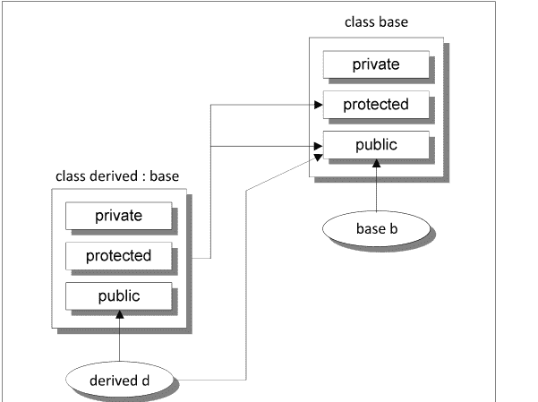

图 13.2

你会同意，通过派生类 `Index1`（以及通过继承），我们增加（扩展）了 `Index` 类的功能，而没有修改它。

请注意，继承不是反向的。也就是说，基类及其对象对任何派生自基类的类一无所知。这意味着在我们的程序中，如果我们从 `Index` 类构建了一个对象 `j`，那么 `decrement()` 函数对该对象仍然是不可见的。

## 继承的用途

现在我们已经对继承有了基本的了解，让我们看看在 Java 的哪些场景下使用继承。继承的四种常见用法如下：

- (a) 使用现有的功能
- (b) 覆盖现有的功能
- (c) 提供新功能
- (d) 现有功能与新功能的结合

让我们来看这些用法模式的几个示例。我们将从一个演示上述所有四种功能的场景开始。这里是该程序...

// 各种继承用法场景的程序
package inheritancefeaturesusageproject;

```java
class Ex {
    public void fun() {
        System.out.println("Inside Ex - fun()");
    }

    public void save() {
        System.out.println("Inside Ex - save()");
    }

    public void enc() {
        System.out.println("Inside Ex - enc()");
    }

    public void open() {
        System.out.println("Inside Ex - open()");
    }
}

class NewEx extends Ex {
    public void save() {
        System.out.println("Inside NewEx - save()");
    }

    public void enc() {
        System.out.println("Inside NewEx - enc()");
    }

    public void autoUpdate() {
        System.out.println("Inside NewEx - autoUpdate()");
    }

    public void open() {
        System.out.println("Inside NewEx - open()");
        super.open();
    }
}

public class InheritanceFeaturesUsageProject {
    public static void main(String[] args) {
        NewEx e = new NewEx();
        e.fun();
        e.save();
        e.enc();
        e.autoUpdate();
        e.open();
    }
}
```

下面是程序的输出...

```
Inside Ex - fun()
Inside NewEx - save()
Inside NewEx - enc()
Inside NewEx - autoUpdate()
Inside NewEx - open()
Inside Ex - open()
```

我们定义了两个类——`Ex` 作为基类，`NewEx` 作为派生类。`Ex` 类包含成员函数 `fun()`、`save()`、`enc()` 和 `open()`，而 `NewEx` 类包含成员函数 `save()`、`enc()`、`open()` 和 `autoUpdate()`。在 `main()` 中，我们创建了一个 `NewEx` 类的对象并调用了不同的成员函数。现在查看程序的输出以欣赏不同的用法场景。

当我们调用函数 `fun()` 时，它首先在 `NewEx` 类中搜索。由于在 `NewEx` 中没有找到，因此在基类中搜索。在基类中找到了它。结果是调用了基类函数，并打印了消息“Inside Ex - fun()”。这表明我们使用了基类的一个功能，即 `fun()`，它是通过派生类对象原样被使用的。

当我们调用 `save()` 时，再次在派生类 `NewEx` 中搜索该函数。由于在 `NewEx` 中找到了该函数，调用了这个版本的 `save()`（而不是 `Ex` 类中的版本）。这表明通过继承，我们能够覆盖功能。函数 `enc()` 也是如此。

当我们调用 `autoUpdate()` 时，在 `NewEx` 中搜索并找到了该函数。由于基类中没有 `autoUpdate()` 函数，这就是通过继承提供完全新功能的情况。

最后，当我们调用 `open()` 时，在 `NewEx` 中搜索并找到了该函数。调用了这个版本的 `open()`，这反过来通过 `super.open()` 调用了基类版本的 `open()`。结果输出为：

Inside NewEx - open()
Inside Ex - open()

这表明了使用继承将新功能与旧功能结合。

注意以下关于继承关系的要点：

- (a) 我们可以从一个本身已经派生自另一个类的类派生出新类。因此，可以存在多级继承。
- (b) 一个类不能有多个基类。也就是说，一个派生类不能派生自一个以上的类。

## 继承中的构造函数

正如我们所知，可以使用语法从派生类成员函数调用基类成员函数：

```java
super.functionName();
```

在这里 `super` 是一个关键字，`functionName()` 是基类中函数的名称。除非显式调用，否则不会从派生类函数的体中调用基类函数。继承链中的构造函数受到了不同的对待方式。

关于继承链中的构造函数，我们需要记住两点：

- (a) 当创建派生类对象时，会调用基类的构造函数，然后是派生类的构造函数。
- (b) 在构建派生类时，如果我们不调用基类构造函数，默认调用基类的无参数构造函数。

让我们通过程序来说明这些事实。这里是该程序...

```java
// 继承链中构造函数的调用
package constructorsininitanceproject;

class a {
    public a() {
        System.out.println("a's 0-arg Ctor");
    }

    public a(int xx) {
        System.out.println("a's 1-arg Ctor");
    }
}

class b extends a {
    public b() {
        System.out.println("b's 0-arg Ctor");
    }

    public b(int x) {
        super(x);
        System.out.println("b's 1-arg Ctor");
    }
}

public class ConstructorsInitanceProject {
    public static void main(String[] args) {
        b y = new b();
        b z = new b(10);
    }
}
```

下面是程序的输出...

```
a's 0-arg Ctor
b's 0-arg Ctor
a's 1-arg Ctor
b's 1-arg Ctor
```

从输出中可以看出，当我们构建对象 `y` 和 `z` 时，首先调用基类的构造函数，然后调用派生类的构造函数。在构建 `y` 时，它是自动调用的。然而，在构建 `z` 时，必须通过语法显式调用带参数的构造函数：

```java
super(x);
```

你可能奇怪为什么构建必须从基类向派生类进行。可以通过下面的程序更好地理解：

```java
// 继承中对象的构建顺序
package orderofconstructionproject;

class base1 {
    protected int i;

    public base1() {
        i = 4;
    }
}

class der extends base1 {
    private int j;

    public der() {
        j = i * 4;
    }
}

public class OrderOfConstructionProject {
    public static void main(String[] args) {
        der d = new der();
    }
}
```

## `final` 关键字

默认情况下，我们可以从任何现有类派生新类。有时，我们可能希望对某个类禁止继承。这可以通过 `final` 关键字来实现，如下面的程序所示：

```java
// 防止继承
package preventinheritanceproject;

final class base1 {}

// class derived extends base1
// {
//    public void fun()
// }
```

```java
public class PreventInheritanceProject {
    public static void main(String[] args) {
        // derived d = new derived(); // 编译错误
        // d.fun();
    }
}
```

这个程序甚至无法通过编译。在编译时，它会报告错误——无法从 final `inheritanceproject.base1` 派生。如果发生这种情况，是因为我们使用 `final` 关键字将基类标记为不可继承的。

尽管方法重写是 Java 最重要的特性之一，但有时你可能希望防止它的发生。我们可以通过在基类中将方法声明为 `final` 来防止其被重写。以下代码段说明了这一点：

```java
// 展示防止重写
class base1 {
    final public void fun() {
        System.out.println("In the final method");
    }
}

class derived extends base1 {
    public void fun() { // 编译错误：无法重写 final 方法
        System.out.println("Illegal");
    }
}
```


## 增量开发

继承的优势之一是它支持增量开发。它允许你引入新代码而不会对现有代码产生 bug。通过继承现有的功能类并添加数据成员和成员函数（以及重新定义现有的成员函数），你可以保持现有代码（可能仍在使用）完好无损且经过调试。如果发生了 bug，你知道它位于你的新代码中，比起修改现有代码的主体，新代码要短得多且易于阅读。

类之间分离得如此干净，真是令人惊讶。为了重用代码，你甚至不需要成员函数的源代码。只需使用包含已编译成员函数的字节码即可。

必须意识到，程序开发是一个增量过程。没有人会在项目开始时就构思好整个程序。程序应该尝试创建和操作各种类型的对象，以根据问题定义提供给你的术语来表达一个模型。与其一次性构建整个程序，不如说它会像一个有机、进化的生物一样生长出来。当然，在稳定后的某个时间点，你需要重新审视你的类层次结构，旨在将其折叠为一个合理的结构。继承完美地契合了这一点。

## 其他代码重用机制

Java 在两个层面促进了代码重用——源码级和字节码级。在源码重用机制中，除非源代码可用，否则无法重用代码来构建新代码。源码级重用在 Java 中通过泛型函数和泛型类实现。泛型允许我们编写函数/类，编译器从中创建特定的函数/类。要创建专门的函数/类，必须有源代码。第 18 章详细讨论了这种机制。

字节码重用在 Java 中通过组合和继承实现。当两个类之间存在“拥有”关系时，应该使用组合。例如，一个问题可能包含两个类 `Address` 和 `Employee`。一个 `Employee` 对象可能包含一个 `Address` 对象，此外还有名称、年龄、薪水等其他数据。

当两个类之间存在“像”关系时，应该使用继承。例如，如果一个问题包含两个类 `Window` 和 `Button`，那么 `Button` 类可以继承 `Window` 类，因为 `Button` 就像一个 `Window`。

即使没有源代码，也可以实现组合和继承。

# 第 13 章：继承

## 练习题

### [A] 判断下列陈述是正确（True）还是错误（False）：

- (a) 即使基类的源代码不可用，我们也可以从基类派生类。
- (b) 派生类的成员函数可以访问基类的 `protected` 和 `public` 成员，基类的成员函数可以访问派生类的 `protected` 和 `public` 的成员函数。
- (c) 基类的 `private` 成员无法被派生类的成员函数或派生类对象访问。
- (d) 派生类对象的大小等于基类和派生类成员的大小之和。
- (e) 从基类创建派生类需要对基类进行根本性的改动。
- (f) 如果基类包含一个成员函数 `func()`，而派生类不包含同名的函数，则派生类对象无法访问 `func()`。
- (g) 如果派生类没有指定构造函数，则派生类对象将使用基类中的构造函数。
- (h) 如果基类和派生类各包含同名的成员函数，则派生类对象将调用派生类的成员函数。
- (i) 类 `D` 可以从类 `C` 派生，类 `C` 又从类 `B` 派生，类 `B` 又从类 `A` 派生。
- (j) 将一个类的对象作为另一个类的成员是非法的。

### [B] 回答以下问题：

- 函数 `FunctionToUpper()` 将小写字母转换为大写字母。

假设有一个基类 `B` 和一个派生自 `B` 的派生类 `D`。`B` 有两个公共成员函数 `b1()` 和 `b2()`，而 `D` 有两个成员函数 `d1()` 和 `d2()`。为以下不同情况编写这些类：

- `b1()` 应该可以在 `main()` 中访问，而 `b2()` 不可以。
- `b1()` 和 `b2()` 都不应该可以在 `main()` 中访问。
- `b1()` 和 `b2()` 都可以在 `main()` 中访问。

如果类 `D` 派生自类 `B`，那么位于 `main()` 中的 `D` 对象可以访问以下哪些内容？

- `D` 的 `public` 成员
- `D` 的 `protected` 成员
- `D` 的 `private` 成员
- `B` 的 `public` 成员
- `B` 的 `protected` 成员
- `B` 的 `private` 成员

在继承链中，基类的静态、`protected` 和 `public` 成员对派生类是可见的？

以下哪些可以通过继承机制实现？

1. 使用基类的现有功能。
2. 重写基类的现有功能。
3. 在派生类中实现新功能。
4. 实现多态行为。
5. 实现组合。

如何在 Java 中防止一个类被继承？

如果基类有两个重载函数版本，而派生类包含一个版本，那么通过派生类可以调用基类的另一个版本吗？

如果基类包含两个私有整数和一个静态整数，而派生类包含两个静态整数和一个私有整数，那么派生类对象的大小是多少？

# 第 13 章：继承


- Java 在两个层面促进代码重用——a) 源码级 b) 字节码级
- 源码级重用通过泛型函数和泛型类实现
- 泛型允许我们编写通用的函数/类，编译器从中创建特定的函数/类
- 要创建专门的函数/类必须有源代码
- 字节码级重用通过组合和继承实现
- 当两个类之间存在“拥有”关系时，应使用组合
- 当两个类之间存在“像”关系时，应使用继承
- 即使没有源代码也可以实现组合和继承
- 继承术语：基类-派生类-父类-子类，子类，超类
- `protected` 成员在继承链中可用
- 派生类对象包含所有基类数据
- 派生类对象可能无法访问所有的基类数据
- 继承有助于

  - 继承现有功能：要实现这一点只需建立继承关系
  - 抑制现有功能：通过在派生类中定义同名函数来隐藏基类的实现
  - 扩展现有功能：通过 `super.Basefunction()` 从派生类调用基类函数

- 对象的构造始终从基类向派生类进行
- 可以 `super()` 调用基类构造函数
- 如果类被标记为 `final`，则不能从其派生新类
- 如果一个函数被标记为 `final`，则该函数不能在派生类中重写


帽子越多，人就越灵活。多态也是如此……

# 目录

- 什么是多态？
- 抽象类与函数
- 抽象函数——实例演示
- 接口
- 接口的实际用途
  - 接口——关注接口视角
  - 接口——不同的实现
  - 接口——无关的继承
- 练习题
- 笔记 (KanNotes)

# 第 14 章：多态

在类和继承之后，多态是面向对象编程语言的第三个核心特性。在学习过 C++ 后转到 Java 的程序员似乎分了两步走。第一步是他们开始使用类、对象、构造函数、函数重载等。在此期间，他们将 Java 视为一种“基于对象”的编程语言。这意味着在这一阶段，他们开始欣赏将数据与作用于数据的函数分组的好处、构造函数的价值以及可能的一些简单的继承。

许多程序员有一个错误的印象，认为由于他们已经开始使用类、对象、函数重载和继承，他们就已经进入了面向对象的世界。尽管从表面上看一切可能看起来整洁、清晰，但不要被欺骗了。如果你在这里停止，你就错过了该语言最核心的部分，即向真正的面向对象编程的跨越。只有当你学习了多态之后，才能做到这一点。

## 什么是多态？

函数重载是多态的一种——即一个事物以几种不同的形式存在。我们已经处理过这种类型的多态。另一种类型的多态简化了在类层次结构中执行相同操作的语法。因此，你可以使用多态来保持类的接口整洁，因为你不需要为每个派生类中的相似操作定义唯一的函数名。

当使用多态时，程序看起来是在调用某个类的函数，实际上是在调用另一个类的函数。假设我们有三个不同的类 `Line`、`Circle` 和 `Rectangle`。每个类都包含一个 `draw()` 方法在屏幕上绘制相应的形状。如果我们要画一张包含许多线、圆和三角形的图片，我们可以创建一个引用数组，存储图片中所有对象的地址。数组的定义如下：

```java
Shape[] arr;
arr = new Shape[50];
```

当要画图时，我们可以简单地运行循环：

```java
for (i = 0; i < 50; i++)
    arr[i].draw();
```

当 `arr[i]` 包含 `Line` 对象的地址时，它会调用 `Line` 类的 `draw()` 函数。同样，当它包含 `Circle` 对象的地址时，它会调用 `Circle` 类的 `draw()` 函数。这是由于：

- 来自不同类的函数通过同一个函数调用执行。
- 数组 `arr` 被定义为包含 `Shape` 引用，而不是 `Line` 或 `Circle` 引用。

这个概念就是多态。这些函数具有相同的外观（`draw()` 函数），但使用了不同的实际函数。调用哪个 `draw()` 函数取决于 `arr[i]` 的内容。然而，为了让这种多态方法起作用，必须满足几个条件：

- 类 `Line`、`Circle` 和 `Rectangle` 必须派生自同一个基类 `Shape`。
- `Shape` 基类必须包含一个 `draw()` 函数。

所有这些一次性吸收太难了。因此，让我们将其拆解，并通过简单的程序逐部分尝试理解。这里是第一个程序……

```java
// 展示向上转型引用的使用

package polymorphismproject;

class One {
    public void display() {
        System.out.println("In base class");
    }
}

class OneOfOne extends One {
    public void display() {
        System.out.println("In OneOfOne class");
    }
}
```

```java
ptr.display();
```

调用的是哪个函数——是 `OneOfOne` 的 `display()` 还是 `One` 的 `display()`？
嗯，调用的是派生类中的函数。在程序执行时，我们得到了以下输出：

```text
In OneOfOne class
In TwoOfOne class
```

从输出中可以看出，执行的不是基类，而是派生类的成员函数。因此，同一个函数调用：

```java
ptr.display();
```

根据 `ptr` 的内容执行了不同的函数。这里的规则是，编译器根据引用 `ptr` 的**内容**（而不是引用的**类型**）来选择要调用的函数。

决定调用哪个函数被称为绑定。由于 `ptr` 可能指向 `OneOfOne` 类或 `TwoOfOne` 类对象的地址，编译器无法将调用绑定到 `display()` 的某个特定版本。因此，该决定被推迟到程序执行时。在运行时，知道 `ptr` 指向哪个对象，就会调用 `display()` 的相应版本。这被称为**后期绑定**或**动态绑定**。后期绑定需要一些开销，但提供了更大的功能和灵活性。

因此，该程序能够提供我们在开头提到的特性——使用相同的函数调用访问不同类的函数。

## 抽象类与函数

我们可以对上一个程序中基类中的函数进行进一步的完善。由于基类中的 `display()` 函数会被执行，我们可以轻松地去掉该函数的体，并使用 `abstract` 关键字将其标记，如下所示：

```java
abstract class One {
    abstract void display();
}
```

**抽象**函数永远不包含任何语句。抽象函数必须包含在**抽象**类中。这就是为什么我们如上所示将 `One` 标记为抽象类。我们永远无法从抽象类创建对象。因此下面的语句将报告错误：

```java
One = new;
```

但当出现想要防止创建对象的情况时？嗯，让我们回到之前的例子。假设有一个基类 `Shape` 包含一个 `draw()` 函数。从这个 `Shape` 类派生出了三个类 `Line`、`Circle` 和 `Rectangle`。在这种情况下，我们永远不想创建类本身的对象；我们只会创建派生类的对象，因为它们会绘制特定的形状。在这种情况下，我们将 `Shape` 定义为抽象类，并将 `draw()` 定义为该类中的抽象函数。我们在每个派生类中提供 `draw()` 函数的实现。`draw()` 函数将允许我们绘制特定的线条、圆或矩形。

每当在基类中放置抽象函数时，你必须在所有想要创建对象的派生类中对其进行重写。如果你不在派生类中实现该函数，那么该派生类将被视为抽象类。

现在让我们重申一下在本节中学到的几个事实。清晰理解这些事实至关重要。

为了帮助你巩固对抽象类和函数的理解，让我们再写一个程序。图 14.1 显示了我们在该程序中实现的类层次结构。

| class vehicle |
| :--- |
| abstract void speed() |
| abstract void maintenance() |
| abstract void value() |
| class FourWheeler | class TwoWheeler | class Airborne |
| override void speed() | override void speed() | override void speed() |
| override void maintenance() | override void maintenance() | override void maintenance() |
| override void value() | override void value() | override void value() |

图 14.1

下面是实现此类层次结构的程序代码。

```java
// 演示抽象类和抽象函数工作的程序

package abstractclassexampleproject;

abstract class Vehicle {
    public abstract void speed();
    public abstract void maintenance();
    public abstract void value();
}

class FourWheeler extends Vehicle {
    public void speed() {
        System.out.println("In speed of FourWheeler ");
    }

    public void maintenance() {
        System.out.println("In maintenance of FourWheeler ");
    }

    public void value() {
        System.out.println("In value of FourWheeler ");
    }
}

class TwoWheeler extends Vehicle {
    public void speed() {
        System.out.println("In speed of TwoWheeler ");
    }

    public void maintenance() {
        System.out.println("In maintenance of TwoWheeler ");
    }

    public void value() {
        System.out.println("In value of TwoWheeler ");
    }
}

class Airborne extends Vehicle {
    public void speed() {
        System.out.println("In speed of Airborne ");
    }

    public void maintenance() {
        System.out.println("In maintenance of Airborne ");
    }

    public void value() {
        System.out.println("In value of Airborne ");
    }
}

public class AbstractClassExampleProject {
    public static void main(String[] args) {
        Vehicle maruti, bajaj, jumbo;
        maruti = new FourWheeler();
        bajaj = new TwoWheeler();
        jumbo = new Airborne();

        maruti.speed();
        maruti.maintenance();
        maruti.value();

        bajaj.speed();
        bajaj.maintenance();
        bajaj.value();

        jumbo.speed();
        jumbo.maintenance();
        jumbo.value();
    }
}
```


# 第 14 章：多态

## 程序输出示例

这里是程序的输出结果...

```
In speed of FourWheeler
In maintenance of FourWheeler
In value of FourWheeler
In speed of TwoWheeler
In maintenance of TwoWheeler
In value of TwoWheeler
In speed of Airborne
In maintenance of Airborne
In value of Airborne
```

我把你们来分析这个程序的输出。

## 抽象函数 – 实际示例

我希望你现在已经理解了抽象函数的机制。让我们来看看哪里可以有效地使用它们。假设我们想要一个需要将文档打印到打印机的应用程序。打印机应该能够打印到任何打印机。它只需要知道打印机的名称即可。要执行打印，应用程序只需调用 `prnt()` 函数。请注意，每台打印机都有自己的打印方式。我们可以通过创建如图 14.2 所示的类来实现这种场景。

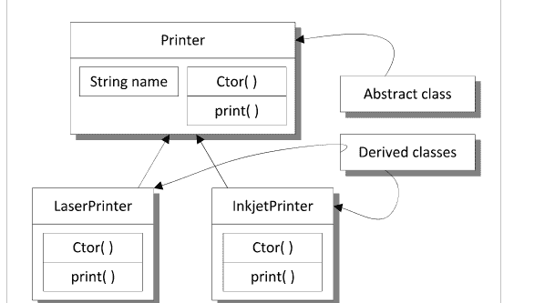

图 14.2

下面是图 14.2 所示类的实现。

```java
// 使用抽象类进行打印的应用程序
package printingapppproject;

abstract class Printer {
    protected String name;

    public Printer(String n) {
        name = n;
    }
    public abstract void print(String docName);
}
```

```java
class LaserPrinter extends Printer {
    public LaserPrinter(String n) {
        super(n);
    }
    public void print(String docName) {
        System.out.println(">> LaserPrinter.print");
    }
}
```

```java
class InkjetPrinter extends Printer {
    public InkjetPrinter(String n) {
        super(n);
    }
    public void print(String docName) {
        System.out.println(">> InkjetPrinter.print");
    }
}
```

```java
public class PrintingAppProject {
    public static void main(String[] args) {
        Printer p = new LaserPrinter("LaserJet 1100");
        p.print("hello1.pdf");
        p = new InkjetPrinter("IBM 2140");
        p.print("hello2.doc");
    }
}
```

这里是程序的输出结果：

```
>> LaserPrinter.print
>> InkjetPrinter.print
```

在这个程序中，我们首先定义了一个名为 `Printer` 的抽象类。该类有一个字符串，可以通过构造函数存储打印机的名称。它还有一个名为 `print()` 的抽象函数。该函数已经在两个派生类 `LaserPrinter` 和 `InkjetPrinter` 中得到了实现。尽管在这些实现中，我们只是显示了消息，但在现实生活中，它将包含分别在激光打印机和喷墨打印机上实际执行打印的逻辑。根据引用 `p` 中存在哪个对象的地址，将通过我们之前学过的动态绑定机制调用相应派生类的 `print()`。

下面是关于我们学到的抽象类的所有内容的总结。

- (a) 抽象类不能被实例化。
- (b) 抽象类可以被继承。
- (c) 抽象类可以包含实例变量。
- (d) 抽象方法不能是私有的。
- (e) 抽象类可以参与继承。
- (f) 抽象方法没有方法体。
- (g) 抽象类可以包含方法体。

## 接口

Java 提供了一个名为 `interface` 的关键字。实现接口类的语法与继承类似，只是使用了 `implements` 而不是 `extends`。

```java
// 接口的声明与实现
package interfaceexample;

interface Mouse {
    void IBtnDown(int x, int y);
    void RBtnDown(int x, int y);
}
```

```java
class GeniusMouse implements Mouse {
    @Override
    public void IBtnDown(int x, int y) {
        System.out.println("Left Button: " + x);
    }
    @Override
    public void RBtnDown(int x, int y) {
        System.out.println("Right Button: " + y);
    }
}
```

```java
public class InterfaceExample {
    public static void main(String[] args) {
        GeniusMouse m = new GeniusMouse();
        m.IBtnDown(10, 20);
        m.RBtnDown(30, 40);
    }
}
```

注意 `GeniusMouse` 类中对 `@Override` 的注解。虽然不是强制性的，但每当我们实现接口或重写基方法时都应该使用它。这种做法有两个好处。通过 `@Override`，我们可以利用编译检查来确保我们确实在重写方法。这样一来，如果我们拼写错了方法名称或没有正确匹配参数，就会收到警告。其次，它使我们的代码更易于理解。

你可能会认为，我们在程序中获得的效果可以使用抽象类而不是接口来实现。我们可以定义一个这样的抽象类：

```java
abstract class Mouse {
    public abstract void IBtnDown(int x, int y);
    public abstract void RBtnDown(int x, int y);
}
```

这些抽象方法可以在 `GeniusMouse` 中实现。这引出了一个重要的问题：抽象类和接口有什么区别？嗯，以下是它们的区别：

- (a) 接口不继承自 `Object` 类。
- (b) 接口不继承自任何基接口。
- (c) 一个类可以实现多个接口。
- (d) 接口可以被继承。
- (e) 多重继承是允许的。
- (f) 类不能部分实现接口。

抽象类和接口的一个共同点是，我们都无法从它们中创建对象。现在我们已经创建了第一个使用接口的程序，是时候给出关于接口的一些小提示了。这些提示如下：

在我看来，比起语法和机制，知道在什么情况下应该使用接口更为重要。我们将讨论接口通常使用的三种场景。这些场景如下：

- (a) 接口允许我们对大型实现方案有一个聚焦的视角。
- (b) 接口允许我们为相同的任务提供不同的实现。
- (c) 接口允许我们从无关的来源为类继承所需的特性。

现在，让我们在合适的程序帮助下，详细理解每种情况。

## 接口——聚焦的视角

在专业软件中，你经常会发现一个类包含如此多的函数，以至于一眼过去可能无法让我们弄出它们的用途。例如，如果我们发现该类实现了一个特定的接口，那么我们就能很快知道该类意图做什么。例如，如果我们知道一个类实现了三个接口——`IEncrypt`、`ICompress` 和 `IAuthenticate`，那么我们可以猜该类与加密、压缩和身份验证有关。接下来的程序定义并实现了这些接口：

```java
// Illustrates how interfaces permit us to have a focused view of an
// implementation
package Ifocusedviewproject;

interface IEncrypt {
    void encrypt();
    void decrypt();
}
interface ICompress {
    void compress();
    void decompress();
}
interface IAuthenticate {
    void login();
    void logout();
}
class FocusedView implements IEncrypt, ICompress, IAuthenticate {
    @Override public void encrypt() {
        System.out.println(">> encrypt");
    }
    @Override public void decrypt() {
        System.out.println(">> decrypt");
    }
    @Override public void compress() {
        System.out.println(">> compress");
    }
    @Override public void decompress() {
        System.out.println(">> decompress");
    }
    @Override public void login() {
        System.out.println(">> login");
    }
    @Override public void logout() {
        System.out.println(">> logout");
    }
}
public class InterfacesFocusedProjectPath {
    public static void main(String[] args) {
        FocusedView o = new FocusedView();

        IEncrypt ie = o;
        ie.encrypt();
        ie.decrypt();

        ICompress ic = o;
        ic.compress();
        ic.decompress();

        IAuthenticate ia = o;
        ia.login();
        ia.logout();
    }
}
```

下面是该程序的输出结果...

```
>> encrypt
>> decrypt
>> compress
>> decompress
>> login
>> logout
```

关于该程序你可以注意到的几点是：

- (a) `FocusedView` 类实现了三个接口——`IEncrypt`、`ICompress` 和 `IAuthenticate`。在定义类时提到接口的顺序并不重要。
- (b) 在 `main()` 中，我们创建了一个 `FocusedView` 对象，将它的地址赋值给接口引用（例如 `ICompress`），然后调用了属于该接口（`ICompress`）的方法（`compress()` 和 `decompress()`）。
- (c) 如果我们使用身份验证接口引用 `ia` 调用 `compress()` 方法，将导致编译错误。这意味着使用接口引用时，只能调用属于该接口本身的方法。
- (d) 在编写程序时，当我们输入 `ia.` 时，帮助信息只显示属于 `IAuthenticate` 接口的方法。这使得 `FocusedView` 类的开发变得简单，因为我们只需要专注于当前正在开发的类的该部分。
- (e) 虽然 `FocusedView` 类只实现了接口，但我们也可以从另一个类派生 `FocusedView`。在这种情况下，在定义类时，基类名应该在接口之前，如下所示。

```java
class FocusedView extends BaseClass implements IEncrypt, ICompress, IAuthenticate {
    // code
}
```

## 接口——不同的实现

有不同的方式在内存中维护数据。例如，我们可以将其存储在数组或链表中。这些数据结构都会以不同的方式组织相同的数据。因此，计算元素数量、添加新元素、删除现有元素等操作的实际实现对于这两个数据结构来说是不同的。然而，如果我们能保持这些操作相同，那就好了。因此，无论我们使用的是数组还是链表，都应该能够通过调用 `count()` 方法获取任何一个中当前的元素数量。同样，应该能够通过调用 `add()` 方法向它们中的每一个添加新元素。通过下面的程序可以使用接口来实现：

```java
// Same interface, different implementations
package diferentimplementationsproject;

interface IListMethods {
    int count();
    void add(Object o);
    void remove(Object o);
}
class MyArray implements IListMethods {
    @Override public int count() {
        System.out.println(">> MyArray.count");
        return 0;
    }
    @Override public void add(Object o) {
        System.out.println(">> MyArray.add");
    }
    @Override public void remove(Object o) {
        System.out.println(">> MyArray.remove");
    }
}
class MyLL implements IListMethods {
    @Override public int count() {
        System.out.println(">> MyLL.count");
        return 0;
    }
    @Override public void add(Object o) {
        System.out.println(">> MyLL.add");
    }
    @Override public void remove(Object o) {
        System.out.println(">> MyLL.remove");
    }
}
public class DifferentImplementationsProject {
    public static void main(String[] args) {
        IListMethods i;
        i = new MyArray();
        i.count();
        i.add(new Object());
        i.remove(new Object());

        i = new MyLL();
        i.count();
        i.add(new Object());
        i.remove(new Object());
    }
}
```

该程序产生了以下输出：

```
>> MyArray.count
>> MyArray.add
>> MyArray.remove
>> MyLL.count
>> MyLL.add
>> MyLL.remove
```

## 练习题

### [A] 请判断下列陈述的正确（True）或错误（False）：

- (a) Java 允许使用基类引用调用派生类函数。
- (b) 抽象函数永远不会有函数体，而抽象构造函数可以有函数体。
- (c) 我们永远无法从抽象类构建对象。
- (d) 在构建对象时，先调用基类构造函数还是先调用派生类构造函数无关。
- (e) 关于 Java 中使用的接口，下列哪些述是正确的？
    - 1. 所有的接口都派生自 `Object` 类。
    - 2. 接口可以被继承。
    - 3. 所有的接口都派生自 `Object` 接口。
    - 4. 接口只能包含方法声明。
    - 5. 接口可以包含静态数据和方法。
    - 6. 一个类只能实现一个接口。
    - 7. 在程序中，如果一个类实现了一个接口，那么同一个程序中的其他类就不能实现该接口。
    - 8. 从两个基接口无法继承出一个新接口。
    - 9. 接口不可被继承。

### [B] 回答以下问题：

- (a) 接口与类有何区别？
- (b) Java 支持接口的局部实现吗？
- (c) Java 支持哪些不同类型的多态？

### [C] 为以下每个问题选择正确的选项：

- (a) 如果一个函数 `function()` 在类中被重载多次，那么对该函数的调用发生在
    - (1) 编译时
    - (2) 预处理时
    - (3) 执行时
    - (4) 链接时
- (b) “函数绑定”意味着
    - (1) 决定调用哪个函数
    - (2) 决定定义哪个函数
    - (3) 决定编译哪个函数
    - (4) 决定汇编哪个函数


(c) Trial 类和 Example 类实现了一个名为 `IAuthenticate` 的接口。这里使用了什么概念？

- (1) 组合（Containership）
- (2) 多态
- (3) 运算符重载
- (4) 静态绑定

(d) 如果一个类包含一个抽象函数，该类必须是：

- (1) 单例的
- (2) 抽象的
- (3) 静态的
- (4) 友元的

(e) 任何抽象类都派生自哪个类？

- (1) Base
- (2) Object
- (3) Abstract
- (4) 适用于这些设备的适当预处理器

(f) 执行这段代码段会发生什么

```java
{
    public abstract void display();
}
```

`One o = new One();`

- (1) 将创建一个 One 类对象
- (2) 错误，因为 One 类没有构造函数
- (3) 错误，因为无法从抽象类创建对象
- (4) (2) 和 (3)


- 向上转型引用——当基类包含派生类的地址时
- 绑定意味着决定调用哪个函数
- 如果绑定在编译时完成，称为早期绑定

## 第 14 章：多态

- 如果绑定在执行时完成，称为晚绑定
- Java - 始终使用晚绑定（动态分发）
- C++ - 尽可能使用早期绑定，在无法使用早期绑定时使用晚绑定
- 早期绑定也称为静态绑定或编译时绑定
- 晚绑定也称为动态绑定或运行时绑定
- 对于晚绑定，被调用的函数在基类和派生类中都必须存在
- 为了防止从类中创建对象，请将其声明为抽象类
- 为了防止通过派生对象调用基类方法，请在基类中将方法标记为抽象
- 抽象类可以包含：
    - 抽象函数和非抽象函数
    - 抽象方法没有函数体
    - 实例变量
    - 变量可以被继承
- 抽象类可以参与继承
- 如果一个类包含抽象方法，则该类必须是抽象类
- 接口是我们与系统、组织等交互的实体
    - 硬件接口示例 - USB
    - 软件接口示例 - GUI
    - 编程接口示例 - 方法
- 接口是函数声明的集合
- 接口中声明的函数的实现（定义）是在实现接口的类中完成的
- 不同类可以实现同一个接口
- 类可以实现任意数量的接口
- 接口指示了类必须做什么
- 接口的定义指示了如何做
- 接口与抽象类的区别：
    - 抽象类函数可能有函数体
    - 接口函数永远没有函数体
- 实例变量：
    - 抽象类可以包含变量。这些变量可以被继承
    - 接口可以包含变量。这些变量默认是静态的（`static`）且最终的（`final`）
- 接口在三种情况下非常有用：
    - 当在不同的集合上执行相似的操作时
    - 在大型实现中需要焦点视图时
    - 当类必须从无关的源继承所需的特质时


异常无法完全消除。它们注会在 Java 程序中发生。你最好知道以面向对象的方式处理它们……

# 目录

- Java 中的异常处理
- 捕获多个异常
- finally 块
- 用户自定义异常
- 一个更实用的示例
    - 定义异常类
    - 抛出异常
    - try 块
    - 异常处理器（catch 块）
- 整个过程是如何工作的？
- 一些提示...
- 练习题
- 笔记

# 第 15 章：异常处理 275

编程是一门困难的艺术。无论你的编程能力如何，开发过程中总会出问题。这包括类型错误、编译错误、链接错误。前三种类型的错误相对容易处理。但当执行期间发生错误时，需要以优雅的方式处理。

在运行时（即程序执行期间）发生的错误被称为异常。异常发生的原因有很多，最常见的如下：

- (a) 内存不足
- (b) 无法打开文件
- (c) 越数组边界
- (d) 尝试初始化不可能的值
- (e) 除以零
- (f) 栈溢出
- (g) 算术溢出或下溢
- (h) 尝试使用未赋值的引用
- (i) 无法连接到服务器

当此类异常发生时，程序员必须决定处理策略。这些策略可能是在 GUI 环境下请求用户提供更好的数据，或直接终止程序执行。采用何种策略取决于异常情况是否可以预见。图 15.1 显示了这些异常情况的示例。

# 276

# 让我们 Java


异常 15.1

## Java 中的异常处理

Java 提供了一种系统的、面向对象的方法来处理运行时错误。Java 的异常机制使用了三个关键字——`throw`、`catch` 和 `try`。让我们了解它们的目的。

在类成员函数的执行过程中发生错误时，Java 运行时通知应用程序发生了错误。这种告知的过程被称为抛出异常。这涉及两个步骤：

- (a) 创建一个异常对象，并将异常情况的信息存储其中。
- (b) 使用关键字 `throw` 抛出异常对象。

Java 运行时从库提供的现有异常类创建异常对象。每个异常类代表不同的异常情况。例如，有一个异常类代表除以零的情况，另一个代表无法打开文件等。所有这些类都派生自一个名为 `Exception` 的基类，该基类又派生自 `Object` 类。

如果我们预见到了这些异常类所表示的情况之外的情况，就可以定义自己的异常类，创建该类的对象，然后抛出该对象来报告错误情况。首先，我们关注

# 第 15 章：异常处理

Java 运行时报告的异常后来移动到了用户定义的异常。异常类的组织本质如图 15.2 所示。

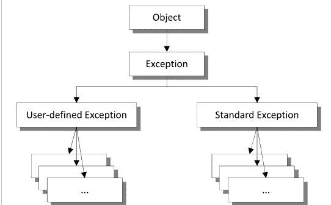

图 15.2

应用程序中预见到执行过程中可能会发生异常的代码被封装在 `try` 块中。当异常发生并抛出一个异常对象时，它会被转移到程序的另一个部分，称为异常处理器或 `catch` 块。`try` 块中生成的这些运行时错误会在 `catch` 块中捕获。不预期发生异常的代码不需要放在 `try` 块中。

下面的代码展示了 `try` 和 `catch` 块的结构。这不是一个可以运行的程序，但它清晰地展示了异常机制的各种元素是如何以及放置在哪里。

```java
package exceptionexampleproject;

public class ExceptionExampleProject
{
    public static void main ( String[] args )
    {
        // normal code
        // try block – where an exception condition is anticipated
        try
        {
            fun();
        } catch ( Exception e ) // exception handler or catch block
        {
            // do something about the error
        }
    }

    public static void fun() {
    {
        // 如果在执行此函数期间发生了某些错误那么：
        // (a) Java运行时会创建一个异常对象
        // (b) Java运行时会抛出该异常对象
        // 在抛出异常对象后，控制将到达
        // catch块
    }
}
```

`fun()` 是一个在执行过程中可能会发生异常的函数。因此，对 `fun()` 的调用被放置在 `try` 块中。如果 `fun()` 执行期间确实发生了异常，Java 运行时会创建一个异常对象并将其抛出。这个抛出的异常对象会在紧随 `try` 块之后的 `catch` 块中的异常引用 `e` 被捕获。

在接收到抛出的对象时，我们的代码可以做三件事。如下：

- (a) 什么都不做，让默认异常处理器处理异常情况
- (b) 纠正导致异常情况的情况并继续执行
- (c) 执行优雅退出

这三种可能性在图 15.3 中所示。

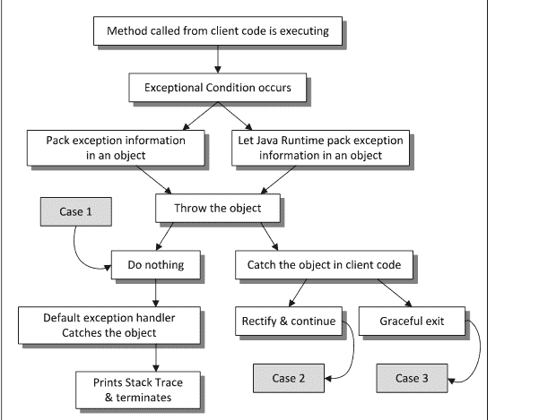

图 15.3

现在让我们来看看所有这些情况的程序，以真正掌握这些情况。这是第一个……

// 案例 1 - 发生异常时什么都不做

package case1project;

import java.io.*;

```java
public class Case1Project {
    public static void main( String[] args ) throws
    NumberFormatException
    {
        int num ;
        try {
            BufferedReader br = new BufferedReader (
                new InputStreamReader ( System.in )) );

            System.out.print("Enter a number: ");
            num = Integer.parseInt( br.readLine() );
            System.out.println( num );
        }
        catch ( IOException e )
        {
            System.out.println ( "Error in input" );
        }
    }
}
```

下面是该程序的示例运行结果……

Enter a number: 12a

Exception in thread "main" java.lang.FormatException: For input

string: "12a"

```
at java.lang.NumberFormatException.forInputString(NumberFormatException
Exception.java:48)
at java.lang.Integer.parseInt(Integer.java:456)
at java.lang.Integer.parseInt(Integer.java:497)
at case1Project.Main.main(Case1Project.java:15)
```

Java Result: 1

在我们的代码中，有两个可能出现问题的地方：

- (a) 在使用 `readLine()` 读取时
- (b) 在使用 `parseInt()` 将字符串转换为整数时

我们如何知道这一点呢？嗯，这些函数通过它们的原型声明了这些异常，原型内容如下：

```java
public String readLine(String s ) throws IOException
public static int parseInt(String s ) throws NumberFormatException
```

你可以看到，这些原型表明如果 `readLine()` 出任何问题，它将抛出 `IOException`；如果 `parseInt()` 出任何问题，它将抛出 `NumberFormatException`。这被称为异常声明。

对于这些声明的异常，我们可以采用以下三种方法之一：

- (a) 我们自己捕获这两个异常。
- (b) 捕获其中一个并进一步抛出另一个，以便默认异常处理器处理它。
- (c) 进一步抛出这两个异常，以便默认异常处理器处理它们。

# 第 15 章：异常处理 281

在我们的程序中，我们遵循了方法 (b)——我们捕获了 `IOException` 并进一步抛出了 `NumberFormatException`。

从程序的输出中可以看到，当我们输入数字 "12a" 并尝试通过调用 `Integer.parseInt()` 将其转换为字符串时，发生了异常。由于我们将此异常进一步抛出（即在 "Case1Project" 中），Java 运行时打印了堆栈跟踪并终止了程序的执行。你应该从下到上读取堆栈跟踪。如果你这样做，就可以追踪到错误来源。

现在让我们来看看所有这些情况的程序，以真正掌握这些情况。这是第一个……

// 案例 2 – 发生异常时纠正并继续

package case2project;

import java.io.*;

```java
public class Case2Project {

    public static void main ( String[] args ) {

        int num;

        while ( true ) {

            try {

                BufferedReader br = new BufferedReader (

                    new InputStreamReader ( System.in )) );

                System.out.println("Enter a number: ");

                num = Integer.parseInt ( br.readLine() );

                System.out.println("You entered: " + num);

                break;

            } catch (IOException e ) {

                System.out.println("Error in input");

            } catch (NumberFormatException e ) {

                System.out.println("Incorrect Input ");

            }

        }

    }

}
```

下面显示了该程序的示例交互。

Enter a number:
12a
Incorrect Input
Enter a number:
12
You entered: 12

你可以看到，当我们输入 "12a" 时发生了异常。但这次程序没有终止，而是提示用户输入另一个数字。当我们提供 "12" 时，它转换为数字并显示。因此我们能够纠正异常情况并继续程序的执行。

# 第 15 章：异常处理 282

现在让我们关注案例 3。并不总是能够从异常情况中恢复。在某些情况下，与其向用户打印丑陋且令人恐惧的堆栈跟踪，我们的程序应该报告错误并优雅地终止。下面的程序展示了如何实现这一点。

```java
// 案例 3 – 发生异常时优雅退出

package case3project;

import java.io.*;

public class Case3Project {

    public static void main ( String[] args )

    {

        int num ;

        try {

            BufferedReader br = new BufferedReader (

                new InputStreamReader ( System.in )) );

            System.out.println("Enter a number: ");

            num = Integer.parseInt ( br.readLine() );

            System.out.println("You entered: " + num);

        } catch (IOException e ) {

            System.out.println("Error in input");

        } catch (NumberFormatException e ) {

            System.out.println("Incorrect Input ");

        }

    }

}
```

从下所示程序的交互中，你可以看到当我们提供输入 "12a" 时，程序报告输入错误，然后终止执行。

Enter a number:
12a
Incorrect Input

## 捕获多个异常

如果一件事可能会出错，那么多件事也可能出错。现实生活中是如此，在编程中也是如此。即，在执行一段代码时存在发生异常的可能性。这可以通过为一个 `try` 块提供多个 `catch` 块来解决。

# 284

## 让我们学习 Java

```java
// Multiple exceptions

package multipleexceptionsproject;

import java.io.*;

public class MultipleExceptionsProject
{
    public static void main ( String[ ] args )
    {
        int i, j;

        try {
            BufferedReader br = new BufferedReader (
                new InputStreamReader ( System.in }));

            System.out.println("Enter i: ");
```


# 第 15 章：异常处理

## 异常处理示例

```java
i = Integer.parseInt(br.readLine());

System.out.println("Enter j: ");

j = Integer.parseInt(br.readLine());

System.out.println("You entered: " + i + " " + j);

System.out.println("Result: " + i/j);

} catch (IOException e) {

    System.out.println("Error in input");

} catch (NumberFormatException ne) {

    System.out.println("Incorrect Input");

} catch (ArithmeticException ae) {

    System.out.println("Arithmetic Exception, div by 0");

} catch (Exception e) {

    System.out.println("Unknown Error: " + e);

}

}
```

在执行 `try` 块中的代码时，我们考虑了三种可能性。这些如下：

- (a) 输入错误，例如输入了类似“12a”的值
- (b) 分母等于 0
- (c) 某些未知错误

为了处理这些情况的每一种，我们提供了独立的 `catch` 块。根据发生的异常，Java 运行时会创建一个适当的异常对象并将其抛出。这就是为什么在每个 `catch` 块中，抛出的对象会被捕获到不同的异常对象中。例如，如果输入错误，则抛出的异常对象是 `NumberFormatException` 类型的对象。相反，如果分母为 0，则抛出的异常对象是 `ArithmeticException` 类型的对象。

这里有两点需要你注意：

- (a) 一时间只有一个 `catch` 块在工作。
- (b) `catch` 块的顺序非常重要。它们的顺序应该根据异常对象的基类关系来确定。

让我们详细阐述上述的第二点。由于 `NumberFormatException` 和 `ArithmeticException` 类派生自 `Exception` 类，因此它们的 `catch` 块应该出现在捕获 `Exception` 对象的块之前。

## finally 块

有时，我们希望无论是否发生异常，某些语句都必须执行。`finally` 块就是这些情况的解决方案。给出的程序说明了它的用法。

```java
// Usage of finally block
package finallyblockproject;

import java.io.*;

public class FinallyBlockProject
{
    public static void main ( String [ ] args )
    {
        FileWriter fw = null ;

        try {
            fw = new FileWriter ( "a.txt" );
            fw.write ( "Hello World\n" );
        }
        catch ( IOException ie ) {
            System.out.println ( "Encountered IO Error" );
        }
        finally {
            try {
                if ( fw!=null ) {
                    fw.close();
                }
            } catch ( IOException e ) {
                System.out.println ( "Error in input" );
            }
        }
    }
}
```

虽然我们打算在稍后的章节中详细讨论文件输入/输出，但在本程序中，我们可以进行首次尝试。要将数据写入磁盘文件，我们必须首先通过向其构造函数传递建议写入的文件名来创建一个 `FileWriter` 对象。实际的写入操作是通过调用 `FileWriter` 的 `write` 函数完成的。如果在创建 `FileWriter` 对象或写入过程中发生异常，`catch` 块将恰当地报告它。

现在是关键部分——无论写入是否成功，在退出由构造函数打开的文件之前，必须将其关闭。`finally` 块正起到了此目的。无论是否发生异常，`finally` 块中的语句都会执行。即使在此之前遇到了 `return` 语句也是如此。正如你所猜想的，`finally` 是一个关键字，跟在 `catch` 块之后。在我们的 `finally` 块中，我们首先检查 `FileWriter` 对象是否已成功创建。如果是，我们调用了 `close()` 方法来关闭与 `FileWriter` 对象关联的文件。

## 自定义异常

在本章的程序中，我们一直使用从 Java 异常类创建的异常对象。现在是探索自定义异常类可能性了。当发生的异常条件无法用标准异常类表示时，就需要此类类。例如，当取款金额导致账户余额低于规定的最低限额时，银行应用程序可能会抛出一个异常。另一个例子可以是信用卡交易金额。在这种情况下，应用程序金额超过了信用卡的额度。我们需要定义自己的异常类，并且当异常发生时，我们需要创建该异常类的对象并将其抛出。以下程序在一个简单的银行应用程序中阐明了这一点：

```java
// Usage of user-defined exception
package userdefinedexceptionproject;

class Customer {
    private String name;
    private int accno;
    private int balance;

    public Customer ( String n, int a, int b ) {
        name = n; accno = a; balance = b;
    }

    public void withdraw ( int amt ) throws BankException {
        if ( balance - amt <= 500 ) {
            throw new BankException ( accno, balance );
        }
        balance -= amt;
    }
}

class BankException extends Exception {
    private int acc;
    private int bal;

    public BankException ( int a, int b ) {
        this.acc = a;
        this.bal = b;
    }

    public void inform( ) {
        System.out.println ( "Acc. No.: " + acc );
        System.out.println ( "Balance: " + bal );
    }
}

public class UserDefinedExceptionProject
{
    public static void main ( String [ ] args )
    {
        try {
            Customer c = new Customer ( "Rahul", 2453, 900 );
            c.withdraw ( 450 );
        } catch ( BankException ex ) {
            System.out.println ( "Transaction failed" );
            ex.inform();
        }
    }
}
```

以下是程序的输出：

```
Transaction failed
Acc. No.: 2453
Balance: 900
```

在本程序中，除了包含 `main()` 的普通类外，我们还定义了两个新类——`Customer` 和 `BankException`。在 `main()` 中，我们构造了一个 `Customer` 对象以包含姓名、账号和余额。然后我们在 `try` 块中调用了 `withdraw()` 方法从账户中提取450。由于取款金额导致余额低于 500 卢比，发生了异常。为了表示这种异常情况，创建了一个 `BankException` 对象（派生自 `Exception` 类）。账号和当前余额值存储在这个 `BankException` 对象中。然后使用 `throw` 关键字将其抛出。这直接跳转到了匹配 `try` 块的 `catch` 块，在 `catch` 块中，我们调用了 `inform()` 方法，它立即显示了错误信息“Transaction failed”以及账号和当前余额。

## 更实际的示例

承认，我们为止为了理解异常处理而使用的示例有些业余。现在让我们在更实际的情况下尝试异常处理。我们将尝试实现一个栈数据结构。我们将使用异常处理报告两种情况下的错误：

- 当程序尝试在栈中存储超过其容量的对象时。
- 当程序尝试从空栈移除对象时。

这里是使用异常处理这些错误的程序。

```java
// Use of exceptions to report errors while maintaining a stack
package stackwithexceptionproject;

class Stack {
    private int capacity;
    private int size;
    private Object[ ] data;

    public Stack ( int cap )
    {
        data = new Object[ cap ];
        capacity = cap;
        size = 0;
    }

    public void push ( Object o ) throws StackException
    {
        if ( size == capacity )
            throw new StackException ( "Stack full" );
        data[size++] = o;
    }

    public Object pop( ) throws StackException
    {
        if ( size <= 0 ) {
            throw new StackException ( "Stack empty" );
        }
        size--;
        return data[ size ];
    }

    public int getSize() {
        return size;
    }
}

class StackException extends Exception {
    private String errormsg;

    public StackException ( String msg) {
        this.errormsg = msg;
    }

    public void inform() {
        System.out.println(errormsg);
    }
}

public class StackWithExceptionsProject {
    public static void main (String[ ] args) {
        Stack s = new Stack ( 3 );

        try {
            s.push ( "Vinod" );
            s.push ( "Sanjay" );
            s.push ( 25 );
            s.push ( 3.14f );
        }
        catch ( StackException ex )
        {
            System.out.println ( "Problem in stack" );
            ex.inform();
        }

        try
        {
            while ( s.getSize() > 0 )
            {
                System.out.println ( s.pop() );
            }
        }
        catch ( StackException ex )
        {
            System.out.println ( "Problem in stack" );
            ex.inform();
        }
    }
}
```

以下是程序执行后产生的输出：

```
Problem in stack
Stack full
25
Sanjay
Vinod
```

我们故意让栈的容量非常小，以便在向栈中添加对象时更容易触发异常。我们将通过该程序并找出它是如何产生此输出的作为一个练习。此外，你也可以尝试按照栈的方法来实现队列（Queue）数据结构。

从上述两个程序——银行和栈——我们现在可以总结如何处理用户自定义异常。异常处理机制涉及四个部分，具体如下：

### 定义异常类

我们在程序中定义了这样的异常类——`BankException` 和 `StackException`。这两个类都继承自 `Exception` 类，并都有一个构造函数，用于创建异常对象。此外，这些类还有一个名为 `inform()` 的方法，用于报告错误信息。

### 抛出异常

当发生异常情况时，会创建并抛出一个异常对象。在我们的第一个程序中，异常可能发生在一种情况——当余额低于 500；在第二个程序中，有两种异常情况——当栈满且我们尝试向其存储另一个对象，或者当我们尝试从空栈中移除对象时。在这种情况下，我们创建并抛出一个 `BankException`，而在第二个程序中，我们创建并抛出一个 `StackException` 对象。抛出异常后，控制权将转移到异常处理器，即 `catch` 块。

### try 块

可能导致异常的语句被封装在一对括号中，并在前面加上 `try` 关键字。这些代码是程序的正常代码。即使不使用异常也会编写这些代码。请注意，程序中的所有代码并不都在 `try` 块中。只有那些预测执行期间可能发生异常条件的代码应该放在 `try` 块中。

### 异常处理器（catch 块）

处理异常的代码被封装在括号中，前面有 `catch` 关键字，并在括号中提到了它建议捕获的异常对象。

## 整个过程是如何运作的？

让我们总结一下发生异常时发生的事件：

- (a) 代码在 `try` 块外部正常执行。
- (b) 控制进入 `try` 块。
- (c) `try` 块中的某个语句导致其调用的成员函数发生错误。
- (d) 成员函数创建并抛出一个异常对象。
- (e) 控制权转移到 `try` 块之后的异常处理器（`catch` 块）。

你可以发现这段代码是多么整洁。`try` 块中的几乎任何语句都可能导致异常，但我们不需要担心是哪一个。`try-throw-catch` 安排会自动为我们处理好一切。

## 一些小提示……

为了总结我们学到的关于异常处理的所有知识，这里有一些你必须注意的细微要点：

- (a) 不要捕获并忽略。例如，像这样写 `catch` 块是错误的做法：

```java
catch ( Exception e )
{
}
```


# 异常处理与 I/O 操作

## 异常处理最佳实践

当程序中发生运行时错误时，程序员倾向于写这种代码，并希望避免显示丑陋且复杂的异常堆栈跟踪。

- (b) 不要为了面子工程使用异常处理。它应该起到纠正异常情况或执行优雅退出的作用。
- (c) 始终通过编写多个相关的 `catch` 块来区分不同类型的异常。
- (d) 导致异常的语句并不一定直接位于 `try` 块中。它也可以存在于从 `try` 块中调用的函数中。
- (e) `try` 块可以存在另一个 `try` 块内部。
- (f) 如果内部 `try` 块没有对应的 `catch` 块，那么当发生异常时，将检查外部 `try` 块的异常处理器是否匹配。
- (g) 如果我们正在为别人编写库，我们应该为任何可能抛出的异常提供 `catch` 块。
- (h) 如果我们正在编写一个使用库的程序，我们应该预测什么会导致它出现问题。我们应该抛出异常。

## 练习

### [A] 判断下列陈述的对错：

- (a) 异常处理机制旨在处理时间错误。
- (b) 异常类必须在它将被使用的类中声明。
- (c) 每个抛出的异常都必须被捕获。
- (d) 一个 `try` 块可以有多个 `catch` 块。
- (e) 当抛出异常时，异常类的构造函数会被调用。
- (f) `try` 块不能嵌套。
- (g) 异常处理保证了对象的适当销毁。
- (h) 所有异常都发生在运行时。
- (i) 异常提供了一种面向对象的处理方式。
- (j) 如果发生异常，程序将突然终止，没有恢复的机会。
- (k) 无论是否发生异常，`finally`（如果存在）中的语句都会执行。
- (l) 一个程序可以包含多个 `finally` 子句。
- (m) `finally` 子句用于执行如关闭网络连接之类的清理操作。
- (n) 抛出用户自定义异常多个

### [B] 回答以下问题：

- (a) 如果我们不捕获运行时抛出的异常，谁来捕获它？
- (b) 简述使用异常处理代替传统错误处理方法的最有力理由。
- (c) 是否所有用于表示异常的类都必须派自基类 `Exception`？
- (d) 在 Java 异常处理序列中，`finally` 块的作用是什么？
- (e) Java 中的嵌套异常处理是如何运作的？

---

## Java 程序执行阶段与异常分类

在创建和执行 Java 程序时，问题可能会在 3 个不同的阶段发生：

| 阶段 | 报告者 | 操作 |
|------|--------|------|
| 编译期间 | 编译器 | 修复程序 |
| 链接期间 | 链接器 | 正确的导入语句 |
| 执行期间（运行时） | Java 运行时 | 现场处理 |

### 运行时错误示例

- **内存相关**：栈溢出 / 堆溢出、超出数组边界
- **算术相关**：除以零、算术溢出或下溢
- **其他**：尝试使用未赋值的引用、未找到文件

### 异常分类

#### 两种异常情况

1. **检查的异常** - 编译器检查它们是否已处理
   - 例如：文件未找到、内存不足
2. **未检查的异常** - 是否处理由我们决定

#### 两种未检查的异常

1. **由内部条件引起** - 又称为运行时异常
   - 例如：传递 `null` 而不是文件名
2. **由外部条件引起** - 又称为错误
   - 例如：读取时磁盘发生故障

### 如何判断检查的还是未检查的

通过点击异常追踪轨迹：
- 如果你到达了 `Exception` 类，则它是检查的异常
- 如果你到达了 `RuntimeException` 或 `Error` 类，则它是未检查的异常

### 异常处理流程

当从客户端代码调用的方法执行时，可能会发生异常情况。这种情况可以通过 2 种方式处理：
1. 将异常信息封装在对象中并抛出
2. 让 Java 运行时将异常信息封装在对象中抛出

当异常对象被抛出时，可以做两件事：
1. 进一步抛出
2. 在客户端代码中捕获该对象

- 如果我们进一步抛出异常对象 → 默认异常处理器捕获对象、打印堆栈跟踪并终止
- 如果我们在客户端代码中捕获异常对象 → 我们可以执行优雅退出，或者纠正异常情况并继续

### 创建异常情况对象的 2 种方法

- 来自 Java API 异常类
- 来自自定义异常类

### 以面向对象（OO）方式处理异常的优势

- 异常对象可以封装更多信息
- 异常对象到调用者的传递由 Java 运行时管理

### Java 如何辅助面向异常处理

- 通过提供关键字：`try`、`catch`、`finally`、`throw`、`throws`
- 通过提供现成的异常类：针对检查的和未检查的异常
- 声明：让方法声明可能发生的异常
- 强制：强制用户处理声明的异常

---

## 核心语法详解

### `try-catch` 使用方法

- **try 块**：在其中包含你预计可能会导致异常的代码
- **catch 块**：在其中捕获抛出的异常。它必须紧随 `try` 块之后

当异常被抛出时，控制权转移到 `catch` 块。一旦 `catch` 块执行，控制权将进入 `catch` 块之后的下一行，除非 `catch` 块中有 `return` 或 `throw`。

当一个方法声明它将抛出异常时，你必须选择捕获它或重新抛出它。

### `try` 块特性

- 可以嵌套在另一个 `try` 块内部
- 如果内部 `try` 没有 `catch`，则会检查外部 `try` 的 `catch` 处理器以寻找匹配项

### `catch` 块特性

- 一个 `try` 块对应多个 `catch` 块是允许的
- 一次仅有一个 `catch` 块会工作
- `catch` 块的顺序很重要：从派生类到基类

### `finally` 块特性

- `finally` 子句是可选的
- 无论如何，`finally` 中的代码始终会执行！即使先发生了 `return` 或 `break`
- 它放置在 `catch` 块之后（如果存在）
- `try` 块必须有 `catch` 块和/或 `finally` 块

---

## 异常处理提示

- 不要捕获并忽略异常
- 不要使用 `Exception` 捕获一切，区分异常的类型
- 使其尽可能详尽：不要太多，也不要太少

---

# 第 16 章：有效的输入/输出

几乎所有程序都必须以某种形式执行输入/输出（I/O）。一个花费所有时间向自己泄露秘密的程序并不值得使用。而且自从程序出现以来，所有语言一直在处理输入/输出，因此期望像 Java 这样的现代面向对象语言提供成熟的输入输出系统是完全自然的。本章旨在探讨 Java 有效实现程序 I/O 需求的方法。

## 对 I/O 系统的期望

人类创建软件和编写程序已经五十多年，程序员开始期望语言的 I/O 系统提供一些坚实的支持，以满足其程序的 I/O 需求。这些期望如下：

- **与不同的源和目的地的通信**：Java 程序应该能够从键盘、端口、磁盘等输入设备执行读取操作，并向磁盘、打印机等执行写入操作。
- **处理各种实体的 I/O 能力**：Java 程序应该能够通过字节、各种字符、字符串、记录和对象进行 I/O。
- **多种通信手段**：Java 程序应该能够以不同的模式（顺序和随机访问）执行 I/O。
- **与文件系统的通信**：Java 程序应该能够与文件和目录等文件系统实体交互，并能够访问和操作路径、时间、日期、访问权限等。

让我们看看 Java 如何满足这些期望。

## 文件、目录和驱动器操作

我们经常需要通过编程的方式对文件、目录和驱动器执行操作。例如，我们可能希望创建、复制、删除、移动或打开文件。同样，我们可能希望创建、移动并遍历目录和子目录。为了执行此类操作，Java 库提供了一个名为 `File` 的类。根据需要，我们可以适当使用该类的方法来执行相关的文件/目录操作。

现在让我们创建一个使用 `File` 类的程序。我们将从一个接收文件名作为输入的程序开始，然后检查文件是否存在。如果存在，它将报告有关该文件的相关信息。

### 示例程序：获取文件信息

```java
// 获取文件信息
package fileinfoproject;

import java.io.*;
import java.util.Date;

public class FileInfoProject {
    public static void main(String[] args) throws Exception {
        String str;
        try {
            BufferedReader br = new BufferedReader(new InputStreamReader(System.in));
            System.out.print("Enter filename: ");
            str = br.readLine();

            File f = new File(str);

            if (f.exists()) {
                String dname = f.getParent();
                System.out.println("Directory name: " + dname);

                String fname = f.getName();
                System.out.println("File name: " + fname);

                String abspath = f.getAbsolutePath();
                System.out.println("Full Name: " + abspath);

                long size = f.length();
                System.out.println("Size: " + size);

                String ext;
                int dot = str.lastIndexOf(".");
                ext = str.substring(dot);
                System.out.println("Extension = " + ext);

                System.out.println("Last Modified = " + new Date(f.lastModified()));
            }
        } catch (IOException e) {
            System.out.println("Error in input");
        }
    }
}
```

**示例交互：**

```text
Enter filename: c:\a.txt
Directory name: c:\
File name: a.txt
Full Name: c:\a.txt
Size: 2748
Extension = .txt
Last Modified = Tue Feb 09 16:29:24 IST 2010
```

程序非常直接。首先，它接收文件名称（你可以提供任何文件的路径作为输入）。接下来，它为该文件创建一个 `File` 对象，并使用 `File` 类的不同方法提取文件的详细信息。为了使用 `File` 类和 `Date` 类，需要在开头添加适当的导入语句。

除了这里使用的方法外，`File` 类还有许多其他方法，可自行探索。

### 示例程序：递归列出目录文件

```java
// 递归列出目录文件
package directorylister;

import java.io.*;

public class DirectoryLister {
    public static void main(String[] args) {
        File d = new File("");
        ListFiles(d, "");
    }

    static void ListFiles(File d, String indent) {
        System.out.println(indent + d.getName() + "/");

        for (File fi : d.listFiles()) {
            String str = indent + " " + fi.getName();
            System.out.println(str);
        }

        // 实现 FileFilter 接口的 accept 函数
        FileFilter dirFilter = new FileFilter() {
            public boolean accept(File file) {
                return file.isDirectory();
            }
        };

        for (File di : d.listFiles(dirFilter)) {
            ListFiles(di, indent + " ");
        }
    }
}
```

**运行输出示例：**

```text
/
build
build.xml
manifest.mf
nbproject
src
build/
classes
classes/
.netbeans_automatic_build
.netbeans_update_resources
directorylistenerproject
directorylistener/
DirectoryListerProject$1.class
DirectoryListerProject.class
nproject/
build-impl.xml
genifiles.properties
private
project.properties
project.xml
private/
private.properties
src/
directoryisterproject
directoryisterproject/
DirectoryListProject.java
```

在输出中，每个目录都被刻意地标记了 `/`，以识别该条目为目录。每个嵌套目录都向右缩进，以清晰地显示层级结构。

程序的核心是 `ListFiles()` 函数。该函数首先从 `main()` 中调用，带有两个参数：`""` 和 `""`。第一个参数指示从哪里开始列表，第二个参数指示起始缩进级别。`""` 表示当前目录。在 `ListFiles()` 中，我们首先获取并打印了该目录下的所有文件。在此，如果我们遇到任何目录，就会递归调用 `ListFiles()` 来列出该目录中的文件。

### 示例程序：获取所有驱动器的信息

```java
// 获取所有驱动器的信息
package driveinfoproject;

import java.io.*;

public class DriveInfoProject {
    public static void main(String[] args) {
        for (File d : File.listRoots()) {
            System.out.println("Drive = " + d);
            System.out.println("Total Space = " + d.getTotalSpace());
            System.out.println("Free Space = " + d.getFreeSpace());
            System.out.println();
        }
    }
}
```

**运行输出示例：**

```text
Drive = C:\
Total Space = 1795833159968
Free Space = 180523458856

Drive = D:\
Total Space = 59624124416
Free Space = 20760801280

Drive = E:\
Total Space = 107374141444
Free Space = 6717689856

Drive = F:\
Total Space = 0
Free Space = 0

Drive = G:\
Total Space = 0
Free Space = 0
```

我运行此程序的机器有 6 个驱动器。其中 3 个是硬盘，另外 3 个是 DVD 驱动器、DVD 读写驱动器和一个虚拟驱动器。


# 让我们学习 Java

## Java 流的解决方案

为了满足成熟 I/O 系统的预期，Java 设计师决定所有的 I/O 操作都应该通过 I/O 流（I/O Streams）来执行。流是一系列通过通信路径从源传输到目的地的字节序列。程序可以从流中读取数据，也可以向流写入数据。流通过 Java I/O 系统与物理设备连接。大多数的通信细节都由 I/O 系统为我们隐藏了，我们被要求只关注于我们想要从哪里读取什么，以及我们想要把什么内容写到哪里。图 16.1 应该帮助你更好地理解这个概念。

| Source | 001011 | Java Program |
| :--- | :--- | :--- |
| | | Input Stream |
| Java Program | 110011 | Destination |
| | | Output Stream |

图 16.1

流是使用 `java.io` 包中的类实现的。这种使用流对 I/O 操作进行的抽象化提供了一个重要的益处——无论我们从哪里读取或向哪里写入，流的行为都是相似的。例如，无论我们是从键盘还是从磁盘读取，我们都调用同一个 `readline()` 方法。不同设备的 `readline` 方法的实现是不同的。因为有了基于流的 I/O，程序员在执行 I/O 操作时不需要担心操作系统和底层设备的具体细节，如图 16.2 所示。

| Java Program | Stream Classes | OS |
| :--- | :--- | :--- |
| Java Program | Stream Classes | OS |

图 16.2 可以在流上执行的两个基本操作是读取和写入。读取涉及从源传输数据，写入涉及将数据传输到目的地。

## 流类

有两种流：字节流（Byte streams）和字符流（Character streams）。字节流一次处理一个字节的输入输出，而字符流一次处理一个字符的输入输出。例如，写入字节流的整数需要字符表示。Java 库提供了许多类来实现基于字符的输出。

`InputStream` 和 `OutputStream` 是抽象类。从这些类派生出了 `FileInputStream` 和 `FileOutputStream`。正如名称所示，这些类用于读写。

`Reader` 和 `Writer` 是抽象类。`InputStreamReader` 和 `OutputStreamWriter` 用于读写文件。`FileReader` 和 `FileWriter` 用于。`BufferedInputStream` 用于提高读取性能。`PrintWriter` 用于执行格式化写入。

让我们创建多种方式使用这些类的程序。这里是程序...

```java
package bytecharacterstreams;

import java.io.*;

public class ByteAndCharacterStreams {

    public static void main(String[] args) {
        int i = 123456;

        try {
            rawWrite(i);
            charWrite(i);
            unicodeWrite(i);
        } catch (IOException e) {
            System.out.println("IO error");
        }
    }

    static void rawWrite(int i) throws IOException {
        DataOutputStream ds = new DataOutputStream(
                new FileOutputStream("Stream.txt"));
        ds.writeInt(i);
        ds.close();
        System.out.println("Wrote 123456 as an integer");
        System.out.print("Length of file = ");
        System.out.println(new File("Stream.txt").length());
    }

    static void charWrite(int i) throws IOException {
        FileWriter fw = new FileWriter(new File("Char.txt"));
        fw.write(((Integer) i).toString());
        fw.close();
        System.out.println("Wrote 123456 as a string");
        System.out.print("Length of file = ");
        System.out.println(new File("Char.txt").length());
    }

    static void unicodeWrite(int i) throws IOException {
        OutputStreamWriter ow = new OutputStreamWriter(
                new FileOutputStream("CharU.txt"), "UTF-16");
        ow.write(((Integer) i).toString());
        ow.close();
        System.out.println("Wrote 123456 as a Unicode string");
        System.out.print("Length of file = ");
        System.out.println(new File("CharU.txt").length());
    }
}
```

## 第 16 章：有效的输入/输出

将 123456 写入整数
文件长度 = 4

将 123456 写入字符串
文件长度 = 6

将 123456 写入 Unicode 字符串
文件长度 = 14

程序以三种不同的方式将同一个整数写入 3 个文件。例如，它在第一个文件中以 `int`（整数）的形式写入，在第二个文件中以 `string`（字符串）写入，在第三个文件中以 `Unicode string`（Unicode 字符串）写入。这些写入操作是通过程序定义的三个方法完成的——`rawWrite()`、`charWrite()` 和 `unicodeWrite()`。

注意，在写入相同的整数值（123456）后，报告的 "Raw.txt"、"Char.txt" 和 "CharU.txt" 三个文件的大小分别为 4、6 和 14 字节。这表明在原始写入期间，4 字节整数的每个字节值都被写入了。与此不同的是，在字符写入期间，整数首先被转换为字符串 "123456"，然后以逐字符的方式写入文件。在 Unicode 写入中，字符串的每个字符都是以 2 字节字符的形式写入的。

在写入**文件**之前，使用 `FileOutputStream` 或 `File` 对象打开文件。在将整数作为 `int` 写入时，使用了 `DataOutputStream` 对象；而在将其作为字符串或 Unicode 字符串写入时，分别使用了 `FileWriter` 和 `OutputStreamWriter`。这些写入器对象在使用调用它们调用 `writeInt()` 和 `write()` 方法之前就已经创建了。与其使用语句

```java
DataOutputStream ds = new DataOutputStream(
        new FileOutputStream("Stream.txt"));
```

我们可以将其拆分为两个部分

```java
FileOutputStream fos = new FileOutputStream("Stream.txt");
DataOutputStream ds = new DataOutputStream(fos);
```

在写入操作结束时调用 `close()` 函数以关闭当前流并释放与当前流相关的任何资源。

程序的其余部分很容易理解。你可以修改此程序以将浮点值写入文件。

## 从文件中读取字符串

现在让我们创建一个可以读取文件内容并将其显示在屏幕上的程序。为此，我们将一次读取一行文件内容，即作为一个字符字符串。以下是该程序...

```java
package displayfilecontents;

import java.io.*;

public class DisplayFileContents {

    public static void main(String[] args) throws IOException {
        File f;
        f = new File("D:\\DisplayFileContents\\src\\displayfilecontents\\DisplayFileContents.java");

        if (f.exists() && f.canRead()) {
            BufferedReader br = null;
            try {
                br = new BufferedReader(new FileReader(f));
                String line;
                while ((line = br.readLine()) != null) {
                    System.out.println(line);
                }
            } catch (FileNotFoundException ex) {
                System.out.println("Can't open " + f.getName());
            } finally {
                if (br != null) {
                    br.close();
                }
            }
        }
    }
}
```

当我们运行此程序时，它会显示 "DisplayFileContents.java" 的内容。在程序中，我们创建了一个 `File` 对象，然后使用它检查文件是否存在以及我们是否有权限读取该文件。如果是，我们就使用存储了 `FileReader` 对象的 `BufferedReader` 对象逐行读取。每一行都使用 `println()` 显示在屏幕上。

## 记录 I/O

假设我们希望将员工记录写入文件，然后从文件中读取并显示在屏幕上。每条记录包含员工的 ID、姓名和薪水。以下是该程序...

```java
// 接收员工记录，将其写入文件，
// 读取并显示在屏幕上
package recordio;

import java.io.*;

public class RecordIO {

    public static void main(String[] args) throws IOException {
        // 准备写入记录
        FileOutputStream fos = new FileOutputStream("emp.dat");
        OutputStreamWriter osw = new OutputStreamWriter(fos);

        // 准备控制台输入
        InputStreamReader isr1 = new InputStreamReader(System.in);
        BufferedReader br1 = new BufferedReader(isr1);

        // 接收员工数据，将其写入文件
        String choice = "y", temp1, temp2, temp3;
        while (choice.equals("y")) {
            System.out.println("Enter employee id: ");
            temp1 = br1.readLine();
            System.out.println("Enter employee salary: ");
            temp2 = br1.readLine();
            System.out.println("Enter employee name: ");
            temp3 = br1.readLine();
            osw.write(temp1 + "@" + temp2 + "@" + temp3 + "\n");
            System.out.println("Want another (y/n): ");
            choice = br1.readLine();
        }
        osw.close();

        // 准备读取记录
        FileInputStream fis = new FileInputStream("emp.dat");
        InputStreamReader isr2 = new InputStreamReader(fis);
        BufferedReader br2 = new BufferedReader(isr2);
        String rec;
        String[] str;

        // 读取员工数据，显示在屏幕上
        System.out.println("\nEmployees Info: ");
        while (true) {
            try {
                rec = br2.readLine();
                if (rec == null) break;
                str = rec.split("@");
                System.out.println("Id: " + str[0]);
                System.out.println("Salary: " + str[1]);
                System.out.println("Name: " + str[2]);
            } catch (Exception e) {
                if (fis != null) {
                    fis.close();
                }
            }
        }
    }
}
```

首先，我们创建了 `FileOutputStream` 和 `OutputStreamWriter` 对象。其中，`FileOutputStream` 对象用于将员工数据写入文件。为了实现这一点，我们使用了 `write()`。一旦写入一组记录，我们就关闭了流。

在程序的下部分，我们执行了相反的操作——从同一个文件 "emp.dat" 读取数据并将其显示在屏幕上。在读取时，每条记录都作为字符串读取。因此，为了将其拆分为 ID、薪水和姓名，我们使用了 `split()`。交互示例如下：

```
Enter employee id: 101
Enter employee salary: 12000
Enter employee name: Dinesh
Want another (y/n): y
Enter employee id: 201
Enter employee salary: 13500
Enter employee name: Shailesh
Want another (y/n): n

Employees Info: 
Id: 101
Salary: 12000
Name: Dinesh
Id: 201
Salary: 13500
Name: Shailesh
```

## 用户自定义流

除了使用标准流外，Java 允许我们定义自己的流及其行为。例如，我们可以定义一个名为 `UppercaseReader` 的流，它可以将通过的字符转换为大写。

```java
// 使用 filter 从文件读取的所有字符转换为大写
package filterstream;

import java.io.*;

class UppercaseReader extends FilterReader {

    public UppercaseReader(Reader s) {
        super(s);
    }

    public int read(char[] cbuf, int off, int count) throws IOException {
        int nb = in.read(cbuf, off, count);
    }
}
```


```java
for (int i = off; i < off + nb; i++) {
    cbuf[i] = transform(cbuf[i]);
}
return nb;
}

private char transform(char ch) {
    if (Character.isLowerCase(ch))
        return Character.toUpperCase(ch);
    return ch;
}
}

public class FilterStream {
    public static void main(String[] args) throws FileNotFoundException, IOException {
        File f = new File("C:\\a.txt");
        if (f.exists()) {
            UppercaseReader ufr;
            BufferedReader br;
            ufr = new UppercaseReader(new FileReader("C:\\a.txt"));
            br = new BufferedReader(ufr);
            String line;
            while ((line = br.readLine()) != null)
                System.out.println(line);
            br.close();
            ufr.close();
        }
    }
}
```

运行此程序会打开 `C:\a.txt` 文件并将其内容转换为大写。大写字符随后显示在屏幕上。在我的情况下，“a.txt” 文件包含一些有趣的内容。转换为大写后看起来像这样...

COULD BLVEE TAHT I AULACTY UESDNRD WAHT I WAS RDIEJ. THE PHAONMN PWEOR OF HMUAN MNID, AOCCDRNT I TAHT A RSCHEARCH A CAMBRIDGE UNIVERTSY, IT DSEN'O MTAET IN TAHT WAERT THE FRISIT AND LSAT BE IN THE RHGIT PCLAE. THE RSET CAN BE A TAOT MSES AND YOU CAN SITILL RAED NOT RAED ERVEY LTYTER BY ISTLEF, BUT THE WORD AS A WLOHE.

# 第 16 章：高效的输入/输出

## 让我们学习 Java

构造函数将对象引用存储在私有变量中。接下来，我们创建了一个 `BufferedReader` 对象，并存储了 `UppercaseFilterStream` 对象的引用。在这两种情况下，包含关系（containership）的使用都如图 16.5 所示。


图 16.5

一旦对象构造完成，我们就调用了 `BufferedReader` 类的 `readLine()` 方法。该方法反过来调用 `UppercaseFilterStream` 类的 `read()` 方法。在这里，首先通过调用 `FileReader` 类的 `read()` 方法从输入流中读取字符。这些字符被缓冲区 `cbuf` 收集。然后，通过对缓冲区中的每个字符调用 `transform()` 函数，将缓冲区的内容转换为大写字母。因此，我们能够通过过滤器流实现所需的行为，从而改变流的行为。

## 文件加密/解密

在数字世界中，安全性至关重要。我们经常希望保护数据免受他人侵害。有多种技术可以实现这一点。最常用的技术之一是对数据进行加密，使得即使加密后的数据落入他人手中，他们也无法从中获取原始数据。同时，我们应该能够通过解密加密数据来获取原始数据。今天有许多常用的加密/解密方案用于防止数据被误用。我们这里的目的不是讨论这些方案。相反，我们希望演示一种非常简单的加密/解密方案。在这种方案中，加密时，我们将源流中的每个小写字母替换为另一个预定的小写字母。在解密时，我们将执行相反的操作。这种加密/解密方案通常被称为替换密码（Substitution Cipher）。下面是实现替换密码的程序。

```java
// 替换密码的实现
package substitutioncipherproject;
import java.io.*;
```

```java
interface ITransform {
    public char transform(char ch);
}
```

```java
class Encrypt implements ITransform {
    String str = "xyafagchbimpourvnqsdewtkjzl";
    public char transform(char ch) {
        if (Character.isLowerCase(ch))
            ch = str.charAt(ch - 'a');
        return ch;
    }
}
```

```java
class Decrypt implements ITransform {
    String str = "xyafagchbimpourvnqsdewtkjzl";
    public char transform(char ch) {
        if (Character.isLowerCase(ch))
            ch = (char) (str.indexOf(ch) + 'a');
        return ch;
    }
}
```

```java
class TransformWriter extends FilterWriter {
    private ITransform trans;
    public TransformWriter(Writer s, ITransform t) {
        super(s);
        this.trans = t;
    }
    public void write(char[] buf, int off, int len) {
        for (int i = off; i < off + len; i++)
            buf[i] = trans.transform(buf[i]);
        try {
            out.write(buf, off, len);
        } catch (IOException ex) {
            System.out.println("IO error");
        }
    }
}
```

```java
public class SubstitutionCipherProject {
    public static void main(String[] args) throws IOException {
        doEncDec("C:\\a.txt", "enc.txt", true);
        doEncDec("enc.txt", "dec.txt", false);
    }
}

static void doEncDec(String source, String target, boolean IsEncrypt) throws IOException {
    ITransform trans;
    if (IsEncrypt)
        trans = new Encrypt();
    else
        trans = new Decrypt();
    FileReader sstream;
    BufferedReader sr;
    sstream = new FileReader(new File(source));
    sr = new BufferedReader(sstream);
    FileWriter tstream;
    TransformWriter tw;
    BufferedWriter sw;
    tstream = new FileWriter(new File(target));
    tw = new TransformWriter(tstream, trans);
    sw = new BufferedWriter(tw);
    String line;
    while ((line = sr.readLine()) != null)
        sw.write(line + "\r\n");
    sw.close();
    sr.close();
}
```

这个程序中有三个类——`Encrypt`、`Decrypt` 和 `TransformWriter`。它们实现了一个接口 `ITransform`。该接口包含一个函数 `transform()`，该函数在 `Encrypt` 类中被实现用于加密，在 `Decrypt` 类中实现用于解密。

让我们看看它是如何加密的。它维护了一个任意的小写字母字符串。一旦接收到一个待加密的字符，它通过执行操作 `ch - 'a'` 来获得一个索引值，其中 `ch` 是待加密的字符。然后它使用该索引值为待加密的字符选择一个替换字符。解密的工作方式完全相反。待解密的字符在同一个任意字符串中（与加密时使用的同一个）进行搜索。找到该字符后，在其索引值上加上 `'a'` 以得到原始字符。这就是替换密码的核心。

`TransformWriter` 根据是进行加密还是解密使用 `Encrypt` 类或 `Decrypt` 类。这些情况的文件如图 16.6 所示。

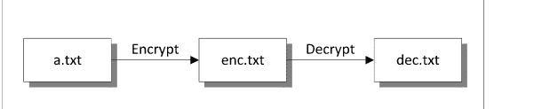

图 16.6

其余部分与我们讨论的相似。因此我不再重复解释。

从这个程序以及我们讨论的内容中可以得出以下结论：

- (a) 流是各种应用程序中非常重要的抽象。能够有效地操作流是极其重要的。Java 的实现允许我们这样做。例如，我们处理的数据可能来自文件、网络套接字或简单的内存缓冲区。
- (b) 我们也可以创建自己的流类。当我们这样做时，需要实现继承自基类的抽象方法。

## 练习

### [A] 判断下列陈述对错：

- (a) `System.out` 指标准输出流（控制台）。
- (b) `System.in` 指标准输入流（键盘）。
- (c) `System.err` 指标准错误流（控制台）。
- (d) 标准输出/输入/错误流已经打开并准备好提供/接收输入。
- (g) Java 的所有流类都定义在 `java.io` 包中。
- (h) `InputStreamReader` 和 `OutputStream` 类用于面向字符的 I/O。
- (i) `FileInputStream` 和 `FileOutputStream` 类用于面向字节的 I/O。
- (j) 如果我们以 Unicode 格式向文件写入，创建 `OutputStream` 对象时应使用 `enum.Unicode`。
- (k) 可以通过继承 `FilterReader` / `FilterWriter` 类创建自定义过滤器流。
- (l) Java 的实现使得流不需要知道数据的来源或目的地。

### [B] 回答以下问题：

(a) 一个成熟的输入/输出系统有哪些常见的预期？
(b) 我们可以从 Java 库中的 `File` 类继承新类吗？
(c) 如何检查给定的文件是否存在？
(d) 是否可以通过 Java 程序检查驱动器的数量、每个驱动器的类型以及驱动器格式类型？如果是，如何操作？
(e) 什么是流？
(f) 两种基本的 I/O 流是什么？
(g) 考虑以下代码片段：

```java
File f = new File("d:\\Test.java");
BufferedReader b = new BufferedReader(new FileReader(f));
String s;
// 在此处添加语句
```


你会添加什么语句来逐行读取文件并打印每一行？

## 324 让我们学习 Java

[C] 请为下列每个问题选择正确选项：

- (a) 数字 485000 使用字节流写入文件时将占用
  (1) 4 字节
  (2) 8 字节
  (3) 12 字节
  (4) 2 字节

- (b) 数字 485000 使用字符流写入文件时将占用
  (1) 4 字节
  (2) 8 字节
  (3) 6 字节
  (4) 2 字节

- (c) 给定一个 `File` 对象 `fobj`，如何判断它代表的是文件还是目录？
  (1) `System.out.println( fobj )`
  (2) `if ( fobj.isDirectory() )`
  (3) `if ( fobj.isFolder() )`
  (4) `if ( fobj.isFileDirectory() )`

- (d) 应该使用哪个导入语句来使用字节流的类？
  (1) `import java.bytestream.*`
  (2) `import java.io.*`
  (3) `import java.inputoutput.*`
  (4) `import io.*`

- (e) 应该使用哪个导入语句来使用字符流的类？
  (1) `import java.bytestream.*`
  (2) `import java.io.*`
  (3) `import java.inputoutput.*`
  (4) `import io.*`


* 对 IO 系统的期望：
  - 我应该能够与源和目的地通信
  - 我应该能够对各种实体进行 I/O 操作
  - 我应该能够以多种方式通信
  - 我应该能够处理底层的文件系统

* Java 解决方案 - 使用流（Streams）执行所有 10 种操作

* 流是一个字节序列，通过通信路径从源传输到目的地

* 流由 `java.io` 包中的类实现

* 流与物理设备的桥接由 Java I/O 系统完成

* Java 程序通过从流读取/向流写入数据来执行 I/O 操作

* 使用流的好处：
  - 流为程序员隐藏了通信的细节
  - 方法是相同的，实现随设备改变而改变

* 流的类型：1) 字节流 2) 字符流

* 字节流每次执行一个字节的 I/O。它们用于二进制数据的 I/O

* 字符流每次执行一个字符（2 字节）的 I/O。用于文本数据的 I/O

* 若要将 485000 作为字节序列写入文件，请使用字节流

* 若要将 "485000" 作为 Unicode 字符序列写入文件，请使用字符流

* 字节流类
  - `FileInputStream`, `FileOutputStream` - 从文件读/写字节流
  - `FilterInputStream`, `FilterOutputStream` - 过滤正在读取或写入的数据
  - `BufferedInputStream` - 提供缓冲能力
  - `DataInputStream` - 提供读取 Java 原始类型的能力

* 字符流类
  - `InputStreamReader`, `OutputStreamWriter` - 从流/向流读/写字符
  - `FileReader`, `FileWriter` - 从文件/向文件读/写字符
  - `PrintWriter` - 以文本形式格式化写入
  - `System` 类包含 3 个预定义的公共静态变量 - `in`, `out`, `err`，可以从程序的任何部分访问
    - `out` 指向标准输出流（屏幕）
    - `in` 指向标准输入流（键盘）
    - `err` 指向标准错误流（屏幕）
  - 这些流已经打开，并准备好接收/发送输入/输出数据

- 在 `System.out.println ("Hello");` 中：
  - `System` - 类
  - `out` - `PrintStream` 对象引用
  - `out` - `System` 类的公静态成员
  - `println()`, `print()` - `PrintStream` 类的成员

- 在以下情况下如何决定使用哪些类：
  - 你的数据格式是什么 - 文本还是二进制
    二进制 - `InputStream`, `OutputStream`
    文本 - `Reader`, `Writer`
  - 你是否需要随机访问能力？
    使用 `RandomAccessFile` 类
  - 是否处理对象？
    `ObjectInputStream`, `ObjectOutputStream`
  - 你的源和汇点是什么？
    Sockets, 文件
  - 你需要使用？
    字节流, 字符


## Java 中的多线程

为了帮助你理解多线程的挑战，你可以尝试一个简单的实验：给你的两个朋友打电话，并尝试同时与他们进行对话。这将涉及巨大的挑战——与一个朋友说话，将他挂起，记住你从哪里开始，然后拿起另一个听筒……

# 第 17 章：多线程

另一个朋友，将他挂起，拿起第一个听筒，从你离开的地方继续对话，最重要的是让参与对话的每个人都觉得对话是有意义的。

Java 提供了让你在程序中运行线程的特性。要创建多个线程，程序员必须指定他想要并发执行的哪些部分。虽然表面上看可能很简单，但请放心，多线程程序通常是复杂的，这需要你付出巨大的精力来掌握多线程涉及的所有问题。

任何简单的 Java 程序都只有一个执行线程。这个正在运行的线程有一个名为 `main` 的名称、一个优先级以及它所属的组。如果我们愿意，可以更改线程的名称。下方的程序已经演示了这一点。

```java
package main;

public class MainThread {
    public static void main(String args[]) {
        Thread t = Thread.currentThread();
        System.out.println("Current thread: " + t);
        t.setName("mythread");
        System.out.println("After name change: " + t);
        String s = t.getName();
        System.out.println("Thread name: " + s);
    }
}
```

这里是程序的输出...

```text
Current thread: main, 5, main
After name change: mythread, 5, main
Thread name: mythread
```

表示正在运行线程的对象通过调用 `Thread` 类的静态方法 `currentThread()` 获取。如果我们使用 `println()` 打印对象，就会得到线程的名称、它的优先级和它的线程组。注意输出中的 5 是默认优先级。1 代表最低优先级，10 代表最高优先级，因此 5 是平均优先级。

## 让我们学习 Java

一旦我们获得了 `Thread` 对象，就可以分别使用 `setName()` 和 `getName()` 方法设置或获取当前线程的名称。

可以让多个线程属于同一个组。如果这样做，那么就可以一起操作所有线程，而不是逐个进行操作。例如，我们可以通过单次方法调用启动或挂起一个组内的所有线程。

## 启动线程

在 Java 程序中启动新线程有两种机制。这些是：

- (a) 通过扩展 `Thread` 类
- (b) 通过实现 `Runnable` 接口

我们希望学习这两种启动线程的方法，并评估每种方法的用性。让我们从一个使用第一种方法的程序开始。

```java
package sample;

class Sample {
    public static void main(String args[]) {
        Ex t = new Ex();
        t.start();
        for (int i = 0; i < 5; i++) {
            System.out.println("Main thread");
        }
    }
}

class Ex extends Thread {
    public void run() {
        for (int i = 0; i < 5; i++) {
            System.out.println("New thread");
        }
    }
}
```

我们从 `Thread` 类派出了 `Ex` 类，并在内部定义了一个 `run()` 方法。该方法简单地打印 5 次消息“New Thread”。在 `main()` 中，我们创建了一个 `Ex` 类的对象，调用了 `start()` 方法，然后打印了 5 次“Main Thread”。

`start()` 方法定义在 `Thread` 类中，通过继承，`Ex` 对象可以使用该方法。一旦我们调用 `start()` 方法，线程就会被调度。这意味着我们正在通知线程调度器新线程已就绪。当线程调度器认为合适时，它将通过调用其 `run()` 方法来开始执行这个新线程。

程序的输出所示。

```text
Main thread
Main thread
Main thread
Main thread
Main thread
New thread
New thread
New thread
New thread
```

理想情况下，“Main thread”和“new Thread”消息本应该是交替出现的。但这种情况并没有发生，因为一旦时间片分配给了主线程，在那个时间片内它就会被夺走并分配给新线程。如果每个循环执行 1000 次，那么在分配给两个线程的每个时间片期间，每个线程都无法打印完所有 1000 条消息。这将导致消息的交替。

另一种获得交替消息的方法是让每个线程在获得时间片时睡眠 1000 毫秒。这将确保它们在获得的第一个时间片内不会完成整个打印过程。这种变化下文所示。

```java
package sample;

public class Sample {
    public static void main(String args[]) {
        Ex t = new Ex();
        t.start();
        try {
            for (int i = 0; i < 5; i++) {
                System.out.println("Main thread");
                Thread.sleep(1000);
            }
        } catch (Exception e) {
        }
    }
}

class Ex extends Thread {
    public void run() {
        try {
            for (int i = 0; i < 5; i++) {
                System.out.println("New thread");
                Thread.sleep(1000);
            }
        } catch (Exception e) {
        }
    }
}
```

`Thread` 类的静态方法 `sleep()` 将下一条指令的执行推迟 1000 毫秒。结果，现在的输出如下所示是交替的。

```text
Main thread
New thread
Main thread
New thread
Main thread
New thread
Main thread
New thread
Main thread
New thread
```

## 启动多个线程

不要认为我们只能从一个类创建一个线程。可以从同一个类创建多个线程。这在下面的程序所示。

```java
package sample;

public class Sample {
    public static void main(String args[]) {
        Ex t1 = new Ex();
        t1.start();
        t1.setName("First");

        Ex t2 = new Ex();
        t2.start();
        t2.setName("Second");

        Ex t3 = new Ex();
        t3.start();
        t3.setName("Third");

        try {
            for (int i = 0; i < 10; i++) {
                System.out.println("Main thread ");
                Thread.sleep(500);
            }
        } catch (Exception e) {
        }
    }
}

class Ex extends Thread {
    public void run() {
        Thread t = Thread.currentThread();
        String s = t.getName();
        for (int i = 0; i < 10; i++)
            System.out.println(s);
    }
}
```

在这里，启动三个线程时，我们为每个线程指定了名称，当这些线程获得时间片时，该名称会在循环中显示。

```text
First
First
First
First
First
Third
Third
Third
Third
Third
Main thread
Second
Second
Second
Main thread
Second
```

假设如果线程是为了显示来自 GIF 文件的动画。通过启动不同的线程，我们可以同时在屏幕的不同部分显示不同的动画。

当我们从主线程启动多个线程时，可能主线程结束了，而启动的线程继续执行。如果我们希望主线程是最后一个完成执行的线程，可以使用 `Thread` 类的 `join()` 方法来确保这一点，如下所示。

```java
System.out.println(t1.isAlive());
System.out.println(t2.isAlive());
System.out.println(t3.isAlive());

t1.join();
t2.join();
t3.join();

System.out.println(t1.isAlive());
System.out.println(t2.isAlive());
System.out.println(t3.isAlive());
```

在执行时，在对 `isAlive()` 的多次调用中，如果某些线程已经完成执行，则这些线程可能会返回 `false`。通过调用 `join()`，主线程将等待存活的线程完成执行，然后终止。自然地，第二组对 `isAlive()` 的调用对每次调用都会返回 `false`。

## 启动线程的另一种方式

到为止，我们一直在通过扩展 `Thread` 类并在其中实现 `run()` 方法来启动新线程。这种方法有一个局限性。一旦我们的类派自 `Thread` 类，我们就无法再继承任何其他类，因为 Java 不支持多重继承。如果我们希望保持类开放以便从某些其他类派生，并且仍然能够启动新线程，我们应该通过在其中实现 `Runnable` 接口来实现。这种启动新线程的方法如下所示。

```java
package sample;

public class Sample {
    public static void main(String args[]) {
        Ex t = new Ex("One");
        t.x.start();
        for (int i = 0; i < 10; i++)
            System.out.println("Main thread");
    }
}

class Ex implements Runnable {
    public Thread x;

    Ex(String n) {
        x = new Thread(this, n);
    }

    public void run() {
        int i;
        for (i = 0; i < 10; i++)
            System.out.println(x.getName());
    }
}
```

注意，我们没有让 `Ex` 派生自 `Thread` 类。相反，我们在它中实现了 `Runnable` 接口。`Runnable` 接口中只有一个方法——`run()`。

在创建 `Ex` 类对象时，我们在构造函数中创建了一个 `Thread` 类对象，并将其地址存储在公共引用 `x` 中。然后，从 `main()` 中我们使用这个 `x` 来调用 `Thread` 类的 `start()` 方法。通过这样做，我们是在通知 JVM 调度此线程。结果是 `run()` 方法被调用。在 `run()` 方法中，我们简单地打印了线程名称。

这是另一个使用 `Runnable` 接口启动线程的程序。区别在于，`Ex` 类的每个实例启动了多个线程。

```java
package sample;

public class Sample {
    public static void main(String args[]) {
        Ex t1 = new Ex("First");
        t1.x.start();

        Ex t2 = new Ex("Second");
        t2.x.start();

        Ex t3 = new Ex("Third");
        t3.x.start();

        for (int i = 0; i < 10; i++)
            System.out.println("Main thread");
    }
}

class Ex implements Runnable {
    public Thread x;

    Ex(String n) {
        x = new Thread(this, n);
    }

    public void run() {
        for (int i = 0; i < 10; i++)
            System.out.println(x.getName());
    }
}
```


# 第 17 章：多线程

```java
System.out.println("Main thread");

}

}

class Ex implements Runnable {

  Thread x;

  Ex ( String n ) {

    x = new Thread ( this, n );

  }

  public void run() {

    String s = x.getName();

    int i;

    for (i=0; i<10; i++)

      System.out.println(s);

  }

}
```

## 一个实用的多线程示例

假设我们希望将一个文件夹的内容复制到另一个文件夹。自然地，如果源文件夹包含多个文件，则每个文件都必须打开并将其复制到目标文件夹中的文件中。如果此操作是在单线程的循环中完成的，那么除非第一个文件的复制完成，否则第二个文件的复制无法开始。相反，更好的方法是在多个线程中进行复制。下面是两个遵循单线程和多线程方法的程序。为了简化起见，我们没有复制文件，而是简单地打开每个源文件，读取到末尾并报告每个文件的行数。

### 方法 1：在单线程中读取文件

```java
package java.io.*;

public class SingleThread {

  static public void main (String args[]) throws Exception {

    System.out.println("Starting Time: " + System.currentTimeMillis());

    for (int i = 0; i < args.length; i++) {

      FileReader fr = new FileReader ( args[i] );

      BufferedReader br = new BufferedReader ( fr );

      LineNumberReader l = new LineNumberReader ( br );

      while (l.readLine() != null )

        Thread.sleep ( 10 );

      System.out.println ( "Lines in " + args[i] + ":" + 

          l.getLineNumber() );

    }

    System.out.println ( "Ending Time: " +

        System.currentTimeMillis() );

  }

}
```

程序读取作为命令行参数提供的三个文件 `a.txt`、`b.txt` 和 `c.txt`。将这些文件添加到你的 NetBeans 项目中，右键点击项目并从弹出的菜单选择 `New | Empty File`。给出文件名（例如 `a.txt`）并输入几行内容。同样地将 `b.txt` 和 `c.txt` 添加到项目中。完成后，通过 `右键点击项目名 | Properties | Run | Arguments` 将这些文件名作为命令行参数。

在程序中，我们在开始读取文件之前和读取完成后打印当前的毫秒时间。这是通过使用 `System.currentTimeMillis()` 函数完成的。执行此程序时，我得到了以下输出：

```
Starting Time: 1480000000000
Lines in a.txt:13
Lines in b.txt:25
Lines in c.txt:37
Ending Time: 1480000005000
```

由于使用了 `LineNumberReader` 类，文件的读取已经完成。该类通过 `getLineNumber()` 方法报告文件的行数。

输出可能根据文件的内容而异。执行此程序时，时间差异为 5 毫秒。

### 方法 2：在多个线程中读取文件

现在让我们看看遵循多线程方法的程序。为了实现相同的目标，这里是...

```java
// 方法 2：在多个线程中读取文件

package multithread;

import java.io.*;

public class Multithread {

    static public void main (String args[]) throws Exception {

        System.out.println("Starting Time: " + System.currentTimeMillis());

        for (int i = 0; i < args.length; i++) {

            FileReader fr = new FileReader ( args[i] );

            BufferedReader br = new BufferedReader ( fr );

            LineNumberReader l = new LineNumberReader ( br );

            while (l.readLine() != null ) {

                Thread.sleep ( 10 );

            }

            System.out.println ( "Lines in " + args[i] + ":" + 

                l.getLineNumber() );

        }

        System.out.println ( "Ending Time: " +

            System.currentTimeMillis() );

    }

}

class Ex extends Thread {

    String fname;

    public Ex ( String str ) {

        fname = str;

    }

    public void run () {

        try {

            FileReader fr = new FileReader ( fname );

            BufferedReader br = new BufferedReader ( fr );

            LineNumberReader l = new LineNumberReader ( br );

            while (l.readLine() != null ) {

                Thread.sleep ( 10 );

            }

            System.out.println ( "Lines in " + fname + ":" +

                l.getLineNumber() );

        } catch ( Exception e ) {

        }

    }

}
```

这种时间差异是 387 毫秒。显然，多线程方法比单线程方法更好的选择。

## 同步

软件开发是一项团队工作。除非团队成员相互协作与其他团队的工作同步，否则团队无法长远发展。同样，如果程序中有多个线程在运行，除非它们的活动相互同步，否则情况将变得不可靠且混乱。例如，让我用一个简单的示例来说明线程同步的必要性。考虑以下方法：

```java
void display ( String msg ) {

  System.out.print ( "" );

  System.out.print ( msg );

  Thread.sleep ( 1000 );

  System.out.println ( "" );

}
```

假设三个不同的线程决定调用此方法来显示消息。预期此方法会将传递给它的消息在控制台显示出来。但实际上，如果传递给它的三个字符串分别是 `KICIT`、`Nagpur` 和 `India`，将会产生混乱的输出。

为了修正这个问题，我们需要同步每个线程的活动。如何实现这一点由下面的程序所示。

```java
package sample;

public class Sample {

    static public void main ( String args[] ) throws Exception {

        Output c = new Output();

        Ex t1 = new Ex ( c, "KICIT" );

        t1.start();

        Ex t2 = new Ex ( c, "Nagpur" );

        t2.start();

        Ex t3 = new Ex ( c, "India" );

        t3.start();

        t1.join();

        t2.join();

        t3.join();

    }

}

class Ex extends Thread {

    private Output o;

    private String message;

    public Ex ( Output c, String msg ) {

        o = c;

        message = msg;

    }

    public void run () {

        o.display ( message );

    }

}

class Output {

    public synchronized void display ( String msg ) {

      System.out.print ( "" );

      System.out.print ( msg );

      Thread.sleep ( 1000 );

      System.out.println ( "" );

    }

}
```

```java
class Output {

    synchronized void display ( String msg ) {

        System.out.print("[" + msg );

        try {

            Thread.sleep ( 1000 );

        } catch ( InterruptedException e ) {

        }

        System.out.println("]" );

    }

}
```

执行该程序将产生如下所示的预期输出。

```
[KICIT]
[NAGPUR]
[INDIA]
```

在该程序中，我们定义了两个类——`Ex` 和 `Output`。在 `main()` 中，我们创建了一个 `Output` 类对象和三个 `Ex` 类对象。`Ex` 类继承自 `Thread` 类。当创建 `Ex` 类对象时，连同 `Output` 类对象会将一个要打印的消息传递给它的构造函数。它将此消息存储在一个私有字符串变量 `message` 中。当从 `run()` 调用 `display()` 时，该消息会被传递给 `Output` 类的 `display()` 方法。

我想说明一种标准技术。在这里我们没有显式调用 `run()` 方法，`run()` 需要的任何对象必须传递给 `run()` 所属类的构造函数，这样 `run()` 才能访问它们。在我们的案例中，我们需要 `Output` 对象以便从 `run()` 方法中调用 `display()`。这就是为什么我们在创建 `Ex` 对象时将其传递给构造函数。

注意，`Output` 类中的 `display()` 函数被标记为 `synchronized`（同步）。这确保了一旦某个线程调用了 `display()`，在该线程中完成 `display()` 的执行之前，其他线程对 `display()` 的调用将被挂起。这产生了我们所需要的系统化输出。

## 同步块

有时，一个类的开发是为了在单线程环境下使用。但后来出现了在多线程环境下使用的需求。如果我们无法访问其源代码，就无法将方法标记为 `synchronized`。在这样的情况下，解决方案是使用同步块。

结合上一节中的程序，假设我们无法访问 `Output` 类的源码。我们无法将 `display()` 标记为同步方法。在这种情况下，我们只需要像下面在同步块中调用 `display` 即可获得所需的输出。

```java
public void run() {

    synchronized ( o ) {

        o.display ( message );

    }

}
```

## 线程间通信

同步章节中的程序无条件地阻止其他线程异步访问某些方法。为了提高程序的整体性能，应该有一种机制来通知等待线程它可以开始运行。这意味着一个线程应该能够与其他线程通信。为了实现这一点，Java 提供了三种方法——`wait()`、`notify()` 和 `notifyAll()`。下面是这些方法的用途。

| 方法 | 用途 |
| --- | --- |
| `wait()` | 让调用线程睡眠直到被通知 |
| `notify()` | 唤醒在同一对象上调用 `wait()` 的线程 |
| `notifyAll()` | 唤醒在同一对象上调用 `wait()` 的所有线程 |

使用这种方法有意义的场景之一是实现一种名为“生产者-消费者”的经典计算机科学算法。该算法在本章末的练习中进行了描述。

## 线程优先级

如果我们为每个运行线程分配优先级，这有助于调度器确定这些线程执行的顺序。高优先级线程对程序更重要，会在低优先级线程之前被分配处理器。Java 线程可以有三个标准优先级——`MIN_PRIORITY`、`MAX_PRIORITY`、`NORM_PRIORITY`。它们分别代表数字 1、10 和 5。Java 提供了以下函数来设置线程的新优先级并获取线程的当前优先级。

```java
final void setPriority ( int level )

final int getPriority()
```

## 练习题

### [A] 判断下列陈述的对错：

- (a) 多线程总是能提高程序的执行速度。
- (b) 正运行中的任务可能有几个线程在其中运行。
- (c) 多任务处理等同于多线程。
- (d) 如果我们创建一个继承自 `Thread` 类的类，我们仍然可以继承其他类。
- (e) 默认线程优先级是 10。
- (f) 高优先级线程可以抢占低优先级线程。
- (g) 更改运行线程的名称是可能的。
- (h) 为了启动一个线程，我们显式地调用扩展 `Thread` 类的类中定义的 `run()` 方法。
- (i) 为了同步类中定义的方法，我们必须拥有该类的源码。

### [B] 为下列每个问题选择正确的选项：

- (a) 如果一个 Java 程序在具有单处理器的机器上启动 5 个线程，会发生什么？
  - (1) 5 个线程将启动
  - (2) 1 个线程将启动
  - (3) 0 个线程将启动
  - (4) 会发生错误，因为单处理器无法处理 5 个线程

- (b) 下面哪些是创建线程的正确方法？
  - (1) 创建一个类并继承自 `Thread`
  - (2) 实现 `Runnable` 接口
  - (3) 创建一个线程类
  - (4) (1) 和 (2)

- (c) 考虑以下代码：
  ```java
  class Ex extends Thread
  ```
  ```java
  t = new Ex();
  t.start();
  ```
  为了创建一个多线程程序应该执行哪些操作？
  - (1) 在 `Ex` 类中定义 `run()` 方法
  - (2) 使用 `start()`
  - (3) 实现 `Runnable` 接口
  - (4) 派生自 `Thread` 类

- (d) 关于以下代码描述正确的是：
  ```java
  class Ex extends Thread {

      public void run()

  }
  ```


# 第 17 章：多线程

## 选择题

- (1) `run()` 方法被线程调用
- (2) 我们需要调用 `run()`
- (3) `start()` 将被调用
- (4) 实现 `Runnable` 接口

- 如果在 Java 程序中，一个线程负责复制，另一个线程负责检查检查，那么这两个线程
  - (1) 应该是同步的
  - (2) 不需要同步
  - (3) 应该顺序执行
  - (4) 应该是独立的

- 我们希望同步一个没有源码的旧程序。你将如何实现？
  - (1) 寻找源码
  - (2) 使用同步块
  - (3) 将方法标记为同步
  - (4) 重写代码

- 假设我们想要将一个目录的内容复制到另一个目录并显示进度条。实现这一点的正确方法是？
  - (1) 创建一个复制程序和另一个显示条程序。运行两个程序
  - (2) 在一个程序中创建两个线程——一个线程负责复制，另一个负责显示条
  - (3) 创建一个执行这两个任务的单线程程序
  - (4) 创建两个程序

## 简答题

- (a) 程序中有哪两种线程启动方法？
- (b) 使用两种启动线程方法的优缺点是什么？
- (c) 使用什么方法可以提高使用同步的多线程程序的性能？
- (d) 如果 `Ex` 类实现了 `Runnable` 接口，我们能为 `Ex` 对象启动多个线程吗？可以的话，如何？
- (e) 编写一个多线程程序，将一个文件夹的内容复制到另一个文件夹。源路径和目标路径应通过键盘输入。
- (f) 生产者-消费者算法是计算机科学中常用的算法。它是一种生成请求（生产者）和处理生成请求（消费者）的技术。编写一个程序来实现该算法以满足以下规范：
  - 生产者按顺序 0, 1, 2, ... 生成数字
  - 消费者通过打印消耗产生的数字
  - 生产者和消费者都作为独立线程工作
  - 当生产者正在产生时，消费者必须等待
  - 一旦生产者产生数字，它就会向消费者发送信号
  - 当消费者正在消费时，生产者必须等待
  - 一旦消费者消费完毕，它应该向生产者发送信号

---

# 第 17 章：多线程（知识笔记）

## 多线程的优势

- 提高应用程序的响应性
- 简化程序结构
- 在等待缓慢的 I/O 操作时执行其他任务
- 充分利用多处理器

## `Thread` 类常用方法

- `currentThread()` - 返回当前线程对象
- `setName()` - 为线程设置名称
- `getName()` - 返回指定线程的名称
- `sleep()` - 按指定的毫秒推迟下一条指令的执行

## 启动线程的两种方法

- 通过继承 `Thread` 类
- 通过实现 `Runnable` 接口

## 继承 `Thread` 类

- 优点：易于使用；可以重写与线程相关的函数
- 缺点：无法在多继承的情况下使用

## 实现 `Runnable` 接口

- 优点：可以在多继承的情况下使用
- 缺点：无法重写 `Thread` 类函数

## 同步机制

- 当 >=2 个线程访问同一个共享资源时，如果我们希望确保该资源一次只有一个线程使用，可以使用 `synchronized` 方法来实现
- 如果一个方法被声明为 `synchronized`，那么当多个线程调用它时，当第一个线程正在执行时，其他线程将等待
- 对于旧的类（无源码），可以使用 `synchronized` 块来实现相同的效果

## 线程通信与性能优化

- 线程通常会无条件地阻塞其他线程异步访问某些方法——这会影响性能
- 为了提高性能——使用 `wait()`、`notify()`、`notifyAll()` 方法
  - `wait()` - 告诉调用线程进入睡眠，直到被通知
  - `notify()` - 唤醒在同一对象上调用 `wait()` 的线程
  - `notifyAll()` - 唤醒所有在同一对象上调用 `wait()` 的线程

## 生产者-消费者算法

- 生产者生产请求，消费者消耗生成的请求
- 两者都作为独立线程工作
- 工作原理：
  - 当生产者正在生产时，消费者必须等待
  - 一旦生产者完成生产，它就会向消费者发送信号
  - 当消费者正在消费时，生产者必须等待
  - 一旦消费者完成消费，它就会向生产者发送信号

## 线程优先级

- 优先级用于调度线程的执行
- 高优先级线程获得更多的 CPU 时间，并可能会抢占低优先级线程
- 标准优先级常量：
  - `MIN_PRIORITY` (1)
  - `MAX_PRIORITY` (10)
  - `NORM_PRIORITY` (5)
- 设置和获取优先级的函数：
  - `final void setPriority(int level)`
  - `final int getPriority()`

---

# 第 18 章：泛型

泛型是一种使其能够使用一个类或处理许多不同数据类型的机制。通过使用泛型，我们可以设计一个处理多种类型数据的单一函数/类，而不再需要为每种类型创建一个单独的函数/类。在本章中，我们将首先查看在函数中使用泛型，然后转向在类中使用泛型。

## 泛型函数

假设你想要打印整数数组的内容。为了实现这一点，我们写了一个如下所示函数：

```java
void printIntArr(int[] arr) {
    for (int i : arr) {
        System.out.println(i);
    }
}
```

在这里，`printIntArr()` 定义为接收一个 `int` 数组，然后通过 `for` 循环打印其所有元素。如果我们想打印浮点数数组呢——我们将被迫编写一个全新的函数 `printFloatArr()`。同样，为了打印字符数组，我们需要编写 `printCharArr()`。

为了解决这个问题，我们可以使用重载函数，定义如下：

```java
// 整数型 printArr
void printArr(int[] arr) {
    for (int i : arr) {
        System.out.println(i);
    }
}
```

```java
// 浮点型 printArr
void printArr(float[] arr) {
    for (float i : arr) {
        System.out.println(i);
    }
}
```

```java
// 字符型 printArr
void printArr(char[] arr) {
    for (char i : arr) {
        System.out.println(i);
    }
}
```

## 泛型函数示例：获取最小值

为了帮助你纠正对泛型的概念，这里有另一个使用泛型函数的程序。该程序通过一个泛型 `minimum()` 函数获取两个数量的最小值。

```java
package minusinggenerics;

public class MinUsingGenerics {

    public static <T extends Comparable<T>> T minimum(T a, T b) {
        if (a.compareTo(b) < 0)
            return a;
        else
            return b;
    }

    public static void main(String[] args) {
        Float a = 3.14f, b = -6.28f, c;
        c = minimum(a, b);
        System.out.println(c);

        Character ch = 'A', dh = 'Z', eh;
        eh = minimum(ch, dh);
        System.out.println(eh);

        Double d = 1.1, e = 1.11, f;
        f = minimum(d, e);
        System.out.println(f);
    }
}
```

## 示例代码片段

```java
Character[] arr = {'Q', 'U', 'E', 'S'};
```


# 第 17 章：多线程

## 多线程的优势

- 提高应用程序的响应性
- 简化程序组织（结构）
- 在等待缓慢的 I/O 操作时执行其他任务
- 充分利用多处理器

## `Thread` 类

`Thread` 是 Java API 类。它包含了实用的方法：

- `currentThread()` - 返回当前线程对象
- `setName()` - 为线程设置名称
- `getName()` - 返回指定线程的名称
- `sleep()` - 按指定的毫秒推迟下一条指令的执行

## 启动线程的两种方法

- 通过继承 `Thread` 类
- 通过实现 `Runnable` 接口

### 继承 `Thread` 类

- 易于使用
- 可以重写与线程相关的函数
- 缺点：无法在多继承的情况下使用

### 实现 `Runnable` 接口

- 可以在多继承的情况下使用
- 缺点：无法重写 `Thread` 类函数

## 线程同步

- 如果需要读取多个文件，可以通过在多个并发线程中执行读取来缩短读取时间
- 当 `>=2` 个线程访问同一个共享资源时，如果我们希望确保该资源一次只有一个线程使用，可以使用 `synchronized` 方法来实现
- 如果一个方法被声明为 `synchronized`，那么当多个线程调用它时，当第一个线程正在执行时，其他线程将等待

# 第 17 章：多线程（续）

## 同步块与线程通信

- 对于旧的类，可以使用 `synchronized` 块来实现相同的效果
- 线程通常会无条件地阻塞其他线程异步访问某些方法——这会影响性能
- 为了提高性能——使用 `wait()`、`notify()`、`notifyAll()` 方法
  - `wait()` - 告诉调用线程进入睡眠，直到被通知
  - `notify()` - 唤醒在同一对象上调用 `wait()` 的线程
  - `notifyAll()` - 唤醒所有在同一对象上调用 `wait()` 的线程

## 生产者-消费者算法

生产者-消费者算法是一种生成请求和处理待处理请求的技术。

- 生产者生产请求，消费者消耗生成的请求
- 两者都作为独立线程工作

### 工作原理

- 当生产者正在生产时，消费者必须等待
- 一旦生产者完成生产，它就会向消费者发送信号
- 当消费者正在消费时，生产者必须等待
- 一旦消费者完成消费，它就会向生产者发送信号

## 线程优先级

线程优先级用于调度线程执行。

- 高优先级线程获得更多的 CPU 时间，并可能会抢占低优先级线程
- 标准优先级：
  - `MIN_PRIORITY`、`MAX_PRIORITY`、`NORM_PRIORITY`
  - 这些是值分别为 1、10、5 的常量
- 设置和获取优先级的函数：
  - `final void setPriority(int level)`
  - `final int getPriority()`


> 泛化是好的。特别是当编译器处理特化时……

---

# 第 18 章：泛型

泛型是一种使其能够使用一个类或处理许多不同数据类型的机制。通过使用泛型，我们可以设计一个处理多种类型数据的单一函数/类，而不再需要为每种类型创建一个单独的函数/类。在本章中，我们将首先查看在函数中使用泛型，然后转向在类中使用泛型。

## 泛型函数

假设你想要打印整数数组的内容。为了实现这一点，我们写了一个如下所示函数：

```java
void printIntArr(int[] arr) {
    for (int i : arr) {
        System.out.println(i);
    }
}
```

在这里，`printIntArr()` 定义为接收一个 `int` 数组，然后通过 `for` 循环打印其所有元素。如果我们想打印浮点数数组呢——我们将被迫编写一个全新的函数 `printFloatArr()`。同样，为了打印字符数组，我们需要编写 `printCharArr()`。

## 泛型函数示例

```java
Character[] arr = {'Q', 'U', 'E', 'S'};
```

这里是程序的输出：

```
10
2
37
42
3.14
-6.28
-1.5
```

## 边界泛型

上面的定义意味着该函数适用于所有实现了 `Comparable` 接口的类型。在我们的案例中，`Integer`、`Float` 和 `Character` 类实现了此接口，因此我们可以对这些类型使用 `min()` 函数。

注意，此函数无法使用 `>`、`<` 等关系操作符来比较两个 `Integer` 或两个 `Float` 对象。为了实际执行比较，我们使用了 `Integer` / `Float` / `Character` 类的 `compareTo()` 函数。

我们可以扩展相同的比较逻辑，编写一个使用泛型排序函数对 `Integer`、`Float`、`Character` 进行排序的程序。如下：

```java
package genericsorting;

public class GenericSorting {
    public static void main(String[] args) {
        Float num[] = { 5.4f, 3.23f, 2.15f, 1.09f, 34.66f };
        Integer arr[] = { -12, 23, 14, 0, 245, 78, 66, -9 };
        sort(num, 5);
        for (int i = 0; i <= 4; i++)
            System.out.print(num[i] + " ");
        System.out.println();
        sort(arr, 8);
        for (int i = 0; i <= 7; i++)
            System.out.print(arr[i] + " ");
    }

    public static <T extends Comparable<T>> void sort(T[] n, int size) {
        int i, j;
        for (i = 0; i <= size - 2; i++) {
            for (j = i + 1; j <= size - 1; j++) {
                if (n[i].compareTo(n[j]) > 0) {
                    T t = n[i];
                    n[i] = n[j];
                    n[j] = t;
                }
            }
        }
    }
}
```

程序的输出如下：

```
1.09 2.15 3.23 5.4 34.66
-12 -9 0 14 23 66 78 245
```

我不打算解释排序逻辑的实际工作原理。这个主题在数据结构的标准书中已经详细讨论过。你在这里需要关注的是如何编写可以适用于多种数据类型的泛型函数。

## 多参数类型

在本章到为止看到的所有程序中，泛型函数只对一种类型有效。但我们也可以写一个在调用时接受不同类型参数的泛型函数。下面的代码展示了这样一个泛型函数。

```java
package typesgenericfunction;

public class MulitpleTypesGenericFunction {
    public static void main(String[] args) {
        Integer i = 10;
        Float j = 3.14f;
        Character ch = 'A';
        printTypes(i, j, ch);
    }

    public static <T, S, Z> void printTypes(T a, S b, Z c) {
        System.out.println("a = " + a);
        System.out.println("b = " + b);
        System.out.println("c = " + c);
    }
}
```

`printTypes()` 函数可以接收由 `T`、`S` 和 `Z` 表示的三种不同类型的参数。它只是打印它收到的所有参数。如果我们向它传递相同类型的参数，该函数还能工作吗？是的，它可以工作。因此，下面的调用是完全有效的。

```java
Integer i = 10, m = 20, n = 30;
printTypes(i, m, n);
```

## 泛型类

泛型的概念可以扩展到类。泛型类通常用于数据存储。事实上，Java 提供了一个容器类库，这些类实现了栈、队列、链表、二叉树、哈希表等数据结构。这些实现都是基于泛型类的。

让我们尝试实现一个泛型类来实现栈（`Stack`）类。这个类应该能够维护一个包含 `Integer`、`Float`、`Character` 等栈。这里是一个使用了这个泛型栈类的程序。

```java
package genericstack;

public class GenericStack {
    public static void main(String[] args) {
        Stack<Integer> s1;
        s1 = new Stack<Integer>(10);
        if (!s1.isFull())
            s1.push(10);
        if (!s1.isFull())
            s1.push(20);
        if (!s1.isFull())
            s1.push(30);
        int data1;
        if (!s1.isEmpty()) {
            data1 = s1.pop();
            System.out.println(data1);
        }
        if (!s1.isEmpty()) {
            data1 = s1.pop();
            System.out.println(data1);
        }
        Stack<Float> s2;
        s2 = new Stack<Float>(10);
        if (!s2.isFull())
            s2.push(10f);
        if (!s2.isFull())
            s2.push(20f);
        if (!s2.isFull())
            s2.push(30f);
    }
}
```

## 边界泛型类

```java
class Statistics<T extends Number> {
    private T arr[];

    Statistics(T[] obj) {
        arr = obj;
    }

    public double getAverage() {
        double sum = 0.0;
        for (int i = 0; i < arr.length; i++) {
            sum = sum + arr[i].doubleValue();
        }
        return (sum / arr.length);
    }
}
```

这个程序非常直观，我认为你可以很容易理解它。`doubleValue()` 方法将指定数字的值以 `double` 类型返回。

## 练习题

### [A] 判断对错

(a) Java 支持泛型类，但不支持泛型函数。
(b) 我们可以从泛型类继承一个新类。
(c) 使用泛型函数可以节省内存。
(d) 泛型函数无法用于 `int`、`float`、`char` 等基本类型。
(e) 泛型函数可以接收多种类型的参数。
(i) 泛型类描述了功能，但不绑定到任何类型。

### [B] 回答以下问题

(a) 编写一个程序，通过泛型类实现链表。
(b) 编写一个程序，该程序包含一个泛型类，除了整数和浮点数外，还能对日期和字符串进行排序。

### [C] 选择正确的选项

(a) 如果 `printArray()` 是一个能够打印任何数值数组的泛型函数，那么调用它的正确方式是？

```java
(1) int[] arr = { 10, 20, 30, 40, 50 };
printArray(arr);

(2) float[] arr = { 1.1, 1.2, 1.3, 1.4, 1.5 };
printArray(arr);

(3) Integer[] arr = { 10, 20, 30, 40, 50 };
printArray(arr);

(4) char[] arr = { 'A', 'B', 'C', 'D', 'E' };
printArray(arr);
```

(b) 泛型函数可以与以下类型工作：
(1) `byte`
(2) `char`
(3) `float`
(4) `Float`

(c) 关于下面的 `fun()`，哪个陈述是正确的：

```java
public static <T> void fun(T[] arr) {
    for (T i : arr) {
        System.out.println(i);
    }
}
```

(1) 它是一个泛型函数。
(2) 它正在接收任何引用类型的数组
(3) 它正在打印它接收到的数组的所有元素
(4) (1)、(2) 和 (3)

(d) 关于下面给代码片段，哪个陈述是正确的：

```java
public static <T> minimum(T a, T b) {
    if (a.compareTo(b) < 0)
        return a;
    else
        return b;
}
```

(1) 它返回接收到的两个参数中较小的一个
(2) 它仅适用于派生自 `Number` 类的类型
(3) 它仅适用于实现了 `Comparable` 接口的类型
(4) 它可以与任何类型的基本类型


## 知识笔记

- 泛型促进了源代码级别的复用，而继承促进了字节码级别的复用
- 可以创建泛型函数，也可以创建泛型类
- 一旦泛型函数/类准备就绪，我们就可以配合任何引用类型使用
- 基本类型通常被称为值类型，而类被称为引用类型

### 定义和调用泛型函数的语法

```java
// 调用泛型函数
Integer[] intarr = { 10, -2, 37, 42, 15 };
printArray(intarr);
```

```java
// 泛型函数定义
public static <T> void printArray(T[] arr) {
    ..
}
```

### 可以处理实现了 `Comparable` 接口的类型的泛型函数

```java
public static <T extends Comparable<T>> T min(T a, T b) {
    ...
}
```

### 可以接收多种类型的泛型函数

```java
public static <T, S, Z> void printTypes(T a, S b, Z c) {
    ...
}
```

### 使用和定义泛型类的语法

```java
// 使用泛型类
Stack<Integer> s1;
s1 = new Stack<Integer>(10);
s1.push(10);
```

```java
// 定义泛型类
class Stack<T> {
    ..
}
```

### 边界泛型类

边界泛型类将其使用限制为那些派生自指定类型的引用类型。例如，以下类将仅适用于派生自 Java API `Number` 类的类型：

```java
class Statistics<T extends Number> {
    ..
}
```


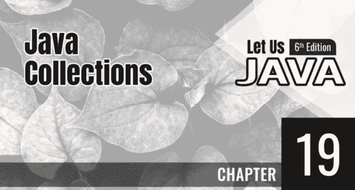

有许多访问数据的方法。让我们开始吧。

## 为什么采用新方法？

- 我们想要固定大小的数组。
- 我们希望数组能够随着元素的增加而增大。
- 我们需要动态集合。
- 我们需要以不同的方式维护数据：
  - 后进先出（栈）
  - 先进先出（队列）
  - 排序
  - 键映射，如键（值）。

## 数据结构

- 栈
- 链表
- 树
- HashMap
- 算法
- 练习

## 第 19 章：Java Collections

Java 成为处理数据的流行选择。这些包含了 `Vector`、`Set`、`Dictionary` 等类。然而，这种方法缺乏统一的处理方式。当它引入时，出现了一类类被称为集合框架（Collections Framework）。

- 它包含了用于大多数数据结构的类，如栈、队列、列表、二叉树、哈希表等。

为了处理所有动态情况，引入了一个全新的基于泛型的 Java 库，被称为集合框架。其特点如下：

- 由于集合框架基于泛型，它可以处理任何类型的数据。
- 集合框架提供了非常高效的类来执行大多数管理。不要将其与磁盘上的数据数据库管理混淆。集合框架主要管理内存中的数据。
- 集合的使用有一致性列表。例如，示例 `add()` 函数可向不同的集合添加新数据。无论队列或链表内部如何组织数据，程序员为添加元素所做的调用都是相同的。
- 与其从零开始整个实现相比，可以通过通常继承规则轻松地扩展集合框架，以满足我们的特定需求。

## 姓名与数字数组

让我们来看看如何使用集合框架。我们将首先开始管理一组姓名和一组数字。这可以使用 `ArrayList` 类集合来完成。下面的程序展示了如何实现这一操作。

```java
package arraylistdemo;

import java.util.*;

public class ArrayListDemo {

    public static void main(String[] args) {

        ArrayList<String> alnames = new ArrayList<>();

        alnames.add("Shashank");
        alnames.add("Prasanna");
        alnames.add("Nimesh");
        alnames.add("Karun");
        alnames.add("Rajgopal");

        System.out.println("contents of al: " + alnames);

        alnames.add(2, "Aditya");
        alnames.remove(3);
        alnames.remove("Karun");

        System.out.println("contents of al: " + alnames);

        if (alnames.contains("Aditya"))
            System.out.println("Aditya is present in the array list");

        ArrayList<Integer> alnums;
        alnums = new ArrayList<>();

        alnums.add(10);
        alnums.add(20);
        alnums.add(30);
        alnums.add(40);

        int sum = 0;

        for (int i = 0; i < alnums.size(); i++)
            sum = sum + alnums.get(i);

        System.out.println("sum = " + sum);

        Integer arr[] = new Integer[alnums.size()];
        arr = alnums.toArray(arr);

        sum = 0;

        for (int n : arr)
            sum += n;

        System.out.println("sum = " + sum);
    }
}
```

这里是 `alnames` 的输出：

```text
contents of alnames: [Shashank, Prasanna, Nimesh, Karun, Rajgopal]
contents of alnames: [Shashank, Prasanna, Aditya, Rajgopal]
Aditya is present in the array list
sum = 100
sum = 100
```

程序首先创建一个 `ArrayList` 对象来存储字符串，并使用 `add()` 函数向其中添加名称。如果我们需要，也可以在创建 `ArrayList` 对象时通过向构造函数传递大小来传递初始大小。在创建对象后，我们在特定位置添加了一个新名称（使用重载的 `add()` 函数），并从特定位置删除了名称（使用 `remove()` 函数）。因此，添加、插入和删除操作是非常直观的。

使用 `println()` 打印整个 `ArrayList` 内容有一种简单的方法。请注意，`ArrayList` 以动态方式维护列表。我们没有在任何地方指定它的大小。随着我们不断添加元素，它会不断增长。`contains()` 函数帮助我们判断特定元素是否存在于列表中。

重要的一点是，当维护数字数组而不是姓名数组时，`ArrayList` 类的用法完全没有变化。

通过使用 `get()` 函数获取每个整数，得到了所有整数的和。请注意 `get()` 返回的是 `Integer`，即 `int`。`size()` 函数返回列表的当前大小。

由 `ArrayList` 维护的数组可以使用 `toArray()` 函数转换为普通的 Java 数组。然后可以使用程序所示的特殊 `for` 循环对该数组进行迭代。

## 维护栈

栈（Stack）是一种数据结构，其中新元素的添加或现有元素的删除始终发生在同一个端。这个端通常被称为栈顶（top of stack）。这种情况可以比作食堂里的一叠盘子，添加到栈中的每个新盘子都位于顶部。同样，从栈中取的每个盘子也来自栈顶。因此，栈是一个后进先出（LIFO）列表。当项添加到栈中时，该操作称为 `push`；当从栈中移除项时，该操作称为 `pop`。

下面是一个使用 `Stack` 类维护城市名称栈的程序。请注意，在调用 `pop()` 函数之前，我们需要断言栈是否还留有元素。这是通过调用 `isEmpty()` 函数实现的。

```java
package stackDemo;

import java.util.*;

public class StackDemo {

    public static void main(String args[]) {

        Stack<String> s;
        s = new Stack<>();

        s.push("Delhi");
        s.push("Nagpur");
        s.push("Indore");
        s.push("Raipur");
        s.push("Mysore");
        s.push("Mumbai");

        String str;

        if (!s.isEmpty()) {
            str = s.pop();
            System.out.println(str);
        }
    }
}
```

```java
if (!s.isEmpty()) {
    str = s.pop();
    System.out.println(str);
}
```

## 维护链表

链表是一种用于在内存中存储相似数据的非常常用的数据结构。虽然数组的元素占用连续的内存位置，但链表的元素并不受限于存储在相邻的位置。单个元素存储在内存的“某处”，类似于数组，但仍然连接在一起。元素的顺序通过显式链接维护。（注：已合并）

```java
package linkedlistdemo;

import java.util.*;

public class LinkedListDemo {

    public static void main(String args[]) {

        LinkedList<String> ll;
        ll = new LinkedList<>();

        ll.add("Subhash");
        ll.add("Rahul");
        ll.add("Joe");
        ll.add("Vineeta");

        for (String s : ll) {
            System.out.println(s);
        }

        ll.set(2, "Neha");
        System.out.println(ll);

        String name = ll.get(2);
        System.out.println("String at 2 = " + name);

        ll.add(3, "Sanjay");
        System.out.println(ll);

        ll.remove(1);
        System.out.println(ll);
    }
}
```

这里是程序的输出：

```text
Subhash
Rahul
Joe
Vineeta
[Subhash, Rahul, Neha, Vineeta]
String at 2 = Neha
[Subhash, Rahul, Neha, Sanjay, Vineeta]
[此处省略]
```

## 维护树

链表、栈和队列等数据结构是线性数据结构。与此相反，树是非线性数据结构。在链表中，每个节点有一个指向另一个节点的链接。但在树结构中，每个节点可以指向多个节点（这些节点可能再指向其他节点等）。因此，树是一种非常灵活且强大的数据结构，可以广泛应用于各种场景。例如，假设我们使用一种数据结构来表示一个人及其所有的后代。假设这个人的名叫 Rahul，他有 3 个孩子：Sanjay、Sameer 和 Nisha。还假设 Sameer 有 3 个孩子：Abha、Ram 和 Madhu，而 Nisha 有一个孩子 Neha。我们可以用图 19.3 所示的树结构来表示 Rahul 及其后代。

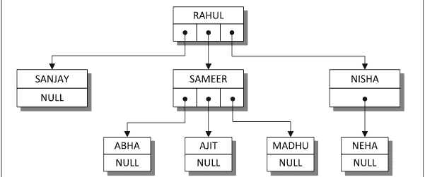

图 19.4

注意，每个树节点包含一个数据的名称和一个指向其他树节点的指针。

虽然通用树节点可以包含任意数量的指针，但许多数据结构最多指向两个其他节点。这种树被称为二叉树。

许多使用二叉树的算法分为两个阶段。第一阶段构建二叉树，第二阶段遍历树。假设我们希望遍历二叉树时能够按顺序访问元素。为了确保这一点，我们需要在插入时正确安排元素。简单的逻辑是将插入元素与根节点元素进行比较，如果元素小于节点元素，则走左分支；如果元素大于或等于节点元素，则走右分支。因此，如果输入列表为：

3, 9, 1, 4, 7, 11

然后使用这种插入方法，就会生成图 19.4 所示的二叉树。

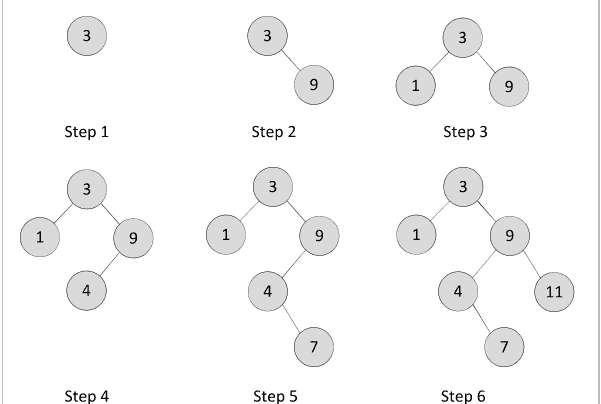

图 19.4

二叉树具有属性：每个节点 `n` 左子树中的所有元素都小于 `n` 的内容。而 `n` 右子树中的所有元素都大于或等于 `n` 的内容。具有这些属性的二叉树被称为二叉搜索树。

如果按序遍历二叉搜索树（即按照左子节点、根节点、右子节点的顺序），则每个节点的内容将打印出来，每个数字将按升序打印。下面给出的程序演示了这一点。

```java
package treesetdemo;

import java.util.*;

public class TreeSetDemo {

    public static void main(String args[]) {

        TreeSet<Integer> ts;
        ts = new TreeSet<>();

        ts.add(3);
        ts.add(9);
        ts.add(1);
        ts.add(4);
        ts.add(7);
        ts.add(11);

        System.out.println(ts);
        System.out.println(ts.subSet(4, 11));

        ts.clear();
        System.out.println(ts);
    }
}
```

执行程序后，会产生以下输出：

- [1, 3, 4, 7, 9, 11]
- [4, 7, 9, 11]
- []

从输出中你可以看到，`subSet()` 函数提供了所有介于传递给它的节点之间的节点。此外，要一次性删除树中的所有节点，可以使用 `clear()` 函数。

## 维护 HashMap

`HashMap` 类允许我们维护一组键-值对。例如，我们可以维护手机号和名称的键值对，或者维护英语和印地语星期名称的键值对。对于每个键，可以维护多个值。例如，对于手机，我们可以存储名称、地址和照片。键值对的存储顺序可能与插入顺序不相同。我们可以通过打印 hashmap 获取它们被维护的顺序。下面的程序展示了这一点。

```java
package hashmapdemo;

import java.util.*;

public class HashMapDemo {

    public static void main(String args[]) {

        HashMap<String, String> hm;
        hm = new HashMap<>();

        hm.put("Sun", "Ravi");
        hm.put("Mon", "Som");
        hm.put("Tue", "Mangal");
        hm.put("Wed", "Budh");
        hm.put("Thu", "Guru");
        hm.put("Fri", "Shukra");
        hm.put("Sat", "Shani");

        System.out.println(hm);

        String str;
        str = hm.get("Wed");
        System.out.println("Wed in hindi is " + str);
    }
}
```

程序的输出如下所示。注意，`get()` 函数可以获取与传递给它的键相关的值。

```text
{Thu=Guru, Tue=Mangal, Wed=Budh, Sat=Shani, Fri=Shukra, Sun=Ravi, Mon=Som}
Wed in hindi is Budh
```

## 使用算法

我们希望在集合上执行许多操作。这些包括搜索、排序、查找最小值、查找最大值等。在集合框架的术语中，这些被称为算法，并可以在 `Collections` 类的静态方法中可用。`Arrays` 类中也提供了相同的较小版本。给出的程序展示了如何使用 `Arrays` 类中的这些算法。

```java
package arraysDemo;

import java.util.*;

public class ArraysDemo {

    public static void main(String[] args) {

        int arr[] = new int[5];
        Random r = new Random();

        for (int i = 0; i < arr.length; i++) {
            arr[i] = r.nextInt(25);
            System.out.println(arr[i]);
        }

        Arrays.sort(arr);
        System.out.println("After sorting: ");

        for (int i = 0; i < arr.length; i++)
            System.out.println(arr[i]);

        Arrays.fill(arr, 2, 4, -3);
        System.out.println("After filling: ");

        for (int i = 0; i < arr.length; i++)
            System.out.println(arr[i]);

        int pos;
        pos = Arrays.binarySearch(arr, -3);
        System.out.println("pos = " + pos);
    }
}
```


这里是程序的输出。

15
13
13
2
18
After sorting:
2
13
15
18
After filling:
2
13
-3
18
pos = 2

程序使用 `Random` 类的 `nextInt()` 函数生成随机数，然后填充数组。接下来，调用 `sort()` 函数进行排序。`fill()` 函数填充第 2 个到第 4 个位置。`binarySearch()` 函数在数组中搜索 -3。

希望你已经了解如何使用集合框架。你可以自己探索集合类、接口和算法。

### [A] 判断对错：
(a) 集合通过 `Collections` 类提供算法。
(b) Java 集合框架基于泛型。
(c) 使用 `ArrayList` 维护键-值对。
(d) 插入和访问顺序是相同的。
(e) `ArrayList` 类可以动态伸缩。
(f) 集合元素存储在相邻的位置。
(g) 栈是先入先出的。
(h) 所有二叉树都由 `TreeSet` 类维护。
(i) 集合可以按顺序维护元素。

### [C] 编写一个维护手机号和电子邮件地址作为值的 `HashMap` 程序。

### [B] 为下列问题选择正确的选项：
(a) 使用 Java 集合框架的正确语句是：
(1) `import java.io.*`
(2) `import java.util.*`
(3) `import java.*`
(4) `import java.collections.*`

(b) 集合以以下形式维护数据：
(1) `int`
(2) `float`
(3) `double`
(4) 引用类型

(c) 考虑以下代码片段：
```java
ArrayList<int> num = new ArrayList<>();
num.add(10);
num.add(20);
```
为了使上述代码工作，需要什么？
(1) 将 `ArrayList` 替换为 `Vector`
(2) 将 `ArrayList` 替换为 `LinkedList`
(3) 将 `int` 替换为 `Integer`
(4) 代码将完美工作

(d) 考虑以下代码片段：
```java
ArrayList<Integer> num = new ArrayList<>();
num.add(10);
num.add(20);
num.add(30);
num.add(40);
Integer arr[] = new Integer[num.size()];
// 在此处添加语句
for (int n : arr)
    System.out.println(n);
```
添加哪个语句使代码工作？
(1) `arr = num.toArray(arr);`
(2) `arr = num;`
(3) `arr = num.convert(arr);`
(4) `arr = convert(arr);`

(e) 下哪项不是 Java 集合框架中的接口？
(1) `TreeSet`
(2) `Set`
(3) `SortedSet`
(4) `NavigableSet`

---

# 目录
* 一个简单的 Swing 应用程序
* 事件处理
* 另一个 GUI 应用程序
* 适配器类
* 接下来做什么？
* 练习题
* 笔记 (KanNotes)

# 第 20 章：用户界面

在当今以 GUI 为中心的世界里，Java 程序被认为应该能够使用文本框、列表框、组合框、推按钮、单选按钮、复选框、滚动条等按钮 GUI 元素与用户进行交互。为了方便这种交互，Java 提供了三个库——活动窗口工具包（AWT）、Swing 和 JavaFX。其中，AWT 是较旧的库。此外，世界现在已经转向了 Swing 或 JavaFX 库。事实上，Swing 内部使用了 AWT。从这个意义上说，Swing 是构建在 AWT 之上的。在本章中，我们将看到如何使用 Swing 库构建简单的 GUI 应用程序。

## 一个简单的 Swing 应用程序

在此应用程序中，目标是创建并显示图 20.1 所示的窗口。你可以看到，此窗口有两个标签、两个文本字段和一个按钮。在摄氏度文本字段中输入温度并点击“转换（Convert）”按钮后，程序应该将温度转换为华氏度，并将其显示在第二个文本字段中。

下面是使用 NetBeans 创建此应用程序时应执行的步骤。

**步骤 I** – 创建 Java 应用程序，将项目命名为 `GUIApp`。在磁盘上选择一个合适的位置来创建此应用程序的文件。取消勾选“创建主类（Create Main Class）”复选框。

**步骤 II** – 为应用程序创建窗口，向应用程序添加一个新的 `JFrame` 表单。为此，在项目窗口中右键点击 `GUIApp` 项目，选择“新建（New）”，然后选择“JFrame 表单（JFrame Form）”。此时系统会要求你提供表示窗口的类名。将 `ConvertTemp` 作为类名并点击“完成（Finish）”按钮。

**步骤 III** – 步骤 II 结束后，NetBeans 中会出现一个窗口。我们需要在这个窗口中插入容器（面板 `Panel`）和控件（标签 `Labels`、文本字段 `Text fields`、按钮 `Button`）。从框架窗口旁的 Swing 控件和控件中将它们拖入此处。

**步骤 IV** – 更改两个标签控件和一个按钮控件的“文本（text）”属性值。为两个标签赋值为“Temp in Degree Centigrade（摄氏度温度）”和“Temp in Degree Fahrenheit（华氏度温度）”。为按钮赋值为“Convert（转换）”。注意，可以通过“属性（Properties）”窗口通过输入新值来更改属性值。

**步骤 V** – 将两个文本字段和按钮名称分别更改为 `txtTempC`、`txtTempF` 和 `btnConvert`。可以通过右键点击控件并选择“更改变量名（Change variable name…）”项来实现。

**步骤 VI** – 添加按钮处理器——选择“Convert”按钮，转到事件窗口（“属性”窗口中的另一个选项卡）并双击 `actionPerformed` 事件。为处理程序命名为 `btnConvertActionPerformed()`。

**步骤 VII** – 在上述步骤 VI 中创建的处理器中添加以下代码。

```java
private void btnConvertActionPerformed(java.awt.event.ActionEvent evt) {
    String str;
    float f, c;
    str = txtTempC.getText();
    c = Float.parseFloat(str);
    f = c * 9 / 5 + 32;
    str = Float.toString(f);
    txtTempF.setText(str);
}
```

**步骤 VIII** – 使用 F6 编译并执行程序。执行后将出现带有我们插入的容器和控件的窗口。

提供摄氏度温度并点击转换按钮后，将显示华氏度温度。

以上是关于使用 Swing 库创建第一个 GUI 应用程序的内容。让我们现在我们在这个应用程序中做了什么。下面是向导在我们创建应用程序时为我们生成的源代码。

```java
package convertttemp;

public class ConvertTemp extends javax.swing.JFrame {
    private javax.swing.JPanel jPanel1;
    private javax.swing.JLabel jLabel1;
    private javax.swing.JLabel jLabel2;
    private javax.swing.JTextField txtTempC;
    private javax.swing.JTextField txtTempF;
    private javax.swing.JButton btnConvert;

    public ConvertTemp() {
        initComponents();
    }

    public static void main(String args[]) {
        /* 创建并显示表单的代码 */
    }
}
```

当我们向我们的应用程序添加 `JFrame` 表单并将其命名为 `ConvertTemp` 时，一个继承自 Swing 类 `JFrame` 的同名类被插入到我们的应用程序中。我们可以从上面的代码中观察到继承关系，并注意 `main()` 现在存在于该类中。

对于我们可以在窗口中拖入的每个容器和控件，都有相应的 Swing 类。例如，对于面板，有一个 `JPanel` 类；对于按钮有一个 `JButton` 类；对于文本字段有一个 `JTextField` 类。这些类定义在 `javax.swing` 包中。因此，当我们把它们拖入窗口并命名时，`ConvertTemp` 类中就会创建这些命名的私有变量。

但在某些地方也需要创建 `JPanel`、`JButton`、`JTextField` 等对象。嗯，这就是从 `ConvertTemp()` 构造函数调用的 `initComponents()` 函数中所做的。事实上，如果你查看此函数，你会发现除了创建这些对象外，还会设置这些对象的属性。这些包括位置、大小、颜色等。

## 事件处理

当我们执行上述步骤 VI 时，在 `initComponents()` 中添加了对函数 `addActionListener()` 的调用。该调用是使用 `btnConvert` 的。此调用将 `ActionListener` 接口与 Convert 按钮绑定。`ActionListener` 接口中包含以下方法声明：

```java
void actionPerformed(ActionEvent e);
```

在 `initComponents()` 中，该方法在一个类（通常称为匿名类）中实现。该类的对象被传递给 `addActionListener()` 方法。

当我们点击 Convert 按钮时，会发生一个 `actionPerformed` 事件。该事件的信息封装在一个 `ActionEvent` 对象中。然后，该对象被传递给匿名类 `actionPerformed()` 方法的控件。通过我们的事件处理器——会调用 `btnConvertActionPerformed()` 函数。在这个方法中，我们进行温度转换并将结果显示在文本框中。

据说 Java 事件处理使用了事件委托模型（Event Delegation model）。这意味着处理事件的责任被委托（分配）给监听器。因此，显示控件和生成事件的逻辑与响应这些事件的逻辑完全分离。

在这一模型中，监听器需要注册到源对象（在本例中为按钮）上，这样事件通知只会发送给那些想要接收它的监听器。

## 另一个 GUI 应用程序

现在我们已经熟悉了 GUI 应用程序的创建及其工作，让我们再创建一个应用程序来帮助你完善思路。该应用程序的窗口和控件如图 20.2 所示。

如你在图 20.2 所示，窗口中有几个标签、4 个文本框（用于姓名、年龄、工资和地址）、1 个列表框（用于员工等级）、2 个单选按钮（用于员工性别）、3 个复选框（用于员工爱好）以及 1 个按钮 [Show按钮]。用户将与不同的控件交互，并为员工输入或选择数据值。一旦点击 Show 按钮，输入或选择的值就应该像图 20.3 所示显示在消息框中。

要创建此应用程序，你应该完全遵循在上一节中创建第一个 GUI 应用程序时讨论的相同步骤。

关于此应用程序中的 GUI，你还需要做的一件事是管理男性/女性单选按钮的互斥性。要实现这一点，首先插入两个单选按钮，然后插入一个按钮组（`ButtonGroup`）控件。将两个单选按钮的 `ButtonGroup` 属性更改为与按钮组控件名称相同的值。完成后，你每次只能选择两个单选按钮中的一个。

此外，对于组合框（`ComboBox`），默认模型属性将有一些默认值。编辑此属性添加 Grade I、Grade II、Grade III 和 Grade IV 等值。

再次为按钮添加一个用于 `actionPerformed` 事件的事件处理器。在事件处理器中编写编写以下代码，以便在消息框中显示输入/选择的值。

```java
private void btnShowActionPerformed(java.awt.event.ActionEvent evt) {
    String str3, str1, str2;
    String strName;
    String strAge;
    String strGrade;
    String strSalary;
    String strAddress;
    String strSex = "";
    String strReading = "";
    String strTravelling = "";
    String strSports = "";

    strName = txtName.getText();
    strAge = txtAge.getText();
    strSalary = txtSalary.getText();
    strAddress = txtAddress.getText();
    strGrade = cbGrade.getName();

    if (rbMale.isSelected()) {
        strSex = rbMale.getText();
        if (rbFemale.isSelected())
            strSex = rbFemale.getText();
        if (cbxSports.isSelected())
            strSports = cbxSports.getText();
        if (cbxReading.isSelected())
            strReading = cbxReading.getText();
        if (cbxTravelling.isSelected())
            strTravelling = cbxTravelling.getText();

        str1 = strName + "\n" + strAge + "\n" + strSalary + "\n" +
               strAddress + "\n" + strGrade + "\n";
        str2 = strSex + "\n" + strSports + "\n" + strReading + "\n" +
               strTravelling + "\n";
        JOptionPane.showMessageDialog(null, str1, "Employee Info",
                                      JOptionPane.INFORMATION_MESSAGE);
    }
}
```

在这个事件处理器中，我们通过调用 `getText()` 函数从文本框中提取值。哪些单选按钮和复选框被选中是通过 `isSelected()` 函数检查的。实际选择再次使用 `getText()` 函数获取。从组合框中选择的等级使用 `getName()` 函数收集。

从这些函数中提取的所有字符串都连接在一起，并添加 `"\n"` 以将值分隔成多行。最后，使用 `JOptionPane` 类的静态方法 `showMessageDialog()` 显示最终字符串 `str1`。信息图标使用枚举值 `INFORMATION_MESSAGE` 显示。

## 适配器类

假设我们希望在 GUI 应用程序中与鼠标交互。为此，我们需要添加 `MouseListener` 接口。如果我们只想响应 `mouseClicked` 事件，仍然需要实现接口的所有方法。

```java
void mouseClicked(MouseEvent e);
void mouseReleased(MouseEvent e);
void mouseEntered(MouseEvent e);
void mouseExited(MouseEvent e);
```


当接口有许多方法时，提供空实现会很繁琐。为了避免这种情况，Java 提供了适配器类，每个接口一个。因此，对于 `MouseListener` 接口，有一个名为 `MouseAdapter` 的等效类。该类包含空方法。现在我们只需要继承适配器类并重写 `mouseClicked()` 函数即可。很聪明！

# 接下来

Java Swing 中有很多控件和接口。本章的目的是介绍其中一些，并讨论创建现代 GUI 和处理事件的基本原理。尽管如此，通过这一章你接触了 Swing API。其余你可以自由探索。

# 第 20 章：用户界面

## 练习题

### [A] 判断对错：

- (a) 容器和控件之间没有区别。
- (b) 控件必须在容器中才能可见和可用。
- (c) 对于可以插入窗口的每个控件，都有一个现成的类。
- (d) 所有的 Swing 类都定义在 `javax.gui` 包中。
- (e) 我们可以通过向适配器类添加新方法来修改它们。
- (f) 对于 Swing 库中的每个事件相关接口，都有一个等效适配器类。
- (g) 适配器类中的方法是空实现。
- (h) 我们可以通过实现接口的所有方法来避免使用适配器类。
- (i) 事件委托模型确保了创建控件和事件的代码与响应事件的代码保持分离。

### [B] 回答以下问题：

- (a) 编写一个程序，创建一个窗口并在你用左鼠标按钮点击的位置处显示消息“Hello”。
- (b) 修改上面的程序，在左点击时显示“Hello”，右点击时显示“Bye”。
- (c) 编写一个程序，绘制一个直线、矩形和椭圆的

---

# 402
# 让我们 Java


- 为 Java 程序提供输入的三种方式：
  - 控制台 IO - 从键盘输入，输出到屏幕
  - 命令行参数
  - GUI 元素，如文本框、按钮、组合框、菜单等
- GUI 库：AWT - 旧的方式，Swing - 较新的方式
- 对于每一个窗口和控件都有可用的 Swing 类
- 事件（Event）是发生的事情
- Java 使用事件委托模型 - 事件处理的责任被委托（分配）给监听器（Listeners）
- GUI 中涉及的程序元素 - 源（Sources）、事件（Events）、监听器（Listeners）、适配器（Adapters）
- 源是用于控件的类。所有类都是 `java.awt.Component` 的子类
- 为了表示控件可能生成的事件，存在许多事件类
  - 例：按钮、菜单 - `ActionListener`
  - 例：窗口 - `Window`
- 事件监听器是接口（Interfaces）。不同的控件对应不同的监听器
  - 例：按钮、文本框 - `ActionListener`
  - 例：鼠标 - `MouseListener`, `MouseMotionListener`
- 适配器是抽象类（Abstract classes）。每个监听器对应对应一个抽象类
- 适配器包含了所有接口方法的空方法体
- 适配器的设计思想 - 继承并只重写需要的函数


世界充满了数据。如果你知道如何以专业的方式处理数据，你就处于了主导地位……

# 目录

- 数据组织
- 常用数据库操作
- 通过 Java 进行数据库操作
- JDBC 架构
- JDBC 驱动类型
- MySQL 数据库安装
- 常用 JDBC API 组件
- 实践
- 练习
- 笔记 (KanNotes)

# 第 21 章：JDBC

数据就是王！在当今的数字世界中，产生并交换着大量的数据。所有数据最终都存储在数据库中。作为一名 Java 程序员，必须知道如何通过程序处理这些数据。为了帮助我们实现，Java 提供了一个名为 JDBC 的 API。它代表 Java Database Connectivity（Java 数据库连接）。该 API 允许我们编写与各种数据库交互的 Java 程序。本章将讨论如何实现这一点。

# 数据组织

现代数据组织方式是使用关系型数据库管理系统（RDBMS）。不同的供应商提供这些 RDBMS 软件，包括 Oracle、Microsoft、IBM 等。也有许多开源实现版本，其中最流行的是 MySQL。所有这些 RDBMS 都可以通过 JDBC API 访问。

这些 RDBMS 每个都以不同表格的形式组织数据。一个数据库可能包含多个表。每张表包含以记录（行）形式组织的数据。每条记录可能包含多个字段（列）。

例如，一家公司可能有一个包含 `Employees`（员工）的数据库，该表包含有关组织内工作员工的记录。每条记录可能包含姓名、年龄、薪水等字段。

与此不同，大学数据库可能由学生、教授、课程、考试、费用等表组成。表与表之间建立关系也是可能的。例如，如果一个学生支付了费用，那么其缴费的记录就可以与他在学生表中的记录关联起来。这是一个一对一的关系。如果学生多次支付费用，那么它就会变成一对多的关系。

# 常用数据库操作

对于任何类型的数据库，都需要执行一组典型操作。这些操作如下：

- (a) 创建表 (Create Table) - 通过指定名称及其包含的字段以及每个字段的类型来创建表。
- (b) 修改表 (Modify Table) - 修改不同字段的规范，或添加/删除某些字段。
- (c) 删除表 (Drop Table) - 从数据库中删除表及其所有的记录。

为了执行这些操作，创建了一种简单的语言。它被称为 SQL，代表 Structured Query Language（结构查询语言）。这种语言提供了类似于英语的语句来执行数据库操作。几乎所有的 RDBMS 都支持 SQL，它允许你独立于底层的 RDBMS 操作数据库。

下面是执行数据库操作的一些示例 SQL 语句。每个 SQL 语句之前的注释将帮助你理解该 SQL 语句正在执行的操作。

```sql
// 创建名为 Persons 的表，包含两个字段：类型为 int 的 EmpID
// 以及长度为 255 的变长字符串 Name
CREATE TABLE Persons ( EmpID int, Name varchar(255) )
```

```sql
// 通过添加一个类型为 date 的 DateOfBirth 字段修改 Persons 表
ALTER TABLE Persons ADD DateOfBirth date
```

```sql
// 通过删除 DateOfBirth 列修改 Persons 表
ALTER TABLE Persons DROP COLUMN DateOfBirth
```

```sql
// 删除 Customers 表
DROP TABLE Customers
```

SQL 还提供了对表的语句，包括创建新记录、读取现有记录、更新现有记录、删除现有记录。简而言之，这些被称为 CRUD 操作。执行这些操作的 SQL 语句通常被称为 SQL 查询。下面是执行 CRUD 操作的一些示例 SQL 语句。

```sql
// 在 Persons 表中插入一条新记录，EmpID 和 Name 分别为 1001 和 Sunil
INSERT INTO Persons ( EmpID, Name) VALUES ( 1001, 'Sunil' )
```

```sql
// 从 Employees 表中读取所有记录
SELECT * FROM Employees
```

```sql
// 通过更改 Name 来修改记录，
// 改为 Satish
UPDATE Persons SET Name = 'Satish' WHERE EmpID = 1001
```

```sql
// 从 Students 表中删除记录
DELETE FROM Students WHERE EmployeeID = 1244
```

# 406 让我们 Java

# 第 21 章：JDBC

# 通过 Java 进行数据库操作

上一节中提到的操作是通过 SQL 执行的。现在让我们看看如何通过 Java 执行这些操作。创建、修改和删除表是不频繁的操作。更常见的操作是 CRUD 操作。可以通过以下对象执行 CRUD 操作：

- (a) `Connection` - 连接数据库
- (b) `Statement` - 执行 SQL 语句
- (c) `ResultSet` - 处理 SQL 查询的结果

在 Java 程序中使用这些对象之前，我们需要了解 JDBC 架构并安装 RDBMS。我们选择的数据库是 MySQL，因为它是免费的。JDBC 架构和 MySQL 安装将在后续章节讨论。

# JDBC 架构

为了帮助程序员与数据库通信，供应商提供了特定的 JDBC 驱动。例如，Oracle 提供了 JDBC 驱动帮助程序员与其维护的数据库通信。同样，Microsoft 提供了 JDBC 驱动帮助程序员与其维护的 MS SQL 通信。

Java 程序员必须有一种标准且统一的方法与任何第三方 JDBC 驱动通信。为了方便这一点，一个名为 `Driver` 的接口在 `java.sql` 包中声明。第三方数据库供应商在其驱动程序中实现了该接口。

为了管理不同的 JDBC 驱动，有一个名为 `DriverManager` 的组件。例如，通过 Java 程序尝试连接数据库时，`DriverManager` 会加载合适的 JDBC 驱动。因此，`DriverManager` 确保了访问每个数据库时使用正确的驱动。

一旦驱动加载，我们就可以使用 JDBC API 中提供的不同类与数据库交互。

JDBC 架构的各个层级如图 21.1 所示。

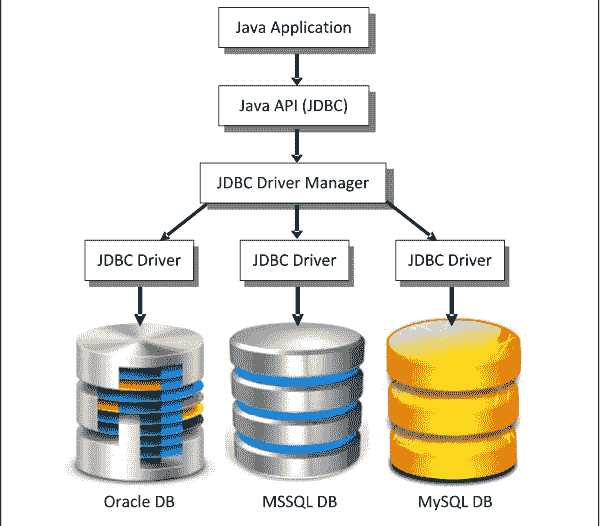

图 21.1

# JDBC 驱动类型

Java 的实现适用于各种操作系统和硬件。这些平台本身多年来一直在演变。针对这些不同的平台有不同的 JDBC 驱动实现。所有这些驱动被分为 4 类——第 1 类驱动、第 2 类驱动、第 3 类驱动和第 4 类驱动。大多数旧应用程序使用第 1、2、3 类驱动，而连接现代数据库时使用第 4 类驱动。对于本书中的程序，必须安装第 4 类驱动。

## MySQL 数据库安装

我们希望在 Windows 机器上安装 MySQL。为此，我们首先需要下载 MySQL Installer。可以在 `https://dev.mysql.com/downloads/windows` 下载。下载完成后，执行此 MySQL Installer。当出现安装组件的选项时，选择 MySQL database 和 JDBC。在编写本书时，JDBC 驱动包含在 `mysql-connector-java-5.1.40-bin.jar` 中。

一旦 MySQL 数据库和驱动安装完成，从下面提供的 URL 下载适用于你 Windows 版本的 MySQL Workbench 并安装它。

`https://dev.mysql.com/downloads/benchmark/`

Workbench 提供了一个集成工具，用于执行以下操作：

- (a) 数据库设计
- (b) 尝试 SQL 查询
- (c) 数据库管理
- (d) 数据库迁移

在本章的后续部分，我们将看到如何使用 MySQL Workbench 创建数据库及其表。我们还将看到如何使用 JDBC 驱动通过程序与数据库进行交互。

## 常用 JDBC API 组件

JDBC API 提供了不同的类和接口。在之前的章节中，我们已经看到了三个类的作用——`Connection`、`Statement` 和 `ResultSet`。除了它们，JDBC API 还提供了其他几个类和接口。其中重要的如下：

- (a) `DriverManager`：此类提供加载和管理 JDBC 驱动的服务。
- (b) `Driver`：这是一个接口。每个 JDBC 驱动都实现此接口。它处理与数据库服务器的通信。

在 Java 程序中，我们很少直接操作 `Driver`。相反，我们使用 `DriverManager` 对象，由它来管理 `Driver` 对象。

- (c) `SQLException`：此类处理数据库应用程序发生的任何错误。

## 开始工作

我们现在已经了解了数据组织、数据库操作的 SQL 语句、JDBC 架构和 JDBC API 组件。我们还看到了如何安装 MySQL 和 MySQL Workbench。现在是时候编写一个 Java 程序来完成以下操作：

- (a) 创建名为“study”的 Schema。在其中插入表“Accounts”，并为其添加三个字段——ID、Name 和 Balance。
- (b) 使用 MySQL Workbench 向表中添加 4 条记录，包含以下数据：

| ID | Name | Balance |
|---|---|---|
| 1011 | Neha | 4000.50 |
| 1023 | Sunil | 5000.00 |
| 1021 | Rohit | 6000.75 |
| 1044 | Rahul | 5600.55 |

- (c) 创建一个字段值为 1001, Joe, 5000.00 的记录。
- (d) 获取并打印所有记录。
- (e) 更新记录 – 将 Sunil 改为 Sanjay。
- (f) 删除 ID 为 1044 的记录。

在这些步骤中，步骤 (a) 和 (b) 将使用 MySQL Workbench 执行，而其余通过 Java 程序执行。

因此，让我们创建一个 schema，向其中添加表，然后添加 4 条记录。执行以下步骤来实现这一目标：

- (a) 双击图标启动 MySQL Workbench。通过选择菜单 `File | New Model` 创建一个新 schema（数据库）。默认会创建一个名为 mydb 的 schema。它将显示在“Physical Schemas”选项卡下。
- (b) 双击 mydb schema。会弹出对话框。通过此对话框将该 schema 的 Name 改为 "study"。
- (c) 从 "study" 选项卡双击 "Add Table" 图标。表名为 "Accounts"。
- (d) 点击页面底部的 Columns，创建三个具有以下属性的列。

| Column Name | Datatype | Primary Key |
|---|---|---|
| ID | INT | Yes |
| Name | VARCHAR(255) | No |
| Balance | FLOAT | No |

- (e) 点击屏幕底部的 "Inserts"。将显示 ID、Name 和 Balance 列。根据上述问题陈述中提到的值添加 4 条记录。

现在我们已经到了一个阶段，可以编写 Java 程序来执行问题陈述中的步骤 (c), (d), (e) 和 (f)。以下是程序程序...

```java
package mydbjccrud;

import java.sql.*;

public class MyJdbcCRUD {

    static final String jdbcDriver = "com.mysql.jdbc.Driver";

    static final String dbURL = "jdbc:mysql://localhost/study";

    public static void main(String[] args) throws Exception {

        Connection conn = null;
        Statement stmt = null;
        ResultSet rs = null;

        try {
            Class.forName(jdbcDriver);
            conn = DriverManager.getConnection(dbURL, "root", "admin");
            stmt = conn.createStatement();

            String sql;
            sql = "INSERT INTO Accounts VALUES ( 1001, 'Joe', 5000.00 )";
            stmt.executeUpdate(sql);

            sql = "UPDATE Accounts SET Name = 'Sanjay' WHERE ID = 1023";
            stmt.executeUpdate(sql);

            sql = "SELECT * FROM Accounts";
            rs = stmt.executeQuery(sql);

            int id;
            String name;
            float balance;

            while (rs.next()) {
                id = rs.getInt("ID");
                name = rs.getString("Name");
                balance = rs.getFloat("Balance");
                System.out.println(id + "\t" + name + "\t" + balance);
            }
        } finally {
            if (rs != null) rs.close();
            if (stmt != null) stmt.close();
            if (conn != null) conn.close();
        } catch (Exception e) {
            e.printStackTrace();
        }
    }
}
```

## 第 21 章：JDBC

在执行程序之前，需要完成一项小工作。我们需要添加 JDBC 库。请按照以下步骤进行此操作：

- (a) 在项目窗口中，右键点击“MyJDBCCCrud”项目中的“Libraries”（库）节点。
- (b) 从弹出的菜单中选择“Add JAR/Folder”（添加 JAR/文件夹）。
- (c) 导航到下载了 `mysql-connector-java-5.1.40-bin` 文件的相应目录。
- (d) 点击“Open”（打开），然后点击“OK”（确定）。

添加库后，我们现在可以使用 F6 编译并运行程序。


# [A] 判断对错

- (a) 一个数据库可以包含多个数据表。
- (b) MySQL 是一个开源关系型数据库管理系统（RDBMS）。
- (c) 现代数据库使用 T3 类型的 JDBC 驱动程序。
- (d) JDBC 的优点是同一个驱动程序可以用于连接多个 RDBMS。
- (e) 调用 `Class.forName()` 会加载并注册 JDBC 驱动程序。
- (f) 可以使用 `Statement` 对象的 `execute()` 方法删除表中的记录。
- (g) 为了从表中读取一组记录，我们必须使用 `Statement` 对象的 `executeUpdate()` 方法。
- (h) 应该从你的程序中调用驱动类的方法以获取
- (j) 在将数据库表读取到 `ResultSet` 对象时，会返回一组记录。

# **B** 回答以下问题

- (a) 编写一个程序，允许通过图 21.2 所示的 GUI 执行 CRUD（增删改查）操作。使用“实际应用”（Putting it to Work）章节中讨论的数据库和表。

注意，所有添加到表中的记录都应该显示在列表框中。在执行删除（Delete）或更新（Update）操作之前，应该使用 ID 搜索记录。点击 Commit（提交）按钮时，应添加新记录或修改现有记录。

| ID | 姓名 | 余额 |
| :--- | :--- | :--- |
| 1 | Rahul | 4000 |
| 2 | Janaki | 2300 |
| 3 | Siva | 4324 |
| 4 | Mrunal | 2334 |
| 5 | Vineeta | 3456 |
| 6 | Roja | 6000 |
| 7 | manoj | 7000 |

# **C** 为以下每个问题选择正确的选项

- (a) CRUD 操作代表什么？

  (1) CREATE, READ, UPDATE, DELETE
  (2) CREATE, REMOVE, UPDATE, DROP
  (3) CLEANUP, REMOVE, UPGRADE, DROP
  (4) CLEANUP, RECTIFY, UPGRADE, DELETE

- (b) 此代码片段：

  ```java
  Connection conn;
  conn = DriverManager.getConnection(dbURL, "root", "admin");
  ```

  以下哪种是创建 `Statement` 对象的**正确**方式？

  (1) `Statement stmt = conn.createStatement();`
  (2) `Statement stmt = createStatementObject();`
  (3) `Statement stmt = new StatementObject();`
  (4) `Statement stmt = conn.createStatementObject();`

- (c) 以下代码片段中应添加哪条语句以向 Accounts 表中插入一条新记录：

  ```java
  Statement stmt;
  stmt = conn.createStatement();
  String sql = "INSERT INTO Accounts VALUES (1001, 'Joe', 5000.0)";
  // 在此处添加语句
  ```

  (1) `stmt.executeQuery(sql);`
  (2) `stmt.executeUpdate(sql);`
  (3) `stmt.executeUpdate(sql);`
  (4) `stmt.executeInsert(sql);`

- (d) 以下哪种是使 `Statement`、`Connection` 和 `ResultSet` 对象可**正确**方法？

  (1) `import Statement, Connection, ResultSet`
  (2) `import Statement, Connection, ResultSet from SQL`
  (3) `import java.sql.*`
  (4) `import sql.*`

# 术语

- **Field（字段）**——单个信息项
- **Record（记录）**——字段的集合
- **Table（表）**——记录的集合
- **Database（数据库）**——表的集合
- 不同的厂商提供 RDBMS。例如：Oracle, MS SQL, MySQL
- 所有数据库都使用 SQL 对数据库或表执行操作
- SQL 语句通常被称为查询，是英语语句
- 所有的 RDBMS 都可以通过 Java API - JDBC 访问。向这些 API 需要传递 SQL 查询
- 常见的数据库操作 - 创建表 / 修改表 / 删除表
- 数据库操作示例：

  ```sql
  CREATE TABLE Persons (ID int, Name varchar (255))
  ALTER TABLE Persons Add DateOfBirth
  ALTER TABLE Persons DROP COLUMN DateOfBirth
  DROP TABLE Customers
  ```

- 这些数据库操作通常使用每个数据库附带的工具来完成
- 数据库操作示例：

  ```sql
  CREATE TABLE Persons (ID int, Name varchar (255))
  ALTER TABLE Persons Add DateOfBirth
  ALTER TABLE Persons DROP COLUMN DateOfBirth
  DROP TABLE Customers
  ```

- 操作示例：

  ```sql
  CREATE TABLE Persons (ID int, Name varchar (255))
  ALTER TABLE Persons Add DateOfBirth
  ALTER TABLE Persons DROP COLUMN DateOfBirth
  DROP TABLE Customers
  ```

（注：原文中存在多处重复段落，此处已按要求保留并翻译）

# 第 22 章：网络与互联网编程

(m) 网络适配器的作用是在有线和无线网络上传输和接收数据。

## 网络模型

在网络发展的早期，同一制造商的 PC 之间可以相互通信。随着网络化的普及，人们感到需要帮助供应商创建具有互操作性的网络设备和软件。网络中涉及的典型问题包括如何创建数据包、如何从一个主机到另一个主机进行路由和校验、如何支持多个操作系统、如何处理异构网络布线等。

为了这一目标，ISO 在 20 世纪 70 年代定义了标准的开放系统互连模型（OSI）。OSI 使用一个 7 层网络模型，每层负责网络通信的不同方面（如上所述）。

对于互联网，计算行业将 OSI 模型的各个层合并为了单一的层。因此，出现了一种称为 TCP/IP 的 4 层模型。该模型如图 22.2 所示。

| 应用层 | 数据 | 应用层 |
| :--- | :--- | :--- |
| 传输层 | 数据 | 传输层 |
| 网络层 | 数据 | 网络层 |
| 网络接口层 | 数据 | 网络接口层 |

--> 每一层的逻辑连接
--> 数据的物理移动

图 22.2

每层的目的简述如下：

- (a) **应用层** - 该层为用户应用程序提供服务，用于发送/接收电子邮件、网页浏览、文件传输、音频和/视频流媒体等。
- (b) **传输层 (TCP 层)** - 该层确保为应用层提供一个可靠的通道。这意味着它确保从连接的一端发送的任何内容都能到达另一端，没有错误或遗漏，且顺序与发送时一致。

  传输层可能需要将数据拆分成数据包并交给 IP 层。TCP 层必须在数据包中包含序列信息，以便在远端按正确顺序重新组装，并检测数据包是否丢失。当发生丢失时，它还需要能够重新发送数据包。
- (c) **网络层 (IP 层)** - 该层的功能是将传输层提供的数据包从互联网上的源地址传输到目的地址。
- (d) **网络接口层** - 该层执行实际的比特传输，涵盖各种网络如以太网、WiFi、光纤等实现。

每个接收方接收来自下层的服务，并向其上层提供服务。某层不需要了解其下层的任何信息。它仅仅使用为其提供的服务。这允许任何层被替换为替代方案，只要底层层提供的服务是相同的，上层和下层就不会关心。

例如，网络接口层的一种实现可以通过以太网发送数据，而另一种实现处理通过电话线发送数据。网络层不需要了解网络接口层的任何信息。网络接口层提供的标准服务（无论是以太网还是电话线传输数据）都允许网络层以完全相同的方式工作。因此，分层模型使得网络通信的复杂性更容易管理。

注意，每一层都认为自己正在直接与另一台机器上的相同层进行通信。数据向下通过一层时，会添加一个特定该层的头部（header）和尾部（trailer）。同样，当数据到达另一端并向上层传输时，头部和尾部会被剥离。

## 协议

协议是网络、计算机和应用程序之间同意的用于执行设备间通信的规则集。

TCP/IP 模型每层常用的协议如图 22.3 所示。

| 应用层 | HTTP | SMTP | POP3 | FTP | SSH | Telnet |
| :--- | :--- | :--- | :--- | :--- | :--- | :--- |
| 传输层 | TCP | | UDP | | | |
| 网络层 | IPv4 | IPv6 | ICMP | ARP | RIP | |
| 网络接口层 | Ethernet | AppTalk | Token Ring | | | |

图 22.3

每一层可用的协议比图 22.3 所示的要多得多。所有这些协议都由操作系统（OS）及其组件以协议栈的形式实现。

以太网协议指示了比特如何以不同的速度通过不同的物理介质（如 CAT5 网线、光纤等）传输。

IP 协议提供了从源机器到目的机器传输数据块的功能。主机通过称为 IP 地址的唯一地址进行标识。

IP 是“尽力而为”的（best effort）。它不保证交付数据的正确性。数据包可能会丢失、重复或可能按乱序交付。数据包交付的这些方面由 TCP 和 UDP 等传输层协议解决。

应用层使用的协议根据应用程序的意图来选择。例如，浏览互联网使用 HTTP 协议，发送电子邮件使用 SMTP 和 POP3 协议。

我们本章中的大多数程序将使用应用层中的协议。

## 数据包

传统的电信链路仅以系列字节、字符或比特的形式传输数据。与此不同，在计算机网络中，数据是以数据包（Packets）的形式传输的。这就是互联网通常被称为分组交换网络的原因。一旦数据格式化为数据包，网络就可以更高效、更可靠地传输更消息。

数据包由三个元素组成——头部（header）、负载（payload）和尾部（trailer）。正如名称所示，头部和尾部用于标记数据包的开始和结束，而负载要传输的实际数据。

## IP 地址

为了识别网络中的设备，必须有一个称为 IP 地址的唯一地址。有两种地址方案：IPv4 和 IPv6。IPv4 地址使用点进制表示法，例如 `192.168.1.1`。IPv6 地址使用十六进制表示法。

IP 是尽力而为的。它不保证交付数据的正确性。数据包可能会丢失、重复或乱序交付。

为了保证唯一性，IP 地址由一个称为互联网分配局（IANA）的中央机构创建和管理。IANA 将区块分配给区域注册机构，再由后者将更小的区块分配给互联网提供商和企业。

## 套接字

网络常用的另一个术语是套接字（Socket）。套接字是标识通信通道端点的软件结构。应用程序将其作为底层网络和协议的接口。Java 网络 API 提供了创建套接字并通过它们发送数据包的类。

## 端口号

在下载文件的同时通过电子邮件应用程序发送电子邮件是很常见的。这里，电子邮件应用程序与另一台机器上的邮件服务器通信，而网页浏览器与运行在另一台机器上的 Web 服务器通信。运行电子邮件应用程序和网页浏览器的机器 IP 地址相同。在这种情况下，Web 服务器发送的数据不应该去电子邮件应用程序；同样，邮件服务器发送的数据不应该去网页浏览器。为了避免此类情况，电子邮件应用程序和网页浏览器在同一机器（IP 地址）上使用不同端口的套接字。这些端口是逻辑端口，而不是物理端口。它们不应与 HDMI 或 USB 端口混淆。

邮件程序和网页浏览器是标准应用程序。因此，它们不需要给 Web 服务器所在地打电话询问它正在使用哪个端口号，以便向其发送请求下载文件。IANA 负责分配标准端口号。使用常用协议的应用程序使用的端口号如下：

- HTTP - 80
- SMTP - 25
- POP3 - 110
- FTP - 20, 21
- Time - 37
- Telnet - 23
- Whois - 43

## 428 让我们使用 Java

图 22.4 捕捉了我们在上述段落中讨论的内容精华。

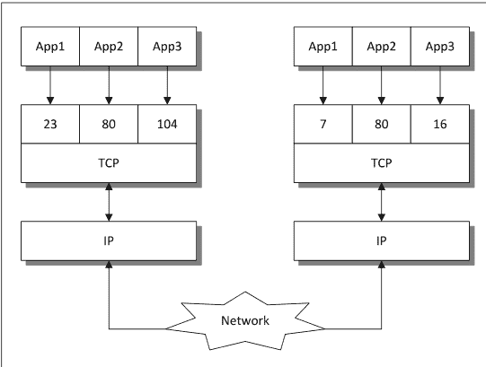

图 22.4

## 开始上手...

在对网络通信有了合理的介绍后，现在让我们来编写一个程序，获取不同主机的 IP 地址和名称。以下是该程序...

```java
package addresses;
import java.net.InetAddress;
```

```java
public class Addresses {
    public static void main(String[] args) {
        try {
            InetAddress ia = InetAddress.getLocalHost();
            System.out.println("Name and address: " + ia);
            System.out.println("Address: " + ia.getHostAddress());
            System.out.println("Name: " + ia.getHostName());
        }
    }
}
```

# 第 22 章：网络与 Internet 编程

```java
ia = InetAddress.getByName("8.8.8.8");
System.out.println("Name: " + ia.getHostName());
System.out.println("Address: " + ia.getHostAddress());
System.out.println("Reachable: " + ia.isReachable(3000));
```

```java
ia = InetAddress.getByName("www.google.com");
System.out.println("Name: " + ia.getHostName());
System.out.println("Address: " + ia.getHostAddress());
System.out.println("Reachable: " + ia.isReachable(3000));
```

```java
InetAddress[] ias = InetAddress.getAllByName("www.microsoft.com");
for (int i = 0; i < ias.length; i++) {
    System.out.println(ias[i]);
}
catch (UnknownHostException ex) {
    ex.printStackTrace();
}
```

这里是程序的输出...

我的名字和地址是 KanetkarDell/192.168.100.223

我的地址是 192.168.100.223

我的名字是 KanetkarDell

Name: google-public-dns-a.google.com

Address: 8.8.8.8

Reachable: false

Name: www.google.com

Address: 216.58.199.164

Reachable: false

microsoft.com/23.57.232.223

现在让我们尝试理解这个程序。

`InetAddress` 类用于封装数值型 IP 地址以及该地址的域名。它可以同时处理 IPv4 和 IPv6 地址。

## 430

## 让我们使用 Java

`InetAddress` 类没有公共构造函数。因此，要创建一个 `InetAddress` 对象，我们必须使用工厂方法之一。工厂方法是类中的一种静态方法，它用于创建对象并返回其地址。这比提供重载构造函数是更好的替代方案，因为唯一的工厂名称使得使用变得更加容易。三个常用的 `InetAddress` 工厂方法是 `getLocalHost()`、`getByName()` 和 `getAllByName()`。

`getLocalHost()` 方法返回代表本地主机的 `InetAddress` 对象。`getByName()` 方法返回传递给它的主机的 `InetAddress`。在互联网上为了实现可扩展性，一个名称被用于表示几台机器。`getAllByName()` 工厂方法返回一个 `InetAddress` 数组，代表特定名称所解析的所有地址。

正如名称所示，`isReachable()` 方法测试该地址是否可达。有时，防火墙和服务器配置可能会阻塞请求并返回不可用的状态。3000 代表超时值，单位为毫秒。它表示应该花费的最长时间。如果操作在获得答案之前超时了，则该主机被认为不可用。

## 现在几点？

互联网上存在几个时间服务器维护着当前时间的精确测量值。我们可以编写一个客户端程序来连接到这些服务器之一，并获取当前的日期和时间。

```java
package javatimeclient;
import java.net.*;
import java.util.*;
```


```java
public class JavaTimeClient
{
    public static void main ( String ) args) throws Exception
{
        Socket s;
        String hostname = "time.nist.gov";
        int port = 37;
        long secSince1970, msSince1970, secSince1900;
        long diffBetEpochs = 2208988800L;
        Date time;
        InputStream is = null;
        s = new Socket ( hostname, port );
        is = s.getInputStream();
```

```java
int i, ch;
secSince1900 = 0;
for (i = 0; i < 4; i++) {
    ch = is.read();
    secSince1900 = (secSince1900 << 8) | ch;
}
secSince1970 = secSince1900 - diffBetEpochs;
msSince1970 = secSince1970 * 1000;
time = new Date (msSince1970);
System.out.println("It is " + time + " at " + hostname );
s.close();
```

下面是程序的输出。

It is [时间] at time.nist.gov

下面是程序的输出。

`Socket` 类没有公共构造函数。因此，要创建一个 `InetAddress` 对象，我们必须使用工厂方法之一。工厂方法是类中的一种静态方法，它用于创建对象并返回其地址。这比提供重载构造函数是更好的替代方案，因为唯一的工厂名称使得使用变得更加容易。三个常用的 `InetAddress` 工厂方法是 `getLocalHost()`、`getByName()` 和 `getAllByName()`。

`getLocalHost()` 方法返回代表本地主机的 `InetAddress` 对象。`getByName()` 方法返回传递给它的主机的 `InetAddress`。在互联网上为了实现可扩展性，一个名称被用于表示几台机器。`getAllByName()` 工厂方法返回一个 `InetAddress` 数组，代表特定名称所解析的所有地址。

正如名称所示，`isReachable()` 方法测试该地址是否可达。有时，防火墙和服务器配置可能会阻塞请求并返回不可用的状态。3000 代表超时值，单位为毫秒。它表示应该花费的最长时间。如果操作在获得答案之前超时了，则该主机被认为不可用。

## 现在几点？

互联网上存在几个时间服务器维护着当前时间的精确测量值。我们可以编写一个客户端程序来连接到这些服务器之一，并获取当前的日期和时间。

```java
package javatimeclient;
import java.net.*;
import java.util.*;
```

```java
public class JavaTimeClient
{
    public static void main ( String ) args) throws Exception
{
        Socket s;
        String hostname = "time.nist.gov";
        int port = 37;
        long secSince1970, msSince1970, secSince1900;
        long diffBetEpochs = 2208988800L;
        Date time;
        InputStream is = null;
        s = new Socket ( hostname, port );
        is = s.getInputStream();
```

```java
int i, ch;
secSince1900 = 0;
for (i = 0; i < 4; i++) {
    ch = is.read();
    secSince1900 = (secSince1900 << 8) | ch;
}
secSince1970 = secSince1900 - diffBetEpochs;
msSince1970 = secSince1970 * 1000;
time = new Date (msSince1970);
System.out.println("It is " + time + " at " + hostname );
s.close();
```

# 第22 章：网络与内核编程 435

还有一种类型的套字。它被称为数据报套字（datagram socket）。它用于传输单个数据包。使用的协议是用户数据报协议（UDP）。数据报套字提供无连接的服务。使用这些套字发送的数据包可能会以任何顺序到达，也可能会丢失或重复。

UDP 适用于对数据包传输没有错误检查和可靠性要求的应用。对于大多数 Java 网络应用程序，流套字（Stream sockets）和 TCP 协议更为常用。

现在让我们创建一个单用户聊天应用程序。该应用程序将有两个程序——一个服务器和一个客户端。一旦创建，它们就能之间进行双向通信。

让我们先从服务器开始。以下是它的的程序。

```java
// 单用户聊天服务器程序
package javasinguserchatserver;
import java.io.*;
import java.net.*;
import java.util.*;

public class JavaSingleUserChatServer
{
    public static void main (String[] args ) throws Exception
    {
        ServerSocket serSocket = new ServerSocket ( 6001 );
        System.out.println ( "Waiting for connection..." );
        Socket sock = serSocket.accept();
        System.out.println ( "Connected to client" );

        DataInputStream dis;
        dis = new DataInputStream ( sock.getInputStream() );
        DataOutputStream dos;
        dos = new DataOutputStream ( sock.getOutputStream() );

        String msgRecd, msgToSend;
        Scanner scanner = new Scanner ( System.in );
        while ( true ) {
            msgRecd = dis.readUTF();
        }
    }
}
```

调用了监听套字的 `accept()` 函数。该函数是一个阻塞函数。这意味着除非来自客户端的连接，否则控制权不会从该函数返回。一旦客户端请求到达，`accept()` 函数就会接受连接请求，创建一个新的套字对象用于通信，并将其返回给 `comSock`。一旦创建了这个通信套字，就可以使用与套字关联的输入和输出流与客户端进行通信。

# 第22 章：网络与内核编程 437

使用不同套字进行通信的理念是让服务器在多线程服务器中等待其他客户端的连接请求。这个概念将在下一节中演示。

通过调用 `getOutputStream()` 和 `getInputStream()` 方法获取通信套字的输入/输出流引用。使用这些引用创建 `DataOutputStream` 和 `DataInputStream` 对象。这些对象随后通过调用 `writeUTF()` 和 `readUTF()` 来发送或接收单个消息。

当服务器接收到 "quit" 消息时，套字及关联的流将被关闭。

现在服务器程序已就绪，让我们来看看客户端程序。如下所示。

```java
// 单用户聊天客户端程序
package javesouserchatclient;
import java.io.*;
import java.net.*;
import java.util.*;
```

```java
public class JavaUserChatClient
{
    public static void main( String[] args ) throws Exception
    {
        System.out.println ( "Connecting to server..." );
        InetAddress localAddress = InetAddress.getLocalHost() );
        Socket client = new Socket ( localAddress, 6001 );
```

```java
DataInputStream dis;
d = new DataInputStream ( comsock.getInputStream() );
DataOutputStream ds;
d = new DataOutputStream ( comsock.getOutputStream() );
```

```java
System.out.println ( "Connected to server" );
Scanner scanner = new Scanner ( System.in );
String msgToSend, msgRecd;
```

```java
while ( true )
{
    System.out.print ( "Enter text: " );
    msgToSend = scanner.nextLine();
```

```java
dos.writeUTF( msgToSend ) ;
if ( msgToSend.equalsIgnoreCase ( "quit" ) )
{
    close();
    dos.close();
    cliSocket.close();
    break;
}
msgRecd = dis.readUTF();
System.out.println( "Server response: " + msgRecd );
```

为了方便起见，我们计划在同一机器上运行服务器和客户端。在创建客户端套字时，我们使用本地机器的 IP 地址作为服务器的 IP 地址。客户端程序向端口号 6001 的服务器发送连接请求。

一旦建立连接，它就会向服务器发送一条消息。当服务器响应此消息时，客户端会收集并显示在屏幕上。

# 多用户聊天应用程序

在此应用程序中，许多用户可以连接到服务器。一旦连接，任何客户端都应该与任何其他连接的客户端进行通信。为了确保任意客户端之间的通信不会与另一对客户端的通信混淆，有三点。这些是：

- (a) 服务器在 vector 中维护其活动客户端列表。当新客户端连接到服务器时，该 vector 将被更新。

- (b) 任意对客户端之间的通信在单独线程中进行。

- (c) 客户端发送的所有消息前面都带有目标接收者的客户端 ID。因此，如果客户端 2 想要与客户端 7 通信，它应该按以下格式发送消息：

- client 7 # Hello, how are you doing?

- client 7 # Can we meet sometime next week?

这里是服务器程序...

# 第22 章：网络与内核编程 439

```java
package javamultatserver;
import java.io.*;
import java.net.*;
import java.util.*;
```

```java
public class JavaMultiChatServer {
    static Vector<ClientThread> v = new Vector<>();
    static int i = 0;

    public static void main( String[] args ) throws Exception {
        ServerSocket serSocket = new ServerSocket( 1234 );
        System.out.println( "Waiting for connection..." );

        while ( true ) {
            Socket comSock = serSocket.accept();
            System.out.println( "New client: " + comSock );
            DataInputStream dis;
            dis = new DataInputStream( comSock.getInputStream() );
            DataOutputStream dos;
            dos = new DataOutputStream( comSock.getOutputStream() );
            System.out.println( "Starting new thread..." );
            ClientThread t = new ClientThread( comSock, "Client" + i, dis, dos );
            v.add(t);
            t.start();
            i++;
        }
    }
}
```

```java
class ClientThread extends Thread {
    Scanner scn = new Scanner( System.in );
    private String name;
    final DataInputStream dis;
    final DataOutputStream dos;
    Socket s;
    boolean loggedin;

    public ClientThread( Socket s, String name, DataInputStream dis, DataOutputStream dos )
    {
        this.dis = dis;
        this.dos = dos;
        this.name = name;
        this.s = s;
        this.loggedin = true;
    }
```

```java
public void run()
{
    String msgRecd;
    while ( true ) {
        try {
            msgRecd = dis.readUTF();
            System.out.println(msgRecd);
            if ( msgRecd.equals("quit")) {
                loggedin=false;
                dis.close();
                dos.close();
                s.close();
                break;
            }
            // find out intended recipient
            StringTokenizer tok;
            tok = new StringTokenizer( msgRecd, "#");
            String msgToSend = tok.nextToken();
            String recipient = tok.nextToken();
        } catch ( Exception e ) {
            e.printStackTrace();
        }
    }
    for ( ClientThread ch : JavaMultiChatServer.v) {
        if ( ch.name.equals( recipient ) && ch.loggedin == true ) {
            ch.dos.writeUTF( name + ":" + msgToSend);
            break;
        }
    }
}
```

注意，当新的客户端请求到来时，会启动一个线程来调用 Thread 类的 `start()` 方法。客户端之间的实际通信发生在 `run()` 方法中。由于我们没有显式调用 `run()` 方法，它所需的所有变量都通过 ClientThread 类的构造函数传递并保存在私有变量中。

现在让我们转向客户端程序。我首先展示代码。

```java
package javamultiuserclient;
import java.io.*;
import java.net.*;
import java.util.Scanner;
```

```java
public class JavaMultiUserClient
{
    public static void main( String[] args ) throws Exception
    {
```


```java
class SendThread extends Thread {
    private DataOutputStream dos;

    SendThread(DataOutputStream d) {
        dos = d;
    }
    public void run() {
        Scanner scn = new Scanner(System.in);

        while (true) {
            String msgToSend = scn.nextLine();
            try {
                dos.writeUTF(msgToSend);
            } catch (IOException e) {
                e.printStackTrace();
            }
        }
    }
}
```

```java
class RecvThread extends Thread {
    private DataInputStream dis;
    RecvThread(DataInputStream d) {
        dis = d;
    }
    public void run() {
        Scanner scn = new Scanner(System.in);
        while (true) {
            try {
                String msgRecrd = dis.readUTF();
                System.out.println(msgRecrd);
            } catch (IOException e) {
                e.printStackTrace();
            }
        }
    }
}
```

当客户端程序执行时，它会创建一个套字来连接到服务器的 `1234` 端口。如果你在不同的机器上运行服务器，请记住将 `ip` 替换为实际服务器地址。当客户端（假设为客户端 8）连接到服务器时，它必须以格式 `client 4# Remember me?` 发送消息。

这意味着客户端 8 正在向客户端 4 发送消息。

为了确保消息的发送和接收相互独立，每个活动都在单独的线程执行。

# 使用 UDP 传输文件

我们已经看到如何使用基于流的套字在客户端和服务器之间进行通信。现在让我们尝试使用数据报文套字从客户端向服务器发送文件。

# Let Java

服务器程序创建一个数据报文套字并调用 `receive()` 函数从客户端接收文件名。一旦在数据报文中包接收到文件名，服务器上就会创建一个同名的文件。从客户端接收到的后续块将被写入该文件。当从客户端收到字符串 `"END"` 时，进程结束。这里是服务器程序...

```java
// UDP 服务器程序
package javaudpserver;
import java.io.*;
import java.net.*;

public class JavaUDPServer {
    public static void main(String[] args) throws Exception {
        DatagramSocket serSocket = new DatagramSocket(5000);
        byte[] data = new byte[1024];
        DatagramPacket pkt = new DatagramPacket(data, data.length);
        serSocket.receive(pkt);
        String str = new String(pkt.getData(), 0, pkt.getLength());
        System.out.println("Filename received: " + str);

        File f = new File(str);
        FileWriter fw = new FileWriter(f);
        BufferedWriter bufferedWriter = new BufferedWriter(fw);
        while (true) {
            pkt = new DatagramPacket(data, data.length);
            serSocket.receive(pkt);
            str = new String(pkt.getData(), 0, pkt.getLength());
            if (str.trim().equals("END"))
                break;
            bufferedWriter.write(str);
            bufferedWriter.flush();
        }
        System.out.println("File " + str + " created on server");
        bufferedWriter.close();
        serSocket.close();
    }
}
```

现在让我们来看客户端程序。

```java
// UDP 客户端程序
package javasingleuserudpclient;
import java.io.*;
import java.net.*;
import java.util.*;

public class JavaSingleUserUDPClient {
    public static void main(String[] args) throws Exception {
        InetAddress ip;
        ip = InetAddress.getLocalHost();
        DatagramSocket socket;
        socket = new DatagramSocket();

        System.out.println("Enter filename:");
        Scanner sc = new Scanner(System.in);
        String fname = sc.nextLine();

        byte[] data = fname.getBytes();
        DatagramPacket pkt;
        pkt = new DatagramPacket(data, data.length, ip, 5000);
        socket.send(pkt);

        File f;
        f = new File(fname);
        FileInputStream fis = new FileInputStream(f);

        byte[] chunk = new byte[1024];
        int chunkLen;
        while ((chunkLen = fis.read(chunk)) != -1) {
            if (chunkLen != 0) {
                pkt = new DatagramPacket(chunk, chunk.length, ip, 5000);
            } else {
                chunk = "END".getBytes();
                pkt = new DatagramPacket(chunk, chunk.length, ip, 5000);
            }
            socket.send(pkt);
        }
        fis.close();
    }
}
```

客户端程序首先接收文件名作为输入并将其发送到服务器。然后它发送该文件的块，直到到达末尾。到达文件末尾时，它向服务器发送字符串 `"END"` 作为停止通信的信号。

## 练习题

### [A] 判断下列陈述正确或错误：

- (a) 互联网使用 7 层 OSI 模型。
- (b) 为了避免冲突，运行同一台机器上的多个应用程序必须在不同的数字上进行通信。
- (c) `accept()` 是一个非阻塞函数。
- (d) HTTP 协议用于从站点访问网页。
- (e) 互联网协议总是可靠的。
- (f) 互联网协议负责数据包传输。
- (g) 传输流量控制。

### [B] 尝试以下内容：

- 使用流套字回消息。

### [C] 匹配以下内容：

| 连接 | 访问点 |
| :--- | :--- |
| 面向 | 网络适配器 |
| 无连接 | 星 |
| 句点表示法 | TCP |
| 网络层协议 | UDP |
| 拓扑 | 80 |
| 无线设备 | IP |
| 回环 | 流套字 |
| HTTP | 37 |
| 时间 | 数据报文 |
| 通信端点 | 端口号 |

### [D] 尝试以下内容：

- (c) 修改多用户程序以避免冲突。
- 通常在星型拓扑中连接到网络适配器。
- 所有设备连接到交换机。
- 网关连接到交换机/路由器。
- 交换机发送数据到节点。
- 指定节点发送无线数据。
- 访问点让无线设备连接。
- 网络适配器通过分层套字传输和接收数据。
- 使用 TCP/IP 模型进行通信。
- 应用层、传输层。
- 不同的协议使用句点表示法。
- 套字形成通信端点。
- 不同的应用程序使用不同的端口号。
- Java 在 `java.net` 包中提供了几个类。
- TCP - 面向连接，UDP - 无连接服务。
- 流套字用于 TCP 基于通信。
- 数据报文套字用于 UDP 基于通信。

---

非常有用，但脱离主流 Java...

- `CLASSPATH` 变量
- `strictfp` 修饰符
- 包
- 创建和使用包
- 分包
- 不同的包，相同的类型
- 嵌套包
- 包常见问题
- 包的访问机制
- 位运算符
- 备注

# 452 让我们使用 Java

浮点精度可能会因平台而异。可以使用 `strictfp` 关键字来缓解。

正如名称所示，`strictfp` 修饰符代表“严格浮点操作”。它确保了我们在执行 `float` 操作时，在每个平台上都能获得相同的结果。`strictfp` 可以应用于类、方法或接口，但不能应用于抽象方法、变量或构造函数。

# 包 (Packages)

一个规模相当大的 Java 软件会包含许多类、接口和注解。Java 通过将相关的类、接口、枚举和注解存储在一个名为“包（`Package`）”的逻辑容器中，来帮助你妥善地组织它们。这种组织方式在三个方面很有帮助：

- (a) 包使得定位和使用类型（即类、接口、枚举和注解）变得轻而易举。
- (b) 两个不同的包可能包含同名的类型。因此，如果一个库包包含一个名为 `class Student` 的类型，而我们也定义了一个名为 `class Student` 的类型，只要它们属于两个不同的包，我们就可以使用它们。因此，包有助于避免命名冲突。
- (c) 通过包，我们可以控制包内部哪些类型可以从包外部访问。

为了强制良好的设计实践，Java 遵循了关于包和目录结构的某些规则。这些如下：

- (a) 每一个新包都会创建一个新文件夹。此外，包名和文件夹名始终保持一致。
- (b) 一个 `.java` 文件只能包含一个 `public` 类型。它的名称与 `.java` 文件的名称相同。

# 创建和使用包

现在让我们看看如何创建自己的包并使用它。这里是该包的规范。

包名：**sample**

文件名：`Sample.java`

类名：包含 `show()` 方法的 `Sample` 类

现在是实际的程序...

```java
// Package Declaration – Sample.java
package sample;
public class Sample {
    public void show() {
        System.out.println("Bye");
    }
}
```

我们希望从文件 `Client.java` 所在的类中的 `main()` 方法中调用 `show()`。这里是实现此目的的程序...

```java
// Package Usage – Client.java
package client;
import sample.Sample;
public class Client {
    public static void main(String args[]) {
        Sample a = new Sample();
        a.show();
    }
}
```

下面是在 NetBeans 中创建这些包时需要遵循的步骤。

- (a) 创建一个名为 `Client` 的新项目。这将创建一个名为 `Client.java` 的文件，其中包含一个 `client` 包，该包包含一个 `public` 类 `Client`。
- (b) 添加一个名为 `sample` 的新包。为此右键点击 `Source Packages`。会弹出一个菜单。从该菜单中选择 `New | Java package` – 此操作将创建一个 `sample` 包。
- (c) 一旦创建了 `sample` 包，右键点击 `sample` 包。会弹出一个菜单。从该菜单中选择 `New | Java class` – **Sample**。此操作将在 `sample` 包中的 `Sample.java` 文件中创建一个 `public` 类 `Sample`。
- (d) 在 `Sample` 类中定义 `show()` 方法。

现在让我们检查目录结构。源代码将在以下文件中创建：

```
~Client\src\Client.java
~Client\src\sample\Sample.java
```

编译后，字节码将存储在以下文件中：

```
~Client\build\classes\client\Client.class
~Client\build\classes\sample\Sample.class
```

你可以发现，目录结构反映了包的结构。因此，定位类型变得简单了。

注意，如果我们不使用 `import` 语句从 `sample` 包中导入 `Sample` 类，我们仍然可以使用 `Sample` 类。这可以通过像下面使用完全限定名来实现：

```java
sample.Sample a = new sample.Sample();
```

# 分拆包 (Split Packages)

可以将一个包拆分成多个文件。这意味着一个包可以包含存储在不同文件的多个 `public` 类型。这适合软件开发团队，因为开发者可以开发不同的类型并将它们存储不同的文件中。所有这些类型都可以属于同一个包。下面的程序演示了拆分包。

```java
// File: Sample1.java
package sample;
public class Sample1 {
    public void show() {
        System.out.println("Bye");
    }
}
```

```java
// File: Sample2.java
package sample;
public class Sample2 {
    public void display() {
        System.out.println("Hi");
    }
}
```

现在让我们看看使用这些拆分包的代码。

```java
// File: Client.java
package client;
import sample.Sample1;
import sample.Sample2;
class Client {
    public static void main(String args[]) {
        Sample1 s1 = new Sample1();
        s1.show();
        Sample2 s2 = new Sample2();
        s2.display();
    }
}
```

下面是在 NetBeans 中创建包时需要遵循的步骤。

- (a) 创建一个名为 `Client` 的新项目。这将创建一个名为 `Client.java` 的文件，其中包含一个 `client` 包，该包包含一个 `public` 类 `Client`。
- (b) 添加一个名为 `sample` 的新包。为此右键点击 `Source Packages`。会弹出一个菜单。从该菜单中选择 `New | Java package` – 此操作将创建一个 `sample` 包。
- (c) 一旦创建了 `sample` 包，右键点击 `sample` 包。会弹出一个菜单。从该菜单中选择 `New | Java class` –
- (d) 在 `Sample` 类中定义 `show()` 方法。
- (e) 在 `Sample` 类中定义 `display()` 方法。源代码将在以下文件中创建：

```
~Client\src\Client.java
~Client\src\sample\Sample1.java
~Client\src\sample\Sample2.java
```

编译后，字节码存储在以下文件中：

```
~Client\build\classes\client\Client.class
~Client\build\classes\sample\Sample1.class
~Client\build\classes\sample\Sample2.class
```

你可以发现目录结构反映了包结构。因此，定位类型变得很容易。


注意，如果不使用 `import` 语句从 `sample` 包中导入 `Sample` 类，我们仍然可以使用 `Sample` 类。这可以通过像下面使用完全限定名来实现：

```
sample.Sample 类.
```

# 不同包，相同类型 (Different Packages, Same Type)

不同的包可能包含同名的类型。例如，`sample1` 和 `sample2` 可能包含同名的类。如下代码所示：

```java
// File: Sample.java, Package: sample1
package sample1;
public class Sample
{
    public void show()
    {
        System.out.println( "Bye" );
    }
}
```

```java
// File: Sample.java, Package: sample2
package sample2;
public class Sample
{
    public void display()
    {
        System.out.println("Hi");
    }
}
```

现在让我们查看使用这两个不同包的 `Sample` 类的代码。

```java
// File: Client.java
package client;
import sample1.Sample;
import sample2.Sample;
class Client
{
    public static void main (String args[] )
    {
        sample1.Sample s1 = new sample1.Sample();
        s1.show();
        sample2.Sample s2 = new sample2.Sample();
        s2.display();
    }
}
```

注意，在不同包中创建 `Sample` 类对象时，我们应该使用完全限定名来帮助理解计划使用哪个 `Sample` 类，如下所示：

```
sample1.Sample s1 = new sample1.Sample();
sample2.Sample s2 = new sample2.Sample();
```

# 嵌套包 (Nested Packages)

也可以创建嵌套包。这在创建包含大量类型的大库时特别有帮助。例如，Java 库中的类组织在许多嵌套包 `java.io`、`java.awt`、`java.lang` 等中。注意 Java API 中的所有包都以 `java` 或 `javax` 开始。现在让我们为自定义类创建嵌套包。

```java
// File: Sample.java, Package: sample
package sample;
public class Sample
{
    public void show()
    {
        System.out.println("Bye");
    }
}
```

```java
// File: Trial.java, Package: sample.trial
package sample.trial;
public class Trial
{
    public void display()
    {
        System.out.println("Hi" );
    }
}
```

现在让我们查看使用 `sample` 包中的 `Sample` 类和位于嵌套包 `sample.trial` 中的 `Trial` 类的客户端代码。

```java
package client;
import sample.Sample;
import sample.trial.Trial;
class Client
{
    public static void main ( String args[] )
    {
        Sample s = new Sample();
        s.show();
        Trial e = new Trial();
        e.display();
    }
}
```

源代码将在以下文件中创建：

- ~\Client\src\client\Client.java
- ~\Client\src\sample\Sample.java
- ~\Client\src\sample\Trial.java

编译时，字节码被存储在以下文件中：

- ~\Client\build\classes\client\Client.class
- ~\Client\build\classes\sample\Sample.class
- ~\Client\build\classes\sample\Trial.class

## 包的常见问题 (FAQs)

程序员脑海中经常会有关于包（package）和导入语句（import）的问题。我在下方整理了这些常见问题。

- (a) 如果 .java 文件中缺少包名会怎样？

文件中的所有类型都属于一个名为默认包（default package）的包。这种做法是不被鼓励的。

- (b) 包名应该是小写吗？

这是一个好习惯，包括 NetBeans 在内的许多 Java 开发环境都使用它。这可以避免与类/接口名称发生冲突。

- (c) 我如何确保包名的唯一性？

使用反转的 Internet 域名，如 `com.ykanetkar.sample`、`com.ykanetkar.trial` 等。由于域名是唯一的，它们的反转形式也是唯一的。

- (d) 哪些包是默认导入的？

默认包（default package），`java.lang`

- (e) 哪些包会通过以下语句导入：

`import graphics.A.*;`

无（None）。它不会导入所有以字母 A 开头的包。这会导致编译错误。

- (f) 下一组语句可以被 `import java.awt.**` 替换吗？

`import java.awt.shape.*`
`import java.awt.color.*`

不能。`*` 可以表示包中的所有类型，但不能表示嵌套在包内的所有包。

- (g) 以下导入语句表示什么意思？

`import example.ex1.*`
`import example.ex23.*`

第一条语句意味着导入目录 `C:\example\ex1` 下的所有公共类型。第二条语句意味着导入目录 `C:\...\example\ex23` 下的公共类型。

## 包与访问机制

我们已经熟悉访问修饰符 `private`、`protected` 和 `public`。如果不使用其中任何一个，数据成员或成员函数将被视为默认访问修饰符。例如，以下代码中的 `num` 和 `fun()` 被认为具有默认访问修饰符。

```java
package p1;
class Myclass
{
    int num = 40;
    void fun()
    {
    }
}
```

当我们尝试访问 `num` 和 `fun()` 时，存在以下可能性：

- (a) 从同一个类中访问
- (b) 从同一个包的类中访问
- (c) 从不同包的类中访问
- (d) 从同一个包的子类中访问
- (e) 从不同包的子类中访问

在决定是否可以访问时，请记住以下准则：

- (a) `private` 成员在类内是可以访问的。
- (b) 默认成员在包内是可以访问的。
- (c) `protected` 成员在包内和子类中是可以访问的。
- (d) `public` 成员在任何地方都是可访问的。
- (e) 在包内，默认、`protected` 和 `public` 的行为是相同的。
- (f) 默认成员无法跨越包边界访问。
- (g) `protected` 成员只能通过子类对象在包外访问。

这些准则已记录在图 23.1 中。

| 访问修饰符 (类 A) | 包 pkg1 类 A | 包 pkg1 类 B | 包 pkg1 类 D (继承 A) | 包 pkg2 类 C | 包 pkg2 类 E (继承 A) |
| :--- | :--- | :--- | :--- | :--- | :--- |
| public | 是 | 是 | 是 | 是 | 是 |
| protected | 是 | 是 | 是 | 否 | 是 |
| 默认 | 是 | 是 | 否 | 否 | 否 |
| private | 是 | 否 | 否 | 否 | 否 |

图 23.1

## 位运算符

位运算符允许我们处理单个位。Java 中有很多位运算符，包括：

- `~` 取反
- `<<` 左移
- `>>` 右移
- `&` 与
- `|` 或
- `^` 异或

- `CLPATH` 是一个包含由分号分隔的目录列表的环境变量。
- JRE 在 `CLPATH` 中查找 `.class` 文件。
- 浮点运算在不同平台上执行可能会产生不同的结果。
- `strictfp` 修饰类或方法可以确保相同的结果。
- 包是逻辑容器，包含相关的类、接口、枚举。
- 一个 Java 文件只能包含一个 `public` 类。
- 位运算：
    - 写入：设置一个位
    - 读取：检查位是否开启
    - 修改：翻转一个位
- Java 中可用的位运算符：`~`、`<<`、`>>>`、`&`、`|`、`^`

(3) 什么是 JVM？什么是包（package）？

(4) 编写 Java 语句，使用语句计算 1 到 99 之间奇数的和。

(5) 下述代码片段的输出是什么？

```java
int i = 1, j = 2, k = 3;
System.out.println(j == 5);
System.out.println(i <= k);
System.out.println(!(i <= j));
System.out.println(i);
```

(6) 在下述代码片段中，你如何确保浮点数结果 (2.5) 被存储在变量 `a` 中？

```java
float a;
int b = 5, c = 2;
a = b / c;
```

(7) 如果 `choice` 的值为 1，下述代码片段的输出是什么？

```java
switch ( choice ) {
case 1:
case 2:
  System.out.println ("Right choice");
}
```

(8) 下述程序可以运行吗？如果可以，输出是什么？如果不能，错误是什么？假设 `choice` 的值为 3？

```java
switch ( choice ) {
case 1 - 5:
  System.out.println ("Right choice");
default:
  System.out.println ("Wrong choice");
}
```

(9) 指出下述代码片段中的错误（如有）：

```java
int i = 5, j = 10;
boolean flag;
flag = ( i == 20 & j != 10 ) ? true : false ;
System.out.println ( flag )
```

(10) 指出下述代码片段中的错误（如有）：

```java
boolean ret = 1, flag = 0 ;
System.out.println ( ret );
System.out.println ( flag )
```

[D] 匹配以下项：[5 分，每题 1/2 分]

| 列 A | 列 B |


| (a) byte 的大小 | (1) 字面量 (literal) |
| (b) continue | (2) 放弃循环 |
| (c) break | (3) 短路表达式 |
| (d) cond1 \| cond2 | (4) 1 bit |
| (e) short 的大小 | (5) 标识符 (identifier) |
| (f) 常量 (constant) | (6) 1 byte |
| (g) cond1 \| cond2 | (7) 下一次迭代 |
| (h) boolean 的大小 | (8) 4 bytes |
| (i) int 的大小 | (9) 非短路表达式 |
| (j) 变量 (variable) | (10) 2 bytes |

# [E] 尝试以下题：[20 分，每题 10 分]

- (1) 根据调查，某个热门社交网站在 2019 年 1 月用户突破十亿。如果其用户量以每月 8% 的速度增长，编写一个程序显示该网站需要多少月将用户量增长到 15 亿？在每个月的开始和结束打印用户量数据。
- (2) 编写一个程序，接收一个 4 位数作为输入并打印等效的加密数字。加密方式如下：
  - 将每个数字替换为 `(digit + 7) mod 10`
  - 交换第一位和第三位
  - 交换第二位和第四位
  同时编写解密逻辑，以从加密数字中获取原始数字。

# 期性测试

# 期性测试 II

（基于第 7 到第 8 章）

时间：90 分钟 满分：40 分

## [A] 填空：[5 分，每题 1 分]

- (1) 应该导入 `____` 包以便能够使用三角函数。
- (2) 在定义一个接收可变数量参数的函数时，使用 `____` 符号将传递给函数的值收集到数组中。
- (3) 在函数调用期间，实际参数和形式参数在 `____` 和 `____` 方面必须匹配。
- (4) 函数应该标记为 `____` 关键字，以表示它将不返回任何值。
- (5) 自调用的函数被称为 `____` 函数。

## [B] 判断对错：[5 分，每题 1 分]

- (1) 每次调用函数时，都会创建一个新的局部变量新结果集。
- (2) 函数一次只能返回一个值。
- (3) 函数不能在另一个函数内部定义。
- (4) 任何函数都可以变成递归的。
- (5) 可以定义一个接收不同数量参数的函数。

## [C] 回答以下问题：[10 分，每题 2 分]

- (1) 这个语句是正确的吗？如果不是，为什么？

```
return a, b, c ;
```

- (2) 执行下述代码会发生什么？

```
return a, b, c ;
```

- (3) 任何函数都可以定义在另一个函数内部吗？
- (4) 能够调用自身的函数被称为一个 `____` 函数。
- (5) 能够定义一个接收不同数量参数的函数吗？

## [D] 尝试以下题：[20 分，每题 10 分]

- (1) 编写一个接收两个整数并返回其和的函数。
- (2) 编写一个接收整数并返回其平方的函数。

# 期性测试 III

（基于第 9 到 12 章）

时间：90 分钟 满分：40 分

## [A] 填空：[5 分，每题 1 分]

- (1) 数组在 Java 中是 `____` 的。
- (2) 引用在 `____` 中创建的。
- (3) 当垃圾回收器准备收集对象时，`____` 调用。
- (4) 使用 `____` 来识别一个对象。
- (5) 只有 `____` 类可以访问数据。

## [B] 判断对错：[5 分，每题 1 分]

- (1) 字符串是不可变的。
- (2) 对象 s1 和 s2 可以使用 `____` 进行比较。
- (3) 二维数组必须具有相同数量的元素。
- (4) 通过 `____` 传递给函数。
- (5) `____` 允许我们构建用户定义类型。

## [C] 回答以下问题：[10 分，每题 2 分]

- (1) 写一个代码片段打印以下枚举的值：

```java
enum maritalstatus { single, married }
```

- (2) 使用代码片段说明 `String` 和 `StringBuilder` 类之间的区别。
- (3) 静态块的目的是什么？什么时候调用？
- (4) 关于对象的哪些陈述是正确的？
- (5) 静态方法可以访问。

## [D] 尝试以下题：[20 分，每题 10 分]

- (1) 创建一个包含 10 个城市名称的数组。编写一个程序按字母倒序排序城市并打印。
- (2) 定义一个包含半径、面积和周长的 `Circle` 类。提供构造函数设置半径。创建 10 个 `Circle` 对象，每个半径不同。在类中定义 `calc()` 方法计算面积和周长。为数组中的每个对象调用该方法。

# 期性测试

# 期性测试 IV

（基于第 13 到 15 章）

时间：90 分钟 满分：40 分

## [A] 填空：[5 分，每题 1 分]

- (1) 异常类结构的顶端是 `____`。
- (2) Java 中所有函数调用使用 `____` 机制解析。
- (3) 在继承链中，基类也称为 `____`，派生类称为 `____`。
- (4) 重载函数在 `____` 或 `____` 方面必须不同。
- (5) 使用 `____` 关键字可以防止从现有类派生。

## [B] 判断对错：[5 分，每题 1 分]

- (1) 保护成员在继承链中是不可见的。
- (2) 保护成员对相同包中的类可见的。
- (3) 继承使用了“具有 A”的关系。
- (4) 继承、包含和泛型都是代码复用机制。
- (5) 函数重载是多态的一个例子。

## [C] 回答以下问题：[10 分，每题 2 分]

- (1) 下述代码片段可能发生什么异常？

```java
int a, b, c;
// 从键盘接收 b 和 c
a = b / c ;
```

- (4) 如果 try 块中没有抛出异常，当 try 块执行完成后，控制权将流到哪里？
- (5) 如果多个 catch 块匹配抛出的对象类型，会发生什么？

## [D] 尝试完成以下题目：[20 分，每题 10 分]

- (1) 创建一个 `Document` 类。从它继承一个 `Magazine` 类和一个 `Book` 类。每个类的对象都应该包含一个 `print()` 方法。为 `Magazine` 和 `Book` 类分别创建 5 个对象。将这些对象存储在 `Document` 类的引用数组中。使用数组元素调用 `print()` 方法，确保调用了相应类的 `print()` 函数。
- (2) 创建以下类层次结构：
  - `Vehicle` - 基类
  - `Car`, `Truck` - 派自 `Vehicle` 的派生类
  声明一个名为 `Storable` 的接口，包含 `serialize()` 和 `deserialize()` 方法。在派生类中实现此接口。在 `main()` 中调用这些函数。

# 定期测试

## 定期测试 V

（基于第 16 至 21 章）

时间：90 分钟 最高分：40 分

## [A] 填空题：[5 分，每题 1 分]

- (1) 用于维护键值对的 Java 集合类是 `________`。
- (2) 使用搜索、排序等常用算法可以通过 `________` 类中提供的函数应用在集合上。
- (3) 在 Java 程序中，可以通过扩展 `________` 类或实现 `________` 接口来创建线程。
- (4) 如果两个运行在两个不同线程中的方法希望访问同一个资源，那么为了确保同一时间只有一个方法访问该资源，这些方法应该被标记为 `________`。
- (5) 所有的 Swing 类都定义在 `________` 包中。

## [B] 判断对错题：[5 分，每题 1 分]

- (1) 泛型函数无法用于 `int`、`float`、`char` 等基本数据类型。
- (2) 泛型函数可以接收多种类型的参数。
- (3) 边界泛型（Bounded generics）只能与指定类的对象一起工作。
- (4) 保护（protected）成员在继承链中是无法访问的。
- (5) 在 Swing API 中，每个监听器都有一个适配器类（adapter class）。

## [C] 答题：[10 分，每题 2 分]

- (1) 在 GUI 应用中，源（Sources）、事件（Events）、监听器（Listeners）和适配器（Adapters）分别是什么？
- (2) 假设你连接到一个包含 `Employees` 表的数据库。表中的每条记录都包含 `EmployeeID`、`Name`、`Age` 和 `Salary`。编写一段代码片段，读取并打印表中的所有记录。
- (3) 下述代码片段中的每个函数调用实现了什么？

```java
static final String jdbcDriver = "com.mysql.jdbc.Driver";
```

```java
static final String dbURL = "jdbc:mysql://localhost/study";
Connection conn = null;
Statement stmt = null;
String sql = "INSERT INTO Accounts VALUES ( 1001, 'Joe' )";
```

```java
Class.forName ( jdbcDriver );
conn = DriverManager.getConnection ( dbURL, "root", "admin" );
stmt = conn.createStatement( );
stmt.executeUpdate( sql ) ;
```

- (4) 什么是 CRUD 操作？
- (5) 什么是边界泛型（bounded generics）？它们在什么时候使用？

## [D] 尝试完成以下题目：[20 分，每题 10 分]

- (1) 编写一个程序，维护一个包含 10 个员工 ID 的哈希映射，键为 ID，值为该人的姓名、电子邮件地址和出生日期。
- (2) 生产者-消费者算法是计算机科学中常用的算法。它是一种用于生成请求（由生产者）和处理生成请求（由消费者）的技术。编写一个程序实现该算法以满足以下规范：
  - 生产者按顺序 0, 1, ... 生成数字的阶值。
  - 消费者通过打印消耗产生的阶值。
  - 生产者和消费者都作为独立线程工作。
  - 生产者正在生产时，消费者必须等待。
  - 生产者一旦生产完成就会向消费者发送信号。
  - 消费者正在消费时，生产者必须等待。
  - 消费者一旦消费完成，就应该向生产者发送信号。

# 索引

# I

- I/O 系统预期, 301
- IDE, 11
- INSERT, 412
- 输入/输出, 301
- InputStreamReader, 302, 309
- Integer, 35, 39
- 集成开发环境, 11
- 接口 - 不同的
    - ActionListener, 396
    - MouseListener, 400
    - 实际用途, 260
- 接口 - 实现类, 264
- 接口 - 聚焦视图, 261
- 接口 - 无关继承, 266
- 标识符, 21
- if 语句, 61
- 嵌套 if-else, 65
- 增量开发, 241
- indexOf(), 214, 215
- 继承, 231
    - 构造函数, 237
    - 使用, 234
- insert(), 217
- 指令类型, 41
- 指令, 41
    - 算术指令, 41, 43
    - 控制指令, 41, 53
    - 异常处理, 41
    - 类型声明继承, 41
- int, 35
- integer, 35
- 整数常量, 35
- interface,
    - 实际用途, 260
- 线程间通信, 346
- isDirectory(), 304
- isEmpty(), 216
- isSelected(), 398, 399

# J

- J2SE, 14
- JButton, 393, 394
- JDBC, 405, 407
    - 架构, 407
    - 添加库, 413
    - 驱动程序, 408
    - 驱动管理器, 408
    - 驱动类型, 408
- JLabel, 393
- JPanel, 393, 394
- Jext, 393, 394
- James Gosling, 5
- Java, 5, 6
    - 字节码, 7, 8, 10
    - 数据类型, 19, 35
    - 指令, 41
    - 关键字, 23
    - 库, 14
    - 流, 306
    - JavaX 库, 391
- JDK, 10, 11
- JIT 编译器, 10
- JRE, 10, 11
- JVM, 7, 8, 9
- 锯齿数组, 200, 201
- java.sql 包, 408
- 字符串的连接与分割, 216

# K

- 关键字, 23

# L

- 链表, 378
- LinkedList 类, 378, 379
- Linux, 7, 8
- ListenerOf(), 399
- lastIndexOf(), 214, 215
- 字面量, 21, 37
- log(), 45
- log(10), 45
- 逻辑运算符, 64, 68
- long, 35
- 循环
    - do-while, 90
    - for, 86
    - 提示, 83
    - while, 81
- 网络概念, 421
- 网络模型, 423
- new, 159, 160, 162

# O

- OOP, 143
- 对象, 163
- 对象, 163, 165
- Connection, 407, 409, 411
- ResultSet, 407, 409, 411
- Statement, 409, 410, 411
- 对象销毁, 166
- 面对象编程, 146
    - 类, 149
    - 包含关系, 151
    - 继承, 149
    - 对象, 148
- 多态, 151
- 可重用性, 151
- 运算符
    - 结合性, 49
    - 位运算, 461
    - 复合赋值运算符, 85, 100
    - 条件运算符, 71
    - 层次结构, 70
    - 逻辑运算符, 64
    - 关系运算符, 62
- OutputStreamWriter, 309, 310
- 函数重载, 131

# M

- Math, 45
- MouseAdapter, 400
- MouseListener 接口, 400
- 多任务, 329
- 多线程, 329
- MySQL, 405
    - Workbench, 407
    - 安装, 409
- main( ), 24, 26
- mouseClicked( ), 400
- mouseEntered( ), 400
- mouseited( ), 400
- mousePressed( ), 400
- mouseReleased( ), 400
- 多异常异常, 283
- 多用户聊天应用

# P

- PrintWriter, 309
- 包, 24, 449
- java.sql, 408
- 数据包, 426
- parseInt( ), 39, 40
- parseFloat( ), 39

# N

- NetBeans, 11, 28
- 嵌套 if-else, 64, 65

# 索引

- 2D 数组, 198
- 数组元素, 191
- 数组引用, 192
- 参数, 118
- 值, 313
- 端口, 427
- 协议, 426
- 多态, 249
- pow( ), 45
- 基本类型, 19
- println( ), 24, 27, 51
- protected, 232
- public, 234
- private, 234
- StringBuilder 类, 217
- Swing 库, 391
- 架构, 410
- short, 35
- sin( ), 45
- 套接, 426
- sort( ), 385
- split( ), 217
- 字符串分割, 216
- sqrt( ), 45
- 标准异常, 287
- 静态数据, 174
- 静态函数, 174
- 流, 306
- 用户定义流, 315

# R

- RDBMS, 405, 406
- Reader, 309
- 记录 I/O, 313
- readLine( ), 50
- 实数, 36
- 递归, 134
- 类型类型, 19
- 关系运算符, 61
- replace( ), 217
- 数组调整大小, 202
- 返回, 118
- 1D 数组, 197
- 可用性, 151

# S

- SELECT, 412
- SQLException 类, 310
- Solaris, 4
- Stack, 373, 374
- Stack 类, 377, 379
- 结构化编程, 143, 144
- super, 236, 238
- switch, 103, 105

# T

- TCP, 434
- Tree, 379
- Binary, 380
- TreeSet 类, 381
- 表
    - Alter, 406
    - Create, 406


# 索引

## D

- `Drop`, 406

## T

- `tan()`, 45
- `this` 引用, 172

## 线程

- 启动, 332
- 启动多个线程, 335
- 优先级, 347

## 同步

- 同步, 343

## 数组

- 3D 数组, 197
- 二维数组, 198

## 异常处理

- `throw`, 287, 292
- `try`, 292
- 用户定义异常, 287

## 网络

- 时间服务器, 430
- 谁服务器, 432
- UDP, 444

## 方法

- `toString()`, 310
- `toUpperCase()`, 213
- `write()`, 310, 311, 315
- `writeInt()`, 310, 311

## 关键字与基础

- 传统编程模型, 6
- `true`, 37
- 类型强制转换, 47, 48
- 类型转换, 47
- 类型声明指令, 426
- `void`, 24, 26, 27
- `while`, 81, 83

## 变量

- 变量, 20, 22, 23
- 变量名
    - 构造规则, 222

## 值类型

- 值类型, 19

## W

- Windows, 6, 7, 8, 11
- Writer, 309, 310, 311

## V

- UPDATE, 406, 407, 410, 412
- 用户定义流, 315
