# 无糖尿病生活：理解与逆转 2 型糖尿病的权威指南

纽卡斯尔大学医学与代谢学教授，纽卡斯尔港泰恩医院NHS基金会荣誉顾问医生

“罗伊·泰勒和纽卡斯尔大学的团队不仅破解了导致2型糖尿病这一时代最大健康问题的谜秘，还向世界展示了如何消除它。这是一本极棒的书，可以帮助许多人。”

迈克尔·莫斯利博士（Dr Michael Mosley），畅销书《快速800饮食法》、《聪明肠道饮食》和《8周血糖饮食法》的作者

“泰勒教授在研究‘某些人能够使2型糖尿病缓解’这一概念时表现出的非凡毅力，正在改变我们思考和治疗这种普遍疾病的方式。”

伊莉莎白·罗伯逊（Elizabeth Robertson），英国糖尿病协会（Diabetes UK）研究总监

“2012年我罗伊时，我有2型糖尿病——他向我展示了另一种方法。现在我的血糖正常，糖尿病已成为过去。”

戴夫·迈尔斯（Dave Myers），毛发机车手（Hairy Biker）

“引人入胜，信息量丰富，在当今世界非常重要。对于任何2型糖尿病患者来说，这都不用想；遵循罗伊的路线图并逆转它。如果你还没有得2型糖尿病——请避免它。”

吉米·尼尔（Jimmy Nail），演员兼音乐家

> 这本书献给我的患者和研究志愿者，他们教会了我许多。

- 减重后真的发生了什么？ 134
- 吃食物而不是节食 136
- 简单烤茄子 178
- 罗伊的蒜香配菇 179
- 珍特的西葫芦配洋葱 180
- 地中海式朝鲜蓟沙拉 181
- 南瓜和香菜沙拉 182
- 罗伊的无面炒面 183
- 简单蔬菜咖喱 184

## 汤类 185

- 水芹汤 186
- 西葫芦和椰子汤 187
- 蔬菜蔬菜汤 188
- 泰式豆角和小白菜汤 189

## 第二步食谱 190

- 辛辣蛋 191
- 莱斯利的弗姆塔 192
- 奶酪碎和烤茄子 193
- 凯的丰盛蔬菜辣酱 194
- 鸡肉串 195
- 浓汤 197
- 印度风味鸡咖喱 198
- 烤三文鱼配炒蔬菜 199

## 第三步食谱 200

- 罗勒皮鳕鱼配地中海蔬菜 201
- 罗伊的鱼派配甜根顶 202
- 茄子和里塔奶卷配西茄酱 204
- 凯的烤萝卜配苹果 206
- 卡罗的帕玛森鸡肉配蒜炒西兰花和蘑菇 207
- 塔拉的玉米 208
- 凯文的萝卜与甜根咖喱 210
- 阿伦的姜鸡肉 212
- 托尼的替代周日餐 213
- 凯兰的墨西哥辣味香肠肉锅 214

# 关于作者 223

# KGMM Alberti 教授序言

伦敦帝国理工学院高级研究调查员；曾任欧洲糖尿病研究协会主席和国际糖尿病联合会主席

2型糖尿病已在全球范围内达到流行病规模。在1980年，我们估计受影响的人少于1亿——但从那以后，数字逐年增加，现在面临高风险的人数超过4.5亿。没有任何一个人群能幸免，但中东和南亚国家的数据尤为高。原因是什么？这种急剧增长与肥胖大流行、缺乏运动以及在遗传易感性背景下对“现代”营养营养的采用有关。但此前尚未确定确切原因。事实上，当世界卫生组织在1979年对糖尿病类型进行分类时，2型糖尿病是通过排除法确定的：它是在排除1型糖尿病和其他已知病例类型后剩下的部分。人们预计随着特定原因的发现，2型糖尿病类别的人数将会减少。然而，在过去的40年里，人们可以讽刺地认为并没有发生太大变化。人们对责任基因进行了大规模搜寻，但成功有限。它与超重/肥胖的联系确实得到了加强，尽管许多2型糖尿病患者并不特别肥胖。此外，对于那些患有该疾病的人来说，前景略显阴暗。还存在观点认为，这对于大多数人来说是一种不可逆转的疾病。

泰勒教授在书中展示了情况是更加乐观的。通过适当的饮食习惯和减轻体重，糖尿病在许多人身上是可以逆转的。这对于许多尝试过但由于缺乏支持和建议而失败的人来说是一种鼓舞。更重要的是，他确定了肝脏和胰脏脂肪沉积对2型糖尿病发展的至关重要的作用，解释了其胰岛素分泌减少和胰岛素抵抗的特征。

这本书适合每个人，写作风格生动。书中对代谢如何运作有极佳的揭示……运作方式，以及葡萄糖是如何产生和利用的，以及这一切在 2 型糖尿病中是如何出错的。随后，他展示了如何通过合理的生活方式和饮食选择来控制、甚至是逆转这一过程。这本书非常易读，适合任何对此感兴趣的人阅读，无论是糖尿病患者、家中有糖尿病史的人、或是对食物在身体内发生了什么的好奇者，亦或是医疗保健人士。这本书开辟了新领域，是一本引人入胜且具有启发性的读物。

## 一个患者的故事：戴夫·迈尔斯（Dave Myers），毛发大厨师

2012 年我在拍摄《毛发大厨师》（*The Hairy Dieters*）系列节目时，我有极大的幸运遇到了罗伊·泰勒（Roy Taylor）教授。那次会面的意义远超关于“两个需要减脂的胖厨师”的电视节目，它是一次改变我生活的相遇。七后的今天，我比多年来的任何时候都更健康。

泰勒教授有能力帮助你理解身体里发生了什么以及为什么。有时，这是一种“严厉的爱”，你需要约束自己并改掉习惯才能获得健康。他用真诚的关怀和感染力的热情传达了这一点。

显而易见罗伊懂人心，正如他所说，医学的核心在于倾听人的意见。在镜头之外，他倾听了我们这两个需要帮助的人的需求。罗伊是该领域的专家，他在纽卡斯尔建立的研究中心令人惊叹。但更令人震撼的是他的员工。他们是一群非常棒的伙伴。他们的研究颠覆了人们对糖尿病的认知，让许多人恢复了健康。这本书解释了你的身体如何处理食物，以及为什么 2 型糖尿病可能会影响你。这里没有捷径可走，只有核心基于科学科学和专业知识的帮助。

罗伊给我的第一个建议是这样的：为了长期健康，我们应该能够穿进我们 21 岁时穿的裤子。当我们在泰恩茅斯海滩（Tynemouth beach）与他跳舞时，他穿着那条旧的金雀黄色灯芯绒喇叭裤向我们证明了他的言行合一！我没有完全回到年轻时34 英寸（86.4厘米）的腰围，但成功减到了 36 英寸（91.4 厘米）……考虑到三个月前 49 英寸（124.5 厘米）的起点，这已经很不错了。对我来说，最大的不仅是能穿上更酷的牛仔裤，而是找回了健康。

2012 年我遇到罗伊时，我患有 2 型糖尿病——血糖很高，并且正在药物控制。罗伊向我展示了另一种方法。现在我的血糖正常，糖尿病已成为过去式。我每个月都会接受测试，结果都是正常的。这意味着我规避了 2 型糖尿病可能导致的痛苦、失明和截肢等折磨。

这本书读起来像是一部冒险故事；它是一段不可思议的发现之旅。它还充满了见解和宝贵信息。在不给你任何虚假希望的情况下，它包含了你为了逃离自己的 2 型糖尿病可能需要的所有知识。最后一章揭示了围绕着健康饮食这一无尽困惑的某些神话和误区。

我所能说的只有，由于遇见了罗伊·泰勒教授，我的 2 型糖尿病消失了，在过去的七年里我没有吃过任何药物。

你也可以与这本书产生一次幸运的邂逅。

祝健康。

## 如何使用这本书

有些书应该被一口气读完，而有些则适合翻阅或部分阅读。

对于想要立即逃离疾病的 2 型糖尿病患者，第 7 章可能是你的入门点。对于任何对身体如何正常处理食物，以及发生了什么问题导致 2 型糖尿病的代谢紊乱感兴趣的人，请先看第 1 到 6 章。对于急性的人，可以通过阅读每章末尾的“快速阅读”（Quick）框并参考图片，在几分钟内掌握书精华。

但如果你想读一个科学冒险故事，并理解你的身体如何处理食物，那么刘易斯·卡罗的方法适合你：从开始读，一直到最后，然后停止。

本书提供信息，但不提供个人医疗建议。如果你已经在接受糖尿病治疗，在做出任何改变之前，请务必与你的医生或糖尿病护士讨论。

## 引言

七天？只需要七天就能击败魔吗？

几个世纪以来，医生一直将 2 型糖尿病视为一种终身疾病。这种疾病会导致巨大的痛苦——对视力、肢体、心脏造成威胁——而且越越糟，需要越来越多的药物，最终是胰岛素。当医生说“你得了糖尿病”的那一刻，生活就改变了。这像重击一样。你的健康突然变得脆弱。未来充满了不确定。

但突然，在页面上出现了一个潜在的突破——拼图的最后一块，它让 2 型糖尿病看起来简单且可逆转。那是 2006 年，我正坐在我现在的办公桌前。阅读科学期刊并关注糖尿病的最新信息是我的工作的一部分，我刚刚翻开了一本领先糖尿病出版物的一页。那张图表直击我的眼球。它展示了在手术后后，2 型糖尿病患者的血糖发生了什么。这种正常化在之前是所未见的。在七天内，血糖水平下降到绝对正常。过去几十年的研究似乎在这一刻汇聚在了一起。这可能吗？这令人兴奋。

但这个故事真正始于 1970 年，当时我在爱丁医学院读书时，参加了雷金纳德·帕瑟（Reginald Passer）教授的一系列讲座，他解释了生理学。生理学是身体运作的科学。我仍然能看到他满头白发的样子，他阐述了清晰的推理——总是带着幽默感。令我着迷的是，他证明了常被接受的“知识”可以根据逻辑思维进行重新评估。在七天内，这种正常化是可能实现的吗？

但帕斯莫永远是正确的，在支持医疗决策时，任何被接受的框架必须不断重新评估，随着新概念的出现。

食物离开肠道后，能量供应是如何管理的？这一切都将得到解释。

问问别人什么是2型糖尿病，他们可能会告诉你这种疾病与摄入过多的糖有关。当血液中葡萄糖过量时，糖尿病确实会发生——这会对眼睛、心脏和大脑造成毁灭性的影响。然而，我的研究表明，2型糖尿病仅由一个因素引起：肝脏和胰腺中的脂肪过多。在人体正常运作过程中，胰腺产生胰岛素，帮助肝脏控制向身体其他部分供应葡萄糖。然而，当肝脏中脂肪过剩时，它对胰岛素的反应很差，产生过多的葡萄糖并将过剩脂肪传递给胰腺。结果导致胰腺中产生胰岛素的细胞停止正常工作。

重要的一点是，你不需要肥胖，甚至超重也可能患上2型糖尿病。每个人都有自己的“个人脂肪阈值”——即脂肪细胞无法再吸收脂肪（尤其是皮肤下的脂肪层，特别是大腿和躯干周围）这一点。脂肪必须有个去处，它们最终不仅出现在腹腔内，还出现在身体的主要脏器中。如果胰腺中分泌胰岛素的细胞容易受到脂肪诱发的问题，这就是糖尿病的转折点。这种敏感性完全是运气，取决于你的基因。

我在书中的目标是让所有人都能理解对2型糖尿病的新认知。并通过这种方式，帮助患有这种毁灭性疾病的人及其家庭尽可能有效地应对它。借鉴最新的实验见解，我将对2型糖尿病是如何形成的提供权威的解释。在此过程中，我将解释身体的运作机制，并展示我们的现代生活方式是如何干扰数千年来完美平衡的过程。

有一个出奇地简单的解决方案。它绝对涉及减肥，但并不是真的关于节食。“节食（diet）”这个词就足以让任何人望而却步。它往往与对饮食习惯不佳的改变以及（通常）未能达到预期的体重联系在一起。我们对纽卡斯尔方法的最初方法意识到需要两个不同的阶段：首先是体重的阶梯式变化，然后是长期的生活方式。在我们的第一个研究中，我们还了解到增加一个阶段，即在这阶段之间进行渐进的、受控的过渡是有帮助的。

最初，我提出减肥法仅仅是作为研究工具，以便我们研究糖尿病患者可能恢复正常时所发生的变化。它是理解2型糖尿病成因的手段。这是一种务实的减肥方法，主要基于完全营养饮料，被证明非常有效。令人惊讶的是，我们的志愿者实际上发现这种方法是可以接受的，并没有他们想象中那么困难。他们中的大多数人在八周内减轻了15公斤（约2英石5磅），感觉非常好。在我们还没反应过来时，由于人们自发地开始称之为“纽卡斯尔饮食法”，它已经有了它自己的生命。它是成功的基本配方——对于任何真正想要摆脱2型糖尿病的人来说都是。

我希望这本书能向任何患有2型糖尿病的人解释，在保持无疾病的同时享受生活，哪些建议可能是有效的。我希望每位读者在离开时都能理解身体是如何处理食物的，在我们现在所知的这种相对简单的疾病中，哪里出了问题，以及为了逃离它的魔爪必须做些。

## 什么是2型糖尿病？

### 草丛中的蛇

糖尿病是一种缓慢攻击身体重要部位的疾病——且毫无预警。

这个过程持续多年，在此期间人们可能感觉完全良好。然而，高水平的糖正在无声地、隐秘地堆积问题，严重的后果往往会突然出现，此时可能很难恢复完全健康。医生将这些称为糖尿病的“并发症”，这是一个委婉的术语，在很大程度上低估了相关人员遭受的痛苦。然而，一旦你知道草丛中隐藏着一条蛇，而且它毒性很大，你就可以将被咬的概率降到最低。

好消息是，通过尽可能控制血糖水平，可以降低这些长期问题的风险。更好的消息是，如果血糖恢复正常，那么眼睛、神经、脚、心脏和大脑受损的风险就会恢复到与年龄和体重相似但没有糖尿病的人相同的水平。对于一个面对着枪口的人来说，那是一个奇迹。解释这个奇迹是本书的主要目的。

## 糖与糖尿病

“糖尿病”仅仅意味着血液中的糖水平过高。

糖到底是什么？这个词涵盖了任何甜的、简单形式的碳水化合物。血液中的糖是一种特殊的糖，叫做葡萄糖。普通的食糖由两种结合的糖组成。一半是葡萄糖，另一半是果糖（一种在水果中常见的非常类似的糖）。但糖的种类并不重要，因为你的身体会根据需要将果糖转化为葡萄糖。葡萄糖是身体用于能量的基本糖形式。

在健康的人身上，血糖水平受到非常严格的控制。夜间，这种控制每分钟都在进行以保持水平恒定。即使在生日宴会之后，血糖的增加也很小。这是通过血液中胰岛素（控制血糖的主要激素）水平的大量且快速增加来实现的。如果这种机制崩溃，饭后血糖就会升高得太多。

这重要吗？糖看起来那么无辜，待在糖罐里，在今天我们的生活中是无处不在，以至于很难想象它曾是一件奢侈品，当时来自修道院的蜂蜜供应是如此。我们已经习惯了它被加入几乎所有食物。是的，这很重要，当血糖水平过高时，就会产生问题。这本书是关于2型糖尿病的，它是最常见的形式。但是，高血糖水平有时会引起长期并发症。确定一个人患的是这种类型还是另一种并不容易。大约90%发现高血糖的人，很可能患有2型。而且如果你在成年生活中体重增加并高血糖，你很可能患有2型而不是另一种。但是，高血糖，肝身体就会产生高血糖。

## 为什么饭后血糖会飙？

饭后血糖水平飙升是因为只要第一口食物被吞咽，它在胃部被分解，葡萄糖就会迅速释放到血液中。例如，一份普通的面条蔬菜会释放出约30茶匙。为了应对葡萄糖的突然释放，身体通常通过快速增加胰岛素水平做出反应。而且，如果产生了足够的胰岛素，血糖水平就能被迅速控制。然而，如果这种情况没有发生，血糖就会迅速升高。

胰腺——特别是胰腺中的β细胞——应该提供这种胰岛素，但如果它们工作不正常或在某种程度上受到了损害，它们无法在正确的时间产生足够的量，糖尿病就会发生。更糟糕的是，在2型糖尿病中，身体对提供的任何胰岛素反应都不良好。血液中的胰岛素水平可能会缓慢上升，即使在很高水平的情况下，工作仍然无法完成，所以饭后血糖会一直上升——然后需要几个小时才能下降。

## 为什么早餐前的血糖水平很高？

如果你患有糖尿病，你可能会困惑为什么早晨的血糖很高——在夜间空腹之后。在没有吃食物12小时或更久的情况下血糖为什么很高？有时这种“空腹”血糖水平甚至比你睡觉时还要高。这是发生了什么？为了回答这个问题，我们首先需要理解空腹血糖通常受控的精妙方式。清晨，你血液中没有任何葡萄糖分子直接来自食物。最后一餐饭是遥远的代谢记忆。事实上，你几乎所有的血糖都是由你的身体产生的；通过你的肝脏。你的身体为什么要制造这种毒性物质？因为恒定的葡萄糖水平对于生命是必要的（我们将在第3和第4章讨论）。我们需要它为大脑提供燃料，并作为肌肉的即时能量——这样当我们被叫醒并逃离危险时，我们随时准备好行动。关键词是“恒定”：容易从血流进入身体组织，并因为具有毒性，其产生

但二甲双胍胍对血糖的控制效果有限，一段时间后将需要额外的药物。廉价的药物，例如格列齐子德、格列本脲类和格列齐酮类，都会导致体重增加，而且如果你的血糖水平过低（即低血糖），还会引起突然的头晕。昂贵的药物（例如吡格列酮类）不会引起低血糖，但会导致体重堆积，并可能导致你的脚踝肿胀。最昂贵的新型药物（格列汀类或格列净类类）既不会发生上述两种情况，但会有其他副作用。对于某些人来说，由于非常充分的原因，必须服用口服是不如人愿的。

当你开始服用两种或三种不同的药物，而血糖水平仍然无法控制时，可能会建议进行注射。利拉鲁鲁肽和类似的药物与胰岛素非常不同。基本上，这些药物的作用是减慢餐后胃部排空的速度，从而防止食物（特别是葡萄糖）过快地进入身体。它们还具有非常有用的作用，即限制你的食物摄入量，因为你的胃部会更快感到饱。有些人在开始这种治疗时会呕吐或感到恶心——但别担心，这只是副作用！

然后是胰岛素。在许多人身上，胰岛素可以适度地改善血糖控制，但问题在于特定副作用的细节——低血糖。你可能会发现你的血糖以一种完全不可预测的方式被推得太低。这可能会导致日常生活中的各种问题——例如在开车、爬梯子或仅仅是在厨房里忙碌时。对驾驶的影响是严重的，而且当你第一次开始使用胰岛素时，你的驾照必须每三年换一次。如果这还不够糟糕的话，大多数人在开始使用胰岛素后体重都会增加。

“治疗”是另一个可以有多种解释的词。当患者问““医生，我的糖尿病能治愈吗？”时，他们想知道治疗是否可以恢复正常，就像感染时使用抗生素一样，或者像骨折时打上石膏一样。但医生倾向于听到的是“针对这种疾病有药物治疗指南吗？”，因此回答“有”。有很多官方指南。但这些指南对病情改善的微小作用，以及未来问题可能发生的现实，都没有被过多提及。

2型糖尿病可以被“治疗”这一好消息向许多人传达了错误信息，并产生了一种虚假的安全感。一些好心的官方信息网站倾向于轻视这种疾病的现实，这加剧了这种情况，强调患有该疾病生活可以正常进行。不安的真相没有被说——主要的并发症只能得到某种缓解，而且即使最好的常规治疗也无法消除未来健康问题的巨大风险。

## 我并不肥胖，为什么我会得2型糖尿病？

与大众观点相反，2型糖尿病实际上与肥胖关系不大——尽管它确实涉及体重，更具体地说，涉及到你*对你自己而言*是否超重。

今天，平均体重的稳步增长意味着有更多非常胖或“病态肥胖”的人。随着媒体在任何关于体重的讨论中都关注这种严重的疾病，你认为它是主要问题也是可以原谅的。但事实上，房间里的大象并不是那些非常胖的人数，他们只是比理想情况的要重一点而已。

问题在于，许多人认为自己体重正常，因为他们与大多数同龄的其他人相似。但“正常”这个词有双重含义。人口的典型范围可以被认为是“正常”的。但这并不意味着健康或理想。

你的体重和25 岁时一样吗？看看主街上的人。20 岁左右的人往往比60 岁左右的人更瘦。在西方社会，我们在成年生活的大部分时间里每年都会增加半公斤。这与年龄或荷尔蒙无关——它仅仅反映了我们所处的环境。而那个环境正在设置一个定时炸弹。

问题在于，许多人认为自己体重正常，因为他们与大多数同龄的其他人相似。但“正常”这个词有双重含义。人口的典型范围可以被认为是“正常”的。但这并不意味着健康或理想。

# 2型糖尿病的长期问题

你的器官依赖于血液输送的食物和氧气，由于这些物质必须到达身体的每一个细胞，因此你的每个器官中都布满了精密的毛细血管网络。这些纤细的血管非常擅长将物资直接输送到需要的地方。我们都完全依赖于它们。但它们对血糖水平升高非常敏感。从长远来看，高水平的血糖会导致毛细血管效率低下、渗漏或简单的阻塞。当细胞无法获得定期的“补给”时，全身就会出现问题。

眼睛尤为敏感。眼睛的后部即视网膜，依赖于极其高效的毛细血管网络为光敏神经末梢提供供应。如果这些毛细血管开始渗漏，液体就会在视网膜中积聚，威胁视力。如果视网膜内的毛细血管阻塞，光敏神经就无法正常工作。糖尿病是视力丧失的主要原因。事实上，在眼科筛查之前，它是英国最常见的可预防失明原因。

身体其他部位的神经也会受到影响，因为它们需要食物和氧气来传递信息。你是否经历过因为坐姿不当、长时间压迫神经而导致的“脚麻”？你阻塞了流向神经的毛细血管流，导致其停止工作。你会感到麻木、刺痛感，并且无法让肌肉按照你的意愿活动。幸运的是，在缓解压力后几分钟内这种情况就能恢复。但糖尿病引起的神经问题并不容易逆转，因为它们是多年毛细血管损伤的结果。麻木、刺痛甚至疼痛可能会持续数月，并变成永久性的。由于通往脚部的神经是全身最长的，因此脚部麻木很常见。而这种麻木本身就是一个大问题，它阻止了身体向我们警示危险的正常机制——即疼痛。如果你的新鞋磨脚，你会停止行走或换鞋子。但如果你感觉不到疼痛，你就会继续走，而损伤在无形中持续。这可能导致皮肤破损并为感染打开大门；毛细血管受损导致的供血不足会让细菌肆无节制地扩散，产生可能是灾难性的后果。糖尿病足部的格言是“要么检查，要么截肢”。这听起来可能很残酷，但在这里没有必要粉饰太平：提供关于真实风险的清晰信息至关重要。你不想要一个会掩盖事实的医生。在英国，现在每周有约170例因糖尿病导致的截肢手术。是的，每周如此。

较大的血管也会受到影响，而不只是毛细血管。它们更容易因为血管壁的脂肪变化而阻塞；正如你可能知道的，供应心脏的血管阻塞会导致心脏发作，而供应大脑的血管阻塞会导致中风。这就是为什么糖尿病患者的心脏发作和中风要常见得多。同时，腿部主血管的阻塞会导致脚部血液循环不良，使其他问题恶化，并增加截肢的可能性。

高血糖还会导致肾脏不仅处于挣扎，甚至完全丧失功能。一旦过了早期阶段，这种功能的丧失是真正不可逆的，并会严重损害健康。在每周需要三次透析治疗的人中，约有一半是因为糖尿病。这并不能带来良好的生活。

2型糖尿病导致严重并发症的概率很大程度上取决于你的年龄。也许诊断时年龄越小，发生严重故障的风险就越大。患上2型糖尿病的年轻人所面临的严重疾病风险，比同龄患1型糖尿病并需要注射胰岛素的人要高得多。一个新诊断为糖尿病的45岁男性，由于心脏发作、中风或严重的脚部问题，有50%以上的概率无法工作到65岁。这个45岁的男性平均将失去六年的寿命。相比之下，对于任何70岁以上才诊断出糖尿病的人来说，出现重大健康问题的概率与没有糖尿病的同龄人相似。

# 年度检查

## 快速阅读

- “糖尿病”意味着血糖高于正常水平
- 2型糖尿病是由胰腺产生胰岛素的细胞工作不正常引起的
- 身体对胰岛素的反应不正常会加重病情
- 糖尿病的常规治疗（包括定期体检）可以降低并发症的风险，但程度有限

# 生命能量：双重燃料

你好，碳基生物！

这些由亚瑟·克拉克（Arthur C. Clarke）的话一针见血：外星生物可能会对双足行走的身体感到好奇，并对我们从碳元素中获取能量感到惊讶。在地球上，所有已知生命形式都以碳为基础。我们的食物完全来自碳。更准确地说，我们依赖的能量实际上储存在碳原子之间的键结中。正如火从木材中的碳释放能量一样，我们的身体从食物中的碳键中获得能量。火需要氧气将烟雾中的碳以二氧化碳的形式带走。同样，你的身体需要氧气来带走碳——同样是以二氧化碳的形式。现代对糖尿病的管理……（注：原文在此处中断）

# 木材燃烧

## 活生生

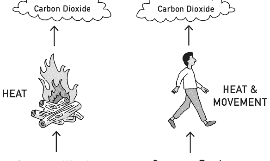

**图 2.1** 火通过木材中碳原子之间的化学键以热量的形式释放能量。废碳随烟雾带走。人体则通过食物中碳原子之间的化学键释放能量，供散热和运动使用。废碳以二氧化碳的形式呼出。

与动物一样，植物也需要产生和储存能量。这在基础层面发生，即植物利用太阳能通过构建链条来形成化学键合。为了做到这一点，它们从空气中吸收二氧化碳，并将碳原子连接起来，创造出高能量的糖类或脂肪。植物会方便地储存这些物质，反过来，我们可能会吃掉它们，比如土豆、大米或木薯；或者同样地，农民可能会把它们喂给其他动物，以提高牛奶或肉类中的能量浓度。

底线是，无论我们吃的是动物还是蔬菜，食物都为我们提供了碳基能量，让我们能够生活、工作和娱乐。我们的身体只需要将正确量的食物能量引导至储存，并将正确量的能量释放出来，每秒钟、每分钟地进行。

## 维持运转

我们不认为机器可以在没有燃料的情况下运行。没有燃料，你的汽车开不远。人体也是如此，平均人每天可能消耗2400卡路里的能量。即使你正躺在床上完全放松地阅读，你的身体也在不停工作，在全身泵送血液。你体内的每个细胞都在忙碌，泵出它们不需要的物质并泵入其他物质。肝脏特别忙碌——制造身体此时此刻所需的任何燃料。它可以产生葡萄糖。如果有两只狗在炉旁安静地打盹，圣伯纳犬消耗的能量比吉娃娃多。付狗粮钱的人可能猜到了这一点。对于人类来说，休息身体每分钟所需的能量可以直接测量。下面的图显示了大量人的结果，证明了能量需求如何随着体重的增加而增加。它可以从身体其他部位释放的物质中产生葡萄糖——例如从乳酸（一个三个碳原子的链）或任何超出需求的蛋白质成分中。如果周围葡萄糖过多，肝脏可以将其转化为脂肪。肝脏从不休息。

生存需要大量的能量，我们已经进化出了尽可能建立储备的方法。如果你被大雪困住，橱柜空空如也？在荒岛上遭遇船难？这对你聪明的身体来说不会成为问题，至少在几周内不会。唯一的每日必需品是水。

尽管如此，大型生物比小型生物需要更多能量来维持生存。躺下时需要的能量取决于你的体型。如果两只狗在炉前安静地打盹，圣伯纳犬消耗的能量比吉娃娃多。

对于人类来说，休息身体每分钟所需的能量可以直接测量。下面的图显示了大量人的结果，证明了能量需求如何随着体重的增加而稳定增长。它还显示了如果体重减轻，能量需求如何减少。

想象一个体重70公斤的人完全静止。平均而言，女性每公斤体重，每分钟只需要不到一卡路里。对于整个70公斤的身体，每小时消耗60卡路里来维持生命的重要过程。在24小时的完全静止期间，这相当于需要1450卡路里。而对于体重100公斤的女性，每分钟需要1.2卡路里，在24小时内大约需要1770卡路里。

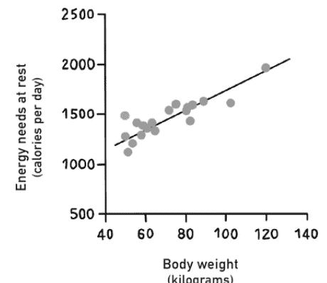

**图 2.2** 能量需求——大的人需要更多能量来保持体重稳定。

由于通常不同的身体组成，平均男性需要的能量稍多，但体型的影响是相同的。一个70公斤的男性在24小时休息会消耗大约1500卡路里，而100公斤的男性将需要多25%（约1900卡路里）。当然，这些是平均数字，个人可能需要更多或更少。

## 运动与活动

每个人都预感到身体在活动时需要更多能量。在某种程度上，这是正确的。但运动期间消耗的实际能量比大多数人想象的要少得多。相反的图显示了在半小时各种活动中消耗了多少额外能量。作为比较，还显示了维持身体运转所需的能量。

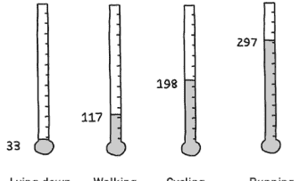

**图 2.3** 半小时燃烧了多少卡路里？所示数字为体重80公斤的女性在等强度快走、骑自行车和跑步期间的数据。

Fred和Bill是邻居，体重都是100公斤。Fred想减几磅，所以他掸掉他的壁球拍，在缓慢开始后，在周六早晨开始打半小时球。Bill喜欢在自己的花园周围活动。他稳定地修剪、除草和整理，从不气喘。一个周六早晨，Fred满脸通红，他靠着围栏告诉Bill他应该做运动。但Fred发现自己的体重并没有减少。谁在周六早晨消耗的能量更多？答案在于时间。在球场上运动半小时，能量消耗从每分钟1.3卡路里增加到8卡路里。在半小时内他消耗了240卡路里。然后他坐下来看报纸，在早晨剩下的时间里，消耗了315卡路里。Bill在花园里活动，活动了四个半小时，比Fred多消耗了555卡路里。对于Fred来说，还有一个障碍。离开壁球俱乐部时，他路过自动售卖机，奖励自己一小块巧克力（只有100克），在两分钟内又增加了400卡路里。

所以，是运动持续时间还是强度决定了能量消耗量？作为一个极端例子，当Ranulph Fiennes和Mike Stroud穿越南极时，拉着雪橇穿越山脉和裂缝，每天长达14小时，估计他们每天消耗了11500卡路里！尽管他们是受虐狂，但即使在更短的剧烈运动中也无法达到那种消耗。

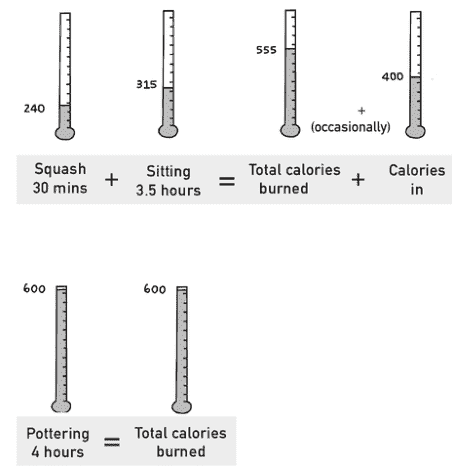

**图 2.4** 周六早晨燃烧的卡路里以及为什么Fred没有减重。

如果你的目标是防止体重增加，中等活动几小时比在健身房快速运动更有效。你不需要大汗淋漓的运动——尽管如果你的目标是最大化心脏功能和体能，那么额外的快速运动是很重要的。运动专家或公共卫生医生提供的建议往往没有指出心血管体能和体重控制这两个完全不同目标之间的区别。通过打壁球，Fred的头部状况可能比Bill好——但这并不是他的目标。他重新开始是因为他想减几磅。

防止体重增加可能是当今社会面临的最重要问题之一，可以通过许多方式解决，例如改变交通政策以鼓励人们更积极地步行或骑自行车，以及食品立法。但防止体重增加并不等同于减肥；消除积累已久的额外脂肪需要不同的方法，正如我们所看到的。

# 备用不时之需

在漫长的演化过程中，人类曾不得不应对作物歉收或狩猎运气不佳的时期。因此，我们进化出了非常聪明的机制来储存食物能量。

我们所有的能量都源自食物或饮水。虽然这是一个显而易见的真理，但它是考虑生命能量的良好起点。食物被吃进后，通过消化分解成更简单的物质。肝脏是一个工厂，将这些物质转化为有用的形式。食物热量的来源只有几种：碳水化合物、脂肪、蛋白质和酒精。从你的餐盘到身体，过程如下：

- **碳水化合物**——土豆、米饭、面包和所有的糖：全部被分解为葡萄糖。
- **脂肪**——黄油、油、乳制品和肉类中的脂肪：全部分解为更简单的脂肪。
- **蛋白质**——肉类、扁豆、豆类、乳蛋白：全部分解为用于肌肉和其他组织的基本构建模块（称为氨基酸）。但任何多余的部分都会被转化为葡萄糖。
- **酒精**——被分解并储存为脂肪。

如果你再次看一眼列表，你会发现你所有的食物都变成了葡萄糖或脂肪。而这些燃料是你身体所有能量的来源。

所以，你现在可以以全新的眼光看你的餐盘了。碳水化合物本质上是糖，脂肪就是脂肪。葡萄糖可以以糖原的形式储存在肝脏和肌肉中，脂肪可以储存在皮肤下。任何多余的蛋白质最终变成葡萄糖。与大众认知相反的是，受蛋白质补充剂广告的影响，摄入蛋白质并不会产生巨大的肌肉。那些像支链氨基酸和氧化蛋白这类听起来很高级的产品只不过是痴人幻想。氨基酸仅仅是蛋白质的基本构建模块。在过剩时，这些构建模块会被身体简单地处理——使它们产生不同的原子被剥离，碳骨架被投入到池中转化为葡萄糖。

酒精呢？那难道不是特殊的燃料吗？完全不是。酒精本质上是液体脂肪。它含有的能量几乎和脂肪一样——每克七大卡，而脂肪每克九大卡。肝脏去除了使酒精独特的原子。酒精只是被燃烧——或储存为脂肪。

因此，从人体能量储存和能量使用的角度来看，我们只需要葡萄糖和脂肪。这就是大自然精妙的经济学。

- 能量代谢非常简单
- 你的身体为了能量只燃烧两种燃料——葡萄糖和脂肪。两者都可以在需要时储存和使用。
- 蛋白质被分解为身体生长和维持所需的构建模块。然而，在西方世界，我们倾向于摄入比需要更多的蛋白质，任何多余的部分都会被身体转化为葡萄糖。
- 酒精？酒精非常高效，身体只是像对待脂肪一样，在燃烧时将其分解。
- 代谢简单来说就是对葡萄糖和脂肪的协调处理。

## 以葡萄糖形式储存能量

葡萄糖很难储存。它会吸引水分，因此储存葡萄糖的组织会迅速肿胀并受损。所以身体进化出了一种奇妙的替代方案。通过将葡萄糖分子连接成链或聚合物（类似于一串珠子），身体有效地使其固定了它们，让它们随时准备待用，而不会引起局部问题。葡萄糖不再能够吸引水分，可以安全地储存在肌肉或肝脏细胞中。这种浓缩形式的葡萄糖被称为“糖原”。

糖原最受关注通常是与长距离跑步有关。“糖原填充”就是马拉松前“面条派对”的意义。摄入大量的碳水化合物，将油箱加到满。然而，在日常生活中，糖原储备的作用是帮助身体控制餐后血糖。原理如下：进餐后，血糖水平升高，身体开始工作，从血液和肌肉中移除吸收的葡萄糖。在过夜期间，身体可以使用这些葡萄糖储备，无论白天还是晚上，肝脏都会冷静地向血液中输送适量的葡萄糖，为身体其余部分提供能量——无论我们是否进食。

对应的图表显示了发生的情况。

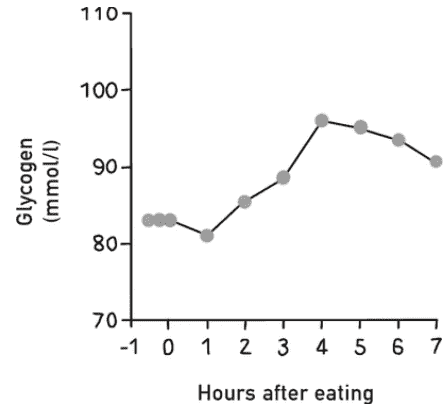

**图 2.5a** 仅在用早餐后肌肉糖原的变化。

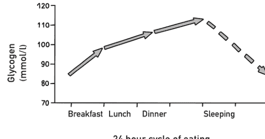

**图 2.5b** 一天吃三餐期间肌肉糖原的增加——以及夜间的减少。

一旦餐食带来的葡萄糖洪流被收起来，燃料将被重新分配，为身体其余部分提供能量。肝糖原可以根据需要将葡萄糖释放到血液中。肌肉糖原分解为短碳链，通过血液输送至肝脏并重新制成葡萄糖。糖原也可以现场使用，为你的肌肉突然爆发的体力消耗提供能量，但对于大多数久坐的人来说，它只是一个实用的临时存储库。在图中，你可以看到餐后大约五小时糖原水平达到峰值；然后随着燃料的重新分配，水平会下降。

我称之为“临时”存储库，这确实是理想状态。但在西方社会，人们通常一天吃三餐，没有留下足够的时间让糖原消耗。相反，正如上一页下方的图表所示，情况是在第二餐后糖原水平进一步升高，在第三餐后再次升高，此时储备达到全天的最高水平。

无法以糖原形式储存的葡萄糖必须寻找另一个家。身体处理它的唯一方法是将其转化为脂肪。这种过程发生在肝脏中。新形成的脂肪在需要时可以为肝脏提供能量，也可以发送到身体其他部位。如果在24小时内不需要这些能量，储在那里的脂肪水平就会逐渐增加。

## 葡萄糖向脂肪的溢出

短期内，如果你摄入过多碳水化合物，身体可以很好应对。当糖原储备充满时，过剩的葡萄糖必须储存在其他地方。这是理解为什么额外的碳水化合物和脂肪具有相同命运的关键。身体处理它的唯一方法是将其转化为脂肪。这种将葡萄糖转化为脂肪的过程只发生在肝脏中。但如果不需要燃烧这些新形成的脂肪，储存在肝脏的脂肪水平就会逐渐增加。这对于2型糖尿病的发展至关重要，这一点将变得清晰。

## 你的脂肪储在哪里？

说我们以脂肪形式储存能量的能力是生存的秘密并不夸张。如果被困在荒岛上，普通人在完全没有食物的情况下可以生存数周。身体首先利用糖原——虽然这是一个次要因素，因为这些储备大约48小时就会耗尽。然后，如果地平线上还没有船只，身体将转向脂肪储备。身体脂肪可以为我们提供数周生活所需的能量。

构成脂肪分子的长碳链含有大量能量。每克脂肪中都锁着九大卡能量。一磅脂肪含有略高于4000大卡（或一公斤9000大卡）。

食物中的脂肪也是如此，这意味着脂肪性食物也是高热量食物。对于体内的脂肪来说，高热量意味着能量的高效储存。

脂肪主要储存在皮肤下方。有些人能够在那里储存大量脂肪，尽管在我们21世纪的眼光看来，这可能是不理想的。但在人类历史的大部分时间内，这是极具吸引力的，象征着他们负担得起良好的饮食，并指示了一个人的成功和高地位。

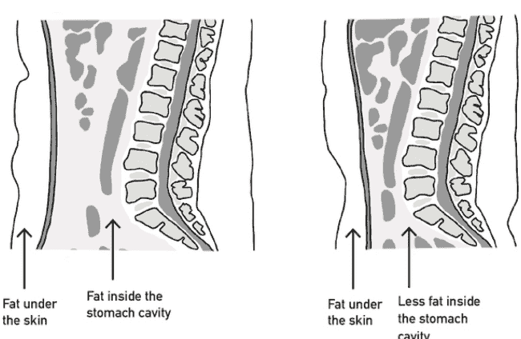

**图 2.6** 从侧面观察身体，这些图片展示了下躯干内部的结构。脊柱位于中央延伸。在腹腔内，肠道环是灰色的，其余部分填充了内脏脂肪（白色）。左侧的扫描图是一个 BMI 为 35 的 2 型糖尿病患者，右侧图片显示的是同一人在体重减轻 15kg 后的状态。原始的 MR（核磁共振）扫描结果可以在[此处](https://go.ncl.ac.uk/diabetes-reversal)在线查看。

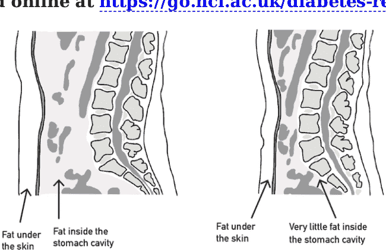

**图 2.7** 这些图片展示了下躯干内部的结构，与图 2.6 类似，但受试者是一个初始 BMI 为 26 的人。再次，在腹腔内，肠道环同样是灰色的，其余部分填充了内脏脂肪（白色）。在减肥后（右图），主要的改变是大部分内脏脂肪已经消失了，而皮肤下的脂肪层仅略有减少。原始的 MR 扫描结果可以在[此处](https://go.ncl.ac.uk/diabetes-reversal)在线查看。

## 快速阅读

- 身体每天花费的大部分能量仅仅用于维持生命运转
- 短时间的运动消耗的热量相对较少，且对摄入热量与消耗热量之间的平衡影响很小
- 持续时间的体力活动——如园艺、做家务、步行——对长期能量平衡有很好的贡献
- 人类在体内仅通过两种基本类型的燃料获取能量——葡萄糖和脂肪
- 葡萄糖以糖原的形式储存在肝脏和肌肉中——但含量很少
- 脂肪储存在皮肤下不会引起任何代谢问题，但当它堆积在主要器官中（尤其是肝脏和胰腺）时，会导致严重问题

# 3 你的身体如何处理食物

我们是社会性动物。社交生活的很大一部分围绕着食物展开：它是沟通的润滑剂，也是与家人朋友共度时光的框架。这一切都很好——至少在我们年轻健康时是这样。身体会处理任何吃进去或喝进去的食物。我们可能会过度暴饮暴食，摄入过多的酒精，但似乎并没有产生什么严重的后果。同样，如果漏掉一餐，身体也能应对。奇妙的身体会继续生存。

但随后，随着成年生活的展开，我们与食物的关系往往会发生变化。到那时，食物已经变成了一种习惯。我们不再根据本能进食并在吃饱时停止——我们进食是因为那里在那里，是因为我们习惯了定量的食物，而且我们发现越来越难以跳过一餐或改变常规。如今，在英国，普通成年人的平均体重在 20 到 60 岁之间每年增加 0.5 公斤。有些人只增加了一点，而一个 25 岁时体重 70kg 的人到 45 岁时平均体重将达到 80kg。结果是，许多人尝试减肥——往往反复如此。但生活的压力——工作、家庭、金钱——是无情的，生活的重心往往与其说是为了避免体重增加，不如说是处理各种最紧急的事情。有时，生活感觉就像是生存。在整个过程中，身体一直在运行，似乎对进入身体的任何东西都无所感知——但却变得越来越重。

无论你主要摄入的是木薯还是肉类，身体维持运转这一奇迹的方式是令人惊叹的。

## 维持夜间生存

有一个器官在每个 24 小时的循环中都持续需要相同数量的燃料。这个器官就是大脑。日日夜夜，你的大脑都需要稳定且充足的能量。它只使用一种燃料——葡萄糖——而且无论它是否有意识地忙碌，它使用的量都是相同的。如果你此时在经历了一整天的决策和规划后感到疲惫，这可能是一个令人失望的消息。但事实是，你的大脑使用的食物源能量并不比你白日梦时的多。

人类的一个有趣事点是，与其他动物相比，我们拥有巨大的大脑。你可能知道大脑在两餐之间获得了足够的燃料，特别是在夜间。它真的取决于最后一餐饭提供的葡萄糖吗？显然不是，血糖水平在进食后几小时内就会回到基准线，并在睡眠的许多小时内保持稳定。因此，葡萄糖一定来自其他地方。

幸运的是，另一个器官承担着保持葡萄糖供应稳定的特殊工作。这就是肝脏，正如第 2 章提到的。它不仅在两餐之间，甚至在夜间也为大脑供应葡萄糖。肝脏每分钟都会产生葡萄糖。事实上，血液中大部分葡萄糖并非直接来自食物，而是来自肝脏。

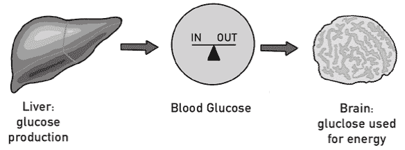

### 3.1 为了向大脑供应所需的葡萄糖能量，肝脏以恰好的速率产生葡萄糖，并保持血糖水平稳定。

由于在睡觉和醒来时的血糖水平相似，似乎什么都没有发生过。事实上，血液中的每一粒葡萄糖每 90 分钟就会变化一次。当葡萄糖被大脑吸收使用时，肝脏的新葡萄糖就会取代它。这就像一条湍急的河流，水流不断移动，但水位保持不变。

相反的图表显示了大大健康人群中胰岛素水平的广泛范围。

人体内的所有器官在静息状态下的工作量通常低于其最大容量。你的静息心率约为每分钟 70 次拍，尽管如果你在爬楼梯时感到脉搏，它可能会超过每分钟 100 次。然而，取决于年龄和身体状况，你的最大心率可能高达 180 拍。此外，你可能有两个肾脏，但它们的工作只需要其中一个肾脏一半就能完成。胰腺也是如此。通常情况下，胰岛素的产生量有巨大的储备能力。我们知道，对于大多数人来说，切除四之三的胰腺不会影响血糖控制。补偿胰岛素抵抗性肝脏通常不是一个大问题。胰腺只是工作得辛苦一点，只要产生胰岛素的细胞仍然能够补偿，血糖水平就会保持在合理范围内。图中显示的胰岛素水平较高的人是正常的，一切仍然处于平衡状态。

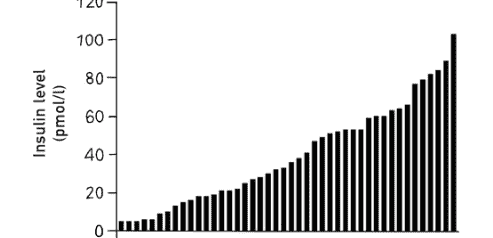

### 3.3 100 个无糖尿病者的胰岛素水平范围广泛。每个柱状图显示一组健康人的水平。

但每个胰腺都有其局限性，当胰岛素抵抗的人在胰腺内堆积过多的脂肪时，它可能无法完全补偿，这确实变成了一个问题，正如我们后面看到的那样。

## 更快，更多的能量！

当你的身体仅处于静息运转时，脂肪可以为肌肉提供能量。但如果你去赶公交车，肌肉的爆发性动作只能由葡萄糖提供燃料。例如，想象你的祖先拿着矛追逐晚餐。在连续几天没有进食后，血糖水平仍然是正常的。如果突然需要奔跑——也许是因为听到“狮子！”的叫声——肾上腺素会立即飙升。肾上腺素是触发身体“战斗或逃跑”反应的激素。它的作用非常快，其影响之一是减少胰岛素的产生。肝脏开始释放更多的葡萄糖，为逃离危险——或追逐晚餐提供更多能量。

所以你不需要考虑能量能量就能生活下去的原因很简单。你的肝脏会组织食物并为身体产生恰好当量的葡萄糖。你的肝脏“知道”要制造多少葡萄糖，因为有胰岛素在负责。

## 存活大餐的冲击

摄入一餐饭对身体来说是一种巨大的压力。在英国，一顿典型的、比如800 卡里的晚餐可能包含大约一半的碳水化合物能量。这意味着有 400 卡路能量是以碳水化合物的形式摄入的，相当于 100 克碳水化合物。无论米色有多深，面包有多粗糙，身体都会以一种非常具有挑衅性的方式看待所有食物。可消化的碳水化合物被转化为葡萄糖（如果你阅读食品包装上的营养信息，碳水化合物是与“糖”分开列出的，但消化过程将其转化为糖）。显然，对于某些吸收较慢的碳水化合物形式，这种转化发生得较慢。但你那顿 800 卡路的热晚餐，一半是碳水化合物，将导致消化过程中有 100 克的葡萄糖进入你的身体。除非采取迅速行动，否则这将导致灾难性的后果。事实上，如果没有胰岛素反应，血糖将上升七倍。正常水平将升到危险的高度。你确实会感到非常不适。

幸运的是，胰腺β细胞提供了迅速行动的能力。当你开始用餐时，血糖水平开始升高。就在这种情况发生的一刻，胰岛素产生的速率急剧增加。血液中的胰岛素水平增加了 10-15 倍。哇。这是正常生活中血液中任何物质可能发生的最大变化。如果你用速度来想象，这就像是从每小时 10 英里加速。

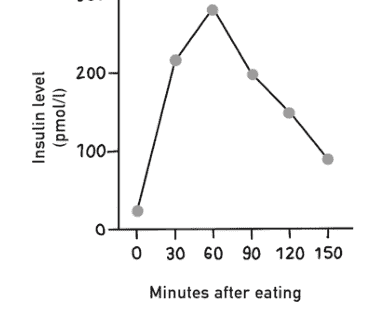

### 3.4 无糖尿病者在进食后正常的胰岛素反应。

### 3.6 碳水化合物食物摄入后会发生什么？

## 但我们食物中的脂肪呢？

到为止，我们主要讨论了食物中的碳水化合物以及它们如何影响血糖水平；现在是时候看看我们摄入的脂肪会发生什么了。正如你在本节中看到的，脂肪和葡萄糖的处理实际上是并辅相成的。

让我们简单回顾一下你今天早上醒来时，当时你的身体很大程度上依赖脂肪作为燃料。脂肪正从脂肪储备流向所需的组织。只有大脑在燃烧葡萄糖。这种快乐的平衡会持续到一天的第一餐。理想情况下，到那时，你已经用完了从昨天餐食中临时储存的所有脂肪。

只要你早上一吃东西，血液中胰岛素的增加就会迅速抑制脂肪从脂肪储备中释放。但如果你早上不吃东西，或者说一天中其余时间都不吃，你的身体就会继续燃烧脂肪（以及一些葡萄糖）。在一天的第一餐后，餐中的部分脂肪会被送到肝脏，另一部分直接从肠道流向肌肉或脂肪组织。总的来说，这让你的身体处于所有组织都有足够燃料维持运转的状态，并且脂肪储备得到了补充，以便在两餐之间或夜间提供稳定的供应。

那么在荒岛上生存又是怎样的呢？如果被困数周，你的身体将如何应对？让我们假设水是充足，但没有食物。

身体的不同部位有不同的需求。在这里我们需要区分大脑和身体其他部分，因为在正常生活中，大脑只能燃烧葡萄糖来维持运转，而肌肉和组织可以依靠脂肪或葡萄糖运行。

起初在没有食物的情况下，肝脏和肌肉中的糖原储备将用于提供大脑所需的葡萄糖。在此期间，一切都会运转起来，以尽量减少其他肌肉和组织对葡萄糖的使用——它们会逐渐切换到燃烧脂肪。然而，三天后，储物就会空了；糖原储备将被耗尽。

在没有可用葡萄糖的情况下，大脑是如何生存的？不要担心！哺乳动物进化出了另一种令人惊讶的替代方案。在上一章中，我们看到脂肪是由碳原子链组成的。这意味着，不需要完全燃烧整个链来产生能量，可以制造智能燃料。这些就是酮体，奇妙的是这些小分子可以很容易地扩散到组织中。这包括脑细胞，它们适应了从葡萄糖切换到酮体作为燃料。酮体的碳键被断裂以释放必要的能量，大脑运行得很好。

事实上，它的运行得实际上非常好。燃烧酮体似乎让你保持警觉，并可能感到饥饿。它让你能够专注于某事，而不必追逐晚餐而分心。据传，在阁楼房间里度日的贫穷艺术家，是依靠酮体驱动的大脑产生了他们最优秀的作品。有些人发现他们的大脑在清晨最敏锐——因此在早餐前就取得了具有影响力的发现。这是否完全是酮体驱动大脑的结果尚不确定。可以确定的是，酮体是我们这一物种在面对饥荒和社会动荡时仍能生存的秘诀。

例如，如果你今天早上睡了懒觉，你的酮体水平就会上升，如果你测试尿液，会发现少量的酮体，这在当时是正常的。如果你在从荒岛获救后立即测试尿液，你会发现中等大量的酮体，它们的存在仅仅表明你聪明的身体正在为在没有多少食物的情况下生存做准备。它设计了一种葡萄糖替代品来为你的大脑提供能量。

你可能见过将“生酮”饮食广告为“燃脂”饮食，但这在很大程度上扭曲了事实。如果在任何24小时内摄入的食物少于身体所需的量，那么储存的脂肪确实会被燃烧，无论饮食的组成如何。尿液中的酮体会比平时常多。如果饮食极低碳水化合物，更多的热量将来自脂肪。因为燃烧食物中的脂肪也会产生酮体，尿液中的水平会更高——尽管这并不能指导你消耗了多少体体脂肪。简单来说，每当从食物中获得的热量低于需求时，体重就会减轻。减少碳水化合物摄入在某些人成功减少了总热量摄入，但“生酮饮食”并没有什么代谢神秘。

## 为什么你的医生害怕酮体

酮体有黑暗的一面。医生和护士倾向于恐惧它们，原因只有一个。在1型糖尿病中——一种与2型糖尿病完全不同的疾病——身体完全依赖注射胰岛素。如果由于原因没有注射胰岛素，或者疾病需要高得多的胰岛素，严重的胰岛素缺乏会导致肝脏产生大量的酮体。这可能导致危生命的状况——糖尿病酮酸酸症——需要紧急的救命治疗。

通常情况下，毫无疑问酮体高得令人担忧——即远远高于正常空腹期间的水平——但正常的酮体水平大体是有益的：它们是生存的分子。

## 胰腺的秘密生活

到本章为止，我们考虑了健康状态下代谢的正常调节。胰岛素的控制是整个过程的核心，因此我们应该更详细地考虑这个产生它并在健康（以及2型糖尿病）中起主导作用的器官。

胰腺是一个害羞的器官。它隐藏起来并工作。

但现在他开始测量非糖尿病患者的胰腺大小，他简直不敢相信自己的眼睛。差异是显而易见的。与 Mavin 长期观察的 2 型糖尿病患者那种细小、边缘不整的胰腺（他一直认为其大小和形状正常）相比，这里的一个胰腺硕大异常——另一个又漂亮且饱满。

科学中的灵光一现虽然罕见，但确实令人享受！人们常说医学研究是 99% 的汗水和 1% 的灵感，但我们还可以补充，它也是 99.9% 的苦干和 0.1% 的巨大兴奋。图 3.9 显示了两个性别、年龄和体重相似的胰腺，但只有一人患有 2 型糖尿病。这些图像正展示了 Mavin 如此兴奋的原因。不需要专家也能看出其中的区别。

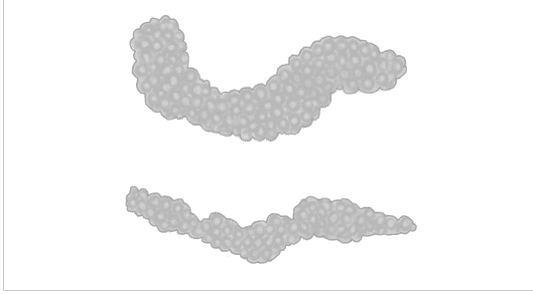

### 3.9 根据 MRI 扫描获得的人胰腺 3D 图像。顶部的胰腺来自血糖控制正常的女性，底部的来自一名患有 2 型糖尿病的男性。

当我们发现 2 型糖尿病患者的胰腺大小仅为同性别、相似年龄的非糖尿病患者胰腺的三之二时，这促使我们奔向图书馆，寻找其他科学家是否注意到了这一点。确实少数人注意到了，但由于每年发表的科学论文数量极其巨大，有时重要信息虽然可用但并未引起广泛关注。如果科学家在途中捕捉到新概念并将其写进总结性文章中，这些内容可能会被广泛讨论，并最终纳入教科书。但在撰写这本书时，很少有专家知道 2 型糖尿病患者的胰腺已经萎缩了。

2 型糖尿病患者的胰腺较小意味着什么？有两种可能。也许，我们推测，那些更容易患上 2 型糖尿病的人出生时胰腺就比较小。另一方面，或许许是糖尿病本身的某种原因导致了胰腺萎缩？我们必须得个个。。

在这一章中，我们研究了身体在正常生活中是如何运作的，即在糖尿病发生之前，那时胰腺只是埋头苦干，确保你的食物以最佳方式被储存或用于能量。在下一节中，我们将看看当胰腺无法继续工作时会发生什么——以及为什么。

## 快速阅读

- 生命围绕着为大脑供应葡萄糖
- 这种持续的供应主要来自肝脏
- 胰岛素调节葡萄糖从肝脏释放以保持血糖恒
- 胰岛素还控制餐中碳水化合物的储存位置
- 人们肌肉对胰岛素的敏感程度各异
- 肌肉胰岛素抵抗会导致葡萄糖转化为脂肪
- 在食物短缺期间，产生酮体来补偿葡萄糖的缺乏

## 4

## 2 型糖尿病：严重的食物中毒

即使是水，过量也会对你有害。仅仅是喝得太多，你就可能死掉。水中毒是真实存在的。虽然我们可能认为毒药是本质上有毒的物质，但实际上，决定伤害的是物质的剂量。例如，维生素对生命至关重要，但如果摄入过量也会产生毒性。小剂量酒精可以增加生活的乐趣，但过量则会导致严重疾病甚至死亡。

同样，食物也可以增加生活的乐趣。但遗憾的是，如果你长期摄入比身体需要的稍多一点点，你就会遇到问题。对于那些易感的人来说，这些问题中最危险的就是 2 型糖尿病。大多数人可以处理过量的食物而不会得糖尿病。定义“肥胖”的任意界限与 2 型糖尿病无关——你不需要肥胖也会得这种病。你只需要对过量的脂肪敏感……而且是在错误的地方积累。这就是理解为什么过量食物这种隐毒的长期毒素可能或可能引发糖尿病的关键。

“食物中毒”一词传统上用于描述急性不适。但也许现在应该扩大它的使用范围，以引起人们对当今社会由于食物持续供应导致的慢性问题的关注。

如果你患有 2 型糖尿病，你的身体在多年里拥有的食物比需要消耗的得多。你的脂肪储备将溢满。事实上，你的身体将淹没在过量的化学能量中。当燃料箱溢出时，必然会有严重的后果。这一章描述了如果你患了 2 型糖尿病，你的身体里发生了什么，以及它最初是如何产生的。

## 2 型糖尿病引起的变化

### 你的血液

显而易见的是你的血糖水平过高。这一点很容易。可以使用市售血糖血糖测量血糖水平。葡萄糖本身可能让你感到口渴，并比平时排尿更多。

较少为人知的是，你血液中的胰岛素水平会比正常高。这可能会让你惊讶。这无疑让医学生感到困惑！这是你的胰腺竭力将血糖水平恢复到正常的结果。最后，在患多年 2 型糖尿病后，胰岛素水平逐渐下降，可怜的 β细胞变得越来越无法胜任工作。

你血液中普通脂肪水平也会过高。这是因为你血液中部分过量的葡萄糖会转化为脂肪——这些应该被储存起来。考虑到葡萄糖、胰岛素和脂肪在维持生命方面起着至关重要的作用，将整个局面描述为一片混乱也是公平的。难怪你可能会感到不适。

下图显示了 2 型糖尿病患者与相似患者之间血糖、胰岛素和脂肪的对比。

| 葡萄糖 mmol/l | 胰岛素 mmol/l | 脂肪 mmol/l |
| :--- | :--- | :--- |
| 2 非糖尿病 | 2 非糖尿病 | 2 非糖尿病 |

### 4.1 2 型糖尿病患者与非糖尿病患者 24 小时血糖、胰岛素和脂肪的平均水平。

### 你的胰腺

正如第 1 章提到的，只有当胰腺中的 β 细胞对葡萄糖失去反应时，才会发生 2 型糖尿病。医学研究长期以来认为这些细胞正在逐渐一个一个死亡。为什么？在显微镜下观察尸检胰腺时，科学家发现细胞数量只有正常的一半。大多数科学家和医生认为不同的人有不同的产生原因。但在 2 型糖尿病中，一个单一因素脱颖而出。这种疾病在食物短缺的人群中罕见，但在食物充足的人群中常见。而且，如果食物充足的人群突然面临食物配给，2 型糖尿病会变得少得多，正如 90 年代后的古巴记录的那样。决定疾病频率的简单变化意味着单一的原因。

夜间，对于 2 型糖尿病患者，剩余的 β 细胞试图控制血糖水平，但这很困难。在饭后，问题变得非常明显。β 细胞可以步行，逐渐向血液中泵入更多胰岛素，但它们无法对突然的需求做出跑步反应。无论它们如何努力，β 细胞已经无法对上升的血糖水平做出快速反应。胰岛素产生激增的需求没有得到回应。这真的是 2 型糖尿病的标志——缺乏对需求的快速反应。

### 你的肝脏

如果你患有2 型糖尿病，你的肝脏会产生胰岛素抵抗，并无法关闭葡萄糖的产生。因此，葡萄糖倒入血液。

这不仅发生在夜，还发生在白天。在你吃完早餐后仍在持续。葡萄糖生产没有停止以为餐中碳水化合物涌入的葡萄糖留空间，你的身体必须应对双重打击。食物正在导致血糖水平升高，但你的肝脏同时在高兴地向血液中注入更多。

肝脏在餐后的另一项工作是将葡萄糖储存为糖原。得知你的肝脏可以做到这一点，你会感到松了一口气。

好的，即使你患有2型糖尿病也是如此。这是因为每当血糖升高时，肝脏就会收到信号，提示需要储存糖原。肝细胞对葡萄糖没有屏障，葡萄糖会涌入细胞并转化为糖原。这没关系，但肝脏只能以糖原的形式储存相对量的葡萄糖。

### 你的肌肉

一个人未来可能发展为2型糖尿病的最早可检测的迹象，是他们的肌肉对胰岛素的相对抵抗性。也就是说，作为代谢主控的胰岛素无法完全开启肌肉对葡萄糖的摄取。这种情况从从小就一直存在。它主要取决于你恰好遗传的基因组合。对胰岛素缺乏完全反应不会引起任何即时问题，大多数人对此毫无察觉。他们的肌肉只是比那些注定不会患上2型糖尿病的朋友更具胰岛素抵抗性。

# 第3章描述了对于肌肉胰岛素敏感性正常的人，食物中的碳水化合物会发生什么

早餐后，血胰岛素水平升高导致身体肌肉开始吸收更多葡萄糖并将其储存为糖原。肌肉储存起着非常重要的作用，允许葡萄糖被安全储存，以应对每餐带来的巨大能量流入。这些食物能量随后流向其他组织。肌肉通常充当动态缓冲器，平滑原本会发生的血糖波动。由于所有肌肉构成了人体最大的器官，这一点至关重要。

但在那些易患2型糖尿病的人中，肌肉将葡萄糖储存为糖原的能力是不够的。旁边的饼图显示了我们非常早期研究之一的结果，该研究应用磁共振技术试图理解2型糖尿病。这项研究涉及在午餐前的早餐前以及午餐后隔一段时间测量肥厚肌肉中的糖原含量。图4.2中的图表显示了没有肌肉胰岛素抵抗的人糖原储存的增加。但只要看看那些有抵抗的人发生了什么。他们无法将餐中极小部分的碳水化合物储存为肌肉糖原。

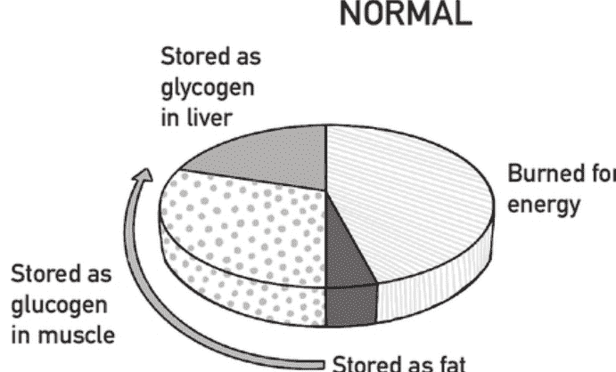

## 胰岛素抵抗

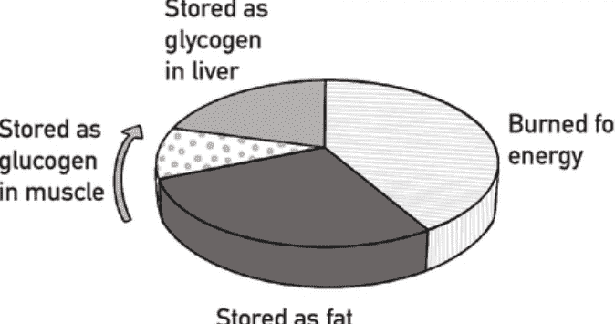

### 4.2 你将餐后碳水化合物储存在哪里？

通常约三分之一储存在肌肉中（上图）。但如果肌肉具有胰岛素抵抗性，储存的就会少得多，其余部分会转化为脂肪（下图）。

如果葡萄糖被拒绝进入肌肉，它就必须留在血液中。难怪早餐后血糖会飙升，并且通常整天都维持高位。但必须采取措施，正如我们在第3章中所知道的，身体处理过量葡萄糖的唯一方法就是将其转化为脂肪。正如饼图所示，在肌肉胰岛素敏感的人中，餐中碳水化合物只有极小比例被转化为脂肪，但在肌肉胰岛素抵抗的人中，这个比例上升到约四分之一。

被迫制造脂肪似乎是一个相当阴郁的命运——尤其是当你受困于那些决定你整体肌肉胰岛素抵抗水平的基因时。但这里有一个明确的信息：如果一个人在整个成年生活中保持健康的体重，那么每天就不会有多余的燃料堆积。最初转化为脂肪的任何东西都会在这24小时内被使用，帮助身体度过第二天。另一方面，如果所有的脂肪都没有被使用，它们就会在体内缓慢堆积。记住：没有多余的食物，就没有食物中毒。

另一个关键信息是：肌肉胰岛素抵抗可以通过运动得到中度改善。多年来，这将对健康产生相当的影响。规律运动是延迟或预防2型糖尿病发病的极佳方法，尽管一旦造成损伤，通常就为时已晚了。你开始时年龄越小，一生的获益就越大。你将与家庭成员共享许多基因。所以，如果你患有2型糖尿病，为你的孩子、侄女、侄子或孙辈树立榜样比通常更为重要。培养他们尽可能多走路的习惯，以及骑自行车和在户外玩耍。

## 事情是从什么时候开始出错的？

你可能奇怪事情是从什么时候开始偏离轨道、你的2型糖尿病又是何时开始发展的。几年前？去年？

一个追踪人们很长时间的非凡故事，能够揭示2型糖尿病发病前的那些年份。这就是“白厅医院2号研究”（Whitehall 2 study）。它涉及对6538名公务员进行反复血液测试，并观察了随时间推移的变化。最终，确实有些人患上了2型糖尿病。事实上，有500多人——约10分之一中的一个——患了。而且，由于每年都采集并储存了血液样本，可以发现在诊断糖尿病之前血糖上升的速度有多快。

即使在诊断前13年，血糖就已经升高了——仅仅是一点点。随后它逐渐增加，在近十年的时间里，平均血糖从5.5上升到5.8mmol/l。这仍然处于正常范围内（3到6.1mmol/l）。然后，特别是在确诊2型糖尿病前的18个月里，事态开始变得更加剧烈，血糖急剧上升，在病情确认时平均达到7.4mmol/l。这在图4.3的图中所示。

请记住，这些信息是基于大体的平均数据，反映了平均水平。

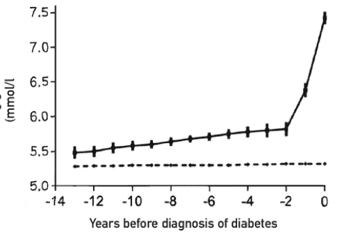

### 4.3 早餐前的血糖上升非常缓慢

通常在疾病出现前的十年（实线）。随后在疾病发前的几年里，出现了相对快速的上升。没有患糖尿病的人保持在稳定水平（虚线）。

## WOSCPS

作为缩写，WOSCPS是最令人难忘的之一。它代表“西苏格兰预防研究”（West of Scotland Prevention Study）。这项发表于1995年的研究并非旨在提供2型糖尿病发展的线索，但它成功做到了。（其目的是测试他汀类药物在预防心脏病方面）。

在研究期间，血液样本被储存了。研究结束后，我在格拉斯哥的同事纳维德·萨塔尔（Naveed Sattar）教授产生了一个绝妙的主意，这些每半年一次的血液样本可以发挥巨大的作用。没有人知道糖尿病前几年血液发生了什么详细变化。而萨塔尔教授可以意识到，在研究结束时，参与者可以被分为两组——患有2型糖尿病的人和用于对比的未患这些人——储存的血液样本可以显示在诊断2型糖尿病之前身体是如何变化的。这些信息于2008年发表，并帮助形成了我的“双循环假说”，在下一章会有更多介绍。

相反的图表显示了诊断前18个月两个重要血液测试的结果。首先，在那些有患2型糖尿病趋势的人中，血液脂肪水平异常高（高出近50%）。其次，“ALT”测试（肝脏受损的最佳指标）与未患糖尿病的人相比水平升高了。

### 血 ALT 水平

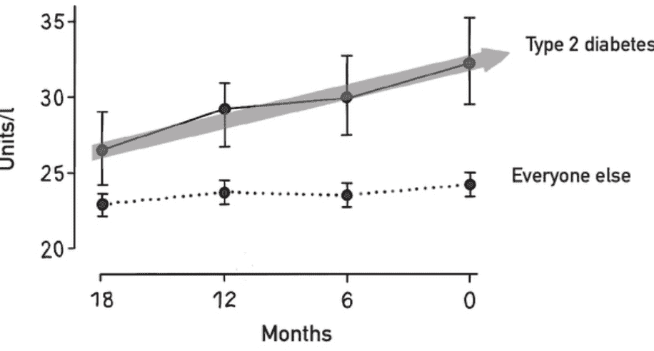

### 血糖脂水平

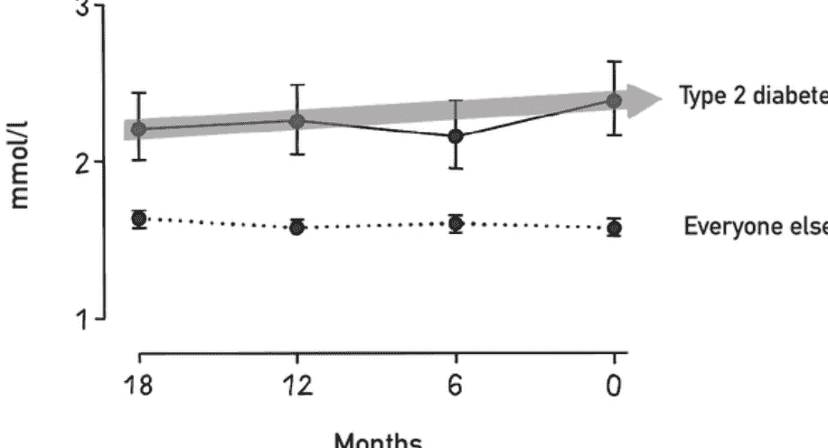

### 4.4 二型糖尿病出现前的血液变化

灰色箭头表示整体趋势。顶部图表显示，在诊断前 18 个月，ALT 测试就已经升高且正在快速上升——这表明肝脏正处于压力状态。底部图表显示，在研究开始之前，血液脂肪水平就已经变得异常。

因此，尽管他们并不知情，但在向糖尿病的道路奔驰时，他们的肝脏正发出长长而无声的尖叫。

## 快速阅读

- 食物是生命所必需，但如果长期摄入过多，可能会产生毒性
- 在 2 型糖尿病中，胰腺无法在正确的时间产生足够的胰岛素
- 此外，肝脏和肌肉对周围存在的胰岛素无法正常反应
- 结果是肝脏产生了过多的葡萄糖
- 同时，肌肉在餐后无法储存葡萄糖
- 结果：血糖中葡萄糖过高

# 一场谋杀案与双周期

## 谁是凶手？

失踪发生了，人们怀疑是谋杀。受害者是β细胞。当在显微镜下观察2型糖尿病患者的胰腺组织时，似乎一半的β细胞直接消失了。失踪，推测已死亡。而在糖尿病病程较长的人中，几乎三分之二的细胞已经消失。事实似乎是肯定的：β细胞正在被一个一个地杀害。到底发生了什么？凶手能被绳诸法网吗？

2006 年，正如引言中所描述的，我面对那张图表，它显示 2 型糖尿病的高血糖可以在七天内恢复正常。该科学论文报告，这是由于为了极肥胖者减肥而进行的减重手术。作者认为，血糖的快速变化可能是由于肠道产生的激素引起的——肠促胰激素。距离我作为医学生听从雷格纳德·帕斯莫尔（Reginald Passmore）教授预测这些激素的存在已经过去了 35 年，而这些激素随后被鉴定出来。看到他的科学推断是如此正确，令人欣慰。但这些肠促胰激素极不可能是论文中所述的清晨血糖如此迅速变化的原因。肠促胰激素根本无法做到这一点。它们在夜间和清晨对血糖没有产生主要影响；它们几乎完全在餐后起作用。而且我们知道，那些接受胃部手术的人在术后七天内没有吃过任何东西。没有进餐——就没有肠促胰激素的增加。这一切都是宝贵的见解。因为如果不是肠促胰激素导致了血糖变化，那么就是其他东西在起作用。

## 案件细节

在 2 型糖尿病中，一半的β细胞似乎被杀害了。谁是嫌疑人呢？根据帕斯莫尔的洞察，“肠促胰素先生”（Mr Incretin）似乎有完美的不在场证明。其他热门的反派还包括神秘的淀粉样蛋白小姐（Ms Amyloid）和炎症先生（Mr Inflammation）。

淀粉样蛋白有时在 2 型糖尿病患者的胰岛中观察到。20 世纪 80 年代，认为淀粉样蛋白是 2 型糖尿病β细胞死亡原因的观点被广泛建立，但其依据是最薄弱的。它一直作为一个潜在的反派潜伏着，因为从理论上讲，虽然淀粉样蛋白小姐可能有这种手段，但她偶尔才会出现在犯罪现场。

炎症可以在身体许多不同部位引起许多问题。它有时会是一个杀手——例如，在“儿童期”糖尿病或 1 型糖尿病中。在那种类型的糖尿病中，炎症细胞的免疫攻击是导致β细胞死亡问题的绝对核心。在 2 型糖尿病中，炎症的程度似乎不足以作为杀人武器。炎症先生也没有位列嫌疑人名单的前列，无论是因为手段还是因为出现在现场。

肝脏先生，请留步。在纽卡斯尔和其他等地的研究已经显示了肝脏如何一直控制血糖。它控制夜间和餐后的葡萄糖流——在 2 型糖尿病患者中控制得非常糟糕。我们知道肝脏会根据胰岛素的反应设定血糖水平。在 2006 年那个重要日子之前的八年里，我们一直在研究肝脏脂肪的影响，并发现过量的脂肪会强烈阻止胰岛素发挥作用。脂肪本身使肝脏产生了胰岛素抵抗。

我在美国耶鲁大学的亲密同事基特·彼得森（Kitt Petersen）和杰里·舒尔曼（Jerry Shulman）在前一年就显示，几个月的中度饮食限制可以改善肝脏脂肪水平。这反过来又提高了肝脏对胰岛素的反应。1990-1991 年，我住在长岛湾，与杰里和基特一起工作，知道他们进行科学研究是多么严谨。他们的工作、我的工作以及之前对肝脏脂肪的所有观察突然结合在一起，解释了为什么减重手术仅七天后血糖就会剧烈正常化。这也解释了β细胞可能正在发生什么。

## 推断

情况是这样的：减重手术研究中的这些人非常胖。这就是他们接受手术的原因。计算他们为了生存每 24 小时大约需要多少热量非常简单。我们每天至少需要 2700 卡路里，仅仅是整天躺在床上，一动不动。这比普通人在活动时摄入的还要多。当然，在医生对胃进行手术之前，至少 12 小时内不能进食。这些人的通常摄入量在手术前一天晚上突然下降，从大量的量变为零，当时护士在他们的床头挂了一个牌子：“禁口”。身体必须存活——并且每天需要 2700 卡路里来维持。在手术后的七天里，需要找到七倍的量——总共 19000 卡路里。一小部分通过静脉注射支持液体提供，但绝大部分必须从其他地方寻找。

对我们所有人来说的是，我们的身体是为了生存而设计的，有以备不时之需的储备。看看那些可用的燃料，就停在肝脏里准备待发。人越胖，肝脏内积累大量脂肪的可能性就越大。

在那张纸上，这些想法逐渐形成了一个模式，反映了我们所知的一切。这里一定存在两个相互作用的恶性循环。第一个发生在肝脏。通过每天多吃一两口身体实际需要的食物，你会非常缓慢地增加肝脏脂肪水平。这一点进一步恶化的是，由于你的肌肉从出生起就产生相对胰岛素抵抗，它们在每顿饭后无法储存正常的葡萄糖。相反，葡萄糖被肝脏吸收并转化为脂肪。逐渐增加的胰岛素抵抗会导致肝脏产生更多葡萄糖，并让你疲于奔命的胰腺产生更多胰岛素。

但生活事实是，胰岛素实际上会加速肝脏葡萄糖向脂肪的转化……于是，整个不幸的循环再次开始，导致肝脂肪水平进一步升高，并产生一系列不幸的连锁反应。

图 5.1 显示了这些事件是如何关联的。

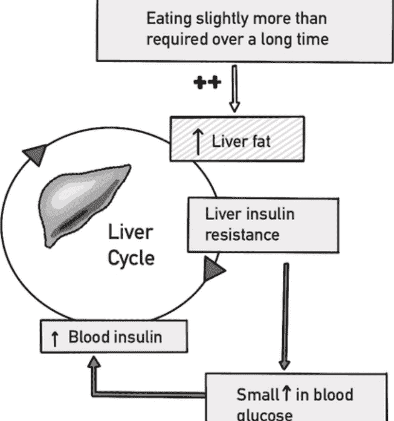

### 5.1 双循环假说：双循环中的第一个——肝脏中的恶性循环

长期以来，每天多吃一口食物会导致肝脏脂肪积累。这使得肝脏无法对胰岛素做出正确反应。血糖开始爬升，这导致了较高的基础胰岛素水平。这种胰岛素随后为葡萄糖转化为肝脂肪铺平了道路。

由于肝脏内部堆积了太多脂肪，你的肝脏非常理性地尝试将其转移到皮肤下的安全储存处，增加其向血液输出脂肪的速率。有些人拥有近乎无限的脂肪安全储存能力，如果是这样，糖尿病可能长期都不会发生。但对某些人来说，皮肤下的这个仓库已经满了，因此他们的血液脂肪水平一直处于高位。

你是否曾经遇到过柜子满了，被迫把东西放在别处，然后又因为它们被留在不方便的地方而感到恼火？想象一下你身体的其他部分暴露在长期高水平的血脂肪中。最终，脂肪会在不方便的地方聚集。其中一个地方可能就是胰腺内部。

## 那么，是胰腺循环

回到那张纸上。假设胰脏中脂肪的存在阻碍了运作，并防止胰岛素在餐后快速产生，我们可以预见到对进食的正常胰岛素反应会逐渐迟钝，这反过来会导致餐后血糖水平持续较长时间。众所周知，对于 2 型糖尿病患者，在病情发生前，餐后胰岛素反应就会变得不足。但现在我能看到，持续的高血糖还会导致血液中基础胰岛素水平升高，而且在肝脏中会导致葡萄糖向脂肪的转化进一步增加。

一旦建立，这两个恶性循环将相互作用并互相加强。来自肝脏的过多脂肪将驱动胰腺循环，而高血糖水平最终会推高胰岛素水平，从而驱动肝脏循环。

2007 年，我在格拉斯哥的英国年度糖尿病会议上作为一次报告提交了这些初步的答案。幸运的是，欧洲主要糖尿病杂志的编辑在观众中，并请我将该假说写成论文发表。这是一项挑战。

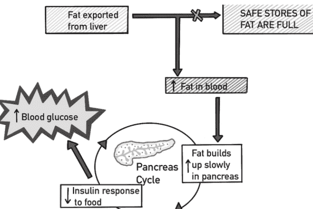

### 5.2 双循环中的第二个——假说中的恶性循环

肝脏正常的脂肪输出可以处理高水平的肝脂肪——直到皮肤下的安全储存仓库填满。这时，血液脂肪水平升高。胰腺是受脂肪增加影响的组织之一。最终，几年之后，这导致产生胰岛素的细胞关闭。在短时间内，血糖水平随后升高。

与通过严谨的科学论证将所有细节记录在白纸黑字上的艰辛苦作相比，谈论想法是容易的。这些细节不能是想象的或乐观的。每一个细节都必须与可靠的已发表的研究联系起来。汇集所有详尽的科学证明花费了六个月，然后又是几周、几个月，编辑在进行标准流程，要求其他科学家对科学性进行严谨的审查，以决定是否接受文章。但最终，“双循环假说”被发表了。

科学中的大忌是爱上你的假说。所有科学家都知道，将假说写在纸上是发现其对错的第一步，也是必要的步骤。假说的目的是详细列出似乎导致了什么，以便对这些想法进行单独测试。一直测试直到毁灭。也许最好不要用“假说”这个词。尝试换个词。改说成“童话”吧；毕竟这终是想象力的产物。我不得不对自己说，这就是“双循环童话”。这促使了建立严谨测试的过程，且没有任何先入为主的偏见。我们需要清晰度。

## 使用 MRI 观察身体的魔法窗口

作为科学生涯中那些伟大的巧合之一，2006 年，我刚刚建立了一个基于磁共振（MR）的研究中心。MRI 扫描对所有人来说都是熟悉的，是一项常规医学检查。它的全称是“磁共振成像”。但专家可以开发这种同样的技术来观察身体内部，查看不同器官实际上是如何运作的。可以测量器官的化学成分。

最初的想法是向纽卡斯尔 MR 中心开放，以推进我关于食物在人体健康和糖尿病中作用变化的持续研究，同时也解决所有医学专科的广泛问题：从痴呆到肌肉萎缩症。我花了从 2000 年到 2004 年的时间建立它。然而，没有物理学家的支持，设备将无用武之地。我曾在美国工作时遇到了磁共振物理学家 Blamire，并非常幸运地说服他离开牛津成为磁共振教授。随后我们吸引了剑桥的 Hollingsworth 加入团队。这是一个令人兴奋的时代。

为了测试双循环假说，我们需要能够做到。我们将通过要求 2 型糖尿病患者大幅减轻体重来实现这一点。这意味着食物摄入量的突然下降是唯一的变化，没有手术等其他复杂因素。如果他们的血糖仍然很高，那么我们就证明了假说是错误的，可以回到起点。如果他们的血糖恢复正常，则证明了 2 型糖尿病是可逆转的。同样重要的是，我们能够使用 MR 方法测试预测的机制是否正确。我们将能够观察糖尿病恢复正常时发生了什么——反之，这可能识别出糖尿病的成因。

## 进入“龙穴”现场

医学研究是昂贵的，没有资金就无法进行。获得资金的过程非常像《龙穴》（Dragons' Den）节目，在节目中向潜在投资者展示商业构想。竞争非常激烈，评审成员非常冷静且挑剔。科学资助申请需要数月的晚上和周末工作来准备和提交。然后，申请被发送给半个国际专家进行严格评审。之后，资助委员会的“龙们”（科学家）会讨论申请本身以及专家意见。然后他们对所有申请进行排序，只有少数（十分十分之一）能获得资助。我向英国糖尿病协会（Diabetes UK）提交了申请，它是英国糖尿病研究最大的资助机构。在经历了严厉的评审和怀疑的讨论后，我的申请似乎已经没戏了。但只有一位小组委员会成员指出，在假说正确的极小情况下，它是非常重要的。那个人认为考虑到所涉及的成本，这是值得的。申请成功了！

## Counterpoint 研究

研究项目像人一样——它们需要一个名字，并很快产生自己的生命。大多数研究名称是修改过的缩写。我们的第一个研究必须抵消脂肪的影响（“甘油三酯”在科学术语中）延伸到胰腺和肝脏。选什么名字呢？回到纸笔面前。一页纸写满了可能性。理想情况下，这个名字是有意义的。一个名字逐渐浮现出来：“COUNTERPOINT”——**COUNTER**acting the **P**ancreatic inhibition **O**f **I**nsulin secretion by **T**riglyceride。虽然完全无关，但对我来说很有说服力，这个词让我想起喜欢的小说——阿尔德斯·赫胥利的《观点与观点对立》（Point Counter Point）。这项研究就这样命名了。

在测试假设的工作生涯中，没有什么能为 Counterpoint 研究那清晰易见的结果铺平道路。一群非常普通的 2 型糖尿病患者转而采用低热量饮食，这是一种由我设计的非淀粉类蔬菜的简单配方饮食，其目的仅仅是看看这种“双重循环”是否可以逆转。与此同时，他们停止了服用降糖药。七天之内，他们的清晨血糖水平下降到了正常范围——就像减重后一样。对肝脏和胰腺的所有特殊测试都证实了假设的预测——这些器官的脂肪水平降低了。

因此，我们的假设似乎可能是正确的——至少对于短程 2 型糖尿病患者是如此。我们已经证明，在确诊 2 型糖尿病不超过四年的患者中，肝脏和胰腺内想象中的“双重循环”可以逆转为正常。正常！

这项研究产生了几个惊喜。第一个惊喜是看到 2 型糖尿病患者的肝脏有多油。在研究开始时，他们的肝脏脂肪水平平均超过 13%，高于正常范围（最高 5.5%）。对于当时的我们来说，在普通的 2 型糖尿病患者中出现这种程度的“单纯脂肪肝疾病”似乎非常反常。这可不是什么好状态。它是未来心脏病的征兆，并可能导致肝硬化或更严重的后果。无论你是否患有 2 型糖尿病，知道自己肝脏中脂肪过多都应该是一个警钟。

第二个惊喜是参与者在开始极低热量饮食后血糖是如何下降的（见图 5.3）。同样令人兴奋的是，在七天内，随着脂肪的减少，肝脏的胰岛素抵抗也消失了。我们使用特殊测试直接测量了这一点，胰岛素水平同时下降了。研究八周期间肝脏脂肪的剧烈变化如图 5.4 所示。

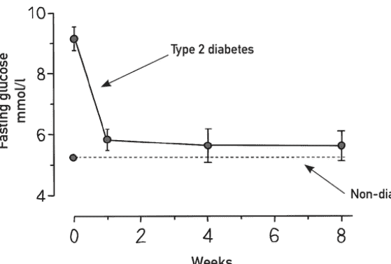

### 5.3 在 7 天内血糖水平恢复正常！

上方图表显示了 Counterpoint 研究的结果。

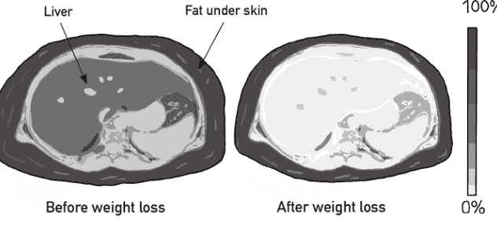

## 5.4 这些图片通过阴影显示肝脏区域的脂肪含量，右侧是脂肪百分比的图例。皮肤下的深色脂肪层显示浓度最高（100%）。但你会发现，在左侧图中，肝脏内部也有大量的脂肪（36%）。减重后，肝脏中的脂肪含量减少到 2%，如右图中明显变浅的阴影所示。

在饮食前，胰腺的脂肪水平较高，但逐渐下降到正常。与此同时，β 细胞逐渐苏醒。

如果注射葡萄糖，血糖的升高通常会导致胰岛素产生急剧增加，而 2 型糖尿病缺乏的正是这种相对于基础水平的增加。在本页右下角的“正常”图表是一组没有糖尿病的对照组，但他们的性别、年龄和体重与 2 型糖尿病组相似。看这张图表上的线条如何急剧上升，显示了胰岛素的增加。相比之下，在 2 型糖尿病组的图表中，看研究开始时（最左侧）线条是多平坦，在一周后变化很小，但到第四周时出现了明显的急剧增加。到八周时，他们的胰岛素反应与正常水平非常相似。

2011 年 Counterpoint 研究结果发表后，引起了巨大的关注，但也引起了专家们的极大怀疑。毕竟，医生们有充分的理由认为 2 型糖尿病是一种终身的、不可避免的进展性疾病。他们自己的经验告诉他们，这种病情随着时间的推移变得越来越严重，需要越来越多的药物来控制。对医生来说，更有说服力的是，对 2 型糖尿病患者进行多年跟踪的大型研究清楚地显示控制状况在持续恶化。在患病 10 年后，有一半的人需要注射胰岛素。然而，有一点关键因素被忽视了：所有这些观察都是在那些正在持续体重或至少处于持续超重状态的人身上进行的。这正是实践中发生的情况。确诊后，大多数人在多年后会变得越来越胖。所以，2 型糖尿病患者确实倾向于陷入越来越多的麻烦——但也许并非不可避免。

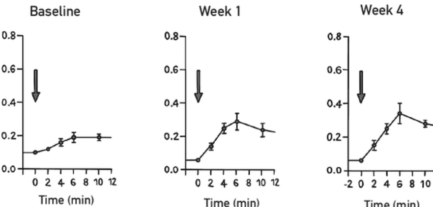

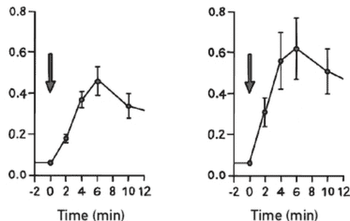

## 5.5 产生胰岛素的细胞苏醒了！面板显示了 2 型糖尿病患者在 Counterpoint 研究八周期间的反应。图表显示的是没有糖尿病的人。

接受改变需要坚持和进一步的研究。

## Counterpoint 研究

与专家们的怀疑形成鲜明对比的是，当报纸、广播电视报道 Counterpoint 的结果时，受 2 型糖尿病影响的人非常兴奋；他们真的想亲眼看看自己是否能逃离这种疾病。从 2011 年开始，我们收到了大量询问如何逆转糖尿病的邮件。为了应对这些情况，我们建立了一个网站，包含了所有实用信息并解释了他们可以做什么来改善状况：`https://go.ncl.ac.uk/diabetes-reversal`。随后第二波邮件讲述了许多个人实现停药的惊人故事。年轻人、老年人、男女、贫富，居住在美国、南美、欧洲或其他地方的案例丰富多样。这些知识收集自正患有或曾患有 2 型糖尿病的人，经过了分析后作为另一篇论文发表。医生们需要听听真实专家的意见——即那些必须面对 2 型糖尿病的人。

幸运的是，来自这些真实专家的数据证实了 Counterpoint 的发现。仅凭借基础信息的人，其减重效果与 Counterpoint 研究一样——15 公斤。在家里和工作中，在日常生活中，人们复制了我们的研究发现。结果表明，重要的是体重的减轻，而不是参与者采取了哪种饮食或他们是如何做的。

许多 2 型糖尿病患者确实非常讨厌自己的病情，并且会不惜一切代价也要逃离它。大多数医生和护士并不知道这一点。其次，只要提供关于如何做的清晰信息，有动力的人就能恢复到正常的血糖控制。

突然之间，研究的范围超出了最初的目标。我原本初衷是寻找导致 2 型糖尿病的原因。我曾希望澄清涉及的机制，并可能为未来的治疗指明方向。任务完成了。但为了验证该假设而开发的工具——一种低卡路量液体饮食——似乎对许多人来说是一个真实世界的解决方案，他们可以利用它来摆脱自己的糖尿病。

受到这种“真金白银”（也许是“布丁的证明”）的鼓舞，我们继续进行了更多的研究。

## 平衡之道（Counterbalance）

在正常饮食的同时，是否可能享受 2 型糖尿病的长期缓解？这是我们面临的最重要的问题。在快速减重后，身体在恢复进普通食物时，还能保持平衡并正常控制血糖水平吗？最初的“对照点”（Counterpoint）研究表明，我们可以对抗胰腺对胰岛素分泌和甘油三酯的抑制。这个缩写证明是正确的，至少在短期内如此。我们将第二项主要研究命名为“平衡之道”（Counterbalance）。它的意思是“通过长期正常化卡路量摄入来对抗β细胞衰竭”（`COUNTERacting Beta-cell failure by Long-term Action to Normalize Calorie intake`）。虽然有点长，但它言简意赅！

在 Sarah Steven 博士的指导下，这项研究就像它的姐姐项目一样，拥有了自己的生命。在“平衡之道”研究中，通过与“对照点”完全相同的饮食，在八周内实现了快速减重；然后在两周内逐步引入了正常食物。我们从“对照点”研究的先驱者那里学到了，当他们停止那种“每餐一包”的饮食时，重新决定吃什么是非常困难的。

Sarah 针对吃多少以及避免哪些食物给出了个性化建议，并每月面诊一次。在接后的六个月里，我们的研究参与者保持了平均体重稳如泰山。实验结束，所有在最初减重后摆脱糖尿病的人都保持了非糖尿病状态。就像在“对照点”中一样，胰腺在减重后苏醒并开始正常产生胰岛素，这次是在研究开始后的九个月内。对于理解这种现象是如何发生的，这一点非常重要：肝脂肪保持在低水平（2%），他们的胰腺脂肪也降到了更安全的水平。糖尿病消失了且没有再次回来。

纽卡斯尔大学心理学教授 Falko Snieotta 和他的团队进行了测试，以识别成功的主要障碍，以及哪些建议对人们成功减肥并维持体重最有帮助。这些结果指导了第 7 章和第 8 章中提供的信息。

### 糖尿病的持续时间会有影响吗？

有的。2 型糖尿病的持续时间越长，恢复正常血糖控制的可能性就越低。但永远不要说不可能。“平衡之道”研究确定了实现糖尿病缓解的赔率。这种概率从诊断后不久的几乎是板上钉钉，下降到前 10 年的 50/50，之后的几率更得多。赔率是获胜概率的指南，但它们会波动，结果也会时而异，那些 100 比 1 的冷门并不意味着没有患有极长期 2 型糖尿病的人能够获益。一些患 2 型糖尿病超过 20 年的人已经成功逆转为正常。纽卡斯尔有两位患有 24 年糖尿病且血糖控制很差的个人，他们每天服用两种药物，在减轻超过 15 公斤体重后，停药恢复了正常状态。重要的信息是，尝试逆转你的糖尿病永远不太晚，尽管成功无法保证。

“平衡之道”的结果格外引人注目，因为在研究期间逆转了糖尿病的组并没有变瘦。平均 BMI（身体质量指数）从 33 开始，下降到 29。因此，大约有一一半的人在技术上仍然属于“肥胖”。但他们继续免受糖尿病。他们携带的脂肪比实际需要的多，但对他们来说，脂肪留在皮肤下的安全脂肪层中，没有重新分布并堵塞肝脏和胰腺。至少在整个 9 个月的研究期间是如此。

哇！一个理解 2 型糖尿病的新世界正在开启。“平衡之道”证实，逆转糖尿病的过程可能作为 2 型糖尿病患者的常规治疗方法。

## “胰腺”研究

预测其中一些有争议的 β 细胞因为体内和周围脂肪过多而正处于挣扎。当“对照点”的结果公布时，这一讨论变得非常重要。一些专家以非常合理的观点指出，细胞的恢复可能与减重只有间接关系。也许这种苏醒是巧合，是由于其他原因引起的。胰腺脂肪的下降仅仅是因为减重本身吗？也许在减重后，所有器官的脂肪水平都会下降。如果是这样的话，这种情况也会发生在没有患有 2 型糖尿病的人身上。这是我们可以测试的：胰腺脂肪的下降是糖尿病患者身上发生的特殊现象，还是也会发生在非糖尿病患者身上？

实现这一点最简单的方法是比较减重手术后的情况。手术后的减重无论个人是否患有 2 型糖尿病都是那样的。我们可以比较每组胰腺脂肪的变化。

减重手术在引起体重减轻方面非常有效。出乎意料的是：如果你的胃突然缩小到拇指大小，你也会减轻体重。在英格兰东北部，我们拥有最大的减重手术服务之一，并有卓越的外科医生。Peter Small 先生和 Sean Woodcock 先生在策划合作研究方面提供了巨大的帮助。在欧洲糖尿病基金会的资助下，“胰腺”研究启动了。患有和不患糖尿病的参与者在体重和年龄上相似。八周后，无论是否患，都减轻了约 13 公斤。这项研究证实，糖尿病患者胰腺内的脂肪水平异常高，但在食物摄入减少后这种水平会下降。相比之下，非糖尿病患者则完全没有下降。我们现在可以相当确定，脂肪的下降与糖尿病本身有关，并与胰岛素分泌的恢复有关。医学上很少有绝对确定。

“胰腺”研究还允许我们测试另一个想法。正如之前提到的，一些人认为减重手术通过肠促胰激素改善血糖控制具有“特殊”作用。这在理论上看起来不太，但现在我们有机会发现我是对是错。等待减重手术的糖尿病患者被随机分为两组。一组接受手术，并在前后测试。另一组进行为期一周的低卡路量饮食，并在前后测试（然后他们才接受手术）。这完全取决于食物摄入的突然减少。

Sarah Steven 设计了一种特殊的少量测试食物，供减重手术后的人使用。在手术组中，由于胃旁路，这种小测试食物迅速进入小肠。手术后，肠促胰激素剧增（七倍）。但无论人们是接受了手术还是仅仅减少了等量的卡路量，餐后的胰岛素反应是相同的。在美国进行的一项类似研究发现了相同的结果。

……糖尿病可能帮助所有人实现并维持显著的减重。

还有其他大问题等待着解答。在缓解后，糖尿病还会至少远离两年吗？尽管我们知道许多人在减重后，没有该疾病的时间已经超过了这一年，但只有对大群体进行正式研究，才能给出能够说服其他医生的答案。此外，肝脏和胰脏较低的脂肪水平会随着这些器官功能的正常而维持吗？

我资助此类研究的申请被英国糖尿病协会（Diabetes UK）拒绝了。但这种拒绝是建设性的。在同一次会议上，讨论了另一项申请。那是迈克·里恩（Mike Lean）教授提出的，他是国际著名的肥胖与营养专家。当时，他正在针对肥胖测试一种低热量液体饮食，随后是结构化的体重维持计划。重要的是，这项试验是在常规的基础级护理中进行的。几个月前，他曾请我协助他的申请，将试验扩大到应对 2 型糖尿病，因此我们的名字已经联系在一起了。但我们的申请被拒绝了——不过带来了一个富有启发性的思考。

资助委员会请迈克和我合作开展一项规模更大的联合研究。迈克对肥胖及其与基础护理联系的专业知识，可以与我逆转 2 型糖尿病的经验相结合。科学领域交叉界面的工作可以是变革性的，我们毫不犹豫地接受了挑战。

我们计划了 DIRECT 研究，目标是取得具有临床意义的结果。我们决定，在一年后让五个人中的一个脱离糖尿病，并停止所有药物，这将是非常有用的——这对每个个体很重要，对提供医疗服务的成本也重要。研究的规模是基于这一假设规划的。迈克对我的护理采用了一种近乎整体的方法（被称为 Counterweight Plus），但在减重阶段每天喝四瓶代摇蛋白且不吃蔬菜，我们决定在试验中使用这种变体。

事实上，我们发现减重组中每两人中就有一人一年后没有患有糖尿病，不再需要药片或注射。两年后，处于缓解状态的比例仍然超过三分之一——比我们计划的要得多，即使是在一年这个时间点也是如此。在一年时糖尿病获得缓解的人中，绝大多数人在两年后仍保持无糖尿病。

更令人惊的是，人们维持了超过 10 公斤的减重效果两年，然后三个人中有两人仍处于缓解状态。

那些摆脱了疾病的人所的喜悦，对于整个 DIRECT 团队来说本身就是一种享受。此外，医疗保健服务的成本节约潜力是惊人的。糖尿病的主要成本实际上在于治疗疾病的并发症，而 DIRECT 观察到与按照常规官方指南治疗的人相比，减重组的并发症更少。长期的随访对于获得并发症减少的确切水平的硬性信息至关重要，但结果已显而易见。

在研究期间，对居住在泰恩赛（Tyneside）及其周边地区的人群进行了详细的代谢研究。研究显示，所有减重的人都实现了肝脏脂肪正常化以及肝脏向身体输出脂肪的速率正常。胰腺脂肪水平下降了。这些益处出现在每个减重的人身上——即使是那些仍然患有糖尿病的人。我们此前并未预料到这一点。我们第一次看到，实现 2 型糖尿病缓解的最终决定因素是在 β 细胞内部。消除脂肪是必要的，但是不够的。然而，那些没有摆脱糖尿病的人的 β 细胞可能受到了过量脂肪的影响太严重了。我们已经发现，持续时间较长的 2 型糖尿病完全逆转的可能性小得多，这解释了为什么有些人无法实现缓解。

有少数人在一年时处于缓解状态，但在两年时又恢复了大部分减去的体重。尽管团队付出了最大努力，他们不幸地复了糖尿病。这提供了一个极好的科学机会。我们能够观察糖尿病的发展过程。这在以前从未实现过。双循环假说（Twin Cycle Hypothesis）的预测得到了证实——肝脏脂肪输出增加，胰腺脂肪增加，β 细胞中的胰岛素产生失败。

## 从假设到行动

从 2006 年构思双循环假说，到 2011 年证明糖尿病恢复正常的机制，这一历程一直持续到 2017 年 12 月。那是 DIRECT 研究第一年度结果公布的时候。“重要器官内部物质过多导致 2 型糖尿病”的理念逐渐占据主流。但常规医疗保健人员对这一知识的成功应用促成了游戏局势的定格。2018 年 6 月，美国糖尿病协会改变了政策，正式将 2 型糖尿病缓解认可为治疗的理想目标。同年，英格兰国家医疗服务体系（NHS）和苏格兰 NHS 都宣布资助基于减重的实现 2 型糖尿病缓解的方法。信念体系缓慢渐进的变化带来了政策的转变。

在 Counterpoint 研究的第一份报告（2011）发布后，许多人问为什么 NHS 还没有资助 2 型糖尿病的缓解。如果你看到自己的糖尿病消失了，产生这种疑问是自然的。临床实践的推广是否应该发生得更快？可能不。。医学概念的重大变革在被接受之前受到挑战和彻底测试是至关重要的。科学家和医生必须保持怀疑态度，以确保医疗保健的进步建立在经过仔细测试的坚实的基础上。

这是一个故事的开始，而不是结束。还有许多发现等待被发现，特别是关于长期维持体重的最佳方法。详细研究表明，2 型糖尿病并不是一种复杂的、异质性的疾病，而是一种发生在异质性人群中的简单疾病。至少我们已经从假设，通过证明，走向了实用建议。现在对 2 型糖尿病有了新的理解。

## 为什么脂肪会关闭 β 细胞？

因此，关于消失 β 细胞的最后一个未解之。通过 Counterpoint 和 DIRECT 研究，我们了解到消除脂肪通常会让 β 细胞苏醒并开始产生胰岛素。我们已经走了很远的路，但无法显示 β 细胞内部可能发生了什么。为了破解这个困扰数十年的谜题，我们要感谢纽约的 Domenico Accili 教授和纽卡斯尔的 James Shaw 教授，他们的研究展示了脂肪影响 β 细胞导致糖尿病的机制。

β 细胞对能量供应极其敏感，因为它们的本质是在燃料充足时产生胰岛素。过量的脂肪会导致某些人的 β 细胞产生压力——由于持续的脂肪，β 细胞通过进入生存模式自我保护。一旦糖尿病发生且血糖升高，这种压力会加剧；为了生存，β 细胞会关闭产生胰岛素所需的基因。它们会一直待在那里，专注于自身的生存，留有剩余能力来服务身体。

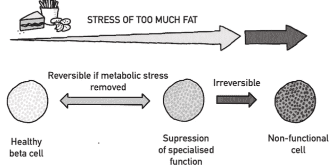

## 5.6 在易感人群中，胰岛素细胞内过多的脂肪会导致它们逐渐停止正常产生胰岛素。在 2 型糖尿病的早期，这是一个可逆的过程，但如果持续时间太长，就会变得不可逆转。

这个迷人的故事并没有于此结束。2 型糖尿病患者承受多余脂肪代谢冲击的能力各不相同。有些人在患有 2 型糖尿病 20 多年后，仍能恢复到非糖尿病的血糖控制水平。而有些人似乎很快就丧失了这种能力。换句话说，不同的人面对脂肪攻击时，其 β 细胞的耐用性不同。那些在患病 24 年后仍能逆转 2 型糖尿病的人，一定拥有具有易感但异常耐用的 β 细胞。看起来似乎有一组不同的基因决定了 β 细胞的耐用性。在未来的几年里，我们无疑会看到这一领域的进一步进展。

但对于任何病期的 2 型糖尿病患者来说，底线是：目前，发现是否可能逃离糖尿病的唯一方法就是大幅减轻体重。

## 快速阅读

- 双循环假设将关于血糖控制的最优可用证据联系在在一起
- 该假设的预测在一系列研究中得到了验证
- 实验结果显示，2 型糖尿病是由肝脏产生过多的葡萄糖和脂肪引发的
- 过量的脂肪导致胰腺 β 细胞失去产生胰岛素的特殊能力
- 肝脏和胰腺的缺陷都可以通过减轻减轻来纠正
- 所谓的“谋杀”从未发生：当 β 细胞被阻止产生胰岛素时，它们在显微镜下无法检测到，但仍然存活

## 6

## 个人脂肪阈值

关于 2 型糖尿病的新闻经常伴随着体型巨大的人的照片，给人一种 2 型糖尿病是由肥胖引起的印象。即使是医生有时也会说 2 型糖尿病的流行是“由于肥胖”。这种普遍的假设认为，如果一个人患有 2 型糖尿病，他们一定是肥胖的，而且都是他们自己的错。

但事实是，绝大多数极胖的人并没有患 2 型糖尿病，而在所有患该疾病的人中，只有一半人的 BMI 处于肥胖范围内。

让我们面对现实吧。

### 为什么我得了 2 型糖尿病？

勒内·柯霍（René Laennec）是发明听诊器的著名法国医生。他经常对学生们说：“听听你们患者的话。他们正在给你诊断。”他并不是说用他的新发明去听心脏或肺部。他谈论的是医生最重要的技能——知情的倾听。倾听患者讲述他们为何寻求医疗建议的故事，可以帮助理解导致他们症状的疾病类型。这种信息在今天仍然具有意义。

2011 年，当我们关于逆转 2 型糖尿病的第一项研究结果在报纸和电视上被报道时，我们收到了大量糖尿病患者的邮件，他们告诉我们自己的状况、患病了多久、经历过哪些并发症以及控制情况是否良好。许多人只想知道他们如何摆脱糖尿病。但有很大一部分少数人发来邮件说，他们并不超重，但仍然得了 2 型糖尿病。许多医生对这种现象并不熟悉，并且已经习惯了患者询问他们为什么会这样：“为什么我得了 2 型糖尿病，而我的朋友都比我胖，他们却没得呢？”

起初，这似乎与第 5 章描述的“双循环假设”相矛盾。该假设的起点是：长期摄入超过身体所需的食物是导致该疾病发生的必要条件。

对我来说，对 2 型糖尿病中可能发生的情况的早期见解，几年前来自一个有有疾病的非肥胖者。我们这个人称为马克（Mark）。马克对糖尿病发生在他身上感到愤怒，因为他并不肥胖——甚至不超重——而且不得不来看是否有方法可以摆脱它。我们进行了血液检查，结果显示他的肝功能没有想象的那么健康，这引起了我的注意。在“双循环假设”建立之前，我就知道在 2 型糖尿病中，这些特定的检测结果往往处于正常范围的上限——或者略高。通过我们的研究，我还知道 2 型糖尿病患者肝脏中存在高水平的脂肪，这会导致肝脏产生过多的葡萄糖。

因此我推断，高水平的肝脂肪可能导致了问题，进而导致了2型糖尿病。如果是这样，我们可能就有行动方案了。为什么不建议减轻体重作为消除马克肝脏脂肪的一种可能方法，从而可能改善他对糖尿病的控制呢？这种非常规的建议在提供时并没有保证成功；它只是恢复健康的一种可能途径，而且在最好的情况下，履行了希波克拉底很久以前提出的准则：“不伤害”。但马克坚持认为他想恢复正常，或尽可能恢复到正常，并说他会尝试一下。

于是，“正常体重”的马克减轻了体重。他的BMI从24下降到略低于20。糖尿病消失了。

有趣的是，恢复正常的不仅是清晨的第一口血糖。吞下测试性葡萄糖饮料两小时后的血糖水平也恢复了正常。显然，除了预测的肝脏变化外，还有其他变化在发生。那种变化很可能是胰腺功能的变化。这让我们有点意外。

马克是变得异常消瘦了吗？对他来说，完全没有。事实上，他只是把体重减回到了他20多岁时的水平。似乎他积累的脂肪超过了他的身体能安全储存的量，他确实无法应对他肝脏中的脂肪量。这导致了一个他的身体无法管理的局面。他的体重对他来说太高了——尽管与大多数人的“正常”标准相比，这并不起。整个经历让我开始思考对于某一个人来说“正常”是什么，以及这如何无法通过整个人群的“正常”范围来体现。

所以，回到2011年，当时“反点计划”（Counterpoint）取得了戏剧性结果。正如之前提到的，在我们收到的邮件中，有相当一部分来自BMI正常的2型糖尿病患者。由于对马克的良好效果以及“反点计划”的结果，提供在这种情况下减轻体重可以摆脱2型糖尿病的信息似乎是合理的。在邮件回复医疗问题时，医生只能提供信息而不能提供医疗建议。不干涉患者自己的医生至关重要。我们限制为只提供这些信息，并建议人们与医生或护士讨论。

你可能猜到了接下来发生了什么。我们开始收到这类“正常体重”的人恢复正常血糖水平的邮件。许多人遵循了预先与医生或护士讨论减肥计划的建议——但被拒绝了。不要这样做，他们得到了不确定的回复，因为他们的BMI已经在正常范围内，减轻体重是不健康的。但在大多数这些人中，摆脱2型糖尿病的愿望如此强烈，以至于他们忽略了这些善意的建议。

外表瘦削，内在肥肉。但现在，感谢马克以及各种来信回复，我知道我们发现了一些端倪：也许那些没有超重但患有2型糖尿病的人，在20多岁时更瘦，而他们的体重增加是“隐形”的。

回到起点。如何用几句话来捕捉这些概念呢？每个人都是个体。这是事实。是否可能每个人对身体脂肪堆积的耐受程度都是不同的？“个人脂肪阈值”（Personal Fat Threshold）概念应运而生。

## 观察人群

在20世纪70年代和80年代，英国的人口体重比现在要轻得多。根据1980年和2012年调查的可靠信息显示，在这三十年间，男女的平均体重都增加了10公斤——是的，10公斤！这大约是1.5英石（stone）。在1980年，普通人口的平均BMI为24。你还记得那时候的人长什么样吗？看看这张当时拍摄的纽卡斯尔街景照片，唤醒一下记忆。让我们看看仅仅32年里发生了什么。

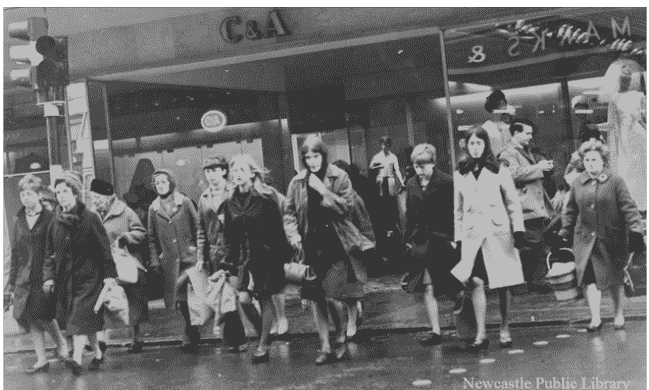

**图6.1** 20世纪70年代后期纽卡斯尔街上的人。当时看到胖子非常罕见。

图6.2显示了1980年英格兰和威尔士成年人口的BMI水平。任何BMI超过30的人都会被标记为“肥胖”。当时，这相当于每14个人中就有一个，或占比7%。

2012年，调查进行了重复调查——见图6.3。BMI超过30的人口比例飙升至四人中的一个，即25%！

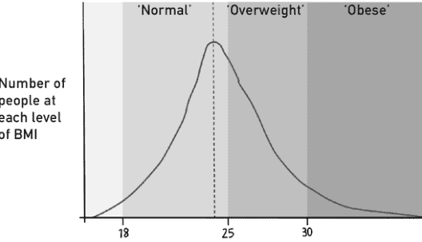

**图6.2** 1980年每个BMI水平各人人？最常见的BMI是24（虚线）。BMI超过30的人极少，并会被归类为“肥胖”。

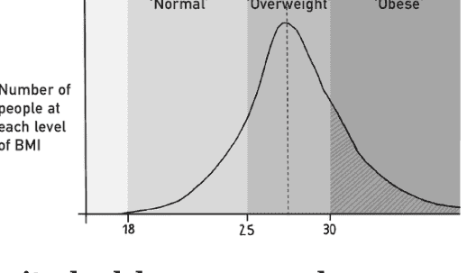

**图6.3** 到2012年，肥胖已变得普遍（阴影区域）。但这不是最大的变化。山体移动了，几乎人的体重都增加了。曲线的形状与1980年的图表相似，最常见的BMI是27（虚线）。

标题听起来令人震惊：在1980年到2012年之间，英格兰和威尔士成年人口的肥胖率从14人中的一个增加到四人中的一个。这些人到底出了什么问题？这种说法认为，“他们”需要被解决。但必须再次强调，大多数关于肥胖率上升的讨论都偏离了要点。注意力被集中在那些BMI超过30的人身上。诚然，根据广泛接受的固定定义，这就是肥胖。但再次观察图表。体重的变化不仅限于那些变得肥胖的人。这不是“他们和他们”的问题。我们都变重了。

- 以前BMI为35的人现在BMI为38。他们更肥胖了。
- 以前BMI为29的人现在BMI为31，并变成了“肥胖”症。
- 以前BMI为24的人现在BMI为27，并变成了“超重”。
- 瘦子的人其BMI从19增加到22，仍被定义为“正常”。

这个总结有助于理解大局，但它只反映了平均体重的增加。当然，有些人的增重比别人多。食欲在很大程度上是由基因决定的，你的食欲反映了基因遗传时的运气。那些天生食欲最旺盛的人（那些在食物匮乏时期为了生存而极度适应的人），往往在任何环境中体重增加最多。食欲还有其他影响因素，但我们在这里讨论的是在人群中看到的效应。环境（主要是食物的可可用性）决定了任何人群的平均体重。但一个个体在获取食物相同的情况下是比别人重还是轻，在很大程度上取决于他们的基因。

现实是，我们生活的环境已经改变，人口也随之发生了变化。2002年《柳叶刀》（Lancet）的一篇文章用几句话简洁地捕捉到了这一点：“肥胖流行病是因为正常人在异常的环境中做着正常的事。”一些推倡个人健康行动的人会反驳这一观点，认为我们不是环境的奴隶，健康是个人责任，让体重过高是不负责任的。然而，这种观点没有考虑到，对于许多人来说，追求最佳健康并不是每天的首要考虑问题。对于那些条件特别幸运的人来说，每天可以投入大量精力和时间控制体重或运动。但对于大多数人来说，生活会介入——家庭、漏雨的屋顶、财务问题、工作要求——我们吃什么、什么时候吃以及吃多少，并不是关注的焦点。也不必如此。

## 个人脂肪阈值

携带多余脂肪的个人耐受极限。皮肤下组织储存脂肪的能力在个体之间存在巨大差异。

有些人皮肤下拥有非常健康的运动型脂肪组织，它们可以处理任何投掷给它的东西，似乎具有无尽的储存能力。从代谢的角度来看，我们可以说这些人是幸运的。当然，如果他们积累的脂肪越来越多，看起来可能很过分，但所有脂肪都被安全地锁起来了。正如我们所看到的，当脂肪无法再安全储存而必须存放在其他地方时，代谢问题就开始了。

## 来自经典研究报告的洞察

有一项研究对2型糖尿病知识的影响比其他任何一项研究都更为深远。二十五年前，它还深刻地改变了医生治疗这种疾病的方式。它提出了一个核心问题：更好地控制血糖可以预防糖尿病的长期并发症吗？英国前瞻性糖尿病研究（通用简称为UKPDS）招募了1977年至1991年间新确诊为2型糖尿病的患者。主要结果于1998年得出。

这是牛津大学罗伯特·特纳博士（Dr Robert Turner）的脑力结晶。他与看似不可能的困难作斗争，在为期20年的主要研究期间获得了资金以维持研究进行。他是一个独立思考者，一位卓越的医生，拥有强大的毅力。但最重要的是，他能够吸引并维持一个分布在英国各地的忠实医生群体。他是一个卓越的人，需要他所有的素质来启动、执行并完成这项研究。1975年，特纳博士的团队加入了另一位开明的医学学者鲁里·霍尔曼教授（Dr now Professor Rury Holman）。他在使试验从构思到完成的整个过程中也起了关键作用。2012年，他同意与我合作重新分析一些旧的UKPDS数据，以测试“个人脂肪阈值”（Personal Fat Threshold）的概念：个体是否具有某种水平的脂肪储备，对其是安全的但与其他人不同？

UKPDS是当时糖尿病领域迄为止最大的“随机”试验。随机意味着人们被随机分配：要么进入强化治疗组，要么进入“对照”组。这种设计非常重要，因为它减少了获得误导性结果的风险。如果人们自己选择加入哪个治疗组，很可能会影响结果，最后测得的任何差异可能仅仅反映了这一点。组之间的任何偏差都意味着，结果可能不是由于给予该组的治疗，而是源于其他未识别的因素——过往医疗问题的个人经验或对疾病的背景信念。UKPDS对照组的参与者接受常规治疗（饮食、最终是药物和真实性胰岛素），但强化组的患者根据需要使用药物或胰岛素进行治疗，其革命性的目标是将空血糖保持在6mmol/l以下。

在UKPDS设计时，在研究任何疾病时，随机试验都是很罕见的。但罗伯特·特纳是一个先驱，他希望建立不受批评的新知识。没有其他任何项像UKPDS这样的研究。总共有5102名糖尿病患者参与了这项研究。二十年后，它产生了极其震撼的信息。它发现，更好地控制血糖可以使糖尿病的所有并发症——眼部、神经、肾脏、足部和大脑——产生显著的减少。这是一个大新闻。在当时，许多医生认为糖尿病并发症的发生与血糖控制得如何无关。这种旧观念花费了很长的时间才被取代，但今天，人们已普遍接受血糖控制与长期并发症风险之间的联系。

研究还显示，血糖水平多年来稳步上升，无论人们处于对照组还是强化组。2型糖尿病似乎在不可避免地恶化。每个人似乎都需要越来越多的药物，到第10年时，半数的人已经开始注射胰岛素。这种稳步恶化的明确证据最终被全球所接受，强化了大多数糖尿病专家的简单观察：人们终身患有2型糖尿病，血糖水平会不断变差。随后，这一切汇聚成一种固定的信念：2型糖尿病不可避免地进展，早晚需要胰岛素治疗；然而，无论处方了多少药物，每个人的状况都在恶化。当你被确诊时，可能已经接触到了这种绝望的论调。尽管如此，UKPDS带来了关于2型糖尿病最佳治疗方法知识的一场革命。

然而，UKPDS在本章中的重要性涉及另一件事。在UKPDS中，这群新确诊糖尿病患者的体重如何？平均BMI为27。这一点也不高。它处于“超重”范围的低端，远未达到“肥胖”。患有非常普通的2型糖尿病的人中，约有三分之一的人具有完全正常的BMI——小于25。

事实上，图6.4中灰点的分布准确反映了参加UKPDS的人的BMI。

考虑到现在对2型糖尿病的描述和报道方式，这似乎很奇怪，但在20世纪70年代和80年代初，人们认为肥胖与2型糖尿病之间没有直接关系。几个著名的研究似乎证明了这一点。作为一名年轻医生，我自己审查了所有的最佳证据并发表了一份总结，结论是没有联系的！这怎么可能？我们现在看到，那个时期少数肥胖人患2型糖尿病的风险增加，但由于肥胖人数较少，整体影响是检测不。

UKPDS中的肥胖体在哪里？问得好。2型糖尿病的本质过去和现在一样。但背景人群的特征非常不同——他们简单来说就是胖。

今天，即使专家也称2型糖尿病为肥胖症。然而，只有50%的人肥胖（即BMI超过30）。另外50%非肥胖。此外，每10个人就有1个人在确诊时BMI为“正常”（小于25）。这些数据针对白人裔。在南亚裔或远东裔中，患有2型糖尿病但BMI为“正常”的人数更高。

## 人口迁移

记住之前提到的数字——平均而言，男女女性的体重比现在轻10公斤。1980年时他们的平均BMI为24。回到第135页，尝试在街景照片中寻找“肥胖”的人。背景人群的BMI为27，在照片中找到肥胖的人并不困难。

## 为什么UKPDS大多数参与者并不肥胖？

我们看到，对于任何给定的BMI，有些人皮肤下储存了相当多的脂肪，而胃腔内不多；而其他人皮肤下含量正常，内部很多。使用磁共振方法研究我们如何处理食物的一个大优势是，身体内部结构是可见且可用于测量脂肪、糖原和其他物质的。查看图2.6和2.7以了解不同人的内部情况。

储存在胃腔内的脂肪本身并不一定坏。但它是皮肤下正常的储存库已经满了，因此脂肪在任何可以产生的地方聚集，包括器官内部。我们现在知道，这种脂肪是问题的根源，这也是我们理解为什么非肥胖者也会患2型糖尿病的线索。

## 来自自然意外的洞察

有时，自然的意外可以推动科学理解产生飞跃。例如，某些罕见个体出生时皮肤下没有脂肪，他们通过在其他地方储存脂肪来生存。这种疾病被称为脂肪不良症，由单个缺陷基因引起。这种病的人极其消瘦，但他们的肝脏充满了脂肪。在读了第4章和第5章后，得知他们经常患有2型糖尿病可能并不会感到意外。

通过观察当今的人口状况，任何人都能看到脂肪在人体部位的分布方式差异巨大。有些人肚子很大，而另一些人则腿部和臀部很大。得益于剑桥大学一群科学家进行的研究，我们现在知道，自身脂肪层的最大容量由许多基因决定，每种基因都具有影响；但除了脂肪性营养不良综合症等罕见疾病外，在普通人群中并没有一个单一的“脂肪”基因能决定一个人在皮肤下可以储存多少脂肪。当然，你储存了多少取决于你长期以来摄入了多少食物，以及日常活动中消耗了多少能量。我们非常不善概念化时间，无论是地质时间，还是微小影响导致体重大幅增加的漫长时期。

如果在分配给你的基因的彩票中，你脂肪的“安全存款”相当有限，那么在脂肪必须向其他地方堆积之前，你不需要增加太多体重。正如我们从“双相循环假说”（Twin Cycle Hypothesis）所知，这就是为什么人们在并不胖的情况下也会患上2型糖尿病。

这一切可以提炼为一个极其重要的事实：如果一个人患了2型糖尿病，说明他们对于自己的身体来说已经太重了。

## 对自己的身体来说太重了

塞缪尔·约翰逊（Samuel Johnson）辞藻精炼，是一个敏锐的观察者。在1790年左右，他说：“如果一个人太胖了，显而易见他吃得比应该吃的多。”

注意，他并没有说这个人“吃得太多”。他察觉了一种细微的差别，即不同个体需要不同数量的食物。现在，也许我们可以站在巨人的肩膀上，对2型糖尿病给出一个简洁的表述：

**如果一个人患了2型糖尿病，说明他们对于自己的身体来说已经太重了。**

## 测试个人脂肪阈值假说

来自英国糖尿病研究计划（UKPDS）的信息对于支持“个人脂肪阈值”概念非常有帮助。但另一项针对2型糖尿病的研究提供了更关键的进一步证实。

《护士健康研究》（Nurses’ Health Study）是世界上规模最大、持续时间最长的女性健康研究。该研究由美国哈佛的一群科学家于1976年建立，对五十万名年轻护士的生活方式因素对其健康的影响进行了长期随访——应该说明的是，选择这些护士并不是为了研究从事护理职业的风险因素，而是因为护士可能被认为能够提供准确的数据。

通过对参与者的定期随访以及对健康和生活方式因素的反复评估，该研究在塑造西方世界的公共卫生建议方面发挥了重要作用。它帮助揭示了例如，吸烟与心脏病及癌症之间的早期联系；绝经后肥胖与乳腺癌之间的关系；并阐明了其他与其他健康的因素。

我感兴趣的是体重增加，或者人可能患上2型糖尿病的脂肪阈值。研究显示：那些在几十年中保持接近年轻时体重的人（即BMI保持在22）可能不会患上糖尿病；但那些BMI即使轻微增加的人（在23到25之间）患上该病的可能性要高得多。这种风险的增加绝非小道。体重在正常BMI范围内增加的女性，患2型糖尿病的概率是BMI保持在22以下女性的四倍。

为了联系背景，针对大规模人群的大型研究可能会显示风险增加了，例如增加了15%。这通常会导致人们劝告改变行为或避免某些食物。这被称为“在统计学上有意义”。但实际上，15%的风险增加仅相当于你真实风险的微小变化。例如，如果你在未来10年患2型糖尿病的几是10分之一1，而你的风险增加了15%，那么你的风险就会变成10年中1.15。任何熟悉赔率的人都会说：“所以你是想说我的风险从10分之一1变成了大约10分之一1吗？”在个体层面这并不显著。另一方面，四倍的增加意味着你患2型糖尿病的风险将上升到10分之4，这对你来说是风险巨大的增加。

所以，如果这些曾经年轻、健康且纤细的女性只增加一点体重，患2型糖尿病的风险水平就会大幅增加。当然，如果她们增加更多体重，风险会上升得多。这项研究有力地展示了某些个体对过度脂肪的耐受阈值很低。

我们知道当整个人群变得越来越胖时（正如今天许多国家发生的情况），整体影响是患2型糖尿病的人数增加。会有更多的人超过他们的个人脂肪阈值。将人口趋势外推到个体，导致了一种广泛的观点，即人的体重应该是判断其是否可能患该疾病的良好依据。读到章节的这里，你知道“正常”体重的人也可能患2型糖尿病。

留意人口统计数据。经常被引用的关于患2型糖尿病风险的数字，例如“如果BMI大于30”，对于已经患此病的个体来说是无关的。我们将在第9章讨论风险因素。

## 对2型糖尿病的敏感性

个人脂肪阈值解释了为什么个体在任何BMI水平下都可能患2型糖尿病。但如果我们观察硬币的另一面，情况又是怎样的？那些非常肥胖但没有患2型糖尿病的人又是怎样的？

事实上，大多数非常肥胖的人并没有患2型糖尿病。在美国范围内进行的三项调查显示，BMI超过45的人没有患糖尿病。我们在纽卡斯尔磁共振中心的最新研究清楚表明，脂肪脂肪并不会导致所有人产生2型糖尿病。它只是在肝脏产生脂肪，并确保这些潜在的毒性物质输送到胰腺。

但是糖尿病有一个关键的“是/否”开关。任何患2型糖尿病的人对这种疾病都是敏感的。这是显而易见的。此外，他们必须拥有对脂肪负面影响敏感的β细胞。长期以来，我们知道大多数与糖尿病相关的人类基因与胰腺有关。现在我们有了一个大线索，即至少某些基因决定了如果脂肪堆积你是否会患糖尿病。

## 观察β细胞

在20世纪90年代初，罗杰·恩格（Roger Unger），糖尿病领域的一位天才大脑进行了一项涉及大鼠的研究，证明了对脂肪的敏感性归于单一基因。该基因决定了动物在过度营养后是否会患糖尿病。

恩格和他的团队从患病之前的年轻大鼠身上提取了β细胞，并用脂肪将其培养了几天。恩格和他的团队发现，脂肪损害了细胞对葡萄糖产生胰岛素的能力。这本身就很有趣。

随后，他们在其他方面相似但没有基因缺陷的大鼠身上进行了相同的实验。这些大鼠的β细胞在暴露于脂肪的情况下继续正常产生胰岛素。脂肪没有产生影响，证明了糖尿病的最终敏感性在于β细胞本身。

哪些基因决定了 β 细胞在受到脂肪抑制十年后是否仍能保持恢复能力？

你基因多样的基因组合决定了 β 细胞停止对葡萄糖产生反应的脂肪暴露程度。如果你已经患了糖尿病，说明你的体内拥有易受脂肪诱导性损害的 β 细胞。但好消息是：没有脂肪，就没有损害。

## 快速阅读

- 2 型糖尿病并非由“肥胖”引起
- 每个人都有一个“个人脂肪阈值”（Personal Fat Threshold），超过该阈值后，他们可能会患上 2 型糖尿病
- 这最初是由许多基因决定的，这些基因决定了脂肪可以安全地储存在皮肤下的量
- 超过个人脂肪阈值后，多余的脂肪将由肝脏供应身体的所有组织，包括胰腺
- 尽管如此，即使超过了个人脂肪阈值，2 型糖尿病的“停止/继续”决定因素仍在你的 β 细胞内部：它们可能对多余脂肪的负影响敏感或不敏感
- 即使你非常倒霉，既存储皮下脂肪的能力有限，又拥有脂肪敏感型 β 细胞：没有多余脂肪，就不会有糖尿病

## 摆脱 2 型糖尿病

好了，是时候行动了。在了解了身体如何运作以及为什么会糖尿病之后，我们现在可以看看如何消除它。在本章中，我概述了“1、2、3”方法，该方法最初设计用于识别 2 型糖尿病的原因，但在现实生活中证明是有效的。这是一个简单的计划，具有明确的阶段——第一，快速减轻体重并设定明确的终点；第二，逐步重新引入普通食物；第三，长期维持体重。

快速减重阶段随后是逐步恢复正常饮食，这与近年来建议的“缓慢且持久”的标准建议大相径庭。1、2、3 方法承认减肥是一项独立的活动，与长期保持体重稳定是两回事，而且在第一阶段快速减肥具有许多益处。还有其他减肥方法。然而，多项高质量研究表明，进行一段时间的高强度快速减重饮食不仅对大多数人有效，而且极具激励性。

## 如何做

1. **承认问题：** 如果你患有 2 型糖尿病，说明你的体重对身体来说太重了
2. **写下你的目标体重：** 通常是减轻约 15 公斤（2 英石 5 磅）
3. **承认必须减少 2-3 个月的食物摄入：** 思考一下你什么时候适合这样做
4. **与家人和朋友讨论：** 支持是成功的秘诀之一
5. **决定：** 你真的想做这件事吗？
6. **准备行动：** 清空橱柜
7. **行动：** 去执行

### 1. 承认问题

几个世纪以来，2 型糖尿病一直被认为是终身性疾病。来自著名的“英国前瞻性糖尿病研究”（UKPDS）的数据“证明”了这一点，不是吗？在那项研究中，人们必须一年比一年地服用越来越多的药片，他们的血糖控制持续恶化。这似乎是一条不可避免的下行之路，无论最初是将血糖水平保持在最低还是没有那么低。在经历了 10 年严峻的进展后，研究中竟然有一半的人需要注射胰岛素。

为什么这项研究“证明”了 2 型糖尿病总是会恶化而永远不会消失？简单的答案是，这项研究中的人并没有减肥。事实上，情况恰恰相反。现实生活中也是如此：尽管被建议减轻体重，但最近诊断出 2 型糖尿病的人发现，他们的体重在随后的几年里不断增加。对于那些接受过常规减肥建议的人来说，这可能并不意外。这些建议通常在给出时并没有“这可行”的信念，也没有关于如何操作的特定指示。即使有营养师提供的基于指南的建议，通常往往是令人沮丧且无效的。大多数人在患上 2 型糖尿病后体重稳步增加也没有让医生感到意外，因为他们知道某些处方用于管理该疾病的药片实际上会阻碍减肥。

在参与 UKPDS 研究的人体内，肝脏和胰腺内的脂肪水平可能一直保持在高位。药片会改善他们的血糖水平，但这与疾病的进展无关。在胰腺内部，产生胰岛素的 β 细胞正在逐渐失活，因此对足够血糖控制的所有希望也逐渐消失。

但来自 UKPDS 的信息无法被正确理解，因为 2 型糖尿病的确切原因仍然未知。现在我们知道了，就可以从一个全新的视角看到这项研究的真实信息了。如果在诊断出 2 型糖尿病时，体重仍然保持在目前的水平——那么糖尿病就不会消失，并且会变得更糟。但是，如果你减轻了很多体重，情况就恰恰相反。

你的 2 型糖尿病是由胰腺内不到半克的脂肪引起的。这极少量的多余脂肪位于细胞内，阻止了胰岛素的正常制造和释放。胰腺细胞内不仅有多余脂肪，血液中也脂肪太多，脂肪不断到达并增加负担。有没有什么聪明的方法可以除掉这些处于错误位置的极少量脂肪？

遗憾的是，没有。减少体内累积脂肪总量的唯一方法——减少的不只是几公斤，而是大量。一旦这一点非常明确，摆脱 2 型糖尿病就在你的掌控范围内。你需要减肥并保持体重不反弹。

### 2. 写下你的目标体重

然而，多少才算太多？根据经验法则，15 公斤（约 2 英石 5 磅）无论你从 160 公斤还是 80 公斤开始，都是一个需要减轻的魔力数字。当然，减轻更多体重可能会带来其他健康益处，但这本书是关于恢复代谢健康，而不是为了变瘦。

15 公斤的经验法则适用于大多数人，但如果你不是体型大的人，这可能太多了。你仍然可能超过个人脂肪阈值，但与他人相比并不算胖。在较低的起始体重下，例如低于 80 公斤，最好考虑减轻体重的 15%。所以，60 公斤的王女士可以合理地设定减轻 9 公斤。

第一步是查看下表并写下你的目标体重。不要被看似困难的情况吓倒——成百上千个像你这样的人已经实现了类似的减重。这是办得到的。只要写下来，它就变成了一个真正的目标。

| 如果你现在的体重（公斤）是： | 那么你的目标体重可能是： |
|---|---|
| 150 | 135 |
| 145 | 130 |
| 140 | 125 |
| 135 | 120 |
| 130 | 115 |
| 125 | 110 |
| 120 | 105 |
| 115 | 100 |
| 110 | 95 |
| 105 | 90 |
| 100 | 85 |
| 95 | 80 |
| 90 | 75 |
| 85 | 70 |
| 80 | 65 |
| 75 | 64 |
| 70 | 60 |
| 65 | 55 |
| 60 | 51 |

> **表 7.1** 对于任何考虑尝试摆脱该疾病的 2 型糖尿病患者，这张表格显示了他们应该追求的大致体重。不要被挑战所吓倒。

### 3. 意识到在 2-3 个月内减少食物摄入

你打算什么时候开始你的“逃离饮食法”？显然不是立即开始，因为你需要提前计划。也许在下周的家庭聚会之后？这并不是邀请你先推延，然后一再推延，而是鼓励你冷静地审视未来，确保你正在让自己事情变得尽可能轻松。选择你自己的时间。

对于许多人来说，在没有社交场合、工作动荡或假期等情况下，应对为期二三个月的坚持感到挣扎。因此，需要计划好你如何坚持下去。如果你有派对或活动，你可以选择自带食物或奶昔。也许可以确保自己只喝水或零卡路里饮料？或者在菜上桌之前离开？有些人告诉我，他们倾向于在出门参加活动之前吃一顿“特殊”大餐，因为那些食物非常饱腹。这样在聚会期间，他们就不会让任何食物进嘴里。寻求你身边所有亲人的支持将非常有帮助。

当然，总有一个中断饮食休息一下的选项，比如某个特殊的周末。但你必须记住，这是一个更困难的选项，尤其是因为短暂的饮食“假期”之后，随着身体的重新适应，又会有额外的 36 小时的饥饿感。在我看来，休息应该是例外，仅保留给非常特殊的场合。否则，可能会出现它们变成常态的风险，导致暴食开始反弹，阻碍你的逃离努力。决定必须由你做。但请记住，学会如何处理涉及食物和饮料的社交场合是未来维持效果的一项宝贵技能，它将让你终身受益。

### 4. 与朋友和家人进行讨论

这一点我怎么强调都不为过。显然，寻求家人和朋友的支持来帮助你应对生活中出现的各种困难是非常重要的。但考虑实质性减重要要普遍得多。进食是一种社交活动，通常涉及到你最亲近、最爱的人。光是考虑朋友来说：为了作为场合中被接受的一部分，你多久会和他们一起喝酒或进食？许多家庭把聚在一起做饭作为一种惯例。因此，你对食物种类和摄入量所做的任何改变都会影响家里的其他人。如果全家人都愿意同时做出一些改变，这将减轻一些困难。同样，朋友和同事也是如此。你需要盟友。

你的配偶/伴侣/亲密朋友对你开启这项摆脱糖尿病的挑战怎么看？看到你体重减轻了、感觉年轻了 10 岁，他们会感到开心还是不开心？也许这一切对他们来说也有某种启示？对于他们平均体重比 1980 年时的自己重了 10 公斤这一信息，他们怎么想？在我们早期的研究中，只有三个人退出了，在所有这些情况下，原因都是他们的配偶/伴侣不希望他们减轻体重。这可能看起来令人惊讶，但感知各异。哲学家告诉我们，感知是唯一的现实——换句话说，并不是每个人都用同样的眼光来看你。

家人决定除了用餐时间外不吃任何东西是一个明确的第一步。在当今这个过度营养的社会中，餐间零食已成为常态；你每转一步都会被饼干、蛋糕和含糖饮料所诱惑。但仅仅 50 年前，这种过度进食看起来是荒谬的。要区分无聊和真正的饥饿。通常“我感觉有点饿”这句话其实意味着“现在没菜在做饭”。认清其中的区别。但如果东西必须不断地进入口，也许体重就会减轻。

如果橱柜里没有饼干、薯片或糖果，诱惑的时刻会容易应对得多。现在有很多讨论关于我们所处的“肥胖环境”——我们的久坐生活方式、对汽车的使用、对快速食品的便利获取。然而，家庭的肥胖微环境很容易被忽视。如果家庭成员愿意，这个微环境是可以改变的。我们的许多研究志愿者都描述过这种变革。

留意你对自己和别人找的借口，例如：“我需要在橱柜里为孩子/孙辈留一些零食”。首先，记住 2 型糖尿病有家族遗传，家庭成员共享决定 2 型糖尿病风险的基因。所以……（注：文本根据提供的 OCR 流程继续/结束）

当你尝试遵循严格的计划时，要考虑到如何应对。在开始之前，想清楚你会如何应对这类情况是一个好主意。

### 7. 行动起来！

我们所有关于逆转 2 型糖尿病的研究工作都依赖于一种让所有参与者都能在规定时间内实现的减重方法——即通过低卡路里汤和奶昔的组合，将每日摄入量维持在每天 800 卡路左右（在我们的 Counterpoint 研究中，我们让志愿者在 8 周内每天坚持在 700 卡路左右，但在科学研究中，拥有一种统一、可重复且能被大多数人接受的改变方式是至关重要的）。但你并不是“大多数人”。你是一个个体，由于各种原因，你可能可以通过其他方式实现减重 15 公斤的目标。也许你对低卡路里饮料有想法，或者更倾向于自己做饭。这没关系，只要对你有效即可。

从一开始你就需要规划长期的体重控制。而且，一旦你减掉了 15 公斤，在祝贺自己（以及你的支持者）之后，你必须准备好面对事实：你需要的食物比以前吃得要少。在实践中，这将是你习惯性装在盘子里并吃下的分量的四分之三。记住，这是你余生的开始。而少吃是维持你崭新的、健康且相对匀称体型的唯一途径。从一开始就知道这一点是非常重要的。

## 1、2、3 法

在纽卡斯尔测试双循环假设的早期研究中，我们必须想出一个简单、实用且有效的方法，让志愿者实现体重的巨大变化。首先，我设计了一个为期八周的低卡路里粉奶昔计划，以简单的方式提供完全营养，且准备工作最少。“完全营养”意味着该饮食提供了所有必要的蛋白质、矿物质和微量元素。

每天尝试一份非淀粉蔬菜可以提供更多的纤维素。然而，在第一次尝试后，我们的研究志愿者告诉我们，他们在重新恢复正常饮食时遇到了困难。他们描述了在经过八周仅仅是选择哪种口味的粉冲水后，当尝试准备正餐时，他们不知所措，甚至感到恐慌。因此，我们设计了一个清晰的阶进式方法：首先，用一顿正常的食物（通常是晚餐）代替奶昔，至少持续两周；然后一周后，对午餐进行同样的操作。如果个人准备就绪，就可以恢复早餐。食物的量经过仔细描述——通常是习惯食用体量的四分之三（用于减重）。

我们在 Counterbalance 研究中使用了这种阶进式的食物重新引入法，并高兴地发现参与者避免了突然切换带来的问题，并在快速减重后保持了体重稳定。这种低卡路里减重阶段加上新的阶进式计划被称为“纽卡斯尔饮食”。随后，在 DiRECT 研究中，我们使用了另一种此前在格拉斯哥单独开发的、名为“Counterweight-Plus”的类似策略。

首先，降低体重，完全专注于此。其次，一步步地重新引入普通食物。第三，长期维持体重。

意识到这三个阶段是三个清晰的操作是非常重要的。仔细的研究表明，通过将一段较短但剧烈的减重期与长期维持期进行清晰分离，可以实现重大的减重。但需要提醒的是：到目前为止最好的研究仅持续了两年，必须终生避免体重反弹。（更多信息请访问网站：`https://go.ncl.ac.uk/diabetes-reversal`。）

## 吃什么：概览

**第一步：** 在 8 周减重期间，最简单的选择是使用液体配方产品每天提供约 600 卡路里，并搭配一份非淀粉蔬菜（约 100 卡路里）。不喝酒（且不进行额外运动）。

**第二步：** 过渡到正常饮食，用一小顿普通食物（400-500 卡路里）代替晚餐液体餐，持续约 2 周。然后在接下来的 2 周内引入一份小午餐（约 400 卡路里）。然后停止液体饮食。

**第三步：** 对于长期维持，体重秤是你的最好的朋友。饮食恢复为正常的社交活动——但要密切关注量。酒精也是如此。

## 食物对比液体配方

每餐使用一包许多市售液体配方饮食之一，对大多数人来说是目前最容易的选择。有些品牌有多种口味供选择，可以最大限度地减少无味。在我们的“纽卡斯尔饮食”中，我们还鼓励参与者在水中加入一些非淀粉蔬菜以便咀嚼（一些人非常想念这种活动），主要是因为蔬菜有助于避免便秘。（在我们的 DiRECT 试验中，由于这项研究需要尽量缩小人与人之间的差异，我们放弃了蔬菜而使用第四包液体配方餐；然而，这种方案需要定期服用通便剂来处理便秘。）

而且，如果你无法忍受连续几周加不加蔬菜喝液体配方饮料，你当然可以选择普通食物。你需要制作包含 200 卡路里的餐食，每天不超过 800 卡路里。这涉及到厨房中大量的计划和准备时间，许多人发现由于每天决策和选择的负担，这更加困难。

如果你选择真正的食物来每天提供约 800 卡路里，你需要高比例的蛋白质食物（鱼、肉）来满足你的每日需求并让你保持饱腹感。大量的非淀粉蔬菜对于增加饱腹感保持肠道通畅非常重要。达到目标体重可能需要更长——大约三四个月，而使用液体配方只需要两个月。

你也有可能缺少某些维生素，因此基于食物的每天 800 卡路里饮食最好补充复合维生素片。但完全专注于低卡路里饮食的方法非常适合某些人。这并不是科学。如果你能通过大幅减少食物摄入量来实现快速减重，那是没问题的。

选择你的低卡路里饮食。如果是液体饮食，你必须决定喜欢哪个品牌和口味。无论你选择哪个品牌，它**必须**被描述为“完全营养”（而不是只是“代餐”），也就是说，除了蛋白质、糖和脂肪外，它含有所有的维生素、矿物质和微量元素。

你可能会对某些品牌的高糖含量感到惊讶——但不用担心，与你每天产生的量相比，这很低。蛋白质含量会很高：约为 25%，比你通常每餐摄入的要多得多。它是每餐一包（没有决策或调整的空间）。每包含有约 200 卡路里（某些品牌见我们的网站：`https://go.ncl.ac.uk/diabetes-reversal`）。

### 液体饮食对大多数更容易

如果你选择真实食物方案或两者的结合，你需要准备好原料和食谱以坚持下去。要现实：你不会想每天都花几个小时准备精致的低卡路里餐；要准备好一些快捷简单且热量可控的选项——例如烤鸡肉或鱼配上一堆非淀粉蔬菜。如果需要，可以将其作为你每天的主餐。

不要在第一阶段开始运动计划。可能令人惊讶的是，这会严重阻碍减重，特别是对于超重的人来说。这可能是减重领域最好的秘密，我是从听取我们一项运动研究的参与者的话时得知的。

描述为“补偿性进食”（部分意识，部分潜意识）。因此，在第一阶段只需保持正常的活动量即可。

- 写下你为什么要这样做。如果你在平衡日常生活与避免体重反弹之间挣扎，这以后读到这些会非常有用。
- 在液体饮食期间，你会有很多空闲时间，因为用餐时你不需要坐在家餐桌旁，请提前计划好如何利用这段时间。列一个清单。
- 计划好当你感到想吃某些禁忌食物时该怎么办。写一份你自己的注意力分散清单是有帮助的——家务工作、带狗多散散步给它一个惊喜、喝一大杯水、计划未来的假期。
- 你还需要计划在出门时如何为自己提供特殊饮食。如果你选择的液体饮食粉末设计为溶在水中而非牛奶中，这样是最容易的，但无论哪种情况，提前计划都会让事情变得容易处理。
- 减重期间不要饮酒。酒精的热量很高。把它看作是液体脂肪吧。没有帮助。别做就行。
- 继续享受茶和咖啡，如果喜欢，可以加脱脂牛奶（每天不超过 50ml）。
- 与你的医生或糖尿病护士讨论你的计划。

以下是我们在研究中人们对液体饮食经历的评价：

> “我感到非常惊讶，我吃的东西与我过去几周吃的相比是如此不同。我真的本以为从我睁眼到闭眼的每一刻都会感到饥饿，但我并没有。”（女性，42岁，恢复正常饮食一年后）。
>
> “开始相当困难，但随着周数的推移变得越来越容易了，然后我开始变得更结壮了一些，可以走得更远，可以站起来打理花园，现在棒极了。我感觉非常好。”（男性，44岁，确诊后两年半）。

尽管大多数人都反映了这些想法，但并不是每个人都认为这是可行的：

> “因为周围的人吃东西的味道……我有一次在镇上，那简直太荒谬了，我无法集中注意力……如果我是在家里就好了。我这周本可以减轻体重的而且还能坚持下去，但我坚持不下去。”（男性，52岁，诊断后一年）。

下一段引言揭示了过去二三十年来我们的商业街和其他地方发生了什么。这位人士并不是对当今社会中无处不在的食物供应感到感叹的唯一：

> “你无法避开食物。拿起报纸，杰米·奥利弗在用羊腿做什么花样。打开电视，玛丽·贝里在烤蛋糕。于是你去球赛，结果发现自己被汉堡广告和摊位包围。我无法坐在家庭餐桌旁。我不得不去电影院看任何电影来打发时间。一个可怜又忧伤的老头独自坐着。但这确实有效。”（男性，57岁，研究后两年仍未患上糖尿病）。

## 第二阶段的实践

# 从减重阶段回到吃普通食物

从减重阶段回到吃普通食物需要一些周密的计划。我们在 Counterpoint 研究后意识到了，该研究仅是为了测试“双周期假说”（Twin Cycle Hypothesis）。我们当时主要关注如何快速地减轻大量体重，而没有充分考虑重新进入阶段的挑战。我们的研究志愿者描述说回到厨房时感到无所适从。吃什么？吃多少？他们能喝水吗？

但我们也了解到对于这里的人来说有一个机会：八周时间每餐只吃一包食物，这创造了一个可以在上面书写新饮食习惯的空白板。

就像在初始减重阶段有一个重点一样，在阶进式食物引入阶段也必须有一个明确的计划。

- 从晚餐开始，回到正常的（比平时小的）一盘食物，而不是摇蛋白奶，但在一天中的其余时间继续你的减重饮食。
- 在这里进行一些提前计划也是明智的：“正常”饮食仍然应该是低碳水化合物，并含有大量蔬菜。避免甜食或淀粉食物。
- 两周后，你可以增加午餐，停止喝摇蛋白奶，但再次执行份量控制。
- 四周后，你可以回到可以维持一生的相当正常的饮食模式——而不会体重反弹。如果你愿意，也可以喝酒。在这个阶段，你的体重增加约 1 公斤（2 磅）是正常的，因为糖原储备正在重新建立——水总是与糖原一起储存的。

通过阶进式食物引入，我们的志愿者发现向正常饮食的过渡不那么麻烦，长期来看更具可持续性。他们报告说，每天开始一份低热量饮食的指导方法很有帮助。他们也感激获得了关于吃多少数量食物的确定信息。关于此阶段食物的更多信息请参见书后的食谱部分。

## 第三阶段的实践

到这个阶段，你应该为自己感到非常自豪。你已经减轻了大量的体重；你希望已经实现了 2 型糖尿病的缓解；你会在心理和身体上都感觉好得多：更有精力、更有自信和动力。欢迎来到你新生活的开始。

也许称之为“新常态”会更安全。维护你恢复的健康是非常值得的。虽然你可以享受家人和朋友，甚至纵自己一次特别的款待，但你必须避免回到旧习惯。坚持这些规则：

- 作为一个粗略指南，你需要吃以前分量的四之三。
- 每周记录你的体重。这至关重要。体重秤会告诉你体重是否正在上升。
- 每天，如果你吃得喝得太多，你的体重可能会波动。
- 确保生活充满乐趣。是的，总热量需要限制在允许你的体重保持稳定的水平，但这不应该成为每天的负担。决定因素不是偶尔的狂暴食，而是日常的背景热量摄入。

所以，尽欢吧，然后还。你现在可以参加庆祝生活的里程碑——纪念日、生日、家庭聚会——你确实应该这样做！但你必须意识到在接下来的一周内需要少吃。你将如何这样做？也许是一周内每天只吃一份正餐，或者如果间歇性禁食适合你，就一天吃得极少。

> “我当时心烦意乱，走到桌旁，我们（包括我）面前放着一些巧克力。我非常想吃一个，但我走开了。尽管我必须说，我走到罐子旁打开了三次盖子，但每次我只是走开了，因为我觉得：不，因为那样感觉就像是我妥协了，我不想那样做。”（一位女性，35 岁，确诊后一年半后。）

## 为什么之前的减重尝试可能会失败？

在 Counterbalance 和 DiRECT 研究中，由 Falko Sniehotta 教授领导的心理学家小组对参与者进行了采访，以找出哪些因素有助于他们维持体重稳定，以及哪些是取得成功的主要障碍。在加入研究之前，许多参与者曾尝试过减肥但未能成功并反弹。其主要原因之一是减重速度太慢；在长期尝试遵循某种方案的过程中，厌倦情绪随之然而生。或者是围绕食物的社交习惯很难改变。在之前的饮食计划中，有些人体会了挥之不去的饥饿感，并积极地反感继续减肥所需的食物限制程度。相比之下，大多数参与者普遍对“1、2、3 方法”持乐观态度，既是因为它的速度快，也是因为他们在低热量阶段感觉非常好。他们还说，全科医生护士或营养师的持续支持在体重开始回升时提醒他们采取行动很有帮助。

DiRECT 仍在进行的更长期随访显示，体重恢复仍然是一个挑战。没有简单的答案。上述一般建议是我们目前能做的最好的。坚持下去！

## 为什么要快速减肥？

如果食物摄入在两个月内减少到每天约 800 卡里，会有几个优点。一旦开始，你可能不会感到非常饿。这可能是我们在狩猎采集的数千年里进化出的一种生存机制。如果你脑子里满都是极度饥，想要成功狩猎将非常困难。第二个主要优势是，你在短时间内就会感觉好得多，以至于你想坚持下去。你会发现活动更容易了；睡眠也沉得多。你会开始感到精力充沛。

在 700-800 卡路里饮食的第一周，平均减重为 3.5 公斤。在整个八周内，减重超过 15 公斤。这听起来可能相当惊人：如此大量减少饮食真的健康吗？突然体重下降通常被认为是严重疾病的指标。但事实依据是，对于任何在成年期体重增加或一直超重的人来说，减掉多余的体重然后长期少吃对健康有巨大的益处。在我们这种过量进食的社会中，禁食通常并不危险，进食才是。

如上所述，如果你选择使用液体产品进行完全食物替代来减肥，还有一些额外的优点。第一是每餐很容易获得高比例的蛋白质，这有助于控制饥饿感。第二是关于吃什么和吃多少没有艰难的选择。将自己从累的决策负担——决策、决策、决策中解放出来，会让减肥变得真正更容易。

你不需要快速减肥来逆转糖尿病，但对大多数人来说，这是获得所需公斤数简单的方法。总的来说，1、2、3 方法有效是因为每个阶段的明确目标是人类可以实现的，而且早期的成功增加了获得成功的动力。

## 行为调节策略

我们每天做的很多事情都是潜意识的。我们的行为在很大程度上取决于习惯和社会从性，值得尝试识别可能可以修改的特定影响。在纽卡斯尔，Sniehotta 教授及其团队已经确定了一些值得考虑的有用策略：

- **避免**。识别出在社交饮食方面压力最大的情况。
- **分散注意力**。列一份你自己需要做的事情清单。缝补、修理、打电话——所有在关键时刻可能难以抽身的事情，但可以经常记住并列出。在待办事项列表中加上：“写信给议员，提醒他/她立法限制商业驱动的过量热量供应的重要性”。
- **喝水**。自来水很廉价。在冰箱里放一个大水壶。喝一品水可以填饱胃部，并在诱惑出现时占据大脑。换换口味气泡水吧。零卡路里的风味水也是冰箱里的一个选择。
- **从你的环境中移除错误的食物**。你的橱柜理想情况下应该是一个不含饼干、薯片、蛋糕和巧力的区域。
- **提醒自己你的目标**。写下你最初为什么想逃离糖尿病。这可以是日记第一页或手机上的几个字。偶尔读读它。你开始执行这个计划的原因会随着时间的推移而模糊和消失：1. 不想像爸爸那样受苦；2. 不想那些药片让胃部不舒服；3. 不想担心视力或心脏；4. 感到总体不健康。你的理由在多年后同样有效——只要你还能记得它们。
- **社交披露**。你的家人已经知道他们不应该在你喝咖啡时给你提供饼干了。希望你可以完全向同事和朋友开放你通过最大限度减少慢性食物中毒来保持健康的目标。事实是，并不是所有人对这种食物敏感，你已经发现了。你的解释不应该被看作是对所有人说教——但每个人都能从知道成年期间体重不应该增加中获益。

## 常见问题

### 减重速度重要吗？

只有在快速减肥能让大多数人更容易减轻 15 公斤（33 磅）时才重要。消除肝脏和胰腺脂肪的效果，无论减重发生在两个月内还是一年内都是样的。二型糖尿病简单的生物学原理说明了一切：排出胰腺中多余脂肪，胰岛素产生就会重新开始（只要 β 细胞没有被损害太久）。

### 我被告诉我有糖尿病前期。我该怎么办？

开始执行 1、2、3。通过减轻大约 10 公斤（如果你小于 80 公斤，则减轻体重的 10%），你几乎肯定能让自己离开这一类别，并改变长期保持健康的机会。

### 我可以使用牛奶饮食吗？

理想情况下，你会使用提供完整营养的液体配方包。但由于某些原因这不可行，那么是的，基于牛奶的饮食（每天 2 升半脱脂牛奶）既廉价又可行。每天服用复合维生素片并吃一些非淀粉蔬菜是很重要的——以提供一些粗纤维并咀嚼。

### 我在第一阶段真的不能喝酒精吗？

不能，因为酒精本质上是液体脂肪，正如第 2 章所述。然而，我们最成功的研究参与者之一坚持每周喝一杯葡萄酒。它是被慢慢饮用的而不是补充的。简单的标准是你是否取得了足够的减肥。所以，只要你第一周减轻了 3.5 公斤，之后每周减轻 1.5 公斤，每周一杯葡萄酒是可以的。啤酒可能会有问题，因为它的热量太高了（一品就有 200 卡路里！）。

### 为什么我会感到冷？

有些人减肥期间一直感到冷。一个常见的误区是这是由于皮肤脂肪层变薄导致的——这是一个不太可能的解释，因为寒冷通常在开始减肥后很快出现。感到冷更有可能是由于身体在剥夺热量时产生的热量较少。你唯一做的就是穿暖一点（保暖背？）并接受这是比太重和流汗更好的选择。

### 我的稀疏头发会长回来吗？

这并不常见，但答案是肯定的——前提是因为营养的突然变化。有些人减肥后注意到脱发。事实上，在任何异常情况下（考试、怀孕、家庭疾病），毛囊的生长周期往往变得同步，这意味着不像每天掉落 70 根处于生长周期末期的头发那样，而是每天掉落几百根。但不要担心——它们会在几个月内全部长回来。

### 我该如何解决便秘？

有些人尽管每天吃一大盘生菜、西芹、青椒和西红柿，发现在饮食期间仍然便秘。怎么办？最简单的方法是要求你的医生开具一种能增加大便体积的药物。

### 减肥会导致胆结石吗？

低热量饮食通常会让胆结石变小，这意味着它们有很小的概率挤入胆管（胆汁进入肠道的通道），从而引起疼痛。在 2 型糖尿病患者中，胆结石非常常见——大约每五个人中就有一个患有。在我们的 DIRECT 试验中，149 名接受减重的人中，只有一个人在研究期间期间了胆囊问题。这与接受标准医疗治疗的 2 型糖尿病患者组中预期的数量没有太大。因此，尽管随着胆结石变小，胆绞性发作的风险很小，但如果不减轻体重，未来发生胆结石疼痛的概率更大。

## 我可以改变脂肪消失的地方吗？

有时候看起来脂肪似乎在流失，但流到了错误的地方。遗憾的是，我们没有办法影响这一点。事实上，令人惊讶的是，即使现在我们对人体的许多部分有了如此详细的了解，我们仍然不知道脂肪为什么储存在某个人身体的特定位置。是什么在控制着这一点？是什么阻止了它在某处堆积成一个大包？除了性激素对典型女性或男性模式脂肪层部分分布的明显影响外，我们一无所知。

## 减重后我可以避免看起来瘦弱吗？

考虑到我们现代文化中追求纤细和健身的理想，这个问题听起来可能很奇怪。但有趣的是，这通常是由处于权力地位的人提出的。在某些文化中，它的重要性比其他文化更高。英国的观点可能正在变化，在过去，大多数公司董事、大多数市长和大多数领导者都是高大、威严的人。在世界其他地方，“拥有重量——即拥有分量或权力”这一短语可以适用于许多“高层”人物。避免减重后看起来不“令人印象深刻”的最好方法是进行力量训练以增强脖子和肩膀，并且要有自信。你不需要额外的体重来给人有权势的感觉。

## 快速阅读

- 识别问题：如果你有 2 型糖尿病，你的体重对你的身体来说太重了
- 写下你的目标体重：通常是减轻 15 公斤（2 英 5 磅）
- 意识到必须减少 2-3 个月的食物摄入：考虑你什么时候适合这样做
- 与家人和朋友讨论：支持是成功的秘诀之一
- 决定：你真的想做这件事吗？
- 为行动准备：清空橱柜
- 行动：去做吧

简单的底线是：避免体重反弹。

付出了这么多努力让体重减轻后，你会比多年来的任何时候都感觉更好，准备好以新的活力和信心拥抱生活。你本应该这样做。但不要太松懈！快速减重后的时期，当你开始切换回更正常的饮食时，那是一个危险的时期。你需要所有的决心来坚持目标并保持健康。在冰箱上贴上提醒条，并聘请朋友家人来激励你。

记住，你将无法回到以前认为是正常的进食量。控制热量摄入至关重要，规律的体育活动也是如此。然而，你必须记住，摄入的食物能量与体力活动消耗能量之间的平衡非常微妙：多吃几口食物就能轻易抵消半小时运动的效果。

本章的其余部分将考虑一些帮助你规划方法并避免导致体重反弹和健康问题的陷阱的策略。

## 减重后到底发生了什么？

在第二章中，我观察到大动物比小动物需要更多的热量。如果你有一个较小的身体来维持生命，你需要的食物就较少。这有时被用科学语言包装起来——你的代谢率降低了。但这营造了一种神秘感；真正的问题是人性的习惯问题。我们生活的大部分时间都在自动驾驶下运行——每天每分钟都做新决定将精疲力竭——所以我们很容易滑回那些深深刻的沟槽中。思考一下你的饮食行为：你什么时候发现自己在吃东西？和谁一起吃？你通常在盘子里放多少食物？你多久用新鲜食材烹饪一次而不是购买即食食品？如果你想做出有效的、有针对性的改变，意识到你的饮食习惯是至关重要的。

首先，让我们看看其他战胜并逃离糖尿病的人的经验。诚然，在任何群体中，平均体重往往会随着时间的推移而增加。但正如通常情况，平均值并不反映真实情况。在表面稳步增长的体重背后，我们可以识别出几种模式。

最常见的模式是保持相对稳定的体重——这涉及到饮食习惯的明显改变并需要持续的努力，而且一切看起来都很好……直到某个生活事件发生。它可能是家庭成员疾病或工作遇到困难，或者许多其他事情。生活并非总是一风风顺。自然地，事件占据了大脑并必须被处理。而且，在此期间，对改变习惯的所有关注往往会淡出背景。是的，它仍然很重要，但它被任何立即威胁到生活顺利运行的事情所取代。结果是，体重迅速增加。

当然，在现实生活中，各种事件会在不同时间发生在不同的人身上——尽管这在统计中没有反映，统计数据中每个人的体重只是随时间的平均值。因此，体重图看起来在稳步上升。从从中可以取出一个重要信息：你需要为在生活遭受重击时如何管理自己做好准备。意识到压力可能会带来问题是一个良好的开始，但你应该有一个救援计划。当你已经陷入水水时才考虑调整生活就太晚了。在我们的研究中，大约一半的人需要至少一次回到液体饮食，有些人则需要两次或三次。两年后的总体减重情况，那些保持体重稳定的人和那些遇到生活事件需要偶尔调整的人之间非常相似。

你必须在一段计划的周时间内回到严肃、专注的减重。

类固醇会导致体重增加。我们讨论的不是“合成类固醇”，它们偶尔因某些运动员误用以增强性能而登上头条。我们说的是对生命至关重要且人体自身产生的类固醇。在高剂量下，这些类固醇激素可作为治疗某些严重疾病的强效药物。这些药物直接刺激食欲。对于这种副作用，没有简单的答案。向你的医生或护士如何避免高热量食物，并让他们帮你寻找替代品，或者尝试低热量液体配方，因为这些产品往往产生饱腹感。幸运的是，很少有人连续几个月需要大剂量类固醇，因此风暴过去，开始彻底的减重就能让你重回正轨。

还有一些人他们在避免体重反弹方面没有太大困难。这些人通常是过去从未考虑过自己体重的人。他们只是根据家庭和社会习惯进食，如果多年来体重增加了，也是缓慢且渐进的，并且与情绪和心理的起伏无关。当醒来面对后果时，这群幸运的少数人可以很简单地定期减少食量，而没有明显的困难。他们可能不会读这一章。

## 吃的是食物，而不是节食

进食是一种社交活动。许多人与亲近家人以相同的方式进食。无论你决定什么样的进食模式，它必须适应桌上正在发生的一切。

关于饮食中碳水化合物、脂肪或蛋白质的含量是否有帮助，已经有了许多研究。对此有许多观点；很容易找到对任何特定类型的“高某某”或“低某某”狂热爱好者。在某种意义上，他们都是正确的——任何特定的饮食可能非常适合某些人。有最好的方法吗？

营养的基础知识在今天与一个多世纪前首次制定时一样有效：

- 身体需要能量，但不需要太多，这可以由脂肪、碳水化合物或蛋白质提供。
- 蛋白质和某些脂肪是必不可少的，但要适中。
- 我们还需要维生素和矿物质。如果你摄入种类多样的食物，真正的维生素缺乏相对不太可能。同样，在实践中，唯一常见的矿物质缺乏是铁。
- 肠道在获得足够的粗纤维时运作得最好。

基础知识确实是简单的。但在遗传组成和习得行为方面，我们都有不同程度的差异。你多久感到饥饿一次，你如何处理？是否有某些你觉得必不可少的食物？

## 没有一刀切的方案

认为存在一种“健康饮食”的普遍观念值得极大的怀疑。一种最适合所有人的单一进食模式是不可能的。个人在食物偏好和文化习惯上存在显著差异。什么是健康饮食？它真的是摄影杂志上经常描绘的那种理想化的光亮蔬菜盘吗？

然后请记住，你的身体很少看到你摄入的食物。它们在肠道中被分解成组成部分，然后被你的肝脏捕获。正如我们所知，最终是你的肝脏决定了多少种类的脂肪去向哪里，以及糖会发生什么。它首先帮助决定重新组装哪些蛋白质。但在一个方面，你吃进什么起着主导作用，那就是数量。说“你所吃的决定了你是谁”是不正确的——你取决于你吃了多少。

如果你的体重自 20 多岁以来增加了一小部分以上，那么你的饮食并不完全健康。身体内部多余的脂肪比你消耗的食物对健康风险更大。器官内多余脂肪是有威胁的，而任何特定进食模式带来的风险在很大程度上取决于热量平衡。几乎所有关于食物和健康的长期研究都是在体重持续增长的人群中进行的。这是一个许多关于如何健康饮食的观点所忽略的至关重要的因素。

有几种通用方法可能帮助你限制总热量摄入。一个一个尝试这些。只有你自己才能判断什么方法对你有效。

## 低碳？

英国平均饮食中约 50% 由碳水化合物组成。鉴于欧洲其他大多数国家摄入碳水化合物比例为 43-45%，这可能引发深思。毕竟，英国是欧洲的“胖子”。这一统计数据远非因果证明，而只是关联，但许多人的经验表明，适度限制碳水化合物摄入可能有助于控制体重。

奇怪的是，研究的硬证据表明，低碳饮食的效果相对较小。在几个月里，在体重控制和血糖控制方面都有微小的益处。但极少数长期研究显示，在一年到两年后没有益处。为什么会这样？可能因为“任何进食方式对每个人都是最好的”这一基本前提是错误的。

然后就是“低碳”到底是指什么的问题。低到什么才算低？

考虑到短期减重，可以通过大幅减少碳水化合物摄入量到每天 20-50 克来实现。这意味着不吃面包、土豆、米饭或其他主要以碳水化合物为主的食物。无疑，某些人群（如加拿北因纽特人）已经在这种饮食中茁壮成长。健康的生活无疑与低碳饮食相兼容。毕竟，农业仅在 10,000 年年前才发展，在我们物种之前的 20 万年演化中，我们的祖先根本没有富碳水化合物的食物。

对于大多数人来说，“低碳”意味着每天 50-130 克碳水化合物。这允许你摄入粉类蔬菜（土豆、胡萝卜、牛油果）、水果以及可能每天一片面包。这种方法的优点是与他人一起进食时相当可行。你只需要少吃或不吃土豆或米饭；在外就餐时，把大部分米饭或面条放在一边不要动。这对于从小被教要“光盘”的人来说可能是困难的。

对于某些人来说，在单餐中限制碳水化合物合适的。也许晚餐不吃碳水化合物？或者午餐避免面包或卷饼？

那么，你还需要避免预制食品，它们通常添加了糖。还有果汁和奶昔——不，不，不！所有浓缩碳水化合物都是糖，包括那些标有“无添加糖”的。糖就是糖，无论来自水果还是工厂。

早餐麦片被排除。为什么不吃蛋呢？吃太多蛋的禁忌在第 9 章被揭穿。让我们想想午餐。这顿不需要依赖无处不在的三明治或卷饼——一片奶酪、一个苹果和一些坚果很方便。

## 地海饮食？

# “中海”饮食

“中海”饮食引起了广泛关注。它是比较研究中经常发现是最优进饮食方式，前提是也是中度低碳。这种进食模式基于蔬菜、橄榄油和肉类或奶制品。关于这个主题有大量的食谱。然而，它比仅仅减少或戒掉某些食物需要更多计划。而且经常和你一起吃饭的人也必须喜欢。否则，为自己准备“特殊食物”的问题就会抬头。

## 间歇性禁食？

迈克尔·莫西非常易读的书普及了“5:2”饮食——这种方案涉及每周五天正常进食（但不不过量），而在另外两天极少进食。然后，为了在减重后维持体重稳定，他建议你保持 6:1 的比例，例如每周三设为禁食日，摄入极少的食物。虽然有些人确实发现这种方法很容易维持，但它对另另——例如遵循这种方法的夫妻——来说确实非常有效。

间歇性禁食的一种变体是每天跳过一餐。对于那些不想吃早餐且习惯一直吃到午餐的人来说，这种方法是理想的。“早餐是全天最重要的一餐”这种口号完全不是事实（见第9章）。其他人可能更喜欢跳过午餐。

另一种变体是“定时禁食”，即在特定的时间段内摄入全天的热量。你可以从中午 12 点之前不吃东西（通常是在早上和傍晚），然后晚上 8 点后不再进食。这将为你提供 16 小时的“禁食”窗口。但你可以将其修改为：下午 2 点前不吃？下午 6 点后不吃？目前很少有科学证据证明间歇性禁食能长期维持体重，但如果它适合你和你的家人或朋友，尽管尝试吧。你的体重秤会告诉你是否有效。

## 低脂肪？

低脂肪饮食减肥听起来表面上如此显而易见。脂肪是热量密度最高的食物。无疑，通常避免过量脂肪是一个好主意。然而，脂肪能提高某些食物的口感，如果你剔除太多，结果食物会变得很干且难以下咽。比较不同饮食的主要研究显示，低脂肪方法在控制体重方面与任何其他方法一样好（带有上述描述的研究性问题）。但要小心那些为了口感更好而添加了糖的“低脂肪”食品。它们可能热量很高，而且无法长时间满足你的食欲。

想要发现某种特定的饮食方式对你是否有好处只有一种方法：试过看！你可能真正锁定一种低碳水饮食。太棒了。你可能锁定一种间歇性禁食。太棒了。发现真正适合你长期健康和快乐的方法。

成功的关键在于找到一种你喜欢且能保持体重稳定的饮食方式。它必须在长期内是可持续的。

## 关于酒精

酒精需要特别考虑，因为它的热量很高。一克酒精含的热量几乎与一克脂肪相当：准确地说，每克酒精含有 7 大卡里，而脂肪含有 9 大卡里。然而，我绝不会主张完全禁止酒精。对许多人来说，酒精是快乐的源泉，可以融入一种与保持体重稳定的生活方式中。

一切都围绕着数量。家里自己倒的一杯葡萄酒可能含有 140 大卡。这听起来不多——大约相当于一个半片面包。但三杯可能就不知不觉下肚了，它们会带给你 420 大卡热量——如果经常摄入，那是一个巨大的数字。同样，一品啤酒含有 200 大卡。在晚上出去时喝下五品啤酒，你的日摄入量就会增加 1000 大卡。难怪男人不断扩张的腰围有时被称为“啤酒肚”。

关于酒精的基本信息是适度享受——只要你对自己诚实，知道喝了多少，并且可以将摄入量控制在保持体重稳定的每周热量额度内。

## 旅行

在所有关于预防增加重的科学研究中，单一且清晰的发现是：最好的长期效果将通过避免过度进食与持续增加日常体力活动相结合获得。规律、长时间运动的益处在第 2 章中进行了讨论。对于喜欢任何形式运动（舞蹈、健身操、网球、跑步）的人来说，那是太棒了——前提是不要因为“运动”而额外进食。离开健身房时，走过那些为了最大化诱惑而设置的自动售卖机。

如何确保每天都有合理的体力活动水平？将其成为到达目的地的一部分。例如，住在伦敦的人平均步数是全英国任何城市中最高的，因为大多数人无法在工作地点附近停车。伦敦人的平均 BMI 也是全英国最低，可能有几个原因，但其中之一是他们走得更多。

但我们都可以在生活中增加更多步行。只要你有时间，绝对任何地方都在步行范围内。然而在实践中，对于较长的距离，骑自行车比坐在汽车或公交上要好。事实证明，只要通勤路线安全，经常骑自行车的人寿命更长、更健康。

## 你的橱柜里有什么？

人们经常讨论我们的“肥胖环境”。这被认为是易于获得的、商业化生产的高热量食品与我们日益久坐的生活方式之间的有害结合。然而，人们对家庭肥肥胖微环境的关注较少。看看你的家。

你在家里花费的时间比在任何地方都长。如果你在职，可能每周工作 40 小时，但在大多数早晨、晚上、周末和某些假期里，你会在家里。如果你不是全职工作，你可能在家里呆更久。当你感到饥饿或有一点无聊时会发生什么？许多人会四处张望寻找点东西塞进嘴里。

我们为什么要这样做？在 200,000 年的人类进化中（以及在此之前 360 万年的哺乳动物进化）中，寻找可获得的食物一直是我们的首要任务。在遥远的过去，由于自然灾害或社会动荡导致食物频繁短缺，使得在阳光充足时寻找食物变得迫在必行。在我们目前的环境中，与那些诱人的广告宣称不同，果汁或奶昔完全没有健康可言。这些危险的热量炸弹含有过多的糖，滑过喉咙并无法缓解饥饿感。

我们心理团队的一员 Lucia 起了一个很棒的词。她参与了我们的 Counterweight 和 DIRECT 研究，观察我们的志愿者在减重后恢复正常饮食期间是怎样的应对的。她发现，对他们大多数人来说，这段时期是动荡且困难的。通过购买某些类型的食物并避免其他类型的食物是一种行为挑战。Lucia 指出需要建立“食衣”（foodrobe）的理念，并与我们购买衣服和建立衣橱的方式进行了类比。这值得你放在心中。整理你的食衣。没有诱惑你的零食；没有含糖饮料；没有商业化即食；只需在正餐时间准备好良好、诚实的食物。

# 助人之手

正如约翰很久以前所观察到的，人不是一个孤岛。女性也是如此。我们生活在一个社会网络中，这个网络本身就是一个课题。当世界似乎与你作对，或者发生了某些不幸时，这种关联性变得尤为突出。那时，来自最亲、最爱或最近的人的支持可能非常重要。当情况变得艰难时，这种精神支持在应对生活抛出的问题时是无价的。不可预测的事件可能会扰乱你对一天的预期。你的良好意图可能会面临真正的考验，并且在严酷的压力可能无法维持。收拾受挫的自尊并重新设定这些意图并非易事。

在这种情况下，他人的帮助非常有益。心理学家称之为“外部代理”，它可能会影响你的行为。谁能提供帮助？可能是你的配偶、伴侣、朋友、医疗专业人员、灵感女神、理发师/发型——可能性是无限的。

在我们关于逆转二型糖尿病的首项研究中，我很惊讶地发现自己无法预测谁会表现出色，谁的表现会平平。在做了四十年医生后，读懂人心一直被我认为是理所当然的。能够预判一个人遵循建议的可能坚持性是有用的。但在我们关于糖尿病缓解的研究中，这并行不起灵。这时，我豁然开朗。这与参与者本身并没有关系。研究志愿者在非常漫长的早期研究期间，经常会带一个人陪他们坐，而我能够与他们两人都交谈。

我明白了一个道理：成功的预测因素在很大程度上取决于一个人的“重要他人”。此外，我们还观察到了“伙伴”效应。志愿者的伴侣/亲属/朋友经常惊讶地确认他们已经减轻了体重。这是一个明显的信号，表明橱柜里不再有饼干、薯片和零食，而且家里的饮食习惯已经发生了改变。一些进取的个人（在正式研究之外）甚至建立建立了自救小组，以利用这种支持效应。我们无法阻止生活压力的发生。但可以防止此类问题将我们偏离航道。

# 我们是环境的产物

为什么肥胖率在过去的几十年里飙升？人们往往指指点点，对懒惰和贪婪满腹怨言。显然，肥胖基因不可能在一两代人中变得更加普遍。但现在的每个人都比他们如果生活在1980年要胖（正如第6章讨论的）。这通常包括那些指指点点的人。当前促进脂肪过度堆积的环境是整个社会的一个大问题。如果不做出任何改变，儿童和年轻人的平均体重可能会继续上升。我们的研究志愿者描述了（通常非常生动）生活在这个被食品所观察的世界中的挣扎与痛苦：想要远离广告、关于“食谱”的话题或摆满玛芬和蛋糕的柜台是多么困难。这个话题范围很大，超出了本书的范围，但可以总结出一些关键点。

增加立法来监管有害食品的供应如何？每当这种建议被提出时，善意的声音——以及一些善意的人——就会反对它。“个人责任”的格言屡见不鲜。“我们都应该拥有选择的自由，”大声音在煽动。在强制使用安全带和佩戴摩托车头盔后，交通事故死亡人数急剧下降并没有引起同样声音的评论。同样，在封闭式公共场所禁止吸烟后，健康状况得到了巨大的改善。这些改进远大于通过诉诸个人所实现的任何改进。那么，什么样的食物呢？无疑如果我们能对供应有毒香草制定立法，为什么不监管具有毒性的热量密度食品呢？食品的控制更为复杂，因为适度对于生命至关重要。尽管如此，一个社会改变其食品环境的动力应该是巨大的。在英国，国家医疗服务体系（NHS）每年花费约61亿英镑（114亿澳元）（2014-15年）治疗肥胖，二型糖尿病占了糖尿病总支出100亿英镑（187亿澳元）的大部分。考虑到旷和其他直接成本，肥胖对经济的成本远高于此。据声称，我们每年在治疗肥胖和糖尿病上的花费比警察、消防和司法系统的总和还要多。纳税人需要知道这一点，尤其是肥胖率似乎呈上升趋势。

人类肥胖对环境的影响也值得更多的关注。如果一个十亿人口的人口平均BMI随着英国1970年至2010年的变化同步增长，估计这些更重的人带来的额外食品生产和运输成本将增加19%的二氧化碳排放，即每年14亿吨。这不是一个小数字，因为全球二氧化碳产量约为420亿吨。

社会面临着巨大的挑战。主要的国际食品公司采取行动保护利润。他们投入巨资传播虚假信息并拉拢政治人物的耳朵，就像他们在立法之前所做的那样。这通常通过听起来很高大上的“学院”或“研究小组”来实现，它们在媒体上被介绍为“行业智库……”。可能是大公司运作的记录最详尽的例子之一，是一个主要的含糖饮料制造商为了保护其在中国（一个巨大的市场）的销量而发起的运动。通过建立一个“研究和咨询”小组并通过政治关系寄入政府机构，该公司能够颠覆反对肥胖的公共健康运动宣传活动。它这样做的方法是确保反肥胖广告活动被局限于促进运动。销售额得到了保护。这错了吗？在西方民主国家，我们期望公司生产商品或服务并获利。精明的营销策略对于实现这些目标是合理的。监管仍会留下公平的竞争环境。

目前，很少政客准备好承担责任。就在几年前，一位英国健康大臣取消了拥有独立专家的食品标准局，而代之的是由食品行业代表组成的机构。从那时起，造成的损害得到了一定消除，但我们只能猜测这背后的原因。修复我们环境的第一步将是意识到政党接受大型食品公司的资助是不恰当的。英国最近对糖饮料征收税是正确方向的一小步。

## 给立法者的5个想法

减少人口水平食物摄入的简单步骤。其他一些方法也可行，但这是一个很好的开始。

1. 限制在学校附近经营快餐店
2. 监管加工食品中添加的糖和脂肪
3. 对单件消费品（例如快餐、即食食品、餐点、咖啡馆的单个蛋糕、啤酒罐）的热量含量进行标注，要清晰、可见且易于理解
4. 监管大份和廉价套餐
5. 继续对含糖饮料征收税

# 长期成功对胰腺的影响

发现二型糖尿病患者的胰腺较小是一个谜团，正如之前讨论的那样。胰腺是天生就小，还是这种小是由糖尿病强加于它身上的？我们在另一种糖尿病——一型糖尿病或儿童糖尿病关于胰腺的广泛已知中找到了答案的关键线索。一型糖尿病是由胰岛素细胞的真实死亡和胰岛素的几乎缺乏引起的。长期以来人们已知胰腺随着一型糖尿病的发展会缩小。这被认为是由于缺乏胰岛素的定期大幅增加，而这种增加对所有组织的生长（以及尺寸维持）具有影响。

胰岛素是一种如此奇妙的激素，它不仅控制身体如何处理葡萄糖，在高浓度下还充当“生长激素”的角色。在正常健康状态，餐后高水平的胰岛素会有效触触发开关来维持生长。虽然我们通常关注的是血液中的胰岛素水平，但胰腺内岛细胞周围的水平必须高得多得多。正是这种极高水平可能有助于维持胰腺的大小。如果每餐后都没有发生胰岛素飙升，我们就能理解为什么这个器官可能会萎缩了。

如果恢复胰岛素水平的波动，胰腺是否能在一段时间内重新扩张呢？在我们的 Counterbalance 研究中，在六个月的随访中，胰腺的大小几乎没有变化。但在 DiRECT 研究中，我们在写作时已经分析了长达12 个月的数据，发现胰腺体积略有增加。所以，如果你有 2 型糖尿病——胰腺较小——一切也未挽回。长期保持体重减轻，这个重要的器官可能会增大。

## 快速阅读

- 一旦进入缓解期，只要保持体重稳定，2 型糖尿病就不会再次出现
- 关键在于找到一种方法，在只吃以前摄入量四之三食物的情况下过得快乐
- 将散步或其他活动融入日常饮食——没有哪种方法适用于所有人
- 适度限制碳水化合物对某些人来说可能是最简单的；另一些人更适合地中海式（+低碳）饮食模式，和/或跳过早餐或间歇性禁食
- 承认酒精是液体脂肪，对于热量控制至关重要
- 肥胖流行是环境性的；它并不是集体突然变得贪婪和懒惰的结果
- 国家对食物供应的监管对于对这场流行产生影响至关重要

# 第9章 不要被误导

你如何知道某事是真实的？你确信这本书中的信息是真实的吗？

健康故事无处不在——在报纸、杂志、广播、电视以及社交媒体上。关于食物和“健康饮食”的提示和建议尤为常见。它们的范围跨度从“极可能是真的”到“几乎肯定是胡扯”。不要假设任何一条信息是正确的；万事都需要采取审问的立场。这里有一些想法和原则，可能帮助你从误导性的观察或毫无根据的观点中筛选出可靠的信息。

## 关联谬误

从 20 世纪 70 年代到 90 年代，几项大型研究显示，绝经后女性通过激素替代疗法（HRT）可以降低35-50% 的心脏病风险。HRT 在缓解更经症状方面的效果显而易见，但是否建议使用的决策受到了对心脏可能产生益处的影响，特别是对于糖尿病女性。到 20 世纪 90 年代，HRT 药物成为美国最常开的药物类。但这一切都是基于横断面研究，这些研究观察了正在接受 HRT 的女性群体，并将其结果与未接受的人进行比较。

正如之前讨论的那样，确定某种治疗产生了预期益处的唯一唯一方法是进行干预研究。1998 年，报道了第一项关于 HRT 预防心脏病的随机试验。结果显示没有益处——令人担忧的是，HRT 使用者的心脏病风险略有增加的迹象。这些发现得到了证实。那么，最初的大型研究为什么会在如此规模上产生误导呢？可能由于几个原因。其一是寻求 HRT 的女性往往更健康、更富有，并在其他方面表现出降低心脏病风险的行为。但重要的点是，大型研究在统计不同组别的事件时，受到未被识别的关联性的困扰，这可能导致错误的结论。

另一个经典案例是认为吃高纤维饮食对预防肠道癌有重大影响的观点。这一观点也起源于 20 世纪 70 年代，当时人们观察到过传统生活的非洲人纤维摄入量极高，而他们的肠道癌发生率极低。这种低纤维饮食与肠道癌风险增加之间存在因果关系的信念持续了很长一段时间，现在仍时时跳出来。然而，在非洲这些早期观察中缺乏肠道癌，在很大程度上是因为很少有人能活到肠道癌发生率剧增的老年（由于长期存活者较少）。当然，吃蔬菜等含有纤维的食物来保持肠道健康是好事，但这应该与相关的迷信区分开来。

在读报纸或看电视时——传播这些因果故事的往往是媒体，而不是收集数据的科学家们——要留心关联谬误（适当缩写为 feb，就像“fib”一样）。如何识别它？有几个线索。首先，警惕非常大的研究。如果一项研究涉及成百或数千人，它可能仅仅是一种“数人数”类型的研究。这些在识别疾病模式方面可能非常重要，但无法“证明”某种疾病是由某些因素引起的。合理的证明只能来自对想法的测试。如果你想知道吃某种食物是否会增加疾病风险，就必须对某人々进行改变并测量这种效果。需要一项干预研究。为了防止偶然关联混淆结果，有必要将自愿志愿者随机分组，使各组在接受不同处理之前在各方面都尽可能相似。然后给一组提供测试的食物，而另一组（即“对照”组）则被要求不吃。研究性很难进行，需要大量资金并耗时很长。但只有它们能给这个问题一个清晰的答案。

其中随机选择的小组在不同的光照条件下工作。一组继续使用通常的光照；另一组的光照强度逐渐减小。结果，两组的生产率都提高了！事实是，人们在知道自己正被监控时会改变自己的行为。这个惊人的故事并没有结束。工人们随后被告知正在测试更亮的光照，并且每天在众目睽睽下更换灯泡。大家都认为灯光正在逐渐变亮。但实际上这只是骗局：灯泡完全是一样的。生产率再次上升……

霍桑工厂的调查者之一 F.J. 罗特利斯伯格（F.J. Roethlisberger）写道：“知识的消费者在尝试产出知识之前，永远无法知道什么是狡猾的知识。”

等一下，你可能会想，《反方观点》（Counterpoint）并没有设置一组 2 型糖尿病患者作为对照组，他们这些人并没有参加减重计划，而是继续接受常规治疗。为什么霍桑效应的教训没有被诸实践呢？原因是，预测的效应规模很大——远大于仅仅参加研究所可能产生的任何变化。如果想要证明“双循环假说”（Twin Cycle Hypothesis），血糖必须下降到正常水平，并伴随肝脏和胰脏脂肪含量的明显变化。血糖或脂肪水平的微小即使在统计学上是显著，也会反驳双循环假说。相反，对于像 DiRECT 这样旨在测试新治疗的研究，拥有对照组至关重要，而我们确实做到了。随机分配到对照组的人在各方面都是完全相同的——年龄、体重、性别比例、2 型糖尿病的严重程度等。与 2 型糖尿病患者预期的体重逐渐增加相反，对照组反而减轻了 1 公斤。当然，测试组的效应量如此巨大，以掩盖了对照组微小的益处效应。测试组减轻了大量体重，许多人恢复到绝对正常状态，组之间存在巨大差异。霍桑精神依然存在！

## 大规模研究如何误导我们

遗憾的是，巨大的观察性研究往往会吸引大量的关注。更糟糕的是被不恰当称为“循证医学”的影响。虽然确定的信息正是我们在医学中所寻求和使用的，但“循证医学”和“元分析”（meta-analysis）这些术语描述了一种信仰体系，它将“元分析”过程置于证据质量列表的最顶端。大型、设计精良的研究是重要的，每一项研究都值得仔细考虑。但元分析仅仅是将不同研究的结果相加——并认为这种结果的结果是正确的。它很少考虑个体研究中至关重要的细节，而真正的专家会检查这些细节，例如每项研究中使用的精确方法。在选择哪些研究纳入分析时，也可能存在偏见。更糟糕的是，它忽略了一个至关重要的实践点。任何单一研究的规模设计都是为了在存在临床重要效应时能够将其检测到。包含了足够的人数以确保这种临床效应在统计学上是显著的。通过将许多没有显示显著效应的研究合并，元分析让微小的效应变得显著——仅在统计学意义上如此。而这种微其道的效应可能对任何一个个体都没有意义。头条新闻可能声称某种食物或药物可以缩短寿命，实际上，这可能只是一生中缩短了几小时。

针对人群的观察性研究为疾病模式提供了无价的信息。但无法同时获得关于任何干预研究的“原因”的知识。这需要特定的解释。

对信息的不当解读会被元分析所延续。幸运的是，这种不幸的信仰体系最终将淡出大众视野，但目前，媒体和政府机构仍被巨大的数字所迷惑。

## 理解风险

让我们客观地看待风险。报告中的许多健康故事都说，以特定方式饮食或服用特定药物会降低某些疾病的发生概率几个百分比。比如降低 25%。这听起来有些有说服力且值得，但实际上这可能是一个很小的变化。原因是，25% 这个数字并不是关于你的真实风险。它是相对于其他组的*相对*风险。

它是如何运作的呢？嗯，假设你未来 10 年患心脏病的风险是 10%。开始服用他汀类药物的人风险降低了约 25%。所以你的真实风险将减少 25%。你的风险实际上会从 10% 降到 7.5%。“所以，医生，如果不吃药，我的风险大约是 10 分之一，如果我吃了药，我的风险大约也是 10 分之一吗？”

但如果你未来 10 年患心脏病的风险是 50%，使用他汀类药物可能会导致同样的 25% 风险降低——那么你真实的 50% 风险将降到 40% 以下。这可能是值得的。在下注术中，将几率从 2 分 1 改变为约 3 分 1 是很不错的。如果 100 个和你风险相同的人没有服用他汀，那么 10 年后他们将同样会患上心脏病。如果一组非常相似的人服用了他汀，只有 37 人会患上心脏病。

所以，对你来说重要的是绝对风险。如果你能将其改变到值得的程度，那么某些行动可能是有用的。例如，如果一种新治疗方法使患疾病的概率减半，大多数人可能想要吃这种药。

## 效应量与小型研究

在尺度的另一端是非常小的研究。然而，它们具有潜在的意义，并对个体产生巨大的影响。当我们的研究证明了正常的血糖、肝脏脂肪和胰岛细胞反应时，该组的每个人都摆脱了糖尿病。实现的效应规模是巨大的。尽管如此，在当时经常被专家斥为仅仅是一个“小型”研究。他们说的有道理吗？没有，但有一个例外。小组面临着无法代表所有 2 型糖尿病患者的潜在风险。然而，我们可以证明参与研究的人是代表性的。而且考虑到干预措施具有临床上重要且统计学上显著的大效应，结果表明对大多数个体可能具有巨大的益处。这并不适用于大多数大型研究。

## EFIs（无证据观点）与从众效应

人类倾向于相信——在各种不同的领域。例如，对占星术的迷信程度很高，尽管它并不符合逻辑。同样，口口相传的民间疗法往往被不加质疑地接受。世纪以来，对专利药有着各种神奇的宣称，相关疾病的患者无疑希望相信它们。《新英格兰医学杂志》最近的一项研究报告称，仅美国每年花费1300亿美元购买无效或虚假的疗法。

作为一个例子，故的约翰·戴曼（John Diamond）在他卓越的著作中讲述了他的朋友如何联系他，提供关于治愈他末期喉癌的“确定”信息。作为一名调查记者，他检查了每一项主张。遗憾的是，没有是真的。

一个观点一旦传出去，就很难根除，即使没有客观信息来支持它。第一步是识别这样一个概念就是给它起一个名字。由于我们谈论的是一种“无证据观点”（Evidence-Free Idea），让我们称其为 EFI（读音为 effie）。有时 EFI 显得如此显而易见，以几乎每个人都接受它。有时它会吸引一个群体，然后由他们开始向其他人推销它的有效性。偶尔，它可能出于商业原因而被推广。

## 近的一些 EFI

## 1. 对鸡蛋的大妖魔化

当高胆固醇被认为是心脏病发作的风险因素时，含有胆固醇的食物被认为对心脏有害。鸡蛋含有胆固醇。于是逻辑就变成了：我们最好限制摄入量。每天不要吃超过一个！更好的是，避免所有的鸡蛋！健康饮食专家极力推崇这一概念，公共卫生机构也对此不加质疑。即使是那些脚踏实地的医生也接受了它。毕竟，这看起来是理所当然的。胆固醇导致心脏发作，而鸡蛋含有胆固醇。

但等一下——让我们问几个问题。“胆固醇会导致心脏发作吗？”无疑，胆固醇水平升高与未来心脏发作的风险有关。但在大多数人中，这种关联有多强呢？你可能会问：“鸡蛋会升高胆固醇吗？”同样，并没有证据表明两者存在因果关系，尽管那些经常吃鸡蛋的人往往具有较高的血胆固醇水平。少数对胆固醇拥有专业知识的人在世界飞速发展时只是报以苦笑。这种对鸡蛋的恐慌就是一个 EFI 的例子。

胆固醇是身体所有细胞所需的，它是每个细胞膜中至关重要的组成部分。没有它，我们的身体就会解体。它被用于制造胆盐以帮助消化。它还用于制造重要的激素。考虑到它在生命中这种核心作用，你的身体为你制造它并不意外。它是在肝脏中产生的。如果需要，你每天可以产生高达一克。但如果胆固醇通过食物现成地提供给身体，一套复杂的控制系统就会减慢肝脏的产生。大自然总是吝啬的，如果可能，制造胆固醇所需的能量会被节约。

一个大鸡蛋含有的胆固醇不到五分之一克（全在蛋黄中）。如果你每天吃超过五个大鸡蛋，理论上可能会出现问题——尽管身体可能会通过其数量的调节机制之一来处理。此外必须说，控制胆固醇时可能会出现异常问题，针对个人的特定医疗建议是非常重要的。然而，从未有过令人满意的证明吃鸡蛋会导致高胆固醇或心脏发作，或者限制人群的鸡蛋摄入能改善健康。

这个 EFI 持续了数十年，但终于被官方揭穿。英国鸡蛋营销委员会的旧口号“为了鸡蛋去工作吧”可以被平反了。

必须添加一段后记。元分析露出了它的丑脸。另一项仅仅报告吃鸡蛋这一古老关联性的研究刚刚发表（2019年）。意料之中的标题出现了，尽管没有新信息，只是对旧事实的回收利用。

## 2. 杀手脂肪

另一个 EFI 的例子是认为健康饮食必须低脂肪的观点。它源于一项流行病学研究，该研究统计了习惯性摄入脂肪的量与心脏病的死亡率。之间似乎存在某种关联。这项 20 世纪 60 年代的研究被称为“七国研究”。事实上，它观察了七个国家，发现心脏病在富裕国家更常见。这并不意外。接着出现了关联性联系：这些富裕国家负担得起让民众食用大量的脂肪。他们在生活方式上也有许多其他差异。更糟糕，似乎其他国家的信息并没有包含在内。如果包含了，这种关联性将会变得弱得多。这在几年后变得很清楚。从 20 世纪 70 年代起，研究发现低脂肪饮食本身似乎对预期寿命没有影响。但要影响这种信念体系已经太晚了。

当科学误区被政府采纳时，就会发生大问题。美国政府 1977 年关于“饮食”的第一份官方建议建议减少动物脂肪摄入，使其占每天食物的 30% 而非约 40%。这种建议可能在某种程度上受到了艾森威尔总统遭受心脏发作的影响。是的！在一个遭受着看似心脏发作流行病的国家背景下，显然必须做点什么。饮食中脂肪水平与心脏发作死亡之间的关联，足以强行做出决定，命名并指责那个显而易见的罪魁祸首。许多暴民曾针对过错误的人。但当政府犯错时，这种错误往往会变成接受的规范——有时在过去的四十年里，这种错误一直在累积。

尽管有几十年的证据，这个特定的 EFI 仍然不会消失。吃很多脂肪确实带来了摄入大量热量的可能。然而，正如第 8 章讨论的，有些人发现通过高脂肪、低碳水化合物的饮食最容易避免过度摄入，而另一些人可能发现低脂肪、高碳水化合物的饮食限制热量摄入更容易。食物的总量决定了长期增重的风险，从而决定了对健康的风险。人类的悖论再次抬头——生物学事实并不一定决定人类的结果。对个人的个人和社会影响（习惯、食欲、家庭和社会规范、朋友和同事的行为）在决定真实发生的事情方面起着作用。

在揭穿了健康源于低脂饮食的观点后，必须说，关于脂肪的辩论存在一些微妙之处。脂肪有几种形式。饱和脂肪和不饱和脂肪之间的区别在框中解释。

### 什么是饱和脂肪？

如第 2 章所解释的，脂肪分子包含长碳链。为了形成链，碳原子必须与氢握手。然而，如果每个碳原子使用了两只手，这种脂肪被称为“饱和的”。但有些碳原子握的手较少——如果只有一个链路是不饱和的，那么这种脂肪被称为“单不饱和的”。如果几个链路是不饱和的，它被称为“多不饱和的”。

饱和脂肪通常来自动物。不饱和脂肪通常来自植物，如食用油。简而言之。

有合理的证据表明，人们摄入的脂肪类型对健康有微小但值得的影响，饱和脂肪不如不饱和脂肪好。用橄榄油代替猪油，或吃更多的鱼类和坚果可以获得这种微小的益处。

事实可能会让你惊讶。

| 来源 | 饱和 | 单不饱和 |
| :--- | :--- | :--- |
| 牛脂 | 约 50% | 约 50% |
| 橄榄油 | 约 10% | 约 75% |
| 杏仁 | 约 8% | 60% |

简单来说，你摄入的碳水化合物和脂肪的比例远没有总量重要，因为被认为“健康”的碳水化合物可能会被你的身体转化为不良的饱和脂肪。如果你的体重在增加，这些不良的脂肪可能会留下来并大作祟。另一方面，如果你在成年生活中体重一直保持稳定，那么无论食物构成如何，你可能都为自己的健康做得很好。

另一个警告：对于热量相当的食物，如果脂肪百分比很低，那么碳水化合物的比例可能就会很高。被推崇为健康的低脂食品实际上含有更多的糖分或碳水化合物，从而增加了身体中饱和脂肪的负担。超市货架上摆满了“低脂”产品，很少有人会阅读标签来发现这些产品中的脂肪到底被什么取代了。通常情况下是某种形式的碳水化合物——而这种做法的明智性非常值得怀疑。

## 3. 早餐的重要性

每年都会发表大量关于早餐重要性的研究报告，通常发表在知名度不高的科学期刊上，但在媒体上被大肆吹捧。大多数研究显示，吃早餐的人往往比不吃早餐的人更瘦。同样，这是一种相关性，而不是因果关系的证明。这与证明“胖人如果吃早餐就会变瘦”完全不同。让我们仔细看看这些研究是如何设计的，以及它们实际上显示了什么。

不意外的是，这些研究通常是由早餐麦片行业资助的，而且通常采用类似的花招。“早餐”可以被定义为每天早上出门前吃的一顿饭。生活方式比较混乱的人倾向于不在家里吃，而是选择在早上甚至在上班路上吃快餐（饼干、甜甜圈、薯片、汉堡）。这些快餐或零食通常是高热量密集的，并且不能让饱腹感维持多久。它们还倾向于强化在正餐时间之间吃零食的习惯，而我们知道零食可能与体重增加有关。通过限制对“早餐”的定义，就创造了体重重与跳过早餐之间的相关性。药效生效了：产生了一种统计学上的倾向，即体重重的人倾向于在路上吃早餐而不是出门前吃。

“早餐是一天中最重要的一餐”这一口号纯粹是商业虚构，但它已被转化为“健康饮食”。这种观念已经根深蒂固：定期吃早餐对每个人来说都是必须的。

有些人更倾向于在醒来后只喝杯咖啡，早上不坐下来吃；结果，设计良好的研究显示，他们通过避免不必要的早餐时间用餐，降低了每日热量摄入。然而，对于那些不吃早餐就无法运转的人来说，他们在出门前确实吃点东西要好得多。也许是一个煮蛋？

人是个性的，而吃早餐是强制性的神话应该被扫入历史。黄金法则仍然是——不要在两餐之间吃东西。

有些人是自己发现这一点的。特伦斯·基利（Terence Keeley）的书《早餐是一顿危险的餐》（Breakfast Is a Dangerous Meal）中包含了对个人发现之旅的迷人描述。

## 4. 健康的肠道菌群改善代谢

十多年前，有人建议我们肠中大量的细菌可能会产生影响我们代谢的化学物质。这是一个有趣的概念，而且显然是可以测试的。每个人都在等待明确的研究来证明这些微生物有多大的影响。年复一年流逝。即使在写本文时，也没有证据表明人体中存在这种因果关系。缺乏效果的证据开始出现。但这种信念依然存在。

不意外的是，改变摄入食物的类型可以允许某些类型的细菌滋生。大幅减少摄入食物的数量可以改变肠道内细菌的比例——当然，血糖控制得到了改善。然而，这仍然是与血糖控制的相关性，而不是因果关系，因为减轻体重从许多方面深刻地改变了代谢，同时也让不同的细菌能够在肠道中生存。当进行研究向肠道中添加所谓的“益生”细菌时，并没有看到对血糖控制有任何用处。

关于最可能对身体产生影响的细菌，很少讨论——即那些生活在粘液层、紧贴肠道壁细胞的细菌。这些细菌确实会随着肠道内容物冲走，在粪便中几乎不存在。一个例子是引起胃溃疡的幽门螺杆菌。但在大多数关于肠道内“微生物”的研究中，统计的是混合在粪便中的、远离身体本身的细菌。如果我们粪便中的那些友善细菌对代谢有任何影响，这种影响可能很微小。

我得出这个结论会错吗？一位医学教授每天都要这样问自己。知识很少是非黑即白的。显示肠道细菌影响代谢健康的具体证据可能触手可及——但目前看起来非常不可能。

## 5. 每天五份蔬菜

这个短语听起来很有道理。当然，多吃水果和蔬菜必须提高健康。它被视为一种提高国家健康的低成本政策。它已成为关于“健康饮食”最被接受的信念之一。

一个早晨，我被收音机新闻吵醒。关于“每天五份蔬菜”的主要研究没有益处的消息并没有让我感到惊讶，也没有加速我的醒来。但随后采访了一位“专家”，他立即说是数字错了，人们可能需要每天吃10份。随着意识逐渐浮现，我隐约地意识到实际上是4月1日。所以我假设这会是一个愚人节。事实并非如此。那些努力获取知识框架的专家们往往是最后才发现问题的人。

改变摄入食物类型可以允许某些细菌生长。专家们很难发现基本的错误已经渗入。这些观念根深蒂固。

关于“每天五份”活动如何改变食物摄入的客观信息。国家食品调查记录了每年每种食物的食用量。自从“每天五份”以来，卷心菜的量并没有增加。真意外！其他水果蔬菜的量也完全没有。增加的是果汁和奶昔。“这算作你五份中的之一。”咨询机构在将这些高热量食物排除在口号之外方面异常缓慢。

这个想法作为一种解决方案出现。横断面研究清楚显示水果蔬菜摄入与较好健康结果有关。这似乎是一个显而易见的问题。然后进行了一些干预研究，衡量改为“每天五份”后健康改善有多大。设计良好的干预研究（据我所知）未能显示显著益处。例如，在一个荟萃分析中，18份横断面研究中只有三份显示与心脏病或中风有关，但轻微的相关性使其得出结论，认为每天五份有明确益处。这种概念有一个根本性的缺陷。它假设水果蔬菜份具有益健康的属性。抗氧化剂和微量元素被提到但缺乏证据支持。尽管所有营养专家都可能同意吃水果蔬菜对多样化饮食模式非常有益，但“每天五份”的口号尚未证明能改善健康。

看起来最可能的情况不是摄入定量的蔬菜或水果，而是用蔬菜或水果代替更多的热量食物。在横断面研究中观察到的健康关联可能出现在那些摄入总量较少但比例相对较高的人身上。仅仅增加蔬菜或水果不太可能增加健康，因为高热量食物的摄入仍在持续。另一方面，不吃蛋糕而是吃一个苹果可能会改善大多数人的健康。与其多吃土豆，不如多吃大葱？

对最佳可能信息的澄清不应理解为蔬菜不是大多数人的总目标。也许这个口号可以很好地重新表述为“替代五份”？

与名人一起进餐。这一定是真的——看看那照片就知道了。这个想法是如何产生的，以及是否真的经过了测试，在很大程度上并不重要。

你知道蓝莓是一种“超级食物”吗？我在报纸上读到的。人类想要相信食物具有魔力这种感性的愿望是非常强大的。我担心，尽管对维生素和微量营养素有很多夸大，但这几乎肯定是另一个谎言。最可能的解释是，在任何调查中，吃蓝莓的人确实会被发现比不吃的人更健康。尝试在城镇最贫穷的地区买蓝莓，那里由于各种原因，人们健康状况较差，那里根本没有卖。在富裕地区，人们的行为在许多方面都有利于增加预期寿命。此外，他们商店里的食物种类丰富得多。食用蓝莓——连同西兰花、石榴籽等——只是降低疾病风险的一系列行为之一。如果你喜欢，就尽情享受这些美味吧。但目前为止，向城市贫困地区的人提供蓝莓并没有证明能改善他们的健康。

关于食用多种食物的长期智慧固然重要。但“超级食物”则不然。

## 什么是健康饮食？

鉴于当今人口面临的最紧迫的健康问题，一些非常基础的概念也许应该重新思考。无疑，我们在过去200年中学到的关于避免疾病所需的维生素、矿物质和蛋白质的最少量仍然是正确的。而且，对于大多数富裕社会的人来说，只要食用合理范围内的食物，营养缺乏并不是问题。有些食物既高热量密度又不能解饱肚子，必须考虑在内。任何食物都没有魔力，没有任何食物本身是“健康”的。正如我们所看到的，魔鬼主要不在于食物的种类，而在于数量。

如果萨缪尔·约翰逊能够用他简洁的风格评论的话，也许健康饮食可以定义为让你的体重在整个成年生活中保持稳定的饮食。

## 快速阅读

- 研究规模越大，产生误导性结果的可能性就越大
- 警惕谎言——基于关联的谬误
- 警惕 EFIs——缺乏证据的想法
- “低脂对你有好处”和“鸡蛋会导致心脏发作”都是 EFIs
- “每天五份水果蔬菜”真的应该是“每天五种而非五份”（5-instead-a-day）
- 早餐是可选的
- 一旦某个观点被广泛接受，它就无法通过仔细的研究进行事实性的纠正

## 食谱章节

在制定 Counterpoint 研究的原始饮食计划时，我知道生活不仅仅是为了新陈代谢。肠道必须保持愉快。在液体配方饮食中，很容易发生便秘。出于这个原因，我们建议添加一些非淀粉蔬菜以提供额外的纤维——这样做是有效的。此外，人们很想念咀嚼的感觉——口感和清脆感是棒的！我们提供了一些简单的示例供遵循，当研究志愿者带着自己的想法回到我们这里时，我们感到非常高兴。

这一部分收集了由业内人士设计的食谱：那些真正遵循了 1、2、3 减肥法的人。它们不仅包括第 1 阶段极低热量的菜肴，还包括第 2 和第 3 阶段，即我们正慢慢回到“正常”的饮食方式，添加含有蛋白质和少量碳水化合物的食物。你可以将这些食谱变成你缺少原料的购物清单，并储备你的储藏柜、冰箱和冷冻柜以准备。

关于蔬菜的一句话：即使你不特别喜欢它们，你可能会让自己感到惊讶。只需尝试一些想法。理想情况下，在开始低热量饮食之前，你应该每天吃一点各种生蔬菜，因为你的味蕾接触新口味的次数越多，它们就越容易被接受。保持开放的心态，尝试你以前不喜欢的东西。目标是找到足够种类的你可以食用并喜欢的蔬菜，以帮助你度过低热量饮食及以后。

## 第 1 阶段食谱

在这个阶段，你可以配合液体替代奶昔吃蔬菜菜，以提供一些清脆感和纤维。这里是一些帮助你起步的建议。食谱中提供了用量。使用小盘（8-10 英寸或 20-25 厘米直径）。当然，你也可以尝试自己的蔬菜和香草/香料组合。另一方面，你可以让事情非常简单——每天一份绿色沙拉。

### 什么是“非淀粉”蔬菜？

“非淀粉”是区分有益蔬菜和应避免的蔬菜的一种有用方法，但所有蔬菜都含有少量的碳水化合物。

#### 绿叶类蔬菜

| 生菜和其他沙拉叶 | 西兰花 | 卷心菜 | 菠菜 |
| :--- | :--- | :--- | :--- |
| 上海白菜 | 芥蓝 | 羽衣甘蓝 | 皱叶甘蓝、黑羽衣甘蓝 |

#### 其他蔬菜

| 新鲜番茄 | 罐装荷兰豆 | 胡萝卜和南瓜 | 黄瓜 |
| :--- | :--- | :--- | :--- |
| 甜椒 | 蘑菇 | 萝卜 | 豆芽 |
| 豌豆 | 葱 | 洋葱/小洋葱 | 荸荠 |
| 秋葵 | 洋蓟 | 花椰菜 | 芦笋 |
| 豆角 | 西葫芦 | 菠菜 | 大葱 |
| 茄子 | 芜菁 | 芹菜根 | 茴香 |

#### 避免

土豆、红薯、防风草、山药、芋头、木薯、玉米、甜菜根，因为它们的淀粉含量较高。所有的水果、坚果和种子——因为这些热量极高。

### 酱料、脂肪和油

少量脂肪可以增加味道。当酱汁开始沸腾时，转小火。

- 1 汤匙橄榄油
- 1 茶匙橄榄油
- 1 茶匙蛋黄酱
- 1 茶匙蒜泥
- 1 茶匙椰子油

## 食材清单

- 1 茶匙意大利黑色醋
- 1 茶匙辣椒粉
- 1 茶匙香菜
- 1 茶匙牛香
- 1 茶匙百里香
- 1 茶匙柠檬汁
- 1 茶匙酱油
- 1 茶匙干香料
- 1 茶匙孜然
- 1 茶匙咖喱
- 1 茶匙生姜
- 1 茶匙姜黄
- 1 茶匙哈里萨辣酱
- 1 茶匙欧芹
- 1 茶匙鼠尾
- 一小撮盐

## Kevin 的底酱

- 1 汤匙橄榄油
- 2 个大洋葱，切薄片
- 3 瓣大蒜，磨碎
- 2 个红辣椒
- 1 茶匙红椒粉
- 1 茶匙熏红椒粉
- 1 茶匙罗勒
- 1 茶匙香菜
- 1 茶匙牛香
- 1 茶匙莳香
- 1 茶匙鼠尾
- 1 茶匙孜然
- 1 茶匙姜黄
- 1 茶匙咖喱粉
- 1 茶匙黑胡椒
- 1 茶匙盐

## Carol 的普罗旺炖

- 1 个中等红洋葱，去皮并切碎
- 2 个西葫芦，切片并切成块
- 1 个茄子，切片并切成块
- 3 个中等番茄，切成 8 份
- 1 罐切丁番茄
- 2 茶匙苹果醋
- 3 瓣大蒜，磨碎
- 各 1 茶匙干迷迭香、牛香、百里香和辣椒碎
- 盐和黑胡椒调味
- 几片新鲜罗勒叶

冷藏可保存 2-3 天。或者在冷却后将其分成小份冷冻，以便在周中期间制作快速方便的微波炉料理。

## 芹芹百拉斯瓦斯

这款传统的西班牙小吃（tapas）用低淀粉的根茎蔬菜代替了土豆，降低了碳水化合物和热量的含量。每周作为一两次蔬菜菜，搭配简单的混合叶蔬菜即可。

**准备时间**：10 分钟；**烹饪时间**：40 分钟；**制作**：4 人份

### 食材

- 1 个大西芹
- 橄榄油喷雾
- 预制的 sofrito 酱（配方见第 248 页）
- 一小把新鲜欧芹，切碎
- 装饰用混合沙拉叶

### 制作方法

1. 预热烤箱至 200°C/燃气炉 6 号。
2. 使用大刀切掉芹芹的顶部和底部，使其获得平整的表面。
3. 将其放在菜板上，用刀沿着边缘切开，去掉外皮和任何结节部分。
4. 将其切对半，然后每半切成 1-2 厘米的方块。
5. 在烤盘上喷上油，放入芹芹块，再喷上更多橄榄油使其薄薄裹住。
6. 在烤箱上层烘烤 40 分钟（中途转动一次以确保受热均匀），直到变得金黄酥脆。
7. 将烤盘从烤箱取出，将芹芹转移到碗中稍稍冷却。
8. 在冷却期间，在玻璃碗中盛入几勺 sofrito 酱，盖上保鲜膜，在微波炉中加热 2 分钟或直到充分加热，中途搅拌一下。
9. 将芹芹分装 4 个碗中，在顶部淋上酱。撒上切碎的新鲜欧芹。
10. 搭配一把混合叶蔬菜食用。

## 西葫芦面意式辣酱

使用螺旋切的西葫芦代替面条复制经典食谱，并用预制的 sofrito 酱作为辣酱——只需加入一些意大利香料即可！螺旋切刀现在市面上均有出售。

作为简单的替代方案，只需煮熟西葫芦并拌入一茶匙青酱即可。

**准备时间**：5 分钟；**烹饪时间**：5 分钟；**每个大西葫芦**：2 人份

### 食材

- 1 个完整的西葫芦，切掉两端
- 1 茶匙特初榨橄榄油
- 预制的 sofrito 酱（配方见第 248 页）——加入 ½ 辣椒片增加辛辣味
- 1 茶匙干牛至香
- 一小把新鲜罗勒叶，粗切，并另留一些用于装饰

### 制作方法

1. 使用螺旋切刀将西葫芦切成“西葫芦面”（zoodle）螺旋状。
2. 在锅中用中火加热油。
3. 将 2 份 sofrito 酱盛入可微波的碗中，加入牛至香、新鲜罗勒和辣椒片。微波炉中加热几分钟，中途搅拌。
4. 在酱料微波炉加热时，将西葫芦面加入锅中翻炒约 5 分钟，直到变软。
5. 将酱料拌入西葫芦面中，撒上一些罗勒叶，最后磨上黑胡椒即可。

## 花菜米饭

一份花菜“米饭”不含碳水化合物，可以搭配通常使用米饭的各种蔬菜食材。以下是制作这种米饭的方法。

### 食材

- 1 个大花菜，去掉叶子
- 挤柠檬汁
- 盐和胡椒
- 你任选的香草或香料（可选）

### 制作方法

1. 将花菜切成四份并去掉大部分坚硬的核心。将每份切成 4 块较小的碎片。每次在食物料理机中处理几块，直到其看起来像米饭或库小米。如果你没有食物料理机，可以使用刨丝器的粗糙一面。
2. 加入柠檬汁并用少许盐和胡椒调味。烹饪前加入香料（如孜然、辣椒或香菜）或干香草（如百里或牛至），会让这道中性的菜肴更具香气。
3. 现在可以在几分钟内完成烹饪：在大碗中盖上保鲜膜，用微波炉高火加热 3 分钟（冷冻需 4 分钟）——取出保鲜膜时小心蒸汽！——或者放入烤箱烘烤，这样口感更干且没有味道，但需要多花几分钟。这样做时，将一茶匙橄榄油拌入辣椒粉中，单层铺在烘烤盘上，放入预热至 200°C/燃气炉 6 号的烤箱中心烘烤 12 分钟。中途搅拌一下以确保受热均匀。
4. 将煮好的花菜米分成 100g 一份。这些可以在冰箱中保存 3 天，或在冷冻室保存 2 个月，并从冷冻用微波炉或烤箱加热。

以下 3 个食谱是将花菜米用于日常蔬菜餐的点子。

## 花菜塔布勒碎沙拉

传统的塔布勒沙拉是用布尔麦制作的，但用花菜代替可以制作出一个超级新鲜的全蔬菜版本。它应该呈亮绿色，隐约看到白色“米饭”碎片，所以香料千万不要吝啬！

**准备时间**：20 分钟；**制作**：4 人份

### 食材

- 2 份 100g 预制花菜米（如果是冷冻的请解冻）
- 1 个柠檬的汁
- 2 根新鲜薄荷的长茎叶
- 一大束平叶欧芹，去掉茎（欧芹的量应该是薄荷的 10 倍左右）
- 2 根大葱，切碎
- 1 瓣大蒜，切碎
- 2 个大番茄，切片
- 1 汤匙特初榨橄榄油
- 盐和黑椒
- 装饰用生菜

### 制作方法

1. 将所有食材混合均匀。
2. 装饰生菜后即可食用。

## 哈里萨辣椒酱酿红椒

使用预制花菜米填充红椒。哈里萨辣椒酱的辣度从微辣到极辣不等，根据喜好调整。

**准备时间**：10 分钟；**烹饪时间**：20-25 分钟；**制作**：2 人份

### 食材

- 2 个中等红椒
- 2 份 100g 预制花菜米（如果是冷冻的请解冻）
- 2 根大葱，切碎
- 1 个柠檬的汁
- 1 汤匙哈里萨辣椒酱

### 制作方法

1. 预热烤箱至 180°C/燃气炉 4 号。
2. 将每个红椒纵向切半。去掉果柄和种子并丢弃。
3. 将红椒放在微波炉盘中，高火加热约 5 分钟直到变软。
4. 将哈里萨辣椒酱和大葱碎拌入花菜米中。加入柠檬汁。
5. 将每个红椒半填入花菜米。
6. 放在铺有烘焙纸的烘烤盘上。
7. 在烤箱中心烘烤 15-20 分钟。

## 海伦的蒜香蘑菇炒绿菜

**准备时间**：5 分钟；**烹饪时间**：15 分钟；**份量**：2

### 食材

- 250g 羽甘蓝（或任何其他绿色蔬菜）
- 1 汤匙橄榄油
- 1 瓣大蒜，压碎
- 1 个红洋葱，切片
- 200g 蘑菇，切片
- 1 茶匙干辣椒碎

### 做法

1. 在锅中加入少量沸水，将羽甘蓝蒸约 5 分钟或直到变软。为了让风味更浓郁，尝试在蒸制前加入 4 颗豆蔻的压碎种子。
2. 将羽甘蓝倒入滤网中沥干。
3. 擦干锅，加入油并用中火加热。
4. 加入压碎的大蒜和洋葱片，翻炒 2 分钟。
5. 加入蘑菇和辣椒碎。再煎煮 8 分钟，期间经常翻炒，直到呈金黄色。
6. 将羽甘蓝加入混合物中，炒至热透即可。

## 珍妮的葱香西芦

**准备时间**：5 分钟；**烹饪时间**：11 分钟；**份量**：2

### 食材

- 2 个中等西芦
- 2 茶匙橄榄油
- 3 瓣大蒜，压碎
- 6 根葱，细切

### 做法

1. 将西芦切成 1cm 厚的圆片。
2. 在煎锅中中火加热橄榄油。
3. 加入大蒜煎 1 分钟，不断翻炒防止烧焦。
4. 加入西芦片煎煮 5 分钟，期间经常翻炒。
5. 将葱加入锅中，再煎煮 5 分钟。

## 地中海风洋菜花沙拉

**准备时间**：15 分钟；**份量**：4

### 食材

- 1 罐四分之一的洋菜花心，沥干
- 1 罐烤红灯椒（或根据喜好使用生红灯椒），切丁
- 1 根黄瓜，去籽并切丁
- 2 瓣大蒜，压碎
- 1 个小红洋葱，切碎
- 1 汤匙特级初榨橄榄油
- 1 汤匙干牛香草
- 半个柠檬汁

### 做法

1. 将所有食材放入大碗中混合均匀。
2. 用保鲜膜覆盖并冷藏一小时以让风味融合，然后享用。在冰箱中可保存 2 天。

## 南瓜香菜沙拉

这道风味佳的菜肴特别适合作为第二天的冷午餐。使用大量的香菜和柠檬汁可以获得非常清新的口感。

**准备时间**：10 分钟；**烹饪时间**：20 分钟；**份量**：4

### 食材

- 1 个小南瓜，去皮并切成 2cm 大块
- 1 汤匙橄榄油
- 1 个红洋葱，切丁
- 1 茶匙干孜然粒
- 1 茶匙芫香菜粉
- 1 个柠檬的汁
- 切好的新鲜香菜，备装饰用

### 做法

1. 将中锅水烧开，将南瓜煮 10-15 分钟，或直到用叉子戳时变软。
2. 在滤网中沥干，并在冷水下冷却。备用。
3. 在煎锅中加热橄榄油。
4. 加入切丁的红洋葱和孜然粒，炒 2 分钟，期间经常翻炒。
5. 加入沥干的南瓜，撒上芫香菜粉，再炒 3 分钟，期间经常翻炒。
6. 拌入柠檬汁。
7. 放置冷却，在享用前撒上新鲜香菜。

## 海伦的无面炒面

海伦的这道菜是高热量外卖炒面的极佳替代品。“Chow mein”的字面意思是“炒面条”，但为了符合纯素做法，我们用豆芽代替了面条。海伦评价道：“这是最好吃的了。非常美味！”

**准备时间**：5 分钟；**烹饪时间**：5 分钟；**份量**：3

### 食材

- 500g（一袋）豆芽
- 1 茶匙芝麻油
- 3 茶匙老抽
- 1 汤匙橄榄油
- 1 茶匙新鲜姜，细切
- ½ 瓣大蒜，细切
- 1 根胡萝卜，用削皮刀削成条
- 4 根葱，切片
- 6 朵蘑菇
- 1 小罐切片水栗，沥干
- 1 根红辣椒（可选），去籽并切碎
- 少许伍斯特酱（可选）
- 1 棵小白菜（大白菜），切成条

### 做法

1. 将豆芽放入碗中，加入芝麻油和 1 茶匙酱抽，拌匀使其裹上酱汁。
2. 在镬或厚底煎锅中大火加热油。
3. 加入大蒜和姜。快速翻炒 1 分钟。
4. 加入胡萝卜条、葱、蘑菇、水栗和红辣椒。再翻炒 1 分钟。
5. 加入少许水——足以弄松混合物即可——然后拌入剩余的酱抽和少许伍斯特酱，确保所有食材上色均匀。
6. 将豆芽倒入锅中，接着放入小白菜。
7. 翻炒 2 分钟即可享用。

## 简易蔬菜咖

你可以使用任何喜欢的香料来制作自己的咖喱，并尝试不同的蔬菜（花椰菜和菠菜效果非常好）来增加多样性。这个版本使用咖喱粉以保持简单。

**准备时间**：15 分钟；**烹饪时间**：60 分钟；**份量**：4

### 食材

- 1 汤匙橄榄油
- 1 个大洋葱，切片
- 2 瓣大蒜，压碎
- 2 汤匙咖喱粉
- 2 根大胡萝卜，切片
- 400g 芜菁，切块
- 400g 罐装番茄
- 425ml 蔬菜汤
- 4 汤匙新鲜香菜

### 做法

1. 在锅中加热油。
2. 加入洋葱片翻炒 2 分钟。
3. 加入胡萝卜片、大蒜、咖喱粉，放入锅中煮 5 分钟。
4. 倒入蔬菜汤并煮沸。
5. 转小火，盖盖子慢炖 30 分钟直到芜菁变软（用叉子测试）。
6. 让汤稍凉。
7. 分批搅拌。
8. 将汤倒回锅中，加入新鲜香菜。
9. 盖盖子煮至蔬菜软。

## 汤类

### 琳达的咖喱南瓜

**准备时间**：5 分钟；**烹饪时间**：25 分钟；**份量**：4

#### 食材

- 1 汤匙椰子油
- 1 个小红洋葱，切碎
- 1 个小南瓜，去皮并切块
- 2 茶匙咖喱粉
- 1 公升蔬菜汤（用汤块或汤调料调制）
- 4 抓手新鲜菠菜

#### 做法

1. 在大锅中放入椰子油。
2. 加入洋葱碎翻炒 2 分钟。
3. 加入南瓜、咖喱粉、肉桂，放入锅中煮 5 分钟。
4. 倒入蔬菜汤并煮沸。
5. 转小火，盖盖子慢炖 25 分钟直到南瓜变软。
6. 让汤稍凉，然后分批搅拌。

### 水菜汤

在不知不觉中增加绿叶蔬菜的摄入！这个版本用白菁代替了传统的土豆以降低碳水含量。

**准备时间**：10 分钟；**烹饪时间**：35 分钟；**份量**：4

#### 食材

- 1 汤匙橄榄油
- 1 个小洋葱，切丁
- 2 个小白菁，去皮并切块
- 1 公升鸡汤或蔬菜汤（用汤块或汤调料调制）
- 2 袋新鲜水菜
- 少许牛奶
- 1 茶匙磨豆蔻粉
- 盐和黑胡椒

#### 做法

1. 在大锅中中火加热油。
2. 煎洋葱约 5 分钟，不断翻炒直到变软。
3. 加入切好的白菁，盖盖子煮 5 分钟。
4. 倒入汤汁并转大火煮沸。
5. 转小火，盖盖子慢炖 20 分钟直到白菁变软。
6. 加入水菜，关火并让汤稍凉。
7. 分批搅拌，将汤倒回锅中，加入少许牛奶、以及豆蔻粉、盐和黑胡椒。

### 香菜椰奶西葫芦汤

**准备时间**：5 分钟；**烹饪时间**：15 分钟；**份量**：2 人

#### 食材

- 1 茶匙椰子油
- 1 平勺孜然种子
- 1 个小洋葱，切成环
- 300g 西葫芦，切片
- 10 粒黑胡椒
- 500ml 开水
- ½ 茶匙磨豆蔻粉
- ¼ 茶匙磨孜然粉
- 一小撮盐
- 一小把新鲜香菜

#### 制作方法

1. 在大平锅中用中火加热椰子油。
2. 加入孜然种子煎香 1 分钟。
3. 拌入洋葱，翻炒至呈透明状。
4. 加入西葫芦，接着加入黑胡椒和水。
5. 煮沸后盖盖锅用小火煮 10 分钟。

## 什蔬菜汤

**准备时间**：10分钟；**烹饪时间**：30分钟；**份量**：4人

### 食材

- 1 汤匙特初榨橄榄油
- 1 个中等葱（100g），切 1cm 片
- 3 根大胡萝卜，去皮并切 1cm 片
- 1 升鸡肉汤或蔬菜汤（用汤块或汤宝调制）
- 4 根芹菜茎，切 1cm 小段
- 6 片春甘蓝、羽衣甘蓝或黑色羽衣蓝，切片
- 1 片月桂叶
- 干香料，如百里香或混合香料
- 盐和黑胡椒

### 制作方法

1. 在大汤锅中加热油。
2. 加入葱和胡萝卜翻炒 10 分钟，直到它们开始变软。
3. 倒入汤底。
4. 加入芹菜和切好的菜叶，以及月桂叶和香料。用少许盐和黑胡椒调味。
5. 煮沸后转小火，盖上盖子焖煮 20 分钟。
6. 享用前再现磨一点黑胡椒，享受这些汁水多汁的蔬菜块。这道菜第二天加热后更好吃。

## 泰式豆芽小白菜汤

**准备时间**：10分钟；**烹饪时间**：4 分钟；**份量**：4人

### 食材

- 1 升蔬菜汤（用汤块或汤宝调制）
- 1 根香茅，切成 3 段并拍碎以释放风味
- 1-2 根红辣椒，去籽并切碎
- 1cm 厚的生姜根，去皮切薄片
- 1 个红灯椒，去籽并切细片
- 200g 豆芽
- 2 颗小白菜，粗切（或 150g 卷曲羽衣甘蓝）
- 2 根小葱，切片
- 1–2 汤匙淡生抽
- 1 个柠檬的汁
- 新鲜香菜，装饰

### 制作方法

1. 将香茅、生姜和辣椒放入大锅中，加入汤底煮沸。
2. 转小火煮开，加入灯椒、豆芽和小菜。
3. 大约 3 分钟后，加入小葱和生抽。
4. 享用前挤入柠檬汁，并撒上几片新鲜香菜装饰。

> 剩余的份量可以在冰箱中保存 2-3 天，或冷却后放入冷冻袋冷冻。

## 第二阶段食谱

一旦你度过了高强度低热量阶段，就可以开始在你熟悉并喜爱的蔬菜食谱中加入蛋白质食物（以及多一点碳水化合物）。一顿令人满足的餐点将取代奶昔！蛋白质是饮食中最能饱腹的部分，较高的蛋白质摄入量与液体低热量饮食后更成功的体重维持相关联。

## 早餐篇

### 辣味早餐蛋

使用第 1 阶段食谱：凯文的烟熏味底料（Sofrito）。

**准备时间**：5分钟；**烹饪时间**：25分钟（如果使用现成底料则需15 分钟）；**份量**：2人

#### 食材

如果你有现成的底料，可以在这里使用（足够在锅中铺设底层）。如果没有，你需要按照下文说明制作一个快速版本。

- 4 颗蛋
- 切碎的香菜
- **快速版底料**：1 个洋葱，1 瓣大蒜，1 根红辣椒（全部细切），1 罐切丁的番茄

#### 制作方法

1. 在厚平底煎锅中加热底料（确保你有能盖住锅的盖子）。如果制作快速版底料，用橄榄油煎洋葱、大蒜和辣椒 10-15 分钟，直到变软并焦化，然后用勺子搅拌将其压碎。将混合物煮沸，然后转小火用中火煮至浓稠（约 5 分钟）。
2. 用勺在混合物中挖 4 个凹槽。
3. 迅速将每个蛋入每个凹槽，用少许盐和胡椒调味，盖上盖子。
4. 在底料中水煮蛋约 5 分钟（或达到你喜好的程度）。
5. 每人盛出 2 个蛋和一半酱汁，撒上一些切碎的香菜。

### 莱斯利的烤箱蛋饼（Frittata）

莱斯利经常早餐做这道简单快捷的菜，使用前一晚上剩余的蔬菜。

**准备时间**：5分钟；**烹饪时间**：25-30分钟；**份量**：4人

#### 食材

- 1 汤匙橄榄油
- 1 个小洋葱，切片
- 4 颗蛋
- 盐和胡椒
- 少量淋入牛奶
- 1 个大番茄，切片
- 新鲜香料，如你喜好的百里香或罗勒

#### 制作方法

1. 将烤箱预热至 200°C。
2. 在煎锅中放入橄榄油。
3. 在碗中打蛋，加入牛奶。
4. 将混合物倒入烤盘中。
5. 煎洋葱直到它开始变软。
6. 均匀地摆放番茄和剩余的蔬菜。
7. 在顶部撒上香料。
8. 在烤箱中心烘烤 20-25 分钟，直到金黄色。
9. 稍稍冷却。
10. 切成块。
11. 搭配小沙拉或主食享用。

### 菲塔奶士烤茄子

使用第 1 阶段食谱：简单烤茄子

**准备时间**：5分钟；**烹饪时间**：10分钟；**份量**：1人

#### 食材

- 100g 菲塔奶士，切块
- 橄榄油

#### 制作方法

1. 在茄子上淋上橄榄油。
2. 撒上菲塔奶士。
3. 完成！

### 凯的浓郁蔬菜辣椒酱

**准备时间**：15分钟；**烹饪时间**：20分钟；**份量**：4人

#### 食材

- 1 汤匙橄榄油
- 1 个红洋葱，细切
- 1 个橙色灯椒，去籽并切片
- 1 个西葫芦，细切
- 2 瓣大蒜，细切
- 1 罐斑豆或红腰豆
- 1 罐切丁的番茄
- 一小撮辣椒粉
- 盐和黑胡椒
- 一把新鲜香菜叶，粗切

#### 制作方法

1. 用油煎香洋葱 2 分钟。
2. 加入灯椒、西葫芦和大蒜，继续煎 5 分钟，期间频繁翻炒。
3. 拌入豆类、罐装番茄、辣椒粉以及盐和黑胡椒，小火煮 10-15 分钟。
4. 将辣椒酱淋在烤红薯上，配上一些酸奶油和香菜叶。

## 浓郁汤

使用步骤 1 的食谱：大块蔬菜汤

**准备时间**：15分钟；**烹饪时间**：30分钟；**份量**：4人

### 其他配料

- 400g 罐装奶油豆
- 一把珍珠大麦

### 做法

在加入芹菜时，在汤煮沸之前拌入滤干的一罐奶油豆和一把珍珠大麦。豆类能为汤提供蛋白质，使其更饱腹，而大麦是慢释放的淀粉来源。

## 晚餐：印度香料卷菜鸡喱

使用步骤 1 的食谱：简单蔬菜咖喱。我们在咖喱中加入了扁豆提供蛋白质和慢释放碳水化合物，以及卷菜和更多的香料。

**准备时间**：15分钟；**烹饪时间**：60分钟；**份量**：4人

### 其他配料

- 4 个无骨鸡腿，切块
- 100g 扁豆
- 1 汤匙橄榄油
- ½ 茶匙孜然籽
- ½ 茶匙芥末籽
- 0-2 个青辣椒（可选，视口味而定），切片
- ½ 茶匙黄黄粉
- ½ 茶匙香菜粉
- 1 头小头白甘蓝，切片；也可根据喜好替换其他切片的绿叶蔬菜
- ½ 个柠檬汁

### 做法

1. 拌入咖喱粉后，将鸡肉加入锅中煎至四面封口，频繁翻炒。
2. 与番茄同时拌入扁豆。
3. 在大号不粘锅中用中火加热橄榄油，让孜然籽和芥末籽在油中滋 1 分钟。
4. 加入辣椒（如果使用）和姜黄，煎 1-2 分钟。
5. 加入甘蓝和少许水，搅拌均匀使其裹上香料。
6. 盖盖煮 4-5 分钟，在上桌前加入柠檬汁和香菜粉，配咖喱一同。

> 作为替代方案，咖喱也可以搭配花椰米饭。

## 烤三文鱼配炒蔬菜

使用 [Helen 的无面炒面食谱](https://www.example.com/recipe)

**准备时间**：10分钟；**烹饪时间**：20分钟；**份量**：2人

### 其他配料

- 2 片野生三文鱼排
- 少许老抽油
- 1 个红辣椒，去籽切片
- 1cm 姜根，擦末
- 1 瓣大蒜，压碎
- 1 个青柠汁
- 1 份全麦面

### 做法

1. 将烤箱预热至 180°C/燃气标志 4。
2. 将酱油、辣椒、姜、大蒜和青柠汁在一个碗中混合。
3. 撕下至少鱼排两倍长的铝箔，制作 2 个大型铝箔包。将铝箔对折并密封 2 侧，留出第 3 侧。
4. 为鱼排调味。放入铝箔包中。在封口最后一侧之前加入几勺酱汁混合物。
5. 放在烤盘上，在烤箱中烤 15 分钟。
6. 与此同时，按照包装说明煮面。
7. 制作炒蔬菜（见第 262 页的炒面），将其加入滤干的面中。
8. 从烤箱取出铝箔包。用利刀小心戳破铝箔。在蒸汽散出时务必退后。
9. 用铲子或鱼铲将鱼转移到 2 个盘子里，与炒蔬菜一同上菜。

## 步骤 3 的食谱

在低热量饮食后，缓解期的人吃什么？除了摄入过量食物，几乎可以吃任何东西，尤其是高热量食物。有很多好书提供了美味、饱腹餐点的想法，但这里提供了一些之前研究参与者的喜爱食谱。

## 青酱脆皮鳕鱼配烤地中海蔬菜

**准备时间**：15分钟；**烹饪时间**：45分钟；**份量**：2人

### 配料

#### 用于青酱脆皮鳕鱼

- 2 片鳕鱼（或其他白肉鱼）
- 2 汤匙罗勒青酱
- 2 片全谷面包*，去皮
- ½ 个柠檬汁

#### 用于烤制地中海蔬菜

- 1 汤匙橄榄油
- 切成大块的混合蔬菜——红洋葱、西葫芦、椒和樱女番茄效果很好
- 新鲜或干百里香
- 盐和黑胡椒

### 做法

1. 将烤箱预热至 200°C/燃气标志 6。
2. 用厨房纸吸干鱼排并备用。
3. 将蔬菜放入碗中，加入橄榄油和百里香，搅拌均匀。
4. 将蔬菜铺在烤盘上，在烤箱中层烤 20 分钟。
5. 在食物处理器中将面包打成面包屑。
6. 将面包屑与柠檬汁混合。
7. 将混合物铺在鱼排上。
8. 在烤箱中烤 15 分钟直到呈金黄色。
9. 从烤箱中取出盘。
10. 搭配烤蔬菜食用。

## Helen 的奶油西芹配鱼

**准备时间**：30分钟；**烹饪时间**：45分钟；**份量**：2人

### 配料

- 1 汤匙橄榄油
- 1 个小头洋葱，切碎
- 2 片鱼（鳕鱼、黑鳕）
- ½ 杯水
- 1 个红椒，去籽切碎
- 1 根西葫芦，切片
- 一束新鲜莳萝
- 2 根西芹，去皮切成块
- 2 汤匙奶油乳士（或酸奶油）
- 伍斯特酱
- 一小撮碎肉豆蔻粉
- 1 汤匙碎帕玛森芝士
- 盐和黑胡椒

### 做法

1. 将烤箱预热至 180°C/燃气标志 4。
2. 用橄榄油煎炒洋葱直到变透明。
3. 将黑鳕放入带盖的砂陶锅中，加入水、红椒和莳萝。
4. 盖上盖烤 25 分钟。
5. 与此同时，将西芹放入沸水中煮 20 分钟。
6. 沥干砂陶锅中的大部分水。
7. 捣碎西芹，加入奶油乳士、伍斯特酱、肉豆蔻粉和调味。
8. 将西芹泥抹在鱼混合物上。
9. 撒上帕玛森芝士。
10. 再次将锅不带盖放入烤箱，再烤 15 分钟。
11. 搭配一份绿豆角食用。

## Kath 的苹果烤节制香肠

**准备时间**：10 分钟；**烹饪时间**：20 分钟；**份量**：3 人

Kath 喜欢的食谱使用了许多来自她菜园的蔬菜，而且是简单、快速的一锅出菜肴。

### 配料

- 1 根红薯，去皮并切成小块
- 2 个食用苹果，去核切片
- 1 个红洋葱，切成楔形
- 6 根节制香肠（chipolata sausages）
- 1 汤匙橄榄油
- 1 汤匙蜂蜜
- 几枝新鲜百迭
- 绿豆，作为配菜

### 制作方法

1. 预热烤箱至 200°C/燃气 6 号。
2. 将红薯、洋葱、苹果和香肠分层放在烤盘中，淋上油。在烤箱中心烘烤 5 分钟。
3. 从烤箱中取出，拌入蜂蜜和百迭。
4. 再烘烤 15 分钟，然后趁热配上蒸过的绿豆食用。

## Carol 的帕玛森奶士鸡肉配大蒜炒西兰花和蘑菇

**准备时间**：10 分钟；**烹饪时间**：30 分钟；**份量**：4 人

### 配料

#### 鸡肉部分

- 4 块鸡胸肉
- 125g 全脂希腊酸奶
- 2 汤匙蛋美酱
- ½ 杯刨碎的帕玛森奶士
- 1 汤匙大蒜粉
- 盐和胡椒

#### 蔬菜部分

- 1 汤匙橄榄油
- 1 个小洋葱，切细片
- 2-3 瓣大蒜，切碎
- 1 头西兰花，切成小朵
- 500g 蘑菇，切片
- 2 汤匙酱油

### 制作方法

1. 预热烤箱至 190°C/燃气 5 号。
2. 压平鸡胸肉（放在切板的保鲜膜上，将保鲜膜松散地覆盖在上方，用擀杖拍平）。
3. 在碗中将酸奶、蛋美酱、帕玛森奶士和大蒜粉混合并加入一些调料，将鸡肉浸入其中。
4. 将鸡肉放在涂有少量油的耐烤盘中，放入烤箱烤 25-30 分钟。
5. 在鸡肉准备好前 10 分钟，将油加入镬或煎锅中，轻煎洋葱和大蒜 2 分钟。
6. 将西兰花和蘑菇加入锅中翻炒约 5 分钟，保持蔬菜清脆口感。
7. 最后加入酱油。将炒菜配鸡肉一同食用。

## Tara 的塔可

**准备时间**：15 分钟；**烹饪时间**：35 分钟；**份量**：2 人

Tara 喜欢这道简单的一锅菜，非常适合晚餐派对/孩子/大家庭。可以根据喜好调整辣度！Kevin 的 Sofrito 酱底汁是这道食谱的理想基底。用小珍生菜叶代替玉米饼。

### 配料

- 1 汤匙橄榄油
- 1 瓣大蒜，压碎或切碎
- 1 个中等大小洋葱，纵向切成大段
- 1 茶匙红椒粉
- ½ 茶匙孜然粉
- 选择 2 块鸡胸肉（切成块）或 300g 牛肉末
- 2 个彩甜椒（不同颜色），去籽并切成大块
- 200g 蘑菇，切成四分
- ½ 到 3/4 罐切块番茄
- 盐和胡椒
- 4 片小珍生菜叶，用于装盘
- 挤一点柠檬汁

### 制作方法

1. 将一个中号平底锅放在小火上，加入油。
2. 煎大蒜和洋葱约 5 分钟，经常翻炒。
3. 加入香料并继续搅拌 1-2 分钟。
4. 加入鸡肉或牛肉末继续烹饪，每分钟搅拌一次，直到肉类封口（鸡肉由粉色变白色，或牛肉末由红色变褐色）。
5. 加入切好的甜椒和蘑菇，再煮 3 分钟，直到甜椒开始变软。
6. 倒入切块番茄，用盐和胡椒调味，让一切炖煮至少 20 分钟，时间越长风味越浓郁。
7. 将酱汁盛入每片生菜叶的中心（你也可以加上一茶匙酸奶油和/或鳄果酱）。
8. 挤上柠檬汁。
9. 包好享用！

> 注：如果使用现成 sofrito 酱，烹饪时间可以缩短至 15 分钟。

## Kevin 的胡萝卜根芹咖喱

**准备时间**：15 分钟；**烹饪时间**：60 分钟；**份量**：4 人

不要被这道美味咖喱里的香料粉吓到。你可以在大多数大型超市买到 Methi（胡鲁巴子）；而‘jeera’和‘haldi’你可以自己在家里混合。

### 配料

- 2 汤匙橄榄油
- 3 茶匙‘jeera’香料（全籽孜然、棕芥末种子、胡鲁巴子籽和黑麻籽的混合物）
- 2 个红洋葱，切碎
- 2 瓣大蒜，切碎
- 450g 欧芹根，切块
- 3 个中等大小胡萝卜，切片
- 50g 红扁豆
- 2 茶匙‘haldi’香料（姜黄粉、磨香菜粉、碎孜然粉、碎胡鲁巴子粉和少量磨黑豆蔻的混合物）
- 2 茶匙磨碎的米辣椒辣椒（或辣红椒粉）
- 1 罐切块番茄
- 200g 绿豆，切成小段
- ½ 个柠檬的汁
- 2 茶匙 Methi 香料（胡鲁巴子籽、肉桂、茴香籽、磨豆蔻籽和丁香一起磨碎）

### 制作方法

1. 在平底锅中加热橄榄油，用中大火煎 jeera 香料约 1 分钟。
2. 转小火，加入洋葱和大蒜，轻煎 15 分钟。
3. 拌入欧芹根、胡萝卜、扁豆、haldi 和 methi 香料，加上一茶匙盐并混合。
4. 加入 450ml 水，煮沸后盖上盖慢炖 20 分钟。
5. 将所有食材压碎，然后加入番茄。再煮 15 分钟。
6. 最后加入绿豆、柠檬汁和 methi 香料，用小火煮。

## Allan 的姜汁鸡肉

Allan 告诉我们“相当简单”。他喜欢用酱油腌制。

**准备时间**：15 分钟；**烹饪时间**：15 分钟；**份量**：4 人

### 配料

- 1 块鸡胸肉，切成块
- 1 个洋葱，粗切
- 1 汤匙酱油
- 1 茶匙姜泥
- 丝状冰球生菜
- 樱桃番茄

### 制作方法

1. 在碗中将鸡肉与腌料混合，盖上保鲜膜直到准备好。
2. 将鸡肉穿在签子上，交替放入洋葱和甜椒。
3. 放在中火烤下直到至熟（约 10 分钟）。
4. 配上丝状生菜和番茄食用。

## Tony 的创意周日午餐

**准备时间**：15 分钟；**烹饪时间**：40 分钟；**份量**：3 人

Tony 有一个菜园，喜欢用新鲜食材准备食物。他说，食物的香味也增加了用餐的乐趣。

### 配料

- 2 块鸡胸肉，切成块
- 1 根胡萝卜，切成块
- 1 根甜菜根，去皮切块
- 6 颗抱抱菜
- 1 根欧芹根，切成块
- 4 个小洋葱，对半切
- 2 根西芹茎，切成块
- ½ 个小芜根，切成块
- 2 叶鼠尾叶
- 胡椒，适量调味

### 制作方法

1. 预热烤箱至 200°C/燃气 6 号。
2. 将鸡肉放在大烤盘中心，在周围摆放蔬菜——这能保持肉质水润。
3. 加入鼠尾叶并撒上许胡椒。
4. 将烤盘放在烤箱中心烤 40 分钟，中途翻动一下。

## Kieran 的烟熏辣椒风味香肠锅

**准备时间**：15 分钟；**烹饪时间**：55 分钟；**份量**：3 人

### 配料

- 8 根优质香肠（标签上每 100g 碳水少于 4g）
- 1 汤匙特级初榨橄榄油
- 1 个中等大小洋葱，切片
- 4 瓣大蒜，切碎
- 2 茶匙烟熏辣椒酱
- 1 茶匙磨孜然粉
- 1 茶匙磨香菜粉
- 400g 罐切块番茄
- 400g 罐奶油白豆
- 1 个红甜椒，切成 1cm 小块
- 80-100g 绿豆，切成 2cm 小段
- 1 汤匙番茄膏
- 150ml 水
- 2 片月桂叶
- 盐和胡椒

### 制作方法

1. 将大锅放在中火上，用橄榄油将香肠煎至金黄。离火，将每根香肠切成 4 份备用。
2. 将洋葱和大蒜加入锅中，轻煎至软软。
3. 拌入烟熏辣椒酱和香料，将香肠块回锅中。
4. 在火上混合均匀 3 分钟并继续烹饪。
5. 加入番茄、白豆、甜椒、绿豆、番茄膏、水和月桂叶，煮沸后盖上盖子慢炖 40 分钟。

## 附录

## 其他类型的糖尿病有哪些？

### A. 1型糖尿病

这通常发生在儿童和青少年身上。发病高峰年龄在 13 岁左右。40 岁以后发病并不常见，但偶尔也会在晚年发生。这种疾病的发病通常很突然，症状包括极度口渴和每晚需要多次排尿。这些问题通常在几周内出现，大多数人开始体重减轻。

1型糖尿病与体重过重或摄入糖糖完全无关。它是由于身体通过“自身免疫”攻击破坏产生胰岛素的细胞引起的。我们仍然不知道是什么引发了这一过程。除非立即开始注射胰岛素，否则这种状况是致命的。

有时，特别是在成人中，1型糖尿病的发展可能较缓慢，这使得诊断变得更加困难。这被称为“延迟型”1型糖尿病，经常被误认为是2型糖尿病。血液测试有时可以显示1型糖尿病的可能性比2型糖尿病大，但这些结果并非 100% 准确。

在拥有现代医疗服务的国家，约 8% 的糖尿病是1型糖尿病。在欠发达国家，这一数字较低，许多人在确诊前就死于1型糖尿病。

### B. MODY

MODY 或“青少年发病型糖尿病”是由于单个基因的变异引起的。这种异常基因导致胰岛素产生过程出现故障。有少数特定的基因可以导致这种情况——这些基因与2型糖尿病无关。这种糖尿病也与体重过重无关。通常，许多亲属都会受影响，且糖尿病会隔代遗传——父母、兄弟姐妹、祖父母甚至年幼都可能受影响。由于存在几种不同的类型，且对某些类型有特定的基因检测，因此通常可以做出明确诊断，但并非总是如此。

所有糖尿病中约 1% 是 MODY。

### C. 妊娠性糖尿病

这通常发生在怀孕第 6 到第 7 个月。产后它会消失，但受影响的女性在未来几年或晚年患上2型糖尿病的风险很高。这应该被视为一个早期警告。虽然妊娠性糖尿病不会引起长期问题，但如果体体重维持过高，可能会在十年左右发展2型糖尿病。

取决于定义它的血糖水平，妊娠性糖尿病影响 5-15% 的孕妇。

### D. 胰腺糖尿病

胰腺是胃后的一个器官，含有产生胰岛素的细胞。胰腺的任何严重疾病都会损害这些细胞并导致糖尿病。此类最常见的疾病是慢性胰腺炎，会导致整个胰腺的破坏性炎症。囊性纤维化也会导致许多患该疾病的成人患上糖尿病。

在胰腺糖尿病中，胰腺疾病本身的影响（如体重减轻和腹稀）通常比糖尿病本身更明显。然而，对这种糖尿病原因的诊断通常没有怀疑。它在所有糖尿病诊断中仅占极小比例。

总而言之，当发现中年或老年人血糖升高，且没有上述列出的其他情况的明显迹象时，假设其诊断为2型糖尿病。医生知道，医学上没有什么是肯定的，有时重新评估诊断是必要的。随着时间的推移，可能会出现指向其他诊断的强有力线索。

## 1, 2, 3 方法

**第 1 步**：对于8 周的快速减肥期，最简单的选择是使用液体配方产品每天提供约 600 卡路里，并配一份非淀粉蔬菜或沙拉（约 100 卡路里）。

在**第 1 步**中，每日非淀粉蔬菜或沙拉的其他选择有：

- 卡罗的普罗旺斯烩 (CAROL'S RATATOUILLE)
- 意面条辣酱面 (ZOODLES ARRABIATA)
- 海伦的无面炒面条 (HELEN'S NO-NOODLE CHOW MEIN)
- 水芹菜汤 (WATERCRESS SOUP)

**第 2 步**中过渡到正常饮食的约 400-500 卡路里食谱：

- 费塔奶烤茄子 (FETA AND GRILLED EGGPLANT)
- 塔布勒沙鸡肉串 (CHICKEN SKEWERS WITH TABBOULLEH)
- 莱斯利的烤箱蛋饼 (LESLEY'S OVEN FRITTATA)
- 烤文鱼配炒蔬菜 (OVEN-BAKED SALMON WITH STIR-FRIED VEG)

在**第 3 步**，饮食恢复为正常的社交活动——但要密切关注分

- 海伦的配芹根鱼饼 (HELEN'S FISH PIE WITH CELERIAC TOPPING)
- 凯丝的苹果烤肠 (KATH'S ROASTED CHIPOLATAS WITH APPLE)
- 托尼的替代周日午 (TONY'S ALTERNATIVE SUNDAY LUNCH)
- 塔拉的塔可 (TARA'S TACOS)

在2型糖尿病生活中可以享受的食物

## 致谢

每一个研究项目背后都是一个关于人的故事。书中描述的科学和医学冒险涉及许多个人，我对他们的技能、知识和奉献表示极表感谢。如果没有那些愿意牺牲自己生活的一部分、反复躺在扫描仪中并捐出大量血液的人，这一切的兴奋和发现是不可能的。参与临床研究需要高度的利他主义精神，对此深表感谢。我希望他们能看到他们帮助创造的整个完整图景。许多杰出的科学家在所描述的项目上付出了巨大努力，开发了以前无法可能的身体检测方法。每个项目还需要一位有兴趣获得临床研究经验的医生加入临床研究。

在糖尿病研究中，我做出了令人惊讶的发现： 2 型糖尿病患者的胰腺体积较小且形状不规则。我的外科同事 Peter Small 和 Mr Sean Woodcock 先生在计划和执行我们的减重手术研究方面给予了巨大的帮助。

来自新西兰奥克兰的 Carl Peters 博士迈出了大跨越步，迁往纽卡斯尔参与“糖尿病缓解临床试验”（DIRECT）。作为新西兰四届小艇帆船赛冠军，他对于技巧、决心和努力工作有独到的见解。他启动了详尽的科学研究，并出色地推动了研究进展。随后， Svetlana Zhysnouskaya 博士接手了这项工作。她极其努力地工作三年，完成了至关重要的临床测试，并鼓励和支持了我们高贵的研究志愿者。

寻找 2 型糖尿病的病例以及身体究竟如何恢复正常状态的科学工作，依赖于开发和开展实验室检测。Ahmad Al-Mrabeh 博士凭借他的科学才能和天赋将这项工作推向了新的高度。这并非总是一帆风顺，因为世界事件会影响科学。Ahmed 从叙利亚来到英国攻读博士学位，完成了这几年学业——但随后因家乡爆发战争而滞留在这里。他对逆转 2 型糖尿病做出的巨大贡献，是在他长达六年的对抗自动官僚程序引渡的斗争中进行的。对于糖尿病患者、英国科学界以及 Ahmed 来说，这场为了克服移民程序以进一步为糖尿病研究做贡献的长期斗争已经赢了。

格拉斯哥大学的 Mike Lean 教授是世界肥胖、营养和糖尿病领域的领先专家之一，而“糖尿病缓解临床试验”（DIRECT）是我们合作的胜利。要发现实现 2 型糖尿病缓解的方法是否可以在常规的英国医疗服务体系（NHS）实践中推广至关重要，我们需要双方的专业知识来确保试验的成功。DIRECT 的完整故事（这是一个大型团队的努力）尚未讲述完毕，而本书专注于关于 2 型糖尿病逆转的机制及其背后原因的早期研究。我必须特别提到 Alison Barnes，她作为高级研究员营养师加入 DIRECT，负责培训纽卡斯尔地区的 NHS 员工。她在将技能传递给基础护理护士或营养师时所表现出的活力和专业精神是传奇性的。Alison 还通过多种方式在英国传播如何实现 2 型糖尿病缓解的知识。她想出了绝佳的主意，包含了从研究参与者那里收集的食谱建议，而食谱部分大部分是她的工作。

我非常感谢健康与学会的 Ashley Adamson 教授、Falko Sniehotta 教授和 John Mathers 教授提供的建议和支持。我的长期同事格拉斯哥大学的 Naveed Sattar 教授一直是我讨论和完善想法时深受感激的基石。同样，与牛津大学 Rury Holman 教授的合作在开发“个人脂肪临界值”（Personal Fat Threshold）概念方面极具价值。

在应对医学重大问题时，了解敌人至关重要。我对糖尿病的大多数洞察是通过与患者交谈获得的。通过与我在临床职业生涯大部分时间工作的糖尿病专家护士同事 Deidre Keyes-Grebzalski 的讨论并获得她的见解，这些洞察得到了极大的加强。George Alberti 爵士在纽卡斯尔创造了极其肥厚的糖尿病研究环境，并在 20 世纪 80 年代担任我的研究导师，我非常感激对我工作的巨大影响。多年来，我受益于与顾问同事的讨论，特别是 Sally Marshall 教授。

英国糖尿病协会研究委员会具有想象力和远见，资助了 Counterpoint 研究，该研究揭示了 2 型糖尿病的原因以及它为何是一种可逆转的。那是开启所有后续研究的关键步骤，理应广泛认可。英国糖尿病协会还资助了 DIRECT 研究，该测试了在基础护理中实现缓解的普遍适用性。我没有商业关系。我是英国政府工作小组（与英国糖尿病协会共同组成的营养科学顾问委员会）的成员，负责评估低化合物饮食的发表证据。书中表达的观点是个人观点，而非工作小组的观点。

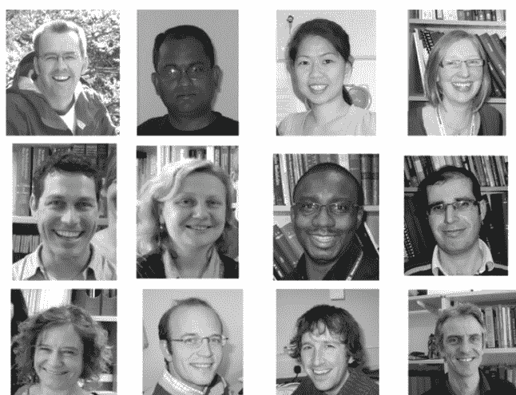

研究的主要英雄们。从左上开始：Peter Carey 博士、Ravi Balasubramanian 博士、E Lin Lim 博士、Sarah Steven 博士、Carl Peters 博士、Svetlana Zhuzhneuskaya 博士、Gavin Macaulay 博士、Ahmad Al-Mrabeh 博士、Alison Barnes 小士、Kieren Hollingsworth 博士、Pete Thelwall 博士以及 Andrew Blmire 教授。

我特别感谢两位阅读手稿的人：James Taylor（我的儿子，兼业医生）和 Paul Stein（从小学起起的朋友，对所有维京事物的爱好者）。他们提出了改进建议，并指出了晦涩的评论和逻辑不通之处。留下的问题完全是我的责任！将想法和信息转化为一本书，出版代理人 Jaime Marshall 和出版商 Aurea Carpenter 提供了极大帮助。

如果没有长时间远离家人，这项工作是不可能实现的——通常是身体不在家，但心也经常不在焉。我非常感谢我的妻子 Aileen 以及以及儿子们 James、Donald、Alasdair 和 Duncan 长期以来的包容与支持。

# 关于作者

**Roy Taylor 教授**是纽卡斯尔大学的医学与代谢教授，同时是纽卡斯尔港畔泰恩医院 NHS 基金信会的荣誉兼业医师。他在爱丁堡大学获得医学学位。他曾担任美国耶尔大学的医学访问教授（1990-91年），在在那里他获取了新的 MRI 观察成像方法来观察人体。回到英国后，他筹集了 520 万英镑建立了纽卡斯尔 MRI 中心。他还开发了英国糖尿病视网膜筛查系统，并发表了300 多篇科学论文。

SIMON & SCHUSTER

www.simandschuster.com/Authors/Roy-Taylor

# 许可

感谢复制数据和图表的许可如下：

- 图 2.5 – 《美国生理学》，混合餐后血糖浓度的变化。1993; 265
- 图 4.3 – 《柳叶刀》，诊断糖尿病前的血糖轨迹和胰岛素分泌。2009; 37(9)
- 图 4.4 – 《糖尿病》，逆转糖尿病的趋势。2008; 51
- 图 5.1 和 5.2 – 《环境生物学》，白人研究中的胰岛素功能。2011; 54
- 图 6.1 – 《年度报告》，关于肥胖与体重调查。1985; 115
- 图 6.2 – 《首席医学报告》，2012 年英国健康状况的现状。
- 图 6.3 – 《糖尿病》，极低化合物饮食的接受性。2015; 128

# 参考文献

作者的研究总结在以下在线链接：https://go.ncl.ac.uk/diabetes-reversal

## 第 2 章 代谢：人类视角。Wiley-Blackwell 3rd Ed

## 第 3 章 首席医学报告，2012 年。https://assets.publishing.service.gov.uk/system/uploads/attachment_data/file/298297/cmo-report.pdf

- 2型糖尿病诊断前的血糖、胰岛素及胰岛素分泌轨迹：白厅研究的分析。Tabak, A., 等。《柳叶刀》(Lancet) 2009; 373:2215-21. https://www.elsevier.com/reader/sii/S01406736909619X/token=7F9A5E4C4CAFFD5FC3B2E5094404F7CF400A42B86CDB2588E76887109CA289B6E7C268BD55FFB01A6B1FE408974

- 苏格兰西部地区2型糖尿病患者的连续代谢测量与功能：丙氨酸转基酶和甘油三酯的特定升高提示肝脂肪蓄积是潜在的贡献因素。Satt, N., 等。《糖尿病》(Diabetes) 2007; 56:984-1. https://www.diabetesjournals.org/content/diabetes/56/984.full.pdf

## 第5章

- 通过适度减轻减轻2型糖尿病患者的非酒精性脂肪变性、肝脏胰岛素抵抗和高血糖。Petersen, K.F., 等。《糖尿病》(Diabetes) 2005; 54:603-8. https://www.diabetesjournals.org/content/diabetes/54/603.full.pdf

- 2型糖尿病的发病机制：追踪从治疗到病的反转路径。Taylor R。《糖尿病学》(Diabetology) 2008; 51:1781-1789. https://link.springer.com/content/pdf/10.1007%2Fs0025-008-116-7

- 2型糖尿病的反转：与胰腺和肝脏甘油三酯减少相关的β细胞功能正常化。Elm, L.M., 等。《糖尿病》(Diabetes) 2011; 54:2506-2514. https://link.springer.com/content/pdf/10.1007%2Fs0025-011-220-4

- 人群对2型糖尿病反转信息的反应。Steven, S., 等。《糖尿病医学》(Diabetic Medicine) 2013; 30(4):e135-8. https://onlinelibrary.wiley.com/pdf/10.1111/dm.12211

- 2型糖尿病：病因学与反转。Taylor R。《糖尿病》(Diabetes) 2013; 36/4/1047-full.text 减轻体重特异性地降低2型糖尿病的肝脏甘油三酯。Steven, S., 等。《糖尿病护理》(Diabetes Care) 2016;39(1):158-65. https://www.ncbi.nlm.nih.gov/pubmed/26628414

- 高碳水化合物饮食与2型糖尿病中数月的体重稳定：维持型2型糖尿病中反应者与非反应者的病理生理学变化。Steven, S., 等。《糖尿病护理》(Diabetes Care) 2016 May 39(5):808-15. https://care.diabetesjournals.org/content/early/2016/02/24/dc-1942

- 初级医疗主导的体重管理干预对2型糖尿病缓解的持久性：DIRECT-开放聚类随机试验的反转。Lean, M.E., 等。《柳叶刀糖尿病与内分泌学》(Lancet Diabetes and Endocrinology) 2019; 7: 344-55. https://www.ncl.ac.uk/media/wnclacuk/newcastlemetabolicresonancecenter/files/DIRECT%20-%20year%20results.pdf

- 2型糖尿病缓解中减少肝和胰腺脂肪含量的反转取决于β细胞恢复的能力。Taylor, R., 等。《细胞代谢》(Cell Metabolism) 2018年10月2日:28(4):547-556. https://www.elsevier.com/reader/sii/S0193-2822(18)304447=24A60487ACAF52CAFC6351371312BA2A2B5601C27FD40C5F992BEB9B0D38DB89CC05EE17B873F46DE0616F375A5E6075673431

- 了解2型糖尿病反转的机制。Taylor, R., 等。《柳叶刀糖尿病与内分泌学》(Lancet Diabetes and Endocrinology) 2019; 7:726-736. https://www.ncl.ac.uk/magres/research/diabetes/reversal/#scientificinformation

## 第6章

- 2型糖尿病与治愈它的饮食。Richard Downey. https://www.the-guardian.com/lifeandstyle/2013/09/12/type-2-diabetes-diet-cure

- 正常体重的人也会2型糖尿病：个人脂肪阈值。Taylor, R., & Holmes, R。《临床科学》(Clinical Science) 2015;128(7):405-410. http://www.clinsci.org/content/ppclinci/128/7/405.full.pdf

- 使用磺脲类或胰岛素在无常规治疗的情况下进行强化血糖控制以及2型糖尿病患者的并发症风险（UKDPS）。英国糖尿病试验小组。《柳叶刀》(Lancet) 1998; 352:837. https://www.diabeteset.com/action

- 肥胖与胰岛储存的整合遗传学。Lotta, A。《自然》(Nature) 2017. https://link.springer.com/content/pdf/10.1007%2Fs0025-011-220-4

- 脂肪与与细胞毒性。Lee, Y。《美国科学院院报》(Proceedings of the National Academy of Sciences) 91:1087. https://www.ncbi.nlm.nih.gov/pubmed/

## 第7章

- 极低能量饮食在2型糖尿病中的接受度：反转的机制。Steven, S., 等。《糖尿病医学》(Diabetic Medicine) 2013; 30(4):e135-8. https://onlinelibrary.wiley.com/pdf/10.1111/dm.12211

- 人群对2型糖尿病反转信息的反应。Steven, S., 等。《糖尿病医学》(Diabetic Medicine) 2013; 30(4):e135-8. https://onlinelibrary.wiley.com/pdf/10.1111/dm.12211

## 第8章

- 8周糖饮食。Mosley, C. 2015.

- 人口密度与气候变化。Edwards, P & Roberts。《国际流行病学杂志》(International journal of epidemiology) 38:117. https://doi.org/10.1093/ije/jyp3

- 中国可可乐重塑肥胖。Greenough, J。《英国医学杂志》(BMJ) 2019;364:i413. https://www.bmj.com/content/365/bmj.14009/

## 第9章

# 索引

## 参考文献

- 激素替代疗法与心脏疾病。Petitti, DB。《美国医学杂志》(JAMA) 1998; 280(7):650-52. https://www.jamanetwork.org/journals/jama/abstract/18
- 2型糖尿病的低能量饮食：一项随机可行性试验。Nowotny, B., 等。《糖尿病学》(Diabetologia) 2015; 58:255-64. https://link.springer.com/content/pdf/10.1007%2Fs0025-011-220-4
- 膳食纤维与结肠癌的风险。Goodlad, RA。《季医学杂志》(Quarterly Journal of Medicine) 2004; 97/5/439. https://academic.oup.com/qjmed/article/97/7/439
- 时代背景下的随机试验：循证医学与政策的实际问题。Pearce, W., 等。《试验》(Trials) 2015; 16:394-401. https://www.ncbi.nlm.nih.gov/pmc/PMC560875/
- 蛇类油。J. Vintage 2001

## 术语与主题

- 转化为脂肪 49
- Allan 的姜鸡食谱 294–5
- 杏仁 234
- ALT 测试 92–3
- 美国糖尿病协会 124
- 氨基酸 48
- 淀粉蛋白 96–7
- 动物实验 153
- 动物脂肪 232
- 年度检查 36–7
- 食欲 137–8
- 避免 185
- 减道手术 15, 95, 98–100
- 良好的血糖控制 119–20
- 热量摄入 98–9
- 禁食状态 98, 100
- 胰腺脂肪 118–19
- 减肥 118–19
- 牛肉脂肪 234
- 啤酒莓果 206
- 行为，通过监测改变 223
- 行为调节 185–7
- Bernard, Claude 64
- β 细胞 67, 78
- 去分化 126
- 从胰腺中消失 95–7, 118
- 多余脂肪 126–8
- 胰岛素产生失败 123–4
- 隐藏起来 127
- 内部观察 153–4
- 可逆性 127
- 胰岛素生存模式 126
- 2 型糖尿病 85, 123
- 易感性 153–4
- Blamire, Andy 106
- 盲盲 33, 36
- 血液循环 34, 36
- 血液，多余脂肪 84
- 血糖 21–2, 23
- 控制 24, 50
- 空腹 25
- 高 83–4
- 血管 33
- 对肾脏的影响 31–2
- 早上 24–5
- 以及尿液 31–2
- 低血糖 26
- 导致糖尿病的过程 90–1
- UKPDS 发现 144
- 血压 36
- 血糖 15–16
- 血管 33
- 大 34–5
- 另见毛细血管
- 浆果 242
- BMI 134
- 平均值，普通人群 (英国) 135–7, 140–2, 145–6
- 人口转型 146
- 以及 2 型糖尿病 150
- UKRDS 控制组 145
- 肠道癌 220–1
- 大脑，59–61
- 缺乏食物 72
- 酮体 73–4
- 早餐是一顿危险的餐 (Keeley) 238
- 南瓜香菜沙拉食谱 261–2
- 咖啡因 222–3
- 剑桥大学 148
- 毛细血管 33, 34
- 碳水化合物 48, 66–7, 199
- 以及消化 69–71
- 数量 235–6
- 储存 69
- 转化为脂肪 69–70
- 另见低碳水饮食 39–40
- 碳-13 68–9
- 碳原子 39, 40, 53, 233–4
- 二氧化碳产生 213
- Carol 的普罗旺炖菜食谱 249–50
- 花椰菜饭 253–5
- 花椰菜塔布勒食谱 255–6
- 俄芹根辣土片食谱 251–2
- 印度香料蛋糕配鸡肉咖食谱 280–1
- 塔布勒配鸡肉串食谱 277–9
- 胆固醇 230–1
- 慢性胰腺炎 300
- 大块蔬菜汤食谱 269–70
- Clark, Dare 126
- 冷，感觉 189
- 公共零食 181
- 补偿性进食 175
- 完全营养 170, 174
- 秘秘 173, 190, 244
- 对点反射研究 113–15
- 对点研究 108–13, 228
- Counterweight Plus 122, 171
- 邮轮假期 197
- 柜子 209
- 变化周期 166
- 骑自行车 207
- 纤维性纤维化 300
- 去分化 126
- 决策 166–8
- 快速 16–7
- 糖尿病 21, 299
- 妊娠性糖尿病 299–300
- 健康服务成本 123
- MODY (青少年发型糖尿病) 299
- 胰腺糖尿病 300
- 康复 21–2
- 以及糖 22–3
- 另见 1 型糖尿病；2 型糖尿病
- 糖尿病 UK 107, 121
- 糖尿病食品 30
- 糖尿病酮酸中毒 74
- 糖尿病患者 167
- Diamond, John 229
- 饮食清单 26
- 饮食 19
  - ‘5:2’ 203–4
  - 燃脂 74
  - 歇性禁食 203–4
  - 生酮饮食 74
  - 低卡路里液体 114–15, 172–4, 185, 196
  - 低碳水 201–3
  - 低脂肪 204–5
  - 地中海饮食 203
  - 牛奶 188
  - 新饮食 192
- 消化 66–7
- 消化汁 77
- DIRECT (缓解试验) 120–3
  - 宣布 124
  - 控制组 224
  - 代谢研究 123
  - 缓解 122
- Donne, John 210
- 调味汁 247
- 饮水 186
- EFIs (无想法) 229
  - 5 天制 239
  - 避免即食食品 193
  - 甜饮料 193
  - 进餐间隔 165
  - 健康饮食理念 199
  - 食物量 200
  - 跳餐 204
  - 社交活动 198
- 饮食行为 208–9
- 饮食习惯 195
- 早餐 236–6
- 健康肠道菌群 238–9
- 魔法食物 241
- 蛋食谱 273
- 爱因斯坦 16
- 能量 39–41
- 以及 运动 43–7
- 人体 41
- 休息身体 42
- 备雨天 47–9
- 能量代谢 49
- 环境 138–9
- 产物 212
- 证据医学 225
- 运动 43–7
- 持续时间 44
- 2 型糖尿病的影响 86
- 眼睛 33
- 事实 16
- 关联性 219
- 胰岛素抵抗性 63–4, 64–5
- 胰岛素敏感性 63
- 将葡萄糖储存为糖原 86
- 为大脑提供血糖 66
- 肝脏循环 101–3
- 肝脏糖原饮食 52
- 燃脂饮食 74
- 脂肪基因 148
- 疲劳 32
- 脂肪 27
- 感觉冷 189
- 脚趾 34
- 截肢 230–6
- 足力 34, 35
- 受孕能力 54
- 费塔奶烤茄子食谱 276
- 纤维 174
- 菲恩斯, Ranulph 45
- 火 39, 40
- 调味品 247
- 食物 30–1
- 缺乏 72
- 成年生活 58–9
- 无聊与饥饿的区别 165
- 以及能量 47–8
- 历史上的 208
- 不健康的移除 186
- 饮食行为 195
- 饮食行业
  - 政治政党的资金 215
  - 利润保护 213–14
  - 研究小组 214
  - 破坏公共健康运动 214
- 食品中毒 83
- 食品标准局 215
- 冰箱 210
- 柜内物品 209
- 朋友另见朋友
- 果糖 22
- 燃料另见能量
- 胆囊问题 190
- 胆胆结石 190–1
- 蒜泥绿菜配蘑菇食谱 259
- 基因 137–8, 148, 153–4
- 家族遗传 165–6
- 妊娠性糖尿病 299–300
- 葡萄糖 22, 48, 49
- 多余 52, 53
- 溢出 53
- 替换 60–1
- 储存 50–2, 69–71
- 糖原 50–2, 53
- 在肌肉中 51, 52, 69
- 胰岛素抵抗 70, 222
- 肝脏脂肪积累 52
- 持续产生葡萄糖 41, 50, 61
- 对2 型糖尿病的影响 86
- 胰岛素抵抗性 63–4, 64–5
- 血糖水平调节 66, 97
- 以及饱和脂肪 235
- 对胰岛素的敏感性 63
- 将葡萄糖储存为糖原 86
- 为大脑提供血糖 66
- 肝脏循环 101–3
- 肝脏糖原饮食 52
- 燃脂饮食 74
- 低卡路里液体饮食 114–15, 172–4, 196
- 低卡路里粉末 170
- 低碳水饮食 201–3
- 低脂肪饮食 204–5
- 医学研究资助 107
- 药物 26
- 阻碍减肥 158
- 副作用 26-7
- 体重增加 26-7
- 地中海饮食 203
- 地中海风菜心沙拉食谱 260-1
- 元分析 225-6
- 代谢率，下降 194
- 代谢 49, 99
- 以及健康细菌 238-9
- 二甲双胍 26
- 副作用 26
- 牛奶饮食 188-199
- MODY（青少年发型型糖尿病） 299
- 单不饱和脂肪 234
- ley Michael 203-4
- MRI 扫描
  - 测量器官的化学成分 105-6
  - 扫描仪 68-9
- 肌肉糖原 51, 52, 69, 70
- 肌肉
  - 2 型糖尿病的影响 86-9
  - 胰岛素抵抗性 86-7, 89
  - 胰岛素敏感性 69
  - 碳水化合物的储存 69, 87
  - 脂肪的储存 89
- Myers, Dave 10-11
- 神经 33-4, 36
- 《新英格兰医学杂志》 229
- 纽卡塞尔饮食 19-20, 171, 172-3
- 纽卡塞尔磁共振中心 17, 105-6, 152
- 物理团队 106
- 牛顿，艾萨克 16
- NHS（英国国家医疗服务） 213
- n-面炒面食谱 262-4
- 非淀粉蔬菜 171, 172, 174, 246
- 营养 208
- 护健康研究 149-51
- 营养学 198-99
- 肥胖 28-30
- 流行 138
  - 财务成本 213
  - 对环境的影响 213
  - 与 2 型糖尿病无关 161
  - NHS 支出 213
  - 以及非糖尿病患者 152
  - 增长率 136-7
- 另见 BMI（肥胖指数）
- 致胖环境 165, 207
- 致胖微环境 165, 207
- 油类 247
- 橄榄油 234
- 外部机构 210–11
- 烤三文鱼配炒蔬菜食谱 281–2
- 小白菜和泰式豆芽汤食谱 270–1
- 胰腺 18, 24, 62, 64–5, 75–8
  - β 细胞 67, 118
  - 消化液
  - β 细胞的消失 95–7
  - 激素 77–8
  - 2 型糖尿病的影响 85
  - 胰岛 78
  - 小叶 77
  - 位置 75, 76
  - 大小 78–80, 216–17
  - 2 型糖尿病 79–80
- 胰腺循环 103–5
- 胰腺研究 118–20
- 胰岛糖尿病 300
- 帕玛森芝士鸡配大蒜炒西兰花和蘑菇 289–91
- Passmore, Reginald 教授 16, 96
- 青霉素 227
- 个人脂肪阈值 18, 134, 139–42
- 15g 减肥规则 160–1
- 减至 161
- 快速减肥 160–1
- 目标体重 159–62
- 生活方式改变 160–1
- 想法的每日总热量摄 160
- 想法的测试 143, 149–51
- 另见皮肤；皮下的脂肪层
- 青酱脆皮鳕鱼配烤地中海蔬菜 284–5
- Petersen, 9816
- 身体活动 206–7
- 生理学 16
- 植物，能量储存 40–1
- 多不饱和脂肪 234
- 人口（英国） 135, 146
- 另见 BMI
- 预糖尿病 188
- 蛋白 48, 199
- 瘦弱的外表 192
- 随机对照试验 143
- 快速减肥 160–1
- 益处 184–5
- 饮食 156–7
- 另见计划；步骤 1（快速减肥阶段）
- 即食餐 193
- 食谱 244–97
- 红肉 222–3
- 红灯椒食谱 256–7
- 缺乏监管 214
- 救援计划 196
- 风险 226–7
- 风险因素 151
- Roden, Michael 教授 222–3
- Roethlisberger, FJ, 223–4
- Sattar, Naveed 教授 92
- 饱和脂肪 233–4, 235
- 科学资助申请 107
- 自信 192
- 自助小组 211
- 七国研究 232
- Shaw, James 教授 126
- Shulman, Jerry 68, 98
- 简单煎烤茄子食谱 258–9
- 皮肤
  - 皮下层 18, 54–6, 102–3, 110, 141–2, 148
  - 另见个人脂肪阈值
- 皮肤感染 32–3
- 慢发 1 型糖尿病 298–9
- Small, Peter 先生 119
- 零食 237
- Snehot, Polko 教授 116, 183
- 揭示 187
- 汤类食谱 248–9
- 香料 247
- 辣味早餐食谱 273–4
- 类醇 197
- Steven, Sarah 博士 116
- Stroud, Mike 45
- 研究
  - 效应量 227–9
  - 虚假关联 220
  - 干预研究 220, 221
  - 误导性的 219, 220
  - 小的 227
  - 另见 EFI
- 无意识行为 185
- 糖 22–3
- 糖税 215
- 超级食物 241–2
- 含糖饮料 193
- 药物另见药物
- Tara's Taco可食谱 291–3
- 目标体重 159–62
- 泰式豆芽和青菜汤食谱 270–1
- Thewall, Pete 博士 106
- 口渴 32
- Thompson, Leonard 227
- 限时禁食 204
- Tony's 周日餐食谱 295–6
- 治疗 165
- Turner, Robert 博士 142
- 双重循环 115
- 平衡达成减肥 183
- 方法 171
- 平衡点研究 113
- 液体配方 114
- 减肥 115
- 平衡点研究 108
- 肝水平下降 109
- 效应量 228
- 高脂肪水平 109
- 血糖快速下降 109
- 专家的怀疑 111
- 惊喜 109
- DiRECT（糖尿病缓解临床试验） 120
- 对照组 224
- 未达成 107
- 胰腺研究 118–20
- 身体减肥计划
  - 低热量奶昔 170
  - 纽卡塞尔饮食 171
- 1 型糖尿病 97
- 2 型糖尿病 79
- 以及年龄 35
- β 细胞 67
- 机会 117
- 以及运动 89
- 以及食物 208
- 作为终身疾病的认知 157
- 与其生活 31
- 长期 32
- 低热量饮食 108
- 非胖患者 147
- 医学突破 155
- 肌肉 86
- 胰腺 85
- 医学观点 15
- 以及非糖尿病患者 152
- 以及正常体重 131
- 发病 90
- 人们的故事 131
- 缓解 122
- 可逆性 155
- 易感性 151
- 内脏脂肪 54
- 蔬菜 244
- 维生素 199
- 步行 206
- 水 82
- 水汤 267
- 体重增加 26
- 以及运动 44
- 避免 193
- 巡航 197
- 生活 195
- 模式 195
- 稳定增长 136
- 类醇 197
- 西侧 91
- Whitecock, Sean 先生 119
- WOSPS 90
- 青酱脆皮鳕鱼配烤地中海蔬菜 252
- 西葫芦椰子汤配香菜 268
- 西葫芦配葱 260
