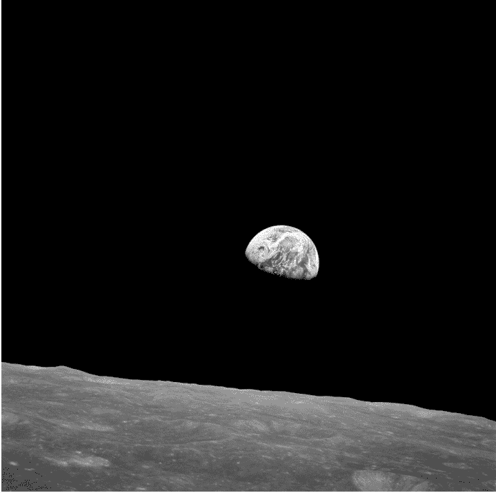
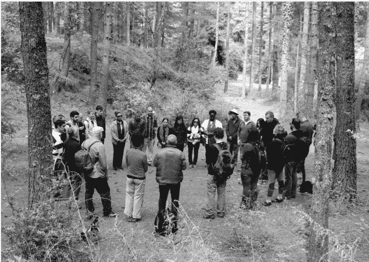
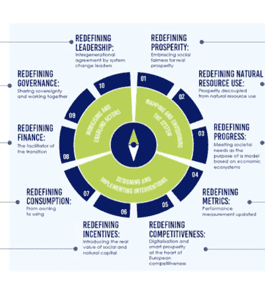
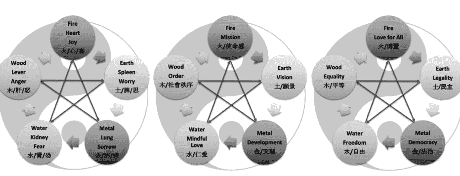
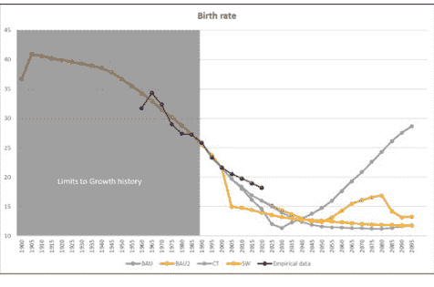
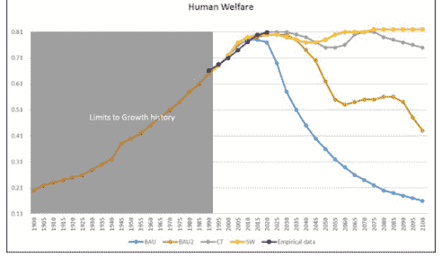
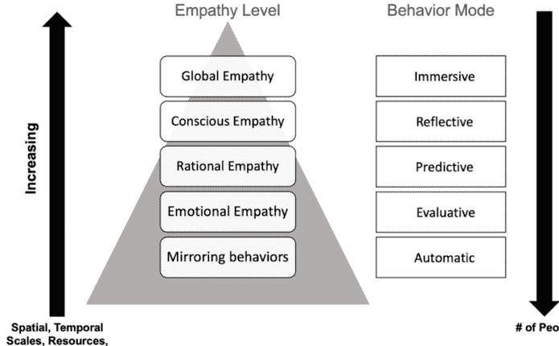
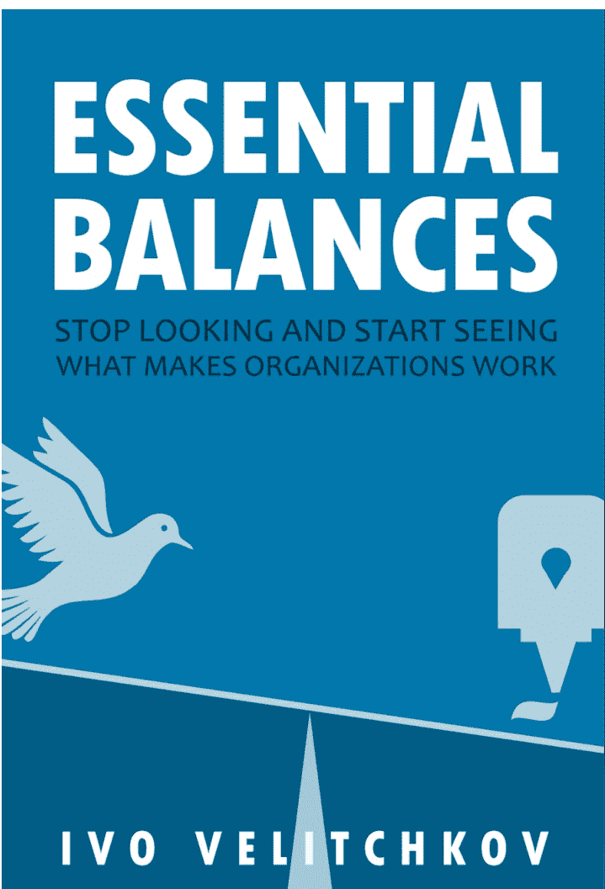

# 极限与超越：在《增长极限》发布50年后，我们学到了什么，未来何去何从？：罗马俱乐部报告

收录《增长的极限》原作作者丹尼斯·梅多斯（Dennis Meadows）、约尔根·兰德斯（Jørgen Randers）及许多他人的论文……

一份提交给罗马俱乐部的报告

收录《增长的极限》原作作者丹尼斯·梅多斯（Dennis Meadows）、约尔根·兰德斯（Jorgen Randers）及许多他人的论文……

一份提交给罗马俱乐部的报告

《增长的极限》发布50年后，我们学到了什么？未来将如何？

由丹尼斯·梅多斯和约尔根·兰德斯编辑

主编：Ugo Worth

封面设计：Andrew Brown

Writers.com

## 前言

Mamphela Ramphele 和 Sandrine Dixson-Declêve

## 引言

Ugo Bardi 和 Carlos Alvarez Pereira

Yury Sayamov

Mamphela Ramphele

## 致谢

Ugo Bardi 和 Carlos Alvarez Pereira

## 注

Exact Press

## 引言

Ugo Bardi 与 Carlos Alvarez Pereira

主编

本书源于50年前出版的另一部著作，那部著作意在为人类决定自身的发展方向开辟一个可能性的空间。然而，许多人过去没有、现在也没有意识到，1972年提交给罗马俱乐部的报告《增长的极限》正是要做这一点。人们从书中汲取的大多是它发出的严厉警告：如果我们不改变对“发展”的理解，人类的未来将是多么惨淡。对许多人来说，这并不是好消息。它作为第一步被拒绝了，许多人也完全忽略了这本书及其背后的努力。

罗马俱乐部成立于1968年4月，旨在为来自不同背景的人士——商业、科学、政治、公民社会提供辩论空间，他们共同致力于从系统、长期、全球的视角来审视人类的未来。在当时，没有其他组织敢于提出一些本质问题。其中一个现在甚至比1968年更关键：我们是否能在一个健康的星球上实现所有人的公平福祉？

在将人类发展与物质资源消耗的无限增长挂钩的逻辑中，人们必须问，在一个有限的星球上有多少程度是可行的，这是一个传统经济学派一直不愿考虑的问题。《增长的极限》通过早期的计算机建模产生了一个模拟工具，并构建了多种未来场景，解决了这个问题。遗憾的是，模拟显示在大多数情景中，人类文明将在21世纪上半叶面临崩溃。

这一发现震惊了世界。

《增长的极限》打破了这样一种信念：即传统的“发展”及其在全球范围内的扩张（作为西方霸权下的现代化和工业化计划）对于全人类的进步来说是必要且正当的。

这种打破并没有得到当时权势阶层的认可。重新定义人类发展以适应有限星球边界的情景可能性被完全忽视了。当1987年“可持续发展”这一概念被提出来时，它仅仅质疑了“发展”的本质，因为其负面影响被认为是可以通过更多同类发展来解决的“附带”问题。

自1972年以来，人类的情况发生了变化，我们面临的麻烦比任何关注过《增长的极限》的人所希望看到的都要多。2008年开始的金融危机、2020年开始的新冠肺炎，以及包括2022年乌克兰战争在内的许多持续冲突，都是所有人都能看到的残酷信号。它们源于一个更大的、正在展开的生存威胁背景。列举几个：国家内部不平等的加剧和分裂；气候变暖；生态系统和物种的破坏；以及利用金融和技术来隔离人们，而非培育健康的社会。

与此同时，女性在各地解放自己。在许多地方，人们正在克服由殖民和新殖民主义规则及心态带来的无力感。年轻一代更清楚地意识到经济和政治体系的失败，这些失败正在减少未来的可能性。科技成就正在打破障碍，但同时也加速了反乌托邦未来的可能，导致胜利者与失败者之间产生更深的分的分。总而言之，人类似乎在繁荣的同时也在自杀。我们可能正处于人类最光辉的时刻，同时也最接近自我导致的灭绝深渊。

我们该如何处理这一根本性矛盾？我们对生命运作方式的了解可能有所帮助。生命系统一直在进化，偶尔会进入关键区域，并从中以完全全新的模式脱出来。但“可能”并不代表“将会”。在关键节点上，未来是真实未知的。豪尔·路易斯·博尔赫斯曾称“时间永远向无数种未来分叉”。埃里希·詹斯奇（罗马俱乐部联合创始人）和伊利亚·普里高日津（20世纪70年代罗马俱乐部成员，诺贝尔化学奖得主）也会赞同这一文学表达，因为它与他们对宇宙自组织本质的研究高度契合。关键性可能导致涌现，而这一过程是预先计划的，自然的想象力和创造力在更大生命之网中通过新的和谐催生出意想不到的模式，起着主导作用。

这正是可能性空间扩张发挥作用的地方。《增长的极限》是对集体智能的乐观赌注，希望其能从对可能未来的探索中学习。如今，情况比以前更加严峻。我们必须重新对人类以及每个人的创造能力下注，为创造从紧急状态中实现集体涌现的条件。

这就是我们（合主编）在《增长的极限》出版50周年之际开始构思这本书的大背景。2011年，Ugo Bardi已经写过一本书来重新审视原始报告。基于这一经验，我们决定进一步探索，通过邀请21位作者（包括我们自己）提交综合其见解、观点和感受的原创贡献。我们没有对他们希望由谁来涵盖哪些主题给出精确指示，但这种“涌现”的魔力确保了不同贡献之间几乎没有重叠，这也反映了参与作者背景、学科、地理和文化的多样性。我们将任务限制在组织贡献的流上，将时间线（这本书在当时意味着什么？后来意味着什么？现在意味着什么？对未来意味着什么？）与方法类型（来自科学、政治、经济、文化等）结合起来。正如你所预期的，这种多样性也体现在不同文章的丰富方法、声音和风格上，我们决定尊重这些点。生命告诉我们，激进的多样性是必须的。

在第一部分“巨著的回响”中，Ugo Bardi通过对原始报告的详细检查设定了背景，包括我们当时是如何接收它的，以及它现在对我们的反思如何仍有帮助。通过引入1972年的两位作者丹尼斯·梅多斯和约根·兰德斯，我们能够更好地理解那本书的内容。遗憾的是，我们无法获得多内拉·梅多斯的声音，她在《增长的极限》的制定和影响以及整个系统思维领域的发展中起了重要作用。她在2002年去世前留下了最后名为《与系统共舞》的精彩文章，主张动员我们所有的能力——理性的以及具身的——以与生命系统的和谐重新连接。这本书也是对她的致敬。

斯维亚斯拉夫·扎贝林随后写了一篇富有见地的文章，重新审视了苏联的崩溃，并假设其是因为实际上已经达到了其自身的增长极限。考虑到近期的事件，这种思考路线绝对值得进一步研究。恩斯特·冯·魏斯泽克（曾担任罗马俱乐部联合主席多年）表达了他对杰出人物奥雷利奥·佩切伊的印象、这本畅销书在20世纪70年代和80年代政治背景下的反响，以及试图通过增加物质资源消耗来解码福祉的尝试。他还提到了《来吧！》（Come On!），这是在2018年罗马俱乐部成立50周年之际发布的另一份集体报告。吉安弗兰科·博洛尼亚总结了受《增长的极限》启发的科学思维的演变，特别是关于气候变化、生物多样性丧失和其他生态系统问题的工作，最终导致了2009年提出的“行星边界”概念。

针对我们的通用邀请，几位作者决定将反思集中在经济思维上，以及其主流学派如何无法正确把握人类面临的挑战。在名为“仍是经济，但哪种？”的章节开头，伍特·范·迪尔伦回顾了他自己参与《增长的极限》发布和最初影响的过程，严厉批评了正统经济学对不计代价增长的痴迷。沿着这条路线，亨特·洛文斯进一步对新自由主义经济学的缺陷进行了详细、激进且有据可查的批判。恩迪迪·诺沃利-奥齐甚至敢于探索“团结资本主义”的价值，这是她提出的一个矛盾体，旨在通过将社会责任与非洲文化元素以及去中心化数字化相结合，以超越增长的极限。接下来，基于她在不丹国民幸福的哲学和实践方面的经验，朱莉娅·金主张出现福祉经济，将其作为一种替代范式，以平衡人类福祉与我们赖以生存的生态系统的保护。

在“面向未来的新视角”章节中，来自全球不同大陆和文化的思想者们带来了他们独特的经验和观点，构思所需的转型元素。西尔卡·海因诺宁（Sirka Heinonen）强调，如果我们要在一个波动、不确定、复杂和模糊（VUCA）的世界中应对危机和冲击，学习、去学习和重新学习以及未来思维具有价值。她总结道，自然是我们最终的老师。尤里·萨莫夫（Yury Salamov）讲述了《增长限制》在苏联的知识接收情况，在那里它受到了比大多数西方背景更严肃对待，并对全球社会转型和文明前景进行了持续研究。

桑德ine·迪克斯森-德拉克维（Sandrine Dixson-Declève，罗马俱乐部联合主席）基于新冠肺炎的悲剧主张转型经济不仅是迫切的，而且是可能的。多个转折点的汇聚创造了复杂的紧急状况，但这也是通过系统视角解决人类挑战的门槛。罗马俱乐部参与了在欧盟背景下实施《欧洲绿色协议》而制定的“系统变革指南”，这正是这种努力的例子。

马法赫拉·兰帕赫莱（Maphela Ramphele，罗马俱乐部联合主席）反思了自《增长限制》以来发生的变化，邀请我们探索一些基本问题。如何让心态从变化与抵抗的紧张关系中转变出来？在年轻一代中变得显而易见的文化转变将发挥什么作用？同样重要的是，我们对“世界大部分地区”与主导性的“全球北方”之间的分歧愿景何预期？对这些问题的回答将深刻影响我们的未来。通过更好地理解生命系统的变化，罗马俱乐部可以在这些问题的十字路口发挥催化作用。

佩特拉·昆肯尔（Petra Kuenkel）提出了一个女性主义视角，希望女性在决策如何做和决策什么方面有更强的参与，从而从父制盲点转向对美好未来的集体管理。另一方面，钱德拉·纳伊尔（Chandra Nair）提议领导21世纪的亚洲，其依据是：这一人口最多的大洲正在多极世界中迅速恢复其显赫地位。从亚洲视角来看，实现“健康星球的全球公平”（罗马俱乐部为纪念《增长限制》出版50周年采用的口号）需要国家发挥强有力作用，促进共同繁荣与适度消费的结合，这与过去几十年西方所遵循的方法迥然不同。为了继续替代世界观，程义恒（Yi-Heng Cheng）投入了一项极具吸引力的练习，将中国传统智慧与韧性繁荣的需求织在一起。五行（水、木、火、土、金）作为隐喻，标志着一种对立特征达成新平衡的社会价值观，他将其与《增长限制》中的五个变量联系起来。

最后，同样重要的，“我们学会了吗？我们会学会吗？”章节思考了我们未来向何方去。人类吸取《增长限制》的教训了吗？在此我们我们到了什么？最重要的是，我们能做些什么？加雅·赫灵顿（Gaya Herrington）将1972年书中模拟的情景与当时的实际演变进行了对比，并阐述了这些场景如何作为不同社会优先事项之间本质辩论的参考。末日预言并不是有效辩论的合适框架，如果我们遵循自己的本能，人类会有更大的机会，正如她说的，“我们对生命的热爱超过增长”。查克·佩泽斯基（Chuck Pezeski）将同理心置于社会增长的核心，这是一种摆脱物质增长成瘾的方法。他受网络科学启发而提出的路径，意味着通过抛弃其剥削性和非合作性的解释来重新定义进化，以发展每个人的能力。

诺拉·贝茨斯（Nora Bates）提议深入研究生态相互依赖，从生命系统的复杂性中学习。她深入了所有人类社会的关联性，无论如何试图将现实分割成独立的盒子。尽管是以“对我有什么好处？”的模式构建的，但关系可能会失去活力。通过重新赋予它们核心地位，它们也可以导致“一种统一的美感”。在结束本书时，卡洛斯·阿尔尔瓦雷斯·佩雷拉（Carlos Alvarez Pereira，罗马俱乐部副主席）建议“学习我们已经知道的”。学习只在我们改变时才会发生。我们在过去的50年里没有学习，但我们意识到使用不当的视角来理解世界以及我们在其中的角色是一个主要障碍。我们与时间的关系以及与当前资本的概念，被过去现在权力的分配所框架，并阻碍了后代的潜力。正如奥雷利奥·佩切齐（Aurelio Peccei）在1984年所说，需要一场人类革命来“

如果你打开这本书只是为了寻找答案，它可能会让你失望。它的目的是开启可能的空间，而这种空间只有通过提出更好的问题才能实现。好的问题能开启脑筋，揭示盲点，并引导产生其他问题的答案，而不是封闭的“解决方案”。问题与答案的无尽流动就是生命本身。

在对1979年出版的罗马俱乐部另一份里程碑报告《学习无极限》（No Limits to Learning）的序言中，奥雷利奥·佩切齐将我们的挑战表述为一个谜语：“在人类进化的这个时刻，我们所需要的的是学会要学习我们应该学习的内容需要什么——并学会它。”这本书邀请大家分享这段学习冒险的兴奋之情，为了我们自己，也为了后来的世代。

乌戈·巴迪（Ugo Bardi）

佛罗伦萨大学教师

> 主的日子降临，如同夜盗一般。

五千年前，第一批人类文明出现在横跨欧亚的弧线上，从近东的肥沃新月到长江流域。在多年来，新的文明在世界诞生，建立城市和道路，增加人口并征服邻国。它们都有一个共同点：兴起，然后衰落，留下遗迹，有时还有岩石上的铭文。但很少有帝国持续千年，大多数在几个世纪后就消失了。我们的文明，即有时被称为“西方”或“全球化”的文明，起源大约半个世纪前的欧洲，即我们所谓的“文艺复兴”。现在，它已经老了，正面临终结。

但为什么文明会遵循这种增长与崩溃的循环？这个问题从未让提问的人受欢迎，尤其是当他们得出崩溃即将来的结论时。尽管如此，古代文明的起伏被注意到，在某些情况下，我们仍然可以追踪关于这一主题的古代讨论。也许最早提到崩溃来自苏美尔祭司恩海娜（Enheanna），她是已知的第一个作者。在她四千五年前的一首给女神伊南的赞歌中，她描述了女神与山之间史诗般的战斗，从这个故事中我们可以看到由于侵蚀导致的肥沃土地崩溃。

对他们来说。我们有一个来自公元5世纪的令人不而栗的报告，那是帝国的最后一个世纪，由罗马贵族鲁提利乌斯·纳马提亚努斯（Rutilius Namatianus）撰写。他能看到周围世界的废墟，但他无法理解自己正在见证罗马国家最后的喘息。他所看到的一切都被理解为暂时的挫折，并完全预期罗马很快就能回到昔日的辉煌。这种想法在历史上持续了很长一段时间，或许重建罗马帝国的最后尝试也许是历史上寿命最短的帝国：仅从1936年持续到1943年的“意大利帝国”。

在我们时代，重建罗马帝国似乎已经过时了，但迟迟到1989年，弗朗西斯·福山（Francis Fukuyama）写了一篇名为《历史的终结？》的文章——他将西方文明的主导地位等同于罗马帝国时期的“罗马和平”（Pax Romana），注定会持续下去，或者至少持续很长一段时间。虽然事件显示了福山思想的局限性，但我们似乎仍然受困于认为崩溃是不可想象的、或至少是不可言说的观点。西方文明的麻烦是显而易见的，但大多数人倾向于将这种情况视为暂时的挫折，最多只需通过微小的调整来纠正。那么，“西方和平”（Pax Occidentalis）将是这种预期所产生的结果。

这种乐观的观点可能是“黄金十年”（20世纪50年代到70年代）所产生预期的结果，在那期间，世界经济增长了历史上可能从未见过的增长率。而且不仅是经济在增长，技术进步一直延伸到可预见的未来。凭借廉价且丰富的核能，所有问题都可以得到解决，包括矿产资源“枯竭”的问题。根据物理学家格勒（Goeeler）和温伯（Weinberg）极大描述的“无限可替代原则”（Principle of Infinite Substitutability），这并不可怕。

那些年的核心思想是控制核聚变，那种驱动恒星的能量。有了它，最疯狂的梦想都有可能。1974年，物理学家杰拉德·奥尼（Gerard O'Neill）提出了基于人工栖息地的太空殖民宏伟计划，这些栖息地能够居住数百万甚至数十亿人。更早由弗曼·戴森（Freeman Dyson）提出过一个更宏大的计划，通过在太阳周围建立一个巨大的固体球（“戴森球”）达到人类的终极极限。汽车？那些只是玩具。我们真正想要的是能够到达其他恒星并殖民整个银系的星际舰！

但是，尽管那些充满乐观情绪，但也存在一条向反方向发展的反思之索。或许现代历史上第一个讨论文明崩溃的是爱德华·吉本（Edward Gibbon），他在他的《罗马帝国兴衰史》（1776–1789）中写到了这一点。吉本的书是对罗马帝国命运的详细描述，它清楚地反映了这种担忧：同样的命运也可能发生在现代文明身上。吉本否定了这种可能性，但显然，他已经识别出一种开始渗透讨论的思维路线：如果罗马帝国曾如此辉煌却已经消失了，那么现代文明将面临什么呢？

不久后，1798年，托马斯·马尔萨斯（Thomas Malthus）出版了著作《人口学原理》（An Essay on the Principle of Population），他在书中指出（也许是历史上第一次），人口的扩张存在物理极限。有趣的是，与普遍认知相反，马尔萨斯从未是过“灾难论者”。也就是说，他从未预测过任何形式的崩溃。他只是指出饥荒和战争将会将人类增长限制在某个水平：而且他甚至没有说这个水平是静态的，而是它会像人口一样快速增长。尽管如此，他被妖魔化并遭到嘲讽，因为他做出了错误的预测，以至于今天，被定义为“马尔萨斯式的”被视为一种侮辱。这成为了许多后来灾难论者的共同命运。

随着时间的推移，其他人研究了自然资源局限性的问题。威廉·斯坦利·杰文斯（William Stanley Jev）于1865年出版了《煤炭问题》（The Coal Question）。他对于英国继续开采和燃烧煤炭一个多世纪的能力持悲观态度（而且是正确的），但他从未预测过经济崩溃。在同样的思路上，尽管晚了一个世纪，地质学家玛丽昂·金·胡伯特（Marion King Hubert）首次研究了石油开采的长期周期，预测它将在21世纪初达到极限。胡伯特后来成了一个马尔萨斯者，但他像马尔萨斯一样，从未提到过崩溃。原油被核能平稳地取代，人类文明继续繁荣。

直到20世纪后半叶，有时被称为“灾难论”（catastrophism）的观点才出现。这可能是两次世界大战灾难的结果，也可能是核浩劫幽灵的影响。无论如何，负面的未来首先出现在科幻中，这种体裁在战前就开始了，是对征服太空和未来技术奇观的普遍乐观描绘。但在二战后，它受到了黑暗色调的影响，“核浩劫后”（post-holocaust）体裁描述了核战争幸存者在废墟世界中试图重建生活。这种残酷的未来不需要核战争就能实现，在世纪50年代，艾萨克·西莫夫（Isaac Asimov）讲述了一个银河规模崩溃的故事，利用爱德华·吉本对罗马帝国衰落的宏大描述来构建他的《基地》（Foundation）小说系列。1968年，乔治·A·罗梅罗（George A. Romero）通过《活死人》（The Living Dead）开启了电影中的“僵尸”题材。与

# 过度放牧与增长的极限

在那里，羊死了，牧羊人必须迁移去寻找生计，如果他们可以的话。要注意，这种灾难是所有人以完全合理的方式进行推理以增加经济收入的结果。用经济学家的术语来说，每个牧羊人都在尽力增加个人的“效用函数”。这在个人层面是一个好主意，但在集体层面是一个非常糟糕的主意。

哈丁的模型纯粹是理论性的，但它确实击中了关于自然资源开发辩论中的痛点。它从根本上摧毁了亚当·斯密（1723–1790）所提出的“看不见的手”的概念。它是对“过度开发”这一概念最早的清晰表达之一，该术语由威廉·卡顿（William Catton）在20世纪80年代普及。我们以后将会看到，这种“悲剧”并不是资源限制的必然结果，而且确实发生在现实世界的系统中。

这一系列研究是那个时代思维方式深刻变化的征象，并随着1972年《增长的极限》的出版而全面浮出水面。

## 《增长的极限》的影响

当《增长的极限》在1972年出现时，它引起了巨大的关注，销量可能达到了三百万册，并被翻译成至少30种语言。几个因素促成了这一成功：使用计算机的创新方法、让每个人都能理解的目标，最重要的是，研究中开发的情景对崩溃的直接预测显示，如果不采取任何行动改变当时的政策，人类工业文明将在21世纪的头几十年内崩溃。

对许多人来说，这是一个如天降般的震惊，但它背后有一个故事。它源于一位意大利知识分子奥雷利奥·佩切西（Aurelio Peccei, 1908–1984）。佩切西既不是科学家也不是哲学家；他是一个行动家，大型项目管理专家。他具有远见、企业家眼光，并精通多种语言。

在20世纪60年代乐观的氛围中，佩切西认为，人类可以反思自身，并根据一些开明成员的建议对自己的未来做出决策，这并不矛盾。在某种意义上，佩切西旨在赋予人类一种意识。

佩切西的早期思想可以在他在1965年在布宜诺斯艾利斯向金融财团ADELA发表的演讲中找到。令人惊讶的是，这篇演讲在我们看来与现在对罗马俱乐部理念的认知相比是多么地不同。佩切西离“灾难论”非常远，他没有预见到地平线上有崩溃，他从未提到过——可能甚至无法想象——像“增长的极限”这样的事情。他当然提到了人口过剩，他甚至无法想象人类面临的是自然资源枯竭带来的不可调和的问题，而不是污染和人口过剩。当时，“人为全球变暖”的概念仅作为某些专业科学出版物中的一个假设存在。没有人能预到几十年后它将成为全人类的生存威胁。相反，佩切西的思想与当时的主流思想是一的：技术进步正在推动经济增长，并在可预见的未来为人类带来繁荣。

然而，佩切西也清楚，这幅光明的图景有些问题。不要忘记，世界仍然从第二次世界大战的灾难中恢复过来，而且正面临着一个更具悲剧性的威胁：核浩劫。当时，世界被分为三个不同的领域：第一、第二和第三世界。第一世界是“发达”国家，第二世界是共产主义国家，第三世界是当时仍被称为“不发达”的贫穷国家。当第一世界和第二世界正用核威胁对方时，第三世界并没有赶上其他国家日益增长的繁荣。

## 杰伊·福雷斯特与系统动力学

并没有证据表明阿西莫夫曾见过福雷斯特或读过他的著作，但并不排除阿西莫夫可能直接受到了福雷斯特在20世纪60年代在麻省理工学院（MIT）所做演讲之一的启发。

无疑，福雷斯特是一位富有创造力的科学家，他不害怕探索未知的路径。以下是他如何解释他所发展的这一领域的见解的：

> 人们不愿意相信物理系统和人类系统是同一类的。尽管社会系统比物理系统更复杂，但它们属于同一类高阶、非线性反馈系统，物理系统也是如此。社会系统的概念意味着其部分之间的关系强烈影响着人类行为。社会系统强烈限制了个体的行为。换句话说，系统的概念与人是完全自由的个体的信念相矛盾。相反，人们对不断变化的环境有实质性的反应。

有了他的新计算机，福雷斯特能够比以往任何时候都更好地进行模拟。他可以选取一个复杂的系统，例如整个城市、战场或经济领域，并在计算机内存中对其进行模拟。人类的大脑无法做到这一点；我们无法同时追踪如此多的参数，而且倾向于选择那些看起来最重要的参数。此外，人类通常受情感驱动，并可能通过扭曲规则或忽视导致他们不想要的结果的因素来自欺欺人。广为人知的故事说，日本帝国海军在中途岛海战爆发前曾使用战争游戏进行模拟。当模拟结果似乎导致日本方面失败时，据说日本军指挥官山本元帅本人下令，让游戏中沉没的日本航空母舰“重新浮起”。通过这样，战争游戏以日本的胜利结束了。当然，现实世界中的结果完全不同。这个故事在很大程度上可能是一个传说，但它说明了人们在试图预测未来时影响他们的情感态度。

相比之下，数字计算机并不使用直觉之类的东西，它不受意识形态的影响，它不知道什么是爱国主义，也完全不在乎战斗的胜负。它只是有条理且不可阻挡地计算数字，在虚拟内存中移动虚拟计数器，直到模拟结束。人类程序员可能会有异议，但这正是关键所在。

因此，在20世纪60年代初，福雷斯特拥有了一个模拟复杂社会经济系统的工具。他将这些新领域命名为“城市动力学”和“工业动力学”。后来，“系统动力学”一词变得家喻户晓。他用来模拟商业状况和社会经济系统（如整个城市）的方法。从那里开始，福雷斯特的下一步是显而易见的：模拟整个世界的经济系统。他在20世纪60年代中期开发了他的第一个世界模型，当时他的计算机已经变得足够强大。

## 佩切西与福雷斯特的合作

当佩切西和福雷斯特在科莫湖岸相遇时，他们迅速意识到自己有相似的目标。福雷斯特需要佩切西来收集所需的数据；佩切西需要福雷斯特来解释数据并理解世界的未来趋势。俗话说运气是机会遇到准备时发生的事情。1968年佩切西和福雷斯特在意大利的会面是改变世界知识格局的一系列事件的开始。

1970年，福雷斯特在瑞士伯尔尼举行的会议上会见了罗马俱乐部的成员，并开始开发他的第一个世界模型，命名为“World1”。期间，在奥雷利奥·佩切西（Aurelio Peccei）和罗马俱乐部执行委员会德国成员埃德华德·佩斯泰尔（Eduard Pestel）的帮助下，大众基金会为在麻省理工学院进行的一项关于世界动力学的主要研究提供了资金。负责执行该研究的小组由福雷斯特的前学生、麻省理工学院助理教授丹尼斯·梅多斯（Dennis Meadows）领导。

杰伊·福雷斯特没有直接参与由丹尼斯·梅多斯领导的研究。他的性格更像一个典型的科学家，他更倾向于使用他命名为“World2”的模型独立工作。结果是，1970年至1972年间，麻省理工学院进行了两项世界动力学研究。一个是杰伊·福雷斯特的，另一个是梅多斯小组，他们开发了自己名为“World3”的模型。

这两项研究在细节上不同，但基于相同的概念和方法。福雷斯特的研究于1971年以名为《世界动力学》（World Dynamics）的书籍出版。梅多斯团队的作品于1972年出版，名为《增长的极限》（The Limits to Growth, LtG），副标题为《给罗马俱乐部的报告》。后来，关于罗马俱乐部成员在研究中的作用曾存在很多困惑，但可以确定，福雷斯特和梅多斯的麻省理工小组完全没有受到罗马俱乐部（无论是意识形态或其他形式）的影响。事实上，对于罗马俱乐部的某些成员，也许对于佩切西本人来说，这些研究的结果令他们感到惊讶。

两项研究得出相同的结论：世界经济往往停止增长，并由于资源可用性减少、人口过剩和污染的共同作用而崩溃。计算并不是为了确定崩溃确切何时开始，而是利用最可用的数据，两项研究都表明这可能发生在21世纪的前几十年内，即大约半个世纪之后。

福雷斯特和《增长的极限》团队对各种可能的假设进行了计算，包括激进的技术创新，或者人口可以通过全球性的政策行动保持稳定。在大多数情况下，即使对于非常乐观的假设，崩溃也无法避免，只能推迟。在许多情况下，显然乐观的假设被证明是适得其反的……

## 复杂系统与反馈效应

描述一个人爱上另一个人的方程。在这两种情况下，都不存在等同于牛顿“通用”定律的，尽管使用方程来模拟人类的爱情是不可能的（J. C. Sprott 针对朱莉叶特和罗密欧的案例恰恰做了这件事，$^{18}$，但这仅仅是为了好玩）。

复杂系统是一门不同的科学。对于这些系统有多种定义，但总体来说，我们可以说它们都是那些由“反馈效应”主导的系统。“反馈”是一个直观的术语，当某物对某物产生比例的反应时，我们就使用这个词。继续以爱情的例子，你浪漫关注的对象可能会对称地产生反应，也爱上了你。在这种情况下，我们拥有一种“增强”或“正向”反馈。但你渴望的人可能会对你的追求采取相反的反应：你越试图追求她，他或她就越离你远——最终，你的努力变成了骚扰，你最好在心仪对象报警之前意识到这一点。这是一种我们可以看作“负向”或“阻尼”反馈的效果。此外，你的态度也可能受到爱人反应的影响，他们的反应会增强或阻尼你的态度。简而言之，系统将震荡或稳定，但总是难以预测，且绝不是由简单的方程所描述的。

20世纪，科学开始注意到复杂系统。这导致了一套完全全新的研究方法的发展。这些方法中，也许现在最常用的一种被称为“系统动力学”，这是一个主要由杰伊·福雷斯特（Jay Forrester）创立的领域。系统动力学模型描述了反馈如何影响系统中从一个到另一个流量。存量（Stocks）被定义为模型考虑的某物数量。存量可以是生物种群中的个体数量、银行账户的余额，或者渔场中渔船的数量。而流量（Flows）则定义了存量随时间的变化情况。在生物系统中，它可能是人口的增长（或减少），在银行账户中，有流入（存款）和流出（支出）。

这些元素是复杂系统的本质，也被称为“复杂自适应系统”（CAS），以强调其内部反馈系统倾向于对外部扰动做出反应，以维持系统状态。这是一个被称为“稳态平衡”的基本特征。

系统动力学模型通过量化这些因素来描述 CAS 的行为。社会经济系统领域有很多例子，但该领域最早提出的模型之一被称为洛特卡-沃尔特拉模型，也被称为“捕食者-猎物”模型或“狐狸与兔子”模型。$^{14}$ 在模型中，捕食者的存量和猎物的存量相互作用，导致两个种群（捕食者和猎物）永远震荡。洛特卡-沃尔特拉模型不仅仅是理论性的，在一种稍微修改的版本中，它可以描述捕鱼业如何由于过度捕捞而自我毁灭$^{19}$。破坏赖以生存资源的想法无疑是愚蠢的，但也非常常见。这是巴迪（Bardi）和佩里西（Perissi）称为“愚蠢法则”的效果，该法则由卡洛·M·西皮拉（Carlo M. Cipolla）最早提出$^{20}$。

当然，描述整个世界经济系统，福雷斯特的目标是做比简单的捕食者-猎物系统更复杂的事情，同时仍在当时计算机的能力范围内。因此，世界系统的许多元素被“聚合”了，即被视为一个单一实体。这本身并不是一种缺点。聚合模型受较低不确定性的影响，它可能比试图追踪许多值不确定的元素行为的模型更可靠。

## World3 模型的核心结构

对于《世界动力学》和《增长的极限》的基础模型，世界被划分为有限数量的子系统：农业、工业、人口等，子系统元素之间的关系由一组方程描述，并作为时间的函数迭代求解。在1972年发表的第一份 LtG 报告中，使用的模型被称为“World3”，涉及数百个参数。但该模型的“核心”相对简单：它基于五个部门：

1. 人口数量
2. 非可再生资源（矿物）
3. 可再生资源（农业）
4. 资本资源
5. 污染

这些子系统的相互作用通常可以用相对简单的方式描述。例如，下面的段落从工业资本元素与其他模型元素的角度描述了 World3 模型的“核心”（出自 2004 年版的 LtG 21）：

> 工业资本存量增长到需要大量投入资源的水平。在增长的过程中，它消耗了大部分可用资源。随着资源价格上涨和矿藏枯竭，必须使用更多资本来获取资源，留给未来增长的投资就越少。最后，投资无法赶上折旧，工业基础崩溃，并带走了已经依赖工业投入的服务和农业系统。

注意这些关系中涉及的反馈关系。这种情况让我们联想起生物学洛特卡-沃尔特拉模型中“捕食者”和“猎物”的行为。换句话说，“资本”扮演了捕食者的角色，“自然资源”扮演了猎物的角色。当然，这个子系统不在模型中，模型还考虑到人口增长并不与服务和食物的供应简单正比。增长往往会缓慢，然后一旦达到特定的财富水平，由于出生率下降和死亡率增长的同时出现，人口开始下降。这是一个被称为“人口转型”的现象，如今在世界上大多数富裕地区观察。

LtG 研究的作者利用他们的模型探索了取决于不同因素的几种可能性，取决于资源的可用性、污染、人类干预，等等。

# 工业资本存量增长与资源枯竭的动态

工业资本存量增长到需要大量投入资源的水平。在增长的过程中，它消耗了大部分可用资源。随着资源价格上涨和矿藏枯竭，必须使用更多资本来获取资源，留给未来增长的投资就越少。最后，投资无法赶上折旧，工业基础崩溃，并带走了已经依赖工业投入的服务和农业系统。

注意这些关系中涉及的反馈关系。这种情况让我们联想到生物学洛特卡-沃尔特拉模型中“捕食者”和“猎物”的行为。换句话说，“资本”扮演了捕食者的角色，“自然资源”扮演了猎物的角色。当然，这个子系统不在模型中，模型还考虑到人口增长并不与服务和食物的供应简单正比。增长往往会缓慢，然后一旦达到特定的财富水平，由于出生率下降和死亡率增长的同时出现，人口开始下降。这是一个被称为“人口转型”的现象，如今在世界上大多数富裕地区观察。

LtG 研究的作者利用他们的模型探索了取决于不同因素的几种可能性，取决于资源的可用性、污染、人类干预，等等。

- 4. 人口数量也是一个重要因素，但其下降通常在整个系统已经开始衰落之后才开始。
- 5. 只有在21世纪，通过针对停止人口增长、减少资源消耗和遏制污染的特定干预，系统才能得以稳定并防止崩溃。
- 6. 衰落速度通常比增长快。这是《增长的极限》（LtG）研究作者们并未强调这一点，但后来被乌戈·巴尔迪（Ugo Bardi）识别并命名为“西西卡效应”。

福雷斯特（Forrester）的报告和 LtG 组的报告并非得出这些结论的唯一来源，但他们的工作在当时是最详细、最详尽的。后来，其他人用各种方法研究了世界崩溃。约瑟夫·泰因特（Joseph Tainter）在1988年通过他的著名著作《复杂社会的崩溃》（*The Collapse of Complex Societies*）考察了历史学观点。此外，霍尔（Hall）及其同事将文明的增长与衰落与被称为“能源回报率”（EROI）的参数联系起来，并提出资源枯竭导致的 EROI 逐渐降低将导致整个人类文明的衰落。今天，如果你在科学学术数据库（Google Scholar）中搜索“文明崩溃”一词，你会发现1972年后发表的关于该主题的研究有23.7万篇，仅2020年就有近2.3万篇。显然，这一理念的影响正在增长。

然而，尽管该领域有许多研究，但崩溃是预料中的未来这一观点在主流辩论中并未受到热情接受，而且往往引发了关于“马尔萨斯主义”、“灾难论”和“千年主义”的各种指责。其原因之一可能是一场诋毁运动，这场运动成功地将 LtG 研究描述为错误的或有缺陷的。这是一个需要详细审查的主题，以理解过去50年辩论中关于“崩溃”理念的演变轨迹。

## 早期反应与科学共识机制

在20世纪90年代，说 LtG 研究立即被显而易见的错误付诸嘲笑已成为司空见惯。但事实并非如此。第一种即时反应是积极的，有时甚至是热情的。例如，《提升组织》（*Up the Organization*，1970年）的作者罗伯特·陶森德（Robert Townsend）（被 Simons 2000 引用）写道：

> “《增长的极限》在全球范围内引起了头条。它的冲击波导致我们最珍视的假设崩塌了。如果我们忽视这本书，将面临极大的危险。如果这本书不能让每一个在不移动嘴唇的情况下阅读的人大为震惊，那么地球就完蛋了。”

但事实是，LtG 书确实引发了激烈的辩论。在许多方面，这是一种正常反应。科学本身是一个复杂的适应系统，它倾向于通过维持稳态来对外部扰动做出反应。当面对新的革命性观点时，第一反应可能是热情的，但如果此前珍视的假设受到挑战，随后可能会紧随拒绝。这不是科学的缺陷，而是一种特征。它是过滤掉周期性从科学研究中出现的虚假思想的模式。早在19世纪的达尔文时代，托马斯·赫胥黎（Thomas Huxley，他喜欢被定义为“达尔文的斗犬”）曾说：“新真理的习惯命运是始于异端，终于迷信。”

问题在于，什么是真正的创新（真理），什么是很快就会消失的时尚（异端）？错误总是可能的，科学辩论的工作就是发现并纠正它们。问题不仅在于诚实的失误。数据造假和其他骗局在某些科学领域是一场瘟疫。阅读斯图特·里奇（Stuart Ritchie，2020年）所写的《科学虚构》（*Science Fictions*）这类书可以让你了解情况有多糟糕，特别是在医学领域，那里涉及巨大的财务损失或收益。

科学家是人，而不是真理的福音。数据总是不完整的，且受到不确定性的影响，需要被……在实践中，科学是一个精细调整的共识机器。它使用一种源自古代的程序，在中世纪被称为“辩论”（*disputatio*），其根源在于修辞术。这种理念是使用最有力的论据来试图说服反对者。中世纪的辩论可能非常复杂，尽管正如你所想象的，它未能调和不兼容的位置。它尝试了多次，但你不会对结果感到惊讶。此外，讨论者能够使用一种相互理解的语言。在中世纪，他们用拉丁语辩论，并同意讨论应基于基督教经文。今天，科学家用英语辩论，并同意讨论应基于科学方法。

在科学早期，面对面的辩论被广泛使用（例如1860年达尔文与牛津主教之间著名的辩论）。但现在，这很罕见。科学家是人，他们需要面对面。许多科学创新是在食堂里喝着几杯啤酒产生的。大多数批评，尤其是最尖锐的批评，是以发表在主流媒体或科学期刊“观点”栏目的个人意见形式出现的。在某些情况下，批评者的表现并不比约翰·科陶森德好多少。大多数批评是以不相信或基于对 LtG 研究误解的观察形成的。

因此，在提出 LtG 之后，共识机器应该按其预期运作并达成共识，或者至少在争议点上达成妥协。事实并没有发生。

## 对 LtG 研究的误读与攻击

50年后回顾，这是污名化时期后对该研究的首批重新评价之一。LtG 研究在方法和结果上是如此革命性且跨学科的，以至于大多数对其评论的科学家根本无法理解它是什么，更不用说方法和细节了。

一个完全不理解的范例是约翰·科陶森德在1973年于《政治杂志》（*Journal of Politics*）27卷对 LtG 书写的评论：“如果这本书的观点仅仅是观察随着时间的推移，$t$ 会变大，$ae$ 会变大，那么它的205页中很大一部分都是多余的。”

关于自然资源，它并没有考虑到技术进步。但如果你理解这项研究的目的和方法，就能立刻看出这些陈述是多么偏离错误的。《增长的极限》（LtG）研究确实考虑了自然资源可能比估计更丰富的可能性，以及技术进步的影响。后者甚至在某些可能改变一切的形态中进行了模拟，例如在充足能源的可用性方面。该研究的作者在脑海中非常明确：未来不是固定的，也无法被固定，它取决于人类所做的选择以及技术改进的可能性。但那些使用这种论点的人似乎无法理解这项研究的基本概念。

遗憾的是，在《增长的极限》研究产生的巨大噪音中，几乎没有空间留给严肃科学辩论所需的这类批评。在这里对这一点进行详细讨论是不恰当的，读者可以参阅《重新审视增长极限》（*Limits to Growth Revisited*）以获得完整的讨论。尽管如此，我们在这里尝试总结一下我们可以称为“科学性”的要点。

### 《末日模型》与 Cole 与 Curnow 的分析

对《增长的极限》研究的研究之一可以在萨塞克斯大学科学政策研究小组于 1973 年出版的《末日模型》（*Models of Doom*）一书中找到。这是一本多作者合著的书，从几个视角审视了《增长的极限》研究。我们主要读到的是误解、不屑的声明以及政治攻击。但书中包含一个由编辑 H.S.D. Cole 和 R.C. Curnow 撰写的章节，直到今天，它仍然是对《增长的极限》研究基础的“World3”模型进行的少数几次深度检查之一。

Cole 和 Curnow 对模型可能的缺陷提出了几点有趣的观察。他们的分析也引人注目，因为他们试图确定模型对其包含的变量有多敏感。这是通向现代“灵敏度分析”概念的趋势的一部分，该概念被认为是所有多参数动态模型研究不可或缺的组成。尽管他们对《增长的极限》的总体评价是负面的，但他们并未报告在模型中发现严重的不一致或缺陷。其他研究也得出结论，World2 和 World3 模型在内部结构上基本上是正确的（例如参见 Cuypers 和 Rademaker）。

### 诺德豪斯的批评与福雷斯特的反驳

另一个试图解构《增长的极限》世界模型的作者是威廉·诺德豪斯（William Nordhaus），他今天广为人知是因为他在将气候变化与宏观经济模型相结合的工作上获得了 2018 年诺贝尔经济学奖。1972年，诺德豪斯是耶鲁大学的一位年轻经济学家，他没有等多久就在1973年发表于《经济学杂志》（*The Journal of Economics*）的一篇论文中提出了他的批评。这篇论文献给福雷斯特（Forrester）的著作《世界动力学》（*World Dynamics*），但也广泛地针对了《增长的极限》研究。

诺德豪斯在攻击中毫不留情，例如指责福雷斯特具有马尔萨斯主义、自大、缺乏谦逊以及对科学研究基本原则的普遍忽视。诺德豪斯批评的核心点在论文的标题中：“没有数据的测量”。诺德豪斯表示，“*模拟模型……如果没有经过经验验证，就是毫无意义的*”（原文中为斜体）。这无疑不是一种轻微的批评。如果福雷斯特真的在进行“没有数据的测量”，那么这就不是模型存在错误的问题，也不是更改输入参数的问题。整个世界建模的故事就是一群无能的研究人员所做的徒劳尝试。

诺德豪斯的攻击性略显极端，但在科学辩论中并不罕见。在科学领域，研究人员通常通过发表新想法和新结果获得“声望分”。也可以通过摧毁同事的结果或解释来获得“分数”。如果发生这种情况，科学家的行为可能会变得非常粗俗，当他们攻击同事的工作时，往往会不留任何情面。诺德豪斯对福雷斯特的攻击就是如此，但当然，关键点不是措辞，而是指控是否合理。福雷斯特真的像诺德豪斯描述的那样如此粗心吗？

显然，诺德豪斯需要证实他关于“没有数据的测量”的指控。他有机会检查福雷斯特完整的 World2 模型，因为该模型已在福雷斯特的著作《世界动力学》中全文出版。从模型中，诺德豪斯选择了关于出生率作为 GDP 函数的方程，对其进行了绘图，并声称该方程产生的结果甚至无法与历史数据相匹配。那么，这就成立（证毕）了吗？

遗憾的是，这一程序是对复杂系统如何运作以及如何对其进行建模的完全误解。

复杂系统模型中的单一方程除非你考虑到所有其他方程的影响，否则它是没用的。想象在测试台上测试飞机发动机，发现它不会飞，然后得出飞机也飞不了的结论。这至少说是一次逻辑上的不合理跳跃。

福雷斯特本人在对诺德豪斯的驳斥中解释了这一点，表明如果该方程在模型内部被正确使用，它确实复制了历史数据。无疑，福雷斯特或《增长的极限》的作者都没有忽视现实数据。遗憾的是，发表诺德豪斯论文的期刊拒绝发表福雷斯特的反驳。这表明对《增长的极限》研究的辩论回避了科学辩论的认可规则，并不是因为诺德豪斯攻击的激烈，而是因为没有给被攻击者回应的机会。福雷斯特发表在一个极少为人知的期刊（《政策科学》）上，导致许多人认为诺德豪斯的论文彻底终结了系统动力学建模方法。

后来，诺德豪斯在1992年的一篇论文中再次针对系统动力学。这一次他没有那么激进，但他仍然指责《增长的极限》研究是“致命的”，意义是自然资本的假设被建立在模型中，因此它是没用的。这个观点至少是可争议的。在《增长的极限》模型中，没有任何地方是专门为产生崩溃而构建的参数。

总体来说，确定价格会影响矿产开采的经济学，但很难认为一个纯虚拟实体“货币”可以创造物理实体——矿产资源。强调价格和市场的作用使许多经济学家声称《增长的极限》模型是有缺陷的，因为“它没有考虑到价格”。从模型早期版本将价格作为显式参数的意义上来说，这是正确的。但这并不是问题的所在。问题的核心在于某些参数是如何被表述的，而不是是否被表述。《增长的极限》（LtG）模型的构建方式，能够在生产某种商品的需求变得至关重要时，模拟资本从经济的一个部门向另一个部门的转移——这种转移刺激了价格效应，而无需显式地将价格作为模型的参数。正是这种资本转移的过程最终导致了整个系统的崩溃。

## 诋毁运动的高潮：贝利的攻击

正如你所看到的，最初曾试图就《增长的极限》的结果引发科学辩论，但这种想法在 20 世纪 80 年代后期消失了，当时 LtG 研究遭遇了潮水般的批评并完全将其吞噬，将其置于错误科学理论的垃圾桶。这场风暴始于 1989 年，当时罗纳德·贝利（Ronald Bailey）在《福布斯》杂志上发表了对杰伊·福斯特（Jay Forrester）的全面攻击，他称福斯特为“毁灭博士”。³在文章中，贝利还批评了《增长的极限》研究，指责其“预测错误”，并称它“预测按照 1972 年的增长率，世界将在 1981 年耗尽黄金，1985 年耗尽汞，1988 年耗尽锡，1990 年耗尽锌，1992 年耗尽石油，1993 年耗尽铜、铅和天然气。”随后，在 1993 年，贝利在一部名为《埃斯科卡姆》（*Escocam*）的书中重申了他的指控。这一次，他声称 LtG 的所有“预测”没有一个成真。

贝利的批评仅仅是对 LtG 研究的误读结果。他采纳了 1972 年一群经济学家提出的早期批评。³在最初的辩论中，他们完全误解了 LtG 书籍第二章中一个表格的含义，该表格使用美国政府提供的数据，在持续指数增长的假设下估算某些矿产资源的持续时间。而这个假设正是作者自己定义为“不符合现实的”。

相反，这些经济学家却轻描淡写地批评 LtG 研究的作者使用了“不符合现实”的数据，而这些数据正是作者自己定义为“不符合现实”的。这简直是荒谬的，也许这也是为什么这种攻击在早期辩论中没有被注意到的原因。

但几乎在 20 年后，当贝利再次拿起这些数字时，他的批评取得了非凡的成功。主要因为到 20 世纪 80 年代后期，人们大多忘记了 LtG 研究的内核，而且由于已经过去了近二十年，那些“不符合现实”的耗尽日期已变得越来越接近，与现实的对比显得格外刺眼。从那时起，大坝崩了，科学界或主流媒体的每个人都开始重复《增长的极限》做出了“错误的预测”。

这项研究并没有任何预测，这一点几乎无关紧要，而且似乎也没有感兴趣去检查这些“错误预测”的故事是否真实。大多数人似乎满足于原封不动地重复贝利的陈述。继而，当每个人都反复一遍地重复同样的事情时，它就成了公认的真理。在这种情况下，记录详尽且深入的 LtG 研究变成了一个自身的讽刺画：由一群科学家创造的一系列天真的言论，他们就像“胆小鬼”一样，真的相信天空要塌了。

### 政治与意识形态的干扰

关于这些事件被提出的一个问题是，对 LtG 研究的攻击是否是由某些工业或政治游说集团策划的，他们认为 LtG 的观点损害了他们的财务利益。这个问题并不空穴来风。我们知道“舆论攻势”不仅存在于政治中，也曾用于科学辩论，以诋低和摧毁科学论点。在苏联，不遵循党的路线的科学家被政府主导的媒体妖魔化边缘化。在西方，妖魔化运动的起源通常是隐藏的，但在某些情况下，由于政府的调查，其内部机制得以曝光。美国烟草行业试图贬低和妖魔化揭示吸烟对健康产生负面影响的科学研究就是如此。正如后期的一些研究描述的那样，一场秘密的舆论攻势始于 20 世纪 60 年代，并在 80 年代达到巅峰。³⁸,³⁹,⁴⁰ 美国化学工业也曾使用资助的舆论攻势来抹黑瑞切尔·卡森（Rachel Carson）1962 年的著作《寂静的春天》。⁴¹ 如今，类似的方法可能被用于抹黑气候科学。⁴²

在《增长的极限》案例中，我们没有证据表明针对该研究有策划和资助的运动，但也不能排除这种可能性。总的来说，这种诋低运动很大程度上是自发的。它是人类倾向于相信自己想相信的，而不相信自己不想相信的的结果。

当然，并不是所有人都同意这些观点。对于某些人来说，佩奇（Peccei）只是一个梦想家；对另一些人来说，他是一个危险的革命者。他的观点往往与将政治视为国家、意识形态和宗教之间竞争的观点形成对比。乔治·内比亚（Giorgio Nebbia）⁴³和马乌里肖·肖杰（Mauricio Shoijet）⁴⁴的评论告诉我们，不同的政治态度如何塑造全球对罗马俱乐部立场的反应。在苏联，官方反应是，《增长的极限》可能很好地描述了资本主义的崩溃，但这与共产主义社会无关，后者将通过计划经济避免崩溃。在许多贫穷国家，未来的崩溃情景被视为维持富裕西方主导地位而设计的骗局，或是强迫穷人减少人口的欺诈，甚至是殖民主义回归的预兆。在西方世界，不同的政治取向决定了对 LtG 的反应。左派通常将这些威胁视为为了证明其从属地位的尝试，而右派则认为其与自由市场不兼容。

他们也被指责为“逃避主义”，因为他们认为，如果要讨论自然资源的公平分配，自然资源的可获得性是一个需要考虑的因素。罗马俱乐部被描述为一个黑暗且隐秘的组织，其目的是消灭人类（你现在仍可以在当前的社交媒体上找到这种指控）。该俱乐部被认为与“光照派”或其他传说中的邪恶组织联系在一起。

到20世纪末，《增长的极限》（LtG）批评者的胜利似乎已经取得了全胜，而这项研究似乎也显得既与现实脱节，又已声名扫地。但这场辩论远未没有定论。

## 21世纪的重新评估：石油峰值与西蒙斯的发现

随着21世纪的到来，公众对《增长的极限》研究的负面态度依然流行，但也出现了重新评估的迹象。一个因素可能是“石油峰值运动”。原油产量将达到全球峰值然后下降的概念，源于20世纪50年代马里昂·金·哈伯特（Marion King Hubbert）的工作。¹¹⁰ 1998年，科林·坎贝尔（Colin Campbell）和让·拉赫里埃尔（Jean Laherrère）在发表于《科学美国人》的一篇题为《廉价石油的终结》的文章中重新审视了哈伯特的观点。⁴⁹ 随后，坎贝尔和拉赫里埃尔创立了石油峰值研究协会（ASPO），致力于研究全球石油生产及其对人类社会的影响。该协会探索的基本思想是：石油产量的峰值将是西方文明历史上一个重大意义的事件，而达到石油峰值将带来黑暗而可怕的后果。ASPO试图传播石油峰值概念，并希望政府能采取行动，以防止本应在21世纪前二十年内发生的危机。

石油峰值运动遵循了一个约20年的较短周期，并在2008年左右达到顶峰，当时常规石油的产量可能已经达到了峰值。¹⁵⁰ 随后，讨论大多被遗弃了，部分是因为对“页岩油”的热情，部分也是因为人们意识到，对于避免这种下降可能无能为力。尽管如此，石油峰值的概念从未像《增长的极限》研究那样受到如此强烈和彻底的攻击。因此，关于石油枯竭的研究有助于改变人们对由于资源枯竭等物理因素所导致的经济衰退概念的接受。

在某种意义上，ASPO的观点与《增长的极限》的研究相似；两者都认为矿产资源的枯竭是世界经济的一个根本因素。还有人认为，石油峰值概念的基础理论是《增长的极限》模型的简化版。⁵¹ 尽管如此，这两个小组之间的接触仍然保持静止。但一些人理解 ASPO 和 LtG 的观点具有共同元素。事实上，21世纪对《增长的极限》的首次重新评估之一是马修·西蒙斯（Matthew Simmons）的工作，⁵² 他是 ASPO 的成员。西蒙斯看到他领域内发生了由枯竭导致的下降趋势。他回读了1972年的《增长的极限》这本书，发现令人惊讶的是——它并没有犯任何通常归咎它的错误。相反，它在描述世界现状方面仍然有效。

# 《增长的极限》50年回顾与展望

## 重新评估《增长的极限》

随着新世纪的到来，最初研究的一些作者于2004年出版了《增长的极限》的修订版，副标题为“30年更新”_21。其他几位研究人员也对该研究进行了赞誉的重新审查。迈威特（Myweit）_28回顾了20世纪70年代发生的辩论，发现反对LtG的争论远未平息。2011年，巴迪（Bardi）修正了关于该研究结果的一些常见误解_54_55_36_57。加雅·赫灵顿（Gaya Herrington）_58最近发表的一篇将LtG情景与现状进行对比的论文在主流媒体中获得了显著关注并广为阅读。

对《增长的极限》工作最全面的评估可能是特纳（Turner）_59的，他得出该研究的“基础情况”情景与全球经济系统的历史演变相兼容。总体而言，情景数据偏离历史从未超过15%，考虑到这些情景涵盖了数十年，这是一个非常理想的结果。

因此，《增长的极限》的研究被证明其预见性超出了其作者的想象。事实上，近期的事件可以看作是不祥的预示，大多数LtG情景所预见的世界经济崩溃可能正在发生。在1972年，这还是一个被几乎提到的边缘问题。无论如何，这似乎是一个不容忽视的预言。

## 石油峰值与资源枯竭

因此，石油峰值的概念从未像《增长的极限》研究那样受到如此强烈和彻底的攻击。尽管如此，关于石油枯竭的研究有助于改变人们对资源枯竭等物理因素所导致的经济衰退概念的接受。

在某种意义上，ASPO的观点与《增长的极限》的研究相似；两者都认为矿产资源的枯竭是世界经济的一个根本因素。还有人认为，石油峰值概念的基础理论是《增长的极限》模型的简化版_51。尽管如此，这两个小组之间的接触仍然保持静止。但一些人理解ASPO和LtG的观点具有共同元素。事实上，21世纪对《增长的极限》的首次重新评估之一是马修·西蒙斯的工作_52，他是ASPO的成员。西蒙斯看到他领域内发生了由枯竭导致的下降趋势。他回阅了1972年的《增长的极限》这本书，发现令人惊讶的是——它并没有犯任何通常归咎它的错误。相反，它在描述世界现状方面仍然有效。

## 罗马俱乐部的遗产与当前困境

我们今天站在这里，回到了由奥雷利奥·佩切齐（Aurelio Peccei）在1968年发起的罗马俱乐部知识分子集团的起点。他们有着宏大的目标，并资助了《增长的极限》研究，希望这能帮助他们理解他们所谓的污染。因此，《增长的极限》被广泛误读了。情景被视为末日预言，对协调行动的需求被解释为对世界独裁的号召，对平等的请求被视为推行共产主义。然后，为了公共利益设计的政策不可避免地损害了那些依赖不可再生资源并产生大量污染的部门，例如化石燃料工业。政治上的强烈反对是必然的结果。

现在，50年后，目前的现状表明，世界经济崩溃的可能性并非遥不可及的灾难，而是一个不远未来的真实可能性。这种可能性正被公民和决策者注意到，尽管官方的乐观态度仍然是主流。更不用说对生态系统状态的担忧了。

## 技术能否拯救我们？

但即使我们同意50年前的《增长的极限》分析基本上是正确的，该如何采取这个问题呢？

首先考虑的一点是技术问题。我们今天是否拥有70年代及以后并不存在可能性？有的，而且太阳能光伏和风能等可再生能源领域取得了巨大进展。如今光伏能源的价格已低于化石燃料，而且目前的太阳能技术不需要无法回收的稀金属。在能量投入产出率（EROI）方面，²⁶目前的数值优于化石产量的平均水平⁶⁰。锂基电池领域也取得了显著进展，使得道路成为可能其重量和续航能力与使用燃油的车辆相当。电子数据处理技术使得许多曾经需要高能量输入的领域实现了更高的效率（例如 von Weiszäcker 和 Wijman 在 2018 年出版的《Come On!》一书）。最后，还有一些令人印象深刻的创新，例如“光伏食物”，利用光伏能培养富含蛋白质和营养的微生物生物质，在所需的土地面积方面，它比目前的任何农业过程都要高效十倍。⁶¹

问题在于，这些新技术现在才出现，而可再生能源仍占世界能源产出的极小部分。与此同时，世界的基础设施以及工业和农业系统在很大程度上仍然依赖化石燃料和传统技术。因此，新技术的出现可能已经太晚了，无法改变我们正迈向崩溃的轨迹。这一问题在农业领域尤为严重，直到今天，农业仍然是一个将化石能量转化为食物的系统。正如某些研究⁶²所论证的，将其转变为化石时代以前那种真正可持续的过程是不可能的，但这是一项艰巨且昂贵的任务。

## “播种者问题”与能源转型

我们面临的问题被乌戈·巴尔迪（Ugo Bardi）称为“播种者问题”，需要用“播种者策略”来解决。⁶³ 想象一位古代农民。如果他们需要为明年留存部分当年的收获；反之，如果他们的家人吃掉了所有的收获，明年他们就会挨饿。我们正处于类似的境地。我们需要投入当前能源生产（收获）的相当比例作为“种子”，用以开发和安装一套新的能源生产系统（下一次收获），其速度要快到足以在化石燃料开采变得昂贵或对地球气候造成不可逆的损害之前，实现对化石燃料的顺利替代。换句话说，我们需要化石燃料来摆脱化石燃料！

转型所需的投资可以使用动力学模型⁶⁴ 甚至仅通过投资能源回报率（EROI）⁶⁵ 来量化。结果是，转型并非不可能，但要实现这一目标，所需的投资将超过我们在不久内可以合理预期。这并不意味着新一代的可再生技术不能缓解即将到来的经济衰退，并减少人类对气候的影响。但我们不能指技术能够扭转持续了一个多世纪的趋势。我们仍然受困于 20 世纪 70 年代首次发现的问题。我们需要在不破坏全球公共资源的前提下对其进行管理。

## 全球治理的困境

罗马俱乐部和 LtG 的作者们经常表示，需要在全球范围内采取一致行动来管理地球的公共资源，这是世界决策领域许多其他参与者的共同关注点。对于这一点的普遍共识过去是、现在也是——即旨在对抗环境和过度开发威胁的全球性行动可以通过国际条约来实现。这说起来容易，但实践起来并非易事。

到目前为止，大多数行动都基于劝诫。人们说，一个良好的地球公民应该避免浪费资源、使用无污染技术、尽可能少地消耗能量、购买当地产品以及其他各种美德行为。许多人诚恳地尝试将这些想法付诸实践，但个人或家庭是不可能从经济中“拔掉电源”并对一个不重视可持续性的经济剥削系统产生重大影响的。

这种行动效力匮乏的问题因所谓的“杰弗文斯悖论”或其类似版本（例如 Khazzoom-Brookes 假设）而加剧。这些概念认为，经济过程效率的提高并不会导致资源消耗减少。这并不是悖论，而是深植于系统性世界观中的一个原则。更高效或更有责任的消费者所释放的资源，可能会被效率较低的消费者所利用。这不仅适用于个人消费者，甚至适用于群体、公司和整个国家。例如，一些西方经济体的去碳化主要是通过将工业和流程转移到非西方国家实现的。

每个项目经理都知道，项目不能仅靠劝诫来管理。如果我们想解决全球性问题，我们需要实施全球性的决策机制和运作良好的全球性机构。遗憾的是，自奥雷利奥·佩切齐（Aurelio Peccei）时代以来，在这方面几乎没有或没有任何进展。并不是我们缺乏应对全球性问题的机构，也许是我们的机构太多了。而且这些机构对国家政府几乎或完全没有权力，而国家政府在所做的决策上本应是主权的。

国家政府拥有可以用于……的权力

## 公地悲剧与私有化的局限

那么，我们可以做些什么？我们陷入了一种处境，这让我们非常想起加雷特·哈丁（Garrett Hardin）在他1968年的文章《公地的悲剧》中描述的公地管理不当的描述。但哈丁讨论的是英国的小规模牧场，而现代的悲剧涉及的是全球性公地。归结底，大问题源于单一原因：个人贪婪与社会利益之间的冲突。不需要复杂的数学模型就能理解这一点：只要每个人都想优化自己的个人（或群体）利益，这就会导致公地的破坏。

哈丁的思想对当前经济学思维方式的影响往往是促进了私有化。可以推论，如果每个牧羊人人都拥有一块牧场，那么他们就不会对它的过度开发产生兴趣。但在实践中，尚没有证据表明私有化对于减少过去几十年席卷西方世界的私有化浪有任何作用。然而，一个问题是，即使人们亲身承受了他们错误的结果，他们可能仍然过度开发他们所控制的资源，要么是因为他们的时间跨较短，要么是因为对系统的了解或理解不足而无法有效控制它。后一种现象在埃林·莫克斯内斯（Erling Moxnes）的一系列研究中曾被讨论过。

但私有化的根本问题在于它并不能总是被应用。私有化可能太昂贵了，而且你无法给海洋上围栏，也无法为世界上每个国家分配大气分层。目前，海洋和大气是受开发最频繁的全球公地。你可能会说，即使没有物理围栏，仍然可能将这些公地的不同部分分配给不同的参与者。这是渔业配额、碳信用和其他案例的原则。然而，这些措施已经在世界不同地区以各种形式进行过多次尝试，但并没有带来特别好的结果。总来说，在任何领域应用配额都是极其困难的，而且当实施时，配额往往太大，无法防止过度开发，并会产生作弊、黑市和其他负面后果。

## 系统动力学与干预杠杆

所以，我们注定失败了吗？

不，但我们需要一种更有创造力的方法。在这里，处理复杂系统的方法存在一个非常基础的问题，这是杰·福雷斯特（Jay Forrester）在20世纪60年代开创的，也是“界限增长”（LtG）研究的基础。福雷斯特开发了他的建模理论“系统动力学”，其理念是描述系统的行为并在限制范围内推演未来。这是一种极具创新性的方法，但它有一个弱点：它是基于对人类行为方式的标准化观点。

福雷斯特和LtG研究基础的世界模型，隐含地基于大多数经济学模型中所得出的相同假设：人们仅仅以使即时利益最大化的方式行事（人口部门除外）。也就是说，人们倾向于追求增长和对自然资源的最大开发。在世界模型的宏观尺度上，这个假设是行得通的，但无法被治理模型的反馈效应所修正。这意味着，研究改变人类行为影响的唯一方法是假设一个外部的“驱动”（一个技术术语，指不包含在模型算法中的参数）。

可以理解，福雷斯特和他的同事并不想着手这项艰巨（或许可能是不可能的）的任务，即将人类的行为嵌入到构成模型核心的反馈网络中。然而，这种方法阻止了模型描述人们从经验中学习的效果，以及哪些因素可能导致他们修改自己的行为。这一特征使得世界模型在描述系统方面极其复杂，但对于如何才可能控制系统，它告诉人们的很少甚至什么都没说。

问题几乎总是通过投入更大的努力进行更高效的开发来应对，而这显然让情况变得更糟。但福雷斯特（Forrester）的观察引导了一个对称的可能性：只要向正确的方向拨动杠杆，系统就有可能向正确的方向移动。我们又回到了控制学的概念：如何像舵手引导三列桨战船或跨西洋客轮那样来引导系统？

这一思维链条导致多内拉·梅多斯（Donella Meadows）提出了“系统中的干预点”概念，涵盖了从改变某些参数到“超越范式的权力”。梅多斯的文字非常迷人且富有启发性，但她在1999年提出的那12条建议仍保持着定性描述且不完全的状态。遗憾的是，她在2001年去世了，没有时间进一步发展她的思想。

## 埃莉诺·奥斯特姆与公地治理的奇迹

多内拉·梅多斯的工作可以被认为与20世纪另一位卓越思想家埃莉诺·奥斯特姆（Elinor Ostrom，1933–2012）的工作并行。奥斯特姆是第一位获得诺贝尔经济学奖奖的女性。奥斯特姆对科学的贡献在于证明了哈丁的“公地悲剧”并非总是发生，特别是在哈丁用作讨论其思想的示例设定中，它并没有发生：即牧场和其他农业环境。

奥斯特姆的工作极其引人入胜，因为它具有人性的的一面：不再有那些像自动人一样、试图优化其“效用函数”的抽象“代理人”。不，埃莉诺·奥斯特姆去研究了真实人物真实资源的真实案例：牧场、森林、水域等。她证明，当自然资源由其用户共同管理时，随着时间的推移，会建立规则来规定如何以既符合经济又符合生态的方式维护和使用这些资源。

这种奇迹是如何获得的？奥斯特姆为公地的良好管理提出系列八项规则，但这些规则都通过一种简单的方式连接在一起：人与人之间的沟通。这是一个你也可以用“共情”（或者用多内拉·梅多斯常说的“爱”）来描述的概念。换句话说，如果人们能够在一个相对非等级且平等的环境中自由交流，那么他们就能管理治理的奇迹。他们将治理彼此和系统，而不需要独裁者、极权统治者、警察力量之类。

这可能是一个令人惊讶的结果，但它很有道理。这与我们作为人类的传承有关。公地仍然存在于我们的世界，如果你遇到某些古代的资源集体管理系统，你一定会注意到它们监管得多么良好。这个概念的美之处在于，这些治理系统不是从上而下设计的，而是通过抛弃无效物演化出来的。从这个意义上说，良好的治理系统类似于“共体”（holobiont）概念，由阿尔夫·梅耶-阿比希（Adolf Meyer-Abich）在20世纪30年代提出——但在我们的时代由另一位2世纪卓越思想家琳·马古里斯（Lynn Margulis，1938–2011）进行了修订和传播。她和詹姆斯·洛夫洛克（James Lovelock）是“盖亚”概念的发源者，旨在维持行星生态系统的稳态。共体是广泛存在的生物实体，它们不是由达尔文意义上的“优胜劣汰”创造的，而是“足够者的生存”，旨在通过协作而非竞争来最好地管理可用资源。森林、真菌、珊瑚甚至人类都是共体的例子。当人类社会系统受到成员间基于共情的互动调节时，我们也可以将社会系统视为共体。这些“社会共体”通常可以通过维持一个相对平等的结构来避免过度开发，从而防止成员之间的过度竞争。

## 共情：通往可持续未来的钥匙

所以，我们回到了起点。我们能根据多内拉·梅多斯、埃莉诺·奥斯特姆和琳·马古里斯的建议来管理全球公地吗？也许解决方案在于承认，这三位20世纪的伟大女性可能比她们同时代的男性同伴对共情概念有着更好的理解。游戏的规则始终是一样的：共情。如果我们能将共情注入世界治理中，我们就能解决面临的巨大问题。否则，这些问题将自我解决，而不会太关心人类的苦难。

## 结语

在经历了“新经济”或“历史终结”等概念带来的几十年过度乐观之后，文明崩溃的可能性（如果不是人类的灭绝的话）在当前的辩论中正占据越来越多的空间。我们正在回到50年前的观点，当时文明局限性的问题曾由《增长的极限》（The Limits to Growth）的作者以及赞助该研究的罗马俱乐部提出。区别在于，50年前，诸如工业经济崩溃等问题可以被认为是遥远的未来并被忽略，但现在情况并非如此。我们现在可能处于崩溃的边缘。

我们面临的问题仍然是奥雷利奥·佩切齐（Aurelio Peccei）在50多年前尝试改变世界时预见到的那个。这与其说是一个科学问题，不如说是一个政治问题。佩切齐正确地看到，改变世界的任务主要是一个管理问题。他理解良好的管理基于良好的沟通，而良好的沟通反过来又基于共情。但这种尝试失败了；世界还没有准备好管理全球公地所需的此类谈判。

今天的情况会更好吗？也许也许吧。我们现在对世界气候参数、世界自然资源的范围有了得多的理解，并且在可能帮助我们协商美好未来的技术方面取得了巨大进展。问题是，世界上大多数领导人仍然受困于过时的概念，如果我们想避免《增长的极限》研究为我们这个时代预言的崩溃，我们需要迅速采取行动。要避免衰落可能已经太晚了，但我们现在能做的一切缓解它的努力都将有助于减轻向可持续世界不可避免的转型的影响。未来不是一张地图，而是一条我们边走边发现的路。它将引导我们走向某处，尽管我们说不出去哪里。

---

**约尔根·兰德斯（Jorgen Randers）**

挪威比勒商学院气候策略名誉教授，《增长的极限》合著者

---

# 引言

这本名为《增长的极限》（The Limits to Growth，简称 LtG）的书广为人知。它已以至少36种语言印刷了300万至400万册。几十年来它一直被激烈讨论。但对于1972年3月首次在美国发表时，这份包含150页插图的研究报告实际上说了什么，仍然缺乏清晰度。

许多人认为《增长的极限》使用一个巨大的世界系统数学模型预测了2000年之前的世界终结。其他人认为《增长的极限》是一种新马尔斯式的预测，认为21世纪的人口崩溃是由全球自然资源（包括石油和农田）的短缺引起的。然而人们认为《增长的极限》证明了在有限的星球上经济增长无法永远持续。

显然，很少有人记得《增长的极限》是对1972年至2100年期间12种可能的未来的情景分析。该研究的主要科学结论是，“全球决策的延迟将导致人类经济在人类生态足迹增长减缓之前就超过了行星极限”。一旦进入不可持续的领域，人类将被迫减少其资源利用率和排放率。

人类活动的收缩可能——且只能通过两种方式发生。要么通过全球社会组织的“管理性衰退”，要么通过自然或市场引发的“崩溃”。《增长的极限》（LtG）表示，唯一不可能发生的情况是：世界社会永远处于不可持续的领域，每年消耗的自然资源超过了自然界每年产生的资源。

无论 LtG 到底说了什么，“增长将终结”是留在书中广为流传的、不准确的总结。遗憾的是，观众相信——也相信——LtG 谈论的是“经济”增长，因此认为它主张停止经济价值增加的增长。事实上，这本书谈论的是“物理增长”——人口数量的增长、每年使用的资源吨数增长以及人类活动产生的排放吨数增长。LtG 谈论的是我们现在所谓的“人类生态足迹”的增长。这一点非常重要，因为只要增长不与物理影响的增加（例如资源使用或污染输出的增加）相关，持续增长（经济价值方面）就有可能。“没有物理影响增长的经济增长”是否可行持续一个世纪或更久，仍然是一个悬而未决的问题。原则上显然是可能的，但 GDP 增长而足迹保持稳定的国家却很少见。

LtG 确实试图解决将物理影响与经济增长脱钩的问题，作者们对于脱钩是否可能也存在分歧。但他们同意，全球社会应该减少单位消费的生态足迹，更重要的是，要及时开始这样做以避免全球性的过度负荷。他们还同意，如果人类不再对人口和经济价值的增长痴迷，这项任务将得到大大简化。这使我们回到了最初的问题：LtG 到底说了什么？这个信息在 50 年后的今天是否具有任何意义？

让我们首先用现代语言对 LtG 出现在第一版第 23 页的正式结论进行重组和表述。这种重新表述刻意使用了 1972 年并不存在的语言——这些概念和词汇自那时以后已经演变，部分由于对 LtG 信息的有效性进行的持续全球辩论的结果。这些结论还扩展包含了对 LtG 隐含建议的现代表述。

## LtG 1：人类生态足迹从 1900 年到 1972 年间快速增长

LtG 指出，由于人口规模的增长、资源使用的增长以及人均环境影响的增长，人类社会的环境影响从 1900 年到 1972 年间确实增加了。换句话说，人类的生态足迹之所以变大，是因为人口数量的增加，以及人均每年消耗资源和产生污染数量增加。

这种增长自 1972 年以来一直在持续，尽管许多理想主义者希望社会进步能稳定全球人口和或减少人均足迹。足迹一直在增长，自从 20 世纪 90 年代中期，世界有了统计工具来定量追踪物理增长。好消息是，人均足迹在某些国家已经平稳甚至有所下降。但总足迹仍在人口增长和物理（物质）消费的增加而推高。

## LtG 2：从 1972 年起，人类生态足迹在超过一百年的时间内无法按照 1900 年到 1972 年的速率继续增长

LtG 说，人类生态足迹不能无限增长，因为地球星球在物理上是有限的，而且相对于人类活动来说其实很小。从长远来看，人类每年使用的物理资源和产生的排放超过了自然界能够持续维持和吸收的能力。

此外，许多对 LtG 的批评者认为，“技术”能够通过为稀缺资源提供替代品来解决任何资源危机——而且在时间允许的情况下做到，且不会导致人类福祉的暂时下降。从最广阔的来看，到为止他们被证明是正确的；世界还没有耗尽资源。但世界还没有耗尽吸收温室气体的能力。

本质上，LtG 说，如果社会能够避免过度负荷，就不需要“管理性衰退”，也不存在面临“崩溃”的威胁。挑战在原则上是可以解决的。但在实践中将非常困难，因为前瞻性的政策需要当下的行动来换取更好的明天。此类政策必须将人类生态足迹保持在地球承载力之下，并确保人类足迹不会进入不可持续的领域。

《增长极限》（LtG）得出结论，前瞻性政策可以解决问题，但警告说仅靠技术措施是不够的。根据 LtG 的观点，一个真正可持续的全球解决方案需要技术进步与行为改变相结合。

自 1972 年以来，这种讨论（在联合国内外）就一直在进行，旨在通过协调的全球行动来解决人类问题。联合国可持续发展目标（SDGs）是对这一挑战最具体的描述，某些进展是可以衡量的，特别是在《联合国千年发展目标》中那些不那么详尽的愿景中。SDGs 没有充分强调如果所有社会性可持续目标都实现，环境过冲（overshoot）带来的危险。

最后，LtG 还说，尽早开始实现向可持续世界的平稳过渡至关重要——避免经历过冲和收缩。这一点在 LtG 的情景12 中得到了说明，该情景显示，如果在 1975 年实施能够解决问题（在模型世界中）的相同全球政策，那么在 25 年后（即 2000 年）实施将是不够的。

今天我们知道，在 1975 年（现实世界）并没有采取任何防止过冲的真实行动。在 2000 年也没有任何真正的努力在进行。过去的 20 年里，统计指标的数量稳步上升，表明人类已经超过了行星边界，而且这个数字仍在增加。崩溃或收缩（或者在理想情况下，是有计划的收缩）的道路正正被铺就。气候变化正成为核心挑战。

LtG 的（相对而言显而易见且乐观的）信息并没有获得普遍好评，反而在随后的几十年里引发了激烈的公众辩论。少数狂热者将这本书视为新生态时代的格言，但大多数人将 LtG 视为对现行受珍视的生活方式的威胁。

LtG 的核心科学信息可以总结如下：

- 由于全球经济存在显著的反应延迟，全球社会可能会在 2100 年之前超过行星边界——然后被迫衰退或崩溃——这些延迟包括对全球限制的局部化和/或感知的不可避免的滞后、（民主）决策过程中涉及的重大制度延迟，以及实施补救措施与生态系统改善之间的生物物理延迟。

LtG 未能成功传达这一信息，原因有许多点：

- 许多人认为，持续经济增长是解决人类三大合法需求——a) 可支配收入、b) 全体就业和 c) 人的老年保障的唯一可行解决方案。
- 许多人认为技术进步将（提前）解决所有资源和污染问题。
- 许多人不理解经济增长（增加值的增长，等同于 GDP 的增长）可以在不增加生态足迹的情况下发生。
- 许多人将对经济增长引擎的任何干预视为富人压制其他人的企图。

那么，自 1972 年 LtG 发布以来发生了什么？在之后的五十年里，世界是如何演变的？

简而言之，现实世界正如 LtG 所预见的那样演变。但鉴于 LtG 没有包含一个“最可能”的预测，关于“LtG 是否正确”的答案有点更难回答。LtG 包含了从 1972 年到 2100 年的 12 种不同的情景，其中没有一个被呈现为“最可能发生的”。幸运的是，这 12 种情景在前 40 到 50 年里没有偏离太多（除了那些模拟极端政策变化影响的情景——这种变化并未发生）。现代研究 11, 12 显示，世界确实遵循了“中间道路”的共同趋势。

这意味着全球人口和实体经济在很大程度上正如 LtG 预测的那样继续增长。重要的是，这意味着现实世界已经进入了过冲，正如 LtG 所预见的那样——至少在整体水平上是，可能是在 20 世纪 80 年代。这在涉及温室气体排放时最被广泛接受，但人类活动的其他维度也进入了不可持续的领域。

但由于任何 LtG 情景在 2020 年之前都没有崩溃，使用截至 2020 年的数据进行比较并不能说明 LtG 模型的质量。到 2030 年，甚至到 2040 年，我们将获得关于 LtG 是否正确的更清晰的指示。

从另一个角度来看，自 1972 年以来的公众辩论（特别是支持和反对增长的辩论）证明了 LtG 中某些概念的实用。例如，“限制”、“实体增长”、“平衡”尽管它们已被重新命名为“行星边界”、“生态足迹”和“可持续性”。这些现在是学术和政治辩论中的常用词。

其他 LtG 概念如“指数级增长”（固定翻倍时间的增长）、“决策延迟”、“过冲”和“崩溃”获得的关注较少。令人遗憾的是，这些概念是 LtG 研究的核心科学信息：“决策延迟可能导致过冲，且一旦进入过冲，收缩是必然的结果”。

最后，我们尚未对“限制”的概念得出最终决议——即技术修复的想法。许多理智的观察者反对世界是有限的观点——他们认为技术能够比限制出现的速度更快消除它们。换句话说：技术进步将继续推后限制，可以说增加了地球的承载力，在此过程中扩大了地球。对于这一群体来说，只有当由于环境限制无法快速解决而导致重大崩溃时，LtG 才会被证明是正确的。全球社会要继续比限制出现的速度更快移动限制，需要预见性的投资。社会必须在问题恶化之前进行投资。观察这种对电力和可再生能源的提前投资是否确实能阻止全球变暖和极端天气，将是非常有趣的。

是的，在几个方面是。

首先，LtG 指出了开发“单星球生活”的迫切需求。……富人必须在解决方案产生商业利润之前就对投资达成共识。遗憾的是，这可能不会发生，正如有限的反应所示。

气候变化跨政府委员会（IPCC）在大约 30 年前就开始呼吁气候行动。

《增长的极限》（LtG）指出，如果增长呈指数级，限制的出现将以惊人的速度到来。指数级增长是指每年以固定百分比增长（例如，每年增长 3%）。它的特征是恒定的翻倍时间（在我们的案例中是每 24 年翻一倍）。这意味着，如果地球资源在 2030 年达到极限，那么在 2006 年就已经达到了一半（空了一半），距离溢出仅剩一个翻倍时间。

在更深层次上，LtG 指出，需要解决三个基本且正当的问题（贫困、失业、老年无保障），而这些问题是西方人对经济增长痴迷的根源。这三个问题必须以与人类生态足迹计划减少相兼容的方式解决。这最终可能需要对有限的全球共有资源进行人均公平分配。

在最深层次上，LtG 提醒我们，最终目标是福祉，而非 GDP 增长。经济增长是通过生产力增长来减少贫困的工具。当分配得当时，更大的饼会为大多数人带来更高的物质水平。如果对经济增长的追求不再增加人类福祉，那么逻辑上的做法就是放弃经济增长并寻求福祉。

如果给人留下一种对 LtG 行动呼吁没有任何积极反应的印象将是不准确的。过去的 50 年里，人们对环境问题的关注有了显著提高，尽管这种提高极其缓慢。国家和全球性机构相继出现，其目标是保护地球——这些机构在 1972 年还只是梦想。最重要的是，现在（对于那些关注的人来说）已经众所周知，要创造可持续且公平的世界需要做什么。

诚然，从投资者的角度来看，需要做的事情并不是盈利的，并且需要结构性的变化，而这种变化会受到那些失去工作或利润来源者的抵制（随着化石燃料活动被绿色解决方案取代）。因此，快速进展需要集体行动——市场监管、收入保障和补贴——才能实现规模化。换句话说，就是一个为共同利益服务的积极国家。但对于一个追求短期利益的个人主义的世界来说，这不会轻易实现。¹³

《增长的极限》出现时，人类对技术力量的信念正处于历史高位。似乎没有任何挑战是无法通过人类智慧和努力（以生产力增长和公平分配的形式实现——基于持续的技术进步）来克服的。

在这种背景下，LtG 的核心信息被认为是不协调的，甚至是完全错误的，因为 LtG 曾隐含警告过，21 世纪上半叶的全球政治将受到全球资源和污染限制的主导。

这听起来并不可能。但它似乎正在变成现实¹¹⁴

丹尼斯·梅多斯（Dennis Meadows）

系统设计系荣誉教授，《增长的极限》合著者

自 1972 年《增长的极限》第一版出版以来，我发表了一千多场演讲，描述了我们研究的目标、方法、结果和意义。听众遍布 50 多个国家。他们的年龄从 6 岁到 70 多岁不等，职业涵盖从小学生到高级政府官员以及皇室成员。有些人生活在苏联格鲁吉亚或日本的偏远村庄；另一些人住在纽约、维也纳、巴黎、哈瓦那、首尔或西安等大城市。

所有这些多样化的人有着共同的认知和忧虑。因此，我反复处理了许多相同的问题、意见和反对意见。

在本文，我将总结 19 个最常见的问题，并对我的典型回答提供简要、非技术性的总结。当然，下面列出的任何一个问题都可以、且通常也是一整本书的主题。对这种详细程度感兴趣的人需要查阅其他资料。

我写这篇文章的目标是让每位读者理解我目前如何看待世界前景。我的观点源于阅读数千份报告、与数百位专业同事激烈讨论这些问题、进行多年的研究，并对事件进行反思。

由于我目前对世界前景的看法，我无法给出精确的预测。我的回答可能是不准确的。当然，下文所示的任何一个问题都可以、且往往是一整本书的主题。对这种细节感兴趣的人需要去其他地方寻找。

我无法准确预测人类将采取什么政策来应对气候变化，也无法有信心地预测到 2100 年还将剩下多少冰川。但我完全可以排除任何假设人类能够改变水冰融点的未来。

在某些类型的全球分析中，例如天气预报，更强大的计算机是一个巨大的福音。计算机模拟现在让气象学家能够做出比 50 年前更详细、更准确且跨度更长的天气预报。那期间科学理解的进步对于取得这一进展至关重要，但如果计算机能力的增长没有让我们能够将这些新知识整合到天气模型模拟中，那么这种进步也将大意义无。

对于其他类型的全球分析，例如《增长的极限》中呈现的那种类型，其限制主要源于对社会行为理解的严重匮乏。1972 年的全球模型相对简单，是因为当时对人类行为的科学理解也相对简单。

由于那以后这种理解没有取得显著进展，硬件的改进——赋予我们更大的内存和更快的处理速度——并没有让 World3 模型产生太大改进。但软件的进步对研究过程非常有帮助。在过去的五十年里，计算机建模模拟语言变得更容易使用了。这确实是一种收益，但它只是让我们能更方便、更快地构建和分析模型。它本身并不能让模型变得更准确。

World3 并没有排除价格理论的所有元素。我们详细地描述了生产和消费的长期决定因素。

在对生产与消费之间的短期动态进行建模时，包含显性价格是至关重要的。例如，我的第一本书《商品生产周期的动力学》就基于一个模型，该模型对价格变化的原因和后果包含了精确的假设。

然而，长期动态可以在不包含价格的情况下被理解。在这个世纪里，资源枯竭将成为消费的主导影响。无论价格如何，你无法消费你并不拥有的东西。资源枯竭是一个热力学过程。提高枯竭资源的价格不会魔术般减少其熵，也不会在地下创造出更多此类资源。

价格变化往往能刺激日益稀缺的替代材料的生产和使用。然而，World3 将所有不可再生资源归在一个储量中。因此，它隐含地假设替代具有无限可能。

我们因此将能源燃料（煤、石油和天然气）视为与不可再生资源（如铜或磷酸盐）同质的。显然，它们并非如此。由于在实践中不可再生资源之间进行无限替代是不可能的，我们模型的预测过于乐观了。

价格对于理解短期问题很重要，但在分析长期问题时，它们可能会产生严重的误导。例如，即使在人类饥饿加剧的情况下，农业生产的经济价值也可能在增加。当情况从为当地消费种植低价营养产品转变为为出口提供高价奢侈品时，这种悖论就会发生——例如，用木薯代替玫瑰。出于这个原因，World3 用卡路里而非美元来表示粮食生产。

将单一技术描述为万能的解决方案，并想象它是快速且自发地出现、有自己的目标并独立行动，是误导性的。相反！技术是高度特异性的。例如，对抗流行病或促进电信通信的技术并不能补偿石油的枯竭。技术嵌入在工具之中，这些工具通常创建过程缓慢且耗资巨大，旨在帮助其开发者实现个人、政治或公司目标。创建和实施新技术通常需要多年时间，并且需要巨额投资。此类投资将主要由那些预期从中获利的人进行。通常，开发者并不预期通过解决全球问题来获利，因为大多数人无能力或不愿为全球问题的解决方案付费。

考虑一把简单的锤子。它是一种优雅的技术，但没有人会建议它能独立解决问题。要衡量它的潜力，你需要知道是谁在挥舞它以及为了什么目的。在精干木工手中，锤子可以促进美观、实用物品的创造。但同一把锤子在精神变态者手中，可能会导致毁灭和死亡。大多数技术都具有类似的善恶潜能。区别不在于技术本身，而在于控制技术者的目标。

创造新技术的动机和机构，通常与产生现有全球问题的机构是同一批。想象这些机构会突然开始利用其新能力来解决它们之前用早期技术引起的问题，是天真的。

事实上，大幅减少全球问题所需的技术已经存在，但将其用于该目的的动机却并不。如果治理开发和使用新工具的机构和动机不发生改变，无论我们开发出什么技术，问题将持续存在。

World3 没有包含任何关于暴力冲突原因或后果的假设。我们忽略了战争，是因为关于其原因没有一种普遍接受的理论。没有这种共识，将战争纳入模型就没有科学依据。

当然，未来将会有战争，但它们不会提高增长的局限。因此，忽略战争的后果使得我们的结果过于乐观。

我们的星球能够维持的人口将取决于取决于资源的生产力，取决于我们对人类状况设定的目标——他们的公平、自由、健康、能量水平和物质消费。如果我们愿意让一部分人口控制全球大部分财富，并对大多数处于物质贫困、健康状况差且缺乏自由的人类施加中央控制，那么几十亿人可能可以在地球上无限生存。相反，如果我们希望地球上的人过上长寿、健康、物质富足、充分自由并在福祉和政治权力上公平的生活，那么可持续人口水平将远低于目前的数字。我直觉认为，地球可以可持续地支撑大约十亿人按照意大利或韩国的生活水平生活。

无论目前可持续人口的最佳估计是多少，随着技术进步无法补偿人类加速消耗和恶化地球资源的后果，这一数字正在迅速下降。World3 清楚地表明，延迟对全球问题的反应将使人类面临日益越来越少的选择。

无论我们是否努力实现这一结果，全球人口都会下降。如果不是通过积极的社会干预来减少，那么它将通过减少生态力量来减少。只有当我们希望这种下降是和平、公平且渐进的，才需要刻意的行动。

加速生育率下降的努力，结合对财富的重新分配以帮助贫困人口，无论处于人口过载并达到峰值的时期，死亡率在未来几十年内都会增加，以重建某种生态平衡。

在整个历史上，增加死亡率有三种方式：饥荒、瘟疫和战争。尽管大多数人并不认为其中任何一种措施具有吸引力，但当既得的政治、经济和宗教利益成功阻碍了全球范围内大幅降低生育率的系统性努力时，这些手段就成了隐含的选择。

有些人试图利用我们的报告来证明此类政策的合理性。我们从未这样做过。我们的报告没有导致这些努力，也没有为这些努力提供辩护。

事实上，过度消费而非人口过多才是主要问题。发达国家平均人的消费量对全球生态系统造成的破坏，远大于贫穷国家普通公民的消费量。

从长期来看，强制性政策似乎并不十分有效。我们的模型包含了对生育率的许多影响，例如健康、收入水平以及现代避孕措施的可用性。我们发现，赋予女性控制自身生育率的权利（使其能够选择理想的家庭规模），并与提高公平、教育和物质福利的措施相结合，将产生最具吸引力的全球结果。

## 10. 在贫富差距仍然巨大的情况下，你们如何主张停止增长？

我们的分析并没有主张这一政策或任何其他政策。我们只是利用 `World3` 模型来确定采取不同行动可能产生的长期后果。

当今富裕国家已经利用其政治、经济和军事力量来维持其特权。认为这种剥削是不符合道德且不可持续的判断，并不会改变地球物理和生物过程的规律。无论人们接受与否，这些规律表明，全球人口正在进入一个人口数量减少和平均物质消费下降的阶段。当然，富人和权势者将努力维持他们所拥有的。在他们成功的范围内，贫富差距将进一步扩大。

## 11. 为什么仍然能够获得你预测将在 2000 年前耗尽的资源？

我们在《增长的极限》中发表的 12 种情形的分析中，甚至没有提到过一种特定的矿物质，更不用说预测其枯竭了。我们无法对任何特定材料进行任何预测，因为 `World3` 模型没有区分矿物质。该模型的方程只定义了标记为“资源”的单一存量的生产和消费。而且在我们的任何模拟中，该存量都没有归零。例如，如图 1 所示，`World3` 模型预测 2100 年的资源存量仍包含 1900 年最初可用材料的 15%。

那么，认为我们预测了某种特定材料耗尽的广泛假设源于何处？它可能源于罗纳德·贝利（Ronald Bailey）1993 年的书——《生态骗局》（Ecoscam）。他在关于地球物理限制的章节中，误导了我们 1972 年书中表 4 的数据。通过忽略我们提供的指示来源的 13 处引用，他暗示这些数字是由 `World3` 产生的。

事实并非如此。该表中的数据主要来自美国地质调查局对 19 种重要矿物和燃料的总结。我们使用这些数据仅是为了说明静态储备量指数与指数储备量指数之间的某些重要区别，这是资源可用性的两个指标。

我们明确指出，我们的插图并没有预言示例中任何材料的实际耗尽。在书的第 63 页，我们写道：“我们的插图并未预言示例中任何材料的实际耗尽。”

目前讨论的大多数新能源只会提供电力。电力是必要的，但它是支持工业社会总能量的一小部分。

此外，所谓的可再生能源有许多副作用，会阻碍其发展。尽管许多可再生技术的“燃料”是“免费的”（即无边际成本可用），但捕捉、转换和传输这些能量所需的资本并非免费的。制造这些资本需要稀缺材料和大量的化石能源。大多数太阳能电源提供间歇性电力。因此，在需要一致性和可靠性的经济中，必须对其增强以替代传统能源。

寻找并实施新能源是有用的。但它们完全没有可能消除气候变化，或允许全球人口维持目前的增长率。

核能对于我们在书中讨论的问题既没有提供可行的也没有符合道德的解决方案。

核电在全球范围内仅提供 10% 的电力。电力仅是维持目前文明所需的能量中的一小部分。在经历了七十年前所未有的补贴、政治支持、对毒性废物的容忍以及对核扩散贡献的忽视后，核反应堆仍仅占全球能量的 4%。想象它们将能提高增长极限纯属幻想。

如果人类社会能将目前核能行业所寻求的所有资金、精力、技术专家和政治支持转而开发其他解决方案，其结果将获益得多。

随着证据的增加和科学理解的加深，我们书的后续版本对气候变化了更多关注。但我们认为没有在书的后续版本中改变模型的任何结构性假设，因为我们得出的结论是，气候变化不会提高增长的极限。相反，它将阻止未来几十年内人口和经济在达到顶峰后的快速恢复。

气候变化是这个星球上工业社会的主要生存威胁之一。通过某种魔幻手段消除它，仍然会留下其他严重问题，例如如何阻止侵蚀并和平地摆脱对化石燃料的深度依赖。但没有任何奇迹的方法可以避免未来几十年甚至几个世纪因气候变化导致的剧烈动荡。

气候动荡是由社会对化石燃料燃烧的指数级增长引发的。但即使今天魔迹地停止所有的二氧化碳排放，人类仍需应对数百年或数千年的气候变化，因为过去的温室气体排放将影响生态系统几个世纪，而且气候变化日益受到其内部动力学的驱动。

地球大气的热含量已经升高到足以激活越来越多的气候系统正反馈回路的程度，例如反射性冰盖的融化和多年冻土释放的甲烷。因此，气候变化的动态受人类活动的影响越来越小，而日益受到地球生物物理环境内部强化机制的驱动。

人类突然关心气候变化，但气候变化并不关心人类。在在这个星球上大约30万年的时间里，智人多次适应了与今天社会所享有的气候截然不同的气候。因此，我不认为气候变化会从星球上消灭我们的物种。但气候变化无疑将破坏高人口、化石能源密集型、高物质标准社会的基础。

许多被称为“问题”的问题，如气候变化、物种灭绝和日益增长的塑料垃圾水平，实际上是症状。正如头痛可能是癌症的信号一样，如今的许多困难都是物质消费水平超过地球可持续限限的症状。止痛药可能让患者暂时感觉好受，但如果不停止身体内癌细胞不受控的增长，根本问题将无法解决。对气候变化、土壤侵蚀或污染的缓解，也可能让人们暂时感觉好受，但在消除人口和物质消费不受控增长的根源之前，人类将一直面临生存问题。

所有当代的政治体系未能有效应对长期全球性问题，例如污染上升、经济不平等的加剧、核武器扩散和气候变化。这种失败并非民主国家所独有。承认这种普遍性的失败只是承认了现实，并不意味着对某一种治理形式优于另一种形式有个人偏好。

在我们物种在这个星球上生活的几十万年里，人类群体采用了许多不同的治理形式——君主制、民主制、寡头制、神权制、贵族制以及许多其他。

如果这些不同的治理体系中的任何一种反映对公平、环境、韧性和福祉的关注，并且将时空上遥远的影响视为与近期影响同样重要，那么其中任何一种都可能引导人类走向一个更可持续的未来。如果反映的是相反面，那么任何治理体系都无法产生一个吸引人的未来。

可持续治理需要能够选择并维持短期牺牲以确保长期利益的制度和文化。到目前为止，没有任何一个国家治理体系表现出很大倾向去引导公民为了他人的长期利益做出短期牺牲。

如果不扩大人们关注的边界——即他们比较所考虑的替代方案的感知成本和收益的时间空间范围——我们物种的灭绝是不可避免的。

许多问题具有固有的惯性，导致它们跨越十年、世纪或更久的时间展开。在一个地方实施的政策往往在远方产生后果。在短期和局部使这些问题不那么严重的措施，通常会在长期和远方使其变得更加严重。

嵌入政治、经济和文化体系中的许多许多倾向于短期而非长期的机制——频繁的选举、每日股市报告、投资者对短期回收期的偏好，以及媒体短暂的注意力。

只要这些机制占据主导地位，政策仅根据其即时和局部的后果进行评估，就不可能避免增长极限带来的负面后果。

我很庆幸我有幸运出生在一个相对自由、公平且廉洁无奇的民主国家。它带给了我许多优势，但一个可持续健康的地球并不在。

增长下降带来的最大威胁将是我们的社会结构。对增长必然性（让每个人都更多）的信仰是实现有效治理所需的社会凝聚力的单一最大贡献者。在一个每个参与者都预期最终能获得更多的系统中，即使一些人在短期内预期更少，也可以达成共识。但当大家都理解增长已不再可能，当生活明显变成一场零和游戏时——如果一个人得到更多，另一个人就必须得到少——共识就会消失。任何治理体系都无法让预期更少的人采取。

显然，我们的报告没有对世界领导人的政策产生任何明显的改变。今天，所有国家政府仍在寻求通过促进增长来解决他们所有的问题。

但我们的报告确实影响了许多人的思想。人们经常告诉我，阅读《增长的极限》极大地影响了他们对全球问题的理解，并在许多情况下改变了他们的职业生涯。

我们罗马俱乐部最大的成就是，世界上成千上万的人，他们现在正以这种观点来应对日常挑战：即物理增长无法、也不会在有限的星球上继续，韧性而非增长才是终极目标。

《增长的极限：罗马俱乐部人类生存状况研究小组报告》的俄语译本直到1991年才出版。直到20世纪90年代中期，我才开始理解，书中描述的达到全球增长极限并导致不可避免崩溃的经济过程，与苏联联邦（USSR）经济和政治崩溃前的过程是极其相似的。这使我能够制定并发布这样一种假设：苏联的社会经济体系的崩溃是因为它在许多关键参数上同时达到了增长极限，而不是因为在与资本主义国家的政治竞争中失败，正如广为报道的那样。

在某种意义上，苏联的系统并没有落后，而是超过了所谓的文明世界，成为第一个在经历了罗马俱乐部专家预测的与世界隔离的增长危机的工业化国家。

经济，即当时的苏联。这场危机之所以显得相对平缓，是因为由于冷战的结束，俄罗斯和其他其他后苏联国家成为了全球经济体系的一部分，而这个体系以某种方式承担了它们的部分问题。

其次，这是一场货币供应增长的限度危机，是封闭金融系统中隐性通胀增长的危机。在苏联，印钞机不停地运转，以支付大量“死劳动”的报酬：生产大量无法卖给任何人的武器，挖掘那些从未产生过回报的运河，在肥沃牧场和耕地上修建水电水库。

到1991年底，事实证明他们打印的货币比“需要”的要多出几倍。1992年，当这个货币泡沫破灭时，国家本身陷入了无钱和债务的境地，每个公民也失去了他们积累的储蓄。

第三，这是环境污染增长与人类承受能力之间的限度危机，表现为人口免疫状态的灾难性下降、新生婴儿发病率灾难性增加、预期寿命缩、死亡率上升以及俄罗斯人口的减少。

由于工业企业位于城市而导致的危机，在切尔诺贝利核事故、农业大规模且愚蠢的化学化以及苏联政府许多其他决策的影响下进一步加剧。

第四，这是管理系统复杂性增长与控制系统之间的限度危机。苏联治理体系是20世纪对整个社会实行严格分级治理制度的极端表现，在这种治理体系中，最终决定取决于一个人——苏联共产党总书记——从提供的许多选项中选择最佳方案的能力。

上述列举的危机是真实的，而且在我看来，是显而易见且可以理解的。导致苏联系统发生灾难的所有危机起因，继续在全球社会经济体系中运作，导致其不可避免的崩溃。

根据基于2018年统计经济数据的 `World3` 模型计算出的最可能情景，全球性崩溃应在2020年代发生。与新冠-19疫情相关的事件可能会使其提前到来。近年来，专家群体一直在活跃讨论2020–2021年全球经济危机可能的开端。全球经济的失衡增加了全球危机的概率。2019年底至2020年初，专家及整个世界社区对气候变化和环境恶化的担忧急剧增加。人们坚信，如果不应对这些问题，最终将引发全球危机。然而，这些因素并未引发全球危机。2020年早春，变得明显的是，新危机的起或“黑天鹅”是新冠-19疫情。

关于苏联崩溃是因为达到增长极限的假设，使我们根据对前苏联领土危机后事件的观察，预测了将成为全球空间后危机时期特征的主要事件。

苏联系统的自我毁灭主要表现为系统完整性和连贯性的丧失，取而代之的是经济、社会等主体的总和，它们已经失去了几乎整个习惯性联系链。

新独立国家经济中的危机后事件允许我们预测经济的深度全球化——即作为一种现象的世界市场显著弱化、所有国界边界和屏障的快速恢复与加强、国家结构对法律所有领土完全主权的恢复，即世界反向瓦解为许多具有不同自给自足能力的封闭国家经济体系。

2021年，媒体充满了关于领先大国（美国、中国和俄罗斯）之间加剧的对抗、其加速的军事化，以及出于政治和地缘政治原因实施的贸易和经济制裁的报道。科学界也在讨论这一情景的发展。对此，我们观察到国际法以及从联合国开始的所有国际机构的权威性正在显著削弱。世界各国政府对《巴黎气候协定》的政策完美说明了这一点：没有人履行他们自己的义务。

为了证明危机形势，大多数国家的国家机关将免除对公民社会保护、环境保护、教育、科学和健康的所有义务（这些义务是过去100年“附着”在它们身上的），转而关注加强和改进执法和警察结构。

一个很好的例子是2021年9月提交给国家杜的俄罗斯联邦2022年预算草案。尽管疫情仍在持续，但决定将医疗体系的资金削减1170亿卢布（约9%）。总之，预算将在医药、经济和公民社会支持方面“节省”6400亿卢布，政府计划将几乎全部资金用于2012年以来执法机构资金的创纪录性增长。2022年预算中“国家安全与执法”项下的支出从23.84亿卢布增加到27.99亿卢布，即一次增长17%，这是预算十年来未见的增幅。“国防”拨款也增长了1290亿卢布。

三项实际工作领域，其实施可以缓解系统性危机：

1. 解释当前面临着全球性危机，而非全球各国政府正朝着可持续发展目标平稳推进。这将减少由该危机引发的压力水平、发病率和死亡率，并缓解（防止）后苏联地区居民在实践中经历的许多其他负面现象。
2. 创建集体自组织的经济系统，其例子可能是蒙德拉贡合作社联合会。
3. 保护、并促进自然社区的恢复，将其作为缓解气候灾难的唯一保证，正如《关于生物多样性恢复、碳捕集和生计的凯律宣言》中所述的那。

并且为了这项工作、为了实施这些活动，与大家团结在一起。

从长远来看，这场危机标志着文明范式的转变，《罗马俱乐部》的新报告正致力于此议题。在我看来，这将从一个主要以处理物质（物质和能量的消耗）为主、很少关注信息生产的社会，转变为一个以处理信息为主、对物质组成次要关注的社会。

在当今社会中，生活的目标和成功的标准是物质财富。个人及其家庭物品和金的积累在社会上是有声望的，且结果是可以继承的。因此：

- 环境、自然和人类——消费性资源；
- 物品（从鞋到游艇）是成功的象征标志。

在未来理想的信息社会中，目标和成功的标准是知识和个人发展的水平或质量，这些是不可继承的。由此得出：

- 生产资料和资金——是被使用的（消耗的）资源；
- 周围的自然和人类是资本，是质量关注的对象，也是自身发展的条件：从邻里社会和当地森林到全人类和生物圈；
- 知识、技能、社会关系是成功的标志。

## 《增长的极限》出版50周年

恩斯特·冯·魏斯泽克博士（Dr Ernst von Weizsäcker）

*罗马俱乐部荣誉主席*

## 阿里奥雷利奥·佩奇（Aurelio Peccei）拥有正确的直觉

在20世纪60年代后期，我听过意大利工业家奥雷利奥·佩奇的消息。传闻说他正在推广关于“人类困境”的思想。这听起来有点令人警觉。事实也确实如此。

奥雷利奥·佩奇对全球突然爆发的抗议浪潮深表关注，他认为这些抗议在某种程度上是合理的，因为年轻一代的未来确实相当严峻。1968年，全球约24个国家发生了激烈的、部分革命性的运动。通常是学生——在伯克利、巴黎、华沙、布拉格、贝尔格莱、斯德哥尔摩、墨西哥城、罗马和柏林。但在许多国家，学生得到了其他运动的支持，在某些情况下甚至被掩盖，例如美国的民权运动、黑豹党以及反对越南战争的抗议；在波兰、捷克斯洛伐克和南哥斯拉比亚的反苏联运动，以及全球范围内各种反资本主义运动。此外，空气和水污染也成为了重工业中心的关注焦点。

全球几位思想家和行动者与佩奇共同关注了这些问题。罗马小组内部产生了一种共识：物理限制和经济限制可能是广泛动荡背后的原因。另一个似乎是大家共同拥有的观点是：国家性的研究和分析有助于阐明人类的困境究竟是什么。奥雷利奥·佩奇最终在1968年春季，在罗马著名的场所——科尔西尼宫的意大利国立学院安排了一场正式会议。

据传，佩奇对会议的结果并不满意。他有些耐烦，随后与另外五位小组成员坐在一起：亚历山大·金（OECD科学总监）、霍戈·西西曼（瑞士巴特尔公司负责人）、马克斯·康斯塔姆（荷兰外交官兼历史学家）、让·圣-乔尔斯（里昂信银行总经理）和埃里希·詹斯奇（来自奥地利和加利福尼亚的、极具启发性的系统思考者）。在这些非正式的交谈中，有人建议他们为小组命名为“罗马俱乐部”。这个想法得到了赞同并被采纳。

在随后的一次会议上，另外两个成员也在场讨论了“人类的困境”：麻省理工学院（MIT）的杰·福莱斯特（Jay Forrester）教授和来自德国汉诺威的爱德华德·佩斯泰（Eduard Pestel）教授。这两位是数学系统理论的先驱。他们认为是时候利用现代系统理论和建模来分析这一“困境”挑战了。佩斯泰还与大众基金会有关，帮助资助一个具有此类雄心的项目，而福莱斯特表示他自愿组建一个团队，开发某种世界模型，以便罗马俱乐部对上述困境做出可靠的预测。

杰·福莱斯特组建了那个团队，成员尼斯·梅多斯（Dennis Meadows）、挪威研究生约尔根·兰德尔斯（Jorgen Randers）和威廉·贝伦斯（William Behrens）。

众所周知，那简直太棒了，第一批模型成为全球知识分子的话题。才华横溢的荷兰记者外特·范·迪尔伦（Wouter van Dieren）将其变成了一个令人兴奋的“游戏”，让他的国际读者去推测和猜测那个神秘的罗马俱乐部在称什么，以及结果会是什么。这种巨大的预热热情极大地帮助了《增长的极限》在出版后立即成为畅销书。该书很快被翻译成所有相关语言。总之，售出了300万册。全球知识分子如果没有读过这本书，将显得很愚蠢。

《增长的极限》（LtG）的核心信息过去是、现在也是绝对重要且值得信赖的：有限的地球无法支撑无限增长。因此，知识分子、记者，最后是一些政治家感谢罗马俱乐部勇于说出不悦的事实。

简而言之，奥雷利奥·佩奇拥有正确的直觉，而他吸引的这个小组正是产出这一轰动世界作品的合适人。

《增长的极限》那强有力的信息实际上基于一个非常简单的模型。其优势在于该模型适合计算机在极短时间内产生惊人的结果。它简单地说道：

- 选取五个参数：人类人口、人均食物量、人均工业产值、可开采自然资源和污染；
- 通过实证确定在零时刻这五个参数的绝对数值；
- 使用经验事实建立这五个参数之间的相互关系；
- 让计算机计算未来。

砰！起灵了。

出现了一些有趣的现象，尽管大多数是合理的。当人口增加时，人均工业产值和人均食物量将会萎缩；幸运的是，过去，工业产值的增长速度稍快于人口，使得模型允许在某些增长的情况下，人均工业产量仍能增加。但根据 World3 模型，当自然资源开始枯竭时，工业产量将受到负面影响。正如 20 世纪 60 年代的经验证据所示，污染与工业生产日益同步。此外，人口增长加剧了污染。而污染破坏了粮食生产。此外，随着自然资源的枯竭，粮食生产也将遭受影响。尽管模型显示的“人均食物”参数作为第一个生产要素，在 2000 年后不久就变得虚弱。不过，这是合理的。

模型假设自然资源永远不会再生，这意味着它们会不断萎缩。从地学角度来看，这个假设是正确的。从自然资源的实际可用性来看，它在几年后被证明是错误的。1973 年的石油危机使油价翻了四倍，石油组织使得探测和钻 1972 年未知的油储变得有利可图且必要。在随后的几十年里，“水力压裂”技术的出现进一步提升了已知石油储量。金属也发生了类似的进展。例如，铟是一种稀有的银色金属，对许多技术应用都有用。它过去只作为锌矿矿的副产品生产，但随着价格的上涨，矿业公司开始专门开采铟。

“正确但认为其发生是不切实际”，这句话适用于《增长的极限》中提出的几乎所有其他方案。为什么呢？因为增长在很大程度上是幸福的首要指标，事实上，也是经济和政治成功的关键。

## 早期批评

主流公众的评论人士开始批评罗马俱乐部和 World3 模型，这并不奇怪。主要的批评意见是该模型表达了“马尔图斯式”的悲观主义，并且在数学上过于静态。它没有考虑到由于人类智慧而带来的改进。例如，污染控制本就是当年的趋势，而且在《增长的极限》出版几年前就开始了。日本、美国和西欧国家的污染控制立法迅速导致了这样局面：人均工业产量的增加伴随着损失而非更多的污染。

一些学术批评者立即将《增长的极限》称为“末日文学”。令人惊讶的是，《自然》杂志主编约翰·麦多克斯（John Maddox）——当时所有技术进步事务的权威，发表了《末日综合症》（*The Doomsday Syndrome*）——批评罗马俱乐部及其脆弱的模型。H.S.D. 科尔和克里斯托弗·弗里曼在他们的著作《毁灭模型》（*Models of Doom*）中进行了更详细的阐，揭露了夸大、简化和猜测。

从另一个角度来看，《增长的极限》在拉丁美洲遭到了严厉批评。声誉卓着的巴里洛基金会组织了一支由阿米拉·赫雷拉（Amilar Herrera）和胡戈·斯科尔尼克（Hugo Scolnik）领导的团队，任务是建立拉丁美洲世界模型（LAWM）。LAWM 的核心信息是避免这种灾难性的趋势，世界经济系统必须改变，允许发展中国家繁荣，并让富国家减少过度消费。

无论如何，《增长的极限》因其北方偏见而受到严厉批评，主要是来自发展中国家的政治家和作家。但在北方，商界和新自由主义政治家也强烈抨击罗马俱乐部及其名著。对于美国总统罗纳德·里根来说，乐观主义是成为优秀爱国者的前提。他明确提到罗马俱乐部，并宣称：“不存在所谓的增长极限”。由于这些表态，他在本国变得极受欢迎。

在里根表态很久以前，影响公众情绪的是 1973 年 11 月如冲击般开始的石油危机。石油出口国组织（OPEC）决定在不预先公告的情况下单方面提高原油价格。这一决定也被用作对 1973 年赎基亚节战争期间支持以色列的国家的某种报复。由于石油冲击，失业率飙升，凯恩斯的赤字支出处方根本行不通。“滞胀”变成了一个新的脏词：经济停滞和无止境的通胀。

事实上，罗马俱乐部完全没有参与中东冲突的打算，但一些西方媒体仍然试图将其归咎于 OPEC，并暗示《增长的极限》的信息与 OPEC 的行动之间存在联系。

无论如何，罗马俱乐部的早期光辉在 20 世纪 70 年代后期和 80 年代消失了。即使是《增长的极限》书籍的优秀更新虽然克服了早期的缺点，但未能改变世界进一步增长的趋势，在中国这种增长甚至更加加速。世界人口持续增长；2020 年的人口是 1972 年的两倍。人均消费增长得更快，特别是在中国，并在各地被赞誉为巨大的政治成功。

## 第四个因素

充分承认全球南方对增长的渴望，两个北方智库——伍珀塔尔研究所（Wuppertal Institute）和位于美国科罗拉多州斯诺马萨的洛基山研究所（RMI）共同探索了在大幅增加财富的同时减少地球资源消耗的可能性。1994 年，罗马俱乐部在德国波恩安排了一场会议，罗马俱乐部主席里卡多·迪埃斯·霍哈尔特（Ricardo Diez Hochhalter）出席。RMI 的领导人阿莫里·洛文斯（Amory Lovins）和亨特·洛文斯（Hunter Lovins），以及伍珀塔尔研究所的负责人恩斯特·冯·魏泽克（Ernst von Weizacker）提交了一份新书草案，提出财富翻倍可以与资源减半同时进行。

在会议期间进行了奇特的学术讨论和一些书面信函后，改进后的稿被接受为罗马俱乐部的报告，并在经过一些技术延迟后以《第四个因素》（*Factor Four*）为出版。

显然，第四四个因素如果实现，也将反驳 World3 模型，因为该模型假设财富增长与资源萎缩紧密结合。遗憾的是，World3 模型仍然是对的，财富与资源的脱钩从未发生。原因本质上是杰文斯悖论：效率的提高几乎自动被额外的消费所“吞噬”。南北国家对于获得更多的经济增长而非减少资源使用非常高兴。杰文斯悖论的逻辑是，效率的提高为增加消费提供了财务空间。普通、商界和政府都热爱消费的增加。

## 加吧！我们必须应对整个极限挑战

所有这些不愉快的发展丝毫没有削弱《增长的极限》信息的重要性。事实证明，传统的经济增长伴随着高昂的环境成本。气候变化在 1972 年很少关注，但从 20 世纪 90 年代起，它成为了最突出的环境挑战。同样，生物物种灭绝这一自 19 世纪以来就受到关注的问题，在 1992 年里约“地球高峰会议”期间成为一个重大的政治议题。地球峰通过了两项国际公约，《联合国气候变化框架公约》（FCCC）和《生物多样性公约》（CBD）。

《增长的极限》的新叙事总是断言，World3 模型是正确的，特别是在污染方面。如果你将 1972 年的局部空气污染替换为温室气体排放，这在数学上几乎是正确的。格雷姆·特纳（Graham Turner）的研究经常被为此引用。但从化学角度来看，将局部污染替换为温室气体显然是错误的。

罗马俱乐部的相关性无法通过 1972 年提出的特定的、且在某些情况下是错误的断言来维持。其相关性必须基于当下的事实，并通过命名和讨论当今最相关的复杂挑战系统。然而，对于所有此类挑战，世界现在已经拥有特定且资金充足的组织，例如政府间气候变化专门委员会（IPCC）。正如之前提到的，罗马俱乐部作为一个编写关于“人类困境”和“增长的限度”的独特声音，有了一个辉煌的开端。此后，数百个其他组织“抢夺”了这种独特的优势。

新的报告可以采取一种新方法，应对拥挤星球上广泛且相互关联的挑战，并概述重新稳定地球的策略。这是 2015 年起通过所有感兴趣的罗马俱乐部成员之间的广泛讨论所发起的一项意图。它最终导致了一份由 40 位贡献者共同编写的相当详的报告，其中 35 人是罗马俱乐部的成员。这份报告旨在成为一份罗马俱乐部的报告，80% 的投票成员同意这种不寻常的格式。然而，一名成员坚持认为，罗马俱乐部作为一个整体永远无法发布报告，除非经过投票且对文本达成 100% 的一致。

为了避免在那个相当形式的问题上发生冲突，我们回到了传统的“向罗马俱乐部报告”格式，由当时的代理主席担任共同作者。该报告名为《加油》（*Come On!*），于 2018 年出版，同时也庆祝了罗马俱乐部成立 50 周年。

该报告对“限度”的讨论较少基于 World3 模型，更多是基于约翰·罗克斯特鲁姆（Johan Rockström）及其合著者提出的“地球边界”概念。它需要清晰关注挑战之间复杂的相互关系，包括世界人口、全球变暖引发导致的预期动荡、生物多样性的剧烈流失、极其强大的金融市场倾向于投资高回报而非稳定地球的危险、地理和和社会层面的财富公平分配需求，以及可能减少威胁的技术。

最后，作者们同意，人类思维的哲学基础必须适应巨大的挑战。这意味着必须克服相当短视的唯物主义和功利主义思维的主导地位。书的核心部分名为“来吧！不要固守过时的哲学！”

但接着是第三章，标题为“来吧！加入我们通往可持续世界的激动旅程”。它包含了关于气候、能源、农业、再生城市化、循环经济、金融市场改革、经济理论改革、新福祉衡量标准——取代 GDP 教条、全球治理以及适当教育的相互相容的建议。

2018 年之后，罗马俱乐部制定了一项与“加油”哲学一致的新议程，并为罗马俱乐部确定了五个相关的新行动“枢纽”，即：气候-行星紧急状态、重新思考金融、收回与重构经济、新兴的新文明，以及青年与跨代对话。这一新的计划性议程成功地开启了走向转型思维和行动的新视角、能力和伙伴关系。共同主席桑德里·迪克森-德克莱夫（Sandrine Dixson-Declève）和姆帕赫拉·兰帕赫莱（Mamphela Ramphele）在书中的贡献充分展示了现在罗马俱乐部设想和催化的实质。在描述《增长的限度》工作完成后的挑战之后，现在的任务已经不同了。目标是有效地为文明的发展做出贡献，使社会和地理公正使得集中于解决克服我们所面临危险的方案在政治上变得可行。

## 第 6 章

## 从增长的限度到地球边界

## 詹弗兰科·波洛尼亚（Gianfranco Bologna）

意大利世界自然保护基金会（WWF Italy）科学荣誉主席

1972 年 3 月，罗马俱乐部提交了它的第一份报告《增长的限度》（*The Limits to Growth*, LtG），由麻省理工学院系统动力小组制作。同年 6 月，首届关注环境的世界会议在斯德哥尔举行——联合国人类环境会议，该会议通过了一项特定的行动计划，并决定建立联合国环境规划（UNEP）。NASA 在当年 7 月发射了 Landsat 号。这是第一颗专门监测我们行星的卫星。同样在 1972 年，《生态学家》杂志发表了《生存蓝图》（*Blueprint for Survival*）。“激进的变化是必要且不可避免的，因为目前人口和人均消费的增加通过破坏生态系统和耗尽资源，正在破坏生存的根基，”该杂志的创始人兼主管爱德华·戈德史密（Edward Goldsmith）与罗伯特·艾伦（Robert Allen）及团队同事写道。

自 1968 年成立以来，罗马俱乐部果断地关注于人类未来的一个非常明确的信息，这已发展成为关于可持续性的良好定义：在一个具有明确生物物理限制的世界里，人类追求无限的物质和数量增长是不可能的。

《唯一的地球》（*Only One Earth*）——由经济学家芭芭拉·沃德（Barbara Ward，杰逊夫人）和微生物学家雷内·杜波斯（René Dubos）撰写的书籍——是在斯德哥尔摩联合国会议期间出版的。它是人类环境会议秘书长加拿大人莫里斯·斯特朗（Maurice Strong）委托的一份报告的生动总结。他要求一组国际公的专家和战略思想家分析并对人类与自然环境的关系状态提供观点。在20 世纪 70 年代初，人类活动已经对行星环境健康状况产生了深刻且往往非常可见的影响。与雷内·杜波斯一起，这些专家中还有几位罗马俱乐部的成员——来自意大利的奥雷利奥·佩奇奇（Aurelio Pecci）、来自日本的大北郎（Saburō Ōkita）、来自罗马的维克多·乌奎迪（Victor Urquidi）和来自美国的卡罗尔·威尔逊（Carol Wilson）。还有其他重要的国际人物，他们后来也成为了罗马俱乐部的成员，例如来自俄罗斯的杰尔曼·格维沙尼（Jermen Gvishani）、1980 年罗马俱乐部报告的埃塞俄比亚编辑阿库卢·莱马（Akilu Lemma）、来自挪威的索尔·海达尔（Thor Heyerdahl）、来自印度尼西亚的苏杰塔莫（Soedjatmoko），以及 1969 年获得诺贝尔经济学奖的詹·廷根（Jan Tinbergen），后者编辑了罗马俱乐部的关于重塑国际秩序的报告。

在制定《增长的极限》时，对全球环境状况的科学知识与我们现在完全无法相比。20 世纪70 年代开始形成国际研究机构，以更深入理解自然系统的健康状态和地球的基本生物循环（尽管在此之前，一些倡议和组织已经开始深入调查这些问题）。《增长的极限》作者引用的参考文献非常匮乏，但其中包括两位著名的生态学家保罗·埃尔里克（Paul Ehrlich）和安·埃尔里克（Anne Ehrlich），以及著名的能源专家约翰·霍登（John Holden），他们在随后的职业生涯中产生了至关重要的研究和意义巨大的著作。1971 年，保罗·埃尔里克和约翰·霍登在《科学》杂志上发表了一篇重要的论文，在文中给出了 `I=PAT` 公式。该公式反映了这样一个常识：人类社会对环境的影响（I）可以被视为其人口规模（P）、富裕水平（A，以人均消费衡量）以及“技术”（T）的乘积，其中技术因素不仅考虑了用于服务消费的技术（例如自行车与汽车），还考虑了相关的政治、和社会经济安排（例如对环境有害的补贴）。

在《地球生命》（LtG）出版后，科学知识在总体上极大地丰富，并引入了地球系统科学的创新视角。来自不同学科的几位科学家意识到需要分析地球的物理、化学和地质维度，并考虑到这些维度在多大程度上塑造了生物圈；而生物圈凭借其内的生物体——从非凡的细菌和古菌到植物和动物——反过来又受到了行星本身许多地质、化学和物理特征的影响。这就是地球系统科学整体且关联的视角，其中大气层、海洋、水圈、岩石圈和生物圈不断相互作用并相互影响。美国国家研究委员会和美国航空航天局（NASA）在1986年由气象学家弗朗西斯·布瑟隆（Francis Bretheron）协调的一份特别报告定义了地球系统的目标：“通过描述其部分及其相互作用如何演化，以及它们如何在所有时间尺度上继续演化，以在全球范围内对整个地球系统获得科学理解。”^10

因此，我们对自然的视野是由复杂的因果链、反馈和持续的相互连接构成的，这包含了非凡的先驱人物，如詹姆斯·哈顿（James Hutton，1726–1797）、亚历山大·冯·洪堡（Alexander von Humboldt，1769–1859）和弗拉基米尔·维纳纳斯基（Vladimir Vernadsky，1863–1945）。今天，这一愿景已大大完善，成为实施可持续性的重要基础，罗马俱乐部的关键人物在其中发挥了重要作用。

20世纪中叶以一次国际合作科学活动为标志——国际地球物理年（IGY，1957–1958）。国际地球物理年受国际科学联合会（ICSU）委托（该组织于2018年变为国际科学理事会 ISC）^11，见证了来自67个国家的科学家合作研究，致力于冰川学、海洋学和气象学等学科的进一步整合。这项研究有助于我们更好地理解地球的运行机制，将基于实地观测收集的解释性和定性分析联系起来，并为先进仪器、对许多变量进行连续定量监测以及数值模型的使用提供了支持。这些进步促进了现代气候学的结构化，以及致力于行星地球动力学各个方面（如板块构造）的研究领域的发展。

国际地球物理年的成功促成了1964年国际生物计划（IBP）的启动（持续到1974年），该计划协调了大规模的生态和环境研究，以更好地理解人类压力对环境的影响。康拉德·哈·沃丁顿（Conrad Hal Waddington，1905–1975）是一位专长广泛学科的英国顶尖科学家，是该计划活动初几年的领导者。他也是罗马俱乐部的成员。

1969年，环境问题科学委员会（SCOPE）成立，这是一个非政府科学组织，旨在识别和分析对人类和环境产生影响的新成因。SCOPE对各种问题发布了权威、有影响力且独立的评估，例如环境风险、生态毒理学问题、最重要元素的生物地球化学循环、全球气候变化、可持续发展指标、生物多样性现状、入侵物种的作用，以及核能民用和军用的环境影响。

对人类干预引发的全球环境变化（GEC）的认知，在20世纪50和60年代在国际科学界开始增加，并在70和80年代壮大。

两位伟大的科学家的工作范例了我们在理解人类与自然系统关系危机这一非凡行星维度方面的巨大进步。1957年，美国人罗杰·列维尔（Roger Revelle，1909–1991，海洋学家，地球系统科学先驱）和奥地利人汉斯·苏兹（Hans Suez，1909–1993，地质学家和古生物学家）写了关于大气化学组成中二氧化碳增加的文章。人类压力对自然大循环产生的普遍且全球性的影响，在这两位伟大的科学家的眼中变得日益明显，他们的陈述广为流世：“人类正在进行一场大规模的地球物理实验……”仅仅两年前，即1955年，普林斯顿举行的一场大型国际会议上有约70位卓越的科学家和社会科学学者，调查了人类物种在自然科学和社会科学中对我们行星所起的作用。那里提交的报告和讨论被出版——共1,200页。^114——记录了首批质疑人类发展引起的环境问题的跨学科科学家小组之一。

1957–58年，科学家查尔斯·基林（Charles Keeling，1928–2005）在夏威夷的茂纳洛亚建立了第一个二氧化碳检测站。在自成立后的几十年里，说明大气化学组成中二氧化碳浓度增加的标志性“基林曲线”已成为人类对地球系统影响以及我们在引发气候变化中所起作用的清晰符号。^15

20世纪50年代后期，我们对环境负面影响的意义变得日益清晰。地球系统科学家根据他们的数据，^16 将1950年确定为所谓的“大加速”现象的起点，这并非巧合。我们今天的世界是人口数量、能源和水使用、城市区域扩张、二氧化碳排放水平、行驶车辆数量、人工肥使用、酸化产生、海洋酸化、生物圈整体退化、森林砍伐、土壤流失以及大规模改造等这些非凡且持续升级的结果。

Aurelio Peccci在他1969年出版的第一本书《前方的深渊》（*The Chasm Ahead*）^17 以及他1977年出版的自传《品质》（*The Quality*）^18 中回忆道，在70年代他已经开始……（注：原文此处中断）。

得到了发达国家和发展中国家著名科学家及领先研究机构的支持。

IFIAS由诺贝尔化学奖得者阿内·提塞留斯（Arne Tiselius，1902–1971）和亚历山大·金（Alexander King，1909–2007）创立，后者是一位科学家，并曾与奥雷利奥·佩切齐（Aurelio Peccei）共同创立了罗马俱乐部¹¹⁹

1986年，在亚德里亚去世三年后，ICUU启动了首个分析全球变化的国际计划，名为“国际地圈-生物圈计划”（IGBP）。该计划旨在深入研究自然系统的动力学，研究过程的变化，并理解人类如何影响全球过程，如何将这种影响与行星自然动力学产生的影响区分开来，理解这种影响的维度，以及向决策者提出哪些建议以改变我们发展模型的方向。这项研究倡议背后的主要关注在于：自然系统是动态的、演化的且变化的，而且往往是突然发生的；我们必须自己在这些变化中扮演了什么角色，以及我们所诱发的变化在多大程度上对我们的生存构成了严重威胁。

汉斯·约阿希姆·谢尔·胡伯（Hans Joachim Schell Huber，1950）是理论物理学家、波茨坦气候影响研究所（PIK）的创始人兼名誉主任，罗马俱乐部成员，也是地球系统科学的另一位先驱²⁰

在《增长的极限》（The Limits to Growth）报告发布后的几十年里，积累的大量科学知识在1972年是不具备的。利用遥感卫星技术，这些知识取得了巨大的进展，特别是在地球系统科学研究领域。这始于NASA的Lands系列和超级计算机（2021年世界前500强超级计算机排行榜由日本理化学计算科学中心（R-CCS）的“富岳”号超级计算机位首，其性能达到442 petaFLOPS，每秒可进行数万亿次数学运算²¹）。

尽管当时对地球系统的认知存在局限，但《增长的极限》报告引发了规模巨大的国际辩论。该报告具有且将永远具有巨大的优点：它严肃地动摇了无限和数量物质增长的神话，这种神话在我们的社会文化中一直占据主导地位，特别是在上个世纪，并在最近几十年中愈如此。

报告的成功也归功于其卓越的作者，我认为首要归功于奥雷利奥·佩切齐（Aurelio Peccei）伟大的直觉、远见和展望未来的能力。

奥雷利奥·佩切齐在他迷人的自传中回忆了《增长的极限》报告的起源和影响细节。他写道（强调为原文所在）：

> “地球有限性的概念绝非新鲜。但它的推论——在报告中阐述的，由于行星尺寸的有限性，人类的扩张必然存在限制——这与当时世界上盛行的文化格格不入，并成为了一种新思维方式的象征，既受到高度赞誉，也受到无情的谴责。物质革命的成功让这种文化变得傲慢。这是一种数量文明文化，忽视了质量，它选择对地球真实生命维持能力的无知，并以对资源的挥霍开发以及对人类能力不足且无章法的使用来换取代价。暂不考虑人口增长，让我们看看生产和消费。当看不到解决社会疾病的良方时，增长的缺陷就会占据主导地位。增长被视为一种灵丹妙药。通过大量生产，可以满足所有需求并满足任何要求；或者，如果缺乏需求，可以进行足够的刺激以建立新的平衡——总是在数量水平上，这被认为对经济、因此对社会有利。长期以来，实际上没有人真正敢质疑是否真的这种力量，以及经济扩张本身是否一切都是好的。最近人们才发现，丰饶政策可以解决一些问题并缓解另一些问题，但这有时只是权宜之计；某些人类不满的原因无法通过将其隐藏在一堆货物之下来消除。然而，即便承认物质增长无法永远持续。从这一核心论点出发，报告进一步描述了分析的某些因素——可耗竭资源、对增长的持续投入、决策的长期延迟、短期规划视野——是如何导致不稳定、过度生产和最终崩溃的。部分由于报告的影响，增长神话开始像被戳破的气球一样萎缩。对这种非正常立场的反应评价不一并不意外。《增长的极限》用简单明了的语言编写，这是多内拉·梅多索斯（Donella Meadows，丹尼斯那位迷人且才华横溢的妻子）的主要贡献之一²²佩切齐的整本自传读起来非常非凡，但强有力的文字见证了他作为我们现在所说的可持续性和可持续发展先驱之一所发挥的卓越作用。此外，《增长的极限》的出版正与我们分析地球系统时发生的关键科学进展相契。

《增长的极限》的作者随后又出版了另外两卷重要的著作，有助于更新该系列，此外还有第三卷仅由约尔根·兰德斯（Jorgen Randers）撰写并于2012年出版²³。这些文本清楚地记录了在新科学知识下全球行星健康状况恶化，强调了缺乏精确的政治和经济活动来扭转这一趋势的严重性。

20世纪80年代出现了一些极具权威性的国际研究计划，致力于分析全球环境变化、研究导致自然系统变化的自然变率，以及分析我们的干预对以下因素的作用：1980年的世界气候研究计划（WCRP）_24_；1987年的国际地圈-生物圈计划（IGBP）；以及1996年的全球变化国际人类维度计划（IHDP）。2001年，所有这些计划汇聚成了地球系统伙伴关系（ESSP），一直运行到2012年，当时这一伟大的国际努力合并为“未来地球”（Future Earth）²25。今天，我们在这些方面获得的知识非常有趣，尽管还有许多空白等待填补。大型国际研究计划“未来地球”由两个大型科学组织推动——国际科学理事（ICSU）和国际社会科学理事会（ISSC），它们于2018年合并为国际科学理事（ISC）。2000年，诺贝尔化学奖得主保罗·克鲁曾（Paul Crutzen，1933–2021）和生态学家尤金·斯托尔梅尔（Eugene Stoermer，1934–2012）推广了“人类世”（Anthropocene）一词，指出当前的地质时期由于地球上许多条件和过程受到人类影响的深刻改变，在科学上可以被为一个地质时期。关于人类世的科学辩论是引人入胜、丰富且至关重要的——人类世已获得国际地层委员会内专门工作小组的认可，该小组正在研究将人类世视为正式年代地层单位的科学要素。他们正在推进将人类世认定为地质年代中的正式单位的建议，该年代尺度划分了我们行星46亿年来生命的各个阶段。

行星边界，增加了产生大规模突发或不可逆转的环境变化的风险，这些变化会产生连锁的骨米牌效应，对地球上所有生命来说都是难以应对的……对人类具有负面且剧性影响的是，“行星边界”概念的最初版本发表在《自然》杂志上的文章，不可避免地被称为《增长的极限》。行星边界不可避免地紧密相关并相互依存：气候变化、生物多样性丧失、海洋酸化、平流层臭氧层减少、氮磷生物地球化学循环的改变、全球水资源利用、土地利用变化、大气气溶胶的扩散以及人为化学物质的污染。

对于其中六项，即气候变化、生物多样性丧失、氮磷循环改变、土地利用变化、新奇实体和水资源利用，学者指出，根据现有的科学数据，我们已经超出了它们所指示的边界。总而言，所确定的九个行星边界可以被视为一个圆形区域的整体部分，因此被称为“安全运行空间（SOS）”……

罗马俱乐部成员、经济学家凯特·拉沃斯（Kate Raworth）在SOS概念的基础上增加了内容，将行星边界与源自社会科学的其他边界联系起来。这些边界被称为“社会基础”，基于国际公认的最低社会标准，即对每个人的生存尊严至关重要的要素。拉沃斯概述了一种极具魅力且创新的方法——“甜圈经济学”……它包含九个行星边界，越过边界会导致不可接受的环境退化和地球系统的潜在临界点（类似于一种“天花板”——甜圈的外缘），以及十二个社会基础维度（内部边界，类似于“地板”——甜圈的内圈），全球范围内的人在这些生活需求方面不足。这些是社会优先事项，如食物、水、医疗保健、收入、教育、能源、就业、表达权、性别平等、社会公平和韧性。甜圈是人类在生态天花板和下方社会（基础）之间赖生存的安全且公正的空间。能够在这个空间内生活是全人类面临的环境和社会挑战。 “未来地球”计划与全球公地联盟合作……发起了“地球委员会”……（由洛克特姆 Rockström共同主持）……该委员会将综合最新的科学知识，为基于科学的目标提供支持，帮助维持地球生命维持系统的稳定韧性。地球委员会定义的科学护栏将指导“科学目标网络（Science Based Targets Network）”为城市和公司开发量身定制的科学目标。

我认为我们可以安全地说，所有这些发展和倡议都是佩奇（Peccei）以及通过罗马俱乐部的系列人物的遗产和直觉的一部分。在《增长的极限》发表五年后，罗马俱乐部的特点是强烈的创新精神、严密的推理以及丰富的科学文献，这些将为建设一条引领我们前进的道路贡献，让我们在一个行星的限制内生活。

# 仍然是经济，但是什么类型的经济？

## 第7章

## 罗马俱乐部如何影响世界议程

外特·范·迪伦（Wouter van Dieren）

Inis Vitrin总监

这是关于1971年及以后“罗马俱乐部神话”诞生的故事。这种形式以前从未被讲述过。

作为荷兰电视节目的一名科学记者，我于1970年秋季访问了美国，会见了新兴绿色社区的关键人物：世界资源研究所（World Resources Institute）、世界观察（World Watch）、环境防御基金会（Environmental Defense Fund）、西耶拉俱乐部（Sierra Club）、环保署（Environmental Protection Agency）以及许多其他机构。

在波斯顿，我在一次关于地球系统限制因素研究的会议上遇到了一群才华横溢的年轻科学家丹尼斯和多内拉·梅多斯（Dennis and Donella Meadows）、比尔·贝伦斯（Bill Behrens）和约尔根·兰德斯（Jorgen Randers）。我从未见过计算机，对他们的研究方法论、系统`动力学`（dynamics）或Dynamo和Fortran计算机语言一无所知。

然而，我立即看到了这项研究的规模、意义、戏剧性和力量。我理解了反馈回路和系统思维的概念。几天后，我告诉那些科学家们，他们手里握着“炸药”，而他们对此深信不疑。他们的计划是明年完成研究，并将其作为报告提交给罗马俱乐部，当时包括我在内，没有人听说过这个机构。

他们交给我一份草案，我将其带回了荷兰。在那里，我们制作了百份副本，并加盖了`机密`且不予分发的标记。

在各大机构之间的漫长旅程开始了，从联合利华（Unilever）、安士（Akzo）和飞利浦（Philips）的研发总监开始。在飞利浦物理实验室，由著名的亨德里克·卡西米尔（Hendrik Casimir）负责，他是海森堡的朋友，也是欧洲物理学会主席。他立即采取了行动——召集他的员工进行审阅。在联合利华，维罗·贝克（Wiero Beek）担任研发职位；在安士，由汉斯·克拉默斯（Hans Kramers）担任此职。他们都是教授、杰出的科学家和卓誉的意见领袖。在阿姆斯特丹自由大学，扬·威廉·科皮乌斯·皮雷尔博姆（Jan Willem Copius Peereboom）是环境研究学院（IVM）的主席；在乌特勒支大学，扬·克拉伯斯（Jan Klabbers）被证明是少数能够处理名为`World3`数学模型的人之一。荷兰只有几台计算机可以运行计算，分别位于飞利浦、代尔夫特大学和乌特勒支。那些巨大的黑盒子。

草案报告通过访问和会议流传，在科学界内部引起了轰动，随后在政界和媒体的关键利益相关者中也引起了关注。

与此同时，著名的荷兰记者威廉·奥特曼（Willem Oftmans）与罗马俱乐部的创始人奥雷利奥·佩奇（Aurelio Pecci）会面，佩奇与菲亚（FIAT）关系密切。（*注：原文此处存在文本重复，译文已去重*）

故事是。好吧，是的，在2030年至2050年之间会出现过度增长和崩溃，但你们有比这更好的选择吗？

Casimir、Beek 和 Kramers 捐赠了一笔当时数额巨大的资金——250,000 荷兰盾（12 万欧元），资助我们的倡议，在荷兰建立一个系统动力学小组。同事们 Eric-Jan Tuining、Roel Beijendorff 和 Maarten Koeman 加入了美国和丹麦的系统动力学课程，而 Eric-Jan Tuining 则带领一支充满激情的年轻科学家团队，将《极限》（Limits）翻译成荷兰语。1972年春季，荷兰语译版上市，销量峰值达到 25 万册。随后引发了无数的辩论、文章和会议，其回声至今仍清晰可闻。

当引起警觉时，观众们——即便他们那时还没有出生——以及我成为了荷兰的“罗马俱乐部先生”；我经常被冷落，却又获得回报，且始终充满争议。

故事是变幻莫测的，既得利益有自己的机制来射击信使。每八年，他们就会出来进行一次“射击”，尤其是左翼，他们永远无法将他们心目工人阶级那种“烟囱林立”的繁荣景象与临近极限的现实结合起来。

毫无疑问，《极限》成为了过去50年来最有影响力的科学论文。从以后，可以找到无数次的引用，采取了诸多的行动，技术得到了发展，院系开始建立，监管也已落地。资源政策可以追溯到《极限》，气候和能源创新也是如此。在担任欧洲委员会主席的最后一年（1972年），西科·曼斯霍尔（Sicco Mansholt）向他的同事宣布，罗马俱乐部必须成为欧洲联盟的基础。在许多国家，罗马俱乐部仍然是一个神话和一个英雄，一个像卡珊德拉这样的信使，受尊崇也受鄙视。1990年，在米哈尔·戈尔巴乔夫在莫斯科举办的第一场重组会议上，罗马俱乐部在任主席 Ricardo Die Hochhalter 的带领下宣布回归。1991年，我被提名为成员，尽管我当时还年轻得不够。1995年，我发表了关于修正后 GDP 的罗马俱乐部文章；2009年，我们在阿姆斯特丹举办了俱乐部的全球峰会，贝阿特丽齐亚女王陛下（她是荣誉成员）、戈尔巴乔夫主席、前总理鲁德·吕伯伯斯以及来自世界各地的 800 位名客出席了。俱乐部现在有 150 名成员和 22 个国家分会，每年组织数十场会议。新报告定期发布，大部分与《极限》的主题有关，例如 Jorgen Anders 的《2052：未来四十年的全球预测》（2012年）和 Ugo Bardi 的《重新审视增长极限》（2013年）。成员们属于全球科学、外交、政治、工业和非政府组织的精英阶层。还包括皇室成员。

毫无疑问，数十来的既得利益者的行动迷失了，因为他们设定了一个想要转移科学辩论重点的框架。关于意图、研究、启动和影响的早期博士论文研究是多维度的。尽管经常被要求，但我从未写过这些。直到现在。

尽管成千上万的科学家致力于研究 `World3`（所使用的计算机模型）有多可靠，以及是否可能以这种方式预测未来，但在我们看来，《极限》通过了所有批评，依然完好无损。其首要目标不是做出预测，而是正如 Jay Forster 所言，是为了“提高洞察力”，其次，是因为还没有人真正成功在主要计算和底层假设中找到错误。

自 1952 年以来，出版了无数研究和书籍，证实了《极限》所传递的信息，但比这项科学工作更广泛的，是范围内对增长极限的否认，以及通过持续经济扩张政策试图领先迫在眉睫的短缺一步的热情尝试。与此同时，出现了额外的新的见解，这些见解不仅证实了即将降临的灾难，还表明增长极限可能已经超过，世界已经处于衰落状态多年。在这种背景下，最重要的研究是《为了共同利益》（For the Common Good, 1989），在书中，Daly 和 Cobb 开发了一种信息理论，以取代或补充所谓的“国民总值”这一不完整的数据函数。通过处理有关十二项福利指标的美国统计数据，他们得出结论：在过去的二十年里，生产增长与福利创造之间的联系变得越来越弱。在此之前，生产增长完全实现了亚当·斯密在 1752 年预见到的：通过增加价值确实创造了《财富国》。然而，这种联系在20 世纪 70 年代开始丢失，这一过程正以如此加速度的速度进行，以至于我们现在面临生产增长导致福利下降的奇特现象；换句话说，我们在没有察觉的情况下已经达到了增长极限，因为我们错误地解读了数据。

反对《极限》的主要动力在于一种信念，即经济增长是人类必须遵守的自然法则。自从亚当·斯密发明了“看不见的手”以来，这种力量一直是所有相信自由贸易或市场最终将导致事物自然秩序的人的指导原则。他们认为总会有一个时刻到来，一切都将井井有序：自由贸易将提供收入和就业、所有人的福利、平等、和平和未来。在这种思维方式下，《极限》所概述的问题源于对自由贸易的障碍，如果世界运行不顺，那是这些障碍的逻辑结果。这些障碍如政府干预过多、社会福利过高、过多的环境和劳动立法、过度昂贵的第四产业行业等。换句话说，让自由市场发挥其治愈作用，那么看不见的手的神圣安排将平衡全球经济。

这种形而上学概念是工业革命的奶妈，是现代经济不可或缺的一部分，这并非巧合。亚当·斯密确实打算让看不见的手充当一种形而上学的、神圣的原则，毫不费力地接管天佑的作用，而启蒙运动之前的西方人类一直关注这一点。启蒙运动阻挡了这种天佑，因为它要求科学、技术和机械化，从而分散了对上帝旨意的注意力。通过引入看不见的手，斯密再次采纳了自然神论的真理；现在经济（确切地说是经济）将由自然法则驱动，在工业时代，上帝的角色也将保持具有决定性的意义。

我们坚信，这种形而上学比以往任何时候都具有话题性。对《极限》的反对如此激烈，显然科学之外的力量在运作。人们本希望人类能接受《极限》的挑战，建立一个国际组织来阻止衰落。事实恰恰相反。一场真正的扩张主义十字军被释放，仿佛为了证明《极限》是悲观且错误的，而这场十字军的征服随处受到赞誉，被认为提供了所需的证据：掠夺周围的海洋、消耗自然资本、低薪工人以及社会保障的缺失。

至关重要的一点是，看不见的手不存在，不存在经济安排的法则，尽管经济增长的概念可以定义，但其政治用法主要是修辞性的；经济学不是一门真正的科学，而是一套理论，对增长的每态度都是文化、选择、自由意志以及可能的理性问题。没有一种不可避免的命运强迫人类走向无限的自由贸易、对自然和劳动的过度开发、资源的枯竭，并最终走向“所有人对所有人的战争”（霍布斯），以争夺最后的资源和食物。经济思想在不同文化之间不同，在每种文化内部，甚至在不同流派、不同大学之间也不同。有无数选择可供挑选，其中没有一个需要满足单一的形而上学要求。关键在于我们消除经济中的虚伪，这正是我们从开始以来一直努力的。

一个关键虚伪在于国内生产总值（GDP）体系，我们已经使用了一个世纪，并在大多数其他国家部分实施。我们的目标是阐述为什么我们认为这个主题在增长及其限制的讨论中至关重要。在 1945 年之前，经济增长的概念用法与今天不同。直到 1932 年左右，几位经济学家提出了衡量国家经济绩效的想法，直到 1950 年，随后的体系才在大多数工业国家引入。

或者负支出，它们会自动出现在资产负债表上。这就是我们今天所处的状况。

令人惊讶的是，国民账户的用户长期以来一直对“将这些成本从利润中扣除”的建议充耳闻，尽管近年来信息量已变得如此沉重，以至于对于某些经济体来说，这一点似乎达到了这样一个程度：成本可能甚至超过了利润——而这一点并没有反映在 GDP 甚至国民账户中。这对于关于增长局限性的辩论至关重要，因为这些经济体在贫困上升的同时，仍在字面意义上对自己进行计数；或者换句话说，是因为扣除的价值高于增加的价值。换说法：经济正依靠一种悖论式的信息维持运转，这不仅仅是因为不完整性，而且对国民账户的滥用正是问题的核心。

GDP 已经获得了形而上学的意义：它代表了无形之手给予该国家的标记，因此成为该国家在引导无形之手的神圣安排中被选中的程度的象征。在这种愿景中，人们让自己服从了经济的自然法则，如果 GDP 为正，国家被视为通过了考试：每年增长一个、两个或三个百分点，无论这代表什么。Orio Giarini 将 GDP 在天堂、地狱和地上的影响进行了比较。他通过“地狱的悖论”应用于“稀缺性”概念，描述了工业革命会计的复杂性。天堂可能受到无限种商品和服务（物质和精神的）的福佑，对稀缺性一无所知。因此，经济学和经济并不存在。没有价格，也没有钱，因为一切在没有任何限制或劳动的情况下随手可得。那么，天堂必须与地球非常不同，它也是一个 GDP 为零的地方。地狱作为天堂的相反，是一个为了维持其声誉的形象和假设的活动而消耗大量能量的地方。因此，它可能确实需要产生高附加值！在地球上，反对稀缺性的斗争中可能的成就是在尽可能多的领域创造富足。但人类和经济发展也意味着识别并应对新的稀缺性。稀缺性最终是人类努力注定运行其中的不平衡系统的标志；它是人类追求实现的先决条件。

从存量、其增加、耗尽、使用、保护及其多样化的角度来定义国家财富水平是重要的。增加值的测量对于组织一个工业生产性系统很重要，它是整个经济的一个重要子系统。但对于衡量、目标和组织国家财富的业务来说仅部分相关。

如果 GDP 的增长达到 GDP 的百分之四，那么产出的未计算成本至少意味着该国家的生活质量正在下降。主张这些成本应该被折扣，就等于主张引入一种我们称为 SNI（可持续国民收入）的系统，即在这种国民收入中，利息和收益确实被相加，但资源和自然的耗尽被从收入中扣除。尽管即便如此，问题仍然在于，即使是修正后的 GDP 仍然无法说明社会的真实价值和尊严。然而（正如政客所言），没有不断增长的 GDP，国家将成为一个二流国家，因此我们必须接受那些逐渐瓦解整个战后社会结构的干预措施。可以说，我们正在被经济“殖民”，而这绝不是最初的目的。

古典经济学家，特别是李嘉图，清楚地意识到，他们正在设计的经济财富会计方法并没有真正反映个人或国家的真实财富。在“富有（riches）”和“财富（wealth）”概念之间有着明确的区分。甚至含蓄地接受，可能存在财富的增加并不对应于富有的增加的情况。

然而，这些考虑仍然处于次要地位，因为工业革命期间的主要问题是识别增加国家财富的最动态的系统，即工业化过程，并集中精力在其发展上。财富与富有之间不方便的差异被认为是微不足道的。古典经济学家及其后世评论者的著作深受这一事实的影响，即经济理论的首次表述是对工业化过程的描述；对于这一目的来说，优先级是足够的，即衡量货物流量和增加值，无论是基于供给还是需求。

“富有（riches）”概念的分离对应于可以被称为现代经济中“扣除值”产生的发展。这些扣除值的增加源于将经济资源越来越多地分配给那些没有增加真实财富（或富有程度）的活动，但这些活动实际上被经济系统运行成本的增加所吸收了。

这种从 20 世纪 60 年代开始的趋势比比皆是。空气和水污染是真实财富（或富有程度）减少的明显案例。如果投入资金用于净化水质或开发替代方案（例如在污染的岸边旁建造游泳池），我们再次面临“两难境地”：即必须通过投资来补偿由于例如污染而损失的富有。这些投资并不是我们财富的增加值！

财富水平与富有程度之间日益增长的差异（核算财富与真实财富之间的矛盾）明确表明，需要越来越多地参考存量（即真实财富的变化），作为生产流测量的替代品。此外，还存在真实增加值与扣除值匹配的问题。一种衡量真实结果系统的新概念方法将取代对孤立活动成本的简单分析。

经济学不是自然法则，涉及到输出、收入增长和分配以及资源利用和发展时，任何系统都可以被选择和塑造，因为这主要涉及文化问题，以及人类做出并实施的选择，而经济仅仅是帮助我们的工具，仅此而已。那么经济学应该是——可以是——一种揭示真相的工具。

## 如果我们在追求中失败了会怎样？

我们将重申最初的信息；用杰·福雷斯特（Jay Forrester）的话说：“在过去的一百里，地球生活受增长主导。人口增长、生产增长、资本形成、枯竭和污染。这种增长将停止且必须停止，唯一的问题是通过什么手段？通过自愿地，通过政府和自由意志，通过自然过程，这意味着崩溃和灾难。”

最终，这是未来的愿景，它的许多元素已经在我们周围的世界变成现实：生命支持系统、社区、地区和国家的崩溃；食物匮乏；水资源稀缺；气候变化；以及最终，世界上正在打的战争，其中很大程度上源于资源的枯竭和生命支持系统的崩溃。这是最终的后果，被梅多斯（Meadows）、肯尼迪（Kennedy）、卡普兰（Kaplan）等作者明确证实。

第二个后果发生在这种崩溃的温和先兆中：以日益贫困为代价的少数个人致富；随处可见的财富和福利下降（现在通过 Daly、D-Cobb 及其所有继任者的研究得到了方法论上的确认）。

将现代西方政治实践置于这种光下是重要的，这种实践由越来越多的紧缩计划组成，以确保购买力或个人消费的完整，而政治事务正为此做出牺牲。

由于技术的主导焦点是替代劳动（一个被称为生产力增长的过程），收入增长的失衡出现在生产力提高的部门（换句话说，工业）与无法提高的部门之间（例如医疗、教育、司法和公共管理）。这些部门的工资需求无法被增长的产出吸收，尽管人们试图通过增加学校、关闭养老院和医院、废除警察力量以及让人数过载来解决。最终结果是，现代福利社会正在消失，以增加日益增长的私人消费和少数精英的富裕为代价。因此，新自由主义模式成为未来：惨淡的公共服务；糟糕的公共交通；破旧且不安全的内中心；过度拥挤且越来越卫生不佳的医院；贫困的老年人；缺乏动力的贫廉的教育；被忽视的文化；科学研究的最小化；以及对环境的忽视。今天，每个政府都在推行这一议程，难怪每一个政府最关心的都是提高生产增长，希望这能产生资金来补偿新的贫困。这在过去通过增长可能奏效，但现在不再奏效了，每一轮新生产增长中占越来越大比例的是负经济：补偿和修理、废物处理以及对复杂性的控制。换句话说，被视为支出的收入。最典型的例子是那些如今正饱受战争、游击战和独裁统治的国家，在那里，军工业赚取巨额利润；而当有一天和平时，拆迁公司、清理小组、承包商、国际咨询机构以及整个重建业务也将分得一杯。在 25 或 50 年后，当整个地区被重新开发到 2000 年之前的水平时，并没有产生净成就，但增长数据将非常高。

这是每一个超出极限的经济体的宿命。这意味着在这些国家，货币政策正在导致福利国家以及作为生产增长基石的加速拆解。

这两种形式的崩溃都是经济信息中包含的虚伪和形而上学的结果。我们已经承担了揭露这种虚伪的任务，因此这是对一种理性化的诉求，这种理性化在经济形而上学世界直到目前被证明极其困难。当经济学应用于本意时，它可以是一件美丽的工具；用来整理人类的“家园”（oikos）。

## 第 8 章

增长的是什么样的增长？

L. Hunter Lovins

*自然资本解决方案* 总裁

我们面临的危机在 1972 年的书《增长的极限》中曾预测过，那是人口、工业活动、污染和生态系统破坏指数级增长的结果。

更新旧的《增长的极限》崩溃曲线，并在上方绘制 1972 年至 2000 年的实际数据——我们仍然处于崩溃的轨道上。

2021 年，Gaya Herrington 更新了数据，得出了相同的结论^2。

经济学家、格言家肯·鲍丁（Ken Boulding）在证明这些预测的严重性时评论道：“任何相信指数增长可以在有限世界中无限持续的人，不是疯子，就是经济学家。”^3

今天的经济“增长”大部分是资本市场的投机，是不提供真实经济利益的金融交易，或者是将一种旧形式的资本（地下矿产或山地木材形式自然资本）转化为货币和物质。世界银行首席经济学家赫曼·戴利（Herman Daly）警告说，这只是糟糕的会计。它还危及地球上的生命.^4

无区别的增长是癌症细胞和新自由主义经济学家的形态。我们其他人在问：增长的是什么？为了解决生存性的气候危机^5，我们需要更多的太阳能电池板来驱动更多的电动汽车。我们需要大量的再生农业，其在土壤中固碳的速度和成本比任何机械形式的碳捕集都要更快、更廉。生活在边缘的人需要更多物质和物质舒适。与此同时，那些“过度发达世界”的人可能少一点垃圾会更快乐。双方都希望生活中有净水、健康的空气和美，更少的油井，但更多的风力涡轮机、更多的花园和更少的工业化农业、更多的教育和健康。再生性增长如果得到智能提供，并不会毁灭地球。

《增长的极限》的主作者丹娜·梅多斯（Dana Meadows）认为，为了避免崩溃，我们需要进行更多、更好的区分。她观察到：

人们不需要巨大的汽车；他们需要尊重。他们不需要满柜子的衣服；他们需要感到有吸引力，他们需要兴奋、多样和美。人们需要认同、社区、挑战、认可、爱、快乐。试图用物质财富来满足这些需求，就像是为真实且永远无法满足的问题通过虚假解决方案建立一种无法满足的贪欲。由此产生的心理空虚是物质增长欲望背后的主要动力之一。一个能够承认并阐述其物质需求，并找到非物质方式来满足需求的社会将需要低得多的物质和能量吞吐，并提供更高水平的人类成就感。

“骗子资本主义”或“资本主义”忽视了这种区分。它还有三个致命缺陷：

- 它是糟糕的历史，
- 它是糟糕的科学，
- 它不起作用。

要构建一种新的经济学方法，理解我们寻求求取代的系统源自何处、它有什么问题、什么值得保留，最重要的是我们想要的未来是至关重要的。

## 它是糟糕的历史

早期的经济理论学家从未设想过一个全球、不受监管的市场。他们理解经济体是有国家界限的；国家之间相互贸易。他们可能会委托一家公司来商务讨价，但这些实体（现在被赋予了“人格”）被理解为国家的代理人，仅此而已。

真正的亚当·斯密（Adam Smith），而非《经济学原理101》中的漫画形象，从未认为自己是一个经济学家。他在格拉斯哥大学的讲座教授是道德哲学，并据此谴责富人的贪婪为“非生产性劳动”。

前投资经理、现任剑桥大学伦理问题研究者米什科·汉森（Mishko Hansen）指出：⁷

斯密写的内容不是关于经济增长如何导致幸福或福祉，而是关于一个国家如何变得经济上繁荣，从而在军事上强大。他相信，生活在相对自由和平等条件下的人即使在物质上几乎一无所有也非常幸福（例如他关于北美印第人的例子），但这可能导致他们被军事上更强大的力量征服并变得痛苦。

斯密当时与他通常被（误）解释的方式相反，写的是人们如何生活在和平、自由和正义的条件下——他认为这些是幸福的前提——以及经济作为实现这一目的的手段，而非其本身。

斯密拒绝了贪婪是好的观点，指出：⁸

这里的在于，对他人有许多情感，对自己有极少情感，克制自私并纵容仁慈的情感，构成了人性的完美；并且唯有如此在人类中产生那种情感与得体的和谐。

斯密是如何被误读的？

为了服务意识形态。1947 年，36 个人在瑞士会了十天，以构建他们认为能带来繁荣的经济体系。路德维希·冯·米塞（Ludwig von Mises）对纳粹在第二次世界大战期间对欧洲所做的一切感到震惊。弗里德里克·哈耶（Friedrich Hayek）担心东方苏联主义的崛起。米尔顿·弗里德曼（Milton Friedman）捍卫个人是经济决策的唯一合法行动者。

他们将自己的意识形态称为新自由主义，恢复了亚当·斯密所提出的“自由经济学”中不可反驳的真理。这种叙事简单得令人震惊：你作为一个个人是唯一的合法行动者。你是贪婪的，但没关系，因为市场是完美的——在市场中，你和我将聚合成大家的更大利益。创造价值的人*应该赢*。这就是世界的运作方式。

新自由主义者认为，追求个人欲望是驱动经济学家所谓的“效用”最大化的力量。他们告诉我们：

- 经济和企业的唯一目标是产生财务财富，
- 个人（个人或公司）的自由是主要的社会价值，
- 政府越小越好，保护个人及其私有财产。

现在八个人的财富与人类下半部分一样多这一事实，新自由主义者认为不仅不可避免，而且完全可以接受.¹⁰²人们贫穷或饥饿？市场会解决。经济遭受痛苦？实施更严格的紧缩。

他们借鉴了加尔文教的信念，即富有是受祝福的标志。³这种框架引导政客减税，特别是针对公司和富人的税。¹⁴如果财富是成功的标志，我们不应该促进并增加它吗？米尔顿·弗里德曼认为，企业的唯一合法目标是在短期内实现股东（所有者）价值最大化。⁵公司的任何其他行为都是以牺牲公司所有者的代价进行的慈善。¹⁶

那么，这种违背新政成功的学院学派意识形态是如何征服世界的？答案是故事和策略。

新自由主义的叙述者、小说家阿涅·兰德写道：“资本主义是历史上唯一一种财富不是通过掠夺而是通过生产获得的系统，不是通过武力而是通过贸易获得的系统，它是唯一代表人类拥有其自身思想、工作、生命、幸福和自身的权利的系统。”17

她的著作是以艾伦·格林斯潘、茶党、一位美国国务卿卿和一位美国总统为基石的。她对穷人寄生虫的蔑视以及对赤裸贪婪的庆祝（被描述为精神变态者的哲学），已被三个美国人中的一个所阅读。18

新自由主义者帮助创建了诺贝尔经济学奖，且其中八位成员是得主。他们基本上为地球上每一位国家首脑提供建议。其中三个成为了国家首脑、央行行。19

这一策略在在971年得到巩固。企业律师刘易斯·鲍威尔受美国商会主席之，详细说明在经历了20世纪60年代的性、毒品和摇滚乐之后，企业界如何实现自身的合法化。鲍威尔撰写了《攻击美国自由企业体系》^20 作为美国企业界应用来确立新自由主义的策略。它针对了30项必要的转型，从地方学区到地方法官和地方国家媒体。

鲍威尔表示，^21

鲍威尔获得了这些资金、激进的使用和行动的一致性。基金会和捐赠者聚集了数百万来实施鲍威尔的策略，^22 科奇兄弟创立并资助了遗产基金会、卡托研究所、美国企业协会、哈德森学会、霍佛基金会等。他们创建并资助了诸如太平洋法律基金会等组织，将减税和保护产权的概念嵌入加利福尼亚州法律中。他们培养了一位名叫罗纳德·里根的年轻演员竞选该州州长。_23 美国立法交流委员会（ALEC）为新当选的共和党人撰写了示范法案。联邦人协会和司法危机网络识别了下级法院法官，让他们阶梯进入最高法院。_24 最尖的营销公司为新自由主义原则注入活力，推销了它们，并创造了知识架构，将市场基础主义推向常态，并将新自由主义意识形态推向主导地位。在过去的50年里，他们影响了美国民主的系统性瓦解._25 以及全球范围内旨在保护福祉的政府政策。_26

1980年，随着罗纳德·里根在美国当选和玛格丽特·撒切勒在1979年英国，新自由主义赢了。它成为了经济意识形态。在20世纪80年代，去监管扩散到许多国家。企业承担了更大的控制权并吞噬了小型公司。随着柏林墙的倒塌和苏联的崩溃，新自由主义变成了全球。

会计丑闻是可以预见的结果。_27_28_29 金融化席卷经济。_30 外包和离岸工作、成本和利润的残酷代价导致了数百万美国工作位的失去。_31 因为新自由主义者拒绝高工资、支持政府计划的税收以及任何形式的监管。_32 他们对政府保护的系统性瓦解._33 使得2008年的“大衰退”蒸发了50万亿美元和800万个工作机会。_34 它为美国一个真人秀明星在2016年赢得选举团竞胜利、英国的脱欧以及整个欧洲的民族主义民粹主义播下了种子。

新自由主义现在破坏着大多数经济政策，即使在那些名义上标记为共产主义的国家。它构成了世界经济课程的基础，如果你上过课，这些东西就在你的脑子里。

## 它是糟糕的科学

斯密和他的同伴从未认为过自己是科学家。他们的继任者这么认为。罗伯特·纳德奥教授描述过已故经济学家对物理学的嫉妒。_35

新古典经济理论的创建，是将源自古典经济学的经济建构，用以替换某一种即将过时的19世纪中期物理学理论方程中的物理变量。这些替换所产生的数学形式是建立在不科学的公理假设之上的，这些假设在随后新古典经济理论的扩展和精化中保持了本质上不变……

新古典经济学创造者所使用的策略既简单又荒谬——他们写下方程……并用经济变量替换了物理变量。效用替代了能量，效用总和替代了势能，支出替代了动能。与效用-能量相关的力被表示为价格和描述商品数量的空间坐标。在这些替换所产生的数学形式中，经济行为者被假定在一个场中运行，这个场在比喻和字面面上都等同于能量。

新自由主义对市场优于任何替代方案的信念，基于一种非达尔文主义的理论，该理论认为为了自身私利利益行动的个人通过争斗，将始终产生优越的结果。大卫·斯洛恩·威尔逊观察到：²26

进化论的个人主义转向与其他领域思想的个人主义转向相契合。战后几十年的经济学由理性选择理论主导，该理论将个人自利作为一种宏大的解释原则。社会科学被被称为“方法论个人主义”的观点主导，这种观点将所有社会现象都还原为个体层面的现象，因为群体本身不是合法的分析单位（Campbell 1990）。英国首相玛格丽特·撒切尔因在1987年的一次演讲中说的话而臭名昭著：“世界上没有所谓的社会；只有个人和家庭。”就好像整个文化都变得个人主义了，而正式的科学理论也顺从地随其后。

那些相信世界是一个恶劣、野蛮、充满竞争的地方的人急于引用达尔文被误引的“优胜劣汰”。他们的意思是最强大、最坚韧、最卑劣的个人将获胜，因为这是自然之道。

达尔文实际写写的是“最适应者的生存”。在1909年，他指出：³⁷

人类微弱的力量和速度，他对于武器的缺乏，被他的智力力量所抵消，任何具有显著社会本能的动物，只要其智力发展到足以（或足够），就会不可避免地获得道德感或良知。达尔文还观察到：⁸

> ..任何具有显著社会本能，包括父母情感在内的动物，由于其智力发展到足以，不可避免地获得道德感。这种本能引导他们进入同类社会，并为他们提供各种服务。

生物学家现在知道，自然基于合作而非竞争。³

管理驱动我们产生关怀，告诉我们理性的人只会最大化和捍卫自己的财产，财富是价值的衡量标准。但这些否定了构成人性的另一半部分。教育和社会化可以让我们变得更像完美的经济模型，但这种代价是让我们感到痛苦。几千年来对人类生存至关重要的东西，对于让我们变得幸福也至关重要。

# 人文主义管理网络与新自由主义批判

人文主义管理网络^49 的迈克尔·皮尔森博士正通过一个全球科学家和学者网络对抗新自由主义病态，利用现代科学的精华^50 来强调对人类尊严的尊重。这种方法正在传播，帮助组织成为关怀社区，以产生更广泛的利益.^51 积极心理学者^52 研究什么让人快乐、人类如何功能运作，以及什么让他们变得神经质和自我毁灭。生物学家正在探索“木网”^53，即自然界中生物体的交流与合作远多于残酷竞争的概念。经合组织（OECD）及各国政府的政策官员正在制定“美好生活倡议”^54，超越 GDP^55 和幸福指数.^56。

最优秀的企业在此基础上运作。当联合利华（Unilever）首席执行官保罗·波尔曼拒绝企业收购者提供的丰厚收购要约时，他回答说，他的义务不是对股东，而是对整个世界.^77 “你经营是为了社会吗？”波尔曼质疑^58 并回答道：“企业的真正目的一直是提供解决方案。”在他的领导下，联合利华的股价飙升了 300%，而收购者的股票则下跌了 124%。

## 这行不通

新自由主义的、照常的资本主义造成了一场行星级的危机.^59 三重威胁——气候危机^60、不平等^61 和生物多样性^62 丧失——如果不扭转，将导致碰撞性崩溃.^63 工业资本主义产生的不平等已经导致亚洲和拉丁美洲大城市数百万贫民窟居民出现惊人的死亡率.^64 不平等现在甚至引起了资本主义辩护者的关注.^65 地球野外空间和完整生态系统的丧失正在引发流行病.^66。

抛开新自由主义神话不谈，不存在自由市场。古典经济学家确定了自由市场必须具备的 18 个特征。在我们今天所谓的市场中，这些特征一个都不具备。市场理论假设所有参与者都拥有完美信息。这曾经真实过吗？它们被假设没有进入或退出的障碍。必须公平获得资本。今天很少有假设能离事实如此远。亚当·斯密很明确，只有当买方或卖方没有足够的力量影响市场结果，且所有参与者都是道德行为者时，市场才会服务于公益。真的吗？！在大多数市场中，这两个条件都不存在，无论国家执行得多么糟糕，在国际上更是不存在。像 Google 和 Facebook 这样的数字平台（它们与 Netflix 和 Amazon 被称为 FANG）正在创造强大的新垄断，这些垄断在经济上驱动着“赢家通吃”的结果，在政治上日益加剧了这种趋势。

市场意识形态将解决垄断的政策视为对市场自由运行的干涉。但如果没有这些政策，市场将变成一场残酷的骗局，毫无意义。当公司变得比大多数国家还要强大时，就需要改变。除非我们减少国家和国际的不平等，控制垄断和寡头垄断，并确保我们在地球的范围内生活，否则资本主义本身面临风险。正如商人雷·安德森所问：“结束地球生命的商业理由是什么？”

市场力量是强大的，但它们必须被管理。工业界的辩护者认为，经济唯一需要的就是政府从企业背上走开。这就像一个糟糕的冷笑话：需要多少个经济学家才能拧好一个高效的灯泡？不需要，自由市场会办到。

但它并不会。

确保市场公平运行的监管保护了公共服务。轴承工厂和当地餐厅在规则之外很少需要管理，以确保公平就业以及健康与安全。对监管的狂热让我们管理得变得很糟糕。一组参与者标记为“负担”的东西，正是另一组（通常是力量较弱的）参与者所说的“保护”。

管理良好的市场可以为服务于生命的经济新叙事赋能。市场是好的仆人，但是坏的主子。它们是一种可怕的宗教。

伯纳德·利塔埃尔（Bernard Lietaer）指出，人类具有：^69

> ……这种奇怪的倾向：创造了一个世界，忘记了我们创造了它，然后摊开双手宣布我们无力改变这个系统。资本主义（以及社会主义，它们同样不可持续）并不是亚当·斯密发现的一系列自然法则。它是我们的创造，不断演变和变化。

人们渴望认同感、归属感和信仰。想一想。你之所以在这里，是因为你遥远的祖先对整体利益的关注，超过了他们中任何一个对自己的关注。关怀以及采取行动创造更大的利益，字面意义是写在你的 DNA 中的。

按目前实践的资本主义将我们的世界推向了崩溃边缘，让我们变得更加贫困、更加不平等，并且未能让我们感到幸福。是时候问问什么能做到了。答案不是无差异增长。

# 第 9 章

# 超越增长的限制：团结资本主义

**Ndidi Nn-Edozien 博士**

增长企业基金会主席/创始人，循环经济创新伙伴关系，罗马俱乐部执行委员会成员

## 引言

1972 年，罗马俱乐部在全球范围内发布了《增长的极限》报告，该报告准确指出，如果“世界人口、工业化、污染、粮食生产和资源枯竭的增长趋势持续不变”，将会出现行星级危机。遗憾的是，罗马俱乐部的报告和警告在很大程度上没有被重视。导致许多这些趋势持续的缺陷、剥削性的、以利润为导向的做法继续不受抑制，即使预测的后果已经渗透到世界。如果说 50 年前的预测看起来很惨，那么现在它比讨论的未来情景还要糟糕，正在成为现实。“从危机中出现”是我们经常提到罗马俱乐部的术语。从本质上说，我们需要找到加速人类学习曲线的方法，寻求与自然同步行动的灵感，当我们优先考虑那些强调我们作为人类支持自然生态系统再生系统的地球观点时。问题是：我们如何确保资本代理人以不同的方式参与？

鉴于我们所处的行星级危机，例如供需法则背后的逻辑不再应该在没有健康辩论的情况下成立。相反，我们必须达成新的平衡，不仅考虑那些要求并负担得起资源的人，还要考虑那些有需求有理由提出需求但被排除在外的人。在这种背景下，“团结资本主义”意味着，如果人类要共同应对气候变化和可持续发展目标（SDGs）等问题，对经济和金融系统管理的新理解和方法变得至关重要。我们将探索通过从个人资本主义意识形态转向团结意识形态（即在追求个人利益的同时维护公共利益）来实现实施这种模式需要什么。

如果我们不对自己的文化框架进行重新评估，将无法取得多少进展。我们面临的挑战是，一段时间后，我们不再看到这个系统——我们对其视而不见——就像我们对所运行的文化框架变得无所知一样。我们在缺陷的价值观和信仰体系之上构建，而我们不再认为去质疑它们。通过这种方式，团结资本主义不仅关乎以社会回应的方式说话或做事，更关乎改变思维模式、重构系统，建立一个汲取了多元视角的内部框架，并为服务于广泛生命的创新设定了最低基准。

这意味着我们必须选择构建再生性的而非剥削性的系统，使自然资源管理策略具有循环性，强调重用、共享、修理、翻新、再制造和回收。这要求我们超越最大限度减少自然资本的使用，转而确保彻底消除——不仅仅是缓解废物、污染和碳排放。源自尼日利亚的伊博人（Igbo）将这种循环思维植根于他们对生死的理解方式中，这被视为一种允许知识跨代传递的连续体。在传统社会中，未出生者和年轻人（未来）与长者和祖先（过去）有着特殊的纽带。人们相信，未出生者和祖先与精神世界的联系最紧密，这也创造了他们独特的纽带。这为解决我们全球紧急状态所需的极重要的代际对话提供了底层信仰体系支持的信誉和实质。作为这一跨代对话的一部分，我们需要有意识地培养一种拥抱多样性的思维模式，有意识地选择一个青少年声音和本土智慧都有席位的多元宇宙（pluriverse）。

我们应该在创造新未来时有意识地选择集体问责和责任。这为经济机会、公平、社会正义、促进连接以及所有人的归属感创造了新的可能性——团结。如果人类能够跨种族、性别、年龄、文化、地理位置和内在信仰体系进行协作，我们就能保护并共同居住这个星球。在这方面，伊博人实践的传统法学体系（人类生命与健康的生态系统和谐共存），以及如“Umunne”（同母异父）和“Umunna”（同父异母）等亲缘体系，可以重新应用于现代思维、推理和解决方案中。有了这种理解，私营企业将不再把企业社会责任或慈善视为可选的，而是被要求确保其问责范围包括为所有人创造持久价值。

所有这些鼓励在符合可持续性原则的基础上实现公平人类愿景的建议——这些原则保护地球、人类（无论是作为个人还是人类群体）以及作为再生性生命系统的经济——都可以共同设计成“团结资本主义”。我相信，通过重新思考、设计和共同创造一个服务于社区而非仅仅优先考虑社区内极少数个人利益的系统，建立一种新型资本主义是可能的。这就是团结资本主义所拥抱的挑战。

作为答案，团结资本主义作为一种理念或学术概念，将通过将社区感和社会责任与资本主义模型对齐，鼓励自主思考。当然，资本主义模型说的是追求个人利益和利润，并根据供需规律分配稀缺资源。然而，这种资本主义模型目前深陷于主流教育体系，导致我们对新思想和创新的开放程度降低。在经过检验的模型中引入新视角（正如“团结资本主义”这一术语暗示的那样），可能会影响教育体系，鼓励一种允许人们独立思考同时也思考他人的资本主义理念。这解决了被系统蒙蔽，而非为了公共利益重新设计系统的问题。

团结资本主义作为一种伦理概念和经济模型，确保我们以包括公平和公正在内的伦理原则，伴随从以股东为中心向利益相关者为中心的模式的转变。考虑本土文化的社区和团结原则，以及这些原则如何融入现代资本主义的机会，也为重新构建经济、重新思考金融和资本主义提供了新视角。因此，从一系列本土视角来看团结资本主义，可以为如何组织我们的经济系统提供新的解决方案，并产生类似于从线性经济向循环经济转变的影响。《法兰克福-霍亨海姆指南》（Frankfurt-Hohenheimer Leitfaden）将公司伦理评估的这一重要原则称为 *Kulturverträglichkeit*，即文化兼容性，它为世界上第一个伦理生态评价奠定了基础，并成为可持续发展“七支柱”方法的基础，该方法被用于将可持续思维、行动和报告融入非洲最大的企业。

从实践上来说，通过接受“团结资本主义”这一术语，我们可以成为经济系统管理方式的影响者。例如，在开发可持续金融的新框架，以及资本主义模型如何解决失业和通胀等市场失灵方面（这些失灵又产生了次生影响）。这里的机会在于团结资本主义作为一种替代视角，确保我们盲目照常的商业模式被扭转，让我们从这场星球危机中走出来，以更强大的姿态应对社会环境挑战，探索新的业务和生活机会。

这种转变的一种实际体现是从“提取-制造-废弃”转向培养一种更具循环性的模式，在个人（及社区）、公司和政府层面确保自然资源的可持续管理，以造福所有人。

从概念上说，将团结与资本主义作为一种理论理念结合并应用于可持续金融领域（例如），给了我们一个从不同视角切实解决长期市场失灵的机会。当我们考虑到世界正在从纯粹关注财务的信誉和风险评级，转向纳入环境、社会和治理（ESG）因素的评级时，我们必须希望这种转型能更深一层。

## 从“增长无极限”转向拥抱“学习无极限”

应该理解的是，团结资本主义作为一种理念不仅关乎术语，更关乎抓住将旧与新结合的机会，让多元视角真正交融。它关乎在实现商业利益的同时，考虑到社会利益。为了实现我们寻求的改变，我们需要从某个地方开始。在反思《增长极限》报告的洞见之后，我们必须宣布“学习无极限”，并且我们必须指明道路！这是为了开启向基于团结的成果和人类福祉状态的思维转变。这一终身学习之旅的一部分要求我们每个人都抓住将旧与新结合的机会，让多元视角真正交融。这涉及到对协作方法的保持开放，这些方法实践于具有韧性的本土文化世界观中，并体于非洲本土哲学中（如 Ubuntu 和 Umunna），这些哲学经过几个世纪的提炼以促进集体主义。

## 重新定位本土文化框架

目前，很少有个人能够在通往现代视角和生活方式的同时而不失去他们的本土和传统知识体系，这些体系植根于跨文化运作的社区中。如果我们选择摘掉遮住我们观察古老路径及其提供的内容的眼罩，存在一系列多元视角可以也应该塑造我们新兴的全球社会经济系统。团结资本主义提出的

这里借鉴了非洲的“乌班图”（Ubuntu）概念，以及更接近我自身文化遗产的“Umunne/a”，以强调团结原则早已存在于某些本土文化的核心。

团结资本主义寻求引入新的视角和思维方式，使资本主义向来自其他文化的新概念开放。例如，在伊博族（Igbo）的土地所有模型中，不存在对财产的绝对使用权（以及任何时候的销毁权），而是所有权是以一种信托的形式授予的，所有者被视为资源的守护者，有责任为后代保护好这些资源。更重要的是，个体的自我价值与其作为社区成员的存在紧密相连。通过将团结与资本主义相结合，我们可以通过优先考虑共同利益来重新思考现有的经济和金融框架，以重建一个不以牺牲健康、再生性生态系统为代价的社会。通过对我们共同遗产中“多元宇宙”（pluriverse）视角的开放，允许产生更多的相互依赖关系，我们可能会找到更好的跨文化工作方式，并找到一个超越利润、追求全人类繁荣的公约数。我们需要超越金融和经济系统的标准化，纳入更多整体性的思维。

在传统的伊博社会中，经济被视为一个活的系统，它将人们作为经济参与者聚集在一起，同时也作为与自然和谐（且团结）共存的社区成员聚集在一起。自然本身被认为是文化的守护者，这在伊博语中可能被称为“Omenani”或“Omenala”，其含义是大地，即“Ala”或“Ani”。因此，任何违反人类的罪都是对大地的罪。大地被信任能够维护平衡并确保人类之间的公平，同时也感谢她培育了滋养我们人类的动植物。在传统的伊博文化中，个人和集体福利与自然和谐共存，而自然（至少在精神领域内）被赋予了法律人格。伊博人的这种信仰体系一直延续到今天，并体现在伊博人对祖先土地的依恋上。这些文化信念应用于现代思维时，可以作为重新思考和重构全球经济的基础。

我们需要允许文化适应性。这是因为人类与自然之间的共性、互联互通性和相互依赖性具有多个维度；人类意识可能在社区、经济、金融、社会、文化和环境等方面表现出来。遗憾的是，西方社会的个人主义视角倾向于与更具社区主义的文化冲突，并破坏了这种整体性思维。因此，现代资本主义并没有从多元化的视角中获益，反而排挤了其他。尽管如此，文化作为视角和影响的重要性是不容低估的。

除了从伊博传统法学中学习外，重要的是承认，在最基础的层面（社区）和最高程度的团结（全球），我们的多元文化共享的共同点多于分歧点。事实上，仅伊博文化所倡导的价值观尽管在全球范围内获得高度认可，也符合《联合国宪章》中强调的当代全球愿景的关键原则：

- 维护（国际）和平与安全
- 在尊重平等权利和民族自决原则的基础上发展（国家间的）友好关系
- 合作解决（国际）经济、社会、文化和人道主义问题，促进对人权和基本自由的尊重

## 将团结资本主义与“数字生命”（Digital for Life）运动联系起来

现在比任何时候都更需要在社区和谐和跨文化学习上共同努力。我们今天共同面临的紧急状态为我们提供了一个重视协作方法而非竞争的机会，提供了一线新的光亮。人们不仅是问题的一部分，也是寻找解决方案的关键。现在是时候寻求自然和本土知识系统来重新设计一条新道路了，从过去中学习，并在顾及未来的当下行动。如果我们重新与广大的生命建立联系，那么人类将成为解决方案而非问题，通过重新定义经济模型来建立和支持一种人类与地球互动更具再生性的方式。这也是协作的独特时代，因为我们拥有人类以前从未拥有过的技术，这些技术正在改变我们生活、参与和签约的方式。数字技术可以连接社区、个人和系统。它超越了由于地理、语言、性别等产生的人为屏障。然而，技术必须是为了增强生命——人类和自然——我们必须在这方面考虑伦理。

新想法正在出现，数字化进程远快于许多人的节奏。显然，除非我们设计出利用正确核心价值的系统，否则我们将无法把自然系统引入经济模型。然而，只要动机坚定，持续的数字化转型在实现人类潜力方面可以成为一种强大的力量。在应用新技术方面，我们可以设计一种新的金融架构来解决金字塔底端人们的需求。因此，让我们关注可持续发展目标（SDGs）这一通用语言。例如，如何促进 SDGs，如目标 1、2、3 等。可以启动什么样的创意创新和市场设计来使资金流动以实现社会？问题通常不是缺乏资金，而是资源的流动和获取途径是倾斜的。那么，我们如何让资金流向与目标相关的事物？

我们可以通过智能合约和去中心化金融——点对点贷款来重建信任。这就是区块链所提供的。如果我们部署它，这项技术有潜力超越国际发展和金融社区的范围。尽管这项技术存在许多缺陷，但它为打破目前主流的中心化、自上而下的金融模式以建立点对点模型提供了一个案例。与“数字生命”运动保持一致并共同创造是团结资本主义概念的一个愿景目标。实现这一目标的方法是将区块链的潜力与世界各地面临困难者的日常需求连接起来。虽然对区块链及其负面外部性存在质疑，但通过正确的思维（例如，优先考虑建设而非获利），存在创造重大思维转变和系统变革的机会。区块链能开启服务与技术的新纪元吗？

## 结论

在《学习无界》报告中，罗马俱乐部的创始人奥雷利奥·佩西奇（Aurelio Peccei）谈到了对我们文化框架的人类重新评估。我导师最喜欢的一句话是：“问题不是你不知道的，而是你确信知道的其实并非如此。”因此，我们对自己所运行的文化框架变得视而不见，并在错误的价值观和信仰体系上构建。不幸的是，我们的教育系统本身也浸淫在进一步蒙蔽我们的价值观和信仰体系中。为了将现代资本主义改造为服务人类和星球的系统，将经济视为保护所有人福祉的活系统将有助于我们。这一过程必须从质疑我们思维的底层开始。这意味着采取整体观点，将与其他和谐生活的文化方式视为实现转型愿景的基本要素。思维的转变需要通过提高意识、重新评估理论和实践中的教育系统、赋能社区及其文化最佳实践、挑战领导层，以及整合经常被忽视或压抑的年轻人、自然和其他边缘视角的声音得到积极支持。

寻找应对这一全球紧急状态的新方法，从生态、社会和经济角度，从局部到全球，并共同努力。

因此，我们将为人类设定新的目标。我们将把“团结”植入现代资本主义中，既作为一种社会原则——确保我们为公共利益服务——也作为一种伦理原则——确保公平与公正——并考虑到个人、企业和政府层面的考量。我们将使个人从利益驱动的心态转向共同价值创造的心态。我们将促进企业从以利润为中心的商业范式转向以整体价值创造（社会、经济、环境等）为核心的范式。最后，我们将要求政府摒弃旧政策，转而培养新的商业思维和经营方式，以确保资本主义体系获得其社会运营许可。

# 第 10 章

# 不丹及其他：福祉经济的兴起

**Julia C. Kim**

不丹 GNH 中心项目总监 *

## 视角的有力转变

1968 年 12 月 24 日，阿波罗 8 号任务（人类首次载人环月飞行）为我们展示了一个令人惊叹的画面：地球正像一颗闪烁的宝石，在昏暗的月球表面上方升起。在那一瞬间，这张标志性的“地球升起”照片为我们美丽而脆弱的星球家园提供了一面非凡的、改变意识的镜子。此后，这张照片被认为推动了环保运动，并导致了 1970 年第一个地球日的诞生。值得关注的是，在同一时期，三个独立的事件对人类在地球上存在的深层意义及其持续可行性，提出了强大且同样具有范式转移意义的问题。这三个事件都围绕我们所谓的“增长”的概念及其后果展开。

地球升起：阿波罗 8 号宇航员威廉·安德斯拍摄（1968 年）

# 第一个事件：罗伯特·肯尼迪对 GNP 的批判

第一个事件发生在 1968 年 3 月 18 日的堪萨斯大学，当时一位年轻的美国参议员兼总统候选人罗伯特·肯尼迪发表了一场具有历史意义的演讲，他在演讲中批评了盛行的经济增长衡量标准——国民生产总值（GNP）。自二战以来，世界上大多数国家已将 GNP（现为 GDP 或国内生产总值）作为繁荣的核心指标。但正如肯尼迪正确指出的，这是一个深度缺陷的衡量标准，因为它将所有市场经济活动都视为*积极*的，即使这些会导致空气污染、红杉森林的破坏、核弹头的制造或“警察应对城市暴乱的装甲车”。此外，正如他所指出的，它*未能*衡量并评估那些处于市场之外但不可否认塑造了我们福祉的品质和活动——例如良好的健康、创造力、关怀的社区以及我们政治系统的完整性。肯尼迪总结道：“简而言之，它衡量了一切，除了那些让生命变得有意义的东西。”这种对追求 GDP 增长的预见性批判在当时并没有获得进一步动力。三个月后，罗伯特·肯尼迪在加利福尼亚进行成功的竞选活动期间，生命被一名刺客的子弹悲剧地终结。然而在今天，这些话被认为为全球“超越 GDP”运动埋下了种子——这场运动现在正汇聚势头，以挑战并重新定义我们增长范式的意义和衡量标准。

## 3.4

肯尼迪参议员罗伯特（1968年）

# 第二个事件：《增长的极限》

第二个事件发生在肯尼迪演讲后不久，1972 年罗马俱乐部出版了《增长的极限》。麻省理工学院的一个研究小组想要了解在资源有限的星球上，经济和人口指数级增长的潜在后果。通过计算机模拟生成未来场景，他们的报告得出结论：如果不对资源消耗做出重大改变，最可能的结果是人口和工业能力的突然且不可控的下降。该报告在媒体、科学界和政策界引起了震波，尽管其部分方法和前提在出版时曾遭受到严厉挑战，但近期验证其预测的工作不断证实，我们还没有做出足够的改变来显著改变其变暖警告信息。如果说肯尼迪的演讲凸显了我们盲目追求 GDP 增长的愚蠢，那么《增长的极限》则分析并进一步澄清了由此产生的资源消耗在全球尺度上可能造成的灾难性后果。

# 第三个事件：不丹的国民总幸福

与此同时，在地球另一端，在雄伟的喜马拉雅山脉中，另一个事件正静静地开启另一种替代愿景的可能性。不丹第四任国王吉美·辛格·王坚在 1972 年登基后，被一位记者问及其国家的 GNP。国王陛下用不丹语回答：“国民总幸福比国民生产总值更重要。”通过这种方式，年轻的国王表达了他的愿景：随着国家与现代世界的接触，人民的幸福和福祉——而非国家的经济产出——将成为发展的重心。在那刻，国王对国民总幸福（GNH）的阐述为回应肯尼迪对 GNP 的批判埋下了种子，提出了从根本上转变我们衡量重要事项视角的可能性。

吉美·辛格·王坚国王，不丹第四任国王

五年后，许多已经发生了变化。在以前所未有的气候事件中，消费对资源有限的星球的影响现在成为首要问题。虽然阿波罗任务让我们瞥见了自己脆弱的家园，但自阿波罗时代以来，驱动力已从自利转向集体意识。然而，希望依然存在，因为 GNH 的国家实验已经加入了越来越多的福祉倡议中，这些倡议开始展示当人类和星球的福祉被优先考虑时会发生什么。此外，来自包括神经科学在内的不同学科的重要新发现，正凸显了培养内在能力以及转变心态和行为的力量，这作为放大这些新兴经济体所需的更广泛系统变革的一部分。

# 重新想象经济的目的：不丹与国民总幸福

不丹的 GNH 发展方法在几个方面是独特的。首先，它将幸福和福祉（而非经济增长）阐述为经济的目的。需要注意的是，这里的“幸福”并不是指西方文化中经常与该词联想的瞬时“感觉良好”的情绪或状态。相反，GNH 被视为是深层关联的——强调责任、与自然的和谐以及对他人的关怀。正如不丹首任首相吉美·廷林的话：

> “当他人遭受苦难时，持久的幸福是不存在的，它只源于服务他人、与自然和谐相处，并实现我们与生的智慧以及我们内心真实而辉煌的本质。”

因此，相互联系、自足、服务和自我修等原则被视为物质与精神发展整合的一部分，而这种整合是 GNH 内在的。这与 GNH 的第二个独特方面有关——它强调培养外部因素（创造性环境）和内在条件（价值观和心态），以支持一个以福祉为导向的社会。GNH 的第三个且相关的方面是它提到了培养一种可以描述为“自我领导”的领导力。这种从内向外领导的重要性在不丹第五任国王的一次演讲中得到了体现，他敦促公民根据善良、诚实和正义的价值观来指导生活。正如他所指出的，为了给世界带来积极变化——减少不平等、扭转环境退化并改善医疗保健——我们需要积极寻求“自我领导”。在不丹，这种对自我领导的培养在历史上一直受到佛教伦理、哲学、冥想及相关精神实践的支持。这些被认为是培养对所有生命相互联系的意识和洞察，以及培养滋根于感激、同情和慷慨的慈悲行为至关重要的。

# 衡量重要价值：从愿景走向行动

国民幸福总（GNH）旨在以更全面的方式衡量国家进步——不仅是经济产出的总和，还包括环境影响、公民的精神和文化增长、身心健康，以及企业和政治系统的强度。GNH 调查工具收集跨越 GNH“领域”的国家数据，这些领域共同创造了幸福与福祉的实现条件。虽然许多国家调查例行收集有关健康、生活水平、教育、环境的数据，但不丹的调查更进了一步，包含了更多无形但同样重要的领域，包括时间利用、心理健康、社区活力、良好治理以及文化多样性与韧性。为了使政府决策与这些优先事项保持一致，GNH 委员会采用了一项政策筛选工具，以评估拟议项目和政策对福祉的影响。委员会还利用这九大领域在国家的“五年计划”中设定目标。

迄今为止，不丹已进行了三轮 GNH 调查，并引入了一系列政策以促进可持续公平发展，同时保留了其独特的文化遗产。该国在关键指标上取得了令人瞩目的进展，包括贫困率和婴儿死亡率的下降、预期寿命的延长以及小学入学率的大幅增加。在 2005 年至 2018 年间，不丹的人类发展指数增长了 20.5%，使其处于中等人类发展水平。这一切是在向民主宪法君主制和平转型的同时实现的，并获得了世界上首个负碳国家的荣誉。在许多方面，GNH 是一项大胆且至关重要的进行工作中，其领导者仍然意识到前方的机遇与挑战。正如前总理廷金（Thinley）所说：“不丹并不是一个实现了 GNH 国家……和大多数发展中国家一样，我们正努力应对满足人民基本需求的挑战。然而，我们与其他大多数人的不同之处在于，我们将幸福——人类最基本的需求——作为社会变革的目标。”此外，考虑到不丹与全球社区之间的相互依赖关系，显然，迈向福祉经济的运动不能孤立进行。正如一位不丹部长简洁地所说：“我们不能成为 GDP 世界里的 GNH 泡沫。”^19

# 不止不丹：迈向福祉经济的日益发展的运动

在新冠肺炎、气候紧急状态加剧和社会危机不断演演的全球重叠影响下，我们正见证人们对一系列福祉经济模型的兴趣日益浓，这些模型用人类和地球的繁荣取代了经济增长的目标和指标.^20,3.^21 例如，经济学家凯特·拉沃斯（Kate Raworth）引入了一系列指标来衡量地球和社会边界^22；快乐星球指数^23_ 追踪预期寿命、不平等、生态足迹和福祉定性指标的进展；经合组织（OECD）也推出了其美好生活指数.^24。为了支持这些重要努力，福祉经济政府（WEGo）伙伴关系等倡议正将国家和地区政府（包括苏格兰、新西兰、冰岛、威尔士和芬兰）聚集在一起，分享经验并更广泛地扩大对福祉经济的承诺。^25

此外，在可能的小规模上也可以引入福祉指标和方法。事实上，这种“自上而下”与“自下而上”方法的结合，可能是从现行的 GDP 增长范式向以福祉为中心的经济转型的关键战略。为此，不丹 GNH 中心一直与国际伙伴合作，包括英国舒马赫尔学院（Schumacher College）、德国全球领导力学院（Global Leadership Academy）、美国临场学院（Presencing Institute）和美国罗伯特·伍德·约翰逊基金会（Robert Wood Johnson Foundation），开发一系列行动学习计划，面向个人、机构和地方治理层面的福祉创新和领导力.^17。从这个意义上说，GNH 与说是一个待标准化和复制的静态模型，不如说是对经济目的看法的深刻转变，并伴随着可以应对特定、不断演变的背景的动态过程，12。通过这种方式，公平和福祉的文化可以从基层培养，为新的国家级福祉衡量和政策种子的生根提供肥沃的土壤.^26

全球福祉实验室（不丹，2013）

# 转变思维和范式的重要性

人们不需要巨大的汽车；他们需要赞仰和尊重。他们不需要不断更新的新衣服；他们需要感到他人认为他们有吸引力，他们需要兴奋、多样化和美。人们不需要电子娱乐；他们需要有趣的东西来占据他们的思想和情感……试图用物质来来真实但非物质的需求——身份认同、社区、自尊、挑战、爱、喜悦——就像为永远无法满足的渴望建立了一个无法熄灭的贪欲.^7

— 多内拉·梅多多斯（Donella Meadows）

GNH 持久的贡献之一是不丹领导人清晰地阐述了平衡物质和精神发展的重要性，换句话说，即幸福的有形和无形方面。与基于 GDP 的范式不同，这种幸福概念建议了发展的更高目标——一个涵盖我们个人和集体人类潜力实现，并与自然界平衡的目标。虽然这种方法历史上得到了不丹文化遗产和领导层的支持，但将其斥为主要是佛教或东方世界观的产物将是错误的。正如经济学家杰弗里·萨克斯（Jeffrey Sachs）指出的，亚里士多德认为幸福和有意义的生活——“eudaimonia”是人类最高的善，是通过包括节制、公正、勇气和智慧在美德实现的.^28。同样，当罗伯特·肯尼迪（Robert Kennedy）警告不要追求 GDP 增长的危险时，他提到了一种内在“满足感、目的和尊严的贫困”，这是在“仅仅积累物质”中放弃我们最高抱负和社区价值的代价.^2

现代新自由主义体系的悲剧之一在于，它如何将这种人类可能性的愿景简化为“经济人”（Homo经济us）的漫画——孤独的、精明的、竞争的、贪得的——并推广这种行为模式，以至于它现在正在扩大不平等、侵蚀社区、危及我们的星球.^22。正如提姆·卡塞尔（Tim Kassel）所提到的，在美国，购物一个多世纪以来被营销为一种公民责任，以至于“公民”一词在流行媒体中逐渐被“消费者”一词取代.^29。同时，结构性因素包括社区和社会联系的衰落、不平等的加剧、大众媒体的兴起以及劳动力市场的变化导致了日益扩大的差距.^30,31。结果，幸福不再是关于在收集了安全幸福生活所需的资源之后。随着时间的推移，它已变成个人身份和社会地位的表达，以及一种娱乐或分散注意力的形式.^32。正如亚当·莱纳（Adam Lerner）所说，“在一个消费成为个人行使权力唯一方式之一的社会中，我们消费作为一种愿望性的反应……难怪打破我们的消费习惯是如此困难，而且收入的增加和

“消费对我们的整体健康几乎没有益处，同时在伤害地球。” 30

# 内在转型与系统变革：福祉经济的领导力

因为心态和范式引导着行为，改变它们可以产生深远的影响……那些能够在范式层面干预系统的人，触到了能够彻底转型系统的杠杆点…… 33

> — 多ella·梅多斯 (Donella Meadows)

迄为止，促进可持续发展的努力很大程度上受到技术、经济和政策干预以及相关专业知识的引导和驱动…… 34 尽管这些手段很重要，但如果不同时转变价值观和心态，它们不足以激发向福祉经济范式转变所需的深层次社会变革。35, 36 事实上，21世纪的严峻挑战之一将是意识到我们最终创造的经济系统与参与创造这些系统的人意识（或认知）之间的相互依赖关系。换句话说，自我领导力至关重要：

我们作为变革者，行动的成功并不取决于我们做了什么或如何做，而取决于我们运作的内在源……除非我们改变个人和集体对系统内行为所投入注意力质量，否则我们无法改变系统的行为…… 37

> — 奥托·沙尔默 (Otto Scharmer)

在这方面，“自我领导力”的概念对不国之外的福祉经济具有深远意义。越来越多的研究和实践表明，从内向外的领导需要一套可以在个人和集体层面培养的新型技能和能力。 34 38 通过结合古代智慧传统与现代神经科学，新的倡议开始加强内在领导力能力，包括意识、连接、洞察和目标，并将它们整合到教育、医疗保健、商业，以及气候和社会正义行动主义等关键领域。 39 40

在过去的十年里，我对全球健康、可持续发展和福祉领域的方法已逐渐转变，刻意地纳入了这种内在的、转型型的领导力维度。通过行动学习平台（例如“正义奖”和 GNH 计划），不丹国民幸福中心（GNH Centre Bhutan）及其合作伙伴汇聚了来自商业、银行、医疗、教育、社会正义和慈善领域的参与者，从个人和集体层面赋能福祉创新。除了鼓励福祉项目和原型外，这些计划还利用了各种技能和资源来培养自我领导力。参与者从与培养自身生活、工作场所或当地经济的福祉相关的个人探究或挑战开始，受邀请观察他们的现状以及他们所属的更广泛的系统。超越通常的理性分析和评估模式，他们探索了更细致的感知、互动和认知方式。这包括培养对自己的思想、心态和价值观的意识；练习渐进式的学习；通过与不同利益相关者和环境互动来感知更广泛的系统；以及通过一系列方法对自己的具身经验进行调整。 41 42 43 44 45 46 反映了内在转型与外转型之间的关系，一些参与者描述了由于感知转变而产生的个人福祉体验，这种转变明确了他们自身生活的目标和意义。这种内在的对齐反过来赋予了他们动力、勇气和技能去采取新的行为和生活选择，并在他们自己的领域和影响范围内应用福祉价值观、指标和原则。 12

在将 GNH（国民幸福总）等福祉指标应用于各种情境时，有机会扩大我们对如何利用此类数据来塑造系统变革的理解，从而承认并参与活体系统流动且复杂的动态。诺拉·贝特森 (Nora Bateson) 47 对“冷数据”和“热数据”做了重要区分。“冷数据”指的是传统的定量数据，例如用于捕捉福祉指标，如人均收入或环境影响。另一方面，“热数据”指的是系统流动的、定性的动态，它关注冷数据之下的的相互关系，包括关于系统变革杠杆点的重要信息。在与 GNH 中心合作工作的基础上，理查森 (Richardson) 扩展了这一框架，纳入了“热数据”，指的是在参与关系过程时所带来的意识特质…… 48 结合前述描述的内在领导力技能，热数据指的是与利益相关者和演变环境进行更有意识的参与，以注意到并塑造涌变化的过程。表格 1 48 总结了数据的不同形式及其本体根源。

| 描述 | 冷数据 (Cold data) | 热数据 (Warm data) | 热数据 (Hot data) |
| :--- | :--- | :--- | :--- |
| | 客观（主客分离）、可见形式的测量、情境化 | 沉浸在关系过程、动态网络和复杂系统中、情境化 | 培养对关系过程产生意识的能力；通过更有意识的互动来注意到并塑造涌现过程 |
| 本体根源 | 牛顿科学 | 复杂性科学 | 冥想科学与传统 |
| 示例 | GNH 指数与调查 | 针对新的参与者或情境调整 GNH 指标和方法 | 在适应的同时培养意识——以转变心态，并最终转变行为和行动 |

表格 1 应用于 GNH 的冷、热、炽热数据

每种形式的数据都有其相应的用途和应用，结合在一起可以从不同方式阐明 GNH 和福祉经济。例如，冷数据指的是 GNH 测量指数，它提供了特定时间点和国家背景下福祉衡量情况的直观快照。另一方面，“热数据”是在当 GNH 指标和方法适应不同的社区或情境、并与新的参与者建立联系时被激活的。最后，“热数据”（由上述的 GNH 行动学习平台所示）指向在关系过程中培养意识的特质，以共同创造并影响一个涌现的未来。 47 这些以及领导力实践中的新兴创新 49 50 51 可以被视为现在应对时代复杂挑战所需要的“内在技术”的一部分。

# 向外看，向内看

有令人鼓励的迹象表明，培养领导力和整合内外技术的全球努力正形成势头，通过如联合国可持续发展目标实验室 (SDG Lab) 52、内在目标 (Inner Development Goals) 53、福祉项目 (The Wellbeing Project) 等倡议…… 54 我们需要在商业、银行和金融等领域使用整合方法，55 56 同时转变围绕消费的社会价值观和行为——以促进“公平消费空间”和“人类生活的丰富性”，57 58，而不是追求 GDP 增长。

追求更充实生活的目标，是改变我们与有生命地球以及人与之间关系最重要的基石。如果我们采取这一视角，我们将开始发现，如果某种事物能够带来更多生命——对我自己、对涉及的其他个人、对整个生态系统，以及在更广泛的文化层面——那么它就是可持续的。重新发现我们的内在体验与外部自然秩序之间的联系至关重要。59

# 脚注

- 本文的部分内容最初发表于 Kim JC、Richardson JA 和 Tenzin T 编写的《将福祉编织进经济肌物：不丹迈向国民幸福的历程》一文，收录于《向综合福祉科学》一书，由 Rieger E, Costanza R, Kubiszzewski I 和 Dugdale P 编选，牛津大学出版社（印刷中），经牛津大学许可再版。

# 面对不同未来的新视角

# 第 11 章

# 《增长极限》为从未来冲击走向未来韧性铺平了道路

### Sirkka Heinonen

芬兰图尔库大学芬兰未来研究中心名誉教授，

罗马俱乐部正式成员

人类的时钟正发出痛苦而巨大的滴答声。在人类历史上前所未有的今天，我们正面临着可能导致人类灭绝的生存风险。有两种风险的程度高于其他风险：气候变化，其影响包括温度升高、极端天气状况和生物多样性丧失；以及人工智能（AI），它既有望改善财富和福祉，也潜藏着滥用和失去控制的危险。我们能在转折点带给我们惊喜之前学会学习吗？

距离向罗马俱乐部的《增长极限》报告已过去 50 年，该报告向我们发出了一个清晰的信号：如果我们遵循某些路径而不改变我们的系统和行为，未来将是何模样。早期预警才刚刚获得其应有的充分关注。然而，必须对其进行重新表述和结晶，以便在这一时期将信息传递给年轻人和领导者。其相关性比以往任何时候都更具价值——如果我们想生存，就必须在“地球飞船”的限制范围内生活。关键在于传递核心信息，并阐明该报告的关联性，即如何利用报告的信息产生具体的行动。冲击、风险和危机都是快速变化的一部分。我们必须以系统性的、主动的、前瞻性的导向和具体的开创性行动来迎接它们，使变化转向未来的韧性。这一切始于意识到人类是自然的一部分，而非在自然之上，且技术应当服务于维护自然健康以及人类福祉的目标。我们需要开创者和有远见的领导者，以便从《增长极限》播下的种子中收获具体的行动。

## 增长思维和超越极限导致了自发的生存风险

《增长极限》的原始信息涉及两个清晰的概念：增长和限制。我们哪里没理解呢？增长不能无限持续，因为地球的承受能力是有局限的。重新利用原始信息意味着诉诸于悖论：增长的概念是一个双面体（Janus face）。换句话说，非物质和内在的增长实际上可以继续，尽管消耗化石燃料和自然资源的物理增长应该受到限制。认知、心理和精神的增长知道如何区分物理增长的限制与“新增长”——一种基于可再生能源、不滥用自然资源并培养生物多样性的新类型增长。在实现这一目标的努力中，我们没有局限。

气候变化和人工智能风险在性质上有所不同，但明显共享一个特征：如果其中一种风险变为现实并变成生存性灾难，那么另一种风险就不再需要解决。我们是过去和现在的囚徒。但我们必须成为未来的开创者！打破这个监狱并应对这两种风险，需要我们与自然以及技术的关系发生彻底的变革。第一是可再生能源的转型——该行业将我们锁定在一条我们应该立即脱离的路径上。答案是摒弃学习产生排放、持续使用化石燃料以及对自然资源的滥用。除了这些“去学习”，我们还需要学习如何与自然建立伙伴关系生活，同时又不超越它的局限。

末日论言论会导致死胡同。我们必须诚实地识别并面对新兴威胁，甚至是生存风险。然而，同时应该有深思熟虑的路径、策略和解决方案，来避免、缓解或克服此类风险。社会上的每一个发明或突破都兼具优势和劣势、机会和威胁。我们正处于一个分水岭——我们可以尽全力利用人工智能来对抗气候变化。然而，应该对三种不同类型的人智能进行深度分析：人工人工智能（ANI）、通用人工智能（AGI）和超人工智能（ASI）。识别这三种 AI 形式之间的区别并预判它们相应的影响至关重要。只有在这种整体语境下，讨论人工智能相对于人类及所有生物的角色才有意义。例如，`ANI` 通常比人类更好、更快，比如在人脸识别、数学、医学诊断和游戏方面。`AGI` 是 AI 复杂程度的下一个关键水平——如果我们没有为 `AGI` 设置“正确”的初始条件，它可能会迅速进化到我们无法理解的程度。`ASI` 则独立于人类的意识和理解设定自己的目标。气候变化和人工智能的失控发展已经包含在当前关于生存风险的讨论中。然而，我们有选择利用人工智能的积极潜力来对抗气候变化，将这两种生存风险转化为希望的预兆。这必须从现在开始，从 `AGI` 开始。

人工智能的发展现在是技术发展的关键领域，其他技术进步也将取决于此。除了持续监测人工智能的技术发展外，理解其对其他技术以及社会经济发展、甚至是文化演变的影响也极其重要。除了影响工作的未来，人工智能还引发了各种伦理问题和风险，例如在《工作/技术》中讨论的。除了影响工作的未来，AI 还引发了各种伦理问题和风险。千年计划（Millennium Project）的《我们的共同议程》报告建议通过让人们开发“不想要”的故事来探索人工智能的潜力。关键问题似乎是人工智能作为人类的同事或共同学习者的角色，而不是取代人类的技术。在 `AGI` 甚至 `ASI` 的时代，一个遵循高伦理和社会标准的信赖个人孪生是至关重要的。这种个人助手将有助于促进人类的福祉，并应对全球挑战。应对气候变化将是首要任务。

在《增长极限》的遗产的基础上，罗马俱乐部可以成为负责任引入 `AGI` 的先行。在欧洲，开发负责任的助手或化身是一个有前景的目标。在全球范围内，远见应该聚焦于 `ANI` 演变为 `AGI` 的各种表现。气候变化、人口老龄化以及发展中国家的人口增长、生存、消除战争以及对意义生活的追求都是全球挑战，人工智能的进步可以被用于具体的解决方案——并警惕避免产生的影响。芬兰学院的一项名为 RESCUE（城市房地产与可持续危机管理）的研究项目建议将人工智能用于预测、识别和分析危机及其对土地利用和城市空间的影响。因此，将寻求新的政策和建议以提高城市的未来韧性，同时保护自然环境并应对气候变化。现在需要社会各层次和利益相关者采取具体的行动政策和建议。

# 在 VUCA 世界中生活，从危机和冲击中学习

我们何时才会在转折点到来之前学习？这让我们感到惊讶。自罗马俱乐部发布《增长的极限》报告以来已 50 年，它向我们传递了一个清晰的信号：如果我们遵循某些路径而不改变我们的系统，未来将是何结局。这种信息没有被清晰地听到，也没有被足够重视。然而，这是一种开创性的预警，引发了某些对未来的冲击——关于未来的思考，以及世界在政治、经济、社会、技术和文化方面的动态。变化是显而易见的，带给我们未来的冲击和危机，但如果存在共同的愿景和战略来付诸行动，这些是可以受到影响的。由于目前缺乏全球性的治理以及对未来的意识，正如早些所述，人类必须学习“去旧学习”并“重新学习”。所有这一切，我们现在可以利用危机的机会。社会中存在变化的特征，变化可能会带我们离开舒适区——意味着不确定性和额外的努力。然而，变化的必要性是明显的。古希腊哲学家赫拉克利特曾宣告：“物皆皆流”。阿尔文·托夫勒在《冲击冲击》（1970年）书中揭示了变化的节奏正是我们经历的冲击。今天，我们越来越多地生活在 VUCA 世界（易变性、不确定性、复杂性和模糊性），这种方法源于对未来的战略思考。乌尔里希·贝克（Ulrich Beck）强调风险是社会构建的，并影响着不同群体，危机的意义取决于时间和地点。《增长的极限》的早期预警现在正获得它应有的全部动力。日益极端天气事件归因于人类的影响。环境退化通过数字化揭示了生物社会深层互联的方面。气候结合新冠疫情是一个持续的危机，整个农业系统正在转型遵循再生原则，以实现真正的生物社会。在未来，多种危机重合的情况将变得常见。如果风险变成危机，可能会产生广泛的影响。生物社会可以从意外事件中缓慢爬行或涌现。考虑到生存的风险，我们需要一种新的模式（modus oper）来建立韧性。我们是否已经处于“危机社会”中？变化是不可避免的，危机正在积累。前进的道路不是“隐藏政治”，而是试图隐藏其他方式以适应变化。这种韧性并非自动发生——我们需要以新的方式*学习*，利用创造力和意识。创造力在处理危机中起着关键作用，特别是在正常时期。尚未被想象出的应对不确定性的方式与未来的“危机”紧密结合，并提出了以下内容：

# 通过新意识实现韧性

在数字和有意义的社会中，生物社会本身处于持续的变化过程中。有七个核心特征（均以字母 R 开头）可以被视为生物社会的先决条件和培养《增长的极限》信息：

- **承认（Recognition）**：承认人类作为自然一部分的角色。
- **尊重（Respect）**：将生命视为内在价值。
- **重新思考（Rethinking）**：重新审视传统的概念和关系。
- **重组（Remixing）**：利用技术融合的潜力。
- **再生（Regeneration）**：将系统变为再生性的，特别是农业、林业和社区。
- **责任（Responsibility）**：基于技术预测、技术评估和长期主义。
- **韧性（Resilience）**：通过系统性预见和对可再生能源转型及对等的负责任行动来培养韧性。

《增长的极限》的早期预警现在正获得它应有的全部动力。对于青少年和领导者来说，这需要通过这一时期结晶核心信息。危机的相关性比以往任何时候都重要——如果我们想生存，就必须在地球的限制范围内生活。新意识将给地球带来希望。

作为人类，我们必须更新自己。根据杰里米·里夫金（Jeremy Rifkin）的观点，我们正生活在生物技术时代的历史性转型中。他将信息和生命科学融合为单一强大的技术和经济力量的过程称为“生物技术世纪”的基础。他将其视为通过基因工程植物和动物来养活饥饿世界的承诺，通过遗传的能源和纤维推动商业以建立一个可再生的世界。生物社会将进行生态转型，这需要重构我们社会的核心系统——食物、能源、城市、经济和基础设施。生产和消费模式将变得可持续，采用循环经济的潜力。

社会中可以用可再生能源能源，对于公民来说，在自己的屋顶上生产可再生能源将具有意义。能源系统将不仅基于可再生能源，而且当 AI 和来自多个来源的数字数据得到优化时将变得更加高效。整个农业系统将转变为遵循再生原则以实现真正的生物社会。生产也将涵盖新模式——例如无土壤生产食物。借助利用可再生能源产生的电力、从空气中提取的二氧化碳和微生物，我们可以生产富蛋白食物，而不需要土地或饲养牛。传统的农业生产方式。农业部门是全球温室气体排放仅次于能源部门。生物社会将扩展传统的农业、农场和林业概念。森林也可能成为旅游和健康领域的商品和服务，而不是纸张和浆的原料。

生物社会是再生性和动态的。在控制论中，生物体不再被视为一种永久的形式，而是一个活动网络。有了这种对生命的重新定义，“成为”（becoming）取代了“存在”（being）。里夫金因此认为生命和思维的形成与“处理”变化的概念紧密结合。生物社会本身处于持续的变化过程中。

# 自然作为我们终极老师的结语

可以与自然签署一份新的条约，建立一种新型经济、技术和伦理联盟，自然是其中的利益者。“自然总是获胜的——无论有没有人类，”罗马俱乐部第一位芬兰成员潘蒂·马拉斯斯卡（Pentti Malaska）如是。这种新的伙伴关系可以引入学校的环境教育中，以增强环保意识和未来思维。通常，孩子和年轻人——我们希望和未来的行动者——会教父母如何回收等实践，从而形成生物社会的前沿。关于环境状况以及每个人如何影响自己的活动和选择的更多研究信息可以作为学校的教学材料产生，参考《增长的极限》。有意义的语境下，生物社会超越了经济和技术，需要教育改革。对未来的警告不是末日预言，而是建议。

如果当前的高路通向一个极其阴暗的地方，请选择另一条道路。除非采取适当行动，否则气候变化将成为压垮人类的最后一根稻草。巴迪（Bardi）提醒我们，正如塞内卡所说，增长是缓慢的，但崩溃是迅速的。

依赖耗尽自然资源的线性增长思维，迫切需要被“新增长思维”所取代，即经济增长应最大程度地减少自然资源的浪费，并建立在非物质增长的基础上。增量或部门性的转型是不够的，我们需要新的生命蓝图来确保我们在地球上的未来（Botkin 1990; March 2007）。詹姆斯·马丁（James Martin）随因此将这个世纪称为“创造、毁灭或被毁灭的世纪”。

这是一个重新审视人类与自然以及技术之间关系的学习过程。信息社会不仅应该产生技术，最重要的是应该产生能够引导我们走向基于可持续发展的后现代社会的知识。技术的作用应该被看作人类与自然之间的中介，而不是剥削或破坏自然的工具。

自然已经能够创造出拥有知识的意识生物——人类。现在是人类作为智者进行自我再生的时刻了。这需要一张知识地图，以便在生态意识的景观中导航。对自然和技术采取智者态度的所有必要知识已在手边。需要的是这种转变。基于可持续发展、利用数字化和人工智能的生物社会，也可以作为智慧社会的例子。这里的智慧将由信息社会和数字化提供的知识（关于我们、自然和技术）以及道德价值观和责任（关于人与同类、自然和技术的关系）组成。基于可持续发展的信息社会将成长为一个建立在具有道德维度的生命维持知识之上的生物社会。

这为我们提供了一个理想的生物社会愿景。然而，它并不会自动实现。我们需要迫的行动和新的思维，以及领导者和先驱——包括公司和个人。先驱可以为我们展示通往生物社会的道路，人类、自然与技术之间关系的新概念可以为建立基于可持续社会原则并利用数字化和人工智能的现代生物社会提供肥沃的土壤。斯多葛派的方法可以用来打破人与自然分离的神话。这种打破将帮助我们看到人类社会是生态圈的子系统，进一步是生物圈的子系统。我们必须学习作为自然的一部分而生活。人类依赖自然，但反之不然。我们不需要管理自然资源，而是必须管理知识、技术和我们自己。总之，人类尚未真正成为理性的动物。自然作为老师的隐喻将更好地引导我们走向斯多葛意义上的理性主义，在那种意义下，“顺应自然”意味着“遵循理性”。因此，将数字化且有意义的生物社会作为理想的未来，既有理性的理由，也有生存的理由。《增长的极限》中的那句签名转变为：学习改变和重塑我们作为人类的身份没有极限，从危机中学习以获得新的意识，在危机压倒我们之前采取行动。这是我们对后代的承诺。

## 第12章 具有历史意义的《增长的极限》报告——1972年与当代世界

尤里·萨亚莫夫（Yury Sayamov）

莫斯科国立大学联合国教科文组织全球问题国际席主席

当《增长的极限》报告在1972年出现时，我还很年轻，是那些为了更好的未来而努力的人之一。在那段时间，我在国际学生联盟（IUS）——一个来自100多个国家学生联合会的全球伞形组织——位于普拉格总部工作，负责信息活动。我编辑了包括用七种语言出版的《世界新闻》杂志在内的许多刊物。难怪我在报告一问世时几乎就了解了它。首先，它在西德杂志《镜报》（Der Spiegel）发表的一篇文章中被分析，我定期订阅了该杂志，并习惯了仔细阅读。不久后，我的同事带来了《增长的极限》这本书，并带到学生联盟秘书处供大家共同阅读和学习。它的影响是非凡的。该报告最重要的结果是，它让人们以一种全新的方式思考，发现了我们所处世界的脆弱性和局限性。

当然，并不是每个人都达到了这样的愿景，那些达到目标的人也不是立即达到的。许多人没有这样做，其中一些人可能永远无法或不愿意以其极其复杂、充满相互依赖和日益增长的生存风险的角度来看待世界。正如罗马俱乐部的第一任主席兼联合创始人奥雷利奥·佩切切伊博士（Dr. Aurelio Peccei）后来看到的那样，他的话有时得到的反应还没有教皇的布道、联合国秘书长的劝告或忧心忡忡的科学家和思想家的警告多。

报告令人震惊地将全球问题从日常的语境中提取出来，并明确这些问题必须成为人民、其代表和政府共同关注的焦点，为人类的生存铺路。但事实并没有发生。今天，在报告发布半个世纪后，我们发现自己比以前任何时候都更接近边缘，但人们往往倾向于避开关于即将来临之灾难的不愉快想法，那种认为灾难还很远、一切都会好起来的幼稚幻觉。许多政治家倾向于眼前利益，忽视了不可避免的共同损失，并效仿拿破仑“我死之后，洪水涨天灭”的方法。然而，今天的结果可能不是洪水，而是一片毫无生命的荒漠。公众意识显然滞后于现实，只有在时间流逝后才承认新事物，并证明了1971年向罗马俱乐部报告中描述的“人类差距”现象——即人们无法跟上对世界日益增长的理解。

回到报告的起源，可以提到一个鲜为人知的事实：它在某种程度上源于美国和俄罗斯教授福莱斯特（Forrester）和萨根（Sagan）之间的友谊。1972年10月，苏联与美国一起在维也纳建立了国际应用系统研究所（IIASA），这是科学外交的重大成果，也是一个跨越冷战分歧、为不断增加全球问题寻求系统解决方案的卓越项目。另一个重要成果源于它基于系统分析，使人们关注系统的完整性，而不是将其视为部分的简单相加，表明分析必须辅以全新的工具和技术。

在当时的苏联对《增长的极限》的反应相当有限，基本上没有拒绝该报告，因为其结论主要归因于资本制度的缺陷，而社会主义享有计划经济的优势和相应的预防能力。但在科学和政策制定者的专业圈，报告得到了应有的关注。国家的思想土壤已经通过莫西耶夫（Moiseev）、弗罗洛夫（Frolov）、扎格拉德林、卡皮察等具有全球视野的苏联科学家的先进哲学研究得到了准备和发酵，其中德米特里·格维申尼亚（Dmitry Gvishiani）的人物占据了特殊地位。出于几个原因，他可以被认为是罗马俱乐部的创始人之一。格维申尼亚是一位格鲁吉亚将军和亚美尼亚母亲的儿子。他与苏联总理阿列克谢·科西金（Alexei Kosygin）的女儿结婚。科西金拥有巨大的权力，拥有计算机的大脑，并与奥雷利奥·佩切伊一起，与菲特签署了“世纪合同”，在苏联合作建设一个大型汽车工厂，这在东西关系中取得了突破。

1976年，在格维申尼亚的领导下，在莫斯科由科学院和国家科学技术委员会成立了全苏联系统分析研究所。它被许多人认为是 IIASA 的苏联分支。另一位伟大科学家弗拉基米尔·维尔纳茨基（Vladimir Vernadsky）也产生了影响。他提出了“地球圈”文明的概念，将其描述为行星性的理性层，强调了核生存和人类命运等主要问题。

在联合国教科文组织工作，以及后来在 1989 年至1991 年担任苏联科学家委员会第一副主席期间，我有机会见到了 Gvishiani 博士。我曾与他讨论过全球性问题，访问过国际应用系统分析研究所（IIASA），并参与了合作研究项目。我记得他说，系统模型的应用对于推理逻辑和解决问题的研究，比对于对正在发生的过程逻辑的考察更为重要。

现在的俄罗斯系统分析与全球过程建模流派延续了其传统，不仅开发了单一模型，还开发了一个由开放且不断补充的区块或元素组成的建模系统，通过这个系统，可以对反映其全球构成的个体过程进行建模。为此，需要强大的处理能力，以便研究人员能够快速高效地构建与给定案例的任务、思想和设定相符的模型。

在向罗马俱乐部提交著名的《增长的极限》报告半个世纪后，莫斯科国立大学（MSU）的科学家们决定在一个变化得几乎无法认出的世界中考察新的增长极限。该团队由具有全球视野的数学家和全球过程学院（FGP）的系统分析师组成，并由大学校长 Viktor Sadovichny 领导，他曾在 2000 年在莫斯科主持了罗马俱乐部的唯一会议。他们采取的方法提供了全球建模的高度灵活性，并结合了反映当代变化、风险倍数增长和挑战的新元素。

在寻找新的增长极限时，很难不同意联合国秘书长安东尼奥·古特雷斯（António Guterres）的观点，他列出了目前最威胁人类的“启示录四大骑士”，并表示世界正在接近不可回头的点。

第一个骑士以极高且不断增加的地缘政治紧张局势的形式出现。人类面临的核、生物及其他生存威胁日益加剧。由于军事冲突和各种压迫，越来越多的人被迫离开家园加入大规模迁移。在全球竞争加剧的过程中，在对市场和资源的斗争中，激烈的贸易、经济和技术战正在展开。

第二位骑士是全球性的气候生存危机，它威胁着数百万物种的灭绝。

第三位骑士是由于饱受社会不平等、歧视、双重标准以及对政治机构及其宣称价值的幻灭之苦，社会信任水平发生了灾难性的下降。

第四位骑士，也是全球威胁，是新数字世界的另一面，在那个世界里，技术进步快于人类应对它甚至实现它的能力。

不断发展和改进的技术改变了人类生活的质量，带来了巨大的利益，但也随之带来了危害和危险。文明进程在数字平台上被重新编程和重塑，其目的是少数人而非多数人的利益。人类意识受到操纵性影响，在有意构建的、广泛使用虚构和历史造假的信息流的影响下逐渐发生转变。

人们的疏离感、挫败感、去人性化和社会边缘化日益增加。构建人类社会的道德和伦理原则正逐渐被破坏，取而代之的是与人类本质及其生命归宿相悖的替代方案。

以前所未有的犯罪和机会正在出现，并被用于煽动不和与仇恨、“新奴隶”、歧视以及对个人隐私的大规模、永久性侵入和剥削。

稍后，为了增加这一圣经形象，联合国秘书长将全球新冠-19 大流行称为“启示录第五位骑士”，它与其他四位汇合，增加了它们的破坏力。人类正面临着一个时代的健康危机和自大萧条以来最大的经济衰退。各国正经历动荡，世界赖以生存的本已脆弱的基础正在受到动摇，需要全球领导力。

# 当代世界的全球风险与人类安全

当代世界的全球风险圈包含了地缘政治、经济、社会、技术和环境威胁，它正日益向每一个人挤压。我们需要一种全面的方法，将努力、能量和资源重新聚焦于人类生存的自然和社会环境。

人类安全应被视为世界共同采纳的全球可持续发展议程不可或缺的一部分。为了实现其目标，合作基于对利益的相互尊重和法治，而法治现在日益被边缘化，并被“立场力量”的方法所取代。全球不平等问题使世界形势极其复杂，这一问题正呈现灾难性的规模，威胁着极端紧张地区发生社会爆炸。联合国秘书长在 2018 年表示，26 个人的财富相当于地球上最穷一半人口，而超过 70% 的人口面临收入不足或缺乏必要收入。由于收入和机会不等的增加以及贫富差距的扩大，社会不稳定正变得日益危险。社会不平等正在产生并将继续产生对人类安全的新冲突和威胁，直到在全球发展议程的背景下对这一问题实现缓解和随后的全面解决方案，然而，这似乎是一个非常遥远的前景。

对人类及整个文明物理性毁灭的全球威胁绝没有得到消除。相反，在个人政治家和军方对“有限核战争”可能性的不负责任思考的背景下，这些威胁变得更加危险。有必要减少并消除全球灾难的威胁，这最可能导致人类历史的终结。可以通过全球层面的共同努力来实现，但那些在二战后出生并成长、经历了多年没有全球性大屠杀的年轻一代，已经习惯于将世界和平视为理所当然。他们将其视为一种不可剥夺的给予，较少关注防止由于全球变暖或森林火灾意外引发最后的大浩杀。

一场经济和社会危机，异常的是，它不是主要由经济因素引起，而是主要由医学因素引起。它迅速获得了明显的文明特征，并导致了世界动态的变化。它将明显加强国家的社会作用，增加公众对医疗保健的关注。它将减少人口流动性，减缓内部和外部迁移进程。它将使社会数字化并改变生活方式。

这场危机自 13 世纪以来首次由大流行因素引起，当时欧洲约一半的人口死于瘟疫。

裂缝，其底部煤炭正在燃烧，这代表了人类生存面临着前所未有的威胁和挑战。在当前这个缺乏监管、分裂且不公正的世界里，在经济、人口、资源利用、消费、军备、娱乐以及任何其他自愿限制方面的“零增长”解决方案，显然没有可能实现，因此也无法从根本上改善全球局势。新的增长限制可以发展为一种针对“过度”限制与针对“匮乏”增长限制的结合，且这种限制不仅适用于经济、环境或资源问题。它们还应涵盖教育、文化和科学领域，旨在让人类对世界以及生活的事实和各个方面做出充分的评估，从而拒绝那些习惯于并希望继续以他人为代价生活的自私和对全球权力的渴求。

# 第 13 章：当今人类的困境：临界点的汇聚

**桑德里内·迪克斯森-德克莱夫（Sandrine Dixson-Declève）**
罗马俱乐部联合主席；欧盟委员会研究与创新对经济和社会影响专家小组（ESIR）主席

1972 年，关于“人类困境”的《增长限制》项目以及由罗马俱乐部及其成员领导的为期 50 年的多学科和系统思维领导，其目的是：

- 审视困扰各国人类的问题复杂性：富足中的贫困；环境退化；对机构的信任丧失；城市不受控扩张；就业不安全；青年的异化；对传统价值观的排斥；以及货币和经济动荡导致的通货膨胀。

罗马俱乐部在 1972 年研究的“人类困境”这些看似迥异的部分具有三个共同特征，这些特征在 21 世纪继续引起共鸣：“它们在所有社会中都在某种程度上发生；它们包含了技术、社会、经济和政治元素，其中最重要的是它们是相互作用的。”

今天，人类面临着一个深层次的三重困境。新冠疫情向我们展示了公共卫生、气候和生物多样性危机的汇聚，以及一个人口过剩、生活远超能力和行星边界的世界的影响。这影响着所有社会，是人类面临的最大困境，也是人类最大的生存风险。

疫情证明了全球范围内人们之间高度的相互依赖。正如国际红十字委员会所言：“在所有人安全之前，没有人是安全的。” 我们在气候变化、生态系统下降和生物多样性丧失方面面临着同样的相互依赖。全球每一位公民都会受到气候变化以及环境退化和资源枯竭的负面影响。在未来的恢复阶段，我们需要“更好地重建”，同时要意识到，我们永远无法重建或恢复冰川、永冻土、原始森林或已灭物种。我们必须不断前进。

这要求政府和公民认识到，我们正处于一个由人类对经济增长的不计代价以及对行星边界的忽视所创造的行星经济中，而且必须解决这些危机与其催化剂之间的相互作用，才能“走出紧急状态”。

## 吸取新冠肺炎教训：转型经济是可能的

今天应用的 21 世纪经济学在于理解人类的相互依赖性，以应对未来的冲击和压力。新冠疫情是这一点的完美寓喻，我们从中经历了人类对自然的侵入和人为气候变化必须停止，因为这两者都加速了动物共患传播疾病的扩张（即世界上某个地区的发展会影响我们所有人），借此重新定义了我们真正价值的东西，并在不寻常的地方发现了领导力。

由转型经济模型和思维推动的范式，关注地球限度内的发展，并围绕着协调经济、环境和生活系统的社会维度展开。这种范式转移根于一套经济科学，它旨在为经济政策开辟路径，以实现人类和星球的包容且可持续的福祉。

2021 年 4 月，126 位诺贝尔奖获得主表示，我们正为共同的未来承担着“巨大的”风险。此外，我们知道不平等是社会深层不稳定的因素。似乎没有出路。崩溃是我们的宿命吗？

一个来自罗马俱乐部、波茨坦研究所、挪威商学院和斯德哥尔摩韧性中心的顶尖科学家和经济思想领袖团队决定一探究竟。通过与原始 World3 模型的升级先进版合作，他们利用 Earth4 模型针对粮食、平等、贫困、人口增长和气候变化运行了新的情景，并根据新的思想领导力和区域性知识对这些结果进行了压力测试。他们计算了跨越不可逆转的临界点的风险，并通过优化系统关系和政策选项，分析了稳定社会和地球的各种解决方案的结果。

在《增长限制》遗产的基础上，“全地球共享”（EarthForAll）汇集了世界领先经济学家和科学家的观点，展示了我们如何能够改变经济游戏的规则，并确保有限星球上所有物种都能获得更大的福祉。这些思想将转化为决策者的政策建议，以充分应对当今的多重危机，并在行星边界内为所有物种建立一个更公平的未来。

在全球范围内，各国政府都在努力理解如何重建其经济、保护就业并恢复繁荣。各国在结束疫情时，失业率将显著提高，公共债务水平将达到二战以来未见的水平。许多政府意识到，迫切需要解决导致这场疫情如此破坏性的深层经济和社会不平等问题，但似乎很少有政府具备政治手段或正确的政策来做到这一点。许多国家似乎也没有准备好应对新冠肺炎暴露出的根本性弱点，也没有将眼前的恢复与快速加速气候变化和生态系统丧失的汇聚临界点联系起来，尽管疫情是事实的表现。

尽管如此，在某些地区（如欧洲），非凡的财政和资源已被动员用于一项雄心勃勃的恢复计划，包括对气候的资金分配、公正转型以及较小程度的自然保护。欧盟刺激计划所采取的令人震惊的行动以及将资金的 30% 分配给气候，应作为未来面对经济和社会转型行动的典范。

欧盟委员会研究与创新对社会影响高级专家小组（ESIR）阐述了欧盟应对新冠肺炎经验以及对采用新经济模式日益开放的关键教训：

- 首先，试图恢复现状是没有用的。自从 2019 年底成立以来，冯德莱恩委员会已经表达了摆离纯以增长为导向的范式的意愿，这种范式在经济和社会可持续性方面存在关键缺陷。欧盟推出了绿色协议（带有公正转型）作为其繁荣战略，并将可持续发展目标深度嵌入欧洲年度计划。此外，疫情为欧盟议程增加了两个重要的任务：需要保护个人的整体福祉（而不仅仅是收入），而此时疫情正在夺走生命并使个人的心理健康和感知安全感承受压力；以及为未来的流行病和危机做好准备，并将欧洲经济和社会转型为能够兼顾人类、星球和繁荣的韧性系统。

他们的健康与福祉，并确保公平且包容的复苏，可能会为该集团带来生存危机。最重要的是，这无法为实现所需的转型韧性奠定，而这种韧性对于确保该地区拥有更积极的未来，以及由欧盟领导的人类进步的兴奋的新型可持续路径至关重要。

如果要加强欧盟的全球领导力，那么必须进一步关注这样一个事实：当前的全球经济体系是不公平、不公正的，必须进行转型，以解决高收入国家的净零碳排放、零生物多样性损失、零不平等和零贫困问题。我们知道，高收入国家的足迹（土地利用相关的生物多样性损失足迹）是低影响国家（气候变化足迹）的三倍到七倍…… 尽管欧盟在全球温室气体排放中的份额可能正在下降，但这很大程度上是因为欧盟将生产“外包”给了低收入国家。欧盟在全球贸易流中的份额并没有减少。

因此，为了应用可持续路径并引入新的经济模型，我们必须自问：欧洲机构和欧盟政府是否能够与非欧盟国家一起，在现有的价值体系、经济基础以及国际联盟中锚定转型经济，并完全将当前的贸易流和增长指标从短期增长以及基于资源依赖和殖民主义的旧关系中转移出来？从而大幅减少它们的生态和碳足迹。

## 通过“系统变革指南针”方法锚定经济转型

自 1972 年以来，罗马俱乐部的核心一直是新的经济理论和实践。罗马俱乐部的成员，如罗伯特·科斯坦扎（Robert Costanza）、伊达·库比斯泽夫基（Ida Kubiszzewski）、斯图特·瓦利（Stewart Wallis）和克里斯蒂娜·瓦·拉格纳斯多蒂尔（Kristina Val Ragnarsdottir）直接提倡福祉经济，并影响了全球决策者采用他们的模型。经济学家小组提姆·杰逊（Tim Jackson）和凯特·拉沃斯（Kate Raworth）在不同的模型中应用了类似的方法。书中朱·金（Julia Kim）和亨特·洛文斯（Hunter Lovins）的贡献也建立在将福祉视为经济转型核心的概念之上。

得益于这种经济和跨学科的思想领导以及其他新经济学者，现在有许多替代经济模型，包括五个福祉政府（WEGo）（芬兰、冰岛、新西兰、苏格兰、威尔士）所采用的福祉经济、全球城市采用的甜圈经济模型，以及超越指标的体系。重要的是，这些更广泛的经济见解都指向设计超越僵化关注 GDP 增长的政策，转而关注人类和地球的福祉。

在欧盟层面，社会和环境维度在新的经济范式中具有共同且核心的地位，这一范式将扭转新冠肺炎复苏阶段的政策，并在地球边界内实现可持续发展目标。幸运的是，从政策角度来看，这种转型可能相当容易，因为推动欧洲走向更可持续、更包容的社会和经济道路所需的政策，其锚点已在欧盟的历史、倡议和立法中。值得注意的是，这些锚点存在于《欧盟条约》、欧盟委员会的战略前瞻仪表板以及《欧洲绿色协议》（EGD）中。然而，让欧盟成员国和公民加入转型旅程是根本性的。其有效性的证明将取决于执行情况，以及欧盟成员国在绿色和社会复苏方面所采取的即时选择，而不是照常经营和救助方案。这还需要开发政策工具，以更好地反映可持续福祉，并为欧洲公民创造繁荣，并将这些内容更有效地整合到欧洲法律和标准体系中。

成功取决于欧盟如何将世界其他地区纳入这一经济转型，特别是在处理贸易和外交关系时，确保在环境和社会指标之外应用“关怀圈”。如果要实现包容和公平的未来，创造“净零隔离”并不是一个选项。

出于这一目的，罗马俱乐部与 SYSTEMIQ 共同设计了“系统变革指南针”，通过一系列新社会经济系统的必要转型来引导《欧洲绿色协议》的实施。指南针提出了十项原则，为向更可持续、更有韧性、多元化的模型转型提供了知识指导，促进人类-地球-繁荣之间更大的平衡，同时支持新型的价值驱动型增长，并意识到在欧盟 27 国之外应用类似原则的必要性。

系统变革指南针涉及三个步骤流程：映射和构想系统；设计和实施干预措施；动员和赋能行动者。它的重点还在将新冠肺炎经验的见解与转型经济思维的取向以及国内和国际政策建议联系起来。

**系统变革指南针原则**

最终，实施上述十项原则将使《欧洲社会和绿色协议》所需的转型政策成为现实，并成为全球其他国家的“北极星”。系统变革指南针及其原则也可以作为工具，为全球深层经济系统变革和采用基于价值的经济指标设定基调。

增强我们经济模型的韧性，增加公民和社区的健康、福祉和韧性是重中之重，这样所有欧洲人现在和未来都能更好地保护和应对进一步的危机和未来的流行病。回到过去只会引发更多危机，而为更积极的未来建立韧性和解决方案，将确保实现“从紧急状态脱离”以及更公平、更全面的经得起时间和未来危机考验的经济。

## 总结反思：从紧急状态脱离是可能的

2022 年是《增长极限》出版 50 周年，作为罗马俱乐部，我们责任提醒全球决策者，我们共同浪费了 50 年宝贵的时间。在 2022 年及以后，我们将继续通过与政府和公民直接合作，开展确保人类在地球边界内生存所需的最低经济和系统转型，将我们在经济转型方面的思想领导转化为行动。

新冠肺炎疫情暴露了全球健康、社会、经济、财务和政治系统的脆弱性，并推动我们进入一个关键转折点，这个点提供了重塑未来并采用转型经济模型的机会与必要，这些模型将系统逻辑作为解决今天和未来临界点汇集的解决方案，重视真正重要的事物。

历史表明，期望市场或具有过时成功标准的监管结构自动改变是不现实的。同样，认为公众或年轻人在短期内迫使经济活动者发生改变也是不现实的，因为这对政府来说也是一场斗争。因此，现在是影响公众和政策辩论的时机，抓住新冠肺炎给未来带来的日益增长的转变，解决过去的失败，并创建面向未来的系统，以便“从紧急状态脱离”，进入一个所有人更健康、更可持续的未来。我们在走出这场健康危机之际，明年做出的决定将设定未来多年应对未来冲击和压力的系统韧性、生存和福祉的轮廓。这是最大的困境，让我们祖先感到自豪，让后代更加自豪。

可持续性革命将是自发的。它将源于数十亿人的愿景、洞察、实验和行动。实现这一点的责任不在任何个人或团体的肩上。没有人会获得荣誉，但每个人都可以贡献。

> — 多内拉·梅多沙斯（《增长的极限》）

# 第 14 章：为后后世代重构的未来：在健康星球上生活

**Mamphela Rampele**
罗马俱乐部联合主席

我想反思过去 50 年发生了什么变化，以及还有多少变化需要发生。我进行这些反思的方式，是透过我对两个孙辈（一个 13 岁，一个 1 个月大）的责任这一视角来看。对于他们提出的问题——即关于如何倡导人类总结《增长的极限》的教训，以及我们的创始人奥雷利利奥·佩切齐（Aurelio Peccei）发起的“人类革命”——我将如何回答？

在过去的 50 年里，我们的世界发生了巨大变化，对无限经济增长的依赖以及对地球有限资源的过度消费日益加剧。全球变革运动的兴起，尤其是由年轻人驱动的运动，正引发人们对我们的社会经济和政治体系进行根本性转型的需求。变革的动力正渗透到我们在个人、职业和政治层面的关系纽带中。

我们世界以及罗马俱乐部（CoR）的变化，反映了人类对生命之网互联性和相互依存性的意识正在缓慢但不断增长地觉醒。世界各地的本土知识体系都植根于这一真理，其中蕴含的智慧日益成为人类汲取养分的源泉。

今天人们也更加明确了，无论《增长的极限》中的情景研究得有多详尽、写得有多好，其最大的弱点在于缺乏对社会转型至关重要的人类和社会维度的关注。如果不触动情感弦，人类很少通过科学知识来改变自己的行为。

我的贡献集中在以下三个问题上：

1. 在一个变革与阻力之间日益紧张的世界中，转变观念需要什么？
2. 年轻人坚持职业与个人抱负以及全球公平之间具有价值一致性，对于健康星球可能产生什么影响？
3. 将大多数地区对未来的愿景与主导性的全球北方愿景脱钩，存在哪些风险？

## 观念转变——变革与阻力之间的紧张关系

对大多数地区的优先事项与全球北方关注点之间距离缺乏感知，可以从罗马俱乐部成员对 1972 年《增长的极限》出版之意义的反应差异中看出一斑。当时，我们作为南非的一代年轻人，正为了成为自由的人而进行一场争取生命的艰苦斗争，这本书的出版在我们的意识中甚至算不上涟漪。我们所有的焦点都在争取正义的斗争，以恢复我们作为拥有权利和责任的本土民族的人严。我们当时与殖民征服的傲慢作斗，这种傲慢已经印刻在我们的观念中，使我们自己在非洲大陆上顺从被标识为非白种人和非欧洲人。我们的精力完全投入到观念的转变，以及重新拥抱“乌班图”（Ubuntu）伦理和价值观中，这是我们自由斗争中成功的关键因素，这场斗争以 1994 年宪政民主的胜利告终。那时，《增长的极限》不在我们的议程中。我们的议程是向社会正义转型，并对我们深爱的国家的丰富财富进行公平分配。

过去的 50 年，世界的变化部分反映了人们日益意识到，行星边界不能再被忽视，否则将产生灾难性的后果，不仅对后代，也对当代人如此。联合国于 1988 年建立气候变化跨政府委员会（IPCC），对气候变化及其影响、风险进行科学评估，并提出适应和缓解方案，这是对《增长的极限》影响最持久的承认。

新冠肺炎疫情似乎迫使最狂热的否认论者承认，突破行星边界不仅威胁贫穷国家，也威胁所有国家。一个微不足道的生物片段告诉我们，没有任何国界是高到足以保护特权阶层免受人类其他部分所面临风险的。奥雷利奥·佩切齐关于人类革命的梦想可能终于临临。科学证据和建模无法完成的，完全可能从不同的冲动中展开。

新冠肺炎的高死亡率和发病率（截至 2021 年底估计分别为 540 万和 2620 万，包括被低报告的“长新冠”的这种消耗性性质）已经动摇了全球许多领域阻力的核心。即使是权高位的人也无处躲藏。只有那些理性之外的独裁者和自恋狂在继续抵抗变革。我们互联和相互依存的意识正在强行进入日常生活。我们被强力地提醒，我们是自然及其复杂的生命之网的一部分。

罗马俱乐部也经历了一些变化，使其对周围变化的世界更具响应性。执行委员会四年前引入了战略性讨论，开启了罗马俱乐部重塑为一个“平台”，该平台利用其成员专业知识、兴趣和观点的多样性来丰富其审议和行动。平台化概念通过促进影响力中心（Impact Hubs）内部及之间的协作，大大减少了成员之间作为专家进行竞争的倾向。我们见证了根据其兴趣积极参与五个影响力中心的成员数量显著增加。

影响力中心是：

- 行星紧急与行动计划 (Planetary Emergency and Action Plan)
- 节制经济学 (Refraining Economics)
- 反思金融 (Rethinking Finance)
- 新兴文明倡议计划 (ENCI)
- 全球青年参与 (Global Youth Engagement, 2021 年更名)

将“从紧急中涌现”（Emergence from Emergency）命名为我们工作的统一主题，为各个影响力中心之间创造了协作和一致的机会。

另一个重大进展是与其他全球公民建立伙伴关系的机会增加，导致了网络效应。每个影响力中心都吸引了合作伙伴组织，形成了“网络的网络”。例如，行星紧急与行动计划中心拥有350多个合作伙伴，而ENCI有五个关键合作伙伴关系，但它利用了其快速增长的合作伙伴，并在各个空间中交织成巨大的网络网络。学习平台有180名成员。成员之间的亚洲-非洲对话已经蓬勃发展，通过跨区域的相互支持来解决影响大多数地区的紧迫议题。这些审议的一项里程碑式成果已发表在我们网站的一些论文中。

成员构成的已发生显著变化，从传统的欧洲-美国男性主导转向对更多女性和大多数地区人士的包容。男性主导最可见的案例是，持续对唐娜·梅多斯（Donna Meadows）对《增长的极限》的贡献以及她在随后工作中体现的系统思维进行贬值。令人深味的是，她在2001年去世时未被邀请成为罗马俱乐部的成员。她拥有我们从自找的紧急情况中需要不断汲取的智慧：“世界是一个复杂的、互联的、有限的生态-社会-心理-经济系统。而我们对待它的方式却仿佛它并非如此，仿佛它是可分的、可分离的、简单的且有限的。我们持续棘手的问题源于这种不匹配。”

重塑罗马俱乐部成员的构成正在进行中，以承认女性视角的重要性以及它为转型过程带来的额外价值。我们在2020年同意将成员人数上限从100人提高到150人，以便向更具多样性的方向有序转变。2021年，罗马俱乐部共有111名成员，欧洲人仍是主导部分，共57人，其中包含女性。美国人总共19人，其中2名为女性。非洲人增加到15人，其中5名为女性。亚洲有14名成员，其中5名为女性。澳大利亚和拉丁美洲各有4人，代表性不足。最显著的变化是两位女性共同担任主席——一位是非洲人，另一位是欧洲人。

成员结构的变化导致了从欧美视角的普世主义倾向向多元化观点接受的转变。盎格鲁-撒克逊视角设定了“普世性”标准的假设正受到严厉批判。具有根本性意义的是，对“非洲被掠夺的遗产”（Stolen Legacy of Africa）的勉强承认，这一遗产构成了人类第一个文明。希腊哲学的兴起得益于埃及祭司，他们通过对地球和宇宙中自然智能的系统性观察和反思，发展了自己的知识体系。来自全球各地社区的本土知识体系也作为现代科学的补充而日益受到关注。

我们年度会议的对话质量发生了根本性转变。传统的年度大会曾是个人成员展示其在各自专业领域工作的空间，现在这种做法已让位给更关注俱乐部的业务，即将俱乐部作为一个解决各种问题的思想领导力运营平台。“自我中心”（the ego）已被“生态中心”（the eco）所取代。

2018年在罗马举办的首次年度会议是为了庆祝罗马俱乐部成立50周年，并反思紧迫的全球性问题，这已演变为一个高质量讨论的空间。年度会议还包括罗马俱乐部的非成员受邀嘉宾，以扩展他们的视野并丰富视角。此外，2019年在开普敦开始的青年峰会已成长为一个充满活力的、由青年运营和领导的全球青年参与平台（重命名为“50 Percent”），以反映全球50.2%的人口年龄在30岁以下。跨代对话已成为我们年度会议的关键要素。

在“危机中涌现”这一主题框架内，紧张关系集中于：在现有的政治和经济体系内采取紧急行动，同时也致力于推动系统转型这一缓慢但至关重要的工作。识别并管理“关注政策改革与接触政策制定者”之间的紧张关系，同时投入与其他变革者进行必要的接触，以促进具有变革性系统变化前景的对话，这对于减少“紧迫任务挤掉重要的转型工作”的风险至关重要。罗曼·克兹纳里奇（Roman Krznaric）在他优秀的著作《好祖先》（*The Good Ancestor*）中提出了这一问题，警告我们：如果关注涉及“深层适应”的行动——即通过推动政策改革来增强现有体系内的“韧性、放弃与恢复”以应对行星危机——可能会分散对更激进的社会转型的注意力。杰里·伦特（Jeremy Lent）在他广受赞誉的著作《意义网》（*The Web of Meaning*）中识别了这种紧张关系。

认识论和学习领域的转型仍然是一个主要挑战。随着欧美文化和哲学主导地位日益受到“世界其他地区”的挑战，紧张局势正在加剧。要让那些对自己的欧/美国偏见存在盲点的人参与进来困难。必须不断提醒他们这些盲点对他人的影响。这是一项需要约伯般耐心的艰巨工作。在知识水平上的理解，如果不放弃根深蒂固的观点，不太可能带来专业和政治层面所需的转型。我们必须为了动员大批关键的全球公民而奋斗，以在我们互联互通、相互依存的世界中促进福祉。

关于“何以为人”的理念在全球范围内被重构，特别是那些看到竞争性、由过度消费驱动的生活方式所带来的风险的年轻人。年轻人像他们的古老祖先一样，正在反抗物质财富的优先地位。他们将“关系性”视为人性的定义核心价值。“乌班图”（Ubuntu）——“因为有你，所以我我在”——正在挑战那种引发并维持了我们正面临的行星危机的“我、我自己以及我”的个人主义文化。

## 年轻人与价值一致性

来自世界许多地区的年轻人似乎正在与其父母的价值观和哲学取向背离。他们日益对全球公平对于健康地球的重要性发出警报。对于越来越多的他们来说，生态考量正变得首要任务。

大量的国际青年气候运动，如 Ashoka 青年变革者、全球学生论坛、KIDsforSDGs、Krughok 运动、世界最大的课程、为未来而罢课的周五、Climate-KIC、灭绝反抗军、亚马逊战士、南非青年气候行动计划等，都证明了年轻人已经意识到他们需要塑造自己想要居住的未来。我们不能再将未来寄托于等待现任全球领导人承担起对后代的责任。

在公营和私营部门，有越来越多的年轻专业人士在职业成功与健康生物圈内互联互通、相互依存的价值观之间做出选择。许多人离开了企业部门的高薪工作或高级公共服务职位，重新开始，投身于某些生计活动和追求，这些活动允许他们自己在个人、专业和政治层面按照一致的价值观生活的空间。

对价值一致性的追求，是对 20 世纪 60、70 年代反叛时期后上一代年轻人安于现状的重大偏离。参加过反对越战抗议、美国民权运动、欧洲学生起义以及非洲和拉丁美洲反殖民解放斗争的后续世代，似乎过于关注如何充分利用他们新获得的自由和物质利益。

在我本国男女的对话中，以及我 2021 年的欧洲之行中，对价值一致性的热情显而易见。许多年轻人正在离开高薪工作，并准备花时间思考可以做些什么来确保他们生活中珍视的价值一致性。大量的年轻人聚集在一起创办企业，利用他们过人的技能来解决他们生活和工作社区中的一个或多个关键社会问题。

我与西班牙马德里 IE 大学商学院教授们的对话特别令我深受触动，他们对大量学生不愿为了更好的成绩和奖项而竞争的感到惊讶。更多的人坚持合作项目而非竞争性项目。似乎那种“优于他人”的竞逐正在被抛弃，取而代之的是“我们可以一起学习并做得更好”，以应对世界面临的复杂问题。

这是一个巨大的转变。商学院如何应对这个问题？他们是仅仅将其视为一个过渡阶段的现象，还是在认真反思这种基于价值观的对比资本主义基石的竞争的影响？商学院有倒闭的风险吗？也许明天不会，但十年后呢？对转型学习空间的需求在全球日益响亮。

年轻人还呼吁教育的根本性转型，使他们能够应对 21 世纪的复杂性。许多人正在拒绝工业时代的经济、政治和社会系统模型。瑞士圣加仑大学曾举办过最早讨论当时发布的《增长极限》报告的研讨会，该校正积极寻求与罗马俱乐部合作，探索他们的课程和学习空间如何进行转型，以满足那些以后代为目标的领导者的需求。

## 将世界其他地区的未来愿景与主导性的全球北方脱钩？

不断增长的年轻人口仅在不公平的国家和全球系统中才会成为问题。在可持续生态系统内，公平的转型性教育、健康和福利服务能够释放创造力和能量，促进所有人的福祉和共同繁荣。非洲许多地区的实地迹象正预示着这种与不同的未来。如果我们假设上述趋势将持续，那么很可能会出现截然不同的发展模式。

非洲许多地区的年轻人正向创业迈进，他们利用自己的文化遗产和其他自然天赋，将其转化为充满活力的农业企业、艺术与文化企业、娱乐产业、遗产旅游步道、野生动物保护以及旅游业。这些发展的重要意义在于，它们有潜力促进非洲内部贸易，并将这些独特、丰富的文化资产向世界大部分地区的其他地区进行互补性出口。

中国作为全球强国的崛起也为大部分年轻人创造了机会，而不仅仅是针对中国人。来自更广泛地区的亚洲人和非洲年轻人正不断寻找机会。鉴于人民币相对于美元（USD）所拥有的坚实支柱，在不遥远的将来，人民币可能会超越美元成为主导外汇货币。美元悬浮在巨大的信贷和虚幻金融工具之上。毕竟，中国是美元最大的持有者！将美元从国际贸易中脱钩对全球社区来说将是一个转型性的时刻，这将使世界大部分地区免受外币债的窒息。

世界大部分地区面临的挑战不是用其他人（特别是中国）来取代主导地位。中国面临着巨大的挑战，如何将其高依赖化石燃料驱动的社会经济体系转型为其所标榜的“生态文明”。将中国的资源需求（包括土地和海洋资源）外部化的做法对非洲和拉丁美洲更贫困的地区构成了危险。非洲、亚洲和拉丁美洲必须深挖自身本土遗产的智慧，为维护健康生物圈的全球公平而努力。

## 结论

罗马俱乐部对世界最重要的贡献仍然是其对生命系统如何变化的理解，这得益于唐娜·梅多斯（Donna Meadows）等人的贡献。遗憾的是，关于未来可能面貌的大多数预测和模型往往假设今天与2050年之间存在线性联系。生命系统的演化方式是不同的。未来50年的进化变化不太可能遵循过去50年的轨迹。只有那些开放于从自然和本土知识系统中学习，并辅以现代科学的人，才可能享受通往未来的进程。

罗马俱乐部的独特价值主张源于对生命系统如何变化的理解。我们作为成员和领导，我们的角色是与合作伙伴合作，增强我们在转型系统变革中的催化作用。我致力于增强罗马俱乐部的这种催化作用，这是我为确保一个我的孙子和他们的孙子感到自豪的未来所能做的努力。

## 第15章

## 增长的极限重启：从父权无知到关键未来的集体守护——一个女性主义视角

Petra Kuenkel 博士

集体领导学院创始人

没有人喜欢生活在别人50年前预测的向下螺旋的世界发展情景中。但尽管有微小的偏差，这正是世界人口在2022年无论是有意还是无意所经历的。我们看到了气候危机、森林火灾、洪水、生物多样性丧失、不人道的人口迁移、不稳定社会、军事冲突等方面的影响。我们正处于失去所获得的人类发展的道路吗？罗马俱乐部著名的备受批评的报告《增长的极限》警告了将会发生的一切。它不仅具有精妙的模型预测，还对世界社会应该实现的“动态平衡态”具有了更为敏锐的愿景。在那种状态下，除其他方面外，人口将保持稳定（随着工业资本流动），生态系统将得到珍爱和照顾，财富将得到公平分配。如果这份报告带着其所有的科学光辉和深远结论，忽略了是什么让鼓点持续下去，是什么决定了社会向危险方向运行的轨迹，且今天依然如此，那该怎么办？

本文从女性主义视角出发，探讨了社会作为一种过时的父权榨取心态所具有的自我毁灭和集体破坏性特征。持续将女性排除在社会和经济的赋能建筑师之外，延续了产生社会不平等和与自然疏远的结构，让技术发明变得比帮助更有害，并进一步导致了少数人以多数人的代价来积累权力。如果不克服父权制，未来看起来是暗淡的。

本文表明，排斥性的父权心态和结构正不断将世界推向危险的轨迹。平等的、受女性主义启发的心态、系统和过程可以产生我们迫切需要的东西：一种集体守护的方法，对我们的蓝色星球负责。这意味着要将《增长的极限》中的预测作为指导，扩大对关键社会的愿景，并驱动集体行动，不仅停止危险的轨迹，而且确保女性在设计和共同创造未来方面的专业知识。只有这样才能帮助我们在大规模上组织转折。正如该报告已故作者唐娜·梅多斯（Donella Meadows）所建议的：“可持续革命将是自然的。它将产生于数十人的愿景、洞察和行动。没有人会获得荣誉，但每个人都可以贡献。”

## 记住我们的集体过去

我们蓝色、脆弱而美丽的地球产生了惊叹的各种生命形式，它们在关系中相互相连，在涌现中相互依赖。一些科学家将这个巨大的生命系统称为盖亚（Gaia），古代宗教传统将女神视为生命的源头。千年来，人类对这种强大的创造力量有着深层的直觉敬畏。为了理解这种力量运作的一些原理，他们与符号和神话联系起来，帮助解释了美、过程和星座。其中螺旋形最明显地出现在贝壳中，象征着一个循环的涌现和扩张过程——过去始终连接未来。

另一个在自然中随处可见、在艺术中以及在普通工艺中展示的符号是无尽连接模式，如果人类视觉暴露在这些模式下，就会产生幸福和和谐的感觉。正如建筑师和系统思想家克里斯托弗·亚历山大（Christopher Alexander，古代艺术和建筑的爱好者）所言，给定空间的生命程度直接取决于有意识或无意识排列的模式的整体性（holonomy）。

另一个承载人类意识发展的符号和神话是健康对立特征的平衡，最著名的例子是阴阳（Yin and Yang）——构成圆形的两个元素，如果它们共同摆动，就能克服它们的二元属性。最后，在整个人类历史上，在神话和现实社会中，个人与集体之间的协商平衡是一种生活现实，在自然中也是所有古代和现代治理体系的一部分。非洲的“乌班图”（Ubuntu）生活哲学最近在全球范围内广为人知，它是根植于许多传统文化的对人类相互依赖敬畏的卓越典范。但生命也带来了一个物种，它开启了一场远离古代创造力来源的奇异且日益病态的歧路，并旨在成为创造力本身。与整个人类历史相比，不久它废除了阴阳背后的见解，发明了父权制，为某些人对他人的多种行权形式提供了合法性。它将螺旋推向背景，采用了线性增长模型。最近，它让个人优先于集体。尽管它仍然是那个热爱并渴望的物种。

此外，人类严重遗忘了演化过程的另一个特征——只要权力在其他生命形式持续处于劣势的情况下垄断资源，整体的恶化，以及最终的自我毁灭就不远了。许多人已经忽视了这样一个事实：我们是自然的一部分，是具有创造力的演化过程的一部分，而我们仅仅是这一持续演化过程中的一个阶段。技术在许多情况下被证明是有益的进步，但与生命功能性生态系统的精妙设计（从身体到森林，从沙漠到海洋）相比，它们是如此简单，而尽管科学取得了巨大进步，我们对这些仍知之甚少。然而，那些对人类科学技术发展拥有无限自信的主角们，崇拜着一个看似是人造的“男性造神”。他们认为自己是演化产生的最先进物种，先进到足以在某些神般全能的时刻，有些人声称他们可以引导演化走向不同的方向。事实上，这正是人类现在正在做的，但可能绝不是为了预期的结果。在技术进步让地球人定居火星之前，我们这个蓝色星球将以气候变化、不可逆转的生物多样性丧失和生态系统破坏为表现，提醒我们：我们并非独立于自然，而是整体演化的一部分。是时候记住那个集体的、相互依赖的过去了，在过去，女性在各个层面的领导角色中的专业知识一直与男性同事共同设计并共同创造现实。这是我们通往繁荣未来所需的：成为演化的谦逊伙伴，并引导进入繁荣的未来。

# 通向繁荣未来的范式转变

当情感的内省与对更大系统的理性认知相结合时，整体性且具有全球责任感的思维似乎开始显现。如果我们认真对待对后代的责任，并实际上投入到通往繁荣未来的转型管理中，这种连接就至关重要。思维和感知的转变——从在线性的因果逻辑中识别和剖析对象，转变为从动态交互模式中识别世界——是多内拉·梅多斯（Donella Meadows）在她关于世界变革杠杆点的著名文章中所呼吁的范式转变的关键要素。日常意识、生活经验以及鼓励剖析而非连接的主流科学范式的局限性，使得人们难以将整体作为一个可以被感知、研究和体验的实体来把握其创造力。然而，“是什么赋予了系统生命？”将成为与“生命”合作以实现人类、生态系统和社会未来活力的核心问题。结果将永远是完美的，并且始终对谈判和学习保持开放。许多科学家建议，通过同时在世界许多地方管理许多相互关联的小系统，将我们的星球从危险区带入“安全运行空间”。这种向与“生命”认可（无论是直觉的还是理性的）的心态转变，就像北极星或南十字星；它是通往一个造福 100% 人类和我们星球家园世界的引导力量。这将在不同的语境下发生，但将服务于生命的整体完整性。尽管有未来思想者的鼓励，普通人很难看到整体的连贯性以及整体与所有部分之间活力模式的广阔相互作用——那些维持生命运转的星座。专注于某些问题、聚焦于碎片、并忽略“每个碎片实际上包含整体”的科学洞察，要容易得多、更具操作性，也更利于生存。但即使意识在向行星完整性方面发生了根本性转变，我们仍然保持着务实和实际。参考《增长的极限》中嵌入的那个常被忽视的愿景，多内拉·梅多斯用简单且相当技术性的术语总结了引导繁荣未来的规则：

1. 可再生资源的使用速度不能快于其再生速度。
2. 污染和废物进入环境的速度不能快于环境循环利用或使其变得无害的速度。
3. 不应使用不可再生资源，而应开发可再生替代品。
4. 人口和物理资本存量必须保持在足够低的水平，以满足前三个条件。
5. 前四个条件必须通过足够民主和公平的过程来实现，以至于人们能够支持它们。

# 告别父权制全能

这些规则中没有一个是不合逻辑、荒谬、不现实或不可能的。相反，这五条规则都是显而易见的，以至于产生的问题是：我们如何能创造出故意忽略它们的结构和系统呢？我们怎么可能假设忽视这些规则不会伤害生命、星球和人类呢？

# 从女性主义的角度来看，对星球和人类的关怀贯穿于所有五条规则

倡导这一观点的女性主义生态经济学家作家如玛丽亚·米斯（Maria Mies）、万达·希瓦（Vanda Shiva）、苏珊·格里芬（Susan Griffin），或最近的马乔丽·凯利（Marjorie Kelly）、凯特·罗沃斯（Kate Raworth）、凯瑟琳·特贝克（Katherine Trebeck）、亨特·洛文斯（Hunter Lovins）或玛里亚纳·马泽卡托（Mariana Mazzucato）。对这些本该成为每个政府或企业标准的规则的忽视，是一种历史性的病态，也是父权疾病的普遍特征：无限提取、无限增长以及以他人（女性、人类、自然、少数群体等）为代价垄断权力的心态。全球人口增长始终与贫困和父权统治的结合有关，在这种情况下，女性既无法获得足够的教育，也没有决定是否成为母亲的自由。重要的是，父权制之所以是不公正，不仅仅是因为我们组织的社会中超过 50% 的人口被认为是不配或能力不足以承担未来责任的；它是一个不分性别边界的榨取系统。男性（某些比其他人更甚）在表面上获益了，并随后扩大了广泛的全能症症状，因为没有人阻止他们继续走向破坏性的轨迹。许多剖析式世界观的结果（尤其是在科学领域）实际上推动了人类的发展。这就是困境所在：对繁荣未来的集体管理要求我们废弃过去过时的世界观，重新建立与未来整体观的联系，并整理现在，使照顾生命成为每个人的日常任务。但管理繁荣的未来还需要我们做出选择。哪些技术、社会和社会成就可以整合到繁荣的女性主义未来中？哪些结构、规则、法律和治理系统是有用的，哪些需要修改？我们是古代文化和宗教的后裔，在那些文化中，女性被尊为女神，并以民主的方式统治社会。自然的美好和智慧得到认可，人类是自然的一部分。我们需要挖掘、珍惜和复兴哪些关于全球历史的记忆？什么可以整合到一个现代性中，即现实比当前的工业世界观所暗示的要广得多、深得多且多元得多？我们该如何开始理解并欣赏这种被父权盛行所遮蔽的共同遗产？

尽管取得了进步，但复兴了对生命创造力的敬畏。9.26 集体治理采取了一种多维度且整体的方法。它建立在对古代和现代关于模式化生命原则知识的洞察之上，以及关于在伙伴关系、联盟和网络中共同领导变革性变革的成功标准之上。27 女性主义治理方法整合并结合了对实际但基础性问题的回答。

## 哪些故事激发了变革性变化？

紧急性叙事固然重要，但新的思维和集体行动需要那些能够鼓励、启发并展示通往更整体、更繁荣的未来可能性路径的*叙事*。我们需要在所有已知的技术和行政解决方案之外，对世界观进行根本性的转变。女性需要为变革性进程采取“我们能行（Yes We Can）”的心态。这个故事必须是一个将古代智慧与女性赋权以及现代技术和社会进步相结合，从而克服父权制的故事。关怀地球的叙事是一种深层次的女性主义价值观，它已经开始产生共鸣和承诺，以共同驱动变革。

## 我们如何参与变革的集体治理？

所需的根本性变革要求协作、通过网络和联盟产生影响，以及强有力的公民参与。新的结构将会出现——跨越机构、文化和社会部门。基于关于繁荣未来的新故事，组织良好的当的参与过程将激发人的最佳特质，激励人类精神，并在复杂的合作中创造切实成果。这可能范围从重塑组织到改进治理机制，或者培养地方和全球性的变革网络，赋予人们协调局部变革的能力。当我们把利益相关者聚集在一个清晰的结构中时，可能被认为不可能的事情将变得可行——这种结构能够产生集体行动文化并培养以结果为导向的伙伴关系。

## 我们如何引导创新走向再生性未来？

人类的创造力是无限的。女性的创造力几个世纪以来一直被忽视、遗忘、压制或边缘化。然而，将变革性变化与新兴创新联系起来至关重要，因为通过技术、社会、数字和科学的突破，我们创造并加强了可持续发展的路径。这意味着要培养那些来自女性的特殊理念，并放大先驱性的方法。当创新变为集体设计，整合了来自各种利益相关者的协作和投入时，它就从一种孤立的改进或天才的发明转变为服务人类未来的工具。

## 我们如何衡量进度？

指标可能被视为过时的父权制机械思维模式的一部分。但这仅停留于表面。衡量进度是一项有用的人类能力，与人类历史一样悠久。问题在于我们衡量什么、谁来衡量，以及谁来分析数据。如果多内拉·梅多斯（Donella Meadows）上述规则被翻译成各种社会进步指标，社会就不会陷入目前危险的轨迹。女性主义的指标方法意味着不仅要让它们基于科学和证据，还要创造能引起人们共鸣并在情感上与人性能建立联系的指标。适当的指标可以赋予多个层面利益相关者转变思维和行为的能力，并让他们看到进步正在发生。

## 我们如何集体学习并协商差异？

一种深层次的女性主义价值观是对差异、多样性和交织性的承认。这种对人和自然的尊重催生了基于对话和谈判的治理形式。变革的集体治理利用了集体智慧和集体意义构建，从而进一步推动行为改变。治理指的是在社会、当地社区和全球问题中集体治理变革性变化的多种方式——指向既定目标或规避危险。在政策制定和实施过程中，各社会群体的多利益相关者协作和结构化对话对于克服复杂的社会或全球挑战至关重要。

## 我们如何保护公地和行星生命支持系统？

不仅是地球，我们的社会也需要的关怀要求我们加强指导性法规，使其利用个人与集体利益之间的平衡。在女性主义方法中，指导性协议和资源分配保护了所有层面生命的完整性和统一性。如果不设定规则，向可持续性的转型就无法进行。指导性法规管理资源的分配方式、访问管理、税收分配或投资侧重点。变革性变化需要自愿和约束性协议的结合。

## 结论

如果我们意识到父权制是对生命美和复杂性的无益的削减，我们就能走出困局。然而，正如所有的演化过程一样，它是一个正在结束的阶段。它结束得越早，人类就越有机会引导人们和地球进入安全的运行空间^28，并找到实施策略以及多内拉·梅多斯所制定规则的多种表现形式。重新与我们过去由女性驱动的意识联系将有助于纳入人类意识转型所需的深度。它将帮助我们克服父权制的无知及其日益化的权力结构。它将为再生性文明开启机会之窗，在这些文明中，自然是神圣的，人们得到关怀和赋权，未来在科学技术进步的支持下受到最负责任的对待。这种元现代性^29的一部分将是平衡的图像（如阴），或者象征我们愿意与演化过程合作的螺旋图像，以及图案图像，因为我们开始理解整个宇宙是由模式化的星座组成的，这些星座带来了生命的许多程度和表现形式。通过这些视角看人类发展，自然不再仅仅是资源。它是一个我们尊重和守护的智者老师。人们不是消费者，而是进入内心深处、心灵、潜力和灵魂旅程中的追寻者。这种女性主义世界观是再生性文明的前提决，这种文明可以在我们的蓝色星球——我们的家园成为现实，以便我们能够与生物圈合作，轻松、和平且快乐地生活。

# 第16章

# 亚洲世纪的增长局限

钱德兰·纳伊尔（Chandran Nair）

全球明日学院（GIFT）创始人兼首席执行官

## 引言

对许多人来说，这种关于气候变化的全球意识的黎明被认为是进步的，尽管真正的进步难以获得。这在2021年联合国气候变化会议（COP26）在格拉斯哥的最后一次上显而易见，会议期间邀请各国代表发表最后陈述。以欧盟和美国为首的发达国家与其他国家（特别是印度、中国和非洲国家）之间的分歧被暴露无遗，未能达成具有执行力的协议。这种分歧值得记住，因为50年前，罗马俱乐部发布了具有里程碑意义的《增长极限》报告；其结论最好被忽视，最坏被诋毁。这些批评意见今天仍然存在。尽管在该主题上存在整个经济和公共政策领域，但经济运作方式并没有太大变化。自《增长极限》出版以来的半世纪里，富国家极大扩张了其生态足迹，而贫穷国家被推向同样的轨道，在此过程中，双方都采取了大众消费驱动的经济模型，从而进一步强化了不受个人选择的想法。尽管对二氧化碳水平上升、资源限制和生态系统破坏有准确科学数据和经济预测，大多数公共和私营部门领导者似乎无法以积极的方式利用这些信息，担心被视为反对我们这个时代的其他全球运动。第一是认为需要保持经济增长来解决所有发展问题。第二再次是扩大不受个人自由和权利范围的观点，特别是在生活方式选择方面，而不顾后果。相反，全球范围内流行了一种构建虚假公关活动的做法，这些活动违背了证据，远未达到所需的根本性转变。或许令人担忧的是，全球经济观点仍然认为永久增长在本质上是有缺陷的；主流信念是经济可以——必须无限增长。最后

《增长的极限》出版已50年，它将如何影响对日益加剧的环境灾难未来软应对的讨论？

答案可能隐藏在那个经常使用的术语——“亚洲世纪”中。

虽然这个短语传统上用于描述亚洲按照西方的发展路线，成为全球经济、消费和文化强国的崛起，但它应该被重新定义，用以界定气候变化以及可持续发展挑战与解决方案的政治目标和复杂性。

为什么以及如何？因为真正的竞争存在非洲、拉丁美洲和亚洲（最主要的）的发展中国家，那里居住着世界87%的人口。这些国家迫切需要在其庞大（通常也是贫困）人口的基本需求与有限地球资源限制的现实之间找到平衡。因此，尽管欧洲、美国和中国是重量级国家，但全球大多数国家所采取的发展路径将决定我们的命运。这条道路也应该摆脱对发达国家财政和技术援助的依赖——这些援助不太可能到位——这主要是因为这种依赖往往源于对模仿西方世界不可持续经济模式的渴望。

尽管在过去的50里经历了不受限制的经济增长，但发展中国家数十亿人日常生活的苦劳尚未通过卫生、饮用水、负担得起的住房和安全的食品供应得到缓解。他们如何在获得赋权并成为经济生产者的同时，避免采用那些导致环境灾难的发达国家习惯？严酷的现实是，预计亚洲人口到2050年将达到60亿，他们物理上无法实现与西方中产阶级相同的消费生活。因此，需要确定明确的发展政治目标，这将涉及实施世界尚未乐愿拥纳的新理念，考虑到西方正主导着一种与对民主的意识形态痴迷紧密相缚的自由市场资本主义——这两者都不适应21世纪的挑战。

中国、印度、印度尼西亚、巴基斯坦和菲律宾是世界上一些最大的国家，且仍在增长中，尽管中国最为先进。因此，这些国家将在未来几十年内成为全球经济活动的中心，这意味着对于它们来说，在21世纪的复杂性中开辟一条清晰路径，比欧洲等小得多的经济体重要得多。它们的生存可能取决于采取前所未见的大规模行动，特别是亚洲在追求发展过程中无法依赖开发全球资源的奢侈，也无法利用那些使资本和资源流入的后殖民网络。

这是我们时代的挑战，而原始《增长的极限》并未妥善考虑到这一点，这也是可以理解的。五十年前，亚洲的发展以及对气候变化和其他环境问题的贡献几乎不在关注范围内，而且几乎完全通过西方的经济学视角被审视。今天，环境叙事在很大程度上仍由富有的西方国家控制，但亚洲必须面对其所走道路的残酷现实，并对此改变方向。

如果要实现这一目标，任何尝试都必须锚定在政治立场上，且与西方关于增长、发展和治理系统的理念有本质偏离。中国似乎是唯一乐于走这条艰难道路的国家，有趣的是，它成了西方集体敌视的对象。毕竟，如果它的模式成功了，新自由主义的西方模式及其优越感和继续统治世界的愿望将何身于何地？由于鲜明的非西方倾向，亚洲各国正意识到，越来越需要政府干预来保护公共物品，这意味着这种责任不能推卸给自由市场、私人利益或技术发现。

疫情让这一点变得非常清晰，这也为亚洲政府改变方向和建立真正公平的社会提供了机遇。例如，中国已经开始实施严格的标准、坚决的政策和大量投资来支持可持续性；而印度在2021年COP26会议上设定了其首个目标，到2070年实现碳净零排放。印度的挑战在于，其目前混乱的民主体系是否能够交付成果来应对这一生存威胁，还是它需要重构其治理体系。

这正是《增长的极限》具有新生价值之处。通过将亚洲的文化、经济和政治偏好纳入对未来限限的新呈现和理论理解中（而不是主要源自西方的参数），可能会发现应对气候挑战的全新轨迹。尽管气候挑战的背景在过去半世纪发生了变化，但《增长的极限》的核心价值观保持不变：智力诚实通过向权力说真来转化现状以产生可采取的变革，从而维持全球人类社会的健康。即将到来的亚洲世纪仍然可以通过这种方式来塑造。

## 与西方世纪的差异

为了让“亚洲世纪”沿着其道路前进，必须首先坦诚地承认，西方世纪种下了我们目前困境的种子，因此其增长理念既已过时，又需要被拒绝。并不是说要仅仅指责西方世纪，而是对于当代经济模型的西方起源，应该采取批判性但灵活的观点。

当我们回顾1972年的《增长的极限》报告，并反思其在亚洲的影响及其在今天的相关性时，记住以下五点至关重要：

- 1972年，世界人口还不到今天的一半（约37亿），亚洲人口为21亿。
- 该地区大部分仍处于动荡之中并忍受战争，例如越南、柬埔寨和印巴基斯坦。
- 资源压力远小于今天。
- 大多数国家尚未发展，贫困普遍存在。
- 增长是一个被普遍持有的梦想，而“限度”是一个外来概念。

在当时，许多亚洲国家刚刚从殖民时期中出来，渴望利用其新获得的自由进行发展。在随后的50年里，亚洲人口爆炸式增长，现在已达47亿——超过了1972年的全球总人口。虽然这种方法帮助了发展中国家大部分地区的现代化，但其结果在许多方面也是灾难性的，这很大程度上是因为一种现代经济观念，即认为我们可以追求变得富有或成为中产阶级：这种信念对于亚洲的数十亿人来说简直是不可能的。因此，亚洲国家必须意识到眼前的巨大挑战。

这不是一项易事，考虑到不恰的意识形态概念在有影响力的西方组织的指示下不断地被告知、执行和合法化。这些理念继续被西方商学院推广和教授，仿佛没有其他选择一样。由于对西方思想的古老顺从，这些学校不断吸引着最优秀、最明理的人才；亚洲许多领先的执行官往往在哈佛商学院、伦敦商学院和欧洲国际工商管理学院（INSEAD）等学校接受培训。虽然许多课程传授了宝贵的教训，但也促进了那些不惜代价追求增长的经济理论以及关于竞争优势的粗浅想法的延续。通常，它们对关于限度的科学证据采取否认态度，并用市场自我修正和提供技术作为一切解决方案的诱人论点来迎合对生存威胁的担忧。

然而，正如《增长的极限》首次证明的那样，这些经济理论与稳定气候系统和健康生态系统的可持续保护冲突。增长和利润的经济学只能通过对负外部性的“便车”来实现。两个暂时的例子包括不断扩张的外卖服务和智能手机生产。前者是一种全球商业模式，它在整个价值链中通过压低碳排放、食品生产、塑料和劳动力价格来获利。对于后者，科技公司建立了建立在计划过时基础上的商业模式，通过激励频繁发布产品来维持人为膨胀的市场。在这种情况下，碳排放只是冰山一角；这些设备还依赖于许多原材料，包括稀土金属，许多原材料源于发展中国家，那里的劳动力价格被压低和剥削，或者冲突是争夺资源控制的结果。

尽管存在这些担忧，目前的经济模式在很大程度上仍保持不变。然而，很少有人意识到这种想法反而是

这导致了一个伟大的“分化时代”，我们看到西方自由主义思想与许多发展中国家（包括亚洲国家）现状之间出现了日益扩大、且可能是必要甚至（至少目前是）不可避免的分裂。

第一次分化自然表现为各国运动性地脱离后殖民经济模式。人们认为，只要发展中国家遵循其处方，它们最终都会模仿发达国家，这种信念正被认为是过时的。但这种分化并不一定发生于“富者”与“贫穷者”之间。它也存在于从过度消费中获益的人与承受后果的人之间。后者对基本需求所面临的挑战尤为敏感，例如饮用水源获取途径的减少以及充足营养的缺乏。如果没有一种方法来解决这种系统性的市场失灵，当前的经济增长模式将把成本转嫁给脆弱社区。

第二次分化源于对社会进行西方化的推动，特别是在亚洲。目前的开发模式认为，如果国家拥抱西方的经济理念，它们将同时沿着西方的政治和文化路径发展。然而，当这种模式通过消费得以延续时，其发展方法只会加速经济分化。此外，在政治意识形态和经济必然性的推动下，对文化“趋同”的积极尝试往往引发了反向的结果：对被认为是西方霸权本性的激烈、有时甚至是暴力的抵抗。

第三次分化源于一种叙事：技术创新（尤其是超连接）将增加经济机会和社会福利。当这些具有吸引力的主张成为主流时，人们往往忘记了当今超连接创新的推动者生活和工作在稀缺环境中，拥有强烈的财务激励来促进连接性，并且往往与世界上大多数人的实际需求隔绝。想象一下，如果互联互通的优先级转向供水和卫生系统，在世界大部分地区，这些系统远落后于数字连接！

即使社区能够接入这些网络，事实证明它们并不足以克服当前经济模式和政策带来的压力。例如，智能手机对于在欧洲的叙利亚或伊拉克难民来说几乎提供不了慰藉。尽管互联网和智能手机是变革性技术，但它们并不是一个无法普遍提供基本需求（如安全、净水、良好营养和医疗保健）社会的药物。

连接性甚至会加速分化。随着互联网便利了货物的获取，个人支付的消费成本进一步降低，这只会增加了外部成本。这鼓励了过度消费，并扩大了获益者与承担成本负担者之间的差距。

政治和商业领袖——尤其是亚洲发展中国家的领袖——在忽视这些分化时，面临着社会挑战激增的风险。因此，亚洲政府应该更多地谈论“分化”：即“涓漏效应”的预测与实际结果之间的鸿沟如何随着时间的推移而不断扩大。他们必须关注真正重要的趋同：实现世界上所有人口的基本生存权。在“亚洲世纪”，这可以通过将人们从贫困生活的苦役中解放出来，从而释放真正的经济机会。

## 气候解决方案本身就是气候问题

当人们理解了当前经济模式及其缺点时，就能看到这些模式与当前气候变化挑战解决方案中固有问题之间存在怎样的联系，因为所有气候变化解决方案从根本上都是由经济和政治驱动的。《增长的极限》（The Limits to Growth）的核心价值观为继续指出此类风险赋予了道德上的必要性。

这第一个例子是相信市场将帮助应对气候变化。其假设是，在正确的政策激励引导下，公司能够在“看不见的手”的指导下产生应对气候变化的有效解决方案。从历史上看，不受监管的商业活动没有考虑到环境外部性，因此这是世界达到当前临界点的关键因素之一。

结果，即使自由市场鼓励商业活动变得更具可持续性，它也没有解决根源问题。公司并不是在做“可持续性”（这是一种公共利益），它们又并不是在做“更多”，不是吗？市场通过碳抵消（例如植树）掩盖了在实现温室气体排放或能源消耗水平等外部性实际削减方面的失败。

碳中和抵消市场是一个基于市场方法的示例，它围绕伪科学构建，但为了维持现状而被人所接纳。从根本上说，排放的二氧化碳与被抵消的二氧化碳之间没有等效性。这是因为树木（或其他封存生物）对大气中二氧化碳的吸收无法与燃烧化石燃料释放的二氧化碳等同。树木是活跃碳循环的一部分，而化石燃料储备是惰性的。树需要几十年才能吸收碳，而化石燃料的使用会立即释放碳。更明显的是，世界上的树木不足以抵消社会的碳排放，未来也永远不足，特别是当大多数人追求少数人所能享受的生活方式时。

# 基于技术的解决方案在发展中国家可能无法复制

基于技术的解决方案在发展中国家可能无法复制，因为它们可能完全负担不起，或者不适应当地条件。这在生物燃料以及带碳捕获与储存的生物能（BECCS——最近的“救世主”技术之一）等解决方案中可见，这些技术需要4亿到12亿公顷的土地，这相当于所有耕地面积的25%到80%。考虑到2050年全球粮食需求将比现在高出30-50%——主要来自尼日利亚、印度尼西亚和印度等发展中国家——事实是，这些国家的政府将需要优先关注养饱他们的人。

例如，中国在全球媒体中经常被描绘为世界的碳“敌人”，因为它是最大的二氧化碳排放国。但全球少数国家，即西方的富国，在发展过程中释放了大部分排放量。例如，美国的排放量远高于任何其他国家，自1751年以来所有排放量的四分之一是在美国发生的。尽管中国过去十年的排放量巨大增长，但人均排放量仍不足美国的一半。与此同时，生活在撒哈拉沙漠以南的一亿人的排放量仅为平均水平的二十分之一。

# 亚洲世纪的共同繁荣：国家的作用与重新定义进步

《增长的极限》首次出版时存在的后殖民经济模式一直持续至今，阻碍了气候变化真正解决方案的可能性。亚洲世纪应该超越这些根本性障碍，这只有在探索新的经济、政治和文化选择时才能实现。特别是，我们需要加强国家干预和文化多元化，目标是实现亚洲世纪所有人的共同繁荣，并因此拥有更可持续的未来。

首先，发展中国家面临着独特的困境：他们需要在可持续地利用资源的同时，为绝大多数人口改善生活水平并扩大基本生存权。这应该是任何关于亚洲世纪讨论或定义进步的基础。因此，亚洲国家必须想象一种未来，在这种未来中，基于个人权利扩张的消费不再被视为经济福祉和政治稳定的唯一良方。

亚洲政府必须对一些根本性问题做出决策。人均能源消耗达到什么水平才行的？城市化应该被视为不可避免且必要的，特别是当其结果往往是混乱时？如何为可持续粮食生产和生态系统服务付费？如何构建服务于公共交通而非汽车拥有的交通系统？如何提供全民医疗保健？哪些技术工具可以促进这些问题的最佳结果？

所有这些关于公平治理社会的政治目标，反过来也会影响对自由和权利的假设。

我们切需要理解，可持续性危机从根本上源于对经济和资源开发的治理缺失。因此，对于发展中国家来说，答案——这与西方思想派相去径远——是更大、更强大的治理可以应对他们面临的挑战。

这种治理只能来自国家，因为国家是唯一拥有合法性、权威和召集力来干预国家经济并保护公共和私人商品的实体。没有国家支持的当地社区赋权最终只能触及表面，或者在遭受挫折后变成反抗运动。相比之下，当这些力量与国家融合时，就能创造持久的改变。另一方面，全球治理和国际协议目前是富裕国家避免在在国内做出决策的便利机制。事实上，当国家政府不愿或不能采取行动时，这些机制将调整负担不成比例地转嫁给了更贫穷的国家。

重要的是，强有力国家不应与威权国家混淆——后者是指通过宣传、镇压甚至暴力实现的政策，那是弱弱国家无法获得本国人民支持的行为。一个能够抵制利益集团的强有力国家，是应对“不顾一切增长”经济模式带来的威胁的基础。自由市场和公司并非为应对可持续性危机而建立，这最终需要社会减少产出并使用更少的资源。公司和市场鼓励过度消费和生产，因此只有当政府让资源过度消费和废物过度生产变得不可接受时，它们才能发挥作用。

想象一下，如果政府不是任由市场操纵（从而加剧不平等），而是将精力集中在为民众保障基本需求（如卫生、住房、教育和医疗保健），将会发生什么。在“亚洲世纪”运动中，强有力国家能够促进的另一个必要方面是，减少源于西方化（或“现代性的冲击”）对不同文化的同化。全球文化——只要在我们尚能谈论它的范围内——实际上是由少数国家驱动的：美国、几个欧洲国家，可能还包括日本（现在还有韩国）。区域文化强国，如印度、中国、印度尼西亚和尼日利亚，尚未拥有美国那样的全球文化影响力。尽管存在这种文化垄断，但保护当地保护的尝试（例如中国对外对外媒体的严格审批制度）往往被描绘为狭隘的证据。

对文化多元性的威胁本身是坏的，但也有经济影响。目前，对“美好生活”的唯一全球愿景是西式的：郊区的双楼房子，两辆车，最新的电器和小工具，丰富的以肉类为主的饮食等等。这本质上是所有文化中消费程度最高的生活方式之一。即使是遵循完全不同经济政治模式的国家（如中国），仍然遗憾地将美国的生活方式视为现代繁荣的象征。这就是为什么在《增长的极限》出版50年后，世界应对21世纪的挑战至关重要。在亚洲世纪，这可能表现为一场由发展中国家国家领导的“生态文明革命”，而大多数人口正生活在那里。

回到中国，该国自2007年起就推行生态文明理念，现在被认为（或许是不情愿的）全球应对气候变化努力的领导者。在国家层面，中国建立了全球最大的碳交易市场；在城市层面，它强制深圳的所有公共交通工具（出租车、公交、火车）转换为电动汽车。但也存在一个被评论者忽视的文化论点：中国是一个比美国老得多的文明和文化，早于当今的消费主义、资源密集型和物质文化。

尽管中国采取了资本主义实践来帮助人民脱贫，但邓小平在1979年首次使用了“小康社会”这一术语，将其与儒家原则联系起来，并得到了后期中国领导人的共鸣。2013年，习近平主席号召“生态文明建设”，以考虑到中国发展对环境的影响。2021年，中国增加了“共同富裕”的概念，这是一项重大的政策推动，旨在创造一个更加公平、缩小差距的社会。

印度也表达了对应对气候变化的支持。总理纳伦德拉·莫迪表示，“对自然的剥削对我们是不可接受的”。莫迪先生在提到印度的悠久历史和文化时说，“过去的5000年里，即使在我出生之前，保护环境也是印传统”。与中国一样，印度拥有深蕴智慧和知识的长久历史，这早于如今的工业经济。

# 结论

在《增长的极限》首次出版五十年后，世界面临的最重大挑战将平衡发展需求与为贫穷国家提供基本需求，同时又不屈服于富裕国家的过度扩张，并通过避免盲目追求同化的全球化西方模式来保护文化多元性。

令人鼓舞的是，人们已经开始讨论需要限制全球消费，尽管参与者对追求逻辑上的政策结论感到退缩。更多的领导人必须面对危机的真实规模，开始寻找解决方案的艰巨任务。

挑战在于重新设计我们的经济体系，并奖励其领航者来应对这种生存威胁。这需要戳破我们经济体系核心的神话并面对冷酷的事实。这可能会看到当代资本主义被重塑：私营部门服务社会的方式发生自下而上的转型，并要求企业重视可持续性、保护资源并优先考虑可持续发展。

# 第17章

## 韧性的繁荣

**程毅恒 (Yi-Heng Cheng)**

罗马俱乐部成员，世界艺术科学学院院士，上海交通大学设计与创新学院兼职教授

### 背景

我与《增长的极限》的联系始于1974年，当时我离开台湾去德国留学。我首次在《时代》杂志的一个专栏中读到这本书以及由未来主义者组成的罗马俱乐部。我花了很长的时间才认真思考人类面临的问题。学习后，我加入了一家跨国化工公司，在化工行业工作了20多年。我的解决方案一直是基于普通的化学工艺、技术和传统的业务模式。2004年，恩斯特·冯·魏斯泽克访问北京时提出的“四倍计划”让我终于觉醒，并在福冈与 Bio 施密特-布克的“十倍计划”见面时感到震惊。这两者都开辟了我对《增长的极限》的认知。《增长的极限》是首个利用动态模型分析未来的真实研究。

于2012年出版的《2052》一书被认为是基于改进的World3动态模型的后续研究，许多国家贡献的数据总结显示了对其的认可和共同努力。然而，尽管有这些预测，土地过度利用、水资源枯竭、固体废物（尤其是塑料）过多、基因改造食品以及生物多样性加速衰减的影响仍然是不可避免的。我们正在陷入50年前被预测、并在10年前再次被警告的命运。

2030年并不遥远，即使全球碳排放量减少50%，由于波茨坦气候影响影响研究所所列出的“10个转折点系列”的持续影响，也无法解决气候变化引起的危机。一方面，我们必须对首要罪祸之一——二氧化碳；另一方面，我们还必须准备面对日益增加的“自然”危机的后果，如台风、雪暴、洪水、干旱和森林火灾。这为Covid-19引发的疫情提供了一个强有力的例子，截至2021年，疫情仍在持续，并可能持续多年。面对任何危机，正日益成为取决于应急救援体系是否到位或风险保险是否有财务保障的问题，更多是关乎社会的韧性。

为了解决这些复杂问题，本文将基于五个元素展开论证，每个元素由两个源自多种长期文化背景的基础共同价值的关键术语所描述的极端“状态”代表：个人主义与集体主义（自由、水）；协商与去中心化（平等、木）；民粹主义与多元化（民主、火）；主权与文化遗产（治理、土）；消费与充足（信仰、金）。每一对元素代表了一个对立且互补（或补充）的隐喻，这种隐喻对于自身以及相互之间的平衡是必要的。除了应用World3等动态模型外，还将建议另一种基于中国传统五行的模型：金、水、木、火、土的相生序列，以及土、水、火、金、木的相克序列。这种模型可能呈现出一个更符合“共同与繁荣在韧性中发展”的未来。

## 五行系统

利用水、木、火、土、金作为判断阴阳动态平衡的五行，源于中国传统智慧。原始中国体系与个人健康有关，其中经络（而非器官）肾和情绪惊恐由水元素代表，肝和愤怒由木代表，心和喜悦由火代表，脾和忧虑由土代表，肺和悲伤由金代表。这种方法和思维被指定为东方系统的代表。它们被排列成“相生序列”。这意味着功能良好的经肾可以产生功能良好的经肝、功能良好的经心，以此类推。在另一个对应的序列水、火、金、木、土中，显示的是克而非生。例如，如果经肾阻塞，经心将受到影响；木克土，经肝影响经脾，以此类推。

需要注意的是，肾不仅是指肾脏，它涵盖了与肾及其整体功能相关的网络，其他经络也是如此。

五行也可应用于中国传统的教育（Bildung），被称为中国教育体系（以区别于中国健康体系），它遵循相生序列：

1.  **仁爱（Mindful Love）**，水元素：用心为他人做事，视人如己。
2.  **社会秩序**，在五伦中描述，木元素：君子与臣（有礼）、父子（相亲）、长幼（有序）、夫妻（有别）、友朋（有信）。
3.  **使命**，火元素：从个人纯洁且积极的心态（来自内心）开始，教育自己，建立稳固的家庭，管理国家（或部落），最终和平治理世界。
4.  **土元素**，世界主义（理想）愿景：天下为公；公平繁荣（现实）愿景：家即世界。
5.  **合一**，金元素：设想自然法则并约束欲望，天人合一。

相应地，我们可以将5个西方共同价值，如自由、平等、兄弟情（博爱，对同志的爱）、民主和法治视为西方价值体系。

比较西方价值体系和中国教育体系，我们似乎在“爱”上达成了一致。中国传统的仁爱来自内心，可以用水元素代表；而西方的兄弟情则源于上帝，即火元素。中国传统的“自由”意味着“日出而作，日落而息，皇帝何能扰我？”中国传统的“民主”是“民为贵，国次之，君为轻”。中国传统的自由和民主都属于木的社会秩序，并克火：互爱产生社会秩序并提高个人对社会的贡献（作为一种使命）。然而，西方语境下的自由和民主是权力斗争的结果。西方的自由是对所有不公平条件的缓解，它无处不在并影响每个人，如同水元素；西方的民主是选择的基础，每个决策都是这一过程的一部分，那是土元素。兄弟情源于上帝，正如宗教和信仰，是火元素。由于火克金/法治，在西方语境下，对上帝的信仰优先于人类法律。

东方（广义的中国或亚洲）与西方（广义的欧洲、北美）经验的差异不仅在于措辞，还在于不同背景下的意义。因此，我们通过人工智能的应用（作为信息场）来思考世界模型，除了使用大数据库和算法的标准建模外，五行的动态平衡可能成为非常有价值的工具。

## 社会价值作为隐喻

下文中我们将以五个共同价值为重点，开发出一种作为人工智能替代方案的模型。其中的每一个价值都可以分为两个最相关的价值，它们可能是对立的，但并不一定，且可以被分开。这些价值中的每一个都可以进一步细分为五个隐喻，它们同样可以被分开，可能对比鲜明，但相互关联。让社会的预期状态在50个隐喻中震动，并将其差异作为平衡的动力，那么这些动力将成为我们的关注重点。

### 自由/水：集体主义、个人主义

神圣爱，而在个人主义之下，存在英雄主义和以自我为中心……

### 平等/木：谈判、去中心化

在此语境下，谈判是指地位平等的双方之间的对话、交流、讨论和会议。谈判之上是妥协，即一方获胜而另一方失败而达成的交易；也是双方双赢、没有输家而达成的协议。谈判之下，则是基于强弱对比的倾斜式征服与竞争。

近期，“去中心化”是一个通过区块链普及的词汇，因为它代表了真正脱离中心化控制和运行系统的独立。去中心化之下是自组织——就像生物细胞一样，具有愈合、免疫、修复和重建的能力。与之共存的还有人类基于爱的纯粹欲望，如非洲的“乌班图”（Ubuntu）以及中国的正念之爱。去中心化之上是共享，即功能和物资的平等共享，以及整体生态系统中的共生与和谐。

在此语境下，平等具有广义的意义，它不再关注种族、性别、工作机会、绩效评估和薪资，而是处于二元论与合一论之间的某种状态，显示出它是正在生长、除草和绽放的元素。

### 民主/火：多元性、两极性

东西方思维对民主有不同的解释；然而，其状态可能是相似的。多元性的一种是在相同目标下保持共同点并寻求求异；另一种是遵循将人民视为“神”的主流，即民意。

多元性之上是跨学科，通过整合接受更多目标，以及无边界的开放。

民意之上是个人权威和偶像崇拜/膜拜。民意之下是个人魅力和绝对性。

民主是统治权力与人权之间平衡的驱动力，因此它是火元素。

### 治理/土：主权、文化遗产

主权是指对人口、空间和物质的权利，由于历史原因和/或通过战争形成。主权之下是屈服和武力占领，两者都是违背愿的。主权之上是全球价值观和全球公民。这两者由较早进入这一阶段的发达国家定义。

文化遗产始于一种跨国界的归属感，这种感可以通过征服或占领产生，也可以通过多年的定居与交流演变。文化遗产之下是教条、不加质疑的规则以及为了特定目的的纪律。文化遗产之上是通过自然发展和新文明出现而实现的整合。

治理是所有行政管理机构走向的基础，它是土元素。

### 信仰/金：消费、充足

消费导向是一个双刃剑的困境，一方面创造需求（利于经济），另一方面消耗资源（对生态不利）。消费之下是挥霍，即无节制的资源支出、甚至是浪费，以及通过权力接管进行的掠夺。消费之上是利润导向，以及通过利用资本和市场优势进行的垄断。

充足是可持续性的基础，其之下是面向需求的商品和服务的物物交换。充足之上是理性的选择和对功能的满足。

信仰是跨宗教和学说的底线，其元素是金。

| 自由/水 | 平等/木 | 民主/火 | 治理/土 | 信仰/金 |
|---|---|---|---|---|
| 人性与合一 | 神圣爱 | 双赢 | 共生 | 开放 | 偶像崇拜 | 全球公民 | 新文明 | 垄断 | 功能性 |
| 以人为本 | 以人为本 | 妥协 | 共享 | 跨学科 | 个人权威 | 全球价值观 | 整合 | 利润导向 | 理性 |
| 集体主义 | 个人主义 | 谈判 | 去中心化 | 多元性 | 民意 | 主权 | 文化遗产 | 消费 | 充足 |
| 英雄主义 | 竞争 | 自组织 | 多方参与 | 个人魅力 | 屈服 | 纪律 | 挥霍 | 需求导向 | 物物交换 |
| 国家正义 | 自我中心 | 征服 | 共存 | 目标导向 | 绝对性 | 占领 | 教条 | 掠夺 | 物物交换 |

*源自全球价值观的隐喻*

## 《增长极限》五个变量

当西方世界极端实行资本主义，导致了全球化下的竞争、消费和生产力时，现在正面临没有（或解决方案延迟）的危机，转身看着东方世界的飞驰并紧随其后。当西方开始从自己的视角审视东方时，东方在经历了一个世纪以上的西方化后，也开始复兴自己的传统。东西方的价值观和措辞可能相同，但在发展阶段的某些时期，重点可能有所不同。最终，各种状态的结果可以通过五行的动态平衡状态来预测。

正如本章开头所述，《增长极限》中的五个变量：人口、资源、食物、工业生产和污染，经过了定量处理。审视如 Covid-19 等危机的展开，哪些是象征“新常态”的关键问题（这些问题可能被视为大动荡后任何系统过程的典型出现），让我们在韧性上保持繁荣，不仅是在数量上，而且是在质量上？

以下是来自 `TimeWaver` 能量点模块的答案，分别以括号形式呈现相关性 1–100%、强度 1–10，以及在物质、心态和心理方面的效能。东方和西方并不一定按边界或语言分类，而是存在于我们的意识中。

### 人口：世界人口理性增长，全人类都健康快乐！

**西方**：平等 (76/10/D 2000)，垄断 (68/10/C 8), 共享 (74/9/LM XV), 多方参与 (65/9/LM XV), 以人为本 (56/10/D36),

解读：平等——是如此是如此；个人主义 (94/10)，双赢 (82/7), 开放 (79/10), 个人魅力 (62/7), 国家正义 (52/10/D10000),

**东方**：多方参与 (67/9/LM 36), 个人权威 (71/10), 治理 (65/9), 利润导向 (58/10), 充足 (38/10),

解读：平等谈判是正确的愿景；个人主义可以但在心理上需要调整；目标

### 资源：受生态容量，通过技术进步、充分回收、产品和废弃物的循环利用；

**西方**：谈判 (88/7/LM C), 平等 (80/9/LM XV), 多元性 (77/9/C10000), 治理 (55/10/D50000), 纪律 (47/8/D24), 民意 (47/7/C 1E24),

解读：平等谈判是正确的愿景；强调多元性导致混乱；物质层面的治理和纪律会导致错误行为

**东方**：绝对性 (71/9/LM 1E36), 跨学科 (67/10/D30), 个人主义 (54/C50000), 纪律 (52/10/D10000), 消费 (48/10/LM XVIII),

解读：祖先传承的绝对性仍在；通过跨学科方式的行为是错误的，需要调整；理想主义和消费行为会导致错误的主题

### 食品生产：再生农业生产的生态和技术应用；

**西方**：谈判 (83/7/LM C), 平等 (80/9/LM XV), 多元性 (77/9/C10000), 治理 (55/10/D50000), 纪律 (47/8/D24), 民意 (47/7/C 1E24),

解读：平等谈判是正确的愿景；强调多元性导致混乱；民主、多方参与和整合是正确的愿景，可以修正错误。

**东方**：共享 (97/7/LM MM), 消费 (73/9/C23), 偶像崇拜 (71/10/LM VI), 民主 (71/9/LM), 整合 (65/8/LM MM), 新文明 (69/7/D15), 多方参与：消费心态会导致行为

面向物质层面的基于祖先的传统，会导致垄断，可以通过全球价值观进行纠正。

# 东方：目标导向（77/B/D 6）、自我为中心（66/8/D 10000）、竞争（63/10/LM CC）、开放性（63/8/LM III）、受欢迎（30/10/LM 1E12）

解读：物质层面的目标导向会导致错误的行为；物质层面的自我为中心会导致错误的人生；但可以遵循开放性、竞争以及从父母那里继承的受欢迎。

## 污染：CO2 水平回到生态平衡的可容忍范围和变暖效应的可控范围，不释放有毒有害物质，谨慎应用技术

## 西方：自组织（87%/9/LM 1E24）、绝对性（79%/9/C 1E36）、占据（72%/9/D1000）、妥协（76%/8/C 6）、文化遗产（76/7/LM MM）、需求导向（64%/10/C 15）

解读：自组织是一个正确的愿景，从祖先那里继承的绝对性支持是必要的；占据、需求导向和妥协导致的错误行为需要通过文化遗产进行调整，这也能改善生活方式。

## 东方：多元化（89/10/D 10000）、充足（89/8/C 100000）、多党（76/8LM VIII）、平等（69/8/D 4）、需求导向（64/9/D 1E6）、分享（49/8/1E12）、国家正义（49/10/C 1000）

解读：物质层面的多元化导致错误的人生主题，可以通过充足的心态进行调整；由平等、需求导向和国家正义引起的错误行为，可以通过从父母那里继承的多党和分享愿景进行调整。

# AI 信息领域替代方案的启示

也许目前使用的隐喻定义并不完善，包括它们之间的关系没有得到解释或清晰分离，因此结果无法精确。然而，可以描述《增长的极限》中 5 个变量的预期状态，并分析其与当前状态的差异。此外，思维、心态和行动可以被纠正和调整。对于基于还原论的 AI 信息领域，进行需要重构模型的复杂建模，本研究可以作为持续分析的初步隐喻集。

在价值分析中，无论在东方还是西方语境下，民主显示的计数次数最高。在东方语境下，涉及 10 个隐喻，包括民主本身作为一种价值。多党已出现在 5 个变量中的 3 个中；而在西方语境下，崇拜、个人权威和跨学科对民主没有影响。

同一价值中的不同隐喻也有不同的影响，例如在价值信念中：垄断在西方语境中出现两次，而消费和充足在东方语境中出现两次。

因此，必要对 AI 信息领域进行进一步检查，以增强模型，对这些或额外的隐喻进行进一步分析。

# 结论

由于气候变化和/或生态失衡导致的全球危机频率日益增加几乎无法避免。一方面，我们不能停止减少这些危机风险的努力；另一方面，我们需要准备好面对任何危机，甚至建立一个不同于旧常态的“新常态”，旧常态一直将我们拉回旧范式，导致我们在实现韧性繁荣方面面临现在的问题。本文通过中国传统的五行动态思维，讨论并展示了不同背景下的共同关键全球价值观，提供一个对所有人都有益的未来。如果世界对未来有共同预期，遵循《增长的极限》设定的 5 个变量，从现在起通过应用整体访问信息场的新技术（如时间和其他更先进的方法），我们就有了分析和参与信息场的新能力，产生一系列相关性最强、强度最高且对物质、心灵和生命影响最大的结果。这些结果表明，我们能够筛选出有助于建立新生活方式的隐喻，从而基于韧性实现繁荣。我们应该达到我们所渴望的预期状态，而不是奔向我们注定的命运。这些隐喻还可以为基于替代 AI 信息领域的更精确研究提供进一步且不同的路径。

致谢：作者感谢 Susu Nousala（博士）。

---

## 碎片化数据段

面向物质层面的基于祖先的传统...

垄断，可以通过全球价值观进行纠正。

东方：目标导向（77/B/D 6）...自我为中心（66/8/D 10000）...竞争（63/10/LM CC）...开放性（63/8/LM III）...受欢迎（30/10/LM 1E12）...

解读：物质层面的目标导向会导致错误的行为...物质层面的自我为中心导致错误的人生...

可以遵循开放性、竞争以及从父母那里继承的受欢迎。

污染：CO2 水平回到生态平衡的可容忍...

西方：自组织（87%/9/LM 1E24）...绝对性（79%/9/C 1E36）...占据（72%/9/D1000）...妥协（76%/8/C 6）...文化遗产（76/7/LM MM）...需求导向（64%/10/C 15）；

解读：自组织是一个正确的愿景...从祖先那里继承的绝对性支持是必要的...

占据、需求导向和妥协导致的错误行为需要通过文化遗产进行调整，这也能改善生活方式；

东方：多元化（89/10/D 10000）...充足（89/8/C 100000）...多党（76/8LM VIII）...平等（69/8/D 4）...需求导向（64/9/D 1E6）...分享（49/8/1E12）...国家正义（49/10/C 1000）；

解读：物质层面的多元化导致错误的人生主题...可以通过充足的心态进行调整；

由平等、需求导向和国家正义引起的错误行为，可以通过从父母那里继承的多党和分享愿景进行调整。

CT（技术性）代表了技术专家相信人类能够通过创新来突破环境限制。它假设在一个优先级没有发生太大变化的世界中，将出现前所未有的技术创新。事实上，新技术确实有助于避免彻底崩溃。然而，CT 仍然导致了某些领域的下降，因为技术成本变得过高，以至于没有足够的资源用于农业生产、健康和教育。

在 SW（可持续）中，人类有意识地放弃了将扩张性增长作为终极追求。我们将社会重点从物质消费和工业增长转向健康和教育服务，以及污染治理和资源效率技术。这避免了崩溃，并让人类处于最高水平的福祉状态。下表总结了四种情景。

| 情景 | 描述 | 原因 |
| --- | --- | --- |
| BAU | 在历史平均值基础上不增加任何假设 | 自然资源枯竭导致崩溃 |
| BAU2 | BAU + 双倍的自然资源 | 污染导致崩溃（近似气候变化） |
| CT | BAU2 + 极高的技术发展和采纳率 | 技术成本上升最终导致下降，但不会崩溃 |
| SW | CT + 社会价值观和优先事项的改变 | 人口在21世纪趋于稳定，人类福祉也保持在较高水平 |

表 1。各情景下增长停止和下降的描述及原因。

我收集了 World3 变量的现实指标数据：人口、生育率、死亡率、污染、工业产、食物、服务、不可再生资源、人类福祉和生态足迹。这些数据来自学术界、政府机构、非政府组织、联合国实体和世界银行。我使用最新版本的 World3，将实证数据与四种情景中的每个变量绘制在了一起。这些图表对拟合程度提供了良好的印象（通过归一化均方根误差，以及数值差异与变化率差异的组合），验证我在图表中观察到的结果。

每个变量的图表可以在我的期刊文章中找到——但大多数显示出与下图类似的图像（图 2）：实证数据与四种情景整体上吻合，其中与 SW 吻合最小，与 BAU2 和 CT 最吻合。

实证数据与四种情景的整体密切吻合证明了 World3 的准确性。除了我之前提到的批评外，建模技术本身（即系统动力学建模）也受到了严重批评，有些人指责它是不科学的。但作为一个拥有计量经济学学位并在金融和战略咨询领域拥有多年工作经验的人，我无法告诉你还有哪个模型能如此准确地预测未来几十年的情况。

我应该指出，对于几个变量，情景在 2020 年之后才出现显著分化（如上图 2 所示）。BAU2 和 CT 尤为如此，这就是为什么无法区分它们的原因。几年后对这一对比进行更新，可能会识别出一个与实证数据最贴合的特定情景。在社会优先事项不发生重大变化的情况下，这不太可能是显示可持续路径的情景；而 SW 情景将本世纪内人类福祉的下降降至最低（图 3），与数据的吻合程度最低。

我的研究结果表明，基于 World3 模型，全球社会崩溃无法排除；最拟合的情景之一的 BAU2 显示了崩溃模式。然而，最拟合的情景 CT 仅显示出中度下降。两种情景都显示出工业和农业产出的放缓。我的研究结果表明，我们可以预计未来二十年内经济增长将停止，无论我们认为这是否是好事。然而，我的研究结果也未说明工业和农业产出的后续下降何时会导致人口和福祉水平的剧减。

就我个人而言——我非常希望在这方面是错的——人类目前的路径更有可能是在遵循 BAU2 而非 CT。这符合他人的观察，例如政府间气候变化专门委员会、Steffen 等人研究的行星边界、全球足迹网络以及许多其他研究。这也符合我一直认为的《增长极限》（LtG）给我们的重要教训之一：增长的“限制”是复数形式。是的，人类可以通过创新来摆脱一种限制（如资源限制，如果可能的话），但这几乎会让我们暴露于新的限制。今天这种新的限制是污染，以及空气、水、食物、建筑和消费品中的有毒化学品。通过创新摆脱污染限制不可避免地产生新的限制。我们可以选择放弃永久增长作为目标，或者接受强加的限制。似乎人类到目前为止选择了后者，向着被强行施加限制的道路迈进。

但也许你更乐观，看到这项研究后认为我们可以遵循 CT 情景。也许你认为我们可以在坚持增长作为追求的同时，对 2050 年左右福祉水平的暂时下降无动于衷。我可以指出，考虑到历史数据，CT 基础层的假设是极其乐观的。例如，CT 假设技术进步率为每年 4%，这在其他方面本应导致到 2020 年时污染排放量较其 2000 年的值减少 10%（这并没有发生），并在到 2040 年减少 48%。与我们减少全球二氧化碳排放的记录相比，CT 的假设似乎是不现实的。然而，一位技术专家可能会辩称，技术发展正在加速，太阳能技术爆发或核聚变突破近在咫尺，将彻底改变我们的轨迹。我们针对这些论点来回争论，但这些论点都无法改变未来最终未知的事实。

然而，更重要的是，讨论我们是否遵循 CT 是一个正确的讨论。迫在眉睫的崩溃是唯一能激励人类的动力吗？我会认为不是，事实上，我会认为相反。人们只需要观察气候辩论就会发现，如果迫在眉睫的毁灭足以让社会做出必要的改变，我们现在已经做到了。气候变化和其他可持续性挑战的压倒性威胁似乎并没有让人采取行动，反而让他们由于恐惧投向经济学家、技术大师和精神领袖的怀抱，这些人承诺通过力量、看不见的手、人类智慧或对更高力量的屈服来为我们解决系统性问题。

没有被切割并焚烧吗？现在人类已经实现了真正的全球范围，现在我们拥有了前所未有的力量来塑造自己的命运，增长的极限迫使我们面对一个问题：我们想成为什么样，我们想住在什么样的世界？

除了迫在眉睫的崩溃，我们可以出于其他原因选择不同的优先级。此外，崩溃不会发生的可能性并不意味着人类应该选择更具可持续性的路径。与经验数据的紧密贴合以及情景尚未分化的事实，共同构成了一个行动号召。在看似模糊的结果背后——两个最贴合的情景比另外两个略微更接近——隐藏着这样的信息：对于人类改变航向并改变未来数据点的轨迹来说，为时未晚。全球社会不必满足于将 CT（技术转型）作为最佳情况的情景。我们还有另一种选择。尽管 SW（可持续增长）的贴合度最低，但我的研究表明，刻意的轨迹改变仍然是可能的。但这一机会窗口正在迅速关闭。

事实上，这种选择正是 LG（全球平衡）的真实内涵：人类确实可以达到全球动态平衡，但这需要我们的价值观和优先事项发生根本性的变化。我相信我的研究支持这一信息，尽管它也暗示今天的选择是“现在或永不”的。但即便如此，这仍然不是绝望的催促；而是愿景。放弃碎片化增长作为人类的终极追求，绝不意味着对严峻必然的投降。一个人类活动是再生而非掠夺的世界，不仅是一个避免了崩溃的世界，更是一个自然环境充满生命的世界。图表显示了社会在 SW 情景下如何变得更加稳定，但并没有显示其公民将变得多么繁荣。World3 的方程并没有捕捉当我们看到人们因气候变化的结果而痛苦，或目睹另一个物种灭绝时的心感受。等到下一次数据比较显示出一个最佳拟合时，我们已经迷失了，改变航向将变得更加困难甚至不可能。现在是进行可持续革命的时候——一种刻意的选择，放弃“永远增长”的心态，保护我们拥有的自然富饶。不是因为我们离开了自然的一部分无法生存，而是因为我们热爱生活胜过增长。

# 第 19 章

## 我们如何在社会层面增长？

Chuck Pezeshki

华盛顿州立大学机械材料工程教授

在《增长极限》出版后的 50 年里，发生了很多变化。我们仍处于危险的境地吗？是的。我们仍然面临书中建模的许多物质资源问题吗？绝对是。但我们对地球（乃至宇宙）最重要方面的理解已经发生了巨大的变化，是时候反思我们如何不仅理解引导我们决策过程的知识，而且如何理解我们自己——这些知识的创造者——当我们规划一条通往日益不确定的未来的道路时。

作为一名复杂系统科学家（我的背景是非线性动力学和混沌理论）以及一名有抱负的模因论者——研究信息如何在社交网络中创建和传播的人——我起初的角色是理解 50 年前结论之前的观点。

《增长极限》模型在那个时代虽然很复杂，但它本质上是一个受限线性方程模型。结合反馈循环，此类模型最初会导致指数级解决方案，这些方案由于耗尽和污染的影响而被平抑，最终导致崩溃。它出版于 1972 年，是那个时代的产物。模拟很可能是在比今天运行儿童玩具机器人的更小的计算机上完成的。研究生们必须带着一叠一叠打孔卡走到麻省理工学院计算中心的读卡器处，焦虑地看着进料器将所有这些打孔编码的知识注入那台巨大的机器。

能够更准确地涵盖我们有限世界的数学和物理领域在 1972 年仅处于起步阶段。非线性动力学和混沌方程（允许从类似的耦合方程组中产生多个解）曾被简要探索。著名的“蝴蝶效应”的源头洛伦兹系统仅在八年前才发表。从不同的起点——“初始条件”——推导出的任何复杂模式都无法被发现。这样做将把我们那些贫穷的研究生变成游荡的残骸，试图去解码涌现出的万千解决方案。

而我们的集体意识——互联网，在任何公共论坛中都不存在。模型的输入完全不是来自 Facebook 或 Twitter。作者们意识到了这一点。在正文中，作者说：“目前的模型只考虑了处于物质系统中的人，因为在第一次尝试中，无法设计和引入有效的社会元素。”

尽管存在所有这些显而易见的问题，某些概念仍然成立。如果我们不改变，就有麻烦了。物质因素非常重要，而且往往决定了结果。我们在一个有限的星球上生活。但不考虑社会方程更复杂的视角，原始建模的解决方案就会陷入“停止消费东西”或“停止生产更多人类”的俗调。

我们问题的答案必须由人类产生。由技术进步创造的困局，很可能无法通过更多的技术来解决——或者，通过缺乏作者在第一项研究中遗漏的社会连接的技术。

社会转型将如何发生，我们又如何制定引导我们走向想去地方的路线？我们可以从理解当前危机中社交与技术侧之间的耦合开始。

阿尔伯特·爱因斯坦曾著名地说：“任何问题都无法在创造它的意识水平上得到解决。”

我们如何理解意识水平？首先，我们需要一个关于我们如何集体思考的新模型。

# 康威定律

1967 年，拥有数学博士学位的独立思考者 Mel Conway 创造了他命名的定律，该定律指出：

> 任何设计系统的组织，其产生的设计将是该组织通信结构的复制。
>
> — Melvin Conway

这意味着社会结构将映射到对象的设计结构。核电厂看起来和运行像层级结构，这并不意外。它是内置的特性。它也是设计去中心系统的障碍。

2014 年在思考康威定律时，我创造了一个术语称为中间结论，即知识是社会结构和设计结构之间的中介。因此：

**社会结构 <=> 知识结构**

同情不仅仅是给某人一个拥抱。它是人类在所有大脑功能水平上相互连接的方式。它既是我们在小规模上运作的内在属性，也是我们向更高形式移动时发展的能力。同情可以用金字塔表示——下面的图表基于 Frans de Waal 的工作，并有一些重要的更改。

## 同情水平/社会行为耦合

并不是所有的连接都具有相同的信息相干性。相同的网络拓扑产生的结果取决于参与者之间同情发展的程度。

这是一个强大的工具，可以展示组织及其个人是如何思考和发展视角的。视角——字面意思是人们看待事物的方式在时间和空间上的范围——是通过观察他们所处组织的同情来产生的。而且这是一个反馈循环。同情可以在组织的人中增加，取决于该组织如何强化关系。然后，人们和他们的同情发展将直接影响他们所处组织的行为。

这很重要，因为它直接关系到构思这些模型和解决方案的人的演化和连接。如果我们想理解大规模干预对气候变化等全球问题的潜在影响，我们必须首先理解我们如何最初产生的想法是如何被构思的？它们是具有共同贡献的理性解构过程吗？还是我们正被卷入了羊群思维中？

此前的解决方案是由僵化的专家层级体系生成的，围绕着部落知识、规则集或具有个人魅力的领导者组织。但在全球范围内，没有一种方案是适用于所有人。解决我们紧迫问题的大规模方案，将不会由任何被派来拯救我们的救世主所构思。它将产生于一个跨国家和文化的个体的集合。

这些连接的拓扑结构至关重要。想想我们目前对一个世纪以来人类行为的模型是多么原始。我们拥有着粗粒度的文化，锚定在 17 世纪的威斯特法利亚民族国家模型中。通过累加和加剧，任何社会中的任何人都可以躲在那种文化代表之后。而且这可以被精细化：美国人 => 非洲裔美国人 => 贫穷美国人。以此类推。

这些对话的复杂性，让那些既能兼顾当地声音及其多样化需求，又能考虑到地球更大需求的解决方案显得渺茫。文化可能是一个开始。但谁是决定代表任何特定领域的权威？前行的道路将是一个陷阱。

我们社会连接的拓扑结构对于我们在不同部分的责任如何体现具有深远影响。这些僵化的、三角形的层级，连接有限且植根于权力和控制的范式，产生了一种“地位等级制度”。如果你地位较高——这是一个任意的概念，很大程度上取决于某种文化中被奉为重要的东西——你就理应获得更多。

目前，互联网上的社交媒体工具强化了这种范式。你的声音并不那么重要，因为你准确地理解了我们当下的困境。重要的是你在你的部落中有多少追随者。

我们需要的是向“责任等级制度”的深刻转变。你有追随者吗？很好。你对你追随的人负有更多责任。你的负担必须沉重。你必须了解更多，并且有更多的自我怀疑。你需要对“未知之物”有更多的觉察，同时也要理解，必须做出某些艰难的抉择，以帮助更大的社会实现其目标，同时维护你社交网络内部的尊严和信息的向上流动。

你也将承担他们的成长更多责任，培养更多的人来承担更沉重的负担，并培养更多的思想来取代你自己的。连接必须是真实且接地气的。沉溺于去语境化的神话来让不同方开心是没有好处的。你不再一直说话，而是必须听。

这就是为什么同理心至关重要。双向连接本质上驱动了这种从地位向责任的转变。我们自然地会对我们连接的事物承担更多责任。他们的痛苦和快乐变成了我们的。这改变了我们，并演化了我们所处的社会结构。觉察增加了，有了多双眼睛清晰地观察外部世界。

它还重新定义了进化的概念。现代社会将进化定义为“优胜劣汰”。充满危险的前行道路只有那些更“适应”的人才能通过——这是一个任意的构建，只有在事后看来才显而易见。看待进化的旧方法，优胜劣汰从根本上是剥削性的，在构建生物如何相互作用方面是不合作的。更好的观点是“不适应者不生存”。这为更全面地理解共生如何发生开启了大门。

考虑一个闭环系统，一个斑马群。最强、最快的斑马可能确实生存下来并遗传基因。但一旦系统打开，超出了那些狭窄的边界，实际上能够与其他斑马合作、管理马群组织、寻找食物并监测变化状况（如狮子实际在哪里睡觉）的斑马，才能活过一天。竞争必须通过内在的协调来平衡。第一种——协调是关于个人的；第二种——协调是关于群体的。

存在一直与我们如何相互关系联系在一起。从一开始，我们就从来不是这个星球上的孤独个体。任何这样的人类很快就会变成剑齿猫的食物。

为什么主导观点关注第一个因素而不是第二个因素？主导视角关注第一个因素，而不是第一个因素，，，，的的的，在构建生物的的互动互动框架上互动的上。。的观点是“不适应者不生存的”。

首先，要意识到图表底部由社会结构产生的知识将比顶部列出的感性经验更具持久性。在过去的150年里，我们作为一个社会，在理解许多基础科学方面取得了巨大进展。数学、物理、热力学和化学驱动了运行现代世界的技术，而它们就存在于上方底部的社会结构中。设计解决方案产生于更高层次，它将个人情况与社会和心理因素整合在一起。这些并不意味着各个学科或它们产生的解决方案就高处于对结果的智力质疑之上。问题在于“何时”。

这个重要的“何时”对应于我们对后果应该有多大的把握。有两个简单的规则可以指导这一思维过程。

## 规则 1

“如果物理模型已经建立在一个功能性封闭系统中”

闭闭系统具有清晰可辨的、固定的系统边界。你汽车发动机内部的汽筒就是一个很好的例子。我们知道对于一定量的汽油，气缸盖上承受了多大的力。某人对气缸功能性运作的意见并不重要。这类问题通常由严谨等级制度中的专家小组来解决或完善。这通常需要严谨的教育和高级学位。

## 规则 2

“功能性开放系统的物理模型，其边界要么设计不当要么是任意指定的必须包含我们在封闭边界系统中建立的物理学知识，加上受这些系统核心影响的人员的输入和经验。”

我们的知识构建模型可以为未来的解决方案提供启发，并对发展同理心提出诉求。像美国的《国家环境政策法》（NEPA）这样的法律就是例子，它指导环境影响如何通过纳入公众意见的公众过程来制定。

但这些过程的好坏取决于运行它们的人。诚实的意图至关重要，而运行这些程序的专业人士通常来自低同理心、法律主义的等级制度。对积极解决问题不感兴趣的高冲突性个人会破坏它们。“钻空子”NEPA 也是一个问题，除非我们解决最后一个问题，否则它将继续是一个挑战。

## 培养所有人

如果不共同努力培养人类精神的宽宏，那么即使有路线图、复杂性发展或突破性技术，也无法阻止《增长极限》（The Limits of Growth）所预言的崩溃。这要求在教育上关注一套与我们目前模型完全不同的原则。专注于服从，以及对青少年进行评分和排名，是长远眼见的崩溃。青少年必须被培养具有自主性、自己做决定并学习如何与他人建立联系。他们无法通过学术精英构建的、热于建立复杂分类系统的过分计划来学习这些。

学生必须被赋予共同活动和经历，并尽可能接触广泛且多样化的学生群体。他们必须被信任在某些设定的侧栏内独立产生整合经验。

斯堪的纳维亚国家处于领先地位，他们复兴了“教养”（bildung）——这是一套专注于建立道德品格和体面对待人的整合经历，并辅以适当的技能课程。这种模式的传播将取决于教育工作者致力于创造我们大世界的微版本，学生在那里可以从老师和彼此那里学习。其中一些世界将在互联网提供的虚拟空间中构建，这可以丰富面对面的体验。这一运动仍处于婴儿阶段。挑战将是将这些模型推广到整个社会经济阶层。我们必须避免创造出记忆/复杂性能力的富者与贫富差距。

在这一切中，理解同理心将至关重要。我们诚诚地希望这一章能开启更大的讨论，不仅关于如何让人们自发地做正确的事，而是让他们从他们观察世界的视角中产生要做正确的事。

## 第 20 章

### 在变化的世界中，什么是相关性？

Nora Bateson

国际贝特森学院院长

这篇纪念《增长极限》的论文探讨了“经济”这一主题，在关于人类社会“增长”作用的持续辩论中，这无疑是一个相关意义的话题。在我看来，从生态角度重新审视相互依赖性是一个很好的起点。简单地将生态系统称为“互联的”是太容易的。需要严谨地去深入研究那些赋予草地、海洋或森林完整性的关系过程，其中一些是人类现在已经可以感知到的。在生态系统中，每一个有机体都以不同的方式与许多其他有机体具有相关性——而且在生态系统中并不存在单一的目的。我的父亲格雷高里·贝特森（Gregory Bateson）曾通过鹿角的例子给出（并非给出）对生态学独特复杂性的描述。鹿角是多因素决定且多重相关的。它们在与其它雄鹿和山狮的斗争中具有防御作用，而且对雌鹿有吸引力。当鹿角在树皮上摩擦时，角会掉落，成为森林地面成群小动物的食物，它们的粪便将矿物质带入土壤。土壤中的矿物质滋养了有机体，反滋养了树木和其他植物。在这里描述的第一阶关系之外，还有许多其他依赖于鹿角的组织在相互依赖中分支出来。那么，鹿的相关性是什么、在何处？这不是交易和权衡的加总；这是在许多方向上同时创造生命。随着社会和政治压力升级以应对当前经济系统的暴力，有必要考虑哪些可能被含蓄地认为是相关的。是种机构和思想的生态系统正在汇合，以适应并重新拟合当前经济系统的相关性？我们可以从鹿角身上学习相关性是如何通过阿什比（Ashby）曾说的关系的“必要多样性”而产生的。

当人们指向全球经济系统，仿佛它是显而易见的生命现实时，我渴望指出感知方式的诡异：它揭示的关于观察者的信息比被观察物的更多。在教学了几十年系统思维和复杂性之后，人们越来越清楚，对关系的感知由于对万物的简化方法而变得困惑，但它并未消失。相反，现代世界的儿童早早学会了命名和观察他们生存的生态系统。问题在于，人们正在以破坏世界的方式陷入自己的记忆中（*注：此处原文为 "in their membrane"，可能为 "in their meme" 或 "in their world"*）。有一个陈词滥调的图显示孩子们可以识别几百个公司标志，但只能识别出几种植物。在世界中，学习如何操作应用程序、如何将万事分离和隔绝、如何假设万事都是可衡量和可管理的是重要的。作为孩子，有必要学习在所谓的“经济”的事物中找到身份认同——无论那是什么。同样，经济不仅存在于经济之中。经济是我们每天所处的关系的结果。它是文化的、家庭的、历史的、政治的、生态的和教育的。经济无法在货币、加密货币、NFT 或任何货币层面发生改变，因为它是整套关系过程生态系统的结果。

这里存在一个悖论。为了维持现有的经济模式，必须存在一种麻木，允许为了剥削人类和自然界所需的客体化。但，为了维持这种麻木，必须对证明经济的关系保持敏锐的感知和细致的关注。为了那些被经济破坏的关系，有必要对依赖于经济的关系保持敏感。

普拉达（Prada）比当地皮革工人制作的手包还贵？这就是关系。

在一个经历快速、跨语境变化的的世界里，相关性转变的速度……本身具有相关性。当传统受到人口结构变化和气候演变的挑战时，食物和仪式被替换和修改，以适应当地的状况。某些植物不再生长在曾经生长的地方，鱼类变得无处可寻，仪式被借用、扭曲和重写，以适应多元文化的社区。变化是生命的需要。所有系统和生物体必须改变才能持续下去——这是演化过程的基础。随着这些变化，关系之间的相互依赖也发生了转变；相关性发生了转变。曾经相关的关系变得无关紧要，而那些看似无关紧要的关系却变得变得相关。过时的知识就是一个很好的例子。前几代人教导使用拨号电话、折叠地图、驾驶手动挡位汽车、发送问候卡、使用电话簿——这些知识的相关性已转移到了另一个相关性领域。几个世纪以来发展的经济模式一直依赖于本质上具有剥削性的关系。在不断变化的世界中，如果不停止对数千种物种的生存并避免巨大的破坏，这些关系就无法继续。关于什么变得相关的这个问题，是一个关于变化新方向的非凡指标，通过关系感知转化为了路径。

虽然现代人类似乎无法感知关系过程，因此破坏了生命所依赖的那些重要相互依赖关系——但这个问题最好能被描述为对一种去语境化的社区语境的调适。换句话说，在既定的制度体系中学习生存或繁荣意味着什么？互相推挤、推销我们的货物、成为某位人物，这需要对一组关系保持忠诚，而这组关系又抹除了其他关系。如果这仅仅是教导系统思维，以创造一种关注于停止剥削的文化，那将非常显性。但这个问题存在于一个更隐晦的领域。

让我来解释一下。作为生物体，人类已经并持续继续以关系的方式进行感知。我们别无选择。要感知任何东西——一个球、一个冰淇淋、一个吻、一首歌、一份银行对单或一件新衬衫——比较的感知（即关系）都是必要的。眼睛视网膜快速上下移动，以接收看似静态物体周围的信息。触觉来自于对纹理、温度和节奏的比较；音乐的音符和和弦通过它们的差异以及它们之间的沉默被辨别；味觉也是比较。格雷格里·贝提森（Gregory Bateson）将这种生物体接收信息的方式称为“产生差异的差异”。人类必须以关系的方式感知是既定的，但问题是，哪些关系？

哪些关系主导了我们当下的图景？在不同的时代和文化中，不同的关系过程更为突出。这些突出的关系通过语言、教育、食物、住所、艺术、宗教等得以表达。它们是社会围绕其形成的支点，形成了第二层关系过程，如技能以及对擅长这些技能的人的尊重。关系以分枝和递归的方式在其周围建立新的关系，这些关系相互堆叠。这些纠缠非常难以通过新的模型或地图来解除，因为它们已经编织进了生物体的太多个方面。（是的，人类社会是由有机体组成的。）

当被集体认为主导地位的关系对生命关系具有破坏性时，该怎么办？当证明一个技术狂热的集体性幻觉的乌托邦，比想象拔掉互联网更容易时；或者当想象数百人在难民营受苦，比从离岸账户提取税款来支付增加的社会服务费用更容易时……当想象自然资源的浪费，比想象产品的计划性报废更容易时。

“如何教人们看到他们的关系过程世界”这个问题，分散了对另一个问题的注意力，即“如何从围绕一组扼杀生命的关系为转的现有模式集合中，夺回对关系过程的感知”。如果人们看不见关系过程，普拉达将失去价值，股票市场也将变得无关。。正因为存在对关系的感知，这些事物在其他关系的领域中才拥有地位。普拉达之所以昂贵，是因为消费者在一系列关系中看到了普拉达的名字。无论上述提到的“鹿”（deer）是什么，股票市场都毫无用处，但对于我们这些致力于品牌和公司世界的人来说，道琼斯指数等是关键关系的传递。一个名牌大学学位只有对那些与你有共同价值观的人来说才令人印象深刻

幸运的是，或者不幸的是，许多赋予生命的关系过程已被市场忽视。这些是那些不可见的关怀与关注的实践，它们挑战了对快速、高产出生产力的渴求。对我来说，经济概念最有趣的方面是考虑什么是不卖的。这是与人们之间的一种无声对话，他们的工作没有被计算，没有被命名，没有被生产力的衡量标准看到。

这是老师的工作，多年来与孩子们相处的时光赋予了她感知上的细微差别，让她能在不经意间给班上孤独的孩子一个微笑。这是渔民，他知道空气中的寒意和土壤的潮湿，知道是时候把鱼线投入水里了。这是木刻大师在触摸木纹时所拥有的认知，它讲述了树生长在山的哪一面，该用哪种刨子，木头将如何扭曲。这是园丁的宝藏，他知道何时照料土壤，何时播种种子。这是随着长期、缓慢学习的严谨和耐心而带来的即兴能力。这种方法是对颜色、图案和纸张进行仔细的比较，并结合它们在社会、历史和印刷技术演变中的位置。大多数进入贴有这些墙纸的房间的人，并不知道与其精细制作相关的信息。但，他们能感受到它。

我丈夫和儿子每天待的墙纸工作室就是这样一个地方。那里四处地堆满了历史、色彩、尘埃和图案的卷轴。每一卷都讲述了一个关于墙的故事，某人在那里发现了一片历史纸张，那是前代人留在那里的，并把它给了我丈夫重做。他以一种我无法理解的方式，知道这些纸源于何处、何时。他知道它们新鲜时的颜色，有时可以追溯到18世纪。他知道胶水是由骨头制成的，使用了哪些印刷方法。他知道木版是如何雕刻的，木头来自哪种树，甚至可能知道木头的走向。当他准备好印刷时，他的手知道那种由制纸匠制作的纸，他感觉到空气中的湿度、颜料的厚度，并计算出化学反应不会产生收缩。它闻起来有料和旧书的味道。

凡行善者，必须在微具体的细节中行善：泛泛的善行是坏棍、伪君子和奉承者的借口，因为艺术与科学只有在极细致组织的细节中才能存在。

> 威廉·布莱克

工匠、护理人员或教师身上的“关联性”是无回报的。它或许会被欣赏，但没有被衡量，或预先定义。运气好的话，至少会得到某种庆祝。这里的观点在于，存在一些过滤器，通过这些过滤器，诸如诚信之类的观念得以产生。这些过滤器模糊了它们所引导的规律，并将感知推入文化的死胡同，从而使问题持续存在。试图重建经济就是这种悖论之一。任务本身就充斥着最初产生破坏的思想。

我选择使用“诚信（integrity）”而不是“价值（value）”，因为“价值”一词潜意识里再次在召唤衡量。语言将它的使用者困在熟悉的语法中。描述生活日常的惯性方式塑造了对生活的感知，反之亦然。大卫·奥尔森（David Olsen）最近谈到，过去人们说：“我要去市场买面包”，或者“我要去出去**而且**摘桃子”。但随着工业教育模式带来的读写能力，语法结构发生了变化。它变成了：“我要去市场买面包”，或者“我要出去**为了**摘桃子”。这种转变表达了战略性线性生产力的具身化关联性。当然，这是成千上万个例子之一，其中语言的细微之处和我们每天所做的事情再次确认了经济系统的关联性，因为它们有自己的复杂性，去市场可能会发生任何事，买面包也有它自己的可能性云。但在第二种语法表达中，发生了一个巨大的转变，连接词从“和（AND）”变成了“为了（TO）”。去市场却**没有**买面包就变成了一种失败。失去的是可能性、灵活性、复杂性和产生生命的非线性随机过程。取而代之的是生产力、效率、成功、控制和衡量。从经济角度上说，这可能是一笔糟糕的交易。这种逻辑的延伸体现在改变经济结构以停止气候危机的精神中。现有的思想生态系统带来了了工业模式的认识论，依然在那里。这些是创造了这种破坏的思想。它们将不会消除这种破坏的思想。如果通过一个询问“如何改变经济结构——**并且**停止破坏？”的透镜来思考，会是什么样子？这种区别起初可能难以察觉，但是一种截然不同的方法。一种由目标引导和推动，另一种则要求一种完全不同的思想生态系统以在寻找关联性，其结果可能是人与人、人与自然之间的另一种关系。

我们开始玩弄生态学的概念，尽管我们立即将这些思想平庸化为商业或政治，但在人类胸中仍然存在着一种冲动，去统一并以此神化我们所处的整个自然世界，我们是其中的一部分……世界上存在过且仍然存在许多不同甚至对立的认识论，它们在强调终极统一方面是一致的，而这种终极统一是美学的。这些观点的统一性了一种希望，也许定量科学的巨大权威不足以否定一种终极的统一之美。对美学感的丧失

> 我坚持这样一个假设：我们对美学统一感的丧失，完全是一个认识论上的错误。
>
> —— 格雷高利·贝廷斯森（Gregory Bateson）

## 第21 章

### 学习我们已经知道的

卡洛斯·阿尔瓦雷斯·佩雷拉（Carlos Alvarez Pereira）

罗马俱乐部副主席

## 我们正处于正确的道路吗？

2016年11月11日，在唐纳德·特朗普当选美国总统后的第二天，丹尼斯·梅多斯斯（Dennis Meadows）在柏林的罗马俱乐部年度会议上发表了题为《为什么我们没有学习：我们会学习吗？》的演讲。这个具有挑衅性的问题问得很好，不仅是因为政治背景。与会者普遍认为罗马俱乐部自成立以来所传达的信息没有被听到，或者不足以改变人类事务的进程，这种感觉非常普遍。今天也是如此。

在本书的开头，乌戈·巴尔迪（Ugo Bardi）正确地指出，人类行为并没有包含在《增长的极限》的模型练习中。因此，从构造上来说，模拟场景无法显示人类学习的效果。这难道不是一个自我实现的预言吗？如果我们从一开始就抛弃了学习，就不会有学习发生。当然，《增长的极限》作者和罗马俱乐部的目的是为人类提供概念工具，以提出更好的问题，并探索通健康生物圈内平衡福祉配置的路径。但什么样的学习是必要的，它将如何发生？尽管《增长的极限》有其卓越的优点，但并没有解决这个问题。关于这本书的争议性辩论形成方式也没有提供太大帮助。但巴尔迪也指出，辩论的质量很差，特别是从科学角度来看。但重要的是，它完全没有涉及学习问题，因为讨论被对该书主要结论的否定所占据了，即：如果我们继续在消费和污染无限增长的道路上前进，人类可能会面临非常严重的问题。辩论中的获胜方（特别是在里根先生和撒切夫人上台后）说，问题根本不存在。所以，如果没有什么可以学习的，为什么要担心学习的过程呢？

奥雷利奥·佩切齐（Aurelio Peccei）和罗马俱乐部密切关注了《增长的极限》那种模棱两可的反响。一方面，它引起了大量关注，售出了数百万份拷贝；但另一方面，结果是失望的。多年后，星球的状态并没有改变；改变是在解释上，而在这种情况下，这显然带有政治意图。对美学统一感的丧失，完全是一个认识论上的错误。

> 在过去的几十年里，我们见证了创新、科学技术与全球化的结合带来的巨大影响……从全球范围内来看，附带损害是显而易见的：气候变化和不平等。

记住这些话，我们可以说人类终究学了。难道我们没有看到看到框架结合技术创新能够面对并解决我们的生存挑战吗？嗯，除了本书贡献者提出的反驳乐观论调的许多论点外，古特雷（Guterres）本人在上述声明三年后回答了这个问题。2020年12月2日，他在纽约哥伦比亚大学发表了演讲并说：

> 简单来说，星球的状态已经崩溃了。人类正在与自然开战。这是自杀行为……与自然和解是21世纪的定义性任务。它必须是每个人、每个地方的首要之务。

我们的意图可能产生“附带”伤害；通过巨大的反馈循环，这些伤害对我们自身可能是致命的。

# 新冠肺炎疫情为这些反思注入了新的动力

它揭示了人类系统的脆弱性——一个极微小的原始生命片段就能引发全球性的崩溃。尽管我们试图寻找更易接受的解释，但很显然，我们对生态系统的加速破坏，虽然在短期和榨取型思维中看似合理，却为一场全球性的悲剧创造了条件。而且在疫苗开发之后，这场疫情也揭示了我们对生命及其复杂性以及意之外的反馈循环的认知是如此匮乏，以至于我们应该将“生命”（Life）一词的首字母大写。它所引发的意义远比人类大得多，而且在我们通常的框架内仍然是一个谜团。例如，我们必须承认在某种层面上，病毒是智能的并能够学习，而我们却告诉自己智能是人类物种特有的属性。新冠肺炎这段耻辱性的经历可能会赋予我们学习更多知识并稍微更好地理解“生命”所需的人性。

当然，这些都不是新事。古特雷斯（Guterres）2017年与2020年的论述，与奥雷利奥·佩切伊（Aurelio Peccei）在20世纪70年代定义的“人类鸿沟”（Human Gap）共鸣，即我们行动的能力与理解行动后果的能力之间的差异。佩切伊的同代人格雷戈·贝特森（Gregory Bateson）早了一步说：“世界上主要的问题是自然运作方式与我们人类思维方式之间差异的结果。”。“弥合人类鸿沟”是罗马俱乐部《学习无界》（No Limits to Learning, 1979）的副标题和目的，这是对《增长的极限》中所识别挑战的宝贵尝试。该书探讨了如果我们愿意面对人类的生存挑战，学习过程应该具备哪些特征。遗憾的是，它没有获得应有的成功。此外，格罗·哈尔姆·布伦特兰（Gro Harlem Brundtland）及其合作者在《行动的迫》（Imperative to Act）报告中直言：“人类的扩张必须远远超过理解能力。”但事实如此吗？我们难道不是在面对对已知知识的持续不愿学习吗？

这个问题引发了更多思考。如果我们诉诸一种让人类文明发生重大变化，并确保在健康生物圈内所有人获得公平福祉的过程，那会是怎样的过程？它会通过启蒙精英对“解决方案”的智能设计，并通过政治强制、适当规和和市场机制的结合在全球范围内部署来实现吗？事实上，考虑到媒体中告诉我们的海量科学发现和技术创新，我们不能假装21世纪的人类社会没有在学习和进化。数字化和广为报道的第四次工业革命能够完成这项工作吗？难道我们还没有足够的机制，让有目标的人类天才和对自然的掌控来为人类面临的新挑战提供技术解决方案吗？这种方法在许多“可持续性”思想者和实践者中占据主导地位，也是公私部门决策者的首选。如果这能成为我们问题的答案该有多好，但它有机会吗？

在我们看来，这种方法的根本性问题正如阿尔弗雷德·科齐布斯基（Alfred Korzybski）所说，“地图不是领域”（the map is not the territory）。我们用来理解发生的事情、识别“问题”并设计“解决方案”的传统框架不足以应对生命的复杂性。一个很好的例子是我们在面对不理想的现实时大量使用的“战争”隐喻。有时，它在指定敌人（癌症、毒品、恐怖主义、病毒……）时能提供安慰，并像战争一样动员我们的能量。但处理我们所处的生态系统的演化是完全不恰的，正如上述所有“敌人”一样。战争是分离和排斥的极端，如果我们将其应用于任何我们不喜欢的事物，正如古特雷斯所说的那样，我们将对自然发动自杀性的战争。有趣的是，《增长的极限》合作者、卓越的系统思考者多内拉·梅多斯（Donella Meadows）将她的最后一篇文章命名为《与系统共舞》（Dancing with Systems）。我们如何与生命共舞，而不是发动战争呢？

## 一个不完善的视角

我们认为，如果我们敢于质疑我们看待世界的方式、我们在世界中的角色，以及人类、广大生命与时间之间的关系，通往理想未来的学习阶梯将是不可逾越的。17和18世纪的科学革命为导致第一次工业革命的技术发展开启了空间，并赋予了前所未有的塑造环境以及向任何不同意者（无论是人还是自然）强加“现代”观点的能力。这是“现代性”的起点，是塑造我们所处世界的思维和行动方式。当时的科学比我们记忆的要多样，但它与权力的关系意味着某些思想会被听到，而另一些会被遗忘。例如，拿破仑推广了拉普拉斯（Laplace）而忽略了拉马克（Lamarck），后者对自然运作方式的卓越见解对于使社会等级观念念变得合法化并没有用处。从19世纪开始，由于科学、技术和权力之间自我加强的循环，机械论对我们的思维方式产生了不成比例的影响。我们知道范式对于理解生命系统没有用处，但它仍然是我们机构的总体框架，涵盖治理、教育、研究、创新或经济。将分离作为核心信条、心灵与物质的二元论、客观性、个人主义、理性主义、还原论、线性和决定论，是我们继续用来解释我们感知的工具。所有这些因素共同决定性地构建出了一种痴迷于秩序、平衡、等级和控制的主导文化。在经济和政治术语上，它导致了量化、生产率和绩效的神圣化，并为对人类和自然的殖民化提供了合理性。

这是许多人起源的文化。它仍然使用简单的透镜，很大程度上对我们所知的生命视而不见，我们不可避免地创造了悲剧，但往往在为时已晚才忽视它们。为了说明我们的意思，让我们以气候变化为例，它现在是大多数公共议程的优先事项。将化石燃料的使用确定为主要贡献者，使得这个问题可以用简单的因果逻辑来构建。对于我们的解决方案也是如此：我们转向可再生能源，问题就解决了！那么挑战就是技术经济性质的，即如何动员资源来开发适当的技术并促进部署这些投资。我们没有质疑我们需要什么种或多少能量，没有质疑发达国家和发展中国家之间消费模式的巨大差异。我们假设通向人类福祉的轨迹需要人均能量的不断增长，以便世界上大部分人口“追赶”。我们假设高水平的能源消耗是合理的，只要有钱支付。公平人类福祉与总能量消耗大幅减少相兼容的想法是不可思议的。但这样人类就注定了：尽管可再生能源有很多优点，它们仍然无法在有限的星球上实现无限增长。尽管如此，目前我们继续同样的术语表述这个问题，希望我们足够幸运，有时间实施某些不受限制的人工能源。最多我们只是尝试探索人均 GDP 的增长如何可能与能源及其他资源的消耗“脱钩”，但目前尚未取得巨大成功。我们将自己的未来寄托在福祉与高水平能源消耗之间这种僵化的关联上。在这种观念中，人类被简化为自身的代谢过程；能源消耗不再是一种功能，而是一种角色，在这一角色中，“最大化”被赋予了正向的意义。这并非自然的运作方式。

对于这一根本性挑战，可以尝试其他的表述。例如，我们可以问是什么驱动了人类的健康与福祉。现代性对生产和消费最大化的痴迷，使我们忽视了健康和对有意义生活的追求并非由消费主义驱动的。科学重新发现了了我们自古以来就已知的真理：我们与他人（包括人类和非人类）的关系质量，是良好生活的秘诀。这一关键点可以引导其他的创新和学习方式，在这些方式中，关系和相互依赖将起主导作用。但在现有的制度框架内，探索这些方式几乎是不可能的。现有的研究学科无法提出恰的问题，而且更重要的是，在任何能源消耗剧减的方案中，都有太多的利益（财务、工业、地缘政治）面临风险。

这让我们看到了在辩论和设计人类未来的任何转型战略时，“利益相关者”所起到的误导性作用。从定义上说，利益相关者会维护自己的利益而不是质疑它们。即使是最具创新性的组织——大学、研究中心或企业——也不敢质疑其存在和设置的基础。他们的首要任务是生存，因此，除了口头承诺外，他们所做的都是强化自身生存的事。但在我们自杀式的轨迹上，所有利益都面临风险！在现有利益至关重要时戴上滤镜，几乎可以保证关于气候变化、社会不平等或其他挑战的讨论实际上将集中在如何最好地维持现状。我们所保留的东西，必须对为未来想要保留什么做出选择。在过去的遗产中，哪些是值得带我们一起进入未来的未未知区域的？在现代性文化的当前版本中，我们似乎觉得自己有权质疑并废弃所有的遗产，唯独一个：资本的中心地位。

# 遗产的含义

资本已成为人类社会卓越的图腾，我们将所有期待寄托于此。在21 世纪的这一阶段，以极程度的金融化为特征，它是过去成就的理想接收者，也是我们与时间关系的核心元素：我们都期望通过积累和获得未来的回报，以确保我们的福祉，保护我们的生活免受苦难，最重要的是为我们自己和后代所做的事赋予意义。这一概念最初植根于生命过程：土地和动物可以不断产生对人类有用的资源，并滋养了可以期待未来回报的观点。但这需要大量的人类劳动，以及阳光、水、风和土壤物质的贡献（并非巧合：这些是古代传统中的四大元素）。如今，法律实践根据对资本角色的一种非常特定的观念，强制执行了与生命过程无关的资本属性，而这种观念过去是这样，现在也可以是另一种。作为当代现代性的一个特征，资本被赋予了越来越多抽象的形式，例如人工智能算法的所有权。在它的主导编码中，它施加了圈地（公地的对立面），并对未来产生资金流的手段实施了高度控制，无论这些是人的生产努力、对自然资源的开发、知识产权的特许费，还是债务人的未来时间。资本可能是我们发明的最强大的社会建构；它治理的不只是生物物理现实，还治理着我们的思想和时间。而且它以一种日益疏离的方式行之；用金钱这一维度语言表达，它与任何地理、人类或文化背景变得越来越去语境化，在电脑键盘的敲击下，它变得无限流动。

因此，过去几十年中资本的演变促进了“租金经济”领域的扩张。来自任何形式资本的租金的资金流部分，其增长速度远快于人类劳的成果。这不仅让社会不平等的加剧成为我们经济的结构性、非副作用性的特征，还巩固了一种文化：在这种文化中，个人资本的积累而非关系的质量被视为未来福祉的主要机制。当这让我们忽视由于一种危险组合而正在创造的悲剧时，这一切变得真正成问题：资本日益脱离社会和生物物理现实，同时它渴望控制所有这些以获得回报。在电子表格中，几乎所有的数字看起来都是合理的，我们觉得有权为我们创造并经法律编码的任何形式的资本分配未来回报。但这违背了我们对生命运作的已知认知：热力学第二定律告诉我们，衰减而非增长才是常态。如果发生了增长，那是由于成分和环境的微妙结合，尤其是从系统外部摄入了能量。因此，资本本身不能创造回报；如果它消耗的能量（无论何种形式）超过了它获得的能量，它必然下降。

在这方面，上述土地的例子非常有说明。为了土地产生回报，我们必须确保土壤健康，阳光、水、风和人类劳动的适当结合在一起，并将中毒、干旱、风暴、霜冻、冻波等风险隔绝在外。生命若要完成我们想要的工作需要大量的照顾。工业农业并没有完全忽视，但它的重点是资本回报，而不是生态系统组件之间确保其保持健康的关系。这之所以有问题，不是因为资本概念本身没用，而是它最好被理解为“遗产”的同义词。这强调了过去成就的脆弱性；它们需要照顾，并取决于所有贡献者（人类、非人类和无机物）的健康以确保其保持健康。（注：原文此处存在大量重复内容，翻译时已根据逻辑处理）。

“并学习它。”这意味着学习存在不同的层次。学习新行为模式的行为本身并不能保证我们创造的生命多于我们毁灭的生命。事实恰恰相反。以 Covid-19 为例，我们学到了什么？首先，做人已经变得比以前更加困难了。现在，它需要与他人保持更多距离（社交距离）、接种疫苗（一种技术修复），并遵守强加的额外技术和官僚层级，以更好地控制大流行以及未来类新冠的干扰。这很可能是我们目前的系统能够产生的唯一理性反应。我们还学到，这种规模的悲剧虽然破坏了某些活动领域，但它在其他领域（如制药和数字产业）中创造了大量的私人“财富”。而目前，我们对于破坏生态系统作为“发展”的结构性特征的疯狂并没有学多少。我们是否在问，人类与自身以及自然的重新连接是否有助于避免未来类似新冠的情况发生？疫情之后，我们所处的世界已经不同了，但它更契合生命了吗？还是由于我们对危机的应对框架，导致它与生命更加疏远了？

如果我们不改变制定问题及其答案的框架，我们的关系（人与人、与生命、与时间）的总体取向就几乎没有改变。如果我们仍然留在现代性的分离主义框架内——其特征是极端个人主义、竞争的工业化，以及对私人积累无形资本的剥削性心态——那么从化石燃料转向可再生能源将不会产生世界性的差异。对新事物的有意识理解（如果仍处于现代性的相同规则内）是不够的。我们需要的学习远不止于此。我们需要改变自己的行为模式和思维方式，以应对我们所知（无论有意识还是无意识，个人还是集体）的后果。这能通过现有机构及其惯常运作方式产生吗？非常困难，因为这些机构的设计方式已经编码了它们能够提出的问题，以及它们应当产生的学习。

让我们看看研究与创新（R&I）的社会过程，我们对其寄予了厚望，希望为我们的痛苦带来积极应对。技术作为现代性对任何问题的标准反应，如果它能超越自身框架的局限性，将是极好的。但目前，参与 R&I 工作的机构（研究机构、大学、公司）塑造了自身的议程和行动，这些行动被认为是“颠覆性的”，但其方式保留了至少两个基本前提：知识本质上被分为相互独立的学科，且只有当它是通往“解决方案”的过程的一部分、并能预期投资回报时它是有帮助的。我们的 R&I 机构和通往技术开发的过程并非基于科学对生命的认知。它们可能会使用和产生尖端科学，但它们的组织和运作方式遵循了我们上述的过时的现代性框架。因此，由于它们以与生命运作相反的方式运行，这对解决我们的重大挑战将是有益的。同时，公私营部门期望 R&I 带来经济利润并保持资本的中心地位，这是显而易见的。结果，目前发明的部署总结果仅仅是强化了创造这些技术的政治和经济框架。

这在数字化案例中尤为明显。虽然它的发明在许多方面确实是奇妙的，但在现代性的文化框架下，它实际上正在导致社会织结构的破坏，并造成了更多的不平等、去人性化，以及金融财富的无形创造与宏观生命之间更大的距离。此外，“人工智能”（AI）的潜台词是：人是有问题的，他们应该表现得更像机器人，我们的技术创造可以比我们自己“更好”。AI 告诉我们我们可以做到，并摆脱人类。在人类文明的自我毁灭过程中，生态灾难可能与激进的机器人化相结合，同时实现对生态系统和人类的毁灭！

生活2022年，我们可以补充卡尔·德意志（Karl Deutsch）对权力的定义：权力是选择必须学习什么以避免学习到权力本身存在的能力。塑造人类社会并被人类社会塑造的权力结构目前实际上是自我强化的。现代性重新框架了它所创造的危机，导致了更高层次的抽象和与生命的疏离，然后制定出“问题”，以便它能动用自己的能力来设计“解决方案”，从而规避更深层次的学习。受困于主导思维方式的决策者面临着巨大的压力，要求寻找“解决方案”而不是提出令人不安的问题。问题应该以一种易于处理的方式制定，并拥有易于向人们理解和解释的解决方案，这些人通常被认为是愚蠢的或至少是未受过教育是有问题的。这简直是胡闹。生命是复杂的、涌现的、棘手的且具有模仿性的；如果不指代自身，它无法用语言来表达。通过我们组织社会的方式，我们对生命运作的了解要多得多。通过使用特定的解释视角，我们创造了盲点，并且只看到那些强化我们预设观念的事物。我们今天看到的许多东西都是被强加在人类和自然身上的被忽视悲剧的报复。可能没有办法完全消除盲点，但意识到它们的存在会产生巨大的差异。

## 人类革命

正如前所述，如果我们想有机会使人类发展、福祉与生物圈的健康达成和，那么人与人、与生命、与时间之间的关系质量应该在人类文化中占据核心地位。引用纳迪亚·桑迪（Nadia Sandi）的一个表达，“让我们再次允许自身存在（Allow to be again）”。在这种观念中，人类的福祉应当是公平的，而不仅仅是避免社会崩溃和大规模战争（无论何种类型）的爆发。如果我们想生活在一个健康的星球上，公平也是强制性的。正如罗马俱乐部2021年年度会议的主题所言，“为了健康的地球实现全球公平”。尽管如此，在1984年的《为时已晚》（Before it Too Late）中，奥雷利奥·佩奇（Aurelio Peccei）和佛教哲学家池泽大圣（Daisaku Ikeda）指出，“人类正走在错误的道路上”，需要一场“人类革命”以实现和平生活。目前，我们还没有实现那种和平。

如果我们不改变制定问题及其答案的框架，我们的关系（人与人、与生命、与时间）的总体取向就几乎没有改变。如果我们仍然留在现代性的分离主义框架内——其特征是极端个人主义、竞争的工业化，以及对私人积累无形资本的剥削性心态——从化石燃料转向可再生能源将不会产生世界性的差异。对新事物的有意识理解（如果仍处于现代性的相同规则内）是不够的。我们需要的学习远不止于此。我们需要改变自己的行为模式和思维方式，以应对我们所知（无论有意识还是无意识，个人还是集体）的后果。这能通过现有机构及其惯常运作方式产生吗？非常困难，因为这些机构的设计方式已经编码了它们能够提出的问题，以及它们应当产生的学习。

生活2022年，我们可以补充卡尔·德意志对权力的定义：权力是选择必须学习什么以避免学习到权力本身存在的能力。塑造人类社会并被人类社会塑造的权力结构目前实际上是自我强化的。现代性重新框架了它所创造的危机，导致了更高层次的抽象和与生命的疏离，然后制定出“问题”，以便它能动用自己的能力来设计“解决方案”，从而规避更深层次的学习。受困于主导思维方式的决策者面临着巨大的压力，要求寻找“解决方案”而不是提出令人不安的问题。问题应该以一种易于处理的方式制定，并拥有易于向人们理解和解释的解决方案，这些人通常被认为是愚蠢的或至少是未受过教育是有问题的。这简直是胡闹。生命是复杂的、涌现的、棘手的且具有模仿性的；如果不指代自身，它无法用语言来表达。通过我们组织社会的方式，我们对生命运作的了解要多得多。通过使用特定的解释视角，我们创造了盲点，并且只看到那些强化我们预设观念的事物。我们今天看到的许多东西都是被强加在人类和自然身上的被忽视悲剧的报复。可能没有办法完全消除盲点，但意识到它们的存在会产生巨大的差异。

正如前所述，如果我们想有机会使人类发展、福祉与生物圈的健康达成和，人与人、与生命、与时间之间的关系质量应该在人类文化中占据核心地位。引用纳迪亚·桑迪的一个表达，“让我们再次允许自身存在（Allow to be again）”。在这种观念中，人类的福祉应当是公平的，而不仅仅是避免社会崩溃和大规模战争（无论何种类型）的爆发。如果我们想生活在一个健康的星球上，公平也是强制性的。正如罗马俱乐部2021年年度会议的主题所言，“为了健康的地球实现全球公平”。尽管如此，在1984年的《为时已晚》（Before it Too Late）中，奥雷利奥·佩奇（Aurelio Peccei）和佛教哲学家池泽大圣（Daisaku Ikeda）指出，“人类正走在错误的道路上”，需要一场“人类革命”以实现和平生活。目前，我们还没有实现那种和平。

我们本质上的关联性本性不应如此困难。毕竟，每个人都能做到。从那里开始，我们可以修复人为破坏的依赖关系，欢迎关系的重新出现，并再生整个生态系统。这正是我们如何对已知的知识赋予新的意义，以及我们可能如何在 21 世纪学习成为人的新方式的方法。正如荷尔德林（Hölderlin）所说：“危险所在之处，救赎的力量也随之增长。”因此，如果与生命的和解是一个寂静的旋律，我们该如何让每个人都能听到它？我们对人类的邀请是希望慢下来，仔细倾听彼此，也倾听生命，为了我们自己以及后代的代。

## 致谢

# 致谢

书总是一场集体的冒险，而这本书更是如此。它由许多作者的贡献组成，他们非常友善，迅速响应了合编者的严苛请求。我们感谢他们所有人，特别是罗马俱乐部的共同主席曼普帕赫拉·拉姆帕赫莱（Mamphela Ramphele）和桑德里内·迪克斯松-德克莱夫（Sandrine Dixson-Declève），他们为《增长的极限》出版 50 周年庆活动策划了整个计划，而这本书正是其中众多表现形式之一。

非常感谢 Exact Press 的出版商罗布·沃思（Rob Worth），他展现出了不懈的能力，简化了本为复杂的流程（这些流程本可能多次偏离轨道），并让我们的生活变得轻松得多。有他的参与，我们幸运地体验了出版如何变成一场迷人的旅程。这绝非易事！

不用多说，我们非常感谢周围的人，他们以各种方式践行了这本书的理念，仿佛赋予它生命也是他们责任的一部分。这包括罗马俱乐部秘书处的人员，特别是菲利帕·鲍姆加特纳（Philippa Baumgartner）和蒂尔·凯勒霍夫（Till Kellerhoff）。

最后但同样重要的是，需要特别感谢我们的对话者，他们在与本书主题相关的许多对话中所扮演的角色。我们无法提到所有人，因此这种引用不可避免地不公平，但这里是他们中的一些名字：艾琳·弗兰克福特（Aline Frankfort）、辛提亚·哈伊梅（Cintia Jaime）、卡里玛·卡达欧维（Karima Kadaoui）、克里斯蒂娜·兰兹（Kristina Lanz）、莉迪亚·马赫（Lydia Maher）、纳迪亚·桑迪（Nadia Sandi）、罗丝安·斯坦皮斯基基（Roseann Stempinski）、萨曼塔·苏普皮亚（Samantha Suppiah）、莎拉·杜布雷尔（Sarah Dubrel）和陈思锦（Sijin Chen）。他们以及许多其他人实际上正在做我们在书中讨论的事：为向理想的未来开启可能的空间。

— 合编者，戈（Ugo）和卡洛斯（Carlos）

# 关于罗马俱乐部

罗马俱乐部是一个多元化思想领袖平台，他们为复杂的全球问题识别整体解决方案，并推动政策倡议和行动，使人类能够从重重行星危机中出来。

该组织优先关注五个关键领域：新兴的新文明；行星危机；重构经济；重新思考金融；以及青年领导力和代际对话。

罗马俱乐部的建立是为了应对人类和地球面临的多重危机。凭借我们 100 名成员独特的集体知识——他们是著名的科学家、经济学家、商业领袖和前政要——我们寻求为世界日益复杂且相互关联的挑战定义全面的解决方案。

数十年的指数级消费和人口增长已危及地球的气候和支持生命的系统，同时加剧了社会和经济不平等，使全球数十亿陷入贫困。

作为一个来自多元化专业知识的思想领袖网络，我们的成员致力于促进应对人类及共同家园所面临的行星危机所需的艰难对话和大胆行动。我们的目标是倡导范式转变，通过在更具韧性的生物圈内促进一种新的生存方式，使社会从我们目前的危机中出来。

罗马俱乐部基于深入的科学分析，提出了应对这些巨大的、相互关联问题的整体建议。我们通过研究、具体的政策建议以及召集高级会议、辩论、会议、讲座和其他活动来实现。

访问 `https://www.clubofrome.org/` 了解更多。

# 来自 Exact Press 的更多内容

访问 `https://exact.press` 查找更多视角看世界的书籍。

Exact Press 专营复杂性和系统思维书籍。这些书籍将世界视为整体，并为旧问题和局面提供不同的视角或新的分析。

订阅我们的通讯以接收定期的书籍公告、新闻和书评。

在 Twitter 上关注我们：`@ExactPress` 和 `@Rob Worth`（主编）。

## 你真的了解你的组织吗？

在你不了解“核心平衡”（Essential Balances）之前，你并不了解。

阅读 Ivo Velitchkov 写的《核心平衡：停止看，开始观察让组织运作的事》

访问 `https://exapt.press/essential-balances` 了解更多。

# 注释

## 1. Ugo Bardi – 注释

- 1 Bardi, U. 2011. *The Limits to Growth Revisited*. New York: Springer. [doi:10.1007/978-1-4419-9416-5](https://doi.org/10.1007/978-1-4419-9416-5). 119 p.
- 2 Attinger, P. 1998. “Inanna and Ebih.” *Zeitschrift für Assyriologie und Vorderasiatische Archäologie* 88 (2): 164–95. [doi:10.1007/978-1-4419-9416-5](https://doi.org/10.1007/978-1-4419-9416-5).
- 3 Bardi, U. 2011. *The Limits to Growth Revisited*. New York: Springer. [doi:10.1007/978-1-4419-9416-5](https://doi.org/10.1007/978-1-4419-9416-5).

- 21 Meadows, D. H., Randers, and D. L. Meadows. 2004. 《增长极限：30年更新》。White River Junction: Chelsea Green.
- 22 Meadows D, Meadows DH, Randers J, Behrens W Jr. 1972. 《增长极限》[Internet]. Potomac Associates. [引用 2021年9月28日]. 可得自: `https://www.clubofrome.org/publication/the-limits-to-growth/`
- 23 Meadows DH, Meadows DL, Randers J. 1992. 《超越极限》。Post Mills, Vermont, USA: Chelsea Green.
- 24 Bardi U. 2017. 《塞内卡效应：为何增长缓慢而崩溃迅速》。Springer Verlag.
- 25 Tainer, Joseph A. 1988. 《复杂社会的崩溃》。
- 26 Hall C.A.S. 2017. 《能源投资回报率（EROI）对社会的历史、未来与影响》。载于：Hall CAS，编选。《能源投资回报率：生物学、经济学和可持续性的统一原则》[Internet]。Cham: Springer International Publishing. [引用 2021年5月30日]，页码 145–69（能量讲义）。可得自: `https://doi.org/10.1007/978-3-47821-0_12`
- 27 Kohoer J.E. 书评：《增长极限》。J. Polit. 1973;35:513–4.
- 28 Myrtveit M. 2005. 《系统动力学工作论文》。
- 29 Cole HS. 1973. 《末日模型：对〈增长极限〉的批判》。New York: Universe Books.
- 30 Salletti A. 2002. 《重要性评估的敏感性分析》。Risk Anal. 22(3):579–90.
- 31 Cuypers J.M., Rademaker O. 1974. 《福雷斯特世界动力模型分析》。Automatica. 3月1日;10(2):195–201.
- 32 Nordhaus, W. D. 1973. 《世界动力学：无数据的测量》。Economic Journal (London) 83 (332): 1156–83. doi:10.2307/2230846.
- 33 Forster, J. W., G. W. Low, and N. J. Mass. 1974. 《“世界动力学”争论：对诺豪斯的回应》。Policy Sciences 5 (2): 169–90. doi:10.1007/BF00148039.
- 34 Nordhaus, W. 1992. 《致命模型》。布鲁金斯经济活动论文集2:1–59. doi:10.2307/2534581. PMID:122887537.
- 35 Robert, Costanza, Segura Bonilla Olman, and Martinez Alier, 以及国际生态经济学会. 1996. 《脚踏实地：生态经济学者的实践》。[Internet] Island Press; 可得自 `https://www.goldonomic.com/tainter.htm`，引用 2018年6月10日。
- 36 Bailey, 1989. 《毁灭博士》。《福布斯杂志》（10月）:45.
- 37 Passel P, Roberts M, Ross L. 1972. 《〈增长极限〉书评》。纽约时报评论。1972年4月2日;
- 38 McGarity, T., and W. E. Wagner. 2008. 《歪曲科学：特殊利益如何腐败公共健康研究》。[Internet] 马萨诸塞州和英国伦敦：哈佛大学出版社；可得自 `http://books.google.it/books?hl=en&id=Ah6-otORAC&oi=fnd&pg=PR7&dq=McGarity+Wagner&ots=TnfhuvOtQbr&sig=wC-XcXckOIjBrux6TQGRFRhkgw`，引用 2013年1月。
- 39 Michaels, D. 2008. 《怀疑即产品：工业对科学的攻击威胁着你的健康》。[Internet] 纽约：牛津大学出版社。
- 40 Oreskes, N. Conway. 2010. 《怀疑的商人：少数科学家如何掩盖从烟草到全球变暖的真相》。纽约：布鲁姆斯伯出版社。368页。
- 41 Gross K. 《对〈寂静春天〉的嘈杂回应：将蕾秋·卡森的作品置于背景中》。9月21日
- 42 Mann, M. E. 2013. 《冰棍模型与气候战争：前线简报》。纽约：哥伦比亚大学出版社；423页。
- 43 Nebbia, G. 1997. 《需要历史与未来》。Futurizia.
- 44 Schojet, M. 1999年10月4日. 《增长极限与灾难主义的兴起》。环境史 1999 (4): 515–330. doi:10.1080/1569343051233142592.
- 45 Peccei, A., and D Ikeda. 2008. 《在为时晚之前》。R. L. Gage 编。伦敦。Tauris.
- 46 Rinzevici, E. 2015. 《走向铁幕后的共同未来：东西方的全球建模》。载于 J. Andersson 和 E. Rinzevici 编。《跨国科学与政治的斗争》，115–143。伦敦：纽约：Routledge. doi:10.4324/978-315171920-6.
- 47 Orlov, D. 2011. 《重新发明：苏联的经验与展望》。[Internet] Society Publishers. 可得自 My Book.
- 48 Pooley G. 2021. 《如果没有计划生育，世界将会多么富有？》。[Internet]. HumanProgress. [引用 2021年9月22日]。可得自 `https://www.humanprogress.org/how-much-prosperous-the-world-be-chinas-one-child/`
- 49 Campbell, C., and J. F. Laher. 1998. 《廉价石油的终结》。科学美国人（3月）80–86.
- 50 Bardi, U. 2019年2月1日. 《石油峰值，20年后：错误的预测还是有用的洞察？》。Energy Research & Social Science 48:257–61. doi:10.1016/j.ress.2018.09.022.
- 51 Bardi, A. Lavacchi, and L. Laxley. 2011年12月. 《建模ERO与不可再生资源的开发》。Ecological Modelling 22 (1):54–58. doi:10.1016/j.ecol.2011.05.021.
- 52 Simmons M. 2000. 《重审〈增长极限〉：罗马俱乐部正确了吗？》。一份白皮书[Internet]。引用 2014年1月1日。可得自 `http://www.gechange.org/oversimmons_club_of_rome_visited.html.`
- 53 Bardi, U. 《卡珊德拉的诅咒：〈增长极限〉是如何被魔化的》。The Oil Drum [引用 2021年9月18日]。可得自 `http://theoildrum.com/node/3551.`
- 54 Gardner, T. 2004. 《增长极限——对持久争论的观点》。环境科学（Lisse）1 (2):121–38. doi:10.1080/1569343051233142592.
- 55 Busby J. 2006. 《纯慈善》。[Internet]。引用 2021年9月19日。可得自 `http://www.after-oil.co.uk/charity.htm.`
- 56 Heinberg R. 2010. 《超越极限》。Post Carbon Foundation Ser.
- 57 Noorgaard J, Peet J, Ragnasdottir K. 2016. 《增长极限的历史》。Solut J [Internet]。2016年2月21日 [引用 2021年9月19日];可得自 `https://thesolutions.com/2016/02/22/the-history-of-limits-to-growth/`

## 参考文献

58 Harrington, G. 2021年6月. 《增长极限更新：World3模型与经验数据的比较》。工业生态学杂志 25 (3):614–26. doi:10.1111/jjec.13084.

59 Turner, G. 2008年8月. 《增长极限与30年现实的比较》。全球环境变化 18 (3):397–411. doi:10.1016/j.gloenvycha.2008.05.001.

60 Geigeri, M., S. Sgouidis, D. Murphy, E. Frischknecht, C. Breyer, U. Bardi. 2017. 《中地区太阳能系统的能源投资回报（EROI）》。能源政策 102. doi:10.1016/j.enpol.2016.12.042.

61 Liger, D., Alon Shepon, Ron Milo, and Arran Noor. 2021年6月29日. 《光伏驱动的微生物生产可以比传统作物更有效地利用太阳和阳光》。美国科学院院报 118 (26): e20150218. https://www.nas.org/content/118/26/e20150218 doi:10.1073/pnas.201502118. PMID:34155098.

62 Bardi, U. T. 2013年8月. 《将电力转化为食物：再生能源的作用》。清洁生产杂志 53(15):224-31.

63 Bardi U. 2014. 《播种者的策略：加速转型的方法》。颠覆未来：创造更好世界的绝佳创意，W. Visser 编，15-19。伦敦：Kaleidoscope Futures.

64 Sgouidis, S., D. Csala, and U. Bardi. 2016年9月1日. 《播种者的路：量化全球转型的收窄净能量路径》。环境研究快报 11 (9):09409. doi:10.1088/1748-9326/11/9/09409.

65 Bardi, U., and S. Sgouidis. 2017. 《支持基于物理的能源转型：播种未来的能源需求》。生物物理经济资源质量 2 (4):14. doi:10.1007/s41247-017-003-2.

66 Saunders, H. D. 2000. 《宏观视角：反弹与哈兹桥》。能源政策 28 (6-7):439-49. doi:10.1016/S0301-4215(00)00024-0.

67 Steele D.H., Andersen R, Green J.M. 1992. 《北方鳕鱼管理的商业性灭绝》。Nfl Labrador Seab [Internet]。1992年1月1日 [引用 2020年1月2日]。可得自: https://journals.lib.unb.ca/index.php/PNFLS/article/view/99.

68 Incopropera, F. P. 2015. 《气候变化：棘手问题：科学、经济、政治与人类行为交叉领域的复杂性与不确定性》。[Internet] 剑桥：剑桥大学出版社；可得自 https://www.cambridge.org/core/books/climate-change-a-wicked-problem/3C88436BF604812E3B75148367241A, 引用自2021年9月29日。

69 Weinberg R, Campbell C. 2006. 《石油枯竭协议》[Internet]. Tbridge: New Society Publishers. 来源：http://www.indiebound.org/book/9780865715639

70 Moxnes, E. 2000. “不仅是公地悲剧：对反馈的误解与可持续发展政策，”《系统动力学评论》 16 (4): 325–48. doi:10.1002/sdr.201.

71 Meadows D.H. 1999. 《增长的极限：：系统干预的切入点》。donmeadows.org

72 Baedke, Alejandro Fábregas-Tejeda, and Abigail Nieves Delgado. 2020. “马古利之前的全息体概念。”《实验动物学杂志：B，分子与发育演化》 334 (3): 149–55, doi:10.1002/jez.22931. PMID:302309567

73 Margulis, Lester R. 1991. 《共生作为进化创新的来源》[Internet]. MIT Press. [引用自2020年8月19日]。来源：https://mitpress.mit.edu/books/symbiosis-source-evolutionary-innovation

74 Lovestock, J. E., and L. Margulis. 1974年1月1日. “大气稳态与生物圈的稳态：盖亚假说。”《Tellus》26 (1–2): 2–10。

## 约尔根·兰德斯（Jorgen Randers） – 笔记

1 Meadows DH, Meadows DL, Randers J, Behrens WW. 1972. 《增长的极限》。Universe Books: 纽约。有36种语言版本。

2 参见 Bardi, U. 2011. 《重新审视增长的极限》。纽约，海尔德堡: Springer. doi:10.1007/978-1-4419-9416-5。

3 《增长的极限》（LG）的三个正式结论如下：

- 1. 如果世界人口、工业化、污染、粮食生产和资源枯竭的当前增长趋势保持不变，将在一百年内达到该星球的极限。最可能的结果是人口和工业能力出现相当突然且不可控的下降。

- 2. 改变这些增长趋势并建立一种可以持续远未来的生态和经济稳定状态是可能的。全球平衡状态可以设计为使地球上每个人的基本物质需求得到满足，并且每个人都有平等的机会实现自己的个人人类潜力。

- 3. 如果世界各国决定追求第二个结果而不是第一个，他们开始努力得越早，成功的机会就越大。

4 参见例如世界自然保护基金会（International, W. W. F.）2020. 《生命的地球》。瑞士格兰。https://livingplanet.panda.org/Planetary Report 2020. https://livingplanet.panda.org/

5 Rockström, J., Will Steffen, Kevin Noone, Åsa Persson, F. Stuart Chapin, Eric Lambin, Timothy M. Lenton, et al. 2009. “地球边界：探索人类的运行空间。”《生态与社会》 14 (2): 32. doi:10.5271/ES-03180-140232.

6 Randers, J. 2008. “全球崩溃——事实还是虚构？”《De Futures》 40 (10): 853–64. doi:10.1016/j.futures.2008.07.042.

7 Randers, J., J. Rockström, P. E. Stoknes, U. Goluke, D. Colste, and S. Cornell. 2018. 转型是可能的！斯德哥尔摩韧性中心；http://www.2052.info/wp-content/uploads/2019/05/7017-02-SRC-Achieving-the-Sustainable-Development-Goals-5.pdf。

9 Randers, J., J. Rockström, P. Stoknes, U. Goluke, D. Colste, S. Cornell, and J Donges. 2019. “在9个地球边界内实现17个可持续发展目标。”《全球可持续性》 2 (E24): 1–11. doi:10.1017/sus.2019.22.

10 如果从2002年的现实世界状况出发，创建一个可持续的世界是极度乐观的假设。参见 Meadows DH, Randers J, Meadows DL. 2004. 《增长的极限——三年度更新》。Chelsea Green Publishing: 佛特蒙特州白特河角。有超过15种语言版本。其中一位合作者建议将增强全球韧性作为21世纪及以后人类福祉的主要策略。

11 至于首次著名的尝试，请参见 Turner, G. M. 2008. 《增长的极限》与30年现实的比较。《全球环境变化》 18 (3): 397–411. doi:10.1016/j.gloenvcha.2008.05.001.

12 至于最新研究，请参见 Herrington, G. 2021. “增长极限的更新：世界3模型与经验数据的比较。”《工业生态学杂志》 25 (3): 614–26. doi:10.1111/jiec.13084.

13 Randers, J., and G. Maxton. 2016. 《百分之一就足够了》。Oekom Verlag: 慕尼黑。另有 Maxton G, Randers J. 2016 版，《温哥华：重塑繁荣》。Greystone 出版。

14 Randers J. 2012. 《2052——对未来四十年的全球预测》。Chelsea Green Publishing: 佛特蒙特州白特河角。有13种语言版本。

## 4. 斯维亚托斯拉夫·扎贝林（Sviatoslav Zabelin） – 笔记

- 1 Donella H. Meadows, Dennis L. Meadows, Jorgen Randers, William W. Behrens III. 1972. 《增长的极限》。为罗马俱乐部“人类命运预测”项目编写报告。

- 2 Zabelin 1998a. “从苏联危机中吸取的教训。从‘寻找的时期，到失去的时期’。”（俄语）。

- 3 Herrington G. 2020. 《极限的更新。世界3模型与经验数据的比较》，《工业生态学杂志》，2020; 1–13。

- 4 Portanskiy A., Sudakov Yu., Larionov A. 2020. “全球危机的形成。”《国际组织研究》，春天。

- 5 Zabelin 1998b “可预见的未来——1998–2008。”世界经济可能加速崩溃。

- 6 Nick King, 2020. “节点的分析，”《可持续性》 13 (5)。

- 7 《可持续性》 13 (5)。doi:10.3390/su1305016。

- 8 CBS新闻，2021。发现政府仍在增加石油和天然气产量。

- 9 BBC，2021/10/19。拜登的最重大行动。

- 10 华盛顿邮报，2021/10/15。拜登的清洁能源。

- 11 Pereira C. 2020. 《学习人类》。罗马俱乐部。

- 12 蒙德拉集团，2021. 关于生物多样性、碳捕集和生计的宣言。https://nph.onlinelibrary.wiley.com/doi/10.1002/ppp.1023

## 5. 恩斯特·冯·魏泽克（Dr Ernst）博士 – 笔记

- 1 John Maddox. 1972. 《末日症》。Macraw

- 2 H. S. Cole and Christopher Freeman. 1973. 《末日模型：对增长极限的批判》。

- 3 Herrera, Amllcar & Scolnik, Hugo & Chichilinsky, Graciela & Gallopín, Gildo & Hardy, Jorge & Centre, International & Ottawa, & Bariloche, Buenos. 1976. 《灾难还是新社会？一个拉美模型》。

- 4 https://www.goodreads.com/quotes/161363 完整引用是：“增长没有极限，因为人类的智慧、想象力和好奇心是没有极限的。”

- 5 Ulrich von Weizäcker, Amory Lovins, Hunter S. Lovins. 1997. 《因子：财富翻倍，资源减半》。伦敦：Earthscan。德语版《Faktor》于1995年出版。

- 6 Graham Turner. 2008. 《增长的极限》与三十年现实的比较。《社会经济与环境讨论》（SEED）。CSIRO工作系列。2008–09。

- 7 Ulrich von Weizäcker, Anders Wijkam. 2018. 《来吧！资本主义、短期主义、人口与对地球的破坏——给罗马俱乐部的报告》。为2018年罗马俱乐部50周年准备。纽约：Springer。

## 6. 詹弗兰兰科·博洛尼亚（Gianfranco Bologna） – 笔记

- 1 意大利世界自然基金会科学界荣誉主席；Aurelio Peccci 基金会秘书长；罗马俱乐部全体会员 (g.bologna@wwf.it)

- 2 Meadows D.H., Meadows D.L., Randers J. and Behrens III W.W. 1972. 《增长的极限》，Potomac Associates 出版社。

- 3 参见 https://www.un.org/en/conferences/environment/stockholm1972 和 https://sustainabledevelopment.un.org/milestones/humanenvironment

- 4 参见 https://landsat.gsfc.nasa.gov/

- 5 Ward B. and Dubos R. 1972. 《地球只有一个：小行星的关爱与维护》，Norton 出版社。

- 6 Moll P. 1991. 《从稀缺到可持续性。未来研究与环境：罗马俱乐部的作用》，Peter Lang 出版社。

- 7 Tinbergen N. (编). 1976. 《重塑国际秩序》，Agon 出版社。

- 8 Ehrlich P. R. and Ehrlich A. H. 1970. 《人口、资源、环境》，Freeman C., Holden P.J. and Ehrlich P.R. (编). 1971. 《全球生态学》，Harcourt Brace Jovanovich 出版社。

- 9 Ehrlich P. R. and Holden J. 1971. 人口增长的影响，《科学》 171; 1212–1217。

- 10 国家研究委员会. 1986. 《地球科学系统：概述，一项全球变化的计划》，National Academic Press 出版社。

- 11 参见 https://council.seee-environment.org/about

- 12 Revelle and Suess H. 1957. 《大气层与海洋之间的二氧化碳交换以及几十年来大气二氧化碳增加的问题》，Tellus, 9, 1; 18–27。

- 13 Thomas W. L. jr. (编). 1956. 《人类在改变地球面貌中的作用》，芝加哥大学大学出版社。

- 15 参见 https://www.esrl.noaa.gov/gmd/obop/mlo/

- 16 Steffen W. 等人. 2004. 《全球变化与地球系统：压力下的星球》，The IGBP 图书，Springer Verlag 出版社；Steffen W. 等人. 2015. 《人类世的轨迹：大加速，《人类世评论》, 卷 2 (1); 81–89；McNeill J.R. and Engelke P. 2014. 《大加速：1945年以来人类世的环境史》，哈佛大学大学学院及研究员会出版社。

- 17 Peccei A. 1969. 《眼前的深渊》，Macmillan & Co 出版社。

- 18 Peccei A. 1977. 《人类品质》，Pergamon 出版社。

- 19 King A. 2006. 《让猫转个圈：一个人对20世纪的跨越》，CPTM (技术管理共同体)。

- 20 Schellnhuber H.J. 1999. 《地球系统分析与第二次哥白尼革命，《自然》，卷 402；以及 Schellnhuber J. 等人 (编). 2004. 《为了可持续性的地球系统分析》，MIT 出版社。

- 21 参见 https://www.top500.org/lists/top500/2021/06/high/

- 22 Peccei A. 1976. 《人类品质》，Pergamon 出版社。

- 23 Meadows D., Meadows D. and Randers J. 1992. 《超越极限》，Earthscan 出版社；Meadows D., Meadows D. and Randers J. 2004. 《增长的极限：30年更新》，Chelsea Green 出版社以及 Randers J. 2012. 《2052：未来几年的全球预测》，Chelsea Green 出版社。

- 24 参见 https://www.wcrp-climate.org/

- 25 参见 https://futureearth.org/

- 26 Seitziger S.P. 等人. 2016. 《国际地圈-生物圈计划与地球系统科学：数十年的共同进化，《人类世》，http://dx.doi.org/j.ancene.2016.01.001

- 27 Steffen W: 等. 2020. 《地球系统科学的出现与演化，《自然综述》:1; 54–63。

- 28 Crutzen P.J., and Stoermer E.F. 2000. 《人类世，国际地圈生物圈计划，全球变化通讯报第41-178期，参见 www.iglbp.net；Crutzen P. J. 2002. 《人类的地质学，《自然》 415；Zalasiewicz J. 等人. 2011. 《人类世：地质时代的新纪元？，《伦敦皇家学会会报》369, 835–841；Ellis E. 2018, 《人类世：极简导读》，牛津大学出版社。

- 29 参见 www.anthropocene.info/ 和 国际地层委员会工作组 http://quaternary.stratigraphy.org/workinggroups/anthropocene

## 8. 亨特（Hunter）– 笔记

### 参考文献

- 30 Zalasiewicz J. 等人. 2017. 《人类世工作组：证据总结与建议》，《人类世》，19–60。

- 31 Wijkman A. and Rockström J. 2012. 《大自然破产：否认我们的行星边界》；Randers J., Rockström J. 等人. 2018. 《转型是可行的：如何在行星边界内实现可持续发展目标》，斯德哥尔姆韧性中心。

- 32 Rockström J 等人. 2009. 《人类的安全运行空间》，《自然》461; 472–475。Steffen W. 等人. 2015. 《行星边界：在不断变化的星球上引导人类发展》，《科学》347, doi:10.1126/science125985

- 33 参见 <https://www.stockholmresilience.org/research/planetary-boundaries>

- 34 Raworth K. 2017. 《甜甜圈经济学：像21世纪经济学家一样思考的七种方式》，Random House 出版。参见 <https://doughnuteconomics.com>

- 35 参见 <https://globalcommonsalliance.org/>

- 36 参见 <https://earthcommunication.org/>

- 37 Rockström J 等人. 2021. 《为地球寻找安全且公正的走廊》，《地球的未来》，https://doi.org/10.1029/2020EF0186

- 38 参见 Weisz E. and Wijkman A. (编). 2018. 《来吧！》，Folke C. 等人. 2021. 《我们在人类世的未来》，《Ambio》，https://doi.org/10.1029/2020EF0186

- 1 斯特劳斯 E 和 Wijkman A. (编). 2018. 《来吧！》，Folke C. 等人. 2021. 《我们在人类世的未来》，《Ambio》，https://doi.org/10.1029/2020EF0186

- 2 亨特 Mark. 2014. 《回顾增长》，《史密森尼国家杂志》

- 3 斯特劳斯 E 和 Wijkman A. (编). 2018. 人口增长，《工业生态》25: 614–626

- 4 美国国会 1973. 《能源重组法》

- 5 美国国会 1973. 《能源重组》，第93届听证会

- 6 麦多斯 D. 等. 1992. 《增长的极限：执行摘要》

- 7 汉森 Mishko. 2007. 《关于亚当的理论》，《自然感量》

- 8 米歇尔 M. 2015. 《为什么资本主义更道德》，《商业评论》，2015年9月13日

- 9 国际和平基金会 2017. 《男性拥有世界一半财富》，《牛津大学出版社》

- 10 威尔拉德 Murray. 2008. 《自由、原始主义与劳动分工》，《Mises日报》

- 11 坎贝尔 Beatrice. 2014. 《新自由主义父制：性别革命案例》，《50开放民主》，2014年1月5日

- 12 瑞肯 Leland. 199. 《清教徒与金钱》，《清教徒的心智》

- 13 福克斯新闻 2017

- 14 这一源于迈克尔·詹森对代理代理理论的改造，他在弗里德曼的芝加哥商学院接受过训练。

- 15 弗里德曼 米顿. 1970. 《企业的社会责任是增加利润》，《纽约时报》，1970年9月13日

- 16 莫尔 David. 2017. 《共和党的限制将加强我们的经济并让民主人疯狂》，《福克斯新闻》，2017年12月13日

- 17 蒙比特 George. 2012. 《安雅·兰德如何成为新右翼版本的马克思》，《卫报》，2012年3月5日

- 18 米斯罗夫斯基 Philip. 2009. 《从蒙佩莱林之路》，哈佛大学出版社。2009年6月

- 28 时间线：安然公司编年史。《纽约时报》。2006年1月18日。<http://www.nytimes.com/2006/01/18/business/worldbusiness/timeline-a-chronology-of-enron-corp.html>

- 29 Romero, Simon, Atlas, 2002. “世通公司的崩溃：概述，世通公司申请破产；规模最大的案件。”《纽约时报》。2002年7月22日。<http://www.nytimes.com/2002/07/22/us/worldcom-collapse-the-overview-worldcom-files-for-bankruptcy-largest-case.html>

- 30 Willey, Thomas. I. 2007. “金融化：它是什么以及为什么它重要” 莱维经济研究所与民主与开放社会。2007年12月。<http://www.levyinstitute.org/pubs/wp_525.pdf>

- 31 Jalani, Zaid. 2011. “图表：过去十年中，美国顶尖企业外包了超过240万个美国工作机会。《进展》。2011年4月19日。<https://archive.progress.org/chart-top-u-s-corporations-outsourced-more-than-2-4-million-american-jobs-over-the-last-decade-22a66df0c0e35/>

- 33 Sean Wiltenz. 2002. “我们这个时代的丑闻。《美国展望》。2002年1月31日。<http://prospect.org/article/scandal-our-time>

- 34 Pia Lee-Brago. 2011. “国际劳工组织（ILO）：衰退、全球经济大规模失业威胁全球经济。《菲律宾星报》。2011年11月2日。<https://www.philstar.com/headlines/2011/11/02/743385/ilo-recession-massive-job-loss-threaten-global-economy.>

- 35 Robert L. Nadeau. 2009. “兄弟，你 way分给我一个星球吗？主流经济理论与环境危机。”SAPIENS Journal。2009年第2期 | 第2卷 | 第1号。<https://journals.openedition.org/sapiens/806>

- 36 Wilson, David. 2016. “公地悲剧：埃莉诺·奥斯特罗姆如何解决生命中最大的困境之一。《经济》。2016年10月29日。<http://economics.com/tragedy-of-the-commons-elinor-ostrom/>

- 37 Darwin, C. 1909. 《人类的演化与性选择》。纽约：Appleton and Company.第50页。

- 38 Darwin, C. 1909. 《人类的演化与性选择》。纽约：Appleton and Company.第101页。

- 39 McFarlane, Robert. 2016. “木菌网络网的秘密。《纽约客人》。2016年8月7日。<http://www.newyorker.com/tech/elements/the-secrets-of-the-wood-wide-web>

- 40 Lawrence, Paul. 2010. 《驱动领导：好、坏与误导的领导力》。Jossey-Bass。

- 41 Minard, Anne. 2006. “早期人类是猎物，而非捕食者。《国家地理学新闻》。2006年3月7日。<http://news.nationalgeographic.com/news/2006/03/0307060307human-prey.html>

- 42 Huff, Chad. et al. 2009. “移动元件揭示了智人古祖的人口规模较小。”2009年12月18日。《美国国家科学院院》。<http://www.pnas.org/content/107/5/2147.pdf?sid=d523bbf4-43de-4dff-b8a4-66a591acd843>

- 43 Despain, David. 2010. “早期人类利用脑力、创新和团队合作统治地球。《科学美国人》。2010年2月27日。<https://www.scientificamerican.com/article/humans-brain-power-origins/>

- 44 Angier, Natalie. 2012. “爱德华·欧·威尔逊对人性的新观点。《史密森尼杂志》。2012年4月。<http://www.smithsonianmag.com/science-nature/edward-o-wilson-new-take-on-human-nature-16081052/>

- 45 Wilson, Edward O. 2012. 《论人性》。哈佛大学出版社。

- 46 Penelope Spikes. 2015. 《同情如何造就人类：温柔、信任与道德的进化起源。《考古学》。

- 47 Chad D. Huff, et al. 2021. “移动元件揭示了智人古祖的人口规模较小。”PNAS。2010年1月19日。<http://www.pnas.org/content/early/2010/01/0609007>

- 48 Wilson, Edward O. 2012. 《地球的社会征服》。WW Norton & Company。

- 49 人文性管理网络。<http://www.humanetwork.org/>

- 50 Peterson, Christopher. 2008. “什么是积极心理学，什么不是。《心理学今日》。2008年5月16日。<https://www.psychologytoday.com/us/blog/good-life/2008/05/what-is-positive-psychology-and-what-is-not>

- 51 人文性管理网络。<http://www.humanetwork.org/>

- 52 Seligman Martin. 2004. 积极心理学的新时代。TED 演讲。2004年2月。<https://www.ted.com/talks/seligman_on-the-state-of-psychology>

- 53 Benius Janine. 2016. 仿生学研究所。<http://biomimicry.com/2012/welcome-to-the-wide-web/>

- 54 经合组织（OECD）。2016. 良好生活指数。<http://www.ocdbetterlifeindex.org/>

- 55 Costanza, Robert, et al. 2014. “一种超越 GDP 的发展，《自然》。2014年1月15日。<http://www.nature.com/news/development-time-to-leave-gdp-14499>

- 56 新经济基金在世界范围内就“什么能让人幸福”进行了调查。据此，他们开发了快乐星球指数（HPI），这是一个结合了物质充足与对个人生活满意度的指标。<http://www.happyplanetindex.org/>

- 57 Murray, Alan. 2017. “当两种资本主义模式碰撞。《财富》。2017年2月21日。<http://fortune.com/2017/02/21/unilever->

- 58 Walt, Vivienne. 2017. “联合利华 CEO 保罗·波曼拯救世界。《财富》。2017年2月17日。<http://fortune.com/2017/02/17/unilever->

- 59 “行星计划”。2019年，波茨坦研究所。<https://www.clubofrome.org/wp-content-upload/2019/09/PlanetaryEmergency-CoR>

- 60 William Rees. 2019. “是的，气候危机可能会毁灭人类。《Tyee》。2019年9月18日。<https://thetyee.ca/Analysis/2019/Crisis-Wipe-Out/>

- 61 Richard Wilkinson. 2020. “如何在新冠疫情后‘重建’？缩小收入差距。《卫报》。2020年8月26日。<https://www.theguardian.com/commentfree/2020/aug/26/build-back-coronavirus-income-gap>

- 62 IPBES 生物多样性与生态系统全球评估。2019年5月。<https://www.ipbes.net/news/ipbes-global-assessment-summary-policymakers.pdf>

- 14 世界银行。不丹国家快照。华盛顿，2014年。

- 15 联合国开发计划署（UNDP）。不丹国家发展报告。不丹王国议会，2019年。

- 16 气候委员会。不丹是世界上唯一的负碳国家 - 它们是如何做到的？[在线] 2017。<https://www.climatecouncil.org/bhutan-is-the-worlds-only-carbon-country-how-did-they-do/>

- 17 Kim, Julia C. & McKenzie, Amy. 超越GDP，超越数字：不丹通往幸福的旅。多伦多：多伦大学出版社。

- 18 不丹王国政府。定义新经济范式：福祉与幸福高层会议报告。纽约，2012年。

- 19 Dorji, K. 为什么是不丹？国民幸福总（GNH）视角。伦敦：2012年12月。

- 20 Dalziel, P. and Saunders, J. 繁荣的能力方法。恰姆：Springer出版社，2018年。

- 21 Anielski, M. 幸福经济学：建立真正的财富。伦敦：Random House，2015年。

- 22 Raworth, Kate. 甜圈经济学：像21世纪经济学家一样思考的七种方式。伦敦：Random House，2017年。

- 23 快乐星球指数。快乐星球指数：全球可持续福祉指数。[在线] 2021。<https://happyplanetindex.org>

- 24 经合组织（OECD）。衡量福祉。巴黎：OECD出版社，2020年。

- 25 福祉联盟。福祉经济。[在线] 2022。<https://wellbeingeconomy.org/>

- 26 在不平等的世界中推进福祉：从衡量转向行动。全球福祉会议洞察摘要。贝拉焦奥：罗伯特·约翰逊基金会，2018年。

- 27 Meadows, Donella, Randers, Jorgen and Meadows, D. 增长的极限：三十周年更新。

- 28 Sachs, Jeffrey D. 胡伯特·库里恩纪念演讲，“21世纪的幸福：向亚里士多德寻求新解决方案。”塞浦路斯学院。[在线] 2019。<https://www.cyci.ac.cy/php/in-focus/jeffrey-sachs-delivers-the-2019-hubert-curien-memorial-lecture-eudaimonia-in-21st-century-looking-to-aristotle-new-solutions.html>

- 29 Kaiser, Tim. 物质的高昂代价。剑桥大学出版社，2002年。

- 30 Lerner, Adam. 感觉有多不平等？《底层故事》（The Understory），十一期。[在线] 2020。<https://theunderstory.substack.com/p/now-unequal-does-it-feel>

- 31 Putnam, Robert D. 保龄球运动：美国社区的崩溃与复兴。纽约：Simon & Schuster，2000年。

- 32 Mull, Adam. 《大西洋月》。停止吧：美国需要购买垃圾。[在线] 2021。<https://www.theatlantic.com/technology/archive/2021/10/stopping-global-supply-chain-delays/620465/>

- 33 Meadows, D. 杠杆点：系统的干预之处。哈特兰：可持续发展学院，1999年。第18页。

- 34 Nagler, J. 我们成为我们所想的：心态在人类发展中的关键作用。国际科学理事。[在线] 2020。<https://council.science/current/blog/we-become-what-we-think-key-role-of-mindsets-in-human-development/>

- 35 未来论坛。移动大山：我们如何塑造我们的未来。伦敦：Green Futures，2011年。

- 36 Capra, F. and Luisi, P. L. 生命系统：统一的愿景。剑桥：剑桥大学出版社，2014年。

- 37 Schmerer, O. and Kaufman, K. 从新兴未来中领导：从自我系统到生态系统的经济。旧金山：Berrett-Koehler，2013年。第18-19页。

- 38 Shaw, Z. and Thornton, T. F. 地方社区和原住民平台：基于传统生态知识的评估。《WIRES气候变化》。2019年2月15日。

- 39 Dahl, Cortland J., Wilson-Mendenhall, Christine H. and Davidson, Richard J. 福祉的塑性：一种基于培训的人类繁荣框架。国家科学院，2021年。

- 40 健康心智中心。福祉经济。[在线] 2022。<https://centerhealthyminds.org/>

- 41 Scolaro, Nathan. 服务空间。宾夕法尼亚大学，2014年。

- 42 Hayashi, A. 从交易到关系。威斯康星：州出版社，2020年。

- 43 Grdina, Linda. 个人与外部。伦敦：Random House，2017年。

- 44 Schumacher, Otto. 社会创新。恰姆：Springer出版社，2018年。

- 45 Bateson, Nora. 温暖数据。[在线] 2019。<https://www.batesinstitute.org/>

- 46 Richardson, A. 福祉的诞生。《意识变化》，2021年。

- 47 Sataro, O. 创造的艺术。《意识变化》，2021年。

- 48 Satish. 塑造未来：2021年。

- 49 Nipun, David. 服务空间。[在线] 2019。<http://nipun.servicespace.org/>

## 参考文献

50 Satish. 塑造未来：《意识变化》，2021年。

51 Global, Melanie. 全球对话。斯坦福，2020年。

52 SparkBlue. 行动十年的转型。[在线] 2021。https://www.sparkblue.org/transformation-dialogue/

53 内在发展目标（IDGs）。[在线] 2022。https://www.innerdevelopmentgoals.org

54 Steponaitis, Lillian. 任务驱动银行与金融的未来。剑桥：MIT出版社，2021年。

55 Kaiser, Katrin. 反思金融。[在线] 2022。https://www.clubrome.org/impact-hubs/rethinking-finance/

56 Akenji, Lewis, 等. 1.5度生活方式：迈向人人公平消费空间。柏林：Hot or Cool Institute，2021年。

57 Sen, Amartya. 人类发展报告。纽约：UNDP，2013年。

58 Weber, A. 唤醒：走向人类世的诗学。伦敦：MIT出版社，2019年。

华盛顿特区。http://www.millennium-project.org/__projects/workshops-on-future-of-worktechnology-2050-scenarios/

- 4 Kuusi, Osmo 和 Heinonen, Sirkka. 2022. 从狭义人工智能（ANI）到通用人工智能（AGI）的情景——回顾“工作/技术2050”国际研究的结果（被接受发表在《世界未来展望》上）。

- 5 Glenn, Jerome 和千年计划团队. 2019. **工作/技术 2050 – 情景与行动**，千年计划计划组织。华盛顿特区。http://www.millennium-project.org/__projects/workshops-on-future-of-worktechnology-2050-scenarios/

- 6 Farrow, Ellissa. 2021. “利用未来方法论和分层故事分析扩展参与者声音以引导人工智能转型，”《世界未来展望》 13 (3-4): 214–36. doi:10.1177/1946756721103037.

- 7 **我们的共同议程**。2021. 秘书长报告。联合国。https://www.un.org/en/content/common-agenda-report/

- 8 Benn, Warren 和 Burt Nuss. 1985. **领导者：掌控局的策略**。Harper Business 出版社。

- 9 Kaivo-ojo, Jari 和 Lauraeus, Theresa. 2018. “VUCA方法作为应对企业前瞻性挑战和全球技术动态的解决方案概念。”《前瞻性》(Foresight) 20 (1): 27–49. doi:10.1108/FS-06-2017-0022.

- 10 Beck, Ulrich. 1992. **风险社会：迈向新的现代性**。伦敦：Sage 出版社。

- 11 van Oldenberg GJ, van der Wiel K, Kew S, Philip S, Otto 等, 2021. 极端事件归因的路径与陷阱。《气候变化》(Climatic Change). 166(1–2): 13

- 12 Karjalainen, Joni 和 Heinonen, Sirkka. 2022. 能源转型和未来韧性的前瞻性混合治理（审稿中，已提交至《未来》）。

- 13 Moynihan, Thomas. 2020. 存存风险与人类灭绝：一部思想史。《未来》(Futures), 116, 102495.

- 14 Heinonen, Sirkka. 2021. 由多维度未来知识创造驱动的持续学习。https://ffrc.wordpress.com/2021/10/06/continuous-learning/

- 15 Sardar, Ziauddin. 2010. 欢迎来到后正常时代。《未来》(Futures) 42 (5) 435–444.

- 16 Montuori, A. 2011. 跨越后正常时代：创造力的未来与未来的创造力。《未来》(Futures), 43, 221–227.

- 17 Rikifin, Jeremy. 1998. **生物技术世纪：利用基因并重塑世界**。纽约。

- 18 Beresford-Kroeger, Diana. 2019. **为树发声：我从古代凯尔特智慧到森林治愈愿景的历程**。Random House Canada。

- 19 Heinonen, Sirkka. 2020. 生物经济作为数字意义社会的倡导者。在：《Bio#Futures-预见与探索生物经济》，由 Emmanuel Koukios 和 Anna Sacio-Szymanska 编。Springer 出版。链接：https://link.springer.com/book/10.1007/978-3-030-64699-2

- 20 Pourri, Laura, Wilenius, Markku, Holstius, Karin & Heinonen, Sirkka. 2018. Penti Malaska 诗集。在：*Penti Malaska: 一位远见者与先驱。《未来》(Futures) 9。芬兰未来研究协会，赫尔辛基，第 215 页。http://www.tuteusea.fi/wp-content/uploads/2018/04/Futures-Series 9 Penti- Malaska.pdf

- 21 Bardi, Ugo. 2017. **塞内卡效应：为什么增长缓慢，但崩溃是的**。Springer 出版社。

- 22 Malaska, Penti. 2010. 一个更有创新的方向被忽视了。在 Grönroös, Riitta（编）中《理解新增长：对可持续生产力的邀请》。TeliaSonera Finland Plc，第 200–210 页。http://www.sonera.fi/media/13069ab55806de28955bc2a3f1afe17b28bd/Understanding_Nerowth.pdf

- 23 Heinonen, Sirkka. 2013. 未来后碳城市中的新增长。《未来研究杂志》(Journal of Futures Studies), 18(1):13–44。淡光大学。

- 24 Botkin, Daniel B. 1990. **不和谐的和谐：21世纪的新生态学**。纽约。241 页。

- 25 Martin, James. 2007. **21世纪的意义：确保我们未来的至关蓝图**。伦敦。

- 26 Heinonen, Sirkka. 2000. **重新审视普罗米修：通过技术的人与自然互动**。博士论文。赫尔辛基大学，芬兰科学与文学协会，232 页。

- 27 Heinenonen, Sirkka. 2017. 先驱分析。正向趋势和负向趋势分析在识别文化变化中的应用。在：Heinonen, S., Kuusi, O & Salminen, H.（编）：《我们如何探索未来》ACTURA 10，赫尔辛基，第 241-251 页。

## 12. Yury Sayov – 笔记

- 1 **学习无止境**。给罗马俱乐部的报告。牛津，Pergamon 出版社。159 页。ISBN 0-08-24705-9。https://clubrome.org/publications/no-limits-learning/ 请求日期：09.07.2021。

- 2 Guteras 2020. 在大会上的演讲辞：秘书长2020年的优先事项。https://www.un.org/en/content/sg/speech/2020-01/remarks-general-assembly-for-2020. 请求日期：18.07.2021。

- 3 TVC 2020.09.20：秘书长警告由于大疫情导致即将到来的末日。https://www.tvc.ru/news/show/19310/ 请求日期：30.06.2021。

- 4 联合国大会通过。2015年10月21日。**转化我们的世界：可持续发展2030议程** A/RES/70 A/RES/70 (un.org) https://www.un.org/en/development/population/generalassembly/docs/globalimpact/A_RES_70/ 请求日期：02.08.2021。

- 5 TASS，2020年7月18日。https://tass.ru/obschestvo/899053 请求日期：17.06.2021。

- 6 Lenta RU。2020年7月18日。https://lenta.ru/news/2020/07/18/bog/ 请求日期：17.06.2021。

- 7 Kefeli Asphronics. 2020. 通往全球安全理论之路。圣彼得堡。

## 13. Sandrine Dixon-Declève – 笔记

- 1 国际红十字委员会（ICRC），“在所有人安全之前，没有人是安全的——我们需要对COVID19进行全球应对”，2021年5月24日，获取：https://www.icrc.org/en/document/no-one-safe-until-everyone-safe-we-need-global-response-covid-19。

- 2 Sandrine Dixon-Declève 和 Aileen McLeod，“欧洲21世纪复苏与新新的保险计划”，“解决方案期刊”，2021年2月28日，获取：https://thesolutionsjournal.com/2021/02/28/europe-21st-century-insurance-plan-for-recovery

- 3 Sandrine Dixon-Declève 和 Aileen McLeod，“欧洲21世纪复苏与新新的保险计划”，“解决方案期刊”，2021年2月28日，获取：https://thesolutionsjournal.com/2021/02/28/europe-21st-century-insurance-plan-for-recovery

- 3 ESIR，“后疫情时代：为了人类、星球和繁荣的转型”，政策简报2号，2021年3月3日。https://www.clubrome.org/post-normal-a-for-recovery 

- 4 经济学家 Dennis 认为：“新范式”，Evomics，2020年12月28日。https://evomics.com/behavioral-economics-cant-

- 5 Sandrine Dixon-Declève 和 Aileen McLeod，“欧洲21世纪复苏与新新的保险计划”，“解决方案期刊”，2021年2月28日，获取：https://thesolutionsjournal.com/2021/02/28/europe-21st-century-insurance-plan-for-recovery

- 6 Sandrine Dixon-Declève 和 Aileen McLeod，“欧洲21世纪复苏与新新的保险计划”，“解决方案期刊”，2021年2月28日，获取：https://thesolutionsjournal.com/2021/02/28/europe-21st-century-insurance-plan-for-recovery

- 7 我们的共同议程。https://www.clubrome.org/well-being-a 

## 14. Mamphela – 笔记

- 1 Botkin, Daniel B. 1990. **不和谐的和谐：21世纪的新生态学**。纽约。241 页。

- 2 Martin, James. 2007. **21世纪的意义：确保我们未来的至关蓝图**。伦敦。

- 3 Heinonen, Sirkka. 2000. **重新审视普罗米修：通过技术的人与自然互动**。博士论文。赫尔辛基大学，芬兰科学与文学协会，232 页。

- 4 Heinenonen, Sirkka. 2017. 先驱分析。正向趋势和负向趋势分析在识别文化变化中的应用。在：Heinonen, S., Kuusi, O & Salminen, H.（编）：《我们如何探索未来》ACTURA 10，赫尔辛基，第 241-251 页。

## 15. Petra Kuenkel - 笔记

- 1 Meadows, D., Meadows, D., Randers, J., & Behrens, W. 1972. **增长的极限：给罗马俱乐部的报告**。伦敦：Earth Island Limited。

- 2 Meadows, D., Randers, J. & Meadows, D. 2004. **增长的极限：30年更新**。美国佛蒙特州：Chelsea Green 出版社。

- 3 Lovock, J. 1995. **盖亚时代传记：我们的生命地球**。纽约：Oxford University Press。

- 4 Gimbutas, M. 1974. **旧欧洲的神灵与女神：公元7000年至3500年的神话、传说与崇拜**。Thames。

- 5 Alexander, C. 2002a. **秩序的本质：构建宇宙的艺术——第一卷：生命的现象**。加利福尼亚州伯克利。

- 6 Alexander, C. 2002b. **秩序的本质：构建宇宙的艺术——第二卷：创造生命的过程**。加利福尼亚州伯克利。

- 7 Reiser, R.; Swilling, M., Nnoli-Edozien, N., Rample, M. 2020. **走向新的叙事：促进转型的非洲未来**。罗马俱乐部非洲章节出版。获取自：https://www.clubforme.org/wp-content/uploads/2021/01/COR-ENCI-NarrativesDec2020-A4-1.pdf 2021年5月7日。

- 8 Daly, M. 1978. **健身/生态学：激进女性主义的元伦理学**。波士顿：Beacon Press。

- 9 Weber, A. 2016. **秩序生物学：生命、感受与科学的蜕变**。加布奥拉岛：New Society Publishers。

- 10 Macy, J. & Brown, Y. M. 2014. **回归生命**。加布奥拉岛：New Society Publishers。

- 11 Meadows, D. 1999. **杠杆点：干预系统的位点**。美国佛蒙特州：Sustainability Institute。

- 12 Otto, I.M., Donges, J.M., Cremades, R., Bhowmik, A., Hewitt, R.J., Lucht, W., Rockström, J. Allerger, F., McCaffrey, M., Doe, S.S.P., Lenferna, A., Morán, N., van Vuuren, D.P., Schellnhuber, H.J. 2020. 为在2050年稳定地球气候的社会临界动力学。《美国国家科学院院报》，1117(5). 2354-2365. https://doi.org/10.1073/pnas.1900577117

- 13 Kuenkel, P. 2019. 治理可持续性转型——一种新兴的理论与实践。向罗马俱乐部报告。纽约：Springer Nature 出版社。

- 14 Kuenkel, P, Waddock, S. 2019. 在动荡的地球系统中治理生命力。《Cadmus》, 4(1), 14-38. http://cadmusjournal.org_/article-volume-4/issue-1/stewarding-aliveness-troubled-earth-system

- 15 Sahtouris, E. and Lovelock, J.E. 2000. 地球之舞：演化中的生命系统，加利福尼亚州圣何塞：iUniversity。

- 16 https://www.printfriendly.com/p/g/t44DEr

- 17 Mies,M. & Shiva, V. 1993. 生态女性主义。ZedBooks。

- 18 Shiva, V. 2015. 地球民主。公正、可持续性、和平。伯克利：North Atlantic Books。

- 19 Griffin, S. 2016. 女性与自然。她体内的咆哮。Counterpoint Publishers。

- 20 Kelly, Marjorie. 2012. 拥有我们的未来：新兴的所有权革命。Berrett-Khler Publishers 出版社。

- 21 Raworth, K. 2018. 甜圈经济学：像21世纪经济学家一样思考的七种方式。英国，伦敦：Random House Books。

- 22 Trebek K. and Williams J. 2019. 抵达的经济学。关于成熟经济的设。英国，布斯托尔：Policy Press。

- 23 Lovins H. L., Wallis S., Wijman A. 2018. 更优的未来。创造为生命服务的经济。New Society Publishers。加拿大，不列颠哥比亚省，加布里奥拉岛。

- 24 Mazzucato, M. 2021. 任务经济：改变资本主义的登月级指南。Allen Lane。

- 25 Zettel, C. 2017. 上帝不在。神秘主义与科学。维也纳：Ibera-Verlag。

- 26 Macy, J. 1991. 世界作为爱人，世界作为自我，加利福尼亚州伯克利：Parallax Press。

- 27 Kuenkel, P., Kuehn, E., Stucker, D., Williamson, D.F. 2020. 集体领导转型性变革：实现可持续发展目标（SDGs）的实践指南。Routledge。

## 28. Rockström, J., W. Steffen, K. Noone, Å., Persson, F. S., Chapin, III, Lambin, E. & Foley, J. 2009
行球边界：探索人类的安全运行空间。《生态与社会》14(2): 32。

## 29. Andersen, Lene Rachel. 2019
后现代主义：复杂世界中的意义与希望。Nordic Binding。

## 17. 程毅恒 – 笔记

1. Bio 遗憾地在2019年去世了。

2. `TimeWave Pro` 是一台带有包含不同模块和描述性数据库的机器，由 `TimeWave Home GmbH` 分发，地址：Schloss Kraenzlin, Darrritzer Strasse 6, 16816 Kraenzlin, Germany；`Energy Point` 是带有开放数据库的模块之一，用户可以自行添加内容。https://timewaver.com/en/

## 18. Gaya Herrington – 笔记

1. Lomb, B., and O. Rubin. 2009. “历史的垃圾桶：增长的极限。《外交政策》103:34–48。取自 http://foreignpolicy.com/2009/11/09/the-dustbin-of-history-limits-torow

2. Herington, G. 2021. “增长极限的更新：世界模型与实证数据的对比。《工业生态学杂志》25 (3): 614–26. doi:10.1111/ijec.1308.

3. Turner, G. 2014. 全球崩溃了吗？墨尔本可持续发展学院，墨尔本大学。取自 http://sustainable.unelb.edu.au/sites/default/docs/ResearchPaper-4

4. Meadows, D. H., L. Meadows, and Randers. 2004. 增长的极限：30年更新。白河交汇，Chelsea Publishing Co 出社。

5. 间政府气候变化委员会 (IPCC). 2021. 气候变化2021：科学基础。间政府气候变化委员会第六次评估报告工作组一贡献。取自 https://www.ipcc.ch/report/ar6/wg1/

6. Steffen, W., Richardson, J. Rockström, S.E., et al. 2015. 行球边界：在变化的行星上引导人类发展。《科学》347: 736-125985。 DOI:10.1126/science.125985

7. 全球足迹网络. 2021. 生态足迹。

8. Morales-Devitt, M., A. Blum, T. Vojta, M. Woodward, R. 2021. 我们呼吸的空气：？。《环境科学与技术》8 (12): 6634. doi:10.1021/est.7b04.

9. Trasande, L. 2019. 毒性：激素化学物对我们健康的威胁。Mariner Books。

10. Amaro S. 2021. “黑岩前可持续投资主管现在认为 ESG 是一个‘危险的安慰剂’。《可持续未来》，2021年8月24日。

11. Peccei A., Ikeda D. 1984. 在为太晚之前：对话。I.B. Tauris 出版（2009版）。

12. Vagish, T. 1980. 坐在你旁边的人。《技术预测与社会》16 (3): 179–89. doi:10.1016/0040-1625(80)9030-X.

## 20. Nora Bates – 笔记

1. Bates, G. 2000. 心灵生态学。芝加哥大学出版社。

2. Blake, W. 2000. 威廉·布莱克的诗。Wordsworth Editions。

3. Bates, G. 2002. 心灵与自然的必要统一。Hampton Press。

## 21. Carlos Alvarez Pereira – 笔记

1. Guterres A. 2017. Web Summit 开幕式演讲。https://www.youtube.com/watch?v=W17

2. Guterres A. 2020. 在哥伦比亚大学关于“地球状况”的演讲，纽约。https://un.org/sg/en/content/speeches/2020-12-02/address-columbia-university-the-state-planet

3. Brundtland, G. H., and P. Ehrlich, et al. 2012. 环境与发展的挑战：行动的必要性。东京大学出版社。

5. Valero, A. N., and A. Valero. 2015. 死亡：地球矿产资源的命运。World Scientific。

6. Mino L. 2017. “基因固然美好，但快乐更好。《哈佛大学报》，2017年4月11日。关于‘哈佛成年人研究’https://www.adultdevelopmentstudy.org/

7. Pistor K. 2019. 资本的代码：法律如何创造法律与不平等。普林斯大学出版社。

8. Pikety T. 2013. 《二十世纪的资本》。Éditions de Seuil。

9. Mostert M. 2021. 价值、价值观与估值：超越非洲债务取消范式。一种重新计算的全球债务交换。罗马俱乐部讨论论文。未来研究所。

10. Amaro S. 2021. “黑岩前可持续投资主管现在认为 ESG 是一个‘危险的安慰剂’。《可持续未来》，2021年8月24日。

11. Peccei A., Ikeda D. 1984. 在为太晚之前：对话。I.B. Tauris 出社（2009版）。

你的知识与文化门户。向所有人开放。

z-library.se singlelogin.re go-to-zlibrary.se single-login.ru

官方 Telegram 频道

Z-Access

https://wikipedia.org/wiki/Z-Library
