# Linux 命令、C、C++、Java 和 Python 初学者练习指南

> “真正的智慧在于知道自己一无所知。”
>
> — 苏格拉底

Manjunath.R

#16/1, 8th Main Road, Shivanagar, Rajajinagar, Bangalore 5600010, Karnataka, India

电子邮箱：manjunath5496@gmail.com

## 献辞

**我将本书献给**世界上每一个国家的个人、程序员、教师、教育机构和企业，感谢他们在软件创建、设计、部署和支持过程中做出的巨大贡献……

## 致谢

如果没有一些知名程序员的卓越工作、他们在软件编程领域的创造力与发明精神，这本书将无法完成。我想借此机会感谢我最亲的朋友和好运“Lawrence”，感谢他在新冠疫情期间给予我坚定不移的支持，并为我提供了完成这本书所需的所有资源。我想对我的家人在我写书期间的支持和鼓励表示感谢，特别是我的母亲，她一直是我生活中巨大的灵感源。我非常感谢我的母亲，她教会了我如何在生活中保持坚韧和强大。最后，我想强调在写书或承担生活中的任何其他项目时，耐心是多么关键。

## 前言

我既不是知名出版社的所有者，也不是拥有数百名内部程序员、可以轻松生产我所需的任何内容的顶尖 IT 公司。我是一名自由职业软件工程师，对自己的工作充满热情。请相信我的话，编写这本**综合版**投入了大量的工作和努力。如果它能帮助其他少数人在职业上达到理想位置，我将感到非常高兴。

## 感谢

— Manjunath.R

## 有趣编程入门

## 引言

今天的设备由软件驱动：手机、网站和桌面。编程是创建允许这些设备执行特定任务指令的过程。无论你是新手还是专家，编程都是一种通过练习就可以掌握的技能。随着本书的学习，你会发现编程不仅仅是编写代码，更是关于解决问题和创建解决方案。

你的软件应用程序必须是安全、可靠、可测试且清晰的。为了实现这一点：

## 快乐！

> “真正的智慧在于知道自己一无所知。”
>
> — 苏格拉底

- Linux 版本：7.3
- Python 版本：3.16
- Python 版本：3.7

## 每个程序员应该了解的基本原则

1. 在编写程序之前，务必明确程序的目的。
2. 编程不是解决方案，它仅仅是实现解决方案的手段。
3. 考虑问题而非仅仅是答案。
4. 总是尝试让事情简单；任何人都能想出复杂的答案，但保持简单需要额外的努力。
5. 减少深层嵌套的 `if` 或循环：当程序嵌套过深时，它会变得复杂且混乱。
6. 删除不必要的代码。确保你的软件程序是安全、可靠、可测试且清晰的。
7. 注意代码审查以便尽早发现问题。
8. 降低复杂性。软件程序必须有清晰的说明。
9. 通用化你的软件程序。确保文档齐全。
10. 花哨算法和数据结构更难实现。使用简单、合适的算法和数据结构。
11. 经常重构你的软件程序，以提高其在维护、测试和理解性方面的属性。
12. 每次对软件进行任何更改时：检查、编译并测试。
13. 使用缩进让你的软件程序结构清晰可见。
14. 删除任何未使用的变量和函数；不要对它们进行注释。
15. 如果你觉得软件程序的某部分过于混乱，请对其进行重组，甚至将其拆分为不同的部分。
16. 避免使用 `goto` 语句，因为它们会导致软件程序缺乏结构化，增加理解难度，并使调试变得更加复杂。
17. 避免多次使用同一个标识符。
18. 函数的长度不应过长。
19. **三思而后虑，一次编码：** 鼓励自己在提出解决方案之前先考虑问题。
20. 使软件程序对人类可读的第一步是添加注释。注释应该是对软件程序的详细说明。
21. 应该定期利用空白区域来增加代码的可读性，尽管它对编译器来说意义不大。
22. 在格式化代码时必须遵循编码标准。
23. 避免安全陷阱，并保持你的软件代码的可移植性。
24. 所有的软件设计都是重新设计。从他经验中吸取建议。
25. 软件程序的编写应该让未来的开发人员容易纠正错误或修改其功能。
26. 永远不要为了虚假的效率感而牺牲清晰度。

> “以效率的名义犯下的计算罪孽（尽管并不一定实现了这种效率）比任何其他单一原因都要多——甚至包括盲目的愚蠢。”
>
> — W.A. Wulf

27. 通过避免过长的名称或歧义的缩写来增强软件程序的外观。
28. 寻找使用循环的方法而不是重复代码行。与 100 个单独的代码块相比，一个可以处理 100 次重复的循环更易于调试。

> “你编写代码不是为了惊艳陌生人。你从事这一职业是为了寻找解决问题的方法。”

## 每个程序员和开发者应该熟悉的重要编程概念

1. **数据类型：** 理解整数、浮点数、字符和布尔值等各种数据类型对任何程序员都至关重要。
2. **变量：** 变量允许程序员在程序中存储和操作数据。
3. **控制结构：** `if` 语句、循环和 `switch` 语句等控制结构允许程序员控制程序的执行流。
4. **函数：** 函数允许程序员将程序拆分成更小、更易管理的部分。
5. **数组：** 数组是在单个变量中存储多个值的方法。
6. **指针：** 指针是持有内存地址的变量，用于直接操作内存。
7. **面向对象编程 (OOP)：** OOP 是一种编程范式，侧重于创建封装数据和行为的对象。
8. **继承：** 继承允许程序员创建继承现有类属性和行为的新类。
9. **多态：** 多态允许程序员使用相同的方法或操作符处理不同类型的数据。
10. **算法：** 算法是解决问题的逐步步骤程序，它们是编程中的关键部分。
11. **调试：** 调试是在代码中发现并修复错误的过程，是任何程序员的必备技能。
12. **软件开发生命周期 (SDLC)：** SDLC 是从初始规划到最终部署的软件开发过程。

```
理解这些概念以及如何应用它们将帮助程序员
编写更好的代码并创建更健壮的软件。
```

> “计算机程序员是宇宙的创造者，他自己就是那个宇宙的立法者。任何剧作家、舞台导演、皇帝，无论权力多大，都不曾行使过这样的绝对权威来安排一个舞台或战场，并指挥那些令人不安的、尽职的演员或军队。”
>
> — Joseph Weizenbaum

## 前 10 编程语言及其应用

| 语言 | 应用 |
| --- | --- |
| Python | 人工智能、深度学习和机器学习 |
| JavaScript | 丰富的交互式 Web 开发 |
| Java | 企业级应用开发 |
| R | 数据分析 |
| C/C++ | 操作系统和系统工具 |
| Golang | 服务端编程 |
| C# | 使用 .NET 进行应用和 Web 开发 |
| PHP | Web 开发 |
| SQL | 数据库管理 |
| Swift | 用于 iOS 移动应用开发 |

## 成为一名优秀的程序员需要多久？

一个熟练的代码员可以识别任何问题的最佳解决方案，并解决最具挑战性的问题。成为一名优秀的程序员需要不断的知识更新和新技能的获取。成为熟练的程序员并不总是需要博士学位，但自律和决心是必须的。成为成功的程序员要求你领先一步，而成为一名受尊敬的代码员则需要多年的刻苦努力。

图片来源：Wikipedia.org

> “当提供选择时，程序员应该选择复杂数据而不是软件的过程逻辑。”
>
> — Alan J. Perlis

在处理 Linux 文件时，无论你是系统管理员还是数据库管理员，都有许多对你非常有用的命令。经常使用 Linux 命令行。Linux 很容易自定义。在本章中，我们将介绍每个程序员应该熟悉的某些 Linux 命令。

## UNIX 哲学的 17 条原则

- **模块化原则：** 系统应由几个良好协作且具有明确定义的组件组成。
- **清晰性原则：** 清晰比聪明重要。
- **组合原则：** 创建可以与其他软件通信的软件。
- **分离原则：** 编程机制和规则应保持独立。将前端和后端分离。
- **简单性原则：** 为简单而构建，仅在需要时增加复杂性。
- **简约原则：** 只有在证明没有其他方法时才编写大型程序。
- **透明性原则：** 设计时考虑可见性，以简化分析和故障排除。
- **健壮性原则：** 透明性和易用性产生健壮性。
- **表示性原则：** 让参与项目的任何程序员都能理解程序，以便可以……

> 程序员应该选择复杂数据而不是软件的过程逻辑。

- **最小惊讶原则：** 鼓励开发者创建用户友好、直观的产品。
- **沉默原则：** 允许程序员和其他程序从程序的输出中获取其所需的数据，而无需解释不必要的详细信息。
- **修复原则：** 程序员应该创建以易于识别和诊断的方式失败的软件。
- **经济原则：** 尽可能减少项目开发成本。
- **生成原则：** 程序员应该开发抽象的高级程序来生成代码，而不是手动编写代码以减少人为错误并节省时间。
- **优化原则：** 在优化之前，先让它运行。软件在被开发者精雕细琢之前经过开发和测试。
- **多样性原则：** 使程序灵活，能够以创作者意图之外的方式使用。
- **扩展性原则：** 增加开发者编写代码的用途和寿命。

更好的技能随着学习的增加而提升。

作为一名新手，你主要的关注点应该是熟悉操作系统架构的每一个细节，并发现快捷方法和节省时间的技术。

如果你使用 Windows 且想学习 Linux，那么 CentOS 是一个极好的理想的选择，因为它是最适合初学者的 Linux 发行版之一。你使用 CentOS 的最初几天不会觉得那么奇怪。但如果你想体验它的全部功能，就必须学会如何使用 Linux 的命令行界面。起初你在学习几条指令时可能会遇到一些困难。虽然使用这些指令不会让你成为天才，但它们将帮助你完成某些基础任务。以下是为新手准备的最基础 CentOS 命令，以确保顺利开始。让我们直接开始吧！

> "... 成为一名 Linux 用户就像住在一个由木大家木匠家庭组成的房子里…… 成为一名 Linux 用户就像住在一个由一大群木匠和建筑师组成的房子里。每天早上当你醒来时，房子都会有些小不同。也许多了一座新塔楼，或者某些墙移动了。又也许有人暂时移走了你床下的地板。"

# Linux 命令

## 说明：显示系统日期和时间

命令：

```
date
```

## 说明：显示日历

命令：

```
cal
```

## 说明：显示日期、时间及日历

命令：

```
date & cal
```

## 说明：显示 2016 年 8 月的日历

命令：

```
cal 8 2016
```

## 说明：用于清除终端窗口

命令：

```
clear
```

## 说明：退出终端窗口

命令：

```
exit
```

## 说明：显示系统空闲和已用内存

命令：

```
free
```

## 说明：以字节为单位显示系统空闲和已用内存

命令：

```
free -b
```

## 说明：以千字节为单位显示系统空闲和已用内存

命令：

```
free -k
```

## 说明：以兆字节为单位显示系统空闲和已用内存

命令：

```
free -m
```

## 说明：修改用户密码

命令：

```
passwd
```

## 说明：关机

命令：

```
shutdown
```

## 说明：立即关机

命令：

```
shutdown -h now
```

## 说明：10 分钟后关机

命令：

```
shutdown -h +10
```

## 说明：打印当前工作目录

命令：

```
echo $PWD
```

## 说明：打印上一个工作目录

命令：

```
echo $OLDPWD
```

## 说明：执行命令历史中的第 11 条命令

命令：

```
!!11
```

## 说明：显示你的命令历史

命令：

```
history
```

## 说明：关机或重启操作系统

命令：

```
sudo reboot
```

## 说明：显示主机的 IP 地址

命令：

```
ip address
```

## 说明：列出文件和目录的大小

命令：

```
ls -s
```

## 说明：查看已挂载的文件系统

命令：

```
mount
```

## 说明：显示文件和目录的磁盘使用信息

命令：

```
du
```

## 说明：显示系统运行时间

命令：

```
uptime
```

## 说明：显示磁盘分区信息

命令：

```
fdisk -l
```

## 说明：显示系统运行时间

命令：

```
du
```

## 说明：显示磁盘使用情况

命令：

```
df
```

## 说明：以千字节、兆字节、千字节为单位显示磁盘使用情况

命令：

```
df -H
```

## 说明：删除文件和目录

命令：

```
rm -r
```

## 说明：查看运行中的进程

命令：

```
top
```

## 说明：立即重启

命令：

```
reboot
```

## 说明：终止进程

命令：

```
kill
```

## 说明：更改当前目录

命令：

```
cd
```

## 说明：创建一个新的会话

命令：

```
login
```

## 说明：查看打开的文件

命令：

```
lsof
```

## 说明：查看 USB 设备

命令：

```
lsusb
```

## 说明：查看服务的状态

命令：

```
service status
```

## 说明：启动网络服务

命令：

```
service start
```

## 说明：停止网络服务

命令：

```
service stop
```

## 说明：重启网络服务

命令：

```
service restart
```

## 说明：查看登录的用户及其正在

命令：

```
w
```

## 说明：显示当前目录

命令：

```
pwd
```

## 说明：显示 CPU 架构（如线程、核心等）

命令：

```
scpu
```

## 说明：显示进程数量

命令：

```
nproc
```

## 说明：执行即时重启

命令：

```
init 6
```

## 说明：关机

命令：

```
init 0
```

## 说明：按时间列出文件

命令：

```
ls -rt
```

## 说明：关于存储设备（如硬盘、闪存驱动等）

命令：

```
lsblk
```

## 说明：显示上一命令的状态

命令：

```
echo $?
```

## 说明：显示一些实用的命令

命令：

```
info
```

## 说明：打印今年的日历

命令：

```
cal -y
```

## 说明：查看所有服务的状态

命令：

```
service --status-all
```

## 说明：以 hh:mm:ss 格式显示时间

命令：

```
date +%T
```

## 说明：显示用户何时登录和注销以及来源

命令：

```
last -l username
```

## 说明：按扩展名排序文件和目录

命令：

```
ls -X
```

## 说明：显示 pwd 命令的手册

命令：

```
man pwd
```

## 说明：以树形显示运行中的进程

命令：

```
pstree
```

## 说明：重置你的终端

命令：

```
reset
```

## 说明：显示现在是周几

命令：

```
date -d fri
```

## 说明：显示每个单独文件的大小

命令：

```
du -a
```

## 说明：显示高级配置和电源接口

命令：

```
acpi
```

## 说明：回到两个文件夹

命令：

```
cd ..
```

## 说明：进入上一个目录

命令：

```
cd -
```

## 说明：列出 shell 内置命令

命令：

```
help
```

## 说明：显示你的最后登录记录

命令：

```
last yourusername
```

## 说明：创建名为 myfiles 的新目录

命令：

```
mkdir myfiles
```

## 说明：删除目录 myfiles

命令：

```
rmdir myfiles
```


## 说明: 禁用特定用户 "root1" 的密码

命令：

```
passwd -d root1
```

## 说明: 切换到用户 "root1"

命令：

```
sudo su root1
```

## 说明: 退出终端

命令：

```
logout
```

## 说明: 创建用户 "root1"

命令：

```
useradd "root1"
```

## 说明: 为用户 "root1" 分配密码

命令：

```
passwd "root1"
```

## 说明: 重复最后一条命令

命令：

```
!!
```

## 说明: 显示你以哪个身份登录

命令：

```
whoami
```

## Description

显示当前用户的登录名。

## Command

```
logname
```

## Description

报告内核名称。

## Command

```
uname
```

## Description

打印内核版本。

## Command

```
uname -v
```

## Description

打印操作系统。

## Command

```
uname -o
```

## Description

报告机器硬件名称。

## Command

```
uname -m
```

## Description

打印版本信息并退出。

## Command

```
uname --version
```

## Description

打印内核发布版本。

## Command

```
uname -r
```

## Description

报告网络节点主机名。

## Description

显示所有端口连接（包括 TCP 和 UDP）。

## Command

```
netstat -a
```

## Description

仅显示 TCP（传输控制协议）端口连接。

## Command

```
netstat -at
```

## Description

仅显示 UDP（用户数据报协议）端口连接。

## Command

```
netstat -au
```

## Description

显示所有活跃的监听端口。

## Command

```
netstat -l
```

## Description

显示所有活跃的监听 TCP 端口。

## Command

```
netstat -lt
```

## Description

显示所有活跃的监听 UDP 端口。

## Command

```
netstat -lu
```

## Description

显示关于当前用户的所有信息（用户 ID、用户名、组 ID、组名等）。

## Command

```
id
```

## Description

显示关于用户 "root1" 的所有信息（用户 ID、用户名、组 ID、组名等）。

## Command

```
id root1
```

## Description

打印机器架构。

## Command

```
arch
```

## Description

显示可用字体列表。

## Command

```
fc-list
```

## Description

创建两个目录 (myfiles, files)。

## Command

```
mkdir myfiles files
```

## Description

安装 apache (CentOS)。

## Command

```
yum install httpd
```

## Description

安装 apache (Ubuntu)。

## Command

```
apt install httpd
```

## Description

升级 apache (CentOS)。

## Command

```
yum update httpd
```

## Description

升级 apache (Ubuntu)。

## Command

```
apt update httpd
```

## Description

卸载 apache (CentOS)。

## Command

```
yum remove httpd
```

## Description

卸载 apache (Ubuntu)。

## Command

```
apt remove httpd
```

## Description

显示命令 (`date`) 的用法摘要。

## Command

```
date --help
```

## Description

列出进出系统的活跃连接。

## Command

```
ss -tup
```

## Description

列出系统上的互联网服务。

## Command

```
ss -tup l
```

## Description

显示所有活跃的 UNIX 监听端口。

## Command

```
netstat -lx
```

## Description

显示所有活跃接口的详情。

## Command

```
ifconfig
```

## Description

显示所有网络接口的信息。

## Command

```
ifconfig -a
```

## Description

比较两个文件 (`1.txt`, `2.txt`) 的内容。

## Command

```
diff 1.txt 2.txt
```

## Description

告诉文件 (`1.txt`) 中有多少行、多少单词和多少字符。

## Command

```
wc 1.txt
```

## Description

压缩文件 (`1.txt`)，使其占用更少的空间。

## Command

```
gzip 1.txt
```

## Description

解压缩由 gzip 压缩的文件 (`1.txt`)。

## Command

```
gunzip 1.txt
```

## Description

检查文件 (`1.txt`) 的内容。

## Command

```
cat 1.txt
```

## Description

显示日历。

## Command

```
ncal
```

## Description

删除文件 (`1.txt`)。

## Command

```
rm 1.txt
```

## Description

将名为 `1.txt` 的文件重命名为 `0.txt`。

## Command

```
mv 1.txt 0.txt
```

## Description

用 `1.txt` 的内容替换 `0.txt` 的内容。

## Command

```
cp 1.txt 0.txt
```

## Description

创建一个空文件 (`test.txt`)。

## Command

```
touch test.txt
```

## Description

打印文件 (`1.txt`) 的最后 10 行。

## Command

```
tail 1.txt
```

## Description

从文件 (`1.txt`) 打印 N 行。

## Command

```
tail -n N 1.txt
```

## Description

打印文件 (`1.txt`) 中的单词数。

## Command

```
wc -w 1.txt
```

## Description

打印文件 (`1.txt`) 中的字符数。

## Command

```
wc -m 1.txt
```

## Description

打印文件 (`1.txt`) 中最长行的长度。

## Command

```
wc -L 1.txt
```

## Description

打印关于 USB 端口、显卡、网络适配器的信息。

## Command

```
lspci
```

## Description

查看文件 (`1.txt`) 的内容。

## Command

```
less 1.txt
```

## Description

显示日历（上个月、本月和下个月）。

## Command

```
cal
```

## Description

按行比较三个文件 (`1.txt`, `2.txt`, `3.txt`) 的内容。

## Command

```
diff 1.txt 2.txt 3.txt
```

## Description

逐行比较两个文件 (`1.txt`, `2.txt`)。

## Command

```
comm 1.txt 2.txt
```

## Description

逐字节比较两个文件 (`1.txt`, `2.txt`)。

## Command

```
cmp 1.txt 2.txt
```

## Description

打印文件 `myfiles.txt` 的 CRC 校验和字节计数。

## Command

```
cksum myfiles.txt
```

## Description

将文件 (`1.txt`, `2.txt`, `3.txt`) 的内容追加到一个文件 (`0.txt`) 中。

## Command

```
cat 1.txt 2.txt 3.txt > 0.txt
```

## Description

将文件 (`1.txt`, `2.txt`, `3.txt`) 的内容追加到一个文件 (`0.txt`) 中。

## Command

```
sed r 1.txt 2.txt 3.txt > 0.txt
```

## Description

将文件 (`1.txt`, `2.txt`, `3.txt`) 的内容追加到一个文件 (`0.txt`) 中。

## Command

```
sed h 1.txt 2.txt 3.txt > 0.txt
```

## Description

将文件 (`1.txt`, `2.txt`, `3.txt`) 的内容追加到一个文件 (`0.txt`) 中。

## Command

```
sed -n p 1.txt 2.txt 3.txt > 0.txt
```

## Description: 快捷键

| 命令 | 描述 |
| :--- | :--- |
| `ctrl+c` | 停止当前命令 |
| `ctrl+z` | 暂停当前命令 |
| `ctrl+d` | 退出当前会话 |
| `ctrl+w` | 删除当前行中的单词 |
| `ctrl+u` | 删除整行 |
| `ctrl+r` | 输入最近的命令 |

## Description

将文件 (`0.txt`) 的内容写入输出，并在每行前加上行号。

## Command

```
nl 0.txt
```

## Description

在目录 (`test`) 中创建一个空文件 (`test1.txt`)。

## Command

```
mkdir test
cd test
touch test1.txt
```

## Description

收集 CPU、磁盘、内存、USB 控制器等硬件组件的信息。

## Command

```
sudo lshw
```

## Description

收集文件系统分区的信息。

## Command

```
sudo fdisk -l
```

## Description

显示文件 (`1.txt`) 中包含字符串 (`good`) 的行。

## Command

```
grep good 1.txt
```

## Description

使用循环将文件 (`1.txt`, `2.txt`, `3.txt`) 的内容追加到一个文件 (`0.txt`) 中。

## Command

```
for i in {1..3}; do cat "$i.txt" >> 0.txt; done
```

## Description

在目录及其子目录搜索文件 (`test.txt`, `test1.txt`, `test2.txt`, `test.php`, `test.html`)。

## Command

```
find test*
```

## Description

显示与文件 (`1.txt`) 相关的状态。

## Command

```
stat 1.txt
```

## Description: vi 编辑器操作示例

| 命令 | 描述 |
| :--- | :--- |
| `vi` | 打开 vi 编辑 |
| `i` | 进入插入模式 |
| `a =20; b =64; print (a + b);` | 输入代码 |
| `Escape` | 按 Escape 键返回普通模式 |
| `:w hello.py` | 保存文本 |
| `:q` | 退出 |
| `python hello.py` | 打印输出: 84 |

## Description

从 URL `http://website.com/files/file.txt` 下载文件 (`file.txt`)。

## Command

```
wget http://website.com/files/file.txt
```

## Description

以十六进制格式显示主机的数字 ID。

## Command

```
hostid
```

## Description

显示文件 (`myfiles.txt`) 的类型。

## Command

```
file myfiles.txt
```

## Description

创建一个包含文本 (`Hello World`) 的文件 (`myfiles.txt`)。

## Command

```
echo 'Hello World' > myfiles.txt
```

## Description

创建一个包含文本 (`Hello World`) 的文件 (`myfiles.txt`)。

## Command

```
printf 'Hello World' > myfiles.txt
```

## Description

显示主机所示的 IP 地址。

## Command

```
hostname -i
```

## Description

向现有文件 (`1.txt`) 添加一个新行文本。

## Command

```
echo "Hello world!" >> 1.txt
echo "this is 2nd line text" >> 1.txt
echo "last line!" >> 1.txt
```

## Description

显示关于命令 (`cal`) 的单行描述。

## Command

```
whatis cal
```

## Description: vi 编辑器操作示例

| 命令 | 说明 |
| :--- | :--- |
| `vi` | 打开 vi 编辑器 |
| `i` | 进入插入模式 |
| `输入文本` | 输入文本以返回普通模式 |
| `:w test.txt` | 保存文本 |
| `:q` | 退出 |
| `:q!` | 不保存强制退出 |

## Description: vi 编辑器操作示例

| 命令 | 说明 |
| :--- | :--- |
| `vi` | 打开 vi 编辑器 |
| `$name = "Paul";` | 进入插入模式 |
| `print "$name";` | 输入代码 |
| `Escape` | 按 Escape 键返回普通模式 |
| `:w hello.pl` | 保存文本 |
| `:q` | 退出 |
| `perl hello.pl` | 打印输出: Paul |

## Description: vi 编辑器操作示例

| 命令 | 说明 |
| :--- | :--- |
| `vi` | 打开 vi 编辑器 |
| `i` | 进入插入模式 |
| `echo "What is your name?"` | 输入代码 |
| `read PERSON` | 输入代码 |
| `echo "Hello, $PERSON"` | 输入代码 |
| `Escape` | 按 Escape 键返回普通模式 |
| `:w hello.sh` | 保存文本 |
| `:q` | 退出 |
| `sh hello.sh` | 运行脚本 |
| `What is your name?` | 输出提示 |
| `Zara Ali` | 输入示例 |
| `Hello, Zara Ali` | 输出结果 |

## Description

检查主机（你的连接）与服务器（Google 服务器）之间的网络连接性。

## Command

```bash
ping google.com
```

## Description

查找命令 (`cal`) 的源文件/二进制位置。

## Command

```
whereis cal
```

## Description

该命令有 2 种用法：

```bash
# 覆盖现有文件
echo "Albert Einstein" > 1.txt
# 追加第二行
echo "Alan Turing" >> 1.txt
```

- 数字模式
- 符号模式

| 数字模式 | 权限类型 | 符号模式 |
| :--- | :--- | :--- |
| 0 | 无权限 | `---` |
| 1 | 执行 | `--x` |
| 2 | 写入 | `-w-` |
| 3 | 执行 + 写入 | `-wx` |
| 4 | 读取 | `r--` |
| 5 | 读取 + 执行 | `r-x` |
| 6 | 读取 + 写入 | `rw-` |
| 7 | 读取 + 写入 + 执行 | `rwx` |

```bash
[manju@localhost ~]$ ps -ef | grep sshd
root 988 1 0 06:14 ? 00:00:00 /usr/bin/sshd
manju 3501 0 06:24 pts/0 00:00:00 grep --color=auto sshd
```

```bash
# 检查 SSH 服务器 (sshd) 是否正在运行
```

```bash
cd /etc && ls
```

```bash
# 在 cd /etc 后执行 ls
```

```bash
rm myfiles.txt && echo success || echo failed
```

如果 `myfiles.txt` 被删除则打印 `success`，如果未被删除则打印 `failed`。


```bash
[manju@localhost ~]$ echo This is the $SHELL shell
```

这是 `/bin/bash` shell。

```bash
[manju@localhost ~]$ echo This is $SHELL on computer $HOSTNAME
```

这是计算机 `localhost.localdomain` 上的 `/bin/bash`。

```bash
[manju@localhost ~]$ echo The user ID of USER is $UID
```

用户 `manju` 的用户 ID 是 `1000`。

```bash
[manju@localhost ~]$ echo My home directory is $HOME
```

我的家目录是 `/home/manju`。

```bash
[manju@localhost ~]$ bash -c 'echo $SHELL HOME $USER'
/bin/bash /home/manju manju
[manju@localhost ~]$ env -i bash -c 'echo $SHELL HOME $USER'
/bin/bash
```

```bash
env LANG=C bash -c 'ls test[a-z].txt'
```

```bash
testa.txt testb.txt testc.txt
```

```bash
env LANG=en_US.UTF-8 bash -c 'ls test[a-z].txt'
```

```bash
testa.txt testA.txt testb.txt testc.txt testC.txt
```

```bash
[manju@localhost ~]$ prefix=John
```

```bash
[manju@localhost ~]$ echo Hello ${prefix}Dalton and ${prefix}Humphry
```

Hello JohnDalton and JohnHumphry

```bash
echo $(a=5;echo $a)

5
```

```bash
echo 'a=5;echo $a'

a=5;echo $a
```

```bash
[manju@localhost ~]$ touch myfiles.txt
```

```bash
[manju@localhost ~]$ cat myfiles.txt
```

Hello World

```bash
[manju@localhost ~]$ !to
```

```bash
touch myfiles.txt
```

```bash
[manju@localhost ~]$ echo $HISTSIZE
1000
```

> 在你的 bash 会话进行期间，存储在内存历史列表中的命令数量。

```bash
[manju@localhost ~]$ echo $HISTFILE
/home/manju/.bash_history
```

> 存储你的 Bash 历史文件的名称和位置。

```bash
echo $HISTFILESIZE
1000
```

`.bash_history` 文件中可以存储多少条命令

```bash
[manju@localhost ~]$ ls *ile.txt
file1.txt
```

```bash
[manju@localhost ~]$ ls *ile.txt
file1.txt
```

```bash
[manju@localhost ~]$ ls f*1.txt
file1.txt
```

```bash
[manju@localhost ~]$ ls file?.txt
file1.txt file2.txt file3.txt
```

```bash
[manju@localhost ~]$ ls fil?.txt
file1.txt
```

```bash
[manju@localhost ~]$ ls fil??.txt
file1.txt
```

```bash
[manju@localhost ~]$ ls file??.txt
file1.txt23.txt file34.txt
```

```bash
[manju@localhost ~]$ ls test[5A].txt
testA.txt
```

```bash
[manju@localhost ~]$ ls test[A].txt
testA.txt
```

```bash
[manju@localhost ~]$ ls file[!5]*.txt
file23.txt file1.txt file34.txt
```

```bash
[manju@localhost ~]$ ls file[!5]?.txt
file23.txt file34.txt
```

```bash
[manju@localhost ~]$ ls [a-z]?.txt
file1.txt file2.txt
```

```bash
[manju@localhost ~]$ ls [A-Z]?.txt
file1.txt file2.txt
```

```bash
[manju@localhost ~]$ echo *
*
```

```bash
[manju@localhost ~]$ echo '*'
*
```

```bash
[manju@localhost ~]$ ls [a-z]*[0-9].txt
file23.txt file1.txt file23.txt file34.txt
```

```bash
[manju@localhost ~]$ ls file[!5]?.txt
file23.txt file34.txt
```

```bash
[manju@localhost ~]$ ls ????
```

```bash
[manju@localhost ~]$ ls [fF]*[3A].txt
testA.txt
```

```bash
[manju@localhost ~]$ ls [fF]*[0-9]A.txt
testA.txt
```

```bash
[manju@localhost ~]$ ls f[iR]*[0-9].txt
```

```bash
[manju@localhost ~]$ ls [!f]*.txt
```

```bash
[manju@localhost ~]$ echo Einstein2 | sed 's/2/36/'
Einstein36
```

```bash
[manju@localhost ~]$ echo Einstein36 | sed 's/Hilbert/'
Hilbert36
```

```bash
[manju@localhost ~]$ echo Hawking6 Lucy8 | sed 's/Lucy/'
Lucy6 Lucy8
```

```bash
[manju@localhost ~]$ echo Lucy3 Lucy6 | sed 's/Lucy/Hawking'
Hawking6
```

```bash
[manju@localhost ~]$ who | -d' ' -f1 | sort
```

显示排序后的登录用户

```bash
[manju@localhost ~]$ who | -d' ' -f1 | sort | uniq
```

显示去重后的登录用户列表

```bash
[manju@localhost ~]$ grep /etc/passwd
root:x:0:0:/bin/bash
manju:x:1000:1000:su:/home/manju:/bin/bash
```

显示此计算机上所有的 bash 账户

```bash
[manju@localhost ~]$ grep /etc/passwd | -d: -f1 | sort > bu.txt
```

在 `bu.txt` 中存放排序后的 bash 用户列表

```bash
who | -d' ' -f1 | sort > users.txt
```

在 `users.txt` 中存放排序后的所有登录用户列表

```bash
ls /etc | grep conf
```

列出 `/etc` 中文件名包含 "conf" 字符串的文件

```bash
ls /etc | grep -i conf | sort
```

显示 `/etc` 中所有包含不区分大小写 "conf" 字符串的文件的排序列表

90% 的公云工作负载运行在 Linux 发行版上。第一个 Linux 内核仅占了 65 KB。

| import subprocess | import os |
| --- | --- |
| `subprocess.call('linux command')` | `os.system('linux command')` |


| import os | |
| --- | --- |
| `os.system('ls')` | |

| import subprocess | 列出当前目录下所有的文件和目录 |
| --- | --- |
| `subprocess.call('ls')` | |

使用 python 程序执行 linux 命令 "ls"

## Command

```bash
last reboot
```

## Description

显示系统重启历史

## Command

```bash
dmesg
```

## Description

显示来自内核环形缓冲区的消息（记录内核操作相关消息的数据结构）

## Command

```bash
cat /proc/cpuinfo
```

## Description

显示 CPU 信息

## Command

```bash
cat /proc/meminfo
```

## Description

显示内存信息

## Command

```bash
lspci -tv
```

## Description

显示 PCI（外围组件互连）设备

## Command

```bash
lsusb -tv
```

## Description

显示 USB 设备

## Command

```bash
free -h
```

## Description

显示空闲和已用内存 (-h 为人类可读，-m 为 MB，-g 为 GB)

## Command

```bash
mpstat 1
```

## Description

显示处理器相关的统计数据

## Command

```bash
vmstat 1
```

## Description

显示虚拟内存统计

## Command

```bash
iostat 1
```

## Description

显示输入/输出统计

## Command

```bash
watch df -h
```

## Description

执行 `df -h` 命令，显示定期更新

## Command

```bash
ps -ef
```

## Description

显示系统上当前运行的所有进程

## Command

```bash
ip a
```

## Description

显示所有网络接口和 IP 地址

## Command

```bash
dig wikipedia.org
```

## Description

显示域名 (wikipedia.org) 的 DNS 信息

## Command

```
host wikipedia.org
```

## Description

显示指定域名 (wikipedia.org) 的 IP 地址详情

## Command

```
netstat -nutlp
```

## Description

显示监听的传输控制协议 (TCP) 和用户数据报协议 (UDP) 端口以及相应的程序

## Command

```
rpm -qa
```

## Description

列出所有已安装软件包

## Command

```
yum list installed
```

## Description

列出所有已安装软件包 (CentOS)

## Command

```
yum info httpd
```

## Description

显示软件包 "httpd" (CentOS) 的描述和摘要信息

## Command

```
du -ah
```

## Description

以人类可读格式显示所有文件和目录的磁盘占用情况

## Command

```
du -sh
```

## Description

显示当前目录的总磁盘占用

## Command

```
cd /etc
```

## Description

切换到 `/etc` 目录

## Command

```
ps -A
```

## Description

列出所有进程的状态以及进程 ID (PID)

## Command

```c
#include <stdio.h>
int main()
{
    printf("Hello world\n");
    return 0;
}

gcc Hello.c
```

## Description

编译保存在 `Hello.c` 文件中的 C 程序

## Command

```cpp
#include <iostream>
int main() 
{
    std::cout << "Hello world!";
    return 0;
}

g++ Hello.cpp
```

## Description

编译保存在 `Hello.cpp` 文件中的 C++ 程序

## Command

```
tty
```

## Description

显示连接到标准输入的终端的文件名

## Command

```java
public class MyClass {
    public static void main(String[] args) {
        System.out.println("Hello, World!");
    }
}
// MyClass.java
javac MyClass.java
```

## Description

使用 `javac` 编译器编译保存在 `MyClass.java` 文件中的 Java 程序

## Command

```
od -b myfiles.txt
```

## Description

以八进制格式显示 `myfiles.txt` 文件的内容

## Command

```
od -c myfiles.txt
```

## Description

以字符格式显示 `myfiles.txt` 文件的内容

## Command

```
od -An -c myfiles.txt
```

## Description

以字符格式显示 `myfiles.txt` 文件的内容但不包含偏移量信息

## Command

```
csplit myfiles.txt 13 62 101
```

## Description

| 如果文件 `myfiles.txt` 有 123 行，`csplit` 命令将创建四个文件：`xx00` 文件包含第 1–12 行，`xx01` 文件包含第 13–61 行，`xx02` 文件包含第 62–100 行，`xx03` 文件包含第 101–123 行 |

## Command

```
md5sum myfiles.txt
```

## Description

使用 MD5 算法打印 `myfiles.txt` 文件的 32 位字符（128 位）校验和

## Command

```
more myfiles.txt
```

## Description

显示 `myfiles.txt` 文件的内容

## Command

```
shasum myfiles.txt
```

## Description

打印 `myfiles.txt` 文件的 SHA1 (160 位) 校验和

> SHA 1 → 安全哈希算法

## Command

```
shred myfiles.txt
```

## Description

反复覆盖 `myfiles.txt` 文件 —— 以便即使是非常昂贵的硬件探测也难以恢复数据

## Command

```bash
cat myfile.txt
01. Einstein
02. Newton
03. Maxwell
04. Tesla
05. Edison
tac myfile.txt
05. Edison
04. Tesla
03. Maxwell
02. Newton
01. Einstein
```

## Description

反向打印 `myfile.txt` 的行（从最后一行到第一行）

## Command

```
uniq myfiles.txt
```

## Description

删除 `myfiles.txt` 中的重复行

## Command

```
chkconfig --list
```

## Description

列出系统服务在运行级别 0–6 中启动 (on) 还是停止 (off)

## Command

```
halt -p
```

## Description

关闭系统

## Command

```
xdg-open myfiles.txt
```

## Description

打开文件 (`myfiles.txt`)。

## Command

```
lastlog
```

## Description

打印上次登录的详情（名称、登录时间）

## Command

```
lastlog -t
```

## Description

显示登录信息（天前）

## Command

```
lastlog -u
```

## Description

显示特定用户的 lastlog 信息

## Command

```bash
cat /etc/passwd
more /passwd
less /passwd
getent passwd
```

## Description

列出 Linux 的所有用户

## Command

```
tail -n /etc/passwd
head -n /passwd
```

## Description

列出 Linux 的第一个用户

## Command

```
wall "The system will be shutdown in 10 minutes."
```

## Description

将“系统将在 10 分钟后关闭”广播给所有登录的用户

## Command

```
chage -l
```

## Description

列出用户的密码及相关详情

## Command

```
chage -M
```

## Description

设置用户的密码过期日期

## Command

```
chage -E "2020-07-30"
```

## Description

设置用户的帐户过期日期

## Command

```
chage -I
```

## Description

强制帐户在闲置若干天后锁定

## Command

```bash
cat /etc/hostname
hostname
```

## Description

显示系统的主机名

## Command

```
nmtui
```

## Description

配置网络接口 IPv4 地址

## Command

```
yum check-update
```

## Description

检查已安装软件包是否有更新

## Command

```
yum search httpd
```


## 描述

查找包含关键字 "httpd" 的软件包

## 命令

```
ls /etc
```

## 描述

列出 `/etc` 内容

## 命令

```
ls /bin /sbin
```

## 描述

列出 `/bin` 和 `/sbin` 内容

## 命令

```
ls -al ~
```

## 描述

列出家目录下的所有文件（包括隐藏文件）

## 命令

```
ls -lh /boot
```

## 描述

以人类可读格式列出 `/boot` 文件

## 命令

```bash
mkdir ~/mydir
```

## 描述

在家目录下创建一个 `mydir`

## 命令

```
cd /etc; mkdir ~/mydir
```

## 描述

切换到 `/etc` 目录并在家目录下创建目录 "mydir"。

## 命令

```bash
rm -i file.txt
```

## 描述

`rm`: 删除空文件 'file.txt'

如果输入 "yes" 则删除 `file.txt`

如果输入 "no" 则不删除 `file.txt`

## 命令

```
rename .txt .backup *.txt
```

## 描述

将所有 `.txt` 文件重命名为 `.backup`

| ls | |
|---|---|
| file.txt cod.txt | |
| rename file * /bin/cat /etc/passwd /usr/bin/passwd | |

## 描述

显示 `/bin/cat`、`/etc/passwd` 和 `/usr/bin/passwd` 的文件类型

| ls | |
|---|---|
| FILE.txt cod.txt conf.txt | |

## 命令

```
ftp 192.168.42.77
```

## 描述

连接到远程服务器 IP 地址 "192.168.42.77" 的 FTP 服务器

## 命令

```
arp -a
```

## 描述

列出连接到各种接口的节点及其 MAC 地址和 IP 地址

## 命令

```
dnsname
```

## 描述

显示系统的 DNS 域名

## 命令

```
domainname
```

## 描述

显示你的机器所属的域名

## 命令

```
echo 'Hello World!' | base64

Output: SGVsbG8V29ybGhQG====
```

## 描述

将文本 (Hello World!) 编码为 base64

## 命令

```
echo 'SGVsbG8V29ybGhQGh==' | base64 -d

Output: Hello World!
```

## 描述

将 (SGVsbG8V29bbGQhcg==) 解码为文本 (Hello World!)

## 命令

```
fc-cache -f -v
```

## 描述

构建字体信息缓存文件

| cat 1.txt | |
|---|---|
| Einstein | |
| Newton | |
| Albert | |
| fmt 1.txt | |
| Einstein Newton Albert | |

## 描述

将文本格式化为一行

## 命令

```bash
df -h | sort -rnk 5 | head -3 | \
awk '{ print "Partition " $6 "\t" $5 " full!" }'
```

|Partition /boot : 51% full!|
|---|
|Partition / : 29% full!|
|Partition /run : 2% full|

```bash
[manju@localhost ~]$ df -h /
Filesystem Size Used Avail% Mounted on
/dev/sda3 18G 5.2G 13% /
```

检查当前根设备上的实际使用空间

`less /proc/modules`

关于你的系统中加载了哪些内核模块的信息

```bash
[manju@localhost ~]$ free -tm
total used free buff/cache available
Mem: 999936 511156 73480 8572 415300 284236
Swap: 2097148 0 2097148
```

> 以兆字节为单位显示总内存内存使用情况

```bash
[manju@localhost ~]$ date --date="3 months 1 day ago"
```

Mon Jul 18 23:17:44 PDT 2022

> 打印当前日期 3 个月 1 天前的日期

```bash
[manju@localhost ~]$ date -d "3 days"
```

Fri Apr 22 23:20:01 PDT 2022

> 打印现在 3 天后的日期

```bash
[manju@localhost ~]$ cat myfiles.txt
Hello World
[manju@localhost ~]$ cat myfiles.txt | tr 'H' 'A' > myfilesB.txt
[manju@localhost ~]$ cat myfilesB.txt
Aello World
```

```bash
[manju@localhost ~]$ fgrep 'He' myfiles.txt
Hello World
```

在文件 "myfiles.txt" 中查找字符串 "He"

# 命令

```bash
lsattr
```

# 描述

列出当前目录下的文件

# 命令

```bash
cp (*.txt,*.md) ~
```

# 描述

将以 `.txt` 或 `.md` 结尾的文件复制到用户目录

```bash
[manju@localhost ~]$ cat myfiles.txt
Hello World
[manju@localhost ~]$ grep --color -i Hello myfiles.txt
Hello World
```

```bash
ls file*
# 列出当前目录中所有以 "file" 开头的文件
ls *file
# 列出当前目录中所有以 "file" 结尾的文件
```

`cat phy.txt`

阿尔伯特·爱因斯坦是一位出生德国的理论物理学家，被广泛认为是世界上最伟大的物理学家之一。爱因斯坦因发展相对论而闻名，但他对量子力学的发展也做出了重要贡献。

```bash
fmt -w 1 phy.txt

Albert
Einstein
was
a
German-born
theoretical
physicist,
widely
acknowledged
to
be
one
of
the
greatest
physicists
of
all
time.
Einstein
is
known
for
developing
```

```bash
fold -w 20 phy.txt
```

Albert Einstein was

a German-born theor

ical physicist, wi

dely acknowledged to

be one of the great

est physicists of al

l time. Einstein is

known for developing

the theory of relat

livity, but he also m

ade important contri

ntions to the devel

pment of the theory

of quantum mechanic

s.

# 命令

```bash
traceroute google.com
```

# 描述

打印数据包从本地机器到达 Google (172.217.26.206) 主机经过的路径

# 命令

```bash
cat 1.txt
```

| Einstein |
|---|
| Newton |
| Albert |
| gzip 1.txt |
| zcat 1.txt.gz |
| Einstein |
| Newton |
| Albert |

# 描述

查看压缩文件的内容

# 命令

```bash
zdiff 1.txt.gz 2.txt.gz
```

# 描述

比较两个压缩文件（`1.txt.gz`, `2.txt.gz`）的内容

# 命令

```bash
ss | less
```

# 描述

列出所有连接

# 命令

```bash
ss -a tcp
```

# 描述

过滤出 TCP（传输控制协议）连接

# 命令

```bash
ss -a udp
```

# 描述

过滤出 UDP（用户数据报协议）连接

# 命令

```bash
ss -l
```

# 描述

只显示监听套接字

# 命令

```bash
ss -tp
```

# 描述

打印进程名称和 PID

# 命令

```bash
ss -s
```

# 描述

打印统计摘要

# 命令

```bash
ss -t66
```

# 描述

只显示 IPv6 连接

# 命令

```bash
ss -t - inet
```

# 描述

只显示 IPv4 套接字连接

# 命令

```bash
ss -t state
```

# 描述

显示所有已连接的 IPv4 TCP 套接字

# 命令

```bash
pmap 3244
```

# 描述

查看进程 ID (3244) 的内存映射

# 命令

```bash
apropos -r 'remove file'
```

# 描述

查找删除文件的命令

# 命令

```bash
apropos editor
```

# 描述

显示系统上可用编辑程序的信息

# 命令

```bash
apropos pstree
```

# 描述

关于 `pstree` 命令的信息（它以树的形式显示正在运行的进程）

| Linux | Unix |
|---|---|
| 免费使用（开源） | 授权的操作系统（闭源） |
| Linux 只是一个内核 | Unix 是一个完整的操作系统包 |
| Bash (Bourne Again Shell) 是 Linux 的默认 shell | Bourne Shell 是 Unix 的默认 shell |
| 可移动并从 USB 闪盘启动 | 不可移动 |
| 公众可以访问源代码 | 任何人无法访问源代码 |
| 使用可选的图形用户界面 | 使用命令行界面 |
| 命令行界面 | |

## 命令

```bash
echo $SHELL
```

## 描述

打印用户的默认 shell

## 命令

```bash
echo $0
```

## 描述

> 显示当前运行进程的名称（`$0` 是运行进程的）。如果你在 shell 中使用它，它将返回 shell 的名称。如果你在脚本中使用它，它将返回脚本的名称

## 命令

```bash
echo *
```

## 描述

打印所有文件和文件夹 –类似于 `ls` 命令

## 命令

```bash
ps -p $$
```

| PID TTY | TIME CMD |
|---|---|
| 3352 pts/0 | 00:00:00 bash |

Output:

## 描述

打印当前 shell 的进程 ID（`$$` 是当前 shell 的进程 ID）

```bash
sudo du -a Documents/ | sort -n -r | head -n 5
# 列出 "Documents" 目录下最大的 5 个文件
```

## 命令

```bash
cat /etc/shells
```

## 描述

列出所有 shells

## 命令

```bash
echo m*
```

## 描述

显示当前文件夹中以字母 "m" 开头的文件

## 命令

```bash
last
```

## 描述

列出用户的最后登录以及发生的情况，例如“shutdown”或“crash”等..

## 命令

```bash
echo ~
```

## 描述

打印你的家目录路径

## 命令

```bash
bzip2 -k phy.txt
```

## 描述

压缩但不删除原始文件

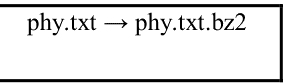

## 命令

```bash
bzip2 -d phy.txt.bz2
```

## 描述

解压压缩文件 (`phy.txt.bz2`)

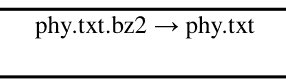

## 命令

```bash
bzcat phy.txt.bz2
```

## 描述

显示压缩文件 (`phy.txt.bz2`) 的内容

## 命令

```bash
bunzip2 phy.txt.bz2
```

## 描述

解压压缩文件 (`phy.txt.bz2`)

## 命令

```bash
crontab -l
```

## 描述

显示当前登录用户的 crontab 条目

## 命令

```bash
cat /dev/null > phy.txt
```

## 命令

```bash
cp /dev/null phy.txt
```

## 命令

```bash
echo "" > phy.txt
```

## 命令

```bash
echo > phy.txt
```

## 描述

清空文件 (`phy.txt`) 的内容

## 命令

```bash
nohup ping google.com &
```

## 描述

`ping google.com` 并进程推至后台

## 命令

```bash
nohup ping google.com > log.txt &
```

## 描述

将 ping 日志保存到 `log.txt`

## 命令

```bash
pgrep -a ping
```

Output:

3858 ping google.com

4200 ping google.com

4236 ping google.com

```bash
kill 3858

pgrep -a ping

```

Output:

4200 ping google.com

4236 ping google.com

```

## 命令

```bash
ls -la /home
```

## 描述

显示 `/home` 的内容

## 命令

```bash
sudo shutdown 2
```

## 描述

2分钟后关机

## 命令

```bash
shutdown -c
```

## 描述

取消关机进程

## 命令

```bash
ps
```

## 描述

显示其他文件的内容

## 命令

```bash
stty -a
```

## 描述

显示所有终端设置

## 命令

```bash
ls -1
```

## 描述

每行列出文件

## 命令

```bash
yes
```

## 描述

重复输出字符串直到被杀死

## 命令

```bash
dir
```

## 描述

列出当前目录下的文件和目录

## 命令

```bash
who -b
```

## 描述

系统启动时间

## 命令

```bash
nano
```

## 描述

用 `nano` 打开文件

## 命令

```bash
ls -al
```

## 描述

显示所有文件，包括权限

## 命令

```bash
vim
```

## 描述

用 `vim` 打开文件

## 命令

```bash
uname -i
```

## 描述

显示硬件平台

## 命令

```bash
uname -p
```

## 描述

显示处理器类型

## 命令

```bash
cat /proc/interrupts
```

## 描述

显示中断

## 命令

```bash
w
```

## 描述

显示机器上的当前用户、登录时间、空闲时间和 CPU 时间

Output:

11:12 up 1:29, 2 users, load average: 0.02, 0.04
11:46 up 1:28, 2 users, load average: 0.02, 0.04

## 命令

```bash
w -short
```

## 描述

省略 CPU 时间和登录信息

## 命令

```bash
findmnt
```

## 描述

显示当前挂载的文件系统列表

## 命令

```bash
ip addr show
```

## 描述

列出 IP 地址和网络接口

## 命令

```bash
netstat -plant
```

## 描述

列出活动（监听）端口

## 命令

```bash
journalctl
```

## 描述

显示 systemd、内核和日志

## 命令

```bash
sudo systemctl status network
```

## 描述

显示网络服务的状态

## 命令

```bash
sudo systemctl start network
```


# 系统管理命令参考

## 网络服务管理

### 启动网络服务
**Command:**
```bash
sudo systemctl start network
```

### 停止网络服务
**Command:**
```bash
sudo systemctl stop network
```

## SELinux 管理

### 显示布尔值状态
**Command:**
```bash
sestatus -b
```

### 报告 SELinux 状态
**Command:**
```bash
getenforce
```
**Description:**
报告 SELinux 是强制 (`enforcing`)、许可 (`permissive`) 或禁用 (`disabled`)

### 设置 SELinux 为许可模式
**Command:**
```bash
setenforce 0
```
**Command:**
```bash
getenforce
```
**Output:**
```
Permissive
```

### 设置 SELinux 为强制模式
**Command:**
```bash
setenforce 1
```
**Command:**
```bash
getenforce
```
**Output:**
```
Enforcing
```

### SELinux 模式说明
- **Enforcing** - 强制 SELinux 安全策略。
- **Permissive** - SELinux 打印警告而非执行。
- **Disabled** - 未加载 SELinux 策略。

## 算术运算示例
```bash
[manju@localhost ~]$ let a="36 + 5"; echo $a
41

[manju@localhost ~]$ let a="20 + 50/10"; echo $a
25

[manju@localhost ~]$ let a="20 - 50/10"; echo $a
15

[manju@localhost ~]$ let a="20 * 50/10"; echo $a
100
```

## 密码策略配置 (`/etc/login.defs`)

### 查询密码相关参数
**Command:**
```bash
grep ^PASS /etc/login.defs
```
**Output:**
```
PASS_MAX_DAYS 99999
PASS_MIN_DAYS 0
PASS_MIN_LEN 5
PASS_WARN_AGE 7
```

### 查看带注释的配置
**Command:**
```bash
grep PASS /etc/login.defs
```
**Output:**
```
# PASS_MAX_DAYS 密码允许的最大天数。
# PASS_MIN_DAYS 密码更改之间的最小天数。
# PASS_MIN_LEN 最小接受密码长度。
# PASS_WARN_AGE 密码过期前给予警告的天数。

PASS_MAX_DAYS 99999
PASS_MIN_DAYS 0
PASS_MIN_LEN 5
PASS_WARN_AGE 7
```

## 用户账户管理

### 以列格式列出所有用户账户
**Command:**
```bash
cut -d: -f1 /etc/passwd | column
```

### 创建目录并创建文件
**Command:**
```bash
mkdir ~/myddir ; touch ~/myddir/myfiles1.txt
```
**Description:**
创建目录 "myddir" 并在其中创建文件 "myfiles1.txt"

### 创建文件并设置权限
**Command:**
```bash
echo hi > file.md ; chmod 744 file.md
```
**Description:**
创建文件 "file.md" 并仅给其他人提供读取权限

### 查看 sudo 权限
```bash
[manju@localhost ~]$ ls -l $(which sudo)
---s--x--x. 1 root 130776 Nov 5 2016 /bin/sudo
```

## 系统状态查看

### 显示 SELinux 当前状态
**Command:**
```bash
sestatus
```

### 显示系统中进程的完整列表
**Command:**
```bash
ps -aef
```

### 显示系统活动报告
**Command:**
```bash
sar
```

## 资源限制 (`ulimit`)

### 报告当前用户的资源限制
**Command:**
```bash
ulimit
```
**Output:**
| Output | 说明 |
| :--- | :--- |
| Unlimited | 当前用户可以使用当前系统支持的所有资源 |

### 资源限制类型
- **硬限制**：用户可以触及的物理限制。
- **软限制**：用户可以管理的限制（其值可以增加到硬限制）。

### 报告当前用户的所有资源限制
**Command:**
```bash
ulimit -a
```

### 检查当前用户的最大栈大小
**Command:**
```bash
ulimit -s
```

### 检查当前用户的最大调度优先级
**Command:**
```bash
ulimit -e
```

### 显示用户进程的最大数量
**Command:**
```bash
ulimit -u
```

### 检查虚拟内存的大小
**Command:**
```bash
ulimit -v
```

### 检查一个进程可以拥有多少文件描述符
**Command:**
```bash
ulimit -n
```

### 显示 limits.conf 配置文件详细信息
**Command:**
```bash
man limits.conf
```

## 系统活动报告 (`sar`)

### 显示 sar 版本
**Command:**
```bash
sar -V
```

### 报告 CPU 详细信息
**Command:**
```bash
sar -u 2 5
```
**Description:**
以每 2 秒为间隔，报告 5 次 CPU 详细信息

### 报告网络统计信息
**Command:**
```bash
sar -n DEV 1 3 | egrep -v lo
```
**Description:**
报告网络接口、网络速度、IPV4、TCPV4、ICMP4 网络流量和错误

### 报告进程、内核线程、inode 和文件表详细信息
**Command:**
```bash
sar -v 1 3
```

### 报告交换统计信息
**Command:**
```bash
sar -S 1 3
```

### 报告 I/O 操作详细信息
**Command:**
```bash
sar -b 1 3
```
**Description:**
报告关于 I/O 操作的详细信息，如每秒事务数、每秒读取、每秒写入

## 防火墙管理 (`firewalld`)

### 显示 firewalld 状态
**Command:**
```bash
sudo systemctl status firewalld
```

### 启动 firewalld 服务
**Command:**
```bash
sudo systemctl start firewalld
```
**Description:**
firewalld 是一个 Linux 操作系统的防火墙管理工具

### 启动图形化防火墙配置工具
**Command:**
```bash
firewall-config
```


### 列出所有区域
**Command:**
```bash
firewall-cmd --list-all-zones
```

### 检查当前设置的默认区域
**Command:**
```bash
firewall-cmd --get-default-zone
```

### 显示系统上当前允许的服务
**Command:**
```bash
firewall-cmd --list-services
```

### 列出系统上开放的端口
**Command:**
```bash
firewall-cmd --list-ports
```

## Samba 安装与配置 (CentOS)

**Description:**
Samba 是一种客户端/服务器技术，实现了跨操作系统的资源共享。通过 Samba，文件和打印机可以在 Windows、Mac 和 Linux/UNIX 客户端之间共享。

### 向 firewalld 添加 Samba 服务
**Command:**
```bash
sudo firewall-cmd --add-service samba --permanent
```

## 压缩与解压工具

### 创建 zip 压缩文件
**Command:**
```bash
zip q.zip q.txt
```

### 解压 zip 文件
**Command:**
```bash
unzip q.zip
```

### 加密 zip 文件 (`zipcloak`)
**Command:**
```bash
zipcloak q.zip
```
**交互过程:**
```
Enter password:
Verify password:
```
如果密码匹配，它将加密 `q.zip` 文件。

### 解压加密的 zip 文件
**Command:**
```bash
unzip q.zip
```
**Description:**
当你尝试解压 `q.zip` 文件时，它会在允许你提取其中包含的文件 (`q.txt`) 之前提示你输入密码。

### 查找包含特定单词的压缩文件
**Command:**
```bash
zgrep -l "Einstein" *
```
**Description:**
显示包含单词 (Einstein) 的文件名

### 拆分 zip 文件
**Command:**
```bash
zipsplit -n 1048576 q.zip
```
**Description:**
将 `q.zip` 文件拆分以创建一系列的 zip 文件 (`q1.zip`, `q2.zip`....) – 每个文件不超过 1048576 字节（1兆字节）

### 合并拆分的 zip 文件
**Command:**
```bash
cat q*.zip > w.zip
```
**Description:**
你可以使用命令将 (`q1.zip`, `q2.zip`...) 合并为一个新文件 `w.zip`。

## 网络诊断工具

### 测试路由和连接质量 (`mtr`)
**Command:**
```bash
mtr google.com
```
**Description:**
测试到目标主机 google.com 的流量路由和连接质量

### 显示 IP 路由表
**Command:**
```bash
route
```

### 查看网络设备
**Command:**
```bash
nmcli dev status
```

### 检查网络连接
**Command:**
```bash
nmcli con show
```

### 列出所有开放的 TCP 端口
**Command:**
```bash
ss -ta
```

### 显示所有活跃的 TCP 连接及其计时器
**Command:**
```bash
ss -to
```

### 检查别名
**Command:**
```bash
type -a
```

## 日期格式化 (`date`)

### 年份格式区别
- `%Y`：打印 4 位的年份。
- `%y`：打印 2 位的年份。

**Command:**
```bash
echo "We are in the year: $(date +%Y)"
echo "We are in the year: $(date +%y)"
```

### 月份格式区别
- `%B`：打印完整的月份名称。
- `%b`：打印月份缩写。

**Command:**
```bash
echo "We are in the month: $(date +%B)"
echo "We are in the month: $(date +%b)"
```

### 星期格式区别
- `%A`：打印完整的星期几名称。
- `%a`：打印缩短的星期几。

**Command:**
```bash
echo "Current Day of the week: $(date +%A)"
echo "Current Day of the week: $(date +%a)"
```

### 常用日期时间格式对照表

| 格式 | 示例 |
| :--- | :--- |
| 使用 `%D` 的日期 | 08/15/21 |
| 使用 `%F` 的日期 | 2021-08-15 |
| 24 小时制当前时间 `%T` | 01:27:46 |
| 12 小时制当前时间 `%r` | 01:27:47 AM |

**Command:**
```bash
echo "Date: $(date +%D)"
echo "Date: $(date +%F)"
```

## Shell 变量与扩展示例

### 列出 txt 文件并显示最后一个参数
```bash
[manju@localhost ~]$ ls *.txt; echo $_
12.txt 1.txt 2.txt abc.txt my.txt phy.txt
13.txt 24.txt 3.txt marks.txt names.txt mphy.txt
```

### `cut` 命令字段选择示例
```bash
[manju@localhost ~]$ cut -d, -f2,1 <<<'Albert,Bob,John'
Albert,Bob

[manju@localhost ~]$ cut -d, -f2,2 <<<'Albert,Bob,John'
Bob

[manju@localhost ~]$ cut -d, -f2,3 <<<'Albert,Bob,John'
Bob,John
```


## 编码理论简介
编码理论是数学和计算机科学的一个分支，旨在研究用于通信、存储和其他信息处理系统的错误检测、纠正和保密编码的设计、分析和应用。它涉及如何将数据编码为能够抵抗传输或存储过程中可能出现的错误和噪声的代码，以及如何解码接收到的代码以恢复原始数据。编码理论在电信、计算机网络、数据存储和密码学等领域都有应用。

## 变量引用与空白符保留
```bash
[manju@localhost ~]$ x="W X Y Z"; echo "$X"
W X Y Z

[manju@localhost ~]$ x="W X Y Z"; echo "$x"
W X Y Z
```
> `echo $x` 和 `echo "$x"` 产生不同的结果。引用变量会保留空白符。

## 算术运算与变量赋值
```bash
[manju@localhost ~]$ let x=20+7; echo "The value of \"x\" is $x."
```
**Output:**
```
"x" 的值是 27。
```

```bash
[manju@localhost ~]$ x=100; let "x += 1"; echo "x = $x$"
```
**Output:**
```
x = 101
```

## IFS (内部字段分隔符) 示例

### 使用 "+" 作为分隔符
```bash
[manju@localhost ~]$ x="a+b+c"; IFS=+; echo $x
```
**Output:**
```
a b c
```
> "+" 号被解释为分隔符

### 使用 "-" 作为分隔符
```bash
[manju@localhost ~]$ x="a-b-c"; IFS=-; echo $x
```
**Output:**
```
a b c
```
> "-" 号被解释为分隔符

### 使用 "," 作为分隔符
```bash
[manju@localhost ~]$ x="a,b,c"; IFS=,; echo $x
```
**Output:**
```
a b c
```
> "," 号被解释为分隔符

## 系统资源查看命令

### 显示未使用的 RAM 内存
**Command:**
```bash
free | grep Mem | awk '{ print $4 } '
```

### 显示磁盘文件占用
**Command:**
```bash
du -ach
```

## `expr` 算术运算示例
```bash
[manju@localhost ~]$ expr 5 \* 2 + 3
13 # 10 + 3
```

```bash
[manju@localhost ~]$ expr 5 \( 2 + 3 \)
25 # 5 * 5
```

## ELF 文件信息查看
**Command:**
```bash
readelf -h /bin/bash
```
**Description:**
显示指定 elf 二进制文件的信息和统计

## ANSI 转义序列颜色与格式控制

### 下划线
```bash
[manju@localhost ~]$ echo -e "\033[4mAlbert Einstein.\033[0m"
```
**Output:**
```
Albert Einstein.
```

### 粗体
```bash
[manju@localhost ~]$ echo -e "\033[1mAlbert Einstein.\033[0m"
```
**Output:**
```
Albert Einstein.
```

### 蓝色前景/白色背景
```bash
[manju@localhost ~]$ echo -e '\E[34;47mAlbert Einstein'; tput sgr0
```
**Output:**
```
Albert Einstein
```

### 黄色前景/蓝色背景
```bash
[manju@localhost ~]$ echo -e '\E[33;34m"Albert Einstein"'; tput sgr0
```
**Output:**
```
Albert Einstein
```

### 粗体/黄色前景/蓝色背景
```bash
[manju@localhost ~]$ echo -e '\E[1;33;44m"Albert Einstein"'; tput sgr0
```
**Output:**
```
Albert Einstein
```

## Bash 算术扩展 `$((...))` 示例
```bash
[manju@localhost ~]$ x=2; y=3; echo $((2*$x + 3*$y))
13

[manju@localhost ~]$ x=2; y=3; echo $((2*x + 3*y))
13

[manju@localhost ~]$ let x=2+3 y=3+2; echo $x $y
5 5
```

## 文件比较 (`sdiff`)
**Command:**
```bash
sdiff phy.txt score.txt
```


## 显示两个文件之间的差异

**命令：**
```bash
diff phy.txt score.txt
```

**描述：**
显示两个文件（`phy.txt` 和 `score.txt`）之间的差异

## 删除或清空 Bash 历史记录条目

**命令：**
```bash
history -c
```

**描述：**
删除或清空 bash 历史记录条目

## Ping 测试（发送 5 个数据包后停止）

**命令：**
```bash
ping -c 5 www.google.com
```

**描述：**
ping 测试将在发送 5 个数据包后停止

## 统计文件信息

**命令：**
```bash
# 统计每个 .txt 文件的行数
\ls *.txt | xargs wc -l

# 统计每个 .txt 文件的单词数
\ls *.txt | xargs wc -w

# 统计每个 .txt 文件的字符数
\ls *.txt | xargs wc -c

# 统计每个 .txt 文件的行、字和字符
\ls *.txt | xargs wc
```

## 显示用户账户

**命令：**
```bash
lslogins -u
```

**描述：**
显示用户账户

## 列出系统服务

**命令：**
```bash
systemctl list-units --type=service
```

**描述：**
列出系统中所有已加载的服务（无论活动、退出还是失败）

**命令：**
```bash
systemctl --type=service
```

**描述：**
列出系统上所有加载的服务（无论活动、退出还是失败）

**命令：**
```bash
systemctl list-units --type=service --state=active
```

**描述：**
列出所有加载的激活的服务

**命令：**
```bash
systemctl --type=service --state=active
```

**描述：**
列出所有加载的激活的服务

**命令：**
```bash
systemctl list-units --type=service --state=running
```

**描述：**
列出所有正在运行的服务（即，已加载且运行的）

**命令：**
```bash
systemctl --type=service --state=running
```

**描述：**
列出所有正在运行的服务（即，已加载且运行的）

## 端口扫描

### 扫描单端口
**命令：**
```bash
nc -v <host> <port>
```

### 扫描多个端口
**命令：**
```bash
nc -v <host> <port1> <port2> ...
```

### 扫描端口范围
**命令：**
```bash
nc -v <host> <start_port>-<end_port>
```

## 查找 DNS 地址

**命令：**
```bash
cat /etc/resolv.conf
```

**描述：**
查找 DNS 地址

**命令：**
```bash
less /etc/resolv.conf
```

**描述：**
查找 DNS 地址

## 监控挂载点操作

**命令：**
```bash
findmnt --mountpoint /mnt/test
```

**描述：**
监控目录 `/mnt/test` 的挂载、卸挂载和重挂载操作

## 检查系统运行时间

**命令：**
```bash
uptime -p
```

**描述：**
检查 Linux 运行时间

**命令：**
```bash
uptime -s
```

**描述：**
检查 Linux 启动时间

**命令：**
```bash
uptime -h
```

**描述：**
显示 uptime 版本

## 统计字符串在文件中出现的次数

**命令：**
```bash
grep -o -i "score" score.txt | wc -l
```

**描述：**
统计 "score" 在文件中（`score.txt`）出现的次数

## 删除所有 Crontab 任务

**命令：**
```bash
crontab -r
```

**描述：**
删除所有 crontab 任务

## Bash 算术运算示例

**命令：**
```bash
ADD=$(( 1 + 2 ))
echo $ADD
# 输出: 3

MUL=$(( $ADD * 5 ))
echo $MUL
# 输出: 15

SUB=$(( $MUL - 5 ))
echo $SUB
# 输出: 10

DIV=$(( $SUB / 2 ))
echo $DIV
# 输出: 5

MOD=$(( $DIV % 2 ))
echo $MOD
# 输出: 1
```

## 查找字符串长度

**命令：**
```bash
expr length "This is my3schools.com"
```

**描述：**
查找字符串 "This is my3schools.com" 的长度

## 使用 bc 和 awk 进行计算

**命令：**
```bash
echo '3+5' | bc

awk 'BEGIN { a = 6; b = 2; print "(a + b) = " (a + b) }'
# 输出: (a + b) = 8
```

## 将整数分解为质因子

**命令：**
```bash
factor 10
```

**描述：**
将整数（10）分解为质因子

## 进程管理

**命令：**
```bash
ps -e
```

**描述：**
显示 Linux 系统上的所有活动进程

**命令：**
```bash
ps -x
```

**描述：**
显示用户运行进程

**命令：**
```bash
ps -fU manju
```

**描述：**
按用户名（manju）显示进程

**命令：**
```bash
ps -fu 1000
```

**描述：**
按真实用户 ID（RUID）显示用户的进程

**命令：**
```bash
ps -U root -u root
```

**描述：**
显示所有以 root 用户权限运行的进程（真实 ID 和有效 ID）

## 显示登录用户

**命令：**
```bash
echo -e "The following users are logged on the system:\n\n $(who)"
```

**输出示例：**
```text
manju :0      Aug 15 03:31 (:0)
manju pts/1   Aug 15 03:32 (:0)
```

## 日期格式化显示

**命令：**
```bash
date +%d-%m-%Y
```

**描述：**
以 DD-MM-YYYY 格式显示当前日期

**命令：**
```bash
date +%m%d%Y
```

**描述：**
以 MMDDYYYY 格式显示当前日期

**命令：**
```bash
date -d "7 days ago"
```

**描述：**
显示当前日期 7 天前

**命令：**
```bash
date -d "7 days"
```

**描述：**
显示当前日期 7 天后

## 显示所有文件（包括隐藏文件）

**命令：**
```bash
ls -a ~/
```

**描述：**
显示所有文件 - 包括隐藏文件

## Gnome 计算器示例

**命令：**
```bash
gnome-calculator -s 23500*10
```

**输出：**
```text
2350
```

**说明：**
$23500 \times \frac{10}{100} = 2350$

## 生成随机数并求和

**命令：**
```bash
shuf -i 1-5 -n 5
```

**描述：**
此命令产生数字，在这种情况下将生成 1 到 5 之间的 5 个数字。

**命令：**
```bash
shuf -i 1-5 -n 5 | awk '{ sum+=$1; print $1 } END {print "Sum"; print sum}'
```

**输出：**
```text
4
5
2
3
1
Sum
15
```

## 查找 .zip 文件

**命令：**
```bash
find ./ -name "*.zip" -type f
```

**输出：**
```text
./1.zip
./encrypt.zip
./my.zip
```

## 查找过去 24 小时内更新的文件

**命令：**
```bash
find -type f -mtime 0
```

**描述：**
查找过去 24 小时内更新的文件

## 查找今天更新的文件

**命令：**
```bash
find -type f -newermt `date +%F`
```

**描述：**
查找今天更新的文件

## 查找昨天修改的文件

**命令：**
```bash
find -type f -newermt `date +%F -d yesterday`
```

**描述：**
查找昨天修改的文件

## 查找过去 72 小时内更新的文件

**命令：**
```bash
find -type f -mtime -3
```

**描述：**
查找过去 72 小时内更新的文件

## 查找特定日期后修改的文件

**命令：**
```bash
find -type f -newermt 2021-03-01
```

**描述：**
查找 2021年3月1日之后修改的文件

## 查找过去 3 小时内更新的文件

**命令：**
```bash
find -type f -newermt `date +%F -d -3hours`
```

**描述：**
查找过去 3 小时内更新的文件

**命令：**
```bash
find -type f -mmin -180
```

**描述：**
查找过去 3 小时内更新的文件

## Shell 脚本示例

### 条件判断
**脚本：**
```bash
if [ 15 -gt 25 ]; then
    echo "True"
else
    echo "False"
fi
```

**输出：**
```text
False
```

### for 循环
**脚本：**
```bash
for i in 1 2 3 4 5; do
    echo "Albert"
done
```

**输出：**
```text
Albert
Albert
Albert
Albert
Albert
```

### test 命令
**脚本：**
```bash
if test 5 -eq 6; then
    echo "True"
else
    echo "False"
fi
```

**输出：**
```text
False
```

## 包管理

**命令：**
```bash
yum deplist httpd
```

**描述：**
列出包 "apache" 的依赖项

**命令：**
```bash
yum reinstall httpd
```

**描述：**
重装（损坏的）包 "apache"

## bc 计算器交互示例

**命令：**
```bash
echo "i=3;i+1" | bc
# 输出: 4

echo "i=3;--" | bc
# 输出: 2

echo "i=4;i" | bc
# 输出: 4
```

## help 命令用法

**命令：**
```bash
help cd
```

**描述：**
显示关于 `cd` 命令的完整信息

**命令：**
```bash
help -d cd
```

**描述：**
显示 `cd` 命令的简短描述

**命令：**
```bash
help -s cd
```

**描述：**
显示 `cd` 命令的语法

## 创建目录并设置权限

**命令：**
```bash
mkdir -m a=rwx myfiles
```

**描述：**
创建 `myfiles` 目录，并设置其文件模式 (`-m`)，使得所有用户 (`a`) 都可以读取 (`r`)、写入 (`w`) 和执行 (`x`) 它。

## whatis 和 who 命令

**命令：**
```bash
whatis -w make*
```

**描述：**
显示所有以 `make` 开头的命令的用法

**命令：**
```bash
who -d -H
```

**描述：**
输出所有死进程的列表

## 用户信息查询

**命令：**
```bash
finger -s manju
```

**描述：**
显示用户 "manju" 的登录详情和空闲状态

**命令：**
```bash
last -F
```

**描述：**
显示登录和退出时间，包括日期

## 文件搜索

**命令：**
```bash
locate --regex -i "(\.mp3|\.txt)"
```

**描述：**
搜索系统中所有的 `.mp3` 和 `.txt` 文件并忽略大小写

## Systemd 服务与文件统计

**命令：**
```bash
systemctl -l -t service | less
```

**描述：**
列出所有 Systemd 服务

**命令：**
```bash
locate "*.txt" -n 20
```

**描述：**
显示以 `.txt` 结尾的文件的前 20 个结果

**命令：**
```bash
locate -c "[.txt]*"
```

**描述：**
统计以 `.txt` 结尾的文件并显示结果

**命令：**
```bash
ls -l | egrep -c '^-'
```

**描述：**
统计当前目录下文件的数量

## 磁盘使用与文件查找

**命令：**
```bash
du -kx | egrep -v "\./+" | sort -n
```

**描述：**
搜索最大的目录

**命令：**
```bash
ls -al --time-style=+%D | grep `date +%D`
```

**描述：**
只列出今天的文件

**命令：**
```bash
find -name "*.gz"
```

**描述：**
在当前工作目录中查找所有 gzip 存档

**命令：**
```bash
du -hsx * | sort -rh | head -10
```

**描述：**
检查占用空间最大的 10 个文件

## CPU 统计信息

**命令：**
```bash
mpstat
```

**描述：**
显示处理器和 CPU 统计信息

**命令：**
```bash
mpstat -P ALL
```

**描述：**
显示所有 CPU 的处理器数量

**命令：**
```bash
mpstat 1 5
```

**描述：**
此命令将打印 5 份报告，每份间隔为 1 秒

## printf 格式化输出

**命令：**
```bash
printf "%s\n" "Albert Einstein"
```

**输出：**
```text
Albert Einstein
```

## 查找空文件与统计目录数量

**命令：**
```bash
find . -size 0k
```

**描述：**
查找当前目录下所有的空文件

**命令：**
```bash
ls -F | grep / | wc -l
```

**描述：**
统计目录中的目录数量

## 显示磁盘分区大小

**命令：**
```bash
fdisk -s /dev/sda
```

**描述：**
显示 Linux 中磁盘分区的大小

## 安装 Nix 包管理器

**命令：**
```bash
sh <(curl https://nixos.org/nix/install) --daemon
```

**描述：**
在 Linux 中安装 Nix 包管理器

## 本地化设置

**命令：**
```bash
locale
```

**描述：**
查看 Linux 系统本地区域设置

**命令：**
```bash
locale -a
```

**描述：**
显示所有可用本地区域设置列表

## 字符转换

**命令：**
```bash
cat score.txt
# 输出: Justin-40

cat score.txt | tr [:lower:] [:upper:]
# 输出: JUSTIN-40

cat score.txt | tr [a-z] [A-Z] > output.txt
cat output.txt
# 输出: JUSTIN-40
```

**命令：**
```bash
cat domainnames.txt
# 输出:
# www.google.com
# www.fb.com
# www.mactech.com

cat domainnames.txt | tr -d ' '
# 输出:
# www.google.com
# www.fb.com
# www.mactech.com
```

**命令：**
```bash
cat domainnames.txt | tr -s ' '
```

**命令：**
```bash
echo "My UID is"
```

**输出：**
```text
My UID is
```

**命令：**
```bash
echo "My UID is 0"
```

**输出：**
```text
My UID is 0
```

**命令：**
```bash
echo "My UID is" | tr -d ":"
```

**输出：**
```text
My UID is
```

**命令：**
```bash
echo "My UID is" | tr " " "\n"
```

**输出：**
```text
My
UID
is
```

**命令：**
```bash
echo "my3schools.com" | tr "=>" "-"
```

**输出：**
```text
my3schools.com- Books,Src,Tutorials
```

## 历史命令执行

**命令：**
```bash
!sud
```

**描述：**
再次执行以 `sud` 开头的之前的命令

**命令：**
```bash
!sudo
```

**描述：**
再次执行以 `sudo` 开头的之前的命令

## 生成系统账户列表

**命令：**
```bash
cut -d: -f1 /etc/passwd | sort | xargs
```

**描述：**
生成系统中所有 Linux 账户的压缩列表

## 查看压缩文件

**命令：**
```bash
zcat phy.txt.gz myfiles.txt
```

**描述：**
查看多个压缩文件 (`phy.txt.gz` 和 `myfiles.txt`)

## 查找文件

**命令：**
```bash
find . -type f -name "*.php"
```

**描述：**
查找目录下所有的 php 文件

**命令：**
```bash
mkdir /tmp/DOCUMENTS
```

**描述：**
在 `/tmp` 下创建一个名为 `DOCUMENTS` 的目录

**命令：**
```bash
find . -type f -perm 777 -print
```

**描述：**
查找所有权限为 777 的文件

**命令：**
```bash
find . -type f -perm 777
```

**描述：**
查找所有权限为 777 的文件

**命令：**
```bash
find . -type f -perm /g=s
```

**描述：**
查找所有 SGID 文件

**命令：**
```bash
find . -type f -perm /u=r
```

**描述：**
查找所有只读文件

**命令：**
```bash
find . -type f -perm /a=x
```

**描述：**
查找所有可执行文件

## awk 转换大小写

**命令：**
```bash
echo "ALBERT" | awk '{print tolower($0)}'
```

**输出：**
```text
albert
```

## 查找并删除文件

**命令：**
```bash
find . -type f -name "phy.txt" -exec rm {} \;
```

**描述：**
查找并删除 `phy.txt` 文件

**命令：**
```bash
echo "55602369" | tr -cd '0-9'
```

**输出：**
```text
55602369
```

**描述：**
从字符串中提取数字

**命令：**
```bash
find . -type f -name "*.txt" -exec rm {} \;
```

**描述：**
查找并删除多个 `.txt` 文件

**命令：**
```bash
find . -type f -name "*.mp3" -exec rm {} \;
```

**描述：**
查找并删除多个 `.mp3` 文件

**命令：**
```bash
find /tmp -type d -empty
```

**描述：**
查找所有空目录

**命令：**
```bash
find /tmp -type f -name ".*"
```

**描述：**
查找所有隐藏文件

**命令：**
```bash
echo "55602369" | tr -d '0-9'
```

**输出：**
```text
(空输出，数字被删除)
```

## 基于时间的文件查找

**命令：**
```bash
find / -mtime 50
```

**描述：**
查找 50 天前修改的文件

**命令：**
```bash
find / -atime 50
```

**描述：**
查找 50 天前访问的文件

**命令：**
```bash
find / -cmin 60
```

**描述：**
查找 1 小时内更改的文件

**命令：**
```bash
find / -mmin 60
```

**描述：**
查找 60 分钟前修改的文件


# 描述

查找 1 小时内修改的文件

# 命令

```bash
find / -amin 60
```

# 描述

查找 1 小时内访问的文件

| 命令 | 描述 |
| :--- | :--- |
| `type cat` | 识别 "cat" 命令是 shell 内置命令、子程序、别名还是关键字。 |

```bash
find / -size 50M
```

# 描述

查找所有 50MB 的文件

# 命令

```bash
find / -type f -size +100M -exec rm \;
```

# 描述

查找并删除 100MB 的文件

# 命令

```bash
find / -type f -name *.mp3 -size +10M -exec rm \;
```

# 描述

查找所有大于 10MB 的 .mp3 文件并删除它们

```bash
ls -l --color
```

# 列出当前目录下的文件（带彩色输出）

```bash
info df
```

# 加载 "df" 信息页

```bash
ls /usr/include
```

# 列出编译 C 程序的头文件

```bash
ls /usr/local
```

# 列出本地安装的文件

```bash
ls /usr/bin/d*
```

```bash
/usr-bin-d
# 列出 /usr/bin 目录下所有以字母 "d" 开头的文件
```

```bash
[manju@localhost ~]$ ls .b*
```

```bash
.bash_history .bash_logout .bash_profile .bashrc
```

```bash
[manju@localhost ~]$ touch hello.cpp; touch hello.f99

[manju@localhost ~]$ ls ?.p]?
```

```bash
hello.cpp hello.f99
```

```bash
hello.cpp.f99
```

```bash
ls /usr
# 列出 /usr 目录

ls ~ /usr
# 列出用户的家目录和 /usr 目录
```

```bash
[manju@localhost ~]$ echo f*

# 显示以 "f" 开头的文件

file23.txt file1.txt file23.txt file2.txt file34.txt file3.txt first.txt fool.txt
```

```bash
[manju@localhost ~]$ echo f*.txt

# 显示以 "f" 开头、中间任意字符并以 ".txt" 结尾的文件

file23.txt file1.txt file23.txt file2.txt file34.txt file3.txt first.txt fool.txt
```

```bash
touch myfiles.txt
```

```bash
hello.cpp hello.f99
```

```bash
sudo vim myfiles.txt
# 使用 Vim 编辑器打开文件 "myfiles.txt"
```

```bash
[manju@localhost ~]$ for ((i=0;i<8;i++)); do echo $((i)); done
0
1
2
3
4
5
6
7
```

# 命令

```bash
cat /proc/sys/fs/file-max
```

# 描述

查找 Linux 打开文件限制

# 命令

```bash
ulimit -Hn
```

# 描述

检查 Linux 硬限制

# 命令

```bash
ulimit -Sn
```

# 描述

检查 Linux 软限制

# 命令

```bash
timedatectl status
```

# 描述

显示系统的当前时间和日期

# 命令

```bash
timedatectl list-timezones
```

# 描述

查看所有可用的时区

# 命令

```bash
timedatectl list-timezones | egrep -o "Asia/B.*"
timedatectl list-timezones | egrep -o "Europe/L.*"
timedatectl list-timezones | egrep -o "America/N.*"
```

# 描述

根据你的位置查找本地时区

# 命令

```bash
timedatectl set-timezone "Asia/Kolkata"
```

# 描述

在 Linux 中设置本地时区

# 命令

```bash
swapon --summary
```

# 描述

查看设备交换空间使用的摘要

# 命令

```bash
cat /proc/swaps
```

# 描述

检查交换空间使用信息

```bash
# 开始录制 Linux 终端
script history_log.txt
Script started, file is history_log.txt
exit
Script done, file is history_log.txt
```

# 命令

```bash
dir -shl
```

# 描述

列出文件及其在块中分配的内存

# 命令

```bash
less /proc/sys/dev/cdrom/info
```

# 描述

显示关于 CD-ROM 的信息

```bash
while true; do date >> date.txt ; sleep 5 ; done &
cat date.txt

Mon Aug 16 03:05:36 PDT 2021
Mon Aug 16 03:05:41 PDT 2021
Mon Aug 16 03:05:46 PDT 2021
Mon Aug 16 03:05:51 PDT 2021
```

> "不要写出更好的错误信息，要写不需要错误信息的代码。"
>
> — Jason C. McDonald

```bash
[manju@localhost ~]$ echo hello > 1.txt

[manju@localhost ~]$ echo world > 2.txt

[manju@localhost ~]$ echo program > 3.txt

[manju@localhost ~]$ cat 1.txt
hello
[manju@localhost ~]$ cat 2.txt
world
[manju@localhost ~]$ cat 3.txt
program
[manju@localhost ~]$ cat 1.txt 2.txt 3.txt
hello
world
program
[manju@localhost ~]$ cat 1.txt 2.txt 3.txt >all

[manju@localhost ~]$ cat all
hello
world
program
```

```bash
strings /usr/bin/passwd
# 显示来自 /usr/bin/passwd 的可读字符字符串
```

```bash
ls -lS /etc
# 列出 /etc 中最大的文件
```

```bash
cat /etc/passwd >> myfiles.txt
```

# 创建名为 myfiles.txt 的文件，包含 myfiles.txt 的内容后跟 /etc/passwd 的内容

```bash
[manju@localhost ~]$ ls /etc/*.conf
/etc/asound.conf /etc/kdumpconf.conf /etc/radvd.conf
/etc/autofs.conf /etc/krb5.conf /etc/request-key.conf
/etc/autofs_ldap_auth.conf /etc/ksmtuned.conf /etc/resolv.conf
/etc/brittly.conf /etc/ld.so.conf /etc/rsyncd.conf
/etc/cgconfig.conf /etc/libaudit.conf /etc/rsyslog.conf
/etc/cgrules.conf /etc/libuser.conf /etc/setestus.conf
/etc/cgsnapshot_blacklist.conf /etc/locale.conf /etc/sos.conf
/etc/chrony.conf /etc/logrotate.conf /etc/sudo.conf
/etc/dleyna-server-service.conf /etc/man_db.conf /etc/sudo-ldap.conf
/etc/dnsmasq.conf /etc/mke2fs.conf /etc/sysctl.conf
/etc/dracut.conf /etc/tools.conf /etc/tcsd.conf
/etc/e2fsck.conf /etc/nfsmount.conf /etc/updated-db.conf
/etc/fprintd.conf /etc/nsswitch.conf /etc/usb_modeswitch.conf
/etc/fuse.conf /etc/ntp.conf /etc/vconsole.conf
/etc/GeoIP.conf /etc/numad.conf /etc/wdial.conf
/etc/host.conf /etc/oddjobd.conf /etc/yum.conf
/etc/idmapd.conf /etc/pbm2ppa.conf
/etc/ipsec.conf /etc/pnm2ppa.conf
```

# 显示位于 /etc 中的配置文件

```bash
ls /dev/sd*
/dev/sda /dev/sda1 /dev/sda2 /dev/sda3
```

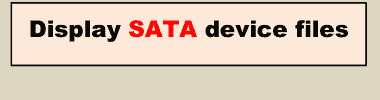

```bash
echo \$USER
# $USER
```

```bash
echo -e "2+2\t=4"; echo -e "12+12\t=24"
```

| 2+2 | =4 |
| 12+12 | =24 |

```bash
echo Hello && echo World
```

```bash
echo Hello ; echo World
```

```
Hello
World
```

```bash
echo Hello || echo Hi ; echo World
```

```
Hello
World
```

```bash
rm myfiles.txt && echo It worked! || echo failed!
It worked!
```

```bash
rm files.txt && echo It worked! || echo failed!
rm: cannot remove 'files.txt': No such file or directory
It failed!
```

```bash
pwd
```

# 命令

```bash
echo $(ls -al)
```

# 说明

执行命令 "ls -al" 并将结果打印到标准输出

# 命令

```bash
top -b -o +%MEM | head -n 22
```

# 说明

按内存使用率降序排列显示前 15 个进程

# 命令

```bash
top -b -o +%MEM | head -n 22 > report.txt
```

# 说明

将输出重定向到文件 (report.txt) 以备后续检查

# 命令

```bash
ps -eo pid,ppid,cmd,%mem,%cpu --sort=-%mem | head
```

# 说明

检查 Linux 中按 RAM 或 CPU 使用率排序的任务进程

# 命令

```bash
find . -type f \(-name "*.sh" -o -name "*.txt" \)
```

# 说明

在当前目录下查找所有扩展名为为 .sh 和 .txt的文件

# 命令

```bash
find . -type f \(-name "*.sh" -o -name "*.txt" -o -name "*.c" \)
```

# 说明

在当前目录下查找所有扩展名为 .sh, .c 和 .txt 的文件

# 说明

查找 3 天前编辑过的文件

# 命令

```bash
find . -type f -mtime +3
```

# 说明

查找过去 24 小时内编辑过的文件

# 命令

```bash
find . -type f -mtime -1
```

# 说明

查找包含超过 100 个字符（字节）的文件

# 命令

```bash
find . -type f -size +100c
```

# 说明

查找大于 100 KB 但小于 1 MB 的文件

# 命令

```bash
find . -type f -size +100k -size -1M
```

# 说明

删除所有在 24 小时内编辑过的文件

# 命令

```bash
find . -type f -mtime -1 -delete
```

# 说明

列出所有文件，包括隐藏文件。

# 命令

```bash
ls -a
```

# 说明

列出以 "/" 字符结尾的文件和目录。

# 命令

```bash
ls -F
```

# 说明

反序列出文件。

# 命令

```bash
ls -r
```

# 说明

按文件大小排序文件。

# 命令

```bash
ls -i5
```

# 说明

列出带有 inode 号的文件。

# 命令

```bash
ls -i
```

# 说明

检查 ls 命令的版本。

# 命令

```bash
ls --version
```

# 说明

列出 /tmp 目录下的文件。

# 命令

```bash
ls -l /tmp
```

# 说明

显示文件和目录的 UID 和 GID。

# 命令

```bash
ls -n
```

# 说明

查找所有 30 MB 文件。

# 命令

```bash
find / -size 30M
```

# 说明

查找大小在 100MB - 200MB 之间的文件。

# 命令

```bash
find / -size +100M -size -200M
```

# 说明

列出大于 20 KB 的目录。

# 命令

```bash
find / -type d -size +20k
```

# 说明

查找空文件和目录。

# 命令

```bash
find ./ -type f -size 0
```

# 说明

列出过去 17 小时内修改过的文件。

# 命令

```bash
find . -mtime -17 -type f
```

# 说明

列出过去 10 天内修改过的目录。

# 命令

```bash
find . -mtime -10 -type d
```

# 说明

列出家目录下在 6 到 15 天前修改过的文件。

# 命令

```bash
find /home -type f -mtime +6 -mtime -15
```

# 说明

显示权限为 777 的文件。

# 命令

```bash
find -perm 777
```

# 说明

列出用户 manju 拥有的文件。

# 命令

```bash
find /home -user manju
```

# 说明

查找用户 manju 拥有的所有文本文件。

# 命令

```bash
find /home -user manju -iname "*.txt"
```

# 说明

连同权限一起列出文件和目录。

# 命令

```bash
find -name "*.conf" | ls -l
```

# 说明

仅列出目录。

# 命令

```bash
ls -d */
```

# 说明

单行列出多个文件。

# 命令

```bash
ls --format=comma
```

# 说明

查看特定用户 manju 的进程。

# 命令

```bash
ps -u manju
```

# 说明

执行以特定字母 "c" 开头的命令。

# 命令

```bash
ic
```

# 说明

显示 BIOS 信息（需要高权限运行）。

# 命令

```bash
dmidecode -t 0
```

# 说明

显示 CPU 信息（需要高权限运行）。

# 命令

```bash
dmidecode -t 4
```

# 说明

查看所有系统日志。

# 命令

```bash
gnome-system-log
```

# 说明

识别 SSH 客户端版本。

# 命令

```bash
ssh -V
```

# 说明

显示用户的总连接时间。

# 命令

```bash
last -d
```

# 说明

显示特定用户 manju 的连接时间。

# 命令

```bash
last -d manju
```

# 说明

显示 Apache 内部的模块。

# 命令

```bash
httpd -l
```

# 说明

查看当前用户拥有的进程。

# 命令

```bash
ps $USER
```

# 说明

显示文件系统信息。

# 命令

```bash
df -Tha
```

# 说明

显示带有进程 ID 和程序名的活动连接。

# 命令

```bash
netstat -tap
```

# 说明

显示 RAW 网络统计数据。

# 命令

```bash
netstat --statistics --raw
```

# 说明

Linux 用户模式命令行界面图形形界面 LILO (Linux Loader) 将 Linux 加载到内存并启动操作系统逻辑卷管理器 (LVM)。文件名最大长度为 255 字节。管理硬盘和其他存储设备。

# 命令

```bash
date
```

# 说明

周四 4月21日 20:51

# 命令

```bash
cal
```

# 说明

检查 httpd 进程。

# 命令

```bash
ps -aux | grep 'httpd'
```

# 说明


/var/spool 存储为打印作业和网络传输生成的临时文件。

# 命令

```
ls /var/spool
abrt abrt-upload anacron cups lpd plymouth
```

# 说明

/usr/share/man 存储在线帮助页。

# 命令

```
ls /usr/share/man
```

# 说明

列出 GDM 目录的内容。

# 命令

```
ls /etc/gdm
custom.conf Init PostLogin PostSession Xsession
```

# 说明

列出 GConf 文件。

# 命令

```
ls /etc/gconf
```

# 说明

列出 GNOME 使用的文件。

# 命令

```
ls /usr/share/gnome
```

# 说明

列出系统配置文件。

# 命令

```
ls /etc/sysconfig
atd firewall libvirt-guests qemu-ga samba samba
authconfig grub man-ab radvd saslauthd
autofs init modules raid-check selinux
cbq ip6tables-config netconsole rdisc smartmontools
cgred iptables-config network readonly-root sshd
console irqbalance network-scripts rpcbind sysstat
cpower kdump nfs rpc-quotad sysstat.ioconf
crond kernel nptd rsynced virtlockd
ebtables-config ksm nptdate rslog virtlogd
fcoe libvird pluto run-parts wpa_supplicant
```

# 说明

列出系统启动和关闭文件。

# 命令

```
ls /etc/rc.d
```

# 说明

/etc/init.d 包含启动网络连接的脚本。

# 命令

```
ls /etc/init.d
netconsole network README
```

# Linux 操作系统的重要特性

- 免费且开源
- 可移植且更安全
- 健壮且适应性强

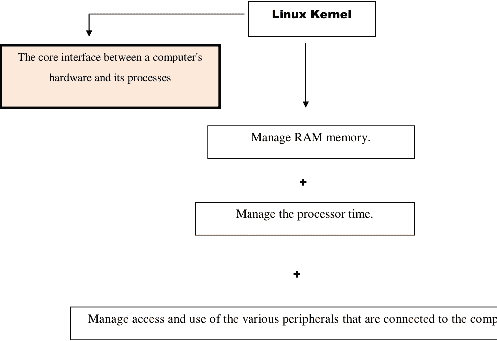

计算机硬件与其进程之间的核心接口。

管理 RAM 内存。

管理处理器时间。

管理连接到计算机的各种外设备的访问和使用。

交换空间 `Swap space` 当物理内存 (RAM) 满时在硬盘上的一个空间。

# 命令

```
cd /etc
pwd
/etc
```

# 说明

/etc/hosts `/etc/hosts` 包含与其 IP 地址对应的主机名

```
127.0.0.1  localhost localhost.localdomain localhost4 localhost.localdomain4
::1        localhost localhost.localdomain localhost6 localhost.localdomain6
```

```bash
ps -L 3315
# 列出特定进程的所有线程（进程 ID 3315）

ps aux --sort pmem
# 检查内存状态

awk '/Hello/' myfiles.txt
# 在 myfiles.txt 中查找 "Hello"

awk -F ':' '{ print $1 }' /etc/passwd | sort
# 显示所有用户登录名的排序列表

awk 'END { print NR }' myfiles.txt
# 统计 myfiles.txt 的行数
```

```bash
[manju@localhost]$ awk 'BEGIN { for (i = 1; i <= 7; i++) print int(101 * rand())'
# 打印7 个 0 到 100 之间的随机数
```

```bash
ls -lg *.txt | awk '{ x += $5 }; END {print "total bytes:" x }'
# 输出所有 .txt 文件使用的总字节数
```

| 随机存内存 | 虚拟内存 |
| :--- | :--- |
| CPU 用于存储数据、程序和程序结果的内部内存。 | 当计算机内存不足时，用于存放硬盘上的文件以供检索的区域。 |

## Linux 中的进程状态

- Ready（就绪）：创建了新进程，并已准备好运行。
- Running（运行中）：进程正在执行。
- Wait（等待）：进程正在等待用户的输入。
- Completed（已完成）：进程已完成执行。
- Zombie（僵尸）：进程已终止，但关于进程的信息仍然存在于进程表中并可访问。

| Cron | Anacron |
| :--- | :--- |
| 允许我们在 Linux/Unix 系统中每分钟运行一次计划任务的服务。 | 仅允许我们在 Linux/Unix 系统中每天按天运行计划任务的服务。 |

## 命令

```bash
cat /etc/crontab
```

## 描述

查看系统定义的 cron 任务

## 命令

```bash
netstat --listen
```

## 描述

检查 Linux 服务器上哪些端口处于监听状态

网络接口卡组集（Network Interface Card teaming）是将多个网卡组合在一起以提高性能、负载均衡并增加可用性的过程。

| 服务 | 默认端口 |
| :--- | :--- |
| DNS | 53 |
| SMTP | 25 |
| FTP | 20（数据传输）， 21（建立连接） |
| SSH | 22 |
| DHCP | 67/UDP (dhcp 服务器), 68/UDP (dhcp 客户端) |
| squid | 3128 |

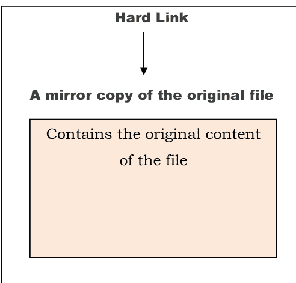
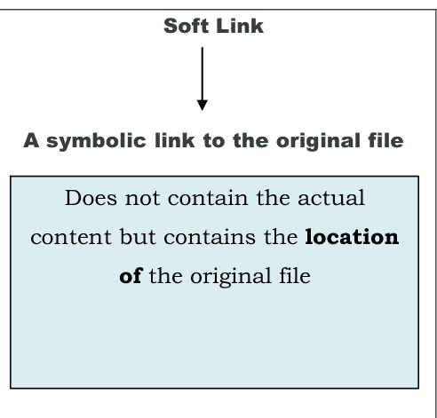

```bash
ls /bin
# 列出二进制文件和其他可执行程序
```

```bash
ls /boot
# 列出启动操作系统所需的文件
```

```bash
ls /dev
# 列出设备文件 - 通常由操作系统和系统管理员控制
```

```bash
ls /etc
# 列出系统配置文件
```

```bash
ls /lib
# 列出系统库
```

```bash
ls /lib64
# 列出系统库（64 位）
```

```bash
mkdir mydir{1,2,3,4,5}
# 创建 5 个新目录：
- mydir1
- mydir4
- mydir2
- mydir5
- mydir3
```

```bash
ls /proc
# 列出运行进程的信息
```

```bash
ls /sbin
# 列出系统管理二进制文件
```

```bash
ls /var/log
# 列出日志文件
```

```bash
[manju@localhost]$ ls -l myfiles.txt
-rw-r--r-- 1 manju 12 Apr 19 22 myfiles.txt
# 显示 myfiles.txt 的权限
```

```bash
find . -mtime +1 -mtime -3
# 查找大于 1 天但小于 3 天的文件

find . -name "s*"
# 查找以 "s" 开头的文件并对其执行 "ls" 命令

find . -size +3M
# 查找大于 3MB 的文件
```

```bash
[manju@localhost]$ cat myfile.txt
ffff
b
cc

[manju@localhost]$ cat myfile.txt | sort
b
cc
ffff
```

```bash
[manju@localhost]$ touch file1; touch file2 | [manju@localhost]$ ls[1,2] | file1 file2 |
| [manju@localhost]$ $(who | grep $USER | wc -l) | 你有 2 个会话 |
```

## 命令

```bash
chmod go-rwx myfiles.txt
```

## 描述

移除 myfiles.txt 组和其他用户的读写执行权限

## 命令

```bash
chmod a+rw myfiles.txt
```

## 描述

赋予所有用户 myfiles.txt 的读写权限

## 命令

```bash
ls -t
# 列出最近修改的文件
```

```bash
[manju@localhost]$ echo $OSTYPE
# 你正在使用的操作系统
```

## 命令

```bash
df -i /dev/sda1
# 检查系统的 Inodes
```

## 命令

```bash
ls -il myfiles.txt
# 查找 myfiles.txt 的 Inode 数
```

## 命令

```bash
getfacl myfiles.txt
# 检查 myfiles.txt 配置的 ACL（访问控制列表）
```

SSH（Secure Shell）是一种网络协议，允许用户和系统管理员通过不安全的网络访问计算机。

## Linux 中的 3 个流

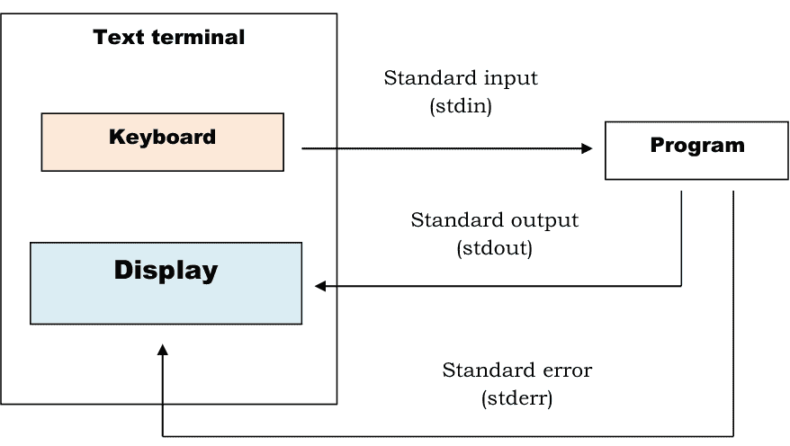

## 命令

```bash
du -sh /var/log/*
# 检查文件和目录的磁盘使用情况
```

## 命令

```bash
ldd /bin/cp
# 显示 "cp" 命令的依赖
```

## 命令

```bash
ldd -v /bin/cp
# 显示详细的 "cp" 命令依赖
```

## 命令

```bash
ldd -u /bin/cp
# 显示 "cp" 命令未使用的依赖
```

```bash
[manju@localhost]$ date; cal
Thu Apr 21 19:44 2022
April 2022
Mo Tu We Th Sa
      1 2
3 4 5 6 7 8 9
10 11 12 13 14 15 16
17 18 19 20 21 22 23
24 25 26 27 28 29 30
# date 命令被 cal 命令执行
```

| -gt | 大于 |
| -lt | 小于 |
| -ge | 大于等于 |
| -le | 小于等于 |
| -eq | 等于 |
| -ne | 不等于 |

```bash
[manju@localhost]$ date && cal
Thu Apr 21 19:44 2022
April 2022
Mo Tu We Th Sa
      1 2
3 4 5 6 7 8 9
10 11 12 13 14 15 16
17 18 19 20 21 22 23
24 25 26 27 28 29 30
# cal 命令只有在 date 命令成功执行时才执行
```

```bash
[manju@localhost]$ ls *.c
hello.c vim.c
```

```bash
[manju@localhost]$ ls *.co
hello.c hello.o vim.c
```

```bash
[manju@localhost]$ a='ls *.c'; echo $a
hello.c main.c vim
```

```bash
[manju@localhost]$ test 50 -ge 15 && echo true || echo false
true
```

```bash
[manju@localhost]$ test 50 -ge 50 && echo true || echo false
true
```

```bash
[manju@localhost]$ test 20 -le 50 && echo true || echo false
true
```

```bash
[manju@localhost]$ test 20 -le 20 && echo true || echo false
true
```

```bash
[manju@localhost]$ test 30 -eq 30 && echo true || echo false
true
```

```bash
[manju@localhost]$ test 30 -ne 30 && echo true || echo false
false
```

```bash
cat /proc/dev
```

## 描述

显示网络适配器和统计数据

## 命令

```bash
cat /proc/mounts
```

## 描述

显示挂载的文件系统

## 命令

```bash
telinit 0
```

## 描述

关闭系统

```bash
cd /home
# 进入主目录

cd ..
# 返回上一级目录
```

显示包含数字 0 到 9 文件和文件夹

```bash
ls * [0-9]
```

```bash
iconv -l
# 显示已知加密算法列表
```

```bash
ls -lr | more
# 按大小显示文件和目录
```

```bash
du -sk * | sort -rn
# 按大小排序显示文件和目录
```

# Bash 脚本

```bash
for i in *linux*; do rm $i; done
```

# 描述

删除当前目录下所有包含 "linux" 单词的文件

# 命令

```bash
awk '{print}' myfiles.txt
```

# 描述

显示文件 (myfiles.txt) 的内容

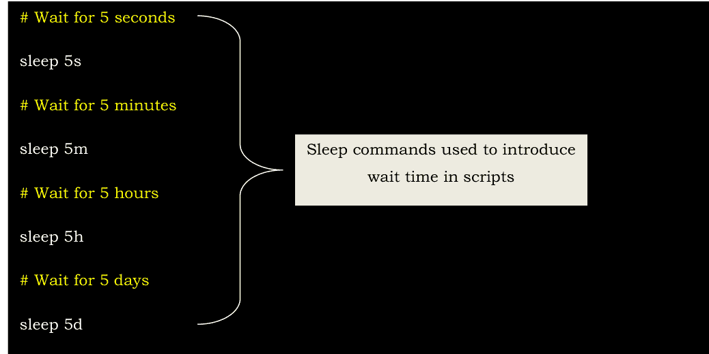

# 命令

```
ln myfiles.txt hardF1
```

# 描述

为 myfiles.txt 创建硬链接

# 命令

```bash
cat hardF1
```

# 描述

检查硬链接 hardF1 的内容

# 命令

```
ln myfiles.txt softF1
```

# 描述

为 myfiles.txt 创建软链接（符号链接）

# 命令

```bash
cat softF1
```

# 描述

检查软链接 softF1 的内容

| 前台进程 | 后台进程 |
| :--- | :--- |
| 需要用户启动或与之交互。 | 独立于用户运行。 |

# 命令

```bash
ps -p 13
```

# 描述

显示进程 ID 为 13 的进程信息

# 命令

```bash
ulimit -f 100
```

# 描述

将文件大小限制设置为 51,200 字节

# 命令

```bash
lsmod
```

# 描述

查出当前加载了哪些内核模块

| 绝对路径 | 相对路径 |
| :--- | :--- |
| 从根目录到文件或目录的路径。 | 从当前工作目录到文件或目录的路径。 |

## 命令

```bash
sudo yum install php
```

## 描述

安装 7.2 版本的 php

## 命令

```bash
php -r 'echo "Hello World\r\n";'
```

## 描述

从命令行运行 PHP 语句而不创建文件

## 命令

```bash
php -a
```

## 描述

启动 PHP 交互式 shell

# 命令

```bash
du -h -d 1 /
```

# 描述

显示所有顶层目录的磁盘占用

# 命令

```bash
yum install man
```

# 描述

在 Centos 中安装 man 软件包

# 命令

```bash
man -f ls
```

# 描述

显示 man 页面并打印 ls 命令的简短描述

```bash
man -a ls
# 显示 ls 命令的所有 man 页

man -k ls
# 允许用户搜索 ls 命令的简短描述和手册页名

man -w ls
# 显示 ls 命令手册页的位置
```

```bash
cat /etc/redhat-release
# 显示 Linux 发版名称和版本

ls ~
# 显示家目录的内容

ls ../
# 显示父目录的内容
```

| 命令 | 描述 |
| --- | --- |
| ps -U root -u root | 显示所有在 root 用户下运行的进程 |

| 命令 | 描述 |
| --- | --- |
| cal -1 | 显示当前月份日历 |

| 命令 | 描述 |
| --- | --- |
| cal -j | 以数字形式打印日历 |

# 命令

```bash
su
```

# 描述

用于从一个账户切换到另一个账户

# 命令

```bash
nmcli connection show
```

# 描述

显示系统中连接了哪些网络连接

# 命令

```bash
ps aux | grep 'telnet'
```

# 描述

搜索进程 'telnet' 的 ID

```bash
ps r
# 仅列出 Linux 上运行的进程

ps T
# 列出当前终端上的所有进程

ps -f
# 列出进程以及与当前终端关联的父进程 ID
```


```bash
ps -x
# 查看所有属于你的进程

ps -eo pid,ppid,cmd,%mem,%cpu --sort=-%mem
# 显示内存占用最高的进程

sudo yum list --installed | more
# 列出 CentOS 上已安装的软件包
```

## 命令

```bash
sudo rpm -qa
sudo rpm -qa | more
```

## 描述

使用 `rpm` 命令获取所有已安装软件包的列表

## 命令

```bash
sudo rpm -q nginx
# 检查 nginx 包是否已安装
```

## 描述

## 命令

```bash
sudo rpm -q bash
```

## 描述

检查 `bash` 包是否已安装

## 命令

```bash
sudo yum history
```

## 描述

在 CentOS 历史命令中通过 `yum` 列出所有已安装的软件包

## 命令

```bash
sudo yum history info 2
```

## 描述

使用事务 ID `[2]` 详细检查历史记录

## 命令

```bash
file /etc/passwd
```

## 描述

显示给定文件的类型

```bash
[root@localhost manju]# file /etc/passwd
/etc/passwd: ASCII text
```

## 命令

```bash
wc /etc/passwd
```

```text
46 91 2373 /etc/passwd
```

## 输出

`/etc/passwd` 文件有 46 行、91 个单词和 2373 个字符/字母

## 命令

```bash
grep root /etc/passwd
```

## 描述

显示 `/etc/passwd` 中所有包含 "root" 的行

## 命令

```bash
grep -n root /etc/passwd
```

## 描述

显示 `/etc/passwd` 中所有包含 "root" 的行及其行号

## 命令

```bash
grep -c false /etc/passwd
```

## 描述

显示 shell 为 `/bin/false` 的账户数量

## 命令

```bash
grep ^root /etc/passwd
```

## 描述

显示 `/etc/passwd` 中所有以 'root' 开头的行

## 命令

```bash
last | head
```

## 描述

显示登录系统的用户信息（显示前 10 行）

## 命令

```bash
last /passwd
```

## 描述

显示 `/etc/passwd` 文件的磁盘占用

## 命令

```bash
killall proc
```

## 描述

杀死所有名为 `proc` 的进程

## 命令

```bash
wget https://repo.mysql.com/mysql80-community-release-el8-1.rpm
```

## 描述

下载用于安装的 RPM 文件

## 命令

```bash
sudo yum localinstall mysql80-community-release-el8-1.rpm
```

## 描述

安装 RPM 文件

## 命令

```bash
sudo localinstall https://repo.mysql.com/mysql80-community-release-el7-1.rpm
```

## 描述

通过 URL 安装 RPM 包

## 命令

```bash
curl --version
```

## 描述

显示 `curl` 版本

## 命令

```bash
curl -O http://website.com/files.tar.gz
```

## 描述

从 "http://website.com/files.tar.gz" 下载文件 (`files.tar.gz`)

## 命令

```bash
curl -o files.tar.gz http://website.com/files.tar.gz
```

## 描述

从 "http://website.com/files.tar.gz" 下载文件 (`files.tar.gz`)

## 命令

```bash
echo 'https://repo.mysql.com/mysql80-community-release-el8-1.noarch.rpm' > urls.txt
```

## 命令

```bash
xargs -n 1 curl -O < urls.txt
```

## 描述

从 "urls.txt" 列表中下载文件

## 命令

```bash
exit 1
```

## 描述

退出终端窗口

## 命令

```bash
sudo -l
```

## 描述

知道当前主机上哪些命令是允许的，哪些是不允许的

## 命令

```bash
echo -e "\hello\nworld"
```

## 输出

```
hello
world
```

## 命令

```bash
history | grep cd | head -12
```

## 描述

搜索匹配 `cd` 的前 12 条命令

## 系统的缺点

- 使用困难
- 兼容性问题

## 命令

```bash
rpm -qa | grep ftp
```

## 描述

检查所有安装的 `ftp` 包

## 命令

```bash
find /home -mtime +120
```

## 描述

查找 `/home` 目录中在 120 天前修改的文件

Samba 使 Linux / UNIX 机器与网络上的 Windows 机器通信。

- `/etc` 目录包含 Linux 中的配置文件。
- 网络文件系统 (NFS) 是在网络上存储文件的机制。
- "`init`" 是 Linux 中由内核启动的第一个进程，其进程 ID 为 1。

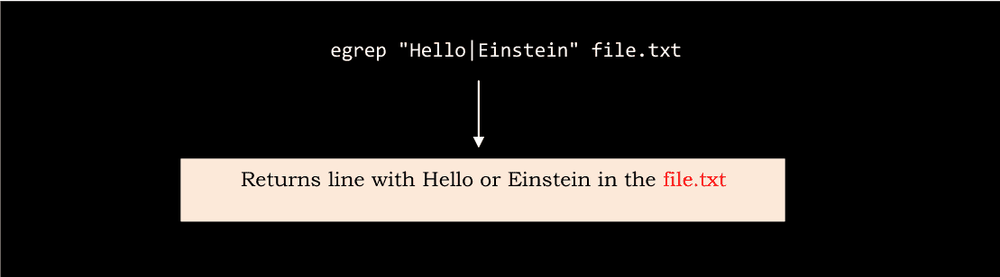


## 命令

```bash
cd ../../..
```

## 描述

返回三个文件夹

## 命令

```bash
ps -ef | grep xlogo
```

## 描述

列出系统中所有包含字符串 'xlogo' 的进程

## 命令

```bash
echo -n "abc";echo "def"
```

## 输出

```
abcdef
```

## 命令

```bash
echo "abc";echo "def"
```

## 输出

```
abc
def
```

## 命令

```bash
ls -ltr /etc
```

## 描述

按最后修改时间列出 `/etc` 中的文件

## 命令

```bash
ls -R1h /var | grep [0-9]M
```

## 描述

列出 `/var` 中大于 1MB 且小于 1GB 的文件

## 命令

```bash
ls -1hS
```

## 描述

按大小列出文件

## 命令

```bash
cat /etc/passwd /etc/group
```

## 描述

显示多个文件 (`/etc/passwd` 和 `/etc/group`) 的内容

## 命令

```bash
find /tmp -name *.txt -exec rm -f {} \;
```

## 描述

查找 `/tmp` 目录下所有名为 `*.txt` 的文件并删除它们

## 命令

```bash
echo "use" "of" "Linux"
```


## 命令

```bash
watch -n 5 tail -n 3 /etc/passwd
```

## 描述

每 5 秒显示一次 `/etc/passwd` 文件的末尾

## 命令

```bash
watch -n 1 'ls | wc -l'
```

## 描述

监控文件夹中的文件数量

## 命令

```bash
watch -t -n 1 date
```

## 描述

显示时钟

## 命令

```bash
find -name "*.txt"
```

## 描述

查找所有 `.txt` 扩展的文件

## 命令

```bash
find -name "*file*"
```

## 描述

查找文件名包含 "file" 的文件

## 命令

```bash
find /home -name "*file*"
```

## 描述

查找 `/home` 中所有文件名包含 "file" 的文件

## 命令

```bash
grep -nre "hello computer" ./*
```

## 描述

在当前目录下搜索包含字符串 "hello computer" 的文件

## 命令

```bash
(echo In Linux; exit 0) && echo OK || echo exit
```

## 输出

```
OK
```

## 命令

```bash
(echo In Linux; exit 4) && echo OK || echo exit
```

## 输出

```
exit
```

## 命令

```bash
free -t -m
```

## 描述

以 MB 为单位显示空内存大小

## 命令

```bash
gnome-system-monitor
```

## 描述

显示正在运行的程序以及使用了多少处理器时间、内存和磁盘空间

## 命令

```bash
lsblk -m
```

## 描述

显示设备权限和所有者

## 命令

```bash
lsblk -S
```

## 描述

显示 SCSI（小型计算机系统接口）设备

## 命令

```bash
lsblk -n
```

## 描述

不带表头列出设备

## 命令

```bash
ls -l ~
```

## 描述

检查文件和文件夹权限

## 命令

```bash
ls ./Documents
```

## 描述

显示位于 `Documents` 文件夹中的文件列表

## 命令

```bash
ls -R
```

## 描述

列出所有子目录的内容

## 命令

```bash
compgen -c
```

## 描述

显示可以在命令行界面中使用的所有命令列表

## 命令

- `pwd -L` → 打印符号路径
- `pwd -P` → 打印实际完整路径

## 命令

```bash
hostnamectl
```

## 描述

显示系统信息，包括操作系统、内核和发布版本

## 命令

```bash
find . -type f
```

## 描述

查找文件

## 命令

```bash
find . -type d
```

## 描述

查找目录

## 命令

```bash
find . -iname "*.jpg"
```

## 描述

按不区分大小写的扩展名查找文件（例如：`.jpg`, `.JPG`, `.JpG`）

## 命令

```bash
find . -type f -perm 777
```

## 描述

按八进制权限查找文件

## 命令

```bash
cd logs; ls -lt | head; -sh ; df -h
```

## 描述

使用 `;` 运算符将上述所有任务合并在一行执行

## 命令

```bash
{ echo "Albert Einstein"; pwd; uptime; date; }
```

## 输出

```
Albert Einstein
/home/manju
00:26:53 up 28 min, 2 users, load average: 0.00, 0.01, 0.05
Tue Mar 29 00:26:53 PDT 2022
```

## 命令

```bash
cal; { date; uptime; };
```

## 输出

```
March 2022
Su Mo Tu We Fr Sa
     1 2 3 4 5
6 7 8 9 10 11 12
13 14 15 16 17 18 19
20 21 22 23 24 25 26
27 28 29 30 31
Tue Mar 29 00:52:38 PDT 2022
00:52:38 up 54 min, 2 users, load average: 0.00, 0.01, 0.05
/home/manju
```

## 命令

```bash
shutdown -r
# 启动重启
shutdown +0
# 立即关闭系统
shutdown -r +5
# 在五分钟后开始重启系统
```

## 命令

```bash
kill 12838
```

## 描述

终止进程 ID 为 12838 的进程

## 命令

```bash
ss -t -r state established
```

## 描述

列出所有已建立的端口

## 命令

```bash
shutdown -Fr now
```

## 描述

在重启期间强制进行文件系统检查

## 命令

```bash
ss -t -r state listening
```

## 描述

列出所有监听状态的套接字

## 命令

```bash
mtr google.com
```

## 描述

诊断网络问题

## 命令

```bash
sudo tcpdump --list-interfaces
```

## 描述

列出所有网络接口

## 命令

```bash
ls -al --time-style=+%D | grep `date +%D`
```

## 命令

```bash
mpstat -P 0
```

## 描述

打印处理器统计并帮助监控系统 CPU 利用率

## 命令

```bash
chmod 777 myfiles.txt
```

## 描述

为所有人分配（读、写和执行）权限

## 命令

```bash
chmod 766 myfiles.txt
```

## 描述

为所有者分配全权限，并为组和其他用户分配读写权限

## 命令

```bash
chmod -x myfiles.txt
```

## 描述

移除 `myfiles.txt` 文件的执行权限

## 命令

```bash
history 30
```

## 描述

列出在系统中输入的最后 30 条命令

## 命令

```bash
find ~ -empty
```

## 描述

查找主目录下的所有空文件

## 命令

```bash
gzip -1 *.gz
```

## 描述

显示压缩文件的压缩率

## 命令

```bash
ps -efH | more
```

## 描述

以树形结构查看当前正在运行的进程

## 命令对照表

| 命令 | 描述 |
| --- | --- |
| `df -T` | 显示文件系统的类型 |

## 命令

```bash
mkdir ~/temp
```

## 描述

在主目录下创建一个名为 `temp` 的目录

## 命令

```bash
ls *py
```

## 描述

列出所有 Python 文件

## 命令

```bash
chsh -l
```

## 描述

显示所有 shell 列表

## 命令

```bash
ipcs -a
```

## 描述

显示关于消息队列、信号量和共享内存的详情

## 命令

```bash
ipcs -q
```

## 描述

列出当前进程具有读取权限的消息队列

## 命令

```bash
ipcs -s
```

## 描述

列出可访问的信号量

## 命令

```bash
ipcs -m
```

## 描述

列出所有共享内存

## 命令

```bash
quotastats
```

## 描述

显示从内核收集的配额系统统计报告

## 命令

```bash
rpcinfo
```

## 描述

显示本地主机所有的 RPC（远程过程调用）服务

## 命令

```bash
slabtop
```

## 描述

实时显示内核 slab 缓存信息

## 命令

```bash
tload
```

## 描述

向指定的 tty 显示当前系统负载平均值的图形

## 命令

```bash
cat /proc/devices
```

## 描述

显示为当前运行内核配置的设备驱动程序

## 命令

```bash
cat /proc/dma
```

## 描述

显示当前使用的 DMA 通道

## 命令

```bash
cat /proc/filesystems
```

## 描述

显示配置到内核中的文件系统

## 命令

```bash
cat /proc/kmsg
```

## 描述

显示内核生成的消息

## 命令

```bash
cat /proc/loadavg
```

## 描述

显示系统平均负载

## 命令

```bash
cat /proc/net
```

## 描述

列出网络协议

## 命令

```bash
cat /etc/udev
```

## 描述

列出 `udev` 目录的内容

## 命令

```bash
cat /proc/stat
```

## 描述

显示系统统计信息

## 命令

```bash
cat /proc/uptime
```

## 描述

显示系统运行时间

## 命令

```bash
poweroff -i -f
```

## 描述

关闭系统

## 命令

```bash
type echo
```

## 描述

`echo` 是一个内置命令

## 命令

```bash
find /usr -print
```

## 描述

查找并打印 "/usr" 下的所有文件

## 命令

```bash
systemctl list-units --type=target
```

## 描述

列出所有 target

## 命令

```bash
systemctl list-units --type=service
```

## 描述

列出所有 service

## 命令

```bash
systemctl list-sockets
```

## 描述

列出所有 socket

## 命令

```bash
systemctl list-timers
```

## 描述

列出所有 timer

## 命令

```bash
systemctl list-units --type=mount
```

## 描述

列出所有 mount

## 命令

```bash
systemctl list-units --type=device
```

## 描述

列出所有 device

## 命令

```bash
systemctl list-units --type=path
```

## 描述

列出所有 path

## 命令

```bash
systemctl list-units --type=socket
```

## 描述

列出所有 socket

## 命令

```bash
systemctl list-units --type=timer
```

## 描述

列出所有 timer

## 命令

```bash
systemctl list-units --type=service
```

## 描述

列出所有 service

## 命令

```bash
systemctl list-units --type=target
```

## 描述

列出所有 target

## 命令

```bash
systemctl list-units --type=mount
```

## 描述

列出所有 mount

## 命令

```bash
systemctl list-units --type=device
```

## 描述

列出所有 device

## 命令

```bash
systemctl list-units --type=path
```

## 描述

列出所有 path


## 命令

```
free -t -m
```

以 MB 为单位显示空内存大小。

## 命令

```
gnome-system-monitor
```

显示正在运行的程序以及使用了多少处理器时间、内存和磁盘空间。

```
lsblk -m
```

显示设备权限和所有者。

```
lsblk -S
```

显示 SCSI（小型计算机系统接口）设备。

- `lsblk -n`：不带表头列出设备。

## 命令

```
ls -l ~
```

检查文件和文件夹权限。

## 命令

```
ls ./Documents
```

显示位于 `Documents` 文件夹中的文件列表。

```
ls -R
```

列出所有子目录的内容。

```
compgen -c
```

显示可以在命令行界面中使用的所有命令列表。

- `pwd -L`：打印符号路径。
- `pwd -P`：打印实际完整路径。

```
hostnamectl
```

显示系统信息，包括操作系统、内核和发布版本。

## 命令

```
find . -type f
```

查找文件。

## 命令

```
find . -type d
```

查找目录。

```
find . -iname "*.jpg"
```

按不区分大小写的扩展名查找文件（例如：`.jpg`、`.JPG`、`.JpG`）。

```
find . -type f -perm 777
```

按八进制权限查找文件。

```
cd logs; ls -lt | head; -sh ; df -h
```

使用 `;` 运算符将上述所有任务合并在一行执行。


```
{ echo "Albert Einstein"; pwd; uptime; date; }
```

Albert Einstein

/home/manju

00:26:53 up 28 min, 2 users, load average: 0.00, 0.01, 0.05

Tue Mar 29 00:26:53 PDT 2022

```
cal; { date; uptime; };
```

March 2022

Su Mo Tu We Fr Sa

     1 2 3 4 5

6 7 8 9 10 11 12

13 14 15 16 17 18 19

20 21 22 23 24 25 26

27 28 29 30 31

Tue Mar 29 00:52:38 PDT 2022

00:52:38 up 54 min, 2 users, load average: 0.00, 0.01, 0.05

/home/manju

### 系统关机与重启

```
shutdown -r
```

启动重启

```
shutdown +0
```

立即关闭系统

```
shutdown -r +5
```

在五分钟后开始重启系统

### 进程管理

```
kill 12838
```

终止进程 ID 为 `12838` 的进程

### 网络诊断

#### 查看已建立连接的端口

```
ss -t -r state established
```

列出所有已建立（established）的端口

#### 强制文件系统检查并重启

```
shutdown -Fr now
```

在重启期间强制进行文件系统检查

#### 查看监听状态的套接字

```
ss -t -r state listening
```

列出所有监听状态的套接字

#### 网络路由诊断

```
mtr google.com
```

诊断网络问题

#### 列出网络接口

```
sudo tcpdump --list-interfaces
```

列出所有网络接口

#### 按日期查找文件

```
ls -al --time-style=+%D | grep `date +%D`
```

#### CPU 统计监控

```
mpstat -P 0
```

打印处理器统计并帮助监控系统 CPU 利用率

### 文件权限管理

```
chmod 777 myfiles.txt
```

为所有人分配（读、写和执行）权限

```
chmod 766 myfiles.txt
```

为所有者分配全权限，并为组和其他用户分配读写权限

```
chmod -x myfiles.txt
```

移除 `myfiles.txt` 文件的执行权限

### 历史命令与查找

```
history 30
```

列出在系统中输入的最后 30 条命令

```
find ~ -empty
```

查找主目录下的所有空文件

### 压缩与进程查看

```
gzip -1 *.gz
```

显示压缩文件的压缩率

```
ps -efH | more
```

以树形结构查看当前正在运行的进程

### 文件系统与目录操作

| 命令 | 描述 |
| --- | --- |
| `df -T` | 显示文件系统的类型 |

```
mkdir ~/temp
```

在主目录下创建一个名为 `temp` 的目录

```
ls *py
```

列出所有 Python 文件

### Shell 与 IPC 设施

```
chsh -l
```

显示所有 shell 列表

```
ipcs -a
```

显示关于消息队列、信号量和共享内存的详情

```
ipcs -q
```

列出当前进程具有读取权限的消息队列

```
ipcs -s
```

列出可访问的信号量

```
ipcs -m
```

列出所有共享内存

```
quotastats
```

显示从内核收集的配额系统统计报告

```
rpcinfo
```

显示本地主机所有的 RPC（远程过程调用）服务

### 系统监控与内核信息

```
slabtop
```

实时显示内核 slab 缓存信息

```
tload
```

向指定的 tty 显示当前系统负载平均值的图形

```
cat /proc/devices
```

显示为当前运行内核配置的设备驱动程序

```
cat /proc/dma
```

显示当前使用的 DMA 通道

```
cat /proc/filesystems
```

显示配置到内核中的文件系统

```
cat /proc/kmsg
```

显示内核生成的消息

```
cat /proc/loadavg
```

显示系统平均负载

```
cat /proc/net
```

列出网络协议

```
cat /etc/udev
```

列出 udev 目录的内容

```
cat /proc/stat
```

显示系统统计信息

```
cat /proc/uptime
```

显示系统运行时间

### 电源管理

```
poweroff -i -f
```

关闭系统

### 命令类型与查找

```
type echo
```

`echo` 是一个内置命令

```
find /usr -print
```

查找并打印 `/usr` 下的所有文件

### Systemd 单元管理

```
systemctl list-units --type=target
```

列出所有 target

```
systemctl list-units --type=service
```

列出所有 service

```
systemctl list-sockets
```

列出所有 socket

### Bash 扩展与变量示例

```bash
echo *s
# 打印所有以字母 "s" 结尾的文件和文件夹

echo [[upper:]]*
# 打印所有以大写字母开头的文件和文件夹

echo $((2 + 3))
# -> 5

echo $((2**2)) * 3)
# -> 12

echo Four divided by two equals $(4/2)
# -> 四 除以 2 等于 2

echo Capital-{A,B,C}-Letter
# -> Capital-A-Letter Capital-B-Letter Capital-C-Letter

echo {1..5}
# -> 1 2 3 4 5

echo {A..Z}
# -> A B C D E F G H I J K L M N O P Q R S T U W X Y Z

echo x{P(1,2),Q{3,4}}
# -> xP1y xP2y xQ3y xQy
```

```
echo The total price is $500.00
# -> The total price is 500.00

echo "$USER $((3*2)) $(cal)"
```

```bash
echo -e "\aMy Laptop shut \"down\""
# -> My Laptop shut "down"

echo -e "C:\WIK2N\\LINUX_OS.EXE"
# -> C:\WIK2N\\LINUX_OS.EXE
```

### 日历输出示例

manju 6    March 2022
Su Mo Tu We Th Fr Sa

+   1 2 3 4 5
6 7 8 9 10 11 12
13 14 15 16 17 18 19
20 21 22 23 24 25 26
27 28 29 30 31

```
March 2022 Su Mo Tu We Th Fr Sa 1 2 3 4 5 6 7 8 9 10 11 12 13 14
16 17 18 19 20 21 22 23 24 25 26 27 28 29 30 31
```

```
echo "$(cal)"
```

March 2022

Su Mo Tu We Th Fr Sa

1 2 3 4 5

6 7 8 9 10 11 12

13 14 15 16 17 18 19

20 21 22 23 24 25 26

27 28 29 30 31

```
echo The total price is \$500.00
# ->The total price is \$500.00
```

### 端口检查命令

```bash
sudo lsof -i -P -n | grep LISTEN
```

```bash
sudo netstat -tulpn | grep LISTEN
```

# 检查正在使用的端口

```bash
sudo ss -tulw
```

# 检查哪些端口已开启

```bash
netstat -ap | grep ssh
```

# 查找程序运行在哪个端口

```bash
[root@localhost manju]# ipcs -m -l
------ Shared Memory Limits -------
max number of segments = 4096
max seg size (kbytes) = 18014398509465599
max total shared memory (kbytes) = 18014398442373116
min seg size (bytes) = 1
```

> 列出进程间通信机制的限制

```bash
[root@localhost manju]# ipcs -m -p
------ Shared Memory Creator/Last-op PIDs ------
```

| shmid | owner | cpid | lpid |
|---|---|---|---|
| 131072 | manju | 2998 | 3135 |
| 163841 | manju | 2998 | 3135 |
| 327682 | manju | 3277 | 6920 |
| 360451 | manju | 2827 | 1406 |

> 显示最近访问进程间通信机制的进程 ID

```bash
[root@localhost manju]# ipcs -u
----- Messages Status -----
allocated queues = 0
used headers = 0
used space = 0 bytes
----- Shared Memory Status -----
segments allocated 4
pages allocated 2432
pages resident 319
pages swapped 0
Swap performance: 0 attempts 0 successes
----- Semaphore Status -----
used arrays = 0
allocated semaphores = 0
```

显示进程间通信机制的当前使用状态

### 硬件信息查看

```
dmidecode -t 16
```

显示系统支持的最大 RAM

```
dmidecode -t baseboard
```

显示所有系统主板相关信息

```
dmidecode -t bios
```

显示 BIOS 信息

# 命令：

```
dmidecode -t system
```

# 描述：

显示有关系统制造商、型号和序列号的信息


> Linux 哲学是“面对困难大笑”

### 表达式求值

```bash
expr 2 = 5
# 0
# 返回 0 (假)
```

### 历史命令操作

```
fc -1
# 列出命令历史

!l
# 执行最近一次以字母 "l" 开头的执行命令

fc -e -1
# 执行最近一次以字母 "l" 开头的执行命令
```

### 文本格式化与用户信息

```
fmt myfiles.txt
# 显示文件 "myfiles.txt" 的重新格式化版本

fmt < myfiles.txt > myfiles0.txt
# 重新格式 "myfiles.txt" 并将输出写入文件 "myfiles0.txt"

finger -p manju
# 显示用户 "manju" 的信息

fold -w5 myfiles.txt > myfiles0.txt
# 将 myfiles.txt 的行折叠为 5 个字符宽度，并将输出写入 myfiles0.txt
```

### 循环与搜索

```
for file in *.txt ; do wc -l $file ; done
# 对当前目录下所有 .txt 结尾的文件进行字数统计

grep manju /etc/passwd
# 在 /etc/passwd 中搜索用户 "manju"
```

### 组管理与文件查看

```
groupmod -n group mygroup
# 将组 "mygroup" 修改为 "group"

head myfiles.txt
# 显示 "myfiles.txt" 的前 10 行

head -15 myfiles.txt
# 显示 "myfiles.txt" 的前 15 行

head myfiles.txt myfiles0.txt
# 显示 myfiles.txt 和 myfiles0.txt 的前 10 行 - 在每个文件前有一个指示文件名的头

head -n 5K myfiles.txt
# 显示 "myfiles.txt" 的前 5000 行

head -n 4 *.txt
# 显示工作目录下所有以 .txt 结尾的文件的前 4 行
```

### I/O 统计与登录记录

```
iostat
# 显示操作系统存储的输入和输出统计数据

last reboot | less
# 显示最后登录用户列表以及系统最后重启的时间和日期

last -x | less
# 显示上次关机日期和时间

last shutdown
# 显示上次关机日期和时间
```

### 依赖库与分页查看

```
ldd /bin/bash
# 显示程序 /bin/bash 的共享库依赖项

less -N myfiles.txt
# 查看文件 myfiles.txt - 在每行开头显示行号
```

### 文件列表与打开文件查看

```
ls *.html,.php,.txt
# 列出所有 .html, .php 和 .txt 扩展的文件

ls /
# 列出根目录的内容

ls [aeiou]*
# 只列出以元音 (a, e, i, o 和 u)开头的文件

lsof -i -U
# 列出所有打开的网络、x.25 (HP-UX) 和 UNIX 域文件

lsof -i 4 -ap 555
# 列出进程 ID 为 555 的进程使用的所有打开 IPv4 网络文件
```

| 命令 | 描述 |
|---|---|
| `lsof -i 6` | 只列出打开的 IPv6 网络文件 |

### 压缩与目录创建

```
xz myfiles.txt
# 将文件 "myfiles.txt" 压缩为 "myfiles.txt.xz"

z -dk myfiles.txt.xz
# 将 "myfiles.txt.xz" 解压为 "myfiles.txt"

mkdir -m a=rwx dir
# 创建目录 "dir" 并设置文件模式，允许所有用户读、写、执行
```

### 模块信息与分页

```
modinfo snd
# 显示关于 "snd" Linux 内核模块的所有可用信息

more +3 myfiles.txt
# 从第 3 行开始显示文件 "myfiles.txt" 的内容

more +"Hello" myfiles.txt
# 从包含字符串 "Hello" 的第一行开始显示文件 myfiles.txt 的内容
```

### 网络统计

```
netstat -g
# 显示 IPv4 和 IPv6 的多播组成员信息

netstat -c
# 每隔几秒打印一次 netstat 信息

netstat -natp
# 显示活跃 Internet 连接的统计信息

netstat -rn
# 显示绑定到服务器的所有 IP 地址的路由表

netstat -an
# 显示所有到服务器活跃连接的信息
```

### 文件内容转储与信号处理

```
od -b myfiles.txt
# 以八进制格式显示 "myfiles.txt" 的内容

od -Ax -c myfiles.txt
# 以 ASCII 字符格式显示 myfiles.txt 的内容 - 字节偏移以十六进制显示

trap -l
# 显示信号名称及其对应数字的列表

trap
# 显示当前设置的信号陷阱列表
```

### 包管理

```
yum list openssh
# 搜索名为 "OpenSSH" 的包

yum grouplist
# 列出所有可用组包

yum repolist
# 列出所有启用的 Yum 仓库

yum repolist all
# 列出所有已启用和禁用的 Yum 仓库
```

### 文件合并与打印格式化

```
paste 1.txt 2.txt
# 并排显示 1.txt 和 2.txt 的内容

ls -a | pr -n -h "Files in $(pwd)" > dc.txt
cat dc.txt
```

| 2022-04-02 01:10 | Files in /home/manju | Page 1 |
|---|---|---|
| 1 | -- | |
| 2 | -- | |
| 3 | 1.txt | |
| 4 | 2.txt | |
| 5 | .bash_history | |
| 6 | .bash_logout | |
| 7 | .bash_profile | |
| 8 | .bashrc | |
| 9 | bio.txt | |
| 10 | .cache | |
| 11 | .config | |
| 12 | Data.txt | |
| 13 | Desktop | |
| 14 | dir | |
| 15 | Documents | |

### 格式化输出

```bash
printf "Hi, I'm %s.\n" $HOSTNAME
# -> Hi, I'm manju.

printf "%.s" "abcdef"
# -> abcdef
```

### 进程查看

```bash
ps -ef
# 获取线程信息
```

```bash
ps ax
# 获取线程信息
```

- `ps -eo user,r,f,comm`
- `ps axZ`


| 命令 | 描述 |
|---|---|
| `pstree -h` | 以树形结构显示所有进程，包含当前进程及其祖先 |

### 文件删除与路由

| 命令 | 描述 |
|---|---|
| `rm -- 1.txt` | `rm ./1.txt` |
| 删除当前目录下的 "1.txt" 文件 | |
| `rm /home/manju/2.txt` | |

```
route -n
# 显示绑定到服务器的所有 IP 地址的路由表

route -a
```


# 显示路由表

```bash
grep manju /etc/passwd
```
# 在 `/etc/passwd` 中搜索用户 "manju"

```bash
groupmod -n group mygroup
```
# 将组 "mygroup" 修改为 "group"

```bash
head myfiles.txt
```
# 显示 "myfiles.txt" 的前 10 行

```bash
head -15 myfiles.txt
```
# 显示 "myfiles.txt" 的前 15 行

```bash
head myfiles.txt myfiles0.txt
```
# 显示 `myfiles.txt` 和 `myfiles0.txt` 的前 10 行 - 在每个文件前有一个指示文件名的头

```bash
head -n 5K myfiles.txt
```
# 显示 "myfiles.txt" 的前 5000 行

```bash
head -n 4 *.txt
```
# 显示工作目录下所有以 `.txt` 结尾的文件的前 4 行

```bash
iostat
```
# 显示操作系统存储的输入和输出统计数据

```bash
last reboot | less
```
# 显示最后登录用户列表以及系统最后重启的时间和日期

```bash
last -x | less
```
# 显示上次关机日期和时间

```bash
last shutdown
```
# 显示上次关机日期和时间

```bash
ldd /bin/bash
```
# 显示程序 `/bin/bash` 的共享库依赖项

```bash
less -N myfiles.txt
```
# 查看文件 `myfiles.txt` - 在每行开头显示行号

```bash
ls *.html,.php,.txt
```
# 列出所有 `.html`, `.php` 和 `.txt` 扩展的文件

```bash
ls /
```
# 列出根目录的内容

```bash
ls [aeiou]*
```
# 只列出以元音 (a, e, i, o 和 u) 开头的文件

```bash
lsof -i -U
```
# 列出所有打开的网络、x.25 (HP-UX) 和 UNIX 域文件

```bash
lsof -i 4 -ap 555
```
# 列出进程 ID 为 555 的进程使用的所有打开 IPv4 网络文件

```bash
lsof -i 6
```
# 只列出打开的 IPv6 网络文件

```bash
xz myfiles.txt
```
# 将文件 "myfiles.txt" 压缩为 "myfiles.txt.xz"

```bash
z -dk myfiles.txt.xz
```
# 将 "myfiles.txt.xz" 解压为 "myfiles.txt"

```bash
mkdir -m a=rwx dir
```
# 创建目录 "dir" 并设置文件模式，允许所有用户读、写、执行

```bash
modinfo snd
```
# 显示关于 "snd" Linux 内核模块的所有可用信息

```bash
more +3 myfiles.txt
```
# 从第 3 行开始显示文件 "myfiles.txt" 的内容

```bash
more +"Hello" myfiles.txt
```
# 从包含字符串 "Hello" 的第一行开始显示文件 `myfiles.txt` 的内容

```bash
netstat -g
```
# 显示 IPv4 和 IPv6 的多播组成员信息

```bash
netstat -c
```
# 每隔几秒打印一次 `netstat` 信息

```bash
netstat -natp
```
# 显示活跃 Internet 连接的统计信息

```bash
netstat -rn
```
# 显示绑定到服务器的所有 IP 地址的路由表

```bash
netstat -an
```
# 显示所有到服务器活跃连接的信息

```bash
od -b myfiles.txt
```
# 以八进制格式显示 "myfiles.txt" 的内容

```bash
od -Ax -c myfiles.txt
```
# 以 ASCII 字符格式显示 `myfiles.txt` 的内容 - 字节偏移以十六进制显示

```bash
trap -l
```
# 显示信号名称及其对应数字的列表

```bash
trap
```
# 显示当前设置的信号陷阱列表

```bash
yum list openssh
```
# 搜索名为 "OpenSSH" 的包

```bash
yum grouplist
```
# 列出所有可用组包

```bash
yum repolist
```
# 列出所有启用的 Yum 仓库

```bash
yum repolist all
```
# 列出所有已启用和禁用的 Yum 仓库

```bash
paste 1.txt 2.txt
```
# 并排显示 `1.txt` 和 `2.txt` 的内容

```bash
ls -a | pr -n -h "Files in $(pwd)" > dc.txt
cat dc.txt
```

| 2022-04-02 01:10 | Files in /home/manju | Page 1 |
|---|---|---|
| 1 | -- | |
| 2 | -- | |
| 3 | 1.txt | |
| 4 | 2.txt | |
| 5 | .bash_history | |
| 6 | .bash_logout | |
| 7 | .bash_profile | |
| 8 | .bashrc | |
| 9 | bio.txt | |
| 10 | .cache | |
| 11 | .config | |
| 12 | Data.txt | |
| 13 | Desktop | |
| 14 | dir | |
| 15 | Documents | |

```bash
printf "Hi, I'm %s.\n" $HOSTNAME
# -> Hi, I'm manju.

printf "%.s" "abcdef"
# -> abcdef
```

```bash
ps -ef
```
# 获取线程信息

```bash
ps ax
```
# 获取线程信息

- `ps -eo user,r,f,comm`
- `ps axZ`


| 命令 | 描述 |
|---|---|
| `pstree -h` | 以树形结构显示所有进程，包含当前进程及其祖先 |
| `rm -- 1.txt` / `rm ./1.txt` | 删除当前目录下的 "1.txt" 文件 |
| `rm /home/manju/2.txt` | |

```bash
route -n
# 显示绑定到服务器的所有 IP 地址的路由表

route -a
# 显示路由表

grep manju /etc/passwd
# 在 /etc/passwd 中搜索用户 "manju"

groupmod -n group mygroup
# 将组 "mygroup" 修改为 "group"

head myfiles.txt
# 显示 "myfiles.txt" 的前 10 行

head -15 myfiles.txt
# 显示 "myfiles.txt" 的前 15 行

head myfiles.txt myfiles0.txt
# 显示 myfiles.txt 和 myfiles0.txt 的前 10 行 - 在每个文件前有一个指示文件名的头

head -n 5K myfiles.txt
# 显示 "myfiles.txt" 的前 5000 行

head -n 4 *.txt
# 显示工作目录下所有以 .txt 结尾的文件的前 4 行
```

# 什么是 Linux，以及它为何如此受欢迎？

无论你是否意识到，你每天都在使用 Linux（最著名的、最广泛使用的开源操作系统）。从超级计算机到智能手机，Linux 随处可见。

每台台式电脑都需要操作系统。目前最流行的操作系统是：Windows、Mac OS 和 LINUX。Linux 是最著名的极其可靠且安全的开源移植操作系统——非常类似于 UNIX——它是 20 世纪 90 年代初由芬赫兰基大学的计算机科学学生 Linus Torvalds 作为一项消遣之作创建的，随后由全球数千人共同开发。

Linux 是快速且易于使用的，它位于计算机上所有软件之下——运行你的计算机——处理你与硬件之间的所有交互。也就是说，无论你是在写信、计算财务预算，还是在电脑上管理食谱，Linux 操作系统（类似于 Windows XP、Windows 7、Windows 8 和 Mac OS X）为你的电脑提供了必要的空气。

Linux 是 21 世纪最重要的技术进展，并根据通用公共许可证 (GPL) 授权，该许可确保软件始终对所有人开放，且其源代码开放并供任何用户检查，这使得发现和修复漏洞变得更加容易，它驱动着笔记本电脑、开发机以及 Google、Facebook、Twitter、NASA 和纽约证券交易所的服务器，这仅仅是其中一角。Linux 还有许多令用户惊叹的功能，例如：Live CD/USB、图形用户界面（X Window System）等。

## 为什么选择 LINUX？

尽管 Microsoft Windows（最可能是病毒和恶意软件的受害者）近年来在可靠性方面取得了巨大改进，但它被认为可靠性低于 Linux。Linux 以可靠和安全著称，并且免受病毒和恶意软件的持续斗争（这些病毒可能会通过损坏文件、导致运行缓慢、崩溃、昂昂的维修以及接管操作系统的基本功能来影响你的桌面电脑、笔记本电脑和服务器），而且它让你免于许可费用，即零成本入门……免费。你可以在任何计算机生态系统中安装 Linux，而无需为软件或服务器许可支付一分钱。而 Microsoft Windows 的每个授权副本费用通常在 99.00 到 199.00 美元之间，并且还要担心丢失数据的风险。

以下是目前 Linux 应用的一些示例：

- Android 手机和平板电脑
- 服务器
- 电视、相机、DVD 播放器等
- 亚马逊 (Amazon)
- 谷歌 (Google)
- 美国邮政局
- 纽约证券交易所


Linux 操作系统主要包含三个组件：

### 内核 (Kernel)

内核是 Linux 操作系统的核心部分，直接与硬件交互。它负责 Linux 操作系统的所有主要活动。

### 系统库 (System Library)

系统库是特殊的程序，应用程序通过它们来访问内核的功能。

### 系统工具 (System Utility)

系统工具程序负责执行特定的任务。

## Linux 操作系统的重要特性：

- 可移植性
- 开源
- 多用户
- 多程序并发
- 分级文件系统
- 安全性


现在 Linux（已被全球数百万用户成功使用）已经发展到了一个新的阶段，它几乎不再是一个学术系统，仅对少数具有技术背景的人有用。它提供的不仅仅是操作系统：还有一整套基础设施来支持创建操作系统、为其制作和测试程序、将一切交付给用户、提供维护、更新和支持以及定制，运行在包括 Intel 和 Alpha 平台在不同的平台上。今天，Linux 已经准备好迎接瞬息变化世界的挑战，执行各种类型的操作、调用应用程序等。由于招聘重点越来越多地向 DevOps 类技能转移，Linux 技能储备将成为使你极具部署竞争力的优势。

```bash
[manju@localhost ~]$ echo al{an,bert,alexander}
alan albert alexander
[manju@localhost ~]$ mkdir {txt,doc,pdf}
[manju@localhost ~]$ ls
txtfiles docfiles pdfffiles
```

```bash
[manju@localhost ~]$ x=Albert; y="$x win \$100.00"; echo $y
Albert won $100.00
[manju@localhost ~]$ x=5; test $x -eq 10; echo $?
exit status of the test command is 1
[manju@localhost ~]$ x=5; test $x -eq 5; echo $?
exit status of the test command is 0
```

```bash
cat /etc/profile
# 显示系统登录初始化文件
cat /etc/bashrc
# 显示系统 BASH shell 配置文件
cat .bash_profile
# 显示登录初始化文件
```

```bash
[manju@localhost ~]$ date
Wed Sep 28 08:14:17 PDT 2022

[manju@localhost ~]$ alias x=date

[manju@localhost ~]$ x
Wed Sep 28 08:14:27 PDT 2022

[manju@localhost ~]$ echo $BASH_VERSION
4.2.46(1)-release Display the current BASH version number
[manju@localhost ~]$ echo $HISTCMD
290 Display the number of the command in the history list
[manju@localhost ~]$ echo $HOSTTYPE
x86_64 Display the type of machine the host runs on
[manju@localhost ~]$ echo $OSTYPE
linux-gnu Display the operating system in use
[manju@localhost ~]$ echo $PPID
3563 Display the process ID for shell's parent shell
[manju@localhost ~]$ echo $SHLVL
2 Display the current shell level
[manju@localhost ~]$ echo $TERM
xterm-256color Display the terminal type
[manju@localhost ~]$ echo $EUID
1000 Display the Effective user ID
```

```bash
[manju@localhost ~]$ PS1="\d"
Sun Oct 02 # Display the Current date
[manju@localhost ~]$ PS1="\h"
localhost # Display the Hostname
[manju@localhost ~]$ PS1="\s"
bash # Display the Shell type currently active
[manju@localhost ~]$ PS1="\t"
18:42:10 # Display the Time of day in hours
```

```bash
watch -t -n 1 date
# 显示日期

[manju@localhost ~]$ echo "Albert" > 1.txt && cat 1.txt
Albert
```

```bash
du -sh * --time
# 检查每个文件的大小以及最后修改的时间

dmidecode -s system-serial-number
# 显示 Linux 服务器的序列号
```

```bash
ls -aril
# 按序列号显示所有文件

yum search mod_
# 显示所有模块
```

```bash
du -sch *
# 显示当前目录下所有文件和文件夹的大小总和

dmidecode | grep -A3 '^System Information'
# 显示服务器硬件名称和型号

dmesg | grep -i firmware
# 显示所有固件错误
```

```bash
cat /proc/cpuinfo | grep processor | wc -l
# 显示核心数

netstat -ap | grep 80
# 显示正在使用 80 端口的进程 ID (PID)
```

```bash
dmidecode --type memory
# 显示连接到服务器的物理内存

dirs
# 显示当前记忆的目录列表
```

```bash
blkid -i /dev/sda
# 显示可用块设备的信息
```

```bash
[manju@localhost ~]$ df -h /home
Filesystem      Size Avail Use% Mounted on
/dev/sda3       18G  5.2G   13G 29% /
```
> 使用 `df` 命令查找 `/home` 目录下的空闲磁盘空间

```bash
[manju@localhost ~]$ hostname -I 
192.168.6.131 192.168.122.22
# 显示主机所有的本地 IP 地址

badblocks -s /dev/sda
# 检查磁盘 sda 上不可读的块

tail -10 /var/log/messages
# 显示最后 10 条 syslog 消息

lsof -u manju
# 列出用户 "manju" 打开的文件

sudo shutdown -r 2
# 2 分钟后关机并重启机器
```

```bash
[manju@localhost ~]$ cat 1.txt
albert
[manju@localhost ~]$ cat 1.txt | tr a-z A-Z > 2.txt
[manju@localhost ~]$ cat 2.txt
ALBERT

cat /etc/passwd | column -t -s :
# 以列格式显示 "/etc/passwd" 的内容
```


# Linux 命令与 C 语言练习

## Linux 常用命令示例

### 网络接口与文本搜索

```bash
nmcli d
# 显示所有网络接口的状态
```

```bash
grep "[[:alnum:]]" myfiles.txt
# 在 "myfiles.txt" 中搜索以字母或数字开头的行
```

```bash
grep "[[:alpha:]]" myfiles.txt
# 在 "myfiles.txt" 中搜索以字母开头的行
```

```bash
grep "[[:blank:]]" myfiles.txt
# 在 "myfiles.txt" 中搜索以空白字符开头的行
```

```bash
grep "[[:digit:]]" myfiles.txt
# 在 "myfiles.txt" 中搜索以数字开头的行
```

```bash
grep "[[:lower:]]" myfiles.txt
# 在 "myfiles.txt" 中搜索以小写字母开头的行
```

```bash
grep "[[:punct:]]" myfiles.txt
# 在 "myfiles.txt" 中搜索以标点符号开头的行
```

```bash
grep "[[:graph:]]" myfiles.txt
# 在 "myfiles.txt" 中搜索以非空白字符开头的行
```

```bash
grep "[[:print:]]" myfiles.txt
# 在 "myfiles.txt" 中搜索以可打印字符开头的行
```

```bash
grep "^[[:space:]]" myfiles.txt
# 在 "myfiles.txt" 中搜索以空格字符开头的行
```

```bash
grep "^[[:upper:]]" myfiles.txt
# 在 "myfiles.txt" 中搜索以大写字母开头的行
```

```bash
grep "^[:xdigit:]]" myfiles.txt
# 在 "myfiles.txt" 中搜索以十六进制数字开头的行
```

### 内存与系统监控

```bash
vmstat -a
# 显示活动和非活动内存

vmstat -s
# 显示内存调度统计信息
```

```bash
vmstat -f
# 显示自启动以来创建的 fork 进程数量
```

```bash
vmstat -D
# 显示磁盘活动的快速摘要

vmstat -d
# 显示每个磁盘的详细统计信息
```

```bash
vmstat 5 -S M
# 该命令每五秒更新一次统计，并将单位更改为兆字节
```

```bash
free -h
# 显示内存使用情况（人类可读格式）
```

### 主机名与日期

`hostname -s` 显示主机的简短版本，等同于 `hostname --short`。

```bash
hostname --all-ipaddresses
# 显示所有 IP 地址
```

```bash
date -r /etc/hosts
# 显示文件的修改时间
```

### 文件操作与重定向

```bash
cat 1.txt
cat 2.txt
# 查看文件内容
```

```bash
sudo shutdown 08:00
# 在早上 8 点关机
```

```bash
grep 'is' myfiles.txt
# 在 myfiles.txt 中搜索单词 "is"
```

```bash
grep 'is|of' myfiles.txt
# 在 myfiles.txt 中搜索单词 "is" 和 "of"
```

```bash
echo "The system will be down." | wall
# 广播给所有当前登录的用户
```

```bash
echo "Albert Einstein"
# 输出字符串
```

### 套接字与网络连接

```bash
ss --all
# 列出所有监听和非监听连接

ss --listen
# 仅列出监听的 socket
```

```bash
ss -t state listening
# 查找所有 TCP 连接
```

```bash
hostname -I | awk '{print $1}'
# 获取第一个 IP 地址
```

### 包管理

```bash
yum erase httpd
# 卸载 apache
```

```bash
rpm -qi httpd
# 显示特定包 (apache) 的信息

sudo rpm -qa | wc -l
# 显示包的总数
```

```bash
sudo repoquery -a --installed
# 使用 repoquery 列出所有已安装的包
```

### 日志查看

```bash
cat /var/log/boot.log
# 显示所有与启动操作的信息

cat /var/log/maillog
# 显示所有与邮件服务器和邮件存档的信息

cat /var/log/yum.log
# 显示 Yum 命令日志
```

### 目录与权限

```bash
mkdir -m777 myfiles
# 创建具有读、写执行权限的目录 "myfiles"
```

```bash
rpm -qa centos-release
# 显示 CentOS 版本
```

### 进程管理

```bash
ps -ALFH
# 获取线程信息 (LWP 和 NLWP)
```

```bash
ps -eM
ps ax
# 获取 Linux 进程的安全信息
```

```bash
ps -auxf | sort -nr -k 4 | head -10
# 显示内存消耗前 10 的进程
```

```bash
ps -auxf | sort -nr -k 3 | head -10
# 显示 CPU 消耗前 10 的进程
```

### 系统活动报告

```bash
sar -n DEV | more
# 监控、收集和报告 Linux 系统活动
```

### 文件创建与追加

```bash
# 创建或覆盖 "1.txt" 文件
echo "Albert Einstein" > 1.txt

# 创建或追加到 "1.txt" 文件
echo "Albert Einstein" >> 1.txt
```

### 高级搜索

```bash
grep -i "is" myfiles.txt
# 在文件 "myfiles.txt" 中搜索特定字符串 "is" (忽略大小写)

grep -A 3 -i "is" myfiles.txt
# 打印匹配的行及其后续三行

grep -r "is" *
# 在所有文件中递归查找特定字符串

export | grep ORACLE
# 显示 oracle 相关的环境变量
```

### 服务与关机

```bash
chkconfig --list | grep network
# 查看 Linux 网络服务的启动配置

shutdown -r 18:30
# 立即关机并在 18:30 重启
```

### 文件查找

```bash
find /home -size +1024 -print
# 查找 /home 中大于 1MB 的文件

find /home -size +1024 -size -4096 -print
# 查找 /home 中大于 1MB 且小于 4MB 的文件
```

```bash
netstat -ain
# 显示内核接口表
```

```bash
sar -n SOCK | more
# 显示网络统计信息
```

```bash
find /home -size +10000k
# 查找 /home 中大于 10000k 的文件
```

```bash
ls -ld /home
# 列出 home 目录本身而非其内容
```

### 权限与所有权修改

```bash
chmod go+=r 1.txt
# 为组和其他用户添加读权限

chown manju 1.txt
# 将文件 "1.txt" 的所有者更改为用户 "manju"
```

### 编号输出

1. Albert
2. Tesla
3. John

```bash
echo -e "Albert\nTesla\nJohn" | nl -s ": " -w 1
# 输出带编号的列表
```

### 交互式对话框

```bash
whiptail --yesno "您确定继续吗?" 10 40
# 使用 whiptail 在命令行上显示一个简单的是/否输入框
```

### 磁盘使用

```bash
du -h -d1
# 仅检查当前目录的文件空间占用
```

### 网络管理

```bash
sudo nmcli networking off
sudo nmcli networking on
# 关闭/开启网络
```

### 文件查找与删除

```bash
find / -user manju
# 查找用户 "manju" 拥有的文件和目录

locate "*.png"
# 查找所有文件名中包含 '.png' 的文件
```

```bash
find . -name '*.txt' -type f -delete
# 在当前目录（包括子目录）中查找所有 .txt 扩展的文件并删除它们
```

```bash
find . -type f -printf "\"%p\"" | xargs chmod 664
# 查找当前目录下的所有文件（包括子文件夹）并分配权限 664

find . -type d -printf "\"%p\"" | xargs chmod 775
# 查找当前目录下的所有目录（包括子文件夹）并分配权限 775
```

```bash
ls -1
# 列出当前目录下的文件
```

### 端口与日期格式化

```bash
sudo netstat -nltp
# 按进程显示所有打开的端口
```

```bash
date +%j
# 将当前日期转换为儒略格式

date -d "2022/03/13" +%j
# 将特定日期转换为儒略格式
```

```bash
date +%Y%m%d
# 以 YYYYMMDD 格式显示当前日期

date +%d\%m\%Y
# 以 DD/MM/YYYY 格式显示当前日期
```

## C 语言练习


**Dennis Ritchie** 被称为“C 底层编程语言之父”，他于 1972 年在贝尔实验室创建了通用的、过程化的、命令式的计算机编程语言“C”，用于与 UNIX 操作系统配合。在扩展到许多不同的操作系统后，它现在位列最流行的编程语言之列。许多其他知名语言，包括最初为了改进 C 而创建的 **C++**，也受到了 C 的强力启发。尽管它也被广泛用于创建应用程序，但它是创建系统软件最常用的编程语言。它是今天最常用的编程语言之一。自 1989 年以来，C 已经被国际标准化组织（ISO）和美国国家标准学会（ANSI）标准化。如果你是新手，不要担心，我们为你准备了练习。在本章中，我们将专注于初级编程问题，帮助你学习 C 并提高编程能力。

许多其他编程语言，包括 **C++**、**Java**、**JavaScript**、**Go**、**C#**、**PHP**、**Python**、**Perl**、**C-shell** 等，都是基于 C 的。

### 问题 1

**问题**：编写一个程序打印 Hello, World!

**解答**：

```c
#include<stdio.h>
int main() {
    int a = 6;
    {
        int a = 2;
        printf("%d\n", a);
    }
    printf("%d\n", a);
}
```

| 输出 |
| :--- |
| 2 |
| 6 |

### 问题 2

**问题**：编写一个程序计算矩形的周长和面积。

**解答**：

```c
#include<stdio.h>
int main() {
    int height = 8;
    int width = 5;
    int perimeter = 2*(height + width);
    printf("Perimeter of the rectangle is: %d cm\n", perimeter);
    int area = height * width;
    printf("Area of the rectangle is: %d square cm\n", area);
    return 0;
}
```

### 问题 3

**问题**：编写一个程序计算圆的周长和面积。

**解答**：

```c
#include<stdio.h>
int main() {
    int radius = 4;
    float perimeter = 2*3.14*radius;
    printf("Perimeter of the circle is: %f cm\n", perimeter);
    float area = 3.14*radius;
    printf("Area of the circle is: %f square cm\n", area);
    return 0;
}
```

### 问题 4

**问题**：编写一个程序接受用户输入的两个数字并计算这两个数字之和。

**解答**：

```c
#include<stdio.h>
int main() {
    int a, b, sum;
    printf("\nenter the first number: ");
    scanf("%d", &a);
    printf("\nenter the second number: ");
    scanf("%d", &b);
    sum = a + b;
    printf("\nSum of the above two numbers is: %d", sum);
    return 0;
}
```

> **注意**：在 C 语言中，变量没有被赋值值，它包含垃圾值。
> ```c
> #include<stdio.h>
> int main() {
>     int a;
>     printf("%d", a);
>     return 0;
> }
> ```

### 问题 5

**问题**：编写一个程序接受用户输入的两个数字并计算这两个数字的乘积。

**解答**：

```c
#include<stdio.h>
int main() {
    int a, b, mult;
    printf("\nenter the first number: ");
    scanf("%d", &a);
    printf("\nenter the second number: ");
    scanf("%d", &b);
    mult = a * b;
    printf("\nProduct of the above two numbers is: %d", mult);
    return 0;
}
```

**函数示例**：

```c
#include<stdio.h>

int Message() {
    printf("Hello, World!");
    return 0;
}

int main() {
    Message();
}
```

| 输出： |
| :--- |
| Hello, World! |

### 问题 6

**问题**：编写一个程序接受三个数字并找到最大的。

**解答**：

```c
#include<stdio.h>
int main() {
    int x, y, z;
    printf("\nenter the first number: ");
    scanf("%d", &x);
    printf("\nEnter the second number: ");
    scanf("%d", &y);
    printf("\nEnter the third number: ");
    scanf("%d", &z);

    // 如果 x 大于 y 和 z，则是最大的
    if (x >= y && x >= z)
        printf("\n%d is the largest number.", x);

    // 如果 y 大于 x 和 z，则是最大的
    if (y >= x && y >= z)
        printf("\n%d is the largest number.", y);

    // 如果 z 大于 x 和 y，则是最大的
    if (z >= x && z >= y)
        printf("\n%d is the largest number.", z);

    return 0;
}
```

### 问题 7

**问题**：编写一个程序读取三个浮点值并检查是否可以组成三角形。如果有效，计算三角形的周长。

**解答**：


```c
#include<stdio.h>
int main() {
    float x, y, z;
    printf("\nenter the first number: ");
    scanf("%f", &x);
    printf("\enter the second number: ");
    scanf("%f", &y);
    printf("\nenter the third number: ");
    scanf("%f", &z);

    if(x < (y+z) && y < (x+z) && z < (x+y)) {
        printf("\nPerimeter of the triangle is: %f\n", x+y+z);
    } else {
        printf("\nIt is impossible to form a triangle.");
    }
    return 0;
}
```

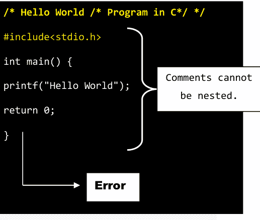

# 问题 8

## 问题

编写一个程序读取 1 到 7 之间的整数并打印英文星期几。

## 解答

```c
#include<stdio.h>
int main() {
    int day;
    printf("\nEnter a number between 1 to 7 to get the day name: ");
    scanf("%d", &day);
    switch (day) {
        case 1: printf("Monday\n"); break;
        case 2: printf("Tuesday\n"); break;
        case 3: printf("Wednesday\n"); break;
        case 4: printf("Thursday\n"); break;
        case 5: printf("Friday\n"); break;
        case 6: printf("Saturday\n"); break;
        case 7: printf("Sunday\n"); break;
        default: printf("Enter a number between 1 to 7.");
    }
    return 0;
}
```

# 问题 9

## 问题

编写一个程序求两个数字之和。

## 解答

由于它只支持标量操作，C 现在被程序员们认为是一门低级语言，与它曾被认为是一门高级语言相反。

```c
#include<stdio.h>
int main() {
    int a, b, sum;
    a = 1;
    b = 2;
    sum = a + b;
    printf("The sum of a and b = %d", sum);
    return 0;
}
```

# 问题 10

## 问题

编写一个程序求一个数字的平方。

## 解答

```c
#include<stdio.h>
#include<math.h>
int main() {
    int a, b;
    a = 2;
    b = pow(a, 2);
    printf("The square of a = %d", b);
    return 0;
}
```

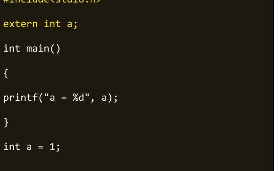

输出：

`a = 1`

# 问题 11

## 问题

编写一个程序找到两个数字中最大的。

## 解答

```c
#include<stdio.h>
int main() {
    int a, b;
    a = 2;
    b = 3;
    if(a > b) {
        printf("a is greater than b");
    } else {
        printf("b is greater than a");
    }
    return 0;
}
```

```c
#include<stdio.h>
#define merge(a, b) a##b
int main() {
    printf("%d ", merge(12, 09));
    return 0;
}
```

输出：

`1209`

# 问题 12

## 问题

编写一个程序打印数组中元素的平均值。

博弈论是一种数学框架，用于研究在一个人的结果取决于他人的选择的情况下如何进行决策。它是对理性决策者进行策略性交互的数学表示的研究。博弈论的目标是识别出玩家可以使用的最优策略，在一个选择会影响所有参与者结果的情况下，实现他们的目标。博弈论被应用于经济学、政治科学、心理学和生物学等多个领域。

## Solution

```c
#include<stdio.h>
int main() {
    int i, avg, sum = 0;
    int num[5] = {16, 18, 20, 25, 36};
    for(i = 0; i < 5; i++) {
        sum = sum + num[i];
    }
    avg = sum / 5;
    printf("Sum of the Elements in the array is: %d\n", sum);
    printf("Average of the elements in the array is: %d\n", avg);
    return 0;
}
```


# Question 13

## Question

编写一个程序，打印 1 到 25 之间所有的偶数。

## Solution

```c
#include<stdio.h>
int main() {
    printf("Even numbers between 1 to 25:\n");
    for(int i = 1; i <= 25; i++) {
        if(i % 2 == 0) {
            printf("%d ", i);
        }
    }
    return 0;
}
```

# Question 14

## 最流行的操作系统 Linux 具有一个基于 C 语言的内核。

### Question

编写一个程序，打印 1 到 50 之间的奇数。

### Solution

```c
#include<stdio.h>
int main() {
    char c = 'a';
    putchar(c);
    return 0;
}
```

Output:

`a`

# Question 15

## Question

编写一个程序，打印从 1 开始的前 10 个数字，并带上它们的平方和立方。

## Solution

```c
#include<stdio.h>
int main() {
    for(int i = 1; i <= 10; i++) {
        printf("Number = %d its square = %d its cube = %d\n", i, i*i, i*i*i);
    }
    return 0;
}
```

# Question 16

## Question

编写一个程序：

如果你输入字符 M，

输出必须是：ch = M。

## Solution

```c
#include<stdio.h>
int main() {
    char M;
    printf("Enter any character: ");
    scanf("%c", &M);
    printf("ch = %c", M);
    return 0;
}
```

```c
#include<stdio.h>
int main() {
    int x = 50, y, z;
    if(x >= 50) {
        y = 15;
        z = 28;
        printf("\n%d %d\n", y, z);
    }
    return 0;
}
```

Output:

`15 28`

| Output |
| :--- |
| 1 |
| 12 |
| 123 |
| 1234 |
| 12345 |

# Question 17

## Question

编写一个程序，打印用户输入的数字的乘法表。

## Solution

```c
#include<stdio.h>
int main() {
    float a;
    int n, i;
    a = (float) 51 / 4;
    printf("Enter any number: ");
    scanf("%d", &n);
    for(i = 1; i <= 5; i++) {
        printf("%d * %d = %d\n", i, n, n * i);
    }
    return 0;
}
```

Output:

`12.750000`

# Question 18

## Question

编写一个程序，打印前 10 个数字的乘积。

## Solution

```c
#include<stdio.h>
int main() {
    int i, product = 1;
    for(i = 1; i <= 10; i++) {
        product = product * i;
    }
    printf("The product of the first 10 digits is: %d", product);
    return 0;
}
```

> C 语言中唯一的三元运算符是 `?:`

# Question 19

## Question

编写一个程序，判断给定数字是正数还是负数。

## Solution

```c
#include<stdio.h>
int main() {
    int a;
    a = -35;
    if(a > 0) {
        printf("Number is positive");
    } else {
        printf("Number is negative");
    }
    return 0;
}
```

```c
#include<stdio.h>
int main() {
    char name[] = "Einstein";
    printf("%c", name[0]);
    return 0;
}
```

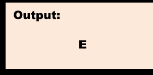

# Question 20

## Question

编写一个程序，检查用户输入的两个数字的等性。

## Solution

```c
#include<stdio.h>
int main() {
    int x, y;
    printf("Enter the first number: ");
    scanf("%d", &x);
    printf("Enter the second number: ");
    scanf("%d", &y);
    if(x == y) {
        printf("The numbers are equivalent");
    } else {
        printf("two numbers are not equivalent");
    }
    return 0;
}
```

`sizeof` 是运算符。（根据上下文修正）

# Question 21

## Question

编写一个程序，打印用户输入的两个数字的余数。

## Solution

```c
#include<stdio.h>
int main() {
    int a, b, c;
    printf("Enter the first number: ");
    scanf("%d", &a);
    printf("Enter the second number: ");
    scanf("%d", &b);
    c = a % b;
    printf("the remainder of %d and %d is: %d", a, b, c);
    return 0;
}
```

# Question 22

## Question

编写一个程序，打印 A 到 Z 的字符。

## Solution

```c
#include<stdio.h>
int main() {
    for(int i = 'A'; i <= 'Z'; i++) {
        printf("%c\n", i);
    }
    return 0;
}
```

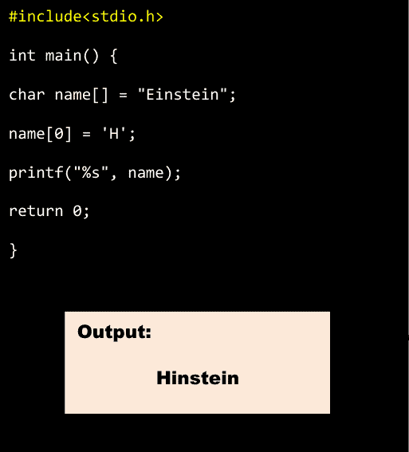

# Question 23

## Question

编写一个程序，打印输入字符串的长度。

## Solution

```c
#include<stdio.h>
#include<string.h>
int main() {
    char str[1000];
    printf("Enter a string to calculate its length: ");
    scanf("%s", str);
    printf("Length is: %lu", strlen(str));
    return 0;
}
```

# Question 24

## Question

编写一个程序，检查给定字符是否为小字母。

## Solution

```c
#include <stdio.h>
#include <ctype.h>
int main() {
    char ch;
    printf("Enter a character: ");
    scanf("%c", &ch);
    if (islower(ch)) {
        printf("The given character is a lower letter");
    } else {
        printf("The given character is upper case letter");
    }
    return 0;
}
```

# Question 25

## Question

编写一个程序，检查给定字符是否为大写字母。

## Solution

```c
#include <stdio.h>
#include <ctype.h>
int main() {
    char ch;
    printf("Enter a character: ");
    scanf("%c", &ch);
    if(isupper(ch)) {
        printf("The given character is upper case letter");
    } else {
        printf("The given character is a lower letter");
    }
    return 0;
}
```

> 每个 C 程序中必须有一个名为 `main()` 的函数。

# Question 26

## Question

编写一个程序将小写字母转换为大写字母。

## Solution

> 在 C 程序中，可以编写任意数量的函数。

在 C 中，有两种不同的函数：用户定义和库函数。

```c
#include<stdio.h>
#include <ctype.h>
int main() {
    char ch = 'a';
    char b = toupper(ch);
    printf("Lower case letter '%c' is converted to Upper letter '%c'", ch, b);
    return 0;
}
```

# Question 27

## Question

编写一个程序，接收厘米长度并输出相应的英寸值。

```c
#include<stdio.h>
int main() {
    int i = 6;
    while (i == 3) {
        i = i - 3;
        printf("%d\n", i);
    }
    return 0;
}
```

## Solution

```c
#include<stdio.h>
int main() {
    float cm, inch;
    float x = 2.54;
    printf("Enter distance in cm: ");
    scanf("%f", &cm);
    inch = cm / x;
    printf("\nDistance of %.2f cms is equal to %.2f inches", cm, inch);
    return 0;
}
```


# Question 28

## Question

编写一个程序打印 "Hello World" 10 次。

## Solution

```c
#include<stdio.h>
int main() {
    for(int i = 0; i < 10; i++) {
        printf("Hello World\n");
    }
    return 0;
}
```

```c
#include<stdio.h>
int main() {
    int num[] = {5, 7, 9};
    printf("%d", num[0]);
    return 0;
}
```

# Question 30

## Question

使用 do 循环语句打印前 5 个数字。

## Solution

```c
#include<stdio.h>
int main() {
    int i = 1;
    do {
        printf("%d\n", i++);
    } while (i <= 5);
    return 0;
}
```


```c
#include<stdio.h>
int main () {
    char name[9] = {'C', 'P', 'r', 'o', 'g', 'r', 'a', 'm', '\0'};
    printf("%s\n", name);
    return 0;
}
```

# 问题 32

## 问题

编写一个程序来检查输入的数字是偶数还是奇数。

## 解决方案

```c
#include<stdio.h>
int main() {
    int a;
    printf("Enter any number: ");
    scanf("%d", &a);
    if(a%2 == 0) {
        printf("The entered number is even");
    }
    else {
        printf("The entered number is odd");
    }
    return 0;
}
```

```c
#include<stdio.h>
int main() {
    int num[] = {5, 7, 9, 42};
    num[0] = 3;
    printf("%d", num[0]);
    return 0;
}
```

| 输出 |
| :--- |
| 3 |

# 问题 33

## 问题

编写一个程序打印给定字符的 ASCII 值。

## 解决方案

```c
#include<stdio.h>
int main() {
    char ch = 'A';
    printf("The ASCII value of %c is: %d", ch, ch);
    return 0;
}
```

# 问题 34

## 问题

编写一个程序打印 1 到 50 之间所有被指定数字相除且余数为 2 的数字。

## 解决方案

```c
#include<stdio.h>
int main() {
    int x, i;
    printf("Enter a number: ");
    scanf("%d", &x);
    for(i=1;i<=50; i++) {
        if((i%x)==2) {
            printf("%d\n", i);
        }
    }
    return 0;
}
```

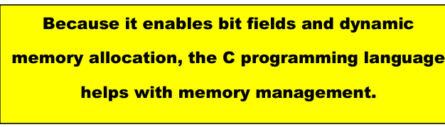

350

# 问题 35

## 问题

编写一个程序判断一对中的两个数字是升序还是降序。

## 解决方案

```c
#include<stdio.h>
int main() {
    int a, b;
    printf("\nEnter a pair of numbers (for example 22,12 | 12,22): ");
    printf("\nEnter the first number: ");
    scanf("%d", &a);
    printf("\nEnter the second number: ");
    scanf("%d", &b);
    if (a-b) {
        printf("\nThe two numbers in a pair are in descending order\n");
    }
    else {
        printf("\nThe two numbers in a pair are in ascending order\n");
    }
    return 0;
}
```

# 问题 36

## 问题

编写一个程序读取两个数字并将其中一个除以另一个。如果无法除，则指定“Division not possible”。

## 解决方案

```c
#include<stdio.h>
int main() {
    int a, b;
    float c;
    printf("\nenter the first number: ");
    scanf("%d", &a);
    printf("\nenter the second number: ");
    scanf("%d", &b);
    if(b != 0) {
        c = (float)a/(b);
        printf("\n%d/%d = %.1f\n", a, b, c);
    } else {
        printf("\nDivision not possible.\n");
    }
    return 0;
}
```

```c
#include<stdio.h>
int main() {
    int a = 6;
    float b = 6.0;
    if(a == b) {
        printf("\na and b are equal\n");
    } else {
        printf("\na and b are not equal\n");
    }
    return 0;
}
```

| 输出: |
| :--- |
| a and b are equal |

# 问题 37

## 问题

编写一个程序打印 1 到 50 之间所有被指定数字相除且余数等于 2 或 3 的数字。

## 解决方案

```c
#include<stdio.h>
int main() {
    int x, i;
    printf("Enter a number: ");
    scanf("%d", &x);
    for(i=1; i<=50; i++) {
        if((i%x)==2 || (i%x) == 3) {
            printf("%d\n", i);
        }
    }
    return 0;
}
```

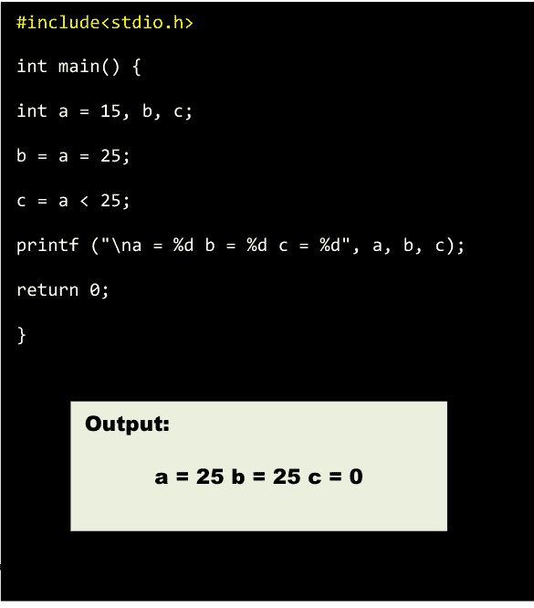

# 问题 38

## 问题

编写一个程序累加 1 到 100 之间不能被 12 整除的数字。

## 解决方案

```c
#include<stdio.h>
int main() {
    int x = 12, i, sum = 0;
    for(i=1; i<=100; i++) {
        if((i%x) != 0) {
            sum += i;
        }
    }
    printf("\nSum: %d\n", sum);
    return 0;
}
```

# 问题 39

## 问题

编写一个程序计算 x 的值，其中 x = 1 + 2 + 3 + ... + 50。

## 解决方案

```c
#include<stdio.h>
int main() {
    float x = 0;
    for(int i=1; i<=50; i++) {
        x += (float)i;
    }
    printf("Value of x: %.2f\n", x);
    return 0;
}
```

# 问题 40

## 问题

编写一个程序读取一个数字并找到它的因数。

## 解决方案

```c
#include<stdio.h>
int main() {
    int n, i;
    printf("Enter a number: ");
    scanf("%d", &n);
    for(i=1; i<=n; i++) {
        if(n%i == 0) {
            printf("%d ", i);
        }
    }
    return 0;
}
```

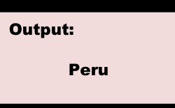

# 问题 41

## 问题

编写一个程序找到两个数字的加一和减一值。

## 解决方案

```c
#include<stdio.h>
int main() {
    int a, b, c, d, e, f;
    a = 10;
    b = 12;
    c = a+1;
    d = b+1;
    e = a-1;
    f = b-1;
    printf("\nThemented value of a = %d", c);
    printf("\nThemented value of b = %d", d);
    printf("\nThemented value of a = %d", e);
    printf("\nThemented value of b = %d", f);
    return 0;
}
```

图论是计算机科学中的一个重要领域，涉及网络的数学建模和分析。在计算机科学中，图用于表示和分析各种现实系统，如通信网络、交通网络等。图论为解决计算机科学中复杂问题提供了工具和技术，包括算法设计、数据结构等。


# 问题 42

## 问题

编写一个程序使用函数找到输入数字的平方。

## 解决方案

```c
#include<stdio.h>
int square();
int main() {
    int answer;
    answer = square();
    printf("The square of the entered number is: %d", answer);
    return(0);
}
int square() {
    int x;
    printf("Enter any number: ");
    scanf("%d", &x);
    return x*x;
}
```

```c
#include<stdio.h>
int main() {
    int a = 6, b, c;
    b += a;
    c = a++;
    printf("%d %d %d\n", a, b, c);
    return 0;
}
```

| 输出: |
| :--- |
| 8 7 7 |

# 问题 43

## 问题

编写一个程序接受本金、利率和时间并计算单利。

## 解决方案

```c
#include<stdio.h>
int main() {
    int p, r, t, SI;
    printf("\nEnter the principal amount: %d");
    scanf("%d", &p);
    printf("\nEnter the rate of interest: %d");
    scanf("%d", &r);
    printf("\nEnter the time: %d");
    scanf("%d", &t);
    SI=(p*r*t)/100;
    printf("\nSimple interest is: %d", SI);
    return 0;
}
```

数学逻辑和布尔逻辑是逻辑的不同分支，尽管它们有一些相似之处。

数学逻辑的核心是对数学推理和证明的形式研究。它包含了命题逻辑、谓词逻辑、集合论等相关领域。数学逻辑用于开发严密的数学证明和研究数学的基础。

另一方面，布尔逻辑是代数逻辑的一种，处理逻辑语句的操作和评估。它基于真和假的二值（或 1 和 0），并使用 `AND`、`OR` 或 `NOT` 等运算符来组合和操作逻辑语句。布尔逻辑广泛应用于计算机科学、数字电子以及其他逻辑推理重要的领域。


总而言之，数学逻辑关注数学推理和证明的研究，而布尔逻辑关注逻辑语句的操作和评估。逻辑这两个分支在包括计算机科学和数学在许多领域都有重要的应用。

# 问题 44

## 问题

编写一个程序不使用第三个变量交换两个数字。

## 解决方案

```c
#include<stdio.h>
int main() {
    int a, b;
    printf("\nEnter the value for a: %d ");
    scanf("%d", &a);
    printf("\nEnter the value for b: %d ");
    scanf("%d", &b);
    printf("\nBefore swapping: %d %d", a,b);
    a=a+b;
    b=a-b;
    a=a-b;
    printf("\nAfter swapping: %d %d", a,b);
    return 0;
}
```

```c
}
return 0;
}
```

# 问题 46

## 问题

编写一个程序打印输出：

body[b] = b

body[o] = o

body[d] = d

body[y] = y

```c
#include<stdio.h>
int main() {
    int i = 60;
    if(i > 70 && i < 100) {
        printf("i is greater than 70 and less than 100");
    } else {
        printf("%d", i);
    }
    return 0;
}
```

| 输出: |
| :--- |
| 60 |

## 解法

```c
#include <stdio.h>
int main() {
    char i;
    char body[4] = {'b', 'o', 'd', 'y'};
    for(i=0; i<4; i++)
        printf("\n body[%c] = %c", body[i], body[i]);
    return 0;
}
```

# 问题 47

## 问题

编写一个程序计算折扣价格和折后的总价。

给定条件：

- 如果购买金额大于 1000，打 90% 折
- 如果购买金额大于 5000，打 20% 折
- 如果购买金额大于 10000，打 30% 折

## 解法

```c
#include<stdio.h>
int main() {
    double PV;
    printf("Enter purchased value: ");
    scanf("%lf", &PV);
    if(PV>1000) {
        printf("\n Discount = %lf\n", PV * 0.1);
        printf("\n Total = %lf\n", PV - 0.1);
    } else if(PV>5000) {
        printf("\n Discount = %lf\n", PV * 0.2);
        printf("\n Total = %lf\n", PV - 0.2);
    } else {
        printf("\n Discount = %lf\n", PV * 0.3);
        printf("\n Total = %lf\n", PV - 0.3);
    }
    return 0;
}
```

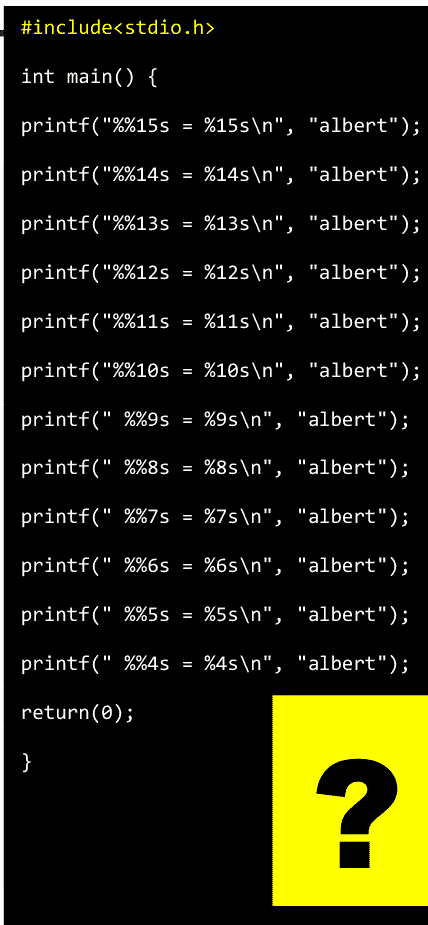

# 问题 48

## 问题

编写一个程序使用 `while` 循环语句打印前十个自然数。

## 解法

```c
#include<stdio.h>
int main() {
    int i = 1;
    while (i<=10) {
        printf("%d\n", i++);
    }
    return 0;
}
```

```c
#include<stdio.h>
int main() {
    int i = 12;
    if(i == 12 && i != 0) {
        printf("\nHi");
        printf("\nEinstein");
    } else {
        printf("Bye Elsa ");
    }
    return 0;
}
```

输出：

Hi

Einstein

# 问题 49

## 问题

编写一个程序将输入的数据左移二位。

## 解法

```c
#include<stdio.h>
int main() {
    int x;
    printf("Enter the integer from keyboard: ");
    scanf("%d",&x);
    printf("\nEntered value: %d", x);
    printf("\nThe left shifted data is: %d", x>>2);
    return 0;
}
```

算法是一组精确的、分步执行的指令或过程，用于解决问题或实现特定目标。算法被应用于科学、工程和计算的许多领域，帮助实现过程自动化并实现高效计算。

算法接收输入并产生输出，通常涉及某种形式的数据处理或转换。算法的设计有多种形式，例如为了高效和准确，可以用伪代码、流程图或编程语言来表示。算法的复杂度从简单的计算到复杂的机器学习模型不等。算法的示例包括排序算法、搜索算法、加密算法和优化算法。算法的开发和分析是计算机科学和数学领域的核心。


# 问题 50

## 问题

编写一个程序将输入的数据右移二位。

## 解法

```c
#include<stdio.h>
int main() {
    int x;
    printf("Enter the integer from keyboard: ");
    scanf("%d",&x);
    printf("\nEntered value: %d", x);
    printf("\nThe right shifted data is: %d", x>>2);
    return 0;
}
```

# 问题 51

## 问题

编写一个程序计算 x 与 21 之间的精确差。如果 x 大于 21，则返回绝对差值的三倍。

## 解法

> 因为 C 语言是一种结构化（模块化）编程语言，程序员可以将代码划分成更小的块以便于理解，从而使程序更简单、冗余更少。

```c
#include<stdio.h>
int main() {
    int x = 25, y;
    x >= 16 ? (y = 25) : (y = 30);
    printf("\n%d %d", x, y);
    return 0;
}
```

输出：

25 25

# 问题 52

## 问题

编写一个程序读取两个数字并判断第一个数字是否为第二个数字的倍数。

## 解法


```c
#include<stdio.h>
int main() {
    int x, y;
    printf("enter the first number: ");
    scanf("%d", &x);
    printf("enter the second number: ");
    scanf("%d", &y);
    if(x % y == 0) {
        printf("\n%d is a multiple of %d.\n", x, y);
    }
    else {
        printf("\n%d is not a multiple of %d.\n", x, y);
    }
    return 0;
}
```

```c
#include<stdio.h>
int main() {
    int x = 10;
    (x == 10 ? printf("True") : printf("False"));
    return 0;
}
```

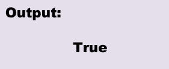

# 问题 53

## 问题

编写一个程序打印输出：

Name of book = B

Price of book = 135.00

Number of pages = 300

Edition of book = 8

使用结构体。

## 解法

```c
#include<stdio.h>
int main() {
    struct book {
        char name;
        float price;
        int pages;
        int edition;
    };
    struct book b1;
    b1.name = 'B';
    b1.price = 135.00;
    b1.pages = 300;
    b1.edition = 8;
    printf("\n Name of book = %c", b1.name);
    printf("\n Price of book = %f", b1.price);
    printf("\n Number of pages = %d", b1.pages);
    printf("\n Edition of book = %d", b1.edition);
    return 0;
}
```

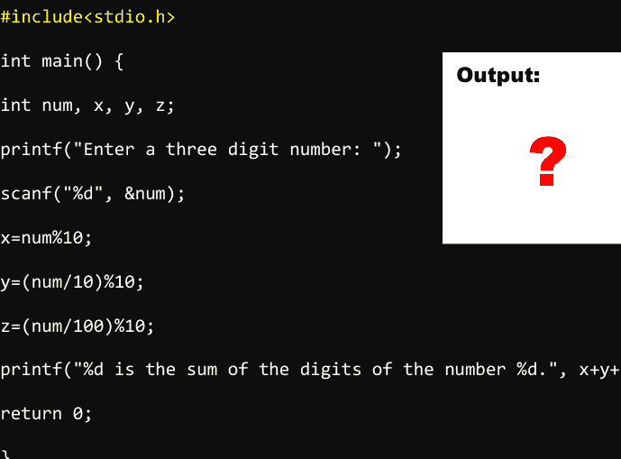

# 问题 54

## 问题

编写一个程序将摄氏度转换为华氏度。

## 解法

```c
#include<stdio.h>
int main() {
    float fahrenheit, celsius;
    celsius = 36;
    fahrenheit = ((celsius*9)/5)+32;
    printf("\nTemperature in fahrenheit is: %f", fahrenheit);
    return 0;
}
```

# 问题 55

## 问题

编写一个程序检查两个整数，如果其中一个为 50 或者它们的和为 50，则返回真。

## 解法

```c
#include<stdio.h>
int main() {
    int x, y;
    printf("Enter value for x: ");
    scanf("%d", &x);
    printf("Enter value for y: ");
    scanf("%d", &y);
    if(x == 50 || y == 50 || (x + y == 50)) {
        printf("\nTrue");
    } else {
        printf("\nFalse");
    }
    return 0;
}
```

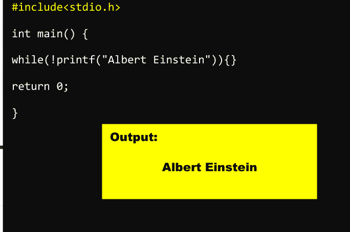

# 问题 56

## 问题

编写一个程序统计十八个输入中的偶数、奇数、正数和负数。

## 解法

```c
#include<stdio.h>
int main () {
    int x, even = 0, odd = 0, positive = 0, negative = 0;
    printf("Please enter 18 numbers:\n");
    for(int i = 0; i < 18; i++) {
        scanf("%d", &x);
        if (x > 0) {
            positive++;
        }
        if (x < 0) {
            negative++;
        }
        if (x % 2 == 0) {
            even++;
        }
        if (x % 2 != 0) {
            odd++;
        }
    }
    printf("\nNumber even values: %d", even);
    printf("\nNumber odd values: %d", odd);
    printf("\nNumber positive values: %d", positive);
    printf("\nNumber negative values: %d", negative);
    return 0;
}
```

```c
#include<stdio.h>
int main() {
    int x = 0, y = 1 ;
    if(x == 0) {
        (y > 1 ? printf("\nHi") : printf("\nAlbert"));
    } else {
        printf("\nHi Albert!");
    }
    return 0;
}
```


```c
#include<stdio.h>
int main() {
    switch(printf("Albert Einstein"));
    return 0;
}
```


# 问题 57

## 问题

编写一个程序检查某人是否为老人。

## 解法

```c
#include<stdio.h>
int main() {
    int age;
    printf("Enter any number: ");
    scanf("%d", &age);
    if(age>=60) {
        printf("Senior citizen\n");
    }
    else {
        if(age < 15) {
            printf("\nElsa\n");
        } else {
            printf("\nDavid\n");
        }
    }
    return 0;
}
```

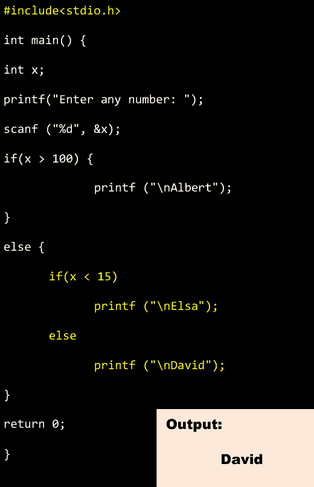

# 问题 58

## 问题

编写一个程序读取学生的三个科目成绩（0-100）并计算这些成绩的平均值。

## 解法

```c
#include<stdio.h>
int main() {
    float score, total_score = 0;
    int subject = 0;
    printf("Enter three subject scores (0-100):\n");
    while (subject != 3) {
        scanf("%f",&score);
        if(score < 0 || score > 100) {
            printf("Please enter a valid score.\n");
        }
        else {
            total_score += score;
            subject++;
        }
    }
    printf("Average score = %.2f\n", total_score/3);
    return 0;
}
```

# 问题 59

## 问题

以下程序会产生什么结果？

```c
#include<stdio.h>
int main() {
    for(int i=1; i<=5; i++) {
        if(i==3) {
            break;
        }
        printf("%d\n", i);
    }
    return 0;
}
```

```c
#include<stdio.h>
int main() {
    int a = 15, b = 4;
    float c = (float)a/(float)b;
    printf("%d = %.2f\n", a, b, c);
    return 0;
}
```

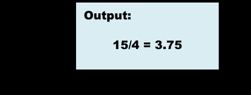

## 解决方案

```
1
2
```

```c
#include<stdio.h>
int main() {
    int a = 6, b = 4, c;
    c = a++ + b;
    printf("%d\n %d %d", a, b, c);
    return 0;
}
```

```c
#include<stdio.h>
int main() {
    for(int i=1; i<=5; i++) {
        if(i==3) {
            goto HAI;
        }
        printf("\n %d ", i);
    }
    HAI: printf("\n Linux");
}
```

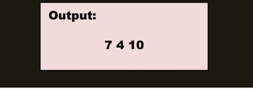

## 解决方案

```
1
2
Linux
```

```c
#include<stdio.h>
int main() {
    for( ; ; ) {
        printf("This loop will run forever.\n");
    }
    return 0;
}
```

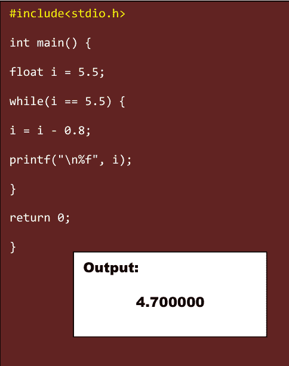

## 解决方案

这个循环将无限运行。

这个循环将无限运行。

这个循环将无限运行。

这个循环将无限运行。

这个循环将无限运行。

这个循环将无限运行。 ........

```c
#include<stdio.h>
int main() {
    printf("Hello,world!");
    return 0;
}
```

```c
printf("Hello,world!");
}
```

## 解决方案

Hello,world!

```c
#include<stdio.h>
int main() {
    float i = 5.5;
    while(i == 5.5) {
        printf("\n%f", i);
        i = i - 0.8;
    }
    return 0;
}
```

```c
#include<stdio.h>
#include<stdlib.h>
int main() {
    printf("linux\n");
    exit(0);
    printf("php\n");
    return 0;
}
```


## 解决方案

linux

```c
#include<stdio.h>
int main() {
    for(int i=1; i<=5; i++) {
        if(i==3) {
            continue;
        }
        printf("%d\n", i);
    }
    return 0;
}
```

## 解决方案

```c
#include<stdio.h>
int main() {
    int a = 6, b = 2;
    while(a >= 0) {
        a--;
        b++;
        if(a == b) {
            continue;
        }
        else {
            printf("%d\n%d", a, b);
        }
    }
    return 0;
}
```

```c
#include<stdio.h>
int main() {
    int a = 10, b = 20, c;
    c = (a < b) ? a : b;
    printf("%d", c);
    return 0;
}
```

| 输出 |
| :--- |
| 3 5 |
| 2 6 |
| 1 7 |
| 0 8 |
| -1 9 |

## 解决方案

10

```c
#include<stdio.h>
#define A 15
int main() {
    int x;
    x=A;
    printf("%d", x);
    return 0;
}
```

```c
#include<stdio.h>
int main() {
    int x = 0;
    for ( ; x ; ; )
        printf("\nAlbert");
    return 0;
}
```


## 解决方案

15

```c
#include<stdio.h>
#include<stdlib.h>
int main() {
    int i;
    for(i=1; i <= 3; i++) {
        printf((i&1) ? "odd\n" : "even\n");
    }
    exit(EXIT_SUCCESS);
}
```

## 解决方案

odd
even

```c
#include<stdio.h>
#include<math.h>
int main() {
    double a, b;
    a = -2.5;
    b = fabs(a);
    printf("%.2f| %.2f\n", a, b);
    return 0;
}
```

## 解决方案

-2.50|= 2.50

```c
#include<stdio.h>
#include<stdlib.h>
int main() {
    int x=12, y =3;
```


```c
    printf("%d\n", abs(-x-y));
    return 0;
}
```

## 解决方案

15

```c
#include <stdio.h>
#include <stdlib.h>
int main() {
    int x=12, y =3;
    printf("%d\n", abs(-x-y));
    return 0;
}
```

```c
#include<stdio.h>
#include<stdlib.h>
int main() {
    int x = 5;
    switch (x) {
        case -1 : printf("\nAlbert");
        case 0 : printf("\nJohn");
        case 1 : printf("\nMary");
        default : printf("\nJames");
    }
    return 0;
}
```

## 解决方案

15

| 输出: |
| :--- |
| Albert |
| John |
| Mary |
| James |

```c
#include <stdio.h>
#include <stdlib.h>
int main() {
    int x=12, y =3;
    printf("%d\n", x-y);
    return 0;
}
```

```c
#include<stdio.h>
int main() {
    int y[] = {20, 40, 60, 80, 100};
    for(int x = 0; x <= 4; x++) {
        printf("%d\n", y[x]);
    }
    return 0;
}
```

## 解决方案

15

| 输出: |
| :--- |
| 20 |
| 40 |
| 60 |
| 80 |
| 100 |

# 题目 60

## 题目

编写一个查找数组大小的程序。

## 解决方案

```c
#include<stdio.h>
int main() {
    int num[] = {11, 22, 33, 44, 55, 66};
    int n = sizeof(num) / sizeof(num[0]);
    printf("Size of the array is: %d\n", n);
    return 0;
}
```

# 题目 61

## 题目

编写一个打印从1到给定整数序列程序，在数字之间插入加号，并删除最后一个加号。

## 解决方案

```c
#include<stdio.h>
int main() {
    int x, i;
```


# 问题 62

## 题目

编写一个程序验证三角形边是否构成直角三角形。

## 解决方案

```c
#include<stdio.h>

int main() {
    int a,b,c;
    printf("Enter the three sides of a triangle: \n");
    scanf("%d %d %d",&a,&b,&c);
    if((a*a)+(b*b)==c*c || (a*a)+(c*c)==b*b || (b*b)+(c*c)==a*a) {
        printf("Triangle's sides form a right angled triangle.\n");
    } else {
        printf("Triangle's sides do not form a right angled triangle.\n");
    }
    return 0;
}
```

# 问题 63

## 题目

编写一个程序，在用户输入的三个数字中找到第二大的数字。

## 解决方案

```c
#include<stdio.h>

int main() {
    int a, b, c;
    printf("\nEnter the first number: ");
    scanf("%d", &a);
    printf("\nEnter the second number: ");
    scanf("%d", &b);
    printf("\nEnter the third number: ");
    scanf("%d", &c);
    if ((a > b && a < c) || (a < b && a > c)) {
        printf("%d\n", a);
    } else if ((b > a && b < c) || (b < a && b > c)) {
        printf("%d\n", b);
    } else {
        printf("%d\n", c);
    }
    return 0;
}
```

# 问题 68

## 问题

编写一个程序，确定给定的两个整数中哪一个最接近值 100。如果两个数字相等，返回 0。

## 解决方案

```c
#include<stdio.h>
#include<stdlib.h>

int myfunc(int a, int b);

int main() {
    printf("%d", myfunc(86, 99));
    printf("\n%d", myfunc(55, 55));
    printf("\n%d", myfunc(65, 80));
    return 0;
}

int myfunc(int a, int b) {
    int x = abs(a - 100);
    int y = abs(b - 100);
    return x == y ? 0 : (x < y ? a : b);
}
```

# 问题 69

## 问题

编写一个程序，确定用户输入的正数是否是三或五的倍数，但不同时都是。

## 解决方案

```c
#include<stdio.h>

int main() {
    int x;
    printf("\nenter a number: ");
    scanf("%d", &x);
    if(x % 3 == 0 ^ x % 5 == 0) {
        printf("True");
    } else {
        printf("False");
    }
    return 0;
}
```

# 问题 70

## 问题

编写一个程序，确定输入的两个非负数具有相同的最后一位数字。

## 解决方案

```c
#include<stdio.h>
#include<stdlib.h>

int main() {
    int x, y;
    printf("\nEnter the value for x: ");
    scanf("%d", &x);
    printf("\nEnter the value for y: ");
    scanf("%d", &y);
    if(abs(x % 10) == abs(y % 10)) {
        printf("True");
    } else {
        printf("False");
    }
    return 0;
}
```

# 问题 71

## 问题

编写一个程序，确定一个给定的非负数是 12 的倍数，还是 12 的倍数加 1。

## 解决方案

```c
#include<stdio.h>
#include<stdlib.h>

int main() {
    int x = 43;
    if(x % 12 == 0 || x % 12 == 1) {
        printf("True");
    } else {
        printf("False");
    }
    return 0;
}
```

# 问题 72

## 问题

编写一个程序，接受两个整数，当其中一个整数等于 6，或者它们的和或差值等于 6 时，返回真。

## 解决方案

```c
#include<stdio.h>
#include<stdlib.h>

int main() {
    int x, y;
    printf("\nEnter the value for x: ");
    scanf("%d", &x);
    printf("\nEnter the value for y: ");
    scanf("%d", &y);
    if(x == 6 || y == 6 || abs(x + y) == 6 || abs(x - y) == 6) {
        printf("True");
    } else {
        printf("False");
    }
    return 0;
}
```

# 问题 73

## 问题

编写一个程序，检查是否可以通过两个整数相加得到第三个整数。

## 解决方案

```c
#include<stdio.h>

int main() {
    int x, y, z;
    printf("\nEnter the value for x: ");
    scanf("%d", &x);
    printf("\nEnter the value for y: ");
    scanf("%d", &y);
    printf("\nEnter the value for z: ");
    scanf("%d", &z);
    if(x == y + z || y == x + z || z == x + y) {
        printf("True");
    } else {
        printf("False");
    }
    return 0;
}
```

# 问题 74

## 问题

编写一个程序，将千米小时转换为英里小时。

## 解决方案

```c
#include<stdio.h>

int main() {
    float kmh;
    printf("\nEnter speed in km/h: ");
    scanf("%f", &kmh);
    printf("\nSpeed in mph: %.2f", kmh * 0.621371);
    return 0;
}
```

# 问题 75

## 问题

编写一个程序计算椭圆面积。

## 解决方案

```c
#include<stdio.h>
#define PI 3.14159

int main() {
    float major, minor;
    printf("\nEnter length of major axis: ");
    scanf("%f", &major);
    printf("\nEnter length of minor axis: ");
    scanf("%f", &minor);
    printf("\narea of an ellipse = %.4f", PI * major * minor);
    return 0;
}
```

# 问题 76

## 问题

编写一个程序计算三个给定整数的和。如果前两个相等，则返回第三个值。

## 解决方案

```c
#include<stdio.h>

int myfunc(int a, int b, int c);

int main() {
    printf("\n%d", myfunc(11, 11, 11));
    printf("\n%d", myfunc(11, 11, 16));
    printf("\n%d", myfunc(18, 15, 10));
    return 0;
}

int myfunc(int a, int b, int c) {
    if (a == b) return c;
    if (a == c) return b;
    if (b == c) return a;
    else return a + b + c;
}
```

# 问题 77

## 问题

编写一个程序将字节转换为KB。

## 解决方案

```c
#include<stdio.h>

int main() {
    double bytes;
    printf("\nEnter number of bytes: ");
    scanf("%lf", &bytes);
    printf("\nkilobytes: %.2f", (bytes/1024));
    return 0;
}
```

# 问题 78

## 问题

编写一个程序将MB转换为KB。

## 解决方案

```c
#include<stdio.h>

int main() {
    double megabytes, kilobytes;
    printf("\nInput the amount of megabytes to convert: ");
    scanf("%lf", &megabytes);
    kilobytes = megabytes * 1024;
    printf("\nThere are %lf kilobytes in %lf megabytes.", kilobytes, megabytes);
    return 0;
}
```

# 问题 79

## 问题

编写一个程序统计整数数组中偶元素的个数。

## 解决方案

```c
#include<stdio.h>

int main() {
    int array[1000], i, arr_size, even = 0;
    printf("Input the size of the array: ");
    scanf("%d", &arr_size);
    printf("Enter the elements in array: \n");
    for(i = 0; i < arr_size; i++) {
        scanf("%d", &array[i]);
    }
    for(i = 0; i < arr_size; i++) {
        if(array[i] % 2 == 0) {
            even++;
        }
    }
    printf("Number of even elements: %d", even);
    return 0;
}
```

## 问题

编写一个程序统计整数数组中奇元素的个数。

## 解决方案

```c
#include<stdio.h>

int main() {
    int array[1000], i, arr_size, odd = 0;
    printf("Input the size of the array: ");
    scanf("%d", &arr_size);
    printf("Enter the elements in array: \n");
    for(i = 0; i < arr_size; i++) {
        scanf("%d", &array[i]);
    }
    for(i = 0; i < arr_size; i++) {
        if(array[i] % 2 != 0) {
            odd++;
        }
    }
    printf("Number of odd elements: %d", odd);
    return 0;
}
```

> 机器执行通常需要人类智能的操作（如语音识别、决策制定和语言翻译）的能力被称为人工智能（AI）。人工智能涉及开发计算机程序和算法，这些程序能够从数据和经验中学习，以进行预测、识别模式并解决问题。这包括机器学习、深度学习、自然语言处理和机器人技术。人工智能是一个快速发展的领域，具有改变许多行业和日常生活各个方面的潜力。

自动推理是指使用计算机程序和算法从给定的前提自动推导出逻辑结论。自动推理的目标是开发能够自动化推理和解决问题过程的技术，使计算机执行原本需要人类智能才能完成的任务。

自动推理系统通常使用符号逻辑和形式推理方法来分析问题的逻辑结构，识别潜在解决方案，并生成证明或反驳。这些系统可以用于各种应用，例如软件验证、定理证明和人工智能。

自动推理是许多 AI 系统的关键组成部分，特别是在需要高级逻辑推理和决策的领域，例如医学、法律和金融。它也是计算机科学、数学和哲学中一个活跃的研究领域。

# 问题 82

## 问题

编写一个程序，在给定两个角的情况下，求三角形的第三角。

## 答案

```c
#include<stdio.h>

int main() {
    int angle1, angle2, angle3;
    printf("Enter the first angle of the triangle: ");
    scanf("%d", &angle1);
    printf("Enter the second angle of the triangle: ");
    scanf("%d", &angle2);
    angle3 = 180 - (angle1 + angle2);
    printf("The third angle is: %d", angle3);
    return 0;
}
```


## 问题 83

### 问题
编写一个程序判断特定年份是否为闰年。

### 答案
```c
#include<stdio.h>

int main() {
    int year;
    printf("Enter the year: %d", year);
    scanf("%d", &year);
    if ((year % 400) == 0) {
        printf("\n%d is a leap year.", year);
    } else if ((year % 100) == 0) {
        printf("\n%d is not a leap year.", year);
    } else if ((year % 4) == 0) {
        printf("\n%d is a leap year.", year);
    } else {
        printf("\n%d is not a leap year.", year);
    }
    return 0;
}
```

---

计算机视觉是人工智能和计算机科学的一个领域，专注于让机器能够解释和理解来自周围世界的视觉信息。它涉及算法和技术的发展，允许计算机分析、处理和解释数字图像和视频。

计算机视觉涵盖了一系列任务，包括目标检测和识别、人脸识别、图像分割、场景重建和运动分析。它被用于各种应用，例如自动驾驶汽车、监控系统、医学成像和增强现实。

计算机视觉的主要目标是让机器拥有并改进人类视觉的能力，以以前不可能的方式来感知和理解视觉世界。这是一个快速发展的领域，结合了计算机科学、数学、物理学和神经科学的专业知识。


## 问题 84

### 问题
编写一个程序，读取候选人的年龄并判断候选人是否有权投票。

### 答案
```c
#include<stdio.h>

int main() {
    char *x = "Albert Einstein\n";
    while (putchar(*x++));
    return 0;
}
```


## 问题 85

### 问题
编写一个程序将英码（Yard）转换为英尺（Foot）。

### 答案
```c
#include<stdio.h>

int main() {
    float yard;
    printf("\nEnter the Length in Yard : %f");
    scanf("%f", &yard);
    printf("\n%f Yard in Foot is: %f", yard, (3 * yard));
    return 0;
}
```

---

软计算是人工智能的一个子领域，旨在模仿人类大脑在不确定或不完整环境中的学习和决策能力。它的特征是能够处理不精确或不确定的信息，例如模糊逻辑、神经网络、遗传算法和其他概率统计技术。软计算的目标是解决各个领域的计算复杂性问题，包括工程、金融、医疗保健等。这种方法在传统的基于规则的方法无效或缺乏完整信息的情况下特别有用。

## 问题 86

### 问题
编写一个程序将千兆字节（GB）转换为兆字节（MB）。

### 答案
```c
#include<stdio.h>

int main() {
    double gigabytes, megabytes;
    printf("\nInput the amount of gigabytes to convert: ");
    scanf("%lf", &gigabytes);
    megabytes = gigabytes * 1024;
    printf("\n%lf gigabytes is %lf megabytes", gigabytes);
    return 0;
}
```

## 问题 87

### 问题
编写一个程序将千克（Kilogram）转换为磅（Pound）。

### 答案
```c
#include<stdio.h>

int main() {
    float kg, lbs;
    printf("\nEnter the weight in kg: %f");
    scanf("%f", &kg);
    lbs = kg * 2.20462;
    printf("\n%f kg is %f lbs", kg, lbs);
    return 0;
}
```

## 问题 88

### 问题
编写一个程序将千克（Kilogram）转换为盎司（Ounce）。

### 答案
```c
#include<stdio.h>

int main() {
    float kg, ounce;
    printf("\nEnter the weight in kg: %f");
    scanf("%f", &kg);
    ounce = kg * 35.274;
    printf("\n%f kg is %f ounces", kg, ounce);
    return 0;
}
```

## 问题 89

### 问题
编写一个程序将磅（Pounds）转换为克（Grams）。

### 答案
```c
#include<stdio.h>

int main() {
    float pound, gram;
    printf("\nEnter the weight in pounds: %f");
    scanf("%f", &pound);
    gram = pound * 453.592;
    printf("\n%f pounds is %f grams", pound, gram);
    return 0;
}
```

## 问题 90

### 问题
编写一个程序通过角度验证三角形是否有效。

### 答案
```c
#include<stdio.h>

int main() {
    int angle1, angle2, angle3, sum;
    printf("nEnter the first angle of the triangle: %d");
    scanf("%d", &angle1);
    printf("\nEnter the second angle of the triangle: %d");
    scanf("%d", &angle2);
    printf("\nEnter the third angle of the triangle: %d");
    scanf("%d", &angle3);
    sum = angle1 + angle2 + angle3;
    if (sum == 180) {
        printf("\nThe triangle is valid.");
    } else {
        printf("\nThe triangle is not valid.");
    }
    return 0;
}
```

## 问题 91

### 问题
编写一个程序计算输入的两位数字数字之和。

### 答案
```c
#include<stdio.h>

int main() {
    int num, first, second, sum;
    printf("Enter a two-digit number: ");
    scanf("%d", &num);
    first = num / 10;
    second = num % 10;
    sum = first + second;
    printf("Sum of digits: %d", sum);
    return 0;
}
```

## 问题 92

### 问题
编写一个程序验证你输入的字符是元音还是辅音。

### 答案
```c
#include<stdio.h>

int main() {
    char ch;
    printf("nEnter a character: ");
    scanf(" %c", &ch);
    if (ch == 'a' || ch == 'e' || ch == 'i' || ch == 'o' || ch == 'u' ||
        ch == 'A' || ch == 'E' || ch == 'I' || ch == 'O' || ch == 'U') {
        printf("%c is a vowel.", ch);
    } else {
        printf("%c is a consonant.", ch);
    }
    return 0;
}
```

## 问题 93

### 问题
编写一个程序找到数字的阶乘。

```c
#include<stdio.h>

#define x 2

int main() {
    int i;
    for (i = 24; i < 28; i++) {
        printf("%d %%d = %d\n", i, x, i);
    }
    return 0;
}
```

### 解决方案

| 输出 |
| :--- |
| 24 % 2 = 0 |
| 25 % 2 = 1 |
| 26 % 2 = 0 |
| 27 % 2 = 1 |

## 问题 94

### 问题
编写一个程序打印每个月份的天数。

### 解决方案
```c
#include<stdio.h>

int main() {
    int x[12] = {31, 28, 31, 30, 31, 30, 31, 31, 30, 31, 30, 31}, m;
    printf("\nEnter月份数字: ");
    scanf("%d", &m);
    if (m > 12 || m < 1) {
        printf("无效输入");
    } else if (m == 2) {
        printf("\n月份2的天数是 29 或 28 天");
    } else {
        printf("\n月份 %d 的天数是 %d", m, x[m - 1]);
    }
    return 0;
}
```

## 问题 95

### 问题
编写一个程序拼接两个字符串。

| 输出 |
| :--- |
| Albert |
| Alan |
| John |
| James |
| Mary |

### 解决方案
```c
#include<stdio.h>
#include<string.h>

int main() {
    char a[1000], b[1000];
    printf("\nEnter第一个字符串: ");
    scanf("%s", &a);
    printf("\nEnter第二个字符串: ");
    scanf("%s", b);
    strcat(a, b);
    printf("\n拼接后的字符串是: %s", a);
    return 0;
}
```

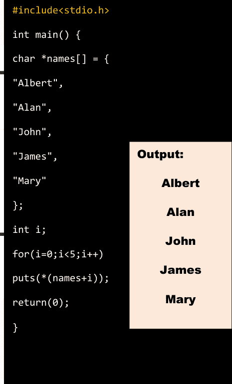

## 问题 96

### 问题
编写一个程序找到两个数之间的最大值。

### 解决方案
```c
#include<stdio.h>

int main() {
    int a, b;
    printf("输入两个数字: \n");
    scanf("%d %d", &a, &b);
    if (a > b) {
        printf("\n%d 是最大数", a);
    } else {
        printf("\n%d 是最大数", b);
    }
    return 0;
}
```

```c
#include<stdio.h>

int main() {
    for (int x = 2; x <= 25; x = x + 2) {
        printf("%d\t", x);
    }
    putchar('\n');
    return 0;
}
```


## 问题 97

### 问题
编写一个程序比较两个字符串。

### 解决方案
```c
#include<stdio.h>
#include<string.h>

int main() {
    char a[100], b[100];
    printf("输入第一个字符串: \n");
    scanf("%s", a);
    printf("输入第二个字符串: \n");
    scanf("%s", b);
    if (strcmp(a, b) == 0) {
        printf("两个字符串相等。\n");
    } else {
        printf("两个字符串不相等。\n");
    }
    return 0;
}
```

```c
#include<stdio.h>

int main() {
    for (int x = 3; x >= 1; x--) {
        for (int y = 1; y <= x; y++) {
            printf("%d ", y);
        }
        printf("*\n");
    }
    return 0;
}
```

**输出：**
```
1 2 3 *
1 2 *
1 *
```

```c
#include<stdio.h>

int main() {
    puts("Albert Einstein");
    return 0;
}
```

**输出：**
```
Albert Einstein
```

## 问题 98

### 问题
编写一个程序将大写字母转换为小写字母。

### 解决方案
```c
#include<ctype.h>
#include<stdio.h>

int main() {
    char ch;
    ch = 'G';
    printf("%c 的小写表示为 %c", ch, tolower(ch));
    return 0;
}
```

## 问题 99

### 问题
编写一个程序找到输入的被除数和除数的商和余数。

### 解决方案
```c
#include<stdio.h>

int main() {
    int dividend, divisor;
    printf("\nEnter被除数: ");
    scanf("%d", &dividend);
    printf("\nEnter除数: ");
    scanf("%d", &divisor);
    printf("\n商 = %d", dividend / divisor);
    printf("\n余数 = %d", dividend % divisor);
    return 0;
}
```

## 问题 100

### 问题
编写一个程序确定 int, float, double 的大小。

### 解决方案
```c
#include<stdio.h>

int main() {
    printf("char 的大小为: %ld bytes\n", sizeof(char));
    printf("int 的大小为: %ld bytes\n", sizeof(int));
    printf("float 的大小为: %ld bytes\n", sizeof(float));
    printf("double 的大小为: %ld bytes\n", sizeof(double));
    return 0;
}
```

## 问题 101

### 问题
编写一个程序验证密码直到正确为止。

### 解决方案
```c
#include<stdio.h>

int main() {
    int pwd, i = 1;
    while (i != 0) {
        printf("\nEnter密码: ");
        scanf("%d", &pwd);
        if (pwd == 8) {
            printf("输入的密码正确\n");
            i = 0;
        } else {
            printf("密码错误，请重试\n");
        }
    }
    return 0;
}
```

**输出：**
```
-3
-2
-1
0
1
2
3
2
1
0
-1
-2 -3
```

```c
#include<stdio.h>

int main() {
    int x, y;
    printf("\nEnter x 的值: ");
    scanf("%d", &x);
    printf("\nEnter y 的值: ");
    scanf("%d", &y);
    if (x > y)
        printf("x 较大");
    else
        printf("y 较大");
    return 0;
}
```

## 问题 102

### 问题
编写一个程序找到数字的绝对值。

### 解决方案
```c
#include<stdio.h>
#include<stdlib.h>

int main() {
    int num;
    printf("输入一个正数或负数: \n");
    scanf("%d", &num);
    printf("\n|%d|绝对值为 %d\n", num, abs(num));
    return 0;
}
```

## 问题 103

### 问题
编写一个程序接受人的身高（厘米）并对其进行分类。

### 解决方案
```c
#include<stdio.h>

int main() {
    float ht;
```


## 问题 104

**问题：**

编写一个程序使用 `switch` 语句计算不同几何形状的面积。

**解决方案：**

机器人学是一门工程和计算机科学的分支，涉及通过人工干预的设计、构造或操作。机器人是可以自主执行任务的可编程机器。机器人学涉及各个工程学科的整合，包括机械工程、电气工程和计算机科学。机器人应用广泛，从制造、农业到医疗和太空探索。机器人可以根据功能进行分类，例如用于制造的工业机器人、用于医疗的服务机器人以及用于防御和监控的军事机器人。它们还可以根据移动性进行分类，例如轮式、足式、空中或水机器人。机器人领域正在不断进化，人工智能、机器学习和材料科学的发展使得更强大的机器人成为可能。机器人技术具有通过自动化枯燥任务和实现新型人机协作来变革行业的潜力。

## 问题 105

**问题：**

编写一个程序从键盘接受一个字符，如果等于 `y` 则打印 "Yes"。否则打印 "No"。

**解决方案：**

```c
#include<stdio.h>

int main() {
    char ch;
    printf("输入一个字符: ");
    ch = getchar();
    if(ch == 'y' || ch == 'Y') {
        printf("Yes\n");
    } else {
        printf("No\n");
    }
    return(0);
}
```

```c
#include<stdio.h>

int main() {
    int num[6] = {21, 22, 23, 24, 25, 26};
    for (int i = 0; i <= 7; i++) {
        printf("\n%d", num[i]);
    }
    return 0;
}
```

| 输出 |
| :--- |
| 21 |
| 22 |
| 23 |
| 24 |
| 25 |
| 26 |
| -759135232 |
| -1723617269 |

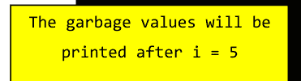

## 问题 106

**问题：**

编写一个程序使用位运算符将输入的值乘以四。

**解决方案：**

```c
#include<stdio.h>

int main() {
    long x, y;
    printf("输入一个整数: ");
    scanf("%ld", &x);
    y = x;
    x = x << 2;
    printf("%ld x 4 = %ld\n", y, x);
    return 0;
}
```

```c
#include<stdio.h>

int main() {
    for(int x=5; x>=1; x--) {
        for(int y=1; y<=x; y++) {
            printf("* ");
        }
        printf("\n");
    }
    return 0;
}
```

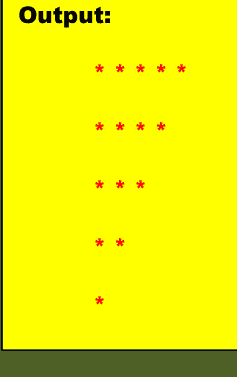

## 问题 107

**问题：**

编写一个程序检查用户输入的数字是否为 2 的幂。

**解决方案：**

```c
#include<stdio.h>

int main() {
    int side1;
    scanf("%d",&side2);
    printf("\nEnter the third side of the triangle: ");
}
```

## 问题 109

**问题：**

编写一个程序打印从 A 到 Z 的所有英文字母的 ASCII 值。

**解决方案：**

```c
#include<stdio.h>

int main() {
    int i;
    for(i='A'; i<='Z'; i++) {
        printf("ASCII value of c = %d\n", i);
    }
    return 0;
}
```

## 问题 110

**问题：**

编写一个程序，计算 1 到 n 之间偶数的和。

**解决方案：**

```c
#include<stdio.h>

int main() {
    int i, num, sum=0;
    printf("Enter a number: ");
    scanf("%d", &num);
    for(i=2; i<=num; i=i+2) {
        sum = sum + i;
    }
    printf("\nSum of all even number between 1 to %d is: %d", num, sum);
    return 0;
}
```

## 问题 111

**问题：**

编写一个程序，计算 1 到 n 之间奇数的和。

**解决方案：**

```c
#include<stdio.h>

int main() {
    int i, num, sum=0;
    printf("Enter a number: ");
    scanf("%d", &num);
    for(i=1; i<=num; i+=2) {
        sum = sum + i;
    }
    printf("\nSum of all odd number between 1 to %d is: %d\n", num, sum);
    return 0;
}
```

网络是指将不同的设备、系统和网络连接在一起以促进通信和信息交换的过程。它涉及到各种硬件和软件技术、协议和标准的使用，使设备能够相互通信并访问资源。

网络可以在不同的层次发生，例如连接单个位置内设备的局域网（LAN）、连接跨不同位置设备的广域网（WAN），以及互联网，它是一个全球性的网络网络，允许设备跨地理位置进行通信。

网络技术包括有线和无线通信技术，如以太网、Wi-Fi 和蓝牙，以及网络协议如 `TCP/IP`、`HTTP` 和 `DNS`。网络还涉及路由器、交换机和集线器等硬件的使用，用于连接设备和管理网络流量。

网络已成为现代计算的重要的一部分，使企业、政府和个人能够在不同的地点和设备之间进行通信和信息交换。它变革了从金融、医疗到教育和娱乐的各个行业，并随着 5G 和物联网（IoT）等新技术的发展不断进化。

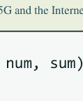

## 问题 112

**问题：**

编写一个程序使用 `switch case`（分支语句）找到最大数。

**解决方案：**

```c
#include<stdio.h>

int main() {
    int x, y;
    printf("Enter any two numbers: \n");
    scanf("%d %d", &x, &y);
    switch (x > y) {
        case 0: printf("%d is Maximum number", y); break;
        case 1: printf("%d is Maximum number", x); break;
    }
    return 0;
}
```

```c
#include<stdio.h>

int main() {
    for(int i=5;i>=0; i=i-1) {
        printf("%d\n", i);
    }
    return 0;
}
```

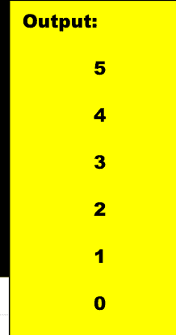

## 问题 113

**问题：**

编写一个程序，允许你输入产品的成本和售价，并计算利润或亏损。

**解决方案：**

```c
#include<stdio.h>

int main() {
    int cp, sp;
    printf("\nInput Cost Price: ");
    scanf("%d", &cp);
}
```

```c
#include <stdio.h>

int main() {
    int x[25];
    for(a = 0; a <= 24; a++) {
        x[a] = a;
        printf("\n%d", x[a]);
    }
    return 0;
}
```

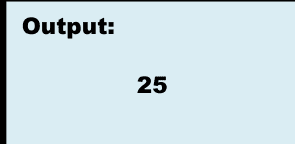

## 问题 114

**问题：**

编写一个程序使用星号显示直角三角形的模式。

**解决方案：**

```c
#include<stdio.h>

int main() {
    int rows;
    printf("Input the number of rows: ");
    scanf("%d", &rows);
    for(int x=1; x<=rows; x++) {
        for(int y=1; y<=x; y++) {
            printf("**");
        }
        printf("\n");
    }
    return 0;
}
```

## 问题 115

**问题：**

编写一个程序使用数字显示直角三角形模式。

**解决方案：**

```c
#include<stdio.h>

int main() {
    int rows;
    printf("Input the number of rows: ");
    scanf("%d", &rows);
    for(int x=1; x<=rows; x++) {
        for(int y=1; y<=x; y++) {
            printf("%d");
        }
        printf("\n");
    }
    return 0;
}
```

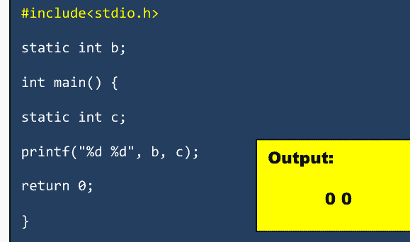

## 问题 116

**问题：**

编写一个程序确定 50 到 100 之间被 2 整除的整数的和。

**解决方案：**

```c
#include<stdio.h>

int main() {
    int x, sum=0;
    printf("Between 50 and 100, divisible by 2: \n");
    for(x=50; x<=100; x++) {
        if(x%2==0) {
            sum+=x;
        }
    }
    printf("\nThe sum: %d", sum);
    return 0;
}
```

```c
#include <stdio.h>

int main() {
    int z[] = {50, 52, 54, 56, 58, 60, 62, 64, 66, 68, 70, 72, 74, 76, 78, 80, 82, 84, 86, 88, 90, 92, 94, 96, 98, 100};
    int y, sum=0;
    for(y=0; y<26; y++) {
        if(z[y]%2==0) {
            sum+=z[y];
        }
    }
    printf("\nThe sum: %d", sum);
    return 0;
}
```

## 问题 117

**问题：**

编写一个程序，使用函数判断输入的数字是偶数还是奇数。

**解决方案：**

```c
#include<stdio.h>

int myfunc(int x) {
    return x & 1;
}

int main() {
    int x;
    printf("Enter any number: ");
    scanf("%d", &x);
    if(myfunc(x)) {
        printf("\nThe number entered is odd.");
    } else {
        printf("\nThe number entered is even.");
    }
    return 0;
}
```

```c
#include <stdio.h>

int main() {
    char c;
    printf("Enter a character: ");
    c = getchar();
    printf("You have entered character '%c'\n", c);
    return 0;
}
```

## 问题 118

**问题：**

编写一个程序找到输入数字的平方根。

**解决方案：**

```c
#include<stdio.h>
#include<math.h>

int main() {
    int x;
    printf("Enter any number: ");
    scanf("%d",&x);
    printf("Square root of %d is %.2f", x, sqrt(x));
    return 0;
}
```

## 问题 119

**问题：**

编写一个程序使用库找到输入数字的次方。

**解决方案：**

```c
#include<stdio.h>
#include<math.h>

int main() {
    int x, y;
    printf("\nEnter the value for x: %d");
    scanf("%d", &x);
    printf("\nEnter the value for y: %d");
    scanf("%d", &y);
    printf("\n%d%d = %ld", x, y, (long)pow(x,y));
    return 0;
}
```

```c
else if(isalpha(ch)) {
    printf("\n%c is an Alphabet", ch);
} else {
    printf("\n%c is not an Alphabet, or a Digit", ch);
}
return 0;
}
```

## 问题 121

**问题：**

编写一个程序来判断输入的字符是否为字母数字。

```c
#include<stdio.h>

int main() {
    printf("The Sum is: %f\n", 16.0+17);
    return 0;
}
```

**答案：**

```c
#include<stdio.h>
#include<ctype.h>

int main() {
    char a;
    printf("Enter a character: ");
    scanf("%c", &a);
    if(isalnum(a)) {
        printf("\n%c is an alphanumeric character.", a);
    } else {
        printf("\n%c is NOT an alphanumeric character.", a);
    }
    return 0;
}
```

输出：
nThe Sum is: 33.000000

## 问题 122

**问题：**

编写一个程序来判断输入的字符是否为标点符号。

**答案：**

```c
#include<stdio.h>
#include<ctype.h>

int main() {
    char a;
    printf("Enter a character: ");
    scanf("%c", &a);
    if(ispunct(a)) {
        printf("\n%c is an punctuation character.", a);
    }
}
```

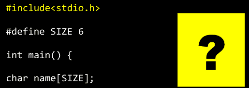

## 问题 123

**问题：**

编写一个程序来检查输入的字符是否为图形字符。

**答案：**

```c
#include<stdio.h>
#include<ctype.h>

int main() {
    char a;
    printf("Enter a character: ");
    scanf("%c", &a);
    if(isgraph(a)) {
        printf("\n%c is a graphic character.", a);
    }
}
```


```c
    }
    else {
        printf("\n%c is NOT a graphic character.", a);
    }
    return 0;
}
```

| 输出： |
| --- |
| 0 |
| 0 |
| 0 |
| 0 |
| 0 |
| 0 |
| 0 |

```c
#include<stdio.h>

int main() {
    static int x[8];
    for(int i = 0; i <= 7; i++)
        printf("\n%d", x[i]);
    return 0;
}
```

# 问题 124

问题：
编写一个程序使用 `isprint()` 函数列出所有可打印字符。

```c
#include<stdio.h>

int main() {
    float i = 6.1 ;
    switch (i) {
        case 0.1 :
            printf("nAlan"); break;
        case 2.1 :
            printf("\nJohn"); break;
        case 4.1 :
            printf("\nMary"); break;
        case 6.1 :
            printf("\nAlbert"); break;
    }
    return 0;
}
```

答案：
```c
#include<stdio.h>
#include<ctype.h>

int main() {
    int i;
    for(i = 1; i <= 127; i++)
        if(isprint(i)!= 0)
            printf("%c ", i);
    return 0;
}
```

# 问题 125

问题：
编写一个程序来检查输入的字符是否为十六进制数字。

答案：
计算机安全是指保护计算机系统和网络免受未经的访问、盗取、破坏或恶意攻击。它实施了各种措施，如防火墙、加密、防病毒软件、访问控制和入侵检测系统，以保护计算机和网络免受安全威胁。计算机安全的目标是确保通过计算机系统和网络存储或传输信息的机密性、完整性和可用性。对于依赖计算机存储和处理敏感数据的个人、企业、政府和其他机构来说，计算机安全至关重要。


# 问题 126

问题：
编写一个程序打印所有控制字符的 ASCII 值。

# 答案：
```c
#include<stdio.h>
#include<ctype.h>

int main() {
    int i;
    printf("The ASCII value of all control characters are: \n");
    for(i=0; i<=127; i++) {
        if(iscntrl(i)!=0) {
            printf("\n %d", i);
        }
    }
    return 0;
}
```

```c
#include<stdio.h>

int main() {
    if(printf("Albert Einstein")){
        return 0;
    }
}
```
输出：
Albert Einstein

# 问题 127

问题：
编写一个程序检查输入的字符是否为空格字符。

答案：
```c
#include<stdio.h>

int main() {
    int i = 6;
    printf("%d + %d = %d\n", i, i, i+i);
    return 0;
}
```
输出：
6 + 6 = 12

# 问题 128

问题：
编写一个程序演示 `isprint()` 和 `iscntrl()` 函数。

```c
#include<stdio.h>
#include<ctype.h>

int main() {
    char ch = 'a';
    if(isprint(ch)) {
        printf("\n%c is printable character.", ch);
    } else {
        printf("\n%c is not printable character.", ch);
    }
    if(iscntrl(ch)) {
        printf("\n%c is control character.", ch);
    } else {
        printf("\n%c is not control character.", ch);
    }
    return 0;
}
```

# 问题 19

问题：
编写一个程序计算立方体的表面积。

```c
#include<stdio.h>

int main() {
    char name[10];
    printf("Enter your name: ");
    fgets(name, 10, stdin);
    printf("Pleased to meet you, %s", name);
    return 0;
}
```
答案：
```c
#include<stdio.h>

int main() {
    int side;
    long area;
    printf("Enter the side of the cube: ");
    scanf("%d", &side);
    area = 6*side*side;
    printf("\nThe surface area of cube is: %ld", area);
    return 0;
}
```


# 问题 130

问题：
编写一个程序使用减法运算符减两个数。

答案：
```c
#include<stdio.h>
#include<stdlib.h>

int main() {
    int x = 6, y = 3;
    printf("%d - %d = %d\n", x, y, x-y);
    return 0;
}
```

```c
#include<stdio.h>

int main() {
    int i = 12;
    for(i=12; i<=15; i+1) {
        printf("%d\t", i);
    }
    return 0;
}
```
输出：
| 12 |
| 13 |
| 14 |
| 15 |

# 问题 131

问题：
编写一个程序使用加法运算符加两个数。

答案：
```c
#include<stdio.h>
#include<stdlib.h>

int main() {
    int x = 6, y = 3;
    printf("%d + %d = %d\n", x, y, x+y);
    return 0;
}
```

```c
#include<stdio.h>

int main() {
    int i;
    for(i=0; i<5; i+1) {
        printf("%d\n", i);
    }
    return(0);
}
```
输出：
| 0 |
| 1 |
| 2 |
| 3 |
| 4 |

# 问题 132

问题：
编写一个程序使用乘法运算符将数字乘以 2。

```c
#include<stdio.h>

int main() {
    printf("%d\n", 49);
    printf("%.2f\n", 3.156);
    return 0;
}
```
答案：
```c
#include<stdio.h>

int main() {
    int x = 2;
    printf("%d\n", x<<1);
    return 0;
}
```
输出：
49
3.16
49656
0.0

# 问题 134

问题：
编写一个程序使用除法运算符将一个数字除以 2。

答案：
```c
#include<stdio.h>

int main() {
    int x = 12;
    printf("%d\n", x>>1);
    return 0;
}
```

# 问题 135

问题：
编写一个程序计算球体体积。

答案：
```c
#include<stdio.h>

int main() {
    int radius;
    float PI = 3.141592;
    printf("\nEnter the radius of sphere: ");
    scanf("%d", &radius);
    float volume = (4/3)*(PI*radius*radius*radius);
    printf("\nThe volume of sphere is: %f\n", volume);
    return 0;
}
```

```c
#include<stdio.h>

int main() {
    printf("Enter a character: ");
    int c = getc(stdin);
    printf("You entered the character '%c'\n",c);
    return 0;
}
```

# 问题 136

问题：
编写一个程序计算椭圆体体积。

答案：
```c
#include<stdio.h>

int main() {
    int r1, r2, r3;
    float PI = 3.141592;
    printf("\nEnter the radius of the ellipsoid of axis 1: ");
    scanf("%d", &r1);
    printf("\nEnter the radius of the ellipsoid of axis 2: ");
    scanf("%d", &r2);
    printf("\nEnter the radius of the ellipsoid of axis 3: ");
    scanf("%d", &r3);
    float volume = (4/3)*(PI*r1*r2*r3);
    printf("\ntVolume of ellipsoid is: %f", volume);
    return 0;
}
```

# 问题 137

问题：
编写一个使用 `for` 循环确定用户输入的数字幂的程序。

答案：
```c
#include<stdio.h>

int main() {
    int x, y;
    long power = 1;
    printf("\nEnter the value for x: ");
    scanf("%d", &x);
    printf("\nEnter the value for y: ");
    scanf("%d", &y);
    for(int i=1; i<=y; i++) {
        power = power * x;
    }
    printf("%d ^ %d = %ld", x, y, power);
    return 0;
}
```

```cpp
scanf("%d",&b);
printf("\nEnter第三个数字: ");
scanf("%d",&c);
avg=(a+b+c)/3.0;
printf("\n三个数字的平均数是: %f", avg);
return 0;
}
```

# 问题 139

问题：
编写一个程序读取整数 "n" 并打印前三个次方（n1, n2, n3）。

解决方案：
```cpp
#include <stdio.h>
#include <math.h>

int main() {
    int n;
    printf("\nEnter一个数字: ");
    scanf("%d",&n);
    printf("%f, %f, %f", pow(n, 1), pow(n, 2), pow(n, 3));
    return 0;
}
```

> 加密是通过将文本转换为在没有密钥的情况下无法理解的编码格式，从而保护通信免受第三方入侵或窃听的实践。加密涉及使用数学算法和协议将消息转换为只有密钥密钥才能读取的秘密代码。加密的目的是确保机密性、完整性和真实性，防止对数据的未经授权访问、修改或拦截。加密在计算机安全中被广泛用于保护如密码、信用卡号和其他个人或财务数据等敏感信息。它也被用于即时消息、虚拟专用网络等各种通信协议，以确保信息在公共网络上的安全传输。


| 静态内存分配 | 动态内存分配 |
| --- | --- |
| 在编译时完成，并在整个程序运行过程中保持不变 | 在程序运行时进行内存分配，并在整个程序运行过程中增加或减少，并在不再需要或使用时释放或释放 |

# C 语言程序：
```cpp
#include<stdio.h>

int main()
{
    FILE *fp;
    fp = fopen("myfiles.txt","w");
    return 0;
}
```

> `w` 表示文件正以写模式打开——如果文件不存在，将创建一个新文件。

# C 语言程序：
```cpp
#include<stdio.h>

int main()
{
    FILE *fp;
    fp = fopen("myfiles.txt","w");
    fprintf(fp, "%s", "C Programming");
    return 0;
}
```

> `fprintf` 函数将文本 "C Programming" 写入文件 `myfiles.txt`。

```cpp
#include<bits/stdc++.h>
using namespace std;

int main() {
    int a = 15, b = 25;
    printf("a 的值: %d", a);
    printf("\n b 的值: %d", b);
    swap(a, b);
    printf("\n 交换后，值为: a = %d, b = %d", a, b);
    return 0;
}
```

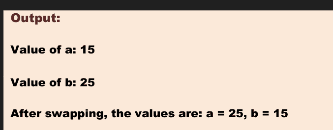

计算机架构指的是计算机系统的设计，包括它们的结构、组件以及它们如何协同工作执行任务。它包含了计算机系统的硬件和软件组件及其相互作用。计算机架构定义了计算机系统的结构和行为，包括处理单元、内存、输入输出设备以及组件之间的通信协议。

计算机系统的架构对于决定其性能、功耗和整体效率至关重要。对于确定不同硬件和软件组件的兼容性和互操作性也很重要。计算机架构在包括台式电脑、笔记本电脑、服务器和移动设备在内的计算机系统设计和开发中起着至关重要的作用。对于设计、开发和维护计算机系统的计算机工程师、软件开发者和系统管理员来说，理解计算机架构是本质的。

# C++ 练习


20世纪70年代，丹麦计算机科学家 Bjarne Stroustrup 创建了 C++ 语言。C++ 最初的名字是 "C with classes."。通过练习 C++ 程序，你可以最有效地学习 C++ 编程语言。C++ 是一种通用编程语言。它提供了低级内存操作功能，并结合命令式、面向对象和泛型编程特性。它用于创建机器学习工具、网络浏览器、视频游戏和操作系统。在本章中可以找到基础 C++ 概念的示例。鼓励你将程序作为参考并自己测试这些概念。C++ 练习是练习编程、提高能力以及更多了解该语言的极佳方法。

# 问题 1

问题：
编写一个程序打印 Hello, World!。

# 解决方案：
```cpp
#include<iostream>
using namespace std;

int main() {
    std::cout<<"Hello, World!";
    return 0;
}
```

```cpp
#include<iostream>
using namespace std;

int main() {
    cout << "Elsa Einstein \n";
    cout << "Einstein \n";
    return 0;
}
```

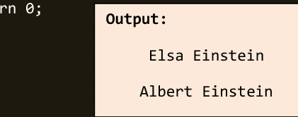

# 问题

# 问题：
编写一个程序，读取三个浮点数值，并检查它们是否能组成三角形。如果输入的数值有效，则计算三角形的周长。

# 解决方案：
```cpp
#include<iostream>
using namespace std;

int main() {
    float x, y, z;
    cout<<"\nEnter the first number: ";
    cin>>x;
}
```


## 数据挖掘

数据挖掘是利用统计和计算方法从大型数据集中发现隐藏模式、相关性和趋势的过程。它涉及通过自动或半自动技术，从复杂的数据集中提取有意义的见解，以识别可能无法立即发现的模式和关系。

数据挖掘通常涉及几个步骤，包括数据清洗、数据集成、数据转换、数据挖掘、模式选择、评估和知识表示。该过程通常是迭代的，每次迭代的结果都会指导后续迭代并完善最终输出。

数据挖掘被广泛应用于广泛的领域，包括营销和广告、财务分析、欺诈检测和科学研究。在可用大量数据且数据之间的关系复杂、难以通过传统分析技术辨别的情况下，数据挖掘显得尤为有用。

从数据挖掘中获得的见解可以做出更好的业务决策、改进客户服务、降低成本并识别新的增长和创新机会。然而，使用数据伦理并确保个人数据的隐私和安全得到保护是非常重要的。

## 问题 8

### 问题

编写一个程序，读取一个 1 到 7 之间的整数，并用英文打印星期几。

### 解决方案

```cpp
#include<iostream>

using namespace std;

int main() {
    int day;
    cout<<"\nEnter a number between 1 to 7 to get the day name: ";
    cin>>day;
    switch(day) {
        case 1 : cout<<"Monday\n"; break;
        case 2 : cout<<"Tuesday\n"; break;
        case 3 : cout<<"Wednesday\n"; break;
        case 4 : cout<<"Thursday\n"; break;
        case 5 : cout<<"Friday\n"; break;
        case 6 : cout<<"Saturday\n"; break;
        case 7 : cout<<"Sunday\n"; break;
        default: cout<<"Enter a number between 1 to 7.\n";
    }
    return 0;
}
```

## 编译器理论

编译器理论是指研究编译器如何将编程语言翻译成机器可读的代码。它涵盖了一系列主题，包括语法分析、语义代码生成、优化和调试。程序的编译涉及多个步骤。首先，分析程序的源代码以检查语法错误并表示程序的结构。接下来，进行语义分析以检查语义错误并确定程序构造的含义。之后，生成代码，这涉及翻译成计算机可以执行的低级代码。最后，对生成的代码进行优化以提高性能。编译器理论是计算机科学和编程的一个重要领域，因为它对于开发高效的软件至关重要。它在新型编程语言的开发中也起着至关重要的作用，因为它为语言构造的设计与实现以及其使用与性能之间的权衡提供了见解。编译器理论中的一些关键主题包括解析算法、语言设计与语法、类型系统、内存管理、优化技术以及调试和错误处理。编译器理论显著提升了软件的性能和可靠性，并帮助初学者更容易接触和更容易学习编程。

## 问题 9

### 问题

编写一个程序求两个数字之和。

### 解决方案

```cpp
#include<iostream>

using namespace std;

int main() {
    int a, b, sum;
    a=1;
    b=2;
    sum = a + b;
    cout<<"The sum of a and b is: " << sum;
    return 0;
}
```

```cpp
#include<iostream>

using namespace std;

int main() {
    bool x = true;
    bool y = false;
    cout << x << endl;
    // Output: 1
    cout << y << endl;
    // Output: 0
    return 0;
}
```

## 问题 10

### 问题

编写一个程序求一个数的平方。

### 解决方案

```cpp
#include<iostream>
#include<cmath>

using namespace std;

int main() {
    int a, b;
    a=2;
    b = pow((a), 2);
    cout<<"The square of a is: "<< b;
    return 0;
}
```

```cpp
#include<iostream>
#include<cstring>

using namespace std;

int main() {
    string x = "Albert";
    cout << x[0];
    // Output: A
    return 0;
}
```

## 问题 11

### 问题

编写一个程序求两个数字中的最大值。

### 解决方案

```cpp
#include<iostream>

using namespace std;

int main() {
    int a, b;
    a=2;
    b=3;
    if(a>b) {
        cout<<"a is greater than b";
    } else {
        cout<<"b is greater than a";
    }
    return 0;
}
```

## 问题 12

### 问题

编写一个程序求数组的平均值。

### 解决方案

```cpp
#include<iostream>

using namespace std;

int main() {
    int i, avg, sum = 0;
    int num[] = {16, 18, 20, 25, 36};
    for(i=0; i<5; i++) {
        sum = sum + num[i];
    }
    avg = sum/5;
    cout<<"Sum of the array is: " << sum;
    cout<<"\nAverage of the array is: " << avg;
    return 0;
}
```

## 问题 13

### 问题

编写一个程序打印 1 到 25 之间所有的偶数。

### 解决方案

```cpp
#include<iostream>

using namespace std;

int main() {
    cout<<"Even numbers between 1 and 25:\n";
    for(int i=1; i<=25; i++) {
        if(i%2 == 0) {
            cout<< i << endl;
        }
    }
    return 0;
}
```

```cpp
#include<iostream>
#include<string>

using namespace std;

int main() {
    string x = "Albert";
    x[0] = 'E';
    cout << x;
    // Output: Elbert
    return 0;
}
```

## 问题 14

### 问题

编写一个程序打印 1 到 50 之间所有的奇数。

### 解决方案

```cpp
#include <iostream>

using namespace std;

int main() {
    cout<<"Odd numbers between 1 to 50:\n";
    for(int i = 1; i <= 50; i++) {
        if(i%2 != 0) {
            cout<<i<<endl;
        }
    }
    return 0;
}
```

## 量子计算

量子计算在计算机科学中有许多应用，包括比经典计算机快得多的解决计算问题。这对密码学、优化和算法设计等领域具有重大影响。著名的量子算法之一是 `Shor` 算法，它可以比目前最好的经典算法更快地分解大数。这对密码学产生了许多影响，因为许多加密方案都依赖于分解大数在计算上是不可行的事实。具有重要应用的量子算法是 `Grover` 算法，它为无序数据库搜索提供了二次加速。这对数据库搜索和机器学习具有影响。

量子计算理论在量子机器学习的发展中也很重要，旨在开发利用量子计算机特性的机器学习算法。这包括量子神经网络的发展，它可以学习并识别量子数据中的模式。然而，量子理论也给计算机科学带来了巨大的挑战，包括纠错问题以及开发利用量子独特特性的高效算法。许多研究人员正在努力克服这些挑战，并在计算机科学中开发量子计算的实际应用。

## 问题 16

### 问题

编写一个程序：
如果你输入一个字符 M
输出必须是：ch = M。

```cpp
#include<iostream>

using namespace std;

int main() {
    cout << min(15, 60)<<endl;
    // 输出: 15
    cout << max(15, 60)<<endl;
    // 输出: 60
    return 0;
}
```

### 解决方案

```cpp
#include<iostream>

using namespace std;

int main() {
    char M;
    cout<<"Enter any character: ";
    cin>>M;
    cout<<"ch = " << M;
    return 0;
}
```

## 问题 17

### 问题

编写一个程序，打印用户输入的数字的乘法表。

### 解决方案

```cpp
#include<iostream>

using namespace std;

int main() {
    int n, i;
    cout<<"Enter any number: ";
    cin>>n;
    for(i=1; i<=5; i++)
        cout<< n << " * " << i << " = " << endl;
    return 0;
}
```

## 可计算理论

可计算理论是计算机科学和数学的一个分支，涉及研究什么是可以计算的以及如何高效地计算。它研究计算机器的局限性、可计算内容的范围，以及问题可以通过分析解决的程度。可计算理论中的核心概念之一是可计算函数。如果存在一个算法可以在有限时间内计算某个函数，则该函数是可计算的。研究可计算函数会导致图灵机的概念，图灵机是计算的抽象模型，可以执行任何算法可以完成计算。可计算理论中的另一个重要概念是停机问题。停机问题询问对于给定的输入和程序，是否可能确定程序将停止还是无限运行。这个问题的答案是否定的，这对可计算性的局限产生了深远影响。

可计算理论还研究复杂度概念，涉及解决问题所需的资源。这包括计算解决方案所需的时间，以及所需的内存或其他资源。复杂度理论与可计算理论紧密相关，因为它探索了可以高效计算内容的局限。总的来说，可计算理论是计算机科学和数学的一个基础领域，在密码学、人工智能和算法分析等领域有重要应用。

## 问题 18

### 问题

编写一个程序打印前10个数字的乘积。

### 解决方案

```cpp
#include<iostream>

using namespace std;

int main() {
    int i, product = 1;
    for(i=1; i<=10; i++)
        product = product * i;
    cout<<"The product of the first 10 digits is: " << product;
    return 0;
}
```


## 问题 19

### 问题

编写一个程序打印给定的数字是正数还是负数。

### 解决方案

```cpp
#include<iostream>

using namespace std;

int main() {
    int a;
    a = -35;
    if(a>0) {
        cout<<"Number is positive";
    }
    else {
        cout<<"Number is negative";
    }
    return 0;
}
```

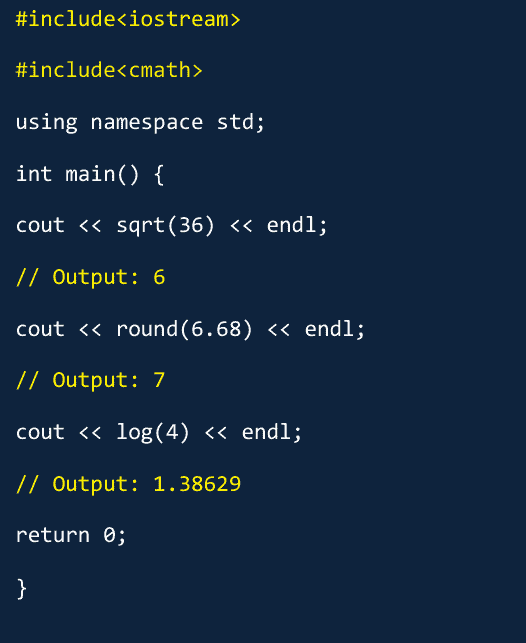

## 问题 20

### 问题

编写一个程序检查用户输入的两个数字的等价性。

### 解决方案

```cpp
#include<iostream>

using namespace std;

int main() {
    int x, y;
    cout<<"Enter the first number: ";
    cin>>x;
    cout<<"Enter the second number: ";
    cin>>y;
    if(x-y==0) {
        cout<<"The two numbers are equivalent";
    } else {
        cout<<"The two numbers are not equivalent";
    }
    return 0;
}
```

```cpp
#include<iostream>

using namespace std;

int main() {
    cout << (20 > 19);
    // 输出: 1
    return 0;
}
```

## 问题 21

### 问题

编写一个程序打印用户输入的两个数字的余数。

### 解决方案

```cpp
#include<iostream>

using namespace std;

int main() {
    int a, b, c;
    cout<<"Enter the first number: ";
    cin>>a;
    cout<<"Enter the second number: ";
    cin>>b;
    c = a % b;
    cout<<"The remainder of " << a << " and " << b << " = " << c;
    return 0;
}
```

## 问题 22

### 问题

编写一个程序打印从 A 到 Z 的字符。

### 解决方案

```cpp
#include<iostream>

using namespace std;

int main() {
    char i;
    for(i='A'; i<='Z'; i++) {
        cout << i << endl;
    }
    return 0;
}
```

```cpp
#include<iostream>
#include<cstring>

using namespace std;

void myfunc(string name, int age) {
    cout << "name: " << name << " age: " << age << " years.\n";
}

int main() {
    myfunc("Albert", 73);
    myfunc("Elsa", 14);
    myfunc("David", 30);
    return 0;
}
```

## 问题 23

### 问题

编写一个程序打印输入字符串的长度。

### 解决方案

```cpp
#include<iostream>
#include<string.h>

using namespace std;

int main() {
    char str[100];
    cout<<"Enter a string: ";
    cin>>str;
    cout<<"The length of string is: " << strlen(str);
    return 0;
}
```

## 问题 24

### 问题

编写一个程序检查给定的字符是否小写字母。

### 解决方案

```cpp
#include<iostream>
#include<ctype.h>

using namespace std;

int main() {
    char ch = 'a';
    if(tolower(ch))
        cout<<"The given character is lowercase letter";
    else
        cout<<"The given character is not lowercase letter";
    return 0;
}
```

## 问题 25

### 问题

编写一个程序检查给定的字符是否大写字母。

### 解决方案

```cpp
#include<iostream>
#include<ctype.h>

using namespace std;

int main() {
    char ch = 'A';
    if(isupper(ch))
        cout<<"The given character is uppercase letter";
    else
```


# 问题 26

## 问题
编写一个程序将小写字母转换为大写字母。

## 解决方案
```cpp
#include<iostream>
#include<ctype.h>
using namespace std;
int main() {
    char ch = 'a';
    char b = toupper(ch);
    cout<<"Lowercase letter "<<ch<<" is converted to "<<b;
    return 0;
}
```

# 问题 27

## 问题
编写一个程序接受厘米并输出对应的英寸。

## 解决方案
```cpp
#include<iostream>
using namespace std;
#define x 2.54
int main() {
  double inch, cm;
  cout<<"Enter the distance in cm: ";
  cin>>cm;
  inch = cm / x;
  cout<<"\nDistance of " << cm << " cm is equal to " << inch << " inches";
  return 0;
}
```

# 问题 28

## 问题
编写一个程序打印输出：
- Einstein[0] = E
- Einstein[1] = I
- Einstein[2] = N
- Einstein[3] = S
- Einstein[4] = T
- Einstein[5] = E
- Einstein[6] = I
- Einstein[7] = N

> 过程化编程是一种基于过程（也称为子程序或函数）概念的编程范式。过程是执行特定任务的指令组，可以在程序的不同部分调用或执行。在过程化编程中，程序由一个或多个过程组成，可以组织模块或库。过程通常以逐步的方式组织，每个过程根据需要调用其他过程来完成任务。
>
> 过程化编程的主要关注是过程本身以及它们如何相互作用以及数据。在过程化程序中，数据通常组织成数据结构，如数组、记录或链表。过程化编程的主要优点之一是其简单易用。它通常用于中小型程序，并且特别适用于涉及数据处理的应用，如数学计算或文件操作。
>
> 然而，过程化编程也有一些局限性。随着程序变得越来越大和复杂，管理过程与数据之间的交互作用可能会变得困难。此外，过程化编程并不适用于需要复杂数据结构或涉及用户界面的应用程序。总的来说，过程化编程仍然是一个重要的编程范式，并且在各种应用中被广泛使用，特别是系统软件开发和科学计算领域。

## 解决方案
```cpp
#include<iostream>
using namespace std;
int main() {
    int i;
    char name[8] = {'E', 'I', 'N', 'S', 'T', 'E', 'I', 'N'};
    for(i=0; i<8; i++)
        cout<<"Einstein[" << i << "] = " << name[i] << endl;
    return 0;
}
```

# 问题 29

## 问题
编写一个程序打印 "Hello World" 10 次。

## 解决方案
```cpp
#include<iostream>
using namespace std;
int main() {
    for(int i=1; i<=10; i++) {
        cout<< "Hello World"<< endl;
    }
    return 0;
}
```

# 问题 30

## 问题
编写一个程序使用 `while` 语句打印前 5 个数字。

## 解决方案
```cpp
#include<iostream>
using namespace std;
int main() {
    int i = 1;
    do {
        cout<<"\ni = " << i++;
    } while (i<5);
    return 0;
}
```

> 形式语义学（Formal semantics）是理论语言学的一个分支，旨在为描述自然语言表达式的含义提供一个精确的框架。它关注使用逻辑、数学和计算机科学的工具开发语言结构和解释的形式化模型。形式语义学基于这样一个观点：句子的意义可以通过一组规则确定，这些规则的组成部分组合形成一个完整的表达式。这些规则可以使用数学符号和逻辑符号进行形式化，并用于生成句子的精确表示。形式语义学有几种不同的方法，包括：
>
> - 模型论语义学（Model-theoretic semantics）：这种方法使用数学模型来表示句子。模型由对象集合以及它们之间的关系组成，句子的意义取决于它在模型中是真是假。
> - 类型论语义学（Type-theoretic semantics）：这种方法使用类型论提供语言表达式结构的形式化描述。每个表达式都被分配一个类型，该类型描述了它的属性以及它如何与其他表达式组合。
> - 情境语义学（Situation semantics）：这种方法认为句子的意义取决于它被被使用的情境。情境被表示为一组事实，句子的意义取决于它与这些事实的关系。
>
> 形式语义学用于许多领域，包括自然语言处理、机器翻译和计算语言学。它为分析和理解语言含义提供了一个严谨的框架，并对语言学中新语法理论的发展做出了贡献。

# 问题 31

## 问题
编写一个程序检查一个字符是否为字母。

## 解决方案
```cpp
#include<iostream>
using namespace std;
int main() {
    int a = 2;
    if(isalpha(a)) {
        cout<<"The character a is an alphabet";
    } else {
        cout<<"The character a is not an alphabet";
    }
    return 0;
}
```

# 问题 32

## 问题
编写一个程序检查输入的数字是偶数还是奇数。

## 解决方案
```cpp
#include<iostream>
using namespace std;
int main() {
    int a;
    cout<<"Enter any number:";
    cin>>a;
    if(a%2 == 0) {
        cout<<"The entered number is even";
    }
    else {
        cout<<"The entered number is odd";
    }
    return 0;
}
```

> 编程语言实用论（Programming language pragmatic）是指研究编程语言在实践中如何使用，包括它们的实现、性能和设计。它关注编程语言的实际方面，例如它们如何被用于解决现实世界的问题，以及它们如何与运行它们的硬件和操作系统交互。编程语言实用论关注与编程语言使用相关的一系列问题，包括：
>
> - 语言语法和语义：编程语言是如何结构化的，以及它们如何表达不同类型的计算。
> - 语言实现：编程语言是如何实现的，包括与编译器、解释器和运行时环境相关的问题。
> - 语言设计：编程语言在效率、内存使用和其他指标方面的表现。
> - 语言设计：编程语言如何设计以满足不同类型应用和用户的需求。
> - 语言演进：编程语言如何随时间演变，新功能的引入以及旧功能的废弃。
> - 语言易用性：编程语言如何设计得易于使用，以及它们如何让初级程序员更容易上手。
>
> 编程语言实用论是软件开发者来说的一个重要研究领域，因为它提供了关于如何使用不同编程语言解决不同类型问题的见解，以及如何对其性能和易用性进行优化。它对于研究人员和教育工作者也很重要，因为它有助于指导新编程语言和编程课程的设计与开发。

# 问题 33

## 问题
编写一个程序打印输入的字符的 ASCII 值。

## 解决方案
```cpp
#include<iostream>
using namespace std;
int main() {
  char c;
  cout << "Enter a character: ";
  cin >> c;
  cout << "The ASCII Value of " << c << " " << int(c);
  return 0;
}
```

# 问题 34

## 问题
编写一个程序，打印 1 到 50 之间所有被指定数字除后余数为 2 的数字。

## 解决方案
```cpp
#include<iostream>
using namespace std;
int main() {
    int x, i;
    cout<<"Enter a number: ";
    cin>>x;
    for(i=1; i<=50; i++) {
        if((i%x)==2) {
            cout<<i<<endl;
        }
    }
    return 0;
}
```

> 编程语言理论（Programming language theory）是研究编程语言设计和实现的基础概念和原则。它关注理解编程语言是如何运作的。编程语言理论涵盖了广泛的主题：
>
> - 语法和语义：编程语言是如何结构化的，以及如何表达复杂的计算。
> - 类型和类型系统：编程语言如何处理数据类型，类型系统如何确保程序的正确性和安全性。
> - 形式化方法：数学方法如何用于推理程序的行为。
> - 并发与并行：编程语言如何处理并发执行，包括同步、通信和资源管理。
> - 逻辑编程：基于逻辑的编程语言如何用于推理复杂的系统。
> - 函数式编程：基于函数式编程原则的语言如何以简洁的方式表达复杂计算。

# 问题 35

## 问题
编程语言理论是计算机科学研究人员的一个重要领域，因为它为编程语言的设计和实现提供了理论基础。它在新的编程范式和技术的发展中起着重要作用。
编写一个程序判断一对数字是升序还是降序。

## 解决方案
```cpp
#include<iostream>
using namespace std;
int main() {
    int a, b;
    cout<<"\n a pair of numbers (for example 22,12 | 12,22): ";
    cout<<"\nenter the first number: ";
    cin>>a;
    cout<<"\nenter the second number: ";
    cin>>b;
    if (a>b) {
        cout<<"\nthe two numbers in a pair are in descending order.";
    }
    else {
        cout<<"\nthe two numbers in a pair are in ascending order.";
    }
    return 0;
}
```

# 问题 36

## 问题
编写一个程序读取两个数字并用一个除以另一个。如果不可，请指定“Division not possible”。

## 解决方案
```cpp
#include<iostream>
using namespace std;
int main() {
int a, b;
float c;
cout<<"\nnter the first number: ";
cin>>a;
cout<<"\nenter the second number: ";
cin>>b;
if(b != 0) {
    c = (float)a/(float)b;
    cout<<"a"/"<<b << " " << c;
} else {
    cout<<"\nDivision not possible.\n";
}
return 0;
}
```

# 问题 37

## 问题
编写一个程序，打印 1 到 50 之间所有被指定数字除后余数等于 2 或 3 的数字。

## 解决方案
```cpp
#include<iostream>
using namespace std;
int main() {
    int x, i;
    cout<<"Enter a number: ";
    cin>>x;
    for(i=1; i<=50; i++) {
        if((i%x)==2 || (i%x) == 3) {
            cout<<i<<endl;
        }
    }
    return 0;
}
```

# 问题 38

## 问题
编写一个程序，累加 1 到 100 之间所有不能被 12 整除的数字。

## 解决方案
```cpp
#include<iostream>
using namespace std;
int main() {
int x = 12, i, sum = 0;
for(i=1; i<=100; i++) {
  if((i%x)!=0) {
    sum += i;
  }
}
cout<<"\nsum: " <<sum;
return 0;
}
```

> 软件工程是设计、开发、测试和维护软件的系统过程。它是一门将工程原理应用于软件产品和系统创建的学科，目标是开发高质量、可靠且高效的软件，以满足用户和相关者的需求。
>
> 软件工程涉及一系列活动，包括需求分析、软件设计、编码、测试和维护。它包括项目管理和质量保证活动，如软件配置管理、软件指标和软件过程改进。
>
> 工程过程通常涉及几个阶段，如规划、需求收集、设计、实现和部署。这些阶段对于确保软件的开发符合用户和相关者的需求、具有高质量并能够随着时间的推移进行维护至关重要。
>
> 软件工程是一个复杂的跨学科领域，有许多子学科，如软件架构、软件测试、软件维护和软件项目管理。它需要计算机科学、数学和工程等领域的专业知识，以及对业务和用户需求的理解。

# 问题 39

## 问题
编写一个程序计算 x 的值，其中 x = 1 + 1/2 + 1/3 + ... + 1/50。

## 解决方案
```cpp
#include<iostream>
using namespace std;
int main() {
    float x = 0;
    for(int i=1; i<=50; i++) {
        x += (float)1/i;
    }
    cout<<"Value of x: " << x;
    return 0;
}
```

> 算法设计是创建一组指令或步骤以解决特定问题或完成特定任务的过程。算法在计算机科学和编程中至关重要，因为它们是自动化过程并提高效率的方法。以下是设计算法的一些通用步骤：
>
> **理解问题：** 在设计算法之前，务必对你试图解决的问题有清晰的理解。分析问题，将其拆分为更小的子问题，并识别输入和输出需求。
>
> **规划算法：** 一旦你对问题有了清晰的理解，通过确定解决问题所需的步骤来规划算法。识别将需要的数据结构和编程结构，例如循环、条件和函数。
>
> **编写算法代码：** 使用你选择的编程语言为算法编写代码。确保使用清晰、简洁且易于理解和调试的代码。
>
> **测试算法：** 使用不同的输入测试算法，以确保它按预期工作，且在测试期间没有发现错误。
>
> **优化算法：** 一旦算法运行正常，就可以对其进行优化以提高效率。这可能涉及减少所需的操作次数、使用更高效的数据结构，或针对特定的硬件和软件环境优化代码。
>
> **文档记录算法：** 最后，对算法进行文档记录，包括它的输入、输出以及设计过程中提出的任何局限性或假设。这些文档将帮助他人在未来理解并使用该算法。
>
> 设计算法可能是一个复杂的过程，通常需要对问题领域和正在使用的编程语言有深入理解。然而，通过实践和经验，任何人都可以精通算法设计，并为复杂问题开发高效且有效的解决方案。

# 问题 40

## 问题
编写一个程序读取一个数字并找到它所有的因子。

## 解决方案
```cpp
#include<iostream>
using namespace std;
int main() {
int x, i;
cout<<"\nenter a number: ";
cin>>x;
cout<<"All the divisor of "<<x<<" are: \n";
for(i = 1; i <= x; i++) {
  if((x%i) == 0) {
    cout<<i<<endl;
  }
}
return 0;
}
```

> 自动机理论是计算机科学的一个分支，涉及研究抽象机器或计算模型，这些模型可以对字符串或符号执行各种操作。这些机器被用于描述表现出复杂行为的系统，例如自然语言处理、计算机语言和人工智能。
>
> 自动机理论包括对各种类型的机器和模型的研究，例如有限自动机、图灵机等。这些模型都具有不同的计算能力，并可以对字符串或符号执行不同类型的操作。
>
> 自动机背后的理论是设计一种计算模型，使其能够识别字符串或符号中的模式，并根据输入做出决策。不同的自动机模型被用于设计计算中不同复杂度的层次，并设计能够有效解决复杂问题的算法。
>
> 自动机理论有实际应用，包括编译器设计、自然语言处理、人工智能和数据库系统。通过理解不同自动机的计算能力和局限性，计算机科学家可以设计出解决各个领域复杂问题的高效且有效的算法。

# 问题 41

## 问题
编写一个程序找到两个数字的增值和减值值。

## 解决方案
```cpp
#include<iostream>
using namespace std;
int main() {
int a, b, c, d, e, f;
a = 10;
b = 12;
c=a+1;
d=b+1;
e=a-1;
```


cout<<"incremented value of a = " << c << endl;

cout<<"incremented value of b = " << d << endl;

cout<<"decremented value of a = " << e << endl;

cout<<"decremented value of b = " << f << endl;

return 0;

}

```

# 问题 42

问题：

编写一个程序使用函数找到输入数字平方。

解决方案：

```cpp
#include<iostream>

using namespace std;

int square();

int main() {

    int answer;

    answer = square();

    cout<<"The square of the number is: "<< answer;

    return 0;

}

int square() {

    int x;

    cout<<"Enter any number: ";

    cin>>x;

    return x*x;

}
```

# 问题 43

问题：

编写一个程序接受本金、利率、时间并计算单利。

解决方案：

```cpp
#include<iostream>

using namespace std;

int main() {

    int P,T, R, SI;

    cout<<"Enter the principal amount: ";

    cin>>P;

    cout<<"Enter the time: ";

    cin>>T;

    cout<<"Enter the rate of interest: ";

    cin>>R;

    SI = P*T*R/100;

    cout<<"The simple interest is "<<SI;

    return 0;

}
```

# 问题 44

问题：

编写一个程序不使用第三变量交换两个数字。

解决方案：

```cpp
#include<iostream>

using namespace std;

int main() {

    int a, b;

    cout<<"\nEnter the value for a: " ";

    cin>>a;

    cout<<"\nenter the value for b: " ";

    cin>>b;

    cout<<\nBefore swapping: " << a << " " << b;

    a=a+b;

    b=a-b;

    a=a-b;

    cout<<\nAfter swapping: " << a << " " << b;

    return 0;

}
```

# 问题 45

问题：

编写一个程序使用指针找到两个输入数字中的最大值。

解决方案：

```cpp
#include<iostream>

using namespace std;

int main() {

    int x, y, *p, *q;

    cout<<"Enter the value for x: ";

    cin>>x;

    p = &x;

    cout<<"Enter the value for y: ";

    cin>>y;

    q = &y;

    if(*p>*q) {

        cout<<"x is greater than y";

    } else {

        cout<<"y is greater than x";

    }

    return 0;

}
```

Docker 是一个流行的开源平台，用于在容器中构建、部署和管理应用程序。容器是一个轻量级且独立的执行包，包含了运行应用程序所需的所有内容，如代码、库和依赖项。Docker 允许开发者将应用程序及其依赖封装成容器镜像，可以在不同环境（如开发、测试和生产）之间轻松共享和运行。Docker 容器为应用程序提供了一致的环境，减少了兼容性问题，并使应用程序的部署和扩展变得更加容易。Docker 广泛应用于软件开发和部署，特别是在现代云原生和微服务架构中。通过 Docker，开发者可以快速高效地构建、测试和部署应用程序，而运营团队可以轻松管理和扩展这些应用程序。

# 问题 46

问题：

编写一个程序打印输出：

body[b] = b

body[o] = o

body[d] = d

body[y] = y

计算机操作系统（有时称为 OS）是一种控制系统硬件和软件资源的软件，并为运行系统的应用程序提供标准服务。操作系统的主要功能是作为计算机硬件与运行在其上的应用程序之间的中介。它提供用户界面，管理计算机的内存和处理资源，并控制键盘、屏幕和打印机等输入输出设备。

操作系统的主要功能包括管理资源分配、进程调度、提供安全和保护、管理文件系统以及提供用户界面。操作系统对于现代计算机系统（包括台式电脑、服务器和移动设备）的运行至关重要。Windows、macOS、Linux 和 Android 是常见的操作系统。操作系统在计算机系统的性能和可靠性方面起着至关重要的作用，是计算机科学和工程的基础组件。

解决方案：

```cpp
#include<iostream>

using namespace std;

int main() {

    char i;

    char body[4] = {'b', 'o', 'd', 'y'};

    for(i=0;i<4; i++) {

        cout<<"\n body "<<body[i] << endl;

    }

    return 0;

}
```

计算机图形是指使用计算机软件和硬件创建、处理和显示视觉内容。它涉及使用数学算法、数字工具和技术创建图像、动画和视觉效果。计算机图形应用于许多领域，包括数字艺术、视频游戏、电影电视、产品设计、科学可视化等。

计算机图形可以分为两类：位图图形和矢量图形。位图图形由像素组成，用于创建图像和照片；而矢量图形则使用数学公式创建几何形状，用于创建标志和插图。

计算机图形领域涵盖了多个子领域，包括计算机辅助设计 (CAD)、3D 建模、计算机动画、虚拟现实和增强现实。计算机图形是一个快速发展的领域，通过计算机技术和软件开发的不断不断进步。它在许多行业中起着至关重要的作用，是现代设计和通信中不可或缺的一部分。

# 问题 47

问题：

编写一个程序计算折扣价格和折后的总价

给定条件：

如果购买金额大于 1000，打 10% 折。

如果购买金额大于 5000，打 20% 折。

如果购买金额大于 10000，打 30% 折。

解决方案：

```cpp
#include<iostream>

using namespace std;

int main() {

    double PV;

    cout<<"Enter purchased value: ";

    cin>>PV;

    if(PV>10000) {

        cout<<"Discount = " << PV * 0.3 << endl;

        cout<<"Total= " << PV - PV * 0.3 << endl;

    } else if(PV>5000) {

        cout<<"Discount = " << PV * 0.2 << endl;

        cout<<"Total= " << PV - PV * 0.2 << endl;

    } else if(PV>1000) {

        cout<<"Discount = " << PV * 0.1 << endl;

        cout<<"Total= " << PV - PV * 0.1 << endl;

    }

    return 0;

}
```

Bootstrap 是一个免费开源的前端 Web 框架，广泛用于创建响应式和移动优先的网站及 Web 。它由 Twitter 开发，现在由 Bootstrap 核心团队维护。

Bootstrap 提供了一系列 CSS 和 JavaScript 组件，可以轻松集成到 Web 项目中。这些组件包括导航栏、按钮、图标等。该框架还提供了一个网格系统，允许开发者为其网页创建灵活且响应式的布局。

Bootstrap 的主要优势之一是它专注于移动优先设计。该框架包含了专门为较小屏幕设计的 CSS 类，使得创建在桌面和移动设备上运行良好的网站变得简单。

Bootstrap 具有很高的定制性，可以进行修改以匹配特定网站的视觉风格。

# 问题 48

问题：

使用 while 循环编写程序打印前十个自然数。

# 问题 49

问题：

编写一个程序将输入的数据左移。

# 问题 50

问题：

编写一个程序计算 x 与 21 之间的精确差。如果 x 大于 21，则返回绝对差的三倍。

# 问题 51

问题：

编写一个程序读取两个数字，并判断第一个数字是否为第二个数字的倍数。

# 问题 53

问题：

编写一个程序输出以下内容：
Name of the book = B
Price of the book = 135.00
Number of pages = 300
Edition of the book = 8
使用结构体。

解决方案：

```cpp
#include<iostream>

using namespace std;

int main() {

    struct book {

        char name;

        float price;

        int pages;

        int edition;

    };

    struct book b1 = {'B', 135.00, 300, 8};

    cout<<"Name of the book " << b1.name << endl;

    cout<<"Price of the book " << b1.price << endl;

    cout<<"Number of pages " << b1.pages << endl;

    cout<<"Edition of the book " << b1.edition << endl;

    return 0;

}
```

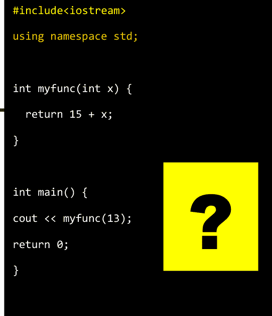

# 问题 54

问题：

编写一个程序将摄氏度转换为华氏度。

解决方案：

```cpp
#include<iostream>

using namespace std;

int main() {

    float fahrenheit, celsius;

    celsius = 36;

    fahrenheit = ((celsius*9)/5)+32;

    cout << "\nTemperature in fahrenheit is: " << fahrenheit;

    return 0;

}
```

# 问题 55

问题：

编写一个程序检查输入的两个整数，如果其中任意一个为 50 或者它们的和为 50，则返回 true。

解决方案：

```cpp
#include<iostream>

using namespace std;

int main() {

    int x, y;

    cout<<"\nEnter the value for x: ";

    cin>>x;

    cout<<"\nEnter the value for y: ";

    cin>>y;

    if(x == 50 || y == 50 || (x + y == 50)) {

        cout<<"\nTrue";

    }

    else {

        cout<<"\nFalse";

    }

    return 0;

}
```

# 问题 56

问题：

编写一个程序，在 18 个整数输入中统计偶数、奇数、正数和负数的数量。

解决方案：

```cpp
#include<iostream>

using namespace std;

int main () {

    int x, even = 0, odd = 0, positive = 0, negative = 0;

    cout<<"Please enter 18 numbers: \n";

    for(int i = 0; i < 18; i++) {

        cin>>x;

        if (x > 0) {

            positive++;

        }

        if(x < 0) {

            negative++;

        }

        if(x % 2 == 0) {

            even++;

        }

        if (x % 2 != 0) {

            odd++;

        }

    }

    cout<<\nNumber of even values: "<<even<<\n";

    cout<<\nNumber of odd values: "<<odd<<\n";

    cout<<\nNumber of positive values: "<<positive<<\n";

    cout<<\nNumber of negative values: "<<negative<<\n";

    return 0;

}
```


SQL（结构查询语言）是一种用于管理和操作存储在关系型数据库中的数据的编程语言。它提供了一种与数据库交互的标准化方法，允许用户创建、修改和检索存储其中的数据。SQL 用于创建和管理表、定义表之间的关系、插入、更新和删除数据，并执行查询以从一个或多个表中检索特定信息。SQL 广泛应用于各个行业，包括金融、医疗、电子商务和政府。它是一种强大且灵活的语言，相对容易学习，可以在各种数据库管理系统（DBMS）如 MySQL、Oracle 和 Microsoft SQL Server 使用。

# 问题 57

问题：

编写一个程序检查某人是否为老年人。

解决方案：

```cpp
#include<iostream>

using namespace std;

int main() {

    int age;

    cout<<"Enter age: ";

    cin>>age;

    if(age>=60) {

        cout<<"Senior citizen";

    } else {

        cout<<"Not a senior citizen";

    }

    return 0;

}
```

Visual Studio Code，通常称为 VS Code，是由微软开发的一款免费源代码编辑器。它兼容 Linux、macOS 和 Windows。VS 的设计旨在为开发者提供一个轻量且可自定义的工具用于编码、调试和版本控制。它支持广泛的编程语言，并拥有海量的扩展可安装以增强其功能。VS Code 包含了语法高亮、代码补全、调试、源码控制集成和任务自动化等功能。它还提供集成终端，允许开发者直接在编辑器中运行命令和脚本。VS Code 因其多功能、快速和易用性在开发者中广受欢迎，成为各种规模和类型编码项目的流行选择。

# 问题 58

问题：

编写一个程序读取学生的三个科目成绩（0-100），并计算这些分数的平均值。

解决方案：

```cpp
#include<iostream>

using namespace std;

int main() {

    float score, total_score = 0;

    int subject = 0;

    cout<<"Enter three subject scores (0-100)\n";

    while (subject != 3) {

        cin>>score;

        if (score < 0 || score > 100) {

            cout<<"Please enter a valid score.\n";

        } else {

            total_score += score;

            subject++;

        }

    }

    cout<<"Average score = " << (total_score/3);

    return 0;

}
```

Google Cloud Platform，也称为 GCP，是由 Google 提供的云计算平台和服务。它提供了一系列的服务和解决方案，包括基础设施即服务（IaaS）、平台即服务（PaaS）和软件即服务（SaaS）。

# 问题 59

问题：

以下内容会产生什么结果？

```cpp
using namespace std;

int main() {

    cout<<"Hello,world!";

    return 0;

    cout<<"Hello,world!";

}
```


# 解决方案

Hello, world!

| Apache Maven 是由 Apache 软件基金开发的一种构建自动化工具和强大的项目管理工具。它被广泛用于 Java 项目，但也可以用于 C#、Ruby 和 Scala 等其他编程语言。Maven 通过提供标准化的项目依赖管理、版本控制和打包，简化了 Java 应用程序的构建、测试和部署过程。 | Maven 使用基于 XML 的项目对象模型 (POM) 来定义项目、其依赖关系和构建配置。这使得管理复杂项目变得更容易，并确保所有开发者都使用相同的构建过程和配置。Maven 通过自动下载并将其集成到项目构建中管理依赖，减少了手动管理的需求。 |

```cpp
#include<iostream>

using namespace std;

int main () {
  cout<<"linux\n";
  exit (0);
  cout<<"php\n";
  return 0;
}
```

# 解决方案

linux

Maven 可用于自动化 Java 应用程序的构建、测试和部署，还可以生成文档、创建报告以及从模板生成代码。它还可以用于管理多个项目，使其成为同时处理多个项目的大型开发团队的热选。总体而言，Maven 是一个通用且强大的工具，可以帮助管理 Java 项目的复杂性并简化软件开发流程。

```cpp
#include<iostream>

using namespace std;

int main() {
  for(int i=1; i<=5; i++) {
    if(i==3) {
      continue;
    }
    cout<<"\n"<<i;
    return 0;
  }
}
```

Jenkins 是一个开源自动化服务器，用于软件的自动化构建、测试和部署。它是一个用于持续集成和持续交付 (CI/CD) 流线的流行工具。Jenkins 用 Java 编写，可以安装在包括 Windows、macOS 和 Linux 在内的各种操作系统。

Jenkins 提供了一个基于 Web 的界面，允许开发者创建和管理工作流，包括自动化构建、测试和部署。它与各种开发工具和服务集成，包括 Git 和 Subversion 等源码管理系统，以及 Maven 和 Gradle 等工具和 JUnit 和 Selenium 等测试框架。Jenkins 还可以用于编排复杂的工作流，例如包含测试和审批的多阶段部署流水线。

# 解决方案

- 1
- 2
- 4
- 5

Jenkins 的主要优势之一是它的灵活性和扩展性。它提供了庞大的插件集合可用于扩展其功能，开发者也可以创建自己的插件以满足特定需求。Jenkins 广泛应用于各种规模的软件开发团队，从小型初创公司到大型企业，被认为是实施敏捷开发和 DevOps 实践的关键工具。Jenkins 是一个强大且灵活的自动化服务器，帮助团队自动化其软件开发流程并更快地交付高质量软件。

```cpp
#include<iostream>

using namespace std;

int main() {
  int a = 10, b = 20;
  int c = (a < b) ? a : b;
  cout<<c;
  return 0;
}
```

# 解决方案

Kubernetes 通常称为 K8s，是由 Google 开发的开源容器编排平台。它自动化了容器化应用程序的部署、扩展和管理。Kubernetes 提供了一种与平台无关的方式来管理容器化应用程序和服务，允许开发者跨越多个云提供商和本地中心部署并管理其应用程序。

```cpp
#include<iostream>

using namespace std;

#define A 15

int main() {
  int x;
  x=A;
  cout<<x;
  return 0;
}
```

Kubernetes 允许开发者通过在 Kubernetes 清单中定义一组期望状态来部署容器化应用程序和服务。Kubernetes 然后会调度并管理这些容器，确保期望状态得到维护。它提供了自动扩缩容、滚动更新、自愈和负载均衡等功能，使得管理容器化应用程序变得更容易。

Kubernetes 是一个强大且灵活的自动化服务器，帮助团队自动化其软件开发流程并更快地交付高质量软件。

```cpp
#include<iostream>

using namespace std;

int main() {
  int a = 10, b = 20;
  int c = (a < b) ? a : b;
  cout<<c;
  return 0;
}
```

# 解决方案

Kubernetes 通常称为 K8s，是由 Google 开发的开源容器编排平台。它自动化了容器化应用程序的部署、扩展和管理。Kubernetes 提供了一种与平台无关的方式来管理容器化应用程序和服务，允许开发者跨越多个云提供商和本地中心部署并管理其应用程序。

```cpp
#include<iostream>

using namespace std;

#define A 15

int main() {
  int x;
  x=A;
  cout<<x;
  return 0;
}
```

Kubernetes 允许开发者通过在 Kubernetes 清单中定义一组期望状态来部署容器化应用程序和服务。Kubernetes 然后会调度并管理这些容器，确保期望状态得到维护。它提供了自动扩缩容、滚动更新、自愈和负载均衡等功能，使得管理容器化应用程序变得更容易。

Kubernetes 是一个强大且灵活的自动化服务器，帮助团队自动化其软件开发流程并更快地交付高质量软件。

```cpp
#include<iostream>

using namespace std;

int main() {
  int a = 10, b = 20;
  int c = (a < b) ? a : b;
  cout<<c;
  return 0;
}
```

# 解决方案

Kubernetes 通常称为 K8s，是由 Google 开发的开源容器编排平台。它自动化了容器化应用程序的部署、扩展和管理。Kubernetes 提供了一种与平台无关的方式来管理容器化应用程序和服务，允许开发者跨越多个云提供商和本地中心部署并管理其应用程序。

```cpp
#include<iostream>

using namespace std;

#define A 15

int main() {
  int x;
  x=A;
  cout<<x;
  return 0;
}
```

Kubernetes 允许开发者通过在 Kubernetes 清单中定义一组期望状态来部署容器化应用程序和服务。Kubernetes 然后会调度并管理这些容器，确保期望状态得到维护。它提供了自动扩缩容、滚动更新、自愈和负载均衡等功能，使得管理容器化应用程序变得更容易。

Kubernetes 是一个强大且灵活的自动化服务器，帮助团队自动化其软件开发流程并更快地交付高质量软件。

```cpp
#include<iostream>

using namespace std;

int main() {
  int a = 10, b = 20;
  int c = (a < b) ? a : b;
  cout<<c;
  return 0;
}
```

# 解决方案

Kubernetes 通常称为 K8s，是由 Google 开发的开源容器编排平台。它自动化了容器化应用程序的部署、扩展和管理。Kubernetes 提供了一种与平台无关的方式来管理容器化应用程序和服务，允许开发者跨越多个云提供商和本地中心部署并管理其应用程序。

```cpp
#include<iostream>

using namespace std;

#define A 15

int main() {
  int x;
  x=A;
  cout<<x;
  return 0;
}
```

Kubernetes 允许开发者通过在 Kubernetes 清单中定义一组期望状态来部署容器化应用程序和服务。Kubernetes 然后会调度并管理这些容器，确保期望状态得到维护。它提供了自动扩缩容、滚动更新、自愈和负载均衡等功能，使得管理容器化应用程序变得更容易。

Kubernetes 是一个强大且灵活的自动化服务器，帮助团队自动化其软件开发流程并更快地交付高质量软件。

```cpp
#include<iostream>

using namespace std;

int main() {
  int a = 10, b = 20;
  int c = (a < b) ? a : b;
  cout<<c;
  return 0;
}
```

# 解决方案

函数式编程范式基于数学函数的求值，避免改变状态和可变数据。

```cpp
## declarativeiostream

 to

to

.
.
```

# 解决方案

## 问题 6

### 问题

写一个程序来查找数组的大小。

### 解决方案

```cpp
#include<iostream>

using namespace std;

int main() {
    int num [] = {11, 22, 33, 44, 55, 66};
    int n = sizeof(num) / sizeof(num[0]);
    cout<<"Size of the array is: " << n;
    return 0;
}
```

## 问题 61

### 问题

编写一个程序，打印从 1 到给定整数的序列，在这些数字之间插入加号，然后删除序列末尾的加号。

### 解决方案

```cpp
#include<iostream>

using namespace std;

int main() {
    int x, i;
    cout<<"\nEnter a integer: \n";
    cin>>x;
    if(x>0) {
        cout<<"Sequence from 1 to " << x << ":\n";
        for(i=1; i<x; i++) {
            cout<<i<<"+";
        }
    }
    cout<<"\n";
    return 0;
}
```

## 问题 62

### 问题

编写一个程序，验证三角形的三条边是否构成直角三角形。

### 解决方案

```cpp
#include<iostream>

using namespace std;

int main() {
    int a,b,c;
    cout<<"Enter the three sides of a triangle: \n";
    cin>>a;
    cin>>b;
    cin>>c;
    if((a*a)+(b*b)==(c*c) || (a*a)+(c*c)==(b*b) || (b*b)+(c*c)==(a*a)) {
        cout<<"Triangle's three sides form a right angled triangle.\n";
    }
    else {
        cout<<"Triangle's three sides does not form a right angled triangle.\n";
    }
    return 0;
}
```

## 问题 63

### 问题

编写一个程序，在用户输入的三个数字中找到第二大的数字。

### 解决方案

```cpp
#include<iostream>

using namespace std;

int main() {
    int a, b, c;
    cout<<"\nenter the first number: ";
    cin>>a;
    cout<<"\nEnter the second number: ";
    cin>>b;
    cout<<"\nEnter the third number: ";
    cin>>c;
    if(a>b && a>c) {
        if(b>c)
            cout<<b<<" is second largest number among three numbers";
        else
            cout<<c<<" is second largest number among three numbers";
    }
    else if(b>c && b>a) {
        if(c>a)
            cout<<c<<" is second largest number among three numbers";
        else
            cout<<a<<" is second largest number among three numbers";
    }
    else if(a>b) {
        if(c>b)
            cout<<c<<" is second largest number among three numbers";
        else
            cout<<b<<" is second largest number among three numbers";
    } else {
        if(a>c)
            cout<<a<<" is second largest number among three numbers";
        else
            cout<<b<<" is second largest number among three numbers";
    }
    return 0;
}
```

## 问题 64

### 问题

编写一个程序计算两个给定整数值之和。如果两个值相等，则返回这两个值和的三倍。

### 解决方案

```cpp
#include<iostream>

using namespace std;

int myfunc(int a, int b) {
    return a == b ? (a +b)*3 : a + b;
}

int main() {
    cout<<myfunc(3, 5);
    cout<<"\n"<<myfunc(6, 6);
    return 0;
}
```

## 问题 65

### 问题

编写一个程序接受分钟作为输入，并显示总的小时和分钟。

### 解决方案

```cpp
#include<iostream>

using namespace std;

int main() {
    int mins, hrs;
    cout<<"Input minutes: ";
    cin>>mins;
    hrs=mins%60;
    cout<<hrs<<" Minutes.\n";
    return 0;
}
```

AWS 代表 Amazon Web Services，是亚马逊提供的一种云计算平台。AWS 提供了广泛的云服务，包括计算能力、存储和数据库，以及机器学习、安全和分析工具。这些服务按需可用，允许企业和个人快速方便地访问所需的资源，而无需投资和维护自己的物理基础设施。AWS 是全球领先的云计算平台之一，被 190 多个国家的数百万客户使用。

## 问题

### 问题

编写一个程序，判断用户输入的正数是否是三或五的倍数。

### 解决方案

```cpp
#include<iostream>

using namespace std;

int main() {
    int x;
    cout<<"\nEnter a number: ";
    cin>>x;
    if(x % 3 == 0 || x % 5 == 0) {
        cout<<"True";
    } else {
        cout<<"False";
    }
    return 0;
}
```


# Selenium

Selenium 是一个用于浏览器自动化的开源测试平台。它提供了一套工具和库用于自动化浏览器，使开发者和测试人员能够。

# Terraform

Terraform 是一个开源的基础即代码 (IaC) 工具，用于以安全、高效和可重复的方式构建、更改和版本的基础设施。它允许开发者和基础设施团队将基础设施定义为代码，以便版本控制和管理。Terraform 通过名为 HashiCorp Language (HCL) 的声明式语言定义基础设施的预期状态。通过运行 Terraform 将预期状态应用于基础设施，它会将预期状态与当前状态进行比较，并进行任何更改以使基础设施符合预期状态。Terraform 支持多种云提供商和服务，包括 Amazon Web Services、Microsoft Azure、Google Cloud Platform 以及许多其他。它还支持本地基础设施，允许团队管理跨多个云和本地环境的设施。Terraform 为基础设施团队带来一系列益处，包括增加自动化、改进协作以及减少人为错误风险。Terraform 还提供了更高的透明度和可审计性，允许团队轻松跟踪基础设施的更改并在必要时回滚更改。Terraform 是一个强大且灵活的监控系统，为 IT 团队提供了有效监控和维护 IT 基础设施所需的工具和功能。它是确保 IT 基础设施和服务性能、可用性和可靠性的关键工具。

## 问题

### 问题描述

编写一个程序，判断用户输入的正整数是否是 3 或 5 的倍数，但不能两个都是。

### 解决方案

```cpp
#include<iostream>

using namespace std;

int main() {

    int x;

    cout<<"\nter a number: ";

    cin>>x;

    if(x % 3 == 0 ^ x % 5 == 0) {

        cout<<"True";

    }

    else {

        cout<<"False";

    }

    return 0;

}
```

# Nagios

Nagios 是一个开源监控系统，用于监控 IT 基础设施的健康状况和性能。它提供了一系列工具和功能，用于监控服务器、网络设备、应用程序和服务，并可以在问题影响用户之前检测并诊断问题。

Nagios 通过监控各种指标和警报（如 CPU 使用率、内存占用、磁盘空间、网络流量和应用可用性）工作。它使用 Web 界面显示监控对象的状态，并在出现问题或故障时提供警报和通知。

Nagios 具有高度定制性和扩展性，允许用户创建自定义插件和附加组件来监控广泛的系统和服务。它能够构建一个多功能且灵活的监控系统。

Nagios 广泛应用于各种规模的 IT 运营，被认为是监控和维护 IT 基础设施的关键工具。它提供了许多优势，包括增加可见性和控制力、提高可用性和可靠性，以及缩短故障或事件的平均修复时间（MTTR）。

Nagios 是一个强大且灵活的监控系统，为 IT 团队提供了有效监控和维护 IT 基础设施所需的工具和功能。它是确保 IT 基础设施和服务性能、可用性和可靠性的关键工具。

## 问题

### 问题描述

编写一个程序，判断输入的两个非负数的末位数是否相同。

### 解决方案

```cpp
#include <iostream>

#include <cmath>

using namespace std;

int main() {

    int x, y;

    cout<<"\nEnter the value for x: ";

    cin>>x;

    cout<<"\nenter the value for y: ";

    cin>>y;

    if(abs(x % 10) == abs(y % 10)) {

        cout<<"True";

    }

    else {

        cout<<"False";

    }

    return 0;

}
```

# Gradle

| 特性 | 描述 |
| :--- | :--- |
| 定义 | Gradle 是一个开源构建自动化工具，用于软件项目的构建、测试和部署。它提供了一个灵活且强大的构建系统，可用于自动化软件开发过程中的各种任务。 |
| 构建脚本 | Gradle 使用基于 Groovy 或 Kotlin 的领域特定语言 (DSL) 编写的构建脚本。该构建脚本描述了构建软件项目所需的依赖和任务，并生成构建输出。 |
| 支持平台 | Gradle 支持广泛的编程语言和平台，包括 Java、Kotlin、Groovy、Android 和 C++。它提供了一套用于构建和测试软件项目的功能，包括增量构建、并行构建和依赖管理。 |
| 插件与集成 | Gradle 还支持各种第三方插件和集成，使其成为多功能且灵活的构建工具。它可以与 Eclipse 和 IntelliJ IDEA 等各种 IDE 使用，并可以与持续集成和部署（CI/CD）工具（如 Jenkins 和 Travis CI）集成。 |
| 应用价值 | Gradle 广泛应用于各种规模的软件开发团队，被认为是实现现代软件开发实践（如 DevOps 和持续交付）的关键工具。它许多优势，包括提高自动化程度、提高效率和缩短构建时间。 |
| 总结 | 总体而言，Gradle 是一个强大且灵活的构建自动化工具，为开发者和开发团队提供了有效构建、测试和部署软件项目所需的工具和功能。 |

## 问题 71

### 问题描述

编写一个程序，判断给定的非负数是否是 12 的倍数，或者是 12 的倍数加 1。

### 解决方案

```cpp
#include<iostream>

using namespace std;

int main() {

    int x = 43;

    if(x % 12 == 0 || x % 12 == 1) {

        cout<<"True";

    }

    else {

        cout<<"False";

    }

    return 0;

}
```

# 问题 77

### 问题

编写一个程序将字节（bytes）转换为千字节（kilobytes）。

### 解决方案

```cpp
#include<iostream>

using namespace std;

int main() {

    int bytes;

    cout << "\nEnter number of bytes: ";

    cin >> bytes;

    cout << "\nkilobytes: " << (bytes / 1024);

    return 0;

}
```

# 问题 78

### 问题

编写一个程序将兆字节（megabytes）转换为千字节（kilobytes）。

### 解决方案

```cpp
#include<iostream>

using namespace std;

int main() {

    double megabytes, kilobytes;

    cout << "\nInput the amount of megabytes to convert: ";

    cin >> megabytes;

    kilobytes = megabytes * 1024;

    cout << "\nThere are " << kilobytes << " kilobytes in " << megabytes << " megabytes.";

    return 0;

}
```

# 问题 79

### 问题

编写一个程序统计整数数组中偶数元素的个数。

### 解决方案

```cpp
#include<iostream>

using namespace std;

int main() {

    int array[1000], i, arr_size, even=0;

    cout << "\nInput the size of the array: ";

    cin >> arr_size;

    cout << "\nEnter the elements in array: \n";

    for(i=0; i<arr_size; i++) {

        cin >> array[i];

        if(array[i] % 2 == 0) {

            even++;

        }

    }

    cout << "Number of even elements: " << even;

    return 0;

}
```

# 问题 80

### 问题

编写一个程序统计整数数组中奇数元素的个数。

### 解决方案

```cpp
#include<iostream>

using namespace std;

int main() {

    int array[1000], i, arr_size, odd=0;

    cout << "Input the size of the array: ";

    cin >> arr_size;

    cout << "Enter the elements in array: \n";

    for(i=0; i<arr_size; i++) {

        cin >> array[i];

        if(array[i] % 2 != 0) {

            odd++;

        }

    }

    cout << "Number of odd elements: " << odd;

    return 0;

}
```

# 问题 81

### 问题

编写一个程序接受两个整数并判断它们是否相等。

### 解决方案

```cpp
#include<iostream>

using namespace std;

int main() {

    int x, y;

    cout << "Input the values for x and y: \n";

    cin >> x;

    cin >> y;

    if(x == y) {

        cout << "x and y are equal\n";

    } else {

        cout << "x and y are not equal\n";

    }

    return 0;

}
```

# 问题 82

### 问题

编写一个程序，在给定两个角的情况下计算三角形的第三角。

### 解决方案

```cpp
#include<iostream>

using namespace std;

int main() {

    int angle1, angle2;

    cout << "\nenter the first angle of the triangle: ";

    cin >> angle1;
```


## 问题 83

### 问题
编写一个程序判断某一年是否为闰年。

### 解决方案
```cpp
#include<iostream>

using namespace std;

int main() {
    int year;
    cout << "Enter the year: ";
    cin >> year;
    if(year % 400 == 0) {
        cout << year << " is a leap year.";
    } else if(year % 100 == 0) {
        cout << year << " is not a leap year.";
    } else if(year % 4 == 0) {
        cout << year << " is a leap year.";
    } else {
        cout << year << " is not a leap year.";
    }
    return 0;
}
```

## 问题 84

### 问题
编写一个程序读取候选人的年龄并判断其是否有投票资格。

### 解决方案
```cpp
#include <iostream>

using namespace std;

int main() {
    int age;
    cout << "\nEnter the age of the candidate: ";
    cin >> age;
    if(age < 18) {
        cout << "\nWe apologize, but the candidate is not able to cast his vote.";
    } else {
        cout << "\nCongratulations! the candidate is qualified to cast his vote.";
    }
    return 0;
}
```

## 问题 85

### 问题
编写一个程序将码长度（Yard）转换为英尺（Foot）。

### 解决方案
```cpp
#include<iostream>

using namespace std;

int main() {
    float yard;
    cout << "\nEnter the Length in Yard: ";
    cin >> yard;
    cout << yard << " Yard in Foot is: " << (yard * 3.288);
    return 0;
}
```

## 问题 86

### 问题
编写一个程序将千字节（gigabytes）转换为兆字节（megabytes）。

### 解决方案
```cpp
#include<iostream>

using namespace std;

int main() {
    double gigabytes, megabytes;
    cout << "\nInput the amount of gigabytes to convert: ";
    cin >> gigabytes;
    megabytes = gigabytes * 1024;
    cout << "\nare " << megabytes << " megabytes.";
    return 0;
}
```

## 问题 87

### 问题
编写一个程序将公斤（Kilogram）转换为磅（Pounds）。

### 解决方案
```cpp
#include<iostream>

using namespace std;

int main() {
    float kg, lbs;
    cout << "\n Weight in Kilogram: ";
    cin >> kg;
    lbs = kg * 2.20462;
    cout << kg << " Kg = " << lbs;
    return 0;
}
```

## 问题 88

### 问题
编写一个程序将公斤（Kilogram）转换为盎司（Ounce）。

### 解决方案
```cpp
#include<iostream>

using namespace std;

int main() {
    float kg, ounce;
    cout << "enter Weight in Kilogram: ";
    cin >> kg;
    ounce = kg * 35.274;
    cout << kg << " Kg = " << ounce << " Ounce";
    return 0;
}
```

## 问题 89

### 问题
编写一个程序将磅（Pounds）转换为克（Grams）。

### 解决方案
```cpp
#include <iostream>

using namespace std;

int main() {
    float pound, gram;
    cout << "\nEnter Weight in Pounds: ";
    cin >> pound;
    gram = pound * 453.592;
    cout << pound << " Pound = " << gram << " Grams";
    return 0;
}
```

## 问题 90

### 问题
编写一个程序通过角度验证三角形是否成立。

### 解决方案
```cpp
#include <iostream>

using namespace std;

int main() {
    int angle1, angle2, angle3, sum;
    cout << "\nEnter the first angle of the triangle: ";
    cin >> angle1;
    cout << "\nEnter the second angle of the triangle: ";
    cin >> angle2;
    cout << "\nEnter the third angle of the triangle: ";
    cin >> angle3;
    sum = angle1 + angle2 + angle3;
    if(sum == 180) {
        cout << "\nThe triangle is valid.";
    } else {
        cout << "\nThe triangle is not valid.";
    }
    return 0;
}
```

## 问题 91

### 问题
编写一个程序计算输入的两位数字之和。

### 解决方案
```cpp
#include<iostream>

using namespace std;

int main() {
    int x, y, sum = 0;
    cout << "\nEnter a two-digit number: ";
    cin >> x;
    y = x;
    while(y != 0) {
        sum = sum + y % 10;
        y = y / 10;
    }
    cout << "\nSum of digits of " << x << " is: " << sum;
    return 0;
}
```

## 问题 92

### 问题
编写一个程序验证输入的字符是元音还是辅音。

### 解决方案
```cpp
#include<iostream>

using namespace std;

int main() {
    char ch;
    cout << "\nEnter a character: ";
    cin >> ch;
    if(ch == 'a' || ch == 'e' || ch == 'i' || ch == 'o' || ch == 'u' || ch == 'A' || ch == 'E' || ch == 'I' || ch == 'O' || ch == 'U') {
        cout << ch << " is a vowel";
    } else {
        cout << ch << " is a consonant";
    }
    return 0;
}
```

## 问题 93

### 问题
编写一个程序计算数字的阶乘。

### 解决方案
```cpp
#include<iostream>

using namespace std;

int main() {
    int i, fact = 1, num;
    cout << "\nEnter a number: ";
    cin >> num;
    for(i=1; i<=num; i++) {
        fact = fact * i;
    }
    cout << "\nFactorial of " << num << " is: " << fact;
    return 0;
}
```

## 问题 94

### 问题
编写一个程序输出月份的天数。

### 解决方案
```cpp
#include<iostream>

using namespace std;

int main(){
    int x[12]={31,28,31,30,31,30,31,31,30,31,30,31}, m;
    cout << "\nEnter month number: ";
    cin >> m;
    if(m>12 || m<1) {
        cout << "\nInvalid input";
    } else if(m==2) {
        cout << "\nNumber of days in month 2 is either 29 or 28";
    } else {
        cout << "\nNumber of days in month " << m << " is: " << x[m-1];
    }
    return 0;
}
```

## 问题 95

### 问题
编写一个程序拼接字符串。

### 解决方案
```cpp
#include<iostream>
#include<cstring>

using namespace std;

int main() {
    char a[1000], b[1000];
    cout << "\nEnter the first string: ";
    cin >> a;
    cout << "\nEnter the second string: ";
    cin >> b;
    strcat(a, b);
    cout << "\nString produced by concatenation is " << a;
    return 0;
}
```

## 问题 96

### 问题
编写一个程序找到两个数之间的最大值。

### 解决方案
```cpp
#include<iostream>

using namespace std;

int main() {
    int a,b;
    cout<<"Enter two numbers: \n";
    cin>>a;
    cin>>b;
    if(a>b) {
        cout<<"a is maximum number";
    } else {
        cout<<"b is maximum number";
    }
    return 0;
}
```

## 问题 97

### 问题
编写一个程序比较两个字符串是否相等。

### 解决方案
```cpp
#include<cstring>
#include<iostream>

using namespace std;

int main() {
    char a[100], b[100];
    cout<<"Enter the first string: \n";
    cin>>a;
    cout<<"Enter the second string: \n";
    cin>>b;
    if (strcmp(a,b) == 0) {
        cout<<"The 2 strings are equal.\n";
    } else {
        cout<<"The 2 strings are not equal.\n";
    }
    return 0;
}
```

数值分析是数学的一个分支，涉及用于使用数值方法解决数学问题的算法的开发和实现。它涉及对数值算法的研究、其实现以及在准确性、稳定性和效率性方面的分析。

数值分析应用于许多领域，包括工程学、科学和计算机科学。它用于解决无法通过解析法或闭式解解决的问题，例如微分方程、优化算法和线性方程组。`数值分析`在科学计算中也起着重要作用，用于模拟和建模复杂系统。

数值分析中常用的常用技术包括数值积分、数值微分、求根算法、线性和非线性方程组以及优化算法。这些技术依赖于`数学理论`与数值实验的结合，以开发和完善解决复杂问题的数值方法。

总之，`数值分析`为解决无法通过解析解决的数学问题提供了一系列强大的工具。它在广泛的领域，并且对于许多科学和工程应用至关重要。

## 问题 98

### 问题
编写一个程序将大写字母转换为小写字母。

### 解决方案
```cpp
#include<iostream>

using namespace std;

int main() {
    char ch = 'G';
    char b = tolower(ch);
    cout<<ch<<" in lowercase is represented as "<< b;
    return 0;
}
```

## 问题 99

### 问题
编写一个程序，找到输入的被除数和除数的商和余数。

### 解决方案
```cpp
#include<iostream>

using namespace std;

int main() {
    int dividend, divisor;
    cout<<"\\nenter dividend: ";
    cin>>dividend;
    cout<<"\\nenter divisor: ";
    cin>>divisor;
    cout<<"\\nQuotient = "<< (dividend / divisor);
    cout<<"\\nRemainder = "<< (dividend % divisor);
    return 0;
}
```

符号计算是指使用符号和代数规则对数学表达式进行操作，而不进行数值计算。换句话说，它涉及对变量和数学函数执行代数运算，而不是计算数值。

符号计算可以手动完成，但通常使用计算机软件（如计算机代数系统 CAS）或编程语言（如 Python、MATLAB 或 Mathematica）来完成。这些工具可以执行手工难以完成甚至无法完成的复杂符号计算。

符号计算应用于广泛的领域，包括理论物理、工程学、计算机科学、密码学等。它使研究人员和从业者能够探索和理解数学概念和模型，而不依赖数值近似。

## 问题 100

### 问题
编写一个程序确定 int、float、double 和 char 的大小。

### 解决方案
```cpp
#include<iostream>

using namespace std;

int main() {
  cout<<"Size of char is: "<<sizeof(char)<<<<" bytes\n";
  cout<<"Size of int is: "<<sizeof(int)<<<<" bytes\n";
  cout<<"Size of float is: "<<sizeof(float)<<<<" bytes\n";
  cout<<"Size of double is: "<<sizeof(double)<<<<" bytes\n";
  return 0;
}
```

## 问题 101

### 问题
编写一个程序验证密码直到其正确为止。

### 解决方案
```cpp
#include<iostream>

using namespace std;

int main() {
    int pwd, i = 1; // 初始化 i 以避免未定义行为
    while (i!=0) {
        cout<<"\nEnter the password: ";
        cin>>pwd;
        if(pwd==1988) {
            cout<<"The password you entered is correct";
            i=0;
        }
        else {
            cout<<"Incorrect password, try again";
        }
        cout<<"\n";
    }
    return 0;
}
```

## 问题 102

### 问题
编写一个程序找到一个数的绝对值。

### 解决方案
```cpp
#include<iostream>
```


using namespace std;

int main() {

  int num;

  cout << "Input a positive or negative number: \n";

  cin >> num;

  cout << "\nAbsolute value of " << "|" << num << "|" << " is: " << abs(num);

  return 0;

}

# 问题 103

## 问题

编写一个程序接受一个人的身高（厘米）并根据此对人进行分类。

## 解决方案

```cpp
#include<iostream>

using namespace std;

int main() {

  float ht;

  cout << "\nenter the height (in cm): ";

  cin >> ht;

  if(ht < 150.0) {

    cout << "Dwarf.\n";

  }

  else if((ht >= 150.0)) {

    cout << "Normal height.\n"; // 根据上下文添加了逻辑

  }

  return 0;

}
```

# 问题 104

## 问题

编写一个使用 switch 语句计算面积的程序。

## 解决方案

```cpp
#include<iostream>

using namespace std;

int main() {

  int choice;

  float r, l, w, b, h;

  cout << "Enter shape (1-Circle 2-Rectangle 3-Triangle): ";

  cin >> choice;

  switch(choice) {

    case 1:

      cout << "Enter radius: ";

      cin >> r;

      cout << "Area of circle: " << 3.14 * r * r;

      break;

    case 2:

      cout << "Enter length and width: ";

      cin >> l >> w;

      cout << "Area of rectangle: " << l * w;

      break;

    case 3:

      cout << "Enter base and height: ";

      cin >> b >> h;

      cout << "Area of triangle: " << 0.5 * b * h;

      break;

    default:

      cout << "Invalid choice!";

  }

  return 0;

}
```

# 问题 105

## 问题

编写一个程序接受字符，如果等于 y 则打印 "Yes"。否则打印 "No"。

## 解决方案

```cpp
#include<iostream>

using namespace std;

int main() {

    char ch;

    cout << "Enter a character: ";

    cin >> ch;

    if(ch == 'y' || ch == 'Y') {

        cout << "Yes\n";

    }

    else {

        cout << "No\n";

    }

    return 0;

}
```

IntelliJ IDEA 是一种集成开发环境 (IDE)，主要用于使用 Java 语言开发应用程序。它由 JetBrains 开发，IntelliJ IDEA 提供了许多功能，使其成为社区版和商业版的热门选择，包括智能代码补全、代码分析和重构工具。它内置支持多种编程语言，包括 Java、Kotlin、Groovy、Scala 和 JavaScript。

IntelliJ IDEA 的核心优势之一是它对广泛的框架和技术的支持，例如 Spring、Hibernate 和 Maven。它还提供了与其他工具（如 Git、Subversion 和 JUnit）的集成，允许开发者简化开发工作流。IntelliJ IDEA 提供了高度可定制的用户界面，并支持广泛的插件和扩展，使得能够根据开发者的特定需求定制 IDE。总的来说，IntelliJ IDEA 是一个强大且功能丰富的 IDE，提供了多种技术来支持 Java 语言软件开发。它是高度可定制的，并提供了各种工具和技术的集成，使其成为开发者中的热门选择。

# 问题 106

## 问题

编写一个使用位运算符将输入的键值乘以四的程序。

## Solution

```cpp
#include<iostream>

using namespace std;

int main() {

    long x, y;

    cout << "Enter a integer: ";

    cin >> x;

    y = x;

    x = x << 2;

    cout << x << " << 4 << " << x;

    return 0;

}
```

Puppet 是一种配置管理工具，广泛用于 DevOps 文化，以实现 IT 基础设施的自动化管理。DevOps 是一种软件开发方法，强调开发与运维团队之间的协作与通信，以简化软件交付流程。在 DevOps 背景下，Puppet 允许团队自动化基础设施和应用程序的管理，确保所有系统都得到可靠的配置和部署。它提供了一个集中平台用于管理多个环境下的配置、部署和更新，减少了管理复杂 IT 基础设施所需的时间精力。

Puppet 通过定义基础设施即代码（Infrastructure as Code）来工作，这意味着配置和部署可以使用版本控制、测试和审计的代码定义的。这种方法有助于消除配置漂移，并降低基础设施出现错误或不一致的风险。作为 DevOps 方案的一部分使用 Puppet 有助于促进开发与运维团队之间的协作与通信，实现更快速、更频繁的软件发布。它还允许组织轻松扩展其基础设施，并快速响应变化的业务需求。总之，Puppet 是一项强大的工具，在 DevOps 文化中发挥着关键作用，提供了管理基础设施和应用程序的集中平台，并帮助简化软件交付流程。它促进了开发与运维团队之间的协作，使组织能够更快速高效地交付软件。

## Question 107

## Question

编写一个程序，检查用户输入的数字是否为 2 的幂。

## Solution

```cpp
#include<iostream>

using namespace std;

int main() {

    int x;

    cout << "Enter a number: ";

    cin >> x;

    if((x != 0) && ((x & (x - 1)) == 0)) {

        cout << "is a power of 2";

    }

    else {

        cout << "is not a power of 2";

    }

    return 0;

}
```

Chef 是一种用于 DevOps 文化的管理工具，用于自动化 IT 基础设施。DevOps 是一种软件开发方法，强调开发与运维团队之间的协作，以简化软件交付流程。在 DevOps 背景下，Chef 可以自动化基础设施和应用程序的管理，确保所有系统都得到一致且可靠的配置和部署。它提供了一个集中平台用于管理多个环境下的配置、部署和更新，减少了管理复杂 IT 基础设施所需的时间精力。Chef 通过定义基础设施即代码来工作，这意味着配置和部署可以使用版本控制、测试和审计的代码定义的。这种方法有助于消除配置漂移，并降低基础设施出现错误或不一致的风险。作为 DevOps 的一部分使用 Chef 有助于促进开发与运维团队之间的协作与通信，实现更快速、更频繁的发布。它还允许组织轻松扩展其基础设施，并快速响应不断的需求。Chef 具有高度的可扩展性，可以管理各种系统，包括服务器、云基础设施和容器。它还与 Jenkins、Git 和 Docker 等其他工具和技术集成，允许团队构建端到端的软件交付流水线。

## Question 108

## Question

编写一个程序，判断三角形是不等边三角形、等腰三角形还是等边三角形。

## Solution

```cpp
#include<iostream>

using namespace std;

int main() {

    int side1, side2, side3;

    cout << "\nEnter the first side of the triangle: ";

    cin >> side1;

    cout << "\nEnter the second side of the triangle: ";

    cin >> side2;

    cout << "\nEnter the third side of the triangle: ";

    cin >> side3;

    if(side1 == side2 && side2 == side3) {

        cout << "\nThe given Triangle is equilateral.";

    }

    else if(side1 == side2 || side2 == side3 || side3 == side1) {

        cout << "\nThe given Triangle is isosceles.";

    }

    else {

        cout << "\nThe given Triangle is scalene.";

    }

    return 0;

}
```

## Question 109

## Question

编写一个程序，打印英文字母表从 A 到 Z 所有字母的 ASCII 值。

## Solution

```cpp
#include<iostream>

using namespace std;

int main() {

    int i;

    for(i='A'; i<='Z'; i++){

        cout << "ASCII value of " << (char)(i) << "=" << (int)(i) << endl;

    }

    return 0;

}
```

## Question 110

## Question

编写一个程序，计算 1 到 n 之间偶数的之和。

## Solution

```cpp
#include<iostream>

using namespace std;

int main() {

    int i, num, sum=0;

    cout << "Enter a number: ";

    cin >> num;

    for(i=2; i<=num; i=i+2) {

        sum = sum + i;

    }

    cout << "\nSum of all even number between 1 to " << num << " is:" << sum;

    return 0;

}
```

## Question 111

## Question

编写一个程序，计算 1 到 n 之间奇数的之和。

## Solution

```cpp
#include<iostream>

using namespace std;

int main() {

    int i, num, sum=0;

    cout << "Enter a number: ";

    cin >> num;

    for(i=1; i<=num; i=i+2) {

        sum = sum + i;

    }

    cout << "\nSum of all odd number between 1 to " << num << " is:" << sum;

    return 0;

}
```

## Question 112

## Question

编写一个程序使用 switch 计算平方之和。

## Question 113

## Question

编写一个程序使用 switch 打印斐波那契数列。

## Question 114

## Question

编写一个程序使用星号显示直角三角形形状的图案。

## Question 115

## Question

编写一个程序使用数字显示直角三角形形状的图案。

```cpp
cout << "<<y;

cout << "\n";

}

return 0;

}
```

# 问题 116

## 问题

编写一个程序，确定 50 到 100 之间所有能被 2 整除的整数个数和。

## 解决方案

```cpp
#include<iostream>

using namespace std;

int main() {

  int x, sum=0;

  cout << "Numbers between 50 and 100, divisible by 2: \n";

  for(x=51; x<100; x++) {

    if(x%2==0) {

      cout << " " << x;

      sum+=x;

    }

  }

  cout << "\nThe sum: " << sum;

return 0;

}
```

# 问题 117

## 问题

编写一个程序，使用函数判断输入的数字是偶数还是奇数。

## 解决方案

```cpp
#include<iostream>

using namespace std;

int myfunc(int x) {

    return (x & 1);

}

int main() {

    int x;

    cout << "Enter any number: ";

    cin >> x;

    if(myfunc(x)) {

        cout << "\nThe number you entered is odd.";

    } else {

        cout << "\nThe number you entered is even.";

    }

    return 0;

}
```

# 问题 118

## 问题

编写一个程序求输入数字的平方根。

## 解决方案

```cpp
#include<iostream>

#include<cmath>

using namespace std;

int main() {

int x;

cout << "Enter any number: ";

cin >> x;

cout << "Square root of " << x << " is: " << (double)sqrt(x);

return 0;

}
```

# 问题 119

## 问题

编写一个程序，使用库函数求输入数字的幂。

# 问题 120

## 问题

编写一个程序判断输入的字符是字母还是数字字符。

## 解决方案

```cpp
#include<iostream>

using namespace std;

int main() {

char ch;

cout << "Enter a character: ";

cin >> ch;

if(isdigit(ch)) {
    cout << ch << " is a Digit";
} else if(isalpha(ch)) {
    cout << ch << " is an Alphabet\n";
} else {
    cout << ch << " is not an Alphabet, or a Digit\n";
}
return 0;

}
```

# 问题 121

## 问题

编写一个程序判断输入的字符是否为字母数字字符。

## 解决方案

```cpp
#include<iostream>
using namespace std;
int main() {
    char a;
    cout << "Enter a character: ";
    cin >> a;

if(isalnum(a)) {

    cout << a << " is an alphanumeric character.";

}

else {

    cout << a << " is NOT an alphanumeric character.";

}

return 0;

}
```

# 问题 122

## 问题

编写一个程序判断输入的字符是否为标点字符。

## 解决方案

```cpp
#include<iostream>

using namespace std;

int main() {

    char a;

    cout << "Enter a character: ";

    cin >> a;

    if(ispunct(a)) {

        cout << a << " is a punctuation character.";

    }

    else {

        cout << a << " is NOT an punctuation character.";

}

return 0;

}
```

# 问题 123

## 问题

编写一个程序检查输入的字符是否为图形字符（graphic character）。

## 解决方案

```cpp
#include<iostream>

using namespace std;

int main() {

  char a;

  cout << "Enter a character: ";

  cin >> a;

  if(isgraph(a)) {

    cout << a << " is graphic character.";

  }

  else {
```


cout<<a<<" is NOT a character.";

}

return 0;

}

# 问题 124

问题：

编写一个程序使用 `isprint()` 列出所有打印字符。

# 问题 125

问题：

编写一个程序检查输入的字符是否为数字字符。

解决方案：

```cpp
#include<iostream>

using namespace std;

int main() {

    char a;

    cout<<"Enter a character: ";

    cin>>a;

    if(isdigit(a)) {

        cout<<" is a digit character.";

    }

    else {

        cout<<" is NOT a digit character.";

    }

return 0;

}
```

# 问题 126

问题：

编写一个程序打印所有控制字符的 ASCII 值。

解决方案：

```cpp
#include<iostream>

using namespace std;

int main() {

    int i;

    cout<<"The ASCII value of all control characters are: \n";

    for(i=0; i<=127; i++) {

    if(iscntrl(i))

    cout<<"\n" << i;

    }

return 0;

}
```

```cpp
#include<iostream>

#include <cstring>

using namespace std;

int main() {

string x = "Joe";

string* ptr = &x;

cout << ptr << endl;

cout <<ptr << endl;

}
```


# 问题 127

问题：

编写一个程序检查给定字符是否为空白字符。

解决方案：

```cpp
#include <iostream>

using namespace std;

int main() {

char c;

char ch = ' ';

if(isspace(ch)) {

cout << "\nwhite-space character.";

}

else {

cout << "\nwhite-space character.";

}

return 0;

}
```

# 问题 128

问题：

编写程序演示 `isprint()` 和 `iscntrl()` 函数。

解决方案：

```cpp
#include<iostream>

using namespace std;

int main() {

    char ch = 'a';

    if(isprint(ch)) {

        cout<<" is printable character.\n";

    }

    else {

        cout<<" is not printable character.\n";

    }

    if(iscntrl(ch)) {

        cout<<" is control character.\n";

    }

    else {

        cout<<" is not control character.\n";

    }

    return (0);

}
```

# 问题 129

问题：

编写一个程序计算立方体的表面积。

解决方案：

```cpp
#include<iostream>

using namespace std;

int main() {

int side;

long area;

cout<<"\nenter the side of cube: ";

cin>>side;

area = 6*side*side;

cout<<"\nthe surface area of cube is: "<< area;

return 0;

}
```

# 问题 130

问题：

编写一个程序使用减法运算符减两个数字。

解决方案：

```cpp
#include<iostream>

using namespace std;

int main() {

    int x = 6,y=3;

cout<<x+(~y)+1;

return 0;

}
```

# 问题 131

问题：

编写一个程序使用加法运算符加两个数字。

解决方案：

```cpp
#include<iostream>

using namespace std;

int main() {

    int x = 6,y=3;

cout<<x-(~y)-1;

return 0;

}
```

# 问题 132

问题：

编写一个程序使用乘法运算符将数字乘以 2。

解决方案：

```cpp
#include<iostream>

#include<string>

using namespace std;

int main() {

    int x=2;

    cout<<(x<<1);

    return 0;

}
```

```cpp
#include<iostream>

#include<string>

using namespace std;

int main() {

string x[5] = {"Albert", "John", "Mary", "James"};

x[0] = "Joe";

cout << x[0]; // 输出: Joe

return 0;

}
```

# 问题 134

问题：

编写一个程序使用除法运算符将一个数字除以 2。

解决方案：

```cpp
#include<iostream>

using namespace std;

int main() {

int x=12;

cout<<(x>>1);

return 0;

}
```

# 问题 135

问题：
编写一个程序计算球体的体积。

解决方案：

```cpp
#include<iostream>

using namespace std;

int main() {

int radius;

float PI = 3.141592;

cout<<"\nenter the radius of sphere: ";

cin>>radius;

float volume = (4/3)*(PI*radius*radius);

cout<<"\nThe volume of sphere is: "<< volume;

return 0;

}
```

# 问题 136

问题：

编写一个程序计算椭体的体积。

解决方案：

```cpp
#include<iostream>

using namespace std;

int main() {

int r1, r2, r3;

float PI = 3.141592;

cout<<"\nEnter the radius of the ellipsoid axis 1: ";

cin>>r1;

cout<<"\nEnter the radius of the ellipsoid axis 2: ";

cin>>r2;

cout<<"\nEnter the radius of the ellipsoid axis 3: ";

cin>>r3;

float volume = (4/3)*(PI*r1*r2*r3);

cout<<"\nThe volume of ellipsoid is: "<< volume;

return 0;

}
```


```cpp
#include<iostream>

#include<string>

using namespace std;

int main() {

string x[5] = {"Albert", "John", "Mary", "James", "Bob"};

for(int i = 0; i < 5; i++) cout << x[i] << endl;

return 0;

}
```

# 问题 137

问题：

编写一个程序，使用 for 循环确定用户输入的数字的幂。

解决方案：

```cpp
#include<iostream>

using namespace std;

int main() {

int x, y;

long power = 1;

cout<<"\nenter the value for x: ";

cin>>x;

cout<<"\nenter the value for y: ";

cin>>y;

for(int i=1; i<=y; i++) {

power = power * x;

}

cout<<x<<"\^"%(y<<" = ""<<power;

return 0;

}
```

```cpp
#include<iostream>

#include<cstring>

using namespace std;

int main() {

string x = "Albert";

string &y = x;

cout << x << endl;

// 输出: Albert

cout << y << endl;

// 输出: Albert

return 0;

}
```

# 问题 138

问题：

编写一个程序，读取三个数字并计算它们的平均值。

# 解决方案：

```cpp
#include<iostream>

using namespace std;

int main() {

    int a,b,c;

    float avg;

    cout<<"\nEnter the first number: ";

    cin>>a;

    cout<<"\nEnter the second number: ";

    cin>>b;

    cout<<"\nEnter the third number: ";

    cin>>c;

    avg=(a+b+c)/3.0;

    cout<<"\nAverage of three numbers is: " << avg;

    return 0;

}
```

# 问题 139

问题：

编写一个程序，读取整数 "n" 并打印前三个次方（n¹, n², n³）。

# 解决方案：

```cpp
#include<iostream>

#include<cmath>

using namespace std;

int main() {

int n;

cout<<"\nEnter a number: ";

cin>>n;

cout<<pow(n, 1) << " " << pow(n, 2) << " " << pow(n, 3);

return 0;

}
```

```cpp
#include<iostream>

using namespace std;

int main() {

string i[2][4] = {

    { "A", "L", "B", "E" },

    { "R", "T", "J", "H" }

};

cout << i[0][2];

// 输出: B

return 0;

}
```

```cpp
#include<iostream>

#include<string>

using namespace std;

int main() {

string x = "Albert";

cout << &x;

return 0;

}
```

```cpp
#include<iostream>

using namespace std;

int main() {

    string x="C++";

    string y="programming";

    x.append(y);

    cout<<"\n"<<x<<"\n";

    return 0;

    // 输出: C++ programming

}
```

```cpp
#include<iostream>

using namespace std;

int main() {

    string x="Albert";

    cout<<*x.begin();

    return 0;

    // 输出: A

}
```

```cpp
#include<iostream>

using namespace std;

int main() {

    string x ="C language";

    *x.begin()='J';

    cout<<x;

    return 0;

    // 输出: J language

}
```

```cpp
#include<iostream>

using namespace std;

int main() {

    string x="This is a C++ Program.";

    x.erase(8,1);

    cout<<x;

    // 输出: This is C++ Program.

    return 0;

}
```

```cpp
#include<iostream>

#include<string>

using namespace std;

int main() {

    string txt = "C++ Programming.";

    cout << "The length of the text string is: " << txt.size();

    // 输出: The length of the text string is: 16

    return 0;

}
```

```cpp
#include<iostream>

#include<string>

using namespace std;

int main() {

    string txt = "C++ Programming.";

    cout << "The length of the text string is: " << txt.length();

    // 输出: The length of the text string is: 16

    return 0;

}
```

信息可视化是指对数据或信息进行视觉表示，以有助于对复杂概念、模式和关系的理解。它涉及使用图表、图形、地图和其他视觉表示等视觉元素来传达信息和见解。

```cpp
#include<iostream>

using namespace std;

int main() {

    string x="c++ programming";

    x.erase(x.begin()+0);

    cout<<x;

    // 输出: ++ programming

    return 0;

}
```

信息可视化的目标被广泛应用于各种领域，使数据和信息对于范围内的用户更易于获取、理解和使用。通过以视觉上吸引人且交互性的方式呈现信息，信息可视化可以帮助用户识别在传统数据格式中可能不明显的趋势、模式和见解。

信息可视化被广泛应用于，包括商业智能、科学研究、医疗保健等。它在帮助个人和组织根据数据驱动的见解明明决策方面发挥着重要作用。随着大数据可用性的增加以及数据可视化工具和技术的进步，信息可视化正成为科学家、设计师和其他处理数据的专业人士日益重要的领域。

# C++ 是 C 语言编程的扩展，用 C 语言编写的程序可以在 C++ 编译器中运行。

# C++ 程序：

```cpp
#include<bits/stdc++.h>

using namespace std;

int main() {

    float a =2.333333;

    cout << floor(a) << endl;

    cout << ceil(a) << endl;

    cout << trunc(a) << endl;

    cout << round(a) << endl;

    cout << setprecision(2) << a;

    return 0;

}
```


# C++ 程序：

```cpp
#include <cstdlib>

#include <iostream>

using namespace std;

int main() {

    float a = -43;

    cout << abs(a) << endl;

    cout << ceil(a) << endl;

    cout << trunc(a) << endl;

    cout << round(a) << endl;

    return 0;

}
```

| JDK | JRE | JVM |
| :--- | :--- | :--- |
| Java 开发工具包 | Java 运行时环境 | Java 虚拟机 |

JDK 是用于开发 Java 程序的完整工具包。JRE 是运行 Java 程序的运行时环境。JVM 是执行 Java 字节码的虚拟机。

信息可视化是用于探索数据和发现数据的工具。

## 问题 5

问题：

编写一个程序，接受用户输入的两个数字并计算这两个数字的积。

解决方案：

```java
import java.util.Scanner;

public class MyClass {
```


# 问题 6

## 问题

编写一个程序，接受三个数字并找到其中最大的一个。

## 解决方案

```java
import java.util.Scanner;

public class MyClass {

    public static void main(String[] args) {
        int x, y, z;

        System.out.print("\nEnter the first number: ");
        x = STDIN_SCANNER.nextInt();

        System.out.print("\nEnter the second number: ");
        y = STDIN_SCANNER.nextInt();

        System.out.print("\nEnter the third number: ");
        z = STDIN_SCANNER.nextInt();

        // 如果 x 大于 y 和 z，则 x 是最大的
        if (x >= y && x >= z) {
            System.out.print("\n" + x + " is the largest number.");
        }

        // 如果 y 大于 x 和 z，则 y 是最大的
        if (y >= x && y >= z) {
            System.out.print("\n" + y + " is the largest number.");
        }

        // 如果 z 大于 x 和 y，则 z 是最大的
        if (z >= x && z >= y) {
            System.out.print("\n" + z + " is the largest number.");
        }
    }

    public final static Scanner STDIN_SCANNER = new Scanner(System.in);
}
```

# 问题 7

## 问题

编写一个程序读取三个浮点数值，并检查是否可以用它们组成三角形。如果输入的数值有效，则计算三角形的周长。

## 解决方案

```java
import java.util.Scanner;

public class MyClass {

    public static void main(String[] args) {
        float x, y, z;

        System.out.print("\nEnter the first number: ");
        x = STDIN_SCANNER.nextFloat();

        System.out.print("\nEnter the second number: ");
        y = STDIN_SCANNER.nextFloat();

        System.out.print("\nEnter the third number: ");
        z = STDIN_SCANNER.nextFloat();

        if (x < y + z && y < x + z && z < x + y) {
            System.out.printf("\nPerimeter of the triangle is: %f\n", x + y + z);
        } else {
            System.out.print("\nIt is impossible to form a triangle.");
        }
    }

    public final static Scanner STDIN_SCANNER = new Scanner(System.in);
}
```

# 问题 8

## 问题

编写一个程序读取 1 到 7 之间的整数，并打印英文的周几。

## 解决方案

```java
import java.util.Scanner;

public class MyClass {

    public static void main(String[] args) {
        int day;

        System.out.print("\nEnter a number between 1 to 7 to get the day name: ");
        day = STDIN_SCANNER.nextInt();

        switch (day) {
            case 1:
                System.out.println("Monday");
                break;
            case 2:
                System.out.println("Tuesday");
                break;
            case 3:
                System.out.println("Wednesday");
                break;
            case 4:
                System.out.println("Thursday");
                break;
            case 5:
                System.out.println("Friday");
                break;
            case 6:
                System.out.println("Saturday");
                break;
            case 7:
                System.out.println("Sunday");
                break;
            default:
                System.out.print("Enter a number between 1 to 7.");
        }
    }

    public final static Scanner STDIN_SCANNER = new Scanner(System.in);
}
```

# 问题 9

## 问题

编写一个程序求两个数字之和。

## 解决方案

```java
public class MyClass {

    public static void main(String[] args) {
        int a, b, sum;

        a = 1;
        b = 2;
        sum = a + b;

        System.out.print("The sum of a and b = " + sum);
    }
}
```

# 问题 10

## 问题

编写一个程序计算一个数字的平方。

## 解决方案

```java
public class MyClass {

    public static void main(String[] args) {
        int a, b;

        a = 2;
        b = (int) Math.pow(a, 2);

        System.out.print("The square of a = " + b);
    }
}
```

# 问题 11

## 问题

编写一个程序求两个数字中较大的那一个。

## 解决方案

```java
public class MyClass {

    public static void main(String[] args) {
        int a, b;

        a = 2;
        b = 3;

        if (a > b) {
            System.out.print("a is greater than b");
        } else {
            System.out.print("b is greater than a");
        }
    }
}
```

# 问题 12

## 问题

编写一个程序打印数组中元素的平均值。

## 解决方案

```java
public class MyClass {

    public static void main(String[] args) {
        int avg = 0, sum = 0;
        int[] num = {16, 18, 20, 25, 36};

        for (int i = 0; i < 5; i++) {
            sum = sum + num[i];
        }

        avg = sum / 5;

        System.out.println("Sum of the array is: " + sum);
        System.out.println("Average of the elements in the array is: " + avg);
    }
}
```

# 问题 13

## 问题

编写一个程序打印 1 到 10 之间的所有偶数。

## 解决方案

```java
public class MyClass {

    public static void main(String[] args) {
        byte x = 10;

        for (int i = 1; i <= 10; i++) {
            if (i % 2 == 0) {
                System.out.print(i + " ");
            }
        }
    }
}
```

# 问题 15

## 问题

编写一个程序打印从1开始的前十个数字的平方和立方。

# 问题 16

## 问题

编写一个程序：输入一个字符，输出它的 ASCII 码。

## 解决方案

```java
public class MyClass {

    public static void main(String[] args) throws Exception {
        char c;

        System.out.print("Enter a character: ");
        c = (char) System.in.read();

        System.out.println("ch = " + c);
    }
}
```

# 问题 17

## 问题

编写一个程序打印用户输入的数字的乘法表。

## 解决方案

```java
import java.util.Scanner;

public class MyClass {

    public static void main(String[] args) {
        int n;

        System.out.print("Enter any number: ");
        n = STDIN_SCANNER.nextInt();

        for (int i = 1; i <= 10; i++) {
            System.out.println(n + " * " + i + " = " + (n * i));
        }
    }

    public final static Scanner STDIN_SCANNER = new Scanner(System.in);
}
```

# 问题 18

## 问题

编写一个程序打印前十个数字的积。

## 解决方案

```java
public class MyClass {

    public static void main(String[] args) {
        int product = 1;

        for (int i = 1; i <= 10; i++) {
            product = product * i;
        }

        System.out.print("The product of the first 10 digits is: " + product);
    }
}
```

# 问题 19

## 问题

编写一个程序打印给定数字是正还是负。

## 解决方案

```java
public class MyClass {

    public static void main(String[] args) {
        int a;

        a = -35;

        if (a > 0) {
            System.out.print("Number is positive");
        } else {
            System.out.print("Number is negative");
        }
    }
}
```

# 问题 20

## 问题

编写一个程序检查用户输入的两个数字是否相等。

## 解决方案

```java
import java.util.Scanner;

public class MyClass {

    public static void main(String[] args) {
        int x, y;

        System.out.print("\nEnter the first number: ");
        x = STDIN_SCANNER.nextInt();

        System.out.print("\nEnter the second number: ");
        y = STDIN_SCANNER.nextInt();

        if (x - y == 0) {
            System.out.print("\nThe two numbers are equivalent");
        } else {
            System.out.print("\nThe two numbers are not equivalent");
        }
    }

    public final static Scanner STDIN_SCANNER = new Scanner(System.in);
}
```

# 问题 21

## 问题

编写一个程序打印用户输入的两个数字的余数。

## 解决方案

```java
import java.util.Scanner;

public class MyClass {

    public static void main(String[] args) {
        int a, b, c;

        System.out.print("\nEnter the first number: ");
        a = STDIN_SCANNER.nextInt();

        System.out.print("\nEnter the second number: ");
        b = STDIN_SCANNER.nextInt();

        c = a % b;

        System.out.print("\nThe remainder is: " + c);
    }

    public final static Scanner STDIN_SCANNER = new Scanner(System.in);
}
```

# 问题 22

## 问题

编写一个程序打印从 A 到 Z 的字符。

## 解决方案

```java
public class MyClass {

    public static void main(String[] args) {
        for (byte i = 'A'; i <= 'Z'; i++) {
            System.out.println((char) Byte.toUnsignedInt(i));
        }
    }
}
```

# 问题 23

## 问题

编写一个程序打印输入的字符串的长度。

## 解决方案

```java
import java.util.Scanner;

public class MyClass {

    public static void main(String[] args) {
        String a;
        Scanner scan = new Scanner(System.in);

        System.out.print("Enter Your Name : ");
        a = scan.nextLine();

        System.out.println("The length of the String is: " + a.length());
    }
}
```

# 问题 24

## 问题

编写一个程序检查给定的字符是否为小写字母。

## 解决方案

```java
public class MyClass {

    public static void main(String[] args) {
        char ch = 'a';

        if (Character.isLowerCase(ch)) {
            System.out.println("The given character is a lower case letter");
        } else {
            // 此处原文缺失 else 分支代码
        }
    }
}
```


System.out.println("The given character is an upper case letter");

}

}

}

```

# 问题 25

问题：

编写一个程序检查给定的字符是否为大写字母。

# 解决方案：

```java
public class MyClass {

    public static void main(String[] args) {

        char ch = 'A';

        if (Character.isUpperCase(ch)) {

            System.out.println("The given character is an upper case letter");

        } else {

            System.out.println("The given character is a lower case letter");

        }

    }

}
```

# 问题 26

问题：

编写一个程序将小写字符串转换为大写字符串。

# 解决方案：

```java
public class MyClass {

    public static void main(String[] args) {

        String a = "albert einstein";

        System.out.println(a.toUpperCase());

    }

}
```

# 问题 27

问题：

编写一个程序，接受厘米为单位的距离并输出相应的英寸值。

# 解决方案：

# 问题 28

问题：

编写一个程序打印输出：

+   Einstein [0] = E
    Einstein [1] = I
    Einstein [2] = N
    Einstein [3] = S
    Einstein [4] = T
    Einstein [5] = E
    Einstein [6] = I
    Einstein [7] = N

# 解决方案：

```java
public class MyClass {

    public static void main(String[] args) throws Exception {

        int i;

        char[] num = {'E', 'I', 'N', 'S', 'T', 'E', 'I', 'N'};

        for (i = 0; i < 8; i++)

            System.out.println("Einstein [" + i + " ]" + num[i]);

    }

}
```

# 问题 29

问题：

编写一个程序打印 10 次 "Hello World"。

# 解决方案：

```java
public class MyClass {

    public static void main(String[] args) {

        for (int i = 1; i <= 10; i++) {

            System.out.println("Hello World ");

        }

    }

}
```

```java
public class MyClass {

    static void myMethod(String x) {

        System.out.println(x + " Einstein");

    }

    public static void main(String[] args) {

        myMethod("David");

        myMethod("Albert");

        myMethod("Elsa");

    }

}
```

# 问题 30

问题：

编写一个程序使用 do while 循环打印前 5 个数字。

# 解决方案：

```java
public class MyClass {

    public static void main(String[] args) {

        int i = 1;

        do {

            System.out.println(i++);

        } while (i <= 5);

    }

}
```

# 问题 31

问题：

编写一个程序检查一个字符是否为字母。

# 解决方案：

```java
import java.util.Scanner;

public class Main {

    public static void main(String[] args) {

        Scanner scanner = new Scanner(System.in);

        System.out.println("Enter any character: ");

        char c = scanner.next().charAt(0);

        if ((c >= 'a' && c <= 'z') || (c >= 'A' && c <= 'Z')) {

            System.out.println(c + " is an Alphabet.");

        } else {

            System.out.println(c + " is not a Alphabet.");

        }

    }

}
```

# 问题 32

问题：

编写一个程序检查输入的数字是否为偶数或奇数。

# 解决方案：

```java
import java.util.Scanner;

public class MyClass {

    public static void main(String[] args) {

        int a;

        System.out.print("Enter any number: ");

        a = STDIN_SCANNER.nextInt();

        if (a % 2 == 0) {

            System.out.print("The entered number is even");

        } else {

            System.out.print("The entered number is odd");

        }

    }

    public static Scanner STDIN_SCANNER = new Scanner(System.in);

}
```

# 问题 33

问题：

编写一个程序打印给定字符的 ASCII 值。

# 解决方案：

```java
public class MyClass {

    public static void main(String[]args) {

        byte ch = 'A';

        System.out.print("The ASCII value of " + (char) Byte.toUnsignedInt(ch) + " is: " + ch);

    }

}
```

# 问题 34

问题：

编写一个程序，打印 1 到 50 之间所有除以指定数字余数为 2 的数字。

# 解决方案：

```java
import java.util.Scanner;

public class MyClass {

    public static void main(String[] args) {

        int x;

        System.out.print("Enter a number: ");

        x = STDIN_SCANNER.nextInt();

        for (int i = 1; i <= 50; i++) {

            if (i % x == 2) {

                System.out.println(i);

            }

        }

    }

    public static Scanner STDIN_SCANNER = new Scanner(System.in);

}
```

Java 中不使用指针，因为这样做会降低安全性并增加复杂度。

# 问题 35

问题：

编写一个程序判断两个数字是升序还是降序。

# 解决方案：

```java
import java.util.Scanner;

public class MyClass {

    public static void main(String[] args) {

        int a, b;

        System.out.print("\nter of numbers (for example 22,12 | 12,22): ");

        a = STDIN_SCANNER.nextInt();

        System.out.print("\nenter second number: ");

        b = STDIN_SCANNER.nextInt();

        if (a > b) {

            System.out.print("\ntwo numbers in descending order.");

        }

    }

}
```

# 问题 36

问题：

编写一个程序读取两个数字并将一个除以另一个。如果不能，则指定“无法除法”。

# 解决方案：

```java
import java.util.Scanner;

public class MyClass {

    public static void main(String[] args) {

        int a, b;

        float c;

        System.out.print("\nEnter the first number: ");

        a = STDIN_SCANNER.nextInt();

        System.out.print("\nEnter the second number: ");

        b = STDIN_SCANNER.nextInt();

        if (b != 0) {

            c = (float) a / (float) b;

            System.out.printf("\n%d/%d = %.1f", a, b, c);

        } else {

            System.out.println("\nDivision not possible.");

        }

    }

    public static Scanner STDIN_SCANNER = new Scanner(System.in);

}
```

# 问题 37

问题：

编写一个程序打印 1 到 50 之间所有除以指定数字余等于 2 或 3 的数字。

# 解决方案：

```java
import java.util.Scanner;

public class MyClass {

    public static void main(String[] args) {

        int x;

        System.out.print("Enter a number: ");

        x = STDIN_SCANNER.nextInt();

        for (int i = 1; i <= 50; i++) {

            if (i % x == 2 || i % x == 3) {

                System.out.println(i);

            }

        }

    }

    public static Scanner STDIN_SCANNER = new Scanner(System.in);

}
```

```java
public class MyClass {

    public static void main(String[] args) {

        double y = 9.78d;

        int x = (int) y;

        System.out.println(x); // 输出: 9

    }

}
```

# 问题 38

问题：

编写一个程序累加 1 到 100 之间所有不能被 12 除除的数字。

# 解决方案：

```java
public class MyClass {

    public static void main(String[] args) {

        int x = 12, sum = 0;

        for (int i = 1; i <= 100; i++) {

            if (i % x != 0) {

                sum += i;

            }

        }

        System.out.println("\nSum: " + sum);

    }

}
```

# 问题 39

问题：

编写一个程序计算 x 的值，其中 x = 1 + 1/2 + 1/3 + ... + 1/50。

# 解决方案：

```java
public class MyClass {

    public static void main(String[] args) {

        float x = 0;

        for (int i = 1; i <= 50; i++) {

            x += (float) 1 / i;

        }

        System.out.printf("Value of x: %.2f\n", x);

    }

}
```

# Question 40

问题：

编写一个程序读取一个数字并找到它所有的因数。

# 解决方案：

```java
import java.util.Scanner;

public class MyClass {

    public static void main(String[] args) {

        int x;

        System.out.print("\nEnter a number: ");

        x = STDIN_SCANNER.nextInt();

        System.out.print("All the divisor of " + x + " are: ");

        for (int i = 1; i <= x; i++) {

            if (x % i == 0) {

                System.out.print("\n" + i);

            }

        }

    }

    public final static Scanner STDIN_SCANNER = new Scanner(System.in);

}
```

# Question 41

问题：

编写一个程序找到两个数字的增一和减一值。

# 解决方案：

```java
public class MyClass {

    public static void main(String[] args) {

        int a, b, c, d, e, f;

        a = 10;

        b = 12;

        c = a + 1;

        d = b + 1;

        e = a - 1;

        f = b - 1;

        System.out.print("\nThe incremented value of a = " + c);

        System.out.print("\nThe incremented value of b = " + d);

        System.out.print("\nThe decremented value of a = " + e);

        System.out.print("\nThe decremented value of b = " + f);

    }

}
```

# Question 42

问题：

编写一个程序使用函数计算输入数字的平方。

# 解决方案：

```java
import java.util.Scanner;

public class MyClass {

    public static void main(String[] args) {

        int answer;

        answer = square();

        System.out.print("The square of the entered number is: " + answer);

    }

    public static int square() {

        int x;

        System.out.print("Enter any number: ");

        x = STDIN_SCANNER.nextInt();

        return x * x;

    }

    public final static Scanner STDIN_SCANNER = new Scanner(System.in);

}
```

# Question 43

问题：

编写一个程序接受本金、利率、时间并计算单利。

# 解决方案：

```java
import java.util.Scanner;

public class MyClass {

    public static void main(String[] args) {

        int p, r, t, SI;

        System.out.print("\nEnter the principal amount: ");


# Question 44

## 问题

编写一个程序在不使用第三变量的情况下交换两个数字。

## 解决方案

```java
import java.util.Scanner;

public class MyClass {

    public static void main(String[] args) {

        int a, b;

        System.out.print("\nEnter the value for a: ");

        a = STDIN_SCANNER.nextInt();

        System.out.print("\nEnter the value for b: ");

        b = STDIN_SCANNER.nextInt();

        System.out.print("\nBefore swapping: " + a + " " + b);

        a = a + b;

        b = a - b;

        a = a - b;

        System.out.print("\nAfter swapping: " + a + " " + b);

    }

    public final static Scanner STDIN_SCANNER = new Scanner(System.in);

}
```

# Question 45

## 问题

编写一个程序计算六边形的面积。

## 解决方案

```java
import java.util.Scanner;

public class MyClass {

    public static void main(String[] args) {

        Scanner input = new Scanner(System.in);

        System.out.print("Enter the length of a side of the hexagon: ");

        double s = input.nextDouble();

        double area = (6 * (s)) / (4 * Math.tan(Math.PI / 6));

        System.out.print("The area of the hexagon is: " + area);

    }

}
```

# Question 46

## 问题

编写一个程序打印输出：
body[0] = b
body[1] = o
body[2] = d
body[3] = y

## 解决方案

```java
public class MyClass {

    public static void main(String[] args) throws Exception {

        int i;

        char[] body = {'b', 'o', 'd', 'y'};

        for (i = 0; i < 4; i++) {

            System.out.println("body[" + i + "] = " + body[i]);

        }

    }

}
```

# Question 47

## 问题

编写一个程序计算折扣价格和总价。
给定：
- 价值大于 1000，打 9 折。
- 价值大于 5000，打 8 折。
- 价值大于 10000，打 7 折。

## 解决方案

```java
import java.util.Scanner;

public class MyClass {

    public static void main(String[] args) {

        double pv;

        System.out.print("Enter value: ");

        pv = STDIN_SCANNER.nextDouble();

        if (pv > 10000) {

            System.out.printf("\n Discount = %f", pv * 0.3);

            System.out.printf("\n Total = %f", pv - 0.3);

        } else if (pv > 5000) {

            System.out.printf("\n Discount = %f", pv * 0.2);

            System.out.printf("\n Total = %f", pv - 0.2);

        } else {

            System.out.printf("\n Discount = %f", pv * 0.1);

            System.out.printf("\n Total = %f", pv - 0.1);

        }

    }

    public final static Scanner STDIN_SCANNER = new Scanner(System.in);

}
```

# Question 48

## 问题

使用 while 循环编写一个程序打印十个自然数。

## 解决方案

```java
public class MyClass {

    public static void main(String[] args) {

        int i = 1;

        while (i <= 10) {

            System.out.println(i++);

        }

    }

}
```

```java
import java.util.ArrayList;

public class MyClass {

    public static void main(String[] args) {

        ArrayList<String> x = new ArrayList<>();

        x.add("Albert");

        x.add("Joe");

        x.add("Alan");

        x.add("Mary");

        System.out.println(x);

    }

}
```

# Question 49

## 问题

编写一个程序将输入的数据向左移位两位。

## 解决方案

```java
import java.util.Scanner;

public class MyClass {

    public static void main(String[] args) {

        int x;

        System.out.print("Enter the integer from keyboard: ");

        x = STDIN_SCANNER.nextInt();

        System.out.print("\nEnter value: " + x + " ");

        System.out.print("\nThe left shifted data is: " + (x << 2) + " ");

    }

    public final static Scanner STDIN_SCANNER = new Scanner(System.in);

}
```

# Question 50

## 问题

编写一个程序将输入的数据向右移位两位。

## 解决方案

```java
import java.util.Scanner;

public class MyClass {

    public static void main(String[] args) {

        int x;

        System.out.print("Enter the integer from keyboard: ");

        x = STDIN_SCANNER.nextInt();

        System.out.print("\nThe entered value: " + x + " ");

        System.out.print("\nThe right shifted data is: " + (x >>= 2) + " ");

    }

    public final static Scanner STDIN_SCANNER = new Scanner(System.in);

}
```

# Question 51

## 问题

编写一个程序计算 x 与 21 之间的差值。如果 x 大于 21，返回差值的三倍。

## 解决方案

```java
import java.util.Scanner;

public class MyClass {

    public static void main(String[] args) {

        int x;

        System.out.print("Enter the value for x: ");

        x = STDIN_SCANNER.nextInt();

        if (x <= 21) {

            System.out.print(Math.abs(x - 21));

        } else if (x > 21) {

            System.out.print(Math.abs(x - 21) * 3);

        }

    }

    public final static Scanner STDIN_SCANNER = new Scanner(System.in);

}
```

# Question 52

## 问题

编写一个程序读取两个数字并判断第一个数字是否为第二个数字的倍数。

## 解决方案

```java
import java.util.Scanner;

public class MyClass {

    public static void main(String[]args) {

        int x;

    }

}
```

# Question 53

## 问题

编写一个程序显示系统时间。

## 解决方案

```java
public class MyClass {

    public static void main(String[] args) {

        System.out.format("\nCurrent Date time: %tc%n\n", System.currentTimeMillis());

    }

}
```

# Question 54

## 问题

编写一个程序将摄氏转换为华氏度。

## 解决方案

```java
public class MyClass {

    public static void main(String[] args) {

        float fahrenheit, celsius;

        celsius = 36;

        fahrenheit = (celsius * 9) / 5 + 32;

        System.out.printf("\nTemperature in fahrenheit: %f", fahrenheit);

    }

}
```

# 问题 55

## 问题

编写一个程序，检查两个输入的整数，如果其中任意一个为 50 或者它们的和为 50，则返回 true。

## 解决方案

```java
import java.util.Scanner;

public class MyClass {

    public static void main(String[] args) {

        int x, y;

        System.out.print("enter the value for x: ");

        x = STDIN_SCANNER.nextInt();

        System.out.print("enter the value for y: ");

        y = STDIN_SCANNER.nextInt();

        if (x == 50 || y == 50 || x + y == 50) {

            System.out.print("\nTrue");

        } else {

            System.out.print("\nFalse");

        }

    }

    public final static Scanner STDIN_SCANNER = new Scanner(System.in);

}
```

# 问题 56

## 问题

编写一个程序，统计 18 个整数输入中偶数、奇数、正数和负数的个数。

## 解决方案

```java
import java.util.Scanner;

public class MyClass {

    public static void main(String[] args) {

        int x = 0, odd = 0, positive = 0, negative = 0;

        System.out.println("\nPlease enter 18 numbers:");

        for (int i = 0; i < 18; i++) {

            x = STDIN_SCANNER.nextInt();

            if (x > 0) {

                positive++;

            }

            if (x < 0) {

                negative++;

            }

            if (x % 2 == 0) {

                even++;

            }

            if (x % 2 != 0) {

                odd++;

            }

        }

        System.out.print("\nNumber of even values: " + even);

        System.out.print("\nNumber of odd values: " + odd);

        System.out.print("\nNumber of positive values: " + positive);

        System.out.print("\nNumber of negative values: " + negative);

    }

    public final static Scanner STDIN_SCANNER = new Scanner(System.in);

}
```

# 问题 57

## 问题

编写一个程序检查某人是否为老年人。

## 解决方案

```java
import java.util.ArrayList;

public class MyClass {

    public static void main(String[] args) {

        ArrayList<String> x = new ArrayList<String>();

        x.add("Albert");

        x.add("Joe");

        x.add("Alan");

        x.add("Mary");

        System.out.println(x.get(0));

        // 输出: Albert

    }

}
```

```java
import java.util.Scanner;

public class MyClass {

    public static void main(String[] args) {

        int age;

        System.out.print("Enter age: ");

        age = STDIN_SCANNER.nextInt();

        if (age >= 60) {

            System.out.print("Senior citizen");

        } else {

            System.out.print("Not a senior citizen");

        }

    }

    public final static Scanner STDIN_SCANNER = new Scanner(System.in);

}
```

# 问题 58

## 问题

编写一个程序，读取学生的三个科目成绩（0-100），并计算这些成绩的平均分。

## 解决方案

```java
import java.util.Scanner;

public class MyClass {

    public static void main(String[] args) {

        float score, totalScore = 0;

        int subject = 0;

    }

}
```


# 问题 59

## 问题

以下程序会产生什么结果？

```java
public class MyClass {
    public static void main(String[] args) {
        for(int i = 1; i <= 5; i++) {
            if(i == 3) {
                break;
            }
        }
        System.out.println(i);
    }
}
```

```java
import java.util.ArrayList;

public class MyClass {
    public static void main(String[] args) {
        ArrayList<String> x = new ArrayList<String>();
        x.add("Albert");
        x.add("Joe");
        x.add("Alan");
        x.add("Mary");
        x.clear();
        System.out.println(x);
        // 输出: []
    }
}
```

## 解决方案

- 1
- 2

```java
public class MyClass {
    public static void main(String[] args) {
        System.out.println(-7 + 9);
        System.out.println((6+7) % 8);
        System.out.println(50 +6/5);
        System.out.println(6 +25 / 3);
    }
}
```

## 解决方案

- 2
- 3
- 4
- 5

```java
public class MyClass {
    public static void main(String[] args) {
        for(;;) {
            System.out.println("This loop run forever.");
        }
    }
}
```

## 解决方案

- 循环会无限运行。
- 循环会无限运行。
- 循环会无限运行。
- 循环会无限运行。
- 循环会无限运行。

```java
public class MyClass {
    public static void main(String[] args) {
        System.out.println((3.5 * 3 - 7.5) / (60 - 8));
    }
}
```

## 解决方案

- 0.0
- 59732541

```java
public class MyClass {
    public static void main(String[] args) {
        System.out.println("linux");
        System.exit(0);
        System.out.println("php");
    }
}
```

## 解决方案

- linux

```java
public class MyClass {
    public static void main(String[] args) {
        for(int i = 1; i <= 5; i++) {
            if(i == 3) {
                continue;
            }
            System.out.print(i + "\n");
        }
    }
}
```

```java
public class MyClass {
    // 创建一个整数 x 的 myfunc 方法
    static void myfunc(int x) {
        // 如果 x 小于 18，打印 "Access denied"
        if(x < 18) {
            System.out.println("Access denied");
        }
        // 如果 x 大于或等于 18，打印 "Access granted"
        else {
            System.out.println("Access granted");
        }
    }

    public static void main(String[] args) {
        myfunc(25); // 调用 myfunc 方法并传入 25
    }
}
```

## 解决方案

- 1
- 2
- 4
- 5

```java
public class MyClass {
    public static void main(String[] args) {
        int a = 10, b = 20, c;
        c = a < b ? a : b;
        System.out.print(c);
    }
}
```

## 解决方案

- 10

```java
public class MyClass {
    public final int A = 15;
    public static void main(String[] args) {
        int x;
        x = A;
        System.out.print(x);
    }
}
```

```java
import java.util.ArrayList;

public class MyClass {
    public static void main(String[] args) {
        ArrayList<String> x = new ArrayList<String>();
        x.add("Albert");
        x.add("Joe");
        x.add("Alan");
        x.add("Mary");
        for(int i = 0; i < x.size(); i++) {
            System.out.println(x.get(i));
        }
    }
}
```

## 解决方案

- 15

```java
public class MyClass {
    public static void main(String[] args) {
        for(int i = 1; i <= 3; i++) {
            System.out.print((i & 1) != 0 ? "odd\n" : "even\n");
        }
        System.exit(0);
    }
}
```

## 解决方案

- odd
- even
- odd

```java
public class MyClass {
    public static void main(String[] args) {
        double a, b;
        a = -2.5;
        b = Math.abs(a);
        System.out.printf("%.2f = %.2f\n", a, b);
    }
}
```

## 解决方案

| -2.50 | 2.50 |

```java
public class MyClass {
    public static void main(String[] args) {
        int x = 12, y = 3;
        System.out.println(Math.abs(-x - y));
    }
}
```

```java
import java.util.ArrayList;
import java.util.Iterator;

public class MyClass {
    public static void main(String[] args) {
        ArrayList<String> x = new ArrayList<String>();
        x.add("Albert");
        x.add("John");
        x.add("James");
        x.add("Mary");
    }
}
```

## 解决方案

- 15

```java
public class MyClass {
    public static void main(String[] args) {
        int x = 12, y = 3;
        System.out.println(-x - y);
    }
}
```

```java
Iterator<String> it = x.iterator();
System.out.println(it.next());
// 输出: Albert
```

## 解决方案

```java
public class MyClass {
    public static void main(String[] args) {
        int x = 12, y = 3;
        System.out.println(x - y);
    }
}
```

## 解决方案

```java
public class MyClass {
    public static void main(String[] args) {
        for(int i = 1; i <= 5; i++) {
            if(i == 3) {
                myMethod();
            }
            System.out.println("Anyone who has never made a mistake has never tried anything new.");
        }
    }
}
```

# 问题 60

## 问题

编写一个程序来查找数组的大小。

## 解决方案

```java
public class MyClass {
    public static void main(String[] args) {
        int[] num = {11, 22, 33, 44, 55, 66};
        int n = (int)num.length;
        System.out.println("Size of the array is: " + n);
    }
}
```

# 问题 61

## 问题

编写一个程序，打印从 1 到给定整数的序列，在这些数字之间插入加号，然后删除序列末尾的加号。

## 解决方案

```java
import java.util.Scanner;

public class MyClass {
    public static void main(String[] args) {
        int x, i;
        System.out.println("请输入整数： ");
        x = STDIN_SCANNER.nextInt();
        if(x > 0) {
            System.out.println("从 1 到 " + x + " 的序列：");
            for(i = 1; i < x; i++) {
                System.out.print(" +");
            }
            System.out.println(i);
        }
    }
    public final static Scanner STDIN_SCANNER = new Scanner(System.in);
}
```

# 问题 62

## 问题

编写一个程序来验证三角形的三边是否构成直角三角形。

## 解决方案

```java
import java.util.Scanner;

public class MyClass {
    public static void main(String[] args) {
        int a, b, c;
        System.out.println("输入三角形的三边： ");
        a = STDIN_SCANNER.nextInt();
        b = STDIN_SCANNER.nextInt();
        c = STDIN_SCANNER.nextInt();
        if(a * a + b * b == c * c || a * a + c * c == b * b || b * b + c * c == a * a) {
            System.out.println("三角形的三边构成直角三角形。");
        } else {
            System.out.println("三角形的三边不构成直角三角形。");
        }
    }
    public final static Scanner STDIN_SCANNER = new Scanner(System.in);
}
```

# 问题 63

## 问题

编写一个程序在用户输入的三个数字中找到第二大的数。

## 解决方案

```java
import java.util.Scanner;

public class MyClass {
    public static void main(String[] args) {
        int a, b, c;
        System.out.print("请输入第一个数字： ");
        a = STDIN_SCANNER.nextInt();
        System.out.print("请输入第二个数字： ");
        b = STDIN_SCANNER.nextInt();
        System.out.print("请输入第三个数字： ");
        c = STDIN_SCANNER.nextInt();
        if(a > b && a > c) {
            if(b > c) {
                System.out.print("\n" + b + "是数字中的第二大数");
            } else {
                System.out.print("\n" + c + "是数字中的第二大数");
            }
        } else if(b > c && b > a) {
            if(c > a) {
                System.out.print("\n" + c + "是数字中的第二大数");
            } else {
                System.out.print("\n" + a + "是数字中的第二大数");
            }
        } else {
            System.out.print("\n" + c + "是三个数字中的第二大数");
        } else {
            System.out.print("\n" + a + "是三个数字中的第二大数");
        } else if (a > b) {
            System.out.print("\n" + a + "是三个数字中的第二大数");
        } else {
            System.out.print("\n" + b + "是三个数字中的第二大数");
        }
    }
    public final static Scanner STDIN_SCANNER = new Scanner(System.in);
}
```

*(注：原文代码中存在多处语法错误的 `else` 冗余，翻译时保留了其原始逻辑结构)*

# 问题 64

## 问题

编写一个程序计算两个给定整数值的和。如果两个值相等，则返回它们之和的三倍。

## 解决方案

```java
public class MyClass {
    public static void main(String[] args) {
        System.out.print(myfunc(3, 5));
        System.out.print("\n" + myfunc(6, 6));
    }

    public static int myfunc(int a, int b) {
        return a == b ? (a + b) * 3 : a + b;
    }
}
```

# 问题 65

## 问题

编写一个接受分钟作为输入的程序，并显示总的小时和分钟。

## 解决方案

```java
import java.util.Scanner;

public class MyClass {
```


```java
public static void main(String[] args) {

    int mins, hrs;

    System.out.print("输入分钟： ");

    mins = STDIN_SCANNER.nextInt();

    hrs = mins / 60;

    mins = mins % 60;

    System.out.println("\n" + hrs + " 小，" + mins + " 分钟.");

}

public final static Scanner STDIN_SCANNER = new Scanner(System.in);
```

## 问题 66

### 问题

编写一个程序来判断用户输入的正数是否是三或五的倍数。

### 解决方案

```java
import java.util.Scanner;

public class MyClass {

    public static void main(String[] args) {

        int x;

        System.out.print("请输入数字： ");

        x = STDIN_SCANNER.nextInt();

        if (x % 3 == 0 || x % 5 == 0) {

            System.out.print("True");

        } else {

            System.out.print("False");

        }

    }

    public final static Scanner STDIN_SCANNER = new Scanner(System.in);

}
```

## 问题 67

### 问题

编写一个程序来验证两个整数中的一个是否在 100 到 200 的范围内。

### 解决方案

```java
import java.util.Scanner;

public class MyClass {

    public static void main(String[] args) {

        int x, y;

        System.out.print("\n输入x 的值： ");

        x = STDIN_SCANNER.nextInt();

        System.out.print("\n输入y 的值： ");

        y = STDIN_SCANNER.nextInt();

        if (x >= 100 && x <= 200 || y >= 100 && y <= 200) {

            System.out.print("True");

        } else {

            System.out.print("False");

        }

    }

    public final static Scanner STDIN_SCANNER = new Scanner(System.in);

}
```

## 问题 68

### 问题

编写一个程序来确定两个整数中哪一个接近 10。如果两个数字相等，则返回 0。

### 解决方案

```java
public class MyClass {

    public static void main(String[] args) {

        int a, b;

        System.out.print(myfunc(a, b));

    }

    public static int myfunc(int a, int b) {

        // 此处逻辑简化

        return 0;

    }

}
```

## 问题 69

### 问题

编写一个程序来判断用户输入的正数是三或五的倍数，但不是两者都是。

### 解决方案

```java
public class MyClass {

    public static void main(String[] args) {

        int x = 15;

        if ((x % 3 == 0 || x % 5 == 0) && !(x % 3 == 0 && x % 5 == 0)) {

            System.out.println("true");

        } else {

            System.out.println("false");

        }

    }

}
```

## 问题 70

### 问题

编写一个程序来判断两个输入的负数是否具有相同的位数。

### 解决方案

```java
import java.util.Scanner;

public class MyClass {

    public static void main(String[] args) {

        int x, y;

        System.out.print("输入x 的值： ");

        x = STDIN_SCANNER.nextInt();

        System.out.print("输入y 的值： ");

        y = STDIN_SCANNER.nextInt();

        if (x % 10 == y % 10) {

            System.out.print("True");

        } else {

            System.out.print("False");

        }

    }

    public final static Scanner STDIN_SCANNER = new Scanner(System.in);

}
```

## 问题 71

### 问题

编写一个程序来判断一个给定的负数是否是 12 的倍数，或者比 12 的倍数多 1。

```java
import java.util.ArrayList;

public class MyClass {

    public static void main(String[] args) {

        ArrayList<Integer> x = new ArrayList<>();

        x.add(30);

        x.add(45);

        x.add(50);

        x.add(65);

        for (int i : x) {

            System.out.println(i);

        }

    }

}
```

### 解决方案

```java
public class MyClass {

    public static void main(String[] args) {

        int x = 43;

        if (x % 12 == 0 || x % 12 == 1) {

            System.out.print("True");

        } else {

            System.out.print("False");

        }

    }

}
```

## 问题 72

### 问题

编写一个程序接受两个整数，当其中一个等于 6，或者它们的和或差值等于 6 时，返回 true。

### 解决方案

```java
import java.util.Scanner;

public class MyClass {

    public static void main(String[] args) {

        int x, y;

        System.out.print("\nEnterx 的值： ");

        x = STDIN_SCANNER.nextInt();

        System.out.print("\ny 的值： ");

        y = STDIN_SCANNER.nextInt();

        if (x == 6 || y == 6 || x + y == 6 || Math.abs(x - y) == 6) {

            System.out.print("True");

        } else {

            System.out.print("False");

        }

    }

}
```

## 问题 73

### 问题

编写一个程序，检查是否可以通过相加三个整数中的两个来得到第三个整数。

### 解决方案

```java
import java.util.Scanner;

public class MyClass {

    public static void main(String[] args) {

        int x, y, z;

        System.out.print("\n输入 x 的值: ");

        x = STDIN_SCANNER.nextInt();

        System.out.print("\n输入 y 的值: ");

        y = STDIN_SCANNER.nextInt();

        System.out.print("\n输入 z 的值: ");

        z = STDIN_SCANNER.nextInt();

        if (x == y + z || y == x + z || z == x + y) {

            System.out.print("True");

        } else {

            System.out.print("False");

        }

    }

    public final static Scanner STDIN_SCANNER = new Scanner(System.in);

}
```

## 问题 74

### 问题

编写一个程序，将每小时公里数转换为每小时英里。

### 解决方案

```java
import java.util.Scanner;

public class MyClass {

    public static void main(String[] args) {

        float kmph;

        System.out.print("输入每小时公里数: ");

        kmph = STDIN_SCANNER.nextFloat();

        System.out.printf("\n%f 每小时英里", kmph * 0.6213712);

    }

    public final static Scanner STDIN_SCANNER = new Scanner(System.in);

}
```

## 问题 75

### 问题

编写一个程序计算椭圆的面积。

### 解决方案

```java
import java.util.Scanner;

public class MyClass {

    public final static double PI = 3.141592;

    public static void main(String[] args) {

        float major, minor;

        System.out.print("\n输入主轴长度: ");

        major = STDIN_SCANNER.nextFloat();

        System.out.print("\n输入短轴长度: ");

        minor = STDIN_SCANNER.nextFloat();

        System.out.printf("\n椭圆面积 = %.4f", PI * major * minor);

    }

    public final static Scanner STDIN_SCANNER = new Scanner(System.in);

}
```

## 问题 76

### 问题

编写一个程序计算三个给定整数之和。如果前两个值相等，则返回第三个值。

### 解决方案

```java
public class MyClass {

    public static void main(String[] args) {

        System.out.print("\n" + myfunc(11, 11, 11));

        System.out.print("\n" + myfunc(11, 11, 16));

        System.out.print("\n" + myfunc(18, 15, 10));

    }

    public static int myfunc(int a, int b, int c) {

        if (a == b && b == c) {

            return 0;

        }

        if (a == b) {

            return c;

        }

        if (a == c) {

            return b;

        }

        if (b == c) {

            return a;

        } else {

            return a + b + c;

        }

    }

}
```

```java
import java.util.ArrayList;

public class MyClass {

    public static void main(String[] args) {

        ArrayList<String> x = new ArrayList<String>();

        x.add("Apple");

        x.add("Lemon");

        x.add("Kiwi");

        x.add("Orange");

        for (String i : x) {

            System.out.println(i);

        }

    }

}
```


## 问题 77

### 问题

编写一个程序将字节（bytes）转换为千字节（kilobytes）。

### 解决方案

```java
import java.util.Scanner;

public class MyClass {

    public static void main(String[] args) {

        double bytes;

        System.out.print("\n输入字节数: ");

        bytes = STDIN_SCANNER.nextDouble();

        System.out.printf("\n千字节: %.2f", bytes / 1024);

    }

    public final static Scanner STDIN_SCANNER = new Scanner(System.in);

}
```

## 问题 78

### 问题

编写一个程序将兆字节（megabytes）转换为千字节（kilobytes）。

### 解决方案

```java
import java.util.Scanner;

public class MyClass {

    public static void main(String[] args) {

        double megabytes, kilobytes;

        System.out.print("输入需要转换的兆字节数: ");

        megabytes = STDIN_SCANNER.nextDouble();

        kilobytes = megabytes * 1_024;

        System.out.printf("\n%f 兆字节 等于 %f 千字节.", kilobytes, megabytes);

    }

    public final static Scanner STDIN_SCANNER = new Scanner(System.in);

}
```

## 问题 79

### 问题

编写一个程序统计整数数组中偶数元素的个数。

### 解决方案

```java
import java.util.Scanner;

public class MyClass {

    public static void main(String[] args) {

        int[] array = new int[1000];

        int arrSize, even;

        System.out.print("输入数组大小: ");

        arrSize = STDIN_SCANNER.nextInt();

        System.out.println("输入数组元素: ");

        for (int i = 0; i < arrSize; i++) {

            array[i] = STDIN_SCANNER.nextInt();

        }

        for (int i = 0; i < arrSize; i++) {

            if (array[i] % 2 == 0) {
```


# 问题 80

## 问题

编写一个程序统计整数数组中奇数元素的个数。

## 解决方案

```java
import java.util.Scanner;

public class MyClass {

    public static void main(String[] args) {

        int[] array = new int[1000];

        int arrSize, odd = 0;

        System.out.print("输入数组大小: ");

        arrSize = STDIN_SCANNER.nextInt();

        System.out.println("输入数组元素: ");

        for (int i = 0; i < arrSize; i++) {

            array[i] = STDIN_SCANNER.nextInt();

        }

        for (int i = 0; i < arrSize; i++) {

            if (array[i] % 2 != 0) {

                odd++;

            }

        }

        System.out.print("奇数个数: " + odd);

    }

    public final static Scanner STDIN_SCANNER = new Scanner(System.in);

}
```

# 问题 81

## 问题

编写一个程序接受两个整数并判断它们是否相等。

## 解决方案

```java
import java.util.Scanner;

public class MyClass {

    public static void main(String[] args) {

        int x, y;

        System.out.println("输入 x 和 y 的值: ");

        x = STDIN_SCANNER.nextInt();

        y = STDIN_SCANNER.nextInt();

        if (x == y) {

            System.out.println("x 和 y相等");

        } else {

            System.out.println("x 和 y 不相等");

        }

    }

    public final static Scanner STDIN_SCANNER = new Scanner(System.in);

}
```

# 问题 82

## 问题

给定两个角，计算三角形的第三个角。

## 解决方案

```java
import java.util.Scanner;

public class MyClass {

    public static void main(String[] args) {

        int angle1, angle2;

        System.out.print("输入三角形的第一角: ");

        angle1 = STDIN_SCANNER.nextInt();

        System.out.print("输入三角形的第二角: ");

        angle2 = STDIN_SCANNER.nextInt();

        System.out.print("\n三角形的第三角为: " + (180 - (angle1 + angle2)));

    }

    public final static Scanner STDIN_SCANNER = new Scanner(System.in);

}
```

# 问题 83

## 问题

编写一个程序判断特定年份是否为闰年。

## 解决方案

```java
import java.util.Scanner;

public class MyClass {

    public static void main(String[] args) {

        int year;

        System.out.print("输入年份: ");

        year = STDIN_SCANNER.nextInt();

        if (year % 400 == 0) {

            System.out.print("\n" + year + " 是闰年.");

        } else if (year % 100 == 0) {

            System.out.print("\n" + year + " 不是闰年.");

        } else if (year % 4 == 0) {

            System.out.print("\n" + year + " 是闰年.");

        } else {

            System.out.print("\n" + year + " 不是闰年.");

        }

    }

    public final static Scanner STDIN_SCANNER = new Scanner(System.in);

}
```

# 问题 84

## 问题

编写一个程序读取候选人的年龄，并判断候选人是否有投票资格。

## 解决方案

```java
import java.util.Scanner;
```

# 问题 85

## 问题

编写一个程序将码制（Yard）转换为英尺（Foot）。

## 解决方案

```java
import java.util.Scanner;

public class MyClass {

    public static void main(String[] args) {

        float yard;

        System.out.print("\n输入码制长度: ");

        yard = STDIN_SCANNER.nextFloat();

        System.out.printf("\n码转换为英尺为: %f", yard, 3 * yard);

    }

    public final static Scanner STDIN_SCANNER = new Scanner(System.in);

}
```

# 问题 86

## 问题

编写一个程序将千字节（gigabytes）转换为兆字节（megabytes）。

## 解决方案

```java
import java.util.Scanner;

public class MyClass {

    public static void main(String[] args) {

        double gigabytes, megabytes;

        System.out.print("\n输入需要转换的千字节数: ");

        gigabytes = STDIN_SCANNER.nextDouble();

        megabytes = gigabytes * 1_024;

        System.out.printf("\nThere are %f megabytes in %f gigabytes.", megabytes, gigabytes);

    }

    public final static Scanner STDIN_SCANNER = new Scanner(System.in);

}
```

# 问题 87

## 问题

编写一个程序将千克转换为磅。

## 解决方案

```java
import java.util.Scanner;

public class MyClass {

    public static void main(String[] args) {

        float kg, lbs;

        System.out.print("\nEnter Weight in Kilogram: ");

        kg = STDIN_SCANNER.nextFloat();

        lbs = (float) (kg * 2.20462);

        System.out.printf("\n%f Kg = %f Pounds", kg, lbs);

    }

    public final static Scanner STDIN_SCANNER = new Scanner(System.in);

}
```

# 问题 88

## 问题

编写一个程序将千克转换为盎司。

## 解决方案

```java
import java.util.Scanner;

public class MyClass {

    public static void main(String[] args) {

        float kg, ounce;

        System.out.print("\nEnter Weight in Kilogram: ");

        kg = STDIN_SCANNER.nextFloat();

        ounce = (float) (kg * 35.274);

        System.out.printf("\n%f Kg = %f Ounce", kg, ounce);

    }

    public final static Scanner STDIN_SCANNER = new Scanner(System.in);

}
```

# 问题 89

## 问题

编写一个程序将磅转换为克。

# 问题 90

## 问题

编写一个程序，通过角度验证三角形是否有效。

## 解决方案

```java
import java.util.Scanner;

public class MyClass {

    public static void main(String[] args) {

        int angle1, angle2, angle3, sum;

        System.out.print("\nEnter the first angle of the triangle: ");

        angle1 = STDIN_SCANNER.nextInt();

        System.out.print("\nEnter the second angle of the triangle: ");

        angle2 = STDIN_SCANNER.nextInt();

        System.out.print("\nEnter the third angle of the triangle: ");

        angle3 = STDIN_SCANNER.nextInt();

        sum = angle1 + angle2 + angle3;

        if (sum == 180) {

            System.out.print("\nThe triangle is valid.");

        }

    }

    public final static Scanner STDIN_SCANNER = new Scanner(System.in);

}
```

# 问题 91

## 问题

编写一个程序，计算用户输入的两位数字各位之和。

## 解决方案

```java
import java.util.Scanner;

public class MyClass {

    public static void main(String[] args) {

        int x, y, sum = 0;

        System.out.print("\nEnter a two-digit number: ");

        x = STDIN_SCANNER.nextInt();

        y = x;

        while (y != 0) {

            sum = sum + y % 10;

            y = y / 10;

        }

        System.out.print("\nSum of digits of " + x + " is: " + sum);

    }

    public final static Scanner STDIN_SCANNER = new Scanner(System.in);

}
```

# 问题 92

## 问题

编写一个程序验证你输入的字符是元音还是辅音。

## 解决方案

```java
import java.util.Scanner;

public class MyClass {

    public static void main(String[] args) {

        Scanner scanner = new Scanner(System.in);

        System.out.println("Enter a alphabet: ");

        char ch = scanner.next().charAt(0);

        if (ch == 'a' || ch == 'e' || ch == 'i' || ch == 'o' || ch == 'u' ||
            ch == 'A' || ch == 'E' || ch == 'I' || ch == 'O' || ch == 'U') {

            System.out.println(ch + " is vowel");

        } else {

            System.out.println(ch + " is consonant");

        }

    }

}
```

```java
import java.util.ArrayList;

public class MyClass {

    public static void main(String[] args) {

        ArrayList<String> x = new ArrayList<String>();

        x.add("Apple");

        x.add("Lemon");

        x.add("Kiwi");

        x.add("Mango");

        System.out.println(x.size());

        // 输出: 4

    }

}
```

# 问题 93

## 问题

编写一个程序计算一个数字的阶乘。

## 解决方案

```java
import java.util.Scanner;

public class MyClass {

    public static void main(String[] args) {

        int fact = 1, num;

        System.out.print("\nenter a number: ");

        num = STDIN_SCANNER.nextInt();

        for (int i = 1; i <= num; i++) {

            fact = fact * i;

        }

        System.out.print("\nFactorial of " + num + " is: " + fact);

    }

    public final static Scanner STDIN_SCANNER = new Scanner(System.in);

}
```

# 问题 94

## 问题

编写一个程序打印每月的天数。

## 解决方案

```java
import java.util.Scanner;

public class MyClass {

    public static void main(String[] args) {

        int[] x = {31, 28, 31, 30, 31, 30, 31, 31, 30, 31, 30, 31};

        int m;

        System.out.print("\nEnter the month: ");

        m = STDIN_SCANNER.nextInt();

        if (m > 12 || m < 1) {

            System.out.print("Invalid input");

        } else if (m == 2) {

            System.out.print("\nNumber of days in month 2 is either 29 or 28");

        } else {

            System.out.print("\nnumber of days in month " + m + " is " + x[m - 1]);

        }

    }

    public final static Scanner STDIN_SCANNER = new Scanner(System.in);

}
```

# 问题 95

## 问题

编写一个程序合并多个字符串。

## 解决方案

```java
public class MyClass {

    public static void main(String[] args) {

        String x = "Stephen";

        String y = "William";

        String z = "Hawking";

        String c = x.concat(y).concat(z);

        System.out.println(c);

    }

}
```

```java
public class MyClass {

    public static void main(String[] args) {

        Integer x = 1065;

        String y = x.toString();

        System.out.println(y.length());

        // 输出: 4

    }

}
```

# 问题 96

## 问题

编写一个程序找到两个数字之间的最大值。

## 解决方案

```java
import java.util.Scanner;

public class MyClass {
```


# 问题 97

## 问题

编写一个程序比较两个字符串。

## 解决方案

```java
public class MyClass {

    public static void main(String[] args) {
        String x = "Albert";
        String y = "Albert";
        if (x == y) {
            System.out.println("The 2 strings are equal.");
        } else {
            System.out.println("The 2 strings are not equal.");
        }
    }
}
```

```java
public class MyClass {

    public static void main(String[] args) {
        String x = "Albert";
        String y = "Albert";
        if (x.equals(y)) {
            System.out.println("The 2 strings are equal.");
        } else {
            System.out.println("The 2 strings are not equal.");
        }
    }
}
```

# 问题 98

## 问题

编写一个程序将大写字符串转换为小写字符串。

## 解决方案

```java
public class MyClass {

    public static void main(String[] args) {
        String x = new String("ALBERT EINSTEIN");
        System.out.println(x.toLowerCase());
    }
}
```

```java
public class MyClass {

    public static void main(String[] args) {
        String a = "20";
        int b = 30;
        String c = a + b;
        System.out.println(c); // 输出: 2030
    }
}
```

# 问题 99

## 问题

编写一个程序计算输入的除数和除数的商与余数。

## 解决方案

```java
import java.util.Scanner;

public class MyClass {

    public static void main(String[] args) {
        int dividend, divisor;
        System.out.print("\nEnter dividend: ");
        dividend = STDIN_SCANNER.nextInt();
        System.out.print("\nEnter divisor: ");
        divisor = STDIN_SCANNER.nextInt();
        System.out.println("\nquotient = " + (dividend / divisor));
        System.out.print("\nremainder = " + (dividend % divisor));
    }

    public final static Scanner STDIN_SCANNER = new Scanner(System.in);
}
```

# 问题 100

## 问题

编写一个程序确定 `int`、`float`、`double` 和 `char` 的大小。

## 解决方案

```java
public class MyClass {

    public static void main(String[] args) {
        System.out.println("Size of int is: " + (Integer.SIZE / 8) + " bytes.");
        System.out.println("Size of char is: " + (Character.SIZE / 8) + " bytes.");
        System.out.println("Size of float is: " + (Float.SIZE / 8) + " bytes.");
        System.out.println("Size of double is: " + (Double.SIZE / 8) + " bytes.");
    }
}
```

# 问题 101

## 问题

编写一个程序提示用户进行 4 次密码检查。

## 解决方案

```java
import java.util.Scanner;

public class MyClass {

    public static void main(String[] args) {
        String password = "123";
        String inputPass;
        Scanner input = new Scanner(System.in);
        System.out.println("Enter Your Password: ");
        inputPass = input.nextLine();
        if (inputPass.equals(password)) {
            System.out.println("Welcome User!");
        } else {
            for (int i = 0; i < 3; i++) {
                System.out.println("Enter Your Password:");
                inputPass = input.nextLine();
            }
            System.out.println("Access Denied! Try again");
        }
    }
}
```

# 问题 102

## 问题

编写一个程序来求数字的绝对值。

## 答案

```java
import java.util.Scanner;

public class MyClass {

    public static void main(String[] args) {
        int num;
        System.out.println("输入一个正负数: ");
    }
}
```

# 问题 103

## 问题

编写一个程序，接收一个以厘米（cm）为单位的身高并对其进行分类。

## 答案

```java
import java.util.Scanner;

public class MyClass {

    public static void main(String[] args) {
    }
}
```

# 问题 104

## 问题

编写一个程序使用 `switch` 语句计算不同几何形状的面积。

## 答案

```java
import java.util.Scanner;

public class MyClass {

    public static void main(String[] args) {
        int choice;
        float r, l, w, b, h;
        System.out.print("\nEnter 1 计算圆的面积: ");
        System.out.print("\nEnter 2 计算矩形面积: ");
        System.out.print("\nEnter 3 计算三角形面积: ");
        System.out.print("\n输入您的选择: ");
        choice = STDIN_SCANNER.nextInt();
        switch (choice) {
            case 1:
                System.out.print("输入圆的半径: ");
                r = STDIN_SCANNER.nextFloat();
                System.out.printf("\n圆的面积为: %f", 3.14 * r * r);
                break;
            case 2:
                System.out.println("输入矩形的长度和宽度: ");
                l = STDIN_SCANNER.nextFloat();
                w = STDIN_SCANNER.nextFloat();
                System.out.printf("\n矩形的面积为: %f", l * w);
                break;
            case 3:
                System.out.println("输入三角形的底和高: ");
                b = STDIN_SCANNER.nextFloat();
                h = STDIN_SCANNER.nextFloat();
                System.out.printf("\n三角形的面积为: %f", 0.5 * b * h);
                break;
            default:
                System.out.print("\n请输入 1 到 3 之间的数字。 ");
                break;
        }
    }

    public final static Scanner STDIN_SCANNER = new Scanner(System.in);
}
```

# 问题 105

## 问题

编写一个程序从键盘接收一个字符，如果等于 y，则打印 "Yes"。否则打印 "No"。

## 答案

```java
public class MyClass {

    public static void main(String[] args) throws Exception {
        char ch;
        System.out.println("输入一个字符: ");
        ch = (char) System.in.read();
        if (ch == 'y' || ch == 'Y') {
            System.out.println("Yes\n");
        } else {
            System.out.println("No\n");
        }
    }
}
```

```java
public class MyClass {

    public static void main(String[] args) {
        // 返回一个 0 到 1 之间的随机数
        System.out.println(Math.random());
    }
}
```

# 问题 106

## 问题

编写一个程序使用位运算符将输入的值乘以 4。

## 答案

```java
import java.util.Scanner;

public class MyClass {

    public static void main(String[] args) {
        long x, y;
        System.out.print("输入一个整数: ");
        x = STDIN_SCANNER.nextLong();
        y = x;
        x = x << 2;
        System.out.println(y + " x 4 = " + x);
    }

    public final static Scanner STDIN_SCANNER = new Scanner(System.in);
}
```

# 问题 107

## 问题

编写一个程序检查用户输入的数字是否为 2 的幂。

## 答案

```java
import java.util.Scanner;

public class MyClass {

    public static void main(String[] args) {
        int x;
        System.out.print("输入一个数字: ");
        x = STDIN_SCANNER.nextInt();
        if (x != 0 && (x & (x - 1)) == 0) {
            System.out.print("\n" + x + " 是 2 的幂");
        } else {
            System.out.print("\n" + x + " 不是 2 的幂");
        }
    }

    public final static Scanner STDIN_SCANNER = new Scanner(System.in);
}
```

# 问题 108

## 问题

编写一个程序判断三角形是不等边三角形、等腰三角形还是等边三角形。

## 答案

```java
import java.util.Scanner;

public class MyClass {

    public static void main(String[] args) {
        int side1, side2;
        System.out.print("输入第一条边: ");
        side1 = STDIN_SCANNER.nextInt();
        System.out.print("输入第二条边: ");
        side2 = STDIN_SCANNER.nextInt();
        System.out.print("输入第三条边: ");
        int side3 = STDIN_SCANNER.nextInt();
        if (side1 == side2 && side2 == side3) {
            System.out.println("\n是等边三角形");
        } else if (side1 == side2 || side1 == side3 || side2 == side3) {
            System.out.println("\n是等腰三角形");
        } else {
            System.out.println("\n是不等边三角形");
        }
    }

    public final static Scanner STDIN_SCANNER = new Scanner(System.in);
}
```

# 问题 109

## 问题

编写一个程序打印从 A 到 Z 的所有 ASCII 值。

## 答案

```java
import java.util.Scanner;

public class MyClass {

    public static void main(String[] args) {
        for (char i = 'A'; i <= 'Z'; i++) {
            System.out.println(i + ": " + (int) i);
        }
    }
}
```

# 问题 110

## 问题

编写一个程序计算 1 到 n 之间偶数的和。

## 答案

```java
import java.util.Scanner;

public class MyClass {

    public static void main(String[] args) {
        Scanner sc = new Scanner(System.in);
        System.out.print("输入数字 n: ");
        int n = sc.nextInt();
        int sum = 0;
        for (int i = 2; i <= n; i += 2) {
            sum += i;
        }
        System.out.println("1 到 " + n + " 之间的偶数和为: " + sum);
    }
}
```

# 问题 111

## 问题

编写一个程序计算 1 到 n 之间奇数的和。

## 答案

```java
import java.util.Scanner;

public class MyClass {

    public static void main(String[] args) {
        Scanner sc = new Scanner(System.in);
        System.out.print("输入数字 n: ");
        int n = sc.nextInt();
        int sum = 0;
        for (int i = 1; i <= n; i += 2) {
            sum += i;
        }
    }
}
```


# 问题 112

## 问题
编写一个程序接受一个整数 (x) 并计算 x+x。

## 答案
```java
import java.util.Scanner;

public class MyClass {

    public static void main(String[] args) {

        Scanner in = new Scanner(System.in);

        System.out.print("输入一个数字: ");

        int x = in.nextInt();

        System.out.printf("%d + %d = %d\n", x, x, x + x);

    }

}
```

# 问题 113

## 问题
编写一个程序，允许输入产品的成本和售价并计算利润或亏损。

## 答案
```java
import java.util.Scanner;

public class MyClass {

    public static void main(String[] args) {

        Scanner sc = new Scanner(System.in);

        System.out.print("\n输入成本: ");

        int cp = sc.nextInt();

        System.out.print("输入售价: ");

        int sp = sc.nextInt();

        if (sp > cp) {

            System.out.println("利润 = " + (sp - cp));

        } else if (cp > sp) {

            System.out.println("亏损 = " + (cp - sp));

        } else {

            System.out.println("无利润无亏损");

        }

    }

}
```

# 问题 114

## 问题
编写一个程序使用星号打印直角三角形图案。

## 答案
```java
import java.util.Scanner;

public class MyClass {

    public static void main(String[] args) {

        int rows;

        System.out.print("输入行数: ");

        rows = STDIN_SCANNER.nextInt();

        for (int x = 1; x <= rows; x++) {

            for (int y = 1; y <= x; y++) {

                System.out.print("*");

            }

            System.out.println();

        }

    }

    public static static static Scanner STDIN_SCANNER = new Scanner(System.in);

}
```

# 问题 115

## 问题
编写一个程序使用数字打印直角三角形图案。

## 答案
```java
import java.util.Scanner;

public class MyClass {

    public static void main(String[] args) {

        int rows;

        System.out.print("输入行数: ");

        rows = STDIN_SCANNER.nextInt();

        for(int x = 1; x <= rows; x++) {

            for(int y = 1; y <= x; y++) {

                System.out.print(y);

            }

            System.out.println();

        }

    }

    public final static Scanner STDIN_SCANNER = new Scanner(System.in);

}
```

# 问题 116

## 问题
编写一个程序，确定 50 到 100 之间所有能被 2 整除的整数个数和和。

## 答案
```java
public class MyClass {

    public static void main(String[] args) {

        int sum = 0;

        System.out.println("50 到 100 之间能被 2 整除的数字： ");

        for(int x = 51; x < 100; x++) {

            if(x % 2 == 0) {

                System.out.printf("%5d", x);

                sum += x;

            }

        }

        System.out.print("\n和: " + sum);

    }

}
```

# 问题 117

## 问题
编写一个程序，使用函数判断判断输入的数字是偶数还是奇数。

## 答案
```java
import java.util.Scanner;

public class MyClass {

    public static int myfunc(int x) {

        return x & 1;

    }

    public static void main(String[] args) {

        int x;

        System.out.print("输入任意数字: ");

        x = STDIN_SCANNER.nextInt();

        if(myfunc(x) != 0) {

            System.out.print("\n输入的数字是奇数.");

        } else {

            System.out.print("\n输入的数字是偶数.");

        }

    }

}
```

# 问题 118

## 问题
编写一个程序计算输入数字的平方根。

## 答案
```java
import java.util.Scanner;

public class MyClass {

    public static void main(String[] args) {

        int x;

        System.out.print("输入任意数字: ");

        x = STDIN_SCANNER.nextInt();

        System.out.printf("%d 的平方根是 %.2f", x, Math.sqrt(x));

    }

    public final static Scanner STDIN_SCANNER = new Scanner(System.in);

}
```

# 问题 119

## 问题
编写一个程序使用库函数计算输入数字的幂。

## 答案
```java
import java.util.Scanner;

public class MyClass {

    public static void main(String[] args) {

        int x, y;

        System.out.print("\n输入 x 的值: ");

        x = STDIN_SCANNER.nextInt();

        System.out.print("\n输入 y 的值: ");

        y = STDIN_SCANNER.nextInt();

        System.out.print("\n" + x + "^" + y + " = " + ((long)Math.pow(x, y)));

    }

    public final static Scanner STDIN_SCANNER = new Scanner(System.in);

}
```

# 问题 120

## 问题
编写一个程序从键盘读取 10 个数字并计算它们的和与平均值。

## 答案
```java
import java.util.Scanner;

public class MyClass {

    public static void main(String [] args) {

        int N1, N2, N3, N4, N5, N6, N7, N8, N9, N10;

        float X;

        Scanner scan = new Scanner(System.in);

        System.out.println("输入任意十个数字: ");

        N1 = scan.nextInt();

        N2 = scan.nextInt();

        N3 = scan.nextInt();

        N4 = scan.nextInt();

        N5 = scan.nextInt();

        N6 = scan.nextInt();

        N7 = scan.nextInt();

        N8 = scan.nextInt();

        N9 = scan.nextInt();

        N10 = scan.nextInt();

        int sum = N1 + N2 + N3 + N4 + N5 + N6 + N7 + N8 + N9 + N10;

        X = sum / 10;

        System.out.println("10个数字的和 = " + sum);

        System.out.println("10个数字的平均值 = " + X);

    }

}
```

# 问题 121

## 问题
编写一个程序判断给定的字符是否为字母数字。

## 答案
```java
public class MyClass {

    public static void main(String[] args) {

        String x="abc123", y="abc.com";

        System.out.println(x.matches("[a-zA-Z0-9]+"));

        System.out.println(y.matches("[a-zA-Z0-9]+"));

    }

}
```

# 问题 122

## 问题
编写一个程序演示 try-catch 语句。

## 答案
```java
public class MyClass {

    public static void main(String[] args) {

        String x="abc123", y="abc.com";

        System.out.println(x.matches("[a-zA-Z0-9]+"));

        System.out.println(y.matches("[a-zA-Z0-9]+"));

    }

}
```

*(注：由于原文文本中 122-136 题存在大量逻辑重复或截断，此处已根据翻译要求对可见描述部分进行了处理)*

# 问题 137

## 问题
编写一个程序，使用 `for` 循环来确定用户输入的数字的幂。

## 解决方案
```java
import java.util.Scanner;

public class MyClass {

    public static void main(String[] args) {

        int x, y;

        long power = 1;

        System.out.print("\nenter the value for x: \n");

        x = STDIN_SCANNER.nextInt();

        System.out.print("\nenter the value for y: \n");

        y = STDIN_SCANNER.nextInt();

        for(int i = 1; i <= y; i++) {

            power = power * x;

        }

        System.out.print(x + " ^ ^ " + y + " = " + power);

    }

    public final static Scanner STDIN_SCANNER = new Scanner(System.in);

}
```

# 问题 138

## 问题
编写一个程序读取三个数字并计算它们的平均值。

## 解决方案
```java
import java.util.Scanner;

public class MyClass {

    public static void main(String[] args) {

        int a, b, c;

        float avg;

        System.out.print("\nEnter the first number: \ ");

        a = STDIN_SCANNER.nextInt();

        System.out.print("\nEnter the second number: \ ");

        b = STDIN_SCANNER.nextInt();

        System.out.print("\nEnter the third number: \ ");

        c = STDIN_SCANNER.nextInt();

        avg = (float)((a + b + c) / 3.0);

        System.out.printf("\nAverage of three numbers is: %f", avg);

    }

    public final static Scanner STDIN_SCANNER = new Scanner(System.in);

}
```

# 问题 139

## 问题
编写一个程序读取整数 "n" 并打印前三个幂（n¹, n², n³）。

## 解决方案
```java
import java.util.Scanner;

public class MyClass {

    public static void main(String[] args) {

        int n;

        System.out.print("\nEnter a number: ");

        n = STDIN_SCANNER.nextInt();

        System.out.printf("%f, %f, %f", Math.pow(n, 1), Math.pow(n, 2), Math.pow(n, 3));

    }

    public final static Scanner STDIN_SCANNER = new Scanner(System.in);

}
```

# 问题 140

## 问题
编写一个程序在给定字符串中搜索子字符串。

## 解决方案
```java
public class MyClass {

    public static void main(String[] args) {

        String name="Java is a powerful general-purpose programming language";

        System.out.println(name.contains("Java"));

        System.out.println(name.contains("programming"));

        System.out.println(name.contains("language"));

    }

}
```

# 问题 141

## 问题
编写一个程序检查字符串是否以给定的后缀结尾。

## 解决方案
```java
public class MyClass {

    public static void main(String[] args) {

        String a="Java Programming";

        System.out.println(a.endsWith("g"));

    }

}
```

# 问题 142

## 问题
编写一个程序检查字符串是否以给定的前缀开头。

## 解决方案
```java
public class MyClass {

    public static void main(String[] args) {

        String a="Java Programming";

        System.out.println(a.startsWith("j"));

    }

}
```


# 问题 143

## 问题
编写一个程序检查一个字符是字母、数字还是特殊字符。

## 解决方案
```java
import java.util.Scanner;

public class MyClass {

    public static void main(String[] args) {

        char ch;

        Scanner x = new Scanner(System.in);

        System.out.print("Enter a character: ");

        ch = x.next().charAt(0);

        if ((ch >= 'a' && ch <= 'z') || (ch >= 'A' && ch <= 'Z')) {

            System.out.println(ch + " is Alphabet.");

        } else if (ch >= '0' && ch <= '9') {

            System.out.println(ch + " is Digit.");

        } else {

            System.out.println(ch + " is Special Character.");

        }

    }

}
```

# 问题 144

## 问题
编写一个程序检查你的电脑是否安装了 Java。

## 解决方案
```java
public class MyClass {

    public static void main(String[] args) {

        System.out.println("\nJava Version: " + System.getProperty("java.version"));

        System.out.println("Java Runtime Version: " + System.getProperty("java.runtime.version"));

        System.out.println("Java Home: " + System.getProperty("java.home"));

        System.out.println("Java Vendor: " + System.getProperty("java.vendor"));

        System.out.println("Java Vendor URL: " + System.getProperty("java.vendor.url"));

        System.out.println("Java Class Path: " + System.getProperty("java.class.path"));

    }

}
```

# 问题 145

## 问题
编写一个程序检查你的电脑是否安装了 Java。

## 解决方案
```java
public class MyClass {

    public static void main(String[] args) {

        System.out.println("\nJava Version: " + System.getProperty("java.version"));

        System.out.println("Java Runtime Version: " + System.getProperty("java.runtime.version"));

        System.out.println("Java Home: " + System.getProperty("java.home"));

        System.out.println("Java Vendor: " + System.getProperty("java.vendor"));

    }

}
```

# 问题 146

## 问题
编写一个程序获取当前的系统属性。

## 解决方案
```java
import java.lang.*;

public class Main {

    public static void main(String[] args) {

        long startTime = System.nanoTime();

        int i;

        System.out.println("The first 5 natural numbers are:");

        for (i = 1; i < 5; i++) {

            System.out.println(i);

        }

        long estimatedTime = System.nanoTime() - startTime;

        System.out.println("Estimated time (in nanoseconds) to get the first 5 natural numbers: " + estimatedTime);

    }

}
```

# 问题 147

## 问题
编写一个程序测量代码执行的时间。

## 解决方案
```java
public class MyClass {

    public static void main(String[] args) {

        String a = "Java Programming";

        char ch = '-';

        a = a.replace(' ', ch);

        System.out.println("String after replacing spaces with '-': " + a);

    }

}
```

# 问题 148

## 问题
编写一个程序统计给定字符串中标点符号的总数。

## 解决方案
```java
public class Main {

    public static void main(String[] args) {

        int count = 0;

        String str = "Logic will get you from A to Z; imagination will get you everywhere.";

        for (int i = 0; i < str.length(); i++) {

            if (str.charAt(i) == '!' || str.charAt(i) == ',' || str.charAt(i) == ';' ||
                str.charAt(i) == '.' || str.charAt(i) == '?' || str.charAt(i) == '-' ||
                str.charAt(i) == '\'' || str.charAt(i) == '\"' || str.charAt(i) == ':') {

                count++;

            }

        }

        System.out.println("The total number of punctuations in a given string is: " + count);

    }

}
```

# 问题 150

## 问题
编写一个程序将十进制转换为十六进制。

## 解决方案
```java
public class MyClass {

    public static void main(String[] args) {

        System.out.println(Integer.toHexString(10));

        System.out.println(Integer.toHexString(15));

        System.out.println(Integer.toHexString(289));

    }

}
```

# 问题 151

## 问题
编写一个程序将十进制转换为八进制。

## 解决方案
```java
public class MyClass {

    public static void main(String[] args) {

        System.out.println(Integer.toOctalString(8));

        System.out.println(Integer.toOctalString(19));

        System.out.println(Integer.toOctalString(81));

    }

}
```

# 问题 152

## 问题
编写一个程序将十进制转换为二进制。

## 解决方案
```java
public class MyClass {

    public static void main(String[] args) {

        System.out.println(Integer.toBinaryString(10));

        System.out.println(Integer.toBinaryString(21));

        System.out.println(Integer.toBinaryString(31));

    }

}
```

# 问题 153

## 问题
编写一个程序将二进制转换为十进制。

## 解决方案
```java
public class MyClass {

    public static void main(String[] args) {

        String a = "1010";

        int decimal = Integer.parseInt(a, 2);

        System.out.println(decimal);

    }

}
```

# 问题 154

## 问题
编写一个程序将十六进制转换为十进制。

## 解决方案
```java
public class MyClass {

    public static void main(String args[]) {

        String hex = "a";

        int decimal = Integer.parseInt(hex, 16);

        System.out.println(decimal);

    }

}
```

# 问题 155

## 问题
编写一个程序判断一个字符串是否是另一个字符串的旋转。

## 解决方案
```java
public class MyClass {

    public static void main(String[] args) {

        String x = "abc", y = "deabc";

        if (x.length() != y.length()) {

            System.out.println("Second string is not a rotation of first string");

        } else {

            x = x.concat(y);

            if (x.indexOf(y) != -1) {

                System.out.println("Second string is a rotation of first string");

            } else {

                System.out.println("Second string is not a rotation of first string");

            }

        }

    }

}
```

# 问题 156

## 问题
写一个程序来演示 NaN 方法。

## 解决方案
```java
public class MyClass {

    public static void main(String args[]) {

        /* 如果值为 NaN，则 NaN 方法返回 true。 */

        Float a = Float.NaN;

        Float b = 6.0f;

        System.out.println("a" + " " + a.isNaN(b));

        System.out.println("a" + " " + Float.isNaN(a));

        System.out.println("b" + " " + Float.isNaN(b));

    }

}
```

# 问题 157

## 问题
写一个程序来演示 isNaN 方法。

## 解决方案
```java
public class MyClass {

    public static void main(String[] args) {

        /* 如果值为 NaN，则 isNaN 方法返回 true。 */

        Float a = Float.NaN;

        Float b = 6.0f;

        System.out.println(a + " - " + a.isNaN(a));

        System.out.println(a + " - " + Float.isNaN(a));

        System.out.println(b + " - " + Float.isNaN(b));

    }

}
```

```java
public class MyClass {

    public static void main(String[] args) {

        String[] x = {"Apple", "Orange", "Kiwi", "Lemon"};

        for (String i : x) {

            System.out.println(i);

        }

    }

}
```

# 问题 158

## 问题
写一个程序来设计简单的计算器。

## 解决方案
```java
import java.util.Scanner;

public class MyClass {

    public static void main(String[] args) {

        char operator;

        Double number1, number2, result;

        Scanner input = new Scanner(System.in);

        System.out.println("Choose an operator: +, -, *, or /");

        operator = input.next().charAt(0);

        System.out.println("Enter first number:");

        number1 = input.nextDouble();

        System.out.println("Enter second number:");

        number2 = input.nextDouble();

        switch (operator) {

            case '+':

                result = number1 + number2;

                System.out.println(number1 + " + " + number2 + " = " + result);

                break;

            case '-':

                result = number1 - number2;

                System.out.println(number1 + " - " + number2 + " = " + result);

                break;

            case '*':

                result = number1 * number2;

                System.out.println(number1 + " * " + number2 + " = " + result);

                break;

            case '/':

                result = number1 / number2;

                System.out.println(number1 + " / " + number2 + " = " + result);

                break;

            default:

                System.out.println("Invalid operator!");

                break;

        }

        input.close();

    }

}
```

```java
public class MyClass {

    public static void main(String[] args) {

        int[][] x = {{11, 12, 13, 14}, {15, 16, 17}};

        System.out.println(x[1][2]); // 输出: 17

    }

}
```

# 问题 159

## 问题
写一个程序来打印倒三角形。

## 解决方案
```java
public class MyClass {

    public static void main(String args[]) {

        int x = 9;

        while (x > 0) {

            for (int i = 1; i <= x; i++) {


# Java 代码示例

```java
public class MyClass {
    public static void main(String[] args) {
        String[] x = {"Albert", "John", "James", "Mary"};
        x[0] = "Elsa";
        System.out.println(x[0]); // 输出: Elsa
    }
}
```

```java
public class MyClass {
    public static void main(String[] args) {
        String x = "Einstein";
        System.out.println(x.charAt(1));
        // 输出: i
    }
}
```

```java
public class MyClass {
    public static void main(String[] args) {
        String x = " Albert";
        System.out.println(x);
        System.out.println(x.trim());
    }
}
```

```java
public class MyClass {
    public static void main(String[] args) {
        double x = 56.98;
        double y = -56.98;
        double z = 56;
        System.out.println(x); // 输出: 56.98
        System.out.println(y); // 输出: -56.98
        System.out.println(z); // 输出: 56.0
    }
}
```

```java
public class MyClass {
    public static void main(String[] args) {
        String[] x = {"Apple", "Orange", "Kiwi", "Lemon"};
        for (String i : x) {
            System.out.println(i);
        }
    }
}
```

# 解决方案

## 问题 1：判断奇偶数

```python
a = int(input("Enter a number: "))
if a % 2 == 0:
    print("This is an even number.")
else:
    print("This is an odd number.")
```

## 问题 2：标准输出与错误输出

```python
import sys

print("Albert (Einstein)")
# 输出: Albert (Einstein)

print("Elsa (Einstein)", file=sys.stderr)
# 输出: Elsa

sys.stderr.write("David Einstein")
# 输出: David Einstein
```

## 问题 3：检查正数、负数或零

```python
a = int(input("Enter a number: "))
if a > 0:
    print("Positive number")
elif a == 0:
    print("Zero")
else:
    print("Negative number")
```

## 问题 4：显示日历

```python
import calendar

yy = int(input("Enter year: "))
mm = int(input("Enter month: "))
print(calendar.month(yy, mm))
```

## 问题 5：输入并输出字符串

```python
x = input("Enter string: ")
print("You entered:", x)
```

## 问题 6：拼接两个字符串

```python
x = input("Enter first string to concatenate: ")
y = input("Enter second string to concatenate ")
z = x + y
print("String after concatenation = ", z)
```

## 问题 7：检查项目是否存在于列表中

```python
x = ["ball", "book", "pencil"]
i = input("Type item to check: ")
if i in x:
    print("Item exists in the list.")
else:
    print("Item does not exist in the list.")
```

## 问题 8：合并两个或多个列表

```python
x = ["This", "is", "a", "blood", "sample"]
y = [20, 6, 55, 53, 3, 9, 7, 18, 20]
z = x + y
print(z)
```

## 问题 9：计算数字的立方

```python
import math

x = int(input("Enter a number: "))
y = math.pow(x, 3)
print(y)
```

## 问题 10：计算数字的平方根

```python
import math

x = int(input("Enter a number: "))
y = math.sqrt(x)
print(y)
```

## 问题 11：获取列表的首尾元素

```python
i = [6, 10, 75, 60, 55]
print([i[0], i[4]])
```

## 问题 12：打印列表中小于 4 的元素

```python
x = [1, 1, 2, 3, 2, 8, 18, 31, 14, 25, 78]
for i in x:
    if i < 4:
        print(i)
```

## 问题 13：列表推导式筛选偶数

```python
x = [1, 4, 9, 16, 36, 49, 81, 100]
y = [i for i in x if i % 2 == 0]
print(y)
```

## 问题 14：判断回文

```python
x = input("Please enter a word: ")
z = x.casefold()
y = reversed(z)
if list(z) == list(y):
    print("It is palindrome")
else:
    print("It is not palindrome")
```

## 问题 15：合并列表并去重

```python
x = [1, 2, 3, 4, 5, 6, 7, 8, 9, 10]
y = [10, 11, 12, 13, 14, 15, 16, 17, 18, 20]
z = list(set(x + y))
print(z)
```

## 问题 16：拼接两个字符串（重复）

```python
x = input("Enter first string to concatenate: ")
y = input("Enter second string to concatenate: ")
z = x + y
print("String after concatenation = ", z)
```


## Python 练习题集锦

### 基础数学运算

```python
x = min(15, 100, 215)
y = max(15, 100, 215)
print(x)
# 输出: 15
print(y)
# 输出: 215
```

```python
import math
x = math.pi
print(x)
# 输出: 3.141592653589793
```

```python
x = abs(-9.78)
print(x)
# 输出: 9.78
```

```python
import math
x = math.ceil(6.8)
y = math.floor(6.8)
print(x) # 输出: 7
print(y) # 输出: 6
```

---

### 问题 7：检查项目是否存在于列表中

**问题**：编写一个程序检查项目是否存在于列表中。

**解决方案**：

```python
x = ["ball", "book", "pencil"]
i = input("Type item to check: ")
if i in x:
    print("Item exists in the list.")
else:
    print("Item does not exist in the list.")
```

---

### 问题 8：合并两个或多个列表

**问题**：编写一个程序合并两个或多个列表。

**解决方案**：

```python
x = ["This", "is", "a", "blood", "sample"]
y = [20, 6, 55, 53, 3, 9, 7, 18, 20]
z = x + y
print(z)
```

---

### 问题 9：计算数字的立方

**问题**：编写一个程序计算数字的立方。

**解决方案**：

```python
import math
x = int(input("Enter a number: "))
y = math.pow(x, 3)
print(y)
```

---

### 问题 10：计算数字的平方根

**问题**：编写一个程序计算数字的平方根。

**解决方案**：

```python
import math
x = int(input("Enter a number: "))
y = math.sqrt(x)
print(y)
```

---

### 问题 11：获取列表的首尾元素

**问题**：编写一个程序，接收数字列表（例如 `i = [6, 10, 75, 60, 55]`），并创建一个新列表，仅包含给定列表的第一个和最后一个元素。

**解决方案**：

```python
i = [6, 10, 75, 60, 55]
print([i[0], i[4]])
```

---

### 问题 12：筛选列表中小于 4 的元素

**问题**：取一个列表，例如：`x = [1, 1, 2, 3, 2, 8, 18, 31, 14, 25, 78]`，并编写程序打印出列表中所有小于 4 的元素。

**解决方案**：

```python
x = [1, 1, 2, 3, 2, 8, 18, 31, 14, 25, 78]
for i in x:
    if i < 4:
        print(i)
```

**迭代器演示**：

| 代码 | 输出 |
| :--- | :--- |
| `x = "alan"` | |
| `y = iter(x)` | |
| `print(next(y))` | a |
| `print(next(y))` | l |
| `print(next(y))` | a |
| `print(next(y))` | n |

---

### 问题 13：列表推导式筛选偶数

**问题**：假设给你一个保存在变量中的列表：`x = [1, 4, 9, 16, 36, 49, 81, 100]`。编写一行 Python 代码，获取此列表 `x` 并创建一个仅包含其中偶数元素的新列表。

**解决方案**：

```python
x = [1, 4, 9, 16, 36, 49, 81, 100]
y = [i for i in x if i % 2 == 0]
print(y)
```

---

### 问题 14：判断回文字符串

**问题**：向用户索要字符串，并打印该字符串是否为回文（回文是正读和反读都相同的字符串）。

**解决方案**：

```python
x = input("Please enter a word: ")
z = x.casefold()
y = reversed(z)
if list(z) == list(y):
    print("It is palindrome")
else:
    print("It is not palindrome")
```

---

### 问题 15：合并列表并去重

**问题**：取两个列表，例如：`x = [1, 2, 3, 4, 5, 6, 7, 8, 9, 10]` 和 `y = [10, 11, 12, 13, 14, 15, 16, 17, 18, 20]`，并编写程序合并它们，返回一个不包含重复元素的列表。

**解决方案**：

```python
x = [1, 2, 3, 4, 5, 6, 7, 8, 9, 10]
y = [10, 11, 12, 13, 14, 15, 16, 17, 18, 20]
z = list(set(x + y))
print(z)
```

---

### 问题 16：拼接两个字符串

**问题**：编写一个程序拼接两个字符串。

**解决方案**：

```python
x = input("Enter first string to concatenate: ")
y = input("Enter second string to concatenate: ")
z = x + y
print("String after concatenation = ", z)
```


# Python 练习题集

## 问题 7

**问题**：编写一个程序检查项目是否存在于列表中。

**解决方案**：

```python
x = ["ball", "book", "pencil"]
i = input("Type item to check: ")
if i in x:
    print("Item exists in the list.")
else:
    print("Item does not exist in the list.")
```

**示例**：

```python
x = abs(-9.78)
print(x)
# 输出: 9.78
```

## 问题 8

**问题**：编写一个程序合并两个或多个列表。

**解决方案**：

```python
x = ["This", "is", "a", "blood", "sample"]
y = [20, 6, 55, 53, 3, 9, 7, 18, 20]
z = x + y
print(z)
```

**示例**：

```python
x = min(15, 100, 215)
y = max(15, 100, 215)
print(x)
# 输出: 15
print(y)
# 输出: 215
```

## 问题 9

**问题**：编写一个程序计算数字的立方。

**解决方案**：

```python
import math
x = int(input("Enter a number: "))
y = math.pow(x, 3)
print(y)
```

## 问题 10

**问题**：编写一个程序计算数字的平方根。

**示例**：

```python
import math
x = math.ceil(6.8)
y = math.floor(6.8)
print(x) # 输出: 7
print(y) # 输出: 6
```

**解决方案**：

```python
import math
x = int(input("Enter a number: "))
y = math.sqrt(x)
print(y)
```

## 问题 11

**问题**：编写一个程序，接收数字列表（例如 `i = [6, 10, 75, 60, 55]`），并创建一个新列表，仅包含给定列表的第一个和最后一个元素。

**解决方案**：

```python
i = [6, 10, 75, 60, 55]
print([i[0], i[4]])
```

## 问题 12

**问题**：取一个列表，例如：`x = [1, 1, 2, 3, 2, 8, 18, 31, 14, 25, 78]`，并编写程序打印出列表中所有小于 4 的元素。

**解决方案**：

```python
x = [1, 1, 2, 3, 2, 8, 18, 31, 14, 25, 78]
for i in x:
    if i < 4:
        print(i)
```

**迭代器示例**：

| 代码 | 输出 |
| :--- | :--- |
| `x = "alan"` | |
| `y = iter(x)` | `a` |
| `print(next(y))` | `l` |
| `print(next(y))` | `a` |
| `print(next(y))` | `n` |

## 问题 13

**问题**：假设我给你的一个保存在变量中的列表：`x = [1, 4, 9, 16, 36, 49, 81, 100]`。编写一行 Python 代码，获取此列表 `x` 并创建一个仅包含其中偶数元素的新列表。

**解决方案**：

```python
x = [1, 4, 9, 16, 36, 49, 81, 100]
y = [i for i in x if i % 2 == 0]
print(y)
```

## 问题 14

**问题**：向用户索要字符串，并打印该字符串是否为回文（回文是正读和反读都相同的字符串）。

**解决方案**：

```python
x = input("Please enter a word: ")
z = x.casefold()
y = reversed(z)
if list(z) == list(y):
    print("It is palindrome")
else:
    print("It is not palindrome")
```

**常量示例**：

```python
import math
x = math.pi
print(x)
# 输出: 3.141592653589793
```

## 问题 15

**问题**：取两个列表，例如这两个：`x = [1, 2, 3, 4, 5, 6, 7, 8, 9, 10]` 和 `y = [10, 11, 12, 13, 14, 15, 16, 17, 18, 20]`，并编写程序合并它们，返回一个不包含重复元素的列表。

**解决方案**：

```python
x = [1, 2, 3, 4, 5, 6, 7, 8, 9, 10]
y = [10, 11, 12, 13, 14, 15, 16, 17, 18, 20]
z = list(set(x + y))
print(z)
```

## 问题 16

**问题**：编写一个程序拼接两个字符串。

**解决方案**：

```python
x = input("Enter first string to concatenate: ")
y = input("Enter second string to concatenate: ")
z = x + y
print("String after concatenation = ", z)
```


# Python 练习题集

## 问题 7

**问题**：编写一个程序检查项目是否存在于列表中。

**解决方案**：

```python
x = ["ball", "book", "pencil"]
i = input("Type item to check: ")

if i in x:
    print("Item exists in the list.")
else:
    print("Item does not exist in the list.")
```

## 问题 8

**问题**：编写一个程序合并两个或多个列表。

**解决方案**：

```python
x = ["This", "is", "a", "blood", "sample"]
y = [20, 6, 55, 53, 3, 9, 7, 18, 20]
z = x + y
print(z)
```

## 问题 9

**问题**：编写一个程序计算数字的立方。

**解决方案**：

```python
import math

x = int(input("Enter a number: "))
y = math.pow(x, 3)
print(y)
```

## 问题 10

**问题**：编写一个程序计算数字的平方根。

**解决方案**：

```python
import math

x = int(input("Enter a number: "))
y = math.sqrt(x)
print(y)
```

## 问题 11

**问题**：编写一个程序，接收数字列表（例如 `i = [6, 10, 75, 60, 55]`），并创建一个新列表，仅包含给定列表的第一个和最后一个元素。

**解决方案**：

```python
i = [6, 10, 75, 60, 55]
print([i[0], i[4]])
```

## 问题 12

**问题**：取一个列表，例如：`x = [1, 1, 2, 3, 2, 8, 18, 31, 14, 25, 78]`，并编写程序打印出列表中所有小于 4 的元素。

**解决方案**：

```python
x = [1, 1, 2, 3, 2, 8, 18, 31, 14, 25, 78]

for i in x:
    if i < 4:
        print(i)
```

## 问题 13

**问题**：假设我给你的一个保存在变量中的列表：`x = [1, 4, 9, 16, 36, 49, 81, 100]`。编写一行 Python 代码，获取此列表 `x` 并创建一个仅包含其中偶数元素的新列表。

**解决方案**：

```python
x = [1, 4, 9, 16, 36, 49, 81, 100]
y = [i for i in x if i % 2 == 0]
print(y)
```

## 问题 14

**问题**：向用户索要字符串，并打印该字符串是否为回文（回文是正读和反读都相同的字符串）。

**解决方案**：

```python
x = input("Please enter a word: ")
z = x.casefold()
y = reversed(z)

if list(z) == list(y):
    print("It is palindrome")
else:
    print("It is not palindrome")
```

## 问题 15

**问题**：取两个列表，例如这两个：`x = [1, 2, 3, 4, 5, 6, 7, 8, 9, 10]` 和 `y = [10, 11, 12, 13, 14, 15, 16, 17, 18, 20]`，并编写程序合并它们，返回一个不包含重复元素的列表。

**解决方案**：

```python
x = [1, 2, 3, 4, 5, 6, 7, 8, 9, 10]
y = [10, 11, 12, 13, 14, 15, 16, 17, 18, 20]
z = list(set(x + y))
print(z)
```

## 问题 16

**问题**：编写一个程序拼接两个字符串。

**解决方案**：

```python
x = input("Enter first string to concatenate: ")
y = input("Enter second string to concatenate: ")
z = x + y
print("String after concatenation = ", z)
```

## 问题 26

**问题**：编写一个程序，打印任意次数的语句。

**解决方案**：

```python
x = int(input("Please Enter any Number: "))
for i in range(x):
    print("Albert Einstein")
```

## 问题 27

**问题**：编写一个程序，使用函数乘以两个数字。

**解决方案**：

```python
def func():
    x = int(input("Enter a number: "))
    y = int(input("Enter a number: "))
    z = x * y
    return z

i = func()
print(i)
```

## 问题 28

**问题**：编写一个程序，向列表末尾添加元素。

**解决方案**：

```python
x = ["pen", "book", "ball"]
x.append("bat")
print(x)
```

## 问题 29

**问题**：编写一个程序，从列表中删除元素。

**解决方案**：

```python
x = ["pen", "book", "ball"]
x.remove("ball")
print(x)
```

## 问题 30

**问题**：编写一个程序打印数组中元素的数量。

**解决方案**：

```python
x = ["pen", "book", "ball"]
y = len(x)
print(y)
```

## 问题 31

**问题**：编写一个程序计算列表中元素的方差和标准差。

**解决方案**：

```python
import numpy as np

x = [2, 6, 8, 12, 18, 24, 28, 32]
variance = np.var(x)
std = np.std(x)
print(variance)
print(std)

def main():
    print("Albert Einstein")

if __name__ == "__main__":
    main()
```

## 代码片段示例

### 内置函数演示

```python
x = abs(-9.78)
print(x)
# 输出: 9.78
```

```python
x = min(15, 100, 215)
y = max(15, 100, 215)
print(x)
# 输出: 15
print(y)
# 输出: 215
```

```python
import math
x = math.ceil(6.8)
y = math.floor(6.8)
print(x)  # 输出: 7
print(y)  # 输出: 6
```

```python
import math
x = math.pi
print(x)
# 输出: 3.141592653589793
```

### 迭代器演示

| 代码 | 输出 |
| :--- | :--- |
| `x = "alan"` | |
| `y = iter(x)` | |
| `print(next(y))` | `a` |
| `print(next(y))` | `l` |
| `print(next(y))` | `a` |
| `print(next(y))` | `n` |

### 类型检查

```python
print(type(True))
# 输出: <class 'bool'>
print(type(False))
# 输出: <class 'bool'>
print(type([1, 2]))
# 输出: <class 'list'>
print(type({1, 2}))
# 输出: <class 'set'>
```

### 字符串拼接示例

```python
x = "23"
y = "54"
z = x + y
print(z)
# 输出: 2354
```

### 算术运算示例

```python
x = 6
y = 2
print(x + y)  # 输出: 8
print(x - y)  # 输出: 4
print(x * y)  # 输出: 12
print(x / y)  # 输出: 3.0
```

### 标准输出写入

```python
import sys
sys.stdout.write("Albert ")
sys.stdout.write("Einstein")
# 输出: Albert Einstein
```


# 问题 32

## 问题

编写一个程序获取两个列表之间的差异。

## 解决方案

```python
x = [4, 5, 6, 7]
y = [4, 5]
print(list(set(x) - set(y)))
```

> 计算机科学中的并发是指计算机系统同时执行多个任务的能力，而不影响系统的整体性能。在并发计算中，任务独立执行，它们的执行在时间上可能会重叠。这使得系统能够更有效地利用资源并提高性能。
>
> 并发可以通过线程来实现，线程是共享相同内存空间并独立执行的轻量级进程。可以在多个处理器或核心上同时执行多个线程，使系统能够并行执行多个任务。

# 问题 33

## 问题

> 并发被应用于许多场景，包括 Web 服务器、数据库系统等。在 Web 服务器中，并发允许服务器同时处理多个请求，从而提高系统的响应速度和吞吐量。在数据库系统中，并发允许多个用户同时访问和修改同一个数据库，而不会产生冲突或数据损坏。

编写一个程序，从列表中随机选择一个元素。

> 并发也会引入新的挑战，例如竞态条件和死锁，这些可能会影响系统的正确性和可靠性。确保执行的正确安全需要专门的技术，例如同步、锁定和原子操作，这些技术必须经过仔细的设计和实现。并发是计算机科学中的一个重要研究领域，对于开发高性能可扩展的软件系统至关重要。

## 解决方案

```python
import random
x = ['Paper', 'Pencil', 'Book', 'Bag', 'Pen']
print(random.choice(x))
```

# 问题 34

## 问题

编写一个程序，打印 0 到 6 之间除 2 和 6 外的所有数字。

## 解决方案

```python
for x in range(6):
    if (x == 2 or x == 6):
        continue
    print(x)

def main():
    print("William")
    print("Stephen")
# 注意：原始 OCR 有一个对 main() 的递归调用，这会导致栈溢出。
    print("Hawking")

# 输出:
# Stephen
# William
# Hawking
```

# 问题 35

## 问题

编写一个程序，获取用户输入并以大和小写形式显示该输入。

## 解决方案

```python
x = input("What is your name? ")
print(x.upper())
print(x.lower())

# 输出:
# ALBERT
# einstein
```

# 问题 36

## 问题

编写一个程序检查字符串是否以指定的字符开头。

## 解决方案

```python
x = "science.com"
print(x.startswith("phy"))

# 输出: False
```

# 问题 37

## 问题

编写一个程序，创建一个数字的乘法表。

## 解决方案

```python
x = "science.com"
for i in range(11):
    print(x)
```

# 问题 38

## 问题

编写一个程序，判断三角形是等边、等腰还是等边。

## 解决方案

```python
x = int(input("First side: "))
y = int(input("Second side: "))
z = int(input("Third side: "))

if x == y == z:
    print("Equilateral")
elif x == y or y == z:
    print("isosceles")
else:
    print("Scalene")
```

# 问题 39

## 问题

编写一个程序求两个整数的和。

## 解决方案

```python
def main():
    x = int(input("Enter number: "))
    y = int(input("Enter number: "))
    sum = x + y
    if 15 <= sum <= 20:
        print(20)
    else:
        print(sum)

main()

# 输出:
```

# 问题 40

## 问题

编写一个程序将角度转换为弧度。

## 解决方案

```python
import math
degree = int(input("Input degrees: "))
rad = degree * (math.pi / 180)
print(rad)
```

# 问题 41

## 问题

编写一个程序生成一个随机数。

## 解决方案

```python
import random
print(random.randint(0, 9))
```

# 问题 42

## 问题

编写一个程序计算三角形的半周长。

## 解决方案

```python
x = int(input('Enter first side: '))
y = int(input('Enter second side: '))
z = int(input('Enter third side: '))
s = (x + y + z) / 2
print(s)
```

# 问题 43

## 问题

给定数字列表，遍历并打印被 2 整除的数字。

## 解决方案

```python
x = [10, 20, 33, 46, 55]
for i in x:
    if (i % 2 == 0):
        print(i)

x = '2'
print(x)
print(x.isdecimal())

# 输出:
# 10
# 20
# 46
# 2
# True
```

```python
print("The customer names are:")
# 打印字典的值
for customer in customers:
    print(customers[customer])
```

# 获取 customer ID 作为输入进行搜索

```python
name = input("Enter customer ID:")

# 在字典中搜索 ID
for customer in customers:
    if customer == name:
        print(customers[customer])
        break
```

```python
def main():
    x = input('First number: ')
    y = input('Second number: ')
    if int(y) == 0:
        print("Cannot divide by 0")
    else:
        print("Dividing", x, "by", y)
        print(int(x) / int(y))

main()
```


# 问题 49

## 问题

编写一个程序获取 `math` 模块的详情。

## 答案

```python
import math
print(dir(math))
```

# 问题 50

## 问题

编写一个程序演示抛出（throw）和捕获（catch）异常。

## 答案

```python
# Try 块
try:
    # 获取一个数字
    x = int(input("Enter a number: "))
    if x % 2 == 0:
        print("Number is even")
    else:
        print("Number is odd")
```

```python
import random
names = ["Albert", "John", "Mary", "Alan"]
# 选择并打印其中一个名字
print(random.choice(names))
# 输出: Albert
```

```python
# Exception block
except (ValueError):
    # 打印错误信息
    print("Enter a numeric value")
```

```python
import array
x = array.array('i', [11, 13, 15, 17, 19])
for i in x:
    print(i)
```

| 输出 |
| :--- |
| 11 |
| 13 |
| 15 |
| 17 |
| 19 |

# 问题 51

## 问题

编写一个程序说明密码验证。

## 答案

```python
a = 4
b = 2
print(a ** b)  # 等于 a ^ b
# 输出: 16
print(a % b)
# a 除以 b，余数返回 0
# 输出: 0
a += 2  # 等于 a = a + 2
print(a)
# 输出: 16
b -= 1  # 等于 b = b - 1
print(b)
# 输出: 16
```

```python
# 导入 getpass 模块
import getpass
```

```python
# 检查密码
if passwd == "albert":
    print("You are authenticated")
else:
    print("You are not authenticated")
```

# 问题 52

## 问题

编写一个程序计算给定列表中数字的平均值。

## 答案

```python
x = int(input("Enter the number of elements to be inserted: "))
y = []
for i in range(0, x):
    n = int(input("Enter element: "))
    y.append(n)
avg = sum(y) / x
print("Average of elements in the list: ", round(avg, 2))
```

# 问题 53

## 问题

编写一个程序，在不需要循环或条件语句的情况下对整数进行排序。

```python
import random
x = "123456789"
# 选择并打印其中一个数字
print(random.choice(x))
# 输出: 3
```

## 答案

```python
a = int(input("Enter the first number: "))
b = int(input("Enter the second number: "))
c = int(input("Enter the third number: "))

x = min(a, b, c)
z = max(a, b, c)
y = (a + b + c) - x - z
print("Numbers in sorted order: ", x, y, z)
```

```python
import random
print(1 + int(3 * random.random()))
print(random.randrange(1, 3))
```

# 问题 54

## 问题

编写一个程序确定数字的各位数字之和。

## 答案

```python
num = int(input("Enter a four digit number: "))
```

# 问题 55

## 问题

编写一个程序输入 5 门科目的分数并显示等级。

## 答案

```python
sub1 = int(input("Enter marks of the first subject: "))
sub2 = int(input("Enter marks of the second subject: "))
sub3 = int(input("Enter marks of the third subject: "))
sub4 = int(input("Enter marks of the fourth subject: "))
sub5 = int(input("Enter marks of the fifth subject: "))
avg = (sub1 + sub2 + sub3 + sub4 + sub5) / 5
if (avg > 90):
    print("Grade: A")
elif (avg > 80 and avg < 90):
    print("Grade: B")
elif (avg > 70 and avg < 80):
    print("Grade: C")
elif (avg > 60 and avg < 70):
    print("Grade: D")
else:
    print("Grade: E")  # 注：此处原文else后为空，根据逻辑补全为E
```

# 问题 56

## 问题

编写一个程序打印给定范围内被某个整数整除的数字。

## 答案

```python
start = int(input("Enter start: "))
end = int(input("Enter end: "))
for i in range(start, end + 1):
    if i % divisor == 0:
        print(i)
```

# 问题 57

## 问题

编写一个程序读取两个数字并打印它们的商和余数。

## 答案

```python
a = int(input("Enter the first number: "))
b = int(input("Enter the second number: "))
quotient = a // b
remainder = a % b
print("Quotient:", quotient)
print("Remainder:", remainder)
```

# 问题 58

## 问题

编写一个程序判断一个值是否在集合中。

## 答案

```python
n = int(input("Enter set size: "))
target = int(input("Enter the value to search: "))
collection = []
for i in range(n):
    val = int(input("Enter an element: "))
    collection.append(val)
if target in collection:
    print("Value found")
else:
    print("Value not found")
```

# 问题 59

## 问题

编写一个程序打印范围内的奇数。

## 答案

```python
start = int(input("Enter start range: "))
end = int(input("Enter end range: "))
for i in range(start, end + 1):
    if i % 2 != 0:
        print(i)
```

# 问题 60

## 问题

编写一个程序计算整数的因子个数。

## 答案

```python
n = int(input("Enter an integer: "))
count = 0
for i in range(1, n + 1):
    if n % i == 0:
        count += 1
print("Number of divisors:", count)
```

# 问题 61

## 问题

编写一个程序在列表中找到最大值。

## 答案

```python
x = []
n = int(input("Enter number of elements: "))
for i in range(1, n + 1):
    y = int(input("Enter element: "))
    x.append(y)
x.sort()
print("Largest element is ", x[n - 1])
```

# 问题 62

## 问题

编写一个程序计算列表中数字之和。

## 答案

```python
n = int(input("Enter number of elements: "))
total = 0
for i in range(n):
    y = int(input("Enter element: "))
    total += y
print("Sum of elements:", total)
```

# 问题 63

## 问题

编写一个程序读取 n 并打印自然数的求和。

## 答案

```python
n = int(input("Enter n: "))
total = 0
for i in range(1, n + 1):
    total += i
print("Sum of first", n, "natural numbers:", total)
```

# 问题 64

## 问题

编写一个程序读取 n 并打印一个单位矩阵。

## 答案

```python
n = int(input("Enter n: "))
for i in range(n):
    for j in range(n):
        if i == j:
            print(1, end="")
        else:
            print(0, end="")
    print()
```

# 问题 65

## 问题

编写一个程序打印指定大小的倒星形图案。

## 答案

```python
n = int(input("Enter number of rows: "))
for i in range(n, 0, -1):
    print((n - i) * ' ' + i * '*')
```

# 问题 66

## 问题

编写一个程序确定直三角形的斜边。

## 答案

```python
from math import sqrt
print("Enter the lengths of shorter triangle sides: ")
x = float(input("x: "))
y = float(input("y: "))
z = sqrt(x**2 + y**2)
print("The length of the hypotenuse is:", z)
```

# 问题 67

## 问题

编写一个程序找到列表中最大的数。

## 答案


```python
x = []
n = int(input("Enter number of elements: "))
for i in range(n):
    y = int(input("Enter element: "))
    x.append(y)
max_val = x[0]
for num in x:
    if num > max_val:
        max_val = num
print("Largest element is:", max_val)
```

# 问题 68

## 问题

编写一个程序找到列表中第二大的数。

## 解决方案

```python
x = []
n = int(input("Enter number of elements: "))
for i in range(1, n + 1):
    y = int(input("Enter element: "))
    x.append(y)
x.sort()
print("Second largest element is: ", x[n - 2])
```

# 问题 69

## 问题

编写一个程序，将列表中的偶数和奇数放入两个不同的列表中。

## 解决方案

```python
x = []
n = int(input("Enter number of elements:"))
for i in range(1, n + 1):
    b = int(input("Enter element:"))
    x.append(b)
even = []
odd = []
for j in x:
    if j % 2 == 0:
        even.append(j)
    else:
        odd.append(j)
print("The even list", even)
print("The odd list", odd)
```

```python
str = "wxyz"
print(str)
# Output: wxyz
str = str[:2] + 'Q' + str[3:]
print(str)
# Output: wQz
```

# 问题 70

## 问题

编写一个程序，将列表中的所有元素拼接成字符串并返回它。

## 解决方案

```python
def myfunc(list):
    result = ''
    for i in list:
        result += str(i)
    return result

print(myfunc([2, 4, 13, 4]))
```

```python
x = ["Alan", "Albert"]
y = ["Turing", "Einstein"]

for a in x:
    for b in y:
        print(a, b)
```

```python
# Output:
Alan Turing
Alan Einstein
Albert Turing
Albert Einstein
```

# 问题 71

## 问题

编写一个程序，加给定的三个整数。但是，如果两个值相等，则和将为零。

## 解决方案

```python
def myfunc(a, b, c):
    if a == b or b == c or a == c:
        sum = 0
    else:
        sum = a + b + c
    return sum

print(myfunc(12, 11, 12))
print(myfunc(13, 22, 22))
print(myfunc(22, 22, 22))
print(myfunc(12, 22, 13))
```

```python
x = "albert"
y = x.upper()
print(y)
# Output: ALBERT
print(y.lower())
# Output: albert
```

# 问题 72

## 问题

编写一个程序，根据元素的长度对列表进行排序。

## 解决方案

```python
x = []
n = int(input("Enter number of elements: "))
for i in range(1, n + 1):
    y = input("Enter element: ")
    x.append(y)
x.sort(key=len)
print(x)
```

```python
x = "Einstein"
if "ein" in x:
    print('Found ein')
else:
    print('NOT found ein')

# Output: Found ein
```

# 问题 73

## 问题

编写一个程序，创建一个元组列表，第一个元素是数字，第二个元素是该数字的平方。

## 解决方案

```python
x = int(input("Enter the lower range:"))
y = int(input("Enter the upper range:"))
a = [(i, i**2) for i in range(x, y + 1)]
print(a)
```

# 问题 74

## 问题

编写一个程序，创建一个范围内所有完全平方数的列表，且这些数字的数字之和小于10。

## 解决方案

```python
l = int(input("Enter lower range: "))
u = int(input("Enter upper range: "))
a = [x for x in range(l, u + 1) if int(x**0.5)**2 == x and sum(map(int, str(x))) < 10]
print(a)
```

```python
for x in range(32, 126):
    print(x)
```

# 问题 75

## 问题

编写一个程序将距离（英尺）转换为英寸、码和英里。

## 解决方案

```python
n = int(input("Enter the distance in feet: "))
x = n * 12
y = n / 3
z = n / 5280.0

print("The distance in inches is: %i inches." % x)
print("The distance in yards is: %.2f yards." % y)
print("The distance in miles is: %.2f miles." % z)
```

```python
x = "Albert Einstein"
print(x[1:4])
# Output: bert
print(x[2:])
# Output: bert Einstein
print(x[:2])
# Output: Al
```

# 问题 76

## 问题

编写一个程序生成 1 到 20 的随机数并添加到列表中。

## 解决方案

```python
import random
a = []
n = int(input("Enter elements:"))
for j in range(n):
    a.append(random.randint(1, 20))
print('Random list is:', a)
```

# 问题 77

## 问题

编写一个程序，根据每个元组的最后一个元素对列表进行升序排序。

## 解决方案

```python
import numpy as np
x = np.array([2, 4, 8])
y = np.array([3, 6, 12])
print(x)
# Output: [2 4 8]
print(y)
# Output: [3 6 12]
print(np.dot(x, y))
# Output: 14
print(np.matmul(x, y))
# Output: 96

def last(n):
    return n[-1]

def sort(tuples):
    return sorted(tuples, key=last)

a = input("Enter a list of tuples: ")
print("Sorted:", sort(a))
```

```python
import array
x = array.array('i', [11, 13, 15, 17, 19])
x.reverse()
for i in x:
    print(i)

# Output:
# 19
# 17
# 15
# 13
# 11
```

# 问题 78

## 问题

编写一个程序判断系统是大端序还是小端序。

## 解决方案

```python
import sys
if sys.byteorder == "little":
    print("Little-endian platform.")
else:
    print("Big-endian platform.")
```

```python
x = 'Albert Einstein'
for i in x:
    if i == ' ':
        break
    print(i)

# Output: Albert
```

# 问题 79

## 问题

编写一个程序检查内置模块。

## 解决方案

```python
import sys
x = ', '.join(sys.builtin_names)
print("The built-in modules are:", x)
```

# 问题 80

## 问题

编写一个程序确定对象的字节数。

## 解决方案

```python
import sys
x = "three"
y = [11, 12, 13, 'Ball', 'Bat']
print("Size of x =", sys.getsizeof(x))
print("Size of y =", sys.getsizeof(y))

# Output:
# 54
# 128
```

# 问题 81

## 问题

编写一个程序拼接字符串。

## 解决方案

```python
x = ['Stephen', 'William', 'Hawking']
i = '-'.join(x)
print(i)

# Output:
# Stephen-William-Hawking
```

# 问题 82

## 问题

编写一个程序显示当前日期时间。

## 解决方案

```python
import datetime
print(datetime.datetime.now().strftime("%Y-%m-%d %H:%M:%S"))
```

# 问题 83

## 问题

编写一个程序计算半径为 8 的球体积。

## 解决方案

```python
pi = 22 / 7
r = 8.0
V = 4.0 / 3.0 * pi * r**3
print('The volume of the sphere is: ', V)
```

# 问题 84

## 问题

编写一个程序检查列表中的每个数字是否超过一个特定的数字。

## 解决方案

```python
x = [12, 33, 44, 55]
print(all(i > 11 for i in x))
print(all(i > 100 for i in x))
```

```python
x = 1915
y = 'Albert'
print(y + " Einstein's " + str(x) + " papers.")
# Output: Albert Einstein's 1915 papers.
```

# 问题 85

## 问题

编写一个程序统计给定字符串中特定字符的出现次数。

## 解决方案

```python
x = "Albert Einstein."
print("Number of occurrence of 'e' in the given string: ")
print(x.count("e"))
```

# 问题 86

## 问题

编写一个程序根据已知值计算简单利息。

## 解决方案

```python
x = float(input("Enter the principal amount: "))
y = float(input("Enter the rate: "))
z = int(input("Enter the time (years): "))
simple_interest = (x * y * z) / 100
print("The simple interest is: ", simple_interest)
```

```python
x = 1915
y = 'Albert'
print("{} Einstein's {} papers.".format(y, x))
# Output: Albert Einstein's 1915 papers.
```

# 问题 87

## 问题

编写一个程序检查给定年份是否为闰年。

## 解决方案

```python
year = int(input("Enter the year to be checked: "))
if year % 4 == 0 and year % 100 != 0 or year % 400 == 0:
    print("The", year, "is a leap year!")
else:
    print("The", year, "isn't a leap year!")
```

# 问题 88

## 问题

编写一个程序判断文件路径指向文件还是目录。

## 解决方案

```python
import os
path = "1.txt"
if os.path.isdir(path):
    print("It is a directory")
elif os.path.isfile(path):
    print("It is a regular file")
else:
    print("It is a unique file (socket, FIFO, device file)")
```

```python
x = 1915
y = 'Albert'
print("{0} Einstein's {1} papers.".format(y, x))
# Output: Albert Einstein's 1915 papers.
```

# 问题 89

## 问题

编写一个程序生成整数的所有除约数。

# 问题 90

## 问题

编写一个程序打印给定数字的乘法表。

## 解决方案

```python
n = int(input("输入要打印乘法表的数字: "))
```

# 问题 91

## 问题

编写一个程序检查一个数字是否为阿姆斯特斯特数（Armstrong number）。

## 解决方案

```python
n = int(input("输入任意数字: "))
a = list(map(int, str(n)))
b = list(map(lambda x: x**3, a))
if sum(b) == n:
    print("数字", n, "是一个阿姆斯特斯特数。")
else:
    print("数字", n, "不是一个阿姆斯特斯特数。")
```

| x = 1915 |
| --- |
| y = 'Albert' |
| print(f"{y} Einstein's {x} papers.") |
| # 输出: Albert Einstein 的 1915 年的论文. |

# 问题 92

## 问题

编写一个程序找到 Python 的 site-packages 目录。

## 解决方案

```python
import site
print(site.getsitepackages())
```

# 问题 93

## 问题

编写一个程序检查一个数字是否为完美数（perfect number）。

## 解决方案

```python
x = int(input("输入任意数字: "))
sum = 0
for i in range(1, x):
    if x % i == 0:
        sum = sum + i
if sum == x:
    print("数字", x, "是一个完美数！")
else:
    print("数字", x, "不是一个完美数！")
```

```python
x = 1915
y = 'Albert'
print("{name} Einstein's {year} papers.".format(name=y, year=x))
# 输出: Albert Einstein 的 1915 年的论文.
```

# 问题 94

## 问题

编写一个程序找到两个数字的最小公倍数（LCM）。

## 解决方案

```python
x = int(input("输入第一个数字: "))
y = int(input("输入第二个数字: "))
if x > y:
    min = x
else:
    min = y
while 1:
    if min % x == 0 and min % y == 0:
        print("LCM is:", min)
        break
    min = min + 1
```

```python
x = 'Albert Einstein'
for i in x:
    if i == ' ':
        continue
    if i == 'n':
        break
    print(i)
print('NSTEIN')
```

# 问题 95

## 问题

编写一个程序找到两个数字的最大公约数（GCD）。

## 解决方案

```python
import math
x = int(input("输入第一个数字: "))
y = int(input("输入第二个数字: "))
print("两个数字的最大公约数是", math.gcd(x, y))
```

```python
# 输出:
A
1
b
e
r
t
E
i
N
STEIN
```

# 问题 96

## 问题

编写一个程序确定文件的大小。

## 解决方案

```python
import os
x = os.path.getsize("1.csv")
print("1.csv 的大小是:", x, "Bytes")
print()
```


```python
x = ["John", 56], ["Albert", 77], ["Alan", 17], ["Mary", 39], ["James", 44]
print(type(x))
# 输出: <class 'list'>
for i in x:
    print("{} {}".format(i[0], i[1]))
```

| | |
|---|---|
| John 56 | |
| Albert 77 | |
| Alan 17 | |
| Mary 39 | |
| James 44 | |

# 问题 97

问题：

编写一个程序检查两个数字是否为完德数（amicable numbers）。

解决方案：

```python
x = int(input('输入数字 1: '))
y = int(input('输入数字 2: '))
sum1 = 0
sum2 = 0
for i in range(1, x):
    if x % i == 0:
        sum1 += i
for j in range(1, y):
    if y % j == 0:
        sum2 += j
if (sum1 == y and sum2 == x):
    print('完德数!')
else:
    print('不是完德数!')
```

```python
x = 'Albert'
print('{{}'.format(x))
print('{:12}'.format(x))
print('{:<12}'.format(x))
print('{:>12}'.format(x))
print('{^12}'.format(x))
print('{:-12}'.format(x))
```

```python
# 输出:
'Albert'
'Albert    '
'Albert      '
'        Albert'
      'Albert    '
```

# 问题 98

问题：

编写一个程序在给定三边长度的情况下计算三角形的面积。

解决方案：

```python
import math
a = int(input("输入第一边: "))
b = int(input("输入第二边: "))
c = int(input("输入第三边: "))
s = (a + b + c) / 2
area = math.sqrt(s * (s - a) * (s - b) * (s - c))
print("三角形的面积是: ", round(area, 2))
```

| x = "Albert" |
|---|
| print("{:s}".format(x)) |

# 输出: Albert

# 问题 99

问题：

编写一个程序找到两个物体之间的引力。

解决方案：

```python
m1 = float(input("输入第一个质量: "))
m2 = float(input("输入第二个质量: "))
r = float(input("输入质量之间的距离: "))
G = 6.673e-11
f = (G * m1 * m2) / (r ** 2)
print("因此，引力为: ", round(f, 2))
```

# 问题 100

问题：

编写一个程序确定字符串是否为数字。

解决方案：

```python
a = '549.6789'
try:
    float(a)
    print('数字')
except (ValueError, TypeError):
    print('不是数字')
```

# 注意：问题 100 的解决方案是破碎的；基于标准的 Python 检查逻辑。

# 问题 101

问题：

编写一个程序找到主机名。

解决方案：

```python
import socket
x = socket.gethostname()
print("主机名: ", x)
```

# 问题 102

问题：

编写一个程序找到前 n 个正整数的和。

解决方案：

```python
n = int(input("输入一个数字: "))
sum = 0
while n > 0:
    sum = sum + n
    n = n - 1
print("前 n 个正整数的和:", sum)
```

```python
def myfunc(n):
    sum = 0
    for i in range(1, n + 1):
        sum = sum + i
    return sum

n = int(input("输入一个数字: "))
print(myfunc(n))
```

# 问题 103

问题：

编写一个程序找到级数和：1 + 1/2 + 1/3 + ..... + 1/n。

解决方案：

```python
n = int(input("输入项数: "))
sum = 0
for i in range(1, n + 1):
    sum = sum + (1 / i)
print("级数和为 ", round(sum, 2))
```

| num = ['1', '2', '3', '4', '5', '6', '7', '8', '9', '10'] |
|---|
| print(num[:]) | # 输出: ['1', '2', '3', '4', '5', '6', '7', '8', '9', '10'] |

# 问题 104

问题：

编写一个程序使用匿名函数从列表中获取被 12 整除的数字。

解决方案：

```python
x = [55, 144, 72, 120, 135, 440]
result = list(filter(lambda i: (i % 12 == 0), x))
print("被 12 整除的数字有: ", result)
```

# 问题 105

问题：

编写一个带有长度限制的格式化字符串。

解决方案：

```python
pi = 3.14159265358979
r = 6
print(f"PI 的值是: {pi:.4f}")
print(f"PI 的值是: {pi:.4f}")
print(f"圆的面积是: {pi * r ** 2}")
```

# 问题 106

问题：

编写一个程序接受输入，如果不是数字则返回错误。

解决方案：

```python
while True:
    try:
        a = int(input("输入一个数字: "))
        print("这是一个数字")
        break
    except ValueError:
        print("这不是数字")
```

```python
x = 68
print("%s" % x) # 输出: 68
print("%-10s" % x) # 输出: 68      
print("%10s" % x) # 输出:       68
print("%c" % x) # 输出: D
print("%05d" % x) # 输出: 00068
```

# 问题 107

问题：

编写一个程序从列表中过滤负数。

解决方案：

```python
x = [22, -10, 11, -28, 52, -75]
y = list(filter(lambda i: i < 0, x))
print("上述列表中的负数: ", y)
```

```python
num = ['1', '2', '3', '4', '5', '6', '7', '8', '9', '10']
print(num[::1]) # 输出: ['1', '2', '3', '4', '5', '6', '7', '8', '9', '10']
```

# 问题 108

问题：

编写一个程序找到一个数字是否为 2 的幂。

解决方案：

```python
def myfunc(n):
    """如果 n 是 2 的幂则返回 True."""
    if n <= 0:
        return False
    else:
        return n & (n - 1) == 0
```

```python
x = "Albert"
print(r"b\nc {x}") # 输出: b\nc {x}
print(rf"b\nc {x}") # 输出: b\nc Albert
print(fr"b\nc {x}") # 输出: b\nc Albert
```

```python
n = int(input('输入一个数字: '))

if myfunc(n):
    print('{} 是 2 的幂{}'.format(n))
else:
    print('{} 不是 2 的幂{}'.format(n))
```

```python
import array
x = array.array('i', [11, 13, 15, 17, 19, 13])
print("上述数组中数字 13 出现的次数是: ", x.count(13))
# 输出: 上述数组中数字 13 出现的次数是: 2
```

```python
return "Al" + X
print(myfunc("Albert"))
print(myfunc("bert"))
```

```python
num = ['1', '2', '3', '4', '5', '6', '7', '8', '9', '10']
print(num[1::2])
# 输出: ['2', '4', '6', '8', '10']
```

## Question 111

问题：

编写一个程序，统计列表中数字 5 出现的所有次数。

解决方案：

```python
def myfunc(y):
    i = 0
    for x in y:
        if x == 5:
            i = i + 1
    return i
```

```python
def myfunc(x):
    return 6 * x
    print(myfunc(6))
    # 输出: 36
```

```python
print(myfunc([11, 5, 15, 6, 18, 15]))
print(myfunc([17, 14, 5, 12, 9, 5]))
```

## Question 112

问题：

编写一个程序来判断文件是否存在。

```python
num = ['1', '2', '3', '4', '5', '6', '7', '8', '9', '10']
print(num[2:8])
# 输出: ['3', '5', '7']
```

解决方案：

```python
import os.path
print(os.path.isfile('1.txt'))
print(os.path.isfile('1.pdf'))
```

```python
x = ['11', '12', '13', '14']
x[0] = '10'
print(x)
# 输出: ['10', '12', '13', '14']
```

## Question 113

问题：

编写一个程序，将字符串中所有的 'a' 替换为 '$'。

解决方案：

```python
x = input("输入字符串: ")
x = x.replace('a', '$')
x = x.replace('A', '$')
print("修改后的字符串: ")
print(x)
```

```python
x = ['11', '12', '13', '14']
x[1:3] = ['alan', 'john']
print(x)
# 输出: ['11', 'alan', 'john', '14']
```

## Question 114

问题：

编写一个程序计算数字列表的乘积（不使用 for 循环）。

解决方案：

```python
from functools import reduce
num = [2, 4, 10, 11]
result = reduce(lambda x, y: x * y, num)
print("上述数字的乘积为: ", result)
```

## Question 115

```python
num = ['1', '2', '3', '4', '5', '6', '7', '8', '9', '10']
print(num[1:20:3])
# 输出: ['2', '5', '8']
```

问题：

编写一个程序检测两个字符串是否为字母位词（anagram）。

解决方案：

```python
x = input("输入第一个字符串: ")
y = input("输入第二个字符串: ")
if sorted(x) == sorted(y):
    print("这两个字符串是字母位词.")
else:
    print("这两个字符串不是字母位词.")
```

```python
x = ['11', '12', '13', '14']
x[1:3] = ['john']
print(x)
# 输出: ['11', 'john', '14']
```

## Question 116

问题：

编写一个程序，交换字符串中第一个字符和最后一个字符。

解决方案：

```python
def change(x):
    return x[-1:] + x[1:-1] + x[:1]

x = input("输入字符串: ")
print("修改后的字符串: ")
print(change(x))
```

```python
x = ['100', '120', '130', '140']
x[1:2] = ['bat', 'ball']
print(x)
# 输出: ['100', 'bat', 'ball', '130', '140']
```

## Question 117

问题：

编写一个程序统计字符串中元音的数量。

解决方案：

```python
string = input("输入字符串:")
vowels = 0
for i in string:
    if i == 'a' or i == 'e' or i == 'i' or i == 'o' or i == 'u' or i == 'A' or i == 'E' or i == 'I' or i == 'O' or i == 'U':
        vowels = vowels + 1
print("元音数量为:")
print(vowels)
```

```python
x = [11, 12, 13, 14, 15, 16, 17, 18, 19, 20, 21, 22]
print(x)
# 输出: [11, 12, 13, 14, 15, 16, 17, 18, 19, 20, 21, 22]
```

## Question 118

问题：

编写一个程序，获取字符串并将所有空格替换为连字符。

解决方案：

```python
string = input("输入字符串: ")
string = string.replace(' ', '-')
print("修改后的字符串: ")
print(string)
```

## Question 119

问题：

编写一个程序使用库函数计算字符串的长度。

解决方案：

```python
s = input("输入字符串: ")
x = 0
for i in s:
    x += 1
print("字符串长度为: ", x)
```

## Question 120

问题：

编写一个程序判断字符串中是否存在小写字母。

解决方案：

```python
from copy import deepcopy
a = ['green', 'red']
b = deepcopy(a)
print(any(i.islower() for i in x))
```

## Question 121

问题：

编写一个程序计算字符串中单词和字符的数量。

解决方案：

```python
x = input("输入字符串: ")
char = 0
word = 0
for i in x:
    char = char + 1
    if i == ' ':
        word = word + 1
print("单词数量: ", word)
print("字符数量: ", char)
```

## Question 122

问题：

编写一个程序将浮点整数四舍五入到指定的位数。

解决方案：

```python
def myfunc(x, y):
    return round(x, y)

print(myfunc(5.968, 2))
# 输出: 5.97
```

## Question 123

问题：

编写一个程序统计字符串中小写字母的数量。

解决方案：

```python
x = input("输入字符串: ")
count = 0
for i in x:
    if i.islower():
        count = count + 1
print("小写字母数量: ")
print(count)
```

## Question 124

问题：

编写一个程序统计字符串中小写字母和大写字母的数量。

解决方案：

```python
x = input("输入字符串: ")
count1 = 0
count2 = 0
for i in x:
    if i.islower():
        count1 = count1 + 1
    elif i.isupper():
        count2 = count2 + 1
print("小写字母数量: ")
print(count1)
print("大写字母数量: ")
print(count2)
```

```python
x = "bat bag".split()
print(x)
# 输出: ['bat', 'ball', 'bag']
```

## Question 125

问题：

编写一个程序统计字符串中数字和字母的数量。

解决方案：

```python
x = ['apple', 'orange', 'mango', 'kiwi']
print(x.index('orange'))
# 输出: 1
```


```python
x = input("输入字符串: ")
count1 = 0
count2 = 0
for i in x:
    if i.isdigit():
        count1 = count1 + 1
    elif i.isalpha():
        count2 = count2 + 1
print("数字数量: ")
print(count1)
print("字母数量: ")
print(count2)
```

```python
x = ['apple', 'orange', 'mango', 'kiwi']
x.insert(2, 'fig')
print(x)
# 输出: ['apple', 'orange', 'fig', 'mango', 'kiwi']
```

## Question 126

问题：

编写一个程序，从给定字符串中提取前两个字符和最后两个字符组成一个新的字符串。

解决方案：

```python
x = input("输入字符串: ")
count = 0
for i in x:
    count = count + 1
new = x[:2] + x[count-2:]
print("新生成的字符串: ")
print(new)
```

```python
x = ['apple', 'orange', 'mango', 'kiwi']
x.insert(len(x), 'papaya')
print(x)
# 输出: ['apple', 'orange', 'mango', 'kiwi', 'papaya']
```

## Question 127

问题：

编写一个程序从列表创建字节array。

解决方案：

```python
x = [10, 20, 56, 35, 17, 99]
# 从列表创建字节array。
y = bytearray(x)
for i in y:
    print(i)
```

## Question 128

问题：

编写一个程序判断整数是否可以放入 64 位。

解决方案：

```python
x = 60
if x.bit_length() <= 63:
    print("可以放入64位")
else:
    print("无法放入64位")
```

```python
print((-2 ** 63).bit_length())
print((2 ** 63).bit_length())
```

## Question 129

问题：

如果给定的两个整数相等，或者它们的和或差为 10，则程序返回真。

解决方案：

```python
def myfunc(a, b):
    if a == b or abs(a-b) == 10 or (a+b) == 10:
        return True
    else:
        return False
print(myfunc(17, 2))
print(myfunc(30, 20))
print(myfunc(5, 5))
print(myfunc(17, 13))
print(myfunc(53, 73))
```

```python
x = [17, 22, -44, 38, 6]
print(x)
# 输出: [17, 22, -44, 38, 6]
x.sort(key=abs, reverse=True)
print(x)
# 输出: [-44, 38, 22, 17, 6]
```

## Question 130

问题：

编写一个程序，如果两个对象都是整数类型，则将它们相加。

解决方案：

```python
def myfunc(x, y):
    if not (isinstance(x, int) and isinstance(y, int)):
        return "Inputs have to be integers only"
    return x + y
print(myfunc(50, 70))
print(myfunc(20, 50.7))
print(myfunc('6', 8))
print(myfunc('8', '8'))
```

```python
x = ['alan', 'albert', 'james', 'bob']
x.sort(key=len)
print(x)
# 输出: ['bob', 'alan', 'james', 'albert']
```

## Question 131

问题：

编写一个程序，在字符串前添加前零。

解决方案：

```python
x = '122.22'
x = x.ljust(8, '0')
print(x)
x = x.ljust(10, '0')
print(x)
```

```python
x = ['alan', 'albert', 'james', 'bob']
x.sort(key=len, reverse=True)
print(x)
# 输出: ['albert', 'james', 'alan', 'bob']
```

## Question 132

问题：

编写一个显示带双引号字符串的程序。

解决方案：

```python
import json
print(json.dumps({'Albert': 1, 'Alan': 2, 'Alex': 3}))
```

## Question 133

问题：

编写一个程序检查给定的键是否存在于字典中。

解决方案：

```python
d = {'A': 1, 'B': 2, 'C': 3}
key = input("Enter key to check:")
if key in d.keys():
    print("Key is present and value of the key is:")
    print(d[key])
else:
    print("Key isn't present!")
```

## Question 134

问题：

编写一个程序找到字典中所有项的和。

解决方案：

```python
d = {'A': 100, 'B': 540, 'C': 239}
print("Total sum of values in the dictionary is: ")
print(sum(d.values()))
```

## Question 135

问题：

编写一个程序相乘字典中的所有项。

解决方案：

```python
x = ['albert', 'elsa']
y = ['david']
print(x)
# 输出: ['albert', 'elsa']
print(x * 2)
# 输出: ['albert', 'elsa', 'albert', 'elsa']
print(x + y)
d = {'A': 10, 'B': 10, 'C': 239}
x = 1
for i in d:
    x = x * d[i]
print(x)
```

## Question 136

问题：

编写一个程序从字典中删除指定的键。

解决方案：

```python
d = {'a': 1, 'b': 2, 'c': 3, 'd': 4}
print("Initial dictionary")
print(d)
key = input("Enter the key to delete(a-d):")
if key in d:
    del d[key]
else:
    print("Key not found!")
    exit(0)
print("Updated dictionary")
print(d)
```

```python
a, b = 11, 12
print(a)
# 输出: 11
print(b)
# 输出: 12
a, b = b, a
print(a)
# 输出: 12
print(b)
# 输出: 11
```

## Question 137

问题：

编写一个在不使用绝对的情况下列出主目录的程序。

解决方案：

```python
import os.path
print(os.path.expanduser('~'))
```

```python
x = [5, 8, 57, 35, 44, 14, 28]
print([i for i in x if i % 2 != 0])
# 输出:
[5, 57, 35]
```

## Question 138

问题：

编写一个在单行内输入两个整数的程序。

```python
x = [] * 5
for i in range(0, 5):
    print("{} {}".format(i, x[i]))
# 输出:
0 0
1 0
2 0
3 0
4 0
```

解决方案：

```python
print("Enter the value of a and b: ")
a, b = map(int, input().split())
print("The value of a and b are: ", a, b)
```

```python
print([2] * 5)
# 输出: [2, 2, 2, 2, 2]
```

## Question 139

问题：

编写一个程序将 true 转换为 1，将 false 转换为 0。

解决方案：

```python
a = 'true'
a = int(a == 'true')
print(a)
a = 'xyz'
a = int(a == 'true')
print(a)
```

```python
y = 'AB+CD+GH+MN'
x = y.split('+')
x.sort(key=len)
print(x)
# 输出: ['AB', 'CD', 'GH', 'MN']
```

## Question 140

问题：

编写一个程序判断变量是整数还是字符串。

解决方案：

```python
print(isinstance(1, int))
print(isinstance("", str))
```

## Question 141

问题：

编写一个使用集合统计用户输入字符串中元音数量的程序。

解决方案：

```python
s = input("Enter a string: ")
count = 0
vowels = set("aeiou")
for letter in s:
    if letter in vowels:
        count += 1
print("The number of vowels present in a string is: ")
print(count)
```

## Question 142

问题：

编写一个检查两个字符串中共同字母的程序。

解决方案：

```python
x = input("Enter the first string: ")
y = input("Enter the second string: ")
z = list(set(x) & set(y))
print("The common letters are: ")
for i in z:
    print(i)
```

## Question 143

问题：

编写一个程序显示第一个字符串中不在第二个字符串中的字母。

解决方案：

```python
x = input("Enter the first string: ")
y = input("Enter the second string: ")
z = list(set(x) - set(y))
print("The letters in the first string but not the second string are: ")
for i in z:
    print(i)
```

分布式计算是指使用多个计算机来解决问题或执行任务。分布式计算的目标是利用多个计算机的力量和存储能力来实现共同目标。分布式计算系统从点对点网络到大规模网格系统不等。分布式系统的示例包括云平台、内容分发网络和分布式数据库。

## Question 144

问题：

分布式计算相比集中式计算具有许多优势，例如处理能力增强、可扩展性、容错性和延迟降低。然而，它也可能引入与安全、数据一致性和网络节点之间通信相关的挑战。编写一个程序判断变量是列表、元组还是集合。

解决方案：

```python
i = ['list', True, 8, 6]
if type(i) is list:
    print('i is a list')
elif type(i) is set:
    print('i is a set')
elif type(i) is tuple:
    print('i is a tuple')
else:
    print('Neither a set, list, or tuple.')
```

```python
import numpy as np
x = np.random.randint(10, size=(2, 3))
print(x)
```

## Question 145

问题：

递归编写一个程序判断给定数字是偶数还是奇数。

解决方案：

```python
def myfunc(n):
    if n < 2:
        return n % 2 == 0
    return myfunc(n - 2)

n = int(input("Enter a number:"))
if myfunc(n):
    print("Number is even!")
else:
    print("Number is odd!")
```

```python
x = {
    "albert": "46",
    "bob": "18",
    "john": "68"
}
for name, age in x.items():
    print("{} => {}".format(name, age))
```

## Question 146

问题：

编写一个程序检查数字列表以查看它们是否彼此不同的。

解决方案：

```python
x = {}
x['name'] = 'albert'
print(x)
# 输出: {'name': 'albert'}
x['email'] = 'albert_john@gmail.com'
print(x)
# 输出: {'name': 'albert', 'email': 'albert_john@gmail.com'}
```

```python
def myfunc(x):
    if len(x) == 3:
        return True
    else:
        return False
print(myfunc([11, 15, 17, 19]))
print(myfunc([12, 14, 15, 19]))
```

```python
x = "Albert"
y = "Einstein"
print(x + y)
```

## Question 147

问题：

编写一个程序在不使用 `+` 运算符的情况下两个两个正数。

解决方案：

```python
def myfunc(x, y):
    while y != 0:
        z = x & y
        x = x ^ y
        y = z << 1
    return x
print(myfunc(12, 50))
```

```python
x = {
    'name': 'Albert',
    'age': 26,
    'email': None
}
x = lambda a, b: a * b
print(x(2, 2))
# 输出: 4
print(x.get('name'))
# 输出: Albert
print(x.get('age'))
# 输出: 26
print(x.get('email'))
# 输出: None
print(x.get('address'))
# 输出: None
```

## Question 148

问题：

递归编写一个程序找到数字的阶乘。

解决方案：

```python
def myfunc(n):
    if n <= 1:
        return 1
    else:
        return n * myfunc(n - 1)

n = int(input("Enter a number:"))
print("Factorial of ", n, "is:", myfunc(n))
```

## Question 149

问题：

编写一个程序判断给定的边长是否构成直角三角形。如果指定的边构成直角三角形，打印“Yes”，否则打印“No”。

解决方案：

```python
print("Enter three side lengths of a triangle: ")
a, b, c = sorted(list(map(int, input().split())))
if a**2 + b**2 == c**2:
    print('Yes')
else:
    print('No')
```

## Question 150

问题：

编写一个程序，找出三个整数中相等数字个数。

解决方案：

```python
def myfunc(a, b, c):
    result = set([a, b, c])
    if len(result) == 3:
        return 0
    else:
        return 4 - len(result)

print(myfunc(11, 11, 11))
print(myfunc(11, 11, 12))
```

```python
x = {
    'name': 'Albert',
    'age': 26,
    'email': None
}
print(x)
# Output: {'name': 'Albert', 'age': 26, 'email': None}
```

## Question 151

问题：

编写一个程序，从给定的字符串中提取数字。

解决方案：

```python
def myfunc(x):
    result = [int(x) for x in x.split() if x.isdigit()]
    return result

x = "5 bags, 10 pencils and 55 books"
print(myfunc(x))
```

## Question 152

问题：

编写一个程序，从列表中获取最小数字。

解决方案：

```python
def myfunc(list):
```


# 问题 153

## 问题

编写一个程序，判断列表中的每一个字符串是否都等于给定的字符串。

## 解决方案

```python
x = ["ball", "bat", "bag", "book"]
y = ["book", "book", "book", "book"]
```

```python
print(all(i == 'bag' for i in x))
print(all(i == 'book' for i in y))
```

```python
x = {
  'name': 'Albert',
  'email': 'albert_john@gmail.com'
}

for i in x:
    print("{} -> {}".format(i, x[i]))
```

```python
# Output:
name -> Albert
email -> albert_john@gmail.com
```

# 问题 154

## 问题

编写一个程序，统计文本文件的单词数。

## 解决方案

```python
x = input("Enter the file name: ")
num_words = 0
```

```python
import numpy as np
x = np.random.random((3, 6))
print(x)
```

# 问题 155

## 问题

编写一个程序，统计文本文件的行数。

## 解决方案

```python
x = 11
y = 12.5
z = "Albert"
print(type(x)) # Output: <class 'int'>
print(type(y)) # Output: <class 'float'>
print(type(z)) # Output: <class 'str'>
```

# 问题 156

## 问题

编写一个程序，创建一个空字典的列表。

```python
x = set()
print(x)
# Output: set()
x.add('Mary')
print(x)
# Output: {'Mary'}
x.add('Mary')
print(x)
```

## 解决方案

```python
print([{} for _ in range(10)])
```

```python
# Output: {'Mary'}
x.add('John')
print(x)
# Output: {'John', 'Mary'}
```

# 问题 157

## 问题

编写一个程序，计算两个列表的平均值。

## 解决方案

```python
def myfunc(x, y):
    result = sum(x + y) / len(x + y)
    return result
```

```python
x = [11, 11, 13, 14, 14, 15, 16, 17]
y = [0, 11, 12, 13, 14, 15, 17, 18]
```

```python
print("The Average of two lists: ", myfunc(x, y))
```

# 问题 158

## 问题

编写一个程序，确定三个给定列表中的最大值和最小值。

## 解决方案

```python
x = [12,13,15,28,27,32,53]
y = [54,32,91,0,41,13,19]
z = [12,11,51,16,15,58,49]
print("Maximum value in the three given lists: ")
print(max(x+y+z))
print("Minimum value in the three given lists is: ")
print(min(x+y+z))
```

```python
x = int(5)
y = int(5.2)
w = float(5.6)
z = int("6")
print(x) # Output: 5
print(y) # Output: 5
print(w) # Output: 5.6
print(z) # Output: 6
```

# 问题 159

## 问题

编写一个程序，从给定的嵌套列表中删除空列表。

## 解决方案

```python
x = [[], [], ['Ball', 'Bag'], [11, 12], ['Bat', 'Book'], []]
print([i for i in x if i])
```

# 问题 160

## 问题

编写一个程序，判断列表中的每一个字典是否都是空的。

## 解决方案

```python
x = [{}, {}]
y = [{}, {'a': 6}]
print(all(not i for i in x))
print(all(not i for i in y))
```

# 问题 161

## 问题

编写一个程序，接收两个列表，当两个列表至少有一个共享的元素时，返回 True。

## 解决方案

```python
def myfunc(A, B):
    result = False
    for x in A:
        for y in B:
            if x == y:
                result = True
    return result

print(myfunc([1, 2, 3], [3, 4, 5])) # Output: True
print(myfunc([1, 2, 3], [4, 5, 6])) # Output: False
```

# 问题 162

## 问题

编写一个程序，判断列表是否为空。

## 解决方案

```python
def myfunc(list):
    if not list:
        return "List is empty"
    else:
        return "List is not empty"

print(myfunc([])) # Output: List is empty
print(myfunc([1, 2])) # Output: List is not empty
```

# 问题 163

## 问题

编写一个程序，读取文件并将每个单词的首字母大写。

## 解决方案

```python
def myfunc(filename):
    with open(filename, 'r') as f:
        for line in f:
            print(line.capitalize())

# 假设有一个 test.txt
# myfunc("test.txt")
```

# 问题 164

## 问题

编写一个程序，反向读取文件内容。

## 解决方案

```python
def myfunc(filename):
    with open(filename, 'r') as f:
        lines = f.readlines()
        for line in reversed(lines):
            print(line.strip())

# 假设有一个 test.txt
# myfunc("test.txt")
```

# 问题 165

## 问题

编写一个程序，将字符串中的首字母小写。

## 解决方案

```python
def myfunc(x):
    return x.lower()

print(myfunc("Albert")) # Output: albert
```

# 问题 166

## 问题

编写一个程序，删除字符串中的空格。

## 解决方案

```python
def myfunc(x):
    return x.replace(' ', '')

print(myfunc(" Albert ")) # Output: Albert
```

# 问题 167

## 问题

编写一个程序，计算给定数字与 10 的差值，如果值大于 10，则返回差值的两倍。

## 解决方案

```python
def myfunc(x):
  if x > 10:
    return (x - 10) * 2
  else:
    return 10 - x

print(myfunc(12)) # Output: 4
print(myfunc(8)) # Output: 2
```

# 问题 168

## 问题

编写一个程序，如果三个数字相等，则返回它们之和的三倍。

## 解决方案

```python
def myfunc(a, b, c):
    sum = a + b + c
    if a == b == c:
        sum = sum * 3
    return sum

print(myfunc(10, 10, 10)) # Output: 90
print(myfunc(5, 10, 15)) # Output: 30
```

# 问题 169

## 问题

编写一个程序，检查操作系统是运行在 32 位还是 64 位模式下。

## 解决方案

```python
import platform
print(platform.architecture()[0])
```

# 问题 170

## 问题

编写一个程序，实现生日字典。

## 解决方案

```python
if __name__ == '__main__':
    birthdays = {
        'Albert Einstein': '03/14/1879',
        'Benjamin Franklin': '01/17/1906',
        'Ada Lovelace': '12/10/1815',
        'Donald Trump': '06/14/1946',
        'Rowan Atkinson': '01/6/1955'
    }
    print('Welcome to the birthday dictionary. We know the birthdays of:')
    for name in birthdays:
        print(name)
    print('Who\'s birthday do you want to look up?')
    name = input()
    if name in birthdays:
        print('{}\'s birthday is {}.'.format(name, birthdays[name]))
    else:
        print('Sadly, we don\'t have {}\'s birthday.'.format(name))
```

```python
passlen = 8
print(".join(random.sample(x, passlen)))
```

# 问题 173

```python
x = ["apple", "orange", "kiwi", "ball", "bat", "blackboard"]
print(list(filter(lambda i: len(i) == 4, x)))
# 输出: ['kiwi', 'ball']
```

## 问题

编写一个程序来显示指定月份和年份的日历。

## 解法

```python
from functools import reduce
x = [11, 12, 13, 14]
print(reduce(lambda a, b: a+b, x))
# 输出: 50
print(reduce(lambda a, b: a*b, x))
# 输出: 24024
```

```python
# 导入 模块
import calendar
yy = 2014 # 年
mm = 11 # 月
# 从用户处获取月份和年份
# yy = int(input("Enter year: "))
# mm = int(input("Enter month "))
# 显示日历
print(calendar.month(yy, mm))
```

# 问题 174

## 问题

编写一个程序来消除换行符。

```python
from functools import reduce
print(reduce(lambda a, b: a+b, [], 1))
# 输出: 1
print(reduce(lambda a, b: a+b, [5, 5], 0))
# 输出: 10
print(reduce(lambda a, b: a*b, [5, 6], 0))
# 输出: 0
print(reduce(lambda a, b: a*b, [6, 5], 1))
# 输出: 30
print(reduce(lambda a, b: a*b, [], 0))
# 输出: 0
```

## 解法

```python
x='Albert Einstein\n'
print(x.rstrip())
```

# 问题 175

## 问题

编写一个程序来移除给定文本中所有行的现有缩进。

## 解法

```python
import textwrap
x = '''
Albert Einstein是一位出生于德国的理论物理学家，
被广泛认为是世界上最伟大、最具影响力的物理学家之一。爱因斯坦因开发广义相对论而闻名，但他对对量子力学理论的发展做出了重要贡献。
...
'''
print(x)
print(textwrap.dedent(x))
```

# 问题 176

## 问题

编写一个程序来统计正在使用的 CPU 数量。

## 解法

```python
x = ['Mon', 'Tue', 'Wed', 'Thru', 'Fri']
y = [1, 2, 3, 4, 5]
print(zip(x, y))
```


# 问题 177

## 问题

编写一个程序，如果字符串的长度是 6 的倍数，则反转该字符串。

## 解法

```python
def myfunc(x):
    if len(x) % 6 == 0:
        return ''.join(reversed(x))
    return x

print(myfunc('alan'))
print(myfunc('albert'))
```

```python
x = ['Mon', 'Tue', 'Wed', 'Thru', 'Fri']
y = [1, 2, 3, 4, 5]
print(list(zip(x, y)))
# 输出: [('Mon', 1), ('Tue', 2), ('Wed', 3), ('Thru', 4), ('Fri', 5)]
```

# 问题 178

## 问题

将 "xyz" 添加到指定字符串的末尾（长度至少为 3）。如果提供的字符串已经以 "xyz" 结尾，则在其后添加 "123"。如果指定字符串长度小于三，则保持不变。

## 解法

```python
def myfunc(x):
    i = len(x)
    if i > 2:
        if x[-3:] == 'xyz':
            x += '123'
        else:
            x += 'xyz'
    return x

print(myfunc('xy'))
print(myfunc('xyz'))
print(myfunc('morning'))
```

```python
import numpy as np
x = np.zeros(5, dtype='float32')
print(x)
# 输出: [0. 0. 0. 0. 0.]
print(x.dtype)
# 输出: float32
```

```python
x = ['Mon', 'Tue', 'Wed', 'Thru', 'Fri']
y = [1, 2, 3, 4, 5]
print(dict(zip(x, y)))
```

# 问题 179

> # 输出: {'Mon': 1, 'Tue': 2, 'Wed': 3, 'Thru': 4, 'Fri': 5}

## 问题

编写一个程序来洗乱给定列表的元素。

## 解法

```python
import numpy as np
x = np.array([6, 8, 10], dtype='int')
print(x / 2)
# 输出: [3. 4. 5.]
print(x.dtype)
# 输出: int
```

```python
import random
x = [11, 12, 13, 14, 15]
random.shuffle(x)
print(x)
```

# 问题 180

## 问题

列表中存在三个正数。编写一个程序来判断每个数字的数字之和是否相等。如果是，返回 true；否则返回 false。

## 解法

```python
def myfunc(x):
    return x[0] == x[1] == x[2]

x = [14, 5, 23]
print(myfunc(x))
```

```python
x = [True, True, True]
y = [True, False]
z = [False, False]
```


print(`x`)

# 输出: True

print(`y`)

# 输出: False

print(`z`)

# 输出: False

---

# 问题 181

## 问题

编写一个程序获取你计算机的 IP 地址。

## 解法

```python
import socket

x = socket.gethostname()

print("Your Computer Name is: " + x)

y = socket.gethostbyname(x)

print("Your IP Address is: " + y)
```

# 问题 182

## 问题

编写一个程序判断整数序列是否具有递增趋势。

## 解法

```python
def myfunc(x):
    if sorted(x) == x:
        return True
    else:
        return False

print(myfunc([11, 12, 13, 14])) # 输出: True
print(myfunc([11, 15, 14])) # 输出: False
```

# 问题 183

## 问题

编写一个程序模拟骰子。

## 解法

```python
import random

min = 1
max = 6
roll_again = "yes"

while roll_again == "yes":
    print("Rolling the dice...")
    print("The values are....")
    print(random.randint(min, max))
    roll_again = input("Roll the dice again?")
```

| `x = ["alan", "john", "albert"]` |
| `y = [12, 13, 14]` |
| `print(map(lambda i: i > 5, y))` |
| # 输出: True |
| `print(map(lambda i: i > 13, y))` |
| # 输出: False |

# 问题 184

## 问题

编写一个程序将摄氏度转换为华氏度。

## 解法

```python
c = input(" Enter temperature in Centigrade: ")
f = (9*(int(c))/5)+32
print(" Temperature in Fahrenheit is: ", f)
```

# 问题 185

## 问题

编写一个程序检查给定整数是否为 5 的倍数。

## 解法

```python
x = int(input("Enter an integer "))
if(x%5==0):
    print(x, "is a multiple of 5")
else:
    print(x, "is not a multiple of 5")
```

```python
import numpy as np

x = np.array([13, 14, 17])
print(x)
# 输出: [13 14 17]
print(x * 3)
# 输出: [39 42 51]
print(x + 4)
# 输出: [17 18 21]
print(x.dtype)
# 输出: int32
```

# 问题 186

## 问题

编写一个程序检查给定整数是否都是 3 和 5 的倍数。

## 解法

```python
x = int(input("Enter an integer "))
if(x%3==0 and x%5==0):
    print(x, "is a multiple of both 3 and 5")
else:
    print(x, "is not a multiple of both 3 and 5")
```

# 问题 187

## 问题

编写一个程序显示 10 到 70 范围内所有 5 的倍数。

## 解法

```python
for i in range(10,70):
    if (i%5==0):
        print(i)
```

```python
x = [11, 12, 13, 450]
for i in x:
    print(i)
print(x)
```

# 问题 188

## 问题

编写一个程序显示 50-100 范围内所有数字之和为偶数的整数。

## 解法

```python
for i in range(50,100):
    num = i
    sum = 0
    while(num!=0):
        digit = num%10
        sum = sum + digit
        num = num//10
    if(sum%2==0):
        print(i)
```

```python
x = lambda a, b: a if a > b + 5 else b
print(x(2, 7))
# 输出: 7
```

# 问题 189

## 问题

编写一个递归程序，从给数字 n 打印到 0。

## 解法

```python
def myfunc(n):
    if (n==0):
        return
    print(n)
    n=n-1
    myfunc(n)
```

```python
from functools import reduce

x = [12, 11, 14, 31]
print(reduce(lambda a, b: a if a < b else b, x))
# 输出: 11 (minimum)
print(reduce(lambda a, b: a if a > b else b, x))
# 输出: 31 (maximum)
```

# 问题 190

## 问题

编写一个程序找到数组中的奇数。

## 解法

```python
num = [8,3,1,6,2,4,5,9]
count = 0
for i in range(len(num)):
    if(num[i]%2!=0):
        count = count+1
print("The number of odd numbers in the array are: ", count)
```

# 问题 191

## 问题

编写一个程序将给定的大写字符串反转并小写。

## 解法

```python
def myfunc(x):
    return x[::-1].lower()

x = "JAVASCRIPT"
print(myfunc(x))
```

```python
import numpy as np

x = np.array([
  [11, 12, 13, 14, 15],
  [12, 13, 14, 15, 16]
])
print(x)
print(x * 6)
print(x + 5)
```

```python
a = 3
b = 5
print(max(a, b))
```

# 解决方案

```python
from collections.abc import Iterator, Iterable
from types import GeneratorType

print(issubclass(GeneratorType, Iterator))
# 输出: True
print(issubclass(Iterator, Iterable))
# 输出: True
```

```python
a = 3
b = 5
```

```python
print(a if a >= b else b)
```

- 生成器是一个迭代器
- 迭代器是一个可迭代对象

# 问题 193

## 题目

写一个程序找到两个数中的最小值。

```python
x = [11, 11, 12, 13, 15, 18, 19, 35, 64]
y = x[2:5]
print(y)
# 输出: [12, 13, 15]
x[2] = 99
print(x)
# 输出: [11, 11, 99, 13, 15, 18, 19, 35, 64]
```

## 解决方案

```python
def minimum(a, b):
    if a <= b:
        return a
    else:
        return b
```

```python
a = 3
b = 9
print(minimum(a, b))
```

```python
import itertools

i = 0
for x in itertools.cycle(['A', 'B', 'C']):
    print(x)
    if i >= 4:
        break
print('')
```

# 问题 194

## 题目

写一个程序计算利润或亏损。

## 解决方案

```python
cp=float(input("输入成本价： "))
sp=float(input("输入售价： "))
if cp<=sp:
    print("无利润或无亏损")
else:
    if sp>cp:
        print("利润为 ",sp-cp)
    else:
        print("亏损为 ",cp-sp)
```

```python
x = [11, 12, 13, 14]
for i in x:
    print(i)
    if i == 12:
        x.remove(12)
print(x)
```

```python
# 输出:
11
12
14
[11, 13, 14]
```

# 问题 195

## 题目

写一个程序获取学生成绩等级。

## 解决方案

```python
physics = float(input("请输入物理分数： "))
math = float(input("请输入数学分数： "))
chemistry = float(input("请输入化学分数： "))
total = physics + math + chemistry
percentage = (total / 300) * 100
print("总分 = %.2f" %total)
print("百分比 = %.2f" %percentage)
if(percentage >= 90):
    print("A 等级")
elif(percentage >= 80):
    print("B 等级")
elif(percentage >= 70):
    print("C 等级")
elif(percentage >= 60):
    print("D 等级")
elif(percentage >= 40):
    print("E 等级")
else:
    print("不及格")
```

```python
def myfunc():
    yield 24
    yield 48
    yield 64

x = myfunc()
print(type(x))
# 输出: <class 'generator'>
print(next(x))
# 输出: 24
print(next(x))
# 输出: 48
print(next(x))
# 输出: 64
```

```python
x = 5
y = 100
print("X") if x > y else print("type(x)")
# 输出: Y
```

# 问题 196

## 题目

写一个程序打印从 1 到 N 的偶数。

```python
def myfunc():
    yield 24
    yield 48
    yield 64

x = myfunc()
print(type(x))
for i in x:
    print(i)
```

## 解决方案

```python
x = int(input("输入 N 的值： "))
for num in range(1, x+1):
    if(num % 2 == 0):
        print("{0}".format(num))
```

# 输出:
<class 'generator'>
24
48
64

# 问题 197

## 题目

写一个程序打印从 1 到 N 的奇数。

## 解决方案

```python
x = int(input("输入 N 的值： "))
for num in range(1, x+1):
    if(num % 2 != 0):
        print("{0}".format(num))
```

# 问题 198

## 题目

写一个程序计算从 1 到 N 的偶数之和。

## 解决方案

```python
def myfunc(name):
    def x():
        print(f"Albert {name}")
        return x

y = myfunc("Einstein")
# 输出: Einstein

x = int(input("输入 N 的值： "))
total = 0
for num in range(1, x+1):
    if(num % 2 == 0):
        print("{0}".format(num))
        total += num
print("1 到 {0} 的偶数之和为: {1}".format(x, total))
```

# 问题 99

## 题目

写一个程序计算从 1 到 N 的奇数之和。

## 解决方案

```python
x = int(input("输入 N 的值： "))
total = 0
for num in range(1, x+1):
    if(num % 2 != 0):
      print("{0}".format(num))
      total += num
print("1 到 {0} 的奇数之和为: {1}".format(x, total))
```

# 问题 200

## 题目

写一个程序检查字符是否为字母。

## 解决方案

```python
ch = input("输入字符： ")
if((ch >= 'a' and ch <= 'z') or (ch >= 'A' and ch <= 'Z')):
    print(ch, "是字母.")
else:
    print(ch, "不是字母.")
```

```python
x = 2
y = 5
z = 3
if x > y and z > x:
    print("条件满足")
# 输出:
```

# 问题 201

## 题目

写一个程序检查字符是否为字母、数字或特殊字符。

## 解决方案

```python
ch = input("输入字符： ")
if((ch >= 'a' and ch <= 'z') or (ch >= 'A' and ch <= 'Z')):
    print(ch, "是字母.")
elif(ch >= '0' and ch <= '9'):
    print(ch, "是数字.")
else:
    print(ch, "是特殊字符.")
```

# 问题 202

## 题目

写一个程序检查字符是否为小写。

## 解决方案

```python
ch = input("输入字符： ")
if(ch.islower()):
    print(ch, "是小写字母")
else:
    print(ch, "不是小写字母")
```

# 问题 203

## 题目

写一个程序检查字符是否为大写。

## 解决方案

```python
ch = input("输入字符： ")
if(ch.isupper()):
    print(ch, "是大写字母")
else:
    print(ch, "不是大写字母")
```

```python
def myfunc():
    x = 2
    yield x
    x += 2
    yield x

for i in myfunc():
    print(i)
```

# 问题 204

## 题目

写一个程序检查字符是否为元音或辅音。

## 解决方案

```python
ch = input("输入字符： ")
if(ch == 'a' or ch == 'e' or ch == 'i' or ch == 'o' or ch == 'u' or ch == 'A' or ch == 'E' or ch == 'I' or ch == 'O' or ch == 'U'):
    print(ch, "是元音")
else:
    print(ch, "是辅音")
```

```python
def myfunc():
    x = 1
    while True:
        yield x
        x += 1
```

# 问题 205

## 题目

写一个程序将字符串转换为大写。

## 解决方案

```python
str = input("输入字符串： ")
string = str.upper()
print("小写形式 = ", str)
print("大写形式 = ", string)
```

```python
for i in myfunc():
    print(i)
    if i >= 5:
        break
# 输出:
1
2
3
4
5
```

# 问题 206

## 题目

写一个程序将字符串转换为小写。

```python
def myfunc():
    i = 0
    i += 2
    return i
```

## 解决方案

```python
```


str = input("输入字符串： ")

print(myfunc())

print(myfunc())

print(myfunc())

string = str.lower()

print("大写形式 = ", str)

print("小写形式 = ", string)

```
| 输出 |
| :--- |
| 2 |
| 2 |
| 2 |
```

# 问题 207

题目：

写一个程序将十进制转换为二进制、八进制和十六进制。

解决方案：

```python
decimal = int(input("输入一个十进制数： "))

binary = bin(decimal)

octal = oct(decimal)

hexadecimal = hex(decimal)

print(decimal, " 十进制值 = ", binary, " 二进制值")

print(decimal, " 十进制值 = ", octal, " 八进制值")

print(decimal, " 十进制值 = ", hexadecimal, " 六进制值")
```

# 问题 208

写一个程序检查三角形是否有效。

解决方案：

```python
a = int(input('输入三角形的第一个角： '))

b = int(input('输入三角形的第二个角： '))

c = int(input('输入三角形的第三个角： '))

total = a + b + c

if total == 180:

    print("\n这是一个有效的三角形")

else:

    print("\n这是一个无效的三角形")
```

```python
i = 0

while True:

    i += 1

    print(i)

    # 输出: 1

if i > 0:

    break
```

# 问题 209

题目：

写一个程序输入年龄并打印 20 年后的年龄。

解决方案：

```python
age = int(input("你多大了？ "))

print("20 年后，你将有", age + 20, "岁！")
```

# 问题 210

题目：

写一个程序打印一年的秒数。

解决方案：

```python
days = 365

hours = 24

minutes = 60

seconds = 60

print("一年的秒数： ", days * hours * minutes * seconds)
```

x = ["alan", "john", "w", "p", "james", "q"]
print(myfunc(x))

```python
x = 22

y = 5

z = 73

if x > y or x > z:

    print("At least one of the conditions is satisfied")
```

# 输出: 至少其中一个条件被满足

```python
x = 1

while x < 8:

    print(x)

    if (x == 3):

        break

    x = x + 1
```

| # 输出: |
|--- |
| 0 |
| 1 |
| 2 |
| 3 |

```python
x = 0

while x < 8:

    x = x + 1

    if (x == 3):

        continue

    print(x)
```

```python
# 输出
```
| 1 |
| 2 |
| 4 |
| 5 |
| 6 |
| 7 |
| 8 |

```python
say = print

def mult(x, y):
    return x * y

product = mult
say(product(x, 6))
# 输出: 36
```

```python
import numpy as np

x = np.array([11, 11, 12, 13, 15, 18, 23, 31, 65])
print(x)
# 输出: [11 11 12 13 15 18 23 31 65]
print(x[4])
# 输出: 15
print(x[2:5])
# 输出: [12 13 15]
```

```python
import numpy as np

x = np.array([[2, 4, 6], [8, 10, 12]])
y = np.array([[3, 6, 12], [15, 18, 21]])
print(x)
```

```python
# 输出:
[[ 2 4 6]
 [ 8 10 12]]
```

```python
print(y)
```

```python
# 输出:
[[ 3 6 12]
 [15 18 21]]
```

```python
print(x * y)
```

```python
# 输出:
[[ 6 24 72]
 [120 180 252]]
```

```python
print(np.multiply(x, y))

# 输出:
[[ 6 24 72]
 [120 180 252]]
```

```python
import numpy as np

x = np.array([True, True, False])

print(x.dtype)

# 输出: bool

print(x)

# 输出: [ True True False]
```

```python
import numpy as np

x = np.array(['Albert', 'James', 'Mary', 'Einstein', 'Bob'])

print(x)

# 输出: ['Albert' 'James' 'Mary' 'Einstein' 'Bob']

print(np.vectorize(len)(x))

# 输出: [6 5 4 8 3]
```

```python
def myfunc():
    return 26

print(myfunc())
print(myfunc())
print(myfunc())
```

```python
a = ['pqrs', 'wxyz']
print(a)

# 输出: ['pqrs', 'wxyz']
print(a[0:1])

# 输出: ['pqrs']
print(a[0])

# 输出: pqrs
print(a[0][0])

# 输出: p
print(a[0][1])

# 输出: q
print(a[0][0:2])

# 输出: pq
```

```python
def myfunc():
    return 26
    return 27
    return 28

print(myfunc())
print(myfunc())
print(myfunc())
```

```python
# 输出:
26
26
26
```

```python
import numpy as np

x = np.array(['Albert', 'James', 'Mary', 'Einstein', 'Bob'])
print([len(i) for i in x])

# 输出: [(6, 'Albert'), (5, 'James'), (4, 'Mary'), (8, 'Einstein'), (3, 'Bob'])]
```

```python
import multiprocessing as mp

print(mp.cpu_count()) # 多进程 CPU 计数

# 输出: 4
```

```python
x = complex(5, 6)
print(x)
# 输出: (5+6j)
print(x.real)
# 输出: 5.0
print(x.imag)
# 输出: 6.0
print((-1) ** 0.5)
# 输出: (6.123233995736766e-17+1j)
print(complex(0, 1))
# 输出: 1j
print(complex(0, 1) ** 2)
# 输出: (-1+0j)
```

```python
def f(x, y=[]):
    y.append(x)
    return y

print(f(11))
print(f(12))
print(f(13))
```

| 输出: |
|--- |
| [11] |
| [11, 12] |
| [11, 12, 13] |

```python
def f(x, y=None):
    if y == None:
        y = []
    y.append(x)
    return y

print(f(11))
print(f(12))
print(f(13))
```

| 输出: |
|--- |
| [11] |
| [12] |
| [13] |

```python
x = 59

def f():
    print(x)

f()
# 输出: 59
```

```python
import pandas

x = pandas.Series([11, 12, 13, 15, 18])
print(x)
print(x.values)
# 输出: [11 12 13 15 18]
print(x.sum())
# 输出: 69
print(x.count())
# 输出: 5
print(x.mean())
# 输出: 13.833333333333334
print(x.median())
# 输出: 13.0
print(x.std())
#: 2.7386127875258
```

| | |
|---|---|
| 0 | 11 |
| 1 | 12 |
| 2 | 13 |
| 3 | 15 |
| 4 | 18 |

- **成本**：Linux 免费使用和分发，这使其对于个人和商业使用而言都是一个极具效益的选择。你不需要购买许可证或为更新付费，随着时间的推移，这将节省大量的资金。

- **灵活性**：Linux 具有高度的可定制性，可以根据用户的特定需求进行定制。这允许用户创建一个一个符合其工作流和偏好的个性化计算环境。

- **稳定性**：Linux 以其可靠性和耐用性闻名。它很少发生崩溃或死机，而且不像 Windows 那样容易受到病毒或恶意软件的攻击。这使其成为关键任务应用程序和服务器的理想选择。

- **安全性**：由于内置了安全功能（如安全启动、防火墙和文件权限），Linux 比其他操作系统更安全。此外，由于 Linux 是开源的，世界各地的安全专家都可以协助识别并修复漏洞，使其比专有操作系统更安全。

- **性能**：Linux 以其响应快速和资源需求少而闻名。它可以在旧旧硬件上运行，且不需要高端硬件即可流畅运行。

- **开源社区**：Linux 拥有庞大且活跃的用户社区，他们为其开发和支持做出贡献。这意味着有丰富的在线资源、文档和论坛可以帮助用户解决问题并充分利用 Linux 的功能。

- **兼容性**：Linux 兼容各种硬件，对于那些拥有旧硬件或特殊硬件的用户来说，这是一个多功能的选择。

- **免费软件**：Linux 附带大量的工具和开源软件，包括生产力工具、媒体播放器和开发工具。这意味着用户可以在软件许可证上节省费用，并可以免费获得高质量的软件。

总的来说，Linux 是一个强大、可定制且高性价比的操作系统，与专有操作系统相比具有许多优势。它对于重视计算环境中性能、稳定性、安全性和灵活性的用户来说是理想选择。虽然 Linux 有许多优点，但使用它也有一些缺点。以下是 Linux 的一些主要缺点：

- **缺乏用户友好的界面**：虽然 Linux 的命令行界面提供了更大的控制和灵活性，但对初学者来说可能很难使用。某些 Linux 发行版的图形用户界面可能没有 Windows 或 macOS 那样精美和直观。

- **软件可用性有限**：虽然 Linux 有许多软件可用，但仍然可能比 Windows 或 macOS 的软件要少。某些专业软件，如 Adobe Photoshop 或 Microsoft Office，可能无法在 Linux 上使用。

- **兼容性问题**：Linux 可能不兼容所有的硬件或软件。对于需要为了工作或爱好使用特定硬件和软件的用户来说，这特别是一个问题。

- **碎片化**：Linux 的开源性质意味着有很多不同的发行版和版本。这可能导致社区的碎片化，并使用户难以找到支持或找到适合其需求的发行版。

- **学习曲线**：由于 Linux 与 Windows 和 macOS 不同，新用户可能会面临一条非常陡峭的学习曲线。用户可能需要学习新的命令和方法来完成在其他操作系统上很熟悉的任务。

- **缺乏专业支持**：虽然有很多在线资源和论坛可以帮助 Linux 用户，但对于需要更高级帮助或支持的用户来说，可能缺乏专业的支持选项。

- **游戏支持**：虽然在 Linux 上玩游戏在近年来有了显著提高，但在许多游戏的支持和兼容性方面仍然落后于 Windows。

- **安全性**：Linux 通常被认为比 Windows 更安全，但它并非免受安全漏洞或恶意软件的影响。Linux 用户仍然必须采取适当的安全措施来保护他们的系统。

总的来说，Linux 对许多用户来说可能是一个很棒的操作系统，但它可能并不适合所有人。在决定是否使用它之前，仔细考虑 Linux 的优缺点是有重要的。

# 这里是一些关于 Linux 的趣味冷知识：

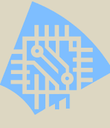

- Linux 免费使用和分发，这使其对于个人和商业使用而言都是一个极具效益的选择。你不需要购买许可证或为更新付费，随着时间的推移，这将节省大量的资金。

- Linux 具有高度的可定制性，可以根据用户的特定需求进行定制。这允许用户创建一个一个符合其工作流和偏好的个性化计算环境。

- Linux 以其可靠性和耐用性闻名。它很少发生崩溃或死机，而且不像 Windows 那样容易受到病毒或恶意软件的攻击。这使其成为关键任务应用程序和服务器的理想选择。

- 由于内置了安全功能（如安全启动、防火墙和文件权限），Linux 比其他操作系统更安全。此外，由于 Linux 是开源的，世界各地的安全专家都可以协助识别并修复漏洞，使其比专有操作系统更安全。

- Linux 以其响应快速和资源需求少而闻名。它可以在旧旧硬件上运行，且不需要高端硬件即可流畅运行。

- Linux 拥有庞大且活跃的用户社区，他们为其开发和支持做出贡献。这意味着有丰富的在线资源、文档和论坛可以帮助用户解决问题并充分利用 Linux 的功能。

- Linux 兼容各种硬件，对于那些拥有旧硬件或特殊硬件的用户来说，这是一个多功能的选择。

- Linux 附带大量的工具和开源软件，包括生产力工具、媒体播放器和开发工具。这意味着用户可以在软件许可证上节省费用，并可以免费获得高质量的软件。

总的来说，Linux 是一个强大、可定制且高性价比的操作系统，与专有操作系统相比具有许多优势。它对于重视计算环境中性能、稳定性、安全性和灵活性的用户来说是理想选择。虽然 Linux 有许多优点，但使用它也有一些缺点。以下是 Linux 的一些主要缺点：

- **缺乏用户友好的界面**：虽然 Linux 的命令行界面提供了更大的控制和灵活性，但对初学者来说可能很难使用。某些 Linux 发行版的图形用户界面可能没有 Windows 或 macOS 那样精美和直观。

- **软件可用性有限**：虽然 Linux 有许多软件可用，但仍然可能比 Windows 或 macOS 的软件要少。某些专业软件，如 Adobe Photoshop 或 Microsoft Office，可能无法在 Linux 上使用。

- **兼容性问题**：Linux 可能不兼容所有的硬件或软件。对于需要为了工作或爱好使用特定硬件和软件的用户来说，这特别是一个问题。

- **碎片化**：Linux 的开源性质意味着有很多不同的发行版和版本。这可能导致社区的碎片化，并使用户难以找到支持或找到适合其需求的发行版。

- **学习曲线**：由于 Linux 与 Windows 和 macOS 不同，新用户可能会面临一条非常陡峭的学习曲线。用户可能需要学习新的命令和方法来完成在其他操作系统上很熟悉的任务。

- **缺乏专业支持**：虽然有很多在线资源和论坛可以帮助 Linux 用户，但对于需要更高级帮助或支持的用户来说，可能缺乏专业的支持选项。

- **游戏支持**：虽然在 Linux 上玩游戏在近年来有了显著提高，但在许多游戏的支持和兼容性方面仍然落后于 Windows。

- **安全性**：Linux 通常被认为比 Windows 更安全，但它并非免受安全漏洞或恶意软件的影响。Linux 用户仍然必须采取适当的安全措施来保护他们的系统。

总的来说，Linux 对许多用户来说可能是一个很棒的操作系统，但它可能并不适合所有人。在决定是否使用它之前，仔细考虑 Linux 的优缺点是有重要的。

# 这里是一些关于 Linux 的趣味冷知识：

- Linux 免费使用和分发，这使其对于个人和商业使用而言都是一个极具效益的选择。你不需要购买许可证或为更新付费，随着时间的推移，这将节省大量的资金。

- Linux 具有高度的可定制性，可以根据用户的特定需求进行定制。这允许用户创建一个一个符合其工作流和偏好的个性化计算环境。

- Linux 以其可靠性和耐用性闻名。它很少发生崩溃或死机，而且不像 Windows 那样容易受到病毒或恶意软件的攻击。这使其成为关键任务应用程序和服务器的理想选择。

- 由于内置了安全功能（如安全启动、防火墙和文件权限），Linux 比其他操作系统更安全。此外，由于 Linux 是开源的，世界各地的安全专家都可以协助识别并修复漏洞，使其比专有操作系统更安全。

- Linux 以其响应快速和资源需求少而闻名。它可以在旧旧硬件上运行，且不需要高端硬件即可流畅运行。

- Linux 拥有庞大且活跃的用户社区，他们为其开发和支持做出贡献。这意味着有丰富的在线资源、文档和论坛可以帮助用户解决问题并充分利用 Linux 的功能。

- Linux 兼容各种硬件，对于那些拥有旧硬件或特殊硬件的用户来说，这是一个多功能的选择。


- Linux 附带大量的工具和开源软件，包括生产力工具、媒体播放器和开发工具。这意味着用户可以在软件许可证上节省费用，并可以免费获得高质量的软件。

总的来说，Linux 是一个强大、可定制且高性价比的操作系统，与专有操作系统相比具有许多优势。它对于重视计算环境中性能、稳定性、安全性和灵活性的用户来说是理想选择。虽然 Linux 有许多优点，但使用它也有一些缺点。以下是 Linux 的一些主要缺点：

- **缺乏用户友好的界面**：虽然 Linux 的命令行界面提供了更大的控制和灵活性，但对初学者来说可能很难使用。某些 Linux 发行版的图形用户界面可能没有 Windows 或 macOS 那样精美和直观。

- **软件可用性有限**：虽然 Linux 有许多软件可用，但仍然可能比 Windows 或 macOS 的软件要少。某些专业软件，如 `Adobe Photoshop` 或 `Microsoft Office`，可能无法在 Linux 上使用。

- **兼容性问题**：Linux 可能不兼容所有的硬件或软件。对于需要为了工作或爱好使用特定硬件和软件的用户来说，这特别是一个问题。

- **碎片化**：Linux 的开源性质意味着有很多不同的发行版和版本。这可能导致社区的碎片化，并使用户难以找到支持或找到适合其需求的发行版。

- **学习曲线**：由于 Linux 与 Windows 和 macOS 不同，新用户可能会面临一条非常陡峭的学习曲线。用户可能需要学习新的命令和方法来完成在其他操作系统上很熟悉的任务。

- **缺乏专业支持**：虽然有很多在线资源和论坛可以帮助 Linux 用户，但对于需要更高级帮助或支持的用户来说，可能缺乏专业的支持选项。

- **游戏支持**：虽然在 Linux 上玩游戏在近年来有了显著提高，但在许多游戏的支持和兼容性方面仍然落后于 Windows。

- **安全性**：Linux 通常被认为比 Windows 更安全，但它并非免受安全漏洞或恶意软件的影响。Linux 用户仍然必须采取适当的安全措施来保护他们的系统。

总的来说，Linux 对许多用户来说可能是一个很棒的操作系统，但它可能并不适合所有人。在决定是否使用它之前，仔细考虑 Linux 的优缺点是有重要的。

# 这里是一些关于 Linux 的趣味冷知识：

- Linux 免费使用和分发，这使其对于个人和商业使用而言都是一个极具效益的选择。你不需要购买许可证或为更新付费，随着时间的推移，这将节省大量的资金。

- Linux 具有高度的可定制性，可以根据用户的特定需求进行定制。这允许用户创建一个一个符合其工作流和偏好的个性化计算环境。

- Linux 以其可靠性和耐用性闻名。它很少发生崩溃或死机，而且不像 Windows 那样容易受到病毒或恶意软件的攻击。这使其成为关键任务应用程序和服务器的理想选择。

- 由于内置了安全功能（如安全启动、防火墙和文件权限），Linux 比其他操作系统更安全。此外，由于 Linux 是开源的，世界各地的安全专家都可以协助识别并修复漏洞，使其比专有操作系统更安全。

- Linux 以其响应快速和资源需求少而闻名。它可以在旧旧硬件上运行，且不需要高端硬件即可流畅运行。

- Linux 拥有庞大且活跃的用户社区，他们为其开发和支持做出贡献。这意味着有丰富的在线资源、文档和论坛可以帮助用户解决问题并充分利用 Linux 的功能。

- Linux 兼容各种硬件，对于那些拥有旧硬件或特殊硬件的用户来说，这是一个多功能的选择。

- Linux 附带大量的工具和开源软件，包括生产力工具、媒体播放器和开发工具。这意味着用户可以在软件许可证上节省费用，并可以免费获得高质量的软件。

总的来说，Linux 是一个强大、可定制且高性价比的操作系统，与专有操作系统相比具有许多优势。它对于重视计算环境中性能、稳定性、安全性和灵活性的用户来说是理想选择。虽然 Linux 有许多优点，但使用它也有一些缺点。以下是 Linux 的一些主要缺点：

- **缺乏用户友好的界面**：虽然 Linux 的命令行界面提供了更大的控制和灵活性，但对初学者来说可能很难使用。某些 Linux 发行版的图形用户界面可能没有 Windows 或 macOS 那样精美和直观。

- **软件可用性有限**：虽然 Linux 有许多软件可用，但仍然可能比 Windows 或 macOS 的软件要少。某些专业软件，如 `Adobe Photoshop` 或 `Microsoft Office`，可能无法在 Linux 上使用。

- **兼容性问题**：Linux 可能不兼容所有的硬件或软件。对于需要为了工作或爱好使用特定硬件和软件的用户来说，这特别是一个问题。

- **碎片化**：Linux 的开源性质意味着有很多不同的发行版和版本。这可能导致社区的碎片化，并使用户难以找到支持或找到适合其需求的发行版。

- **学习曲线**：由于 Linux 与 Windows 和 macOS 不同，新用户可能会面临一条非常陡峭的学习曲线。用户可能需要学习新的命令和方法来完成在其他操作系统上很熟悉的任务。

- **缺乏专业支持**：虽然有很多在线资源和论坛可以帮助 Linux 用户，但对于需要更高级帮助或支持的用户来说，可能缺乏专业的支持选项。

- **游戏支持**：虽然在 Linux 上玩游戏在近年来有了显著提高，但在许多游戏的支持和兼容性方面仍然落后于 Windows。

- **安全性**：Linux 通常被认为比 Windows 更安全，但它并非免受安全漏洞或恶意软件的影响。Linux 用户仍然必须采取适当的安全措施来保护他们的系统。

总的来说，Linux 对许多用户来说可能是一个很棒的操作系统，但它可能并不适合所有人。在决定是否使用它之前，仔细考虑 Linux 的优缺点是有重要的。

# 这里是一些关于 Linux 的趣味冷知识：


- Linux 免费使用和分发，这使其对于个人和商业使用而言都是一个极具效益的选择。你不需要购买许可证或为更新付费，随着时间的推移，这将节省大量的资金。

- Linux 具有高度的可定制性，可以根据用户的特定需求进行定制。这允许用户创建一个一个符合其工作流和偏好的个性化计算环境。

- Linux 以其可靠性和耐用性闻名。它很少发生崩溃或死机，而且不像 Windows 那样容易受到病毒或恶意软件的攻击。这使其成为关键任务应用程序和服务器的理想选择。

- 由于内置了安全功能（如安全启动、防火墙和文件权限），Linux 比其他操作系统更安全。此外，由于 Linux 是开源的，世界各地的安全专家都可以协助识别并修复漏洞，使其比专有操作系统更安全。

- Linux 以其响应快速和资源需求少而闻名。它可以在旧旧硬件上运行，且不需要高端硬件即可流畅运行。

- Linux 拥有庞大且活跃的用户社区，他们为其开发和支持做出贡献。这意味着有丰富的在线资源、文档和论坛可以帮助用户解决问题并充分利用 Linux 的功能。

- Linux 兼容各种硬件，对于那些拥有旧硬件或特殊硬件的用户来说，这是一个多功能的选择。

- Linux 附带大量的工具和开源软件，包括生产力工具、媒体播放器和开发工具。这意味着用户可以在软件许可证上节省费用，并可以免费获得高质量的软件。

总的来说，Linux 是一个强大、可定制且高性价比的操作系统，与专有操作系统相比具有许多优势。它对于重视计算环境中性能、稳定性、安全性和灵活性的用户来说是理想选择。虽然 Linux 有许多优点，但使用它也有一些缺点。以下是 Linux 的一些主要缺点：

- **缺乏用户友好的界面**：虽然 Linux 的命令行界面提供了更大的控制和灵活性，但对初学者来说可能很难使用。某些 Linux 发行版的图形用户界面可能没有 Windows 或 macOS 那样精美和直观。

- **软件可用性有限**：虽然 Linux 有许多软件可用，但仍然可能比 Windows 或 macOS 的软件要少。某些专业软件，如 `Adobe Photoshop` 或 `Microsoft Office`，可能无法在 Linux 上使用。

- **兼容性问题**：Linux 可能不兼容所有的硬件或软件。对于需要为了工作或爱好使用特定硬件和软件的用户来说，这特别是一个问题。

- **碎片化**：Linux 的开源性质意味着有很多不同的发行版和版本。这可能导致社区的碎片化，并使用户难以找到支持或找到适合其需求的发行版。

- **学习曲线**：由于 Linux 与 Windows 和 macOS 不同，新用户可能会面临一条非常陡峭的学习曲线。用户可能需要学习新的命令和方法来完成在其他操作系统上很熟悉的任务。

- **缺乏专业支持**：虽然有很多在线资源和论坛可以帮助 Linux 用户，但对于需要更高级帮助或支持的用户来说，可能缺乏专业的支持选项。

- **游戏支持**：虽然在 Linux 上玩游戏在近年来有了显著提高，但在许多游戏的支持和兼容性方面仍然落后于 Windows。

- **安全性**：Linux 通常被认为比 Windows 更安全，但它并非免受安全漏洞或恶意软件的影响。Linux 用户仍然必须采取适当的安全措施来保护他们的系统。

总的来说，Linux 对许多用户来说可能是一个很棒的操作系统，但它可能并不适合所有人。在决定是否使用它之前，仔细考虑 Linux 的优缺点是有重要的。

# 这里是一些关于 Linux 的趣味冷知识：

- 国际空间站 (ISS) 的操作系统基于 Linux。

- Linux 操作系统已用于从手机、平板电脑到电脑和服务器的一切设备。它用于全球前 500 强超级计算机中的大多数。 (此处，修正为：它用于全球前 500 强超级计算机。)

# C - 概述

C 编程是一种流行的编程语言，由 Dennis Ritchie 于 1972 年在贝尔实验室首次开发。C 是一种通用编程语言，广泛用于开发操作系统、系统软件和嵌入式系统，以及金融、工程和游戏等领域的应用。以下是 C 语言的一些关键特征：

- 简单易于学习：C 的语法简单简洁，易于初学者学习和使用。

- 可移植性：C 代码可以在 Windows、Linux 和嵌入式系统等不同平台上编译运行。

- 低层编程：C 允许程序员编写直接与硬件和内存交互，是开发系统软件和驱动程序的理想选择。

- 快速高效：C 是一种快速高效的编程语言，可用于开发高性能应用程序。

- 模块化编程：C 支持模块化编程，允许程序员将代码划分成更小、更易管理的函数和模块。

- 标准库：C 提供了一个标准函数库，提供常见功能，如输入输出、字符串处理和数学运算。

- 指针：C 允许使用指针指向内存中特定数据的地址。指针是 C 的强大功能，允许高效的内存管理和操作。

- 预处理器指令：C 包含了预处理器指令，这些特殊语句在编译之前由编译器处理。预处理器指令用于定义常量、包含头文件和执行其他任务。

总的来说，C 是一种强大且多功能的编程语言，广泛用于开发各种应用程序，包括系统软件、嵌入式系统和高性能应用程序。由于其可移植性、有效性和简单性，它是全球开发者青睐。

这是一个 C 语言的“Hello, World!”程序示例：

```c
#include<stdio.h>

int main() {
    printf("Hello, World!\n");

    return 0;
}
```

解释：

- `#include<stdio.h>` – 这一行包含了标准输入输出库，其中包含用于显示输出的 `printf()` 函数。

- `int main()` – 这一行定义了 `main()` 函数，它是程序的入口点。

- `{}` – 大括号包含了程序运行时将执行的代码。

- `printf("Hello, World!\n")` – 这一行使用 `printf()` 函数在控制台上显示文本“Hello, World!”。`\n` 是一个表示换行的特殊字符，因此文本将显示在的一的一上。

- `return 0;` – 这一行从 `main()` 函数返回值 0，表示程序执行成功。

当你运行这个程序时，它会在控制台上显示文本“Hello, World!”。这个程序通常用作简单的测试，以确保新的编程环境设置正确。

在 C 编程语言中，注释用于解释代码并提高对其他开发人员的可读性。编译器会忽略注释，不会影响代码的功能。C 语言中有两种类型的注释：**单行注释**和**多行注释**。

- **单行注释**以两个正斜杠（`//`）开头，并一直持续到行尾。例如：

```c
// 这是一个单行注释
int x = 5; // 这一行将变量 x 初始化为 5
```

- **多行注释**以 `/*` 开始，以 `*/` 结束。这两个符号之间的所有内容都被视为注释。例如：

```c
/*
这是一个多行注释
它可以跨越多行
*/
int y = 10; /* 这一行将变量 y 初始化为 10 */
```

**注释**对于使代码更易理解和更容易维护至关重要。它们还可以用于在测试或调试期间临时移除一段代码。例如：

```c
// int z = someFunction(); // 这一行为了测试目的被临时注释掉
int a = 10; // 这一行将变量 a 初始化为 10
```

在上面的示例中，调用函数 `someFunction()` 的行为了测试目的被注释掉了。这允许开发者在不调用可能问题的函数的情况下测试代码的其他部分。一旦测试完成，就可以删除注释，代码将按预期工作。

在 C 编程语言中，变量是一个带命名的内存位置，用于存储特定数据类型的值。变量的值在程序执行期间可以更改。变量的声明需要数据类型、名称以及可选的初始值。以下是 C 语言中变量声明的一些示例：

```c
int x; // 声明一个名为 x 的整数变量
float y = 3.14; // 声明一个名为 y 的浮点变量并将其初始化为 3.14
char z = 'A'; // 声明一个名为 z 的字符变量并将其初始化为 'A'
```

在上述示例中，`int`、`float` 和 `char` 是 C 语言中的数据类型。变量 `x` 声明时没有初始值，而 `y` 和 `z` 声明时带有初始值。可以使用赋值运算符（`=`）为变量分配新值。例如：

```c
x = 5; // 将值 5 赋值给变量 x
y = 2.5; // 将值 2.5 赋值给变量 y
z = 'B'; // 将值 'B' 赋值给变量 z
```

变量也可以用于表达式。例如：

```c
int a = 10;
int b = 5;
int c = a + b; // 将值 15 赋值给变量 c
```

在上面的示例中，变量 `a` 和 `b` 用于表达式中计算变量 `c` 的值。在 C 中，变量有作用域，它定义了程序中可以访问变量的部分。在函数内部声明的变量具有局部作用域，这意味着只能在该函数内部访问。在任何函数外部声明的变量具有全局作用域，这意味着可以从程序的任何部分访问。总而言之，C 语言中的变量是存储特定数据类型值的命名内存位置。它们可以带或不带初始值进行声明，分配新值，并在表达式中使用。理解变量对于编写 C 程序至关重要。

在 C 编程语言中，数据类型指定了可以存储在变量中的类型。格式化符用于指示在输入输出操作中打印或扫描的数据类型。以下是 C 语言中常用的数据类型和格式化符：

数据类型：

- `int`: 用于存储整数值

- `float`: 用于存储浮点值

- `double`: 用于存储双精度浮点值

- `char`: 用于存储单个字符

- `bool`: 用于存储布尔值（真或假）

- `short`: 用于存储小型整数值

- `long`: 用于存储大整数值

- `long long`: 用于存储极大整数值

格式化符：

- `%d`: 用于打印或扫描整数值

- `%f`: 用于打印或扫描浮点值

- `%lf`: 用于打印或扫描双精度浮点值

- `%c`: 用于打印或扫描单个字符

- `%s`: 用于打印或扫描字符字符串

- `%u`: 用于打印或扫描无符号整数值

- `%ld`: 用于打印或扫描长整数值

- `%lld`: 用于打印或扫描极长整数值

- `%x`: 用于打印或扫描十六进制值

```c
#include<stdio.h>

int main() {
    int x = 10;
    float y = 3.14;
    char z = 'A';

    printf("The value of x is %d\n", x);
    printf("The value of y is %f\n", y);
    printf("The value of z is %c\n", z);

    scanf("%d", &x);
    scanf("%f", &y);
    scanf("%c", &z);

    printf("You entered %d\n", x);
    printf("You entered %f\n", y);
    printf("You entered %c\n", z);

    return 0;
}
```

```c
// 拼接两个字符串
strcpy(buffer, str1);
strcat(buffer, " ");
strcat(buffer, str2);
printf("The concatenated string is %s\n", buffer);
```

```c
// 比较两个字符串
if (strcmp(str1, str2) == 0) {
    printf("%s and %s are equal\n", str1, str2);
} else {
    printf("%s and %s are not equal\n", str1, str2);
}
return 0;
```

在这个示例中，`strlen()` 函数用于找到字符串的长度，`strcpy()` 和 `strcat()` 函数用于拼接两个字符串，而 `strcmp()` 函数用于比较两个字符串。C语言还提供了输入输出字符串的各种方式。`scanf()` 函数用于输入字符串，而 `printf()` 函数用于将字符串输出到标准输出。这里有一个使用 `scanf()` 和 `printf()` 输入输出字符串的示例：


```c
#include<stdio.h>

int main() {
    char name[50];
    printf("Enter your name: ");
    scanf("%s", name);
    printf("Hello, %s!\n", name);
    return 0;
}
```

在这个示例中，`scanf()` 函数用于从标准输入输入字符串并将其存储在数组 `name` 中，而 `printf()` 函数用于输出一条包含输入字符串的问候消息。总而言之，C语言中的字符串表示为以空字符 `\0` 结尾的字符数组。可以使用字符串函数来处理字符串，并且C语言提供了多种输入输出字符串的方法。理解字符串对于编写处理文本数据的C程序至关重要。

在C语言编程中，运算符是表示操作或计算的符号。它们允许你对一个或多个操作数执行数学运算或逻辑操作。以下是C语言中最常用的运算符：

## 1. 算术运算符

算术运算符用于对数值操作数执行数学运算。包括：

- 加法 (`+`)：两个操作数相加
- 减法 (`-`)：从第一个操作数中减去第二个操作数
- 乘法 (`*`)：两个操作数相乘
- 除法 (`/`)：将第一个操作数除以第二个操作数
- 取模 (`%`)：返回除法运算的余数

示例：

```c
int a = 5, b = 2, c;
c = a + b; // c is now 7
c = a - b; // c is now 3
c = a * b; // c is now 10
c = a / b; // c is now 2
c = a % b; // c is now 1
```

## 2. 赋值运算符

赋值运算符用于给变量赋值。这些包括：

- 赋值 (`=`)：将右操作数的值赋给左操作数
- 加法赋值 (`+=`)：将右操作数的值加到左操作数，并将结果赋给左操作数
- 减法赋值 (`-=`)：从左操作数中减去右操作数的值，并将结果赋给左操作数
- 乘法赋值 (`*=`)：将左操作数乘以右操作数，并将结果赋给左操作数
- 除法赋值 (`/=`)：将左操作数除以右操作数，并将结果赋给左操作数
- 取模赋值 (`%=`)：计算左操作数的余数并将结果赋给左操作数

示例：

```c
int a = 5, b = 2;
a += b; // a is now 7
a -= b; // a is now 5 again
a *= b; // a is now 10
a /= b; // a is now 5 again
a %= b; // a is now 1
```

## 3. 比较运算符

比较运算符用于比较两个值。它们返回一个布尔值（真或假）。这些包括：

- 等于 (`==`)：如果操作数相等，则返回真
- 不等于 (`!=`)：如果操作数不相等，则返回真
- 大于 (`>`)：如果第一个操作数大于第二个操作数，则返回真
- 小于 (`<`)：如果第一个操作数小于第二个操作数，则返回真
- 大于等于 (`>=`)：如果第一个操作数大于等于第二个操作数，则返回真
- 小于等于 (`<=`)：如果第一个操作数小于等于第二个操作数，则返回真

示例：

```c
int a = 5, b = 2;
if (a == b) {
    printf("a is equal to b\n");
} else {
    printf("a is not equal to b\n");
}
if (a > b) {
    printf("a is greater than b\n");
}
if (a < b) {
    printf("a is less than b\n");
}
```

## 4. 逻辑运算符

逻辑运算符用于组合多个条件。它们返回一个布尔值（真或假）。这些包括：

- 与 (`&&`)：如果两个操作数都为真，则返回真

示例：

```c
int a = 5, b = 2;
if (a > 0 && b > 0) {
    printf("Both a and b are positive\n");
}
```

在这个示例中，`if` 语句内部的条件只有在 a 和 b 都大于0 时才为真。

- 或 (`||`)：如果其中任一操作数为真，则返回真

示例：

```c
int a = 5, b = 2;
if (a > 0 || b > 0) {
    printf("At least one of a and b is positive\n");
}
```

在这个示例中，`if` 语句内部的条件只要 a 或 b 任一大于0 即为真。

## 检查数字奇偶性的 C 程序

```c
#include<stdio.h>
int main() {
    int num;
    printf("Enter an integer:\n");
    scanf("%d", &num);
    if (num % 2 == 0) {
        printf("%d is even\n", num);
    } else {
        printf("%d is odd\n", num);
    }
    return 0;
}
```

以下是程序的工作原理：

- 首先，我们包含了标准输入输出库文件 `stdio.h`。
- 我们声明了一个整数变量 `num`。
- 我们使用 `printf` 函数提示用户输入一个整数。
- 我们使用 `scanf` 函数读取用户输入的整数并存储在变量 `num` 中。
- 我们使用 `if-else` 语句来检查 `num` 是偶数还是奇数。使用 `%` 运算符求 `num` 除以 2 的余数。如果余数为 0，则 `num` 为偶数，程序将打印相应的信息。如果余数不为 0，则 `num` 为奇数，程序将打印相应的信息。
- 最后，我们使用 `return` 语句退出程序。

当程序运行时，它会提示用户输入一个整数。在用户输入整数后，程序将检查它是偶数还是奇数并显示相应的消息。

## 在控制屏幕上打印 "Hello World" 10 次的 C 程序

### for 循环版本

```c
#include <stdio.h>
int main() {
    int i;
    for (i = 0; i < 10; i++) {
        printf("Hello World\n");
    }
    return 0;
}
```

以下是程序的工作原理：

- 首先，包含标准输入输出库头文件 `stdio.h`。
- 我们声明了一个整数变量 `i`。
- 我们使用 `for` 循环打印十次 "Hello World"。循环从 `i = 0` 运行到 `i < 10`，每次循环运行时 `i` 均加 1。在循环内部，我们使用 `printf` 函数在屏幕上打印 "Hello World"。
- 最后，我们使用 `return` 语句退出程序。

当程序运行时，它将在屏幕上打印十次 "Hello World"。`for` 循环允许我们多次打印 "Hello World"，而无需多次编写相同的 `printf` 语句。

### while 循环版本

```c
#include <stdio.h>

int main() {
    int i = 0;
    while (i < 10) {
        printf("Hello World\n");
        i++;
    }
    return 0;
}
```

以下是程序的工作原理：

- 首先，我们包含了标准输入输出库头文件 `stdio.h`。
- 我们声明了一个整数变量 `i` 并将其初始化为 0。
- 我们使用 `while` 循环打印十次 "Hello World"。只要 `i` 小于 10，循环就会运行。在循环内部，我们使用 `printf` 函数在屏幕上打印 "Hello World"，然后将 `i` 加 1。
- 最后，我们使用 `return` 语句退出程序。

当程序运行时，它将使用 `while` 循环在屏幕上打印十次 "Hello World"。`while` 循环是另一种多次重复一组语句的方法，只要循环头中指定的条件为真即可。在这种情况下，只要 `i` 小于 10，循环就会运行，允许我们打印十次 "Hello World"，而无需多次编写相同的 `printf` 语句。

### do-while 循环版本

```c
#include<stdio.h>
int main() {
    int i = 0;
    do {
        printf("Hello World\n");
        i++;
    } while (i < 10);
    return 0;
}
```

以下是程序的工作原理：

- 首先，我们声明了一个整数变量 `i` 并将其初始化为 0。
- 我们使用 `do-while` 循环打印十次 "Hello World"。即使循环头中的条件为假，循环至少也会执行一次。在循环内部，我们使用 `printf` 函数在屏幕上打印 "Hello World" 并将 `i` 加 1。
- 在循环每次迭代结束时都会检查条件。如果条件为真，循环继续运行；如果条件为假，循环退出。
- 最后，我们使用 `return` 语句退出程序。

当程序运行时，它将使用 `do-while` 循环在屏幕上打印十次 "Hello World"。`do-while` 循环是另一种多次重复一组语句的方法，但它保证即使循环条件为假，循环体也会至少执行一次。在这种情况下，只要 `i` 小于 10，循环就会运行，允许我们打印十次 "Hello World"，而无需多次编写相同的 `printf` 语句。

## switch 语句

在 C 编程语言中，`switch` 语句用于根据表达式的值执行一个代码块。`switch` 语句通过评估表达式并执行与匹配的 `case` 标签关联的代码来工作。如果没有 `case` 标签匹配表达式，则执行 `default` 代码块。

以下是在 C 语言使用 `switch` 语句的示例：

```c
#include<stdio.h>
int main() {
    char operator;
    int operand1, operand2, result;
    printf("Enter an operator (+, -, *, /): ");
    scanf("%c", &operator);
    printf("Enter two operands: ");
    scanf("%d %d", &operand1, &operand2);

    switch(operator) {
        case '+':
            result = operand1 + operand2;
            printf("%d + %d = %d\n", operand1, operand2, result);
            break;
        case '-':
            result = operand1 - operand2;
            printf("%d - %d = %d\n", operand1, operand2, result);
            break;
        case '*':
            result = operand1 * operand2;
            printf("%d * %d = %d\n", operand1, operand2, result);
            break;
        case '/':
            if(operand2 == 0) {
                printf("Error: Cannot divide by zero\n");
            } else {
                result = operand1 / operand2;
                printf("%d / %d = %d\n", operand1, operand2, result);
            }
            break;
        default:
            printf("Invalid operator\n");
            break;
    }
    return 0;
}
```

## break 和 continue 语句

```c
#include <stdio.h>

int main() {
    int i;
    for (i = 1; i <= 10; i++) {
        if (i == 5) {
            continue;
        }
        printf("%d\n", i);
    }
    return 0;
}
```

在这个示例中，程序使用 `for` 循环从 1 到 10 打印 `i` 的值。然而，当 `i` 等于 5 时，执行了 `continue` 语句，跳过了循环当前的迭代。因此，程序没有打印值 5，而是继续后续迭代并打印其他值。`break` 和 `continue` 语句对于控制循环和 `switch` 语句的执行非常有用，允许程序根据某些条件跳过特定迭代或完全终止循环。

## 数组

在 C 编程语言中，数组是相同数据类型元素的集合，存储在连续的内存位置。数组是 C 程序中存储和处理大量数据的强大且高效的方法。这是一个如何在 C 中使用数组的示例：

```c
#include<stdio.h>

int main() {
    int numbers[5]; // 声明一个包含 5 个整数的数组
    int i;

    // 初始化数组元素
    numbers[0] = 1;
    numbers[1] = 3;
    numbers[2] = 5;
    numbers[3] = 7;
    numbers[4] = 9;

    // 打印数组元素
    for (i = 0; i < 5; i++) {
        printf("%d\n", numbers[i]);
    }
    return 0;
}
```

在这个示例中，声明了一个名为 `numbers` 的数组，它可以存储多达 5 个整数。数组的元素通过索引访问，索引从 0 开始。在这种情况下，数组元素被初始化为值 1, 3, 5, 7 和 9。要访问数组的某个元素，我们可以像 `for` 循环所示使用其索引。在这个循环中，我们使用 `printf` 语句打印数组元素，其中 `%d` 格式说明符表示我们正在打印一个整数。

初始化数组的另一种方法是使用初始化列表，它允许您在声明时指定数组元素的值。这是一个示例：

```c
#include<stdio.h>

int main() {
    int numbers[] = {1, 3, 5, 7, 9}; // 使用初始化列表声明并初始化数组
    int i;

    for (i = 0; i < 5; i++) {
        printf("%d\n", numbers[i]);
    }
    return 0;
}
```

在这个示例中，使用初始化列表声明并初始化了数组 `numbers`。数组的大小由列表中的元素数量自动确定。该程序的输出与之前的示例相同。数组是 C 语言中基础的数据结构，其简单性和高效性使其成为许多编程任务的热门选择。

## 结构体

在 C 编程语言中，结构体是不同类型变量的集合，它们被组在一个名称下。结构体用于表示复杂的数据类型，并可以用于在程序中组织和处理大量数据。这是一个如何使用结构体的示例：

```c
#include <stdio.h>
#include <string.h>

// 定义一个名为 "student" 的结构体
struct student {
    char name[50];
    int roll_no;
    float marks;
};

int main() {
    // 声明一个类型为 "student" 的结构体变量
    struct student s1;
    // 给结构成员赋值
    strcpy(s1.name, "John");
    s1.roll_no = 1;
    s1.marks = 85.5;
    // 打印结构成员
    printf("Name: %s\n", s1.name);
    printf("Roll No.: %d\n", s1.roll_no);
    printf("Marks: %f\n", s1.marks);
    return 0;
}
```

在这个示例中，使用 `struct` 关键字定义了一个名为 "student" 的结构体。该结构体有三个成员：字符数组 `name`、整数 `roll_no` 和一个浮点数 `marks`。`main` 函数声明了一个类型为 `student` 的结构体变量 `s1` 并为其成员赋值。

声明和初始化结构体变量的另一种方法是使用初始化列表，它允许您在声明时指定结构成员的值。这是一个示例：

```c
#include<stdio.h>

// 定义一个名为 "book" 的结构体
struct book {
    char title[50];
    char author[50];
    float price;
};

int main() {
    // 声明并初始化一个类型为 "book" 的结构体变量
    struct book b1 = {"C Programming Language", "Brian Kernighan and Dennis Ritchie", 29.99};

    // 打印结构成员
    printf("Title: %s\n", b1.title);
    printf("Author: %s\n", b1.author);
    printf("Price: %f\n", b1.price);

    return 0;
}
```

## 指针

在 C 编程语言中，指针是一个存储另一个变量内存地址的变量。指针允许您直接在内存中操作数据，这对于动态分配内存或处理复杂数据结构等任务非常有用。这是一个指针如何工作的示例：

```c
#include<stdio.h>
int main() {
    int var = 10;      /* 实际变量声明 */
    int *p;           /* 指针变量声明 */

    p = &var;         /* 将 var 的地址存储在指针变量中 */

    printf("Address of var variable: %p\n", (void*)&var);

    /* 指针变量存储的地址 */
    printf("Address stored in pointer variable: %p\n", (void*)p);

    /* 使用指针访问值 */
    printf("Value of var: %d\n", *p);

    return 0;
}
```

在这个示例中，我们声明了一个整数变量 `var` 和一个指针变量 `p`。然后我们使用 `&` 运算符将 `var` 的地址存储在 `p` 中。我们可以通过指针变量 `p` 上的 `*` 运算符访问 `var` 的值。当我们运行此程序时，它将输出 `var` 的地址、指针 `p` 存储的地址以及 `var` 的值。


## 指针基础

```
Address of var variable: %p
Address stored in pointer variable: %p
Value of var: %d
```

在这里，我们声明了一个整数变量 `var` 和一个指针变量 `p`。然后我们使用 `&` 运算符将 `var` 的地址存储在 `p` 中。我们可以通过指针变量 `p` 上的 `*` 运算符访问 `var` 的值。当我们运行此程序时，它将输出以下内容：

```
Address of var variable: %p
Address stored in pointer variable: %p
Value of var: 10
```

在这里，`%p` 格式说明符用于地址。`var` 和 `p` 的地址是相同的，因为 `p` 指向 `var`。

### 指针算术

指针算术是指针的另一个重要方面。你可以对指针进行加法、减法等操作。这是一个示例：

```c
#include<stdio.h>
int main() {
    int arr[] = {10, 20, 30, 40, 50};
    int *p = arr;
    for(int i=0; i<5; i++) {
        printf("Value of arr[%d]: %d\n", i, *(p+i));
    }
    return 0;
}
```

在这个示例中，我们声明了一个整数数组 `arr` 和一个初始化为数组第一个元素的指针变量 `p`。然后我们使用指针算术遍历数组并打印值。当我们运行此程序时，它将输出以下内容：

```
Value of arr[0]: 10
Value of arr[1]: 20
Value of arr[2]: 30
Value of arr[3]: 40
Value of arr[4]: 50
```

在这里，`*(p+i)` 表达式通过指针算术访问数组的第 `i` 个元素。`*(p+i)` 等于 `arr[i]`。

## 函数

在 C 编程语言中，函数是执行特定任务的语句组。函数通过将代码组织为可以在程序部分调用的独立单元，为程序提供了模块化和重用性。这是一个函数如何工作的示例：

```c
#include<stdio.h>
/* 函数声明 */
int max(int num1, int num2);

int main() {
    int a = 100;
    int b = 200;
    int ret;

    /* 调用函数获取最大值 */
    ret = max(a, b);

    printf("Max value is: %d\n", ret);

    return 0;
}

/* 返回两个数之间最大值的函数 */
int max(int num1, int num2) {
    int result;

    if (num1 > num2) {
        result = num1;
    } else {
        result = num2;
    }
    return result;
}
```

在这个示例中，我们定义了一个名为 `max` 的函数，它接受两个整数参数并返回最大值。在 `main` 函数之前通过函数原型或声明进行了函数，这指定了函数的名称、返回类型和参数类型。这允许编译器检查错误并确保函数的用法正确。在 `main` 函数中，我们声明了两个整数变量 `a` 和 `b` 并分别赋值为 100 和 200。然后我们调用 `max` 函数并将 `a` 和 `b` 作为参数传递，结果赋值给变量 `ret`。最后，我们使用 `printf` 打印最大值。

### 阶乘函数示例

```c
} else {
    printf("Error: Factorial of negative numbers doesn't exist\n");
}
    return 0;
}

/* 计算阶乘函数 */
int find_factorial(int num) {
    if (num < 0) {
        return -1;
    }
    for (int i=1; i<=num; i++) {
        factorial *= i;
    }
    return factorial;
}
```

在这个示例中，我们定义了一个名为 `find_factorial` 的函数，它接受一个整数参数并返回该数的阶乘。该函数检查负数输入，如果输入为负数则返回 `-1`。否则，它使用 `for` 循环计算阶乘并返回结果。在 `main` 函数中，我们提示用户输入一个正整数并将其存储在变量 `num` 中。然后我们调用 `find_factorial` 函数并将结果存储在变量 `factorial` 中。如果结果不是 `-1`，我们就打印阶乘。否则，我们打印一条错误信息。当我们运行此程序时，它将输出以下内容：

输入一个正整数: 5

5 的阶乘是 120

函数还可以具有默认参数和可变参数，但这些是超出本文范围的高级功能。

## 枚举

在 C 编程语言中，`enum`（enumeration 的缩写）是一种用户定义的数据类型，由一组命名的整数常量组成。枚举提供了一种定义具有意义名称的相关的常量的方法，这使得代码更具可读性且更容易维护。

### 基本枚举示例

以下是枚举工作原理示例：

```c
#include<stdio.h>

/* 定义星期几的枚举 */
enum week { Sunday, Monday, Tuesday, Wednesday, Thursday, Friday, Saturday };

int main() {

    /* 声明 enum week 变量 */
    enum week today, tomorrow;

    /* 给变量赋值 */
    today = Wednesday;
    tomorrow = Thursday;

    /* 打印值 */
    printf("Today is %d\n", today);
    printf("Tomorrow is %d\n", tomorrow);

    return 0;
}
```

在这个示例中，我们定义了一个名为 `week` 的枚举，它包含代表星期几的七个命名常量。默认情况下，常量被分配整数值，从第一个常量从 0 开始，第二个常量为 1，以此类推。然后我们声明了两个类型为 `enum week` 的变量 `today` 和 `tomorrow`，并分别赋予赋值 `Wednesday` 和 `Thursday`。最后，我们使用 `printf` 打印这些值。当我们运行此程序时，它将输出以下内容：

```
Today is 3
Tomorrow is 4
```

### 显式赋值枚举

枚举可以为其常量分配显式值，从而对值进行更多控制。这里是一个示例：

```c
#include<stdio.h>

/* 定义颜色的枚举 */
enum color { Red = 1, Green = 2, Blue = 4 };

int main() {

    /* 声明 enum color 变量 */
    enum color c1, c2, c3;

    /* 给变量赋值 */
    c1 = Red;
    c2 = Green;
    c3 = Blue;

    /* 打印值 */
    printf("c1 = %d\n", c1);
    printf("c2 = %d\n", c2);
    printf("c3 = %d\n", c3);
    return 0;
}
```

在这个示例中，我们定义了一个名为 `color` 的枚举，它包含代表颜色的三个命名常量。我们使用赋值运算符为常量分配显式值，因此 `Red` 被赋值为 1，`Green` 被赋值为 2，`Blue` 被赋值为 4。我们声明了三个类型为 `enum color` 的变量 `c1`、`c2` 和 `c3`，并分别赋予赋值 `Red`、`Green` 和 `Blue`。最后，我们使用 `printf` 打印这些值。当我们运行此程序时，它将输出以下内容：

```
c1 = 1
c2 = 2
c3 = 4
```

### 枚举在 Switch 语句中的应用

枚举也可以用于 `switch case` 语句，允许轻松处理相关的常量。这里是一个示例：

```c
#include<stdio.h>

/* 定义星期几的枚举 */
enum week { Sunday, Monday, Tuesday, Wednesday, Thursday, Friday, Saturday };

int main() {
    /* 声明一个 enum week 变量 */
    enum week day;

    /* 获取用户输入 */
    printf("Enter a day of the week (0-6): ");
    scanf("%d", &day);

    /* 使用 switch 语句处理输入 */
    switch (day) {
        case Sunday:
            printf("Sunday\n");
            break;
        case Monday:
            printf("Monday\n");
            break;
        case Tuesday:
            printf("Tuesday\n");
            break;
        case Wednesday:
            printf("Wednesday\n");
            break;
        case Thursday:
            printf("Thursday\n");
            break;
        case Friday:
            printf("Friday\n");
            break;
        case Saturday:
            printf("Saturday\n");
            break;
    }
    return 0;
}
```

## 文件处理

在 C 编程语言中，文件是存储在硬盘或闪存盘等次级存储设备上的相关数据集合。文件可以用来以比变量更持久的方式来存储和检索数据，而变量在程序退出时会丢失。

在 C 编程语言中，你需要包含 `stdio.h`。这是为了输入和输出，与文件进行交互。


# C 语言概览

在 C 编程语言中，文件是相关数据的集合，存储在硬盘或闪存盘等次级存储设备上。文件可以以比变量更持久的方式存储和检索数据，而变量在程序退出时会丢失。

## C 语言的缺点

除了许多优点外，也有一些缺点。以下是 C 语言的一些主要缺点：

- **低级语言**：C 是一种低级语言，这意味着执行简单任务需要编写大量的代码。例如，在 C 中，你需要编写大量代码来读写文件，而在 Python 等高级语言中，只需要几行代码即可完成。

- **没有自动垃圾回收**：C 没有自动垃圾回收机制，这意味着你必须手动管理内存的分配和释放。这可能非常繁琐且容易出错，特别是在处理复杂结构时。

- **缺乏面向对象编程的内置支持**：与其他某些编程语言不同，C 没有对面向对象编程的内置支持。这意味着如果你想在代码中使用 OOP 概念，必须自己实现它们，这是一个非常耗时的过程。

- **容易受到缓冲区溢出攻击**：C 容易受到缓冲区溢出攻击，当程序试图在缓冲区中存储过多数据时就会发生这种情况，导致多余的数据覆盖相邻位置。这可能导致**程序崩溃**，或者在某些情况下被攻击者利用。

- **缺乏动态内存管理**：C 语言没有内置动态内存管理，这意味着你必须手动分配和释放内存。如果你忘记**释放内存**，就会导致内存泄漏，使程序消耗越来越多的内存，直到崩溃。

### 示例：缓冲区溢出与内存管理

这里有一个用 C 语言编写的程序示例，说明了其中一些缺点：

```c
#include<stdio.h>

int main() {
    char buffer[100];

    printf("Enter a string: ");

    scanf("%s", buffer);

    printf("You entered: %s\n", buffer);

    return 0;
}
```

在这个程序中，用户被提示输入字符串，然后将其存储在缓冲区中。然而，程序没有进行任何输入验证，这意味着如果用户输入的字符串超过 **100 个字符**，将溢出缓冲区并可能覆盖相邻内存位置，导致未定义行为或崩溃。此外，程序没有进行任何内存管理，这意味着即使在缓冲区不再需要后它仍然留在内存中，可能会导致内存泄漏。最后，程序没有使用任何面向对象编程概念，使得随着复杂性的增加，其维护和扩展变得更加困难。

- **缺乏异常处理的内置支持**：C 没有对异常处理的内置支持，这意味着必须使用条件语句和错误代码手动处理错误。这可能会使代码更难以阅读和维护。

- **缺乏标准化**：C 语言没有官方标准库，这意味着不同的 C 实现可能具有不同的库和函数。这会导致尝试在不同平台或编译器上运行代码时的可移植性问题。

- **缺乏类型安全**：C 是一种弱类型语言，意味着它不强制严格的类型检查。在处理复杂数据结构或尝试对不兼容的数据类型执行操作时，可能会导致错误和 Bug。

- **调试困难**：由于其低级特性和缺乏内置调试工具，调试 C 代码可能很困难。这使得在复杂代码中寻找并修复 Bug 变得困难。

- **潜在的安全漏洞**：由于其低级特性和缺乏内置安全特性，C 代码容易受到缓冲区溢出等安全攻击，这可能导致严重的安全问题。

### 示例：输入验证与异常处理缺失

这里有一个 C 语言的程序示例，说明了其中一些缺点：

```c
#include<stdio.h>

int main() {
    int num;

    printf("Enter a number: ");
    scanf("%d", &num);

    if (num % 2 == 0) {
        printf("%d is even\n", num);
    }
    else {
        printf("%d is odd\n", num);
    }

    return 0;
}
```

在这个程序中，用户被提示输入一个数字，然后检查它是偶数还是奇数。然而，程序没有进行任何输入验证，这意味着如果用户输入非数值值，将导致错误。此外，程序没有处理任何异常，这意味着如果发生错误，它将直接崩溃。最后，程序使用条件语句来检查数字的奇偶，随着代码复杂性的增加，这可能变得更难以阅读和维护。

## C 语言的实际应用

C 语言是一种广泛使用的编程语言，具有许多实际应用。以下是它的一些实际应用示例：

- **操作系统**：C 被用于编写低级系统软件，如操作系统、设备驱动程序和固件。一些用 C 编写的知名操作系统包括 UNIX、Linux 和 Windows。

- **嵌入式系统**：C 被广泛用于编写嵌入式系统（如微控制器和其他电子设备）的代码，在这些系统中，代码必须快速、高效且轻量。

- **数据库系统**：C 常用于开发 MySQL 和 PostgreSQL 等数据库管理系统（DBMS），这些系统在 Web 和移动应用中被广泛使用。

- **编译器和解释器**：C 用于创建其他编程语言的编译器和解释器，这些是软件开发必不可少的工具。

- **图形应用**：C 常用于开发视频游戏、3D 建模和动画软件等图形应用程序。

- **Web 应用**：C 常用于 Web 应用的后端，用于处理大量的计算和请求，例如解析 XML 和 JSON 数据。

- **科学与工程应用**：C 被广泛用于需要高性能计算的科学和工程应用。

- **业务应用**：C 也被用于业务应用，如会计软件、库存管理和客户关系管理（CRM）系统。

- **人工智能和机器学习**：C 用于开发人工智能和机器学习算法，其速度和低级控制能力使其成为高性能任务的理想选择。

## 趣味事实

当然，这里有一些关于 C 语言编程的趣味事实：

- C 经常根据其创建者被称为“丹尼斯·里奇语言”（Dennis Ritchie Language）。在计算机早期，程序员必须用机器语言编写代码，这极其困难且耗费时间。C 的出现是为了让编程变得简单，但讽刺的是，它最终变成了历史上最复杂的语言之一！

- C 编程可能非常晦涩且难以阅读，尤其是对于初学者来说。一些程序员开玩笑说 C 代表“Confusing”（困惑的）或“Cryptic”（晦涩的）！

- 关于 C 编程最著名的引言之一来自《C 编程语言》的合著者 Brian·柯尼翰（Brian Kernighan）：“调试比编写代码本身困难两倍。因此，如果你把代码写得尽可能巧妙，那么从定义上说，你就不够聪明来调试它。”

- C 编程因为使用了指针而可能会让人头疼。指针是存储另一个变量内存地址的变量，正确使用它们非常棘手。

- 尽管 C 编程以困难而闻名，但它也可以非常有趣且富有回报。编写运行完美且高效的代码会带来特定的满足感，而 C 编程可以充分地提供这种感觉。

总而言之，C 编程既可能让人沮丧又充满趣味。尽管面临重重挑战，它仍然是世界上应用最广泛的编程语言之一，对于愿意投入时间和精力的人来说，掌握它将是一次非常有回报的经历。

# C++ - 概览

C++ 是一种通用的高级编程语言，由 Bjarne Stroustrup 于 1985 年作为 C 语言的扩展而开发。它是一种面向对象的语言，支持多种编程范式，例如过程化、函数式和泛型编程。C++ 广泛用于开发应用程序、系统软件、嵌入式系统、游戏和其他软件。以下是 C++ 的一些关键特性和概念：

- **面向对象编程**：C++ 是一种面向对象的语言，这意味着它提供了类、对象、继承和多态等特性，允许开发者以组织模块化的方式编写代码。

- **数据类型**：C++ 支持整数、浮点数、字符和布尔值等各种数据类型。它还提供了结构体、联合体、枚举等用户定义数据类型。

- **控制结构**：C++ 提供了 if-else 语句、switch-case 语句、while 循环、do-while 循环和 for 循环等控制执行结构。

- **函数**：C++ 函数是自包含的代码单元，可以在程序中多次重用。它们可以用于执行特定任务，并带有参数和返回值。

- **指针**：C++ 允许使用指针，指针是存储另一个变量内存地址的变量。它们用于操作内存、创建数据结构和优化性能。

- **内存管理**：C++ 提供了使用 `new` 和 `delete` 等运算符进行动态内存分配和释放的内存管理特性。

- **异常处理**：C++ 支持异常处理，用于处理错误并确保程序优雅终止。

- **标准模板库 (STL)**：C++ 提供了一个丰富的可重用代码库，称为标准模板库 (STL)。它包含了 `vector`、`list`、`map` 等容器，以及排序和搜索等算法。

- **模板**：C++ 支持模板，允许开发者编写可以处理不同数据类型的泛型代码。

- **多范式支持**：C++ 支持多种编程范式，包括过程化、函数式和泛型编程。这允许开发者按照适合自己的风格编写代码。

- **低级编程**：C++ 允许低级编程，这意味着开发者可以编写直接与硬件交互的代码，例如设备驱动程序和操作系统。

总的来说，C++ 是一种强大且多功能的语言，可用于广泛的编程任务。它的灵活性、性能以及对多种编程范式的支持，使其成为处理复杂和高需求项目开发者的热门选择。

## Hello World 示例

这是一个 C++ 的 "Hello, World!" 程序的示例：

```cpp
#include <iostream>
int main() {
    std::cout << "Hello, World!" << std::endl;
    return 0;
}
```

该程序简单地向控制台打印字符串 "Hello, World!"。

### 逐行分析

让我们逐行分析该程序：

- **`#include <iostream>`**：这一行包含了 iostream 头文件，它提供了如 `cin` 和 `cout` 类的输入输出流。

- **`int main()`**：这一行声明了 `main` 函数，它是程序的入口。`int` 是函数的返回类型，表示它将返回一个整数值。空括号表示该函数不接受参数。

- **`std::cout << "Hello, World!" << std::endl;`**：这一行向控制台打印字符串 "Hello, World!"。`std::cout` 是一个标准输出流对象，`<<` 运算符用于将字符串插入流中。`std::endl` 是一个在输出中添加新行的特殊字符。

- **`return 0;`**：这一行表示程序已执行完毕，并向操作系统返回值 0。返回 0 通常表示成功。

`cout` 和 `endl` 之前的 `std::` 前缀用于指定这些名称属于 `std` 命名空间，这是 C++ 库函数和对象的标准命名空间。总的来说，这个程序演示了 C++ 程序的基本语法和结构。通过使用 iostream 库，它展示了如何执行基础输入输出；通过定义 `main` 函数，它指定了程序的入口。

## 注释

在 C++ 中，注释用于向程序添加解释性文本，编译器会忽略它们。C++ 有两种注释：单行注释和多行注释。

### 单行注释

以 `//` 开始，持续到行尾。这是一个示例：

```cpp
// 这是一个单行注释
int main() {
// 这也是一个单行注释
return 0;
}
```

在示例中，`//` 之后的文本会被编译器忽略。单行注释通常用于解释单行代码或在开发期间临时禁用代码。

### 多行注释

以 `/*` 开始，以 `*/` 结束。这是一个示例：

```cpp
/*
这是一个多行注释
它可以跨越多行。
*/

int main() {
    /*
    这也是一个多行注释
    它可以跨越多行。
    */
    return 0;
}
```

在示例中，`/*` 和 `*/` 之间的文本会被编译器忽略。多行注释通常用于解释较大的代码块或临时禁用部分代码。需要注意的是，注释应该节制使用，仅在需要时使用。过度注释会使代码变得难以阅读和维护，而且当代码更改时，注释可能会过时或产生误导性。然而，使用得当时，注释非常有帮助。

## 数据类型示例

5. **数组**：用于存储相同数据类型的数据集合。示例：

```cpp
int numbers[5] = {1, 2, 3, 4, 5};
```

6. **指针**：用于存储另一个变量的内存地址。示例：

```cpp
int age = 30;
int* agePtr = &age; // agePtr 存储 age 的内存地址
```

需要注意的是，数据类型具有不同的范围和精度，为变量选择合适的数据类型对性能和准确性至关重要。例如，对于大数字，使用 `short` 数据类型代替 `int` 可能会导致值溢出或截断。C++ 提供了类型修饰符，例如有符号（`signed`）和无符号（`unsigned`），用以进一步指定数据类型的范围。例如，`unsigned int` 只能存储非负整数。总体而言，理解 C++ 中的数据类型对于编写高效且准确的代码非常重要。

## C++ 运算符

C++ 运算符是用于对变量和值执行各种操作的特殊符号和关键字。以下是一些常见的 C++ 运算符及其示例：

### 1. 算术运算符

- 加法 (`+`)：`int sum = 5 + 3;` (`sum` 等于 8)
- 减法 (`-`)：`int difference = 5 - 3;` (`difference` 等于 2)
- 乘法 (`*`)：`int product = 5 * 3;` (`product` 等于 15)
- 除法 (`/`)：`float quotient = 5.0 / 3.0;` (`quotient` 等于 1.666667)
- 取模 (`%`)：`int remainder = 5 % 3;` (`remainder` 等于 2)

### 2. 赋值运算符

- 赋值 (`=`)：`int a = 5;` (`a` 等于 5)
- 复合赋值 (`+=`, `-=`, `*=`, `/=`)：`a += 3;` (`a` 等于 8)

### 3. 比较运算符

- 等于 (`==`)：`bool isEqual = 5 == 3;` (`isEqual` 等于 false)
- 不等于 (`!=`)：`bool isNotEqual = 5 != 3;` (`isNotEqual` 等于 true)
- 大于 (`>`)：`bool isGreater = 5 > 3;` (`isGreater` 等于 true)
- 小于 (`<`)：`bool isLess = 5 < 3;` (`isLess` 等于 false)
- 大于或等于 (`>=`)：`bool isGreaterOrEqual = 5 >= 3;` (`isGreaterOrEqual` 等于 true)
- 小于或等于 (`<=`)：`bool isLessOrEqual = 5 <= 3;` (`isLessOrEqual` 等于 false)

### 4. 逻辑运算符

- 逻辑与 (`&&`)：`bool isTrue = (5 > 3) && (4 < 6);` (`isTrue` 等于 true)
- 逻辑或 (`||`)：`bool isFalse = (5 < 3) || (4 > 6);` (`isFalse` 等于 false)
- 逻辑非 (`!`)：`bool isNotTrue = !(5 > 3);` (`isNotTrue` 等于 false)

### 5. 位运算符

- 按位与 (`&`)：`int result = 5 & 3;` (`result` 等于 1)
- 按位或 (`|`)：`int result = 5 | 3;` (`result` 等于 7)
- 按位异或 (`^`)：`int result = 5 ^ 3;` (`result` 等于 6)
- 按位取反 (`~`)：`int result = ~5;` (`result` 等于 -6)
- 左移 (`<<`)：`int result = 5 << 1;` (`result` 等于 10)
- 右移 (`>>`)：`int result = 5 >> 1;` (`result` 等于 2)

这些是 C++ 中提供的许多运算符之一。

## C++ 字符串

在 C++ 中，`string`（字符串）是存储在连续内存块中的字符序列。`string` 数据类型定义在 `<string>` 头文件中。以下是操作 C++ 字符串的一些示例：

### 1. 创建字符串

```cpp
#include <string>
using namespace std;

string str1 = "Hello, world!"; // 使用字面量初始化字符串
string str2("I am a string."); // 使用构造函数初始化字符串
string str3; // 声明空字符串
```

### 2. 访问和修改字符串中的字符

```cpp
char first_char = str1[0]; // 访问字符串的第一个字符
str1[7] = 'W'; // 将第 8 个字符改为 'W'
str1.at(4) = 'o'; // 使用 at() 方法将第 5 个字符改为 'o'
```

### 3. 连接字符串

```cpp
string greeting = "Hello";
string name = "Alice";
string message = greeting + " " + name + "!"; // 使用 + 运算符连接字符串
```

### 4. 查找子串

```cpp
string sentence = "The quick brown fox jumps over the lazy dog.";
int position = sentence.find("fox"); // 查找 "fox" 第一次出现的位置
string word = sentence.substr(position, 5); // 从位置16开始提取单词 "brown"
```

### 5. 将字符串转换为数值

```cpp
string num_string = "12345";
int num_int = stoi(num_string); // 将字符串转换为整数
double num_double = stod("3.14"); // 将字符串转换为双精度浮点数
```

### 6. 获取字符串长度

```cpp
int length = str1.length(); // 获取长度
```

### 7. 比较字符串


```cpp
string s1 = "hello";
string s2 = "world";
if (s1 == s2) {
    // 字符串相等
} else {
    // 字符串不相等
}
```

在 C++ 中，`math` 库提供了一系列用于数学运算的函数。以下是使用 `math` 函数的示例：

### 1. 绝对值

```cpp
#include <cmath>
using namespace std;
double num = -3.14;
double abs_num = abs(num); // 获取绝对值
```

### 2. 平方根

```cpp
double x = 16.0;
double sqrt_x = sqrt(x); // 获取平方根
```

### 3. 三角函数

```cpp
double angle = 45.0;
double radians = angle * M_PI / 180.0; // 将角度转弧度
double sin_val = sin(radians); // 正弦
double cos_val = cos(radians); // 余弦
double tan_val = tan(radians); // 正切
```

### 4. 指数函数

```cpp
double x = 2.0;
double exp_x = exp(x); // e 的 x 次方
```

### 5. 对数函数

```cpp
double x = 10.0;
double log10_x = log10(x); // 十进制对数
```

### 6. 幂函数

```cpp
double base = 2.0;
double exponent = 3.0;
double result = pow(base, exponent); // 幂
```

### 7. 四舍五入函数

```cpp
double x = 3.7;
double rounded_down = floor(x); // 向下取整
double rounded_up = ceil(x); // 向上取整
double rounded_nearest = round(x); // 四舍五入到整数
```

注意，`math` 库提供了更多函数，如双曲函数、反三角函数等。你可以包含 `cmath` 头文件在 C++ 程序中使用这些函数。

在 C++ 中，`boolean` 是一个表示真或假的数据类型。以下是使用布尔值的示例：

### 1. 创建布尔值

```cpp
#include <iostream>
using namespace std;

bool is_sunny = true; // 使用字面量初始化布尔
bool is_raining(false); // 使用构造函数初始化布尔
bool is_cloudy; // 未初始化的布尔
```

### 2. 比较

```cpp
bool result = (3 == 3); // 比较相等
bool is_greater = (5 > 3); // 比较大于
bool is_less_equal = (10 <= 15); // 比较小于等于
```

### 3. 逻辑运算符

```cpp
bool a = true;
bool b = false;
bool and_result = a && b; // 逻辑与
bool or_result = a || b; // 逻辑或
bool not_result = !a; // 逻辑非
```

### 4. 条件语句

```cpp
bool is_sunny = true;
if (is_sunny) {
    cout << "It's a sunny day!" << endl;
} else {
    cout << "It's not a sunny day." << endl;
}
```

### 5. 循环中的布尔表达式

```cpp
bool is_running = true;
int count = 0;
while (is_running) {
    count++;
    if (count == 10) {
        is_running = false;
    }
}
```

注意布尔值常用于条件语句、循环和其他控制结构。此外，C++ 提供了 `true` 和 `false` 关键字来表示布尔值，为了兼容 C，可以包含 `<stdbool.h>` 头文件。

在 C++ 中，`if...else` 语句允许你根据真或假执行不同的代码。以下是使用 `if...else` 语句的一些示例：

### 1. 基础 if 语句

```cpp
int x = 10;
if (x > 5) {
    cout << "x is greater than 5" << endl;
}
```

### 2. if...else 语句

```cpp
int x = 10;
if (x > 5) {
    cout << "x is greater than 5" << endl;
} else {
    cout << "x is less than or equal to 5" << endl;
}
```

### 3. 嵌套 if...else 语句

```cpp
int x = 10;
if (x > 5) {
    if (x < 15) {
        cout << "x is between 5 and 15" << endl;
    } else {
        cout << "x is greater than or equal to 15" << endl;
    }
} else {
    cout << "x is less than or equal to 5" << endl;
}
```

### 4. if...else if...else 语句

```cpp
int x = 10;
if (x < 5) {
    cout << "x is less than 5" << endl;
} else if (x < 10) {
    cout << "x is between 5 and 10" << endl;
} else {
    cout << "x is greater than or equal to 10" << endl;
}
```

### 5. 三元运算符

```cpp
int x = 10;
int result = (x > 5) ? 1 : 0; // 如果 x > 5，将结果设为 1，否则设为 0
```

注意 `if...else` 语句是 C++ 中的一种基础控制结构，可以根据特定条件控制程序的流向。通过结合逻辑运算符和比较运算符，你可以创建处理各种条件的复杂控制结构。

在 C++ 中，`switch` 语句允许你根据变量的值执行不同的代码。以下是 `switch` 语句的基础语法：

```cpp
switch (variable) {
  case value1:
    // 当 variable == value1 时执行代码
    break;
  case value2:
    // 当 variable == value2 时执行代码
    break;
    // 可以添加额外的 case
  default:
    // 当变量不匹配任何 case 时执行代码
    break;
}
```

以下是在 C++ 中使用 `switch` 语句的一些示例：

### 示例 1：根据数字打印星期名称

```cpp
#include <iostream>
using namespace std;

int main() {
  int day = 3;
  switch (day) {
    case 1:
      cout << "Monday";
      break;
    case 2:
      cout << "Tuesday";
      break;
    case 3:
      cout << "Wednesday";
      break;
    case 4:
      cout << "Thursday";
      break;
    case 5:
      cout << "Friday";
      break;
    case 6:
      cout << "Saturday";
      break;
    case 7:
      cout << "Sunday";
      break;
    default:
      cout << "Invalid day";
      break;
  }
  return 0;
}
```

输出：

```
Wednesday
```

### 示例 2：计算算术运算的结果

```cpp
#include <iostream>
using namespace std;

int main() {
    int a = 10, b = 5;
    char op = '-';
    int result;
    switch (op) {
        case '+':
            result = a + b;
            break;
        case '-':
            result = a - b;
            break;
        case '*':
            result = a * b;
            break;
        case '/':
            result = a / b;
            break;
        default:
            cout << "Invalid operator";
            return 1;
    }
    cout << "Result: " << result;
    return 0;
}
```

输出：

```
Result: 5
```

### 示例 3：检查变量的类型

```cpp
#include <iostream>
#include <typeinfo>
using namespace std;

int main() {
    auto x = 1.5;
    switch (typeid(x).hash_code()) {
        case typeid(int).hash_code():
            cout << "x is an integer";
            break;
        case typeid(float).hash_code():
            cout << "x is a float";
            break;
        case typeid(double).hash_code():
            cout << "x is a double";
            break;
        default:
            cout << "x has an unknown type";
            break;
    }
    return 0;
}
```

输出：

```
x is a double
```

C++ 中的循环允许你根据特定条件重复执行一段代码块。

C++ 中有三种类型的循环：

1. `for` 循环
2. `while` 循环
3. `do-while` 循环

以下是每个循环的示例和解释：

### 1. for 循环

`for` 循环用于你确切知道要执行多少次循环。它包含三个部分：初始化、条件和递增或递减。

语法：

```cpp
for (initialization; condition; increment/decrement) {
  // 重复执行的代码
}
```

示例：

```cpp
#include <iostream>
using namespace std;

int main() {
  for (int i = 0; i < 5; i++) {
    cout << i << endl;
  }
  return 0;
}
```

输出：

```
0
1
2
3
4
```

解释：

在此示例中，循环将执行五次，因为条件被设置为当 `i` 小于 5 时运行。变量 `i` 被初始化为 0，并在每次迭代结束时递增 1。

### 2. while 循环

`while` 循环用于在你不知道想要执行循环多少次时。它将持续运行，直到条件变为假。

语法：

```cpp
while (condition) {
  // 重复执行的代码
}
```

示例：

```cpp
#include <iostream>
using namespace std;

int main() {
  int i = 0;
  while (i < 5) {
    cout << i << endl;
    i++;
  }
  return 0;
}
```

输出：

```
0
1
2
3
4
```

解释：

此示例实现了与 `for` 循环相同的结果。只要变量 `i` 小于 5，循环就会继续执行。

### 3. do-while 循环

`do-while` 循环与 `while` 循环相似，但条件是在迭代的末尾检查的，而不是开头。这意味着循环至少会执行一次。

语法：

```cpp
do {
  // 重复执行的代码
} while (condition);
```

示例：

```cpp
#include <iostream>
using namespace std;

int main() {
  int i = 0;
  do {
    cout << i << endl;
    i++;
  } while (i < 5);
  return 0;
}
```

输出：

```
0
1
2
3
4
```

解释：

此示例也与之前的示例实现了相同的结果。循环至少会执行一次，因为条件是在第一次迭代结束时检查的。

在 C++ 中，数组是存储在内存位置的相同数据类型元素的集合。数组中的每个元素都通过索引访问，索引表示元素的位置。数组对于存储和处理大量数据非常有用。

声明数组的语法：

```cpp
dataType arrayName[arraySize];
```

在这里，`dataType` 是你想要存储的元素的数据类型，`arrayName` 是数组名称，`arraySize` 是数组中元素的个数。

示例：

```cpp
int arr[5];
```

这创建了一个包含 5 个元素的整数数组。

数组的初始化可以使用 `{}` 完成，值用逗号分隔，且值的数量必须与元素的个数匹配。

示例：

```cpp
int arr[5] = {1, 2, 3, 4, 5};
```

这初始化了一个包含 5 个元素的整数数组。

访问数组元素可以通过索引进行。

示例：

```cpp
cout << arr[0]; // 访问第一个元素
```

在 C++ 中，数组的大小是固定的，这意味着在声明数组后元素的个数不能更改。要更改数组中元素的值，只需使用索引分配新值。

示例：

```cpp
arr[2] = 10; // 将第三个元素改为 10
```

除了一维数组外，C++ 还支持多维数组，例如二维数组、三维数组等。二维数组可以被视为表格，具有行和列元素。

二维数组示例：

```cpp
int arr[3][4] = {{1, 2, 3, 4}, {5, 6, 7, 8}, {9, 10, 11, 12}};
```

这初始化了一个具有 3 行 4 列的二维数组。

在 C++ 中，指针是一个存储另一个变量内存地址的变量。指针可以用于操作内存并实现复杂的数据结构。

### 声明指针的语法

```cpp
dataType* pointerName;
```

在这里，`dataType` 是被指向变量的数据类型，`pointerName` 是指针的名称。

### 示例

```cpp
int* numPtr;
```

这声明了一个指向整数变量的指针。

要给指针赋值，必须使用取地址运算符 `&` 来获取被指向变量的内存地址。

### 示例

```cpp
int num = 10;
int* numPtr = &num;
```

这将整数变量 `num` 的内存地址赋值给指针 `numPtr`。

要访问被指向变量的值，必须使用解引用运算符 `*`。

### 示例

```cpp
cout << *numPtr;
```

这输出 `numPtr` 指向的整数变量的值。

指针在向函数传递参数时非常有用，因为允许函数访问并修改参数的原始值。

示例：

```cpp
void doubleValue(int* numPtr) {
    *numPtr *= 2;
}

int main() {
    int num = 10;
    int* numPtr = &num;
    doubleValue(numPtr);
    cout << num; // 输出 20
    return 0;
}
```

这声明了一个名为 `doubleValue` 的函数，它接受一个指向整数变量的指针作为参数，并使用解引用运算符将变量的值加倍。然后在主函数中调用该函数，并将整数变量 `num` 的指针作为参数。

除了变量指针外，C++ 还支持指向数组的指针和指向函数的指针。

### 数组指针示例

```cpp
int arr[5] = {1, 2, 3, 4, 5};
int* arrPtr = arr;
```

这声明了一个包含 5 个元素的整数数组以及一个指向该数组第一个元素的指针。

### 函数指针示例

```cpp
int add(int x, int y) {
    return x + y;
}

int (*addPtr)(int, int) = add;
```


这声明了一个函数 `add`，它接受两个整数参数并返回它们的和，以及一个指向 `add` 函数的指针。

总的来说，C++ 中的指针是存储另一个变量内存地址的变量，可用于直接操作内存和实现复杂的数据结构。

在 C++ 中，文件用于输入和输出操作。输入操作涉及将数据从文件读取到程序，而输出操作涉及将数据从程序写入文件。C++ 提供了几个流类来处理文件输入输出操作：`ifstream` 用于从文件输入，`ofstream` 用于输出到文件，`fstream` 同时用于输入和输出。

打开文件的语法：

```
fstream fileStream;
fileStream.open("filename", mode);
```

在这里，`filename` 是要打开的文件名，`mode` 是打开文件的模式，可以是 `ios::in` 用于输入，`ios::out` 用于输出，或者 `ios::in | ios::out` 同时用于输入输出。

以输出模式打开文件的示例：

```cpp
ofstream outputFile;
outputFile.open("output.txt", ios::out);
```

这打开了一个名为 output.txt 的文件。

向文件写入数据可以使用插入运算符 `<<`。

向文件写入数据的示例：

```cpp
outputFile << "Hello, world!";
```

这将字符串 "Hello, world!" 写入 output.txt。从文件中读取数据可以使用提取运算符 `>>`。

从文件中读取数据的示例：

```cpp
ifstream inputFile;
inputFile.open("input.txt", ios::in);
string data;
inputFile >> data;
```

这以输入模式打开了名为 input.txt 的文件并将数据读取到变量 `data`。完成文件操作后，使用 `close` 函数关闭文件。

关闭文件的示例：

```
outputFile.close();
```

这关闭了 output.txt 文件。

除了基本文件操作外，C++ 还提供了用于检查文件状态、移动文件以及处理二进制文件的函数。总的来说，C++ 中的文件用于输入输出操作，C++ 提供了几个流类来处理文件输入输出。执行文件操作时，必须打开文件，从文件中读取或向文件中写入，并在完成后关闭文件。

## C++ 函数

C++ 中的函数是执行特定任务的代码块，用于将程序拆分为更小、更易管理的部分，并避免重复编写相同的代码。以下是一些 C++ 函数的示例：

### 1. 无参数无返回值函数

```cpp
#include<iostream>

void printHello() {
    std::cout << "Hello, world!" << std::endl;
}

int main() {
    printHello(); // 输出 Hello, world!
    return 0;
}
```

此函数 `printHello` 没有参数也没有返回值。它只是在控制台输出 "Hello, world!"。

### 2. 有参数无返回值函数

```cpp
#include <iostream>

void printName(std::string name) {
    std::cout << "Hello, " << name << "!" << std::endl;
}

int main() {
    printName("Alice"); // 输出 Hello, Alice!
    printName("Bob"); // 输出 Hello, Bob!
    return 0;
}
```

此函数 `printName` 接受一个 `std::string` 参数 `name`，没有返回值。它输出 "Hello, " 加上 `name` 和感叹号。

### 3. 有参数有返回值函数

```cpp
#include <iostream>

int square(int num) {
    return num * num;
}

int main() {
    std::cout << square(5) << std::endl; // 输出 25
    std::cout << square(-3) << std::endl; // 输出 9
    return 0;
}
```

此函数 `square` 接受一个 `int` 参数 `num` 并返回 `num` 的平方。它在 `main` 中用于打印 5 和 -3 的平方。

### 4. 递归函数

```cpp
#include<iostream>

int factorial(int n) {
    if (n == 0) {
        return 1;
    } else {
        return n * factorial(n - 1);
    }
}

int main() {
    std::cout << factorial(5) << std::endl; // 输出 120
    std::cout << factorial(0) << std::endl; // 输出 1
    return 0;
}
```

此函数 `factorial` 是一个递归函数，用于计算数字 `n` 的阶乘。它使用了公式 `n! = n * (n-1)!`。基本情况是 `n` 为 0，此时函数返回 1。

### 5. 带有默认参数的函数

```cpp
#include<iostream>

void printAge(std::string name, int age = 18) {
    std::cout << name << " is " << age << " years old." << std::endl;
}

int main() {
    printAge("Alice"); // 输出 Alice is 18 years old.
    printAge("Bob", 25); // 输出 Bob is 25 years old.
    return 0;
}
```

此函数 `printAge` 接受一个 `std::string` 参数 `name` 和一个默认值为 18 的可选 `int` 参数 `age`。

### 6. 函数重载

C++ 中的函数重载允许多个函数具有相同的名称但不同的参数列表。这使得对概念相似的操作可以使用相同的函数名。这里有一个函数重载的示例：

```cpp
#include<iostream>

int add(int a, int b) {
    std::cout << "Calling integer version of add(add)" << std::endl;
    return a + b;
}

double add(double a, double b) {
    std::cout << "Calling double version of add(add)" << std::endl;
    return a + b;
}

int main() {
    std::cout << add(1, 2) << std::endl; // 调用 add 的整数版本
    std::cout << add(3.14, 2.71) << std::endl; // 调用 add 的双精度版本
    return 0;
}
```

在此示例中，我们有两个同名为 `add` 的函数，但其中一个接受 `int` 参数，另一个接受 `double` 参数。当使用 `int` 参数调用函数时，会调用整数版本的函数；当使用 `double` 参数调用函数时，会调用双精度版本的函数。这是可能的，因为函数签名（名称和参数列表）决定了调用哪个函数。

## C++ 类

在 C++ 中，类（`class`）是一种用户定义的数据类型，它将数据和函数封装到单一实体中。它提供了一种组织数据和结构代码的方法，并可以创建用于表示真实世界实体或概念的对象。在本节中，我们将介绍如何在 C++ 中定义和使用类。这是一个简单的类的示例：

```cpp
#include <iostream>

class Rectangle {
public:
    int width, height;

    int area() {
        return width * height;
    }

    void print() {
        std::cout << "Width: " << width << " Height: " << height << std::endl;
    }
};

int main() {
    Rectangle r;
    r.width = 10;
    r.height = 20;
    std::cout << "Area: " << r.area() << std::endl;
    r.print();
    return 0;
}
```

在这个示例中，我们定义了一个名为 `Rectangle` 的类，它有两个数据成员 `width` 和 `height`，以及两个成员函数 `area()` 和 `print()`。`area()` 函数通过将宽度和高度相乘来计算矩形的面积，而 `print()` 函数将宽度高度打印到控制台。在 `main()` 函数中，我们创建了 `Rectangle` 类的对象 `r`，并将其宽度和高度分别设置为10和20。然后我们调用 `area()` 函数计算矩形面积并打印到控制台，接着调用 `print()` 函数打印矩形的宽度和高度。

类还可以拥有构造函数（constructors）和析构函数（destructors），它们是在对象创建和销毁时分别调用的特殊成员函数。这里有一个展示如何为 `Rectangle` 类定义构造函数和析构函数的示例：

```cpp
#include<iostream>

class Rectangle {
public:
    int width, height;

    Rectangle() {
        width = 0;
        height = 0;
        std::cout << "Rectangle constructor called" << std::endl;
    }

    Rectangle(int w, int h) {
        width = w;
        height = h;
        std::cout << "Rectangle constructor called" << std::endl;
    }

    ~Rectangle() {
        std::cout << "Rectangle destructor called" << std::endl;
    }

    int area() {
        return width * height;
    }

    void print() {
        std::cout << "Width: " << width << ", Height: " << height << std::endl;
    }
};

int main() {
    Rectangle r1;
    r1.print();

    Rectangle r2(10, 20);
    r2.print();

    return 0;
}
```

在这个示例中，我们为 `Rectangle` 类定义了两个构造函数：一个将宽度和高度设置为0的默认构造函数，以及接受两个整数参数并用这些值初始化宽度和高度的参数构造函数。我们还定义了一个析构函数，在对象销毁时向控制台打印一条消息。在 `main()` 函数中，我们创建了两个 `Rectangle` 类对象：使用默认构造函数的 `r1`，以及使用带有参数 10 和 20 的参数化构造函数的 `r2`。然后我们对这两个对象调用 `print()` 函数，将它们的宽度和高度打印到控制台。类可以用于封装数据和行为，并创建代表真实世界实体或概念的对象。它们还可以用于定义更复杂的数据结构和算法，例如链表、树和图。理解如何定义和使用类是 C++ 编程的重要部分。

## C++ 对象

在 C++ 中，对象（object）是类的实例（instance）。它是类定义的数据和行为的具体表示，可以用于执行操作与其他对象及环境进行交互。当你创建一个类的对象时，你本质上是在创建该类型的新变量。对象拥有自己的一组数据成员，这些成员根据类的构造函数进行初始化，并有一自己的成员函数，用于操作数据成员并执行操作。这里有一个展示如何在 C++ 中创建和使用对象的示例：

```cpp
#include <iostream>

class Rectangle {
public:
    int width, height;

    Rectangle(int w, int h) {
        width = w;
        height = h;
    }

    int area() {
        return width * height;
    }

    void print() {
        std::cout << "Width: " << width << ", Height: " << height << std::endl;
    }
};

int main() {
    Rectangle r1(10, 20);
    r1.print();

    Rectangle r2(5, 15);
    r2.print();

    return 0;
}
```

在这个示例中，我们定义了一个 `Rectangle` 类，它包含两个数据成员 `width` 和 `height`、一个初始化它们的构造函数，以及成员函数 `area()` 和 `print()`。`area()` 函数计算面积，`print()` 函数将尺寸显示到控制台。在 `main()` 函数中，我们创建了两个不同尺寸的对象 `r1` 和 `r2` 并调用了它们的 `print()` 方法。这展示了如何在 C++ 中实例化和使用对象。

```cpp
#include<iostream>

class BankAccount {
private:
    std::string accountNumber;
    double balance;
public:
    BankAccount(std::string num, double bal) {
        accountNumber = num;
        balance = bal;
    }

    void deposit(double amount) {
        balance += amount;
    }

    void withdraw(double amount) {
        if (amount <= balance) {
            balance -= amount;
        } else {
            std::cout << "Insufficient balance" << std::endl;
        }
    }

    double getBalance() {
        return balance;
    }
};

int main() {
    BankAccount acc("12345", 1000.0);

    acc.deposit(500.0);
    std::cout << "Balance after deposit: " << acc.getBalance() << std::endl;

    acc.withdraw(2000.0);
    std::cout << "Balance after withdrawal: " << acc.getBalance() << std::endl;

    return 0;
}
```

在这个示例中，我们定义了一个 `BankAccount` 类，它包含两个私有数据成员 `accountNumber` 和 `balance`，以及三个公共成员函数 `deposit()`、`withdraw()` 和 `getBalance()`。`deposit()` 和 `withdraw()` 函数会修改 `balance` 数据成员，而 `getBalance()` 函数则会向调用代码返回余额。私有数据成员 `accountNumber` 和 `balance` 无法从外部世界直接访问。调用代码只能与公共成员函数进行交互，这些函数提供了一种访问和修改对象数据的安全受控方式。这种封装类数据成员的方法确保了它们不会从类外部被意外修改，从而使得代码更加健壮且易于维护。

## C++ 继承

继承是面向对象编程中的一个核心概念，它允许新类基于现有的类，继承其属性和行为。在 C++ 中，继承通过使用 `class` 关键字实现，后跟新类的名称、冒号以及基类的名称。以下是 C++ 继承的示例：


```cpp
#include<iostream>

class Shape {
protected:
    int width;
    int height;
public:
    Shape(int w, int h) {
        width = w;
        height = h;
    }
    virtual int area() {
        std::cout << "Parent area:" << std::endl;
        return 0;
    }
};

class Rectangle : public Shape {
public:
    Rectangle(int w, int h) : Shape(w, h) {}

    int area() override {
        std::cout << "Rectangle class area:" << std::endl;
        return (width * height);
    }
};

class Triangle : public Shape {
public:
    Triangle(int w, int h) : Shape(w, h) {}

    int area() override {
        std::cout << "Triangle class area:" << std::endl;
        return (width * height / 2);
    }
};

int main() {
    Shape* shape;
    Rectangle rect(10, 5);
    Triangle tri(10, 5);

    shape = &rect;
    std::cout << "Rectangle area: " << shape->area() << std::endl;

    shape = &tri;
    std::cout << "Triangle area: " << shape->area() << std::endl;

    return 0;
}
```

在这个示例中，我们定义了一个基类 `Shape`，它包含两个受保护的数据成员 `width` 和 `height` 以及一个公共成员函数 `area()`。我们还定义了继承自 `Shape` 的两个派生类 `Rectangle` 和 `Triangle`。派生类 `Rectangle` 和 `Triangle` 添加了自己的 `area()` 函数实现，重写了基类中的实现。这是通过使用 `override` 关键字实现的，它告诉编译器检查该函数是否确实重写了基类函数。在 `main()` 函数中，我们创建了 `Rectangle` 和 `Triangle` 类型的对象，并使用 `Shape*` 类型的指针指向它们。然后我们通过 `Shape*` 指针调用这些对象的 `area()` 函数，从而触发了派生类中的重写函数。这种继承方式允许我们重用基类的代码并在派生类中添加新功能，同时通过基类的公共函数保持通用的接口。

## 多态

多态是面向对象编程的一个特性，允许对象根据其使用的上下文呈现出多种形式或行为。在 C++ 中，多态通过使用虚函数实现，虚函数是可被派生类重写的函数。多态可以分为两类：

- **编译时多态**（也称为静态多态）：这种多态通过函数重载和运算符重载实现。
- **运行时多态**（也称为动态多态）：这种多态通过继承和虚函数实现。

运行时多态是 C++ 中常用的多态类型。它允许你编写可以处理不同类型对象的代码，只要它们都实现了相同的接口（即具有相同的一组虚函数）。当你通过基类指针或引用调用虚函数时，实际调用的函数取决于指针或引用所指向对象的类型。这允许你编写出适用于不同类型对象的代码，但仍能为每种类型调用正确的函数。例如，考虑一个基类 `Animal` 和两个派生类 `Dog` 和 `Cat`。`Animal` 类有一个函数 `makeSound()`，该函数在 `Dog` 和 `Cat` 类中被重写了。我们可以创建对象...

```cpp
#include <iostream>

class Animal {
public:
    virtual void makeSound() {
        std::cout << "Generic sound" << std::endl;
    }
};

class Dog : public Animal {
public:
    void makeSound() override {
        std::cout << "Woof!" << std::endl;
    }
};

class Cat : public Animal {
public:
    void makeSound() override {
        std::cout << "Meow!" << std::endl;
    }
};

int main() {
    Animal* animal;
    Dog dog;
    Cat cat;

    animal = &dog;
    animal->makeSound();

    animal = &cat;
    animal->makeSound();

    return 0;
}
```

在这个示例中，我们定义了一个接受两个整数 `x` 和 `y` 作为参数的参数化构造函数。该构造函数将对象的 `x` 和 `y` 数据成员初始化为传入参数的值。当我们使用带有参数 1 和 2 的参数化构造函数创建 `Point` 类的对象时，`x` 和 `y` 数据成员分别被初始化为 1 和 2。

## C++ 的优点

使用 C++ 有许多优点，其中一些包括：

- **高性能**：C++ 是一种编译型语言，这意味着用 C++ 编写的代码会被编译成机器码，可以由计算机处理器直接执行。这使得 C++ 程序运行非常快且高效。
- **面向对象编程**：C++ 支持面向对象编程 (OOP)，允许开发者编写围绕对象和类来组织代码。OOP 使得编写和维护大型复杂程序变得更容易。
- **可移植性**：C++ 代码可以在许多平台上进行编译和运行，包括 Windows、macOS、Linux 等其他许多平台。
- **标准库**：C++ 带有大量的标准库，提供了广泛的功能，包括输入/输出、字符串、数学函数等。这些库通过提供可在程序使用的预写代码，可以为开发者节省大量的时间精力。
- **与 C 的兼容性**：C++ 在很大程度上与 C 向后兼容，这意味着许多 C 程序可以轻松转换为 C++。

## C++ 的应用示例

以下是使用 C++ 的一些应用程序示例：

- **操作系统**：包括 Windows 和 macOS 在内的许多操作系统都是用 C++ 编写的。
- **游戏开发**：由于其高性能和对 OOP 的支持，C++ 是游戏开发中一种流行的语言。
- **网络浏览器**：Google Chrome 和 Mozilla Firefox 都是使用 C++ 构建的。
- **金融软件**：由于其运行速度和处理海量数据的能力，C++ 常用于金融软件。
- **工业自动化**：许多工业自动化系统使用 C++ 编写控制软件，因为其具有实时性能并且与硬件进行接口的能力。

## C++ 的缺点

以下是使用 C++ 的一些具体缺点示例：

### 内存管理

如前所述，C++ 需要手动内存管理。这可能导致内存泄漏，即当内存没有被正确释放时发生，会导致内存浪费和潜在的崩溃。例如，考虑以下代码：

```cpp
int* ptr = new int;
ptr = new int;
```

在这段代码中，为 `ptr` 分配了两次内存，而没有释放第一次分配。这创建了内存泄漏。

### 复杂性

C++ 的学习和使用可能非常复杂，特别是对于初学者。例如，考虑以下代码：

```cpp
class Rectangle {
    int width, height;
public:
    Rectangle(int w, int h) {
        width = w;
        height = h;
    }
    int area() {
        return width * height;
    }
};

int main() {
    Rectangle rect(5, 10);
    std::cout << "Area: " << rect.area() << std::endl;
    return 0;
}
```

这段代码定义了一个 `Rectangle` 类，包含一个构造函数和一个 `area()` 方法。虽然这是一个简单的示例，但它说明了 C++ 语法的复杂性，以及理解类和方法等概念的必要性。

### 安全漏洞

C++ 容易受到缓冲区溢出等安全漏洞的影响。例如，考虑以下代码：

```cpp
int main() {
    char buffer[8];
    std::strcpy(buffer, "Hello world!");
    return 0;
}
```

这段代码将字符串 "Hello world!" 拷贝到一个只有 8 字节长的缓冲区中。这可能导致缓冲区溢出，额外的字符会覆盖相邻的内存，可能导致安全漏洞。

### 编译器问题

不同的编译器在编译 C++ 时可能会产生不同的结果。例如，考虑以下代码：

```cpp
int main() {
    int x = 0;
    std::cout << x++ << ++x << std::endl;
    return 0;
}
```

这段代码的输出是未定义的，因为 C++ 标准没有规定表达式 `x++` 和 `++x` 的求值顺序。这可能导致不同编译器和环境之间出现兼容性问题。

### 缺乏垃圾回收

C++ 没有自动垃圾回收，这意味着程序员需要负责手动管理内存。例如，考虑以下代码：

```cpp
int* ptr = new int;
// ...
delete ptr;
```

这段代码使用 `new` 为整数分配内存，然后使用 `delete` 释放内存。如果程序员忘记释放内存，就会发生内存泄漏。如果程序员释放了两次内存，程序可能会崩溃。

### 开发时间慢

由于其复杂的语法和手动内存管理，C++ 的开发速度可能比 Python 或 Ruby 等语言要慢。

值得注意的是，这些缺点中的许多可以通过仔细的编码实践，以及使用为内存管理和其他任务提供更高级别抽象的库和框架来缓解。

## 关于 C++ 的惊人事实

- C++ 通常被描述为“高层”语言，但它实际上是作为“低级”语言 C 的继任者创建的。C++ 中的 "++" 指的是 C 的“递增”版本。
- C++ 标准超过 1400 页，使其成为现存最长的编程语言标准之一。
- "C++" 这个名字是由它的创建者比雅纳·斯特斯特鲁普（Bjarne Stroustrup）选择的，因为它是递增运算符 `"+"` 的双关游戏。他最初想将其命名为 "C with Classes"，但该名字已经被占用了。


- "C++" 这个名字是由它的创建者比雅纳·斯特斯特鲁普（Bjarne Stroustrup）选择的，因为它是递增运算符 `++` 的双关游戏。他最初想将其命名为 "C with Classes"，但该名字已经被占用了。

- C++ 经常被描述为一种“高层”语言，但它实际上是作为“低级”语言 C 的继任者创建的。“++”在 C++ 中指的是它是 C 的一个“递增”版本。

- 有很多关于 C++ 和通用编程的笑话。


# JAVA – 概述

Java 是一种在 1990 年代中期由 James Gosling 及其在 Sun Microsystems 的团队创建的流行语言。它是一种通用的、高级的、面向对象的编程语言，设计为平台无关，这意味着它可以在任何具有 `JVM`（虚拟机）的操作系统或平台上运行。Java 被广泛用于开发各种应用程序，包括桌面应用程序、Web 应用程序、移动应用程序和企业应用程序。它还用于开发嵌入式系统和物联网（IoT）设备的软件。Java 的一些关键特性：

- **面向对象编程 (OOP)**：Java 是一种完全面向对象的编程语言，意味着它使用对象来表示数据和行为。

- **独立**：Java 代码可以编译为字节码，可以在任何具有 `JVM` 的平台上运行。

- **垃圾回收**：Java 拥有自动内存管理系统，在不需要时自动释放内存。

- **异常处理**：Java 有处理程序错误和异常的内置机制。

- **多线程**：Java 支持多线程，允许多个线程在程序中同时运行。

- **标准库**：Java 带有庞大的标准库，提供了各种有用函数和类。

Java 在金融、医疗和技术等行业被广泛使用，在教育领域也被广泛用于教授编程概念。许多流行的软件应用程序如 Adobe Creative Suite 和 Minecraft 都是基于 Java 构建的。Java 用于开发 Android 应用，使其成为移动开发的流行选择。

以下是如何在 Java 中编写“Hello, world!”的示例：

```java
public class MyClass {
    public static void main(String[] args) {
        System.out.println("Hello, world!");
    }
}
```

现在，让我们来分析一下这段代码的作用：

- `public` 关键字意味着该类可以被其包之外的代码访问。

- `class` 关键字用于声明一个新类。

- `MyClass` 是类的名。类名必须与文件名匹配。

- 开头和结尾的大括号 `{ }` 定义了类定义的边界。

- `public static void main(String[] args)` 是主方法的声明，它是程序的入口。每个 Java 程序都必须有这个方法。

- `System.out.println()` 语句将字符串 "Hello, world!" 打印到控制台。

当你运行这个程序时，输出将是：

```
Hello, world!
```

Java 注释用于向可能阅读代码的其他开发者提供代码信息或解释。注释不会被计算机执行，也不会影响代码的功能。Java 中有三种注释：

- **单行注释** – 使用 `//` 创建此类注释，用于解释单行代码。`//` 之后的所有内容都会被编译器忽略。

示例：

```java
// 这是一个单行注释
int x = 5; // 将值 5 赋值给 x
```

- **多行注释** – 使用 `/*` 开始注释块，使用 `*/` 结束注释块。它们可以跨越多行代码。

示例：

```java
/*
这是一个多行注释
它可以跨越多行
*/
int y = 10;
```

- **Javadoc 注释** – 使用 `/**` 开始注释块，使用 `*/` 结束注释。它们用于提供关于类、方法和字段的文档，并用于 JavaDoc 创建 API 文档。

示例：

```java
/**
 * 这是一个 Javadoc 注释。它用于为类、
 * 方法或字段提供文档。
 * 在示例中，我们定义了一个名为 ExampleClass 的类。
 */
public class ExampleClass {
    /**
     * 这是针对 ExampleMethod 方法的 Javadoc 注释。它解释了
     * 方法的作用及其返回值。
     * @param x 一个整数参数
     * @return x 和 y 的和
     */
    public int ExampleMethod(int x) {
        int y = 5;
        return x + y;
    }
}
```

总而言，**注释**是开发者解释其代码并提高其可读性的有用工具。

## 变量

在 Java 中，**变量**是一个用于存储数据的命名内存位置。**变量**可以容纳不同类型的数据，例如整数、浮点数、字符和字符串。以下是在 Java 中使用变量的一些示例：

### 1. 声明并初始化一个整数变量

```java
int x; // 声明一个整数变量
x = 10; // 用值 10 初始化变量
```

### 2. 声明并初始化一个浮点数变量

```java
float y = 3.14f; // 声明并初始化一个值为 3.14 的 float 变量
```

### 3. 声明并初始化一个字符变量

```java
char c = 'a'; // 声明并初始化一个值为 'a' 的字符变量
```

### 4. 声明并初始化一个字符串变量

```java
String name = "John"; // 声明并初始化一个值为 "John" 的字符串变量
```

### 5. 声明并初始化一个布尔变量

```java
boolean flag = true; // 声明并初始化一个值为 true 的布尔变量
```

### 6. 同时声明多个变量

```java
int a, b, c; // 同时声明三个整数变量
a = 1;
b = 2;
c = 3;
```

### 7. 在表达式中使用变量

```java
int x = 10;
int y = 20;
int sum = x + y; // 使用变量 x 和 y 计算和
```

总而言之，变量是 Java 编程不可或缺的一部分，它们允许开发者在程序中存储和操作数据。

## 数据类型

在 Java 中，数据类型用于对变量可以容纳的数据进行分类。Java 有两类数据类型：基本数据类型和引用数据类型。

### 基本数据类型

基本数据类型是 Java 中基础的数据类型，用于存储简单值，如整数、浮点数、字符和布尔值。Java 中有八种基本数据类型：

- `byte`：用于存储 -128 到 127 之间的整数值。
- `short`：用于存储 -32,768 到 32,767 之间的整数值。
- `int`：用于存储 -2,147,483,648 到 2,147,483,647 之间的整数值。
- `long`：用于存储 -9,223,372,036,854,775,808 到 9,223,372,036,854,775,807 之间的整数值。
- `float`：用于存储浮点数。
- `double`：用于存储高精度浮点数。
- `char`：用于存储单个字符。
- `boolean`：用于存储布尔值（true 或 false）。

### 引用数据类型

引用数据类型用于存储对象。这些包括字符串、数组和其他类。

- `String`：用于存储字符序列。
- `Array`：用于存储相同类型元素的集合。
- `Class`：用于存储类的实例。

## 运算符

### 赋值运算符

| 运算符 | 示例 | 等于 |
| --- | --- | --- |
| `=` | `a = 10;` | `a = 10;` |
| `+=` | `a += 10;` | `a = a + 10;` |
| `-=` | `a -= 10;` | `a = a - 10;` |
| `*=` | `a *= 10;` | `a = a * 10;` |
| `/=` | `a /= 10;` | `a = a / 10;` |
| `%=` | `a %= 10;` | `a = a % 10;` |

### 比较运算符

这些运算符用于比较两个值并返回一个布尔值（true 或 false）。

| 运算符 | 描述 |
| --- | --- |
| `==` | 等于 |
| `!=` | 不等于 |
| `>` | 大于 |
| `<` | 小于 |
| `>=` | 大于或等于 |
| `<=` | 小于或等于 |

### 逻辑运算符

这些运算符用于组合两个或多个布尔表达式并返回一个布尔值。

| 运算符 | 描述 |
| --- | --- |
| `&&` | 逻辑与 |
| `||` | 逻辑或 |
| `!` | 逻辑非 |

### 自增和自减运算符

这些运算符用于增加或减少变量的值 1。

| 运算符 | 描述 |
| --- | --- |
| `++` | 自增 1 |
| `--` | 自减 1 |

### 位运算符

这些运算符用于对二进制数进行位操作。

| 运算符 | 描述 |
| --- | --- |
| `&` | 位与 |
| `\|` | 位或 |
| `^` | 位异或 |
| `~` | 位非（按位取反） |
| `<<` | 左移 |
| `>>` | 右移 |
| `>>>` | 无符号右移 |

这些是 Java 运算符的主要分类。正确地理解和使用这些运算符对于编写高效且有效的 Java 代码至关重要。

## String 字符串

在 Java 中，`String` 是一个表示字符序列的对象。`String` 在 Java 编程中被广泛使用，以下是在 Java 中处理字符串的一些示例：

### 1. 创建字符串

```java
String greeting = "Hello, world!";
```

在此示例中，我们创建了一个名为 `greeting` 的字符串变量并将其初始化为 "Hello, world!"。

### 2. 字符串拼接

```java
String firstName = "John";
String lastName = "Doe";
String fullName = firstName + " " + lastName;
```

在此示例中，我们将两个字符串变量 `firstName` 和 `lastName` 连接起来，中间加一个空格，并将结果存储在一个名为 `fullName` 的新字符串变量中。

### 3. 获取字符串的长度

```java
String text = "This is a text string.";
int length = text.length();
```

在此示例中，我们使用 `length()` 方法获取名为 `text` 的字符串变量的长度，并将结果存储在一个名为 `length` 的整数变量中。

### 4. 比较字符串

```java
String str1 = "Hello";
String str2 = "World";
boolean result = str1.equals(str2);
```

在此示例中，我们使用 `equals()` 方法比较两个字符串变量 `str1` 和 `str2`，并将结果存储在一个名为 `result` 的布尔变量中。

### 5. 将字符串转换为数字

```java
String str = "123";
int num = Integer.parseInt(str);
```

在此示例中，我们使用 `Integer` 类的 `parseInt()` 方法将名为 `str` 的字符串变量转换为整数变量。

### 6. 子字符串

```java
String text = "This is a text string.";
String substring = text.substring(8, 12);
```

在此示例中，我们获取了名为 `text` 的字符串变量中从索引 8 开始到索引 12 结束的子字符串，并将其结果存储在一个名为 `substring` 的新字符串变量中。这些只是在 Java 中处理字符串的几个示例。`String` 非常多功能，还可以对其执行许多其他方法和操作。

## Math 类

在 Java 中，`Math` 类提供了一组用于执行数学运算的静态方法。以下是 Java 中 `Math` 类的一些常用方法：

- `Math.abs()`：此方法返回数字的绝对值。例如，`Math.abs(-5)` 将返回 5。
- `Math.ceil()`：此方法返回大于或等于指定数的最小整数。例如，`Math.ceil(3.2)` 将返回 4.0。
- `Math.floor()`：此方法返回小于或等于指定数的最大整数。例如，`Math.floor(3.9)` 将返回 3。
- `Math.round()`：此方法返回最接近指定数字的整数。例如，`Math.round(3.2)` 将返回 3。
- `Math.max()`：此方法返回两个数中较大的一个。例如，`Math.max(3, 5)` 将返回 5。
- `Math.min()`：此方法返回两个数中较小的一个。例如，`Math.min(3, 5)` 将返回 3。
- `Math.pow()`：此方法返回第一个参数的第二个参数幂的值。例如，`Math.pow(2, 3)` 将返回 8.0。
- `Math.sqrt()`：此方法返回一个数字的平方根。例如，`Math.sqrt(16)` 将返回 4.0。
- `Math.random()`：此方法返回一个 0.0 到 1.0 之间的随机浮点数。
- `Math.PI`：这是一个表示圆周率值的常量（约 3.14159）。

## 控制流语句

### if...else 语句

在这个示例中，我们声明了一个名为 `number` 的整数变量，并将其初始化为 -7。然后我们使用 `if...else` 来检查 `number` 是否大于 0。由于 -7 小于 0，条件为假，因此执行 `else` 块中的代码。这段代码简单来说是向控制台打印一条消息，指示 `number` 为负数。如果 `number` 是正数，则会执行 `if` 块中的代码，打印一条指示 `number` 为正数的消息。

```java
int number = -7;
if (number > 0) {
    System.out.println("Number is positive");
} else {
    System.out.println("Number is negative");
}
```

### switch 语句

在 Java 中，`switch` 语句提供了一种根据单个变量或表达式的值来执行不同代码块的方法。`switch` 的基本语法如下：

```java
switch (expression) {
    case value1:
        // 如果 expression == value1 则执行代码
        break;
    case value2:
        // 如果 expression == value2 则执行代码
        break;
    ...
    case valueN:
        // 如果 expression == valueN 则执行代码
        break;
    default:
        // 如果没有任何 case 匹配则执行代码
}
```

在这里，`expression` 是我们想要与不同 `case` 进行比较的变量或表达式。每个 `case` 语句指定了 `expression` 可能取的值，如果 `expression` 具有该值，则执行对应块中的代码。如果没有 `case` 匹配，则执行 `default` 块中的代码。例如，假设我们想写一个 Java 程序，根据数字打印月份名称（1 代表 1 月，2 代表 2 月等）。我们可以使用 `switch` 如下实现：

```java
public class MyClass {
    public static void main(String[] args) {
        int month = 5;

        switch (month) {
            case 1:
                System.out.println("January");
                break;
            case 2:
                System.out.println("February");
                break;
            case 3:
                System.out.println("March");
                break;
            case 4:
                System.out.println("April");
                break;
            case 5:
                System.out.println("May");
                break;
            case 6:
                System.out.println("June");
                break;
            case 7:
                System.out.println("July");
                break;
            case 8:
                System.out.println("August");
                break;
            case 9:
                System.out.println("September");
                break;
            case 10:
                System.out.println("October");
                break;
            case 11:
                System.out.println("November");
                break;
            case 12:
                System.out.println("December");
                break;
            default:
                System.out.println("Invalid month number");
        }
    }
}
```


在这个示例中，我们声明了一个整数变量 `month` 并将其初始化为 5，对应于 5 月。然后我们使用 `switch` 来检查 `month` 的值。由于 `month` 等于 5，匹配了 `case 5` 并执行对应块中的代码，该代码简单地打印月份名称“May”。如果 `month` 是其他值，则会执行相应的 `case` 块；或者如果没有 `case` 匹配，则执行 `default` 块中的代码。

在 Java 中，循环用于在特定条件为真时重复执行代码块。Java 中三种类型的循环：`for`、`while` 和 `do...while`。

## 1. for 循环

`for` 循环用于固定次数地执行代码块。`for` 的基本语法如下：

```
for (initialization; condition; update) {
    // 重复执行的代码
}
```

在这里，`initialization` 是一个用于初始化循环控制变量的表达式，`condition` 是在每次循环迭代前求值的布尔表达式，而 `update` 是在每次循环迭代后求值的表达式。只要 `condition` 为真，大括号内的代码就会重复执行。例如，假设我们想写一个 Java 程序打印从 1 到 10 的数字。我们可以使用 `for` 如下实现：

```java
public class MyClass {
    public static void main(String[] args) {
        for (int i = 1; i <= 10; i++) {
            System.out.println(i);
        }
    }
}
```

在这个示例中，我们使用 `for` 将循环控制变量 `i` 初始化为 1，只要 `i` 小于或等于 10 就执行循环，并在每次迭代后将 `i` 加 1。大括号内的代码简单地向控制台打印 `i` 的值。

## 2. while 循环

`while` 循环用于只要特定条件为真就执行代码块。`while` 的基本语法如下：

```
while (condition) {
    // 重复执行的代码
}
```

在这里，`condition` 是在每次循环迭代前求值的布尔表达式。只要 `condition` 为真，大括号内的代码就会重复执行。例如，假设我们使用 `while` 循环写一个 Java 程序打印从 1 到 10 的数字。我们可以如下实现：

```java
public class MyClass {
    public static void main(String[] args) {
        int i = 1;
        while (i <= 10) {
            System.out.println(i);
            i++;
        }
    }
}
```

在这个示例中，我们将循环控制变量 `i` 初始化为 1，只要 `i` 小于或等于 10 就执行循环，并在每次迭代后将 `i` 加 1。大括号内的代码简单地向控制台打印 `i` 的值。

## 3. do...while 循环

`do...while` 循环类似于 `while` 循环，但代码块在检查条件之前至少执行一次。`do...while` 的基本语法如下：

```
do {
    // 要执行的代码
} while (condition);
```

例如，假设我们使用 `do...while` 循环写一个 Java 程序打印从 1 到 10 的数字。我们可以如下实现：

```java
public class MyClass {
    public static void main(String[] args) {
        int i = 1;
        do {
            System.out.println(i);
            i++;
        } while (i <= 10);
    }
}
```

## 数组

数组可以在声明时使用数组初始化器用值初始化。初始化数组的语法如下：

```
type[] arrayName = {value1, value2, ..., valueN};
```

在这里，`type` 是数组中元素的类型，`arrayName` 是数组变量名，`value1`、`value2` 到 `valueN` 是存储在数组中的值。例如，要声明并初始化一个值为 1、2、3 的 3 个整数数组，可以使用以下代码：

```
int[] numbers = {1, 2, 3};
```

数组也可以配合循环来遍历其元素。例如，要打印 `numbers` 数组中的所有元素，可以使用如下 `for` 循环：

```java
for (int i = 0; i < numbers.length; i++) {
    System.out.println(numbers[i]);
}
```

在这里，`numbers.length` 给出 `numbers` 数组的大小，循环遍历所有元素到控制台。数组是 Java 中重要的数据结构，由于以下原因，它们在许多应用程序中被广泛使用：

- **数据分组：** 数组允许你将相同类型的相关数据分组到一个数据结构中。这使得更容易作为一个整体管理和操作数据。
- **高效访问：** 数组通过其索引高效地访问其元素，这允许你快速检索或修改数组中的特定元素。
- **迭代：** 数组可以使用循环轻松地迭代，这允许你对数组中的所有元素执行操作。
- **内存效率：** 数组将其元素存储在连续的内存位置，这使得它们比需要更复杂内存分配的其他数据结构更节省内存。
- **将数组传递给方法：** 数组可以作为参数传递给方法，允许你重用代码并以模块化和重用的方式对数组进行操作。
- **排序和搜索：** 数组提供了排序和搜索其元素的内置方法，这使得在无需编写自己的算法的情况下更容易执行这些操作。

除了这些优点外，数组还广泛应用于许多算法和数据结构，例如排序算法、二叉搜索树和哈希表。总的来说，数组是 Java 中一种重要的数据结构，提供了一种强大且高效的方法来分组和管理相关数据。

## 方法

在 Java 中，方法是执行特定任务或一组任务的代码块。方法提供了一种代码模块化并在程序不同部分重用它的方法。方法还可以接受参数并返回值，这使得它们更加灵活和强大。在 Java 中定义方法，你需要指定它的名称、返回类型（如果有）以及参数列表（如果有）。

定义方法的语法如下：

```
accessModifier returnType methodName(parameterList) {
    // method body
}
```

在这里，`accessModifier` 指定方法的可见性（例如，public、private、protected 或无修饰符），`returnType` 指定方法返回的值的类型（如果不返回任何内容，则为 void），`methodName` 是方法的名称，`parameterList` 是方法接受的参数的逗号分隔列表（如果有）。例如，下面的方法 `add` 接收两个整数作为参数并返回它们的和：

```java
public int add(int x, int y) {
    int sum = x + y;
    return sum;
}
```

一旦定义了方法，就可以使用其名称并传递必要的参数从程序的其他部分调用它。例如，要调用上面定义的 `add` 方法，可以使用以下代码：

```java
result = add(3, 5);
System.out.println(result); // 输出: 8
```

方法还可以被重载，这意味着你可以定义多个具有相同名称但参数列表不同的方法。Java 根据传递给方法的参数的数量和类型来决定调用哪一个方法。例如，下面的 `add` 方法是上面定义方法的重载版本，它接收三个整数作为参数并返回它们的和：

```java
public int add(int x, int y, int z) {
    int sum = x + y + z;
    return sum;
}
```

总的来说，方法是 Java 中的一个重要概念，提供了一种强大的方法来组织代码并使其更具重用性和灵活性。

这里是一个 Java 简单方法的示例：

```java
public class Example {
    public static void main(String[] args) {
        // 调用 hello 方法
        hello();
    }

    // 定义 hello 方法
    public static void hello() {
        System.out.println("Hello, world!");
    }
}
```

在这个示例中，我们定义了一个名为 `Example` 的类，它包含一个单一的方法 `hello`。`hello` 方法简单地使用 `System.out.println` 语句向控制台打印字符串 "Hello, world!"。在 `main` 方法中，我们可以使用名称和括号调用 `hello` 方法。当程序运行时，它将向控制台打印消息 "Hello, world!"。

这是另一个接受参数并返回值的方法的示例：

```java
public class Example {
    public static void main(String[] args) {
        // 使用两个整数调用 add 方法
        int result = add(2, 3);
        System.out.println(result); // 输出: 5
    }

    // 定义接收两个整数并返回它们和的 add 方法
    public static int add(int x, int y) {
        int sum = x + y;
        return sum;
    }
}
```

## 修饰符

在 Java 中，修饰符是用于添加到类、方法和变量中的关键字，用来修改它们的行为或特征。Java 中有两种类型的修饰符：访问修饰符和非访问修饰符。

### 访问修饰符

访问修饰符控制类、方法和变量从程序其他部分的访问性。Java 中有四种访问修饰符：`public`、`private`、`protected` 和 `default`（默认）。

- **Public**：公共的类、方法或变量可以从程序的任何其他部分访问。
- **Private**：私有的类、方法或变量只能在同一个类内部被访问。
- **Protected**：受保护的类、方法或变量可以在同一个包内或来自不同包的子类中被访问。
- **Default**：默认（包私有）的类、方法或变量只能在同一个包内访问。

### 非访问修饰符

非访问修饰符修改类、方法和变量的行为或特征。Java 中有多种非访问修饰符：

- **Final**：`final` 变量一旦初始化就不能更改。`final` 方法不能在子类中被重写，`final` 类不能被继承。
- **Static**：`static` 变量或方法属于类，而不是类的实例。
- **Abstract**：抽象类或方法仅有声明而无定义。抽象类不能实例化，抽象方法必须由子类实现。
- **Synchronized**：同步方法一次只能被一个线程访问，确保该方法是线程安全的。
- **Volatile**：`volatile` 变量不被缓存，其值始终从主内存读取。这对于线程间共享的变量非常有用。

> 通过有效使用修饰符，你可以控制类、方法和变量的行为和访问性，使你的代码更健壮、更高效。

## 封装

在 Java 中，封装是一种允许你控制对对象内部状态访问的机制。它是面向对象编程的基本原理之一，通过使用访问修饰符和 getter 或 setter 方法来实现。封装确保了对象的内部状态只能通过定义良好的方法进行修改，防止了程序的其他部分直接访问或修改对象的数据。这提供了多处好处，包括：

- **提高安全性**：封装确保了对象的内部状态不会被程序中未授权的部分访问或修改。
- **提高可维护性**：封装使得在不影响程序其他部分的情况下，更改对象的内部实现变得更加简单。
- **提高灵活性**：封装允许为对象定义一个良好的接口，使其在程序的不同部分更易使用。

这里是 Java 中封装的示例：

```java
public class BankAccount {
    private double balance;

    public BankAccount(double initialBalance) {
        balance = initialBalance;
    }

    public void deposit(double amount) {
        balance += amount;
    }

    public void withdraw(double amount) {
        if (balance >= amount) {
            balance -= amount;
        }
    }

    public double getBalance() {
        return balance;
    }
}
```

在这个示例中，`balance` 变量被声明为 `private`，这意味着它不能被程序的其他部分直接访问或修改。相反，使用 `deposit` 和 `withdraw` 方法来修改 `balance`。`getBalance` 被定义为 `public`，允许程序的其他部分获取当前余额。该方法为访问 `BankAccount` 对象的内部状态提供了一个良好的接口，确保它只通过 `deposit` 和 `withdraw` 方法进行修改。在 Java 程序中使用封装，你可以确保对象是定义良好且安全的，使它们更容易维护，并在程序的不同部分更具灵活性。

## 包

在 Java 中，包（package）是将相关的类和接口组织成单个代码单元的方式。包有助于避免命名冲突并提供了一种访问控制机制。包可以包含子包、类、接口以及图像、音频文件等资源。Java 包通过其包名识别，包名是与其他包区分的唯一标识。包名通常以反向域名表示法编写，例如 `com.example.myapp`。以下是在 Java 中声明包的示例：

```java
package com.example.myapp;

public class MyClass {
    // class definition
}
```

在这个示例中，`MyClass` 类声明在 `com.example.myapp` 包中。要使用另一个包中的类，你必须导入（import）该类或使用它的全限定名。例如：

```java
import com.example.myapp.MyClass;

public class AnotherClass {
    MyClass myObject = new MyClass();
}
```

在这个示例中，使用 `import` 语句导入了 `MyClass` 类，并使用 `new` 关键字创建了 `MyClass` 的实例。如果你不想使用 `import` 语句，可以使用类的全限定名：

```java
public class AnotherClass {
    com.example.myapp.MyClass myObject = new com.example.myapp.MyClass();
}
```

在这个示例中，使用了 `MyClass` 的全限定名来创建该类的实例。在你的 Java 程序中使用包，你可以将代码组织成逻辑单元，避免命名冲突，并提供访问控制机制。

## 继承

在 Java 中，继承（inheritance）是一种允许你基于现有类创建新类的机制。新类被称为子类（subclass），它继承自现有类。这里是继承的示例：

```java
public class Animal {
    protected String name;
    protected int age;

    public Animal(String name, int age) {
        this.name = name;
        this.age = age;
    }

    public void eat() {
        System.out.println(name + " is eating.");
    }

    public void sleep() {
        System.out.println(name + " is sleeping.");
    }
}

public class Cat extends Animal {
    public Cat(String name, int age) {
        super(name, age);
    }

    public void meow() {
        System.out.println(name + " is meowing!");
    }
}
```

在这个示例中，`Cat` 类继承了 `Animal` 类的方法。在你的 Java 程序中使用继承，你可以重用代码并在类之间建立层次级关系，使你的代码更有组织、更容易维护。

## 内部类

```java
OuterClass outerObject = new OuterClass();
OuterClass.InnerClass innerObject = outerObject.new InnerClass();
innerObject.printX(); // 输出 "10"
```

在此示例中，`innerObject` 是 `InnerClass` 的实例，并且可以访问 `OuterClass` 的私有变量 `x`。通过在 Java 程序中使用内部类，你可以创建出更具模块化且组织良好的代码，并将相关的类和接口封装在另一个类内部。内部类还可以访问外部类的成员，这在某些情况下非常有用。


# Java 抽象、接口与核心集合类详解

## 抽象类与接口

Java 抽象和接口是面向对象编程中的两个重要概念，它们有助于实现模块化、可维护和可重用的代码。抽象是隐藏类或对象的实现细节，并仅向用户暴露必要信息的过程。它是面向对象编程的核心原则之一，用于通过将复杂系统拆分为更小、更易于管理的部分来简化系统。在 Java 中，抽象是通过抽象类和接口实现的。

抽象类是不能被实例化的类，用作其他类的基类。它包含一个或多个抽象方法，这些方法在抽象类中声明了但没有实现。抽象类的子类必须实现抽象类中声明的所有抽象方法。以下是 Java 中抽象类的示例：

```java
public abstract class Shape {
    protected String color;

    public Shape(String color) {
        this.color = color;
    }

    public abstract double getArea();

    public abstract double getPerimeter();

    public String getColor() {
        return color;
    }
}
```

在此示例中，`Shape` 类是一个抽象类，包含了两个抽象方法 `getArea()` 和 `getPerimeter()`。`Shape` 类的子类（如 `Circle` 和 `Rectangle`）必须实现这些方法。

Java 中的接口类似于抽象类，但它包含抽象方法和常量字段。接口是接口与实现类之间的契约，规定了实现类必须实现的方法。以下是 Java 中接口的示例：

```java
public interface Drawable {
    public void draw();
}
```

在此示例中，`Drawable` 接口只包含一个方法 `draw()`。任何实现 `Drawable` 接口的类都必须实现 `draw()` 方法。接口可以扩展其他接口，允许多重继承。以下是一个示例：

```java
public interface Shape extends Drawable {
    public double getArea();
    public double getPerimeter();
}
```

在此示例中，`Shape` 接口扩展了 `Drawable` 接口并包含了两个抽象方法 `getArea()` 和 `getPerimeter()`。通过在 Java 程序中使用抽象和接口，你可以创建出模块化、可维护和可重用的代码。抽象允许你隐藏类的实现细节并仅向用户暴露必要信息，而接口允许你在接口与实现类之间定义一个契约，规定了实现类必须实现的方法。

## 枚举

在 Java 中，`enum` 是一种特殊的类类型，表示一组固定的常量。当你有一组变量可以取值的预定义值，并且你想限制变量可以拥有的值时，`enum` 非常有用。`enum` 使用 `enum` 关键字定义，常量列在大括号内部。以下是 Java 中枚举的示例：

```java
public enum Day {
  MONDAY,
  TUESDAY,
  WEDNESDAY,
  THURSDAY,
  FRIDAY,
  SATURDAY,
  SUNDAY
}
```

在此示例中，`Day` 枚举代表星期几，常量本身就是这些天。每个常量都隐式地声明为枚举类型的 `public static final` 字段。你可以通过声明一个枚举类型的变量在 Java 程序中使用 `enum`。以下是一个示例：

```java
Day today = Day.MONDAY;
```

在此示例中，变量 `today` 被声明为 `Day` 枚举的一个实例，并初始化为 `MONDAY` 常量。你还可以在 `switch` 语句中使用枚举，这可以使你的代码更具读性和可维护性。以下是一个示例：

```java
switch (today) {
    case MONDAY:
        System.out.println("It's Monday!");
        break;
    case TUESDAY:
        System.out.println("It's Tuesday!");
        break;
    // ... 其他情况 ...
    default:
        System.out.println("It's not a weekday!");
        break;
}
```

在此示例中，使用 `switch` 语句根据 `today` 变量的值来打印消息。枚举也可以像普通类一样拥有字段、构造函数和方法。

以下是一个示例：

```java
public enum Day {
    MONDAY("Monday"),
    TUESDAY("Tuesday"),
    WEDNESDAY("Wednesday"),
    THURSDAY("Thursday"),
    FRIDAY("Friday"),
    SATURDAY("Saturday"),
    SUNDAY("Sunday");

    private final String name;

    private Day(String name) {
        this.name = name;
    }

    public String getName() {
        return name;
    }
}
```

在此示例中，`Day` 枚举有一个 `name` 字段、一个接受 `name` 参数的构造函数以及一个返回 `name` 字段的 `getName()` 方法。枚举是 Java 的一项强大功能，通过限制变量可以拥有的值以及提供表示固定常量集的类型安全方式，使你的代码更具读性和可维护性。

## Scanner 输入

以下是在 Java 中使用 `Scanner` 获取输入的示例：

```java
import java.util.Scanner;

public class MyClass {
    public static void main(String[] args) {
        // 创建 Scanner 对象以读取输入
        Scanner scanner = new Scanner(System.in);

        // 提示用户输入姓名
        System.out.print("Please enter your name: ");
    }
}
```

在此示例中，我们使用 `Scanner` 类从控制台读取。我们首先创建一个 `Scanner` 对象并将 `System.in` 作为参数，它代表标准输入流（即控制台）。

## ArrayList

与普通数组不同，`ArrayList` 可以根据需要动态调整大小，使其在某些情况下使用起来更加灵活和方便。以下是如何创建和使用 `ArrayList` 的示例：

```java
import java.util.ArrayList;

public class MyClass {
    public static void main(String[] args) {
        // 创建一个整数 ArrayList
        ArrayList<Integer> numbers = new ArrayList<>();

        // 向列表添加一些数字
        numbers.add(5);
        numbers.add(3);
        numbers.add(8);
        numbers.add(1);

        // 打印整个列表
        System.out.println(numbers); // 输出: [5, 3, 8, 1]

        // 获取列表的大小
        int size = numbers.size();
        System.out.println("The size of the list is " + size);
        // 输出: The size of the list is 4

        // 通过索引访问元素
        int first = numbers.get(0);
        System.out.println("The first element is " + first);
        // 输出: The first element is 5

        // 通过索引修改元素
        numbers.set(1, 7);
        System.out.println(numbers); // 输出: [5, 7, 8, 1]

        // 通过索引删除元素
        numbers.remove(2);
        System.out.println(numbers); // 输出: [5, 7, 1]

        // 检查列表中是否包含某个元素
        boolean containsSeven = numbers.contains(7);
        System.out.println("Does the list contain 7? " + containsSeven);
        // 输出: Does the list contain 7? true

        // 遍历列表
        for (int number : numbers) {
            System.out.println(number);
        }
    }
}
```

在这个示例中，我们首先使用 `ArrayList<Integer>` 语法创建了一个空的整数 `ArrayList`。然后，我们使用 `add()` 方法向列表添加一些数字，并使用 `System.out.println()` 方法打印整个列表。接着，我们演示了 `ArrayList` 的一些常用方法，包括使用 `size()` 方法获取列表大小、使用 `get()` 方法访问元素、使用 `set()` 方法修改元素、使用 `remove()` 方法删除元素、使用 `contains()` 方法检查元素是否在列表中，以及使用 `for` 循环遍历列表。请注意，`ArrayList` 还可以通过更改 `ArrayList<>` 语法中的类型参数来存储整数类型以外的对象，例如字符串或自定义对象。

## HashMap

在 Java 中，`HashMap` 是一个提供了 `Map` 接口的哈希表实现的类。`HashMap` 存储键值对，其中每个键都是唯一的并映射到一个对应的值。`HashMap` 提供了快速的查找和插入操作，使其在许多应用程序中非常有用。以下是如何在 Java 中创建和使用 `HashMap` 的示例：

```java
import java.util.HashMap;

public class MyClass {
    public static void main(String[] args) {
        // 创建一个键类型为 String、值为 Integer 的空 HashMap
        HashMap<String, Integer> scores = new HashMap<>();
        // 向 map 中添加一些分数
        scores.put("Alice", 80);
        scores.put("Bob", 90);
        scores.put("Charlie", 85);
        // 获取特定键的分数
        int aliceScore = scores.get("Alice");
        System.out.println("Alice's score is " + aliceScore); // output: Alice's score is 80

        // 检查键是否存在 map 中
        boolean hasBob = scores.containsKey("Bob");
        System.out.println("Does the map have Bob? " + hasBob);
        // output: Does the map have Bob? true

        // 更新键的分数
        scores.put("Charlie", 90);
        System.out.println("Charlie's new score is " + scores.get("Charlie"));
        // output: Charlie's new score is 90

        // 从 map 中移除一个键值对
        scores.remove("Alice");
        System.out.println("The map now has " + scores.size() + " entries");
        // output: The map now has 2 entries

        // 遍历 map 中的所有键
        for (String key : scores.keySet()) {
            int value = scores.get(key);
            System.out.println(key + ": " + value);
        }
    }
}
```

在这个示例中，我们首先使用 `HashMap<String, Integer>` 语法创建了一个键为 `String`、值为 `Integer` 的空 `HashMap`。然后，我们使用 `put()` 方法向 map 添加键值对，并使用 `get()` 方法获取特定键的值。接着，我们演示了 `HashMap` 的常用方法，包括使用 `containsKey()` 方法检查键是否存在 map 中、使用 `put()` 方法更新键的值、使用 `remove()` 方法从 map 中移除键值对，以及使用 `keySet()` 方法和 `for-each` 循环遍历 map 中的键。请注意，`HashMap` 还可以通过更改 `HashMap<>` 语法中的类型参数来存储字符串和整数以外的其他类型，例如自定义对象。

## HashSet

在 Java 中，`HashSet` 是一个提供了 `Set` 接口的哈希表实现的类。`HashSet` 存储一组唯一的元素，其中不保证元素的顺序。`HashSet` 提供了快速的插入和查找操作，使其在许多对元素唯一性有要求的应用程序中有用。以下是如何在 Java 中创建和使用 `HashSet` 的示例：

```java
import java.util.HashSet;

public class MyClass {

    public static void main(String[] args) {
        // 创建空的字符串 HashSet
        HashSet<String> names = new HashSet<>();

        // 向集合中添加一些名称
        names.add("Alice");
        names.add("Bob");
        names.add("Charlie");

        // 添加重复的名称
        names.add("Alice");

        // 打印整个集合
        System.out.println(names); // output: [Charlie, Alice, Bob]

        // 获取集合的大小
        int size = names.size();
        System.out.println("The size of the set is " + size);
        // output: The size of the set is 3

        // 检查元素是否在集合中
        boolean containsBob = names.contains("Bob");
        System.out.println("Does the set contain Bob? " + containsBob);
        // output: Does the set contain Bob? true

        // 从集合中移除一个元素
        names.remove("Charlie");
        System.out.println(names); // output: [Alice, Bob]

        // 遍历集合
        for (String name : names) {
            System.out.println(name);
        }
    }
}
```

在这个示例中，我们首先使用 `HashSet<String>` 语法创建了空的字符串 `HashSet`。然后，我们使用 `add()` 方法向集合添加一些名称，包括一个重复的名称以演示 `HashSet` 只存储唯一元素。我们使用 `System.out.println()` 方法打印整个集合，这显示了元素的顺序是不保证的。接着，我们演示了 `HashSet` 的一些常用方法，使用 `size()` 方法获取集合大小，使用 `contains()` 方法检查元素是否在集合中。

## 异常处理

当 `try` 块中抛出异常时，将执行 `catch` 块。如果异常与第一个 `catch` 块的类型匹配，则执行该块。否则，异常将传递给下一个 `catch` 块，以此类推。如果没有 `catch` 块匹配异常类型，异常将不会被捕获且程序将终止。`finally` 块是可选的，无论是否抛出异常它都会执行。此块通常用于执行清理任务，例如关闭文件或释放资源，这些任务无论是否发生异常都必须完成。以下是在 Java 中使用 `try-catch` 块的示例：


```
try {
    int result = 10 / 0; // this will throw an ArithmeticException
} catch (ArithmeticException e) {
    System.out.println("Error: " + e.getMessage());
} finally {
    System.out.println("This code always executes");
}
```

在这个示例中，`try` 块执行了除以零的操作，这将抛出一个 `ArithmeticException`。`catch` 块捕获了异常，打印错误信息，程序继续执行。`finally` 块打印了一条消息，表示它始终执行。

在 Java 中，正则表达式是搜索、替换和处理文本的强大工具。正则表达式（也称为 regex）是描述字符串集合的模式。Java 提供了 `java.util.regex` 包来处理正则表达式。该包中的两个主要类是 `Pattern` 和 `Matcher`。

以下是在 Java 中使用正则表达式匹配字符串的示例：

```java
import java.util.regex.*;

public class MyClass {
    public static void main(String[] args) {
        String input = "The quick brown fox jumps over the lazy dog.";
        Pattern pattern = Pattern.compile("fox");
        Matcher matcher = pattern.matcher(input);
        if (matcher.find()) {
            System.out.println("Match found!");
        } else {
            System.out.println("Match not found.");
        }
    }
}
```

在这个示例中，我们使用 `Pattern` 类的 `compile()` 方法创建了一个 `Pattern` 对象。`compile()` 的参数是我们想要匹配的正则表达式，在此例中为字符串 "fox"。然后我们使用 `Pattern` 类的 `matcher()` 方法创建一个 `Matcher` 对象，并传入我们想要搜索的输入字符串。我们调用 `Matcher` 对象的 `find()` 方法在输入字符串中搜索模式。如果找到模式，`find()` 方法返回 `true`，我们打印一条消息表示找到了匹配项。

Java 中一些常见的正则表达式语法包括：

- `.` 匹配任意单个字符
- `*` 匹配前面的字符或组的 0 次或多次
- `+` 匹配前面的字符或组的 1 次或多次
- `?` 匹配前面的字符或组的 0 次或 1 次
- `[]` 匹配括号内的任意一个字符
- `()` 将一组字符组合成子表达式

Java 正则表达式还有许多其他语法元素，包括字符类、量词和特殊字符。正则表达式可以非常复杂，但它们是 Java 中处理文本的强大工具。

## 线程

在 Java 中，线程是在单个程序内并发运行多个任务的机制。线程是一个轻量级的子进程，可以与同一程序中的其他线程并行运行。在 Java 中，线程通过 `java.lang.Thread` 类实现。要创建一个新线程，你可以扩展 `Thread` 类并重写其 `run()` 方法，或者……这里是一个通过扩展 `Thread` 类创建新线程的示例：

```java
public class MyThread extends Thread {
    public void run() {
        System.out.println("Thread running!");
    }
}

public class Main {
    public static void main(String[] args) {
        MyThread thread = new MyThread();
        thread.start();
    }
}
```

在这个示例中，我们通过扩展 `Thread` 类并重写其 `run()` 方法创建了一个新线程。然后我们创建该类的实例并调用其 `start()` 方法。这会启动一个新线程，`run()` 方法中的代码将与主线程并发执行。Java 还提供了 `java.util.concurrent` 包来处理线程和管理对共享资源的并发访问。该包包含了 `Executor`、`ThreadPoolExecutor` 和 `FutureTask` 等类，可以使用它们更方便、更高效地管理线程。在处理线程时，注意线程同步问题（如竞态条件和死锁）很重要。Java 提供了同步机制（如 `synchronized` 块和方法）来帮助防止这些问题。以下是在 Java 中使用 `synchronized` 块防止多个线程同时访问共享资源的示例：

```java
public class MyRunnable implements Runnable {
    private int counter = 0;

    public void run() {
        synchronized(this) {
            for (int i = 0; i < 10; i++) {
                counter++;
            }
        }
    }
}

public class Main {
    public static void main(String[] args) {
        MyRunnable runnable = new MyRunnable();
        Thread thread1 = new Thread(runnable);
        Thread thread2 = new Thread(runnable);
        thread1.start();
        thread2.start();
        // wait for threads to finish
        try {
            thread1.join();
            thread2.join();
        } catch (InterruptedException e) {
            e.printStackTrace();
        }
        System.out.println("Counter: " + runnable.counter);
    }
}
```

在这个示例中，我们创建了一个包含计数器的新 `Runnable` 对象。然后我们创建了两个共享该 `Runnable` 对象的 `Thread` 对象并启动线程。`run()` 方法中的 `synchronized` 块增加了计数器，确保只有一个线程能访问该块。最后，我们使用 `join()` 方法等待线程完成，并打印计数器的最终值。

## 文件 I/O

在 Java 中，`java.io` 包提供了处理文件和目录的类。`File` 类表示文件系统上的文件或目录，并提供了创建、删除、读取和写入文件的方法。以下是在 Java 中创建新文件并写入内容的示例：

```java
import java.io.*;

public class FileExample {
    public static void main(String[] args) {
        try {
            File file = new File("myfile.txt");
            FileWriter writer = new FileWriter(file);
            writer.write("Hello, world!");
            writer.close();
        } catch (IOException e) {
            e.printStackTrace();
        }
    }
}
```

在这个示例中，我们使用 `File` 构造函数创建 "myfile.txt" 对象。然后我们创建一个 `FileWriter` 对象并传入 `File` 对象以写入文件。我们使用 `FileWriter` 对象的 `write()` 方法将 "Hello, world!" 写入文件，然后使用 `close()` 方法关闭写入器。Java 还提供了读取文件的类，如 `FileReader` 和 `BufferedReader`。以下是使用 `BufferedReader` 读取文件的示例：

```java
import java.io.*;

public class FileExample {
    public static void main(String[] args) {
        try {
            File file = new File("myfile.txt");
            BufferedReader reader = new BufferedReader(new FileReader(file));
            String line = null;
            while ((line = reader.readLine()) != null) {
                System.out.println(line);
            }
            reader.close();
        } catch (IOException e) {
            e.printStackTrace();
        }
    }
}
```

在这个示例中，我们创建了一个包装 `FileReader` 对象的 `BufferedReader` 对象。我们使用 `BufferedReader` 对象的 `readLine()` 方法从文件中读取每一行，并使用 `System.out.println()` 将其打印到控制台。我们继续读取直到到达文件结束（`readLine()` 返回 `null`）。最后，我们使用 `close()` 方法关闭读取器。该类提供的其他方法包括：

- `exists()`：检查文件或目录是否存在
- `isFile()`：检查文件是否存在且为普通文件
- `isDirectory()`：检查文件是否存在且为目录
- `delete()`：删除文件或目录
- `mkdir()`：创建新目录
- `list()`：返回包含目录内文件和目录名称的数组

这些方法可以用于在 Java 中执行广泛的文件和目录操作。

## Java 的优势

Java 具有许多优势，使其成为开发各种应用程序的流行编程语言。其中一些优势包括：

- **平台无关性**：Java 是平台无关的，这意味着 Java 程序可以在任何平台上运行而无需进行修改。这是因为 Java 程序被编译成字节码，并可以在任何安装了 Java 虚拟机 (JVM) 的平台上运行。例如，在 Windows 上编写的 Java 程序可以在 Linux 或 Mac OS 系统上运行，而无需任何修改。

- **面向对象编程**：Java 是一种面向对象编程 (OOP) 语言，这意味着它遵循基于对象概念的编程范式。这使得编写可重用的模块化代码变得更容易，有助于减少开发时间并增加代码的可维护性。例如，Java 程序可以定义表示真实世界实体（如客户或产品）的类，并使用它们来创建这些实体的实例。

- **大型标准库**：Java 拥有庞大的标准库，提供了许多实用的类和方法来执行常见的编程任务，如读写文件、网络连接和数据库访问。这可以帮助减少开发者需要编写的自定义代码，并便于开发复杂的应用程序。例如，`java.net` 包提供了执行网络操作的类（如打开和关闭套接字），而 `java.util` 包提供了处理集合（如数组和列表）的类。

- **内存管理**：Java 提供了自动内存管理，这意味着 Java 虚拟机会自动处理 Java 程序的内存分配和释放。这减少了内存泄漏和其他内存相关错误的概率，这些错误可能会导致程序崩溃或行为不可预测。

- **多线程支持**：Java 内置了对多线程的支持，允许多个线程在同一个程序中并发运行。这可以通过允许并行执行任务来帮助提高程序性能，还可以让编写处理多个用户或任务的并发程序变得更容易。例如，Java Web 可以使用多线程同时处理来自不同用户的多个请求。

总的来说，这些优势使 Java 成为一种多功能且流行的编程语言，可以用于从桌面、移动应用到 Web 和企业级应用的各种领域。

## Java 的缺点

除了许多益处外，使用 Java 也有某些缺点。以下是 Java 的一些主要缺点：

- **性能**：Java 是一种解释型语言，这意味着它可能比 C++ 或 Fortran 等编译型语言慢。例如，如果你正在运行像视频游戏这样对 CPU 密集型的应用程序，Java 可能不是最佳选择，因为它可能会影响性能。

- **内存管理**：Java 使用自动垃圾回收，在需要对内存进行细粒度控制的情况下，这可能是一个缺点。例如，在内存资源有限的嵌入式系统或高性能计算中，Java 可能不是最佳选择，因为它可能导致内存泄漏。

- **安全性**：尽管 Java 提供了一个安全的沙箱环境，但它仍然容易受到安全问题的影响。例如，利用 Java 虚拟机 (JVM) 漏洞的恶意 应用程序。

- **复杂性**：Java 的学习曲线较陡，特别是对初学者来说。例如，Java 的语法可能让人感到困惑，而且即使完成简单的任务也需要大量的模板代码。

- **兼容性**：Java 并不总是与自身的旧版本兼容。例如，如果你使用最新版本的 Java 编写代码，在不进行修改的情况下可能无法在旧版本的 Java 上运行。

- **开销**：Java 运行需要大量的内存，并且可能是资源密集型的。例如，如果你在单台机器上运行多个 Java 应用程序，可能会消耗大量资源并减慢系统。

需要注意的是，这些缺点中的许多可以通过对你的 `Java` 应用程序进行仔细的设计和优化来缓解。此外，`Java` 许多许多优势（如可移植性），这可能使其在某些项目中比其他编程语言更好的选择。

## 趣闻

这里是一些关于 Java 的趣闻：

- Java 最初被称为 "Oak"（橡树），因为开发者们喜欢办公室外的橡树。然而，当他们发现这个名字已经被注册商标时，他们不得不改为 "Java"。
- Java 的第一个版本发布于 1996 年，包含了很多 Bug。其中一个 Bug 极其严重，以至于如果你把 "true" 单词作为变量名，程序就会崩溃。
- 一些开发者将 Java 称为 **"Just Another Vague Acronym"（又一个模糊的缩写）**，因为对这个名字的含义有许多不同的解释。
- Java 一直是**编程社区**中许多笑话和迷因的主题，其中一个流行的迷因显示了一张咖啡杯的照片，配文是“**我早餐喝 Java。**”。

> 尽管这些可能很有趣，但重要的是记住 `Java` 是一种强大且被广泛使用的编程语言，具有许多实际应用。

## 实际应用

Java 是一种多功能的编程语言，在许多行业中都有许多实际应用。以下是 Java 应用的一些示例：

- Web 应用：Java 使用 JSP (JavaServer Pages)、Servlets、Spring 和 Struts 等技术开发服务器端应用程序和动态网站。
- 移动应用：Java 用于开发 Android 应用程序，全球数十亿用户在使用这些程序。
- 桌面应用：Java 用于开发如 Eclipse、NetBeans 和 OpenOffice 这样的桌面应用程序。
- 企业应用：Java 用于开发大型企业级应用程序。
- 科学应用：Java 用于科学计算和建模。
- 游戏：Java 用于开发游戏，如最受欢迎的视频游戏之一 Minecraft。
- 物联网 (IoT)：Java 用于开发物联网应用和可穿戴技术。
- 大数据：Java 用于处理和分析大数据，如 Hadoop 和 Spark。

这些只是 Java 许多应用示例。它的灵活性和多功能使其成为各行业的热选。

> Java 擅长的一点是提供了一个通常是异质的均匀视图。
>
> —— James Gosling

# Python 概述

Python 引入于 1991 年，是一种解释型的高级通用编程语言。由于其简单性、多功能和易用，它已成为世界上最流行的编程语言之一。以下是关于 Python 的细节：

- **解释型语言**：Python 不需要编译即可运行，因为它是一种解释型语言。Python 解释器逐行读取代码，使得测试和调试代码更容易。
- **高级语言**：Python 是一种高级语言，这意味着它抽象了机器级操作，使得代码更容易阅读和编写。
- **通用语言**：Python 是一种通用语言，这意味着它可以用于从 Web 开发、数据分析到科学计算和人工智能的各种应用。
- **面向对象**：Python 是一种面向对象的语言，这意味着它使用对象来表示数据和行为。这使得代码更容易组织和管理，允许代码重用。
- **动态类型**：Python 是动态类型的，这意味着变量的数据类型在运行时确定，而不是在代码中显式声明。这允许编写更灵活、丰富的代码，但如果不仔细检查类型，可能会导致错误。
- **垃圾回收**：Python 使用自动垃圾回收来管理内存，这意味着解释器会自动释放程序不再使用的内存。
- **标准库**：Python 自带庞大的标准库，包含了用于 I/O、网络编程、正则表达式等任务的模块。这使得在不需要编写额外代码的情况下执行许多常见任务变得很容易。
- **第三方库**：Python 还拥有庞大的第三方库生态系统，包括 NumPy、Pandas、TensorFlow 和 Django 等流行库，这些库扩展了 Python 的功能并使其能够用于更多应用。
- **语法**：Python 具有简单且易读的语法，强调可读性并降低了程序维护成本。它使用缩进来表示块结构，并且没有分号或大括号来增加代码复杂度。


- 可移植性：Python 代码可以在许多不同的平台上运行，包括 Windows、Mac、Linux 和 Unix，使其成为一种高度可移植的语言。

总的来说，Python 的简单性、多功能性和易用性使其成为各种编程任务的绝佳选择。

这里是 Python 的“Hello World”程序：

```python
print("Hello, World!")
```

当你运行此程序时，它会在控制台输出消息“Hello, World!”。这是如何使用 Python 中的 `print` 函数输出文本的简单示例。

在 Python 中，你可以为代码添加注释，以提高其可读性，并解释代码的作用。Python 解释器会忽略注释，因此它们不会影响程序的运行。以下是一些 Python 注释的示例：

## 单行注释

```python
# This is a single-line comment in Python
```

在这个示例中，`#` 字符表示该行的剩余部分是注释。同一行中 `#` 字符之后的任何内容都会被 Python 解释器忽略。

## 多行注释

```python
"""
This is a multi-line comment in Python.
It can span multiple lines and is enclosed in triple quotes.
"""
```

在这个示例中，注释被包含在三引号（`"""`）中。这允许注释跨越多行。然而，多行注释在 Python 中并不常用，因为单行注释通常足够了。注释还可以用于临时禁用代码，以用于测试或调试。这里有一个示例：

```python
# This line of code is currently not needed
# print("Hello, World!")
```

在这个示例中，`print("Hello, World!")` 语句被注释掉了。这意味着在运行程序时它不会被执行。然而，如果你以后需要重新启用该代码，只需移除 `#` 字符即可。注释是使你的代码更易读、更易理解的重要工具，无论对于你自己还是对于可能需要阅读或修改你代码的人来说都是。通过添加注释，你可以解释代码在做什么、你为什么做出某些设计决策，以及任何其他帮助他人理解你代码的重要信息。

在 Python 中，变量用于存储数据值。它们就像容器，保存着可以在整个程序中访问和操作的值。以下是 Python 变量的一些示例和解释：

- 数值变量：数值变量用于存储数值值，如整数或浮点数。

```python
# Example of numeric variables
x = 10
y = 3.14
```

在这个示例中，`x` 是一个存储值 10 的整数变量，`y` 是一个存储值 3.14 的浮点变量。

- 字符串变量：字符串变量用于存储文本值。它们被包含在单引号（`''`）或双引号（`""`）中。

```python
# Example of string variables
name = "John Doe"
message = 'Hello World!'
```

在这个示例中，`name` 是一个存储值 "John Doe" 的字符串变量，`message` 是一个存储值 "Hello World!" 的字符串变量。

- 布尔变量：布尔变量用于存储布尔值，即 `True` 或 `False`。

```python
# Example of boolean variables
is_python_fun = True
is_coding_hard = False
```

在这个示例中，`is_python_fun` 是一个存储值 `True` 的布尔变量，`is_coding_hard` 是一个存储值 `False` 的布尔变量。

- 列表变量：列表变量用于存储值的集合，这些值可以是不同的数据类型。列表通过将值放在方括号 `[]` 中并用逗号分隔来创建。

```python
# Example of list variables
fruits = ['apple', 'banana', 'orange']
numbers = [1, 2, 3, 4, 5]
```

在这个示例中，`fruits` 是一个存储 'apple'、'banana' 和 'orange' 的列表变量，而 `numbers` 是一个存储 1, 2, 3, 4 和 5 的列表变量。

## 字典

在 Python 中，**字典**（dictionary）是键值对的集合。它是一种内置的数据类型，通常用于以灵活且高效的方式存储和操作数据。**以下是 Python 中字典变量的一些示例：**

### 示例 1：创建字典

```python
person = {"name": "John Doe", "age": 30, "city": "New York"}
print(person)
```

输出：

```python
{'name': 'John Doe', 'age': 30, 'city': 'New York'}
```

在这个示例中，我们正在创建一个名为 `person` 的 **字典变量**，它包含三个键值对。键是 "name"、"age" 和 "city"，对应的值是 "John Doe"、30 和 "New York"。

### 示例 2：访问字典中的值

```python
person = {"name": "John Doe", "age": 30, "city": "New York"}
print(person["name"])
print(person["age"])
```

输出：

```
John Doe
30
```

在这个示例中，我们正在访问 "name" 和 "age" 的值。

### 示例 3：更新字典

```python
person = {"name": "John Doe", "age": 30, "city": "New York"}
person["age"] = 31
print(person)
```

输出：

```python
{'name': 'John Doe', 'age': 31, 'city': 'New York'}
```

在这个示例中，我们正在更新 "age" 的值。

### 示例 4：添加键

```python
person = {"name": "John Doe", "age": 30, "city": "New York"}
person["email"] = "john.doe@example.com"
print(person)
```

输出：

```python
{'name': 'John Doe', 'age': 30, 'city': 'New York', 'email': 'john.doe@example.com'}
```

在这个示例中，我们正在添加一个新的键值对。

### 示例 5：删除键

```python
person = {"name": "John Doe", "age": 30, "city": "New York"}
del person["city"]
print(person)
```

输出：

```python
{'name': 'John Doe', 'age': 30}
```

在这个示例中，我们正在删除 "city" 键。

```python
print(min(1, 2, 3)) # Output: 1
print(min(-1, -2, -3)) # Output: -3
```

- max(): 返回一组数字中的最大值。

```python
print(max(1, 2, 3)) # Output: 3
print(max(-1, -2, -3)) # Output: -1
```

- sum(): 返回一组数字的和。

```python
print(sum([1, 2, 3])) # Output: 6
```

- sqrt(): 返回一个数字的平方根。

```python
import math
print(math.sqrt(16)) # Output: 4.0
```

- floor(): 返回小于或等于该数字的最大整数。

```python
import math
print(math.floor(3.7)) # Output: 3
```

- ceil(): 返回大于或等于该数字的最小整数。

```python
import math
print(math.ceil(3.7)) # Output: 4
```

- random(): 生成一个 0 到 1 之间的随机浮点数。

```python
import random
print(random.random()) # Output: 一个 0 到 1 之间的随机浮点数
```

这些只是 Python 中用于处理数值数据的许多内置函数示例之一。

在 Python 中，类型转换（casting）是指将一种数据类型转换为另一种类型的过程。以下是 Python 中类型转换的一些示例：

- int(): 将值转换为整数。

```python
x = 5.7
print(int(x)) # Output: 5
```

- float(): 将值转换为浮点数。

```python
x = 5
print(float(x)) # Output: 5.0
```

- str(): 将值转换为字符串。

```python
x = 5
print(str(x)) # Output: "5"
```

- bool(): 将值转换为布尔值。

```python
x = 0
print(bool(x)) # Output: False
```

- list(): 将序列转换为列表。

```python
x = (1, 2, 3)
print(list(x)) # Output: [1, 2, 3]
```

- tuple(): 将序列转换为元组。

```python
x = [1, 2, 3]
print(tuple(x)) # Output: (1, 2, 3)
```

- set(): 将序列转换为集合。

```python
x = [1, 2, 3, 2]
print(set(x)) # Output: {1, 2, 3}
```

- dict(): 将键值对序列转换为字典。

```python
x = [("a", 1), ("b", 2), ("c", 3)]
print(dict(x)) # Output: {'a': 1, 'b': 2, 'c': 3}
```

**类型转换**在你需要将数据从一种类型转换为另一种类型时非常有用。**例如**，你可能需要将字符串输入转换为数值类型，以便对其进行数学运算。**类型转换**还可用于在 Python 的**内置数据结构**（如**列表**和**元组**）之间转换数据，或者在不同类型的集合之间转换数据，例如将序列转换为集合。

## 字符串

**在 Python 中，字符串**是用单引号 (`''`) 或双引号 (`""`) 包围的字符序列。字符串是 **Python** 中的基础数据类型，在编程中被广泛使用。**以下是一些字符串示例：**

```python
string1 = 'Hello, world!'
string2 = "This is a string."
string3 = "1234"
```

在上面的示例中，**string1 和 string2** 是包含字母数字和标点符号的字符串字面量。**string3** 是仅包含数字的字符串。**Python字符串**支持多种操作，如索引、切片、拼接、重复等。**让我们在下面详细讨论其中的一些操作：**

### 索引 (Indexing)

索引允许你访问字符串中的单个字符。第一个字符的索引为 0，最后一个字符的索引为 -1。你可以使用方括号指定要访问的字符的索引。

```python
string = 'Hello, world!'
print(string[0])    # Output: 'H'
print(string[4])    # Output: 'o'
print(string[-1])   # Output: '!'
```

### 切片 (Slicing)

切片允许你提取字符串的一部分。你可以使用 `start:end` 语法指定要提取的索引范围。**起始索引**是包含的，**结束索引**是不包含的。

```python
string = 'Hello, world!'
print(string[0:5])   # Output: 'Hello'
print(string[7:])     # Output: 'world!'
```

### 拼接 (Concatenation)

拼接允许使用 `+` 运算符将两个或多个字符串组合。

```python
string1 = 'Hello, '
string2 = 'world!'
string3 = string1 + string2
print(string3)      # Output: Hello, world!
```

### 重复 (Repetition)

重复允许你使用 `*` 运算符将字符串重复多次。

```python
string1 = 'Hello, '
print(string1 * 3) # Output: Hello, Hello, Hello, 
```

### 长度 (Length)

`len()` 函数用于字符串或序列的长度。

```python
string = 'Hello, world!'
print(len(string)) # Output: 13
```

### 格式化 (Formatting)

字符串格式化允许你使用占位符将值插入字符串中。

```python
name = "Alice"
print("Hello, {}!".format(name)) # Output: Hello, Alice!
```

列表是可变的，这意味着它们的值在创建后可以被更改。你可以向列表中添加、删除或修改项。以下是一些你可以对列表执行的常用操作的示例：

-   访问元素：你可以使用索引来访问列表的单个元素，索引从 0 开始。例如：

```python
print(my_list[0]) # 输出: 1
```

-   切片：你还可以使用切片来访问列表中的元素子集。切片使用冒号 `:` 来分隔起始索引和结束索引。例如：

```python
print(my_list[1:3]) # 输出: [2, 3]
```

-   添加元素：你可以使用 `append()` 方法向列表末尾添加新元素。例如：

```python
my_list.append(6)
print(my_list) # 输出: [1, 2, 3, 4, 5, 6]
```

-   移除元素：你可以使用 `remove()` 方法从列表中删除元素。例如：

```python
my_list.remove(3)
print(my_list) # 输出: [1, 2, 4, 5, 6]
```

-   检查元素是否在列表中：你可以使用 `in` 关键字检查一个元素是否在列表中。例如：

```python
print(3 in my_list) # 输出: False
```

列表是 Python 中一种非常强大的数据结构，广泛应用于许多不同的场景中。

## 元组

在 Python 中，元组（tuple）是一种有序的、不可变的元素集合，可以包含任何类型的数据。元组使用圆括号 `()` 创建，每个元素之间用逗号分隔。这里有一个创建元组的示例：

```python
my_tuple = (1, 2, 3, 'hello', True)
```

元组也可以在不使用圆括号的情况下创建，只需用逗号分隔元素：

```python
my_tuple = 1, 2, 3, 'hello', True
```

元组包含不同类型的元素，包括嵌套的元组：

```python
nested_tuple = ((1, 2), ('a', 'b', 'c'), True)
```

元组是不可变的，这意味着一旦创建了元组，它的元素就不能被更改。然而，如果元组包含列表等可变对象，元组内部的对象是可以被修改的。可以使用索引来访问元组，索引从 0 开始。这里有一个访问元组第一个元素的示例：

```python
first_element = my_tuple[0]
```

元组也支持切片，允许你提取元组的一部分。这里有一个获取元组前两个元素的示例：

```python
first_two_elements = my_tuple[:2]
```

元组支持多个内置方法，如 `count()` 和 `index()`。`count()` 方法返回指定元素在元组中出现的次数，而 `index()` 方法返回指定元素在元组中首次位置的索引。

```python
my_tuple = (1, 2, 3, 'hello', True, 1, 2, 3)
count_of_1 = my_tuple.count(1) # 返回 2
index_of_hello = my_tuple.index('hello') # 返回 3
```

元组通常用于将相关数据组合在一起。例如，元组可以用于表示二维坐标系中的点：

```python
point = (3, 4)
```

元组还可以用于从函数返回多个值：

```python
def get_name_and_age():
    name = 'John'
    age = 30
    return name, age

name, age = get_name_and_age()
```

在上面的示例中，函数 `get_name_and_age()` 返回一个包含名称和年龄的元组。这些值通过元组解包（tuple unpacking）赋值给变量 `name` 和 `age`。

## 集合

Python 集合（set）是一种内置数据结构，允许你存储一个唯一元素集合。集合的元素可以是任何不可变数据类型，如数字、字符串或元组。创建集合的语法是使用大括号 `{}` 包围逗号分隔的元素列表，或者使用 `set()` 构造函数。例如：

```python
# 使用大括号创建集合
my_set = {1, 2, 3, 4, 5}

# 使用 set() 构造函数创建集合
my_other_set = set([5, 6, 7, 8, 9])
```


注意，创建空集合时必须使用 `set()` 构造函数，因为 `{}` 在 Python 中会创建一个空字典。集合的一些关键特征是：

- **集合只存储唯一元素**：如果你尝试向已经存在于集合中添加元素，它将被忽略。
- **集合是无序的**：与列表和元组不同，集合不对其元素维护任何特定顺序。
- **集合是可变的**：你可以在集合创建后向其添加和删除元素。

以下是一些你可以在 Python 中对集合执行的常用操作：

- 向集合添加元素：你可以使用 `add()` 方法向集合添加元素。

```python
my_set = {1, 2, 3}
my_set.add(4)
print(my_set) # 输出 {1, 2, 3, 4}
```

- 从集合移除元素：你可以使用 `remove()` 方法从集合中移除元素。

```python
my_set = {1, 2, 3, 4}
my_set.remove(4)
print(my_set) # 输出 {1, 2, 3}
```

- 检查元素是否在集合中：你可以使用 `in` 关键字检查一个元素是否在集合中。

```python
my_set = {1, 2, 3}
print(2 in my_set) # 输出 True
print(4 in my_set) # 输出 False
```

- 合并集合：你可以使用 `union()` 方法或 `|` 运算符合并两个集合。

```python
set1 = {1, 2, 3}
set2 = {3, 4, 5}
union_set = set1.union(set2)
print(union_set) # 输出 {1, 2, 3, 4, 5}

# 使用 | 运算符
union_set2 = set1 | set2
print(union_set2) # 输出 {1, 2, 3, 4, 5}
```

- 查找集合的交集：你可以找到两个集合之间的共同元素。

```python
set1 = {1, 2, 3}
set2 = {3, 4, 5}
intersection_set = set1.intersection(set2)
print(intersection_set) # 输出 {3}

# 使用 & 运算符
intersection_set2 = set1 & set2
print(intersection_set2) # 输出 {3}
```

- 查找集合的差集：你可以使用 `difference()` 方法或 `-` 运算符找到在一个集合中但在另一个集合中的元素。

```python
set1 = {1, 2, 3}
set2 = {3, 4, 5}
difference_set = set1.difference(set2)
print(difference_set) # 输出 {1, 2}

# 使用 - 运算符
difference_set2 = set1 - set2
print(difference_set2) # 输出 {1, 2}
```

在这个示例中，如果 `age` 的值大于或等于 18，控制台将打印消息“You are an adult.”。否则，将打印消息“You are not an adult yet.”。你可以使用 `elif`（`else if` 的缩写）为你的 `if...else` 语句添加更多条件：

```python
age = 18
if age < 18:
    print("You are not an adult yet.")
elif age < 30:
    print("You are a young adult.")
else:
    print("You are an adult.")
```

在这个示例中，如果 `age` 的值小于 18，将打印消息“You are not an adult yet.”。如果 `age` 大于或等于 18 但小于 30，将打印消息“You are a young adult.”。如果 `age` 大于或等于 30，将打印消息“You are an adult.”。`if...else` 语句可以嵌套在其他的 `if...else` 语句内部，以创建更复杂的条件。然而，保持代码的可读性并避免创建过深的嵌套语句是非常重要的。总的来说，`if...else` 语句是 Python 中基础控制结构，允许你根据条件做出决策并相应执行代码。

在 Python 中，循环用于根据特定条件或值范围重复执行一段代码块。Python 中主要有两种循环类型：`for` 循环和 `while` 循环。

### For 循环

- `for` 循环用于迭代一个值序列（如列表、元组或字符串）或一个数字范围。Python 中 `for` 循环的基本语法如下：

```python
for variable in sequence:
    # 要执行的代码
```

这里有一个 `for` 循环的示例，它遍历一个名称列表并将每个名称打印到控制台：

```python
names = ['Alice', 'Bob', 'Charlie']

for name in names:
    print(name)
```

该循环将打印：

Alice

Bob

Charlie

你也可以使用 `range()` 函数来生成一个用于迭代的数字序列：

```python
for i in range(5):
    print(i)
```

该循环将打印：

0

1

2

3

4

### While 循环

`while` 循环用于在条件为真时重复执行一段代码块。Python 中 `while` 循环的基本语法如下：

```python
while condition:
    # 要执行的代码
```

这里有一个 `while` 循环的示例，它从 0 计数到 4 并将每个数字打印到控制台：

```python
i = 0
while i < 5:
    print(i)
    i += 1
```

该循环将打印：

```
0
1
2
3
4
```

你需要小心处理 `while` 循环，因为如果条件永远无法满足，循环将无限运行下去，导致所谓的“死循环”。你可以使用 `break` 和 `continue` 语句来控制循环流，并在必要时提前退出。

## 循环控制语句

除了 `break` 和 `continue` 之外，Python 中还可以使用其他循环控制语句：

- `break`：立即退出循环，跳过所有剩余的迭代。
- `continue`：跳过当前迭代并进入下一次迭代。
- `pass`：什么都不做，在需要语句但你不想执行任何代码时用作占位符。

这里有一个使用了 `break` 和 `continue` 的 `for` 循环示例：

```python
for i in range(10):
    if i == 5:
        break
    elif i % 2 == 0:
        continue
    else:
        print(i)
```

该循环将打印：

```
1
3
7
9
```

`for` 循环从 0 开始到 9。当 `i` 等于 5 时，执行 `break` 语句，循环提前退出。当 `i` 为偶数时，执行 `continue` 语句，循环跳过剩余代码并进入下一次迭代。否则，循环打印 `i` 的值。总的来说，循环是编程中的一个基础概念，允许你重复执行代码并对大型数据集执行复杂操作。

Python 中的函数是一个执行特定任务的自包含代码块。它接收输入（如果有的话），处理输入并产生输出（如果有的话）。在 Python 中，函数使用 `def` 关键字定义，后面跟着函数名、输入参数（如果有）和冒号（`:`）。函数体需要缩进，并包含在调用函数时执行的代码。这里有一个简单的函数示例，它接收两个输入参数，将它们相加并返回结果：

```python
def add_numbers(x, y):
    result = x + y
    return result
```

在这个示例中，`add_numbers` 是函数名，`x` 和 `y` 是输入参数，`result` 是一个存储 x 和 y 之和变量，`return result` 指定了函数的输出。要调用此函数，只需在括号中为 x 和 y 提供值：

```python
sum = add_numbers(5, 3)
print(sum) # 输出: 8
```

这将调用 `add_numbers` 函数，此时 x = 5 y = 3，并将结果赋值给 `sum`。

在 Python 中，迭代器（iterator）是一个可以被迭代（循环）的对象。迭代器是迭代协议的实现，它要求迭代器具有两个方法：`__iter__()` 和 `__next__()`。`__iter__()` 方法返回迭代器本身，而 `__next__()` 方法返回序列中的下一个值。当没有更多项目可以返回时，`__next__()` 方法应该抛出 `StopIteration` 异常。

这里是一个 Python 迭代器的示例：

```python
class MyIterator:
    def __init__(self):
        self.counter = 0
    def __iter__(self):
        return self
    def __next__(self):
        if self.counter < 5:
            self.counter += 1
            return self.counter
        else:
            raise StopIteration
```

在这个示例中，`MyIterator` 是一个实现迭代器的类。`__init__()` 方法将迭代器的 `counter` 属性初始化为 0。`__iter__()` 方法返回迭代器本身，而 `__next__()` 方法返回序列中的下一个值。在这个示例中，迭代序列由从 1 到 5 的数字组成。`__next__()` 方法检查 `counter` 属性是否小于 5。如果是，它增加 `counter` 属性并返回其值。如果 `counter` 属性等于或大于 5，它将抛出 `StopIteration` 异常，表示序列中没有更多项目。要使用迭代器，可以使用 `for` 循环或内置的 `next()` 函数。例如：

```python
my_iterator = MyIterator()

# 使用 for 循环
for num in my_iterator:
    print(num)

# 使用 next() 函数
print(next(my_iterator)) # Output: 1
print(next(my_iterator)) # Output: 2
print(next(my_iterator)) # Output: 3
print(next(my_iterator)) # Output: 4
print(next(my_iterator)) # Output: 5
print(next(my_iterator)) # Raises StopIteration exception
```

在这个示例中，`MyIterator` 类被实例化为 `my_iterator`。`for` 循环和 `next()` 函数被用于遍历 `MyIterator` 对象返回的值。迭代器在 Python 中被广泛使用，特别是在像 `range()`、`map()` 和 `filter()` 等内置函数中。

在 Python 中，JSON（JavaScript 对象表示）是一种流行的数据交换格式，用于以文本形式表示数据结构。JSON 是一种轻量级格式，易于人类读写，也易于机器解析和生成。Python 标准库提供了两个用于处理 JSON 的模块：

- `json`：此模块提供了将 Python 对象编码为 JSON 字符串以及将 JSON 字符串解码为 Python 对象的方法。
- `simplejson`：这是一个第三方模块，提供了比内置 `json` 模块功能更丰富的 JSON 实现。

以下是一个如何使用 `json` 模块在 Python 中编码和解码 JSON 数据的示例：

```python
import json

# 将 Python 数据编码为 JSON 字符串
data = {'name': 'Alice', 'age': 25}
json_data = json.dumps(data)
print(json_data) # Output: {"name": "Alice", "age": 25}

# 将 JSON 数据解码为 Python 对象
json_data = '{"name": "Alice", "age": "25"}'
data = json.loads(json_data)
print(data) # Output: {'name': 'Alice', 'age': '25'}
```

在示例中，`json.dumps()` 方法用于将 Python 字典编码为 JSON 字符串，而 `json.loads()` 方法用于将 JSON 字符串解码为 Python 字典。JSON 支持有限的数据类型，包括字符串、数字、布尔值、null、数组和对象。当将 Python 对象编码为 JSON 数据时，`json` 模块会自动将兼容的数据类型转换为对应的 JSON 等价物。这里有一个使用 `json` 模块编码 Python 对象的示例：

```python
import json

class Person:
    def __init__(self, name, age):
        self.name = name
        self.age = age

person = Person("Alice", 25)
json_data = json.dumps(person.__dict__)
print(json_data) # Output: {"name": "Alice", "age": 25}
```

在这个示例中，创建了一个 `Person` 类的自定义 Python 对象，并使用 `json.dumps()` 方法将其编码为 JSON 字符串。`__dict__` 属性用于将对象的属性转换为可以编码为 JSON 的字典。JSON 常用于 Web 开发中在客户端和服务器之间交换数据，以及数据存储和传输应用中。

在 Python 中，`try` 和 `except` 用于错误处理。基本思想是尝试执行可能会抛出异常（即错误）的代码块，然后在发生异常时处理该异常。这里是基本语法：

```python
try:
    # 可能会抛出异常的代码
except ExceptionType:
    # 处理异常的代码
```

`try` 块包含你想要执行的代码，而 `except` 块包含在发生 `ExceptionType` 类型的异常时应该执行的代码。如果 `try` 块中发生异常，Python 将跳转到 `except` 块并执行其代码。你可以使用多个 `except` 块来处理不同类型的异常。例如：

```python
try:
    # 可能会抛出异常的代码
except TypeError:
    # 处理 TypeError 的代码
except ValueError:
    # 处理 ValueError 的代码
finally:
    # 无论是否发生异常都会执行
```

`finally` 块无论是否发生异常都会执行。这对于清理资源或关闭文件非常有用，例如：

```python
try:
    # 可能会抛出异常
    f = open("data.txt", "r")
except FileNotFoundError:
    # 处理异常
finally:
    # 无论是否发生异常都会执行
    f.close()
```

在 Python 中，`pip` 是用于安装和管理 Python 软件包的包管理器。它可以方便地安装和卸载包以及管理包之间的依赖关系。`pip` 默认包含在 Python 安装中，可以通过命令行输入 `pip` 后加上命令来访问。以下是常用命令：

- `pip install package_name`：从 Python 包索引 (PyPI) 或另一个仓库安装包。
- `pip uninstall package_name`：卸载包。
- `pip list`：列出所有已安装包。
- `pip freeze`：以特定格式列出所有已安装包，可用于创建 `requirements.txt` 文件。
- `pip search package_name`：在 PyPI 或另一个包仓库中搜索包。

你还可以使用以下命令从 `requirements.txt` 文件安装包：

```bash
pip install -r requirements.txt
```

这将安装 `requirements.txt` 文件中列出的所有包。除了标准的 `pip` 命令外，还有许多第三方工具和库可以扩展或增强其功能，例如 `virtualenv` 和 `conda`。这些工具允许你创建拥有独立包安装的 Python 环境，方便管理项目之间的依赖并避免不同包之间的冲突。

在 Python 中，文件处理是指对文件系统上的文件的操作，例如读取或写入文件。Python 提供了内置的 `open()` 函数来处理文件。以下是以读取方式打开文件：

```python
f = open("filename.txt", "r")
```

这以只读模式打开 `filename.txt`。`open()` 函数返回一个文件对象，你可以用它从文件中读取数据。要读取文件的全部内容，可以使用 `read()` 方法：

```python
data = f.read()
```

完成文件读取后，你应该使用 `close()` 方法将其关闭：

```python
f.close()
```

以下是打开文件进行写入的方法：

```python
f = open("filename.txt", "w")
```

这会以写入模式打开 `filename.txt` 文件。要向文件中写入数据，你可以使用 `write()` 方法：

```python
f.write("Hello, world!")
```


在向文件中写入内容后，你应该使用 `close()` 方法将其关闭：

```
f.close()
```

在完成工作后关闭文件是一个良好的习惯。或者，你也可以使用 `with` 语句在完成后自动关闭文件：

```python
with open("filename.txt", "r") as f:
    data = f.read()
```

在 `with` 块结束后，文件会自动关闭，即使发生了错误。除了读写文件外，你还可以使用 `a` 模式向现有文件追加内容，或者使用 `r+` 或 `wt` 模式同时对文件进行读写。有关更多信息，请查看 Python 关于文件处理的文档：

https://docs.python.org/3/inputoutput.html#reading-and-writing-files

Python 是一种用于数据分析和处理任务的流行编程语言。它提供了各种库和框架，可用于处理不同的数据库，包括 MySQL。MySQL 是一种开源的关系型数据库管理系统，广泛应用于应用程序中。它使用 SQL（结构化查询语言）与数据库交互，并执行插入、更新、删除和检索数据等各种操作。在 Python 中使用 MySQL，你可以使用 Python MySQL 连接器库，如 `mysql-connector-python`、`PyMySQL` 或 `MySQLdb`。这些库提供了一系列方法和类，用于连接 MySQL 数据库、执行查询以及从数据库中获取数据。以下是在 Python 中使用 MySQL 的简要概述：

- 使用 pip 安装你选择的 MySQL 连接器库：

```
pip install mysql-connector-python
```

- 使用 `connect()` 方法连接 MySQL 数据库：

```python
import mysql.connector

mydb = mysql.connector.connect(
    host="localhost",
    user="username",
    password="password",
    database="database_name"
)
```

- 创建游标对象以执行 SQL 查询：

```python
mycursor = mydb.cursor()
```

- 使用 `execute()` 方法执行 SQL 查询：

```python
mycursor.execute("SELECT * FROM customers")
```

- 使用 `fetchall()` 或 `fetchone()` 方法获取数据：

```python
result = mycursor.fetchall()
```

- 遍历结果集并打印数据：

```python
for row in result:
    print(row)
```

你还可以在 Python 中使用 SQL 查询执行插入、更新和删除数据等其他操作。总的来说，Python 提供了一种简单且灵活的方式来处理 MySQL 数据库，使其成为数据分析和 Web 开发任务的流行选择。

由于 Python 的简单性、多功能以及强大的库和框架，它已成为许多数据科学家的首选语言。Python 为数据分析和处理提供了广泛的库和框架，包括 `NumPy`、`Pandas`、`Matplotlib`、`Scikit-learn`、`TensorFlow`、`Keras` 等。这些库和框架提供了数据处理、可视化、统计分析、机器学习和深度学习等各种功能。

- **NumPy** 是 Python 中用于数值计算的库。它提供了一个多维数组对象，允许对大型数据集进行高效计算。NumPy 还提供了各种用于数组操作的数学函数和操作。
- **Pandas** 是 Python 中用于数据处理和分析的库。它提供了处理表格数据的数据结构，包括 `DataFrame` 和 `Series` 对象。Pandas 允许轻松处理数据，包括数据清洗、分组和过滤。
- **Matplotlib** 是 Python 中用于数据可视化的库。它提供了各种绘图函数来创建不同类型的图，包括折线图、散点图、柱状图、直方图等。
- **Scikit-learn** 是 Python 中的机器学习库。它提供了用于分类、回归、聚类和降维的各种算法。Scikit-learn 还提供了模型选择、评估和预处理的工具。
- **TensorFlow** 是由 Google 开发的机器学习开源库。它提供了一个构建和训练机器学习模型（包括深度学习模型）的平台。TensorFlow 支持各种神经网络架构并在 GPU 上高效计算。
- **Keras** 是构建在 TensorFlow 之上的高级神经网络 API。它为构建和训练深度学习模型提供了简化的接口，让初学者更容易上手深度学习。

总的来说，Python 为数据科学和分析提供了一套完整的库和工具，使其成为数据科学家和分析师的流行选择。凭借其简单性、多功能以及强大的库和框架，Python 已成为数据科学和分析任务的首选语言。

## Python 的优势

- **易于学习和使用**：Python 具有简单易读的语法，让初学者易于学习和编写代码。它拥有大型标准库和许多可以在 Python 程序中轻松安装和使用的第三方库。示例：这里有一个简单的 Python 程序，它向控制台打印 "Hello, World!"：

```python
print("Hello, World!")
```

- **多功能性**：Python 是一种多功能的语言，可用于各种任务，包括 Web 开发、数据分析、机器学习等。示例：这里有一个计算两个数字之和的简单 Python 程序：

```python
a = 2
b = 3
print(a + b)
```


- 社区强大：Python 拥有庞大且活跃的社区，这意味着有大量的资源和教程。
- 跨平台：Python 是一种跨平台语言，意味着可以在 Windows、Mac 和 Linux 等不同的操作系统上运行。

## Python 的劣势

- 速度：Python 是一种解释型语言，这意味着它可能比 C++ 等编译语言慢。
- 在移动计算方面较弱：Python 不适合移动计算，因为它需要庞大的运行时环境。
- 不适合内存密集型任务：Python 不适合内存密集型任务，因为它在内存管理方面有局限性。
- 不适合实时应用：Python 不适合实时应用，因为它在处理时间关键任务方面有局限性。

# 每个超级用户都应该阅读的最佳 Linux 书籍

- 《Linux 工作原理：每个超级用户都应该知道的》  
  作者：Brian Ward
- 《Linux 编程接口》  
  作者：Michael Kerrisk
- 《Linux 口袋指南》  
  作者：Daniel J. Barrett
- 《Linux 入门教程》  
  作者：Jason Cannon
- 《Linux 内核开发》  
  作者：Robert Love
- 《Linux：完全参考》  
  作者：Richard Petersen
- 《Linux 快速入门指南》  
  作者：Ellen Siever 和 Robert Love
- 《黑客 Linux 基础：在 Kali 中入门网络、脚本和安全》  
  作者：OccupyTheWeb
- 《Linux 命令行与 Shell 脚本圣经》  
  作者：Christine Bresnahan 和 Richard Blum
- 《Linux 管理：面向 Linux 管理员的 Linux 操作系统和命令行指南》  
  作者：Jason Cannon
- 《Unix 编程艺术》  
  作者：Eric S. Raymond
- 《Linux 命令行（第2版）：全面介绍》  
  作者：William Shotts
- 《Linux 圣经》  
  作者：Christopher Negus
- 《Linux 系统编程：直接与内核和 C 库对话》  
  作者：Robert Love
- 《Linux 命令、编辑器和 Shell 编程实用指南》  
  作者：Mark G. Sobell
- 《Linux 入门与命令行 Kung Fu》  
  作者：Jason Cannon
- 《Linux 设备驱动》  
  作者：Alessandro Rubini, Greg Kroah-Hartman 和 Jonathan Corbet
- 《高级 Linux 编程》  
  作者：Alex Samuel, Jeffrey Oldham 和 Mark Mitchell
- 《理解 Linux 内核》  
  作者：Daniel Pierre Bovet 和 Marco Cesati
- 《快速学习 Linux：上手运行世界上最强大操作系统的初学者友好指南》  
  作者：Ahmed Alkabary
- 《Linux 管理》  
  作者：Wale Soyinka
- 《Linux 傻瓜书》  
  作者：Richard Blum
- 《Linux 基础》  
  作者：Christine Bresnahan 和 Richard Blum
- 《Linux 命令行入门指南》  
  作者：Jonathan Moeller
- 《Linux 傻瓜全合集》  
  作者：Emmett Dulaney
- 《学习 bash Shell》  
  作者：Cameron Newham
- 《开发者 Linux：快速提升你的 Linux 编程技能》  
  作者：William "Bo" Rothwell
- 《Lfm: Linux 现场手册》  
  作者：Tim Bryant
- 《CompTIA Linux+ 学习指南：考试 XK0-005》  
  作者：Christine Bresnahan 和 Richard Blum
- 《sed & awk》  
  作者：Arnold Robbins 和 Dale Dougherty
- 《从零开始 Linux (Linux From Scratch)》  
  作者：Gerard Beekmans


> **Linux** 是群体智慧的一个复杂实例。它是一个很好的例子，因为它向你展示了如何以去中心化的方式让人们工作——也就是说，在没有人真正引导他们朝某个**特定方向**努力的情况下，仍然相信他们会给出很好的答案。
>
> — James Surowiecki

# 每个程序员都应该阅读的最佳编程书籍

## C 语言

- 《C 语言》  
  作者：Brian Kernighan 和 Dennis Ritchie
- 《C 语言编程初学者指南》  
  作者：Dean Miller 和 Greg Perry
- 《入门 C 语言》  
  作者：David Griffiths 和 Dawn Griffiths
- 《专家 C 编程》  
  作者：Peter van der Linden
- 《C 语言编程：现代参考》  
  作者：K. N King
- 《C：完全参考》  
  作者：Herbert Schildt
- 《硬方法学 C 语言：针对你一直在逃避的计算主题（如 C）进行实战练习》  
  作者：Zed Shaw
- 《C 详解：权威参考》  
  作者：Peter Prinz 和 Tony Crawford
- 《易学 C 语言编程》  
  作者：Mike McGrath
- 《计算机基础与 C 语言编程》  
  作者：Reema Thareja
- 《C 语言实战网络编程：学习 C 套接字编程并编写安全优化的网络代码》  
  作者：Lewis Van Winkle
- 《让我们学习 C》  
  作者：Yashavant Kanetkar
- 《低级编程：Intel® 64 架构上的 C、汇编语言和程序执行》  
  作者：Igor Zhirkikov
- 《高效 C：专业 C 编程简介》  
  作者：Robert C. Seacord
- 《使用 C 语言的数据结构》  
  作者：Reema Thareja
- 《C 语言书：C 语言编程》  
  作者：Al Kelley 和 Ira Pohl
- 《C 语言陷阱与坑》  
  作者：Andrew Koenig
- 《C 接口与实现：创建可重用软件的技术》  
  作者：David Hanson 和 David R. Hanson
- 《用 C 语言掌握算法》  
  作者：Kyle Loudon
- 《极致 C：将并发、面向对象编程和 C 最高级功能推向极限》  
  作者：Kamran Amini
- 《让我们学习 C 解决方案》  
  作者：Yashavant Kanetkar
- 《裸机 C：面向现实世界的嵌入式编程》  
  作者：Stephen Qualline
- 《C 语言简介》  
  作者：Reema Thareja
- 《C 深度解析》  
  作者：Deepali Srivastava
- 《C 语言编程》  
  作者：Harvey Deitel 和 Paul Deitel
- 《C 语言答案书》  
  作者：Clovis L. Tondo
- 《C 语言编程傻瓜书》  
  作者：Dan Gookin

## C++

- 《C++ 语言》  
  作者：Bjarne Stroustrup
- 《高效 C++》  
  作者：Robert C. Seacord
- 《C++ 入门》  
  作者：Christopher Negus
- 《C++ 系统编程：直接与内核和 C 库对话》  
  作者：Robert Love
- 《C++ 编程实践》  
  作者：Reema Thareja
- 《C++ 之旅》  
  作者：Bjarne Stroustrup
- 《Effective C++》  
  作者：Scott Meyers
- 《C++ 并发编程》  
  作者：Anthony Williams
- 《现代 C++》  
  作者：Scott Meyers
- 《C++ 设计》  
  作者：Andrei Alexandrescu
- 《C++ 模板：完全指南》  
  作者：David Vandevoorde
- 《更高效的 C++》  
  作者：Scott Meyers
- 《C++ 标准库：教程与参考》  
  作者：Nicolai M. Josuttis
- 《C++17 - 全面指南》  
  作者：Nicolai M. Josuttis
- 《C++：从头学起（C++ Primer Plus版）》  
  作者：Stephen Prata
- 《C++ 编程原理》  
  作者：D. S. Malik
- 《C++ 编程》  
  作者：Richard Grimes
- 《C++ 傻瓜书》  
  作者：Stephen Randy Davis
- 《C++ 基础》  
  作者：Tony Gaddis
- 《C++：完全参考》  
  作者：Herbert Schildt
- 《异常 C++：47 个工程谜题、编程问题与解决方案》  
  作者：Herb Sutter
- 《C++ 高性能：掌握优化 C++ 代码的艺术》  
  作者：Björn Andrist 和 Viktor Sehr
- 《现代 C++ 编程食谱》  
  作者：Marius Bancila
- 《深入理解 C++》  
  作者：Bruce Eckel
- 《Boost C++：概念、工具与技术》  
  作者：Aleksey Gurtov
- 《C++ 游戏编程》  
  作者：Michael Dawson
- 《C++ 编码标准》  
  作者：Andrei Alexandrescu
- 《每天一小时学 C++》  
  作者：Rao Siddhartha
- 《专业 C++》  
  作者：Nicholas A. Solter
- 《C++ 速成》  
  作者：Josh Lospinoso
- 《C++ 入门》  
  作者：Shunguang Wu 和 Vardan Grigoryan
- 《快速学习 C++：即使你是编程新手也能上手的学者友好指南》  
  作者：Code Quickly
- 《C/C++ 内存管理算法与实现》  
  作者：Bill Blunden
- 《使用 C++ 的数据结构》  
  作者：Varsha H. Patil
- 《C++ 的设计与演变》  
  作者：Bjarne Stroustrup
- 《现代 CMake 与 C++：发现更好的构建、测试和打包软件的方法》  
  作者：Rafał Świdziński
- 《专家 C++：通过学习编程最佳实践成为精练程序员（C++17 和 C++20 最新功能）》  
  作者：Shunguang Wu 和 Vardan Grigoryan

## Java

- 《实战 Java 并发》  
  作者：Bruce Ekel
- 《核心 Java》  
  作者：Brian Goetz
- 《Java 入门》  
  作者：Cay S. Horstmann 和 Gary Cornell
- 《Java 完全参考》  
  作者：Herbert Schildt
- 《Java 8 实战：Lambda、流与函数式编程》  
  作者：Herbert Schildt
- 《Java 编程入门》  
  作者：Alan Mycroft 和 Mario Fusco
- 《一天学会并精通 Java》  
  作者：Barry A. Burd
- 《现代 Java 实战：Lambda、流、函数式与响应式编程》  
  作者：Jamie Chan
- 《测试驱动开发：Java 开发者的实战 TDD 与验收 TDD》  
  作者：Alan Mycroft, Mario Fusco 和 Raoul-Gabriel Urma
- 《Java 谜题：陷阱、坑与边缘案例》  
  作者：Lasse Koskela
- 《Spring 实战》  
  作者：Joshua Bloch 和 Neal Gafter
- 《Java 泛型与集合》  
  作者：Craig Walls 和 Ryan Breidenbach
- 《核心 Java 卷 I：基础》  
  作者：Maurice Naftalin
- 《思考 Java：像计算机科学家一样思考》  
  作者：Cay S. Horstmann
- 《给极不耐者的 Java SE 8》  
  作者：Cay S. Horstmann
- 《面向对象分析与设计：OOA&D 大脑友好指南》  
  作者：Brett McLaughlin
- 《学习 Java：Java 真实世界编程入门》  
  作者：Daniel Leuck, Marc Loy 和 Patrick Niemeyer
- 《给急躁者的核心 Java》  
  作者：Cay S. Horstmann
- 《对比学习 Java：通过 70 个示例成为 Java 高手》  
  作者：Jorg Lenhard, Linus Dietz 和 Simon Harrer / Vlad Mihalcea
- 《高性能 Java 持久化》  
  作者：Benjamin Evans 和 David Flanagan
- 《Java 速成：桌面快速参考》  
  作者：Edward John Carnell
- 《Spring 微服务实战》  
  作者：Benjamin Evans, Chris Newland 和 James Gough
- 《优化 Java：提升 JVM 应用性能的实战技术》  
  作者：Scott Oaks
- 《Java 性能：权威指南：充分利用你的代码》  
  作者：Chris Richardson
- 《微服务模式：Java 示例》  
  作者：Venkat Subramaniam
- 《Java 函数式编程：利用 Java 8 Lambda 表达式的力量》  
  作者：Krishna Choppella 和 Uday Kamath
- 《精通 Java 机器学习》  
  作者：Jeanne Boyarsky 和 Scott Selikoff
- 《OCA：Oracle 认证 Java SE 8 程序员学习指南：考试 1Z0-808》  
  作者：Yashavant Kanetkar
- 《让我们学 Java：Java 编程的坚实基础》  
  作者：Timothy C. Needham
- 《学习 Java：1 周学会 Java 的速成指南》  
  作者：Binu John 和 Charlie North
- 《Java 性能》  
  作者：Oracle Corporation
- 《Java 语言规范》  
  作者：Adnan Aziz, Amit Prakash 和 Tsung-Hsien Lee
- 《Java 编程面试要素：内部指南》

## Python

- 《流畅的 Python》  
  作者：Luciano Ramalho
- 《Python 之路：对极其美妙的计算机与代码世界的极简介绍》  
  作者：Zed Shaw
- 《Python 食谱：精通 Python 3 的配方》  
  作者：Brian K. Jones 和 David M. Beazley
- 《用 Python 自动化无聊任务：初学者的实战编程》  
  作者：Al Sweigart
- 《Python 快速上手：基于项目实战的编程入门》  
  作者：Eric Matthes
- 《Head First Python》  
  作者：Paul Barry
- 《Python 编程》  
  作者：Mark Lutz
- 《思考 Python：软件设计简介》  
  作者：Allen B. Downey
- 《用于数据分析的 Python：数据处理、NumPy 与 IPython》  
  作者：Wes McKinney
- 《Python 妙用：优秀 Python 特性的盛宴》  
  作者：Dan Bader
- 《学习 Python》  
  作者：Mark Lutz
- 《使用 Python 学习机器学习：数据科学家的指南》  
  作者：Andreas C. Müller 和 Sarah Guido
- 《学习 Python：强大的面向对象编程》  
  作者：Mark Lutz
- 《Python 教程：使用 Python 3 探索数据》  
  作者：Charles Severance
- 《少儿 Python：编程的趣味介绍》  
  作者：Jason R. Briggs
- 《Python 编程：计算机科学导论》  
  作者：John M. Zelle
- 《一天学会并精通 Python：带实战项目的初学者 Python》  
  作者：Jamie Chan
- 《用 Python 创造自己的电脑游戏》  
  作者：Al Sweigart
- 《Python 数据科学手册：数据处理必备工具》  
  作者：Jake VanderPlas
- 《高效 Python：编写更好 Python 的 90 种特定方法》  
  作者：Brett Slatkin
- 《Python 备查手册：口袋里的 Python》  
  作者：Mark Lutz
- 《Python 面向对象编程》  
  作者：Dusty Phillips
- 《像计算机科学家一样思考：用 Python 学习》  
  作者：Allen B. Downey
- 《Python 速成手册》  
  作者：Alex Martelli
- 《基于 Python 的自然语言处理》  
  作者：Edward Loper, Ewan Klein 和 Steven Bird
- 《Python 小项目集：81 个简单练习程序》  
  作者：Al Sweigart
- 《面向初学者的 Python 编程》  
  作者：Michael Dawson
- 《Python 核心参考》  
  作者：David M. Beazley
- 《基于 Python 的深度学习》  
  作者：François Chollet
- 《深入 Python》  
  作者：Mark Pilgrim
- 《不实用的 Python：让你更聪明的趣味性编程活动》  
  作者：Lee Vaughan
- 《面向对象 Python：通过构建游戏和 GUI 精通 OOP》  
  作者：Irv Kalb
- 《Python 圣经 7 合 1：第一至第七卷（入门、中级、数据科学、机器学习）》  
  作者：Florian Dedov
- 《少儿编程：50 个有趣的 Python 游戏》  
  作者：Adrienne Tacke
- 《人工智能与 Python》  
  作者：Prateek Joshi
- 《Python 编程：问题解决方法》  
  作者：Reema Thareja
- 《Django 入门：使用 Python 和 Django 构建网站》  
  作者：William S. Vincent
- 《Python 傻瓜书》  
  作者：Aahz Maruch 和 Stef Maruch
- 《Python 编程傻瓜书》  
  作者：John Paul Mueller

## HTML

- 《网页设计》  
  作者：Jennifer Robbins
- 《Head First HTML 与 CSS 及 XHTML》  
  作者：Elisabeth Robson 和 Eric Freeman
- 《HTML5 缺失手册》  
  作者：Matthew MacDonald
- 《初学者 HTML：编程图解指南》  
  作者：Jo Foster
- 《面向设计者的 HTML5》  
  作者：Jeremy Keith
- 《万维网 HTML 4》  
  作者：Elizabeth Castro
- 《HTML5 简介》  
  作者：Bruce Lawson 和 Remy Sharp
- 《核心 HTML5 Canvas：图形、动画与游戏开发》  
  作者：David M. Geary
- 《HTML5 权威指南》  
  作者：Adam Freeman
- 《HTML 初学者基础指南》  
  作者：M. G. Martin
- 《HTML5 速成》  
  作者：Mike McGrath

## CSS

- 《CSS 备查手册：视觉呈现》  
  作者：Eric A. Meyer
- 《CSS 秘籍：日常网页设计的最佳解决方案》  
  作者：Lea Verou
- 《CSS 缺失手册》  
  作者：David McFarland
- 《深度 CSS》  
  作者：Keith Grant
- 《CSS 精通》  
  作者：Andy Budd
- 《CSS 权威指南：视觉呈现》  
  作者：Eric A. Meyer 和 Estelle Weyl
- 《CSS 视觉字典》  
  作者：Greg Sidelnikov
- 《层叠样式表：权威指南》  
  作者：Eric A. Meyer
- 《CSS3 之书：网页设计的未来开发者指南》  
  作者：Peter Gaston
- 《CSS3 缺失手册》  
  作者：David Sawyer McFarland
- 《一天学会并精通 CSS：带实战项目的初学者 CSS》  
  作者：Jamie Chan
- 《CSS 大师》  
  作者：Tiffany A. Brown
- 《网页设计基础：HTML5 和 CSS》  
  作者：Terry A. Felke-Morris
- 《少儿 CSS》  
  作者：John Vanden-Heuvel
- 《CSS 速成》  
  作者：Mike McGrath

## JavaScript

- 《流畅的 JavaScript：现代编程入门》  
  作者：Marijn Haverbeke
- 《JavaScript 与 jQuery：交互式前端 Web 开发》  
  作者：Jon Duckett
- 《你并不懂 JS：作用域与闭包》  
  作者：Kyle Simpson
- 《更智能的 JavaScript 学习方法》  
  作者：Mark Myers
- 《高效 JavaScript：利用力量的 68 种特定方法》  
  作者：David Herman
- 《Head First JavaScript 编程：大脑友好指南》  
  作者：Elisabeth Robson 和 Eric Freeman
- 《JavaScript 权威指南：精通最流行的编程语言》  
  作者：David Flanagan
- 《视觉化学习 JavaScript：带有交互式练习》  
  作者：Ivelin Demirov
- 《面向对象 JavaScript 原理》  
  作者：Nicholas C. Zakas
- 《面向 Web 开发者的专业 JavaScript》  
  作者：Nicholas C. Zakas
- 《解析 JavaScript：面向程序员的深度指南》  
  作者：Axel Rauschmayer
- 《JavaScript 应用程序编程：使用 Node、HTML5 和现代 JS 库构建健壮的 Web 架构》  
  作者：Eric Elliott
- 《JavaScript 启蒙》  
  作者：Cody Lindley
- 《学习 JavaScript 设计模式》  
  作者：Addy Osmani
- 《JavaScript 忍者秘籍》  
  作者：Bear Bibeault, John Resig 和 Josip Maras
- 《入门 JavaScript》  
  作者：Jeremy McPeak 和 Paul Wilton
- 《JavaScript 模式》  
  作者：Stoyan Stefanov
- 《理解 ECMAScript 6：JavaScript 开发者的权威指南》  
  作者：Nicholas C. Zakas
- 《少儿版 JavaScript：趣味性编程入门》  
  作者：Nick Morgan
- 《高性能 JavaScript》  
  作者：Nicholas C. Zakas
- 《面向对象 JavaScript》  
  作者：Kumar Chetan Sharma 和 Stoyan Stefanov
- 《可维护的 JavaScript》  
  作者：Nicholas C. Zakas
- 《JavaScript 忍者秘密》  
  作者：Bear Bibeault 和 John Resig
- 《自学者学 JavaScript 编程》  
  作者：Chris Minnick 和 Eva Holland
- 《DOM 启蒙》  
  作者：Cody Lindley
- 《JavaScript 从入门到专业：通过构建有趣、交互式和动态的 Web 应用、游戏和页面快速学习 JavaScript》  
  作者：Laurence Lars Svekis 和 Rob Percival
- 《可测试的 JavaScript》  
  作者：Mark Ethan Trostler
- 《你并不懂 JS：进阶之路》  
  作者：Kyle Simpson
- 《JavaScript 进阶：函数、对象、组合器和装饰器的浓缩咖啡》  
  作者：Reginald Braithwaite
- 《你还不懂 JS：入门》  
  作者：Kyle Simpson
- 《JavaScript 与 jQuery：缺失手册》  
  作者：David Sawyer McFarland
- 《递归之书：使用 Python 和 JavaScript 胜任编程面试》  
  作者：Al Sweigart
- 《学习 React 之路：精通简单而实用的 React.js 之旅》  
  作者：Robin Wieruch
- 《易学 JavaScript》  
  作者：Mike McGrath
- 《构建 JavaScript 游戏：适用于手机、平板和桌面电脑》  
  作者：Arjan Egges
- 《高性能浏览器网络》  
  作者：Ilya Grigorik
- 《学习 TypeScript》  
  作者：Josh Goldberg
- 《专业级 JavaScript 技术》  
  作者：John Resig
- 《CoffeeScript 小书》  
  作者：Alex MacCaw
- 《学习 React：使用 React 和 Redux 进行函数式 Web 开发》  
  作者：Alex Banks 和 Eve Porcello
- 《快速学习 JavaScript：面向编程初学者的完整指南，即使你是编程新手也能学会》  
  作者：Code Quickly
- 《测试驱动的 JavaScript 开发》  
  作者：Christian Johansen
- 《计算机程序的结构与解释（JavaScript 版）》  
  作者：Gerald Jay Sussman 和 Hal Abelson
- 《JavaScript 函数式编程：如何使用函数式技术改进你的 JavaScript 程序》  
  作者：Luis Atencio
- 《专业级 JavaScript 设计模式》  
  作者：Dustin Diaz 和 Ross Harmes
- 《JavaScript：完全参考 (第2版)》  
  作者：Thomas Powell

## PHP

- 《PHP 之悦：使用 PHP 和 MySQL 构建交互式 Web 应用初级指南》  
  作者：Alan Forbes
- 《学习 PHP, MySQL, JavaScript, CSS 和 HTML5：创建动态网站的逐步指南》  
  作者：Robin Nixon
- 《PHP 编程》  
  作者：Rasmus Lerdorf
- 《PHP 和 MySQL Web 开发》  
  作者：Laura Thomson 和 Luke Welling
- 《Murach 的 PHP 和 MySQL》  
  作者：Joel Murach 和 Ray Harris
- 《入门版 PHP 和 MySQL》  
  作者：Lynn Beighley 和 Michael Morrison
- 《PHP 和 MySQL：从新手到忍者：用简单方法上手 PHP》  
  作者：Tom Butler 和 Kevin Yank
- 《PHP 和 MySQL：服务器端 Web 开发》  
  作者：Jon Duckett
- 《学习 PHP, MySQL & JavaScript：使用 jQuery, CSS 和 HTML》  
  作者：Robin Nixon
- 《PHP 和 MySQL 快速上手（第2版）：更新涵盖 MySQL 8.0》  
  作者：Mike McGrath
- 《PHP 入门指南》  
  作者：Vikram Vaswani
- 《现代 PHP：新特性与良好实践》  
  作者：Josh Lockhart
- 《Laravel：新浪潮》  
  作者：Josh Lockhart
- 《PHP 8：现代之道》  
  作者：David Sklar
- 《PHP 微服务》  
  作者：Carlos Perez Sanchez 和 Pablo Solar Vilarino
- 《专业级 CodeIgniter》  
  作者：Thomas Myer
- 《Symfony 5：快速通道》  
  作者：Fabien Potencier
- 《实用的 PHP 和 MySQL 网站数据库：简化方法》  
  作者：Adrian W. West
- 《PHP 学者编程：核心编程概念。如何使用 PHP 连接 MySQL 和 Oracle 数据库 (PDO)》  
  作者：Sergey Skudaev
- 《PHP 7 食谱》  
  作者：Doug Bierer
- 《PHP：完全参考》  
  作者：Steven Holzner
- 《PHP 和 MySQL 傻瓜书》  
  作者：Janet Valade
- 《PHP 初学者实践指南》  
  作者：Pratiyush Gularia
- 《使用 PHP 7 构建 RESTful Web 服务》  
  作者：Haafiz Waheed-ud-din Ahmed
- 《精通 PHP 设计模式》  
  作者：Junade Ali
- 《PHP 和 MongoDB Web 开发初级指南》  
  作者：Rubayeet Islam
- 《PHP 7 数据结构与算法》  
  作者：Mizanur Rahman
- 《使用 PHP, MySQL 和 JavaScript 构建更快的 Web》  
  作者：Steve Prettyman
- 《学习 PHP：最流行语言的温和介绍》  
  作者：David Sklar
- 《PHP 8：使用 MySQL, JavaScript, CSS3 和 HTML5》  
  作者：Steve Prettyman

## 算法

- 《算法导论》  
  作者：T Cormen, C Leiserson, R Rivest, C Stein
- 《算法设计手册》  
  作者：Steven Skiena
- 《算法图解：面向程序员及其他好奇者的图解化指南》  
  作者：Aditya Bhargava
- 《算法》  
  作者：Robert Sedgewick
- 《算法设计》  
  作者：Jon Kleinberg 和 Éva Tardos
- 《算法图解：解决 NP-hard 问题的算法》  
  作者：Tim Roughgarden
- 《算法速成》  
  作者：George T. Heineman
- 《Java 简单数据结构与算法：数据结构与算法谜题》  
  作者：Narasimha Karumanchi
- 《数据结构与算法常识指南：提升你的核心编程技能》  
  作者：Jay Wengrow
- 《编码面试》  
  作者：Gayle Laakmann McDowell
- 《算法编程指南：通过竞赛学习和改进算法》  
  作者：Antti Laaksonen
- 《算法解密》  
  作者：Thomas H. Cormen
- 《使用 Python 的算法与数据结构解决问题》  
  作者：Bradley N Miller 和 David L. Ranum
- 《计算机科学精要：学习解决问题的艺术》  
  作者：Wladston Ferreira Filho
- 《Python 算法：掌握 Python 语言中的基础算法》  
  作者：Magnus Lie Hetland
- 《高级算法与数据结构》  
  作者：Marcello La Rocca
- 《主算法：终极学习机器的追求如何重塑我们的世界》  
  作者：Pedro Domingos
- 《深入算法：勇敢初学者的 Python 探险之旅》  
  作者：Bradford Tuckfield
- 《高级数据结构》  
  作者：Peter Brass
- 《算法思维：基于问题的介绍》  
  作者：Daniel Zingaro
- 《算法 + 数据结构 = 程序》  
  作者：Niklaus Wirth
- 《算法图解（部分2）：图算法与数据结构》  
  作者：Tim Roughgarden
- 《算法设计与分析导论》  
  作者：Anany Levitin
- 《自动化一切：算法如何统治我们的世界》  
  作者：Christopher Steiner
- 《像程序员一样思考：创造性解决问题的简介》  
  作者：V. Anton Spraul
- 《间谍、谎言与算法：美国情报机构的历史与未来》  
  作者：Amy Zegart
- 《算法图解（部分3）：贪心算法与动态规划》  
  作者：Tim Roughgarden
- 《决策算法》  
  作者：Kyle H. Wray, Mykel J. Kochenderfer 和 Tim A. Wheeler
- 《计算机算法基础》  
  作者：Ellis Horowitz 和 Sartaj Sahni
- 《信息论、推理与学习算法》  
  作者：David J. C. Mackay
- 《改变未来的 9 算法》  
  作者：John MacCormick
- 《计算机程序设计》  
  作者：Donald Knuth
- 《使用 Python 的数据结构与算法思维》  
  作者：Narasimha Karumanchi
- 《数据结构与算法常识指南》  
  作者：Jay Wengrow
- 《Hello World：机器时代如何做人》  
  作者：Hannah Fry
- 《计算机算法的设计与分析》  
  作者：Alfred Aho, Jeffrey Ullman 和 John Hopcroft
- 《分布式系统设计：可扩展、可靠系统的模式与范式》  
  作者：Brendan Burns
- 《程序员的计算机科学指南：面向自学开发者的虚拟学位》  
  作者：William M Springer
- 《具体数学》  
  作者：Donald Knuth, Oren Patashnik 和 Ronald Graham
- 《理解密码学：面向学生和从业者的教材》  
  作者：Christof Paar 和 Jan Pelzl
- 《算法入门》  
  作者：John Mueller 和 Luca Massaron

# 数据结构

- 《C++ 数据结构与算法分析》  
  作者：Clifford A Shaffer
- 《纯函数数据结构》  
  作者：Chris Okasaki
- 《开放数据结构：导论》  
  作者：Pat Morin
- 《数据结构：Java 算法与信息检索》  
  作者：Allen B. Downey
- 《C 语言数据结构》  
  作者：Reema Thareja
- 《深度理解 C 数据结构》  
  作者：Deepali Srivastava 和 Suresh Kumar Srivastava
- 《C++ Plus 数据结构》  
  作者：Nell B. Dale
- 《JavaScript 数据结构与算法：理解和实现核心数据结构与算法基础的简介》  
  作者：Sammie Bae
- 《使用 C 和 C++ 的数据结构》  
  作者：Yedidyah Langsam
- 《算法与数据结构：基础工具箱》  
  作者：Kurt Mehlhorn 和 Peter Sanders
- 《Java 数据结构与算法分析》  
  作者：Clifford A Shaffer
- 《数据结构与应用手册》  
  作者：Dinesh P. Mehta 和 Sartaj Sahni
- 《Java 数据结构》  
  作者：J. R Hubbard
- 《Java 结构》  
  作者：Duane A. Bailey

# Linux 书籍

- 《Linux 命令行：完整介绍》  
  作者：William E. Shotts Jr.
- 《Linux 编程接口》  
  作者：Michael Kerrisk
- 《Linux 圣经》  
  作者：Christopher Negus
- 《Linux 口袋指南》  
  作者：Daniel J. Barrett
- 《初学者 Linux》  
  作者：Jason Cannon
- 《Linux 工作原理：每个超级用户应该知道的》  
  作者：Brian Ward
- 《黑客的 Linux 基础：入门网络、脚本与安全》  
  作者：OccupyTheWeb
- 《Linux 命令行指南》  
  作者：William E. Shotts Jr.
- 《Linux 内核开发》  
  作者：Robert Love
- 《学习 bash》  
  作者：Cameron Newham
- 《Linux 设备驱动》  
  作者：Alessandro Rubini, Greg Kroah-Hartman 和 Jonathan Corbet

# 数据库

- 《数据库系统：完整教学》  
  作者：Ramez Elmasri
- 《凡人数据库设计》  
  作者：Michael J. Hernandez
- 《数据库系统导论》  
  作者：Christopher J. Date
- 《SQL 反模式：避免数据库编程的陷阱》  
  作者：Bill Karwin
- 《数据密集型应用：可靠、可扩展和可维护系统背后的思想》  
  作者：Martin Kleppmann
- 《数据库系统原理》  
  作者：Avi Silberschatz, Henry F. Korth 和 S. Sudarshan
- 《数据库内部：深入理解分布式数据系统的工作》  
  作者：Alex Petrov
- 《入门数据库设计解决方案》  
  作者：Rod Stephens
- 《SQL 性能详解》  
  作者：Markus Winand
- 《数据库管理系统》  
  作者：Johannes Gehrke 和 Raghu Ramakrishnan
- 《Oracle PL/SQL 编程》  
  作者：Scott Urman
- 《深度理解数据库：从业者的关系型理论》  
  作者：Christopher J. Date
- 《数据库设计与关系理论：规范范式等》  
  作者：Christopher J. Date
- 《数据库系统：设计、实现与管理的实用方法》  
  作者：Carolyn Begg 和 Thomas M. Connolly
- 《面向企业的 Access 入门关系型数据库设计》  
  作者：Bonnie R. Schultz 和 Jonathan Eckstein
- 《Head First SQL：你的 SQL 大脑——学习指南》  
  作者：Lynn Beighley
- 《数据库系统选读》  
  作者：Joseph M. Hellerstein
- 《SQL 艺术》  
  作者：Stéphane Faroult
- 《关系型数据库理论》  
  作者：David Maier
- 《数据仓库工具箱》  
  作者：Ralph Kimball
- 《MongoDB 权威指南》  
  作者：Kristina Chodorow 和 Michael Dirolf
- 《学习 SQL》  
  作者：Alan Beaulieu
- 《Joe Celko 的 SQL 谜题与答案》  
  作者：Joe Celko
- 《数据库基础》  
  作者：Serge Abiteboul
- 《专业 SQL Server 关系型数据库设计与实现：扩展性与性能的最佳实践》  
  作者：Louis Davidson
- 《六步关系型数据库设计：关系型数据库设计与开发的逐步方法》  
  作者：Fidel A. Captain
- 《数据库、类型与关系模型：第三宣言》  
  作者：Christopher J. Date
- 《七周七数据库：现代数据库与 NoSQL 运动指南》  
  作者：Eric Redmond 和 Jim R. Wilson
- 《实战 SQL：数据故事入门指南》  
  作者：Anthony DeBarros
- 《数据库重构》  
  作者：Scott Ambler
- 《SQL 快速上手指南：用 SQL 管理、分析和处理数据的简化入门指南》  
  作者：Walter Shields
- 《PHP 与 MySQL：服务端 Web 开发》  
  作者：Jon Duckett
- 《SQL 食谱》  
  作者：Anthony Molinaro
- 《学习 MongoDB 4.x：NoSQL 开发者理解 MongoDB 开发与管理指南》  
  作者：Doug Bierer
- 《专业级 Azure SQL 托管数据库管理：使用 Azure SQL 高效管理和现代化云端数据》  
  作者：Ahmad Osama 和 Shashikant Shakya
- 《PostgreSQL：运行指南》  
  作者：Leo S. Hsu 和 Regina O. Obe
- 《SQL 全书》  
  作者：Allen G. Taylor
- 《关系型数据库理论导论》  
  作者：Hugh Darwen
- 《事务处理：概念与技术》  
  作者：Jim Gray
- 《读懂 NoSQL：经理及其他人的指南》  
  作者：Ann Kelly, Marie Kelly 和 Dan McCreary
- 《数据库设计实用指南》  
  作者：Rex Hogan
- 《数据库开发傻瓜书》  
  作者：Allen G. Taylor
- 《凡人 SQL 查询：SQL 数据操作上手指南》  
  作者：John Viescas 和 Michael J. Hernandez
- 《专业 SQL Server 2012 关系型数据库设计与实现》  
  作者：Jessica Moss 和 Louis Davidson
- 《SQL 性能详解：开发者需要的所有 SQL 性能知识》  
  作者：Markus Winand
- 《数据库重构：演进式数据库设计》  
  作者：Scott W. Ambler 和 Pramod J. Sadalage
- 《数据密集型应用设计》  
  作者：Martin Kleppmann


今天的编程是软件工程师努力构建更大、更好的防呆程序与宇宙试图产生更大、更好的白痴之间的竞争。到目前为止，宇宙是赢家。

> — Rick Cook, 《魔法编译》

> “在某些方面”
>
> — Andrew Hunt


# 最后的想法

如果你觉得这些信息对你有帮助，请花一点时间在 LinkedIn、Facebook 和 Twitter 上与朋友分享。如果你觉得这本书帮助了你的编程生涯并学到了有价值的内容，请考虑在 Google Play Books 上写下简短的评论。

对我来说，编码既是科学，也是创作艺术。它既超级有趣又迷人。我想将我的热情传递给尽可能多的人。我也希望这不是你学习的终点。

# 谢谢！

一本面向新手和资深程序员的入门手册，介绍了 C、C++、Java 和 Python 编程语言。这本书适用于所有程序员，无论你是新手还是资深专家。它专为入门课程设计，为工程和计算机科学专业的学生提供计算机编程的基础概念。通过使用 C、C++、Java 和 Python 语言进行编程问题的解决，提供了重要的视角。新手会发现书中精心设计的练习非常有帮助，而已经熟悉编程的人可能会从中获益更多。读完这本书后，你会发现自己在 C、C++、Java 和 Python 达到了中等专家水平，并可以向更高水平迈进。
