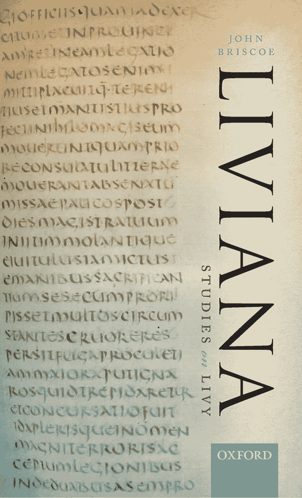

# Liviana：Livy 研究



对李维乌的研究

献给托亚斯

# 前言

2012年秋季，在《李维乌注释：第41-45卷》出版后，我向牛津大学出版社（`OUP`）提交了一份制作第21-25卷标准校本（`OCT`）的建议。当时提到，由于`OCT`的注释部分通常比Teubner版本简短，我可能无法像第31-45卷中那样引用许多推测。出版社的一位读者观察到，最近的一些`OCT`确实有丰富的注释，希拉里·奥谢（`Hilary O'Shea`）建议排除在注释外的推测可以放在同时出版的配套书中。然而，很快很，单凭这些推测长度不足以填充一本实行的著作，但可以放在`OCT`本身的附录中。史蒂芬·奥克利（`Stephen Oakley`）建议，书中可以包含对我某些编辑决策的辩护。起初，我不愿意开始第21-25卷的工作（正如罗纳德·辛姆常说的，“在这个晚晚的季节”），但后来被这个想法吸引了：这项工作的规模将类似于休·洛伊德-琼斯和尼格尔·威尔逊的《索菲亚与威尔逊》，以及威尔逊的《阿里斯托芬剧》（标题由希拉里·奥谢建议），而非史蒂芬·海耶沃斯的《辛西娅》，但将在`OCT`之后的一段时间出现，而非同时出版。此后，尼格尔·威尔逊、辛西娅·达米安和鲍勃·卡斯特分别为希罗多德、凯撒和苏提乌斯的`OCT`编写了配套书。

文本讨论（我通过引用而非页码进行索引）占据了本书的大部分，其之前是对从首印本（`editio princeps`）到现在的李维乌编辑情况的概述。接下来的七章也涉及第21-25卷：对伦敦大英图书馆（`BL Harley 2493`）中注释的讨论，我将其归于“A”而非瓦拉（`Valla`）；五个我提供了故意省略自`OCT`注释细节的案例（根据`OCT`第xx-xii页的规则排除的Puteaneus读法，仅描述为“det(t)”的手稿，以及属于Weissenborn、Madvig和H. J. Müller的推测的精确引用），以及对`OCT`的修正。接着是四章我回到第31-45卷注释的内容：34.4.16的文本问题，前人文主义者所知的第四卷Lovati文本，以及对Teubner第四卷和第38-40、41-5卷注释的进一步补充和修正。最后，一个简短修正了《罗马历史学家》第三卷中关于李维乌的26F92错误。

这是第三次，我很幸运地让霍福德-斯特雷文斯（`Holford-Strevens`）为我的作品进行校对，这本书变得好得多。此前，出版社读者的建议极大地提高了本书。再次，我感谢所有参与本书出版的员工，特别是策划编辑夏洛特·洛弗里奇（`Charlotte Loveridge`）、助理策划编辑吉金娜·莱顿（`Georgina Leighton`），制作编辑格玛·威尔金斯（`Gemma Wilkins`）和埃莉诺·奇尔弗斯（`Eleanor Chilvers`）。我感谢凯琳·麦安德鲁（`Carolyn McAndrew`）为本书校对。文本讨论受益于与吉姆·亚姆斯频繁面对和电子交流。这本书几乎完全是在曼彻斯特大学完成的；我再次感谢主图书馆和约翰兰兹图书馆提供的帮助和耐心。我感谢大学IT部门在计算机问题上的及时协助。

在我第21-25卷的前言结尾，我曾说，如果`OCT`有献词习惯，我会把它献给我的小孙子。现在我这样做。

J. B.

曼彻斯特

2018年3月

# 缩写表

这是一个以缩写形式引用的现代作品列表：并非完整的参考文献。除了我在第21-25卷第xxx–xxxix页列出的推测编辑者和作者外，我未在此包含其他缩写。期刊缩写见《语言年鉴与古代文献目录》（1896–1914）。希腊和拉丁语作者的名字和作品缩写在少数变化外，分别对应`Liddell–Scott–Jones`和`TLL`。

- Adams, Informal Latin | J. N. Adams, *An Anthology of Informal Latin 200 BC–AD 900* (Cambridge, 2016)
- Adams, Social Variation | J. N. Adams, *Social Variation and the Latin Language* (Cambridge, 2013)
- Barrington Atlas | R. J. A. Talbert (et al.), *Barrington Atlas of the Greek and Roman World* (Princeton, NJ–Woodstock, Oxon., 2000)
- CAH viii | *Cambridge Ancient History*, 第二版 (Cambridge, 1989)
- CGL | *Corpus glossarium Latimorum*
- CIL | *Corpus inscription Latinarum*
- Conway–Walters | W. C. F. Walters and R. S. Conway, *OCT of Livy books 21–5* (Oxford, 1929)
- Du Cange | Charles du Fresne, Sieur Du Cage, *Glossarium mediae et infimae Latinitatis*, edition, edited by L. Favre (Niort, 1883–7)
- ed. | J. Briscoe, *OCT of Livy books 21–5* (Oxford, 2016)
- Engelmann–Preuss | W. Engelmann and E. Preuss, *Bibliotheca scriptoricarum*, 第8版, ii (Leipzig, 1882)
- Foster | B. O. Foster (ed. and tr.), *Livy with an English Translation*, vol. v, books xx–xii (Loeb; London–New York, 1929)

¹ 在我的版本中引用“C–W”。当某事无法归于一方而非另一方时，我会在总索引的两个名字下都列出。

xii

# 缩写表

- Fraenkel, Kleine Beiträge: E. D. M. Fraenkel, *Kleine Beiträge zur klassischen Philologie* (Rome, 1964)
- FRHist: T. J. Cornell (编.) 等人, *The Fragments of the Roman Historians* (Oxford, 2013)
- Goodyear: F. R. D. Goodyear, *The Annals of Tacitus, books 1–6* (Cambridge, 1972–81)
- H–S: J. B. Hofmann and A. Szantyr, *Lateinische Syntax und Stilistik* (Munich, 1965)
- Housman, Classical Papers: J. Diggle and F. R. D. Goodyear (编.), *The Classical Papers of A. E. Housman* (Cambridge, 1972)
- Klussmann: R. Klussmann, *Bibliotheca scriptorum classificorum et Graecorum et Latinorum*, ii/1 (Leipzig, 1992)
- K–St: R. Kühner and C. Stemann, *Ausführliche Grammatik der lateinischen Sprache*, 3rd edn., rev. A. Thielefelder (Leverkusen, 1955)
- Leumann: M. Leumann, *Lateinische Laut– und Formenlehre*, 2nd edn. (Munich, 1977)
- L–S: C. T. Lewis and C. Short, *A Latin Dictionary* (Oxford, 1879)
- Madvig, Emendations: J. N. Madvig, *Emendations Livianae*, 2nd edn. (Copenhagen, 1877)²
- Mommsen, Analecta Liviana: T. Mommsen and G. Studemund (Leipzig, 1873)
- Mommsen, Str: T. Mommsen, *Römisches Staatsrecht* (Leipzig, i–ii, 3rd edn., 1887, iii. 1887–88)
- Münzer, RA: F. Münzer, *Romanische Adelsparte und Adelsfamilien* (Stuttgart, 1920); 亦引用了 T. Ridley (tr.), *Roman Aristocratic Parties and Families* (Baltimore, MD–London, 1999)
- MRR: T. R. S. Broughton, *The Magistrates of the Roman Republic* (New York–Atlanta, GA, 1950–86)
- Oakley: S. P. Oakley, *A Commentary on Livy Books vi–x* (Oxford, 1997–2005)

> ² 在我的版本中简称为“Madvig”。

- OED: 《牛津英语字典》
- OLD: P. W. Glare (编.), *The Oxford Latin Dictionary* (Oxford, 1968–82)
- Packard: D. W. Packard, *A Concordance to Livy* (Cambridge, MA, 1968)
- Pökel: W. Pökel, *Philologisches Schriftsteller-Lexikon* (Leipzig, 1882)
- RE: *Real-Encyclopädie der klassischen Altertumswissenschaft*（古典古代世界百科全书）
- Regoliosi: M. Regoliosi, *Laurenti Valle Antidotum in Facium* (Padua, 1981)
- RS: M. H. Crawford (编.), *Roman Statutes* (London, 1996)
- TLL: *Thesaurus linguae Latinae*（拉丁语词汇汇）
- Tränkle: H. Tränkle, *Livius und Polybius* (Basle, 1977)
- Valla, Antidotum: 见 Regoliosi
- vol. i, ii, iii, iv: J. Briscoe, *A Commentary on Livy, Books xi–xxxiii, xxxiv–xxxvii, 38–40, 45 (Oxford, 1973, 1981, 2012)³
- Walbank: F. W. Walbank, *A Historical Commentary on Polybius* (Oxford, 1956–79)

> ³ 在我的注释中偶尔引用“n”。

## 李维著作版本

在紧凑且高度缩写的哥特字体出现之前，李维的著作通常无法装订单本羊皮手抄本（Speirensian传统的祖本，除第33卷、26–40卷外是一个明显的例外，尽管可以想象它被分为两卷，每卷七卷）；因此，李维现存部分（1–10、21–30、31–40、41–45卷）的传播情况不同。当`editio princeps`（初版）于1469年或1470年在罗马出版时，仅已知1–32卷和34–40卷。第33卷分两个阶段出现：从1519年的美因茨版本开始，该版本包含了第40卷的最后部分。第41–45卷首次于1531年的巴塞尔（Froben）版本出版。

## 摇印字本

Drakenborch 列出了18本注释本（即15世纪出版的版本），其中罗马3本、威尼斯6本、米兰3本、特里维4本、巴黎2本。对于后续内容，我不认为有多大的原创性。我的目标是提供我在准备自己的版本时学到的知识，并使我的校勘更易读。关于1823年之前的版本，请见 A. H. McDonald 的 *Catalogus translationum et commentarium: Medieval and Renaissance Latin Translations and Commentaries*, P. O. Kristeller 编, ii (Washington, DC, 1971),331–48；ISTC（摇印字本目录，大英图书馆在线出版）仅列出了 Drakenborch 的13个版本，遗漏了1481年和1885年在巴黎、1483年在特里维以及1492年在威尼斯出版的版本。Drakenborch 调查了其前人（见卷xxxi–xxxii页）。一份带有详细注释的综合列表见 F. L. A. Schweizer 的 *Handbuch der klassischen Bibliographie*, ii/1 (Leipzig, 1832),524–44。第vii卷328–31页。

正文中大量的错误（部分源自古代，部分源自近代）在某个摇印字本中被消除；16世纪的前三分见证了巨大的进步，以及李维此前未知的部分的发现。对于已知的部分，许多无疑正确且被广泛接受的读法归于 Ascension 版本（特别是1513年的，但还有1510年的、阿尔丁1518–20年的、美因茨1519年的以及巴塞尔1531、1535年的）。

> ¹ 对于后续内容，我不认为有多大的原创性。我的目标是提供我在准备自己的版本时学到的知识，并使我的校勘更易读。
>
> ² 他遗漏了特里维版本（1480年）的早期卷是在帕尔马出版的这一事实，导致他在注释中一致地将其称为“ed. Parm.”。
>
> ³ 此出现在卷末。
>
> 在三个图书馆中均可轻松获取：
>
> - 牛津大学图书馆：13本
> - 大英图书馆：11本
> - 约翰·莱兰兹图书馆：8本
>
> 这三者都有最早的（`editio princeps`）、1470年和1472年的罗马版本（Campanus版），以及1470年在威尼斯和1478年在米兰出版的版本。
>
> ⁴ 稍早之前，P. A. Orlandi 的 *Origine e progressi della stampa, dell'arte impressoria e notizie dell'opere stampa dall'anno MCCCCVII all'anno MD (Bologna, 1722)*,148页。
>
> ⁵ M. Maitaire, *Annales Typographicae antiquae ad annum MD (海牙-阿姆斯特丹-伦敦, 1719–41)*, iv. 235（对比 i. 156，未给出出版地，Drakenborch说84，这可能是错误或指的是我查阅的其他版本）。
>
> ⁶ 从 Maitaire 处得知了真相。
>
> ⁷ 关于日期，请见现藏于大英博物馆的 *Catalogue of Books Printed in the XVth century*, i (London, 1916),20。

如前所述，美因茨版本首次包含了李维第四年代中此前未知的部分，源自一部现已丢失的手抄本，包含了从33.17.6 *his partes*（*ius facius*的误写）到该年代末的内容。该版本由 Nicolaus Carbach (ius) (1485–1534) 在美因茨大教堂图书馆（拉丁语为 Mogontiacum 或 Moguntia）发现，因此将手稿本缩写为“Mg”，版本缩写为“Mod”；在版本末尾，Carbach 添加了“Annotata e questo codices”，当他的手稿本读法与之前的版本不同时使用（他的参考点是1513年的 Ascension 版本）。在某些情况下，Mg 有一种新奇的读法并未出现在 Carbach 的 *Annotata* 中：不确定是推测还是确实取自 Mg。Carbach 对 Mg 的一些误读在阿尔丁版本中通过断句迅速得到了纠正。

在1531年的巴塞尔（Froben）版本中，Gnaeus 出版了第41–45卷，源自现于维也纳的唯一手稿本（unica），这是他年前在洛尔绍发现的。新材料的文本几乎立即出现在 Ascension 版本（1531年，前一年已出版了一个新版本）、Juntine 版本（1532年，同时来自佛罗罗萨和威尼斯：前者是1522年在佛罗伦萨出版的）以及阿尔丁出版社（1533年）中。Fr.1 在第一、第三和第四年代也包含许多经常正确的读法；在后期它纠正了 Mg（或 Carbach 对 Mg 的报告）中的某些错误，但都是由于断句：没有理由认为它们源自 Mg 本身（尽管美因茨位于巴塞尔以北300公里以内，沿莱茵河）。

> ⁸ 大英图书馆拥有前者
>
> ⁹ 见下文。
>
> ¹⁰ 见我的31–40卷版本，第viii i页，现在怀疑 Mg 是否像叙利亚传统的祖本一样，最初包含26–40卷，其中31–2是第一卷的结尾，第二卷是第33卷的开头。
>
> ¹¹ 见我的41–45卷版本，第1–ix页（我对这些卷的注释的简版，3–4卷）。该版本的其余部分是创始人之子 Hieronymus Froben、其姐夫妹夫 Nicolaus Episcopius 以及 Johann Froben 遗孀的第二任丈夫 Johann Herwagen 的工作。

# 利维亚纳 (Liviana)


# 李维的版本

## 1535年巴塞尔第二版利本本 (Fr.2)

1535年出版于巴塞尔的第二版利本本（Fr.2）没有增加额外的文本，但显著增加了对已知内容的证据支持。在第一个十年里，雷纳努斯（Rhenanus，第1–6卷）和格伦尼乌（Gelenius，第7–10卷）引用了来自两个手稿的读法，两者很可能位于沃尔姆，其中一本与美第奇手稿（Medice MS）密切相关，其权威性相当于所有其他卡罗林手稿。¹12 在第26–40卷中（雷纳努斯第26–30卷，格伦尼乌第31–32卷及34–40卷），他们引用了来自施派尔（Speyer）手稿的读法，该手稿在第26–30卷中形成了与普特阿努斯（Puteanus）传统的竞争。¹13 此外，格伦尼纠正了卡巴赫（Carbach）对Mg的许多读法，并添加了后者遗漏的变体。

## FR.2 到西格尼乌斯 (Sigonius)

德拉肯布罗克（Drakenbrock）列出了1537年至1572年间出版的二十四个版本。迄为止最重要的是最后三个，即西格尼乌斯（Sigonius）分别于1555年、1556年和1572年在威尼斯出版的版本。¹14 西格尼乌斯能够利用历史知识，特别是他对快表（res Fasti）的研究，纠正了许多在流传过程中损坏的人名和地理名。¹15 他还使用了一个或多个手稿来校正文本，尽管目前无法识别这些手稿。

## 西格尼乌斯到格罗诺维斯 (Gronovius)

我了解到从1572年至J. F. 格罗尼乌斯（J. F. Gronovius）的版本之间有三十五个版本，包括他去世（1671年）后出版的版本。¹⁶

¹² 参见 Oakley, i. 169–80.

¹³ 关于第26–30卷的施派尔传统，参见 Reeve, RIC 115 (1987), 405–40, Oakley, CR 48 (1998), 327–31 以及在 id., P. Millett, and R. J. E. Thompson (eds.), *Ratio et ipsa; Classical Essays Presented by Former Pupils to James Doodle on his Retirement* (Cambridge, 2011), 169–70.

¹⁴ 除了1541年的威尼斯版（未见此），这是该时期在意大利出版的唯一几个版本。西格尼乌斯于1584年去世，1572年版的修订本于1592年由阿尔丁出版社（Aldine press）出版（参见我对42. 50的注释）。

¹⁵ 简参见 FRHist i. 653–4.

¹⁶ 其中两个分别于1612年（法兰克福，见注17）和1635年（阿姆斯特丹）出版的版本被德拉肯布罗克省略了；格罗尼乌斯的初版出现在1644–65年（1654年版为重印本，他的二版在1664–65年（格罗诺维斯于1671年去世；1678年和1678–79年版为重印本，后者由小格罗诺维斯修订并包含他的注释）。1661年在阿姆斯特丹出版的版本是由德拉肯布罗赫（vi. 340）编写的，“根据J. Fr. Gronovius的原稿”；是1635年的重印。

¹⁷ 德拉肯布罗克漏掉了1711年在多德德里赫特（Dordrecht）出版的版本，大英图书馆收藏。

¹⁸ 德拉肯布罗克亲自描述了1607–08年的版本，以及1625年在巴黎出版的未经授权的重印本，仿佛他看过这些版本（参见第164页）；Walters, Co II（1917）暗示1612年版的章节划分是（参见vii. 339，他并未见过1609年和1619年的版本）。此外，格鲁特（Gruter）似乎是第一个将塔西佗的作品分为章节的人；参见S. J. V. Malloch in R. Hunter and S. Oakley (eds.), *Latin Literature and its Transmission* (Cambridge, 2016), 233.

¹⁹ 利维亚补充注释（Glastow, 1882），pp. xif.（描述德拉肯布罗克为德国人）。

## 利维的版本

格罗诺维斯在十七世纪的贡献与西格尼乌斯相当，尽管海因纽斯（ed. Leiden, 1634）值得一提；在十七世纪，荷兰的莱丹大学成为古典研究的领先地。格鲁特的1607–08版在引入章节划分方面是一个里程碑，这一功劳归于德拉肯布罗赫。¹⁷

## 格罗诺维斯到德拉肯布罗赫 (Drakenborch)

格罗诺维斯去世到德拉肯布罗赫第一卷《李纪》（Variiorum）出现之间的七十年里，只有十个新版本。¹⁸潜在的编辑者可能受到格罗诺维斯权威的影响。最重要的是海恩（1708年，首次在牛津出版）和克吕维（1735–42年）；二版于1748–5年出版，正如沃克（Walker）所观察到的，德拉肯布罗赫未能考虑到它；随后是1768–69年。海恩引用了许多牛津手稿（参见Drakenborch vi. 322, Mommsen, *Analecta Luijiana*, 35），其中新学院版是第四个主要见证²⁰ 克吕维是一位敏锐的批评家，他的许多推测在后续版本中获得了广泛认可。

## 德拉肯布罗赫到雷西格 (Kreyssig)

德拉肯布罗赫的版本是一个重要的里程碑，并在长期以来一直是研究的基础。关于第1–32卷和34–40卷，即使在手稿被确定后，似乎也不需要参考其他版本。

## 8 Liviana

在完成Teubner版后，Weissenborn将注意力转向了制作李维（Livy）的首版版本，并在文本中进行了大量的更改。第一卷（第1本书）于1853年出版，该系列（第43–5卷）于1866年完成。到Weissenborn于1878年去世时，他已经见证了第31–42卷的两个版本、第24–30卷的三个版本、第3–10卷的四个版本，以及第1–2卷和21–23卷不少于六个版本（见第188页），尽管在某些情况下，与之前版本的相比变化并不大。

在第四十年里，他们对意大利手稿的了解仅限于 Draken及其前任所引用的那些。他们理智地认为这些手稿明显逊于班贝格手稿（Bamberg MS），当在 B 和 Mg 之间可以选择时，他们不愿优先选择它们（当然，如果 B 和 Mg 一致，十九世纪的编辑者——除了没有编辑全集的 Luchs 外——处境并不比 Kreysig 好在哪里）。Traube 对班贝格碎片的发现对该版本没有影响，因为对 B 和 Mg 的选择对其相对优越性的看法不同（Weissenborn偏好 B，而 Mg）。

至于第31–45卷，十九世纪的编辑者对系谱学（stemmatics）并没有清晰的理解。Sage 的 Loeb 版本算是一个，尽管他正确描述了 Traube 在第26–30卷里程碑式版本（n.1, 249–55）中建立的系谱，直到 McDonald 的31–5卷 OCT——该版本基于 Weindwich 具有里程碑意义的文章（1920）并建立了一个系谱，该系谱最终在1991年的Teubner 版中被修改，基于 Reeves 在 RIFC 1986 中的文章，针对第41–5卷，仅考虑了维也纳手稿，无疑数字图像将会显示（可访问 `http://bibliotheca-lauchamensis.de/view/onb-cod15`）。

# 李维的版本

在Weissenborn去世后，M. 和 H. J. Müller（两人并无关系）分别对Teubner 版和注释进行了大规模修订。在1881年至1902年间，前者产生了第1–38卷的版本（并非按顺序排序：第24–30卷于1881年和1884年出版，第31–8卷于1887年和1990年出版，第21–3卷于1894年出版，第7–10卷于1999年出版，第1–6卷于1902年出版）。Müller去世后，Heraeus 出版了第39–45卷的版本（第39–40卷，1908年；第41–5卷，1912年）。注释的部分卷经过了几个新版本，如下所示各部分的版本列表所示（该版本可在1962年制作的全集最终重印本中找到，大多数图书馆都有）。

| 卷 | 版本 | 日期 |
|---|---|---|
| 1 | 第九版 | 1908 |
| 2 | 第八版 | 1894 |
| 3 | 第六版 | 1900 |
| 4–5 | 第六版 | 1896 |
| 6–8 | 第六版 | 1924 (由 O. Rossbach 编写) |
| 9–10 | 第五版 | 1890 |
| 21 | 第十版 | 1921 (由 O. Rossbach 编写) |
| 22 | 第九版 | 1905 |
| 23 | 第八版 | 1907 |
| 24–5 | 第五版 | 1895 |
| 26 | 第五版 | 1911 |
| 27–8 | 第四版 | 1910 |
| 29–30 | 第四版 | 1899 |
| 31–2 | 第三版 | 1883 |
| 33–4 | 第三版 | 1883 |
| 35–6 | 第三版 | 1906 |
| 37–8 | 第三版 | 1907 |
| 39–40 | 第三版 | 1909 |
| 41–2 | 第三版 | 1909 |
| 43–4 | 第二版 | 1880 |
| 45 及碎片 | 第二版 | 1881 |

如所见，在第四十年中，第31–4卷的最后版本与第36–40卷版本之间有约25年的空缺；在第五十年中，第43–5卷与第41–2卷之间有近30年的空缺。除了现存书籍的已完成或计划的版本外，在德国和英国，还有许多针对学校设计的单卷或多卷的文本、注释。在德国文法学校和英国学校最受欢迎的是 I、II 和 III 卷。这些编辑者包括德国的 Wöflin 和 H. J. Müller（他们当时都是文法学校教师），以及奥地利的 Robert Novák 和 Anton Zingerle。这些版本经常包含新的推测，无论是放在正文中还是仅作为建议。

- ²⁷ Reeve, RIFC 114 (1986), 145.
- ²⁸ 查看 Engelmann-Preuss 572–4, Klussmann 514–24.
- ... 我使用这些卷的五十年的经验是，后期版本无疑显示了早期版本所缺乏的深度和成熟。

在1883年至1907年间，Anton Zingerle 制作了一个完全全新的版本，针对第41–5卷的维也纳手稿。除此，他似乎依赖于现有的稿读法（带有第21卷的 *momenta* 和第22、23卷的 *prolegomena*），但由于扉页将其描述为第二卷，他显然打算制作一个全集版本。Luh 也如此，他的第21–5卷和第26–30卷（editio minor）分别题为 III 和 IV 卷。

# 李维的版本

### 二十和二十世纪：OCT、BUÉS 和 TEUBNERS

二十世纪初，德国没有变化。在英国，自从 Hearne 之后没有出现过全集的原版，当时处于一部牛津古典文本（OCT）版本，由曼彻斯特拉丁语教授 R. S. Conway 和伦敦国王学院古典学教授 C. F. Walters 编辑。第一卷（包含第1–5卷）于1914年出版，第二卷（第6–10卷）于1919年出版。Walters 于1921年生病并在1927年去世：第三卷（第21–5卷）于1929年以 Walters 和 Conway 的名字出现（顺序如此，正如 Walters 主要负责的第2卷一样），并在注释中使用 *ego* 指代 Walters，但这应被视为 Conway 的尊重表现；他负责序言，显然也负责注释的最终形式。

这三卷遵循相同的模式并存在相同的问题，这很大程度上是因为编辑者对系谱学的敌意。（Walters 曾写道（CQ 2 (1908), 213）“但我拒绝继续制作系谱，因为‘系谱有什么用？’除了增加徒劳。”⁴⁰）他们没有制作系谱，也没有使用符号来表示手稿组的统计，而是逐个引用手稿，包括那些可以消除的手稿，且通常不符合逻辑。此外，他们在注释中充斥了不必要的信息；此外，他们经常对推测做出无意义的价值判断（*bene, optime*——后者有时是针对他们并未打印的内容——*male, frusta*）。此外，他们对手稿和早期版本的稿读报告经常不准确，最近的学者发现了这一点。

Walters 去世后，Conway 招募了 S. K. Johnson（他1924年至1927年在曼彻斯特的同事，随后担任斯旺西（1927–33）和纽卡斯尔（1933年起）古典学教授）作为第26–30卷的共同编辑；⁴¹ Johnson 被分配负责注释的编写，其中

- ³⁷ 于1881年出版，在瑞典版（1871）之后，但在 Getha（1882）出版的版本之前。
- ³⁸ 查看 Engelmann-Preuss 572–4, Klussmann 514–24.
- ³⁹ H. J. Müller 将其包含在柏林哲学学会年度报告（*Jahresberichte des philologischen Vereins zu Berlin (JPhV)*）中。
- ⁴⁰ 参见 Ogilvie, 第1–5卷 OCT，第 xvi 页，将“stereotyp mischief”译为 *obstatum malum*。
- ⁴¹ 关于此及后续内容请见 Johnson, 第26–30卷 OCT 序言，第 v f. 页。

# 12

## Liviana

规定所有有问题的段落（即使微乎其微）都应该与 Conway 讨论，在发生分歧时，应以 Conway 的意见为准（Johnson 写道：*sicut par erat*）；正如在第 21–55 章中 *ego* 指的是 Walters 一样，这里指的是 Conway。作品于 1932 年完成，但 Conway 在次年去世，当时三分之一的内容已在校对。序言日期为 1934 年 1 月 1 日，书籍于 1935 年出版。

方法论上，这比之前的卷有了显著的改进。Johnson 给出了一个系谱（第 vii 页），并用 II 来表示 P 和 CRMBDA 的读法，用 `$\pi$` 表示后者中三个或更多抄本的读法。当然，如果 CRMBDA 的读法与 P 一致，他本（也应该）应用他的系谱，只需引用后者即可；如果 BDA 的读法为 R且与 P 的读法不同，则需要引用 R。Johnson 认为将 N 纳入 `$\pi$` 的理由（第 xvii 页）是不充分的，他本可以使用一个符号来表示 AN 的一致性。Johnson 暗示（第 v. f 页）Conway 批准了发送给印刷厂的校记，我们假设至少在某种程度上，他放弃了对统计学的反对。¹²

1879 年，Livch 出版了第 26–30 章的大修订版（editio maior），这无疑是 19 世纪对李维文本研究最重要的贡献，识别了大部分 Spiren 传统。Reeve 对此写道：“……他的序言是阐述的典范：准备详尽，论证严谨。如果有一个版本因其对文学作品的贡献以及作为方法论的教材而被保留，那么这一个完全做到了.³” Conway 和 Johnson（在不知道其作者身份和过程的情况下）对 A⁴ 中 Petrarch 的修正给出了完整报告，这些修正仅用于第 26, 41, 18–43, 9 和 30 章的补充。

20 世纪 40 年代，Johnson 报告了第 41 章，直到该年代末，但由于他的校记已经足够长，他报告了 V 章（Pat. Pal. 876），⁵，然后选择性地仅报告了第 30 章.¹⁶ Conway 在 37 岁时去世，⁷，出版社任命 28 岁的 Alex McDonald 继续，并希望他能完成该系列（即

> ¹² Oakley (CR² 43 (1993), 282) 将该版本描述为“灾难性的”，并在 CR² 48 (1998), 313 写道：“C-J 的牛津古典文本（OCT）呈现了一个非常糟糕的文本和一个缺乏批判性的校记”
> ³ 参见注 n 28. ⁴⁴ 参见 p. 153 n. 1. ⁵⁵ 参见 p. 17, p. ix.
> ⁴6 OCT 第 26–30 章，p. xxix.
> ⁷ 1936 年 9 月 3 日，在一场登山事故中。关于该日期，我们见过 *Who, 1929–1940 (London, 1941)*，我记得 George Kerferd 告诉我过情况，但我未能找到任何相关的出版文献。

# 李维的版本

第 31–45 章、残篇和梗要（perichoae）。McDonald 是一位新西兰人，他当时是诺丁汉大学的讲师，刚获得剑桥博士学位。从 1939 年到 1951 年，他先后担任悉尼大学的古代历史阅读教授和古代世界历史教授，于 1952 年回到剑桥。直到 1965 年，他才制作了包含 31–45 章的 OCT 卷，而他在 1979 年去世时，第 36–40 章似乎进展不大。后者被托付给了 Peter Walsh（我的理解是，McDonald 曾表示不希望由 Ogilvie 或我来做这件事）。在去世之前，McDonald 本人已将第 41–45 章和梗要交给了 Michael Crawford，并将残篇交给了 Ogilvie。后者在 1981 年由亲手完成，残篇则由 Christopher Pelling 接手。1986 年，我出版的第 41–45 章 Teubner 版本让出版社和 Crawford 同意，这些书籍不再需要 OCT 版本了。1992 年，Pelling 和 Crawford 在牛津组织了一次会议（我参加了），讨论残篇和梗要，但可以理解，Crawford 有其他优先事项，当 Pelling 在 2003 年成为牛津大学希腊教授时，他认为投入大量时间研究拉丁语是明智的。因此，接棒交给了 David Levene，他意图制作的不是 OCT，而是针对残篇和梗要的版本和注释。Ogilvie 在去世时实际上已经完成了残篇的文本和校记，这将成为 Levene 版本的的基础；对于梗要，他将利用 Reeve 关于其流传的文章。⁸

## 16 Liviana

李维（Livy）的布é版始于1947年。前七卷书由让·贝叶（Jean Bayet）编辑（第1–5卷由高斯顿·拜莱特 Gaston Baillet翻译，第6卷由贝叶本人编辑，第7卷由雷蒙·布洛赫 Raymond Bloch编辑）。其中最后一本于1967年出版，此后的第一个十年中，仅由布洛赫和Ch. Guittard编辑的第8卷已出版。


# 16 Liviana

李维（Livy）的布é版始于1947年。前七卷书由让·贝叶（Jean Bayet）编辑（第1–5卷由高斯顿·拜莱特 Gaston Baillet翻译，第6卷由贝叶本人编辑，第7卷由雷蒙·布洛赫 Raymond Bloch编辑）。其中最后一本于1967年出版，此后的第一个十年中，仅由布洛赫和Ch. Guittard编辑的第8卷已出版。

自Figrill⁶⁴以来，学者们已经意识到前十年手稿存在三分划分，但贝叶是第一个提供系谱（stemma）的人。在系谱中，他使用希腊字母sigma表示重构的原型（hyparchetypes），但仅用于谱谱的最高层，并在 `μ` 和 `π` 处表示杂糅。而且，根据布é版的通常惯例，这些符号并未出现在校注中。他也没有将其谱谱的教训应用于文本本的制作。⁶⁵ 这一直等到Ogilvie对前五卷进行OCT编辑（1974年），取代了Conway和Walters的版本。Ogilvie在1957年讨论过这些手稿，⁶⁶ 他提供了一个清晰且简洁的校注，在适当的情况下使用希腊字母sigma并省略了错误的读法。在两件事上，他改变主意并变得更糟：⁶⁷ 他现在认为，在缺乏WK的情况下，仅凭H可以作为`λ`的证据，并且他放弃了早先认为P曾受`μ`杂糅的观点。

现在对前十年流传的研究基础将转向Oakley在其注释集第一卷中的详尽讨论，⁶⁸，并引用了Reeve在卷册出版前不久的一篇重要文章：⁶⁹ Reeve认为 `μ`、`λ` 和 `π` 均独立源于N，即《尼尼马科斯》原型（Ogil认为`λ` 和 `π` 衍生于一个他称为 `Δ` 的中间文本），并更谨慎地提出，P应被等同于`π`。

⁶³ RFIC 114 (1986), 148 n. 2.

⁶十四 *Liuzianor librorum decadis emandaendae ratio* (Uppsala, 1875).

⁶⁵ Cf. Oakley, ⁶⁶ 在Ogilvie的文章出现后[见下文]，其结论并未被布é文本第i–viii卷的编辑充分准备。

⁶⁷ CQ 7, 68–81.

⁶⁸ 见我的 JRS 7 (1977), 239–41, Oakley. 268 n. 351–113.

⁶⁹ Oakley. 152–327.

In C. A. Chavannes-Mazel and M. M. Smith (eds.), *Medieval Manuscripts of the Latic Classics: Production and Use* (Los Altos Hills, CA–London, 1996), 74–90. Oakley将其引用为‘Reeve (forthcoming, a)’（在第四卷的附录中为‘Reeve (1996’）。

# 李维编辑本 17

希望Oakley能出一个第6–10卷的版本，其文本他已在注释中论证过（无疑会有一些想法的转变），并附有一个基于其讨论中所阐述原则的校注。

第三十年的布é版目前包含除第22卷和第30卷以外的所有卷，⁷⁰ 其中六卷（21, 23–4, 26–8）由已故的Paul Jal编辑，第25卷由Fabienne Nicolet-Croizat编辑，第29卷由Paul François编辑。其编辑原则是Jal在第21卷和第26卷的编辑中确立的。在第一卷中，他引用了许多手稿（`Florence. Med. Laur. 63. 17, 89 inf. ¹⁷ London, BL Perl. 2684, Vat. Pat. lat. 876, 879, Paris, BnF lat. 5690`），这些手稿被Luchs和Conway使用过—⁶³⁰但在第21–25卷中没有权威性。此外，他引用了`Vat. Pat. lat. 874`，⁷²，没有其他显性理由，除了它属于876和879⁷³的数字系列外，以及三本巴黎手稿，`BnF lat. 5732, 5733, 和 5736`。其中第一本和最后一本（标记为`Cambridge, Trinity 637 (D)`）构成了Reeve所说的`Δ`，⁷⁴，而Jal⁷⁵观察到它们的读法通常接近D。`Bnf lat. 5733`是一本十四世纪的手稿（而`Δ`手稿属于十二世纪），也被包含在内，无疑，它是同一数字系列的一部分，而且在这种情况下可以方便地在巴黎查阅。

在第21卷中，Jal的校注避开了对重构手稿使用符号，⁷⁶ 按符号的字母顺序列出手稿（希腊字母在罗马字母之后），从而掩盖了系谱所属关系和年代，特别是Puteaneus的卓越地位。校注有时是负面的，或者未被特定引用的手稿被称为‘codett’，这再次指责Puteaneus的证据。在第25卷编辑中，Nicolet-Croizat遵循了Jal的做法，后者（随后在第26卷中）按（大致的）年代顺序列出手稿，赋予了Puteaneus合理的地位。

> ⁷⁰ Marielle de Franchis正在准备后者。
>
> ⁷¹ C. Reeve, RFIC 15 (1987), 410 n. 1.
>
> ⁷² 在p.xi处指出它在OCT版本中未提及：by Conway-Walters p. xxx.
>
> ⁷³ 这三本是Gebhard引用的Palatini抄，其报告可在Drakenborch找到；Ch. Fun, ed. ix.
>
> ⁷⁴ 见pp., xi–xiii.
>
> ⁷⁵ 第21卷编辑，p. lxii.
>
> ⁷⁶ 见pp. 16, 19–20.

# 18 Liviana

他在第26–28卷编辑中引用了被Reeve识别的Spirenian传统，⁷⁷包括在Nancy发现的碎片，⁸，并提到了Donaueschen第30卷。Jal采纳了Conway–Johnson的做法，使用II（因为它已被编辑过）作为P与RMCA⁷⁰（即一些最古的手稿源于此）。Jal的第26卷编辑于1991年出版，第27卷于2003年，第28卷于1995年出版，在François的第29卷之前。后者使用了`Venice, Marciana. Z 36`和`London, Byrne`⁸¹（Reeve特别提到的两本手稿）作为`Θ`的代表，`Florence, Med. Laur. plut. 89 inf.`

第四十年的布é版仅缺少第34卷。其余九卷分别于1977年（31）和2004年（35）出版（36–38和40均在1982年至1986年之间），由不同的编辑者完成。尽管如此（这并不理想），这些卷基于McDonald的OCT第31–5卷。

> ⁷⁷ 有Modena这个可以原谅的例外，a.M.⁸² (see, p. v.).
>
> ⁷⁸ Reeve, RHC15 (1987),⁷⁵）说Nancy碎片已经被使用了；它意味着Conway和Johnson使用它来指定`Florence, Med. Laur. 63`；当然，可以使用她选择的任何内容，如果需要早期标准。这并没有阻止我使用`Reg. Lat. 164`（见，页. ff）。
>
> ⁷⁹ Reeve, op. cit., 406–7，第26卷编辑，p. xlsv.
>
> ⁸⁰ 仅由Conway–Johnson使用的`Paris BnF lat. 5732, 5736`用于Jal。
>
> ⁸¹ 他接手了Conway–Johnson，但对于与少于三部的列出的手稿，Jal符合PRMC的意见。
>
> ⁸² Op. cit., 410.
>
> ⁸³ 第29卷编辑，p. cii.
>
> ⁸⁴ 第31 (1977), 32 Mineo (2003), 33 Achard (2001), 35 R. Adam (2004), 36 Manuelian (1983), 37 Engel (1983), 38 R. Adam (1982), 39 A.-M. Adam (1994), 40 Gouillart (1986).

# 19

大部分复制了他的系谱。校注虽然没有使用希腊符号，但分组呈现手稿证据。当然，第36–38和40卷是在Reeve在RFIC 1986的文章和我的（1991）文章之前出版的。在第39卷编辑（p. cxxx）中，A.-M. Adam（p. cxxx）提到了我们的观点，但指出她的系谱是基于McDonald的，并且在她的校注中，a的读法包含在recentiores类下。然而，在2003年，Mineo（第32卷，p. xxxvi–xiii）表达了可以被称为Walsh对Reeve和我的保留性意见；他甚至没有提到Walsh的OCT（他在第clix页列出了它吗？—*注：此处原文为clix，疑为lix之误，根据上下文为clix或lix页*）。⁸⁵ 详细讨论见下文第16章。

Paul Jal对布é系列最早的贡献是他对第41–5卷编辑的三卷，这是李维最后一部幸存的作品。第41和第42卷于1971年出版，43和44卷于1976年，⁸⁶第45卷（及碎片）于1979年出版（我的Teubner书籍编辑本于1986年出版）。periochae随后于1984年出现⁸⁷由于第41–5卷的文本仅取决于一个损坏且有缺失的手稿`Vienna, Nationalbibliothek lat. 15`，因此没有系谱问题，校注中证据的呈现非常直接。与大多数布é版一样，Jal在引用推测时具有高度选择性，远没有记录手稿中发现的所有修正。

# 附录

我机会记录这样一个事实：我与Jal早期的不利关系在他生命的最后几年得到了很大改善（他于2012年去世）。Jal对布é版的拉丁部分负总责任，他无疑对我第36和第37卷编辑的评论并不满意（分别在*CR* 2 (1985), 189–90, 34 (1984), 194–6）；他敌意的主要可能是我对他periochae编辑本的评论（见注释87）。在REL 70 (1992), 279–81中，Jal以一个敌意的评论作为回应，我（*Gnomon*, 1997, 117 n. 7）描述为“无知且恶意”，针对我的第四十年的编辑本。后来，在对Walsh的Aris and Phillips出版的第……卷的评论中（此处中断）。


> ⁷⁹ Reeve, op. cit., 406–7，第26卷编辑，p. xlsv.
>
> ⁸⁰ 仅由Conway–Johnson使用的Paris BnF lat. 5732, 5736用于Jal。
>
> ⁸¹ 他接手了Conway–Johnson，但对于少于三部的列出的手稿，Jal符合PRMC的意见。
>
> ⁸² Op. cit., 410.
>
> ⁸³ 第29卷编辑，p. cii.
>
> ⁸⁴ 第31 (1977), 32 Mineo (2003), 33 Achard (2001), 35 R. Adam (2004), 36 Manuelian (1983), 37 Engel (1983), 38 R. Adam (1982), 39 A.-M. Adam (1994), 40 Gouillart (1986).

# 19

大部分复制了他的系谱。校注虽然没有使用希腊符号，但分组呈现手稿证据。当然，第36–38和40卷是在Reeve在RFIC 1986的文章和我的（1991）文章之前出版的。在第39卷编辑（p. cxxx）中，A.-M. Adam（p. cxxx）提到了我们的观点，但指出她的系谱是基于McDonald的，并且在她的校注中，`a`的读法包含在`recentiores`类下。然而，在2003年，Mineo（第32卷，p. xxxvi–xiii）表达了可以被称为Walsh对Reeve和我的保留性意见；他甚至没有提到Walsh的OCT（他在第clix页列出了它吗）。⁸⁵ 详细讨论见下文第16章。

Paul Jal对布é系列最早的贡献是他对第41–5卷编辑的三卷，这是李维最后一部幸存的作品。第41和第42卷于1971年出版，43和44卷于1976年，⁸⁶第45卷（及碎片）于1979年出版（我的Teubner书籍编辑本于1986年出版）。periochae随后于1984年出现⁸⁷由于第41–5卷的文本仅取决于一个损坏且有缺失的手稿Vienna, Nationalbibliothek lat. 15，因此没有系谱问题，校注中证据的呈现非常直接。与大多数布é版一样，Jal在引用推测时具有高度选择性，远没有记录手稿中发现的所有修正。

# 附录

我机会记录这样一个事实：我与Jal早期的不利关系在他生命的最后几年得到了很大改善（他于2012年去世）。Jal对布é版的拉丁部分负总责任，他无疑对我第36和第37卷编辑的评论并不满意（分别在`CR` 2 (1985), 189–90, 34 (1984), 194–6）；他敌意的主要可能是我对他periochae编辑本的评论（见注释87）。在`REL` 70 (1992), 279–81中，Jal以一个敌意的评论作为回应，我（`Gnomon`, 1997, 117 n. 7）描述为“无知且恶意”，针对我的第四十年的编辑本。后来，在对Walsh的Aris and Phillips出版的第……卷的评论中（此处此处中断，但根据指令已翻译了所有可见的文本内容）。

Liviana

39 (Latomus, 39 (1996), 266–7), Jal 将沃尔什（Walsh）称为“海峡彼最好的利维亚人（livien）”。这句话既是针对斯蒂芬· Oakley，也是针对我的：他对 Jal 出版的第 26 卷的敌对评论（`CR`² 43 (1993), 282–4）显然引起了相当大的不快；在评述沃尔什版的第 38 卷（Latomus, 38 (1995), 233–4）时，Jal 在提到我的“拙劣版本”后，继续谈到“如今那些糟糕的报告未能充分了解提提·李维（Tite-Live）并通过其著作进行证明。他看来，对我版本的主要意见是，我使用希腊字母符号（sigla）来表示一组手稿成员的一致性，以及重构的（假）原型，就好像那是我发明的一样”（在 Latomus, 39 (1996), 267 中，他在评述沃尔什版的第 39 卷时，称之为一种“令人厌恶的方法”）。因此，当 Jal 在 `REL` 86 (2008), 401–3 中对我第 38–40 卷的注释给出正面评价时，写道“约翰·布里斯科（John Briscoe）是一个伟大的利维亚人”，并将我的第四个十年版本列为“显示了约翰·布里斯科利维亚著作的重要性和规模”的书籍之一。我不知道是什么导致了这种心态的转变，但我第 41–45 卷注释的序言做出了同样的回应，并尽可能礼貌地表达对 Jal 相应书籍版本的批评。

## 第一部分

### 第 21–25 卷

## 2

### 文本讨论：第 21 卷

第 2–6 章讨论的段落是那些呈现特别困难的段落。它们大部分包括：(1) 被标星（obelized）的段落；(2) 涉及增补的段落，除非所需的增补显而易见；(3) 注释冗长且/或复杂的段落。在许多情况下，特别是被标星的段落，我对之前的讨论几乎全无可补的内容，我的目标仅仅是阐明其困难并帮助读者理解注释；在被标星的段落中，我克制自己每次都说我除了使用匕首（dagger）外没有其他选择。

我开始这一章时，正在等待我版本制作过程的各个阶段。不可避免的是，这暴露了我注释中的许多错误和遗漏，其中大多数我在校对、初校或修订阶段得以纠正。当我交回修订稿时，我已经到了第 24 卷第 16 章，并没有不再向出版社发送更多更正，因为这可能只会引入错误。因此，第 13 章中列出的绝大多数添加和修正（也涉及正文）均涉及第 24 卷的剩余部分和第 25 卷；我也在对相关段落的讨论中在此提到了它们（在少数情况下，第 13 章的条目仅指我在此处说的话）。

在引用段落时，我不对句首字母大大写；如果一个段落包含多个节，我不会在其内部标出节。除少数例外外，我不引用我版本附录（第 365–78 页）中列出的假设。正如我的注释一样，在给出一个词在利维（L）作品不同部分的分布时，我遵循惯例，例如写作`4 : 5; 8 : 3`，其中四个数字分别指第 1–10 卷、21–30 卷、31–40 卷和 41–50 卷。

我在此注意与缺失（lacunae）反复出现。

(i) 流传文本经常出现一个以 `-que` 结尾的单词，但没有与之关联的前置词。这自然导致了由于两个连接词的同尾（homoioteleuton）而产生的缺失（丢失的词通常在后面，尽管在某些情况下可能在前面）。然而，这种假设是危险的：侵入性的 `-que` 是手稿中的常见现象，即使在没有同尾问题的情况下也是如此。当然，每个实例必须根据其自身进行判断：当流传词经常与一个可以被解释为缺失的词结合时，增补的情况是最强的。参见我在 39.15, 2 的节点，Conway 和 Walters 在 21.60, 4 的注释。参见 21.34, 5, 52.11, 60, 40; 22.41, 4, 30, 40; 23.11, 7; 24.18, 20, 13–14, 25.4, 7, 31–9。(ii) 当涉及 `-que` 时，缺失是肯定的，Conway 和 Walters 经常（到了执迷的程度）将其解释为抄写者遗漏了其副本的一或多行（他们有时使用布局来解释其他类型的损坏）；pref. xx，第 6–10 卷，pref–xx（他们经常假设或不合理地认为 P 的抄写者负责，且副本的行数与 P 相同）。无疑，抄写者会遗漏行（以相同的字母组开头或结束，作为排除手稿的标准，正如 Oakley 在 i.15, 2 中提到的，Conway 和 Walters 在 21.60, 4 处所示）。然而，在许多情况下，缺失可以解释为一种不需要假设漏行的情况。每个案例必须根据其自身进行判断。21.27, 8, 36, 7, 52.11; 22.3, 9, 10, 2–3, 13, 6, 15, 5. 30, 4, 5–6, 54, 7, 56, 7; 23.4, 7, 11, 7, 47, 49, 4; 24.4–7, 13, 18, 3, 26, 10, 27, 8, 31, 2, 34, 10, 39.2–3, 25.20, 1–2, 24.1–2, 27, 1, 28, 9. 21.3。在 Hasdrubalis locum haud dubia res fuit qui praerogativa militaris, quam exemplo iuvens Hannibal in praetorium imperatorque ingenium aclam atque adendus, favor plebis sequeetur。

汉尼拔在哈斯德鲁巴死后继承了指挥权。这（五联中的第一个难题）构成了一个不可解决的问题。我打印的是 C 的读法，清楚地代表了 P 中的内容：M 与其区别在于有 favor，被纠正回 favor；favor 源于对前置夺格句... adendus 的坚持，而非模仿的尝试。C 的一个校对者，同 Γ（该点现存的所有手稿的来源，即 Δ 和 Λ 使用 praerogiatum militarem quam 而非 praerogativa militaris quam，C 和 N 的校对者以及 A 中的 V 将 sequebatur 改为 sequetur）。因此，重构的流传文本缺乏语法：quin 后面没有虚拟式动词（可以与 quam 的动词），由于 sequebatur 不能是该动词，因此 favor plebis sequebatur 没有宾语。此外，单凭 Hasdrubalis locum 不能意味着“继承哈斯德鲁巴的人”。除了最后一点，这些问题通过采用 praerogiatum militarem qua 和 sequetur 来解决，并且这成为了通行本。只有当 M 和 C 的读法为人知时（尽管 Drakenbrock 曾根据 M Weissborn 和 Madvig 的读法报告 praerogativa militaris 认为有误：Weissborn 在 quin 之后假设有缺失，Madvig 在 favor 之前假设（在他的第二个 Teubner 版中，Weissborn 印了 quam praerogativua militaris, qua...；早在此，在他的注释的第一版中建议用 praetorem creatat 填充缺失，保留 quam 并将其... erat 变为括号或添加 postquam exemplo；因此在 Teubner 版中 praerogativua militaris 是 quin 句的主语），随后的许多连接词（是为了填充假设的缺失或将段落重新排列为流传早期阶段副本中的行错位（漏行；见上文））并非不可能，但可能的错位案例最不合逻辑。

M. Müller 提议在 quin 和 praerogativua militaris 之间加入 praetor successus est (or sucederet)，保留 quam 并在 exemplo 之前添加 quion（或者用 quiam 或 quia exemplo），允许 favor plebis sequebatur 支配 quam。他提出了一种剧烈的错位：praerogativa militaris, quam haud dubia res fuit quin favor plebis sequebatur, exemplo...appulatus erat。Georges 读作 praerogativua militari（他将 praerogativua 作为名词，理解为投票权，引用了 5. 18, 1，当时 Sigonius 的 praerogatiae 显得非常清楚；见 <post>quam exemplo...（他显然希望保留通行本 sequetur())).1983 年，将 quin 改为 quippe，随后是 praerogiatum militarem，并在其之前添加了 sufficetur；后来，在他的版本中，更为激进，他将汉尼拔移到 quin 之后并在之后添加了 sufficetur。Harant 不无反常，也产生了另一件

## Liviana

rewriting: exemplo iuenens Hannibal...appellatus erat. haud dubia res...militaris, quam fauor plebis sequebatur<(e.g.) reprobaretur>(Riemann preferred after sequebatur;¹ Rossbach, with the transmitted word-order, added a senatus comprovaretur before favor).

21. 5. quibus oppugnannis quia haud dubie Romana arma moueban-tran, in Olcadum prus fines—ultra Hiberium ea gens in parte magis quam inizione Carthaginiensis erat—induxit exercitum, ut non petines Saguntos sed rerum serie finitis domitis iingen-doect trast at id bell uideri poset.

Hannibal decides to attack Saguntum, first invades the territory of neighbouring tribes.

All the authoritative manuscripts have iugendisco (i.e. to be taken with gentibus) and deleted by a corrector of M and C. The perceived problem, both for the correctors and for a number of subsequent contexts, was the absolute ofungere. The solutions offered involve altering iugendoque (iuincendoque) Gronovius, quunque Faber, alid agendo quasi Usener, iurgandoque Walsh—palaographical plausible, in inappropriate in the context; for L’s use of iurgare see 8. 23. 10. 35. 11. 22. 29. 2. 39. 11. 2; I did not mention Sanctius -que, which does not address the problem) or supplementing to provide an object for iugendoque (proxima quaeque* or ulteriora Weissborn; catera M. Müller; Novak adopted iugendisque and added imperio et agro). Editors, however, having been unwilling to depart from the transmitted text iungere ‘acquire land immediately adjacent to that possessed’, by Pliny egypt. 3. 19 2 (cf. TLL vii/2. 654. 81–2; at 659. 55–6, in a paragraph dealing with the sense ‘continuandi, iterandi, they say ‘iux hic pertinet locus clamatus Liv. 21.5.3 [sunt confederant p. 654, 82]’. A parallel followed only a century later may not sound very plausible. It may be, though, that in the era of growth of large altes the usage had become common in reference to the acquisition of a continuous stretch of land.

> ¹ Proposed by F. M. Acera, Durius 4 (1976), 157–68, evidently unaware that he had been anticipated; he cited a conjecture by the Spanish humanist Juan de Maruana, who added (presumably after sequebatur) et senatus approbatio confirmuit.
>
> ² Wrongly attributed to Doujat by Dorey; he thought that proxima quae was be understood.

## 文本讨论：第 21 卷

and L. naturally applied it to acquisitions resulting from military power. One might translate 'by continually extending his control':


## 文本考辨讨论：第 21 卷 31

我在此只关注那个我印为 Onussa 的西班牙城市，且必要将这两处章节结合起来。在第一个传输的读法中是 `omissam`，在第二处 P 则是 `Onasum`。从 1531 年的巴塞尔版开始，Hertz 在编辑 21. 22. 5 时改成了 `Etoussam`；Madvig 接受了 `omissam`，但是 M. Müller (NJPhP 99 (1869), 399) 意识到该名称与 22. 4 中提到的名称相同（那里 Pe's 曾被修改为 `Honoscam`，编辑者一直保留此处直到 Bekker）。H. J. Müller（Historische Untersuchungen Arnold Schäfer zum 25jährigen Jubiläum seiner akademischen Wirklichkeit gewidmet (Bonn, 1882); 148–57; 可在 archive.org 获取）在一篇奇怪且散漫的文章中，不令人信服地提出了 `Dortsam`，认为 Dertosa 是埃布罗河的交汇点。唯一的问题是该名称打印时应该用一个 s 还是两个 s。我在两处都采用了后者，前者是因为 `omissam`，后者是为了保持 L 的一致性。然而，必须承认，正如 H. J. Müller 所观察到的，一旦 `Onusam` 腐化为 `omis`；它极有可能变成 `omissam`；而 L 完全可能在两个场合使用了不同的拼写。

`Ilgeretes in Barquiosque et Ausetanos et Lacetiam, quae subiecta Pyrenaeis montibus est, subegit.`

汉尼拔越过埃布罗河后，进攻河北的人们。手稿（MSS）为 `Aquitaniam`；Sigonius 首先发现这是不可能的，因为汉尼拔在靠近比利勒内斯山的地区活动，而阿基塔尼亚在高尔。正如我在 34. 20. 1–2 的注释中解释的，该地区的三个部落名称是有据可的：`lacani`、`Lacetani` 和 `Laetani`。Hübner (Hermes, I (1866), 337–42) 认为 Lacetani 并不存在，并将该名称的所有出现处改成了其他其中一个，在本例中是 Laetani。我继续写道：“但这种改变很容易，该名称出现得频繁且足够一致，很可能涉及一个独立的部落，且 Barbieri (Athenaeum n.s. xii, [sic; 我本应该是 xxi (1943);] 113–21) 已经证明，证据与将 Laetani 置于海岸、Lacetani 置于他们与西里斯河之间、Lacetani 置于西里斯河以是一一致。”我们的章节当然是证据的一部分，Lacetani subiecta Pyrenaeis montibus（在比利勒内斯山脚下（Foster））。

- 21. 25. 9 ib inexplorato prospectus in insidias praecipitatis multaque cum de suorum aegore in apertos campos emser.

## 文本考辨讨论：第 21 卷

在此只关注那个我印为 Onussa 的西班牙城市，且必要将这两处章节结合起来。在第一个传输的读法中是 `omissam`，在第二处 P 则是 `Onasum`。从 1531 年的巴塞尔版开始，Hertz 在编辑 21. 22. 5 时改成了 `Etoussam`；Madvig 接受了 `omissam`，但是 M. Müller (NJPhP 99 (1869), 399) 意识到该名称与 22. 4 中提到的名称相同（那里 Pe's 曾被修改为 `Honoscam`，编辑者一直保留此处直到 Bekker）。H. J. Müller（Historische Untersuchungen Arnold Schäfer zum 25jährigen Jubiläum seiner akademischen Wirklichkeit gewidmet (Bonn, 1882); 148–57; 可在 archive.org 获取）在一篇奇怪且散漫的文章中，不令人信服地提出了 `Dortsam`，认为 Dertosa 是埃布罗河的交汇点。唯一的问题是该名称打印时应该用一个 s 还是两个 s。我在两处都采用了后者，前者是因为 `omissam`，后者是为了保持 L 的一致性。然而，必须承认，正如 H. J. Müller 所观察到的，一旦 `Onusam` 腐化为 `omis`；它极有可能变成 `omissam`；而 L 完全可能在两个场合使用了不同的拼写。

`Ilgeretes in Barquiosque et Ausetanos et Lacetiam, quae subiecta Pyrenaeis montibus est, subegit.`

汉尼拔越过埃布罗河后，进攻河北的人们。手稿（MSS）为 `Aquitaniam`；Sigonius 首先发现这是不可能的，因为汉尼拔在靠近比利勒内斯山的地区活动，而阿基塔尼亚在高尔。正如我在 34. 20. 1–2 的注释中解释的，该地区的三个部落名称是有据可的：`lacani`、`Lacetani` 和 `Laetani`。Hübner (Hermes, I (1866), 337–42) 认为 Lacetani 并不存在，并将该名称的所有出现处改成了其他其中一个，在本例中是 Laetani。我继续写道：“但这种改变很容易，该名称出现得频繁且足够一致，很可能涉及一个独立的部落，且 Barbieri (Athenaeum n.s. xii, [sic; 我本应该是 xxi (1943);] 113–21) 已经证明，证据与将 Laetani 置于海岸、Lacetani 置于他们与西里斯河之间、Lacetani 置于西里斯河以是一一致。”我们的章节当然是证据的一部分，Lacetani subiecta Pyrenaeis montibus（在比利勒内斯山脚下（Foster））。

其校长。L. 本可以在前句使用单独的宾语从句，但句子会变得冗长；对于两个具有相同宾语的独立分词，参见 Oakley ii. 521；这是唯一一个使用两个现在分词的例子，似乎并不重要，尽管在 Hirt. Gall. 8. 13.2 中，传出的读法为 `resistibus interfectis`；Du Pontet (OCT) 和 Seel (Teubner 1961；Klotz 的 Teubner 第4版，1952年，以及 Hering，1987年是正确的）错误地采用了 `resisting` 这一变体。（感谢 Jim Adams 对这一段文字提供的建议。）

+ 21. 30. 7 Alpes ... perius taucius esse et exercibus.

汉尼拔敦促军队不要害怕跨越阿尔卑斯山。因此，P (29. 6 -te 到 30. 11 `adiri`) 包含在两个幸存手稿中的第二个中；参见编辑本第 viii 页）。这使得汉尼拔说阿尔卑斯山是可以被少数军队跨越的，这近乎胡说：他正试图平息军队对阿尔卑斯山的恐惧，并论证军队是可以跨越的。大多数推测（最早的 Pal. 876，以及 Gronovius 在 `executibus` 之前增加 `non`）产生了修辞疑问（它们对军队来说不可逾越吗？）；其他的补充 `before executibus` 则产生了一个陈述，即阿尔卑斯山对于少数个人和军队来说都是可以通过的。他们可能是正确的，而且显然比改为 `paucis de fauces` (Heerwagen) 或 `faubius` (Novák) 要好；Madvig 的 (`esse et`) 和 J. Müller 的 (`just esse`) 具有最大的古文字学合理性，尽管 L. 中没有其他双重 `esse` 的例子。

+ 21. 31. 4 quartis castris at Insulam perunit. ibi sara Rhodanus amnis diius ex Alpis decrentes, agri aliquantum complexi, confluent in unum mediaiis campis.

汉尼拔在跨越罗纳河后的第四天到达岛屿。与 Walbank (i. 387) 一样，我不打算讨论在岛屿处与罗纳河汇合的河流身份，特别是因为这涉及到汉尼拔跨越阿尔卑斯山的山口问题（我一直试图避免这个问题）。我的关注点在于 L. 所写内容的确定以及 Conway–Walters 冗长且非常混乱的注释。

## 文本讨论：第21卷

M 和 $\Delta$ 记为 Sarar，C 和 $\Lambda$ 记为 Arar。Arar 指的是索恩河（Saône），而并没有名为 Sarar 的河流。这两种读法都存在于 P 中的可能性很大。文中应为 `Sarar`，而 `Arar` 是某个了解事实的人所做的更正。因此，Arar 可能是 C 和 $\Lambda$ 中的独立修正（这些单独的手稿都是意大利的，$A$ 本身可能从法国的 $\Gamma$ 抄的）。索恩河在里昂与罗纳河汇合，汉尼拔不可能从任何可能的跨越罗纳河的出发点在四天路程内到达那里。因此，Cleverius 将 Conway–Walters 改为 `Isara` 错误地暗示他省略了 (ii)，即 Isère 河的拉丁名称；因为 Walbank 似乎将跨越点到岛屿的距离定为 600 stades = 约110公里，这正是 Isère 河到罗纳河 Avion 和 longer 之间某点的距离。Walbank 认为 Isère “无疑”是与岛屿处罗纳河汇合的河流，但 Cleverius 接受了 Cleverius 的修正，以及 Scaliger 将波流纪 33. 49. 6 中的 $\eta$ δέ `σκαaras` (sc scar) 改为 $\eta$ δδ `Ἰσάρκας` (sc Isarka)，“可能有其理由”，参见 Meyer, Kline Schriften, ii. 41（尽管在 JRS 46 (1956)，42 说“似乎有90%的概率他们是正确的”）。对于 L. 而言，正如我建议的，传出的读法是 `ibi` Sarar，极有可能是 `ibi` Isar 的变体，源于 `ar-` 的同形和前文的延续。

在报告手稿读法后，Conway–Walters 说 `amnes` (sc 那条河流 Arar 和 Isara) `excludit dierum ratio`，并引用 Wilkinson 的建议，即河流实际上是 Sorgues，在这里应读作 `Sorgas` 或 `Sorga`，在波流纪中的 Σόργας（两者均不可信）。事实上，正如我们看到的，`deerum ratio` 符合 Cleverius 的推测，而 Sorgues 距离罗纳河可能的跨越点太远了；而且它不是一条大河，且不在阿尔卑斯山中发源。

```
21. 31. 11 ...quia coerercitus riplibus,oplusque iidem alueens, †noua semper uaedo gurgetes—et obidem petit quo incerta est—ad hoc saxa glareae fluens, nihil stabile nec tutum ingredientebet.
```


# L. 描述的是杜朗河（mod. Durance）

汉尼拔从岛经过 Allobres, Tricastini, Vocontii 和 Trigorii 到达那里 (31. 9)。这条河流距离阿尔卑斯山的源头不远（参见 Barrington Atlas 17F–4）；它最终在 Avignon 以南稍远的地方与罗纳河汇合，汉尼拔在行军的早期阶段可能靠近它。被标记的宾词似乎缺乏语法支持。这一点首先被 C 的修正者发现，他将 `nuuosque` 改为 `nouique`。Campanus（罗马版 470 年编辑）在 `noua` 之前添加了，威尼斯版在 `gurgites` 之后添加了，后者一直是接受的读法，直到 Gronius 认为将 `nuuosque` 改为 `nouique`，但显然，这使得主格对应于理解的主语 (`et ipse Alpinus`) 是可能的。这并不是说 L. 可以这样写，但它不是推测可以归的。

## 21. 33. 4

```
†peruis† rupius iucta, in uia acseti decurrent.
```

我首先注意到，这与 `pedes` 无关，L. 使用 `peruertere` 的地方只有一处（在 5. 14），`deius` 使用了四次（尽管在其他地方从未结合；在 L. 之前，deius 只出现在西西罗和内波斯那里）。正如 Madvig 所说，问题在于 `decurrent`（意“流”，与“流过”相对）与 `ad, in, per` 连用，但从未用于被动肯定形式（参见 TLL v/1. 227. 6 ff.）：这可以通过推测增加 `per` 来解决，或者在 Madvig 的情况下，处理传出的 `per- inua deuia`，但远为简单的解决方案是 Unger 的 `in uias`（或者也许是 `in uiam`，尽管 Conway 的 `in per inia` 根词的双重重复最容易改进），它仅涉及增加一个字母；参见 39. 49. 5 `ex uale deuia in uiam portant`。

## 21. 33. castellum inde, quod caput ejius region regis, uiculose circumciectos <cibo> ac pecoribus per tridium exercitum alum.

汉尼拔击退了高卢并夺了他们的要塞。Unger。传出的读法是 `captiu`，这意味着军队在俘虏的尸体上度了三天（关于食人主义的指控参见 23. 5. 12）。Valla 首先指出了问题，将 `captiu ac` 改为 `captiuorum`，这一推测在 Heusinger 提议的 `captiu cibo` 曾占据主导地位，是抄写者的眼睛从一个 -o 移动到了另一个（Martini 的 `captiu frumento` 是可能的，省略了

38

Liviana

（以 c- 开头的第二个单词可能性更大）。J. H. Voss 建议用 `capto cibo`，这也是可能的并被大多数后续编辑者所采纳，但根据所假设的遗漏，可能性更小。

## 21. 34. 5

```
ipse post cum robore peditum circumspectans sollicitus omnia incedebat.
```

汉尼拔无疑（正如事实证明的那样，正确的）接受了居住在阿尔卑斯山人口相对稠密地区的高卢人的臣服。

手稿（MSS）使用了 `sollicisque`，不可能地拆分了 `circumspectans` 和 `omnia`。编辑本（editio）删除了 `-que`，这仍然是最简单且最好的解决方案（见第 24 页）。Wöflin 倒置了 `sollicisque` 和 `omnia`：这种倒置在手稿中很容易发生，但人们认为描述汉尼拔整体心态的 `solicitus` 应该在描述他正在做的事情之前。Harant 的 `intensus` 在古文字学上也是合理的，但对 `solicitus` 和 `circumspectans` 的补充意义有限。`-que` 的最佳替代方案是 Luch 在 `omnia` 之前添加了 `ad`，我对此记录了 `fort. recte`：他引用了 (iii. iv) 5. 47. 24. 32. 3. 31. 29, 以及 35. 11. 4。

## 21. 36.

```
taetra ibi luctat, † ut lubrica glacie† non recipiente uestium...
```

从阿尔卑斯山进入意大利的证明比上山更有意义。

我现在认为我加删除符号（obelize）是错误的，尽管自 Sauppe 建议将 `ut` 改为 `uia` 以来，没有哪个编辑者保留了传的 `by ut lubrica glace`（该段落引起了各种删减，如 Madvig 认为它源于前面的 `erat`, `glacie` 与 `uia`；H. J. Müller 认为应为 `ut a lubrica`）；我将其视为因果关系（因为是滑冰的结果）；对于因果关系的 `ut`，参见 K–St ii. 45–2。L 添加了介词以强调特太基人的斗争是冰的直接结果。词汇的使用增强了所营造的印象：L 在 4. 3. 17 处到处使用 `ta`，指十人委员会的第二个委员会；22. 9. 8 的背景是特拉西梅诺战役前弗拉米尼对宗教疏忽的赎罪；而这是 L 中 `luctatio` 的唯一用例；在他之前，西塞罗中出现了四次。

在辩护了转折（paradosis）后，我不需要详细讨论提出的推测。尽管如此，我应该在我的附录中解释“`glacie Novák (e) (sic) Walters, 'alter ratiocin*`”条目。

# 文本讨论：第 21 卷

Walters 为删除 `ut a lubrica` 辩护的理由是它源于对 35.11 中 `lubrica` 改为 `publica` 的修正；他根据 P 每页的行数声称它位于两列之间，与 35 相对。这一段文字体现了 Conway–Walters 希望将布局视为损坏源的愿望，特别是范本中遗漏了一或多行（见第 24 页）；在这种情况下，M、C 和 R（此处并非所有后期手稿的来源）都写成 `ut a lubrica` 的可能性极小。事实上，这一推测最早是由 Novák 在他的版本中提出的，Walters 说他的理由不同。我没有获取该版本（Conway–Walters 是否有，或者他们是否仅仅假设他有不同的理由，我无法确定），并重复了他的 `alteratiocalculus`，但使用的是他的而非 Novák 的。

## 21. 37.

```
Taurini Semigilli proxima gens erat in Italien degresso.
```

特太基人的拱门延伸到了阿尔卑斯山的脚下。

除了 `-que` 之外，引用的文本是悖论（paradox）。M 和 Petrach 在 A 中的修正者（他写写了 `soli expositos`，这显然是 `apricos` 的一个旁注，或更正）将 `ualles` 改为 `uallis`，这被 Conway–Walters 采纳：Walsh 没有意识到这一点，认为它是夺格；因为没有之前提到的山谷，这一想法可以被消除。在传的文本中，它与 `ualles` 对立，但这种并列（apposition）后接 `-que`... 将非常奇怪（不能否认这种*）。最简单且最好的解决方案是 Weissenborn 的，这是一个极其容易遗漏，抄写者的眼睛从一处移到了另一处。`quod` 是不可反驳的，对于 Madvig 添加的 `et` 没什么可说的；Wesenberg 的 i、Wöflin 的删除以及 H. J. Müller 的 `apricas`, `campos`, `colles`。

## 21. 38, 99

```
herque herculle, si quem forte id mouet, at transitu Poenorum ill Sedunuerag, incolae iius, nomen inditum sed ab eo in summo sacramentum uite Poeninum montani appellant
```
（特尼人称呼）。

在 §6 中，L 说，普遍认为是汉尼拔穿过了阿尔卑斯山。在这里，再次使用 `inditum`，他认为该名称并非源于这条路线的阿尔卑斯山，而是源于被崇拜的山顶神灵。因此很明显，`nomen` 必须出现在句子中，唯一的问题是插入在哪里。后来的手稿将其放在 `norint` 之后；1470 年的威尼斯版本也是将 `norint` 改为 `norunt`（用虚拟式作为“一种更温和的方式”）；参见 H. Pinkster, 《The Oxford Latin Syntax》（Oxford, 2015），310, 491；Madvig 读取为 `ferunt`，认为 L 是在指示高卢人关于名称起源的说法，而不是他们的了解，这是典型的虚伪：他们实际上不可能知道事实，但 L 可能确实认为他们知道的。

对于 `norint` 之后遗漏 `nomen` 没有明显的古文字学解释，但由 Frigell 提出的动词前遗漏是非常容易的，抄写者的眼睛从第一个 `no-` 移到了第二个。

这里的真相是由 Madvig 最终确立的。传的读法是 `Taurinis Galli`，这没有意义。在缺少 P 的情况下，其他权威手稿的修正没有。M 的 `Taurinis quae Gallis` 也是由 Petrarch 在 A 中做的，也许来自一份可以获取 M 的稿；它本身没有语法，但它为 `editio codices` 中的 `Taurinis quae Gallis` 提供了基础，该版本是通用本，Glareanus、Sigonian 和 Lipsius 都看到 L 说汉尼拔已到达意大利；他们自己的补正未能解决这一困难。一旦知道 M 和 C 的读法，Madvig 凭借他占卜的天赋，认为那是 `s- Semi-`；特太基人有时被认为是高卢人，有时被认为是利古人（Strabo 4 (Madvig 误认为是 3)，页 204, 209C, 质. 3. 123 (Madvig 误认为是 123)；App. Hann. 5. 16）；参见 Walkbank i177。对于 `Semigermanis` 的形成以及 `OLDsu`. `Semigaetus`, `Semagraicus`, `Semimedus`, `Semuminida`, `Semipersa`, `Semiplacentus`（除 Semagraicus 和 Semiplacentus 之外，均仅出现在 Apuleius 中，他显然很喜欢）。

## 42 利维亚纳 (Liviana)

事实，此类在 p- 中的头韵可能并非刻意；参见 33. 42. 3, 37. 3.1 (n.)，并非任何重大意义的段落，Good i. 339 n. 1.

## 21. 41. 4

```
一支小部队（petitum agmen），在战争中被迅速带走的逃亡者，他们无法回到陆地，无法回到舰队，而是凭借海陆环行之尽可能快地回到了，在阿尔卑斯山的群山中，他经常对这片海峡（himanco）来说似乎更近。
```

西庇说，他从罗纳河尽可能快回到意大利。

引用的段落带有 `neque` 并被加了注号（obelized），这是流传的文本。就目前而言，它是自相矛盾的，它既说西庇无法回到他的舰队，又说他通过海路到达阿尔卑斯山。某些手稿‘ueteres libri’（Sigonius；柏林国家图书馆 F 27，根据 Drakenbrock 的说法）同时包含了 `neque` 和 `erat`，这使得完美的回归（regress）现在变成了一个助词（随 `obius fui` 使用），但很难看出它们是如何产生的（其他手稿遗漏了 `erat`，这使得西庇非常精彩地说他没有在阿尔卑斯山脚遇到迦太基人）。Weissborn 保留了 `erat`，在 `neque` 之后假设了一个缺失（lacuna），Frigell 将其改为 `egress longius tutus`（即如果他向内陆走得远，回到舰队是不安全的）。Wölflin 删除了 `erat`，将 `noteram` 中的 `neque` 改为 `neiquiram`，这是一种极可能的讹误（Conway-Walters 通常称其为一种选法 opt，但并未发表）。

从 21. 13 开始，P 现存，且所有其他手稿的读法仅作为推测和/或作为读法进入传统的阶段的证据而具有意义。字母符号 π 用于指示毫无疑问地确立了 P 中内容的读法，不再出现在校记中。

## 21. 44.

```
不要去希伯尼亚（Hibern），你与萨贡塔人无关。
```

第 43.2–4 节。汉尼拔对其军队的演说。44.5–7 节他攻击罗马帝国主义，其例子是要求他越过埃布河或在萨贡塔干涉。

P 在 `Saguntum` 之后使用了 `Hiberum est Saguntum`；我遵循了 Holmkam 352 的观点，删掉了这些词：这个 Weissborn 在本注释的第一版中——后来他改为 `at cis`（`cis` 由 Crévier 提议）`Hiberum est Saguntum`。萨贡塔位于埃布河以南约 140 公里，但在 21. 7 中 L. 似乎将其放在河上，这又是那种将其置于埃布河北部的编年史扭曲（参见 Walbank）。

# 文本讨论：第 21 卷

i. 171–2。汉尼拔的演说是对罗马政策的有效攻击，如果这是 L. 的信念，他不太可能在汉尼拔口中说出读者认为是公然谎言的话。因此，那些断言萨贡塔不在埃布河边（`cis`）、或不在河上（`at non`）、或将句子改为疑问句的推测都应该被拒绝。同样，L. 也不会让汉尼拔说萨贡塔在埃布河上，如果这仅仅是为了证明他对城市的攻击。`at liberum` (Krauss) 是可能的，因为汉尼拔已经掠夺了萨贡塔并杀死所有成年公民。最可能的解释是，这句话试图解释为什么罗马人将不越过埃布河的要求与不干涉萨贡塔的要求结合。可以补充的是，如果三个要求同时出现（汉尼拔的回答从第 7 开始），比前两个要求短暂中断要有效得多。

## 21. 44.

```
parum est quod provincias mea, Sicilia ac Sardinia <ademisti> etiam Hispanias et si inde cesser, in Africam transcendes. <transcendes> dico
```

我的文本和校记包含一个严重的错误。Madvig 读作是 `transcendes`。`<transcendes> autem transcisside dico*`，这正是我打算打印的。我实际打印并归于 Madvig 名下的 Luchs 的建议之一（见下文）；它本身并无缺陷，但未能解释 P 的读法。如果我接受 Heerwagen 和 Madvig 的推测是正确的，我们在这里看到了分别由 `saut de même` 和 `haplography`（合音词）导致的遗漏，分别源于 `polyoton` 和 `anaphora`（重复）。在前者中，P 的文本让汉尼拔说：`crudelissima et gens in $** “你们夺走了西西里和撒尔丁尼亚，还有西班牙还不够吗？”`现在时对于前者是不恰当的，而作为次要补充的 `amiam Hispanias` 并没有解释 `parum est`（后者由 Ascensius 意识到了，他读作 `nisi adimat`）。Heerwagen 发现了解决方案，在 `adimis` 之前增加了 `adestis`，这是抄写者的眼睛从第一个移到了第二个（Völkel 在 `adimis` 之后增加 `uis` 同样合理）。在后文中，`in Africam transcendes` 之后是 P 的 `transcendisse autem dico`：“你将去非洲；我说，然而，你已经跨过了”这几乎不可连贯，Gronovius 的巴塞尔版通过 `transcendes` 证明了这一点（L. 还建议删除 `autem` 或 `dico`，Weissborn 不合理地将 `dico` 改为 `immo`）。真相在 Madvig 手中，他将这种讹误解释为 `transcendes` 的简单易位（推测 `autem` 和 `transcendisse` 颠倒产生了正常的语序）；另一种可能性可能是 `transcendes` 因为预期而误变为 `transcendisse`，也许在流传的某个阶段，真实的 `transcendisse` 被删除了。

## 21. 44.

```
si hoc omnibus est, iterum dico, ucis: †contemptum† ad incendam homini ab immortalis acrius datum.
```

汉尼拔演说的结尾这句话包含了两个独立的问题 (i) P 在 `hoc` 之后有 `bene fixum`。`bene fixum` 和 `destinatum` 表达了相同的意义，可能其中一种是注释；L. 可以写冗余的话，不太可能有人会这样做。此外，遗漏了 `erat`（这完美让西庇说他在阿尔卑斯山脚没有遇到迦太基人）。

(ii) 汉尼拔刚刚说士兵的唯一选择在胜利和死亡之间，他演说的最后这句话必须以某种方式指的是这一点。然而，P 的文本 `nullum` 是不通的，因为 `nullum` 是句子的主语且无法与 `contemptum` 协调。Valla 将 `contemptum` 改为 `incamentum`（一种可能的讹误），首刻版（editio princeps）显然修改为 `contemptum`，在 `datum` 之前增加了 `telum` 使句子连贯（由于抄写者的眼睛从 -tum 变为 -lum，出现在 6. 7）。此外，`destinare` 在多种意义上出现在 6. 7，而 `inritamentum` 出现在 9. 23, 15, 30, 11, 7, 和 40. 27, 8，但在罗马共和时期和奥古罗马拉丁语中，`incamentum` 仅在 Cic. Arch. 23 中发现，塞内卡也没有再次使用。对于 `acre telum` 的隐喻用法，参见 55. 3, 69. 2。

虽然这些提议中可能有一个是对的，但没有足够的概率被放入文本。此外，讹误可能更深。例如，L. 可能写的是 `nihil vincendam homini ...acrius`，`contempt mortis` 是解释 `acrius` 的注释，随后被误变为 `contemptum`，`nihil` 变为 `nullum`。不太可能，但并非不可能。


# 文本讨论：第21卷

## 21. 3

P 有 `uicotulis`（可能指的是两个词：`C (uico tumulo)` 和 `I`）出现在 45, 3。`Volumtuas` 出现在 57. 9。毫无疑问，这两处涉及同一个地方：`Volumicit` 由 Stroth 修复，`Volumtuas` 由 Mommsen 修复。

关于这两处提到的地名的证据由 Radke 在 RE 8A. 2989 中收集（尽管他有一个不幸的想法认为 `Volumtuias` 是误读小写手稿的结果）。它以 Ἱκτούίων（属格）出现在 Strabo 5, 218C，Οὐκτομεla 出现在 Diod. 25. 17，`Volumculae` 出现在 Plin. nat. 33, 78 以及

> 21. 完美的罗马军队进入因苏布里亚土地五千步。

46

Liviana

`Victimula` at Ravenn. 4. 30. `Victimulis`, -as 分别仅涉及删除 -o- 和将 -l- 更改为 -i-。

> 21. 46 dein quei turbantantos pedites intermixti, multis labentibus ex quis aut desilentibus ubi suos premi cuamentos uissent, iam magna ex ad pedes pugna abierat, Numidae qui in cornibus erant circuumecti paulum ab tergo ostender.

节选自 L 对提库斯战役（Ticus）的简要描述。

### Luterbacher 的推测

Luterbacher 的推测 `ad pedes`（如 Gronovius 所言；见下文）`pugna abierat` 在 P 中具有 `ad despugnauierat` 的极佳意义；在 a 和 de- 之间漏掉了，存在 b 和辅音 u 的合音（haplology）。此外，它是连贯的，`anceps pugna erat`（P；见并非如此）与前面的因果原因相符。在这种情况下，并不像 Wals 声称的那样，`abire` 具有“变为”的意义（古腊 s.u. 11：TLL 的注释未能识别该用法）在 L 的其他地方没有出现过反对。

对 `anceps` 的另一个重要反对意见是，L 刚刚说了 `inquitum teratem aliquiquandu anceps`，因此说 `iam… anceps pugna erat` 是极其愚蠢的。Wals 在 Gronovius 的 `ad pedes pugna uenerat` 基础上加上 `anceps` 是落入了所有可能情况中最糟糕的一种方案：他通过引用 Pol. 3. 65. 8 τὸ ἰρόρτον 证明了 `anceps` 的合理性，而这句原文实际上对应的是上面引用的句子。

## 21. 49–57

`exemplo et circa ciuitates a praetore missi legati tribunos seus ad curam custodia intendere; et ante omnia Lilybaeum tueri apparatus belli...`

在第 49–51 章中，L 叙述了西西里岛及周边岛屿的事件。

这段段落提出了三个问题，已在我的校文中通过单独条目涵盖。

(i) P 有 `circ praetore a ciuitate`，这是一句胡话，一定是由于词序错乱造成的。极有可能是 `circ` 支配 `ciuitates`（当然，添加 -s 是肯定的），而且不是一个副词，正如 Sigonius 中的 `circ a praetore ad ciuitates`（被 Conway–Walters 采纳的方法）。我打印了 Frigell 的校注（Conway–Walters 误解了 Luch 的校注，将其反转，即 Weissenborn 的 `a praetore et circ ciuitates`），这是对这一错误变体最简单的解释。

(ii) P 有 `tribunique...interender`，虚拟式缺乏语法结构。Valla 将 `-que` 改为 `qui`，而首版印刷（editio princeps）在 `tribunique` 后面增加了 `qui`，这种写法长期以来一直是通用文本。（因此，Madvig 加上了 `et intercludent`）。然而，`qui...interender` 则依赖于 `missi`，意味着使节（`legati`）和军护官被派往西西里的城市（Foster 在阅读 `intendere`（见下文）时，翻译包含了一个不可能的想法，即 `praetor` 是 `intendere` 的隐含主语，如果他在 `tribune` 之后印了一条注释；Jal 似乎认为 `legati tribunique` 是 `intendere` 的主语：然而，它当然与 `missi` 一起理解。L 肯定是想表达，使节被派往西西里的城市以促使他们采取防御措施，而军护官（推测最初在 `praetor` 身边，不一定在利巴埃姆，正如 Walsh 所暗示的那样）确保了他们指挥的士兵专注于守卫任务；因此，Sauppe 的 `intendere` 是正确的。这里有一个从直述式到历史不定式的转换（后者在后文中继续出现），是因为 `missi` 指的是单一动作，而不定式指的是一种持续的状况（见 Madvig, Emendations, 274）。

(iii) P 有 `inineri`，而 `teneret praesidio` 在 $6 中是标准拉丁语，但 `tenere apparatus`（M 对 P 的校注的修正）elli 并非如此；`ineri` 可能是由于 `teneret` 的残留，应该被 Sauppe 的 `tueri` 替换；`praetor` 应当从 `a praetor` 来理解。

## 21. 49

`...perque omn qui ex speculis prospericerent sic] aduantem hostem missis.`

最后一个词在 P 中表现为无意义的 `simi`（修正为与 `industria` 一致）。Sgonius 将 `simul` 读作后句的第一个词，这种写法长期一直是通用文本。19 世纪的推测引入了主格的 `mitte` 或 `dimtere`（省略了 `sunt`）或夺格的词，例外是 Harant 的 `dimitti`，正如 Madvig 所论证的，L 后面接第二个独立主格（尽管他错误地将其视为校注示例）多于一个直述式，甚至多于与 `tueri` 平行的历史不定式。

## 21. 52

L 正在讲述 P. Scipio（见 21. 40, 7），他在提库斯骑兵战中受伤了。`uolner suo` 后面跟着 `et minutus`。

汉尼巴准备进攻克雷莫纳（Cremona）。他加入了“罗马人”一词以强调恐慌的规模：他们认为汉尼巴实际上要进攻的是罗马城本身。

## 21. 59. 7

`pugna raro magis ulla saea utrius partis pernicie clarior fuiset...`

在第59章中，利维亚描述了公元前217年春初在普拉肯提亚（Placentia）附近发生的一场激战。

`saeua` 是 Valla 的推测之一，讨论替代方案是多余的。P 有 `ae`，正如你 Valla（见 `Antidotum 4. 44`）正在修正 `ea`（Facio 和 Panamita 删除了它），这几乎可以确定是 I’ 的读法（见 ADE；Δ 表示 Valla 正在修正一篇读作 `illa magnis` 的文本，因此 s- 是由于合写错误（haphraphy）被遗掉了——ua 丢失了，可能在传抄过程中 `aut` 之前的不同阶段）；他对比了 21. 36, 1，他与 Decembro 独立地发现 `rectis ac si` 是 `rectis sax ut` 的误写。解释必须是抄写员从一个 a 写到另一个 a，漏掉了中间的 a 但没有漏掉第二个 a。A 中的修正（为 `magnis illa`）是 A² 而非 Valla，正如我的校勘发现的那样（见第161页）。

## 21. 60. 4

`conclitiae clementiae famae non maritimis populos sed mediterraneo saepeque montanis ferociores iam gentes valuat.`

科西尼乌·西西庇抵达西班牙，并很快因仁慈闻名。

P 有 `clementiaeque`，这引发了大量的推测，主张在 `clementiaque` 之前增加另一个属格，或者从古文字学角度看更合理，加在 `clementiae` 和 `-que` 之间。更有可能这是一个侵入性 `-que` 的实例（见第24页）。

## 21. 62. 5

`in agro Agiternino multis locis hominium specie procur candida ueste uicos nec cum ullo congressos...`

这是利维亚在公元前218年执政年年底报告的一系列异象之一。

我保留了 P 的文本，由于 `uisos` 和 `congressos` 缺乏主语而导致困难。一份晚期手稿（哥本哈根，Gl. Kgl. Samling 495 2o）使用了 `species…uisas`：Ruperti 用 `congressas` 恢复了语法，而 Sachs 则建议在 `congressos` 之前加上 `eos`（即 `homines`）。事实上，我们看到了表达组合的实例（见第97页）：利维亚可以写 `hominum species...uisas...congressos` 或 `homines...uisos...congressos`，但他将两者结合，导致必须使用 `specie` 而非 `species`；对于异象段落中的其他实例，见我对 39. 22. 3 和 43. 13. 7 的注释。

# 3

## 文本讨论：第22卷

### 22. 3. 6

`laeua relicto hoste Faesulas petens medio Etruriae agro prae-datum prefectus...`

汉尼巴离开了他的冬季营地，艰难地穿过下阿尔诺河（现阿尔诺河）的沼泽，到达佛罗伦萨西侧（Florentia 在该时期并没有重要性）。公元前217年的执政科西尼乌·弗拉米纽位于阿雷提姆（Arretium，今 Arezzo），位于佛罗伦萨东南约60公里。

P 的文本说汉尼巴正前往费斯苏莱（Faesulae，今 Fiole），意在埃特里尼亚中部进行掠夺（这必然指的是 Faesulae 和 Arretium 之间的区域，在3.3中被描述为 `regio... in primis Italiae fertilis`）。这在地理上是荒谬的，且与波西底留在 3. 82. 1 中的表述相反：“ὁ γὰρ ἅτῶν ποισόμενος ἀναζύνην ἀπὸ κατὴν Φaiσόλαν τόπον。”因此，大多数建议涉及将 `Faesulas` 改为 (a) `Faesulas`；例外包括 Jordan 删除了 `Faesulas petens`、Conway 将 `petens` 替换为 `praeteriens`（这并没有解决问题，因为弗拉米纽根本不在 Faesulae 附近），以及 Dunbabin 将 `Faesulas` 替换为 `Cortonum`。我倾向于认为这个错误是利维亚本人造成的，他不熟悉北埃特里尼亚的地形，或者相反，他当时已经站在 Coelius Antipater。见 Walbank, i. 414；他说（即 `sc. Faesulas petens`）可能是对 P 原文中 `ἀπὸ κατὴν Φaiσόλαν τόπον` 的扭曲引用，且“但错误可能追溯到利维亚文本之前，可能意味着 22. 3. 9 `signumque pugnae cum...> immo Arreti etiam sedeamus inquit...`”。

## 文本讨论：第22卷 53

弗拉米纽在军事会议后愤怒地离开，因为会议一致建议他等待同事（Cn. Servilius Geminus）的抵达 `signquare... cum`：由于 `cum` 不完整，这最早由伦敦 Bl64 的抄写员发现，他在 `cum` 之后添加了 `dedisset`。Drakenbrough 暗示许多手稿丢失了 `cum`，但他仅提到了 Leiden 和 Voss。Lat. F21 并没有解决该问题（且 `immo` 并没有出现在大普林尼那里，他曾在1使用了13次：见 `TLL vii/1. 44 ff.`；因此首印本如此，但1700年的威尼斯版在 `cum` 之前增加了 `proposuit`，而 Frigell 在保留的基础上在其之前增加了代词。Madvig 认为这里有多个单词，这显然启发了 Conway–Walters，使他们假定某一范本中丢失了一行，并认为某部分与下一行开头的 `immo` 相似）。在这种情况下，唯一安全的方法是标出缺失（lacuna）但不填补它。

### 22. 4. 3

`tandem peruerat ad loca insidii, aux maxime subito.`

利维亚正在描述汉尼巴在特拉西米尼湖之战之前设伏区域的地形。`Montesensis` 是湖以北的丘陵（科特罗纳本身距离约13公里）。P 的文本中只有一个复数主语后接单数动词（后期手稿改为 `subunt`），但涉及对 `subire` 的一种不可能用法，意为“下去”而非“上去”。首印本在 `in` 中删除了它（Hertz 在 379 中删除的那个极不合逻辑），并将宾格改为主格，但当然，湖泊没有发生变化，且 `subire` 并不能像 Drakenbrough 声称的那样意味着“最近”。Gronovius 的 `sidunt` 似乎是（在 P 中这种误写几乎是不可能的），尽管 `OLD (s. 3)` 给出了一个含义（山地的）“下降”（`descend'`），但这实际上是他们引用的唯一此类段落（当然没有指出这是一个推测），利维亚著作中 `sidere` 的另一个实例是 26. 45. 7，在那里它的意思是“绕行”。我怀疑修正在更深层。

### 22. 4

`id tantum hostium quo adverso conspect: ab ter super caput deceptae insidiae.`

弗拉米纽没有意识到汉尼巴设置的伏击。P 的 `deceptae insidiae` 意料地了困难，因为很难看出伏击是如何被欺骗的。因此，许多建议将 `deceptae` 替换为一个助词（如果是 Lipsius 的 `decipe` 就是指示式），某些情况下伴有否定词，以传达弗拉米纽并不知道汉尼巴伏击的意思。然而，Madvig 认为我们看到了一个被动分词以主动意义使用的实例，即 `deceptae insidiae` 意为“伏击欺骗了弗拉米纽”，并引用 7. 8. 17 和 21. 33 作为类比。在对者的注释中（el. 48–9），Oakley 考虑但拒绝了这种解释（他对我们这段文字的观点并不明确），倾向于 Seyffert 将 `deceptae` 改为 `deceptum`，那么就是真正的被动态。Oakley 还指出，在 21. 33. 6 以及 10. 1. 5 和 22. 17. 2（后者两个是他认为在 `TLL v/1. 178. 40 ff.` 中引用的类似，他没有给出引用），助词可能是真正的被动态，但此处并非如此。 Housman（`Classical Papers ii. 522`）也辩护了 `deceptae`，但方法完全不同，当 Conway–Walters 的注释没有说明这一点时：他认为 `antice` 可以表示“隐藏”，而 `deceptae` 等同于 `ocultae`（而非 Oakley 所说的 `simulata`）。但伏击根据定义就是造成的，因此助词对 `insidiae` 没有任何贡献。然而，如果它是主动的，它具有主动意义，那么利维亚是在说，弗拉米纽看到前面的迦太基军队时，被身后更高处的伏击者所欺骗了。此外，Housman 引用的其他显示 `decondere` 和 `fallere` 可以意味着 `clare` 或 `(dis)simulare` 的段落来自不同的作者。因此，我倾向于遵循 Madvig。

### 22. 10–2

`si res prima publica Romani Quiritium ad quinquennium proximum, sicut eamque, salua servua erit hisse duellus populo romano cum Carthaginiensi est quae quae duella cum Gallis sunt qui Alpes sunt, tum dumit populus Romanus Quiritium quod uttiliter...`

这段是利维亚报告特拉西米尼湖灾难后作为赎罪行为的 `sacrum` 愿还（见第一卷332页，`FRHist iii. 86`）的一部分；大祭司宣布此类愿需要需要的批准，而 10.2–6 似乎是提交给人民的提议，可能由……

## 文本讨论：第22卷 55节

城市法官 M. Aemilius（可能是 Regillus）。该句使用了宗教语言表达，并带有许多古词，尽管其是真实性还是由 L.（李维）或（更有可能是其来源）所虚构的尚待疑问；因此，从文本批判的角度来看，不能将其视为 L. 的正规拉丁语。

我取了 apparatus et de. 86 中的前三个条目。P 记为 `sic uelim etiamque saluum servuerit`。`Sic uelim` 必须被视为括号内容（“那是我的愿望”），这看起来非常生硬，且与 `rogatio`（提议法）其他部分的结构格不入。（第一人称指代提议者，即议会的个人成员）。此外，`eam-` 必须指 `res populi Romani Quiritium`（罗马公民的财产），从而替代了反身代词，这种用法在古典拉丁语中仅出现在特殊情况下，而此处的情况并不适用（参见 K–St i. 606–7, 611–12, H–S 175）；很难想象 L. 或其来源会在误认为该用法是古语的情况下引入一个指示代词。


*editio praeneps* 有 *cit*，Drakenborch 将其引用为哥本哈根读本（Gl. Kgl. Samling 495 2°），但 1519 年的美因版首次打印了 *salua servuata erit*，它删除了 *-que* 并将 *saluum servuerit* 改为 *salua servuata erit*，读作 *sic uelim eam, salua servata erit*。虽然这是不可能的（对于插入的 *-que*，我们见第24页），但 *uelim* 显得很笨拙，使得 *uelim* 之后省略了 *uou-* 虽然并不容易，却是完全可以理解的。

*quod duellum… Alpes* 出现在 P 的 Quiritium 和 *quod u* 之间，Lipsius 意识到它必须移动到 *duellus* 之后。Conway–Walters 将这一错误解释为：由于副本中的四行被遗漏并重新插入了错误的位置，或者同样的情况发生了一个行长不确定的副本（‘aliquo exemplari’）中的 (*da*)tum–Quiritium 处（这罕见地承认了 P 的抄写员可能不对遗漏或易位负责，或者涉及的行长度可能与 P 的长度不同；参见第24页）。我曾怀疑该错误是否是由抄写员混淆了 *quod (duellum)* 和 *quod (uer)* 导致的，尽管很难辨别其中涉及的具体过程。

P 记为 *datum non dum*，但“给一份给定的礼物”即使在虚构的公式中是不可能的，因此已经提出了多种修订建议。同样，真理是由 Madvig 推测出来的：L. 写了 *tum*，强调恰恰是国家生存五年之后。

- 22. 11. 5...pie uia Flaminia prefectus obamium consuli exercuque, cum Tiberim Ocricculum proprosexit agmen consulemque cum equitibus ad progedientem, †uiatore misso† qui consuli nuntiareat set libibus ad dictatore ueniiret.

这是一个长句的结尾，始于前节；主语是 Q. Fabius Maximus，现任独裁官；*consuli* 指 Cn. Servilius Geminus，在特拉西米湖湖弗拉米尼乌（Flaminius）死后独自执政。

该长句的主句在后世添加的手稿中从 *uiatore misso* 处改为 *uiatorem mist* 开始，而 Weissborn 在独立格绝对结构前增加了 *substitit*，而 Novák 则在 *ueniret* 之后恢复了（restit）该词。这些都是可能的，但前两种涉及了不太可能的关联：如果 *uiatorem* 丢失了最后一个字母，人们会期望面对 *uiatorem mist* 的抄写员会恢复 *uiatorem*，而不是将 *missit* 改为 *miso*，而对于 *substitit* 的缺失没有明显的解释；第三种很容易解释，即抄写员的视线从 *-t* 移动到了另一个字母，但句子的突然结束并非由推测引入的。

- 22. 12. 4 Sed quieta omnia apud postes nec castra tumulta videt, increpans quidem uictos tandem illos Martios animos Romanis...

汉尼拔对布比乌斯拒绝战斗做出反应，并声称罗马的军事精神已被摧毁。汉尼拔希望他对罗马盟友土地的蹂躏能激使布比乌斯参加战斗。

P 有 *uiiatos tandem quos*，但从句没有语法结构。存在许多推测，最早的是 Valla 的观点（在 A 版中；在 Antidotum 中他建议要么删除，要么根据手稿中的 *quid tandem*，*quid tandem quo*）几乎是正确的。如果经常具有“那个著名的”的意思，用于某种曾经著名但现在不存在的事物，参见 TLL vii/1. 344 ff.，在 1. 31. 6 处引用了非常相似的 fracti sum spiritus ill feroces；Conway 和 Walters 引用了 9. 6. 12 *indolem illam Romanam*。这种损坏很容易；或许 *-ll-* 先变成了 *-u-*，随后 *i-* 被改为 *q-*。

## 文本讨论：第22卷 57节

- 22. 13. inrit etiam et industria ducem <Romanum>, si forte accens- sum tot indignitatibus sociorum detrahere de aquem certamen possit.

汉尼拔希望他对罗马盟友土地的蹂躏能引发布比乌斯参加战斗。

P 只有 *ducem*，尽管 L. 一直在描述他的骑兵长 *magister equitum* Q. Minius Rufus（12–11）对布比乌斯策略的批评，他不太可能现在仅仅将布比乌斯称为 *dux*（如果他写的是 *dictatorem* 就不同了）。P 建议在 *ducem* 之后添加 *Romanum*。Walters 在 *ducem* 之前这样做，因为 P 有 *industrium*，且抄写员的视线可能从一个字母移动到了另一个（如果是传输过去的，此处的缺失在古文字学上是不可能的）。然而，*Romanum ducem* 对 *Romanum* 产生了过度的强调：没有其他领导参与。

P *indignitatibus cladibus* Walters 删除了后者：那需要解释。Conway 辩护 *paradoxis* 为 *syn-eton bimemtre*，19. orma dexterae*；然而，这与带有 *arma* 或 *dexterae* 的其他连词句相似（参见第11卷以及我对 35. 35, 7, 16, 44, 5, 36. 1 的笔记），与此处的 *asyndeton* 完全不同，此处 *cladibus* 将是……（后续文本根据 OCR）。

## 文本讨论：第22卷 59

这段文字出现在米努丘乌斯向军团长和骑兵会议发表演讲的结尾处，他对法比留的策略提出了批评。

P 处为 *armari capias and deducens*。前者不通顺，C 和 N 的抄写员以及 M、Q、E 和 A 的校对者将 *capias* 简单地改为 *copias*。这产生了一定意义意义，但如果 (i) 对于米努丘乌斯来说，让如此多的军队武装是荒谬的（因为他们可能并未武装），且 (ii) *oportet* 既可以接不定式也可以接普通陈述虚拟式，那么就无法想象 L 会在如此短的句子中改变句式，且 Madvig 指出错误在 *armari* 中（Gronovius 的 *armes copias* 处理了第二点，但没有处理第一点）。作为 *deducens*，*oportet* 不能与动名词结构构句：Gronovius 建议用 *reducas* 替换不太理想的 *deduca res*，但 Madvig 意识到 *-cendas* 是正确的，错误在前面的音节：*descendas* 给出了正确的意义：法比留应该离开山丘，在平地上交战。

- 22. 15. 5... *ubi uagos per uicos Numidas <...> per occasionem etiam pagos occultid...*

该部分所属的长句主语是 L·霍斯提留斯·曼坎西努斯（L. Hostilius Mancinus），法比留派遣他去执行侦察任务。*etiam* 清楚地表示起始谓语的动词被建议为“看”（see），在大多数情况下位于 *Numidas* 之后，Otto 倾向于将 *uidit* 放在 *uicos* 之后，认为这种遗漏是由两个连续以 *ui-* 开头的单词引起的；但更有可能出现遗漏的其实是 *uicos* 被漏掉了。Conway–Walters 考虑到连续以 *per(-)* 开头的行所导致的时间问题，打印了 *persuantes uidit*（L 在二十个处处使用了 *peraaste*）。然而，L 有可能是在谈论霍斯提留斯进攻（或看到并进攻）努米底人；也可能像 Madwig 认为的那样是 *cornius ad montes*，缺失处结束于 *et*（Wesenberg 偏好为 *ac*），尽管在两个由 *ubi* 引导的从句之间使用并列结构（asyndeton）并不困难。考虑到这些不确定性，谨慎的做法是标出缺失处而非填补它。

- 22. 18–17. 3 *ad duo milia ferme boum effecta, Hasdrubicalique negativeitum datum nocte et rectum corn omnibus ad montes, maxime, si posset, super salut ab host insossos, primis tenebris silentio mota castra; boues aliquanto ante signa acti. ubi ad radices montium uasque angustas uentum est, signum exemplo datur ut accensis cornibus armenta in adueros sinceritentur montes; et metus ipse relucentis flame caipite calorquam iam uium ad imaque cornua ueniens uelut stimulatos forabat boues. quo repente discursu, haud seus quam siluis montibusque accens, omnia circum virgulta ardere; capitumum inrita quasiassatio flammam hominum passim direcurrent speciem praebeet.*

我在这里讨论 L 对汉尼拔“牛计策”描述中的四个问题，该计策是为了让他能够从坎帕尼亚北部被围困的位置逃脱。

在所引文字的第一句中，P 处为 *primis tenebris noctem*，将最后一个词改为 *noctes*；校对者的意图尚不明，但 M 和 I 的一个校对者都恢复了语法，并使用了 *noctis*（Conway–Walters 说该更正源自 17. 1）。*primis tenebris* 也出现在 17. 1 中。重复本身并不算冒犯（参见卷第2卷 12，第3卷 9–11，第4卷 79，s.u. 重复），但在本例中，这两个段落的指代对象并不相同。霍斯提留斯被赋予了将牛赶向山上的任务，而在 17 处，迦太基人在黄昏时移动营地；直到后来（17. 2），牛才被赶山上；在 16. 8 处 *primis tenebris* 是不恰的，Weissenborn 错误地删除了它。这可能是因为有人认为 16. 8 处的 *noctate* 和 17 处的 *primis tenebris* 具有相同意义，并添加了后者；*noctem* 是随后的错误。

*accensis cornibus* 出现在 16. 8 和 17. 2：Wöflin 对第一次出现表示怀疑，H. J. Müller 删除了它；而 M. Müller（在给同名者的信中，记录于 Jph V 19 (1893)）读了 *accensis in cornibus samentis*（Weissenborn 在 17. 2 提出的（Eisenach, 1833, 22 n. 8），但在此处被抑制了）并在 17. 2 处（此时 *boues* 变为主语）；他注意到 L 使用的是单数 *argentum*：因为它只出现了五次，其中三次在第1卷第7章（另外两次是 16. 8 和 32.11），这非常重要；复数在其他地方很常见（Müller 说 17. 2 处的删除太武断，两处都应该读作 *accensis in cornibus*）。在这种事实情况下，这种重复不仅不冒犯，而且是必要的（尽管 Conway–Walters 在说 *saem utroque* 时太过头了）；牛燃烧的角是叙述的主要元素，L 自然在第一时间提到了它们，并在计划实施时重复 *accensis cornibus* 以起到强调。

## 文本讨论：第22卷

P 处为 *ex campie*（改为 *capita*）*a capita*，而 M 的一个校对者 C 产生了 *ex capite* 的意义。唯一需要决定的问题是读 *a* 还是 *ex*：25.3。L 是唯一使用 *capite* 这种介词的地方。*ex campie*（无论这段胡话来源为何）比 *capita* 插入 *ex* 和 *capite* 之间更有可能，因此我遵循 Weissenborn 读了 *a*。P 处的内容正如 Conway–Walters 一样被我呈现为 *captum quaesatio*，由此产生了他似乎意图的 *captum ratio*，Valla 接近真相，在 *Antidotum* 中提出 *capitquam inquietio* 并添加了 *quaostio*。Gronovius 注意到 P 的读法，L 写的是 *in(n)*（‘us’），显然优于他的引用、错误或 Hoekstra 的 *irritata*。

- 22. 21. 4 *aduerus tribus militum cum expeditis Scipionis missi, leui centum et tumariam manum pudere homininis, pedibus quam, magna parte exuta.*

这段文字出自 L 对萨贡图乌斯在 217 年于西班牙事件的（稍显混乱的）描述。P 处为 *tribibus... missi*，将 *militibus* 改为 *milibus*（C 的一个校对者对 *missis* 进行了明显的更改）。Gronovius 发现 L 不说三千人与轻装辅助兵一起派遣，且 *tribus* 是一个格的错误；他指向 *tribunus*，引用 L 21.60.7 说明在单数 *cum* 加介词短语之后使用了复数 *missi*（参见我对 40.5 的注释）。由于这里的单数是一个推测，不能排除 Madvig 的 *tribuni*，但 *tribus* 最合理的解释是 *tribunus* 的误写，抄写员的眼睛从第一个 *-u-* 移动到第二个，并将 *militum* 改为 *milites* 以与 *tribus* 匹配（或者可能，由于对 *tr. mil.* 的错误理解产生了 *tribus militibus*；Lefranc Holland-Strevens 我注意 Gell 2.27.3 处 *tribus militibus* 对应 *tribunus militum* 的错误）。P 处随后有 *fueremisisque*，改为 *fudere...capitis*。显然，L 并没有说敌人要么被杀要么被俘（可能具有离析功能；参见我对 39.54.8 的注释），以及大量人被剥夺武器，或者所有敌人都被杀死且部分人被俘等等（当他想说所有敌人在一场战斗中死亡时，他写道 *ad unum omnis occidet*: 3. 23. 6, 28. 22.15）。真相分两个阶段揭示：Heerwagen 发现 *omnis* 隐藏了 *homininis*，Madvig（在他 1880 年的版本中；在 1862 年他有一个并不的想法认为 L 在 *omnis partes* 写了 *fudere*）发现 *(fudere)* 是 *mille* 的缩写，正确的读法是 *fudere mille homininis occisis, quibusdam captis*（P 的 *captisque* 是另一个非连贯的例子；参见第24页）。

- 22. 22. 18 *in castra Romana perducti; cetera omnia de reddendis, scicut cum Bostare constitutum erat, acta eum quo si Carthagiens nomine ageret.*

这段文字出自 L 的（稍显混乱的）描述，萨贡图乌为了释放被迦太基人扣的西班牙男孩，但实际上是将他们交给罗马人。L 在这里说，阿贝留乌斯是以迦太基的名义采取了将人质归还的安排。

P 处为 *act per eundum ordine*。最后一个词是 P 中出现的那种重复，校对者通常陈明这一点，M 的校对者 G 使文本保持了接受状态，直到 Heerwagen 注意到在其他地方 L 写的是 *order* 而不是 *orderem*（也可以补充说，后者出现在西塞罗、撒路形成或塔西佗中）。因此他发现 *eudem* 指代阿贝留乌斯，并保留 P 的 *order*，在其之前插入了 *eodem*；后者出现在西塞罗中，且 Weissenborn 和 Wulsch 的建议旨在产生相同的意义，而 Luterbach 则颠倒了 *act* 并将其写为 *to peracta eodem order*。

## 文本讨论：第 22 卷

22. 24. 8 †tum ut itaque† exiguum spatii uallum a uallo aberat et id ipsum totum compleuerat Romanie caes, simul et poasera castra equitatis cum leui armaturis fragmentes late caedem fugakam hostium palatorum felic.

### 24.1–10 节包含了 L 对米努丘斯试图引汉尼拔进入决战的描述。


P tum ut itaque。Weissenborn 的 `tum utique` 以及 Madvig（在其第一版中；他未在 *Emendationes Liuanae* 中讨论此事）删除了 `tum ut`；无疑 `tum` 对 `itaque` 的意义不大，且无论 `ut` 是时间性的还是因果性的，对搜寻者的攻击并不取决于两个 `ualla` 的距离远近，也不取决于罗马步兵是否填满了它们之间的空间，这一插入句的起源尚不明确。Conway 提供了一种解释，认为在后文中，P 写的是 `tota`（通常被修正为 `totum`，这产生了 1554 年的第一版），而 L 写的是 `tot ut`；某人看到带有 `tota ut` 的文本后，在页边添加了 `tum ut` 以表示他的推测以及它指代的地方（即 `tum ut` 被插入了错误的位置，而 `tota` 保持未变）；这一切都复杂得不合理，且对删除行为的异议依然存在。可能是两个独立因素产生了 `tum ut`：`tum` 确实源于对 `tota` 的修正以及抄写员在上面写了它——而正确的 `itaque`（Alsheski 认为 C 的一个校对者删除了 `ut`，而 Conway–Walters 报告了这一点；在我看来仅仅是两个字母底部的涂抹模糊）但未能删除（当然，这在 `acies` 之后需要放置一个强标点符号）。这完全不正确。

后文中 P 为 `per aversa castra castris Hannibalis`。M 的一个校对者删除了 `e`，后的一些手稿将其改为 `a`；Conway–Walters 误解了 Drakenbrock，错误地将 Madvig 的 `aersa a castris Hannibalis` 归因于 `delt. aliq.`。Gronius 发现 `castris Hannibalis` 源于一个试图解释 `aersa` 的注释：L 显然是指罗马营地的后方，没有必要指示它相对于迦太基营地的位置；此外，`aersus` 从不与 `e(x)` 结构。Madvig 对仅仅删除 `e castris Hannibalis` 表示反对，理由是 `aersus castra` 为“营地后方” `parum ut`，且离开营地的人是通过门进出的，而不是通过营地的一部分。这是 Madvig 最偏激的观点：`aersus` + 名词意味着“……的后方”，正如 `medius` 意味着“……的中间”；参见 22. 48. 4, 24. 39. 4. 30. 35（在 5. 29. 4 和 27. 27. 2 中，L. Liviana 使用 `auersa urbis/insulae`）。在 31. 42. 和 6n34. 47. 1 中，L 写的是 `auersa(m) parte(m) castrorum` 这并不反对。

22. 24. 9–10 iamque abrupt Fabi pars exercerat abad sedendo et cutundo bellum gerebat...

`gerebat` 的主语是汉尼拔，而被删除号标记的单词破坏了原本连贯的句子，它们本身并没有完整意义。目录中列出的解决方案涉及删除或易位（Sabellicus 和 Gronius 的建议见第 210 页）；Hertz 错误地报告说 Sanctius 和 Schelius 删除了 `iam exercerat abad`：事实上他们提议将这些词放在逗号中（即将其视为括号）。Crévrier 将两者结合，删除了 `iam fame` 并 `iam exercerat` 置于 `paucitate` 之后；很难看出 `fame` 是如何产生的，更不用说被 Hertz 删除的整个 `pas...fame` 了（L 未提及，无疑这也是 Conway–Walters 的结果）。Madvig 读作 `pars exercerat abad`（或 `abietam` `iam et tanta`（或 `tanta exercerat abad (et iam ea) paucitate—poterat`）。`iamque abruptius Fibi...,` Wöllfinpaucitate—nam pas...abad—uix...`, Conway–Walters `paucitate—pars...fame <grauant>—uix`；在 `fame` 之后添加现在分词最早是由 Weissenborn 提出的，但他保留了传传的词序。

这个问题是无法解决的，尽管这些词是插入的概率极小，但它们处于错误位置的可能性很大。

22. 14 lunc princem genere diutii, non Bouiani modo, erat sed tatto iuss dictator occ milia peditum et equites ad <quingentos> ducentum in castra...

24. 11–14 描述了他的某些来源中的一个版本，在该版本中米努丘斯和汉尼拔打了一场平局，Mincius 向元老院报告这是一场巨大的胜利。

`hunc` 是萨姆尼人 Numerius Decimus。P 有 `equites addcement`，但 L 不会指定他带了多少步兵，而仅仅提到了 `equites`。Gronius 的 `ad dudentem`（他漏掉了 `ad`），抄写员写了两次而不是三次，这比 Alschefski 的 `mille et of`（他认为写的是 `∞`；Friedersdorf 偏好于 `et mille`）在 `equites` 之前或 H. J. Müller 的 `equites duc ducem` 更好地解释了这一遗漏。

## 文本讨论：第22卷

从他在 P 中发现的内容中漏掉了 et（在他那个时代，该文本已变得无法救药地破损了）；它们的顺序显然是错误的。et 排在前面，但应该读作 ab locorum gnaris (Gronovius)、ignari ab locorum gnaris (Alschefski)，还是 locorum ignari ab gnaris (Frigell；一位 M、A 和 E 的校对者恰好写为 locorum ignari），这非常不确定。

22. 31 11 res inde gestasquam insignem ducit adolescentes posteros, post qui dictatore <creat essent, dictator> crederuter, facile obtunisse.

在先前的叙述中，L 一贯将法布乌斯（Fabius）描述为独裁官。然而，他现在认为，几乎所有早期历史学家科利乌斯·安提帕斯特（Coelius Antipaster）所采取的观点是错误的，法布乌斯实际上是代理独裁（pro dictatore）（他显然是错了；FRHist iii. 248–9）。他最后说，法布留的成就、随之而来的荣耀以及他的后代在伪造其死亡面具铭文时的行为，使人们相信他曾是独裁官。

P 写的是 `qui pro dictatore caedetur`（最后一个词被修正为 `crederuter`，仅改了一个字母；由一位 C 和 Δ 的校对者修改；许多后世手稿读作 `dicerut`，这长期以来一直是通行本），显然关系从句的词和 `dictator` 一词已经丢失了。几乎可以确定缺失部分（lacuna）是从 `creatus` 开始的，遗漏是因为抄写员从 `cre(atos)` 移动到了 `cre(deretur)` 导致，因此推测从其他方式开始（`eset, dictator` J. H. Voss, Otto（参见第 210 页），`fuisset, dictator` Weissenborn 可以忽略）。在印刷本中，Weissenborn 的早早版本是 `creatus essent`，而将 Luteracher 的 `erat` 改为了一个‘fort. rectum’；直陈式在间接引语（oratio obliqua）中出现了两次（`aberat, potestat`），取决于 `fugit`，表示当时的情况，但由于前一句是 `qui pro dictator essent`，L 在此处使用直陈式的可能性较小。Wölflin 和 H. Müller 分别在 `dictator` 之后和之前认为是 `fuisse`，但 `(creatus)` 很容易理解（如果 L 写的是 `dictator creatus... crederuter`，抄写员的错误甚至更合情合理）。

22. 3 3 adeoque inopia est coactus Hannibal, ut nisi cimum fugae specie aude timuisset, Galliam repetiturus fuerit, nulla spe relicta alumni exercitus in eis locis sequentes consules etiam usquebellum gererent.

汉尼拔（Hannibal）被迫陷入困境，除非他对逃跑的迹象感到恐惧，否则他将回到高卢，在军队毫无希望的情况下，让随后的执政在这些地方继续进行战争。

L·埃米利乌·保卢（L. Aemilius Paullus）和 M·利维乌·萨拉丁ator 在 219 年担任执政，当时他们成功地领导了第二次伊利利亚战争并举行了胜利。随后他们遭到起诉（关于 Livius 的来源见 Münzer, RE xiii. 893）。指控可能是贪污（peculatus）；因此：ill. 50; 3；Frontinus（strat. 4.1. 45）说是战利品分配不均，但这很难作为正式起诉的理由。利维乌被定罪，但对于保卢来说，只有 40. 3（此处在间接引语中，保卢称其在前任执政期间逃脱了一场民众暴乱）和 49. 11 是关于保卢的唯一证据。此外，没有其他使用 `ambustus` 的被告案例，即被告在未被定罪的情况下结束审判但名誉受损。必须强调的是，没有手稿支持在瓦莱里乌·马克西马斯（Valerius Maximus）8卷1章的最后两个词前加上标题 `amb(st.)`：据我所知，出现该词的首版（作为 `ambustae`，因为在 `bothae` 中被指控者是女性）是 Pighius（安特卫普，1567）；它已成为引用系统的一部分，因此我在我的版本中遵循了这一点。TLL i. 187.13 ff. ('rubrica ambusti(i)') 和 Münzer, loc. loc. 错误地声称 Weissenborn 的早期 `creatus essent`，而将 Luteracher 的 `erat` 改为了一个‘fort. rectum’；直陈式在间接引语中出现了两次（`aberat, potestat`），取决于 `fugit`，表示当时的情况，但由于前一一句是 `qui pro dictator essent`，L 在此处使用直陈式的可能性较小。流传的文本在 Harant 之前没有其他实例。`prope` 自然是与 `et` 连用，而不是与 `ambustus`，这通常在 `et` 之前放置逗号时变得明确。然而，`damnation... prope` 意为“回家”这一点并不清楚，`prope` 与 `ambustus` 连用的可能性更大。由于 `ambere` 可以意味着“完全烧毁”，前一种意义被 `prope` 限制并没有困难，但可能是 L 的意思是“在（某处）烧毁了”，并且我们有 `prope` 和 compounds 的这种冗余（参见 Oakley iii. 95）。Harant 建议将 `sua` 改为 `ex` 并放在 `damnation` 之前，所以... `fuerat` 与 `est` 对应（虽然 `est` 可能漏掉了；Conway–Walters 认为可以设置）；在他 L 的副本边缘，他建议用 `quidem` 替换；Perizius 的计算是正确的，且波西留（3.107. 9）也提到了八支 5000 人的军团，但这并不推断出 L 只提到了一类历史学家：有些人谈论军团的数量和规模，另一些人谈论军队总量。Madvig 在 `Romanis` 之前增加了 `fuisse`，Grysar 和 Bitschofsky。前者更好，因为夹在中间的 `castris fuisse Romanis` 不是推测引入的。无论如何，抄写员的目光会从一个移动到另一个，随后 Weissenborn 删除了 `septem... Cannas est` 的观点，使得 `quod` 支配 `numero...` 构成了一个极不可能的插入；而且在如此长的句子末尾不需要 `quidam auctores sum`。

+22. 36. 7 nam Romae in Auentino et Ariciae nuntiatum erat sub tempus lapidus pluisse, et multo cruore signa in Sabinis, caedes aquas fonte calidas manasse.

36.6–8 节包含一个简短的异象报告，其最后一个句提出了两个独立的问题。

P 的 `caedes`（C 的一位校对者在擦除写了 `sed`）没有意义，通行本中的 `caedis`（“血流的迹象”）意义也很小。`sudasse`（Harl. 2684 和 A 中的 Valla）为配合 `multo cruore signa in Sabinis` 提了一个独立的动词不定式，并以各种方式被 Madvig（`sudasse et`）、Riemann（`core`）和（`sudasse et Careet Aquas`）所采纳，但 `caedis` 会是一个奇怪的误读。更有可能的推测是引入一个与 `Sabinis` 平行的地名或族群名，因此与 `aquas forte calidas` 对应，其中 `signa` 和 `aquas` 都是 `manasse` 的主语。Gronovius 提到了 `Caeres`，年轻的 Perizonius `Caere`。另一个建议涉及 `Suessa caedicii` 领地的一个地方（见 TLL 论om. C 18）：因此，由于该名称有多种形式：Böttcher、Benzenberger 和 Nissen（后者作为 `aquas` 的形容词）。这件事仍然非常不确定。P 写的是 `fonte calidus`。（被修正为 `calido`），如果保留宾格复数，它将是阴性的。

22. 38–4 nam ad diem nihil prater sacramentum fuer iatu consulum conuquent iniussius abiturios; aut decuriandum centuriarium conuentem, sua uolante ipsi inter decuerati equites, centuriati coniuburant res fugae atque formidinis ergo non arbitros exque recessors nisi temi sumendi petendi。在 38. 2，L 说 16 是军团首次对士兵施加誓言的情况。他在所引用的段落中继续说，之前只有 `sacramentum`（效忠誓），即在执政命令时聚集，且在不被允许的情况下离开。

# 72

# 利维亚纳 (Liviana)

因为恐惧而没有撤离位置去捡拾或寻找武器、攻击敌人或拯救同胞。此宣誓的骑兵是 `decuriati`，步兵是 `decurionati`。在 P 中，句子开头是 `et bi ad decuriatum aut centennius`；Lipsius 删除了 `ad`，使得 `decuriatum` 和 `centuriatum` 成为运动动词后的独立主格；Madvig 将其更正为动名词，而 C. F. Müller 删除了 `ad decuriatum aut centuriatum`。

可以排除 `decuriatum` 和 `centuriatum` 是名词的可能性；前者是无前例的，而后者意为“百人长职位”（参见 TLL iii. 836. 75 ff.，该处引用了我们的段落但未加注释）。虽然 `uria` 经常被用于步兵单位，但骑兵 `decuria` 的唯一实例是瓦罗（Varro）`ling.` 5. 9 = Fest: 484l；`centiare` 在军事语境下很常见（在 L. 6. 2. 10. 21. 24. 25. 19. 1–2），但这是 `decuria` 这样使用的唯一实例（TLL v/1. 224. 66 ff.）；然而，军事性的 `deuries` 有广泛的记载（TLL v/1. 224. 66 ff.）。

Müller 的删除假设了一个极不可信的释义。Lipsius 的推测有其合理之处——可以将一个地形学的断言随后的变化连接到 `ad d-`——而 Madvig 的 `decuriandum aut centurium` 是最可能的解决方案，P 的读法是基于对后续分词的预判。

22. 38.10 `mirasi †quod nod qui† priquam suum aut hostium exercitum locorum saturam regionis, iam nunc togatus in uore sciret quae si agenda armato et dique praedicere potest quam cum hoste signis conelis dimaturatus.`

在 38. 6–12 中，L. 简要描述了瓦罗和保罗在离开罗马之前给出的联系。

P 的文本为 `quod ne qui`：在句子的其余部分，`neque` 由 `priquam` 支配，`quae...foret sciret`，`anset dimaturatus` 由 `praedicere poss` 支配，导致 `sciret` 和并列的 `et...posset` 都由 `mirari` 之后的内容支配。当然，大多数推测的目标都是只留下一个连词来执行此功能。Valla 提议用 `quodmodo` 或 `quodmodum` 或 `quod aliquis`（`aliki` Wolff（令人惊讶的是，没有人建议过直接删除 `nei`）。Walters 采纳了 Zachariae 的建议，读作 `quidni, qui`，删除了 `et`，因此 `quidni` 与 `praedicere poss` 结合，`qui` 与 `siret` 结合（Conway 建议用 `quam modo qui`，但不清楚他是想删除还是包含了 `aliam` 的含义）；`quidni` 在 L. 的作品中其他地方并未出现过，不是可以通过推测引入的东西。


一种可能是 L. 写的是 `quod`，但 `ne qui` 背后的内容已无法找回，且损坏的原因相当模糊。

### 22. 39. 21 `nec ego ut nihil agatur <hortor> sed ut agentem te ratio ducat, not fortuna`

这段段落出自保罗（Paullius）对法比乌（Fabius）要求谨慎的演讲结尾。

N 的一个校对者增加了 `moneo`，这是第一个尝试处理这一问题的人。根据 Valla（Antid 4.28），他在 `agatur` 之后插入了 `moneo`：这处读法在 A 中非常模糊，且可能是 Petrarch 删除了 `ego`，或者将其理解为了 `eo` 的含义。

### 22. 41. 5 `omnia et hosti nota erat: dissiles imperatus: quam cum hoste signis conelis dimaturatus.`

L. 描述了在坎尼战役之前瓦罗和保罗之间的争议。P 的文本涉及一个完全可以接受的名词省略，以与 `dissiles` 一致：“指挥官们”；或者，可以将 `dissiles` 理解为 `imperite` 之后的用法，或者 Oehler 认为将 `dissiles` 变为 `duces`（在 `imperite` 之后），Conway–Walters 在 `ignoreare` 的不同含义下使用了它（参见上文 22. 21. 4），`discordesque` 在这里是不必要的。

### 22. 45. 7 `lauum extrami equites, intra pedites, ad medium iuncti legionibus Romanis, tenunt.`

L. 描述了坎尼战役中罗马军队的部署。P 的文本似乎是说，骑兵和步兵随后连接了罗马军团，组成了前线。此前没有提到过其他轻装兵，因此预期是 `facti` 而非 `facta`。

## 76 利维亚纳

右（47. 1–3）。他们无疑如此，但这一错误既可以再次归于 L. 本人，也可以归于他的来源；它可能源于该战斗在很大程度上依靠步兵。（尚不清楚 D 中的 `militares`（A 的手稿为 `pedites`）是误写还是故意的改动）

### 22. 49. 15 四万五千步兵，两千七百骑兵，†etanta† 盟友军队的一部分，据说是深褐色的（或肤色黝的，caesi dicutur）。

L 将他对坎尼战役的描述（这是战斗叙述中的常例）以伤亡人数结束（在此处他仅统计了罗马人的损失）。在他所引用的句子中，他清楚地表示罗马人和盟友的损失大致相当，而 P 的文中使用的无意义的 `etanta` 和 `et tanta` (T)，涉及对字母 `t` 的简单合写错误（haphraphy），并无任何改进，“因为大部分内容未能传达所需的意义”。Madvig 认为罗马和盟友军队的原始人数并不相同，L. 指的是各方阵亡的比例，而非绝对数量。为了表达这一点，他提议使用 `rata`，但在第三版中他建议使用 `et tandem`。`Tem pars` 确实是“相等比例”的拉丁语，且 L 在 28, 9. 17, 20, 12, 34, 20. 42, 4, 39, 42, 40. 43, 7, 41. 7, 9 中使用了 `tantum(n)dem`。Madvig 注意到 `tandem` 仅出现在法学家著作中，因为除了进行精确计算外，没有需要这个词；这可能是是对他建议的一种解释或反对。然而，不能确定坎尼战役中罗马和盟友步兵的人并非来源：L 在 36 处提到，盟友和公民步兵人数相等，盟友骑兵是公民兵的两倍。这本排除了 `rata`，但 `tandem prope popium sociorum-plex pars` 可以意味着“总伤亡中公民和盟友的部分几乎相同”。对于 Frigell 的 `e tanta multitudine part` 或 Heraeus 的 `et aquata` 则无话可说。

### 22. 50. 3 `fuga namque ad Alliam sicut urbem prodit, ita exercitum seruauit`：军队像向阿利亚保护城市那样保住了：执政官昆昆领军向坎尼逃亡，军队中另一部分全部死亡。

## 文本讨论：第22卷 77

L. 正将坎尼战役与 390 年反对高尔人的阿利亚战役（瓦罗记载）进行比较，在那之后，罗马军队的战斗避免了像坎尼战役那样遭受的惨烈伤亡。

在他引用的第二个句子中，他提到几乎有五十人随瓦罗逃往了卡努西乌姆。当时 P 的文本读作 `alterius orientiens quite totus exercuit`；M 和 C 的修正者（如 A 版中的彼特拉拉克）将其明显地改为了 `totus`（属格是由于对 `orientis` 的坚持而产生的），并这演变成了世俗本。编辑和批评者认为这意思是几乎整个军队都随保罗卢斯覆灭了，直到 1895 年 Liebhold 才注意到这一点，Liebhold 认为意义需要被明确化，提议在 `prose` 之前添加 `s`；同样，Shackleton Bailey 和 Watt 也直觉地想在前面插入 `comes` 或 `sociis`。事实上，L 可能特意选择了这种引人目的的表达，以表达他对罗马军队遭受的最惨灾难叙述结尾的意图。

- 7 `Rom nem had reliques cilium ciorumque sedmione occisum cum duabus <...> exerccium deletesque omnias copias allurat.`

这句话引入了 L. 对坎尼战讯之罗马反应的比较（这种反应发生在特拉西梅尼战役之后），并与迦太基在埃加群岛战和扎马战役中面对罗马胜利的反应进行了对比。L 在 36 处引用说盟友和公民步兵人数相等，盟友骑兵是公民兵的两倍。这本排除 `rata`，但 `tandem prope popium sociorum-plex pars` 可以意味着“总伤亡中公民和盟友的部分几乎相同”。对于 Frigell 的 `e tanta multitudine part` 或 Heraeus 的 `et aquata` 则无话可说。

### 22. 50. 3 `fuga namque ad Alliam sicut urbem prodit, ita exercitum seruauit`：`ad Cannas fugiem consulem quininquinta secuti sunt, alterius morients prop totus exercitus fuit.`

## 80 Liviana

他们中的十人应当前往罗马，请求元老院批准条款（第58章）。在这里，托尔夸图斯（Torquatus）将俘虏与由 P·塞普罗尼乌·图迪塔努斯（P. Sempronius Tuditanus）领导的 600 人进行了对比，这些人逃出了营地并最终抵达坎努西姆。

理解 P 文本的唯一方法（格罗诺维斯也是如此）是将 `bonos fideles cues` 对应 `erumpentibus`（即对于那些逃营者来说，他们是优秀且忠实的公民），并将其视为时间性的；Madvig 在宣布这不是拉丁语方面太过分，但很难相信利普西乌（L）的表达会如此晦涩。

Madvig 读作 `aut fausse` (`fuisse`, 省略了 `ut`, Novák), Koch 读作 `utiles`, Luchs `advisse` (`aut advisse` Conway), Widmann 读作 `fuisse autem`, Landgraf `fuisse` (`fuisse` Walter)。¹ 这些推测中许多是可能的，但文中并未体现。

- 22. 61.0 `quantum maior superiorius cladibus fuerit uael re indicio <est quod fides scopoorum, quae ea diem steteram, tu labore coepit nulla excepto de re quam quod desperaerant de imperio.`

第 22 卷以瓦罗（Varro）著名的感谢之辞结束，感谢他没有遗弃共和国。在在此之前的是此处引用的文字，以及一份在坎尼战役后背叛汉尼尼的意大利民族名单（部分内容属于时代错误）。

P 的 `indicum`：M 的一位校订者写了 `indicio est quod`；C 和 Valla 在 A 中写为 `indicio est quod`；Ascensus 在 1513 年意识到一个抄写员从一个 `cio` 跳到了另一个 `cio`，导致我们这里有一个从 `indicio` 开始到 `socio(rum)` 结束的缺失。遗憾的是，他用 `est quod qui` 填补了缺失的其余部分，并将 `steterat... coepit` 改为 `steterant ... cooperunt`。Salmasius（读作 `fides indicat sociorum`）和 Gronovius（读作 `declaret fides sociorum or det res indicium quod fides sociorum`）避免了这些任意改动，但引入了其他的改动，且对缺失的解释缺乏说服力。这只能交给 Alschefski 去还原真相。

¹ Koch 和 Widmann 的推测见我版本的第 370 页。我没有提到利普西乌提过 `ut qui, sunt to sint` 以及 `aut to at`，Schottus 将 `qui` 移到 `ut` 之后，以及 Weissenborn 用 `tum` 代替 `ut`。

## 文本讨论：第23卷

### 23. 1. 1 `Hannibal post Cannensem pugnam < <castraque> capta ac dire-pta confestim ex Apulia in Samnium mouerat...`

这是第 23 卷的开头句。

毫无疑问，L 指的是 22. 52. 1–5 中描述的汉尼尼俘获并洗劫罗马营地的事件，因此在某处某地必须插入 `castra`。关于此有多种推测。Valla（`Antidotum 4. 6.1`）说 Facius 和 Panormita 在自己的版本中在 `capta` 之前加入了 `castra`（参见第 155 页），并补充说他不反对这一推测，但怀疑他们是自己想到的还是从某份手稿中得的；或者，他建议 `castraque` 应该替换 `capta`；事实上，`castra` 位于莱比锡大学图书馆 Rep. 11（这是我在我的第四卷版本中使用的 a 组手稿之一；参见序言，第 vii, xiii–xix 页），它与 Facius 和 Panormita 的推测有共同读法（参见第 159 页），并作为 A 中的一种校对，尽管我无法确定它应该对齐 Valla 还是 A²（后者见第 7 章）。

Glarenus 将 `capita directa` 改为夺格，并在之前加入了 `Romanorum castris`（Gronovius 是唯一没有在推测中包含 `castral-(is)` 的学者，他采用了前者，但将汉尼尼之前的 `haec` 改为 Aecis）。在 19 世纪，Allen、Luterbacher 和 Luck 注意到了涉及两个罗马营地的事实（22.44.1,50,4.52.1,4），并在他们的读法中包含了 `binal-(is)`；Weissenborn 只加入了 `castaque`，H. J. Müller 加入了 `castra hostium`。

与 Conway–Walters 和 Dorey 一样，我遵循了 Weissenborn 的观点，原因如下：(i) 尽可能保留 P 的宾格；(ii) 在此语境下，L 没有必要说有两个营地；(iii) 抄写员眼睛从一个 c- 移到另一个导致的缺失，如果 `castaque` 紧在 `capta` 之前则更容易发生。

### 23. 4. `it vero modo in mora extremo deficient, quod conubium uetustom multias claras ac potentes Romanis miscuerat, et quod, cum militant aliquod Romanos, maximum vinculum erant trecenti equites, nobilissimusisque Campanor, in praesidia Secularum urblecti ab Romanis missi.`

L 正在解释为什么坎尼战后没有立即背叛。第一个原因是罗马人与坎帕领先家族之间的姻缘，第二个原因是三百名曾在罗马军队服役的最高贵族骑兵被派去驻守西西里公民。文本中的 `militant aliquod Romanos, maximum vinculum erant trecenti equites, nobilissimusisque Campanor, in praesidia Secularum urblecti ab Romanis missi` 是事实的混乱表述，且 L 清楚地知道这一点。

## 84 Liviana

(Perolla uinci 认为 Valla 提议了 `pelli adi uinum`（因此是 Alcheski，但增加了 `potandum`；Madvig 则更倾向于使用 `perpelli adi (per)potantum`。Herweagen 在一封给 Weissenborn 的信中（由 Heraeus 引用，QC 10）提到，这是由 M. Müller 和 Harant 独立提出的：事实上，它出现在 Weissborn 注释的第五版中作为一项建议），他建议使用 `perlici adi uinum`，但将更正留给了 Heraeus 来解释：`li` 变为 `h`，`c` 变为 `o`，`i` 变为 `l`。)

- 23. 8. 9. “`consuliquin'quit adfero, pater, quo non ueniam solum peccati, quod decefimus ad Hannibalem, †impetrau ad Romanes in malo minore et gratia semper Campani quam fuimus†`。”

两个 Calavii 家族离开了宴会，儿子正在向父亲讲述刺杀汉尼拔的计划。所引用的段落的意义已经足够清楚：该计划不仅将让罗马人原谅卡普亚的叛变，而且意味着将获得比以往任何时候更大的荣誉和影响力。P 的文本（显然将 `et` 改为了 `sed`）没有语法结构：第一个完成时直述式（对 `impetrari` 的更正没有改进）与句子的其余部分缺乏任何联系，且 `quo` 引导的从句的第一部分缺少动词。

应当解释的是，Conway–Walters 的校勘严重地代表了 Valla，写着“`impetrari $A^*$}$（根据 secundum lecionem；见下文）然后是“`impetrem A*’`（为了让他们复印 `impetrari`）”，事实上，`impetrari` 是 Valla 在《Antidotum》中的提议，是 `$A^*$` 添加了它，并在 A 中附有 `uel` 的缩写（参见第 162 页），`impetrem` 产生了良好的拉丁语，但设定了一个不太可能的更正（因此，在 `so tuo impetrem possimus` 出现在柏林国家图书馆 F. 27 以及一份 Latinius 引用的手稿中）。`impetrari` 在古文字学上是可能的，但它涉及到 `simus` 不仅被从句的后部分理解，而且首先作为助词和谓语：作为一种可能接受的流传读法，但它不是那种通过推测引入的内容。

Alschefi、H. J. Müller 和 Madvig 在校勘中提出的提议都涉及对那些平庸的 paradosis 部分进行不必要的更改，这并不影响主要问题。

- 23. 11. 7. “`duem Romae atque <in> Italia geruntur, nuntius uictoria ad Cannas Carthaginem uenerat Mago Hamilcarilius filius, ipsa acie fratre missus retentus aliquot dias in recipiens ciuta- tibus Bruttorium quae aureos deficientibus.`”

汉尼拔派遣 Mago 去往迦太基带去关于坎尼战胜的消息，但是在他收回了一些已经叛变的布鲁提亚城市之后才这么做的（未完成时可能修正了这一系列叛变的想法）。P 使用了 `quae`，这意味着那些叛变的城市不在布鲁提姆。彼特拉奇 Petrarch 更正了 `quae`，恢复了完整的意义：`quae` 将是一个重叠词加上 `ae` 和 `e` 的常见互换，产生了另一个侵入性的 `-que` 实例。所有列出的为了保留 `quae` 而进行的各种形式的添加推测都是误导的（Conway 假设漏掉了一行）。

- 23. 12. “`If adidem deeni taertarum rerum in uestilo curiiss anulos aureos, quantius acerus fuit ut metientius supra tres modios sesim quod autem As`”

作为他对坎尼战役罗马损失规模报告的证据，Mago 命令将死者的金戒指倒在迦太基元老院前门厅的地板上。这句话报告了某些作者给出的总重量；L. 继续说，被接受且更可能是这样的：`quae` 将是一个重叠词加上 `ae` 和 `e` 的常见互换，产生了另一个侵入性的 `-que` 实例。所有列出的为了保留 `quae` 而进行的各种形式的添加推测都是误导的（Conway 假设漏掉了一行）。

## 88 Liviana

此前提到过或在别处熟悉的这种迦太基长官（magrate）。前者已通过多种方式处理，在 `talenta`（塔伦特）前后添加一个数字，该数字为 500、600、1000 或 1500；如果保留了 `dictatorque`（见下文），则 `d` 的合写是最简单的解释，尽管在其他四处 `argenti talenta`（银塔伦特）（32, 5, 21, 61, 11, 29, 4, 44, 23. 2）中，数字是 `prnedes argenti`（银钱）。由于文中无法同时指示这两种可能性，我或许遵循 Luch 的观点，在 `talenta` 之后留一个空缺（lacuna）。


# 文本讨论：第 23 章

Fischer（未见；见第 xxxiv 页）第一个怀疑 `dictatorque` 是专有名词误用；Weissenborn `Bostarque`，Madvig `Carthalogue`（Rossbach 有一个关于 `caduceator` 的奇怪想法：信使并不充当招兵代理）。正如 Jal（书第 23 章，第 93 页）所观察到的，卡提·汉尼拔独裁（Cato Hannibal dictator）在他 L 在 22. 5–1 报道的著名故事中（`FRHist` 5F78–9；见 `FRHist` mi. 127 的讨论），他所指的显然不是一个大人物，他面前很有可能是科利留乌斯（Coelius Antipater），被称为独裁。Glareanus 指出，在 12. H 中，汉诺称呼迦太人为 `patres conscripti`（被征召的父亲，注意我们段落中的 `senatus consultum`）；关于 L 使用罗马术语来描述希腊政治制度，请参阅我关于 31. 2 和 29. 27. 8 的注释。

## 23. 14. 8

`itaque subi sen senatus cept, si propalam tenderent, resisti multitudini concitatae non, secunda simulando dilatonem muli inueniunt.`

这段文字出自 L 叙述汉尼拔试图通过外交和围攻来控制诺拉（Nola）的开头。根据 L 的说法，诺拉存在通常的阶级划分（$7 ut solet），特别是其领导力量倾向于继续忠于罗马，而平民（`plebs`）则想要击败汉尼拔（现实可能更为复杂）。

P 将 `secunda simulando` 改为 `secunda simulando`：我们因此得到了 M 和 C 的一处改动，这符合 P 频繁重复的习惯（见第 9 章），在第一次出现时由于对 `secunda` 的坚持将 -o 误写为 -a（或者，也可以想象是一个抄写员通过写出整个单词而不是修改最后一个字母来意识到自己的错误）。`secunda` 是一个名词化的中性复数，意为“协议/一致”（字面意思是“有利的事物”）；L 使用 `secunda`

### 文本讨论：第 23 章 89

因此在 27. 40. 4 和 28. 39. 处意为“成功”。所建议的替代方案（`obsecundando Gronvius`, `se obsecundare simulando Freenberg`, `precum ea stare simulando Novák`）都是多余且不可可能的。

## 23. 14. 10

`spatio sumpto legatos proere ad praetorem Romanum Marcellum Claudium, qui Casilini cum exercitu, mittunt docente quanto in discriminate sit Nola res`

句的主语是诺拉元老院。

+ P 处有 `Marcellum Claudium`（校对者重复并删除了 `Marcellum Claudium qui Casilini`），校对者将其调整为常规顺序；Walters 读作 M. Claudius，Dore 读作 M. Claudius Marcellum。

+ L 在第 22 章中三次提到马库斯（Marcus）：在 35. h 他被选为法官；在 57. 1 他从奥斯提亚（Ostia）派遣他（他在那里指挥舰队）接管坎努西姆（Canusium）的剩余部队；在 57. 7–8，做好必要安排后他到达了坎努西姆；这是他在第 23 章首次出现。在 22. 35. 6 和 57. 8 中，他被称为 M. Claudius Marcellus（全名格式在选举报告中是常规的），在 57.1 中是 M. Claudius。此后在军事叙述中他仅称为 Marcellus，在更正式的语境或演讲中称为 M. Claudius 或 M. Claudius。

+ 名字和姓（cognomen）的倒置在 L 其他地方也出现：见我关于 34. 5. 9 和 45. 4 的注释。如果是流传的文本，没有理由去动。马塞留斯是汉尼拔战争中的核心人物，这是他发挥主要作用的第一幕的开头（尽管读者会记得他在 22 章担任执政官的功勋，这在第 20 章中一定有详细描述），L 可能选择用这种倒置来标记它。这个名字在奥古斯塔时代具有巨大的反响，让读者想起马塞留斯的后代，皇帝的侄子，他在……时去世了。如果 L 写的是 `Marcellium`，抄写员不太会将首名（praenomen）扩展为 `Marcellium`，或者它不是源于几行后出现的注释。而且人们不会预料 L 在此语境下使用全名（nomina），或者如果他用了，姓也不会被倒置来替换缩写的首名。

## 90 Liviana

## 23. 15

`eum aliquam diircumsisset saepe, solli- titandis nequeam plebe nunc principibus, fame demum in- tion accept, pactus ut inmer cum singuli.`

汉尼拔围攻了努刻里亚（Nuceria），最终使其投降。`ui i sollicandis... principius` 是工具性的，指示了围城期间使用的方法，与 `fame` 不同，它们不与 `accept` 连用。Luhs 打印了 P 的文本，但建议在 `or principius` 前后添加 `artotus` 或 `oppungere`；早些 Putsche 曾提过（引自第 370 页）。他们显然出于这样一种感觉：即不能仅通过武力或说服来围困城市，但他们的推测并没有消除感知到的困难：如果将 Luch 的补充放在上面，它必须与 `sollicandis... principius` 或其他词一起连用；但 `adoriri` 和 `aggredi` 不是可以接 `circumsedisset` 的动词，Putsche 的用法是这种情况，后者直接支配前者。这些问题通过 M. Müller 的 `temptasset` 避免了，因为 `circumsedisset` 适用于整个围城期间，且显得很生硬。同样，L 本可以或许应该这样表达自己，但他没有。

## 16

`sie sed tua uictoria fuit, ingen eos die ac nesio a maxima loco sit; nunc uinci enim at`

这是 L 叙述汉尼拔试图通过外交和围攻来控制诺拉（Nola）的开头。根据 L 的说法，诺拉存在通常的阶级划分（$7 ut solet），特别是其领导力量倾向于继续忠于罗马，而平民（`plebs`）则想要击败汉尼拔（现实可能更为复杂）。

P 处将 `secunda simulando` 改为 `secunda simulando`：我们因此得到了 M 和 C 的一处改动，这符合 P 频繁重复的习惯（见第 9 章），在第一次出现时由于对 `secunda` 的坚持将 -o 误写为 -a（或者，也可以想象是一个抄写员通过写出整个单词而不是修改最后一个字母来意识到自己的错误）。`secunda` 是一个名词化的中性复数，意为“协议/一致”（字面意思是“有利的事物”）；L 使用 `secunda`

### 文本讨论：第 23 章 89

因此在 27. 40. 4 和 28. 39. 处意为“成功”。所建议的替代方案（`obsecundando Gronvius`, `se obsecundare simulando Freenberg`, `precum ea stare simulando Novák`）都是多余且不可可能的。

## 23. 14. 10

`spatio sumpto legatos proere ad praetorem Romanum Marcellum Claudium, qui Casilini cum exercitu, mittunt docente quanto in discriminate sit Nola res`

句的主语是诺拉元老院。

+ P 处有 `Marcellum Claudium`（校对者重复并删除了 `Marcellum Claudium qui Casilini`），校对者将其调整为常规顺序；Walters 读作 M. Claudius，Dore 读作 M. Claudius Marcellum。

+ L 在第 22 章中三次提到马库斯（Marcus）：在 35. h 他被选为法官；在 57. 1 他从奥斯提亚（Ostia）派遣他（他在那里指挥舰队）接管坎努西姆（Canusium）的剩余部队；在 57. 7–8，做好必要安排后他到达了坎努西姆；这是他在第 23 章首次出现。在 22. 35. 6 和 57. 8 中，他被称为 M. Claudius Marcellus（全名格式在选举报告中是常规的），在 57.1 中是 M. Claudius。此后在军事叙述中他仅称为 Marcellus，在更正式的语境或演讲中称为 M. Claudius 或 M. Claudius。

+ 名字和姓（cognomen）的倒置在 L 其他地方也出现：见我关于 34. 5. 9 和 45. 4 的注释。如果是流传的文本，没有理由去动。马塞留斯是汉尼拔战争中的核心人物，这是他发挥主要作用的第一幕的开头（尽管读者会记得他在 22 章担任执政官的功勋，这在第 20 章中一定有详细描述），L 可能选择用这种倒置来标记它。这个名字在奥古斯塔时代具有巨大的反响，让读者想起马塞留斯的后代，皇帝的侄子，他在……时去世了。如果 L 写的是 `Marcellium`，抄写员不太会将首名（praenomen）扩展为 `Marcellium`，或者它不是源于几行后出现的注释。而且人们不会预料 L 在此语境下使用全名（nomina），或者如果他用了，姓也不会被倒置来替换缩写的首名。

## 90 Liviana

## 23. 15

`eum aliquam diircumsisset saepe, solli- titandis nequeam plebe nunc principibus, fame demum in- tion accept, pactus ut inmer cum singuli.`

汉尼拔围攻了努刻里亚（Nuceria），最终使其投降。`ui i sollicandis... principius` 是工具性的，指示了围城期间使用的方法，与 `fame` 不同，它们不与 `accept` 连用。Luhs 打印了 P 的文本，但建议在 `or principius` 前后添加 `artotus` 或 `oppungere`；早些 Putsche 曾提过（引自第 370 页）。他们显然处于这样一种感觉：即不能仅通过武力或说服来围困城市，但他们的推测并没有消除感知到的困难：如果将 Luch 的补充放在上面，它必须与 `sollicandis... principius` 或其他词一起连用；但 `adoriri` 和 `aggredi` 不是可以接 `circumsedisset` 的动词，Putsche 的用法是这种情况，后者直接支配前者。这些问题通过 M. Müller 的 `temptasset` 避免了，因为 `circumsedisset` 适用于整个围城期间，且显得很生硬。同样，L 本可以或许应该这样表达自己，但他没有。

## 16

`sie sed tua uictoria fuit, ingen eos die ac nesio a maxima loco sit; nunc uinci enim at`

这是 L 叙述汉尼拔试图通过外交和围攻来控制诺拉（Nola）的开头。根据 L 的说法，诺拉存在通常的阶级划分（$7 ut solet），特别是其领导力量倾向于继续忠于罗马，而平民（`plebs`）则想要击败汉尼拔（现实可能更为复杂）。

这是 L 叙述马塞留斯从诺拉营地突出的结论，导致了罗马的胜利。在迦太人在战争初期的系列胜利之后，避免失败比随后的胜利更困难。问题是 P 的 `uincentibus`，它破坏了 `uinci` 之间的对比；如果 L 想增加它，人们会期望写成 `uincentibus enim non uinci`……BL Burney 201（见第184 页）以及一份被 Latinius 引用的手稿加入了 `tunc or tum before uincentibus`，这并没有解决这些困难；此外，对在诺拉胜利者的强调显得很生硬，他们并不是

### 文本讨论：第 23 章

那些赢得后期胜利的人。Valla 建议 `uinci solitis` 或 `uinci suets` 或 `uincere sueto`（Valla 的条目是 `uincentibus`）；`uincere solitis` 是 `Antidotum in Faciem` 刊本中的一个错误。Madvig 的 `uincere dissentibus` 具有古文字学价值（抄写者的眼中），从第一个 -e- 移动到了第三个，但仍然破坏了 `uinci… uincere` 的对立。其他的推测没什么可赞扬的。

删除 `uincentibus` 有其吸引力：没有它，句子变得流畅且简洁，可以想象是某人将其注释而非正文添加的，因为他认为解释避免失败是必要的。但如果是这样，它是一个非常不必要的句子。


## 23. 17. 4

Poenus Aceras primum ad voluntariam deitionem perlicere, postquam obstatos †inde† uidet, obsidere atque impugnare parat.

汉尼拔未能拿下诺拉后，转向了阿刻雷（Acerrae）。`inde` 在 `postquam` 从句内部是不可能的，许多推测将其移动，移到 `obsidere` 之前（H. J. Müller）或之后（后期 MSS；第180 页），移到 `postquam` 之前（Novák 预测了 Walters，后者认为它被移到了边边并在几行后重新插入）。其他人将 `-de` 转换为 `pida` (Putsche)、`dies` (Frigell) 或 `se` (Luterbach)，这些都不及。Egelhaaf 删除了 `inde`，这具有吸引力：没有它，句子很流畅，而且它是后续 `-` 的损坏性重写结果。

## 92

## Liviana

P 写道 `Casino... nimis accipi`（在赌场……接受太多了）。我完全认为 Valla 将最后一个词 `acciri` 改为 `accipi` 是正确的，这只是一个字母之差：某个抄写员写成了更常用的动词。那少数保留 `accipi` 的批评者，其代价是在它前面对 `nimis` 进行了不合理的修改（将其改为 `unis animis` 或 `laetis animis`）。

彼特拉克将 `Casilin` 明显地改为 `Casilinum`（关于卡西里姆围城战的叙述一直持续到公元 20 年 4 年，P 在此后的文中正确给出了这个名称：参见 22, 13–9 和 pp. 57–8）。此后唯一的异议者是 Alschefs，他将之读作 `Casino Casilium (iius Casilinum Tartara) acciri`；以及 H. J. Müller，他读作 `acciri`，这可能是因为他认为这一消息不会来自 Casilinum，因为那里当时在罗马人手中（见下文）。Conway–Walters 说：“`i.e. of Casinatibus`，仿佛后面跟着 `nuntiam set`：事实上，L. 的意思是来自 Casilinum 喀卢太基同情者的消息；这里省略了主语，被理解为 `Casilites`。”

`nimis` 仍然是一个棘手的问题。我节制不去讨论我在注释中列出的那些令人眼花缭乱的推测，这些推测极其离谱（Valla 的 `novas` 指的是 14, 2 中的两支城市军 `duas urbanas legions`，世俗本由 Dorey 和 Jal 印刷）。Walters 通过删减某些内容解决了这个死结：这种想法很有吸引力，因为删掉它后句子就完全通顺了，但对其起源没有任何可以想象的解释。

在最后一种情况下出现了 `P has ne qui...occurreret`（一种校对者产生的拉丁语，虽语法正确但逻辑不通）。最简单的修改是改为 `quid`（见 BL Drury 201，参见 pp. 184–5）和 `occurreret`（Lipsius 曾如此，尽管他并 P 的读法）。L. 在不少少于 134 处使用了 `occurrer`，含义多样，而“发生”是其中之一这一事实并不构成反对（对于这一意义见 s. 10，引用了我们的段落但未注明该读法是推测，TLL ix/2. 395. 76 ff.；对于 `ne quid occult/reret` 分别见 sen. Contr. 1.2, Tac. Agr.）。其他提议的动词有 `oreret`（这解释了 `ore` 但不能解释 `currant`）、`mouter` (Gronius) 和 `incutetur` (Heusing)。此外，许多推测还涉及保留并在不同位置使用一个阳性单数主格名词（`metus, motus, terror, tumultus`）；根据 Böttcher 的观点，后者是 `tam` 的替代词；或者与 `quid` 一起增加属格（`terroris` Riemann, noui Walters）。Stephen Oakley 指出，塞内卡和塔西佗的段落都有一个与 `quid` 一致的形容词，而那个形容词或 `or 나서` 消失了。

## 文本讨论：第23卷 93

### 23. 22. 4

*cum ea re M. Emilius praetor, dictator post Casilinum amissum profecto ad exercitum, expensbuscus cunct rettellus, tum Sp. Caruilius cum oration non solum iniam <patrum> sed paucietam etiam ciiuum exibus in patres leguntur conventus essent.*

战争早期的损失严重减少了元老院的人数。这段话是一个长时期的开始，L. 在此描述了 Sp. Carvilius（公元234年和228年的执政官）的提议。该提议在元老院被否决，并遭到 Manlius Torquatus 和 Fabius Maximus 的强烈反对。该提议建议让每个拉丁社区的当地元老院的两名成员获得罗马公民身份，并吸入罗马元老院。

P 的文本依赖 `iniam` 和 `paucietam`，产生了一个拙劣的赘述。显然遗漏了一个与 `ciuum` 对应的泛指复数（Hertz 的替代方案（见下文）`illam` 和 Harant 的听觉都是很弱的且破坏了对仗；后期手稿本中的 `senatus` 是不可能的：因为 `iniam senatus` 意味着缺少元老院），并且需要确定在何处插入时应该是 `senator` 还是 `patrum`。第一个问题的答案显然是 `patrum`；由于后面跟着 `in patres`，人们预期同一个词应该是：`senatorum...in patres` 将是毫无意义且乏味的变体用法。Hertz 将 `patrum` 放在 `iniam` 之后，H. J. Müller 放在 `solum` 之前，Luchs 在两者第二个之后完全未能解释这一遗漏；在其他者中，第三种提供了更好的解释：抄写员的眼睛从一个词移动到另一个词，而在第一个中只是从一个词到另一个词。然而，对词序的考虑是决定性的：两个名词短语的平衡要求两者都应该是宾格 + 属格的顺序；更重要的是，未标记的顺序中 `patrum iniam` 对 `patrum` 造成了不恰当的强调。因此，我遵循了 Hertz 的观点。

### 23. 6

*tum legit qui aediles tribuniis quaestores fuerant; tum ex ii qui magistatus <non> cepissent, qui spolia ex hoste fixa domi haberent aut ciucam coronam accepissent.*

这是 L. 关于 M. Fabius Buteos 在没有随军统帅（magister equitum）的情况下担任执政官元老院选举（lectio senatus）的描述。在前文中

L. 说他征召了所有自上次普查（220年）以来担任过长官但尚未成为元老员的人（事实上，这些人拥有 `ius sententiae dicendae` 权利，即他们可以参加并在元老院会议上发言；参见 32, 3. Mommsen, StR.）。随后，他从那些没有担任过职务的人中，那些将战利品固定在家中或获得公民桂冠的人中选出了这些人…… (注：由于原文文本在此处截断，翻译根据提供的英文片段完成)

... (此处省略)

这可能是因为他认为这一消息不会来自 Casilinum，因为那里当时在罗马人手中（见下文）。Conway–Walters 说：“`i.e. of Casinatibus`，仿佛后面跟着 `nuntiam set`：事实上，L. 的意思是来自 Casilinum 喀卢太基同情者的消息；这里省略了主语，被理解为 `Casilites`。”

`nimis` 仍然是一个棘手的问题。我节制不去讨论我在注释中列出的那些令人眼花缭乱的推测，这些推测极其离谱（Valla 的 `novas` 指的是 14, 2 中的两支城市军 `duas urbanas legions`，世俗本由 Dorey 和 Jal 印刷）。Walters 通过删减某些内容解决了这个死结：这种想法很有吸引力，因为删掉它后句子就完全通顺了，但对其起源没有任何可以想象的解释。

在最后一种情况下出现了 `P has ne qui...occurreret`（一种校对者产生的拉丁语，虽语法正确但逻辑不通）。最简单的修改是改为 `quid`（见 BL Drury 201，参见 pp. 184–5）和 `occurreret`（Lipsius 曾如此，尽管他并 P 的读法）。L. 在不少少于 134 处使用了 `occurrer`，含义多样，而“发生”是其中之一这一事实并不构成反对（对于这一意义见 s. 10，引用了我们的段落但未注明该读法是推测，TLL ix/2. 395. 76 ff.；对于 `ne quid occult/reret` 分别见 sen. Contr. 1.2, Tac. Agr.）。其他提议的动词有 `oreret`（这解释了 `ore` 但不能解释 `currant`）、`mouter` (Gronius) 和 `incutetur` (Heusing)。此外，许多推测还涉及保留并在不同位置使用一个阳性单数主格名词（`metus, motus, terror, tumultus`）；根据 Böttcher 的观点，后者是 `tam` 的替代词；或者与 `quid` 一起增加属格（`terroris` Riemann, noui Walters）。Stephen Oakley 指出，塞内卡和塔西佗的段落都有一个与 `quid` 一致的形容词，而那个形容词或 `or 나서` 消失了。

## 文本讨论：第23卷 93

### 23. 22. 4

*cum ea re M. Emilius praetor, dictator post Casilinum amissum profecto ad exercitum, expensbuscus cunct rettellus, tum Sp. Caruilius cum oration non solum iniam <patrum> sed paucietam etiam ciiuum exibus in patres leguntur conventus essent.*

战争早期的损失严重减少了元老院的人数。这段话是一个长时期的开始，L. 在此描述了 Sp. Carvilius（公元234年和228年的执政官）的提议。该提议在元老院被否决，并遭到 Manlius Torquatus 和 Fabius Maximus 的强烈反对。该提议建议让每个拉丁社区的当地元老院的两名成员获得罗马公民身份，并吸入罗马元老院。

P 的文本依赖 `iniam` 和 `paucietam`，产生了一个拙劣的赘述。显然遗漏了一个与 `ciuum` 对应的泛指复数（Hertz 的替代方案（见下文）`illam` 和 Harant 的听觉都是很弱的且破坏了对仗；后期手稿本中的 `senatus` 是不可能的：因为 `iniam senatus` 意味着缺少元老院），并且需要确定在何处插入时应该是 `senator` 还是 `patrum`。第一个问题的答案显然是 `patrum`；由于后面跟着 `in patres`，人们预期同一个词应该是：`senatorum...in patres` 将是毫无意义且乏味的变体用法。Hertz 将 `patrum` 放在 `iniam` 之后，H. J. Müller 放在 `solum` 之前，Luchs 在两者第二个之后完全未能解释这一遗漏；在其他者中，第三种提供了更好的解释：抄写员的眼睛从一个词移动到另一个词，而在第一个中只是从一个词到另一个词。然而，对词序的考虑是决定性的：两个名词短语的平衡要求两者都应该是宾格 + 属格的顺序；更重要的是，未标记的顺序中 `patrum iniam` 对 `patrum` 造成了不恰当的强调。因此，我遵循了 Hertz 的观点。

### 23. 6

*tum legit qui aediles tribuniis quaestores fuerant; tum ex ii qui magistatus <non> cepissent, qui spolia ex hoste fixa domi haberent aut ciucam coronam accepissent.*

这是 L. 关于 M. Fabius Buteos 在没有随军统帅（magister equitum）的情况下担任执政官元老院选举（lectio senatus）的描述。在前文中

L. 说他征召了所有自上次普查（220年）以来担任过长官但尚未成为元老员的人（事实上，这些人拥有 `ius sententiae dicendae` 权利，即他们可以参加并在元老院会议上发言；参见 32, 3. Mommsen, StR.）。随后... (注：由于原文文本在此处截断，翻译根据提供的英文片段完成)

## Liviana

关于涉及竞技庆游（ludi）和角斗士（gladiators）的段落（Ryan 的假设（36）认为某些活动发生在第二个十年是没有根据的：根据每 16，在一次葬礼庆典中提到了角斗士（参见 Val. Max. 2. 7, 4，这可能源自 L.，但并不能推导出竞技庆游也被提到），而且 L 最初可能认为允许 derudent 管理葬礼竞技活动（ludos funnebres）和二十二场角斗比赛（gladiator paria duo et uiginti）没有困难，但后来决定改变他的做法。

### 23. 32. 1

consules exerciter inter se disseuerent. Fabio exercitus Teani, cui M. Iunis dictatorator praefuerat, euenit; Sempronio uoliones que fieret et sociorum uiginti quinta mila...

215年的执政官法比乌斯·马克西穆斯（Fabius Maximus）和提奥·塞米尼乌斯·格拉古（Ti. Seminius Gracchus）对分配给他们的军队进行了自行划分（奇怪的是，L. 在他 31. 3–6 关于秘密决定的报告中并未提到他们）。`uolones` 被征入军队并被提及，尽管没有名字，在 22. 57. 11 中提到。在 35.6 处，L 说格拉古军队中的大多数新兵都是 `uolones`，在 24. 14. 3–16. 19 处详尽叙述了导致他们获得自由的插曲；另见 24. 10. 3, 11, 22. 25. 0. 4. 22. 27. 38. 9–10. 28. 10, 46, 13, 29, 5。

P 认为 `uolones fierent`，这是荒谬的。`qui vivent` 出于 Holholm 351.2 和 Dresden 127，成为了通行本（vulgate），尽管其含义完全模糊。根据 Regolisi 的观点，Val (Antidotum 4. 6. 32) 在 lemma 中使用了 `uolonum fierent`，并继续道“opinor emmendendam ...uolum quod fierat”；在 editio principis 中，lemma 出现了 quod 并且‘lego’ ...`uolones qui fierunt`’；Conway-Walters 将 `qui fuerant` 和 `quod fierat` 都归于‘Valla’，并正确地将 `quod fierat` 归于‘Av’。对于 Valla 提出的内容毫无疑问，同样，那并不是 L. 所写的：中性词加属格是不恰的，而且无论如何并没有服役的 `uolones`。另一个假设是 `qui ibi erant`，独立于 Madvig 和 Weissenborn（参见 Madvig, 324 n.），这已被大多数后续编辑者采纳。它是合理的，且 `to qui fierent` 也是可能的，但不能被认为是确定的，我怀疑损坏更深。

### 23. 34. 12

exercitumque ibi satis firmum praeisidem esse, ita parum bello...


Aulus Cornelius Mammulla 报告了撒尔丁尼亚的情况，他刚刚辞去了该地的总督职务。P 记为 `*parum bello*`，这必须被视为（并被 Conway–Walters 辩护为）`*firmmus*` 的省略，理解为 `*satis firum*`。Weissenborn 标记了一个残缺，H. J. Müller 用 `*optum*` 填补，Riemann 用 `*instructus*` 填补，Lochs 用 `*ualidum*` 填补，而 Madvig 读 `*parem*`。P 的读法实际上是不；没有 `*satis…parum*` 应用于同一个形容词的例子，或者正如 Madvig 所说，没有 `*firmus bello* (dat.)`。这很可能是漏掉了一个第二变格形容词（不是助词），抄写者的眼睛从 `*par*` 移动到了后面的 `*-um*`。`*ualidum*` 是最佳选择，但我更倾向于遵循 Weissenborn 的做法，仅标出残缺。

23. 9–10 nec alter Fabius, qui ad Cales habet, Volturnum exercitum, occupatus primo auspicis repetendus, de prodigiis quae alia supra nuntiant; expiantque ea haud facile.

汉尼拔准备围攻由格拉古守的库马埃，而法比乌斯在卡莱斯。在 P 的文本中，`*occupatus*` 先与夺格的动名词短语 `*auspicis repetendus*` 结构，然后与普通夺格结构。受此困扰，H. J. Müller 建议在 `*expantique*` 之前添加 `*prodigiis*`，Fügner 添加 `*expiandis*`。两者都假设了漏词，第一个抄写者的眼睛从 `*pro-*` 移动到下一个，第二个抄写者的眼睛从 `*expian-*` 移动到下一个，但它们完全没有必要：不同类型的句式变化是 L. 的典型特征（参见 iii. 12, iv. 句式的变化，表达方式的结合），在这种情况下，可能是因为 `*prodigiis*` 后面已经跟着一个关系从句：Müller 和 Fügner 的假设导致了 `*prodigiis*` 与动名词之间生硬的分离。`prodigiis` 与 动名词的断言是 23. 41. 10。

100

Liviana

其中 `contione` 之后没有标点符号，必须省略言说动词，要么遵循 Doering 的做法在 `contione` 之后添加地点；在一种情况下，不能紧接省略句（asyndeton），选择在于 `*editique quo die*` (Gronovius，用 `*instead of*` 代替 `*qua*`；见下文)，`*editiquem die quo*` (Riemann) 以及 `*diemque dexit quo*` (Walters)；第一和第三种解释了省略，分别是抄写者的眼睛从第二个或 `or (contion)` 移动到了 `e(dixit)`。

`dies` 的性别仍然存在。通过传世的 `quo`，L. 观察到了早期拉丁语和西西罗中发现的区别，即指特定的某一天以及一段时间的终结；参见 Fraenk, `*Kleine Beiträge*`, i. 33–55，引用了 RS 1. 63 `*ubi ea dies uerit quo*`，Caes. Gall. 1. 6. 4 `*diemunt quo die... is erat a.d. v kal. April.*` 经常写作 `*ubi dies uent*`，38. 9 和 51 是另外两个前面有其他 `dies` 的地方，且在这两种情况下它都是阴性的：然而，重点在于等待期结束时的某一天，而 Flacuc 则是命名一个特定的日子，因此没有理由更改传世的阳性形式。我无法在 `*editique quo die*` 和 `*diemque dexit quo*` 之间决定（这两个短语在 L. 的其他地方都没有出现）。

23. 49. `*quamadmodum conducta omnia animo sunt, summa fine praebita, nec quam <...quam> si exulento aerario, ut quandam, aleruntur.*`

这是关于延期付款合同说明的最后一句。

P. 的读法留下了一个仅由 `ququam` 和 `aleruntur` 构成的省略成分（apostos）。Antidotom Valla 提议 `*sec quam*`（在 A 中，将 `*ququam ac*` 改为 `*sec ac*` 作为替代）：`*praebitum*` 应被理解，但 `*alernt*` 仍然缺少主语。从 Weissborn 开始的后续推测，正确地基于这样一个假设：存在一个以 `quam` 结尾的缺失，该省略是由同词跳转（saut du même au même）造成的。Weissborn 本人（以及 Madvig 对其变体）和 Luterbach 的推测是可能的。不像 Walters 的 `*parcius milites*`（假设省略了一行），这涉及到 `*accepterunt/acciepbant*` 或 `*aliti sunt/alerbant*` 的省略，如果这是传世的读法将极成问题，且绝不应通过推测归因于 L.。因此，我指出了以 `quam` 结尾的缺失。

# 5

## 文本讨论：第 24 卷

**24. 3. 1–3** Croto murum in circuitu patentem duodecim milia passuum habuit ante Pyrrhi in Italiam aduentum; post uastitatem eo bello factam uix pars dididia habitatur; quod medio oppido fluxerat, extra frequentia tect loca praetrafluebat, et arx procul quae habitantur. Laciniae Iunonis, sanctum omnibus circum populis nobilis†, Laciniae, sanctum omnibus circum populis

这是 L. 对克罗顿（Croton）遗址描述的开头，模糊的部分包含了第 21–25 卷中最复杂的文本问题。鉴于此，我首先对我的校勘符号进行说明。

前两个条目指示了 (i) 我打印的内容与 P. (`*arxiv*`) 不同，以及 (ii) 校勘者更改了 P 的读法（`*quae*`, `*nobili*`）。随后的条目按时间顺序排列，但早期推测的变体被放在一起，并在前面标有 `*sic, sed*`。

P. 的文本呈现了若干困难：(i) `*arxiv*` 没有谓语；(ii) 赫提亚朱诺亚（Junio Lactia）神庙既不在克罗顿，也不距离它 `*urna nobilis*` 之远；(iii) 用 `*erat so soon*` 代替 `*erat*` 极其笨拙。至于第二个问题，`*editio princes*` 将 `*in to*` 改为 `*ab*`，而 Gronovius 读作 `*xviii milia*` 并将其改为 `*inde*`；Walters 采了后者，但省略了 `*urbe nobili*`。Alfschezki 读作 `*sedecim*` (不是我在校勘符号中说的 `*xvi*`) `*milia*` (在他的版本中带有文本；注释仅涵盖第 21–23 卷)：他可能认为 `*xvi*` 比 `*xviii*` 更可能损坏为 `*vi*` (P. 使用完整的 `*sex*`，但当然，前人可能使用的是罗马数字)。Drakenborch 通过将 `*ipsa urbe erat nobilis*` 置于括号内解决了第三个问题。 Weissenborn 之前没有人尝试处理第一个问题：他在 `*arx*` 之后添加了 `*erat*`；H. J. Müller 优选放在 `*eis*` 之后，Walters 在 `*et*` 之前。

Madvig 将所有问题整合在一起，将 `*sex milia aberat*` 附加在前面的内容之后，并允许 `*urbe*` 成为 L. 本人的错误。Leutsch 结合了 `*sedecim milia*`、`*inde*` 和 Drakenborch 的括号，并将 `*urbe nobili*` 彻底改写为 `*de nobillimum*`；而 Zeyss 遵循 Madvig 的做法，在 `*aberrant*` 之后标点，在 `*in*` 之后添加 `*promuntorio*`，并将 Alscheski 的 `*sedecim milia*` 移到其后，而遵循 Madvig 的删除了 `*sex milia*` 并在 `*nobius*` 之后放置 `*erat*`；H. J. Müller 在 `*tempr*` 之后这样做。

我无法在这一堆解决方案中选择，也没有提供自己的见解。因此，我删除了整个 `*et arx nobilis*`，现在仅做出以下注释。

-   (i) Walters 的立场解释了省略，抄写者的眼睛移动使得后者成为句子的一部分。
-   (ii) 省略是因为抄写者的眼睛从第二个移动到下一个造成的，这种从一个移动到另一个的情况是可能发生的。
-   (iii) `*That male, is,*` 是不可能的。
-   (iv) `*-od*` 与 Madvig 标点的结合，25. 4.。

省略是因为抄写者的眼睛从第二个移动到下一个造成的，这种从一个移动到另一个的情况是可能发生的。Weissenborn 关于叙拉西的描述，本身虽不可信（因为引用显然是指他们作为希罗尼莫斯导师的职能），意味着这种移动可能从一个到另一个，`*-od*` 已经被省略了。

24. 4–6 †tutors testamento portato inem prodotto—erat autem quindecem fem annum—pauci, qui per contionem ad excitandos clamores depositi erat, adprobibus testamentum. Hieron 去世了，留下希罗尼莫斯作为继任者并任命了十五位监护人；后者是导师，显然是句的主语，但在 P. 中后面仅跟着三个独立结构（`*puero... product*`，带有括号 `*erat... annorum*`，`*pauci... testamentum*`，带有从句 `*...erant*` 以及 `*ceteris...timentibus*`）。

Conway 认为不太：L. 全文强调监护人，特别是 Adranodorus，导师的谓语应该是缺失了。Alschefski 在 `*tutors*` 之前添加了 `*rem capensus*`：可以想象抄写者从 `*(exparissais*)` 移动到 `*(capensut*)`，由于随后的 †`*(tutors*)` 变得更容易，使得后者成为独立结构的一部分，作为主句。

我倾向于

...整个句子。在这种情况下，很有可能有一或多行被遗漏。

24. 5. 11–13 postremo cum omnibus intolerand patientiae humanae cruciatibus lacerunt, uictum malis se simulans audiert ab consciis in inonsde indic, Thrasonem esse auctorem consilii mentius, ec nisi tam pochi confisos rem tantam auraus `<fuisse;...>` ab a latere tyranni quorum capita uissima fingenti dolores gemini- tussquare recurre.

卡隆（Callon）指控西多杜斯（Theodotus）参与了刺杀赫罗尼姆斯（Heronymus）的阴谋。在酷刑下，他供认，并虚假地指控塞拉森（Thrason，一位守护者）以及若干无关紧要的人为同犯。

在 `ausuros` 之后显然有一个空缺（lacuna），这可能始于 `fuisse` 并包含了 `quorum` 的前身。首刻本（editio princeps）在此处列出了这些人，奇怪地被放在 `latere` 和 `tyranni` 之间。有些学者说 L. 写了 `ausuros fuisse` 并添加了 `tum add or ceter`（在 `fuisse` 之后加了分号）。后者可以解释这一遗漏，即抄写员的视线从 `(ausor)` 移动到了 `ceteros)`，随后 Madwig、Weissenborn、H. J. Müller（在 Weissenborn 评注的第四版中；在最终版中他只打印了 `fuisse; addit`，未提及他早先的建议）以及 M. Müller 都添加了 `-os`。这些读读法不可避免地是推测性的，因此我只打印了 `<ausuros...>`。

24. 6. 7 conenuit cum Romanos Sicilia expullissent–idem breui fore, si nauque exercitum mississent–Himera animhi, qui ferme `<medium>` duiduit, finis regni Syracuse ac Punnici imperii essent.

派往喀太基的叙拉古使节达成一项协议：罗马人已被赶出西西里，该岛应在叙拉古和喀太基之间划分，以希美拉河（Himera）为界线。`diduidit` 缺少宾语，显然指的是西西里，此处出现省略（ellipse）是不可能的（M 的一个校对者在页边注中写了 Sicily，或许是想将其作为注释而非补充）。首刻本在动词后添加了 `insulam`，但说河流几乎平分了西西里是没有意义的（`diuidere` 并不意味着“平分”；也不意味着“平均平分”）。Riemann 推断 L. 写了 `medium`：该遗漏可能是由于抄写员的视线从一个 `me` 移动到另一个造成的，或者是同一个或另一个抄写员从一个 `di` 移动到另一个造成的。然而，更有可能的是后者的遗漏先发生，留下了 `ferme diuidit`，在这种情况下，`me` 的遗漏可能是故意的。

24. 8. 5 eendam causam haud multis postuis non negauer cur M. Valerio non differetur aurius similiter prouocantem arma capienti Gallum ad caten.

说话者是大法比·马克西穆斯（Q. Fabius Maximus），他敦促特别选民团（centuria praerogativa）重新考虑投票给奥塔西利乌斯·克拉苏（T. Otacilius Crassus）的决定，后者是法比自己的侄子。他正将执政官与汉尼拔之间的竞争，与第四世纪马尼留斯·托夸图斯（T. Manlius Torquatus）和马莱留斯·鲁福斯（M. Valerius Rufus）对抗高尔人的单战进行比较（7. 9. 6–10, 24. 1–8），以及克劳狄·阿塞塞尔（Claudius Asellus）反对维比乌·陶雷亚（Vibius Taurea）的战斗（23. 46.12–47）。

在句子开头 `P has ob eendam causam`，这要求 L. 写 `non negauerim M. Valerio non diffum esse`，`ob` 与 `causam` 如此频繁地出现（TLL iii. 673, 37 f.），抄写员很容易不小心添加它。然而，我不排除 L. 起初似乎是想写 `non negauerim M. Valerio non diffum esse` 但随后改变了结构的可能性。

剩余的问题在于词序：`arma capienti` 生生地分割了 `prouocantem` 和 `Gallum`，使得不清 `ad certamen` 是与 `prouocantem` 还是 `arma capienti` 相连。Valla 将 `arma capienti` 放在 `adduersus` 之前可以解决这两个问题。Valla 的假设（Drakenborch 和 Hertz 认为）并未被 Luchs 提到，无疑是一个结果，尽管他们声称参考了 Gruter 版中 Valla 的补遗建议（见第 164 页），Conway–Walters¹。所引用的其他假设（P. R. Müller 对 `ad certamen` 的辩护、Luchs 将其附加到后文（在 `before certamen` 之前插入了 `hoc`）、以及 Conway 将其移至 `adduersus` 之前）都解决了歧义，但没有解决 `arma capienti` 的位置。

我认为我们应该接受 L. 在此处故意采用了扭曲的词序，或许是为了说明这种困难的境地：

> ¹ 直到我写这条注释时才发现 Valla 假设的遗漏，并得以将其添加到修订稿中（见第 23 页）。

## 文本讨论：第24卷，105

（注：提供的文本存在跨页重复。我已经合并了唯一内容。）

108

Liviana

对这一遗漏提供了一个远无说服力的解释。Lorenz 在将 `*similes*` 灾难性修改为 `*simul*` 之后，仅读成了 `*utilia*` 或 `*et utilia*`，完全未能解释这种误读。同样不合理的是，Walters 采纳了 `*pracaeuenda similia*` 并删除了 `*utiles*`（误导性地声称效法 Fabri）。

我借此机会补充一点，两个 `*documenta*`（一份被 Sigonius 引用的手稿，如果那确实是那种刻意的改动）以及 Luch 的 `*sint*` 都是毫无根据的。

24. 11. 3 singulas C. Terentio proconsuli ad Picenum et M. Valerio ad classem circa Brundium relqui, usbi praesidio esse.

这句话位于 L 关于 214 年军团分配报告的末尾，总共十八个。

这一事实已由 Gronovius 确立，且他的读法从未受到过挑战。这段文字之所以引起关注，是因为 P 版中错误的串联，以及早期处理这些错误的尝试（Conway–Walters 的校勘特别晦涩且不准确）。


P 版为 `relqui dbas usbi presidimum relqui dbas usbi praesidio esse`，也就是说 `dbas` 代表 `duas`，且 `relqui`……`praesidium` 写了两次（通常我不会引用这些重复及其修正；参见编辑本第 xxii 页），并且在第一处处用的是 `praesidium` 而非 `praesidio`。一位校对者在 `duas` 处做了明显的修改，删除了除第一个 `relqui` 之外的所有该词，保留了 `urbi praesidium relqui, praesidio`，导致出现了一个无意义的 `re`，`duas` 出现了两次，且 `praesidium` 变成了 `praesium`。R 和 M 保留了修正后的文本，尽管 R 的校对者产生了 `eduas` 并删除了 `esse`。C 版则是 `duas usbi praesidium relqui`。

### 24. 13
`si signa eiusus castra captured at Tarentum, haud ullam intercessuram moram <..< urbs.`

五位塔伦托的上层阶级（他们在特拉西米尼或坎尼战被俘但随后获释放）作为使者前往汉尼拔，称塔伦托的大多数年轻人支持而非罗马，并敦促他将军队移至该城附近。

P 版为 `quin urbs`，此处显然有一个缺漏，至少包含一个动词。这可能是 `saut dme au même au`，很可能是漏掉了范本中的某行。需要回答的两个问题是缺漏是在 `urbs` 之前还是之后，以及它包含了什么；

## 文本讨论：第 24 卷 109

由于这两个问题都无法回答，我在 `urbs` 之前标出了一个缺漏，并在校勘注中说明它在作为名词之后可能合适。Petrarch 在 `urbs` 之后给出了 `datatur`，而柏林（Staatsbibliothek lat. F. 27, BL Burn. 201）和哥本哈根（G. Kgl. Samling 495 2°）则是 `aveva patiator`。Weissenborn 在 `urbs` 之前给出了 `in potestatem ei tradadur`，Madvig 在其之后给出了 `ei tradadur`，Conway 在其之前给出了 `in dedicationem ueniat`。

### 24. 10
`miletes laeti, praecipue quibus metus nauatae in unum diem operae libertus erat, armis exercendi die reliquum consumum.`

Ti. Sempronius Gracchus 获得元老院许可，按他认为合适的方式处理其军队中的奴隶（`uolones`；见第 96 页，23. 32. 1）。他宣布将在次日进行战斗，并将立即授予任何带回敌人首级的人自由。所引用的句子指的是这些 `uolones` 所做的准备。

P 版在 `-que` 之后有 `expiedendisque` 和一个校对者的 `que quod`；Reeve (RFIC 15 (1987), 14–9) 的 `diei` 是由 Gronovius 忧测连接的。自然地，`diei` 是大多数推测的一部分；参见 Reeve，作为所有后续推测的基础，只有 Weissenborn 的 `tergendisqueisque` 保留了 `-que`。所有其他十九种推测（Tofflin 除外，他提议了 `quod diei reliquum` 并理解为 `erat`）除词序不同外都由 `quod`, `diei`, `reliquum`, 和 `erat` 组成（Madvig 在其前三个版本的序言中；`erat` 在第四版的正文中）。例如，Lucas、Conway–Walters 和 Dorey 都效法了 Holkam 34 和 Gronovius，打印了 `diei reliquum`。Conway–Walters 注意到了 25 章中 `-que` 极其相似的语言，乍看之下这是 `diei` 一个不太可能的修正，可能是出于对后续 (`reliquum`) (`quam`) 的预判。

### 24. 16. 12–13
`nunc exsolata iide publica, discrimine ignuaque pereat, nomina eum detractatua sequessionem aulo ferent referri ad iubebo citat singulos de announces that 称他将授予所有 uoleness 自由，无论他们是否履行了他所要求的条件。`

P 版为 `aea nata`，像 19 世纪的编辑一样，我遵循了 C 的一位校对者打印了 `eo` (Fabri 不必要地在 `eo nata` 之前增加了 `sic`)；`eat and drink standing up`。

## Liviana

下达了规定（见上文），其中包括四千名未在俘敌行动中发挥作用并因害怕惩罚而投降给附近山丘的人（16. 6–10）。然而，他认为 `nisi morbus cause` 是无意义且错误的，M 和 C 的校对者都对 `quibus` 做了易的修正（尽管人们可能预料 `morbus` 会被删除，而不是 `quibus` 修正为 `que`）。Petrarch 写的是 `quis`（Conway–Walters 认为将其归于 A）；Gronius 考虑到 P 的读法，提议了 `cei`，而 Novák 删除了 `que`。所有这些推测都是可能的，但没有一个足以在文中证明它。

### 24. 18
`censors uacui ab inopinam 24. 18. censors uacui ab inopinam`

P 版为 `nisi morbus cause`，在 `eo` 处有 `aea nata`，这在 P 版中太像了。`uelut esseunt` 意味着 `ea`。Acuca 并不为人知，尽管没有理由怀疑这个名字。同样没有名为 `Dardaneast` 的城市，这里

L. 在此引入了关于元老官惩罚那些人的记录，这些人是指在坎尼战役后计划逃离意大利（22. 53–13），或者在军队中服役多年（61. 7）。他使用了一个医学比喻，将受疾病的身体对比。`uelut` 意味着“正如”。Madvig 在其文本的第三版中在 `uelut` 之后不必要地增加了 `quae`，使得 `uelut` 意味着“正如”（即 `ea`）。无论如何，L 可能写的是 `uelut quae`，这是推测引入的。

## 文本讨论：第 24 卷

积累自《十二表》，并在 5. 48. 3 处出现了尸体。Dukan 提议了 `enata`，Walters（由 Dorey 和 Jal 跟随）读作 `eo`。`enata` 从未作为比喻使用，在 L 中仅出现在预言报告中（32. 1. 10, 12, 42. 2. 4, 13. 5, 6）。对于 Röhl 将 `aegra` 移至 `gignut`（读作 `nata`）或 M. Müller 的 `tabem, nata`，没有任何话可说。

### 24. 18. 3
`primum eos citauernt post Cansensem <clam...> dicebant.`

这段紧接上文。显然，一个依赖于缺漏的宾格和不定式从句丢失了。几乎可以确定缺漏是从 `cladem` 开始的，正如现代推测所示（某些后期手稿以 `pugnam` 开始），这是抄写者的眼睛从一个 `-em` 移动到另一个，但没有可以解释其结尾，很可能是范本漏掉了某行。因此，我从 `cladem` 开始标出了一个缺漏。

Walters 反对 Rossbach 的 `cladem desiderae Italiae consilium inhis`（没有提到 M. Müller 提议了 `desiderae Italiae consilium H. J. Müller`），基于 per 22 consilium of relinquenda Italiaia iniretur 和 Frontin. str. 4. 7. 39 desiderae Italiae 下方：事实上 L 可能很想强调 (`desiderae Italiae iniret consilium`)，理由是它是。

### 24. 20. 8
`et praetore Q. Fabio, qui circa Luceriam prouincia erat, Acuca oppidum per esos dias ui captum statiuaque †Dardaneast communita.`

在19、20 章，L 描述了意大利南部若干罗马指挥官的活动。这句话涉及 Q. Fabius Maximus，他是 Fabius Verrucus 之子，他在 214 年担任法官，并在次年担任执政。他负责卢切利亚附近的地区，该地区位于普利利亚北部（巴林林顿地图 45B）。

P), 尽管一个带有特洛伊色彩的名字并并不令人意外。很可能是 P 的读法是某个城镇名称的变体，该名称以多种形式出现（参见 Mommsen, CIL ix, p. 64, Weiss, RE viii, 617–18），但 L. (25. 1, 22. 14, 27. 1, 3, 4, 14) 称为 Herdonea（《巴林顿地图》45C2），而 Glarean 写作 rebus Herdoneam。P 的一个校对者显然写了 Ordoneas，随后被改为 Ardoneas，这一读法出现在 R, M 和 C 中（我的校注记错误地将其归因于 Weissborn；他最初接受了它，但后来读成了 Ardeane）。Herdonea 现被称为 Ordona，Ordonea 有可能是晚期古代时期的名称。然而，这件事不能被认为是肯定的，因此我对其加了省略号号（obelized）。

### 24. 20.9–10
`dum hac in aliis locis Romanis gerunt, tantum peruenat Hannibal cum maxima optimo quamque erat; in Tarentum demum agro pacient coepit. in ibi uio tempore nequequam uia excesssum est, apparebatque non modestia milit aut duci †† ad conciliandos animos Tarentorum fini.`

这段文字紧接在讨论过的段落之后。L. 说，汉尼巴在进入塔伦图造成了尽可能巨大的破坏，当他到达塔伦图领土本身时，并没有发生暴力冲突，军队沿着道路前进。

L. 继续写道，很清楚的是，这样做是为了赢得塔伦特人的心，`duci text, duci usi`。最后一个词在语境中没有意义。在我我的校注记中列出的 8 个读法中（其中 M 的一个校对者和 Proscherberg 的读法相同，后者应被删除）中，Wöflflin 和 Novák 的读法使 L. 对比了汉尼巴和士兵，而 M 的一个校对者、M. Müller 以及 Shackleton 的读法则将两者联系起来：A 的 `nisi` 使 L. 说汉尼巴和士兵的行为并非出于 modestia 以为了赢得塔伦特人，这几乎不可连通；M 的校对者的读法也不通，它暗示汉尼巴没有下令克制暴力。本身可能的读包括 `sed`（在后世手稿中），误读为 `sed`（在 Dreschler 和 Fügner 中，独立存在，这能更好地解释这种误读），`duci iussu` (Wöflflin), `duci astu` 或 `sed arte duci` (Novák), 以及 `nec nisi` (Shackleton Bailey)，强调安抚塔伦特人是克制暴力的唯一原因。

## 文本讨论：第24卷

`quacunque` 在我的版本中是 `quacumque` 的误写（因此 P 亦是如此），这是由于下载了一个源自 Conway–Walters 的文本导致的，该文本可能并不打算打印这个词。

### 24. 20. 13–14
```
miss <M. L>iui<u>s impigne scripta iuente dispositis ad omnes port circa muros quae res postbulat stationius, de nocte iuenta intentus hostibus debuis socioci loci hicquam praebuit ad tentandum aliquot frustra dieibus absumpti Hannibal, de eorum nemo qui lac Auerni<se> adissent aut si uienirent nuntium litterase mitterent...
```

汉尼巴到达塔伦图，发现罗马驻守军已进入城市；那些在阿维尔努斯湖迎接他的年轻塔伦特人没有看到或听到任何回应，他们曾承诺只要塔伦图看到他的营地就会倒向他这边（24. 13–1）。

P 将 `miss` 误作 `ibis`。Sabellus 意识到这掩盖了 M. Livius 的名字，塔伦图的驻守军从 214 年到 209 年一直是 Gaius（参见 MRR s. aa. 214–209）。他的 praenomen 在 Pol. 8. 27. 3 中是 Marcus，在 Plut. Fab. 23 和 3 mor. 195 中（如果在 Frontin., Str. 3. 6, 17 和 App. Hann. 32 123 中给出了 praenomen），他可能与 27. 34. 7. 提到的 Livius Macatus 是同一个人。此外，虽然腐变过程尚不明，且无疑部分与 LIUIU 的序列有关，但很可能是由 MI– 和 LI– 的相似性引发的。

P 为 `ten(corrected -to -m-)ptandumque`，这引发了一系列猜测：M 的一个校对者删除了 `-que`，如 itaque Holham 344、grave Grovenius（这些与后文一致），诱惑性的 `im`（或 `aut aus fraudem`），而 M. Müller 的 `<sperandum>que`（或 `aut aus agitendum`）以及 Conway 的 `temptandumque`（或 `-que`）。这种可能性是，我们又遇到了另一个插入性 `-que` 的例子，M 的一个校对者删除它是正确的；见第 24 页。

P 写作 `Auernae dissent`。M 和 E 的校对者，以及 A 中的 Petrarch 都将 `Auerni dissent` 修改为 `Auerni`，这一领域观点一直持续到 Madvig 在其文本的第一版中加入了 `se`：`adissent` 的宾语省略是不可能的，`-ae` 是反身代词的残余。Conway–Walters 注意到 `Auerni dissent`，尽管 Conway 表示他更倾向于 Madvig 的猜测；他建议将 `dissent` 作为替代方案，但 L 不可能没有使用完成时来表示在阿维尔努斯湖的会议。

### 24. 22. 1–5
`luce prima, populus omnis, armatus inmerisque, in Achradinam convenuit, quae eo sito erat, principius unus Polya 总结了atum。L. 总结了在西西里为了自由而采取的措施。P 写作 `libertatem`，这应被视为另一个插入性 `-que` 的例子（见第24 页）。在传输的早期阶段，`-que` 被删除了，Γ. 在 `libertatem` 之后补充了 `cordiam`，而 Hertz 则忽略了文字学考量，在 `libertatem` 之前加入了 `pacem`。

### 24. 25
`ha natura multitudinis est: aut ser humatur（L. 在 8:4 处十二使用了 `uspere`），大多数猜测都将其替换为另一个不定式，其合理性程度不同。我按字母顺序列出它们：`accipere` (Koch), `augere` (Weber), `wepere` (后世手稿), `destitute` (Novák), `exuere` (Madvig), `recuperare` (Fabri), `resupe` (Madvig), `sper` (anon), `stabilire` (Boot), `struere` (Conway), `uspare` (Böttcher)；Madvig 的猜测基于认为 `nec` 不仅指向后者。例外是 `sisi parare`（或 `parare`）（M. Müller）以及 Titler 的学生 `habere nec modice habere`（根据传入文本，`modice` 对应两个不定式）。

### 24. 26
`ego proc 这里的 Syracuse Siciliaque et asportani Alexandriam iubertent, ad uirum uxorem, ad patem filius. auribus anisque †cassaet†, ne tempus †terunt†, ferrum quosdam expediententes cerneat。`

在达拉塔和哈莫尼亚被杀后，赫拉克莉亚哀求生命。所引段落的第二句描述了回应。`cassae` 和 `terrerunt` 显然都是损坏的。`cassae`（“空的”，“无实质的”）在语境中没有意义，在其他地方 L. 只在 `cassum` 中使用（2. 49, 7, 10. 29）； `terrerunt`，前面有 `tempus`，显然并不是 L. 使用了 `terere` 的某种形式而非 `terrer`；问题在于该形式是什么，以及它如何与前面的内容以及后面的 `ferrum quidem cernebat` 相关。

Weissborn 之前的读 `questa`（或 `questa ubi`，带逗号）是 `ne tempus tereretur`。他读作 `questa esta`，后面接分号）；Madvig `adstare` 取 `cernebat`，以执行者为主语。


he aueris auribus animisque: quae cessant?, 此处在听觉和说的动词后使用了省略号。H. J. Müller（在其 1895 年的版本中）；该条目本应接在 Novak 的条目之后，同样以执行者作为主语，读作 cum se（或 inter se）monerent illi，Novak 则类似地接在 cum conclamasset 之后。Walters 再次建议调整某行的位置，例如 ubi se frusta supplicasse（可能添加了 et），取决于 cernebat，而将 auribus animisque 视同为 `et`。最后，Catterall 提议在 cassum 中（se 在上方）preces sunt missae，这是抄写员的眼睛从一个 -ss- 移动到了另一个 -ss-（角括号被放在 -um 之前和 -ss- 之后）。

我将 tererent 改为 tererut。E 的校对者对此进行了显而易见的修改，改为 tererut，这显然是彼特拉克的意图，尽管他删除第二个 -r-。Roellus（被 Dankenbrock 引用）建议为 teret ut：现在 Heraclia 是主语，接 nem teret，尽管将 ut 从句放在了，取决于 femur expedientientes。Madvig 遵循 adare（另见下文）读为 teret，以执行者为主主语，而 Hertz 则结合了 Roellus 和 Madvig 的推测，读为 teret ut；M. Müller 遵循他对 cassae 的修订，认为不需要 nem teret, ilius alium increpant. ut ferrum... cernebat... 的选择在于 teret 和 tererut 之间；如果是前者，则无需将 -ur 视为 ut 的误写（关于主动态变为被动态的误写，参见第四卷 170–1），并且在 cernebat 之后应该有大量的标点符号。

### 24. 26. 14 caedem per se miserabile miserabilem cas fecit, paulo post nuntius utenet mutatis per mericordiam animis is interferent.

在 Heraclia 的女儿被杀害后，一名信使到达，说会议已经改变了主意，应该放过她们。

P 写的是 caedem de se，这是不通的。一位校对者删除了 se，也许是想写 quidem（令人惊讶的是，caedem quidem 未未在手稿中被引用，也从未被推测过）。1513 年的升天版本印了 caedem per se，这成为了通行本，后被 Weissenborn 改为 caedem quidem per se，Riemann 改为 caedem per esse，Novak 改为 quam caedem per se。Lukas 尽管没有打印这个推测，但他看出了 caedem per se 的真相：如果句子以无连词句（asyndeton）开头，情感表达会更有效，而会被 `quidem` 破坏。这种腐化的过程是模糊的，但可能是 `per` 丢失的结果。Walters 认为 `de` 是作为 `caedem` 的变体或重复，导致了 `per` 的丢失（很难理解为什么有人会想改动 `caedem`）。

### 24. 24. 27. 3 praetores dissimulare primo trahenda re esse; uicti censu et seditionem metuentes, pronuntiant eos praetores.

举行了补选以取代 Adranador 和 Themistus 担任官（称为 `praetores` L），），很清楚，选举 Hippocrates 和 Epicodes 的人负责了 Hieronymus 和 Hannibal 的同盟（24. 6. 2–3）。所引用的句子描述了其他官员的反应。

Madvig 和 Zingerle 推测报告中的 ‘primo’ 是为了表示它与后面的内容连读，而不是与 `dissimulare` 连读，并在后面加逗号；我也许在其他情况下也应该打印为 ‘primo,’。

我应该先说，没有理由在 `trahera` 前加上 ex-（参考 Madvig, Weissborn 和 Zingerle）；因为 `trahere` 为“延长”，参考 OLD s.u. 16，不能归因于名词属格。最小的改动来自 Doker 和 Ruperti：前者提议为 `trahenda re esse`，引用 `esse` + 名词属格作为平行结构，Gell. 3. 1. 4, 7. 12（他也引用了 Ver. 2. 4. 137，那里没有 `in trahenda re esse` 的平行结构）；Ruperti 推测为 `trahendae rei esse`，加上 3. 62 `duius` 完全不同（参考 K–St i. 747）。Madvig 删除 in，`extra trahera` re...这是可能的（被 Conway–Walters 采用），尽管它假设了双重损坏。剩余的推测（Weissborn, H. J. Müller, Zingerle）都涉及某种补充；Weissborn 的 `eludendus`、Müller 的 `morae`（但不是 mora）以及 Zingerle 的 `rati` 都解释了缺失，即抄写员的眼睛分别从 (cense) 到 e(sse), 从 r(e) 到 e(sse), 以及 r(ati) 到 r(em)。

### 24. 27. 8 utero Appius naues aum status, quod alia part homibus animus accederet, in statione habere coepit, ingens in criminibus accesserat fet.

## Liviana

Marcellus 派遣者前往西西里，与官员谈判返回罗马的条款。Hippocrates 和 Epicodes 声称西西里正被背叛，Ap. Claudius 舰队的抵达增加了他们的可信度。quid 没有语法结构，如果想指 Hippocrates 和 Epicodes 为“另一方”，他会写 alterius 而不是 aliae。大多数推测的作者将 quid 改为 quo，他们可能是正确的。然而，Novak 重新排列了 quid aliae，加上 ut 和 si- 以产生 aliquid suae；这是不可能的，尽管不能排除；Conway 认为有一行的丢失，暗示 Trogilius 被读作 Romanae（我错误地在 25. 23. 10 引用了 Trogilus，正确的拼应该是 -gil；参考 Ziegler, RE vii. 596–8），被 Müller 和 Müller 改为 Trogilium；Conway–Walters 在其注释中没有读 Trogilium；他暗示手稿有 rogilus，否则结果应该是 qui 而不是 quid。在替换 aliae 的其他连词（amicae, fidelis, suae）中，amicae 最接近 aliae，但在 L 中没有出现 amica parca 或 factio 的实例（且 amicus 是真正的形容词，而非像名词那样构造的词，是在 25.18.5）。在 35.31.14（由 Weissenborn 引用），是 L 另一次将亲罗马派称为一个部分，他写的是 Romanorum 而不是 notae。人们在想，L 是否会使用 sua，暗示它属于 Claudius 或者他是该组织的成员；而 aliae 将是 fidelis 的奇怪损坏。

### 24. 31. 2 inter hoc colloquium consistanter agmen, necdum quae causa foret peruenet aduces. postquam Hippocraten ate Epicidem. 获悉他们被捕的消息；请求保护而不被交给西西里当局（1–31）。随后是所引用的句子。Epicidem 之后明显有一个空白，其中必须包含一个取决于 rumor 的宾格和不定式（Valla 有一种不合理的观点，认为应理解为 causam morae esse；Facius 和 Panormita 曾有 aduenire，彼特拉克已在 codex regius 中推测过，参见第 155 页）以及一个取决于 peruasit 的宾格或介词短语（关于 rumor persuere，参见 5. 18. 10）；peruse 仅绝对用于 Tac. ann. 1. 69, 1. 15. 39, 3, Apul. ap. 50. 4；TLL x/1.1835 ff.，他们引用我们的句子为 adesse（缺少 editio principis）。在这种情况下，可能是手稿中的某行遗漏了，Weissenborn 和 M. Müller 让他们的补充以 ordines 结尾是正确的，Epicyden 和 ordines 的相似性使得缺失更容易发生；但同样可能是相似性导致了缺失，且其长度不足于一行。

## 文本讨论：第24 卷

+ 24. 9–34. 11 此段改编自《旁略史》8, 4–6（参考 Walback ad loc.; Tränkle, 201–4）。应该记住，L 叙述中的模糊之处可能是他对希腊语复杂特征的误解，而不是文本修正的结果。

+ 24. 1–2 et habuisset impetus coetus res fortam, nisi unus Homo Syriacus ea tempestaste fuiset. Archimedes erat, unicus specator caeli siderumque, mirabiliter nomen inventor ac machinator belicolorum tormentum operumque quibus hostes ingenti male agent ips perui momento ludificatur. Marcellus 开始围攻西西里，L 介绍了伟大的阿基米德并描述了他对抗罗马海军进攻所采取的措施。关于 L 对阿基米德死亡的描述参见 25. 31. 9–10。

和所有现代编辑者一样（H. J. Müller 是例外，尽管他承认另一种可能是可能的），我遵循 1531 年巴西版本，在 fuiset 之后加句号。Archimedes 之后的标点首次出现在一个后期的手稿中（Vat. Pal. lat. 879）。L 使用了一种习语的形式来引入新人物（参考我对 23. 18 的注释，Oakley, ii. 239–40），这里前面是泛指的 unus homo：效果被拆分，使得名字出现在条件从句中。quibus 必须接 ludificaret，其主语是 Archimedes，在他之后明显有一个空白，包含一个与 choses aergent 的关系或连词。Valla 在 A 中添加了 quod et quae（ea quae 1519 年的阿尔丁版），Weissenborn 使用 si quid，Madvig 使用 quicquid,

### 120 Liviana

这在古文字学上具有合理性；Walters 建议在 `hosts` 之后添加 `si` 更是如此，假定 `s` 和 `i` 均发生了合音（haplography），但其语序非常生硬。

### 24. 34. 10 † propius quadam subibant naues quos interiores ibus tormentorum; in eas tollene superum eminente ferrea manus catenae inligata cum iniecta praerae essent graique libramento plumbi recelleret ad solum, suspensa praora nauem in puppim statuebat.

目前尚清楚是否在 `eas` 处开启了一个新句子（见下文）；然而，由于对 `quae propius quadam` 加上了删除号（obelized），我无法在不产生误导的情况下标出这一点。因此，我保留了 Conway–Walters 在 `aquest` 后的分号，但并不否定将其被替换为逗号的可能性。

P 写为 `quae quae`，这在拉丁语中是不可能的；晚期抄稿遗漏了 `quadam`，因此 `eas...statuebat` 与 `que...naues` 属于同一个句子。Gronius 将 `quadam` 替换为 `moenia`，Duker 将 `quae` 替换为 `quum`，Weissenborn 将 `quadam` 替换为 `etiam`，Madig 将 `quae` 替换为 `quia`，Harant（未在我的书中引用（参见 211），若他向 Conway–Walters 建议 P 的读法则属于误报）将 `quae` 改为 `quae`；Riemann 在 `quam` 之前增加了 `quae`，最不合理的想法是 `caus` 应该从前句理解；而 Conway 假定遗漏了一行，建议添加例如 `praetendes tegmina`，源自波比留史 8. 6. 1 προεβήηόμενους ἔρρας。

Sigonius 认为 P 的 `tollene` 需要增加第二个 `l`；P 的一个校勘者产生了无意义的 `tollonde`，而首版（editio princeps）则将其读作 `tollendas`。`tolleno` 也出现在 38. 5. 4.。

我保留了 P 的 `graique libramento recelleret ad solum`。波比留（8. 6. 2）说（我引用的是 Cato 的 Loeb 译本，在 Walbank 和 Habicht 的修订中未变动）“……同时放下一根系在链条上的铁钩，操纵横梁的人将抓住船只，当他抓住船首时，就会压下墙内机器的另一端。当他通过抬起船首使其在船尾处直立起来时……”这里没有提到铅，这必定是 L. 的（并不不合理的）诠释。然而，波比留明确了，当链条的另一端被压下时，船只是船首向上悬挂的；而 P 的文本显然让 L. 说铅是以某种方式固定在船上，从船首移动到船尾，从而导致船以船尾支撑，船首悬在空中。因此引发了各种推测。

Gronovius 建议将 `libramento` 改为 `graeuque librament libr librum`（我的书中），像 Conway–Walters 一样，未能记录 `graeuque`，导致对 `graeuque` 的补词无法理解；Tränkle (203 n. 37) 也是如此，更糟糕的是，他说 Gronovius 将 `libramententi` 替换为 `libramentum`。正如 Tränkle 所言，这涉及到 `cum` 复合句内部主语的变化，`ferrea manus` 作为主语继续出现在后面：虽然这并非不可能，但不是那种应该通过推测引入的内容。另一种，Gronovius 建议将 `recellet` 改为 `reeller`；Tränkle 正确地指出，这将需要删除 `-que`：人们必须假设它是在 `recellente` 损坏为 `recellet` 之后才添加的，而这本身并不可信，因为它是前一个虚拟式延续的结果。Heller（Conway 也是如此，声称独立想到了此点）将 `plombi` 改为 `plumbum`，同样涉及 `cum` 复合句内部主语的变化。H. J. Müller 删除了 `prorae`。Tränkle 本人提出了一个相反的错误，将 `solum` 改为 `caelum`。最近，Holmes (TLL xi/2) 建议删除 `ad solum`，同时承认该错误可能是 L. 本人造成的。

既然 L. 无论如何未能复制波比留叙述中的核心要素，也许并不理解，那么试图调和 P 中的内容与波比留的内容是不明智的，我们应该接受这就是 L. 的内容。`recellere` 是一个罕见动词，仅在卢克莱席的 `met. 7. 24` 和 `10. 22` 中不及物形式出现；Festus 274 用 `reclinarte` 对其进行注释；参见 TLL xi/2 286 ff.，在那里 Holmes 将其释为 `indicatur moliqu aliquo`。然而，Lucius 写的是 `retroque recallit`，L. 可能通过 `recelleret` 想要表达“离开”。也许他想不出一个词来表达他想要的意思，就从 Lucius 那处借用了 `receller`。L. 的意思可能是 24. 34. 16 `ita consilio habito, †quam omnis conatus ludibrio essent, absistereque obsidendo tantum Marcellus`，即马塞勒斯放弃进攻并转而封锁。P 写为 `quo`，这意味着马塞勒斯的目的是 24. 37. 9 `praesidio decedere apud Romanos capital esse et nec liberorum etiam rerum eam`。

## 文本讨论：第 24 卷

Henna 的首领要求 Pinarius 交出钥匙。P 的 `tollene` 需要增加第二个 `l`；P 的一个校勘者产生了无意义的 `tollonde`，而首版则将其读作 `tollendas`。`tolleno` 也出现在 38. 5. 4.。

我保留了 P 的 `graique libramento recelleret ad solum`。波比留（8. 6. 2）说（我引用的是 Cato 的 Loeb 译本，在 Walbank 和 Habicht 的修订中未变动）“……同时放下一根系在链条上的铁钩，操纵横梁的人将抓住船只，当他抓住船首时，就会压下墙内机器的另一端。当他通过抬起船首使其在船尾处直立起来时……”这里没有提到铅，这必定是 L. 的（并不不合理的）诠释。然而，波比留明确了，当链条的另一端被压下时，船只是船首向上悬挂的；而 P 的文本显然让 L. 说铅是以某种方式固定在船上，从船首移动到船尾，从而导致船以船尾支撑，船首悬在空中。因此引发了各种推测。


## 120 Liviana

这在古文字学上具有合理性；Walters 建议在 `hosts` 之后添加 `si` 更是如此，假定 `s` 和 `i` 均发生了合音（haplography），但其语序非常生硬。

24. 34. 10 † `propius quadam subibant naues quos interiores ibus tormentorum; in eas tollene superum eminente ferrea manus catenae inligata cum iniecta praerae essent graique libramento plumbi recelleret ad solum, suspensa praora nauem in puppim statuebat.`

目前尚清楚是否在 `eas` 处开启了一个新句子（见下文）；然而，由于对 `quae propius quadam` 加上了删除号，我无法在不产生误导的情况下标出这一点。因此，我保留了 Conway–Walters 在 `aquest` 后的分号，但并不否定其被替换为逗号的可能性。

P 写为 `quae quae`，这在拉丁语中是不可能的；晚期抄稿遗漏了 `quadam`，因此 `eas...statuebat` 与 `que...naues` 属于同一个句子。Gronius 将 `quadam` 替换为 `moenia`，Duker 将 `quae` 替换为 `quum`，Weissenborn 将 `quadam` 替换为 `etiam`，Madig 将 `quae` 替换为 `quia`，Harant（未在我的书中引用（参见 211），若他向 Conway–Walters 建议 P 的读法则属于误报）将 `quae` 改为 `quae`；Riemann 在 `quam` 之前增加了 `quae`，最不合理的想法是 `caus` 应该从前句理解；而 Conway 假定遗漏了一行，建议添加例如 `praetendes tegmina`，源自波比留史 8. 6. 1 ቀεβήηόμενους ἔρ拉斯。

Sigonius 认为 P 的 `tollene` 需要增加第二个 `l`；P 的一个校勘者产生了无意义的 `tollonde`，而首版则将其读作 `tollendas`。`tolleno` 也出现在 38. 5. 4.。

我保留了 P 的 `graique libramento recelleret ad solum`。波比留（8. 6. 2）说（我引用的是 Cato 的 Loeb 译本，在 Walbank 和 Habicht 的修订中未变动）“……同时放下一根系在链条上的铁钩，操纵横梁的人将抓住船只，当他抓住船首时，就会压下墙内机器的另一端。当他通过抬起船首使其在船尾处直立起来时……”这里没有提到铅，这必定是 L. 的（并不不合理的）诠释。然而，波比留明确了，当链条的另一端被压下时，船只是船首向上悬挂的；而 P 的文本显然让 L. 说铅是以某种方式固定在船上，从船首移动到船尾，从而导致船以船尾支撑，船首悬在空中。因此引发了各种推测。

Gronovius 建议将 `libramento` 改为 `graeuque librament libr librum`（我的书中），像 Conway–Walters 一样，未能记录 `graeuque`，导致对 `graeuque` 的补词无法理解；如此 Tränkle (203 n. 37) 也是如此，更糟糕的是，他说 Gronovius 将 `libramententi` 替换为 `libramentum`。正如 Tränkle 所言，这涉及到 `cum` 复合句内部主语的变化，`ferrea manus` 作为主语继续出现在后面：虽然这并非不可能，但不是那种应该通过推测引入的内容。另一种，Gronovius 建议将 `recellet` 改为 `reeller`；Tränkle 正确地指出，这将需要删除 `-que`：人们必须假设它是在 `recellente` 损坏为 `recellet` 之后才添加的，而这本身并不可信，因为它是前一个虚拟式延续的结果。Heller（Conway 也是如此，声称独立想到了此点）`plombi` 改为 `plumbum`，同样涉及 `cum` 复合句内部主语的变化。H. J. Müller 删除了 `prorae`。Tränkle 本人提出了一个相反的错误，将 `solum` 改为 `caelum`。最近，Holmes (TLL xi/2) 建议删除 `ad solum`，同时承认该错误可能是 L. 本人造成的。

既然 L. 无论如何未能复制波比留叙述中的核心要素，也许并不理解，那么试图调和 P 中的内容与波比留的内容是不明智的，我们应该接受这就是 L. 的内容。`recellere` 是一个罕见动词，仅在卢克莱席的 `met. 7. 24` 和 `10. 22` 中不及物形式出现；Festus 274 用 `reclinarte` 对其进行注释；参见 TLL xi/2 286 ff.，在那里 Holmes 将其释为 `indicatur moliqu aliquo`。然而，Lucius 写的是 `retroque recallit`，L. 可能通过 `recelleret` 想要表达“离开”。也许他想不出一个词来表达他想要的意思，就从 Lucius 那处借用了 `receller`。L. 的意思可能是 24. 34. 16 `ita consilio habito, †quam omnis conatus ludibrio essent, absistereque obsidendo tantum Marcellus`，即马塞勒斯放弃进攻并转而封锁。P 写为 `quo`，这意味着马塞勒斯的目的是 24. 37. 9 `praesidio decedere apud Romanos capital esse et nec liberorum etiam rerum eam`。

## 文本讨论：第 24 卷

Henna 的首领要求 Pinarius 交出钥匙。P 的 `tollene` 需要增加第二个 `l`；P 的一个校勘者产生了无意义的 `tollonde`，而首版则将其读作 `tollendas`。`tolleno` 也出现在 38. 5. 4.。

我保留了 P 的 `graique libramento recelleret ad solum`。波比留（8. 6. 2）说（我引用的是 Cato 的 Loeb 译本，在 Walbank 和 Habicht 的修订中未变动）“……同时放下一根系在链条上的铁钩，操纵横梁的人将抓住船只，当他抓住船首时，就会压下墙内机器的另一端。当他通过抬起船首使其在船尾处直立起来时……”这里没有提到铅，这必定是 L. 的（并不不合理的）诠释。然而，波比留明确了，当链条的另一端被压下时，船只是船首向上悬挂的；而 P 的文本显然让 L. 说铅是以某种方式固定在船上，从船首移动到船尾，从而导致船以船尾支撑，船首悬在空中。因此引发了各种推测。

Gronovius 建议将 `libramento` 改为 `graeuque librament libr librum`（我的书中），像 Conway–Walters 一样，未能记录 `graeuque`，导致对 `graeuque` 的补词无法理解；如此 Tränkle (203 n. 37) 也是如此，更糟糕的是，他说 Gronovius 将 `libramententi` 替换为 `libramentum`。正如 Tränkle 所言，这涉及到 `cum` 复合句内部主语的变化，`ferrea manus` 作为主语继续出现在后面：虽然这并非不可能，但不是那种应该通过推测引入的内容。另一种，Gronovius 建议将 `recellet` 改为 `reeller`；Tränkle 正确地指出，这将需要删除 `-que`：人们必须假设它是在 `recellente` 损坏为 `recellet` 之后才添加的，而这本身并不可信，因为它是前一个虚拟式延续的结果。Heller（Conway 也是如此，声称独立想到了此点）`plombi` 改为 `plumbum`，同样涉及 `cum` 复合句内部主语的变化。H. J. Müller 删除了 `prorae`。Tränkle 本人提出了一个相反的错误，将 `solum` 改为 `caelum`。最近，Holmes (TLL xi/2) 建议删除 `ad solum`，同时承认该错误可能是 L. 本人造成的。

既然 L. 无论如何未能复制波比留叙述中的核心要素，也许并不理解，那么试图调和 P 中的内容与波比留的内容是不明智的，我们应该接受这就是 L. 的内容。`recellere` 是一个罕见动词，仅在卢克莱席的 `met. 7. 24` 和 `10. 22` 中不及物形式出现；Festus 274 用 `reclinarte` 对其进行注释；参见 TLL xi/2 286 ff.，在那里 Holmes 将其释为 `indicatur moliqu aliquo`。然而，Lucius 写的是 `retroque recallit`，L. 可能通过 `recelleret` 想要表达“离开”。也许他想不出一个词来表达他想要的意思，就从 Lucius 那处借用了 `receller`。L. 的意思可能是 24. 34. 16 `ita consilio habito, †quam omnis conatus ludibrio essent, absistereque obsidendo tantum Marcellus`，即马塞勒斯放弃进攻并转而封锁。P 写为 `quo`，这意味着马塞勒斯的目的是 24. 37. 9 `praesidio decedere apud Romanos capital esse et nec liberorum etiam rerum eam`。

## 文本讨论：第 24 卷 125

梅泰卢斯（Metellus）起诉了监察官，因为他们曾因他在坎尼战役后企图放弃意大利而惩罚（参见上文 24.18.3）。P 的文本是无意义的 `deseredactus`，后被改为同样无意义的 `deserte actus`；C 的修正者在 `deserandae actus` 上达到了一半真理，但是 A 看到并由 L. 写成了 `deserandae`，这后来成了通俗本。根据 P 的文本，人们曾尝试解释他的读法，保留了 `deserandae`，但增加了 `metu per terrae` (Gronovius)、`causa` (接在 `deserandae` 或 `Italiae` 之后，Otto)、`naibus` (Fabri)、`ocius` (Rossbach)、`actus` 或 `tum` (Conway)，但均无徒果：`actus` 是 `(factam)` 错误重叠写字的结果。

L 现在说其他九个人使用了他们的否决权，防止监察官在任期内留任（参见卷 iv.443）。完成过去时 `fuerat` 是可能的，因为 L 没有继续叙述该事的任何后续行动。Crévier 将其简单地改为 `fuerant`（这种损坏可能是前一个未完成过去持续作用的结果），但 L 在使用完成分词时并非出于纯粹的历史意义，而非完成性意义（参见 K-St i. 164）。Walch 建议用 `sunt`（他的替代方案 `quieerunt` 则不予考虑），这并非不可能，但更有可能是 Ussing 提出的删除 `fuerant` 的建议：它是某人认为认为添加 `ueteti` 时添加的，而 `dimissi` 并非真正的助词。

24. 43 有两名法官同时担任执政官，P·塞姆普罗尼乌斯·图迪塔努斯（P Sempronius Tuditanus）和 C·富利乌斯·坎图马卢斯（C. Fulius Centumalus），以及 M·阿提利乌斯（M. Atilius）和 M·埃米利乌斯·莱匹杜斯（M. Aemilius Lepidus）。

P 仅有四名法官中的三个名字。第四个人的身份从 44. 2 中显现，初刻本在上述的 `fuerat` 之后增加了 `M. Atilius et`，遗漏了传传的 `cita`，后者被 Madvig 正确地修正为 `duo`，并在 M·埃米利乌斯·莱匹杜斯之前插入了 M. Atilius。此外进一步添加的 `ex priatus` (H. J. Müller)、`cum iis` (M. Müller) 或 `cum illis` (Walters) 虽然并非不可能，但完全没有必要。当然，空缺是由于抄写员的视线从一个 M 移到了另一个 M。问题是 L 是否增加了一个别名（Klebs 说他认为加了，且那个姓名是 Regulus）。M·阿提利乌斯在 44. 2 中单独出现并不重要，因为 L 只提了 M·埃米利乌斯，且 44. 3–5 中提到的任何人都没有给出别名；另一个没有别名的法官案例参见 25. 41.12（在该段落中 Sulpicius 后面跟着一个空缺：更有可能是由于抄写员的视线从 `-ius` 移到了另一个从 `-us` 到 `-ius` 造成的）。尽管如此，L. 可能给 Atilius 起了一个别名——它可能是 Regulus，也可能不是；然而，由于没有办法呈现文本来指示这些可能性，我仅仅打印了确定的部分。

24. 45–11 阿尔皮（Arpi）的首领首先被请求投诚并尝试了这一点；随后名声在全城传开引发了动荡，正如首领所做的那样，向汉尼拔 发送了消息。

来自阿尔皮的达西乌·阿尔提尼乌斯（Dasius Altinius）曾在坎尼战役中负责他的城市背叛汉尼拔，他来到罗马营并提议将阿尔皮出卖给罗马。决定将他关押直到卡莱斯（45. 1–10）。阿尔皮人意识到他失踪了。

许多编辑者（包括 Conley–Walters 和 Dorey）都打印了 P 的文本，但 L. 不可能写下 `nuntii missi` 而不说明信使是给谁的；此外，如果不是在 2 的不同上下文中提到汉尼拔，L 不可能继续提到汉尼拔。初刻本在 `after` 之后增加了 `ad Hannibal`，Riemann 在 `novarium` 之后增加了；Walters 建议在 `miss` 之后增加 `ad castra hostium` 和 `novarum` 或 `reridetur hosti`（Poenus 仍然会令人惊讶）。这些中除了第一个，都对遗漏提供了某种解释，尽管 `du même a même` 分别涉及 `-m`, `-um`, 或 `-i`。尽管如此，添加 `ad Hannibal` 的两个假设中，前者是自然的语序，就像 Riemann 对该短语过度强调，像 Madvig 和 H. J. Müller 一样，我采纳了它。（J. 打印了 `nuntii missi ad Hannibal`，错误地将其归于 W–M，但可能无意如此）。

24. 48.5–9 首先，为了与忠诚的盟友作战，指挥官们将他们的军团带回，一人担任军事事务长；确实，起初是努米亚人的战争，他们拥有良好的骑兵；从那时起，部族的大规模开始了更激烈的战争，就这样不寻常：但严酷地面对步兵的步兵敌人，马尔斯凭借水准战士的力量轻视他们，并为自己指挥精锐的步兵；并在大量的人口王国中，忽略了武装和训练的技巧。


## 6

## 文本讨论：第25卷

### 25. 24. 44. 11

ubi potentius iam esse id malum apparuit quam ut minores per magistatus sedaretur, M. Aemilio praetori urbano negotiation ab senatu datum est quis religionibus populum liberaret.

元老院对非罗马宗教习俗的蔓延感到恐惧，派遣马库斯·阿埃米利乌·莱皮杜斯（`M. Aemilius Lepidus`）镇压这些习俗。

在`24. 2`中，据说莱皮杜斯（`Lepidus`）最初被分配为外邦法官（`peregrine praetorship`），但随后被分配到卢切里亚（`Luceria`）指挥，城市执法官马库斯·阿提利乌斯（`M. Atilius`）接替莱皮杜斯的职责。然而，在这里和`12. 2`处，莱皮杜斯被认为是城市执法官。在`24. 4. 2`处不太可能有错误，因为当一个城市执法官被分配到罗马以外的行省（`provincia`）时，总是由城市执法官保留其原始分配（参见我在`Latomus`, 71 (2012), 999中的注释）。因此，在这里和`12. 2`处，西戈尼乌（`Sigonius`）都将`Aemilio(-ii)`改为`Atilio(-ii)`，而`Walters`删除了`urb(ani)`。更有可能的是，这两个地方的错误都是李维（`L.`）本人造成的。雷古卢斯（`Regulus`）宣布在他安排中举行集会（`contio`）被删除了（见上文`24. 43. 6`）。

### 25. 1. 12

est in contione sensum rectumcit et editix cumumque libros vaticinius precationause aut artem sacrificandi scriptam haberet eos libros omnnes litterasque ad se ante kalendas Apriles deferferet neu quis in publico sacrou loco novo aut externo sacraret.

莱皮杜斯宣布召开集会（`contio`），要求任何拥有包含预言、祈祷或祭祀细节书籍的人都必须在4月1日前将它们交给他，并且不允许任何在公共或神圣场所使用非罗马仪式进行祭祀。

我在这里重复了我在`39. 16. 8`（第3卷278–9页）注释中写的内容，我本应该参考`P`的读法。在这段文字中，李维在关于186年镇压巴克神节（`Bacchanalia`）的描述中，让执政官斯普留·波斯图米乌斯·阿尔比努斯（`Sp. Postumius Albinus`）询问公民，在他们的父亲和祖父那代，官员们曾被赋予过禁止外国习俗、驱逐无果果的祭司和预言者离开广场和城市、获取并焚毁预言书籍以及废除所有非罗马祭祀习俗的任务。我们的段落实际上是唯一的先例，尽管李维可能在第二个十年记录过一个或多个此类。然而，他的语言与我们的段落非常接近，因此毫无疑问这就是他脑海中构思并希望读者回忆的内容。

`P` `vaticinos`在1510年的`Ascension`版中被更改为`vaticinos`，而自从`P`的读法为人知晓，据我所知，由`Weissenborn`、`Hertz`、`M. Müller`、`Dorey`和我自己印刷过。在`39. 16. 8`中，美因茨手稿（`Mg`）为`vaticinos`，而意大利手稿则为`etacios`或`etaticinos`。综合证据明确指向李维在两个段落中都写了`vaticinos`。`Walsh`在对`39. 16. 8`的注释中声称，这种动词衍生形式现在只有我发现，我们应该预期`vaticinari`的动词衍生形式是`vaticinus`；奥维（`Ovid`）没有其他选择，因为`vaticinos`在六音步（`hexeter`）中无法格律。事实上，李维可能错误地证明了该形容词；`Leumann` (551)曾有一个不可信的想法，认为他将`libri`（主格复数）误读为`vaticinii`（通属格单数）。

### 25. 3

Him cum in eo praesidii est, turbandae rei publica per vacuum sub remoto loco cune inuperunt, iurgantes simul popolo tribunisque.

该段落出自李维对皮尔吉马库斯·波斯图米乌斯（`M. Postumius of Pyrgi`）所犯欺诈的描述。他被两个法庭审判，但他的同族人（`publicani`，并非所有人）试图阻止审判（`iudicomini populi`）发生。

`P` has `summato in loco` (ui `P`?)` neo.`我对`Valla`的报告（其在`summato loco` (ui `eo` in `A`））有严重错误：在`A`中他提议`summato cune`，在`Antidot`中同样作为`eo`的替代（`cuncto`是`Valla`的`editio princeps`，由`Regoliosi`修正）365。事实是由`A. Rubens`推断出的：对于无人称夺格（`impersonal ablative`）`submoto`，也在`28. 27. 15`，`45. 7. 4. 29`处发现，见我对（vol. 70），我在那里没有引用该段落。

### 25. 6. 1–

him cum in eo praesidii est, turbandae rei publica per vacuum sub remoto loco cune inuperunt, iurgantes simul popolo tribunisque. ...consule te, Marcellelle, in Italia adsumesse, cum primum debis, etsi non iniquum, creste senatus consultum factum est, hoc sperasse ....Marcellum was not consul when the senate consultum passed and the survivors of Cannae did not need to approach at the time of present episode Marcell is proconsul（士兵在`P. Cornelius Lentulus`的直接指挥下）作为法官；他是被选定的执政官，在`L. Postumius Albinus`去世后被迫辞位（12–14）；参见上方`22. 35`）。因此，李维在此段落中似乎犯了两个错误：李维不太可能将（错误）引入幸存者的口中。...iniquum, ... ... ... ... : 3. 6); `H. J. Müller`（对`Hachtmann`读`ad consul`的反应）建议在 `Marcellum`后增加`consultum`，从而引入了第三个错误。... 说话者说他看着马塞卢斯，他似乎看到了执政官和整个元老院：他的意思是当然，他他自己自己在罗马，而实际上他只看着执政官。`Press`的一个读者建议，李维在这里遵循的是一种版本，即元老院决定将坎尼战役的幸存者流逐到西西里的决定发生在马塞卢斯就任到他辞职之间的短暂时期（《罗马广场广场碑铭》（`Inscr. Ital. xiii/1, 47`）说28是马库斯的第一次执政，表明他在辞职前已就任）。

李维的编辑者并不经常有机会出版理查德·本利（`Richard Bentley`）的假设。`P`没有意义的`nostra sui`；`magistratibus`源自彼特拉克的`magistratui`，成为了通用文本。本利对霍拉斯《诗》（`carm.`）`3. 6. 20`的注释中，首先拆解了`nos patriae`和`reauti`（分别是老老、小`Gronovius`的错误），然后提议了`senatu`；推测`P`是一份大写字母体手稿，他认为错误是由缩写的使用引起的：事实上，这是在`s`的合音脱读/叠字（`haplography`）辅助下`nostro`持续的结果。`Crévéier`倾向于`nostris senatui`：这不仅不能很好地解释错误，而且没必要地强调那是士兵的血和伤，而非别人的，这本该符合场景。本利之后是`Hertz`、`Madvig`、`Conway-Walters`和`Nicolet-Croizat`，`Crébier`之后是`H. J.`和`M. Müller`以及`Dorey`。

### 25. 6. 9

uobis uuestisque liberis ignoscit facile, patres conscripti, in haec ultima capita

说话者对比了元老院对瓦罗（`Varro`）和坎尼战役幸存军团官的处理与他所代表的人对待。`saueiet`不符合语法，校对者删除-t并没有改进。李维不太可能没有用第二个陈述式的动词继续下去，而是用一个位置上的形容词，正如`Gronovius`开头中的`saeiui saeuitis`在`A`中那样（显然是彼特拉克的修正）提供了与`ignoscit`的精确对立，`Hertz`的`saeuire libet`对错误有更好的解释，抄写员的眼睛从一个移动到e。

## 文本讨论：书籍 25 章 133 段

腓尼人占领了防御工事；†迦太基人的被占地†。

尼孔（`Nicon`）和菲洛美诺乌斯（`Philomenus`）是十三位年轻塔伦图贵族青年的领袖，他们正策划将城市出卖给汉尼拔，并获得了确保其自由的条款。

`prodita praesidio` 是没有意义的，但 `L.` 遵循了波波士（`8. 25. 2`），波波士说，允许迦太基人掠夺罗马人的 οἰκας 和 καταλύσεις。彼特拉克的（`Petrarch`）将其读为 `prodita praesidia`，仅改了一个字母，这种读法一直被人们采纳，直到 `Madvig` 正确地辩称 `praesidia` 不能指代被俘的守军成员，而且那里只有一个驻守地，而非复数（`Conway–Walters` 保留了 `prodita praesidia`，注释说 `praesidia` 在英语中意为‘哨兵’，指的是守卫敌人的士兵（参见 `OED` 相应词；该用法现已过时）；他们可能指的是 `L.` 在 `24. 20. 13` 中提到的‘哨（`stations`）’；`praesidium` 并在此意义上使用），并注意了波波士的段落，那里并没有提到守军的成员。`Madvig` 本人提出了自己的建议，并在其 1880 年的版本中接受了 `Pingel` 的 `red progeny praesidii`。其他引用的推测引入了 `hopitia` 或 `praedem` 或两者都有：单独的 `praesadam` 配合 `praesidii`（如 `Novak`、`Landgraf`、`H. J. Müller`）是不可能的，因为这要么意味着战利品是守军成员（根据属格 `37. 12. 6`），要么意味着后者拥有战利品，这两者都不符合波波士的说法。

一种可能性是 `L.` 写的是 `hopitia`，而 `-itia` 与 `(prod)iti(-o)` 的相似性导致了文本的损坏：因此，`Weissenborn`、`Ladewig`、`M. Müller`、`Riemann` 和 `Luchs` 的方向是正确的，但无法确定他们中是否有人掌握了全部真相。

注：在我的校注中，`Ladewig` 的条目应在 `Weissenborn` 之前，`Pingel` 的条目应在 `M. Müller` 之前，在 `Luchs` 的条目中，`praesidia` 应读作 `hospitia`。

### 25. 8. 11

某处，已成习惯，某时只要吹响哨声作为信号，大门就会开启，汉尼拔执行任务的时机到了。

菲洛美诺乌斯按照他与汉尼拔约定的，采取以狩猎为借口晚上离开塔伦图，带着他捕获的或迦太基人给他的动物回来，并将这些动物呈给罗马长官或门卫。`L.` 在这里说，大门总是为了他的哨声而开启。

`P` 原文为 `sibi loco`，被 `M`、`C`、`Q` 和 `A` 的校订者更正为 `sibilo`（无法确定后者是否像彼特拉克或 `Valla` 那样在 `co` 下方加点）。在 `sibilo` 处（`Weissbornen` 指出错误，`custodi Koch` 在 `harant` 处误写）：`P` 的读法是一个简单的损坏，源于 `-lo` 的重写或对 `sibilo` 的理解不当。

### 25. 9. 16–17

汉尼拔将若干名高卢人和腓尼人按船只（或数量）分成了三部分；塔伦图人 <...binos>；其频繁被占领，在罗马人的骚乱中随处被杀戮，与敌军势力均分。

迦太基人已进入塔伦图。

在 `Tinos` 之后显然有一个缺失（`lacuna`），包含了谓语的剩余部分（汉尼拔仍是主语），并且 `dimittit` 紧接 `iubet` 之前，动词必须是另一个现在时。几乎可以确定，缺漏是由 `-inos` 变为复数形式（distributive）造成的（`Böcher` 和 `Hertz` 认为 `binos` 极可能是这种，尽管不能排除 `trinos` 或 `quinos`）。`Weissborn` 的 `duequces ii harant` 无法解释此处的缺失。

### 25. 10. 某处

阳光射入 `inluxit`，et `Romanica Puella Gallica arma cognita`† dubitationem exerunt, et `Graeci passim caedi stratos`。

罗马士兵最初认为公民正在起义，塔伦图人正在掠夺城市；随后意识到汉尼拔已占领城市。`tum` 在此处是多余的，`Walch` 将其移到了 `Romanis`，那里并不必要但有意义。`Perizonius` 删除了 `tum`（这可能是由于对 `tam` 的预期），而其他推测将其替换为 `omnem` (`Duker`)、`eam` (`Ruperti`)、`tandem` (`Madvig`)、`totam` (`M. Müller`) 或 `iam` (`Kraeffert`，无效）。如果被迫选择，我将像 `Conway–Walters` 和 `Nicolet-Croizat`（保留了 `tum`）一样遵循 `Perizonius`。

### 25. 12. 某处

Marcus du 的叙述尚未到达。

该段落出自 `L.` 对 Marcius 描述的开头，该描述在前一年被发现。`P` 原文中的 `cum rato` 是可能的：它用于 `of which are fulfilled`，但不能与 `euentus` 搭配，即使可以，`cum rato` 和 `tentu` 的语序也是不可接受的。在四种连接方式中，`Sigonion` 的 `certo` 和 `Walters` 的 `comporto` 也是开放的：`Freund` 的 `confirmata` 和 `Ussing` 的 `comprovata` 是可能的，尽管后者更自然，且 `cum rato` 也许是一处更正。`Phlegon FGrH 257F37` (p. 1189 line 32) = `Zosimus 2. 6`. `Hor. sat. 1. 4. 85`, `Virg. Aen. 651` (参见 `Norden` ad loc.)。`Stephen Oakley` 指出了这一条注释。

### 25. 12. 9–15

（考虑到长度，此处不全文引用此段落）。`Macrobius sat. 1. 17. 28–30` 出自 `L.`，尽管没有说明，特别是对于预言本身，构成了文本的间接传统。我在这里只关注确定 `L` 写的是什么：`Macrobius` 的文本是其编辑者的问题（参见 `OCT (2011)`），尽管没有人根据 `L.` 来模仿它。

#### 9 (p. 317. 8)

`P` 为 `hastes`，`Macrobius` 为 `hostem`（未在我的校注中提到）。两者皆可能，没有理由遵循直接传统。

#### 

`P` 写 `expellere`，`Macrobius` 显然正确地写 `ex agro expellere`：抄写者的眼睛从第一个移到了下一个：`H. J. Müller` 的 `ex agro pelle` 完全错误。

#### 

`P` 写 `uomica`（“溃疡”），`Macrobius` 写 `uomicam`（因此也是 `A` 的校订者）。`L.` 意指 `uomica quae` 是 `quea` 的倒装；`Macrobius` 可能不理解这一习语，将其改为宾格以与 `hostem` 相对。

#### 10 (p. 317. 11)

`P` 为 `iis`，`Macrobius` 为 `his`。这是一个常见的变，如果没有特殊理由偏好其中一种，优先考虑直接传统和最古的手稿是明智的。

#### (p. 317. 12)

`P` 为 `praeterit`，`M`、`C`（显然）、`B`、`E` 和 `A` 的校订者为 `pra praerit`，`Macrobius` 为 `praestit`。后者是对预期的未来虚拟式的改动：对于未来直陈时的命令式用法，参见 `22. 29. 11`，我对 `44. 36` 的注释，`Adams, Informal Latin, 239`。

#### (p. 317. 14)

`P` 为 `dium`，`Macrobius` 为 `dius`，也出现在 `Sigonius` 的一份手稿中。`Riemann` 提醒将字母读作 `deum`；基于这些预言并非真实（参见 `Klotz, RE xiv. 1541–2`，被 `Blänsford, FPL 16` 引用，但卷号、日期和起始列码均错误（他没有文章的第一部分是 `Münzer` 写的））；正确的，是另一个错误的日期，整个文章也是如此。

## 文本讨论：书籍 25 137

归于 `Klotz`，部分属格构词可能模仿了恩尼乌斯的 `ann. 22, 64V=19, 53 Sk diaearum, sancta dearum`（参见维吉尔的 `Aen. 4. 516 sancte deorum`, `K–St i. 425`）。

(p. 317. 15) `P` 为 `pascit`，马比`bius`（以及 `C` 的校对者）为 `pascunt`，显然是误认为迦太基人和平地改良了罗马的土地（令人惊讶的是从未有人校对过马比乌斯）。

### 11 (p. 317. 16)

`P` 读作 `explandum`，修正为 `expandandum`。马比乌斯使用了 `procurandi gratis`，这保证了他的 `L` 文本也有 `explandum`。`Conway–Walters` 的版本如此印，但对 `expandandum` 的注释为 'non male'，因为这可能是正确的。


(p. 317.18–20) *postero—inspirent*。马比乌斯写道 *postea senatus consultum dictum decemui, qui magistrur de ludis Apollini adquique deicta fabrica, libros Sibyllini adirent*；L 的 *princes* 随后的 Conway–Walters（他们最糟糕的几个裁定之一）在 *decemui* 之后添加了 *libros*，但可能并非基于马比乌斯的文本，因为马比乌斯进行了大量的改写，不能用于扩展 L 的文本；没有其他 *libros* 与 *inspic* 省略的例子，但关于其作为绝对用法的其他实例，参见 TLL vii1/1956. 55 ff.；正如 W–M 所言，L 使用了许多绝对用法的动词，而对 *libros* 的理解非常容易。

- 12 (p. 318. 20) P 将 *faciendos* 改为 *iisque*，由 Γ(ΛΔ; B 处为 *hiis quae*：或许两种读法在 I 中都成立）；马比乌斯几乎肯定保留了 L 写的内容（并首次由 Sigionius 印刷：Luch 的 *dis hishis* 是误的；因为引用的是后续内容，显然需要 *dhis*，且 *-ce* 易被误写为 *-que*，其中 *as, e* 在 P 中出现为 *ae*）。

- 25. 14. *pro forma forte †hostum erat cohors Paiglena, cuius praefctus Vibius Accaus areptum uexill tran uallam hostium traiecit.*

Q。212年的执政官富尔维斯·弗拉库斯进攻贝内文附近的迦太基营地。罗马人遭受了损失和伤害，富尔维斯决定撤退，但被他的士兵的反击所阻止。

属格的 *hostium* 是不符合语法的，可以很容易通过 *hosti* (Madvig) 或 *hostibus* (Weissenborn) 进行修正；或者，Madvig 建议删除，这确实可能是一个某人认为 *proxima* 需要解释而产生的误写注释。Luch 在 *hostium* 之前或之后添加 *castris* 设定了一个不太可能的遗漏。

- 25. 15. 16 *seditio ali paulisper tenuit, cum †† alii cedendum fortunaae et tradadem urbem uictorbus censerent.*

迦太基人在图里亚阴谋者的煽动下进攻该市，并击溃了 M. Atinius 领导的罗马军队，他们因为大门关闭而无法进入城市。*seditio* 清楚地表明 L 继续叙述了两种对立的观点，都以 *alii* 开始，其中一个因为抄写者的眼睛从第一个 *alii* 移到了第二个 *alii* 而丢失了：因此，补充部分必须以 *alii* 开始，并在 *alii cedendum* 之前结束。这一要求通过 Crévier 采用 *alii urbem tuendam inde*（作为初版）得以实现，但各种改编版本（由 Hertz、Vahlen 和 H. J. Müller 采用）省略了 Gronovius 的 *in fine mandem alii*，以及 Weissenborn 的 *alii tuendam*（但并非他的其他建议）和 Luch 的猜测（但并非 M. Müller）。*inde* 显然是前面 *inde* 的延续，但无法确定这是由于简单的重复还是对 *in fide* 的修正。

- 25. 16. 3 <ob> id cum haspuricum monitu scriptum instauraturen atque intuis seruant, iterum ac tertium tradant iocinere intactos.*

这句话来自 L 关于导致 Ti. Sempronius Gracchus（格拉古家族的叔叔）死亡事件的叙述开头。

P 为 *just*，但 L 没有理由强调其特定的仪式被重复了；Crévier 提议用 *et*，Köhler 但 Valerius Maximus 1. 6. 8 采用了大量 L 的词汇，使用了 *inde facto instaurato sacrificio*，正如 Weissenborn 所见，这使得 L 写了 *id*。

P 然后读作 *extra seruantur*，修正为 *extra seruantur*。然而，由于被仔细观察，需要 *seruantur*，而 *seruantur* 意味着它们为了未来的某种目的被保留（我应该指出许多后期手稿（见第 183 页）为 *reseruata seruantur*）。Drakenborch 提议用 *exta prosect* (resecta Heusing; Oxford, Bodl. Laud Lat. 112 为 *resecta*) *sequaventur* (我们的校记漏了 *resecta*) *sequaventur* (我们的校记漏了 *resecta*)。

## 文本讨论：第25卷141页

前百夫长 M. Centenius Paenula 说服元老院，如果给他给他 5000 士兵，他将击败汉尼拔，但结果是灾难性的（这段情节可能是虚构的；参见 CAH viii². 54 n. 52，我在那里拼错了了他的名字）。

这里出现了一系列问题，或者被认为存在问题，导致了各种推测，其中一些极不合理。

`P has in nulla pari re:` 应当理解为：该短语的意思是“在无对等情况下预期的情况”：战斗持续了两个小时，但显然是单方面的。Novák 将其改为 `etsi`，Bitschofsky 改为 `uel`（甚至），而 Milch 删除了 `ut`；Madvig 在 `re` 前增加了 `non infeliciter` 或类似的词，而 M. Müller 则增加了 `di`，用 `duas amplias horas` 开启了一个新句子（见下文）。Conway–Walters 对整个短语感到困惑。

P 继续写道 `concitata et, donec duet Stetisset`（修正为 `Stetiset`）Romanam aciem。这里没有可以对应的内容，超过去时的虚拟时态无法解释，且 `Romanam aciem` 使用了夺格；Sigonius 也删除了 `et`，将 `stetisset` 改为 `stetet`：这仍然是最简单的解决方案，在古文字学上是合理的，我采用了这一方案。其他的推测涉及补充（etiam Valla 的 `iniucta (constante or restante Weissborn` 位于 Romana Alfschecki 之前），或修改 `concitat`（Madvig 的 `tentante` 或 `concitate`），或者两者兼有（constitit pugna spe concitate... Romanam aciem M. Müller（我本应该指出他保留了宾格），concitate... stetet, spe Romanam aciem Sachs）。我引用了 Callu 的 `concitate`（见下文），并被 Nicolet-Croizat 采用，但未能指出他荒谬地将 `stetet` 改为 `sister` 的完成时，紧紧盯着它并保留了 `Romanam aciem`：`sister` 的完成时词干非常罕见，除非是在法律语境下或表示“在要求的时间呈现某人”；Old s. u. I.

在我对 parous（版 372）的附书中，我对 Mayerhofer 推测的引用应为 `horas continuas; donec duet, <stetet> Romania acies:`：除了普遍性的不合理外，L. 不可能没有使用 `concitare` 的公式；他在其他六十九处都使用了这个动词。形容词 `concitatus` 出现在 10. 5, 25. 5, 8, 29. 6；副词（见上文）未出现在年轻的塞内卡之前。

- 25. 20. 1–2 Capua de consilibus inter summa ui obsideri copta est, quae in eam rem eius erant contabantabaranque; Casilinum frustum conctuum; et Volurni ost, ubi nunc est, castellum communitum, <...> ante Fabius Maximus munierat—praesidium impositum utare proxum flumen initate essent.

在 22. 5 中，L. 说 212 年的执政 Ap. Claudius Pulcher 将 D. Iunius 派往 Volurni 之口，将 M. Aurelius Cotta 派往 Puteoli；在 24. 7. 10 中，他在 214 年 Fabius 加固了 Puteoli 并驻了守军。因此显然，在当前的段落中他一定提到 Puteoli 以及 Volurni 之口。

Claverius 在 `Puteolos` 之前增加了 `ante`，Weissborn（在他的注释中；在 Teubner 版中仅指出了缺失）在 `in eo Puteolis`，Madvic 改为 `Puteolus`，H. J. Müller 在 `eoque et Puteolis—id oppidum`（M. Müller 和 Dorey 也是这样，enn 即两年前，并用 `iam` 代替 `id oppidum`），Walters 在 `ibique et Puteolis—iam`（quos iam ante），假设漏了一行。

唯一可以断定的是缺失处包含了 `Puteolos` 或 `Puteolus`。Walters 虽然以 `L:` 结尾他的补充可能是正确的，但他写 `iam ante` 出现了四十三次，这为遗漏提供了一种解释（尽管 `oppidum` 是更好的解释），即抄写员从 `m` 移动到了另一个字母。

- 25. 24. 1–2 iam mille armatorum †ceper partem†, ceterae admotae <sunt copia> pluribusque scalis in murum euabant, signo ab Hexapyl dato quo per ingentem solitudinem erant prudentum, quae magna pars in turbibus epulati wino erat aut semigrae potaban.

Marcellus 进攻叙西里的城墙，那里的墙比其他地方矮。

L. 不可能写 `ceperant partem` 而不说明哪一部分被俘获了；不能辩称 `muri` 应当被理解为此处，因为目标不是占领墙，而是沿着墙移动（波西琉 8. 37. 9）。同样的反对也适用于包含 `muri` 的补充（分别是 Weissborn 的 `turrim ac muri partem`，Madvic 在 `partem` 后的 `muri bei ceperant` 或 Conway 的 `muri ac iausta aed partem` 另一处漏行）。`partem urbis` 是可能的，但对遗漏没有明显的解释。（Heusinginger）是可能的。缺失处可能有一定长度。

紧接着是第二个缺失处。毫无疑问 `copiae` 被遗漏了，这种遗漏是由一个词到另一个词的跳跃（saut du même）造成的。L. 漏掉助词和 `copiae adotae`（Heusinger）是非常可能的，因此可以排除 Weissenborn 的 `adotae copiae`。Constans 删除了 `cum`，将 `stetisset` 改为 `stetet`：这完美解释了遗漏。`concitare... pluribus` 是可能的，正如波西琉（8. 37. 6）说士兵爬上了城墙，但他没有提到其他士兵，他可能漏掉了他们。

- 25. 8. `castra` †tecttis partiam` Marcellus 进攻了 Eurylus。在尼波利斯附近的 `tycha` 同样，由于 L. 这里的用法遵循了波西琉的，L. 可能误解了技术词汇。同样地，第一句描述了 `castra` 的防御，而 `parietes` 是城墙，看起来 L. 在这里说的是一个荒无人地区。`castra tecttis` 显然是不可能的。Gronovius 增加了 `diu... magis adfererat`（Dobson 也是如此，在 `diu` 之前增加了 `nam`）：这避免了对 Gebhard 提议的反对（从 `Romana` 可以理解为 L.），但 `diu... magis` 是 L. 所说的核心部分，而非补充观察。更有可能是那些增加了动词的推测：`castra: corpurerat, nam Madvig`；同样，用 `inuererat` 代替 `corpurerat`，H. J. Müller 的 `nam` 后面跟着 M. Müller 和 Walters，分别是 `adorta` 和 `adfererat`。

- 26. multo uis maior pestis Poenorum quam Romana aquisque adseruant.

在 26. 7–15 L. 描述了袭击叙西里的瘟疫，它最终消灭了迦太基陆军。第一句缺少动词，第二句与第一句连接（无并列词是不可能的）。Gebhardus 在 `diu` 之前增加了 `quae` 和 `affecerat`：指的是罗马军队，而不是营地，后者适应了这种情况。假设两个补充的 `latunae` 是不必要的，`affecerat` 突兀地单独位于句末。Gronovius 增加了 `diu... magis adfererat`（ Dobson 也是如此，在 `diu` 之前增加了 `nam`）：这避免了对 Gebhard 提议的反对（从 `Romana` 可以理解）。

- 27. 1  Trutu Siculi, qui Hippocrates milites frequent, <...> haud magna optio, ceterum situ et munitis tuta; tria milia alterum ab Syracuse, absent; eo et communeatus et ciuitius soci sortant et ultima accerberant.

在瘟疫描述之后。Böttcher 首先意识到城镇名称缺失了（`walgat` 在头部有 `in`，与后面的 `eo` 搭配很奇怪）。他认为其中一个是 Bidis，西西罗（Verr. 2.53）说它离叙西里很远，可能是正确的。Weissenborn 建议缺失处以 `occauperant` 或 `eperant` 结尾（这种遗漏可能是由 `(ju)` 到 `erant` 的同词跳跃造成的）。Rossbach 认为另一个城镇是 Dascon，修西琉德 6. 6. 2 提到（在 6. 5.3，也被 Conway–Walters 引用）以及狄奥多留 13. 3, 3, 14. 72, 3, 73.2（Conway 仅且错误地引用），那是叙西里港口区域的一部分，而不是一个独立的城镇（参见 Gomme, *A Historical Commentary on Thucydides* (Oxford, 1970), 480–1）。

## 文本讨论：第25卷 145

25. 28. 9 故，对于那些人来说，除了自身之外，没有别的危险，如果他们错过了与罗马人和解的机会，那么，无论那个时刻是几点，之后将不再有任何可能，如果自由同时从无能的暴君手中显现出来 <..>

注：在我的版本中删减了 *ab impotentibus tyrannis*（从无能的暴君手中）。

使节被西西里士兵（参见 27. 1）与马塞尔卢（Marcellus）达成临时和平协议，并继续与埃庇西克勒斯（Epicycles）留在叙拉库负责的人交谈，这些人已逃往阿格里真图姆（27. 13）。在杀杀了若干埃庇西克勒斯的军官后，他们面对集会发表，敦促叙拉库人与罗马和解。

所引用的段落是报告他们内容的间接引用（oratio obliqua）的最后一句。它由一个条件从句组成，其主句（autem...fore）使用宾格加不定式，而前句部分（protasis）仅包含一个由 *simul* 开头的进一步从属句，其余部分显然已丢失，极可能是因为抄写员的视线从一个完成过去时虚拟式移动到了另一个。

没有理由改动 *liberatas*（自由），这表明 *Syracusas*（叙拉库）位于缺失处：伯歇尔（Böttcher）在 *liberatas* 之后加入了它，这解释了删减的原因，而且 *liberatas* 紧接 *ab impotentibus tyrannis* 形成更为自然。德拉肯贝格（Drakenbergh）报告说，他的大多数手稿读作是 *libertas*，而 Vat. Pat. lat al. 876 也有 *aperuisset*，因此残缺部分将包含一个取决于 *aperuisset* 的宾格加不定式。格罗诺维乌斯（Gronovius）建议使用 *liberatas* 并删去 *si*，这样就不需要任何补充。

伯歇尔发现 *apparuisset* 之后存在一个残缺，其中例如 *non redim in pacem*（或 *in pacem redim non*）以及 *et in pacem redire dubitatum essent*。魏森伯恩（Weissenborn）的补充（*Syracusas, e in amicitietem societatem Romanis re restituit*）和马德维（Madvig）（*tyrannis Syracusas esse applicare se Romanis apparuisset；此处 *simul* 意为“同时”）使得前句取决于 *qualis illo momento horae sit*，而不是人们所预期的 *nullam deinde fore*：这归因于 L. 一个奇怪的语序，而不应通过推测引入。


# 文本讨论：第25卷

## 25. 27
沃尔特斯曾说 `accippere nouiselm si quod minim`（即：如果 L 必须说“如果叙拉库人拒绝罗马的和平条款”，他不会用那种方式表达）。Moore（Loeb 出版，vi. 450）给出了奇怪的说法“沃尔特斯提供了罗马人甚至可能拒绝此类让步的想法”，并认为沃尔特斯的意图是把 `accipere nuisent` 视为“一行”；在此情况下沃尔特斯并未做出过此类主张。

康斯坦斯提议 `<Syracusas ultra bello gisse cum Romanis> apparuis`（未在我的校书中提及），卡卢 `<inimascas Syracas esse Romanis> apparuis`（`simul` 意为“同时”，而缺失是由于 `saut de même au même` (tyran)nis to (Roma)nis 的误读）。

> 不要再让乌赫里尼的希罗尼的记忆忘记那个时刻了。他与其说是敌人，不如说是多年的朋友，你们也感受到了他的恩惠，而最终感受到了他毁灭性的影响。

这是派往马塞尔卢以寻求和平的叙拉库使节领袖演辞的结尾。他恳求罗马人多受到希罗尼记忆的影响。希罗尼穆斯的 `re`（修正为 `pre`，即 `praesentis`，现在的）是不可能的：它必须变成 `fin`（古萨丁语 6b），而事实上罗马人经历过希罗尼的恩惠，并没有其他方式。L. 可以写 `recentia` (M. Müller) 或 `de rebus (uestris) adueris`；他不能写 `uos` (Novák)，因为那会使使节说除了罗马人之外，其他人也经历过他的恩惠：毫无疑问他们确实经历过，但那并不是叙拉库人想要强调的。

## 25. 30
马塞尔卢听到 `<..> Nassum` 被 `captam`（占领）且 Achradinae 地区已为了由 `Mericum praesidio <cum> adunctum`（加入）的保护，以免其规模更大的王室被掠夺。

马塞尔卢在莫里库斯（Moericus，一个被说服叛向罗马的西班牙雇佣兵）的帮助下，占领了 Achradinae 和纳苏斯（Nassus），这两处地方曾被雇佣兵和逃兵占据，他们害怕被交。

由 `ut` 引导的动词缺失了。毫无疑问，缺失是因为抄写员的视线从 `ut` 移动到了以 `*-t` 结尾的动词，推测将补充放在 `adiunctum` 之后（Holkham 352）或 `Nassum` 之后（首版，Böttcher, Alscheski, Weiss）。此外，极有可能该动词结尾是 `*-it` 而不是 `*-udiet`：`ut` 比 `*-et` 更接近 `*-it`，且其后跟着 `cecinit`，人们不会预计从属句中使用现在时。选择在于 `didactic`（首版）、`comperit`（Weissenborn）和 `undid`（Walters）之间。在 151 年于巴塞尔添加的 `cum` 是因为前面的 `(Moericum) cum` 被漏掉了，尽管中间隔着 `*-que`。

## 25. 31
5–9 叙拉库人在第三年离开是什么（`quid tertium annum circumedere Syracusas`），并非如此。`ut` 之后是 `iam` `per domos qui praesidunt`（由于后面是 `*-it` 结尾的动词，在从属句的 `ut` 之后出现现在时）。选择在 `didactic`（首版）、`comperit`（Weissenborn）和 `undid`（Walters）之间。在 151 年于巴塞尔添加的 `cum` 是因为前面的 `(Moericum) cum` 被漏掉了，尽管中间隔着 `*-que`。

---

# 文本讨论：第25卷 149

关于 `Nasso(u)s`（见上文），或者在其中一个段落中误解了波波留。Geyer 为了处理他由 `Naso` 提出的关于 24. 23. 4 的感知问题，在通过 `perysalum` 重新阅读后提议：然而，`Naso` 作为财务政官，当时与马塞尔斯在一起，而不是在岛上（参见 30. 12）。

正的 `capita urbis`（城市之首）是无法解释的。1513年的阿森申编辑版将其读作 `capta urbis`（“城市的攻占”），这是 L. 使用的一种部分构造示例；参见我的 `de-on` `(37. 11.8)`，这在拉丁语中是可能的，但这种损坏并不容易解释。在这方面，Herne 的 `capita urbis... potent;` 更好……他在牛津大学新学院 278 发现了 `potent`（有力的），且抄写员可能将 `capta urbis` 写成了主格。随后的推测增加了一个名词作为 `potest` 的主语：`captae <terror>` Böttcher（因此 Weissenborn，基于 `<pauro>`，即 `(<pauro> captae Madvic)`），`captae urbis <strepitus>` Alscheski（在我们校注中对这些推测的排序是错误的），`<fortuna> capta urbis` Walter；Conway 在 `<iuis>` 论述中将 `capta urbis` 引入了一种奇怪的词序。

## 25. 32
```
tempus esse iam aguti bell in Hispania finiretur; et satis ad uidrium decessant uiginti militia Celtiberorum eaieme arma excitatum†.
```
（西班牙的战争似乎已经结束了；有二十名凯尔伯里骑兵为了夺取财富而退去，他们被动员了武器。）

这句话出自 L. 关于西班牙事件叙述的开头（定稿于 212 年，但实际上属于 211 年），这些事件导致了普布利斯·西庇罗和盖纳斯·西庇罗的失败与死亡。

没有与 `excitatum` 匹配的阳性或中性名词。1513年的阿森申编辑版在页边注中使用 `excitata`，与 `uiginti militia` 保持一致。随后的推测引入了 `exciere` 的形式：`excitorum`（我校注中的 `excital<or-um>` 是一个错误，尽管它是一个完全合理的推测）Gronovius；`excita`；`excita. hostium (tres)` Alscheski；仅为 `excita` Walters：L. 非常频繁地使用 `exciere` 和 `excitare`（参见 Packard II. 68–70），`excita`（分别与 `gente` 和 `iiuntepect` 连用的夺格单数）出现在 28. 2. 13, 24. 4，指代凯尔伯里人，我们无法判断他在这里雇佣了谁。

## 25. 33
1–3 `Hasdrubal postquam amaniuatert exiguum Romanum exercitum in castris et spec nomen in Celtiberorum auctorilis esse, peritus omnis barbaricae et praeciae omnis erium in quam per tot anos militabat perfidiae, facili <tlingua†, cum ultima castra plena Hispanororum essent, per occulta loconquia pascisur magna merced cum Celtiberorum principibus ut copias inde abducant.`

（哈斯德鲁巴通过自己军队中的西班牙士兵，说服服从盖纳斯·西庇罗的凯尔伯里人叛变。）

原文是 `famili linguae`，但与格没有语法结构。C 和 Petrach 的一位校对者将其轻松地改为 `lingua`，这一做法被 Conway–Walters 采纳了，但这与原文相去甚远，因为 `famili linguae` 的意思是“没有语言障碍”。1510年的阿森申编辑版增加了 `commercio`（“他们之间的交流很顺利”），这成为了接受的读法。Weissenborn 认为遗失的不止 `commercio`：可以确定仅仅遗漏 `commercio` 并不容易。很难想到 `commercio` 有合理的替代方案：对于 `commerium linguae` i. 18, 3, 9, 36, 6（参见 5. 15. 5 注释；40. 58. 1 `faciles` 并不相关），TLL iii. 1876. 27 ff., Oakley iii. 472：或许不强求 `lingua` 会更好，但没有迹象表明 L. 写了 `famili lingua commerce` 更多。

## 25. 34–13
```
fuga confestem exie du amico etiam fora copest, ceterum ad erumpendum inter Numidas leiumquum armorum auxilia haud difficilis erat, itafungere tangentum aquantum<que> equos uelocit petitionum uix pouvant caesque plures in fuga pugna sunt; nec superfuisset quisquam ni praepiptiam ad usperem non interunisset.
```
（普布利斯·西庇罗死亡导致了罗马军队的逃亡。）

`fuga` 必须被视为 `dificilis erat` 的主语。`Sera fuga` 位于前句开头，这句话被认为是模糊的，并多次尝试消除这种模糊性：一些后期手稿使用了 `dificilis`，这与 `ad erumpendum` 衔接生硬；基础编辑本（editio princip）读作 `dificilis res`（抄写者的眼睛可能从 `*-s` 移动到了下一个词），这是可能的；Haftmann 在头部词前增加了 `quia`（`*ia` 移动到了下一个词）；Conway 说放在 `dificilis` 之后，但 L. 正在将突破援军的难易程度与迦尔太基骑兵和步兵造成的问题进行对比，而地形的性质并不相关。总体而言，我采取了 P 保留了 L. 所写内容的观点，但承认可能存在损坏（我无意暗示 L. 可能没有写过 `dificilis`）。

`aquantum` 显然需要一个连词，基础编辑本（editio princip）在末尾添加了 `*-que`：手稿中遗漏 `*-que` 的频率与添加它一样频繁。`taque` 的遗漏并不容易解释，在 `equos` 之后，`taque` 放在 `fuga` 之后的逃亡中是不困难的。

## 25. 36
1–3 （此处未提供完整原文，仅根据上下文占位）

> 哈斯德鲁巴通过自己军队中的西班牙士兵，说服服从盖纳斯·西庇罗的凯尔伯里人叛变。

（此处为后续提供的文本讨论内容）

---

# BL Harley 2493 中“A?”的注释

154 利维亚纳的第五个十年，且在此之前有十本关于第三次布匿战争的书（因此，彼特拉奇在第31卷的开头处将 `tricesimus`（三十，第223页）修订为 `quadragesimus`（四十），但在随后的书中并未效仿此法），并在第247页上有一条长注释，证明了第33卷5节的遗漏。

在继续之前，介绍一下历史背景可能有所帮助。⁶ 洛伦索·瓦拉（Lorenzo Valla）约于1560年出生，进入教界，曾尝试成为一名使徒秘书但未果。1430年，他离开罗马前往伦巴第亚，在那里他得到了维斯康蒂家族的保护；1435年，他加入了阿拉贡贡国王阿尔方索·五世的宫廷，后者正忙于征服纳波勒王国，他于1443年攻占纳波勒本人后完成了这项任务；他一直留在阿尔方索身边直到1447年。⁷

阿尔方索是一个有文化的人，他聚集了一批人文主义者，包括安东尼奥·贝卡达迪（Antonio Beccaddi，被称为帕诺米塔⁸）和巴托罗梅奥·法奇奥（Bartolomeo Facio）。瓦拉早先是这位改革者的朋友，但他们在1432年发生了争执，尽管后来有过短暂的和解。与法奇奥（瓦拉一直称其为“傻瓜”Fatuus）的争执源于瓦拉对法奇奥《威尼斯战争》（`de bello Veneto`）的批评，后者曾请求阅读此书。随后，瓦拉给了法奇奥他自己两部作品的副本，分别是关于鲁金家族的和《致赫里尼的修辞学》（`rhetorica ad Herennium`），瓦拉将这些副本交给了帕诺米塔，帕诺米塔抄录了一份，随后又被他人抄录；法奇奥和帕诺米塔传言瓦拉犯了一个语法错误，将 `parcurus`（吝啬）写成了 `parusus`。瓦拉回答说，他按照自己用来表示怀疑的符号标记了该词。¹⁰ 后来，瓦拉给了阿尔方索一份关于其父亲斐迪南传记的前三卷草稿，这是阿尔方索本人传记的序言，他希望将其托付给他。阿尔方索也将它们存放在自己的图书馆里，直到有时间阅读；瓦拉声称法奇奥和帕诺米塔说服了管理员将手稿给了他们，并从中查阅寻找错误。后来，帕诺米塔⁵ op. cit., 168。

⁶ 我缺乏该领域的专业知识，很大程度上依赖 Regioliosi 的第 xiii-liiii 页。

⁷ 关于他在1443-44年间涉及的纠纷，见 Regioliosi 的，第 xvi-xix 页：他在1444年于纳波勒审判庭前被指控，被迫向教皇欧金尼乌四世写了一封道歉信。

⁸ 即来自帕勒莫的（帕诺米塔）。根据瓦拉的说法（1. l. 11），他声称是从博洛尼亚（Bononia）索取的。

⁹ 参见 l. 1. l. 11。

¹⁰ 1. 2. 3。

## 在阿尔方索及其学者圈面前提出的主张

（当时是在讨论李维的第25章、第35章；3: 瓦拉正确地论证，李维在瓦拉的作品中写了五百多个错误）。瓦拉愤怒地称法奇奥为“学生中最微小的一个”¹ `minutorum minissimus`¹¹

法奇奥在他的《对利·瓦拉的攻击》（`Invectae at L. Valla`）中列出了这些指控的错误，瓦拉在罗马会会皇期间，他公开了前三卷。² 法奇奥现在增加了第四卷，并将副本发送给了包括波焦（Poggio）在内的等人。³ 《反驳集》（`Antidotum`）是瓦拉的回应，根据 Regioliosi 的观点⁴，该书于1447年在蒂沃利创作的。次年，瓦拉离开了纳波勒，余生都生活在罗马，并于1457年去世。

我们关注的是《反驳集》书的第四部分。

1958年，Billanovich 和 Ferraris¹ 确定贝桑松（Besançon）市立图书馆的837 和 83⁹ 是《皇家手稿》（`codex regius`）的第一和第四十年。他们认为，根据科西莫（Cosimo）的说法，该手稿没有属于帕诺米塔和法奇奥的迹象，而手稿证明了他们的错误；它是德国人约翰·克鲁德（Johannes Cruder）所写的，帕诺米塔在1444年的一封信中，

¹¹ 1, 3. 1–10。

¹² Regioliosi, p. xiv. 关于瓦拉与波焦之间的关系（恶意和嫉妒是瓦拉在1430年离开罗马的主要原因），法奇奥将他的《攻击集》（`Invectae`）寄给波焦（Antidotum 1. 42），lxxi–lxxxviii（波焦手中的《攻击集》和瓦拉的《反驳集》）。对于枢主教佩罗·科罗纳（pero Corona）的其中一位李维收藏者，请见《反驳集》4. 5, 3；在4:10，瓦拉提到了波焦的说法，即他花了四十年根据自己的喜好修订了李维。

⁴ Pp. xlvi–liii。

⁵ 常用的副标题“修订”（`Emendations`）首次出现在《王子版》（`editio principis`中（参见 Regioliosi, ixv n. 2）。

¹⁶ G. Billanovich and M. Ferraris, IMU (1958), 245–64。

⁷ op. (cit. 16); 参见 Regioliosi, xx n. 2。

¹⁹ 在此可见我编辑的第31–31卷。

---

# 156 利维亚纳

声称阿尔方索是这样写的。这种假设是可能的，但阿尔方索可能对帕诺米塔和他的朋友获得了手稿感到不悦，手稿证明了他们的错误；它是德国人约翰·克鲁德（Johannes Cruder）所写的，帕诺米塔在1444年的一封信中，

¹¹ 1, 3. 1–10。

¹² Regioliosi, p. xiv. 关于瓦拉与波焦之间的关系（恶意和嫉妒是瓦拉在1430年离开罗马的主要原因），法奇奥将他的《攻击集》（`Invectae`）寄给波焦（Antidotum 1. 42），lxxi–lxxxviii（波焦手中的《攻击集》和瓦拉的《反驳集》）。对于枢主教佩罗·科罗纳（pero Corona）的其中一位李维收藏者，请见《反驳集》4. 5, 3；在4:10，瓦拉提到了波焦的说法，即他花了四十年根据自己的喜好修订了李维。

⁴ Pp. xlvi–liii。

⁵ 常用的副标题“修订”（`Emendations`）首次出现在《王子版》（`editio principis`中（参见 Regioliosi, ixv n. 2）。

¹⁶ G. Billanovich and M. Ferraris, IMU (1958), 245–64。

⁷ op. (cit. 16); 参见 Regioliosi, xx n. 2。

¹⁹ 在此可见我编辑的第31–31卷。


抱歉，您提供的待译文本存在大量的重复段落和断裂。以下是基于您提供的逻辑整理后的完整翻译版本：

## 154 利维亚纳

第五个十年，且在此之前有十本关于第三次布匿战争的书（因此，彼特拉奇在第31卷的开头处将 `tricesimus`（三十，第223页）修订为 `quadragesimus`（四十），但在随后的书中并未效仿此法），并在第247页上有一条长注释，证明了第33卷5节的遗漏。

在继续之前，介绍一下历史背景可能有所帮助。⁶ 洛伦索·瓦拉（Lorenzo Valla）约于1460年出生，进入教界，曾尝试成为一名使徒秘书但未果。1430年，他离开罗马前往伦巴第亚，在那里他得到了维斯康蒂家族的保护；1435年，他加入了阿拉贡国王阿尔方索·五世的宫廷，后者正忙于征服纳波勒王国，他于1443年攻占纳波勒本人后完成了这项任务；他一直留在阿尔方索身边直到1447年。⁷

阿尔方索是一个有文化的人，他聚集了一批人文主义者，包括安东尼奥·贝卡达迪（Antonio Beccaddi，被称为帕诺米塔⁸）和巴托罗梅奥·法奇奥（Bartolomeo Facio）。瓦拉早先是这位改革者的朋友，但他们在1432年发生了争执，尽管后来有过短暂的和解。与法奇奥（瓦拉一直称其为“傻瓜”Fatuus）的争执源于瓦拉对法奇奥《威尼斯战争》（`de bello Veneto`）的批评，后者曾请求阅读此书。随后，瓦拉给了法奇奥他自己两部作品的副本，分别是关于鲁金家族的和《致赫里尼的修辞学》（`rhetorica ad Herennium`），瓦拉将这些副本交给了帕诺米塔，帕诺米塔抄录了一份，随后又被他人抄录；法奇奥和帕诺米塔传言瓦拉犯了一个语法错误，将 `parcurus`（吝啬）写成了 `parusus`。瓦拉回答说，他按照自己用来表示怀疑的符号标记了该词。¹⁰ 后来，瓦拉给了阿尔方索一份关于其父亲斐迪南传记的前三卷草稿，这是阿尔方索本人传记的序言，他希望将其托付给他。阿尔方索也将它们存放在自己的图书馆里，直到有时间阅读；瓦拉声称法奇奥和帕诺米塔说服了管理员将手稿给了他们，并从中查阅寻找错误。后来，帕诺米塔⁵ op. cit., 168。

⁶ 我缺乏该领域的专业知识，很大程度上依赖 Regioliosi 的第 xiii-liiii 页。

⁷ 关于他在1443-44年间涉及的纠纷，见 Regioliosi 的，第 xvi-xix 页：他在1444年于纳波勒审判庭前被指控，被迫向教皇欧金尼乌四世写了一封道歉信。

⁸ 即来自帕勒莫的（帕诺米塔）。根据瓦拉的说法（1. l. 11），他声称是从博洛尼亚（Bononia）索取的。

⁹ 参见 l. 1. l. 11。

¹⁰ 1. 2. 3。

## BL Harley 2493 中“A?”的注释

在阿尔方索及其学者圈面前提出的主张（当时是在讨论李维的第25章、第35章；3: 瓦拉正确地论证，李维在瓦拉的作品中写了五百多个错误）。瓦拉愤怒地称法奇奥为“学生中最微小的一个”¹ `minutorum minissimus`¹¹

法奇奥在他的《对利·瓦拉的攻击》（`Invectae at L. Valla`）中列出了这些指控的错误，瓦拉在罗马会会皇期间，他公开了前三卷。² 法奇奥现在增加了第四卷，并将副本发送给了包括波焦（Poggio）在内的等人。³ 《反驳集》（`Antidotum`）是瓦拉的回应，根据 Regioliosi 的观点⁴，该书于1447年在蒂沃利创作的。次年，瓦拉离开了纳波勒，余生都生活在罗马，并于1457年去世。

我们关注的是《反驳集》书的第四部分。

1958年，Billanovich 和 Ferraris¹ 确定贝桑松（Besançon）市立图书馆的837 和 83⁹ 是《皇家手稿》（`codex regius`）的第一和第四十年。他们认为，根据科西莫（Cosimo）的说法，该手稿没有属于帕诺米塔和法奇奥的迹象，而手稿证明了他们的错误；它是德国人约翰·克鲁德（Johannes Cruder）所写的，帕诺米塔在1444年的一封信中，

¹¹ 1, 3. 1–10。

¹² Regioliosi, p. xiv. 关于瓦拉与波焦之间的关系（恶意和嫉妒是瓦拉在1430年离开罗马的主要原因），法奇奥将他的《攻击集》（`Invectae`）寄给波焦（Antidotum 1. 42），lxxi–lxxxviii（波焦手中的《攻击集》和瓦拉的《反驳集》）。对于枢主教佩罗·科罗纳（pero Corona）的其中一位李维收藏者，请见《反驳集》4. 5, 3；在4:10，瓦拉提到了波焦的说法，即他花了四十年根据自己的喜好修订了李维。

⁴ Pp. xlvi–liii。

⁵ 常用的副标题“修订”（`Emendations`）首次出现在《王子版》（`editio principis`中（参见 Regioliosi, ixv n. 2）。

¹⁶ G. Billanovich and M. Ferraris, IMU (1958), 245–64。

⁷ op. (cit. 16); 参见 Regioliosi, xx n. 2。

¹⁹ 在此可见我编辑的第31–31卷。

## 156 利维亚纳

声称阿尔方索是这样写的。这种假设是可能的，但阿尔方索可能对帕诺米塔和他的朋友获得了手稿感到不悦，手稿证明了他们的错误；它是德国人约翰·克鲁德（Johannes Cruder）所写的，帕诺米塔在1444年的一封信中，

## 158 利维纳亚

她现在转向第二组注释，对这些注释说“devo confessare mia perplessità（我必须承认我的困惑）”。她接着承认，在瓦拉（Valla）所有已知的手稿中都没有该脚本的平行版本，且其拼写具有许多在后期未发现的特征。29 她承认很奇怪的是，没有任何推测出现在《反对法西乌的》（`Antidotum de Facium`）中（如果出现了，我会怀疑她没有把它们包含在第一组中）。因此，她说，我们可以得出结论，原因比我所掌握的更多，考虑到我们确实面对的是一个匿名注释者。

另一方面，她认为这些推测“中等良好”（mediamente buono）³0，且第 92ª、222ª和 247' 页的注释“非常敏锐且聪明”（acutissime e intelligenti）。她转向 8. 16. 11，位于第 57' 页，我在自己的第 314 页注 8 中简要提到过它，并说“L.V. 的条目出现在 c. ex s.c. 下方的边上，是用第四十年发现的笔迹写的。然而，对墨水的检查显示，瓦拉声称拥有 Triumphaut s. triumphhaut 的行间改动所有权，而边注推测是后来添加的。Regoliosi 承认墨水的颜色和强度存在差异（在缩印本上不可见），且行间 s.c. 的形式并不相同，前者更接近瓦拉已知的笔迹。尽管如此，她认为无法确定行间校正和边注校正的先后顺序，前者可能意在“‘evidenziare e conformare（强调并规范）’先存在的边注推测，并且认为没有障碍认为瓦拉声称对这两个条目都有责任。然而，她似乎并没有意识到行间和边注条目并不代表同一个推测，前者用 s.c. 替换了后者，后者在 ex. 之后添加了 s.c.。此外，A 付出了代价，而且并不清楚第二个 s 下方的标记是否是表示删除的点；如果它比比 ex 下方的标记更远；似乎瓦拉可能（并非刻意）留了那里未触动，而边注注释者将其改为了。

最后，Regoliosi 注意到第 276ª 页的一处注释：关于 35. 9. cor quibus magis quam apud quos，A² 将其改为 differiam cor quibus et apud quos。瓦拉曾将该段落用于在反对反对法西乌的》（2. 1. 12）中并且

> 29 她引用了 -ff- 而非 -f-，用 opportun, istoria, quasar 替换了 for ae（而非 ae），在 mihi et nihil 中用 -ch 替换了 -h，用 Annibal 替换了 Hannibal。
>
> 30 “平均良好”。

## 大英图书馆 Harley 2493 号书中“A”的注释

针对波焦（Poggio）的《第一反对法西乌的》（`Antidotum primum`, 2. 91–95），因此 Regoliosi 认为瓦拉是 A 中注释的最佳候选人。她承认这可能是瓦拉的学生的作品，受其老师所写内容的影响，但说这种解释并不那么直接。³¹ 该论点再次³² 缺乏说服力：任何读过部分或全部《反对法》（`Antidota`）的人都能想起该段落并添加注释。

Regoliosi 得结论说，如果“第三手迹”确实是瓦拉的，那么他在年轻时写下了这些注释，由此意味着他在 1430 年左右获得了该手稿，这与瓦拉的陈述（4. 3. 9）产生了矛盾，即当时彼特拉克的手稿具有误导性，这意味着瓦拉本人并未见过该手稿。然而，Regoliosi 的建议只有在分离那些与《反对法西乌的》（`Antidotum in Facium`）相对应的改动的基础上才可能，因为在许多情况下，这些改动显然是在那些无疑是瓦拉笔迹的内容之后写的。

最后，我看到了 de Mare 的建议，即笔迹是 Panomrita 的³³ Regoliosi 有两个目的：

- (i) “匿名注释者的文化性格特征与 Panomrita 那处特征之间的不一致性”；
- (ii) 脚本完全符合一个文化性格如何通过对利维吉文本的校正而显现出来，但我想象 Regoliosi 的意思是 Panomrita 无法做出我们所关注的推测和观察。事实上，他与瓦拉不在同一时代（瓦拉无疑是那个时代伟大的人），但我们应该记住，我们对他的看法很大程度上是由瓦拉在《反对法西乌的》中敌对的描写所决定的。³⁴ 尽管如此，他似乎犯了一些基础性错误（例如他对 much in sententiam ire (4. 1–14–³³）的误读），并且他的一些推测用委婉的话说是非常不可信的（事实上，瓦拉的某些提议也不太理想）。即便考虑到这一点，Regoliosi 已经³⁵ 在其他地方证明了 Panomrita 的许多推测是根据手稿的，其中有些是“meno lineare（不直接）”。

³¹ “不直接”。

³² 见 p. 157. 页码 xx–xxi。

³³ 作为 Panomrita 的发现者，见 R. Sabbatini, `Le scoperte dei codici greci et latine`, vi (Fireine, 1905), 99。

³⁵ IMU 24 (1981), 287–316.

## 160 利维纳亚

Regoliosi 承认墨水的颜色和强度存在差异（在缩印本上不可见），且行间 s.c. 的形式并不相同，前者更接近瓦拉已知的笔迹。尽管如此，她认为无法确定行间校正和边注校正的先后顺序，前者可能意在“‘evidenziare e conformare（强调并规范）’先存在的边注推测，并且没有障碍认为瓦拉声称对这两个条目都有责任。然而，她似乎并没有意识到行间和边注条目并不代表同一个推测，前者用 s.c. 替换了后者，后者在 ex. 之后添加了 s.c.。此外，A 付出了代价，而且并不清楚第二个 s 下方的标记是否是表示删除的点；如果它比比 ex 下方的标记更远；似乎瓦拉可能（并非刻意）留了那里未触动，而边注注释者将其改为了。

## 162 Liviana

- `fo. 111ᵇ. 23. 9. legi qui erat A (leciqueratra P: legi qua erat Pᶜ) tecta institui (in stituises P: institutui P) : censuerat for senserat Aᵛ`

旁注注释对我来说是 A¹，除了第一行不可读的结尾，那部分似乎是 A²（我认为那是 Relogius 在 `Antidotum, 340` 中报告的 `censuerat`）。其内容为“al reliqu | c qua reliqua recta erat | restitui iusserat”；第一行可能是在后两行之后写的。

Valla 写道（4. 5. 16）：“uos sic «puca reliquat tecta», quod ego non damque quod me re amediamatur; id us non non nonci-tis nec ipse cocedam uius stood uuos inuenesse, sed et libro aut et hominis dice,is, ‘in usu horrorum, si qua reliqua recta, restitui iusserat’.” 事实上，`relerat` 是许多手稿的读法，其中最老的是 Valencia Cat. 173，它包含了 Facio 和 Panormita 的许多推测，以及与 A 相同的 Valla 的推测（见 Billovich, IMU 1 (1958), 265–75, Relogius, n. 2, IMU 24 (1981), 287–99；对比 Reeve, RIFC 115 (1987), 156–8），将 `reliquat` 描述为“过去十年出的最好的推测之一”。

- `fo. 113ᵇ. 32. 5. res esse populi A : ses populi Romani Aᵛ : ses populi el u rei publica Valla : rei publica A²`
- `fo. 114ᵇ. 22. 39. 16. sed agatum est sed Aᵛ : sedet Valla Aᵛ`
- `fo. 117ᵇ. 25. 3. Not Aᵛ`
- `fo. 121ᵇ. 23. 8. 3. patria A : patriae Aᵛ`
- `fo. 121ᵇ. 23. 8. 9. impetremus Aᵛ : impaturatu Valla Aᵛ`
- `fo. 124ᵇ. 23. 15. sunt A : ferunt Aᵛ`
- `fo. 124ᵇ. 23. 16. uincubit A : uinci solitis A : uinci solius siue ueti, suius, uel uincere silio sueo Valla : uel consuet uel uince sueto Aᵛ`

见上文第 157 页

- `fo. 127ª. 23. 28. 10. Hibera urbs (注释)`
- `fo. 128ᵇ. 23. 32. 1. tradi A : tironum Valla A�ˣ`
- `fo. 130ª. 23. 15. nomen possessiuum (注释)`
- `fo. 130ª. 23. 35. 13. editix uei qui A : mediktuktius qui uel mediktuktius Valla : edikixianus qui A² : maiorum A : iuniorum ?A : aļ militium Aᵛ (Relogius 的报告 Antidotum, 352 是正确的)。`
- `132ᵇ. 23. 47. 8. qua quam (del quam Aᵛ) aetatis certa (certa A⁶⁶) estimatio A : quam samatis certam Aᵛ : quam samatis certam Valla : communis estimatio Aᵛ`

## BL 2493 中的 Az 注释

- `135ra. 24. 7. 6. Inigeminem Az（如果这是 Valla 的一种校勘，将会再高一行。）`
- `fo. 136ra. 24. 10. 7. barbaro A: al boaro Az`
- `fo. 136rb. 24. 12. 2. infessos A: infensos Az`
- `fo 143ra. 24. 37. 9; fo 140ra. 38. 8; 144 24. 40. 7–9; 145 页边 24. 45–3. 这些注释不是 Az 的。`
- `147ra. 25. 6. 4. aut A : haud uel Az`
- `147va. 25. 6. 7. qui A : consul Az Valla : qui Facio and Panrita Az（见上文）。`
- `148rb. 20. 9. 这条注释不是 Az 的。`
- `163rb. 26. 13. 14. sperat A : parat Az`
- `164ra. 27. 5. sed A : aiam deest Az`
- `165ra. 26. 18. 10. egissent. noui fauor A : egissent. noui uel nam fauor Valla Az`
- `165va. 26. 19. 5. tam A : proam iam Az`
- `165rb. 26. 19. 11. Pireireus; Emporiae; Phoce; 13 Massilienses Az`
- `165va. 26. 20. 6. Saguntum（注释）。26. 21. 4. quem A（显然）: quod Az : quemel Az`
- `165rb. 26. 21. talut baala（注释）（等待，原文为 "baalaiste"） -> talut baiste（注释）`
- `166ra. 26. 22. Turetia iuniorum; 10 Venetia（注释）`
- `166va. 26. 24. 2. Italique Az : Sicilia Italique Az`
- `169ra. 26. 33. 3. iam A : duum（即 iamd）Az`
- `169rb. 26. 34. 7. sed A : abfuit ne Az`
- `171ra. 26. 41. 9. domnapata A : parum abfuit ne Az`


## 校勘记录

- 180ra. 27. 18. 20. `porta A` : `portas Az`
- 181va. 27. 24. 8. `magistrus A` : `magis Az`
- 184rb. 27. 35. 8. `concilium A` : `concilium Az`
- 188ra. 27. 50. 10. `ponentis A` : `pauentes Az`
- 188va. 28. 2. 11. `aut A` : `haud itineris Az` : `indidem Az`
- 28. 12. 2. `quod A` : `quod el Az`（在 A 中，与 P 及所有其他衍生手稿一样，28. 22. 14 `caede` 后接 28. 37. 9 `conscientis` ... fos 194rb–198ra），带有 28. 22. `primorum` ... fos 198va–201b）。
- *fo 197rb. 28. 46. 7. `Taleses insinsulae`（注释）
- *fo 197va. 28. 46. 14. `portantes Az` : `portantes Az`（大约）；因此见 Conway–Johnson 164 Liviana
- *fo. 205b. 29. 16. 1. `se a.c. A` : `se a Ac: se auctore Az emo` : `del. Ac: aerario Az`
- *fo. 206b. 29. 20. 1. `ad sensus A` : `adsensu Ac: assensus Az`
- *fo. 214a. 30. 18. 10. `tam A` : `tam iam Az`
- *fo. 216b. 30. 29. 5. `ipsa A` : `ipse Az`
- *fo. 218a. 30. 34. 5. `contra A` : `tum Az`
- (26. 41 `uestro`... 43 `Africa`，在 P 及其后裔中缺失，是由彼特拉克在 fo. 221 添加的；对比 Reeve, RFIC 114 (1986), 143–9。)
- *fo. 221b. 26. 4. `quam Ap` : `quae Az`
- *fo. 221a. 26. 43. 3. `alia oratio Scipionis`（注释）

## 附录 II

Valla 的校勘最早由巴斯蒂安·格里费斯于 1532 年在里昂出版；他的全集第一版由亨利科·彼得鲁斯于 1540 年在巴塞尔出版（该版本的重印本于 1962 年出版）。1542 年，格里费斯将其纳入他的《李维》版中（同样在里昂出版），其后是许多后续编辑者，以 Drakenbrock 为巅峰，他在注释中首次列出了这些条目。大多数后续编辑显然其知识源自 Drakenbrock。然而，Conway 声称其源自 Gruter 1628 年的法兰克福版，而该版实际上并不包含这些内容；他无疑使用的是 Walters 所说的 1612 年版（Walters, CQ 11 (1917), 57）。Gruter 在他的第一版（1607–8）中包含了它们，并按照他引入的章节编号列出了它们（见第 5 页）。通过基于手稿进行编辑，Regolius 的目的是指出 Conway–Walters 谱中的错误；但在其他情况下，错误是由于 Conway–Walters 本人造成的，而在三处是 Regolius

> 39 Regolius, pp.xxiv–xxvii, 但她的陈述（p.xxvi）“校勘随其 quali seguendi liviane a una classica del Drakenbrock”是极度夸张。
>
> 40 Conway–Walters, p. xii。1609 年版同样不包含这些。

- 23. 30. 1532 年版将 `primum magistratum`（实际上见于 1495 年的米兰版，并被 C–W 采用）归于 Facio 和 Panormita。Regoliosi 打印了手稿读作 `magistratum`，但在该情况下他的索引中没有此条目。
- 23. 32. 1（Regoliosi 未提及）。见第 96 页。
- 23. 13. Valla 曾提议（除了这两个词外，他是正确的），他认为自己将其分为了两个 `meddiuctus`：1532 年版读作 `mediuticus uel distintuticus`（C–W 报告为 `medis uel medias tuticus`，将 `medix tuticus` 归于 Lipsius）。
- 23. 47. 8. 此项涉及 Facius 和 Panormita 的改订，而非 Valla：他们提议了 `quam uera sit`，但在 1532 年版中被省略了。编辑者 Stroth 采纳了它，并将功劳归于 Gronovius。
- 24. 4. 3. C–W 错误地将 `Andranadorum et Zoulum` 归于 Valla，这是 1532 年版和李维首刻版的读法。
- 24. 38. 2. C–W 将 1532 年版的读法 `possit` 归于 Valla，而实际上他提议的是 `posset`；他也在 A 中记录了后者，归于 Aˢ（见上述 22. 29. 4）。
- 24. 45. 3. Regoliosi 指责 C–W 错误地将 `resurgere ab stirpibus` 归于 Valla。他们实际上说“`resurgere ab stirpibus Valla et Weissenben.(resurgerecurs Valla)`”：他们的意思是，`resurgere ab stirpibus` 是 Valla 和 Weissenborn 读法的结合。
- 25. 4. 9. Valla 提议了 `rogauerunt`，他也在 A 中记录了它（被 C–W 归于 Aˢ）。1532 年版打印为 `uocauerunt`，因此 C–W 将 `rogauerunt` 归于 Gronovius。
- 25. 6. 7. 这再次涉及 Facio 和 Panormita，C–W 将他们一个将 `nisi` 改为 `sit` 的建议，该建议出现在 1532 年版中，但在手稿中并没有。

## 未引用的 Puteaneus 读法

此处履行第 xxi 页 n. 67 的承诺，并列出根据 xx–xxii 页所述原则排除在索引之外的 Puteaneus 读法。错误的重复用 `bis` 或 `ter` 表示，但关于它们的其他注释均使用英文。

| 引用 | 读法 |
| :--- | :--- |
| 21.21.6 | `praedequae 8exauriundos 9nousisque 30.1 adque` |
| | `uariae 5 Pyrine 7 Pyreni 8 exhaustum 41.14 possible 42. 1 equum 3 alacher 43. 4 leaqu 6 praetia 9 opere prae-tlia 11 sepi 13 ut bis tironae 15 mae Galliae 17 sepe` |
| 45. 1 hiis 2 quingetis 4 adque 8 praecatus 46. 1 hautquam aliquandu praemi 8 9 trapeide 47. 1 Alpesque 2 adque | |
| | `4 Annibalem 48. 9 Gallis facta est repeated after duo 2 millia 3 Treium 5 at praede 6 pretio 8 equastri 49. 4, 6, 7, 12, 50. 10` |
| | `Lyli–49. 11 aptanaque 13 detectbere 50. praeitur 52. populi 53. ceterum 53. 1 occasionio` |
| | `7 necicquam adque 8 ferocius 9 milles 11 talia 54. 2, 8, 55. 1 adque` |
| | `54. 66 millia postromo 55, 2, Balaris 8 haut praemeter 57. 60 egrecia 10 frequent-brant 14 necque 58. 4 celum 1 necessarium 10 coepus 11 hiis 59. neiququam 9, 60. 4 aliquod 7 millialiquod 8 superlex 9 Pyrene 61. Tarrone raertiertque 8 9 ubatur 10 connectis 11 Tarraconom 62. bobem 3, 4 adque 7 caese 8 Adventino 11 wotaaque Syyllinis 63. hae 13 pleuem am 10 audena 11 ret 13 prorisis 15 Etruiam 22. 1. 7 adque 8 aliquud 9 caecidis 10 corbaem 11 acenuatas 13 feminam 14 Aduentinum 2. 4 pene 7 iumenta 9 acerbi 11 palustriaque 3. Sesulas essed 7 adque 9 cho-hibendum 10 paenates 11 labsum 14 quoepit 4.6 adque 5.1 iuet 7 teratquam aptua herebat neiququam 6. praemi 3 caecit 4 truncocoque lange arguer 7 hautneququam 7, 12, 7. adque 7.4 preterquam 5 praeto 7 uipslat 9 Aumin 10 ignorantiam 12 consoantis 14 aliquud 14, 8. 5 aut 8.6 numqua 9 Rumbriam effusaque praedea 6 laubius 8 Syillinos iuerunt 10. gerage 5 7 eris adque 11. scriberet 8 ecquitum 5 12. 1 felel-erat 2 eris 3 Machedon 4 adque 7 uobiset 8 curti 9. 2 pr. x. s. c. is 34. 2 inperio 8 Bisidem 9 comitiae 10 que-isse 35. 2 colleagues 3 Libio 6 Calliam 36. 1 equiqume 6 milla 5 haudquam 5, 6, 3, 7, 10, 38, 4, 39. 7 adque 36. 6 ove nobis 8 aliquud 9 Pesto 37. 5 aberent 9 6 contulis 11 munificae 12 duiaques 13 38. 3, 4 habituros 6 contulis 11 consilium que cautae 12 locorum 39. 6 haut 10 Annibale 13 infestaque 15 qui 18 rumorisque 20 Hannibalet 40. 5 propriusualem 7 mirae 41. tumulario haudquam` |

## 索引外的 Puteaneus 读法

| 引用 | 读法 |
| :--- | :--- |
| 169 | `2 effusae 7 priuata 42. 5 proprius 3 iuuerent 4, 11 43. 5 adque 42. 5 adequuit 7 haudquam 8 (-ge) 9 aegrae 10 iuuenti 13. 4 nequiquam 5 adque 9 nouilitandas 11 it praecae occecatem 44. 3 sequentis 4 que 6, 7, 45. 3 adque 44. 7 protitiis 25. 6 proprius laueium 46. prolongibritate 7 sixtro 8 peropportuna 7 trepidae 8 equauit 9 necciquam 10 quot 48. 1 sixtro seinae adequisit petrinax 6 fecisis 49. aliquod 10 publicae 12 effusae 13 adque 50. ceterum 8 maiorora adque 51. 2 inuidos epulerais 4, 52. 53. 7 56.1 dursens 8 eeffossam 52. diditio 4 praetio 4, 54. 4 millia 53. 3 proxima atdum neicquam 54. 4 consumum 55. 4 reliqum 56.1 discussissent exercutquam 3 praetiis 57. praedaae 57. 2, 58. 3 adque 5 6 aliquod 10 iuquent 11 publicae 59. 1 inquit alli millibus 10 do 11 autem 12 17 qim 18, 19 20. 21 12 13 particae 14 fides...obligat 21 hiemsque 23. 6 9 adque incanse 24. 2 5 millis adque dubiae 8 latae 13 diae 14 aegregria 25. 1 perpape 3 et 4 obtisse 6, 12 adque 6 1ille 10. 11 12 14 at 17 fuoures 26. 3 curulli 5 siiquae autaqu-amquam 27. 2 inmodicae 1um adque 5 silustrae 6 cave 11 sociumque 28. 3 dubiae 4 opere praetium 5 quae 7 quod millilla 11 aequitque 13 autququam 29. 1, 8 inquit 4 haud adque 8 5 11 salutautis 30. 6 benignae adque 10 31. 5 praediae 7 exco 32. 4 Romaea 5 exaurri adque 33. 1 felel-erat 2 eris 3 Machedon 4 adque 7 uobiset 8 curti 9. 2 pr. x. s. c. is 34. 2 inperio 8 Bisidem 9 comitiae 10 que-isse 35. 2 colleagues 3 Libio 6 Calliam 36. 1 equiqume 6 milla 5 haudquam 5, 6, 3, 7, 10, 38, 4, 39. 7 adque 36. 6 ove nobis 8 aliquud 9 Pesto 37. 5 aberent 9 6 contulis 11 munificae 12 duiaques 13 38. 3, 4 habituros 6 contulis 11 consilium que cautae 12 locorum 39. 6 haut 10 Annibale 13 infestaque 15 qui 18 rumorisque 20 Hannibalet 40. 5 propriusualem 7 mirae 41. tumulario haudquam` |

## Puteanus 未收录于注释中的读法

```
14 inrastissent 15 deductiquae 16 hiemps aut 4. 2 que 4 conuerere
5 praecautus 7 at 9, 5. 2 Heronium,-s and thus in ff. unless noted
5. uit 3 annos 5 convenientis contemptus 4 praeuereter 7 is
haut 12 hausoros 6. 1 onum Cl. 4 laequets 5 7. 3
sumerunt 7 libert aliquid 8. 3 Claudius bis optimis 4 Callum
6 queramus 7 comparaut angustis 10 dierasum 13 aliquid
musus 15 aliquat at 19 9. 4 8 Gallic 9 cosulatum 10 element-
plum dubiae 10.3. G. 6 que corbos 7 Rome 8 tullerit tullerit
bulgata 10 triumphae harum ispecque 11 im 12 hibi 13 hostis
arusicuspectialito 11. 1 queque 2 uinas Aculiae 3 bolunum
Gracum 4 none we 6 nobis 8 deis 9 instructue ciariaris
12. 1 praecipae 2 3 Annibalem,-al 3 it 13. 5 opportunae
14. 1 Brutus 3 querient 4 scriberpraet 7 homus reutus-
set 9 at 10 poelio praecipae 15. 2 Brutti 3 oris praetia 7 neg
uutimae acustelo 16.1 u (for) at 5 caecidere 9 catigatum
iuvere 13 suspendia (stu- P) 17 Gracchus 18 palleati ali (bis) 17. 3
agemem 18. 6 aerari 12 mensrais praecait 14 19. 1 presidio
2 maedix 4 secure 9 promociae 10 ferae occasionsem 20. 1
```


## Puteanus 未收录于注释中的读法

- 10. 7 Burn. 201
- 10. 12 Drak. cites, Ber., Dresden, Holk. 344, 345, 351.2, 352 for deposit
- 14. 2 New Coll. 278mg
- 17. 9 Ber.ᶜ; Holk. 352; Flor. Med. Laur 63.17, 89 inf.1, Vat. Pal. 876 (Jal)
- 19. 1 Holk. 349, 351.2
- 19. 5 Holk. 352
- 21. 9 Sig., Vat. Pal. 876, Ven.
- 22. 4 Copenhagen, Holk. 349, 351.2, 352; Par. 5733 (Jal)
- 24. 3 Dresden, Harl.
- 25. 4 Voss.ᶜ(but adds pro Cn)
- 28. 2 Holk. 344, Voss.
- 28. 8 Holk. 352
- 28. 11 Gud., New Coll. 278, Vat. Pal. 874
- 29. 5 Burn. 201
- 30. 7 Vat. Pal. 876ᶜ
- 31. 6 a minore Holk. 351.2, a minore tum Holk. 352; Holk. 352
- 31. 8 Copenhagen, Gud.
- 32. 2 New Coll. 278ᶜ; Voss.ᶜ; Harl., Par. 5690, 5733 (Jal)
- 32. 7 Dresden, Harl., Holk. 349, 351.1; Flor. Med. Laur. 89 inf.1, Par. 5690, 5733, Vat. Pal. 876, 879 (Jal)
- 33. 5 Voss.
- 34. 4 Burn. 201, 352
- 34. 6 Ven.
- 38. 5 Ber., Copenhagen
- 38. 7 Harl., Voss. ex silentio; directe Ber., Burn. 201, Holk. 345, 389, New Coll. 278ᶜ; dictur ven., dicit Copenhagen ex sentio
- 38. 8 New Coll. 278ᶜ; Flor. Med. Laur. 63.17ᶜ (Jal)
- 39. 9 New Coll. 278
- 39. 2 Sig., Digby 144, New Coll. 278ᶜ; Jal says Par. 5736 (E), has otium erim, and 5733
- 39. 4 Ber., Burn. 201
- 39. 6. Ber., Copenhagen, Digby 144, Holk. 344, 345, 349, 352, New Coll. 278, Vat. Pal. 874, 879, Ven., Voss.; Digby 144, Holk. 349, 351.2, Ven.
- 40. 10 Dresden, Holk. 345, 352; Par. 5690 (Jal)
- 41. 4 a omque Sig., Ber., om. erat Burn. 201, Holk. 349; all except Ber., Burn. 201, Holk. 349
- 42. 1 Vat. Pal. 879
- 42. 3 Ber., Copenhagen, Digby 144, Burn. 201, Holk. 345, New Coll. 278, Ven.

## 较破的副本 (Codices deterioriores)

- 43. 1 Dresden
- 44. 6 Holk. 352
- 45. 4 all Dresden, Harl., Holk. 351.2, Voss.
- 46. 3 Crév; Drak does not cite Copenhagen, Holk. 344, 345
- 47. 5 Drak does not cite Copenhagen, Holk. 349, 351.2, Ven.
- 48. 2 See p. 213 n. 1.
- 49. 4 Holk. 349
- 50. 9 Drak. cites variants only from Ber. (Egagis), Burn. 201, Holk. 344, 349, Voss.
- 51. 10 Burn. 201, Holk. 349; Flor. Laud. 89 inf.1 (Jal)
- 52. 14 Drak. cites 344, 351.2 but, also wrongly, M and D. Dorey say Ap, who in fact praectus; Jal says Par. 5733
- 53. 9 Ber., Burn. 201, Copenhagen, Holk. 349, Voss.c
- 54. 12 Holk. 349
- 55. 8 Vat. Pat. 879
- 56. 2 Ber., Burn. 201
- 57. 5 Copenhagen; Digby 144, Laud 12, Holk. 352, New Coll. 278; Med. Laud. 63.17 (Jal)
- 58. 1 all except Burn. 201 and Harl.
- 22. 2 Ber., Holk. 352; Dresden, Holk. 344; Ber.c, Copenhagen, Holk. 352
- 23. 2 Ber., Holk. 351.2, 352, Vat. Pat. 879
- 24. 17 Digby 144, Laud 112, Voss.c
- 25. 2 Ber.
- 26. 3 Holk. 344, 351.2, 352, Laud 112
- 27. 9 Harl.; Drak., with quin lema, cites Holk 344 for cum, 351.2 of tum, but only Voss. for quin
- 28. 4 Lat. Pat. 879; Drak. cites Dresden, Harl., Holk. 351.2 for el
- 29. 4 Burn. 201; Voss.c
- 30. 5 Pal. Lat. 874
- 31. 6 Sig., Dresden, Holk. 351.2, Ven.
- 32. 7 Holk. 351.2, Pat. Lat. 876
- 33. 9 Holk. 345
- 34. 10 Holk. 352
- 35. 11 Ber.c
- 36. 15 Digby 144; Drak. cites Digby 144, Harl. Holk. 344, 351.2, 352, Laud 112, Voss. for uiat misso
- 37. 11 Harl.
- 38. 12 Ber.
- 12. 5 Holk. 352
- 12. 11 Holk. 346, 352
- 12. 12 Crév.
- 13. 4 Burn. 201
- 13. 6 Burn. 201, Holk. 349
- 14. 4 Voss.ˢ (huc), Holk. 344 (hoc)
- 14. 6 Drak. cites Ber., Burn. 201, Harl., Holk. 344, 345, 351.2, 351f, New Col. 278, Voss. for omission of nos
- 14. 8 Holk. 351.2
- 14. 14 Lipsius
- 15. 7 Drak. cites Burn. 201, Dresden, Harl., Holk. 351.2, 352 for pertrah.
- 16. 2 Holk. 344
- 17. 6 Holk. 352
- 20. 5 Harl., Vat. Pal. 876
- 20. 7 Holk. 352


## 较好的副本

- 21. 2 New Col. 278, Vat. Pal. 879
- 22. 1 Holk. 345, 351.2
- 22. 13 Digby 144
- 23. 4 Vat. Pal. 876
- 23. 7 Ber., Burn. 201, Copenhagen, Harl., New College 278ˢ, Vat. Pal. 879
- 23. 9 Ber., Burn. 201, Copenhagen
- 24. 11 Sig.
- 24. 12 Vat. Pal. Holk. 345, 879
- 25. 2 Sig., Holk. 352
- 25. 3 Burn. 201
- 25. 12 Holk. 349
- 26. 3 Ber.
- 26. 7 Harl.; Holk 349, 351.2, 352; Vat. Pal. 879
- 27. 3–4 Drak. cites only Holk. 351.2 for omission of in
- 28. 13 Ber., Dresden, Holk. 345, New Col. 278
- 28. 14 Drak. cites all except Ber., Copenhagen, Holk. 344, and Ven. for nec
- 30. 4 Holk. 349, 352
- 31. 11 Holk. 349
- 32. 1 Holk. 345
- 32. 5 Harl., Dresden; Ber,
- 34. 2 Holk. 344, Ven.
- 34. 9 Digby 144

## 较破的副本 (Codices deterioriores)

- 36. 7 Harl.
- 37. 13 Drak. cites no variants; Digby 144, Laud 112, Crév.
- 38. 13 Drak. cites Holk. 345, 349, 351,2,Voss. for quod
- 39. Gron., wrongly claiming it in P.
- 39. 2 Holk. 352
- 39. 17 Sig.; Holk. 349
- 39. 19. Vat. Pal. 876; Muret, Harl., Holk. 344, Vat. Pal. 879, Ven.
- 40. Ber.
- 40. 4 Ber., Digby 144, Laud 112
- 41. 6 Ber., Burn. 201
- 44. 7 Gron.
- 45. 5 Holk. 351,2, Vat. Pal. 879
- 47. 4 Ber., Burn. 201, Holk. 352; Drak. cites Harl., Holk. 345, 349 for parum: hence, Dresden, Ven. ex sentio
- 47. 7 Holk. 349, 352; Ber., Burn. 201, Holk. 349
- 47. 7 Holk. 344, 352, Dresden, Holk. 345
- 48. 1 Burn. 201
- 49. 8 Drak. cites Ber., Harl., Holk. 345, 349 for et; Ven.
- 49. 12 Dresden, Holk. 349
- 50. 12 Dresden
- 52. 1 New Coll. 278
- 52. 3 Ber., Burn. 201
- 53. 9 Vat. Pal. 879
- 54. 6 Holk. 352; Copenhagen, Holk. 351,2
- 54. 9 Ber., Burn. 201
- 55. 4 Vat. Pal. 874
- 56. 7 New Coll. 278
- 57. 2 Ber.; Holk. 352
- 58. 1 Holk. 349
- 58. 7 New Coll. 278ˢ
- 58. 8 New Coll. 278ˢ
- 59. 13 Sig., Schottus
- 60. 12 Ber., Burn. 201
- 60. 19 Voss.
- 60. 23 Ber. (both)
- 60. 26 Burn. 201 (both; second ap. Madvig)
- 61. 15 Latinius, Ber., Burn. 201, Copenhagen. Holk. 351,2, 352
- 23. 2. 10 Holk. 352
- 3. Drak cites Burn. 201, Digby 144, Dresden, Harl., Holk. 344, 345, Laud 112 for exercitus
- 5. 8 exc. Pith., Burn. 201, exc. Pith., Holk. 344, 345, Vat. Pal. 874, 876, Voss.
- 5. 10 for other readings cites Burn. 201, Harl., Holk. 349, 352, Laud 112, New Col. 278, Voss.
- 5. 11. Drak cites Dresden, Harl., Ven for indigera, specifies New Col. 278 for -am.
- 5. 13 for Italium Geb. cites Vat. Pal. 874, Drak. Burn. 201, Harl., Holk. 344
- 6. 2 Vat. Pal. 874, 876, 89, ‘Put. [sic] Pet. Voss. Gron’
- 8. Drak cites Ber., Burn. 201, Dresden, Holk. 344, 345, 351.2, noss for other readings
- 8. 4 Ber., Dresden, Harl., Holk. 345
- 8. 7 Ber. (Alschefski; but c fer. Hertz)
- 8. 9 Latinius, Ber.
- 10. 9 Ber.
- 11. 9 Drak cites Ber., Dresden, Harl., Holk. 344, 345, 349, for fugatum
- 12. 6 Ber., Burn. 201; Sig.
- 12. 10 Ber.
- 12. 15 Ber.
- 13. 7–8 Drak. cites only M for absence of multa
- 15. 4 Holk. 352
- 15. 7 New Coll. 278
- 16. 16 Latinius, Burn. 201, Holk. 352
- 17. 4 Drak. has no comment; Alschefski says Ber. and assumes so most of Drak’s MSS
- 17. 7 Burn. 201
- 17. 10 Holk. 352
- 18. 5 Holk. 351.2
- 19. 1 Holk. 345
- 19. 9 Ber., Burn. 201, Holk. 345
- 19. 17 Holk. 351.2, 352
- 20. 5 Sig., Vat. Pal. 879
- 22. 4 Ber., Burn. 201, Copenhagen, Holk. 349, 352, Latinius, Holk. 349
- 22. 5 Drak. says si Holk. 344, 345
- 23. 7 Ber. (Al.....
- 23. 7 Ber., Dresden, Holk. 352

## 较破的副本 (Codices deterioriores)

- 24. 1 Drak., Burn. 201, Copenhagen, Holk. 344, 345, 351.2,
- 25. 2 Sig., Holk. 349, 352
- 25. 3 Burn. 201
- 25. 5 Pal. 879
- 25. 7 Holk. 344, 351.2, 352, Vat. Pal. 879
- 27. 13 Holk. 344, 351.2, 352, Vat. Pal. 879
- 28. 12
- 29. 4 Burn. 201; Voss.c
- 30. 5 Pal. Lat. 874
- 31. 6 Sig.
- 32. 7 Holk. 344, 351.2, 352, Vat. Pal. 879
- 33. 11 Holk. 349
- 34. 10 Holk. 352
- 34. 9 Digby 144
- 36. 7 Harl.
- 37. 13 Drak. cites no variants; Digby 144, Laud 112, Crév.
- 38. 13 Drak. cites Holk. 345, 349, 351,2,Voss. for quod
- 39. Gron., wrongly claiming it in P.
- 39. 2 Holk. 352
- 39. 17 Sig.; Holk. 349
- 39. 19. Vat. Pal. 876; Muret, Harl., Holk. 344, Vat. Pal. 879, Ven.
- 40. Ber.
- 40. 4 Ber., Digby 144, Laud 112
- 41. 6 Ber., Burn. 201
- 44. 7 Gron.
- 45. 5 Holk. 351,2, Vat. Pal. 879
- 47. 4 Ber., Burn. 201, Holk. 352; Drak. cites Harl., Holk. 345, 349 for parum: hence, Dresden, Ven. ex sentio
- 47. 7 Holk. 349, 352; Ber., Burn. 201, Holk. 349
- 47. 7 Holk. 344, 352, Dresden, Holk. 345
- 48. 1 Burn. 201
- 49. 8 Drak. cites Ber., Harl., Holk. 345, 349 for et; Ven.
- 49. 12 Dresden, Holk. 349
- 50. 12 Dresden
- 52. 1 New Coll. 278
- 52. 3 Ber., Burn. 201
- 53. 9 Vat. Pal. 879
- 54. 6 Holk. 352; Copenhagen, Holk. 351,2
- 54. 9 Ber., Burn. 201
- 55. 4 Vat. Pal. 874
- 56. 7 New Coll. 278
- 57. 2 Ber.; Holk. 352
- 58. 1 Holk. 349
- 58. 7 New Coll. 278ˢ
- 58. 8 New Coll. 278ˢ


## 较差手稿 183

- 40. 5 Ber.
- 40. 10 Vat. Pal. 874; Drak. says Apollonatium or Apollonatum Ber., Burn. 201, Digby 144, 德累斯顿, Harl., Laud 112, Voss.
- 42. 3 Latinius, Ber., Burn. 201, Holk 345
- 42. 6 Drak. implies that some MSS have Magone
- 42. 7 Ber., 德累斯顿, Holk. 352 *aliesque nonnulli*
- 44. 2 Ber.*, Burn. 201, Holk, but cited for other reasons
- 45. 5 Digby 144, Holk. 112
- 48. 8 Drak. cites Digby 144, Harl., Holk. 345, 351.2, 352, New Coll. 278, Voss. for other forms
- 45. 1. Sig., exc. Lith.
- 45. 2 Ber., Digby 144, Holk. 351.2, 352, New Coll. 278; ‘Mureti libris’ Gron.
- 45. 5 Holk. 351.2; Holk. 344; exc. Pith.
- 45. 4 Burn. 201
- 46. 1 Ber., Holk. 351.2
- 47. 7 Drak cites only New Coll. 278 for em
- 47. 13 Vat. Pal. 876
- 48. 3 Holk. 352
- 48. 5 Gron., Harl.
- 48. 9 Burn. 201, 哥本哈根
- 49. 6 Burn. 201, Holk. 349
- 25. 3 Burn. 201, Holk. 345, (Paris, Lat. 1436)
- 5. 3 Sig.; Drak cites Ber., Digby 144, 德累斯顿, Harl., Burn. 201, Holk. 344, 345, 352, Laud. 112, New Coll. 278, Voss. for omission
- 6. 2 Vat. Pal. 876
- 9. 5 Drak cites Burn. 201, 德累斯顿, Holk. 352, for praeuat
- 9. 13 Holk. 344
- 11. 8 Sig., Latinius, ‘Pal’ Gron., Burn. 201, 德累斯顿, Sig., Laud. 112
- 12. 10 (cf. pp. 138–9) Sig.
- 14. 9 Burn. 201; Holk. 352
- 14. 13 Drak cites Burn. 201, 德累斯顿, Holk. 344, 345, Voss. for omission
- 15. 13 Ber.*, Crév.
- 16. 3 (see pp. 138–9) Ber., Burn. 201, 德累斯顿, Digby 144, New Coll. 278
- 16. 13 Holk. 138–9
- 16. 19 Pierius, Vat. Pal. 879; Crév.
- 19. 13 Holk. 352
- 20. 5 Holk. 352

## 184 Liviana

- 21. 4. Vat. Pal. 879
- 23. 8 Sig., Laud. 112, New Coll. 278, Voss.
- 23. 9 Harl.
- 24. 2 Holk. 344, 352, Crév.
- 24. 3 Ber.; Digby 144, Laud. 112, New Coll. 278; Drak. cites Holk. 344, 345, 351.2 for ut.
- 24. 15 Holk, 345, Crév.
- 25. 2 ‘unus e Pall’ Gron.
- 26. 6 Drak. cites Burn. 201, Digby 144, 德累斯顿, Harl., Holk. 344, 345, 351.2, Laud. 112, New Coll. 278, Voss. for omission of a.
- 27. 12 Holk. 352
- 28. 9 Vat. Pal. 876, ‘codices mei’ Drak.; Vat. Pal. 876
- 30. 11 Burn. 201
- 30. 12 Holk. 352
- 35. 1 Sig.; Drak cites cites., 德累斯顿, Harl., Holk. 345, 351.2, 352, Voss. for reseruatumam
- 31. 8 Burn. 201, Vat. Pal. 876
- 31. 9 New Coll. 278
- 34. 13 Dujat, Burn. 201, Harl., Holk. 345, 351.2, 352, Laud
- 35. 1 Copenhagen; Ber.
- 36. 2 Ber.
- 36. 5 ‘circumjicere uel circumaciere’ Ber., Holk. 351.2, 352
- 36. 11 Drak. cites Burn. 201, 德累斯顿, Harl., Holk. 345, 351.2 for other readings
- 37. 11 Gud.
- 38. 8 Ber.
- 38. 10 德累斯顿
- 41. 4 Holk. 352 ‘et pauci alii’ Drak.

## HAVERCAMPIANUS 手稿

在我版本的第 xviii 页第 57 条中，我提到 Drakenborch 的 Havercampianus 无法确定身份。当我写这段话时，我并没有像应该意识到的那样（或者可能忘记了），在 RFIC 115 (1987), 45–16 Reeve 已将其识别为伦敦 BL Burney 201，参考了 A. G. Watson 的《Dated and Datable Manuscripts in the British Museum (London, 1979), i. 98》。Watson 没有提到 Havercampianus（1840 年出版的大英博物馆 Burney 手稿目录）¹指出 Burney 201 结束于 Finis. Die 24 die 1464，且手稿的早期部分由不同的人书写；然而，Drakenbrock 在报告其余款项时（除大小写差异外）给出了 1460 年，这无疑是在我之前没有人进行这项识别的原因。我最初的反应是，两个来自第三个时期的不同手稿拥有几乎相同的款项纯属偶然且非凡的巧合，或者它们是由同一位抄写员写的，此人在我之前完成了李维手稿的抄写，但决定我将把 Burney 201 与 Drakenbrock 进行比对，而后者回到了他所使用的第一个时期的手稿列表（vi. 32），这也是 Havercampianus 片段，正如 Burney 201 书的第 1 和第 2 页（1. 3 creuerant maxime–7.9 post facinus, 30.1 mons et quo–33. 1. omnem, 2. 25. casa parumper–32.12 mentes hominin, 40.12 aedicatunque est (sc)–47. 6 castra ad omnem, 55.1–tus editur to the end）。

## 188 Liviana

24–6. 我拥有一份包含1872年出版的第四卷第五版，以及1871年出版的第五卷第三版的副本。$2$ 第一版分别于1855年和1856年出版。大英图书馆拥有第四卷第二版（1858年）和第五卷第一版，$^3$ 牛津大学彻斯特学院拥有第四卷第三版（1865年）。$^4$ 我对第五卷第二版（1861年）的了解得益于斯蒂芬·Stephen Oakley，他拥有一本。魏森伯恩（Weissenborn）在第四卷第五版的序言中包含了第三版和第四版的序言，从这些序言可以看出，第四版出版于1870年。第四卷的第六版于1877年出版（参见 Engelmann–Preus）。

Hertz将“W”的第一版读者、以及第四卷第二版的读者称为“W2”。我根据推测出现的最早版本进行列举..ap Alschef’（在Hertz中为‘Wa’）指出了Weissenborn在Alschef1846年版中的一个推测，第868–72页；‘1847’表示Weissenborn在ZAW 5 (1847) 中对Alschef的推测进行了详细评论，998–1025（Hertz引用为 *act. Ant. 1847*）；‘appendix’（附）指的是他第365–72页中的条目。

| | | |
| :--- | :--- | :--- |
| + 21. | 3.1 1 lac. post quin | + Tb.2 (1855年附录) |
| 5. | 3 <teria> | 1858 |
| 8. | 4–5 obeunda…coepeti…iam | Tb.2 |
| 10. | 12 deposicerit | Tb. |
| 13. | 5 et | Tb.2 |
| 17. | 9 et ea dein(de) | Tb.$^5$ |
| 22. | 5 <per> maritimam or-que M. | 1847 |
| 25. | 4 erat scripit | Tb.2 |
| 26. | 3 | Tb. |
| 27. | 7 ex praedicto, om. loco | Tb.2 |
| 28. | 5 <inde> nantem sequetur | Tb.2 |
| 37. | 5 apricos<que> quod | ap. Alschefski |
| 38. | 5 Taurini Galliae | Tb. |
| 39. | 2 tabaque<quae> | |
| 39. | 5 iunxisset | | |

> $2$ 它是Nisbet在退休时送给我的一套书的一部分，这套书早先属于他的父亲R. G. Nisbet。
> $3$ 书号 11306.dd.21，系统编号 002220383。
> $4$ 我感谢学院图书馆允许我查阅（参见第164页注41）。

$5$ 在第19处，Conway–Walters提到了‘iussississet Weissenborn’：我未能追溯到这一推测，Hertz或Luchs均未引用它。因此，我没有将其纳入我的装置。

# Weissenborn 189

40. 7 (注释) 1872; 1865 '其他andere halten den...'

| | | |
| :--- | :--- | :--- |
| + 41. | 3 neque <...> | Tb.2 |
| 44. | 4 <pro> patria | Tb.2 |
| 44. | 6 at cis | Tb.2 |
| 44. | 7 autem? immo | 1865注 |
| 46. | 6 <et> equorum | Tb. |
| 47. | 6 <et> | 1872注 |
| 49. | 7 a praetore et circa ciuitates teneri | Tb.2 |
| 49. | 8 missi | 1858 |
| 50. | 7 paratam uel instructam | Tb.2 |


## 文本校勘记录

### 190 Liviana

| 编号 | 条目 | 来源/备注 |
| :--- | :--- | :--- |
| 56. | 6 Hannibal ibi eoque nouus | 1865 |
| 56. | 2 alibi | Tb.2 |
| 60. | 4 \<facilitatis\> clementiaeque | Tb.2 |
| + 22. | 3. 6 a Faelis etc. | 1858, 1872 (附. Alscheski, Tb.); 1865:'etwa a Faelis Cortam petens' |
| + 6. | 3 consule \<en\> | 1858 |
| 7. | 10 distracti | Tb.2 |
| 10. | 2 steteritis ...set \<luppiter\> | Tb.2 |
| 11. | 5 \<subtitut\> | Tb.2 |
| 12. | 4 aliquando | ap. Alscheski |
| 12. | 8 necessarii cogerent | Tb. |
| 14. | 1 seditione accensi | Tb.2 |
| 14. | 4 istuc | 1865 |
| 14. | 6 \<nu\>per illi | 1858 |
| 14. | 11 quae: | 1858 |
| 15. | 7 ipsa | Tb.2 |
| 16. | 5 siluas | Tb.2⁶ |
| 16. | 8 noctel we noctem | |

> **注 ⁶**：在第14处，3 Weissenborn (1872) 使用‘uentum (est)’，意味着此处有一个省略号，该读法应归于H. J. Müller（参见第204页）。

#### 正文校勘

| 行号 | 校勘内容 | 来源/备注 |
| :--- | :--- | :--- |
| 17. 2 | a capite | 1858 |
| 19. 10 | euecti tenent | Tb.2 |
| 20. 7 | praeecta est uel praeuacti | 1858; Tb. |
| 21. 4 | hostis | 1858 |
| 21. 7 | miserat ante legatos | Tb.2 |
| 22. | eum eodine | 1858 |
| 24. 8 | tumique | Tb.2 |
| 24. | castra–Hannibalis | 1858 |
| 24. 9–10 | cogente | 1858 |
| 27. 11 | quoique se | Tb.2 |
| 30. 4 | sum hic | Tb.2 |
| 31. 3 | in insulis creatatus, dictator | ap. Alscheski |
| 31. | fuiset, dictator | Tb.2 |
| 34. 10 | et | 1858 |
| 37. 13 | lac. | Tb.2 |
| 38. 5 | ad tribunos ferente–milite | Tb.2 |
| 41. 6 | quod | Tb.2 |
| 43. 5 | instruent aciem | Tb.2 |
| 45. 6 | …Maharbal–1858; Tb.2 lac. only | |
| 52. 4 | et | Tb.2 |
| 56. 1 | a C. | Tb.2 |
| 56. 7 | sic, sed a missi | 1858 |
| 59. 19 | animum habet | Tb.2 |
| 60. 17 | quamquam quid | 1865, Tb.2 |
| 60. 25 | istorum | Tb.2 |
| 61. 11 | decuit 1858 Campani | 1858 |
| 23. 5. 9 | uobicum conubium uel 1858 rem publicam | |
| 7. 1 | condicionibus his | Tb.2 |
| 7. 8 | Blossium | Tb.2 |
| 7. 11 | ut et | 1865 |
| 9. 7 | timuere | 1865 |
| 10. 2 | et inter…pollicichs est | Tb.2 |
| 11. 7 | Apulorumque | Tb. |
| 13. 7–8 | talenta…Bostarker | 1858 |

---

### Weissenborn 191

| 行号 | 校勘内容 | 来源/备注 |
| :--- | :--- | :--- |
| 16. 6 | staret uel acie staret | Tb.2 ; ap. Alscheski |
| 16. 7 | in urbe | Tb.2 |
| 17. 7 | a Sidicinis accipi 1858 terror | 1872 |
| 19. 16 | domos cum | 1858 |
| 22. 4 | inopiam senatorum | Tb.2 |
| 23. 1 | dictator | Tb.2 |
| 25. 8 | ex Iuni(i) | Tb.2 (-ni) |
| 29. 4 | Afro | 1855 |
| 32. 1 | qui ibi erant | Tb. |
| 33. 12 | ciuitatibus | 1855 |

---

### 190 Liviana 191 (续)

| 行号 | 校勘内容 | 来源/备注 |
| :--- | :--- | :--- |
| 34. 2 | rem firmamand fide | 1872 ('firmamand fide vermm. wird') |
| 34. 3 | e | Tb.2 |
| 34. 11 | belli muni | Tb.2 |
| 34. 12 | parum hic… | 1872 |
| 35. 3 | erat hic | Tb.2 |
| 35. 19 | capta… et | 1865 |
| 41. 11 | uento aestue suo | Tb.2 |
| 44. 2 | anelam an | Tb. |
| 44. 5 | nam Tb.2 amplius Tb. first in NJPhP 31 (1841), 200) | |
| 46. 6 | et Hispani | |
| 48. 8 | anon. ap. Weiss.1865 | |
| 48. 12 | as. ap quioque | Tb.2 |
| 49. 4 | quicquam… ap. Alscheski (as Madvig Tb.2, 1872) | |

---

### 194 Liviana 192

| 行号 | 校勘内容 | 来源/备注 |
| :--- | :--- | :--- |
| | 2 Syracusanorum for tutorum | |
| 4. 7 | timentibus munuscipi. | 1856 |
| 5. 3 | ei | Tb.2 |
| 5. 13 | addit deinde eos | 1856 |
| 6. 7 | eam diuidit diuidit insulam | Tb. |
| 8. 1 | id | 1856 |
| 8.6 | om. uestrae | 1856 |
| 8.15 | certi | 1856 |
| 8.18 | non egebat | 1871 |
| 8.20 | suadeo, Quirites | 1856 |
| 11.7 | utilia clades | 1871 |
| 13.3 | tanta res | Tb. |
| 13.10 | quin tradatur urbs | 1856 |
| 14.10 | quenti | 1856 |
| 16.13 | tergendisque | Tb. |
| 20.8 | cui filiis (Ardone) | 1856; see |
| 20.9 | alia aliis | 1856 |
| 20.13 | inpigre | 1856 |
| 20.13–14 | sperandum | 1856 |
| 22.2 | seruitius... | Tb. |
| 23.4 | libertatemque | Tb. |
| 24.5 | atroci | 1856 |
| 26.2 | filiis | 1871 |
| 26.10 | questa uest Tb.; 1861 | |
| 26.14 | eaedem quidem se | 1861 |
| 27.3 | extrahenda...esse 1871 (extra; sed 1861) | |
| 27.7 | at 1861 note | |
| 27.8 | quo hic | 1871 |
| 29.8 | sit hic | Tb. |
| 31.2 | addesse (per) omnes 1856 ordines | 1856 |
| 31.2–4 | Mylan | Tb. |
| 34.2 | quibus sid | Tb. |
| 34.3 | duros...ductos | 1856 |
| 34.6 | binae | 1856 |
| 34.10 | quaeiet | 1856 |

---

### Liviana (Emendations)

| 行号 | 校勘内容 | 来源/备注 |
| :--- | :--- | :--- |
| 10. 9 | homines (acc.) | em. |
| 13. 1–2 | ueni. sed em. (set) | |
| 19. 9 | fecerunt | em. |
| 24. 3 | om. et (uel) | em. |
| 25. 9 | praecipitate… multaque | em. |
| 28. 8 | tum | em. |
| 30. 7 | \<esse et\> | Ingerslev |
| 32. 7 | fere efferri | 1862 |
| 33. 4 | per \<di\>uersis | 1880 |
| 35. 12 | succedurrent | em. |
| 36. 7 | om. ut a | em. |
| 37. 5 | apricoscos etiam | em. |
| 38. 5 | \<et prope\> | em. |
| 38. 9 | Taurini Semigalli Seduni Veragqui\<que\> nomen ferunt | em. |
| 39. 1 | \<ad\> ma \<uoca\>re | em. |
| 39. 8 | Hannibal | em. |
| 40. 9 | effigies immo, umbrae (punctuation) | 1862 |
| 40. 10 | quam nec cum uos | em. |
| 44. 6 | \<not\> ad Hiberum | em. |
| 44. 7 | \<transcends\>…dico | em. |
| 44. 9 | om. destinatum | em. |
| 45. 3 | ab Ictumulus | em. |
| 45. 7 | iis | 1880 |
| 49. 7 | tribunique… intendere et uel 1880; em. | |
| | tribunique \<qui… em.; 1886 praef. | |
| | intendent et strepere uel feruere | |
| 49. 8 | missis | em. |
| 51. 4 | nam | em. |
| 52. 2 | admonitus | em. |
| 52. 11 | sequentes \<inter cedentes\>que, ququam caedes, penes (uel penes iam)\> Romanos | em. |
| 54. 3 | Forchhammer 1862 praef. | |
| 54. 4 | \<cum\>… | em. |

---

## Madvig

| 行号 | 校勘内容 | 来源/备注 |
| :--- | :--- | :--- |
| 54. 6 | a destinato | em. |
| 55. 5 | edcta...armaturast | em. |
| 56. 1 | nouusque | em. |
| 57. 2 | alterum...reuocatum | em. |
| 57. 4 | is | 1880 |
| 59. 7 | \<et\> aut \<alterius aut\> | em. |
| 62. 7 | nam | em. |
| 22. 1. 16 | diuis | em. |
| 1. 19. | del. et | 1862 |
| 3. 9 | lacuna | em. |
| 3. 13 | obtorpuert | em. |
| 4. 2 | insurgunt | 1862 |
| 5. 3 | ordunis et | em. |
| 5. 8 | animus | em. |
| 8. 5 | popolo \<non consultato\> | em. |
| 9. 2 | haud \<maximae\> minore | |
| 10. 2 | \<uou\>eamque | em. |
| 10. 3 | tum | em. |
| 13. 6 | Califanum | em. |
| 14. 4 | s\<cilic\>et huc | 1880 praef. |
| 14. 14 | \<ut\> ad | 1872 |
| 14. 14 | arma capias | em. |
| | descendas | em. |
| 15. 5 | \<et\> per | 1862 |
| 15. 7 | ipsa | 1862 |
| 16. 4 | perhorridas division one 1862, two | |
| 17. 3 | del. uilgurta Ingers | |
| | \<uisa\> ardere. | |
| 20. 2 | del. in | em. |
| 20. 6 | \<erat\> | 1862 |
| 21. 4 | (duo) tribuni (praef.) 1862 | |
| | fudere uel 1880; | |
| 22. 13 | momen\<tum\> | em. |
| 23. 7 | ducentis. | |
| 24. 8 | itaque | 1862 |
| 24. 9–10 | pars...Fabii | em. |
| 25. 13 | \<et\> magistro | em. |
| 27. 8 | fortunam eam | 1862 |
| 28. 4 | procurum em. 243 | |
| 28. 12 | \<ex\> em. | |
| | subsequent em. | |
| 28. 13 | directa Ingerslev | |
| 29. 11 | dexterae | em. |
| 30. 6 | \<per\> | em. |
| 32. 3 | \<quod reli\>quum | em. |
| 32. 3 | eoque inopiae..redactus 1862 fuisset. | |
| 33. 5 | proferi | em. |
| 35. 7 | non iam | 1862 |
| 36. 4 | septem..sunt. | |
| 36. 7 | sudasse et. | |
| 38. 5 | sociis ac. | |
| 38. 3 | decuriandum autcenturi. | |
| 38. 4 | sumendi aut aptandi. | |
| 39. 4 | maneate te. | |
| 39. 21 | \<su\> | em. |
| 40. 4 | dignitas dees. | |
| 41. 8 | mediam. | |
| 45. 7 | ex ceteris. | |
| 47. 4 | dum. | |
| 49. 12 | agentis.; 1880 | |
| 49. 15 | rata uel tanta\<dem\> exeunt. | |
| 51. 6 | contracta (uel) matutina 1862. | |
| 54. 11 | compares \<scilic\>et. | |
| 55. 8 | urbe 1872 Ulrich 1880 | |
| 59. 17 | uobis | em. |
| 60. 11 | si ut. | |
| 60. 15 | abalienato. | |
| 60. 21 | \<a\>ut fuuisse. | |
| | ¹ The cross p. 299 | |

---

## Madvig (续)

| 行号 | 校勘内容 | 来源/备注 |
| :--- | :--- | :--- |
| 23. 2. 6 | \<M.\> | em. |
| 3. 6 | dequ\<e\> eorum | em. |
| 4. 4 | agi. | |
| 6. 8 | praetermissuri erant. | |
| 7. | conditionalibus. | |
| 8. 7 | perelli (per)potandum.; 1886 praef. | |
| 8. 9 | impetaturi...futuri> | |
| 9. 3 | uis | em. |
| 11. 3 | \<e\> lucris. | |
| 12. 4 | \<et\> pecunia | 1862 |
| 13. 7–8 | talenta, D... | 1880 |
| 16. 16 | uincere descentibus. | |
| 17. 7 | uenire Numidae citi. | |
| 19. 18 | soluisse. | |
| 20. 6 | pro. | |
| 22. 5 | atque\<ei\> in. | |
| 23. 3 | fors\<an\> | em. |
| 24. 7 | succederent 1862 praef. | |
| 25. 3 | quae ...attine\<ren\>t. | |
| 25. 6 | nec unde duo. | |
| 26. 7 | populandum. | |
| 29. 7 | \<in\> | em. |
| 31. 12 | subrogando. | |
| 32. | qui erant. | |
| 32. 16 | \<exceritum Tarentum\> | em. |
| 34. 12 | imparem. | |
| 34. | firmamund fide. | |
| 35. 3 | Hamas erat | 1862 |
| 35. 4 | \<de\>tegi | 1886 |
| 35. 19 | capi \<..\> et | 1862 |
| 37. | ingestem... turrem aliam. | |
| 37. 11 | del. amisit. | |
| 39. 3 | Boetus | 1880 |
| 40. 9 | dein(de) per. (Ingerslev) | |
| 42. 13 | mis\<eris sim\>ul nobis. | |
| 45. 10 | en minore re. | |

---

### Liviana (续)

| 行号 | 校勘内容 | 来源/备注 |
| :--- | :--- | :--- |
| 46. 9 | optinendum. | |
| 47. 7 | caua | 1886 praef. |
| 48. 12 | contione editit, et quo die | 1862 |
| 49. 4 | ac frumentum. sic, sed parcius | 1862 |
| 24. 3.2–3 | habitur sex milia aberat em.in | |
| 3. 8 | qu\<i\>a | em. |
| 3. 15 | nam...ei | em. |
| 4. 6–7 | lac. post timentibus | 1862 |
| 5. 1 | uel | em. |
| 5. 13 | addit socios | 1872 |
| 6. 7 | pacta facientum | em. |
| 8. 10 | aut autem. | |
| 8. 15 | omnia saepe iam 1886 naubius em.\<erat opus\> 1886 \<clades\> utiles 1862 | |
| 8. 20 | aut (exemplum) | em. |
| 9. 10 | quin ei tradatur> urbs | 1862 |
| 13. 3 | quiam post Italiam | em. |
| 13. 5 | quod die erat (fuit) 1886 (1862) | |
| 14. 10 | uelut \<quae\> | 1880 |
| 18. 2 | De Italia deserunda agitasse | 1862 |
| 18. 11 | conveniere\<sunt\> em. 264–5 censors \<sunt\> | |
| 20. 9 | in alius. | |
| 20. 14 | \<se\> adisset | 1862 |
| 21. 3 | \<et\> spes uel\<que\> 84 | |
| 22. 2 | serius onus. | |
| 22. 22. | | |

---

## 204 Liviana

我一直无法溯源；在某些情况下，归属可能是错误的。

| 行号 | 校勘内容 | 来源/备注 |
| :--- | :--- | :--- |
| 21. 2. 1 | del. per quinque anos | W–M 10 |
| 3. 6 | quando | JPhV 1907, 18 |
| 5. 13 | del ripae | W–M 10 |


## 文本校勘记录

### H. J. Müller 205

| 行号 | 校勘内容 | 来源 |
| :--- | :--- | :--- |
| 6. 6 | est | JPhV 1892, 8 |
| 8. 4–5 | <ubi> multifiliarium | ZöG 1888, 704 |
| 22. 5 | Dertossam | See ed. p. xxxvi, under H.J.M., 最后一项; p. 31 |
| 28. 5 | nantem<que> sequesteratur | JPhV 1903, 3 |
| 31. 6 | a(b) fetre minore (minor fratre) | JPhV 1995, 29; cf. M. Müller ad loc. |
| 36. 7 | uia librica | JPhV 1875, 74 |
| 37. 5 | ualles … | JPhV 1890, 212 |
| 47. 3 | ponte | JPhV 1907, 18 |
| 54. 4 | Mago cum mille | W–M 7 |
| 54. 6 | ab | C–W |
| 60. 4 | <fidei> clementiaeque | JPhV 1876, 76 n. 3 |
| 63. 3 | patribus erat | W–M 10 |
| 22. 1. 11 | et sortes | W–M 9 |
| 6. 5 | alios alii | W–M 7 |
| 7. 13 | del fil | W–M 7 |
| 9. 2 | haud satis | JPhV 1876, 265 |
| 12. 4 | uictos tum denique | see apparatus |
| 14. 3 | est <et> | W–M 7 (cf. p. 189 n. 6) |
| 16. 8 | del accensis cornibus | W–M 8 |
| 17. 2 | atque ima | JPhV 1895, 49 |
| 19. 7 | et | ZG 1888, 668 = JPhV 1889, 51 |
| 20. 4 | Oenusam | see on ii. 22. 25 |
| 24. 12 | et equites dc docentem | W–M 7 |
| 25. 6 | del. prouincia | W–M 7 |
| 26. 1 | ut | JPhV 1993, 30 |
| 31. 10 | tanta | JPhV 1993, 18 |
| 34. 5 | <de>pugnari | W–M 8 |
| 34. 11 | populum <eum> | JPhV 1993, 18 |
| 37. 4 | <ta>men mea | ap. M. Müller ad loc. |

| 行号 | 校勘内容 | 来源 |
| :--- | :--- | :--- |
| 39. 4 | <tu cum> | JPhV 1885, 110 |
| 40. 3 | del. et | W–M 8 |
| 42. 8 | <in> auspicio | JPhV 1907, 18 |
| 51. 9 | ille | W–M 7 |
| 52. 1 | objecto <a> flumine | W–M 9 |
| 53. 5 | M. | W–M 7 |

> (第23页 W–M 7 的信息来源于 JPhV 9 (1883), 32)

| 行号 | 校勘内容 | 来源 |
| :--- | :--- | :--- |
| 23. 1.1 | castraque hostium | W–M 8 |
| 8. 3 | ab | JPhV 1895, 31 |
| 8. 9 | gratia <esse>simus | W–M 7 |
| 10. 2 | omnis | JPhV 1895, 32 |
| 11. 7 | quae (aliae) | W–M 7 (在 ZG 1884, 604 中重复；Wöflin 认为在 accipienda 之前插入 de 是没有的) |

| 行号 | 校勘内容 | 来源 |
| :--- | :--- | :--- |
| 13. 5 | <de> accipienda | W–M 7 |

| 行号 | 校勘内容 | 来源 |
| :--- | :--- | :--- |
| 13. 7 | quattuor ... | W–M 7 |
| 17. 4 | inde ante obsidere | W–M 7 |
| 17. 7 | ad Casilinum | W–M 7 (Luchs 引用 JPhV 1882, 322, 183) |

| 行号 | 校勘内容 | 来源 |
| :--- | :--- | :--- |
| 19. 16 | <tumulus> tam . . orerut | W–M 8 |
| | cum summa | cf. JPhV 1895, 49 |
| 22. 4 | <patrum> | JPhV 1885, 116 |
| 23. 8 | <ad> hoc | C–W |
| 33. 8 | <ostendit uel (e)docuit | W–M 8, JPhV 1907, 7 |
| 34. 2 | <id> | W–M 7 |
| 34. 12 | parum <aptum> | Luchs |
| 36. 10 | procurandis prodig | see apparatus |
| 42. 6 | centum ante annos | W–M 8 |
| 46. 9 | nunc | JPhV 1895, 49 |
| 46. 9 | propius Capuam | W–M 8, JPhV 1907, 7 |
| 47. 5 | Campano | W–M 8 |
| 47. 8 | uera sunt | W–M 8, JPhV 1907, 7 |
| 48. 2 | del. Romam | W–M 8, JPhV 1907, 7 |

### Liviana 206

> (第 24 和 25 页中 W–M 4 的信息来源于 JPhV 7 (1881), 143–6。)

| 行号 | 校勘内容 | 来源 |
| :--- | :--- | :--- |
| 1. 4 | del. Poenus | W–M 2 |
| 7. | Poenosque | W–M 3 |
| 3 | eiserat | W–M 4 |
| 11 | aberat ab urbehisis post conditionerius | W–M 6–7 |
| | munus obeunt (uel occipiunt) | Weissenbornio 13 addit (nonnullos) Luchs; W–M 4 |
| 15 | obtinate non opus | W–M 8 |
| 18 | suadoque | W–M 4 |
| 20 | clades utilia | W–M |
| 12 | quod relicumerat | W–M |
| 10 | quod relicumerat die uel die | Luchs; W–M 4 |
| 11 | ius libertatis aequasset | W–M |
| 6 | ab | W–M 3 |
| 18 | consilium | JPhV 1882, 289 |
| 11 | conuenire hortaric | W–M 4 |
| 8 | del. et | W–M 2 |
| 9 | illis | W–M |
| 8 | ab | W–M |
| 26. 10 | cum intenti… | W–M 7 |
| 7 | del. et | W–M 29 |
| 8 | liberos34–2 fuisset (uel inaserat); nam Romani) | W–M 4 (Luchs) |
| 28. 6 | quaeque alia | W–M |
| 30. 7 | Nasum | W–M |
| 31. 8 | ad | W–M |
| 35. 7 | del. una | W–M |
| 36. 11 | trubidus igitur | W–M 4 |
| 40. 2 | <et> templum | JPhV 1889, 52 |
| 40. 7 | <fama> impleret | W–M |
| 40. 8 | fiducia <sui> | W–M |

### H. J. Müller

| 行号 | 校勘内容 | 来源 |
| :--- | :--- | :--- |
| 40. 15 | <e>uenisset | W–M |
| 43. 6 | <ex> priuatus . | W–M |
| 43. 8–9 | his | W–M 4 |
| 44. 8 | <et Aricia> | W–M |
| 45. 3 | del. referre | W–M |
| | <hoc> documentum | W–M 4 |
| 45. 4 | del. Fabius | JPhV 1899, 18 |
| 47. 16 | cum | W–M 4 |
| 48. 8 | del. turma | Luchs |
| 49. 5 | <in>colunt | W–M |
| 49. 6 | <sed> | W–M 4 |

| 行号 | 校勘内容 | 来源 |
| :--- | :--- | :--- |
| 25. 3. 11 | quassatas | W–M |
| 6. 1 | consolem | see apparatus |
| 8. 8 | <praedem> | W–M (cf. JPhV 1898, 177) |
| 9. 4 | <in> uia | W–M |
| 11. 11 | exclusa<a> | W–M |
| 12. 9 | <ex agro> pellere | W–M |
| 14. 1 | multa <multa> | |
| | militum | W–M 4; W–M |
| 15. 16 | alii in fide manendum | W–M |
| 16. 7 | locum <angustum> | W–M |
| 18. 10 | eo <esse> | W–M |
| 20. 2 | <in eoque Puteolis – id oppidum > | W–M |
| 23. 10 | Trogilium | W–M |
| 24. 1 | ceperant partem <muri> | Luchs |
| 26. 12 | <corriperat (uel inaserat); nam Romani> | W–M 4 (Luchs) |
| 28. 6 | quaeque <alia> | W–M |
| 30. 7 | Nasum | W–M |
| 31. 8 | ad | W–M |
| 35. 7 | del. una | W–M |
| 36. 11 | trubidus igitur | W–M 4 |
| 40. 2 | <et> templum | JPhV 1889, 52 |
| 40. 7 | <fama> impleret | W–M |
| 40. 8 | fiducia <sui> | W–M |

### 校对文本附录（编辑版 p. 371）

- 23. 44. 5 `<ccc> ceciderunt (uel ceciderunt <quinquaginta>), haud plus quam treinta Romani`

---

## 13 附录与修订

参见第23页。校对引用通过页码和行给出。

- **标题页**。在“ADNOTATION”之后添加“CRITICA”：页 v n.1。对于超过170份手稿的复合列表，参见 M. de Franchis, R 74 (2000), 34–40。
- **页 vii**。在谱系中，R和M的位置应该互换（见页 vi），并删除从I到C的行。
- **np x n.19**。对于“n. 13”，读作“n. 10”。
- **页 xiv，第2行，页xx 第13行**对应“33”。
- **pp-vii**。参见页153 n.1。
- **页 xviii**。也提到了佛罗伦萨的Laur. plut. 89。巴黎BnF lat. 569中的彼特拉克注释由E. Fenzi在*Reliquarium*（比萨，2012；cf.页 235），205–546上出版；另参见*Humanica* 10 (2015), 15–35；n. 5指的是Michael Reeve告知他的若干处修正，发表于*Pergere* 24 (2013), 204–6（非）。Reeve引起我注意了一些推测，这些预见了我校对中引用的；见下文18, 15, 19, 5, 8, 127, 64, 172, 252, 335.6，在那里它们引用为“Pet.”；其他的在A中与Delta或E2的读法相同（见编辑页 xi–xiii）。
- **n. 57**。参见页184–5。在最后一行读作“Samling”：第xix行，对于“128”读作“127”，第2行，对于“350, 351.2”；关于Holham见S. Holham。在Holham的副本中（2015），211。这些Liviana的摘录我一直无法溯源；在某些情况下归属可能是错误的。Luchs（Luchs引用了JPhV 1882, 322, 183）。

---

## 附录与勘误 211

- **p. 185. 6**。正文读作‘Nolanorum’（第三字母有印刷错误）。
- **p. 232. 2–4**。在 Alschefski 处读作‘sedecim’。
- **p. 252. 15**。(pugnam MS) fug own consortium habuisse Petr. 在‘Madvig’读作‘deserenda’。
- **p. 257. 27**。将‘uel Ardoanees’移至‘P^e’之前（见 p. 111）。
- **p. 256. 2**。正文中‘quacumque’。
- **5**。删除‘Proschberger’下的条目（见 p. 112）。
- **6. 264. 21**。‘M. Müller’下的条目：将第二条目中的括号移至第一条目之后，并替换为（‘loc. cit.’）；在第一条目中‘cessander’后添加问号。‘H.J.M.’的条目应在‘Novák’之后。在‘Caterall’下读作 `<in cassum presunt sunt mis-ae’`。
- **p. 266. 1**。比较 p. 116。
- **17**。Trogilius。
- **p. 275. 16**。添加逗号‘Harant,’
- **19–20**。在 P 的读法中，libramento 前添加‘grauique’；在 Gronius 的读法中，libertament 前添加‘graueque’。Böttcher 的条目应排在 Heller 之前。添加‘del. ad solum Holmos (TLL xi/2. 281)’。
- **p. 282. 1**。在 H.J.M. 下读作‘pauci, postea’。
- **p. 286. 17**。在 Madvig 下读作‘selectos’。
- **p. 291. 17–18**。添加‘nuntii missi <ad Hannibal> Jal, sed dubium in consulto’。
- **p. 295**。在 Madvig 下读作 summitto eo (uel inde; sic A^v) Cune Valla (A^v)。
- **p. 300. 12**。删除‘Regulius’。
- **p. 303. 14**。读作 2–5。Hartmann 的条目应移至第 25 行并读作 `<ad> conslem’`。
- **p. 310. 15**。见 p. 133。
- **p. 317. 8**。添加‘hostes P : hostem Macr.’。删除‘om. P’ 后的冒号。
- **14**。‘Sig.’ 读作‘det’。
- **p. 324. 10**。见 p. 139。
- **p. 326. 1**。见 p. 32, 140。
- **p. 330. 21**。M. Müller 和 Callau 见 p. 141。
- **p. 335, 6**。defectionem Petr.
- **p. 336. 3**。Cluuier 的条目应排在 H.J.M. 之前。
- **25**。删除包含‘sunt.’的括号。在 Constans 的条目中 ceterae 前添加‘cum’。
- **p. 339. 8**。添加‘testis M. Müller’。

---

## 莉维亚 (Liviana)

- **p. 344**。正文中 liberatas 前添加 'ab impotentibus tyrannannis'。添加 Callu 的条目 `<Syracusas ultrabellum gessisse cum Romanis> apparuset Constans (op. cit. (336, 25), 145–7)`。
- **p. 347. 24**。Wesenberg 的条目排在 H.J.M. 之前。
- **p. 348. 4**。读作 'captae urbis Böttcher: sic, `<pauor><paupor> captae urbis Weiss. : captae urbis <strepitus> Alschefci.
- **p. 351. 25**。见 p. 150。

> 这些项目涉及附录 (APPARVI CRITICO ADDEN)。除外，它们均为新增内容。

- **p. 365. 21. 4** praefecto morum (uel morum praefecto) accitus (sic det.) Nyhoff (195)
- **3.** res fuit praerogatia. Gustafsson
- **3. 5** ut cui Nyhoff (199)
- **4. 8** arma adaque conspiebur Nyhoff (1997)
- **5. 3** del iuigonde Gustafsson
- **5. 4** Cert(h)iam Nyhoff (99)
- **5. 6** castra eorum, uipta Gustafsson
- **6** certamine ius Nyhoff (201)
- **7. 7** mixtque (nam...quidam) generis Nyhoff (202)
- **7. 10** incidit Nyhoff (203)
- **8. 2** artius Nyhoff (301)
- **8. 4** coept `<cunctis>` Nyhoff (205) : coacti Gustafsson
- **8. 7** alterius Nyhoff (207)
- **8. 9** orta corpora Polle (ap. Gustafsson)
- **8. 11** tres longum Nyhoff (304)
- **9. 4** pacificari Nyhoff (305)


- 10. 1 non modo Nyhoff (307)
- 10. 2. del adsuium Grut.
- 10. 3 uiri Nyhoff (310)
- 10. 4 ergo : ingens Nyhoff
- 10. 6 repetunt <de querunt, <licet> publica Nyhoff (312)
- 10. 8 id est : itaque Nyhoff (314)
- 10. 9 quid Nyhoff (316)
- 11. 3 del. stimulando Gustafsson
- 12. 6 alia : omnia Gustafsson
- 17. 8 del. suo Gustafsson

## 附录与勘误 213

- p. 366. 20. 9 peragatis Hispania Gallati redeunt Gustafsson
- 21. 10 Galliamque Gustafsson
- 24. et ita Walsh
- 27. 7 del. urique Gustafsson
- 30. 7 haud inuas esse Gustafsson
- 31. 11 gurgites <fert> Gustafsson
- 33. 4 praeuersi de rupibus iuxta in uiam ac Gustafsson
- 33. 11 del. captiuo Gustafsson
- 34. 9 rupto Gustafsson
- 36. 7 uda lubrica glacsson
- 37. 5 aproscues habent tuenis ruasque pro siluas Gustafsson
- 38. 5 Taurini indi Gali Gustafsson
- 40. 10 quam pugaueritis Gustafsson
- 41. 11 suppliclicorum el humano Gustafsson
- 43. 9 magnae, del. facere et Gustafsson
- 44. 6 adminit. In Hispanias, et si cessero, in Africam transcendent Gustafsson
- 48. aliocuit est det. (sic Luterbacher)
- p. 367. 52 ll tuomin poed... at tamen post in Romanas uictoriae uertit: hostium <fuga> Romans Walsh
- 53. 4 Sicilium agi Liebold (NJPhP 1894, 1366)
- 56. 8 ex regio paratus Gustafsson
- 59. 7 pugna raro uaquata curanda esse diinis usque Gustafsson
- 2. 1. 16 quodum curanda esse diinis Reuss (NJPhP 1896, 672)
- p. 368. 4 7 unde ortio, prius quam Walsh (152)
- 6. 9 denique : ad iniquum Reuss (ibid).
- 16. 3 laeta Reuss (ibid).
- 18. 8 premise trebris ortis Reuss (ibid).
- p. 369. 11 lesset, dictator> : J. H. Voss/Otto
- 48. 5 读‘Maharbal (quel pro qui ea; u. infra) Glar.’
- p. 370. 23. 14 8 (sem clad Aft) stimulating Walsh (39)
- p. 371. 12 praesidium immussum nobis Walsh (98)
- 44. 5. 在 `<quinaginta` 后添加右括号
- 37–4 repleurant…nobillissent.distinxit Riemann
- 47. 6 intherium in fossam!distinxit Riemann See W–M, p. 179; 涉及的手稿为 Ber., Dresden, Harl. 感谢 Harm Pinkster 提请我注意这条注释。
- p. 372. 24. 34. 10. 将此条目替换为‘quare propius quaedam Harant’。
- 25. 19. 15. 见 p. 141。

## 姓名索引

- p. 385. s.n. Q. Flvius Flaccus 在第三行 41 后添加‘, 48’。
- p. 387. s.n. Masinissa 读作‘25.34’。

# 第二部分

## 第31-45卷

## 34. 4. 16 的问题

H–S 并没有讨论其用法。他们仅在第 446 页提到了肯定语气（asserative）`ne`；他们引用了 Hofmann 的 `Lateinische Umgangsprache` §35 (= 第 3 版 (Heidelberg, 1951), 29)，该书仅引用了 Sen. benef. 15. 2，说明在不带代词的情况下 `ne` 可以使用；Lewis and Short s.u. ne 3 提到“仅与人称单数 `ego, tu` 以及指示词 `iste, hic` 及其副词连用”。在文章末尾，他们说“古典散文中所有 `ne` 后不带代词的段落可能都是损毁的”，并引用了 Haase 的第 26. 10 页。OLD (1163 codes. 2–3) 说“几乎总是用于 `for`、人称代词、`il` 或 `iste*`”。他们本应该加上“所有格形容词”；他们确实引用了 Ter. 799 中的 `ne` 表示 `mean`，但所有格形容词的其他实例出现在 Plaut. Asin. 567, Persa 427 中。TLL 中的相关文章（引用了 Lautaus 的段落）最近才出现 (ix/1.2)，(282. 32) 他们倾向于在不带代词的 `ne` 动作句后加问号，并引用了 Seneca 的段落、Ter. adu. Marc. 5. 10 以及 10 Hier. Hom. Orig., 中的 I 8 p. 645D。在文章开头 (280,18)，他们描述了 Haase 的推测“uix reict”。

K–St (同上) 没有给出任何不带代词的 `ne` 例子，但根据“nachklassisch”，他们很可能指的是 26. 31 和 34. 4.16（他们经常将 L 称为一位后古典作家）。在 OCT 和 Conway and Johnson 的前者中 `ea uos rata habeatis, patres conscripti, necne, magis rei publicae interesse mea`。

因此，自 Weissenborn 以来，所有的编辑者都是如此。P 有 `ne` 且 `necne` 被 Aldine 读作，随后的编辑者 J. Gronius 主张恢复为 `nae` (Conway and Johnson 错误地将 `necne` 归于 Holkham 349 和 350，误解了两份手稿漏掉了 `ne`；似乎 Hertz 也有类似的误解）。带有 `ne`，`ea uos rata habeatis` 取决于 `interesse` 并省略了 `ut`：在 `interesse` 中没有此类平行（参见 TLL vii/1.2290. 3 ff.），但 `ut` 在 Livy 中非常常见（参见卷 2, 12），且其本身是可以接受的。带有 `necne`，存在 `interesse` 的省略（参见 TLL vii/1.2285. 60 ff.）。`ne` 产生了一个破碎的句子，感叹句出现在从句和主句之间。然而，这在 Marcellius 的情感文中并不突兀。

K–St 引用的 Livy 唯一段落是 26. 6. 15 `ne perditas res Campanorum narras`，在这里文本也不够确定。P 没有被 C 和 R 的校对者更改为无意义的 `noctu`，该错误从后者进入了几乎所有其他手稿（Drakenborch 引用了来自柏林国家图书馆 Lat. F 27 的 `nae tu`）。C 的校对者只读了 `tu`，他可能是正确的，`no` 由前面的 `-nt` 产生。然而，`ne` + 代词的某些例子是 5. 9. 5 `ne ego libenter experirir`、9. 19. 10 `ille saepe`，以及 28. 42. 2 `ne tibi`，P. Corneli。Haase 还提到了 30. 14. 7，那里 P 是 `multo`，Spirensian 传统是 `ut multo`，Rhenanus 极不令人信地将 `ut` 改为 `nae`。

因此，似乎有六处段落在手稿中呈现为肯定语气 `ne`，其中三处后面跟着代词。在另外三处中，有两处可以（但不确定）修正为产生代词。至于 34. 6. 16，自 Madvig 以来的推测在结构上不包含代词，且没有古文字学上的合理性。三者都出现在演讲中，Livy 可能在演讲中听过不带代词的 `ne`，并在史书中采用了它。

## Lovato Lovati 与 α(a) 组

在第四卷序言中 (p. vii)，我根据 Reeve (RFIC 14 (1986), 138) 认为，由于被 McDonald 分配的 `α` 优本（被 Reeve 标记为 `α(a)`（Holkham 344, Leipzig, Univ. 1, Paris, BNF Lat. 5740, St. Pietro 132, 以及 Wolfen Holm. 46）与大多数手稿一样结束于 40. 37，但在 40. 12. 处结束且对于十三世纪的人文主义者 Lovato Lovati 是已知的，`α` 手稿不能像 McDonald 认为的那样源自 `φ`（伦敦 Barl. 249 (A), Paris, BNF Lat. 5690 (P), 以及 El Escorial R. 1 (E)），存在 `φ` 中的变体以及 A 中的 Petrarch 校。这个问题由 Bernard Mineo 在他的第 32 卷（Paris 2003），pp xxx–xxix, xli–xiii 中讨论。Billovich 关于 Lovato 文本终点的证据是伦敦 BL Add. 1906 手稿边缘的一个注释，位于句子 `in OCT of books 31–35, pp xxx–xxvi` 之后。

¹ ...et in post OCT of books 31–35, pp xxx–xxvi.

² 最初在 Holm 和 Vatican 手稿中；其余部分同 59. qui... naturum esse，被 `α(a)` 手稿遗漏，添加自另一个 `α` 来源；Vatican 手稿还增加了 33. 8. legum... nem nisi，被所有 `α(a)` 手稿遗漏。

³ G. Billovich, JW 14 (1951), 208, La tradizione del testo di Livio e le origini'umanesimo (Padua, 1981), 6–28–308.

⁴ Billovich (op. cit., 7) 几乎肯定认为手稿本身是由 Lovato 写的；参见 M. Peletoti, IMU 50 (2009), 8–18, M. D. Reeve, Manuscripts and Methods (Rome 2011), 21–3.

etiam suspect reddere (Justin 2. 8) Lovato 写下 `hic de Livius`，并在画了一条线（参见 Billovich 的 pl. 1，对应 p. 32）。Billovich 写道 (op. cit., 10) “subito sotto di questa nota, all'altezza di reddere”，画了一条线：他以此指示他成功获取的卷文本正在此处结束。Mineo（没有具体说明，尽管他在注 42 中引用了 Billovich）将其译为：*c’est à ce précis du récit qu'indiquait en note: hic de Livius et juste en dessous, à la hauteur de reddere, il tirait une ligne, comme souligner que se terminait le texte de avait requis à retrouver*。但 Billovich 认为 Lovato 的文本是在 40. 12. 15 处结束的手稿，并认为亚历的 Bencius 文本结尾“接近” 40. 5，甚至认为它包含了第 33 卷（Mineo, p. xli；他认为关于 Mussato 手稿的讨论此前已提到了后者：Mussato 是 Lovato 的学生，读过 Livy 的全部三卷，他很有可能使用了 Lovato 手稿，但没有关于他知道第 40 卷的证据；参见 Billovich, 10–14）。

Mineo 尽管承认 Livy 的叙述“在第 5 到 15 章之间进展”，但得出结论“Lovato 与 Bencius 的文本差异并不一定不可越”。确实如此。根据 reddere Justin nunc amicitiam Romanum, nunc proletinem patri obietare. ad postremum insibi sib eo poratas configit, cui rei probationem immit indices, testes suborn, et facinus quod obitmit indices. quibus rebus compulsio ad patricidium patrem, funestam omnem regiam factiam. 最后一句总结了 Livy 40. 20–28 的内容，但其余部分对第 6 到 13 章的描述并不十分准确（当然，Justin 可能代表了 Trogus）：Livy 的大部分叙述由腓利五世、珀尔修斯和德米特里的演说组成，基于波旁但无疑包含了大量的扩充，Justin 和 Livy 在细节上完全可以将他的注释放在现在的位置，即使他拥有一份在 40. 12. 15 处结束的 Livy 文本。

无论如何，该行并不是直的，且其开头与 reddere 之后的文本行对齐。

我们可能需要说，洛瓦托（Lovato）来自帕多亚，而 `α` 手稿写于意大利东北部。如果洛瓦托拥有一份独立于 `α` 的文本，且该文本也结束于李维关于马其顿王室致命冲突描述的某处，那将是一个奇特的巧合（尽管这并非不可能）。

# 16

## 第38–45卷注释

进一步的补充与更正¹

## 第38–40卷

- p. 148. 38. 41. 12. Mottini: 读 'Pol. 9. 22. 4"。
- p. 154. 38. 43. 8. uiam et obsoletam: 参见 A. M. Devine 和 L. D. Stephens, `Latin Word Order` (New York, 2006), 586–91（将此模式称为“连接悬空结构”）, C. Gray, `Jerome`, Vita Malchi (Oxford, 2015), 65–6（在此感谢 Jim Adams 提供的这些参考文献）。
- p. 171. para. 2. John Rich 的处理可见于 `FRHist iii. 352–6`。
- p. 188. 3. uestris honorius, <Qurites>; unquam: 按照 H. J. Müller 的写法如此。χ 仅为 uestis honorius, Mg uestis honorius cum qua* (Fr1 对 `umquam` 做了显而易见的改动)。此处插入是必要的，因为在前面的句子中格拉库斯（Gracchus）正在向佩提利乌人（Petillii）即全体公民讲话，李维必须使这种过渡清晰。此外，Mg 的 `cum` 可能被视为由 Quirites 缩写为 Q；类似于 `Qurites` 在 39. 15. 2 n. 中的此类损坏。没有理由让 χ 额外提到 unquam。
- pp. 197–8. 38. 56. 4. 参见 H. van der Blom, `Cicero’s Role Models` (Oxford, 2010), 89.
- p 216–17. 39. 3. 4–6. 参见 U. Laffi, `Athenaeum` 105 (2017), 87–9.
- p. 221. 39. 5. 1–5. 参见 J.-C. Richardson, `Rp` 46 (1972), 43–55 (= J. H. Richardson and F. Santangelo (eds.), `The Roman Historical Tradition; Regal and Republican Rome` (Oxford, 2014), 240–57。

¹ 这些项目补充了我对第41–5卷注释中第 773–9页列出的内容。

利维亚（Liviana）

- p. 227. 39. 7. cistophori: 参见 A. Meadows in P. Thomemann (ed.), Attalid Asia Minor (Oxford, 2013), 149–205, F. de Callatay, ibid. 207–44, R. Ashton, ibid. 245–64, P. Kay, Rome’s Economic Revolution (Oxford, 2014), 97.


# 第38–45卷：进一步附录与勘误

- p. 230. 8–19. 在参考文献中加入 E. H. Bisham, *From Asculum to Actium* (Oxford, 2007), 91–5–23, D. L. Nousek, *CQ* 60 (2010), 156–66, G. Brey in P. Amann (ed.), *Kuiten, religiösen Vorstellungen beim Etruskern und ihr Verhältnis zu Politik und Gesellschaft* (Vienna, 2012), 85–104.

- p. 236. M. 7. Torelli, *Tavinlo e Roma* (Rome, 1984), 随后 Coarelli, *LTUR* v. 19, 不合理地将苏尔普西西亚（Sulpsicia）等同于174年的监政官。

- p. 269. 14. 7. *fora et ciliabilia*: 参见前引书 87–91。

- p. 277. 16. 3. *edita…habent*: 参见 G. V. M. Haverling in J. N. Adams and N. Vincent (eds.), *Early and Late Latin* (Cambridge, 2016), 192（同样将 *edita* 译为“揭示”）

- p. 330–39. 6. 2. 参见 P. Pansey, *Athenaeum* 99 (2011)–88，基于 *uir. sl. 56* 的三次 *repulsas* 论证，这分别对应了186年、185年和183年的执政官选举失败。

- p. 368. 44. 10. *Potentia in Picenium*: 参见 F. Vermeulen, N. Christie and N. Augenti (eds.), *Verse extinctae* (Alshord, 2012), 77–95.

* Paisarum: 参见 S. T. Roselaar, *ME extinctae* 223 (2011), 545–6.

- p. 373. 46. 2. *gladiators centum uigdi*: 增加参考文献 31. 50. 41. 28 nn., 并参见 J. T. Ramsey 和 A. L. Licht, *49 n. B.C. and Caesar’s Funeral Games* (Atlanta, GA, 1997), (未引用该段) p. 384–5. 49–50. 1. 参见 N. Luraghi–A. Magnatto, *Chiron*; 42 (2012), 509–5. *Aquelia*: 参见前引书 543。

- p. 430. 8. 14. *unanimous*: 参见 R. Strati in P. Mantovanelli and F. R. Berno, *La parola della passione: sulla lessico poetico lati* (Bologna, 2011), 209–42. 对于阿拉库斯家族（Attalid family），参见 P. Thomemann in id., op. cit. (see on 39. 7. 1), 38–40.

- p. 458. 10. 7–8. 参见 C. J. Dart, *Latomus* 71 (2012), 100–14。²感谢 Robin Waterford 向我提到这篇文章，我之前没有注意。

38–45卷：进一步的补充与更正 227

- pp. 505–7. 40. 38–7. 参见前引书 544 (n. 130 引用了李维的几处，未提到 *deportation* 但遗漏了；在 p. 547 错误标记为187年），M.-M. Page, *DHA* 38 (2012), 125–62.

- pp. 519–20. 40. 42. 13. 参见前引书 39. p. 520. 40. 43. 1. 参见前引书 543。

- pp. 522–3. 40. 44. 1. 增加参考文献 R. J. Evans 和 M. Kleijweg, *ZPE* 92 (1991), 181–95.

- pp. 545. 40. 51. 6. *porticum extra portam trigeminam*: P. L. Tucci, *AC* 57 (2006)，所提到的建筑不是 *porticus Aemilia* 而是 *naulia*，且大理石上的字母可以补充；对此观点的反对由 F. P. Arata 和 E. Felici, *AC* 62 (2011), 127–53 提出，Tucci 在 *AC* 63 (2012), 75–91 回复，以及 E. De Magistris, *PP* 386 (2012), 321–61。（参见 *AnnEpigy* 2012, 118–20 no. 199–1）。

- p. 561. 40. 57. *Antigonus*: 也许 Stubbera 在斯基提亚立了一座铭文；参见 M. Lazarov, *VDI* 174 (1986), 47–50. pp. 574–6. 参见 F. J. Vervaet, *Chiron* 42 (2012), 45–96, F. Hurlet, cited. 97–108. C. M. Puente and M. C. Salazar, *Latomus* 73 (2014), ibid.

## 第41–45卷

星号表示 Timothy Moore 使我注意到的手稿。此处缩写 iv, pp. x–xx. p. (vii) 行对齐。对于“the review of her”为“review of pp. 14–15”。“Decided”认为即将到来的战争不会像……世界那样导致和平…… pp. 28–9. Hammond (56 n.)，显然不知道保卢斯（Paullus）凯旋胜利的日期（参见 45, 39, 20–40，因为执政官在 167 年 12 月 25 日凌晨入任，他们属于 167 年的执政官）。p. 36. 41. 1. *pergratus*: 关于在非正式拉丁语中构造的形容词，29–30. pp. 37–8. 41. 2. *lacum Timaui*: A. Degrassi (*Scitti vari*, Rome, 1962), 79–22 p. 42. 41. *ut solet*: 在注释的第一行在“663”之后添加“iii. 290”，并在该行中删除“See…290”。

- p. 45. 41. 3. 4. *cetera deformis*: 在第五行读为“possible”。

- p. 54. 41. 6–12. 在第二段末尾添加右括号 p. 56. 41. 6, 12. 第三段。p. 668. 45. 20. 这两条注释应交叉引用。pp. 61–66. 41. 8–12. 参见 Laffi, *Athenaeum* 105 (2017), 90–7, 在 M. Chelotti, M. Silvestrini and E. Todisco (eds.), *Itinerari di Mario* (B, 2017), 55–7。

- p. 69–70. 41. 9. 11. *dictator…praetor*: 参见 H. Halla in *Early and Late Latin* (on 39. on 368)。

- p. 78. 41. 12. *proconsul*: 对于“5. 6 n.”读为“771”。

- p. 81. 41. 13. 5. *P. Aelius*: 在倒数第二行斜体“primes”。

- p. 86. 41. 15. *Iedit*: 在列表中读 42. 9 并增加 41. 10, 27, 24, 28, 92, 2, 26, 21, 45, 87, 67, 43, 33, 21, 44, 15, 39, 91: 在结尾读为“twenty-six”。

- p. 92. 16. 41. *face…uuisam*, 21. 13 *faces…lapsae*, 43. 13. *facem in caelo, quoique…species*, 45. 16. *fac in caelo*. 的是 J. Ramsey, *A Descriptive Catalogue of Greco-Roman Comets from 500 B.C. to A.D. 900* (Iowa, IA), 74–7, 1994（John Ramsey 给了我这部作品的）。除了 13. 30 *quo…species* 外，这些段落描述了天空中的 *fax*（41. 21.13），该词也用于 29. 14 和 30. 2.11 (Ramsey, 72–4);除了 21. 13 处复数形式表示流星雨，它们很可能是彗星（由 29. 14. 3 的中国证据证实的）。13. 3 来自 Anagnia 和 Menturnae 的报告可能指的是同一个物体。*Obsequences* 中的相似段落源自李维，Ramsey 的地点索引 (op. cit. 226–7)。

* 98. 41. 18. 9. 读“Cf. Évard, *Latomus*, 70 (2011), 977–8。关于选择四世的被杀和安提柯四世的继位，参见 Mitag, 42–5, B. Chrusbasik in Thonomann, op. cit. (see on 39. 7. 1), 114 n. 146。

- p. 104. 41. 20. 1. 在第三行读“Pouaious”。

由 S. V. Tracy 发表在 *Hesperia*, 51 (1982), 60–2（now II/iii.1. 5. 1309）的铭文并未显示安提柯四世在 278 年之前已在雅典（参见 *FRHist* iii. 461）：该法令可能是对他的一封信的回应。参见 B. Scolnic,

# 第38–45卷：进一步附录与勘误 229

* *Hesperia*, 83 (2014), 123–42, C. Feyel, *REG* 128 (2015), 435 no. 221, 437–8 no. 225.

- p. 113. 第一段，倒数第五行。删除第二个 'to'。

- p. 129. 41. 24. 16. † *nostros… segni* † 第一行读作 'be a corruption'。

- p. 136. 27. 2. 在第一个 next 之后读作 'L. Corneli erat: see 21. 1 n.' *L. Fului… censoris erat* on *consors* we *FRHist* iii. 6

- p. 137. 27. 3. *Patauiunor… atulentant, Patauiunis… consulis*: D. Brijquel, *REL* 91 (2014), 365, 在对该注释的详尽评论中提到，我没有提到帕多瓦的时代是从这一处定居点开始的，“comme révèle l’épigraphie'。这过度简化了一个复杂的问题，我本应提及此点。若干帕多瓦铭文（CIL v. 2787, 2794, 2797, 2864, 2873, 2885, 2943, 3019, 3031, *ILS* 5650, *NSA* 1926, 352）有一条由 N 后跟 225 到 428 之间的数字组成的注释。Mommsen (ad *CIL* v. 2787) 无法理解其含义，但在 *ZPE* 27 (1977), 283–93 中，W. V. Harris 认为它们是纪年，始于公元前173年，即随后的 Lepidius 定居时期：S. Panciera (*EPKOS*), *Studi in ouvre Franco Sartori* (Padua, 2003), 187–208 将时代定在公元前89年；Harris 的日期被 J. Liu, *ZPE* 162 (2007), 281–9 所支持。

- p. 147. 28. 7. *Cn. Conelius* 读作 ‘FRH i. 184’。

- p. 149. 28. 11. 角斗士士士最大人数：参见 Ramsey and Licht, op. cit.（见 39. 46, 2）n. 49. 30。

- p. 153. 2. 1. 在第二行不要使用斜体‘ager Campanvus’。

- p. 157. 2. 4. *lapidatum*: 我在 39. 22. 3 n. 处也提到了陨石，pp–58–63。42. 3. 我漏掉了引用 42. 28–10–12 以及 ad loc。我这一版本的校勘注释系统修订了 *Last*. 2. 7. 16 这两处。

- pp.–173–4. 42–6–7. *stipend…gratia…friet*: 不清楚 *idme Levi* 是否知道款项未付且 *Apollonius* 已全额支付，还是由于错过了多项款项而他已带齐了总额；参见 Kay, op. cit.（上文 39. 7. 1），98。

- p. 176. 2. 7. 1. 将‘2007’读作‘2001’，将‘Miano’ 读作‘Miano’。

- p. 177. 2. 7. 8. *Valerius Maximus* 不喜欢 *perucic*；他仅在 7. 8 处使用（该错误是由 *Otón Sobtrino*, *Léxico de Valerio Máximo* (Madrid, 1984), 152 对标题的误读造成的）。增加 *TLL* x/1. 186–9 的引用。230 *Liviana*

- pp. 183–4. 42. 10–3. 参见 Laffi, *Athenaeum*, 105 (2017), 97–8。

- np. 186. 42. 11–14. 10. 参见 *FRHist* iii. 364，*Antias* 在战争后为 *Perseus* 转移了信用：这可能是一个简单的错误。

- p. 200. 42. 14. 6. *ciuitatis... criminin*: 在第四行删除 'is'。

- p. 215. 42. 1. *M. Lucretius*: 在第五行读作‘successive’。

- np. 216. 42. 3. *qui... essent*: 插入注释‘26. 7–8’。

- p. 217. 42. 19. 6. † *et* †: 最后一行读作‘different’。

- np. 218. 42. 19. 6. † *cosepanitatis et* †: 在第五行删除 'cf'。

- np. 227. 42. 23. 5. *trans*: 在第五行读作‘success’。

- np. 252. 42. 30. 6. : 最后一行删除 'll'。

- pp. 259–60. 42. 33. *consular aduatus, centurions et consul*: 另见 H. Pinkster, *Mnemosyne*, 22 (1969), 258–67。

- np. 270. 42. 36. 8. *iam. Secinius... erat*: 第一行读作‘provide’。

- pp. 278–80. 42. 38–9. *priauti... fuisse*, p. 513. 44. 16. 3. *maxime Numidicis*, para. 2. 这两个注释应交叉引用。

- p. 284. 42. 39. 7. 在 *pign*: 第一行删除‘C’。

- np. 288. 42. 41–2. 第二行删除‘the’。

- np. 289. 42. 1. 3. *cuunciari*: 参见 Adams, *Informal Latin*, 135。

- np. 302. 42. 44. 2. 第二段第三行读作‘the fact’。

- np. 304. 42. 5–6. 注释末尾第二行的‘by’ 读作‘to’。

- np. 312. 42. 7. *Boetiae...adiierung*: 第二段倒数四行删除‘a’。

- np. 314. 42. 47. 5. 第五行读作‘Oxford’。

- np. 330. 1.（页眉应如此读），删除 ... *Macedonia*（该项为缩写；‘4’是‘G’的误印）。

- np. 331. 42. 51. 4. *delecta... ucobant*: 关于 Juhel 和 Sekunda 讨论的铭文，参见 *REG* 124 (2011), 431 no. 401。

- np. 333. 42. 57. 1. *praefecto...habeant*: 在 (i), 3 下为-tus。关于 *Asclepiodot* 增加 44. 2. 9, 6. 2, n. 7–8 n。

- np. 340. 42. 15. *indexiss*: 读作‘suggest’。

- pp. 342–43. 42. 53. 6. *Tripolim... † uocant ... incolentes †* 参见 *REG* 124 (2011) 425–6 no. 387–90, 427 no. 399。

- np. 354. 42. 57. 3. *et...sentient*: 倒数第三行读作‘thought’。

# 第38–45卷：进一步附录与勘误 231

- p. 372. 42. 63. 1–2. 第二行读作 καὶ。

- p. 377. 42. 64. 删除 'x/' 后的停顿号。

- p. 392. 43. 6. *amplius on ampliatio* 增加对 A. W. Lintott, *Judicial Reform and Land Reform in the Roman Republic* (Cambridge, 1992), 133, *RS* i.105–6。

- pp. 394–46. 43. 1–4. 参见 Bispham, op. cit.（见 39. 8–19）。

- p. 396. 43. 3. 4. *...asignato*: 关于种族混合，参见 S. Hernández Fernández, *Faventia*, 16 (1994), 83–109。

- p. 407. 43. 5–6. 参见 Errington, *EA* 43 (2010), 25–30。

- p. 408. 43. 10. 在 *sociorum formulam* 中: A. Raggi, *Mediterraneo antico* (2008), 97–113。

- p. 423. 43. 11. 6. *M. Claudius Marcellus*: 'period between'。


# 第38–45卷：进一步附录与勘误 229

Hesperia, 83 (2014), 123–42, C. Feyel, REG 128 (2015), 435 no. 221, 437–8 no. 225.

- p. 113. 第一段，倒数第五行。删除第二个 `to`。

- p. 129. 41. 24. 16. † nostros… segni † 第一行读作 `be a corruption`。

- p. 136. 27. 2. 在第一个 `next` 之后读作 `L. Corneli erat: see 21. 1 n.` L. Fului… censoris erat on consors we FRHist iii. 6

- p. 137. 27. 3. Patauiunor… atulentant, Patauiunis… consulis: D. Brijquel, REL 91 (2014), 365, 在对该注释的详尽评论中提到，我没有提到帕多瓦的时代是从这一处定居点开始的，“comme révèle l’épigraphie'。这过度简化了一个复杂的问题，我本应提及此点。若干帕多瓦铭文（CIL v. 2787, 2794, 2797, 2864, 2873, 2885, 2943, 3019, 3031, ILS 5650, NSA 1926, 352）有一条由 `N` 后跟 225 到 428 之间的数字组成的注释。Mommsen (ad CIL v. 2787) 无法理解其含义，但在 ZPE 27 (1977), 283–93 中，W. V. Harris 认为它们是纪年，始于公元前173年，即随后的 Lepidius 定居时期：S. Panciera (EPKOS), Studi in ouvre Franco Sartori (Padua, 2003), 187–208 将时代定在公元前89年；Harris 的日期被 J. Liu, ZPE 162 (2007), 281–9 所支持。

- p. 147. 28. 7. Cn. Conelius 读作 `FRH i. 184`。

- p. 149. 28. 11. 角斗士士最大人数：参见 Ramsey and Licht, op. cit.（见 39. 46, 2）n. 49. 30。

- p. 153. 2. 1. 在第二行不要使用斜体 `ager Campanvus`。

- p. 157. 2. 4. lapidatum: 我在 39. 22. 3 n. 处也提到了陨石，pp–58–63。42. 3. 我漏掉了引用 42. 28–10–12 以及 ad loc。我这一版本的校勘注释系统修订了 Last. 2. 7. 16 这两处。

- pp.–173–4. 42–6–7. stipend…gratia…friet: 不清楚 idme Levi 是否知道款项未付且 Apollonius 已全额支付，还是由于错过了多项款项而他已带齐了总额；参见 Kay, op. cit.（上文 39. 7. 1），98。

- p. 176. 2. 7. 1. 将 `2007` 读作 `2001`，将 `Miano` 读作 `Miano`。

- p. 177. 2. 7. 8. Valerius Maximus 不喜欢 perucic；他仅在 7. 8 处使用（该错误是由 Otón Sobtrino, Léxico de Valerio Máximo (Madrid, 1984), 152 对标题的误读造成的）。增加 TLL x/1. 186–9 的引用。230 Liviana

- pp. 183–4. 42. 10–3. 参见 Laffi, Athenaeum, 105 (2017), 97–8。

- np. 186. 42. 11–14. 10. 参见 FRHist iii. 364，Antias 在战争后为 Perseus 转移了信用：这可能是一个简单的错误。

- p. 200. 42. 14. 6. ciuitatis... criminin: 在第四行删除 `is`。

- p. 215. 42. 1. M. Lucretius: 在第五行读作 `successive`。

- np. 216. 42. 3. qui... essent: 插入注释 `26. 7–8`。

- p. 217. 42. 19. 6. † et †: 最后一行读作 `different`。

- np. 218. 42. 19. 6. † cosepanitatis et †: 在第五行删除 `cf`。

- np. 227. 42. 23. 5. trans: 在第五行读作 `success`。

- np. 252. 42. 30. 6. : 最后一行删除 `ll`。

- pp. 259–60. 42. 33. consular aduatus, centurions et consul: 另见 H. Pinkster, Mnemosyne, 22 (1969), 258–67。

- np. 270. 42. 36. 8. iam. Secinius... erat: 第一行读作 `provide`。

- pp. 278–80. 42. 38–9. priauti... fuisse, p. 513. 44. 16. 3. maxime Numidicis, para. 2. 这两个注释应交叉引用。

- p. 284. 42. 39. 7. 在 pign: 第一行删除 `C`。

- np. 288. 42. 41–2. 第二行删除 `the`。

- np. 289. 42. 1. 3. cuunciari: 参见 Adams, Informal Latin, 135。

- np. 302. 42. 44. 2. 第二段第三行读作 `the fact`。

- np. 304. 42. 5–6. 注释末尾第二行的 `by` 读作 `to`。

- np. 312. 42. 7. Boetiae...adiierung: 第二段倒数四行删除 `a`。

- np. 314. 42. 47. 5. 第五行读作 `Oxford`。

- np. 330. 42. 51. 1.（页眉应如此读），删除 ... Macedonia（该项为缩写；`4`是`G`的误印）。

- np. 331. 42. 51. 4. delecta... ucobant: 关于 Juhel 和 Sekunda 讨论的铭文，参见 REG 124 (2011), 431 no. 401。

- np. 333. 42. 57. 1. praefecto...habeant: 在 (i), 3 下为-tus。关于 Asclepiodot 增加 44. 2. 9, 6. 2, n. 7–8 n。

- np. 340. 42. 15. indexiss: 读作 `suggest`。

- pp. 342–43. 42. 53. 6. Tripolim... † uocant ... incolentes † 参见 REG 124 (2011) 425–6 no. 387–90, 427 no. 399。

- np. 354. 42. 57. 3. et...sentient: 倒数第三行读作 `thought`。

# 第38–45卷：进一步附录与勘误 231

- p. 372. 42. 63. 1–2. 第二行读作 `καὶ`。

- p. 377. 42. 64. 删除 `x/` 后的停顿号。

- p. 392. 43. 6. amplius on ampliatio 增加对 A. W. Lintott, Judicial Reform and Land Reform in the Roman Republic (Cambridge, 1992), 133, RS i.105–6。

- pp. 394–46. 43. 1–4. 参见 Bispham, op. cit.（见 39. 8–19）。

- p. 396. 43. 3. 4. ...asignato: 关于种族混合，参见 S. Hernández Fernández, Faventia, 16 (1994), 83–109。

- p. 407. 43. 5–6. 参见 Errington, EA 43 (2010), 25–30。

- p. 408. 43. 10. 在 sociorum formulam 中: A. Raggi, Mediterraneo antico (2008), 97–113。

- p. 423. 43. 11. 6. M. Claudius Marcellus: `period between`。

- p. 428. 43. 13. 注释第一段增加对 F. Pina, The Consul at Rome (Cambridge, 2011), 251–4。

- p. 431. 43. 16. 第一行删除逗号。

- p. 439. 43. 16. querendo: 关于动名词的夺格用法，参见 Adams, Social, 725–40。

- p. 441. 43. 16. 7. 第一行末尾 `000` 读作 `768`。

- p. 445. 43. 14. 在 prospectu... mutarant and aureis positis:' `locc.` 在前者和 III. 11–12, 636–9 中颠倒。

- p. 446. 43. 17. 1. T. Annius Lucus: 参见 C. Zaccaria in M. Chiara (ed.), scritti in onore di Gino Bandelli (Trieste, 2014), 519–52。

- p. 449. 43. 17. 8. 第五行读作 `καὶ`。

- p. 452. 43. 18. 7. referent: 第一行删除 `that`。

- p. 458. 43. 21. 2. 关于 Roelar, op. cit., 535 n. 42. 行开头的点应打印在上一句末尾。

- pp. 478–9, 496. 44. 5.3 per proclum fastigio, 44. 9. lubrico fastigio: 这两个注释应交叉引用。

- p. 485. 44. 6. exercum... est: 关于 ILLRP 400 参见 B. Kreiler, ZPE 181 (2012), 230–4。

- p. 492. 在页眉 `44. 8. 6`。

- p. 499 n. 1. 读作 `It is a pity`。

- p. 507. 44. 14–15. 关于第三战期间的尝试，参见 J. K. Beckendorf in V. Gheller (ed.), Ricerche a confronto (Bologna-Trento, 2011), 117–40。

- p. 517. 44. 17. Tansey, op. cit.（见 39. 32. 6, 8）根据 Plut. Paull. 6, mor. 197f 认为 Paullus 曾竞选执政171失败。然而，普塔鲁克似乎在谈论与 Perseus 战争之前的时期，根据《Genucia法》，在担任该职满十年之前禁止再次担任（7. 42. 2）。李维显然不知道战争前夕的失败，普塔鲁克可能将保ull斯早期的失败（卷iii. 330–1，他未提及）与对第二次执政的愿望混为一谈。

- p. 524. 44. 19. religus: 第三行的括号应该跟在第一行的 `''` 之后。

- p. 543. 44. 24. 最后一行 `37. 25. 5.` 对于罗马对所有国王的敌意，参见 L. M. Yarrow, Historiography at the End of the Republic (Oxford, 2006), 287。

- p. 555. 44. 27. signature: 第三行读作 `image`。

- p. 557. 44. 28. 在 prises: 参见 FRHist iii. 561。

- p. 566. 44. 31. successerat ... succedit: 关于不同句子中的重叠词，参见 24. 19. 6。

- p. 568–99. 42. 52–49. 参见 P. Erdkamp in L. de Blois and E. Lo Cascio, The Impact of the Roman Army (20 BC–AD 476) (Leiden-Boston, 2007), 61–4。

- p. 579, 44. 35. 11. obsideri. praefecto...habeant: 在 (i), 3 下为-tus。关于 Asclepiodot 增加 44. 2. 9, 6. 2, n. 7–8 n。

- p. 340. 42. 15. indexiss: 读作 `suggest`。

- pp. 342–43. 42. 53. 6. Tripolim... † uocant ... incolentes † 参见 REG 124 (2011) 425–6 no. 387–90, 427 no. 399。

- p. 354. 42. 57. 3. et...sentient: 倒数第三行读作 `thought`。

# 书籍 38–45：进一步补遗与更错 233


# F. Daubner 见 V. Sauer und E. Holshausen (编.). Mobilität in den Kulturen der antiken Mittelmeerwelt (斯图加特，2011), 113–23. p. 668. 45. 20. 2. 参见 S. Dmetriev, Historia, 59 (2010), 106–14 以及上述 4l. 6. 12. 关于与 Maronea 的条约参见 AnnEpigr 2009 no. 46。

p. 693. 47. 25–28. 5. 段 1 行 9. 读作‘27’。3.

p. 697. 45. 28. 2. arx... dirimens: 在 dikolos 中见 D. K. Pettegrew AJA 115 (2011), 549–74.

p. 702. 45. 2. summoto: 增加 25, 3. 18 的引用（参见 p. 131）。

p. 711. 45. 30–81. 1. 段. 2 行 2. 读作‘所说的’

p. 726. 45. 35. 6. 参见 Adams, Social Variation, 273–5.

p. 733. 47. 37. 8. unanim...populi Romani: 在第一段，从行尾倒数第四词读作‘并不是’

p. 746. 45. 39. 15. fabulatur 是该动词在晚晚共和国或奥古拉丁语中的唯一例子；参见 Adams, Informal Latin, 47–8。

p. 747. 45. 20–40. 1. Cic. Tusc. 5. 118 和 Paull. 3.4–4 提到在凯旋仪式当天，珀修斯恳求保卢卢斯不要让他进入游行，暗示保卢卢斯回答说取决于珀修斯，他可以自杀。利维极有可能将此包含在他对凯旋细节的叙述中；无论如何，这会损害他对保卢卢斯的刻画，而且这并不是他在历史中所叙述的内容（腓利普五世在 32. 3. 3 时的开玩笑虽被利维批评过，但与此并无相似。（我是通过 Luca Beltrami 博士论文中的一条注释注意到的西塞罗和普鲁塔克的这一段落的，那是 2016 年提交给帕多瓦大学的关于第 26 卷的，我已审查过该论文。）

45. 40. 1. 段 3 行 1. 对于‘21’ 读作‘210’。引用了‘loc cit’，但未在此处给出引用。提到的推测见 Philologus, 18 (1862)，p. 54 上将 due 替换为 quae ($s1) 以及删除了 meis ($3)，以及 `lustra<tionium rectum rectify>` et, progressus i<nPerraphhaium)，以及 p. 108 上的 `<opera>` 或 `<munimenta>` ($4)。

53. 45. 1. 6. uellus pronunt: 根据 TLL x/2. 2213. 29，此处的 sum 应由 secutus 理解。

p. 755. 45. 42. 4. 关于珀修斯的囚禁，增加 Vell. 1. 11. 1, Ampel. 16. Oros. 4. 20. 39，关于 Albas 作为 Strabo 描述的囚禁地参见 Erskine in C. J. Smith and Liviana L. M. Yarrow (编.), Imperialism, Cultural Politics, and Polybius (Oxford, 2012), 25 n. 参见 Roselaar, CQ²62 (2012), 188–200。

p. 757. 45. 关于安尼库斯的比赛参见 G. F. Franko in G. W. Harrison and V. J. Liapis (编.), Performance in Greek and Roman (Leiden, 2013), 343–60。

p. 761–8. 45. 44–2. 此条注释应构成标题后的第三段。

p. 772–3. 45. 40–12. C. Dmetriev, op. cit. 12–13.

+ p. 771. s.n. 关于安尼库斯的 38–40, pp. 574–6。

+ p. 772. 在 Latomus, 72 (2012), 996–9. p. 778–9. 这些 *addenda* 与此处一样已由排版工插入到 p. 773–19 的适当位置。增加参考文献：

+ p. 783, s.n. Ascleodotus 增加‘333’。

+ p. 791. s.n. Maronea 增加‘668’。读作‘military service’。

+ p. 792. s.u. MS Vienna, line 2, 读作‘15–4’。

p. 793. s.n. Perseus, 最后一段，删除‘514’ 后的逗号，并从‘647’ 之后开始新段落，读作‘events of new paragraph of 167...’

+ p. 794. s.uu. quaestor meeting 读作‘644’。

p. 795. 条目 *rubrum mare* 应紧随‘royal pages’。

+ p. 796–820 s.n. tabularium 对于‘454’ 读作‘444’。

p. 804. 在‘Dionysius of Scythobrachion’ 中删除‘of’ 变为‘Scythobrachion’。

# 书籍 31–40 版：补遗与更错

此列表补充了卷 iii 第 577–8 页的内容。在编纂时，我忘记了 1992 年底我为整个十年编写了一份列表，包含了 W. S. Watt 发现的错误（参见 p. 217 n. 3）。

# TOM I

+ p. i n. 5. 在第三段的第二行‘monte’ 之后增加‘legit’。

p. ii n. 6. 巴黎 BnF Lat. 14630 止于 35. 12. consilia. pp. v–xv. 参见 pp.13–14.

p. vii n. 30. 关于 P 的日期增加 M.-Th. Gousset in M. Rigchetti Tosta-Cruce, Bonifacio e il suo tempo (Milan, 2000), 226–8, M. Cuccito in Reliquarium servator (Pisa, 20122; 参见 p. 209), 11–58。

p. xx. 在第一行读作‘rao’。

p. xxiii (以及 TOM, p. iii). 在第八行‘Nat’ 之后增加‘Lat.’。

p. xxviii (以及 TOM, p. viii). 在最后行读作‘Leiden, 1923–’。

p. xxix (以及 TOM, p. ix). 在‘Hand’ 下增加‘Lipsiae’ 后的逗号。

p. xxxi (以及 TOM, p. xi). 增加 Luterbacher (F.) Der Prodigienglaube und Prodigienstil der Römer², Burgdorf, 1904。

后续所有引用除非另有说明，均指向注释。

# Liviana: 书籍 31

p. 3. 2. 6. 增加‘qua Madvig : quam Bχ’。

p. 10. 8. 正文读作‘praesidio’，注释中读作‘id praesidium…esse Gron. : praesidi Madvig (484–5 adn. 1)’。

p. 21. 17. 5. 增加‘gymnasio Madvig : gymnasium Bχ’。

p. 25. 21. 7. 读作‘alan (inas) B’。

p. 29. 24. 11. 增加‘<animum> (ubi poni uoluert incert) Madvig (p)’。

# 书籍 32

p. 87. 16. 11. 读作‘…inclinarant B…inclinarant AE…inclinarant ψP’

p. 89. 17. 27. 读作‘uanam H.J.M.’。

p. 124. 40. 正文删除‘domum’。

# 书籍 33

p. 137. 11. 6. 读作‘cubic’。

p. 151. 33. 9. Mithridates: 一来自 Heraclea Latom 的 196，出版于 1987 (SEG vii, no. 859) 证明 Antiochus III 确实有一个儿子，在其长兄去世后 193 年（参见 35. 15. 2），名为 Antiochus IV Epiphanes。然而，Dmetriev 在 Latomus, 75 (2016), 849–61 中错误地认为 Mithridates 是 Antiochus III 与一个女儿通过重婚的产物。前者是错误的：我采用了 B 的读法，并在注释中说利维写错了；后者是我更倾向的（参见引言 p. 47）。

p. 188. 45. 2. 读作‘at’。

# 书籍 34

p. 201. 4. 16. 参见 Ch. 14。

p. 216. 16–2. 读作‘nusquam’。

# 书籍 41–40：补遗与更错

p. 233. 30. 1. 正文读作‘adquiset’。

p. 268. 58. 11. 正文读作‘susceptum’。

# 书籍 35

p. 275. 1. 1. 正文读作‘crebra’。

p. 298. ch. 19. 在 testimonia 中增加‘Val. Max. 9.3.ext.3’，Mart. 9.43.9, Sil. 1.99–122, App. Hann. 31.0, Flor. 1.22.2, uir il 42.1, Oros. 4.14.3

p. 331. 35.41.7. 正文在‘Bruttii’ 之后增加‘proincia’。

# TOM II: 书籍 36

p. 376. 17. 15. 读作‘inde B’。

p. 384. 23. 5. 对于‘Det. ap.’ 读作‘β’。

# 书籍 37

p. 421. 4. 删除‘ductus’ 后的‘B’。

p. 426. 8. 6. 增加‘equitibus Bx : equitibus Mg’。

p. 428. 10. 8. 读作‘exauctorum Mg’。

p. 430. 11. 6. 对于‘ut Mg : om. Bx’ 读作‘ut ex…teneret Mg Bx’。

p. 431. 11. 12–13. ‘13’ 应在‘duabus Cois’ 之前。

p. 448. 22. 5. 正文读作‘praegressos’。

p. 449. 23. 9. 对于‘Bφ’ 读作‘Bfa’。在 testimonia 中，‘Val. Max.’ 之后读作‘2.10.2’。

p. 466. chs. 34–36. p. 470. 3–6–7. 增加 testonium ‘Val. Max. 2.10.2’。

p. 493. 5. 9. 删除‘possit’ 前‘9’。

p. 505. 8. 18. 正文删除‘finibius’。

# 书籍 38

p. 523. 10. 4. 将‘sed’斜体化。

p. 537. 17. 15. 正文读作‘humanis’。

p. 561. 33. 10. 正文读作‘saxa’。

p. 577. 41. 15. 增加‘subscriptio : liber viii. Voss.’。

p. 602. 57. 7. 将‘15156’斜体化。

# 书籍 39

p. 617. chs. 8–19. 对于 testimonia 卷 iii. 230–1。

p. 628. 21. 10. 增加‘subscriptio : Titi Lilii de bello Macedonico lib’ viii. incipit viiiiii Voss.’。

p. 671. 42. 5–44. 在 testimonia 结尾删除‘la-/scuiam’..24’。

p. 684. ch. 51. 在 testimonia 中，‘Nep. Hann. 12’ 之后增加‘Sil. 13. 888–93’。

# 书籍 40

p. 707. 9. 9. 正文读作‘omnia’。

p. 712. 12. 11. 正文读作‘quaere<re>tur’。

p. 713. 12. 20. 正文读作‘consilium’。

p. 725. 对于 testimonia 中的‘1–4’ 读作‘1–2’。

p. 737. 29. 3–14. 在 testimonia 中读作‘Ant. frr. 7–8P’。

p. 744. 对于 testimonia 中的‘5’ 读作‘5–6’并增加‘; 参见 Plin. NH 7.121, I.I. 13.2.530’。

p. 751. 38.2–7. 增加 testonium ‘cf. Plin. NH. 3.105’。

# 附录：公共利益与损害 (bonum/malum publicum)

在 FRHist 3. 464，我负责的 Sisenna 26F92 注释提到，李维仅使用了复数形式 *mala publica*（公共损害），而非单数的 *malum publicum*（公共损害）。事实上，这种搭配在李维中仅出现了两次：*malum publicum*（主格）出现在 4. 44. 9，*publicis malis*（夺格）出现在 30. 44. 9。他在七处地方使用了 *bonum publicum*（公共利益），始终采用与格或夺格（2. 44, 3. 9. 38. 11, 27. 6. 8, 28. 41. 1, 2, 33. 46. 8, 34. 5. 8）。*pessimo publico*（夺格）出现在 2. 1. 3，这表明名词化的是 *publicum*，而非 *bonum/malum*。另见 Oakley 对 9. 38. 11 (iii. 490) 的注释。

# 补充与更正 (ADDENDA ET CORRIGENDA)

在 27 开头的难点处例外列表中，没有找到完全有说服力的解决方案。根据 P 的读法，*cordi* 处没有与之匹配的与格；它不能是 *diunis carminibus*，且不能作为普通夺格与 *praefarent* 连用（李维在其他地方也没有将西西里纳的卷书称为 *diunis carmina*）。

*praefari* 经常用于宗教语境，对于其“宣布即将举行的仪式细节”这一含义，并没有平行用例（参见 TLL x/2. 650. 14.）。然而，由于 *prite* 在 43. 13. 8 中恰好以这种状态出现，且李维在另外十一处也使用了 *praefari*，因此没有正理由怀疑它（“Gronius 证明了 *proferent* 是一个李维从未使用的动词”，pp. 54–6. 22. 10. 2–3.）。我希望在 J. N. Adams, A. Chahoud 和 G. Pezzini (编) 的《早期拉丁语的方面 (Cambridge, 即将出版)》中详细讨论 22. 10. 1–6。p. 83。对于“AN”，读作第 153 页注 1。另见 Reeve 在 S. Costa 和 F. Gallo (编) 的《Miscellanea Graecatina (Milan, 2017), 12–15》。Reeve 慷慨地寄给了我这篇文章的副本。

第 163 页遗漏了将 28. 22. 14 移至 28. 37. 9 以及将 28. 37 移至 21. 24 (fo. 201)；见 Reeve 前引, 15。

第 210 页。添加“p. 18. 1. ‘Delete’”，*sic salus Vsrinus* 见第 125 页。在“*Otto*”下读作“*manet*”，第 147 页 7；在“*Gron*”下读作“omiter. consulis praetorque”。

第 221 页。我在这里关于手稿的内容重复了第 14 页，这两处本应进行交叉引用，此处已使用缩写。

第 225 页。添加“p. 55–6. 38. 11. 6–7. 我错误地写道李维省略了关于之前的历史应豁免的规定：*neus quis qui ante obes fuit apud Romans*。”

第 229 页。添加“p. 149. 41. 28. 9. triumphs – reductii：参见 P. Kruschwitz，《Carmina saturnia epigraphica (Stuttgart, 2002), 144。”

# 索引 (Indexes)

2–6 章除第 2 章的引言说明外，均按页码索引。除少数例外外，我未对第 13, 16, 17 章中的补充和更正进行索引。

## 1. 通用 (GENERAL)

除非我的注释涉及它们，否则我未在此包含李维 2–6 章中的个人和地理名称：它们全部列 *Index nominum* 中；‘Carthage(-ginians)’、‘Hannibal’和‘Rome(-mans)’被省略了。对于作者仅提到的特定推测或读法，请见早期版本。括号内的数字为公元 (BC)。

- Abel 22, 22.18
- Acerrae 23, 17. 4, 17.7
- Achard, G. 18 n. 84
- Achrina 25, 30.12, 31–9
- Acuca 24, 20.8
- Adam, A.-M. 18 n. 8
- Adam, R. 18 n. 8
- Adams, J. N. 21. 28, 5, 25. 12.10
- Androcephalus 24, 3, 4, 6–7; 战斗 8, 27
- Aegates 22, 56. 6–7; 战斗 22. 54, 7, 54.11
- M. Aemilius (Regulus; pr. 217) 22. 10–n21.7–3
- M. Aemilius Lepidus (pr. 218, 723) 25. 1, 12
- M. Aemilius Lepidus (cos. 187, 175) 23. 15
- L. Aemilius Paulus (cos. 219, 226) 25. 32. 3, 39, 21, 4, 54.7
- aerarium 23, 48, 12–9
- Africa 23, 7–18
- Agrintum 25, 28, 9
- Alfonso of Aragon 154–6, 160


## 索引

- Allia, 战斗 22. 50, 15–6
- Alliae 22. 13. 6
- Allobges 21, 31. 11
- Alps 21. 3.1; 汉尼拔越过 21. 1, 4, 36, 7, 40, 7, 41, 4, 49, 7, 52, 5, 52, 51, 17. 22, 23, 9, 42, 42, 24, 4, 12, 15, 16, 17–18
- Andreae, Johannes 156 n. 20
- 预期
- Apulia 24, 20.8
- Aquitania 21, 23.2
- Arar, 河 31. 4
- Archimedes 34. 3.1–2; 25. 31–9
- Arpi 25. 10–11
- Arretium 22, 3
- M. Aemilius (Regulus; pr. 213) 24. 43. 6
- M. Aemilius Regulus (cos. 227, suff. 217) 22. 7
- M. Atinianus (pra. 212) 25. 15, 16
- August 23, 18. 4
- M. Aurelia Cotta (ed. 216) 25. 20–1
- Avernus, 湖 24. 20.13–14
- Avignon 14; 21. 31. 11
- Bacchanalia 25. 1. 12
- Baitlet, G. 16
- Barbieri, G. 21. 23. 2
- Bayet, J. 16
- Beccadelli, Antonio (Panormita)
- Bencius of Alexander 222
- Beneventum 25. 14. 4
- Bentley, R. R. 25. 6–1
- Bidis 25. 7. 1
- Billanovich, G. 8, 13–15, 155–66, 222–1
- L. Coelius Antipater 21. 10–12; 22. 3, 6, 31, 14, 45, 48. 5–6; 23. 7–8
- Blansford, J. 25. 12. 10
- Colonna, Landolfo 14
- Bloch, R. 16
- Colonna, Prospero 155 n. 13
- comitia centuria 22. 35, 3
- Bologna 154 n. 8
- Bomicar, Z. 41. 10–11
- Brunt, P. A. 22. 36, 2–4
- consul. patrician 23. 30. 15; plebeian 22, 35, 3
- Bruttium. 21. 7
- Bude 16–19
- Conway, R. S. 12. 16, 18–24; 21. 8. 4–5, 27, 8, 31, 4, 36, 7, 40, 7, 41, 4, 49, 7, 52, 5, 52, 51, 17. 22, 23, 9, 42, 42, 24, 4, 12, 15, 16, 17–18, 23, 22, 18, 24, 8, 9–10, 26, 1, 3, 32, 36–41, 2, 1, 4–5, 5–57; 1. 23, 7, 8, 9, 12–1, 10, 17, 7, 32, 1, 34; 12, 24, 6, 7–8, 5, 11, 30, 20–27, 34, 10, 15, 12
- M. Caecius Metellus 24. 23–3
- Caecius 22. 37
- Caere 22. 37
- Caia, Caella 22. 13
- Caecius Flavius and son 23. 8, 7, 9, 12. 23. 36. 9
- Callae 22. 13
- Callon 24. 5–11
- Campanian,s 22. 13, 16–18; 3, 23, 4, 7, 5, 8, 9
- Capua 22. 13, 16–18
- Stellus 22. 12
- Cannae, 战斗 22. 41, 45, 47, 8, 19, 50, 33, 54, 57, 60–1, 61, 10, 23, 4, 7, 5, 9, 11, 7, 24, 20, 8, 13, 18, 2, 4, 3, 43–45, 10–11, 25, 6, 1–3, 12
- Caum 25. 0, 20–21; 13. 14
- Carbius, N. 3–4
- Carmina sep. Marcus Rufus 23. 8, 22. 4 3–8
- Casinum 22. 13, 6
- Cassarino 150
- Caudini 23. 42, 1–3
- Celtiber 25. 1–3
- Centenius Paemela 25. 19
- centuria praagaria 24. 8, 5, 20
- Chartres 14
- ciatina suffragius 23. 47; 24. 8, 5
- M. Claudius Marcellius (cos. 222, 215, 214, 210) 22. 35, 3, 23, 14, 10, 16, 42, 13, 24, 27, 8, 3, 1, 2, 34, 2, 36, 37, 9; 25, 6–3, 24, 1–2, 25, 28, 9, 7, 30, 12, 31, 5–29
- M. Claudius Marcellius-(ed. cur.) 23. 14. 10
- Ap. Claudius Plaucher (cos. 212) 23. 41–11; 24. 27. 8; 25. 20–1
- P. Cornelius Junius (pr. 214) 25. 6–1
- A. Cornelius Mammula (pr. 217) 24. 32, 4
- P. Cornelius Scipio (cos. 218) 21. 40, 7, 41, 4, 49, 7,   2, 22, 15

## 246

## 索引

- Gronovius, J. 5–n. 16; 25. 6. 1–3
- Gruter, J. 5; 24. 8. 5
- Grynaeus, S. 3
- Gryphius, S. 164
- Guittard, C. 16
- 民意 (iudicium populi). 25. 3. 18
- D. Iunius (执政官或法律 22) 25. 20.1–2
- 判决权 (ius sententiae dicendae) 23. 23. 6
- Pal, J. 6. 21; 17–20; 24. 45–10/11
- Haase, F. G. H. 217–220
- Habicht, C. 24. 34. 10
- Halm, K. 7
- Hanno 21. 2.0, 12–13; 23. 10, 13. 7–8
- 合并音写 (haplography) 21. 3, 4. 44, 47. 6. 49. 15; 23, 13. 7–8; 24. 20. 34. 1–2–3. 97. 3. 42–23; 25. 6. 1–30, 12. 36. 11
- Jocelyn, H. D. 217 n.3
- Johnson, S. K. 11–12, 15, 17–18, 163, 219
- 拉契尼亚朱诺女神 (Juno Lacinia), 24. 3. 1–3
- 法学家 (Jurists) 22. 49.15
- Arant, H. 21. 3; 25. 26, 10
- 和谐女神 (Harmonia) 24. 25. 8. 26
- Hasdurub 22.1–8.17, 3. 38–5. 25–6; 25. 33.1–3
- havercamp, S. 185; 另见伦敦手稿 Bl. Burney 201
- Kaster, R. A. 25. 9–15
- Kerferd, G. B. 12 n. 47
- Klotz, A. 25. 12. 10
- Klussmann, R. n 9. 35, 10. 187, 203
- Kreyssig, J. T. 6–8; 21. 10. 2
- Kühner, R., Stegmann, C. 217–
- Hearne, T. 5–6
- Heernawer, H. G. 7
- Heinsius, D. 5
- Hanna 27. 34. 5, 39, 2–3
- 赫西亚 (Heracia) 24. 10, 26. 14
- Herasew, W. 9; 8. 7; 25. 36. 11 187 n. 1
- Lacetani, Laeteni 21. 23. 2
- Lambrino, 19. n 35
- 布局原因 (layout causes), 作为损坏形式 24
- 莱登大学 (University of Leiden) 5, 6. 21
- 莱比锡 15
- Herdoea 20. 8
- Hermann, G. 25. 12.nnH
- Hertz, M. 72. 24. 9–10; 87–218, 218–19
- Herwagen, J. 11
- Heyloft, S. O. 16. 30–4
- Hickson, F. V. 22. 30.4
- 希律罗二世 (Hiero II) 22. 56–57; 1; 24. 4. 3. 4–6, 7–1–2, 25–28; 25. 29. 7
- 希罗尼 (Hieronymus) 24. 3, 4. 6–7, 5–11, 12–1–2, 27, 25. 3. 9
- Lenta, F. 1. ch. 14
- 莱翁尼 (Leontini) 24. 31. 2
- Leumann, M. 25. 1. 12
- Levene, D. S. 3
- Lewis, C. T. 与 Short, C. 219
- 利古里利亚 (Liguria) 22. 3. 6
- Lipsius, J. 16
- Livius (*Mamacatus*) 24. 20–13–34. Livius Salinator (cos. 219, 207) 22. 35. 1
- 希美拉 (Himera) 24. 6. 7
- 希姆洛 (Himclo) 23. 10. 12
- 希波克拉底 (Hippocrates) 24. 27, 23. 27. 8. 31, 2
- Hirpini 23. 42.13
- Hofmann, L. 18. 219 与 Zantry, A. 219
- Holmes, N. 24. 34. 10
- Hostius Mancinus (leg. 217) 22. 15. 5
- Housman, A. E. 22. 4. 4
- Hubbard, M. H. 51. 22.5
- Livy, ephrasis 24. 3–1; 错误 22, 6. 48, 5–6; 24. 3. 1–3, 34. 10, 25. 1; 11; 通用 cod 24. 25. 8; 医疗讽刺 24. 18. 2; 政治制度 23. 13. 7–8
- Loct. 24. 41–10
- Lovato, ch. 15
- 卢卡尼亚 (Lucanians) 25. 16. 7
- 卢塞利亚 (Luceria) 24. 20. 8
- Luchs, A. 8, 10, 12; 17; 21. 49. 7, 22. 24–10, 56–6–57;120
- 葬礼游戏 (ludi funebres) 23. 30
- Iacetani 23. 2. 1
- 倒置 (inversion) 21. 34. 5
- 伊萨拉 (Isara) 21. 31. 4
- 岛屿 (Island), 高卢 21. 31. 4; 奥西拉斯 (Ortygia) 24. 1–22, 25. 8, 30. 12
- McDonald, A. H. 1, 3, 18, 221
- 马可比乌斯 (Macrobius), 间接传统 25. 12.9–15

## 247

## 索引

- Madvig, J. N. 7–8; 21, 25, 38, 39; 22, 3, 4, 24, 23; 12, 12, 10, 30, 15, 32, 11, 23, 243, ch.11, passim, 218, 220
- Mage, 23, 6
- Mahar, 22, 48–5–6
- 迈因 (Mainz) (Moguntiacum, Moguntia) 1
- Maitre, M
- Mollsch, J. V. 5 n. 17
- T. Manlius ItaliusTorquatus (cos. 347, 344, 340) 24. 5
- T. Manlius Torquatus (cos. 235, 224) 22, 60. 20–1, 23, 22. 4
- L. Manlius Vulso (pr. 219 or 281) 25. 9
- Manuelian, A. 18 n. 84

## 手稿

(第三十年手稿见 ch. 2, 9 passim)

- 班贝格 (Bamberg), 国家图书馆 class. 35 (dec. 3, 4, 6, 8), 13, 24–7–8 class. 35 (dec. 4; F) fragments, 13
- 比松 (Besançon), 公立图书馆 837–9–155–6
- 剑桥 (Cambridge), Trinity (dec. 3 D) 6, 12, 17, 18 n. 018 n 78
- 芝加哥 (Chicago), 164 (dec. 3 D) 0
- 哥本哈根 (Copenhagen), 国家图书馆 K.B. 2 T Z (dec. 1 K; fragments) 16
- 多瑙申根 (Donauscheningen), Friedrich Fürische 宫廷图书馆 A II 16 (fragment)
- 恩斯费尔德 (Einsfel) 国家图书馆 348 (dec. E) 埃斯科里亚亚 (El Scorial), 皇家图书馆 Bibliotheca R. R. (dec. E) 24, 1
- 佛伦萨 (Florence), Med. Laur. 63, 17, 18, 77, 175 69 (dec. M) 4, 63, 20 (dec. 3 M) 6, 63, 21 (dec. 3 N) 89, 208
- 霍尔姆庄 (Holham Hall) 344 14, 351, 354
- 莱登 (Leiden), 大学图书馆 Gron. 1 (dec. Gr) 6 B.P.L. 6 (dec G) 7
- 伦敦 (London), 大英图书馆 Add. 1906 Burney 198 201 184–5 Harl. 2493 (dec. 1, 3, 4 A) 12–14, ch. 7 passim, Harl. 2672 (dec. H) 6 Harl. 268
- 莱比锡 (Leipzig), Univ. Rep. 1221
- 马尔堡 (Marburg), 档案馆 147 Hr (lat) (fragment); W) 16
- 摩德纳 (Modena), Est. 385 18 n 77
- 楠赛 (Nancy), 梅尔与摩泽省档案馆 Archives Départementales de Meurtre-et-Moselle F 342 (fragments)


- 牛津津 (Oxford), 新学院 279 (dec. 4 N) 5 法国图书馆 Bnf 5690 (dec 3 L, dec 4 P) 13, 15, 18, 175, 21 5725 (dec. P) 76 5730 (dec. 3 P) 4–17, 12, 18 n. 78, ch. 8 passim, 5731 (dec. 3 C) 12 5732 17 n. 80 5736 17 n. 80

- 瓦伦西亚 (Valencia) Cat. 173 24. 3; 961

- 梵蒂冈 (Vatican City), 图书馆 Bibliotheca apostolica Vaticana 3273 160 n 3371 160 Pal. 874, 876 17 Pal. 879, 17 n. 72 (dec. R) 902

- 威尼斯 (Venice), Marciana L. 264 18

- 维也纳 (Vienna), 奥地利国家图书馆 Österreichische Nationalbibliothek 15 (dec. 5 V) 2, 8–10,

- 沃尔芬斯泰尔 (Wolfenbüstel), 赫格堡 H. 46 221 重建手稿 (dec. N, J) π/II, 1, 10, 4 (Spieran) 1, 3, 10 n. 4, 7–8, 12, 17–18, (dec. 17–18, 4 (χ, χ)) 13–25, 49–7–8; ch. passim; 遗用 Hera 5–6, 8; 24. 49–8, 25, 1; codex 22, 26, 1, 23, 1, 31; 55; cited by Siphon 4

## 248

## 索引

- P. 边缘 (part of words) in 21. 52, 2. 54; 4; 22. 30; 23. 17

- 帕尔马 (Parma) 22. 35, 3

- 罪犯 (peculatus) 22. 35, 3

- Pelling, C. B. R. 13

- 珀耳修斯 (Perseus) 22

- 马修斯 (Marcius), 诗人, carmina Marciana 25. 12. 4, 5–19

- 持续音 (perseveration) 21. 3, 1; 25, 9; 27. 7; 31. 4, 33. 3; 14, 9; 5; 22; 54; 7; 23. 14. 87, 7; 24; 8; 20, 34; 10

- Moericus, T. S. 5; 7; 23; 24. 6; 20.28

- Moore, F. G. 25. 8, 9

- Mussato, Albertino 222.

- 佩托利, M. 153 n. 1; 22 n. 4

- Petrus, H., Valla 出版, 巴塞尔 154 16

- 斐利亚 (Phileas) 25. 7; 13

- 腓 V 22

- 菲洛梅斯 (Philomenus) 25. 8, 8

- 费吉斯 (Phigius) 22. 33

- 那不勒 (Naples) 15–54

- 尼亚波利 (Neapolis), 在叙西拉斯 25. 8

- 尼古拉斯-克鲁et, F. 6, 21

- Niset, R. G. 18 n. 2

- Niset, R. G. M. 21. 52; 188 n. 2, 217 n. 2

- Nden, E. 12.5; 22. 15

- Novák, O. 10; 22. 18

- N- 24

- 浴室 (uceria) 23. 15 35. 13

- 数字 德米乌斯 (Numerus Demius) 22. 24. 12

- 努米亚人 (Numidians) 22. 48–5; 6; 23, 13; 7–8; 24. 5–9

- 毕萨 (Pisa(e)) 22. 3, 6

- 普拉兰齐 (Placentia) 29. 7; 23. 30.15

- 普奥乔·布卡丘 (Poggio Buccaccio) 155, 159

- 波利亚恩 (Polyaen) 22. 1–2

- 琉西比 (Polybius) 22. 5; 6; 24. 1–3

- 庞培厄·特洛格 (Pompeius Trogus) 222

- L. Postimus Albin (cos, 234, cos. des.) 225; 35; 25. 6; 1–3

- M. 波斯提米斯·皮尔根西斯 (Postimus Pyrggensis) 25. 3. 18

- Sp. Postimus Albin (cos. 186) 25. 12

- Oakley, S. P. n. 3, n. 6 n. 22, n. 9, 35 n. 12, 43, 16 n. 65, 17; 20. 21; 28; 5, 3, 44, 38, 9, 94; 22. 4, 13, 6; 35, 23; 5. 9, 17, 7; 42; 13. 26. 10. 37; 25, 9. 24. 5, 185

- Radke, G. 21. 45. 3

- Reve, M. D. 4, 13, 12, 19, 15, 164–184, 209, 221

- Regolios, M. 23. 32; 1

- Resta, G.

- Reynolds, S. 14 n. 55

- Rhenanus, B. 4, 22

- 罗讷 (Rhone) 21. 31, 4; 31, 41

- 罗扎, S. 21. 10–23

- Ryan, F. 23. 30.15

- 遗漏 (omission of lines) 在副本形式中 24

- Onussa, 22. 5

- Orlandi, P. A. 2. 15

- 奥斯提亚 (Ostia) 23. 10

- 奥塔利乌斯·克拉苏 (T. Otacilius Crassus) (pr. 217) 22. 56-57; 24. 8. 5, 18

- 古典文献 (Classical Texts) 11–16

- Sabbadini, R. 15 n. 34

- 誓约 (oaths, sacramentum)

- 萨贡姆 (Saguntum) 24. 6; 22. 21. 18

- 萨尼特人 (Samnites) 24. 12

- 萨丁尼亚 (Sardinia) 24. 47; 22. 54. 11; 23. 34. 12

- 帕多亚 (Padua) 23

- 帕诺米塔 (Panormita)

## 262

## 索引

- saut même 21, 27, 8, 33, 11, 34, 5, 44, 9, 52, 72, 22, 12, 13, 16, 15, 31, 36,–4, 29, 41, 5, 54, 7, 6, 10, 23, 1, 9, 16, 22, 4, 23, 6, 9, 10, 41, 48, 19, 4, 23, 31, 3, 4, 6, 7, 11, 13, 18, 19, 20, 21, 22, 23, 24, 25, 26, 27, 28, 29, 30, 31, 32, 33, 34, 35, 36, 37, 38, 39, 40, 41, 42, 43, 44, 45, 46, 47, 48, 49, 50, 51, 52, 53, 54, 55, 56, 57, 58, 59, 60, 61, 62, 63, 64, 65, 66, 67, 68, 69, 70, 71, 72, 73, 74, 75, 76, 77, 78, 79, 80, 81, 82, 83, 84, 85, 86, 87, 88, 89, 90, 91, 92, 93, 94, 95, 96, 97, 98, 99, 100, 101, 102, 103, 104, 105, 106, 107, 108, 109, 110, 111, 112, 113, 114, 115, 116, 117, 118, 119, 120, 121, 122, 123, 124, 125, 126, 127, 128, 129, 130, 131, 132, 133, 134, 135, 136, 137, 138, 139, 140, 141, 142, 143, 144, 145, 146, 147, 148, 149, 150, 151, 152, 153, 154, 155, 156, 157, 158, 159, 160, 161, 162, 163, 164, 165, 166, 167, 168, 169, 170, 171, 172, 173, 174, 175, 176, 177, 178, 179, 180, 181, 182, 183, 184, 185, 186, 187, 188, 189, 190, 191, 192, 193, 194, 195, 196, 197, 198, 199, 200, 201, 202, 203, 204, 205, 206, 207, 208, 209, 210, 211, 212, 213, 214, 215, 216, 217, 218, 219, 220, 221, 222, 223, 224, 225, 226, 227, 228, 229, 230, 231, 232, 233, 234, 235, 236, 237, 238, 239, 240, 241, 242, 243, 244, 245, 246, 247, 248, 249, 250, 251, 252, 253, 254, 255, 256, 257, 258, 259, 260, 261, 262

Weissenborn, W. 7–9, ch. 10 *passim*, 203, 218–19

Wolfflinin, E. 10; 21. 38. 9

语序，在 P 21. 49. 7 分位

Zama, 战役 22. 54. 7

Ziegler, K. 24. 27. 8

Zingerle, A. 8, 10

Zoippus 24. 4. 3

## 2. 语言与风格

- 头韵 21. 40, 7

- 首语复 21. 44, 7

- 同位语 21. 37, 5; 25. 6, 9, 12

- 古语 22. 10–3

- 省略连接 21. 28, 5; 22. 13, 1, 15; 25. 23. 3. 48–49.; 1; 24. 26, 14, 37, 5, 48; 5–9; 25. 26. 12

- 吸引性 22. 45, 7

- 表达组合，结构变化 21. 62, 5; 23. 36. 9–10; 24. 8, 5

- 省略 21. 25, 9; 22. 41, 5, 56. 6–57. 1; 23. 17, 4, 34, 12, 23, 48, 12–49. 1; 24. 6, 7, 8, 20, 20. 13–14; 25. 31. 5–9; 219

- 未来现在时，用于祈使句 25. 12. 10

- 陈述时，在 *oratio obliqua* 中 22. 31. 11

- 不定式，历史时 21. 49, 7

- 名词 (*nomen*) 与  (*cognomen*) 的倒装 23. 14. 10

- 助词，两个与同一名词 21. 28, 5

- 完成陈述时，用于过去完成时 25. 27. 1

- 冗余 23. 22. 4

- 单数主语后的复数动词 + *cum* (介词) 22. 21, 4, 45, 7

- 历史祈祷 25. 9, 16–17

- 多重词 21. 44, 7

- 重复 22. 16. 8–17, 30. 40, 35, 3; 23. 30. 15

- 绝对用动词 25. 12. 11

- 语序 22. 13, 6, 36. 2–4, 39, 21; 23. 12, 10, 13. 7–8, 22. 4, 23. 6:24. 4. 6–7, 8, 5, 34. 1–2, 45. 10–11, 48. 5–9; 25. 12. 4, 12. 9, 28, 9, 31. 5–9

- 轭辞 21. 31. 11

## 3. 作者与段落

### A. 文学

出于实用考虑，排除了对李维其他段落的引用。

- 庇庇 (Appian). Hann. 5, 16, 21, 38, 5 32, 133, 24. 20–13–14

- 爱普莱留斯 (Apuleius) apol. 50, 4 24, 31, 2 met. 7, 24, 5, 10, 22, 4 24, 34, 10

- 奥古斯丁 (Augustine) ciu. 3, 19 23. 11

- 凯撒 (Caesar) Gall. 1, 6, 4 23, 48–12–49 2, 12, 1, 34, 21, 5

- 西西 (Cato) agr. 4, 25, 16, 3 orat. (det. Malcovati) 29, 17, 4 orig. FRHist 5F79–80 29, 13, 7–8

- CGL ii 80, 24, 22–1

- 西西罗 (Cicero) Arch. 23, 21, 44, 9 At. 16, 8, 22, 13, 1

- 布鲁塔 (Brut.) 25, 22, 13, 6 dom. 43, 24, 7–8 5, 58, 23, 12, 10 Ver. 2, 25, 23, 27, 4, 13, 27, 24

- 狄奥多罗斯 (Diodorus) 3, 14, 17, 3, 72, 73, 2, 25, 22, 17, 21, 45, 3

- 杜 (Du) 228, 11, 2, 23, 5

- 恩纽乌 (Ennius) (de. Vahlen) 22, 6, 19, 53 25, 12, 10

- 尤特罗庇斯 (Eutropius) 11, 2, 23, 22 Festus (de. Lindsay) 274, 34, 10, 484, 22, 38, 4

- 弗罗斯 (Florus) 1, 22, 18, 23, 12, 1

- 弗提纽斯 (Frontinus) strat. 3, 6, 17, 3, 24, 20–13–14, 4, 15, 22, 35, 3, 7, 39, 18

- 弗隆多 (Frondo) (de. Hout) 24, 23, 12, 1

- 格盖留斯 (Gellius) 3, 1, 4, 24, 27

- 赫尔提乌 (Hirtius) Gall. 8, 13, 2, 21, 28, 5

- 霍拉斯 (Horace) cor. 2, 16, 30 21, 52, 2, 6, 25, 6, 1–3 sat. 1, 4, 85, 25, 12, 5

- 杰罗姆 (Jerome) hom. relig. 8, 4, 645 219

- 尤斯丁 (Justin) 32, 2, 8, 22–2

- 尤维纳 (Juvenal) II, 17, 179, 23, 30

- 卢克莱留 (Lucretius) 6, 57 24, 34, 10

- 马克罗比乌斯 (Macrobius) Sat. 1, 17, 28–30, 25, 12, 9–15

- 奥罗西乌斯 (Orosius) 4, 16, 25, 12, 1

- 奥维德 (Ovid) 2, 640 25, 15, 12

- 帕卢斯 (Paulus) epitome Festi (ed. Lindsay) 73, 24, 22–1

- 弗留贡 (Phlegon) GrFH 257F37

- 普劳斯丁 (Plausin) Sept. 567, 287, Bacch. 710, 21, 33, 4

- 卡西 (Cas) 901, 23, 17, 4

- 波斯斯 (Persa) 247 25, 16, 3

- 庞尼战争 (Poen.) 456, 3

- 普林尼 (Pliny) nat. 3, 123, 21, 38, 5, 33, 20, 23, 1, 78, 21, 45

- 普林尼 (Pliny) epit. 3, 19, 2, 5, 3

- 普鲁塔克 (Plutarch) Fab. 23, 24, 13–14, mor. 195F 24, 20, 13–14

- 琉西波 (Polybius) 3, 65, 8, 21, 46, 6, 82, 1, 22, 3, 6, 107, 9, 22, 36–4, 116–5, 7, 22, 48–6, 7, 2, 31, 4, 3, 8–4–6, 24, 33, 94–11, 6.1–2, 24, 34, 10, 25, 2, 5, 8, 27, 3, 24, 20, 13–14, 37, 6, 9, 25, 24, 1–2

- 拉文纳 (Ravenna) 4, 30, 57, 9

- 塞卡卡 (Seneca) de eltr. condol. 1, 2, 13, 27, 1

- 塞内卡 (Seneca) benef. 1, 5, 219

- 书信 (epist.) 26, 4, 51, 2

- 辛森纳 (Sissenna) FRHist 26F92 239

- 斯特拉博 (Strabo) (de. Casaubon) 4, pp, 204, 209, 21, 3, 8, 5, p, 218, 21, 57, 9, 6, 261, 24, 3, 1–3

- 埃托纽斯 (etetonius) Aug. 1. 25. 16, 3

- 提布尔 (Tib.) 7. 1 23. 30.15

- 瓦罗 (Varro) ling. 5. 91 22. 38–4

- 维吉 (Virgil.Aen.) 4. 516 25.12.10, 6. 508 25. 36.11, 6. 851 25.12. 5

- 塔西佗 (Tacitus) Agr. 2. 23. 17. 7

- 纪年 (ann.) 1.69, 1.15, 39. 3 24. 31. 2, 3. 46

- 关于名士 (de viris illustribus) 50, 22. 35. 1

- 提伦斯 (Terence) Hec. 799 287

- 德尔图利安 (Tertullian) apol. 40. 8 23. 12. 1

- 吐昔底德 (Thucydides) 6. 5, 3, 66. 2 25. 27. 1

- 29

- 索西穆斯 (Zosimus) 2. 6 23. 12


## 4. 拉丁语

此索引中的条目涉及拉丁语事项。请参见索引。

- 瓦莱留斯 (`Valerius`) Maximus 1. 6. 8 25. 16, 3, 2. 7 4 23. 30.15, 7. 2. 16
- 铭文 (`Inscr.`) Ital. xii/1. 47 25. 6. 1–3
- RS 1. 63 23. 48. 49.

- 尖锐的 (`acer`) 24. 18. 2
- 在 P 中互换 23. 11. 7, 41. 10–11; 25. 12; 13
- 进入 (`abire`) 21. 36, 6
- 全部 (`omnia`) 21. 34, 5
- 修饰 (`ad codiger`) 22. 32, 3
- 这里的 24. 18. 5
- 其他 (`alteri`, `cateri`) “其他的...” 22. 45. 7
- 丰富的 (`amburer`) 22. 35, 39
- 朋友 (`amicus`) 24. 27. 8
- 鼓励 (`amament`) 22. 16. 8–17, 3
- 名词 (`auersus + noun`) 22. 24. 8
- 辅音互换 (`b and consonantal ut`) 21. 46. 6
- 善/恶 (`bonum/malum publicum`) 239
- 案件 (`cassus`) 24. 26. 10
- 百人队 (`centuria`, `centurius`) 22. 38.3–4
- 参见 alli (`alli`)
- 审慎的 (`circumpect`) 25. 28, 5
- 贸易 (`commercium`) 25. 33. 1–3
- 愤怒的 (`comminutus`) 21. 52. 2
- 激起 (`concitare`) 25. 19. 15
- 上文 (`contextus`) 21. 25, 8
- 不大的 (`haud magnus`) 21. 10. 2
- 鼓励 (`hortamentum`) 21. 44. 9
- 那个 (`ille`) “著名的” 22. 12, 4
- 激励/惩罚 (`incitamentum`, `inritramentum`) 21. 44. 9
- 进入 (`incas`) 24. 48–5
- 纪念标志 (`insigne ad memoriam`) 24. 49.7–8
- 绝对用用法 (`inspicere used absolutely`) 25. 12. 11
- 此外 (`insuper`) 24. 42
- 利益 (`interesse`) 219
- 开始的 (`initius`) 21. 33, 4
- 反身的 (`is reflexive`) 22. 10. 2–3
- 因此 (`itaque`) 21. 8–4–5
- 结合 (`iungere`, `iungere`) 21. 5, 3
- 按照 (`iuxta`) 21. 33, 4
- 神圣法律 (`legem sacer`) 24. 37. 9
- 说话 (`locutii`) 22. 13, 6
- 言说 (`locuctiam`) 21. 36. 7
- 游戏 (`ludos de`) 24. 30. 15
- 减少 (`minuere`) 21. 52. 2
- 纳萨斯 (`Nassus`) 25, 51–9
- 宾格 (`ne asative`) ch. 14 passim
- 任何的 (`nemo adjective`) 24. 49.7–8
- 接受 (`decipe`) 24. 4, 3
- 荣誉的 (`decura`, `decuriare`) 22. 38.3–4
- 奔跑 (`decurriere`) 21. 33, 4
- 决定 (`destinare`) 21. 44. 9
- 法律 (`deius`) 21. 33, 4
- 天数 (`dies`, gender of) 24. 48–12–1
- 厌恶 (`diudere`) 24. 6. 7
- 因为 (`ob casus`) 24. 8, 5
- 目标 (`objectus`) 25. 25, 8
- 发生 (`occurre`) 23. 17. 7
- 想要 (`optet`) 24. 14. 4
- 骨骼 (`osia`) 23. 45.7
- 理由 (`rati`) 24. 18. 2
- 回忆 (`recellere`) 24. 34
- 接受/恢复 (`recipere`, `refigere`) 21. 5 25. 12. 10
- 参见 alli (`relqui`)
- 剩余 (`remanere`) 24. 48.5–9
- 割开 (`resecare`) 25. 16, 3
- 比例 (`ratus`) 25. 12
