# Java 日志框架

## 关于作者

Neha Kaul 是一位经验丰富的 Java 顾问，目前居住在法国巴黎，并在一家领先的金融公司工作。她于2016年从巴黎电信学院（Telecom SudParis）和巴黎赛莱大学（University Paris-Saclay）获得计算机与通信网络及信息技术双硕士学位。她是法国电信基金会（Fondation Telecom）提供的著名的卓越电信奖学金获得者。她于2011年获得印度浦纳大学（University of Pune）的计算机工程学士学位。2011年至2014年间，她在印度浦纳的 Geometric Ltd 担任软件工程师。她的主要兴趣包括高级 Java 框架、日志框架、网络安全和数据挖掘。

## 献辞

献我的母亲 Anita，感谢你将写作的快乐带入我的生活。没有你，这一切将无法实现。

## 前言

日志记录对于任何软件应用程序的维护都起着至关重要的作用。日志记录简单来说就是对应用程序生命周期内发生的事件进行日志维护的操作。日志语句仅仅是简单的消息，记录了应用程序内部不同元素之间发生的事务/通信。这些消息被写入一个名为“日志文件”（Log file）的文件中。换句话说，日志记录是对系统中发生的所有事件的文档记录。

使用得当，日志记录是调试、管理和维护应用程序的一项极其强大的工具。它能为你提供有关代码正在执行操作的信息。这有助于快速调试代码、监控应用程序以及管理复杂的应用程序。此外，日志记录还可以作为衡量应用程序性能的手段。

日志记录是 Java、C++、Python 等许多面向对象语言的内在组成部分。为了让日志记录过程变得毫不费力，许多强大的日志框架被提供以方便相关用户的这一过程。通过使用框架进行日志记录，开发者可以以一种简单、对开发者友好的方式更好地维护其应用程序。例如，在复杂的客户端/服务器应用程序中，日志记录有助于理解所使用的服务器/服务器的活动，从而帮助破解此类背景下发生的事件。Java 日志框架不仅简化了日志记录过程，还帮助实现了流程的标准化。

在本书中，我们在 Java 语言的背景下介绍了各种日志框架，Java 是一种非常适合面向对象编程和设计的语言。本书涵盖了日志的基础知识、在 Java 中的实现，并详细描述了一些在 Java 环境下使用的日志框架。书中还提供了几个实现日志功能的 Java 代码示例，并针对 Java 7.0 和 8.0 版本进行了测试。

## 日志记录简介

### 1.1 什么是日志记录？

日志记录无非就是记录活动的行为。它是一种维护应用程序事件记录的操作。

它是指在软件应用程序执行期间将日志消息写入一个公共中心位置的过程。日志记录活动允许我们维护并报告应用程序的所有类型状态，例如错误消息、警告以及应用程序的通用状态。这些消息被集中存储，并可以在稍后检索用于分析。

日志具有广泛的用途；它们可以用于调试系统中的问题原因、从性能角度进行系统分析，或对系统运行进行统计学分析。

### 1.2 为什么我们需要日志记录？

日志记录是一种简单低技术的调试方法（log4Delphi.sourceforge.net, 2017）。日志记录至关重要，因为在某些情况下，它可能是调试应用程序的唯一方法。在多线程 Java 应用程序或大型分布式客户端/服务器应用程序中，这是了解应用程序状态的唯一途径。特别是当处于生产阶段且无法使用调试器时，日志记录是运行的最佳选择。此外，通过带有时间戳的日志语句，日志记录还可以帮助确定和分析与时间相关的问题。

多年来，日志记录已被证明在软件开发生命周期（SDLC）中起着工具性的作用，因为它具有许多益处。日志记录能够提供与应用程序当前执行相关的特定上下文。日志记录的设计和构建是为了让简单的 Java 程序或高级的 Java 组件（如 servlets、applets、EJBs 等）生成让开发者、管理员、工程师和终端用户感兴趣的有用消息。一旦代码中添加了日志语句，日志输出就会自动生成。此外，日志可以持久化，从而允许开发者在后续阶段对其进行分析。除了在开发中使用日志记录外，日志还可以作为审计工具。

### 1.3 什么是 Java 日志框架？

Java 日志框架是 Java 平台的日志数据包（Logging Framework, 2016）。

日志记录通常是软件开发团队的标准。为了方便日志记录过程，有几个框架简化了 Java 平台的日志记录流程（Logging Framework, 2016）。

日志框架的设计方式使其易于集成到现有应用程序中，且开销极小。

日志框架通常由以下组件组成：

#### 1. Logger（日志记录器）

任何日志框架最重要的组件是 Logger。它是执行日志操作的实例，被称为‘Logger’（Lars Vogel, 2016）。日志条目根据应用程序的性质具有不同的严重性级别。通常，日志消息可以是 `DEBUG`、`INFO`、`ERROR` 等类型。这被称为日志级别。日志级别根据日志框架而异。Logger 提供了定义日志重要性级别以及使用不同输出（如控制台、文件）的能力。此外，logger 是可配置的，因此我们可以从日志输出中禁用某些类型的日志消息。例如，在生产场景中，我们可能不想看到 debug 类型的日志消息。logger 本质上捕获日志。

#### 2. Appender（应用器）

一旦日志消息被 logger 捕获，这些日志信息就需要发送到相应的目标。这个目标就是 Appender，它将日志消息写入指定的目标。Appender 挂载在 logger 上并监听特定级别（错误、调试等）的消息。它的主要目标是将日志信息发布到正确的目标（如控制台或文件）。Appender 能够将消息写入以下目标：

- 文件
- 控制台
- 通过电子邮件发送
- 添加到数据库表
- 网络套接字
- Java 消息服务 (`JMS`) 分发

#### 3. Formatter（格式化器）

Formatter 是配置日志消息格式的组件。Formatter 通常以字符串格式显示日志。它被用于增强日志质量并提供有关日志的额外信息，例如除日志级别、日期和时间消息外的时区。Formatter 以更符合应用程序需求的方式表示数据。

## Java 日志框架

### 2.1 引言

这是作为 Java 语言包（Java Language Packages）一部分提供的默认日志框架。Java API 在 `java.util` 包中提供了一个名为 `logging` 的子包，它包含了日志 API。`java.util.logging` 包于 2001 年 Java SE 4 (1.4) 版本中引入。

该包提供了若干类和接口，用于支持和实现核心日志功能。引入该包的目的是提供一种简单的方法，对客户端的软件进行维护、故障排除和修复。

日志机制的建立是为了处理以下不同场景：

#### 解决软件开发过程中发现的问题

日志可用于在软件开发过程中辅助开发者。可以使用 API 获取有关当前正在开发的应用程序的额外信息。开发者可以为目标应用程序生成日志信息，以确定其行为在何处发生了变化。这可以帮助他定位 Bug/问题的根源。尽管开发者在当前的开发环境中可以访问调试和性能分析工具，这些工具可以帮助其解决开发周期中发现的问题，但日志可以作为一种额外的、无额外负担的方法来获取开发中应用程序的信息。

此外，在具有多个客户端和服务器的分布式环境中，或者在没有开发环境的环境（如服务器）中，开发者可以通过日志轻松地测试其应用程序。

#### 解决系统管理员和终端用户检测的问题

日志可用于分析、跟踪和修复系统用户及系统管理员发现的问题。可以使用日志功能获取目标应用程序的日志以修复这些问题。开发团队可以专注于为应用程序中似乎有问题的特定部分生成日志，然后分析日志以确定问题原因并解决它。

这包括可以在本地环境中进行分析、跟踪和修复的常规日常 Bug/问题，例如基础配置问题、安全问题、内存问题等。

#### 3. 客户端检测的问题

日志是修复客户端检测出的问题的极佳方法。这些问题是在软件已部署到客户端位置后，在生产环境中发现的。在客户端环境中检测的问题被认为具有最高优先级，需要以最小延迟进行解决。此外，在这种情况下，开发团队可能无法访问生产环境。这通常发生在大型分布式团队中，每个软件开发工作由不同的团队处理。因此，在这些情况下，日志被证明是有益的。在客户端端生成的日志可以提供给开发团队，他们可以进一步分析这些日志并解决问题。在这种情况下，日志会更加详细，包含大量关于系统活动的信息。此外，在这样的情况下，所有组件的追踪级别（tracing level）可能尽可能详尽。另一种可能性是，特定子组件/子组件的日志信息可能比其他组件具有更深层的追踪，包含了更多关于它们在子组件内部执行的信息。

所有这些配置都可以作为配置文件的属性文件（properties file）完成。这将在后续章节中详细讨论。

#### 4. 服务工程师检测的问题

这些问题是由位于客户端的服务和维护团队发现的。在此背景下发现的问题与生产问题类似。服务工程师可以使用日志来诊断和解决检测到的问题。与生产环境类似，日志信息需要非常详尽，以供开发环境使用。日志框架可以在开发时配置。

日志框架可以使用配置文件进行。这将在后续章节中详细讨论。

Java 日志框架由以下组件组成（图 2.1）：


### 2.2.1 Logger

如第 1 章所述，Logger 是日志框架的主要组件。在 `java.util` 包中，提供了一个用于执行日志工作的类。应用程序通常调用 Logger 来执行日志操作。

Logger 实体类似于点分隔的包（`com.oracle`）。它们由 Log Manager 管理。日志的命名规则与包相同。日志在树中观察。日志的父级是最近的祖先。根日志（命名为 `""`）是树中最顶端的 Logger，没有父级。

所有日志都可以从其父级继承以下某些属性：

- 日志级别（Log level）

如果日志的日志级别为 `null` 或完全未设置，则 Logger 将向上树查找非空级别并使用它。

- 处理器（Handler）

日志的默认行为是，日志将递归地向其父级的处理器发送输出。

- 资源包名称（Resource bundle names）

如果日志未定义资源包或为 `null`，则它从其父级继承资源包。如果其父级没有资源包，则 Logger 将扫描树直到找到有效的包。

Handler、资源包和日志级别的概念将在下一节中进行讨论。

### 2.2.2 Handler

该组件接收 Logger 对象并发布该对象。每个 logger 对象都可以访问一个或多个 handler。

Handler 接收来自应用器的日志消息作为输入，并将其进一步导出/发送到特定的目标。Handler 标准目标包括输出文件、系统日志文件、远程文件等。每个 logger 至少需要一个 handler。

#### 流处理器 (Stream Handler)

这是最简单的一种类型处理器，用于向 `Stream` 类型的对象写入格式化后的日志。它本质上是一个基于流的处理器。日志记录被输出到特定的流。该处理器类的主要目标是作为一个基类，可以进一步用于其他日志记录处理器的实现。

#### 控制台处理器 (Console Handler)

这是另一个直观的处理器类，用于将日志记录写入 `System.err` 流；它是一个基于系统的处理器，将日志输出发布到控制台。在包含诸如 Eclipse 等 IDE 的开发环境中，日志输出将如下所示显示在控制台页签中。

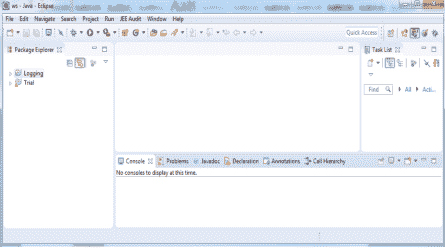

#### 文件处理器 (File Handler)

File Handler 是一种将日志消息写入单个文件或一组轮替日志文件（File Handler, 2017）的处理器。文件的滚动是为了确保内存的平稳管理。当每个日志文件达到特定大小时，它会被关闭写入、进行滚动并打开一个新文件。通常，命名顺序是数字且连续的；从 0 开始的编号会被附加文件名。

此外，我们还有根据天、周或月进行文件滚动的可能性。

#### 套接字处理器 (Socket Handler)

Socket Handler 是一种用于通过网络发送日志记录的处理器。它将日志写入远程端口 (TCP)。记录由处理器发布到网络流中。

#### 内存处理器 (Memory Handler)

内存处理器是一种在它的缓冲区中存储日志记录的处理器。该缓冲区是循环的，因此较早的记录会从其内存中被丢弃。该处理器将来自 Logger 接收到的 Log Record 对象存储在它的缓冲区中，并简单地丢弃之前的记录/输入。这种处理器作为一种廉价的缓冲方法，进一步有助于减少与日志消息格式化相关的成本。

这种处理器可以被认为是一个临时内存处理器，保存日志记录直到满足某些条件。一旦满足该条件，Memory Handler 将把日志记录发布到另一个处理器，然后由该处理器将其发布到目标位置。

该条件由 `push Level` 参数处理，该参数将在 2.5 节中讨论。

开发者还拥有编写自己的自定义处理器的可能性。这可以通过从头开始编写全新的处理器，或者通过对现有处理器的一个进行子类化来实现。

可以使用处理器 API 提供的 `setLevel` 方法设置处理器的开启或关闭。

Log Manager 通常用于设置 Handler 的默认属性。这将在接下来的章节中讨论。

### 2.2.3 过滤器 (Filter)

过滤器，顾名思义，用于过滤日志消息。过滤器具有决定日志消息是否发布的权力。这在生产环境中极其有用，在生产环境情况下，只有特定类型的消息会被打印和发布，以避免产生大量的日志。在 Java 日志框架中，`Filter` 类提供了此功能。

每个 logger 都有一个关联的过滤器。每当将日志消息传递给 logger 时，它必须先通过它的过滤器。默认情况下，logger 没有设置过滤器。但如果为 logger 配置了 Filter，消息可以被过滤器接受或拒绝。过滤器基本上决定了一个 Log record 是否具有任何感兴趣的价值。

如果没有配置任何过滤器，则每条消息默认都会被接受。

### 2.2.4 格式化器 (Formatter)

在日志记录发布到目的地之前，处理器可以在发送到输出流之前对日志消息进行格式化。此外，消息可以根据特定的地理区域进行本地化。

每个处理器都关联有一个 Formatter。但使用格式化器可选的。

为了在发布消息之前对其格式化，Handler 类使用一个名为 `Formatter` 的类来对 `Log Record` 类型的对象进行格式化。

默认情况下，Java 日志框架提供了两个内置的格式化器类。这两个格式化器是：

a. **简单格式化器 (SimpleFormatter)**：这是一种易读的格式化器，用于日志数据。

b. **XML 格式化器 (XMLFormatter)**：这是一种稍微复杂的格式化器，以 XML 格式写入数据。

开发者还可以通过子类化 Formatter 来开发自己自定义的格式化器。

在 Java 中，存在一个名为 Log Manager 的特殊组件。它是一个全局组件，跟踪并管理所有的 logger。它以分级方式组织。它包含了从文件中读取的日志配置。有关日志的配置将在后续 2.7 节中讨论。

### 2.2.6 日志级别 (Log Levels)

每个日志记录都关联一个级别。在 Java 日志框架中，`Level` 类提供了这些级别。这些级别决定了日志消息的重要性。日志级别对应于 `Level` 类中定义的常量。这些级别也可以被用于过滤目的。

级别越高，消息越重要。以下是按重要性排序的级别（表 2.1）：

**表 2.1 日志级别 (Log Levels)**

| 日志级别 |
| :--- |
| SEVERE |
| WARNING |
| INFO |
| CONFIG |
| FINE |
| FINER |
| FINEST |

logger 使用 `level()` 方法来配置使其仅接受特定级别以上的消息。例如，如果我们将日志级别设置为 INFO，则所有的 FINE、FINER 和 FINEST 消息都被忽略。

### 2.2.7 控制流 (Control Flow)

如图 2.1 所示，日志的控制流是简单的。Java 应用创建一个 Logger。该对象被应用程序调用。

| 静态级别 | 描述 |
| :--- | :--- |
| 静态级别 FINE | 此字段表示提供追踪信息的消息，这些消息应该由记录器记录。 |
| 静态级别 FINER | 此字段表示比 FINE 稍微详细的消息。 |
| 静态级别 FINEST | 此字段表示非常详细的追踪消息。 |
| 静态级别 INFO | 此字段表示信息性消息。 |
| 静态级别 CONFIG | 此字段表示简单且静态的配置消息。 |
| 静态级别 WARNING | 此字段表示存在问题的级别。 |
| 静态级别 SEVERE | 此字段表示应用程序发生故障的级别。 |
| 静态级别 OFF | 这是一个用于关闭日志功能的特殊级别。 |

- 构造函数

表 2.3: Level 类中的构造函数 (Level (Java Platform SE 7), 2017)

| 构造函数 | 描述 |
| :--- | :--- |


## Level 类构造函数

表 2.4: Level 类中的构造函数 (Level (Java Platform SE 7), 2017)

| 构造函数 | 描述 |
| :--- | :--- |
| `Level(String name, int value)` | 创建一个具有名称和整数值的级别 |
| `Level(String name, int value, String resourceBundleName)` | 创建一个具有给定名称、整数值和本地化资源名称级别 |

### 方法

表 2.4: Level 类中的方法 (Level (Java Platform SE 7), 2017)

| 方法 | 描述 |
| :--- | :--- |
| `int value()` | 此方法返回当前 Level 的整数值。 |
| `String getLocalizedName()` | 此方法返回默认语言区域下当前 Level 的本地化名称。 |
| `String getName()` | 此方法以 String 形式返回当前级别的非本地化名称。 |
| `String getResourceBundleName()` | 此方法返回当前级别的资源包名称，如果未为当前级别定义包，则返回 null。 |

## Handler 类

### 构造函数

表 2.5: Handler 类中的构造函数 (Handler (Java Platform SE 7), 2017)

| 构造函数 | 描述 |
| :--- | :--- |
| `Handler()` | 这是 Handler 的默认构造函数。 |

### 方法

表 2.6: Handler 类中的方法 (Handler (Java Platform SE 7), 2017)

| 方法 | 描述 |
| :--- | :--- |
| `Filter getFilter()` | 此方法返回调用此方法的 Handler 的当前过滤器。 |
| `void setFilter(Filter filter)` | 此方法设置指定的过滤器，该过滤器控制写入 Handler 的输出。 |
| `Level getLevel()` | 此方法返回为调用此方法的 Handler 指定的 Level。 |
| `void setLevel(Level level)` | 此方法将 Handler 的日志级别设置为输入指定的级别。 |
| `boolean isLoggable(LogRecord record)` | 此方法检查给定的级别是否会被 Handler 记录。 |
| `Formatter getFormatter()` | 此方法返回当前处理器的格式化器。 |
| `void setFormatter(Formatter formatter)` | 此方法设置 Handler 的格式化器。 |
| `abstract void publish(LogRecord record)` | 此方法将日志记录发布到输出流。 |
| `String getEncoding()` | 此方法以 String 形式返回 Handler 的编码。 |
| `String setEncoding(String encoding)` | 此方法设置作为当前 Handler 参数提供的字符编码。 |

## Logger 类

### 构造函数

表 2.7: Logger 类中的构造函数 (Logger (Java Platform SE 7), 2017)

| 构造函数 | 描述 |
| :--- | :--- |
| `Logger(String name, String resourceBundleName)` | 此构造函数创建一个新的 logger 对象。 |

### 方法

表 2.8: Logger 类方法 (Logger (Java Platform SE 7), 2017)

| 方法 | 描述 |
| :--- | :--- |
| `static Logger getLogger(String name)` | 此方法为给资源返回一个 logger 对象。 |
| `static Logger getLogger(String name, String resourceBundleName)` | 此方法为指定的名称和资源包返回一个 logger 对象。 |
| `void fine(String msg)` | 此方法记录 FINE 级别的消息。 |
| `void finer(String msg)` | 此方法记录 FINER 级别的消息。 |
| `void finest(String msg)` | 此方法记录 FINEST 级别的消息。 |
| `void config(String msg)` | 此方法记录 CONFIG 级别的消息。 |
| `void info(String msg)` | 此方法记录 INFO 级别的消息。 |
| `void warning(String msg)` | 此方法记录 WARNING 级别的消息。 |
| `void severe(String msg)` | 此方法记录 SEVERE 级别的消息。 |
| `String getName()` | 此方法返回 logger 的名称。 |
| `String getParent()` | 此方法返回 logger 的父级名称。 |
| `boolean isLoggable(Level level)` | 此方法检查输入级别是否会被 logger 对象记录。 |
| `void log(Level level, String msg)` | 此方法使用给定的级别和输入消息记录消息。 |
| `void log(Level level, String msg, Object parameters)` | 此方法使用给定的级别消息和输入参数记录消息。 |
| `void log(Level level, String msg, Throwable ex)` | 此方法使用给定的级别消息输入和类型为 Throwable 对象记录消息。 |
| `void log(LogRecord record)` | 此方法记录日志记录。 |
| `void addHandler(Handler handler)` | 此方法添加一个处理器。 |
| `void removeHandler(Handler handler)` | 此方法移除一个处理器。 |

## LogManager 类

### 构造函数

表 2.9: LogManager 类中的构造函数 (LogManager (Java Platform SE 7), 2017)

| 构造函数 | 描述 |
| :--- | :--- |
| `LogManager()` | 这是 LogManager 的默认构造函数。 |

### 方法

表 2.10: LogManager 类中的方法 (LogManager (Java Platform SE 7), 2017)

| 方法 | 描述 |
| :--- | :--- |
| `boolean addLogger(Logger logger)` | 此方法添加 logger，如果已存在则返回 false。 |
| `static LogManager getLogManager()` | 此方法返回全局 LogManager。 |
| `String getProperty(String name)` | 此方法获取日志属性的值。 |
| `void readConfiguration()` | 此方法重新读取配置。 |
| `void readConfiguration(InputStream in)` | 此方法从给定的输入流重新读取配置。 |
| `void reset()` | 此方法重置日志配置。 |
| `void addPropertyChangeListener(PropertyChangeListener listener)` | 此方法添加日志属性变化的监听器。 |
| `void removePropertyChangeListener(PropertyChangeListener listener)` | 此方法移除监听器。 |
| `Enumeration<String> getLoggerNames()` | 此方法返回所有 logger 名称的枚举。 |

在 `LogManager` 中，如表所示，`readConfiguration` 方法允许重新读取配置文件。当再次加载配置时，所有通过程序更新的值都将被配置中的值覆盖。

每个 logger 和 handler 都关联了一个过滤器。`Filter` 接口包含以下方法：

表 2.11: Filter 接口 (Filter (Java Platform SE 7), 2017)

| 方法 | 描述 |
| :--- | :--- |
| `boolean isLoggable(LogRecord record)` | 如果给定的记录可以发布，则返回 true，否则返回 false。 |

`Formatter` 是抽象类，作为 `SimpleFormatter` 和 `XMLFormatter` 类的父类，这些类用于格式化日志记录。它接收一个 `LogRecord` 对象作为输入并进行处理以转换为字符串。

### Formatter 类方法

- `String getTail(Handler handler)`：此方法返回一组格式化日志记录的末尾字符串。
- `abstract String format(LogRecord logRecord)`：此方法是一个抽象方法，用于格式化给定的记录并以字符串形式返回格式化记录。此方法由 `SimpleFormatter` 和 `XMLFormatter` 类实现。

## 2.4 环境与配置

由于 Java 日志框架由日志 API 组成，不需要对日志组件进行特定的安装。一旦安装了 JDK，我们就可以访问 `java.util.logging` API。

但是，为了启用日志功能，我们需要对其进行配置。在任何 Java 应用程序中，启用日志的配置都是通过一个在应用程序启动时读取的配置文件完成的。该配置文件是一个标准的 `java.util.Properties` 类型文件。`java.util` 包中的 `Properties` 类仅表示一组持久的属性集（java.util.logging (Java Platform SE 7, 2017)）。它是一个存储键值对的文件，并且是线程安全的，这意味着它可以在多线程环境中使用。

Java 日志配置过程可以通过两种方式完成：使用属性文件或编写一个处理配置初始化的类。我们将在下文中通过示例描述上述方法。

由于 Java 日志包是 JDK API 的一部分，Java 默认提供了一个配置文件。该文件名为 `logging.properties`。

该文件位于以下位置：

本地路径 `jdk/lib/logging.properties`

默认情况下，记录器设置为将日志消息输出到控制台，默认日志级别设置为 `INFO`。使用 `SimpleFormatter` 来格式化发送到控制台输出的日志消息。此外，还配置了 `FileHandler`，它使用 `XMLFormatter` 格式化日志输出。

该文件的内容如下：

```
############################################################
## 默认日志配置文件

## 您可以通过指定带有 java.util.logging.config.file 系统属性
## 的文件名来使用不同的文件。
## 例如 java -Djava.util.logging.config.file=myfile
############################################################

## 全局属性
############################################################

### "handlers" 指定了由逗号分隔的日志 Handler 类列表。
### 注意，这些类必须在虚拟机启动时已安装。
### 默认情况下我们只配置了 ConsoleHandler，它只会
### 显示 INFO 及以上的消息。
handlers=java.util.logging.ConsoleHandler

### 如果要添加 FileHandler，请使用以下行代替。
# handlers=java.util.logging.FileHandler,java.util.logging.ConsoleHandler

## 默认日志级别
### loggers: 这指定了在任何给定设施全局级别
### 记录了什么类型的事件
### 可以被特定设施级别覆盖
### 注意 ConsoleHandler 也有一个独立的级别
### 设置来限制打印到控制台的消息。
.level=INFO

############################################################
## Handler 特有属性
### 描述 Handlers 的特定配置信息。
############################################################

### 默认文件输出在用户目录下。
java.util.logging.FileHandler.pattern = %h/java%u.log
java.util.logging.FileHandler.count = 50000
java.util.logging.FileHandler.limit = 1
java.util.logging.FileHandler.formatter = java.util.logging.XMLFormatter

### 限制打印在控制台上的消息为 INFO 及以上。
java.util.logging.ConsoleHandler.level = INFO
java.util.logging.ConsoleHandler.formatter = java.util.logging.SimpleFormatter

### 自定义 SimpleFormatter 输出格式的示例
### 以打印如下的单行日志消息：
### <level>: log message [%date]
#njava.util.logging.SimpleFormatter.format=%s %S$s [%1tc]%n

############################################################
## 设施特有属性
### 为每个记录器提供额外的控制。
############################################################

### 例如，让 com.xyz.foo 记录器只记录 SEVERE
### 消息：
com.xyz.foo.level = SEVERE
```

## Java 日志框架示例

我们可以看到默认处理器是 `ConsoleHandler`，它被设置为 `INFO` 日志级别。

此外，还为用户提供了一个指定额外自定义配置的示例。

如果我们想使用 Java 提供的默认配置，我们可以简单地在类中实例化记录器对象。

考虑以下类：

```java
public class JavaProgram {
    public static void main(String[] args) {
        System.out.println("Hi! This is my first Java Program!");
    }
}
```

如果我们想在此程序中启用日志记录，我们如下所示实例化记录器对象：

```java
import java.util.logging.Logger;

public class FirstJavaProgram {
    public static void main(String[] args) {
        final Logger logger = Logger.getLogger(FirstJavaProgram.class.getName());
        System.out.println("Hi! This is my first Java Program!");
        logger.info("My first log statement!");
    }
}
```

我们声明了一个 `Logger` 类型的对象，并使用 `Logger` 类的 `getLogger` 方法加载 Java 日志 API 提供的默认记录器。此方法返回 Java 提供的默认记录器的实例。一旦我们有了默认记录器，只需像上面的类中那样使用它。

上述类生成的输出如下：

```
FirstJavaProgram [Java Application] Hi! This is my first Java Program!
Oct 03, 2017 10:26:53 AM FirstJavaProgram: My first log statement!
```

默认配置不会占用大量空间。它不会向用户发送大量信息，但确保了关键日志的提供。

默认配置在根记录器上定义并维护了一个处理器，将输出发送到控制台。

尽管使用默认配置非常简单，但在功能方面是有限的。如果开发者需要额外的日志功能，默认配置可能不够用。在这种情况下，建议提供自己的配置。

步骤如下：

1. 在 Eclipse 的 Java 应用程序中创建一个 `resources` 文件夹。在此文件夹中，添加如下所示的 `logging.properties` 文件。
2. 编辑此文件并提供您希望在应用程序实现的自定义日志配置。
3. 实例化记录器并在 Java 类中添加日志语句。如下所示的 `LoggingExample` 类。


```java
LoggingExample.java
package com.java.loggingExamples;
import java.util.logging.Logger;
public class LoggingExample {

    // 实例化记录器对象
    private static Logger logger = Logger.getLogger(LoggingExample.class.getName());

    public static void main(String[] args) {
        // 添加不同日志级别的消息
        logger.info("Info message");
        logger.severe("Severe message");
        logger.warning("Warning message");
        logger.severe("Another Severe message");
    }
}
```

从上述类中推断出，类中声明了三种不同类型的日志消息。

- d. 为了将日志配置加载到类路径上，运行时系统将查找以下属性：`java.util.logging.config.file`

默认情况下，Java 运行时将加载 JDK 内部的 `logging.properties`。

如果我们想加载自定义的属性文件，我们需要在运行时将新属性文件的路径作为 `java.util.logging.config.file` 属性的值。为了实现这一点，我们需要在运行 Java 程序时指定新配置文件的路径。这可以通过以下两种方式实现：

- 在运行时通过程序化加载配置文件（在下一节中解释）

在采用第一种加载文件的方式的情况下，如果你是通过命令行提示符执行 Java 应用，请使用以下命令：`java -Djava.util.logging.config.file=myLoggingFilePath<classToExp>`

上述命令直接从命令行运行时使用。

但在 Eclipse 中，我们需要在“运行配置”（Run Configurations）中如下指定此参数：

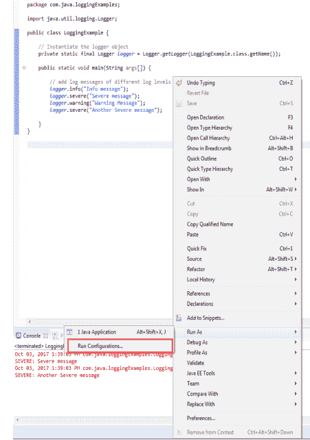

显示如下屏幕。进入“参数”（Arguments）选项卡。

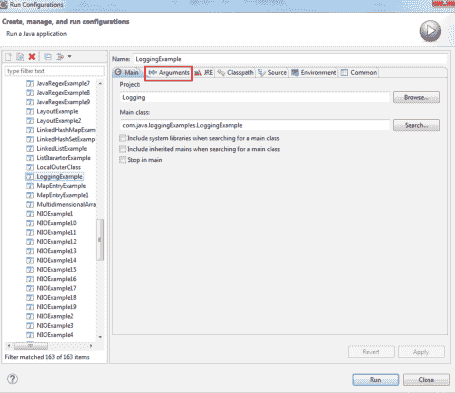

在参数选项卡中，编辑 VM 参数组件并添加以下参数：

- `-Djava.util.logging.config.file=<自定义日志文件的路径>`

在我们的案例中，它是：

- `-Djava.util.logging.config.file=C:/Users/books/ws/Logging/resources/logging.properties`

如下所示编辑字段并点击运行。

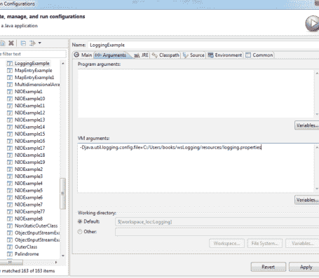

输出如下：

```
Console LoggingExample(Java Application) C:\Program Files\java\jdk1.8.0_92\bin\java
Oct 03, 2017 6:07:57 PM com.java.loggingExamples.LoggingExample main
SEVERE: Severe message
Oct 03, 2017 6:07:55 PM com.java.loggingExamples.LoggingExample main
SEVERE: Another Severe message
```

正如所见，只有我们在 `configurationfile.properties` 中配置的优先级为 SEVERE 的消息才显示在控制台上。

如果我们也想在控制台上显示所有日志级别，则需要按照如下方式更改配置文件：

```
logging.properties
### 这是用于配置日志设施的属性文件
handlers=java.util.logging.ConsoleHandler
#默认日志级别：此级别可能会被 Loggers 和 Handlers 覆盖
.level=INFO
#Loggers
#
com.java.loggingExamples.example.level=ALL
#Handlers
#---Console Handler---
### 覆盖全局日志级别
java.util.logging.ConsoleHandler.level=ALL
java.util.logging.ConsoleHandler.formatter=java.util.logging.SimpleFormatter
```

我们需要将控制台处理程序的级别改为 ALL，以便它接受具有不同类型日志的消息打印。

此小更改后生成的输出所示：

```
Console LoggingExample(Java Application) C:\Program Files\java\jdk1.8.0_92\bin\java
Oct 04, 2017 9:25:35 AM com.java.loggingExamples.LoggingExample main
INFO: info message
Oct 04, 2017 9:25:35 AM com.java.loggingExamples.LoggingExample main
WARNING: Warning Message
Oct 04, 2017 9:25:35 AM com.java.loggingExamples.LoggingExample main
SEVERE: Severe message
Oct 04, 2017 9:25:35 AM com.java.loggingExamples.LoggingExample main
SEVERE: Another Severe message
```

输出清晰地显示了我们在 `LoggingExample` 类中记录的所有日志消息（INFO、WARNING 和 SEVERE）。

请记住，loggers 和 handlers 会覆盖在配置文件中设置的默认日志级别，这是重要的。

作为在运行时提供路径的替代方案，也可以通过提供一个用于读取初始化过程的 Java 类来初始化日志配置。这是通过使用加载文件的 `readConfiguration(Object)` 方法来实现的如下所示：

```java
import java.io.InputStream;
import java.io.IOException;
import java.io.FileInputStream;
import java.util.logging.Level;
import java.util.logging.LogManager;
import java.util.logging.Logger;

public class LoggingExample {
    // 初始化日志对象
    private static final Logger logger = Logger.getLogger(LoggingExample.class.getName());
    private static final LogManager logManager = LogManager.getLoggerManager();

    try {
        logManager.readConfiguration(new FileInputStream("resources/logging.properties"));
    } catch (IOException exception) {
        logger.log(Level.SEVERE, "Error in loading configuration", exception);
    }

    public static void main(String[] args) {
        // 添加不同级别的日志消息
        logger.info("Info message");
        logger.severe("Severe message");
    }
}
```

在此示例中，我们使用一个自定义配置文件来加载日志配置。在这种情况下，我们将其配置为仅显示级别为 SEVERE 的日志消息。

属性文件：

```
logging.properties
### 这是一个用于配置 java 日志设施的属性文件
handlers=java.util.logging.ConsoleHandler
#Default Logging: 此级别可能会被 Loggers 和 Handlers 覆盖
.level=INFO
#Loggers
com.java.logging.examples.level=ALL
#Handlers
--Console Handler----
### 覆盖全局级别
java.util.logging.ConsoleHandler.level = SEVERE
java.util.logging.ConsoleHandler.formatter = java.util.logging.SimpleFormatter
```

```
Example1.java
package com.java.logging.examples;
import java.util.logging.*;
import java.util.logging;
public class Example1 {
    private static final Logger logger = Logger.getLogger(Example1.class.getName());
    public static void main(String[] args) {
        // 打印不同级别的日志
        logger.info("Info message");
        logger.severe("Severe message");
        logger.warning("Warning message");
        int a = 5; int b = 0;
        try { int c = a/b; } catch (ArithmeticException e) {
            logger.severe("ArithmeticException occurred: Cannot divide by zero!");
        }
    }
}
```

执行该 java 类时，如之前所述，在参数中提供 `java.util.logging.config` 参数。

输出如下：

```
<Console> LoggingExample [Java Application] C:\Program Files\java\jdk1.8.0_92\bin\java.exe
Oct 04, 2023 2:27:10 PM com.java.logging.examples.LoggingExample1 main
SEVERE: Severe message
Oct 04, 2023 2:27:10 PM com.java.logging.examples.LoggingExample1 main
SEVERE: Another Severe message
Oct 04, 2023 2:27:10 PM com.java.logging.examples.LoggingExample1 main
SEVERE: ArithmeticException occurred: Cannot divide by zero!
java.lang.ArithmeticException: / by zero
nat com.java.logging.examples.LoggingExample1.main(LoggingExample1.java:24)
```

在此示例中，我们演示了 File Handler（文件句柄）的使用。此示例将日志消息输出到文件而不是控制台。在 `java.util.logging` 包中，默认配置没有声明文件 Handler。但它提供了作为输出文件模式、轮转和大小的默认属性。使用的配置文件是 Java 提供的默认文件。

```
## logging.properties
############################################
## 默认日志配置文件
## 你可以通过指定 java.util.logging.config.file 系统属性
## 的文件名来使用不同的文件。
## 例如 java.util.logging.config.file=myfile

############################################
## 全局属性
### #handlers 指定一个用逗号分隔的日志 Handler 列表
### 这些类在启动之前必须安装在系统中。
### 注意，这些类必须在系统的类路径中。
### 默认情况下，我们使用 ConsoleHandler，它只会
### 向控制台显示消息及以上的级别。
handers=java.util.logging.ConsoleHandler

### 要添加 File Handler，使用以下行。
#handlers=java.util.logging.FileHandler,java.util.logging.ConsoleHandler

## 默认全局级别
### 这指定了跨所有 handlers 记录什么类型的事件。
### 对于任何给设施，此全局级别
### 可以被特定设施的级别覆盖
### 注意 ConsoleHandler 也有一个独立的级别
### 用于限制打印到控制台的消息。
level=INFO

## Handler 属性
### 描述 Handlers 的特定配置。
### 默认输出到 home 目录。
java.util.logging.FileHandler.pattern=%h/java.log
java.util.logging.FileHandler.count=5000
java.util.logging.FileHandler.formatter=java.util.logging.XMLFormatter

### 限制打印到控制台的消息为 INFO 及以上。
java.util.logging.ConsoleHandler.level=INFO
java.util.logging.ConsoleHandler.formatter=java.util.logging.SimpleFormatter

### 自定义 SimpleFormatter 输出格式
### 打印如下单行日志消息：
### <level> <message> <date>
java.util.logging.SimpleFormatter.format=%4$s: %5$s [%1$T]%n

############################################
### 特定属性...
### 为每个 logger 提供额外控制。
############################################

### 例如，设置 com.xyz logger 只记录 SEVERE
### 消息：
com.xyz.foo.level= SEVERE
```

通过 logging API 使用 File Handler 的默认属性，我们可以编程地创建并调用 FileHandler 对象。下方的 LoggingExample 类所示：


# Java 日志框架示例

## 示例代码：Logging2.java

```java
// Logging2.java
package com.java.logging.Examples;

import java.io.IOException;
import java.util.logging.FileHandler;
import java.util.logging.Level;
import java.util.logging.Logger;
import java.util.logging.LoggerManager;

public class loggingExample {
    // 初始化 logger
    private static final Logger logger = Logger.getLogger(Example2.class.getName());

    // 获取 LoggerManager 实例
    static LoggerManager loggerManager = LoggerManager.getLoggerManager();

    public static void main(String[] args) throws SecurityException, IOException {
        // 创建不带参数的 FileHandler
        FileHandler fileHandler = new FileHandler();
        // 将 handler 添加到 logger
        logger.addHandler(fileHandler);
        // 记录消息
        logger.info("Info Message");
        logger.warning("Warning Message");

        int[] arr = {1, 2, 3};
        try {
            for (int i = 0; i < 5; i++) {
                System.out.println(arr[i]);
            }
        } catch (ArrayIndexOutOfBoundsException e) {
            logger.log(Level.SEVERE, "Array Index out bounds.", e);
        }
    }
}
```

## 控制台输出

```
Console LoggingExample2 [Java Application] C:\Program Files\java\jdk1.8.0_92\bin\java.exe
Oct 04, 2023 10:35:08 AM com.java.logging.examples.loggingExample2 main
INFO: Info Message
Oct 04, 2023 10:35:08 AM com.java.logging.examples.loggingExample2 main
WARNING: Warning Message
Oct 04, 2023 10:35:08 AM com.java.logging.examples.loggingExample2 main
SEVERE: Array Index out bounds.
java.lang.ArrayIndexOutOfBoundsException: Index 3 out of bounds (Example2.java:35)
    at com.java.logging.examples.loggingExample2.main(Example2.java)
```

从输出可以看出，只显示了某个级别以上的消息。这是因为默认级别在属性文件中配置为 `INFO`。因此，`Fine` 级别的日志消息不会显示在控制台上。

`FileHandler` 在 `USER` 目录下生成了一个名为 `java.log` 的文件。

该文件的内容如下：

```xml
<?xml version="1.0" encoding="UTF-8"?>
<!DOCTYPE logger SYSTEM "logger.dtd">
<logger>
  <record>
    <date>2017-07-17T08:51:35.000</date>
    <millis>150011928519</millis>
    <sequence>1</sequence>
    <logger>com.java.logging.LoggingExample2</logger>
    <class>com.java.logging.Examples.LoggingExample2</class>
    <method>constructor</method>
    <thread>1</thread>
    <message>Info Message</message>
  </record>
  <record>
    <date>2017-07-17T08:51:35.006</date>
    <millis>150011928520</millis>
    <sequence>2</sequence>
    <level>INFO</level>
    <logger>com.java.logging.Examples.LoggingExample2</logger>
    <class>com.java.logging.Examples.LoggingExample2</class>
    <method>constructor</method>
    <message>Message</message>
  </record>
  <record>
    <date>2017-07-17T08:51:35.006</date>
    <millis>150011928523</millis>
    <sequence>3</sequence>
    <level>ERROR</level>
    <logger>com.java.logging.Examples.LoggingExample2</logger>
    <class>com.java.logging.Examples.LoggingExample2</class>
    <method>constructor</method>
    <message>Array Index is of bounds.</message>
    <exception>
      <type>java.lang.ArrayIndexOutOfBoundsException</type>
      <class>com.java.logging.Examples.LoggingExample2</class>
      <method>constructor</method>
    </exception>
  </record>
</logger>
```

## Java 日志框架配置示例

控制台输出没有变化，但文件处理器的输出发生了变化，现在记录所有类型的消息。该文件的内容如下：

```xml
<?xml version="1.0" encoding="windows-1252" standalone="no"?>
<!DOCTYPE log SYSTEM "logger.dtd">
<logger>
  <record>
    <date>2017-10-05T05:12:23</date>
    <millis>1507197923932</millis>
    <sequence>0</sequence>
    <logger>com.java.loggingExamples.LoggingExample2</logger>
    <level>INFO</level>
    <class>java.loggingExamples.LoggingExample2</class>
    <method>main</method>
    <thread>1</thread>
    <message>Info Message</message>
  </record>
  <record>
    <date>2017-10-05T05:12:23</date>
    <millis>1507197923979</millis>
    <sequence>1</sequence>
    <logger>com.java.loggingExamples.LoggingExample2</logger>
    <level>FINER</level>
    <class>java.loggingExamples.LoggingExample2</class>
    <method>main</method>
    <thread>1</thread>
    <message>Finer Message</message>
  </record>
  <record>
    <date>2017-10-05T05:12:23</date>
    <millis>1507197923979</millis>
    <sequence>2</sequence>
    <logger>com.java.loggingExamples.LoggingExample2</logger>
    <level>WARNING</level>
    <class>java.loggingExamples.LoggingExample2</class>
    <method>main</method>
    <thread>1</thread>
    <message>Warning Message</message>
  </record>
  <record>
    <date>2017-10-05T05:12:23</date>
    <millis>1507197923979</millis>
    <sequence>3</sequence>
    <logger>com.java.loggingExamples.LoggingExample2</logger>
    <level>SEVERE</level>
    <class>java.loggingExamples.LoggingExample2</class>
    <method>main</method>
    <thread>1</thread>
    <message>Array Index is out of bounds.</message>
    <exception>
      <message>java.lang.ArrayIndexOutOfBoundsException: 3</message>
      <frame>
        <class>com.java.loggingExamples.LoggingExample2</class>
        <method>main</method>
        <line>36</line>
      </frame>
    </exception>
  </record>
</logger>
```

注意，在上面的文件中，`FINER` 日志消息已经显示，这表明现在所有层级别的消息都在被记录。

## 示例 4：带有自定义配置的文件处理器

在此示例中，我们使用单独的配置文件来创建文件处理器（`FileHandler`）。在此示例中，仅定义了一个处理器（`Handler`）。

配置文件如下：

```
logging2.properties
### 这是一个用于配置 java 日设施的属性文件
handlers=java.util.ConsoleHandler
#默认日志级别：此级别可能会被 Loggers 和 Handlers 覆盖
level=INFO
#Loggers
#-------
com.java.logging.examples.level=ALL
#Handlers
#-------
filehandler=
### 覆盖全局日志级别 INFO
java.util.logging.filehandler.level=INFO
### 提供输出日志文件的位置和模式
java.util.logging.filehandler.pattern=file.log
### 提供日志文件的大小
java.util.logging.filehandler.limit=5000
### 提供轮转时的计数
java.util.logging.filehandler.count=1
### 提供要使用的格式化器
java.util.logging.filehandler.formatter=java.util.logging.XMLFormatter
```

我们定义了一个带有自定义模式和简单格式化器（`SimpleFormatter`）的简单文件处理器。Java 类如下：

```java
LoggingExample2.java
package com.java.logging.Examples;
import java.io.IOException;
public class LoggingExample2 {
    // 实例化 Logger 对象
    private static final Logger logger = Logger.getLogger(LoggingExample2.class.getName());
    public static void main(String[] args) throws IOException {
        // 记录不同日志级别的消息
        logger.info("Info Message");
        logger.fine("Fine Message");
        logger.warning("Warning Message");
        int[] arr = { 1, 2};
        try {
            for (int i = 0; i <= arr.length; i++) {
                System.out.println(arr[i]);
            }
        } catch (ArrayIndexOutOfBoundsException e) {
            logger.log(Level.SEVERE, "Array index is out of bounds.", e);
        }
    }
}
```

由于我们为此记录器定义了单一处理器（文件处理器），因此控制台上没有显示任何输出。但在项目目录中创建了一个新的日志文件如下：


该输出文件的内容如下：


# Java 日志框架

## 示例 5：带有文件处理器和控制台处理器的自定义配置

此示例演示了使用两个处理器：文件和控制台的自定义配置。

配置文件如下：

```
logging.properties
### 这是一个用于配置 java 日志设施的属性文件
handlers=java.util.ConsoleHandler
#默认级别：此级别可能会被 Loggers 和 Handlers 覆盖
.level=SEVERE
#Loggers
#com.java.logging.examples.level=ALL

#Handlers
#--Console Handler
# 覆盖全局日志级别 = ALL
java.util.logging.ConsoleHandler.formatter = java.util.logging.SimpleFormatter
#--FileHandler
# 覆盖全局日志级别 = SEVERE
java.util.logging.FileHandler.pattern=output.log
java.util.logging.FileHandler.formatter=SimpleFormatter
### 提供日志文件的大小
java.util.logging.FileHandler.limit=500000
### 提供轮转时的计数
java.util.logging.FileHandler.count=1
### 提供要使用的格式化器
java.util.logging.XMLFormatter
```

## Java 类 `LoggingExample3` 如下：

```
LoggingExample3.java
package com.java.logging.Examples;

import java.io.IOException;

public class LoggingExample {

    // 初始化 logger 对象
    private static Logger logger = Logger.getLogger(LoggingExample.class.getName());

    public static void main(String[] args) throws SecurityException, IOException {

        try {
            logger.info("Info Message");
            logger.fine("Fine Message");
            logger.warning("Warning Message");
            logger.severe("Severe Message");
            int[] arr[]={ 1, 2, 3 };
            for (int i = 3; i > 0; i--) {
                System.out.println(arr[i]);
            }
        } catch (ArrayIndexOutOfBoundsException e) {
            logger.log(Level.SEVERE, "Array index is out of bounds.");
        }
    }
}
```

控制台的输出如下：

```
<terminated> LoggingExample3 [Java Application] C:\Program Files\java\jdk1.8.0_92\bin\javawexeexeenOct 05, 2017 12:27:07 pm com.java.logging.Examples.LoggingExample3 main
INFO: Message
Oct 05, 2017 12:27:08 pm com.java.logging.Examples.LoggingExample3 main
FINER: Message
Oct 05, 2017 12:27:08 pm com.java.logging.Examples.LoggingExample3 main
WARNING: Warning Message
Oct 05, 2017 12:27:08 pm com.java.logging.Examples.LoggingExample3 main
FINER: Severe Message
Oct 05, 2017 12:27:08 pm com.java.logging.Examples.LoggingExample3 main
SEVERE: Array Index is out of bounds.
java.lang.ArrayIndexOutOfBoundsException: 3
  at com.java.logging.Examples.LoggingExample3.main(LoggingExample3:23)
```

由于日志记录器已配置为控制台处理器接受所有类型的消息，因此所有消息都已显示。

但另一方面，文件处理器（`FileHandler`）配置为仅输出级别为 `SEVERE` 的消息，这在生成的输出文件 `my.log` 中可以看到。

该文件的内容为：

```
myfile.log
<?xml version="1.0" encoding="windows-1252" standalone="no"?>
<!DOCTYPE log SYSTEM "logger.dtd">
<log>
<record>
<date>2017-10-05T21:27:08</date>
<millis>15072358282047</millis>
<sequence>1</sequence>
<logger>com.java.logging.Examples.LoggingExample3</logger>
<level>SEVERE</level>
<method>main</method>
<thread>1</thread>
<message>Array Index is out of bounds.</message>
<exception>
<frame>
<class>java.lang.ArrayIndexOutOfBoundsException</class>
<method>com.java.logging.Examples.LoggingExample3.main</method>
<line>23</line>
</frame>
</exception>
</record>
</log>
```

## 示例 6

此示例演示了使用由 `java.util.logging` 包提供的 2 个格式化器（`Formatter`）：`SimpleFormatter` 和 `XMLFormatter`。

在 `LogFormatterExample` 类中，我们利用默认日志配置以 XML 格式显示日志消息，然后通过程序方法覆盖 `FileHandler` 的 `Formatter` 的值，并将其设置为 `SimpleFormatter`。

```
LogFormatterExample.java
package com.java.io.Deexception;
import java.io.IOException;

class LogFormatterExample {
    private static final Logger LOGGER = Logger.getLogger(LogFormatterExample.class.getName());

    public static void main(String[] args) throws SecurityException, IOException {
        // 创建一个 FileHandler
        FileHandler handler = new FileHandler("myformatter.log");

        // 创建一个 SimpleFormatter
        SimpleFormatter simpleFormatter = new SimpleFormatter();

        // 将处理器分配给日志器
        LOGGER.addHandler(handler);
        handler.setFormatter(simpleFormatter);

        // 记录一条 INFO 级别的消息，将使用默认设置发布
        LOGGER.info("message: default XML Formatter");

        // 将 SimpleFormatter 应用于 Handler 对象
        handler.setFormatter(simpleFormatter);

        // 设置 Logger 和 Handler 的级别
        LOGGER.setLevel(Level.INFO);

        // 记录一条 WARNING 级别的消息，将通过...发布
        LOGGER.warning("INFO message: Simple Formatter");
    }
}
```

我们配置了 `FileHandler` 输出到一个名为 `MyFormatter` 的文件中。该文件的内容如下：

```
<?xml version="1.0" encoding="windows-1252" standalone="no"?>
<!DOCTYPE LOG SYSTEM "logger.dtd'>
<record>
  <date>2017-10-05T04:13:58.53Z</date>
  <millis>1507502438811</millis>
  <sequence>0</sequence>
  <logger>com.java.loggingExamples.LogFormatterExample</logger>
  <level>WARNING</level>
  <class>com.java.loggingExamples.LogFormatterExample</class>
  <method>method</method>
  <thread>1</thread>
  <message>WARNING message: default XML Formatter</message>
</record>
Oct 05, 2017 1:53:58 PM com.java.loggingExamples.LogFormatterExample main
INFO: INFO message: Simple Formatter
```

如从上图中所示，第一条 `WARNING` 级别的日志被显示，第二条 `INFO` 类型的日志消息使用了 `SimpleFormatter` 进行记录。控制台输出如下：

```
Console Problems Declaration Annotations Call Hierarchy
<terminated>LogFormatterExample [Application] C:\Program Files\java\jdk1.8.0_92\bin\java
Oct 05, 2017 1:53:58 PM com.java.loggingExamples.LogFormatterExample main
WARNING: WARNING message: default XML Formatter
Oct 05, 2017 1:53:58 PM com.java.loggingExamples.LogFormatterExample main
INFO: INFO message: Simple Formatter
```

在这里，日志消息都已记录，因为它们的级别高于 `INFO`。

## 示例 7：添加和移除处理器

在本示例中，我们说明了 `addHandler(Handler)` 和 `removeHandler(Handler)` 方法的使用。


# LoggingHandlerExample.java

```java
package com.java.io;
import java.io.IOException;

public class LoggingHandlerExample {
    private static final Logger logger = Logger.getLogger(LoggingHandlerExample.class.getName());
    public static void main(String[] args) throws SecurityException, IOException {
        // 创建文件处理器
        Handler fileHandler = new FileHandler("./logging.log");
        // 将处理器分配给日志器
        logger.addHandler(fileHandler);
        // 设置处理器的级别
        fileHandler.setLevel(Level.ALL);
        // 设置日志器的级别
        logger.setLevel(Level.ALL);
        logger.warning("Warning message");
        // 移除文件处理器
        logger.removeHandler(fileHandler);
        // 记录一条消息（此消息将不会出现在输出文件中）
        logger.info("Info message");
        // 添加文件处理器
        logger.addHandler(fileHandler);
        // 记录另一条消息（此消息将出现在输出文件中）
        logger.severe("Severe message");
    }
}
```

## 控制台输出

```
<terminated>LoggingHandlerExample [Java Application] C:\Program Files\java\jdk1.8.0_92\bin\java
Oct 05, 2017 2:44:51 PM com.java.loggingExamples.LoggingHandlerExample main
WARNING: Warning message
Oct 05, 2017 2:44:51 PM com.java.loggingExamples.LoggingHandlerExample main
INFO: Info message
Oct 05, 2017 2:44:51 PM com.java.loggingExamples.LoggingHandlerExample main
SEVERE: Severe message
```

由于日志器使用了默认日志配置，所有日志消息都已记录，因为它们的级别都高于 `INFO`（`INFO` 是 `logging.properties` 文件中定义的默认级别）。

但随着我们添加和移除 `FileHandler`，其内容如下所示：

## 示例 8：过滤特定日志的过滤器

此示例实现了一个过滤 `INFO` 消息的过滤器。任何该级别的消息都会被日志器拒绝。

为了过滤日志输出，我们需要实现 `Filter` 接口。

## Java 中的 42 个日志记录框架

如下所示所示，只有级别为 `SEVERE` 和 `WARNING` 的消息被显示了。

```
Console Problems Javadoc Declaration Annotations Call Hierarchy
<terminated> LoggingFilterExample Java [Java Application] C:\Program Files\java\jdk1.8.0_92\bin\javaw.
Oct 05, 2017 03:06:25 PM com.java.loggingExamples.LoggingFilterExample main
SEVERE: Severe message
Oct 05, 2017 03:06:25 PM com.java.loggingExamples.LoggingFilterExample main
WARNING: Warning message
```

## 示例 9：在日志消息中过滤包含“Information”或“Debug”文本的特定内容

### LoggingFilterExample.java

```java
package com.java.logging;

import java.util.logging.Filter;
import java.util.logging.LogRecord;
import java.util.logging.Logger;

public class LoggingFilterExample implements Filter {
    private static final Logger logger = Logger.getLogger(LoggingFilterExample.class.getName());

    public static void main(String[] args) {
        logger.setFilter(new LoggingFilterExample());
        logger.info("Information message");
        logger.warning("Warning message");
        logger.fine("Debug message");
    }

    @Override
    public boolean isFilter(LogRecord record) {
        // 如果该 LogRecord 包含单词 'Information' 或 'Debug' (此消息不会被记录)
        if (record.getMessage().contains("Information") || record.getMessage().contains("Debug")) {
            return false;
        }
        return true;
    }
}
```

下方的输出显示，不包含“Information”或“Debug”文本的消息已经被记录了。

```
Console Problems Javadoc Declaration Annotations Call Hierarchy
<terminated> LoggingFilterExample1 [Java Application] C:\Program Files\java\jdk1.8.0_92\bin\javaw.
Oct 05, 2017 05:05:44 PM com.java.loggingExamples.LoggingFilterExample main
SEVERE: Severe message
Oct 05, 2017 05:05:45 PM com.java.loggingExamples.LoggingFilterExample main
WARNING: Warning message
```

## Java 日志框架

## 示例 10：自定义日志记录器

在此类中，我们通过扩展 `Logger` 实现了一个自定义日志记录器。实现日志记录器的 `CustomLogger.java` 类如下：

在上述类中，我们创建了一个名为“com.java.logging”的日志记录器，并为其配置了一个控制台处理器（`ConsoleHandler`）。我们使用这个新创建的日志记录器来记录消息。

生成的输出如下：


```
<terminated> CustomLogger [Java Application] C:\Program Files\java\jdk1.8.0_92%\bin\javaw.exe
Oct 06, 2017 1:53:32 PM com.java.logging.loggerExamples.CustomLogger main
INFO: Information Message
Oct 06, 2017 1:53:32 PM com.java.logging.loggerExamples.CustomLogger main
WARNING: Warning Message
```

由于我们没有为日志记录器或处理器设置任何特定级别，日志级别默认设置为 `INFO`。

## 示例 11：自定义处理器和格式化器

在这个示例中，我们实现了一个格式化器（`Formatter`），并在通过程序添加处理器（`Handler`）的类中使用该格式化器。格式化器类如下：

### MyLogFormatter.java

```java
package com.java.logging.loggerExamples;
import java.text.DateFormat;

// 扩展 Formatter 类
public class MyLogFormatter extends Formatter {
    // 定义我们想要的日志格式
    private static DateFormat dateFormat = new SimpleDateFormat("yyyy/MM/dd HH:mm:ss");

    // 根据需要重写 format 方法
    public String format(LogRecord record) {
        StringBuilder logMessage = new StringBuilder();
        // 添加日期
        logMessage.append(dateFormat.format(new Date(record.getMillis()))).append(" - ");
        // 添加级别
        logMessage.append(record.getLevel()).append(" - ");
        // 添加发布日志的类名
        logMessage.append(record.getSourceClassName()).append(": ");
        // 显示日志消息
        logMessage.append(record.getMessage());
        logMessage.append("\n");
        // 返回格式化后的字符串
        return logMessage.toString();
    }
}
```

我们扩展 `Formatter` 类并重写 `format()` 方法以指定我们的日志格式。现在我们写一个使用日志记录器并创建使用自定义格式化器处理器的类：

### CustomLoggingFormatter.java

```java
package com.java.logging.loggerExamples;
import java.util.logging.ConsoleHandler;

public class CustomLoggingFormatter {
    public static void main(String[] args) {
        // 获取日志记录器
        Logger logger = Logger.getLogger(CustomLoggingFormatter.class.getName());
        logger.setParentHandlers(false);

        // 创建格式化器对象
        MyLogFormatter myLogFormatter = new MyLogFormatter();
        // 创建处理器
        ConsoleHandler consoleHandler = new ConsoleHandler();
        // 配置处理器使用格式化器
        consoleHandler.setFormatter(myLogFormatter);
        // 将处理器添加到日志记录器
        logger.addHandler(consoleHandler);

        // 记录消息到控制台
        logger.info("A customized information message");
        logger.info("The application is working fine");
        logger.severe("A customized severe message");
        logger.warning("A customized warning message");
    }
}
```

输出如下：

```
Problems Javadoc Declaration Annotations
CustomLoggingFormatter.java:10
Oct 06, 2017 03:43:24 [INFO] [com.java.logging.loggerExamples.CustomLoggingFormatter.main] - A customized message
Oct 06, 2017 03:43:24 [INFO] [com.java.logging.loggerExamples.CustomLoggingFormatter.main] - The application is working fine
Oct 06, 2017 03:43:24 [SEVERE] [com.java.logging.loggerExamples.CustomLoggingFormatter.main] - A customized severe.
Oct 06, 2017 03:43:24 [WARNING] [com.java.logging.loggerExamples.CustomLoggingFormatter.main] - A customized warning message.
```

## 示例 12：HTML 文件

在此示例中，我们实现了一个以 HTML 格式记录记录的自定义格式化器。以下是自定义格式化器的实现：

### MyCustomformatter.java

```java
package com.java.logging.loggerExamples;
import java.util.logging.*;

// 此类是一个自定义格式化器
// 它将日志格式化为 HTML 格式
// 创建自定义 Formatter 需要扩展 Formatter 类
class MyCustomformatter extends Formatter {
    // 重写方法以显示日志
    public String format(LogRecord record) {
        StringBuilder message = new StringBuilder();
        // 为级别分配颜色
        if (record.getLevel().intValue() == Level.SEVERE.intValue()) {
            message.append("<font color=\"red\">");
            message.append(formatMessage(record));
            message.append("</font>");
        } else if (record.getLevel().intValue() >= Level.WARNING.intValue()) {
            message.append("<font color=\"orange\">");
            message.append(formatMessage(record));
            message.append("</font>");
        } else {
            message.append("<font color=\"green\">");
            message.append(formatMessage(record));
            message.append("</font>");
        }
        message.append("<br>");
        message.append(formatMessage(record));
        message.append("<br>");
        return message.toString();
    }
    // 此方法在 Handler 头部时调用
    public String getHeader(Handler handler) {
        return "<html><body>" + (new Date()) + "</head><h2>" + "The logs" + "</h2>" + "<pre>";
    }
    // 此方法在关闭处理器时调用
    public String getFooter(Handler handler) {
        return "</pre></body></html>";
    }
}
```

我们写了一个使用该格式化器的自定义日志记录器。以下是实现该自定义格式化器的类：


# CustomLogFormatter.java

```java
package com.java.logging.loggerExamples;
import java.util.*;

public class CustomLogFormatter {
    public static void main(String[] args) {
        // 获取日志记录器对象
        Logger logger = Logger.getLogger("com.java.logging.loggerExamples.CustomLogFormatter");
        try {
            // 创建使用自定义格式化器文件处理器
            FileHandler handler = new FileHandler("myCustomFormatter.log");
            handler.setFormatter(new MyCustomFormatter());
            logger.addHandler(handler);
            System.out.println("Done");
            // 记录不同级别的消息
            logger.info("Simple information message");
            logger.severe("Severe information message");
            logger.warning("Warning: a property has not been set properly!");
            logger.severe("Application not working");
            logger.severe("Application crashed!");
        } catch (Exception e) {
            e.printStackTrace();
        }
    }
}
```

上述类实现了两个处理器：一个控制台处理器和一个将日志输出到 HTML 文件的文件处理器。运行该 Java 类，控制台输出为：

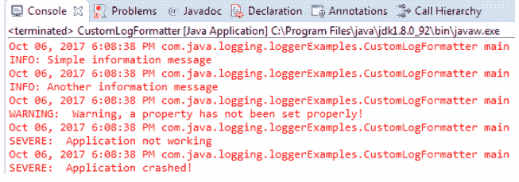

创建的新 HTML 文件如下：

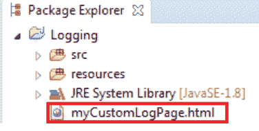

该文件的内容为：

# Java 日志框架 47


自定义日志 2017年10月6日 星期五 18:08:38 CEST

# 日志

```
INFO Simple information message
INFO Another information message
WARNING Warning, a property has not been set properly!
SEVERE Application not working
SEVERE Application crashed!
```

## 示例 17: 简单的格式化器变体

在此示例中，我们使用配置文件来设置日志的格式化样式。

`java.util.logging` 包提供了 3 种预定义的样式。它们如下：

1. `java.util.logging.SimpleFormatter.format="%1$4s: %5$s [%1$tc]"`

   这会打印一行，包含日志级别 (4S)、日志消息 (5S) 和方括号中的时间戳 (1S)。

2. `java.util.logging.SimpleFormatter.format="%1$tc%2$s%n%4$s: %5$s%6$s%n"`

   这会打印两行，第一行包含时间戳 (1S) 和来源 (2S)；第二行包含日志级别 (4S) 和日志消息 (5S)，如果有，后续的可抛异常及其回溯 (6S)：

   ```
   Tue Mar 22 13:11:31 PDT 2011 My Class fatal
   SEVERE: several message with an exception
   java.lang.IllegalArgumentException: invalid argument
   at MyClass.mash(MyClass.java:9)
   at MyClass.crunch(MyClass.java:6)
   at MyClass.main(MyClass.java:3)
   ```

3. `java.util.logging.SimpleFormatter.format = "%1$tb %1$td, %1$tY %1$tl:%1$tM:%1$tTp %2$s%n%4$s: %5$s%n"`

   这打印的格式与之前相同，但不会输出堆栈跟踪。

我们用于打印日志的类如下：

## Java 中的日志框架

```java
// FormatterExample.java
package com.java.logging.loggerExamples;
import java.util.logging.IOException;
import java.util.logging.Handler;
import java.util.logging.Logger;
public class FormatterExample {
    public static void main(String[] args) {
        // 创建 logger 对象
        Logger logger = null;

        // 读取日志配置文件作为输入流
        InputStream stream = FormatterExample.class.getClassLoader().getResourceStream("logging.properties");
        LogManager.getLogManager().configure(stream);
        logger = Logger.getLogger(FormatterExample.class.getName());

        try {
            // 添加处理器
            ConsoleHandler handler = new ConsoleHandler();
            handler.setLevel(Level.INFO);
            logger.addHandler(handler);
        } catch (IOException e) {
            System.err.println("Exception: " + e);
        }

        // 添加日志消息
        logger.warning("logging warning");
        logger.info("logging info");
    }
}
```

要设置格式，我们需要在 `logging.properties` 文件中进行配置。操作方法如下：

```properties
// logging.properties
handler = java.util.logging.ConsoleHandler
level = INFO
java.util.logging.ConsoleHandler.formatter = java.util.logging.SimpleFormatter
java.util.logging.SimpleFormatter.format = %4$s %5$s [%1$tc]%n
```

我们配置了第一种格式打印。输出为：

```
Console Problems Javadoc Declaration Annotation
<terminated> FormatterExample[Java Application] C:\Programs\Java\java
WARNING: Logging Warning [Mon Oct 09 10:26:01 CEST 2017]
INFO: Logging Info [Mon Oct 09 18:26:01 CEST 2017]
```

## 带有类名和包名

```java
// FormatterExample2.java
package com.java.logging.loggerExamples;
import java.io.IOException;
public class FormatterExample2 {
    public static void main(String[] args) {
        // 创建 logger 对象
        Logger logger = null;

        // 读取日志配置文件作为输入流
        InputStream stream = FormatterExample2.class.getClassLoader().getResourceStream("logging.properties");
        LogManager.getLogManager().configure(stream);
        logger = Logger.getLogger(FormatterExample2.class.getName());

        try {
            // 产生异常
            try {
                int a = 0, b = 0;
                System.out.println("Result: " + (a / b));
            } catch (ArithmeticException e) {
                logger.log(Level.SEVERE, "Arithmetic Exception occurred. Cannot divide by zero!", e);
            }
        } catch (IOException e) {
            System.err.println("Exception: " + e);
        }

        // 添加日志消息
        logger.warning("logging warning");
        logger.info("logging info");
    }
}
```


# Java 日志框架 49

```properties
// logging.properties
handlers = java.util.logging.ConsoleHandler
level = INFO
java.util.logging.ConsoleHandler.formatter = java.util.logging.SimpleFormatter
## 设置自定义日志格式
java.util.logging.SimpleFormatter.format = %4$s %5$s [%1$tc]%
```

我们配置了第一种格式打印。输出为：

```
Console Problems Javadoc Declaration Annotation
<terminated> FormatterExample[Java Application] C:\Programs\Java\java
WARNING: Logging Warning [Mon Oct 09 10:26:01 CEST 2017]
INFO: Logging Info [Mon Oct 09 18:26:01 CEST 2017]
```

## 带有类名和包名

```java
// FormatterExample2.java
package com.java.logging.loggerExamples;
import java.io.IOException;
public class FormatterExample2 {
    public static void main(String[] args) {
        // 创建 logger 对象
        Logger logger = null;

        // 读取日志配置文件作为输入流
        InputStream stream = FormatterExample2.class.getClassLoader().getResourceStream("logging.properties");
        LogManager.getLogManager().configure(stream);
        logger = Logger.getLogger(FormatterExample2.class.getName());

        try {
            // 产生异常
            try {
                int a = 0, b = 0;
                System.out.println("Result: " + (a / b));
            } catch (ArithmeticException e) {
                logger.log(Level.SEVERE, "Arithmetic Exception occurred. Cannot divide by zero!", e);
            }
        } catch (IOException e) {
            System.err.println("Exception: " + e);
        }

        // 添加日志消息
        logger.warning("logging warning");
        logger.info("logging info");
    }
}
```

输出如下：

```
<terminated> FormatterExample[Java Application] C:\Programs\Java\java
WARNING: Logging Warning [Mon Oct 09 10:26:01 CEST 2017]
INFO: Logging Info [Mon Oct 09 18:26:01 CEST 2017]
```

## 带有类名和包名

```java
// FormatterExample2.java
package com.java.logging.loggerExamples;
import java.io.IOException;
public class FormatterExample2 {
    public static void main(String[] args) {
        // 创建 logger 对象
        Logger logger = null;

        // 读取日志配置文件作为输入流
        InputStream stream = FormatterExample2.class.getClassLoader().getResourceStream("logging.properties");
        LogManager.getLogManager().configure(stream);
        logger = Logger.getLogger(FormatterExample2.class.getName());

        try {
            // 产生异常
            try {
                int a = 0, b = 0;
                System.out.println("Result: " + (a / b));
            } catch (ArithmeticException e) {
                logger.log(Level.SEVERE, "Arithmetic Exception occurred. Cannot divide by zero!", e);
            }
        } catch (IOException e) {
            System.err.println("Exception: " + e);
        }

        // 添加日志消息
        logger.warning("logging warning");
        logger.info("logging info");
    }
}
```

默认格式如下：


# Java 日志框架

## 自定义日志

### 默认输出示例

```
INFO Simple information message
INFO Another information message
WARNING Warning, a property has not been set properly!
SEVERE Application not working
SEVERE Application crashed!
```

### 示例 17：简单的格式化器变体

在此示例中，我们使用配置文件来设置日志的格式化样式。

`java.util.logging` 包提供了 3 种预定义的样式，如下：

1. `java.util.logging.SimpleFormatter.format="%1$4s: %5$s [%1$tc]"`
   打印一行，包含日志级别（`%1$4s`）、日志消息（`%5$s`）和方括号中的时间戳（`%1$tc`）。

2. `java.util.logging.SimpleFormatter.format="%1$tc %2$s%n%4$s: %5$s%6$s%n"`
   打印两行：
   - 第一行：时间戳（`%1$tc`）和来源（`%2$s`）
   - 第二行：日志级别（`%4$s`）和日志消息（`%5$s`），若有则包含后续的可抛异常及其回溯（`%6$s`）

   输出示例：
   ```
   Tue Mar 22 13:11:31 PDT 2011 My Class fatal
   SEVERE: several message with an exception
   java.lang.IllegalArgumentException: invalid argument
   	at MyClass.mash(MyClass.java:9)
   	at MyClass.crunch(MyClass.java:6)
   	at MyClass.main(MyClass.java:3)
   ```

3. `java.util.logging.SimpleFormatter.format="%1$tb %1$td, %1$tY %1$tl:%1$tM:%1$Tp %2$s%n%4$s: %5$s%n"`
   格式与上一个相同，但不会输出堆栈跟踪。

### 示例代码

用于打印日志的类 `FormatterExample.java`：

```java
// FormatterExample.java
package com.java.logging.loggerExamples;

import java.io.IOException;
import java.io.InputStream;
import java.util.logging.ConsoleHandler;
import java.util.logging.Level;
import java.util.logging.LogManager;
import java.util.logging.Logger;

public class FormatterExample {
    public static void main(String[] args) {
        // 创建 logger 对象
        Logger logger = null;

        // 读取日志配置文件作为输入流
        InputStream stream = FormatterExample.class.getClassLoader().getResourceAsStream("logging.properties");
        LogManager.getLogManager().readConfiguration(stream);
        logger = Logger.getLogger(FormatterExample.class.getName());

        try {
            // 添加处理器
            ConsoleHandler handler = new ConsoleHandler();
            handler.setLevel(Level.INFO);
            logger.addHandler(handler);
        } catch (IOException e) {
            System.err.println("Exception: " + e);
        }

        // 添加日志消息
        logger.warning("logging warning");
        logger.info("logging info");
    }
}
```

### 配置文件

在 `logging.properties` 文件中设置格式：

```properties
# logging.properties
handlers = java.util.logging.ConsoleHandler
.level = INFO
java.util.logging.ConsoleHandler.formatter = java.util.logging.SimpleFormatter
java.util.logging.SimpleFormatter.format = %4$s %5$s [%1$tc]%n
```


我们配置了第一种格式打印。输出为：

```
Console Problems Javadoc Declaration Annotation
<terminated> FormatterExample[Java Application] C:\Programs\Java\java
WARNING: Logging Warning [Mon Oct 09 10:26:01 CEST 2017]
INFO: Logging Info [Mon Oct 09 18:26:01 CEST 2017]
```

带有类名和包名：

```java
// FormatterExample2.java
package com.java.logging.loggerExamples;
import java.io.IOException;
public class FormatterExample2 {
    public static void main(String[] args) {
        // 创建 logger 对象
        Logger logger = null;

        // 读取日志配置文件作为输入流
        InputStream stream = FormatterExample2.class.getClassLoader().getResourceStream("logging.properties");
        LogManager.getLogManager().configure(stream);
        logger = Logger.getLogger(FormatterExample2.class.getName());

        try {
            // 产生异常
            try {
                int a = 0, b = 0;
                System.out.println("Result: " + (a / b));
            } catch (ArithmeticException e) {
                logger.log(Level.SEVERE, "Arithmetic Exception occurred. Cannot divide by zero!", e);
            }
        } catch (IOException e) {
            System.err.println("Exception: " + e);
        }

        // 添加日志消息
        logger.warning("logging warning");
        logger.info("logging info");
    }
}
```


# Java 日志框架

```properties
// logging.properties
handlers = java.util.logging.ConsoleHandler
level = INFO
java.util.logging.ConsoleHandler.formatter = java.util.logging.SimpleFormatter
## 设置自定义日志格式
java.util.logging.SimpleFormatter.format = %4$s %5$s [%1$tc]%
```

输出如下：

```
<terminated> FormatterExample[Java Application] C:\Programs\Java\java
WARNING: Logging Warning [Mon Oct 09 10:26:01 CEST 2017]
INFO: Logging Info [Mon Oct 09 18:26:01 CEST 2017]
```

## 示例 19：通过代码设置带堆栈信息的日志

```java
package com.java.logging.logger.Examples;
import java.util.logging.*;

public class FormatterExample5 {

    public static void main(String[] args) {
        // 使用系统属性程序化配置日志格式
        System.setProperty("java.util.logging.SimpleFormatter", "%-1$tb %-2$tF %3$tT %4$s %5$s %6$s%n");

        // 创建一个处理器
        ConsoleHandler consoleHandler = new ConsoleHandler();
        // 设置其级别
        consoleHandler.setLevel(Level.FINE);
        // 设置格式化器
        consoleHandler.setFormatter(new SimpleFormatter());

        // 获取日志对象
        Logger logger = Logger.getLogger(FormatterExample5.class.getName());
        logger.setUseHandlers(false);
        logger.setLevel(Level.FINE);
        logger.addHandler(consoleHandler);
        // 向控制台记录日志
        logger.warning("Warning Message");
        logger.log(Level.FINE, "Fine Message");
        logger.severe("Severe Message");
        // 产生异常并记录错误
        try {
            Integer x = null;
            x.doubleValue();
        } catch (NullPointerException e) {
            logger.log(Level.SEVERE, "Value is null!", e);
        } catch (Exception e) {
            logger.severe("Exception thrown!");
        }
    }
}
```

控制台上生成的输出如下：

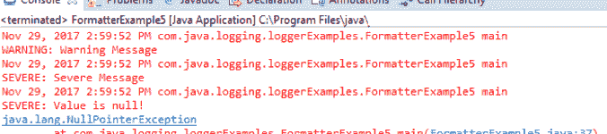

## 2.5.1. Formatter 类

`java.util.logging.Formatter` 类基本上是一个格式化器，它接受 `printf` 或 C 风格的参数作为输入。该类提供了对布局对齐和对齐的支持、数值、字符串以及日期/时间的常用格式，以及特定特定区域的输出（java.util.logging (Java Platform SE 7, 2017)）。

这种格式化打印完全灵感来源于传统的 C 语言 `print` 语句。

为了格式化日志消息，我们调用 `format message`。但如果我们想自定义此消息，则提供一个格式化字符串和一个参数列表。该字符串包含文本（日志消息）和另一个`格式规范符`。

通常，通用、字符和数值格式规范符的语法如下：

`% %[index_of_ argument] [flags] [width of argument] [. precision] conversion`

在这里，索引、宽度、精度和标志都是可选的。索引是一个十进制整数，指定参数在参数列表中的位置。

标志只是一组修改输出的字符集。精度（precision）用于限制字符的数量。转换（conversion）是另一个字符，指示了如何格式化参数。`转换`（conversion）应用于一个参数。这是一个字符元素，指示了应该在日志输出中插入什么内容。这可能是不同的类型。

此外，用于日期和时间的格式规范符是不同的，并具有以下语法：

`%[index_of_ argument$][flags][width]conversion`

与通用格式规范符一样，参数索引、标志、宽度和转换都是可选的。

在这种情况下，`转换`是由两个字符组成的序列。序列中的第一个字符是 't' 或 'T'。第二个字符指示了要使用的格式（java.util.logging (Java Platform SE 7, 2017)）。

存在 6 类转换。它们分别是是：

- 通用（General）：适用于任何参数；
- 字符（Character）：适用于 Unicode 字符 char、byte、short 及其对应的包装类；
- 数值（Numeric）：适用于 Integer 和浮点值，如 int、float、double、BigDecimal、BigInteger 及其对应的包装类；
- 日期/时间（Date/Time）：适用于 Java 中的 Date、时间类；
- 百分号（Percent）：这产生字面量 `%%`；以及
- 换行符（Line Separator）：这产生一个特定于平台的换行符。

下表描述了使用的一些各种转换。

### 表格 2.13：日期和时间转换 (java.util.logging (Java Platform SE 7, 2017))

| 转换 | 类别 | 说明 |
|---|---|---|
| c or C | 字符 | 此转换产生 Unicode 字符作为结果 |
| D | 整数 | 此转换返回格式化后的十进制整数作为输出 |
| O | 整数 | 此转换返回格式化后的八进制整数作为输出 |
| X or x | 整数 | 此转换返回格式化后的十六进制整数作为输出 |
| F | 浮点数 | 此转换返回格式化后的十进制整数作为输出 |
| c or E | 浮点数 | 此转换返回科学计数法格式的十进制整数作为输出 |
| g or G | 浮点数 | 此转换返回格式化后的十进制整数/计算机科学计数法作为输出 |
| a or A | 浮点数 | 此转换返回带有指数和有效数字的格式化十六进制浮点。 |
| b or B | 通用 | 如果提供的参数为 null，则返回 false。如果提供的参数具有布尔值，结果与 `String.valueOf(Argument)` 的返回值相同。如果参数是其他类型，则返回参数本身。 |
| h or H | 通用 | 如果提供的参数为 null，则返回 null。 |
| s or S | 通用 | 这是一个指示日志输出中应插入什么内容的元素。这可能是不同的类型。 |
| t or T | 日期/时间 | 序列中的第一个字符是 't' 或 'T'。第二个字符指示了要使用的格式。 |

## Java 中的日志框架

```java
package com.java.logging.loggerExamples;

import java.util.logging.*;
import java.util.logging.ConsoleHandler;
import java.util.logging.Level;
import java.util.logging.LogRecord;
import java.util.logging.Logger;
import java.util.logging.SimpleFormatter;

public class FormatterExample4 {
    public static void main(String[] args) {
        // 创建记录器
        Logger logger = Logger.getLogger("com.java.logging.loggerExamples");

        // 禁用默认父处理器
        logger.setUseParentHandlers(false);

        // 定义一个新的控制台处理器
        ConsoleHandler consolehandler = new ConsoleHandler();
        consolehandler.setFormatter(new SimpleFormatter() {
            // 设置输出格式
            // %1$tF %1$tH:%1$tM:%1$tS (YYYY-MM-DD HH:MM:SS)
            // %2$s - 级别
            // %3$s - 消息，格式为时间 %tH:%tM:%tS %T (HH:MM:SS)
            // %n - 换行
            private static final String format = "%1$tF %1$tT [%2$s] %3$s %n";

            // 重写格式化方法并提供自定义
            @Override
            public synchronized String format(LogRecord logRecord) {
                return String.format(format, new java.util.Date(logRecord.getMillis()), logRecord.getLevel(), logRecord.getMessage());
            }
        });

        // 将处理器添加到记录器中
        logger.addHandler(consolehandler);
        consolehandler.setLevel(Level.FINE);

        // 添加日志消息
        logger.warning("A warning message");
        logger.info("An information message");
        logger.fine("A fine message");
    }
}
```

如所示，我们直接在 `setFormatter` 方法中定义了一个新的 `SimpleFormatter` 类。我们重写了 `format()` 方法来提供自定义格式，并继续添加处理器和日志消息。

输出如下：

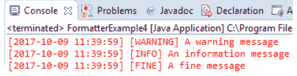

设置格式的另一种方法是使用下面的系统属性：

```java
// FormatterExample5.java
package com.java.logging.loggerExamples;
import java.util.logging.Level;
import java.util.logging.Logger;
public class FormatterExample5 {
    public static void main(String[] args) {
        // 创建记录器对象
        Logger logger = Logger.getLogger("com.java.logging.loggerExamples");
        // 设置日志格式
        // 日期和时间格式化为 %1$T %2$t %3$t %4$t %5$t %6$t %tZ
        // %7$s - 消息类和方法
        // %8$s - 级别
        // %9$s - 包
        // %10$s - 换行
        System.setProperty("java.util.logging.SimpleFormatter", "[%1$tc %2$t %3$t %4$t %5$t %6$t %tZ] [%7$s %8$s %9$s] - %10$s%n");
        logger.setLevel(Level.FINE);
        // 添加消息
        logger.warning("A warning message");
        logger.info("An information message");
        logger.severe("A severe message");
    }
}
```

## 输出结果

```java
// Example6.java
package com.java.logging.loggerExamples;
import java.util.logging.Level;
import java.util.logging.Logger;
public class FormatterExample6 {
    public static void main(String[] args) {
        // 创建记录器
        Logger logger = Logger.getLogger("com.java.logging.loggerExamples");
        // 添加日志消息
        logger.warning("A warning message");
        logger.info("An information message");
        logger.severe("A severe message");
    }
}
```

（注：原文中 `Example6.java` 块似乎有重复，此处保持逻辑对应）

这是一种不通过添加或通过运行时参数配置来格式化输出的另一种方法。结果如下：


```java
FormatterExample6.java
package com.java.logging.loggerExamples;
import java.util.logging.Level;
import java.util.logging.Logger;
public class FormatterExample6 {
    public static void main(String[] args) {
        // 创建记录器
        Logger logger = Logger.getLogger("com.java.logging.loggerExamples");
        // 添加日志消息
        logger.warning("A warning message");
        logger.info("An information message");
        logger.severe("A severe message");
        // 生成异常
        Throwable ex = new IllegalArgumentException("Illegal Argument thrown");
        logger.setLevel(Level.SEVERE, "Exception thrown");
    }
}
```

`java.util.logging` 属性可以通过右键点击类并选择“配置”来设置。显示的窗口如下：

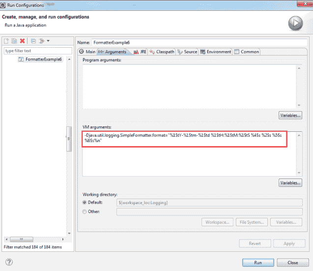

我们设置格式并运行该类。输出如下：

```
2017-10-09 12:15:00 WARNING com.java.logging.loggerExamples.FormatterExample6 A warning message
2017-10-09 12:15:00 INFO com.java.logging.loggerExamples.FormatterExample6 An information message
2017-10-09 12:15:00 SEVERE com.java.logging.loggerExamples.FormatterExample6 A severe message
2017-10-09 12:15:00 SEVERE com.java.logging.loggerExamples.FormatterExample6 Exception thrown
java.lang.IllegalArgumentException: Illegal Argument thrown
	at com.java.logging.loggerExamples.FormatterExample6.main(FormatterExample6.java:19)
```

### 示例：自定义处理器

在此示例中，我们通过扩展该类来实现自定义日志处理器。我们重写 `publish()` 方法来指定发布日志的方式。该类所示：

```java
MyCustomLogHandler.java
package com.java.logging.loggerExamples;
import java.text.DateFormat;
import java.text.SimpleDateFormat;
import java.util.logging.Handler;
import java.util.logging.LogRecord;
import java.util.logging.Level;

public class MyCustomLogHandler extends Handler {
    // 定义显示日志的格式
    private static final DateFormat dateFormat = new SimpleDateFormat("yyyy/MM/dd HH:mm:ss");

    @Override
    public void publish(LogRecord record) {
        StringBuilder message = new StringBuilder();
        message.append(dateFormat.format(record.getMillis()));
        message.append(": ");
        message.append(record.getSourceClassName());
        message.append(": ");
        message.append(record.getSourceMethodName());
        message.append(": [ ");
        message.append(record.getLevel());
        message.append("] - ");
        message.append(record.getMessage());
        System.out.println(message.toString());
    }

    @Override
    public void flush() {
    }

    @Override
    public void close() throws SecurityException {
    }
}
```

现在我们编写另一个使用自定义处理器的 Java 类。实现此处理器的类如下：

```java
CustomHandler2.java
package com.java.logging.loggerExamples;
import java.util.logging.LogManager;
import java.util.logging.Logger;

public class CustomHandler2 {
    public static void main(String[] args) {
        // 获取记录器
        Logger rootLogger = LogManager.getLogger("");
        // 使用 reset() 所有现有处理器
        LogManager.getLogManager().reset();
        // 添加自定义处理器
        rootLogger.addHandler(new MyCustomLogHandler());
        // 日志消息
        rootLogger.info("A simple Information Message");
    }
}
```

控制台上的输出为：

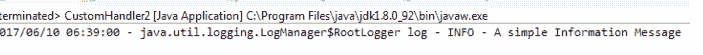

### 示例：本地化

如输出所示，日志记录已按照自定义处理器中定义的方式发布。在此示例中，我们实现了一个与默认不同的区域设置。在这里，我们将区域设置设置为法语，如下方的类所示：

```java
LocalExample1.java
package com.java.logging.loggerExamples;
import java.util.Locale;
public class localExample1 {
    public static void main(String[] args) {
        // 设置区域设置
        // 我们将其设置为法语
        Locale.setDefault(new Locale("fr"));

        // 获取记录器对象
        Logger logger = Logger.getLogger("com.java.logging.loggerExamples.LocalExample1");

        // 添加日志消息
        logger.warning("A warning message");
        logger.info("An information message");
        logger.severe("A severe message");
    }
}
```

执行该类后，输出如下：

```
Console Problems Javadoc Declaration Annotations Call Hierarchy
<terminated>LocalExample1 [Application] C:\Program Files\Java\jdk1.8.0_92\bin\java.exe
2017-10-09 16:50:50 WARNING com.java.logging.loggerExamples.LocalExample1 A warning message
2017-10-09 16:50:50 INFO com.java.logging.loggerExamples.LocalExample1 An information message
2017-10-09 16:50:50 SEVERE com.java.logging.loggerExamples.LocalExample1 A severe message
```

## Java 日志框架

我们删除了设置区域语言（locale）的语句。参数现在运行配置中设置如下：

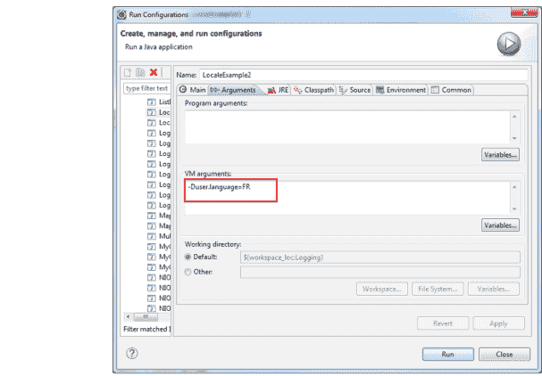

输出与之前的示例相同。示例 21：使用 Lambda 表达式

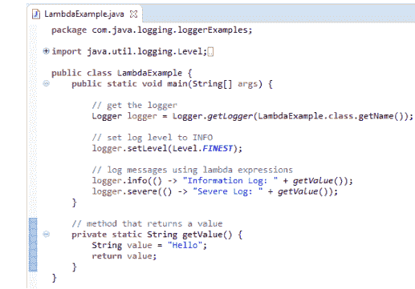

```java
package com.java.logging.LoggerExample;
import java.util.logging.Level;

public class LambdaExample {
    public static void main(String[] args) {
        // 获取记录器
        Logger logger = Logger.getLogger(LambdaExample.class.getName());

        // 设置日志级别为 FINEST
        logger.setLevel(Level.FINEST);

        // 使用 lambda 表达式记录日志
        logger.info(() -> "Information Log: " + getValue());
        logger.severe(() -> "Severe Log: " + getValue());
    }

    // 返回值的方法
    private static String getValue() {
        String value = "Hello";
        return value;
    }
}
```

## 示例 22：使用接口的 Lambda 表达式示例

在此示例中，我们将查看如何使用接口通过 lambda 表达式记录日志。

我们在类中声明了接口并提供了它们的函数式实现，所示：

```java
// LambdaExample.java
package com.java.logging.Logger;

import java.util.logging.Level;
import java.util.logging.Logger;

// 声明接口
interface MyInterface {
    public String getValue();
}

public class LambdaExample {
    public static void main(String[] args) {
        // 获取记录器
        Logger logger = Logger.getLogger(LambdaExample.class.getName());
        // 设置日志级别为 INFO
        logger.setLevel(Level.INFO);
        // 提供接口方法的函数式实现
        MyInterface int1 = () -> {
            return "the application is stable. No issues to report";
        };
        logger.info(int1.getValue());
        // 提供接口方法的另一个函数式实现
        MyInterface int2 = () -> {
            return "Error! The application is unstable.";
        };
        logger.severe(int2.getValue());
        // 使用 lambda 表达式和日志消息记录
        logger.warning("Warning: " + int2.getValue());
        // 提供接口方法的第三种函数式实现
        MyInterface int3 = () -> {
            return "Warning! The application is running with Errors.";
        };
        logger.warning(int3.getValue());
    }
}
```

## 2.6. 杂项特性

### 2.6.1. 安全问题

`java.util.logging` 包中的日志安全问题没有考虑得太详细。尽管日志记录不被认为是应用程序最重要的部分，但它提供了一种机制来确保配置的保护。

`LoggingPermission` 类提供了安全保护，防止未经授权的类更改日志配置。这是一个需要定义的安全权限，用于控制更新配置文件的访问。通过这种方式，不可信的代码将不允许进行更改并阻碍记录器的功能。使用这种机制，只有受信任/已注册的应用程序会被授予修改和更新日志配置所需的权限。因此，没有相应权限的应用程序将只能创建记录器和记录消息，而不能添加或删除记录器或处理器。

但是，日志包中的一个安全漏洞是，不可信的应用程序仍然有权创建、定义和使用它们自己的匿名记录器，这些记录器在记录器命名空间树的任何地方注册。这些记录器不检查权限，任何类都可以使用这些记录器修改日志配置（Java Logging Overview, 2017）。

另一个安全威胁是没有防止伪造。这意味着日志调用的源无法确定。源可能是真实的，也可能是伪造的。`XML` 格式化器容易受到注入威胁。

此外，Java 日志框架容易受到 DOS（拒绝服务）攻击。任何客户端都可能向应用程序泛入数十条无意义的日志消息，并试图掩盖重要的日志消息。

### 2.6.2. 远程访问与序列化

尽管 Java 日志框架被定义为在单个地址空间中使用，且类日志方法是本地的，但我们仍然有记录到远程位置的可能性。`SocketHandler` 能够使用 `XML` 格式的消息将数据写入另一个网络上的机器上。`XML` 格式是一种可以在许多不同类型系统上处理的标准格式。

远程记录日志的另一种方法是处理器能够通过 `RMI` 在网络上写入 `LogRecord`。但该类是不可序列化的，这可能会引发问题。

需要注意的是，`java.util.logging` 包中的许多类不是可序列化的。它们创建的意图并不是为了序列化。处理器（`Handlers`）和记录器（`Loggers`）是链接到固定机器的有状态类。

记录器和处理器类可以被类比于 `java.io.InputStream` 类，这些类是不可序列化的。

安全和远程日志不在本书的范围范围内。但如需更多信息，你可以参考 Samudra Gupta 编写的书籍《Logging in Java with the JDK 1.4 Logging API and Apache log4j》。

# 第 3 章

## LOG4J

目录

- 3.1. 引言............................................................... 66
- 3.2. Log4j 版本.......................................................... 66
- 3.3. Log4j 特性.......................................................... 67
- 3.4. Log4j 组件.......................................................... 67
- 3.5. 辅助组件.......................................................... 68
- 3.6. Log4j 工作原理...................................................... 69
- 3.7. Log4j API.......................................................... 71
- 3.8. Log4j.properties/Xml 文件.............................. 78
- 3.9. Log4j 安装.......................................................... 80
- 3.10. 示例.............................................................. 82

## 3.1. 引言


# Log4j 概述

Log4j 是另一个基于 Java 语言的日志框架，由 Apache 拥有并发布。它由 Ceki Gülcü 编写。它是日志服务项目的一部分，于 1996 年首次发布。源自欧洲联盟 SEMPER 项目，该项目希望有一个类似于大型应用程序的跟踪 API。

随后，经过多次增强和演进，该 API 逐渐变成了 Log4j，现在是流行的日志框架。该框架的包现在根据 Apache 软件许可证发布。

正如前面提到的，日志有很多优点，Log4j 尝试提供一种完整、简单且快速的日志机制。Log4j 是一个灵活的框架，完全用 Java 编写，但也用于 C++、C#、Perl、Python、Ruby 等语言。Log4j 的一个优秀特性是可以在运行时通过外部文件进行动态配置。此外，它提供了良好的远程日志方法。使用此框架，日志可以轻松写入各种目标，如数据库、远程文件、Syslog 等。

Log4j 的最新版本是 Apache Log4j 2.9.1，于 2017 年 9 月发布。本书中的所有示例都基于此版本。

## 3.2 Log4j 版本

Log4j 在多年间发布了多个版本。在初始包 Log4j 0.5 发布之后，第一个版本发布于 1999 年。此之后又发布了 60 个 Log4j 1.x 版本；每个版本都有一些修改和功能。1.2 是该系列发布的最后一个版本。有关此版本的更改详情可以通过以下链接找到：

```
https://logging.apache.org/log4j/1.2/changes-report.html
```

2015 年，Apache 宣布 Log4j 1.x 系列已结束并将停止维护。

继任版本 Log4j 2.0-alpha1 于 2012 年发布。从那时起，发布了多个 Log4j 2.x 版本。最新版本是 Log4j 2.9.1。可以在以下链接找到发布历史：

```
https://logging.apache.log4j/2.x/changes-report.html#a2.9.1
```

## 3.3 Log4j 特性

Log4j 提供了若干高级功能来简化日志记录，如下（Gülcü, 2003）：

1. Log4j 提供快速、线程安全的日志服务。
2. Log4j 支持在运行时对属性进行动态配置。
3. Log4j 提供了其自身的无垃圾日志（garbage free logging）版本，可以节省内存。
4. 支持多个 Appender（输出器）输出以及国际化。
5. 它基于插件系统，使得扩展现有框架变得容易。
6. 自定义不同的组件（如日志级别、处理器（handlers）和日志器（loggers））非常容易。
7. 由于其透明度和扩展的异常处理能力，它可以作为审计框架使用。
8. 它支持 Java 8 的 lambda 表达式功能，这使得构建日志消息变得简单。
9. 通过提供自定义布局（layouts）可以更改日志的格式，使用 `Layout` 类进行操作会更加简单。
10. Syslog Appender 提供了 TCP 和 UDP 支持。
11. Log4j 是开源软件，拥有广泛的社区支持。
12. 它并不限制于构建开放所需的特定类集合。Log4j 中的配置非常简单，并且并不总是绑定到特定的类、包或方法。

## 3.4 Log4j 的组件

Log4j 框架基于以下组件构建：

### 1. Loggers（日志器）

这些对象是该框架的核心对象。它们是捕获待记录信息的对象。正如我们在 Java 日志框架中所看到的，日志器被存储在命名空间层次结构中。

### 2. Appenders（输出器）

这些对象是框架的另一个重要部分。它们处理日志的发布方面。它们接收日志记录并将其发布到所需的目录。

### 3. Layouts（布局）

布局的主要功能是格式化日志输出。通过使用 `Layout` 类提供了多种配置和格式化日志输出的方法。Appenders 在发布日志信息之前会使用布局对象。布局有助于使日志对人类易于阅读。

## 3.5 辅助组件

除了上述三个重要组件外，Log4j 框架还具有帮助这些核心组件的辅助组件。虽然这些组件不是主要对象，但它们在很大程度上帮助了核心对象。它们如下：

### 3.5.1 Log Manager（日志管理器）

该对象顾其名，管理整个日志配置。它读取配置文件并通过配置文件或类设置参数。这种配置适用于系统级。它处理并管理日志器的命名空间层次结构。

### 3.5.2 Object Renderer（对象渲染器）

该组件用于为传递给框架的日志对象提供字符串表示。此方法类似于 Java `String` 类中的 `toString()` 方法。

### 3.5.3 Filter Object（过滤器对象）

与我们在第 2 章学习的过滤器类似，该过滤器用于分析日志记录并决定哪些信息应该被记录，哪些信息应该被丢弃。每个 Appender 都可以添加一个或多个过滤器。当日志发送到 Appender 时，所有过滤器对象必须批准该日志才能将其发布到目标地。因此，过滤器对于根据系统属性移除不需要的日志信息非常有用。

### 3.5.4 Level Object（级别对象）

该对象定义了日志信息的优先级和细粒度（Apache Log4j API 2.9.1, 2017）。它也被称为优先级对象。提供了七种日志级别：OFF、DEBUG、INFO、ERROR、WARN、FATAL 和 ALL。与 Java 日志框架类似，每个级别都被分配了一个整数值。

## 3.6 Log4j 的工作原理

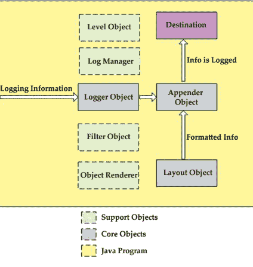

图 3.1：Log4j 架构 (Tutorialspoint.com, 2017)。

从上面的图中可以看出，Log4j 的架构简单且易于理解（图 3.1）。

核心组件是启用任何应用程序中日志记录的必要条件。日志信息来自想要启用日志的应用程序/Java 程序，并传递给 Java 配置中由日志框架定义的日志器。日志器将其转发给 Appender，Appender 在 `Layout` 对象的帮助下格式化日志记录。格式化日志信息后，Appender 将日志发布到适当的目标。

辅助对象可能连接到核心对象，也取决于配置。

现在我们已经看到了 Log4j 的基本架构，并了解它们是如何相互作用的。一旦调用日志器对象，发生的一个示例事件序列所示（图 3.2）。

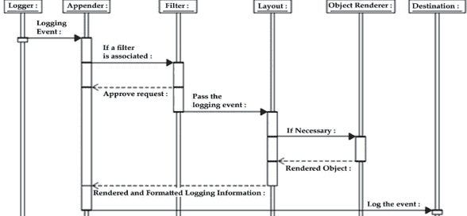

图 3.2：Log4j 概述 (Gülcü, 2003)。

应用程序创建一个日志器对象并为其提供日志信息。每当实例化日志器就会触发日志事件。日志器关联有一个级别，并记录大于或等于该级别的消息。如果满足此条件，日志器会将数据转发到 Appender。Appender 检查是否定义了过滤器。如果定义了过滤器，日志数据将通过所有过滤器进行审核。一旦日志数据被过滤器批准，Appender 将使用与其关联的 `Layout` 对象格式化消息。渲染完成后，控制交给 Appender。现在，Appender 将日志发布到相应的目标。

## 3.7 Log4j API

本节介绍了 Log4j 提供的基础类。

### 3.7.1 Logger（日志器）

日志器是 Log4j 的核心单元。日志器无非命名实体（Gülcü, 2003）。

Log4j 中的日志器使用层次规则进行命名。该规则如下：

> “如果一个日志器的名称后跟点是另一个日志器的前缀，则该日志器被称为其祖先。直接祖先称为父级日志器，直接后代称为子日志器。”（Apache Log4j API 2.9.1, 2017）。

用一个简单的示例来解释，命名为 `com.abc` 的是 `com.abc.package1` 的父级。

默认根日志器是所有日志器的父级。这个日志器始终存在，其级别不能为空。此外，它没有名称，因此无法通过名称检索。

在编程中，为了检索日志器对象，我们使用 `LogManager` 类的静态 `getLogger()` 方法。该类的一些重要方法如下表所示：

**LogManager 类的方法**（Apache Log4j API 2.9.1, 2017）

| 方法 | 描述 |
| --- | --- |
| `static Logger getLogger()` | 该方法返回名称为调用此方法的类的日志器对象 |
| `static Logger getLogger(String name)` | 该方法返回具有指定名称的日志器对象 |
| `static Logger getRootLogger()` | 该方法返回根 Logger |
| `static Logger getFormattedLogger(String name)` | 该方法返回一个使用指定名称格式化的日志器 |
| `static Boolean exists(String name)` | 此方法检查指定名称的 logger 是否存在 |
| `static LoggerContext getContext()` | 此方法返回当前的 Logger Context |

在 Log4j2 中，`Logger` 类提供了几个方法，用于在 Java 应用程序中添加日志功能。其中一些方法在下所示（表 3.1）。

**表 3.1：Logger 类方法**（Apache Log4j API 2.9.1, 2017）

| 方法 | 描述 |
| --- | --- |
| `void debug(Message message)` | 此方法记录一条 DEBUG 级别的消息。 |
| `void info(Message message)` | 此方法记录一条 INFO 级别的消息。 |
| `void warn(Message message)` | 此方法记录一条 WARN 级别的消息。 |
| `void error(Message message)` | 此方法记录一条 ERROR 级别的消息。 |
| `void fatal(Message message)` | 此方法记录一条 FATAL 级别的消息。 |
| `void trace(Message message)` | 此方法记录一条 TRACE 级别的消息。 |
| `Level getLevel()` | 这些方法返回与 logger 关联的级别。 |
| `String getName()` | 此方法返回 logger 的名称。 |
| `void log(Level level, Object message)` | 此方法按指定的级别记录消息。 |
| `void log(Level level, Object message, Throwable t)` | 此方法按指定的级别记录消息，并记录 `Throwable` 参数的堆栈跟踪 |

### 3.7.2 Level

在 Log4j 中，可以设置多个不同的 Level（级别）值。这些级别由 `org.apache.log4j.Level` 类提供。可用选项已在下表中（表 3.2）。

**表 3.2：Log4j Level 类**（Apache Log4j API 2.9.1, 2017）

| 日志级别 | 描述 |
| --- | --- |
| TRACE | 此级别允许所有日志信息 |
| DEBUG | 此级别提供详细的用于日志，用于调试应用程序。 |
| INFO | 此级别用于记录提供粗粒度日志的日志消息。提供进度和状态信息。 |
| WARN | 此级别作为高优先级级别，对应用程序内发生的意外事件发出警告。 |
| ERROR | 此日志级别表示应用程序内部存在严重问题，可能会导致应用程序不稳定。 |
| FATAL | 此日志级别表示最高优先级的日志消息。它通常表示应用程序将终止。 |
| ALL | 此日志级别允许记录所有日志级别的消息。 |
| OFF | 此日志级别表示日志记录已关闭。 |

所有级别的排序如下（Apache Log4j API 2.9.1, 2017）：

`ALL < TRACE < DEBUG < INFO < WARN < ERROR < FATAL < OFF`

下表演示了哪些级别允许在哪些日志级别被记录。例如，对于 WARN 日志级别，此级别的消息仅对 WARN、ERROR、FATAL 和 ALL 可见。

**表 3.3：级别及其访问**（Apache Log4j API 2.9.1, 2017）

| 级别 | ALL | FATAL | ERROR | WARN | INFO | DEBUG | TRACE |
| --- | --- | --- | --- | --- | --- | --- | --- |
| ALL | Y | Y | Y | Y | Y | Y | Y |
| FATAL | Y | Y | N | N | N | N | N |
| ERROR | Y | Y | N | N | N | N | N |
| WARN | Y | Y | Y | Y | N | N | N |
| INFO | Y | Y | Y | Y | Y | N | N |
| DEBUG | Y | Y | Y | Y | Y | Y | N |
| TRACE | Y | Y | Y | Y | Y | Y | Y |

### 3.7.3 Appenders

Appenders（输出器）是帮助将日志写入多个目的地的对象，例如控制台、远程套接字、Swing 组件、JMS、事件 logger 以及 Unix syslog（远程或本地）。在 Log4j 中可以挂载 Appenders。此外，这些是可配置的。可以在应用程序的任何时间添加或删除 Appenders。

Log4j 提供了几种不同的输出到一个或多个目的地的 Appender。

部分 Appender 类如下所示：

1. **Console Appender（控制台输出器）**：此 Appender 将日志输出写入控制台（`System.out` 或 `System.err`）。
2. **File Appender（文件输出器）**：此 Appender 写入文件。它是一个输出 Stream Appender，并写入 Stream 配置中指定的文件。
3. **Rolling File Appender（滚动文件输出器）**：这是另一个基于输出 Stream 的 File Appender，它可以写入文件并根据滚动和触发策略对文件进行滚动/轮转。
4. **Random Access File Appender（随机访问文件输出器）**：此 Appender 类似于标准的 File Appender，但它始终使用 `BufferedOutputStream` 进行缓冲。
5. **JDBC Appender（JDBC 输出器）**：此 Appender 使用 JDBC 连接将日志写入 RDBMS（关系型数据库）表。
6. **JMS Appender（JMS 输出器）**：此 Appender 将日志事件发送到 Java Messaging Service 队列目的地。
7. **Async Appender（异步输出器）**：这是异步输出器，包含指向其他不同 Appender 的引用。日志消息在单独线程中写入它包含的 Appenders。这在多线程应用程序中极其有用。
8. **SMTP Appender（SMTP 输出器）**：此 Appender 将日志事件通过电子邮件发送。
9. **Socket Appender（套接字输出器）**：此 Appender 类似于标准的 File Appender，但它始终是缓冲的。
10. **Syslog Appender（Syslog 输出器）**：此 Appender 将日志事件发送到 Syslog 服务。
11. **Writer Appender（写入输出器）**：此 Appender 将日志输出写入 `Writer`。

部分 Appender 属性包括：

- **Target**：此 Appender 有目的地。
- **Level**：每个 Appender 有一个级别。
- **Layout**：此 Appender 使用布局。

**表 3.4：Appender 方法**（Apache Log4j API 2.9.1, 2017）

| 方法 | 描述 |
| --- | --- |
| `void append(Message message)` | 此方法记录事件。 |
| `String getName()` | 此方法返回 Appender 的名称。 |
| `Layout<? extends Serializable> getLayout()` | 此方法返回 Layout。 |
| `ErrorHandler getHandler()` | 此方法返回 ErrorHandler。 |
| `void setHandler(ErrorHandler handler)` | 此方法设置指定的 ErrorHandler。 |

### 3.7.4 Filters

过滤器是决定哪些日志消息到达目的地的组件。当过滤器被调用时，它返回一个枚举：`ACCEPT`（接受）、`DENY`（拒绝）或 `NEUTRAL`（中性）。

Log4j 提供了以下类型的过滤器：

1. **Threshold Filter（阈值过滤器）**：此过滤器定义了一个阈值，如果级别高于阈值则允许日志事件。
2. **Time Filter（时间过滤器）**：此过滤器用于限制特定时间的日志。
3. **Burst Filter（突发过滤器）**：此过滤器对事件数量进行限制。达到此数量，过滤器将丢弃日志。
4. **Composite Filter（复合过滤器）**：此过滤器允许在上下文中使用多个过滤器。
5. **Map Filter（映射过滤器）**：这是一个独特的过滤器，允许根据包含键值对的 Map 过滤消息。
6. **Regex Filter（正则表达式过滤器）**：此过滤器允许根据正则表达式过滤日志信息。
7. **Structured Data Filter（结构化数据过滤器）**：这是一个高级 Map Filter，用于事件 ID、消息类型和消息本身过滤日志信息。
8. **Marker Filter（标记过滤器）**：此过滤器根据 Marker 值过滤日志事件 Marker。


- 9. Thread Context Map Filter（线程上下文映射过滤器）：此过滤器用于根据 Thread Context Map 中存在的元素过滤日志事件。
- 10. Dynamic Threshold Filter（动态阈值过滤器）：此过滤器提供了根据日志级别、用户 ID 等不同属性过滤日志信息的可能性。

表 3.5：Filter 接口方法（Apache Log4j API 2.9.1, 2017）

| 方法 | 描述 |
| --- | --- |
| Filter Result filter (Log Event) | 此方法过滤给定的日志事件。 |
| Filter Result Get Match() | 此方法在匹配时应返回的值。 |
| Filter Result Get Mismatch() | 此方法在不匹配时应返回的值。 |

## 3.7.5. 布局 (Layouts)

布局被 appender（应用器）用于格式化日志信息的内容。log4j 提供了几种不同类型的布局来格式化日志信息。其中一些布局如下：

- 1. 模式布局 (Pattern Layout)：这是最常用的布局，可以使用字符串模式易于配置。该布局用于根据字符串模式格式化日志事件的内容。日志事件的格式化完全取决于转换模式（conversion pattern）。Log4j 提供了许多转换模式来帮助格式化日志事件。一些最常见的转换格式如下：
    - a. `c{precision}` / `logger{precision}`：输出 logger 名称
    - b. `d{pattern}` / `date{pattern}`：按照指定的模式输出日期
    - c. `m` / `msg` / `message`：输出日志消息
    - d. `p` / `level`：输出日志消息的级别
    - e. `r` / `relative`：给出从 JVM 启动到日志创建所经过的毫秒数。
    - f. `t` / `thread`：给出生成日志事件的线程。
- 2. JSON 布局 (JSON Layout)：这种布局是另一种常用的布局，它附加序列化为字节的 JSON 字符串。
- 3. HTML 布局 (HTML Layout)：该布局用于生成 html 格式的日志信息，可以在任何网络浏览器中打开。每个日志事件被视为该布局中的一行。
- 4. XML 布局 (XML Layout)：该布局用于附加事件列表并将其输出为良好的 XML 文档，默认命名空间为 log4j 命名空间。
- 5. Syslog 布局 (Syslog Layout)：该布局符合 BSD Syslog 记录，并按照 BSD Syslog 协议的标准格式化日志信息/事件。
- 6. RFC5424布局：该布局根据 RFC 5424 规范格式化日志数据，这是一种高级/增强的 syslog 规范。
- 7. 序列化布局 (Serialized Layout)：该布局将日志事件序列化为字节数组。
- 8. GELF 布局 (GELF Layout)：该布局以 Gray log 扩展日志格式化日志事件。如果 JSON 日志数据大于 1024 字节，它具有压缩日志数据的能力。

下面显示了布局接口的几个重要方法：

**表 3.6:** 布局接口的方法 (Apache Log4j API 2.9.1, 2017)

| 方法 |  |
|---|--|
| `byte[] getHeader()` | 此方法返回布局格式的头部 |
| `byte[] Footer()` | 此方法返回布局格式的页脚 |
| `byte[] toByteArray(LogEvent event)` | 此方法将给定的日志事件格式化为字节数组。 |
| `T toSerializable(Log Event event)` | 此方法将给定的日志事件格式化为可序列化对象。 |
| `String getContextType()` | 此方法返回由布局格式化的日志消息的内容类型。 |
| `Map<String, String> getFormat()` | 此方法返回一个包含内容格式的 map。 |

## 3.8. LOG4J.PROPERTIES/XML 文件

上一节详细介绍了各种 log4j 类。本节将涵盖 log4j 的配置。

在 log4j 中，配置文件可以是两种类型：属性文件或 XML 文件。

**配置**文件是一个简单的文件，以键值对的形式持有 log4j 配置属性。在较早版本（log4j1.x）中，该文件被称为 log4j.properties。从下一个版本 log4j (2.x.x) 开始，该文件现在被称为 log4j.properties。虽然名称发生了变化，但该文件包含与之前相同的信息，即日志配置。

此文件用于通过配置文件（属性或 XML）配置核心 log4j 组件。这种配置涉及定义 Appender、指定级别并在此配置中设置 Layout 对象。

```properties
log4j.properties
# define the root logger level
rootLogger.level = INFO
#add appender
appenders = console
appender.type = Console
appender.name = STDOUT
#set a pattern
appender.layout.type = PatternLayout
appender.layout.pattern = %d %p [%t] - %m%n
#add appender to the root logger
rootLogger.appendRefs = console
rootLogger.appendRefs.ref = STDOUT
```

```xml
<?xml version="1.0" encoding="UTF-8"?>
<Configuration>
  <Appenders>
    <Console name="STDOUT" target="SYSTEM_OUT">
      <PatternLayout pattern="%d{yyyy-MM-dd HH:mm:ss} %5p [%t] - %m%n"/>
    </Console>
  </Appenders>
  <Loggers>
    <Root level="info">
      <Appender ref="STDOUT"/>
    </Root>
  </Loggers>
</Configuration>
```

The syntax for both files is provided below.

log4j.properties

The configuration of the is is.......4j package is distributed by Apache. Navigate to:

https://logging.apache.org/log4j/

Once-setup, it is very easy to configure. Open the IDE and Add External Path. Click the.. at:

https://logging.apache.org/log4J 2.9.1

If you are using Eclipse, it is very easy to configure. Open the IDE and Add External Path. Click the. . at:

https://logging.apache.org/log4J 2.9.1

The configuration of the is.....4j package is distributed by Apache. Navigate to:

https://logging.apache.org/log4j 

is distributed by Apache. Navigate to:

https://logging.apache.org/log4j 

This section described a simple example demonstrating the use of log4j in a small Java application. The next section provides additional examples that use XML configuration, different appenders, filters, layouts, etc.

## 3.10. EXAMPLES

### Example1: File Appender Example

在本示例中，我们演示了一个使用 `log4j2.properties` 文件配置的简单 `FileAppender`。

配置文件如下：

```
log4j2.properties
# define the root logger level
root.level = INFO
# add appender
appender = File

# define the File Appender
appender.type = File
appender.name = File
# provide the output file log and path
appender.filename = logFile.log
# set a pattern for the output
appender.layout = PatternLayout
appender.layout.pattern = %d{yyyy-MM-dd HH:mm:ss} %c{1} [%p] %n

# add appender to the root logger
root.appenderRef = File
root.appenderRef.Ref.ref = File
```

在上面的配置文件中，我们配置了 Java 应用使用 log4j 和文件 appender 将消息记录到名为 `logFile.log` 的文件中，并设置日志条目的格式为 `yyyy-mm-dd - logger 名称-消息` 格式。

用于测试此配置的 Java 类如下所示：

```java
Log4jExample.java
import org.apache.log4j.LogManager;
public class Log4jExample {
// get the logger object from the LogManager
private static final Logger LOG = LogManager.getLogger("Log4jExample.class");

public static void main(String[] args[]) {
// add log statements
LOG.debug("A Debug message");
LOG.info("An Info message");
LOG.warn("A warn message");
LOG.error("An Error message");
LOG.fatal("A Fatal message");
}
}
```

当我们运行该类时，Java 项目中创建一个新文件：

## Java 中的日志框架

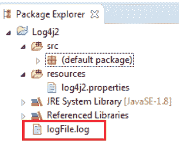

该文件的内容如下：

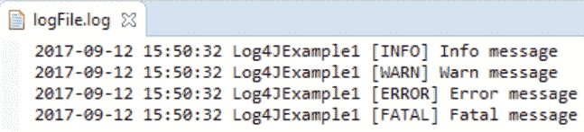

### 示例 2：多个 Appenders

在本示例中，我们演示了一个使用多个 appender 的 log4j 配置。我们现在配置 log4j 使用两个 appender：控制台和文件，如下所示：

```
#log4j.properties
#define the root logger level
rootLogger.level = WARN
#add appender
append = File, console

#define the Console appender
appender.console.type = Console
appender.console.name = STDOUT
#set a pattern
appender.console.layout = PatternLayout %d %p [%t] [%F:%L] - %m

#define the File Appender
appender.file.type = File
appender.file.name = File
#provide the output log file and path
appender.file.filename = log4j.log
#set a pattern
appender.file.layout = PatternLayout
appender.file.pattern = %d{yyyy-MM-dd HH:mm:ss} %c{1} %p %n

#add appender to the root logger
Logger.appenderRef = File, console
rootLogger.appenderRef.file = File
rootLogger.appenderRef.console.ref = STDOUT
```

# Log4j 85

用于测试配置的 Java 类如下：


```java
import org.apache.logging.log4j.LogManager;
import org.apache.logging.log4j.Logger;

public class Log4jExample2 {
    // get the logger object from the LogManager
    private static final Logger LOG = LogManager.getLogger(Log4jExample2.class);

    public static void main(String[] args) {
        // add log statements
        LOG.warn("A warn message");
        LOG.error("An error message");
        LOG.fatal("A fatal message");

        // induce an exception
        try {
            int a = 5 / 0;
            System.out.println(a);
        } catch (ArithmeticException e) {
            // log the exception
            LOG.error("Cannot divide by zero!");
        }
    }
}
```

当我们运行该类时，日志输出被发送到两个不同的目标：控制台和一个名为 `Log4jFile.log` 的文件。

执行上述类生成的控制台输出如下：

| 时间 | 级别 | 线程 | 位置 | 消息 |
|------|------|------|------|------|
| 2017-09-12 16:26:39,702 | WAR | [main] | [Log4jExample2.java:12] | A warn message |
| 2017-09-12 16:26:39,702 | ERROR | [main] | [Log4jExample2.java:11] | An error message |
| 2017-09-12 16:26:39,702 | FATAL | [main] | [Log4jExample2.java:14] | A Fatal message |
| 2017-09-12 16:26:39,702 | ERROR | [main] | [Log4jExample2.java:22] | Cannot divide by zero! |

文件输出如下：

| 时间 | 类名 | 级别 | 消息 |
|------|------|------|------|
| 2017-09-12 16:26:39 | Log4jExample2 | [WARN] | Warn message |
| 2017-09-12 16:26:39 | Log4jExample2 | [ERROR] | Error message |
| 2017-09-12 16:26:39 | Log4jExample2 | [FATAL] | Fatal message |
| 2017-09-12 16:26:39 | Log4jExample2 | [ERROR] | Cannot divide by zero! |

### 示例 3：Rolling Appender

在之前的示例中，我们学习了如何实现控制台和文件 appender。现在我们将看到如何配置 log4j 使用滚动文件（rolling appender）。使用的配置文件如下：

```properties
# log4j2.properties
# define the root logger level
root.level = DEBUG
property.filename = log.log

# add appenders
appenders = File, console

# define the Console appender
appender.console.type = Console
appender.console.name = STDOUT
# set pattern
appender.console.layout = PatternLayout
appender.console.pattern = %d %p [%t] - %m

# define the File appender
appender.file.type = RollingFile
appender.file.name = File
appender.file.filename = ${filename}-\%d{yyyy-MM-dd}.log
appender.file.layout = PatternLayout
appender.file.pattern = %d{yyyy-MM-dd HH:mm:ss} %p (%c) - %n
appender.file.policies = TimeBasedTriggeringPolicy, SizeBasedTriggeringPolicy
appender.file.timeBased.interval = 1
appender.file.sizeBased.size = 1KB

# add appender to the root logger
root.appenderRef.file = File
root.appenderRef.console = STDOUT
```

在上面的配置中，我们定义了两个 appender：控制台和滚动文件 appender。我们定义了当日志文件达到 1 KB 时进行滚动策略。Java 类如下：

```java
// LogExample.java
import org.apache.logging.log4j.LogManager;
import org.apache.logging.log4j.Logger;

public class LogExample {
    private static final Logger logger = LogManager.getLogger(LogExample.class);

    public static void main(String[] args[]) {
        // add log statements
        for (int i = 0; i < 5; i++) {
            logger.info("i: " + i);
        }

        int[] myArray = {1, 2, 3};
        // induce an exception
        try {
            int c = myArray[3];
            System.out.println(c);
        } catch (ArrayIndexOutOfBoundsException e) {
            // log the exception
            logger.error("Array Index is not within bounds! " + e.getMessage());
        }
    }
}
```

执行时，创建了 3 个文件，所示：

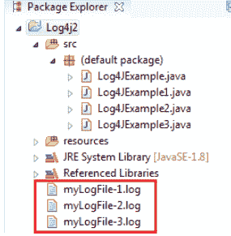

内容如下：

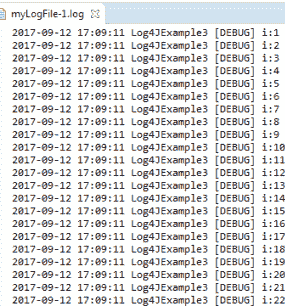

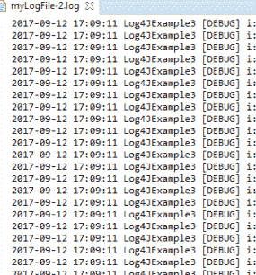

```
myLogFile-3.log
2019-07-12 17:09:11 LogExample3 [DEBUG] i:45
2019-07-12 17:09:11 LogExample3 [DEBUG] i:46
2019-07-12 17:09:11 LogExample3 [DEBUG] i:47
2019-07-12 17:09:11 LogExample3 [DEBUG] i:48
2019-07-12 17:09:11 LogExample3 [DEBUG] i:49
2019-07-12 17:09:11 LogExample3 [DEBUG] i:50
2019-07-12 17:09:11 LogExample3 [ERROR] Array Index is not within bounds!
```

控制台输出为：

```
Console Problems Javadoc Declaration Annotations Call Hierarchy
<terminated> LogExample3 [Application] C:\Program Files\Java\jdk8.0.92\bin\logExample.exe (12 oct.2017 at 17:10:11)
2019-07-12 17:09:11,773 DEBUG [logExample3,main] i:-1
2019-07-12 17:09:11,793 DEBUG [logExample3,main] i:2
2019-07-12 17:09:11,793 DEBUG [logExample3,main] i:3
2019-07-12 17:09:11,793 DEBUG [logExample3,main] i:4
2019-07-12 17:09:11,793 DEBUG [logExample3,main] i:5
2019-07-12 17:09:11,793 DEBUG [logExample3,main] i:6
2019-07-12 17:09:11,793 DEBUG [logExample3,main] i:7
2019-07-12 17:09:11,793 DEBUG [logExample3,main] i:8
2019-07-12 17:09:11,793 DEBUG [logExample3,main] i:9
2019-07-12 17:09:11,793 DEBUG [logExample3,main] i:10
2019-07-12 17:09:11,793 DEBUG [logExample3,main] i:11
2019-07-12 17:09:11,793 DEBUG [logExample3,main] i:12
2019-07-12 17:09:11,793 DEBUG [logExample3,main] i:13
2019-07-12 17:09:11,793 DEBUG [logExample3,main] i:14
2019-07-12 17:09:11,793 DEBUG [logExample3,main] i:15
2019-07-12 17:09:11,793 DEBUG [logExample3,main] i:16
2019-07-12 17:09:11,793 DEBUG [logExample3,main] i:17
2019-07-12 17:09:11,793 DEBUG [logExample3,main] i:18
2019-07-12 17:09:11,793 DEBUG [logExample3,main] i:19
2019-07-12 17:09:11,793 DEBUG [logExample3,main] i:20
2019-07-12 17:09:11,793 DEBUG [logExample3,main] i:21
2019-07-12 17:09:11,793 DEBUG [logExample3,main] i:22
2019-07-12 17:09:11,793 DEBUG [logExample3,main] i:23
2019-07-12 17:09:11,793 DEBUG [logExample3,main] i:24
2019-07-12 17:09:11,793 DEBUG [logExample3,main] i:25
2019-07-12 17:09:11,793 DEBUG [logExample3,main] i:26
2019-07-12 17:09:11,793 DEBUG [logExample3,main] i:27
2019-07-12 17:09:11,793 DEBUG [logExample3,main] i:28
2019-07-12 17:09:11,793 DEBUG [logExample3,main] i:29
2019-07-12 17:09:11,793 DEBUG [logExample3,main] i:30
2019-07-12 17:09:11,793 DEBUG [logExample3,main] i:31
2019-07-12 17:09:11,793 DEBUG [logExample3,main] i:32
2019-07-12 17:09:11,793 DEBUG [logExample3,main] i:33
2019-07-12 17:09:11,793 DEBUG [logExample3,main] i:34
2019-07-12 17:09:11,793 DEBUG [logExample3,main] i:35
2019-07-12 17:09:11,793 DEBUG [logExample3,main] i:36
2019-07-12 17:09:11,793 DEBUG [logExample3,main] i:37
2019-07-12 17:09:11,793 DEBUG [logExample3,main] i:38
2019-07-12 17:09:11,793 DEBUG [logExample3,main] i:39
2019-07-12 17:09:11,793 DEBUG [logExample3,main] i:40
2019-07-12 17:09:11,793 DEBUG [logExample3,main] i:41
2019-07-12 17:09:11,793 DEBUG [logExample3,main] i:42
2019-07-12 17:09:11,793 DEBUG [logExample3,main] i:43
2019-07-12 17:09:11,793 DEBUG [logExample3,main] i:44
2019-07-12 17:09:11,793 DEBUG [logExample3,main] i:45
2019-07-12 17:10:11,809 DEBUG [logExample3,main] i:46
2019-07-12 17:10:11,809 DEBUG [logExample3,main] i:47
2019-07-12 17:10:11,809 DEBUG [logExample3,main] i:48
2019-07-12 17:10:11,809 DEBUG [logExample3,main] i:49
2019-07-12 17:10:11,809 DEBUG [logExample3,main] i:50
2019-07-12 17:10:11,809 ERROR [logExample3,main] Array Index is not within bounds!
```

## Log4j 配置示例

```properties
# 定义 root logger
property.filename = logfile.log
rootlogger.level = DEBUG
```

```properties
# appender
appender = rolling, console
```

```properties
# 定义 Console appender
appender.console.name = STDOUT
# 设置一个 pattern
appender.console.layout = PatternLayout
appender.console.layout.pattern = %d [%p] %c{1} - %m%n
```

```properties
appender.type = rolling
appender.rolling.name = RollingFile
appender.rolling.filename = logfile.log
appender.rolling.filePattern = debug-backup-%d{yyyy-MM-dd-HH-mm-ss}.%i.log
appender.rolling.layout = PatternLayout
appender.rolling.layout.pattern = %d{yyyy-MM-dd HH:mm:ss} %p %c{1} - %m%n
appender.rolling.policy =
appender.rolling.policy.type = TimeBasedTriggeringPolicy
appender.rolling.policy.timeInterval = 1
appender.rolling.policy.start = true
appender.rolling.policy.size.type = SizeBasedTriggeringPolicy
appender.rolling.strategy.type = DefaultRolloverStrategy
appender.rolling.strategy.max = 10
```

```properties
# 将 appender 添加到 root logger
rootlogger.appender = rolling, console
rootlogger.appender.rolling.ref = RollingFile
rootlogger.appender.console.ref = STDOUT
```

# Java 类如下：

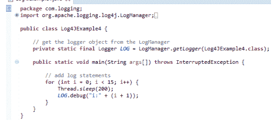

当我们运行它时，项目结构中创建的文件如下：

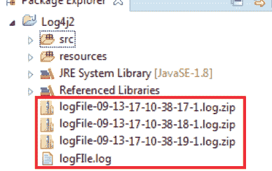

## Java 中的日志框架

这些文件的内容如下：

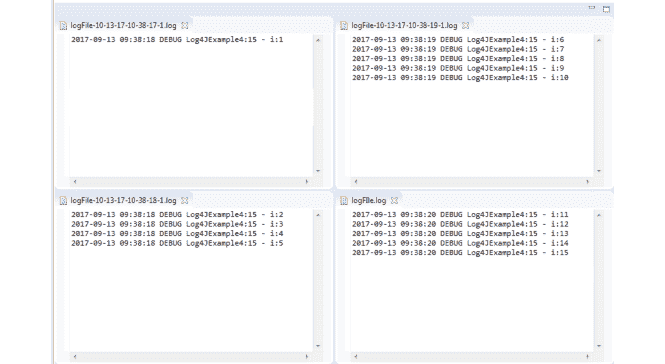


到目前为止，我们已经看到了使用属性文件的 log4j 配置示例。现在我们来看一下基于 XML 的配置示例，这是 log4j 最常用的配置类型。

## 示例 5：使用 log4j.xml 文件的简单 console appender

此示例展示了使用 XML 文件的 log4j 配置。以下配置文件用于为您的应用程序配置一个简单的控制 appender，如文所示：

```xml
<?xml version="1.0" encoding="UTF-8"?>
<configuration status="WARN">
  <appender>
    <console name="consoleAppender" target="SYSTEM_OUT">
      <layout pattern="%K-%Sp %d(yyyy-MM-dd HH:mm:ss) [%t] %c{1} (%L) - %m%n"/>
    </console>
  </appender>
  <loggers>
    <root level="debug">
      <appenderref ref="consoleAppender"/>
    </root>
  </loggers>
</configuration>
```

使用的 Java 类如下：

```java
import org.apache.log4j.LogManager;
import org.apache.log4j.Logger;

public class Log4jExample5 {
    // 从 LogManager 获取 logger 对象
    private static final Logger LOGGER = LogManager.getLogger(Log4jExample5.class);

    public static void main(String[] args) {
        // 添加日志语句
        LOGGER.debug("Debug message");
        LOGGER.info("Info message");
        LOGGER.warn("Warn message");
        LOGGER.error("Error message");
        LOGGER.fatal("Fatal message");
    }
}
```

控制台输出如下：

| 级别 | 时间戳 | 线程/位置 | 消息 |
|---|---|---|---|
| DEBUG | 2017-09-13 13:17:16 | [main] Log4jExample5 (Log4jExample5.java:12) | Debug message |
| INFO | 2017-09-13 13:17:16 | [main] Log4jExample5 (Log4jExample5.java:13) | Info message |
| WARN | 2017-09-13 13:17:16 | [main] Log4jExample5 (Log4jExample5.java:14) | Warn message |
| ERROR | 2017-09-13 13:17:16 | [main] Log4jExample5 (Log4jExample5.java:15) | Error message |
| FATAL | 2017-09-13 13:17:16 | [main] Log4jExample5 (Log4jExample5.java:16) | Fatal message |

## 示例 6：基于 XML 配置的 File Appender

在示例 5 中，我们看到了控制台 appender 的 XML 配置。这里，我们来看基于 XML 的 log4j 配置，用于将日志记录到文件中。

```xml
<?xml version="1.0" encoding="UTF-8"?>
<configuration>
  <Appenders>
    <file name="myAppender" fileName="myLogFile.log" append="false">
      <PatternLayout pattern="%d{} - %p %c" />
    </file>
  </Appenders>
  <Loggers>
    <Root level="info">
      <AppenderRef ref="myAppender" />
    </Root>
  </Loggers>
</configuration>
```

测试 Java 类如下：

```java
import org.apache.log4j.LogManager;
import org.apache.log4j.Logger;

public class Log4jExample6 {
    // 从 LogManager 获取 logger 对象
    private static final Logger LOG = LogManager.getLogger(Log4jExample6.class);

    public static void main(String[] args) {
        // 添加日志语句
        LOG.debug("Debug message");
        LOG.info("Info message");
        LOG.warn("Warn message");
        LOG.error("Error message");
        LOG.fatal("Fatal message");
    }
}
```

执行该 Java 类时，生成的日志文件结构如下：

```text
myLogFile.log
2023-10-27 10:00:00 INFO Log4jExample6 - Info message
2023-10-27 10:00:00 WARN Log4jExample6 - Warn message
2023-10-27 10:00:00 ERROR Log4jExample6 - Error message
2023-10-27 10:00:00 FATAL Log4jExample6 - Fatal message
```

### 示例 7：多 appender

在之前的示例中，我们看到了控制台 appender。现在我们来看多个 appender 的 XML 配置。

```xml
<?xml version="1.0" encoding="UTF-8"?>
<configuration>
  <Appenders>
    <Console name="consoleAppender" target="SYSTEM_OUT">
      <PatternLayout pattern="%d{yyyy-MM-dd HH:mm:ss} [%t] %c{1} - %m%n"/>
    </Console>
    <File name="fileAppender" fileName="myLogFile.log" append="false">
      <PatternLayout pattern="%d{yyyy-MM-dd HH:mm:ss} %p %c{1} - %m%n"/>
    </File>
  </Appenders>
  <Loggers>
    <Root level="debug">
      <AppenderRef ref="consoleAppender" />
      <AppenderRef ref="fileAppender" />
    </Root>
  </Loggers>
</configuration>
```

我们将应用程序配置为使用控制台和文件 appender。Java 类如下：

```java
import org.apache.log4j.LogManager;
import org.apache.log4j.Logger;

public class Log4jExample7 {
    // 从 LogManager 获取 logger 对象
    private static final Logger LOGGER = LogManager.getLogger(Log4jExample7.class);

    public static void main(String[] args) {
        // 添加日志语句
        LOGGER.debug("Debug message");
        LOGGER.info("Info message");
        LOGGER.warn("Warn message");
        LOGGER.error("Error message");
        LOGGER.fatal("Fatal message");

        Object obj = null;
        if (obj == null) {
            LOGGER.fatal("Object is null!");
        }

        try {
            int a = 5 / 0;
            System.out.println(a);
        } catch (ArithmeticException e) {
            // 记录异常
            LOGGER.error("Cannot divide by zero!");
        }
    }
}
```

运行该 Java 类会得到两个输出：一个在控制台上，另一个在名为 `myLogFile.log` 的文件中。

日志文件输出如下：

```text
myLogFile.log
2023-10-27 10:00:00 INFO Log4jExample7 - Info message
2023-10-27 10:00:00 WARN Log4jExample7 - Warn message
2023-10-27 10:00:00 ERROR Log4jExample7 - Error message
2023-10-27 10:00:00 FATAL Log4jExample7 - Fatal message
2023-10-27 10:00:00 FATAL Log4jExample7 - Object is null!
2023-10-27 10:00:00 ERROR Log4jExample7 - Cannot divide by zero!
```

控制台输出如下：

```
2023-10-27 10:00:00 [main] Log4jExample7 - Debug message
2023-10-27 10:00:00 [main] Log4jExample7 - Info message
2023-10-27 10:00:00 [main] Log4jExample7 - Warn message
2023-10-27 10:00:00 [main] Log4jExample7 - Error message
2023-10-27 10:00:00 [main] Log4jExample7 - Fatal message
2023-10-27 10:00:00 [main] Log4jExample7 - Object is null!
2023-10-27 10:00:00 [main] Log4jExample7 - Cannot divide by zero!
```

## 示例 8

控制台上的输出如下：

| 级别 | 时间戳 | 线程/位置 | 消息 |
|---|---|---|---|
| INFO | 2017-09-13 14:34:16 | [main] Log4jExample8(Log4jExample8.java:13) - Info message |
| WARN | 2017-09-13 14:34:16 | [main] Log4jExample8(Log4jExample8.java:14) - Warn message |
| ERROR | 2017-09-13 14:34:16 | [main] Log4jExample8(Log4jExample8.java:15) - Error message |
| FATAL | 2017-09-13 14:34:16 | [main] Log4jExample8(Log4jExample8.java:16) - Fatal message |
| FATAL | 2017-09-13 14:34:16 | [main] Log4jExample8(Log4jExample8.java:20) - Object is null! |
| ERROR | 2017-09-13 14:34:16 | [main] Log4jExample8(Log4jExample8.java:28) - Cannot divide by zero! |

在日志文件中生成的输出如下：

- 包资源管理器 (Package Explorer)
  - Log4j
    - src
    - resources
  - JRE System Library [jdk1.8.0_32]
  - 引用库 (Referenced Libraries)
    - 2017-09-13-02-31.log.zip
  - mylog.log

日志文件的内容为：

| 级别 | 时间戳 | 线程/位置 | 消息 |
|---|---|---|---|
| INFO | 2017-09-13 14:34:16 PM [main] INFO Log4jExample8 - Info message |
| WARN | 2017-09-13 14:34:16 PM [main] WARN Log4jExample8 - Warn message |
| ERROR | 2017-09-13 14:34:16 PM [main] ERROR Log4jExample8 - Error message |
| FATAL | 2017-09-13 14:34:16 PM [main] FATAL Log4jExample8 - Fatal message |
| FATAL | 2017-09-13 14:34:16 PM [main] FATAL Log4jExample8 - Object is null! |
| ERROR | 2017-09-13 14:34:16 PM [main] ERROR Log4jExample8 - Cannot divide by zero! |

### 示例 9：基于大小的 RollingAppender

在这个示例中，我们展示了一个具有滚动功能的滚动记录器（rolling appender）的实现。一旦大小达到 5KB，它就会进行滚动并压缩。

```xml
<?xml version="1.0" encoding="UTF-8"?>
<configuration>
  <appender name="console" type="ConsoleAppender">
    <Layout target="SYSTEM_OUT">
      <PatternLayout pattern="%d{yyyy-MM-dd HH:mm:ss} [%t] %-5level %c{1} - %msg%n"/>
    </Layout>
  </appender>
  
  <appender name="RollingFile" type="RollingFileAppender">
    <file>mylog.log</file>
    <filePattern>mylog-%d{yyyy-MM-dd}-\%i.log.gz</filePattern>
    <PatternLayout pattern="%d{yyyy-MM-dd HH:mm:ss} [%t] %-5level %c{1} - %msg%n"/>
    <Policies>
      <TimeBasedBasedTriggeringPolicy interval="1" />
      <SizeBasedTriggeringPolicy size="5 KB" />
    </Policies>
  </appender>
  
  <loggers>
    <root level="info" additivity="false">
      <appender-ref ref="console" />
      <appender-ref ref="RollingFile" />
    </root>
  </loggers>
</configuration>
```


## Java 中的日志框架

该 Java 类如下：


```java
// Log4jExample.java
import org.apache.logging.log4j.LogManager;
public class Log4jExample9 {
    // 从 LogManager 获取 logger 对象
    private static final Logger logger = LogManager.getLogger(Log4jExample9.class);
    public static void main(String[] args) {
        // 添加日志语句
        logger.debug("Testing message");
        logger.error("Error message");
        logger.fatal("Fatal message");

        for (int i=0; i < 100; i++) {
            logger.info("Info: " + i);
        }
        // 异常
        Object obj = null;
        logger.fatal("Object is null!");

        // 触发异常
        try {
            int a = 5 / 0;
            System.out.println(a);
        } catch (ArithmeticException e) {
            // 记录异常
            logger.error("Cannot divide by zero!");
        }
    }
}
```

在管理器中创建了 zip 文件：

### 示例 10：Async Appender

此记录器用于多线程环境，其中同步记录器接受多个日志并写入不同的记录器。此记录器可以持有许多日志。该记录器的所有日志将以异步方式调用。此记录器的简单配置如下：

```xml
<?xml version="1.0" encoding="UTF-8"?>
<Configuration status="info" packages="MyApp">
  <Appenders>
    <File name="MyFile" fileName="mylog.log">
      <PatternLayout pattern="%d %c{1} [%t] %-5p: %m%n"/>
    </File>
    <Async name="Async">
      <AppenderRef ref="MyFile"/>
    </Async>
  </Appenders>
  <Loggers>
    <Root level="info">
      <AppenderRef ref="Async"/>
    </Root>
  </Loggers>
</Configuration>
```

此记录器将异步异步调用。Java 类如下：

```java
import org.apache.logging.log4j.LogManager;
import org.apache.logging.log4j.Logger;

public class Log4jExample10 {
    // 从 LogManager 获取 logger 对象
    private static final Logger logger = LogManager.getLogger(Log4jExample10.class);

    public static void main(String[] args) {
        // 添加日志语句
        logger.info("Info message");
        logger.error("Error message");
        logger.fatal("Fatal message");
        logger.warn("Warning message");
        logger.debug("Debug message");
    }
}
```

文件中生成的输出如下：

| | | | |
|---|---|---|---|
| INFO | 2017-09-13 14:34:16 PM [main] INFO Log4jExample10 - Info message |
| ERROR | 2017-09-13 14:34:16 PM [main] ERROR Log4jExample10 - Error message |
| FATAL | 2017-09-13 14:34:16 PM [main] FATAL Log4jExample10 - Fatal message |
| WARN | 2017-09-13 14:34:16 PM [main] WARN Log4jExample10 - Warning message |
| DEBUG | 2017-09-13 14:34:16 PM [main] DEBUG Log4jExample10 - Debug message |

### 示例 11：Random Access Appender

`RandomAccessAppender` 比标准的 `FileAppender` 快，因为它使用 `ByteBuffer` 来缓冲日志事件。

```xml
<?xml version="1.0" encoding="UTF-8"?>
<Configuration>
  <Appenders>
    <RandomAccessFile name="RandomFile" fileName="mylog.log" immediateFlush="false">
      <PatternLayout pattern="%d{yyyy-MM-dd HH:mm:ss} [%t] %-5level %c{1} - %msg%n"/>
    </RandomAccessFile>
  </Appenders>
  <Loggers>
    <Root level="info">
      <AppenderRef ref="RandomFile"/>
    </Root>
  </Loggers>
</Configuration>
```

Java 类如下：

```java
import org.apache.logging.log4j.LogManager;
import org.apache.logging.log4j.Logger;

public class Log4jExample11 {
    // 从 LogManager 获取 logger 对象
    private static final Logger logger = LogManager.getLogger(Log4jExample11.class);

    public static void main(String[] args) {
        // 添加日志语句
        logger.info("Info message");
        logger.error("Error message");
        logger.fatal("Fatal message");
        logger.warn("Warning message");
        logger.debug("Debug message");
    }
}
```

### 示例 12：自定义 Logger

在这个示例中，我们查看了在配置文件中创建自定义 logger 和层级的简单方法。

我们只需如下所示添加新的 logger 名称和级别：

```xml
<?xml version="1.0" encoding="UTF-8"?>
<Configuration>
  <Appenders>
    <Console name="console" target="SYSTEM_OUT">
      <Layout pattern="%d{HH:mm:ss.SSS} [%t] %-5level %logger{36} - %msg%n"/>
    </Console>
  </Appenders>
  <Loggers>
    <logger name="com.mylogger" level="DEBUG">
      <AppenderRef ref="console"/>
    </logger>
  </Loggers>
</Configuration>
```

然后我们在下面的测试类中调用该 logger：

```java
import org.apache.log4j.LogManager;
import org.apache.log4j.Logger;

public class Log4jExample2 {
  // 从 LogManager 获取 logger 对象
  private static final Logger logger = LogManager.getLogger("com.mylogger");

  public static void main(String[] args) {
    // 添加日志语句
    logger.info("Info message");
    logger.error("Error message");
    logger.fatal("Fatal message");
    logger.warn("Warning message");
    logger.debug("Debug message");
  }
}
```

生成的输出如下：

| 控制台 | 标记 | 属性 | 服务器 | 数据源 |
| --- | --- | --- | --- | --- |
| <terminated> Log4jExample1 [Java Application] C:\Program Files\java\jdk. | | | | |
| 18:24:00.518 [main] INFO com.myLogger - Info message | | | | |
| 18:24:00.518 [main] ERROR com.myLogger - Error message | | | | |
| 18:24:00.518 [main] FATAL com.myLogger - Fatal message | | | | |
| 18:24:00.518 [main] WARN com.mymy - Warning message | | | | |
| 18:24:00.518 [main] DEBUG com.myLogger - Debug message | | | | |

### 示例 13: 自定义日志级别

Log4j 为我们提供了一个创建自定义日志级别的极佳功能。可以通过下所示的 `<CustomLevels>` 参数轻松实现：

```xml
<?xml version="1.0" encoding="UTF-8"?>
<Configurations>
  <CustomLevels>
    <CustomLevel name="NOTIFICATION" intlevel="350" />
    <CustomLevel name="DIAGNOSE" intlevel="450" />
    <CustomLevel name="ADVANCED" intlevel="550" />
  </CustomLevels>
  <Appenders>
    <Appender name="STDOUT" target="SYSTEM_OUT">
      <PatternLayout pattern="%level -5p %d{yyyy-MM-dd HH:mm:ss} [%t] %c{2} (%X) - %msg%n" />
    </Appender>
  </Appenders>
  <Loggers>
    <Root level="trace">
      <Appender ref="STDOUT" />
    </Root>
  </Loggers>
</Configuration>
```

我们添加了三个新级别：`NOTIFICATION`、`DIAGNOSE` 和 `ADVANCED`。

现在我们按照以下方式在程序中使用这些级别：

```java
import org.apache.log4j.Log4jExample1.Level.*;
public class Log4jExample1 {
    // 从 LogManager 获取日志器对象
    private static final Logger logger = Logger.getLogger(Log4jExample1.class);

    public static void main(String[] args) throws InterruptedException {
        // 添加日志语句
        logger.error("Error message");
        logger.fatal("Fatal message");
        logger.warn("Warning message");
        logger.debug("Debug message");

        // 添加带有自定义日志级别的消息
        logger.log(forName("NOTIFICATION", 350, "Custom log Notification message"));
        logger.log(forName("DIAGNOSE", 450, "Custom log Diagnose message"));
        logger.log(forName("ADVANCED", 550, "Custom log Advanced message"));
        logger.log(forName("NOTIFICATION", 350, "Another Custom log Notification message"));
    }
}
```

生成的输出是：

### 示例 15: 正则表达式过滤器示例

在此示例中，我们展示了正则表达式过滤器的用法。我们配置了一个正则表达式来接受包含字符串模式 `message` 的日志消息。如果日志消息匹配此模式，则会被接受；否则会被拒绝。

```xml
<?xml version="1.0" encoding="UTF-8"?>
<Configuration>
  <Appenders>
    <Console name="consoleAppender">
      <RegexFilter regex=".message.*" onMatch="ACCEPT" onMismatch="DENY" />
      <PatternLayout pattern="[%logger{36}] %message %n" />
    </Console>
  </Appenders>
  <Loggers>
    <Root level="trace">
      <AppenderRef ref="consoleAppender" />
    </Root>
  </Loggers>
</Configuration>
```

测试的 Java 类如下：

```java
import org.apache.logging.log4j.LogManager;

public class Log4jExample15 {
  // 从 LogManager 获取日志器对象
  private static final Logger LOG = LogManager.getLogger(Log4jExample15.class);

  public static void main(String[] args) throws InterruptedException {
    // 添加标准日志语句
    LOG.error("Error message");
    LOG.fatal("Fatal message");
    LOG.warn("Warning message");
    LOG.debug("Debug message");
    LOG.trace("Trace message");

    // 这条消息不会显示，因为它不包含字符串
    // 'message'
    LOG.info("Info message");
  }
}
```

## Java 中的日志框架

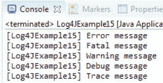

### 示例 16: 阈值过滤器

此示例演示了阈值过滤器的用法。我们设置滚动记录器（rolling appender）来接受 debug 级以上的日志消息。我们按照如下所示设置控制台记录器来接受 info 及以上的日志消息：


```xml
<?xml version="1.0" encoding="UTF-8"?>
<configuration>
  <Appenders>
    <Console name="STDOUT" target="SYSTEM_OUT">
      <ThresholdFilter level="INFO" onMatch="ACCEPT" onMismatch="DENY"/>
      <Pattern>%-5p %d{yyyy-MM-dd HH:mm:ss} [%t] %c{36} - %msg%n</Pattern>
    </Console>
    <RollingFile name="RollingFile" fileName="myapp.log" filePattern="myapp-%d{yyyy-MM-dd}.gz">
      <ThresholdFilter level="DEBUG" onMatch="ACCEPT" onMismatch="DENY"/>
      <Pattern>%-5p %d{yyyy-MM-dd HH:mm:ss} [%t] %c{36} - %msg%n</Pattern>
    </RollingFile>
  </Appenders>
  <Loggers>
    <Root level="TRACE">
      <AppenderRef ref="RollingFile"/>
      <AppenderRef ref="STDOUT"/>
    </Root>
  </Loggers>
</configuration>
```

# Java 类如下

```java
import org.apache.logging.log4j.LogManager;

public class Log4jExample6 {
    // 从 LogManager 获取日志器对象
    private static final Logger logger = Logger.getLogger(Log4jExample6.class);

    public static void main(String[] args) throws InterruptedException {
        // 添加日志语句
        logger.error("Error message");
        logger.fatal("Fatal message");
        logger.warn("Warning message");
        logger.info("Information message");

        // 这条消息不会在控制台中显示，因为它是
        // "DEBUG"
        // 滚动记录器是 DEBUG
        logger.debug("Debug message");

        // 这条消息不会在控制台或日志文件中显示
        // 因为两者的阈值都设置为了低于 trace
        logger.trace("Trace message");
    }
}
```

# Log4j 103

控制台输出是：

```
<terminated> Log4jExample6 C:\Program Files\java\jdk.0\bin\java.exe
ERROR 2017-09-12 13:34:25 [main] Log4jExample6 (Log4jExample6.java:12) - Error message
FATAL 2017-09-12 13:34:25 [main] Log4jExample6 (Log4jExample6.java:12) - Fatal message
WARN 2017-09-12 13:34:25 [main] Log4jExample6 (Log4jExample6.java:12) - Warning message
INFO 2017-09-12 13:34:25 [main] Log4jExample6 (Log4jExample6.java:12) - Information message
```

`debug` 消息不会显示，因为控制台设置的阈值为 `INFO`。

文件输出是：

```
myapp.log
2017-09-12 13:34:25 [main] ERROR Log4jExample6 - Error message
2017-09-12 13:34:25 [main] FATAL Log4jExample6 - Fatal message
2017-09-12 13:34:25 [main] WARN Log4jExample6 - Warning message
2017-09-12 13:34:25 [main] INFO Log4jExample6 - Information message
```

示例 17: 消息未记录，因为 appender 配置的 debug 级别。

以下类展示了如何使用 API 配置 log4j：

```java
import org.apache.log4j.Level;
import org.apache.log4j.core.PatternLayout;
import org.apache.log4j.core.config.layout.PatternLayoutComponent;
import org.apache.log4j.core.appender.ConsoleAppender.Component;
import org.apache.log4j.core.config.AppenderBuilder;
import org.apache.log4j.core.config.ConfigurationBuilder;
import org.apache.log4j.core.config.ConfigBuilderInitializationSupport;
import org.apache.log4j.core.config.HierarchyConfigurator;
import org.apache.log4j.core.config.ConfigBuilderFactory;
import org.apache.log4j.core.LoggerContext;
import org.apache.log4j.core.Logger;
import org.apache.log4j.core.config.Configurator;

public class Log4jExample17 {
    public static void main(String[] args) throws InterruptedException {
        ConfigurationBuilder<BuiltConfiguration> builder = ConfigBuilderFactory.newConfigurationBuilder();
        builder.configure();
        // 添加一个过滤掉低于 INFO 消息的过滤器
        builder.addFilter(builder.newFilter("ThresholdFilter", "filter", Filter.ACCEPT, Filter.DENY));
        // 使用 ConsoleAppenderBuilder 添加一个新的 appender
        AppenderComponentBuilder stdout = builder.newAppender("ConsoleAppender", "stdout")
            .add(builder.newLayout("PatternLayout", "layout"))
            .addAttribute(ConsoleAppender.TARGET, "target");
        // 设置 appender 的布局
        stdout.getLayout("layout").addAttribute("pattern", "[%d] %-5p %c - %m%n");
        // 将日志器添加到根日志
        builder.getRootLogger().add(Level.INFO).addAppender(stdout);
        // 初始化 Logger
        LoggerContext context = (LoggerContext)Configurator.configure(builder.build());
        Logger log = context.getLogger("");
        // 添加日志语句
        log.error("Error message");
        log.warn("Warning message");
        log.info("Information message");
        // 这条消息不会显示在控制台上，因为我们合理地将阈值设置为了 DEBUG
        log.debug("Debug message");
    }
}
```

## Java 中的 104 个日志框架

在这里，我们为应用程序配置了 log4j，使用了一个控制台输出器（`console appender`），其阈值过滤器设置为 `debug` 级别。

执行上述类后，日志配置完成，并将要记录到控制台的消息：

```
Console Markers Properties Servers Data Source Explorer
<terminated>Log4Example1 [Java Application] C:\Program Files\Java\jdk1.8.0_
2019-09-18 17:06:03,553 [main () ERROR: Error message
2019-09-18 17:06:03,553 [main () FATAL: Fatal message
2019-09-18 17:06:03,553 [main () WARN : Warning message
2019-09-18 17:06:03,553 [main () INFO : Information message
2019-09-18 17:06:03,553 [main () DEBUG: Debug message
```

## 示例 18：通过编程添加自定义 Logger

在此示例中，我们使用 log4j api 配置我们的程序以添加一个自定义日志器。

```
logExample18.java
import org.apache.log4j.*;
public class Example18 {
    public static void main(String[] args) throws InterruptedException {
        Configuration config = ConfigFactory.newConfiguration(new Configuration());
        config.setLevel(Level.DEBUG);
        config.setContext("MyConfig\n        // 使用 Appender 类添加一个新的 appender
        ConsoleAppender appender = new ConsoleAppender("console", "CONSOLE").addAttribute("target", Target.STDOUT);
        config.addAppender(appender);
        // 为 appender 添加布局
        appender.setLayout(new PatternLayout("%d [%t] %-5level %c - %m%n"));
        // 将 appender 添加到此日志器
        Logger logger = config.getLogger("com.logging.logger");
        logger.setLevel(Level.DEBUG);logger.addAppender(appender);
        logger.setParent(false);
        // 初始化上下文并记录消息
        LoggerContext ctx = LoggerContext.configure(config.build());
        Logger logger = ctx.getLogger("com.logging.logger");
        // 添加标准消息
        logger.info("Simple Information Message");
        logger.error("A simple Error Message");
        logger.warn("A simple warning message");
    }
}
```

如我们在上述类所示，我们向控制台添加了名为 `com.logging.logger` 的 logger，然后使用它来记录消息。

执行上述类生成的输出如下：

```
Console Properties Servers Data Source Explorer Snippets Annotation
<terminated>LogExample5 [Java Application] C:\Program Files\Java\jdk1.8.0_
2019-09-18 17:24:14,276 [main WARN ] Root logger was not configured, create default Root logger with Console appender
2019-09-18 17:24:14,253 [main (com.logging.logger)] INFO : Simple Information Message
2019-09-18 17:24:14,430 [main (com.logging.logger)] ERROR: A simple Error Message
2019-09-18 17:24:14,430 [main (com.logging.logger)] WARN : A simple warning message
```

由于没有配置 root logger，我们收到了一个警告消息，提示将创建一个默认 logger。

## Log4j 105

### 示例 19：多个 Loggers

在此示例中，我们通过编程方式配置 logger。我们创建了两个名为 `logging.my logger` 和 `logging.logging.Second Logger` 的 logger，并将它们添加到上下文中，同时使用它们来记录消息：

控制台输出如下：

```
Log4jExample19 [java] C:\Program Files\java\log4j-1.8.2\bin\log4jExample.exe
2019-09-18 17:25:52,185 [main] (logging.my logger) INFO : Another Information Message
2019-09-18 17:25:52,185 [main] (logging.my logger) INFO : Another Information Message
2019-09-18 17:25:52,200 [main] (logging.my logger) ERROR: Another Error Message
2019-09-18 17:25:52,200 [main] (logging.my logger) ERROR: Another Error Message
2019-09-18 17:25:52,200 [main] (logging.SecondLogger) WARN : A simple Warning Message
2019-09-18 17:25:52,200 [main] (logging.SecondLogger) WARN : A simple Warning Message
2019-09-18 17:25:52,200 [main] (logging.SecondLogger) FATAL: A simple Message
2019-09-18 17:25:52,200 [main] (logging.SecondLogger) FATAL: A simple Message
2019-09-18 17:25:52,200 [main] (logging.SecondLogger) FATAL: A simple Message
```

## 示例 20：通过编程加载配置文件

我们现在查看通过编程方式加载配置的方法。考虑位于 `c:\temp` 的配置文件：

## Java 中的 106 个日志框架

```xml
<?xml version="1.0" encoding="UTF-8"?>
<Configuration status="WARN">
  <Appenders>
    <Console name="consoleAppender" target="SYSTEM_OUT">
      <PatternLayout pattern="%-5level %d{yyyy-MM-dd HH:mm:ss} [%thread] %c - %msg%n"/>
    </Console>
  </Appenders>
  <Loggers>
    <Root level="trace">
      <Appender ref="consoleAppender" />
    </Root>
  </Loggers>
</Configuration>
```

为了从指定路径加载配置文件，我们使用了如下类：


```java
// Log4jExample.java
import java.io.*;
public class Log4jExample {
    public static void main(String[] args) throws InterruptedException, IOException {
        // 指定文件位置
        // 创建一个指定的 ConfigurationSource 对象
        ConfigurationSource source = new ConfigurationSource(new FileInputStream("C:\temp\log4j.xml"));
        // 使用 source 初始化日志上下文
        Configurator.initialize(source);
        
        // 获取 logger 对象
        Logger logger = LogManager.getLogger(Log4jExample.class);
        // 添加标准语句
        logger.error("Error message");
        logger.fatal("Fatal message");
        logger.warn("Warning message");
        logger.info("Information message");
        logger.debug("Debug message");
        logger.trace("Trace message");
    }
}
```

执行时，控制台输出如下：

```
Console Markers Properties Servers Explorer Snippets Annotations
<terminated>Log4jExample20 [Application] C:\Program Files\Java\jdk1.8.0_
2019\bin\log4j.exe - Error message
ERROR 2019-09-18 17:24:14,276 [main] Log4jExample20 (Log4jExample.java:27) - Error message
FATAL 2019-09-18 17:24:14,253 [main] Log4jExample20 (Log4jExample.java:28) - Fatal message
WARN 2019-09-18 17:24:14,430 [main] Log4jExample20 (Log4jExample.java:29) - Warning message
INFO 2019-09-18 17:24:14,430 [main] Log4jExample20 (Log4jExample.java:30) - Information message
DEBUG 2019-09-18 17:24:14,430 [main] Log4jExample20 (Log4jExample.java:31) - Debug message
TRACE 2019-09-18 17:24:14,430 [main] Log4jExample20 (Log4jExample.java:32) - Trace message
```

从我们提供的配置文件可以看出，它已经被我们的类实现并使用。

### 示例 21：HTML 输出

在此示例中，我们生成了一个 HTML 类型的文件输出。使用的配置如下：

## Log4j 107

```xml
<?xml version="1.0" encoding="UTF-8"?>
<Configuration status="WARN">
  <Appenders>
    <File name="fileAppender" fileName="log.html">
      <HTMLLayout charset="UTF-8" title="Log Information" locationInfo="true"/>
    </File>
  </Appenders>
  <Loggers>
    <Root level="trace">
      <Appender ref="fileAppender" />
    </Root>
  </Loggers>
</Configuration>
```

测试的 Java 类所示：

```java
import org.apache.logging.log4j.LogManager;
import org.apache.logging.log4j.Logger;

public class Log4jExample1 {

    // 获取 logger 对象
    private static final Logger logger = LogManager
        getLogger(Log4jExample1.class);

    public static void main(String[] args) throws InterruptedException {

        // 记录标准消息
        logger.trace("A trace message");
        logger.debug("A debug message");
        logger.error("An error message");
        logger.fatal("A fatal message");

    }
}
```

执行后，会创建一个名为 `log.html` 的文件。执行上述类生成的 HTML 输出如下：

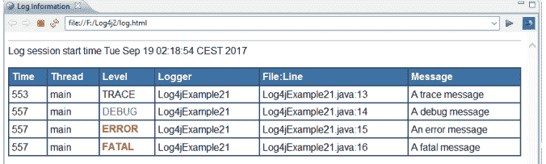

| Time | Thread | Level | Logger | File:Line | Message |
|---|---|---|---|---|---|
| 553 | main | TRACE | Log4jExample1 | Log4jExample1.java:13 | A trace message |
| 557 | main | DEBUG | Log4jExample1 | Log4jExample1.java:14 | A debug message |
| 557 | main | ERROR | Log4jExample1 | Log4jExample1.java:15 | An error message |
| 557 | main | FATAL | Log4jExample1 | Log4jExample1.java:16 | A fatal message |

## Java 日志框架

```java
import java.io.FileNotFoundException;
import java.io.IOException;

import org.apache.logging.log4j.Level;
import org.apache.logging.log4j.Logger;
import org.apache.logging.log4j.core.Config;
import org.apache.logging.log4j.core.AppenderBuilder;
import org.apache.logging.log4j.config.ConfigurationBuilder;
import org.apache.logging.log4j.config.ConfigurationBuilderFactory;
import org.apache.logging.log4j.config.Configuration;
import org.apache.logging.log4j.config.PatternLayoutFactory;
import org.apache.logging.log4j.config.Configurator;

public class MyLogger {
    public static void main(String[] args) throws FileNotFoundException
```

执行后，会生成一个名为 `myRollingFile.log` 的文件，其内容如下：

```
myRollingFile.log
2019-07-19 10:18:42,611 [main] : WARN : Warning message
2019-07-19 10:18:42,611 [main] : INFO : Information message
2019-07-19 10:18:42,611 [main] : DEBUG : Debug message
```

## 示例 23：JSON 布局

在这个示例中，我们配置布局以使用 JSON 布局为文件 appender 输出日志。为了配置此布局，我们需要在类路径中添加以下 jar：

- `jackson-core.jar`
- `jackson-databind.jar`

一旦将上述 jar 添加到类路径，我们按照如下方式配置项目：

```xml
<?xml version="1.0" encoding="UTF-8"?>
<configuration status="info">
  <Appenders>
    <File name="fileAppender" fileName="logs/myRollingFile.json">
      <JSONLayout />
    </File>
  </Appenders>
  <Loggers>
    <Root level="info">
      <Appender ref="fileAppender" />
    </Root>
  </Loggers>
</configuration>
```


## 测试的 java 类如下：

```java
// Log4jExample23.java
import org.apache.logging.log4j.LogManager;
import org.apache.logging.log4j.Logger;

public class Log4jExample23 {
    // 从 LogManager 获取 logger
    private static final Logger LOG = LogManager.getLogger(Log4jExample23.class);
    public static void main(String[] args) throws Exception {
        // 添加日志语句
        LOG.error("Error message");
        LOG.fatal("Fatal message");
        LOG.warn("warning message");
        LOG.info("Information message");
        LOG.debug("Debug message");
    }
}
```

执行后，我们得到的输出如下：

```json
myLogFile.json
{
  "timeMillis": 1508480542706,
  "thread": "main",
  "level": "ERROR",
  "loggerName": "Log4jExample23",
  "message": "Error message",
  "endOfBatch": false,
  "loggerq": "Org.apache.logging.log4j.spi.AbstractLogger",
  "threadId": 1,
  "threadPriority": 5
},
{
  "timeMillis": 1508480542716,
  "thread": "main",
  "level": "FATAL",
  "loggerName": "Log4jExample23",
  "message": "Fatal message",
  "endOfBatch": false,
  "loggerq": "Org.apache.logging.log4j.spi.AbstractLogger",
  "threadId": 1,
  "threadPriority": 5
},
{
  "timeMillis": 1508480542716,
  "thread": "main",
  "level": "WARN",
  "loggerName": "Log4jExample23",
  "message": "Warning message",
  "endOfBatch": false,
  "loggerq": "Org.apache.logging.log4j.spi.AbstractLogger",
  "threadId": 1,
  "threadPriority": 5
},
{
  "timeMillis": 1508480542716,
  "thread": "main",
  "level": "INFO",
  "loggerName": "Log4jExample23",
  "message": "Information message",
  "endOfBatch": false,
  "loggerq": "Org.apache.logging.log4j.spi.AbstractLogger",
  "threadId": 1,
  "threadPriority": 5
}
}
```

## 示例 24：CSV 布局

在这个示例中，我们看到如何以 CSV 格式输出日志。我们利用 CSV 布局来生成 CSV 风格的日志输出。为了使用它，我们需要在类路径中有 `apache-commons.jar`。一旦下载并将其添加到类路径中，我们使用下所示的布局配置滚动文件 appender，以 csv 格式输出日志：

```xml
<?xml version="1.0" encoding="UTF-8"?>
<configuration status="INFO">
  <Properties>
    <Property name="header">column1,column2</Property>
  </Properties>
  <Appenders>
    <RollingFile name="myCSVLog">
      <FilePattern>myCSVLog-%d{yyyy-MM-dd}.csv</FilePattern>
      <Policies>
        <TimeBasedTriggeringPolicy interval="1" modulate="true" />
        <SizeBasedTriggeringPolicy size="10 KB" />
      </Policies>
      <DefaultRolloverStrategy max="10" />
    </RollingFile>
  </Appenders>
  <Root level="INFO">
    <Appender ref="myCSVLog"/>
  </Root>
</configuration>
```

测试的 java 类如下：

```java
import org.apache.logging.log4j.LogManager;
import org.apache.logging.log4j.Logger;

public class Log4jExample24 {
    // 从 LogManager 获取 logger
    private static final Logger logger = LogManager.getLogger(Log4jExample24.class);

    public static void main(String[] args) throws InterruptedException {
        // 添加日志消息
        for (int i = 0; i < 4; i++) {
            logger.info("logging message", i);
        }

        for (int i = 0; i < 4; i++) {
            logger.info("Information Message", i);
        }
    }
}
```

执行上面的测试类，我们可以看到项目结构中创建了 csv 格式的文件，如下：

| | |
|---|---|
| 1 | column1,column2 |
| 2 | message 2 |
| 3 | message 3 |
| 4 | message 4 |
| 5 | message 5 |
| 6 | message 6 |

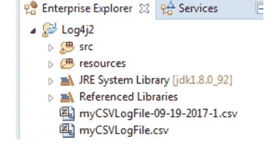

输出文件的片段如下：

## 示例 25：Failover 转移 appender

failover appender 是一种安全的 appender。我们可以向 failover appender 添加多个 appender。如果主 appender 崩溃或失败，将调用列表中的下一个 appender，如果它也失败，则调用下一个，依此类推。此过程一直持续到列表中没有剩下的 appender。该 appender 为现有的 appender 提供备份。

该 appender 的配置是简单的。我们以常规方式编写配置。这里 rolling file appender 和 console appender。为了提供安全，我们使用 `<FailOver>` 元素。在我们的配置中，此列表中提供了所有备份 appender。在实际应用中，这个列表会更长。

配置文件如下：


```xml
<?xml version="1.0" encoding="UTF-8"?>
<configuration status="WARN">
  <appender name="rollingFile" class="org.apache.logging.log4j.core.rolling.RollingFileAppender" fileName="logs/app.log" filePattern="logs/app-%d{yyyy-MM-dd}.log" ignoreExceptions="false">
    <patternLayout pattern="%d{yyyy-MM-dd} HH:mm:ss} [%t] %-5p %c:%L %L - %m%n"/>
  </appender>
  <appender name="console" class="org.apache.logging.log4j.ConsoleAppender">
    <patternLayout pattern="%msg%n"/>
  </appender>
  <failover name="failoverAppender" primary="rollingFile">
    <failovers>
      <appender ref="console"/>
    </failovers>
  </failover>
  <root>
    <level level="INFO">
      <appender ref="failoverAppender"/>
    </level>
  </root>
</configuration>
```

测试的 Java 类如下：


## Java 日志框架

```java
Log4jExample25.java
import org.apache.logging.log4j.LogManager;
public class Log4jExample25 {
    // 从 LogManager 获取 logger
    private static final Logger logger = LogManager.getLogger(Log4jExample25.class);
    public static void main(String[] args) throws InterruptedException {
        // 添加日志语句
        logger.error("Error message");
        logger.fatal("Fatal message");
        logger.warn("Warning message");
        logger.info("Info message");
    }
}
```

执行上述代码，会生成一个名为 `myFile.log` 的文件，内容如下：

```
myFile.log
ERROR [2017-09-19 18:11:00] - Error message
FATAL [2017-09-19 18:11:00] - Fatal message
WARN [2017-09-19 18:11:00] - Warning message
INFO [2017-09-19 18:11:00] - Information message
```

### 示例 26：使用虚拟机参数的 Log4j 配置

考虑以下 log4j 配置：

```xml
log4j.xml
<?xml version="1.0" encoding="UTF-8"?>
<configuration status="WARN">
  <Appenders>
    <Console name="console" target="SYSTEM.OUT">
      <Pattern layout="%d{HH:mm:ss.SSS} %-5level %logger{36} - %msg%n" />
    </Console>
  </Appenders>
  <Loggers>
    <Root level="debug">
      <Appender ref="console" />
    </Root>
  </Loggers>
</configuration>
```

它被放置在资源文件夹的临时文件夹位置。在这种情况下，我们将其放在 C 盘（`C:\TEMP`）。

我们使用以下 Java 类来实现日志功能：

```java
Log4jExample26.java
import org.apache.logging.log4j.LogManager;
public class Log4jExample26 {
    // 获取 logger
    private static final Logger logger = LogManager.getLogger(Log4jExample26.class);
    public static void main(String[] args) {
        // 日志消息
        logger.debug("Debug Message");
        logger.error("Error Message");
        logger.info("Info Message");
        logger.warn("Warning Message");
    }
}
```

# Log4j 113

要指定配置文件的位置，我们在虚拟机参数（vm arguments）中提供其位置，如下：


执行时，输出如下：

### 示例 27：参数化日志

在此示例中，我们演示了如何使用 log4j 进行参数化日志记录。

考虑以下配置文件：

```xml
<?xml version="1.0" encoding="UTF-8"?>
<Configuration status="WARN">
  <Appender name="consoleAppender" target="SYSTEM OUT">
    <Layout pattern="%d{HH:mm:ss} [%t] %-5level %logger{35} - %msg%n" />
  </Appender>
  <Loggers>
    <Root level="debug">
      <AppenderRef ref="consoleAppender" />
    </Root>
  </Loggers>
</Configuration>
```

# 114 Java 中的日志框架

考虑以下 Java 类：

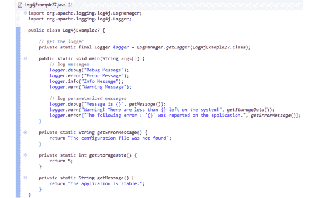

在上面的类中，我们使用了参数化日志消息，这些消息会在运行时调用静态方法并将占位符 `{}` 替换为静态方法返回的值。

执行该类生成的输出如下：

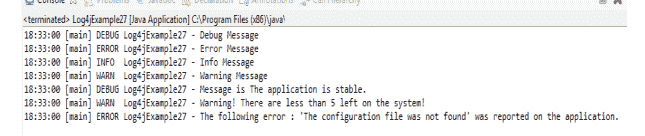

## 示例 28：使用 Lambda 表达式日志

在此示例中，我们利用 lambda 表达式来记录消息。

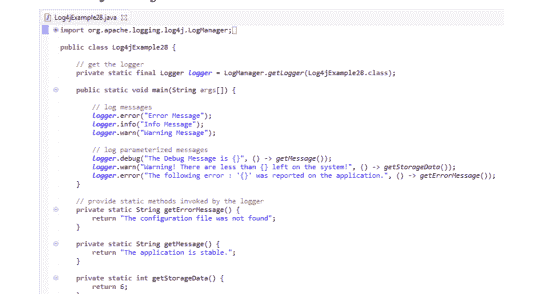

上面的类与上一个示例类似，但我们在日志语句使用了 lambda 表达式。

我们使用了下面简单的控制台输出器：

```xml
<?xml version="1.0" encoding="UTF-8"?>
<Configuration status="WARN">
  <Appenders>
    <Console name="consoleAppender" target="SYSTEM_OUT">
      <PatternLayout value="%d{HH:mm:ss} [%t] %-5level %logger{30} - %msg%n" />
    </Console>
  </Appenders>
  <Loggers level="debug">
    <AppenderRef ref="consoleAppender"/>
  </Loggers>
</Configuration>
```

执行该 Java 类后，生成的以下输出：

```
18:46:20 [main] ERROR Log4jexample20 - Error Message
18:46:20 [main] INFO Log4jexample20 - Info Message
18:46:20 [main] WARN Log4jexample20 - Warning Message
18:46:20 [main] INFO Log4jexample20 - The following message is stable.
18:46:20 [main] WARN Log4jexample20 - Warning! There are less than 6 left on the system!
18:46:20 [main] ERROR Log4jexample20 - The following error: 'The configuration file was not found' was reported on the application.
```

## 示例 29：结合接口 Lambda 表达式

在此示例中，我们结合 lambda 表达式和接口的使用来执行日志记录。

首先，我们在同一个包下创建了如下两个接口：

```java
Interface1.java
public interface Interface1 {

    public String infoMessage();
}
```

```java
Interface2.java
public interface Interface2 {

    public String warningMessage();
}
```

考虑以下文件：

## Java 中的日志框架

```xml
<?xml version="1.0" encoding="UTF-8"?>
<configuration status="WARN">
  <Appender>
    <Console name="consoleAppender" target="SYSTEM OUT">
      <PatternLayout pattern="%d{HH:mm:ss} [%thread] %-5level %logger{36} - %msg%n" />
    </Console>
  </Appender>
  <loggers>
    <Root level="debug">
      <Appender ref="consoleAppender" />
    </Root>
  </loggers>
</configuration>
```

该文件存在于资源文件夹中，所示：

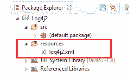

我们实现了一个简单的控制台输出器，如上面所示记录到控制台。

用于实现该功能的 Java 类如下：

```java
import org.apache.logging.log4j.LogManager;
import org.apache.logging.log4j.Logger;

public class Log4jExample29 {
    private static final Logger logger = LogManager.getLogger(Log4jExample29.class);

    public static void main(String[] args) {
        // 日志消息：
        logger.error("Error Message");
        logger.info("Info Message");
        logger.warn("Warning Message");

        // 提供方法的函数式实现
        // (interface1)
        Interface1 int1 = () -> {
            return "The Application";
        };

        // 提供方法的函数式实现
        // (interface2)
        Interface2 int2 = () -> {
            return "Warning!";
        };

        // 提供方法的函数式实现
        // (interface3)
        Interface3 int3 = () -> {
            return "The following message is stable.";
        };

        // 使用接口记录
        logger.info(int1.infoMessage());
        logger.warn(int2.warningMessage());
        logger.info(int3.infoMessage());
        logger.warn("There are less than 6 left on the system!");
        logger.error("The configuration file was not found");
    }
}
```

## Logback 121

Logback 框架提供了配置文件的自动重载功能。一旦文件发生更改，它就会自动重新加载。它使用扫描过程来扫描配置文件。这种机制在处理大量并行执行线程时极快、动态且具有可扩展性，并且没有竞争问题。此外，它不会为了扫描目的而使用另一个独立的线程，从而节省了内存。

Logback 在 I/O 方面具有强大的故障恢复系统。`File Appender` 及其所有子类都能够在不引入额外开销的情况下处理 I/O 失败。如果某个文件停止工作一段时间，不再需要重启系统即可继续记录日志。一旦服务器开始运行，appender 将快速从错误中恢复并继续工作。

Logback 框架提供的另一个有趣特性是，它现在提供了 API 来自动处理归档日志的移除/删除。滚动 appender（rolling appenders）提供了一个 `maxHistory` 属性，表示可以保留的最大存档日志记录数。例如，如果我们设置了按月滚动策略并希望删除超过一年的日志，可以将此属性设置为 12。这将自动删除超过 12 个月的日志记录。该属性的解释见第 4.6 节。

Logback 还具有在滚动文件 appender（rolling file appender）文件翻滚时对归档日志进行压缩的能力。此事件是一个异步事件，因此在压缩文件期间不会挂起应用程序。

Logback 框架支持由运行在多个 JVM 上的多个 `File Appender` 写入单个文件。这是通过谨慎方法（prudent method）实现的。

Logback Lilith 是一个用于 logback 的日志和访问事件查看。它能够处理大量的日志记录。

Logback 提供的另一个吸引特性是，它允许我们根据某些条件仅执行配置的一部分。例如，在软件开发生命周期中，开发者使用不同的环境，如开发、测试、预生产和生产。尽管这些文件有许多共同属性，但我们通常必须为每个环境创建单独配置文件。但 Logback 并非如此。Logback 通过支持条件运算符防止代码重复，例如 `<if>`、`<then>` 和 `<else>`。这些元素减少了冗余，允许多个开发环境使用同一个配置文件。

与其他日志框架相比，Logback 具有更高级的过滤机制。它允许基于用户进行过滤。想象一个部署在服务器上的应用程序。为了避免产生大量的日志记录，日志级别被设置为 'WARN' 或 'ERROR'。但如果某天生产环境出现问题，或者服务器位于远程位置，我们需要将级别设置为 DEBUG 来分析问题，这将产生大量的日志。

但在 logback 中，可以通过用户级过滤来避免这种情况。Logback 为我们提供了一个选项，可以为特定用户（分析问题的用户）之外的所有用户保持原始日志级别，该用户可以比其他人看到更详细层次的日志。因此，当该特定用户登录时，他将生成 debug 日志，而所有其他用户处于 ERROR 或 WARN 级别。这可以通过 `MDC Filter` 实现，该内容在本书范围内未进行讨论。

Logback 自带了一个出色的 appender，即 shifting appender。该 appender 可以根据运行时任何属性过滤/移动日志信息。例如，此 appender 可以根据用户登录/会话分离日志并为每个用户生成日志文件。这可以通过环境和许多其他运行时参数来实现，这些参数使得 logback 变得强大。

logback 的另一个有用特性是，当发生异常时，日志中不仅会打印堆栈跟踪，还会打印包数据。

这意味着 logback 将打印应用程序使用的包，如 hibernate、spring 等。这让用户知道是哪个类生成了异常，以及该类使用了哪个包以及该包的哪个版本。例如，如果你正在使用 spring boot 3.2.2，这些信息将出现在堆栈跟踪中。因此，开发人员的工作变得异常简单，因为现在他们不需要向客户获取额外信息。

logback 家族为我们提供了另一个智能模块，称为 logback-access。该模块是 logback 包的一部分，它集成了 Tomcat、Jetty 等 servlet 容器，从而提供了 http 访问。

## 4.2. 架构

Logback 的架构与 log4j 类似。它由三部分组成：

- `logback-core`：核心模块是 logback-classic 和 logback-access 的基础。


- **logback-classic**: 该模块扩展了核心并提供了主要的框架实现。
- **logback-access**: 该模块扩展了核心并提供了 HTTP 访问功能。

## 4.3 logback 组件

与 log4j 和 java util logging 类似，logback 的主要组件如下：

- Logger
- Appender
- Level
- Layout

### Loggers

如前所述，logger 是日志框架的核心组件之一。它们存储并捕获日志数据。Logback 有一个 `Logger` 类来执行此功能。该类存在 `logback-classic` 模块中。与 log4j 类似，logback 中的 logger 是命名实体。它们遵循相同的命名层次。每个 logger 都有一个 `Logger Context` 来提供 logger 并按照层次结构进行排列。根 logger 位于树的顶部。

### Appenders

此组件帮助将日志消息发布到目标位置。在 logback 中，`Appender` 类执行此功能。appender 类是 `logback-core` 模块的一部分。

logger 将打印日志信息的工作委托给 appender。logger 通过在日志事件上调用 `doAppend()` 方法来实现。该方法将日志发布到请求的目标位置。

## 126 Java 中的日志框架

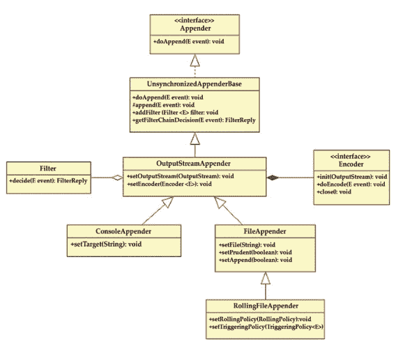

图 4.1: OutputStream Appender (Gülcü and Pennec, 2011)。

我们简要查看 Console（控制台）、File（文件）和 Rolling File（滚动文件）Appenders。

1. **Console Appender**：这是最常用的 Appender 之一，用于在控制台上打印/显示日志消息。它们在 `system.out` 或 `system.err` 上输出日志信息。
2. **File Appender**：这也是一种广为人知的 Appender，用于将日志信息写入文件。logback 提供了多种命名、格式化以及控制向文件记录日志的方式。
3. **Rolling File Appender**（滚动文件 Appender）：它是 `File Appender` 类的子类，增加了文件滚动（rolling over）的功能。此 Appender 有两个名为 `Rolling Policy`（滚动策略）和 `Triggering Policy`（触发策略）的子组件。滚动策略决定文件滚动的方式，例如名称模式、大小等。触发策略则定义了滚动发生的确切时间，例如每天、每周等。此 Appender 必须同时实现这两个策略。但某些滚动策略在内部也实现了触发策略，因此不需要额外指定触发策略组件。一些常用的滚动策略和触发策略如下：

**Time-Based Rolling Policy**（基于时间的滚动策略）：该策略根据时间定义日志文件的滚动，并在内部也实现了基于时间的触发策略。除了几种文件名模式外，该策略还具有对文件进行压缩的能力。

**Fixes Window Based Rolling Policy**（固定窗口滚动策略）：该策略根据固定窗口大小滚动文件，并接收最大和最小窗口大小。这意味着如果一个窗口的最大值为 10，文件将滚动 10 次，一旦达到此限制，最旧的文件将被逐个删除。该策略没有实现触发策略，但它通常与接下来讨论的 `SizeBasedTriggeringPolicy`（基于大小的触发策略）一起使用。

**Size Based Triggering Policy**（基于大小的触发策略）：该策略根据文件大小触发文件滚动。

**Size and Time-Based Rolling Policy**（基于大小和时间的滚动策略）：该策略提供了基于大小和时间的滚动文件功能。该策略在内部实现了一个触发策略。

以下提供了一些名称模式及其描述：

现在我们继续查看 `logback-classic` 模块提供的 appenders。

- **Async Appender**（异步 Appender）：此 Appender 用于异步方式执行日志记录。使用阻塞队列来池化/保存日志事件。这增加了处理时间。在默认情况下，如果队列填充了 80%，此 Appender 会丢弃 trace、info 和 debug 级别的日志。
- **Socket Appender**（套接字 Appender）：此 Appender 用于通过序列化的访问事件将事件记录到远程位置。

## 128 Java 中的日志框架

- **SSL Socket Appender**：此 Appender 是 `Socket Appender` 的子类，允许通过安全套接层 (SSL) 连接进行日志记录。
- **SSL Server Appender**：此 Appender 与 `Socket Appender` 完全相同，不同之处在于此处 Appender 像一个真实的服务器，监听套接字 (TCP) 并等待连接。
- **SMTP Appender**：此 Appender 将日志事件存放在缓冲区，并在事件发生后通过电子邮件发送日志信息。这种发送是异步进行的。此 Appender 还可以配置为发送电子邮件到您的 Gmail 账户。
- **Sifting Appender**（筛选 Appender）：此 Appender 用于根据某些属性分离或筛选日志事件 (Gülcü and Pennec, 2011)。一个简单的例子是根据用户会话分离日志文件。可以使用此 Appender 检查用户 id，然后根据该 id 为每个用户生成日志文件。另一个例子是根据当前线程生成不同的文件。这对于产生大量日志的大型多线程应用程序可能非常有用。基于线程名称进行分离是简化监控过程的一种有效方法。
- **DB Appender**（数据库 Appender）：此 Appender 用于将日志事件插入数据库表。此 Appender 能够以独立于 Java 语言的方式存储日志数据。

### 3. 级别 (Levels)

正如我们在前面的章节中看到的，loggers 和 appenders 可以根据它们的优先级分配级别。Logback 支持以下级别（按重要性递增排序）：TRACE、DEBUG、INFO、WARN 和 ERROR。Logback 有一个名为 `Level` 的类（final 类）处理级别。在 logback 中，`Level` 类存在于 `logback classic` 模块中。

如果没有为 logger 指定级别，它将继承层级中第一个具有非空级别的 logger 的级别。如果层级结构中所有 logger 的级别值为空，则该 logger 继承根 logger（root logger）的日志级别。根 logger 的默认日志级别是 debug。

### 4. 布局 (Layouts)

在 logback 中，layouts 类似于 log4j 和 java util.logging 中的 formatter。

它们是用于将传入的日志事件/消息转换为可表示的字符串格式的组件。`logback-core` 模块中存在核心基础布局组件。但具体的布局类（如 `Pattern Layout` 等）存在于 `logback-classic` 包中，并且它们继承自该基础布局组件。logback 提供了多种可能的布局类。通过调用 `layout()` 方法可以将布局应用到事件上。

布局的工作原理如下：


上述组件共同工作，根据级别、类型和目的地启用日志记录。

### 5. 过滤器 (Filters)

过滤器用于过滤日志消息。它们决定哪些日志消息传递给 appender 或 logger。过滤器存在于 `logback-classic` 模块，但基类存在于 core 模块。Logback 有基于三值逻辑的不同过滤器：

#### a. 常规过滤器 (Regular Filters)

这些是 logback 提供的标准过滤器。所有的过滤器都继承自基类，包含一个 `decide()` 方法，决定日志消息是否被接受或拒绝。它们基于三值逻辑，并存储在有序列表中。根据 `decide()` 方法的结果，过滤器接受或拒绝日志消息。

过滤器的工作如图所示：


LOGGER/APPENDER 过滤器可能的响应 | 根据响应采取的行动

过滤器有一个接受 `Logging Event` 类型作为参数的 `decide()` 方法。该方法返回三个可能的枚举值：ACCEPT、DENY 或 NEUTRAL。如果消息是 DENY，则日志消息被拒绝，不再考虑剩余的过滤器。如果消息是 NEUTRAL，则控制权传递给下一个过滤器并检查其响应，此类推。如果过滤器列表耗尽并到达末尾，则正常处理日志事件。

logback 中的一些可用过滤器如下：

- **Threshold Filter**（阈值过滤器）：此过滤器过滤低于指定阈值级别的日志事件。所有该特定阈值级别及以上的事件。
- **Level Filter**（级别过滤器）：此过滤器根据优先的精确匹配过滤日志事件。
- **Evaluator Filter**（评估器过滤器）：这是一个抽象过滤器类，它有一个事件评估器。事件评估器评估给定的标准并检查其是否满足。根据结果（匹配/不匹配），它返回 Match/on Mismatch 属性指定的值。
- **Counting Filter**（计数过滤器）：此过滤器用于获取应用程序访问远程 Web 服务器的统计数据。例如每天、每周、每月等平均花费时间。
- **Duplicate Message Filter**（重复消息过滤器）：此过滤器用于分离重复日志消息。它检测重复的日志消息，如果它们重复超过固定次数，则丢弃日志消息。

## Logback 131

- **GE Event Evaluator Filter**（GE 事件评估器过滤器）：这是一个具体类，它使用 Groovy 语言编写的布尔表达式作为评估标准。
- **Janino Event Evaluator Filter**（Janino 事件评估器过滤器）：这是一个具体的过滤器，它接受一个返回布尔值的 Java 代码块作为评估标准。

#### b. Turbo 过滤器（Turbo Filters）

Turbo 过滤器与普通过滤器有所不同。所有过滤器的对象都继承自抽象类 `TurboFilter`。Turbo 过滤器的工作方式与普通过滤器类似，同样使用三元逻辑来对标准进行评估。

它们在上下文方面与普通过滤器不同。除了被应用器（appender）或日志记录器（logger）调用外，这些过滤器在每次日志事件启动时都会被调用，这使得它们的范围比普通过滤器更广。普通过滤器与 Turbo 过滤器之间的另一个区别是，执行过滤不需要创建或实例化日志事件。因此，这些过滤器通常用于在日志事件创建之前对日志进行快速的过滤（Gülcü and Pennec, 2011）。

### 6. 编码器（Encoders）

编码器是在 logback 的 0.9.19 版本中引入的。编码器用于将日志事件更改或格式化为字节数组格式。使用编码器，一旦日志信息转换为字节数组，就可以进一步写入输出流。

在引入编码器之前，应用器（appenders）使用布局（layouts）来格式化日志信息。但从该版本开始，文件应用器（File Appender）及其所有子类都使用编码器代替布局。引入这一变化的原因是编码器对日志事件的格式化具有更好的控制力，这使得它们变得非常有用。该功能由 logback 中的 `Encoder` 接口提供，其基类存在于 `logback-core` 中，而实现类存在于 `logback-classic` 模块中。

应用器配置编码器的方式与其配置布局和过滤器的方式一样。`Encoder` 接口有一个 `doEncode()` 方法，它每当应用器被调用时就会被调用一次。

## 132 Java 日志框架

Logback 拥有以下两个编码器：

- **Layout Encoder**（布局编码器）：此编码器基本上是一个适配器，用于连接编码器和布局，以便它们协同工作。该类实现了 `Encoder` 接口，并额外封装了一个布局，将输入事件转换为字符串格式。
- **Pattern Layout Encoder**（模式布局编码器）：这是针对 `Pattern Layout` 布局的 `Layout Encoder` 实现，该布局是最常用的布局之一。它封装了 `Pattern Layout` 类的实例（Logback-Parent 1.2.3 API, 2017）。

既然我们已经有了 logback 的基本组件，我们将开始详细查看 logback 包所提供的一些重要 API。

# 4.4 LOGBACK API

## Logger 类

`Logger` 类：存在于 `logback classic` 包中。

表 4.1：Logger 类方法（Logback-Parent 1.2.3. API, 2017）

| 方法 | 描述 |
|---|---|
| `void addAppender(Appender<ILoggingEvent>)` | 此方法向日志记录器添加一个应用器。 |
| `void detach(Appender<ILoggingEvent> append)` | 此方法从日志记录器的应用器列表中分离作为参数的应用器。 |
| `void callAppenders(ILoggingEvent event)` | 此方法调用此日志记录器声明的所有应用器。 |
| `void detachApp(String name)` | 此方法从日志记录器中分离具有指定名称参数的应用器。 |
| `void detachAndStopAllAppenders()` | 此方法分离日志记录器的所有应用器。 |
| `Appender<ILoggingEvent> getAppender(String name)` | 此方法返回指定名称的应用器。 |
| `void debug(String message)` | 此方法记录级别为 debug 的消息。 |
| `void error(String message)` | 此方法记录级别为 error 的消息。 |
| `void info(String message)` | 此方法记录级别为 info 的消息。 |
| `void warn(String message)` | 此方法记录级别为 warning 的消息。 |
| `void trace(String message)` | 此方法记录级别为 trace 的消息。 |
| `void debug(String message, Throwable t)` | 此方法记录级别为 debug 的消息，并打印可抛参数 `t` 的堆栈跟踪。 |
| `void info(String message, Throwable t)` | 此方法记录级别为 info 的消息，并打印可抛参数 `t` 的堆栈跟踪。 |
| `void warn(String message, Throwable t)` | 此方法记录级别为 warn 的消息，并打印可抛参数 `t` 的堆栈跟踪。 |
| `void error(String message, Throwable t)` | 此方法记录级别为 error 的消息，并打印可抛参数 `t` 的堆栈跟踪。 |
| `void trace(String message, Throwable t)` | 此方法记录级别为 trace 的消息，并打印可抛参数 `t` 的堆栈跟踪。 |
| `Level getLevel()` | 此方法返回有效的日志记录级别。 |
| `void setLevel(Level level)` | 此方法将日志记录器级别设置为参数所指定的级别。 |
| `LoggerContext getContext()` | 此方法返回日志记录器的上下文。 |

## Appender（应用器）

### 1. Appender 接口

该接口提供了抽象方法，logback 包中所有的应用器类都实现了这些方法。

**表 4.2：** Appender 接口方法（Logback-Parent 1.2.3 API, 2017）

| 方法 | 描述 |
|---|---|
| `void doAppend(Event event)` | 此抽象方法执行事件的任务。 |
| `String getName()` | 此方法返回名称。 |
| `void setName(String name)` | 此方法设置名称。 |

### 2. Appender Base

此类实现了 `Appender` 接口，并为派生的应用器类（如 `ConsoleAppender`、`FileAppender` 等）提供了框架。除了实现 `Appender` 接口的所有方法外，它还提供了以下有用方法：

表 4.3：Appender Base 方法（1.2.3, 2017）

| 方法 | 描述 |
|---|---|
| `void append()` | 此方法向目标写入消息。 |
| `void addFilter(Filter<E> filter)` | 此方法向应用器添加指定的过滤器。 |
| `String getName()` | 此方法返回名称。 |
| `abstract void append(E event)` | 此方法可由子类重写以提供特定的行为。 |
| `void clearAllFilters()` | 此方法清除所有过滤器。 |

### 3. Unsynchronized Appender Base（非同步应用器基）

该类与 `Appender Base` 相似。它在同步方面与其不同。为了性能考虑，它不使用同步块。

表 4.4：Unsynchronized Appender Base 方法（1.2.3, 2017）

| 方法 | 描述 |
|---|---|
| `void append()` | 此方法向目标写入消息。 |
| `void addFilter(Filter<E> filter)` | 此方法向应用器添加指定的过滤器。 |
| `String getName()` | 此方法返回名称。 |
| `abstract void append(E event)` | 此方法可由子类重写以提供特定的行为。 |


### 4. Layout（布局）

`Layout` 接口存在于 `logback-core` 包中，由 logback 包中所有的具体的布局类实现方法。

该类的一些重要方法如下：

**表 4.5：Layout 接口方法（Logback-Parent 1.2.3 API, 2017）**

| 方法 | 描述 |
| :--- | :--- |
| `String doLayout(E event)` | 此方法接受事件作为输入并将其转换为可表示的字符串格式。 |
| `String getContentType()` | 此方法返回日志信息的内容类型。 |
| `String getFooter()` | 此方法返回当前布局的页脚。 |
| `String getHeader()` | 此方法返回当前布局的头部。 |
| `String getFooter()` | 此方法返回格式化日志事件的页脚。 |
| `String getHeader()` | 此方法返回格式化日志事件的头部。 |

### 5. Layout Base 类（布局基类）

该类实现了 `Layout` 接口，并为派生的布局类（如 Pattern Layout、HTML Layout 等）提供了框架。除了实现 `Layout` 接口的所有方法外，它还提供了以下有用方法：

**表 4.6：Layout Base 类方法（Logback-Parent 1.2.3 API, 2017）**

| 方法 | 描述 |
| :--- | :--- |
| `void setFileFooter(String footer)` | 此方法设置当前布局的文件页脚。 |
| `void setFileHeader(String header)` | 此方法设置当前布局的文件头部。 |
| `void setPresentationFooter(String footer)` | 此方法设置当前日志事件的演示页脚。 |
| `void setPresentationHeader(String header)` | 此方法用于设置当前日志事件的头部。 |

### 6. 编码器 (Encoders)

编码器接口提供了所有派生编码器类的实现，例如模式布局编码器（Pattern Layout Encoder）和布局包装编码器（Layout Wrapping Encoder）。

**表 4.7：Encoder 接口方法 (Logback-Parent 1.2.3 API, 2017)**

| 方法 | 说明 |
| :--- | :--- |
| `byte[] encode(E event)` | 此方法将日志事件编码为字节数组。 |
| `byte[] footerBytes()` | 此方法返回编码后事件页脚包含的字节内容。 |
| `byte[] headerBytes()` | 此方法返回编码后事件头部包含的字节内容。 |

## 4.5 配置 (CONFIGURATION)

Logback 在 LGPL 和 EPL 双重许可下发布。

与 log4j 和 java util logging 类似，logback 的配置是通过配置文件完成的。该文件命名为 `logback-test.xml` 或 `logback.xml`。

但是，如果没有提供文件，它将按照顺序查找以下三个文件：

- `logback.xml`
- `logback.groovy`
- `logback.xml`

如果没有找到任何文件，它仍然允许你将日志添加到应用程序中。它会默认使用基础配置器（Basic Configurator）。该配置会将日志输出到控制台。

若要在 Eclipse 项目中使用 logback，你的项目的类路径上必须存在 `slf4j`、`logback-core` 和 `logback-classic` 包（jar 文件）。可以在以下位置下载 `logback-core` 和 `logback-classic` jar 包：

https://logback.qos.ch/download.html

下载 zip 文件并解压文件内容。要下载 sjf4j 文件，需要从以下另一个位置下载：

https://www.slf4j.org/download.html

现在我们将这些文件添加到 Java 项目中。

这些文件可以通过以下方式添加到你的项目：

在项目上右键点击并点击“配置构建路径”（configure build path）。将显示以下窗口：

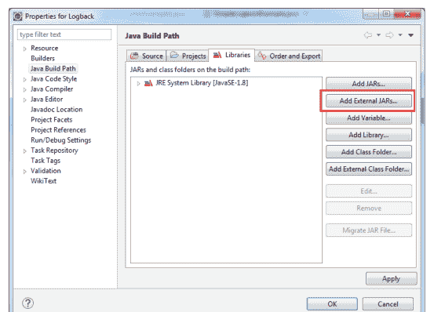

点击“添加外部 JAR”（Add External JARs）。选择包含 jar 的路径并点击确定。

现在我们将看到一个简单的示例，演示如何在不使用配置文件的情况下使用 logback。

一旦添加了 jar 文件，我们创建如下 Java 类：

```java
package com.java.logback.examples;

// 导入 slf4j logger 和 LoggerFactory
import org.slf4j.Logger;
import org.slf4j.LoggerFactory;

public class LogbackExample {

    // 获取 logger 对象
    Logger logger = LoggerFactory.getLogger(LogbackExample.class);

    // 记录消息
    logger.info("An Information Message");
    logger.debug("A Debug Message");
    logger.warn("A Warning Message");

}
```

生成的输出如下：

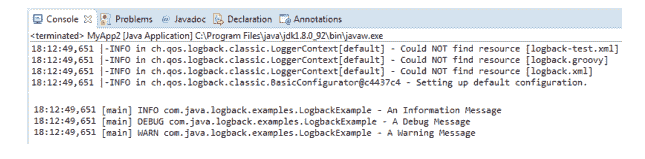

带有 `logback.xml` 文件的配置如下：

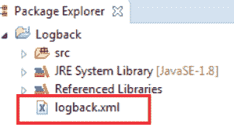

该配置文件的内容如下：

```xml
<?xml version="1.0" encoding="UTF-8"?>
<configuration>
  <appender name="ConsoleAppender" class="ch.qos.logback.core.ConsoleAppender">
    <encoder>
      <pattern>%d{HH:mm:ss.SSS} [%thread] %-5level %logger{36} - %msg%n</pattern>
    </encoder>
  </appender>
  <root level="info">
    <appender-ref ref="ConsoleAppender" />
  </root>
</configuration>
```

我们编写了一个简单的 Java 类，来实现日志功能：

```java
package com.java.logback.example;

// 导入 slf4j Logger 和 LoggerFactory
import org.slf4j.Logger;
import org.slf4j.LoggerFactory;

public class SimpleLogbackExample {

  // 获取 logger 对象
  Logger logger = LoggerFactory.getLogger(SimpleLogbackExample.class);

  // 记录消息
  logger.info("An Information Message");
  logger.debug("A Debug Message");

}
```

输出结果：

```
<terminated>SimpleLogbackExample[java] C:\Program Files\Java\jre1.8.0_101\bin\java.exe
18:01:38.527 [main] INFO com.logback.examples.SimpleLogbackExample - An Information Message
18:01:38.527 [main] DEBUG com.logback.examples.simple.simpleLogbackExample - A Debug Message
```

我们现在来看演示使用 logback API 的示例。

## 4.6 示例 (EXAMPLES)

### 示例 1：带有日期和时间的简单控制台输出器

在这个示例中，我们实现了一个简单的控制台输出器，它带有带有日期和时间输出日志。

```xml
<?xml version="1.0" encoding="UTF-8"?>
<configuration>
  <appender name="ConsoleAppender" class="ch.qos.logback.core.ConsoleAppender">
    <encoder>
      <pattern>%d{HH:mm:ss.SSS} [%thread] %-5level %logger{36} - %msg%n</pattern>
    </encoder>
  </appender>
  <root level="info">
    <appender-ref ref="ConsoleAppender" />
  </root>
</configuration>
```

`Logback1.java` 的内容如下：

```java
package com.java.logback.examples;

import org.slf4j.Logger;
import org.slf4j.LoggerFactory;

public class Logback1 {
    public static void main(String[] args) {
        // 获取 logger 对象
        Logger logger = LoggerFactory.getLogger(Logback1.class);

        // 记录消息
        logger.info("An Information Message");
        logger.debug("A Debug Message");
        logger.warn("A Warning Message");
    }
}
```

### 示例 2：简单文件输出器

在这个示例中，我们实现了一个简单的文件输出器，将日志输出到文件中。

```xml
<?xml version="1.0" encoding="UTF-8"?>
<configuration>
  <appender name="FileAppender" class="ch.qos.logback.core.FileAppender">
    <encoder>
      <pattern>%d{HH:mm:ss.SSS} [%thread] %-5level %logger{36} - %msg%n</pattern>
    </encoder>
  </appender>
  <root level="info">
    <appender-ref ref="FileAppender" />
  </root>
</configuration>
```

### 示例 3：多个输出器

在这个示例中，我们配置应用程序使用多个输出器。我们定义了两个输出器：控制台和文件。

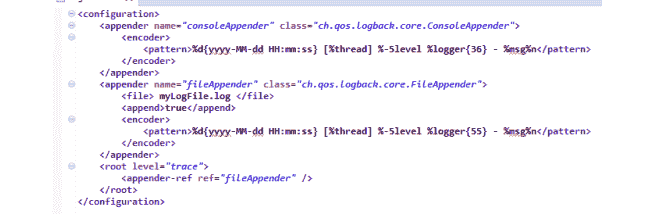

`Example3.java` 类如下：

```java
package com.java.logback.examples;

import org.slf4j.Logger;
import org.slf4j.LoggerFactory;

public class Logback3 {

    public static void main(String[] args) {
        // 获取 logger
        Logger logger = LoggerFactory.getLogger(Logback3.class);

        logger.info("An Information Message");
        logger.debug("A Debug Message");
        logger.warn("A Warning Message");
        logger.error("An Error Message");

        // 引起异常并记录它
        int a = 0, b = 0;
        try {
            int c = a / b;
        } catch (Exception e) {
            logger.error("You cannot divide by zero!");
        }
    }
}
```

控制台输出如下：

```
2017-09-12 19:11:51 [main] INFO  com.java.logback.examples.Logback3 - An Information Message
2017-09-12 19:11:51 [main] DEBUG com.java.logback.examples.Logback3 - A Debug Message
2017-09-12 19:11:51 [main] WARN  com.java.logback.examples.Logback3 - A Warning Message
2017-09-12 19:11:51 [main] ERROR com.java.logback.examples.Logback3 - An Error Message
2017-09-12 19:11:51 [main] ERROR com.java.logback.examples.Logback3 - You cannot divide by zero!
```

输出文件为：

### 示例 4：基于时间的滚动文件 Appender（Rolling File Appender）

在此示例中，我们实现了一个根据时间进行滚动的滚动文件 Appender。

```
myLogFile.log
2017-09-26 19:16:51 [main] INFO com.java.logback.examples.LogbackExample - An Information Message
2017-09-26 19:16:51 [main] DEBUG com.java.logback.examples.LogbackExample - A Debug Message
2017-09-26 19:16:51 [main] WARN com.java.logback.examples.LogbackExample - A Warning Message
2017-09-26 19:16:51 [main] ERROR com.java.logback.examples.LogbackExample - An Error Message
2017-09-26 19:16:51 [main] ERROR com.java.logback.examples.LogbackExample - You cannot divide by zero!
```

```xml
<?xml version="1.0" encoding="UTF-8"?>
<configuration>
  <appender name="rollingFileAppender">
    <class class="ch.qos.logback.core.rolling.RollingFileAppender">
      <file>myLogFile.log</file>
      <rollingPolicy class="ch.qos.logback.core.rolling.TimeBasedRollingPolicy">
        <fileNamePattern>myLogFile.%d{yyyy-MM-dd}.log</fileNamePattern>
        <maxHistory>30</maxHistory>
      </rollingPolicy>
    <encoder>
      <pattern>%d{yyyy-MM-dd HH:mm:ss} [%thread] %-5level %logger{36} - %msg%n</pattern>
    </encoder>
  </appender>
  <root level="trace">
    <appender-ref ref="rollingFileAppender" />
  </root>
</configuration>
```

用于测试配置的 Java 类如下：


# Logback 示例

## 示例 4：基于时间的滚动文件 Appender

```java
// LogbackExample4.java
package com.java.logback.examples;
import org.slf4j.Logger;
import org.slf4j.LoggerFactory;

public class LogbackExample4 {
    public static void main(String[] args) {
        // 获取 logger 对象
        Logger logger = LoggerFactory.getLogger(LogbackExample4.class);
        // 记录消息
        logger.info("An Information Message: " + i);
        logger.debug("A Debug Message");
        logger.warn("A Warning Message");
        logger.error("An Error Message");

        for (int i = 0; i < 25; i++) {
            logger.info("Information Log Message: " + i);
            // 添加休眠语句增加延迟
            // 这将会每一个输出日志文件
            try {
                Thread.sleep(5000);
            } catch (final InterruptedException e) {
                logger.error("An exception occurred during processing", e);
            }
        }
    }
}
```

执行上述类后，在项目树中生成了以下日志文件：

### Logback 143

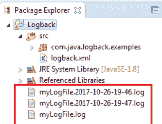

该文件的内容如下：

| Date | Time | Level | Logger | Message |
|---|---|---|---|---|
| 2017-09-27 13:51:03 | main | INFO | com.java.logback.examples.logbackExample - Information Message: 9 |
| 2017-09-27 13:51:08 | main | INFO | com.java.logback.examples.logbackExample - Information Message: 10 |
| 2017-09-27 13:51:13 | main | INFO | com.java.logback.examples.logbackExample - Information Message: 11 |
| 2017-09-27 13:51:18 | main | INFO | com.java.logback.examples.logbackExample - Information Message: 12 |
| 2017-09-27 13:51:23 | main | INFO | com.java.logback.examples.logbackExample - Information Message: 13 |
| 2017-09-27 13:51:28 | main | INFO | com.java.logback.examples.logbackExample - Information Message: 14 |
| 2017-09-27 13:51:33 | main | INFO | com.java.logback.examples.logbackExample - Information Message: 15 |
| 2017-09-27 13:51:38 | main | INFO | com.java.logback.examples.logbackExample - Information Message: 16 |
| 2017-09-27 13:51:43 | main | INFO | com.java.logback.examples.logbackExample - Information Message: 17 |
| 2017-09-27 13:51:48 | main | INFO | com.java.logback.examples.logbackExample - Information Message: 18 |
| 2017-09-27 13:51:53 | main | INFO | com.java.logback.examples.logbackExample - Information Message: 19 |
| 2017-09-27 13:51:58 | main | INFO | com.java.logback.examples.logbackExample - Information Message: 20 |
| Date | Time | Level | Logger | Message |
|---|---|---|---|---|
| 2017-09-27 13:52:03 | main | INFO | com.java.logback.examples.logbackExample - Information Message: 21 |
| 2017-09-27 13:52:08 | main | INFO | com.java.logback.examples.logbackExample - Information Message: 22 |
| 2017-09-27 13:52:13 | main | INFO | com.java.logback.examples.logbackExample - Information Message: 23 |
| 2017-09-27 13:52:18 | main | INFO | com.java.logback.examples.logbackExample - Information Message: 24 |

## 示例 5：基于窗口大小的滚动文件 Appender

在此示例中，我们实现了一个根据固定窗口大小进行滚动的滚动文件 Appender。

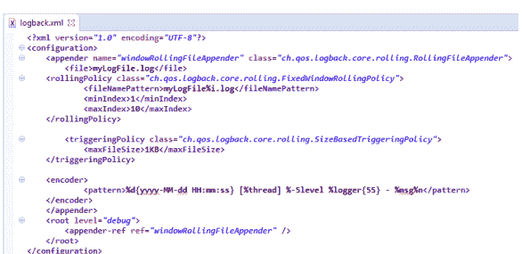

Java 类如下：

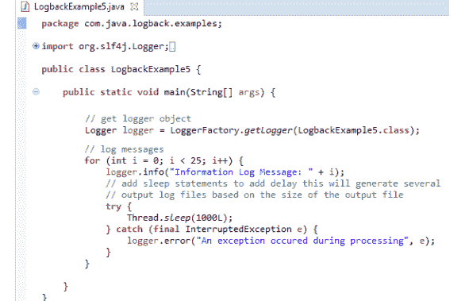

生成了三个文件，所示：

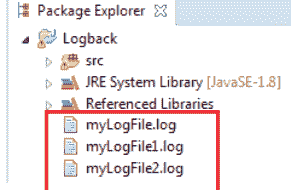

这些文件的内容如下：

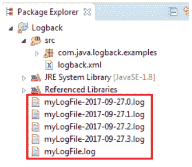
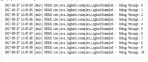
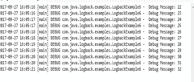
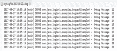
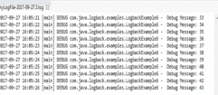
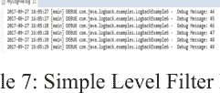


## 示例 7：简单的级别过滤器

在这个示例中，我们实现了一个简单的过滤器，根据日志级别（level）过滤日志事件。

```xml
<?xml version="1.0" encoding="UTF-8"?>
<configuration>
 <appender name="consoleappender" class="ch.qos.logback.core.rolling.RollingFileAppender">
  <rollingPolicy class="ch.qos.logback.core.rolling.TimeBasedRollingPolicy">
<!-- 每个日志文件的大小最大为 10MB，日志文件历史保留 30 天，容量为 3GB -->
 <fileNamePattern>log-%d{{yyyy-MM-dd}.log</fileNamePattern>
 <maxHistory>30</maxHistory>
 <totalSizeCap>3GB</totalSizeCap>
 </rollingPolicy>
 <encoder>
  <pattern>%thread - %msg%n</pattern>
 </encoder>
 </appender>
 <filter class="ch.qos.logback.classic.filter.LevelFilter">
 <level>INFO</level>
 </filter>
 <root level="DEBUG">
 <appender-ref ref="consoleappender" />
 </root>
</configuration>
```

Java 类如下：

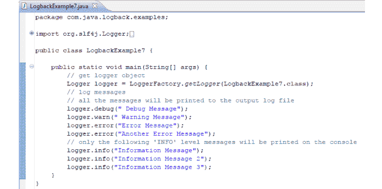

```java
package com.java.logback.examples;

import org.slf4j.Logger;
import org.slf4j.LoggerFactory;

public class LogbackExample {
    public static void main(String[] args) {
        // 获取 logger 对象
        Logger logger = LoggerFactory.getLogger(LogbackExample.class);
        // 记录消息
        // 所有消息将打印到输出日志文件中
        logger.debug("Debug Message");
        logger.warn("Warning Message");
        logger.error("Another Error Message");
        // 只有 'INFO' 级别的消息会打印在控制台上
        logger.info("Information Message");
        logger.info("Information Message 2");
    }
}
```

控制台生成的输出如下：

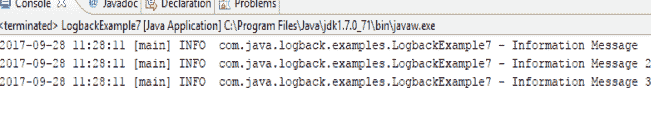

日志文件的内容如下：

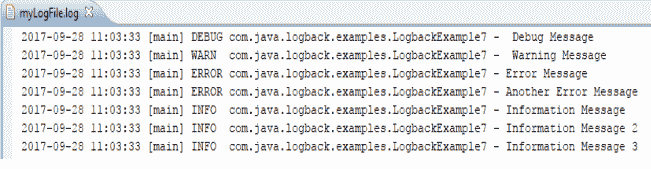

## 示例 8：追加时间戳

带有时间戳，应用程序启动时会创建一个新文件。这对于短生命周期应用程序非常有用，例如批处理应用程序。

```xml
<?xml version="1.0" encoding="UTF-8"?>
<configuration>
  <!-- 声明格式为 yyyy-MM-dd HH:mm:ss 的时间戳 -->
  <!-- 此键可以被所有 appender 使用 -->
  <timestamp key="timestamp" pattern="yyyy-MM-dd HH:mm:ss"/>
  <appender name="FILE" class="ch.qos.logback.core.FileAppender">
    <!-- 使用时间戳唯一地命名日志文件 -->
    <file>logback-${timestamp}.log</file>
    <encoder>
      <pattern>%d{yyyy-MM-dd HH:mm:ss} [%thread] %-5level %logger{36} - %msg%n</pattern>
    </encoder>
  </appender>
  <root level="INFO">
    <appender-ref ref="FILE" />
  </root>
</configuration>
```

Java 类如下：

```java
package com.java.logback.examples;

import org.slf4j.Logger;
import org.slf4j.LoggerFactory;

public class LogbackExample {
    public static void main(String[] args) throws InterruptedException {
        Logger logger = LoggerFactory.getLogger(LogbackExample.class);
        // 记录消息
        // 所有消息将打印到输出日志文件中，
        for (int i = 0; i < 5; i++) {
            logger.debug("Debug Message");
            logger.warn("Warning Message");
            logger.trace("Trace Message");
            logger.info("Information Message");
        }
    }
}
```

项目结构中生成的带有时间戳的日志文件如下：

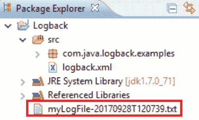

该文件的内容如下：

```
2017-09-02 12:07:59,123 WARN  ch.qos.logback.example.Logback - Warning Message
2017-09-02 12:07:59,123 ERROR ch.qos.logback.example.Logback - Error Message 1
2017-09-02 12:07:59,123 INFO  ch.qos.logback.example.Logback - Information Message
2017-09-02 12:07:59,123 ERROR ch.qos.logback.example.Logback - Error Message 2
2017-09-02 12:07:59,123 WARN  ch.qos.logback.example.Logback - Warning Message 2
2017-09-02 12:07:59,123 INFO  ch.qos.logback.example.Logback - Information Message
2017-09-02 12:07:59,123 ERROR ch.qos.logback.example.Logback - Error Message 3
2017-09-02 12:07:59,123 WARN  ch.qos.logback.example.Logback - Warning Message 3
2017-09-02 12:07:59,123 INFO  ch.qos.logback.example.Logback - Information Message
```

## 示例 9：异步 Appender (Async Appender)

在这个示例中，我们实现了一个异步 appender。该 appender 使用缓冲区队列并在队列填满时记录事件：

```xml
<?xml version="1.0" encoding="UTF-8"?>
<configuration>
  <appender name="FILE" class="ch.qos.logback.core.FileAppender">
    <file>myFile.log</file>
    <pattern>%d %-5level %msg%n</pattern>
  </appender>
  <appender name="ASYNC" class="ch.qos.logback.classic.AsyncAppender">
    <appender-ref ref="FILE" />
  </appender>
  <root level="INFO">
    <appender-ref ref="ASYNC" />
  </root>
</configuration>
```

用于测试配置的 Java 代码：


```java
package ch.qos.logback.example;
import org.slf4j.Logger;
import org.slf4j.LoggerFactory;

public class LogbackExample {
    public static void main(String[] args) throws InterruptedException {
        // 获取 logger 对象
        Logger logger = LoggerFactory.getLogger(LogbackExample.class);

        // 记录消息
        logger.error("Error Message 1");
        logger.warn("Warning Message 1");
        logger.error("Error Message 2");
        logger.info("Information Message 2");
        logger.warn("Warning Message 3");
    }
}
```

项目结构中创建了一个新文件：

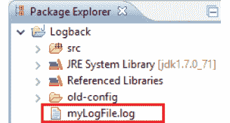

## Java 中的日志框架

该文件的内容如下：

```
com.java.logback.examples.LogbackExample - Error Message 1
com.java.logback.examples.LogbackExample - Warning Message 1
com.java.logback.examples.LogbackExample - Error Message 2
com.java.logback.examples.LogbackExample - Warning Message 2
```

我们可以看到，只显示了错误和警告消息。其中一条警告消息也被丢弃了。如果我们不希望丢失信息，可以将 `discardingThreshold` 属性设置为零，如下：

```xml
<?xml version="1.0" encoding="UTF-8"?>
<configuration>
  <appender name="FILE" class="ch.qos.logback.core.FileAppender">
    <file>logFile.log</file>
    <encoder>
      <pattern>%msg</pattern>
    </encoder>
  </appender>
  <appender name="ASYNC" class="ch.qos.logback.classic.AsyncAppender">
    <discardingThreshold>0</discardingThreshold>
    <appender-ref ref="FileAppender" />
  </appender>
  <root level="INFO">
    <appender-ref ref="ASYNC" />
  </root>
</configuration>
```

进行此更改后，我们现在再次执行 Java 程序并检查输出日志文件的内容。它们如下：

```
com.java.logback.examples.LogbackExample - Error Message 1
com.java.logback.examples.LogbackExample - Warning Message 1
com.java.logback.examples.LogbackExample - Error Message 2
com.java.logback.examples.LogbackExample - Warning Message 2
com.java.logback.examples.LogbackExample - Warning Message 3
```

可以看出，所有的日志消息都记录到了文件中。

### 示例 10：Async Appender 队列大小参数

在上一个示例中，我们看到了异步 appender 的使用。尽管我们将丢弃阈值设置为 0，但有时仍会丢失日志消息，因为队列的大小和数量是有限的。

考虑之前的配置文件：

```xml
<?xml version="1.0" encoding="UTF-8"?>
<configuration>
  <appender name="FileAppender" class="ch.qos.logback.core.FileAppender">
    <file>logback.log</file>
    <encoder>
      <pattern>%logger - %msg%n</pattern>
    </encoder>
  </appender>

  <appender name="ASYNC" class="ch.qos.logback.classic.AsyncAppender">
    <discardingThreshold>0</discardingThreshold>
    <appender-ref ref="FileAppender"/>
  </appender>

  <root level="INFO">
    <appender-ref ref="ASYNC"/>
  </root>
</configuration>
```

我们通过添加循环来修改 Java 类：

```java
package com.java.logback.examples;
import org.slf4j.Logger;
import org.slf4j.LoggerFactory;

public class LogbackExample10 {
    public static void main(String[] args) throws InterruptedException {
        Logger logger = LoggerFactory.getLogger(LogbackExample10.class);
        for (int i = 0; i < 5; i++) {
            logger.info("Message 1");
            logger.warn("Warning Message 1");
            logger.error("Error Message 1");
            logger.warn("Warning Message 2");
            logger.warn("Warning Message 3");
        }
    }
}
```

运行此程序时，队列填满了，它没有记录所有的日志消息。我们在下面的图中看到：

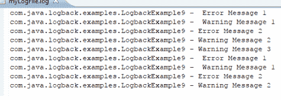

## Java 中的日志框架

修改配置文件后，我们现在再次执行程序并检查日志文件的内容。如下：

```
com.java.logback.examples.LogbackExample10 - Error Message 1
com.java.logback.examples.LogbackExample10 - Warning Message 1
com.java.logback.examples.LogbackExample10 - Error Message 2
com.java.logback.examples.LogbackExample10 - Warning Message 2
com.java.logback.examples.LogbackExample10 - Error Message 1
com.java.logback.examples.LogbackExample10 - Warning Message 1
com.java.logback.examples.LogbackExample10 - Error Message 2
com.java.logback.examples.LogbackExample10 - Warning Message 2
com.java.logback.examples.LogbackExample10 - Warning Message 3
com.java.logback.examples.LogbackExample10 - Error Message 1
com.java.logback.examples.LogbackExample10 - Warning Message 1
com.java.logback.examples.LogbackExample10 - Error Message 2
com.java.logback.examples.LogbackExample10 - Warning Message 3
com.java.logback.examples.LogbackExample10 - Warning Message 1
com.java.logback.examples.LogbackExample10 - Error Message 2
com.java.logback.examples.LogbackExample10 - Warning Message 2
```

从输出中可以看出，根据 Java 类 `LogbackExample10` 中指定的循环结构，所有日志消息都已记录了 5 次。

### 示例 11：阈值过滤器 (Threshold Filter)

在此示例中，我们实现了一个阈值过滤器，它根据日志级别过滤日志消息并拒绝低于此级别的消息。

```xml
<configuration>
  <xml version="1.0" encoding="UTF-8"?>
  <appender name="consoleappender" class="ch.qos.logback.core.ConsoleAppender">
    <filter class="ch.qos.logback.classic.filter.ThresholdFilter">
      <level>INFO</level>
    </filter>
    <encoder>
      <pattern>%d{yyyy-MM-dd HH:mm:ss} [%thread] %-5level %logger{36} - %msg%n</pattern>
    </encoder>
  </appender>
  <root level="DEBUG">
    <appender-ref ref="consoleappender" />
  </root>
</configuration>
```

Java 类：

```java
LogbackExample1.java
package com.java.logback.examples;

import org.slf4j.Logger;
import org.slf4j.LoggerFactory;

public class LogbackExample1 {
    public static void main(String[] args) throws InterruptedException {
        // 获取 logger 对象
        Logger logger = LoggerFactory.getLogger(LogbackExample1.class);

        //get
        // 级别为 INFO 或更高的消息将被记录
        logger.error("Error Message");
        logger.warn("Warning Message");
        logger.info("Information Message");
        logger.debug("Possible Debug Message");

        // 以下消息将不会打印在控制台上
        logger.debug("Debug Message");
        logger.trace("Trace Message");

    }
}
```

# 控制台输出为


# 示例 12：自定义 logger。在此示例中，我们按照如下方式实现自定义 logger 的配置：

```xml
<?xml version="1.0" encoding="UTF-8"?>
<configuration>
  <appender name="consoleAppender" class="ch.qos.logback.core.ConsoleAppender">
    <encoder>
      <pattern>%d{yyyy-MM-dd HH:mm:ss} [%thread] %-5level - %msg%n</pattern>
    </encoder>
  </appender>
  <logger name="MyLogger" level="debug">
    <appender-ref ref="consoleAppender" />
  </logger>
  <root level="debug">
    <appender-ref ref="consoleappender" />
  </root>
</configuration>
```

## Java 类如下：

```java
LogbackExample2.java

package com.java.logback.examples;

import org.slf4j.Logger;

import org.slf4j.LoggerFactory;

public class LogbackExample2 {

    public static void main(String[] args) throws InterruptedException {

        // 获取 logger 对象

        Logger logger = LoggerFactory.getLogger("MyLogger");

        //消息

        logger.error("Error Message");

        logger.warn("Warning Message");

        logger.info("Information Message");

        logger.debug("Debug Message");

    }

}
```

## Java 中的日志框架

输出如下：


从输出可以看出，每条日志都打印了两次。这是因为 logback 会附加自身定义的 appender 以及其祖先定义的 appender。因此，自定义 logger 也会附加 root appender。这导致了重复日志。如果我们想避免这种情况，有几种解决方案。从配置中移除 root appender 所示：


输出是：


另一种解决方案是为自定义 logger 使用 `additivity` 参数：

```xml
<?xml version="1.0" encoding="UTF-8"?>
<configuration>
  <appender name="consoleAppender" class="ch.qos.logback.core.ConsoleAppender">
    <encoder>
      <pattern>%d{yyyy-MM-dd HH:mm:ss} [%thread] %-5level %logger{36} - %msg%n</pattern>
    </encoder>
  </appender>
  <logger name="MyLogger" level="debug" additivity="false">
    <appender-ref ref="consoleAppender" />
  </logger>
  <root level="debug">
    <appender-ref ref="consoleAppender" />
  </root>
</configuration>
```

日志消息显示如下：

```
2017-09-28 15:12:59 [main] MyLogger Error Message
2017-09-28 15:12:59 [main] MyLogger Warning Message
2017-09-28 15:12:59 [main] MyLogger Information Message
2017-09-28 15:12:59 [main] MyLogger Debug Message
```

### 示例 13：重复过滤器 (Duplicate Filter)

在此示例中，我们为重复消息实现了一个过滤器。该过滤器过滤掉日志中的重复项。

```xml
<?xml version="1.0" encoding="UTF-8"?>
<configuration>
  <filter class="ch.qos.logback.classic.DuplicateMessageFilter"/>
  <appender name="consoleAppender" class="ch.qos.logback.core.ConsoleAppender">
```


## Logback 157

```xml
<?xml version="1.0" encoding="UTF-8"?>
<configuration>
  <turboFilter class="ch.qos.logback.turbo.DuplicateMessageFilter">
    <AllowedRepetitions>2</AllowedRepetitions>
  </turboFilter>
  <appender name="console" class="ch.qos.logback.core.ConsoleAppender">
    <encoder>
      <pattern>%d{yyyy-MM-dd HH:mm:ss} [%thread] %-5level %msg%n</pattern>
    </encoder>
  </appender>
  <logger name="myLogger" level="debug" additivity="false">
    <appender-ref ref="consoleappender" />
  </logger>
  <root level="debug">
    <appender-ref ref="consoleappender" />
  </root>
</configuration>
```

## 考虑以下 Java 类：

在类中，我们使用一个参数来记录消息。在这里，`turbo filter` 比较的是原始日志消息，即消息中参数之前的部分。在这种情况下，它是 `"Debug Message {}"`。因此，尽管日志消息被静默丢弃，但它们被认为是相同的。

这解释了以下控制台输出：

```
Console Javadoc Declaration Problems
<terminated> LogbackExample14 (Java Application) C:\ProgramFiles\Java\jdk Debug Msg
2017-09-28 16:18:35 [main] DEBUG myLogger - Debug Msg 1
2017-09-28 16:18:35 [main] DEBUG myLogger - Debug Msg 2
2017-09-28 16:18:35 [main] DEBUG myLogger - Debug Msg 1
```

我们看到根据我们 `turbo filter` 的配置，消息在控制台上被打印了 3 次。

### 示例 15：配置文件的条件处理（if-then）


## 示例 15：配置文件的条件处理（if-then）

在任何软件开发生命周期中，开发者可能在不同的环境中工作，例如开发、测试和生产环境。每个环境都分配了一个特定的配置文件。这些文件中的多个部分配置是所有环境通用的。结果是日志配置出现了重复，且配置变得冗余。然而，logback 提供了使用 `then-else` 结构对 logback 配置文件进行条件处理的能力，从而可以使用单个文件完成所有配置。

Logback 使用 Janino 库来启用条件处理。Janino 库包含了条件处理和评估的 API。要添加此库，请从 Janino 主页或 GitHub (https://github.com/janino-compiler/janino) 下载 `janino.jar`。从 2.6.0 版本及以上开始，Janino 库需要 `commons-compiler` 作为 jar 包。下载该库并在你的类中如下使用它：


配置文件如下：

```xml
<?xml version="1.0" encoding="UTF-8"?>
<configuration>
  <property name="content" resource="app.properties"/>
  <if condition="query(\${ENV_NAME}).contains('DEV')">
    <then>
      <appender name="Console" class="ch.qos.logback.core.ConsoleAppender">
        <pattern>%d{yyyy-MM-dd HH:mm:ss} %-5level %msg%n</pattern>
      </appender>
    </then>
    <else>
      <appender name="File" class="ch.qos.logback.core.FileAppender">
        <pattern>%d{yyyy-MM-dd HH:mm:ss} %-5level %msg%n</pattern>
      </appender>
    </else>
  </if>
</configuration>
```

我们定义了一个包含应用程序属性的资源文件，并将范围设置为 context。在 Logback 中，属性可以定义在三个可能的范围内，分别命名为 local、context 或 system。

在 **local（本地）** 范围内，该属性从它在配置文件中定义的那刻起一直存在，直到配置文件的执行为止（Gülücü and Pennec, 2011）。在此范围内定义的变量在每次读取配置文件时都会创建。

在 **context（上下文）** 范围内，属性的持续时间与上下文相同，或者直到它的值被擦除。一旦属性定义在此范围内，它就成为上下文的一部分，并对所有日志事件（包括远程事件）都有效。

如果属性定义在 **system（系统）** 范围内，它会被插入 JVM 的系统属性中，该值一直存在直到 JVM 终止或其值被擦除。

该文件创建在我们的目录树中，与配置文件相同的层级。

我们如下所示初始化该文件，并将 ‘ENVIRONMENT’ 属性设置为 DEV：


Java 类如下：

```java
package com.java.logback.examples;

import org.slf4j.Logger;
import org.slf4j.LoggerFactory;

public class LogbackExample5 {
    public static void main(String[] args) throws InterruptedException {
        // 获取 logger 对象
        Logger logger = LoggerFactory.getLogger(LogbackExample5.class);

        // 记录消息
        logger.error("Error Message");
        logger.warn("Warning Message");
        logger.info("Information Message");

        // 异常
        int[] a = {1, 2, 0};
        try {
            a[3] = 2;
        } catch (Exception e) {
            logger.error("Array Index out of bounds");
        }
    }
}
```

## 158 Java 中的日志框架

输出如下：


根据我们的配置，如果属性 ‘ENVIRONMENT’ 的值被设置为 ‘DEV’，日志应该被打印在控制台上，如上面所示的结果。如果我们将属性 ‘ENVIRONMENT’ 的值设置为 ‘TEST’，日志将被发送到文件中。


名为 `devLog.log` 的文件在我们的目录树中生成：


该文件的内容如下：


# 根据属性 "ENVIRONMENT" 的值定义了三个不同的配置文件

目前，该属性被设置为 "DEV"。这三个配置文件与 logback 文件处于同一级别，定义如下：


这些文件在目标环境中的内容如下：

## 1. 开发环境：logback-dev.xml

```xml
<included>
  <appender name="consoleAppender" class="ch.qos.logback.core.ConsoleAppender">
    <encoder>
      <pattern>%d{yyyy-MM-dd HH:mm:ss} [%thread] %-5level %msg%n</pattern>
    </encoder>
  </appender>
  <root level="debug">
    <appender-ref ref="consoleAppender" />
  </root>
</included>
```

对于此环境，我们定义了一个简单的控制台 appender。

## 2. 生产环境：logback-prod.xml

```xml
<logback>
  <included>
    <appender name="consoleAppender" class="ch.qos.logback.core.ConsoleAppender">
      <encoder>
        <pattern>%d{yyyy-MM-dd HH:mm:ss} %-5level %logger{36} %msg%n</pattern>
      </encoder>
    </appender>
    <appender name="rollingFileAppender" class="ch.qos.logback.core.RollingFileAppender">
      <rollingPolicy class="ch.qos.logback.core.rolling.TimeBasedRollingPolicy">
        <fileNamePattern>logs/application-%yyyy-MM-dd.log</fileNamePattern>
      </rollingPolicy>
      <encoder>
        <pattern>%d{yyyy-MM-dd HH:mm:ss} %-5level %logger{36} %msg%n</pattern>
      </encoder>
    </appender>
    <root level="debug">
      <appender-ref ref="consoleAppender" />
      <appender-ref ref="rollingFileAppender" />
    </root>
  </included>
</logback>
```

对于生产环境，我们定义了两个 appender：一个滚动滚动策略和一个控制台 appender。

## 3. UAT 环境：logback-uat.xml

```xml
<logback>
  <included>
    <appender name="fileAppender" class="ch.qos.logback.core.FileAppender">
      <file>log/file.log</file>
      <encoder>
        <pattern>%d{yyyy-MM-dd HH:mm:ss} %-5level %msg%n</pattern>
      </encoder>
    </appender>
    <root level="INFO">
      <appender-ref ref="fileAppender" />
    </root>
  </included>
</logback>
```

对于此环境，我们定义了一个简单的文件 appender。Java 类如下：

```java
package com.java.logback.examples;

import org.slf4j.Logger;

public class LogbackExample1 {
    public static void main(String[] args) throws InterruptedException {
        // get logger object
        Logger logger = LoggerFactory.getLogger(LogbackExample1.class);
        for (int i = 0; i < 5; i++) {
            // log message
            logger.error("Error Message");
            logger.warn("Warning Message");
            logger.info("Information Message");
        }
    }
}
```

现在，根据程序执行时属性 `ENVIRONMENT` 的当前值设置为 `DEV`，日志应该显示在控制台上。这就是控制台输出所示的情况：

```
[main] 2017-09-28 23:28:21 ERROR com.java.logback.examples.LogbackExample1 - Error Message
[main] 2017-09-28 23:28:21 WARN com.java.logback.examples.LogbackExample1 - Warning Message
[main] 2017-09-28 23:28:21 INFO com.java.logback.examples.LogbackExample1 - Information Message
[main] 2017-09-28 23:28:21 ERROR com.java.logback.examples.LogbackExample1 - Error Message
[main] 2017-09-28 23:28:21 WARN com.java.logback.examples.LogbackExample1 - Warning Message
[main] 2017-09-28 23:28:21 INFO com.java.logback.examples.LogbackExample1 - Information Message
```

现在，我们将属性 `ENVIRONMENT` 的值更改为 `PROD` 并查看输出：

```
app.properties
ENVIRONMENT=PROD
```

```
[main] 2017-09-28 23:28:21 ERROR com.java.logback.examples.LogbackExample1 - Error Message
[main] 2017-09-28 23:28:21 WARN com.java.logback.examples.LogbackExample1 - Warning Message
...（等待，此处 OCR 文本碎片化，根据上下文重构）...
```

通过执行程序，日志现在被发送到控制台，同时也发送到名为 `production.log` 的文件中。

等待，让我们重新检查生产输出的流。OCR 显示：

```
Package Explorer
Logback src
JRE System [jdk.7.0]
Referenced Libraries
old-config
production.log.2017-09-28-23-28.log
```

控制台输出与日志文件输出相同。此外，如果我们将属性值更改为 `UAT`，就会生成名为 `uat.log` 的日志文件。


`uat.log` 文件的内容如下：

| 2017-09-28 23:37:07 ERROR com.java.logback.examples.LogbackExample1 - Error Message |
| :--- |
| 2017-09-28 23:37:07 WARN com.java.logback.examples.LogbackExample1 - Warning Message |
| 2017-09-28 23:37:07 INFO com.java.logback.examples.LogbackExample1 - Information Message |
| 2017-09-28 23:37:08 WARN com.java.logback.examples.LogbackExample1 - Warning Message |
| 2017-09-28 23:37:08 ERROR com.java.logback.examples.LogbackExample1 - Error Message |
| 2017-09-28 23:37:08 INFO com.java.logback.examples.LogbackExample1 - Information Message |
| 2017-09-28 23:37:09 WARN com.java.logback.examples.LogbackExample1 - Warning Message |
| 2017-09-28 23:37:09 ERROR com.java.logback.examples.LogbackExample1 - Error Message |
| 2017-09-28 23:37:09 INFO com.java.logback.examples.LogbackExample1 - Information Message |

# Java 中的 168 个日志框架

```xml
<xml version="1.0" encoding="UTF-8"?>
<configuration>
  <property scope="content" resource="app.properties" />
  <if condition="property('ENVIRONMENT').contains("DEV")">
    <then>
      <include file="F:/workspace/logback/src/main/resources/logback-dev.xml" />
    </then>
  <else>
    <if condition="property('ENVIRONMENT').contains("PROD")">
      <then>
        <include file="F:/workspace/logback/src/main/resources/logback-prod.xml" />
      </then>
      <else>
        <if condition="property('ENVIRONMENT').contains("UAT")">
          <then>
            <include file="F:/workspace/logback/src/main/resources/logback-uat.xml" />
          </then>
          <else>
            <appender name="console" class="ch.qos.logback.core.ConsoleAppender">
              <pattern>%d{yyyy-MM-dd HH:mm:ss} [%thread] %-5level %logger{36} - %msg%n</pattern>
            </appender>
            <root level="debug">
              <appender-ref ref="console" />
            </root>
          </else>
        </if>
      </else>
    </else>
  </if>
</configuration>
```

在这里，我们在所有不匹配的条件中都提供了一个默认的输出器（appender）和根日志器（root logger）。如果没有满足任何条件，日志将默认指向控制台输出器。但重要的是，即使满足了其中一个条件，日志也会重复，因为我们提供了一个默认的控制台输出器和根日志器。

如果我们想避免这种重复，可以使用之前解释过的 `additivity`（叠加）参数或重复消息过滤器。

避免重复消息的另一种方法是在配置中使用如下所示的嵌套 `if-then-else` 循环：

```xml
<xml version="1.0" encoding="UTF-8"?>
<configuration>
  <property scope="content" resource="app.properties" />
  <if condition="property('ENVIRONMENT').contains("DEV")">
    <then>
      <include file="F:/workspace/logback/src/main/resources/logback-dev.xml" />
    </then>
  <else>
    <if condition="property('ENVIRONMENT').contains("PROD")">
      <then>
        <include file="F:/workspace/logback/src/main/resources/logback-prod.xml" />
      </then>
      <else>
        <if condition="property('ENVIRONMENT').contains("UAT")">
          <then>
            <include file="F:/workspace/logback/src/main/resources/logback-uat.xml" />
          </then>
          <else>
            <include file="F:/workspace/logback/src/main/resources/logback-default.xml" />
          </else>
        </if>
      </else>
    </else>
  </if>
</configuration>
```

在这里，我们添加了嵌套的 `if-then-else` 循环，并在没有条件匹配时提供了一个默认配置文件。我们添加了一个名为 `logback-default.xml` 的新文件，它实现了一个简单的文件输出器（file appender）。

如下所示：

# Logback 169


```xml
<?xml version="1.0" encoding="UTF-8"?>
<configuration>
  <appender name="fileAppender" class="ch.qos.logback.core.FileAppender">
    <file>mylLog.log</file>
    <encoder>
      <pattern>%d{yyyy-MM-dd HH:mm:ss} %-5level %msg%n</pattern>
    </encoder>
  </appender>
  <root level="INFO">
    <appender-ref ref="fileAppender" />
  </root>
</configuration>
```

现在，如果我们执行 Java 程序，项目结构中会创建一个新文件如下所示：


文件的内容与之前相同。

## 示例 19：基于系统属性的多个配置文件的条件处理

在上一个示例中，我们演示了条件构造的使用，我们从属性文件中读取属性并根据其值选择配置文件。

## Java 中的日志框架

这种方法在小型且简单的应用程序中效果良好。但在跨越多个环境的大型应用中，可能需要通过日志配置对特定的属性进行检查。在复杂的环境中，维护一个包含所有属性的单一文件将变得困难。

在这种情况下，通常大型应用程序使用系统属性来存储环境名称或上下文。logback 的日志功能是通过配置文件中的 `scope` 元素来实现的。我们将 `scope` 设置为 `system`，然后恢复环境变量的值。

如下所示：


```xml
<?xml version="1.0" encoding="UTF-8"?>
<configuration>
  <property name="system" value="DEV"/>
  <if condition="property('system').contains('DEV')">
    <include file="F:/workspace/logback/src/main/resources/logback-dev.xml" />
  </if>
  <else>
    <if condition="property('ENVIRONMENT').contains('PROD')">
      <include file="F:/workspace/logback/src/main/resources/logback-prod.xml" />
    </if>
    <else>
      <if condition="property('ENVIRONMENT').contains('UAT')">
        <include file="F:/workspace/logback/src/main/resources/logback-uat.xml" />
      </if>
      <else>
        <include file="F:/workspace/logback/src/main/resources/logback-default.xml" />
      </else>
    </else>
  </else>
</configuration>
```

我们保持相同的配置，但将 `scope` 改为 `system`。

我们进入系统变量并创建一个值为 `DEV` 的新变量 `ENVIRONMENT`如下：

# Logback 171


我们保存此变量并执行以下 Java 程序：

```java
// LogbackExample19.java
package com.java.logback.examples;

import org.slf4j.Logger;
import org.slf4j.LoggerFactory;

public class LogbackExample1 {
    public static void main(String[] args) throws InterruptedException {
        // logger object
        Logger logger = LoggerFactory.getLogger(LogbackExample.class);

        // log messages
        logger.error("Error Message");
        logger.warn("Warning Message");
        logger.info("Information Message");
    }
}
```

输出如下：


从图中可以看出，基于系统属性的配置文件选择了三个日志语句配置 `logback-dev.xml`。

注意 `logback-dev.xml` 是我们在示例 18 中使用的同一个文件。

# 示例 20：HTML Layout

在本示例中，我们实现了一个 HTML 文件输出器。该输出器将日志消息写入：

```xml
<?xml version="1.0" encoding="UTF-8"?>
<configuration>
  <appender name="fileAppender" class="ch.qos.logback.core.FileAppender">
    <file>log.html</file>
    <encoder class="ch.qos.logback.classic.encoder.LayoutWrappingEncoder">
      <layout class="ch.qos.logback.classic.html.HTMLLayout">
        <pattern>%thread %level %msg%n</pattern>
      </layout>
    </encoder>
  </appender>
  <root>
    <appender-ref ref="fileAppender" />
  </root>
</configuration>
```

用于测试上述配置的 Java 类为：

```java
package com.java.logback;

import org.slf4j.Logger;
import org.slf4j.LoggerFactory;

public class LogbackExample20 {
    public static void main(String[] args) throws InterruptedException {
        // get logger object
        Logger logger = LoggerFactory.getLogger(LogbackExample20.class);

        // log messages
        logger.error("Error Message");
        logger.warn("Warning Message");
        logger.info("Information Message");
        logger.debug("Debug Message");
    }
}
```

# Logback 173

执行 ，有趣的是，ERROR 和 WARN 消息被设置为红色。

# 示例 21：Logback 的编程配置

在本示例中，我们通过日志上下文（logger context）对象编程配置 logback。

首先，我们获取日志上下文对象，然后定义编码器和控制台输出器。

最后，我们获取日志对象并使用新创建的输出器进行记录。

```java
// LogbackExample.java
package com.java.logback.examples;
import org.qos.logback.classic.Logger;
import org.qos.logback.classic.LoggerContext;
import org.qos.logback.classic.encoder.PatternLayoutEncoder;
import org.qos.logback.core.ConsoleAppender;
import org.slf4j.LoggerFactory;
import org.qos.logback.classic.Level;

public class LogbackExample {
    public static void main(String[] args) {
        LoggerContext context = (LoggerContext) LoggerFactory.getILoggerFactory();
        context.reset();
        PatternLayoutEncoder patternLayoutEncoder = new PatternLayoutEncoder();
        patternLayoutEncoder.setContext(context);
        patternLayoutEncoder.setPattern("%d{HH:mm:ss.SSS} [%thread] %-5level %logger{36} - %msg%n");
        patternLayoutEncoder.start();

        // define a console appender
        ConsoleAppender consoleAppender = new ConsoleAppender();
        consoleAppender.setContext(context);
        consoleAppender.setName("ConsoleAppender");
        consoleAppender.setEncoder(patternLayoutEncoder);
        consoleAppender.start();

        // get the logger object
        Logger logger = context.getLogger("Main");
        // set the Level of the logger
        logger.setLevel(Level.DEBUG);
        logger.addAppender(consoleAppender);

        // print messages to the console
        logger.info("Information Message");
        logger.warn("Warning Message");
        logger.debug("Debug Message");
    }
}
```

## 174 Java 日志框架

执行时，输出如下：

```
Console Javadoc Declaration Problems
<terminated>- LogbackExample21 [Java Application] C:\Program Files\Java
2017-09-29 13:00:36 INFO - Information Message
2017-09-29 13:00:36 WARN - Warning Message
2017-09-29 13:00:36 DEBUG - Debug Message
```

### 示例 22：Logback 配置：File Appender（文件挂接器）

此示例与 21 相似，但我们通过代码生成了一个 File Appender。

```java
import ch.qos.logback.classic.LoggerContext;
import ch.qos.logback.classic.encoder.PatternLayoutEncoder;
import ch.qos.logback.core.rolling.RollingFileAppender;
import ch.qos.logback.core.rolling.TimeBasedRollingPolicy;
class LogExample2 {
    public static void main(String[] args) {
        // get logger context
        LoggerContext loggerContext = (LoggerContext) LoggerFactory.getLoggerFactory();
        // set the encoder
        PatternLayoutEncoder patternLayoutEncoder = new PatternLayoutEncoder();
        patternLayoutEncoder.setContext(loggerContext);
        patternLayoutEncoder.setPattern("%d{yyyy-MM-dd HH:mm:ss} %-5level %msg%n");
        patternLayoutEncoder.start();
        // define a file appender
        RollingFileAppender rollingFileAppender = new RollingFileAppender();
        rollingFileAppender.setContext(loggerContext);
        rollingFileAppender.setEncoder(patternLayoutEncoder);
        // set the name
        rollingFileAppender.setName("Rolling File Appender");
        rollingFileAppender.append(true);
        // define the name of the output log file
        rollingFileAppender.setFile("myLog.log");
        // define a rolling policy
        TimeBasedRollingPolicy timeRollingPolicy = new TimeBasedRollingPolicy();
        timeRollingPolicy.setContext(loggerContext);
        timeRollingPolicy.setParent(rollingFileAppender);
        timeRollingPolicy.setFileName("myLog-%d{yyyy-MM-dd}.log");
        timeRollingPolicy.start();
        // set the policy to the logger
        rollingFileAppender.setRollingPolicy(timeRollingPolicy);
        rollingFileAppender.start();
        // get the logger object from the context
        Logger logger = loggerContext.getLogger("Main");
        // set the level of the logger
        logger.setLevel(Level.DEBUG);
        // add the file appender to the logger
        logger.addAppender(rollingFileAppender);
        // log messages to a file
        logger.info("Information Message");
        logger.warn("Warning Message");
        logger.debug("Debug Message");
    }
}
```

执行此代码后，会创建一个名为 `myLog.log` 的日志文件，其内容如下：

## 项目资源管理器 Logback 175


### 示例 23：自定义过滤器（Custom Filter）

在此示例中，我们实现了一个自定义过滤器。我们通过扩展过滤器类来定义自己的自定义过滤器：

```java
package com.example.logback;

import ch.qos.logback.classic.spi.ILoggingEvent;
import ch.qos.logback.core.filter.Filter;
import ch.qos.logback.core.spi.FilterReply;

class MyCustomFilter extends Filter<ILoggingEvent> {
    @Override
    public FilterReply decide(ILoggingEvent event) {
        // 检查消息是否包含 'Debug' 或 'Error'，如果是则打印
        // 消息
        if (event.getMessage().contains("Debug") ||
            event.getMessage().contains("Error")) {
            return FilterReply.ACCEPT;
        } else {
            return FilterReply.DENY;
        }
    }
}
```

我们配置了过滤器以接受所有包含 "Debug" 或 "Error" 值的日志消息。

我们在配置文件中使用该过滤器，如下所示：

```xml
<?xml version="1.0" encoding="UTF-8"?>
<configuration>
  <appenders>
    <appender name="console" class="ch.qos.logback.core.ConsoleAppender">
      <filter class="com.example.logback.MyCustomFilter" />
      <encoder>
        <pattern>%d{yyyy-MM-dd HH:mm:ss} [%thread] %-5level %logger{36} - %msg%n</pattern>
      </encoder>
    </appender>
  </appenders>
  <root level="DEBUG">
    <appender-ref ref="console" />
  </root>
</configuration>
```

用于测试此过滤器的 Java 类如下：

## 176 Java 日志框架


```java
package com.example.logback.examples;

import org.slf4j.Logger;
import org.slf4j.LoggerFactory;

class LogbackExample2 {
    public static void main(String[] args) throws InterruptedException {
        Logger logger = LoggerFactory.getLogger(LogbackExample2.class);

        logger.info("log messages");
        // 只有包含 "Error" 或 "Debug" 的消息会被记录
        logger.error("Error Message");
        logger.warn("Warning Message");
        logger.info("Information Message");

        for (int i = 0; i < 2; i++) {
            try {
                Thread.sleep(100);
            } catch (Exception e) {
                logger.error("Array Index of bounds");
            }
        }
    }
}
```

控制台生成的输出如下：

```
[Console] LogbackExample2
[2017-09-28 14:01:50] MAIN ERROR com.example.logback.examples.LogbackExample2 - Error Message
[2017-09-28 14:01:50] MAIN DEBUG com.example.logback.examples.LogbackExample2 - Debug Message
[2017-09-28 14:01:50] MAIN ERROR com.example.logback.examples.LogbackExample2 - Array Index of bounds
```

*(注：原文中代码块的 for 循环有误，如 i=0; i++，此处已按逻辑修正翻译)*

从输出可以看出，包含 'Error' 或 'Debug' 的消息已打印。

### 示例 24：自定义布局（Custom Layout）

在此示例中，我们实现了一个自定义布局。

我们定义的自定义布局类如下：

```java
package com.example.logback.examples;
import java.text.SimpleDateFormat;
import java.util.Date;
import ch.qos.logback.classic.spi.ILoggingEvent;
import ch.qos.logback.core.LayoutBase;

public class MyCustomLayout extends LayoutBase<ILoggingEvent> {
    public String doLayout(ILoggingEvent event) {
        StringBuilder sb = new StringBuilder();
        SimpleDateFormat formatter = new SimpleDateFormat("yyyy/MM/dd HH:mm:ss");
        sb.append(formatter.format(new Date(event.getTimeStamp())));
        sb.append(" ");
        // ... 实现
    }
}
```

一旦定义了类，我们配置 logback 配置使用该布局：

```xml
<?xml version="1.0" encoding="UTF-8"?>
<configuration>
  <appender name="ConsoleAppender" class="ch.qos.logback.core.ConsoleAppender">
    <encoder class="ch.qos.logback.encoder.PatternLayoutEncoder">
      <layout class="com.example.logback.examples.MyCustomLayout" />
    </encoder>
  </appender>
  <root level="INFO">
    <appender-ref ref="ConsoleAppender" />
  </root>
</configuration>
```

Java 类如下：

```java
package com.example.logback.examples;
import org.slf4j.Logger;
import org.slf4j.LoggerFactory;

public class LogbackExample24 {
    public static void main(String[] args) {
        Logger logger = LoggerFactory.getLogger(LogbackExample24.class);

        // log message
        logger.error("Error Message");
        logger.warn("Warning Message");
        logger.info("Information Message");
        logger.debug("Debug Message");
    }
}
```

当我们运行该 Java 类时，生成的输出如下：


输出清晰地显示我们定义的自定义格式用于日志消息。

### 示例 25：使用 Lambda 表达式的参数化日志

在此示例中，我们展示了 Lambda 表达式参数化日志的使用。我们在 Java 类中声明了接口并使用 Lambda 表达式为它们提供了函数实现。

接口如下：

```java
// Interface.java
package com.example.logback.examples;
public interface Interface {
    String infoMessage();
}
```

```java
// Interface2.java
package com.example.logback.examples;
public interface Interface2 {
    String errorMessage();
}
```

我们使用以下 logback 配置：

```xml
<?xml version="1.0" encoding="UTF-8"?>
<configuration>
  <appender name="ConsoleAppender" class="ch.qos.logback.core.ConsoleAppender">
    <pattern>%d{yyyy-MM-dd HH:mm:ss} [%thread] %-5level %logger{36} - %msg%n</pattern>
  </appender>
  <root level="trace">
    <appender-ref ref="ConsoleAppender" />
  </root>
</configuration>
```

下方的 Java 类实现了接口：

```java
// LogbackExample25.java
package com.example.logback.examples;
import org.slf4j.Logger;
import org.slf4j.LoggerFactory;

public class LogbackExample25 {
    public static void main(String[] args) {
        // get logger object
        Logger logger = LoggerFactory.getLogger(LogbackExample25.class);

        // 提供接口方法 infoMessage 的函数实现
        Interface int1 = () -> {
            return "The Application is stable.";
        };

        // 提供接口方法 errorMessage 的函数实现
        Interface2 int2 = () -> {
            return "Attention! The application has crashed!";
        };

        // 提供接口方法 infoMessage2 的函数实现
        Interface3 int3 = () -> {
            return "All operations are in order.";
        };

        // log参数化消息
        logger.info("Information Message: {}", int1.getMessage());
        logger.info("Information Message 2: {}", int3.getMessage());
        logger.error("Error Message: {}", int2.getMessage());
    }
}
```

```
Console  Problems  Javadoc Declaration Annotations  Call Hierarchy
tested LogbackExample(Java Application) C:\src\LogbackExample\src\Program.java
2017-11-30 18:45:15 [main] WARN c.j.logback.logback.Example25 - A Warning Message
2017-11-30 18:45:15 [main] ERROR c.j.logback.logback.Example25 - An Error Message
2017-11-30 18:45:15 [main] TRACE c.j.logback.logback.Example25 - A Trace Message
2017-11-30 18:45:15 [main] INFO c.j.logback.logback.Example25 - The Application is stable.
2017-11-30 18:45:15 [main] INFO c.j.logback.logback.Example25 - Information Message: 2 - All operations are in order.
```

### 示例 26: 使用 Lambda 表达式的参数化日志（包含参数）

在这种情况下，我们更进一步，使用了同样接收参数的 Lambda 表达式。现在我们使用如下接收参数的接口：

```java
// Interface3.java
package com.logback.examples;

public interface Interface3 {
    public String errorMessage(String message);
}
```

```java
// Interface4.java
package com.logback.examples;

public interface Interface4 {
    public int warningMessage(int count);
}
```

我们所使用的 logback 配置如下：

```xml
<!-- logback.xml -->
<?xml version="1.0" encoding="UTF-8"?>
<configuration>
<appender name="consoleAppender" class="ch.qos.logback.core.ConsoleAppender">
  <encoder>
  <pattern d="%yyyy-MM-dd HH:mm:ss" [%thread] %-5level %logger{36} - %msg%n</pattern>
  </encoder>
</appender>
<root level="trace">
<appender-ref ref="consoleAppender" />
</root>
</configuration>
```

用于测试参数化 Lambda 表达式的 Java 类如下：

```java
// logback26.java
package com.java.logback.examples;

import org.slf4j.Logger;
import org.slf4j.LoggerFactory;

public class LogbackExample26 {
    public static void main(String[] args) {
        // logger 对象
        Logger logger = LoggerFactory.getLogger(LogbackExample26.class);

        // 日志消息
        logger.warn("Warning Message");
        logger.error("Error Message");

        // 提供接口方法的函数式实现
        Interface4 interface4 = (message) -> "Parameter Missing";
        interface4.warningMessage(4);
        interface4 = (count) -> count + 1;

        // 带有参数的参数化日志
        logger.error("Error Message: {}", "Attention!");
        logger.warn("Warning, file count is {}", interface4.warningMessage(4));
    }
}
```

生成的输出如下：

```
2017-11-30 19:06:34 [main] WARN c.j.examples.logback.LogbackExample26 - A Warning Message
2017-11-30 19:06:34 [main] ERROR c.j.examples.logback.LogbackExample26 - An Error Message
2017-11-30 19:06:34 [main] INFO c.j.examples.logback.LogbackExample26 - Information Message: Attention!Parameter Missing
2017-11-30 19:06:34 [main] ERROR c.j.examples.logback.LogbackExample26 - Error Message: 5
```

# 第 5 章

## SLF4J

## 目录

- 5.1. Slf4j 的特性与优势 ........................................ 182
- 5.2. Slf4j 下载 ................................................................ 182
- 5.3. Slf4j 绑定 ................................................................ 183
- 5.4. 简单日志记录 (Simple Logger)................................................................... 185
- 5.5. 在其他日志框架在使用 Slf4j.............................. 194
- 5.6. 常见的 Slf4j 错误........................................................................... 201
- 5.7. 将你的项目迁移到 Slf4j ....................................... 203

SLF4J 是 Java 的简单日志门面（Simple Logging Facade for Java），它是一个抽象层，允许用户在部署时动态地接入日志框架。SLF4J 提供了日志框架的抽象（SLF4J 手册，2017）。该框架由 Ceki 在 2004 年创建，最新版本为 1.7.2。我们在上一节中已经简要介绍了 SLF4J。为了在项目中使用 SLF4J，需要在类路径中添加 `slf4j-api`。此外，还需要提供底层日志框架的绑定包。

在本章中，我们将详细查看 SLF4J。

### 5.1. SLF4J 的特性与优势

使用 SLF4J 的优势如下（SLF4J 手册，2017）：

- 允许在部署时选择日志框架。
- 支持 log4j、logback 等其他日志框架。


- 可以将代码迁移到 SLF4J。
- 它是快速的。
- 它提供了日志框架的抽象层。

### 5.2. SLF4J 下载

在应用中使用 SLF4J 需要从 [SLF4J 官网](https://www.slf4j.org/) 下载。一旦下载，SLF4J 包中包含了多个文件。SLF4J 与各种日志框架的输出如下：

### 5.3. SLF4J 绑定

SLF4J 提供了以下 jar 包，用于运行时绑定：

- `slf4j-jdk14-1.7.2.jar` 是 `java.logging` 的绑定。
- `slf4j-jcl-1.7.2.jar` 是 Commons Logging 的绑定。
- `slf4j-log4j12-1.7.2.jar` 是 log4j 1.2 的绑定。
- `slf4j-over-slf4j-1.7.2.jar` 是为了将 log4j 调用重定向到 SLF4J。
- `slf4j-over-jcl-1.7.2.jar` 是为了将 jcl 调用重定向到 SLF4J。
- `slf4j-simple-1.7.2.jar` 是一个简单的日志实现。

如果没有任何其他绑定，SLF4J 将使用 NOP（无操作）绑定。它会将日志消息输出到控制台，并且只输出 INFO 及以上的日志级别。

在 logback 的情况下，`logback-classic` 原生实现了 SLF4J，这意味着在内存和处理时间上没有额外的开销。

切换日志框架非常简单。为了更改日志框架，你只需要在类路径中添加 `slf4j-api.jar`。如果你的应用使用 `java.util logging`，那么类路径中会有两个包：`slf4j-api` 和 `slf4j-jdk14.jar`。现在，如果你将其替换为 logback，只需将 `slf4j-jdk14.jar` 替换为 `logback-classic.jar`。对于 logback，你还需要添加 `logback-core.jar`，因为它构成了 logback 框架的基础。

SLF4J 与各种日志框架之间的各种绑定如图所示：

## 5.4. SIMPLE LOGGER

SLF4J 包中包含一个简单日志器。该日志器是 `slf4j logger` 接口的一个简单实现，可以将日志输出到控制台或 `system.err`。

该日志器提供的方法包括：

### 表 5.1：简单日志器的方法 (SLF4J 1.8.0-beta0 API, 2017)

| 方法 | 描述 |
| --- | --- |
| `debug(String message)` | 该方法记录 debug 级别的消息。 |
| `error(String message)` | 该方法记录 error 级别的消息。 |
| `info(String message)` | 该方法记录 info 级别的消息。 |
| `warn(String message)` | 该方法记录 warn 级别的消息。 |
| `trace(String message)` | 该方法记录 trace 级别的消息。 |
| `debug(String message, Throwable t)` | 该方法记录 debug 级别的消息，包括异常堆栈。 |
| `error(String message, Throwable t)` | 该方法记录 error 级别的消息，包括异常堆栈。 |
| `info(String message, Throwable t)` | 该方法记录 info 级别的消息，包括异常堆栈。 |
| `warn(String message, Throwable t)` | 该方法记录 warn 级别的消息，包括异常堆栈。 |
| `trace(String message, Throwable t)` | 该方法记录 trace 级别的消息，包括异常堆栈。 |
| `String getName()` | 该方法返回日志器的名称。 |
| `void log(LoggingEvent event)` | 该方法记录日志事件。 |
| `String renderLevel(int level)` | 该方法将级别设置为给定的级别。 |
| `Boolean isEnabled()` | 如果 info 消息启用，则返回 true。 |
| `Boolean isErrorEnabled()` | 如果 error 消息启用，则返回 true。 |
| `Boolean isTraceEnabled()` | 如果 trace 消息启用，则返回 true。 |
| `Boolean isDebugEnabled()` | 如果 debug 消息启用，则返回 true。 |
| `boolean isWarnEnabled()` | 如果 warn 消息启用，则返回 true。 |

除了方法外，该类还提供了一些静态字符串属性，帮助配置日志器。这些属性如下：

### 表 5.2：简单日志器属性 (SLF4J 1.8.0-beta0 API, 2017)

| 属性名称 | 描述 |
|---|---|
| `logfile` | 这是目标输出。可能的选项有文件路径、`system.err` 或 `system.out`。 |
| `Cache Output Stream` | 如果设置为 true，则对输出流进行缓存。 |
| `Default Log Level` | 可以是 debug、info、trace、error 或 warn。默认为 info。 |
| `Show Date Time` | 如果设置为 true，则会在日志消息中打印当前日期和时间。默认为 false。 |
| `Date Time Format` | 用于设置用于格式化日志消息的日期。默认是 `java` 的 `Simple Date Format`。 |
| `Show Thread Name` | 输出当前线程名称，默认为 true。 |
| `Show Log Name` | 此属性如果为 true，则会在日志消息的同时打印日志器名称。 |
| `level In Brackets` | 此属性用于在方括号内显示日志级别。默认为 false。 |
| `Show Short Log Name` | 此属性如果设置为 true，则在日志消息中显示日志名称的最后部分。 |

#### 5.4.1. 使用简单日志器的示例

**示例 1**

在这个示例中，我们演示了如何使用 slf4j 简单日志器。要使用它，首先按照所示将 `slf4j-api.jar` 和 `slf4j-simple.jar` 添加到我们的类路径中：


现在我们编写一个简单的 java 类，使用 SLF4J 简单日志器来记录消息。

**Example1.java**

```java
package com.slf4j.logging.slf4j.simpleLogger;

import org.slf4j.Logger;
import org.slf4j.LoggerFactory;

public class Example1 {
    public static void main(String[] args) {
        // 从 LoggerFactory 获取 logger 对象
        Logger logger = LoggerFactory.getLogger(Example1.class);

        // 记录消息
        logger.info("Information Message");
        logger.error("Error Message");
        logger.warn("Warning Message");
    }
}
```

输出如下：

```
[main] INFO com.java.logging.slf4j.simpleLogger.Example - Information Message
[main] ERROR com.java.logging.slf4j.simpleLogger.Example - Error Message
[main] WARN com.java.logging.slf4j.simpleLogger.Example - Warning Message
```

默认情况下，简单日志器配置为如上方显示日志。此外，默认级别设置为 info。但可以进行配置，如下一个示例所示。

**示例 2**

在这个示例中，我们配置程序记录 trace 级别及以上的消息。

该 java 类如下：

**Example2.java**

```java
package com.java.logging.slf4j.simpleLogger;

import org.slf4j.Logger;
import org.slf4j.LoggerFactory;

public class Example2 {
    public static void main(String[] args) {
        // 从 LoggerFactory 获取 logger 对象
        Logger logger = LoggerFactory.getLogger(Example2.class);

        // 记录消息
        logger.info("Information Message");
        logger.error("Error Message");
        logger.warn("Warning Message");
        logger.debug("Debug Message");
        logger.trace("Trace Message");
    }
}
```

在执行此类之前，我们为程序提供了以下运行时参数：


当我们运行程序时，我们在控制台上获取所有消息，包括 debug 和 warning 消息。


**示例 3**

在这个示例中，我们通过程序更改了日志器的默认级别。

```java
package com.java.logging.slf4j.SimpleLogger;

import org.slf4j.Logger;
import org.slf4j.LoggerFactory;

public class Example3 {
    public static void main(String[] args) {
        // 使用系统属性设置级别为 DEBUG
        System.setProperty("org.slf4j.impl.SimpleLogger.DEFAULT_LOG_LEVEL", "DEBUG");
        Logger logger = LoggerFactory.getLogger(Example3.class);

        // 记录消息
        logger.info("Information Message");
        logger.error("Error Message");
        logger.warn("Warning Message");
        logger.debug("Debug Message");
        // 如果 trace 消息优先级低于 debug，则不会打印
        logger.trace("Trace Message");
    }
}
```


输出如下：


输出显示除了 trace 级别以外的所有消息都打印了。

**示例 4**

在这个示例中，我们使用系统属性更改日志输出级别。

该 java 类如下：

输出如下：


**示例 5**

在这个示例中，我们配置日志器将日志信息输出到文件。


在下方生成了一个名为 `logFile.log` 的文件：


`logFile.log` 的内容如下：

```
2017-09-20 17:09:06,102 [main] INFO com.java.logging.slf4j.simpleLogger.Example4 - Information Message
2017-09-20 17:09:06,118 [main] ERROR com.java.logging.slf4j.simpleLogger.Example4 - Error Message
2017-09-20 17:09:06,118 [main] WARN com.java.logging.slf4j.simpleLogger.Example4 - Warning Message
```

**示例 6**

在这个示例中，我们配置日志器在方括号内显示日志级别。我们还配置日志器仅打印日志的最后部分的名称。该 java 类如下：

```java
package com.example.java.logging.slf4j.SimpleLogger;
import org.slf4j.Logger;
import org.slf4j.LoggerFactory;

public class Example6 {
    public static void main(String[] args) {
        // 在方括号内显示日志级别
        System.setProperty("org.slf4j.impl.SimpleLogger", "LEVEL_IN_BRACKETS_KEY", "true");
        
        // 显示日志名称的最后一个组件
        System.setProperty("org.slf4j.impl.SimpleLogger", "SHOW_SHORT_LOG_NAME_KEY", "true");
        
        // 从 LoggerFactory 获取 logger 对象
        Logger logger = LoggerFactory.getLogger(Example6.class);

        // 记录消息
        logger.info("Information Message");
        logger.error("Error Message");
        logger.warn("Warning Message");
    }
}
```

输出如下：


从输出中可以看到，级别是带方括号打印的。此外，我们可以清楚地注意到日志名称更短，并且只包含完整日志名称的最后一个部分。

**示例 7**

到为止，我们已经知道如何通过系统属性程序化配置简单日志器，也可以使用属性文件来配置 SimpleLogger。

与其他日志框架一样，SimpleLogger 的实现在启动时也会检查属性文件。它会检查名为 `simplelogger.properties` 的资源是否存在。

如果没有找到文件且没有通过程序配置属性，默认的日志选项是显示相对时间、以及级别、线程名称、日志器和消息，如示例 1 所示。


该文件的内容如下：


我们将日志级别设置为 trace，并配置日志输出以包含线程名称和日志名称。

Java 类如下：


输出如下：

```
Console [] Declaration [] Problems
<terminated>Example? [Java Application] Program(File):Example.java
[main] INFO com.java.logging.slf4j.simpleLogger.Example? - Information Message
[main] ERROR com.java.logging.slf4j.simpleLogger.Example? - Error Message
[main] WARN com.java.logging.slf4j.simpleLogger.Example? - Warning Message
[main] TRACE com.java.logging.slf4j.simpleLogger.Example? - Trace Message
[main] ERROR com.java.logging.slf4j.simpleLogger.Example? - Cannot divide by zero!
```

**示例 8**

在上一个示例中，我们展示了如何通过属性文件配置 SLF4J Logger。在本示例中，我们配置了日志显示格式，以 YYYY-dd-mm 格式输出日志，并带有星期名称和时区。


我们配置日志器隐藏线程名称，用括号显示日志级别，并使用当前日期和时间格式化日志消息。


我们使用的格式是`E, yyyy-MM-dd HH:mm:ss zzzz`，这是`java.text.DateFormat`类接受的简单 DateFormat 格式。

其中`E`显示星期，例如 Monday。`yyyy-MM-dd HH:mm:ss`显示日期、月份以及`hh:mm:ss`格式的当前时间。参数`zz`代表完整格式的时区。

# Java 中的日志框架

```java
ExampleSf4j
package com.java.logging.slf4j.simpleLogger;

import org.slf4j.Logger;
import org.slf4j.LoggerFactory;

public class Example8 {
    public static void main(String[] args) {
        // 从 LoggerFactory 获取 logger 对象
        Logger logger = LoggerFactory.getLogger(Example8.class);

        // 记录日志消息
        logger.info("Information Message");
        logger.error("Error Message");
        logger.warn("Warning Message");
        logger.debug("Debug Message");
        // 诱发异常
        try {
            Integer x = null;
            x = x + 1;
        } catch (NullPointerException e) {
            logger.error("Null Object!");
        }
    }
}
```

## 输出如下


如输出所示，日志消息中已添加星期、当前日期和完整时区。

## 5.5. 在其他日志框架上使用 SLF4J

在上一节中，我们简要查看了`slf4j-simple`日志 API 及其实现。

在本节中，我们将查看如何将 SLF4J 与其他日志框架结合。

### 1. SLF4J 和 Java Logging

若要将 Java Logging 作为底层或基础日志框架使用 SLF4J，我们需要向类路径添加以下 jar：

- `slf4j-api.jar`
- `slf4j-jdk14.jar`

如下所示：


注意，在项目中任何时刻只能存在一个绑定 jar（binding jar）。这意味着除了`slf4j-api.jar`之外，只能存在一个绑定 jar（针对一个框架的绑定）。如果存在多个绑定，单节点配置将无法生效。

Java 类所示：

```java
import org.slf4j.Logger;
import org.slf4j.LoggerFactory;

public class Example {
    public static void main(String[] args) {
        // 从 LoggerFactory 获取 logger 对象
        Logger logger = LoggerFactory.getLogger(Example.class);

        // 记录日志消息
        logger.info("Information Message");
        logger.error("Error Message");
        logger.warn("Warning Message");
    }
}
```

需要根据我们希望使用的框架来配置 logger。在这种情况下，是`java.util.logging`。因此，我们需要提供一个名为`logging.properties`的配置文件。我们使用放置在`resources`文件夹中的日志属性文件。例如，使用了`java.util.logging`提供的默认文件。


要执行 Java 程序，需要提供配置文件的位置如下：


生成的输出如下：


如果我们仔细观察输出格式，它与使用 Java Logging 生成的相同。这表明 SLF4J 正在使用 Java Logging 作为其日志框架。

### 2. SLF4J 和 log4j

要实现配合 log4j，我们遵循上一个示例的步骤。这种情况的区别在于我们使用了`slf4j-log4j12`。让我们使用相同的 Java 类和项目。首先移除`slf4j-jdk14.jar`。


现在向类路径添加所有的 slf4j 绑定。在 log4j 的情况下，`slf4j-api.jar`依赖以下 jar 来配置使用 log4j 作为日志框架：

- `log4j-core.jar`
- `log4j-api.jar`
- `slf4j-log4j-impl.jar`

对于旧版本的 log4j（1.2 及更早），绑定 jar 是`log4j12.jar`以及以下：

- `log4j-core.jar`
- `log4j-api.jar`
- `slf4j-api`

如下所示，添加配置 log4j2 作为日志框架所需的 jar：


点击 OK 完成添加绑定的任务。由于我们使用 log4j 作为日志框架，我们需要配置项目使用 log4j。因此，我们在类路径中添加了一个简单的`log4j2.xml`文件，如下：


该文件的内容如下：

```xml
<?xml version="1.0" encoding="UTF-8"?>
<Configuration status="WARN">
  <Appender name="console" target="SYSTEM_OUT">
    <PatternLayout pattern="[%5level] %d{yyyy-MM-dd HH:mm:SSS} [%t] %c{1} - %msg%n"/>
  </Appender>
  <Loggers>
    <Root level="info" additivity="False">
      <Appender ref="console"/>
    </Root>
  </Loggers>
</Configuration>
```

Java 类与相同：

```java
import org.slf4j.Logger;
import org.slf4j.LoggerFactory;

public class Example1 {
    public static void main(String[] args) {
        // 从 LoggerFactory 获取 logger 对象
        Logger logger = LoggerFactory.getLogger(Example1.class);

        // 记录日志消息
        logger.info("Information Message");
        logger.error("Error Message");
        logger.warn("Warning Message");
    }
}
```

现在，我们执行 Java 程序。后续输出清楚地显示模式已更改，并使用了`log4j2.xml`配置文件来配置日志输出。


### 3. SLF4J 和 Logback

到目前，我们查看了 slf4j 与 log4j 以及 java util logging 框架的使用。在本节中，我们将查看 slf4j 与 logback 的使用。

由于 logback 原生实现了 slf4j，这种组合实现和配置非常简单。

与之前的两个示例类似，我们移除现有的绑定。然后进行 logback 框架所需的绑定。

在 logback 的情况下，除了`slf4j-api.jar`之外，我们还需要`logback-classic.jar`，因为它实现了 slf4j logger API。但`logback-classic`反过来依赖于`logback-core.jar`。因此，我们也需要将其添加到类路径。

因此，总共我们需要 3 个 jar 文件来配置配合 logback 的 slf4j：

- `slf4j-api.jar`
- `logback-classic.jar`
- `logback-core.jar`

我们通过右键点击项目 -> Build Path -> Configure Path 将它们添加到类路径。


接下来，我们添加一个`logback.xml`配置文件来配置我们的应用程序使用 logback 作为其日志框架。


该文件的内容如下：

```xml
<?xml version="1.0" encoding="UTF-8"?>
<configuration>
    <appender name="consoleAppender" class="ch.qos.logback.core.ConsoleAppender">
        <encoder>
            <pattern>%d{yyyy-MM-dd HH:mm:ss} [%thread] %-5level - %msg%n</pattern>
        </encoder>
    </appender>
    <root level="debug">
        <appender-ref ref="consoleAppender" />
    </root>
</configuration>
```

Java 类与之前保持不变。

```java
import org.slf4j.Logger;
import org.slf4j.LoggerFactory;

public class Example1 {
    public static void main(String[] args) {
        // 从 LoggerFactory 获取 logger 对象
        Logger logger = LoggerFactory.getLogger(Example1.class);

        // 记录消息
        logger.info("Information Message");
        logger.error("Error Message");
        logger.warn("Warning Message");
    }
}
```

输出如下：

```
[terminated] Example1(1) [Application] C:\Program Files\java
2017-09-30 10:56:31 [main] INFO Example1 - Information Message
2017-09-30 10:56:31 [main] ERROR Example1 - Error Message
2017-09-30 10:56:31 [main] WARN Example1 - Warning Message
```

如输出所示，日志配置文件已用于格式化日志消息。

## 5.6. 常见的 SLF4J 错误

### 5.6.1. SLF4J NOP

slf4j 如果没有找到绑定（binding），`slf4j-api.jar`将默认使用“无操作（No-Operation）”实现并拒绝所有日志消息（SLF4J 1.8.0-beta0, 2017）。

考虑我们在上一个示例中使用的项目。我们移除`slf4j-simple.jar`，仅在类路径（classpath）上保留`slf4j-api.jar`，如下：


现在，我们尝试执行以下 Java 类：

```java
import org.slf4j.Logger;
import org.slf4j.LoggerFactory;

public class Example {
    public static void main(String[] args) {
        // 从 LoggerFactory 获取 logger 对象
        Logger logger = LoggerFactory.getLogger(Example.class);

        // 记录消息
        logger.info("Information Message");
        logger.error("Error Message");
        logger.warn("Warning Message");
    }
}
```

我们在控制台上得到了以下警告：

```
Console Javadoc Declaration Problems
<terminated> SLF4J: Failed to load class "org.slf4j.impl.StaticLoggerBinder".
SLF4J: Defaulting to no-operation (NOP) logger implementation
SLF4J: see http://www.slf4j.org/codes#StaticLoggerBinder for further details.
```

为了修复这个问题，最简单的方法是配置你的程序使用一个日志框架。一旦你添加了正确的绑定，上述警告就会消失，应用程序将根据底层日志配置开始记录日志。

### 5.6.2. 类路径上的多个绑定

另一个经常发生的错误。

有时在开发过程中，开发人员会在多个日志框架之间切换。因此，有时可能会发生我们在框架中留下了旧绑定的情况。在这种情况下，日志无法正常工作。

假设你的项目已配置为使用 logback 进行日志。在这种情况下，类路径上存在以下 jar 包：

- `slf4j-api.jar`
- `logback-classic.jar`
- `logback-core.jar`

现在，你希望配置项目使用 log4j。你向类路径中添加了以下 jar 包：

- `log4j-core.jar`
- `log4j-api.jar`
- `slf4j-log4j-impl.jar`

但是，你忘记移除之前的 jar 包了。现在，你的类路径看起来如下：


当你执行 Java 程序时，我们得到了以下警告：

```
Console Javadoc Declaration Problems
<terminated> Example(1) (Java Application) C:\Program Files\Java
SLF4J: Class contains multiple SLF4J bindings.
SLF4J: Finding binding in [C:\Temp\jar_files\slf4j-api-2.9.1.jar/org/slf]
SLF4J: Finding binding in [C:\Temp\jar_files\logback-classic-1.2.3/ch/qos/logback/logback-]
SLF4J: see http://www.slf4j.org/codes.html#multiple_bindings for an explanation.
```


执行 Java 类后，我们现在得到了下面的输出：

```
<terminated> Example(1) (Java Application) C:\Program Files\Java
[INFO] 2017-09-30 11:40:59,243 [main] Example - Information Message
[ERROR] 2017-09-30 11:40:59,243 [main] Example - Error Message
[WARN] 2017-09-30 11:40:59,243 [main] Example - Warning Message
```

## 5.7. 将你的项目迁移到 SLF4J

SLF4J 包附带了一个迁移工具，可以帮助使用其他日志框架的项目迁移到使用 slf4j 作为日志门面。这是通过 slf4j 分发包中提供的`slf4j-migrator.jar`完成的。

考虑一个使用 log4j 的项目，如下所示：


该项目使用 log4j 进行日志记录。该项目包含 `log4j.xml` 配置文件，以及类路径中的 `log4j-api` 和 `log4j-core` 文件。Java 类使用 log4j 获取 logger。

为了将此项目迁移到 slf4j，我们首先进入 `slf4j-migrator` jar 目录。通过命令行执行该 jar：

显示了一个简单的对话框如下：

我们指定 log4j 项目的路径并勾选框框。点击“迁移项目到 SLF4J”按钮。

对话框更新如下：

如我们所示，它找到了项目中的 Java 文件并修改了 Java 文件以使用 slf4j。

我们现在回到 Eclipse 查看我们的 Java 类。

```java
import org.apache.logging.log4j.LogManager;
import org.apache.logging.log4j.Logger;

public class Example {
    public static void main(String[] args) {
        Logger logger = LogManager.getLogger(Example.class);
        // 记录消息
        logger.info("Information Message");
        logger.error("Error Message");
        logger.warn("Warning Message");
    }
}
```

如上所示，Java 文件的内容已被修改。现在它使用 slf4j 中的 `LoggerFactory`。

但是，它给了我们一个错误，因为编译器无法识别 `LoggerFactory`。

这是因为迁移工具负责迁移代码的任务，而不是将 slf4j 绑定添加到类路径。绑定需要由最终用户处理。由于我们从 log4j 迁移到 slf4j，我们向你的项目添加以下 jar 包：

- `slf4j-log4j-impl.jar`
- `slf4j-api.jar`

`log4j-core` 和 `log4j-api` jar 已经存在于类路径。一旦我们添加了这些文件，导入 slf4j logger 代替 log4j logger 并重新构建项目，错误就会消失。

# 第 6 章 Tiny Log

## 目录

6.1. 引言 ..................................................................... 208

6.2. 下载 ................................................................................ 208

6.3. Tiny Log 的组件 ................................................ 209

6.4. 配置 ....................................................................... 215

6.5. 示例 ................................................................................. 219

## 6.1. 引言

Tinylog 是一个用于 Java 和 Android 应用的轻量级日志框架。它是开源的，基于 Apache License 2.0 协议发布，于 2012 年 8 月发布（tinylog, 2017）。发布的第一个版本是 0.6。最新的稳定版本是 1.2。

该框架的一些实用特性如下（tinylog, 2017）：

- 它非常轻量级且体积很小。jar 文件大小为 94KB。
- 它易于配置和使用。与大多数日志框架一样，它可以使用属性文件、系统属性或编程方式进行配置。
- 它使用了预编译模式，优化了性能使其运行非常快。
- TinyLog 支持多线程应用。
- 它还为许多不同的日志框架提供了绑定，如 Apache Commons Logging、Log4j 1.x 和 slf4j。

## 6.2. 下载

Tinylog 的安装非常简单。首先，我们需要下载 tinylog jar 文件，可以在以下位置找到：

http://www.tinylog.org/download

一旦我们下载了 zip 文件，就解压其内容。

| 名称 | 修改日期 | 类型 | 大小 |
|---|---|---|---|
| license.txt | 30-09-2017 17:39 | 测试文档 | 11 KB |
| readme.txt | 30-09-2017 17:39 | 测试文档 | 2 KB |
| tinylog-1.2.jar | 30-09-2017 17:39 | 可执行 Jar 文件 | 92 KB |
| tinylog-1.2-javadoc.jar | 30-09-2017 17:39 | 可执行 Jar 文件 | 250 KB |
| tinylog-1.2-sources.jar | 30-09-2017 17:39 | 可执行 Jar 文件 | 84 KB |

如我们所示，tinylog jar 文件非常小，大小为 92 KB。要在 Java 项目中使用，我们只需将其添加到项目构建路径中。配置将在下一节中讨论。

## 6.3. Tiny Log 的组件

Tiny Log 框架并不复杂，只有少数组件协同工作以提供日志功能。

它包含 4 个主要组件：`Logger`（日志器）、`Level`（级别）、`Writers`（写入器）和 `Configurator`（配置器）。

### 6.3.1. Logger

`Logger` 是该框架的核心组件。logger 是用于生成日志事件的组件。在 TinyLog 中，logger 是一个静态类。

该类的一些重要方法如下：

**表 6.1：Logger 方法 (tinylog 1.2 API, 2017)**

| 方法 | 描述 |
|---|---|
| `Configurator getConfiguration()` | 此方法返回当前 tinylog 配置的副本。 |
| `Level getLevel()` | 此方法返回全局日志级别。 |
| `Level getLevel(String string)` | 此方法返回类或包的级别。 |
| `void debug(String message)` | 此方法记录一条调试消息。 |
| `void info(String message)` | 此方法记录一条信息消息。 |
| `void error(String message)` | 此方法记录一条错误消息。 |
| `void warn(String message)` | 此方法记录一条警告消息。 |
| `void trace(String message)` | 此方法记录一条追踪消息。 |
| `void debug(Throwable t)` | 此方法记录带堆栈轨迹的调试消息。 |
| `void info(Throwable t)` | 此方法记录带堆栈轨迹的信息消息。 |
| `void error(Throwable t)` | 此方法记录带堆栈轨迹的错误消息。 |
| `void warn(Throwable t)` | 此方法记录带堆栈轨迹的警告消息。 |
| `void trace(Throwable t)` | 此方法记录带堆栈轨迹的追踪消息。 |
| `void debug(Throwable t, String message, Object... arguments)` | 此方法记录带堆栈轨迹和给定参数的调试消息。 |
| `void info(Throwable t, String message, Object... arguments)` | 此方法记录带堆栈轨迹和给定参数的信息消息。 |
| `void error(Throwable t, String message, Object... arguments)` | 此方法记录带堆栈轨迹和给定参数的错误消息。 |
| `void warn(Throwable t, String message, Object... arguments)` | 此方法记录带堆栈轨迹和给定参数的警告消息。 |
| `void trace(Throwable t, String message, Object... arguments)` | 此方法记录带堆栈轨迹和给定参数的追踪消息。 |

### 6.3.2. Level

与其他日志框架类似，tinylog 使用了一个级别类，该类持有 logger 用于记录消息时使用的各种级别。

该类由以下日志级别的枚举组成：

- `DEBUG`
- `TRACE`
- `INFO`
- `ERROR`
- `WARN`

它们的优先级顺序为：

`TRACE` < `DEBUG` < `INFO` < `WARN` < `ERROR`

默认情况下，tinylog 配置为记录 `INFO` 级别及以上的日志消息。

这意味着 logger 会忽略 `debug` 和 `trace` 消息。

### 6.3.3. Writers

在 tinylog 中，writers 类似于 appenders，并将日志消息打印到所需的位置/目的地，例如控制台、文件等（tinylog 1.2 API, 2017）。

tinylog 提供了以下 writers：

1. **Console Writer**：此写入器将日志消息写入控制台。
2. **File Writer**：此写入器将日志消息写入文件。
3. **Rolling File Writer**：此写入器类似于 Rolling File Appender，并滚动日志文件。一旦满足特定条件（例如大小/时间），就会创建一个新文件并备份旧文件。Tinylog 提供了一个 `Labeler`（标签标记器），用于命名日志文件。
4. **Shared File Writer**：该写入器用于在多个日志实例之间共享文件。这通常用于多线程环境。
5. **Logcat Writer**：该写入器用于在 Android 系统/上下文中记录消息。

TinyLog 提供了一个 `Writer` 接口，所有的写入器类都实现了该接口。

该接口提供的方法如下（tinylog, 2017）：

**表 6.2: Writer 接口方法 (tinylog 1.2 API, 2017)**

| 方法 | 描述 |
| --- | --- |
| `void write(LogEntry logEntry)` | 此方法将日志条目/消息写入目标位置。 |
| `void init(Configuration configuration)` | 此方法用于初始化写入器。 |
| `Set<LogEntryValue> getLogEntryValues()` | 此方法返回写入器所需的所有日志条目值。 |
| `void flush()` | 此方法刷新日志条目并处理残留数据。 |
| `void close()` | 此方法关闭当前写入器并释放其在内存中占用的所有资源。 |

### 6.3.4. 配置类 (Configurator)

配置类用于配置 TinyLog Logger（tinylog 1.2 API, 2017）。该类提供的一些方法如下：

**表 6.3: Configurator 类方法 (tinylog 1.2 API, 2017)**

| 方法 | 描述 |
| --- | --- |
| `Configurator addWriter(Writer)` | 此方法添加一个写入器输出日志条目。 |
| `Configurator addWriter(Writer, Level level)` | 此方法添加一个写入器输出日志条目，并为该写入器设置指定的级别。 |
| `Configurator addWriter(Writer, Level, String pattern)` | 此方法添加一个写入器输出日志条目，并为该写入器设置指定的级别和格式。 |
| `boolean activate()` | 此方法用于激活 tinylog 配置。 |
| `static Configurator currentConfig()` | 此方法根据当前配置返回一个新的配置。 |
| `static Configurator defaultConfig()` | 此方法根据默认的 tinylog 配置返回一个新的配置。 |
| `static Configurator fromFile(File)` | 此方法从系统加载 tinylog 属性。 |
| `static Configurator fromResource(String file)` | 此方法从类路径上的文件加载 tinylog 属性。 |
| `Configurator level(Level level)` | 此方法设置日志级别。 |
| `Configurator removeAllWriters()` | 此方法移除所有写入器。 |
| `Configurator removeWriter(Writer writer)` | 此方法移除指定的写入器。 |
| `Configurator writer(Writer writer)` | 此方法将给参数设置为写入器。 |

除了上述组件外，tinylog 配置的另一个重要部分是用于日志的格式。

格式决定了日志在目标上的打印方式。Tinylog 使用占位符 `{}` 来指定日志格式中存在的元素。

默认格式如下（tinylog, 2017）：

```
{date:yyyy-MM-dd HH:mm:ss [{thread}] {class}.{method}()\n{level}:{message}
```

默认情况下，第一行会打印日期和时间，随后是当前线程名称，然后是全类名和方法名。在下一行，打印消息的级别和消息内容。

各种占位符及其含义见下表：

**表 6.4: 占位符描述 (tinylog, 2017)**

| 占位符名称 | 描述 |
| --- | --- |
| `{class}` | 记录消息的类的全名。 |
| `{class_name}` | 类的名（不含包名）。 |
| `{date}` | 日志请求发生的日期和时间。与 Java 的 `SimpleDateFormat` 兼容。 |
| `{file}` | 发布日志请求的 java 文件。 |
| `{line}` | 调用日志的 java 类行号。 |
| `{message}` | 日志消息。 |
| `{method}` | 调用日志消息的方法名。 |
| `{package}` | 调用日志请求的包名。 |
| `{level}` | 消息的日志级别。 |
| `{thread}` | 当前线程名称。 |
| `{thread_id}` | 调用日志消息的线程 ID。 |
| `{context:key}` | 运行时的键值对。 |

## 6.4. 配置

在上一节中，我们简要查看了 tinylog 的组件。现在我们将为 Java 应用配置 tinylog。

第一步是将 `tinylog.jar` 添加到项目的类路径。

我们现在开始配置 tinylog。在 tinylog 中，可以通过三种方式实现：

- 通过 `tinylog.properties` 文件
- 通过系统属性
- 通过 Java API

我们将查看所有方法。

### 1. 使用属性文件

这是配置 Java 项目日志最常见的方法。类似于 log4j 和 logback，属性文件必须放在项目的 resources 文件夹或 src 文件夹中。

我们在源文件夹中创建了一个名为 `tinylog.properties` 的文件。在这个文件中，我们简单地配置控制台写入器。

### 2. 使用系统属性

系统属性可用于配置 Java 项目的 tinylog 配置。这是通过 Eclipse 中的 VM 标签实现的。考虑以下 `TinyLogConfig`：

```java
// TinyLogConfig.java
package com.java.logging.tinylog;

// 导入静态日志器
import org.tinylog.Logger;

public class TinyLogConfig {
    public static void main(String[] args) {
        // 日志消息
        Logger.info("Information Message");
        Logger.warn("Warning Message");
        Logger.error("Error Message");
        Logger.debug("Debug Message");
    }
}
```


要配置 tinylog 参数，我们右键点击 java 类并点击 Run As -> Configurations。我们打开 arguments 标签并在 VM 部分提供我们的日志配置，如下：

我们添加想要配置的参数并点击 Run。程序的输出如下：

```
Console: TinyLogConfig [Application] C:\Program Files\java
2017-09-20 21:31:48 [main] com.java.logging.tinylog.TinyLogConfig.main()
INFO: Information Message
2017-09-20 21:31:48 [main] com.java.logging.tinylog.TinyLogConfig.main()
WARNING: Warning Message
2017-09-20 21:31:48 [main] com.java.logging.tinylog.TinyLogConfig.main()
DEBUG: Debug Message
2017-09-20 21:31:48 [main] com.java.logging.tinylog.TinyLogConfig.main()
ERROR: Error Message
```

在上述输出中，debug 级别的消息也被打印了。这意味着系统属性提供的级别已为该类配置完成。

### 3. 使用 API 配置

Tinylog 为终端用户提供了通过编程配置日志的能力。这可以通过 `Configurator` 类来实现，下方的 `TinyLogConfigurator.java` 所示：

```java
package com.java.logging.tinylog;

// 导入 Configurator
import org.tinylog.Configurator;
// 导入简单日志器
import org.tinylog.Logger;
import org.tinylog.Level;
import org.tinylog.writers.ConsoleWriter;

public class TinyLogConfigurator {
    public static void main(String[] args) {
        // 获取默认配置
        // 将写入器 ConsoleWriter
        // 将级别设置为 TRACE
        // 激活配置
        Configurator.defaultConfig().writer(new ConsoleWriter())
            .level(Level.TRACE).activate();

        // 日志消息
        Logger.info("Information Message");
        Logger.warn("Warning Message");
        Logger.error("Error Message");
        Logger.debug("Debug Message");
    }
}
```

执行此类后，我们得到如下输出：

```
Console: TinyLogConfigurator [Application] C:\ProgramFilesSdk
2017-09-30 21:42:27 [main] com.java.logging.tinylog.TinyLogConfigurator.main()
INFO: Information Message
2017-09-30 21:42:27 [main] com.java.logging.tinylog.TinyLogConfigurator.main()
WARNING: Warning Message
2017-09-30 21:42:27 [main] com.java.logging.tinylog.TinyLogConfigurator.main()
DEBUG: Debug Message
2017-09-30 21:42:27 [main] com.java.logging.tinylog.TinyLogConfigurator.main()
TRACE: Trace Message
2017-09-30 21:42:27 [main] com.java.logging.tinylog.TinyLogConfigurator.main()
```

### 6.5. 示例

#### 示例 1：简单控制台写入器

在本示例中，我们演示了如何使用 tinylog 使用简单的控制台写入器。我们使用属性文件来配置我们的应用程序使用 tinylog。

属性如下：


我们将应用程序的控制台写入器配置为 `trace` 级别。日志消息的格式如所示。

Java 类如下：


输出结果为：


#### 示例 2：简单文件写入器

此示例演示了 tinylog 中的文件写入器（File Writer）。我们使用一个文件来配置应用程序，将日志消息写入文件中。

属性文件如下：


Java 类如下所示：

```java
package com.java.logging.tinylog;

import org.xnu.tinylog.Logger;

public class TinyLogExample {
    public static void main(String[] args) {
        // log message
        Logger.trace("Trace Message");
        Logger.info("Information Message");
        Logger.warn("Warning Message");
        Logger.error("Error Message");
        Logger.debug("Debug Message");
    }
}
```

执行上述类后，项目结构中会生成一个名为 `myLogFile` 的新文件，如下：


该文件的 `myLogFile` 内容如下：

| 2017-09-30 22:50:08 main [com.java.logging.tinylog] INFO: Information Message |
|---|
| 2017-09-30 22:50:08 main [com.java.logging.tinylog] WARNING: Warning Message |
| 2017-09-30 22:50:08 main [com.java.logging.tinylog] ERROR: Error Message |
| 2017-09-30 22:50:08 main [com.java.logging.tinylog] DEBUG: Debug Message |

#### 示例 3：基于大小的滚动文件写入器

此示例展示了使用基于大小滚动日志的滚动文件写入器。我们利用属性来配置应用程序。如下所示 `tinylog.properties` 文件，我们定义了计数标签并将策略设置为大小策略：

```properties
# 将写入器设置为文件
tinylog.writer=rollingfile
# 指定输出消息的格式
tinylog.writer.format={yyyy-MM-dd HH:mm:ss} [thread] [[package]] [level]: message
tinylog.writer.filename=mylog.log
# 指定备份数量
tinylog.writer.backups=5
# 指定标签
tinylog.writer.label=count
# 将写入策略设置为大小
tinylog.writer.policies=size:2KB
# 指定写入器的级别
tinylog.level=trace
```

Java 类如下：

```java
package com.java.logging.tinylog;

import static static logger
import org.pmw.TinyLog.Logger;

public class TinyLogExample3 {
    public static void main(String[] args) {
        // log message in a loop
        for (int i = 0; i < 10; i++) {
            Logger.trace("Trace Message");
            Logger.info("Information Message");
            Logger.warn("Warning Message");
            Logger.error("Error Message");
            Logger.debug("Debug Message");
        }
    }
}
```

当运行该 Java 类时，会生成两个两个文件：


日志文件的内容如下：

| | | | |
|---|---|---|---|
| 2017-09-30 23:13:41 | [com.java.logging.tinylog] | TRACE | Trace Message |
| 2017-09-30 23:13:41 | [com.java.logging.tinylog] | INFO | Information Message |
| 2017-09-30 23:13:41 | [com.java.logging.tinylog] | WARNING | Warning Message |
| 2017-09-30 23:13:41 | [com.java.logging.tinylog] | ERROR | Error Message |
| 2017-09-30 23:13:41 | [com.java.logging.tinylog] | DEBUG | Debug Message |
| 2017-09-30 23:13:41 | [com.java.logging.tinylog] | TRACE | Trace Message |
| 2017-09-30 23:13:41 | [com.java.logging.tinylog] | INFO | Information Message |
| 2017-09-30 23:13:41 | [com.java.logging.tinylog] | WARNING | Warning Message |
| 2017-09-30 23:13:41 | [com.java.logging.tinylog] | ERROR | Error Message |
| 2017-09-30 23:13:41 | [com.java.logging.tinylog] | DEBUG | Debug Message |
| 2017-09-30 23:13:41 | [com.java.logging.tinylog] | TRACE | Trace Message |
| 2017-09-30 23:13:41 | [com.java.logging.tinylog] | INFO | Information Message |
| 2017-09-30 23:13:41 | [com.java.logging.tinylog] | WARNING | Warning Message |
| 2017-09-30 23:13:41 | [com.java.logging.tinylog] | ERROR | Error Message |
| 2017-09-30 23:13:41 | [com.java.logging.tinylog] | DEBUG | Debug Message |
| 2017-09-30 23:13:41 | [com.java.logging.tinylog] | TRACE | Trace Message |
| 2017-09-30 23:13:41 | [com.java.logging.tinylog] | INFO | Information Message |
| 2017-09-30 23:13:41 | [com.java.logging.tinylog] | WARNING | Warning Message |
| 2017-09-30 23:13:41 | [com.java.logging.tinylog] | ERROR | Error Message |
| 2017-09-30 23:13:41 | [com.java.logging.tinylog] | DEBUG | Debug Message |
| 2017-09-30 23:13:41 | [com.java.logging.tinylog] | TRACE | Trace Message |
| 2017-09-30 23:13:41 | [com.java.logging.tinylog] | INFO | Information Message |

#### 示例 4：基于数量的滚动文件写入器

在上示例中，我们展示了如何根据日志文件的大小配置滚动文件写入器。现在我们如何根据日志消息进行文件滚动。

该文件的属性如下：

```properties
tinlog.properties
# 将写入器设置为文件
tinylog.writer=rollingfile
tinlog.format=(date:yyyy-MM-dd HH:mm:ss) [level]: message
tinylog.filename=logfile.log
tinylog.number_of_backups=5
tinylog.backname=size
tinylog.label=encoder
tinylog.writer.policy=count = 15
tinylog.level=debug
```

Java 类为：


当我们运行该类时，在项目树中生成了 4 个文件：


文件内容如下：


myFile2.log 和 myLogFile.log


myFile0.log、myLogFile1.log 和 myLogFile2.log 每个有 15 条条目。由于 myFile.log 是最后创建的，它包含了剩余的条目。

#### 示例 5：加载配置文件

这可以通过两种方式实现：使用系统属性或编程方式。在这些情况下，配置文件可能不在当前目录。在本示例中，我们演示了如何使用系统属性加载属性。属性位于 `C:\Temp`：


在运行类之前，我们在运行配置> VM 参数中提供系统属性：


我们添加属性 `tinylog.configuration` 并指定配置文件的完整路径。我们点击运行执行类。

输出如下：


#### 示例 6：通过编程加载配置文件

在示例中，我们使用 `Configurator` API 加载 `C:\Temp` 中的 `tinylog.properties` 文件。

属性内容如下：

```properties
tinlog.properties
# 将写入设置为文件
tinylog.writer = console
# 指定输出消息的格式
tinylog.format=[yyyy-MM-dd HH:mm:ss] (%thread) [%level]: %message
# 指定写入器的级别
tinylog.level=debug
```

Java 类如下：


```java
TinylogExample.java
package com.java.logging.tinylog;

// import the static logger
import java.io.File;
import java.io.IOException;

import org.codel.tinylog.Configurator;
import org.codel.tinylog.Logger;

public class TinylogExample {
    public static void main(String[] args) throws IOException {
        // 获取文件对象获取配置文件路径
        File file = new File("C:\Temp\tinylog.properties");

        // 使用 Configurator 类加载属性文件
        Configurator.defaultConfig(file).build();

        // 在日志中记录消息
        Logger.info("Information Message");
        Logger.warn("Warning Message");
        Logger.error("Error Message");
        Logger.debug("Debug Message");
    }
}
```

# Tiny Log 227

执行基类后，我们得到了以下输出：


### 示例 7：根据类配置日志级别

在此示例中，我们配置应用程序使其在全局 `Wand` 类级别上具有不同的日志级别：

我们将全局级别设置为 `info`。这意味着，除非另有说明，否则整个应用程序的日志级别都被设置为 `info`。现在，我们使用另一个参数（`@` 参数）设置级别，并为下方文件中的特定类指定另一个级别：

Java 类如下：

```
tinylog.properties
#将 writer 设置为文件
tinylog.writer = console
#指定输出消息的格式
tinylog.format = (yyyy-MM-dd HH:mm:ss) [thread] [level]: %message
#指定 writer 的日志级别
tinylog.level=info
#为特定类指定级别
tinylog.level.TinyLogExample=debug
```

```
TinyLogExample.java
//导入存储类。
import org.pmw.io.IOException;

import org.pmw.tinylog.Logger;

public class TinyLogExample() {

    public static void main(String[] args) throws IOException {

        // 在循环中记录日志
        // 所有消息都将打印在控制台上，因为
        // 类的日志级别设置为 debug
        Logger.info("Information Message");
        Logger.warn("Warning Message");
        Logger.error("Error Message");
        Logger.debug("Debug Message");

        // 调用另一个类中的方法
        Example.writeLog();
    }
}

class Example {

    static void writeLog() {
        // debug 消息不会打印，因为全局日志级别是 info
        Logger.debug("Debug Message Test");
        // 此消息将被打印
        Logger.info("Information Message: In class Example");
    }
}
```

# 228 Java 中的日志框架

在上面的类中，我们有另一个存在于同一个包中的非公共类。在主类 `TinyLogExample` 中，级别设置为 `debug`，因此所有消息都被允许并打印到控制台上。

然而，在非公共类 `Example` 中，级别不是 `debug`。在这种情况下，全局日志级别生效，即 `info`。因此，在所示的输出中看不到该消息：


我们可以清楚地看到 `Example` 类在 `TinyLogExample` 类范围之外，因此 debug 消息没有打印，因为全局日志级别配置为

### 示例 8：根据包配置日志级别

之前，我们已经了如何根据类来配置单独的日志级别。在此示例中，我们将查看如何在包级别上执行相同的操作。

在此示例中，我们根据项目中的不同包设置了不同的日志级别，每个包包含一个 Java 类，如下所示：


`package2` 和 `package3` 中的类包含一个静态方法 `writeLog()`，用于记录消息。我们从主类 `ExamplePackage1.java` 调用此方法。

这三个类如下：

ExamplePackage1.java:

# Tiny Log 229

# ExamplePackage.java

```
package com.java.logging.tinylog.package;
import org.pmw.tinylog.package.Logger;

import com.java.logging.tinylog.package2.ExamplePackage2;
import com.java.logging.tinylog.package3.ExamplePackage3;
public class ExamplePackage {
    public static void main(String[] args) {
        // 记录日志
        Logger.warn("Warning Message: Package 1");
        Logger.error("Error Message: Package 1");
        Logger.debug("Debug Message: Package 1");
        Logger.info("Information Message: Package 1");

        // 调用其他包的方法
        ExamplePackage2.writeLog();
        ExamplePackage3.writeLog();
    }
```

# ExamplePackage2.java

```
package com.java.logging.tinylog.package2;
import org.pmw.tinylog.Logger;
public class ExamplePackage {
    public static void writeLog() {
        // 记录日志
        // 只有 error 和 warning 消息会被记录，因为此
        // 包的级别设置为 warning
        Logger.info("Information Message: Package 2");
        Logger.warn("Warning Message: Package 2");
        Logger.error("Error Message: Package 2");
    }
}
```

# ExamplePackage3.java

```
package com.java.logging.tinylog.package3;
import org.pmw.tinylog.Logger;
public class ExamplePackage {
    public static void writeLog() {
        // 记录日志
        // 只有 error 消息会打印到控制台上，因为此
        // 包的日志级别设置为 error
        Logger.warn("Warning Message: Package 3");
        Logger.error("Error Message: Package 3");
        Logger.error("Another Error Message: Package 3");
    }
}
```

配置文件如下：

# 230 Java 中的日志框架

```
tinylog.properties
#将 writer 设置为文件
tinylog.writer = console
#指定输出消息的格式
tinylog.format = (yyyy-MM-dd HH:mm:ss) [thread] [level]: %message
#指定 writer 的日志级别
tinylog.level=info
#为特定包指定级别
tinylog.com.java.logging.tinylog.package1=debug
tinylog.com.java.logging.tinylog.package2=warning
tinylog.com.java.logging.tinylog.package3=error
```

在配置文件中，我们设置了 `package1` 为 `debug`、`package2` 为 `warning` 以及 `package3` 为 `error`。

执行主类 `ExamplePackage` 后，输出如下：

```
Console ExamplePackage
2017-10-01 10:07:45 [main] Warning Message: Package 1
2017-10-01 10:07:45 [main] Error Message: Package 1
2017-10-01 10:07:45 [main] Debug Message: Package 1
2017-10-01 10:07:45 [main] Information Message: Package 1
2017-10-01 10:07:45 [main] Warning Message: Package 2
2017-10-01 10:07:45 [main] Error Message: Package 2
2017-10-01 10:07:45 [main] Error Message: Package 3
2017-10-01 10:07:45 [main] Another Error Message: Package 3
```

我们可以清楚地看到，`Example` 类在 `TinyLogExample` 类范围之外，因此由于全局日志级别的配置，`package2` 的 info 消息和 `package3` 的 warn 消息没有被打印。

### 示例 9：通过代码配置日志级别

在之前的示例中，我们通过 `tinylog.properties` 文件为不同的包配置了不同的日志级别。

但是，也可以使用 TinyLog API 完成相同的设置。

配置文件如下：

```
tinylog.properties
#将 writer 设置为文件
tinylog.writer = console
#指定输出消息的格式
tinylog.format = (yyyy-MM-dd HH:mm:ss) [thread] [level]: %message
#指定 writer 的日志级别
tinylog.level=info
```

我们可以如下使用配置类来设置包级别：

```java
// Example9Package.java
package com.java.logging.tinylog.package1;

import org.pmw.tinylog.Configurator;
import org.pmw.tinylog.Level;
import org.pmw.tinylog.Logger;

import com.java.logging.tinylog.package2.ExamplePackage2;
import com.java.logging.tinylog.package3.ExamplePackage3;

public class Example9Package {
    public static void main(String[] args) {
        // 使用配置类设置每个包的级别
        Configurator.currentConfig()
            .level("com.java.logging.tinylog.package1", Level.INFO)
            .activate();

        Configurator.currentConfig()
            .level("com.java.logging.tinylog.package2", Level.ERROR)
            .activate();

        Configurator.currentConfig()
            .level("com.java.logging.tinylog.package3", Level.WARNING)
            .activate();

        // 记录日志
        Logger.warn("Warning Message: Package 1");
        Logger.error("Error Message: Package 1");
        // debug 消息不会打印
        Logger.debug("Debug Message: Package 1");
        Logger.info("Information Message: Package 1");

        // 调用其他包的方法
        ExamplePackage2.writeLog();
        ExamplePackage3.writeLog();
    }
}
```

`Example9Package2.java` 如下：

```java
// ExamplePackage2.java
package com.pmw.tinylog.package2;

import org.pmw.tinylog.Logger;

public class Example9Package2 {
    public static void writeLog() {
        // 记录日志
        // 只有 error 消息会被记录，因为此包的
        // 级别设置为 error
        Logger.warn("Warning Message: Package 2");
        Logger.warn("Another Warning Message: Package 2");
        Logger.error("Error Message: Package 2");
        Logger.error("Another Error Message: Package 2");
    }
}
```

## Java 中的日志框架

```java
ExamplePackage1.java
package com.java.logging.tinylog.package3;
import org.pmw.tinylog.Logger;
public class Example9Package3 {
    // 日志消息
    // 只有错误和警告消息将打印到控制台上，
    // 因为此包的日志级别被设置为 error
    Logger.warn("Warning Message: Package 3");
    Logger.error("Error Message: Package 3");
    Logger.error("Another Error Message: Package 3");
}
```

执行类 `Example9Package1` 时，我们得到输出：

- 2007-01-01 10:39:10 main [WARNING] Warning Message: Package 1
- 2007-01-01 10:39:10 main [INFO] Information Message: Package 1
- 2007-01-01 10:39:10 main [ERROR] Error Message: Package 1
- 2007-01-01 10:39:10 main [ERROR] Error Message: Package 2
- 2007-01-01 10:39:10 main [WARNING] Warning Message: Package 3
- 2007-01-01 10:39:10 main [ERROR] Error Message: Package 3
- 2007-01-01 10:39:10 main [ERROR] Another Error Message: Package 3

上述输出显示项目已配置为根据包名使用不同的日志级别。`package1` 中的类打印级别为 INFO 及以上的日志消息，因此 debug 消息没有打印到控制台。`package2` 也是如此，它被配置为仅接受错误消息，因此在控制台上只看到一条类型为错误的日志消息。


最后，对于 package 3，所有消息都打印到了控制台上，因为它们的级别要么是 error 或 warning，这正是我们使用 `Configurator` 类为该包配置的级别。

### 示例 10：参数化日志

在此示例中，我们演示了 Tinylog 中参数化日志的使用。它与 logback 类似。我们使用大括号 `{}` 来提供参数。

除了参数化日志外，我们还实现了选项（choices）的使用，以便根据参数的值显示不同的消息。

我们考虑以下配置文件：

#### Tiny Log 233


我们用于实现和测试日志的类如下：


执行上述操作后，我们得到了后续输出：


作为输出，带有参数值的日志消息已打印在控制台上。此外，我们可以看到根据变量 `i` 的值打印了不同的日志消息。

- 对于值 0，打印的消息为：There exists no class（不存在类）
- 对于值 1，打印的消息为：There is one class（有一个类）
- 对于值 2，打印的消息为：There are 2 classes（有两个类）

### 示例 11：限制堆栈跟踪

在此示例中，我们将限制随异常一起打印的堆栈跟踪长度。

#### 234 Java 中的日志框架

考虑以下初始配置：

```properties
tinylog.properties
# 将写入器设置为文件
tinylog.writer = console
# 指定写入器的全局级别
tinylog.level=debug
```

用于测试此配置的 Java 类如下：

```java
TinyLogExample1.java
package com.java.logging.tinylog;
import org.pw.tinylog.Logger;
public class TinyLogExample1 {
    public static void main(String[] args) {
        // 使用单个参数记录日志
        Logger.trace("Trace Message");
        Logger.error("Error Message");
        Logger.warn("Warning Message");

        // 抛出异常
        // 堆栈跟踪将不会打印到控制台上
        Logger.error("NullPointerException");

        // 触发异常
        try {
            int c = 10 / 0;
            System.out.println(c);
        } catch (ArithmeticException e) {
            Logger.error("Cannot divide by zero!" + e);
        }
    }
}
```

执行时，我们可以看到如下堆栈跟踪：

```
Console - Problems - Declaration - Annotations
terminated-TinyLogExample12.java Application|C:\Project|TinyLogExample12.main()
2017-11-08 12:50:17 [main] com.java.logging.tinylog.TinyLogExample12.main()
ERROR: Error Message
2017-11-08 12:50:17 [main] com.java.logging.tinylog.TinyLogExample12.main()
WARNING: Warning Message
2017-11-08 12:50:17 [main] com.java.logging.tinylog.TinyLogExample12.main()
ERROR: NullPointerException
at com.java.logging.tinylog.TinyLogExample12.main(TinyLogExample12.java:21)
2017-11-08 12:50:17 [main] com.java.logging.tinylog.TinyLogExample12.main()
ERROR: Cannot divide by zero!ArithmeticException
```

如果想在跟踪中添加堆栈跟踪，可以使用 tinylog 的 `stacktrace` 属性：

```properties
tinylog.properties
# 将写入器设置为文件
tinylog.writer = console
# 指定写入器的全局级别
tinylog.level=debug
tinylog.stacktrace=0
```

在这里，我们限制了堆栈跟踪。这意味着不提供跟踪信息。

#### Tiny Log 235

现在，执行相同的类，我们得到了：

```
Console Problems Javadoc Annotations
terminated-TinyLogExample1 [Application] C:\Program Files
2017-11-07 16:37:04 [main] com.java.logging.tinylog.TinyLogExample1.main()
ERROR: Error Message
2017-11-07 16:37:04 [main] com.java.logging.tinylog.TinyLogExample1.main()
WARNING: Warning Message
2017-11-07 16:37:04 [main] com.java.logging.tinylog.TinyLogExample1.main()
ERROR: java.lang...
2017-11-07 16:37:04 [main] com.java.logging.tinylog.TinyLogExample1.main()
ERROR: Cannot divide by zero java.lang.ArithmeticException
```

从输出可以看出，跟踪没有打印在控制台上。`tinylog.stacktrace` 的默认值为 4。要获得无限制的堆栈跟踪，应将其设置为 -1。

### 示例 12：使用 min-size 处理格式

在此示例中，我们演示 `min-size` 参数来处理日志输出的格式。

配置如下：

```properties
tinylog.properties
# 将写入器设置为文件
tinylog.writer = console
# 指定写入器的全局级别
tinylog.level=trace
# 指定输出消息的格式
tinylog.writer.format={date:yyyy-MM-dd HH:mm:ss} [{thread}] [{level-min-size=9}]:message}
```

测试类如下：

```java
TinyLogExample1.java
package com.java.logging.tinylog;
import org.tinylog.Logger;
public class TinyLogExample1 {
    public static void main(String[] args) {
        // 日志消息
        Logger.error("Error Message");
        Logger.warn("Warning Message");
        // 触发异常
        try {
            int c = 10 / 0;
            System.out.println(c);
        } catch (ArithmeticException e) {
            Logger.error("Cannot divide by zero!" + e);
        }
    }
}
```

#### 236 Java 中的日志框架

输出如下：

```
Console Problems Javadoc Declaration Annotations
terminated-TinyLogExample3 C:\Program Files\java
2017-11-08 13:21:24 [main] ERROR: Error Message
2017-11-08 13:21:24 [main] WARNING: Inserting Message
2017-11-08 13:21:24 [main] TRACE: Trace Message
2017-11-08 13:21:24 [main] ERROR: Cannot divide by zero java.lang.ArithmeticException
```

### 示例 14：处理日志消息格式缩进

在此示例中，我们通过添加缩进来修改日志输出消息。如下配置所示：

```properties
tinylog.properties
# 将写入器设置为文件
tinylog.writer = console
# 指定写入器的全局级别
tinylog.level=trace
# 指定输出消息的格式
tinylog.writer.format = {date:yyyy-MM-dd HH:mm:ss} [{level:size=9}] [{message:indent=18}]
```

测试类如下：

输出为：

```
Console Problems Javadoc Declaration Annotations
terminated-TinyLogExample4 C:\Program Files\java
2017-11-08 13:23:26 [main] ERROR: The index is out of bounds!
2017-11-08 13:23:26 [main] ERROR: Error Message
java.lang.IndexOutOfBoundsException: The index is out of bounds!
tinylog.TinyLogExample4.java:17
2017-11-08 13:23:26 [main] DEBUG: Value is null!
java.lang.NullPointerException: Value is null!
tinylog.TinyLogExample4.java:14
2017-11-08 13:23:26 [main] DEBUG: Cannot divide by zero
java.lang.ArithmeticException: Cannot divide by zero
tinylog.TinyLogExample4.java:15
2017-11-08 13:23:26 [main] ERROR: Cannot divide by zero: java.lang.ArithmeticException
```

### 示例 15：每个写入器多个格式

在这里，我们根据写入器的类型使用不同的日志输出格式。

配置如下：

#### 微量日志

#### 237

```properties
# 指定全局日志级别
tinylog.level=debug

# 定义一个写入器
tinylog.writer=console
# 指定输出消息的格式
tinylog.writer.format=(date:yyyy-MM-dd HH:mm:ss) (level):(message)

# 定义另一个写入器
tinylog.writer=file
tinylog.writer.filename=myLogFile.txt
# 指定输出消息的格式
tinylog.writer.format=(date:yyyy-MM-dd HH:mm:ss) (class).(method()):(thread):(level):(message)
```

## Java 类：

```java
TinyLogExample1.java
package com.java.tinylog.tinylog;

import org.pmw.tinylog.Logger;

public class TinyExample1 {
    public static void main(String[] args) {
        // 日志消息：
        Logger.error("Error Message");
        Logger.warn("Warning Message");
        Logger.debug("Debug Message");
        Logger.trace("Trace Message");
        Logger.info("Information Message");

        Logger.error("Another Error Message");
        Logger.warn("Another Warning Message");
        Logger.debug("Another Debug Message");
        Logger.trace("Another Trace Message");
        Logger.info("Another Information Message");

        // 抛出异常
        Logger.debug(new NullPointerException());
        Logger.debug(new ArithmeticException("Cannot divide by zero!"));
    }
}
```

## 控制台生成的输出如下：


项目结构中创建了一个新文件，如下：

#### 238 Java 中的日志框架


第二个写入器的输出如下：

```
2017-11-14 13:01:46 com.java.logging.tinylog.Tinylog1.main() [main] ERROR-Error Message
2017-11-14 13:01:46 com.java.logging.tinylog.Tinylog1.main() [main] WARNING-Warning Message
2017-11-14 13:01:46 com.java.logging.tinylog.Tinylog1.main() [main] INFO-Information Message
2017-11-14 13:01:46 com.java.logging.tinylog.Tinylog1.main() [main] ERROR-Another Error Message
2017-11-14 13:01:46 com.java.logging.tinylog.Tinylog1.main() [main] WARNING-Another Warning Message
2017-11-14 13:01:46 com.java.logging.tinylog.Tinylog1.main() [main] DEBUG-Another Debug Message
2017-11-14 13:01:46 com.java.logging.tinylog.Tinylog1.main() [main] INFO-Another Information Message
2017-11-14 13:01:46 com.java.logging.tinylog.Tinylog1.main() [main] DEBUG-NullPointerException
at com.java.logging.tinylog.TinylogConfig.main(TinylogConfig.java:23)
java.lang.ArithmeticException: Cannot divide by zero
at com.java.logging.tinylog.TinylogConfig.main(TinylogConfig.java:14)
```

### 示例 16：通过编程添加文件写入器

在示例中，我们将查看如何在 Java 代码中通过编程方式定义一个文件写入器。

我们使用了 `Configuration` 类。我们调用 `writer()` 方法并提供配置文件写入器所需的参数，如下所示：

```java
package com.java.pmu.tinylog.configurator;

import org.tinylog.*;

public class TinylogExample6 {
    public static void main(String[] args) {
        // 使用 writer() 方法配置一个新的写入器
        Configuration.defaultConfig().writer("file.txt").level(Level.TRACE);

        // 日志消息
        Logger.error("Error Message");
        Logger.warn("Warning Message");
        Logger.debug("Debug Message");
        Logger.trace("Trace Message");
        Logger.info("Information Message");
    }
}
```


上述类创建了一个新文件，如下：

# 微量日志 239


该文件的内容如下：

```
2017-11-14 13:55:42 [main] com.java.logging.tinylog.TinylogExample16.main()
2017-11-14 13:55:42 [main] com.java.logging.tinylog.TinylogExample16.main() WARNING-Warning Message
2017-11-14 13:55:42 [main] com.java.logging.tinylog.TinylogExample16.main() DEBUG-Debug Message
2017-11-14 13:55:42 [main] com.java.logging.tinylog.TinylogExample16.main() TRACE-Trace Message
2017-11-14 13:55:42 [main] com.java.logging.tinylog.TinylogExample16.main() INFO-Information Message
```

## 示例 17：使用 VM 参数添加文件写入器

在示例中，我们通过使用 eclipse 中的 VM 参数配置一个简单的文件写入器。考虑以下 Java 类：

```java
TinyLogExample1.java
package com.java.logging.tinylog;
import org.pmw.tinylog.Logger;

public class TinyLog1 {
    public static void main(String[] args) {
        // 日志消息
        Logger.error("Error Message");
        Logger.warn("Warning Message");
        Logger.debug("Debug Message");
        Logger.info("Information Message");

        // 抛出异常
        try {
            int x = 1 / 0;
        } catch (ArithmeticException e) {
            Logger.error("divide by zero! " + e);
        }

        Integer y = null;
        try {
            y.toString();
        } catch (NullPointerException e) {
            Logger.error("Null encountered! " + e);
        }
    }
}
```

## Java 中的日志框架

要添加日志配置，右键点击方法体并导航到 Run Configurations，如下所示：


我们将参数添加到 Arguments 配置中：


点击 'Run' 启动 Java 程序。

执行后，生成的新文件如下：


该文件的内容如下：

## 示例 18：通过编程配置文件写入器

在示例中，我们通过编程方式定义并配置滚动文件写入器。Java 类如下：

```java
package com.java.logging.tinylog;

import org.tinylog.Configurator;
import org.tinylog.Level;
import org.tinylog.Logger;
import org.tinylog.labelers.TimestampLabeler;
import org.tinylog.policies.StartupPolicy;
import org.tinylog.writers.RollingFileWriter;

public class TinyLog10 {

    public static void main(String[] args) {
        // 使用 configurator.writer() 方法配置一个带有时间戳标签和启动策略的滚动文件写入器
        // 一个新文件将在启动时创建
        Configurator configurator = Configurator.currentConfig();
        configurator.writer(new RollingFileWriter("rolling.log", 
            new TimestampLabeler(), new StartupPolicy()), 0);
        configurator.activate();

        for (int i = 0; i < 2; i++) {
            Logger.trace("Trace Message");
            Logger.info("Information Message");
            Logger.warn("Warning Message");
            Logger.error("Error Message");
            Logger.debug("Debug Message");
        }
    }
}
```

我们执行该类两次，每次执行该类时，创建的文件如下：

## 242 Java 中的日志框架


```
2017-11-14 13:55:42 [main] com.java.logging.tinylog.TinylogExample16.main()
2017-11-14 13:55:42 [main] com.java.logging.tinylog.TinylogExample16.main() WARNING-Warning Message
2017-11-14 13:55:42 [main] com.java.logging.tinylog.TinylogExample16.main() DEBUG-Debug Message
2017-11-14 13:55:42 [main] com.java.logging.tinylog.TinylogExample16.main() TRACE-Trace Message
2017-11-14 13:55:42 [main] com.java.logging.tinylog.TinylogExample16.main() INFO-Information Message
```

# Tiny Log 243


我们在 VM 参数标签页中添加了滚动文件参数，如下所示：


我们点击运行。执行该类时，当日志计数达到 5 条后，日志文件会进行滚动。

## Java 中的日志框架

如下所示：


文件内容如下：

```
2017-11-15 22:54:49 [main] com.java.logging.tinlog.TinyLogExample19.main()
WARNING: Warning Message
2017-11-15 22:54:49 [main] com.java.logging.tinlog.TinyLogExample19.main()
ERROR: Error Message
2017-11-15 22:54:49 [main] com.java.logging.tinlog.TinyLogExample19.main()
DEBUG: Debug Message
2017-11-15 22:54:49 [main] com.java.logging.tinlog.TinyLogExample19.main()
TRACE: Trace Message
2017-11-15 22:54:49 [main] com.java.logging.tinlog.TinyLogExample19.main()
INFO: Information Message
2017-11-15 22:54:49 [main] com.java.logging.tinlog.TinyLogExample19.main()
WARNING: Warning Message
```

```
2017-11-15 22:54:49 [main] com.java.logging.tinlog.TinyLogExample19.main()
INFO: Information Message
2017-11-15 22:54:49 [main] com.java.logging.tinlog.TinyLogExample19.main()
WARNING: Warning Message
2017-11-15 22:54:49 [main] com.java.logging.tinlog.TinyLogExample19.main()
ERROR: Error Message
2017-11-15 22:54:49 [main] com.java.logging.tinlog.TinyLogExample19.main()
DEBUG: Debug Message
2017-11-15 22:54:49 [main] com.java.logging.tinlog.TinyLogExample19.main()
TRACE: Trace Message
2017-11-15 22:54:49 [main] com.java.logging.tinlog.TinyLogExample19.main()
INFO: Information Message
```

```
2017-11-15 22:54:49 [main] com.java.logging.tinlog.TinyLogExample19.main()
TRACE: Trace Message
2017-11-15 22:54:49 [main] com.java.logging.tinlog.TinyLogExample19.main()
INFO: Information Message
2017-11-15 22:54:49 [main] com.java.logging.tinlog.TinyLogExample19.main()
WARNING: Warning Message
2017-11-15 22:54:49 [main] com.java.logging.tinlog.TinyLogExample19.main()
ERROR: Error Message
2017-11-15 22:54:49 [main] com.java.logging.tinlog.TinyLogExample19.main()
DEBUG: Debug Message
2017-11-15 22:54:49 [main] com.java.logging.tinlog.TinyLogExample19.main()
TRACE: Trace Message
```

# Tiny Log 245

```
rollingLogFile.log
2017-11-15 22:54:49 [main] com.java.logging.tinylog.TinyLogExample1.main()
TRACE: Trace Message
2017-11-15 22:54:49 [main] com.java.logging.tinylog.TinyLogExample1.main()
INFO: Information Message
2017-11-15 22:54:49 [main] com.java.logging.tinylog.TinyLogExample1.main()
WARNING: Warning Message
2017-11-15 22:54:49 [main] com.java.logging.tinylog.TinyLogExample1.main()
ERROR: Error Message
2017-11-15 22:54:49 [main] com.java.logging.tinylog.TinyLogExample1.main()
DEBUG: Debug Message
```

```
rollingLogFile.log
2017-11-15 22:54:49 [main] com.java.logging.tinylog.TinyLogExample1.main()
ERROR: Error Message
2017-11-15 22:54:49 [main] com.java.logging.tinylog.TinyLogExample1.main()
DEBUG: Debug Message
```

# Example 20: 使用 VM 参数的多写入器

在这个示例中，我们使用 VM 参数定义并配置了多个写入器。

```java
TinyLogExample20.java
package com.java.logging.tinylog;
import org.tinylog.Logger;
public class TinyLogExample20 {

    public static void main(String[] args) {
        // 循环日志
        for (int i = 0; i < 5; i++) {
            Logger.error("Error Message");
            Logger.warn("Warning Message");
            Logger.debug("Debug Message");
        }
    }
}
```

我们如下添加了两个写入器的配置：img/e779f11d414c53184ecfd97086dcfe13_258_0.png

# 246 Java日志框架

执行该类时，控制台可见如下输出：


# Tiny Log 247

```
Console> TinyLogExample20 [Java] C:\Program Files\com.java.logging.tinylog.TinyLogExample20.main()
2017-11-16 22:54:49 [main] com.java.logging.tinylog.TinyLogExample20.main()
ERROR: Error Message
2017-11-16 22:54:49 [main] com.java.logging.tinylog.TinyLogExample20.main()
WARNING: Warning Message
2017-11-16 22:54:49 [main] com.java.logging.tinylog.TinyLogExample20.main()
ERROR: Error Message
2017-11-16 22:54:49 [main] com.java.logging.tinylog.TinyLogExample20.main()
WARNING: Warning Message
2017-11-16 22:54:49 [main] com.java.logging.tinylog.TinyLogExample20.main()
DEBUG: Debug Message
2017-11-16 22:54:49 [main] com.java.logging.tinylog.TinyLogExample20.main()
INFO: Information Message
2017-11-16 22:54:49 [main] com.java.logging.tinylog.TinyLogExample20.main()
DEBUG: Debug Message
2017-11-16 22:54:49 [main] com.java.logging.tinylog.TinyLogExample20.main()
ERROR: Error Message
2017-11-16 22:54:49 [main] com.java.logging.tinylog.TinyLogExample20.main()
ERROR: Error Message
2017-11-16 22:54:49 [main] com.java.logging.tinylog.TinyLogExample20.main()
WARNING: Warning Message
2017-11-16 22:54:49 [main] com.java.logging.tinylog.TinyLogExample20.main()
ERROR: Error Message
2017-11-16 22:54:49 [main] com.java.logging.tinylog.TinyLogExample20.main()
INFO: Information Message
2017-11-16 22:54:49 [main] com.java.logging.tinylog.TinyLogExample20.main()
DEBUG: Debug Message
2017-11-16 22:54:49 [main] com.java.logging.tinylog.TinyLogExample20.main()
INFO: Information Message
2017-11-16 22:54:49 [main] com.java.logging.tinylog.TinyLogExample20.main()
DEBUG: Debug Message
2017-11-16 22:54:49 [main] com.java.logging.tinylog.TinyLogExample20.main()
INFO: Information Message
2017-11-16 22:54:49 [main] com.java.logging.tinylog.TinyLogExample20.main()
INFO: Information Message
```

创建了一个新文件：`img/e779f11d414c53184ecfd97086dcfe13_259_0.png`

文件内容如下：

```
2017-11-16 14:42:10 [main] com.java.logging.tinylog.TinyExample20.main()
ERROR: Error Message
2017-11-16 14:42:10 [main] com.java.logging.tinylog.TinyExample20.main()
WARNING: Warning Message
2017-11-16 14:42:10 [main] com.java.logging.tinylog.TinyExample20.main()
DEBUG: Debug Message
2017-11-16 14:42:10 [main] com.java.logging.tinylog.TinyExample20.main()
INFO: Information Message
2017-11-16 14:42:10 [main] com.java.logging.tinylog.TinyExample20.main()
ERROR: Error Message
2017-11-16 14:42:10 [main] com.java.logging.tinylog.TinyExample20.main()
WARNING: Warning Message
2017-11-16 14:42:10 [main] com.java.logging.tinylog.TinyExample20.main()
DEBUG: Debug Message
2017-11-16 14:42:10 [main] com.java.logging.tinylog.TinyExample20.main()
ERROR: Error Message
2017-11-16 14:42:10 [main] com.java.logging.tinylog.TinyExample20.main()
INFO: Information Message
2017-11-16 14:42:10 [main] com.java.logging.tinylog.TinyExample20.main()
DEBUG: Debug Message
2017-11-16 14:42:10 [main] com.java.logging.tinylog.TinyExample20.main()
INFO: Information Message
2017-11-16 14:42:10 [main] com.java.logging.tinylog.TinyExample20.main()
DEBUG: Debug Message
2017-11-16 14:42:10 [main] com.java.logging.tinylog.TinyExample20.main()
INFO: Information Message
2017-11-16 14:42:10 [main] com.java.logging.tinylog.TinyExample20.main()
ERROR: Error Message
2017-11-16 14:42:10 [main] com.java.logging.tinylog.TinyExample20.main()
WARNING: Warning Message
2017-11-16 14:42:10 [main] com.java.logging.tinylog.TinyExample20.main()
ERROR: Error Message
2017-11-16 14:42:10 [main] com.java.logging.tinylog.TinyExample20.main()
INFO: Information Message
2017-11-16 14:42:10 [main] com.java.logging.tinylog.TinyExample20.main()
DEBUG: Debug Message
2017-11-16 14:42:10 [main] com.java.logging.tinylog.TinyExample20.main()
INFO: Information Message
2017-11-16 14:42:10 [main] com.java.logging.tinylog.TinyExample20.main()
DEBUG: Debug Message
2017-11-16 14:42:10 [main] com.java.logging.tinylog.TinyExample20.main()
INFO: Information Message
2017-11-16 14:42:10 [main] com.java.logging.tinylog.TinyExample20.main()
INFO: Information Message
```

```
2017-11-16 15:15:59 [main] com.java.logging.tinylog.TinyExample21.main()
ERROR: 错误消息
2017-11-16 15:15:59 [main] com.java.logging.tinylog.TinyExample21.main()
WARNING: 警告消息
2017-11-16 15:15:59 [main] com.java.logging.tinylog.TinyExample21.main()
INFO: 信息消息
2017-11-16 15:15:59 [main] com.java.logging.tinylog.TinyExample21.main()
ERROR: 错误消息
2017-11-16 15:15:59 [main] com.java.logging.tinylog.TinyExample21.main()
WARNING: 警告消息
2017-11-16 15:15:59 [main] com.java.logging.tinylog.TinyExample21.main()
INFO: 信息消息
2017-11-16 15:15:58 [main] com.java.logging.tinylog.TinyExample21.main()
ERROR: 错误消息
2017-11-16 15:15:58 [main] com.java.logging.tinylog.TinyExample21.main()
WARNING: 警告消息
2017-11-16 15:15:58 [main] com.java.logging.tinylog.TinyExample21.main()
INFO: 信息消息
2017-11-16 15:15:58 [main] com.java.logging.tinylog.TinyExample21.main()
ERROR: 错误消息
2017-11-16 15:15:58 [main] com.java.logging.tinylog.TinyExample21.main()
WARNING: 警告消息
2017-11-16 15:15:58 [main] com.java.logging.tinylog.TinyExample21.main()
INFO: 信息消息
```

```
processOutputRollingFile1204.log
2017-11-16 15:18:18 [main] com.java.logging.tinylog.TinyExample21.main()
ERROR: 错误消息
2017-11-16 15:18:18 [main] com.java.logging.tinylog.TinyExample21.main()
WARNING: 警告消息
2017-11-16 15:18:18 [main] com.java.logging.tinylog.TinyExample21.main()
INFO: 信息消息
2017-11-16 15:18:18 [main] com.java.logging.tinylog.TinyExample21.main()
ERROR: 错误消息
2017-11-16 15:18:18 [main] com.java.logging.tinylog.TinyExample21.main()
WARNING: 警告消息
2017-11-16 15:18:18 [main] com.java.logging.tinylog.TinyExample21.main()
INFO: 信息消息
2017-11-16 15:18:18 [main] com.java.logging.tinylog.TinyExample21.main()
ERROR: 错误消息
2017-11-16 15:18:18 [main] com.java.logging.tinylog.TinyExample21.main()
WARNING: 警告消息
2017-11-16 15:18:18 [main] com.java.logging.tinylog.TinyExample21.main()
INFO: 信息消息
2017-11-16 15:18:18 [main] com.java.logging.tinylog.TinyExample21.main()
ERROR: 错误消息
2017-11-16 15:18:18 [main] com.java.logging.tinylog.TinyExample21.main()
WARNING: 警告消息
2017-11-16 15:18:18 [main] com.java.logging.tinylog.TinyExample21.main()
INFO: 信息消息
2017-11-16 15:18:18 [main] com.java.logging.tinylog.TinyExample21.main()
ERROR: 错误消息
2017-11-16 15:18:18 [main] com.java.logging.tinylog.TinyExample21.main()
WARNING: 警告消息
2017-11-16 15:18:18 [main] com.java.logging.tinylog.TinyExample21.main()
INFO: 信息消息
```

```
RollingFile1204.log
2017-11-16 15:15:58 [main] com.java.logging.tinylog.TinyExample21.main()
WARNING: 警告消息
2017-11-16 15:15:58 [main] com.java.logging.tinylog.TinyExample21.main()
INFO: 信息消息
2017-11-16 15:15:58 [main] com.java.logging.tinylog.TinyExample21.main()
ERROR: 错误消息
2017-11-16 15:15:58 [main] com.java.logging.tinylog.TinyExample21.main()
WARNING: 警告消息
2017-11-16 15:15:58 [main] com.java.logging.tinylog.TinyExample21.main()
INFO: 信息消息
2017-11-16 15:18:18 [main] com.java.logging.tinylog.TinyExample21.main()
ERROR: 错误消息
2017-11-16 15:18:18 [main] com.java.logging.tinylog.TinyExample21.main()
WARNING: 警告消息
2017-11-16 15:18:18 [main] com.java.logging.tinylog.TinyExample21.main()
INFO: 信息消息
```

# Java 中的 250 个日志框架


## 示例 23：计数日志

```
countLogging()
2017-11-16 15:15:56 [main] com.java.logging.tinylog.TinyExample21.main()
ERROR: 错误消息
2017-11-16 15:15:56 [main] com.java.logging.tinylog.TinyExample21.main()
WARNING: 警告消息
2017-11-16 15:15:56 [main] com.java.logging.tinylog.TinyExample21.main()
INFO: 信息消息
2017-11-16 15:15:56 [main] com.java.logging.tinylog.TinyExample21.main()
ERROR: 错误消息
2017-11-16 15:15:56 [main] com.java.logging.tinylog.TinyExample21.main()
WARNING: 警告消息
2017-11-16 15:15:56 [main] com.java.logging.tinylog.TinyExample21.main()
INFO: 信息消息
2017-11-16 15:15:56 [main] com.java.logging.tinylog.TinyExample21.main()
ERROR: 错误消息
2017-11-16 15:15:56 [main] com.java.logging.tinylog.TinyExample21.main()
WARNING: 警告消息
2017-11-16 15:15:56 [main] com.java.logging.tinylog.TinyExample21.main()
INFO: 信息消息
2017-11-16 15:15:56 [main] com.java.logging.tinylog.TinyExample21.main()
ERROR: 错误消息
```

```
countLogging()
2017-11-16 15:18:18 [main] com.java.logging.tinylog.TinyExample21.main()
INFO: 信息消息
2017-11-16 15:18:18 [main] com.java.logging.tinylog.TinyExample21.main()
ERROR: 错误消息
2017-11-16 15:18:18 [main] com.java.logging.tinylog.TinyExample21.main()
WARNING: 警告消息
2017-11-16 15:18:18 [main] com.java.logging.tinylog.TinyExample21.main()
INFO: 信息消息
2017-11-16 15:18:18 [main] com.java.logging.tinylog.TinyExample21.main()
ERROR: 错误消息
2017-11-16 15:18:18 [main] com.java.logging.tinylog.TinyExample21.main()
WARNING: 警告消息
2017-11-16 15:18:18 [main] com.java.logging.tinylog.TinyExample21.main()
INFO: 信息消息
2017-11-16 15:18:18 [main] com.java.logging.tinylog.TinyExample21.main()
ERROR: 错误消息
2017-11-16 15:18:18 [main] com.java.logging.tinylog.TinyExample21.main()
WARNING: 警告消息
2017-11-16 15:18:18 [main] com.java.logging.tinylog.TinyExample21.main()
INFO: 信息消息
```

## 示例 24：Lambda 表达式

在这个示例中，我们演示了如何在日志中使用 Lambda 表达式。要启动它，我们首先需要下载 tinylog 的 1.3 版本，因为 1.2 版本不支持 Lambda 表达式。

我们从 tinylog 页面下载 1.3 版本：

如下所示将 `tinylog-1.3.jar` 文件添加到类路径中：


我们定义了 2 个简单的接口并将以 Lambda 表达式的形式实现它们。接口如下：

```java
// Interface1.java
package com.java.logging;

interface Interface1 {
    String message();
}
```

```java
// Interface2.java
package com.java.logging;

public interface Interface2 {
    int calculate(int a, int b);
}
```

我们使用以下 Java 类通过 Lambda 表达式记录日志：

```java
// TinyExample22.java
package com.java.logging;
import org.pmw.tinylog.Configurator;

public class TinyExample22 {
    public static void main(String[] args) {
        // 调用方法配置一个新的控制台写入器
        Configurator.defaultConfig().addWriter(new ConsoleWriter()).level(Level.TRACE).activate();
        // 记录“常规”日志
        Logger.error("Error Message");
        Logger.warn("Warning Message");
        Logger.info("Information Message");
        // 使用 Lambda 表达式记录日志
        // 对 Interface1 的 message 方法进行实现
        Interface1 i1 = () -> {
            return "The application is stable. No issues to report";
        };
        // 不带参数的消息
        Logger.info(i1.message());
        // 对 Interface2 的 calculate 方法进行实现
        Interface2 i2 = (a, b) -> {
            return a + b;
        };
        // 带参数的消息
        Logger.info("The value returned is: " + i2.calculate(5, 10));
    }
}
```

生成的输出如下：

# Tiny Log 253


`File.txt` 的内容如下：

```log
// LogFile.txt
2017-11-16 16:58:29 [main] com.java.logging.tinylog.TinyLogExample23.main()
ERROR: Error Message
2017-11-16 16:58:29 [main] com.java.logging.tinylog.TinyLogExample23.main()
WARNING: Warning Message
2017-11-16 16:58:29 [main] com.java.logging.tinylog.TinyLogExample23.main()
INFO: Information Message
2017-11-16 16:58:29 [main] com.java.logging.tinylog.TinyLogExample23.main()
DEBUG: Debug Message
```

## 示例 25：写入线程

此配置用于在现有线程之外另一个线程中执行写入器。

除了记录日志的主线程外，还创建了一个新线程。该 Java 类如下：

```java
// TinyLogExample24.java
package com.java.logging.tinylog;

import org.pmw.tinylog.Configurator;
import org.pmw.tinylog.Logger;

public class TinyLogExample24 {

    public static void main(String[] args) {
        // 使用配置类的 WritingThread 方法来指定
        // 写入日志的线程优先级
        Configurator.currentConfig().writer("main", 1).activate();

        // 向控制台记录消息
        Logger.error("Error Message");
        Logger.warn("Warning Message");
        Logger.info("Information Message");
        Logger.debug("Debug Message");
    }
}
```

生成的输出如下：

### Java 中的日志框架

```
Console Problems Declaration Annotations
<terminated> TinyLogExample24 [Java Application] C:\Program Files\java\jdk\1.8.0_92\bin\javaw.exe -
2017-11-16 17:58:43 [main] com.java.logging.tinylog.TinyLogExample24.main(main)
ERROR: Error Message
2017-11-16 17:58:43 [main] com.java.logging.tinylog.TinyLogExample24.main(main)
INFO: Information Message
2017-11-16 17:58:43 [main] com.java.logging.tinylog.TinyLogExample24.main(main)
WARNING: Warning Message
```

## 示例 26：滚动文件追加器 (Rolling File Appender)

在例示例中，我们为日志文件实现了一个滚动追加器。我们添加了休眠语句来强制日志文件滚动。该 Java 类如下：

```java
// TinyLogExample25.java
package com.java.logging.tinylog;
import org.pmw.tinylog.Logger;
public class TinyLogExample25 {
    public static void main(String[] args) throws InterruptedException {
        // 记录消息
        for (int i = 0; i < 4; i++) {
            Logger.error("Error Message");
            Logger.warn("Warning Message");
            Logger.info("Information Message");
        }
        // 休眠 25 秒
        Thread.sleep(25000);
    }
}
```

滚动文件追加器的配置通过 eclipse 中的 VM 参数完成：


# Tiny Log 255

在执行该类时，生成了 2 个文件，如下：


文件的内容如下：

```
processedRollingFile.2017-11-17_12-36-43.log
2017-11-17 12:36:43 [main] com.java.logging.tinylog.TinyLogExample25.main()
ERROR: Error Message
2017-11-17 12:36:43 [main] com.java.logging.tinylog.TinyLogExample25.main()
WARNING: Warning Message
2017-11-17 12:36:43 [main] com.java.logging.tinylog.TinyLogExample25.main()
2017-11-17 12:51:43 [main] com.java.logging.tinylog.TinyLogExample25.main()
ERROR: Error Message
2017-11-17 12:51:43 [main] com.java.logging.tinylog.TinyLogExample25.main()
WARNING: Warning Message
2017-11-17 12:51:43 [main] com.java.logging.tinylog.TinyLogExample25.main()
INFO: Information Message
```

```
processedRollingFile.2017-11-17_13-06-43.log
2017-11-17 13:06:43 [main] com.java.logging.tinylog.TinyLogExample25.main()
ERROR: Error Message
2017-11-17 13:06:43 [main] com.java.logging.tinylog.TinyLogExample25.main()
WARNING: Warning Message
2017-11-17 13:06:43 [main] com.java.logging.tinylog.TinyLogExample25.main()
INFO: Information Message
2017-11-17 13:21:43 [main] com.java.logging.tinylog.TinyLogExample25.main()
ERROR: Error Message
2017-11-17 13:21:43 [main] com.java.logging.tinylog.TinyLogExample25.main()
WARNING: Warning Message
2017-11-17 13:21:43 [main] com.java.logging.tinylog.TinyLogExample25.main()
INFO: Information Message
```

## 示例 27：每日追加器 (Daily File Appender)

在此例中，我们实现了一个滚动文件追加器。Java 类如下：

```java
// TinyLogExample26.java
package com.java.logging.tinylog;
import org.pmw.tinylog.Logger;
public class TinyLogExample26 {
    public static void main(String[] args) throws InterruptedException {
        for (int i = 0; i < 4; i++) {
            Logger.error("Error Message");
            Logger.warn("Warning Message");
        }
    }
}
```

滚动追加器的配置使用 eclipse 参数完成：


为了生成不同的文件，我们在执行类期间手动更改了日期。

在执行类时，创建了两个文件，如下：


文件的内容如下：


# Tiny Log 257


# 258 Java 中的日志框架

```
2017-10-18 15:57:51 [main] com.java.logging.tinylog.TinyLogExample26.main()
ERROR: Error Message
2017-10-18 15:57:51 [main] com.java.logging.tinylog.TinyLogExample26.main()
WARNING: Warning Message
2017-10-18 15:57:51 [main] com.java.logging.tinylog.TinyLogExample26.main()
ERROR: Error Message
2017-10-18 15:57:51 [main] com.java.logging.tinylog.TinyLogExample26.main()
WARNING: Warning Message
2017-10-18 15:57:51 [main] com.java.logging.tinylog.TinyLogExample26.main()
ERROR: Error Message
2017-10-18 15:57:51 [main] com.java.logging.tinylog.TinyLogExample26.main()
WARNING: Warning Message
2017-10-18 15:57:51 [main] com.java.logging.tinylog.TinyLogExample26.main()
ERROR: Error Message
2017-10-18 15:57:51 [main] com.java.logging.tinylog.TinyLogExample26.main()
WARNING: Warning Message
warning: Warning Message
```

如果我们希望实现“yearly”文件追加器，过程是相同的。我们继续按如下方式提供“yearly”模式：


我们在 Java 类中添加了 `sleep()` 语句：

```java
TinylogExample26.java
package com.java.tinylog;

import org.pmw.tinylog.Logger;

public class TinylogExample26 {

    public static void main(String[] args) throws InterruptedException {

        // 记录消息
        for (int i = 0; i < 4; i++) {
            Logger.error("Error Message");
            Logger.warn("Warning Message");
            // 添加一条语句
        }
    }
}
```

我们在应用程序等待时手动更改了日期。输出如下：


# 文件的内容如下：

```
processedRollingFile.2017-11-17_12-36-43.log
2017-11-17 12:36:43 [main] com.java.logging.tinylog.TinyLogExample25.main()
ERROR: Error Message
2017-11-17 12:36:43 [main] com.java.logging.tinylog.TinyLogExample25.main()
WARNING: Warning Message
```

## 示例 27：自定义写入器 (Custom Writer)

在此例中，我们实现了一个滚动文件追加器。该类如下：

```java
TinyLogExample26.java
package com.java.logging.tinylog;
import org.pmw.tinylog.Logger;
public class TinyLogExample26 {
    public static void main(String[] args) throws InterruptedException {
        for (int i = 0; i < 4; i++) {
            Logger.error("Error Message");
            Logger.warn("Warning Message");
        }
    }
}
```

Java 类如下：


```java
package com.java.tinylog.tinylog;
import org.pmw.tinylog.Configurator;
public class TinyLogExample2 {
    public static void main(String[] args) {

        // 配置该类以使用自定义写入器
        Configurator.defaultConfig().writer(new CustomWriter("logfile.txt")).activate();

        // 将日志消息打印到控制台
        Logger.error("Error Message");
        Logger.warn("Warning Message");
        Logger.info("Information Message");
        Logger.debug("Debug Message");
    }
}
```

当我们执行该类时，会创建一个如下新文件：


文件的内容如下：

```
2017-11-17 17:33:10 [main] com.java.logging.tinylog.TinyLogExample27.main()
ERROR: Error Message
2017-11-17 17:33:10 [main] com.java.logging.tinylog.TinyLogExample27.main()
WARNING: Warning Message
2017-11-17 17:33:10 [main] com.java.logging.tinylog.TinyLogExample27.main()
INFO: Information Message
```

### 示例 28: 自定义控制台写入器

在此示例中，我们定义了一个如下的自定义控制台写入器：

```java
// CustomConsoleWriter.java
package com.java.logging.tinylog;

import java.util.EnumSet;
import java.util.Set;
import java.io.PrintStream;

import org.pmw.tinylog.Configuration;
import org.pmw.tinylog.LogEntry;
import org.pmw.tinylog.writers.LogEntryValue;
import org.pmw.tinylog.writers.PropertiesSupport;
import org.pmw.tinylog.writers.Properties;
import org.pmw.tinylog.writers.VMShutdownHook;
import org.pmw.tinylog.writers.Writer;

// 扩展器类并提供 PropertiesSupport 参数作为
// 可选参数
@PropertiesSupport(name = "CustomConsoleWriter", properties = {
    @Property(name = "stream", type = String.class, optional = true)
})
public class CustomConsoleWriter implements Writer {

    private PrintStream stream;
    private String fileName;

    public CustomConsoleWriter() {
        stream = System.out;
    }

    @Override
    public void close() throws Exception {
        // 取消注册写入器并关闭流
        VMShutdownHook.unregister(this);
        stream.close();
    }

    @Override
    public void flush() throws Exception {
        stream.flush();
    }

    @Override
    public void init(Configuration arg0) throws Exception {
        // 不提供实现
    }

    @Override
    public void write(LogEntry logEntry) throws Exception {
        // 使用 print stream 将日志写入控制台
        String entry = logEntry.getRenderedLogEntry();
        stream.write(entry.getBytes());
    }

    @Override
    public Set<LogEntryValue> getRequiredLogEntryValues() {
        // 获取写入器所需的日志条目
        return EnumSet.of(LogEntryValue.RENDERED_LOG_ENTRY);
    }
}
```

我们修改写入器文件如下：


用于测试控制台写入器的 Java 类如下：

```java
package com.java.logging.tinylog;
import org.pmw.tinylog.Config;
public class TinyLogExample {
    public static void main(String[] args) {
        // 配置该类以使用控制台写入器
        Config.defaultConfig().writer(new CustomConsoleWriter(Level.TRACE)).activate();
        // 将日志记录到控制台
        Logger.info("Information Message");
        Logger.warn("Warning Message");
        Logger.debug("Debug Message");
        Logger.trace("Trace Message");

        // 抛出异常
        // 详细的堆栈跟踪将打印在控制台上
        Logger.error("NullPointerException");
        try {
            int x = 10 / 0;
            System.out.println(x);
        } catch (ArithmeticException e) {
            Logger.error("Cannot divide by zero! " + e);
        }
    }
}
```

在控制台中生成的输出如下：

```
<terminated>TinyLogExample28 [Java Application] C:\Program Files\java\jdk1.8.0_92\bin\jav.exe (nov 20, 2014)
2017-11-20 11:46:53 main [com.java.logging.tinylog.TinyLogExample28.main()]
Error Message
2017-11-20 11:46:53 main [com.java.logging.tinylog.TinyLogExample28.main()]
Warning Message
2017-11-20 11:46:53 main [com.java.logging.tinylog.TinyLogExample28.main()]
Information Message
2017-11-20 11:46:53 main [com.java.logging.tinylog.TinyLogExample28.main()]
Debug Message
2017-11-20 11:46:53 main [com.java.logging.tinylog.TinyLogExample28.main()]
Trace Message
2017-11-20 11:46:53 main [com.java.logging.tinylog.TinyLogExample28.main()]
ERROR: java.lang.NullPointerException
    at com.java.logging.tinylog.TinyLogExample28.main(TinyLogExample28.java:23)
2017-11-20 11:46:53 main [com.java.logging.tinylog.TinyLogExample28.main()]
ERROR: Cannot divide by zero
```

我们可以配置多个写入器。这通过在 `META-INF/services` 文件夹中添加 `org.pmw.tinylog.writers` 文件来实现。

```
org.pmw.tinylog.writers
com.java.logging.tinylog.CustomConsoleWriter
com.java.logging.tinylog.FileWriter
```

我们之前在示例 27 中添加了 Custom Writer。这是一个自定义写入器。我们可以添加多个。我们可以修改 java 类以使用多个写入器如下：现在，类实现了两个自定义写入器：File 和 Console。写入器创建了一个新文件如下：。该文件的内容如下：

```
2017-10-20 12:35:12 [main] com.java.logging.tinylog.TinyLogExample28.main()
ERROR: Error Message
2017-10-20 12:35:12 [main] com.java.logging.tinylog.TinyLogExample28.main()
WARNING: Warning Message
2017-10-20 12:35:12 [main] com.java.logging.tinylog.TinyLogExample28.main()
INFO: Information Message
2017-10-20 12:35:12 [main] com.java.logging.tinylog.TinyLogExample28.main()
DEBUG: Debug Message
2017-10-20 12:35:12 [main] com.java.logging.tinylog.TinyLogExample28.main()
TRACE: Trace Message
2017-10-20 12:35:12 [main] com.java.logging.tinylog.TinyLogExample28.main()
ERROR: java.lang.NullPointerException
  at com.java.logging.tinylog.TinyLogExample28.main(TinyLogExample28.java:24)
2017-10-20 12:35:12 [main] com.java.logging.tinylog.TinyLogExample28.main()
ERROR: Cannot divide by zero java.lang.ArithmeticException
```

控制台上显示的输出是：


```
2017-10-20 12:35:12 [main] com.java.logging.tinylog.TinyLogExample28.main()
ERROR: Error Message
2017-10-20 12:35:12 [main] com.java.logging.tinylog.TinyLogExample28.main()
WARNING: Warning Message
2017-10-20 12:35:12 [main] com.java.logging.tinylog.TinyLogExample28.main()
INFO: Information Message
2017-10-20 12:35:12 [main] com.java.logging.tinylog.TinyLogExample28.main()
DEBUG: Debug Message
2017-10-20 12:35:12 [main] com.java.logging.tinylog.TinyLogExample28.main()
TRACE: Trace Message
2017-10-20 12:35:12 [main] com.java.logging.tinylog.TinyLogExample28.main()
ERROR: java.lang.NullPointerException
  at com.java.logging.tinylog.TinyLogExample28.main(TinyLogExample28.java:24)
2017-10-20 12:35:12 [main] com.java.logging.tinylog.TinyLogExample28.main()
ERROR: Cannot divide by java.lang.ArithmeticException
```

## 示例 29：与 SLF4J 的 Tiny 绑定

在此示例中，我们演示了在 tinylog 中使用 SLF4J。TinyLog 提供了一个绑定 JAR 包，可以在以下链接找到：

http://www.tinylog.org/download

类路径中的 JAR 文件如下：

## Tiny Log 265


Java 类如下：

```java
// TinyLogexample20.java
package com.java.logging.tinylog;
import org.slf4j.Logger;
import org.slf4j.LoggerFactory;

public class TinyLogExample20 {
    public static void main(String[] args) {
        // 获取记录器
        Logger logger = LoggerFactory.getLogger(TinyLogExample20.class);
        // 记录消息
        logger.debug("Debug Message");
        logger.info("Information Message");
        logger.warn("Warning Message");
        logger.error("Error Message");

        logger.error("Exception: " + new ArithmeticException());
        logger.error("Another Exception: " + new ArrayIndexOutOfBoundsException());
        logger.error("One more Exception: " + new IllegalArgumentException());
    }
}
```

我们将日志级别设置为 trace，如下所示：


我们点击运行来执行 Java 类。

## Java 中的 266 个日志框架

由于我们没有为日志指定任何固定目标，日志默认被重定向到控制台。如果我们希望指定额外的写入器（`Writer`），则必须对 tinylog 进行配置，例如使用属性文件、VM 设置或使用 API 进行配置。

控制台上显示的输出如下：


## 示例 30：空写入器

在这个示例中，我们定义了一个空写入器。该写入器会拒绝所有的日志消息。Java 类 `TinyLogExample31.java` 如下所示：

```java
package com.logging.tinylog.tinylog;

// 获取记录器
import org.pmw.tinylog.TinyLog;

public class TinyLogExample31 {
    public static void main(String[] args) {
        // 日志消息
        TinyLog.debug("Debug Message");
        TinyLog.warn("Warning Message");
        TinyLog.error("Error Message");
        TinyLog.error("Exception: " + new ArithmeticException());
        TinyLog.error("Another Exception: " + new ArrayIndexOutOfBoundsException());
        TinyLog.error("One more Exception: " + new IllegalArgumentException());
    }
}
```

我们将写入器设置为 null，如下所示：

## Tiny Log 267


执行日志条目时，控制台上没有显示任何输出，因为此设置丢弃了所有的日志条目。


## 示例 31：日志到 HTML 文件

在这个示例中，我们配置记录器将日志记录到 HTML 文件。测试 Java 类如下：

```java
// TinyLogExample21.java
package com.java.logging.tinylog;

import org.pmw.tinylog.Logger;

public class TinyLogExample31 {
    public static void main(String[] args) {
        // 循环中的日志消息
        for (int i = 0; i < 5; i++) {
            Logger.error("Error Message");
            Logger.warn("Warning Message");
            Logger.info("Information Message");
            Logger.debug("Debug Message");
        }
    }
}
```

## Java 中的 268 个日志框架

配置是通过借助 Eclipse 的 VM 参数完成的，如下所示：


控制台上生成的输出如下：


生成了一个名为 `myLogFile37624.html` 的新文件，如下所示：

我们使用 Eclipse 中的网络浏览器打开此文件以查看其内容，如下所示：


## 第 7 章

## 总结

在本书中，到目前为止我们看到了 4 种不同的日志框架和一个日志框架门面。

我们从传统的简单 Java 日志框架开始。我们研究了构成该日志框架核心的架构和组件。我们看到了如何通过几个简单的示例来实现此框架。我们发现该框架没有配置开销，因为它嵌入在 JRE 内部。

（注：原文后续部分包含关于 Log4j 等其他框架的对比描述，已根据原文意进行整合翻译。）

## 参考文献

1. Gulcu, C. (2003). *Log4j 完整手册：Java 可靠、快速且灵活的框架*. QOS.ch, Lausanne, Switzerland.
2. Lars Vogel (c) (2007, 2016). vogella GmbH. *Java Logging API 教程*. Retrieved from http://www.vogella.com/tutorials/Logging/article.html.
3. Jenkov, J. (2017). *Java 日志：概览*. Retrieved from http://tutorials.jenkov.com/java-logging/overview.html
4. *Java 日志概览*. (n.d.). Retrieved from https://docs.oracle.com/java/8/docs/technotes/guides/logging/overview.html.
5. Güleü, C. (2003). *Log4j 完整手册*. QOS.ch.
6. Goers, R. (n.d.). *Log4j – Apache Log4j 2*. Retrieved from https://logging.apache.org/log4j/2.x/manual/index.html.
7. *Logback Home*. (2017). Retrieved from https://logback.qos.ch/
8. Güleü, C., & Pennec, S. (2011). *Logback 手册*.
9. *SLF4J 手册*. (2017). Retrieved from https://www.slf4j.org/manual.html
10. *SLF4J 二进制文件*. (2017). Retrieved from https://www.slf4j.org/download.html
11. *tinylog: Java 轻量级日志框架*. (2017). Retrieved from http://www.tinylog.org/
12. *Java 日志框架基准测试 | 日志分析 | 日志监控来自 Loggly*. (2017, 10月25日). Retrieved from https://www.loggly.com/blog/benchmarking-java-logging-frameworks/
13. *哪种 Java 日志框架性能最好？* SitePoint. (2017, 4月10日). Retrieved from https://www.sitepoint.com/which-java-logging-framework-has-the-best-performance/
14. *tinylog: 基准测试*. (n.d.). Retrieved from https://www.tinylog.org/benchmark.
15. *SLF4J 1.8.0-beta0 API*. (2017). Retrieved from https://www.slf4j.org/api/
16. *Apache Log4j API 2.9.1 API*. (2017). Retrieved from https://logging.apache.org/log4j/2.x/log4j-api/apidocs/index.html
17. *Logback-Parent 1.2.3 API*. (2017). Retrieved from https://logback.qos.ch/apidocs/index.html
18. *Java 日志框架*. (2016, 12月31日). Retrieved from https://en.wikipedia.org/wiki/Java_logging_framework.
19. Tutorialspoint. (2017, 8月15日). *log4j 架构*. Retrieved from https://www.tutorialspoint.com/log4j/log4j_architecture.html.
20. *FileHandler (Java Platform SE 7)*. (2017, 10月9日). Retrieved from https://docs.oracle.com/javase/7/docs/api/java/util/logging/FileHandler.html.
21. *Level (Java Platform SE 7)*. (2017, 10月9日). Retrieved from https://docs.oracle.com/javase/7/docs/api/java/util/logging/Level.html.
22. *Handler (Java Platform SE 7)*. (2017, 10月9日). Retrieved from https://docs.oracle.com/javase/7/docs/api/java/util/logging/Handler.html.
23. *Logger (Java Platform SE 7)*. (2017, 10月9日). Retrieved from https://docs.oracle.com/javase/7/docs/api/java/util/logging/Logger.html.
24. *java.util.logging (Java Platform SE 7)*. (2017, 10月9日). Retrieved from https://docs.oracle.com/javase/7/docs/api/java/util/logging/package-summary.html.
25. *欢迎来到 Log4Delphi*. (n.d.). 2017年11月1日检索, http://log4delphi.sourceforge.net/.
26. *tinylog 1.2 API*. (2017). Retrieved from http://www.tinylog.org/javadoc/

## 索引

### A
- Android 系统 213
- Apache Commons Logging 208
- 应用程序日志记录器 9
- 配置要求 3
- 指定的配置 226
- 配置日志功能 216
- 控制台处理器 24, 27, 38, 43, 46
- 计数过滤器 130
- 当前配置 167
- 当前开发环境 6
- 自定义过滤器 175
- 自定义布局 176

### B
- 基础日志框架 182, 194
- 基准分析 271, 273
- 边界 273

### C
- 快速变化 272
- 关于 169 的配置
- 配置文件 7, 12, 18, 20, 25, 27, 28, 30, 31, 35, 37, 47, 49, 63, 68, 78, 83, 90, 98, 99, 105, 106, 111, 112, 113, 115, 224
- 配置信息 228
- 默认配置 23, 29, 38
- 默认日志框架 6
- 默认根日志器 71
- 演示 29

### D
- 对话框 204
- 通过动态配置 66
- 动态重配置 273

### E
- 确保平滑内存管理 10

### F
- 文件处理器 33, 34, 38, 46
- 过滤器接口 41
- 过滤器方法 75
- 修复 273

### J
- Java 应用程序 182, 183
- Java 配置 40

### L
- Lambda 表达式 250, 251
- 布局组件 129
- 布局执行序列化 73
- 轻量级日志框架 208
- 本地机器 80
- Logback-classic 模块 124, 125
- Logback 配置 200
- 日志器实现 191

### N
- 灵活的框架 66
- 框架 271, 272
- 框架提供了 44

### O
- 想象大型应用程序 206
- 在线社区 273

### P
- 实现 95
- 调用静态方法 114
- 参数化日志 177, 179
- 流行的日志框架 272
- 可能的枚举值 130
- 生产环境 7, 11

### R
- 滚动策略 211, 248
- 运行时参数 188

### T
- 简单的低技术方法 2
- 单一配置文件 122
- 基于大小的触发策略 127
- 轻微的不便 272
- 套接处理器 10, 63
- 软件应用程序 2
- 软件开发 121, 157
- 方括号周围 191
- 直接的处理器 10
- 结构化格式化器 12
- 系统属性 225
- 基于时间的滚动策略 127
- Tinylog 日志配置 217
- 传统日志框架 273
- 触发策略 126, 127

### V
- 各种日志框架 184
