# 计算机科学逻辑与语言模型（第三版）

Dana Richards  
Henry Hamburger  
美国乔治·梅森大学

## 序言

所以，计算机科学的逻辑与语言模型关注的是……（注：此处为序言开头，根据下文翻译）We will reason formally and informally. Formal methods use abstract symbols — like the famous "x" of high school algebra — and clearly stated how to manipulate them. A formal method based on a simple but precise model of a situation can enable us to prove that we have got things right, at least as reflected in the model. If this concern with precision and proof makes you think this is a theory book, you are partly right. If you think that means it is not of practical value, we ask you to think again. It is often said that experience is the best teacher. But learning from experience means transferring ideas across situations, by seeing the essential similarities. This abstracted essence, which we learn from history or from our mistakes, is an informal model. Formalizing the model and reasoning carefully about it — that is, theory — is the scientist's and engineer's path to knowledge and action in the real world.

所以我们会理论化吗？We have chosen to focus on language, the crucial link between hardware and software. Programming languages permit software to be written and language processors — compilers, interpreters and assemblers — permit hardware to run that. Sometimes a model proves to be so interesting and widely applicable that it becomes an object of study in its own right. That is the case with the logic and language models in this book.

Two key aspects of language are structure and meaning. We will study models of each. The structure of language has to do with the arrangement of symbols into permitted sequences, called "sentences" in human language and "statements" in programming languages. This topic is usually called Formal Models of Language. It underlies key aspects of compilers, the study of what computers can do efficiently and the processing of human language for translation and easy interaction with people. Symbol arrangements are of interest not only in their own right but also because they express ideas about meaning and computation. Of the many logics, the simplest is propositional logic. It finds application in the tiny hardware components called "logic gates", in branching and loop conditions of programming languages at a high level, and in mathematical proof rules that can be applied by software to all of engineering and science. Predicate logic builds on propositional logic, allowing knowledge representation in database systems, artificial intelligence, and program correctness work in software engineering.

Computer science majors may notice that several phrases in the above paragraphs are names of advanced computer science courses. To further emphasize the practical value of the two main themes of this book, we introduce two important programming languages in the appendices, whose cores are based on these two themes respectively. `Prolog` is a programming language whose core is based on predicate logic, supporting rapid prototyping of intelligent systems. `AWK` is a famous tool based on regular language material.

Formalization of language and logic has ancient roots, language originating in India and logic in Greece. Both fields have recently regained attention, logic starting in the 19th century and language in the early 20th. The latter's more formalized but still independent of computation. The long history of logic and linguistics demonstrates their intrinsic appeal to human thought. Based on this motivation, this book emphasizes their respective relationships with computer science. These two fields are also interconnected in various ways appearing in the text. Pay attention to these important links between logic, formal languages, and computation.

## 第二版序言

除了数百处微调外，主要的重大变化是以一种更连贯的方式引入了非确定性。在首次讨论了确定性有限状态机后，我们将正则语言的非确定性公式（如文法、正则表达式和非确定机器）归为类。这使得证明更少且更短。它也带来了一些意外之外的好处。例如，我们现在不再需要解释/允许空字符串转移，因为它们现在是不必要的，除了在其中一个证明中简要提到。

我们以更严谨的方式处理上下文无关语言。与第一版不同，我们不再在没有证明的情况下引用定理。我们认为，如果使用通过空栈接受（而不是接受状态）的下推自动机，证明将更自然、更短。我们也不需要这些自动机的空字符串转移。这一切都要求引入上下文无关文法的范式；书中提供了这些证明，但可以跳过。

## 第三版序言

再次加入了许多变化，包括简化了对上下文无关语言的一些讨论。新增了新的问题和答案。

主要变化在第八章和第九章。我们发现，通过遵循几乎所有其他文本的路线，我们工作太辛苦了：让有限自动机成为首要关注焦点。现在我们通过首先讨论生成模型开始讨论正则语言。这些模型是非确定性的，并被证明是等价的。我们展示了如何将正则文法转换为确定性文法。因此，在介绍基于机器的识别模型的第九章中，所有的证明都是直观易懂的。总之，我们再次减少了定理的数量并简化了证明。

# 第一章 数学基础

本文涉及对计算机科学领域重要的形式化模型。由于这些模型是形式化的，我们将大量使用数学思想。在许多方面，本书中的主题——逻辑、语言和自动机——是离散数学课程的自然延伸，而离散数学通常是计算机科学专业的必修课程。本文避免了过度的数学符号，而是侧重于基本思想及其应用。然而，如果没有离散数学的背景，就不可能理解书中严格方法和模型所带来的力量。本章是对所需数学背景的简要概述，可能对自我评估、复习和参考有所帮助。

## 1.1 集合与序列

集合是不同元素的无序集合。这些元素通常被视为对象，如整数、人、书或教室，并写在大括号内，如下所示：`{周五, 周六, 周日}`。在处理集合时，指定 $U$（元素的全集，例如星期几的集合）是非常重要的，特定集合的元素是从该全集中抽取的。注意，全集本身是。

## 1.2 关系与函数

二元关系是无序对的集合。更正式地说，从集合 $S_1$ 到集合 $S_2$ 的 $R$ 是这些集合笛卡尔积子集，`$R \subseteq S_1 \times S_2$`。例如，如果 $E$ 是员工集合，$P$ 是项目集合，我们可以指定 $E$ 和 $P$ 之间的一种关系 $R$，用来说指示哪些员工被分配到了项目中。在这种情况下，$R$ 的每个元素都必须是一个无序对 `$(x, y)$`，其中 `$x \in E$` 且 `$y \in P$`。更具体地说，如果 `$E = \{e_1, e_2, e_3\}$` 是员工集合而 `$P = \{p_1, p_2, p_3, p_4\}$` 是项目集合，我们可能会得到 `$R = \{(e_1, p_2), (e_1, p_3), (e_3, p_2)\}$`，这意味着员工 `$e_1$` 被分配到了 `$p_2$` 和 `$p_3$`，而 `$e_3$` 只被分配到 `$p_2$`，且 `$e_2$` 未被分配。

集合到其自身的关系也是可能的。在这种情况下，我们说在该一个集合上有一个关系。更正式地说，如果 `$R \subseteq S \times S$`，则 $R$ 是集合 $S$ 上的关系。例如，集合 `$S = \{George VI, Elizabeth II, Prince Charles\}$` 以及将孩子与父母联系起来的关系 $P$。那么 `$P = \{(Prince Charles, Elizabeth II), (Elizabeth II, George VI)\}$`。

某些关系被显式限制为每个第一个元素只有一个无序对；这种关系被称为*函数*。在上面的示例中，如果每个员工都只分配了一个项目，那么该关系就是一个函数。在这种情况下，我们希望使用更熟悉的函数表示法 `$R(x)=y$`，而不是关系表示法 `$(x, y) \in R$`。由于函数可以被视为从一个集合到另一个集合的*映射*，它通常用以下记法描述：

```
R : E → P
```

这表示 $R$ 是一个将 $E$ 的元素映射到 $P$ 的（唯一）元素的函数。$E$ 是 $R$ 的*域*，$P$ 是 $R$ 的*值域*。如果 $E$ 的每个元素都映射到 $P$ 的一个元素，且 $P$ 的每个元素都恰好有一个来自 $E$ 的元素映射到它，那么这种函数就是 $E$ 和 $P$ 之间的*一一对应*。（这种函数也称为*双射*，在某些文本中该函数被称为“单双射”。）由此得出，如果 $E$ 和 $P$ 之间存在一一对应关系，那么这两个集合的元素数量相同。

类似于二元关系，还有三元（3元）关系和 $n$ 元关系。三元关系是三元组集合，$n$ 元关系是 $n$ 元组集合。更正式地说，集合 $S_1, S_2$ 和 $S_3$ 上的关系 $R$ 是它们笛卡尔积子集，`$R \subseteq S_1 \times S_2 \times S_3$`，$n$ 元关系亦然。

上述关于函数将一个元素映射到另一个的陈述 `$R: E \rightarrow P$` 比看起来的更灵活。这是因为集合 $E$（或 $P$）可能是笛卡尔积集。例如，考虑一个以国家和年份为行列的国民生产总值图表 $G$。以 $C$ 为国家集合，$N$ 为整数集合（用于年份和美元），我们可以写道：

```
G: C × N → N
```

其中 $G$ 是将国家和年份映射为美元的函数。当域是笛卡尔积时，我们使用熟悉的二元函数表示法 `$R(x, y)$`。同样，$n$ 元函数的域是 $n$ 元组集合。

## 1.3 算子及其代数属性

算子对所有数学都至关重要，从童年学到的第一个算子——算术加法算子开始。算子的输入是它的*操作数*。算子的每个操作数必须来自一个指定的集合。为了方便起见，假设加法的两个操作数都来自实数域，这包含了 $\pi$、$\sqrt{2}$ 等内容。实数被称为“对加法封闭的”，因为两个实数相加的结果也是实数；也就是说，*封闭*意味着算子的值域与其操作数的域相同。在加法中，操作数的顺序不影响结果。例如 `$x+y$` 和 `$y+x$` 都相等。更一般地，对于任何 $x$ 和 $y$，都有 `$x+y=y+x$`。由于这种情况，该算子是*交换律*的。乘法也是交换律的，但减法和除法不是。交换律是算子的若干属性中我们感兴趣的属性之一。

这种属性被称为*代数律*。律是一个对所有操作数都成立的强陈述。另一个代数律是*结合律*——它确实是——这等同于对于所有 $x$ 和 $z$，`$(x+y)+z=x+(y+z)$`。加法的单位元是 0（零），因为其中一个操作数的结果是另一个操作数：`$x+0=x$`，对于任何 $x$ 都是。乘法具有交换性和结合律。它有一个单位元 1，对于每个元素 $x$ 有一个逆元 `$1/x$`。乘法算子通常通过将操作数并列来写。加法和乘法的一个属性是*分配律*，即乘法对加法的分配律，`$x(y+z)=xy+xz$`，对于所有 $x, y$ 成立（但加法对乘法不分配，因为`$(x+y)z=xy+yz$`）。


# 算子与表达式

算子实际上是一种特定类型的函数。例如，两个实操作数的加法运算可以表示为

$:\mathcal{R} \times \mathcal{R} \rightarrow \mathcal{R},$

其中 $\mathcal{R}$ 是实数集。二元算子常用*中缀*记法，即函数名位于操作数之间。然而，将 $Add(x, y)$ 很难读，所以我们使用符号表示 $x+y$。这种符号算子仍然：

$:\mathcal{R} \times \mathcal{R} \rightarrow \mathcal{R}$。同样，只有一个操作数的一元算子使用*前缀*记法，操作数出现在算子之前；例如 $-x$。某些算子的值域是 {TRUE, FALSE}。这种二元算子被称为*关系*算子。相等（"$=$"）和大于（"$>"）是常见的例子。它们的成对组合也是关系算子：小于等于（"$ \le$"）、大于等于（"$ \ge$"）和不等（"$ \neq$"）。这些算子的一个重要代数属性是*传递性*，如果 $x < y$ 且 $y < z$ 都成立，那么对于所有 $x, y$ 和 $z$，$x < z$ 必须成立。算子不仅适用于数字，还适用于其他领域。一个极好的例子出现在下一节，那里引入了集合算子。我们将发现并集和交集不仅是交换的和结合的。在后面的章节中，我们将看到算子及其代数属性对于逻辑和形式语言的主题是非常重要的。

## 1.4 集合算子

回我们已经讨论了集合的关系算子：$S_1 \subseteq S_2$ 和 $\mathbf{x} \in S$。作为第三个例子考虑集合相等。两个集合相等当且仅当它们包含相同的元素时，$S_1 = S_2$。观察到 $S_1 \subseteq S_2$ 且 $S_2 \subseteq S_1$ 时 $S_1 = S_2$ 是重要的。事实上，这被视为集合相等的*定义*。因此，要显示 $S_1 \subseteq S_2$ 和 $S_2 \subseteq S_1$。

集合 $S$ 的基数是 $S$ 中元素的个数，记为 $|S|$。例如，$|{1, 2, 3, 4}| = 4$。空集的基数 $|\emptyset| = 0$。当基数是整数时，它是*有限的*，否则它是*无限的*。注意对于有限集，基数只是将集合映射到整数的算子（其记法与其他算子不同）。

现在考虑接受两个集合并产生单个结果的二元算子。其中最常见的是并和减法（集合差）。$S_1$ 和 $S_2$ 的*并集*记为 $S_1 \cup S_2$，位于 $S_1$ 或 $S_2$ 或两者元素的集合。$S_1$ 和 $S_2$ 的*交集*记为 $S_1 \cap S_2$，位于 $S_1$ 和 $S_2$ 中的元素集合。$S_1$ 与 $S_2$ 的*集合差*记作 $S_1 \setminus S_2$，是位于 $S_1$ 中不在 $S_2$ 中的元素集合。集合 $S$ 的*补集*记为 $\overline{S}$，包含了当前域 $\mathcal{U}$ 中不在 $S$ 中的所有元素。形式上 $\overline{S} = \mathcal{U} \setminus S$，这有助于强调补集取决于取决于로域这一重要点。考虑几个例子，$\mathcal{U}=\{0, 1, 2, 3, 4, 5, 6, 7, 8, 9\}$。

```
{1, 2, 3, 4} \cup {3, 4, 5, 6} = {1, 2, 3, 4, 5, 6}
{1, 2, 3, 4} \cap {3, 4, 5, 6} = {3, 4}
{1, 2, 3, 4} \setminus {3, 4, 5, 6} = {1, 2}
{0, 2, 4, 6, 8} = {1, 3, 5, 7, 9}.
```

$S$ 的*幂集*是 $S$ 的所有子集的集合，通常写为 $2^S$。例如，如果 $S = \{1, 2, 3\}$则 $2^S = \{\emptyset, \{1\}, \{2\}, \{3\}, \{1, 2\}, \{2,$

3}, {1, 2, 3}} 是 $S$ 的幂集。注意，这个例子中的幂集恰好有 $8 = 2^3$ 个元素。这并非巧合；对于任何集合 $S$，其幂集的基数 $|2^S|$ 等于 $2^{|S|}$。正是这种关系启发了“幂集”的名称及其符号表示。

幂集的符号允许我们形式化地将集合运算符表示为函数。令 $S$ 为 $2^S$，即 $S$ 的所有子集的集合。因此，例如我们可以写：

$$\cap : S \times S \to S$$

用以表示对于一个全集 $S$，$\cap$ 将两个操作数映射到另一个集合。

## 1.5 字符串与字符串运算符

在计算机编程的讨论中，说“HELLO”是一个“字符串”或“包含 5 个字符的字符串”是非常常见的。从形式上说，我们会说它是一个长度为 5 的字符序列，并将其记为一个五元组：(H,E,L,L,O)。由于这类序列在计算机科学中被广泛使用，我们采用了一种更简洁、更自然的方法。

字符串是元素的有限序列。这些元素通常被称为符号（或字符），在任何示例或情况中，考虑的所有符号集合记作 $\Sigma$。集合 $\Sigma$ 通常被称为字母表，特别是当每个符号都是单个字母时（尽管在其他情况下也是如此）。就像空集是不含元素的集合，将空字符串定义为没有字符的字符串是非常方便的；我们称之为 Λ。因此，如果字母表为 $\Sigma = \{a, b, c\}$，以下是“字母表 $\Sigma$ 上的字符串”的示例：

Λ, ab, bbc, abacab

字符串的主要运算符是拼接。字符串 $x$ 和 $y$ 的拼接简单记为 $xy$，是一个由 $x$ 的字符后跟 $y$ 的字符组成的字符串。每个 $x$ 或 $y$ 都可以空字符串；如果 $x = ab$ 且 $y = bca$，那么 $xy = abca$，而 $xy = ab$。通常情况下，拼接不是交换律运算，因此我们不能期望 $xy = yx$。然而，拼接是结合律运算，所以当我们将拼接扩展到三个或多个字符串时，可以不带括号写表达式：$(xy)z = x(yz)$。前缀是指字符串开头的连续字符，因此 $ab$ 是 $abcbb$ 的前缀，而 $x$ 总是 $xy$ 的前缀。

字符串 $x$ 的长度（即其中字符的数量）记作 $|x|$（与集合基数使用的符号相同）。例如，$|ab| = 2$，$|abc| = 6$。空字符串的长度为零，所以 $|\Lambda| = 0$。记住根据定义，字符串是有限的，因此 $|x|$ 始终是一个整数。最后，注意 $|xy| = |x| + |y|$。

本文将广泛研究字符串集合。我们使用“语言”来指代字符串集合。例如，$L = \{ab, bbc, abcab\}$ 是一个包含三个字符串的语言，$|L| = 3$。需要记住，语言可能包含无限多个字符串，但语言中的每个字符串都是有限的。

我们将关于字符串和语言的任何形式讨论推迟到第二部分，在那里它们将得到详尽的处理。

## 1.6 表达式

算术表达式是如此熟悉，以至于大多数人对它们难以定义感到惊讶。一个数学定义只有在易于描述、易于使用且精确时才有用。为了定义表达式，我们需要一个规则，能够确立 $a+b+c$ 和 $(a \times b+c) \times (d+e \times (f+c))$ 是合法的，但 $a+b$ 不是。实际上，我们需要两种类型的定义。首先，我们需要知道它意味着什么——一个**语法定义**。其次，我们在这里需要关注语法。（例如，定义两个实数相加的含义超出了本书的范围。）

我们需要一种递归定义。由于递归在计算机编程中的作用，计算机科学家应该对递归的概念并不熟悉。然而，递归是所有数学的基石。对象集合的递归定义具有三个属性的特征：

- 少数几个直接的情况，称为“**基例**”。

- 一条根据较小对象来解释集合中较大对象的规则。

- 一个排他性声明——即集合中的所有对象都被该定义覆盖。

换句话说，集合中的对象要么是基例，要么通过较小对象来解释，而这些对象本身又可以通过相同的定义来解释。

让我们用一个贯穿本节的示例来说清楚这一点。我们从“简单”算术表达式开始，它们只有两个运算符（+$ 和 $\times$）且完全带括号。（我们将在下文讨论括号的需要。）对于接下来的定义，让“变量”仅为罗马字母表中的字母（例如，$a$ 或 $b$）。以下定义将表达式视为字母表 $\Sigma = \{a, b, \dots, z, (), +, \times\}$ 上的字符串。

### 定义 1.1

令 $R$ 为简单算术表达式的集合。

- 如果 $\rho$ 是变量，则 $\rho \in R$，

- 如果 $p_1 \in R$ 且 $p_2 \in R$，则 $(p_1 + p_2) \in R$ 且 $(p_1 \times p_2) \in R$

（注：原文后续部分存在大量重复的乱码文本，已根据指令要求过滤掉重复内容。）

假设树的版本也是已知的。因此，我们可以用任何一种方式来谈论表达式。（例如，我们可以说“自底向上地评估一个集合表达式”。）

本节中使用的递归定义可能并不熟悉。然而，它们贯穿全文，你应当习惯于使用它们。

## 1.7 函数的增长率

数值函数 $f(n)$ 将数字映射到数字（整数或实数均可）。有时，我们希望用较粗略的术语来讨论数值函数的增长率。例如，对于函数 $3n^2 + 12n$ 和 $10n^2$，强调它们都是二次函数可能比指出它们的差异更有用。“大 O”（big-O）符号符号的出现是为了刻画函数的增长情况，同时它忽略了常数系数和低阶项（如上文中的 $12n$），这些项在 $n$ 很大时对增长率的影响微乎其微。

特别是，如果对于某个常数 $c$，数值函数"$f(n)$ 是 $O(g(n))$”，

```
$c(n) = \frac{f(n)}{g(n)}, \quad{ and } \lim_{n\to\infty} c(n) = c
```

例如，$n^2 + 12n$ 是 $O(n^2)$。还有其他限制函数增长的方法。这些方法通常在算法教科书中会有更充分的讨论，用于证明算法执行时间的界限。我们很少使用这种符号，因此将不会深入探讨更多细节。

## 1.8 图与树

图是建模集合内部关系的重要数学概念。从形式上，图 $G$ 是一个集合对，$G = (V, E)$，其中 $V$ 是一个称为顶点的元素集合，$E$ 是边集合，且是 $V$ 上的一个关系，使得 $E \subseteq V \times V$。如果 $(x, y) \in E$，我们说从顶点 $x$ 到顶点 $y$ 有一条边，在图中，这条边被画成一条从标记为 $x$ 的点指向标记为 $y$ 的点的箭头。

正如前段定义的，图有时被具体称为有向图，或简称为向图（digraph），以与相关的无向图概念区分开来。无向图是一种边不意味着任何方向性的图。如果 $(x, y) \in E$，我们不说从“$x$ 到 $y$”有边，而是说 $x$ 和 $y$ 是“相邻的”。这样的无向边被描绘为线（没有箭头）。（对于无向图，按照习惯，如果 $(x,y) \in E$，则 $(y,x) \in E$，因为 $(x,y)$ 符号并不意味着一个有序对）。

从 $x$ 到顶点 $y$ 的长度为 $k$ 的有向路径是顶点序列：

```
x = x0, x1, x2, ..., xk = y
```

如果一个无向图是连通且无环的，则它是一棵树。有向无环图根据其首字母通常称为 dag。如果一个图有一个特殊的顶点称为根，并且从根到每个其他顶点都有唯一的路径，那么该图就是根树。与生长在土地上的真实树相反，根树通常将根画在顶部，所有的边都指向下方。当这样做保持一致时，我们会省略图中的箭头。每条边从一个父顶点指向一个子顶点。没有向外箭头的顶点（即没有子节点）被称为叶节点。有时父顶点的子节点顺序是有意义的，因此自然会谈论“最左侧的孩子”（也称为“第一个孩子”），以此类推。当根树中的孩子具有顺序时，我们就有了一棵*有序树*。在关于树的许多已知事实中，最关键的一点可能是边的数量比顶点的数量少一个，$|E| = |V| - 1$。表达式树是有序树。有序树（带有标签）在分析算法中至关重要。

关于树的许多已知事实中，或许最关键的，边的数量等于顶点数量的减一。

## 练习题

1.1 对于下列每种算符，请说明它们是否满足交换律，如果不是，请给出一个例子：

- (a) 乘法

- (b) 结合律

- (c) 分配律

1.2 使用符号表示以下各项（如果适用）：

- (a) 交换律

- (b) 结合律

- (c) 分配律

- (d) 分配律

1.3 对于某个常数 $c$，数值函数 $f(n)$ 是 $O(g(n))$，当：

1.4 对于下列每种算符，请判断它们是否满足恒等性：

- (a) 并集

- (b) 交集

1.5 对于下列每项，请回答问题并解释：

- (a) 子关系具有传递性吗？

- (b) 集合的积是封闭的吗？

1.6 对于语言 $\{x | x \text{ 是字符串}\}$，有多少个具有 4 个叶节点的二叉树？

1.7 具有 3 个运算符的二叉树有多少个？

1.8 使用大 O 符号表示 $f(n) = 6n^3 - n \log n + 10n$。

# 2.1 命题

命题逻辑涉及关于真和假的陈述，我们称之为命题。命题通常出现在算术、集合论或其他形式语言的表示法中，但它们也可以用英语或其他自然语言的普通句子表示。以下是几个例子：

```
5 > 3
鱼是哺乳动物
正在下雨。
```

其中第一个显然是真实的。第二个显然是假的。第三个有点问题，但如果我们想象在你读到这段文字时，这句话正对你说的，那么说它是真实的或说它是假的都是合理的。除了允许我们对下雨的时间和地点进行这种解释外，我们还会方便地忽略边界模糊的雾天天气。要处理这些额外因素需要一个更复杂的表示系统。当我们讨论谓逻辑时，将把“5 > 3”视为一个带有两个操作数的运算符。在本章中，我们将其视为一个真或假的隐性陈述。

由于命题逻辑的重点是真和假的断言，命题逻辑的正规研究从逻辑常量开始。有些人称它们为布尔常量，以纪念现代符号逻辑学的创始人乔治·布尔（George Boole）。将这些常量称为逻辑变量（逻辑变量将在此处引入）也是可能的。它们的另一个术语是真值，这强调了它们与算术中数值的相似性。正如我们使用算术运算符（如加法）结合数值（如 2 和 3）以得到结果一样，在这里我们使用逻辑运算符将真值 TRUE 和 FALSE 结合以得到结果。

逻辑变量（或布尔变量）是只能取 TRUE 或 FALSE 值的变量。例如，假设变量 $p$ 代表“5 大于 3”这一观点，我们可以写成 $p = TRUE$。命题可以是一个逻辑常量或逻辑变量，也可以是由逻辑变量和逻辑常量（二者之一或两者）以及与“和”、“或”和“非”相对应的运算符构建的更复杂的表达式。特别是，如果 $p$ 是“正在下雨”的命题，令 $q$ 是“5 > 3”的命题，那么（并不意外地）表达式“p and q”代表两者都为命题：正在下雨且 5 > 3。类似的说明也适用于“p or q”和“not p”。我们还将使用运算符 ∧ 表示“和”，∨ 表示“或”，¬ 表示“非”，从而提供了三种表达命题的方式。

- 正在下雨且 5 大于 3。p and q

- 正在下雨或 5 大于 3。p or q

- 没有下雨。not p ¬ p

虽然英语单词“and”、“or”和“not”在这里具有启发性，但使用英语单词可能会导致歧义。具体来说，单词“or”在英语中通常表示“二者择一但不同时兼有”，例如在两种替代方案之间提供选择时。相比之下，在逻辑中，我们通常使用包含解释：“其中一个、另一个或两者都行”。因此，从长远来看，引入特殊符号更不容易产生。如上所示，我们将分别将这些表达式写为 p ∧ q、p ∨ q 和 ¬ p。运算符 ∧、∨ 和 ¬ 称为逻辑运算符（或连接词）。∨ 符号用作“或”，但它被理解为具有包含含义（允许两者都存在的可能）。如果我们需要讨论“异或”（exclusive or），则使用不同的符号（参见练习题）。

表达式 p ∧ q 本身被视为一个命题，同时也是一个涉及其他命题的表达式；类比地，1+2 是一个数字 3，尽管它是涉及数字的表达式。以下递归定义了我们如何指定所有此类命题。

### 定义 2.1

### 命题的语法结构

- 逻辑常量 TRUE 和 FALSE 的每一个都是命题。

- 逻辑变量（如 p, q, r, ...）是命题。

- 如果 α 和 β 是命题，那么 (α ∧ β)、(α ∨ β) 和 (¬ α) 也是命题。

这种递归定义之所以被称为“语法的”，是因为它规定了什么是合法的字符串。

- 这种定义之所以被称为“命题”，是因为它规定了什么是命题字符串。

- 这种定义通过在基础情况的基础上，递归地构建出更复杂的命题。

- 这种定义包含了 TRUE 或 FALSE 任何作为命题的定义。

- 例如，如果 α 和 β 是命题，那么（α ∧ β）和（α ∨ β）的定义如下。

- 这种定义在整个表达式之外是不必要的，正如我们在上一章中讨论过的。

- 括号在定义中起着重要作用。如果没有它们，（α ∧ β）和（α ∨ β）看起来将是一样的。

- 因此（α ∧ β）和（α ∨ β）的定义是不同的。

- 注意，当有多个运算符时，我们通常省略括号并假设从左到右处理。

## 2.2 状态、运算符与语义

我们通常将命题的值称为其状态，因此命题可以处于两种状态之一：TRUE 或 FALSE。更一般地说，当我们处理命题序列时，我们可以讨论该序列的状态。该组合状态将是状态的有序列表。例如，两个命题 $p$ 和 $q$ 可以处于下表的四个状态之一。三个命题可以处于八种状态之一，$k$ 个命题处于 $2^k$ 种状态之一。给定的状态有时被称为“真赋值”。

- 1. TRUE, TRUE

- 2. TRUE, FALSE

- 3. FALSE, TRUE

- 4. FALSE, FALSE

楔运算符读作“和”，通常被称为与运算符。它有两个操作数（对其操作的命题），并通过其两个操作数在四种状态下的值来定义。具体来说，

```
$p \wedge q = \text{TRUE}$ 当 $p = \text{TRUE}$ 且 $q = \text{TRUE}$ 时，
$p \wedge q = \text{FALSE}$ 在其他三种状态下。
```

运算符 ∨ 读作“或”，通常被称为析取运算符。它通过给出其两个操作数在四种状态下的值来定义。注意这种定义按照上述方式是包含性的。


$p \vee q = \text{FALSE}$ 当 $p = \text{FALSE}$ 且 $q = \text{FALSE}$ 时，$p \vee q = \text{TRUE}$ 在其他三种状态下。

最后定义 $\neg$，否定运算符：

$\neg p = \text{TRUE}$ 当 $p = \text{FALSE}$ 时，$\neg p = \text{FALSE}$ 当 $p = \text{TRUE}$ 时。

这些定义通常以图表形式呈现，如下所示

下表所示，每个单元格（或框）对应两个变量 $p$ 和 $q$ 的组合状态。

| $q$ | T | F |
|---|---|---|
| T | T | F |
| F | T | F |

| $q$ | T | F |
|---|---|---|
| T | T | F |
| F | T | F |

| $p$ | T | F |
|---|---|---|
| T | T | F |
| F | T | T |

$p \wedge q$

$p \vee q$

展示命题逻辑如何在第 1 章引入的集合和函数的正式框架下进行讨论是有一定意义的。首先，注意逻辑常数构成了一个 2 元素的集合，我们称之为 $\mathcal{B}$，因此 $\mathcal{B} = \{ \text{TRUE, FALSE} \}$。接下来，合取和析取算子也可以看作两个变量的*函数*。函数符号通常写在其参数之前，例如 $f(x, y)$，类比地，我们可以写 $\wedge(p, q)$。这就像为 $x$ 和 $y$ 的和写成 $+(x, y)$ 一样。然而，更常见使用的是 $\wedge$ 和 $\vee$ 作为中置运算符，将它们放在参数（操作数）之间，正如我们在本文讨论之前做的那样。

我们可以将合取算子 $\wedge$ 视为 $\mathcal{B}$ 元素对到单个 $\mathcal{B}$ 元素的函数，即 $\wedge : \mathcal{B} \times \mathcal{B} \to \mathcal{B}$。$\mathcal{B}$ 的元素是节初提到的 $(p, q)$ 的四种状态。析取算子 $\vee$ 涉及相同的集合，因此 $\vee : \mathcal{B} \times \mathcal{B} \to \mathcal{B}$。对于算子 $\neg$，其定义域仅为 $\mathcal{B}$，即 $\neg : \mathcal{B} \to \mathcal{B}$。

回定义 2.1 提供了命题的*语法*或结构。但那仅仅是一串没有意义的符号字符串。通过在本节中提供算子符号含义的定义，我们给出了命题的*语义*。$^1$

## 2.3 作为函数的命题

考虑命题 $\alpha = \neg((p \wedge q) \vee r)$。我们将其看作一个符号字符串，并将符号理解为布尔变量和算子，我们也足够理解其结构——通过括号或表达式树——以便清楚这些布尔算子的参数是什么。将 $\alpha$ 本身视为一个布尔函数仅仅又向前迈了一步。

命题必须是一个真值陈述，但我们的 $\alpha$ 并不显然是真或假。事实上，它是其中之一，但这取决于其变量的状态（真值赋值）。虽然 $\alpha$ 是一个符号字符串，但它也可以被视为一个真值/布尔函数 $\alpha(p, q, r)$。

### 示例 2.2

再次考虑命题 $\alpha = \neg((p \wedge q) \vee r)$。如果变量的真值赋值 $p = \text{TRUE}, q = \text{FALSE}, r = \text{FALSE}$，我们可以看到如何“从底向上”地评估该命题。这如图所示。首先，根据 $\wedge$ 的定义，$p \wedge q = \text{FALSE}$。接着，我们根据 $\vee$ 的定义看到 $(p \wedge q) \vee r$ 是 FALSE。最后，$\neg((p \wedge q) \vee r)$ 被求值为 TRUE。

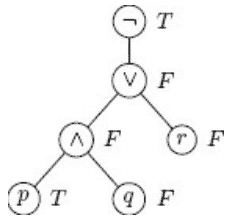

这可以用表格形式表示。注意，表达式树的每个节点都是一个对应子表达式的子树的根，我们表明每个子表达式都进行底向上的评估。为了简便，当然，我们使用了 TRUE 和 FALSE 的 T 和 F。

| p | q | r | p \wedge q | (p \wedge q) \vee r | \neg((p \wedge q) \vee r) |
|---|---|---|---|---|---|
| T | F | F | F | F | T |

当然，这三个变量可能处于八种可能状态之一。每种状态都会导致不同的底向上评估。我们可以将所有八种评估合并为一个表；这可以形成 $\alpha$ 的真值表。

| p | q | r | p \wedge q | (p \wedge q) \vee r | \neg(((p \wedge q) \vee r)) |
|---|---|---|---|---|---|
| T | T | T | T | T | F |
| T | T | F | T | T | F |
| T | F | T | F | T | F |
| T | F | F | F | F | T |
| F | T | T | F | T | F |
| F | T | F | F | F | T |
| F | F | T | F | T | F |
| F | F | F | F | F | T |

现在，最后一列可以独立出来作为函数 $\alpha(p, q, r)$ 的完整定义。我们可以对任何命题进行同样的练习。为了说明，考虑 $\beta = (\neg p \vee q) \wedge \neg r$，它在下面也被总结为一个函数。注意，当被视为函数时，$\alpha$ 和 $\beta$ 具有相同的真值表。

| p | q | r | \alpha(p, q, r) | \beta(p, q, r) |
|---|---|---|---|---|
| T | T | T | F | F |
| T | T | F | F | F |
| T | F | T | F | F |
| T | F | F | T | F |
| F | T | T | F | F |
| F | T | F | F | F |
| F | F | T | F | F |
| F | F | F | T | T |

## 2.3

考虑命题 $\alpha = \neg((p \wedge q) \vee r)$。如果变量的真值赋值 $p = \text{TRUE}, q = \text{FALSE}, r = \text{FALSE}$，我们可以看到如何“从底向上”地评估该命题。如图所示。首先，根据 $\wedge$ 的定义，$p \wedge q = \text{FALSE}$。接着我们根据 $\vee$ 的定义看到 $(p \wedge q) \vee r$ 是 FALSE。最后，$\neg((p \wedge q) \vee r)$ 被求值为 TRUE。

| p | q | r | \alpha(p, q, r) |
|---|---|---|---|
| T | T | T | F |
| T | T | F | F |
| T | F | T | F |
| T | F | F | T |
| F | T | T | F |
| F | T | F | F |
| F | F | T | F |
| F | F | F | T |

### 示例 2.3

考虑命题 $\alpha = \neg((p \wedge q) \vee r)$。如果变量有真值赋值 $p = \text{TRUE}, q = \text{FALSE}, r = \text{FALSE}$，我们可以看到如何从底向上评估该命题。这如图所示。

| p | q | r | \alpha(p, q, r) |
|---|---|---|---|
| T | T | T | F |
| T | T | F | F |
| T | F | T | F |
| T | F | F | T |
| F | T | T | F |
| F | T | F | F |
| F | F | T | F |
| F | F | F | T |

现在，最后一列可以独立出来作为函数 $\alpha(p, q, r)$ 的完整定义。我们可以对任何命题进行同样的练习。为了说明，考虑 $\beta = (\neg p \vee q) \wedge \neg r$，它在下面也被总结为一个函数。注意，当被视为函数时，$\alpha$ 和 $\beta$ 具有相同的真值表。

| p | q | r | \alpha(p, q, r) | \beta(p, q, r) |
|---|---|---|---|---|
| T | T | T | F | F |
| T | T | F | F | F |
| T | F | T | F | F |
| T | F | F | T | F |
| F | T | T | F | F |
| F | T | F | F | F |
| F | F | T | F | F |
| F | F | F | T | T |

### 定义 2.2 命题的等价

如果命题 $\alpha$ 和 $\beta$ 在其变量的所有状态下具有相同的真值，则它们是等价的。这记为 $\alpha \equiv \beta$。

### 示例 2.4

现在考虑另一个真值表，用于以下两个者的等价性：

```
p\wedge (q\vee r) 和 (p\wedge q) \vee r
```

与示例 2.2 一样，三个变量，所以需要八种状态。

| p | q | r | q\vee r | p\wedge (q\vee r) | p\wedge q | p\wedge r | (p\wedge q) \vee r |
|---|---|---|---|---|---|---|---|
| T | T | T | T | T | T | T | T |
| T | T | F | T | T | T | F | T |
| T | F | T | T | T | F | T | T |
| T | F | F | F | F | F | F | F |
| F | T | T | T | F | F | F | F |
| F | T | F | T | F | F | F | F |
| F | F | T | T | F | F | F | F |
| F | F | F | F | F | F | F | F |

比较第五列和最后一列，我们看到它们是完全对应的，每个都有三个 T 后面跟五个 F。由于这两个表达式在所有（八种）可能状态下具有相同的真值，我们得出结论：

```
p\wedge (q\vee r) \equiv (p\wedge q) \vee (p\wedge r)
```

| p | \neg p | p \vee \neg p |
|---|---|---|
| T | F | T |
| F | T | T |

| p | q | \neg p | \neg q | p \wedge q | (p \wedge q) \vee \neg p | (p \wedge q) \vee p \vee \neg q |
|---|---|---|---|---|---|---|
| T | T | F | F | T | T | T |
| T | F | F | T | F | F | T |
| F | T | T | F | F | T | T |
| F | F | T | T | F | T | T |

最后，当 \text{命题} 的真值表包含*某些* TRUE（一个或多个）时，它被认为是*可满足的*。一个某列全为 FALSE 的表达式是*不可满足的*。

## 2.4 命题逻辑律

本节列出了一些简短且实用的等价式，它们通常被称为**命题逻辑律**。你已经知道了其中一个，如下所示，因为它在前一节中已经得到了证明。其下方是用于对比数字分配律。

```
$p \wedge (q \vee r) \equiv (p \wedge q) \vee (p \wedge r)$
$x \times (y + z) \equiv (x \times y) + (x \times z)$
```

在算术中，乘法对加法分配律。这里的逻辑等价性与算术等价性相似，类比也称为分配律。它表示合取 $(\wedge)$ 分配于析 $(\vee)$。命题逻辑与算术不同，它不仅有一个分配律，而是有*两个*分配律：每个运算符 $(\wedge)$ 和 $(\vee)$ 都分配于另一个运算符。正如我们可以使用算术的分配律将一个（算术）表达式转换为另一个一样，我们也可以利用这种命题等价关系将一个（命题）表达式转换为另一个。与在算术中一样，处理表达式是生成新但等价的表达式的重要技术。每种等价关系都可以通过真值表很容易地建立，即通过穷尽的情形分析。请注意，这些律适用于通义命题（如 $\alpha$ 和 $\beta$），而不是变量 $p$ 和 $q$。然而，由于命题像布尔变量一样具有真值，因此我们谈论例如 $\alpha$ 和 $\beta$ 的当前状态，并完全相同的方式构造真值表。下一节将提供更多的命题等价式。

图 2.1 和图 2.2 中的列表给出了我们处理逻辑表达式时最重要的等价式。

### 否定律：

$\neg \alpha \equiv \alpha$

变量与其自身结合：

- $\alpha \vee \neg \alpha \equiv \text{TRUE}$ 排中律
- $\alpha \wedge \neg \alpha \equiv \text{FALSE}$ 矛盾律
- $\alpha \vee \alpha \equiv \alpha$ $\vee$ 的幂等律
- $\alpha \wedge \alpha \equiv \alpha$ $\wedge$ 的幂等律

常量的性质：

- $\alpha \vee \text{TRUE} \equiv \text{TRUE}$
- $\alpha \vee \text{FALSE} \equiv \alpha$
- $\alpha \wedge \text{TRUE} \equiv \alpha$
- $\alpha \wedge \text{FALSE} \equiv \text{FALSE}$

图 2.1：单变量等价式

排中律（Law of the Excluded Middle）是一条基本律。它是对命题定义的本质重新表述：它要么是真的，要么是假的。拉丁语“principium tertii exclusi”——排中律——表示没有第三种选择。（尽管有一个数学哲学学派禁止这一律，但几乎所有的数学家都在不加注释的情况下使用它。）

综合来看，命题逻辑的等价式集合比算术的类似规则集合更丰富、更对称。丰富性的一个例子是，算术中没有任何类似于德·摩根律的东西。对称性的一个例子可以在两个分配律中找到；许多律都是成对出现的。

### 交换律：

$\alpha \wedge \beta \equiv \beta \wedge \alpha$

$\alpha \vee \beta \equiv \beta \vee \alpha$

### 结合律：

$\alpha (\beta \vee \gamma) \equiv (\alpha \vee \beta) \vee \gamma$

$\alpha \wedge (\beta \wedge \gamma) \equiv (\alpha \wedge \beta) \wedge \gamma$

### 分配律：

$\alpha \vee (\beta \wedge \gamma) \equiv (\alpha \vee \beta) \wedge (\alpha \vee \gamma)$

$\alpha \wedge (\beta \vee \gamma) \equiv (\alpha \wedge \beta) \vee (\alpha \wedge \gamma)$

### 德·摩根律：

$\neg(\alpha \wedge \beta) \equiv \neg \alpha \vee \neg \beta$

$\neg(\alpha \vee \beta) \equiv \neg \alpha \wedge \neg \beta$

### 吸收律：

$\alpha \wedge (\alpha \vee \beta) \equiv \alpha$

$\alpha \vee (\alpha \wedge \beta) \equiv \alpha$

图 2.2：多变量等价式

学习这些律的主要目的是为了允许代数运算。建立像 $\alpha \equiv \beta$ 这样的新等价关系的目标通常不是通过真值表完成的。由于状态随变量数量指数级增长，真值表的局限性很大。相反，我们可以利用律通过代数方法将一个命题转换为具有相同真值表的另一个命题。正如数一样，处理表达式是生成新但等价表达式的重要技术。

## 2.4 考虑这些律

学习这些律的主要目的是为了允许代数运算。建立像 $\alpha \equiv \beta$ 这样的新等价关系的目标通常不是通过真值表完成的。由于状态随变量数量指数级增长，真值表的局限性很大。相反，我们可以利用律通过代数方法将一个命题转换为具有相同真值表的另一个命题。正如算术中一样，处理表达式是生成新但等价的表达式的重要技术。

## 2.4 考虑这些律

学习这些律的主要目的是为了允许代数运算。建立像 $\alpha \equiv \beta$ 这样的新等价关系的目标通常不是通过真值表完成的。由于状态随变量数量指数级增长，真值表的局限性很大。相反，我们可以利用律通过代数方法将一个命题转换为具有相同真值表的另一个命题。正如算术中一样，处理表达式是生成新但等价的表达式的重要技术。

## 2.4 考虑这些律


# 学习这些律的主要目的

学习这些律的主要目的是为了允许代数运算。建立像 `α ≡ β` 这样的新等价关系的目标通常不是通过真值表完成的。由于状态随变量数量指数级增长，真值表的局限性很大。相反，我们可以利用律通过代数方法将一个命题转换为具有相同真值表的另一个命题。正如算术中一样，处理表达式是生成新但等价的表达式的重要技术。

# 2.4 考虑这些律

学习这些律的主要目的是为了允许代数运算。建立像 `α ≡ β` 这样的新等价关系的目标通常不是通过真值表完成的。由于状态随变量数量指数级增长，真值表的局限性很大。相反，我们可以利用律通过代数方法将一个命题转换为具有相同真值表的另一个命题。正如算术中一样，处理表达式是生成新但等价的表达式的重要技术。

# 2.5 重要的运算符

我们现在有了除了真值表之外的证明命题的新方法：代数运算，即替换。第三种证明事物的方法（除了真值表和等价替换）是推理规则。这种技术在第 3.2 节中涉及一个特别重要的运算符，我们现在给它起了一个奇怪的名字 `Δ`，以便在不预判其含义的情况下讨论它。这个新运算符有以下真值表：

| | T | F |
|---|---|---|
| p | T | F |
| q | T | |

这个真值表告诉我们什么？首先，注意到它有三个 TRUE。因此，断言 `p Δ q` 是一个弱断言，将可能的状态从四个减少到三个。相比之下，断言 `p ∧ q` 是一个强断言，将其减少到一个，从而告诉我们 `p` 必须是 TRUE，`q` 也必须是 TRUE。

假设你通过某种方式确定 `p Δ q` 是 TRUE。那么，查阅真值表会告诉你你处于右上角之外的三个状态之一。也就是说，你可以得出状态 `p = TRUE` 且 `q = FALSE` 不是当前状态。现在假设你还得知了 `p = TRUE`。在 `p Δ q` 为 TRUE 的情况下，`p` 的真值能告诉你什么？每当 `p = TRUE` 时，我们在真值表的上半部分，但每当 `p Δ q = TRUE` 时，我们不在右上角。这留下了左上角，那里 `p` 和 `q` 都是真的。我们结论 `p` 和 `q` 都是真的。

总结，`p Δ q = TRUE` 让我们利用 `p = TRUE` 的信息来建立此外 `q = TRUE`。换句话说，它告诉我们（`p` 的真）导致了（`q` 的真）。因此，我们以后把 `Δ` 读作“导致”或“暗示”，并将其写为 `→`。这个箭头显示了我们推理的方向。它所代表的运算符被称为蕴赋值 `p → q`。

我们也将表达式 `p → q` 读作“如果 `p` 则 `q`”。这种英语表述方式可能和“或”（内包含或异或）一样令人困惑，除非我们仔细记住，对于其他运算符来说，定义是真值表而不是英语短语。尽管在英语中，当 `p` 为假时，“如果 `p` 则 `q`”似乎并没有太大意义，但我们已经看到有这个算符是有用的，它的定义为在 `p` 为 FALSE 的两种状态下都输出 TRUE。重要的点是，`p` 和 `(p → q)` 的真值共同确保了 `q` 的真值，而且我们可以通过真值表证明这一点！

另一个重要运算符的真值表所示。再次，我们为它使用了一个奇怪的名字，这次第一次使用 `◇`，以避免任何先入为主。从真值表可以看出，表达式 `p ◇ q` 在 `p` 和 `q` 真值相同的（两个）状态下为真：要么均为 TRUE，要么均为 FALSE。

| p | q | p ◇ q |
|---|---|---|
| T | T | T |
| T | F | F |
| F | T | F |
| F | F | T |

用于蕴赋值的相同推理方法也适用于这里。假设我们知道 `p ◇ q` 为真（使我们处于真值表的左上角或右下角），然后我们得知 `p` 为真（使我们处于第一行）。因此，唯一的可能就是左上角，此时 `p` 和 `q` 均为真。根据 `p` 和 `p ◇ q` 均为真，我们可以推导出 `q` 为 TRUE。

到目前为止，这种推理与蕴赋值一样。但现在注意，如果我们假设 `q` 为真（而不是之前的 `p`）且 `p ◇ q` 为真，会发生什么。`p ◇ q` 为真要求我们的状态位于左侧一列。这连同 `p ◇ q` 为真（左上角或右下角）再次使我们处于左上角，此时 `p = TRUE`。总之，当 `p ◇ q = TRUE` 时，我们可以从 `p` 推导出 `q`，也可以从 `q` 推导出 `p`。因为每一个都能推导出另一个，我们为该运算符使用双向箭头，写作 `p ↔ q`。该运算符有时被称为双充分条件运算符。

**蕴赋值律：**

`α → β ≡ ¬α ∨ β`

**双充分条件律：**

`α ↔ β ≡ (α → β) ∧ (β → α)`

**逆否题律：**

`α → β ≡ ¬β → ¬α`

### 图 2.3：与蕴赋值的等价关系

我们将 `p ↔ q` 读作“`p` 当且仅当 `q`”，或者更简洁地说“`p` iff `q`”。用不那么简洁的话说“如果 `q` 则 `p`，且 `p` 仅当 `q` 时”可能也有帮助。我们可以将“如果 `q` 则 `p`”部分重新表述为“如果 `q`，则 `p`”，这等同于 `q → p`。对于“`p` 仅当 `q`”部分，它指示当 `q` 为假时，`p` 也为假；即 `¬q → ¬p`。根据逆否题律，这又得到了 `p → q`；见下一段。

还有三个涉及我们新运算符的定律，每个定律显然都是通过真值表证明的。蕴赋值律出现在图 2.3 中；注意它非常准确地说明了如果你处于一个使 `p → q` 为真的状态，那么你就处于第一列 `(q)` 或第二行 `(¬p)`。双充分条件律 `p ↔ q ≡ (p → q) ∧ (q → p)` 确实促成了双向箭头和“当且仅当”短语的使用。逆否题律也在这。

# 2.6 范式

为了计算目的，将逻辑表达式转换为范式（或标准形式）可以简化各种算法。我们在这里介绍的第一个“范式”用于人工智能，第二个用于硬件设计。

## 示例 2.7

使用刚刚引入的律，我们替换了 `p ↔ q` 中的双充分条件运算符，得到一个仅使用运算符 `∧` 和 `∨` 的表达式：

```
p ↔ q ≡ (p → q) ∧ (q → p)
≡ (¬p ∨ q) ∧ (¬q ∨ p)
```

定义文字面为布尔变量或其否定，例如 `p` 或 `¬q`。定义合取项为一个或多个文字面用“或”连接，例如 `¬q ∨ R ∨ ¬p`。接下来，定义一个表达式为合取标准范式 (CNF)，如果它是一个或多个合取项用“与”连接。上一个示例解析为 CNF。

第二个范式从相同的文字面定义开始。接下来，我们定义析取项为一个或多个文字面用“与”连接，例如 `¬s ∧ p ∧ ¬q`。最后，定义一个表达式为析取标准范式 (DNF)，如果它是一个或多个析取项用“或”连接。

## 示例 2.8

考虑表达式 `(p ∨ q) ∧ ¬p`。使用分配律，我们得到 `(p ∧ ¬p) ∨ (q ∧ ¬p)`。由于 `p ∧ ¬p` 是恒假的，表达式简化为 `FALSE ∨ (q ∧ ¬p)`，结果为 `q ∧ ¬p`。这是一个合取标准范式 (CNF)。

另一个例子 `(p ∨ q) ∧ (r ∨ s)`。使用分配律，我们得到 `(p ∧ r) ∨ (p ∧ s) ∨ (q ∧ r) ∨ (q ∧ s)`。这是一个析取标准范式 (DNF)。

考虑图 2.6 中的电路。与上一个例子一样，我们可以确定每个门的输出。由此得出，该电路的输出为 `(¬A ∨ B) ∧ (B ∧ C) ∨ (¬C)`。根据德摩根定律结合律，这变为 `(¬A ∧ (¬B ∧ C) ∨ (¬C))`。但它可以简化为 `¬C`，这意味着可以使用更简单的电路。电气工程的一个主要关注点是寻找更简单的电路。实际上，由于电路的部分可以计算单独输出，这是一个艰巨的目标。


这是对需要几个学期才能掌握的材料简要介绍。我们的目标只是强调这一应用领域。

# 练习

## 2.1 – 考虑括号的影响。

- (a) 给出一组 `p, q` 和 `r` 的真值，使得 `(p ∨ q) ∧ r` 和 `p ∨ (q ∧ r)` 的值不同。
- (b) (a) 的答案反映了这些表达式中括号的什么？
- (c) 给出另一组 `p, q` 和 `r` 的值，可以回答 (a)。

## 2.2 – 第 2.2 节引入了单个逻辑运算符 `∧` 和 `∨` 的 `2×2` 方真值表。每个表有 4 个单元格。

- (a) 注意到二元命题算符 `∧` 和 `∨` 可以被视为函数 `f: B × B → B`。解释为什么总共有 16 个这样的函数。
- (b) 假设我们有一个这种类型和大小的空表，并希望四个单元格之一填充为逻辑常量 TRUE，其余三个单元格填充为 FALSE。有四种可能的方法，取决于 TRUE 的位置。每个生成的真值表都对应一个简单的逻辑表达式。使用 `p, q, ∧, ∨, ¬, →, ↔` 和 `()` 这九个符号中的任何符号，为四个表中的每个给出一个对应的表达式。尽可能减少运算符的出现次数。只使用必要的括号。
- (c) 执行与 (b) 相同的操作，不同的是这次每个真值表有一个 FALSE 和三个 TRUE。

## 2.3 – 使用像文中那样的 2 行真值表对于 `p ∨ ¬p`，证明这里给出的每个表达式都是永真式。对于每个表达式，用一或多个完整且清晰的句子解释为什么它应该永远为真。（后者是一个开放性问题，仅旨在产生熟悉感。）

- (a) `p ∨ TRUE`
- (b) `¬(p ∧ ¬p)`
- (c) `p → p`

## 2.4 – 正如第 2.3 节所示，使用真值表证明这些命题是等价的。第一个证明你需要在 4 行真值表中两个相同的列。第二个需要一个 8 行表。

- (a) `(p ∨ q) ≡ ¬p ∧ ¬q`
- (b) `p(q ∧ r) ≡ (p ∨ q) ∧ (p ∨ r)`

## 2.5 – 使用真值表证明条件律、充分条件律和逆否律。记得为 `Δ` 和 `◇` 引入的 `2 × 2` 真值表实际上是 `→` 和 `↔` 的表。

- (a) `p → q ≡ ¬p ∨ q`
- (b) `p ↔ q ≡ (p → q) ∧ (q → p)`
- (c) `p → q ≡ ¬q → ¬p`

## 2.6 – 写出一个适用于 3 项（如 `¬(q ∧ r ∧ s)`）的德摩根定律变体，并用代数方法建立该定律。

## 2.7 – 逐一步通过代数方法证明这些等价式的每一个。说明第 2.4 节或 2.5 节中的哪种等价证明了每一步。

- (a) `((p ∨ q) ∧ (¬p ∧ ¬q)) ≡ FALSE`
- (b) `p ∨ q ∨ r ∨ s ≡ (¬p ∧ ¬q ∧ ¬r) → s`

## 2.8 – 这是一个关于条件算符具有传递性的证明。该证明显示初始表达式是一个永真式，因为它等价于 TRUE；也就是说对于 `p, q` 和 `r` 的任何值都真。有时每一步使用两个或多个规则。写出每一步的等价式。

| 步骤 | 表达式 |
|---|---|
| i | `(p → q) ∧ (q → r) → (p → r)` |
| ii | `≡ (¬p ∨ q) ∧ (¬q ∨ r) → (¬p ∨ r)` |
| iii | `≡ ((¬p ∨ q) ∧ (¬q ∨ r)) ∨ (¬p ∨ r)` |
| iv | `≡ (p ∧ ¬q) ∨ (q ∧ ¬r) ∨ ¬p ∨ r` |
| v | `≡ (p ∧ ¬q ∨ ¬p) ∨ ((q ∧ ¬r) ∨ r)` |
| vi | `≡ (TRUE ∧ (¬q ∨ ¬p)) ∨ ((q ∧ r) ∧ TRUE)` |
| vii | `≡ ¬q ∨ q ∨ ¬p ∨ r` |
| viii | `≡ TRUE ∨ ¬p ∨ r` |
| ix | `≡ TRUE` |

## 2.9 – 使用真值表证明以下每个条件表达式都是永真式。解释为什么每一个都是合理的（再次，这是一个开放性问题）。


- (a) `$p \rightarrow (p \vee q)$`
- (b) `$q \rightarrow (p \rightarrow q)$`
- (c) `$((p \rightarrow q) \wedge p) \rightarrow q$`
- (d) `$((p \rightarrow q) \wedge \neg q) \rightarrow \neg p$`（注：根据标准逻辑重构，因为 OCR 不完整）

## 3.1 想要证明某事的理由

证明某事对人们来说（特别是对计算机科学家来说）有许多好处。正确的证明能够向你展示所证明的命题是正确的，前提是基于假设。它还向你展示为什么它是正确的，帮助你更深地理解主题。更广泛地说，证明为严谨思维提供了良好的实践。

转向计算领域，你知道计算机程序在所有可能的数据的情况下都是正确的。仅仅依靠几组数据是不够的。现实世界中有很多关于软件错误的案例，确保软件可靠性有几种方法，其中一种就是证明程序是正确的。这将在第6章中讨论。

证明过程本身是可以自动化的。事实上，在逻辑编程语言（如 `Prolog`）中，正如附录 A 所讨论的那样，在其他编程语言中（无论基于逻辑还是否），都可以编写证明。另一个自动化推理领域是专家系统。这些系统将人类推理应用于医学、科学、工程、法律和教育。

在共同推理和普通讨论中，非正式推理由许多策略组成，例如反例和案例分析。因此，形式化证明与普通推理的区别不在于证明的内容本身，而在于使用符号的精确性，以及在单一证明中涉及不同策略的长链。

## 3.2 自然归演绎证明

**证明**是一系列断言，旨在说服读者某个命题的真性。被证明的命题被称为**定理**。定理应该始终是一个真式；通常定理在开始时并不是显而易见的，但证明旨在让读者相信它是真实的。定理也应该具有某些意义，因为它有助于应用中证明其他重要结果。

证明的实际呈现很大程度上取决于读者的（假设的）水平以及给定命题的严谨性。这里将从证明的形式化视图开始，而不是证明的草图，原因有两个：首先，要理解你从未见过的证明草图是很难的；其次，形式化证明出现在多个计算机应用领域，例如“推理引擎”和“机械证明器”。

证明通过 (i) 从公认的真理开始 (ii) 按照约定的方法继续下去来说服人们。这些方法中的一些可能非常简单，认为不值得列出来，但这正是我们想要的！证明的起点是由一组**公理**中选出的断言组成的。这些简单的陈述被广泛接受为真。从公理推导后续的方法被称为**推理规则**。

此外，我们有时会尝试性地引入一个断言，即使我们不知道它的真假，只是为了探索它的后果。形式化证明是一系列断言，以被证明的命题结束，其中每个断言要么是公理，要么是假设，要么遵循序列之前的推理。跟踪哪些断言依赖于假设，并以不依赖任何假设的方式实现最终结果是至关重要的。

现实生活中的证明（在期刊和书籍中）通常非常严谨，但很少是“形式化的”。在严谨的证明中，公理可能被认为是如此普通且被接受而无需提及。例如，在算术中，我们通常不需要显式说明“4是3的后继”或“0是 $\mathcal{N}$ 的最小元素”（$\mathcal{N}$ 是非负整数集）。此外，即使提到了某些内容，其底层的许多“背景知识”可能是隐含的。这些事实是严谨的，因为它们过去已被他人证明，即我们的背景知识包含了关于特定领域（或主题）的推理规则。例如，在非负整数领域中，如果 $a < b$ 且 $b < c$，我们可以推断出 $a < c$。这种推理规则被称为“小于关系的传递性”，它是如此常见，以至于不说明也不会混淆任何人。

在本章中，我们通过不说明背景知识来避免可能的混淆。我们仅从命题的证明开始。公理和定理将是命题，推理规则也将基于命题逻辑。在后面的章节中，我们将为这些规则引入谓词逻辑。最终，我们将应用基于逻辑的推理来证明数字和计算机程序的属性；届时我们不假设任何背景知识。

在上章中，我们使用了两种方法通过单独考虑每个状态来确定某些命题在每个状态下都是正确的；我们将其称为穷举案例分析法。对于大量变量来说，它是相当没用的，更糟糕，它没有给读者提供关于其真实的见解；如果人为错误在表中引入了错误的条目，我们会注意到。其次，我们使用了允许代数替换/操作的法则将给定命题转换为某些等效形式。当新形式为常量 TRUE 时，我们就确定了给定命题为真式。完全通过这种方式进行的证明有时被称为“代数证明”。这种方法可能包含难以细节，而且也没有提供很多见解。

相比之下，在本章中，我们使用一种通常被称为“自然归演绎”的证明风格。这是对“常识”论证的严谨基础的形式化。方法的呈现细节在不同的书中有所不同。完全通过推理规则进行的证明——不依赖于代数操作——将被称为“自然归演绎”或“推理规则证明”。在 3.8 节中，我们将形式地将真式的证明和归演绎证明结合起来。

在下一节中我们将看到推理规则，但首先考虑一个更通用的设置。假设在证明之前，向读者证明了 $\alpha$ 是正确的；同时也向读者证明了 $\beta$ 是正确的。已知 $\alpha \wedge \beta \rightarrow y$ 是一个真式，这允许我们证明 $y$ 是正确的。

如果有两个表达式，则用 $\alpha_2$，第三个用 $\alpha_3$，以此类推，根据需要。

### 推理规则的模式

| $\alpha$ | $\alpha_1$ |
| :--- | :--- |
| 有 1 或 2 个前提时： | $\alpha_2$ |
| $\beta$ | $\beta$ |

推理规则具有双重性质，我们现在提到，稍后会回来讨论。首先最重要的是，推理规则是给定的，它们不是证明的一部分。我们不需要证明规则的合理性，只需使用它们即可。它们允许定理证明器在接受其他命题的前提下引入新的命题。我们必须记住，形式证明中的命题是一个符号表达式——一个字符串或者可能是一个表达式。例如，在应用肯定前件律（modus ponens）时，如果表达式 `$(\neg p) \rightarrow (q \vee r)$` 已经出现在证明中（即读者同意它是真的），并且表达式 `$\neg p$` 也出现了，那么我们就可以放心地添加表达式 `$(q \vee r)$`。由于我们不需要“理解”这些表达式中的任何一个。推理规则将这些表达式视为字符串。该规则对于定理证明器来说是全权许可的，它在不知道其为何有效的情况下使用它。

推理规则双重性质的第二个方面试图解释为什么最初将它们提供给定理证明器。我们可以给定理证明器看似任意的推理规则。但我们没有这样做。为什么？因为读者会失去兴趣。让整个方法变得有趣的是，我们只选择“可靠”（sound）的规则。为了证明一个由位于线上的命题表达式 $\alpha$ 和线下的命题表达式 $\beta$ 组成的推理规则，我们只需要证明 $\alpha \rightarrow \beta$ 是永真式即可。同样，如果 $\alpha_1 \wedge \alpha_2 \rightarrow \beta$ 是永真式，我们通过证明 $\alpha_1$ 和 $\alpha_2$ 在线上、$\beta$ 在线下来证明该推理规则。通常情况下，线上可以有任意数量 $n$ 的项，只要我们证明命题 $\alpha_1 \wedge \alpha_2 \dots \wedge \alpha_n \rightarrow \beta$ 是永真式即可。如果相应的命题是永真式，我们就说该规则是*可靠的*。如果规则是可靠的，读者就会相信结论是从前提推导出的。

### 示例 3.1

验证矛盾推理规则是可靠的。

参考图 3.1，我们看到证明 $\alpha \wedge \neg \alpha \rightarrow$ FALSE。

该表达式的真值表显示它是一个永真式。

| $\alpha$ | $\neg \alpha$ | $\alpha \wedge \neg \alpha$ | FALSE | $(\alpha \wedge \neg \alpha) \rightarrow$ FALSE |
| :--- | :--- | :--- | :--- | :--- |
| T | F | F | F | T |
| F | T | F | F | T |

### 示例 3.2

验证 $\vee$ 引入推理规则是可靠的。

根据图 3.1，这是通过证明 $\alpha \rightarrow (\alpha \vee \beta)$ 是永真式来建立的。

| $\alpha$ | $\beta$ | $\alpha \vee \beta$ | $\alpha \rightarrow (\alpha \vee \beta)$ |
| :--- | :--- | :--- | :--- |
| T | T | T | T |
| T | F | T | T |
| F | T | T | T |
| F | F | F | T |

在下一节中，我们将解释如何使用这些规则来构建证明。将会出现有趣的发现：我们可以使用推理规则来证明其他规则是可靠的。事实上，我们只需要“给出”两个规则（任选两个即可）就可以证明其余所有规则都是可靠的。这仅具有理论意义。更重要的是，我们拥有一组虽小但强大的规则，以至于读者会认为这些证明是“自然的”，毕竟这种技术被称为**自然归纳**（natural deduction）。图 3.1 中的列表是任意的，但在不同教科书之间相当标准。

这里有几点说明。首先，矛盾规则似乎与从真陈述（公理）开始并之后只生成真陈述的总体方案不符。这是正确的。然而当我们以后引入假设时，这条规则的实用性将变得显而易见。其次，永真式规则简单地说明，如果有一个读者同意为真的命题，就可以包含它。通常情况下，这将是更大背景下的某个之前的引理或定理。但在本章中，我们将以更具基础的方式使用这条规则；排中律是一个普遍的永真式。

注意，我们不允许显式的代数运算。当然，代数可以归入“推理”的伞下，因为 $\alpha \equiv \beta$ 这一事实证明了当 $\alpha$ 为真时推导出 $\beta$ 是合理的。这种禁止是刻意的选择。自然归纳是一种证明风格，可以通过代数进行增强，但必须首先按照自身的条款来理解。

| 肯定前件律: $\frac{\alpha \to \beta, \alpha}{\beta}$ | 否定后件律: $\frac{\alpha \to \beta, \neg \beta}{\neg \alpha}$ |
| :--- | :--- |
| $\wedge$ 引入: $\frac{\alpha, \beta}{\alpha \wedge \beta}$ | $\wedge$ 消除: $\frac{\alpha \wedge \beta}{\alpha}, \frac{\alpha \wedge \beta}{\beta}$ |
| $\lor$ 引入: $\frac{\alpha}{\alpha \lor \beta}, \frac{\beta}{\alpha \lor \beta}$ | $\lor$ 消除: (分类讨论) $\frac{\alpha \lor \beta, \alpha \to \gamma, \beta \to \gamma}{\gamma}$ |
| $\neg$ 引入: $\frac{\alpha}{\neg \neg \alpha}$ | $\neg$ 消除: $\frac{\neg \neg \alpha}{\alpha}$ |
| $\leftrightarrow$ 引入: $\frac{\alpha \to \beta, \beta \to \alpha}{\alpha \leftrightarrow \beta}$ | $\leftrightarrow$ 消除: $\frac{\alpha \leftrightarrow \beta}{(\alpha \to \beta) \wedge (\beta \to \alpha)}$ |
| 矛盾: $\frac{\alpha, \neg \alpha}{FALSE}$ | 永真式: (当 $\alpha \equiv$ TRUE 时) $\alpha$ |

图 3.1: 推理规则

## 3.4 规则证明

最简单的证明只不过是断言列表，每个断言读者都同意是真实的。列表上的最后一个断言是正在证明的定理。每个断言都可以标注读者同意它的理由；通常是因为某条推理规则。

如果读者同意 $\alpha$ 且从 $\alpha$ 可以使用推理规则证明 $\beta$，那么读者就同意 $\beta$。


如果读者同意 $\alpha$ 且从 $\alpha$ 可以使用推理规则证明 $\beta$，那么读者就同意 $\beta$。

如果有两个表达式，则用 $\alpha_2$，第三个用 $\alpha_3$，以此类推，根据需要。

### 推理规则的模式

| $\alpha$ | $\alpha_1$ |
| :--- | :--- |
| 有 1 或 2 个前提时： | $\alpha_2$ |
| $\beta$ | $\beta$ |

推理规则具有双重性质，我们现在提到，稍后会回来讨论。首先最重要的是，推理规则是给定的，它们不是证明的一部分。我们不需要证明规则的合理性，只需使用它们即可。它们允许定理证明器在接受其他命题的前提下引入新的命题。我们必须记住，形式证明中的命题是一个符号表达式——一个字符串或者可能是一个表达式。例如，在应用肯定前件律（modus ponens）时，如果表达式 $(\neg p) \rightarrow (q \vee r)$ 已经出现在证明中（即读者同意它是真的），并且表达式 $\neg p$ 也出现了，我们就可以放心地添加表达式 $(q \vee r)$。我们不需要“理解”这些表达式中的任何一个。推理规则将这些表达式视为字符串。该规则对于定理证明器来说是全权许可的，它在不知道其为何有效的情况下使用它。

推理规则双重性质的第二个方面试图解释为什么最初将它们提供给定理证明器。我们可以给定理证明器看似任意的推理规则。但我们没有这样做。为什么？因为读者会失去兴趣。让整个方法变得有趣的是，我们只选择“可靠”（sound）的规则。为了证明一个由位于线上的命题表达式 $\alpha$ 和线下的命题表达式 $\beta$ 组成的推理规则，我们只需要证明 $\alpha \rightarrow \beta$ 是永真式即可。同样，如果 $\alpha_1 \wedge \alpha_2 \rightarrow \beta$ 是永真式，我们通过证明 $\alpha_1$ 和 $\alpha_2$ 在线上、$\beta$ 在线下来证明该推理规则。通常情况下，线上可以有任意数量 $n$ 的项，只要我们证明命题 $\alpha_1 \wedge \alpha_2 \dots \wedge \alpha_n \rightarrow \beta$ 是永真式即可。如果相应的命题是永真式，我们就说该规则是*可靠的*。如果规则是可靠的，读者就会相信结论是从前提推导出的。

### 示例 3.1

验证矛盾推理规则是可靠的。

参考图 3.1，我们看到我们需要证明 $\alpha \wedge \neg \alpha \rightarrow$ FALSE。

该表达式的真值表显示它是一个永真式。

| $\alpha$ | $\neg \alpha$ | $\alpha \wedge \neg \alpha$ | FALSE | $(\alpha \wedge \neg \alpha) \rightarrow$ FALSE |
| :--- | :--- | :--- | :--- | :--- |
| T | F | F | F | T |
| F | T | F | F | T |

### 示例 3.2

验证 $\vee$ 引入推理规则是可靠的。

根据图 3.1，这是通过证明 $\alpha \rightarrow (\alpha \vee \beta)$ 是永真式来建立的。

| $\alpha$ | $\beta$ | $\alpha \vee \beta$ | $\alpha \rightarrow (\alpha \vee \beta)$ |
| :--- | :--- | :--- | :--- |
| T | T | T | T |
| T | F | T | T |
| F | T | T | T |
| F | F | F | T |

在下一节中，我们将解释如何使用这些规则来构建证明。将会出现有趣的发现：我们可以使用推理规则来证明其他规则是可靠的。事实上，我们只需要“给出”两个规则（任选两个即可）就可以证明其余所有规则都是可靠的。这仅具有理论意义。更重要的是，我们拥有一组虽小但强大的规则，以至于读者会认为这些证明是“自然的”，毕竟这种技术被称为**自然归纳**（natural deduction）。图 3.1 中的列表是任意的，但在不同教科书之间相当标准。

这里有几点说明。首先，矛盾规则似乎与这种从真陈述（公理）开始并之后只生成真陈述的总体方案一致。这是正确的。然而当我们以后引入添加时，这条规则的实用性将变得显而易见。其次，永真式规则简单地说明，如果有一个读者同意为真的命题，就可以包含它。通常情况下，这将是更大背景下的某个之前的引理或定理。但在本章中，我们将以更具基础的方式使用这条规则；排中律是一个普遍的永真式。

注意，我们不允许显式的代数运算。当然，代数可以归入“推理”的伞下，因为 $\alpha \equiv \beta$ 这一事实证明了当 $\alpha$ 为真时推导出 $\beta$ 是合理的。这种禁止是刻意的选择。自然归纳是一种证明风格，可以通过代数进行增强，但必须首先按照自身的来理解。

| 肯定前件律: $\frac{\alpha \to \beta}{\alpha}}{\beta}$ | 否定后件律: $\frac{\alpha \to \beta}{\neg \beta}}{\neg \alpha}$ |
| :--- | :--- |
| $\wedge$ 引入: $\frac{\alpha, \beta}{\alpha \wedge \beta}$ | $\wedge$ 消除: $\frac{\alpha \wedge \beta}{\alpha}, \frac{\alpha \wedge \beta}{\beta}$ |
| $\lor$ 引入: $\frac{\alpha \ \beta}{\alpha \lor \beta}$ | $\lor$ 消除: (分类讨论) $\frac{\alpha \lor \beta}{\alpha}, \frac{\alpha \lor \beta}{\beta}$ |
| $\neg$ 引入: $\frac{\alpha}{\neg \neg \alpha}$ | $\neg$ 消除: $\frac{\neg \neg \alpha}{\alpha}$ |
| $\leftrightarrow$ 引入: $\frac{\alpha \to \beta, \beta \to \alpha}{\alpha \leftrightarrow \beta}$ | $\leftrightarrow$ 消除: $\frac{\alpha}{(\alpha \to \beta) \wedge (\beta \to \alpha)}$ |
| 矛盾: $\frac{\alpha, \neg \alpha}{FALSE}$ | 永真式: (当 $\alpha \equiv$ TRUE 时) $\alpha$ |

图 3.1: 推理规则

## 3.4 规则证明

最简单的证明只不过是断言列表，每个断言读者都同意是真实的。列表上的最后一个断言是正在证明的定理。每个断言都可以标注读者同意它的理由；通常是因为某推理规则。

如果读者同意 $\alpha$ 且从 $\alpha$ 可以使用推理规则证明 $\beta$，那么读者就同意 $\beta$。（此处省略了原文中重复的20余次的相同句子）

- 1. $\gamma_1$ 之前的某行
- 2. $[\alpha]$ 某个假设
- 3. $\alpha_1$ 相对于 $\alpha$ 推导出的
- 4. $\alpha_2$ 相对于 $\alpha$ 推导出的
- 5. ...
- 6. $\beta$ 相对于 $\alpha$ 推导出的
- 7. $\gamma_2$ 不依赖于 $\alpha$ 的某行

看到这些，读者会得出结论：对于第 2 到 6 行，$\alpha=$ TRUE 且 $\beta=$ FALSE 是不可能的，因此 $\alpha \rightarrow \beta$ 必须为真。

虽然一个序（sequent）的证明可以作为子证明使用，但子证明并不局限于这种方法。原因是，在引入假设之前出现的任何内容（如上方的 $\gamma_1$）在添加假设后仍然是真实的，并且可以被我们的推理规则使用。（该序的证明并不知道 $\gamma_1$ 是真的，因此从未调用过它。）

这段引言引发了下所示推理规则，该规则允许我们引入一个包含 $\rightarrow$ 实例的表达式。因此，这个“引入”推理规则可以说是是所有推理规则中最重要的。它指出，如果我们假设 $\alpha$ 为真，并且在该假设的基础上我们可以证明 $\beta$ 必须为真，那么我们就可以推断出 $\alpha \rightarrow \beta$ 必须为真。注意，$\alpha \rightarrow \beta$ 相对于 $\alpha_i$ 的假设并不是真的，因此它没有缩进。所以在我们上面的例子中，使用这条规则 $\gamma_2$ 可以是 $\alpha \rightarrow \beta$。

```
$\rightarrow$ introduction: $[\alpha]/\beta \rightarrow \beta$
```

作为一个 $\rightarrow$ 引入这一思想的直观例子，假设你背身后有一个三角形。令 $p$ 为其角度为 $30^\circ$、$60^\circ$ 和 $90^\circ$ 的命题，令 $q$ 为其其中一条边的长度是另一条边的两倍的命题。由于三角形在你背后，你看不到它的角度，所以你不知道 $p$ 是否为真；你也看不到它的边，所以你不知道 $q$ 是否为真。然而，如果你假设 $p$，你就能证明 $q$，所以你知道 $p \rightarrow q$。

### 示例 3.5

考虑这个序 $p \rightarrow q \vdash (p \wedge r) \rightarrow (q \wedge r)$ 的证明：

- 1. $p \rightarrow q$ 已给
- 2. $[p \wedge r]$ 假设
- 3. $p$ $\wedge$ 消去，来自第 2 行
- 4. $r$ $\wedge$ 消去，来自第 2 行
- 5. $q$ $\wedge$ 假言推理，来自第 1 和第 3 行
- 6. $q \wedge r$ $\wedge$ 引入，来自第 5 和 4 行
- 7. $(p \wedge r) \rightarrow (q \wedge r)$ 引入，来自第 2 和 6 行

正如所有此类证明一样，推导出的蕴含出现在第 2 到 6 行的子证明中，因此它没有从那里“导出”出来。相反，蕴含之所以被推出来仅仅是因为该子证明的存在！

假设是可以嵌套的。也就是说，在一个假设的上下文中，我们可以做出额外的假设，使得两者都生效。当发生这种情况时，我们会进一步缩进。缩进纯粹是为了读者的方便而采用的形式语法约定。通过使用重复和嵌套缩进，我们更容易看到子证明的开始和结束。极其重要的一点是，当你离开子证明时，必须放弃在那里所做的所有断言，因为这些断言只相对于一个本身已被放弃的假设是可靠。

### 示例 3.6

以这种形式重新考虑之前的问题：$(p \rightarrow q) \rightarrow ((p \wedge r) \rightarrow (q \wedge r))$

- 1. $[p \rightarrow q]$ 已给
- 2. $[p \wedge r]$ 假设
- 3. $p$ $\wedge$ 消去，来自第 2 行
- 4. $r$ $\wedge$ 消去，来自第 2 行
- 5. $q$ $\wedge$ 假言推理，来自第 1 和 3 行
- 6. $q \wedge r$ $\wedge$ 引入，来自第 5 和 6 行
- 7. $(p \wedge r) \rightarrow (q \wedge r)$
- 8. $((p \rightarrow q) \rightarrow ((p \wedge r) \rightarrow (q \wedge r)))$ 引入，来自第 6 和 7 行

另一个使用假设的推理规则是归谬法（reductio ad absurdum）。它考虑在假设 $p$ 为真后我们可以得出什么结论，在该假设的基础上，找到 FALSE 将是我们证明中的一个有效行。在这种语境下，允许 $p$ 为真是荒谬的。因此，假设 $p$ 为真必须是错误的，所以我们推断出 $p$ 为假；因此，$\neg p$ 是真的。注意，结论 $\neg p$ 没有缩进，因为在遵循该 $p$ 导致 FALSE 之后，我们真的相信 $\neg p$。

### 归谬法：

注意，这就是我们使用前面提到的矛盾规则的语境。它表明，当一个命题和它的否定同时为真时，我们推导出“FALSE”。某些文本使用 $\perp$ 代替 FALSE，因为这仅仅是表示一个假设导致了矛盾；它并不悖论，因为它只是一个指示。

### 示例 3.7

虽然排中律 $a \vee \neg a$ 是一个永真式，但观察如何使用我们的推理规则证明它很有趣：

- 1. $[a \vee \neg a]$ 假设
- 2. $[\alpha]$ 假设
- 3. $\alpha \vee \neg \alpha$ 引入，来自第 1 行
- 4. FALSE 矛盾，来自第 2 行
- 5. $\neg \alpha$ 归谬法
- 6. $\alpha \vee \alpha$ 引入，来自第 5
- 7. FALSE 矛盾，来自第 6
- 8. $\neg \neg \alpha$ 归谬法，来自第 7

### 示例 3.8

证明这个命题 $((p \vee q) \wedge \neg p) \rightarrow q$：

- 1. $[(p \vee q) \wedge \neg p]$ 假设
- 2. $p \vee q$ $\wedge$ 消去，来自第 1 行
- 3. $\neg p$ $\wedge$ 消去，来自第 1 行
- 4. $[p]$ 假设
- 5. $[\neg q]$ 假设
- 6. FALSE 矛盾，来自第 3 和 4
- 7. $\neg q$ 归谬法，来自第 5 和 6
- 8. $q$ $\neg q$ 消去，来自第 7
- 9. $p \rightarrow q$ $\rightarrow$ 引入，来自第 4 和 8
- 10. $[q]$ 假设
- 11. $q$ 复制自第 10 行
- 12. $q \rightarrow q$ $\rightarrow$ 引入，来自第 10 和 11
- 13. 情况讨论，来自第 2、9 和 12
- 14. $((p \vee q) \wedge \neg p) \rightarrow q$ $\rightarrow$ 引入，来自第 1 和 13

### 示例 3.9

假设我们有一个矛盾的断言 $p \wedge \neg p$，并且我们选择不调用矛盾规则。这将导致*一切*都是真的，这是一个荒奇且不受希望的结果。为了这一点，请考虑这个来自更大证明的片段，它出现在一个产生了矛盾的子证明中：

- 1. $p \wedge \neg p$ 观察到的矛盾
- 2. $p$ $\wedge$ 消去，来自第 1 行
- 3. $\neg p$ $\wedge$ 消去，来自第 1 行
- 4. $[\neg q]$ 假设
- 5. FALSE 矛盾，来自第 2 和 3
- 6. $\neg q$ 归谬法，来自 4 和 5
- 7. $q$ $\neg q$ 消去，来自第 6

## 3.6 更多示例

我们提供了这些技术的更多示例。首先我们给出一个较长的例子。注意，任何代数律 $\alpha \equiv \beta$ 都可以重构为 $\alpha \leftrightarrow \beta \equiv T$，因为两者都断言在所有状态下 $\alpha$ 和 $\beta$ 的值相同。下一个例子将这一观察应用于条件律，$p \rightarrow q \equiv \neg q$。第二章中所有的代数律都可以重新解释为定理，这并不意外。

### 示例 3.10

证明 $(p \rightarrow q) \leftrightarrow (\neg p \vee q)$。

证明的结构可见在其几个嵌套假设的缩进中。尽管这个证明看起来很复杂，但下文讨论显示其大部分是以自然且直接的方式产生的。

```
$[\neg p \vee q]$
$[\neg p]$
$[p]$
$[\neg q]$
FALSE
$\neg q$
$q$
$p\neg p \to (p \to q)$
$[p]$
$q$
$p \to q$
$q \to (p \to q)$
$p \to q$
$(\neg p \vee q) \to (p \to q)$
$[p \to q]$
$p[p]$
$q$
$\neg p \vee q$
$p \to (\neg p \vee q)$
$[\neg p]$
$\neg p \vee q$
$\neg p \to (\neg p \vee q)$
$p \to q$
$( \to q) \leftrightarrow (\neg p \vee q)$
$(p \to q) \leftrightarrow (\neg p \vee q)$
假设
第一种情况结束
```


第二种情况结束

分类讨论

第一个主要子证明结束

假设

排中律（永真式）

第一种情况结束

第二种分析结束

分类讨论

第二个主要子证明结束

引入

这个证明是如何构思的？首先看我们要证明的内容：最后一行。主操作符是一个双含符号 `$\leftrightarrow$`。任何对 `$\leftrightarrow$` 的证明都必须使用 `$\leftrightarrow$` 引入规则，因此该证明必然分为两个子证明，每个子证明都使用 `$\leftrightarrow$` 引入规则。证明的前半从假设双含符号的右侧 `$\neg p \vee q$` 开始，由此我们必须证明左侧，而后半部分将相反。一旦我们做出假设 `$\neg p \vee q$`，使用分类讨论规则看起来是个好主意，首先假设 `$\neg p$`，然后假设 `$q$`，并尝试在每种情况下都证明左侧。对于 `$\vee$`，除了所谓的 `$\vee$`-消去规则外，你没做不了其他什么了。

在证明的后半部分，该做什么就没那么清晰了。一个像 `$p \to q$` 这样的蕴含式如果不与其他任何东西结合，它是没用的。对于这部分，我们建立了一个分类讨论，调用了排中律。注意，永真式可以在任何时候引入证明中。（此外，我们可以插入示例 3.7 中的步骤，而不是将其作为永真式调用。）我们决定调用排中律取决于我们对证明的经验，但这实际上非常符合常识：当我们无法确定某事是真是假时，请检查两种可能性。

接下来，我们使用自然推导来证明一个推理规则。记住，如果 `$\alpha \to \beta$` 是永真式，那么它是可靠的。然而，如果我们能证明 `$\alpha \to \beta$` 是一个定理（即它是可证明的），那么该规则就以更直接的方式得到了证明。如果一个规则有证明，我们就可以将其加入允许规则列表；否则，我们总可以在想要调用规则的地方替换为该规则的证明。通过这种方式，新的、更强大的规则可以缩短证明的长度。

### 示例 3.11

我们将证明否定后件法（modus tollens），但当然，我们不会通过使用否定后件法规则来实现它。在这里，我们只使用否定后件法以外的规则。练习要求你证明该证明中每一行的合理性。

```
((α→ β) ∧ ¬β)
α→β
[]
β
FALSE
¬α
((α→ β) ∧ ¬β) → ¬α
```

## 3.7 定理类型与证明策略

上述示例展示了形式化证明是如何进行的。它们的形式为“如果 `$\alpha$` 则 `$\beta$`”以及“`$\alpha$` 当且仅当 `$\beta$` 时”。这是两种非常常见的定理类型。我们对如何处理这类定理提供一些提示。

定理是从上到下阅读的。每一行都标注了它为什么应该从上面的行推出的理由。然而，一个定理主要是从下往上写的。最后一行是起点；它是初始目标。通过观察目标并查阅推理规则列表，证明者可以选择一种策略来实现目标。这意味着在证明的更高处会有新的目标，这些目标将证明第一个目标。有时当我们向下推导时，特别是当我们使用像 `$\wedge$` 消去之类的规则拆解复合语句时。

### 示例 3.12

我们将开始勾勒条件算子传递性的证明证明。在符号形式下，该定理为 `$((\alpha \to \beta) \wedge (\beta \to \gamma)) \to (\alpha \to \gamma)$`。由于连接符连接了主要的括号表达式子表达式，我们的策略将使用 `$\to$` 引入。第一件事是将定理本身作为证明的最后一行，并在前面加上证明它所需的材料，如下所示的证明计划草图所示。

| `$(\alpha \to \beta) \wedge (\beta \to \gamma)$` | 假设 |
|---|---|
| `$\alpha \to \gamma$` | 需要证明的新目标 |
| `$(\alpha \to \beta) \wedge (\beta \to \gamma) \to (\alpha \to \gamma)$` | `$\to$` 引入 |

右侧列是注释。对于 `$\alpha \to \gamma$`，理由是“需要证明的新目标”。我们想证明它，但不知道如何做。这只是一个计划，不是完成的证明。接下来，证明 `$\alpha \to \gamma$` 的计划处理类似：详细证明。我们应该尝试完成它，根据需要使用 `$\wedge$` 消去和肯定前件（modus ponens）；这被留作练习。

```
$(\alpha \to \beta) \wedge (\beta \to \gamma)$ | 假设
$[\alpha]$ | 假设
$\gamma$ | 需要证明的新目标
$\alpha \to \gamma$ | $\to$ 引入
$((\alpha \to \beta) \wedge (\beta \to \gamma)) \to (\alpha \to \gamma)$ | $\to$ 引入
```

上述证明一旦完成，就建立了一个形式为 `$\alpha_1 \wedge \alpha_2$` 的定理，并因此证明了一个被称为 `$\to$` 传递性的推理规则，正如上一节解释的那样，我们可以在未来的证明中使用这种规则。这样的规则可能是：


关于如何思考证明的问题已经提出，特别是在前几个章节的讨论中。同样重要的是记住，一旦定理被证明，它就可以作为其他某事证明的一部分。事实上，被证明的定理就像公理或推理规则一样被使用。

要证明的定理类型可能暗示证明的风格。例如，许多定理采取条件句的形式。

## 3.8 可靠性与完备性

我们在前两个章节中试图强调命题逻辑的用处。我们通过同时讨论两个线程来实现这一点，现在我们将把它们分开。

最初，有一个想法是证明是可靠的（sound）。记住，如果一个 `$\alpha \to \beta$` 是永真式，那么它是可靠的（此处原文误）。同样重要的是记住，一旦一个定理被证明，它就可以作为其他某事证明的一部分。事实上，被证明的定理就像公理或推理规则一样被使用。

最初，有一个想法是证明是完备的（complete）（此处原文误）。我们也说命题是真值的陈述。但如何给字符串赋值这样的值呢？在每个章节中我们给出了不同的答案。

首先，我们对字符串给出语义解释，说明符号的意思。形式上称为语义模型。模型是基于常量、变量和操作符的。这允许我们根据关于变量的信息来计算表达式。在更正式的演示中，我们将使用这种符号（称为语义蕴含）：

`$\alpha \models \beta$`

来表示在每个状态下当 `$\alpha$` 值为 TRUE 时，`$\beta$` 的值也是 TRUE；事实确实如此，我们说“`$\alpha \models \beta$` 成立”。我们主要感兴趣的是那些使得 `$\models y$` 成立的命题 `$y$`。

这由库尔·哥德尔（Kurt Gödel）于1929年首次证明。该定理可以理解为本章中的命题逻辑系统是“可靠且完备的”。我们说该系统是*可靠的*，因为 `$\vdash \alpha \implies \alpha$`；如果你能证明某物，它一定是真的。我们说该系统是*完备的*，因为 `$\alpha \vdash \alpha$`；如果某物是真的，那么就可以用自然推演证明。证明很大程度上依赖于我们的推理规则本身是可靠的。作为一个系统，自然推演并不在乎规则是否可靠。然而，通过只选择可靠的规则，我们使得定理 3.1 得以证明。

我们依赖于自然推演证明系统。问是否还有其他证明方法是合理的。确实还有其他方法，但它们在可靠性和完备性方面具有同样的力量。另一种方法（我们不再进一步讨论）是语义分板法（semantic tableaux），它关注的是一个表达式是否可满足（参见第 2.3 节）。它被用于证明某个感兴趣的表达式的否定*必须*是假的，即它是*不可满足的*。该方法的效果是将表达式转化为析取标准范式（参见第 2.5 节）。然后观察每个析取项，看它是否包含一对相互矛盾的文字节点，例如 `$p$` 和 `$\neg p$`。当且仅当每个析取项都包含这样一对时，该表达式是不可满足的。

## 练习

3.1 通过真值表证明分类推理规则是可靠的，并给出 `$((p \vee q) \wedge (p \rightarrow r) \wedge (q \rightarrow r)) \rightarrow r$` 的真值表。

3.2 对示例 3.11 中的证明进行注释，解释为什么每一行都是合理的。

3.3 对示例 3.10 中的证明进行注释，解释为什么每一行都是合理的。所展示的注释仅仅是与文本相关的注释。

3.4 完成在示例 3.12 中概述的证明。

3.5 考虑公式 `$q \rightarrow (p \rightarrow q)$`。简单来说，它说如果某物是真的，任何东西都能推导出它。事实确实如此。按照第 3.7 节中的证明规划构造一个证明计划。首先，将所需的最终结果写在最后一行。确定哪个“`$\rightarrow$`”分隔了表达式的主体，并将其写在之前的行中，并适当使用缩进和括号。然后对其他“`$\rightarrow$`”进行类似操作。这将给你 5 行证明，事实证明这就是你所需要的。为每行添加依据，就完成了。

3.6 使用推理规则证明 `$((p \wedge (p \rightarrow q)) \wedge (q \rightarrow r)) \rightarrow r$`。提示：公式中的顶层运算符是条件符号（`$\rightarrow$` 符号）。首先将该符号左侧的所有内容（大括号内）写在证明的第一行，使用括号并缩进，作为假设。留出空间，并将你待证明的整个公式作为最后一行，不要加括号也不要缩进。尝试在倒数第二行得到一个缩进的 `$r$`。当然，它之前的行必须证明将其放在那里是合理的。

3.7 使用推理规则证明练习 2.14 中的结果。对证明进行注释，为每行编号，并在每行缩进说明其合理的推理规则，以及该规则所依赖的先几行。假设不需要依据。

3.8 回想逆否题等价性，`$\alpha \rightarrow \beta \equiv \neg \beta \rightarrow \neg \alpha$`。我们将其重写为双向条件。正式证明 `$(\neg \beta \to \alpha) \leftrightarrow (\alpha \to \beta)$`

**3.9 – 使用推理规则证明练习 2.16 中的结果。** 与上一个问题一样，首先将等价关系重写为双向条件。

**3.10 – 此练习将分类讨论的思想扩展到三种情况的情况。** 给出以下推理规则格式的证明：

`$((p \vee q \vee r)) \wedge (p \to s) \wedge (q \to s) \wedge (r \to s)) \to s$`

不要忘记，即使习惯允许我们在三个或多个结合运算时省略括号，那些括号仍然存在。

**3.11 – 由于命题逻辑的可靠性和完备性**，每一个永真式都可以通过自然推演证明。这里是一些可以尝试的永真式：

- `$(p \to q) \to (p \to (p \wedge q))$`
- `$p \leftrightarrow (p \vee (p \wedge q))$`
- `$(p \to q) \to (p \to (p \wedge q))$`
- `$p \leftrightarrow p \wedge (p \vee q)$`
- `$(((\neg p \to q) \wedge \neg q) \to p)$`
- `$(p \to r) \to ((q \to r) \to ((p \vee q) \to r))$`
- `$(p \wedge q) \leftrightarrow \neg(p \to \neg q))$`
- `$p \to (q \to (p \wedge q))$`
- `$(p \wedge (q \vee p)) \leftrightarrow p$`
- `$(p \leftrightarrow q) \to ((q \leftrightarrow r) \to (p \leftrightarrow r))$`
- `$(p \to r) \to ((p \to q) \to (p \to r))$`

# 第 4 章

## 谓词逻辑

与命题逻辑对命题的原子化的真假视角相反，谓词逻辑将其拆解。我们对命题的研究得出了一些重要结果，借此关注属性和关系。

## 4.1 谓词与函数

你可能在第 2 章记得我们的第一个命题例子是 `$5 > 3$`。现在观察该命题内部，我们关注运算符，“>`”可以被看是一个函数。为了让名称的联系更清晰，我们给这个运算符起了一个像函数一样的名字，并写在前面，例如：`GreaterThan(5, 3)`。因此，`GreaterThan` 是定义在实数对 `$R$` 上的函数。在第 1.2 节的术语中，`GreaterThan` 的域是 `$R \times R$`。该函数的值域——即映射进去的集合——是 `$\mathcal{B} = \{TRUE, FALSE\}$`。总结一下，`GreaterThan: $R \times R \to \mathcal{B}$`。我们现在准备好定义谓词并将其联系起来。

### 谓词

谓词是一个值域为 `$\mathcal{B} = \{TRUE, FALSE\}$`的函数。

因此`GreaterThan` 是谓词。从定义也可以推导出，固定参数的谓词是 `$\mathcal{B}$` 的成员，命题也是如此。例如，`GreaterThan(5, 3)` 是一个命题，其值恰好为 TRUE。虽然每个谓词的值域都是 `$\mathcal{B}$`，但定义域要灵活得多。我们在介绍性示例中使用了实数对作为域，但后面的示例将使用域为人、符号和其他数字集合的谓词。

将 `GreaterThanThree` 的概念被广泛使用，而表达更有用的 `GreaterThan` 概念确实有一个常规符号（“>”）。

在对谓词进行推理时，理解它们与命题（propositions）之间的关系至关重要。将谓词看作领域中每个元素的一组命题的简写是合理的。例如，假设 `$p$` 代表我们一直称呼的谓词 `GreaterThanThree`。`$p(-2)$` 是一个值为 FALSE 的命题，而 `$p(7)$` 是一个值为 TRUE 的命题。将我们对 `$\wedge$` 运算符的理解扩展到包含谓词的表达式，我们得到了如 `$p(-2) \wedge p(7)$` 这样的命题。这个命题实际上是假的，因为 `$p(-2) \wedge p(7) = \text{FALSE} \wedge \text{TRUE} = \text{FALSE}$`。

### 示例 4.1

设 `$q$` 为其参数为 7 的谓词。结合上述谓词 `$p$` 使用 `$q$`，`$r(x) = p(x) \wedge q(x)$` 是什么意思？

这里 `$r$` 是一个在 `$p$` 和 `$q$` 均为真时为谓词。换句话说，`$r$` 是处于 3 到 7 之间的属性。我们也可以写成：

```
r(x) = p(x) ∧ q(x) = (x > 3) ∧ (x < 7).
```

因此，例如 `$r(6.8) = p(6.8) \wedge q(6.8) = \text{TRUE} \wedge \text{TRUE} = \text{TRUE}$`，但 `$r(-16.5) =$ FALSE`。虽然 `$r$` 比 `$p$` 和 `$q$` 复杂，但它和它们一样，都只接受一个参数。因此，`$r$` 将一个实数映射到一个逻辑常量，我们可以写成 `$r : \mathbb{R} \to \mathbb{B}$`。

非数值参数也很有趣。例如，设 `$P$` 为人员集合。我们可以定义 `Mother` 为谓词，对于集合 `$P$` 中的两个成员 `$x$` 和 `$y$`，当且仅当 `$x$` 是 `$y$` 的母亲时，`Mother(x,y)` 为真。例如，`Mother(Hillary, Chelsea) = TRUE`。在这种情况下，`Mother: P \times P \to \mathbb{B}`。

通常假设存在某个明显的定义域或对象宇宙（实数、人员等），作为变量的可能值。有时在泛泛而谈时，在没有特定宇宙的情况下，我们可能将该宇宙称为 `$U$`。

## 4.2 谓词、英语与集合

人类语言以多种方式表达谓词的概念。例如，在前面的节中，我们从英语中借用了“mother”（母亲）一词作为逻辑谓词 `MOTHER`，如 `MOTHER(x, y)`，意味着 `$x$` 是 `$y$` 的母亲。人类语言并不总是精确且无歧的，即使是简单的词“mother”也可以有不同的用法，例如在“需要是发明之母”这样的比喻中。尽管如此，我们将假设此类例子足够清楚了。让我们看看英语中表达谓词的更多例子。当然，每种人类语言都表达与所讨论相似的思想。

像“aunt”（姨妈）、“brother”（兄弟）以及其他家庭关系的词可以很容易翻译成二元谓词，就像“mother”一样。国籍形容词如“French”（法国的）可以作为一元谓词使用，如 `BELGIAN(Poriot)`。但请注意，谓词逻辑的概念或定义中没有任何东西阻止我们将其写成一个二元谓词，如 `CITIZENSHIP(Poriot, Belgian)`，从计算的角度来看这可能更方便。这取决于我们如何使用逻辑提供的框架。名字是一个选择问题。因此，虽然我们在这里说的 `Poirot` 指的是虚构侦探赫赫库尔·波洛洛，但只要我们保持一致，常量 `Poirot` 就可以代表其他某人（或某物）。

颜色的形容词可以用一个参数表示，如 `BROWN(Desk-1)`，但在这里再次正如国籍的情况一样，使用通用概念——在这种情况下是把颜色作为谓词——通常是有用的。这样做再次导致了两个参数：`COLOR(Desk-1, Brown)`。其他形容词，即描述尺寸的形容词，表达的是一个并不适用于单个对象，而是适用于对象相对于其类的属性。例如，一只大蚂蚁远没有一只小大象大。因此，一只大蚂蚁相对于蚂蚁来说是大大的，但相对于动物或一般的物品来说不是大。为了在谓词逻辑中捕捉这一思想，我们可能希望写下 `BIG(Ant-3, Ant)`，意味着 `Ant-3` 对于蚂蚁来说是大的。将更通用的尺寸概念作为谓词将导致三个参数：`SIZE(Ant-3, Ants, Big)`。

### 示例 4.2

使用 3 参数谓词 `Size` 来表达这样一个事实：小象 Jumbo 虽然对大象来说很小，但是一只大哺乳动物。

```
SIZE(Jumbo, Elephant, Small) △ SIZE(Jumbo, Mammal, Big)
```


动词是谓词的另一个来源。动词“borders”（接壤）对应于表示两个国家接壤的谓词：`BORDERS(India, Pakistan)`。这个谓词是对称的，因为它的两个参数可以随时交换而不改变命题的值。另一个地理例子是说明河流流经一个国家。这个谓词对应于动词与介词结合的意思：`RUNSTROUGH(Amazon, Brazil)`。在这里我们有一个“多对多”映射，因为河流可能流经多个国家，而一个国家可能有多个河流。与 `RUNSTROUGH` 不同，谓词 `MOTHER` 是“一对多”的，因为每个人恰好有一个（生物）母亲。

### 示例 4.3

设 $m$ 为一个函数，$m(x) = y$ 意味着 $y$ 是 $x$ 唯一的母亲。那么，有了 $x$ 唯一的母亲，$x$ 的母亲是谁？

这个表达式说明了 $x$ 的唯一母亲是 $y$。由此推导出对于 $x$，$y$ 是其唯一的母亲。对于 $x$，其唯一母亲的真集是 $y$。

### 示例 4.4

设 `Vowel` 为一个以元音为输入的谓词。假设 'e' 为 TRUE，其他字母为 FALSE。所以元音 = {'e', 'i', 'o', 'u'}

## 4.3 量词

到为止，我们使用谓词一次对一个事物进行断言。**量词**（Quantifiers）为我们提供了一种简洁、精确的方法来一次对整个集合进行断言。这种情况与编程语言中的循环类似于，循环允许我们对整个集合执行相同的操作。（事实上，事实证明量词之一被用于描述程序正确性的结果；见第 6 章。）本章其余部分的示例经常引用以下集合：

- $\mathcal{U}$：任意集合。
- $\mathcal{I}$：整数
- $\mathcal{N}$：非负整数（包括零）
- $\mathcal{R}$：实数
- $\mathcal{P}$：活人集合
- $\mathcal{Q}$：所有人（无论生死）

全称量词意味着“每一个”或“对于所有”，用符号 $\forall$ 表示。它表示某个集合中的每个元素具有某种属性，因此为了使用它，我们需要指定集合和我们考虑的属性。属性由一元谓词表示，因此 $\forall x \in \mathcal{U} : p(x)$ 可以读作“对于集合 $\mathcal{U}$ 中的所有成员 $x$，$p(x)$ 为真”，或者简单地说，“$\mathcal{U}$ 的每个成员都满足 $p$”。该集合（此处为 $\mathcal{U}$）被称为量化的**定义域**（domain）。

### 示例 4.5

使用 $\forall$ 表达语句“每个整数都有一个大于或等于 0 的平方”。

这里有一种表达方式：

```
forall x \in \mathcal{I} : (x^2 \geq 0).
```

这是更通用设置的一个特定版本：

$\forall x \in \mathcal{I} : p(x$，其中 $p(x) \leftrightarrow x$ 有一个非负平方数

示例 4.5 中的每个全称量化表达式都意味着 $0^2 \ge 0$ 且 $1^2 \ge 0$ 且 $(-1)^2 \ge 0$ 等。注意前句中使用了“和”（and）这个词，这表示合取词与全称量词之间存在紧密的关系。更广地说，对于一个论域 $\mathcal{U} = \{x_1, x_2, \dots \}$，我们写道

$(\forall x \in \mathcal{U} : p(x)) \equiv p(x_1) \wedge p(x_2) \wedge \dots$

但这说明了符号法的威力，因为它在不诉诸使用“...”的情况下传达了大量的（可能是无限的）析取关系。

**存在量词**意味着“对于某些”或“存在 ... 使得”，用符号 $\exists$ 表示。它同样要求我们指定一个集合和一个属性；$\exists x \in \mathcal{U} : p(x)$。

### 示例 4.6

使用 $\exists$ 表达以下语句：“在 3 和 7 之间存在一个整数。”

$\exists x \in \mathcal{I} : ((x > 3) \wedge (x < 7))$。

这个存在量化表达式意味着 0 在 3 和 7 之间，或者 1 在它们之间，或者 -1 在它们之间，或者 $\dots$。这种对“或”（or）的使用正如预期的那样是以包含性意义来理解的。也就是说，就像 $\vee$ 运算符一样，$\exists$ 是包含性的：当一个或多个参数满足谓词时，该等式就成立。因此，前述是正确的，因为当 $x=4$ 或 5 或 6 时谓词为真。

关于 $\exists$ 和 $\vee$ 之间关系的通用且正式的表述是：

$(\exists x \in \mathcal{U} : p(x)) \equiv p(x_1) \vee p(x_2) \vee \dots$

对于仅包含两个元素的论域 $\mathcal{U} = \{x_1, x_2\}$，我们可以重写第 2 章中德摩根定律的第一条：

$\neg p(x_1) \wedge p(x_2) \equiv \neg p(x_1) \vee \neg p(x_2)$

进入一个更大的但仍有限的论域 $\mathcal{U} = \{x_1, x_2, \dots, x_n\}$，允许我们写出德摩根定律的以下推广，它们在 $n = 2$ 时与之前的等价式相同。它们可以使用早期关于 $\wedge$ 和 $\vee$ 的量词通用等价式，通过反复应用原始的德摩根定律来证明；参见练习 5.6。

$\forall x \in \mathcal{U} : p(x) \equiv \exists x \in \mathcal{U} : \neg p(x)$

以及

$\exists x \in \mathcal{U} : p(x) \equiv \forall x \in \mathcal{U} : \neg p(x)$

现在专门看第一个等价式。它的左侧定义了每个 $x$（在有限论域 $\mathcal{U}$ 中）满足 $p$。它的右侧从不同的角度说明了相同的内容：存在一个 $x$ 不满足 $p$。这就像说“所有狗都是棕色的是假的”与“有（至少）一只狗不是棕色的”之间的区别。你可以用上述第二个等价式创建一个类似的例子。（我们仅通过非正式的注释支持了上述等价式。此向任意 $n$ 推广的正式证明还需要数学归纳法，在本章中介绍……）

非正式地说，德摩根推广表示否定可以通过量化转变为存在量化，反之亦然。在尝试理解否定如何与量词的作用域相互作用时，考虑相应英语句子的含义会有帮助。

### 示例 4.7

使用逻辑逻辑符号将每个英语句子转换为量化表达式，使用 $\mathcal{P}$ 表示集合，使用单参数谓词 IsOwner。

- 不是所有人都有车：$\neg \exists x \in \mathcal{P} : IsOwner(x)$
- 有人没有车：$\exists x \in \mathcal{P} : \neg IsOwner(x)$
- 没有人没车：$\neg \exists x \in \mathcal{P} : \neg IsOwner(x)$

经常，像"$x \in \mathcal{I}$”这样的量化形式简化为"$x$”。只要 $x$ 的范围在上下文中清晰，这就是合理的。然而，显式查看论域通常更清晰。例如：

$\exists x \in \mathcal{R} : 3 < x < 4,$

因为有实数（如 $\pi$ 和 3.45）位于 3 和 4 之间，但将 $\mathcal{R}$ 替换为 $\mathcal{I}$ 会使这个表达式失效。你可以看到这里的 $\mathcal{R}$ de比 $x$ 更重要，因为 $x$ 可以替换为 $y$ 或任何其他变量，但 $\mathcal{R}$ 不能替换为 $\mathcal{I}$。这关乎域。

### 示例 4.8

（注：该部分的文本在原文中似乎破碎；根据标准逻辑文本，它讨论了变量的作用域和空集。）

非正式地说，德摩根推广表示否定可以通过量化转变为存在量化，反之亦然。在尝试理解否定如何与量词的作用域相互作用时，考虑相应英语句子的含义会有帮助。

## 4.4 多重量词

正如一个量词可以应用于带一个变量的谓词一样，两个（或多个）量词也可以应用于带两个（或多个）变量的谓词。我们从仅使用全称量词的示例开始，进入包含两种量词的示例。

### 示例 4.9

以下量化表达式意味着什么？

$\forall x : \forall y : MOTHER(x, y) \leftrightarrow (PARENT(x, y) \wedge FEMALE(x))$

$\forall x : \forall y : \forall z : OFFSPRING(x, y, z) \leftrightarrow (MOTHER(y, x) \wedge FATHER(z, x))$

### 示例 4.10

写一个量化布尔表达式表示之前引入的谓词 BORDERS 的对称性。

$\forall x : \forall y : (BORDERS(x, y) \leftrightarrow BORDERS(y, x))$

### 示例 4.11

使用两种量词写一个表达式，表示“每个整数的平方都是整数”。这与示例 4.5 相比，后者并未声称平方是整数。

```
$\forall x \in \mathcal{I} : \exists y \in \mathcal{N} : y = x^2$
```

示例 4.8 定义了 $p(x)$，使得表达式 $\forall x \in \mathcal{I}: p(x)$ 阐述了一个核心思想：当存在多个量词时，始终可以将其视为一个作用在谓词上的单一量词，而该谓词本身又是一个量化表达式。正因如此，有些人说量词是从左到右读取的。

尽管存在量词声称至少有一个合适的 $y$ 值，但实际上我们知道恰好有一个。（练习 4.14 引入了一个表示“恰好有一个”的特殊量词，这对于示例 4.11 将很有用。）虽然示例 4.11 说数字具有平方数，但示例 4.12 让我们能够说明如果一个数字满足某些条件，它就是平方数。事实上，示例 4.12 定义了平方数的概念。注意，与示例 4.9 中的定义一样，这个定义也以全称量词开头，并包含一个双条件运算符。

### 示例 4.12

定义谓词 ISPERFECTSQUARE，对于整数 0, 1, 4, 9, 16 等平方数，其值为真。

> $\forall x \in \mathcal{I}: IsPerfectSquare(x) \leftrightarrow (\exists y \in \mathcal{I}: x = y^2)$

量化的顺序非常重要。在示例 4.11 和 4.12 中，某个 $y$ 的存在是相对于已经引入的 $x$ 而声称的，因此当我们遍历 $x$ 集合的所有成员时，$y$ 的选择可能取决于正在考虑的 $x$ 取什么值。在这种情况下，我们说 $y$ 在 $x$ 的作用范围内。量词的作用范围延伸到其公式的末尾，除非用括号另行说明。在示例 4.12 中，取 $x$ 的值为 9 和 49。其中一个 (9) 是平方数，是因为存在 $y$ 值 -3 或 3；另一个 (49) 也是平方数，但其基础是不同的 $y$ 值，即 -7 或 7。

正如下一个示例所示，在真表达式中反转量化的顺序通常会得到假表达式。

### 示例 4.13

反转示例 4.11 中表达式的量词顺序。

该表达式是假的，因为它声称存在一个（特殊的）数字可以作为每个整数的平方。（它允许可能存在其他具有该属性的特殊数字，但要求至少有一个。）

```
this is false: $\exists y \in N : \forall x \in I : (y = x^2)$
```

当然，在某些时候我们确实希望存在算子在前面，正如接下来的两个示例所示。

### 示例 4.14

在量化表达式中陈述 $N$ 中存在一个（特殊的）成员小于所有其他成员。（事实上，$N$ 中的那个特殊成员是 0。）

```
$\exists y \in N : \forall x \in N : (y \le x)$
```

### 示例 4.15

一组计算机 $C$ 被网络在一起，使得谓词 DIRECT 在其两个参数相同或直接连接时为真（TRUE）。请写出一个量化表达式，断言有一台计算机（例如服务器）直接连接到所有其他计算机；可能也存在其他连接。

```
$\exists y \in C : \forall x \in C : DIRECT(x,y)$
```

当两个量词（或所有量词）类型相同时，量化的顺序并不重要。。对于全称量词，表达式 $\forall x : \forall y : p(x,y)$ 意味着谓词 $p$ 对所有的 $(x,y)$ 对都成立，这与 $\forall y : \forall x : p(x,y)$ 的含义相同。作为例子，回顾本节开头 MOTHER 的定义。对于存在量词，表达式 $\exists x : \exists y : p(x, y)$ 意味着谓词 $p$ 对至少一对 $(x, y)$ 成立，这与 $\exists y : \exists x : p(x, y)$ 的含义相同。

接下来我们给出谓词逻辑中表达式的词法定义。我们已经讨论了表达式的语义。这些表达式被称为“量化布尔表达式”，通常称为“公式”（formulas），用以区别于命题（propositions）。$1$

### 定义 4.2：谓词逻辑的公式

- 如果 $p$ 是一个 $n$ 元谓词，且 $a_1, a_2, \dots, a_n$ 每个都是对象（域 $\mathcal{U}$ 中的元素）或域上的变量，则 $p(a_1, a_2, \dots, a_n)$ 是一个公式。根据惯例，$n=0$ 参数的谓词是一个布尔变量。
- 如果 $\alpha$ 是公式且 $\beta$ 是公式，那么 $(\alpha)$, $(\alpha \vee \beta)$ 和 $(\alpha \wedge \beta)$ 都是公式。（我们自然地将其扩展到通过这些基础运算符定义的其他布尔运算符，如 $\rightarrow$）
- 如果 $\alpha$ 是公式且 $x$ 是域上的变量，那么 $(\exists x : \alpha)$ 和 $(\forall x : \alpha)$ 是公式。（我们还包含了域非隐式时使用的变量，例如 $(\exists x \in S : \alpha)$）

该定义的三个部分的第一部分确立了**原子公式**。第二部分和第三部分递归地构建了所有公式。与命题（定义 2.1）一样，我们通过允许过剩的括号来保持定义的简单。在这里避免这一点不仅需要指定命题运算符之间的优先级，还需要对量化所涵盖的内容进行陈述。事实上，人们理解为在没有括号的情况下，量词覆盖其右侧的所有内容，即到包含它的（最长的）公式的末尾。关于该定义的另一个简化决策是，它并不费力区分自由变量和界定变量；它允许两者并存。

域、变量和量词是谓词逻辑区别于命题逻辑之处。域元素可以是数字、人或我们认为有用的任何东西，“对象”一词指的是其中任何一个。因为这里的变量 $(x, y, \dots)$ 遍历的是对象，所以它们比命题定义中遍历真值的变量 $(p, q, \dots)$ 要灵活得多。后者的遍历的是真值。在第 2 章定义了命题后，我们提供了一个包含它们序列的额外定义。在这里这样做较困难，但如果域是有限的且真值已知仍然可能的。在这种情况下，任何只有界定变量的公式可以通过以下步骤确定真值：

- 消除量词和变量，利用 4.3 中的等价式将其转换为合取和析取的形式。
- 将每个原子公式替换为其真值。
- 求值，该结果是一个命题。

## 4.5 数据结构的逻辑

计算机科学中两种重要的数据结构是字符串和图。本节展示了如何用谓词逻辑表达这些结构的核心思想。字符串和图都可以用数组实现，数组在所有过程化计算机语言中都至关重要。数组可以是一维、二维或多维，其元素可以是数字、字符或其他形式的数据。字符串通常被实现为一维字符数组。

### 示例 4.17

用形式逻辑正式地表述：某个字母出现在上述两个序列 $A$ 和 $B$ 的相同位置。

```
$$\exists i \in \mathcal{I}_n : a_i = b_i$$
```

### 示例 4.18

正式地表述 $A$ 中每对元素都相互相等。然后表述 $A$ 的每个元素都等于它的第一个元素。注意，这些是等价的，尽管在符号表示上并不明显。

```
$$\forall i \in \mathcal{I}_n : \forall j \in \mathcal{I}_n : a_i = a_j$$
$$\forall i \in \mathcal{I}_n : a_i = a_1$$
```

注意，我们没有排除 $i = j$ 的情况，因为这并不是一个矛盾性情况。

### 示例 4.19

用英语表达以下量化表达式。

```
$$\forall i \in \mathcal{I}_{n-1} : a_i \prec a_{i+1}$$
```

这表示 $A$ 按严格的字母顺序排序。注意这里这里使用的是 $\mathcal{I}_{n-1}$ 而不是 $\mathcal{I}_n$。我们避免将最后一个元素与其之后的元素进行比较，因为在其之后*什么也没有了*。这种情况类似于避免超出数组边界的引用。

在第 1 章中引入的图简单但非常有用，整本书都致力于研究图算法。在这里，我们将注意力集中在**无向图**及其与谓词逻辑的关系上。回想，无向图 $G = (V, E)$ 由顶点集合 $V$ 和边集合 $E$ 组成，其中边是 $V$ 中元素的（无序）对。顶点和边可以分别是计算机和电缆、机场和往返航班、人和朋友关系、国家和双边条约，或任何我们认为适用的其他对象。每条边都代表一种直接连接。

为了与逻辑建立联系，令 EDGE(x, y) 为 $x$ 和 $y$ 由边连接的谓词，即 $(x, y) \in E$。注意 EDGE 是一个对称谓词。

### 示例 4.20

假设 $V = \{a, b, c, d\}$ 且有三条边：$(a, b), (b, c)$ 和 $(a, d)$。判断以下量化表达式为真（TRUE）还是假（FALSE）。

```
∃x \in V : \forall y \in V : EDGE(x, y)
```


对于给定的图，这是真的，因为每个顶点都有一个与之连接的顶点，特别是 `EDGE(a, b)`, `EDGE(b, c)`, `EDGE(c, b)`, `EDGE(d, a)` 为真。

此外，求值以下量化表达式。

```
∃x \in V : \forall y \in V : (x = y) \lor EDGE(x, y)
```

这是假的。它声称某个特定的顶点与其他所有顶点都相连，而事实并非如此。

在上一个练习中，这两个公式可以被视为图可能具有的两个属性。事实上，图的所有属性都可以转化为量化布尔表达式；这些属性可以是诸如图是通的、二图的、正则等的。事实上，数学对象的所有属性都是以这种方式正式定义的。

## 习题

### 4.1 – 用谓词逻辑表示每个英语句的含义。使用否定符号、任何所需的量词以及一元谓词 `IsCAROWNER`（该词对至少拥有一车的人为真）。此外，指出你的答案中哪些是相互等价的。留出定义域。

- (a) 有人有车。
- (b) 并非每个人都有车。
- (c) 没有人有车。
- (d) 每个人都没有车。
- (e) 并非所有人都没有车。

### 4.2 – 考虑第 4.5 节示例 4.9 和 4.12 中的定义。定义经常使用双向条件算符。为什么？定义经常使用全称量词。为什么？

### 4.3 – 假设谓词 `DIFFERENT(x,y)` 定义为当且仅当 $x$ 和 $y$ 不相同时为真。进一步假设谓词 `PARENT` 和 `Female` 已经定义。

- (a) 使用 `PARENT` 和 `DIFFERENT` 以及根据需要的量词（不使用其他谓词）来定义 `PARENTINCOMMON(x,y)`，意味着 $x$ 和 $y$ 具有以下（生物学）关系之一：姐妹、兄弟、同父姐妹或同父兄弟。有些人与自己没有共同的父母。
- (b) 现在定义 `SISTER(x,y)`，意味着 $x$ 是 $y$ 的姐妹或同父姐妹。你可以使用 (a) 中的一元谓词 `PARENT` 和 `COMMON`。
- (c) 定义 `FIRSTCOUSIN(x,y)`，意味着 $x$ 是 $y$ 的堂表兄弟。注意，堂表兄弟必须有共同的祖父母，但他们必须是父母不同的人。你可以假设配对不共享父母。

### 4.4 – 对于 $\mathcal{U} = \{a, b, c\}$，在不使用量词的情况下重写第 4.3 节中的以下等价式。使用 $\wedge$ 和 $\vee$ 算符。考虑第 4.3 节中的等价式。

$\neg (x \in \mathcal{U} : p(x)) \equiv \exists x \in \mathcal{U} : \neg p(x)$

### 4.5 - 存在量词表示至少有一个。使用存在量词表达每个顶点都有一个与其连接的顶点这一事实。

### 4.6 - 无向图 $G = (V, E)$ 被称为通的，如果……写出一个公式表示每对顶点 $x, y$ 之间都有路径。

### 4.7 - 求值以下各项并解释你的推理。$\mathcal{N}$ 是非负整数集，$\mathcal{N}^+$ 是正整数，$\mathcal{Z}$ 是整数集。

- (a) $\forall x \in \mathcal{N} : \forall y \in \mathcal{N} : x^2 + y^2 \geq 0$
- (b) $\exists x \in \mathcal{N}^+ : \forall y \in \mathcal{Z} : x^2 + y^2 < 0$
- (c) $\forall x \in \mathcal{Z} : \exists y \in \mathcal{N} : x^2 = y$
- (d) $\exists x \in \mathcal{Z} : \forall y \in \mathcal{Z} : x = y$

### 4.8 - 考虑顶点 $V$ 和边 $E$ 的无向图 $G = (V, E)$。（假设 $G$ 没有自环，因此 `EDGE(x, x)` 永远为假。）

- (a) 写出一个公式（量化表达式），表示每对顶点 $x, y$ 之间都有路径。
- (b) 令 `PATH(x, y)` 为连接 $x$ 和 $y$ 的序列的谓词。使用量词和 `EDGE` 给出 `PATH` 的定义。

### 4.9 - 令 $V = \{a, b, c, d\}$。以下公式给出了图属性。概述每个属性并求值每个公式。

### 4.10 继续练习4.8，这表达了什么图属性：

$\exists S \in 2^V : \forall(u,v) \in E : u \in S \leftrightarrow v \notin S$.

### 4.11 同第 4.5 节的序列示例，令 A 和 B 为字母序列，其中 $A = (a_1, a_2, \dots, a_n)$ 和 $B = (b_1, b_2, \dots, b_n)$。根据需要，使用 $\mathcal{I}_m$ 集合符号和关系算符“=””、“eq”和“$\prec$”（字母顺序优先），对以下各项做出正式断言。

- (a) A 中某个字母出现了两次。
- (b) A 中没有字母出现两次。
- (c) A 和 B 是相等的，即相同的字符序列。
- (d) A 中出现的字母集是 B 中出现的字母集的子集。
- (e) A 中出现的字母集与 B 中出现的字母集相同。
- (f) A 的每个字母在字母顺序上都不晚于 B 对应的字母。

### 4.12 使用上述练习 4.11 中的符号，给出一个充分必要条件的正式规范，以使 A 在普通字典中的出现顺序比 B 更早。在这种情况下，我们说 A 在字典序上优先于 B。你可以假设这两个序列的长度相同，均为 $n$，并且右侧填充了空白，空白在字母表中优先于所有字母。另外注意 $\mathcal{I}_1 = \{1\}$ 且 $\mathcal{I}_0 = \emptyset$。

### 4.13 – 针对示例 4.18 中提出的问题提供了两种解答。请证明其中一种对应于具有单循环的算法，并说明为什么这种方法优于另一种（后者实际上指定了一个带有嵌套循环的效率较低的算法）。

### 4.14 – 量词 $\exists!$ 有时用于断言某物恰好有一个。也就是说，$\exists!x \in \mathcal{I} : p(x)$ 意味着存在恰好一个具有属性 $p$ 的整数。（不要使用此量词回答其他练习题！）使用该量词说明：

- (a) 一个包含 $n$ 个整数的序列恰好包含一个偶数。
- (b) 每个整数恰好有一个平方数。

$^1$在更正式的设定中，我们将该系统称为*一阶逻辑 (FOL)*。

# 第 5 章

## 使用谓词进行证明

谓词和量化与之前的命题逻辑体系相结合时，为证明重要结果提供了更广泛的基础。我们将在逻辑内部证明这些结果——正如我们在第 3 章中所做的那样——但现在我们可以证明数学和计算机科学其他领域的定理。为了实现这些结果，前两个节开发了新的推理规则以及使用这些规则的策略，并在我们一直在使用的自然推演框架内使用它们。随后，逻辑之外的逻辑推理应用将在最后两个节首次出现，为下一章在计算机科学中的应用铺平道路。

## 5.1 谓词的推理规则

当我们开始对用谓词表示的主题进行证明时，记住命题仍然是图景的一部分，因为正如所指出的，一个没有自由变量的谓词逻辑公式是一个命题。我们的命题推理规则将像以前一样被使用；它们仍然为我们所有的证明提供了结构。此外，许多用于命题的推理规则都有对应谓词的类似版本。由于这些原因，使用谓词推理规则进行的证明可能具有令人放心的熟悉感。这里是 $\to$ 引入的谓词版本。我们使用之前相同的名称，但从上下文中可以看出是指哪。

$\to$ 引入：

$$p(x)

q(x)$$

$$p(x) \rightarrow q(x)$$

要意识到上述规则并不是新的，记住 $p(x)$ 是一个命题：即 $x$ 满足谓词 $p$。线上的变量 $x$ 是同一个变量。当变量第一次被使用时，它是一张白纸，尽管假设它来自某个域；正如计算机科学家所说的，变量是有类型的（整数、实数等）。这通常通过断言这一假设来实现；这将会开始一个新的子证明，该子证明是该变量的作用范围，因为在此之外它是未知的。（引入变量是如此常见，以至于在所有非最正式的证明中都是隐含的。）因此，在上述推理规则中，前提和结论都在 $x$ 的作用范围内。下方的消除规则是此的例外。

当然，某些带有谓词的推理规则不仅仅是重述命题规则。我们开始 $\forall$ 引入规则。该规则基于以下洞察：$\forallx\in S : p(x)$ 和 $(x\inS) \to p(x)$ 是同一个命题。在这两种情况下，我们都在说“当 $x\in S$ 时，$p(x)$ 将为真；对于 $x$ 可能被允许的其他值，$p(x)$ 是否为真保持沉默”。因此，接下来的规则仅仅是命题 $\to$ 引入推理规则的重述。

### $\forall$ 引入：

```
[new x \in \mathcal{U}]
q(x)
\forall y \in \mathcal{U} : q(y)
```

注意，$x$ 被假设是一个新变量，我们关于它的仅知它属于某个集合 $\mathcal{U}$。因此，$x$ 是 $\mathcal{U}$ 中的一个完全*任意*的元素。第二行表示这个（弱）假设导致了 $q(x)$ 为真。正如下方结论所示，谓词 $q$ 必须适用于 $\mathcal{U}$ 的每一个成员。变量 $x$ 在子证明之外是未知的；我们可以在下方使用 $x$ 代替 $y$，但那将是一个新的 $x$。（任何公式的界限变量总是新变量，仅在该公式内部已知。）

下一个规则通常被称为实例化，但我们称之为 $\forall$ 消除，以强调它泛化了命题规则 $\Lambda$ 消除。事实上，在只有两个元素的情况下，该规则与 $\Lambda$ 消除相同。它规定，如果谓词 $p$ 对于所有可能的参数都真，那么它对于任何一个特定的参数也为真。

### $\forall$ 消除：

```
\forall x \in \mathcal{U} : p(x)
p(y) \forall y \in \mathcal{U}
```

注意，$y$ 不被视为新变量，尽管它恰好没有先前的属性。

我们现在转向存在量词。当证明中的一个变量被证明同时属于一个域并具有与谓词 $p$ 相关的属性时，该规则显然是可靠的。

## $\exists$ 引入：

```
\exists x \in \mathcal{U} \wedge p(x)
\exists y \in \mathcal{U} : p(y)
```

变量 $y$ 是界定的。最后，考虑如何使用 $\mathcal{U}$ 的某些成员满足 $p$ 的这一知识。这是一个常见的错误。

## $\exists$ 消除：

```
\exists x \in \mathcal{U} \wedge p(x)
\overline{y \in \mathcal{U} : p(y)}
```

变量 $y$ 在子证明之外是未知的；我们可以在下方使用 $x$ 代替 $y$，但那将是一个新的 $x$。（任何公式的界限变量总是新变量，仅在该公式内部已知。）

## 5.2 谓词的证明策略

上述推理规则，与命题规则一样，允许我们证明许多结果。以下是几种常见的定理类型以及每种类型对应的证明策略。

- 形如“$\exists x\in \mathcal{U} : p(x)$”的定理

这类定理可以使用 $\exists$ 引入证明，只需展示一个特定的 $x\in \mathcal{U}$ 并证明 $p(x)$ 为。（在需要证明全称化时使用这种证明技术是一种常见的错误；在这种情况下，“例法”是不够的，而且不是证明。）有时，而不是显式地展示这样一个 $x$，我们可以提供一种寻找这种 $x$ 的技术（并论证该技术不会失败）；这被称为算法证明。

- 形如“$\forall x\in \mathcal{U} : p(x)$”的定理

这种定理显然需要 $\forall$ 引入。然而，正如上面提到的，定理实际上说明 $(\mathcal{U} \to p(x))$ 是一个真命题。因此，使用引入规则的证明假设 $x\in \mathcal{U}$ 并显示 $p(x)$ 是结论。在使用这种技术时，假设 $\mathcal{U}$ 中的任意元素是至关重要的；对 $x$ 任何进一步假设都会使证明无效。

- 形如“$\neg \forall x\in \mathcal{U} : p(x)$”的定理

我们要证明 $p$ 在整个 $\mathcal{U}$ 上并不成立。根据德摩根定律，这相当于“存在一个 $x\in \mathcal{U}$ 使得 $\neg p(x)$”。使用上述策略1，我们可以通过展示一个使得 $\neg p(x)$ 为真的 $x$ 来证明。这是一种反例法。

- 形如“$\forall x\in \mathcal{N} : p(x)$”的定理

这是一种极其常见的定理类型；我们去

想要证明 $p$ 对于所有满足 $x \ge 0$ 的整数 $x$ 成立。证明此类定理的一种常用技术是*数学归纳法*，它足够新颖且重要，以至于我们专门用了一个章节来介绍它。

## 5.3 将逻辑应用于数学

逻辑在我们的许多示例中都扮演着双重角色。它的推理规则是是我们推理技术的主要来源，它也当了应用领域。我们将逻辑应用于了逻辑本身。然而，逻辑的力量和意义在逻辑之外的应用中比其在逻辑内部证明中的应用更为清晰。逻辑最重要的应用在于数学和计算机科学中，因为像逻辑本身一样，它们是用通用术语表达的，因此非常广泛。第 6 章将逻辑应用于计算机科学，特别是用于证明程序正确性的挑战。本节和下一节通过将逻辑应用于算术（或更准确地说应用于数论）来铺平道路。在这个领域中，主张是容易理解的，但并非易于证明，因此这是一个很好的开始点。

对于任何新的应用领域，都有必要开发新的特定的谓词，有时甚至是特定于该领域的推理规则。有时特定主题的特殊谓词和推理规则会被明确给出，但通常它们是隐性的或作为定义被提及。理解和编写证明的困难性之一在于要识别出我们背景知识中的这些组件。例如，下面是关于数字和集合的四项背景知识。将它们转换为第 3 章的推理规则格式的任务留作练习。

- 子集规则：$A \subseteq B$ 遵循于断言 $\forall x \in A : (x \in B)$。
- 集合相等规则：$A = B$ 遵循于 $A \subseteq B$ 和 $B \subseteq A$。
- $<$ 的传递性：这一推理规则规定 $a < c$ 遵循于 $a < b$ 和 $b < c$ 的组合。我们在第 3 章中看到条件运算符 $\rightarrow$ 也是传递的。其他几个运算符和关系，包括相等、等价和子集也是传递的。
- 鸽巢原理：如果将 $n + 1$ 次出现分配给 $n$ 个类别，那么必须至少有一个类别至少出现了两次；例如，给定 8 个人，至少有两人出生在同一周的同一天。

推理规则直接遵循定义。例如，我们在示例 4.12 中定义了谓词 `ISPERFECTQUARE`，它对于每个完全平方数都是真的。因此，如果在证明中我们有一行代码断言 `ISPERFECTQUARE(a)` 为真，那么我们就可以推导出存在一个整数 $b$，使得 $a = b^2$。下面示例 5.2 中的证明使用了这条规则，尽管它是非常正式的。示例 5.3 中的证明更正式一些，它定义了谓词 `ODD`，将其转换为推理规则，并在证明中用于证明奇数的乘积是奇数。

### 示例 5.2

证明每个完全平方数是 3 的倍数，要么比 3 的倍数大 1。

这个证明是非正式的，但我们将指出它对某些形式化推理规则的使用，特别是分类讨论和 $\vee$ 引入。该证明的基本思想是，当在 3 的倍数的背景下检查数字时，每个整数落入三类之一，取决于其模 3 的值。也就是说，对于每一个 $n$，以下条件之一成立：

```
n = 3m, 对于某些 m, 或
n = 3m + 1, 对于某些 m, 或
n = 3m + 2, 对于某些 m.
```

该陈述的析言形式（其对“或”的使用）暗示了通过分类讨论进行证明，共有三种情况；参见练习 3.10。为了完成证明，我们展示了每种情况都能得出结果。完全平方数是一个整数 $n$ 的平方，其平方 $n^2$ 是以下之一：

```
n^2 = (3m)^2 = 3(3m^2) 或
n^2 = (3m + 1)^2 = 3(3m^2 + 2m) + 1 或
n^2 = (3m + 2)^2 = 3(3m^2 + 4m + 1) + 1.
```

在第一种情况下，平方是 3 的倍数，而在其他情况下，它比 3 的倍数大 1。现在看问题陈述。它可以被写成 $p(n^2) \vee q(n^2)$ 的形式，其中 $p$ 是是 3 的倍数的属性，$q$ 是比 3 的倍数大 1 的属性。在其中一种情况下，我们证明了 $p(n^2)$，在另外两种情况下，我们证明了 $q(n^2)$。在每种情况下都使用了 $\vee$ 引入，这一步很直接，通常不被提及。

### 示例 5.3

证明整数 $a$ 和 $b$ 是奇数，那么 $ab$ 是奇数。

换句话说，两个奇数的乘积本身是奇数。这个证明将比示例 5.2 更正式，但它们在使用领域特定推理规则的想法上是相似的。第一步是给“$a$ 是奇数”给出一个正式定义：


$\forall x \in \mathcal{I} : \text{ODD}(x) \leftrightarrow \exists w \in \mathcal{I} : (x = 2w + 1)$。证明通过两种方式使用此定义作为推理：用其左侧替换右侧，反之亦然。几乎所有的陈述都有其逻辑基础。

## 5.4 数学归纳法

本节介绍了一种名为数学归纳法的技术，它被用于证明关于整数的命题。计算机科学家需要关于集合的题目。集合，为了 $ $ $ $ $ $ $ $ $ $，，，，，，，，，，，，。。。。，，计算机科学家需要 $ $ $。，所有的。，所有的所有的所有的所有的所有的所有的所有的所有的所有的所有的所有的所有的所有的所有的所有的述。

除了 $n \geq 0$ 之外不对 $n$ 作任何假设，那么对于任何 $n \geq 0$ 都成立，因此基础情况加上所有归纳步骤的结果：

```
$p(0)$
$p(0) \rightarrow p(1)$
$p(1) \rightarrow p(2)$
$p(2) \rightarrow p(3)$

$p(n) \rightarrow p(n+1)$
```

从前两行，肯定前件（modus ponens）允许我们推出 $p(1)$。从 $p(1)$ 和第三行，肯定前件允许我们推出 $p(2)$。然后我们可以推出 $p(3)$，以此类推，推导到任何 $p(n)$。因此，从基础情况开始，通过肯定前件反复调用归纳步骤证明了对于任何正整数 $n$，这些箭头都是成立的。

```
$p(0) \rightarrow p(1) \rightarrow p(2) \rightarrow p(3) \cdots \rightarrow p(n)$
```

在引入数学归纳法的通用思想后，我们现在转向展示如何使用它。你会注意到，我们所说的话并没有告诉你*要*证明什么，以及如何选择 $p$。数学归纳法（MI）仅仅是一种证明方法。我们将看到，这类定理涉及程序中的循环、程序中的递归函数、递归定义、全量化 $(\forall)$、求和 $(\Sigma)$ 和积 $(\prod)$。即使 $\mathcal{N}$ 没有被明确提到，MI 也很有用，它通常隐含在定理的陈述中。

### 示例 5.4

对于任意非负整数 $n$，前 $n$ 个整数之和为 $n(n+1)/2$。即证明命题 $p(n)$ 对于所有 $n \geq 0$ 成立，其中 $p(n)$ 是以下陈述：

```
$$\sum_{i=1}^{n} i = \frac{n(n+1)}{2}$$
```

证明：我们通过归纳法证明 $\forall n \in \mathcal{N}: p(n)$。基础情况 $p(0)$ 是命题：没有（零）个数字之和为 $0(0+1)/2$ 或 $0^2$，这显然是真实的。为了建立 $p(n)$，我们进行如下：

```
$$\sum_{i=1}^{n+1} i = (n+1) + \sum_{i=1}^{n} i=(n+1) + \frac{n(n+1)}{2} = \frac{2(n+1)+n(n+1)}{2} = (n+1)(n+2)/2$$
```

注意，当我们进入第二行时，我们引用了归纳假设 $p(n)$。

上面的讨论和示例是我们正式陈述的动机。数学归纳法可以表示为*推理规则*。像通常一样，横线上方是在调用该规则之前必须证明的内容。因此，对于 MI，我们必须证明基础情况（第一行）以及归纳步骤（第二行）。最后一行是通过 MI 证明的结果。

数学归纳法：$p(0)$

$\forall n \in \mathcal{N}: p(n) \rightarrow p(n+1)$

$\forall n \in \mathcal{N}: p(n)$

注意，第二行归纳步骤是用 $\forall$（全量化）和 $\rightarrow$（条件）表示的。我们需要得到包含这些符号的形式的结果以便使用这种推理规则，因此我们应该预期在过程中使用 $\forall$ 引入和 $\rightarrow$ 引入。对于 $\forall$ 归纳，记住证明关于所有正整数的某性质可以通过证明它对 $n$ 成立来实现，其中我们除了 $n$ 是正整数外，不对 $n$ 作任何任何假设。对于 $\rightarrow$ 引入，我们假设左侧成立，并利用该假设证明右侧。在 MI 的语境下，假设左侧被称为归纳假设。合起来，这为数学归纳法提供了通用框架。

### 示例 5.5

对示例 5.4 中的公式给出形式证明：$n$ 个整数之和为 $n(n+1)/2$。

1. $\sum_{i=0}^{n} i = \frac{n(n+1)}{2}$

2. $[n]$

3. $\sum_{i=1}^{n} i = \frac{n(n+1)}{2}$

4. $\sum_{i=1}^{n+1} i = (n+1) + \sum_{i=1}^{n} i = (n+1) + \frac{n(n+1)}{2} = \frac{2(n+1)+n(n+1)}{2} = (n+1)(n+2)/2$

5. $\sum_{i=1}^{n} i = \frac{n(n+1)}{2}$

6. $\sum_{i=1}^{n} i = \frac{n(n+1)}{2} \to \sum_{i=1}^{n+1} i = \frac{(n+1)(n+2)}{2}$

7. $\forall n \in \mathcal{N}: \sum_{i=1}^{n} i = \frac{n(n+1)}{2} \to \sum_{i=1}^{n+1} i = \frac{(n+1)(n+2)}{2}$

8. $\forall n \in \mathcal{N}: \sum_{i=1}^{n} i = \frac{n(n+1)}{2}$

虽然将证明放入我们的标准格式是有启发性的，但我们必须承认这样做使得一个相对简单的结果看起来比通常复杂。这个证明的精髓在于第 1 行和第 4 行，即示例 5.4 中的整个证明。事实上，那是证明的隐含结构。

## 变体

在实践中，定义的 MI 更具限制性，因为存在一些更自然的等价表示。首先，让我们定义 $I^k = \{i \in \mathcal{I} | i \le k\}$；使得 $\mathcal{N} = I^0$。我们还定义 $I^j = \{k \in \mathcal{I} | i \le j\}$。

### 不从 0 开始

有时，如下例 5.6 所示，基础情况并不绑定 0。特别是如果命题 $q(n)$ 对于所有整数 $n \ge k$ 成立但对于 $n = k-1$ 不成立，则要证明的定理是 $\forall n \in \mathcal{I}_k^+ : q(n)$。现在我们可以定义 $p(n) = q(n+k)$ 并使用 MI 来证明。然而，直接使用上述框架处理 $q$ 更为自然。

### 归纳变体：

```
$q(k)$
$\forall n \in \mathcal{I}_k^+ : q(n) \rightarrow q(n+1)$
$\forall n \in \mathcal{I}_k^+ : q(n)$
```

为了让表示更易读，我们通常使用 $n \ge k$ 而不是 $n \in \mathcal{I}_k$，为读者隐含 $\mathcal{I}$ 的成员关系。

## 强归纳

当我们反复使用肯定前件得出 $p(0) \rightarrow \dots \rightarrow p(n+1)$ 时，不仅是 $p(n)$ 在我们证明 $p(n) \rightarrow (n+1)$ 之前成立，而且所有的命题 $p(0), p(1), p(2), \dots, p(n)$ 都是真实的，即 $p(0) \wedge p(1) \wedge p(2) \wedge \dots \wedge p(n)$。“强归纳”的想法是，与其证明 $p(n) \rightarrow p(n+1)$，我们可能会发现证明 $(p(0) \wedge p(1) \wedge p(2) \wedge \dots \wedge p(n)) \rightarrow p(n+1)$ 更容易，因为我们仍然能够调用肯定前件来得到 $p(n+1)$。

### 强归纳：

```
$p(0)$
$\forall n \in \mathcal{N} : (\forall i \in \mathcal{I}_n^+ : p(i)) \rightarrow p(n+1)$
$\forall n \in \mathcal{N} : p(n)$
```

我们可以通过证明它与普通归纳等价，证明这个版本并没有比普通归纳更“强”。关键见解引入一个新的命题 $q(n) = \forall i \in \mathcal{I}_0^n : p(i)$。我们将其作为练习：证明 $p(0) \equiv q(0)$，$\forall n \in \mathcal{N} : (\forall i \in \mathcal{I}_n^+ : p(i)) \rightarrow p(n+1) \equiv \forall n \in \mathcal{N} : q(n) \rightarrow q(n+1)$，以及 $\forall n \in \mathcal{N} : p(n) \equiv \forall n \in \mathcal{N} : q(n)$。

### 带基础情况的强归纳

基础情况并不是通过通过证明命题 $p$ 对于单个值（如 $p(0)$）成立来建立的。更自然的论证是从证明命题在几个值上成立开始。下面的关于斐波那契数的示例 5.7 将说明这一点。

更大的基础情况：$\forall n \in \mathcal{I}_0 : p(n)$

$\forall n \in \mathcal{I}_1^+ : (\forall i \in \mathcal{I}_0 : p(i)) \rightarrow p(n+1)$

$\forall n \in \mathcal{N} : p(n)$

因此你首先证明对于某个 $l \geq 0$，有 $p(0), p(1), \dots, p(l)$。然后你证明 $p(l+1), p(l+2), \dots$ 都可以从之前证明的命题推导出。注意，当 $l=0$ 时，这与之前一样。当然，这并不比普通归纳法强，可以归约为普通归纳。此外，这还可以与上述使用 $\mathcal{I}_k^+$ 替换 $\mathcal{I}_0^+$ 的变体结合。

## 隐含的自然数


有时当定理中没有明显的自然数时也会使用 MI。例如，我们可能会遇到“对于所有集合，性质 $p$ 都成立”。对于归纳，我们可以隐含地（或显式地）将定理重写为“对于所有集合 $S$，$|S|=n$，性质 $p(S)$ 成立，对于所有 $n \geq 0$。”在这种情况下，证明通常会以“我们将对集合的基数进行归纳来证明这一点”开头。

还有其他变体。例如，如果 $p(n) \rightarrow p(n+1)$ 的证明是通过*反证法*（而不是*直接证明*），那么这可能被称为“最小反例证明法”。

## 5.5 数学归纳法的示例

首先是一个代数技巧。通常谓词 $p(n)$ 是一个方程，例如 $L(n) = R(n)$，如 $\sum_{i=1}^n i = \frac{n(n+1)}{2}$。当你可以证明 $L(n+1) = L(n) + \alpha$ ... $= R(n) + \beta = R(n+1)$ 时，也尝试证明表达式 $\alpha$ 和 $\beta$ 相等。结合归纳假设 $p(n)$（即 $L(n) = R(n)$），这将完成证明。这种方法指导了示例 5.4。

### 示例 5.6

证明 $\forall n \geq 5 : 2^n \geq n^2$。

- 1. $2^5 = 32 > 25 = 5^2$
- 2. $[n \geq 5]$
- 3. $n^2 > 2n+1$
- 4. $[2^n > n^2]$
- 5. $2^{n+1} = 2 \times 2^n = 2n^2 = n^2 + n^2 + 2n + 1$ 代数规则
- 6. $2^{n+1} > (n+1)^2$ 归纳结论
- 7. $2^n > 2^{n-1} > (n+1)^2$ $\arrow$
- 8. $\forall n \geq 5 : 2^n \geq 2^{n-1} > (n+1)^2$ $\forall$ 引入
- 9. $\forall n \geq 5 : 2^n > n^2$ 数学归纳法

注意我们使用了 $n \geq 5$ 而不是 $n \in \mathbb{I}_5^+$。令 $p(n) = (2^n > n^2)$；对于 $n=4$，$p(n)$ 为假，但对于所有整数 $n \geq 5$，它都是真的。这表明我们使用上述变体策略，该策略允许使用 $p(0)$ 以外的起点。我们取 $p(5)$ 为基础情况。像每一个数学归纳证明一样，有两个嵌套假设。注意第 3 行（在第 5 行中使用）仅根据第一个假设。这个假设在非正式的数学归纳证明中通常被忽略，但可能是关键的（如果我们不知道 $n > 2$，那么第 3 行将不会被读者接受）。

递归关系在计算机科学中很常见，特别是在算法分析中。它们可以在离散数学课程作为一个独立的课题来研究。它们可以使用多种方法求解。在这里我们想要强调它们如何自然地与数学归纳法契合。递归关系定义了一个整数 $n$ 的函数，其取决于较小参数的相同函数；必须给出边界条件。我们将关注最著名的递归关系——斐波那契数列。它的定义为：

$F_0 = 0, F_1 = 1, F_{n+1} = F_n + F_{n-1}$，对于所有 $n \ge 1$。

因此 $F_2 = 1, F_3 = 2, F_4 = 3$ 等此类推。$F_0$ 和 $F_1$ 构成了“边界条件”。

### 示例 5.7

斐波那契数列可能是被研究得最多的数列。关于它的已知事实多得以千计。这里只是其中一个定理：

$$\forall n \in \mathbb{N} : F_n \le \left(\frac{5}{3}\right)^{n-1}$$

在这里谓词 $p(n)$ 是 $(F_n \le \left(\frac{5}{3}\right)^{n-1})$。将在不使用形式缩进的情况下进行证明，使用强归纳法的变体，基础包含两个命题：$p(0)$ 和 $p(1)$。我们观察到 $F_0 = 0 \le \left(\frac{5}{3}\right)^{0-1}$ 且 $F_1 = 1 \le \left(\frac{5}{3}\right)^{1-1}$。现在我们假设 $n \ge 1$。我们进一步假设对于所有 $0 \le i \le n$，$p(i)$ 为真。后续步骤展示了递归关系如何自然地与归纳假设相结合。

$$F_{n+1} = F_n + F_{n-1} \le \left(\frac{5}{3}\right)^{n-1} + \left(\frac{5}{3}\right)^{n-2}$$

$$= \left(\frac{3 \times 5 + 3^2}{5^2}\right) \times \left(\frac{5}{3}\right)^n < \left(\frac{5}{3}\right)^n$$

因此 $p(n + 1)$ 是真的。

## 5.6 逻辑的限制

（注：原文中存在大量 OCR 重复的无效信息，已根据要求进行清理并保留核心逻辑内容）

## 练习

5.1 – 将以下推理规则重写为第 3 章引入的正式逐行表示法。

- (a) 子规则。
- (b) 集合相等规则。
- (c) 条件算符的传递性。
- (d) 鸽巢原理。提示：令 $f$ 为从集合 A 到集合 B 的函数；即 $f: A \to B$。记住 $|A|$ 是集合 A 中的元素个数。

5.2 使用数学归纳法证明：对于所有 $n \ge 0$，前 $n$ 个奇数整数之和为 $n^2$。以公式的形式陈述该定理，并给出完整的正式证明（注意缩进）。

5.3 证明对于所有 $n \ge 0$：

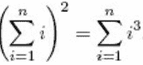

你可以利用事实 $\sum_{i=1}^{n} i = \frac{n(n+1)}{2}$。你的数学归纳法证明可以是“非正式”的。

非正式归纳证明不使用正式语法。它通常不显式给出最后三行，因为这些行在每个证明中都是相同的。然而，非正式证明必须明确说明基础情况是什么、做了哪些假设，以及从假设推导出了什么归纳结论。

5.4 使用数学归纳法非正式证明：对于任何整数 $n \ge 10$，$2^n > n^3$。

5.5 非正式证明 $\$$ 分布于 $n$ 分量的合与，例如

```
$(q_1 \wedge q_2 \wedge \dots \wedge q_n)
```

使用第 2 章给出的代数律证明 $n=2$ 的情况。

5.6 – 与上一个练习一样，非正式证明从 2 个部分推广到 $n$ 个部分的德·摩根定律。

5.7 – 使用数学归纳法非正式证明当 $n > 5$ 时，$F_n > (\frac{3}{n})^{n-1}$。

5.8 – 示例 5.7 和上一个练习表明，斐波那契数列的增长率被某些指数函数的下界和上界限制。实际上有一个更精确的结果。使用数学归纳法非正式证明：对于所有 $n \ge 0$，$F_n = (\phi^n - (1-\phi)^n)/\sqrt{5}$，其中 $\phi = (1+\sqrt{5})/2$。

5.9 – 假设邮票只有 $3\phi$ 和 $7\phi$ 面额。因此你可以支付 $13\phi$ 资（两张 $3\phi$ 邮票和一张 $7\phi$ 邮票），但你无法支付 $11\phi$ 资。证明你可以支付 $12\phi$ 或更多的邮资。分别使用普通归纳法和强归纳法的变体进行证明。

5.10 – 使用归纳法证明：对于任何无向图，所有顶点的度数之和等于边数的两倍。

5.11 – 论证讨论强归纳法期间提到的这些陈述是正确的：$p(0) \equiv q(0)$，$\forall n \in \mathcal{N} : (\forall i \in \mathcal{I}_n : p(i)) \to p(n+1) \equiv \forall n \in \mathcal{N} : q(n) \to q(n+1$，以及 $\forall n \in \mathcal{N} : p(n) \equiv \forall n \in \mathcal{N} : q(n)$。

> $^1$我们在这里不深入探讨科学哲学，虽然我们可以指出程序会进入“无限循环”。

> $^2$我们使用熟悉的惯例：如果 S 是一个数字集合，那么当 $S=\emptyset$ 时，S 的元素和为 0。

# 第 6 章

## 程序验证

我们经常会编写自己认为是正确的计算机程序。尽管如此，特别是对于重要的程序，通过证明来确定它们是正确的将是非常理想的。但你如何证明一个程序是正确的？这个问题定义了程序验证的挑战，它是软件工程的一个子领域。本章介绍了一种谓词逻辑验证方法，结合了特殊的新的推理规则来表达我们对计算机编程的背景知识。这些材料可以在提高你的谓词逻辑技能的同时，展示其相关性。

## 6.1 验证的思想

当程序成功编译时，编译器实际上已经证明了程序在语法上是正确的。但这仅意味着它由被识别的类别中的允许符号组成，并且这些符号是以编程语言允许的方式组合的。以英语为例，“Fast trees”（快速的树）在语法上是正确的，因为一个形容词“fast”位于名词“trees”之前，为动词“see”构成了一个复数主语。然而，这是一种非常弱的正确性概念，与句子是否有意义无关。由于树既没有速度也没有视力，这些词并没有以有意义的方式结合在一起。这个句子在语义上是不可接受的。

语义是对意义的正式研究。其核心思想是引入每种编程语句语义的表示符号，并让这些符号组合成整个程序的语义。我们将编程语句的语义视为它对变量值的影响以及对这些值属性的影响（例如是奇整数、正实数或小于某值）。

## 6.2 定义

通常，证明一个程序是正确的被分为两个子证明。首先，证明程序的部分正确性（partial correctness）：如果程序终止，则它确实计算了应该计算的内容。其次，证明程序实际上会终止。本章只处理第一部分，即部分正确性的证明，因为终止性证明可能非常微妙且棘手。

为了使我们的讨论保持主要独立，我们将注意力限制在大多数过程语言中常见的语句类型上。特别是除了赋值语句等基础语句外，我们将使用生成结构化代码的三种标准机制：语句序列（$S_1; S_2$，表示 $S_1$ 后接 $S_2$）、条件语句（“if $B$ then $S_1$ else $S_2$”）和迭代语句（“while $B$ do $S$”）。值得注意的是，最后这类语句是结构化编程的核心，而且它们也是最容易证明断言的。这种观点认为使用结构化编程的程序员编写的代码最容易证明是正确的，无论这种证明有多是非正式。

我们选择不使用任何真实语言编写编程语句，而是使用“伪代码”来捕捉核心思想，防止了我们看似依赖于任何特定真实语言的特性。这种方法让我们能够提高清晰度。它还避免了 C 和 C++ 在赋值语句中使用等号，从而使得证明中的数学等号不会产生歧义。C++ 的用户会发现只需将“while $B$ do $S$”读作“while $(B)$ $S$”即可。我们尽可能使用换行符和缩进来指示程序结构（避免使用 begin/end 括号等）。记住，正如结构化编程的任何讨论中典型的那样，“语句” $S$ 可以是一个复合语句，即任意大的代码块。

我们通过给出两个命题来指定程序建议计算的内容。首先，我们给出初始断言，指示计算的初始状态。这将关于程序所使用的变量的初始值的命题合取。其次，我们给出最终断言，指定计算的最终状态。这也是命题的合取，在这种情况下是关于最终值的变量和/或程序的输出。请注意，规范并没有说明用于计算所需的最终状态的方法；任何基于不同方法的程序都可能是正确的。

程序验证中通常使用的表示法称为**霍尔三元组**（Hoare triple）：$p \{S\} q$。这种表示法等同于此断言：如果命题 $p$ 对于代码 $S$ 的初始状态为真，并且 $S$ 终止，那么 $q$ 对于最终状态为真。请记住，$S$ 不需要是单条语句；它可以是任何代码块，包括整个程序。我们称 $p$ 为前置条件（precondition），$q$ 为后置条件（postcondition）。当 $S$ 是整个程序时，前置条件是初始断言，后置条件是最终断言。

## 6.3 推理规则

最简单的推理规则适用于初级语句，例如赋值语句。我们将使用“←”作为赋值运算符，而不是 C 和 C++ 中的“=”，以强调我们的推理是不依赖语言的。使用这种表示法，赋值语句的一般形式为 $v \leftarrow e$，其中 $v$ 是一个变量，$e$ 是一个表达式，如 3 或 $x+1$ 或 $2(\theta)$。赋值语句具有以下语义（含义）：求值 $e$并将结果赋值给 $v$。赋值语句的推理规则是，以下霍尔三元组是一个永真式：

赋值：$p\{v \leftarrow e\} p(v)$

这里的思想是，如果在执行语句之前，值 $v$ 满足某些谓词 $p$，那么在执行后，$v$ 的值将满足相同的谓词。当然，这假设除 $v$ 之外的所有变量将保留它们的值，即我们的伪代码不允许有“副作用”。

### 示例 6.1

设 $p$ 为谓词 ODD（当其参数为奇数时为真），它允许以下霍尔三元组存在：

```
ODD(3){y \leftarrow 3} ODD(y)
ODD(y){x \leftarrow y + 2} ODD(x)
ODD(x){x \leftarrow x + 1} EVEN(x)
```

在第一个三元组中，前置条件 ODD(3) 从算术角度来看是真实的，并不真的需要写出来。在正确性证明中，通常会省略算术步骤。因此，第二个三元组利用“2 与奇数之和为奇数”（即 $y + 2$ 是奇数）这一事实，而没有提到它。在第三个三元组中，区分 $x$ 的两种含义是重要的。在执行前的前置条件下，$x$ 的值是奇数，所以 $x + 1$ 是偶数，且 $x$ 继承了该结果。

语句顺序的推理规则为：

### 序列：

```
$p\{S_1\} q
q\{S_2\} r
p\{S_1;S_2\} r$
```

当我们分析了两个连续的语句 $S_1$ 和 $S_2$，并且建立了 $q$（即第二条语句的*前*条件）也是第一条语句的*后*条件时，该推理规则均适用。因此，$S_1$ 建立了 $S_2$ 所需要的内容。在这种情况下，得出我们知道整个双语句序列的前置条件和后置结论是正确的。请注意，序列本身就是一种语句，一种复合语句。因此，对越长的复合语句反复使用此规则，允许我们处理任何大小的程序。

### 示例 6.2

假设已知在进入代码时，$x$ 必须为 1：

```
$y \leftarrow 3; z \leftarrow x + y.$
```

将此代码的适当部分代入 $S_1, S_2, p, q$ 和 $r$ 的值的规则中。（你需要运用初等算术和编程的知识来获取后置条件。）

```
$$(x = 1) \quad \{y \leftarrow 3\}
(x = 1) \wedge (y = 3) \quad \{z \leftarrow x + y\}
(x = 1) \wedge (y = 3)
(z = 4)$$
```

```
$$(y \leftarrow 3; z \leftarrow x + y) \quad (z = 4)$$
```

### 示例 6.3

对于复合语句 $\{x \leftarrow x + 2; y \leftarrow y + 1\}$，证明如果在进入代码时等式 $x = 2y$ 成立，那么在退出时也成立。

```
$(x = 2y) \quad \{x \leftarrow x + 2\} \quad (x = 2y + 2)
$(x = 2(y+1)) \quad \{y \leftarrow y + 1\}$

$(x = 2y) \quad \{x \leftarrow x + 2; y \leftarrow y + 1\} \quad (x = 2y)$
```

在第二行中，注意当 $e = y + 1$ 时，赋值的前置条件是 $x = 2e$，因此后置条件是 $x = 2y$。

示例 6.3 展示了一个前置条件与后置条件相同的情况。虽然变量 $x$ 和 $y$ 的每个值都发生了变化，但我们能够证明整个语句序列维持了它们之间的等式关系。这种关系被称为代码块的**不变条件**（invariant condition）。这个思想在后面关于循环的讨论中很重要。

接下来的规则适用于条件语句，涉及 if-then-else。

If-Then：

```
$(p \wedge B)\{S\} q
$(p \wedge \neg B)q
$p\{\text{if B } S\} q$
```

If-Then-Else：

```
$(p \wedge B)\{S_1\} q
$(p \wedge \neg B)\{S_2\} q
$p\{\text{if B } S_1 \text{ else } S_2\} q$
```

仅关注 If-Then 规则，注意第一行是霍尔三元组，第二行是命题逻辑。同样注意 $p$ 出现在每行的开头，带有 $B$ 或 $\neg B$。它们共同证明了底部的霍尔三元组结论，因为当 $B$ 为真时执行 $S$，$q$ 变为真；当 $B$ 为假。If-Then-Else 规则有类似的解释。

### 示例 6.4

对于语句 $\{\text{if } y < x \text{ then } y \leftarrow x\}$，从前置条件 $x = 7$ 可以得出后置条件 $y \ge 7$。

在 If 语句中，条件 $B$ 是 $y < x$，语句 $S$ 是赋值 $y \leftarrow x$。注意 $\neg B$ 在此例中为 $\neg (y < x$，可以重写为 $y \ge x$。同样，$p = 7$ 且 $q \ge 7$。将这一切放入推理规则中，得到了下面的表格。我们的目标是线下方的结果；为了证明它，我们建立线上的两行。每一行都是的，因为初始的 7 被复制到 $y$，使得 $y \ge 7$。第二行是算术性的，$y \ge 7$，同样。这里的 7 可以被任何 $x$ 替换。由于 $x$ 在代码中没有被重新赋值，我们在 If 语句执行后实际上得到了结论 $y \ge x$。


## 6.4 循环不变

迭代语句的推理规则所示。规则中的条件 $p$ 称为循环不变。它是循环体 $S$ 的不变条件，因为 $S$ 被允许执行（即当 $B$ 为真时），$p$ 既是 $S$ 的前置条件也是后置条件。

```
While:
$(p\wedge B) \{S\} p$
$p \{\text{while B do S\} (p\wedge \neg B)$
```

该推理规则的正确性依赖于数学归纳法。为了理解这一点，想象我们正在尝试证明以下定理：“对于每一个 $n \ge 0$，在 While 循环迭代 $n$ 次后，断言 $p$ 为真。”归纳证明有一个基础，对于 $n=0$，这是显然成立的，因为该规则只有在 $p$ 初始为真时才被调用。归纳步骤将尝试证明如果 $p$ 在 $n$ 次迭代后为真，那么在 $n+1$ 次迭代后也为真。这本质上就是 $p$ 作为 $S$ 的不变条件的含义。注意，我们证明了只要 $B$ 保持为真，$p$ 就是 $S$ 的不变条件，但如果存在 $n+1$ 次迭代，那么 $B$ 在之前必须为真。

重要的是记住，如果一个命题被提议为循环不变，首先在遇到循环时它必须已经为真。否则，该推理不能用于有效的证明。其次，它必须满足推理规则中线之上的霍尔三元组。

注意 While 规则后置条件中 $\neg B$ 的出现。推理规则没有解释为什么 $B$ 必须变为假。我们知道在此这一点 $\neg B$ 成立，这终止了循环并违反了 $B$。由于我们只做部分正确性，可以假设循环在 $n$ 次（整数 $n$）后停止，无需证明。

### 示例 6.5

实现绝对值函数并验证代码。代码在横下方。

```
$(TRUE \wedge x < 0) \quad \{abs \leftarrow -x\} \quad |x|$
$(TRUE \wedge x \ge 0) \quad \{abs \leftarrow x\} \quad |x|$

$(TRUE) \quad \{\text{if } x<0 \text{ then } abs \leftarrow -x \text{ else } abs \leftarrow x\} \quad |x|$
```

我们使用前置条件 $p = TRUE$ 表示我们不需要先前的假设即可得出结论（在我们所有的示例中都忽略了关于变量 $x$ 的假设）。这与我们所有的示例一样，是以孤立的方式处理代码的；事实上，前置条件有很多事实，例如变量 $x$ 的类型以及程序中其他变量的信息，它们不变地传递到后置条件。

### 示例 6.6

为以下程序找到一个循环不变，并用它证明该程序计算 $n!$。你可以假设 $n \ge 1$。

```javascript
i ← 1;
f ← 1;
while i < n
  i ← i + 1
  f ← f * i
```

我们如何推导出循环不变式呢？为了回答这个问题，我们需要思考代码的目的。这里的目的是在变量 `f` 中计算 $n!$。因此，我们将循环内部 $f = i!$ 作为不变式的一部分。在退出时，我们将得到 $i = n$，使得 $f = n!$。考虑到这些因素，我们将循环不变式 $p$ 取为 $(f = i!) \wedge (i \leq n)$。注意 $p$ 在初始时为真，这是必须必须的。要证明 $p$ 是循环不变式，我们需要证明：

```
(f = i!) \wedge (i ≤ n) \wedge (i < n) {i ← i + 1; f ← f * i} (f = i!) \wedge (i ≤ n).
```

虽然很容易看出是真的，但我们可以使用序列推理规则将该论证分为两个步骤：

```
(f = i!) \wedge (i ≤ n) \wedge (i < n) {i ← i + 1} (f = (i - 1)!) \wedge (i ≤ n).
```

```
(f = (i - 1)!) \wedge (i ≤ n) {f ← f * i} (f = i!) \wedge (i ≤ n).
```

一旦我们确定了 $p$ 是循环不变式，推理规则给出：

```
(f = i!) \wedge (i ≤ n) {while (i < n) do S} (f = i!) \wedge (i ≤ n) \wedge (i ≥ n).
```

所以当循环终止时，$i = n$，因此 $f = n!$。Hoare 三元组的表示风格强调了正在证明的内容。另一种风格也说明了整体上发生的情况，而不是分开说明。我们通过在代码上添加断言来实现这一点；这些断言是前一段代码的后条件，也是后一段代码的前条件。例如：

```javascript
i = 1;
f = 1;
// (f = i!) \wedge (i ≤ n)
while i < n do
// (f = i!) \wedge (i ≤ n) \wedge (i < n)
i = i+1
// (f = (i - 1)!) \wedge (i ≤ n)
f = f*i
// (f = i!) \wedge (i ≤ n)
// (f = i!) \wedge (i ≤ n) \wedge (i ≥ n)
```

### 示例 6.7

在下面的伪代码中寻找循环不变式，该代码用于从输入读取字符，直到找到非空白字符。

```javascript
read(c)
while c=' ' do
read (c)
```

这个循环似乎没有循环不变式。事实上，循环不变式 $p$ 仅仅是 TRUE，这是显而易见的。从推理规则中我们得出

> (TRUE) {while c=' ' read(c)} (TRUE) \wedge (c\neq' ')

所以我们得到的只有 $c \neq ' '$。注意，这是一个很好的例子，说明了为什么这些论证仅适用于部分正确性。我们并没有声称证明循环会终止，而证明如果它终止则 $c \neq ''$。

### 示例 6.8

考虑在根为 $T$ 的二叉搜索树（BST）中查找键 $K$ 的问题。假设读者熟悉该算法。记住，树的节点持有键值，且键按“<”排序。树中的每个节点 $t$ 都持有 $key(t)$，以及 $L(t)$ 和 $R(t)$，它们是 $t$ 的左、右子树的根。空树的根为 $nil$。

为了简化我们的公式，我们定义符号 $K \in t$ 为命题 $\exists x \in tree(t) : K = key(x)$，其中 $tree(t)$ 是以 $t$ 为根的子树的节点集合。令 $\mathcal{T}$ 为某些键域 $D$ 上所有 BST 的集合。$\mathcal{T}$ 递归定义为：

**定义：T 是 $\mathcal{T}$ 中某棵树的根**

- 1) $T \neq nil \rightarrow \forall K \in D : (K < key(T) \rightarrow K \notin R(T)) \wedge (K \geq key(T) \rightarrow K \notin L(T))$
- 2) $L(T)$ 和 $R(t)$ 是 $\mathcal{T}$ 中树的根。

使用了 BST 的其他定义，但可以证明它们与此定义是等的。注意 $tree(t) = \{t\} \cup tree(L(t)) \cup tree(R(t)) \cup tree(nil) = \emptyset$。

如果搜索失败，我们的规格中 $t = nil$；否则，$t$ 将是 $K = key(t)$ 的子树的根。这是该算法：

```javascript
t \leftarrow T;
while t \neq nil \wedge K \neq key(t) do
  if K < key(t) then
    t \leftarrow L(t)
  else
    t \leftarrow R(t)
```

为了证明代码是正确的，我们使用循环不变式 $p$，即 $K \notin T \vee K \in t$。注意在初始化之后，$t \leftarrow p$，根据排中律，$p$ 是真的。我们需要建立

> $p \wedge B \{ \text{if } K < key(t) \text{ then } t \leftarrow L(t) \text{ else } t \leftarrow R(t) \} p \quad (6.1)$

其中 $B$ 是 $t \neq nil \wedge K \neq key(t)$。使用 If-Then-Else 规则来显示

> $p \wedge B \wedge (K < key(t)) \{ t \leftarrow L(t) \} p \quad (6.2)$

> $p \wedge B \wedge (K \geq key(t)) \{ t \leftarrow R(t) \} p \quad (6.3)$

首先注意 $(6.2)$ 的左侧是

$(K \notin T \vee K \in t) \wedge (t \neq nil \wedge K \neq key(t)) \wedge (K < key(t))$

$\equiv t \neq nil \wedge (K \notin T \vee K \in t) \wedge (K < key(t)) \wedge K \notin R(t))$

$\equiv t \neq nil \wedge (K \notin T \vee K \in t) \wedge (K < key(t)) \wedge (K \in L(t))$

$\equiv t \neq nil \wedge (K \notin T \vee K \in L(t))$

所以 $(6.2)$ $(t \neq nil) \wedge (K \notin T \vee K \in L(t)) K \notin T$。

$(6.3)$ 以类似的方式处理。现在既然证明了 $(6.1)$，我们可以通过 $\neg B$ 推导出循环终止：

$(K \notin T \vee K \in t) \wedge \neg(t \neq nil \wedge K \neq key(t))$

$\equiv (K \notin T \vee K \in t) \wedge (t = nil \vee K = key(t))$

$\equiv (K \notin T \wedge t = nil) \vee (K = key(t))$

$\equiv (K \notin T \wedge t = nil) \vee (K(t))$

$\equiv (K \notin T \wedge t = nil) \vee key(t)$

这是 BST 搜索的预期后条件。只有当搜索成功时，$t \neq nil$。

### 示例 6.9

现在考虑算法上相关的问题：使用二分搜索搜索不同键数组 $A[1 ... n]$。注意有序数组具有类似于 BST 的递归结构：子数组 $A[1...t-1]$ 和 $A[t+1...n]$ 都是有序数组，并且对于任何 $1 \leq t \leq n$：

$\forall K \in D : (K < A[t] \rightarrow K \geq A[t+1...n]) \wedge (K \geq A[t] \rightarrow K \notin A[1...t-1])$

其中我们令 $K \in A[n_1 ... n_2]$ 表示 $\exists i \in \mathcal{N} : (n_1 \leq i \leq n_2) \wedge (K = A[i])$

在代码中，$mid(i, j)$ 计算中间 

```
i ⇐ 1; j ⇐ n
while i ⩽ j ∧ K \neq A[mid(i,j)] do
  if K < A[mid(i,j)] then
    j ⇐ mid(i,j)
  else
    i ⇐ mid(i,j)+1
  if i>j then t ⇐ 0 else t ⇐ mid(i,j)
```

当然，我们通常不会重新计算 $mid(i,j)$，但我们强调这两个搜索算法的相似结构。为了看到“A[mid(i,j)]”作为子数组 $A[i...j]$ 的“根”，并且“i ⩽ j”作为“t ∭ nil”。事实上，通过这些替换，之前的正确性证明可以重用。特别是，循环不变式可以用同样的方法证明，导致后条件

$(K \notin A[1...n] \wedge i > j) \lor K = A[\frac{i+j}{2}]$ 这证明了最后的 if 语句。（搜索失败留下 t = 0。）

此外，我们上面关于有序数组递归性的观察并没有假设 $t$ 是中间值，并且适用于其他选择。例如，如果 $mid(i,j)$ 是 $i$，那么我们也将证明从左到右扫描的正确性。（它也可以证明所谓的“插值搜索”和其他方案）。

之前的两个例子 BST-Search 和 Binary-Search 均可以在带有递归实现的教科书中找到。这并不意外，因为任何 while 循环和递归过程之间存在着基本的关系。在讨论此之前，我们首先讨论如何处理普通程序

## 6.5 程序的证明

我们将考虑如何证明调用程序（或任何封装代码的类似机制）的代码的正确性。包含函数调用的更全面处理超出了本简短介绍的范围。尽管我们的示例恰好是递归的，该技术是通用的。

每个程序将有一个前条件，说明代码开始时为真的情况；特别是关于其参数的已知。后条件说明代码终止时为真的情况；同样是关于返回参数的属性。（我们的示例不会访问全局变量，也不会有任何种类的副作用，这简化了该技术。）我们需要证明后条件确实源于前条件和程序体的执行。

此外，每当调用此程序时，我们必须显示在调用时参数满足前条件。如果是，我们就可以在程序返回后立即断言后条件适用于参数。这种方法的巧妙在于，当调用发生在程序内部时（即递归时），我们做的是相同的事情。

### 示例 6.10

考虑一个计算二项式系数 $C(m, n) = \binom{m}{n}$ $0 \le n \le m$ 的程序，使用标准的递归定义：如果 $n=0$ 或 $m=m$，则 $C(m, n) = 1$，否则 $C(m, n) = C(m-1, n) + C(m-1, n-1)$。程序 $Binom(m, n, b)$ 的前条件是 $0 \le n \le m$，后条件是 $b = C(m, n)$。

代码带有断言标记，并使用 If-Then-Else 规则证明这些断言。

```
Binom (m, n, b)
// 0 ≤ n ≤ m
if n = 0 ∨ n = m then
    b ⇐ 1
    // b = C(m,n)
else
    // 1 ≤ n ≤ m - 1
    Binom (m-1, n, b1)
    // b1 = C(m - 1, n)
    // 0 ≤ n - 1 ≤ m - 1
    Binom (m-1, n-1, b2)
    // b2 = C(m - 1, n - 1)
    b ⇐ b1 + b2
    // b = C(m,n)
// b = C(m,n)
```

回想一下标注风格：任何语句（即代码块）连同其前后的断言构成了一个我们应该能够证明的 Hoare 三元（Hoare triple）。特别是第一个和最后一个断言是该过程给定的前置条件和后置条件。

## 6.6 循环不变性与尾递归

存在一种更常见的简单递归类型。尾递归描述的是一种递归过程中只有一个递归调用，且该调用总是最后执行，也就是说在调用返回后不再执行任何后续语句。在本节中，我们将演示如何将 `While` 循环的代码重写为尾递归过程。同样，我们可以很容易将尾递归转换为非递归的循环代码，但我们在此不再阐述。本节相关的是此类示例中循环不变性与前置条件、后置条件之间的关系。

### 示例 6.11

考虑这个 BST 搜索算法的递归版本。它标注了相关的命题。无需多言，因为这些命题与迭代代码的命题几乎相同。同样，第一个和最后一个断言是该过程给定的前置条件和后置条件。该过程初始必须使用树的根调用：BSTSearch(T, K)。

```
BSTSearch(t, K)
// K ∉ T ∨ K ∈ t
if t ≠ nil ∧ K ≠ key(t) then
  if K < key(t) then
    // t ≠ nil ∧ (K ∉ T ∨ K ∈ L(t))
    t = L(t)
    // K ∉ T ∨ K ∈ t
    BSTSearch(t, K)
    // (K ∉ T ∧ t = nil) ∨ K = key(t)
else
  // t ≠ nil ∧ (K ∉ T ∨ K ∈ R(t))
  t = R(t)
  // K ∉ T ∨ K ∈ t
  BSTSearch(t, K)
  // (K ∉ T ∧ t = nil) ∨ K = key(t)
// (K ∉ T ∧ t = nil) ∨ K = key(t)
```

注意，在调用递归调用之前，前置条件已满足，因此之后后置条件成立。$t \leftarrow L(t)$ 和 $t \leftarrow R(t)$ 语句是因为我们没有使用函数调用，而是将 $t$ 作为返回参数的产物。我们将二分搜索的相同转换留作一项练习。

主要的观察结果是，对于这种转换，前置条件是循环不变性 $p$，而后置条件是 $p \wedge \neg B$，这在 `While` 循环终止后为真。

应当指出，这些示例是“自然的”，因为底层数据对象——BST 和排序数组——是“递归的”。因此，递归算法便是不言而喻的，而且由于它是尾递归的，它可以被解释为迭代代码。在计算机科学中，大多数对象都是分层次的（即使不是递归的），这导致了具有自然正确性证明的整洁代码。

## 6.7 关于形式化验证的辩论


至少四十年来，程序正确性形式化证明的价值得到了认可。在设计有助于此类证明的语言、系统以及底层的数学逻辑方面，已经做了许多研究。同时也投入了大量精力教授程序员在构建软件时融入这些技术。

正确性证明的工作取得了有限成功。没有任何大型甚至中等规模的软件项目经过形式化证明是正确的。关于不使用这些技术，还有其他理由：

- 它们对于大多数程序员来说太复杂了。
- 它们导致了简单的算法和代码复用，抑制了创造力。
- 它们假设规范是正确的，但事实上，现实生活中错误的主要来源是规范。
- 它们证明了底层算法实现正确，但程序运行在复杂的硬件和软件组件上，而这些组件可能正确也可能不正确。

希望这一过程可以自动化，然而，各种前置条件、后置条件和循环不变性的构建似乎在某种程度上需要程序员参与。

好消息是，形式化验证技术的知识有助于在只进行非形式化验证时提供参考。我们已经提到过，结构化编程原则源于创建易于（形式地或非形式地）证明正确的代码的愿望。同样，所有良好的程序员都会为子程序记录前置条件和后置条件（即关于参数的已知信息以及关于子程序返回值的信息）。而且，通常一个良好的程序员始终会知道并在关键点记录程序的状态，即关于重要变量的值必须为真的事情。

最后，关于部分正确性与正确性的说明。论证一个程序或一段代码会终止并不困难。例如，二分搜索将在 $\log_2(n + 1)$ 次迭代后停止。然而，这是一个深层次的结果（来自图灵理论），我们永远无法有一种单一技术能始终让我们判断程序是否会终止。（这被称为“停机问题”，在第 12 节中讨论。）

## 练习题

### 6.1
如果只需要 $S_1$ 的后置条件蕴含而非等于 $S_2$ 的前置条件，那么序列规则可以更广泛地使用且保持正确。用形式表示此规则。

### 6.2
为此代码提供一个循环不变性并证明它。假设 $n \ge 1$。

```
i \leftarrow 0;
x \leftarrow 1;
while i < n
    i \leftarrow i + 1
    x \leftarrow x
```

### 6.3
为此代码提供一个循环不变性并证明它。假设 $n \ge 0$。

```
i \leftarrow 0;
s \leftarrow 0;
while i < n
    i \leftarrow i + 1
    s \leftarrow s + 1
```

### 6.4
为此代码提供一个循环不变性并证明它。假设 $n \ge 1$ 且 $y$ 是常数。

```
i \leftarrow 1;
x \leftarrow 1;
while i < n
    x \leftarrow y
```

### 6.5
由于 $(i+1)^2 = i^2 + i$，你可以通过增加 $i$ 来计算 $i^2$。

- (a) 使用这一观察结果编写计算 $i^2$ 的伪代码，$n \ge 1$。
- (b) 为此代码提供一个循环不变性并证明它。
- (c) 应用循环规则得到 $(i+1)^2$。

### 6.6
为此代码提供一个循环不变性并证明它，$n \ge 0$。

```
i \leftarrow 0;
s \leftarrow 2;
while i < n
    i \leftarrow i + 1
    s \leftarrow s
```

### 6.7
考虑一个有 $M$ 个白球和 $N$ 个黑球的袋。你反复从袋中取出两个球。如果颜色相同，你就把白球放回去。（假设你有足够的额外的球可以这样做。）以伪代码形式给出：

```
m <- M
n <- N
while (m+n > 1) do
    a <- randomly selected ball
    if (a is white) then m-- else n
    b <- randomly selected ball
    if (b is white) then m-- else n
    if (a and b same) then n++ else m++
```

问题：最后一个球是什么颜色的？似乎答案取决于每一步如何选择球，但事实如此。对于 17 个白球和 10 个黑球的特定例子，最后一个球必须是白色。这一惊人结论基于循环不变性！

### 6.8
此代码通过重复加法计算两个整数变量的乘积 $y * z$。这实际上是一个古老的算法！对于此函数，`odd` 是简单的奇偶性检查，`floor` 是向下取整。为此代码提供一个涉及 $v * z$ 的循环不变性并证明它。最后调用循环规则得到预期的最终断言。

```
x \leftarrow 0;
y \leftarrow Y;
z \leftarrow Z;
while z > 0
    if odd(z) then x \leftarrow x + y
    y \leftarrow y + y
    z \leftarrow floor(z / 2)
```

### 6.9
考虑斐波那契整数序列；$F_0 = 0, F_1 = 1, F_n = F_{n-1} + F_{n-2}$ 对于所有 $n > 1$。

- (a) 给出计算 $n \ge 0$ 时的 $F_n$ 的简单迭代伪代码。说明并证明循环不变性。
- (b) 给出一个简单的递归过程 `Fib(n, f)`，当 $n \ge 0$ 时返回 $f$ 等 $F_n$。如文中所述标注该过程。注意此过程不属于尾递归，因此不会回到 (a)。

### 6.10
考虑如示例 6.9 所示的数组，但假设它是无序的。

- (a) 给出使用简单的左到右扫描来确定最大元素的伪代码。说明并证明循环不变性。
- (b) 给出一个简单的递归过程 `Max(A, n, max)`，$n \ge 1$ 时返回 `max`。它将首先计算前 $n-1$ 个元素子数组的最大值，然后与最后一个元素进行比较。如文中所述标注该过程。注意此过程不属于尾递归。

# 第二部分

## 计算机科学语言模型

## 第二部分简介：计算机科学语言模型

语言模型与编程语言有关，而语言是实际计算的核心。语言模型的研究涉及与所有编程语言相关的概念和问题。因此，该领域寻求对通用语言有更好的理解，而不是针对单一某种语言。在转向这一更通用的层面时，我们遵循了自己的建模策略，专注于较少且广泛适用的概念。由此产生的语言模型澄清了关于编译器的问题——即将你的程序翻译成可执行形式的软件。语言模型的研究还可以帮助你学习甚至设计新语言。

语言模型还有另一个抽象功能。我们用它们来正式地定义问题。在我们讨论了更多背景后，我们将转向这一方面。

除了对语言建模，我们还将通过引入称为自动机的简单抽象机器对计算机制进行建模。我们将看到自动机与语言模型之间存在令人惊讶的紧密关系。自动机研究还引出了计算理论。一类被称为图灵机的自动机提供了一种简单但显而通用的方式来对“计算”的含义进行建模。那么，给定一个关于计算的模型，就可以讨论不可计算性。也就是说，人们实际上可以证明对于某些计算问题不存在通用的解决方案。从实践角度来看，这项工作帮助我们以可计算的方式来制定实际问题。

# 第 7 章

## 语言与模型

本章的目的是激发对语言模型的研究，并列出基础概念主题。我们通过将语言模型与实际编程语言联系起来来开篇。注意力还被放在将研究领域与计算机科学的其他部分联系起来。本章介绍了所需的正式符号法，并将后续章节奠定基础。后面的章节讨论了驱动该领域发展的重大重复性问题。

### 7.1 编程语言与计算机科学

编程语言是计算的核心。它们位于软件和硬件之间，并连接了两者。软件（程序）是用人们可以理解的高级语言编写的。它被翻译（编译）成某些硬件能够听懂的机器语言。更准确地说，程序被翻译成结构化的命令集合，特定类型的计算机被设计为对这些命令做出响应。正如理解硬件的通用原理（通常指架构以及单个机器的设计）和软件的通用原理（软件工程以及特定应用）同样重要一样，不仅要理解单个语言，还要理解语言的通用概念。为了这一点，我们研究语言的模型。

编程语言为什么采取这种形式？计算机又是如何处理你编写程序的？为了洞察这些问题，我们不仅对语言建模，还对处理语言的机制建模。人们使用的语言处理模型是称为自动机的简单正式机器，而寻求理解语言结构和处理的研究领域通常被称为“形式语言与自动机”。该领域占据了本书的第二部分。

语言模型的研究始于观察：语言的关键方面是结构和意义。正如序言所述，一个好的模型会剥离主题的细节以简化它，作为理解的帮助。在语言形式模型（即对语言结构的研究）的情况下，我们进行了粗略的简化：我们从抛弃语言意义开始！当然，意义必须被处理，但现在不是，也就是说，在我们正处于观察结构的过程中。意义的表达可以通过多种方式完成，其中许多与谓词逻辑有关，这是第一部分中介绍过的话题。

对形式语言和自动机研究中提出的问题和问题的实际处理发生在“编程语言”和“编译器设计”课程中。这里使用的建模方法是对这些实践课题的良好准备。关于编译器的书籍通常从几章关于形式语言的内容开始，而编译器工具直接基于这些内容。

### 7.2 形式语言

模型忽略细节，以便清晰地关注感兴趣的特定方面。形式语言模型领域做出了一个惊人的选择：它关注语句本身——其基本符号的序列——而忽略了意义，除了在最简单的情况下。它没有尝试去指定或表述句子或编程语句的意义。（形式语言的研究可以在若干方面进行扩展，以包含句子的意义或语义；关于形式语义的讨论超出了本书的范围。）

正如刚才指出的，语言形式模型领域关注符号序列。这些将被称为“字符串”，这个术语在编程语言的语句和人类语言的句子之间是中性的，并且也可以提醒我们意义已经被剥离了。回想在第 1 章我们给出了字符串的几个定义，我们在这里重复它们以保持本章的自成性。

任何特定语言的规范都从一个字母表开始，字母表被定义为符号的有限集，我们采用名称 $\Sigma$。字符串被定义为字母表中符号的有限序列；我们说它是“在某个字母表上的”字符串。一个形式语言——之后简称为语言——被简单地定义为字符串集合。人们也可以说语言是使用其字母表可以形成的所有可能字符串的子集。一个关键问题是，对于我们感兴趣的任何特定语言或语言类，我们如何精确指定哪些字符串被包含在内？

根据这些定义，一切都是从字母表 $\Sigma$ 中的符号构建的。什么是符号？为了组成英语字符串（句子），$\Sigma$ 可能是一个巨大集合中的单词。对于编程语言，$\Sigma$ 可能是关键字和变量。虽然这看起来很自然，但我们采取了远为简单的观点。英语单词有意义……相反，我们将符号视为一个原子（即不可分割）单位。我们只对字符串的结构感兴趣，换句话说，符号模式。

#### 示例 7.1

设 $\Sigma = \{a, b, c\}$ 为符号集。$\Sigma$ 之上的字符串有 $ab$、$bbc$ 和 $abcba$。$\Sigma$ 之上的语言是 $L = \{ab, abab, ababab\}$。

#### 示例 7.2

设 $\Sigma = \{0, 1, +\}$ 为符号集。$\Sigma$ 之上的字符串有 `1011+1011`。此类字符串可以解释为二进制数之和，但其他字符串如 `+000` 在结构上是有问题的。

字符串的**长度**是它其中符号的数量。在示例 7.1 中，`abcba` 的长度是 5。竖线在算术中表示数字的绝对值，用于字符串表示长度，因此我们可以写 $|abcba|=5$。字符串长度可以为 1：$|b|=1$。注意，`b` 可以指符号 `b`，也可以指由 `b` 组成的长度为一的字符串。正如空集有一个符号一样，这里无符号的字符串有一个符号是有用的，即**空字符串 $\Lambda$**，其中 $|\Lambda|=0$。注意 $\Lambda$ 是字符串而*不是*任何字母表的符号。

#### 示例 7.3

$\Sigma = \{a, b\}$ 之上长度 $\le 2$ 的字符串集为 $\{\Lambda, a, b, aa, ab, ba, bb\}$。

#### 示例 7.4

$\Sigma = \{0, 1, +\}$ 之上表示 0 和 1 之和的字符串集为 $\{0+0, 0+1+0, 1+1, 0+0+0, 0+0+1, \dots\}$。

这两个示例之间的重要区别在于大小：示例 7.3 中的语言具有有限数量的字符串，准确说是 7 个。相比之下，示例 7.4 中描述的语言具有无限多个字符串，因此我们不得不使用省略号（“...”）在尝试列出字符串。许多许多语言是无限的，例如英语句子集和 C++ 允许的语句集。即使语言可能是无限的，（无限多个）字符串的长度也是有限的。

有一种我们反复使用的无限语言。对于给定的 $\Sigma$，存在一个与其关联的无限语言 $\Sigma^*$：

$\Sigma^*$ 是由由符号集 $\Sigma$ 上所有可能的字符串组成的语言。

例如，$\{a, b\}^*$ 代表特定符号集 $\Sigma = \{a, b\}$ 上的所有字符串。这些字符串按长度递增的列出的列表。

$\{a, b\}^* = \{\Lambda, a, b, aa, ab, ba, aaa, aab, abb, baa, \dots \}$

任何在 $\{a, b\}$ 上的语言都是 $\{a, b\}^*$ 的子集。我们通常使用字母表末尾附近的字母（如 $x$ 和 $y$）来代表字符串。例如，我们可以有 $x = abba$，在这种情况下 $x \in \{a, b\}^*$。现在可以使用集合符号法重新表述示例 7.3 的内容。

### 示例 7.5

$\{\Lambda, a, b, aa, ab, ba, bb\} = \{x \mid x \in \{a, b\}^* \wedge |x| \le 2\}$。

由于语言是字符串的集合，像任何集合一样，我们可以使用外延格式或内涵格式来表示它。考虑示例 7.5 中的语言；称之为 $L$。到此时，我们已经看到了三种表示 $L$ 的不同方法，如下所示 (i)-(iii)。第一种是元素的显式列表，即外延格式。这种格式只能用于小型有限集合，否则我们必须使用省略号并牺牲严谨的定义。相比之下，(ii) 和 (iii) 是相同语言的内涵规范。第一个 (ii) 是用英语的松散描述，而另一个 (iii) 使用了形式语言、集合、逻辑和算术的标准术语。我们将越来越多地使用最后这种规范，因为它是紧凑、精确且通用的。

- (i) $L = \{\Lambda, a, b, aa, ab, ba, bb\}$。
- (ii) $L$ = $\{a, b\}$ 上长度不超过二的字符串集合。
- (iii) $L = \{x \mid x \in \{a, b\}^* \wedge |x| \le 2\}$

## 7.3 语言运算符

如所述，语言可以通过外延、内涵和描述来指定。同样，并且实际上很有用，可以通过对语言进行各种操作来根据现有语言构建新语言。首先，因为语言是集合（字符串），它们可以进行所有的通常集合操作。给定两个语言 $L_1$ 和 $L_2$，可以形成它们的交集 $(L_1 \cap L_2)$、并集 $(L_1 \cup L_2)$ 和差集 $(L_1 \setminus L_2)$。每个语言 $L$ 相对于其字母表上所有可能的字符串的宇宙都有一个补集 $\overline{L} = \Sigma^* \setminus L$。提到集合，正如存在空集合一样，空集合通常写作 $\emptyset$。区分**空语言** $\emptyset$ 和空字符串 **$\Lambda$** 是重要的。

### 示例 7.6

$\emptyset$ 是空语言。它不包含任何字符串。语言 $\{\Lambda\}$ 包含一个字符串，尽管该字符串是空字符串，长度为 0。语言 $\{\Lambda, a, aa\}$ 有三个字符串，长度分别为 0、1 和 2。

除了集合操作外，语言的另一种操作是语言的拼接，它是基于第 1.5 节引入的字符串拼接。记住，例如，$a$ 和 $b$ 的拼接是 $ab$；$ab$ 和 $edc$ 的拼接是 `abdec`。字符串拼接的顺序可以是（且通常是）重要的，且拼接不满足交换律。

### 定义 7.1

**字符串的拼接。**

如果 $x$ 和 $y$ 是字符串，则 $xy$ 是 $x$ 和 $y$ 的拼接。偶尔我们需要一个表示拼接的符号。我们将使用 $\cdot$，所以 $x \cdot y$ 与 $xy$ 相同。对于任何字符串 $x$，我们有 $x\Lambda = x = \Lambda x$；空字符串是拼接的单位元。$x$ 与 $x$ 的拼接是 $xx$，记作 $x^2$，将 $x$ 与 $x^k$ 拼接得到 $x^{k+1}$。此外，对于任何 $x$，$x^0 = \Lambda$。

### 定义 7.2

**语言的拼接**

语言 $L_1$ 和 $L_2$ 的拼接写作 $L_1L_2$（或 $L_1 \cdot L_2$）。它包含了每一个由 $L_1$ 的成员与 $L_2$ 的成员拼接成的字符串。即：

$$L_1L_2 = \{xy \mid x \in L_1 \wedge y \in L_2\}$$

语言的幂次行为与字符串类似。也就是说，对于任何语言 $L, L^0 = \{\Lambda\}$，对于任何整数 $k, L^{k+1} = LL^k$。由此可得 $L^1 = L, L^2 = LL, L^3 = LLL$，以此类推。

由于单个字符串的拼接不满足交换律，语言的拼接也不如此。也就是说，$L_1L_2$ 可以——且通常与 $L_2L_1$ 不同。

### 示例 7.7

设 $L_1 = \{a, b\}$ 且 $L_2 = \{c, d\}$。那么 $L_1L_2$ 为：

$$L_1L_2 = \{ac, ad, bc, bd\}$$

注意 $L_2L_1 = \{ca, cb, da, db\}$，所以 $L_1L_2 \neq L_2L_1$。这说明语言的拼接不满足交换律。

### 定义 7.3

**语言的闭包**

语言 $L$ 的闭包记作 $L^*$，是由通过拼接 $L$ 中零或多个字符串形成的所有字符串的集合。形式上，

$$L^* = \bigcup_{i=0}^{\infty} L^i = L^0 \cup L^1 \cup L^2 \cup \dots$$

其中 $L^0 = \{\Lambda\}$ 且对于 $i \ge 0$，$L^{i+1} = LL^i$。

### 示例 7.8

设 $L = \{a, b\}$。那么 $L^*$ 为：

- $L^0 = \{\Lambda\}$
- $L^1 = \{a, b\}$
- $L^2 = \{aa, ab, ba, bb\}$
- $L^3 = \{aaa, aab, aba, abb, baa, bab, bba, bbb\}$
- ...


所以 $L^* = \{\Lambda, a, b, aa, ab, ba, bb, aaa, aab, aba, abb, baa, bab, bba, bbb, ...\}$。

## 7.5 形式语言理论的问题

将语言定义为“字符串的集合”是很容易的，但这似乎太泛化了，以至于没有用。计算机科学家是如何使用这一理论的？我们将问哪些类型的问题？回答这些将帮助我们理解在接下来的章节中将如何进行，并为主题的选择提供动力。

语言是如何指定的？对示例 7.5 的讨论强调了语言是集合，因此它们可以以外延（extensional）或内涵（intensional）的形式呈现。外延形式显式地列出所有元素，只能用于较小的有限语言（尽管有时你可能可以使用几个示例字符串和“…”来非正式地向他人成功地传达一个简单的无限语言）。内涵格式则使用对其包含的字符串属性的规范。该陈述可以是非正式的，也可以是正式的；以下是各形式的示例。

```
$L = \{x \mid x \text{ contains an number of } as \text{ and } bs\}$
```

```
$L = \{x \mid x \in \{a,b\}^* \wedge \mathcal{N}_a(x) = \mathcal{N}_b(x)\}$
```

`\mathcal{N}_a(x)` 表示符号 $a$ 在字符串 $x$ 中出现的次数，这里非正式版本和正式版本指定了相同的语言。请注意，非正式定义仅间接地暗示了一个双字母表。因此，对于每一个它们，$abababba \in L$ 而 $aabaab \notin L$。正式的内涵规范使我们能够证明关于语言的命题，在某种程度上比非正式描述和字符串的部分列表更有帮助。然而，这些表示方法中的没有任何一种方法适用于回答关于语言的计算问题。因此，在随后的章节中，我们将引入专门为语言设计的各种形式化表示，使我们能够处理此类问题。

关于语言的关键计算问题是什么？

毫无疑问，核心问题是如何生成这些字符串以及如何识别它们。

生成：我们如何生成一个语言的字符串？

有趣且实用的语言通常是无限大小的，换句话说，就是无限的。因此，我们无法通过简单地列出字符串来外延地定义它们。相反，我们需要一种有限的——实际上是紧凑的方法来表示无限语言。那么，一旦我们有了这样的表示，生成问题就随之产生：我们如何利用该表示来生成或显示无限语言的无限数量字符串，使得任何特定字符串最终都能被生成？这是一个计算问题。为了回答它，我们需要以一种能够让我们逐步产生该语言字符串的方式来指定我们的语言。产生某语言的字符串所需的步骤的正式规则通常被表示为该语言的文法（grammar）。

识别：我们如何识别一个语言的字符串？识别问题如下：给定一个语言 $L$ 和 $L$ 字母表上的任意字符串 $x$，我们是否总能确定 $x \in L$？这是一个判定问题，输出为“是”或“否”。对于特定的语言 $L$，认为一个计算机程序可以接受任何字符串作为输入并告诉我们它是否在 $L$ 中似乎是合理的。这样的程序被称为识别了语言 $L$。然而，我们不会用计算机程序来描述识别，而是用专门为 $L$ 构建的简单计算机或自动机（automaton）来描述。这允许我们校准 $L$ 需要多大的“能力”。

什么是语言类？如果 $\Sigma$ 包含每一个符号，那么 $\Sigma$ 就包含无限数量的字符串，因此在 $\Sigma$ 上有无限多个不同的语言。其中某些语言比其他的更“复杂”。例如，

```
L₁ = {x|x ∈{a*} and x contains an even number of symbols}
L₂ = {x|x ∈{a*} and x contains a prime number of symbols}
```

因此 $aaaaa \notin L_2$ 但 $aaaaa \in L_1$。对于数学家来说，这些看起来同等复杂，因为偶数性和质数性仅仅是整数的属性。

但在计算上，它们是完全不同的。$L_2$ 的自动机工作量比 $L_1$ 的自动机大得多，而 $L_1$ 的文法很容易构建，但甚至不清楚如何为 $L_2$ 构建一个文法。

形式语言理论的伟大成就之一，是发现了我们可以清楚地说明某些语言为什么以及比其他语言更复杂，这导致了语言类的定义。我们对自动机的构建方式施加一些强力限制——如果我们仍然在讨论计算机程序，那么这些限制可能是关于允许的变量的数量和类型。会有某些语言可以被这些受限机器识别，而另一些语言非常复杂，以至于不存在可以识别它们的自动机。因此，语言类是语言的集合，其中每个语言都可以被某些遵守限制的自动机识别。换句话说，语言类对应于对自动机构建方式的一种类型限制！

与此同时，我们还将对文法的指定方式施加限制。我们可以根据文法形式的限制类型来定义语言类——即它是受限的类型。令人惊讶的是，我们发现通过自动机和通过文法可以定义完全相同的语言类！

我们将遇到两个主要的语言类：正则语言（regular languages）和上下文无关语言（context-free languages）。此图显示了关于这些类的已知情况。（记住，“类”只是一个集合，所以我们可以讨论一个语言类包含另一个语言类。）它表明每个正则语言都是上下文无关语言，但反之则不然。此外，还有不是上下文无关的语言；这些语言在某些方面比上下文无关语言更复杂。我们将演示这些。


图 7.1: 语言类的包含关系。

## 习题

7.1 –给出以下内容的的外延形式。

- (a) $b^3$

- (b) $\Lambda^2$

- (c) $\Lambda^5$

7.2 – $\Sigma = \{a, b, c\}$ 上长度为 5 的字符串有多少？

7.3 – $\{x \in \{a, b\}^* \wedge |x| \le k\}$ 中有多少字符串？注意答案应该是 $k$ 的函数。

7.4 – 让语言 $L=\{a, b\}$ 并考虑其闭 $L^*$。

- (a) $L^*$ 中长度为 4 的字符串有多少？

- (b) $L^*$ 中长度为 5 的字符串有多少？

7.5 – 以内涵形式写出以下内容。

- (a) $\{x \mid x \in \{a, b\}^* \wedge |x| = 3\}$

- (b) $\{x \mid x \in \{a, b\}^* \wedge |x| = 4 \wedge \exists y \in \{a, b\}^* : x = aya\}$

7.6 – 使用形式语言符号内涵地表示以下。

- $\{aa, ab, ac, ba, bb, bc, ca, cb, cc\}$

- $(aa)^*$

7.7 – 使用形式语言、集合和算术符号内涵形式表示以下内容。

- (a) $\{0, 1\}$ 上长度为 5 的字符串集合。

- (b) 以二进制表示从 1 到 31 的整数集合。

7.8 – 让 $b$ 和 $c$ 代表变量，$+$ 代表通常的加法。使用你选择的英语或形式语言术语，对 $\{b, c\}$ 上所有表示和的字符串给出内涵定义。

7.9 – 给 $\{a, b\}$ 上的语言给出形式递归定义，该字符串是回文，如 abbbabbabba。

# 第 8 章

## 正则语言生成模型

在前面的章节中，我们论证了递归定义的表达式具有双重性质。定义表明，集合中的成员身份是通过通过递归地将表达式分解为更简单的子表达式，直到达到某些基础情况来确证的。但计算机科学家和大多数人持有更普遍的观点，即从较小的表达式构建出较大的表达式。这种构建过程不需要某些先前的分解来引导；任何可以通过规则构建的任何都是一个表达式。在本章中，我们将对此进行更详细的探讨。

我们将介绍语言类的两种生成式定义，并证明它们是同一类。我们将这一类称为正则语言类。我们将通过证明每个类都包含对方来证明它们是等价的。在此过程中，由于非确定性与生成方法之间紧密的关系，我们需要引入非确定性的概念。

## 8.1 生成模型

第 1 章和第 2 章中找到表达式递归定义本质上指定了如何生成表达式（从更简单的表达式）。由于表达式是字符串，因此对应的表达式集实际上是语言。

### 示例 8.1

设 $L$ 定义为：

- 如果 $x \in B$，则 $x \in L$，
- 如果 $x \in L$ 且 $y \in L$，则 $f_1(x, y) \in L$ 且 $f_2(x, y) \in L$，
- 前几条规则定义了 $L$ 的每一个元素。

假设 $B$ 是某些基础情况字符串的有限集，$f_1$ 和 $f_2$ 是两个字符串运算符。

为了看到这种并行性，回想简单算术表达式集 $R$ 的示例。设 $B$ 为代表变量的字符串，$f_1(x, y)$ 为字符串 "$(x + y)$"——即左括号连接 $x$ 再连接加号连接 $y$ 最后连接右括号——并设 $f_2(x, y)$ 为字符串 "$(x \times y)$"。

“使用”递归生成定义有两种方法，它们在计算上是相当不同的。第一种是*枚举的*。该定义允许我们从较短的字符串系统地生成越来越长的字符串。通过仔细处理，我们可以构造一种穷尽的方法，以所有可能的方式组合所有字符串，以创建新的长字符串。此类方法有其微妙之处，且字符串通常会被重复生成。然而，我们并不关心这一点，因为它是如此缓慢且重复，以至于不实际。

然而，构建字符串的基本枚举思想是本示例的基础，该示例侧重于生成一个字符串，而不是所有字符串。我们使用递归定义来指定一种正向构建的生成方法。这被称为“自底向上”方法。

### 示例 8.2

这段伪代码描述了如何生成一个 $w$，其中 $w \in L$，如上一个示例所示。过程 `verify-1($w$)` 在给定 $w$ 后持续进行，直到发现 $w \in L$。特别是，如果 $w \in L$，它将在有限次迭代后“成功”发现它；但如果 $w \notin L$，该过程注定会无限循环。

```
verify-1($w$)
L' \leftarrow B;
while $w \notin L'$ do
  choose $x \in L'$
  choose $y \in L'$
  choose $i \in \{1, 2\}$
  add $f_i(x, y)$ to $L'$
succeed
```

注意这段伪代码使用了“`choose $z \in A$`”语句。对许多读者来说，这在直觉上是正确的，但他们无法描述是如何做出选择的。下一节将详细解释这意味着。接下来，我们简要提到使用递归定义的第二种方法。

### 示例 8.3

下面我们描述上一个示例的“自顶向下”的递归变体。给定一个 $w$，它选择如何分解 $w$ 并验证其有效。注意，如果它无法选择合适的 $x$ 和 $y$，它将“失败”。（然而，现在它不会通过进入无限循环来失败。）

这种自顶向下的方法既困惑又难以处理，因为没有关于如何做出选择的指导，特别是这些选择是在递归调用的黑盒中进行验证的。自顶向下的方法在有指导的情况下（例如在我们之后讨论解析时）是很好的，但我们在大部分情况下将避免它。我们方法论的核心思想基于自底向上的动机。

```
verify-2(w)
if $w \in B$ then
  succeed
else
  choose $x \in \Sigma^*$
  choose $y \in \Sigma^*$
  choose $i \in \{1, 2\}$
  if $w = f_i(x,y)$ then
    verify-2(x)
    verify-2(y)
    succeed
  fail
```

## 8.2 非确定性：基本思想

关于非确定性的好消息它是一个强大的概念，能够让我们简化。不好的消息是这个想法本身可能有点令人疑惑。在本节中，我们将通过示例引入非确定性的概念。

### 示例 8.4

让我们从一个简单的问题开始。设 $J$ 是整数的有限集，$t$ 为“目标”整数。这段伪代码判断从 $J$ 中取的三个加数的和是否等于 $t$。

```
for each a ∈ J do
  for each b ∈ J do
    for each c ∈ J do
      if a + b + c = t then succeed
fail
```

这段代码简单且穷尽。我们显式地引入了这类语句的激进思想：

### 示例 8.5

我们回到上一个示例。这是一个非确定性解决方案：

```
choose a ∈ J
choose b ∈ J
choose c ∈ J
if a + b + c = t then succeed
fail
```

但是你如何选择每个加数呢？如果你选错了怎么办？虽然这些看起来是合理的问题，但我们不会回答它们。相反，我们会说选择背后没有“如何”。而且不存在“错误”选择，从错误的意义上来说。我们只是断言只要存在整数，它就会成功，只有在找不到三个整数时它才会失败。换句话说，如果有多种方法得到三个整数，任何一种方法都能通向成功，不在乎谁赢了平局。

回溯法用于你只有一个处理器的情况，但想要详尽地探索更多可能带来的可能性。¹ 令 $J = \{7, 12, 20\}$ 且 $t = 31$。对于这个问题，代码会尝试性地从 $j$ 种可能性中选择一个第一个数字，例如 7。然后，记录它选取了第二个数字，例如 7；因此现在它正在寻找以 $7 + 7$ 开头的和。接着它尝试第三个数字。但由于 $7 + 7$、$7 + 12$ 和 $7 + 20$ 都不等于 31，它意识到必须放弃前两个选择。算法现在回溯一步：它放弃了最近的一次选择，并在该点做出新选择。如果该点的所有选择都已用过，它将进一步回溯。在当前语境下，这意味着它放弃了第二个位置的 7（但至少暂时保留第一个位置的 7），并尝试另一个数字 12。现在它再次尝试不同的数字——得到了 $7 + 12 + 7$，接着尝试了 $7 + 12 + 12$，发现它等于 $t$，于是过程成功。如果没有这样的三个加数，那么该过程在详尽搜索后最终失败，即在尝试了所有可能性后失败。

并行方法和回溯方法在可以成功时成功，在不可行时失败。它们在细节上存在巨大差异，但具有相同的非确定性表征。因此，非确定性规范是一种解决方案的模型，因为它对要的操作提供了一个相对简单且简洁的描述，同时忽略了我们目前不感兴趣的实现方面。

“代码 $S$ 的计算”意味着 $S$ 通过执行其选择可以遵循的许多可能计算路径中的任何一条。如果存在 $S$ 的计算能够以“成功”（succeed）的状态停止，我们说代码 $S$ 是成功的；否则，$S$ 的计算失败，表现为“失败”（fail）或无法成功。如果代码 $S$ 进入了无限循环，或者被要求从 $A$ 中选择且 $A = \emptyset$，则代码 $S$ 无法成功。

### 示例 8.6

考虑一个字符串方向的示例。令 $L^*$ 为给定语言 $L$ 的闭包。注意，$L^*$ 有一个递归定义可以指导我们：(1) $\Lambda\in L^*$，(2) 如果 $x\in L$ 则 $x\in L^*$，(3) 如果 $x\in L^*$ 且 $y\in L$ 则 $xy\in L^*$。这段代码片段产生了一个 $x\in L^*$。

```
x ⇐ \Lambda
choose continue \in {TRUE, FALSE}
while continue do
  choose y \in L
  x ⇐ xy
  choose continue \in {TRUE, FALSE}
```

注意，继续构建的决定本身是一个非确定性选择。

我们通过重写这段代码来展示 `choose` 的威力。

```
x ⇐ \Lambda
choose k \in \N
repeat k times do
  choose y \in L
  x ⇐ xy
```

注意它做了两种类型的选择：一个决定迭代次数的整数，以及用于构建 x 的（子）字符串。观察发现，无论如何做出选择，$x$ 都会在 $L^*$ 中。进一步注意，对于任何 $x \in L^*$，都存在某些选择使得 $x$ 可以被构建出来。（当然，如果 $k = 0$，则 repeat 循环体将不会执行。）第一方法没有显式地选择 $k$，但 $k$ 的值可以说是由是一系列选择产生的涌现值。

## 8.3 正则语言

在上一章中，我们看到了许多“语言运算符”的示例，即以语言为操作数并以语言为结果的运算符。我们可以使用这些运算符来构建一类语言。特别在本章中，我们针对一组较小的固定运算符这样做。我们将正则运算符定义为这三个：并集、连接和闭包。为什么是这三个？因为对应的类在实践和理论上都有意义。当然，我们需要基础情况，即构建更大型语言的起点。我们的基础情况将是单元素语言，只包含一个字符串，该字符串将是空字符串或单符号字符串。

### 定义 8.1

令 $\mathcal{R}$ 为符号集 $\Sigma$ 上所有正则语言的集合。

1. $\emptyset \in \mathcal{R}$。

2. $\{a\} \in \mathcal{R}$。对于每个 $\sigma \in \Sigma$：\{\sigma\} \in \mathcal{R}$。

3. 如果 $L \in \mathcal{R}$ 则 $L^* \in \mathcal{R}$。如果 $L_1 \in \mathcal{R}$ 且 $L_2 \in \mathcal{R}$ 则 $L_1L_2 \in \mathcal{R}$。如果 $L_1 \in \mathcal{R}$ 且 $L_2 \in \mathcal{R}$ 则 $L_1 \cup L_2 \in \mathcal{R}$。

4. $\Sigma$ 上没有其他正则语言。

换句话之，任何由这些基础情况和这三个运算符构建的集合表达式表示表示正则语言。

### 示例 8.7

回优先级规则，使得 $L_1 \cup L_2L_3^*$ 有这些隐含括号：$(L_1 \cup (L_2(L_3^*)))$。假设 $L_1$ 是基础情况 $\{a\}$，一个包含单符号字符串的语言。同样，令 $L_2 = \{b\}$ 且 $L_3 = \{c\}$。我们可以将其写为 $\{a\} \cup \{b\}\{c\}^*$，表示一个正则语言。

## 8.4 正则表达式

按照定义，正则表达式（REs）很难阅读，因此我们将找到其他定义它们的方法。我们的种方法是使用表示语言的正则表达式。

### 定义 8.2

正则表达式 (REs)


令 $R$ 为符号集 $\Sigma$ 上所有正则语言的集合。对于任何 $r \in R$，$r$ 表示语言。

1. $\emptyset \in R$。$\Lambda \in R$ 表示 $\emptyset$。

2. $\{a\} \in R$。对于每个 $\sigma \in \Sigma$：$\{\sigma\} \in R$。

3. 如果 $r \in R$ 则 $r^* \in R$。如果 $r_1 \in R$ 且 $r_2 \in R$ 则 $r_1r_2 \in R$。如果 $r_1 \in R$ 且 $r_2 \in R$ 则 $r_1 \cup r_2 \in R$。

4. $\Sigma$ 上没有其他正则表达式。

### 定义 8.3

正则表达式的等价

使用符号 $r_1 = r_2$ 表示它们表示相同的语言。在讨论正则表达式时使用“表达式”（expression）可能暗示我们正在使用一种代数方法。虽然有一些定律（没有涉及闭包运算符的强定律），我们不会去追求。但是，我们将使用以下恒等式来简化某些正则表达式：

```
$(\Lambda + r)^* = r^*, \quad \Lambda r = r = r\Lambda, \text{ and } \Lambda^* = \Lambda. \ (8.1)$
```

### 示例 8.8

$L = (a + bb)^*$ 中有哪些字符串？$L$ 是正则表达式 $(a + bb)^*$ 表示的语言。该语言包含 $\{a, b\}$ 上的所有字符串，其中所有的 b 块长度必须为偶数。记住 b 是一个极大子字符串，即无法变得更长的字符串。

（在本书的示例中使用。）

符号 `+` 直接对应于集合的并集。在历史上，由于键盘上没有 `∪` 符号，因此使用了它。它通常被称为**选择运算符**，因为它提供了替代方案。例如，`a + b` 是集合 `{a} ∪ {b}` 的正则表达式（RE），即语言 `{a, b}`。与连接不同，选择运算是交换律的；例如，`a + b = b + a`。

### 示例 8.9

下表列出了某些 RE 及其对应的语言。使用闭包的表达式具有无限语言，因此无法列出所有的字符串。在这种情况下，我们可以列出几个较短的字符串并在后面加上“...”，或者意涵性地指定一个无限集合，如表格最后一行所示。

| RE | 对应的语言 |
|---|---|
| `a + bc` | {a, bc} |
| `a(b + c)` | {ab, ac} |
| `(a + b)(a+c)(Λ+a)` | {aa, ac, ba, bc, aaa, ac, baa, bca} |
| `a*(b + cc)` | {b, cc, ab, acc, aacc, aaab, aaac, ...} |
| `a + bb*` | {a, b, bb, bbb, bbbb, bbbbb, ...} |
| `(a + bb)*` | {Λ, a, bb, aa, abb, bbb, bbbb, a, ...} |
| `a*b*` | {Λ, a, b, aa, ab, aaa, aab, bbb, ...} |
| `((a + b)(a + b))*` | {x | x ∈ {a, b} ∧ \|x\| 是偶数} |

提高对 RE 理解的一种良好方法是在它们与英语描述或集合符号之间来回转换。在一个方向上，你可以从对某组字符串的普通英语描述开始，或者从该集合的意涵集合规范开始。无论哪种情况，你都会尝试写出一个对应的 RE，即表示给定集合的 RE。或者，你可以尝试相反的操作。在接下来的示例中，我们从英语开始。

### 示例 8.10

为 $\Sigma = \{a, b\}$ 上所有字符串的语言找到一个 RE。

由于语言中的字符串是由零或多次选择组成的，我们得到 RE `(a + b)*`。事实上

### 示例 8.11

找到一个比 `(a*b*)*` 更简单但表示相同语言的 RE。

示例 8.9 显示 L(a*b*) 是 L(a + b) 的超集。对每个者取闭包，可以推导出 L((a*b*)*) 必然包含 L((a + b)*) 中的所有内容。它不能包含更多，因为 L((a*b*)*) 包含了双字母表上的所有内容。因此 L((a*b*)*) = L(a + b)*。回到原始问题：为了简化 `(a*b*)*`，写成 `(a + b)*`。

### 示例 8.12

为所有至少有两个 b 的字符串找到一个 RE。

由于这里的字符串可以是任何长度（0 或 1），该语言是无限的，这表明需要使用闭包。为了得到“至少 2”的长度，我们从“至少 0”的长度开始（即使用 `b*`），然后通过添加 `bb` 将所有长度增加 2。因此，`b*bb` 是至少两个 b 的字符串的 RE。额外的 b 可以加在任何地方：`bbb* = bb*b = b*bb` 都是正确答案。请注意，根据优先级规则，“`*` 只作用于紧随其前的一个 `b`”。

### RE 语法的定义扩展

设 $r$ 为任意 RE。定义 $r^0 = \Lambda$，且对于所有 $k \ge 0$，$r^{k+1} = rr^k$。注意，这是为了方便，但并没有扩展 RE（在允许表示新语言的角度）。

长度恰好为 4 的所有字符串的 RE 为 `(a + b)^4 = (a + b)(a + b)(a + b)(a + b)`。有时，如下一个示例，我们将使用它们来简化 RE。

### 示例 8.13

使用定义 8.4 的符号：

- (i) $(a+b)^k$ 代表 $\{a, b\}$ 上所有长度为 $k$ 的字符串。

- (ii) $(a+b+\Lambda)^k$ 代表 $\{a, b\}$ 上所有长度 $<k$ 的字符串。

### 定义 8.5

设 $r$ 为任意 RE。符号 $r^+$ 称为“正闭包”，定义为 $r^+ = rr^*$。因此 $r^* = \Lambda + r^+$。描述 $r^+$ 的另一种方法是说它代表 $r$ 的一次或多次重复，而 $r^*$ 是 $r$ 的零或多次重复。

### 示例 8.14

为二进制表示法的实数写一个 RE，如下：一个或多个二进制数字，后面跟着点（“.”），后面跟着一个或多个二进制数字。

> `(0+1)^+(0+1)^+`

### 示例 8.15

为 $\Sigma = \{a, b\}$ 上所有字符串找到一个 RE，其中 b 的数量为：（i) 恰好 2；(ii) 至少 2；(iii) 偶数；(iv) 奇数。

- (i) 对于恰好两个 $b$，只需写下它们，然后允许在任何地方出现任意多个 $a$：`a*ba*b*`。

- (ii) 至少 2 个 $b$ 的情况可以类似处理，通过将表达式中的每个 $a$ 替换为 $(a+b)$ 得到 $(a+b)^*$。不过，一些简单的表达式也可行，如 `a^*(a+b)^*`。

- (iii) 由于偶数是 2 的倍数，我们可能对 2 个 b 的表达式应用闭包，得到 `a^*ba^*`。然而，这个表达式排除了 $\Lambda$。稍微简单的表达式可行：`a^*ba^*`。

- (iv) 通过增加更多的 $b$（以及任意数量的 $a$），得到具有奇数 $b$ 的 `a^*(ba^*)^*`。

### 示例 8.16

描述由 $\Lambda + b^*$ 表示的正则语言。

在这里的方向与之前的示例相反：从 RE 到英语。类似示例 8.12，`bbbb` 代表 3 个或更多 b 的字符串。表达式的其余部分处理长度 0 和 1。语言的描述是“零或多个 b，除外”。

### 示例 8.17

描述由以下 RE 表示的正则语言。

`0 + (1+2+3+4+5+6+7+8+9)(0+2+3+4+5+6+7+8+9)^*`

忽略开头的“0+”，我们得到了表示一个或多个数字的表达式，其中不是零。因此我们得到了所有正整数。开头的“0+”允许零的出现。我们对语言的描述是“非负整数”。

## 8.5 正则表达式与非确定性

正则表达式定义为定义字符串集合（即语言）的符号。但所述，递归定义可以反转并视为过程。事实上，我们想要提出 RE 是生成字符串的非确定性“代码”！本节可以跳过，旨在扩大你的范围，以不同的方式看待。要“执行”代码 $r$，我们回到递归定义。在这里我们允许 RE 包含基础情况或由较小的 RE 构建。如果 $r$ 是基础情况，我们这样定义执行过程：

```
if r = a means print a
execute r
if r = A means print A
```

对于更一般的情况，我们有子表达式的递归执行：

```
if r = r1 + r2 means choose i ∈ {1, 2}
execute r_i
```

```
if r = r1r2 means execute r_1
execute r_2
```

```
if r = r* means choose k ∈ N
repeat k times do execute r
```

假设“打印”的符号将连接到单个输出字符串的末尾，初始为 $\Lambda$。如果没有打印，则结果字符串为 $\Lambda$。如果打印了 $\Lambda$，它是不可见的，因为它没有改变输出。本节的主要点是，如果我们认为 RE 是生成字符串的代码，那么是非确定代码。我们关于非确定性的注释仍然适用于此处。特别是，无论如何选择，代码 $r$ 总是生成 $x \in L(r)$。此外，对于任何 $x \in L(r)$，$r$ 可以选择以生成 $x$。

### 示例 8.18

记得 $r = a*(ba*ba)^*$ 的 $\mathcal{L}(r)$ 等于 $\Sigma = \{a, b\}$ 上具有偶数个 b 的字符串语言。如果“执行” $r$，它将首先打印零或多个 $a$。然后它将执行 `ba*ba*` 代码 $k$ 次，对于某个整数 $k \ge 0$。这 $k$ 次执行都是独立的；每个执行都会打印一个 $b$，后面跟着零或多个 $a$，然后是一个 $b$，后面再跟着零或多个 $a$。

## 8.6 语法：通用思想

生成语言的主要方法是使用语法。特殊的生成技术（如 RE）虽然有用，但在后面的章节中将不再通用。语法基本上是一组规则，即语法规则，它们规定了如何在语言中构建越来越长的字符串。这些指定语言中不包含内容的规则比英语和其他“自然语言”传统语法中的陈述更精确。然而，自然语言语法的基本思想启发了一些形式化。

语法从一个扩展的字母表开始，我们称之为 $\Phi$。我们用于形成字符串的所有字母表符号为 $\Sigma$。但我们还包含了在字符串中未发现的“元符号”，它们在构建过程中用于表示字符串类别。这些元符号被称为变量。在构建过程中，我们将使用字母表 $\Phi$ 上的字符串，因此它们将包含变量和来自 $\Sigma$ 的符号的混合。

语法还有组规则，称为产生式。一个产生式指定 $\Phi$ 上的两个字符串 $\alpha$ 和 $\beta$，并写为 $\alpha \to \beta$。我们要求 $\alpha \neq \Lambda$。规则的目的是指定如何将包含 $\alpha$ 作为子字符串的 $\Phi$ 字符串 $\gamma_1$ 转换为新字符串 $\gamma_2$。当发生这种转换时，我们称之为推导步骤，并记为 $\gamma_1 \to \gamma_2$。定义为：

> $(\gamma_1 \to \gamma_2)$ 如果 $(\gamma_1 = \mu_1\alpha\mu_2$ 且 $\gamma_2 = \mu_1\beta\mu_2)$

相对于产生式 $\alpha \to \beta$。我们还定义推导步骤的闭包：

> $(\gamma \to \mu)$ 如果 $(\gamma = \mu$ 或 $\gamma = \mu_1 \Rightarrow \mu_2 \dots \Rightarrow \mu_k = \mu$，对于某些 $k > 1)$。

### 示例 8.19

考虑一个具有 $\Phi = \{a, b, A, B\}$ 的语法，它包含了这些产生式，其他还有：

- `ab → AB`
- `bab → a`
- `A → bb`

该文法允许对字符串 `ababAA` 进行如下连续的推导步骤：

`ababAA ⇒ aaAA ⇒ aabbA ⇒ aABbA`

因此 `ababAA ⇒ aABbA`。

使用文法推导字符串的过程本质上涉及选择，因为每一步都可能调用多个一个产生式。因此，我们可以将 $\gamma \Rightarrow \mu$ 的定义视为非确定性代码，用 $P$ 表示产生式的集合。

```
μ ← γ
choose k ∈ N
repeat k times
A = {x | (μ = μ₁μ₂) ∧ (α → P) ∧ (x = μ₁μ₂)}
choose μ ∈ A
```

现在我们有了这样一个概念：文法可以用于指定基于规则的方法来转换字符串。然而，我们现在需要解释这个思想如何生成语言。基本思想非常简单：指定一个变量 $S \in \Phi$（因此 $S \notin \Sigma$）作为特殊的起始符号。假设 $S \Rightarrow \gamma$。现在 $\gamma$ 可能包含变量，也可能不包含。在后者情况下 $\gamma \in \Sigma^*$，我们称 $\gamma$ 属于该文法生成的语言。

### 定义 8.6

### 文法生成的语言

字符串 $x$ 属于 $\mathcal{L}(G)$（即 $G$ 的语言——也称为 $G$ 生成的语言），当且仅当存在一个推导 $\psi_0 \Rightarrow \dots \Rightarrow \psi_n$ 使得：

- $\psi_0 = S$，$G$ 的起始符号，

- 每一步都使用 $G$ 的规则，且

- $\psi_n$ 仅包含 $G$ 的终结符号。

换句话之 $\mathcal{L}(G) = \{x \mid S \xrightarrow{*} x \text{ and } x \in \Sigma^*\}$。

这些关于文法的基础概念将在下一节中加强。在后面的章节中，我们将修改细节以给出两种新的且不同的文法类型。自然语言的动机可以在某些教材中找到，在那些教材中可以找到此类产生式：

```
{sentence} → {noun-phrase}{verb-phrase}
{noun-phrase} → {article}{noun}
{noun-phrase}{auxiliary} → {auxiliary}{noun-phrase}
```

然而，与自然语言的联系超出了本书的范围。

## 8.7 正则文法

在这一节中，我们介绍一组与正则语言相关的特定文法族。我们将通过严格限制前节中非常通用的文法概念来实现。

### 定义 8.7

正则文法 $G$ 是一个四元组 $(V, \Sigma, S, P)$，其中：

- $V$ 是非终结符号的有限集（也称为变量）；

- $\Sigma$ 是终结符号的有限集，是 $L(G)$ 中字符串的符号；

- $S$ 是起始符号，$S \in V$；且

- $P$ 是有限规则集合，形式为 $A \rightarrow \Lambda$ 或 $A \rightarrow bC$，其中 $A, C \in V$ 且 $b \in \Sigma$。

限制同时适用于产生式的左侧和右侧。我们将采用以下*惯例*以便于阅读示例：$V$ 中的元素将使用大写字母，$\Sigma$ 中的元素将使用小写字母。注意在前节中完整的字母表是 $\Phi = V \cup \Sigma$。字母表末尾的小写字母（如 $x$）将是 $\Phi$ 上的字符串。关于推导以及如何从起始符号生成语言的思想是相同的。

### 定义 8.8

正则文法生成的语言。为了方便参考，我们在这里重复该定义：

```
L(G) = {x | S ⇒ x and x ∈ Σ*}.
```

### 示例 8.20

设 $G_1 = (\{S, A\}, \{a, b\}, \{S \rightarrow aA, S \rightarrow \Lambda, S \rightarrow bS\})$，$abab$ 的一个推导示例为：

$S \Rightarrow aA \Rightarrow abS \Rightarrow abaA \Rightarrow ababS \Rightarrow ababaA \Rightarrow abababS \Rightarrow ababab$。

最后一步是通过将变量 $S$ 替换为 $\Lambda$ 来将其擦除。该文法构建字符串的模式是非常严格的，以至于该语言很容易被描述。事实上，它可以用一个正则表达式（RE）描述：$L(G_1) = L(r)$，其中 $r = (ab)^*$。

正则文法的一个便利事实——这对于其他文法并不成立——是所有推导都具有简单的结构。

**引理 8.1** – 对于任何正则 $G$，如果 $S \Rightarrow x$，则 $x \in \Sigma^*$ 或 $x = yB$，其中 $y \in \Sigma^*$ 且 $B \in V$。

**证明：** 我们对推导 $S \Rightarrow x$ 的长度 $k$ 进行归纳法证明。如果 $k=0$，则 $x=S$，因此 $B=S$ 且 $y=\Lambda$，证明了归纳的基础。假设该结论对于每个长度为 $k$ 的推导都成立。长度为 $k+1$ 的推导在 $k$ 步后必须具有 $S \Rightarrow yB$ 的形式，否则将无法继续到第 $k+1$ 步。如果第 $k+1$ 步使用了产生式 $B \rightarrow \Lambda$，则 $x \in \Sigma^*$。如果第 $k+1$ 步使用了产生式 $B \rightarrow a$，则 $x=ya$。

### 定义 8.9


**产生式**：一种产生式形式为 `A → B`，其中 `A` 和 `B` 都是变量。通常正则文法没有此类产生式。*带产生式的正则文法*允许这些产生式。为了简化我们的证明，我们将允许产生式，然后证明它们可以被消除。定理 8.1 将是其结果。

**引理 8.2** – 对于任何正则表达式 `L = L(r)`，存在带产生式的正则文法 `G`，使得 `L = L(G)`。

**证明：** 算法 8.1 找到了这样的 `G`；我们只需要建立算法是正确的。对 `r` 中运算符的数量 `k` 使用强归纳法证明这一点。基础是 `k=0`，有三个容易验证的子情况。假设对于运算符少于 `k` 的正则表达式定理成立。设 `r` 为任何具有 `k` 个运算符的正则表达式；第 `k` 个运算符是 `+` 或 `*`。我们认为在所有情况下算法都正确计算了 `r` 的 `G`。考虑 `r = r₁ + r₂` 的情况。如果 `x ∈ ℒ(r)`，则 `S₁ ⇒ x` 或 `S₂ ⇒ x`。新文法本质上是两个文法的并，加上产生式 `S ⇒ S₁` 和 `S ⇒ S₂`。此外显然，如果 `x ∈ ℒ(G)`，推导的第一步是 `x ∈ ℒ(G₁)` 或 `x ∈ ℒ(G₂)`；因此 `x ∈ ℒ(r)`。考虑 `r = r₁r₂` 的情况。如果 `x ∈ ℒ(r)`，则 `x = x₁x₂`，其中 `S₁ ⇒* x₁` 且 `S₂ ⇒* x₂`。根据引理 8.1，我们知道 `S₁ ⇒* x₁A` 且 `A → Λ ∈ P₁`。新文法允许 `S ⇒ x₁A = x₁S₂ ⇒ x₁x₂`，此外显然，如果 `x ∈ ℒ(G)`，推导从 `S ⇒ x₁` 开始，且 `S₂` 将生成某些 `x₂`，其中 `x₂ ∈ ℒ(G₂)`；因此 `x ∈ ℒ(r)`。注意 `x₁ = Λ` 不需要作为特殊情况处理。

### 算法 8.1

从正则表达式构造正则文法

输入：使得 `ℒ(r) ⊆ Σ*` 的正则表达式 `r`。

输出：一个带产生式的正则文法 `G = (V, Σ, S, P)`使得 `ℒ(r) = ℒ(G)`。

```
if r 没有运算符:
  if r = a:
    return ({S, A}, Σ, S, {S → aA, A → A})
  if r = A:
    return ({S}, Σ, S, {S → A})
  if r = ∅:
    return ({S}, Σ, ∅)
else:
  if r = r₁ + r₂:
    (V₁, S₁, P₁) ← Algorithm 8.1(r₁)
    (V₂, S₂, P₂) ← Algorithm 8.1(r₂)
    return (V₁ ∪ V₂ ∪ {S}, Σ, S, P₁ ∪ P₂ ∪ {S → S₁, S → S₂})
  if r = r₁r₂:
    (V₁, S₁, P₁) ← Algorithm 8.1(r₁)
    (V₂, S₂, P₂) ← Algorithm 8.1(r₂)
    对于每个 Λ ∈ P₁:
      在 P₁ 中将 A → Λ 替换为 A → S₂
    return (V₁ ∪ V₂ ∪ {S}, Σ, S, P₁ ∪ P₂ ∪ {S → S₁})
  if r = r₁*:
    (V₁, S₁, P₁) ← Algorithm 8.1(r₁)
    对于每个 Λ ∈ P₁:
      在 P₁ 中将 A → Λ 替换为 A → S
    return (V₁ ∪ {S}, Σ, S, P₁ ∪ {S → A, A → A})
```

### 示例 8.21

考虑正则表达式 `r = ab* + c`。为了允许此示例避免重新编号，我们使用这种一致的编号：`r₁ = a, r₂ = b, r₃ = b*, r₄ = ab*, r₅ = c` 和 `r₆ = r = ab* + c`。

```
P₁ = {S₁ → aA₁, A₁ → Λ}
P₂ = {S₂ → bA₂, A₂ → Λ}
P₃ = {S₂ → bA₂, A₂ → S₃, S₃ → S₂}
P₄ = {S₁ → aA₁, A₁ → S₃, S₂ → bA₂, A₂ → S₃, S₃ → S₂, S₁ → S₁}
P₅ = {S₅ → cA₅, A₅ → Λ}
P₆ = {S₁ → aA₁, A₁ → S₃, S₂ → bA₂, A₂ → S₃, S₃ → S₂, S₄ → S₁, S₅ → cA₅, A₅ → Λ, S₆ → S₄, S₆ → S₅}
```

在每种情况下 `ℒ(rᵢ) = ℒ(Gᵢ)`其中 `Gᵢ` 由其产生式定义，起始符号为 `Sᵢ`。

**引理 8.3 – 如果对于任何带有单位产生式的正则文法 `G`，`L = ℒ(G)`，则存在一个正则文法 `G'` 使得 `L = ℒ(G')`。**

**证明：** 算法 8.2 找到了这样的 `G'`，我们只需要证明该算法是正确的。**循环**确保了单位产生式的集合具有传递性。

假设 `y ∈ ℒ(G)` 且 `y` 的推导使用了 `k` 个单位产生式。我们将通过从原始 `x` 的推导中逐个移除 `k` 个单位产生式，创建一个 `x` 的推导，从而证明 `y ∈ ℒ(G')`。假设我们使用了 `A → B`，即 `S ⇒* xB = xα ⇒ y`，其中 `α` 可以是 `Λ`、`C` 或 `AC`。在 `G'` 的所有情况下，我们都可以通过移除单位产生式得到 `S ⇒* xA = xα`。通过重复应用，我们创建一个不含单位产生式的推导。我们将此留作练习证明如果 `x ∈ ℒ(G')` 则 `x ∈ ℒ(G)`。□

### 算法 8.2

构建不含单位产生式的正则文法

输入：带有单位产生式的正则文法 `G = (V, Σ, S, P)` 

输出：一个正则文法 `G' = (V, Σ, S, P')`，使得 `ℒ(G) = ℒ(G')`

```
P' ≡ P
while (A → B ∈ P') ∧ (B → C ∈ P') ∧ (A → C ∉ P') do
  add A → C to P'
  for each A → B ∈ P' do
    for each B → Λ ∈ P' add A → Λ to P'
    for each B → aC ∈ P' add aA → aC to P'
remove all unit productions from P'
return (V, Σ, S, P')
```

### 示例 8.22

考虑示例 8.21 中的最终文法 `P₆`，但为了可读性对其进行了重命名：

> `{B₁ → aB₂, B₂ → B₃, B₄ → bB₅, B₅ → B₃, B₃ → Λ, B₃ → B₄, B₆ → B₁, B₇ → cB₈, B₈ → Λ, S → B₆, S → B₇}`

**while** 循环将添加单位产生式 `B₂ → B₄, B₅ → B₄` 和 `S → B₁`。第一个嵌套 **for** 循环将添加 `B₂ → Λ` 和 `B₅ → Λ`。第二个嵌套 **for** 循环将添加所有内容：

`B₆ → aB₂, B₅ → bB₅, B₃ → bB₅, B₂ → bB₅, S → aB₂` 和 `S → cB₈`。

在移除必要的单位产生式后，我们得到：

`{B₁ → aB₂, B₄ → bB₅, B₃ → Λ, B₇ → cB₈, B₈ → Λ, B₂ → Λ, B₅ → Λ, B₆ → aB₂, B₅ → bB₅, B₃ → bB₅, B₂ → bB₅, S → aB₂, S → cB₈}`。

注意产生式 `B₆ → aB₂` 和 `B₃ → bB₅` 不能被任何推导使用。这是因为 `B₆` 和 `B₃` 从 `S` 不可达；它们通过传递性传递。

**定理 8.1 – 如果对于任何正则表达式 `r`，`L = ℒ(r)`，则存在一个正则文法 `G` 使得 `L = ℒ(G)`。**

**证明：** 直接遵循引理 8.2 和引理 8.3。□

## 8 统一方法

为了证明下一个定理，我们引入了广正则文法的概念，并在证明结束后将其遗忘。

### 定义 8.1

广正则文法扩展了正则文法的定义，使得每个产生式的形式为 `A → A` 或 `A → r`，其中 `r` 是 `Σ` 上的正则表达式。后者意味着变量 `A` 可以被字符串 `x` 替换（对于任何 `x ∈ ℒ(r)`）。单位产生式指示 `x` 是空字符串；我们可能将 `A → B` 写为 `A → Λ` 以强调正则文法是一个简单的正则文法。

**定理 8.2 – 对于任何正则文法 `G`，`L = ℒ(G)`，则存在一个正则表达式 `r` 使得 `L = ℒ(r)`。**

**证明：** 证明遵循算法 8.3 的正确性，该算法本身源自循环不变性。第二个 **for** 循环用于简化“三元组”测试，因为对于变量 `B`，假设 `A ≠ B` 且 `B ≠ C`。

### 算法 8.3

从正则文法构建正则表达式

输入：一个正则文法 `G = (V, Σ, S, P)`。

输出：`Σ` 上的正则表达式 `r`，使得 `ℒ(r) = ℒ(G)`。

```
令 V' = V ∪ {S', H}，其中 S' 是新的起始符号。
在 P 中添加 S' → AS 和 H → Λ
对于每个 A → Λ ∈ P:
  将 A → A 替换为 A → Λ
对于每个 B ∈ V:
  如果 P 中没有 B → AB，则添加 B → AB
while V ≠ ∅ do
  从 V 中移除 B
  对于 P 中的三元组 A → r₁B, B → r₂B, B → r₃C:
    在 P 中添加 A → (r₁(r₂)*r₃)C
  对于 P 中的二元组 D → r₁E, D → r₂E:
    在 P 中将其替换为 D → (r₁ + r₂)E
  移除所有使用 B 的产生式
剩余的产生式只有 S' → rH 和 H → Λ
返回 (r)
```

断言：while 循环不变性意味着（当前修改后的）文法与原始文法 `G` 生成相同的语言。

第一个需要证明的是在进入循环时不变性成立，即预处理修改没有改变语言。我们观察到，如果推导使用了变量 `B`（它不能是起始变量或 `H`），则推导必须包含这三步 `A → r₁B, B → r₂B, B → r₃C`，对于某些 `A` 和 `C`（可能 `A=C`）。在修改后的文法中，这些可以通过一步 `A → (r₁(r₂)*r₃)C` 来模拟。同样，修改文法的任何推导都对应原始推导。（注意，如果最后一个循环简化带有“并行”产生式的文法；可以随时进行但必须在返回之前完成）□

### 示例 8.23

我们将产生式 `P` 的文法转换为正则表达式：

`P = {S → aA, A → AB, A → bA, A → bB, B → aS, B → bB, B → Λ}`

首先我们添加这些产生式 `S' → ΛS, H → Λ, B → ΛH` 并移除 `B → Λ`。由于没有以 `S` 开头并结尾的产生式，我们也添加 `S → Λ`。我们现在需要移除原始变量，我们将按顺序进行：`A, B` 然后是 `S`。

移除 `A` 会引入两个新的产生式：`S → (ab*a)B, S → (ab*)B`。这些将被立即替换为 `S → (ab*a + ab*b)B`。此时，`S → aA, A → aB, A → bA` 和 `A → bB` 将被移除。移除 `B` 会引入两个新的产生式：

`S → ((ab*a + ab*b)b*Λ)H` 和 `S → ((ab*a + ab*b)b*)S`

以及 `aS, B → bb, B → ΛH` 和 `S → (ab*a + ab*b)B` 将被移除。此时，`S → Λ` 和 `S → ((ab*a + ab*b)b*)S` 将被替换为 `S → (Λ + (ab*a + ab*b)b*)S`。移除 `S` 会引入此产生式：

`S' → (Λ + (ab*a + ab*b)b*) (ab*a + ab*b)b*)H`

以及 `S' → Λ, S → ((ab*a + ab*b)b*Λ)H` 和 `S → (Λ + (ab*a + ab*b)b*)a)S` 将被移除。此时只有两个产生式，上述和 `H → Λ`。

然而，通过等式 8.1 中的恒等式，我们可以简化 `As` 并得到：

`((ab*a + ab*b)b*)((ab*a + ab*b)b*)`

作为正则表达式。通常我们会在进行过程中简化正则表达式。注意，如果以不同的顺序移除变量，我们将得到一个不同但正确的正则表达式。

# 8.9 确定性正则文法

为了引发这一讨论，请考虑以下示例。

### 示例 8.24

使用上一个例子中的文法，生成 `x = aabaabb` 和 `y = aabaab`。回想

`P = {S → aA, A → aB, A → bA, A → bB, B → aS, B → bB, B → Λ}`。

首先，从左到右读取目标字符串，我们看到第一个符号必须是 `a`，且必须由起始符号推导出，因此第一个推导步骤必须是 `S ⇒ aA`。现在 `A` 必须产生下一个 `a`，因此下一步必须 `aA ⇒ aaB`。以这种方式继续，`x` 或 `y` 的推导被强制开始于：

`S ⇒ aA ⇒ aaB ⇒ aabaS ⇒ aaaAA`。

现在出现了一个问题。对于 `x` 和 `y`，我们都需要生成一个 `b`，但有两个产生式可以选择：`A → bA` 和 `A → bB`。由于存在选择，非确定性突然出现。对于 `x`，我们必须选择第一个产生式，而对于 `y`，我们必须选择第二个。

显然，通过在此类示例中“向前看”，我们可以看到哪种选择是正确的。然而，我们可以构造出示例，使得向前看变得越来越复杂。在本节中，我们展示了我们总是可以修改文法，使得你可以推导出语言中的任何给定字符串，而无需做出任何选择，因此不需要向前看。

### 定义 8.11


### 确定性正则文法

确定性正则文法 $G$ 是一个正则文法，但不允许存在两个产生式 $A \rightarrow aB$ 和 $A \rightarrow aC$，其中 $B \neq C$，对于任何 $a \notin \Sigma$ 和任何 $A, B, C \in V$。

示例 8.20 中的文法是确定性的。

**引理 8.4** – 对于任何正则文法 $G$，如果 $L = L(G)$则存在一个确定性正则文法 $G'$ 使得 $L = L(G')$。

**证明：** 设 $G = (V, \Sigma, S, P)$。我们定义 $G' = (V', \Sigma, S', P')$ 为：

- $V' = \{V_B \mid B \in 2^V\}$
- $S' = \{V_S \mid S \in V\}$
- $P' = \{VA \rightarrow aB \mid B = Z_{a,A}, \text{对于所有 } a \in \Sigma, A \in V \text{ 且 } A \neq \emptyset\} \cup \{VA \rightarrow \Lambda \mid \text{存在 } A \in A \text{ 使得 } A \rightarrow \Lambda \in P\}$

其中

$Z_{a,A} = \{Y \mid A \rightarrow aY \in P\}$ 对于每一个 $a \in \Sigma$ 和 $A \in V$。

注意，$V'$ 中的元素带有来自 $V$ 的元素集的下标。（因此 $V'$ 的规模可以比 $V$ 指数级大。）显然，根据构造，$G'$ 是一个确定性正则文法。还需要证明的是它生成了相同的语言。关键思想是，任何 $G$ 和 $G'$ 的推导都是紧密联系的，正如这一断言所示。

**断言：** 对于任何 $x \in \Sigma^*$ 和 $A \in V$，如果 $G'$ 中 $S' \rightarrow xA$，则在 $G$ 中 $S \rightarrow xA$，其中 $A \in A$。

**证明：** 这通过对推导长度 $k$ 使用归纳法证明。对于 $k=0$ 它是正确的，因为根据 $S'$ 的定义。假设对于所有长度为 $k \geq 0$ 的推导都是的。假设使用 $G$ 的第 $k+1$ 步使用了 $A \rightarrow bC$，所以 $S \rightarrow xA = xbC$。根据归纳假设，我们可以说使用 $G'$ 有 $S \rightarrow xV_A$，其中 $A \in A$。由于 $C \in Z_{b,A}$，我们知道确定性的下一步 $xV_A = xbB$ 中 $C \in B$。对于证明的后半部分（“如果”部分），假设使用 $G'$ 的第 $k+1$ 步使用了 $VA \rightarrow bV$，所以 $S' \rightarrow xVA \rightarrow xbB$。再次根据归纳假设，我们可以说使用 $G$ 有 $S \rightarrow xA$，对于任何 $A \in A$。由于对于每个 $C \in V_B$，我们知道对于某个 $A \in A$ 有 $A \rightarrow bC$，我们知道对于 $G$ 的下一步 $xA = xbC$ 对于任何 $C \in B$ 都是有效的。断言成立。

该断言表明，只要不使用空符号产生式，这两个文法的推导就是同步的。为了完成该定理的证明，我们观察到 $P'$ 定义的后半部分确保了 $G$ 的推导可以停止，当且仅当 $G'$ 的推导可以停止时。

### 示例 8.25

我们将上一个例子中的文法转换为确定性文法。它是 $G = ({S, A, B\}, \{a, b\}, S, P)$，其中

$P = \{S \rightarrow aA, A \rightarrow aB, A \rightarrow bA, B \rightarrow bB, B \rightarrow aS, B \rightarrow bB, \Lambda\}$

对于 $G'$，我们有

$V' = \{V_{\{S\}}, V_{\{A\}}, V_{\{B\}}, V_{\{S,A\}}, V_{\{S,B\}}, V_{\{A,B\}}, V_{\{S,A,B\}}, V_{\emptyset}\}$。

以及 $S' = V_{\{S\}}$

```
V_{\{S\}} \rightarrow aV_{\{A\}}      V_{\{B\}} \rightarrow aV_{\{S\}}      V_{\{S,B\}} \rightarrow aV_{\{A,B\}}
V_{\{S\}} \rightarrow bV_{\{A\}}      V_{\{B\}} \rightarrow bV_{\{S\}}      V_{\{S,B\}} \rightarrow bV_{\{A,B\}}
```

### 定义 8.12

### 正则文法的语言

设 $G = (V, \Sigma, S, P)$。设 $G_A = (V, \Sigma, A, P)$ 为使用 $A$ 作为起始符号的文法。我们可以递归地定义 $\mathcal{L}(A)$：

1. 如果 $A \rightarrow \Lambda \in P$，则 $\Lambda \in \mathcal{L}(A)$。
2. 如果 $A \rightarrow aB \in P$ 且 $x \in \mathcal{L}(B$，则 $ax \in \mathcal{L}(A)$。
3. $\mathcal{L}(A)$ 中没有其他字符串。

当然 $\mathcal{L}(G) = \mathcal{L}(S)$。无论 $G$ 是确定的还是非确定的，这个定义都是相同的。这有助于解释确定性和非确定性文法之间的紧密关系，以及它们的用途，即如何生成目标字符串。

## 8.10 总结

本章的定理共同证明了以下陈述 true：

- 如果 $L$ 是正则的，则存在一个正则表达式 $r$ 使得 $L = \mathcal{L}(r)$。
- 如果 $L$ 是正则的，则存在一个正则文法 $G$ 使得 $L = \mathcal{L}(G)$。
- 如果 $L$ 是正则的，则存在一个确定性正则文法 $G$ 使得 $L = \mathcal{L}(G)$。

第一个是正确的，因为定义相同，符号不同。第二个根据第一个和定理 8.1 和 8.2。第三个根据第二个和引理 8.4，且确定性正则文法仍然是正则文法。

## 练习

8.1 – 在下列每个正则语言中写出所有长度为 3 的字符串，其中 $S_1 = \{a\}, S_2 \Rightarrow \{b\}$ 且 $S_3 = \{c\}$。

- (a) $S_1 \cup S_2S_3^*$
- (b) $(S_1 \cup S_2)S_3^*$
- (c) $(S_1 \cup S_2S_2S_3)^*$

8.2 – 在每个情况下，写出正则表达式（RE）语言中长度为 5 的字符串集。

- (a) $a^*(b + cc)$
- (b) $a + bb^*$
- (c) $a^*b^*$

8.3 – 对于下列每个正则表达式 $r$，给出语言 $\{x|x \in \mathcal{L}(r) \ ||x| = 3\}$。

- (a) $a + bc^*$
- (b) $(a + b)c^*$
- (c) $(a + bc)^*$

8.4 – 通过编写另一个运算符更少的正则表达式来简化这些正则表达式，使其表示相同的语言。

- (a) $a + a^*$
- (b) $a + aa^*$
- (c) $a^*a^*$
- (d) $(a^*b^*c^*)^*$

8.5 – 令 $L = \mathcal{L}((aaa + aaaa)^*)$。列出所有在 $\Sigma = \{a\}$ 上不在 $L$ 中的字符串。

8.6 – 在 $\{a, b\}$ 上不属于 $(a + ba)b^*$ 对应语言的最短字符串是什么？

**..** – 为 {a, b} 上的下列语言编写正则表达式。在每个情况下，你的正则表达式所表示的语言应该包含且仅包含描述的字符串。

- (a) 不以 bb 结尾的字符串。
- (b) 不存在 b 紧跟另一个 b 的字符串。
- (c) 恰好包含一次 bb 的字符串。

**.8** – 为字母表 $\Sigma = \{0, 1\}$ 上的这些语言给正则表达式：

- (a) $L_1 = \{x | x \text{ 包含 } 010\}$。
- (b) $L_2 = \{x | x \text{ 不包含 } 010\}$。
- (c) $L_3 = \{x | x \text{ 恰好包含一个 } 010\}$。

**8.9** – 为 $L = \{x | x \text{ 不包含 } baba\}$ 给出一个正则表达式，其中 $\Sigma = \{a, b\}$。

**8.10** – 为用于表示实数的字符串编写一个正则表达式。负数使用负号，正数使用可选的正号。

- (a) 首先允许任何长度带有最多一个小数点的数字字符串，例如 1.2, -00.5, +0 和 10。
- (b) 继续在部分 (a) 的基础上，不允许小数点右侧有额外的前导零；在小数点前允许有单个前导零。你的正则表达式的语言应该包含这些示例：+ 3.77, 200.0, -3.000, -33.0007, -.666 和 0.01，但应该排除 000.1。
- (c) 继续在部分 (b) 的基础上，将零的表示限制为：0, 0., 0.0, 0.00 等。注意，零不应该有符号。
- (d) 现在包含科学计数法，使得每个数字后面都可以紧跟一个 E、可选的正号或负号和一个整数，例如 2.3E-45。

**8.11** – 将下列每个正则表达式转换为正则语法。

- (a) $a + bc^*$
- (b) $(a + b)c^*$
- (c) $(a + bc)^*$

这些也被称为“右正则”或“右线性”文法。对限制的微小变化允许正则语法具有其他类型的产生式，而不会改变其本质。

# 第 9 章

## 有限自动机与正则语言

在第 7 章中，我们指出形式语言的一个基础计算问题是识别。目标是设计一种能够回答此类形式的问题的机制：对于给定的语言 $L$ 和字符串 $x$，$x \in L$ 是否为真或假？我们将通过为每种语言设计特殊的“硬件”来解决这个问题，其中没有操作系统也没有软件。每个语言 $L$ 都应该有自己的机器，其唯一任务是接收来自 $L$ 字母表的任意输入字符串，并对每个字符串判断它是否是 $L$ 的成员。我们将这种机器设计称为自动机（复数： automata）。因此，每个拥有自动机的语言都具有该语言识别过程的完整计算模型。

在本章中，我们引入了一种指定自动自动机的简单方法，并确定此类自动机可以识别哪类语言。事实上，它将是正则语言类。在随后的章节中，这些自动机将通过额外的机制进行增强，以获得更复杂的自动机类别，从而识别更广泛且同样重要的语言类。这种机器设计方法的一个有趣且重要的方面是，它允许我们通过比较对应自动机类别的复杂性，来比较语言类的复杂性（或简单性）。尽管我们谈论的是自动机，但机器设计方法是至关重要的。事实上，自动机的设计是理解语言的一种方式。在本章中，我们将关注自动机的设计。

## 9.1 有限自动机：基本概念

自动机是一种可以处理字符串的简单机器。它与机器的区别至少有三个方面：首先，它是一种规范；其次，它对符号进行操作；最后，它具有有限的状态。

直观地说，我们可以自动机看作一个黑盒。我们通过引入状态转移图来研究自动机。事实上，自动机的设计是理解语言的一种方式。在本章中，我们将关注自动机的设计。

一个图规定了接收输入字符串并接受或拒绝它的过程。图所接受的字符串集被认为是它的语言。考虑示例 9.1 中的状态转移图。该图恰好接受字符串 $a$ 和 $bc$，我们在下文中证明，但现在先看看它的外观。“状态转移图”的名字来自于图中状态圆和标记箭头。

使用这些图进行识别的规则类似于红心国王对白兔的指令：“从开始开始，直到结束：停止。”状态转移图的起点是起始状态。这种状态只有一个，由一个指向它的短箭头表示，不来自任何其他状态。输入的第一个符号是“当前”符号。

在过程的每个步骤中，沿着一个离开当前状态的标记箭头（该箭头标记为当前输入符号），新的当前状态是箭头所指的状态，如果箭头返回到它所在的状态，则可能是同一个状态。执行这一步会移动当前的输入符号，进入下一个状态。该过程重复。双圈表示接受状态。从起始状态通向此类状态的状态被该图所接受。当机器处于接受状态时（如前节所述），我们可以认为绿灯亮起。也就是说，如果同时到达输入结束处和接受状态，则该字符串属于该状态转移图对应的语言。

## 9.2 图与识别

我们通过引入状态转移图的概念来研究确定性有限自动机（DFA）。当 DFA 被形式化后，将清楚看出每个 DFA 都可以表示为此类之一。此外，这两种表示方法（一种视觉化的，另一种形式化的）是完全等价的。

……来说。状态转移图可以有多个接受状态（参见示例 9.3 的图）。此外，接受状态并不是意义上的“最终”状态，因为如果还有输入，过程将继续。因此，在示例 9.1 中，输入为 `aa` 时，从状态 A 转移到状态 C，处理通过转移到状态 D 继续，因此尽管我们通过了一个接受状态，该字符串并没有被接受。

对于示例 9.1 中的每个状态，我们为 $\Sigma$ 中的每个符号都提供了恰好一个向外的转移。这一重要属性可以表述为：对于每个“状态-符号”对，恰好有一个转移。这是每个确定性有限自动机（FA）的必要属性。

### 示例 9.1

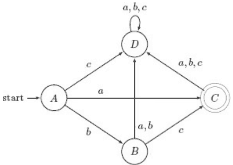

设 $L$ 为图中 4 状态图接受的语言。输入字符串必须属于字母 $\Sigma = \{a, b, c\}$。证明 $L = \{a, bc\}$。

为了证明集合 $L$ 和 $\{a, bc\}$ 的相等性，我们需要证明它们是彼此的子集。我们首先需要证明 $a \in L$ 且 $bc \in L$。

初始状态是 A。如果第一个输入符号是 $a$，则有一个到接受状态 C 的转移，因此 $a \in L$。当第一个输入符号为 $b$ 时，机器转移到状态 $B$。然后如果第二个输入符号是 $c$，则从 $B$ 有接受状态 C 的转移，因此 $bc \in L$。

接下来，我们需要证明 $x \in L \rightarrow x \in \{a, bc\}$ 或其逆否命题 $x \notin \{a, bc\} \rightarrow x \notin L$。换句话说，我们需要证明除 $a$ 和 $bc$ 之外的所有字符串都不被接受。我们需要考虑其他字符串，由于它们有无限多个，我们最好不要一个一个尝试，而是根据某些属性（例如字母表中哪个成员是第一个符号）将它们分为几类宽泛（实际上是无限大的）类别。

如果第一个符号是 $c$，我们就进入状态 D。状态 D 只有指向自身的转移，所有后续转移都留在 D，而 D 不是接受状态。因此，所有以 $c$ 开头的输入字符串最终都会卡在 D，如 $c$、$cab$、$ccbac$……。带有 $a$ 并继续的字符串（即通过接受 $a$ 作为整个字符串）会进入状态 C 并继续到 D，然后留在那里。剩余可能的第一个符号是 $b$，它进入非接受状态 $B$。如果第二个符号是 $c$ 以外的任何字符（整体构成 $bc$），你将卡在 D 上。最后，如果你在输入结束之前到达状态 C，下一个符号将带你去往 D，任何额外的符号都会将你离开。

示例 9.1 中的状态 D 是**汇点**（sink）的一个例子，即一旦进入无法离开的状态。像 D 这样的非接受状态被称为**陷阱状态**（trap state）。每当到达陷阱状态时，就意味着目前看到的输入已足以使整个字符串无法被接受。图中的单个陷阱状态总是足够的。也有接受汇点；稍后可见示例 9.6 和 9.7。遗憾的是，陷阱状态（尤其是指向它的所有转移）会让我们的图表变得杂乱。因此，我们将使用无陷阱图，如示例 9.2 所示，图中不显示陷阱状态，任何缺失的转移都被假设指向陷阱状态。

### 示例 9.2

重新绘制没有陷阱状态的示例 9.1 图。

我们不仅省略了陷阱状态，还省略了指向它的所有转移。结果图接受相同的语言 $\{a, bc\}$。注意，例如从状态 B 符号 b 的转移隐含指向一个未绘制的陷阱状态。

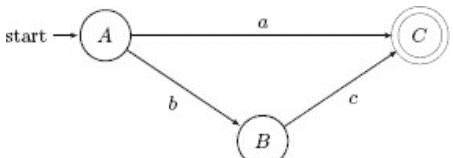

由于我们在讨论 DFA，省略的陷阱状态和任何缺失的转移被视为隐含存在的，并且可以无歧地恢复。事实上这适用于本章中所有的 DFA。

### 示例 9.3

为识别语言 $L$ 的自动机绘制状态转移图，其中 $L = \{x \mid x \in \{a,b\}^* \text{ 且每个 } a \text{ 都在每个 } b \text{ 之前}\}$。

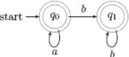

它是没有陷阱状态的情况下绘制的（从 $q_1$ 输入 $a$ 的转移是指一个陷阱状态）。注意，“每个 $a$”和“每个 $b$”可以引用空集，因此 $\Lambda \in L$，$aaa \in L$ 且 $bb \in L$。

在示例 9.3 的规范中，“每个”被使用了两次来表示全称量化。正如第 4.4 节结尾所述，全称量化在空集上始终为真，因此 $L$ 包含了所有不包含 $a$ 和/或不包含 $b$ 的字符串。

# 9.3 有限自动机的形式符号


到目前为止，我们使用的图表其优点是一目了然，但用普通的英语对其表达精确的观点会导致讨论变得笨拙。为了弥补这些缺点，我们转向形式符号。我们观察到状态转移图由 (i) 状态和 (ii) 符号组成，以及关于 (iii) 开始识别过程、(iv) 继续过程以及 (v) 完成时接受或拒绝的信息。从形式上说，确定性有限自动机（DFA）是这五个要素的模型，因此我们说它是五元组（5-tuple）。我们通常称其为 `M`，代表“机器”（machine）。

### 定义 9.1：确定有限自动机

一个 DFA `M` 是一个五元组，`M = (Q, Σ, q₀, δ, A)`，其中：

- `Q` 是状态的有限集合，
- `Σ` 是符号的有限集合，
- `q₀ ∈ Q`，其中 `q₀` 是起始状态，
- `A ⊆ Q`，其中 `A` 是接受状态集合，
- `δ: Q × Σ → Q`。

最后一行说明 `δ` 是从 `Q × Σ` 到 `Q` 的函数。记得 `Q × Σ` 是所有有序对 `(q, σ)` 的集合，其中 `q ∈ Q` 且 `σ ∈ Σ`。写作 `δ(q, σ)` 表示将 `δ` 应用于这些参数的结果。函数 `δ` 被理解为 DFA 的转移，规定了相应状态转移图中的转移。也就是说，如果 DFA 的当前状态为 `q`，且当前输入为 `σ`，那么 DFA 的下一个状态就是 `δ(q, σ)` 的值。

记得对于确定性自动机，每一步的状态选择都是唯一确定的；永远不会有多种可能。此外，永远不会少于一种可能；即 `δ` 是全函数，对于所有的 `q` 和 `σ` 都有定义的 `δ(q, σ)`。虽然图中省略了陷状态（trap state），但它包含在 `Q` 中并用于确保 `δ` 是全函数。

### 示例 9.6

为语言 `{a}*` 指定一个 DFA `M = (Q, Σ, q₀, δ, A)` 并画出对应的图。

```
Q = {q₀}
Σ = {a}
A = {q₀}
δ(q₀, a) = q₀
```

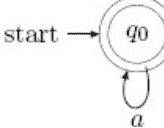

注意 `Λ` 是该机器接受的字符串，理应如此。

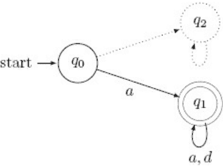

注意此 DFA 中的状态 `q₂`（用虚线圆表示）是一个陷状态。进入和离开它的转移也以虚线形式表示。

### 示例 9.7

设 `M = ({q₀, q₁, q₂}, {a, d}, q₀, δ, {q₁})`，其中 `δ` 由下表指定。证明 `M` 恰好接受以 `a` 开头的字符串 `{a, d}`。

| | `a` | `d` |
|---|---|---|
| `q₀` | `q₁` | `q₂` |
| `q₁` | `q₁` | `q₁` |
| `q₂` | `q₂` | `q₂` |

根据**定义 9.1**，起始状态位于五元组的第三位置；按照惯例，它被标记为 `q₀`。`M` 的第五（最后一个）元素始终接受状态集合；在本例中它是 `{q₁}`。从转移函数 `δ` 的表格中间行可以看出，`q₁` 是一个汇点状态（sink state），它的两个转移都指向自身。底部的行 `q₂` 也是如此。`q₂`（但不是 `q₁`）是一个陷状态，因为它也是非接受状态。显然，输入的第一个符号至关重要。如果是 `d`，自动机 `M` 将进入陷状态，字符串将被拒绝。如果第一个符号是 `a`，`M` 将进入接受状态，因此无论后续是什么，它都会接受该字符串。因此，`M` 接受的语言由所有以 `a` 开头的字符串组成，正如此。

理解 DFA 转移函数 `δ` 的方法是，它告诉我们每个单独输入的状态间移动。为了讨论由符号*字符串*引起的状态间移动，我们引入了一个新函数 `δ*`，它通过对字符串中的每个符号根据需要多次应用 `δ` 来工作。示例 9.7 中，字符串 `ad` 可以让 `M` 从 `q₀` 到 `q₁`，因此我们写作 `δ*(q₀, ad) = q₁`。它有时被称为**`δ` 的闭包或广义转移函数**，具有以下形式定义。

### 定义 9.2：转移函数的闭包 `δ*`

对于给定的 DFA `M = (Q, Σ, q₀, δ, A)`，`δ*` 是一个以状态和字符串作为输入并产生结果状态的函数。即 `δ* : Q × Σ* → Q`，且满足：

(i) 对于任何 `q ∈ Q, δ*(q, Λ) = q`

(ii) 对于任何 `q ∈ Q, σ ∈ Σ` 以及任何 `x ∈ Σ*, δ*(q, xσ) = δ(δ*(q, x))`

定义 9.2 的第 (i) 部分说明空字符串 `Λ` 对 DFA 没有影响，保持当前状态。第 (ii) 部分适用于非空字符串。注意 `x` 和 `σ` 都是变量，但区别在于 `σ` 是 `Σ` 的成员（即单个符号），而 `x` 的值在 `Σ*` 中（即字符串）。值得注意的是 (ii) 部分是递归的；它根据自身来定义 `δ*`。为了避免循环，它定义每个字符串 `xσ` 的 `δ*` 行为是基于较短字符串 `x` 的。第 (ii) 部分说明先知道 `δ*` 对输入 `x` 的作用（通过 `M` 可知），然后将 `δ` 应用于结果状态和剩余的符号 `σ`。接下来是直接根据定义 9.2 将 `δ*` 应用于长度为 1 的字符串得到的结论。

**引理 9.1**：`δ*(q, σ) = δ(q, σ)`，对于任何状态和长度为 1 的 `σ`。当 `δ*` 应用于单字符时，其结果与 `δ` 相同。

```
δ*(q, σ) = δ*(q, Λσ) = δ(δ*(q, Λ)) = δ(q)
```

代入 `σ = Λ`，定义 9.2 的第 (ii) 部分；`x = Λ`，定义 9.2 的第 (i) 部分。

### 示例 9.8

上面提到，从示例 9.7 的起始状态 `q₀` 开始，字符串 `ad` 应该让自动机到达状态 `q₁`。展示定义 9.2 如何正式确认这一点。

```
δ*(q₀, ad) = δ*(q₀, a), d = δ(δ*(q₀, a), d) = δ(q₁, d) = q₁
```

当 `x = a` 且 `σ = d` 时，使用定义 9.2；引理 9.1；计算 `δ`；计算 `δ`

上述定义——自动机、转移函数 `δ` 及其闭包 `δ*`——现在使得定义 DFA 识别的语言变得简单，即使 DFA 从起始状态转移到接受状态的字符串集合。

### 定义 9.3

由 DFA `M = (Q, Σ, q₀, A)` 识别的语言 `L(M)` 是满足 `δ*(q₀, x) ∈ A` 的所有 `x ∈ Σ*` 的集合。我们称 `M` 接受 `L(M)` 中的字符串，拒绝其补集 `Σ* \ L(M)`。

### 算法 9.1：识别自动机的语言

考虑一个处理输入字符串的 DFA `M`。`read` 函数从输入中获取符号。该识别算法在接受时返回“成功”，在拒绝时返回“失败”。注意它正确处理了空输入。

```
q ← q₀
while more input do
    read(σ)
    q ← δ(q, σ)
if (q ∉ A) then fail
succeed
```

如果我们允许自己使用广义转移函数 `δ*`，编写识别算法现在变得异常简单。根据[定义 9.3]，为了确定输入字符串 `x` 是否被接受，应计算 `δ*(q₀, x)` 并检查它是否为 `A` 的成员。这种方法假设我们可以实现 `δ*`。尽管[定义 9.2] 告诉我们具体如何编写 `δ*` 的递归函数，但我们将使用简单的迭代[算法 9.1]。

# 9.4 与正则语言的关系

我们在上一章中定义了正则语言并给出了等价的生成表征。我们现在证明正则语言类正是 DFA 能够接受的内容。

**引理 9.2**：如果对于任何确定性正则文法 `G, L = L(G)`，则存在一个 DFA `M` 使得 `L = L(M)`。

证明：设 `G = (V, Σ, S, P)`。我们定义 DFA `M = (Q, Σ, q₀, δ, A)` 如下：`Q = V, q₀ = S, A = {p | p → Λ ∈ P}`

```
δ(p, σ) = q,  {p → σ q} ∈ P
```

对于每个 `p ∈ Q` 和 `σ ∈ Σ`。如果 `δ` 不是全函数，我们可以在 `Q` 中添加一个陷状态；我们将此留作练习。注意 `δ` 是良定义的，因为 `G` 是确定的。关键观察是：

断言：对于每个 `x ∈ Σ*` 和 `A ∈ V, S ⇒* xA` 当且仅当 `δ*(q₀, x) = A`。

断言证明：对 `x` 的长度 `k` 使用归纳法证明。当 `k=0` 时成立，基于 `q₀` 的定义。假设对于所有长度为 `k (k>0)` 的 `x` 成立。假设使用 `G` 的第 `k+1` 步使用了 `A → bC`，则 `S ⇒* xA ⇒ bC`。并且根据归纳假设，我们可以说使用 `M` 时 `δ*(q₀, x) = A`。由于 `δ(A, b) = C`，我们知道 `δ*(q₀, xb) = C`。证明的后半部分，假设使用 `M` 的第 `k+1` 步是 `δ(A, b) = C`，则 `δ*(q₀, x), b = C`。再次根据归纳假设，我们可以使用 `G` 时有 `S ⇒* xC`。断言成立。

断言表明，只要不使用消除产生式，推导和机器转移就是同步的。为了完成定理的证明，我们观察到 DFA 仅当 `x` 的推导可以以消除结束时才能接受 `x`。

### 示例 9.9

考虑文法 `G = ({C, D, E, F}, {a, b}, C, P)`，起始符号为 `C`，且 `P` 中的产生式如下所示：

```
C → a D    C → b E    F → Λ
D → a C    D → b F
E → a F    E → b C
F → a E    F → b D
```

将其转换为如引理证明中所述的 DFA。

所得的转移图如下：

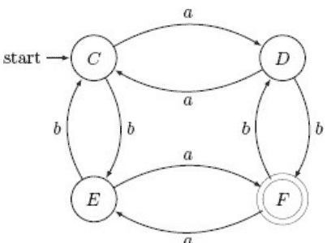

你应该针对不同的 `x` 验证该断言；例如 `δ*(C, aab) = E` 且 `C ⇒ aabE`。

**引理 9.3**：对于任意 DFA `M`，如果 `L = L(M)`，则存在一个确定性正则文法 `G` 使得 `L = L(G)`。

**证明**：这是一个模拟技术可逆的罕见例子。例如，在示例 9.9 中显而易见，如果我们给定了 DFA，就可以唯一地重构文法。同样的断言和证明同样适用于这一逆映射。☐

将这些引理结合最后一章的特征描述，可以直接得出此结论。

**定理 9.1**：`L` 是正则的，当且仅当存在一个 DFA `M` 使得 `L = L(M)`。

# 9.5 非确定性有限自动机

非确定性有限自动机（NFA）与 9.3 节正式定义的 DFA 具有若干共同方面和属性。尽管定义上有很大相似之处，但 NFA 与 DFA 在一个关键点上不同：对于离开状态的单个符号，它们可以有多个转移。相比之下，在 DFA 中，离开状态的所有转移必须标记有不同的符号。因此，下面的图必须是一个 NFA，因为它有两个标记为 `a` 的转移离开了起始状态。我们现在可能好奇当输入以 `a` 开始时，这个自动机会去向何处。我们会回到这个问题，但目前只需记住（来自 8.2 节）非确定性过程并不直接模拟现实过程。

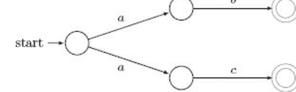

这个 NFA 是语言 `L = {ab, ac}` 的自然、直观的表示。然而，这个自动机通过从某个状态出发的两个相同标签的转移呈现了困境。为了让这台机器可能接受，字符串必须以 `a` 开头。在处理 `a` 之后，有两个可能的当前状态。下一个符号随后会在它们之间形成决择，假设它是 `b` 或 `c`。当然，字符串 `aa` 会被拒绝。这里的核心思想是由于引入了转移的选择。

我们需要引入正式定义来清楚地说明 NFA 是如何工作的。两种自动机之间的唯一区别在于转移函数 `δ`。对于 DFA，`δ` 的（输出）值是集合 `Q` 的元素，即它恰好是一个状态。但对于 NFA，`δ` 的值可以是状态的任何子集。对于特定的状态和输入符号，可能的后续状态可能是零、一个或多个。

为了更准确地描述 DFA 和 NFA 之间的这种差异，我们可以说这种差异涉及 `δ` 的陪域。任何函数的陪域都是选择其输出的集合。因此，对于 DFA，`δ` 的陪域是 `Q`。当 NFA 的 `δ` 值为状态集时，其陪域必须是 `Q` 的所有子集，即幂集 `2^Q`（见 1.1 节）。

### 定义 9.4：非确定性有限自动机

非确定性有限自动机 `M` 是五元组 `(Q, Σ, q₀, δ, A)`，其中 `Q, Σ, q₀` 和 `A` 与 DFA 相同，即 `Q` 是有限状态集，`Σ` 是有限字母表，`q₀` 是起始状态，`A` 是接受状态集，其中：

```
δ : Q × Σ → 2^Q
```

对于不同的值 `q ∈ Q` 和 `σ ∈ Σ`，`δ(q, σ)` 的值可以是零、一个或多个状态的集合。`δ(q, σ)` 包含多个状态的情况提供了关于下一个状态是什么的选择。在我们所展示的每个 NFA 中都至少会有一种这种情况，以使机器具有真正的非确定性。然而，一个每个 `δ(q, o)` 都包含零或一个状态的机器，永远不需要做出任何真正的选择。虽然这样的机器在形式上可以满足 NFA 的定义，但它具有明显的确定性特征，并且很容易被改写为确定性自动机；见练习 9.1。

NFA 接受哪些字符串？非正式地说，一个字符串 `x` 被接受，如果在从左到右读取 `x` 的符号时，存在某种转移的选择，能够带我们从起始状态移动到接受状态。为了使其形式化，我们需要将 `δ*` 的定义适应到 NFA 的情况。

### 定义 9.5：`δ*`，扩展到 NFA 的广义转移函数

对于 NFA `M = (Q, Σ, q₀, δ, A)`，`δ*` 是一个以状态和字符串为输入并产生状态集的函数。即 `δ* : Q × Σ* → 2^Q`，使得：

- (i) 对于任意 `q ∈ Q` 和 `σ ∈ Σ`，`δ*(q, σw) = ⋃_{p ∈ δ(q, σ)} δ*(p, w)`
- (ii) 对于任意 `q ∈ Q`，`δ*(q, ε) = {q}`

### 定义 9.6

由 NFA `M = (Q, Σ, q₀, δ, A)` 识别的语言 `L(M)` 是所有满足 `δ*(q₀, x) ∩ A ≠ ∅` 的字符串 `x ∈ Σ*` 的集合。

## 示例 9.10

考虑语言 `L = {x | x ∈ {a, b}* 以 ab 结尾}`。该语言包含字符串 `bbab`，但不包含 `abba`。为识别 `L`，分别为 DFA 和 NFA 画出简单的转移图。

首先，这是 `L` 的 DFA。虽然机器很小——只有 3 个状态——但很难直观人们是如何想到它的。即使在给出之后，要刻画每个状态可能也是一个挑战。

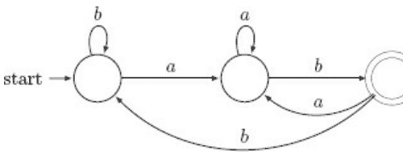

将 DFA 与以下同样识别 `L` 的 NFA 进行比较。我们同样三个状态，但现在图看起来更简单，更容易看出它是如何工作的。

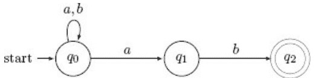


这台机器一直循环，直到非确定地选择验证最后两个符号是否为 $ab$。这台机器的正式符号为

$M = (\{q_0, q_1, q_2\}, \{a, b\}, q_0, \delta, \{q_2\})$,

其中 $\delta$ 由表指定。

$$
\delta = \begin{array}{c|cc}
 & a & b \\
\hline
q_0 & \{q_0, q_1\} & \{q_0\} \\
q_1 & \emptyset & \{q_2\} \\
q_2 & \emptyset & \emptyset
\end{array}
$$

### 示例 9.11

考虑语言 $L$ 和 NFA 示例 9.10。我们可以在 NFA 和正则文法 $G = (\{A, B, C\}, \{a, b\}, P)$ 之间相互转换，其中状态 $q_0, q_1$ 和 $q_3$ 分别对应变量 $A, B$ 和 $C$，且：

```
$P = \{A \rightarrow aA, A \rightarrow bA, A \rightarrow aB, B \rightarrow bC, C \rightarrow \Lambda\}$.
```

上述引理强调了非确定性角色的作用。非确定性机器在硬件实现上非常神秘，但在这种语境下它们非常自然。也就是说，正则文法与 NFA 之间的关系与确定性正则文法与 DFA 之间的关系完全相同。如果我们从最后一章中本质上是非确定性的刻画角度来看待正则语言，我们可能会得出 NFA 是更自然的机器模型。也许事实确实如此！但确定性机器在现实中的实用性使得 DFA 占据了主导。

算法 9.2 提供了另一种定义 $\mathcal{L}(M)$ 的方法。观察这种方法与确定性的算法 9.1 有何相似是非常有启发性的。

我们以这些定理的一个推论结束。

### 算法 9.2

**识别非确定性有限自动机的语言。**

设 $M$ 为一个 NFA，$x$ 为输入字符串。恰当当 $x \in \mathcal{L}(M)$ 时，该非确定性伪代码才能成功完成。因此，当 $q \in A$ 为真时，算法成功。请注意，如果所有可能的计算都涉及尝试空状态集进行转移（因为 `choose` 操作会失败），则算法也可能失败。

```
$q \leftarrow q_0$
while more input do
  read($\sigma$)
  choose $q \in \delta(q, \sigma)$
if ($q \notin A$) then fail
nsucceed
```

**定理 9.3** – 对于某些 DFA $M_1$，$L = \mathcal{L}(M_1)$，当且仅当对于某些 NFA $M_2$，$L = \mathcal{L}(M_2)$。

**证明：** 这是显而易见的，因为无论机器模型如何，$L$ 都是正则的。但我们可以提供更具构造性的细节。

如果我们从 $M_1$ 开始，观察到它已经是一个 NFA；一个转移函数所有值都取单元素集的 NFA，这对应于 DFA 转移函数的单值。如果我们从 NFA $M_2$ 开始，我们可以将其转换为正则文法，该正则文法可以转换为确定性正则文法，而后者又可以转换为 DFA。□

值得注意的是，将正则文法转换为确定性正则文法可能会导致可达变量数量的指数级增长。（在构造 DFA 时，仅需要使用可达变量。）因此，证明中所给出方法产生的状态数可能比原始 NFA 的状态数指数级大。可以通过例子证明，有时相应的 DFA 必须是指数级大；参见练习题 9.26。

## 9.6 正则语言的性质

记住，在此时如果一个语言已知是正则的，则意味着它可以由正则表达式（RE）、正则文法和确定性正则文法生成，并被 DFA 和 NFA 识别。此外，我们还有算法技术可以从一种格式转换到任何其他格式。在本节中，我们将使用这些表示法来探索正则文法类的封闭性。

如果一个语言运算符应用于某一语言类中的语言后产生同类中的语言，则称该运算符对该语言类是封闭。例如，我们取任意正则语言 $L_1$ 和 $L_2$，它们的交集 $L_1 \cap L_2$ 也是正则语言，如下所示。示例 9.12 显示了封闭性质的潜在应用性。

### 示例 9.12

我们想要针对 $\Sigma = \{a, b\}$ 上的以下语言设计 FA：

```
$L = \{x \mid x \text{ 是一个 a 后面跟着零或多个 b } \wedge x \text{ 是一个 b 前面有零或多个 a}\}$
```

很容易看出 $L = L_1 \cap L_2$，其中：

```
$L_1 = \{x \mid x \text{ 是一个 a 后面跟着零或多个 b}\}$
```

```
$L_2 = \{x \mid x \text{ 是一个 b 前面有零或多个 a}\}$
```

也许如果我们能为 $L_1$ 和 $L_2$ 设计 FA，我们就可以利用它们来为 $L$ 设计一个。

**定理 9.4** - 如果 $L_1$ 和 $L_2$ 是正则语言，则 $L = L_1 \cup L_2$ 是正则语言。

**证明：** 由于它们都是正则的，我们知道 $L_1 = \mathcal{L}(G_1)$ 和 $L_2 = \mathcal{L}(G_2)$，对于某些正则文法 $G_1 = (V_1, \Sigma, S_1, P_1)$ 和 $G_2 = (V_2, \Sigma, S_2, P_2)$。在不失一般性的情况下，我们可以假设两个文法的变量是互交的。考虑 $G = (V, \Sigma, S, P)$，其中 $V = V_1 \cup V_2 \cup \{S\}$，$S$ 是一个新变量，$P = P_1 \cup P_2 \cup \{S \rightarrow S_1, S \rightarrow S_2\}$。注意 $G$ 是一个单位正则文法，但根据引理 8.2，它可以转换为正则文法，使得 $L = \mathcal{L}(G)$。我们需要证明 $x \in \mathcal{L}(G)$ 当且仅当 $x \in \mathcal{L}(G_1) \cup \mathcal{L}(G_2)$。如果 $S \rightarrow S_1$ 或 $S \rightarrow S_2$，那么 $x \in \mathcal{L}(G_1)$ 或 $x \in \mathcal{L}(G_2)$。如果 $x \in \mathcal{L}(G_1) \cup \mathcal{L}(G_2)$，则 $G$ 可以推导出 $S \rightarrow S_1$ 或 $S \rightarrow S_2$。接下来我们考虑补集运算，它的证明使用了 DFA。

**定理 9.5** - 如果 $L$ 是正则语言，则 $\overline{L} = \Sigma^* \setminus L$（$L$ 关于 $\Sigma$ 的补集）是正则语言。

**证明：** 由于它是正则的，$L = \mathcal{L}(M)$，对于某个 DFA $M=(Q, \Sigma, q_0, \delta, A)$，据此构造一个新的 $\overline{M}$，使得 $\overline{L} = \mathcal{L}(\overline{M})$。特别是，$\overline{M}$ 与 $M$ 的区别在于接受状态集的补集。因此，$x$ 被 $\overline{M}$ 接受当且仅当 $x$ 不被 $M$ 接受。关于交集的结论不能使用并集的方法证明。

**定理 9.6** - 如果 $L_1$ 和 $L_2$ 是正则语言，则 $L = L_1 \cap L_2$ 是正则语言。

**证明：** 回忆集合的德摩根法则之一：$A \cap B = \overline{\overline{A} \cup \overline{B}}$，可以重写为 $A \cap B = \overline{\overline{A \cap B}}$。根据定理 9.4 和 9.5，如果 $L_1$ 和 $L_2$ 是正则的，那么 $\overline{L_1}, \overline{L_2}, L_1 \cup L_2$ 都是正则的。因为连接和 (*)是正则运算符，接下来的定理是显而易见的。

**定理 9.7** - 如果 $L_1$ 和 $L_2$ 是正则语言，则它们的连接 $L_1L_2$ 是正则语言。

**证明：** 如果 $L_1$ 和 $L_2$ 是正则语言，则存在 RE $r_1$ 和 $r_2$，使得 $L_1 = \mathcal{L}(r_1)$ 和 $L_2 = \mathcal{L}(r_2)$。由于 $r = r_1r_2$ 是一个 RE，因此 $\mathcal{L}(r)$ 和 $L_1L_2$ 是正则的。□

**定理 9.8** - 如果 $L_1$ 是正则语言，则其闭包 $L_1^*$ 是正则语言。

**证明：** 如果 $L_1$ 是正则的，则存在 RE $r_1$ 使得 $L_1 = \mathcal{L}(r_1)$。由于 $r = r_1^*$ 是一个 RE，因此 $\mathcal{L}(r)$ 和 $L_1^*$ 是正则的。□

## 9.7 正则语言的局限性

在本节中我们将展示正则语言类并不包含所有语言。我们将给出一种证明某些语言非正则的技术。该技术也将导致一种减少 DFA 复杂度的方法。两者的起点都是这个定义。

### 可区分性 9.7

设 $L$ 为 $\Sigma$ 上的语言，$x, y \in \Sigma^*$。如果对于某个 $z \in \Sigma^*$，字符串 $xz$ 和 $yz$ 中的一个在 $L$ 中而另一个不在，则称 $x$ 和 $y$ 关于 $L$ 是**可区分的**。否则，$x$ 和 $y$ 是**不可区分的**。如果从字符串集合 $S$ 中取出的任意两个字符串都是可区分的，则称集合 $S$ 两两可区分。

下一个定理有悠久的历史，是 Myhill-Nerode 定理的一部分。

> **定理 9.9** – 设 $L$ 为 $\Sigma$ 上的语言。如果存在一个关于 $L$ 两两可能的有限字符串集合 $S$，那么如果一个 DFA 识别 $L$，则它必须包含至少 $|S|$ 个状态。

**证明：** $|S|=n$。反反假设，某个 DFA $M$ 接受语言 $L$，但 $M$ 有 $m < n$ 个状态。我们引入鸽巢原理：为了将 $k+1$ 只鸽子放入 $k$ 个鸽巢中，必须有一对鸽子共享同一个鸽巢。作为鸽子，我们取 $M$ 的 $m$ 个状态。作为鸽子，对于 $S = \{x_i \mid 1 \le i \le n\}$ 中的每个字符串，我们取从起始状态出发 $x_i$ 所导向的状态 $p_i = \delta^*(q_0, x_i)$。根据鸽巢原理，后这几个状态中必须有两个是同一种状态；特别是 $p_i = p_j$，其中 $i \neq j$。这是不可能的，因为从那里，对于任何输入 $z$，将经过一条固定的路径。因此，两个字符串 $x_i$ 和 $x_j$ 无法区分。

通过这个定理我们可以证明某些语言需要特定数量的状态。从这个意义上说，可以证明某些正则语言比其他语言复杂。然而，我们将以一种更戏剧的方式使用这个定理，证明某些语言太复杂，以至于任何 DFA 都无法接受它。

推论 9.1 – $L$ 为 $\Sigma$ 上的一个语言。如果存在一个关于 $\Sigma$ 的字符串无限集合 $S$，这些字符串对于 $L$ 是两两可区分的，则 $L$ 不是正则语言。

**证明：** 假设反反，$L$ 是正则语言，因此存在某个 DFA $M$ 接受 $L$。作为一个有限自动机，$M$ 具有有限数量的状态；令 $m$ 为状态数。令 $S' \subset S$ 为任意满足 $|S'|=m+1$ 的子集。显然，$S'$ 中的字符串是两两可区分的。但定理 9.9 保证了 $M$ 没有足够的状态来完成这项工作。

这是计算机语言的一个方面的简单例子，其表示能力超出了代数、逻辑表达式和编程语言中使用的括号的表示能力。我们通过忽略表达式中的这些括号来构造一个语言，得到了一个括号的简单*模型*。那么对于表达式 $\log(a+c)(d+e)$，我们剩下字符串 "(( ) ))"。该语言的字母表为 $\{(, )\}$。另一个平衡括号字符串是 "(( ) ( ))"。我们在第 10 章中更精确地定义平衡括号。然而，下面的示例进一步简化了这一动机，并用 $a$ 替换 ""，用 $b$ 替换 ""。

### 示例 9.13

我们证明 $L = \{a^nb^n \mid n \geq 0\}$不是正则的于L$ 中的字符串包括 $\Lambda, ab$ 和 $aabbbb$。我们选择 $S = \{a^n \mid 0 \leq n\}$。考虑字符串 $aaa$ 和 $aaaa$。使用后续字符串 $z=bb$，我们得到 $xz \in L$ 但 $yz \notin L$。因此，这两个字符串对于 $L$ 是可区分的。

这种推理可以适用于任何两个长度不同的 $a$ 序列。对于任意不同的值 $i$ 和 $j$，字符串 $a^i$ 和 $a^j$ 对于 $L$ 是可区分的，使用 $z=b^i$ 作为后续字符串（使用 $z=b^j$ 同样可行）。

总结来说，在为语言构建有限自动机（FA）时，对于对于语言（两两）可区分的字符串，我们需要对应*不同的状态*。完整的 Myhill-Nerode 定理更进一步：如果 $S$ 是关于正则语言 $L$ 的两两可区分字符串的最大集合，则存在一个仅包含 $|S|$ 个状态的 DFA 接受 $L$。这里不证明。我们将观察这一事实的实际结果。我们将展示如何通过减少状态数量来简化 DFA。

定理 9.9 将集合 $S$ 中的字符串与 DFA 的状态对应起来。我们可以进一步说，所有字符串集合 $\Sigma^*$ 被划分为 $m$ 个块，其中 $m$ 是状态数。对于每个状态，划分中都有一个块包含了所有到达该起始状态的字符串。显然，同一个块中的所有字符串必须是两两不可区分的。

我们提供了一种基于这些见的算法。我们从一个非常粗的状态划分开始，通过分裂块来不断细化，直到每个块都由不可区分的状态组成。每个块将合并为一个新状态。

### 定义 9.8

**状态的不可区分性**

令 $M$ 为一个 DFA。两个状态 $p$ 和 $q$ 对于 $M$ 是*可区分的*，如果对于某些 $z \in \Sigma^*$，状态 $\delta^*(p, z)$ 和 $\delta^*(q, z)$ 中恰好有一个是接受状态。否则，$p$ 和 $q$ 是不可区分的。

### 定义 9.9

**状态的不可区分性**

令 $M = (Q, \Sigma, q_0, \delta)$ 为一个 DFA。两个状态 $p$ 和 $q$ 对于长度最多为 $k$ 的字符串对于 $M$ 是不可区分的，记作 $p \overset{k}{\equiv} q$，如果对于所有 $|z| \leq k$ 的 $z \in \Sigma^*$，

$$\delta^*(p, z) \in A \text{ iff } \delta^*(q, z) \in A.$$

这是一个等价关系，诱导了顶点集合 $Q$ 的划分 $\Pi_n$。

显然 $\Pi_0$ 初始只有两个块，即接受状态集和非接受集合，因为唯一的 $z$ 是 $\Lambda$。算法 9.3 计算随 $k$ 值增加的系列划分。也就是说，当考虑更多字符串时（随着 $k$ 增加），原本在同一个块中的字符串可能会被发现是可区分的；这将导致一个块在下次划分中分裂为子块。当 $\Pi_k = \Pi_{k-1}$ 时，在该轮中没有块被细分。因此，更大的 $k$ 值将不再发生细化，因为循环体将重复相同的行为。算法必须停止，因为任何划分中的块的数量不能超过状态数。

## 算法 9.3

细化不可区分状态的划分。

输入：$M = (Q, \Sigma, q_0, \delta, A)$。

输出：最终划分 $\Pi_k$

```
Initialize $\Pi_0$
$k \leftarrow 0$
repeat
  for every $p \in Q$ and $q \in Q$ do
    $(p^{k \pm 1} q) \iff ((p^k = q) \wedge (\forall a \in \Sigma^* : \delta(p, a) = \delta(q, a)))$
  $k \leftarrow k+1$
until $\Pi_k = \Pi_{k-1}$
```

我们必须非常小心。假设我们刚刚处理了 6 个输入字符：ababab。我们应该处于状态 $q_2$（因为最后两个字符是 $ab$）还是处于状态 $q_4$（因为最后四个字符是 $abab$）？显然，我们需要处于状态 $q_4$，否则如果下一个输入字符是 $b$ 且我们正处于状态 $q_2$，我们就无法察觉到我们刚刚遇到了模式 $P$ 的第五个个字符。通常情况下，如果你可以处于状态 $q_j$ 那么你就永远不应该处于状态 $q_i$，其中 $j > i$。

如果你处于状态 $q_4$ 且在输入中遇到一个 $a$。这意味着输入的最后五个字符是 $ababa$。我们似乎在 $q_1$ 和 $q_3$ 之间面临一个选择，但根据上述观察，我们发现自己必须转移到状态 $q_3$。这种类型的例子可以推广为一条单一规则：如果我们处于状态 $q_i$ 且输入为 $\sigma$，那么我们必须转移到状态 $q_j$：

```
$j = \max\{k \mid (k=0) \vee (1 \le k \le m \wedge p_1 p_2 \dots p_k = p_{i-k+2} \dots p_i \sigma)\}$.
```

我们知道刚刚遇到了在 $P$ 的第 $i$ 个字符之前的所有字符，并且在选择 $j$ 时尽可能尽可能地使用这些字符。在解释这条规则时，重要的是意识到存在两种退化情况，即 $j=1$ 和 $j=0$。当 $j=1$ 时，之前的字符一个都不匹配，但我们保留了新输入 $a$ 匹配 $P$ 的第一个字符这一事实。当 $j=0$ 时，我们进入状态 $q_0$，这意味着我们在寻找 $P$ 的过程中完全没有任何进展。

我们现在准备好仅使用状态 $Q=\{q_0, q_1, \dots, q_m\}$ 构建一个有限自动机（FA）。我们将 $q_m$ 设为接受状态，原因与我们在 NFA 中做的一样。使用上述规则，我们可以生成所有其他需要的转移转换。对于 $P=ababb$，我们得到了这台机器：


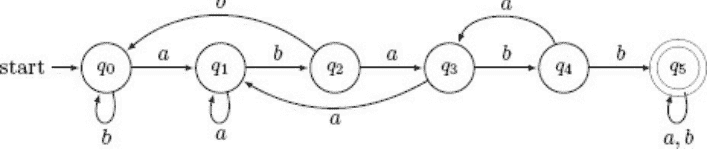

这提供了一种构建 FA 来解决模式匹配问题的通用技术。能够找到这种通用的技术是非常罕见的；大多数 FA 是通过不那么系统的方法发现的。

# 9.9 设计有限自动机

如果任务是为所有具有特定属性的字符串语言构建一个 FA，那么就无法期望某种通用的技术。偶尔，正如模式匹配章节所示，如果该属性非常具体且简单，则可能存在一种专用技术。然而，在本节中，我们还想得出几点通用的观察。

首先，一个属性仅仅是字符串 $x$ 的一个逻辑谓词 $p(x)$；$x$ 属于该属性定义的语言为真或假。假设 $p(x)$ 是复杂的，但可以分解为 $p(x) = q(x) \lor r(x)$，那么该语言就是对应于谓词 $q(x)$ 和 $r(x)$ 的两个语言的并集。并集封闭性的构造性证明允许你从两个更简单的机器构建出所需的机器。类似的说明对于交集、补集和其他具有封闭性的运算符也适用。

其次，第 9.7 节证明中隐含了以下原理：对于你需要编码字母表所需的每种记忆，你都需要一个状态。记住，由于我们不回溯输入，因此关于已处理字符串部分的*所有信息*都仅仅由于处于某一个状态（而非另一个状态）而被记录下来。反过来说，在构建 FA 时，只有当你能够指定到达该状态代表了过去的哪些记忆时，你应该创建每个新状态。

第三，对于任何语言都存在多一个 FA。人们倾向于找到状态最少的 FA。如果你遵循了上一段的建议，你可能不会产生多余的状态。但如果你真的产生了呢？在本书中，重点完全放在了正确性上，额外的状态是一个次要问题。但在某些应用中，消除额外状态具有经济上的激励。在这些情况下，你可以使用 9.7 节末尾给出的状态最小化算法，该算法将一个具有额外状态的机器转换为具有最少状态的等效机器。

最后，一种强大的设计技术是从非确定性公式开始构建过程，并将其转换为确定性 FA。

## 练习

9.1 – 令 $M = (Q, \Sigma, q_0, \delta, A)$ 为一个没有真正选择的 NFA。换句话说，对于 $Q$ 中的每个 $q$ 和 $\Sigma$ 中的每个 $\sigma$，$\delta(q, \sigma)$ 的值要么有一个元素要么为空。形式化地指定一个新的确定性 FA $M'$，它接受与 $M$ 相同的语言。即形式化地指定 $M'$ 五元组的 5 部分，使得 $\mathcal{L}(M') = \mathcal{L}(M)$。

提示：引入一个陷阱状态 $q'$，然后通过形式化指定以下情况下发生的情况：(i) 当 $\delta(q, \sigma) = \emptyset$ 时和 (ii) 当 $\delta(q, \sigma) = \{p\}$ 时。

9.2 – 对于示例 10 中的 DFA 和 NFA，计算以下字符串的 $\delta^*(q_0, x)$：

- $a$
- $b$
- $ab$
- $ba$
- $a^k$，其中 $k \ge 1$

9.3 – 重新画 9.3 的图，包括其陷阱状态。

9.4 – 为 $\Sigma = \{a, b, c\}$ 的以下语言绘制状态转移图：

- 以 $c$ 开始。
- 以 $c$ 结束。
- 好包含一个 $c$。
- 至少包含一个 $c$。
- 长度恰好为 2。
- 长度最多 2。

9.5 – 说明有限语言是正则的。

9.6 – 为 $\Sigma = \{a, b\}$ 的以下语言提供 NFA：

(a) 以 $abab$ 结尾的。
(b) 包含 $aaa$ 的语言。
(c) $x = yz$，其中 $y$ 包含奇数个 $a$，且 $z$ 包含奇数个 $b$。

9.7 – 通过指定 $L_1$ 和 $L_2$，表示示例 9.3 的语言 $L$。

9.8 – 给出一个识别至少一个块的二进制字符串的 FA，$\Sigma = \{0, 1\}$。

9.9 – 为满足以下条件的字符串绘制状态转移图：

(i) 以 $ab$ 开始，
(ii) 以 $ab$ 结束（不重叠），且 (iii) 没有其他 $ab$。提示：看示例 9.5。

9.10 – 形式化指定机器 $M = (Q, \Sigma, q_0, \delta, A)$，给出 $Q, \Sigma, q_0$ 的值，由于 $\delta$ 是全函数，你必须添加陷阱状态及其相关的转移。

9.11 – 令 $M = (\{q_0, q_1, q_2, q_3\}, \{a\}, q_0, \delta)$，$\delta$ 由下表指定：

| | $q_1$ |
|---|---|
| $q_0$ | |
| $q_1$ | $q_2$ |
| $q_2$ | |
| $q_3$ | $q_0$ |

(a) 为该自动机绘制状态转移图。
(b) 用英文描述语言 $\mathcal{L}(M)$。
(c) 使用 (b) 给出一个接受 $\mathcal{L}(M)$ 的双状态机的形式化指定。（注意本练习与状态最小化的关系。）

9.12 – 指定示例 9.5 中第二个状态转移图的转移函数。标记状态为 $q_0, q_1, q_2, q_3, q_4, q_5$，其中后者是陷阱状态。

9.13 – 对于练习 9.12 中的 DFA，给出此处参数的 $\delta^*$ 值：

(a) $\delta^*(q_0, dcba)$
(b) $\delta^*(q_1, \Lambda)$
(c) $\delta^*(q_1, dcba)$
(d) $\delta^*(q_2, dcba)$
(e) $\delta^*(q_0, dcd)$
(f) $\delta^*(q_0, dcd)$

9.14 – 遵循示例 9.8 使用定义 9.2 的方法，证明示例 9.7 的 DFA $\delta^*(q_0, dad) = q_2$。

9.15 – 使用 $\Sigma = \{a, b\}$ 为以下模式构建 DFA：

(a) $P = aaab$
(b) $P = abba$

9.16 – 使用 $\Sigma = \{a, b\}$ 为以下模式构建 DFA：

(a) $P = ababab$
(b) $P = ababaa$

9.17 – 为 $\Sigma = \{a, b\}$ 的语言 $L$ 设计 DFA，其中每个字符串：

(a) 包含子串 $aa$ 并在之后的某个点包含子串 $bb$。
(b) 由偶数个 $a$ 后跟偶数个 $b$ 组成，例如 $aabbbb$。记住0是偶数。

9.18 – 为 $\Sigma = \{a, b, c\}$ 的语言 $L$ 设计 DFA，其中每个字符串：

(a) 包含子串 $ab$，并且在其之后至少包含两个 $cs$。因此例如，baaabcbca $\in L$。
(b) 在任何 $bb$ 之前包含一个 $aba$。注意，像 aab 的字符串也在该语言中！
(c) 在某些 $c$ 之前包含一个 $a$ 和 $b$，例如 $bcac$。

**9.19** – 证明正则语言对集合差运算是封闭的。特别是，要证明如果 $L_1$ 和 $L_2$ 是正则语言，则 $L_1 \setminus L_2$ 也是正则语言。

**9.20** – 你通常可以在不调用算法的情况下直接看到正则表达式（REs）与 DFA 之间的直接联系。请为识别表示以下语言的 DFA 画出状态转移图：

- (a) $(aa + ab)^*$
- (b) $(aaa + abb)^*$
- (c) $(a + aab)^*$

**9.21** – 给出与示例 9.10 中的两个自动机（FA）对应的正则文法。

**9.22** – 给出与练习 8.15 中的正则文法对应的自动机（FA）。

**9.23** – 为在 $\Sigma = \{a, b\}$ 上不包含子字符串 $aba$ 的字符串语言给出一个 DFA。通过构建一个模式匹配机器并对该机器进行“取反”来解决。

**9.24** – 令 $L_1$ 为任意顺序的左、右括号数量相等的字符串集合。令 $L_2 = \{()^n \mid 0 \le n\}$ 且 $L_1$ 为平衡括号语言（如 $()()$）。令 $\Sigma = \{(, )\}$。

- (a) 说明语言 $L_1, L_2, L_3$ 和 $\Sigma^*$ 之间的子集关系。根据情况适当使用 $\subseteq$ 或 $\subsetneq$。每当你指定 $\subsetneq$ 的地方，请给出相关集合差中的一个字符串示例。
- (b) 证明 $L_1$ 不是正则语言。

**9.25** – 证明以下在 $\Sigma = \{a, b, c\}$ 上的每个语言都不是正则的：

- (a) $\{x \mid x \text{ 是一个回文串}\}$
- (b) $\{x \mid x = yy \text{ 对于某些 } y \in \Sigma^*\}$
- (c) $\{x \mid x = a^b c^k \text{ 其中 } j = i + k\}$

**9.26** – 考虑语言 $\{x \in \{a, b\}^* \mid x \text{ 从尾部起的第 } k \text{ 个符号是 } a\}$。

- (a) 证明该语言需要一个至少有 $2^k$ 个状态的 DFA。
- (b) 证明对于同一语言仅存在一个具有 $k + 1$ 个状态的 NFA。

**9.27** – 通过处理陷阱状态的细节来完成[引理 9.2]的证明。

**9.28** – 使用正则表达式代替文法证明[定理 9.4]。

**9.29** – 我们通过允许使用终结符字符串（而定义中允许单个终结符）来扩展正则文法的定义。即使使用这种扩展定义，任何正则文法仍然可以转换为 DFA。考虑文法

$G = \{S, T\}, \{a, b, c\}, S, \{S \to abS \| abcT, T \to bcT \| a\}\}$

- (a) 该文法的哪些方面使其根据此扩展定义来说是正则的。
- (b) 写出一个（可能是非确定性的）状态转移图，其语言为 $\L(G)$。
- (c) 为 $\L(G)$ 给出一个规范的正则文法。指出哪些操作是上可以完成的。

**9.30** – 为 $L, \Sigma = \{a, b, c\}, L = \{x \mid \text{如果 } x \text{ 包含 } a \text{ 和 } b \text{ 则 } x \text{ 包含 } c\}, bca \in L, bc \in L$ 写一个 DFA。

**9.31** – 为 $L, \Sigma = \{a, b\}, L = \{x \mid \text{第 3 个字符与尾部第 3 个字符相同}\}, abbababba \in L$ 写一个 NFA。

# 第 10 章

## 上下文文法

上下文文法可以表示重要的语言，包括许多非正则语言，并且它们可以为单个字符串分配有用的结构。这两种重要能力的结合使得 CFG 在语言以及计算机语言的实际建模中发挥着核心作用。

对于我们开始介绍的正则语言类，我们相对于机器模型给出了该类的定义。之后，我们证明了它与非确定性模型定义的类具有等价性，特别是生成式模型，如文法模型。在本章中，我们将定义一类新的语言，并将从非确定性模型开始。在下一章中，我们将建立它与机器模型（下推自动机）的等价性。

引入新类语言模型的动机在第 9.7 节中给出，那里我们展示了目前看到的模型是不够的。我们展示了一些非正则语言，这些语言没有有限自动机可以接受。这些语言也无法通过正则文法来表示。（正则表达式也是不够的，但以正则表达式为范例的生成式模型将不再被扩展。）

除了为广泛语言指定字符串外，上下文无关语言还提供了其语言中每个字符串结构的说明。这些结构是第 10.3 节的重点，在其中我们展示了它们如何在提取语句含义中发挥作用。某些文法为某些字符串提供了多个结构。这种某种的结果被称为结构歧义，尽管这经常发生。

## 10.1 上下文文法简介

上下文文法（CFGs）是表示编程语言和人类语言的重要形式。

### 10.1 定义

上下文文法 $G$ 是四元组 $(V, \Sigma, S, P)$，其中：

- $V$ 变量集合
- $\Sigma$ 终结符集合
- $S$ 开始符号
- $P$ 产生式集合，形式为 $A \to \alpha$，其中 $A \in V$

### 10.2 定义

文法 $G$ 生成的语言 $\L(G)$，当且仅当存在从开始符号 $S$ 的推导 $S \Rightarrow^* x$，其中 $x \in \Sigma^*$。

### 10.3 约定

1. 大写罗马字母表示 $V$。
2. 小写罗马字母表示 $\Sigma$。
3. 小写罗马字母表示 $\Sigma^*$。
4. 希腊字母表示 $V \cup \Sigma$。

### 10.2 示例

以下文法生成的语言是什么？

$G_2 = (\{S\}, \{()\}), S \to (S), S \to \Lambda$

注意的是“(" 和 ")" 是终结符号。由于该文法与 $G_1$ 相比只是将 $a$ 和 $b$ 替换为左右括号，所得语言 $\L(G_2) = \{()^n \mid n \ge 0\}$ 也是如此。

### 10.4 定义

平衡括号

如果 $B$ 是平衡括号的语言，那么：

1. $\Lambda \in B$。
2. 如果 $s_1 \in B$ 且 $s_2 \in B$，则 $s_1s_2 \in B$。
3. 如果 $s \in B$，则 $( s ) \in B$。
4. 没有其他的在其中。

当然，当括号出现在普通的数学表达式中，会有其他东西与括号混合在一起，在平衡对的内部和之间，以及之后，但在这里我们忽略了一切。

### 10.3 示例

平衡括号语言 $B$ 由文法 $G_3$ 生成，其产生式如下：

```
$S \to \Lambda \quad S \to SS \quad S \to (S)$
```

换句话说，我们认为 $B = \L(G_3)$ 是平衡括号语言。下面的推导显示字符串 $(())$ 在 $\L(G_3)$ 中。下一个被替换的符号带有下划线。

```
$S \Rightarrow (S) \Rightarrow (\overline{S}) \Rightarrow ((\overline{S})(\overline{S})) \Rightarrow ((())(\overline{S})) \Rightarrow ((())(()))
```

我们对语言 B 感兴趣的关键原因不仅在于它是非正则语言。该语言作为括号（以及通义的分隔符）行为的模型。记住，模型简化了内容但保留了本质特征。在这种情况下，简化是去除了所有其他材料，而保留的本质特征描述在定义 10.4 的第 3 行，并在示例 10.3 中 $G_3$ 的第三个产生式中体现：括号包围表达式。关于上下文无关语言（CFL）的理论表述（这超出了本书的范围），它们指出，括号的嵌套平衡存在于所有非正则的 CFL 中。

### 定义 10.5：上下文无关语言

上下文无关语言类恰恰包含那些存在可以生成其语言的上下文无关文法的语言。

上下文无关文法（CFG）比各种正则语言模型更强大，体现在 CFG 可以表示所有正则语言，以及一些非正则语言。我们已经通过示例证明了第二部分。第一部分很容易证明。

**定理 10.1** – 每一个正则语言都是上下文无关语言。

证明：这是显而易见的，因为每个正则语言都由正则文法生成，而根据定义，每个正则文法都是上下文无关文法。

### 10.2 示例

回文是一个正读和反向读都相同的字符串；它是自身的反转。空字符串和所有长度为一的字符串都是回文。长度为二的字符串是回文，当且仅当它的两个符号相同时。在英语单词中，一些回文有“a”、“gag”、“eke”、“deed”、“noon”、“level”、“tenet”、“redder”和“reviver”。以下是回文的更精确的定义：

#### 定义 10.6：$\Sigma$ 上的回文

- $\epsilon$ 是回文。
- 对于任意 $a \in \Sigma$，$a$ 是回文。
- 如果 $x$ 是回文且 $a \in \Sigma$，那么 $axa$ 是回文。
- 其他任何字符串均不是回文。

注意，新回文 $axa$ 比 $x$ 长了 2，因此定义中第一行的 $a$ 仅能让我们开始处理偶数长度的回文。我们还需要第二行中所有的 $a \in \Sigma$（所有长度为 1 的字符串）来开始处理奇数长度的回文。我们专注于偶数长度的回文，将奇数长度的情况留作练习。

#### 示例 10.4

这些是 $G_4$ 的产生式，它是 $\Sigma = \{a, b\}$ 上偶数长度回文的文法：

```
$S \rightarrow a Sa \quad S \rightarrow bSb \quad \quad S \rightarrow \Lambda$
```

为了节省空间，我们有时使用交替符号“|”将左侧相同的产生式合并。因此，我们的三个产生式可以写为：

```
$S \rightarrow a Sa | bSb | \Lambda$
```

使用 $G_4$ 推导出 $a\ b\ b\ b\ a$ 的过程为


$S \Rightarrow a Sa \Rightarrow a b Sb \Rightarrow a bb Sba \Rightarrow abbbba$

我们可以证明 $\mathcal{L}(G_4)$ 的属性，并为了练习将其正式陈述。

**断言：** $G_4$ 只能导出终结符数量为偶数的字符串。

**证明。** 我们通过对 $S \xrightarrow{*} x$ 的 $x$ 的推导长度进行归纳法来证明。基础是零步推导，因此 $x = S$。由于 $x$ 没有终结符且 $x$ 是一个偶数。假设对于任何 $k$ 步推导成立。$k+1$ 步使用第一种或第二个产生式，因为每个产生式都会使终结符的数量增加 2（对于 $S \rightarrow a Sa$ 或 $S \rightarrow b Sb$）或增加 0（对于 $S \rightarrow \Lambda$），均为偶数。结论成立。

我们在上面通过非正式陈述引入了回文，即每个回文都是自身的反转。这意味着在字符串 $x = x_1x_2 \dots x_n$ 中，我们有 $x_1 = x_n, x_2 = x_{n-1}$，更通用地说，对于每个 $1 \le i \le n$ 的 $i$，$x_i = x_{n+1-i}$。（注意 $x_i$ 是符号而不是子字符串）。然而，定义 10.6 和文法 $G_4$ 并没有提到反转。下一个示例将反转回 $G_4$。

### 示例 10.5

我们证明以下断言。

**断言：** 每一个字符串 $x_1x_2 \dots x_n \in \mathcal{L}(G_4)$ 都是自身的反转，因此对于每个 $1 \le i \le n$ 的 $i$，$x_i = x_{n+1-j}$。我们认为认为 $\Lambda$ 是自身的反转。

**证明。** 我们通过对 $k$ 进行归纳法，证明对于任何满足 $k$ 步推导 $S \xrightarrow{*} x$ 的 $x \in S^*$ 均成立。基础再次是 $\Lambda$ 的零步推导。假设对于任何 $k$ 步推导成立。考虑一个 $k+1$ 步的终结推导，并观察它的第一步推导。有两种情况。（如果第一步产生了 $\Lambda$，则没有第二步。）

第一种情况是第一步产生了 $aSa$。根据归纳假设，$S$ 是自身的反转，因此 $aSa$ 也是自身的反转。第二种情况是第一步产生了 $bSb$。根据归纳假设，$S$ 是自身的反转，因此 $bSb$ 也是自身的反转。第三种情况是第一步产生了 $\Lambda$，它是自身的反转。在所有情况下，结果字符串都是自身的反转。

## 10.3 结构、含义与歧义

推导树中存在的这类结构信息对于确定字符串的语义（粗俗说就是含义）起着至关的作用。要理解像 $a + b \times c$ 这样的表达式，必须知道 "+" 调用加法，“× 调用乘法，并且先执行乘法。最后一点，即先应用哪个运算符的问题，正是我们关心的。更通用地说，我们希望下面设计的文法推导树能够回答这样一个问题：当一个表达式包含两个或多个运算符时，应该按什么顺序执行它们？

因此，我们寻找一种推导树始终暗示正确操作顺序的文法。我们将在一个简化的代数表达式语言上这样做，仅使用两个运算符 "+" 和 "×”、括号以及几个变量。非正式地

```
$L = \{x \in \{a, b, c, +, *\} | x$ 表示一个简单的算术表达式
```

此类表达式的示例有 $a + b + c$ 和 $a \times b + c$。我们的示例将说明这些思想广泛适用于具有数字、变量、括号、函数、数组以及许多其他运算符的编程语言的代数表达式。我们的目标是一个推导树始终暗示运算符正确应用顺序的文法，并考虑到四个概念：递归、歧义、优先级和括号。

图 10.2 中的表达式和树结构。这些树不是推导树；它们是第一章中的表达式树。这些树中的每个分支都将运算符与其两个操作数相关联。在 $a + b \times c$ 的情况下，例如，最后底部的三叉分支将“×”与 $b$ 和 $c$ 结合形成 $b \times c$。然后上方的分支将 "+" 与该结果以及 $a$ 结合。整个树正确地反映了

“×”的优先级高于“+且应先执行这一事实。

第三棵树违反了优先级，并暗示了括号的使用，例如：

(a + b) × c。我们将在稍后处理括号问题。

表达式 $a + b + c$ 和 $a \times b \times c$ 也具有某些意义。回想第 1 章，结合律意味着从左到右的求值。因此，第一棵树是默认的，而第二棵树暗示了括号的使用，例如 $a + (b + c)$。这些表达式的分支结构也暗示了这些运算符的可重复性，即一个表达式可以根据程序员的需要无限次地使用这些运算符。我们将通过上下文无关文法（CFG）中的递归来实现这种重复。

### 定义 10.7

**递归产生式、文法和符号**

CFG 中的递归产生式形式为 $A \rightarrow \alpha\beta$，其中 $\alpha$ 和 $\beta$ 中左侧的符号也出现在右侧。（根据惯例，$\alpha$ 和 $\beta$ 是终结符和/或非终结符符号的数组序列，可能为空。）递归文法具有某些非终结符，其推导 $A \xrightarrow{*} \alpha\beta$ 且至少包含一步。两种情况下涉及的符号——这里是 $A$——都是递归符号。

### 示例 10.6

为简单代数表达式（即语言 $L$）编写一个文法。

我们的第一次尝试是文法 $G_5$。它基于简单算术表达式的递归定义：一个表达式是一个或多个表达式相加（相乘），或者它仅仅是一个变量。$E$ 代表“expression”（表达式），是该文法的起始符号也是其变量。终结符为 $a, b, c, +$ 和 $\times$。然而，根据接下来的定义，正如我们将看到的，该文法具有**歧义性**这一并不理想的属性。

```
$G_5$ 的产生式：
E \rightarrow E + E
E \rightarrow E \times E
E \rightarrow a | b | c.
```

回想，如果在推导的每一步中，被产生式替换的变量都是直到该推导出的字符串中最左侧的变量，则该推导是左推推导。

## 定义 10.8

**歧义性**

对于 CFG 而言，歧义字符串是指文法可以生成至少两个不同推导树的字符串。歧义文法是指生成至少一个歧义字符串的文法。

### 示例 10.7

画出推导树以展示 $G_5$ 的歧义性。

见图 10.3。产生式 $E \rightarrow E + E$ 的重复使用在每棵树中出现，进一步的重复将根据需要产生更大的树和更长的字符串，且无限制。由于字符串 $a + b + c$ 有两棵树，因此该字符串是歧义的，生成它的文法 $G_5$ 也是歧义的。（回想，结合律运算符应该从左到右结合。）

注意，图中的左侧树对应于此左推导：

$E \Rightarrow E + E \Rightarrow E + E \Rightarrow E \Rightarrow a + E + E \Rightarrow a + b + c$

右侧树对应于同一字符串的此左推导：

$E \Rightarrow E + E \Rightarrow a + E \Rightarrow a + E + E \Rightarrow a + b + c$

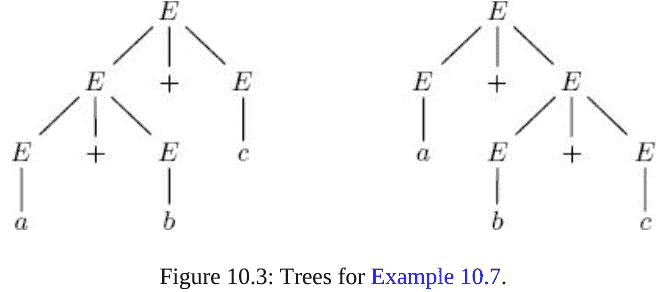

上一个示例说明了一个通用结论：一个字符串对于某个文法是歧义的，当且仅当该字符串具有两个不同的左推导。我们将其等价性留作一个练习题来证明。

### 示例 10.8

我们能为 $L$ 产生另一个不歧义的文法吗？

$G_5$ 的歧义性源于递归产生式的右侧有两个 $E$。（重复使用一个 $E$ 会向左或向右倾斜。）因此，我们将使用右侧至多只有一个 $E$ 的产生式，如下所示。接下来 $G_6$ 的产生式集确实为我们提供了一个非歧义的文法。产生式 $E \rightarrow T$ 是为了获得非递归产生式所必要的。

```
$G_6$ 的产生式：
E \rightarrow E + T
E \rightarrow E \times T
E \rightarrow T
T \rightarrow a|b|c.
```

为什么 $G_6$ 是非歧义的？$G_6$ 推导树中的所有分支都是向左的，如图 10.4 中的每棵树所示。对于给定长度的字符串，只有一种树的形状或分支模式。这使得歧义变得不可能。

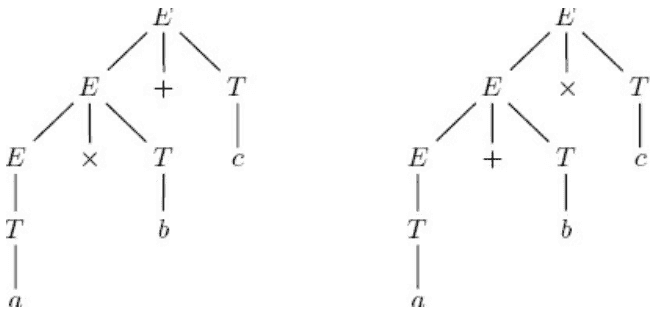

图 10.4：示例 10.8 的树。

尽管是非歧义的，$G_6$ 仍然有一个缺陷。遗憾的是，$G_6$ 生成的某些推导树违反了优先级。我们的意思是，图 10.4 右侧字符串 $a + b \times c$ 的推导树错误地建议先应用“+$”后应用“$\times$文法 $G_5$ 也有类似的缺陷。）

### 示例 10.9

为 $L$ 给出一个能生成遵循优先级的推导树的文法。

示例 10.8 中的树揭示了 $G_6$ 的缺陷。本节的示例旨在说明，当 CFG 构建得当时，不仅可以传递字符串的语法特征描述，还可以传递关于字符串的结构/语义信息。

## 10.4 乔姆斯基范式

在 CFG 中，允许任何产生式 $\rightarrow \alpha$，其中 $\alpha \in (V \cup \Sigma)^*$。然而我们可以对 $\alpha$ 施加严格限制而不限制 CFG 的表达能力。这些限制强制文法进入“范式”。我们在本节看一种，稍后看另一种。

### 定义 10.9

**乔姆斯基范式**

所有产生式形式均为 $A \rightarrow BC$ 或 $A \rightarrow a$ 的 CFG 乔姆斯基范式（CNF），其中 $A, B, C \in V$ 且 $a \in \Sigma$。特别不允许 $A \rightarrow \Lambda$。

### 定义 10.10

**$\Lambda$-free语言**

不包含 $\Lambda$ 的语言被称为 $\Lambda$-free语言。

如果一个语言 $L$ 是乔姆斯基范式文法生成的，显然 $L$ 是 $\Lambda$-free的。这是因为每个推导从一个符号（起始符号）开始，且没有产生式会减少导出符号的数量；我们无法导出零符号。

该定理表明，将自己限制在 CNF 内不会限制我们可以表达的内容。

> **定理 10.2** – 对于任何 $\Lambda$-free 上文语言 $L$，存在一个乔姆斯基范式的 CFG $G$，使得 $L = \mathcal{L}(G)$。

在证明此定理之前，我们阐述各种引理，允许我们“清理”文法。

### 定义 10.11

**无用变量**

如果存在某个 $x \in \Sigma^*$ 使得 $A \xrightarrow{\text{*}} x$，则变量 $A \in V$ 是有用的；否则该变量是无用的。如果产生式中的任何变量都是无用的，则该产生式是无用的

无用的。显然，终结符字符串的推导不会包含任何无用变量。

**引理 10.1** – 对于任意上下文文法 $G$，存在一个上下文文法 $G'$，使得 $G'$ 不包含无用变量且 $\mathcal{L}(G) = \mathcal{L}(G')$。

**证明：** 首先，这样的 $G'$ 存在是显而易见的。由于任何 $x \in \mathcal{L}(G)$ 的推导都无法使用无用变量，我们可以通过简单删除 $G$ 中的每个无用产生式来构造 $G'$。我们将更进一步，解释如何在实践中区分无用变量。

我们提供一个计算集合 $\mathcal{A}$（有用变量集）的算法，这足够计算 $\mathcal{A}$ 了。算法 10.1 使用此函数计算 $\mathcal{A}$：

```
$useful(A) = \{A \rightarrow \alpha \mid \alpha \text{ 中的每个变量都在 }\mathcal{A}\text{ 中}\}$
```

该算法的正确性是对证明变量加入 $\mathcal{A}$ 所需长度的强归纳法。初始化提供了证明的基础；即单步推导。如果 $A$ 需要 $k$ 步，那么对于某个 $A \rightarrow \alpha$，$\alpha$ 中的每个变量都需要 $k-1$ 步或更少的步。

### 定义 10.12

### 可删除变量

如果 $A \xrightarrow{\Rightarrow} \mathcal{A}$（此处 $\epsilon$ 表示空字符串），则变量 $A \in V$ 是*可删除的*。

### 算法 10.1

**计算 CFG 中的有用变量集**

输入：一个上下文文法 $G \in (V, \Sigma, S, P)$

输出：有用变量集 $\mathcal{A}$

```
$\mathcal{A} \triangleq \{A \mid A \rightarrow a \in P\}$
while $A \notin \mathcal{A} \wedge$ $|useful(A)| > 0$ do
\quad$add $A$ to $\mathcal{A}$
return $\mathcal{A}$
```

**引理 10.2** – 对于任意上下文文法 $G$，如果 $\mathcal{L}(G)$ 是 $\Lambda$-free（不空的），则存在一个上下文文法 $G'$，使得 $G'$ 不包含可删除变量且 $\mathcal{L}(G) = \mathcal{L}(G')$。

**证明：** 我们提供一个算法首先计算 $\mathcal{B}$（可删除变量集）。算法 10.2 使用此函数计算 $\mathcal{B}$：

```
erasing(B) = {B \rightarrow \alpha \mid \alpha \text{ 中的每个符号都在 }\mathcal{B}\text{ 中}$}
```

$\mathcal{B}$ 计算的正确性是成立，因为任何推导 $A \xrightarrow{*}{\Lambda}$ 不可能包含任何终结符或不可删除变量。

计算的剩余部分 $P'$ 创建了消除了对后续会被删除的变量所需的产生式。它创建了此类变量不再出现的并行产生式。注意，如果某个产生式的右侧有多个可删除变量，则第二个 while 循环的多次迭代将产生以各种组合移除这些可删除变量的产生式。由于 $P'$ 可以更直接地推导出之前通过引入不产生终结符的变量而导出的任何字符串 $x$，因此删除产生式不再需要了。如果没有删除产生式，则没有可删除变量。

### 算法 10.2

**计算无可删除变量的 CFG**

输入：一个上下文文法 $G=(V, \Sigma, S, P)$

输出：一个上下文文法 $G'=(V, \Sigma, S, P')$，不包含可删除变量且 $\mathcal{L}(G) = \mathcal{L}(G')$

```
$\mathcal{B} \equiv \{B \mid B \rightarrow \Lambda \in P\}$
while $\mathcal{B} \notin \mathcal{B} \wedge \ |erasing(B)| > 0$ $do$
\quad$add $B \rightarrow B$ to $\mathcal{B}$
$P' \leftarrow P$
while $(B \rightarrow \alpha\beta \in P') \wedge \ (A \in \mathcal{B}) \wedge \ (B \rightarrow \alpha\beta \notin P')$ $do$
\quad$add $B \rightarrow \alpha\beta$ to $P'$
for each $B \rightarrow \Lambda \in P'$ $do$
\quad$remove $B \rightarrow \Lambda$ from $P'$
return $(V, \Sigma, S, P')$
```

## 定义 10.13

### 单位产生式

形式为 $A \rightarrow B$ 的产生式是单位产生式，其中 $A, B \in V$。

**引理 10.3** – 对于任意上下文文法 $G$，存在一个上下文文法 $G$，使得 $G'$ 不包含单位产生式且 $\mathcal{L}(G) = \mathcal{L}(G')$。

**证明：** 证明方法类似于引理 8.3 的证明。我们将其留作练习。

我们现在可以证明定理 10.2。


## 定理 10.2 的证明

之前的几个引理允许我们假设语言 $L$ 有一个上下文文法 $G = (V, \Sigma, S, P)$，它没有任何无用变量、任何可删除产生式或任何单位产生式。因此，每个产生式都是 $A \rightarrow a$，其中 $A \in V$ 且 $a \in \Sigma$，或者 $A \rightarrow \alpha = \alpha_1\alpha_2 \dots \alpha_k$，其中 $k > 1$ 且 $\alpha_i \in (V \cup \Sigma)$。

对于每个 $a \in \Sigma$，创建一个新变量 $B_a$ 并向 $P$ 添加产生式 $B_a \rightarrow a$。现在，将 $P$ 中的每个 $A \rightarrow \alpha$ 替换为 $A \rightarrow \beta = \beta_1\beta_2 \dots \beta_k$，其中 $\beta_i = \alpha_i$（如果 $\alpha_i \in V$）或 $\beta_i = B_{\alpha_i}$（如果 $\alpha_i \in \Sigma$）。在此时点，$P$ 中的每个产生式都是 $A \rightarrow a$（$A \in V$ 且 $a \in \Sigma$）或 $A \rightarrow \beta$（$A \in V$ 且 $|\beta| \geq 2$）。

为了完成证明，显示如果 $|\beta| \geq 2$，则 $\beta_1\beta_2 \dots \beta_k$ 可以被一系列产生式替换。如果 $k > 2$，我们将其替换为 $\beta_1A'$ 和 $A' \rightarrow \beta_2 \dots \beta_k$，其中 $A'$ 是新变量。重复这种替换将产生 CNF。

## 示例 10.11

重新考虑示例 10.3 的 $\Lambda$-free 上下文法：

$P = \{S \rightarrow (S), S \rightarrow \}$

让终结符由它们自己的变量产生：

$P = \{S \rightarrow LS, S \rightarrow LR, L \rightarrow (, R \rightarrow )\}$

最后拆分右侧：

$P = \{S \rightarrow LA, A \rightarrow SR, S \rightarrow SS, L \rightarrow (, R \rightarrow )\}$

换句话说，在生成终结符字符串时，我们可以延迟第一个终结符的产生。


我们将部分产生我们的 GNF 文法 $G'=(V,\Sigma,P')$。定义 $V''=\{B_{ij}|1\le i,j\le n\}$ 为一组新变量。我们希望为这些变量发现一组产生式 $P''$，满足以下标准：

$B_{i,j} \Rightarrow y \text{ 使用 } P_1 \cup P'' \text{ 当且仅当 } A_i \Rightarrow A_{i,j} \text{ 使用 } P_1 \cup P_2 \quad (10.2)$

观察 CNF 文法 $P$ 具有图 10.7 所示的四种推导 $A_i \Rightarrow A_y$。第一棵树是 $y=b$ 的情况。第二棵树对应第一步推导 $A_i \Rightarrow A_m$。第三棵树是推导 $A_i \Rightarrow A_k$ 的情况，但约束仅为 $A_i \Rightarrow A_b$。第四种是最通用的无约束情况。

通过递归调用该标准，我们可以这样构建 $P''$：

```
$B_{i,j} \to b|A_j \to A_{k_k} \in P_2 \text{ and } Ak_k \to b \in P_1 \cup$
$B_{i,j} \to bB_{k,m}|A_j \to A_{m_m} \in P_2 \text{ and } Ak_k \to b \in P_1 \cup$
$B_{i,j} \to bB_{l,j}|A_i \to A_{l_l} \in P_2 \text{ and } Ak_l \to b \in P_1 \cup$
$B_{i,j} \to bB_{k,m}B_{l,j}|A_i \to A_{m_m} \in P_2 \text{ and } Ak_k \to b \in P_1$
```

可以通过归纳法（根据 $x$ 的长度）证明该标准对于该 $P''$ 确实成立。这是因为为四种推导树给出了四组产生式。

为了完成证明，我们令

$P' = P'' \cup P_1 \cup \{A_j \to aB_{i,j} \mid A_i \to a \in P_1\}$

并令 $V' = V \cup V''$。结合属性 10.1 与标准 10.2，我们可以得出：

$A_j \Rightarrow A_i y \Rightarrow ay \text{ 使用 } P \text{ 当且仅当 } A_j \Rightarrow aB_{i,j} \Rightarrow ay \text{ 使用 } P'$

所有 $A_j \in V$ 且 $y \in \Sigma^*$，因此对于 $S = A_j$ 的情况也是的。

## 示例 10.12

重新考虑示例 10.11 中 CNF 形式的文法：

$P = \{S \rightarrow LA, A \rightarrow SR, S \rightarrow SS, S \rightarrow LR, L \rightarrow (, R \rightarrow )\}$

按照证明中的方法重命名变量：

$P = \{A_1 \rightarrow A_2A_3, A_3 \rightarrow A_1A_4, A_1 \rightarrow A_1A_1, A_1 \rightarrow A_2A_4, A_2 \rightarrow (, A_3 \rightarrow )\}$

其中 $A_1$ 是起始符号。因此 $P_1 = \{A_2 \rightarrow (, A_3 \rightarrow )\}$。我们首先创建 $V'$。

为了简短，我们将省略所有包含无用变量的产生式。

获取这些贡献给 $P$：

- $\{B_{1,3} \rightarrow ), B_{1,2} \rightarrow )B_{4,3}, B_{1,3} \rightarrow (B_{2,4}, B_{2,1} \rightarrow (B_{2,4}, B_{2,1} \rightarrow )B_{4,4}\} \cup$

- $\{B_{1,j} \rightarrow )B_{3,j} \mid 1 \leq j \leq 4\} \cup \{B_{2,j} \rightarrow )B_{1,j} \mid 1 \leq j \leq 4\} \cup$

- $\{B_{2,j} \rightarrow )B_{2,3} \mid 1 \leq j \leq 4\} \cup \{B_{2,j} \rightarrow )B_{4,3}B_{1,j} \mid 1 \leq j \leq 4\} \cup$

- $\{B_{2,j} \rightarrow (B_{2,4}B_{1,j} \mid 1 \leq j \leq 4\} \cup \{B_{4,4}B_{1,j} \mid 1 \leq j \leq 4\}$

最后

$P' = P'' \cup P_1 \cup \{A_j \to aB_{i,j} \mid A_i \to a \in P_1\}$

## 10.6 超越上下文无关语言

上下文无关语言的典型示例，例如平衡括号字符串集，表现出“双向平衡”——较后出现的符号（或多个符号）与较先出现的符号（或多个符号）配对。然而，如果语言中结构的概念比双向平衡更复杂，我们可能会发现上下文无关文法的能力并不足够。

考虑具有三向平衡的语言 $L$：

```
$L = \{a^n b^n c^n \mid n > 0\}$
```

为了理解为什么 $L$ 没有上下文无关文法，你可以停下来尝试设计一个。我们知道，一个语言（不包含空字符串 $\Lambda$）是上下文无关的，当且仅当存在一个对其处于乔姆斯基范式（CNF）的 CFG。我们首先从建立 CFG 的简单性质开始。

### 引理 10.5

对于任何无限上下文无关语言 $L$，如果一个 CNF 形式的 CFG $G$ 生成 $L$，则对于 $L$ 中的字符串，$G$ 所需的推导树高度没有上限。

**证明：** 注意到 CNF 的推导树是二叉树，边缘到达叶子节点。因此，高度为 $h$ 的推导树最多生成的字符串长度为 $2^{h-1}$。因此，$L$ 作为一个无限语言，其字符串长度超过了任何边界能容纳的长度。

### 引理 10.6

对于任何无限上下文无关语言 $L$，如果 $G$ 是生成 $L$ 的 CNF 形式的 CFG，那么 $G$ 的某个推导树存在一条从根节点到叶子节点的路径，其中出现了两次相同的非终端符号。

**证明：** 由于 $L$ 是无限语言，根据引理 10.5，对应于 $G$ 的存在高度无限制的推导树。特别，我们必须拥有 $L$ 中某些字符串的推导树，其高度超过了 $n=|V|$（$G$ 中非终端符号的数量）。根据鸽巢原理，该树必须有相同的非终端符号出现两次。（图 10.8 的左侧描述了这种情况，有一条路径从 $S$ 开始穿过两个 $A$ 并向下延伸。）

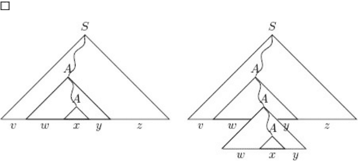

图 10.8：在左侧的树 $T$ 中，替换较低的以 $A$ 为根的子树，得到右侧的 $T'$。

**证明：** 假设存在 CNF 形式的上下文无关文法 $G = (V, \Sigma, P)$ 使得 $\mathcal{L}(G) = L$；我们将发现这一假设会导致矛盾。

由于 $L$ 是无限语言，根据引理 10.6，$G$ 生成了某个推导树，其中相同的非终端符号在某处重复；称其为 $A$，如图 10.8 的左图所示。令 $x$ 为包含 $A$ 的字符串，即对于某些 $w$ 和 $y$，$wAy$。我们知道 $w$ 或 $y$ 至少有一个不为 $\Lambda$；由于 $G$ 处于 CNF 形式，上方的 $A$ 将生成一个不包含下方 $A$ 的非空子树。根节点 $S$ 生成整个字符串为 $u = vwxyz$，对于某些 $v$ 和 $z$。由于 $u \in L$，我们知道 $u = a^mb^mc^m$，对于某些 $m$。

现在，可以用以上方 $A$ 为根的整个子树的副本替换下方 $A$ 处的子树，创建一个新的有效推导 $T$；这如图 10.8 的右图所示。$T'$ 的根生成的字符串为 $u' = vwwxyz$。显然，$T'$ 是使用 $G$ 的有效推导树，$u' \in \mathcal{L}(G)$，或者等价于 $u' \in L$。因此，$u' = a^lb^lc^l$，对于某些 $l$。

如果一个字符串仅由一个符号组成（可能重复），则称它是*同质的*。相反，我们声称 $w$ 是同质的（例如对于 $a$ 和 $b$）。在这种情况下，$ww$ 将导致 $a$ 出现在 $a$ 之前，$u'$ 也是如此，这违反了 $u' = a^{d'}b^{c'}c'$ 的要求。同样，$y$ 是同质的。现在，$u'$ 必须比 $u$ 长，因此 $l > m$，但由于从 $u$ 到 $u'$ 符号数量的增加仅来自字符串 $w$ 和 $y$ 各自多出的额外出现，因此在这三个符号中必须有一个终端符号——$a$、$b$ 或 $c$——不在 $w$ 或 $y$ 中，因此在 $u'$ 中仍然只出现 $m$ 次。结果，由 $G$ 生成的字符串 $u'$ 不属于 $L$。这一结果与存在文法 $G$ 生成 $L=\{a^n b^n c^n \mid n \geq 0\}$ 的假设矛盾。$\square$

刚才给出的证明并非仅为给定的语言设计的。这种证明技术是广为人知的，可以推广到大多数（但不是所有！）非上下文无关语言。该技巧被称为“泵引理”（The Pumping Lemma）（因为我们可以反复“泵”上方 $A$ 子树来创建更大的合法的树）。

该证明还说明了为什么这些文法被称为“上下文无关”。

## 练习题

- 10.1 – 什么是上下文无关语言？
- 10.2 – 使用 $S$，为以下字符串编写推导：
  - (a) `(())`
  - (b) `((()))`
- 10.3 – 为嵌套括号编写一个 CFG。提示：从 `{` 开始
- 10.4 – 给出满足以下条件的语言：
  - (a) $L_r$ 是正则的，$L_n$ 不是上下文无关的。
  - (b) $L_r$ 不是上下文无关的，$L_n$ 是正则的。
  - (c) $L_1$ 和 $L_2$ 上下无关。
- 10.5 – 对于文法 $G_4$:
  - (a) 用数学归纳法证明这是可能的。
  - (b) 利用 (a) 部分的结果证明 $\mathcal{L}(G_4)$ 是偶数长度回文的集合。
- 10.6 – 在 $G_4$ 中添加哪些产生以产生所有回文的文法？
- 10.7 – 为以下语言给出 CFG：
  - (a) $\{a^ib^2 \mid i > 0\}$
  - (b) $\{a^ib^ck \mid i = k\}$
  - (c) $\{a^ib^ck \mid i = j\}$
  - (d) $\{a^ib^j \mid i \neq j\}$
- 10.8 – 平衡括号集 $B$ 由定义 10.4 指定。另一种刻画 $B$ 的方法：首先，对于任何字符串 $x$，令 $m(x)$ 为左括号数量，$n(x)$ 为右括号数量。此外，记得 $y$ 是 $x$ 的前缀当且仅当存在字符串 $w$ 使得 $yw = x$。

```
$B = \{x | x \in \{()}^* \wedge m(x) = n(x) \wedge \forall y \text{ 是前缀}, m(y) \geq n(y)\}$
```

换句话说，当我们从左到右处理字符串时，假设我们跟踪左右括号数量的差。那么差值最终变为零且不会为负。证明 $B$ 的两个定义是等价的。

- 10.9 – 令 $L_e$ 为任意顺序下等数量 $a$ 和 $b$ 的字符串集。为该语言设计一个文法 $G_e$，使得 $\mathcal{L}(G_e) = L_e$。（提示：找到一种自然的方式配对 $a$ 和 $b$。）
- 10.10 – 为命题逻辑表达式给出 CFG，包含所有三个运算符。记得，尽管命题的形式化定义不依赖优先级，但表达式很少全括号化，依赖优先级规则来解释。否定优先级最高，与优先级最低。使用为代数表达式文法引入的技巧，创建一个处理那里所有问题的文法。特别是，你的文法应该是无歧义的，并创建反映优先级和括号在正确评估期间分组命题的结构。
- 10.11 – 用另一种方法证明每个正则语言都是上下文无关的。给出一个将正则表达式转换为 CFG 的算法。（提示：根据如何引导递归地从子文法构建文法）（正则表达式是由多个子表达式构建的。）
- **10.12** – 作为上一个练习的后续，为正则表达式 `((a + b*c)d)*` 语言编写一个上下文无关文法。
- **10.13** – 证明如果一个字符串有两个不同的最左推导，则说明该字符串对于该文法是歧义的。
- **10.14** – 证明引理 10.1。
- **10.15** – 使用与定理 10.4 相同的证明方法证明 $L = \{a^ib^jc^k | i < j < k\}$ 不是一个上下文无关语言（CFL）。
- **10.16** – 用例说明两个上下文无关语言的交集不一定是上下文无关语言。

# 第 11 章

# 下推自动机与语法分析

在早的章节中，你已经学习了一类重要的语言——正则语言，以及一类自动机——有限自动机，它们可以识别所有这类语言，而不能识别其他语言。因此，你可能会好奇，是否存在某类自动机能够精确地识别第 10 章引入的更广泛的语言，即那些由上下文无关文法（CFGs）生成的语言。确实有一种用于此类任务的自动机，即非确定性下推自动机（NPDA）。NPDAs 及其表兄弟确定性下推自动机（DPAs）是本章的主题。当讨论的重点不是确定性或其缺失时，我们将写作“PDA”。

NPDAs 在计算机科学中备受关注主要是因为它们与 CFGs 之间的关系：对于每一个 CFG（$G$），都存在一个识别 $\mathcal{L}(G)$ 的 NPDA。在演示寻找此类 NPDA 的简单方法的过程中，我们将看到非确定性何而来。我们将发现非确定性不仅是方便的，而且是必要的。也就是说，对于某些 CFG 及其语言，不存在 DPDA 可以识别它们。由此得出结论，NPDA 类大于 DPA 类，而它们在接受的语言类方面是等价的。

我们已经知道（从第 10 章的几个很有启发性的例子中）CFGs 在指定编程语言方面起着关键作用。如果 $G$ 是指定某种编程语言语法的 CFG，那么从形式语言的角度来看，$\mathcal{L}(G)$ 就是该编程语言。换句话说，语言中每个正确的计算机程序都是 $\mathcal{L}(G)$ 中的一个字符串，通常是非常长的字符串。现在，这并不是全部，因为编程语言的字符串是有含义的。然而，正如如果你学习编译器课程将会详细看到的——文法也可以为编程语言的含义提供结构基础；回顾第 10.3 节。

在编译一个用字符串 $s$ 表示的程序时，编译器必须分析 $G$ 可能以及如何生成 $s$。编译过程中这一推断字符串如何推导的关键阶段被称为*语法分析*（parsing）。在第 11.5 节中，我们将构建模拟语法分析某些关键方面的 NPDAs，从而使其成为语法分析的*模型*。尽管缺乏真实解析器的某些细节，但我们将会看到不同的 PDA 构建技术如何对应不同的语法分析策略。

## 11.1 PDA 的动机

现在是时候看看 PDA 到底是什么了。PDA 像有限自动机（FAs）一样拥有状态，并响应输入符号流在状态之间进行转移。然而，PDA 的不同之处在于它维护了一个名为（下推）栈的内存机制。符号可以被 `PUSH`（推）入栈中，稍后通过 `POP`（弹出）栈的操作移除最近添加（`PUSH`ed）的符号。由于 `PUSH` 没有限制，栈提供了无界的——人们说是无限的——内存。

### 示例 11.1

这段伪代码用于一种基于栈的方法识别语言 $L = \{0^n\$1^n \mid n > 0\}$：


```
read(c)
while c = 0 do
    push(0)
    read(c)
    if c = 1 and stack not empty then d ⇐ pop()
    else fail
    while stack not empty do
        read(c)
        if c = 1 then d ⇐ pop()
        else fail
succeed
```

这里有一个不共享的栈，其中 `push(0)` 将字符 0 推入栈中，`d ⇐ pop()` 弹出栈并将其赋值给变量 `d`。（在本例中，变量 `d` 未被使用。）`read(c)` 命令从输入流中读取下一个字符到变量 `c` 中；如果没有后续输入，它将“失败”（fail）。

显然，这种方法通过在初始输入有 $n$ 个 0 时推送 $n$ 次来计算栈中 0 的个数。当第一个 1 到达时，它会切换并为遇到的每个 1 开始弹出一个 0。但从什么意义上说这识别了 $L$ 呢？一个输入字符串属于语言 $L$，当且仅当在栈变为空时最后一个输入字符刚刚被读取；即我们在输入耗尽时恰好成功终止算法。

考虑可能发生的其他情况。如果输入是 00111，那么栈将变为空，导致在还有一个 1 需要读取时终止。（它“接受”的字符串是输入的前四个字符。）或者，如果输入是 0011，输入在栈变空之前就会耗尽，导致读取错误且没有成功终止。此外，如果输入不是 $0^n1^j$ 的形式，也不会有成功终止。

### 示例 11.2

考虑这段伪代码，用于一种基于栈的方法识别 $\Sigma = \{a, b\}$ 上偶数长度回文的语言 $L$：

```
read(c)
mid=false
while ¬mid do
    push(c)
    read(c)
    mid ∈ {true, false}
    d=pop()
    if c ≠ d then fail
    while stack not empty do
        read(c)
        d=pop()
        if c ≠ d then fail
succeed
```

与之前的示例不同，这段伪代码是非确定性的。它选择 `mid`，并且当 `mid` 变为 true 时

**栈**：栈是一个字符串 $\mathcal{S}$。例如，如果栈有三个元素——在 $b$ 之上有一个 $a$，在 $a$ 之上有一个 $c$——那么它将表示为字符串 $\mathcal{S} = abc$。特别地，“从上到下读取”的栈与从左到右读取的字符串版本相同。注意栈顶符号将是字符串的第一个符号。如果 $\mathcal{S} = \Lambda$，则栈为空。在栈上 `PUSH` 一个符号就是将其附加到 $\mathcal{S}$ 的开头，而 `POP` 则是移除第一个符号。

第四个决定是最出人意料的。我们将不再使用 `PUSH` 和 `POP` 操作。为了简化 PDA，研究人员发现，只使用一种“栈操作”而不是两个运算符是最好的。这一决定将简化随后的所有内容，尽管你现在可能还看不这一点。

我们的单一栈操作是什么？它是指定一个由栈符号组成的字符串 $\alpha$，并要求将 $\mathcal{S}$ 的第一个符号替换为 $\alpha$。假设 $\mathcal{S} = abc$ 且我们想要执行 `PUSH(d)`；我们将通过指定 $\alpha = da$，使得 $\mathcal{S}$ 开头的 $a$ 被替换，从而产生 $\mathcal{S} = dabc$。相反，如果我们想要从 $\mathcal{S}=abc$ 中 `POP` 出栈顶；我们将通过使 $\alpha = \Lambda$，导致 $\mathcal{S} = bc$。因此，两个栈操作被包含在一个栈操作中了。然而，这种栈操作实际上更加灵活，因为对 $\alpha$ 没有限制。通常情况下，如果 $\alpha$ 的长度为 $k$，那么单个栈操作就等同于一次 `POP` 后跟 $k$ 次 `PUSH`。

## 11.2 PDA 的标准符号

本节描述了我们对 PDA 模型。我们将从形式化模型开始，然后用状态转换图来描述 PDA。我们在上一节中讨论的动机在这里可以找到。

NPDA 的一般定义包含六个项目。其中四项是第 9 章中用于表示 FA（自动机）的五元组（5-tuples）中的项。惊讶的是，NPDA 需要涉及栈的额外项，具体来说，一组栈符号集合和一个特殊的栈符号 $S$。由于我们采用了空栈接受法，因此没有接受状态集合。

### 定义 11.1：非确定性下推自动机

下推自动机是一个六元组（6-tuple），$M=(Q, \Sigma, \Gamma, q_0, S, \delta)$，其中：

- $Q$ 是有限状态集合；
- $\Sigma$ 是有限输入符号集合；
- $\Gamma$ 是有限栈符号集合；
- $q_0 \in Q$，其中 $q_0$ 是起始状态；
- $S \in \Gamma$，其中 $S$ 是栈的起始符号；
- $\delta$ 是一个转移函数，

`$\delta: Q \times \Sigma \times \Gamma \to 2^{Q \times \Gamma}$`

注意，这个 $\delta$ 函数的陪域与用于 NFA 的 $\delta$ 具有一个共同特征：$\delta$ 是一个值集函数。关键区别在于状态中的每次转移都是一个序对，指定了新状态和栈操作。在这里，$\delta$ 有三个参数：一个状态、一个输入符号，以及一个栈符号（即栈顶符号）。$\delta$ 的输出将是一个序对的集合。例如，如果 PDA 处于状态 $p \in Q$，下一个输入符号是 $a \in \Sigma$，且栈顶符号是 $b \in \Gamma$，那么选择之一将转移到状态 $q$ 并对栈执行栈操作 $\alpha$。$\delta$ 提供的选择是非确定性地处理的。

我们引入了 PDA 运行当前快照的形式化描述。配置（configuration）是状态和栈的序对。我们将采用 $\vdash$ 运算符来表示一个配置何时导致另一个配置。特别是：

$(p, \mathcal{S}_1) \vdash (q, \mathcal{S}_2)$

当 $a$ 是输入上的下一个符号、$\mathcal{S}_1 = b\beta$ 且 $\mathcal{S}_2 = \alpha\beta$，并且 $(q,\alpha) \in \delta(p, a, b)$ 时。我们令 $(p, \mathcal{S}_1) \vdash^* (q, \mathcal{S}_2)$ 表示对于某个输入，PDA 的零次或多次转移可以带你从第一个配置到达第二个配置。进一步地，我们有

$(p, \mathcal{S}_1) \vdash_{x}^* (q, \mathcal{S}_2)$

表示 PDA 处理输入 $x \in \Sigma^*$ 的转移可以带你从第一个配置到达第二个配置。

### 定义 11.2：NPDA 接受的语言

$M = (Q, \Sigma, \Gamma, q_0, S, \delta)$ 接受的语言：

$$\mathcal{L}(M) = \{x \mid (q_0, S) \vdash_{x}^* (p, \Lambda)\}$$

换句话说，$M$ 从状态 $q_0$ 开始，栈由单个符号 $S$ 组成，在读取输入 $x$ 后，*可以*选择一系列转移，最终得到一个空栈。（状态 $p$ 是任意状态）。

为了给出示例，我们讨论一下这些机器如何表示为状态转换图。基本思想与 FA 相同，但现在我们需要适应栈。$\delta$ 提供的选择是非确定性地处理的。因此，当 $(q,\alpha) \in \delta(p, a, b)$ 时，转移绘制如下：

### 示例 11.3

为语言 $L = \{0^n1^n \mid n > 0\}$ 构造一个 PDA。

$M$ 的图如图 11.1 所示。PDA 首先立即将栈 $S$ 替换为 $X$。之后对于输入中的每个 $0$，推入 $X$。对于输入中的每个 $1$，弹出 $X$。如果最后一个输入符号导致栈空，则输入被接受。

### 示例 11.4

为 $\Sigma = \{a, b\}$ 上的偶长度回文语言构造一个 PDA。

$M$ 的图如图 11.2 所示。PDA 首先立即将栈 $S$ 替换为 $X$。之后对于每个 $a$ 推入 $X$，对于每个 $b$ 推入 $Y$。同样，我们选择推入 $X$ 和 $Y$ 而不是什么都不做。

### 示例 11.5

将图 11.2 表示为六元组。

将状态从左到右命名为 $q_0, q_1$ 和 $q_2$，我们得到

$$(\{q_0, q_1, q_2\}, \{a, b\}, \{X, Y, S\}, q_0, S, \delta)$$

其中 $\delta$ 仍需指定。在下表中，我们仅展示了 $\delta$ 所需的三个转移，并将剩余的 $\delta$ 表格作为练习题。

| 源状态 | 输入符号 | 栈符号 | 目标状态 | 栈操作 |
|---|---|---|---|---|
| $q_0$ | $a$ | $S$ | $q_1$ | $X$ |
| $q_1$ | $b$ | $Y$ | $q_1$ | $\{(q_1, YY), (q_1, \Lambda)\}$ |
| $q_2$ | $b$ | $X$ | $q_2$ | $\emptyset$ |

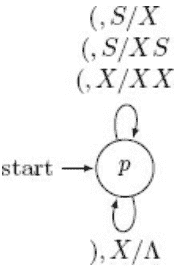

图 11.3：平衡括号的状态转移图。

### 示例 11.6

用于平衡括号语言的 PDA（下推自动机）可以基于示例 10.3 中语法使用的递归定义。相反，我们将提供一个基于练习 10.8 的设计，该方法使用了计数器方法。栈可以使用推入和出栈操作来模拟计数器的增加和减小。

遗憾的是，如果零对应于空栈，那么测试零是有问题的，因为空栈为空的 PDA 无法进行转移。对于这种语言，考虑当读取到右括号且计数器归零时。如果那是最后一个输入字符，栈可以变为空从而导致接受。然而，还有另一个字符——必然是左括号——PDA 应该在栈上保留一个 $S$，因为从强意义上说，PDA 正在完全重新开始。但是，只有当 PDA 非确定性地预测到计数器归零时会有更多输入，并在计数器最后一次归零时为了后续可能的需要推入一个 $S$ 时，$S$ 才会留在栈上。另一方面，如果没有输入，PDA 将预测到这一点且不推入 $S$，从而允许 PDA 在下一次栈变空时接受。这总结在图 11.3 中，其中唯一的状态是 $p$。

## 11.3 从 CFG 到 NPDA

本节本质上将证明任何 CFG（上下文无关语法）都可以转换为 NPDA（非确定性下推自动机）。在第 11.4 节中，我们将展示任何 NPDA 都可以转换为 CFG。结合起来，我们得出结论：NPDA 可以作为定义上下文无关语言类的机器模型，尽管我们最初是使用生成模型来定义该类的。

### 定理 11.1

如果 G 是 $\Lambda$-free 语言的 CFG，则存在一个 NPDA M，使得 $\mathcal{L}(G) = \mathcal{L}(M)$。

**证明：** 我们假设 CFG 语法处于 Greibach 范式（Greibach normal form）。如果不是，定理 10.3 的证明显示了有一个有效程序将其转换为该形式。我们还假设所有推导都是最左的，因此每个推导都具有引理 10.4 所示的形式。因此 $G=\{V, \Sigma, S, P\}$，其中 P 中的每个产生式的形式均为 $A \rightarrow b\alpha$。这里我们定义 NPDA $M=(\{q_0\}, \Sigma, V, q_0, S, \delta)$，其中栈字母表与 $G$ 中的变量集相同。此外，起始符号与语法的起始符号相同。注意 $M$ 只有一个状态！转移函数定义为：

`$\delta(q_0, b, A) = \{(q_0, \alpha) \mid A \rightarrow b\alpha \in P\}$`

核心思想是 $G$ 的推导与计算是紧密相关的，正如该断言所述。

**断言：** 对于每个 $x \in \Sigma^*$ 和 $\beta \in V^*$，$S \xrightarrow{*} x\beta$ 当且仅当 $(q_0, S) \vdash_{x}^* (q_0, \beta)$。

**断言证明：** 每一步推导都使 $x$ 的长度增加一。我们对 $x$ 的长度使用归纳法证明该断言。当 $k=0$ 时，$x = \Lambda$ 且 $\beta$ 仍为 $S$，因此基础成立。

通常假设 $x=yb$ 且 $S \xrightarrow{*} yA\gamma \rightarrow yb\alpha\gamma=x$，其中 $\beta = \alpha\gamma$。根据归纳假设，在处理 $x$ 的最后一个字符 $b$ 前 $(q_0, S) \vdash_{y}^* (q_0, A\gamma)$ 且 $(q_0, A\gamma) \vdash_{b}^* (q_0, \alpha\gamma) = (q_0, \beta)$。证明的后半部分（充分性部分）类似。因此断言成立。

字符串 $x$ 的推导结束于 $\beta = \Lambda$，因此根据断言可知，$x$ 由 G 生成当且仅当 $x$ 被 M（通过空栈）接受。

### 示例 11.7

考虑这个用于平衡括号语言的 CFG，它处于 Greibach 范式。

$P = \{S \rightarrow (R,\; S \rightarrow RS,\; S \rightarrow (SR,\; S \rightarrow (SRS),\; R \rightarrow )\}$

转移函数 $\delta$ 为：

| 状态 | 输入符号 | 栈符号 | 目标状态 | 栈操作 |
|---|---|---|---|---|
| $q_0$ | $($ | $S$ | $q_0$ | $\{(q_0, R), (q_0, RS), (q_0, SR), (q_0, SRS)\}$ |
| $q_0$ | $)$ | $R$ | $q_0$ | $\{(q_0, \Lambda)\}$ |

## 11.4 从 PDA 到 CFG

### 定理 11.2

如果 M 是 PDA，则存在一个 CFG G，使得 $\mathcal{L}(M) = \mathcal{L}(G)$。

**证明：** PDA 为 $M = (Q, \Sigma, \Gamma, q_0, S, \delta)$。我们将创建 $G = \{V, \Sigma, P, S'\}$。语法将有一组复杂的变量集。特别是，$V = Q \times \Gamma \times Q'$，其中 $Q' = Q \cup \{\diamond\}$。我们使用特殊符号 $\diamond$ 代表 $Q$ 的任何成员，一个“无关”符号。我们使用角括号编写 $V$ 的元素以使其更容易，即 $\langle p, A, q \rangle \in V$。当 $\alpha$ 有 $k > 0$ 个符号时，产生式集合 $P$ 可能很大。对于每个 $p \in Q, a \in \Sigma, A \in \Gamma$，且 $(q, \alpha) \in \delta(p, a, A)$，我们包含这些产生式：

$\langle p, A, q \rangle \rightarrow a\langle q, \alpha_1, r_1 \rangle \dots \langle r_{k-1}, \alpha_k, q \rangle$

对于每个 $r_1, \dots, r_{k-1} \in Q'$。由于这些产生式符合 Greibach 范式。由于引理 10.4 成立，$l$ 步推导将导出字符串 $x$，其中 $|x| = l, x \in \Sigma^*$ 且 $\alpha \in V^*$。令 $\text{head}(\langle p, A, q \rangle) = p$ 和 $\text{tail}(\langle p, A, q \rangle) = q$。此外，令 $\text{head}(\alpha) = \text{head}(\alpha_1)$ 且 $\text{tail}(\alpha) = \text{tail}(\alpha_k)$，其中 $|\alpha| = k$。

**断言 1：** 如果 $\langle p, A, q \rangle \rightarrow a\alpha$ 且 $|\alpha| > 1$，则对于 $1 \le i < k$，$\text{tail}(\alpha_i) = \text{head}(\alpha_{i+1})$。此外 $\text{tail}(\alpha_k) = q$。

**断言 1 的证明：** 对 $x$ 的长度使用归纳法来自 $P$ 的定义。这有助于 $V$ 的奇怪定义。

**断言 2：** 对于每个 $\langle p, A, q \rangle \in V$，$\langle p, A, q \rangle \xrightarrow{*} x\gamma$ 其中 $x \in \Sigma^*, \gamma \in V^+$ 当且仅当 $(p, A) \vdash_{x}^* (\text{head}(\gamma), \text{core}(\gamma))$。注意 $M$ 以单个栈 $A$ 开始。此外 $\langle p, A, q \rangle \xrightarrow{*} x$ 其中 $x \in \Sigma^*$ 当且仅当 $(p, A) \vdash_{x}^* (q, \Lambda)$。


**断言 2 的证明：** 对 $x$ 的长度使用归纳法。基础是 $x = \Lambda$，当 $y = \langle p, A, q \rangle$ 时，$(\text{head}(y), \text{core}(y)) = (p, A)$。令 $x = ya$，其中 $a \in \Sigma$，且 $\langle p, A, q \rangle \xrightarrow{y} ay$。根据归纳假设 $(p, A) \vdash^*(\text{head}(\beta), \text{core}(\beta))$。有两种情况。第一，$\beta_1 \to \text{head}(\beta_1) \to \alpha, \tau \in V^+$ 且 $a = \text{core}(\tau)$。因此 $(q, \alpha) \in \delta(\text{head}(\beta), \text{core}(\beta_1))$。有两个子情况。由于 $\beta = \beta_1$，当推导在 $x$ 停止时，机器处于配置 $(q, \Lambda)$。（注意栈空时 $q$ 是什么并不重要，所以如果 $\text{tail}(\beta_1) = \Lambda$ 则是正确的）。第二种子情况是 $|\beta| = k > 1$。现在 $y = \beta_2 \dots \beta_k$，根据断言 1，$q = \text{tail}(\beta_1)$ 且 $\text{tail}(\beta_1) = \text{head}(\beta_2) = \text{head}(y)$ 所以我们处于配置 $(q, \text{core}(y))$。断言 2 成立。

为了完成证明，我们完成 $G$ 的规范，给出起始符号 $S' = (q_0, \Lambda)$。根据断言 1 和 $P$ 的定义，我们可以推导出如果 $S' \xrightarrow{xy} x, \gamma \in V^+$，则根据断言 2 得结论 $S' \xrightarrow{\Lambda} x, x \in \Sigma^*$ 当且仅当 $(q_0, \Lambda) \vdash^*$ 对于某个 $q$。$\square$

### 示例 11.8

考虑示例 11.6 中的 PDA。由于它只有一个状态 $\beta$ 和四个转移，构造的大小是适中的。第一个转移，将 $S$ 替换为 $X$，得到：

$\langle p, S, p \rangle \rightarrow a\langle q, X, p \rangle$ 和 $\langle p, S, o \rangle \rightarrow a\langle q, X, o \rangle$

第二个转移，将 $S$ 替换为 $XS$，得到：

$\langle p, S, p \rangle \rightarrow a\langle q, X, p \rangle\langle q, S, p \rangle$ 和 $\langle p, S, o \rangle \rightarrow a\langle q, X, p \rangle\langle q, S, o \rangle$

第三个转移，将 $X$ 替换为 $XX$，得到：

$\langle p, X, p \rangle \rightarrow a\langle q, X, p \rangle\langle q, X, p \rangle$ 和 $\langle p, X, o \rangle \rightarrow a\langle q, X, p \rangle\langle q, X, o \rangle$

第四个转移，将 $X$ 替换为 $\Lambda$，得到：

$\langle p, X, p \rangle \rightarrow a\langle q, \Lambda, p \rangle$ 和 $\langle p, X, o \rangle \rightarrow a\langle q, \Lambda, o \rangle$

初始状态为 $(p, S, \diamond)$。

## 11.5 解析

在 7.5 节中，我们讨论了使用上下文无关文法（CFG）模型通过提供判断字符串 $x$ 是否属于语言 $L$ 的机制来定义语言。换句话说，机器给出“是/否”回答。如果我们想要更多信息呢？当答案为“是”时，要求给出答案的证明是非常常见的。

当一个字符串 $x$ 由 CFG $G$ 生成时，我们现在知道如何构建一个下推自动机（PDA）；当字符串 $x$ 被 PDA 接受时，是因为 $x \in L(G)$，因此，如果要求证明接受 $x$ 是正确的，我们只需要通过对给定字符串 $x$ 的实际推导来展示 $x$ 的推导，这被称为解析。

在某种意义上，这是一个我们已经解决的问题。通过定理 11.1 构造证明产生的机器在输入 $x$ 上执行了一系列转换，这些转换反映了 $x$ 相应的推导。因此，通过简单地输出该 PDA 的连续配置，我们恢复推导过程。

### 示例 11.9

使用这个 CFG 重新考虑示例 11.7：

$P = \{S \to (R, S \to (RS, S \to (SR, S \to (SRS, R \to ))\}$

以及给出的转移函数 $\delta$。考虑输入 $x = (()())$ 的处理。

| 输入符号 | 栈 | 推导的字符串 |
| :--- | :--- | :--- |
| $\Lambda$ | $S$ | $S \Rightarrow$ |
| ( | $RS$ | $(RS \Rightarrow$ |
| () | $S$ | $())S \Rightarrow$ |
| (() | $SR$ | $(()SR \Rightarrow$ |
| ()( | $RR$ | $(()RR \Rightarrow$ |
| ()() | $R$ | $(()()R \Rightarrow$ |
| ()() | $\Lambda$ | $()()()$ |

你应该观察到，目前为止看到的输入与当前栈拼接后正好是当前推导的字符串。这直接遵循定理 11.1 证明中的断言。因此，我们可以说，当 PDA 接受任何 $x$ 时，它展示了 $x$ 的推导。

然而，这非常令人不满，因为解析是由非确定性机器完成的。虽然这在理论上很有趣，但解析是一个非常实际的问题。解析是探索文法所生成字符串*语义*的任何方法中的基本过程。我们为什么在高中解析英语句子？因为那是我们分析句子结构（即组成部分之间的关系）的方式。自然语言文法给了我们启发，但不要被其误导；自然语言文法比本章中的文法要微妙得多。

计算机科学家熟悉许多涉及解析的应用程序，特别是计算机语言——这些语言通常用上下文无关文法来定义。最典型的应用是编译器的设计。本章的材料是每本教科书中都会讨论的基于 PDA 技术的序言。如果解析如此重要，我们如何能容忍非确定性的解决方案呢？遗憾的是，情况是：既可以也不行。存在某些上下文无关语言无法通过 PDA 进行确定性解析。

## 11.6 确定性下推自动机与解析

我们从讨论确定性机器开始，是因为它们很简单。此外，事实证明，在识别的语言类方面，NFA 并不比 DFA 更强大。相比之下，对于 PDA，我们从非确定性的开始，是因为它们更强大，而我们需要能力来识别所有的上下文无关语言。我们将证明，存在任何确定性 PDA 都无法识别的上下文无关语言。

### 定义 11.3 确定性下推自动机 (DPDA)

一个 DPDA 是一个六元组 $M = (Q, \Sigma, \Gamma, q_0, S, \delta)$，其部分与定义 11.1 相同，但 $\delta$ 函数不提供任何选择：

$\delta: Q \times (\Sigma \cup \{\epsilon\}) \times \Gamma \to Q \times \Gamma^*$

使得 $\delta$ 的值域是序对，而不是序对的集合。现在的挑战是进行确定性解析。解决这个问题有两个方面：

首先，为了确定性地获得选择，DPDA 使用输入符号作为引导。产生的向前瞻视（look-ahead）关注当前输入中的下一个符号，并在当有多个右侧可用时，影响使用哪一个右侧的选择。当文法处于 Greibach 范式时，这对 PDA 来说更简单。然而，左递归会阻碍向前瞻视。为了理解为什么，我们需要回递归规则的概念，即其左侧符号也出现在右侧的规则。我们直接关注的是左递归规则，其中左侧符号在右侧中首先出现，例如 $S \to Sa$。

### 示例 11.10

文法 $(\{S\}, \{a, b\}, S, \{S \to Sa, S \to b\})$ 生成正则表达式 $ba^*$ 的语言。由于每个字符串都以 $b$ 开头，向前瞻视第一个符号永远无法帮助在 $S$ 的两个右侧符号之间做决定。

然而，即使在 Greibach 范式中，仍然存在产生式的选择，因此 PDA 需要更严格的引导来决定如何构建推导。另一个困难是文法可以是右递归的。这意味着左侧变量也作为右侧的最后一个符号出现，如 $S \to aS$。如果文法同时具有 $S \to aS$ 和 $S \to a$ 产生式，且 $a$ 是输入流中的最后一个字符，PDA 可以在构建推导的过程中确定性地选择这些产生式。两种产生式都与输入中看到的 $a$ 一致，当没有下一个字符时，等待下一个字符将无法消除歧义。问题在于 PDA 无法检测输入的结束！

我们可以通过改变问题来精细处理此问题以构建 DPDA。检测输入的结束不应该是一件难事。由于普通程序有像文件结束标记之类的内容，允许我们在自动机中使用相同种类的技术似乎是合理的。特别是，我们可以通过在任何语言 $L$ 中的每个字符串后附加一个不在 $L$ 的原始字母表中的新符号来增强它。任何新符号都可以；我们选择 $\triangle$。

$L^\triangle = \{x \mid x = y\triangle, y \in L\}$

这个新符号被称为哨兵（sentinel），它应该是任何有效输入的最后一个符号，这样它就可以提醒机器输入已完成。

### 示例 11.11

再次使用这个 CFG 考虑示例 11.7：

$P = \{S \to (R, S \to (RS, S \to (SR, S \to (SRS, R \to ))\}$

注意，当它产生 '(' 时，它必须决定这是否与最后一个符号匹配，还是它的配对后面跟着另一个 '('。我们希望对其进行修改，使其使用哨兵决定是否存在另一个符号。

考虑这个 $L^\triangle$ 的文法，其中 $L$ 是非空平衡括号：

$S \to (AB)$

$A \to (AA \mid )$

$B \to (AB \mid \triangle)$

这个文法是*专门设计的*，而不是上述 P 的修改。基于基于断言：a) $S$ 将生成 $L^\triangle$ 中的任何字符串，b) $A$ 将生成缺少第一个符号的 $L$ 中的内容，c) $B$ 将生成 $L^\triangle$ 中的任何内容以及符号 $\triangle$。这些断言可以通过推导长度的归纳法来证明。（注意，如果 $L$ 包含空字符串，我们可以直接使用 $B$ 作为起始符号。）

关键观察是，使用新文法，下一个符号允许 PDA 确定性地决定下一个使用的产生式。再次考虑输入 $x = (()())$ 的处理。

如示例 11.11 所示，构建确定性解析器的关键在于，在需要时通过重写语法来消除左递归和右递归规则的影响。我们没有提供实现这一点的的清晰算法方法。这类方法超出了本书的范围，在编译理论相关的著作中有详尽的阐述。

如果存在一个 DPDA（确定性下推栈自动机）接受某个语言，则该语言被称为**确定性上下文无关语言**。然而，PDA 的定义有多种变体，这使得我们无法在此处进行语法化的定义。

## 11.7 推栈自动机模型的一个变体

文献中 PDA 定义的一个主要变体在于我们所定义的“通过空栈识别”的 PDA 与“通过接受状态识别”的 PDA 模型之间的区别。毕竟所有的有限自动机（FA）都使用接受状态。事实上，我们也可以定义一个使用接受状态的 PDA 模型。无论如何判定识别，这些模型在根本上都是是非确定的，确定性只是特例。仅在本节中，我们将旧模型和新模型分别称为 PDA-E 和 PDA-A。

我们不会给出 PDA-A 模型的正式定义，因为它与 NFA（非确定有限自动机）如何通过接受状态识别输入完全相似。这种变化有一个有趣的后果：PDA-E 机器只能用于 $\Lambda$-自由语言。然而，PDA-A 机器并不要求语言是 $\Lambda$-自由的。这在理论上是一个微小的改变，但对于构建 PDA 的人来说，让事情变得更加自然，因为空字符串在递归定义中通常是预期的基础情况。

我们选择使用 PDA-E 模型的原因是因为我们的重点在于理论问题。我们提供的证明比使用 PDA-A 模型对应的证明要简单得多。在某种难以言表的意义上，证明背后的思想与 PDA-E 模型紧密相连。

## 11.8 确定性推栈自动机的局限性

现在我们将证明确定性 PDA 的能力小于非确定 PDA。这可能看起来并不意外，尽管对于 FA 来说并没有这种区别。该证明将展示一个特定的 CFG（上下文无关语法）语言，该语言将*不存在*对应的 DPDA。这种语言的存在就足够我们所需要的，因为对于*任何* CFG，我们都知道如何构造对应的非确定 PDA。

**定理 11.3** – 存在一种无法被任何 DPDA 识别的上下文无关语言。

**证明：** 这将基于 DPDA 通过空栈接受的特性。具有空栈的 PDA 必须停止，因为转移函数 $\delta$ 需要将栈顶变量作为参数来计算下一个状态和栈操作。因此，如果一个语言包含两个不同的字符串 $x$ 和 $y$，且 $x$ 是 $y$ 的前缀（即 $y = xz$），那么用于该语言的确定性 PDA 在读取 $y$ 后，栈必须为空为空并停止；它不能继续读取输入来接受 $y$。许多上下文无关语言都具有这样的 $x$ 和 $y$，例如平衡括号语言。$\square$

这个证明有些不尽人意。人们怀疑，如果我们的 PDA 不被强制要求通过空栈接受，那么确定性 PDA 可能会有更大的适用范围。正如上一节所述，存在允许通过接受状态识别的变体 PDA 模型。但这会改变任何结论吗？

**定理 11.4** – 存在一种无法被任何使用接受状态的 DPDA 识别的上下文无关语言。

**证明：** 我们展示一个特定的语言并证明它不能被使用接受状态的 DPDA 识别。特别地，考虑字母表 $\Sigma = \{a, b\}$ 上的以下上下文无关语言：

```
$L = \{x \mid x = a^{b^i}, i > 0\} \cup \{x \mid x = a^{b^{2i}}, i > 0\}$
```

例如，$a^3b^3 = aaaabb \in L$ 且 $a^3b^6 = aaabbbbbb \in L$。为了固定思路，我们将根据这两个特定字符串进行论证，尽管这些论证在通常也是有效的。我们将证明 $L$ 是 CFL 留为一个练习题，即存在一个 CFG $G$ 使得 $L = \mathcal{L}(G)$。

假设（为了矛盾）存在一个 DPDA $M$ 使得 $L = \mathcal{L}(M)$，其中 $M = (Q, \Sigma, \Gamma, q_0, S, \delta, A)$，$A$ 是接受状态的集合。考虑 $M$ 在 9 个符号字符串 $a^3b^6$ 上的行为。在处理前六个符号后，$M$ 看到了 $a^3b^3$，它在 $L$ 中，因此 $M$ 必须处于它的接受状态之一。此外，$M$ 的确定性意味着对于这将是哪个状态没有选择。从剩余符号（第7、第8和第9个）中，取 $M$ 进入一个状态（可能是同一个），该状态也是被接受的。我们将使用 $M$ 构造另一个 PDA $M'$，根据定理 10.4，$\{a^nb^cn \mid n \geq 0\}$ 是可能的，因此 $M'$ 不存在，因此构建它的 $M$ 也不存在。

我们从 $M$ 构造 $M'$，首先创建 $M$ 的两个等效但不相交的副本 $M_1$ 和 $M_2$，通过重命名状态使得两个副本中的对应状态可以被区分。为了完成单机 $M'$ 的构造，我们随后修改并增强了组件，使得：

 图 11.4：

- 通过接受状态识别的 $M'$。
- $M'$ 的起始状态是 $M_1$。
- 接受状态是 $A$。
- $M'$ 的转移函数是 $\delta$。
- $M'$ 的初始栈顶符号是 $S$。
- $M'$ 的栈字母是 $\Gamma$。
- $M'$ 的输入字母是 $\Sigma$。
- $M'$ 的状态集是 $Q$。
- $M'$ 的初始状态是 $q_0$。

（注：此处原文文本似乎存在部分乱码或重复描述，翻译时已根据上下文逻辑进行了理顺）

| Stack | Reason | Stack | Reason |
| --- | --- | --- | --- |
| f | shift | f(f(S,S | S $\rightarrow$ a |
| f( | shift | f(f(S,S) | shift |
| f(f | shift | f(S | S $\rightarrow$ f(S,S) |
| f(f( | shift | f(S, | shift |
| f(f(b | shift | f(S,b | shift |
| f(f(S | S $\rightarrow$ b | f(S,S | S $\rightarrow$ b |
| f(f(S, | shift | f(S,S) | shift |
| f(f(S,a | shift | S | S $\rightarrow$ f(S,S) |

注意，当输入耗尽时，栈被还原到了起始符号。

该方法被称为“自底向上”（bottom-up），是因为归约步骤（reduce）被解释为构建语法树的一个子树。初始，子树以 $\Sigma$ 中的元素为叶子，但随后之前构建的子树的根可以成为新根的节点。它以起始符号作为根结束。因此，它是一棵完整的语法树。

尽管这种方法是基于栈的，但它很难用 PDA（下推自动机）模型来解释。PDA 只能看到栈顶部的符号，但一个归约步骤需要知道栈顶更大的符号簇。我们可以使用 PDA 来实现自底向上解析，但这种方法丧失了它的清晰性和优雅性。

## 11.10 关于内存的说明


栈提供了内存，但它并不是我们见过的唯一内存类型。记住 FA（有限自动机）也有内存：它会“记得”自己正处于哪些状态。尽管许多 FA 示例只使用几个状态，但真实的设备——即使是相对简单的设备——也拥有海量的状态。例如，一个 16 位寄存器有 $2^{16} = 65536$ 个状态，而对于单个 32 位寄存器，有超过 40 亿个状态。严格来说，一台拥有巨大但固定内存的现代计算机可以被视为一个具有天文数字状态的 FA。鉴于在真实的 FA 中拥有极其大量的状态是非常容易的，引入栈提供的额外内存意义何在？

一个答案是 PDA 的内存不是有限的，而是无限的。在数学世界中，有限与无限之间的区别是清晰且关键的。我们已经看到无限内存供应是重要的，因为我们已经证明了如果没有它，FA 无法识别重要的上下文无关语言。但在真实计算机的世界里又是怎样的？作为一个实际问题，按照目前的标准，中等规模的计算机——尽管具有有限性——仍然可以执行来自有用 CFG（上下文无关文法）的长字符串识别。不要让真实机器的大尺寸遮蔽了有限与无限区别在概念上的意义。当然，正如在本章中，我们从不使用无限量的内存；相反，我们需要无无界的内存。或者，我们坚持认为所有的内存请求都会被满足，如果我们从某些有限的内存开始，这是不可能的。

此外，虽然 PDA 拥有比 FA 更多的额外内存，但它被限制必须像栈一样工作。这种后进先出的存储允许自动机只能查询最近添加的符号（而不包括栈中下方的符号）。由于对访问内存的方式有这种限制，我们发现存在比 PDA 更强大的自动机也不应该感到太意外。事实证明确实如此，正如我们在下一章关于图灵机中所看到的那样。

## 练习题

**11.1** – 对于以下每个字符串，展示当其作为输入提供给图 11.1 时会发生什么。给出描述 PDA 行为的配置序列，使用 $q_0, q_1$ 和 $q_2$ 表示，从左到右。

- (a) 001
- (b) 001
- (c) 00111

**11.2** – 用形式化表示图 11.2 中的 PDA。

**11.3** – 对于以下每个字符串，展示当其作为输入提供给图 11.2 时会发生什么。给出描述 PDA 行为的配置序列。

非确定性 PDA 有配置序列的选择。给出一个 PDA 能够接受输入或在可能的情况下“接受”它能接受的最长输入前缀（以空栈结束）的序列。

- (a) abaaba
- (b) aab

**11.4** – 修改图 11.2 中的 PDA 以识别所有的回文。

**11.5** – 对于以下每个字符串，展示当其作为输入提供给示例 11.7 中的 PDA 时会发生什么。给出描述 PDA 行为的配置序列。

- (a) (())
- (b) (())

**11.6** – 示例 11.5 中的表格规定了十个转移中三个的转移函数 $\delta$。通过指定剩余转移的 $\delta$ 完成表格。

**11.7** – 重复练习 11.5，使用哨兵，并使用示例 11.11 中的确定性 PDA。

**11.8** – 考虑 CFG $G = (\{S\}, \{a, b\}, \{S \rightarrow aSb \mid bSa \mid S \mid \epsilon\}, S)$。构造一个识别 $L(G)$ 的 PDA。

**11.9** – 令 $L = \{a^n b^n \mid n \ge 0\}$。构造一个识别 $L$ 的 PDA。

**11.10** – 根据要求，证明 $L = \{a^n b^n c^n \mid n \ge 0\}$ 不是上下文无关的。

**11.11** – 给定 $L = \{a^n b^n \mid n \ge 0\}$，证明 $L$ 是上下文无关的。

**11.12** – 考虑 $L = \{a^n b^n \mid n \ge 0\}$。证明 $L$ 不是正则的。

## 第 12 章 图灵机

当我们发现某些语言不是上下文无关的时，我们必须寻找更强大的计算模型。其中最著名的是图灵机，由艾兰·图灵在 1936 年引入。图灵机是一个可以模拟任何计算机算法的简单模型。它由一条无限的磁带和一个可以读写并向左或右移动的头组成。

图灵机最重要的一点是，对于任何算法，无论多么复杂，都有一个图灵机来实现它。这是计算理论的基础。图灵机也被用于证明某些是不可能的，例如停机问题。

## 12.1 无限制文法

无限制文法（UG）之所以这样命名，是因为产生式的限制被放宽了。特别是，我们掉了 CFG 对左侧必须是单个符号的限制。这种修改极大地提高了生成语言的能力。UG 的定义看起来很熟悉；它是一个四元组 $G(V, \Sigma, S, P)$，其中 $P$ 是有限的，且 $P$ 中的每个产生式的形式为

$\alpha \rightarrow \beta$， $\alpha, \beta \in (V \cup \Sigma)^*$

这四个部分与 CFG 直接对应，推导步骤的定义也相同（产生式 $\alpha \rightarrow \beta$ 允许推导步骤 $\Phi\psi \Rightarrow \Phi\psi$）。区别在于 CFG 允许左侧为非终符，而 UG 允许终符和非终符的序列。（注意我们基本上回到了 8.6 节文法的原始表示方法。）

定理 $10.4$ 清楚了说明如果要生成 $L = \{a^n b^n c^n \mid n \ge 0\}$，就需要一种比 CFG 更强大的文法公式。CFG 的简化视图是，产生式 $A \rightarrow \alpha$ 的左侧可以在推导过程中任何时候 $A$ 出现时应用。控制替换的使用——使其在某些上下文中发生而在另一些情况下不发生——是上下文产生式无法做到的。

### 示例 12.1

UG 产生式 `aAb → aCb` 允许将 `A` 替换为 `C`，但只有当在推导的某处它具有周围上下文 `ab` 时才。因此，一个可能的推导是 `abaAbAc ⇒ abaCbAc`，替换第一个 `A`。字符串 `abaAbCc` 则无法被推导，因为第二个 `A` 没有所需的上下文。

### 示例 12.2

证明这里所示产生式的无限制文法 $G$ 正好生成语言 $L = \{a^n b^n c^n \mid n \ge 0\}$ 的所有字符串，即

$S \rightarrow WDZ \mid \Lambda$

$D \rightarrow ABC \mid ABC$

$CA \rightarrow AC$

$CB \rightarrow BC$

$BA \rightarrow AB$

$WA \rightarrow aW$

$WB \rightarrow bX$

$XB \rightarrow bX$

$XC \rightarrow cY$

$YC \rightarrow cY$

$YZ \rightarrow \Lambda$

首先观察到第二条产生式允许推导 $D \Rightarrow ABCABC$，更一般地说有 $D \Rightarrow (ABC)^n$，对于 $n \ge 1$。因此，S 显然推导出一个以 W 开头、以 Z 结尾，且包含等数量 A、B 和 C 的中间字符串。遗憾的是，这些 A、B 和 C 都是混合的，因此如果我们仅仅将它们写为小写，并使用诸如 `A → a` 这样的产生式，我们将无法实现所有的 a 都在所有的 b 之前，且所有的 b 都在所有的 c 之前。

第三、第四和第五条产生式可以用来重新排列 A、B 和 C，将所有的 A 放在所有的 B 之前，所有的 B 放在所有的 C 之前。

考虑这个例子：

$S \Rightarrow WDZ \Rightarrow WABCDZ \Rightarrow WABCABC$

$\Rightarrow$ WABBCZ $\Rightarrow$ WABABCZ $\Rightarrow$ WAABBCCZ$

这些相邻 A、B 和 C 的交换构成了一个排序过程——对 A、B 和 C 进行排序。这个例子显然可以推广到更长的字符串。

然而，仅仅使用某条规则并不意味着它一定会被使用。因此，我们必须检查如果上述排序过程没有完全执行会发生什么。我们将发现完成推导将是不可能的。首先注意，任何非空字符串 $x \in \mathcal{L}(G)$ 必须有一个推导，在其中第一次替换引入了 Z 的实例（以及 W 和 D）。由于 Z 是一个非终结符，它最终必须被移除。

注意，能够移除 Z 的产生式只有最后一条，`YZ → Λ`。换句话说，为了推导出 x，我们必须在在前一个 Y 的上下文中找到 Z。观察 G，我们看到这种 Y 的出现是由 X 的出现触发的，而 X 本身是由 W 触发的。考虑以下推导的后续：

```
WAABBCCZ ⇒ aABB ⇒ aaWBBCCZ ⇒ aabXBCCZ
⇒ aabbXCCZ ⇒ aabbYCZ ⇒ aabbccYZ ⇒ aabbcc
```

这说明了文法如何规定推导的行为。特别是，W 符号横扫所有的 A（仅限 A），在后面留下 as。当 W 到达 B 时，它变为 X，然后 X 再横扫所有的 B（仅限 B），并在其痕迹中留下 bs。最后，X 变成 Y，将它遇到的 Cs 改变转为 cs。换句话说，为了让一个 Y 出现，文法强制任何有效的推导必须从排序过程开始。通过这种方式，文法强制了任何用 G 推导出的字符串都在语言 L 中。

上面的例子说明了无限制文法比上下文无关文法强大得多。上述文法具有明显的算法色彩。它强制执行了三个阶段：构建阶段、排序阶段，然后是检查阶段。存在某些机制可以强制某些产生式在其他产生式之前应用。虽然检查可以在排序完成之前（或者说，在构建完成之前）开始，但在排序之前，字符串的任何部分都无法被检查。

给定上述具有算法色彩的文法，我们接下来提出一种机器模型，其机制允许对字符串进行局部更改，并具有在字符串上来回移动的能力。

## 12.2 图灵机模型

艾伦·图灵（Alan Turing）在20 世纪 30 年代设计了一种计算模型，现在称为图灵机（TM），以探索关于计算极限性的问题。非常的是，他的研究早于第一台现代数字计算机的设计（图灵后来协助设计了计算机）。由于它是任何计算设备必须具备的模型，因此图灵机比我们目前对计算机的理解要简单得多（效率更低）。此外，对于证明问题，让模型尽可能简单越有帮助。然而，尽管图灵机模型非常简单，但它已被证明在图灵机最终能够计算的内容方面，与到今为止提出的任何现实计算机模型一样强大。

图灵机共享了有限自动机（FA）和下推自动机（PDA）的特征。它具有具有有限数量内部状态的有限控制单元。模型之间的区别在于内存量以及访问方式。对于 FA 来说，输入被认为在易于的内存中，只能从左到右处理；另一个“内存”是每个状态对过去所编码的隐式知识。对于 PDA 来说，输入仍然位于只读内存中，从左到右处理，但还有一个额外的、大小无限的读写内存，该内存受限于表现得像一个栈。图灵机也允许无限量的读写内存，且在其在使用上没有栈的限制。此外，为了简化模型，假设输入位于与计算其余部分使用的相同的读写内存中。

图灵机的内存由一组连续的单元格组成。在每一步中，机器查看单元格中的符号。根据它看到的内容以及其内部状态，图灵机在单元格中写入一个符号，转移到一个状态并移动到另一个单元格。这种访问机制让一些人建议我们将内存称为带（tape）；带是通过磁头（tape head）访问的读写存储机制，磁头可以在带上来回移动。单元格没有赋予地址，因此没有随机访问的概念。要让图灵机访问远处的单元格，你必须一次一个单元格地移动。

更正式地说，图灵机由一个有限控制和一个带带带在一个方向上是无限的；也就是说，它具有特定的状态，以此此类推。空白符号标记为 Δ，是带字母表的特殊元素。输入字符串之外的无限单元格最初也是空白的（包含 Δ）。最初头部位于第一个单元格。

由于输入已加载到内存中，图灵机接受字符串的机制与 FA 和 PDA 不同。当图灵机决定接受或拒绝输入时，它会停止并宣布答案。它通过转移到两个状态之一——停止状态 $q_a$ 和 $q_r$ 来停止。如果机器停在状态 $q_a$，则它接受输入；如果停在状态 $q_r$，则它拒绝输入。遗憾的是，图灵机可能永远无法到达停止状态，进入无限循环。

与 FA一样，图灵机的转移取决于状态和符号。这里的符号是磁头当前所在的单元格中的符号。

### 定义 12.1：图灵机

形式上，我们通过一个 7 元组 $M = (Q, \Sigma, \Gamma, q_0, q_r, \delta)$ 来定义图灵机 $M$，其中：

- $Q$ 是有限状态集
- $\Sigma$ 是有限输入字母表，其中 $\Delta \notin \Sigma$
- $\Gamma$ 是有限磁带字母表，其中 $\Sigma \subseteq \Gamma$ 且 $\Delta \in \Gamma$
- $q_0 \in Q$ 是初始状态
- $q_a \in Q$ 是接受停止状态
- $q_r \in Q$ 是拒绝停止状态
- $\delta$ 是转移函数，

$\delta : Q \setminus \{q_a, q_r\} \to Q \times \Gamma \times \{L, R\}$。

注意，这两个停止状态只能是转移的可能*结果*，而不能作为输入。这是因为停止状态没有输出转移。定义中的集合 $\{L, R\}$ 对应于两种磁带头移动方式：向左或向右。还要注意，图灵机是一个*确定性*模型。上述从 $p$ 到 $q$ 且标记为“X/Y, $\mu'$”的转移表示为 $\delta(p, X) = (q, Y, \mu)$。

*图灵机* $M$ 所接受的语言 $\mathcal{L}(M)$ 是所有导致图灵机在状态 $q_a$ 停止的输入字符串集合。这产生了一种意料之外的不对称性，因为输入字符串可以通过两种方式被拒绝：可以通过进入状态 $q_r$ 被拒绝，也可以通过进入无限循环被拒绝（因此不被接受）！我们更希望每个图灵机无论输入是什么都能始终停止。遗憾的是，正如我们在下面所示，存在某些语言需要通过这两种失败接受的方式来不接受字符串！

### 定义 12.2

被某个始终停止的图灵机接受的语言称为**递归语言**。被某个图灵机接受的语言——即使该图灵机在所有输入上都不停止——称为*可枚举语言*。注意，递归语言必然是可枚举语言的，但反之未必然。

### 示例 12.3

证明 $L = \{a^nb^nc^n \mid n \geq 0\}$ 是递归的；即，给出一个始终停止的图灵机 $M$，使得 $\mathcal{L}(M) = L$。

此类 $M$ 的状态转移图如图 12.1 所示。显示了接受停止状态，省略了拒绝停止状态。机器用于验证输入 $x$ 是否属于 $L$。特别是，当磁带开头 $3n+2$ 个单元的符号为“$\Delta a^nb^nc\Delta$”时（对于某个 $n \geq 0$），M$ 进入 $q_a$（且仅限于这些情况）。$M$ 通过反复扫描输入来工作。从左到右扫描时，它在符号 $X$ 下各改变一个 $a$、一个 $b$ 和一个 $c$。当遇到空白符号时扫描结束，此时它会转转并面向左侧。从右到左扫描时，它寻找最开头的 $\Delta$，然后转向开始下一次从左到右的扫描。向右扫描会跳过之前扫描产生的任何 $Xs$。如果向右扫描在遇到末尾的 $\Delta$ 之前只遇到 $Xs$，则接受该输入。

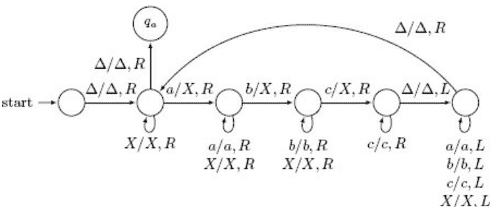

> 图 12.1：用于 $L=\{a^nb^nc \mid n \geq 0 \}$ 的图灵机。

如果这个 $M$ 发现自己无法进行图中所示的转移怎么办？假设我们在第三个状态停止。在这种情况下，我们已经在向右扫描时遇到了一个 $a$，在可能跳过一些 $Xs$ 之后，我们期望找到一个 $b$ 与已经看到的 $a$ 配对。如果我们遇到的是（例如）$c$，则没有指示的转移，因为输入格式错误不属于 $L$。正如上文所述，实际发生的是转移到拒绝停止状态 $q_r$。

证明：我们将通过反证法证明 $\mathcal{W}$ 是不可计数的。假设 $\Sigma$ 是二进制字母表；其他字母表亦然。假设 $\mathcal{W}$ 是一个可无限集，因此它的元素可以与 $\mathcal{N}$ 建立一一对应关系。这等同于我们可以为 $\mathcal{W}$ 的所有元素列出一个编号列表。一旦确定了这种对应关系，我们就可以明确地谈论 $\mathcal{W}$ 的第 $ith$ 个元素。根据假设，这个列表包含了所有可能的二进制 $\omega$-字符串，但我们将证明必有一个 $\omega$-字符串不在该列表中。定义 $\omega$-字符串 $v$ 如下：如果 $\mathcal{W}$ 中第 $ith$ 个字符串的第 $ith$ 位为 1，则 $v$ 的第 $ith$ 位为 0，反之亦然。（我们使用从 0 开始的索引。）该构造的插图如下：

```
ν = 1 1 0 1 ...
0th 0 1 1 0 0 1 ...
1st 0 0 1 0 1 1 ...
2nd 1 1 1 1 0 1 ...
3rd 1 0 1 0 0 1 ...
:
```

关键的观察是，$v$ 是一个 $\omega$-字符串，因此它应该出现在所有 $\omega$-字符串的列表中。另一方面，对于任何 $v$，该构造防止了 $v$ 成为列表上的第 $ith$ 个字符串，因为它与该字符串在第 $ith$ 位上不同。因此产生矛盾。$\square$

这个证明是**对角线法**技术的一个例子，在集合论历史上广为人知。我们很快会再次使用它。（注意的是，上述论证与 0 到 1 之间实数的个数是不可计数的证明几乎相同。为了理解这种关系，请注意任何这样的实数都可以以二进制符号表示为前面带有“二进制点”的 $\omega$-字符串。由于某些实数有多种表示法，这里还有一些额外的技术细节。）

## 12.4 通用图灵机


我们曾承诺图灵机是一种通用的计算模型（第 12.2 节）。到目前为止，这一主点的前景似乎是怀疑的，尽管通用计算机可以运行各种软件，而示例 12.3 中的 TM——我们唯一见过的 TM——只能做一件事：确定每个输入字符串是否属于语言 $L$。本节的目标是通提出一种 TM 设计策略来消除这种对 TM 僵化的刻板印象，这种 TM 能够接受任何其他 TM 的描述作为输入——这就像真实的计算机接受软件，然后对作为第二个输入的所提供的任何数据执行该 TM 的行为一样。这样的 TM 被称为**通用图灵机（Universal Turing Machine, UTM）**。

如果要将一个 TM 放入另一个 TM（即 UTM）中，那么第一个 TM 必须用第二个 TM 磁带上允许出现的符号来表示。特别是，如果 TM 使用 $\Sigma = \{0, 1\}$，则必须有一种编码方案能用 0 和 1 表示每个 TM $M$。机器 $M$ 的编码记作 $\langle M \rangle$。需要强调的是，没有单一正确的编码方案。各种方案在本质上是行的，但在细节上有所不同。为了更清楚地理解编码方案，最好看其中一个。

## 示例 12.4

给出一个将定的 TM $M = (Q, \Sigma, \Gamma, q_0, \delta)$ 转换为二进制字符串 $\langle M \rangle$ 的编码方案。

每个 TM 元素的编码将是一串 1 的字符串（可能为空），每个字符串之间用单个 0 隔开。首先，我们将状态 $Q = (q_0, q_1, ..., q_n)$ 表示为字符串 $(\Lambda, 1, 11, 111, ..., 1^n)$，其中 $q_i$ 对应 $1^i$。同样，我们将字母表 $\Gamma = (x_0, x_1, ..., x_m)$ 中的符号表示为字符串 $(\Lambda, 1, 11, 111, ..., 1^m)$，其中 $x_i$ 对应 $1^i$。这处理了 $\Sigma$，因为 $\Sigma \subseteq \Gamma$。如果 $\Delta = x_0$，则空白符号为 $\Lambda = 1^0$。最后，对于磁头移动 $\{R, L\} = \{\mu_0, \mu_1\}$，用字符串 $1^i$ 表示移动 $\mu_i$。

考虑 TM 的一个通用转移 $\delta(q_i, x_l) = (q_j, x_k, \mu_m)$。我们用字符串 `'10100111m0'` 对这一转移进行编码。我们通过拼接每一个转移的表示来表示所有的 $\delta$，形成一个长字符串 $\omega$。事实上，$\omega$ 代表 $M$ 的完整描述，因此我们令 $\langle M \rangle = \omega$。

尽管规则编码在 1 的数量上可能存在很大差异，但每个转移编码中 0 的数量始终是五个，这一事实有助于 UTM 跟踪它所处的位置。例如，从磁带开始移动过 5 个 0 会将磁头带到第二个转移规则。

由于编码方案将每个 TM 变成一个字符串，因此 TM 编码集是一个语言。现在考虑一个 TM 编码，后面紧跟一个额外的 0 符号，然后是该 TM 接受的输入字符串。这也是一个字符串。我们将这种语言表示为 $L_U$。所有此类字符串 $\langle M \rangle x$（其中 $M$ 接受 $x$）的集合就是我们说的**通用语言**。形式上，我们写成 $L_U = \{ \langle M \rangle x \mid M \text{ accepts } x \}$。

我们现在声存在一个接受 $L_U$ 的 TM $M_U$。这样的 TM 是通用图灵机，因为它模拟了 TM 的行为。以这种方式，它类似于通用计算机运行程序。支持这一主点的强有力的方法是给出细节。$M_U$ 的细节及其操作非常复杂，但在文献中已有各种解决方案。上述对设计策略的讨论为 $M_U$ 的存在提供了某种信心。$M_U$ 的存在建立了语言。

## 定理 12.2 — 语言 $L_U$ 是可枚举的。

注意，该定理的证明（上述仅概述）涉及对 $M$ 的模拟。如果 $M$ 在输入 $x$ 上不停止，那么我们的 $M_U$ 在输入 $\langle M \rangle x$ 上也不会停止。因此我们还没有确定 $L_U$ 是否是递归的。

在接下来的节中，我们需要讨论“第 $i$ 个 TM”。为了看到这种概念是有意义的，我们可以将整数 $i$ 映射到其二进制表示 `bin(i)`。对于任何 `bin(i)` 不是有效编码的 $i$，我们可以认为 $M_i$ 是病态的，且不接受任何字符串，因此其语言为空集。

## 12.5 图灵机的局限性

图灵机被介绍为最强大的计算模型，这一点我们将在 12.7 节中回到。然而，这类机器所能做的事情是有局限性的。对于某些语言，不存在图灵机（TM）；这类语言不是递归可枚举的。其他语言虽然是递归可枚举的但不是递归的；对于这些语言，不存在能够可靠停止的 TM。

**定理 12.3** – 存在一种不可递归可枚举的语言。

证明：定理 12.1 表明语言的数量是不可计数的。另一方面，我们在 12.4 节中证明了每个 TM 都可以编码为一个整数，因此可以立即推出所有 TM 的集合是可数无限的。因此，语言的数量比 TM “多”，所以当你将 TM 映射到它们所接受的语言时，必然会留出一些不对应于任何 TM 的语言。

这个证明并不十分满意。它证明了这种语言必须存在，但没有展示它。我们可以通过将 12.3 节中使用的对角法直接应用于 TM，得到一个特定的不可递归可枚举的语言。记得 $M_i$ 是 12.4 节中定义的第 $i$ 个 TM。

```
$L_D = \{bin(i) \mid i \in \mathcal{N} \text{ and } M_i \text{ does not accept } bin(i)\}$
```

尽管这是一个特殊的语言，由于 $M_i$ 是唯一定义的，因此字符串 $x$ 是否在 $L_D$ 中没有歧义。$\{M_j\} = bin(i)$，字符串 $x \in L_D$ 当且仅当编码为 $x$ 的机器不接受 $x$。这就是所谓的“对角线”论证的含义。

## **定理 12.4** – 语言 $L_D$ 不是递归可枚举的。

证明：反反法假设 $L_D$ 被某个 TM $M$ 接受，因此 $L_D = \mathcal{L}(M)$。由于对于某个 $i$，有 $\langle M\rangle = bin(i)$，得出 $M = M_i$。现在考虑 $M$ 是否接受 $x = bin(i)$。如果 $M$ 接受 $x \in \mathcal{L}(M)$，则 $x \in L_D$。另一方面，如果 $M$ 接受 $x$，根据 $L_D$ 的定义，$x$ 不能在 $L_D$ 中。这个矛盾意味着 $M$ 不存在。

递归语言和递归可枚举语言有很多可以证明的属性。我们只需要以下：记得字母表 $\Sigma$ 上语言 $L$ 的补集是 $\overline{L}=\{x \in \Sigma^* \mid x \notin L\}$。

## **引理 12.1** – 如果语言 $L$ 是递归的，那么 $\overline{L}$ 也是递归的。

**证明：** *设 $L$ 为递归语言。根据定义，存在一个 $M$ 接受 $L$ 并在所有输入上停止。我们可以通过修改 $M$ 为 $\overline{L}$ 构建一个新的 TM $\overline{M}$。该修改仅是交换状态 $q_a$ 和 $q_r$。对于任何输入 $x$，$\overline{M}$ 停止，且 $\overline{M}$ 接受 $x$ 当且仅当 $M$ 不接受 $x$*

## **推论 12.1** – 语言 $L_A = \overline{L_D}$ 不是递归的。

**证明：** 根据引理 12.1，如果 $L_A$ 是递归的，那么 $L_D$ 将是递归的，但我们根据定理 12.4 知它不是递归可枚举的。

有了这些结果，我们现在准备给出一个递归可枚举但不是递归的语言示例。记得在 12.4 节中我们证明了通用语言 $L_U$ 是递归可枚举的。

## **定理 12.5** – 语言 $L_U$ 不是递归的。

**证明：** 反反法假设 $L_U$ 被某个 TM $M$ 接受，因此 $L_U = \mathcal{L}(M)$。由于对于某个 $i$，有 $\langle M\rangle = bin(i)$，得出 $M = M_i$。现在考虑 $M$ 是否接受 $x = bin(i)$。如果 $M$ 接受 $x \in \mathcal{L}(M)$，则 $x \in L_D$。另一方面，如果 $M$ 接受 $x$，根据 $L_D$ 的定义，$x$ 不能在 $L_D$ 中。这个矛盾意味着 $M$ 不存在。

### 为什么 $L_U$ 这么难？

图灵机被介绍为最强大的计算模型，这一点我们将在 12.7 节中回到。然而，这类机器所能做的事情是有局限性的。对于某些语言不存在 TM；这类语言不是递归可枚举的。其他语言虽然是递归可枚举的但不是递归的；对于这些语言不存在可靠停止的 TM。

**定理 12.3** – 存在一种不可递归可枚举的语言。

证明：定理 12.1 表明语言的数量是不可计数的。另一方面，我们在 12.4 节中证明了每个 TM 都可以编码为一个整数，因此可以立即推出所有 TM 的集合是可数无限的。因此，语言的数量比 TM “多”，所以当你将 TM 映射到它们所接受的语言时，必然会留出一些不对应于任何 TM 的语言。

这个证明并不十分满意。它证明了这种语言必须存在，但没有展示它。我们可以通过将 12.3 节中使用的对角法直接应用于 TM，得到一个特定的不可递归可枚举的语言。记得 $M_i$ 是 12.4 节中定义的第 $i$ 个 TM。

```
$L_D = \{bin(i) \mid i \in \mathcal{N} \text{ and } M_i \text{ does not accept } bin(i)\}$
```

尽管这是一个特殊的语言，由于 $M_i$ 是唯一定义的，因此字符串 $x$ 是否在 $L_D$ 中没有歧义。$\{M_j\} = bin(i)$，字符串 $x \in L_D$ 当且仅当编码为 $x$ 的机器不接受 $x$。这就是所谓的“对角线”论证的含义。

**定理 12.4** – 语言 $L_D$ 不是递归可枚举的。

证明：反反法假设 $L_D$ 被某个 TM $M$ 接受，因此 $L_D = \mathcal{L}(M)$。由于对于某个 $i$，有 $\langle M\rangle = bin(i)$，得出 $M = M_i$。现在考虑 $M$ 是否接受 $x = bin(i)$。如果 $M$ 接受 $x \in \mathcal{L}(M)$，则 $x \in L_D$。另一方面，如果 $M$ 接受 $x$，根据 $L_D$ 的定义，$x$ 不能在 $L_D$ 中。这个矛盾意味着 $M$ 不存在。

递归语言和递归可枚举语言有很多可以证明的属性。我们只需要以下：记得字母表 $\Sigma$ 上语言 $L$ 的补集是 $\overline{L}=\{x \in \Sigma^* \mid x \notin L\}$。

**引理 12.1** – 如果语言 $L$ 是递归的，那么 $\overline{L}$ 也是递归的。

**证明：** *设 $L$ 为递归语言。根据定义，存在一个 $M$ 接受 $L$ 并在所有输入上停止。我们可以通过修改 $M$ 为 $\overline{L}$ 构建一个新的 TM $\overline{M}$。该修改仅是交换状态 $q_a$ 和 $q_r$。对于任何输入 $x$，$\overline{M}$ 停止，且 $\overline{M}$ 接受 $x$ 当且仅当 $M$ 不接受 $x$*

**推论 12.1** – 语言 $L_A = \overline{L_D}$ 不是递归的。

**证明：** 根据引理 12.1，如果 $L_A$ 是递归的，那么 $L_D$ 将是递归的，但我们根据定理 12.4 知它不是递归可枚举的。

有了这些结果，我们现在准备给出一个递归可枚举但不是递归的语言示例。记得在 12.4 节中我们证明了通用语言 $L_U$ 是递归可枚举的。

**定理 12.5** – 语言 $L_U$ 不是递归的。

证明：反反法假设 $L_U$ 被某个 TM $M$ 接受，因此 $L_U = \mathcal{L}(M)$。由于对于某个 $i$，有 $\langle M\rangle = bin(i)$，得出 $M = M_i$。现在考虑 $M$ 是否接受 $x = bin(i)$。如果 $M$ 接受 $x \in \mathcal{L}(M)$，则 $x \in L_D$。另一方面，如果 $M$ 接受 $x$，根据 $L_D$ 的定义，$x$ 不能在 $L_D$ 中。这个矛盾意味着 $M$ 不存在。

## 12.6 不可判定性

本章一直关注不可判定性。如果一个对应的语言不是递归的，则称该决策问题是不可判定的（即使它是递归可枚举的）。我们可以说“停机问题是不可判定的”。（有时我们说“语言 $L$ 是不可判定的”，但严格来说应该指的是决策问题。）注意，不可判定性指的是我们无法设计出一个单一计算机（图灵机）在所有输入上正确解决问题。换句话说，你可能构建出一个总是得到正确答案的 TM，但如果问题是不可判定的，那么你的 TM 必须至少在一个输入上给出错误的答案。

某些不可判定的问题是人为构造的，但许多问题（例如停机问题）对计算机科学家有直接影响。如果有人告诉他们他们有一个程序可以对（例如）C++ 代码进行完整的分析，那么你应该怀疑。毕竟，他们的程序永远无法判断给定的 C++ 代码是否会停止，那么他们又如何判断代码是否运行正常呢？（这就是我们在第 6 章中强调证明“部分正确”的概念的原因。）有时，最不可能的问题被证明是不可判定的。例如，判断一个上下文无关文法（CFG）是否对应正则语言的问题——是不可判定的！不幸的是，证明过程太复杂，在此不给出。

## 12.7 丘奇-图灵论

阿隆佐·丘奇（Alonzo Church）和艾兰·图灵（Alan Turing）同时定义了计算模型。丘奇的模型被称为 $\lambda$-演算后来被证明与图灵机（TMs）等效。这两位研究人员都认为他们的模型是真正的通用计算模型。换句话说，他们确定任何其他模型（包括真实计算机的规范）在哪些计算能够成功的问题上，其能力都不会比他们的模型强。这是一个大胆且无法证明的命题，因为它对未来可能设计的任何计算模型都做出了陈述。丘奇-图灵论可以表述为：任何计算任务都可以由图灵机完成。

为了理解这一主张，我们需要稍微扩展对 TM 作用的理解；到目前为止，TM 可以被认为是在计算一个函数 $f$，其中如果 $x$ 是输入，当机器停止时磁带上的任何内容即为 $f(x)$。丘奇-图灵论已经过验证，目前没有已知的函数 $f$ 可以被其他模型计算但不能被 TM 计算。自 20 世纪 30 年代以来，这一点一直成立，尽管人们已经提出了许多替代模型，且其目的往往是为了证伪该命题。

该命题还会继续成立吗？如果我们愿意推向“计算”概念的极限，也许可能不会。例如，人们已经严肃研究了脑功能在多大程度上是无法被 TM 计算的。或者，利用原子反应不确定性的所谓“量子计算机”领域的研究人员也提出了许多重要问题（尽管所谓的“量子 TM”可以被普通 TM 模拟）。这些想法非常具有推测性。对于所有实际用途而言，我们可以依赖这一命题。

正是因为对丘奇-图灵论的广泛支持，图灵机才在理论计算机科学中占据了核心地位。可以再写一整本教科书来探索关于 TM 的已知知识。我们将在下一节中提到其中一个此类主题。

## 12.8 计算复杂度

在本书的第二部分，目前我们专门处理关于“可以做什么或不能不能做什么”的问题。例如，$L = \{a^nb^n \mid n > 0\}$ 是一个我们可以给出其正则文法的语言，但我们也可以给出一个上下文无关文法。在实践中，计算机科学家希望超越“能否解决一个问题”，转而关注“解决该问题有多困难”。通过将问题分为不同的语言类，我们可以衡量用 FA（自动机）和另一个 TM 解决问题的困难程度，在某种意义上，第一个问题更简单。然而，如果一个正则语言所需的 FA 状态数比 TM 识别相同语言所需的句数呈指数级增长，那么 FA 的简单性就变得毫无意义。

在计算机科学中，我们传统上通过解决该问题的（最优）计算机程序所消耗的资源来评估问题的困难程度。通常研究得的资源是执行时间，但内存使用也很重要。在《算法》课程中，这些问题得到了广泛研究。然而，关于效率的某些问题是可以通过图灵机进行理论研究的。


在本节中，我们将继续关注决策问题，这等同于专注于语言识别任务。在第 7 章中，我们讨论了根据各种计算模型、文法等要求的将语言划分成“语言类”。现在，我们希望根据 TM 识别该语言时必须使用的资源量（下文定义）来将语言划分为复杂度类。这导致了一个被称为计算复杂度的整个领域，需要一个学期才能完成综述。在本节中，我们指出了在该领域可以追求的某些方向。

### 示例 12.5

当示例 12.3 中的 TM 以输入 `$a^nb^nc^d$` 开始时，需要多少资源——即多少的时间和空间？

TM 反复地扫描磁带，来回移动，直到最终停止。具体来说，它会扫描所有 `$3n$` 个符号加上两个括号（`$\Delta$`），从左向右 `$n$` 次，从右向左 `$n$` 次，最后一次从左向右。仔细计数显示，TM 接受 `$x$` 需要 `$(2n+1)(3n+1)$` 步；通常我们描述得更松散，称其花费的步数是一个二次函数，`$O(n^2)$`。也可以看出，拒绝一个 `$n$` 个符号的输入可能需要二次方的步数。TM 没有使用已提到的 `$3n+2$` 个磁带单元之外的任何额外单元；我们称之为线性空间。

我们需要更正式的定义。回想 `$O(\cdot)$` 符号在第 1.7 节中定义。如果对于每个长度为 `$n$` 的 `$x \in L$`，`$M$` 在 `$O(T(n))$` 步内接受 `$x$`，则说一个 TM `$M$` “在时间 `$T(n)$` 内接受语言 `$L$`”。进一步，如果对于每个长度为 `$n$` 的 `$x \in L$`，`$M$` 使用 `$O(S(n))$` 个磁带单元接受 `$x$`，则说一个 TM `$M$` “在空间 `$S(n)$` 内接受语言 `$L$`”。

我们已经说明（未证明）非确定性不允许 TM 接受任何确定性 TM 无法接受的语言。然而，非确定性可能允许 TM 使用比任何确定性 TM 更少的资源来接受给定语言的字符串。当然，这种加速具有理论意义，因为实际上只存在确定性机器。惊讶的是，非确定性理论被证明导致了一些实用的见解。`DTM` 代表确定性图灵机，`NTM` 代表非确定性图灵机。以下是两类时间类：

- `$DTIME(T(n)) = \{L \mid L \text{被 TM 在时间 } T(n) \text{内接受}\}$`
- `$NTIME(T(n)) = \{L \mid L \text{被 NTM 在时间 } T(n) \text{内接受}\}$`

类似的，空间复杂度：

- `$DSPACE(S(n)) = \{L \mid L \text{被 TM 在空间 } S(n) \text{内接受}\}$`
- `$NSPACE(S(n)) = \{L \mid L \text{被 NTM 在空间 } S(n) \text{内接受}\}$`

注意，复杂度类是具有相同困难性的语言集合。关于复杂度类的定理已有数千个，大部分取决于 `$T(n)$` 和 `$S(n)$` 的增长率。定理的一个简单例子是 `$DTIME(f(n)) \subseteq DSPACE(f(n))$`。

尽管这些是基于语言识别定义的，我们仍继续将其解释为决策问题。如果一个决策问题可以在 `$O(n^k)$` 时间内确定性地解决（`$k$` 为整数），则该问题属于 `$P$` 类。当 `$k$` 较小时（例如 `$k=2$`），我们拥有一个运行效率合理的机器；但如果 `$k=1,000,000$`，那么这种实现是极其不可行的。那么为什么多项式时间是这些定义的核心呢？有三个原因。

第一，即使属于 `$P$` 不能保证有实行的实现，但可以确定，不属于 `$P$` 意味着对于较大的 `$n$`，该决策问题没有解决方案。如果问题不在 `$P$`，我们称其为不可行的（intractable）。

第二，即使 `DTM` 看起来非常缓慢，但已知 `DTM` 可以在多项式时间内模拟普通随机访问计算机的单步。（事实上，有大量关于模拟复杂性的文献）。

第三，多项式具有简化的封闭属性；例如，多项式的步数，每步执行多项式时间，其累计时间也是多项式的。

复杂度理论最好的已知领域涉及 `$P$` 和 `$NP$` 两个类：

- `$P = \{L \mid L \text{被 DTM 在多项式时间内接受}\}$`
- `$NP = \{L \mid L \text{被 NTM 在多项式时间内接受}\}$`

这可以更正式地定义为：

```
img/e49d977e0cc4db78b7174ba16fc32998_343_0.png
img/e49d977e0cc4db78b7174ba16fc32998_343_1.png
```

属于 `$NP$` 并没有直接的实际意义。事实上，非确定性在允许极不切实的实现方面似乎非常有帮助。非确定性图灵机（`NTM`）在有转移可选时，可以通过明智的猜测来引导计算，从而避免寻找某个字符串应该被接受的证据。显而易见的是

## $\mathcal{P} \subseteq \mathcal{NP}$

因为非确定性的能力只能提高接受语言所需的时间。事实上，似乎存在某些可以多项式非确定性地解决的问题，但无法通过任何多项式时间确定性图灵机（`DTM`）解决。任何此类问题显然都是不可计算的。

事实上，`$\mathcal{NP}$` 通过 `$\mathcal{NP}$`-完全语言这一类具有重大的间接实际意义。`$\mathcal{NP}$`-完全语言的定义过于技术性在此无法给出，但其结果是这些是 `$\mathcal{NP}$` 中最难解决的语言。特别是，如果 `$\mathcal{NP}$` 中的任何语言是不可计算的，那么每一个 `$\mathcal{NP}$`-完全语言都是不可计算的。

考虑到其非常抽象的定义，`$\mathcal{NP}$`-完全问题的类非常独特。这一类包含了数千个人们在现实生活中需要解决的决策问题。`$\mathcal{NP}$`-完全决策问题的几个例子包括：

- **划分（Partition）** – 给定一个整数和，是否可以将其划分为两个不相交的集合，使得每个集合中的元素和相等？
- **哈密顿圈（Hamiltonian Cycle）** – 给定一个图，是否存在一个边集，形成一个恰好通过每个顶点一次的圈？（相关的旅行销问题使用了加权图，并要求最小最小哈密顿圈）
- **调度（Scheduling）** – 给定一组任务及其持续时间和截止日期，是否存在一个针对两个（或更多）处理器的调度方案，能够在截止日期之前完成所有任务？
- **可满足性（Satisfiability）** – 给定一个布尔公式，是否存在布尔变量的真值赋值，使得该公式为真？

这个简短的列表开始说明 `$\mathcal{NP}$`-完全问题的类是多样化的且具有实际意义的。值得指出的是（考虑到本文对逻辑的强调），可满足性问题是所有理论赖以的基础！为什么可满足性问题如此重要？简而言之，这是因为布尔表达式“表达”了某些问题与其他问题一样困难。

数以千计的 `NP`-完全问题有一个共同的有趣属性。虽然它们受到了试图设计高效算法的人们的关注（因为它们在现实生活中的重要性），但没有任何研究人员设计过可以解决任何问题的多项式时间实现！正如我们所说，如果任何 `NP`-完全问题可以在多项式时间内解决，那么每个 `NP`-完全问题都可以在多项式时间内解决。这些观察提供了有力的间接证据，证明没有任何 `NP`-完全问题具有多项式时间解。

总结：

- 如果 `NP` 中的任何问题是不可计算的（不在 `P` 中），那么每个 `NP`-完全问题都是不可计算的。相反，如果任何 `NP`-完全问题是可计算的（在 `P` 中），那么 `NP` 中的每个问题都是可计算的。
- 每一个 `NP`-完全问题似乎都是不可计算的，因为数千名研究者的共同努力未能证明即使是这样一个问题在 `P` 中。

综合来看，这些强力的观察使人们预期这些问题（如可满足性和划分问题）将没有解决它们的多项式时间算法。然而，这一结论并没有证明。

## 练习题

12.1 – 通过提供该集合与 `$\mathcal{N}$` 之间的一一映射，证明以下每个集合都是可无限的。

- (a) 完全平方数
- (b) 所有整数集合（包括负数）

12.2 – 设计一个图灵机来识别 `$\{\omega^R \mid \omega \in \{a, b\}^*\}$`，即像 `aabaaba` 这样的偶长度回文语言。记住 `$\omega^R$` 是 `$\omega$` 的反转。

12.3 – 设计一个图灵机来识别 `$\{\omega \mid \omega \in \{a, b\}^*\}$`，即像 `aabaaba` 这样的重复字符串语言。提示：最困难的部分是定位后半第一个符号。

12.4 – 指定一个有限自动机，它恰好接受图灵机转移函数的有效编码字符串，根据第 12.4 节中使用的编码方案。

12.5 – 上下文文法（`CSG`）是一种文法，其中每个产生式 `$\alpha \rightarrow \beta$` 都满足属性 `$|\alpha| \leq |\beta|$`；推导过程中的每一步都不会产生更短的终结符非终结符字符串。

- (a) 解释为什么任何由 `CSG` 生成的语言都不包含空字符串。
- (b) 为 `$L = \{a^n b^n c^n \mid n \geq 1\}$` 给出一个 `CSG`。

> ^1 这些也被称为 0-型文法，以及其他称呼。
> ^2 所谓的上下文文法（`CSGs`）克服了无无关文法（`CFGs`）的这一缺陷。它们产生了上下文语言及其对应的机器类——线性边界自动机。（参见练习 12.5。）
> ^3 这个术语来源于递归函数理论的数学，它是 20 世纪 30 年代计算理论的竞争对手。
> ^4 这样的集合被称为枚举集。

# 参考文献

- 1. Alfred V. Aho, Brian W. Kernighan and Peter J. Weinberger, The AWK Programming Language, AT&T, 1988.
- 2. Alfred V. Aho and Jeffrey D. Ullman, Foundations of Computer Science, Computer Press, 1995.
- 3. Alfred V. Aho, Ravi Sethi and Jeffrey D. Ullman, Compilers: Principles, Techniques, and Tools, Pearson, 2006.
- 4. Mordechai Ben-Ari, Mathematical Logic for Computer Science, Springer, 2012.
- 5. George Boole, An Investigation of the Laws of Thought, Dover, 1958.
- 6. Ivan Bratko, Prolog: Programming for Artificial Intelligence, Addison-Wesley, 2000.
- 7. Michael R. Garey and David S. Johnson, Computers and Intractability: A Guide to the Theory of NP-Completeness, Freeman, 1979.
- 14. Charles Petzold The Annotated Turing, Wiley, 2008.
- 15. Rudy Rucker, Infinity and the Mind, Princeton University Press, 2004.
- 16. Raymond Smullyan, Forever Undided: A Puzzle Guide to Gödel, Knopf, 1987.
- 17. Raymond Smullyan, Satan, Cantor and Infinity, Knopf, 1992. (Dover, 2009)
- 18. A. B. Tucker, A. P. Bernat, W. J. Bradley, R. D. Cupper, and G. W. Scragg, Fundamentals of Computing I, McGraw-Hill, 1995.
- 19. Friedrich J. Urbanbanek, “On Greibach normal form construction.” Theoretical Computer Science, 40 (1985) 315-317.

# 附录 A

# 逻辑编程

欣赏谓词演算作为一种表示思想的系统的精确性和力量的好方法，是观察它作为逻辑编程语言（如 `Prolog`）的基础运行。本附录重点关注逻辑启发的 `Prolog` 部分，但也触及了实践所需的其他功能，如数据结构、算术和输入输出。

`Prolog` 允许你在谓词逻辑中做出断言。这些可以是关于单个对象的特定事实，也可以是关于概念之间关系的通用陈述。然后你可以向 `Prolog` 处理器提出问题，它将根据它能从断言中弄出或推出的结果提供答案。它通过与你所学的谓词演算一致的演绎推理程序来实现这一点。我们将轻要介绍这一过程是如何执行的。

## A.1 Prolog 的本质及其与逻辑的关系

`Prolog` 有三个异常且重要的特征：它与逻辑的关系、它的**交互式风格**以及它的**声明性**。尽管这三个属性截然不同，但它们之间的相互关系使得 `Prolog` 成为一个快速原型的强大工具。也就是说，它们可以帮助 `Prolog` 程序员获得一个表示概念的运行初始版本程序。

`Prolog` 的交互从用户输入的一个问题——称为**查询**（`query`）开始。这可能是终端用户，但我们设想的是开发者正在测试新程序的一个部分。然后，`Prolog`（严格来说是 `Prolog` 解释器）将根据已加载测试的某些代码对查询提供答案。这对于非正式测试来说是一种特别方便的方法。

此外，由于其逻辑性和声明性，代码本身看起来非常简单。`Prolog` 是一种声明性语言，你只需要陈述——或**断言**（`assert`）——你知道的内容，其形式相当于谓词逻辑表达式。在 `Fortran` 和 `C` 等旧的命令式语言中，必须编写许多过程来完成任务。即使对于支持某些面向对象技术的 `C++` 这样的语言也是如此。相比之下，`Prolog` 程序不需要指定将事实和规则投入使用的过程。相反，`Prolog`处理器提供了一个**推理机**（`inferencer`），用于执行逻辑推理。（程序员确实可以通过指定规则顺序和一些高级技术对过程施加某些控制。）程序员在解除了编写过程的负担后，可以专注于应用程序主题中的概念。

现在让我们来看这种语言本身。在 `Prolog` 中可以做出的断言有两种：**事实**（`facts`）和**规则**（`rules`）。事实描述特定对象（可能是事物、人、机构等）的属性，以及这些对象之间或内部之间的关系。规则的应用范围更广，用于推导出新信息。考虑一个既包含事实包含规则的示例。

### 示例 A.1

这里有关于特定个人的三个事实以及关于家庭关系的两个规则。

```
parent(mary, john).
parent(ann, mary).
female(mary).
mother(X,Y) :- parent(X,Y), female(X).
grandparent(X,Z) :- parent(X,Y), parent(Y,Z).
```

第一个事实意思是某个名叫 Mary 的人是名叫 John 的人的父母，第三个意思是 Mary 是女性。这两个事实结合母亲的规则，将允许 `Prolog` 在我们提问时告诉我们 Mary 是 John 的母亲。当然，就像其他编程语言一样，使用英语单词来命名符号在 `Prolog` 中并没有意义，尽管它可能对阅读你程序的人类有所帮助。因此，常量符号 `mary` 可以代表一个名叫 Mary 的人，或者就事物而言，代表 John。在输入 `Prolog` 事实和规则时，务必避免谓词和左括号之间留空格；其他地方留空格是可以的。

示例 A.1 中的每个事实都由一个带有适当参数的谓词组成。这种表示法类似于谓词逻辑，只不过结尾必须有一个句号（.”）。`Prolog` 规则也与谓词逻辑直接相关，但其表示法比事实的情况稍微隐藏了关系。首先，这里的变量如 `x`、`y` 和 `z` 大写字母（或大写字母开头），像 `parent` 这样的谓词以及像 `mary` 这样的常量以小字母开头。`Prolog` 的运算符符号与逻辑中的符号差异很大。符号“`:-`”意味着蕴涵，从右到左，与谓词逻辑的方向相反。你可以将其想象为带有“-”符号的反向蕴涵。此外，你也可以将“`:-`”读作英语单词“if”。上述每个规则在“`:-`”右侧都有两个命题，每个情况下都用逗号隔开。逗号可以读作“and”，它对应于逻辑中的“`∧`”。以后我们将使用分号——读作“or”）来对应“`∨`”（以一种受限的方式）。

`Prolog` 概念与谓词逻辑相似但在表示法上不同的另一种方式是：`Prolog` 中的每条规则都被理解为对其所有参数都以全称量词开头。以上述示例 A.1 中的第二个规则作为例，我们可以反转蕴涵并加上量词和 `∧` 符号，得到谓词逻辑中对应的陈述：

```
∀X : ∀Y : (∃Z : PARENT(X,Z) ∧ PARENT(Z,Y)) → GRANDPARENT(X,Y)
```

阅读此规则的 `Prolog` 版本的一种良好方法如下：为了证明 `X` 是 `Y` 的祖父母，需要证明 `X` 是某个 `Z` 的父母，并且证明 `Z` 是 `Y` 的父母。注意规则的参数是全称量化的；它是适用于所有可能的参数的规则。但注意在右侧引入的变量 `Z`，它被理解为存在量化的。

检查了断言（包括事实和规则）之后，是时候转向 `Prolog` 的问答部分了。示例 A.1 中的断言使 `Prolog` 推理机能够回答各种问题。例如，仅 `parent(mary, john)` 这一个事实就能让我们获得诸如“Mary 是谁的父母？”、“谁是 John 的父母？”、“Mary 是谁的父母？”、“Mary 是父母吗？”等更多问题的答案。使用示例 A.1 中的规则，`Prolog` 还可以对“谁是 John 的母亲”和“有人是祖父母吗？”给出正确答案。我们很快就会看到这类问题在 `Prolog` 理解的格式下是什么样的。

## A.2 开始使用 Prolog

使用 `Prolog` 很容易的。如上面提到的，`Prolog` 的一个重要方面是它通常是交互式使用的，而不是编译。这一节旨在让你对一个会话（`session`）是什么有一个感觉。在启动解释器之前，你应该准备一个包含一些事实和规则的文件。一旦启动，你就可以输入查询并根据你加载的事实接收答案。在许多实现中，你可以使用 `halt` 来停止。（记住句号是查询的一部分。）每当你按下回车但忘记输入句号时，输入句号并再次。

### 示例 A.2

如果系统提示符是“`=>`”，那么最短的会话如下：

```
=> prolog
?- halt.
=>
```


假设你创建了一个名为 `family` 的文件，包含了示例 A.1 中的三个事实和两个规则。你启动了一个会话，并通过内置谓词 `consult` 加载了文件。Prolog 的响应是“yes”，并且加载了文件。你也可以在会话期间使用特殊谓词 `assert` 进行断言，但通常不建议这样做。如果名为 `myfile` 的文件包含 `parent(mary,john)`，产生的效果相同：

```
| consult(myfile).
?- assert(mary,john).
```

假设你从查询 `parent(mary, john)` 开始。由于这是你加载的事实之一，Prolog 打印 yes（如示例 A.3 所示并不意外。相反，当你输入 `parent(john,ann)` 时，Prolog 打印 no，因为不是你加载的事实之一，而且你的规则也没有帮助，因为它们的左侧没有 `parent` 谓词。查询 `parent(bea,cal)` 也是如此。

### 示例 A.3

会话中关于事实的查询是什么样的？

```
|?- consult(family).
yes
?- parent(mary,john).
yes
?- parent(john,ann).
no
?- parent(bea,cal).
no
```

当你查看示例 A.3 中的简短 Prolog 会话时，请记住是你作为用户通过按下回车（或输入）导致了每个新行的开始。这些新行中的某些出现在你自己的查询之后。（记住句号是查询的一部分。）另一些出现在 Prolog 的“yes”或“no”回答之后。你输入的所有内容必须以句号结束。

### 示例 A.4

Prolog 能对没有事实的谓词给出肯定的回答吗？

可以。对于谓词 `mother`，有规则但没有事实。当 Prolog 得到下面的查询时，它最初没有找到直接相关的实，但随后开始利用母 规则并给出正确答案。稍后我们将看到 Prolog 是如何得到答案的。

以及甚至更复杂的查询。

```
|?- mother(mary,john).
yes
```

### 示例 A.5

当变量出现在查询中时会发生什么？

Prolog 推理器尝试通过为变量寻找合适的值来证明答案的存在。在简单的示例中，Prolog 变量对应英语中的疑问词“who”（谁”）和“what”（什么）。以下查询意味着“谁是约翰的母亲？”以及“玛丽的母亲是谁？”（或“玛丽是谁的母亲？”）。

```
|?- mother(X,john).
X = mary
yes
?- mother(mary,X).
X = john
yes
```

### 示例 A.6

假设你在两个位置都放置了变量呢？

Prolog 再次为变量寻找合适的值。对于两个变量，对应的英语问题虽然显得很别扭，但仍然可以理解。例如，下面的查询询问“谁是谁的母亲？”或“谁是谁的母亲？”（注意，我们说“玛丽是约翰的母亲吗？约翰的母亲”，因为提供给 Prolog 的信息并没有排除有多个母亲的可能性。）在收到一个答案后，用户可以通过输入分号（;）来请求另一个答案，如下所示。输入额外的分号将产生额外的答案（如果存在）。为了提供一个具有多个答案的示例，我们首先断言另一个事实：Ann 是女性。如果你一直输入分号直到没有更多答案为止，Prolog 最终会打印“no”，意味着“没有更多”。

```
|?- assert(female(ann)).
|?- mother(X,Y).
X = mary, Y = john
yes;
X = ann, Y = mary
yes;
no
```

### 示例 A.7

我可以问谁是祖父母，而不必询问孙辈吗？

可以的。Prolog 拥有匿名变量，其值不会被报告。匿名变量的名字以下划线字符 "_" 开头，且不需要任何字符。因此，查询 `grandparent(P,_)` 询问任何对象 P 是否是任何对象的祖父母，“_" 会报告 P 的值。由于 `grandparent`（类似于 `mother`）是一个尚未断言任何事实的谓词，Prolog 调用 `grandparent` 规则来开始。最终，它找到了正确的答案，但为命名变量打印了一个值，而不是匿名变量。在英语中，这读作：“谁是祖父母？”

```
|?- grandparent(P,_)
P = ann
yes
```

我们现在已经看到 Prolog 处理器以带有三种不同类型参数的谓词形式对查询做出响应：如 "mary" 这样的常量、普通的命名变量（如 "x"）以及匿名变量（"_"）。查询中的命名变量会用其替换值打印出来，因此它具有英语单词如“who”和“what”的效果。相比之下，匿名变量没有输出。命名变量和匿名变量的另一个区别是，命名变量在整个子句必须取相同的值，因为每个 "_" 的出现都被视为一个不同的变量，所以它的两次出现并不一定具有相同的值，尽管它们可能相同，就像两个不同的命名变量可能具有相同的值一样。图 A.1 显示了 Prolog 处理带有这两种变量之一的查询的情况。然后图 A.2 转向了一些更具挑战性的示例，即同时查询两个变量。每个查询都包含一个英语转述。你应该检查“who”是否始终对应于一个命名变量。答案基于示例 A.1 的规则和事实。

图 A.1：Prolog 查询与对应的英语问题。

## A.3 与数据库相关的示例

你已经看到了 Prolog 的几个最重要方面：它的事实和规则、它们的声明式形式以及与逻辑的相似性、如何在 Prolog 会话中使用多种格式的查询进行交互，以及这些查询如何与普通英语中各种实用的问题相关。为了对这些知识进行练习并强调其重要性，我们现在将其引入数据库世界。

| Prolog 交互 | 英语转述 | 注释 |
| :--- | :--- | :--- |
| ?- parent(X). | 谁有父母？ | 使用分号获取其他答案。 |
| X = mary; | | |
| X = john | | |
| ?- parent(X,Y). | 谁是谁的父母？ | Prolog 给出 x 和 y 的值。根据请求，Prolog 给出另一个答案。 |
| X = ann, Y = mary; | 现在没有更多答案了。 | |
| X = mary, Y = john; | | |
| ?- parent(X,X). | 谁是他她自己的父母？ | | |

图 A.2：Prolog 中的双变量查询与英语对应。

数据库管理系统在现代世界中起着核心作用，允许个人和组织存储、处理、提取和报告信息，其便利性和数量会让一辈人以前的大多数人感到惊讶。在本节中，我们将介绍主流数据库模型的三种基本操作，并展示如何在 Prolog 中表示每种操作。这种操作的简便反映了逻辑与数据库之间的概念联系。虽然 Prolog 可能适用于数据库原型，但对于实现完整的数据库系统来说速度缓慢。

尽管组织数据库的方法有很多，但我们将关注关系数据库，它是最广泛使用的。这类数据库中表示数据的主要结构是“关系”（relation）。关系型数据库使用所谓的“关系”似乎是显而易见的，但这个在管理背景下如此熟悉的词在这里根据其数学定义被正确理解，可能会有一点意外。定义元组（tuple）为序列，它可以是一个单元组 (a)、二元组 (a, b)。

### 示例 A.8

设 `EMPINFO` 为一个谓词。第一个参数是标识码，第二个是当前员工被雇的年份，第三个是单位。以下是事实。

| Idnum | Year | Unit |
| :--- | :--- | :--- |
| 34567 | 1998 | a |
| 34612 | 2000 | b |
| 33927 | 1991 | c |
| 33825 | 1987 | d |

以下 Prolog 查询显示了如何访问此表的信息。

```
?- empinfo(X,1998,a).
X = 34567
yes
?- empinfo(34567,Y,a).
Y = 1998
yes
?- empinfo(34567,Y,Z).
no
?- empinfo(X,2000,b).
X = 34612
yes
?- empinfo(X,Y,Z).
X = 34567, Y = 1998, Z = a;
X = 34612, Y = 2000, Z = b;
X = 33927, Y = 1991, Z = c;
X = 33825, Y = 1987, Z = d
```

第一个查询使用前两个参数的常量查找单位。第二个查询使用第一个参数的常量查找年份。第三个查询使用三个参数的变量查找所有组合。最后的块显示了如何使用分号获取所有答案。

投影操作选择列。为了只投影年份，我们对感兴趣的列使用匿名变量。

```prolog
year(Y) :- empinfo(_, Y, _).
```

```prolog
year_unit(Y, Z) :- empinfo(_, Y, Z).
```

```prolog
?- year(Y).
Y = 1998;
Y = 2000;
Y = 1991;
Y = 1987;
no
```

连接操作合并两个表中的行。例如，我们想找到与玛丽在同一年入用的员工。

```prolog
same_year(X, Y) :- empinfo(X, Year, _), empinfo(Y, Year, _).
```

```prolog
?- same_year(34567, X).
X = 34567;
X = 34567;
no
```

选择操作根据条件选择行。例如，我们想找到在 1995 年之前入用的所有员工。

```prolog
before_1995(X) :- empinfo(X, Year, _), Year < 1995.
```

```prolog
?- before_1995(X).
X = 33927;
X = 33825;
no
```

```
year(Y) :- empinfo(-,Y,-),
year_unit(Y,Z) :- empinfo(-,Y,Z).
```

关系数据库是关系的集合，但到目前为止我们的数据库只包含一个关系：EMPINFO。现在我们将引入第二个关系，并展示如何一起使用这些关系。新关系 `MANAGES` 将每个工作单元与其经理关联起来。（为了避免歧义，应该使用经理的员工编号而不是姓，但我们这里的处理方式更容易理解。）

| Unit (单元) | Manager (经理) |
|---|---|
| unit06 | Nguyen |
| unit23 | Smith |
| unit17 | Lee |

我们现在准备好进行连接操作了。实际上，连接有几种相关的版本，但我们不会对它们进行区分。我们的示例将涉及所谓的“自然连接（natural join）”。注意我们的关系有一个共同字段，即“Unit”字段。通过这个字段，我们可以关联两个关系中的其他字段，实际上新表在 unit 字段上合并了两个关系（在可能的情况下，即两个关系在该字段上具有相同的值时）。新表对于 unit23 有两行，但对于 unit08 和 unit17 没有行，其中一个缺少经理，另一个缺少员工。

| Idnum (工号) | Year (年份) | Unit (单元) | Manager (经理) |
|---|---|---|---|
| 34567 | 1998 | unit23 | Smith |
| 34612 | 2000 | unit23 | Smith |
| 33927 | 1991 | unit06 | Nguyen |

下面的 Prolog 规则表达了相同的思想。与“EMPINFO”一样，我们复用关系名“MANAGES”来命名 Prolog 谓词。最重要的是，如何通过 Prolog 中的共享变量 (Y) 来实现 unit 字段中值必须相等的要求。

```
empinfo_aux(W,X,Y,Z) :- empinfo(W,X,Y), manages(Y,Z).
```

到此结束了对谓词逻辑与关系代数之间相似性的简要演示，关系代数在许多数据库管理系统中起着关键作用。后者显然比这里展示的复杂得多。建立在关系代数之上的查询语言允许用户请求所需信息，而无需理解数据的逻辑组织。在我们讨论的层级之下，涉及到在真实物理设备中存储数据以及为多个用户在重叠时间段内提供访问的问题。这些是需要更专门、更全面处理的主题。

## A.4 Prolog 的通用形式和局限性

为了探索用 Prolog 能做什么，我们来看规则的一般结构。首先，为了扩大示例范围，考虑下一个示例中给祖先（ancestor）规则。该规则比示例 A.1 中的母亲和祖父母规则更复杂，因为它提供了两种方式（而不仅仅一种）来证明谓词成立。

### 示例 A.9

这个祖先规则的第一部分说，任何你的父母都是你的祖先之一。第二部分说你的祖先还包括你祖先的父母。规则的每个部分都以句号结束，被称为句（clause）。因此，`ancestor` 是一个双句规则，与 `mother` 和 `grandparent` 的单句规则形成对比。注意，该规则还伴有一些解释，每个解释都以 Prolog 符号 "%" 开始。

```
ancestor(X,Y) :- % 第一句：X 是 Y 的祖先
parent(X,Y). % X 是 Y 的父母。
ancestor(X,Y) :- % 第二句：X 是 Y 的祖先
parent(X,Z), % X 是某人 (Z) 的父母
ancestor(Z,Y). % 该人是 Y 的祖先。
```

通常情况下，一个 Prolog 规则是一组 Prolog 句，可能一个没有也可能只有一个，有时像本例这样，也可能更多。每个句的形式都是逆向蕴含，在 `:-` 符号的左侧恰好有一个命题。然而，右侧更加灵活：它可以有任何数量的命题（0, 1, 2, 3, ...）。例如，之前的每个规则——母亲和祖父母——都是右侧有两个命题的单句，而祖先规则的其中一个句右侧只有一个命题。但以后我们将看到，不同规则的其中一个句的右侧没有命题。这里是 Prolog 句的通用形式：

```
P :- Q1, Q2, ..., Qn.
```

符号 P、Q1 等是命题，因此它们中的每一个实际上都可能代表一个带有一个或多个参数的谓词，正如为止的每个示例所示。例如，为了获得示例 A.1 中的母亲 规则，此处通用模式中的命题 P 将替换为 `mother(x, y)`，即一个带有两个参数的谓词，而 Q_1 和 Q_2 分别为 `parent(x, y)` 和 `female(x)`。但在这里，为了关注所有规则的一般真理，使用通用形式非常方便，忽略了更具体的特定谓词和参数的层级。

通用形式的句可以读作“如果所有 Q_i 都为真，则 P 为真”。注意当 `n = 0` 时，Q_i 列表消失；当 `n = 1` 时，它变成只有 Q_1。对于 `n = 2`，它是 Q_1, Q_2，依此类推。P 被称为句的头（head），Q_1, Q_2, ..., Q_n 构成句体（body）。现在将这种形式翻译成逻辑的常用符号，让蕴含符号指向右侧，我们得到了下面的命题形式，称为霍恩句（Horn clause）。

```
Q_1 ∧ Q_2 ∧ ... ∧ Q_n → P
```

询问 Prolog 通用形式 `P :- Q_1, Q_2, ..., Q_n` 限制的后果很重要。从上看，我们允许在右侧使用合取操作符，但不允许使用析取操作符（记住，逗号实际上是 `∧` 符号），且左侧两种操作符都不允许。然而，注意，对句的数量没有限制，所以我们可以这样写：

```
P :- Q_1.
P :- R_1, R_2.
```

这两个句共同作用（正是 `ancestor` 规则的形式）的效果是 P 可以通过 Q_1 或者通过 R_1 和 R_2 推导出来。因此我们实际上拥有右侧表达析取的能力。也就是说，分号的优先级低于逗号。

### 示例 A.10

这里 A.9 中的祖先规则使用分号重写了。为了理解 Prolog 如何进行推理，我们首先需要查看变量的作用域。然后我们通过一些示例进行演示。本节介绍了特殊运算符剪（cut），它的处理相当特殊。

## A.5 Prolog 如何工作

为了理解 Prolog 如何执行推理，我们首先需要查看变量的作用域。为了开始观察作用域的概念，回顾规则 `mother(X,Y) :- parent(X,Y), female(X)`。显然我们希望 x 在整个使用过程中指的是同一个人。也就是说，我们希望它发现 Mary 是 John 的母亲是因为她是女性且是他的父母，而不是因为别人。此外，当使用 `grandparent(X,Z) :- parent(X,Y), parent(Y,Z)` 来证明 Ann 是 John 的祖父母时，必须证明关于 Ann 的事情并找到同一个个体 Y 来满足两个父母关系。相反，在证明祖父母关系时，我们显然不需要查看母亲规则中的变量。

为了确定作用域，我们需要一个双句规则，像这里重复的祖先规则那样的：

```
ancestor(X,Y) :- parent(X,Y).
ancestor(X,Y) :- parent(X,Z), ancestor(Z,Y).
```

如果你在这个规则中将自己想象成 Y，它所说的是证明某人是你的父母（第一句），或者是你祖先之一的父母（第二句）。尽管这两个句共同工作，但它们并不共享变量。事实上，我们可以将第一句中的变量改为 u 和 v，变为 `ancestor(U,V) :- parent(U,V)`，而不会改变 Prolog 推理器的处理方式。该句仍然意味着“要证明 ancestor 对两个参数成立，就证明 parent 对它们成立”。因此我们得出结论，在 Prolog 规则中，变量名称的作用域是一个句。

考虑到作用域，我们详细地查看 Prolog 如何执行其

在某些查询中，演绎推理是完全相同的。为了将程序中的事实和规则与提出的问题进行匹配，Prolog 使用了一种名为“统一”（unification）的技术，这种技术能够合理利用来自断言侧和查询侧的变量。任意一侧的变量都可以与另一侧的常量或变量（甚至可以是一个整个表达式）进行匹配。推理过程中的事件序列由带回溯的深度优先搜索控制策略支配，该策略会跟踪匹配尝试过程中产生的变量建议值。这里不介绍该算法，但我们将通过一些简单的示例来描述 Prolog 是如何工作的。

### 示例 A.11

在加载了示例 A.11 的事实和规则后，Prolog 解释器需要执行什么来处理查询 `mother(mary, john)`？


在发现没有加载任何 `mother` 事实后，处理器将转向尝试 `mother` 规则。推理器为该规则的变量创建一个替换列表，将 `x` 关联到 `mary`，将 `y` 关联到 `john`。由于替换的作用范围涵盖整个子句，右侧导致了证明 `parent(mary, john)` 和 `female(mary)` 的子任务，每一个任务随后都通过在可用事实中查找来确立。最后，Prolog 打印 `yes` 作为答案。

### 示例 A.12

再次参考示例 A.1，Prolog 解释器如何处理查询 `grandparent(ann, john)`，意味着“Ann 是 John 的祖祖吗？”

该查询的形式与示例 A.11 中的查询相同，是一个以两个常量作为参数的谓词。然而，解释器的处理在这里要复杂一些，因为它使用的 `grandparent` 规则有三个变量，其中一个必须与输入中的两个之外的实体关联。

与示例 A.11 类似，规则左侧的变量与输入参数关联，在这里是 `x` 关联到 `ann`，`y` 关联到 `john`。由于作用范围限制，这些替换被用在右侧，产生了子任务 `parent(ann, z)` 和 `parent(z, john)`。现在涉及到一种更微妙的范围范围用法。由于这些子任务来自同一个子句，推理器必须确保 `z` 在每个任务中获得相同的值。在处理 `parent(ann,z)` 时，推理器现在寻找一个以 `ann` 为第一个参数的 `parent` 事实，它可以做到，因为 `parent(ann, mary)` 符合这一描述。结果是，`z` 现在关联到 `mary`。为了遵守作用范围，推理器缩小了第二个子任务，要求那里的 `z` 也是 `mary`。因此，第二个子任务仅仅确认了 `parent(mary, john)` 是一个事实。

```
grandparent(ann, john)
parent(ann,Z)
parent(Z, john)
yes, with Z=mary
parent(mary, john)
yes
```

在继续研究列表操作之前，在熟悉的上下文中检查递归这一重要概念将很有帮助。为了这个目的，让我们回顾一下此处重复的祖先（ancestor）规则。祖先规则的第二个子句是递归的，因为它用自身来表达祖先。

```prolog
ancestor(X,Y) :- parent(X,Y).
% 第一个子句：如果
% X 是 Y 的父母，则 X 是 Y 的祖先。
ancestor(X,Y) :- parent(X,Z), ancestor(Z,Y).
% 第二子句：如果
% X 是某人（Z）的父母
% 而此人又是 Y 的祖先，则 X 是 Y 的祖先。
```

### 示例 A.13

假设我们要求 Prolog 证明 `ancestor(ann, john)`，并加载了事实 `parent(ann, mary)` 和 `parent(mary, john)`。要使用祖先规则第一个子句，推理器需要证明 `parent(ann, john)`，这不是一个事实。因此它必须尝试第二个子句。通过在第二个子句用 `ann` 替换 `x` 和 `v`，然后咨询该子句的右侧，推理过程产生了证明 `parent(ann, z)` 和 `ancestor(z, john)` 的子任务。

推理器通过查找成功完成了这两个子任务中的第一个，发现 `z` 可以是 `mary`，这使得第二个子任务变为 `ancestor(mary, john)` 并使其成为唯一剩余的任务。注意，这就是递归发挥作用的地方：我们现在有了另一个 `ancestor` 任务，它是原始任务的一部分。在 `ancestor` 规则的这种新用法中，我们正在询问不同的参数对（是 `mary` 和 `john` 而不是 `ann` 和 `john`），因此它的变量必须获得新值。将这些变量的新值与原始值保持分离且相互独立，是 Prolog 推理算法的一个关键方面。

使用第一个子句，推理器现在通过处理 `parent(mary, john)` 来处理 `ancestor(mary, john)`，这通过查找得到了确认。当完成后，Prolog 通过打印 `yes` 宣布其成功。它没有报告用于 `z` 的值（`mary`），因为该变量在查询中没有被。（不过，Prolog 有一个跟踪机制，允许你在观察证明过程时看到它内部对变量的使用，此处略。）

在我们对 Prolog 过程的讨论中，如果不考虑所谓的“剪断”（cut）运算符（用感叹号 `!` 表示），那么我们的讨论将是不完整的。剪断是一种特殊的运算符，允许程序员影响执行过程——这违反了 Prolog（在很大程度上）声明式的本质。它的工作原理如下：推理器将剪断视为逻辑上的真，因此它会继续执行子句右侧的下一个命题。然而，如果在该子句的后面（剪断之后）发生失败，推理器将不再继续规则中剩余的子句。（特别是，回溯功能被剪断阻塞了。）

在这里使用剪断是为了必不可少的目的：确保两件事是不同的，使用下面的 Prolog 代码。

```prolog
different(X,X) :- !, fail.
different(_,_).
```

### 示例 A.14

Prolog 如何实现 `different` 谓词的目标？如果你尝试 `different(b,b)`，Prolog 将左侧匹配 `b`，移动到右侧，在剪断处成功失败，然后因为剪断不再尝试第二个子句。

相比之下，如果你尝试 `different(c,d)`，Prolog 将 `c` 匹配，此尝试失败。继续处理第二个子句，使用匿名变量 `_` 作为 `d` 成功了。

如果两个人共享两个父母，他们就是同父母（full siblings）。下一个示例引入了一个涵盖这两种概念（同父母和异父母）的谓词。它避免了你自己成为自己的兄弟。请注意：在使用 `different` 时，务确保将其放在规则的末尾，如示例 A.15 所示。

### 示例 A.15

为 `sibling` 谓词编写一个规则，该规则对于彼此为兄弟姐妹的人为真。

```prolog
sibling(X,Y) :- parent(Z,X), parent(Z,Y), different(X,Y).
```

我们所说明的四个方面是应该明确的。推理器是一个“搜索引擎”。这本质上是 Prolog 提供给程序员的东西——程序员提供事实和规则来引导搜索。程序员越理解理解的机制以及如何排列子句等，效率就越高。第二，尽管 Prolog 是一门“逻辑”编程语言，但它并没有真和假的概念。这些概念被搜索的“成功”和“失败”所取代。逻辑的哲学基础完全缺失，被一种机械的“可验证即真”观点所取代。第三，没有编写通用布尔表达式的机制。它完全依赖 Horn 子句。没有“非”运算符——它只能通过剪断机制来近似。第四，将变量匹配到值的想法（统一操作）比过程化语言中的“赋值”是一个更强大的概念。程序员无法改变一个变量已匹配（某些人说是“绑定到”）；这只发生在由推导器控制的回溯机制中。

## A.6 结构

与其他语言一样，Prolog 有内置机制，可以简单地处理一些重要的数据结构。这些包括列表（下一节的主题）以及结构化对象（或简单称为结构），后者将简要介绍。Prolog 结构与其它编程语言中所谓的结构或记录非常相似。一个 Prolog 结构由一个特定类型的结构名称组成，跟着一对括号，其中包含一个或多个逗号分隔的元素。每个元素可以是变量、常量或（子）结构。

### 示例 A.16

假设 `person` 是一个谓词，它的每个参数都有一个结构，如下：`person(names(john, smith), date(december, 3, 1970))`，这表示 John Smith 出于 1970 年 12 月 3 日。编写 Prolog 查询，含义为“出生在 12 月的名为 John 的人的出生年份是多少？”以及“1970 年出生的人姓和名是什么？”

```
person(names(john,_), date(decimal,-_,X)).
X = 1970
person(names(F,L), date(_,_,1970)).
F = john, L = smith
```

注意在我们在英语问题中明确询问的位置使用了命名变量，而对于问题中未指及的位置则使用了匿名变量（`_`）。（如果加载了关于其他几个人的事实，用户可以在每个答案后通过输入分号和回车继续获取答案，直到没有更多答案为止。）

## A.7 列表与递归

另一种数据结构，且具有极大灵活性的结构是列表。列表在广泛的编程应用中非常重要，特别是在人工智能（AI）编程中，早在 20 世纪 50 年代就在逻辑定理证明的开创性 AI 中首次开发并广泛使用！在 50 年后仍然是 AI 首选语言的 Lisp 编程语言，实际上就是为了“列表处理”命名的。我们首先看 Prolog 中的列表表示。然后是一些用于列表基本操作（成员检查、连接、添加元素和删除现有元素）的简单 Prolog 程序。

对于输入和输出，一个 Prolog 列表由逗号分隔的元素并括在括号内组成。空列表显示为 `[]`，而 `[a, b, c]` 是一个三元素列表。另一种编写列表的方法来自于对列表定义的递归。列表是一个空列表或由两部分组成的数据：头（head）和尾（tail）。非空列表的头是第一个元素，尾是其余部分。尾本身必须列表（可能是空列表）。因此，Prolog 允许我们使用括号和竖线来写列表，如 `[H|T]`，其中 `H` 是头，`T` 是尾。

你可以通过向 Prolog 解释器输入 `[H|T] = [a, b, c]` 来观察这种列表表示法。Prolog 中的等号是合一（匹配）运算符。仅使用其内置功能，Prolog 将通过将变量 `H` 匹配为 `a` 以及列表 `[b, c]` 来成功完成这次合一。这意味着 `[a, b, c] = [a|[b, c]]`。试一试！列表表示的一种有时很有用的变体是，当我们以通常的方式放置前几个元素时：一个 `[`，最后是一个代表剩余部分的符号。因此，`[a, b, c, d, e]` 匹配 `[a|x]`，其中 `x` 为 `[c, d, e]`。

现在我们创建列表规则，作为列表递归定义与 Prolog 递归搜索机制之间重要相互作用的示例。我们首先开始确定一个项目是否是给定列表成员的任务。二参数谓词 `member` 应该有一个规则，使得查询 `member(c, ...)` 产生“yes”的回复。创建此类规则的策略源于这样一个观察：一个项目要成为列表的成员，它必须是 (i) 第一元素或 (ii) 尾的成员。注意这种描述是递归的：它用 `member` 来定义 `member`。这是可以接受的，因为参数会变得越来越短，直到我们到达简单的成功情况或失败。

### 示例 A.17

在 `member` 的这个规则中，当在列表中找到所讨论的项目时，第一个子句成功。第二个子句是对该项目是否出现在列表后面部分的递归测试。

```prolog
member(H, [H|_T]).
member(X, [_|T]) :- member(X,T).
```

注意上述定义在某些地方使用了像 `H` 这样的命名变量，而在其他地方使用了匿名变量。例如，在 `member` 的第一个子句中，`H` 出现了两次，从而将它们链接起来，要求两者具有相同的值。另一方面，第二个参数的尾不需要链接到任何内容，因此使用匿名变量是恰当的。你可以在该位置命名变量；某些处理器会发出警告（“单例变量”），但规则仍然有效。

### 示例 A.18

假设你想要一个谓词可以告诉它的参数是否为列表。第一个子句寻找空列表。如果失败了，第二个子句寻找任何其他列表，即非空列表。第二个子句将通过将第一个元素匹配到列表，在任何长度为 1 的列表上成功。对于长度为 2 或以上的列表，第二个参数将与一个包含除第一个元素外的所有元素组成的列表合一。

虽然 `member` 被认为提供一个答案或不提供答案，但接下来的几个列表处理谓词——`append`、`push` 和 `delete`——通常被认为在前两个位置有两个输入，并对它们进行操作以产生一个与第三个参数关联的结果。因此，它们每一个都是三参数谓词，正如你可能预料的那样，也不例外。一旦定义，这些谓词就可以以其他方式使用，如下 `append` 所示。我们从最简单的 `push` 开始。

### 示例 A.19

为了将两个列表连接成第三个列表，我们定义 `append(L1, L2, L3)`，其中 `L1`、`L2` 和 `L3` 都是列表（可能是空的），`L3` 是其他者的连接。例如，我们希望查询 `append([a,b], [c,d], Result)` 报告成功且 `Result = [a,b,c,d]`。有趣的是，这里给出的规则也可以反过来使用，使得查询 `append(First, h, Result)` 成功。

将项目推入列表的开头可以通过以下 `push` 规则实现。`push` 的第三个参数是一个由 `x` 后后跟列表所有元素组成的列表。

```prolog
push(X, L, [X|L]).
```

`append` 谓词是内置在某些 Prolog 版本中的；当不是时，这里给出的规则将工作。

### 示例 A.20

```prolog
append([], L).
append([X|L1], L2, [X|L3]) :- append(L1, L2, L3).
```

正如 `append` 一样，有三个参数位置。接下来我们看删除（delete）。要删除的元素出现在第一个参数，列表出现在第二个。`delete` 的第三个参数是移除指定元素后得到的列表。因此对于查询 `delete(a, [b,c,h], Result)`，Prolog 的回复应该是 `Result = [b,c,h]`。

### 示例 A.21

```prolog
delete(H, [H|T], T).
delete(X, [H|T], [H|U]) :- delete(X,T,U).
```

在 A.55中，我们查看了 Prolog 处理机制的实际操作。现在我们对 `delete` 进行同样的操作。

### 示例 A.22

最简单的情况是要删除的元素出现在列表开头。假设查询是：

```prolog
|?- delete(a, [a,g,h], Result).
```

Prolog 解释器尝试用 `H=a` 和 `T=[g,h]` 匹配规则的第一子句，并成功，给用户的变量赋值 `Result=[g,h]`。现在假设要删除的元素不在列表开头。

```prolog
|?- delete(a, [b,a,h], Result).
```

Prolog 处理器首先尝试将查询匹配到 `delete` 规则的头部 `delete(H, [H|T], T)`。第一个参数的匹配是 `H=a`。对于第二个参数，匹配要求 `H` 是用户列表 `[b,a,h]` 的第一个元素，即 `H=b`。但 `H` 已经要求为 `a`，所以这次匹配尝试失败了。Prolog 然后尝试下一个 `delete` 子句：

```prolog
delete(X, [H|T], [H|U]) :- delete(X,T,U).
```

回想用户的查询是 `delete(a, [b,a,h], Result)`。Prolog 必须将查询与当前子句的头部合一。它通过 `X=a`, `H=b`, `T=[a,g,h]` 和 `Result=[H]` 成功。注意这里可以行的——与第一个子句的情况不同——`X` 被赋值为 `a`，`H` 被赋值为 `b`，所以没有冲突。我们有一个良好的开始，但如果 Prolog 处理器也能成功证明右侧部分，这才是有效的。也就是说，代入匹配的 `X` 和 `T` 值后，我们需要 `delete(a, [a,g,h], U)`。

来自一个用户的调用。它查询了删除规则的第一子句，正如在之前的示例中一样，它立即成功了，并将 `u` 匹配到第二个参数的尾部，即 `u=[g,h]`。如果你回溯（实际上，随着 Prolog 的递归回溯到规则的原始调用处），你会发现 `Result=[H|u]` 且 `H=b`。因此，根据上面的 `u=[g,h]`，Prolog 解释器得出 `Result=[b,g,h]`，这正是我们在这种情况下想要的结果。

如果删除的元素在列表中更靠后的位置，处理将需要更长时间，但原理是相同的：重复递归地使用第二个子句，并使用一次第一个子句。

任何语言编程中一个强大的要素都是识别基本概念并在此基础上进行构建的想法。在列表处理中，连接（concatenation）是一个基本概念。在定义了 `append` 之后，我们可以在其他谓词的规则中使用它。

### 示例 A.23

为谓词 `last(E,L)` 写一个 Prolog 规则，用于判断 `E` 是否是列表 `L` 中的最后一个元素。

```
last(E,L) :- append(_, [E],L).
```

反转（reversal）的概念可以适用于字符串和列表。在这里我们感兴趣的是列表，而在语言形式模型的研究中，反转字符串具有某些意义。下一个示例是关于一个名为 `reverse` 的谓词，其参数是列表。它按照另一个列表的反转顺序检查这些列表中的每一个。回文（palindrome）的概念也适用于字符串。回文是指从正着读和反过来读是一样的。构成英语回文单词的字母字符串示例有“pop”、“deed”、“radar”、“redder”和“reviver”。在这里，我们对作为回文的列表感兴趣。

### 示例 A.24

为谓词 `reverse` 写一个递归规则，判断两个列表是否互为反转。使用该谓词为 `palindrome` 编写一个规则，用以判断一个列表是否是其自身的反转。

```
reverse([ ], []).
reverse([H|T],Result) :- reverse(T,R), append(R,[H],Result).
```

```
palindrome(X) :- reverse(X,X).
```

## A.8 内置谓词和运算符

Prolog 的逻辑核心已经过设计者的增强，使其成为一种真正的编程语言。这是通过包含大量的内置谓词和参数实现的，它们提供了如输出写入之类的标准编程能力，并提供了如追踪（tracing）之类的编程环境工具。你已经见过其中几个。本节简要介绍另外几个，并将它们全部汇总成几张表格以便方便参考。不过，请记住，本附录的目标不是对 Prolog 进行详尽的研究，而是让人们感受逻辑如何扩展为声明式编程方法。对于大型项目，你应该查阅 Prolog 的书籍，它将向你介绍许多功能。


几个内置谓词接受单个参数，并判断其是否具有某种特定类型。在列表章节，我们为整数写了这样的谓词 `integer`，为定点数写了 `float`，为两者任一写了 `number`。谓词 `atom` 对于诸如 `a1` 和 `mary` 这样的常量符号是成功的，对于任何包含在一对单引号中的内容（如 `'object-oriented design'` 或 `'New York'`）也是如此。这些被处理为字符串，因为它们是写入操作的适当参数，`write` 将它们写入输出。谓词 `atomic` 在所有数字和常量符号上都是成功的。示例 A.25 显示了使用这些谓词的一些简单查询。稍后，使用 `atom` 以避免错误类型输入产生错误。

### 示例 A.25

```
|?- integer(55).
yes
|?- float(55).
no
|?- float(55.0).
yes
|?- atom(55).
no
|?- atomic(55).
yes
|?- atom(abc).
yes
|?- atom(X).
no
|?- atom('X').
yes
|?- atom('Is this a string?').
yes
|?- atomic(particle).
yes
```

谓词 `name` 有两个参数。第一个参数是常量符号（这些在上一段中已经描述过）。第二个参数是对应的 ASCII 码列表。对于其他的 Prolog 谓词，信息可以在两个参数之间双向流动，正如示例 A.26 中的简单查询所示。这种能力在字符串（常量符号）内部进行操作时非常有用，如示例 A.27 所示：`name` 用于在开始拆分字符串并在稍后重新组装它。

### 示例 A.26

```
|?- name(abc,X).
X = [97,98,99]
|?- name(Y, [97,98,32,99]).
Y = 'ab c'
|?- name(a, [97]).
yes
```

### 示例 A.27

实现一个名为 `upcase` 的 Prolog 谓词，当给定常量符号作为第一个参数时，它会将其中的每个小写字母转换为对应的大写字母。

字母 "a","b" ... 和 "z" 的 ASCII 码是 97, 98, ... 和 122。首先，我们创建 `upcasecode` 将单个 ASCII 码从小写转换为大写（如果它恰好是小写的话）。注意剪切（感叹号 `!`）的使用。如果没有剪切，数字 97 到 122 将会有两个可能的结果。接下来，`upcasecode` 处理列表中的所有代码，对第一个使用 `upcasecode`，对剩余部分递归地使用它自己。在有了这些辅助规则后，我们承担了创建 `upcase` 的原始任务，使用 `name` 获取代码。

# 谓词与作用

| 谓词 | 作用 |
| :--- | :--- |
| `assert/1` | 用于在 Prolog 会话期间断言某些内容。 |
| `atom/1` | 如果其一个参数是原子项，则为真。 |
| `bagof/3` | 适用于收集重复的答案。 |
| `consult/1` | 将一个文件加载到 Prolog 会话中。如果参数以单引号开头和结尾，则它可以是一个路径。文件名周围的方括号是 `consult` 的替代方案。 |
| `fail/0` | 总是失败。 |
| `halt/0` | 终止 Prolog 会话。 |
| `integer/1` | 如果其一个参数是整数，则为真。 |
| `name/2` | 如果其两个参数是一个原子项，另一个是对应的 ascii 列表，则成功。 |
| `nl/0` | 向当前输出目标写入一个换行符。 |
| `notrace/0` | 关闭轨迹追踪。 |
| `read/1` | 从当前输入中读取下一个 Prolog 表达式。 |
| `setof/3` | 适用于收集不重复的答案。<br>- 参数 1：一个变量<br>- 参数 2：一个涉及变量的表达式<br>- 参数 3：变量值的列表，使得表达式在该值成功。 |
| `tab/1` | 有一个参数，指定输出多少个空格。 |
| `trace/0` | 开启追踪操作。 |
| `true/0` | 成功。 |
| `write/1` | 有一个参数，被写入当前输出目标。 |

> 如果有空格，将所有内容包含在单引号中。

"cut"；参见正文。

顺便说一下，Prolog 程序可以包含一个左侧为空的子句，如下所示：“`:- Q1, Q2, ..., Qn`”。这不是一条规则，只是为了完成某些任务。像往常一样，Prolog 推理器必须证明右侧的命题以建立左侧的内容，尽管在这种情况下左侧没有内容需要建立。请注意预定义的谓词 `nl` 和 `write`。

### 示例 A.30

假设文件 `h` 包含两个父关系事实：`parent(a,b)` 和 `parent(b,c)`，紧随其后的是 `:- nl, write('parent data loaded from file h.'), nl`。当加载此文件时，会发生什么？

除了事实会在你的会话中可用外，`nl` 会开启新的一行，而 `write` 会让单引号内的内容出现在屏幕上。

```
=> prolog
[来自软件公司的启动消息]
|?- consult(h).
parent data loaded from file h.
yes
```

## A.9 Prolog 中的有限自动机

本节应在读完关于有限自动机（FA）的章节后再阅读。

在 Prolog 中实现有限自动机将本书后半部分的关键技术结合在一起，而且操作起来异常简单。其核心思想是让 Prolog 精确地接受特定有限自动机语言中的字符串。我们将通过两种方式实现。第一种方法直接将特定机器的规范转换为 Prolog 谓词。第二种方法是一种更通用的方法，涉及一条适用于任何 FA 的规则。在这种方法中，Prolog 事实表达了特定机器的结构，我们将认为这种结构是合理的。

使用第一种方法为机器 M 编写 Prolog 程序，我们只创建一个谓词，我们称之为 `accept`，表示它将接受字符串。我们希望在给定一个 M 接受的字符串时，它能够成功（即为真，并给出 yes 答复）；而在所有其他字符串上，它应该失败。我们假设输入字符串已转换为列表；例如，字符串 `abc` 变成 `[a, b, c]`。Prolog 的实现提供了从字符串到列表以及反之亦的转换设施。

谓词 `accept` 将有两个参数，共同表达当前局势：当前状态和输入字符串的剩余部分。我们希望通过输入一个以该字符串形式作为 `accept` 的第二个参数、并以起始状态 q₀ 作为第一个参数的查询，来查看一个字符串是否被接受。

### 示例 A.31

考虑以下 FA：

M = ({q0, q1, q2}, {a, b, c, d}, q0, δ, {q2})

其中 δ(q0,a) = q1, δ(q0,b) = q1, δ(q1,c) = q2, δ(q2,d) = q0

为了查看一个字符串是否被接受，通过输入一个以该字符串作为 `accept` 的第二个参数、并以起始状态 q₀ 作为第一个参数的查询来实现。

在某些情况下，以下是 `accept` 规则：

```prolog
accept(q0, [a|Tail]) :- accept(q1, Tail).
accept(q0, [b|Tail]) :- accept(q1, Tail).
accept(q1, [c|Tail]) :- accept(q2, Tail).
accept(q2, [d|Tail]) :- accept(q0, Tail).
accept(q2, []).
```

为了测试字符串 `abc`，我们查询 `accept(q0, [a, b, c])`：

1. `accept(q0, [a, b, c])` 匹配第一条，变为 `accept(q1, [b, c])`。
2. `accept(q1, [b, c])` 匹配第三条，变为 `accept(q2, [c])`。
3. `accept(q2, [c])` 无规则匹配（注：原文步骤 3 逻辑有误，此处保留原意描述）。
4. `accept(q2, [])` 匹配最后一条，成功。

## A.10 Prolog 中的下推自动机

本节应在读完关于下推自动机（PDA）的章节后进行阅读。

在 Prolog 中实现 PDA 结合了本书两个部分的关键技术。PDA 体现了编程语言分析中的核心概念，我们的 Prolog 程序将本质上以逻辑形式表达这些概念，同时将计算引入现实世界。我们在 Prolog 中处理 PDA 的策略基于 A.9 节中针对有限自动机（FA）的 Prolog 程序，正如 PDA 概念扩展了 FA 概念一样。我们再次利用 Prolog 的声明性性质以及规则与事实的区分，将自动机类别的通用思想（以规则形式表示）与特定自动机的真理（以事实形式表示）分离开。

为了强调实用性，我们为 Prolog 实现选择了一个从给定文法系统构建的 PDA，以体现一种实用的解析技术。该 PDA 来自于第 11.3 节的示例 11.7；它接受平衡括号。

与 FA 类似，我们将使用适当命名的谓词 `delta` 来表示特定 PDA 转移函数 δ 的事实。正如 PDA 定义所说明的（以及特定 PDA 的图表和表格以各种方式所示）——每次转移包含五个部分：一个状态、一个输入符号、一个栈符号、目标状态和一个要推入栈的符号字符串（可能为空）。该字符串在 Prolog 实现中变为列表。在示例 11.7 的第 1 行中，这五项分别是 `q0`、`(`、`S`、`q0` 和 `R`。相应地，我们得到了 Prolog 事实：

```
delta(q0, (, S, q0, [R]).
```

所有以此方式转移产生的 Prolog 事实都出现在图 A.3(a) 中。

#### (a) 转移事实：

```
delta(q0, (, S, q0, [R]).
delta(q0, (, S, q0, [R,S]).
delta(q0, (, S, q0, [S,R]).
delta(q0, (, S, q0, [S,R,S]).
delta(q0, ), R, q0, []).
```

#### (b) 接受规则：

```
accept(_, [], []).
```

#### (c) 使用输入的接受规则：

```prolog
accept(Q, [S|T1], [Z|T2]) :- delta(Q,S,Z,R,P),
append(P,T2,Y),
accept(R,T1,Y).
```

图 A.3：一个 PDA 的 Prolog 程序。

与 FA 类似，PDA 的操作将针对整个自动机类指定一次，我们再次将谓词命名为 `accept`。然而，PDA 比 FA 稍微复杂。谓词 `accept` 需要三个参数而不是两个。前两个是状态和剩余输入，与 FA 相同。第三个是栈状态，用列表表示。例如，考虑查询：

```
accept(q0, [ (, ), (, (, ), ) ], [S]).
```

此处的目的是询问当处理从起始状态 `q0` 开始，且输入为 `(` 且栈持有初始内容 `S` 时会发生什么。对于我们正尝试实现的这个 PDA，Prolog 程序应该回答“是”，因为要识别的语言是平衡括号。

现在让我们构建一个能够生效的 `accept` 规则。我们需要用于状态到状态转移的子句以及用于识别接受成功的子句。接受是两者中较简单的：如图 A.3(b) 所示，我们写下 `accept(_, [], [])`。这表示当输入已用尽（由空列表 `[]` 表示）且栈为空时，发生接受。

现在转向 `accept` 的另一个子句，其目的是处理转移规则。在图 A.3(c) 中，查看右侧的第一个逻辑合取项 `delta(Q,S,Z,R,P)`。`delta` 的所有参数都是变量，因此此转移规则可以用于任何 PDA。通常情况下，这样的 PDA 规则允许从状态 `q` 转移到状态 `r`（第一个和第四个参数），输入为 `s`，并将栈顶部的符号 `z` 替换为列表 `P`。为了证明这正是该子句所做的，请比较该子句中 `accept` 两次调用的参数。当我们从一个移动到另一个时，第一个参数位置中的状态 `q` 被替换为状态 `r`。在第二个位置，符号 `s` 被弹出。最后，在第三个位置，`z` 被弹出并替换为列表 `p`，通过注意到 `append` 的使用要求 `v` 是 `p` 和栈尾 `T2` 的拼接可以确定。（谓词 `append` 是某些 Prolog 版本内置的，并在 A.7 节中提供。）

这种技术可以利用上一节的思想进行修改，以构建一个使用接受状态的 PDA Prolog 实现。

## 练习

**A.1** – 假设你有一个人员数据库，包含类似于示例 A.1 中的事实。除了 `parent(X,Y)` 和 `female(X)` 之外，我们现在包含了第三个事实谓词 `male(X)`，用于表达如“约翰是男性”这样的事实。为以下谓词添加规则。在适当的情况下，利用在本附录或你对本题的解答中已经指定过规则的谓词。

- (a) `father(X,Y)`
- (b) `grandmother(X,Y)`
- (c) `child(X,Y)`（`parent(X,Y)` 的相反）
- (d) `grandchild(X,Y)`
- (e) `descendant(X,Y)`

**A.2** – 注意区分条件运算符和双向条件运算符，

- (a) 将 `mother(X,Y)` 规则精确翻译为逻辑符号表示。
- (b) 用逻辑符号表示定义“母亲”。

**A.3** – 假设家庭示例（示例 A.1）被扩展以包含关于人员结婚的事实，使用谓词 `husband`。例如，`husband(bill, ann)` 意味着 Bill 是 Ann 的丈夫。

- (a) 使用 `husband` 写一个关于 `wife` 的规则。
- (b) 使用 `husband` 和 `wife` 写一个关于 `spouse` 的规则。分别使用分号和不使用分号的形式。
- (c) 仅使用 `husband` 写一个关于 `spouse` 的规则。

**A.4** – 为 `aunt` 写一个规则，考虑到两种类型的姨妈：父母的姐姐妹妹和舅舅结婚的女性。使用分号。

**A.5** – 为同生兄弟姐妹写一个 Prolog 规则，即共享两个父母的人。你现在需要以两种方式使用不同的规则：一种像示例 A.15 中的 `sibling` 规则那样，以及要求两个共同的父母不能是同一个人。

**A.6** – 为堂表兄弟姐妹写一个 Prolog 规则，使用一个标准：如果你有一个父母是你父母之一的亲兄弟姐妹，那么我们就是堂表兄弟姐妹，但我们自己不是亲或异兄弟姐妹，且堂表兄弟姐妹不能是同一个人。使用两次剪切（`!`）来排除这些可能性。这将简化 `sibling` 规则和/或练习 A.5 中的同生兄弟姐妹规则。

**A.7** – 假设我们通过编写类似 `on(a,c)` 的事实来表示一个由尺寸相同的层堆叠立方块组成的世界，意味着块 `a` 直接位于 `c` 上，与之接触并由其支撑。`higher` 谓词只需要第一个块在栈中位于第二个块上方。虽然允许物理接触并不要求这一点，但如此。在描述的情况下，我们添加块 `j` 并让它直接在 `a` 上。此时 `higher(j,c)` 成立，尽管 `on(j,c)` 不成立。写一个递归规则，同时使用自身和 `on` 来表示 `higher`。

**A.8** – 数值谓词（如 `>`）在 Prolog 中以数学中熟悉的中置形式表示，因此我们可以写例如 `x < 4` 而不是类似 `lessthan(x, 4)` 的内容。假设 `age(John, 33)` 意味着 John 33 岁。

- (a) 写一个 `olderthan(X,Y)` 规则，当 X 比 Y 大时为真。
- (b) 写一个 `sibling(X,Y)` 规则，当 X 是 Y 的年长兄弟或姐姐时为真。

**A.9** – 考虑一个事实形式为 `employee(730638,dee,hr,8,1998)` 的人员数据库。这个特定示例编码了编号为 730638 的人名叫 Dee，在人力资源部工作，并于 1998 年 8 月入职。编写查询来提取以下信息。假设用户必须反复使用分号。

- (b) 1998 年或之后加入的人的名字和部门
- (c) 2000 年入职的所有人的姓名。

**A.10** – 使用 A.9 节中的人员事实，编写与关系选择（select）和投影（project）相关的 Prolog 规则。

- (a) 将注意力限制在员工的名字及其在组织中的位置。
- (b) 将注意力限制在开始工作。
- (c) 将注意力限制在薪资办公室（在事实中表示为 `pay`）的员工。
- (d) 将注意力限制在 1997 年之前加入人力资源部的员工。

**A.11** – 在前一个问题的 (a) 部分，使用内置 Prolog 运算符 `setof` 以一次性返回所有答案，这样你就不必反复输入分号。

**A.12** – 除了 A.9 节引入的形式为 `employee(730638,dee,hr,8,1998)` 的 Prolog 事实，假设现在还有关于人员出生月份和年份的事实，如下：`dob(730638, 3, 1968)`。

- (a) 为一个新谓词——称为 `all_info`——编写 Prolog 规则，对应于人员表的自然连接。结果应有 7 个字段。
- (b) 使用 (a) 部分的 `all_info` 谓词编写一个规则，该规则接受员工编号，如果该员工在满 50 岁后的月份之后加入组织，则为真。

**A.13** – 使用 A.9 节中的人员事实，为以下谓词编写规则。

- (a) `later(W,x,Y,y,z)`，意味着 x 年的 W 月晚于 z 年的 y 月。这不依赖于人员事实，因此不仅在下部分有用，还可能在其他地方很好用。
- (b) `senior_to(X,Y)`，意味着编号为 X 的员工在该公司工作的时间比编号为 Y 的员工长。使用谓词 `later`。
- (c) `senior_div_mate_of(X,Y)`，意味着编号为 X 和 Y 的员工在同一个部门，且 X 在该公司工作的时间比 Y 长。使用谓词 `senior_to`。

**A.14** – 令 `employs(a,b)` 表示某人拥有一家雇佣人员 b 的公司。注意，在自己的公司工作的可能的。请编写十一个 Prolog 查询，每个查询的参数模式都要与其他所有查询有显著不同。对于你这十个想法中的每一个，请用英文写下一个问题来表达它的含义。

参数模式之间的一种显著区别是具有不同类型的参数——常量与匿名变量（`_`）位于其中一个参数位置。当两个参数位置都具有常量（或都具有命名变量）时，这两个常量（或命名变量）相同与它们不同的情况之间存在显著差异。

**A.15** – 实现并测试以下每个两个参数的列表谓词 Prolog 规则：


- (a) 在谓词 `delete_first2` 中，第二个参数可以通过删除第一个参数的前两个元素找到。因此，Prolog 对 `delete_last2([a,b,c,c], [b,c])` 应该回答“yes”。

- (b) 在谓词 `delete_last2` 中，第二个参数可以通过删除第一个参数的最后两个元素找到。因此，Prolog 对 `delete_last2([a,b,c,c],Result)` 应该回答“Result = [a,b]”。

- (c) 在谓词 `delete22` 中，第二个参数可以通过删除第一个参数的前两个和后两个元素找到。因此，Prolog 对 `delete22([a,b,c,d,e], [c])` 应该回答“yes”。

## A.16 – 考虑 Prolog 规则 `pal2(z) :- append(X,Y,Z), reverse(X,Y)` 对于某些但并非所有的回文。

- (a) 哪些回文会导致 `pal2` 失败？

- (b) 为什么在这些情况下 `pal2` 必须失败？

## A.17 – 文中所有的递归示例都涉及直接递归，即谓词调用自身。在这次练习中，你被要求开发两个相互调用的谓词，使得每个谓词不是直接而是通过另一个间接自己。具体来说，编写 `evenlength` 和 `oddlength` 谓词，通过相互调用越来越短的列表分别判断列表长度是偶数还是奇数——每次短 1。结果间接递归在最终调用空列表时终止，对于 `evenlength` 应该成功（因为 0 是偶数），但对于 `oddlength` 则不。提示：使用 `evenlength([])` 作为基本情况。

# 附录 B

# AWK 语言

学习了关于正则表达式的知识后，你就准备好学习 AWK 了。AWK 是一种强大的软件工具，使用正则表达式来简化某些应用程序的编程。该语言以其发明者 Aho、Weinberger 和 Kernighan 命名。它是 Perl 的前身，但 Perl 已经变得巨大（由于“功能膨胀”），而 AWK 保持得很小。它的相对简单性使其适合我们。我们将学习 AWK，是因为它利用正则表达式来减轻程序员解决某些问题的工作负担。

AWK 是一种数据驱动的语言，因为随着时间推移所采取的操作取决于输入流；动作由输入选择。然而，动作本身是以熟悉的过程化风格实现的。（AWK 可以说是第一种脚本语言，一种可以用于编写多个任务控制流的语言。不过在本章中，我们不会探索允许 AWK 编写脚本的高级特性。）

这不是对 AWK 特性的完整讨论，但它是自成部分的。

## B.1 AWK 概述

AWK 是一种 Unix 工具，它从标准输入读取并到标准输出输出。它每次处理一个记录，每个记录由字段分隔符分隔。在默认情况下，字段分隔符是空格和制表符。AWK 程序的语法如下：

```
pattern {action}
```

规则出现在不同的行中。AWK 程序通常很短。事实上，许多有用的程序可以写在一行。我们总是以文本文件输入 AWK 程序。然而，当只需要一次时，AWK 允许用户直接在命令行中输入程序！后一种选项被称为“一次性”（one-shot）程序，并在下文中所示。

## B.2 编写表达式

有一些预定义变量可以在 AWK 代码中使用。`NR` 等于当前记录的编号（即最近读取的记录）。`NF` 等于当前记录的字段数。字符串变量 `$1, $2, $3, ...` 是对应于每个连续字段的字符串。变量 `$0` 对应于整个记录，`$NF` 是最后一个字段。

用户定义的变量不需要声明。其类型根据使用方式进行推断。根据各种运算符进行类型转换。数值变量自动初始化为 0，字符串变量初始化为空字符串。

操作符是大多数语言的标准运算符。赋值运算符是 `=` 以及变量如 `+=`。算术运算符是正常的，关系运算符有 `<`、`<=`、`>`、`>=`、`==`、`!=`。字符串连接运算符为空格。逻辑运算符有 `||`（或）、`&&`（与）和 `!`（非）。有几个预定义函数；这里只提到了三个。首先是 `length` 函数：`length(string)` 接受字符串作为参数并返回其长度。按照习惯，它可以不带任何参数写成 `length`，在这种情况下它等同于 `length($0)`。`substr(string, start, length)` 函数返回从 `start` 位置开始的 `length` 个字符的字符串。第三，`rand()` 返回一个随机浮点数，使得 0 ≤ rand() < 1。

匹配操作符对于大多数 AWK 程序是新颖且至关重要的。操作符 `~` 将字符串与正则表达式分开。正则表达式将在下一节解释。一个例子是 `string ~ /abc/`，其中 `/abc/` 是代表字符串“abc”的简单正则表达式，如果字符串“abc”出现在字符串 `string` 中，匹配运算符返回真。一个非常常见的特殊情况是字符串操作数是 `$0`，即整个记录；按照习惯 `$0 ~ /abc/` 可以简单写为 `/abc/`。

## B.3 编写正则表达式

正则表达式 RE 被包含在斜杠之间。斜杠之间的内容是普通的 RE，但包含了下文解释的几种语法约定。这种表示法通过允许一些不是 RE 核心定义部分的实用操作，从而扩展了 RE。然而，这种表示法仅仅是一种扩展，而不是一种完全全新的表示系统，因为在实践中，任何示例都可以被重写为普通的 RE。尽管如此，在许多感兴趣的情况下，使用额外的运算符可以实现相应的 RE 更紧凑的表达式。

请参见图 B.1。虽然正则表达式通常由斜杠分隔，但也有可选的方法来指定正则表达式。例如，与其使用 `$2 ~ /x[a-z]*f/`，我们可以使用双引号：`$2 ~ "x[a-z]*f*"`。此外，我们也可以将变量 `var` 设置为字符串 `x[a-z]*f` 并编写 `$2 ~ var`。

## B.4 编写模式

模式本质上是一个布尔表达式，使用引用当前记录的变量。如果表达式求值为真，则调用相应的动作。有两个特殊的模式必须单独使用：`BEGIN` 和 `END`。`BEGIN` 仅在读取第一条记录之前求值为一次真。`END` 仅在读取最后一条记录后求值为一次真。利用上述详细信息，我们现在可以编写一些有趣的模式示例。

拼接与 RE 中的情况相同。

- 竖线 `|` 用于分隔备选项，而不是普通 RE 中使用的加号 `+`。

- 括号 `()` 以普通方式使用；用于分组。它们不增加任何含义。

- 星号 `*` 代表操作数的零次或多次出现，就像在 RE 中一样。

- 加号 `+` 意味着所作用对象的一次或多次出现。该角色由竖线 `|` 承担。

- 选项符号后的问号 `?`，例如 `?(b+A)`。该运算符的优先级与 `*` 和 `+` 一样。例如，表达式 `ab?cd=e` 可以匹配 `acde`、`abcde`、`abcdde`、`abcdde`……另一个示例是 `-(01)+`，它将匹配非空整数序列，或者没有前置元换行符的序列。

- 运算符前的反斜杠 `\` 使其行为像普通字符。例如，`\+` 匹配输入符号，`\.` 匹配点或小数点。然而，根据约定，`\t` 代表制表符，`\n` 换行符。由于正则表达式由斜杠分隔，如果正则表达式中出现斜杠，它应该被转义为 `\/`。

- 中括号 `[]` 定义某些字符，例如 `[aeiou]` 表示任何元音。在括号内部，大多数符号丢失它们的特殊属性；例如，`[*/]` 表示星号和斜杠之间的选择，`[.]` 表示句末标点符号之间的选择，`[, ]` 表示逗号或空格的选择。你应该在其前面加反斜杠。`[\t]` 匹配行内的空白表符。

- 具有连续 ASCII 值的字符可以使用括号内的连字符表示；例如，`[a-z]` 表示任何小写字母，`[a-zA-Z]` 表示任何字母。然而，RE开头或结尾的括号选择 `[-+]` 表示可选的符号字符。

- 当脱字符 `^` 出现在括号模式的开头时，它否定剩余的字符。因此 `[^aeiou]+` 匹配一个或多个辅音序列。此外，脱字符的另一种用法是它出现在模式的开头：它不匹配任何字符，但匹配字符串的开头。

- 当 `$` 出现在模式末尾时；它不匹配任何字符，但匹配字符串的结尾。

- 点 `.` 匹配除换行符以外的任何单个字符。模式 `"b..b"` 匹配以 "b" 开头以 "b" 结尾的四个字符序列。

# 图 B.1：AWK正则表达式表示法

- `$3 < 100 || $4 == "Bob"` 选择第三字段为数字且小于100，或者第四字段为字符串“Bob”的记录。

- `10*NR == $1` 如果第一个字段是当前记录号的10倍，则选择该记录。

- `($4 $5) != /Alice/` 选择第四和第五字段拼接形成的字符串中不出现“Alice”字符串的记录。

- `/Alice/` 选择任何地方包含字符串“Alice”（即在 `$0` 中）的记录。

- `/[-+]?[0-9]+\.[0-9]+/` 选择包含可选符号的定点数数的记录，例如 `-123.45`、`+0.12` 或 `1.00`。

## B.5 编写动作

动作使用简单的语法编写，与 C、C++、Java 以及相关的过程语言非常相似。一个动作是零或多个语句。语句由分号 (`;`) 或行尾分隔。（语句可以通过在行尾加反斜杠来扩展到多行。） 一些基本语句包括：

```
print expression-list
if ( expression ) statement
if ( expression ) statement else statement
while ( expression ) statement
for ( expression ; expression ; expression ) statement
赋值语句，函数调用，等
```

`print` 输出一个以换行符终止的字符串。该字符串可以由几个用逗号分隔的字符串表达式构建。逗号引入空格作为分隔符。例如，如果 `$2` 是“Bob” 且 `$1` 是“Alice”，那么 `print $2, $1` 输出 Bob Alice。

## B.6 使用数组

AWK 使用关联数组，即下标为字符串的数组。函数 `split(string, array, separator)` 将字符串拆分为由分隔符分隔的字段，并将字段存储在数组中。例如，`split("12/4/2003", date, "/")` 将 `12` 存储在 `date[1]`，`4` 存储在 `date[2]`，`2003` 存储在 `date[3]` 中。

### 多维数组

不支持多维数组，但它们看起来支持支持。这是因为如果你写 `matrix[i,j]`，它会将“i,j”转换为单个字符串并将 `matrix` 视为一维数组。在这种情况下，逗号是一个增强运算符。

## B.7 示例程序

下面提供了几个完整的程序。

1. 打印第 15 到 20 行输入行：

```
NR >= 15 && NR <=20
```

2. 打印输入行的总数：

```
END {print NR}
```

3. 打印最后一行的最后一个字段：

```
x = $NF
END {print x}
```

4. 打印所有第三字段的总和：

```
sum = sum + $3
END {print sum}
```

5. 打印每个第二个字段包含 "xyz" 的行的第三字段：

```
$2 ~/xyz/ { print $3}
```

6. 倒序打印每个非空输入行的字段：

```
NF > 0 {x = $NF; for(i = NF-1; i > 0; i = i-1) x = x " " $i; print x}
```

7. 打印最长的输入行：

```
if (length > length(max)) max = $0
END {print "The longest line is :", max}
```

8. 打印第二个字段完全为数字的输入行：

```
BEGIN {digits = "^[0-9]+$"}
$2 ~ digits
```

9. 假设第三字段是状态缩写，打印出现哪些状态以及出现的频率：

```
{count[$3] = count [$3] +1}
END {for (state in count) print state, count[state]}}
```

10. 交换每个输入行的前两个字段并打印结果：

```
{x = $2; $2 = $1; $1 = x; print}
```

11. 假设只有三个数值字段，按排序顺序打印这些字段：

```
$2>$3 {t=$3; $3=$2; $2=t}
$1>$2 {t=$2; $2=$1; $1=t}
$2>$3 {t=$3; $3=$2; $2=t}
{print}
```

## B.8 在 Unix 中使用 AWK

要实际使用 awk 需要做什么呢？首先，当然，你必须获得它的权限，但这很容易，因为它是广泛可用的。特别是在几乎所有运行某个版本的 Unix 操作系统的计算机上。由于它是一个 Unix 命令，因此在线手册中有它的条目。你可以通过在操作系统提示符处输入 `man awk` 来获取文档。注意正确的拼写是小字母“awk”，就像其他 Unix 命令一样。

注意 awk 有很多个版本。在某些系统上，如果你输入命令 awk，可能会得到 GAWK。然而，对版本的依赖性很小。

在 Unix 提示符下，你将输入：

```
awk -f source1 input2 ...
```

其中 source 是包含你的 awk 程序的文件，其他文件是输入文件。通常只有一个输入文件；如果有多个文件，它们会被合并成一个输入流。所有文件都是文本文件。如果没有指定输入文件，则输入将来自标准输入。当然，awk 代码可以与其他 Unix 工具和过滤器通过管道传输。

允许使用一种不寻常且吸引人的命令行变体语法：

```
awk 'program' input1 input2 ...
```

其中 program 是直接在命令行中提供的 awk 程序的全部文本！这被称为“一次性程序（one-shot program）”，因为你每次都需要重新输入它。早些给出的示例可以通过以下方式调用：

```
awk '$2 /xyz/ {print $3}' data
```

其中 data 是输入文件。（一次性程序可以使用多个规则，但此处不讨论。）

## B.9 示例

假设你的输入文件由如下行组成：

Jim Smith 23.34

Bob G. Johnson 122.56

Jim Smith 5.21

其中数字代表支付给指定个人的款项，但给某个个人的付款并不一定是连续的。注意名称可能由两个或三个字段组成；我们假设名称在文件中是一致的。

考虑这段代码：

```
NF==3 {print $2 $1, $0}
NF==4 {print $1 $2, $0}
```

这会产生一个文件，在每行开头有一个新字段，即“键”：

Smith Jim Smith 23.34

Johnson Bob G. Johnson 122.56

Smith Jim Smith 5.21

该输出文件可以进行排序，效果是每个人的各种记录将变得连续。假设这个新文件已经过序。现在我们想将新文件作为第二个 awk 程序的输入：

```
NR==1 || $1==prevkey {total = total + $NF}
NR>1 && $1==prevkey {print prevname, total = $NF}
{prevkey = $1; $NF = ""; prevname = $0}
END {prevname, total}
```

假设数据和两个程序分别在文件 prog1 和 prog2 中，那么：

```
awk -f prog1 data | sort | awk -f prog2 > outfile
```

产生输出文件：

Bob G. Johnson 122.56

Jim Smith 55

# 附录 C：选题答案

### 第 1 章：数学基础

Ex: 1

- (a) 乘法满足交换律，
- (b) 连接不满足交换律（如果 x = abc 且 y = def 则 xy ≠ yx），
- (c) 并集满足交换律。

Ex: 2

- (a) A∪B = B∪A 且 (A∪B)∪C = A∪(B∪C)
- (b) A∩B = B∩A 且 (A∩B)∩C = A∩(B∩C)
- (c) A∩(B∪C) = (A∩B)∪(A∩C)
- (d) A∪(B∩C) = (A∪B)∩(C)

Ex: 3

- |S1 × S2| = |S1| |S2|

Ex: 4

- (a) ∅∪A=A
- (b) A∩∅=∅

Ex: 5

- (a) 是的，如果 A ⊆ B 且 B ⊆ C 则 A ⊆ C。为了这一点，注意如果 x∈A 则在B（因为 A ⊆B），如果 x∈B 则在C（因为 B ⊆C），所以 A 推出 C。
- (b) 不。考虑 S = {T}, T = {a}。由于 T×T 不 S 中，说明 S 对积是不封闭的。事实上，只有特殊构造的集合具有该属性。

Ex: 6

- (n) 基数为 2ⁿ，因为该语言是这个字符串集合：{a, b, c, aa, ab, ac, ba, bb, bc, cc}

## 第 2 章：命题逻辑

Ex: 2.1

- (a) 如果 p 为 TRUE，则第二个表达式整体为 TRUE。当 p 为 TRUE 时，使另一个表达式为 FALSE 的唯一方法是 r 为 FALSE。当 p 为 TRUE 且 r 为 FALSE 时，两个表达式的值不同。
- (b) (a) 的答案表明，括号的位置会影响逻辑表达式的值。因此，某些排序操作的方法（如括号）对于避免表达式中的歧义至关重要。
- (c) (a) 中的备注在不考虑 q 的情况下仍然成立，我们可以在 q = FALSE 的情况下保持 p 和 r 不变。

Ex: 2.2


# 第 2 章：命题逻辑

## Ex: 2.3

- (a) 为此定义域和值域指定函数是为每个状态选择 `TRUE` 或 `FALSE` 的问题。有 4 种选择，每种有 2 个选项。由于所有选择彼此相互独立，因此有 `2⁴` 种实现方式。

- (b) 直接使用一个或两个否定总能得到正确的结果。然而，在右侧，`(p||q)` 总是正确的。

| 逻辑 | 运算符 |
|---|---|
| 左侧 | 逻辑 |
| 中间 | |
| 右侧 | 逻辑 |

- (c) 逻辑表达式的否定总是正确的。然而，在左侧，`(p||q)` 的运算符更少。

## Ex: 2.4

- (a) 当一个操作数为 `TRUE` 时，表达式为 `TRUE`。在这里，其中一个操作数为 `TRUE`。

| 逻辑 | |
|---|---|
| T | |
| F | |

- (b) `(p∧q)` 不可能是 `TRUE`。

| p | ∧p |
|---|---|
| T | T |
| F | T |

- (c) 只有 `p` 为 `TRUE` 时可能。

| p | q | p ∨ q | ¬(p ∨ q) | ¬p | ) | p ∧ q |
|---|---|---|---|---|---|---|
| T | T | T | F | F | F | |
| T | F | T | F | F | T | |
| F | T | T | F | T | | |
| F | F | F | T | T | T | T |

- (a)

| p | q | p ∨ q | ¬(p ∨ q) | ¬p | ¬q | ¬p ∧ q |
|---|---|---|---|---|---|---|
| T | T | T | F | F | F | F |
| T | F | T | F | F | T | F |
| F | T | T | F | T | F | F |
| F | F | F | T | T | T | T |

## Ex: 2.5

- (a)

| p | q | p ∨ q | ¬(p ∨ q) | ¬p | ¬q | ¬p ∧ q |
|---|---|---|---|---|---|---|
| T | T | T | F | F | F | F |
| T | F | T | F | F | T | F |
| F | T | T | F | T | F | F |
| F | F | F | T | T | T | T |

- (b)

| p | q | p ∨ q | ¬(p ∨ q) | ¬p | ¬q | ¬p ∧ q |
|---|---|---|---|---|---|---|
| T | T | T | F | F | F | F |
| T | F | T | F | F | T | F |
| F | T | T | F | T | F | F |
| F | F | F | T | T | T | T |

- (c)

| p | q | p ∨ q | ¬(p ∨ q) | ¬p | ¬q | ¬p ∧ q |
|---|---|---|---|---|---|---|
| T | T | T | F | F | F | F |
| T | F | T | F | F | T | F |
| F | T | T | F | T | F | F |
| F | F | F | T | T | T | T |

## Ex: 2.6

- `¬(α∧β∧γ) ≡ ¬α ∨ ¬β ∨ ¬γ`

## Ex: 2.7

- (a)

```
(p ∨ q)∧(¬p ∧ q) ≡ ((p ∨ q) ∧ ¬p) ∧ q
≡ ((p ∧ ¬p) ∨ (q ∧ ¬p)) ∧ q
≡ (FALSE ∨ (q ∧ ¬p)) ∧ q
≡ (q ∧ ¬p) ∧ q
≡ q ∧ ¬p ∧ q
≡ FALSE ∧ ¬p
≡ FALSE
```

- (b)

```
(p ∨ q)∧(¬p ∧ q) ≡ (p ∨ q)∧ ¬(p ∨ q)
≡ FALSE
```

## 题: 2.10

本题省略了真值表。

(a) 主蕴含算符的左侧表示 $p$ 的真保证了 $q$ 的真，而这又保证了 $r$ 的真。如果这成立，则意味着 $p$（间接地）导出 $r$。换句话说，蕴含是一个传递算子。

(b) 如果 $p$ 和 $q$ 中至少有一个为 `TRUE`，且每个者的真值都能保证 $r$ 的真，那么 $r$ 必须为 `TRUE`。

## 题: 2.11

| p | q | $\neg p$ | $\neg p \wedge q$ | $p \vee (\neg p \wedge q)$ | $p \vee q$ |
|---|---|---|---|---|---|
| T | T | F | F | T | T |
| T | F | F | F | T | T |
| F | T | T | T | T | T |
| F | F | T | F | F | F |

(b) $p \vee (\neg p \wedge q) \equiv (p \vee \neg p) \wedge (p \vee q) \equiv TRUE \wedge (p \vee q) \equiv p \vee q$

## 题: 2.12

```
$(p\to q) \wedge (q\to r) \to (p\to r) = \neg ((\neg p \vee q) \wedge (\neg q \vee r)) \vee \neg p \vee r = \neg ((\neg p \vee q) \vee (\neg q \vee r)) \vee (\neg p \vee r) = (p\wedge \neg q) \vee p \wedge (q\wedge \neg r) = (\neg p \vee q) \wedge (q \vee r) = TRUE p \vee r$
```

```
$(p\vee q) \wedge (p\to r) \wedge (q\to r)) \to r = \neg ((p\vee q) \wedge (\neg p \vee r) \wedge (\neg q \vee r)) \vee r = (p\vee q) \vee \neg ((\neg p \vee r) \wedge (\neg q \vee r)) \vee r = (p\wedge \neg q) \vee (p\wedge \neg r) \vee (q\wedge \neg r) \vee r = (p\wedge \neg q) \vee (p\wedge \neg r) \vee (q \vee r) = ((\neg p \wedge \neg q) \vee q) \wedge ((p\wedge \neg r) \vee r) = (p\vee q) \vee (p \vee r) = (\neg p\vee p) \vee (q \vee r) = TRUE \vee (q \vee r) = TRUE$
```

## 题: 2.13

```
$(p\vee q) \wedge (r\vee s) \equiv ((p\vee q) \wedge r) \vee ((p\vee q) \wedge s) \equiv (p\wedge r) \vee (q\wedge r) \vee (p\wedge s) \vee (q\wedge s)$
```

## 题: 2.14

真值表省略。主蕴含 2.14 的左侧表示从 $p$ 到 $q$ 存在单向蕴含，而不是双向的。要存在这种情况，必须防止双向蕴含状态，这只能通过反向蕴含为假来实现，即通过 `¬(q→p)`。

## 题: 2.15

```
$(p\to q) \wedge \neg (p\to q) \to \neg (q\to p) \equiv (p\to q) \wedge \neg ((p\to q) \wedge (q\to p)) \to \neg (q\to p) \equiv (p\to q) \wedge (\neg (p\to q) \vee \neg (q\to p)) \to \neg (q\to p) \equiv ((p\to q) \wedge \neg (p\to q)) \vee ((p\to q) \wedge \neg (q\to p)) \to \neg (q\to p) \equiv FALSE \vee ((p\to q) \wedge \neg (q\to p)) \to \neg (q\to p) \equiv ((p\to q) \wedge \neg (q\to p)) \to \neg (q\to p)$
```

最后一行的形式为 `$(\alpha \wedge \beta) \to \beta$`，且通常可以证明：

```
$\alpha \wedge \beta \to \beta \equiv \neg (\alpha \wedge \beta) \vee \beta \equiv \neg \alpha \vee \beta \equiv \neg \alpha \vee \text{TRUE} = \text{TRUE}$
```

## 题: 2.16

注意：*左侧*分配律被视为真。

```
$(p \vee q) \wedge r \equiv r \wedge (p \vee s) \equiv (r \wedge p) \vee (r \wedge q) \equiv (p \wedge r) \vee (q \wedge r)$
```

## 题: 2.17

```
$p \vee (q \wedge r \wedge s) \equiv (p \vee (q \wedge r)) \wedge (p \vee s) \equiv (p \vee q) \wedge (p \vee r) \wedge (p \vee s)$
```

## 题: 2.18

本题省略了真值表。

- (a) $p \oplus q \equiv \neg (p \leftrightarrow q)$
- (b) $p \oplus q \equiv (p \vee q) \wedge \neg q$

# 第 3 章：推演

## 题: 3.1

令 $\alpha = (p\vee q) \wedge (p \rightarrow r) \wedge (q \rightarrow r)$,

| p | q | r | $p \vee q$ | $p \rightarrow r$ | $q \rightarrow r$ | $\alpha$ | $\alpha \rightarrow r$ |
|---|---|---|---|---|---|---|---|
| T | T | T | T | T | T | T | T |
| T | T | F | T | F | T | F | F |
| T | F | T | T | T | T | T | T |
| T | F | F | T | F | T | F | F |
| F | T | T | T | T | T | T | T |
| F | T | F | T | T | F | F | F |
| F | F | T | F | T | T | F | T |
| F | F | F | F | T | T | F | T |

## 题: 3.2

- 1 `[(p → q) ∧ ¬q]` 假设
- 2 `p → q` ∧ 消去: 1
- 3 `¬q` ∧ 消去: 1
- 4 `[p]` 假设
- 5 `q` 肯定件: 2
- 6 矛盾: 4
- 7 `¬p` 归谬法: 6
- 8 `((p → q) ∧ ¬q) → ¬p` 引入: 7

## 题: 3.3

- 1 `((p∨q) ∧ (p→r) ∧ (q→r))` 假设
- 2 `p→r` ∧ 消去: 1
- 3 `q→r` ∧ 消去: 1
- 4 `[p]` 假设
- 5 `q` 肯定件: 2
- 6 `r` 肯定件: 3
- 7 `((p∨q) ∧ (p→r) ∧ (q→r)) → r` 引入: 6

## 题: 3.4

- 1 `((p∨q) ∧ (p→r) ∧ (q→r))` 假设
- 2 `p→r` ∧ 消去: 1
- 3 `q→r` ∧ 消去: 1
- 4 `[p]` 假设
- 5 `q` 肯定件: 2
- 6 `r` 肯定件: 3
- 7 `((p∨q) ∧ (p→r) ∧ (q→r)) → r` 引入: 6

## 题: 3.5

- 1 `[(p ∨ q) ∧ (p → r) ∧ (q → r)]` 假设
- 2 `p → r` ∧ 消去: 1
- 3 `q → r` ∧ 消去: 1
- 4 `[p]` 假设
- 5 `q` 肯定件: 2
- 6 `r` 肯定件: 3
- 7 `((p ∨ q) ∧ (p → r) ∧ (q → r)) → r` 引入: 6

## 题: 3.6

- 1 `[(p∨q) ∧ (p→r) ∧ (q→r)]` 假设
- 2 `p→r` ∧ 消去: 1
- 3 `q→r` ∧ 消去: 1
- 4 `[p]` 假设
- 5 `q` 肯定件: 2
- 6 `r` 肯定件: 3
- 7 `((p∨q) ∧ (p→r) ∧ (q→r)) → r` 引入: 6

## 题: 3.7

- 1 `[(p ∨ q) ∧ (p → r) ∧ (q → r)]` 假设
- 2 `p → r` ∧ 消去: 1
- 3 `q → r` ∧ 消去: 1
- 4 `[p]` 假设
- 5 `q` 肯定件: 2
- 6 `r` 肯定件: 3
- 7 `((p ∨ q) ∧ (p → r) ∧ (q → r)) → r` 引入: 6

## 题: 3.8

- 1 `[(p ∨ q) ∧ (p → r) ∧ (q → r)]` 假设
- 2 `p → r` ∧ 消去: 1
- 3 `q → r` ∧ 消去: 1
- 4 `[p]` 假设
- 5 `q` 肯定件: 2
- 6 `r` 肯定件: 3
- 7 `((p ∨ q) ∧ (p → r) ∧ (q → r)) → r` 引入: 6

## 题: 3.10

- 1 `((p∨q) ∧ (p→r) ∧ (q→r))` 假设
- 2 `p∨q` ∧ 消去: 1
- 3 `p→r` ∧ 消去: 1
- 4 `q→r` ∧ 消去: 1
- 5 `[p]` 假设
- 6 `q` 肯定件: 4
- 7 `r` 肯定件: 5
- 8 `((p∨q) ∧ (p→r) ∧ (q→r)) → r` 引入: 7

# 第 4 章：谓词逻辑

## 例: 4.1

(a) 和 (e) 等价。(b) 和 (d) 等价。

```
(a) ∃x : ISCAROWNER(x)
```

```
(b) neg∀x : ISCAROWNER(x)
```

```
(c) ∃x : ISCAROWNER(x)
```

```
(d) neg∀x : neg ISCAROWNER(x)
```

```
(e) neg∀x : neg ISCAROWNER(x)
```

## 例：术语的定义

术语的定义可以被认为将其所指的类别的成员与某个更大类别中的其他成员区分开来。定义应当精确地陈述使得某物属于该类别的充分必要条件属性。使用所有正确属性并加上一些额外属性会导致定义过于狭窄，而仅使用部分正确属性则允许过多的事物进入该类别。双向条件（与单向条件相比）提供了一种方便的方法来断言该术语或其定义都不包含对方包含的内容。全量量词允许我们说明更大类别中的所有事物都必须遵守该定义。

## 例: 4.3

(a) `∀x : ∀y : PARENTINCOMMON(x,y) ↔ DIFFERENT(x,y) ∧ ∃z : PARENT(z,x) ∧ PARENT(z,y)`

(b) `∀x : ∀y : SISTER(x,y) ↔ FEMALE(x) ∧ PARENTINCOMMON(x,y)`

(c) `∀x : ∀y : FIRSTCOUSIN(x,y) ↔ ∃w : PARENT(w,x) ∧ PARENT(z,y) ∧ PARENTINCOMMON(w,z) ∧ DIFFERENT(x,y)`

## 例: 4.4

`¬p(a) ∧ p(b) ∧ p(c) ≡ ¬p(a) ∨ ¬p(b) ∨ ¬p(c)`

## 例：可读性括号

为了可读性，我们包含了一些括号（如第一个和最后一个）。

```
∃ : ((4 < x < 6) ∧ ∀y : ((4 < y < 6) → (y = x)))
```

## 例: 4.6

`∀t ∈ N : TRIANGULAR(t) ↔ ∃n ∈ N : t = n(n + 1)`

- (a) 正确。平方数是非负的，任何两个平方数之和也是如此的。
- (b) 错误。小于10的正平方数是 {1, 4, 9}。从该集合取的不等对之和为 5、10 和 13，其中没有一个是在 5 以上且小于 10 之间的。
- (c) 正确。每个 i 都是偶数或奇数。当它是偶数时，存在一个 j 使 的前半部分真；当它是奇数时，存在一个 j 使后半部分真。
- (d) 正确。这需要一个始终有效的 j 值。该值是 -1。

## 例: 4.8


- (a) `∀ x ∈ V : ∀ y ∈ V : ∃ z ∈ V : EDGE(x, z) ∧ EDGE(z, y)`

- (b) `∀ x ∈ E : ∀ y ∈ V : PATH(x, y) ↔ (x = y) ∃ z ∈ E : EDGE(x, z) ∧ PATH(z, y)`

- (c) `∀ x ∈ E : ∀ y ∈ V : PATH2(x, y) ↔ ∃ z ∈ V : (z ≠ x) ∧ (z ≠ y) ∧ EDGE(z, y)` `P2(x, y, z)`,

`P2(x, y, z)` 验证存在从 `x` 到 `z` 避开 `y` 的路径，

`∀ x, y, z ∈ V : P2(x, y, z) ↔ EDGE(x, z) ∨ (∃ w ∈ V : (w ≠ y) ∧ EDGE(w, y))`

`P2(x, y, w)` 该断言是每一对不同的顶点都是一条边，换句话说该图是完全图。对于 4 个顶点，这需要 6 条边。

例: 4.9

- (i) 两个都是错误的。断言是每一对不同的顶点都是一条边，换句话说该图是完全图。对于 4 个顶点，这需要 6 条边。

- (ii) 两个都是正确的。断言是每一对顶点（无论是否相同）都通过某种长度的路径（长度可能为零）连接，换句话说该图是连通的。

- (iii) 两个都是错误的。这里的主张是图包含一个环，因为有两个顶点通过单条边以及另一条路径连接。

例: 4.10

它断言该图是二分图。

例: 4.11

(a) `∃ i ∈ I_n : ∃ j ∈ I_n : a_i = a_j ∧ j ≠ i`

(b) 这只是 (a) 的否定；可以应用广义德摩根定律。

(c) `∀ i ∈ I_n : a_i = b_i`

(d) `∀ i ∈ I_n : ∃ j ∈ I_n : b_j = a_i`

(e) `(∀ i ∈ I_n : ∃ j ∈ I_n : b_j = a_i) ∧ (∀ i ∈ I_n : ∃ j ∈ I_n : a_j = b_i)`

(f) `∀ i ∈ I_n : a_i ≺ b_i`

## 例: 4.12

`∃ j ∈ I_n : a_j ≺ b_j ∧ ∀ i ∈ I_n : i < j → a_i = b_i` 或

`∃ j ∈ I_n : a_j ≺ b_j ∧ ∀ i ∈ I_{j-1} : a_i = b_i`

## 例: 4.13

```
result ← TRUE
for i ← 2 to n do
  if a_i ≠ a_1 then result ← FALSE
return result
```

## 例: 4.14

(a) `∀ x ∈ P : ∃! y ∈ Q : MOTHER(y, x)`

(b) `∀ x ∈ I : ∃! y ∈ I : y = x^2`

# 第 5 章：使用谓词证明

例: 5.1 (a) 子规则：`∀ x ∈ A : x ∈ B` `A ⊆ B`

(b) 集合等等规则：`A ⊆ B, B ⊆ A` `A = B`

(c) 条件传递性：`α → β, β → γ` `α → γ`

鸽巢原理：`|A| > |B|` `∃ x ∈ A : ∃ y ∈ B : f(x) = y`

例: 5.2 在文中，设 `f: A → B` 为满足 `∀ x ∈ A, ∃ y ∈ B, f(x) = y` 的函数。我们要证明如果 `f` 是单射，则 `|A| ≤ |B|`。`f` 是单射当且仅当 `∀ x_1, x_2 ∈ A, f(x_1) = f(x_2) → x_1 = x_2`。

## Ex:(a) 6.5

```
i ⇐ 0;
s ⇐ 0;
while i < n do
 s ⇐ s+1
i ⇐ i+1
 s ⇐ s+1
```

(b) 代码的目的是在变量 `s` 中计算 `∑_{i=0}^{n-1}[i + (i+1)] = n^2`。因此，我们将 `s = i^2` 作为循环不变式的一部分。在退出时，我们将得到 `i = n`，从而使得 `s = n^2`。鉴于这些考虑，我们将循环不变式 `p` 取为 `(s = i^2) ∧ (i ≤ n)`。为了证明 `p` 是循环不变式，我们需要证明：

```
$s = i^2 ∧ (i ≤ n) ∧ (i < n)`
```

```
{s ⇐ s+1; i ⇐ i+1; s ⇐ s+1}
$s = i^2 ∧ (i ≤ n).
```

从 (a) 中的恒等式很容易看出这是成立的。我们可以将论证分为三个步骤。

(c) 一旦我们确定了 `p` 是循环不变式，推理规则给出：

```
$s = i^2 ∧ (i ≤ n) {while} (i < n) do S}`
$s = i^2 ∧ (i ≤ n) ∧ (i ≥ n).
```

因此循环终止时 `i = n`，从而 `s = n^2`。

Ex：为了发现循环不变式，我们将分析各种情况。见 6.7，在 `m` 发生变化的情况下，它的变化值为 2，因此其奇偶性（奇或偶）在每次迭代中都保持不变。此外，任何时刻球的奇偶性 `ODD(m)` 与开始时的 `ODD(M)` 相同。因此，可以将循环不变式 `p` 取为命题 `ODD(m) = ODD(M)`。注意，`p` 在第一次迭代之前必须为真，因为 `m` 被初始化为等于 `M`。

令 `S` 为整个循环的主体，`p` 为循环不变式，`ODD(m) = ODD(M)`，`b` 为留在循环中的条件 `m + n > 1`，我们已经具备应用 While 推理规则所需的条件：

```
$ODD(m) = ODD(M)) ∧ (m + n > 1) {S}`
$ODD(m) = ODD(M).
```

应用该规则得到：

```
$ODD(m) = ODD(M)) {while (m + n > 1) do S}`
$B ∧ (ODD(m) = ODD(M)).
```

这解决了谜题：最后留下的那个球是白色的——这意味着 `m = 1` 且 `ODD(m) = TRUE`——当且仅当原来有奇数个白球，即 `ODD(M) = TRUE`。

严格来说，上述结论留了一个微小的数学遗留问题：`m + n ≤ 1` 似乎允许 `m + n = 0`。为了完善结果，我们真的需要一个更强的循环不变式：`ODD(m) = ODD(M) ∧ (m + n > 0)`。总和 `m + n` 保持在零以上，因为它在退出循环之前被至少为 2，并且在每次迭代中正好减少 1。现在可以推出当循环终止时，`m + n = 1`（因为 `m + n` 是一个大于 0 的整数但不大于 1）。

**Ex:** 假设 Y 和 Z 是正整数 6.8

```
x ⇐ 0;
y ⇐ Y;
z ⇐ Z;
//YZ = x + y ∧ (0 ⩽ z)
while 0 < z do
  //YZ = x + y ∧ (0 < z)
  if odd(z) then x ⇐ x + y
  //YZ = x + y(2⌊z/2⌋) ∧ (0 < z)
  y ⇐ x + y
  //YZ = x + y⌊z/2⌋ ∧ (0 < z)
  z ⇐ floor(z / 2)
  //YZ = x + y⌊z/2⌋ ∧ (0 < z)
```

注意 `if` 语句源于 `odd(z) → z = 2⌊z/2⌋ + 1`；`z` 不是奇数的情况显而易见。循环结束后，`z ≥ 0` 且 `z ≤ 0`，因此 `z = 0`，从而 `x = YZ`。

## 第 7 章：语言与模型

Ex: 7.1 (a) (b) (c)

Ex: 7.2 `3^5 = 243`

Ex: 7.3 `2^{k+1}-1 = 1 + 2 + … + 2^{k}`

Ex: 7.4 (a) 由于 `L* = {aaaa, aabb, abba, baaa, bbbb...}`，有 5 个字符串。(b) 由于 `L* = {aaaa, aabb, abba, baaaa, bbbba, bbabb, abbbb...}`，有 8 个字符串。

Ex: 7.5 (a) `{aaa, aab, abb, bab, bba}` (b) `{aaaa, abba}`

Ex: 7.6 (a) `{x ∈ {a, b, c} ∧ |x| = 2}` (b) `{x ∈ {a, b} ∧ |x| 是偶数}`

Ex: 7.7 (a) `{x ∈ {0, 1} ∧ |x| = 5}` (b) `{x ∈ {0, 1} ∧ |x| ≤ 5}`

Ex: 7.8 `x = x_1x_2…x_n | x ∈ {b, c}* ∧ |x| 是奇数` 因为是从左到右的。例如，如果 `x = ab, y = cd, z = ef`，那么 `(xy)z = (abcd) = ab(yz)`。

Ex: 7.10 (a) `{ab}` (b) `{abb, aabb}`

Ex: 7.12 (a) `{ab}` (b) `{abb, aabb}` 它们是相同的；一个字符串属于语言当且仅当它是 `L` 中零或多个字符串的拼接。

Ex: 7.14 如果 `L = {a}` 则 `aaa ∉ L*`。对于这个 `L`，只有偶数长度的字符串属于 `(L)*`。

## 第 8 章：正则生成模型

Ex: 8.1 (a) `{bcc}` (b) `{acc, bcc}` (c) `{aaa, bca}`

Ex: 8.2 (a) `{aaaab, aaacc}` (b) `{bbbb}` (c) `{aaaaa, aaaab, aaabb, aabbb, bbbbb}`

Ex: 8.3 (a) `{bcc}` (b) `{acc, bcc}` (c) `{aaa, bca}`

Ex: 8.4 (a) `a*` (b) `a+` (c) `a*` (d) `(a+b+c)*`

Ex: 8.5 任何包含 0、1 或 2 个符号的字符串都在该语言；`bba` 是长度为 3 的唯一不在语言中的字符串。

Ex: 8.7 (a) `Λ+a+(a+b)*(aa+ab) = Λ+b+(a+b)*(a+ab)` (b) `(a+ba)*(b+Λ)` (c) `(a+ba)*bb(ab+a)*`

Ex: 8.8 (a) `(0+1)*(0110(0+1)*)` (b) `1*(0+111)*` (c) `1*(0+111)*0110(0+11^*)^^*`

Ex: 8.10 (a) `r_a = (++-Λ)(r_0*+r_0*)` (b) `r_b = (++-Λ)(r_1r_0*(Λ+r_0*) + (Λ+0).r_0*)` 在这里我们允许 .88 但不允许 0 的各种形式。(c) `r_c = (++-Λ)(r_1r_0*(Λ+r_2*) + (Λ+0).r_0*r_1r_0*) + 0(Λ*)` (d) `r_d = r_c(++-Λ)r_1r_0*`

Ex: 8.1 (a) [见 Ex. 8.2] `r_1=a, r_2=b, r_3=c, r_4=c, r_5=bc` 和 `r_6=a+bc`

```
$P_1 = {S_1 → aA_1, A_1 → Λ}$
$P_2 = {S_2 → bA_2, A_2 → Λ}$
$P_3 = {S_3 → cA_3, A_3 → Λ}$
$P_4 = {S_3 → cA_3, A_4 → Λ, S_4 → Λ}$
$P_5 = {S_2 → bA_2, A_2 → S_3, S_3 → cA_3, A_3 → Λ, S_4 → Λ, S_5 → A_2}$
$P_6 = {S_1 → aA_1, A_1 → Λ, S_2 → bA_2, A_2 → S_3, S_3 → cA_3, A_3 → Λ, S_4 → Λ, S_5 → A_2, S_6 → S_1}`
```

移除单位产生式得到（只有 `S_6, A_1, A_2` 是可达的）：`P_6 = {S_1 → aA_1, A_1 → Λ, S_2 → bA_2, A_2 → S_3, S_3 → cA_3, A_3 → Λ, S_4 → Λ, S_5 → A_2}`

自动自动

## 第 9 章：有限自动机与正则语言

Ex: 9.1 简而言，将 `δ(q, σ) = ∅` 替换为 `δ(q, σ) = q'_σ`，并将 `δ(q, σ) = {p}` 替换为 `δ(q, σ) = p`。此外 `q'_l` 必须在所有符号上跳转到自身。这些是唯一的改变。

Ex: 9.2 (a) `q_0, {q_0, q_1}` (b) `{q_0}` (c) `{q_0, q_2}`, `q_1` (d) `{q_0, q_1}` (e) `q_1, {q_0, q_1}`

Ex: 9.3

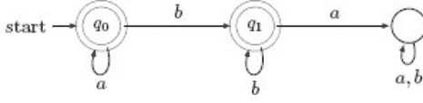

Ex: 9.4

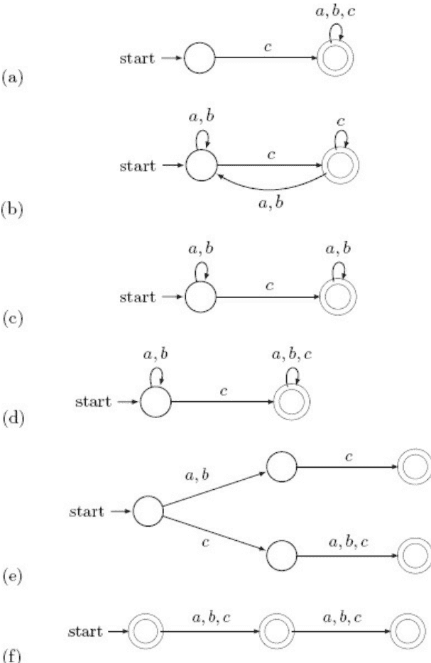

**Ex: 9.5** 提示：考虑上一个题的 (e) 和 (f)。

**Ex: 9.7** `L_1 = {a}*` 和 `L_2 = {b}*`。

Ex：与示例中的机器相同，仅将 `d` 替换为 `l`，将 `c` 替换为 `*`并将“`a, b`”替换为集合 `Σ \ {*}` 中的元素。

Ex: 9.10 `M = ({A, B, C}, {a, b}, q_0 = A, δ, {A}})`，其中 `C` 是陷阱状态且

`δ = \begin{array}{c|c} \hline a & b \\ \hline A & B \\ \hline B & C \\ \hline C & C \\ \hline \end{array}`

Ex: 9.11 (a)

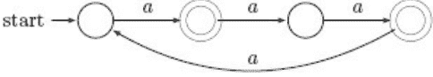

(b) `L = {x | x 包含奇数个 a}`

(c) `M = ({q_0, q_1}, {a}, q_0, δ, {q_1})`，其中

`δ = \begin{array}{c|c} \hline q_0 & q_1 \\ \hline q_1 & q_0 \\ \hline \end{array}`

Ex: 9.12

`δ = \begin{array}{c|c|c|c} \hline a & b & c & d \\ \hline q_0 & q_5 & q_5 & q_5 & q_1 \\ \hline q_1 & q_5 & q_5 & q_2 & q_5 \\ \hline q_2 & q_2 & q_2 & q_3 & q_2 \\ \hline q_3 & q_2 & q_2 & q_3 & q_4 \\ \hline q_4 & q_5 & q_5 & q_5 & q_5 \\ \hline q_5 & q_5 & q_5 & q_5 & q_5 \\ \hline \end{array}`

Ex: 9.13 (a) `q_2`， (b) `q_1`， (c) `q_5`, (d) `q_2`, `q_2`， (f) `q_4`

# Ex: 9.14

`δ*(q_0, dad) = δ*(q_0, da), d`


# 数学推导与定理

$$
\delta = \delta(\delta^*(q_0, d), a), d
$$

$$
\delta = \delta(\delta(q_0, d), a), d
$$

$$
\delta = \delta(q_2, a), d
$$

$$
\delta = \delta(q_2, d)
$$

$$
= q_2
$$

**Def 9.2** 其中 $x = da$ 且 $\sigma = \sigma$，所以 $x\sigma = dad$

**Def 9.2** 其中 $x = d$ 且 $\sigma = a$，所以 $x\sigma = da$

**Theorem 9.1**

计算内部的 $\delta$

计算内部的 $\delta$

计算 $\delta$

# Ex: 9.15 (a)

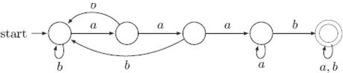

**(b)**

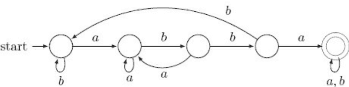

# Ex: 9.17 (a)

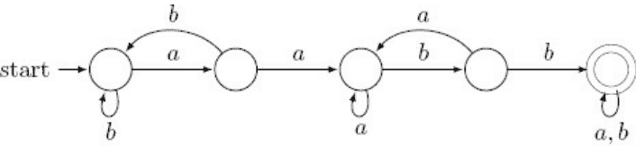

**(b)** 省略

# Ex: 9.19

记得 $L_1 \setminus L_2 = L_1 \cap \overline{L_2}$ 以及交集和补集的闭合性。

# Ex: 9.24

**(a)** $L_2 \subseteq L_3; L; ()$ 区分 $L_2$ 和 $L_3$; $(($ 区分 $L_2$ 和 $L$。

**(b)** 证明与第 9.7 节几乎相同。考虑无限字符串集合 $S = \{(^i \mid i > 0\} = \{(, ((, (((, (((, ...))))\}$，$S$ 中任意两个不同的字符串 $x = (^k$ 和 $y = (^l$ 对于 $L$ 都是可区分的，因为如果 $z = (^y$ 则 $xz \in S$ 而 $yz \notin S$。请注意，$L$ 中的符号可以任意顺序排列这一事实被忽略了，这是证明如此简单的关键。

# Ex: 9.25

使用 $S = \{a^n \mid n > 0\}$，对于每个部分使用 $x = a^i$ 和 $y = a^j$。

- **(a)** $z = ba^i$
- **(b)** $z = ba^ib$
- **(c)** $z = b^{i+1}c$

# Ex: 9.26

**(a)** 提示：使用 $S = \{x \mid \text{length of } x \text{ is } k\}$

# Ex: 9.29

**(a)** 每个产生式都是正则产生式的推广，现在是 0 或 1 个终结符后跟一个非终结符。

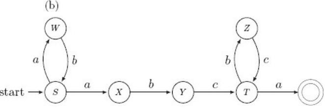

```
(c) S -> aX | aW
W -> bS
X -> bY
Y -> cT
T -> bZ | a
```

$A \rightarrow a_1a_2\dots a_n$ 一般情况下被替换为

$A \rightarrow a_1$

$A_{n-1} \rightarrow an_n$

# Ex: 9.30

- $q_0$ - 没有 a, b 或 c
- $q_a$ - 有 a 但没有 b 或 c
- $q_b$ - 有 b 但没有 a 或 c
- $q_{ab}$ - 有 a 和 b 但没有 c
- $q_c$ - 至少有一个 c

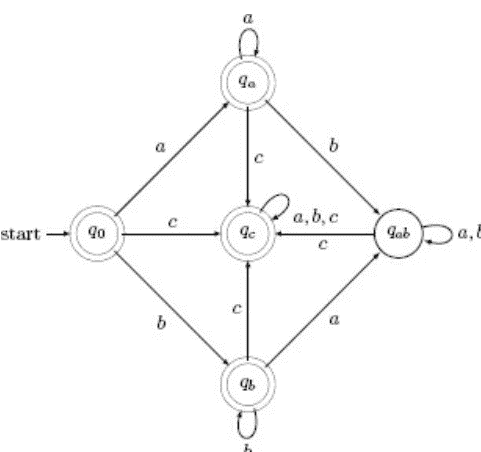

# Ex: 9.31

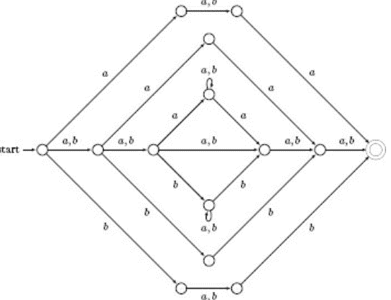

# 第 10 章：上下文无关文法

**Ex:** 是奇数长度 a 的语言。通过对长度归纳法很容易证明导出字符串有奇数个符号。

**Ex: 10.2**

**(a)** $S \Rightarrow SS \Rightarrow ()S \Rightarrow ()(S) \Rightarrow (()) \Rightarrow (())$

**(b)** $S \Rightarrow (()) \Rightarrow ((SS)) \Rightarrow ((()S) \Rightarrow ((()))$

**Ex: 10.3** $S \to \Lambda, S \to SS, S \to \{S\}, S \to \{S\}$

**Ex: 10.4**

**(a)** $L_r = \{0, 00, 000, 0000, \dots\}$ 且 $L_n = L_3$ 是平衡括号集。

**(b)** $L_r = \{()^j \mid i, j > 0\}$ 且 $L_n = L_2 = \{()^i \mid i > 0\}$。

**(c)** 由于有限语言（包括 $\emptyset$）都是正则的，任何两个都是。

**Ex: 10.5**

**(a)** 我们将对长度 $n$ 使用归纳法。基础 $n=0$ 是平凡的。假设对于任何 $n-1$ 字符串成立且 $x = x_1x_2 \dots x_n$。根据归纳假设 $S \Rightarrow x_1x_2 \dots x_{n-1}x_{n-2} \dots x_1$。显然通过一步就可以建立 $S \Rightarrow xS^$。

**(b)** 如果 $\omega$ 是偶长度回文语言的任意元素，则对于某个 $x$ $\omega = xx^R$。根据部分 (a) 我们知道 $S \Rightarrow xSx^R$，通过最终产生式 $S \rightarrow \Lambda$ 导出 $\omega$。

添加这些产生式 $S \rightarrow a$ 和 $S \rightarrow b$，因为任何奇长度的 $\omega$都是 $\omega = ax^R$ 或对于某个 $x$ $\omega = bx^R$。参见之前的答案。

# Ex: 10.7

- **(a)** $S \rightarrow abb$
- **(b)** $S \rightarrow S_1S_2$
  
  $S_1 \rightarrow aS_1b \mid \Lambda$
  
  $S_2 \rightarrow bS_2c \mid \Lambda$

- **(c)** $S \rightarrow S_1AS_2$
  
  $S_1 \rightarrow aS_1b \mid \Lambda$
  
  $S_2 \rightarrow bS_2c \mid \Lambda$
  
  $A \rightarrow aAA \mid \Lambda$

- **(d)** $S \rightarrow aSb \mid S_1 \mid S_2$
  
  $S_1 \rightarrow aS_1 \mid a$
  
  $S_2 \rightarrow bS_2 \mid b$

# Ex: 10.8

令 $B_1$ 按原定义集合，让 $B_2$ 对应新定义；我们希望显示 $B_1 = B_2$。首先我们认为 $x \in B_1$ 且 $x \notin B_2$。为了反法假设 $x \in B_1$ 且 $x \notin B_2$。这意味着对于 $x$ 的某个前缀 $y$，j$ 的比 $s$ 多；但根据 $B_1$ 的定义，每个 $)$ 前都有一个唯一的匹配（所以 $($ 的数量至少一样多）。其次我们认为 $x \in B_2 \rightarrow x \in B_1$。（等一下，笔误）。

否则 $x=yz$，且 $y$ 和 $z$ 都在 $B_2$ 中，因此都在 $B_1$ 中。根据定义，$yz = x$ 在 $B_1$ 中。

# Ex: 10.9

$S \rightarrow \Lambda \mid aS \mid bSa$

我们证明任何 $k$ 步产生“好字符串”，即具有等数量的 a 和 b 以及一些 S。对于归纳法的基础，我们看到 0（和 1）步是正确的。假设对于 $k > 1$，$k-1$ 步是正确的，那么我们的三个产生式之一也会产生好字符串。

我们还需要显示每个字符串都在 $L(G)$ 中。我们通过长度 $n$ 的归纳法证明，$x \in L_e$。基础，$n=0$ 是平凡的（$S \Rightarrow \Lambda$）。假设 $x$ 以 $a$ 开头（另一种情况是对称的）。我们需要认为 $x=aybz$，对于某些字符串 $y \in L_e$ 和 $z \in L_e$。如果成立我们就完成了；由于 $y$ 和 $z$ 的长度小于 $n$，根据归纳假设它们都可以从 $S$ 导出，所以 $x$ 也可以导出。

# 正则语言到 CFG 的构造证明

**证明的依据。**

正则 $\emptyset$ 的文法为 $(\{S\}, \emptyset, S, \emptyset)$。

正则 $\Lambda$ 的文法为 $(\{S\}, \emptyset, S, \{S \rightarrow \Lambda\})$。

对于每个 $\sigma \in \Sigma$，其文法为 $(\{\sigma\}, S, \{S \rightarrow \sigma\})$。

假设我们已经有了对应正则 $r_1$ 和 $r_2$ 的上下文无关文法 $G_1$ 和 $G_2$；即：

$G_1 = (V_1, \Sigma, S_1, P_1)$ 且 $\mathcal{L}(G_1) = \mathcal{L}(r_1)$，

$G_2 = (V_2, \Sigma, S_2, P_2)$ 且 $\mathcal{L}(G_2) = \mathcal{L}(r_2)$。

那么

$G_3 = (V_3, \Sigma, S_3, P_3)$ 是生成 $\mathcal{L}(r_1 + r_2)$ 的 CFG，其中 $S_3 \notin V_1 \cup V_2$

$V_3 = \{S_3\} \cup V_1 \cup V_2$

$P_3 = \{S_3 \rightarrow S_1, S_3 \rightarrow S_2\} \cup P_1 \cup P_2$

$G_4 = (V_4, \Sigma, S_4, P_4)$ 是生成 $\mathcal{L}(r_1r_2)$ 的 CFG，其中 $S_4 \notin V_1 \cup V_2$

$V_4 = \{S_4\} \cup V_1 \cup V_2$

$P_4 = \{S_4 \rightarrow S_1 S_2\} \cup P_1 \cup P_2$

$G_5 = (V_5, \Sigma, S_5, P_5)$ 是生成 $\mathcal{L}(r_1^*)$ 的 CFG，其中 $S_5 \notin V_1$

$V_5 = \{S_5\} \cup V_1$

$P_5 = \{S_5 \rightarrow S_1 S_5, S_5 \rightarrow \Lambda\} \cup P_1$

考虑 $G_3$ 以模拟正则的交替。除了所有现有的符号和规则外，我们添加了——并集——一个新的开始符号并将其包含新的变量集中。然后我们添加了生成 $S_1$ 和 $S_2$ 的新规则，以启动组件文法（$G_1$ 和 $G_2$）。类似的策略被用于 $G_4$ 的构造，以模拟连接和闭包。

# 例: 10.12

```
S -> AS | Λ
A -> Bd
B -> C | D
C -> Ec
E -> bE | Λ
```

**例：** 正如证明所示，正如 $u = vwxyz \in L \rightarrow u' = vwwxyz \in L$ 一样，10.15 也是成立的，$u \in L \rightarrow u'' = vxz \in L$；以 $A$ 为根的上层子树被 $A$ 处的下层子树替换。考虑 $u = a^mb^{m+1}c^{m+2}$，其中 $m$ 足够大（如证明所示），以保证这样的 $A$ 重复。再次得出 $\omega$ 和 $y$ 都是齐次的。如果 $\omega$ 不包含 $cs$，则 $u'$ 不在 $L$ 中。如果 $\omega$ 全是 $cs$（因此 $y$ 也全都是 $cs$），则 $u''$ 不在 $L$ 中，因为我们减少了 $cs$ 的数量。

# 第 11 章：下推自动机与分析

# 例: 11.1

**(a)** $(q_0, S) \vdash_0 (q_1, X) \vdash_0 (q_1, XX) \vdash_1 (q_2, X) \vdash_1 (q_2, \Lambda)$

**(b)** $(q_0, S) \vdash_0 (q_1, X) \vdash_0 (q_1, XX) \vdash_1 (q_2, X)$，输入耗尽且栈为空。

**(c)** $(q_0, S) \vdash_0 (q_1, X) \vdash_0 (q_1, XX) \vdash_1 (q_2, X) \vdash_1 (q_2, \Lambda) \vdash_1 \emptyset$，$\emptyset$ 表示由于栈为空，因此没有配置。

# 例: 11.3

**(a)** $(q_0, S) \vdash_a (q_1, X) \vdash_b (q_1, YX) \vdash_a (q_2, XYX) \vdash_a (q_2, YX) \vdash_b (q_2, X) \vdash_a (q_2, \Lambda)$

**(b)** $(q_0, S) \vdash_a (q_1, X) \vdash_a (q_1, \Lambda) \vdash_b \emptyset$，因为 $aa$ 是它能接受的最长前缀。

# 例: 11.5

**(a)** $(q_0, S) \vdash_c (q_0, SR) \vdash_c (q_0, RSR) \vdash_c (q_0, SR) \vdash_c (q_0, RR) \vdash_b (q_0, R) \vdash_b (q_0, \Lambda)$

**(b)** $(q_0, S) \vdash_c (q_0, SR) \vdash_c (q_0, RR) \vdash_c (q_0, R) \vdash_b (q_0, \Lambda)$，() 是它能接受的最长前缀。

# 例: 11.7

**(a)** $(q_0, S) \vdash_c (q_0, AB) \vdash_b (q_0, AAB) \vdash_c (q_0, AB) \vdash_c (q_0, AB) \vdash_b (q_0, B) \vdash_a (q_0, \Lambda)$

**(b)** $(q_0, S) \vdash_c (q_0, AB) \vdash_c (q_0, AAB) \vdash_c (q_0, AB) \vdash_c (q_0, B) \vdash_b \emptyset$，因为在输入 $B$ 时没有配置。

# 例: 11.9

**(a)** DPDA 每看到一个 $a$ 就 PUSH 一个符号“I”；遇到 $b$ 时不改变栈；遇到 $c$ 时 POP 一个栈符号。当栈退回到起始符号 $S$ 时，进入 $q_A$。只有在 $q_A$ 中才会被正确处理。进一步地，机器将通过状态 $q_a, q_b, q_c$ 强制所有的 $a$ 出现在所有的 $b$ 之前，以及所有的 $c$ 之前。

| 状态 | 输入 | 栈 | 配置 |
|---|---|---|---|
| $q_0$ | a | $S$ | $\{(q_a, S)\}$ |
| $q_0$ | b | $S$ | $\{(q_b, S)\}$ |
| $q_0$ | c | $S$ | $\{(q_c, S)\}$ |
| $q_a$ | a | $S$ | $\{(q_a, S)\}$ |
| $q_a$ | b | $S$ | $\{(q_b, S)\}$ |
| $q_a$ | c | $S$ | $\{(q_c, S)\}$ |
| $q_b$ | a | $S$ | $\{(q_a, S)\}$ |
| $q_b$ | b | $S$ | $\{(q_b, S)\}$ |
| $q_b$ | c | $S$ | $\{(q_c, S)\}$ |
| $q_c$ | a | $S$ | $\{(q_a, S)\}$ |
| $q_c$ | b | $S$ | $\{(q_b, S)\}$ |
| $q_c$ | c | $S$ | $\{(q_c, S)\}$ |


| $q_b$ | c | $S$ | $\{(q_c, S)\}$ |

| $q_c$ | a | $S$ | $\{(q_a, S)\}$ |

| $q_c$ | b | $S$ | $\{(q_b, S)\}$ |

| $q_c$ | c | $S$ | $\{(q_c, S)\}$ |

```
Ex: A.7 higher(X,Y) :- on(X,Y)
 ; on(X,Z), higher(Z,Y).
```

```
Ex: A.8 (a) olderthan(X,Y) :- age(X,M), age(Y,N), M > N.
(b) bigsib(X,Y) :- sibling(X,Y), olderthan(X,Y).
```

```
Ex: A.9 (a) employee(-,X,pp,-,-), Z >= 1998.
(b) employee(-,X,Y,-,Z),
注意在任何成功的查询后 Z都会被打印出来。通常情况下这种多余的输出可以通过
使用辅助谓词进行查询来省略，例如
shorter(X,Y) :- employee(-,X,Y,-,Z),
Z >= 1998.
(c) employee(-,X,-,-,Z), Z >= 1991, Z =< 1999
 ; employee(-,X,-Y,1990), Y >= 7
 ; employee(-,X,-,Y,2000), Y =< 6.
```

```
Ex: A.10 (a) works_in(X,Y) :- employee(-,X,Y,-,-).
(b) started(X,Y,Z) :- employee(-,X,-,Y,Z).
(c) payroll_employee(W,X,Y,Z) :-
employee(W,X,pay,Y,Z).
(d) senior_hr_employee(W,X,Y,Z) :-
employee(W,X,hr,Y,Z), Z < 1997.
```

```
Ex: A.11 setof(X,employee(-,X,pp,-,-),Y).
```

```
Ex: A.12
```

(a) all_info(A,B,C,D,E,F,G) :=

  employee(A,B,C,D,E), dob(A,F,G).

(b) senior_employee(A) :=

  all_info(A,-,-,-,E,-,G), E > G + 50

  all_info(A,-,-,-,D,E,F,G), E = G + 50, D >= F.

```
Ex:
A.13

(a) later(W,X,Y,Z) :- X > Z; X = Z, W > Y.

(b) senior_to(X,Y) :- employee(X,-,-,A,B),
  employee(Y,-,-,C,D), later(C,D,A,B).

(c) senior_div_mate_of(X,Y) :- employee(X,-,Z,-,-),
  employee(Y,-,Z,-,-),
  senior_to(X,Y).

```

Ex:

A.14

让 `employs(a, b)` 表示人员 a 拥有一家雇佣人员 b 的公司。注意在自己的公司工作可能的。编写十一个 Prolog 查询，每个查询的参数模式都与其他所有查询显著不同。对于这十一个查询中的每一个，用英文写下一个问题来表达该查询的意图。

参数模式之间的一种显著差异是具有不同类型的参数——在其中一个参数位置上是命名变量与匿名变量（“_”）。当两个参数位置都具有常量（或都有命名变量）时，当这些常量相同的情况与它们不同的情况之间存在显著差异。

```
employs(a,b).      a 雇佣 b 吗?
employs(a,a).      a 是自雇的吗?
employs(a,X).      a 雇佣谁?
employs(a,..).      a 雇佣任何人吗?
employs(X,b).      谁雇佣 b?
employs(X,Y).      谁雇佣谁?
employs(X,X).      谁是自雇？
employs(_,_).      哪些是雇主?
employs(_,b).      b 被雇佣（被任何人）了吗?
employs(_,X).      谁被雇佣（被任何人）？
employs(_,_).      有人被任何人雇佣吗?
```

Ex: A.15 (a) delete_first2([_,_|Result],Result).

```
(b) delete_last2(L,Result) :=
  append(Result,[_,_],L).
```

```
(c) delete22(L,Result) :=
  append([_,_|Result], [_,_],L).
```

Ex: A.16 (a) 它对于偶数长度的回文成功，对于奇数长度的回文失败。

(b) 如果 x 是 y 的反转，它们的长度必须相同。它们共同组成 z，所以 z 的长度是两倍，因此是偶数长度。

Ex: A.17 evenlength([ ]).

```
evenlength([_|]) :- oddlength(X).
```

```
oddlength([_|]) :- evenlength(X).
```

# 索引

- $\Delta$, 空符号, 306
- $\delta$ 函数, 210
- $\delta^*$ 函数, 213
- $\exists$ 存在量词, 82
- $\forall$, 全称量词, 81
- $\Lambda$, 空字符串, 9
- $\mathcal{L}(G)$, 语法语言, 183, 244
- $\mathcal{L}(M)$, 机器语言, 220
- $\mathcal{L}(r)$-字符串, 311
- $\vdash$, 277
- 接受
  - 有限状态自动机, 214
  - 由空栈接受, 275
- 字母, 151
- 逻辑运算符, 176
- 歧义性, 252
- 匿名变量, 340
- 断言, 334
- 赋值运算符, 126
- 结合运算符, 5
- 假设, 51, 59
- 原子公式, 89
- 自动机, 202
- 有限状态自动机 (DFA), 203
- 图灵机, 305
- AWK, 382
- 结合数组, 387
- 模式, 382
- 规则, 382
- AWK 编程语言, 381
- 公理, 51
- 回溯, 170
- 平衡括号, 语言, 344
- 平衡括号, PDA, 281
- 双条件逻辑运算符, 38
- 二进制关系, 2
- 二进制搜索算法, 135
- 二进制搜索树, 134
- 空符号 ($\Delta$), 306
- 布尔, 22
- 边界变量, 84
- 案例分析, 30
- 从 NPDA, 283
- 乔姆斯基范式, 257
- 非确定性, 169
- 奇-图灵论题, 322
- 子句, Prolog, 347
- 闭合运算符, 5, 40
- 闭合
  - $\delta$, 213
  - 语言的, 155
- 闭合性质, 224
- 交换律, 5
- 逻辑系统, 118
- 命题逻辑完备性, 391
- 复杂度类, 323
- 拼接, 155
- 字符串, 154
- 结论, 54
- 条件运算符, 36
- 配置, 277
- 析取运算符, 25
- 析取范式, 39
- 一致系统, 118
- 常量, 22
- 上下文语法, 242
- 反例, 103
- 笛尔积操作, 349
- 数据库
- 判定问题, 319
- 演绎推理, 333
- 推导树, 249
- 确定性上下文文自由, 291
- 确定性有限自动机 (DFA), 218
- 确定性语法, 193
- 确定性自动机, 203
- 对角线法, 313
- 析取运算符, 26
- 析取范式, 39
- 可微性, 226
- 分配律, 6
- 域, 5
- 空集, 2
- 空字符串 ($\Lambda$), 9, 152
- 编码方案, 313
- 等价性, 30
- 可擦除变量, 258
- 存在量词 ($\exists$), 32
- 表达式树, 定义, 12
- 外延集合形式, 11
- Prolog 中的事实, 334
- 斐波那契序列, 115
- 最终断言, 125
- 从正则语法, 215, 322
- 定理, 50
- 真子, 3
- 命题, 21
- 定义, 23
- 解释, 的, 27
- 语义的, 27
- 状态的, 25
- 语法的, 27
- 命题逻辑
  - 规律, 32
- 命题逻辑, 21
- 上下文语言泵引理, 267
- 推推机
  - 确定性 (DPDA), 288
  - 非确定性 (NPDA), 271
- 量词, 80
- 域, 81
- 存在, 82
- 范围, 87
- 全称, 81
- 宇宙, 81
- 查询, 334

# RE

- 从正则文法构造, 191
- 识别
  - 有限自动机, 215, 223
  - 语言的识别, 159
- 带有归纳法的递归关系, 115
- 递归, 251, 288, 352
  - 尾递归, 138
- 递归算法验证, 137
- 递归定义, 10
- 递归语言, 308
- 递归产生, 251
- 递归枚举语言, 308
- 归归法规则, 62
- 正则表达式, 174
  - 等价, 174
  - 扩展, 178
  - 从正则文法构造, 191
  - 非确定性解释, 180
- 正则文法, 184, 196
  - 从 RE 构造, 187, 189
  - 广义, 190
- 正则语言, 173
- 正则语言
  - 闭备性质, 224
  - 拒绝, 208
- 有限自动机, 214
- 关系数据库, 342
- 关系算符, 6
- 右递归规则, 289
- Prolog 规则, 334
- 可满足性问题, 327
- 可满足表达式, 32
- 调度问题, 326
- 选择操作, 344
- 语义表格法, 71
- 语义与推导, 249
- 序列, 2, 8, 90
- 序, 58
- 集, 1
  - 基数, 7
  - 补集, 8
  - 笛积, 2
  - 元素, 1
  - 空, 2
  - 有限, 7
  - 无限, 7
  - 交, 7
  - 幂集, 8
  - 差集, 7
  - 子集, 3
  - 并, 7
  - 宇宙, 1
- 序列集, 91
- 证明中的模拟, 197
- 汇态状态, 206
- 逻辑中的可靠规则, 116
- 命题逻辑的可靠性, 71
- 程序规范, 125
- 栈操作, 276
- 栈内存, 272
- 状态
  - 接受, 204
  - 有限自动机, 204
  - 停止, 306
  - 自动机的, 202
  - 命题的, 25
  - 汇, 206
  - 开始, 204
  - 陷阱, 206
- 有限自动机状态转移图, 203
- 字符串, 90, 151
- 拼接, 9
- 空, 152
- 空字符串, 9
- 长度, 9
- 前缀, 9
- 子证明, 60
- 尾递归, 138
- 纸带, 306
- 永真式, 311
- 定理, 50
- 标记, 157
- 转移函数
  - 有限自动机, 204, 211
  - 广义, 213
  - 非确定性广义, 219
- 传递算符, 6
- 陷阱集, 206
- 旅行商问题, 326
- 树, 15
  - 有序, 15
  - 有根, 15
- 真值集, 80
- 图灵机, 305
  - 空符号, 306
  - 定义, (TM), 307
  - 停止状态, 306
  - 纸带, 306
  - 纸带头, 306
- 通用图灵机 (UTM), 313
- 不判定问题, 321
- 合一, 350
- 产生式, 186, 260
- 全称量词 ( ∀ ), 81
- 通用图灵机 (UTM), 313
- 宇宙, 1
- 无限制文法, 302
- 不可满足表达式, 32
- 无意义变量, 258
- 有效序, 58
- 逻辑变量, 22
- 程序验证, 123
- while, 语义, 131
