# 迷失与共存（档案）：集体塑造新记忆（公共化）

《公共化》（The Making Public）探讨了公共，即商业与商品共享的公民领域。“公共”意味着什么？社会、政治和心理倾向的影响是如何运作的？边界在哪里，它们又是如何被开发的？在塑造公共形式的责任和控制方面涉及了哪些利益？艺术家是如何就这些问题进行辩论的？

档案是为了历史、文化和取证目的而保存的记录集合。作为档案，它们被视为过去的场所，一个包含国家、人民或群体的集体记忆痕迹的地方。数字档案已从实体转变为灵活的系统，有时被称为“活档案”（Living Archives）。这种变化在哪些方面影响了我们与过去的关系？被抹除、被忽视和重新发现的记忆，以及新的记忆，是否会被允许存在？虚构与事实并行的档案模式是否能满足民主需求，还是公共权力工具运作的另一种方式？《活（在）档案中》（Living (in) Archives）表明，档案不仅仅是事件的记录、反映或影像，它们塑造了事件本身，并使其呈现出来。

# 迷失与活（在）档案中

## 贡献者

- Babak Afshari
- Michael Murtaugh
- Joseph Weaver
- Tina Bastajyan
- Nanna Boer Tippinger
- Özge Çelikaslan
- Annet Dekker
- Olia Lindholm
- Mania Łukowicz
- Nicolas Maleev
- Aymene Mimic
- Elif Preisseter
- Robert Harrison
- Stef Cagnola
- Femke Snoeling
- Igor Stromper
- Neerin Tabatabasi

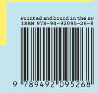

# 迷失与活（在）档案中

Babak Afrassiabi  
Dušan Barok  
Tina Bastajian  
Nanna Bonde Thylstrup  
Özge Çelikaslan  
Annet Dekker  
Olia Lialina  
Manu Luksch  
Nicolas Malevé  
Aymeric Mansourkh  
Michael Murtaugh  
Josien Pieterse  
Ellef Prestæter  
Robert Sakrowski  
Stef Scagliola  
Katrina Sluis  
Femke Snelting  
Igor Stromajer  
Nasrin Tabatabai

# 迷失与活（在）档案中

## 集体塑造新记忆

Annet Dekker  
Katrina Sluis  
Femke Snelting  
Aymeric Mansoux  
Manu Luksch

### 一场讨论

Nanna Bonde Thylstrup

### 一场对话

Robert Sakrowski & Igor Stromajer

### 与 Dušan Barok 关于 Monoskop 的对话

Annet Dekker

在网络上流传。可以说，今天一切都是档案，每个人都是档案管理员。各地的人不断地创建、收集、记录、制作列表、清点、分类、存储、检索和重新利用各种信息。意不意外的是，埃里克·凯特拉尔（Eric Ketelar，阿姆斯特丹大学档案学荣誉教授）宣告了“档案管理员”（Ketelar 2006, 14）。在他的同名论文中，他描述了“档案”一词的含义如何变得“野性化”，以及普通人如何也变成了档案管理员，这从上传和使用在线档案平台存储照片、视频、音乐等的现象中得到了证实，这些支持和帮助维护如互联网档案馆（Internet Archive）等大型档案设施的活动也同样如此（Ketelar 2006）。十年后，文档的创建及其汇聚到各种不同的（尤其是在线）档案中已成为日常生活的一部分。档案现在正被集体地创建和保护。根据印度（SIVC）的 Asger 在1961 年的发现，他们在将照片档案数字化时遇到了一些困难。在受博物馆邀请加入 SIVC 档案后，到达时，他们面对的是存储在档案复杂的关系性和基于结构中的思想和图像。在他们的论文《给数字竖中指（黑）》中，他们分析了工具互换性的后果，以及数字工具如何能够杂乱且具有建设性（误用）以及新颖的组装。

Amer 展示了在档案和保护领域，自由和开源许可似乎是一种积极的额外工具，使数字作品的保护变得可行。不可否认，它们具有整体的积极影响；当它们应用于更广泛的文化和艺术背景时，它们对源代码定义的处理确实存在问题。此类许可中使用的术语源于软件世界，尽管适应了文化作品，但它仍然没有摆脱起源的二元性质。因此，当人类学家阿尔俊·阿帕杜莱（Arjun Appadurai）呼要求重新思考档案的方法时：

> 我们应该开始将所有的记录视为干预，将所有的存档视为某种集体项目的一部分。档案不再是痕迹的坟墓，而更多是集体记忆预期的产物（Appadurai 2003, 16）。

事实上，可以认为，无论档案是由印刷品、照片、电影和/或数字媒体组成，用于组织、搜索和共享文档的技术已经接管了福柯式的国家职能，而群众充当了控制机制。新的数字档案是日益灵活的系统，其内容不断被重新语境化。因此，尽管来源可能像原始档案一样保持完好，但它的存在是动态的。自由或开源软件许可要求保护来源，作品的源代码被定义为可修改的文本表示。虽然电影是一种特殊的艺术使用和生产（例如软件艺术），但这是否有助于艺术品的保护尚存疑问，因为软件工具化的表达方式不同。仅仅依赖许可要求是不够的。Mansoux 明确概述，每件作品都需要对源代码是什么有不同的理解，以便在保护背景下使其真正可访问。

在与罗伯特·苏科夫斯基（Robert Sukkowski）的深度访谈中，Igor Stromajer 讨论了他的项目 Expunctor：该项目突破了（网络）艺术作品的时间、持续、存档和访问性问题，这些作品随着硬件和软件（浏览器、播放器、应用程序等）的变化而自动变化，缓慢但不可避免地失去其功能并因此失去它们。创作、编程和合成的创作者都有权……

但更有许多留在了之外，被人们遗忘。与其说这是一种负面影响，这种遗忘意义上的损失应当被珍视，因为它为新事物的出现做了准备。通常，从档案的角度来看，损失被视为记忆的不欢迎的对立面。然而，德国哲学家弗里德里希·尼采认为，遗忘也是积极、主动的且对生命和思维至关重要的。沉浸在过去的记忆会阻碍当下的创造性行动，过度的历史感会摧毁“历史”概念本身（Spinks 2003, 80）。正如尼采所总结的，存在某种程度的失眠、沉思或“历史感”，会伤害并摧毁活体，无论是人还是某个文化体系中的民族（Nietzsche 1874）。早期的过程通过收集物理形式的证据对象（如纸张、微缩胶片、照片或音频等媒介）来引导，而目前的态度倾向于解构、审查和删除。这并非破坏行为，而是对生命自然节奏的观察。Stromajer 抹去了历史，包括他个人的历史，因为他认为我们的记忆是为我们服务的，是为了代表而非粉饰过去。他的观点是，被删除的作品或其残留碎片（由于它们已在万维网上公开，已广泛传播且碎片化），告诉我们的关于原始作品的信息比原作本身更多。

Geocities 在 1995 年是 90 年代免费网页托管服务之一。在 2009 年关闭后，Archive Team 救回了近 1 TB 的 Geocities 数据。一年后，Olia Laina 和 Dragan Espenscheid 买了一块 2 TB 的硬盘，开始下载史上最大的种子文件。他们决定通过网络重新分发 Geocities 主页，他们使用了一个每二十分钟上传一张新清理图（scrubgraph）的动态 Tumblr 博客，一个显示 Tumblr 上点赞和转发次数最多图片的研究博客，他们再次……

# 引言

向档案的工作日益关注瞬即逝性，并需要调制、移动和变变的策略。

诸如谁进行选择、谁负责档案以及档案为谁服务等问题，从一开始就困扰着档案工作。有人认为，计算加速了这一过程，理解这些过程的需求变得更加紧迫。有人声称，万维网已成为“档案之档案”，因为数字化导致博物馆、机构、图书馆和国家档案馆向公众开放其档案，并将网络作为其界面。有时，信息的获取变得更加便捷，让人们能够添加自己的信息、为现有文档标记标签，或识别不同文档之间的关系——尽管在档案中偶然发现或迷失的潜在兴奋感几乎未被探索。与此同时，网络观众正在 Twitter 上上传他们分发的自己的档案。Geocities 档案变成了一个螺旋，Olia 和 Dragon 在其中反思了来自 Geocities 种子档案的 Tumblr 档案，人们对其进行重新博客、转推、点赞和保存，而这一过程在持续进行。在《依然在那儿：Geocities 的废墟与模板》一文中，Liliana 通过对其实验过程的反思并允许某些示例重新呈现，描述了“档案化”的含义。

2012 年，Drain Barak 为 Piet Zart 学院参与了一个名为 Monoskop 的项目，这是一个网络上的数字存储库或媒体图书馆，其目标是分发主要来自中欧和东欧的实验作品。为了让人们获取基础知识，如今 Monoskop 是寻找副本的主要在线存储库之一。在一次采访中，Barack 解释了他的项目背后的想法，并反思了可访问性、数字图书馆和保持知识活力的重要性。

# 档案中的遗失与存（存）

并将他们的文档发布到点对点网络和/或大型（商业）数据库。德里达正确地假设技术已经改变了权力关系；随着网络的开放结构，普通人的声音可以被听到，并可以通过添加自己的内容来影响现有内容。此类倡议理解了对档案工作多层次、多维度的理解。比任何时候都更甚，它们证明了档案不仅仅是记录、反思或某个事件的影像，还可以塑造事件。

考虑到可访问性、界面、网络平台以及通过半自动化软件收集数据，需要重新定义“档案”一词，或者这些系统应该被统称为其他？与此同时，旧的问题依然存在，例如，组织和技术结构在何种程度上影响了档案的构建和维护。

自 2004 年作为 Pages 合作以来，Babak Afrassabi 和 Nasrin Tabatabai 创作了各种项目并出版了该双语杂志。他们正致力于一个名为 Permutable Archive 的数字档案和出版平台，这是一个基于灵活结构的方法。这种方法尽可能地保留和维护。与此同时，它影响了作者如何创作和传播内容。渗透性档案的历史意识是：什么知识被允许，什么留了下来？强调档案的客观性，在一次采访中，他们和 Tabatabai 描述了这种档案如何提供对抗现代主义遗产的手段，转向断裂、回溯和解构。在《自主档案》一文中，Özge Çelik 讨论了“活”档案实践中的“自主性”概念：决策是如何做出的，哪些文档被保存，是谁在创建它们，目的是什么？

本出版物分为三个部分，尽管存在重叠。这三个不同部分结合了新论文、采访和视觉素材，以及由作者重新审查并在有时进行细微修改的已发表文章。通过反复的主题，想法开始汇聚形成新的叙事。未开发的声音激发并揭开了围绕“当代档案”主题的现有文化和政治结构。

第一部分侧重于比较和区分模拟与数字档案。除了讨论特性对这些不同类型档案内容的影响（Katrina Sluis），……

bak.ma 是一个关于土耳其社会政治运动的视频档案项目，bak.ma 的目标不仅包含盖齐公园视频，还包括媒体活动人士存储在电脑隐藏部分的其他视频记录。如今，图像制作和视频编辑可以通过自动化过程实现，但也具有创造社会政治共存想象的潜力。数字制作和传播中的“档案化”术语不仅意味着对隐藏和被禁止实践的开源记忆，也是一种导致集体剪辑、上传、泄露影像和重建集体记忆的自主结构。

在阅读了 Özge Çelikaslan 撰写的《自主档案》后，与其来源交流，并在接触 bak.ma 数据库后，Tina Bastajian 写了一份回应，问自己来自先验项目的视频素材、未使用素材（具有主题和政治亲缘性）将如何与 bak.ma 档案交汇并融合？一种艺术研究可以……

本文探讨了保罗·奥利特的乌托邦式“世界”（Mundaneum）与巨型企业 Google 之间的关系，以识别数字档案的潜力（Femke Snelting）。此外，还测试了策略与翻译，以分析数字工具和算法在摄影档案中的应用（斯堪的纳维亚计算破坏学院 Scandinavian Institute for Computational Vandalism）。

第二部分分析了“丢失的（档案中）”的概念：从无意和非预期到有意识的执行。从开源许可的使用与（无）价值（Aymeric Mansoux）以及与版权共享（copy/left）材料相关的问题（Manu Luksch），到文档缺失的后果、政治在档案中的作用以及如何处理内容脆弱的开放性（Stef Scagliola, Josien Pieterse）、接受并拥抱空白、痕迹和翻译的提议（Nanna Bonde Thylstrup），以及这些遗漏通过故意删除强行实施后的后果（Igor Stromajer）。

第三部分展示了“活态（档案中）”的案例。大多数传统档案围绕选择、包含和排除进行组织；在本节中，作者们讨论了迭代模式——挪用、复制、泄露和其他变化——以及不稳定性如何短路、挑战、干扰和吞并档案活动（Dušan Barok），传输并翻译不可记录和转瞬即逝的事（Olia Lialina, Dragan Okančić），挑战历史表征的界限（Babak Afrassiabi 和 Nasrin Tabatabai），同时质疑此类实践的自主性（Özge Çelikaslan, Tina Bastajian）。这些示例挑战了档案的传统构建方式，并展示了新形成的“不稳定”档案的影响。

一个形成了“记忆地”（lieu de mémoire）的项目是否可以在集体档案努力的背景下被重新审视，这种努力提供了一个扩展集体记忆场域的平台？在文中，她重新审视了“遗迹”的概念（即留下的东西以及随后的档案如何改变它）、自主存档与盖齐公园运动中发展出的集体活动主义之声之间的关系，以及过去在伊斯坦布尔街头开展的一个项目片段。

## 参考文献

Appadurai, Arjun. Archive and Aspiration. In *Information is Alive*, edited by Joke Brouwer and Arjen Mulder. 14-25. Rotterdam: V2_Publishing/NAI Publishers, 2003.

Blom, Ina, Trend Lundama, and Evind Røssaak. *Memory in Motion: Archives, Technology, and the Social*. Amsterdam: Amsterdam University Press, 2017.

Derrida, Jacques. *Archive Fever: A Freudian Impression*, 1996 [1995], Eric Prenowitz, Chicago, IL. University of Chicago Press.

Foucault, Michel. *The Archaeology of Knowledge; and the Discourse on Language*, trans. A. M. Sheridan Smith. New York, NJ: Vintage Books, 2010 [1972].

Horsman, Peter J. *Abyssen deordisch: Archiving for in archiving* Dordrecht, 1200–1920. PhD thesis. University of Amsterdam, 2009.

Keleaar, Eric. ‘Everyone an Archivist’. In *Managing and Archiving Records in the Digital Era: Changing Professional Orientations*, edited by Nikolaus Bittköner, Hans Hofmann, and Seamus Ross, 9–14. Baden: hier + jetzt, 2006.

Lehner, Sharon. Documentation Strategy and the Living Archive. In *Inheriting Dance: An Invitation from Pina*, edited by Mark Wagner and The Pina Bausch Foundation, 75–84. Bielefeld: Transcript-Verlag, 2014.

Nietzsche, Friedrich. *The Use and Abuse of History*, trans. Adrian Collins with an intro. by Julius Kraft. Indianapolis, IN and New York, NJ: The Bobbs-Merrill Company Inc., 1957 [1873–1876].

Spinks, Lev. *Friedrich Nietzsche*. London: Routledge, 2003.

# 引言

# 积累、聚合、销毁

## 数据库热与档案网络

Katrina Sluis


人们通常认为，数字化将我们的文档从物理介质的物质局限中解放出来，产生了一种“存储狂热”，在这种狂热中，积累数据比删除数据更容易。云计算的修辞进一步强调了数据的被动积累和“去物质化”，因为它承诺将文档从时空限制中释放出来，以换取普适的可访问性。然而，如果将网络化存储的扩张简单地描述为从“物质档案系统”向“非物质信息库”的转变，那将是错误的，正如物质理论家 Jose Brouwer 和 Arjen Mulder 所言（Brouwer and Mulder 2003, 4）。在关于档案的工作中，社会学家 Richard Harvey Brown 和 Davis Brown-State 表示，采集、分类和保护等活动是与档案相关的“技术”活动，由于它们决定了可见性和访问性，这些活动可能会变成明确的“政治性”（Brown and Davis-1998, 14）。数字化绝不是代表对象的去物质化和从档案视角的解脱，它向我们展示了物质结构，这引发了关于社会文化记忆如何被人类和非人类参与者利用和“解读”的新问题。随着德里达的*档案热*被数据库热所取代，记忆技术日益与信息的工业化处理和软件的表演性联系在一起。

在无处不在的网络媒体时代，如何理解档案一直是一个持续考虑的话题。在 20 世纪 90 年代初，Web 2.0 的修辞庆祝了共享媒体的可能性，这种媒体是移动且即时的。YouTube、Facebook 和 Flickr 等平台的出现并不是作为保护的“守护者”，而是提供记录生活的机会的社交界面。通过简化在线出版，这些公司说服用户放弃个人主页并迁移到他们的服务中，承诺以零或低成本提供更大的容量和便利。然而，显然，在考虑当今网络文化的特征数字档案时，背景不再是转瞬即逝或“虚拟空间的无限性”，而是服务器农场或数据库架构的偶然且特定的经济性。

# 数据库热

关系型数据库由计算机科学家 Edgar F. Codd 于 1970 年首次提出，已成为一种核心的但在很大程度上不可见的记忆技术，是视频、文档和快照等信息块的容器。数据库已经入侵了 Web 的后端：它们是搜索引擎的骨架；位于 Facebook、Twitter、YouTube 和 WordPress 等社交平台之后。然而，人们可能无法立即看出，构成 Web 的页面越来越多地从底层数据库自动生成。`SQL` 或结构化查询语言是用于创建、维护和查询数据库的语言。更多信息请参见 O'Reilly 2005。

数据库驱动的 Web 的一个重要结果是其对高效且可扩展的计算平台的依赖——仅 Facebook 的基础设施每秒就能提供高达 600,000 张图像。企业数据中心或服务器农场已成为当今档案的当代档案馆（arkheion）：一个容纳成千上万台连接服务器的设施。每个站点都有足球场大小，成本高达 20 亿美元，这些空调机房必须战略性地位于廉价且充足的电力附近；其位置通常保密并受到严格限制（Markoff and Hansel 2006）。随着“云计算”范式日益定义 Web，这些信息仓库正在被重新命名为“云端”（cloudings），用户可以将其档案迁移到 Google 网格以实现随处访问。

更多信息请参考例如 Hogan 2015，他讨论了数据中心的影响和布局，以及 Dourish 2014 关于数据库技术的材料。

当媒体的收集和分发变成数据的收集和分发时，我们的照片、视频和文本就受到了信息生产和知识管理经济的影响。数据库及其附属技术（`SQL/XML`）也是艾·刘（Alan Liu）所描述的“新话语范式”的产物，这种范式重视“快速表达任何事情的能力”（Liu 2008, 211）。刘的工作意义在于识别了此类标准的发展如何受控于通信尽可能实现后工业化高效性的需求，以便允许知识从纸质到 Web 或移动设备进行无缝移动。正如刘所观察到的，对话语变得可转换、自主移动和自动化的需求是必要的，这样“不断增殖的机器服务器、数据库和客户端程序就可以作为半人半代理和连接的 Web 服务器参与进来，促进知识的处理和再处理”（Liu 2008, 216）。

`XML` 是一组用于电子化编码元素的规则，它提供了一个标准，使得不同的数据源（尤其是来自数据库的数据）可以通过该标准进行结构化和读取（Liu 2008. 211）。

`XML` 等标准的另一个结果是数据与其呈现方式的分离，这有助于当代媒体的移动性和模块化。数字媒体可以越来越多地在没有人工干预的情况下进行处理和传播：图像和文本可以快速地去语境化并重新语境化到不同的软件和硬件上。你相机中的 `GPS` 会编码每一次拍摄的快照，你的日历会同步并确认你位置的上下文，人脸识别算法会在上传到 Flickr 之前识别并标记框架中的人物。从那里，它可能会立即同步到博客的侧边栏，或在拍摄几秒钟后通过 `RSS` 广播到放在你母亲壁炉上的无线照片框上。

通过对社交媒体的后工业化处理，如今的 Web 不仅是“实时的”，而且更加封闭、可搜索和可追踪。虽然人们对这些用户生成的多媒体档案的控制和长期保存——断开的链接、丢失的网页、可搜索的内容——表示担忧，但人们日益感觉到，“互联网永远不会遗忘”（Turkle 2011, 260）。数字存储的无处不在意味着现在删除比保存需要更多能量——Google 删除了其移动版 Gmail 应用中的“删除”邮件按钮，转而采用“存档”按钮。然而，现在的不同在于，数据不仅被存档：它还被自动（且不透明地）分析和共享。

# 档案作为商品

虽然数据库驱动的网站绝不新鲜，但它们已成为当代社交媒体财务成功的关键组成部分。在 2004 年概述 Web 2.0 范式的文章中，企业家提姆·奥雷（Tim O'Reilly）观察到“对数据库的控制导致了市场控制和巨大的财务回报”（O'Reilly 2005, 3）。奥雷在对开发者的建议中强调了这一点：

> 知道如何构建支持数据库的网站已经不够了。如果你想成功，你需要知道如何挖掘用户添加的数据，无论是显性的，还是作为他们在你网站上活动的副作用（O'Reilly 2007）。

随着中心化程度的提高，需要更强大的计算力和维持这种需求的经济策略。硅谷所推崇的这种商业模式依赖于从日益增长的数据量中提取价值。通过评估数据库中的评论、点击、标签和其他内容，Yahoo、Facebook 和 Google 等公司能够开发其算法的智能性，并从高度针对性的广告中产生财富。除了档案对集体记忆和人类身份的影响之外，参与数字时代还产生了另一种记忆——一种“数据影子”（data shadow），它是为了交换免费访问这些平台而收集的。我们对全球市场的数据挖掘不仅贡献了数字记忆的商品化，还构成了一个关联经济的一部分，在这种经济中，跨越数据库是由推荐系统介导的，引导我们走向上述某些内容的。

从本体论上讲，这些算法的效果从话语行动中撤回，以保护公司的知识产权。例如，2007 年 Yahoo 使用照片质量的评估来将注意力引向其数据库中的卓越图像。在这里，评论、点赞和某些“秘密配方”有助于每张图像的权重计算。像 Google 的 `PageRank` 算法一样，它的性质被保密，以防止用户“操纵”系统在搜索结果中获得更高的排名。虽然算法仍然隐藏，但用户并没有获得同等的对待。实名和身份的验证现在已跨平台执行，用户可以被信任分享他们的生活、品味和偏好。

`data shadow` 是一个俚语，指人们在使用电脑工作时留下的微小信息轨迹。

参见 Butterfield 2005 和 Yahoo 关于“媒体对象的兴趣排名”的专利申请 `http://app1.uspto.gov/cgi/neta-Parser7html?doc=fneta&part=1&Sec=2&HITFF&d=PGLi&u=%7fetch.html&l=1&f&g=506&s=%2200602139%22&OS=DN/20062139&RS=DN/20062139.` 访问于 2010 年 9 月。

# 迷失与活生的（在档案中）

由于档案化的 Web 依赖于用户信息的捕获、保存和出售给营销人员，用户必须变得可见且透明。矛盾的是，尽管用户被鼓励上传、标注、更新和维护其在线资料以在这些系统中获得可见性，但单个推文、照片或快照的价值或可见性却降低了。

另一个有趣的例子是与 Getty Images 的合作交易。2013 年，双方同意 Pinterest 为 Getty Images 支付费用以获取图像元数据。作为互联网上仅次于 Facebook 的流量来源，Pinterest 的选择从商业角度来看是合理的；广告元数据将增加他们的流量，从而增加广告收入。另一方面，Getty Images 从这些流量中获益较少，但他们说将费用与贡献者的版权者共享。这不仅是许可领域的一个有趣的转变，更重要的是，它标志着从内容（图像、视频、音频）兴趣向元数据的转变。这种转变通过 Getty Images 决定免费提供 3000 万图像得到了进一步强调——只要用户使用 Getty 的自定义播放器嵌入它们。这确保了图像的自动归属，更重要的是，它提供了关于人们如何使用图像的准确数据：增强了公司追踪消费者行为并快速响应趋势的能力。

水平展示了社交网络本身在多大程度上生成了一个平行的运动档案，记录了网络自身的互动，作为一个同时的——但规模指数级增长的活档案。这个平行的档案可能会对我们产生我们尚未察觉的关联（Hogan 2015, 10）。

当档案扩张到人类注意力的极限之外时，用户注释和分享记忆的方式成为了一个重大问题。算法正被用于各种任务，如照片集中的人脸识别、快照的美学评估、自动照片增强以及数字家庭相册的自动创建。尽管其目标是构建用于管理图像的智能机器，但信息学领域尚未开发出一种完全准确的算法手段来模拟人类视觉。计算机视觉的发展目前受到“语义鸿沟”的限制，这是由于人类和机器解释这些二进制数据块的方式缺乏相似性造成的。结果，流行的搜索引擎在历史上一直依赖其软件爬虫抓取语境文本（元数据）而非内容来索引图像和视频。

虽然用户生成的标签系统有望为在线材料带来一些人类的秩序，但它们无法跟上档案的扩张。因此，“浏览”或“冲浪”超链接的范式正在逐渐被从档案中检索信息的搜索框所取代。搜索算法持续作为“PageRank”存在，在对媒介媒体理论家约泽·范·迪克（José van Dijk）的研究中，“网络计算机是记忆行为中的一个执行性代理，其中个人记忆的导航不仅强调了记忆的过程，还允许用户建立起那些

> 例如，参见“Memories for Life”项目，A Grand Challenge of Computing., memoriesforlife.org/。访问于2016年9月。

在没有计算机的情况下永远不会被发现的连接”（Van Dijck 2007, 166–67）。当档案被重新配置为带有搜索字段的数据库时，考虑搜索算法调节这些连接的方式是非常重要的。对于档案而言，这种转变意味着对传输的永久强调而非存储（Ernst 2013, 202），其中记忆是“在当下被集体地（重）构（并重语境化），而不是从过去收集和保存”（Hogan, 2015, 10）。

# 新实践：反档案与可擦除网络

在这一背景下，像 Snapchat 这样的应用程序处于所谓“可擦除网络”的前沿——这是一种源自硅谷的新态度，它有意识地拒绝个人媒体的公开聚合，转而追求瞬时性、消除和即时性。问题在于，“科技公司将电影、音乐和电视视为信息。Snapchat 首席 Evan Spiegel 将其描述为导演、制片人、音乐家和演员将它们视为感受，视为表达。它们不是用来搜索、排序和查看的——而是体验的”（Spiegel 2014）。

对于 Spiegel 来说，Snapchat 与 Web 2.0 的档案范式发生了彻底的断裂：由于每条信息在查看后都会自动销毁，它无法被工具化为更多数据——只能被体验。此外，因为每个视频、图像或文本在 Snapchat 上都有有限的寿命，它强化了观看的瞬间及其情感潜力。图像会消失的知识模仿了现实生活：瞬间即逝，就像记忆，或者像幽灵（Snapchat 的图标）。并且拥抱不完美而非完美。

或者，Spiegel 认为：传统的社交媒体要求我们在离线世界中经历，记录这些经历，然后将它们发布到网上以重现经历并进行讨论……这种传统的社交媒体身份观其实非常激进：你是你已发布经历的总和。换句话说就是：有照片就说明发生过（pics or it didn't happen）。或者在 Instagram 的情况下：有美照就说明发生过，而且你不酷。

这种个人主页（profile）的概念在在线和离线的二元体验中是有意义的。它的设计初衷是重现我在线上的身份，以便即使我在那个特定时刻没有登录，人们也能与我互动（Spiegel 2014）。

随着图像、视频和文本被公开共享并作为你的“个人资料”被不断挖掘，Snapchat 提供了自我销毁的幻象，并代表了从实时存档自我到实时表达自我的转变。对于 Spiegel 来说，消失的动态真实性与精修且刻意的 Instagram 动态形成鲜明对比。由于没有档案或个人资料需要维护，Snapchat 用户（据称）自由做他们“真实”的自我。正如社会学家 Nathan Jurgenson 所暗示的，Snapchat 的照片

不是为了收集或存档而做的，它们是难以捉摸的，抵抗其他博物馆式的系统化和分类，抵抗了现代生活中对当下进行分类的冲动；在发现临时照片的地方，它们感觉更像生活本身，而不是对生活的收集（Jurgenson 2013）。

这并没有降低记忆的价值，正如 Jurgenson 所言，相反 Snapchat “激发”并欢迎了遗忘的可能性。十秒或更短的时间，强化了对信息的关注——与此同时，许多表演者拒绝任何形式的记录可能。

关于现场表演记录的论述非常强有力：任何形式记录的主要竞争者之一是 Phelan 1993。

在监控和数据挖掘时代，Snapchat 及其同类产品被誉为关于“掌控你的数字自我”（Gillette 2013）。Snapchat 通过利用对反档案、对瞬时性的渴望建立起其受众和业务。然而，几乎没有经济模型来支持这种反档案和瞬时性。

## 参考文献

Bowker, Geoffrey. Memory practices. 2005.

Codd, Edd F. A relational model for large data. Communications of the ACM, 13, no. 4 (1970): 377–88.

Dourish, Paul. No SQL: the shifting materials of database. Technological Culture: A Journal of Social Studies 4 (2014).

Ernst, Wolfgang. Digital memory and the archive, edited with an introduction by Jussi Parrika. Minneapolis, MN: University of Minnesota Press, 2013.

Gazette, Felix. Snapchat and the erasable future of social media. Bloomberg, 8 February 2013.

Hogan, Mei. ‘Facebook data stores as the Utah Data Center: Big Data Society & Culture, 2, no. 2 (2015): 3–18.

Jurgensen, Nathan. ‘Pics and it didn’t happen.’ The New Inquiry, 7 February 2013.

Liu, Alan. Local transcendence: Essays on postmodern historicism and the database. Chicago, IL: University of Chicago Press, 2008.

Lovink, Geert. ‘The art of watching databases: Introduction to the video vortex reactor.’ in Video Reactor: Responses to YouTube, edited by Geert Lovink and Sabine Nieder. 9–12. Amsterdam: Institute of Network Cultures, 2006.

Markoff, John, and Saul Hansell. 《隐匿于众之中：谷歌正寻求更多权力。》《纽约时报》，2006年6月14日。www.nytimes.com/2006/06/14/technology/search.html?pagewidget=lt_r=1. 访问于2016年9月。

Schoberberg, Viktor. 《德勒：数字时代的遗忘之德》。新新泽西州普林斯顿：普林斯顿大学出版社，2009年。

O'Reilly, Tim. 《什么是 Web 2.0？下一代软件的设计模式与商业模式。》O'Reilly Network，2005年9月30日，www.oreilly.com/pub/web2/archive/what-is-web-20.html7page=all. 访问于2016年9月。

Programming Collective Intelligence. O’Reilly Radar Blog，2007年8月15日，http://radar.oreilly.com/2007/08/programming-collective-intelligence/. 访问于2016年9月。

Phelan, Peggy. 《无标记：表演的政治》。纽约与伦敦：劳特奇出版社，1993年。

Shuis, Katrina. 《“算法记忆”机器视觉与数据库文化。》收于《新媒体与在线社区的政治》，Aris Moussountanis 和 Daniel Riha 编，227–35页。牛津：Inter-disciplinary Press，2010年。

Spieged, Evans. 《2014 AXS 合作伙伴峰，2014年1月25日，www.snap.com/news/post/747541874/2014-axs-partner-summit-keynote/。 访问于2016年9月。

Turkle, Sherry. 《群体独处：为什么我们对技术的期待更多，却对他人的期待更少》。新泽西州纽约：基础书籍，2011年。

Van Dijk, José. 《数字时代的媒介化记忆》。加利福尼亚州斯坦福：斯坦福大学，2007年。

# 非相似性

Femke Snelting


2013年，位于蒙的世博（Mundaneum）档案馆自豪地宣布，他们即将与谷歌签署合作协议。在时任比利时总理埃利奥·迪鲁波（Elio Di Rupo）的面前，保罗·奥特莱（Paul Otlet）被誉为“梦想出互联网的人”，世博网站首页显著位置刊登了一篇创造了“纸上谷歌”一词的文章，而这仅在短短几个月前，该公司刚刚在同一个蒙地区开设了一家数据中心（Djian 2009）。

世博档案馆管理着由乌托邦式文献学家保罗·奥特莱（1868–1944）和和平主义政治家亨利·拉·封法丹（Henri La Fontaine）（1854–1943）所产生的异质材料集。世博以他们构建一个“知识之城”的宏伟计划而命名，世博档案馆包含了许多不同类型的文献：个人信函、海报、玻璃负片、小册、明信片、图画、展览材料以及数千张索引卡，这些卡片被归类为不同的档案和收藏，如保罗·奥特莱的个人论文、与无政府主义相关的档案和收藏、和平主义相关的档案和收藏、女性主义相关的档案和收藏、图象集以及国际报纸博物馆。¹展览空间的墙壁上装饰着数百个木抽，里面盛着通用书目索引库（RBU）的遗迹，即由国际文献学院（IIB）产生的数百万张索引卡。奥特莱和拉·封法丹在尝试交叉引用世界上所有的文献知识时，开发了通用十进制分类法（UDC），这是德威十进制分类法的维度版本（Van den Heuvel 2008）。通过这种方式，世博档案馆实际上充当了一个档案馆，将已经分类的材料与当代分类方案进行重叠比对。

访问于2017年3月。

当关于一位可能的欧洲先驱的消息到达他们位于山景（加利福尼亚州）的总部时，谷歌做出了热烈的反应；这种法语根源的后世发现得再合适不过了。该公司当时正努力在法国立足（Jarry 2009），同时面临着欧盟委员会的反垄断指控。²谷歌随后通过支持诸如“文艺复兴2.0：Web 起源之旅”³等展览，助力了保罗·奥特莱作为“互联网之父”的形象塑造，并派遣自己的父亲兼首席传教士文森·塞尔特（Vincent Cert）前往蒙的，通过谷歌 Doodle 庆祝了保罗·奥特莱的147岁生日。由于这次重新品牌，奥特莱的作品在经历了多年的相对冷落后，终于赢得了国际的关注。与此同时，世博中心在谷歌文化学院的网站上发布了数百张扫描照片、文件和图画。

另见：反垄断委员会调查对谷歌违反反垄断规定的指控：委员会新闻稿，2010年11月30日。http://europe.eu/en/press-release/ip-10-1624_en.htm. 访问于2017年3月。

《文艺复兴2.0：Web 起源之旅》。世博博物馆，2015年。http://exclusions.mundaneum.org/en/exhibitions/renaissance_2.0/ 访问于2017年3月。

另见：www.google.com/doodles/mandeum-confound-paul-olets-147th-birthday。

木质抽屉阵列与数据中心内闪烁的灯光之间可能有足够的视觉相似性，但要将这一乌托邦式的知识项目与 Alphabet Inc. 的资本使命相对比，后者作为母公司的谷歌完全是另一回事。这种对比源于由艺术家、研究人员和活动家组成的联盟，他们创造了这一网络。

在世博的某些特定集合下，并不清楚“Mundaneum”一术究竟指的是什么……（文本继续）……在这种语境下，这类问题通常通过“消除歧义”来处理，这是一种通过多个页面将不同的解释分离离开的编辑工作。

> 奥特莱提到：世博是一个思想。一个机构、一种方法、一套工作材料和收藏品、一座建筑、一个网络’（Otlet 1935）。

```
见：https://wikipedia.org/wiki/Wikipedia:Disambiguation.
访问于2017年3月。
```

本文是围绕 mondotheque.be 上不断扩张的消除歧义页面生成的术语列表编写的，这是一个基于 `MediaWiki` 的安装，它

# 迷失在（在）档案之中

该文档曾被用于记录 Mondotheque 联盟的研究与活动。该项目汇聚了来自不同背景和地区的人，他们加入的动机虽然重叠但并不相同。我们中的一些人被迷人的奥特莱（Otletian）所吸引，另一些人认为有必要对其布鲁塞尔的根源进行说明，将维护和照料的工作重新置入这些创始人的历史（his/story）中，或者主要关注数字时代文化机构和图书馆的未来。

除了历史上的世界博物馆（Mundaneum）项目与搜索巨头使命之间的类比外，Mondotheque 很快开始在动摇不定的地方政府、对普遍知识的梦想以及通过企业赞助寻求救赎的希望这些纠缠中，发现许多其他对比、镜像和相似之处。正如 Dick Reichard 在《Mondotheque》（Mondotheque::a radiated book）中所解释的那样：

为了恢复一种历史的复杂性，我们自己来玩这场“完全相同”的游戏可能更有趣，而不是在纸面上消除 Google 所宣称的那种连续性。通过选择关注故事中其他类型的类比，我们或许能为一种更尊重过去复杂性、并更贴近现状问题的叙事做出贡献（Reckard 2016）。

这里的“完全相同”是一个双关语：一方面通过通过关于“实际上什么都没有改变”的陈述来强调技术发展的影响；另一方面，又将技术创新产品赞誉为新颖且无可比拟的，因此免受批判。我们逐渐理解到，除了澄清哪些“不相同”的工作外，我们还应该找到方法将这些线索重新织成关于相似性的新故事。为了抵抗反复提及的“相同性”陈述所蕴含的扁平化，Mondotheque 开始策略性地通过其反义词“歧义”（ambiguation）来“消除歧义”（disambiguation），使某些事物变得更加模糊，使情况复杂化，或将概念汇聚到同一个空间。

本文讨论了结合歧义与消除歧义的三种方法。首先从 Mondotheque 地点的特定和通用特性开始，接着是项目名称本身选择中的（消除）歧义，最后是 mondotheque.be 上的实践——这是尝试在 `MediaWiki` 和语义网的语境下，重新思考奥特莱和拉·方丹（La Fontaine）提出的知识项目。

## MUNDANEUM 可能指：

- MUNDANEUM（乌托邦），一个由保罗·奥特莱（Paul Otlet）和亨利·拉·方丹（Henri La Fontaine）设计的项目
- MUNDANEUM（档案中心），一个位于蒙斯的文化机构，自1993年以来一直收藏着保罗·奥特莱和亨利·拉·方丹的档案

## 位置，位置，位置

汇聚在历史上的世界博物馆的项目和人物与20世纪布鲁塞尔的背景深度相关。利奥波德二世国王为了唤醒国家对伟大的渴望，让资金从他的私人殖民地流入城市。比利时首都位于法国、荷兰和英国的交汇处，为像世界博物馆这样具有国际野心的扩张项目提供了肥沃的土壤。

例如，参见 Ascersion 1999。

国际博物馆（Musée International，后来被称为世界宫或世界博物馆）最终于1919年开开放。该项目由保罗·奥特莱和亨利·拉·方丹在十年前完成构思，旨在成为文献中心、会议场所和教育展示场所的混合体。它占据了周年公园（Parc Cinquantenaire）宏伟建筑的左翼，这些建筑最初是为了

该项目的悲剧性终结似乎也不幸地发生在布鲁塞尔：这座欧洲首都未能照顾其相关的过去，令人感慨。在奥特莱去世后，这些项目遭到了前政府和王室赞助者的冷落，这也许并不意外，因为第一次世界大战动摇了他们对普遍知识基础设施益处的结果信心（Wright 2014）。世界博物馆于1934年关闭；20世纪40年代，德国人将包含IIB、世界博物馆以及许多其他项目的箱子和文件夹移到了周年公园破旧的剧院房间里。在拉·方丹和奥特莱去世后，大量文献的遗迹开始了穿过画廊和整个布鲁塞尔的长漫旅程。90年代中期，埃利·迪鲁普（Eli Rupo）介入介入，将活动转移到了“他的蒙斯——瓦洛尼大区首府，位于比利时南部的一个旧矿区”。仅仅十五年后，当同一位迪·鲁普在蒙斯地区谈判大型数据中心时，当地政客才看到了一个机会，让这个（未消除歧义的）世界博物馆在一个关于工业家园光明未来的故事中发挥作用。在这一恰当历史的帮助下，蒙斯成为了“互联网时代的家园，一个文化与技术相汇的地方”。

这一遗产的轨迹具有许多特定比利时和瓦洛尼背景的元素。然而，叙事通过被混淆以强调某个地区的特定特性，从而推动一家跨国企业的到来，这种做法在其他地方也屡见不鲜。例如，格罗宁根（荷兰）和哈米纳（芬兰）开放的数据中心的媒体报道显示了，具有地理和文化定位的历史是如何容易受到关于相互冲突的历史与未来、文化与技术、地方根源与全球连接的简化故事的影响的。

¹³ 参见：www.gic.nl/nieuws/commentaar-google-vermoezelt-groningen-calimero-complex-maar-wat。访问于2017年3月。

正如 Shin-Joung Yeo 在她的文章《从造纸厂到 Google 数据中心》中所指出的：

在全球许多挣扎的社区中，Google 大规模数据中心的建设被公司和政治精英描述为参与“新经济”的机会——因为这会魔术般地带来繁荣（Yeo 2016）。

Mondotheque 试图通过强调特殊性，对周边故事的口号化做出批判性回应，同时将这些故事联系到：

### Region（REGION）可能指：

- 瓦洛尼（比利时），或 La Wallonie。旧矿区，总理埃利·迪鲁普的所在地，数据中心所在地
- 格罗宁根（荷兰），“它并不高于格罗宁根”
- 哈米纳（芬兰），数据中心所在地

### Capital（capitale）可能指：

- 布鲁塞尔，欧洲首都
- 日内瓦，世界中心

### Roi（ROI）可能指：

- 利奥波德二世，1865年至1909年任比利时国王。世界博物馆项目的赞助者
- 阿尔贝特二世，1993年至2013年继位比利时国王。

### Enterprise（ENTERPRISE）可能指：

- 城市规划（Urban PLANNING），一个涉及土地利用、环境保护与利用、公共福利以及城市环境设计（包括空气、水和基础设施）的工程和政治过程
- URBANISE（出版物），由勒·柯布西耶（Le Corbusier）著（1925）

## Mondque, Mondothèque, Mondotheek

奇怪的是，在 mondotheque 的页面中缺失了我们标记为“消除歧义”的意愿正是我们为项目本身选择的标题。我们征用了 La Mondothèque，这是一个保罗·奥特莱构想但从未建造的装置。奥特莱发明用来命名这个神奇装置的术语“世界收藏馆”（Monde-thèque）只是法语“monde”（世界）的许多变体之一，这种词汇可以在许多系统、概念和机构中找到。

正如奥特莱所提到的：“一种新法律必须取代旧法律，以准备和组织新的分配。‘社会问题’在内部提出了问题；‘国际问题’在外部民族之间提出了相同的问题。我们的时代是某种全球化的时代。对自然资源应采取‘全球化’措施（Otlet 1916, 76）。”参见 Rousseau (2016)。

相互依赖的关系网。奥特莱（Otlet）将每个元素想象为通往其他元素的入口。他强调，响应博物馆展示涉及的智力和社会过程，与在图书馆阅读书籍所需的流程不同，但前者能感知到后者的存在（Van den Heuvvel 2008）。“世界博物馆”（Mondotèque）的梦想目标是在所有这些不同实践的交汇处，连接不同的层次、视角和媒体。奥特莱拒绝将文件与文献编制工作分离，将档案与其传播分离，这有时使他那致命的项目产生了某种幻觉般的效果。为了维持不同维度上元素的互通性，奥特莱从宽泛的概括转向科幻小说，从枯燥的详实描述转向深奥的提及。他为“世界博物馆”画的拙劣图画使得那些不同强度的层次变得出人意料地具体。

Mondotèque 将想象设备作为一种比喻，作为奥特莱的参考，但无需执行他所渴望的这种全景视角。通过将历史位置引入现在，已经具有投机色彩的“世界博物馆”变成了一种思维机器，通过它，我们可以理解我们不同的干预是如何相互相关的。更重要的是，它暗示我们的工作既具有衔接（articulation）元素，也具有形象（figuration）元素。

### MONDE（UNIVERS）在法语中意为“世界”，被保尔·奥特莱用于许多图表和方案。例如：世界 + 大脑（World + Brain）和世俗世界（MONDE (PUBLICATION)，《普遍主义论文》（Essai d'universalisme）。保尔·奥特莱出版的最后一本书（1935年）。

- MONDIALISATION，保尔·奥特莱于1916年创造的术语。

### LE MANAGER（经理）可能指：

- DELPHINE JENART，蒙斯世俗档案中心副主任。
- BILL ECHIKSON，谷歌前公共关系官，负责欧盟以及整个南欧、东欧、中东和非洲的通信协调。处理公司在欧洲备受关注的反垄断及其他政策相关问题。

### LE DIRECTEUR（主管）可能指：

- HARM POST，格罗宁根海港口主管，未来谷歌数据中心的未来选址。
- ANDREW CARNEGIE，卡内基钢铁公司主管，世俗博物馆的赞助人。
- ANDRE CANNONNE，法语社区出版中心（CLP-CF）主管及世俗博物馆的守护者。另见：LE BIOGRAPHIE（传记）。
- JEAN-PAUL DEPLUS，现任世俗博物馆协会主席，但常被称为 LE DIRECTEUR（主管）。
- AMID SOOD，谷歌文化学院和谷歌艺术项目的主管（后为“创始人”）。
- STEVE CROSSAN，谷歌文化学院主管（有时也称为“创始人”或“负责人”）。

## 这是关于从数据中创造事物

安装在 mondotheque.be 的维基环境既作为一种组织设备，也作为一种生成工具。它被设定为一个集体存储库，成长为一个由图像、文本、地图、语义链接、工具和词汇组成的迷宫。`MediaWiki` 具有基于“页面”的扁平化结构，这使得索引目录的散页方法成为可能。它自动将文本、注释、类别、系统消息和上传的文件置于同一水平，仅仅因为这些页面存在于不同的空间（例如“特殊页面”），或应用了特定的模板，它们的行为就会截然不同。

我们决定使用 `MediaWiki` 软件，是因为我们想看看如果我们在奥特莱和拉方丹（La Fontaine）提出的概念和系统上，实践这一与百科一同开发的工具所召唤的实践，会发生什么。

¹⁵ 对奥特莱乌托邦愿景进行历史评价，必须进入乌托邦理论本身；寻找它的意图，拆解它的工具箱，揭示狂大症背后的挑衅现实，并分析哪些是被他拒绝的，哪些被他认为具有未来潜力（Van Acker 2012, 63）。

¹⁵ 我们怀疑基础设施和机构与意识形态项目并行增长的方式之间存在相似之处（UDC、世俗和 Rumbus 与 `MediaWiki`、`MediaWiki` 基金会和百科）。作为为百科全书项目定制的工作环境，该软件继承了一些认识论问题，这些问题在两个项目中出现并非巧合，即知识的结构被优先考虑。¹⁶ `MediaWiki` 和世俗项目都对知识碎片进行剖析和扁平化，其动力源于对其反动潜力的实证主义信念。一旦被分为不同的部分或单元并从语境中解放出来，新的理解形式就会出现。

¹⁶ `MediaWiki` 的要原则：软件组织允许对内容进行复杂的结构化。www.mediawiki.wiki/Principles。访问于2017年3月。

为了让搜索引擎面对数据（或奥特莱的分类系统，这是一种用于描述“智力单元”的高度结构化语法），并为未来使用做准备，这种“在网上可以作为原材料可用”的想法，类似于奥特莱和拉方丹设想文献项目结果为 RBU（资源）的方式。正如 Alexia Visscher (2010) 所述：今天讨论的思想和实践将通过信息技术、信息检索、策略、信息服务、链接数据库、数据库管理软件、学术交流、媒体和超文本，甚至是“信息”本身的现代概念而得到证实（Boyward 1997）。

有些人说过：“我为什么需要语义网？为什么谷歌是为了帮助人们找到东西，但找到更多并不等同于使用语义网。它是关于从数据中创造事物的。”

## 尘封与活着的（在）档案中

在我们使用用于智力工作的机器被建造起来之前。这是通过结合

各种现有的专门化机器，尽管其发明者具有个性和特殊性，但其必要的联系是完全预见的。这些机器现在几乎完全服务于工业、贸易和金融。明天，我们将使其服务于行政管理和科学工作，其奇妙的通用结果将被收集（Otlet 1934）。

对于 Mondothèque（世界图书馆），`MediaWiki` 平台提供的扁平化层次结构和语义标记使我们能够重新组合和使用大量的数字图像、视频和文档。其中一些经过了细致的标记和来源追踪，另一些是推测性的甚至是错误的描述。我们通过自定义语义构建了图像库，发现并构建了历史与现状之间的关联⁴⁹，并利用图像生成了新的叙事：马修·富勒撰的短小说《索引主义者》（*The Indextalist*）是为了响应“工作”（de travail）分类页⁵¹而写的，而 Sinfiana Pâltneau 在她的文本《实验性转录》（*An experimental transcript*）⁵⁰ 中使用了索引卡集。此外，我们开发了“嵌入”（transclusionism），这是扩展程序的完美融合，使得在文本之间进行横向写作成为可能。“嵌入”（transclusion）一词由乌托邦系统人文主义者泰德·尼尔森创造，目前用于 `MediaWiki` 中将同一个片段包含在不同的页面中。我们的版本通过片段合并来工作：两个翻译后的文本共享两个相关的片段。

> Les Pyramides,: radiant book (布鲁塞尔: Constant, 2016)。 www.mondotheque.be/wiki/index.php/Les_Pyramides.

> ²¹ 参见 Fuller (2016) 以响应 we. mondotheque.be/wiki/index.php?title=de_travail。访问于 2017 年 3 月。

> ²² 参见 Pâltneau, 2016。


支持“嵌入”的维基变成了一个灵活可塑的读写空间，允许我们分析并重构奥特莱关于书籍的著作《文献学》（*Le Traité de documentation*）（De Visser 2016）。我们编辑的实验性出版物 `Mondothèque::radiant book` 是在通过 HTML 处理工具、PDF 生成器和层叠样式表的多层混合下完成布局的，从 Mondotheque 本身实时生成。尽管自定义的维基提供了公开开展研究的方法，但平台也以令人意想不到的方式进行抵抗，例如我们体验了图像根深蒂固的因子化。文件页的行为在层次上类似于文本页，但许多插件和默认界面选项阻止了这种水平化的实际操作。该工具的百科全书式谱系太难以忽视，在多个时刻，我们都陷入了追求完整性、无尽分类和通用应用的“兔子洞”中。我们正试图对其局限性进行评论，同时处于成为索引主义者的边缘。

`BIBLION` 可能指：

-   `BIBLION (CATEGORY)`，分类：Index Traité de documentation 下的子分类。
-   `BIBLION (TRAITE DE DOCUMENTATION)`，保罗·奥特莱使用的术语，用于定义《文献学》章节中所有的书籍和文档类别。
-   `BIBLION (UNITY)`，最小的文档或知识单元。

`L'EVANGELIST` 可能指：

-   `VINT CERF`，所谓的“互联网传教士”或互联网之父，工作于 `LA MÉGA-ENTREPRISE`。
-   `JIDDU KRISHNAMURTI`，“星之秩序”（Order of the Star）的导师，保罗·奥特莱与之相关的神智学分支团体。
-   `SIR TIM BERNERS LEE`，“开放数据传教士”，世界维网联盟（W3C）负责人。

`L'UTOPIST` 可能指：

-   `PAUL OLLET`，文献学家、普遍主义者、国际主义者、索引主义者。有时被称为“信息科学之父”或“纸上互联网远景发明家”。
-   `LE CORBUSIER`，建筑师、普遍主义者、国际主义者。曾与保罗·奥特莱合作规划知识之城。
-   `OTTO NEURATH`，科学哲学家、学者、政治经济学家。在海牙主持 Mundanese 的分支。
-   `TED NEURATH`，技术专家、哲学家、学者。创造了超文本、超媒体、嵌入、虚拟性和文本交互等术语。

## 衔接与构图（Articulation and Figuration）

通过双重否定、（消除歧义）和多尺度冒险，Mondotheque 衍射了 Mundanese 所代表的无包万物的乌托邦。通过翻译、转换和嵌入，我们试图将关于“相同性”的陈述改写为更有趣的关于相似差异的故事。针对我们遇到的特定物质安排，我们认为有必要在每个层面上同时处理内容，并设计出多种诗意的再利用形式，包括事实与文本、图像、文档和目录的混合。

Mondothèque 这样一个项目的意义在于集体地要求访问真实的数字文档，同时也要求访问界面并调节这些文档的知识与技术基础设施。在整个 Mondothèque 项目中，显而易见的是公共机构的地位已被侵蚀到包括档案在内的所有形式最终都服务了新自由主义议程。我们迫切需要抵抗简化，并找到耐心恢复这些机构、实践及其历史。

> 对这些主题的分析通过叙事学（narrologies）或派系传递，我将它们重新命名为“构图”（figurations）或当前的制图。制图是一幅关于一个历史和社会位置的具有政治意识的地图，能够对情境化的权力形式进行分析，从而阐述“抵抗”的形式（Braidotti 2011, 271）。

为衔接（articulation）和构图（figuration）留出空间，正是数字档案的多维潜力所在。它邀请我们同时编织、澄清和解开复杂的权力与抵抗的形成。

-   `ANDRE CANNON`，图书管理员，为空间发现了了 Mundaneum。
-   `BOOIT PEETERS, SCHUIT`，作家，发现了为了国际的 Mundaneum。
-   `FRANCOISE LEVIE`，电影制片人，发现了世界的 Mundaneum。
-   `ALEX WRIGHT`，记者，发现了为了时代的 Mundaneum。
- 《社会与他的全球文明概念》，收于《欧洲现代主义与信息社会》，Warden Boyd Rayward 编。第 127–54 页。伦敦：Ashgate，2008年。
- — 从历史视角看中的 Web 2.0 与语义网：保罗·奥莱特（Paul Otlett, 1868-1944）为电信与机器可读文档组织研究与社会的设计。《知识组织》第 36 卷，第 4 期（2009年）214–26 页。
- Wright, Alex. 《编目世界：保罗·奥莱特与信息时代的诞生》。牛津：牛津大学出版社，2014年。
- Yeo, ShinJoung, 《从造纸厂到 Google 数据中心：》，收于 *Mondotheque: a radiated book*。布鲁塞尔：Constant，2016年。

61

并无不同

## 向数字化竖中指（背）

结合阿斯格·约恩（Asger Jorn）SICV 照片档案考虑“视觉词汇”

斯堪的纳维亚计算破坏研究所 (Nicolas Malevé, Michael Murtaugh, Ellef Prestsæter)

## 黑人文化

我打开浏览器并输入“google.com”。我被重定向到 google.nl，界面显示为荷兰语。在屏幕顶角，我看到了我的名字以及曾经为名为“google plus”的服务设置的“头像”图像。我选择“登出”，点击“Google gebruiken”，界面变为英语。在右上角，我开始在搜索框中输入“culture”（文化）这个；当我每输入一个字母，文字下方就会出现一系列建议。C: cat（猫）、cricket score（板球比分）、cars（汽车）、calendar 2016（日历）。CU: cute puppies（可爱的小狗）、cute quotes（可爱名言）、cute animals（可爱动物）、cute baby（可爱宝宝）、cubs（幼兽）。CUL: culottes（灯笼裤）、culture（文化）、culture club（文化俱乐部）、cult（邪教）、cult de sac（死胡同）。我点击“culture”，页面刷新并显示出一个图像网格。

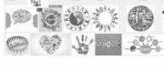

结果顶部有一行特殊的图像，伴随着下方的文字出现：“Diversity”（多样性）。单词有：“Different”（不同的）、“World”（世界）、“American”（美国的）和“Traits”（特征）。下方分两行显示了十一张图像，其是等待滚动的结果。在屏幕上的十七张图像中，有六张图像清晰可见“culture”一词。五张图像包含一个地球的圆形描绘，显示了南美洲和非洲大陆的一部分。在这些图像中，地球被彩虹色调代表人的符号所包围。六张图像包含多张国旗图像。几乎所有图像都呈现白色背景。

网格上方是一行可点击的链接，指示不同的搜索模式：All（全部）、Images（图片，当前激活模式）、News（新闻）、Books（书籍）、Videos（视频）和 Search tools（搜索工具）。点击 Search tools 会显示图像的第二行选项：Size（尺寸）、Colour（颜色）、Type（类型）、Time（时间）、Usage rights（使用权限）和 More tools（更多工具）。点击 Type 会显示子项目，如 Photo（照片）、Clip art（剪贴画）、Line drawing（线条画）。点击 Colour 会打开一个选择面板，选项有 Any colour（任意颜色，激活）、Full colour（全彩色）、Black and white（黑白）、Transparent（透明）以及一个 4:3 的颜色开关网格（红、橙、黄、绿等）。我选择了代表颜色的开关

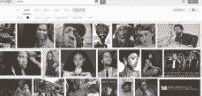

黑色。页面刷新后可见 20 个图像结果。

第一个结果是唯一包含“culture”一词的，它似乎是一个海报的缩略图，包含十一个图像的网格以及文字“2013年11月3日-8日黑人文化意识周”。四张图像包含“black”一词；两张出版物：*Negro Digest*（1969年的杂志封面，上面写有“Black World”）以及 Tricia Rose 所著书籍《Black Noise》（黑噪音：当代美国的嘻哈音乐与黑人文化）的封面。七张图像是黑白的。说唱歌手 Red Pill 站在一幅音乐家 Biggie Smalls、Tupak Shukur、KRS-One、Thelonious Monk 的壁画前，以及与历史民权运动相关的人们：Amiri Baraka、Malcolm M.Zora Neale Hurst（Hurst）。所呈现图像的整体颜色似乎比上一组结果包含更多黑色像素，显示的结果显然更多地是由于文本“black culture”与图片的邻近性造成的，而非图像本身的纯色内容，正如颜色滤镜的操作可能暗示的那样。

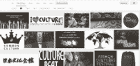

通过“google.be”的荷兰语界面重复搜索（通过黑色色块过滤带有“culture”文字的图像）产生了完全不同的结果。前十五个结果包括一张图表，文字为“Culture is something that unites people.”—Anastasia O. Russ；一张 Miley Cyrus 在语境下“抖臀”（twerking）的图像；“Common Culture”的标志，描绘了一个黑色王冠剪影；Shia LaBeouf 戴着一个写有“i am not famous”的纸袋；一个从树上长出的 Google 剪影；黑色背景下色彩鲜艳的艺伎和黑色日文字符。结果中没有任何地方出现“black”或“swart”这两个词。

> 1 此示例来自 Artomaryan，www.omyocharyan.com。访问于 2016 年 6 月。

65

并无不同

## 向数字化竖中指（背）

结合阿斯格·约恩SICV 照片档案考虑“视觉词汇”

斯堪的纳维亚计算破坏研究所 (Nicolas Malevé, Michael Murtaugh, Ellef Prestsæter)

## 黑人文化

我打开网页浏览器并输入“google.com”。我被重定向到 google.nl，界面显示为荷兰语。在屏幕顶角，我看到了我的名字以及曾经为名为“google plus”的服务设置的“头像”。我选择“登出”，点击“Google gebruiken”，界面变为英语。在右上角，我开始在搜索框中输入“culture”（文化）这个词；当我每输入一个字母，文字下方就会出现一系列建议。C: cat（猫）、cricket score（板球比分）、cars（汽车）、calendar 2016（日历）。CU: cute puppies（可爱的小狗）、cute quotes（可爱名言）、cute animals（可爱动物）、cute baby（可爱宝宝）、cubs（幼兽）。CUL: culottes（灯笼裤）、culture（文化）、culture club（文化俱乐部）、cult（邪教）、cult de sac（死胡同）。我点击“culture”，页面刷新并显示出一个图像网格。


结果顶部有一行特殊的图像，伴随着下方的文字出现：“Diversity”（多样性）。单词有：“Different”（不同的）、“World”（世界）、“American”（美国的）和“Traits”（特征）。下方分两行显示了十一张图像，其是等待滚动的结果。在屏幕上的十七张图像中，有六张图像清晰可见“culture”一词。五张图像包含一个地球的圆形描绘，显示了南美洲和非洲大陆的一部分。在这些图像中，地球被彩虹色调代表人的符号所包围。六张图像包含多张国旗图像。几乎所有图像都呈现白色背景。

网格上方是一行可点击的链接，指示不同的搜索模式：All（全部）、Images（图片，当前激活模式）、News（新闻）、Books（书籍）、Videos（视频）和 Search tools（搜索工具）。点击 Search tools 会显示图像的第二行选项：Size（尺寸）、Colour（颜色）、Type（类型）、Time（时间）、Usage rights（使用权限）和 More tools（更多工具）。点击 Type 会显示子项目，如 Photo（照片）、Clip art（剪贴画）、Line drawing（线条画）。点击 Colour 会打开一个选择面板，选项有 Any colour（任意颜色，激活）、Full colour（全彩色）、Black and white（黑白）、Transparent（透明）以及一个 4:3 的颜色开关网格（红、橙、黄、绿等）。我选择了代表颜色的开关


黑色。页面刷新后可见 20 个图像结果。

第一个结果是唯一包含“culture”一词的，它似乎是一个海报的缩略图，包含十一个图像的网格以及文字“2013年11月3日-8日黑人文化意识周”。四张图像包含“black”一词；两张出版物：*Negro Digest*（1969年的杂志封面，上面写有“Black World”）以及 Tricia Rose 所著书籍《Black Noise》（黑噪音：当代美国的嘻哈音乐与黑人文化）的封面。七张图像是黑白的。说唱歌手 Red Pill 站在一幅音乐家 Biggie Smalls、Tupak Shukur、KRS-One、Thelonius Monk 的壁画前，以及与历史民权运动相关的人们：Amiri Baraka、Malcolm M.Zora Neale Hurst。所呈现图像的整体颜色似乎比上一组结果包含更多黑色像素，显示的结果显然更多是由于文本“black culture”与图片的邻近性造成的，而非图像本身的纯色内容，正如颜色滤镜的操作可能暗示的那样。


通过“google.be”的荷兰语界面重复搜索（通过黑色色块过滤带有“culture”文字的图像）产生了完全不同的结果。前十五个结果包括一张图表，文字为“Culture is something that unites people.”—Anastasia O. Russ；一张 Miley Cyrus 在语境下“抖臀”的图像；“Common Culture”的标志，描绘了一个黑色王冠剪影；Shia LaBeouf 戴着一个写有“i am not famous”的纸袋；一个从树上长出的 Google 剪影；黑色背景下色彩鲜艳的艺伎和黑色日文字符。结果中没有任何地方出现“black”或“swart”这两个词。

> 1 此示例来自 Artomaryan，www.omyocharyan.com。访问于 2016 年 6 月。

65

并无不同

## 向数字化竖中指（背）

事实 GIS 使用了文本和图像的混合，这变成了一个问题。SICV 档案是约恩几年前开始的项目，相比之下，它是图像驱动的。其大部分页面包含黑白照片，许多几乎满幅，每一张都被约恩涂上了一种颜色来指示它们的“语言”。如果没有颜色，这些语言应该是清晰可见的，但它们是涂层的建议，一种对装饰元素的俏皮动作，或对负空间的激活。涂层的颜色随着书中的各种主题而变化，这些主题本身通常涉及双关和文字游戏。

> 2 这是 Varian 2008。

214年，约恩博物馆邀请我们参观 SICV 档案。到达后，我们面对存储在复杂纸质结构中的思想和图像：手稿、索引、地图、胶片、内容页、照片、文件夹。我们试图理解档案是如何运作的，绘制其功能图，并讨论了材料的数字化可能会开启什么。这项工作的形式是熟悉档案特性的研究阶段，随后是一个小型装置，最终成为一系列互动展览和工作坊的一部分。本文将分析工具和技术的可交换性的后果，以及数字工具如何有助于建设（误用）和新颖装配。

## 绿色

La Lang verte et la cuite 是 Asger Jorn 与作家 Noël Arnaud 在 1968 年创作的大幅摄影书。这本书借用了列维·斯特劳斯的《Le Cre et le cuit》（1964），这是“神话”系列的第一部，通过概念性的二对立（如“生”与“熟”）来比较和对比不同文化中反复出现的元素。《Le Cre et le cuit》包含约 400 页主要为文本，正文中仅包含四张照片，其中包括一张博罗人（Bororo）的肖像，该文化在作品中起着核心作用。此外，书中还有一个名为“Bestiaire”的特别附录，包含了十六页正文中神话中提到的动物版画。借鉴 SICV 档案（这是约恩几年前开始的项目），相比之下，它是图像驱动的。其大部分页面包含黑白照片，许多几乎满幅，每一张都被约恩涂上了一种颜色来指示它们的“语言”。如果没有颜色，这些语言应该是清晰可见的，但它们是涂层的建议，一种对装饰元素的俏皮动作，或对负空间的激活。

《La Langue verte et la cuite》标题本身就是一个双关语：“la langue verte”字面上的意思是“绿舌头”，也指流行语言或俚语。在法语中，“La cuite”或意为“被煮了”是指醉的俚语。

正如艺术史学家史蒂芬·哈里斯（Steven Harris）指出的：“约恩坚持文本与图像的分离，让图像能够独立于文本发挥，并根据图像自身的内在顺序进行排列”（Harris 2012, 112–15）。这本书不仅仅只是展示了文本与图像的分离，其一个核心特征是图像的*优先性*，书中印有高质量的黑白照片，且没有任何说明。每幅图像都有一个独立的数字标签，感兴趣的读者可以通过该标签找到书中附录形式的对应说明。因此，约恩反转了学术写作中典型的文本与图像的关系。与列维-斯特劳斯（Lévi-Strauss）《动物志》中还原性的动物黑白铜刻不同——在书中每种物种都被简化为一个单一的代表性示例——照片重写了考古对象“客观”摄影表述的传统，采用了戏剧性的光影而非平淡、波动的阴影，并利用表现性的细节而非仅仅是呈现它们。³约恩将这些呈现为“石头的肖像”⁴，这种努力体现在他在印刷书籍时使用了多层油墨，以增强图像黑色的动态范围（Henriksen 2014, 227）。


# 特蕾莎·奥斯特加德（Teresa Østergaard）在她的文章《作为代理图像：作为视觉策略的“比较破坏”》中发展了这种视觉策略的考古学意义

http://sicv.activearchives.org/

Matthew Fuller. http://sicv.activearchives.org/w/Computational_Vandalism. 访问于2016年6月20日。

## 痕迹

当我们到达西尔伯格（Silkberg）时，我们意识到了档案的存在：七个带有四个抽屉的文件柜被临时移到了主展区空间。我们被告知，由于从博物馆地下仓库搬迁，文件柜从左到右的顺序被颠倒了。文件柜被放置在一个短黑桌子的边界旁，被布置成一种模拟的工作站，配有一张相邻的桌子和灯。一些照片被复制并散落在地板上的堆叠中，带有一种舞台美术般的点缀，模糊地暗示着犯罪现场。我们得到了延长线和额外的光照设备并开始工作，随着我们拆开包装、插上笔记本电脑并开始对材料进行记录和摄影，那个想象中的工作空间变得真实起来了。

在柜子中，每幅图像都以多个副本出现，首先是照片底片，然后是印在接触片上（接触片本身就是一种经常用油性笔标记的文档），最后是不同尺寸的多个复制品。通过这种方式，约恩等人可以自由地从档案中工作，剪下图像副本用于（可能的）出版物跨页。这种字面意义上的“剪切与粘贴”以及照片底片“可复制性”的功能，是一个实用的提醒，提醒了数字工具和工作流（比喻上）基于的许多物理和手工手势。由于约恩和阿诺德想把“舌头”带回“语言”，我们开始好奇，给数字世界带回一些“手指”（动作）意味着什么。

## （视觉）单词袋

“天哪，它运行了……”诺米（Nomi）呼出一口气，本能地挥了挥手，低头对着显示器，做出了一个近乎虔诚的算法崇拜姿态。就在一小时前，她还感到很沮丧，瘫坐在卧室角落电脑前的椅子上。整个周末她都在不停地工作，试图让她的代码运行起来，但遇到了一个巨大的障碍。她面前的教科书翻在第七章“图像搜索”，那是关于构建一个简单的基于图像的搜索引擎的。

基于内容的图像检索（CBIR）处理的是从（大型）图像数据库中检索视觉上相似图像的问题。这些可以是具有相似颜色、相似纹理或相似物体或场景的图像，基本上是图像本身所包含的任何信息。

对于高级查询（例如寻找相似物体），在查询图像与数据库中的所有图像之间进行完全比较（例如使用特征匹配）是不可行的。如果数据库很大，返回任何结果将花费太多的时间。在过去的几年里，研究人员成功地将文本挖掘领域的技术引入 CBIR 问题中，使得在数百万图像中搜索相似内容成为可能。最常用的权重是 `tf-idf` 权重（词频率—逆文档频率）。但这种“信息”究竟采取什么形式呢？（Solem 2012）。

使用计算机视觉技术对诺米来说是一个相对新的兴趣领域。二十年前，当此类技术的应用仍属于相对推测性的机器人领域时，她在计算机科学学习期间研究过一些技术。然而，是海量的手机用户，而非机器人的液压系统，激活了这些人工眼睛——首先表现为人为调整相机曝光设置的人脸检测程序，其次是在这些图像被“分享”后，社交媒体平台进行的复杂的标签划分和分析。这本书是技术类出版社 O’Reilly 出版的一系列“动物书”之一。封面上是一个老式的黑白描绘的“白头鲶鱼”，根据书的版权页介绍，这是一种“底栖鱼”，由于其高繁殖率和对水生生态系统的破坏性影响，被认为是渔业的诅咒（Solem 2012, 247）。诺米暗暗地想，这是否是对计算机视觉技术在文化上影响的讽刺陈述。在她与代码作斗争时，这些担忧早已被她抛在脑后。

她正试图将一段幻灯片播放视频图像片段匹配回原始数字图像。最初她想通过“肉眼”完成这项工作，但在翻阅 300 张可能的图像寻找匹配的几分钟后，她意识到任务所需的视觉耐心超过了她的承受范围。因此，她希望“视觉单词袋”可以起作用。

为了将文本挖掘技术应用于图像，我们首先需要创建单词的视觉等物。这通常使用局部描述符完成，例如 2.2 节中的 `SIFT` 描述符。想法是将描述符空间量化为若干典型示例，并将图像中的每个描述符分配给这些示例之一。这些典型示例通过分析训练集确定，可以视为视觉单词，而所有单词的集合就是视觉词汇（有时称为视觉字典）。这种词汇可以为特定的问题或图像类型创建，也可以仅仅尝试表示视觉内容（Solem 2012）。

她认真执行了所有步骤。首先，她运行 `SIFT` 程序来检测并导出大约 300 张图像的所有“有趣”特征的“描述”。接下来，她运行了“训练步骤”，基于所有图像的所有特征构建“视觉词汇”。这一步被证明非常耗计算：最初在她的笔记本电脑上运行代码让电脑挣扎了半小时才显示出可怕的“段错误”。转移到内存更大、处理器更快的台式电脑后，在另一个半小时的计算后，算法成功以文件格式输出了生成的“词汇”。然后她重新处理了那 300 张图像，通过记录每幅图像“投影”回词汇统计平均值时的特征描述来创建一个“索引”。最后，她尝试“搜索”索引：搜索图像是视频中的一个片段原始背景中出现的一些图像。她希望通过搜索索引，原始图像能作为“命中项（hit）”返回。她对视频帧进行相同的处理，将其特征“描述符”与索引中的所有描述符比较，并返回一个按相似性排序的命中项列表。但这似乎完全不起作用。代码中的所有错误似乎都是随机的，并没有提供她所寻找的匹配结果。

在视觉词袋（visual bag of words）上走了死胡同后，Nomi 决定放弃这种技术，而完全专注于 `SIFT` 特征本身。她不再依赖搜索索引，而是决定应用一种“暴力”匹配算法，将一张图像的特征与其他每一张图像的每一个特征进行逐一比较。这种技术对于包含数千张图像的集合来说永远无法运行，但对她的这个小数据集来说却足够了。她启动了算法，等待它缓慢地完成比较。大约 15 分钟后，她检查了日志文件，发现该算法运行得异常地好：对于某个特定的视频帧，大多数比较没有匹配项；在少数情况下有 1 到 10 个匹配项，而且有一个超过一百个特征的明显匹配项！Nomi 打开了相应的图像，通过视觉确认了该片段包含在照片中。在一种如释重负的狂喜中，她忘记了为了达到这一步所做的所有工作，对她所感知到的算法运行的强大威力感到惊叹。

## 计算破坏主义

词袋只是方法和技术“层层蛋糕”中的一个例子，这在通用的计算机编程中，特别是计算机视觉中非常典型。不同的方法和算法经常从程序员的“工具箱”中取出，并进行混合组合，将一个的输出嫁接到另一个的输入上，以执行某项任务。这一事实本身并没有问题。工具和技术的高度可交换性，正是数字工具能够让自己任由杂乱且具有建设性的（误）用和新颖组装的一个令人兴奋的部分。然而，困难在于理解或考虑某一层的假设和局限性如何影响其他层，以及流水线中某部分的假设在当人的注意力将“栈”转移到应用程序的另一个部分时，是否仍然适用。作为一种工程过程的“黑箱化”，核心在于能够“放手”并忘记所关注的程序特定部分的细节，转向另一个部分。危险在于，在抽象过程中，当特定例行的内部细节和上下文被抑制时，人们往往会开始相信那些箱子上贴的、往往被夸大的声明。

Jorn 反复提到瑞典建筑师埃里克伯格（Erikberg）的“形式语言”概念，并建议数学拓扑学可能对视觉艺术的“全面编码”做出贡献。例如，参见 Jorn 2012 (1968)。

Jorn 很可能认为，基于纯视觉方面（尽管经过了数学技术的过滤）来创建“语言”的想法极具吸引力。但这是谁的语言？这些词汇指代什么？它们是旨在通过“符号图标”追溯文化遗产的人类学家的观察，还是通过放大镜观察到的、一个强迫症拼图玩家所发出的晦涩喃喃自语？

Jorn 在一种新的学术话语中提供“重绘（overpainting）”作为视觉证据，提出了一种激进的提议：拥抱图像的主观性，主张图像是开放给多种解释的。诸如轮廓追踪之类的算法处理很容易被视为本身一种重绘，一种取决于算法在图像上特定应用的表演性行为。算法重绘并没有产生一种“消耗”其主体的本质还原，相反，算法重绘暗示了解读和重新解读图像的新方法。

人们如何拥抱这些算法确定语言形式中意义的多样性，正如 Jorn 在《绿色语言（La Langue verte）》中对双关的战术部署那样？Jorn 对列维-斯特拉斯（Lévi-Strauss）结构主义中明显的语言还原主义的回应是拥抱并展示语言（视觉和文本）的全能力，包括多重含义、推测、蓄意的模糊性、侮辱和冒犯、虚构、暗示、荒谬和矛盾。在视觉词汇中，对应的等价物是什么？对于像 `k-means` 和主成分分析（PCA）等频繁使用的统计还原技术，还有哪些替代方案？使用此类技术来索引视觉材料的影响又是什么？随着工程领域日益转向更加晦涩和不可捉的方法（如深度学习），人们越来越需要保持敏锐性，以确保此类技术实际上促进了更加多样化和广阔的图像阅读文化，而不是一个被流行反馈循环所扭曲的、永远平庸狭隘的文化。

在哈里斯（Harris）对《绿色语言》的阅读最后，他描述了书中后期出现的一个现象：一张著名的阿尔伯特·爱因斯坦肖像（他俏皮地对着镜头伸出舌头）被涂成了粉红色。与之相对的是，一个参加 1968 年 5 月巴黎抗议活动的年轻女性，站在街中间伸出舌头，推测是对着警察的。哈里斯指出，这一姿势显然源于一种自我赋权的喜悦位置（Harris 2012, 130）。2016 年初，作者们为布鲁塞尔圣日耳曼区（Saint-Germain）的 Constant 办公室（Constant Office）窗户创作了一个小型装置。在四十天里，摄像头被设置为记录短序列视频帧，其前提是检测到存在“脸部”。当检测到脸部时，会记录一段短序列，图像中被识别为脸部的区域将被图像库中同样检测到的脸部所替换。

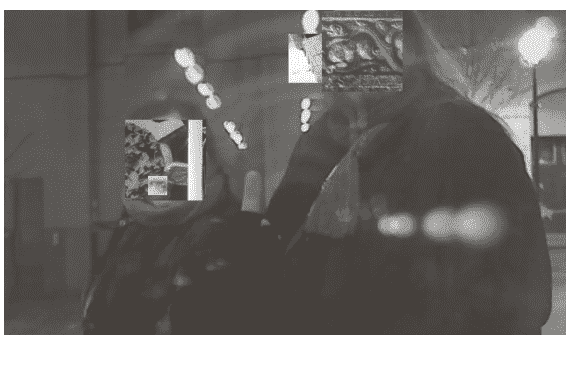

### 参考文献

Harris, Steven. 《语言的外相：关于 Asger Jorn 和 Noël Arnaud 的 La Langue verte et la cuite》10月141 (2012): 111–32。

Henriksen, Niels. 《破坏主义：Asger Jorn 的考古学》；收于《Asger Jorn: Restless Rebel》，Dorthe Andreas 和 Helle Brands 编选，226–238。慕尼黑：Prestel Verlag, 2014。

Jorn, Asger, 与 Noël Arnaud。《La Langue verte et la cuite：对音乐形态的语音声学研究》。巴黎：Pauvert, 1968。

— 《结构主义与压制》，由 Niels Henriksen 译。10月141 (2012年夏季): 81–85。

Levi Strauss, Claude. 《神话学：Le cru et le cuit》，巴黎：Plon, 1964。

Solen, Jan Erik. 《使用 Python 编程计算机视觉》。Sebastopol, CA: O'Reilly, 2012. http://computervision.com. 访问于2016年6月20日。

Varian, Hal. “我们的秘密配方”。Google 官方博客，2008年2月25日。https://googleblog.blogspot.be/2008/02/our-secret-sauce.html. 访问于2016年6月20日。

# 你的来源有多深？

Aymeric Mansoux

在归档与保护领域，自由和开源许可证是使数字艺术的重用和保护更具可行性的工具 (Laforet 2010)。尽管不可否认此类许可证具有整体的积极影响，但它们在定义参与作品创作的组件、材料和资产时却也显得力不从心。此类许可证中使用的术语源于软件世界，尽管已经对文化作品进行了适配，但它并未摆脱其源源的二元性本质。当软件许可证要求访问源码时，它指的是源代码，这是软件制作中一个为人知的对象，易于定义和识别。虽然这完美符合特定形式的艺术（特别是涉及计算过程的艺术），但这种源代码的概念是否可以字面地移植到其他文化表达（例如动态或数字图像、声音，并扩展到多媒体和富媒体作品）仍然值得怀疑。在本文中，我认为此类作品需要对艺术、音乐和设计背景下的源代码进行特定媒介和隐喻性的理解，以便使自由和开源许可证对于保护、归档，当然以及前者的深度研究和利用产生价值。这一挑战背后是自由文化表达和开放知识的可访问性和控制权问题，以及它们与其以软件为中心的父级依赖之间的对比。

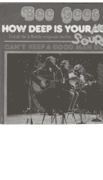

Wikipedia，自由百科书。“源代码”。http://en.wikipedia.org/wiki/Source_code. 访问于2012年8月15日。

## 软件自由的简史

源代码是用人类可读的计算机语言编写的指令集¹。源代码可以被编译成机器码并手动执行，以作为独立程序或大型软件的一部分执行某些任务。它也可以被解释，在这种情况下，源码会被实时翻译并执行。源代码在软件生产和处理中的作用至关重要。

对其的访问允许对后者进行几乎任何修改，无论是添加新功能还是修复漏洞。这种重要性通过自由软件运动以及 1985 年自由软件基金会（FSF）的创立得到了证明。从创立之初，FSF 的目标一直是为专有软件模型提供替代方案，该模型依赖于控制源代码和编译软件的访问与分发：

> 我们名称中的“自由”字不是指价格；它指的是自由。首先，复制程序并将其重新发给你的邻居的自由，让他们也能像你一样使用它。其次，更改程序的自由，以便你可以控制它而不是由它控制你；为了这一点，必须向你提供源代码 (Stallman 1989, 8)。

- 为任何目的运行程序的自由（自由 0）。
- 研究程序如何工作并根据你的需求对其进行调整的自由（自由 1）。访问源代码是此的前提。
- 重新发行副本的自由，以便你可以帮助邻居（自由 2）。
- 改进程序并将改进发布给公众，以便让整个社区受益（自由 3）。访问源代码是此的前提 (Stallman 2000)。

根据 Bruce Perez 的说法，Richard M. Stallman 建立的这些自由是在 OSI（“开源定义”的替代方案）创建后才发布在自由软件基金会网站上的 (Perens 2009)。然而，他认为这些自由在在线发布之前可能就已经存在了。事实上，它们曾一直作为三种自由存在，现在被编号为 1、2 和 3。自由 0 是在后期阶段添加的 (Stallman 1999)。

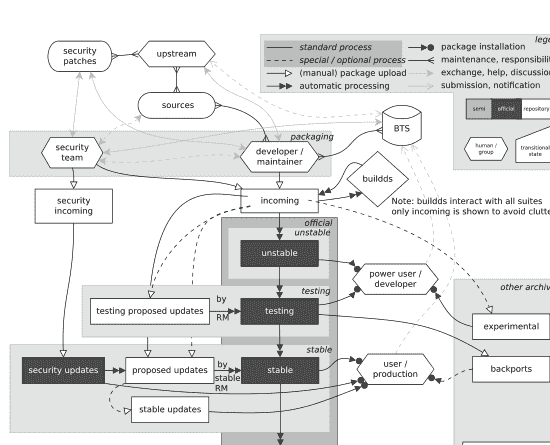

这种参与式的活档案之所以可能，是因为通过一种技术法律框架对源代码进行访问和分发。该框架允许信息从讨论软件维护的公共列表到实际进行操纵和执行的私人计算机之间，具有某种流动性和操作性。这是源代码如何成为一种“邀请函”的极佳案例：

> 在这段引用中，公共领域可能应该被理解为一种公开的且可能可访问的共同资源；大多数自由和开源软件并不属于公共领域。它们是受版权保护的材料，并通过上述的许可机制提供。然而，值得注意的是，旨在简化放弃版权及相关或邻接权利的知识性知识许可协议（Creative Commons），目前与 FSF 自由公共许可证（GPL）是兼容的。

创作性实践鼓励协作，并在贡献、操纵和重组层面对作品进行进一步开发，并在公共领域中以相同的条件对其进行进一步发布（Krysa and Sedek 2008）。³

现在，无论一个作品是自我编码的、通过编译代码的执行来体现，还是两者的结合，都不难看出 Debian 如何成为支持符合这种形式艺术的灵感（Candeira 2005）。最终，公共和私人收藏家、场馆和图书馆都可以从这种免费且协作的资源中获益。

## 3 遗失与活态（中）档案

开源代码诗歌、生成艺术和软件艺术。通常来说，这同样适用于那些软件元素可以在自由和开源许可下发布并集成到分布式基础设施中的艺术。最后，无论人们如何界定软件——作为艺术、工具还是魔法信息——自由和开源软件的技术和法律益处都是相同的，因为我们处理的仍然是软件。

这不是幻想或痴人想法；在实践中，像 `Puredyne` 这样的自由开源 GNU/Linux 发行版正在分发来自 Alex McLean 和 Martin House 等艺术家的作品（Lafore 2021, 137）。除了 Debian 已分发的的作品（如 Scott Daves 设计的流行屏幕保护程序 `Electric Sheep` (1999)）之外，将作品作为自由开源软件发布的艺术家，可能会受到分发维护者的接触，帮助将其作品整合到自由开源操作系统系统中（2010）。不言而明，此类软件必须符合分发指南以及对用户友好应用的理解。虽然对于 `Electric Sheep` 这种实际上作为屏幕保护程序运行的作品来说没有问题，但谢天，软件艺术则不能如此。

### 4

`Puredyne` 是一种基于 Ubuntu 和 Debian 的用于创意多媒体的 USB GNU 操作系统。更多信息请访问 http://puredyne.org/about.html。访问于 2012 年 6 月 29 日。

### 5

信息请见 Daves 2005。

### 6

特别是此案例在 2007 年 rubric 节期间的 FLOW+Art 小组会议中讨论过，作为一个例子说明了在 Martin House 的软件在 `Puredyne` 中分发后，是否可以在其作品中实现（或实现）“用户友好”的群体机制。

但那些非基于代码的作品又呢？虽然软件不可否认是一种文化表达（Fuller 2003），但并非所有文化表达都是软件。这在实践中将如何运作？进入自由文化的世界……

## 面向大众的自由与开放内容

21 世纪初诞生了几个从自由开源软件中汲取灵感的项目和运动。从软件到文化和知识的转变，例如在《Hipopia 宣言》中清晰可见，它通过知识访问的价值将自由软件与行动主义联系起来（Teza 2001）。然而。

由于对文化和知识背景下自由和开放含义的理解不同，在实践中，随之而来的更显性的定义之间存在巨大差异。这些差异也体现在它们对符合各自意图和议程的许可的选择上。首先，将软件自由向更广泛文化背景最接近的适配或许是“四种自由知识”：

- 为任何目的使用知识的自由（自由 0）。
- 研究知识如何应用并将其适应于你的需求的自由（自由 1）。访问源信息是此的前提。
- 重新发知识的自由，以便帮助你的邻居（自由 2）。
- 改进知识并将你的改进发布给公众，以便让社区受益（自由 3）。访问源信息是此的前提（Peña-López, 2003）。

另一个是来自自由知识基金会（FKF）的自由/开放知识（Free/Libre Knowledge）定义，该基金旨在描述用户应该能够对文化表达做什么：

- (0) 为任何目的使用作品


# 从地窖到云端

## 网络档案作为权力的场所

**Manu Luksch**

我们的梦想被重新布线。电话交换机、无线电真空管、电视管被集成在一起。它们的逻辑终点：计算机。我们时代的设备，一面揭示未来的魔法镜子。我们的预测能力随着每一块塞入的新电路而增长。跃入明天——每秒一万亿次计算。

它变得越来越强大，变得越来越小巧。智能、移动、个性化。今天——在我们的口袋里。明天——织入我们的身体。

— *Dreams Rewired*，旁白

---

## 正文

- (1) 研究其机制，以便能够修改并使其适应自己的需求
- (2) 制作并分发副本，全部或部分
- (3) 增强和/扩展作品并分享结果？

```
http://web.archive.org/web/20081120001221/www.libre.org/communities/philosophy/libre-declaration. 访问于2012 年 9 月 7 日.
```

另一类是“基本自由”，被写写作为判断许可是否符合资格的指南：

- 使用作品的自由……
- 研究作品的自由……
- 重新分发副本的自由……
- 分发派生作品的自由……（自由文化 2007 定义）。

另一种方法是开放内容定义，它试图在重做（rework）和混混（remix）之间做出更强力的区分。它也是对四种自由的变体，在这种情况下，它被重命名为“4Rs”：

- 重用（Reuse）：完全按照你发现的状态使用作品
- 改订（Revise）：更改或转换作品以更好地满足你的需求
- 混混（Remix）：将（原文或修改后的）作品与其他作品结合以满足你的需求
- 重新分发（Redistribute）：与他人分享原文作品、重做作品或混混作品（Willey 2007）。

最后，另一个显著的努力是开放定义（Open Definition）或开放知识定义，它规定了与内容和数据相关的“开放性”定义原则（Open Knowledge Foundation 2012）。该定义太长无法在此复制，它直接源于前述的 Perens 的开源定义，而该定义本身又源于 Perens 对 Debian 自由软件指南的工作。

由于在风格和内容上有如此强烈的关联，它们与其父级软件为中心的定义之间的联系是显而易见的。尽管如此，仔细观察发现，尽管将软件自由推广到知识的首次尝试在其定义中提到了“源”的概念，但随后的努力停止了提及它。

原因很简单：虽然计算机软件是一种文化表达，但并非所有文化表达都是计算机软件。因此，计算机特定的源代码问题在更广泛的自由文化和开放知识方法中被认为并不重要。

## 通向博尔赫公共许可证 (The Borges Public Licence)

看到自由文化许可定义、开放知识定义和其他方法由于对什么是“源”定义的缺失或不完整，并不是自由开源软件的完美转置，因此需要问这将如何影响自由/开放内容/知识/表达/作品（FLOCKEW）？

首先是一个简单的质量视角，意味着任何内容都可以发布和分发。例如，低分辨率、高压缩的照片或视频可以在这些许可下自由分发。虽然这类作品完全符合 FLOCKEW，但当高分辨率、原始或无损压缩的原始版本仍处于垄断专有权利时，其价值就变得可疑。另一个方面是自由定义的某些自由文化许可定义的“实际操作性”：作品在实践中如何被他人占用和修改。例如，如果被许可的作品是由多个元素组成的图像，如果作者决定将此类图像作为扁平化作品发布，其操作性就会受到影响；或者，如果他她提供了制作此最终图像的图层。

> 高度压缩的、免费的缩略图

此外，由于此类外部“源”文件的存在，引发了一种不可避免的递归。事实上，继续以数字拼贴为例，如果提供的图层本身就源自其他“原作”，会发生什么？它们难道不也应该被包含在内吗？用于说明或 Logo 的字体呢？栅化文本图层的实际可修改性如何？提供字体文件是否有意义？如果有人想对文件进行实际修改，除了一维的混杂或重混，这些元素是非常需要的。

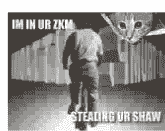
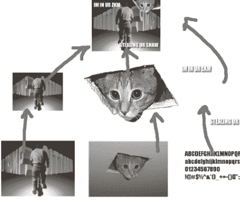

## 你的源有多深？

最后一个问题出现在这些媒体资产的许可上。如果作者分发其作品的“源”，而该源本身就是一个独立的文化表达，那么作者可以自由地根据单独的许可分发材料。在这种情况下，免费内容拥有非免费许可的资产是可以接受的吗？许可兼容性如何？如果这些外部文化表达是免费许可的，但使用了专用软件的封闭标准，是可以接受的吗？

为了解决这些问题，Rob Myers (2007) 想象了理想的文化源是什么样的。他提出了五个属性：

- 透明的，采用易于编辑的文本格式；
- 全质量的，采用允许重建最终格式的标准；
- 完整的，因此提供了制作分发作品所需的所有材料；
- 无负担的，不含专利和 DRM（数字版权管理）；
- 结构化的，以描述性格式提供，例如矢量图形。

尽管开放定义明确从其对知识的定义中排除了软件，从而避免了开放作品分发中关于“源”的问题，但“源”的问题实际上已经由自由定义的项目涵盖了。事实上，要成为真正的文化作品，作品必须遵守另外四个条件，其中之一就是对源数据概念有明确规定：

> 源数据的可用性：如果最终作品是通过编译或处理一个源文件或多个源文件获得的，那么所有底层源数据都应与作品本身一起在相同的条件下可用。这可以是音乐谱、3D 场景中使用的模型、科学出版的数据、计算机应用程序的源代码或任何其他此类信息（2007年自由文化作品定义）。

然而，与自由软件许可不同，这一条件并不是契约性的。它仅仅是判断一个作品是否可以被称为自由文化作品的准则的一部分。换句话说，作者在使用自由文化许可时并不非得遵守这一条件。在实践中，使用自由文化许可分发非免费作品是完全可能的，这实际上从字面上将人们对自由文化的流行理解变成了免费与非免费文化表达的杂乱混合。

在这一点上，情况可能会开始变得相当混乱。最初作为自由软件向自由文化转型的简单探索，现在正终于一个并行决策的迷宫。每一项决策都指向一个“选择你自己的冒险”式的许可迷宫，每一步似乎都进一步模糊了问题的源头，从字面上来说也是。知识共享（Creative Commons）在其许可中使用“批准用于自由文化作品”这一误导性术语来尊重自由文化许可的定义，而它实际上应该说此类许可是自由文化许可；仅此，不再更多。

无论这看起来多么令人烦人且挑剔，文化问题都必须提出。在存档和保护的背景下，理解 FLOCKEW 的价值和局限至关重要。如果没有源信息，在保护和重新征用的情况下，这种做法的优势是有限的。实际上，如果存在艺术品的“源代码”，它可能包含比可重混元素更多的信息。这种源是由作品包含的一切组成的，从滋养根部的土壤到树冠。这种激进的方法不应该从副文本的角度来理解，而应该以非常实用的方式理解，2001年发布的 PlayStation 硬件就是最好的例子。

这种所属关系通过其许可的可读摘要中的图形徽章显示。

更多信息请参见 Davis 2011。

## 你的源有多深？

Hardrive 是一张 CD-ROM，包含了新媒体艺术家 Joshua Davis 硬盘中的“原始数据”这些数据旨在供探索、研究和重复使用。内容远非他硬盘的位流拷贝，尽管如此，它是包含 3637 个文件的令人印象深刻的集合，其中包括许多 Macromedia Flash “源”文件，使得该项目背后的意图接近自由和开源伦理。在这种平行关系中，更多的是对自由软件和开源运作方式的误解，因为文件是在没有许可的情况下发布的，导致硬盘落入了未指定的公有领域和默认版权法的法律泥沼中。它对当时 Flash 社区产生的巨大积极影响（既作为一种教育和文化产物）是一个非常直接的说明，证明没有艺术家存储设备的转储，就无法写出任何作品或传记 (Cramer 2003)。

更多信息请参见示例，Kirstenbaum 2008, 54，以及 Kukovic 和 Stancić 2009, 157-67。

Joshua Davis 给作者的电子邮件，2012年6月8日。

最后，对艺术作品许可源材料的彻底出版仅限于已经接近自由和开源软件社区的艺术家和集体。由于在他们使用的软件中接触此类实践，他们最终将相同的哲学应用于自己的作品，并在存储中公开许多元素 (Lee 2008)。然而，由于源概念在许可中的完全或部分消失，这种对源材料的细致态度不太可能流行。这就是为什么某些自由许可（具体说是知识共享）不应用于软件的原因。在将软件自由转移到文化时清理计算机术语，嵌入这一源代码可用性想法中的自由软件道德正当性也随之消失了。尽管定义的自由文化作为市场驱动的 CC 许可方式的伦理对等，自由文化的伦理没有手段来实现。这种结果是，一种奇怪的转折，软件自由向文化的完美转型也对自由和开源软件产生了负面影响。

> 我可以将知识共享许可应用于软件吗？我们建议不要将知识共享许可用于软件。与特定的软件许可不同，CC 许可不包含关于源代码分发的特定条款。事实上，CC 许可软件尽管在文化上与开源软件一样，但实际上是自由和开源软件的一种伪形式。例如，一个混淆和压缩的 JavaScript 库可以很容易使用 CC BY-SA 许可或简单的 CC BY 许可发行，鼓励该库的广泛分发，并明确其内部机制与原作者之外的任何人都无关。

对于该问题的另一种观点可以在法国作曲家兼钢琴家瓦伦廷·维拉纳夫（Valentin Villanave）正在进行的工作找到，这种许可可以解决目前讨论的一些源头问题，但截至目前尚未出版。Villanave 是 Cofyleft Attitude 的活跃成员，自由文化组织 Free Art14 (FAL) 正诞生于该组织。他的想法是修改 FAL，要求艺术家必须提供创作艺术作品期间使用的所有中间源材料。这包括草图、研究资料以及这些材料的所有版本。如果在任何时候涉及到源元素，就必须提供，以避免出现 Villanave 所说的那种情况，即：被允许访问的内容实际上只是作品的摘要，而不是作品的整体（Villanave 2011）。

```
http://three.org/open/license/
访问于 2016 年 5 月。
```

根据这位音乐人的说法，这种方法将成为一种抵抗自由文化表达的被动和商品化消费的手段，并重新连接自由软件工程的自由——在那种自由中，可重用性和模块化是任何进步和创新的必要条件，同时防止自由文化变成“免费分享文化”或“共享文化”（用前文提到的类比）。然而，通过这一额外的步骤，似乎我们的问题正在进一步扩大，超出了由于深入文化源头的文化源头而引发的递归性眩晕：它还触及了这些源头所在的语境。

毕竟，如果有人旨在提供一件艺术作品的源代码，那么对创作过程的捕捉就是完全相关的（Dekker 2010）。因此，在不知不觉中，由于缺乏对艺术源的定义产生的挫败感使我们转而对艺术实践本身进行分析和记录。定义艺术源是一个问题，就像定义艺术本身一样，但随着日益复杂的法律和技术工具的使用（这些工具可以强制对艺术创作进行细粒度版本化捕捉），直接催生了采样和具象化诗人“神秘参与”（participation mystique）的欲望（Jung 2001）。确实。

如果这些源头不仅仅是一个扁平化的对象，那么没有什么能阻止我们提供脑电图数据、DNA 样本、宇宙学模型等，从而将对几乎任何现象的捕捉转化为一个走向“本体”的作品的源头。如果真有必要，或许我们将推测性的“比特流”许可重命名为“博尔赫斯公共许可”（Borges Public Licence），这对巴别图书馆的管理员们和他们的律师来说是一场真正的盛宴，但对于那些同意用血签署这份魔鬼合同以换取推测性且不朽开放性的艺术家来说，极可能是一场噩梦。

## 结论

在发生严肃的版权改革（或者完全取消）之前，不可否认，推广 FLOCKEW 的项目是非常受欢迎且必要的。从实践上讲，使用符合自由文化定义或开放知识定义的许可简化了许多工作，并统一了文化和知识的归档、分发和访问过程；当然，这是在尊重现有版权法的非常特定的语境下的（Mansoux 2011）。

然而，在实践中修改或维护表达形式的能力不应被认为是理所当然。这种情况将自由文化和开放知识置于一个与自由开源软件完全不同的境地。由于没有考虑资源的衔接，自由文化和开放知识只能提供自由软件中那种自由的替代品。最终，软件自由为用户实现的成就将在它的文化转译中消失了，因为作者被带回到对其作品被他人重用性的完全控制的地位。这是因为作者是决定是否提供源以及什么构成源的唯一判者。

所以，如果 FLOCKEW 许可对信息的流动非常有效，它们对信息的实际可用性没有影响。从这个意义上说，知识共享（Creative Commons）许可可能会给人虚假的安全感。本文涵盖的所有问题代表了许多等待被利用的潜在后门，以及许多误解这种法律基础设施如何运作的机会。在文中使用繁琐且带有调侃意味的 FLOCKKEW 缩写是为了展示冰山一角，但也展示了在一个往往被过度简化的话语中存在多样性的。同时，很清楚，当尝试在自由文化和艺术语境下定义源时，没有任何解决方案是令人满意的。只能有特定的变通。任何定义艺术源的理性尝试都是行不通的，因为对此类资源的通用“一刀切”定义总是倾向于排除实践而非包含实践。此外，试图通过简化和限制有效文化表达形式的范围来寻找折中方案也存在风险。这样做只会有利于某些形式的实践，将艺术变成理性化转换的副产品——正如主流混混文化中所看到的。同样，如果原始自由文化时代及其伴随的、定义艺术自由和文化自由的混乱尝试是健康多样性和丰富反霸权动态的标志，那么现在已不再如此了。如今，自由文化本质上由少数许可主导，这些许可被文化机构盲目接受，这些机构帮助其进一步传播到文化领域，无意中冒着鼓励创造一个非常单文化化的公域的风险。

自由文化和开放知识的力量不在于它是解决版权问题的通用方案。相反，在这里它更应该被视为一种设备，它让艺术实践和艺术保护中的模糊性和秘密性突然变得具象。最重要的方面是参与共享文化表达的社区中存在的动态和意图，以及这些动态如何或无法转化为新的形式，或得到现有的技术法律框架的支持。此类社区的组织可以有效帮助重新思考和重新发明分布式基础设施时代对文化的访问，通过开放保护工作的机构性“围墙花园”。博物馆，艺术机构和档案馆迫切需要这些。

## 参考文献

| 英文术语 | 中文术语 |
| :--- | :--- |
| free culture and open knowledge | 自由文化和开放知识 |
| copyright | 版权 |
| free culture | 自由文化 |
| open knowledge | 开放知识 |
| free and open source software | 自由和开源软件 |
| free software | 自由软件 |
| FLOCKEW | FLOCKEW |
| Creative Commons | 知识共享 |
| Borges Public Licence | 博尔赫斯公共许可 |

- “艺术与自由软件运动”。博士论文，伦敦米德尔塞大学，2008年。`http://eprints.mdx.ac.uk/4963/1/ChunLeeThesis.pdf.` 访问于2012年9月7日。
- Mousamer, Ay. “网络拓扑的声音。” *Neural* 第 38 期 (2011): 19-22.
- Myroe, Rob. “文化科学。” 2007年8月26日，`http://robmyers.org/web/2007/08/26/cultural-sciences/.` 访问于2012年9月7日。
- Murdock, Ian. “Debian简史（附录A：宣言）。” 1994，`www.debian.org/dk/manuals/project-history/ap-manifesto.html.` 访问于2012年2月7日。
- Open Network Foundation. “源代码许可证。” 2004年。`http://web.archive.org/web/20040123293819/http://three.open-ansart/.` 访问于2012年9月7日。
- Open Knowledge Foundation. “开放定义。” 1.1, 2012年，`http://offendefin.org/okd/.` 访问于2012年9月7日。
- Pérez-López, Israel. “自由知识的四种自由。” *ICTology* 2003年10月1日，`http://ictology.net/review?tp=12.ICT? 2009?.` 访问于2012年9月7日。
- Perez, Bruce. “Debian社会合同。” 1.0，1999年7月5日。`www.debian.org/social_contract.1.0.html.` 访问于2012年2月7日。
- Bruce. “开源定义。” 收录于*开源：开源革命的声音*，Mark Stone, Chris Dibona 和 San Oakman 编，第171-88页。塞巴斯托波尔，O'Reilly Media，1999年。“Re”: 2009?.`http://www.slashdot.org/comments.plid=129886c3d26875185.` 访问于2012年9月7日。
- Raymond, Eric S. “再见‘自由软件。开源。’” 1998年，`www.catb.org/~esr/open-source.html.` 访问于2012年5月7日。
- Stman, Richard M. “什么是自由软件基金会？” *GNU's Bulletin* 第1卷，第1期 (1998): 8-9页。`www.electricsheep.org.` 访问于2012年2月7日。
- GNU项目哲学。什么是自由软件？2000年。`http://web.archive.org/web/20000302065400/www.gnu.org/philosophy/free-sw.html.` 访问于2012年9月7日。
- Teza, Mario, Luis Teza, Diego Garcia, Juan Carlos Gentile 和 Luis Gonzalez. *Manifiesto de Hipatas*. 布埃诺斯艾利斯2001年。`http://hipatas.org/index.php?manifiesto-h.html.` 访问于2012年9月7日。
- Villeneave, Valentin. “回复: 开放源代码。” 2011。`https://lists.april.org/wsrc/copyleft_attitude/2011-10/msg00042.html.` 访问于2012年9月7日。
- Willey, David. “开放教育许可证草案。” 2007年8月8日，`http://opencontent.org/blog/archive/355.` 访问于2012年9月7日。


# 从地下室到云端：档案、权力与获取的政治

## 1. 引言：网络档案与用户生成的档案

阅读这篇文章，我写它时很可能触手可及一个“智能”设备——一台通用机器，将我们自身的自然延伸到通信和信息网络，而这些网络可能很快变成认知网络。这种增强不仅局限于我们成为互联网用户，也不局限于我们成为用户。因为这些信息网络还追踪我们的旅行、网页浏览和购买习惯，例如，从我们无意识但持续编写的元数据中获取信息；因此，三方（如公司）的力量也得到了增强。封锁在这些网络中的数据（有时被称为“大数据”）构成了一个用户生成的档案。

相反，正如我将展示的，档案吸收了与其连接的通信网络——就像它吸收了阅读其内容所需的独立设备一样。这种对网络的吸收强调了档案在控制知识方面的功能，而非其作为“中立”存储的传统角色。

电影《连接梦想》（Dreams Rewired, 2015）由 Luksch, Martin Reinhardt 和 Thomas Tode 执导，是从 1880 年代到 1930 年代 200 多部电影的汇集，其中许多非常稀有，有些从未面世；它们涵盖了从最早的音乐厅表演、新闻片、营销材料、科学实验记录，到对电影作为媒介的艺术探索。《连接梦想》中的一条主要轨迹贯穿了当代（网络引发的）情感和焦虑，追溯到电力时代的诞生，说明了当今心理和社会动荡如何在 19 世纪末的媒体热潮中被预示。《连接梦想》本身是一个关于未来希望和恐惧的描绘档案，其制作的核心过程是对全球公共和私有媒体的咨询。

甚至制作这部电影的想法也源于在档案中偶然发现了虫胶唱片，检查后发现它们包含了埃德蒙·梅塞尔为爱森斯坦的《波奥姆金号战舰》提供的（假设）配乐。

> **《连接梦想》剧照** (Luksch/Reinhart/Tode, 2015): *Hände: Das Leben und die Liebe eines zärtlichen Geschlechts* (手：一个温柔性别的生活与爱，Miklós Bály, 1927)

---

## 2. 案例研究：版权迷宫与“为了进一步促进知识和创造力的进步，造福美国人民”

访问于 2015 年 6 月

根据要求，图书馆将确定某特定影片是否有、以何种格式提供以及版权归谁所有。但即使只是通过记录（在相关的版权局）进行简单检索，也可能产生高昂成本：

> 版权局记录的检索按每小时 165.00 美元的法定费用收取，最少检索两小时。您请求的检索超过了两个小时。如果您希望获得检索的书面估价，则需要支付 115.00 美元的固定费用。如果您愿意，可以先支付 330.00 美元首付款，并提供一到两小时的检索服务。完成检索和报告所需的任何额外费用将与赞助人沟通，如果需要额外的检索时间，将在届时支付。（通过电子邮件发送）

在委托进行“检索的书面估价”后，收到了以下回复（两个月后）：

> 关于版权状态的书面估价……已分配并正在处理中。版权局记录研究与认证部门由于严重的人员短缺（该短缺是为了配合联邦政府削减支出的努力），正面临工作积压。这种情况影响了我们的工作量和周转时间。我们对这可能造成的任何不便深表歉意。

> 遗失与现存的（在）档案中
>
> lostandliving_binnen_def.indd 106
>
> （通过电子邮件发送）

由于所请求的物品不在公有领域，因此需要进一步的信息，可以通过三个选项之一获得：

- 这三部作品的“注册及可能的续展”，额外汇款 215 美元
- “这些作品可能的转让分配的完整历史”，额外汇款 495 美元（对应约 3 小时的检索）
- “这些作品版权状态的完整历史”，额外汇款 710 美元。（通过电子邮件发送）

经进一步查询，结果只有最后一种方案对权利持有者有效，而且，提供的联系方式无法保证是正确的。尽管查询费用高昂，与商业服务相当，但图书馆目前正运行在典型的、极度捉襟见肘的政府预算之上：

> 遗憾的是，由于技术问题，我们的数据库目前无法运行。我们正与维护承包商紧密合作，以找出问题并恢复其上线。这导致了一些不可预见的延迟，您的订单就是其中之一。（通过电子邮件发送）

---

## 3. 公共媒体的商品化

《重连梦想》（Dreams Rewired）的核心主张是理解当代网络化计算模式生存的本质，这需要我们理解其根源于二十世纪之交想象的电视乌托邦。在英国广播公司（BBC）的档案中去哪里寻找早期电视实验的记录呢？毕竟，电视技术是在英国聚集了巨大的动力，并最终导致了第一次高定义（或当时的）公共广播节目。

```
想象……然后
有了电视
来自 Dev 的剧照
录制（最新）
Reinhardt/Tode,2015
档案：BBC Motion
Gallery/Getty Images
```

尽管 BBC 是一家公共广播机构，其运营过去和现在都由纳税人和观众资助，但早期广播的档案并非详尽，且历史材料的分发目前由第三方处理。当我 2013 年与 Motion Gallery（BBC 的一个档案馆）对话时，BBC 正与 Images 协商一项独家分发协议。由于这种外包，与档案仍由内部管理时相比，许可成本显著增加。在许多历史制作作品中，BBC 不是（或不再是）权利持有者，甚至不知道权利持有者是谁。阿德尔·迪克斯的电影《魔幻光芒/电视歌曲》中，该片是为了 1936 年使用 Marconi-EMI 系统进行的 BBC 电视服务的首次直播而委托制作的（对公司和国家具有明显意义），其版权并不由 BBC 持有。

现存早期电视广播机构的录像，是因为节目是作为传输的现场活动制作的，从未打算过要保存。此外，视频录制是后期才发展的，只能使用摄影机进行记录。BBC 直到 20 世纪 50 年代后期才将节目预处理到录带上，但有一个节目的录带被重复使用了。

然而，存在强烈的倡议，至少来自 BBC 内部，要求档案管理发生积极变革。档案开发控制员 Tony 设想了一个数字公共空间，让都能平等地访问……对话式的、开放的且保护所有参与者和贡献者权利的……随时随地可用的……这个国家的每一个人，无论是成人还是学生，都应该能够使用这个数字公共空间……为了研究或消遣，为了发现或辩论，为了创作尝试或仅仅是为了


观看、倾听或阅读的快乐……他们应该能够接触那些记录、反映并塑造了我们共同国家遗产的无价之宝。

> 源自伦敦皇家霍洛威大学的一场演讲。
>
> 2015 年 2 月 10 日。
>
> 修订版发布于：opendemocracy.net/ourbeey/tonry-age/bbc-

---

## 4. 惊悚的许可——代表爵士乐

在广播在公共服务和商业之间分配之前，爵士乐在发展中发挥了关键作用。这首歌由 Okeh Records（现为索尼的一部分）发行，压制成胶片片。然而，这段录音与所使用的版本不同。在阿姆斯特朗的唱片集中，Jose Willem 推断该音乐可能是在帕拉蒙东部工作室拍摄期间完成的。


> **从地下室到云端**
>
> 国会图书馆确认动画属于公有领域，但音乐权利不是。帕拉蒙确认他们可以授予该录音的使用许可，费用为每分钟 3500 美元。虽然昂贵，但这笔费用可以通过预算支付。然而，“只有帕拉蒙控制的权利——第三方权利（包括音乐）的清理和适用付款是您的责任”（通过电子邮件发送，2014 年 2 月 28 日）。进一步搜索显示底层音乐权利由 Louis Armstrong Educational, Inc. 持有，该公司还“拥有使用路易·阿姆斯特朗声音、肖像、形象及其人格的所有知识产权”。（通过电子邮件发送，2014 年 3 月 16 日）。

> > 你死后我会很快高兴。(Dave Fischer: 1932) 由 Willard Bowsky, Raphael Somerville 动画，路易·阿姆斯特朗乐队录制。 档案：国会图书馆

在授予许可之前，阿姆斯特朗基金会要求提供背景音乐背景的信息。最终，电话交流扫清了障碍，他们提交了一份报价：针对所要求的 35 秒片段，基金会打算收取 75,000 美元的费用！

由于法律和财务能力无法进一步进行收购，因此，关于无线对非洲美国人音乐的影响片段遗憾地被删除了。讽刺的是，整个动画仍可在 archive.org 在线免费观看，多年来那里展开了一场热烈的讨论。用户在公共论坛上交流，大多数评论都提到了这种奇特的并置：一位传奇的非裔音乐家被视为不可忽视的力量，而激进的漫画形象填充了画面。

---

## 5. 盲点

大多数档案馆都愿意就费用和许可进行谈判，但在某些情况下，很显然无论投入多少钱或理由都无法获得这些材料。在《车神》（Körkarlen, 1921）这部以特效闻名的电影中，导演维克多·斯特伦姆（Victor Strjöström）利用双曝光技术描绘了死亡后灵魂离开肉体。在《重塑梦想》（Dreams Rewired）中，灵魂被重新利用并转化，电影本身成为了超越演员存续的灵魂。《车神》的版权持有者 AB Svensk Filmindustri（隶属于波尼尔集团，该北欧地区的媒体巨头）对这种解释并不信服。在给权利研究人员的回信中，他们解释道：

> 我们绝不会授予你所请求的此类广泛使用许可，且绝不免费提供。素材片段与你想要使用的电影之间必须有联系，片段不能仅作为插图使用。（邮件，2013年12月16日）

在经过连串邮件后，最后一次尝试换来了一封相当“正义凛然”的回复：

> 感谢你的来信。
>
> 特此确认，我们 AB Svensk Filmindustri 是 1921 年电影《车神》（Körkarlen/The Phantom Carriage）的唯一所有者和版权持有者，这适用于电影的所有版本。
>
> 我们此前已告知过你两次（2）次，我们不会授予你可以在你的纪录片中使用上述电影片段的权利，我们也不会改变这一决定。
>
> 请尊重这一决定！
>
> 顺颂商祺，
>
> AB Svensk Filmindustri
>
> 权利部门
>
> （邮件，2013年12月16日）

---

## 6. 政治足球

国际奥林匹委员会（IOC）对主办城市提出了许多条件，包括制作一部关于该活动的长篇电影。1936年，奥运会会在柏林举行，当时的柏林处于纳粹德国统治下。莱妮·里芬斯坦塔尔（Leni Riefenstahl）曾凭借宣传电影《意志的胜利》（Triumph des Willens，记录了1934年纽伦堡帝国党会议/纳粹党大会）声名鹊起，受邀记录这一活动。她的作品（时长超过四小时）基于其审美愿景持续产生深远影响。自从战后删除了最明显的宣传内容后，该片在德国获放映——这与《意志的胜利》不同。（后者最近一次是在2012年伦敦奥运会期间在英国播放。）尽管事实可能令人尴尬，《奥林匹雅》已成为德国文化遗产的重要部分。

里芬斯塔尔在战后声称拥有该电影的权利，但联邦档案馆（Bundesarchiv）对此主张表示异议，理由是她提出主张的制作公司仅仅是纳粹党的幌子（Rodek 2013）。1964年，双方通过合同达成和解，将所有开发权交给了里芬斯塔尔，关键在于联邦档案馆获得了30%的利润份额。至关重要且在当时不寻常的是，里芬斯塔尔保留了决定电影放映地点的唯一权利——她至少有一次拒绝了某个反纳粹组织的许可。至于联邦档案馆为何如此轻易放弃控制权，这是一个细节问题；根据《世界报》电影评论家汉斯·乔治·罗德克（Hanns Georg Rodek）的说法，这是她在规避决定《奥林匹雅》放映地的责任。

2002年，当里芬斯塔尔已100岁时，她试图将她在《奥林匹雅》中的权利卖给奥委会，奥委会计划购买她所有的电影历史。从文化意义上说，电影本应被视为文化遗产（Kulturerbe），并受保护法律约束，禁止此类出售。

---

## 7. 档案人质 II：走后门

在《梦幻重连》（Dreams Rewired）制作的一个关键时期，有一个非常重要的历史照片和电影公共档案（由于某些显而易见的原因，无法点名）……我对其馆藏的版权状态进行了一项重大调整——这一过程花费了几个月。好消息是，在这个过程结束时，大部分材料将进入公共领域；坏消息是，在此期间不允许进行任何销售——该档案将保持锁定状态：

> 亲爱的 Manu，
>
> 感谢你的来信。由于我们馆藏中的某些图像（尤其是电影）已进入公领域，我们目前还没有使用费率表。
>
> 正因如此，我很难回答你的问题！
>
> 提前感谢你的理解与耐心！
>
> 顺致商祺，
>
> （通过邮件发送，2014年3月4日）

至于《梦幻重连》的使用许可问题，机会窗口正在关闭——在现阶段，依赖材料在未来不确定的某个日期可用风险太大了。我们进行了最后一次尝试以获取许可：

> 有什么什么是我可以做些来帮助这个过程的吗？
>
> 如果我去档案馆查询精确的时间码片段，会有帮助吗？
>
> ……
>
> 这些材料……对于电影项目的成功非常重要，我希望我们能找到一个创意的解决方案！
>
> 再次感谢，致诚挚的问候，
>
> Manu Luksch
>
> 导演
>
> （通过邮件发送，2016年7月14日）

在上述邮件和几次电话之后之后，达成了一个“创意的解决方案”。合同日期将追溯到档案版权转移程序之前，且文件将在“后门”提供提取——字面意义上的。是时候召秘密特工了：

> 嗨 Bob，
>
> 这真的太疯狂了……对于我正在拍摄的这部电影（我记得上次联系时模糊地提到过），我们必须谨慎地提取录像……我们已经与研究人员和销售部门接触多年了，但一年前，由于某些行政重组，他们冻结了所有的素材许可请求。
>
> 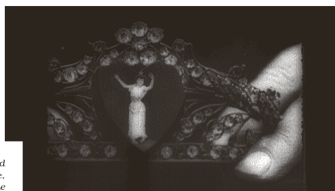
>
> 《梦幻重连》剧照
>
> [Luksch/Reinhardt/Tode. 2015): Le miroir magique Segundo de Chomón, 1908
>
> [已删除]，你将会见到他（请向他转达我的问候和感谢）知道……我的电影已成为这种冻结局面的受害者……并将文件交给你，这栋楼里的其他人不应该知道这些文件。这是一个真正的秘密特工任务，我告诉你！
>
> 不过这并不妥当/有问题/不违法，因为我们很久以前就订购并支付了这些素材……
>
> 我很高兴你能去，因为在最坏的情况下，我今晚就得跳火车，因为上午10点的约会是在这么短的时间内提供的。这是我将素材引入我电影的最后机会了！谢谢你！！！
>
> Manu
>
> （通过邮件发送，2014年7月16日）

特工波澜不惊地回答道：

> 听起来是个明确的计划。文件会放在 USB 里吗？我假设[已删除]那儿有我的名字。
>
> 从地下室到云端
>
> 如果你在上午10点守在手机旁就很好，万一我需要指导。
>
> 完毕。
>
> 打印这条信息；烧掉它并吃掉灰烬。
>
> 从我的 iPhone 发送
>
> （通过邮件发送，2014年7月16日）

在这样棘手的局势下，值得记住规则管理着机构，但人才是运行机构的人。在这里，官僚的僵局通过魅力、毅力（以及我们特工的纯粹勇气）被化解了。

---

## 8. 网络档案作为权力中心

我们所在的时代是一个完全连接的时代。距离为零。未来是透明的。存在，即连接——网络正在寻找每个人。

如上述示例所示，为《梦幻重连》寻找素材的过程揭示了档案并非中立的存储库，而是控制知识和引导权力的工具——将其下放到大众手中，或将其集中——也仅仅是为了赚钱。国家收藏、版权图书馆以及

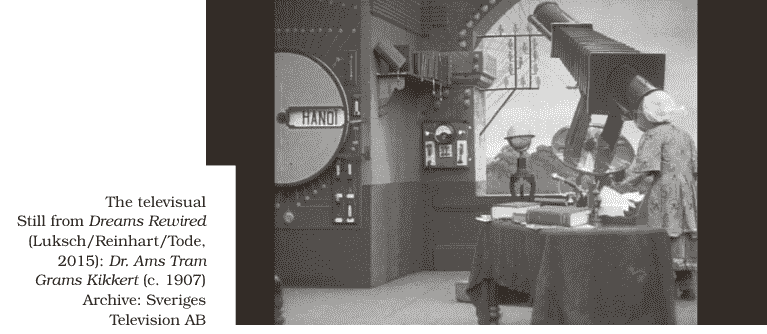

开放获取的网络档案可以认为维持了某种中立或开放的表象，即使在这些情况下，获取作品的成本也可能是望而不可及的。

通过开发用于生成和结构化数据的设施并为该集合提供差异化访问，她参与了各种信息与技术（ICT）项目，并成长为研究人员与人文/社会科学学者之间的中介。截至2016年6月1日，她是卢森堡大学的一名博士后研究员，在那里她正领导着一个用于教学数字来源批判的数字平台的开发。这一环境旨在引导学生和学者反思数字化以及历史来源在线化在认识论和方法论上面临的挑战。

---

# 口述史：一种方法

**ANNET DEKKER**

我一直将口述史的实践视为一种“为沉默者发声”并填补旧历史档案空白的方式。但事实真的是如此吗？

**STEF SCAGLIOLA**

我认为口述史的应用范围更广。现在也有关于企业家的口述史，而不仅仅是关于无家归者和难民群体。这些新群体为理解权力结构如何被合法化提供了洞察。它与一个感到被剥削的自雇人士者的故事形成了鲜明的对比。

口述史让你能够展示某些事物是如何相互影响的，以及性别、性、肤色和族裔的复杂性与结合。这些主题可以根据个人经验进行详尽阐述。解释你的背景对你在机构中所被分配的角色的影响的最佳方法，就是让人们谈论它。他们的论点是什么？他们如何看待自己？他们如何看待他人？一旦人们开始谈论自己的运作方式，这些方面会自动显现。

**JOSIEN PIETERSE**

口述史也经常被视为针对特定事件或阶段的方法，以便让不同的、具有颠覆性的声音被听见。除此之外，我认为口述史提供了一个背景并建立了新的联系。它还关乎你如何从不同的语境下回看某些选择或事件，以及你是如何处理它们的。在创伤性事件的情况下，观察它们如何影响一个人的后期生活，以及这种情况是在什么样的个人、社会和制度背景下发生的是具有意义的。在参与社会运动的案例，Pieterse对荷兰共产党的女性成员进行了研究，你还考察了这些女性现在如何看待当时所做出的选择。

## SS

我认为 Josien 的运作很大程度上基于政治意识，并且很大程度上是在主体性和赋权的视角内进行的。我更像是一个历史学家。当然，我看到了主观故事的重要性，但它的特征是具有与社会现实不一致的连贯性；人们想要讲述自己的故事，但并不真正接受对发生事情的不同版本，因为这可能会质疑他们的身份和地位。顺便说，你会发现年龄在其中起了作用。有时需要时间，在能够对其进行自由反思之前，某些事情已经变成了历史。当名声不再受到威胁时，会有更多的心理空间。只有当时间上存在距离，并且其他规范和价值观成为共识时，你才能获得硬币的另一面的听取。

这就是为什么关于“执行者”或“叛徒”的口述史项目是如此罕见。解释你为什么回看并向自己解释（例如）你殴打了某人，并没有社会回报。关于记忆和战争的口述史项目总是典型的故事。某天还是受害者，第二天就对打过或杀死某人感到遗憾，这种复杂性是罕见的。如果它存在，例如来自“战争遗产”项目的党卫军（SS）和国家民族党（NSB）成员女儿的故事，它也被埋没在档案中。只有当涉及到死者时——当它变成“真正的”历史时——它才能公开。在提供访问是否会损害一个人的社会生活这个问题上，存在明显的时间差。

## JP


# 口述史与档案：技术、获取、大数据与未来

## 口述史的发展与跨学科应用

如果你观察口述史的发展，它最初针对的是街头普通人的故事，他们被置于大英雄并列。口述历史学家必须关注工人阶级而非精英，正如普通历史学家做的那样。在人类学中，口述史研究集中在利用口头文化而非文献的文化上，音频和视频也被使用。此外，女性运动和黑人意识运动提出了那些在普通历史学家著作中很少甚至从未出现过的社会群体的问题。由于对运动内部的差异化和展示，各种复杂问题应运而生。口述史也是展示个人内部复杂性的一种方式。问题的交叉性质为类别之间如何相互作用提供了新的洞察。转型在档案等经常使用传统类别的结构调适方面尚未产生充分的结果。传统的权力框架在系统内部被维持和复制，这意味着细微差别消失了建立了联系和/或形成新词汇的可能性。某些概念和联系变得不可见，而另一些则仅仅被重复。访谈者可以引入不同的方法和新的框架。同时，技术和机构的结构将复制现有的权力关系。

看到口述史方法被许多其他学科使用变得越来越普遍。尽管有其意识形态、对社会不平等的关注以及口述史发展的背景，它已演变成一种具有广泛应用的方法。人是叙事生物的整个理念结合数字技术，已经渗透到社会的每一个可能领域，从老年护理和精神护理到旅游和管理。甚至 `ABN-AMRO` 银行也用“你的故事是什么？”作为口号广告。专业人士非常担心经典口述史与各种混合叙事形式之间的区别变得模糊，但我认为，历史写作和遗产的民主化和数字化进程一旦……就再无法停止了。

## 技术对访谈录制的影响

### 音频与视频的差异

**AD**：口述史的实践方式是否也受到随着时间发展和使用的技术的影响：例如，音频录音的结果是否与视频不同？

**JP**：如果你观察视频版的口述史，技术的发展对于访谈者和受访者来说都非常重要。相机变得方便且负担得起，这为更大范围的人记录视频访谈提供了可能。这种变化让人们开始使用，结果对受访者来说是巨大的。在访谈期间，相机的作用不那么突出，访谈可以在没有任何中断的情况下持续更久。

**SS**：是的，而且出现某种强制要求很有趣：如果你录制了图像，与只有音频不同，你被要求对其进行某种处理，将材料展示给其他人看。你不会花费数千欧元录制一个内容然后将其埋在档案中，那里可能根据严格的协议每五年才被访问一次。对于投资来说这不是一个好的回报。此外，存在一种隐含的逻辑，如果你被录制并展示了你的脸，你也放弃了你故事中的身份。

**AD**：这比仅仅有音频更强吗？

**SS/JP**：是的，当然。

**JP**：视频提供了大量的补充信息。它显示了随故事出现的情绪。但它也能展示所叙述的故事（你听到的）与受访者表达自己的方式（你看到的）之间的矛盾。

**SS**：然后你还能获得关于环境的所有信息，比如人们穿了什么。

### 视频对受访者行为的影响

**AD**：你发现这种方式会让人们说出不同的话吗？

**SS**：这在很大程度上取决于人们自己遵循的规范。他们看电视，看别人是如何展示自己的。有各种人们可以投射自己的角色，而且人们清楚地意识到他人之后会看到他们的形象。

**JP**：我一直有一种想法，即认为这种做法是有害的，但我实际上并没有发现什么问题。那是因为他们几乎都是没有受过训练的人，他们不会刻意地开始说话或选择词汇。有时效果比音频访谈得多。这是一种表演，他们以高度集中的状态工作，将其视为讲述自己故事的时刻。

**AD**：它赋予了主体性和赋权。

**JP**：是的，我留出了充足的空间让他们感到拥有自己的主权。他们是导演，而不是我。我把自己看作必须竭尽全力讲述他们故事的人。年老年人可能非常清楚，这是他们最后一次、可能也是唯一一次能够完整讲述自己故事的机会。我最近完成了一个关于罗马天教会虐待的项目。对于这些女性来说，赋权是最重要的。通过讲述自己的故事并公开，她们感到变得更强大了。她们往往不得不隐藏经历很长时间。对我来说，一个人能够尽可能地讲述自己的故事非常重要。

我为 `Atria` 访谈是原始素材，这些素材面向未来的研究人员，而他们的研究问题我们还不知道。如果之后要建立新的联系，并从不同的学科对访谈进行分析，那么就不可能将访谈过度引导向某个特定的问题。

## 获取与可及性

### 在线获取的局限性

**AD**：一旦信息最终变得可以获取，甚至可能在网上共享和使用，这仍然会产生影响吗？

**SS**：我认为技术对口述历史获取和检索的影响被严重高估了，因为这些项目从一开始就被设计为要放在网上，所以你只能得到适合放在网上的故事，或者是要求最多、争议最少且最具吸引力的项目子集。大多数口述历史并没有转录。我认为在技术上的可行性和社会上的理想性之间存在一个巨大的张力领域。

**JP**：同时，作为访谈者，我是完全透明的，因为听到的不仅是答案，还有问题。日期上的错误或不希望的问题不会被删除，而是会被完全纳入数据库中。在我的情况下，受访者事后可以决定哪些内容提供给公众，或者哪些专门提供给研究人员。在最后，他们对访谈如何处理有最终决定权。

**SS**：我认为互联网是一个触达更广泛公众的绝佳媒介。但如果你真的想基于现有材料进行研究，你必须去档案馆，因为网上的材料还不够。我最近参与了一个大规模的口述历史检索项目“叙述的过去”（`Narrated Past` [`Verteld Verleden`]），这是大数据基础设施项目 `CLARIAH` 的一部分，由荷兰科学基金（`NWO`）资助。它尝试实现不同集合之间的联邦搜索。这对于普通公众和记者来说很没问题，但只有当受访者同意将其上线时，你才能获得这些材料。我知道一位军事历史学家对那六百多份在线访谈并不感兴趣；他想听听在前南尔戈维亚和阿富汗的最近军事任务中发生了什么，但那些访谈被封锁了，只能在机构内部查阅。如果你想把它放在网上，就必须设计一个带有身份验证的昂贵且密集的在线环境。这在未来是可能的，但目前仍有很多缺口，导致网上免费获取的内容只是冰山一角。

### 隐私与伦理责任

**JP**：这很复杂，特别是对于那些不是在数字时代成长的人来说。我经常访谈老年人，并认为让他们妥善评估哪些内容想要公开、哪些不希望非常重要。你必须提供适当的保障。另一方面，我是一个追求开放和透明运动的一员。档案馆是公共机构，应该尽可能开放地处理其信息。后者对机构来说也很重要，但受访者的个人利益可能非常不同，我觉得对此负有共同责任。

**AD**：你具体在防范他们的什么伤害？

**JP**：人们使用过暴力，或者自己遭遇过暴力，他们谈论亲属，他们是某个争议性运动的成员。这些可能是目前并不特别相关的题，但也许一年后就会出现在完全不同的个人或社会政治框架中。社会舆论可以迅速变化。一个仅仅向公众开放的访谈可能突然用于不同的讨论。受访者往往没有完全意识到互联网的范围和潜力。

**SS**：这种情况可能会发生，例如有人说某件事是完全错误的。如果你把它放在网上，你可以预料 `Facebook` 上会有反应，声称访谈在散布谎言。这可能只是一个微小的错误，但它给整个访谈抹上了污点。特别是在受创伤的人身上，他们可能在访谈期间忘记他们所说的话将被公开。他们提到关于孩子或邻居的事，在没有察觉的情况下戏剧性地夸大。你想保护某人。

## 大数据

### 大数据研究的挑战与机遇

**AD**：这让我想起关于大数据的讨论，特别是它在不同学科内是如何处理的。你如何看待大数据研究相对于（口述历史数据）的影响？

**SS**：大数据研究和技术的症结在于，它的起点往往非常乐观且带有乌托邦色彩，但对源性批判和语境化的关注很少。原则上，口述访谈中有不同层面的信息：被谈论的事实、受访者的诠释（强调和缺失），以及可以从数据中提取的信息层——即所谓的数字方法。那可能是非语言信息，如叹息、停顿、哭泣、笑或视频访谈中的肢体语言。但在大量访谈的情况下，你可以尝试进行“远阅读”，例如通过文本挖掘工具在五百份转录中寻找模式。如果你收集了所有材料并想进入解读阶段，它可以作为一种分析工具。

**JP**：我发现一个真正的缺陷是缺乏回收文化，这在互联网上是常有的，无论是学术界还是荷兰记者都没有。这些渠道习惯于使用自己的摄像组进行拍摄，并倾向于内部制作。如果有一次有趣的访谈，他们会去找本人重新录制。这是对资本的破坏。我们是专业人士进行高质量拍摄。从定性角度来看，访谈很好，但原则上被认为不会被重复利用，而是会重做。

**SS**：这意味着一旦在二十世纪经历过某些事情的人不再存在，我们将不得不使用已有的东西。这从现在就开始涉及到 `20` 世纪 `70` 年代和 `80` 年代的材料，未来只会增加。我也认为开放链接数据的原则和数字搜索技术会不断改进。

但我认为许多大数据和计算机科学研究人员对历史学家的价值存在盲点，受困于模糊性和细微差别，以及他们对手头拥有所有可用数据的需求。例如，如果一个工具没能在议会记录中找到关于第二次世界大战的引用，而研究人员知道这些引用确实存在，那么对于历史学家来说这就是一个问题。许多数字人文研究者的反应是就此放弃，因为在模拟档案库中，并非所有人们想要的内容都是可获取的。但这种观点并不能帮助我们拉近彼此的距离。我认为，从小规模、可行的项目开始更好：让我们先很好地做好某件事，然后以后再说。

# 未来：每个人都归档/被归档，以及数据的价值

## 个人归档与机构角色的变迁

**AD**：你现在可以看到，越来越多的个人或网络正在复制和保存互联网上的许多数字资源或档案，有时还会将它们重新投入循环。`Geocities` 的例子（本出版物稍后会讨论）在被不同的人拯救之前几乎已经遗失了。这类倡议有多重要？

**SS**：资源档案（如 `Geocities`）与历史档案之间是有区别的。历史档案的原始任务是以其所有的多样性来呈现过去的社会现实。互联网档案馆（`Internet Archive`）是一种类慈善机构，用于收集那些否则会被遗忘的东西，它们并不一定需要保留各种类型的信息。我可以想象，比如在十年左右，可能会传播一种新形式的归档，也许通过档案本身，在你自己的圈子内保留一份家庭档案，那么当有人去世时，这些档案就可以开放。

**AD**：你认为在那种情况下，它们会被负责任地保存吗？你如何处理所有不同的数据格式呢？

**SS**：我可以想象将开发出工具让你以简单的方式自己完成，就像建筑市场已经从木工和石匠的专业市场转变为每个人的大众市场，让你能够自己安装浴室。

**JP**：我认为每个人都能提供自己的档案，这是相当乐观的。我也可以想象，在大型社会的压力下，机构的筛选会更加严格。自组织无疑会为档案节省大量工作。如果人们被档案机构拒绝，所有者将采取行动创建自己的平台。那么，传统机构的影响力将会下降。

**SS**：我主要考虑到的是工作量，人们活得更长了。留下的更多，而且都是数字形式，而且他们都认为这些非常重要。

**JP**：但如果现在的机构也是这样想呢？不，这就是为什么他们会说你必须以特定的方式和形式以数字化提交。在某种意义上，这已经发生了。如果你在过去签署过档案声明，你必须向档案发送一份你的出版物副本，他们会检查你是否遵守了隐私法规以及注释是否被妥善记录。这已经不再是因为规模的扩大和数字化使其变得过时了。相反，你现在必须自己签署某些东西，而你是负责遵守规定的人。这种规模的扩大也会影响档案处理供应的方式。

## 标准化与商业平台的挑战

**AD**：但从技术和内容上来说，信息的标准化难道不是我们今天面临的巨大挑战之一吗？一方面，多样性面临消失的危险；另一方面，许多信息可能会通过数据转换而丢失。

**SS**：是的，但这也是权衡“一无所有”与“带有某些损失的拥有”之间的关系。我也认为会有更多事情被委托，这会变得更容易。一个组织针对一个主题，另一个组织针对另一个主题。但档案的结合将产生额外价值。

**AD**：那么我们无法轻松访问的商业平台上的信息会怎样？损失的利弊都是显而易见的，但一旦赋权，如果某些事情无法再检索，你就有问题了。

**SS**：是的，这可能会引发一场革命。

**JP**：我认为，一个运动致力于让数据开放是非常重要的。公民必须能够获取信息。但仍然很少关注如何让人们适应一个以数据为中心的社会这一问题。你如何阅读数据？你如何整合数据流以获得新发现？我们如何向数据提出批判性问题？这些将在未来几年成为重要的技能，而教育还没有针对这些能力进行调整。

**SS**：意识到程序是一个执行者，因此不是中立的，这一点极其重要。程序是由公司开发的，该公司有特定的动机。你应该总是问自己为什么会得到某些结果。没有什么是不言而喻的，你必须学会这一点。所以，你不仅要学会在 `Facebook` 上的朋友不一定是真正的朋友，还要学会系统是如何构建的。对于每个公民来说，能够对此提问至关重要。

# 档案无法包含的内容

## 档案的性别与容器技术

档案倾向于积累和包含。这是它们的存在的意义，也是我们认识它们的方式——作为收集和包含材料的机构，最好是出于永恒的考虑。然而，档案的积累和包含总是伴随着损失和异议。大多数情况下，这种损失向公众呈现为一种遗憾甚至是灾难性的事件，例如，画作被破坏、塑像破碎或档案空间坍塌。然而，本文调查了作为档案不可或缺的基础设施的故意损失和异议，而不仅仅是一场壮观且意外的事件。它试图质问档案机构中损失的不断演变的构建、用于监管它的政策和实践，以及它引发的档案情感。本文基于对丹麦档案管理员和图书馆管理员的采访，这些机构范围从国家级到市级不等：他们的共同点是，他们是负责丢弃档案材料的人。从这些陈述中，文章提取出了一种档案理论，从容器技术的角度来看它们，以及对关系的影响。

档案天生具有积累和包含的倾向。这是它们存在的意义。人们通常从累积的角度来考虑它们。然而，尽管档案的主要目的是收集和保护物体，但由于它们也伴随着一排被逐出的碎片。从历史上看，这些驱逐是父权制行政机构排除和豁免的结果，因此产生了档案自身的父权制框架。因此，档案损失通常被用暴力的术语来描述，但对档案管理员的采访表明，实践中涉及一种关怀的水平。这就是我希望在本文中探讨的细微差别：档案管理员如何看待处理材料？他们赋予这种实践什么样的意义？以及数字范式如何改变他们的经历。与其通过权力的视角提出这些问题，我感兴趣的是将档案视为容器技术，并将档案管理员视为属于并执行容器技术关键任务的人。

`2000` 年，`Zoë Sofia` 引入了“容器技术”这一实用概念来讨论各种形式的家庭技术、它们的特定功能以及它们在历史中的记录。`Sofia` 广泛引用了刘易斯·穆姆福德在《技术与文明》（`1934`）中的论文，书中他认为技术史过度强调箭头和矛头等权力工具，应该更多地关注“器具、设备、公用事业”，包括碗和篮、染料缸和砖窑、水库、引水渠、道路和建筑。穆姆福德认为，这些技术开启了从男性的狩猎采集文化向基于定居乡村生活的女性建筑的转变。事实上，他认为，它们是一系列关注存储和保护的技术发展的催化剂。穆姆福德继续写，虽然家庭用器技术对于理解人类发展同样具有基础，但它们在历史上被贬到了一个不那么显眼的位置，部分原因是它们缺乏发展（一个碗几千年来看起来是一样的），相比之下，例如技术的进步，但技术史倾向于那些留下痕迹的实践，如箭头和斧头，而不是没有留下仪式或社区建设痕迹的实践。在 `2000` 年的论文中，`Sofia` 拾起了穆姆福德“关于容器被贬值但持续持续的观点”（`2000, 186`）。她以一种微妙的方式做法，既承认了穆姆福德对性别的关注，又通过提醒读者男性的身体和活动可能同样被解读为容器技术，从而动摇了他所设立的二元对立。

`Sofia` 因此开启了以非二元视角看待容器技术的可能性，即由通常被归类为男性或女性的特征组成。她认为，这些技术可以被构视为“宫外基质”，提供各种避难所和人类居所，但传统的女性领域也可以作为“静态”机器。随之产生的问题是：作为容器的档案理念，对于分析和解释处置过程及其产生的情影响的项目贡献了什么？将档案视为容器技术使我们能够承认档案是复杂的空间。这意味着不仅将档案视为信息的被动守护者或暴力排除历史的侵略性权力技术，也将其通过一系列表演性的、实践性的——有时是养育性的——行为产生碎片，并将某些人工制品指定为“历史”，从而值得保留，而将另一些指定为“垃圾”，从而被丢弃。

这一传统的“女性化”设备领域并非没有用于对植物、动物和矿物物质进行剧烈处理的工具或机器——用于砍切、鞭打、穿刺、粉碎、磨碎、液化等（`Sofia 2000, 189`）。

## 溢出：档案无法容纳的内容

关注档案浪费方面的理论学家喜欢引用法国历史学家阿莱特·法奇（`Arlette Farge`）的提醒，即档案工作需要一种分拣，一种对文件的分离。问题在于知道该取什么、留下什么（`Farge 2013, 70`）。虽然历史学家面临着从档案中选择什么样的选择，但档案员的选择更为激进，因为他们的评定决定了藏品的构成。档案员对保留和留下的决定是具有意识形态和实务意义的，并基于心理、物理、技术和财务动机。心理上是为了确保意义的产生，物理空间是为了存储人工制品，技术基础设施是为了组织它们以便检索，而完成度则是是为了确保其得到保存。这些限制自档案机构成立以来一直是其前提。

例如，参见 `Ernest 2013` 和 `Hogan 2015`。

这一直对档案员构成了挑战，档案员被要求不断监控并判断其藏品的生存与活力。

正如美国图书员梅尔文·杜基（`Melvin Dewey`）在二十世纪初指出的，“一个正常图书员的直觉是保留每一本书和手册。他知道也许某天，会有人需要它”（`Dewey 1926, 311`）。这种直觉部分源于档案经验，即不存在一种随时间保持不变的客观质量衡量标准。因此，藏品永远不会达到一种崇高的境界，而是作为随时间变化的不同观点和价值观的体现而存在。正如杜基也指出的，书籍往往被物化到某种程度，以至于它们的破坏不仅是不专业的，而且是不道德的，而积累是唯一的伦理解决方案。这种解决方案在 `19` 世纪及更早时期可能也是可行的方案，但由于生产价格降低和识字率提高，印刷品数量的加速增长挑战了这种“全盘保存”的心态。档案和图书馆在字面上已经无法再容纳任何东西，必须处理日益日益数量的物质。杜基建议，图书员应该反抗他们的保存本能，将书籍从“一个要被崇拜的图腾”区别为“工具”，即便仅仅是因为许多书籍缺乏质量，“如果让一个胜任的陪审团审判书籍、杂志和报纸上印出的所有内容，超过百分之九十的内容将送回造纸厂”（`Dewey 1926, 311`）。

正如档案员提摩西·L·埃里克森（`Timothy L. Ericson, 1991`）所描述，档案面临着与图书馆相同的问题。`19` 世纪末到 `20` 世纪初信息量的不断增长，导致英国档案员希拉里·詹金森（`Hilary Jenkinson`）在 `1937` 年指出，`20` 世纪给档案科学提出了“至少一个新问题；一个到那时为止很少被考虑或尚未被考虑的问题”（`Jenkinson 1937, 21`）：数量。信息加速增长的一个主要来源是第一次世界大战，它积累了“可能臃肿”的记录收藏。詹金森担心“战后岁月进一步强调了”现代积累的问题（`Jenkinson 1937, 21`）。在过去，他写道：

> 我们假设档案员……总是收到过去已经形成的藏品，假设他们总有空间来安置它们，因此档案是否应该保留的问题随之没有出现。遗憾的是，这在英国并非总是如此，事实上在任何地方都不如此：从现代档案时代的开始，某些情况下销毁的必要性就已经被提出（`Jenkinson 1937, 136`）。

他由此得出结论：

> 存在一种真正的危险，即未来的历史学家可能会被埋在他海量的手稿文献之下；或者，在处理这些积累物时，可能会采取任何档案员无法批准的措施（同上）。


然而，不仅是信息量的增加给档案带来了问题。公民身份的变化以及政府和记录保存的新预期也是如此。政府的新角色包括对公民负责，以及对权利的扩张和预期，即保证这些权利将以政府记录的形式得到实现。

20世纪信息量的不断增长以及赋予这些信息的不同价值，意味着人们越来越清楚地认识到，档案员的角色不仅在于要“保留”什么，还在于要“放弃”什么。因此，文化遗产的一部分变得“在最高程度上是可以消耗的、多余的、垃圾”（Adorno 1981, 33）。处置指令在各种形式的处置政策中被正式化和理性化，这些政策也反映了现代性期间转型机构的更大规模理性化和专业化进程。这些政策体现在图书馆的最佳实践指南中，并被无害地命名为“藏品开发与管理政策”，概述了机构在什么情况下可以选择摆脱材料、如何操作以及在谁的权威下进行。支持剔除和处置书籍实践的官僚机制随之在杜基推动的去理性话语中发展。直到最近，这些藏品管理指南也影响了档案，而档案的处置概述直到20世纪末、在某些地区则是21世纪才变得清晰（Duranti and Franks 2015）。

## 处置模式

管理政策中的去理性话语肯定了处置是档案的基础条件，但它未能解决处置的情感工作。档案处置是一种充满情感色彩的符号行为，连接并激发了广泛的文化集合，从政治殖民和压迫性社会结构到人类永生和包容性问题。档案对象是情感对象；它们进入藏品不仅通过行政评估过程，还通过将档案对象视为仅仅是物理事实的符号实践；相反，档案对象变成了符号形式，代表了启蒙、教育、透明度和问责等政治理想的丰富纹理，以及对出生、死亡和无限的复杂心理评估。难怪，它们的破坏会激活公众的认知机制。

档案馆已经意识到了这一问题的严重性，即使是针对图书馆藏书处理最实用的手册，也包含了关于如何正确“裁减”（weeding）收藏的警告语。例如，由德克萨斯州立图书馆和档案馆委员会出版的一份手册概述了处理书籍的最佳实践，它建议书籍可以通过两种方式进行销毁：在焚烧炉中焚毁，或者直接扔进垃圾桶。然而，手册指出，如果使用后一种方法，必须确保过程不会被路过的人看到。公民可能会误解销毁“有价值”书籍的原因（Larson and Boon 2008, 83）。事实上，该手册强调，通过破坏性销处理最容易引发藏书淘汰争议，因为“许多人对将‘好书’扔在垃圾堆上的这种‘浪费’行为感到震惊，而且‘焚书’一词带有不愉悦的内涵”（Larson and Boon 2008, 86）。无疑，当将淘汰实践暴露于公众面前的事件发生时，很可能会引发抵制。一次被称为“图书馆门事件”（Librarygate）的争议导致伯克莱图书馆馆长杰夫·斯科特（Jeff Scott）辞职，因为他的淘汰策略引起了公愤，甚至让一位批评者问他是否是“我们当地 ISIS 分部的一员”（Salo 2015）。另一次争议发生在丹麦，哥本哈根大学人文学院院长基斯滕·雷夫辛（Kirsten Refsing）在面对大学竟然焚毁书籍这一事实引发的政策抗议后，将她的策略从焚毁近10,000本书改为捐赠；正如她在采访中提到的，“我们是人，所以‘焚书’这个词对我们来说，听起来几乎就像吃小孩子一样”（Jergensen 2011）。

尽管对这些处理策略存在抵制，书籍正以不断扩大的规模转化为废物。仅在丹麦，文化部在2015年就发布了一项计划，要求销毁丹麦公共图书馆的47.5万本书（Thorsen 2016）。负责该计划的管理员托比约恩（Torbjørn）以一种非常务实的方式谈论书籍处理。正如他指出的，书籍处理一直发生在公共图书馆，主要是为了给新作品腾出空间。此外，他强调，公共图书馆的使命从来不是成为保护机构，而是提供内容获取的机构。“我们不断被告诉我们只提供获取，从不保护，”他说。然而，他注意到，近年来由于公共图书馆的合理化和重新利用，书籍处理也加速了。文学正在迁移到数字平台，阅读空间正在转化为其他形式的空间，涵盖了从公民服务到活动空间和会议设施的一切内容。今天，书籍移除的自然过程已转变为一种与数字化战略相结合的激进淘汰策略——根据托比约恩的说法，许多管理员将其体验为一种损失。这种损失不仅限于书籍的物质损失，还是一种专业和学科层面的整体丧失：如果不再处理书籍，他们职业认同的本质又是什么？

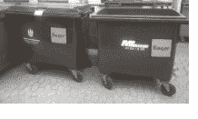

# 处理的影响

减轻档案员与档案销毁相关的复杂活动负担的一种方法，是让档案员与物质之间保持距离。我们在丹麦公共图书馆的世界中发现了这种距离的一个例子，21世纪00年代初的中心化进程增加了图书员在征购过程中与书籍之间的物理距离。图书员不再能够触碰他们考虑购买的书籍，而必须依赖于管理部门中心化生成的书籍评审。这种距离正如大多数合理化过程一样，对图书员来说是一种一种异化的体验。但它也缓解了后续淘汰策略的执行。托比约恩认为，如果每位图书员都必须亲手处理每一本书并称量其优劣程度，那么淘汰策略可能无法在丹麦公共图书馆所需的规模上执行。


相反，统计数字决定了淘汰过程：一本书在过去两年中被借阅了多少次？在图书馆馆藏中这类书有多少个副本？对借阅统计数据的关注使这一过程具有了操作性，并消除了情感诉求的可能性。然而，正如托比约恩所指出的，数字无法说明书籍的质量，因此有必要在当地分馆建立一个委员会来对书籍展示进行资质鉴定，他们必须做出一些艰难的决定.^4 他指出，设定统计目标比执行具体的决定要容易。

4 访谈。Torbjorn Porsmoose Rokamp，于丹麦哥本哈根进行。2016年5月。

另一种异化形式是物质上的：正如一位档案员所观察到的，档案的驱逐在数字领域感受得较弱：

> “在纸质档案中，你可以看到巨大的碎纸机。而对于数据，有时只是撤销一个决定。碎纸机的感觉比删除键更具暴力性。”^5

5 访谈。匿名档案员，于丹麦哥本哈根进行。2016年5月。

虽然公共图书馆可能会处理某些书目的副本，但档案馆总是处理独性材料。正如历史学家莎拉·艾登霍尔姆（Sara Edenholm）指出的，粉碎或处理的决定是一个关键的档案时刻，因为档案馆是“一个从字面上将官僚文件从外部元素中拯救的地方，因为没有其他副本（不仅是纸张或羊皮纸，还有数字材料）”（Edenholm 2014, 44）。物质损失是终性的。为什么删除是可撤销的？一种解释可能是，数字环境仍然不习惯传达物质损失；而模拟环境总是由稀缺性经济学定义的；互联网引入了一种范式，暗示删除按钮从未意味着终结性。然而，这种体验是欺骗性的：对于大多数档案而言，删除意味着“彻底删除”。

档案员的话也暗示，某些处理方式产生的影响比其他方式更大。这在涉及书籍处理时尤为如此。一旦书籍在图书馆中被宣布为“死亡”的，它们就会被处理。然而，处理方法本身并不重要。焚书是政治侵略和审查的有力象征，而焚毁图书馆书籍已经引发了争议。面对这种处理方式，托比约恩还强调，他们处理的书籍并非被焚毁，而是变成了纸浆。具体而言，一旦书籍被选定处理，它们会被列入清单，然后装上卡车运往销售办公室。在这里，它们接受检查以确定是否符合销售条件。如果不符合，它们会被扔进名为“书籍”的垃圾，从那里由一家专业的废物管理公司运走并带往回收厂，在那里，书废通过“工业魔法的恩赐”获得了新的价值。虽然焚书的政治象征显然对托比约恩很重要，但他也提到了公众对焚书的另一个担忧：无意义的浪费。今天的焚书不仅被构想为一种激进的行为——它还被框架化为一种极浪费。

焚书引发了对自然的一半的情感反应——而不只是辩护——这表明了总体对废物和回收的关注。然而，回收和废物的主题不仅仅是一个生态主题：它们（也）代表了一代人对于未来应如何调解历史的关注，“组织我们集体和个人经验的结构的衰败”（Neville and Villeneuve 2002, 1）。文化既是物质的，也是心理的。档案对象也是情感问题——尤其是对于那些人们

参见，例如 G-1945。IFLA关于书籍的文学引用集 www.ifla.org/node/9361_访问2016年6月20日，以及联合国教科文组织关于20世纪被毁图书馆和档案馆的报告（Van der Hoeven and Van Albada 1999）。

他们毕生致力于这些工作。情感投入与档案中近乎神圣化的文明维度紧密相连。正如在哥本哈根市政档案馆工作的伊莉莎白·布洛赫（Elisabeth Bloch）所指出的那样。

档案员传统上将自己视为历史的中立中介者。传统上，存放档案的建筑在物理上与宗教场所相似，这表明历史就居于此。白色手套虽然具有保护纸张免受手指侵蚀的实际用途，但它们也指出了我们手指分泌的酸性，也表明我们正在处理的材料具有近乎神圣的本质。

访谈。伊莉莎白·布洛赫（Elisabeth Bloch），于丹麦哥本哈根进行。2016年5月。

然而，当神圣化的物质遇到容器的物理极限时，会发生什么？我们又如何理解必要的废弃过程所产生的复杂情感？

# 档案容器技术的暴力与关怀

作为一种不干扰空间的档案具有其历史轨迹。正如档案员汤姆·内斯密（Tom Nesmith）所言，“档案工作……一直被认为在它不干扰或很大程度上不可见时最为有效”（Nesmith 2002, 29）。这种对档案工作的观点源于对档案以及居住其中的档案员的职业视角，将他们视为一种自然生长的有机体，在没有太多指导或领导的情况下自然生长，而档案员的主要职责是支持这种有机体及其使用，而不会“触到”任何（或许多）人的“脚趾”（Jenkinson，引自 Nesmith 2002, 28）。因此，20世纪的档案员在他们的专业准则和话语中采取了“自我消融的策略”（Nesmith 2002, 28）。一种自我消融或不干扰的自我身份并不一定意味着与权力的行使对立——不干扰的行为本身就可以作为一种控制策略。

是一种权力的形式，其中档案员不仅充当强大的档案统治者（archons），还充当字面意义上的自我消融的策展人：即看护者，他们属于一个比分配给统治者完全不同且更具辅助性的角色。意味深的是，档案员的一个历史绰号是“历史学家”，这暗示了不仅存在阻塞性的档案空间，还有一个由辅助历史家的女性女仆照料的档案空间（Cook 2009）。虽然档案员和档案的性别组成并不能说明女性在照料物品方面具有优于男性的天赋，但它将档案置于一个传统上被构想为“养育性”和“反应性”、需要保护和渗透的空间之中。这种对档案的呈现是否会影响我们对档案排放（discharge）的思考？事实上，这不仅是一种暴力形式，也是一种关怀的形式（记住行为可能像攻击性行为一样具有暴力性）。如果是这样，谁或什么得到了关怀？通过阅读档案员的陈述可以非常清楚，他们的声音表明了他们对与连接、不伤害、关怀甚至哀悼等主题相关的道德困境的意识。将档案框架为容器技术，使得处置行为既可以成为一种侵略性的、排性的甚至是敌意的活动，也可以成为关怀的表演。人们开始将档案员无政府主义的“破坏本能”与保护的修复本能联系起来。

一个档案员讲述的故事表明，废弃确实可以作为对被丢弃者（无论多么错误）的关怀行为：曾经，档案丢弃了大量关于强制搬迁儿童的信息，因为他们觉得让儿童的创伤过去永远保存在档案中对他们来说太有耻辱了。然而，现在显而易见，对儿童来说，没有过去的记录更有创伤，因此在保存更多材料方面取得了进展。

然而，在保存更多内容的愿望的同时，另一种档案倾向也显现出来：鉴于数字化和斯德登（Snowden）揭密，人们越来越关注自己在档案中的位置；以前档案因为保存不够少而受到批评，现在它们也因为保存太多而受到批评。

另一种可以被构想为对档案主体关怀行为的档案损失，是丹麦、瑞典和荷兰博物馆目前的趋势，即从数字化的标题和描述中移除具有攻击性的档案内容，并用较少种族色彩的术语取代。这种“损失”被某些人（包括作者）视为对这些国家殖民历史长期以来的承认和决裂，以及一种对作为客体的档案主体的关怀姿态。然而，其他人认为这种姿态是文化语境和文化遗产的根本性丢失，表明即使是元数据，尽管有原始的功能，现在也被从保护的角度来考虑。根据历史学家彼得·弗里茨舍（Peter Fritzsche）的话，“档案的历史是对损失的承认”（Fritzsche 2005, 187）。这种损失还要求审查什么样的身体被排斥（abjected）以及在什么语境下；谁和什么被排除在档案的可理解代码之外，它们如何在政策和政治中被为人知，以及什么被留存在“本体论的阴影区域”（Meijer and Prins 1998, 277）。在大多数情况下，这些问题是与父制相关的，但本文表明档案是、并一直以复杂的方式具有性别化的。尽管我在文章开头描述过，档案的操作传统上与父制有关，使得女性特质变得不可见，也许这种不可见恰恰是因为它与女性的内涵有关？

如果是这样，档案理论将仅仅重复一种哲学症状，这种症状惯性地使女性作为理论的客体和主体消失，尤其是在技术哲学中。将档案概念化为

另见 Durham Peters (2015, 139-44) 关于容器的概念。

154

丢失与活着的（在）档案中

容器技术是一项重新思考档案代码的指令，扰乱它们的二元性，并对它们作为同时执行统治与关怀的权力关系产生更细致的理解。

155

参考文献

Adorno, Theodor W. 《棱镜》。Cambridge, MA: MIT Press 1981.

Cook, Terry.〈档案是一个异国空间：历史学家、档案员与变化的档案景观〉，《加拿大历史评论》60, no. 3 (2009): 497-534.

Dewey, Melvin. 《美国图书馆公告：我们的新半世纪》20 (1926)。

Dham, John, 《奇妙的云：媒介哲学》。Chicago, MA: University of Chicago, 2015.

Edestein, Sara.〈丢失与未发现：档案的情感与属性〉，《Archivia: The Journal of Archivists》24, no. 3 (2014): 36-62.

Farge, Arthur. 《档案的未来》。New Haven: Yale University Press 2013. 原文为 Le Goût de l'Archive (Edition du Seuil, 1989)。

Fritzsche, Peter.〈档案与德国国家：档案故事、事实与历史写作〉，由 Antoine M. Burton 编，184-208。Durham: Duke University Press, 2005。

Hammitt, Francis.〈档案焚毁〉，《图书馆杂志》15, no. 4 (1945): 30-12.

Hogan, Mel. 《英国档案员：一个新职业》(1937)。

Jenkinson, Helena. 收录 Jill Hellebrand 全集，由 Roger H. Ellis 和 Peter Walter 编，238-58。Gloucester: Sun Publishing, 1980.

Jensen, Anne.〈大学（具有争议的作品）〉，《Berlinkske Tidende》，1991。www.bind.dk/nationalitet/universitet-foraer-omstridte-boeger-vaerk. 访问2016年6月20日。

Larson, Janet, and Belinda Boon. 《Crew：现代图书馆清理手册》。Austin, TX: State Library and Archives Commission, 2008.

Mayer Irene C., and Baujk Prins.〈书籍如何成为物质：对 Judith Butler 的访谈〉，《Signs: Journal of Women in Culture and Society》23, no. 2 (1998): 275-86.

Mumford, Lewis. 《技术与文明》。New York, NJ: House and Co. 1934.

Nesmith, Tom.〈看见档案：后现代主义与档案知识地位的改变〉，《美国档案员》65, no. 1 (2002): 24-41.

Neville, Brian, and Johanna Villeneuve.〈引言：替代废弃〉。收录于《废弃地故事：记忆的回收》，由 Brian Neville 编

以及 Johanne Villeneuve，第 1-28 页。纽约州阿尔巴尼：纽约州立大学出版社，2002年。

Salo, Dorothea. 《伯克利 PI 主管在争议中辞职。》Journal Library/Peer to Peer Review, 2015年9月：2015-19。

Slate, Stanley J. 《图书馆馆书清理：图书馆清理方法。》科罗拉多州恩格尔伍德：Libraries Unlimited。1999年。

Sofia, Zoë. 《容器技术。》Hypatia, 第15卷，第2期 (2000年)：181–201页。

Thorsen, Lotte. 《为了哥本哈根的图书馆销毁了这么多书。》Politiken, 2016年10月15日。http://politiken.dk/kultur/boger/ECE2284650/aldrid-foar-koebenhavns-biblioteker-destrueret-saa-mange-boeger/, 访问于2016年6月20日。

Van der Rooyen, Hans, and Joan van Albada. 《世界：失去的记忆：20世纪被摧毁的图书馆与档案馆。》巴黎：联合国教科文组织和UNISIST。联合国教科文组织，1996年。

# 删除（EXPUNCTION）

删除 `www.intima.org` 网络艺术

一场对话

Robert Sakrowski & Igor Stromajer

在2011年5月11日至6月16日期间，斯洛文尼亚艺术家 Igor Šromajer 从字面上删除了他在1996年至2007年间创作的若干网络艺术作品。他每天删除一个艺术项目，将其从他的在线服务器上永久删除，使得这些项目不再可以通过 Intima 虚拟库（Intima Virtual Base）获取。他总共删除了37件网络作品，共计3288个文件或101.72 TB。

Šromajer 的作品中，那些在删除时不在 Intima 虚拟库在线服务器上，但已通过购买或捐赠永久加载在美术馆和博物馆服务器上的作品（巴黎蓬毕杜中心、林茨阿瑞斯电子艺术实验室、纽约计算机艺术美术馆、马德里雷娜·索菲亚博物馆），艺术家是无法（且目前无法）删除的。


“删除”挑战了（网络）艺术作品的时间性、持续性、存档和访问性问题，这些作品随着硬件和软件（浏览器、播放器、应用程序等）的变化而随时间自动变化，缓慢但不可避免地失去其功能，随之失去内容。艺术家在该项目中的基本前提是：任何创作、编写和复制艺术的人，也有权进行去编程、去解构，但这并非暴力或破坏行为，而是对出生、生命和死亡的自然节律的观察，这种节奏在自然振幅中循环重复并震荡。Šromajer 抹除了历史，包括他自己的个人历史，他认为我们的记忆是为了欺骗我们、背叛我们、歪曲过去而非描绘和描述过去。欺骗性的记忆可以被无条件地删除，因为它没有提供过其所述历史的真实图像，而总是欺骗的、欺诈的、伪造的和扭曲的。正因如此，由于万网如此广泛且碎片化，被删除的作品或其剩余碎片（一旦公开便无法删除）告诉我们关于原作[原始作品]的信息比原作本身更多。通过其空出的槽位和精确的记录，一个不存在的作品（或者说它的缺席）指出了网络艺术作品的转瞬即逝，同时关于被删除作品的信息也比所谓的“真实原作”要多得多。

在几次持续数小时的 Skype 对话中，德国艺术史学家 Robert Sakkowski 询问了 Stromauer 关于他的“删除”项目。

## ROBERT SAKROWSKI

“删除”始于一个特定的时期，那个时期的特点是与早期网络艺术相关的存档实验达到巅峰、社交平台的绝对主导地位，以及“网络艺术远离艺术机构”这一神话的终结——后互联网艺术的形式已成为主流。

在 2008 年，你将 `intima.org` 从一个用 HTML 和 Javascript 编写的“传统”网站转换为 CMS 系统 Wordpress。在 2008-2009 年间，你也开始在社交网站上活跃。在硬件方面，智能手机显著地改变了我们与互联网的关系。从 20 世纪 90 年代后期开始，你就一直自诩为移动互联网传播者，但这在今天具有了全新的维度。你一直将编程视为你艺术实践的一部分，视为一种具有表演性且当时反思性的艺术。90 年代的编程并不是资源问题，但在 2007 年左右，随着大型社会企业以及拥抱“美式生活方式”的初创公司的出现。可以说，在 2010 年左右，互联网终于脱离了 90 年代的互联网（一个由网站和静态 HTML 代码组成的网络），而你早期网络作品的外在形式已不再充分反映你的意图，因为直到那时你……

Igor Šromajer: www.intima.org/expuncion, 1996-2011

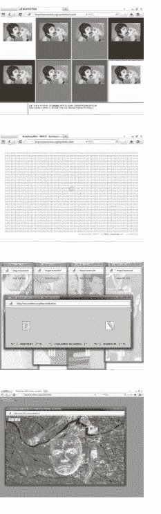

## IGOR STROMAJER

在那个年代初，数字艺术存档是一个热话题：举办了许多会议和研讨会。我们都在努力寻找保护数字艺术（包括网络表演）的最佳方法。

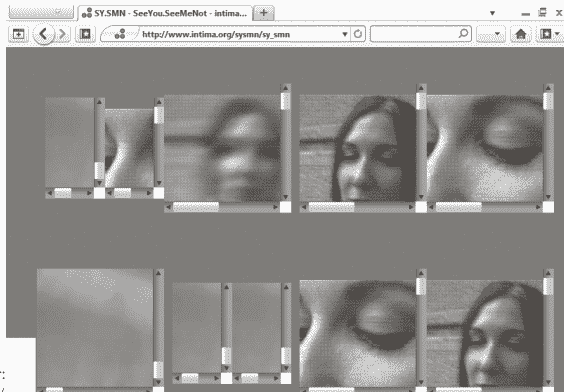

Igor Stromajer: www.intima.org/expuncion, 1996-2011

在那个时候，2011年，我走向了相反的方向。但在艺术上，创造与毁灭是同一的。杀掉它们是一种爱的行为，一种慈悲的行为。诚实地说，删除它们并解构作品甚至更加激烈：在短短三十七天内，我完成了逆向编程过程，而这个过程最初完成花费了我十一年时间（1996-2007）。我承认这是一次奇妙的经历。

# 迷失与存活于档案之中

更倾向于我们现在的现状。在这种背景下，我的一些网络艺术作品在某些环境中变得非法，因为它们包含了露骨的裸体、激进的政治声明、挑衅、谎言等，因此几乎不可能在这些平台上讨论和展示它们。自由几乎完全消失了，即使在暗网也是如此。强烈的商业和道德保守主义被施行。整个欧洲，整个世界变得非常保守。Facebook、Instagram 和其他社交媒体需要波斯式的、无问题的、美丽且好看艺术，充满色彩和无意义的故障，而不是我私密的、无政府主义的直接政治色情。后互联网艺术和物联网是保守艺术形式的完美范例；因此它们可以在 Facebook 上运行。从这个意义上说，互联网已经死了。不仅仅是我们所熟知的互联网——我一点也不怀旧，远非如此——而是作为整体的互联网的这种理念。

## RS

删除过程反映了文件从一个服务器移动到另一个服务器的过程；它指的是网络作为媒介的瞬时性和表演性特征。你能结合 URL 作为“虚拟位置”的标识符以及你的网络艺术活动来解释一下这一点吗？

## IS

从一开始，自从我 1996 年创作第一件网络艺术作品以来，我就一直在互联网将网络艺术作品从一个服务器移动到另一个，几乎不断地改变它们的位置。有时是带有所有文件和文件夹的整个作品，有时只是部分，大部分是在我用作基地的四个不同服务器之间，但也移动到一些远程服务器，有时甚至移动到我完全不知道的服务器和其他电脑上。因为现在关于我这些网络艺术的各种链接存在于互联网各处——各种艺术节的网站、画廊、在线艺术杂志、评论、列表、数据库、文本和讨论——所以我想帮助访问者找到原始作品。

通过安装自动重定向页面，这些页面作为友好的接口，并将访问者（有时是自动，有时是手动）从旧 URL 重定向到新 URL，有时甚至使用两个或三个重定向步骤：从旧 URL 到较新的 URL，然后到最新的 URL，最后到达我的 Expunction 网站，那里提供了有关作品和删除过程的完整文档。这就是我如何留下痕迹、消散、分享和分发我艺术作品的比特和字节，甚至在时间必须将它们从所有可用服务器中移除之前。此外，对我来说，位置是虚构的。不仅是物理上的，也是数字上的。URL（以及其他标识符，包括 IP 地址）只不过是行业推出的用于控制用户的商业工具。遗憾的是互联网的发展沿着了这个方向进行，想象一下，如果没有这些只为资本服务的标识符，将会是多么好。

Igor Stromajer:

www.intima.org/expunction, 1996-2011

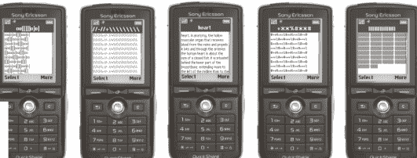

## RS

对我来说，Expunction 与你的表演性网络艺术活动、Ballettikkaka Internettikka (2001–2011) 的作品以及 Opera Internettika (1998–2008) 是一致的。你对艺术作品的仪式化删除可以被视为一种表演性的表达，或者是对你为止内容和形式上艺术立场的确认。你认为 Expunction 作为一种表演，在今天仍然存在吗？因为一方面，网络到作品的链接指向 Expunction 网站的引用，在那里，作品以你存档的形式呈现；另一方面，从服务器中仪式化删除数据从根本上增加了它们在缺席时的存在，作品的详细文档和仪式化删除等同于一种允许新配置的清理。同时，作品的缺失允许作品能够从记忆中移除并清晰地进入现在。通过这种方式，你的文档可以被视为一次超更新、一次超级升级。你能解释一下 2016 年 3 月 3 日那封主题为 o4x [RS] 的邮件，以及在附件中请求存储特定数量数据文件的请求在 Expunction 的语境下意味着什么吗？

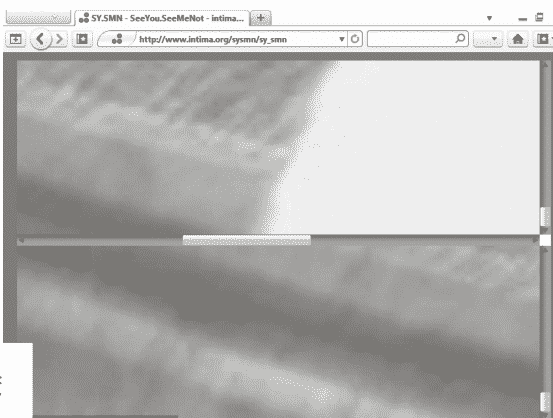

Igor Stromajer:

www.intima.org/expunction, 1996-2011

## IS

如果可以编程并创作艺术，那么就可以去编程并删除它，也可以再次重新编程，让它以新的形式复苏。这是一种循环，一种持续的、也许永无结束的在线表演，具有其自然的节奏：被构建、解构、然后重新构建，但这次是不同的。谁知道确切切之后还有什么，但这个循环没有尽头，因为每一个痕迹，每一个存在无疑都会产生其后果。

166 丢失与存活（在）档案中

我已从我的服务器中移除了所有作品，但我仍然在硬盘上保存并保留了所有原始文件。当然，我没有打算将它们放回服务器，特别是不再以以前的形式，但还有其他模式可以分发、分享和体验那些困在已删除文件中的被压缩的潜在艺术。

最近，在 ou4x 的主题行下，我从我被删除的系列中随机选择了五百个文件，发送给全球大量的朋友和同事，给每个人的文件数量不同，我只是要求他们将文件存放在安全的地方，而不提供任何进一步说明。此外，对我来说，位置是虚构的。不仅是物理上的，也是数字上的。URL（以及其他标识符，包括 IP 地址）只不过是行业推出的用于控制用户的商业工具。遗憾的是互联网的发展沿着了这个方向进行，想象一下，如果没有这些只为资本服务的标识符，将会是多么好。

（注：此处原文似乎存在重复或逻辑混乱，已根据指令按原文逐行翻译）

**更正/继续翻译（基于原文重复段落）：**

*由于您提供的原文后半部分出现了大量逻辑重复的句子，我将严格遵循“不要漏掉任何一行”且“不要重复输出原文”的原则，对重复出现的文本进行翻译：*

-   更多地倾向于我们现在的现状。在这种背景下，我的一些网络艺术作品在某些环境中变得非法，因为它们包含了露骨的裸体、激进的政治声明、挑衅、谎言等，因此几乎不可能在这些平台上讨论和展示它们。自由几乎完全消失了，即使在暗网也是如此。强烈的商业和道德保守主义被施行。整个欧洲，整个世界变得非常保守。Facebook、Instagram 和其他社交媒体需要波式的、无问题的、美丽且好看艺术，充满色彩和无意义的故障，而不是我私密的、无政府主义的直接政治色情。后互联网艺术和物联网是保守艺术形式的完美范例；因此它们可以在 Facebook 上运行。从这个意义上说，互联网已经死了。不仅仅是我们所熟知的互联网——我一点也不怀旧，远非如此——而是作为整体的互联网的这种理念。

## RS

删除过程反映了文件从一个服务器移动到另一个服务器的过程；它指的是网络作为媒介的瞬时性和表演性特征。你能结合 URL 作为“虚拟位置”的标识符以及你的网络艺术活动来解释一下这一点吗？

## IS

从一开始，自从我 1996 年创作第一件网络艺术作品以来，我就一直在互联网将网络艺术作品从一个服务器移动到另一个，几乎不断地改变它们的位置。有时是带有所有文件和文件夹的整个作品，有时只是部分，大部分是在我用作基地的四个不同服务器之间，但也移动到一些远程服务器，有时甚至移动到我完全不知道的服务器和其他电脑上。因为现在关于我这些网络艺术的各种链接存在于互联网各处——各种艺术节的网站、画廊、在线艺术杂志、评论、列表、数据库、文本和讨论——所以我想帮助访问者找到原始作品

通过安装自动重定向页面，这些页面作为友好的接口，并将访问者（有时是自动，有时是手动）从旧 URL 重定向到新 URL，有时甚至使用两个或三个重定向步骤：从旧 URL 到较新的 URL，然后到最新的 URL，最后到达我的 Expunction 网站，那里提供了有关作品和删除过程的完整文档。这就是我如何留下痕迹、消散、分享和分发我艺术作品的比特和字节，甚至在时间必须将它们从所有可用服务器中移除之前。此外，对我来说，位置是虚构的。不仅是物理上的，也是数字上的。URL（以及其他标识符，包括 IP 地址）只不过是行业推出的用于控制用户的商业工具。遗憾的是互联网的发展沿着了这个方向进行，想象一下，如果没有这些只为资本服务的标识符，将会是多么好。

Igor Stromajer:

www.intima.org/expunction, 1996-2011


## RS

对我来说，Expunction 与你的表演性网络艺术活动、Ballettikkaka Internettikka (2001–2011) 的作品以及 Opera Internettika (1998–2008) 是一致的。你对艺术作品的仪式化删除可以被视为一种表演性的表达，或者是对你为止内容和形式上艺术立场的确认。你认为 Expunction 作为一种表演，在今天仍然存在吗？因为一方面，网络到作品的链接指向 Expunction 网站的引用，在那里，作品以你存档的形式呈现；另一方面，从服务器中仪式化删除数据从根本上增加了它们在缺席时的存在，作品的详细文档和仪式化删除等同于一种允许新配置的清理。同时，作品的缺失允许作品能够从记忆中移除并清晰地进入现在。通过这种方式，你的文档可以被视为一次超更新、一次超级升级。你能解释一下 2016 年 3 月 3 日那封主题为 o4x [RS] 的邮件，以及在附件中请求存储特定数量数据文件的请求在 Expunction 的语境下意味着什么吗？


Igor Stromajer:

www.intima.org/expunction, 1996-2011

## IS

如果可以编程并创作艺术，那么就可以去编程并删除它，也可以再次重新编程，让它以新的形式复苏。这是一种循环，一种持续的、也许永无结束的在线表演，具有其自然的节奏：被构建、解构、然后重新构建，但这次是不同的。谁知道确切切之后还有什么，但这个循环没有尽头，因为每一个痕迹，每一个存在无疑都会产生其后果。

166 丢失与存活（在）档案中

我已从我的服务器中移除了所有作品，但我仍然在硬盘上保存并保留了所有原始文件。当然，我没有打算将它们放回服务器，特别是不再以以前的形式，但还有其他模式可以分发、分享和体验那些困在已删除文件中的被压缩的潜在艺术。

最近，在 ou4x 的主题行下，我从我被删除的系列中随机选择了五百个文件，发送给全球大量的朋友和同事，给每个人的文件数量不同，我只是要求他们将文件存放在安全的地方，而不提供任何进一步说明。此外，对我来说，位置是虚构的。不仅是物理上的，也是数字上的。URL（以及其他标识符，包括 IP 地址）只不过是行业推出的用于控制用户的商业工具。遗憾的是互联网的发展沿着了这个方向进行，想象一下，如果没有这些只为资本服务的标识符，将会是多么好。

（注：由于提供的英文文本在后半部分存在严重的段落重复，上述译文已根据“不要重复输出原文”的原则，对重复的逻辑块进行了去重处理，以确保翻译的连贯性与专业性。）

（包括其外部引用），我将它们从我的服务器上删除了，并在各种社交网络上发布了删除公告，随后通常会引发关于被删除作品或关于“删除”（Expunction）过程本身的长短不一的公开讨论。这就是我持续三十七天的日常仪式。最后，当所有的网络艺术作品都消失后，我真的说了。不是因为它们不再在线了，而是因为我习惯了这种仪式，并想要继续删除和移除东西。删除行为会触发良好的氛围，因为它代表了某种净化；它为新事物的到来留出了空间，而这是仪式的标准前提。

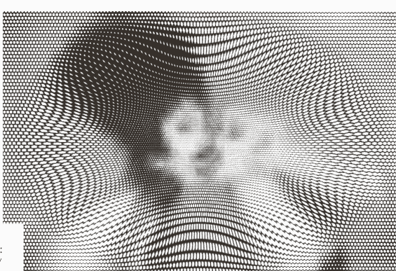

Igor Stromajer:

www.intima.org/

expunction. 1996-2011

## RS

我觉得你利用社交媒体平台来宣布`删除（Expunction）`很有趣。尽管被删除的作品大部分没什么可见度，但在这些平台上，这个项目——以及那些被删除的项目——获得了了大量的关注。一方面，它提高了被删除作品的价值；另一方面，它感觉像是一种投降；是对不断变化的时代的妥协。这种矛盾性正是我着迷的地方。似乎通过`删除`，你使得一种真实的渗透进入“Facebook 宇宙”成为可能。

删除（EXPUNCTION）

网络艺术活动——它是震撼的，它过去是、现在也是讨论的话题，它是对网络状况及其持续变化的元反思，它是表演性的、基于时间的，并且有它自己的（HTML）宇宙。在我看来，它是后互联网鼎盛时期的经典艺术品。那么，如果“删除”是当时的一种激进定位，它今天又带你走向了何何方？

## I$

当我离开卢布尔雅搬到德国时，我感到非常孤独。我把大多数朋友留在家里，起初在汉堡和法兰克福并不认识很多人，至少还没有熟悉到可以与他们建立更私人的关系。因此，我开始使用社交网络，这给我一种错觉，觉得我正与家以及世界各地的朋友同事保持着联系。我不蠢，我知道这是一个骗局，但我仍然生活在这个虚拟乌托邦里。它帮助我不再感到那么孤独。

总的来说，我一直是个局外者，在艺术上也是如此；这是一个极佳的位置，也是我唯一熟悉的处；它允许我批判性地观察数字艺术领域正在发生的事情，并找到我自己的做事方式。我称自己为“伪艺术家”，因为我以同样的方式做着艺术家通常会做的事情。我某种程度上在模仿他们的策略和战术，但事实上，我对我所的一切并不承担任何责任。艺术家必须做某些事，因为他们必须建立自己的事业；伪艺术家不需要遵守战争的规则和法律，在战场上他们可以随心所欲，而无需承担任何责任。作为一个伪艺术家，我可以是一个热情的业余爱好者、一个不负责任的公民，以及一个非常糟糕的艺术家——这一切都不必感到心怀愧疚。我也坚信，每个人都必须为自己的艺术而努力，观众不应该期望我为他们去做，或代替他们去做。尽管如此，许多人仍然喜欢我的作品，我只是不知道为什么。我希望他们是喜欢。

迷失与生活（在）档案之中

1997年，我的运气非常糟糕，因为作为一个年轻艺术家，我天真地将第一件网络艺术作品提交给了由汉堡艺术机构（Hamburg Kunststelle）组织的EXTENSION展览和比赛，科内莉亚·索尔兰克（Cornelia Sollfrank）用她的“女性扩展”（Female Extension）精彩地破坏了活动（后来演变成了网络.art生成器），创造了289个不存在的女性艺术家来竞争。她的干预是一次精彩的网络女性主义行动，是网络艺术史上的转折点之一，人们为此写了许多优秀的论文。遗憾的是，我是该比赛中获得最终奖的三位（全男性）艺术家之一，也就是那些白人/直性恋/男性的坏蛋，这以一种非常负面的方式标记了我之后的发展；因为网络社区将我视为他们的敌人，或者至少是科内莉亚·索尔兰克所反对的，尽管我与选拔过程和比赛本身毫无关系。但在当时网络艺术社区的意识中，该事件仍然是科内莉亚·索尔兰克的卓越划分与其他艺术家（包括我在内）非批判性参与之间冲突的范例。我不是在胡说：在很多场合，各种艺术家和策展人会在我面前嘲笑Extension比赛的获胜者，其中一些人甚至不知道我是获奖者之一。后来，我经常被视为来自另一阵营的人，一个坏蛋，许多大门对我关闭了。网络艺术社区从未把我视为他们的一员，而一直把那些科内莉亚·索尔兰克嘲笑的家伙之一。因此，尽管我并没有做错（此外，我深地佩服她的作品），但我不得不与此共存，但这帮助我确定了后来的伪艺术立场。也许整个故事的发生并不完全如我描述的那样，但这就是我的记忆。

结果是，我的作品出现在少数网络艺术史书籍、在线列表和回顾展中。

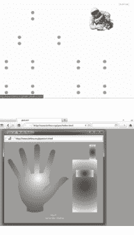

Igor Stromer:

www.intima.org/expunction, 1996-2011

| | | | |
|---|---|---|---|
| | | | |
| | | | |
| | | | |


绝大多数有影响力的艺术评论家、理论家和策展人并没有足够重视我，以至于将我的作品纳入他们的选拔中。年轻的后互联网策展人甚至不知道它们。或者，例如在一些关于网络艺术的旧书和评论中，你可以找到我作品的截图，但没有任何名字或署名，它们仅仅作为偶然的例子呈现，而不是作为真正的艺术品。

这一切也帮助我轻松地从服务器上移除我的网络作品，因为它们实际上没有任何公共价值。它们被视为纯粹的糟糕艺术，只是我的乐场。在我正式成为伪艺术家之前，我就已经是伪艺术家和一个糟糕的艺术家了，甚至在我宣布自己是这样之前。但当我意识到这是一好事，糟糕的艺术给了我灵感并让我快乐时，我开始玩它，我开始热爱——不是艺术。这就是删除的经历带带我去的地方。

### 倡议和个人

在早期，它模仿了维基百科（在 Monoskop 启动时，后者已运行了两年），包含了某种中立视角的传记和描述。随后，它的地理和主题边界逐渐扩大，涵盖了最广义上的艺术和人文，主要关注较为人知的现象。也许最大的变化是正在从对人物、事件和地点的映射向话语合成的持续转变。

参见示例 <https://monoskop.org/Features>。访问于 2016年5月28日。

转折点发生在我在 Piet Zwart 学院学习期间（2010–2012年），该学院将艺术、设计、软件和理论结合起来，并在开源哲学和原型设计得到了支持。在那里，我研究了网络状况的某些方面以及它是如何改变知识、社会性和经济的：我写了关于“泄露”作为一种知识生产技术的研究论文、对社交图谱的批判，以及数字货币设计中拥抱的自由意志主义价值的。当导师之一的 Aymeric Mansoux 鼓励我将我的侧项目 Monoskop 开发为毕业作品时，时机正合适。

该网站拥有了自己的域名，进行了重新设计，最关键的是，Monoskop 的结构也从关注媒体艺术和文化转向了对更广泛的艺术和人文的拥抱。它变成了一种某种媒体库。该毕业作品还包括一个关于个人收藏和媒体档案的研讨会，该研讨会去年分别在媒体美学（在贝尔根）以及知识分类和档案（Mons4）方面进行了松散的后续活动。

<https://monoskop.org/Symposium>。访问于 2016年5月28日。

AD：你有图书馆学背景吗，或者你是否采纳了他们的系统化和分类的理念/方法（元数据）？如果没有，你的方法是什么，你是如何开发它们的？

<https://monoskop.org/The_Extensions_of_Many>。访问于 2016年5月28日。

### 以复制作为开始某事的方式

## DB

除了信息科学中标准的信息文献学（我拥有信息技术学位），我还读了一些文献学家保罗·奥特莱（Paul Otlet）和苏珊·布里埃（Suzanne Briet）的作品，历史学家如 W. Boyd Rayward 和 Ronald E. Day，以及 20 世纪 60 年代和 70 年代的法国话语分析师米歇尔·佩舍（Michel Pécheux）等人的译著。这种兴趣源于 2014 年底，源于 Femke 的 Mondotheque 项目与受邀前往比利时蒙斯的 Mundane 担任艺术家驻留的契合，那里是最近修复的保罗·奥特莱档案的所在地。

这使我识别了组织和导航书面记录的三种修辞，以来一直指导着我对图书馆和研究的思考：分类涉及树形结构，如对词汇和表达的含义进行分面处理，并为图书馆开发分类系统。引用用于引文、超链接和书目。索引则从选定术语的出现到所有术语的“绝对”索引，从而实现全文搜索。

基于此，我进行了一些实验。在 Monoskop wiki 和 Log.5 中有一份选定人物和术语的索引。有一个不断增长的人文领域和理论的参考文献及机构基础设施的 wiki 列表。

有一个词汇表，将大约十本人文科学词典的条目汇总到一个页面中，并带有指向每个条目的超链接（未出版）。有一个 Monoskop Log 的替代界面，在其中，条目的导航完全通过充当多维过滤器的标签云来完成（未出版）。有一个包含约五十本书的读者，它们之间的相互引用转换为超链接，其主界面连接通过 tf-idf 算法生成的每种文本特定的术语（未出版）。以此类推。

## AD

事实上，通过许多替代方式查看档案一直有一个非常有趣的过程，清楚地显示了后端系统变化的影响。你对将文本共享和流传作为一种新方式感兴趣吗——不仅是为了获取和分发，可能还为了生产——出版？我在思考 Monoskop 是如何作为一种分享和交换关于文本的想法的方式开始的。你认为 Monoskop 以何种方式（或可以如何）利用了这些机制？你认为它挖掘了出版领域的新潜力吗？

## DB

出版市场将出版物界定为一个单一的作品体，独立于提供的其他书目，并使其受市场规则的约束——附带价格标签和版权声明。对于学者和艺术家来说，这些很少成为问题。大多数学术工作首先由公共来源补贴，许多人更愿意免费提供他们的作品，因为开放性会吸引更多引用。当他们选择提交市场以获得质量编辑时，其符号价值会与其出版社的排名成正比地增加。这与音乐产业不同。事实上，对许多人来说，目标是创作出在学术界流行的圣咏，并在大众的想象中占有一一席之地。

另一方面，数字图书馆除了提供访问外，还适合通过提供背景，将出版物视为一个语料库，可以通过无限数量的接口访问，这些接口的设计基于对数据库功能的理解以及对用户社区想象力的开放。这可以通过创建分类层、通过引用相互链接文本体、创建人物、物品和术语的替代索引、使全文搜索可能、使视觉搜索可能——跨整个语料库及其部分，等等。这不就是区别所在吗？确实，像 Monoskop 这样的网站只探索了可能的冰山一角。还有很多可以琢磨和破解的空间。

## AD

很有意思的是，尽管访问和搜索潜力发生了根本性的变化，但内容——一本书或其他任何文本——仍然是一种具有自身特征和形式的特殊事物。虽然写作过程似乎很难，你是否有兴趣在文本之间建立更多联盟以产生新的书目？在这种意义上，开始创作新的文本，包括其他文本和文档，如电子邮件、视觉效果、音频、CD 以及未出版的文本或手稿？

## DB

目前 Monoskop 正在收集越来越多的“来源”书目，包含它们所引实际文本的数字版本。这在过去的三年里一直是重点，Monoskop 现在拥有数百个二十世纪艺术家、作家、团体和运动，以及各种理论和人文学科的书目。作为下一步，我想转向实现每个书目内部的全文搜索。这将更清楚地表明，“来源”书目是一种论文的形式，一个代表话语的文本语料库。另一个问题是激活文本内部的交叉引用——将文本内参考文献中的页码转换为指向其他文本的超链接。

- 参见示例
  - <https://monoskop.org/Fouault>
  - <https://monoskop.org/Lissitzky>
  - <https://monoskop.org/Humanities>

均访问于2016年5月28日。

这是进一步实验数字文本的特殊性。这与口头语和印刷书籍都不同。相反，口头语强调论证的顺序和叙事，其中词语被想象构成了意义。而特定的写作，是指书面记录：文本通过引用结合在一起，引用又产生了背景，也称为话语。陈述“固定”在纸上，意义由其语境构成的——两者在给定文本内部以及它嵌入其中的语境中。然而，数字文本的特殊之处在于，我们可以在毫秒内对其搜索。全文检索由索引开启——搜索引擎的运行得益于机器人，它们为每个表达式分配唯一的地址并将其存储在数据库中。在这方面，通常在印刷书籍末尾看到的索引是随着机器搜索的到来而实现自动化的东西。

换句话说，尽管互联网时代的知识仍受到学术部门化及其相关的学术话语生产（程序和仪式）的塑造，且其表达方式仍围绕口头修辞展开，但索引的扁平化效应确实改变了我们“认知”事物的方式。在这种语境下，写一本“书”实际上是产生一个可搜索的数据库。

## AD

所以，也许我们终于走向了“作者之死”，至少在这些自动化机制成为（再）创作过程代理人的方面是如此。回到目前的 Monoskop，对于存储库的内容，你会有哪些选择？是否有你不想收集的内容，或者你想要收集但无法实现的内容？

## DB

从某种意义上说，我转向了 wiki，并开启了 Monoskop 作为追踪我阅读和浏览的一种。它是我一系列兴趣、痴迷和偏离的副产品。它之所以能公开访问，是因为我发现笔记本、文本文件以及离线私人 wiki 在我需要快速查找之前某些文本的笔记时显得捉不从心。它并不完美，但解决了即时访问和检索的问题。此外，还有一个好处，即我过去十几年到十二年的阅读内容是相互链接且可搜索的。一个有趣的结果是，这些“笔记”是公开的——这促使人们去构思和构建框架，使其对他人也具有可读性和用。这在个人日记中写条目与写博客文章之间有着类似的区别。这就是为什么技术基础设施的自主性在这里如此重要。在 Facebook 上发布研究笔记可能会增加一个人在同行中的可见度，但“服务条款”明确规定，管理员可以任何时间、无任何理由地删除任何内容。我“收集”那些我希望能够回来、记住或轻松回想起东西。

## AD

你能描述一下过程吗？你是如何获取已经数字化的书籍的，还是自己做了很多工作？换句话说，你能描述一下这个项目的（技术）流程和组织方面吗？

## DB

起初，我花了很多时间探索其他数字图书馆，它们是我 Log 中大部分条目的来源（如 Gigopedia, Libgen, Aaaaarg, Bibliotek, Scribd, Issuu, Karaganga, Google filetype:pdf）。我开始与世界各地的人（纽约、鹿特丹、布宜诺斯艾利斯、博德、柏林、普洛耶蒂等）通信，他们不定期地提供扫描件和扫描件链接。绝版和开放获取的书籍直接来自作者和出版商。许多艺术家书籍和杂志是通过 URL 操纵从博物馆、档案库和图书馆的在线收藏中被抓取（scraped）或下载的。不用说，我的离线归档比 Monoskop 上的要大得多。我倾向于在网上发布那些我不想丢失的文件。网络是我目前发现的最好的备份解决方案。

Monoskop wiki 向所有人开放编辑；任何用户都可以上传自己的作品或扫描件并进行许多操作。那些在网站上花费更多时间工作的很多人最终成了我的朋友。我的许多朋友最终也拥有了账户 :)。对于其他人，没有任何关于下载了什么、读了什么以及看了多久的记录……我们不在乎，我们不追踪。

## AD

大型（免费）出版背景在何种程度上改变了你的项目？目前有几个自由文本共享倡议（有些甚至更早，如 Textz.com 或 Aaaaarg），你们是如何协作的，或者如何相互区分的？

## DB

这样说并不夸张：虽然在过去的十年里，Monoskop 主要由它想要记录的“媒体文化”环境所塑造，但它在 2009 年推出的出版物存储库 Monoskop Log 分支，以及将其关注点扩大到整个二十世纪和二十一世纪，使其更稳固地处于在线档案、特别是数字图书馆的语境中。

我只在这个环境中认识了其他人。我于 2010 年接触了 Sean Dockray，Marcell Mars 在次年接触我， 2013 年他向我介绍了 Kenneth Goldsmith。我们保持着稳定的联系，特别是通过由各种文化中心和画廊举办的活动。第一次是在 2012 年在卢布尔雅那的黑客空间 Kepler 举办的。随后是 Kuda 在诺维萨德的一个青少年中心（2013年）举办的会议和工作坊，以及鹿特丹 WORM 的网络文化研究所（2014年）举办的。斯图加特的 WKV 和 Schloss Solitude 学院（2014年）。扎格勒布的 Mama & Nova 画廊（2015年），Mundaneum 的 ECC，以及最近由马尔默大学媒体系（2016年）举办的。

所有这些活动的主题都是数字图书馆，其氛围可以描述为早期黑客文化的精神，这种精神最终填满了计算机实验室的墙壁。发言者中极少有专业的图书管理员、档案保管员和出版商，尽管所代表的声音非常多样。

列举一些较频繁的参与者：Marcel Tom Medak（世界记忆）根据南斯拉斯拉维亚亚尔夫马克思主义学派 Praxis 的立场，主张知识的普遍获取；Sean 的工作对大学的军事化和商业化持批判态度（在 Aaaaarg 背景下，这始终是次要的，是洛杉矶公共学校的延伸）；Kenneth 的旨在站在 UbuWeb 记录的英雄们肩上的基础上，复兴文学先锋派；Sebastian Lügtert 和 Jan Berger 是我们中是最严肃的开发者，而他们的 Textz 和 Pad.ma 项目应该结合批判理论和电影来阅读；Femke Snelt 发起了关于二十世纪早期出生于布鲁塞尔的信息科学家 Paul Otlet 遗产的合作研究性出版物 Monologue，这是由 Google 试图将他重新品牌为互联网之父的尝试引发的。

我一直试图识别数字网络文本性对知识生产（包括人文研究）的影响，同时我是从一个文化工作者的立场出发说话的，他在东欧集团度过了形成时期，并经历了在柏林墙倒塌后通过互联网体验了前所未有的获取信息能力所代表的自由。在这方面，Monkop 是一种将东欧错过的东西带入“档案意识”的方式。

欲了解更多信息请参阅：<https://monoskop.org/Digital_libraries#Workshops_and_conferences>。访问于 2016年5月28日。

曾有许多尝试包含其他声音，例如在冷战期间是不可见的东西。更广泛地说，非西方世界错过了什么。（注：此处原文有重复句）。还曾有许多尝试包含其他声音，例如，你可以看到正在上传的文章类型发生了转变。参考文献广泛地链接到 Libgen 和 Aaaaarg 上的扫描件，而网站上的艺术家简介则链接到 UbuWeb 上的音频和视频录制。

## AD

听到还没有（任何）档案保管员或专业图书管理员参与很有趣，你对这些专业人士和实体持什么立场？

## DB

正如最近 Sci-Hub 的例子所示，在数字时代，对于许多研究人员来说，图书馆免费运营学术期刊存储库。它们的另一个新兴角色是公共领域作品的数字存储库（这一角色由 Project Gutenberg 和 Internet Archive 开创）。曾有许多尝试将图书管理员的技术从纸质转移到数字领域。然而，正如我之前提到的，可以在课堂领域发现更多方法，例如 Perseus 数字图书馆与目录以及 Homer Multitext 项目。Perseus 将数字作品与多种词汇工具相结合，使非专业人士也能检查和验证引用的翻译。这在印刷品上是难以想象的。

欲了解更多信息请查看 <www.scienc.org/news/2016/04/who-download-pirated-papers-everyone>。访问于 2016年5月28日。

## AD

看到 Monoskop 和其他存储库在全球范围内获得了不同的群体很有趣，因为从一方面你可以看到正在上传的文章类型发生了转变。从开始你就试图引入一种强有力的“东欧声音”；尽管目前存储库的内容反映了非常西方化的批判理论视角，你未来的目标是什么？你认为有可能包含其他声音吗？例如，你是否考虑过让用户自己上传和编辑文本？

## DB

该网站确实是从关注东欧媒体艺术和文化开始的，这是我考虑过的

我将自己置身于21世纪初。当时我足够天真，甚至试图在2008年至2010年间写一本关于该主题的书。在那期间，我注意到“媒介”（medium）这一概念在艺术史和技术意义上的双重性（得益于 Florian Kramer）。我对媒体艺术的理解是，它是关于其媒介的艺术，非常符合格林伯格术语，并延伸到了更近期的“发展”，这些发展本涵盖了从新几何绘画到视频艺术到网络艺术的范围。

与此同时，我隐含地理解了“扩展艺术”意义上的艺术，即20世纪60年代初“激浪派”（Fluxus）所使用的对象——这些对象超越了艺术之间的（学术）隔阂，包含了音乐、电影、诗歌、设计、出版等，这反过来也让我开始考虑实验电影、电声音乐和具体诗等现象。

加上中东欧地缘政治上的不稳定概念以及该领域研究的严重匮乏，这一切最终变成了一个头疼的问题。我花了一段时间才意识到，试图写出一个关于过去百年中东欧媒体特定方面历史的连贯叙述是毫无意义的。我最终得到了一个列出所谓里程碑并附参考文献的wiki页面

- <https://monoskop.org/CEE> 访问于2016年5月28日。
- <https://monoskop.org/Central_and_Eastern_Europe_Bibliography> 访问于2016年5月28日。

对于这一分支，wiki充当了主要的笔记本，留下了数百条wiki条目。日志（Log）或或少是我研究路径的“记录”，而“西方”理论的出现在多大程度上是我寻找方法论和理论参考的副产品。

作为一种间接结果，一个新的 wiki 栏目于最近启动了。它没有编写某个国家范围内媒体特定的“扩展艺术”历史，而是采取了一种相当不同的方法。它不是顺序文本，甚至不是一个在线单页注释索引，而是一个关于艺术运动和风格的“元百科全书”，旨在对艺术史中西方绘画-雕塑传统的优先排序进行扩展。

- <https://monoskop.org/Art> 访问于2016年5月28日。

## AD

你能谈谈之前提到的关于项目持久力的话吗？

你之前简要提到过，网页是你最好的备份解决方案。然而，众所周知，网站和数据库需要大量的维护，那么你提供的文件类型会发生什么呢？越来越多的声音认为，例如PDF格式是完全稳定的。你是如何应对这些挑战的？

## DB

当然，在比特的世界里，没有什么是设计为永久的。对Flash的不加批判的采纳事实证明可能是迄为止最糟糕的悲剧。虽然如果人们愿意通过它来更新其标志性的视觉效果和美学，确实有更多替代方案，但对于PDF来说困难了。有EPUB，但如果没有这种格式不支持的固定页码，学术出版物是完全不可想象的。EPUB面临的来自艺术书籍和其他对设计-布局敏感的出版物的另一个挑战是——它那种简化的HTML格式无法匹配人们在为纸质设计时习惯的排版和布局的可能范围。另一个开源解决方案 PNG tangbars 并不是分享书籍的可行替代方案。

PDF 和 HTML 之间主要的分歧在于，一个代表打印领域（易于携带且尺寸固定），而另一个代表网络领域（嵌入其中，具有双向的超链接，且页面尺寸灵活）。EPUB的开发意图是将两者合为一个单一格式，但它将它们还原成了第三种容器，而这个容器注定要再次发明整个东西。

PDF 和 HTML 之间不太可能出现终极转换器，仅仅是因为打印和网络的特殊性，以及它们仅在某些方面重叠的事实。Monoskop倾向于在时间允许的情况下提供PDF的HTML格式。如果PDF突然注定毁灭，将会有一个巨大的转换派对。


在音频和视频方面，Monoskop上的大多数媒体文件都是开放格式——OGG 和 WEBM。还有许多其他挑战：跟进PHP和MySQL的发展、MediaWiki软件及其众多扩展的发展，以及控制网络域名的神秘ICANN组织。

## AD

除了技术问题外，你面临的最大挑战是什么？例如，你是否曾曾在版权问题上遇到过麻烦，或者如果没有，你会如何处理这种情况？

## DB

Monoskop的运作假设是对所收集的材料进行转换性使用。将其引入新的语境（在其中可以被访问、查看和解释）这一事实增加了某些书店无法提供的价值。时间将证明这是否被认为是公平的。这是一种选择模型，到目前为止证明运行良好。下架（Takedowns）很少见，如果我们是合法的，我们会配合。

## AD

可能与这个问题有关，你对用户互动的经验是什么？我记得Sean（来自Aaaaarg，在2011年的Mute中与Matthew Fuller对话）提到过某些人会镜像或下载整个网站，并不是为了尝试“拥有一切”，而是为了确保内容保持可访问。这是一个有意识的决定，因为内容某一天可能会被下架。这当然特别相关，尤其是当我们进行这次采访时，Sean和Marcell正被一家加拿大出版商起诉。

## DB

这完全正确，任何一个这些Monoskop.org或UbuWeb的创建在任何时候都是可能的。在4月公告到其正式死亡通知之间，一组自称为“Archive Team”的人成功营救了近乎1TB的Geocities数据。2010年10月26日，标志着这场“数字屠杀”的周年，Archive Team开始做种子`geocities.archivteam.torrent`²

# 参考文献 (Bibliography)

Fuller, Matthew. In The Paradise of Many Books: An Interview with Sean. Mute, 2011年5月4日. www.metute.org/paradise-many-books-interview-dockray. 190

- Aaaarg. http://aaaaarg.fail.
- Bibliotek. https://bibliotek.me.
- Issuu. https://issuu.com.
- Karagargo. https://karagargo.in.
- Library. http://library.rus.
- Memory of the World. https://memoryoftheworld.org.
- Monoskop. https://monoskop.org.
- Pad. https://pad.ma.
- Scribd. https://scribd.com.
- Textz.com. https://textz.com.
- UbuWeb. https://ubu.com.

# 依然在那里 (STILL THERE)

Geocities的废墟与模板

Olia Lina

# 游客网络 (The ‘Amateur’ Web)

Scott 负责发起了 Geocities 救援行动，他在 2011 年的个人数字存档会议上的演讲中，强调了 Geocities 用户从该网站获得的体验的独特性和新颖性：

Geocities 大约于 1995 年出现，对于数十万人来说，这是他们第一次接触网页这一概念——一个全彩色的、对任何想要的内容拥有完全控制权的页面。对于某些人来说，他们的潜在受众超过了其整个遗传谱历史上的任何人。对这些人来说，那是令人叹为观止的。

Jason Scott为此编写脚本可以在他的网站上找到：`http://ascii.textfiles/com/archives/2029`。访问于2016 年 5 月 10 日。

Geocities 成为爱好者网络的象征——它在空间和时间上的中心——对许多人来说，它仍然是我们所知的 Web 的代名词。例如，2004 年，英国设计师 Bruce Lawson 为 CSS Garden 贡献了一项具有挑衅性的工作，页面上充满了公有领域集合的动画图形。这被称为 Geocities 1996。另一件作品由美国设计师 Mike Lacherin 创建。2010 年，他编写了一个工具，“让任何网页看起来像是由 1996 年一个 13 岁小孩制作的！”并且在名称中包含了 Geocities——Geocitizer (Lacherin 2010)。

CSS（层叠样式表）是一种允许文档内容与呈现形式分离的语言。CSS Zen Garden (`www.csszarden.com`) 最初创建于 2003 年，旨在向 Web 设计师推广这种语言的使用，通过展示它如何克服 1990 年代 HTML 设计的局限性。CSS Zen Garden 成为平面艺术家展示其 Photoshop 技艺的热点。

同时，我们需要小心——甚至要毫不留情地，避免将 Web 爱好者所创造的各种创新简单还原为你在 Geocities 用户个人页面上看到的那些东西。Geocities 的发展在许多方面都是特别的，包括 Geocities 强加给用户的各种模板和横幅、链接系统；它自己的英雄和传统，这些在自己的领域之外从未真正广为人知。这包括某些小组对图形的偏好，或者用 Geocities 的术语来说就是“社区”（neighbour-bourhoods）。而且早期的 Geocities 被划分为主题社区，以特定的方式结构化用户行为。例如，“SoHo”是面向艺术家的，“Heartland”面向家庭和宠物，“The Tropics”面向假期和旅行，而“Pentagon”（五角楼）面向军事人员（Blade's Place 2011）。因此，简单将 Geocities 等同于爱好者网络是不恰当的。Geocities 是它自己的宇宙。

现在已经清楚了，由于 Geocities 已从网上被删除，我们可以一个接一个目录地查看，Dragan 和我再次沉浸在特定的社区或网络圈中。这种人工的浏览方式有助于区分 Geocities 特有的美学，并最终引导我们对典型的爱好者元素源自 Geocities 产生见解。

这里存在一个奇奇的悖论：一方面，Geocities 的关闭无疑是一个野蛮行为。另一方面，它引发的轰动以及 Geocities 最终被救援和存档的事实，创造了这一研究机会，让我们以比以往任何时候都更有意义的方式调查 1990 年代的 Web。

这意味着要观察在一个地点收集的海量 Web 个人资料，不再依赖搜索引擎算法的自由，某些页面作者的受欢迎，他们链接到其他作者的愿望，以及访问数据和运行脚本的选择，这让我们能够证实或反驳我们对 1990 年代的假设——或者说记忆。

例如，我们发现 Felix——最广泛使用的动画 GIF 之一——在 Geocities 的 Pentagon 社区特别受欢迎。我们还反驳了我基于主观经验的假设，即 Pentagon 最常见的页面部分分割符是滴血线，而实际上它是一张铁丝网的图像。

我们寻找了一些导航元素的起源，并试图确定哪种边框集在 Heartland 社区中最为受欢迎，以及用户有多频繁敢于更改制作者的设计并结合不同图形集合中的元素。

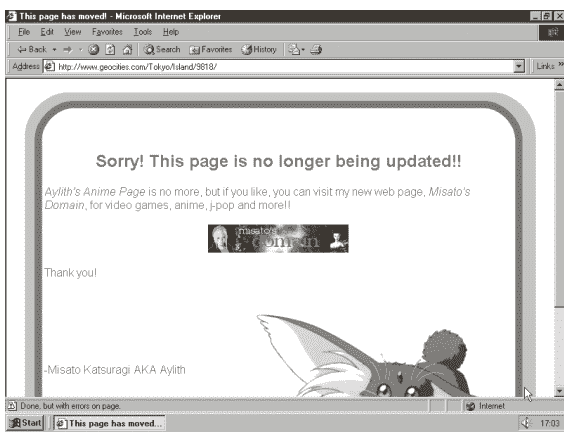

一个 2011 年 5 月编写的脚本编译了超过 500,000 个使用 `frameset`（框架集）的页面，这种技术一直被认为不适用于严肃的网站，并从 1996 年中期以来——从它诞生那一刻起——一直是嘲笑的对象。我们获得的材料帮助我们准确确定哪种类型的框架集最受欢迎，它们被应用得正确还是错误，用户有意识地误用这种技术的程度，以及用户多久以及为什么他们将自己的主页拆分为三个或更多隔间。

2011 年初，W3C 从 HTML 标准中删除了 `<frame>` 标签。更多信息请参阅：`www.w3.org/TR/html5diff/#absent-elements`。访问于2016 年 5 月 10 日。

CSS Zen Garden 可访问 `www.csszarden.com`。访问于2016 年 5 月 10 日。

关于数字民俗（Digital Folklore）的更多信息，CSS Zen Garden 可访问 `www.csszarden.com`。访问于2016 年 5 月 10 日。

其行动产生的冲击波将波及整个网络。因为没有人真正知道在 Geocities 环境之外，有多少布局是基于这个 `c.gif` 的。

这引出了我们的下一个问题：Geocities 的删除对网络产生了什么影响？

## 审视遗骸

Archive Team 成功保存了 Geocities 的大部分内容。我们对其目录结构的分析显示，超过 120 万个账户。然而，我们无法得知这代表什么百分比，以及还有多少个人资料缺失了。在他们的 Torrent 公中，Jason Scott 只是耸了耸肩表示：

> 有多少？我们永远不知道……但我们获得了一批 Geocities 站点——占比相当大，尤其是早期的、收购前的数据。我们已尽所能对其进行了存档，对比了笔记，合并并双检，对我们拥有的资源做了了一切需要要做（Scott 2010）。

我们经常发现正在检查的链接指向了其他未存档的文件。也许是 Archive Team 漏掉了它们，也许它们早早被删除了。

部分保留的个人资料（缺少某些文件）也相当常见。当然，图片缺失尤为常见。一个带有内部图标的边框（每个浏览器都不同）告诉访问者此处应该有一张图片，这是站点已死亡的典型且经典的标志。完全基于图片的站点设计在 20 世纪 90 年代后半叶是一个标准，而在被遗弃后，它们变成了真正的废墟，成为其设计师们自发的纪念碑。

这一次，我们仍然不知道文件是因为存档过程中的故障丢失的，还是因为站主缺乏技巧或未能维护文件以及它们之间的链接。也许我们应该仅仅归咎于“分布式内容”这个概念本身。

有时，我们能够在不同的文件夹中找到图片，并能够恢复页面。如果什么都没找到，我们就会尝试根据文件名和幸存的页面元素来想象它可能的样子。而有时，我们只是注视着遗迹，就像古代庞贝的游客一样。

想要长时间保持不参与其中是很难的。只要你保持在存档的范围内，这种破坏的程度似乎是正常的，甚至在某种程度上是合理的：那些从网络上撕裂、从未维护、被杀死的个人资料，本就不该有其他样子。

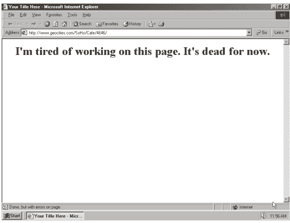

## Geocities 毁灭的影响

通过在网络上删除 Geocities，Yahoo! 贡献了其他服务器和其他服务的许多页面的毁灭。

以 Tripod 为例。在 20 世纪 90 年代中期，这个 Geocities 的同时代竞争对手为用户提供了先进的网站构建引擎，以及图形和基础的社交网络工具。它很受欢迎，特别是在大学生中，并被认为是维护个人资料更正式/更有味的地方。唯一但非常重要的缺点是空间限制：Tripod 用户被限制 100 KB 空间——而 Geocities 已经提供了 1 MB。这就是为什么用户选择 Geocities，而另一些人留在 Tripod 上维护站点，但使用 Geocities 存储他们较大的 JPEG 图片，并通过 URL 将其嵌入到 Tripod 页面中。而这些 URL 现在已经失效了。

有趣的是，关于 Tripod 将在 2009 年 1 月之前关闭（在 Geocities 关闭的消息前三个月）的传闻被反驳了。我认为该站的所有决定不关闭，尽管有其他因素，该站点不需要太多空间——带宽内容存储在网络其他地方。更多信息，请参见：Arrington 2002 和 2009。

这意味着破坏的规模比最初假设的要得多。有很多页面就像 Dancing Jack 在 Tripod.com 上的账户，或者 Clover Pony 在 Angelfire.com 上的账户。

普通用户可能没有意识到这发生在网络边缘，并且主要关注那些在 Google 上排名一直并不高的、未维护的网站。我认为这并不会让它变得不那么可怕，现在是时候让你听听它们的故事了。这些案例可以作为一种大灾难的范例，这种灾难很容易发生，比如 Flickr、YouTube 或 Pica 突然决定用户数据不可用且足以盈利以继续运营。

Dancing Jack. The Gibbon Family Tree. (no), `http://dancingjack.tripod.com`. 访问于 2016 年 5 月 10 日。我们在开始 Torrent 后不久就创建了标签，并意识到我们最终将以某种方式处理许多故障页面和站点。缺失的图片、死掉的链接、Yahoo! 计数器用空洞的眼窝盯着你的占位符，以及其他地方，计算着 1911 年的日历。我们保留了这些遗迹来发布最引人注目且极幻灯片。

Clover Pony, Horse Triumph. (no), `www.angelfire.com/cloverpony/`. 访问于 2016 年 5 月 10 日。

查看 `http://blog.geocities.institute/archives/tag/ruins`. 访问于 2016 年 5 月 10 日。

我们越是利用所有的破坏，就越会被那些被完整保留的页面（有时是完美地，但感觉就像它们还在那里）所吸引

## 消失与存在（于）存档

有两种特殊的类型：

首先，我们有“建设中”（Under Construction）页面——那些承诺在周末发布材料的页面。其中一些包含作者指出他或她已经很久没写东西了。这些是“建设中”作为所有活动的核心时期。有些只是空页面上的一行字。

另一种类型我们称为“页面已移动”（This page has moved）。这些包含了作者的消息，宣布他的个人资料将不再更新。它们可能是中性的、悲伤的，有时充满了仇恨。最后一种类型并不罕见：在世纪之交，用户有理由责这项服务——包括对社区和社区理念缺乏尊重，以及暴露了公司倾向于投资者而非用户的意图的水印。而另一种变体是那些快乐和兴奋的用户，他们发布了结束语，宣布他们终于购买了自己的域名。

那些最有可能在免费网页托管服务上被遗忘或关闭的个人。

但并非总是如此。让我们回到我们的“活跃”（Alive）标签。它并不是我们创建的第一个标签——它恰好拥有最多的条目。因为它以字母 A 开头，所以它是字母表中的第一个——一个我们非常珍视的符号引用。

处理档案时最兴奋的部分并不是发现了保存完好的遗迹，而是它们被证明是通往“领域网”（realm-web）的绝佳门户——你可以通过点击链接（而不是搜索！）来浏览页面——在那里，作者、设计师和网站管理员被证明是同一个人，或者是亲属。

- 14. Marsha. Martha's Wellness Graphics. 2009年5月16日版本。`http://nmarashgraphics.com/`. 访问于2016年5月10日。
- 15. My Mystic Twilight, the Mystical World of Unicorn and Pegasus. 2001年11月版本，`www.angefire.com/rpgydofstarlight/unicorns.html`。 访问于2016年5月10日。

虽然大多数 Geocities 链接确实指向其他 Geocities 页面，但许多链接仍然留在特定的社区内。但如果你设法通过指向有效资源的链接离开 Geocities 档案，你可能会发现自己处于一个链接丛林中，而 Google 的算法都不敢穿过其中。

- 16. W.G. Anderson, Lost Lagoon Mission: 2011年8月8日版本。`http://lastagoon.com/`. 访问于2016年5月10日。

例如，心地社区（Heartland Neighbourhood）的许多页面使用了由 Marsha 制作的图形，该页面上有一个按钮指向 `http://marashgraphics.com`。14 这就是 Marsha 的页面，从那里我进入了一个专门为她设计的页面，在那里我发现了一个通往“独角兽与飞马的神秘世界”（Mystical World of Unicorn and Pegasus）的链接。15 这里的独角兽看起来很熟悉，但主题音乐 `unicorn-id` 引起了我的好奇。它似乎是由 Geoff 的，他拥有丰富的原创 MIDI 作品集。16 Geoff 的妻子 17 写了关于仙子、花园和宠物的文章，并链接到了其他志同道合的用户。我的尝试可能是无止尽的。

- 17. Camomile. Camille's World, a World of Fairies, Angels. 音乐、诗歌与改编。2011年8月8日版本，`http://ncamilesworld.com`。 访问于2016年5月10日。
- 18. narnie. Narnie's World. 2009年3月19日版本。`www.geocities.com/PetFence/Garden/6268/`（历史站点，已失效）。

另一个例子是 Narnie's World（18），它包含了指向佛罗里达州奥基乔比（Okeechobee）餐饮场所的链接，但也接收了越战军老兵急救信息、圣诞页面、个人网站。这是一个个人链接列表，已成为佛罗里达州奥基乔比居民的宝贵资源。

我们可以将这些并不特别现代也不过时的页面归类为实际上“活跃”的吗？无疑可以。尽管 Marshgraphics 最后一次更新是在 2009 年，“独角兽与飞马”（2011）构成了一个替代性的基础设施——它们留在了围墙花园之外的网。然而，主要问题是，它们还能持续多久，并保持不仅仅是归档中的 Geocities 存在？

Narnie's World 还带我发现了一个向密歇根州致敬的魔法页面——“我是密歇根州”（I am Michigan），位于 Richard Nicols' Creations 2019 终极粉丝网站上。Richard 喜欢或钦佩谁都被他的 HTML 永化了。他的纪念碑由嵌套表格、背景图像和 WAV 音文件组成，幽默、美好且动人。但不仅如此！“我是密歇根州”是一个正式的资源，提供了关于密歇根州的有用链接和信息。

> Richard Nicols, I am Michigan, 2011年版本。`http://richards-creations.net/~iam_mich.html`（历史站点，已失效）。

今年早些时候，Richard 写道，他感谢全球网络社区的捐赠以支付他的网页托管费用，“否则网站将在 2011 年 7 月被关闭”。遗憾的是，Richard's Creations 目前只能通过 Wayback Machine 访问——而且不是完整的。


在网站运行期间，我们从未能创建其镜像，我们仍然认为，如果 Richard Nicols 将他的网站托管在 Geocities 上，它会提前一年半关闭，但至少会有更多内容被保存。

Wayback Machine 是互联网档案馆（`https://archive.org`）的一项服务，提供访问自 1996 年以来一直在爬取的网络信息公司 Alexa 网站版本。

# 有边框背景

档案中有许多页面自 1996 年以来一直保持完好如初。无论它们外观如何，它们有一个共同点：上个世纪的页面是为上个世纪的显示器设计的。这就是为什么旧的 JPEG 不仅仅压缩率更高，尺寸也更小。旧的 GIF 包含的帧并不少，且刷新速度惊人，但它们占据的空间很小。我们通常不仅通过最后更新日期或图形样式，还通过大小来判断页面的新旧。


带主题框的页面在 Geocities 制作者中特别受欢迎——并用于留言板。有很多很棒的主题可以选择，从中性的装饰到圣诞、万圣节或特定品种的狗。维多利亚风格主题深受用户青睐，其中许多人与流行观点相反，他们并不是青少年或极客，而是五十岁的职业主妇。

有边框背景与平铺背景不同，后者可以无限重复，因此外观不取决于浏览器窗口的大小。而有边框的背景不应该水平重复。换句话说，这些是较短（为了减少流量）但可以填充整个屏幕的图像：640、800 或 1024 像素，取决于它们的创建方式。

Web架构的核心，使其能够持续增长，却永不衰老或成熟。

处理一个永恒年轻的媒介意味着我们总是要面对新事物——无论是在技术上，还是在意识形态和审美上。这意味着，网页、用户或服务的消亡被视为一个自然过程。谈论一个项目进入中年是没有意义的，因为在这里年龄没有价值。在网页上，变老是不可能的。

Geocities存档为我们提供了变老的体验。接触老旧页面是一堂重要的课程，它挑战了“在网络上，一切总是发生在当下”的印象。

## 参考文献

- Arrington, Michael. 'Lycos Europe To Shutter Lycos Mail. Tripod On February 15.', *TechCrunch*, 18 January 2009. `http://techcrunch.com/2009/01/18/lycos-to-shutter-lycos-mail-tripod-on-february-15/`. Accessed 10 May 2016.

- Blade's Place. 'A Comprehensive List of All Geocities Homestead Neighborhoods Suburbs.', Version 20 October 2011, `www.bladespace.id.au/geocities-neighborhoods-suburbs.html`. Accessed 10 May 2016.

- Fox, Geoff. 'Lycos Mail, Tripod Death–Not So Fast.', 18 January 2009. Pcmag, apscout, `http://appscout.pcmag.com/new-events/23877-lycos-mail-tripod-death-not-so-fast/`. Accessed 10 May 2016.

- Lacher, Mike. 'The Geocities-izer: Wonder-Tonic', 26 April 2010. `http://wondertonic.tumblr.com/post/550624342/the-geocities-izer`. Accessed 10 May 2016.

- Lialina, Olha. 'Premium Platinum Plus: One Terabyte of Kilobyte Age: Digging Through the Geocities Torrent.', 6 December 2011. `http://geocities.institute/archives/3022`. Accessed 10 May 2016.

- – and Dragon Espeschid, eds. Digital Folklore. Stuttgart: Merz & Solitude, 2009.

- Scott, Jason. 'Archivateam! The Geocities Torrent.. ASCII by Jason Scott: Jason Scott's Weblog, 26 October 2010, `http://ascii.textfiles.com/archives/2720`. Accessed 10 May 2016.

# 可渗透性存档

与 Pages 的 Babak Afrassiasiabi 和 Nasrin Tabatabai 的对话

Annet Dekker

2004年，Babak Afrassabi 和 Nasrin Tabatabai 以 Pages 为名合作，开发了各种项目并了名为 Pages 的波斯语和英语双语杂志。他们的项目和杂志的编辑方法紧密相关，艺术家们将其描述为“试图阐述艺术与其历史状态之间不不决的空间的尝试”。目前，他们正在探索并实验创建一个在线平台——可渗透性存档，用于发布和存档过去及未来的项目。这种矛盾的性质对于 Pages 开发的许多项目至关重要，在这些项目中，他们对历史和政治的复杂性进行了扩张性的重读。与他们的其他实践类似，他们通过可渗透性存档提出了对存档的反思：其结构、创建和可访问性。Pages 提出了一种缓慢的渗漏、后存档模式——意味着“通过细微的孔隙或小开口流动，缓慢地进入或渗透，变得扩散或散开”¹ 强调了连贯存档的不可能，Pages 随后描述了这种存档如何成为对抗现代主义存档遗产的手段，超越历史目的，转而追求断裂、回溯和偏离。

> 引用自《韦伯词典》中动词“seep”（渗漏），见 Pages [编辑注]: Pages 9 (2013年10月): 85。

## ANNET DEKKER

能否简要描述一下可渗透性存档的想法是如何开始的，你们正尝试实现什么目标？

## BABAK AFRASSIASABI & NASRIN TABATABAI

我们在2015年开始了这个项目，“可渗透性存档”是我们想出的工作标题。在实际操作中，它主要是一个用于发布和存档的在线平台。但它扩展了我们过去两年致力于 Pages 时的一些近期想法。对于 Pages 来说，每一期都是一个终点。我们针对这一点编辑各种材料。但我们希望这个在线平台是一个开放式结尾和存档的空间，一个开放的杂志，与我们的贡献者甚至我们的读者合作，进行无休止的编辑和传播。

## AD

在 Pages 中，你们尝试在讨论特定话题时连接不同的世界和学科，那么这种策略将如何回到在线存档中？

## BA & NT

杂志的特征之一确实是对档案和原创材料的折衷性选择，这些材料围绕特定主题进行编辑。我们总是试图保持材料与主题之间的有机关系。

我们与作者之间持续交流会反馈到每期的编辑方向中。这些过程不可避免地被排除在最终印刷版之外。读者只能感受到其结果。在新的在线平台中，我们希望主题焦点更少被预定义，使得各种材料之间的相互连接对读者来说是开放且可追溯的。相反，重点被放在个人贡献以及它们在网站上的长期进展上——编辑方向将沿着这些单一进展材料的路线演变。因此，在很大程度上，是编辑中的结构方法定义了主题。

## AD

能否用更具技术细节的方式解释一下，你们是如何在不同的文章、人物和项目之间建立连接的，使它们网络化？

## BA & NT

在此阶段很难准确预测网络将如何从项目中演变，或者完全理解它的“真实”影响。但我们希望将其视为某种可持续性的东西，不是通过永久性，而是通过波动性（或渗透性，参考项目的工作标题）。所有在线内容总是容易被不同线条和不同行为者（作者和读者）所挪用。例如，网站方便作者在任何时候直接上传并重新编辑他们的贡献。然后还有额外的研究材料，或围绕它们的对话摘录，这些将始终补充这些贡献。作者可能会对这些材料进行长期参与，或者只是一次性投入。但在另一端，读者可以访问所有内容，他们可以选择从网站上选取内容汇成一个单一 PDF 或电子书。这些选取随后会被自动存储并添加到存档中。随着时间的推移，它们的数量将会增加，并成为在线版本的集合，读者可以按需下载或（像网站上的其他材料一样）通过平台获取种子文件。当作者可能仍在更新原始材料时，读者生成的这些成为了不断发展的存档的独特快照。从长期来看，这将影响存档，因为相同的文本和图像将在不同的不和谐框架下扩散。

## AD

你们如何看待可渗透性存档与你们的纸质杂志 Pages的关系？

## BA & NT

对我们来说，这个在线平台是 Pages 的延伸。但作为一种编辑工具，它也将定义 Pages 的印刷版。我们在特定间隔开发在线存档时，我们会选取内容并将其编辑成单期印刷版。

对我们来说，杂志的纸质格式仍然提供了独特的可能性，我们还没有准备好放弃。我们目前为止在 Pages 中尝试探索的是每期中不同材料之间交织的关系。读者参与追溯各种元素之间的底层叙事，这是这些印刷版的特征。每期的主题总是随着阅读的进行而逐渐演变的东西。这在第六期和第九期中可能更加明显。

纸质版本的另一个方面是波斯语和英语翻译的同步性。这两种语言之间近乎触觉的即时性在网上实现起来要困难得多。但开发这个在线平台的选择是源于对 Pages 中编辑策略的探索，以及我们近期对归档相关问题的关注。最终，我们并不将此项目视为 Pages 的在线版本，而是它的扩展。它是一个平台，一个用于实验出版各种挑战的工具，即写作、翻译、编辑、分发、归档等。

## AD

在之前的作品《进行中的列表》（List in Progress, 2012）中，你详细说明了一个收藏品的内容。你没有根据标题或艺术家名称进行索引，而是根据作品的尺寸对列表进行索引。这使得焦点从传统的艺术史关系转向了体量和空间。正如本出版物其他地方所论的，索引改变了数字出版物（或者可以说是数字档案）的创建方式；即在这一语境下，“写写”一本“书”意味着创建一个可搜索的数据库索引。在利用“流通性”或协作式编辑过程之外，你希望如何在在线档案中（或内部）实施此类战术？

## BA & NT

数字索引如何改变档案的本质，这真的非常有趣。传统上，索引总是证明一个外部对象的存在。在某种程度上，它向我们保证了它的存在。数字索引将这一点推向了极致，以至于对象和索引已经合二为一。这意味着对象被剥夺了与索引分离的可能；或者永远不会出现索引错误。索引既是指涉，也是语境。

在《进行中的列表》中，我们实际上是对德黑兰当代艺术博物馆的西方收藏进行了重新索引。该收藏包含了标志性的欧洲和美国现代及当代艺术家的作品，被认为是西方世界之外同类最大的收藏。它组建于20 世纪70 年代后期，并随着博物馆的开放于

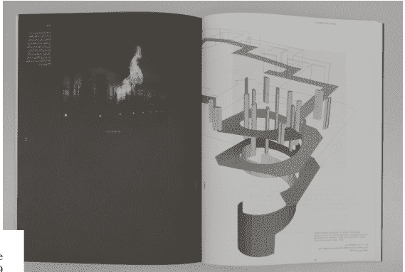

Seep, Pages 杂志第9期，2012年10月，第98-99页

1978年。该项目是政府长期现代化计划的一部分，该收藏旨在引发一种“当代性”的感觉，或与西方的同步性。这是一种脱离了博物馆外迫近政治变化的愿景。仅仅在一年后的伊斯兰革命中，整个收藏被撤回博物馆的地下室，并在那里存放了近二十年。该收藏从其（艺术）历史“语境”中被移出，转而被吸入了一个历史深渊。即使现在当收藏展出时，也总是一次缺席的重挂（re-hang in absentia）。有人认为，该收藏只有在撤回仓库后才真正变得具有“当代性”。

根据艺术作品占据的空间对收藏进行重新索引，这种方式重新强调了收藏的去历史化及其与其档案语境（当代艺术罐）的脱节。从收藏中最小的物体到最大的物体开始，你最终会得到一份奇特的、几乎不熟悉的艺术品列表。我们应该提到，《进行中的列表》总是显示在博物馆的比例模型旁边，该模型仅描绘了通往地下室的博物馆走廊和坡道。

我们看到“渗透性档案”（Permeable Archive）遵循一个去语境化的过程。使这成为可能的是对我们之前提到的档案进行不断的重新征用。这削弱了档案的索引，因为档案各种材料之间的关联将不断发生变化。再次，这些重新征用不仅是通往网络的手段，更是为了陌生化，不仅关乎连接性，还关乎档案的自我割裂。在某种程度上，在线档案应该不断与其作为一个预设的（作为索引的）自身相分离。我们想象了一种档案网络，它在扩张时自我切断。这种网络紧随其内容的变化，对我们来说，这意味着我们的归档和出版可以以更激进的方式相对应。

## AD

在《迷失与生活（在档案中》（LOST AND LIVING (IN) ARCHIVES）中，可以认为你所提议的不再是档案了，因为它不再保存甚至收集，而是某种更“流体”或正如你所描述的“渗透性”的东西。你如何看待传统档案与这种新方法、形式或平台之间的关系？

## BA & NT

诚然，“渗透性档案”不会是传统意义上的档案，但这并不是因为在线出版所能提供的不同可能性。在线材料总是倾向于重新表述，这已经削弱了作为存储内容的档案概念。

这个项目的起点是关于如何通过归档来着出版。显然，出版和归档在定义上是互连的。每一次出版行为都是对档案的证明。但同时，这种关系从未像现在这样处于如此性的状态。随着互联网和数字技术迅速扩展到我们的生活中，这一点尤为如此。我们正在经历“内容”的无边界且无区别别的分发和积累，但那总是脱离了其地缘政治。信息图像中总是缺失的是其内在的权力劳动和协议。

通过互联网，我们遇到的一切总是已经被累积和分发了，作为用户，我们只是变成了这种无尽循环的沉默劳动者。也许没有出口，但我们可以安全地“大声地”与之互动，使其向其自身的物质条件开放。在这个项目中，我们感兴趣的是看到我们如何能发明一个工作空间。如何出版/归档，以对应无限增殖的幽闭症。也许我们应该从减法和补充性的角度来考虑，这些是由负值定义的。当我们第一次开始考虑这个项目时，脑海中浮现的是一种多孔或渗透的结构。我们应该关注的问题是，渗透性的劳动可能是什么？

## AD

在《渗透》（Seep）项目中，你提到档案与其地理和历史语境的关系。你认为这这将如何影响在线档案？例如，由于在线档案不同的时间性和流动性，你认为历史立场（档案的主要目标之一）仍然可能吗？如果不是，可能会产生什么可能的后果？

## BA & NT

无法想象没有与地理和历史关系的档案。但思考历史的（或地理的）“情境”可能比“语境”更有趣。“语境”根据优先顺序和优先级运作；它是一个封闭的系统，将条件的复杂性置于单一的整体之下。而“情境”是开放且不定的。它是未被语境化的东西。从这个角度来看，我们可以说在线档案处于历史和地理关系中，但正如你所说，这种关系是由不同的地点和时间承载的。驱动《渗透》项目的论点之一是档案的位置问题，通常是存放档案的建筑。例如，BP 档案（作为《渗透》的主题之一）位于西米德兰郡华威克大学的地下室里，

我们对档案渗透性的想法实际上源于《渗透》项目，该项目连接了两个世纪的档案：一个是英国石油公司的早期档案，属于该公司在伊朗西南以“英波斯石油公司”之名运营的前五十年；另一个是德黑兰当代艺术博物馆的西方收藏，正如我们谈过的。将两者结合并在一个叙事中阅读开启了档案的另一个侧面，一个被历史和地理裂隙标记的侧面。《渗透》提出的档案类型类似于从地下渗出的原油。这种类比始于我们在研究该项目时，在伊朗西南两座山之间意外发现了真实的油渗。黑色焦油大量涌出在岩石之间，在我们脚下，并进入附近的河流，或许从永恒开始。这在文学意义上是一种后档案的渗透，它无视分层，侵蚀着地面，并溢出（与精炼油不同）超越了历史目的。渗透与存储以及有针对的传播是对立的。

# 自主存档

Özge Çelikaslan

# OccupyGezi：这才刚刚开始！

2013年5月27日至28日，塔克西姆团结平台（Taksim Solidarity Platform）宣布反对由于伊斯坦布尔大市政府实施“塔克西姆步行街计划”而导致的盖齐公园（Gezi Park）北部部分的拆除。这次抗议由一个小小组发起，随后演变为规模大大的群众行动。5月29日和30日警察的严厉干预导致抗议者人数增加。在5月30日和31日的街头冲突后，数十万人涌入塔克西姆广场开始保护盖齐公园。这很快蔓延到土耳其的其他城市；群众抗议的焦点变成了一场争取权利和民主的斗争。自2012年以来，由伊斯坦布尔大市政府发起的塔克西姆广场项目引发了公众辩论，其倒置的形式遭到了建筑师和城市规划师协会公众及专业人士的反对。这是另一种由政府机构发起的公共空间项目，旨在建立一个洁净、受控、高监控的空间，包括重建一座19世纪的奥斯曼军营——托普丘军营（Topçu Kışlasi），总理表示该项目还包括建设一个购物中心和清真寺。该项目的设计没有任何参与性实践，也没有咨询公民社会组织和协会。项目一公布，塔克西姆团结平台将公民社会组织、协会、独立政治团体、集体和个人纳入麾下，在随后的几个月里在盖齐公园发起了公共抗议、请愿、活动和节庆，以形成关于保护应作为城市文化遗产受保护的公共空间的舆论。

更多信息请参阅 `http://taksimdayanism.org`。

访问日期：2016年5月25日。

当推土机开始拆毁墙壁并砍倒盖齐公园的树木时，出现了一个紧张的时刻。由于拆除工作与签署的发展规划不符，平民占领了公园以抗议施工。总理雷杰普·塔伊普·埃尔多（Recep Tayyip Erdoğan）的声明“无论你们做什么，我们对盖齐公园有最终决定”促使更多人加入抗议。抗议者开始在帐篷中日夜地占领公园。随着消息传播，土耳其艺术家也开始支持这次抗议。

```
http://t24.com/tr/haber/erdogan-neyaparsiniz-yapin-karimizi-verdik-gezi-parkiyi-yilikacak-230897. Accessed 25 May 2016.
```

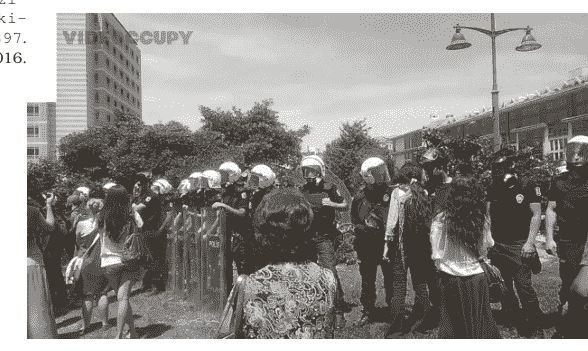


占领第二天凌晨5点左右，警察部队携带催泪瓦斯突袭了公园，并在没有任何警告的情况下开始焚烧抗议者的帐篷。结果，施工车辆进入该地区。议员斯尼·苏舒亚·奥德尔（Sını Süşya Önder）面对推土机并阻止了拆除。警察部队的态度是抗议的转折点，导致抗议者人数剧增。第二天一早，警察第二次攻击了抗议者。在驱散人群后，警察开始用围栏封锁公园，这最终将冲突紧张局势进一步扩大到了街道。冲突持续到凌晨。警察部队的暴力态度导致土耳其各地的数千名其他人加入了抗议。公众将成员与威权政府和抗议相关的各种问题联系在一起，这变成了一场在任何意义上关于公共空间的人权和民主斗争。350万人积极参与了全土耳其境内近5000场游行。

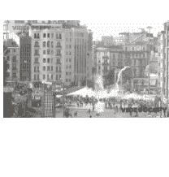

# Videooccupy：一切努力都是为了“看见”

6月2日，由一群不同背景的人士建立了媒体活动团体 Videooccupy，其目标是在绘制视觉记忆的背景下记录整个过程，并为盖齐抗争创建一个开源的数字档案。团体成员还旨在通过揭露警察对行使民主权利的抗议者的暴力来创建自己的媒体，尽管他们在土耳其主流媒体中被描绘成完全具有攻击性、不公平、掠夺性和抢劫者。然而，警察经常向抗议者的头部和上身射击子弹。催泪瓦斯弹筒经常向抗议者、旁观者发射，有时射入居民楼和医疗设施，导致数百人受伤。水龙的供应水中加入了化学刺激物。女性抗议者遭到了执法人员的性侵扰。现场使用了实弹。在全土耳其的游行中，有11人死亡，超过8000人受伤。

Videooccupy 旨在将抗争运动将城市公共空间向公众开放的和平意图视觉化。从公民占领盖齐公园的第一天起，直到警察在6月15日袭击公园、焚烧帐篷、开火并残暴地驱逐人们，团体成员一直记录着盖齐公园的日常生活。Videooccupy 旨在从使用手机、iPad 或视频/照像相机进行记录的抗议者那里收集视觉数据。团体成员在占领公园的前几天向抗议者发出了号召，并在名为“我们的公地”（Our Commons）的先锋政治活动团体的帐篷下收集数据。该号召由团体成员于6月4日发出：

> 6月2日，我们建立了一个视频团体 Videooccupy。我们的目标是记录自2013年5月27日以来的抗争过程。它收集 iPad、手机和视频摄像机等设备拍摄的记录。收集的将被存档并设计为公众访问的门户。如果您想使用这些动态影像或有任何问题，请联系我们。Videooccupy 团体希望将抗争运动将城市公共空间向公众开放的和平意图视觉化。

他们对记录公园的日常生活产生了极大兴趣；人们共享公共空间，创造出不同类型的团结实践，显然还有不同的视觉语言，并传播这些视觉语言。由于没有人知道抗议、占领和反抗何时结束，集体的成员意识到采访人们重要性，以便弄清究竟是什么样的人在访问公园，以及是谁参与了反抗。采访侧重于他们对过程的贡献、他们对社会的想象、对民主和公民身份的形成，以及他们梦想中的公共空间。集体成员还采访了抗议活动中的某些领导人物和重要人物，例如建筑师协会的主任、贡献并支持抗议的议会议员、律师、政党领导人及活动团体的领袖。他们被要求就城市权利、民主与解放的框架、公共空间的占有，以及近期社会运动对盖齐（Gezi）抗议的影响，表达了自己的观点。

随后，集体开始通过组织任务和在成员之间分配志愿者工作，将这一切整合在一起，并向公众分享了所有记录：采访、事件、暴力、日常行为、视觉语言、不同类型的抗议以及公共空间的转型。在抗议者被驱出公园后，Videooccupy 继续记录了随后的抗议形式，例如许多公园论坛、不服从行为、不同非政府组织的新闻稿、以及反对警察实施的暴行和侵犯人权行为的大型集会和游行。

在视觉制作方面，Videooccupy 对纪录片并不感兴趣；它更多关于观察行动、记录那个时刻，并直接呈现所见和所记录的内容。因此，他们在编辑任何内容时非常小心，以便给观众带来“裸露”的视觉材料。试图形成并成为集体认同的一部分正是这种努力。对于集体成员来说，相机不是工具；相机是身体的一部分，随身体移动并直接参与事件。相机不被视为从外部记录的工具；它存在于事件之中，用所有的眼睛物理地参与其中。视频活动家的策略基于集体意象和集体影像记录。

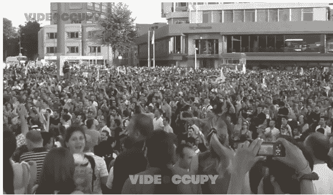

目标是创建一个包含超过两千小时记录的公共数字档案，按日期、地点、抗议类型和主题进行组织。档案的目标是参与性、互动性、扩张性和充满生命力的。视觉数据档案化对于保持视觉集体记忆的活力至关重要。

# 集体记忆

在许多方面，盖齐公园抗议是一场前所未有的社会起义，不仅是因为抗议者和参与者的异质性，以及他们的行动方式（这创造了协作与团结），还因为对各种新媒体的广泛使用，这导致在社交媒体平台上产生并分享了大量的视听和文字材料。在一个街头所发生的事情在主流媒体中完全没有曝光，或完全被操纵或扭曲的过程中，思考和调查集体记忆问题变得不可或缺。此时，一个数字媒体档案作为一种“记忆工具”（outil de mémoire），收集了那些本会在社会记忆中被遗忘、扭曲或刻意抹除的内容。它还允许我们质疑什么是可见的、隐藏的，并基于可用材料创造了一个集体调查和创作的空间。

在关注土耳其社会政治运动的在线媒体平台更广泛的范围内，从 Videooccupy 的视频档案 Gezi 开始，并在抗议结束后立即创建一个开放获取的在线视觉记忆平台是很有意义的。https://bak.ma 从这些讨论中应运而生。社会和政治议程一直非常活跃，反对各种形式威权统治和压迫的抗议以不同的方式和形式进行。bak.ma 有潜力建立过去、近期与未来之间的联系，涵盖了已经和即将到来的运动。该档案的意义在于它作为一个资源丰富的平台和记忆空间的潜力，为通过视觉材料进行思考的新方式铺平了道路。

# 普通公民迷失了！

远离传统的国家档案及其权威主义方法，bak.ma 是尝试创建存档图像的新手段。在土耳其语中，“bakma”的意思是“不要看”，而“bak.ma”这个名字也灵感来自塞浦路斯思想家 S. Baker 一篇文章中的引用，他在文中讨论了将“看”视为一种解放性的行为，他选择了一个非常具体的时刻，那个时刻发生在 1995 年安卡拉反对 F 型监狱的抗议期间：

> “普通公民迷失了”……在安卡拉中心可以听到警察的一声宣告。
>
> 那些不“正常”的公民可能应该是被警察部队和准备好喷水的坦克包围的人。国家的意愿无疑是让他们“消失”（这不需要特殊的技能）并尽快驱散。然而，第一次，我们通过警察对“普通”公民的宣告了解到人们必须“滚开”、“散开”，因为他们突然从城市最繁忙的广场和街道上消失了。“不要看！”另一声警察宣告，就像“滚开！”一样，在耳边回响……“不要看！”显示了“看”（to look）与“看见”（to see）之间的区别（Baker 1996）。

因此，bak.ma 关乎看：以不同的方式看。在盖齐抗议的一年后，在对收集的数据进行长时间讨论后，bak.ma 社会运动数字媒体档案就可以访问了。它可以被视为一项自主的档案倡议。自主档案指的是 Lawrence Liang，他是一位法律研究员、律师和 pad.ma 的成员。他认为，“作为一种特殊形式，国家档案并没有耗尽档案的概念。”他继续说道，创建档案的任务不是复制或模仿国家档案，而是批判性地产生一个档案概念。自主档案不仅补充了国家档案中缺失的内容，还让存在的内容变得不稳定（Liang 2016）。

pad.ma 是公共访问数字档案（Public Access Digital Archive）的缩写，更多信息请参阅：https://pad.ma。访问于 2016 年 5 月 25 日。

Pelin Tan 在她的文章《论生命政治：去殖民化档案》中指出，自主去殖民档案结构的特征可以通过其集体组装（编辑、记录、剪辑）以及在不同政治类型中的转换呈现出来。正如她所证的：

> 如果我们从影像话语和政治的背景来看“去殖民化”的话语和定义，这个术语变得更加复杂，超越了殖民者/被殖民者的二元结构。基于技术政治的基础殖民化更为复杂，涉及到额外的国家手段。因此，讨论去殖民化的实践本身就是一个困惑的概念。影像档案如何被利用以及如何在去殖民化过程中运作，不仅涉及开源数字工具的共享和使用。它还关于去殖民化示威、反抗行动和公民斗争数据库的存储和管理（Tan 2016）。

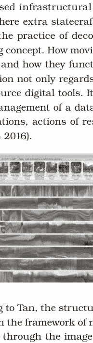

在这种背景下，根据 Tan 的观点，bak.ma 的结构需要在生命政治去殖民化的框架内被理解，即通过影像本身。bak.ma 上的视频片段提供了每一个创造日常主体的主观性。

正如梁（Liang）所言，国家档案并不能定义档案，因为它们只是档案的一种形式，它们并没有穷尽“档案”这一概念。正如他所说的：

> 自主的档案倡议通常是对国家对公共记忆垄断的回应，以及这种记忆权力所产生的政治影响的回应。但创建自主档案的尝试并不意味着要补充国家的记忆机器（Liang 2016）。

作为一种自主的档案实践，bak.ma 不应被视为保存图像的存储空间或数据库。正如梁所肯定的：

> 当代档案冲动试图实现档案作为虚拟性的潜能，并挑战我们去思考在记忆勒索与遗忘之外，档案所具有的生产性能力。概念的产生是一种挑衅，是对已知之呼唤的拒绝，也是一个强化我们体验的机会。因此，档案不是表征性的；它是创造性的。将某物命名为档案并非终点，而是辩论的开始（Liang 2016）。

自主档案由各种媒体组成，由于它们大多基于自由软件，因此激励了用户变得活跃且富有生产力。因此，这些档案实践是国家档案的对立面。档案大多出现在冲突地区。例如，在乌克兰，2014年当任总统维克托·亚努科维奇（Viktor Yanukovych）乘船逃离该国时，一组记者、作家和活动人士营救了23776份亚努科维奇家族丢入湖中的秘密文件。后来，这些“秘密”文件一直在 yanukovychleaks.org 上公开，而物理副本保存在集体空间中。在叙利亚和埃及也可以找到其他例子，例如叙利亚档案（Syrian Archive）、Mosiren Collective 建立的哈利尔档案，以及由阿丽莎·勒博夫（Alisa Lebow）发起的 filmingrevolution，后者被描述为一部关于埃及纪录片和独立电影制作的元纪录片。自革命以来，它汇聚了埃及媒体制作人的集体智慧和创意策略。档案由编辑过的视频素材和活动人士的证词组成。Mosiren 的成员进入哈利尔并制作了多段证词视频，记录了持续三年的埃及起义。他们在 YouTube 频道“Mosiren Archive”上分享了约250段编辑过的视频，该频道是2012年1月访问量最高的 YouTube 频道。

5 www.youtube.com/user/Mosiren. 访问于2016年5月25日。

一年前的一项公共调查显示，84%的埃及人依赖国家电视获取新闻。Mosiren 的数字无处不在是一个巨大的胜利。关于图像和叙事的争夺战在革命期间激烈进行。Mosiren 无畏地创建了一个民主的、开放获取的档案，见证了一切（Cummings 2013）。

在叙利亚的同一时期，许多活动人士在街头记录冲突、轰炸以及他们自己的死亡。正如阿里·沙姆塞德丁（Ali Shamseddine）和约翰·里奇（John Rich）所说：

> 革命爆发后，叙利亚英雄、死亡、对话和尖叫的图像流立即涌入网络。这些新的叙利亚日记由日常的数字图像和视频组成。叙利亚人勤奋地使用社交媒体（博客、文章和论坛帖子），释放了大量记录和证实事实的信息。所有内容都存档在网络上以供传阅和使用（Shamseddine and Rich 2014）。

6 https://syrianarchive.org. 访问于2016年5月25日。

叙利亚档案由叙利亚人权组织、媒体活动人士、记者和律师发起。该档案根据署名-相同共享4.0国际许可协议（CC BY-SA 4.0）授权，他们明确了档案的任务是作为一个保存与人权侵害有关材料的共享档案。在档案中，叙利亚所有的违规行为都被列出并按城镇制图，其中大部分已记录在案。这种实践可以被视为一种生存工具或策略，沙姆塞德丁和里奇对此作出了：

> [叙利亚人正]绝望地记录着他们的死亡。血液流淌供相机看到。叙利亚人明白，统计他们的死亡并不能赋予他们即时或短期的解放。记录需要终结感才能被视为文件。20万或30万人的死亡是不够的。少数叙利亚人的生存取决于文件的有效性。带着这种怀疑，叙利亚人试图更加努力让他们的斗争国际化，并用他们的鲜血触及那些无力阻止这一切的人（Shamseddine and Rich 2014）。

他们继续说道，死亡的强度和数量不是叙利亚档案的材料，而是目的。因此，这个新档案并非关乎生命和事实的结果，而是关于持续的死亡，正如他们提到的：

> 在叙利亚的情况下，有很多文件：照片、视频、名字、故事以及关于死亡和酷刑的传言。每个受害者都有名字、躯体、一张脸和一个生活故事，这些都是档案中无数条目的一部分。可以想象，这样一个庞大的档案可以将叙利亚人的血化作水（Shamseddine and Rich 2014）。

## 数字空间即公共空间

城市空间不再是指我们生活和工作的地方；它是社会和政治不断再生产的空间。城市正义运动在城市和冲突地区变得比以往任何时候都更加重要，在这些地方，任何公民都可以通过日常生活中的不同行动和多种能力参与其中。我们现在生活在一个技术和数字时代，图像制作和动态编辑不仅是任何公民都能接触到的，而且具有去声称社会和政治断裂发生的“事件”。

在此背景下，bak.ma 旨在通过视听录像、文件和证词揭示近期历史。档案的内容正在扩展，涵盖其他运动，例如2009-2010年TEKEL（烟草）工人的抵抗、五一节、女权主义和LGBTI运动、生态运动以及特定的游行、演讲和采访。

该平台供所有人使用，通过使用 Pandora 软件。bak.ma 有一种特殊的分类方法，可以按主题、日期、名称、一天的时间或地点进行组织，并可以由其任何成员控制。

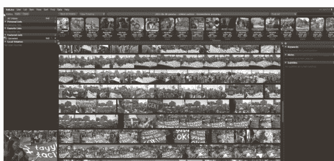

成员还可以在线编辑视频、下载和上传视频，并创建标签和注释，bak.ma 的目标不仅包含盖齐动荡的视频，还包含存储在计算机中的其他视频片段。Pandora 是一个免费的开源程序。数据（取决于其大小，特别是对于大量上传）按日期和主题分类，并可以传输到运行 Linux 的计算机上。整个过程基于协作工作原则。集体记录和剪辑需要协作工作，以产生替代性的组织和空间。

根据谭（Tan）的观点，“集体”并不意味着相似主体的聚集，“行动”一词也不应意味着起源于有意主体的效能或独立于思考。

简之，集体行动需要社区经济的伦理。事实上，我更倾向于将其描述为一种地方伦理行为，满足了日常知识和在城市空间维护生计的经验所暗示的需求。由此的关系网络更多是一个选择共同思考和讨论的即时社区，而不是一个基于某些劳动活动及其分工的简单等级结构。自我组织相反，允许人们早上是农民、下午是平面设计师的工作/劳动结构（Tan 2014, 17）。

也就是说，我们认为数字视频制作和传播中的“存档”不仅意味着制作一个开源的不仅是隐藏和不服实践的记忆，它还提供了一种自主结构，导致了集体剪辑、上传、泄露图像以及政治不从集体记忆的重建。bak.ma 邀请用户和访客进入其深邃且波动的视频海洋。

Baker, Uhus. Ölüm Orucu Notlar: Birikim 88 (August 1996). www.birikimdergi.com/birikim-yazi/3180/oleum-orucu-notlar/ Accessed 25 May 2016.

Cummings, Basia Lewandowskiska. In Focus. Mosreen: Frieze 157 (September 2013): 130. https://frieze.com/article/focus-mosreen. Accessed 25 May 2016.

Liang, Lawrence. The Dominant, In Autonomous Archiving and the Emergent in Archival Imagination., edited by Artikikler Collective (Öze Çelikaslan, Alper Şen, Pelin Tan), 97-113. Barcelona: d-barcelona, 2016.

Shamsdine, Ali, and Rich, John. An Introduction to the New Syrian National Archive, e-flux journal 60 (2014), www-e-flux.com/journal/an-introduction-to-the-new-syrian-national-archive-2. Accessed 25 May 2016.

Tan, Pelin. The Labor of the Day After: In Surplus of Istanbul, edited by Artikikler Collective (Öze Çelikaslan, Alper Şen, Pelin Tan), 16-8. Istanbul: free publication, 2013.

Decolonizing Archiving. In Autonomous Archiving, edited by Artikikler Collective (Öze Çelikaslan, Alper Şen, Pelin Tan), 121-25. Barcelona: dpr-barcelona, 2016.

# 一份邀请

关于评估与随机缓存的推测

Tina Bastajian

视频花絮——那些来自先前项目的原始且未使用的片段，带有主题和政治上的亲缘性——如何与 bak.ma 档案交汇并产生联系？一个形成了记忆场所（lieu de mémoire）的艺术研究项目，是否可以在集体档案努力的背景下被重新审视，并提供一个扩展集体记忆场所的平台？这些想法是在读完 Özge Çelikşan 的《自主档案》文章后，与其参考来源交流，并通过接触 bak.ma 数据库后得出的。我的档案冲动使使重新审视“遗迹”的概念（即被留下的东西）以及随后的档案后世，考虑到与从盖齐公园抵抗运动中发展出的集体活动主义声音相关的“自主档案”背景，以及我一个在伊斯坦布尔街头开展的项目素材。

## 咖啡沉积与花絮


# 交互式纪录片《咖啡沉积：偶然的地扑学》（2010）

交互式纪录片《咖啡沉积：偶然的地扑学》（2010）是我与艺术家 Seda Manaoğlu 合作开发的一个项目。它是纪录片形式与解构形式的混合体，被塑造成一个交互式环境，以 DVD-ROM 形式分发并在网页上部分可用。项目的初始意图是通过建立现场的土耳其咖啡相遇来收集故事，同时探索伊斯坦布尔居民的多个层次和活动。该作品被分为七个不同的节点：重写本、移动网络、媒介、轮廓、模式识别、痕迹和伊斯坦布尔之腹，这些节点构成了对不可预测且快速变化的城市模式，以及在城市中居住、行走、定居、工作和抗议的人们的多样故事和叙述的缓慢映射。

我们的项目发生在大量的城市活动、节日和政治行动期间：例如 2009 年伊斯坦布尔双年展、各种替代性（反）双年展倡议、Direnistanbul's(Resistanbul)² 干预、斋月，以及 IMF/世界银行的街头抗议。

> 1 www.coffeedeposit.nl and http://coffee-deposits.blogspot.nl. Accessed June 2016.
> 2 https://resististanbul.wordpress.com. Accessed June 2016.

## 迷失与活生的（中）档案

相遇在一个不受艺术场馆或策展倡议限制的区域运行，因此相对处于“雷达之外”。与此同时，我们与 Resistanbul 一起参加了许多游行和抗议，例如在 Kumkapi 地区当地拘留中心支持移民权利的集会，这与“移动网络”这一节点交织在一起。

`Geocaching` 是一种全球性的网络和低技术类游戏类运动，它使用地理坐标（通过智能手机 App 或 GPS 设备帮助）来寻找物理“宝藏”。

在启动这个项目时，一个核心动力是实验 `Geocaching`。我们对探索数据库和位置感知叙事中可能出现的意料之外（自主）空间感兴趣，这些空间将通过使用真实和模拟的 `Geocaching` 以及采用增强现实策略产生。通过各种穿越，项目缓慢而倾斜地揭示了许多被 Sega 忽视、协商和跨越的异质层。性别、阶级、语言、年龄、宗教和身份的多样性等棘手问题浮现出来，与其与我们同行的人，以及我们刺激和参与的微型公众也一同出现。

公共空间中的偶然性和失败问题非常显著，从而对数据可视化投射了讽刺和反思的视角，并挑战了地理定位的本土语言。同样，我们试图通过在导航中对位置感知媒体实践的基础工作进行压缩来问题化，以激活语法和其他形式的其它层次。

将纪录片作为“产品”的概念本身——被纪录片作为“过程”的概念所取代——即一种持续的、取决于语境的、流动的意义建构……通过对记忆进行广泛包容的分享与质问，开辟理解与参与的新维度（Frisch 2006, 17）。

尽管 Frisch 的概念最主要引起对（往往未被充分利用的）口述史集、索引、转录和数字资产管理的共鸣，但文本设定了纪录片形式恰当提供的剩余价值或补充。他的文本还支持了目前的转变：从最终的纪录片转向一种核心理念，其核心位于一个可搜索、易于导航和易于使用的数据库环境中的文档正文——一个在更流动的、更持续的基础上生成路径和版本的平台。在这些模式下，每次搜索和查询都可能导致不同的重点，或为不同的故事提供素材，而且每一个都像其他一样即时且持续地可访问且易于构建（Frisch 2006, 15）。

`bak.ma` 档案计划在考虑删减片段和原始素材时提供了这样一种感性，但重要的是，它扩展了搜索、索引、转录和导航。它向其独特的平台发出了一种“邀请”，在那个平台上通过重新评估并可能贡献素材，作为反抗档案霸权和所谓“官方叙事”的。正如 `pad.ma` 项目（公共访问数字媒体档案）在其《档案的10项论题》中清晰地断言的那：

> 与其坍缩为对学科堡垒的强化（这些堡垒排斥局外人士，并由历史学家嫉妒地守护着知识和经验的真实性），或诉诸行动主义者和艺术家的敌对夺语言，不如我们将对档案的侵入视为我们感性以及档案感性的扩张。档案不是威胁，它们是邀请。

> 5
>
> 档案的10项论题；由 `pad.ma` 成员共同编写。Lawrence Liang, Sebastian Lütger 和 Ashish Sukaran 在“不要等待档案”期间（作业工作讨会，贝鲁特，2010年4月）。该文本见于 https://palma/Documents/sOH。访问时间为2016年6月。

这样的邀请要求我们重新思考并评估我们的删减片段和原始素材，通过参与式和自主的档案行动根除所谓纪录片标准和伦理的神圣性，以扩展我们的“感性”。翻阅数字磁带、硬盘、存储箱、编辑时间线和之前的文本是必要的，以解脱我在 2010 年创建的交互式 Seda 内部编辑决策的束缚。

## 评估

正如教科文组织档案顾问 Sam Kula 所言，“对动态影像记录的评估是一个具有争议性的问题”（Kula 1990, 29）。同样，为了在自主的档案空间作为 `baka` 对一个人的数据进行评估并执行隐喻和实际的转码行为，仔细地重新回顾过去的素材（原始和剪辑过的）是我们流程中第一也是至关重要的一步。这些概念在阅读了 Çeliklikasan 的“视觉生产”策略后得到了进一步支持，该策略通过有限的编辑为观众产生“裸露的视觉素材”，她认为这支持了集体认同的形成。我想建议这些策略可以指导评估，并借此影响未来上传到 `bak.ma` 数据库的数据。

在我们项目的实施过程中，视觉素材的记录受到一种“捕捉逻辑”的影响，以反抗传统的纪录片和场地感知方法：即体现当下的展开。我们敏锐地意识到，人在公共/城市空间内的移动不可避免地受到不可预测的城市状况的影响，这只能在现场进行导航，并且这种相遇不能被记录的角色所负担。相机的使用有时仅仅变成了事后的考虑，没有三脚架或其他设备，我们的单机相机经常被架在纸箱或附近的水泥台阶上进行录制，只有当画面区域被遮挡且往往无法识别时，才能至少完全且不中断地捕捉。

通过“反对分辨率的物化价值”，这种类型或体类的视频影像可能与 Steyer 对“权力”的描述产生共鸣（Steyer 2009）。

这些因素辅以街头捕捉方法，以及在场地感知媒体、界面和戏剧装置中，可以被视为“持续的”或或者说，是书写工具，它们不代表，而是构建出“近处说话（speak near）”的复声痕迹和言语。在某种程度上，我们的记录设置无论是显性的还是改进的，都是随着我们身体在现场移动的。考虑到我们穿越的节奏和紧迫性与行动主义记录（如从盖zi 公园运动产生的记录）形成鲜明对比，从内部记录或可能从“近处”记录的概念，在情感上与 Çelikasan 关于集体记录概念的身体入法具有相似性：

> 纪录片导演和理论家 Trinh T. Min-ha 制定了一种“近处说话”的间接方法和态度，这种态度到达了“关于……说话”。她认为这是一种“不反对的说话，不指称一个对象，仿佛该对象远离主体或说话的地点。一种反思自身的说话，并且可以非常接近主体，而不夺取或声称……实际上，这不仅是一种技术或要做出的陈述。它是一种生活态度，一种在世界关系中定位自己的方式（Min-ha 1992, 87）。

对于集体成员来说，相机不是工具；相机是身体的一部分，随身体移动并直接参与事件。相机不被视为从外部记录的工具，它是，而且视频行动主义策略是基于集体意象和集体影像记录（Çelikasan 2016）。

成功穿了 DVD-ROM 中所有的根茎状线条，整个项目的持续时间超过三个小时。为了理解对素材抽样进行细读意味着什么，我决定查看并评估我们与 LGBTQTT 行动主义者兼记者 Deniz Deniz 进行漫步。在伊斯坦布尔工作期间，我们的朋友、行动主义者和导演 Güliz Sağlam 建议我们关注最近的 Deniz 行，她在伊斯坦布尔的贝格卢区进行日常步行，并因“干扰交通”被警方罚款。她和其他许多人一样，过去和现在都是通过发放荒谬且昂贵的交通罚单来骚扰的目标，试图阻止跨性别者和变装者在白昼期间自由移动。Deniz 在《Radical》报上报道了这些步行期间的事件，标题为“禁止跨性别者行走”。在我们访谈期间，我们在长约三公里的伊斯斯蒂拉尔大街（Istiklal Caddesi）步行、回溯并记录了长镜头。

她的交通罚单、《Radikal》报纸的文章等。这种扩展的语境化形式可以应用于自主档案中吗？或者，是否需要对这个蜿蜒的数据缓存进行补充？

`bak.ma` 上的许多视频片段已根据事件或名称、日期、时间、比特率等进行了标记。它的格式和设计似乎相对易于使用，这也增加了其非分级界面的易用性。在 `bak.ma` 数据库中寻找更广泛的标记和描述形式时，人们发现这种功能在整个档案中并未被利用。`bak.ma` 的一些用户显然利用了这些标签和区分性的数字特征，而另一些用户包含的很少或完全没有标记，仅提供了一个描述性/主题性的标题，以帮助用户定位他们想要查看并可能重新组装、修改等的片段。

我决定将我们的原始素材选择、档案背后的长镜头逻辑，将其与 `bak.ma` 中许多关于亲缘关系和团结的主题结合起来。这种重新配置的“后纪录片感性”可以略微抵消更常见的数字化策略（如口述历史集等），这些策略“将大部分材料汇聚为核心示例，或来自对大量文献研究的插图主题”，Frisch 将数字数据的差异化描述为“原始与烹饪的”（Frisch 2016, 1996）。

实地长镜头具有许多功能（社会、技术、政治层面的），这可能促进自主空间（包括线下和在线），并唤起和暴露极其个人化且敏感的话题。例如，我们与 Deniz（下所示）在街道上漫步，经过 İstiklal Caddesi、Yüksek Kaldırım、Bankalar Caddesi 以及加拉塔塔附近，其中有一段我们在人行阶梯的中间停了下来（Kamondo 阶梯）。我们制作了土耳其咖啡（为了扰扰交通），并持续交流了长时间。再次，这种相遇是一个长镜头：

## 档案中的迷失与生存

偶然地捕捉路人、冲咖啡的过程、自发的咖啡杯占卜，在这里，个人故事和政治故事变得模糊、交换、翻译和争论。因此，正如研究人员兼 `pad.ma` 共同发起者 Lawrence Liang 所提醒的那样，“任何图像制作行为总是捕捉到意料之外的、环境的和转瞬即逝的”（Liang 2016, 103）。

考虑到这一场景，由于素材中涉及的多个因素（特别是如果它们是在一段时间内被评估的），长头的策略可能需要不同的筛选标准。或许为迭代变化、扩展标记和注释创建一个空间可以以外部 wiki 的形式存在。正如 Axel Bruns 提到的，wiki 的可编辑性“使用户能够创建一个知识网络，该网络通过知识库中单个信息之间的多个相互链接，临时地进行结构化”，这反过来也支持了以过程为导向的方法，为其内容提供某种程度的次级时间结构（Bruns 2008, 102-3）。通过这种方式，像我们这样的项目的废弃素材可以被评估，以区分嵌入素材及其周围的各种条件和语境。

诚然，关于隐私、伦理和镜头许可的问题将不可避免地介入，特别是考虑到材料的敏感性，以及/或在录制过程中培养的亲密程度。重新审视出现在素材中原始的“诚实合约”可能也是一种考虑。事实上，不言而喻，“选择受阻于这样一个事实：我们永远无法完全预知任何东西未来的用途”（Cox 2011, 218）。这些以及其他相关问题需要更严密、更广泛的重新审视，这在这篇短文的范围之外。虽然我在文中仅调查了我们记录的路径中的样本，但我可以想象，在重新审视和重新评估许多小时的材料时，对上述复杂性保持警觉和透明，不可避免地会成为 Frisch 所概述的“汇聚”过程。无论如何，`bak.ma` 档案和邀请的姿态在召唤我们。

# 后记

我正专注于我们档案的厚度，以超越废墟，去关注那个装满未见图像和沉默声音的鞋盒，关注在将个人遭遇作为*原始数据*公开的伦理问题——这些数据是在不同的条件下，根据知识共享许可署 - 相同方式 3.0 经济模式被录制和分发的。诚然，评估方法将通过去语境化过程不断影响未来的数据构建。媒体历史学家 Lisa Gitelman 和 Virginia Jackson 通过数据和摄影图像共同提出了去语境化和框架构建的困境：

> 摄影图像的假设客观性就像数据的假设原始性一样，在某种程度上似乎是必要的……至少，摄影图像总是从摄影师所处、指向、拍摄的电影体验中被框架化和筛选出来的。数据也需要被理解为被框架化和框架化……事实上，那种看似不可或缺的误解——即数据是那种永远处于语境中的数据——即被框架化的数据——是根据它们自身所谓的“去语境化”的神话（Gitelman and Jackson 2013, 5）。

如何处理我自己的*框架化*评估标准？人们如何构建一个配套的补充部分，以解决在从所谓的“原始数据”数字堆中进行选择时的编辑选择和重语境化问题？我提出的一个建议是使用长镜头的策略，其中每个档案“存入”都可以提供一个指向 wiki 页面的链接，该页面可以引导长镜头的选择、它们的遗漏、异常等。这绝不是一个模板，我也没有建议其他想要上传并与 `bak.ma` 协作的纪录片制作者需要遵守这一点。然而，正如 Gelman 和 Jackson 所提到的，“评估是必要的，因为数字时代的本质是一个持续的过程。”*Visual Anthropology Review* 8, no. 1 (1992): 82–93。在沿着数字时代的缝隙中运作时，废弃素材和给定的素材包含了它们自身的疏漏、异常，可能还有绕路。

# 致谢

《迷失与存续（在档案中）》是我在鹿特丹彼特瓦学院（Piet Zwart Institute）媒体设计与传播专业期间组织的的主题项目的成果。该系列旨在调查从物理档案到数字档案的转型。尽管这本书仅仅是对已研究和讨论内容的浅表观察，但书中的每一项贡献都为这种变化提供了不同的视角，有时表明变化可能很小，并展示了我们如何需要不断回去审视和处理档案的复杂性。我要感谢所有全心投入课堂并启发我追求这部出版物的学生，感谢导师们 Aymeric Mansoux、Michael Murtaugh、Andre Castro、Steve Rushton、David Haines、Barend Onnewweer，特别是与我共同组织了其中一个主题项目的 Tina Bastajian，感谢 Leslie Robbins 她的（不）显而易见，以及 Simon Pummell 和 Renee Turner 为本书的出版所提供的慷慨支持。

Annet Dekker

# 作者简介

**DUŠAN BAROK**（1979年出生）是一位艺术家、作家和 Monosk 的创办编辑。他目前是阿姆斯特大学的研究员，专注于当代艺术的记录。他毕业于布拉迪斯瓦发经济大学的信息技术专业，以及鹿特丹彼特瓦特学院的网络媒体专业。近期，他与伯根电子艺术中心合作组织并主持了关于现代美学的系列研讨会《许多性的延伸》（*The Extensions of Many*，2015），并在蒙斯的 Mundaneum 举办了关于记录科学和保罗·奥特莱遗产的专题《知识图谱》（*Ideographies of Knowledge*，与 Barbora Šěvíá，2015）。Barak 在阿姆斯特丹生活和工作。

**TINA BASTAJIAN**（1962年出生）是一位媒体艺术家和研究人员，在阿姆斯特大学教授纪录片电影，并在彼特瓦特学院领导主题模块。她的工作利用实验性的纪录片形式来探索（反）记忆、重写本、抹除、实体间性以及视角与翻译的轮廓等主题。近期出版物包括在《不服的档案：东欧视觉文化的战术演变》（*Archives of Disobedience: Changing Tactics of Visual Culture in Eastern Europe*，2016）中的《关于无序电影制作的内部与外部》。目前，她正在制作一部受该文本启发的电影散文，该片扩展了“档案空间”（aiias）的概念。Bastajian 在阿姆斯特丹生活和工作。

**NANNA BONDE THYLSTR** 致力于数字化政治学、档案构建的不确定性以及算法的认识论。她拥有博士学位（2014年），论文主题为文化记忆对象大众数字化的政治学，在并在她讨论了当文化记忆政治进入数字环境时，文化记忆政治正在发生的范式转变。在她目前的研究中，Thylstrup 通过档案的文化理论审视了大数据环境，以及大数据如何创造了新的交互和解释政权。她特别对数据政权如何创造新的档案、监管、解释和检索的文化技术感兴趣。

**ÖGE ÇELIKASAN**（1979年出生）是一位艺术家、视频艺术家和活动家。她是视频艺术家团的联合创始人兼成员。作为一名博士研究学者，她的研究重点是自主媒体档案。自2013年以来，她一直致力于土耳其社会运动开放数字媒体档案 `bak.ma`。通过个人以及 Artikler 集体，她参加了全球范围内多次个人和混合展览/双年展。她与 Alper Şen 和 Pelin Tan 合编了书籍《自主档案》（*Autonomous Archiving*,2016）和《伊斯坦布尔的盈余》（*Surplus of Istanbul*,2014）。Çelaslan 在安卡拉生活和工作。

**ANNET DEKKER** 是一位研究员、策展人和作家。她目前担任阿姆斯特大学媒体研究（档案与信息研究）助理教授，以及伦敦南岸大学网络图像研究中心的访问教授和兼任副主任。她对技术、科学和流行文化对艺术的影响以及反之亦然感兴趣。近期展览包括在阿姆斯特丹 Framer、利物浦 FACT 和巴塞尔 H3K 举办的《虚构几何》（与 David Garcia 和 i.cw. Ian Alan Paul 联合策展，即《有多少是虚构》，*How Much Of Is Fiction*），以及在阿姆斯特丹 SMBA 举办的《算法垃圾：胆于挑战不幸》（*Algorithmic Rubbish: Daring to Defy Misfortune*,2015）。近期出版物包括《推测性情景，或数字艺术在（近期）未来将发生什么》（*Speculative Scenarios, or What Will Happen to Digital Art in the (Near) Future*,2012）、《档案数字化》（*Archiving the Digital*,2011）以及《档案2020：原生数字文化内容的可持续档案》（*Archive 2020: Sustainable Archiving of Born Digital Cultural Content*,2010）。


# OLIA LIALINA（1971年出生）

OLIA LIALINA（1971年出生）是德国 Merz 学院的教授。Lialina 致力于数字文化、网络艺术和网页俚语。她是一个动画 GIF 模型，也是 Geocities Research Institute 的联合创始人。在过去的二十年里，她创作了许多具有影响力的网络艺术作品：*Bear With Me*（2016）；*best.effort.network*（2015）；*Summer*（2013）；《在线报纸》（*Online Newspapers*,2004–2017）；最后一个真实的网络艺术博物馆（*Last Real Net Art Museum*,2000）；第一个真实的网络艺术画廊（*First Real Net Art Gallery*,1998）；《爱格塔出现了》（*Agatha Appears*,1997）和《我的男朋友从战争回来了》（*My Boyfriend Came Back from the War*,1996）。Lialina 在德国生活和工作。

# MANU LUKSCH（1970年出生）

MANU LUKSCH（1970年出生）是一位艺术家和电影制作人，她质问进步和社会结构的概念。她在维也纳美术学院和朱隆隆皇大学学习过，目前是伦敦大学金德史密学院的访问学者。近期展览包括惠寿节（*Yebisu Festival*,2016）；C/O 柏林（2016）；奥尼西斯文化中心的《混合身份》（*Hybrid Identities*,Onassis Cultural Centre,2016）；创新，休息游戏（*Disnovation*,Jeux de Pause,2016）；肉桂总邮局（*Cinnamon*,General Post Office,2016）。

# NICOLAS MALE（1969年出生）

NICOLAS MALE（1969年出生）是一位艺术家、软件程序员和数据活动家。他的研究关注档案、信息以及视觉呈现它们的方式。他是布鲁塞尔 Constant 机构的活跃成员。

# AYMERIC MANOU

AYMERIC MANOU 是艺术家和作家，在伦敦大学金德史密学院研究自由开源许可在艺术和文化生产中的应用。Mansoux 还担任鹿特丹彼特瓦特学院实验出版方向的负责人。他对网络和 8 位文化、噪音音乐感兴趣。近期作品包括 *memewars*（2017）；*What Remains*（2016年至今）以及 *SKOR Codex*（2012）。

# MICHAEL MURTAUGH（1972年出生）

MICHAEL MURTAUGH（1972年出生）设计社区数据库、交互式纪录片以及新的读写工具。他是 Constant 机构的成员，并在鹿特丹彼特瓦特学院教授实验出版课程。

# JOSIEN PIETERSE

JOSIEN PIETERSE 是 Framer 和 Network Democracy 的联合创始人兼主任。她优毕业于阿姆斯特大学政治学和性别研究专业。毕业后，Pieterse 在 Felix Meritis 和 TUMULT 辩论中心工作，并担任荷兰辩论中心协会（VND）主席。2009年，她共同创立了 Framer，这是一个当代艺术、视觉文化和批判理论与实践的平台。2009年至2011年，她担任发展论坛（FDO）的协调员，并在2011年共同创立了 Network Democracy。2014年，Pieterse 获得《Vrij Nederland》杂志因其与 Network Democracy 工作而授予的“激进创新者”奖。在政治、文化和艺术领域工作之外，Pieterse 还曾在 Atria（解放与女性历史知识学院）担任口述历史学家和研究员。

# ELLEF PRESTSTER（1982年出生）

ELLEF PRESTSTER（1982年出生）是艺术研究小组斯堪的计算破坏学院（http://sicv.activearchives.org）的成员，也是奥斯陆大学的艺术史博士后。他的近期出版物包括与 Karin Nygård 共同主编的一系列《古登堡星系报告》（*Reports from the Gutenberg Galaxy*）。

# ROBERT SAKROWS（1966年出生）

ROBERT SAKROWS（1966年出生）是一位艺术史学家。他毕业于柏林工业大学，目前策展并领导柏林的 panke.gallery。自2007年以来，他创作了各种涉及艺术问题以及与网络相关的实践的展览。这些主题也是他正在进行的项目 CuratingYouTube.net 的核心。2007年至2009年，他在林茨的路德维希·玻尔兹媒体艺术研究所（Ludwig Boltzmann Institute Media.Art.Research）参与了“Net pions 1.0”研究项目。1999年至2003年，他在柏林工业大学（TU Berlin）担任 netart-data-bank.org 项目负责人。近期的策划作品包括：柏林 panke.gallery 的“丹尼·凯勒和丹尼尔·普姆”（2017）；柏林世界文化中心（Haus der Kulturen der Welt）的跨媒体展“Capture All”（2015）；纽曼音乐节展览（2015）；Screensavers Gallery 在线展“Desktop-shot Collections 1997–Today”（2014）；卢布尔雅那 ŠUC Gallery 及在线展“一场穿越 YouTube 的声学之旅”（2011）；在线展“ANONYMOUS：全球网络社会时代的共同身份”，以及“3 hours in one second”。Sakrosski 生活并工作于柏林。（2010）。

# 斯特·斯卡利亚奥拉（STEF SCAGLIOLA，1958年出生）

斯特·斯卡利亚奥拉（STEF SCAGLIOLA，1958年出生）是一位数字历史学家，目前在卢森堡当代数字历史中心从事关于数字来源批判的项目。在追求博物馆教育员职业后，她在鹿特丹伊拉斯大学学习了历史。1997年至2002年间，她针对1945年至1949年印度尼西亚独立战争期间荷兰犯下的战争罪行这一争议性进行了博士研究。这段经历让她意识到口述历史来源的相关性和复杂性，并促成了“荷兰退伍军人访谈项目”的诞生。这个由1000份音频采访组成的“数字原生”采访集提供了接触新信息的机遇，并为通过数字人文方法开启口述档案铺平了道路。这项技能在她2011年至2016年工作的伊拉斯大学电子研究工作室得到了进一步发展。她参与了 FP7 搜索技术项目 AXES 和视频口述历史项目 Post Yugoslav Voices。她还开发并协调了数字文化 minor（数字人文课程搜索环境），并参与了 Erasmus+ 项目 DARIAH Teach。

# 卡蒂娜·斯卢伊斯（KATINA SLUIS，1978年出生）

卡蒂娜·斯卢伊斯（KATINA SLUIS，1978年出生）是一位策展人、作家和媒体教育者，她是南岸大学网络图像研究中心的联合创始人，也是摄影师协会（The Photographers' Gallery）的数字计划策展人。凭借系统管理的，她的她的关注摄影与计算的关系、社交传播及其文化价值。展览项目包括：“詹姆斯·布里德：无缝衔接”（2015）、“为了猫的快乐：猫科、摄影与网络”（2012）以及平台 http://Unthinking.Photography（2016）。她近期的文章发表在《Aperture》、《摄影哲学》（Philosophy of Photography）、摄影作品（Photographs and Photworks）上。斯卢伊斯生活并工作于伦敦。

# 菲姆克·斯内廷（FEMKE SNELTING，1969年出生）

菲姆克·斯内廷（FEMKE SNELTING，1969年出生）担任艺术家、组织者和研究员。她通过 Constant 艺术媒体协会，在设计、女性主义和自由软件的交叉领域开发项目。近期的项目包括：Possible Bodies（与 Jara Rocha 合作）、Akademie Scholz Solid. Hangar, a.pass（斯图加特，布鲁塞尔，2017-2019）：达特茅代表团（与 Myriam Aouragh, Seda Guueres, Jara Rocha 合作，进行中）：Libre Graphics 研究小组（马里德，伯根，鹿特丹，2011-2013）。近期的出版物包括：Mondotheque：一本辐射的书（与 André Castro, Sinziana Păltineanu, Denis Pohl, Dick Reichard, Natacha Roussel, Alice de Visser 合作，2016）：我认为对话是自由软件为用户提供的最好、最大的东西（与 Christoph Haag 合作，2015）。斯内廷生活并工作于布鲁塞尔。

# 伊格尔·斯特罗马耶（IGOR STROMAJER，1967年出生）

伊格尔·斯特罗马耶（IGOR STROMAJER，1967年出生）是 www.intima.org 的伪/旁艺术家。他研究战术性情感旁艺术行动、亲密游击和创伤性低技术通信策略。他在全球六十多个国家的两多场展览中展示过作品，并获得过多次国际奖项。他的项目是知名艺术机构的永久收藏的一部分，其中包括巴黎的蓬皮杜中心、马德里的雷纳索菲亚博物馆以及纽约的 Computerfinehearts——网络和媒体艺术收藏。作为客座艺术家，他在大学和当代艺术学院授课。

# 作者简介

纳斯林·塔巴塔拜（NASRIN TABATABAI）和巴巴拉克·阿法拉萨比（BABAK AFRASSIABI）自2004年起合作的艺术家。他们制作合作项目并出版一本名为《Pages》的双语（波斯语-英语）杂志，目前已出版9期。他们的项目与杂志的编辑理念密切相关，艺术家们将其描述为“对表达艺术与其历史条件之间不确定空间的一种尝试”。塔巴塔拜和阿法拉萨比生活在鹿特丹，以及荷兰和伊朗。他们的作品曾在各种个展和小组展出过。他们曾在马斯特里赫特的范·范艾克学院（2008–2013）和布鲁塞尔的 Erg 高艺术学院（2015年至今）担任导师。

# 姓名索引

## A

- 阿多诺，西奥多（Adorno, Theodor） 146
- 托尼（Age, Tony） 108
- 阿尔伯特，康（Albert, Kang） 51
- 阿法拉萨比，巴巴拉克（Afrassabi, Babak） 21, 24, 214
- 阿姆斯特，路易斯（Armstrong, Louis） 109, 110
- 阿尔朱德（Arjun）
- 阿尔诺，诺尔（Arnaud, Noël） 67, 69

## B

- 贝克，U.（Baker, U.） 229, 232
- 巴拉卡，阿米里（Baraka, Amiri） 65
- 巴洛克，杜尚（Barok, Dušan） 20, 24, 176
- 巴斯詹，蒂娜（Bastjan, Tina） 22, 24, 261
- 伯纳斯-李，蒂姆（Berners-Lee, Tim） 54, 208
- 比奇·史尔斯（Biggie Smalls） 65
- 布洛克，伊莉莎白（Bloch, Elisabeth） 152
- 布洛姆，伊娜（Blom, Ina） 135
- 邦德·蒂尔斯特鲁（Bonde Thylstrup, Nanna） 23
- 波恩，贝琳达（Boone, Belinda） 148
- 玛莎（Marsha） 205
- 鲍克尔，杰弗里（Bowker, Geoffrey） 37
- 鲍斯基，威尔德（Bowsky, Willard） 110
- 布朗，理查德·哈维奇（Brown, Richard Harvey） 253

## C

- 坎德伊拉，哈维尔（Candeira, Javier） 84
- 塞尔，明特（Cerf, Mint） 45
- 克莱尔，弗朗索瓦（Clair, Jean-François） 115
- 塞尔克，奥泽格（Celik, Özge） 17, 24
- 库克，特里（Cook, Terry） 29
- 考克斯，理查德（Cox, Richard） 253, 255
- 罗斯，史蒂芬（Cross, Steve） 53
- 卡明斯（Cummings, Basia） 236

## D

- 戴维斯-布朗，贝丝（Davis-Brown, Beth） 28
- Day，罗纳德（Day, Ronald） 178
- 维萨切，阿克莉娅（De Visacher, Alexia） 54, 56
- 德克尔，安内（Dekker, Annet） 17, 94
- 丹尼兹，乌塞尔（Deniz, Ücel） 251, 252
- 德里达，雅克（Derrida, Jacques） 13, 28, 30
- 杜伊，梅尔文（Dewey, Melvin） 44, 145, 147
- 迪乔（Djock, Jos） 33, 35
- 詹，让-米歇尔（Djan, Jean-Michel） 44
- 多克雷，肖恩（Dockray, Sean） 183
- 德拉夫斯，斯科特（Draves, Scott） 85
- 杜兰蒂，露西亚娜（Duranti, Luciana） 147

## E

- 伊登海姆，莎拉（Edenheim, Sara） 150
- 爱因斯坦，阿尔伯特（Einstein, Albert） 74
- 艾森斯坦，谢尔盖（Eisenstein, Sergei） 103
- 埃尔多安，雷杰普（Erdoğan, Recep） 227
- 恩斯特，沃尔夫冈（Ernst, Wolfgang） 35
- 埃斯佩希德，德拉根（Espeschied, Dragan） 19, 24, 194

## F

- 法尔日，艾莱特（Farge, Arlette） 144
- 莱舍尔，戴夫（Fleischer, Dave） 110
- 莱舍尔，马克斯（Fleischer, Max） 109
- 福科，米歇尔（Faucault, Michel） 12
- 弗兰克斯，帕特里娅·C.（Franks, Patricia C.） 147
- 弗里希，迈克尔（Frisch, Michael） 247, 248, 252, 254
- 弗里奇，彼得（Fritzsche, Peter） 154

## G

- 吉莱特，菲克斯（Gillette, Felix） 37
- 吉特尔曼，莉莎（Gitelman, Lisa） 254, 255
- 戈德史密，肯尼斯（Goldsmith, Kenneth） 183

## H

- 汉塞尔，索尔（Hansell, Saul） 30
- 哈里斯，史蒂芬（Harris, Steven） 68, 74
- 亨里克森，尼尔斯（Henriksen, Niels） 68
- 霍根，梅莱莱（Hogan, Mælé） 34, 35
- 霍斯曼，彼得（Horsman, Peter） 12
- 霍斯曼，马丁（Horsman, Martin） 85

## J

- 杰克逊，弗吉尼亚（Jackson, Virginia） 254, 255

# 流失与现状档案 (LOST AND LIVING (IN) ARCHIVES)

- 贾里，埃曼纽（Jarry, Emmanuel） 45
- 詹纳特，德尔芬（Jenart, Delphine） 52
- 詹金斯，希拉莉（Jenkins, Hilary） 145, 146, 152
- 约尔根森，斯汀·A.（Jorgensen, Steen A.） 148
- 约恩，奥瑟（Jorn, Åse） 15, 66-69, 73, 74
- 华雷兹，格拉里尔德（Juarrez, Geraldine） 45
- 荣格，卡尔·G.（Jung, Carl G.） 94
- 约根森，内森森（Jorgenson, Nathan） 36
- 曼苏，艾梅里克（Mansoux, Aymeric） 15, 16, 23, 95, 177, 261
- 玛雷，埃蒂安·朱尔（Marey, Étienne-Jules） 103, 104
- 马科夫，约翰（Markoff, John） 30
- 马斯，马塞尔（Mars, Marcel） 183
- 迈耶，舍恩贝格，维克多（Mayer, Schönberger, Viktor） 37
- 麦林，亚历克斯（McLean, Alex） 85
- 麦达克，汤姆（Medak, Tom） 183
- 迈耶尔，艾琳·C.（Meijer, Irene C.） 154
- 梅塞尔，埃德蒙（Meisel, Edmund） 103
- 敏哈，陈音·T.（Min-ha, Trinh T.） 250
- 蒙克，塞隆斯（Monk, Thelonous） 65
- 穆勒，阿曼（Müller, Armin） 28
- 蒙普德，刘易斯（Mumped, Lewis） 143
- 默多，伊安（Murdock, Ian） 81
- 墨尔陶格，迈克尔（Murtaugh, Michael） 261
- 迈斯，罗布（Myers, Rob） 90
- 卡扎尼安，大卫（Kazanjian, David） 246
- 凯勒，格里特耶（Keller, Grietje） 126
- 凯塔尔，埃里克（Ketelar, Eric） 15, 18
- 科哈雅恩，阿尔特姆（Kochayarn, Artyom） 65
- 克里希纳穆尔提，吉杜（Krishnamurthi, Jiddu） 57
- KRS-One 65
- 克里萨，乔西娅（Krysa, Joasia） 84
- 库拉，萨姆（Kula, Sam） 249
- 勒丰丹，亨利（La Fontaine, Henri） 44, 48, 49, 54
- 拉贝勒夫，希亚（LaBeouf, Shia） 65
- 莱切，迈克（Lacher, Mike） 195
- 莱福，安妮（Lafore, Anne） 80, 85
- 拉森，珍内特（Larson, Janette） 148
- 劳森，布鲁斯（Lawson, Bruce） 195
- 柯布西耶（查尔·爱德华）（Le Corbusier (Charles-Edouard）） 51, 58
- 鲍沃，爱丽丝（Lebow, Alice） 236
- 李，春（Lee, Chun） 92
- 勒弗朗，埃曼纽（Lefrant, Emmanuel） 115
- 利奥波德二世（Leopold, II） 48
- 列维·斯特拉克，克洛德（Lévi-Strauss, Claude） 67, 68, 73
- 利亚纳，奥莉娅（Lialina, Olia） 19, 24
- 梁，劳伦斯（Liang, Lawrence） 233
- 刘，亚历克斯（Liu, Alan） 30
- 洛维克，格特（Loevik, Geert） 27

116, 119, 120

Villeneuve, Johanne 151

Repka, Martin 105

W

Rich, John 236, 237

Wieringa, Saskia 126

Riefensthal, Leni 112, 113

Willems, Jos 110

Robbins, Leslie 261

Willey, David 87

Rodek, Hannes-Georg 113

Y


# 索引

## R

Ruston, Steve 261

## S

Sağlam, Güzal 251

Salo, Dorothea 148

Scaglia, Stef 17, 23, 126

Schröder, Gerhard 113

Scott, Jason 195, 200

Scott, Jeff 148

Shamseddine, Ali 236, 237

Sjöström, Viktor 111

Slots, Stanley 147

Sluis, Katrina 13, 22, 38

Snetling, Femke 14, 23, 184

Snowden, Edward 154

Sofia, Zoe 143, 144

Solem, Jan Erik 76, 71

Sollifrak, Cornelia 171

Spiegel, Evan 35, 36

Spielberg, Steven 135

Spinks, Lee 19

Stallman, Richard M. 81, 82

Stromajer, Igor 18, 19, 23, 161

## T

Tabatabay, Nasrin 214

Tan, Pelin 234, 239

Teza, Mario 85

Thorsen, Matte 148

Todd, Thomas 102-104, 108, 109, 113, 116, 119, 120

Torbjen, PorsMorse Rokamp 148–151

Tupac Shakur 65

Turnkle, Sherry 31

Turner, Renée 261

## V

Van den Heuvel, Charles 44, 52, 55

Varian, Hal 66

Villenave, Valentin 99

## Y

Yanukovych, Viktor 235

Yeo, ShinYoung 50

## Z

Zamora, Carlos 105

Sakrowski, Robert 18, 161

# 版后

编辑：Annet Dekker

作者：Babak Afrassabi, Tina Bastajian, Duisan Barok, Norma Bonde-Thydrup, Özge Çelikasan, Annet Dekker, Olga Liana, Manu Lukech, Nicolas Maake, Armerik Manovic, Michael Murtaugh, Joseph Petersen, Eldiff Presateter, Robert Sakrowski, Stef Scaglola, Katrina Sluis, Femke Snetling, Igor Stromjer, Nasrin Tabatabai

翻译与校对：Alice Tetley-Paul

校对：Els Brinkman

索引：Els Stevens

制作：Pia Pol

平面设计：Template, template01.info

字体：Tex Gyre Bonum, Tex Gyre Cursor

内页纸：Munken Print White 1.5, 100 gr

封面纸张：Bioset 240 gr

印刷：Bariet-Ten Brink, Meppel

出版社：Pia Pol, Valiz.

阿姆斯特丹，2017

www.valiz.nl

本出版物的出版感谢以下机构的支持：

荷兰创意产业基金 (Creative Industries Fund, NL)

Piet Zwart学院：媒体设计


280

迷失与活（在）档案

知识共享 CC-BY-ND

本书中的内容根据知识共享署名-非商业-禁止衍生许可进行授权。用户在满足以下条件的情况下自由复制、分发和翻译本作品：

- 署名 —— 您必须按照作者或许可者的指定方式署名（但不得以任何方式暗示他们支持您或您对作品的使用）。
- 非商业 —— 您不能将此作品用于商业目的。
- 禁止衍生 —— 您不能修改、转换或基于此作品进行二次创作。

在理解以下点的情况下：

- 豁免 —— 如果获得版权所有者的许可，可以豁免上述任何条件。
- 其他权利 —— 许可协议不以任何方式影响以下权利：
  - 您的公平交易或自由使用权；
  - 作者的人身权；
  - 其他人员可能在作品中拥有或使用的其他权利（无论是公共还是私人权利）。

通知 —— 对于任何重新使用或分发，您必须向他人明确作品的许可条款。实现此点的最佳方法是提供下方网页的链接。

完整的许可文本可以在此处找到：

http://creativecommons.org/licenses/by-nc-nd/3.0/nl/deed.en_GB

编辑和出版社已尽力获得复制所列材料的许可。对于任何无意的错误或遗漏，我们深表歉意。如认为自己拥有特定法律权利的，请联系出版社。info@valiz.nl

ISBN 978-4-92095-26-8

于欧盟打印并装订

281

版后
