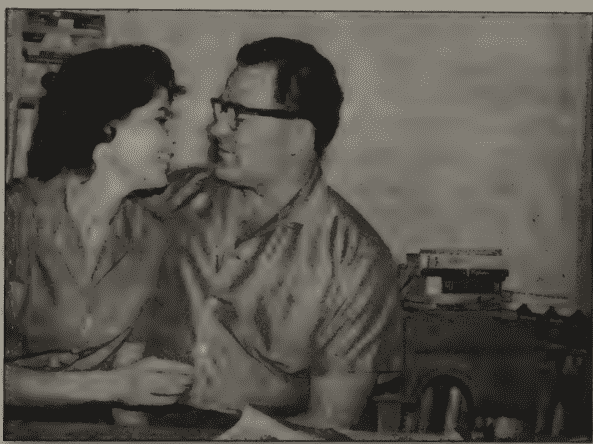
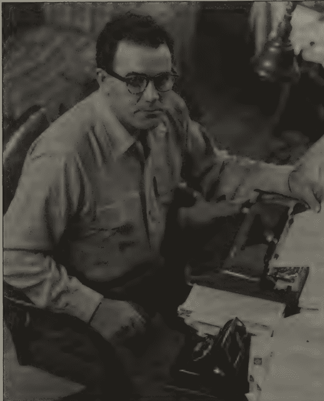
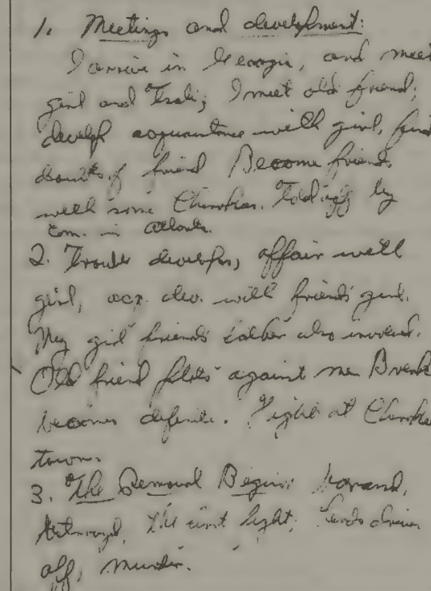
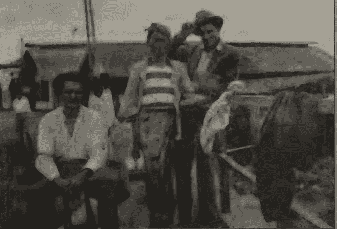
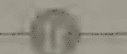
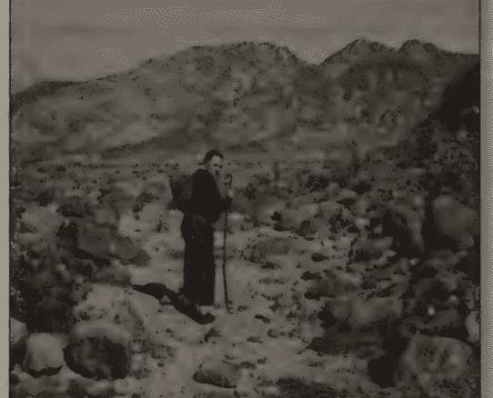
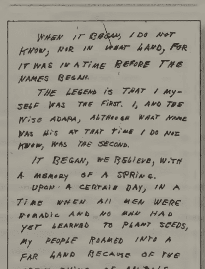
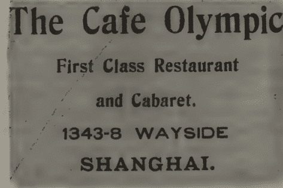

# 路易·洛马尔的遗落宝藏：第一卷：全球最受欢迎小说家之一的未完成稿、神秘故事与遗失笔记

- 长草之处之处 (Where the Long Grass Blows)

路易·拉莫尔遗失宝藏第一卷（LAmour's Lost Treasures Volume 1）是一部虚构作品。书中的人物、地点和事件均为作者的想象或虚构。任何与现实事件、地点或人物（无论生死）的相似纯属偶然。版权 © 2017 Louis L'Amour。保留所有权利。由 Random House 旗下 Bantam Books 在美国出版。BANTAM Books 和版权页为 Random House LLC 的注册商标。美国国会图书馆目录出版数据

> 献给父亲，路易·拉莫尔，他的世界比他所爱的西部广阔得多。

# 什么是路易·拉莫尔的遗失宝藏？ (WHAT IS LOUIS AMOUR'S LOST TREASURES?)

《路易·拉莫尔遗失宝藏》是一个旨在从家族档案中发布部分手稿的项目。目前已包含《路易·拉莫尔遗失宝藏》第一卷和第二卷，分别将于 2017 秋季和 2019 年出版。这些书籍包含了已完成和未完成的短篇小说、电影剧本、笔记和大纲。这是路易生前未能出版的许多作品。

2018 年，我们将发布《不归者》（No Traveller Returns），这是路易首次面世的长篇，写于 1938 年至 1942 年之间。未来可能会有更多拉莫尔的作品。

此外，路易此前发表的小说和短篇小说的许多笔记和修改稿现在作为“赠送内容”附在相关的书中。关于“遗失宝藏”项目的更完整描述以及书中内容的若干示例，可以在 `louourslosttreasures.com` 找到。网站还包含大量独家材料，如更多未知故事、个人照片、原始文件扫描和笔记。

所有包含“遗失宝藏”项目材料的作品将显示“路易·拉莫尔遗失宝藏”的横幅和标志。

比·拉莫尔序言 xv

10. 谢尔比·塔克 (SHELBY TUCKER)：西部小说的开端 254

# 引言

作者：鲍·勒莫尔（Beau L'Amour）

这本书可能会让你抓狂。它包含的内容神秘而迷人、令人沮丧，而且很多时候是悲剧性的不完整。它是一次透过帷幕，窥视一个“可能发生”的世界。它是对一个持续半个多世纪的写作生涯机器如何运作的深度观察。它记录了表达一个想法的挣扎，以及要让不可听驯的创造过程服从个人意志是多么困难。这是一个关于作家产生的碎片、外壳和废热的故事。那些从未出现在编辑办公桌上的文字。那些从未获得过最终“完结”字样的层叠书籍。

想起来真令人自卑，路易斯·勒莫尔（Louis L'Amour）的职业生涯创作了九十部小说和近四百篇短篇故事、文章、剧本和诗歌，但也留下了数百部未完成的作品。这让人感到宽慰的是，无论他多么高产，他也是凡人，他也有失败、怪异的想法以及无法实现的梦想。令人惊讶的是，他的想象力远超于他最终出版的那些种类丰富的作品——从西部片、犯罪故事、高风险冒险和历史浪漫爱情，到他计划中的科幻、恐怖小说，以及只能被称为神秘或精神冒险流派的作品。

你可能不会在这些书页间发现某部隐藏的文学杰作，但你将感受到一个高产作家旅程的强度，领略一个真正有创造力的人所努力理解的全部范畴。

在这些页码中，我包含了从这份巨大的档案中挑选出的最有趣的素材。许多例子是我们在餐桌旁讨论过的故事；另一些对我来说完全一无所知，并引发了大量的研究。我不愿意做过多的解释，也不愿意太严谨地组织这本书。第一次探索这些手稿带给我一种奇妙的惊喜和发现感。这种体验我不愿剥夺他人的机会。

但我会尝试营造一些背景……

天还很黑。清晨。20 世纪 60 年代末的一个冬天，昨晚的雨仍在从屋檐滴落。

这个社区位于洛杉矶县一处被遗忘的地带，紧邻好莱坞山向下倾斜，位于日落大道（Sunset Strip）。这是一个由夜店、加油站和小办公室组成的社区，在通往星光的阶梯上，很少聘佣演员的经纪人从事着他们的交易。

西好莱坞（West Hollywood）是紧邻的比弗利山（Beverly Hills）的阴暗兄弟。比特派诗人和电影明星经常光顾街角的咖啡馆。门之乐队（The Doors）、齐飞英国陆（Led Zeppelin）和布法罗之泉乐队（Buffalo Springfield）在 Whisky a Go Go、Rozy 和 Gazzarri's 等俱乐部表演，当邻居抱怨噪音和交通问题时，人群会与警察发生冲突。停车场的边缘、杂草丛生的山坡，甚至人行道本身，也布满了嬉皮士营地（没有更好的词了），只要他们能找到一个没人骚扰他们的地方就在那里。他们为了梦想、为了音乐，或仅仅是为了彼此来到洛杉矶的这个地区。这个地方是反文化、创造力和混乱的杂乱大烩。

当我醒来时，打字机键盘的敲击声迎接了我。楼下有一个穿好上学的。通往厨房的走廊尽头有扇门。前面是一间浴室；左侧是我父亲的办公室，那是一个挤满书籍和纸张的小房间。他书桌上面的灯亮着，他的椅子是空的。右侧是厨房，咖啡正煮着，母亲正把鸡蛋和烤培根（去掉了脂肪的浓缩条状，我最喜欢的）送到早餐桌旁。

几分钟后，我的妹妹就会加入我们。我妈妈不再需要自己穿衣服了；她已经老到可以独立处理了。然后，爸爸会放下报纸，拿起一本书，在我们吃饭时读给我们听。这种早晨的常规一直持续到十年后我开始自己开车上学。他读的书是他感兴趣的内容，如索尔·海耶尔达尔（Thor Heyerdahl）的《康提基号远征》、《阿帕奇之乡探险》，或是他青少年时代的作品，如《泰山与奥帕的宝石》。我们被各种能想象到的故事包围。

当妈妈把我们那辆老旧且疲惫的车倒出车库时，爸爸已经回到了书桌前，打字机隆隆作响，有时持续到我的睡觉时间。这就是我记忆中的样子。我在打字机键盘的敲击声中醒来……第二天。

每天都能写作开启了创造力路径并保持其开启。变得擅长并不快速也不容易，但最终爸爸练习了如此，以至于创造力变得某种自动化。他为自己设定详细的目标并努力实现，用红色、绿色的蜡笔划掉打字机列表上的项目。20 世纪 40 年代后期，他的目标是每周卖出一个短篇故事。

不是为了在一个周内写完一个故事并卖掉。

到那时，他已经取得了相当的成功，但出版社不会采用他写的每一个作品，因此为了完成配额，他每年必须完成多于五十二个故事。

这份工作并不挣钱。即使是那种程度的写作，也仅仅够付房租。速度是至关重要的。

我不记得我和姐姐是如何接受训练的，但我们知道，如果父亲正在工作而我们想引起他的注意，我们该如何接近他。我们会进入他的办公室，在堆积如山的书堆中穿出道路。我们会站在他的一侧，正好处于他的余光范围内，在他工作时静静地等待。有时他会把手指从键盘上抬起来说：“等一下。”然后他就会继续完成一个想法，或者发现自己处于故事的某个位置，想起了接下来打算要说的话。接着，他就属于你了……

……大约持续十分钟。很快，你就能看到故事本身或某种内在的纪律在召唤他回去了。我们从没有担心过打扰他，因为他乐意被短暂地分心，他非常仔细地保护自己的工作，而且我们从未想过他会有什么不同的表现。“你们现在去玩吧，我得回去工作了。”这时他会向前倾身，在键盘上搜寻和啄击，回到故事中，完美地衔接上之前离开的地方。他似乎总是准确地知道自己要去哪里，任何中断都无法让他困惑，甚至无法让他停顿太久。

关于路易斯·阿莫尔（Louis L'Amour）写作过程的描述是传奇性的。根据公关人员的说法和流行的传闻，他并不写大纲，也从不重写。他体现了每个年轻作家对创作过程的幻想。他把一页推入打字机，开始打字，带着绝对的信心，直到故事结束才不再回头。全是行动，没有挣扎。

他写的每样东西都足够立即卖出，至少故事是这样说的。文字只是从他身上流出来。他没有遇到瓶颈。他并不脾气多常。

这些可能是夸张，但并非完全的谎言或公关炒作。他吹嘘自己可以膝上盖着打字机，在落日大道（Sunset Boulevard）中间写一本小说……当一家德国杂志请他拍摄自己这样做的照片时，他做到了，在拍摄期间产出了他当天一半的产量。他因为那个特定的吹嘘已经声名大噪，以至于一名司机从汽车窗里探出头喊：“你一定是是路易斯·阿莫尔！”

妈妈和爸爸在西好莱坞的公寓里。

在我出生之前，路易斯完成了从写短篇故事到写小说的转变。故事长度变了，出版社变了，材料的发行方式变了，但爸爸的工作习惯没有变。他的收入增加了，但他也有家庭要抚养。只要他每年能写三四本书，我们就能过上舒适的中产阶级生活。如果他卖掉了一个电影版权，也许我妈妈就能重新装饰一个房间，或者我们就能买一辆新车。抛开财务考虑不，爸爸仍然对他大量的故创意以及产出一页、一章或一部小说的速度感到非常自豪。

进步是他的座右铭。路易斯声称他可以“只需”将自己和角色置于某种情境中，故事就会飞跃起来，几乎是在自我讲述。他喜欢开头……喜欢到他偶尔会漏掉故事的结尾，因为他对开始下一个故事感到兴奋。他是极度乐观的，专注于生产力、未来、以及接下来的任何事情。他的心态是一种强大的力量，以至于有时爸爸会宣布他刚刚想出来的故事。

包含了美洲本土传说的元素。与《行走的鼓》（The Walking Drum）一样，这两个故事都是构思于二十甚至三十年前的。到他去世时，爸爸终于能够以比西部片更广泛的类型来讲述故事。

无疑，当涉及到路易斯梦想中写的那些更具冒险性和趣味的素材时，阻碍他的不仅仅是出版商或他的核心受众的保守本性——他自身的局限性也起了作用。要完成他构想的许多野心勃勃的计划，无疑需要大量的规划和修改。

正如你将在书中所看到的，与流行的迷说法相反，路易斯在某种程度上确实列过大纲，他也确实重写过，或者至少重新开始过那些没有以那种神奇方式一气呵成并带他一路写到底的故事。但对他来说，写作并不像许多作家认为那样是一种智力上的体验；多年来，它已变成了一种本能的、反应性的。为了完成某些项目（这些项目由于他的个人性格以及与西部类型的疏远，更像他早期的作品），路易斯可能需要重新学习他在职业生涯初期所发展的规划和修改技巧。

对于路易斯来说，几乎每个故事的关键都在开头。他因如何开始故事而闻名并以此自豪。通过动作、悬念或特定的措辞，他会将观众带入一种情境，让他们不由得前倾身体，目光跃向下一个句子。强迫自己对那一刻做出反应，他用来开启故事的技巧。如果叙事“灵通了”，他就会顺势而为，一路向前，直到跟随他的角色走向结局。从某个点开始，他很少回头，故事会以一种不可阻挡的无意识流自动书写出来。

有一天，我正飞快地敲击打字机，我的女儿（当时还是个孩子）问我：“爸爸，你为什么写得那么快？”我回答：“因为我想看看故事会变成什么样！”

## XXVI 引言

几十年如一日、每天整天的工作几乎让他“编程”成了这种写作方式；在把故事写在纸上之前，在脑海中准备几个月或几年的故事，这让他能够在潜意识中处理掉许多细节。一旦开始工作，他真的不知道会写出什么，这让他的创作方法和读者的体验始终保持新鲜。

尽管他偶尔被指责为公式化的写作，但到 20 世纪 50 年代，路易斯发现很难甚至不可能接受任何外部影响。无论他的公式是什么，它都是基于某种内在的、鲜为人知的美学。这使得在出版商和电影高管的指导下工作几乎是不可能的。你在这些书页中读到的许多故事都是这些局限性的受害者。在财务压力时期，或者在他梦想着做一些不同事情的时刻，路易斯会敲出一份大纲（“大纲”非常像故事的描述，而不是故事本身），然后尝试让出版商或电影制片厂预付费用来执行最终的、完成的故事。

然而，如果他足够幸运收到了那笔预付款，他会对公司高管试图让他符合他们的“创意”预期或时间表的做法感到沮丧。确实，任何类型的作家中很少有人会写大纲，而写得好的更少。在路易斯的案例中，这与他喜欢的工作方式完全背道而驰，我记得好几次他把钱退了回去，无论我们需要多少钱，然后回到他自然而为的方法中。写大纲几乎是一场灾难的药方；路易斯很幸运能把故事一直写到最后，当该写最终完成版时，他对再次这样做并没有太大兴趣。他知道会发生什么。他准备好转向其他事情了。

父亲去世的第二天，我进了他的办公室。那里窗户紧闭，光线黑暗；在过去的四个月里，爸爸很少离开房子的二楼。这个房间比我们在西好莱坞旧房子的工作空间大四倍以上。墙上排满了十二英尺高的双层书架，外层安装在巨大的合页上，允许它们像一对巨大的门一样向外打开，以便获取背后的更多书。然而，这些书中很少是可以打开的。地板、桌子和房间尽头的沙发上都堆满了纸、书籍和杂物，高有三英尺。

很难追踪路易斯在忙什么。他列出了所有的清单：他说过的话、计划在几个月内完成的事、他做的体育锻炼以及体重、他读的书以及计划读的书。他每周写几次日记。他还用记性水笔在无线条的纸上写了数百页笔记。他列出演讲稿和文章，甚至记录了笑话和诗歌。在他认为的实际工作之前，他产生的页面数量就已经非常惊人了。我们书中的许多项目被他不断产生的纸张掩盖了。

不知为何，尽管有这些以及每年实际出版的小说，路易斯还是写了相当多的大纲，并开始了我们从未听过的故事。此外，我们发现了一些部分手稿，爸爸对任何一个知名作品都有多次不同的尝试，以及与那些成功出版材料相关的笔记堆。

在某些情况下，他尝试反复开始。通常他会产生几乎相同的草稿，每次尝试都能让他向前推进几页——有时只是几个字。其他时候，他会探索完全不同的开头或不同的角色是否能让一个故事成功。偶尔他甚至考虑将一个故事概念从小说改为剧集或戏剧，以看看是否能让一个想法可行。爸爸似乎从未

路易斯·劳莫尔被围绕

(Nancy Ellison 1985)

我不对任何事情感到纠结，但当我探索他留下的资料时，我意识到他的写作过程比我想象的要艰辛得多。也许这个过程甚至比他自己所承认的还要艰辛！通过梳理这些神秘的故事片段，我们意识到自己过去曾将多少事情视作理所当然。

然而，正如本书将展示的那样，他一些最有趣的素材在几页或几个章节后就停滞了。在某种程度上，这是他最雄心勃勃的作品的档案……当然，这也是为什么很难写的原因。在我看来，路易斯未能完成的作品往往比他已经完成的作品更具启发性。

由于其中一些手稿具有未完成的性质，我相信阅读这本书将是一次令人沮丧的经历。对于许多读者，我怀疑有两个特定问题会反复出现。我现在将尽力回答它们……

第一个是：“是的。那个故事真的结束于那里了。”有时书中的某些材料会在一个句子或一个想法的中间结束。路易斯要么知道自己接下来要写什么，所以不需要任何人来完成这些手稿，或者不知道结尾会是什么；要么他不知道接下来要写什么，于是把纸张从打字机上撕掉，去处理其他事情。

第二个是：“不。除少数例外外，我们不会让任何人完成这些手稿，也不会对我们看到的内容进行任何更改。”我们特意让这些路易斯·拉莫尔（Louis L'Amour）已完成的作品保持其最终形式。

我深信，至少小说是作者与读者之间的合伙伴关系或合作。即使是一部完成的作品，一个好的作家也会暗示、建议和引导，然后让读者去完成场景、角色、情节或故事的意义。想象力是你带入作品的礼物，而这里有足够的内容供你想象。最后，《路易斯·拉莫尔：遗失的宝藏》与其说这些处理方案和故事片段可能是什么，不如说它们告诉了我们关于其创造者的什么。

我发现自己满足于未知，并意识到

你在这里看到（或没看到）的内容，路易斯也面对过的谜团，是未实现的想象力的未知水域，是潜伏在他脑海未知领域中、雾气蒙蒙且半成形的想法。

女士们、先生们，此地有龙……

在山坡的顶部，杜洛·维弗（Duro Weaver）让他的团队停下来喘口气……他用鞭子指着前方。“她就在那边，小伙子，我一点也不羡慕你。”

山谷在那个点有几英里宽，小小的建筑群在广阔的区域中显得迷失了。在他们左侧，山谷变窄成关口，关口之外是莫哈韦沙漠，延伸到无限的远处。

# 第一章

山脉在傍晚的阴影中显得阴暗而不祥。“那些大山，”维弗评论道，“最好让它们自己待着。那里有鹿，熊。体头大得要……灰熊。但那不是原因。印第安人的故事很古怪……非常古怪。你只要避开它们就行。”

杰瑞·洛卡德（Jeremy Loccard）耸了耸他沉重的肩膀。“我一生的大大部分是在海上度过的，我们习惯了奇怪的故事。”

“确实如此，”维弗吐了口唾沫。他对来自其他世界的传说持怀疑态度。他更喜欢自己的故事。“确实如此。但你别以为西部全是印第安人和打猎的家伙！这是一片奇异、荒野的土地，到处都是古怪的故事。”

“你听说过‘青蛙人’吗？印第安人有关于他们的传说，据说他们就住在那边的山里。或者‘小矮人’？如果你觉得所有的鬼魂都在古城堡里，那你就大错了。”

“你只要独自走在那那些山里，或者在那边的沙漠里，你就能感觉到它们。你会感到被监视着。是的，先生。你绝对会。你什么也看不见，但你会知道它们就在那里。”

“在附近某处有一个岩石上刻字的峡谷……但这里的字不一样。我是说真的不一样。任何印第安人甚至都不会看一眼。”

“几年前，我认识的几个人进了那片沙漠。每个人都在找黄金，那几个家伙决定自己试一试。他们听说那个峡谷，决定那里一定有黄金，于是出发去搜了。”

“那些声称知道它很深很窄的人说，除非站在边缘，否则看不见。确实，有些人根本看不见。”

“一天晚上，他们觉得离得近了，于是回了营地。等天亮时，他们就失踪了……当他爬起来时……没能走进沙漠……”

“二十英里站……那里有两个男人从那里消失了。凭空消失。”

“而且你别以为那些灵异的事情是白天发生的……”

“噢，那边有一个深深的峡谷，切入山脉。那个峡谷可能有十、十二英里远的一个地方。穿过小溪就能进去……狭窄、蜿蜒的峡谷，位于低矮丘之间，四周环绕着山脉……黄松和蓝橡树……还有那些幽灵树……你知道的，掉叶后它们看起来白白的、雾蒙蒙的。有些人管它们叫‘鹿眼树’。”

“在峡谷深处有一个小盆地。那里还有两个泉水。我听过关于那个地方非常奇怪的故事。跟我说的那个峡谷对得上。”

西岸那边没有船在招人……也许会招水手，但没有舵手。在尝试了几周后，他接受了这份没人想要的工作，在二十英里站（Twenty Mile）负责驿站。

当马车抵达站时，峡谷里的阴影已经深了。洛卡德（Loccard）好奇地看着那些建筑，蜷缩在轨道旁，显得阴暗而凄凉。

杜罗·韦弗（Duro Weaver）将绳索系在甩杆上，重新爬过覆盖着防水布的行李。他从后面递下来一个手提箱、一个破旧的地毯提包以及两个属于公司的沉重帆布袋。

“袋里有食物。我希望你会做饭。”杜罗直起腰，手抵在后背。在崎岖、布满石石的道路上颠簸对男人的肾脏伤害很大。“那边有几口井。只要定期用，水很好。等老板一找到人开车，很快就会给你送几匹马过来。”

“谢了。我会没事的。”

韦弗看起来很怀疑。他从靴子里拿出洛卡德的步枪。“你可能需要这个。把它放在身边。”

接着是一个磨旧的枪套和枪带。枪托上不，枪托上有五道刻痕。

韦弗敏锐地看了洛卡德一眼。“五个？我从不习惯刻痕，但五个确实不少。”

“那些不是我的。它们属于我从那个人手里夺来的那个男人。”

韦弗再次看向洛卡德。洛卡德比他六英尺的身至少矮三英寸，韦弗估计他的体重有一百六十磅。“你从一个杀了五个人的男人手里夺了那把枪？”

“当时看起来是个好主意。他正对着我开枪。”

韦弗与口嘴·波特（Cottonmouth Porter）交换了一个眼神，后者正坐在马车里。波特耸了耸肩。除了口嘴，另一个坐乘客的男人是一个身穿黑色粗花西装的瘦子。洛卡德捡起他的手提箱，扛在肩上，然后拿起地毯提包，带着它们走向驿站。

“我看到了，”那个陌生人咬掉细细雪茄的一头说道，“是在洛杉矶。”

“在那个距离，任何人怎么可能错过？简直不可思议。”

“是史蒂夫·丹内尔（Steve Darnell）。洛卡德确实中了，但他一直往前冲。他夺走了丹内尔的枪，并用枪把他打得晕头脑胀。你这辈子没见过那样的修理。然后洛卡德拿回自己的枪，脱掉枪带，走向了最近的医生那里。接下来的三周，他一直躺在床上。”

当洛卡德回去拿剩下的装备时，韦弗爬回了座位。“洛卡德先生，如果我是你，我会在天黑前确保有足够的水和燃料。”

他拽着绳索，不舍得让洛卡德一个人。“除了马车，没有旅客走这条路，而马车只在白天来。所以，不要给任何人……或者任何东西开门。”

他的甩杆像枪声一样脆响，马匹停了脚，马车在追逐的尘土中消失了。洛卡德一直盯着，直到它变成远处的一个点。他随后看向山峦，它们在若隐若现的黑暗中。它们没有显露任何，没有提供任何，但可能隐藏着许多。

马车站路对面的马圈围圈是空的。在马匹到达之前，除了走路没有别的路离开这里，但他并没有打算走路。实话，也没打算离开。他是来做一份工作的，而且他会完成它……至少直到他有足够的钱去旧金山，并留在那儿直到他能找到上船。

有三栋建筑和围圈。驿站本身很大，有一个高约半层楼高的尖顶屋顶，没有门廊。面向轨道的的一侧有一扇门和三扇小窗。

停放马的马房和驿站本身一样坚固。围圈后面有一个棚屋，用于临时停放额外的牲口。围圈后面是一座矮丘。

洛卡德走到门边。门从外面锁着，用一个刻过的木头固定在扣上。拿掉木头，他让门开了。这是他第一次注意到里面的空气感觉很沉重。

他进入房间。房间很小，但干净。有一张桌子和一个盆。桌子上放着两把椅子。壁炉旁有一个炉子和一些锅。角落里有一张铺着毯子的床。

洛卡德探索了房间。他在一个小箱子里找到了几套衣服。还有一个装有有干粮的包。他检查了窗户，但它们都装了栅栏。

他忘记了他们的名字，还有一个生活在同名山脉的特哈皮斯（Tehachapis）部落。他们很少露面，但看起来很友善。

他添了燃料，又倒了一杯新咖啡。他打开他的海箱，拿出一条黑色背带裤、一件黑白格纹衬衫以及新的袜子和内衣。正当他拿出衬衫时，某东西掉在了地板上。

那是一个护身符，是一个他一无所知的某种神秘宗教的老祭司给他的幸运符。实际上，他日后听说，那是克拉南达（Krananda）的硬币，被许多人认为是印度最古老的钱币。上面刻有几个符号：生命之轮、万字，以及其他的。从收到那天起，他就一直戴着它，但在治疗伤口时从脖子上取了下来。

他并不迷信运气，无论好运还是厄运，但他把这枚护身符当作纪念品，不仅是为了那位被洛卡德（Locard）帮助出困境的祭司及其女儿，更是为了纪念那个女孩本身。

她是一个纤细、可爱的女孩，除了几个笨拙的手势外，他没有任何交流手段。他所能发现的只有他们来自遥远的土地，既是为了朝圣，也是为了逃避某种未知的危险。

然而，无论是否迷信，在戴着这枚护身符的情况下，他在六场斗殴、二十四场与海盗的肉搏，以及与塔特内尔（Thatarnell）的战斗中，都算得上全身而退。

“见鬼，”他嘟囔着，把护身符从头顶套了回去，“它没害过我。”

数小时后，他被一个细微的声音唤醒。他的手指扣住了手枪的手柄。然后他静静地躺着……听着。

他又听到了。哨站外有某种声音，某种安静、鬼祟、正在爬行的声音。他小心翼翼地从被子里挪开身体，双脚落在地板上。

非常小心地推开门闩，然后抵着门。门本身很重，横梁是一块坚固的木头。除了第一声吱吱响，什么都没有发生。推了一下之后，那个人或生物就停止了。

洛卡德手持手枪，走到窗边向外窥视。当然，他什么也看不到。透过不干净的窗户，他隐约可以看到远处的星星和天空映衬下的谷房屋顶轮廓，再无他物。

然而，那里确实有东西或某个人，某种动作非常安静的东西，某种不想被看见的东西，某种聪明到不会把体力浪费在锁上的门上的东西。

# 第二章

洛卡德等待着，竖起耳朵捕捉最细微的声音；他无声无息地检查了每一扇门和窗，但他什么也没看到。

他是一个坚强、老练的年轻人，作为帆船上的大副，他习惯了承担责任并面对任何可能而来的麻烦。在那样的船上，总是由大副首先检查，然后报告给船长，通常由船长做决定。

现在他既是大副又是船长，他考虑了目前的局势。他很想出去面对那里的任何东西，但如果他误判有人在尝试开门，而恰好是一只灰熊，他就有大麻烦了。而且，此时他在外面没有任何保护物，所以没有理由冒这个险。

他在黑暗中走向厨房。炭火的光芒微弱，于是他添了燃料，然后放上咖啡壶。

他拿起表带到火炉旁，在那里他可以看到数字。是两点十五。

他心神不安又好奇，在窗户之间移动，听着。咖啡热好后，他倒了一杯坐下。

某种东西用力推门，但发现门很结实后便不再推了。这说明对方拥有超越动物的智慧。推门的动作带给他一种沉重感，除了灰熊，什么会有那种重量？

随着黎明的降临，他吃着几片培根和酸种面包喝完了最后的咖啡。吃东西时，他的眼睛审视着门和窗。

加固它们的人也许是个精明的工人？也许是为了防止可能发生的任何情况而造得很坚固……他知道什么吗？也许感到某种预感？也许他在害怕外面有什么东西之前或之后，把窗户造得更高，把门加固到现在的强度？很有可能是在之前，否则可能根本没留下来建造它们。

显然，它们的强度足够，因为它们完好无损。尽管如此，那个人不见了。

不太可能是印第安人带走了，因为他们会抢劫或烧掉哨站。然而，那个人不见了，另一个也是。是谁建造了这些？先消失的那个？还是跟在他后面的那个人？

他们在外面时被带走显而易见，这意味着在外面时必须时刻保持警惕。

吃完后，他拿起新步枪，上好弹走到外面，顺手把门拉在身后。

哨站周围结实的粘土地上没有脚印。他走到谷房，发现有十二个马位，每边六个。有一个小马具室，里面放着一些旧马具、一匹相当好的鞍，以及一根加州牛仔人（vaqueros）使用的那种皮质套索。还有一把叉草和一把镰刀。

他在井边重新装满桶，提着水去围羊圈。最后，他回到哨站，拿着扫帚扫了地板。然后，他取了水，像擦船甲板一样擦拭地板。他是一个对清洁有习惯的人，这种习惯是长期在海上以及为了给下属树立榜样而形成的。

他望向山坡，那里密布着一片林木。突然，他想起了他的望远镜，走回了室内。

当他无法回到船上时，他们把他的装备放在了岸上，望远镜被储存在他的海箱里。

他从装备中取出望远镜回到门口，在那里花了一段时间观察那些山脉。这些山脉比起初看起来要崎岖得多；他在树林间看到了更多的岩石露头，以及看起来像是悬崖的地方。

随着夜色降临，他发现自己变得日益不安。他回到站内，重新生起炉火，准备过一个阅读的夜晚。他小时候没有接触过书籍，大部分时间从日出忙到天黑，最后上床时因疲惫而倒头就睡。直到他出海，才第一次有了为了兴趣而阅读的经历。

第二天天亮时，他带着步枪侦察了该地区。他没有发现足迹，没有发现任何东西靠近站的迹象。他松了口气，回到室内，但小心地插上了门闩。

他煎了培根，放了一些面包和在晚上泡得很透的干苹果，正准备坐下时，他听到了蹄声，接着是一声叫喊。

他走到门口，拉下门闩，向外望去。看到一群马和两个驱赶它们的男人，他把步枪放在门旁，走到了外面。

年老的人领着一匹带有三只白色白蹄的斑马，那只马似乎想逃跑，而洛卡德走在路上，取下了栅杆。

当他看到十六匹马中的最后一匹通过大门时，他环视着骑手们。“咖啡好了。进来吧。你们吃过早餐了吗？”

“我们吃了，”年轻人说。他看起来不大像个少年，但高大健壮。“我们在路那头宿了一小会儿。”

“你们昨晚可以进来的，”洛卡德建议道。

“千万别让我晚上来这儿，”年老的人冷冷地说，“天一黑，这地方可不是待着的地方。”

“他在后面那儿停了，”年轻人说。“我本该进来的。”

“没脑子。没转过弯来。在他们身上发生那种事之后。”

“他们发生了什么事？”洛卡德问，跟着他们进了门。

“消失了，就这么简单。没了。一天他们还在这儿，第二天就走了。我带着干粮之类的来这儿。他们不见了。”

“嗯，倒不是同时消失。每个人都有自己的时候。杰德·斯洛库姆……他是个好人。人很机灵。他不怕什么闹鬼的地方，但那对他也没好处。”

“你觉得发生了什么事？”洛卡德问。

“谁知道呢？有什么东西抓了他们。杰德，他活了快三个月。一天比一天变得越消瘦、越憔悴。我见他看起来像个死人，但他什么事也不肯提。”

“他跟我说过些，”男孩说。

年老的人盯着他。“你？”

“你问我有没有见过黄熊？”年轻人坐在长凳上，伸了伸长腿。“我说了我没有。没那只东西。棕熊、黑熊，还有那些极熊。它们是白的。但没有黄熊。”

杰瑞·洛卡德耸了耸肩。“谁知道那些山里有什么？也许有某种人类从未见过的熊。”

“或者有别的东西，”年老的人吐了一口唾沫，洛卡德缩了缩脸。他刚刚扫并拖过那个地板。

他从煎锅里拿了一些培根。“你真的仔细观察过这片土地吗？这地儿很好。草、木材，只要你知道去哪看就有水，但这里没有印第安人……或者极少。我觉得这很奇怪……非常奇怪。我是顺着洪河向西来的。那是被遗弃的国家，那里也有印第安人；为什么这里没有？我说他们是被赶走了，要么是被什么东西带走了。”

洛卡德从炉子上取下锅，为他们盛了杯子。“外面那些马，”他问，“是用来骑的吗？”

年轻人耸了耸肩。“那匹灰色的野马被骑过好几次了。事实上，这就是我们带上它的原因。如果有牲口跑了，你可以骑着它把它们赶回来。”

还有两三匹也骑过，但大部分是赶牲口的。”年老的人看了洛卡德一眼。“听过你的名字。吉米，对吧？”

“杰德·斯洛库姆是个不错的老哥们。好人。但我就是跟那个齐默尔曼合不来。他看起来很凶……有点阴沉沉的。”

“他是斯洛库姆之前的那个人。”

“嗯。他在这儿待了三个月也许吧。总是埋头看书，大部书，我从没见过的那种……里面画着忧虑的画面。”

“忧虑？”

“嗯。里面有魔鬼之类的。”

洛卡德点了点头。“也许吧，但我航过遥远的海域，我见过一些东西……无论那些人看起来多么原始，对他们不要太理所当然是不明智的。”

“呸！他们消失得越快越好。我在这儿到处见过很多。一没用处。”

洛卡德没有回答。抗议也没有用。那个人已经下定了主意，他决定的事情不容更改，没有给这个话题留下进一步考虑的空间。一个整洁的思维框架往往是思考的替代品，也是隔离可能引起不安的想法的手段。

“齐默尔曼，现在。他是个精明的家伙。凶，精明。我觉得他心里有数，不简单。他可不是为了工作来的。他在寻找某种东西，他觉得值得一试的东西。”

“这怎么可能？”洛卡德温和地建议道。“在一个……”

年老的人眯起眼睛看着洛卡德。“我们打了个赌，一直赌到洛杉矶。我说你撑不了多久。会有东西对上你，要么你会逃跑。”

洛卡德以前就不喜欢这个人；现在他更讨厌他了。“你和谁打的赌？”他问。

“维西弗。他说你能坚持住。我说你坚持不住。押了一个月的工资，我的赌他的。”他露出了牙齿，露出了残缺的牙齿。“我希望那赌押得够大。”

“如果你输了，什么赌都是徒劳，”洛卡德说，“而我会确保你输了。”

年老的人投了一个愤怒的眼神，走到了外面。

“可能只是干燥的原因吧，”洛卡德建议道。“也许吧。也许是。我告诉你我看到了什么。那些书……里面有一些奇怪的符号。有一本书上有这种奇怪的符号，一个头指向这边，另一个头指向那边。”

“万字纹？”洛卡德在空中比划那个形状。“就是那个。”

洛卡德站在门口看着他们远去。他看了一眼那些马，它们在围圈里显得很自在，但他还是出去往水槽里加了几桶水，目光不安地扫过山坡，向通往沙漠的小径去。

马，这些都是上好的牲口。他找到了那匹灰花马，递给它一把刚从井边采来的肥嫩的青草。那匹灰花马感激地接过去，静静地站着，任洛卡德揉着它的脖子对它低语，但在发现没有更多的草提供时，它便叹了口气。

然而，这是他们之间建立关系的开始，杰米希望那匹灰花马明白他是谁：他是负责人，是喂养它的人，是将来要骑它的人。

关于下一个阶段何时到来，还没有提过，但他假设应该是今天。正当他朝房子走回时，余光捕捉到谷仓角处有一丝异动。

他猛地转过身，朝那个方向看去，暗恨自己没有带步枪。不过，他的手枪在枪套里，触手可及。

一时间，空空如也，接着他看到了他们。一个印第安人像幽灵一样突然出现在谷仓角。洛卡德眨了眨眼，一个女人站在印第安人身边。接着，一个接一个：一个瘦削结实的男孩，一个大约八九岁的女孩，还有一个年纪更小的，也许才四岁左右。

他们静静地站着，凝视着，眼睛盯着他，仿佛他自己也是个鬼魂。

# 第三章

“嘿，”他轻声说道，不想惊吓到他们，因为他们看起来随时准备要逃跑。“快，进来吧！”他朝他们挥了挥手臂，做一个邀请的手势。他并不懂手语，但希望他们能听懂。他们没有动，只是看着他。他向他们笑了笑，然后绕着围圈走动，检查它的坚固性。在远的一侧，他戛然而止。泥土地上有一道模糊的足迹，一个巨大的足迹，看起来不像熊的足迹，但又有些不同。

他看了看那几个印第安人。那个男人又近了一点，于是他再次向他们示意，然后指了指地上的足迹。这一次，印第安人走了过来，究竟是因为好奇，还是因为克服了恐惧，洛卡德并不清楚。

当印第安人只剩几英尺远时，洛卡德指了指足迹，然后向后退了一小步，摊开双手耸了耸肩，仿佛在说他也不知道那是什么。

印第安人看了一眼，然后迅速后退，差点摔了一跤。他快速地向后退着。“坏！坏！”他沙哑地说道，显然被吓坏了。“熊？”

“不是熊！坏！非常坏。”

“不是熊？那是什么？”

“坏的！”印第安人向后退着。他的恐惧显而易见。

“更巨大！非常坏！”

洛卡德放弃了，至少目前是这样。

“吃吗？”他提议道。

那些印第安人正要走开；现在他们犹豫了。男人想走，女人却在反对。她的手势表明她在谈论那些孩子。

“来！”洛卡德说，“有肉吃。”

他们不情愿地跟着他走，避开了足迹附近的区域。洛卡德很困惑，因为他们的恐惧显而易见，而他从未见过哪个印第安人会畏惧任何动物。尊重他们，戒备他们，但不会恐惧。到目前为止，他在西部还没遇到过印第安人，但他遇到过其他原始民族，而对野兽的恐惧在他们中是罕见的。

然而，如果这种动物拥有恶灵，或者被认为拥有，那么可能会产生恐惧。

他想到了这一点。这里有些异常，他必须了解更多。为了满足他增长的好奇心，他必须了解更多，仅仅为了生存他也必须了解更多。

他领印第安人回到车站，让他们坐在门口的长椅上。然后他进屋，准备了一些面包和肉，带给他们。他不认识这些印第安人，他们可能只是潜伏在某处的进攻部队的侦察兵，等待信号。其他人曾从这里消失过，没人知道是怎么回事。他怀疑印第安人参与其中，但谁能说得准？他不认为任何理所当然。

他为自己拿了肉和面包，然后蹲在能看到路的地方，和他们一起吃了起来，起初不提问，什么也不说。

最后他开口了，用他结巴的西班牙语。他谈起天气不错，询问他们是否走了远路。

“不远，”印第安人用英语回答道。

“你是一个人？”

印第安人指了指女人和孩子。“他们跟我在一起。我们在找。”

“找个住的地方？”

印第安人摇了摇头。他似乎在找一个词，然后放弃了用西班牙语说道。“Amigos（朋友）。”

“朋友？在这儿？”然后轻声说，“我会做你们的朋友。”

女人狡黠地看了他一眼，几乎带着一丝希望，但她什么也没说。孩子们用大大的深色眼睛盯着他。

“我刚来，”洛卡德说，“我喜欢这里。”

“你走，”印第安人轻声说，“这里不是人待的好地方。”

“我负责马车。马车经过这里。我帮忙。”

“你走吧。”

洛卡德沉默了。他进屋从架子上拿了几个杯子，倒满了咖啡。

“我是瓦凯苏（Kawaiisu）。这是我的土地。有一次我住在——他指向东北方向的一个地方——那里。”

他抿了一口咖啡。显然他以前懂更多英语，但现在正在用一种久未使用的语言摸索。至少，洛卡德是这样想的。他在看到马车之前先听到了，韦弗的哨声，然后看到它从远处驶来。他走到路边，当马车转弯停下时，他已经在那里了。他抓住马匹的缰绳，稳了稳它们，然后在乘客下车时开始扣挽具。有三个男人两个女人。

其中一个女人还是个女孩，她看起来很害怕。年长一点的女人身材高挑苗条，非常漂亮，带着一种冷傲。男人们走向马车，年轻的女人想跟着，但被一句严厉的话止住了。另一个女人站在路上，留心四周。

当马匹带进围圈并换好新马后，洛卡德和杜罗走回车站。

“还好吗？”车夫轻声问道。

“没问题。一切都好。”

“不知道该不等你们，”韦弗说，“最近这儿发生了些事。”

第三个穿黑色西装的男人开口了。“你还没观察过他，我的朋友。我闻到他身上有某种气质，某种风格。那是指挥者的风格。”

“陆军军官？”赌徒很有兴趣地打量着洛卡德，“我觉得不是。”

“要再来点咖啡吗？”洛卡德建议道。坐在桌子末端的杜罗·韦弗知道洛卡德的心情。“快喝完吧，”他说，“我们时间不多了，得在天黑前离开这个关口。”

老妇人瞥了他一眼，但表情没有变化。她在想，她是洛卡德，一个美得惊人的女人，不知出于什么原因，正试图让自己看起来不那么……难道仅仅是因为她不想引起别人的注意吗？她的眼睛很大，骨骼结构精细而坚毅。

那个采矿的人——如果真是他的话——看了一眼韦弗。“在天黑前离开山脉有什么特别的理由吗？就像这位女士一样，我并没认为这片地区有印第安人。”

“可能是法外之徒，”赌徒建议道，“有一个叫瓦斯克斯的——”

“我不认为他是那个意思，”穿西装的男人评论道，“我想我们那位好司机心里另有打算。”

空气沉默了一分钟，杰里米·洛卡德走向门口。太阳正没入山后，尽管几英里外的沙漠上还有光亮。他向马圈望去。那匹花马抬着头，鼻翼张开，望向北方最阴暗的山脉。

他顺着关口看向沙漠。一种奇异的黄光映照着他们。“韦弗？”他随口问道，“有空吗？”

洛卡德指了指沙漠上方的黄光。“那是我想的那种吗？”

“沙尘暴，”韦弗说，是一场大风暴。“在这儿有遮蔽，不怎么遇到这种天气。”

“不过风越来越大了。”韦弗走出去，沿着路走了一小段，俯瞰着关口。他走了回来。“你有同伴，所以没法带队去硬碰硬。有时候沙子能把人的皮剥掉。”

洛卡德耸了耸肩。“这意味着你得在‘二十英里处’过夜了，”他干笑道。

杜罗·韦弗低声而苦涩地咒了一句。“我去告诉他们，”他说，“然后我们最好把马收起来。”他又停顿了一下。“把它们进马棚。”

他们一起走回车站，正当他们进去时，老妇人开始站起来。“还没到吗？”她问，“看来我们停得太久了。”

“我们要待得久了，”韦弗说。他掏出烟斗开始填。“平原那边刮起了沙尘暴，刮得像地狱的磨坊风似的！”

洛卡德看着那个老妇人。她的脸部线条突然变得硬了，一瞬间，他在她的脸上看到了某种完全邪恶的东西，某种如此——

她转向他，表情迅速变化。她笑了，笑得很美。她的牙非常整齐、洁白。“在这里安全的，对吧？我的意思是，我们不必害怕那些印第安人，对吧？”

“当然不必。”他比了个手势。“这个地方非常坚固……除非我们允许，否则什么也进不来。我们武装充足。”

她看着他，他觉得她的眼神里带着一丝戏谑，甚至在挑衅。“你们的步枪就是所有问题的答案吗？”

他跟着韦弗走到外面，他们把马牵进马厩，卸下马具，挂在马棚里的挂钩上。他们把干草叉进饲槽，然后又走到了外面。洛卡德抓住了那匹花马，也把它带进了马棚。

韦弗在路口犹豫了一下。“洛卡德，老实实告诉我。你刚才在外面看到什么什么了吗？”

“没有，”他说，“我什么也没看到。”他停顿顿。风卷起枯叶，将它们散落在路上，随之带起了一小阵沙尘。风很快就会吹进关口，他们就会感觉到。而这正是问题所在……他们将听不见动静。

韦弗缓慢地、强调地、庄重地咒骂着。

“我发现了一个模糊的足迹……长爪印。”

他听着风声，看着树木随之弯曲。一团乱石在路上滚了过去。

“印第安人发现了足迹。他们被吓坏了。我喂了他们。”

“喂印第安人没好处，”韦弗说，“他们总是在脚底下晃悠。”

“我想知道他们知道什么。他们说我最好离开……会有东西来找我。”

“连印第安人也这样？”

“这是我的印象。这儿以前有印第安人。现在一个也没有了。也许他们只是离开了。”

“你觉得那是什么？”

洛卡德耸了耸肩。“看吧。”

“也许有我们从未见过的动物。”

“我曾在松恩巴岛海岸运过几次货物。那是东印度群岛爪哇岛的一个岛屿。”

“我回到内陆去看马群奔跑的高原。它们在那儿。”

“据说这些地方是早已废弃的村庄。”

“几分钟后我回头一看，发现一个人站在那块平石旁。他正看着我。或者我以为他在看我。几分钟前他还不在那里。”

风变得越来越大了。杜罗·韦弗穿过马路，然后再次停下。“那些足迹你看到了吗？爪印？你以前见过类似的吗？”

“我从没见过那种动物，”韦弗反驳道。洛卡德比了个手势。“你回过那些山吗？”

“没有。”

“我也没回过。”

## 第四章

他们回到屋内，关上门，外面的风正刮得狂暴。壁炉里的火很暖和，空气中弥漫着咖啡的味道，男人们围坐在桌旁聊天。

壁炉旁的两个女人坐着……没有交谈。作为一名船长——这是杰里米·洛卡德曾担任过的职位——或者大副——这是他从十九岁起就担任的职位——他学会了沉默，很少分享想法。这样的人学会了观察周围细微的情绪变化。

洛卡德知道韦弗引起了他们的注意。连那些女人都在听。

他关上门，挡住外面那变得狂暴的风。壁炉里的火很暖和……但可能会。

洛卡德往火里添了燃料。他蹲在炭火前。他盯着炭火。在这样的夜晚，在这样的风雨中，他们听不到窗外的任何任何声音。也许这样也好。他想起了那些马。如果发生意外，他必须出去。

那个年长的女人走到他面前。“我是安德丽亚·里特。我必须和熟悉这一切的人谈谈。”她的手势指了指周围的乡村。

“我刚到，”洛卡德说，“那里的杜罗，他比任何人都懂得多，但这已经很有限了。”

洛卡德停顿了一会儿，然后低声说道：“女士，您的意图是什么？如果我知道的话，也许我可以帮上忙。”

她犹豫了，似乎想要开口，接着又摇了摇头。“我不能。这太多了，太多了！”

杜罗走了过来，手里拿着一杯咖啡。“听见你问的了，女士，”他说，“但并没有人了解多少。有些数字本身就不是无所知。这是一片荒凉之地。据大家所知，第一个来到这里的白人是一个叫佩德罗·佩赫斯的上尉，是为西班牙人探险的。杰德·史密斯来过这里，但我们不知道确切的位置。后来有几个白人来这儿淘金，仅此而已。

“到目前为止大家所知，西班牙人并不怎么看重这里。连印第安人大多也撤了。”

“为什么？他们为什么要做那种事？”

杜罗喝了一口咖啡。对此没有回答，也没有试图回答。他看了看洛卡德，挑了挑眉毛。他们都能理解，为什么这样一个女人会对这片显而易见的荒凉且空旷的土地如此感兴趣。

洛卡德看向那个女孩。她很漂亮，但脸上也带着恐惧，而且她对安德丽亚·里特的恐惧似乎比对任何事情都要多。还是说他的幻觉？

他回到厨房开始准备一顿饭。物资充足，他认为没必要省吃节用。

女孩跟着他进了厨房。“我可以帮忙吗？”她问，“我会做饭。”

“没问题。”他伸出手，“我是杰米·洛卡德。”

“我是詹妮法·柯恩比……叫我 Jen 就好。”

“我会这么做的。”他挥了挥手，“我们这里东西不多。现在我们就做些卡苏埃拉……那一种炖干肉牛肉的称呼。你可以帮我切些洋葱。”

他们沉默地工作了几分钟，他问道：“要去很远的地方吗？”

她没有看他。“不远。至少……”

“我……我不知道。她是想来这儿的。”

洛卡德看了她一眼。“女士……Jen……这可不是找土地的地方。海边有的是足够的土地。”

突然她凑近了他的身。“洛卡德先生……杰米？我怕她。”

她立刻又退开了几步。传来靴子撞击地板的咯哒声，安德丽亚·里特出现在门口。“噢？你们在这儿啊！我还在想你们发生什么事了呢。”

“我在帮洛卡德先生，”她生硬地说。“这里似乎有很多事情要做。”

“我确定他能应付来。”安德丽亚的语气很冷。“来吧！你们身上都会满是洋葱味。”

她在盆里洗了手，在安德丽亚等待时仔细地擦干手，然后转身离开了房间，没有回头看一眼。

“没道理，”他自言自语道，“她为什么要和一个让她感到害怕的人在一起？而且那样的女人为什么要来这儿搜寻？”

他准备好了晚餐并端了上来。那位矿业工程师的名字是德尔芬·里卡德，来到厨房帮洛卡德把菜端上桌。他怀疑里卡德的来更多是为了到处看看，而不是为了帮忙。“那个穿黑西装的人呢？你认识他吗？”

“我以前没见过你们任何一个人，”洛卡德说，“我不可能再见到你们任何一个人了。我在这儿赚点钱，然后离开。”

“也许是个明智的选择，”他赞同道。“那这个齐默曼呢？你认识他吗？”

“不。我不认为连跟着他的人都认识韦伯先生，你们的司机……他找找司机聊天。”

“你从没去过山里？”他拿起一盘切好的牛肉，“狩猎之类的？”

“我待在这儿的时间还不够长。”

“齐默曼会来这儿真奇怪，”他沉思着，环顾四周，“这不合逻辑。”

“你现在应该足够了解，人是无法判断的。正当你认为自己摸透了他们时，他们会让你大吃眼镜。但齐默曼呢？他有什么特别的？”

“齐默曼？噢？那可真是怪人！我不认识他，你明白，只是听过他。他是个学者。神秘学的权威，秘密的引导者。”

“你一定把他搞混了。据我所知，这个齐默曼是个狠角色，一个强壮且非常难以相处的人。”

---

当写到第四章时，路易斯似乎已经处于写作过程中的决定性时刻。这群奇特的马车乘客的出现，暗示了消失的站台人员之谜，甚至某种怪物的存在，仅仅是跨维度冰山的一角。路易斯停笔写作的地方可能正是他必须决定这本书最终走向的地方。老爸通常在无意识中完成创作，但无论这个过程是有意识还是无意识的，对我来说显而易见的是他还没有准备好迈下一步。无疑，乘客中的几个人正卷入了正在发生的事情中，而且杰雷米·洛卡德（`Jeremy Loccard`）的护身符也将发挥作用。

看到洛卡德哀求一张折叠纸上的臭毛发时，出现了一种类似奇克·鲍德赖（`Chick Bowdrive`）式的法医鉴定时刻，真是有趣。（鲍德是路易斯在职业生涯早期描写的一个德克萨斯州骑警角色。）那个怪物可能是一只巨大的懒兽，尽管体型那么大，我不确定它们会有多大的攻击性。也许它是一只短脸熊，一种灭绝的巨型食肉动物……那绝对是令人畏惧的存在。这两种动物的骨骼都在洛杉矶的拉布瑞沥青坑（`La Brea Tar Pits`）被发现过。

正如我提到的，老爸在这里使用的想法与他在小说《加利福尼亚人》（*The Californios*）和《鬼影山》（*The Haunted Mesa*）中实验过的非常相似：来自其他地方的奇异动物——某种另一种现实，以及知道这个地方并无论危险如何都想以某种方式利用它的人。在故事的笔记中，老爸提到参考了哈罗德·库兰德（`Harold Courlander`）的《霍皮人的第四世界》（*Fourth World of the Hopis*）和弗兰克·沃特（`Frank Waters`）的《霍皮人之书》（*Book of the Hopi*）。这两本书也是《鬼影山》的灵感来源。此外，路易斯考虑重读塔尔伯·蒙迪（`Talbot Mundy`）的作品，这位作家影响了老爸带有神秘色彩的冒险小说，以及查尔斯·福特（`Charles Fort`），一位早期未解释现象收集者。

在某些方面，路易斯似乎想通过这个故事来扩展、甚至作为《加利福尼亚人》的续集。他的笔记提到了“沙漠中的一座失落城市和住在那里的人”。《加利福尼亚人》中可以在世界间穿梭的老印第安人胡安（`Juan`）讲述了一个类似于亚特兰蒂斯城市的故事。路易斯记录了以下由其中一个角色传达对话：

> “人们把事情搞得乱七八糟。老者知道。年轻人失去了很多知识。镇上有一堵墙，墙上有铭文。老者能读懂这堵墙，但当风暴来临时，他们在尘土中窒息了，除了少数通过了门户的人。当他们回来时，一切都消失了，他们的族人、神庙、房屋，一切都消失了。他们现在住在彼岸，只是回来朝圣，但他们不希望有人挡路……这里就在路线上，神庙在远处的山里……门户在那里。还有其他的开启。”

这种通往其他世界的门户的想法是《加利福尼亚人》和《鬼影山》中的重要元素。但这里有另一个存在平面，邀请人们探索，并提供了一种我们的世界近期匮乏的可能性。路易斯成长在一个地球尽头尚未被完全探索的时代，但当他写这些章节时，发现金刚骷岛或失落地平线的香格里拉的可能性已降至几乎为零。对于边疆区的作家来说，平行宇宙是下一步。

老爸还写下了最后一条笔记，可能是打算作为这个故事的最后一个场景：

一辆消失的马车？马车的剧烈晃动，一次颠簸，一阵尘土，然后是一条司机从未见过的路。远处是一座闪闪发光的城市。马车接上洛卡德，他警告他们掉头并快驰，在门户关闭之前。他们逃脱了——“尽管如此，那座城市还在。我想看看它……”

# 泪之路

### 一部历史小说的前七章

## 第一章

她赤裸地伫立在一块岩石上，被困在一束穿透被远风吹散云层的光束中。

一瞬间，她站在了树外的悬崖上，在那条高高的小径上，他骑着他的马，米尔斯·托兰（`Miles Tolan`）猛地停下，对那突如其来的美感到震惊……然后他伸手拿望远镜。

然而，就在望远镜捕捉她的身影时，她跳入了寂静的空气中，双臂张开，消失在树后的视线之外。

时间一分钟过去，但他没有继续骑。远离任何定居点，穿行在山间荒野，他所看到的显然是不可能的。然而他确实看到了她。她离他有多远？是四百码还是更少一点？清新的山空气让距离产生了一种欺骗性。

天空被低垂的灰色云层覆盖，女孩站立过的那束阳光是哪里最后的光了。现在，那光也消失了。几滴散落的雨落下，他走向马包拿他的雨衣。巨大的水滴落在森林的叶子上，点得啪啪作响，从远处，他听见冷雨大军正袭来。

米尔斯·托兰中尉在只有野外动物和切尔罗基人才知道的阴暗小径上穿行于荒野。在调动站点时，他选择了通往亚特兰大的这条路线，因为他热爱那些美丽而孤独的山脉，而现在是夏末，夜晚带着初秋的预示。

被寂静吸引，他让马在绝对的沉默中停下，听着。叶片上又传来另一阵急促的雨声，在水池之外某处，他能听到流水声。雨以一种不可阻挡之势横扫森林，打破了先前的阵雨，米尔斯·托兰从岩石上爬下来，跨上马鞍。他不情愿地回到他之前遵循的那条路上。亚特兰大会有足够的冒险在等着他；他现在想要的是一家能吃上热饭、睡好床的旅馆。

米尔斯·托兰身高六英尺二英寸，是一个瘦而强壮的一百十磅男子，肤色黝黑，他有着一张哈姆特式的脸庞和绿色的眼睛，正骑着前往一项并不想要也不曾要求的任务途中。

这片切罗基人的土地，并非美不胜收。他并不责怪他们想要留在这里，然而政府已经下令他们必须离开，而他们也确实离开了。这是最不想要的一份工作，绝对不是他在野外服役后预想的任务，但一名军官不会质疑命令，他只是服从。

雨持续地下着。他的思绪回到了那个潜水员身上……一个女人，尤其是一个熟悉托马斯·摩尔（`Thomas Moore`）著作的女人，处在这种地怎样的？从所有迹象来看，几英里内没有任何庄园或房屋，然而她曾来过这里。

一声枪响的巨响打破了平静，宛如马夫鞭子的抽裂声，紧接着在他前方，托兰（`Tolan`）听到了一声尖锐的尖叫。

托兰纵马让马奔跑，沿着小径疾驰，转过一个弯道进入了一个小空地。空地对面坐着一座由原木建成的长低矮房屋。

一个女孩正朝他跑来，那个孩子因恐惧而半睁眼。在她身后几步处并迅速追上她的是一个瘦削、骨骼嶙峋的男人，他的脸上写满了令托兰反感的野蛮性狂喜。正当他的马蹄撞击地面时，那个男人超过了女孩并将她摔倒，抓住她肩膀处的衣服想要将其撕掉。

黑尘一瞬间遮蔽了地面，托兰的手落到那个男人的后脑勺上，揪住了他的领口。马没有慢下来，男人从女孩身上挣脱开，托兰将他拖了十几个英尺后才松手。

在棚屋后面，托兰听到了另一声枪响和火焰的噼啪声。

那个男人摇摇晃晃地站起来，跌倒了，然后又缓慢地站了起来。“你凭什么权利闯进这里？”他大吼道。他瘦削的下巴上覆盖着杂乱灰色的粗糙胡须，愤怒得几乎流口唾沫。“她只是一个该死的切罗基人！州规定他们没有任何权利，那又什么能阻挡住男人呢？”

“是我。我拦着你。”

那个高个子的眼睛里满是恶意，显得丑陋，他在粗糙的牛仔裤上用力搓着手掌。“是吗？我想哈莱特（`Hallett`）对此会有些话要说的。”

托兰拉缰马转过身。“走在我前面。”他指了指棚屋和围圈之间的一个开口。“走到那片开阔地上去。”

他转过头对女孩说话，但她恰好选择了消失在树林中的时刻。女孩？不如说是个孩子；她可能不超过十四岁。

空地上有一堆战利品，附近一个老迈的印第安妇女坐在地上，呆呆地看着焚毁她房屋的火焰，她的脸上写满了苍老与悲伤。一个男人躺在地上，一大片血迹覆盖了他的大部背部。站在附近监督聚集马匹和牲畜的是一个穿着高靴的大汉，手里拿着一根黑蛇鞭。

“哈莱特先生”——那个被托兰试图强奸时打断的男人——

那个大汉猛地转过身，脸色严厉，准备下达命令。他有一张骨骼坚硬的脸，皮肤紧绷在骨架上。他的眼睛深邃漆黑，胡须是黑色的，显然是一个习惯于指挥的人。然而，当他看到托兰的制服并认出他的军衔时，他的态度变了。“你好，中尉？我很抱歉你在这个时候过来，但我们必须让士兵们尽情玩。这是一项不愉快的任务。”

“抢劫和强奸从什么时候开始变成任务了？”

哈莱特的表情僵硬了。“显然，中尉，你对佐治亚并不了解。根除这些人是我们的事务，而我们也会这么做。如果你不干涉，我将不胜感激。”

托兰面色严峻。那个高个子用他的手掌用力搓着粗糙的牛仔裤。“现在是吗？我想哈莱特对此会有些话要说的。”

托兰勒马转了一个圈。“走在我前面。”他指了指棚屋和围圈之间的一个开口。“走到那片开阔地上去。”

他转过头对女孩说话，但她恰好选择了消失在树林中的时刻。女孩？不如说是个孩子；她可能不超过十四岁。

空地上有一堆战利品，附近一个老迈的印第安妇女坐在地上，呆呆地看着焚毁她房屋的火焰，她的脸上写满了苍老与悲伤。一个男人躺在地上，一大片血迹覆盖了他的大部背部。站在附近监督聚集马匹和牲畜的是一个穿着高靴的大汉，手里拿着一根黑蛇鞭。

“哈莱特先生”——那个被托兰试图强奸时打断的男人——

那个大汉猛地转过身，脸色严厉，准备下达命令。他有一张骨骼坚硬的脸，皮肤紧绷在骨架上。他的眼睛深邃漆黑，胡须是黑色的，显然是一个习惯于指挥的人。然而，当他看到托兰的制服并认出他的军衔时，他的态度变了。“你好，中尉？我很抱歉你在这个时候过来，但我们必须让士兵们尽情玩。这是一项不愉快的任务。”

“抢劫和强奸从什么时候开始变成任务了？”

哈莱特的表情僵硬了。“显然，中尉，你对佐治亚并不了解。根除这些人是我们的事务，而我们也会这么做。如果你不干涉，我将不胜感激。”

（抱歉，此处出现了重复，将重新处理后续部分）

他转过头对女孩说话，但她恰好选择了消失在树林中的时刻。女孩？不如说是个孩子；她可能不超过十四岁。

# 泪水之路

空地上有一堆战利品，附近一个老迈的印第安妇女坐在地上，呆呆地看着焚毁她房屋的火焰，她的脸上写满了苍老与悲伤。一个男人躺在地上，一大片血迹覆盖了他的大部背部。站在附近监督聚集马匹和牲畜的是一个穿着高靴的大汉，手里拿着一根黑蛇鞭。

“哈莱特先生”——那个被托兰试图强奸时打断的男人——

那个大汉猛地转过身，脸色严厉，准备下达命令。他有一张骨骼坚硬的脸，皮肤紧绷在骨架上。他的眼睛深邃漆黑，胡须是黑色的，显然是一个习惯于指挥的人。然而，当他看到托兰的制服并认出他的军衔时，他的态度变了。“你好，中尉？我很抱歉你在这个时候过来，但我们必须让士兵们尽情玩。这是一项不愉快的任务。”

“抢劫和强奸从什么时候开始变成任务了？”

哈莱特的表情僵硬了。“显然，中尉，你对佐治亚并不了解。根除这些人是我们的事务，而我们也会这么做。如果你不干涉，我将不胜感激。”

托兰面色严峻。那个高个子用他的手掌用力搓着粗糙的牛仔裤。“现在是吗？我想哈莱特对此会有些话要说的。”

托兰勒马转了一个圈。“走在我前面。”他指了指棚屋和围圈之间的一个开口。“走到那片开阔地上去。”

他转过头对女孩说话，但她恰好选择了消失在树林中的时刻。女孩？不如说是个孩子；她可能不超过十四岁。

## 路易斯·拉莫尔的遗失宝藏

白人的行事风格往往是懒惰、醉酒或漠不关心的。

他在战斗中遇到的战士们并非如此。他们是身材高大、体格健壮的男人，战斗起来像山豹一样凶猛。

他刚才走来的小径上传来了急促的蹄声，一小队印第安人从树林中骑了出来。其中有几个是年轻人，赤裸上身，穿着鹿皮护腿，但骑在队伍前面的两个男人穿得像富有的种植园主。他们中年纪最大的是一个身材矮小但强壮的男人，显然是他们的领袖，戴着一顶黑帽子，尽管衣服显得陈旧，但也打理得很整洁。他旁边的年轻人穿着一件粗麻布衬衫，敞开到腰部。他的脸颊上有一道参差的伤疤。

这个男人从死人身上看向老妇人，然后又看向米尔斯·托兰。“白人的军队现在竟然对妇女开战了吗？如果他面对战士，他会怎么办？”

“我面对过战士，”托兰粗鲁地回答道，“我面对过萨克族、福克斯族、苏族族和基奥瓦族的战斗员。你们面对过什么样的战士？”

“我的族人处于和平状态。”那个年轻人傲慢地说道，但托兰意识到他触碰了敏感的神经。

“我们面对过谁并不重要，”托兰快速回答道，“我们这里没有在战争，发生的一切并非我所为。我对此感到遗憾。”

“他说的是实话。”那个被他救免于撕裂的女孩从其中一个骑马者的马上滑了下来。

她补好了裙子上的裂口，现在用托兰听认为是切罗基语快速说道着。当她说完那显然是一番解释后，那位年长的切罗基人说：“感谢你，中尉，感谢你所做的，但我们——

——也必须警告你。哈莱特这个人是个危险的敌人，他不会很快忘记。我们已经很了解他了。”

“法律会保护你们吗？”

“法律！”年轻切罗基人的愤怒爆发成了言语。“白人有法律，但印第安人没有法律！这里的法律是用来击打我们、抢夺我们所有财产的木棍！”

“已经安排了你们迁徙，”托兰温和地建议道，“如果你们不满，为什么不离开呢？”

“一个人不会自愿离开家园，中尉，”老者说，“这是我们祖父的土地，也是他们祖父的土地。切罗基人的尘埃帮助筑成了大山，他们的血液流在树木的汁液中，他们的故事长成了这些岩石。这是我们的家。”

“西部有一片好土地。”

“我们是这么听。但切罗基人自我们老人的记忆以来就一直在这里。这些山丘是我们的猎场，这些山谷见证了我们的作物。

现在我们被要求离开……去与异族灵魂和陌生民族的鬼魂生活。我们被要求放弃祖先的坟墓、从森林中开辟的田地、亲手建造的房屋。我问你：我们怎么能？”

他指向空地旁的一棵巨大的橡树。“在那棵橡树下，我的爷爷与克里族人战斗，我的母亲就葬在他身边。我小时候在这里玩耍，在这条溪边杀杀了我的第一只鹿。”

“白人，切罗基人诞生于这些山丘。他不是一个无家可归的民族。他在这里出生，在这里生活，而且如果上帝保佑，他将在这里死去。”

米尔斯·托兰深受触动。对于这样的陈述，他该如何回答呢？

“你很仁慈，”老者补充道，“因为我们，你得了一个敌人。而且，雇佣他的人也会成为你的敌人，就像他是我们的敌人一样。”

“这个人是谁？”

“他的名字叫伦恩斯……威尔逊·伦恩斯。”

米尔斯·托兰震惊了。“伦恩斯？你说……伦恩斯？”

“这个名字对你来说很吗？”

当他吸收这些信息时，他们盯着他看……想起威尔尔·伦恩斯，他第一次感到了一丝不安。

“我们曾是一起长大的，”托兰回答道，“是的……是的，我认识他。”

## 第二章

“他是我们敌人中最坏的一个。”

“我会去和他他谈谈。”

“告诉他，”老者自豪地说，“是我，萨利，在称他为敌人。如果他愿意来到我们中间，我会重复这句话，并在这样做时站在他面前。”

米尔斯·托兰静静坐着，看着他们走向老妇人帮她从地上站起来，但他脑海里想的是威尔尔·伦恩斯。

自从他们分手已经过了十七年。他们曾是朋友吗？威尔在他友善的外表下，是否有过不是敌人的时刻？男孩时代，他们一起狩猎钓鱼，并肩肩与其他男孩战斗。所有人都认为他们是朋友。米尔斯记得，每个人都是，唯独不是老埃利亚斯·伦恩斯，威尔的爷爷。但那时，没有人能胜过老埃利亚斯。甚至威尔也不行。

现在威尔尔·伦恩斯在这里了……伦恩斯维镇

那个小镇可能发生了什么？那是老埃利亚斯建立的镇子，本该属于威尔的？为什么会有人人离开那些大山？凭借他的才智和训练，本可以建立一个大帝国。不安感再次回到他身上。威尔尔·伦恩斯是唯一赢过他的人……而他是被杰克逊领导的。

突然，他想起了那个跳进水池的女孩。这出乎意料，但戴维以为人正直著称，他曾与切罗基人并肩作战过。事实上事实上，由于采取了与他所属的杰克逊党相反的路线，他牺牲了自己的政治前景。

政治不是士兵的事务。米尔斯·托兰被赋予了一项要执行的任务，他会尽所努力完成它，并将争论留给平民。

### 血泪之路

他对这一点深信疑：印第安人无法希望按照他们过去的生活生存下去。他们代表着狩猎和采集社会，正与一个农业工业社会发生冲突；当两种截然不同的文化对立时，生产力较低的注定会败亡。对错或许可以争论，但结果是肯定的。

然而，他最近看到的那些农场，包括发生冲突的那一个，都是耕作良好的农场，建筑紧凑，周围弥漫着一种生产高效和幸福的氛围。如果这些农场是切罗基人勤劳的范例，那么画面绝非单面的。但当然，它们必然是例外。它们必须是例外。

威尔·朗斯（Will Rounce）出现在这里是一个令人不安的事实。自从埃利亚斯·朗斯（Elias Rounce）把迈尔斯·托兰（Miles Tolan）叫进办公室告诉他必须离开朗斯维那一天起，他就体会到了一种只在梦中才有过的自由。仅仅是因为欠那位收养并教育他的老人的人情，他才在朗斯维留了这么久。在别人看来是耻辱的解雇，在他眼里只是一扇开启的大门。

在他面前，小径没入了一个宽阔而浅浅的山谷，谷底是邮政道。再远处，他可以看到一个驿站。烟囱里冒着缓慢的烟，一辆私人马车刚刚停在门口。

两个女人，一个年轻，一个年老，正从车上下下来。年轻的转过头等她的同伴，她们睁大了眼睛。

那是两双大大的、漂亮的眼睛，蓝色的或灰色的，他在军官的训练中从未教过他应该表现出落后的样子。“你好吗？”他摘下帽子，鞠了一个躬。“我是迈尔斯·托兰中尉。”

## 路易斯·拉莫尔的失踪宝藏

他听到身后传来一声难听的笑声。“你可真没成功啊，索杰（Sojer）！这倒也是。威尔·邦斯（Will Bounce）可不允许人在他女人身边晃悠……哪怕她只是个‘别的切罗基女人’！”

那是哈莱特（Hallett）的人，那个试图强奸的人。他正蹲在建筑墙角游荡，现在正咧嘴大笑，取悦于托兰的局促。

托兰无视了他，把马转交给了那个黑人马车夫。

威尔·邦斯的女人。难道威尔·邦斯转到哪儿都有她吗？十七年后，他们之间会变成什么样？威尔变成了什么样？如果他们之间发生争斗，在老埃利亚斯不再处于幕后的情况下，现在谁会获胜？迈尔斯拍了拍大腿上的帽子，抖掉帽子和衣服上的灰尘。然后他推开门走了进去。

这间长长的房间兼具了办公室、等候室、餐厅和酒馆的功能。地板是手工锯制的木板，家具是粗制自制的，包括四张每桌四把椅子的桌。当迈尔斯进入房间时，女孩和她的同伴已经坐下了。只有另一张桌子被占着……是一群玩牌的人，吧台上还有几个长相粗鲁的男人。

当他坐在离女孩和老妇不远的桌旁时，一个穿着时尚绅士装束的年轻人从后门进来加入了了他们。朗斯的人叫她切罗基人，这显然是个错误。他甚至还叫她朗斯的女人……那是另一个错误吗？

他认为自己似乎瞥了他一眼，但当他看向

### 血泪之路

她时，她正忙碌地和朋友们聊天。她认为，自己比最初想象的更有吸引力。事实上，她美得几乎让人感到不安。

他反思道，有些女性如此美丽，以至于男人会被她们吸引，而许多本会对此产生兴趣的男人往往倾向于避开，怀疑这样的女孩会对他们产生兴趣。他看着自己的手笑了，心想没有任何这种顾忌曾限制过他。

一个男人从吧台后面出来，在围裙上擦了擦大手。从他神气的恭敬来看，托兰判断他认识并尊重这些新来者。“萨姆（Sam），”年轻人说道，“我们想尝尝你那种自制的火腿。你有的任何东西……我们相信你的判断。”

“包给我吧，麦克雷先生（Mr. McCrae）。”

萨姆走到托兰的桌旁，用抹布用力擦了擦木板。“我要和隔壁桌的人点一样的，”托兰说，“他们似乎很了解你的食物。”

“你最好别在这附近穿制服，”萨姆低声建议道，“这有些人不喜欢它。”

“这是我们国家的制服，”迈尔斯平静地回答，“我自豪地穿着它。”

萨姆的脸色变了变。“既然如此，”他说，“我自己也穿过。只是那些切罗基人和他们的朋友，并不喜欢它。”

“据我所知，”迈尔斯回答道，“制造麻烦的不是军队，而是那些佐治亚的政客。”

萨姆看了看吧台上的那些男人。“确实如此。那些还是他们的一些朋友。他们所做的事简直是奇耻辱。”

萨姆去厨房了，而迈尔斯·托兰小心地

## 路易斯·拉莫尔的失踪宝藏

为了防止迈尔斯干涉，但迈尔斯已经计划好在那个男人移动之前用一把椅子顶住他，并用手枪压制其他人。这种事对他来说并不新鲜，尽管他很期待即将到来的行动，但他为那两个女人感到担心。他对比吧台上男人的厌恶，仅次于对亚当·库奇（Adam Couch）的厌恶。

### 血泪之路

“我们会走的，”麦克雷平静地说，“我建议你不要干涉。”

“你是打算让法律对付我们吧？”桌旁那个男人无礼地笑着，“印第人没法律管，我们可以随心所欲。你没法还手的。”外面传来了马蹄和皮具声。

迈尔斯放下杯子，想出了同样令人愉悦但无需肢体冲突的方案。他从腰间掏出一只手枪放在桌上，就在他这么做时，观察他的男人很快说道。“士兵有手枪，坦基（Stanky）。”

坦基猛地转过头，从桌上的手枪看向迈尔斯·托兰正静地喝着咖啡。杯子显然握在左手里。他什么都没说。只有那冰冷的钢钢铁躺在那里，比语言更有说服力。

“你的车刚到，麦克雷先生，”迈尔斯这时说道，“我相信你还有一段路要走。”

麦克雷的镇定值得赞赞。“当然……你要和我们一起吗？”

“不。”迈尔斯·托兰在说话时看向坦基。

“我确信这些先生想为我安排些消遣，而我很想错过它。”

“我们很欢迎你成为我们的客人，”麦克雷礼貌地坚持道，“而且请萨姆原谅，我们的住宿条件比他的好一些。得到您的光临是我们的荣幸，先生。”

迈尔斯·托兰站了起来拿起了手枪。

“既然如此，我接受了。我相信这些绅士会理解的，并将他们原有的计划推迟到日后再说。”

斯坦基的脸上布满了扭曲的纹路。他的醉意似乎消失了。“我想，”他冷冷地说道，“我想我会让你不得不用上那把手枪。”

## 第三章

“我不建议这么做。”

声音是从门口传来的，米尔斯对自己刚才没听到门推开时传出的任何声音感到有些懊恼。“我不建议这么做，斯坦基。托兰先生枪法极佳……是我见过的最厉害的人之一。”

米尔斯·托兰没有从他盯着的那个身上移开目光，而是轻声说道：“好久不见了，威尔。”

斯坦基匆忙地后退了一步。“我们没好意思，朗斯先生。我们只是在开个玩笑。”

威尔·朗斯没有提高嗓门，但他的语气中带着某种不容忽视的东西。“出去……你要是再敢和麦克雷小姐说话，或者以任何方式骚扰她，我就杀了你。”

米尔斯把手枪重新插回腰带，转过身迎上威尔伸出的手。“米尔斯！伙计，见到你真好。”

朗斯转过身。“劳拉，我想介绍你认识米尔斯·托兰。我们以前是一起长大的。”

“这真是个惊喜，劳拉。我正打算去探望‘血泪之路’，本想给你个惊喜，结果现在却是你惊喜到了我。”

米尔斯·托兰·朗斯在撒谎。他不知道自己为什么要撒谎，但这种优势是他一直对威尔拥有的。他一直很清楚这一点，尽管老埃莱亚斯虽然精明且善于识人，但似乎从未察觉到。米尔斯拥有比他常表现出的更好的判断力，他心如明明，但从未露过底。

威尔曾是个英俊的男孩，长大后变成了一个更加英俊的男人。他拥有高贵的额头，五官精致，甚至比米尔斯还要高大，至少高出一英寸，体重可能重了三十磅。他精致的眉毛上方留着一头金色的头发，蓝白色的眼睛犀利而精明。他看起来像是一个年轻得多且帅得多的安德鲁·杰逊。

米尔斯站在一旁，看着威尔和劳拉以及她的哥哥聊天。劳拉的眼睛里闪烁着兴奋的光芒，米尔斯心想，如果她还不是威尔的女人，她完全可以是，因为她显然已经迷上他了。

一如既往，威尔主导着整个房间。所有的目光都在他身上，所有的注意力都悬在他的话上。米尔斯·托兰感到一种奇妙的宽慰，意识到自己并没有那样。是因为他想起了以前的威尔吗？还是因为别的什么——某种新颖且不同的东西？无论如何，他觉得整个场面都显得有些浅薄和虚假。十七年来，米尔斯·托兰一直在应对最严酷的现实，在这些年里他结识了许多人，但他意识到自己从未喜欢过威尔。他们是因为缘分被聚在一起的，别人认为他们是形影不离的朋友，但事实从未如此。在表面的友谊下，他们一直是竞争对手，但对米尔斯来说，这种竞争关系一直受到他欠威尔祖父人恩的制约。

“走吧！”威尔抓住了米尔斯的手。“我们要去布尼奥尔。”

外面，在帮劳拉坐上马车后，威尔跨坐在一匹相貌优美的栗色马上，向马夫牵出来的托兰的黑马投去羡慕的目光。

“看来你还是对马感兴趣，”他微笑着迎上米尔斯的眼睛。“见到你真好，”他诚恳地说，“我们本不应该失去联系的。相信我，我需要一个可以信赖的人，经常想你过得怎么样了。”

麦克雷家的马车咯哒着远去，威尔宽了挥手。“这是一个发展的国家，米尔斯。看看德克萨斯发生了什么，再看看这里正在发生什么。在接几个月里，最后一批切罗基将离开乔治亚州。相信我，米尔斯，我和这些幕后的人关系非常近，当那些土地被分配时，我预计能得到最好的。你应该放弃军衔加入我。”

“我得考虑考虑。”米尔斯记得威尔·朗斯总是充满了计划，而且宏大的计划。无法否认他的智力，米尔斯知道他们两人所受的训练足以让他们在任何交易中都处于优势地位。过去有太多的人低估了威尔·朗斯。从外表看，他是一个稳健英俊、看起来灵魂正直的男人；只有长期相处才能察觉到表象之下的狡诈多疑。

然而，这个提议很有诱惑。威尔是一个大有可为的人，特别是因为他缺乏那些可能束缚他人或让一个更正直的人变得谨慎的顾虑。

“我想你会向洛林汇报。我们关系很亲密，如果你听我的并和我一起工作，你会过得很好。”他沉默了几分钟。“就目前而言，你留在军队会更好。我需要像你这样的人。”

米尔斯·托兰不耐烦地挪了挪座位。让他恼火的是朗斯竟然如此轻易地假设他过得不好，而且……

# 泪之路

迈尔斯·托兰产生兴趣地转过头。约翰·罗斯是切罗基人的首领，是一位中等身材、体相当魁梧的男子，留着一头灰发，蓝蓝眼神犀利。正如迈尔斯早以前知道的那样，他只有八分之一切罗基血统，但在他们中长大，他认为自己是他们的一员。他的父亲丹尼尔·罗斯和外祖约翰·麦克当纳都是作为商人进入切罗基人中的。

“中尉，‘死’怎么说？你的姓氏我很熟悉。”

“我的姓，先生？”

“我有一个朋友在黑鹰战争期间和你一起作战过。他不得不赞叹你的英猛……还有你的枪法。”

“他夸张了，先生，深信。”迈尔斯犹豫道，“你是那些正在迁移的切罗基人之一吗，先生？”

罗斯咯笑道。“我怀疑，大尉。我很怀疑。告诉我：你是穿过那些山脉过来的，不是吗？你觉得那里怎么样？”

“那有什么好说的呢？那里很美，先生，美得令人难以置信。”

“那么你就能理解为什么我们不想离开了。这是我们的家园……我们在这里长大，在这里生活，我们想死在这里在这里。”

“那是萨利对我这么说的。”

罗斯敏锐地看了他一眼。“你见过萨利了？”迈尔斯接过了一杯雪莉酒，简要描述了当时的情况。“真遗憾，”他终于说道，“暴力事件竟然会发生，但我怀疑那只是罕见的情况。”

“我们希望那是极少数……不幸的是，乔治亚州通过了一项法律，禁止任何切罗基人对白人公民提起诉讼，或作为他的证人出庭。那些粗俗的分子将此视为赋予了他们强奸、掠夺和杀人的权利。”

劳拉·麦克雷走进了房间，约翰·罗斯立刻转向她。“我的亲爱的，”他说，“我从没见过你比今晚更动人。”

她对他露以微笑，然后目光扫过整个房间，无疑是在寻找威尔·朗恩斯。迈尔斯感到了一丝烦躁，并对自己的这种感觉感到自嘲。然而，毫无疑问，劳拉·麦克雷是一个美得非凡的女孩。她的黑发侧分并向后梳理，耳朵前垂着几缕精心打理的卷曲发。长发在头顶被盘成圆环，他注意到，她的眼睛是灰色的……灰色的，非常漂亮。

她穿的礼服露出了她迷人的肩膀，紧身的胸衣收出纤细的腰肢，宽大的裙摆一直流到脚尖。迈尔斯惊讶地发现，这是他在美国看到的第一件遵循新巴黎时尚的裙子——脚踝不再外露。面料是丝缎面上的薄纱，呈现出一种柔和的绿色，衬托出她的肤色。

迈尔斯感到有些不适，并恨自己这种感觉。这并不是说他对上流社会陌生，因为在自从见到威尔·朗恩斯后的十七年里，他去过一些地方，但他并不习惯被漂亮的女性忽视，或者说被任何女性忽视，而且他足够自傲，会因此感到恼火。

他转向书架，受好奇心以及对书籍由衷爱的吸引。他总是无法对它们视而不见，在扫视一屋子的书之前，他从没有完全放松过。

无论约翰·麦克雷是个人什么样——从所有证据来看，他是一个非常成功的园主——但他也是一个懂并欣赏好书的人。因为这些书不仅经过了挑选，而且挑选得很有眼光，并留有使用的痕迹。出于好奇，他看了看有什么诗歌，但只发现了希腊诗集。在像拜伦、济慈诗、谢莱和穆尔等同时代诗人中，他没有发现他们的踪迹。

那个从岩石上跳下的女孩会是劳拉·麦克雷吗？

这个念头突如其来。迈尔斯觉得，很奇怪，这个想法他以前竟然没有产生脑海。她是从那个方向过来的，时间也恰恰合适……他转头看向她……不……还有某种难以言说的细微差别。

她就在那一刻转过头，他们的目光交汇了。她向父亲和罗斯道别后，穿过房间走向他。

“你那个表情很奇怪，中尉。你通常也那样看女孩吗？”

“不……可能不是看你。”他低头看着手中的书，那是一本霍拉斯的颂歌集。“你读诗吗，麦克雷小姐？”

她低头看了一眼。“霍拉斯？不，那是我父亲的。”

“我的意思是……你读同时代诗人吗，比如托马斯·穆尔？特别是，你读过《拉拉·鲁克》（Lalla Rookh）吗？”

她吃了一惊，他立刻就看出来了。她抬头看向他；她的眼神清澈，表情平淡。“没有……我不能说读过他的任何作品。当然，我听过。你为什么问这个？”

“那是一首美丽的诗。当有人对你说话时，想到美是自然的。”

“你很慷慨，中尉。”她直视着他的眼睛。“我当然感激你的赞美，但这完全不是你问这个的原因。你有理由的，中尉，我很奇。”

“如果你再继续和迈尔斯聊天，我会非常嫉妒的。”

威尔·朗恩斯走他们身边，带着微笑。

同时，迈尔斯注意到现场存在着烦躁情绪，他很喜欢这种威尔可以被激怒的感觉。威尔总是那么自信，那么完美的自得自若。

“我们正在聊诗歌，”迈尔斯评论道。

“噢，听我说，”威尔说，“迈尔斯变得太自负了，我觉得那次摔能让他清醒醒。”

“不，”劳拉抗议道，“我们在谈《拉拉·鲁克》。”

威尔·朗恩斯缓缓转过头，审视着迈尔斯的眼睛。那是完全冰冷的、探究的目光。迈尔斯感到一种奇异的兴奋。由于某种原因，那个标题对他来说有特殊的意义，无论那个意义是什么，威尔都不希望迈尔斯知道它。

“为什么是那首诗？”威尔突然问道。

“我不喜欢诗歌，”威尔突然回答道，迈尔斯撇开了这个话题。“诗歌是给女人读的。”

一场由埃利亚斯·朗斯（Elias Rounce）提供的、以金吉尼币为奖品的比赛。

相信威尔（Will）会为了这种奖金而做出那事。迈尔斯（Miles）心想，记住这一点是件好事，现在想起它很有帮助。他将留在军队中，让威尔用他计划的任何花招去赚他的钱。

威尔·朗斯还有其他可以讲的故事，比如那四个荷兰男孩袭击他们的那次。当时场面是四打二，而且还不对等，因为那两个受过格斗训练，在那位多智的老人菲尼斯·克隆基特（Phineas Cronkite）那里好好学过拳击、摔跤和近战格斗。

菲尼斯教给他们的第一件事是，大多数这种战斗是通过第一击获胜的，所以要先下手，而且下手要重……他们确实下手重了，从那起就变成了平比局面，是一场公平的战斗，只是剩下的荷兰男孩已经见识了前两个人的遭遇。胜利是彻底的。

后来还有过一次机会，两个长相粗鲁的男人在费城袭击了他们。两个男孩还未满十六岁，那两个男人跟着他们进入一条黑暗的街道，索要他们的钱。

迈尔斯先下手。他的拳头很快，那两个男人完全没有料到会有麻烦，迈尔斯的一击是阴险的腹部，在黑暗中那个男人没看到这招袭。当他疼得弯下腰时，脸成了迈尔斯一记膝顶的完美目标，当他倒下时，迈尔斯他又击中了他。威尔·朗斯多花了一点时间才解决掉他的对手。

在那个时代，人们拳击和摔跤的了解除了常见的边疆式后跟踢和胯锁之外寥寥无几，那是一种依靠背部力量抓握和投掷，几乎没什么科学可言。菲尼斯·克隆基特是康沃尔什式摔跤的大师，他在英国时学了一些花哨的拳法技巧，并教给了他们。毫无疑问，由埃利亚斯·朗斯指导的学校虽然很古怪，但很有效。

从那以后已经十七年了，威尔现在成了一个大人物，远不只是一个在西部拥有几块土地的骑兵中尉，那些土地价值极低，一个邻居甚至用它们换了一双红顶靴。

然而，在这里很好，在烛光下，用着精美的老旧银器和水晶杯用餐，有黑人仆人的轻柔的动作和远处传来的音乐声为他们的谈话增添背景。这离科曼奇人或萨克族和福克斯族的营火远得多，离那驶向维戈湾的横帆船的甲板更远。

十七年……在那段时间里，一个人身上可以发生很多事！他确实发生了很多。他现在离开朗斯镇（Rounceville）独自闯荡世界时已经不是同一个人。

后来，劳拉（Laura）独自在图书馆里找到了他。他又在看书，手里拿着一杯马德拉酒。

“中尉，您有时间看书吗？”

“时间总是有的。那些说自己没时间看书的人只是读书欲望不够强烈。很多时候书是我唯一的伴侣。”

“而人呢？”

“他们只会告诉你你想听的话……或者说他们认为你想听的话。”

“那威尔呢？”

“这件事由你来来做判断。”

“你不喜欢他？”

“我没那样说，也没有那个意思。一个人怎么能判断一个他十七年没见过的人呢？”

“你在狡辩。”

“也许吧。”

“但你曾是他最好的朋友！”

他考虑了一下。“是的……是的，我相信我曾。”

“那么你怎么能这样反对你的好朋友呢？”

迈尔斯把书放回了架子上的位置。

“麦克雷小姐，那是您的话，不是我的话。我说过我相信我是他最好的朋友。这并不意味着他也是我最好的朋友。”

她好奇地打量着他，据他怀疑，她对他并没有太大的好感。“你让我很好奇，中尉。威尔告诉过我你受过的教育，除非我没记错，你们俩在一起了十二年。他说你五岁时就和他们在一起了。”

“是的。”

“你的家人是谁？”

他犹豫了一下，然后说：“我不知道。”

她微微歪着头。“中尉，威尔现在也告诉我同样的话，我相信他告诉我的是真话，但我认为你没有说真话。我相信你有些知道却从未告诉过他们，没告诉威尔，没告诉过你的菲尼斯，也没告诉埃利亚斯·朗斯。”

他笑了，听着窗外马蹄敲击道路的声音。

“那又有什么关系？”他问。

“我不知道。”她很困惑。“但我很好奇。”

几个人进了图书馆，迈尔斯朝门口走去。他及时看到了一匹他听过正在靠近的马。

骑手是一名制服士兵，他沿着走廊滑过来，递给他封信。“您是托兰中尉吗，先生？这是校官的命令，立即去那里！”

“你的意思是我今晚得离开？”

“今晚，先生。校官的话非常明确。”

迈尔斯撕开信封。“立刻向我报告。我不接受任何延迟或借口。”

他走向那匹马，马责备地看着他。“没办法，老伙计，”他低声说，“相信我，我本想休息一下的。”

已经很晚，他精疲力竭。他匆匆回到房间收拾行李。他的马已经备好了鞍并转了过来。

他跨上马背，转动黑马。当马奔起来时，威尔讽刺的声音传了他的耳朵。“再见，迈尔斯，”威尔说。

接着又下起了雨，柔和的、绵绵的、湿透雨。

劳拉·麦克雷在雨声中醒来，静坐了很久，听着雨滴落在屋顶上的声音，望向窗外的远山，那里现在被带着月光的云雾遮蔽。

老房子一片安静，因为还很早。古老的石头和木材沉睡着百年来生活在墙内的麦克雷人的生活、工作、爱与梦想的记忆。他们不可能被迫搬，离开他们耕作的土地，他们使用和保护的森林，离开那片对他们所有人都有意义的土地。她现在完全清醒，抬头看着花板。安格斯·麦克雷是第一个来到这里的人……一个带着步枪、斧头、小刀和毯子的孤独的人。他有

# 泪之路

麦克雷带着一些零碎的贸易货物，从一艘短暂停靠在岸边的船上登岸，那是应他的要求将他送上岸。

安格斯·麦克雷（Angus McCrae）是个强壮的人，但也是个善良的人。作为一名高地战士，他不畏人也不畏鬼，并且过过交朋友的天赋，从一开始，他就在切罗基人中找到了自己的位置。他学习他们的习俗，发现其中许多令人钦佩之处，并留在他们中间，娶了一位切罗基酋长的女儿为妻。那是1680年的事了。在几年里，他一直是猎人、捕兽者和商人。

同年，他亲手开辟了布里尼尔（Brignole）的遗址，并在第一个季节就奠定了基石，完成了第一个房间，并将其用作一间单间小屋。然而，他从未将其视为仅仅是一个房间，而将其视为一座豪宅的开始。他建筑得非常结实，就像一个出身于石匠世家的人所做的那样。

这段婚姻生下了三个儿子，第一个在与佛罗里达西班牙人的战斗中丧生，第二个死在与克里克人的战争中。第三个儿子北方寻找妻子，在弗吉亚州出售他的皮毛，并在那里发现了一个德文郡的女孩，那里的女孩很快适应了切罗基的生活方式。同年，他们在山上的房子又增加了第四间和第五间房间，威廉·麦克雷再次北上弗吉亚州，为了把一头牛、三头牛、一只公羊和七只羊回到布里尼尔。

是威廉增加了安格斯从切罗基人手中购买的土地。他们自豪地带着这个姓氏。他们到底有多少切罗基血统？没有人清楚；家族中没有哪一代或分支没有过通婚。无论如何，他们认为自己是切罗基人，别人也是这样认为。

切罗基人是一个自豪的民族，是美国东部印住民中一个伟大的国家，与易洛魁人有亲但并非盟友；他们是一个强大的民族，充满活力、精力，并对居住的土地充满热爱。他们早就学会了生存的方法是学习白人的方式。他们围起农田，仔细耕作，并学习了工艺和小技艺。但他们仍然是切罗基人，而现在他们生活在白人想要的土地上。

切罗基人聪明且敏锐，他们中有些人不仅理解古老的传统，还洞察了时代变化带来的影响。结果是，到1830年，大量的牛群在切罗基的山丘上放牧，他们的田产出玉米、烟草、小麦、燕麦、靛蓝和土豆。他们的棉花通过自己的船出口到新奥尔良，苹果园和桃子园随处可见，自己制作的黄油和奶酪出现在他们的餐桌上。

印刷机和报纸建立了。一位名叫塞奎亚（Sequoia）的金属匠发明了一种字母表，设计得如此精妙，以至于短时间内就有几千切罗基人学会了了自己的语言。图书馆和博物馆相继，学校数量逐年增加。

然而，每一项成功都让佐治亚州的许多白人感到愤怒，每一次成功都成为政治客的额外工具。在全州有许多人对切罗基人的进步深表钦佩，并尽所能地防止对切罗基土地的侵占。不幸的是，这些心怀善意的人是少数。

劳拉·麦克里（Laura McCree）起身穿上袍子，走到窗边。现在光亮了，太阳很快就会越过东部山脊上的树木。然而，她从未从东边先看到日出，而是从西边，因为西边的山更高，第一缕阳光总是带给它们一冠苍白的光芒，随着黎明的到来而变得强烈并变成玫瑰红色。

她怎么能离开这里？她怎么能坐在马车里或走在车后面跋涉呢？这是不可思议的！不，这是不会发生的。威廉（Will）不会让它发生。他和她一样热爱布里尼尔，他会尽所能为他们留住这里，并确保麦克雷家族不需要离开。

考虑自己和家人是自私吗？其他人呢？她听过父亲和约翰·罗斯（John Ross）讨论过萨利（Tsali）前一天到达被袭击的农场的情况，他们担心会发生什么事，发生某种可能让佐治亚民兵找到借口强行进入切罗基国家的事件。萨利是一个顽固、刻板的老头，他热爱他的山，并会为之战斗到死。那些希望获得宽限的人担心他可能会做出令他们钦佩其坚定信念的事。

她的思绪回到了米尔斯·托兰（Miles Tolan）身上。他身上有些让她不安的特征，还有她对威廉的想法。不知为何自从见到米尔斯后，她很难对威廉感到以前那种兴奋了。然而，这并没有理由。他对她来说什么都不是，她对他也不感兴趣。

她对自己说，她对这一点非常确定。她对米尔斯·托兰不感兴趣。

他是个引人注目的男人……没有威廉·朗斯（Will Rounce）那么帅，但穿着制服的身姿非常漂亮，肩膀那么宽阔……是的，她不情愿地承认，他是令人兴奋的。

她可以想象亚特兰大的那些女孩们。她们会对他有多么疯狂！

出于某种原因，这个念头让她不耐烦。毕竟，他是威廉的朋友，她不想看到他们取他的笑子。想起他脸部深邃而干净的轮廓，想起眼中宁静的趣味，她好奇他是否真的像看起来那样快乐。她想起了他们度过的岁月，以及他写给她的信，她比任何宝物都珍视那些信。威廉是她爱过的唯一男人，那个用力量和善良征服了她的心的男人。

对未来的想法让她感到压力重重。他们会怎样？切罗基人会怎样？他们正被赶离土地，离开他们他们热爱了几世代的土地。她不知道未来等待着他们什么，但她知道那是一段艰难的旅程。

她望向窗外，看着太阳从山丘升起。世界是美丽的，但她知道它将永远改变。她将竭尽所能保护她的家人和她的族，无论付出什么代价。

## 82 路易斯·洛马尔的失落宝藏

“你喜欢他吗？”

约翰·麦克雷（John McCrae）犹豫了。威尔·朗斯（Will Rounce）多次来家里做客。他们之所以如此没有受到骚扰，完全是因为威尔站在他们和潜在的掠夺者之间。他是一个强壮且能干的人，人极广。他与军事指挥部非常密切，与州长的关系更为亲近。他在华盛顿拥有影响力是不庸置疑的。罗斯酋（Chief Ross）坦诚地承认，由于威尔的影响，某些原本对他关闭的大门开启了……并不是说这对罗斯有多多大的好处。不过，在如今，也没什么大用了。

“是的，”过了一分钟他说，“我喜欢他。”

在他说出这句话时，他心中产生了一个不安的念头，也许他并不喜欢威尔·朗斯……但如果他不喜欢，他为什么要讨厌他呢？无疑，威尔一直是一个很好的朋友，而且是一个随和、悦人的伴侣。

“他是个很有能力的人，”他补充道，“我认为威尔·朗斯会大有作为。如果哪天看到他成为美国参议员，我不会感到惊讶的。”

“除非，”劳拉（Laura）说道，她突然意识到自己从未从那个角度考虑过，“我们可能是导致他结仇的原因。”

麦克雷笑了笑。“不是不是我们。我知道我们自认为是切罗基人，但我怀疑很多其他人并不这么想。至少在华盛顿不是。”

詹姆斯（James）走下楼梯，在早餐时加入了他们。他仍然对昨晚发生的事情感到兴奋。“他太冷静了，”他对父亲说，“我从没见过像他那样的人。他很冷静，却又显得完全自信，仿佛这种事情已经发生过很多次，他很清楚接下来会如何发展。”

“他是个士兵。约翰告诉我，他在黑霍战争中打出了一番名声，而且他去过遥远的西部。”

“和印第人战斗，”劳拉说。

### 血泪之路

她的父亲抬起头。“是的，印第人，”他说，“如果我们向西走，我们可能得自己去对付他们。”

他们沉默了。向西走的想法沉重地笼罩在每个人的头上。有很多人被迫离开了这里，而现在这种威胁每天早上他们醒来时都会面临；然而，尽管离开的人已经很多，但对他们来说，自己也可能离开的想法是不真实的。

安格斯（Angus）是第一个跨越海洋来到新世界的麦克雷人，自从他第一次发现房子所在地的小丘以来，这里就是麦克雷家族唯一的家。

确实，麦克雷家族的成员去过切罗基国其他地区并建立了自己的领地，但对他们所有人来说，布尼奥尔（Brignole）就是家。这个名字是用阿古斯·麦克雷（Agus McCrae）父亲长期在西印度群岛从事贸易的那艘船命名的。

麦克抬起头。“詹姆斯……我希望你这周不要去亚特兰大。这里可能需要你。”

“如果你觉得可能有麻烦？”

“我希望没有。留在这里。”

劳拉再次走到门口，站在那里俯视着路。威尔还在客房里睡觉，她想和他谈谈。她变得越来越恐惧，比以前任何时候都更加害怕，这是因为她的父亲在担心。只有威尔能保护他们；他一直向她保证没什么好怕的。就在几周前，她的父亲还建议他们或许可以以好价卖掉，但威尔对这个想法付之以笑，他们想要得到安慰……但万一他们失去了一切呢？

就在那时，毫无理由，她想起了米尔斯·托兰（Miles Tolan）说过的话。他可能是威尔最好的朋友，但威尔并不是他最好的朋友。

他什么意思？她觉得那句话有些……

## 84 路易斯·洛马尔的失落宝藏

贬低威尔，她对此定下了结论。然而，当她回到屋里时，这句话在她心中挥之不去，既恼人又麻烦……就像马鞍下的一根刺。

## 第五章

洛林·怀特（Lorin White）上双脚分开站着，双手按在宽大的臀部上。他圆圆的脸上写满了严厉的线条。“托兰中尉——他的声音很高，但语调中透着强烈的愤怒——你不是摩维亚传教士，而是一个派到这里执行护卫任务的美国军官！你的命令并没有允许你干涉从事正当业务的公民！”

“斯科特将军（General Scott）的命令是——

“他把你置于我的命令之下！我不允许干涉平民！你的任务是护送我指定的印第人，仅此而已！”

“我是不是应该理解为这种命令许可了强奸和杀人？”

怀特的脸僵了；他离开窗户走了一步，低了声音。“中尉，我不允许你无礼。我给了你命令。你要带上你需要的人，穿过内地，彻底搜索所有躲藏的印第人。这些印第人要带回营地，直到可以被带走为止。”

“你会注意到，命令中没有任何允许你以任何方式干涉公民。你特别要避免干涉哈莱特先生（Mr. Hallett）。”

“或者是威尔·朗斯（Wilson Rounce）？”

### 血泪之路

米尔斯放松放松。“朗斯先生是一个老朋友。可以说，是一个非常老的朋友。”

怀特怀疑地盯着他。“我并不明白你认识他。”

“我很了解他。”

“那不关你的事，”怀特坚定地说，“执行命令。”托兰走到了外面。

## 86 路易斯·洛马尔的失落宝藏

当他指导他的几个学生时，他用一种枯燥的单调语，但这种语调却带有某种奇异迷人的特质，米尔斯从没记得过他有任何

枯燥或无趣。不知为何，从他开口开始，人们的注意力就被吸引了，从那一刻起，班里没有人再想过别的事情。

他的教学方法在任何其他学校会被认为是极度不合常规，但米尔斯并不认为菲尼斯完全是这样看待这些问题的，甚至没有认真考虑过他人的意见。

米尔斯永远不会忘记那些课程。在米尔斯记忆中最好的那些年，有六个学生，年龄从十到十五岁不等。菲尼斯会用他黄色的眼睛越过他们，开始说话，从那一刻起，他们的注意力就被吸引了。然而回想起来，米尔斯从未记得过菲尼斯表现出过任何兴奋、快乐或悲伤。

无论他教什么，他的态度始终一如一。他用教《诗篇》时那种干枯、空洞的表情教他们玩牌作弊，用教他们《西西西德史》时完全的方式教他们如何用刀杀死一个人。如果他能够区分出不同的学生，米尔斯也回想不起任何迹象。

埃利亚斯先生是个成功人士。以他的那种性格，别无其他可能。米尔斯从未知道埃利亚斯先生业务的细节，但朗斯维尔就是埃利亚斯先生，反之亦然。他拥有并经营着皮革厂、铁匠铺、马车店和枪械店。他还经营一家杂货店，雇佣了鞋匠、裁缝和女缝纫。朗斯维尔本身就是一个完整的经济体。

然而，这一切只是他业务的一小部分，因为埃利亚斯先生会买东西。人们说埃利亚斯·朗斯什么都买得到，而且人们注意到他买进所有东西都会卖掉，而且总是有丰厚的利润。如果不能立即获得利润，他就会等待。结果，仓库里堆满了令人惊叹的各种杂物，米尔斯和其他人就在其中翻找搜寻，寻找能引起他们兴趣或可以玩的东西。

埃利亚斯先生的命令是每个孩子必须在凌晨四点起床，洗冷水澡后四点半吃早餐。他们必须在五点前开始工作。每个周六早上，男孩们都会被菲尼斯叫到桌旁，每人分发一把步枪和六份火药和弹丸。在日落前，他们被要求向他汇报，至少带着五只兔子、松鼠或野鸟。

这一天男孩们不被携带午餐，所以如果他们吃了东西，必须是森林或田野里找到食物。这些规则是由埃利亚斯先生制定的，并交给菲尼斯·克朗特来指导我们，尽管听起来可能不可思议，但米尔斯记得在头几个月后，他们中没有感到过饥饿。

# 泪水之路

## 第六章

### 血泪之路

（第93页）

在随后的日子里，几乎没有时间思考这里的威尔·朗斯，也没有思考拉拉·麦克雷。奇怪的是，他的思绪却又一次次回了那个森林里的女孩身上；她出现的神秘感以及她的突然消失令他魂牵梦绕。

他同样很奇怪，当他提到摩尔的《拉拉·鲁克》时，威尔和拉拉表现出的反应如此独特。显然，书的内容中没有什么能产生这样的效果。那只是一首相当迷人且浪漫的爱情诗，带有一些有趣的意蕴。

然而，他脑海中回响着埃利亚斯先生的告诫，他留意避免与威尔·朗斯再次会面。目前，迈尔斯的职责已足以让他忙碌，不久后他将再次向西进发，这次是带着一群切罗基人。无论如何，他都要设法自己不回到东部。

一个致力于将切罗基人赶出土地的人，如何仍能是麦克雷家族的朋友？尤其是当那个人还是萨利的誓死之敌时？

他发现自己越来越对威尔会出现在这里感到困惑。朗斯维尔变成什么样了？如果三个孙辈都活到他去世，埃利亚斯先生一定在他们之间平分了巨笔财富。如果威尔离开一个经营良好的业务，而在那里他本可以继承祖父的声望，并在任何意义上立即成为一个有头脸的人，那他就是个傻瓜。

发生了什么？

随着时间的推移，留在乔治亚州、北卡罗来纳州和田纳西州交界处山区的切罗基人之间的怨恨日益加深。《新埃霍塔条约》由该部落超过一万六千人的五百人签署，要求切罗基人交出他们在乔治亚州的土地，并迁往密西西比河以外。

切罗基族将获得五百万美元、在新印第安领地获得等量的土地、五十万美元的教育基金，以及对东部遗弃财产的补偿。但关于贿赂的言论公开存在，且众所周知，许多在条约签署现场的切罗基人被灌醉，根本没有能力知道自己在签署什么。由于涉及的情感波动，局势变得更加复杂，这些情感导致了几位支持条约的人遭到刺杀，并在田纳西州州线上建立了一个等同于流亡政府的切罗基政府。

关于切罗基土地发现黄金的报告日益增加。那些致力于将切罗基人迁徙的人的贪婪日益加剧，他们对华盛顿和亚特兰大施加压力。士兵被派出去搜捕山野，用步枪和刺刀驱逐切罗基人。陆军似乎并不反对这种迁徙。他们冲入山谷，焚毁了房屋，毁坏了他们的庄稼。

乔治亚州通过了法律，扩大了对切罗基领地的管辖权，甚至禁止切罗基人居住。迈尔斯想到，这种法律被滥用了。很少有切罗基人反对。

### 血泪之路

（第128页）

士兵分队被派去搜捕切罗基人，将他们赶往迁徙的方向。迈尔斯被赋予了任务并执行得迅速、高效，且尽可能仁慈。他设法避开了掠夺者。

在第五周，他再次遇到了拉拉。他们瞬间认出了对方，她立刻骑马走向他。“你见到威尔了吗？”他听出她的语气中带着焦虑。“他没有来找我。”

他犹豫了，尽管并非自愿，他为这个安静、迷人的女孩感到担心。“没有，”他终于说，“我一直很忙。”

迈尔斯不喜欢谈话的走向，收起缰绳。“对你唯一的建议是不要相信任何与此有关的人。如果你愿意，听听罗斯的。他正在努力做些什么。”

## 92：路易斯·阿马尔遗失的宝藏

（第129页）

“我们不会被强迫迁走的。”他认为她的声音中带着一丝怀疑。“威尔向我们保证过不用担心。”

“我认为他是错的。”他听到自己不由自主地说了这些话。“我不明白你认为哪里错了，但我向你保证，你搞错了。威尔是个优秀的人，一个非常优秀的人。我父亲非常佩服他，詹姆斯也是。”

“约翰·罗斯呢？”

“不，”她承认道，“我不相信他们相合。”

“萨利呢？”

“萨利？”她很惊讶。“噢，萨利是个无名小卒。只是一个山农。”

“但他是个切罗基人，”迈尔斯插道，“萨利让我转告威尔他是他的敌人。而且我阻止他们掠夺那个农场的人是奉威尔命令。”

“我不相信那样。噢，”她很快补充道，“既然人们被迫离开，他可能会声称某些土地，就像其他人一样。但他绝不允许发生你看到的那些事情。我知道他不会。”

“从一个士兵口中这话很奇怪，”拉拉说道，

# 泪水之路

“建议我不要相信任何与这场运动有关的人。”

“士兵只是听命行事，但这并不意味着他没有自己的意见。我只知道，该做的事会被做，只要在我的安排范围内，且不会让其中的人感到为难。”他语气生硬地说道，感受到了她身上散发出的某种他无法完全理解的敌意。除非她在怨恨他对威尔尔·朗斯采取的态度。“我相信现在还没有人处于任何可以承诺任何事的境地，我不相信威利的承诺。”

“你恨他，对吧？”

“不，”他诚实地说，“我不恨他。我真的甚至不讨厌他。我只是不信任他，而这种不信任是基于过去的经验。”

“我觉得你恨他比你想象的要多得多，因为在你们所做的每件事上，他总是比你强。”

迈尔斯笑了起来。“威尔尔是这么给你说的吗？嗯，有时候我知道他比我强。他跳得比我远、比我高，但他跑得或走得没我远。在射箭方面他总是比我好一点点，但我通常更有胆量。我只是威尔尔出生时就缺乏我们大多数人拥有的某种其他特质。”

她的眼中没有温度。“我不喜欢你，托兰中尉。我相信你没有权利那样说话。总有一天他可能会因为这个而教训你。”

迈尔斯咯笑了一下。“也许会吧。”接着他更温柔地补充道，“但这得费一番功夫。”

两人都准备离开，却谁也没有动。阳光透过叶影在小路上洒下斑驳的光，在不处的树林间，他们听到鸟儿拨动和沙沙叶子的声音。

“麦瑞小姐，”他突然问道，“威尔尔告诉你朗斯维尔发生什么事了吗？”

“没有。据我记忆，他从未提到过。”

## 98 路易·拉马尔的失落宝藏

“当你出现时，他确实告诉我了一些关于你在那里的早年生活。”

“本应该是这样的，我相信埃利亚斯先生对此早有计划。他通常是个深思周全的人。我经常在想我们的老师菲尼斯·克朗柯特发生了什么。”

“威尔尔从不讨论这件事。”她的好奇心被激起了。那是怎样的体验？

“埃利亚斯先生……他是威尔尔的祖父……是一个思想独特的人。我从未听过他是如何开始这一切的，除了他第一次经过他建造朗斯维尔的山谷时，是个拉货的小贩。他与印第安人交易，偶尔发生战斗，然后购买了牛、马和猪。当这片土地开始定居时，他是主要的供应源，他还投资了制鞋、制皮和铁匠铺。那里发展了三十年，直到他拥有了整个社区，并攒下了一笔外钱。”

“威尔告诉我你十七岁时就离开了。”

“受邀之行。我的意思是，埃利亚斯先生教育我，照顾我，当我十七岁时，我已经足够自食其力了。”

“你之后做了什么？”劳拉好奇地问。

“去了一些乡下……顺河来到新奥尔良……加入了密苏里皮草公司。”

“你是个捕猎者？”

“捕猎者、猎人、商人。我回到圣路易斯，沿着圣菲亚小径去了西班牙殖民点。我过得相当不错。”

劳拉好奇地观察着他的眼睛。“你是个奇特的人，中尉。我不知道该怎么想你。”

“我们都一样。”他正准备再次出发，说道，“不过，你可以告诉我一些事……”

“什么？”

“谁是那个被挚爱的女人？”

# 泪水之路

## 第七章

劳拉避开了他的问题——这是迈尔斯睁开眼后的第一个想法。他静静地躺着，双手抱在脑后，知道该起床了，但又想思考。

那是周日的早晨，他没有指令，在这短暂的一天里，他再次做了一个自自己的人。

一个多星期以来，他一直听到关于“被挚爱的女人”的提及，他的好奇心被激发了。她无疑是一个重要人物，但对于向切罗基人提出的问题，他得到的只是回避的回答，这些回答激发了他的兴趣。

总的来说，他发现切罗基人是一个礼貌的民族，通常愿意解释任何引起兴趣的自己的习俗。

在乔治亚人自己中间，他发现很少有人了解切罗基人，大多数人甚至怀疑他们是否有趣。这里那里，他发现对他们的处境有程度的同情，但这些人觉得，决定是基于许多在他们时代之前发生的事情——似乎并不意识到少数想要选票的自私利己者和政治家所起的作用。还有一群顽固的人群，他们看到切罗基人的繁荣，认为这种繁荣源于他们拥有的土地，而非他们自己的能量。这些人想把切罗基人赶出土地，以便他们可以拥有。

此外，在所有人的内心深处，也存在着寻找任何与自己不同的事物并将其毁灭的欲望。这种欲望并非第一次表现出来，也不会是最后一次。这是对所有异物的盲目的、不理性的仇恨。

迈尔斯在床上坐起，双脚落地，烦躁地看向房间另一头。他想要调职。他想离开这种处境，远离这一切。

等待，这些那些那些那些那些。

作为结果，他们对切罗基人很少同情。昨天，一个人用鞭子抽了一个老切罗基人，迈尔斯让马挡在他们之间，当印第安人站起来时。那个人试图绕过迈尔斯的马，但似乎没有看他一眼，迈尔斯让马挡在他们之间。而切罗基人看到了机会，就走了。

那个人愤怒地质问道：“怎么了？你和着这些印第人？”

“什么？”迈尔斯·托兰问，仿佛是第一次注意到。“你在和我们说话。”

不安地，那个人抗议道：“我是在给那个印第人他得的报应，你插在我们之间。”

“我做了，”迈尔斯看起来很惊讶，“不，我根本没看到你！”迈尔斯向他倾身。

“这些日子给了我们很多很多事情。整天巡逻，围捕这些印第人。我可能在马背上睡着了。”

他继续骑着，士官福珀宁跟在后面。福珀宁什么都没说，因为他是个把想法留在脑子里的人，除非被直接询问，否则很少发表意见。士官福珀宁四十二岁了，这些年里有三十年是在边疆度过的，大部分时间在军队。他是个知道分寸的人，但他对印第安人也有自己的想法，因为他曾和他们战斗。

父亲经常开玩笑说，如果写一部关于十九世纪的

## 102 路易·拉莫尔的遗失宝藏

如果故事设定在密西西比河以西，它会被归类为西部片，并被评论家认为是无关痛痒的；但如果它设定在密西西比河以东，它可能会被视为历史小说，并受到更多的重视。

《泪水之路》不仅被坚定地设定在东部历史小说的领域，而且它的时代背景比大多数人认为的传统西部片要早得多。更好的是，它处理了东部人和西部人都会认为在文化和历史上具有高度意义的主题和时刻。

在完成作品之前，路易写了一份提案书以售卖这本书。他曾将其提供给一家出版社和一家电影制片厂，但最终他没有达成任何一项交易。硬装版出版商对路易来说是一个困境：他们能获得书评，能获得尊重，如果你的书卖得好，他们还能赚取额外的钱，因为他们的成本很高……但他们也会抽取你版税收益的一部分（作为推广书籍和促成交易的回报），他们的价格对于普通人来说并不亲民（这是路易深切关心的），而且他们想要电影版权的一分收益。除了评论界的认可，对于像路易·拉莫这样的流行作家来说，在那个时代出版硬装版并没有多少优势。

一旦路易知道通过直接售卖给纸质版出版社就能过上好生活，尝试销售硬装版的唯一理由就是声望——声望是路易在20世纪70年代初的重要目标。他知道自己可以在纸质版领域大获全胜，但也想赢得评论界的心。

书中加入了引人入目的、身姿轻盈的“岩上女子”，这个女孩后来一直是切罗基人的“挚爱妻”，这是在创作后期才加入的。我记得父亲提到，他在为后来的某一次尝试做研究时，发现了“挚爱妻”这一概念。他为这个概念为创造出一个迷人的角色提供的机会感到非常兴奋。有时她看起来几乎就像一位美洲原住民的圣女贞德，对于这种规模的悲剧故事来说，她的加入将是一个有趣的补充。

# 泪水之路

在很长一段时间里，西部片和科幻小说是两个除了肤浅爱情关系外，任何题材都是禁忌的体裁。历史小说则不然，它往往表现出跨越到浪漫领域的倾向。在提案中，路易确保出版商知道他将遵循历史小说的规则：

故事中有一段强烈的爱情故事，在故事的某些阶段，会有相当的性描写，处理得非常体面但确实存在。除了动作戏之外，我相信这个爱情故事将是近年来发展得最引人入胜的故事之一。通过适当的宣传，我相信这本书将获得极佳的销量，我们所有人都可以为此自豪。

路易意在利用围绕在“驱逐切罗基人”事件周围的虚伪性，表明白人的偏见并不需要像西部片中典型的印第安人那样显而易见的目标。

> 这些印第人在很多情况下是受过良好教育、见多识广的男女，他们与白人住在同样的房子里，出于偏好穿着与白人同样的衣服。他们与白人社会的差异很少；他们并不是一群“局外人”。许多人的受教育程度至少与那个时代的平均白人相当，还有几人具有天才特质。

他不仅在探索许多切罗基人的外表或行为与他们的白人邻居不同（许多人是基督徒）的事实，他的切罗基精英中的某些人物还被设定对即将降临的灾难处于痛苦的麻木。为了增加讽刺意味，有迹象表明他还打算增加主要角色，他们是那些切罗基精英的黑人奴隶，这些奴隶在“泪水之路”上旅行并死亡。

## 104 路易·拉莫尔的遗失宝藏

尽管对路易来说，成为一名娱乐者是第一位的，历史学家位居其次，但他确实为这本书的研究引用了一些参考资料，并提到了几个我猜测他打算在叙事中使用的真实历史片段：

这本书的素材摘自美国国会图书馆、战争部记录、巴尔的摩的皮博迪图书馆、同城的埃诺克·普拉特图书馆；摘自参与迁徙的印第安人后代的家族记录，以及许多其他来源。

可能包含在小说中的片段包括：

- 萨里及其家人的遭屠杀；
- 白路径酋长的葬礼；
- 斯科特将军阻止了佐治亚民兵公开鞭打16名切罗基人的努力；
- 在帮助传教士施行圣礼时，印第安人内努斯与其儿子分离；
- 一名切罗基人因殴打一名挑衅其妻子的士兵而受到鞭刑；
- 切罗基人试图处死背叛他们的条约派成员；
- 密西西比河上因超载的渡轮沉没，导致数百人溺水。

路易笔记中包含的一句引言总结了许多参与其中的军人的态度（在整个边疆时期，美国陆军虽然是政府政策的工具，但根据我浅显的经验，他们往往比作为邻居的公民更同情美洲原住民）：

> 负责该地区的伍尔将军请求辞职而非执行令人厌恶的任务。在大多数情况下，军队是同情的，在迁徙结束前，几乎每一个军人他们都在帮助那些印第安人。伍尔将军被引用说：“自从我来到这个国家以来，整个场景无非是一心……”

# 泪水之路

碎片草稿设定在此：

与此同时，米尔斯（Miles）正在聚集切罗基人并将他们带往向西移动的营地。他发现这些印第安人与他所熟悉的不同，感到不安。他们是一个富有的民族，耕作自己的土地，经营着自己的磨坊，与邻居几乎没有区别。这一事实使他对自己和他人提出了疑问。……劳拉坚信他们不需要离开，因为路易一直告诉他们不要担心。通过美丽、财富和教育，她穿梭于两个世界之间，却没有意识到她所面临的深度。她将米尔斯的警告视为嫉妒，因为米尔斯怀疑路易的意图。一方面路易似乎对切罗基人很友好，另一方面他正与掠夺他们的人合作。

## 拉莫的遗失宝藏

米尔斯遇到了那个跳进水池的女孩。她没有告诉他关于自己的信息，但他们安排了在深林中的会面。她正在躲避某人。他意识到那个人是罗恩斯（Rounce）以及他所代表的力量。他后来发现，这个女孩是“挚爱妻”，部落中具有真正影响力的人物，其影响力甚至超过了许多酋长，在战争或困难时期，他们必须尊重并听从她的领导，她是他们可能集结的领袖。

在一次会面期间，米尔斯听到了细微的声音，得知他们被监视了。为了防止监视者讲述他的所见，他追踪监视者，突然发现了那个人的尸体。他被杀了。后来，他看到萨里的一个儿子离开了该地区。他是米尔斯以前见过的切罗基人。

米尔斯本人受到了严厉的审问，因为人们意识到他在切罗基人中赢得了朋友。人们相信挚爱妻知道一个巨大金矿的位置，因为到目前为止切罗基土地上的黄金发现有限，而入侵者们不相信没有更多了。

米尔斯再次遇到了哈尔特（Hallett），这次是在战斗中。哈尔特试图用鞭子抽他。米尔斯给了哈尔特严厉的毒打并被捕了。

下达了让他们向西的命令。震惊的劳拉试图联系路易，但失败了。他们被赶出家门，她在逃离后回来，发现路易和他的一些朋友正在她的家里开会，她第一次意识到这正是他一直来的意图，那就是

# 泪水之路

他假装成朋友，是为了为了第一个获得切罗基境内最好地方之一的机会。

上述内容表明，威尔（Will）的短期目标是阻止麦克拉夫妇卖掉土地，这样他就可以无需购买直接夺取……但他神秘的人脉是谁，他的长远计划是什么仍然是一个谜团，就像埃利亚斯叔叔留给威尔的遗产遭遇一样。

路易（Louis）对美国边疆涌现出的许多乌托邦式的、通常带有实验社会主义色彩的社区感兴趣，例如贵格教徒和新和谐社区。我知道关于朗斯维尔社区以及埃利亚斯和菲尼斯·克隆基特等人物，他手里还有许多引人胜目的细节。

这是中途某处做的简要大纲。这是我们对整个情节走向的唯一线索。必须意识到，路易在开始写作后很少会参考这样的大纲，所以他后来可能写了完全完全不同的内容。他所书写的“第一”、“第二”、“第三”和“第四”指的是故事的剧幕或主要章节。

## 第一幕

故事开始，主角相遇，问题展开。揭示主角的性格，以及反派和女孩的性格。情况显露，冲突开始。

## 第二幕

冲突加剧，人物进一步揭示，问题发展，整个局面和事态得到揭示并明确。主角开始应对问题，但遭遇失败。他突然意识到自己对女孩的爱。

## 路易·拉莫尔的失落宝藏

## 第三幕

迁徙开始：一场漫长、痛苦、残酷的行涉。在这部分花费了大量时间，在早期章节中发展的各个角色，现在遭遇了麻烦、死亡和丧亲。主角被召回亚特兰大；拒绝执行命令；遭到暗杀。计划揭露：反派将拦截一小拨印第安人并抢劫他们。反派揭露他对女孩的真实态度：他蔑视她是印第安人。

## 第四幕

迁徙继续。经过可怕的考验，主角回到女孩身边，发现途中充满了死亡、怜悯和疲惫，担心她已经去世或失踪。他走向她，但遭到反派的仇恨，直到在沼泽、河边或俄克拉荷马平原上进行最后的决斗。

明天开始动笔，写开头部分的1000字。反复推敲。从行动、诗意、力量开始。创造一个值得阅读的角色。

我喜欢最后那一段。路易总是给自己写这类肯定自己的话。这些是他终生不断保持移动、积极思考和自我完善的动力的另一个侧面。以下是关于这个故事最有趣的一组笔记，因为它们是以第一人称写的，仿佛他本人，路易，才是真正的叙述者。我不知道还有没有他这样做的例子，即使是对于一个最终以第一人称撰写的故事。

## 大纲：泪水之路

- 1. 我到达佐治亚，遇到了女孩和[无法辨认]；我遇到了老友；与女孩结识，发现对朋友产生了怀疑。与一些切罗基人成为朋友。在亚特兰大被[无法辨认]训斥。
- 2. 发生，与女孩发生情事，与朋友的女孩结识。我女朋友的父亲也卷其中。老友密谋反对我。关系彻底破裂。切罗基镇发生战斗。
- 3. 迁徙开始：遭受骚扰、背叛，第一场战斗，牛群被赶走，谋杀。

一个不同的第一人称笔记手写版本。

## 路易·拉莫尔的失落宝藏

最后，是这一段来自《泪水之路》材料的晦涩文字：

- 第一部分：爱着但不知。
- 第二部分：爱着但不愿说。
- 第三部分：爱着但无能为力。
- 第四部分：可以说，可以做，但没有未来

我不确定为什么这本书最终没有完成；可能是因为路易职业生涯的重点发生了变化。随着他的成功取代了对好评的需求，闯入硬装书市场的斗争可能变得没那么重要了。他也变得更加专注于规划他的“三大家”系列（萨凯特、钱特里、塔隆），并迟早意识到，由于书籍行业的变化，他将能够在不改变体裁的情况下以硬装书形式出版作品。虽然路易非常想写其他类型的素材，但他也希望他的西部小说获得广泛的认可，而且尽管他喜欢挑战，但他更倾向于在不需要迁就他人的获得成功。这种张力像一条微妙的小溪贯穿了他的后半生。

# 一个值得拥有的女人

## 一部冒险故事大纲

评论：像以下文件这样的“大纲”是对故事的描述，而非故事本身。当作者试图向出版商或电影制厂展示一个他希望获得付费创作的想法时，它被用作销售工具。在路易的情况下，大纲几乎从不是对完成作品的精确描述；它们更像是一个非常早期的草稿，他在其中实验了不同结构和想法的可能性。

> “值得拥有的女人必须通过战斗或夺取。”
>
> —— 阿拉比亚谚

那天下午，摩苏拥挤的街道闷热而尘土飞扬，莱亚德（Layard）意识到了中东的局势。他是一个精通多种语言的人，受寻找格里斯河和幼发拉底河古城的冲动的驱动。他开始相信，那些地方实际上是《圣经》中提到的沙丘。他现在正去会斯特拉福德·坎宁（Stratford Canning），后者是从伊斯坦布尔的总部访问摩苏的英国大使。他需要资金来资助他的项目，并担心在局势好转前无法获得留下的许可。

在他面前是一个奴隶抬着的轿子，由两个强壮的族人领路。这是一个奇特的景象，因为轿子很少见，预示着某种身份的人。微小的动作都可能引发动乱，只有对报复的恐惧让人们保持安静。

当他并肩轿子时，小巷里突然爆发出一群人。瞬间，市场变成了一个战斗、尖叫、斗殴的人群。一个抬夫被撞倒在地，轿子倒了，导致一个受惊的、穿着华丽的女性落在街道上。

保护她的贝杜因人在战斗中与她分离，瞬间，莱亚德冲到她身边，挡住那些斗殴的阿拉伯人。

“你受伤了吗？”他在扶起她时说话，他自己看着一张戴着厚面纱的面孔，露出一双大而迷人的黑眼睛。一瞬间，她在他怀里，随后她退了，令他惊讶的是，她用英语谢了他！

在他提问之前，贝杜因人已经到了她身边，她走向了轿子，轿子已被扶正并在等待她。她回头看了一眼，再次向他道谢，但由于失去一个非常想了解的女孩，他从昏沉中惊醒，追了上去，询问她是是谁，住在哪里。女孩进了轿子，似乎没有听见。

他想起（尽管徒劳地想起）这里不是巴黎、伦敦或那不勒斯。这是一个穆斯林城市，女性不会与其直系以外的男性交谈，很少见到外国人，甚至看到他们。

## 一个值得拥有的女人

从不负责贝杜因；它

## 路易·爱马尔的失落宝藏

他感到很失望，但她的触碰和眼神的记忆让他兴奋不已，他匆忙赶往斯特拉特福德爵士那里。

亨利·莱亚德（Henry Layard）是一位拥有法国血统的英国人，才华横溢的学者，精通多种语言，还是优秀的大型猎手。然而，他最大的兴趣在于古代。长期以来，许多人认为古老东方的大城市——巴比伦和尼尼微，仅仅是像《阿拉伯千夜谭》那样的想象产物。写过许多传说的希罗多德也写过其他令人难以置信的奇幻事，当时的大多数学者都怀疑这些城市是否真的存在过，或者怀疑它们的规模和重要性。当其他学生忙于划船或板球时，年轻的莱亚德正在学习阿拉伯语，为这项任务做准备。凭借他深色且骨骼硬朗的面容和高挑瘦削的身材，莱亚德可以装成阿拉伯人，事实上他也确实这样做过。

斯特拉特福德·坎宁爵士（Sir Stratford Canning）是一位身材高大、白发苍苍、威严十足的人，莱亚德是他的私人朋友和门生。斯特拉特福德爵士对此事的热忱远超莱亚德的想象，但他怀疑莱亚德心中想做的那项事业时机尚未成熟。他知道这里被认为是地球上最古老文明的家园，比埃及还要古。自从波塔（Botta）发现遗迹以来就有传闻说充满数世纪宝藏的奇异城市可能埋在沙沙之下，但这些狂野理论并没有被严谨的科学家所讨论。尽管如此，斯特拉特福德爵士了解莱亚德的热情以及对这次会议的预期，尽管他尚未决定如何回答。

他挣扎于他认为的理智冷静的推理、对年轻朋友的责任、对朋友的利益，以及他自己的利益之间。他可能是一个外交官，但在表象之下，正如许多伟大的外交官一样，他内心有一种浪漫的情怀，如果他再年轻几岁的话……

莱亚德谈到了那些土丘，谈到了混在沙子中的大理石碎片，以及陶器碎片。他引用了但尼理的故事、巴别塔以及亚历山大的征服战。

“寓言！”斯特拉特福德爵士反对道，“都太模糊了！如果这些城市真的存在过，它们现在应该被占据着！”

“有些东西留下了。”莱亚德肯定地说。他穿过了那个地区，并讲述了他的所见所闻：埋在沙子中的城市传说；一座巨大的、长着翅膀且强大的白色石像。

最后，斯特拉特福德爵士同意在有限范围内资助他，故意将金额定为六十英镑，希望莱亚德会放弃。莱亚德急切地接受了，斯特拉特福德爵士承认自己输了。接着，莱亚德告诉了他在巴扎市场那次令人兴奋的会面。

大使笑了起来。“我很惊讶她竟然同意见你。那一定是老哈基姆（Hakim）的女儿，根据我听到的所有消息，她身上没有一个规矩骨头。”

莱亚德得知那个女孩可能是阿里莉莎（Alissa），哈基姆的独女，来自哈迪达部落（Hadida tribe），位于阿拉伯半岛南部，那里据传是示巴女王的故乡。老哈基姆是阿拉伯最强大的沙漠部落之一的酋长，万名骑兵的主人。由于没有儿子，哈基姆……

莱亚德离开斯特拉特福德爵士时，得到了老者留下的告别警告：他必须不惜一切避免引起穆罕默德·帕夏（Mohammed Pasha）的注意。如果总督知道莱亚德的存在，他绝对会禁止任何挖掘，并可能找个借口将他囚禁。斯特拉特福德进一步警告他动荡的政治局势。

这一切莱亚德再清楚不过。他并非无故地和骆驼夫和商人们混在一起。他知道各种八卦，也知道帕夏到处都是间谍。

穆罕默德·帕夏是一个矮小、敦实的人，拥有一种病态的幽默感和一种虐待倾向，这让他迷于极端的残忍。如果他怀疑某人开始对他进行密谋，那个人随时可能被判处酷刑和死亡。帕夏满脸麻疹，掉了一只耳朵，动作诡异局促，声音沙哑而咆哮，帕夏本人就像他的政策对民众一样令人厌恶。

穆罕默德·帕夏对以一种难以想象的程度向人民征收税款仍不满意，他让自己的间谍煽动民众发生暴乱或叛乱，而这些可以用残忍和流血来镇压。这支间谍队伍在全国范围内形成了一个网络，几乎任何对话都会被立即报告给他。

莱亚德深知这一点，所以当他再次前往底格里斯河时，他是以野猪猎人的身份进去的，一个随性的英国运动员，带着几支重型步枪和一根猪矛。于是，他回到了感兴趣的地区，对他选择要挖掘的土丘进行了视察。

在这里，他发现自己被阻挡了，不是穆罕默德·帕夏，而是控制该地区的阿瓦德酋长（Awad）——一位半土匪半友好的酋长。阿瓦德断然拒绝允许挖掘。莱亚德陷入了僵局，突然一个新因素进入了局势。一支豪华的商队出现了，帐篷被铺开了，那是沙漠贝都因人的黑色帐篷，那是哈基姆女儿的帐篷！

他不知道，阿里莉莎一直被自己的一名部下监视，她跟他来到了这里。他试图见她，却被拒绝进入，然而当他再次见到阿瓦德时，道路突然为他敞开了，他被允许雇佣工人。

## 一个值得拥有的女人

他坚持着自己的目标。他来到宫殿，帕夏表现出极大的好感，接纳了他。帕夏突然变得狡诈起来。这个人可能有权势的朋友——他暗示莱亚德正在寻找黄金，他自己可以告诉他，并且可以安排一番。

帕夏交替地表现出暴虐和奴媚。莱亚德建议他别无选择，只能回到伊斯坦布尔，向他的朋友报告帕夏不允许他继续工作。感到有些困扰的帕夏最终允许他回去并继续挖掘。在私下里，他计划让莱亚德找到他认为正在寻找的黄金，然后将其杀掉。

在他回来后，艾莉莎为他安排了与一位匿名旅行的奥斯曼帝国首都土耳其官员会面。莱亚德解释了情况，并带着这位土耳其人参观了他们挖掘出的遗迹。这位受过教育、有教养的土耳其人被迷住了，莱亚德给了几件礼物——花瓶和一些抛光的瓷砖，带回给伊斯坦布尔的苏丹。

莱亚德试图感谢艾莉莎，却被冷冷地拒绝了。她的行为仅仅是礼貌，就像对待任何诚实的人表现的那样。她明白他的意图，并想要帮助；但这并不意味着她允许任何异教徒对他示好。

此外，她建议过他，她明白他正与其中一个隶女私通，正在安排秘密会面。他对那个女孩的意图是什么？难道他不知道自己正在扰乱她吗？在扰乱她的心？

她欺骗他、戏弄他，问他是否认为有任何隶女像她一样漂亮？他犹豫了，闪烁着，然后说他无法确定，因为从未见过她摘下面纱的样子。她抓住了这一点：那么他见过那个隶女的脸了？她为他摘掉了面纱？他为女孩辩护，说那是他的错，而艾莉莎诱引他、责备他，最后在愤怒和困惑中将他打发。她知道他的感受，并感到非常有趣。

随后，挖掘者们兴奋地发现了一尊巨大的翅翼牛石雕。他们冲向他。与此同时，间谍们认为发现了宝藏，并认为只有黄金能引起如此兴奋，于是向帕夏报告。士兵凭空出现，并将女孩（似乎是那个隶女）两人都变成了囚犯。他们将要受酷刑，以透露帕夏找不到的黄金藏匿之处。

在紧要关头他带着女孩逃进了沙漠。他们在一个荒凉的绿洲躲起来。当他们带着她部落的贝都因人回来时，他们杀了帕夏残暴的士兵，并将帕夏比为人质。

伊斯坦布尔任命了一个新帕夏，允许莱亚德随心所欲地挖掘。莱亚德在一个肮脏漏水的地牢里探望老帕夏，那位曾经的暴君如今正蜷缩在那里哀叹自己的命运。

莱亚德被传到哈基姆女儿的黑帐篷。她再次指责他不忠，假装爱着他，却一直和那个隶女在一起。她强迫他承认觉得那个女孩很漂亮，很让他。她指责他爱两个女人——他说他只能爱一个。她要求他离开，再也不见她们中的任何一个。他拒绝了，并在愤怒中抓住了她。她的面纱落了，他发现公主和隶女竟如同一人。

她勃然大怒，将他赶走。

那天晚上，那巨大的翅翼牛——那尊他要送回英国博物馆的雕像（现在在那里可以看到）——终于从洞中被取出。在工人们围着的一个巨大木车上，翅翼牛开始移动。

这时，一个隶女来到他面前，跪下给他一张纸条。那是艾莉莎写的。女孩低声说道：“艾莉莎给她的主人送了一封情信。”

“爱？”他现在生气了。“这，这——！”

跪着的女孩咯笑起来，他转头盯着她。她直立起身，脱掉深色斗篷，露出了哈基姆女儿身份——真正值得拥有的女人。

他们站在一起，看着翅翼牛在工人们吟唱声和巨大木车的吱呀声中被拉走。

注释：尽管现代科学考古学在现实世界既有价值又有道德，但十九世纪末那些意气风发的探险家/盗墓者作为故事英雄具有巨大的吸引力。奥斯汀·亨利·拉亚德是一个真实存在的人，世界旅行家、考古学家和外交官，他出版了近十二篇关于发现和探险的记录。以下是路易根据该项目的一些笔记对该角色的介绍：

拉亚德出身于定居英国的法国家庭。他于1817年出生于巴黎，曾与父亲在意大利生活过段时间。作为一个内心充满冒险家精神的年轻人，他在东方旅行，被那些在地质上看起来不协调的巨大土丘留下了深刻印象。他认为这些土丘覆盖着古代的地下城市，当时人们仅通过《旧约》和希罗多德为人知。经过长期努力，他说服了坎宁爵士，并在二十八岁的1845年开始了那场将书写世界历史新篇章的挖掘。像其他考古学家和贝尔佐尼（一位伦敦音乐厅的力量士）一样，拉亚德从初至终都是一个浪漫性格的探险家。这段处理是对拉亚德在东方冒险的高度简写和浪漫化版本，我相信这可以追溯到20世纪50年代，但由于我们没有合同支持这一怀疑，因此无法确定。以下角色表分解对某些角色提供了更多细节：

## 角色表

- **亨利·拉亚德**：法国裔英国人。高大、英俊、精力充沛。精通语言的业余考古学家。痴迷于挖掘底格里斯河沿岸土丘。
- **艾莉莎**：哈基姆的女儿，阿拉伯南部哈迪部落的首领。一个有主见的女孩，知道自己想要什么以及如何得到。一个有才智且性感的美女。
- **穆罕默德·帕夏**：缺了一只耳朵和眼睛，满脸麻疹，矮小、笨拙、丑陋、狡诈、暴虐且奴媚。他的主要兴趣是虐待残忍——金钱。
- **谢赫·阿瓦德**：一个有幽默感的肮脏盗贼，勇气十足但没有良心，但他染上拉亚德对尼姆鲁德地下城的热情。愿意听从艾莉莎的命令，因为他知道自己的路子在哪里。
- **斯特拉福德·坎宁爵士**：拉亚德的朋友和上级。庄严且敏锐。与拉亚德一样对两河之间的土地古迹感兴趣。
- **伊德里斯·帕夏**：匿名来到艾莉莎营地的土耳其官员。一个充满智慧和热情的男人，神秘，但与穆罕默德·帕夏的堕落形成对比。
- **伊斯梅特与马哈穆德**：拉亚德的枪手和助手。伊斯梅特是个狡猾的男孩，马哈穆德是个力量巨人。
- **拉米斯**：艾莉莎装成自己随从隶女时使用的名字。这样她就能更频繁见到拉亚德。

虽然其中一些角色是虚构的，符合那个时代的好莱坞刻板印象，但据报道，摩苏尔帕夏穆罕默德·克里特利·奥卢实际上比这里呈现的还要恶劣。旅行时，他甚至征收村-

真正的路易斯·拉莫尔粉丝会注意到，《值得拥有的女人》（*A Woman Worth Having*）也是路易斯曾考虑过的他的小说《行军鼓》（*The Walking Drum*）续集之一。这只是许多案例中的一个，在需要时，路易斯会将标题从一个项目切换到另一个项目。

## 约翰尼·班塔

### 西部小说的几种开头方式

评论：这里有三种开始西部小说的尝试。在阅读时，你可以追踪到路易斯在弄清自己想要什么样的故事、想要如何设定人物，以及人物与他们面临的威胁之间的差异时所做的修改。这是一个关于故事如何发展的非常简明、快速的例子。

#### 版本一

当我们来到甜水河山谷时，低地上覆盖着白霜，山山远处的坡上，白杨树云呈金金色。十九岁时，我是群人中最年轻的，尽管七年来我一直干着男人的活计，并以此为自豪。

但我内心有一种探求感，因为我没有找到任何我非常渴望的东西，也没有我想要停留的地方，但我脸上的柔和只是因为年轻的青涩，并没有反映出我内心的世界。

一个男孩如果十二岁时被独自留下，他要么变成一个男人，要么变得一无是处。

然而，我是在一片艰苦的土地上成人的，我为自己找到道路从未轻松。当一个男孩取代男人的位置时，人们期望他是个男人而不是男孩，因此我必须承担起男人的工作和男人的责任，我做到了，尽管这曾给我带来艰难的时刻。

我们有七个人向东骑行，直到似乎只是几天前，我们还是陌生人。现在仍然是陌生人，但我们并肩而行，分享食物、警惕以及对危险的觉觉。

在我们东部数百英里外，是我们的目的地圣路易斯。我们是七个武装并系着皮带的男人，手持步枪准备骑行，因为我们已经穿了派尤特领地，正进入苏族人的领地。

有水手瑞典人、赌徒科伊、当过皮毛猎人的哈兰，以及西格雷，他是我们唯一一个在金矿混得不错的人。

弗莱明说他曾横跨过七次平原，谢迪在金矿区开过商店，而我，约翰尼·班塔，出生在辆向西行驶的马车上，现在是第一次去美国。

我们由弗莱明领头，水手和科伊在其中一侧，哈兰和西格雷在另一侧，谢迪和我在最后方垫底。在我们队伍的中间有九只驮载动物，其中三只属于我。

我们在正午前越过了分水岭，当我们越过时，那里完全不像内华达山脉，只是几乎平坦地区的一处起伏……尽管那里很高，我们越过的地方海拔超过七千英尺。我们找到了甜水河并沿着它骑行，在马上的姿态松散，随时准备迎接麻烦，因为到目前为止我们很幸运，而我们对此感到担忧。

我们在甜水河附近矮丘间的一个山谷中停下休息，他下马，眼睛看向我。“今晚你做饭，”他说。

“我不做，”我直截地告诉他，“这周我已经做了三次饭了，没人抱怨。我们这儿有七个人，所以大家平分担。”

科伊已经生了火，他抬头看着，带着淡淡的戏谑但又很感兴趣。我想他预料到了这一点。

“你是在顶撞我？”弗莱明盯着我，但我以前也被人盯着过。

“是在告诉你，”我说，“而且不只是今天。这事轮流到你了。”

弗莱明放下手中的行囊，看着我。“我不想给你你一顿教训，所以听话办事。”

“无论我们去哪儿，”我说，“我留下的脚迹会和你一样大。”

科伊悦耳的声音插了进来。“孩子说得对。从一开始他就尽了自己的一份，甚至超过了他的分内。”

“你插嘴？”弗莱明是一个随时准备好战斗的男人。他身上那种傲慢的态度让人起鸡皮毛，但他并不确定科伊，科伊可能是一个不宜招惹的人。

“我是想救你的命，”科伊静静地回答，从弗莱明的反应中我知道他认为那是科伊本人发出的威胁。

“我来做，”谢迪匆忙打断，“我不介意。”

谢迪做了饭，我几乎希望那是我做的，因为味道太糟糕了，但在找到一个可以睡觉的地方之前，我为火捡了木柴，那里有一个天然的土坑作为避难所，躲避风，，如果发生冲突的话。我用我的猎用刀割了几块草皮加固了小房子。

“你预感到会有战斗吗？”哈兰问我。“你每晚上都给自己挖一个躲洞。你打算持续多久？”

“直到我们到达圣路易斯，”我说，我是认真的。

科伊在黎明前两个小时叫醒我接班，我从毯子子里滑出来滚起身。“你看到几个了？”弗莱明问。

“也许四个，”我说，“但如果他们像莫多克人，可能有五十个。”

“你打过莫多克人？”弗莱明瞥了我一眼。

“这些是苏族人，”我说。

我用我的弓刀在身体下方挖，钻得更深了。其他人也一样，寻找掩体。

# 版本二

当我们来到甜水河山谷时，低地上覆盖着白霜，山远处的坡上，白杨树云呈金金色。十九岁时，我是群人中最年轻的，尽管七年来我一直干着男人的活计，并以此为自豪。

但我内心有一种探求感，因为我没有找到任何我非常渴望的东西，也没有我想要停留的地方，但我脸上的柔和只是因为年轻的青涩，并没有反映出我内心的世界。

然而，我是在一片艰苦的土地上成人的，我为自己找到道路从未轻松，这种艰苦也带给我一些动荡，因为我有着每个男孩都有那种证明自己的冲动。

我们有七个人，直到一周或两周前，我们还是陌生人。一周？时间比那要长，但在小路上对时间的感觉很微弱，只有距离可以衡量。

我们是七个武装并系着皮带的男人，从金矿区向东骑行，圣路易斯在远方。有水手瑞典人和赌徒科伊，有当过皮毛猎人的哈兰，以及在菲羽毛河发了财的西格雷。

还有曾横跨过七次平原的弗莱明，以及在金矿区开过商店的谢迪。

## 约翰尼·班塔

尝试吧，而我，约翰尼·班塔，出生在一辆向西行驶的马车上，现在却是第一次向东去。

我们和弗莱明一起行进，水手和科伊尔守在侧翼，哈兰和西格雷夫在另一侧，谢迪和我在最后垫随。在我们中间，载着九匹驮马，其中三匹是我的。

我们在正午前跨越了分水岭，在那之后从低矮的山丘开始发现了甜水河，我们沿着河骑行，在马背上松弛地坐着，随时准备迎接麻烦，因为到目前为止我们很幸运，但也因此感到不安。过度的运气是危险的，因为人知道这种运气是会改变的。在沿着洪水河回来的路上，我们与派尤特人发生过冲突，但他们并不怕我们付给他们的手段。

有一个凹地，一条小溪流向甜水河，弗莱明从马背跳了下来。

“今晚我们就停在这儿，”他说，转眼看向我。我不喜欢那个人，在他开口之前我就就知道要发生什么了。“今晚你做饭，”他说。

“我不干，”我直截地告诉他。“这周我已经做了三次饭了，没人抱怨。我们这儿有七个人，所以大家应该平分。”

科伊尔从火堆旁抬起头来，他正用棍子拨着新生的火焰。他看起来很有兴趣，还带着一丝好笑。

“你敢顶撞我？”弗莱明盯着我，我也正回瞪着他。

“我是在告诉你，”我说，而且不仅仅是现在。大家是轮流的。”

弗莱明放下手中的驮包，越过整个营地看向我。“听着，小子，我不想给你一顿教训，所以听话行事。”

“无论我们去哪儿，”我说，“我留下的脚印都会和你一样大。”

## 132 路易·洛马尔的失落宝藏

科伊尔悦耳的声音插了进来。“孩子说得对。从一开始他就做完了他的分内，甚至超出了分内。”

“你敢插嘴？”弗莱明准备好打架，但他对科伊尔并不确定。科伊尔可能是一个可以独处的人；一个赌徒为了生存必须足够强硬。

“这是为了保你的命，”科伊尔静地回答道，从弗莱明看他的眼神，我知道弗莱明把这当成了警告和威胁。

“我来做，”谢迪急忙打断道。“我不介。”

谢迪做了饭，我真希望是我做的，那饭太难吃了，但我为火堆捡了木柴，找了个地方下脚，那里有天然的土掩体，可以抵挡风风或子弹。我用我的猎刀割了草皮，加固了一个小窝。

“你是在期待战斗吗，小子？”哈兰问我。“你每晚都给自己挖一个小洞躲起来。你打算一直这样下去？”

“直到我们到达圣路易斯市，”我说，我是认真的。那天晚，火堆旁有很多议论，我听了很多，但没人跟我说话，弗莱明更是没提我。他已经把我标记成了麻烦制造者，这一点我很清楚，但这对我一贯来说没什么区别。

天亮时分，我比他们任何人都要早出去，杀了一只白尾鹿，在百码外是一次轻松的射击。正正剥皮时，科伊尔骑了过来。“料到可能有麻烦，”他说。“我跑过来的。”

“谢谢。”我从鹿旁起身，把皮包裹住最好的肉块。这似乎是个吃鲜肉的机会，至于麻烦，我在营地里发现的比在外面发现的多。

“弗莱明不会罢休的。”

我们并肩骑回营地，我对科伊尔说：“他会盯上你的……如果你被看到跟我在一起，对你来说会有麻烦。”

“我接受这一点，”他说，“我想西格雷夫也会接受。”

“啊，”我说，这下对了。他带着很多东西，我有个主意。弗莱明一直在盯着他。”

我们继续往前走，但现在不同了，因为之前的那种团结感消失了；我们正在分崩。科伊尔和西格雷夫一起守在侧翼，这看起来像是个意外，尽管水手瑞德只是坐在哈兰旁边，我们沿着甜水河向东行。

正午时分靠近一片多草岸，那里有岩石露头，我们在岸边下方生了火，用的是牛粪和几根散落的木头。

我们在那儿煮了咖啡，嚼着干肉，谈论着身后的路和前面的路。这里是苏罗人的领地，父母去世前我听过不少关于苏罗人的见闻，也从加州的其他人那里听过。苏罗人是一群印第人……每个人都是来自高地森林的战士。如果哈兰没有发现那个婆娘，一切本可以很顺利的。

她很年轻，正在走路。她还是个非常漂亮的女孩，也许十七岁，或者更小一岁。印第人的年龄很难判断。

她背上背着一个小包，在我们坐在那儿吃饭时她出现在我们面前，但那一刻只有我看到了她，我能看出她孤单又害怕，所以我说她是孤单又害怕。

# 136 路易斯·拉莫尔的失落宝藏

神经紧绷。但我相信，他已经预料到了这一点。

“你敢顶我的嘴？”弗莱明盯着我，但在我还没现在这么大的时候，我就被这样盯着看过了。

“不是在顶嘴，”我说，“是在告诉你们。从现在起，将轮到你和我轮流值了。”

弗莱明放下从马背拿下的包，看着我。“如果你不想被挨打，就听话。”

现在，我的体型并没有比弗莱明壮上四十磅，身高也没有比他高出几英寸，但万事皆有其时，而我学到的一点就是，不要任人欺负。

“无论我们去哪儿，”我说，“我会留下像和你一样大的脚印。”

“小小子说得对。”库尔随口说道，一边拨弄火堆堆成炉炭层。“他做了他该做的工作，甚至更多。”

“你在这插嘴？”弗莱明是个大汉子，那副傲慢的神情让我竖起了汗毛，但他对库尔并不十分把握，库尔可能是一个最好别让他独处的人。

“这是在救你的命，”库尔对他说，但弗莱明将其看作库尔的威胁而非警告。

“我来做饭，”谢迪匆忙说道，“我不介意。”

谢迪做了饭，那时我几乎希望自己是强行推进了局面，但在选择睡觉地点之前，我先捡了木柴生火，然后在一个土堆和草丛旁边躺下，那里能给我提供额外的避风保护，或者在需要时能挡住子弹。我用我的猎刀切了几块草皮并稍微加固，因为我生性谨慎，而且这不是我第一次进入印第安人领。

“怕了？”哈兰看着我，眼神里带着我并不不在乎的东西。“你每晚都给自己挖个洞躲。你打算持续多久？”

## 约翰尼·班塔

“直到到达圣路易斯，”我说，我是认真的。

麻烦在我自己的人群中酝酿，因为弗莱明认为自己是我们的领袖，他对平原了如指掌，而弗莱明是个霸道者。哈兰像他一样，谢迪所做的每事都是弗莱明的影子。这些人中没有人了解我，我一直想，我被邀请来的唯一理由是因为他们需要我的马，因为那个年代马很难得。

好奇心驱使我向东走，也许还有其他什么，因为我内心想为自己找一个立足之地，而我还没有。我的身后只有漂泊和工作，哪里有活计就去哪里。我有几次尝试过淘金，但运气一直不佳，不过攒了一些钱，买了几马，并为其他在山山深处工作的矿主做过一些搬运工作。

库尔在黎明前两小时叫醒我接班，于是我从毯子里滑出来，把它们卷好携带。

“很安静，”库尔低声说，爬回他的毯子，在天亮前小睡一会儿。

寂静得极了……天空点缀着星星，沿着甜水河沿，树木和灌木像一条蜿曲的黑蛇卧在低矮的山丘之间。很快就要天亮了。

夜色蕴含着一种等待，一种某种事情即将发生的寂静。我的步枪稳稳地放在手里。那是一把迪·亚当斯与迪恩五发转轮步枪。我是从旧金山一个穷落魄的英国人手里买来的，我从未想要过更好的枪。

单棵的树开始从黑暗中显现，草地上结了露水……然后我看到一道不该出现的灰色痕迹。我捡起一颗小石子，把它扔进营地中央，掉落在弗莱明的脚边。他坐了起来，看着我，我举起步枪，对着草地上那个痕迹叹了口气，痕迹消失了。有人在爬行，爬过时擦掉了草上的露水，所以我直接对着那道痕迹的结尾开了一枪。

下面有动作，接着印第安人从草丛中、从灰色的晨雾中冲出来，低伏着快速冲来。我的第二枪射得太快没中，但第三枪持得低一些，击中了一名苏族人倒地。我身边的另一支枪也开了，营地远端也有一支。接着，再也看不见印第安人了。

微弱的晨风吹动草丛；没有其他东西在动。我装好迪·亚当斯枪，在平石上放了五枚额外的纸壳。如果在接下来的冲锋中我能打出这么多，我就走大运了……如果有冲锋的话。

杨树叶在低语。弗莱明在我身边，库尔在我的左侧。我们等了漫长的几分钟，西格雷夫平静地滑回我们身后几码处的空地，拨动火堆，放上咖啡壶。如果一个人要战斗，他就得吃东西。那是西格雷夫的想法，对我来说这是对的。

我们有多少人？观察情况，看起来确实如此，然后西格雷夫平静地滑回我们身后几码处的空地，拨动火堆，放上咖啡壶。如果一个人要战斗，他就得吃东西。那是西格雷夫的想法，对我来说这是对的。

（注：原文后续存在大量重复段落，已根据要求不再重复输出）

和哈兰一起走着，谢迪就会跟在他们后面。

弗莱明？那家伙不喜欢我，他是个自命不凡的人，而且几乎没有任何理由。我不了解弗莱明，同样也不了解考伊。从目前来看，似乎演变成了西格雷夫和我我们所有人的对立。

因为我见证了他所见的一切。弗莱明凝视着夜晚的火光，想起自己正空手从金矿区回来，却一无所获，对于他将面临的种种问题，除了承认失败外给不出任何答案。这对任何男人来说都很艰难，但对像弗莱明这样的人来说更加艰难。还有哈兰，他充满了恨意和嫉妒，那个瑞典人想要黄金来换女人和酒，而还有谢迪，一只随时准备抢夺狼群残渣的郊狼。

我和西格雷夫走到一处是自然而然的。首先，我不受欢迎；其次，我拥有几匹马，那些马本身就值钱。而且马们也见过我与西格雷夫很友好。

那是一个遥远的地方，我们留下的加利福尼亚，在那里我们曾一直足够友好，共同一起穿越平原的长途跋涉，彼此握手或聚在一起吃饭。现在麻烦降临在我们身上，我们之间出现了此前并不易于察觉的分歧。

我们继续骑行，过了一会儿西格雷夫掉在了后面，提议代替谢迪，谢迪乐意让了，他不喜欢我，也不喜欢我们都必须受的尘土。于是西格雷夫骑在我身边，关于可能发生什么，再也没有提过一句话，他只是聊起他在蒙特实的家人，以及如果他出了什么事，他们会变成什么样。

哪里没有人会在意我，但我不想在某个多草的山坡上给秃鹫或郊狼提供食物，所以我们约定好，总有一个人保持清醒。情况一直如此，直到我们遇到了那个女人。

但她不是女人，只是个女孩。一个十六左右、受惊的女孩……在这一片荒郊野岭。

弗莱明走在最前面，当他看到她在草地坡地上奔跑时，他勒下了马，我们都聚拢在一起——这种做法很糟糕——盯着那个穿着灰色裙、像受惊的鹿一样在坡地上奔跑的女孩。

起初我们以为她被印第安人追了，但并没有印第人的踪影。我们等待着，不想冲进我们无法应付的情况。

“附近肯定有车队，”谢迪建议道。

“偏离了路线，”弗莱明反对道，“住在更南方的地方，那里的山比较少。”

“走吧，”考伊说，“那个女孩需要帮助。”

注释：这就是许多拉莫尔（L'Amour）小说的开头方式。经过多次尝试，设定第一个场景或前几章的基调或细节。有时不同版本之间的差异微乎其微，有时又天差地别。然后某个点契合了，叙事就展开了……或者没有。这书书中相当多的故事片段是由许多此类并行尝试拼凑而成的。通过将它们剪辑并拼接，我试图呈现出一个版本，展现出父亲想要创作的内容中最完整的愿景或最感兴趣的方面。

这三次尝试包含了路易（Louis）青睐的一个情节：一群强硬的汉子和一笔钱，这笔钱不够偷它的人分。那个女孩将扮演什么角色，以及她为什么从印第安人变成了白人，谁也说不准。

路易多次尝试“硬汉和一堆钱”这个主题……以至于我甚至怀疑这是否是他在现实生活中真正面对过的事情。这个想法出现在《路易·拉莫尔遗落珍宝》（Louis L'Amour's Lost Treasures）的其他地方。事实上，我们会再次看到它，在读完这本书之前，我会更深入地讨论它。

## 贾侠（JAVA DIX）

# 犯罪故事的开始

那天早上我醒来时，我已经穷光了。连咖啡钱都没有。街道上下着小雨，我走着路，想着该怎么办。我从远东回到镇上两天，我不认识这里的任何人。

最后，我在街角停了下来，正站在那儿，这时一辆别克敞篷车开了过去。车里坐着一个红褐色头发的女孩。她很美……美得让男人屏住呼吸，内心感到隐隐。我看着那辆车直到它转过街角。正当我开始横穿马街时，那辆敞篷车再次出现，那个女孩停下车看着我。

她很年轻。不超过二十岁。她看我的眼神唯一一点不年轻……她在审量着我。

“想赚点快钱吗？”

“当然，”我说，她打开车门，我坐了进去。

我没能看透这个小妞。她不是个流浪者。她的每一处线条都透着高贵的气质。无法理解她的年轻与她审视我时的那种老练并存。这两者完全不相矛盾。

我们开了几分钟车，谁也没有说话。她看我的方式让我觉得自己像是第一次被注视。她有一双漂亮的眼睛，但眼里充满了忧伤。

“你叫什么名字？”她问。

“贾侠（Java），”我说。

“你在这里干什么？”

“我在找工作，”我说。

“噢，工作一直都有，”她说，“但你需要知道去哪里找。”

她给了我城另一头一家小酒店的地址，告诉我找一个叫米勒（Miller）的人。

我离开了那个女孩，朝酒店走去。我不知道自己要陷入什么样的局面，但我知道必须试试。路很长，雨变得越来越冷，但我坚持走，直到终于到达酒店。那是一座矮小破旧的建筑，但比街上要好。

我走进去找米勒。接待员是个看起来疲惫的男人，告诉我米勒在后面。我在大堂里等，看着人们来来往往去。最后，米勒出来了，他看起来是个老练的家伙。

“给我带什么来了？”他问。

“女孩送来的，”我说。

一切都很好。她曾经很开心……现在她不再开心了，她开始喝酒。有时，当她喝酒时——她会出门。

这对她来说很艰难。我能看出来有多艰难，但这孩子却很坚强。她可能已经在这种状态中生活了很久，而且这并不容易。

“通常她会去城外，但有一次她遇到了错人。”

“勒索吗？”

“是的……但不仅仅是小额勒索。他想要全部……所有。”

“你跟他谈过了吗？”

“谈过了”——她从咖啡杯旁抬起头来----他把我包括了。”

我体内的某个地方开始变得恼火。利用女性的弱点已经够糟糕了，但把这个女孩也卷了进来……“他有证据。”

“是的。”

“戴夫。”

“我哥哥。他很快就要结婚了，是一个来自——一个非常守旧的家庭的女孩。”

我笑了笑。“我懂你——你哥哥不像你爸。”

故事逐渐变得轮朗。但其中有些地方似乎不太对劲。我推测，她的母亲才四十岁，是一个丰腴而美丽的女人。然而，她一直很寡言，即使喝酒也是如此，但不知为何这个特定的男人完全发现了她的真面目，他来到小镇观察了情况，然后带着要求搬了进来。

“她已经给他钱了！”

“好几次了……大约四千美元。”

# JAVA DIX

她等服务员为我们倒好咖啡，然后她说：“他不是一个人在行动。还有别人。”

“你想让我怎么做？”

“查出所有参与者。拿到证据。

打印件、证据，一切。”

评论：这个故事里巧妙地提到了路易斯的一些个人旅行经历。当他写道：

……路边悬崖上有一栋房子，那路从港口绕向了荷兰俱乐部。

路易斯说的是巴厘巴板（Balikpapan），那是位于婆罗洲沿岸的一个城镇，现在是印度尼加里曼丹的一部分。他在20世纪20年代な一艘

自由货船工作时访问了那里。看到当时是荷兰属印度群岛的一部分，那里实际上是当地荷兰居民的俱乐部。路易斯声称，在某些晚上，他们放映的电影在当年的美国会被认为是非常过时的……考虑到当时还处于无声电影时代，我一直在想这些电影到底有多老！

# 对人格的投资

一个西部故事大纲

# 黄金织锦

一部冒险小说的开篇与大纲

## 第一章

他脸朝下躺在湿沙滩上，是一个穿着破旧衣服的高个老头。俯看着那具尸体，兰泰因（`Ballantyne`）知道一切再次开始了，但这一次他不知道为什么。

从他能看到的一侧来看，那是一张严厉的脸，鼻梁高耸，颧骨突出，脸庞饱经沧桑且苍老，却刻着性格与坚毅的纹路。他可能很贫穷，但这个男人也曾很自豪。

兰泰因快速地环顾四周，随后又看向上方的悬崖边缘，在确认无人后，他掀起破旧外套的衣角检查了口袋。口袋里是空的。那件外套无疑是多年前买的二手货，但没有任何标签。

兰泰因轻轻地抬起老人的手，因为人的手会出卖一切，往往比脸部或口袋里可能装的几件零碎物品更能说明问题。这是一双强有力的手，布满了老茧却很灵活。

兰泰因以前见过那些老茧。那是织工人的手，一个织毯的织工。

死者对兰泰因并不认识，但肾部的三处刺伤表明了穆斯塔法·贝姆（`Mustafa Bem`）的手笔。在撒马尔罕、大马士革、喀什，兰泰因见过类似的伤口，他不需要尸检就能知道刀刃长而细，击力沉重且斜斜向上。

然而，若没有命令，贝姆绝不会采取行动。由于某种原因，这个老人已经引起了莱昂·德西比乌斯（`Leon Decebius`）的不悦，如果兰泰因不极度谨慎，维莱特·马洛里（`Vlette Mallory`）很快也会落入险境。

维莱特·马洛里独自一人，并不知道她最近见到的男人莱昂·德西比乌斯是近东最残忍的罪犯之一。无论他戴着何种文雅与文化的面具，德西比乌斯都是一个残忍暴虐的人，不容忍干扰，完全毫无底线。

兰泰因站起身，迅速走离尸体，沿着一条少有人走的小径上悬崖。他最不希望的就是卷入地方当局的调查。

当视线越过悬崖边缘时，兰泰因停下脚步，用敏捷老练的目光扫过该区域。确认未被发现后，他快速走上去，漫无目的地沿着环绕悬崖边缘的古道散步。

这片狭窄的海滩位于伊兹米特湾（`Gulf of Izmit`）岸边，在古典时代被称为尼科麦迪亚湾（`Gulf of Nicomedia`），位于土耳其亚洲境内。这里距离曾经伟大的拜占庭帝国首都伊斯坦布尔五十英里，地处偏僻。

无论这个人的死因是什么，一定非同寻常，因为莱昂·德西比乌斯不再涉足小犯罪——这个盗贼、间谍、皮条客、勒索者和杀手已经拥有了富贵和权力。

在涉及他时，法律也表现得明智，因为他是一个在高层有人脉的国际人物，而且足够精明，能在交易中将他们陷入或牵入，牵入的程度以至于他们的命运取决于他的成败。

死者显然不知道与德西比乌斯交易的风险，这在此类事务中是致命的劣势。这一点绝不能说是兰泰因，但维莱特·马洛里呢？她认出德西比乌斯是什么样的人了吗？她可能吗？

兰泰因苦涩且不耐烦地咒骂着，尽管他并不是一个急躁或愤世的人。他知道自己为什么会卷进来，但不理解导致他来到这里的这一系列奇特事件背后是什么。

他是因为维莱特才卷入的。他对自己说，你是个愚蠢的浪漫傻瓜。不，是个有罪的傻瓜。而内疚绝不是让自己陷得更深的理由。

他告诉自己，他是一个靠智慧生存的人。他更喜欢这种解释。德西比乌斯在哪里出牌，哪里就有利润可图；哪里有利润，他就能像德西比乌斯一样轻松获得。好吧，几乎如此。

兰泰因离开沿悬崖的小径，穿过短草，走上缓坡走向遗迹。该地区被称为埃斯基·希萨尔（`Eski Hisar`），土耳其语意为“老城堡”，但以此命名的拜占庭塔只是伊兹米特湾沿岸众多遗迹之一。

这些遗迹平平无奇，毫无气势或美感：几堵坍塌的墙壁、散落的石头和满草的土丘。留下的墙壁往往是由更老的墙壁石块砌成的；即使视野中最古老的遗迹也是用他人的石头建造的。

在不远处的山顶，高大的柏树标示着汉尼拔的墓，从那个制高点可以俯瞰山坡，看到一个不可思议的迷宫，设计与设计交织，地面上根本看不见墙的轮廓。

兰泰因坐在遗迹中，可以在不被他人发现的情况下观察，他从肩上取下相机带，将相机放在身边的草地上。

他发现，相机会自动将人标记为游客，而游客往往被视为无害的、有些唠叨且轻信的生物——几乎可以去任何地方。相机是通往除军事区以外任何地方的通行证。

兰泰因发现所有的遗迹都很有趣，他偶尔会从这些遗迹中带出一个石板、一个古瓶，甚至一个精美的石雕头像。谨慎地取走并更谨慎地处理，这些零碎物品解决了他的财务困境。但今天他不是在搜寻更大的猎物。死者已经证实了这一点。

兰泰因坐回原地等待。在阳光下温暖而慵懒，从马尔马拉海和海湾吹来的微风让他神清气爽。如果生活没有教会他别的什么，至少教会了他耐心。

然而，当那辆灰色汽车出现时，他感到一种预感的寒意。它离开村庄，沿着小路缓慢驶来，那条路很少有马车，从未有汽车。它谨慎地沿着坍塌的悬崖边缘走向遗迹。

他们竟然回到了留下尸体的地方，这证明了他们的顾虑。小路只从附近的村庄通往远处的牧场。然而，如果是一个技术高明的司机，或许可以沿着岸边的小路越过山脊，然后通过远处那片深林中的伐木工小径。那里有一条土路连接着从安卡拉到伊斯坦布尔的高速公路。在过去的几年里，没有汽车走过那里，但偶尔有马车经过。

那辆灰色的汽车停在约四十码外，靠近一个在废墟间放牧羊群的破烂男孩。穆斯塔法·贝姆走下车，看起来依然像往常一样瘦削且野性，对着男孩喊道。

> “你见过一辆蓝色的玛莎蒂尼吗？一个女人开的蓝色汽车？”

男孩伴着他的牧羊犬朝他们走来。“也许有一辆车。我当时在山坡高的地方。”

“这条路通向哪里？”

“它不通任何地方。它一直在这里。十二年来我一直来这里，路总是老样子。”

“路的尽头在哪里，孩子？”

“路有尽头吗？每条路通向另一条路，不是吗？所以所有的路都从我们脚下开始。”

穆斯塔法·贝姆变得不耐烦了。“有人来过这里吗？我是陌生人。”

男孩耸了耸肩。“他们为什么要来？这里只有草地和我的羊。”

“那辆蓝色的车……它继续往前走了吗？”

“外面只有牧场和森林。我当时在看羊。也许当我发现这不是供汽车行驶的路时，那辆蓝色的车就回去了。”

穆斯塔法·贝姆回到雷诺车里，和里面的人说话。

空气很清澈，可以听到他们的声音，但巴兰廷已无法分辨那些话。他没有听到那个女人的车也没见过，但在他在海滩上度过的时间里这并不可能。他错过了机会吗……？

穆斯塔法·贝姆回到雷诺车继续行驶，但没走远，因为当小径经过废塔底座时，悬崖边缘是坍塌的岩石。只有傻子才会尝试步行走更远，而且一两分钟内，问题悬而未决，巴兰廷带着趣地看着他们。最后，他们倒退了车，转身，开始回去。

废墟中有一条路线，那是巴兰廷自己在第一次侦察该地区时发现的。作为一名战术家的巴兰廷非常讨厌死胡同。难道不是普劳提斯说的，连老鼠都不会只信赖一个洞穴吗？

牧羊人似乎只关心他的羊群，但巴兰廷确定男孩也在看那辆车。这是一个大约十二岁的瘦弱男孩，眼睛大而有神，皮肤呈橄榄色。然而，他穿这些破衣服却透着一种超越单纯自信的从容。巴兰廷在之前的每次访问中见过这个男孩，他们擦肩而过时点头示意，但没有聊过话。

> “你看到什么了吗？”
>
> “我看大海……有时看着废墟。”
>
> “大海？”
>
> “我觉得它很美。废墟也是。”

牧羊人几乎没有看一眼那些被时间染黑的石头。“废墟没用，连羊住的地方都不行。屋顶都塌了。”

男孩再次看向巴兰廷。“你为什么看海而不看羊？我觉得羊比海更美。看它们！”

为了让男孩开心，巴兰廷转头去看羊。大约二十只羊在山坡上吃草或躺着。男孩看到巴兰廷似乎认同，感到很高兴。

> “它们不是我的羊，”他解释道，“但有一天我会拥有羊的。也许像这么多一样。那时你就会看到美！它们将像白云一样点在山坡绿色的天空上。”

他好奇地俯身看向照相机。

> “你有一台机器。它是干什么用的？”
>
> “拍照。我想拍一些大海和废墟的照片。”
>
> “还有羊的照片？”

这个回答似乎在这一点上让牧羊人很满意，但他仍然显得很焦躁且困惑。他们严肃地交换了自我介绍。男孩的名字叫拉希德。巴兰廷等待着，意识到了男孩的好奇心，也意识到自己在某种程度上正接受着审视。

有些东西牧羊人无法理解。他像两个绅士之间一样向巴兰廷提出了这个话题。

> “你给大海、天空和废墟拍照。也给羊拍。你为什么要这么做？”
>
> “但为什么要照片呢？它们就在这儿！不用照片也能看到它们。”

他们都沉默了好几分钟，各自在心中惊叹世界的奇迹。

> “我很难说这个，”男孩说，“你们什么东西都有机器。我不喜欢那样。”

巴兰廷看着海面上和岸边变化的光线。如果玛莎蒂尼来过离开了，他并不打算留更久，但这次对话让他感到不满意。他有一种奇怪的感觉，似乎他在某种程度上占了上风。

他给男孩一支烟，男孩严肃地收下了。

> “你以前来过这里，”男孩说。
>
> “好几次。”
>
> “没几人来废墟。大多数人只是看一眼就走了。”

男孩点燃手里的香烟，像那些在风中抽烟的人一样，用手护着它。“我觉得你来这里是有理由的，我不认为是因为机器或照片。”

这孩子很敏锐，有些话他还没来得及说。巴兰廷看着远处林木岸边上方白球状的云。

> “你有女人吗？”男孩最后问道。
>
> “不。”

## 第二章

……美。她的眼神中透着某种幽默，但也有一丝忧伤。

> “我还有一件事，那就是好奇心，好奇心能开启通往世界的窗户……我对地毯略有了解。”

这时发生了什么，因为她的眼睛突然不再是绿色，变成了淡褐色，近乎黄色，像丛林中豹子的眼睛。

> “那么，你认识我吗？”
>
> “可以说，我在此之前见过你几次……夫人当时在昂弗勒尔（`Honfleur`）的白马酒店。你那时正沿着海岸开车，途中停下来吃午餐。那里的食物相当不错。”
>
> “还有过其他时候吗？”
>
> “在开罗的穆斯基市场有过两次。第一次我坐在相邻的桌旁听着你的声音，欣赏着你的侧脸。侯爵当时很不高兴。”
>
> “那第二次呢？”
>
> “我卖过你一枚古董戒指……一颗美丽的绿宝石。”

她的眼睛冷了下去。“我记得那块石头。它是假的。”

> “确实是假的，夫人，我很遗憾，但在那个时候我手里没有别的东西可以卖了。如果你愿意，我会补偿你的。”
>
> “我觉得你是个小偷，甚至更糟。”
>
> “人都是随遇而安。”

巴兰汀（`Ballantyne`）坐在面对她的墙上。她心想，对于一个瘦高高的人来说，他是个优雅的男人。他的举止像个击剑士或拳击手。

> “例如，”他说，“到这时，夫人应该猜到我的到来并非偶然。我是来见你的。”
>
> “太荒谬了。你怎么可能知道我会在这里？或者我来过这里之后还会再回来？”
>
> “这只是小小的赌博，但夫人，东方没有秘密，正如我所说，我是一个充满好奇的人。”
>
> “例如，你的丈夫，已故的卡苏尔马哈拉贾，是一位狂热的运动爱好者。突然在一场重要的马球赛前夜，他退出了。他的退出对他队伍的获胜机会是沉重打击，而他被公认为是一个正直的人。除了生死攸关的事，没有任何事会导致这种临时的退出。”
>
> “随后传来了他在飞往伊斯坦布尔途中坠机身亡的消息。为什么要突然逃亡？为什么要去伊斯坦布尔？”
>
> “这些问题激发了我的好奇心，正如我所说，东方没有秘密。我听到了传闻，进行了许多谨慎的询问。”
>
> “你的亡夫像许多许多人一样，在印度和巴基斯坦分裂时失去了领地。他为老家仆们留了巨额资金……他被迫改变生活方式……但他仍然欠着钱。”
>
> “接着发生了一件非常奇怪的事。这位马哈拉贾按他以前的标准来看收入微薄，最近却向债权人保证，债务将在一个月内付清。”
>
> “然后呢？”
>
> “所以人们只能推测，他预感到通过某种方式从某个未公开的来源获得一笔巨款。然后是那次无法解释的伊斯坦布尔之旅，于是我问自己……钱在这里吗？”
>
> “还有一个令人不安的故事。据说马哈拉贾在决定飞往这里时，知道自己正导致了自己的死亡。私语中说，他并不是死于飞机坠机，而是本会以另一种方式死去，而且很快就会死。”
>
> “为什么有人杀他？”
>
> “这也是我问自己的问题。但在许多谋杀背后都是金钱问题。以某种方式，通过某种途径，他……”

> “我叫巴兰汀。”
>
> “只是巴兰汀？别的没有？”
>
> “如果你一定要知道更多，我是迈克尔·苏伦德纳特·巴兰汀（`Michael Surendranath Ballantyne`）。我的母亲出身于古老的拉杰普特家族。她以一位伟大的老师、一位学者命名。我恐怕没有辜负她的期望。”
>
> “我的丈夫是拉杰普特人。”
>
> “我知道……这也是我今天在这里的原因之一，还有那枚戒指。”他停顿了一下。“巴兰汀足够了。整个亚洲都知道这个名字。”
>
> “我印象很深。”
>
> “你不必如此。我是一个机会商人。”
>
> “例如，你包里有一把枪。你对我来说用不上它，但请把它放近一点。你今天和莱昂·德塞比卢斯（`Leon Decebilus`）吃了午饭。”
>
> “然后呢？”
>
> “他是个小偷，而且贼中之王。”
>
> “我怀疑他不会像你这样如此明显地监视我。”

巴兰汀转向牧羊人。

> “刚才有一辆灰色的车经过了小路。他们想知道什么？”
>
> “他们问我有没有见过一辆由女人开着的蓝色汽车。”
>
> “你看？那辆雷诺车里是穆斯塔法·贝姆（`Mustafa Bem`）和巴巴罗（`Barbaro`），他们在哪里，德塞比卢斯就在哪里。他们是他的人。”

# 织锦

她的眼睛很冷。

> “我确定你错了。我们有共同的朋友。德塞比卢斯是一位金融家。”
>
> “如果你说的是‘害怕’而不是‘尊敬’，我就接受。”他朝悬崖点了点头。“走下岸边，你会发现一个穿着破旧衣服的老人死在沙滩上。他是被穆斯塔法·贝姆杀死的。你面临的危险比你想象的要大。”

她看起来很吃惊。

> “一个死人？在下面？”
>
> “你认识这个老人吗？”
>
> “脸上有疤的！”她陷入了沉思。“大约六十岁？在……”
>
> “他是被穆斯塔法·贝姆杀死的。你面临的危险比你想象的要大。”

……那是事实，但不知为何这并不是他所寻求的那种意义。如果德西比卢（`Decebilus`）想要某种东西，那价值应该是百万，而不是几千。难道是某个宗教领袖的祈祷毯？穆斯林世界中某种重要的东西？他想不出那类故事，但这种毯子或许存在。

> “你带上毯子了吗？”

她停顿了一下，依然带着怀疑。“今天没。杰（`Jay`）让我在巴黎帮他留着。当我发电约他在伊斯坦布尔见我时，他要求我带上那块毯子……任何情况下都不要忘记。”

维莱特（`Villette`）突然转看向他。

> “你期待从中得到什么，巴兰坦因（`Ballantyne`）？你已经承认卖给我一块不是正品的石头——我为什么要信任你？”
>
> “你不需要信任我。去警察局。找哈米德·亚尔金基卡亚（`Hamid Yalccinkaya`），只找他。告诉他发生了什么，告诉他关于、关于海滩上的那个男人，坐第一班飞机飞回美国。”

巴兰坦因能做的只有采取行动。

> “或者你可以把这件事做到底，”他说。“跟我一起做到底……或者和德西比卢一起。你会在我们中间选一个，因为他不会给你其他选择，而我会努力从他那里夺回来……无论那是什么。然而，我会接受任何你认为公平的交易——如果你问我的话，那是笔划算的交易。”

她突然站起身。“我必须走了。”她伸出手。

他接过她的手，嘴唇轻触她的手指。

> “你知道潘德利餐厅（`Pandeli`）吗？”他问。“在老城？明天……点在那儿和我一起吃午饭……十二点？”

她冷冷地观察着他，然后点了点头。

> “很好，巴兰坦因。十二点。”
>
> “在此期间……小心点。”

她转身离开，随后又犹豫了一下。

> “别忘记我有一把手枪。”

## 金色挂毯

> “夫人，你的眼睛是更大的危险。”他鞠了躬，微微一笑。

她笑了起来。

> “巴兰坦因，我觉得你是个19K的伪君子。为了钱或女人，你会满口说谎话。”
>
> “夫人……让我向你保证。你的钱在我这里很安全。那么明天见。”

那辆蓝色的马莎蒂一直隐藏在一个墙角。她把车从藏身处移开，随着排气管的嘶嘶声，缓慢驶回赛道。

拉希德（`Rashid`）走到巴兰坦因身边，他的脸上没有任何稚气。

> “对她好点。她是我的朋友。如果不——”他从破烂的衣服里抽出一匕首，“我会取你的命。”

这些话是戏剧性的，手势是孩子气的，无疑是来自集市上听过的某个故事。但有些故事不能轻视，因为它们构成了一个民族的教诲和纪律，那个牧羊少年虽然是个孩子，但他言出必行。

> “你要小心，”巴兰坦因警告道，“如果你被质问，不要认识我们任何一个。”

男人走路的速度几乎可以赶上汽车在羊径小路行驶速度，所以他在马莎蒂后几分钟就到达了村庄。他那辆破旧的陆路虎在一个废弃的驼棚里等着他。

马哈拉杰（`The Maharaj`）……或者维莱特口中的杰……死了。而且看来，唯一能阻止德西比卢得到他想要的东西的就是维莱特本人。

# 正文

维莱特并没有足够充分重视巴兰坦因的警告。有些人对他们在社交场合遇到的人不会产生任何坏感……而许多人会接受任何有钱打扮得体面、并由合适的人引荐的人。莱昂·德西比卢（`Leon Deebilus`）看起来就像他希望人们看到他的样子：多艘货轮和油油轮的运营商，一家小型航空公司的老板，通过各种协会，在开罗、亚历山大、雅典和哈颇经营几家夜店和餐厅。

巴兰坦因无疑维莱特了解并理解男人。一个美丽的女性习惯于利用自己的美貌，至少在无意识中学会了，男人不仅愿意而且渴望服侍她。她的微笑、皱眉、她的优雅——这一切几乎可以在不经意间被用在所有年龄和类型的男人身上。这一切对德西比卢都不会产生任何影响。

卖淫长期一直是他的收入来源之一……最稳定的来源。难民是他的商品，随着边界的移动、战争和内战，供应从不是问题。他的订单像运牲口一样，将女性从马赛运到热那亚，从开罗运到摩洛哥、亚历山大。他没有任何欲望是仅仅通过一个妓院转到另一个更好的妓院的承诺或威胁就无法满足的。他没有过、或者已经有过关于安全到达家庭或再获得一次海洛因或大麻的经验。维莱特·马洛里（`Villette Mallory`）是个美丽的女人，但如果想击败德西比卢，她需要依靠其他的品质。

巴兰坦因凭借对许多道路的熟悉快速开车，开车时像狗担心骨头一样担心着这个问题。他手里的东西太少了，太少了。

马哈拉杰突然无解释的逃亡以及随后的坠机。维莱特抵达伊斯坦布尔，并与德西比卢迅速安排会面。那个来维莱特买毯子的男人立即被谋杀。这一切都意味着什么，但并不是他所寻找的那种逻辑。如果德西比卢想要东西，那价值应该是百万，而不是几千。难道是某个宗教领袖的祈祷毯？穆斯林世界某种重要的东西？他想不出那类故事，但这种毯子或许存在。

> “你带上毯子了吗？”

她停顿了一下，依然带着怀疑。“今天没。杰让我在巴黎帮他留着。当我发电约他在伊斯坦布尔见我时，他要求我带上那块毯子……任何情况下都不要忘记。”

维莱特突然转看向他。“你期待从中得到什么，巴兰坦因？你已经承认卖给我一块不是正品的石头——我为什么要信任你？”

> “你不需要信任我。去警察局。找哈米德·亚尔金基卡亚（`Hamid Yalccinkaya`），只找他。告诉他发生了什么，告诉他关于、关于海滩上的那个男人，坐第一班飞机飞回美国。”

所有巴兰坦因能做的只有采取行动。“或者你可以把这件事做到底，”他说。“跟我一起做到底……或者和德西比卢一起。你会在我们中选一个，因为他不会给你其他选择，而我会努力从他那里夺回来……无论那是什么。然而，我会接受任何你认为公平的交易——如果你问我的话，那是笔划算的交易。”

她突然站起身。“我必须走了。”她伸出手。

他接过她的手，嘴唇轻触她的手指。“你知道潘德利餐厅（`Pandeli`）吗？”他问。“在老城？明天……在那儿和我一起吃午饭……十二点？”

她冷冷地观察着他，然后点了点头。“很好，巴兰坦因。十二点。”

“在此期间……小心点。”

她转身离开，随后又犹豫了一下。“别忘记我有一把手枪。”

# 金色挂毯

> “夫人，你的眼睛是更大的危险。”他鞠了躬，微微一笑。

她笑了起来。“巴兰坦因，我觉得你是个19K的伪君子。为了钱或女人，你会满口说谎话。”

> “夫人……让我向你保证。你的钱在我这里很安全。那么明天见。”

那辆蓝色的马莎蒂一直隐藏在一个墙角。她把车从藏身处移开，随着排气管的嘶嘶声，缓慢驶回赛道。

拉希德走到巴兰坦因身边，他的脸上没有任何稚气。“对她好点。她是我的朋友。如果不——他从破烂的衣服里抽出一匕首，‘我会取你的命。’”

这些话是戏剧性的，手势是孩子气的，无疑是来自集市上听过的某个故事。但有些故事不能轻视，因为它们构成了一个民族的教诲和纪律，那个牧羊少年虽然是个孩子，但他言出必行。

> “你要小心，”巴兰坦因警告道，“如果你被质问，不要认识我们任何一个。”

男人走路的速度几乎可以赶上汽车在羊径小路行驶速度，所以他在马莎迪后几分钟就到达了村庄。他那辆破旧的陆路虎在一个废弃的驼棚里等着他。

马哈拉杰……或者维莱特口中的杰……死了。而且看来，唯一能阻止德西比卢得到他想要的东西的就是维莱特本人。

# 金色挂毯

他接过她的手，嘴唇轻触她的手指。“你知道潘德利餐厅（Pandeli）吗？”他问。“在老城？明天……在那儿和我一起吃午饭……十二点？”

她冷冷地观察着他，然后点了点头。“很好，巴兰坦因。十二点。”

“在此期间……小心点。”

她转身离开，随后又犹豫了一下。“别忘记我有一把手枪。”

“夫人，你的眼睛是更大的危险。”他鞠了躬，微微一笑。

她笑了起来。“巴兰坦因，我觉得你是个19K的伪君子。为了钱或女人，你会满口说谎话。”

“夫人……让我向你保证。你的钱在我这里很安全。那么明天见。”

那辆蓝色的马莎蒂一直隐藏在一个墙角。她把车从藏身处移开，随着排气管的嘶嘶声，缓慢驶回赛道。

拉希德走到巴兰坦因身边，他的脸上没有任何稚气。“对她好点。她是我的朋友。如果不——他从破烂的衣服里抽出一匕首，‘我会取你的命。’”

这些话是戏剧性的，手势是孩子气的，无疑是来自集市上听过的某个故事。但有些故事不能轻视，因为它们构成了一个民族的教诲和纪律，那个牧羊少年虽然是个孩子，但他言出必行。

“你要小心，”巴兰坦因警告道，“如果你被质问，不要认识我们任何一个。”

男人走路的速度几乎可以赶上汽车在羊径小路行驶速度，所以他在马莎迪后几分钟就到达了村庄。他那辆破旧的陆路虎在一个废弃的驼棚里等着他。

马哈拉杰……或者维莱特口中的杰……死了。而且看来，唯一能阻止德西比卢得到他想要的东西的就是维莱特本人。

维莱特并没有足够充分重视巴兰坦因的警告。有些人对他们在社交场合遇到的人不会产生任何坏感……而许多人会接受任何有钱打扮得体面、并由合适的人引荐的人。莱昂·德西比卢（Leon Deebilus）看起来就像他希望人们看到他的样子：多艘货轮和油轮的运营商，一家小型航空公司的老板，通过各种协会，在开罗、亚历山大、雅典和哈颇经营几家夜店和餐厅。

巴兰坦因无疑维莱特了解并理解男人。一个美丽的女性习惯于利用自己的美貌，至少在无意识中学会了，男人不仅愿意而且渴望服侍她。她的微笑、皱眉、她的优雅——这一切几乎可以在不经意间被用在所有年龄和类型的男人身上。这一切对德西比卢都不会产生任何影响。

卖淫长期一直是他的收入来源之一……最稳定的来源。难民是他的商品，随着边界的移动、战争和内战，供应从不是问题。他的订单像运牲口一样，将女性从马赛运到热那亚，从开罗运到摩洛哥、亚历山大。他没有任何欲望是仅仅通过一个妓院转到另一个更好的妓院的承诺或威胁就无法满足的。他没有过、或者已经有过关于安全到达家庭或再获得一次海洛因或大麻的经验。维莱特·马洛里（Villette Mallory）是个美丽的女人，但如果想击败德西比卢，她需要依靠其他的品质。

巴兰坦因凭借对许多道路的熟悉快速开车，开车时像狗担心骨头一样担心着这个问题。他手里的东西太少了，太少了。

马哈拉杰突然无解释的逃亡以及随后的坠机。维莱特抵达伊斯坦布尔，并与德西比卢迅速安排会面。那个来维莱特买毯子的男人立即被谋杀。这一切都意味着什么，但并不是他所寻找的那种逻辑。如果德西比卢想要东西，那价值应该是百万，而不是几千。难道是某个宗教领袖的祈祷毯？穆斯林世界某种重要的东西？他想不出那类故事，但这种毯子或许存在。

“你带上毯子了吗？”

她停顿了一下，依然带着怀疑。“今天没。杰让我在巴黎帮他留着。当我发电约他在伊斯坦布尔见我时，他要求我带上那块毯子……任何情况下都不要忘记。”

维莱特突然转看向他。“你期待从中得到什么，巴兰坦因？你已经承认卖给我一块不是正品的石头——我为什么要信任你？”

“你不需要信任我。去警察局。找哈米德·亚尔金基卡亚（Hamid Yalccinkaya），只找他。告诉他发生了什么，告诉他关于、关于海滩上的那个男人，坐第一班飞机飞回美国。”

所有巴兰坦因能做的只有采取行动。“或者你可以把这件事做到底，”他说。“跟我一起做到底……或者和德西比卢一起。你会在我们中选一个，因为他不会给你其他选择，而我会努力从他那里夺回来……无论那是什么。然而，我会接受任何你认为公平的交易——如果你问我的话，那是笔划算的交易。”

她突然站起身。“我必须走了。”她伸出手。

他接过她的手，嘴唇轻触她的手指。“你知道潘德利餐厅（Pandeli）吗？”他问。“在老城？明天……在那儿和我一起吃午饭……十二点？”

她冷冷地观察着他，然后点了点头。“很好，巴兰坦因。十二点。”

“在此期间……小心点。”

她转身离开，随后又犹豫了一下。“别忘记我有一把手枪。”

“夫人，你的眼睛是更大的危险。”他鞠了躬，微微一笑。

她笑了起来。“巴兰坦因，我觉得你是个19K的伪君子。为了钱或女人，你会满口说谎话。”

“夫人……让我向你保证。你的钱在我这里很安全。那么明天见。”

那辆蓝色的马莎蒂一直隐藏在一个墙角。她把车从藏身处移开，随着排气管的嘶嘶声，缓慢驶回赛道。

拉希德走到巴兰坦因身边，他的脸上没有任何稚气。“对她好点。她是我的朋友。如果不——他从破烂的衣服里抽出一匕首，‘我会取你的命。’”

这些话是戏剧性的，手势是孩子气的，无疑是来自集市上听过的某个故事。但有些故事不能轻视，因为它们构成了一个民族的教诲和纪律，那个牧羊少年虽然是个孩子，但他言出必行。

“你要小心，”巴兰坦因警告道，“如果你被质问，不要认识我们任何一个。”

男人走路的速度几乎可以赶上汽车在羊径小路行驶速度，所以他在马莎迪后几分钟就到达了村庄。他那辆破旧的陆路虎在一个废弃的驼棚里等着他。

马哈拉杰……或者维莱特口中的杰……死了。而且看来，唯一能阻止德西比卢得到他想要的东西的就是维莱特本人。

维莱特并没有足够充分重视巴兰坦因的警告。有些人对他们在社交场合遇到的人不会产生任何坏感……而许多人会接受任何有钱打扮得体面、并由合适的人引荐的人。莱昂·德西比卢（Leon Deebilus）看起来就像他希望人们看到他的样子：多艘货轮和油轮的运营商，一家小型航空公司的老板，通过各种协会，在开罗、亚历山大、雅典和哈颇经营几家夜店和餐厅。

巴兰坦因无疑维莱特了解并理解男人。一个美丽的女性习惯于利用自己的美貌，至少在无意识中学会了，男人不仅愿意而且渴望服侍她。她的微笑、皱眉、她的优雅——这一切几乎可以在不经意间被用在所有年龄和类型的男人身上。这一切对德西比卢都不会产生任何影响。

卖淫长期一直是他的收入来源之一……最稳定的来源。难民是他的商品，随着边界的移动、战争和内战，供应从不是问题。他的订单像运牲口一样，将女性从马赛运到热那亚，从开罗运到摩洛哥、亚历山大。他没有任何欲望是仅仅通过一个妓院转到另一个更好的妓院的承诺或威胁就无法满足的。他没有过、或者已经有过关于安全到达家庭或再获得一次海洛因或大麻的经验。维莱特·马洛里（Villette Mallory）是个美丽的女人，但如果想击败德西比卢，她需要依靠其他的品质。

巴兰坦因凭借对许多道路的熟悉快速开车，开车时像狗担心骨头一样担心着这个问题。他手里的东西太少了，太少了。

马哈拉杰突然无解释的逃亡以及随后的坠机。维莱特抵达伊斯坦布尔，并与德西比卢迅速安排会面。那个来维莱特买毯子的男人立即被谋杀。这一切都意味着什么，但并不是他所寻找的那种逻辑。如果德西比卢想要东西，那价值应该是百万，而不是几千。难道是某个宗教领袖的祈祷毯？穆斯林世界某种重要的东西？他想不出那类故事，但这种毯子或许存在。

“你带上毯子了吗？”

她停顿了一下，依然带着怀疑。“今天没。杰让我在巴黎帮他留着。当我发电约他在伊斯坦布尔见我时，他要求我带上那块毯子……任何情况下都不要忘记。”

维莱特突然转看向他。“你期待从中得到什么，巴兰坦因？你已经承认卖给我一块不是正品的石头——我为什么要信任你？”

“你不需要信任我。去警察局。找哈米德·亚尔金基卡亚（Hamid Yalccinkaya），只找他。告诉他发生了什么，告诉他关于、关于海滩上的那个男人，坐第一班飞机飞回美国。”

所有巴兰坦因能做的只有采取行动。“或者你可以把这件事做到底，”他说。“跟我一起做到底……或者和德西比卢一起。你会在我们中选一个，因为他不会给你其他选择，而我会努力从他那里夺回来……无论那是什么。然而，我会接受任何你认为公平的交易——如果你问我的话，那是笔划算的交易。”

她突然站起身。“我必须走了。”她伸出手。

他接过她的手，嘴唇轻触她的手指。“你知道潘德利餐厅（Pandeli）吗？”他问。“在老城？明天……在那儿和我一起吃午饭……十二点？”

她冷冷地观察着他，然后点了点头。“很好，巴兰坦因。十二点。”

“在此期间……小心点。”

她转身离开，随后又犹豫了一下。“别忘记我有一把手枪。”

“夫人，你的眼睛是更大的危险。”他鞠了躬，微微一笑。

她笑了起来。“巴兰坦因，我觉得你是个19K的伪君子。为了钱或女人，你会满口说谎话。”

“夫人……让我向你保证。你的钱在我这里很安全。那么明天见。”

那辆蓝色的马莎蒂一直隐藏在一个墙角。她把车从藏身处移开，随着排气管的嘶嘶声，缓慢驶回赛道。

拉希德走到巴兰坦因身边，他的脸上没有任何稚气。“对她好点。她是我的朋友。如果不——他从破烂的衣服里抽出一匕首，‘我会取你的命。’”

这些话是戏剧性的，手势是孩子气的，无疑是来自集市上听过的某个故事。但有些故事不能轻视，因为它们构成了一个民族的教诲和纪律，那个牧羊少年虽然是个孩子，但他言出必行。

“你要小心，”巴兰坦因警告道，“如果你被质问，不要认识我们任何一个。”

男人走路的速度几乎可以赶上汽车在羊径小路行驶速度，所以他在马莎迪后几分钟就到达了村庄。他那辆破旧的陆路虎在一个废弃的驼棚里等着他。

马哈拉杰……或者维莱特口中的杰……死了。而且看来，唯一能阻止德西比卢得到他想要的东西的就是维莱特本人。

维莱特并没有足够充分重视巴兰坦因的警告。有些人对他们在社交场合遇到的人不会产生任何坏感……而许多人会接受任何有钱打扮得体面、并由合适的人引荐的人。莱昂·德西比卢（Leon Deebilus）看起来就像他希望人们看到他的样子：多艘货轮和油轮的运营商，一家小型航空公司的老板，通过各种协会，在开罗、亚历山大、雅典和哈颇经营几家夜店和餐厅。

巴兰坦因无疑维莱特了解并理解男人。一个美丽的女性习惯于利用自己的美貌，至少在无意识中学会了，男人不仅愿意而且渴望服侍她。她的微笑、皱眉、她的优雅——这一切几乎可以在不经意间被用在所有年龄和类型的男人身上。这一切对德西比卢都不会产生任何影响。

卖淫长期一直是他的收入来源之一……最稳定的来源。难民是他的商品，随着边界的移动、战争和内战，供应从不是问题。他的订单像运牲口一样，将女性从马赛运到热那亚，从开罗运到摩洛哥、亚历山大。他没有任何欲望是仅仅通过一个妓院转到另一个更好的妓院的承诺或威胁就无法满足的。他没有过、或者已经有过关于安全到达家庭或再获得一次海洛因或大麻的经验。维莱特·马洛里（Villette Mallory）是个美丽的女人，但如果想击败德西比卢，她需要依靠其他的品质。

巴兰坦因凭借对许多道路的熟悉快速开车，开车时像狗担心骨头一样担心着这个问题。他手里的东西太少了，太少了。

马哈拉杰突然无解释的逃亡以及随后的坠机。维莱特抵达伊斯坦布尔，并与德西比卢迅速安排会面。那个来维莱特买毯子的男人立即被谋杀。这一切都意味着什么，但并不是他所寻找的那种逻辑。如果德西比卢想要东西，那价值应该是百万，而不是几千。难道是某个宗教领袖的祈祷毯？穆斯林世界某种重要的东西？他想不出那类故事，但这种毯子或许存在。

“你带上毯子了吗？”

她停顿了一下，依然带着怀疑。“今天没。杰让我在巴黎帮他留着。当我发电约他在伊斯坦布尔见我时，他要求我带上那块毯子……任何情况下都不要忘记。”

维莱特突然转看向他。“你期待从中得到什么，巴兰坦因？你已经承认卖给我一块不是正品的石头——我为什么要信任你？”

“你不需要信任我。去警察局。找哈米德·亚尔金基卡亚（Hamid Yalccinkaya），只找他。告诉他发生了什么，告诉他关于、关于海滩上的那个男人，坐第一班飞机飞回美国。”

所有巴兰坦因能做的只有采取行动。“或者你可以把这件事做到底，”他说。“跟我一起做到底……或者和德西比卢一起。你会在我们中选一个，因为他不会给你其他选择，而我会努力从他那里夺回来……无论那是什么。然而，我会接受任何你认为公平的交易——如果你问我的话，那是笔划算的交易。”

她突然站起身。“我必须走了。”她伸出手。

他接过她的手，嘴唇轻触她的手指。“你知道潘德利餐厅（Pandeli）吗？”他问。“在老城？明天……在那儿和我一起吃午饭……十二点？”

她冷冷地观察着他，然后点了点头。“很好，巴兰坦因。十二点。”

“在此期间……小心点。”

她转身离开，随后又犹豫了一下。“别忘记我有一把手枪。”

“夫人，你的眼睛是更大的危险。”他鞠了躬，微微一笑。

她笑了起来。“巴兰坦因，我觉得你是个19K的伪君子。为了钱或女人，你会满口说谎话。”

“夫人……让我向你保证。你的钱在我这里很安全。那么明天见。”

那辆蓝色的马莎蒂一直隐藏在一个墙角。她把车从藏身处移开，随着排气管的嘶嘶声，缓慢驶回赛道。

拉希德走到巴兰坦因身边，他的脸上没有任何稚气。“对她好点。她是我的朋友。如果不——他从破烂的衣服里抽出一匕首，‘我会取你的命。’”

这些话是戏剧性的，手势是孩子气的，无疑是来自集市上听过的某个故事。但有些故事不能轻视，因为它们构成了一个民族的教诲和纪律，那个牧羊少年虽然是个孩子，但他言出必行。

“你要小心，”巴兰坦因警告道，“如果你被质问，不要认识我们任何一个。”

男人走路的速度几乎可以赶上汽车在羊径小路行驶速度，所以他在马莎迪后几分钟就到达了村庄。他那辆破旧的陆路虎在一个废弃的驼棚里等着他。

马哈拉杰……或者维莱特口中的杰……死了。而且看来，唯一能阻止德西比卢得到他想要的东西的就是维莱特本人。

维莱特并没有足够充分重视巴兰坦因的警告。有些人对他们在社交场合遇到的人不会产生任何坏感……而许多人会接受任何有钱打扮得体面、并由合适的人引荐的人。莱昂·德西比卢（Leon Deebilus）看起来就像他希望人们看到他的样子：多艘货轮和油轮的运营商，一家小型航空公司的老板，通过各种协会，在开罗、亚历山大、雅典和哈颇经营几家夜店和餐厅。

巴兰坦因无疑维莱特了解并理解男人。一个美丽的女性习惯于利用自己的美貌，至少在无意识中学会了，男人不仅愿意而且渴望服侍她。她的微笑、皱眉、她的优雅——这一切几乎可以在不经意间被用在所有年龄和类型的男人身上。这一切对德西比卢都不会产生任何影响。

卖淫长期一直是他的收入来源之一……最稳定的来源。难民是他的商品，随着边界的移动、战争和内战，供应从不是问题。他的订单像运牲口一样，将女性从马赛运到热那亚，从开罗运到摩洛哥、亚历山大。他没有任何欲望是仅仅通过一个妓院转到另一个更好的妓院的承诺或威胁就无法满足的。他没有过、或者已经有过关于安全到达家庭或再获得一次海洛因或大麻的经验。维莱特·马洛里（Villette Mallory）是个美丽的女人，但如果想击败德西比卢，她需要依靠其他的品质。

巴兰坦因凭借对许多道路的熟悉快速开车，开车时像狗担心骨头一样担心着这个问题。他手里的东西太少了，太少了。

马哈拉杰突然无解释的逃亡以及随后的坠机。维莱特抵达伊斯坦布尔，并与德西比卢迅速安排会面。那个来维莱特买毯子的男人立即被谋杀。这一切都意味着什么，但并不是他所寻找的那种逻辑。如果德西比卢想要东西，那价值应该是百万，而不是几千。难道是某个宗教领袖的祈祷毯？穆斯林世界某种重要的东西？他想不出那类故事，但这种毯子或许存在。

“你带上毯子了吗？”

她停顿了一下，依然带着怀疑。“今天没。杰让我在巴黎帮他留着。当我发电约他在伊斯坦布尔见我时，他要求我带上那块毯子……任何情况下都不要忘记。”

维莱特突然转看向他。“你期待从中得到什么，巴兰坦因？你已经承认卖给我一块不是正品的石头——我为什么要信任你？”

“你不需要信任我。去警察局。找哈米德·亚尔金基卡亚（Hamid Yalccinkaya），只找他。告诉他发生了什么，告诉他关于、关于海滩上的那个男人，坐第一班飞机飞回美国。”

所有巴兰坦因能做的只有采取行动。“或者你可以把这件事做到底，”他说。“跟我一起做到底……或者和德西比卢一起。你会在我们中选一个，因为他不会给你其他选择，而我会努力从他那里夺回来……无论那是什么。然而，我会接受任何你认为公平的交易——如果你问我的话，那是笔划算的交易。”

她突然站起身。“我必须走了。”她伸出手。

他接过她的手，嘴唇轻触她的手指。“你知道潘德利餐厅（Pandeli）吗？”他问。“在老城？明天……在那儿和我一起吃午饭……十二点？”

她冷冷地观察着他，然后点了点头。“很好，巴兰坦因。十二点。”

“在此期间……小心点。”

她转身离开，随后又犹豫了一下。“别忘记我有一把手枪。”

“夫人，你的眼睛是更大的危险。”他鞠了躬，微微一笑。

她笑了起来。“巴兰坦因，我觉得你是个19K的伪君子。为了钱或女人，你会满口说谎话。”

“夫人……让我向你保证。你的钱在我这里很安全。那么明天见。”

那辆蓝色的马莎蒂一直隐藏在一个墙角。她把车从藏身处移开，随着排气管的嘶嘶声，缓慢驶回赛道。

拉希德走到巴兰坦因身边，他的脸上没有任何稚气。“对她好点。她是我的朋友。如果不——他从破烂的衣服里抽出一匕首，‘我会取你的命。’”

这些话是戏剧性的，手势是孩子气的，无疑是来自集市上听过的某个故事。但有些故事不能轻视，因为它们构成了一个民族的教诲和纪律，那个牧羊少年虽然是个孩子，但他言出必行。

“你要小心，”巴兰坦因警告道，“如果你被质问，不要认识我们任何一个。”

男人走路的速度几乎可以赶上汽车在羊径小路行驶速度，所以他在马莎迪后几分钟就到达了村庄。他那辆破旧的陆路虎在一个废弃的驼棚里等着他。

马哈拉杰……或者维莱特口中的杰……死了。而且看来，唯一能阻止德西比卢得到他想要的东西的就是维莱特本人。

维莱特并没有足够充分重视巴兰坦因的警告。有些人对他们在社交场合遇到的人不会产生任何坏感……而许多人会接受任何有钱打扮得体面、并由合适的人引荐的人。莱昂·德西比卢（Leon Deebilus）看起来就像他希望人们看到他的样子：多艘货轮和油轮的运营商，一家小型航空公司的老板，通过各种协会，在开罗、亚历山大、雅典和哈颇经营几家夜店和餐厅。

巴兰坦因无疑维莱特了解并理解男人。一个美丽的女性习惯于利用自己的美貌，至少在无意识中学会了，男人不仅愿意而且渴望服侍她。她的微笑、皱眉、她的优雅——这一切几乎可以在不经意间被用在所有年龄和类型的男人身上。这一切对德西比卢都不会产生任何影响。

# 金色挂毯

卖淫长期一直是他的收入来源之一……最稳定的来源。难民是他的商品，随着边界的移动、战争和内战，供应从不是问题。他的订单像运牲口一样，将女性从马赛运到热那亚，从开罗运到摩洛哥、亚历山大。他没有任何欲望是仅仅通过一个妓院转到另一个更好的妓院的承诺或威胁就无法满足的。他没有过、或者已经有过关于安全到达家庭或再获得一次海洛因或大麻的经验。维莱特·马洛里（Villette Mallory）是个美丽的女人，但如果想击败德西比卢，她需要依靠其他的品质。

巴兰坦因凭借对许多道路的熟悉快速开车，开车时像狗担心骨头一样担心着这个问题。他手里的东西太少了，太少了。

马哈拉杰突然无解释的逃亡以及随后的坠机。维莱特抵达伊斯坦布尔，并与德西比卢迅速安排会面。那个来维莱特买毯子的男人立即被谋杀。这一切都意味着什么，但并不是他所寻找的那种逻辑。如果德西比卢想要东西，那价值应该是百万，而不是几千。难道是某个宗教领袖的祈祷毯？穆斯林世界某种重要的东西？他想不出那类故事，但这种毯子或许存在。

“你带上毯子了吗？”

她停顿了一下，依然带着怀疑。“今天没。杰让我在巴黎帮他留着。当我发电约他在伊斯坦布尔见我时，他要求我带上那块毯子……任何情况下都不要忘记。”

维莱特突然转看向他。“你期待从中得到什么，巴兰坦因？你已经承认卖给我一块不是正品的石头——我为什么要信任你？”

“你不需要信任我。去警察局。找哈米德·亚尔金基卡亚（Hamid Yalccinkaya），只找他。告诉他发生了什么，告诉他关于、关于海滩上的那个男人，坐第一班飞机飞回美国。”

所有巴兰坦因能做的只有采取行动。“或者你可以把这件事做到底，”他说。“跟我一起做到底……或者和德西比卢一起。你会在我们中选一个，因为他不会给你其他选择，而我会努力从他那里夺回来……无论那是什么。然而，我会接受任何你认为公平的交易——如果你问我的话，那是笔划算的交易。”

她突然站起身。“我必须走了。”她伸出手。

他接过她的手，嘴唇轻触她的手指。“你知道潘德利餐厅（Pandeli）吗？”他问。“在老城？明天……在那儿和我一起吃午饭……十二点？”

她冷冷地观察着他，然后点了点头。“很好，巴兰坦因。十二点。”

“在此期间……小心点。”

她转身离开，随后又犹豫了一下。“别忘记我有一把手枪。”

“夫人，你的眼睛是更大的危险。”他鞠了躬，微微一笑。

她笑了起来。“巴兰坦因，我觉得你是个19K的伪君子。为了钱或女人，你会满口说谎话。”

“夫人……让我向你保证。你的钱在我这里很安全。那么明天见。”

那辆蓝色的马莎蒂一直隐藏在一个墙角。她把车从藏身处移开，随着排气管的嘶嘶声，缓慢驶回赛道。

拉希德走到巴兰坦因身边，他的脸上没有任何稚气。“对她好点。她是我的朋友。如果不——他从破烂的衣服里抽出一匕首，‘我会取你的命。’”

这些话是戏剧性的，手势是孩子气的，无疑是来自集市上听过的某个故事。但有些故事不能轻视，因为它们构成了一个民族的教诲和纪律，那个牧羊少年虽然是个孩子，但他言出必行。

“你要小心，”巴兰坦因警告道，“如果你被质问，不要认识我们任何一个。”

男人走路的速度几乎可以赶上汽车在羊径小路行驶速度，所以他在马莎迪后几分钟就到达了村庄。他那辆破旧的陆路虎在一个废弃的驼棚里等着他。

马哈拉杰……或者维莱特口中的杰……死了。而且看来，唯一能阻止德西比卢得到他想要的东西的就是维莱特本人。

维莱特并没有足够充分重视巴兰坦因的警告。有些人对他们在社交场合遇到的人不会产生任何坏感……而许多人会接受任何有钱打扮得体面、并由合适的人引荐的人。莱昂·德西比卢（Leon Deebilus）看起来就像他希望人们看到他的样子：多艘货轮和油轮的运营商，一家小型航空公司的老板，通过各种协会，在开罗、亚历山大、雅典和哈颇经营几家夜店和餐厅。

巴兰坦因无疑维莱特了解并理解男人。一个美丽的女性习惯于利用自己的美貌，至少在无意识中学会了，男人不仅愿意而且渴望服侍她。她的微笑、皱眉、她的优雅——这一切几乎可以在不经意间被用在所有年龄和类型的男人身上。这一切对德西比卢都不会产生任何影响。

# 金色挂毯

那辆蓝色的马莎蒂一直隐藏在一个墙角。她把车从藏身处移开，随着排气管的嘶嘶声，缓慢驶回赛道。

拉希德走到巴兰坦因身边，他的脸上没有任何稚气。“对她好点。她是我的朋友。如果不——他从破烂的衣服里抽出一匕首，“我会取你的命。”

这些话是戏剧性的，手势是孩子气的，无疑是来自集市上听过的某个故事。但有些故事不能轻视，因为它们构成了一个民族的教诲和纪律，那个牧羊少年虽然是个孩子，但他言出必行。

“你要小心，”巴兰坦因警告道，“如果你被质问，不要认识我们任何一个。”

男人走路的速度几乎可以赶上汽车在羊径小路行驶速度，所以他在马莎迪后几分钟就到达了村庄。他那辆破旧的陆路虎在一个废弃的驼棚里等着他。

马哈拉杰……或者维莱特口中的杰……死了。而且看来，唯一能阻止德西比卢得到他想要的东西的就是维莱特本人。

维莱特并没有足够充分重视巴兰坦因的警告。有些人对他们在社交场合遇到的人不会产生任何坏感……而许多人会接受任何有钱打扮得体面、并由合适的人引荐的人。莱昂·德西比卢（Leon Deebilus）看起来就像他希望人们看到他的样子：多艘货轮和油轮的运营商，一家小型航空公司的老板，通过各种协会，在开罗、亚历山大、雅典和哈颇经营几家夜店和餐厅。

巴兰坦因无疑维莱特了解并理解男人。一个美丽的女性习惯于利用自己的美貌，至少在无意识中学会了，男人不仅愿意而且渴望服侍她。她的微笑、皱眉、她的优雅——这一切几乎可以在不经意间被用在所有年龄和类型的男人身上。这一切对德西比卢都不会产生任何影响。

卖淫长期一直是他的收入来源之一……最稳定的来源。难民是他的商品，随着边界的移动、战争和内战，供应从不是问题。他的订单像运牲口一样，将女性从马赛运到热那亚，从开罗运到摩洛哥、亚历山大。他没有任何欲望是仅仅通过一个妓院转到另一个更好的妓院的承诺或威胁就无法满足的。他没有过、或者已经有过关于安全到达家庭或再获得一次海洛因或大麻的经验。维莱特·马洛里（Villette Mallory）是个美丽的女人，但如果想击败德西比卢，她需要依靠其他的品质。

巴兰坦因凭借对许多道路的熟悉快速开车，开车时像狗担心骨头一样担心着这个问题。他手里的东西太少了，太少了。

马哈拉杰突然无解释的逃亡以及随后的坠机。维莱特抵达伊斯坦布尔，并与德西比卢迅速安排会面。那个来维莱特买毯子的男人立即被谋杀。这一切都意味着什么，但并不是他所寻找的那种逻辑。如果德西比卢想要东西，那价值应该是百万，而不是几千。难道是某个宗教领袖的祈祷毯？穆斯林世界某种重要的东西？他想不出那类故事，但这种毯子或许存在。

“你带上毯子了吗？”

她停顿了一下，依然带着怀疑。“今天没。杰让我在巴黎帮他留着。当我发电约他在伊斯坦布尔见我时，他要求我带上那块毯子……任何情况下都不要忘记。”

维莱特突然转看向他。“你期待从中得到什么，巴兰坦因？你已经承认卖给我一块不是正品的石头——我为什么要信任你？”

“你不需要信任我。去警察局。找哈米德·亚尔金基卡亚（Hamid Yalccinkaya），只找他。告诉他发生了什么，告诉他关于、关于海滩上的那个男人，坐第一班飞机飞回美国。”

所有巴兰坦因能做的只有采取行动。“或者你可以把这件事做到底，”他说。“跟我一起做到底……或者和德西比卢一起。你会在我们中选一个，因为他不会给你其他选择，而我会努力从他那里夺回来……无论那是什么。然而，我会接受任何你认为公平的交易——如果你问我的话，那是笔划算的交易。”

她突然站起身。“我必须走了。”她伸出手。

他接过她的手，嘴唇轻触她的手指。“你知道潘德利餐厅（Pandeli）吗？”他问。“在老城？明天……在那儿和我一起吃午饭……十二点？”

她冷冷地观察着他，然后点了点头。“很好，巴兰坦因。十二点。”

“在此期间……小心点。”

她转身离开，随后又犹豫了一下。“别忘记我有一把手枪。”

“夫人，你的眼睛是更大的危险。”他鞠了躬，微微一笑。

她笑了起来。“巴兰坦因，我觉得你是个19K的伪君子。为了钱或女人，你会满口说谎话。”

“夫人……让我向你保证。你的钱在我这里很安全。那么明天见。”

# 金色挂毯

她停顿了一下，依然带着怀疑。“今天没。杰让我在巴黎帮他留着。当我发电约他在伊斯坦布尔见我时，他要求我带上那块毯子……任何情况下都不要忘记。”

维莱特突然转看向他。“你期待从中得到什么，巴兰坦因？你已经承认卖给我一块不是正品的石头——我为什么要信任你？”

“你不需要信任我。去警察局。找`哈米德·亚尔金基卡亚（Hamid Yalccinkaya）`，只找他。告诉他发生了什么，告诉他关于、关于海滩上的那个男人，坐第一班飞机飞回美国。”

所有巴兰坦因能做的只有采取行动。“或者你可以把这件事做到底，”他说。“跟我一起做到底……或者和德西比卢一起。你会在我们中选一个，因为他不会给你其他选择，而我会努力从他那里夺回来……无论那是什么。然而，我会接受任何你认为公平的交易——如果你问我的话，那是笔划算的交易。”

她突然站起身。“我必须走了。”她伸出手。

他接过她的手，嘴唇轻触她的手指。“你知道`潘德利餐厅（Pandeli）`吗？”他问。“在老城？明天……在那儿和我一起吃午饭……十二点？”

她冷冷地观察着他，然后点了点头。“很好，巴兰坦因。十二点。”

“在此期间……小心点。”

她转身离开，随后又犹豫了一下。“别忘记我有一把手枪。”

“夫人，你的眼睛是更大的危险。”他鞠了躬，微微一笑。

她笑了起来。“巴兰坦因，我觉得你是个`19K`的伪君子。为了钱或女人，你会满口说谎话。”

“夫人……让我向你保证。你的钱在我这里很安全。那么明天见。”

那辆蓝色的马莎蒂一直隐藏在一个墙角。她把车从藏身处移开，随着排气管的嘶嘶声，缓慢驶回赛道。

拉希德走到巴兰坦因身边，他的脸上没有任何稚气。“对她好点。她是我的朋友。如果不——他从破烂的衣服里抽出一匕首，‘我会取你的命。’”

这些话是戏剧性的，手势是孩子气的，无疑是来自集市上听过的某个故事。但有些故事不能轻视，因为它们构成了一个民族的教诲和纪律，那个牧羊少年虽然是个孩子，但他言出必行。

“你要小心，”巴兰坦因警告道，“如果你被质问，不要认识我们任何一个。”

男人走路的速度几乎可以赶上汽车在羊径小路行驶速度，所以他在马莎迪后几分钟就到达了村庄。他那辆破旧的陆路虎在一个废弃的驼棚里等着他。

马哈拉杰……或者维莱特口中的杰……死了。而且看来，唯一能阻止德西比卢得到他想要的东西的就是维莱特本人。

维莱特并没有足够充分重视巴兰坦因的警告。有些人对他们在社交场合遇到的人不会产生任何坏感……而许多人会接受任何有钱打扮得体面、并由合适的人引荐的人。`莱昂·德西比卢（Leon Deebilus）`看起来就像他希望人们看到他的样子：多艘货轮和油油轮的运营商，一家小型航空公司的老板，通过各种协会，在开罗、亚历山大、雅典和哈颇经营几家夜店和餐厅。

巴兰坦因无疑维莱特了解并理解男人。一个美丽的女性习惯于利用自己的美貌，至少在无意识中学会了，男人不仅愿意而且渴望服侍她。她的微笑、皱眉、她的优雅——这一切几乎可以在不经意间被用在所有年龄和类型的男人身上。这一切对德西比卢都不会产生任何影响。

卖淫长期一直是他的收入来源之一……最稳定的来源。难民是他的商品，随着边界的移动、战争和内战，供应从不是问题。他的订单像运牲口一样，将女性从马赛运到热那亚，从开罗运到摩洛哥、亚历山大。他没有任何欲望是仅仅通过一个妓院转到另一个更好的妓院的承诺或威胁就无法满足的。他没有过、或者已经有过关于安全到达家庭或再获得一次海洛因或大麻的经验。`维莱特·马洛里（Villette Mallory）`是个美丽的女人，但如果想击败德西比卢，她需要依靠其他的品质。

巴兰坦因凭借对许多道路的熟悉快速开车，开车时像狗担心骨头一样担心着这个问题。他手里的东西太少了，太少了。

马哈拉杰突然无解释的逃亡以及随后的坠机。维莱特抵达伊斯坦布尔，并与德西比卢迅速安排会面。那个来维莱特买毯子的男人立即被谋杀。这一切都意味着什么，但并不是他所寻找的那种逻辑。如果德西比卢想要东西，那价值应该是百万，而不是几千。难道是某个宗教领袖的祈祷毯？穆斯林世界某种重要的东西？他想不出那类故事，但这种毯子或许存在。

“你带上毯子了吗？”

她停顿了一下，依然带着怀疑。“今天没。杰让我在巴黎帮他留着。当我发电约他在伊斯坦布尔见我时，他要求我带上那块毯子……任何情况下都不要忘记。”

维莱特突然转看向他。“你期待从中得到什么，巴兰坦因？你已经承认卖给我一块不是正品的石头——我为什么要信任你？”

“你不需要信任我。去警察局。找`哈米德·亚尔金基卡亚（Hamid Yalccinkaya）`，只找他。告诉他发生了什么，告诉他关于、关于海滩上的那个男人，坐第一班飞机飞回美国。”

所有巴兰坦因能做的只有采取行动。“或者你可以把这件事做到底，”他说。“跟我一起做到底……或者和德西比卢一起。你会在我们中选一个，因为他不会给你其他选择，而我会努力从他那里夺回来……无论那是什么。然而，我会接受任何你认为公平的交易——如果你问我的话，那是笔划算的交易。”

她突然站起身。“我必须走了。”她伸出手。

他接过她的手，嘴唇轻触她的手指。“你知道`潘德利餐厅（Pandeli）`吗？”他问。“在老城？明天……在那儿和我一起吃午饭……十二点？”

她冷冷地观察着他，然后点了点头。“很好，巴兰坦因。十二点。”

“在此期间……小心点。”

她转身离开，随后又犹豫了一下。“别忘记我有一把手枪。”

“夫人，你的眼睛是更大的危险。”他鞠了躬，微微一笑。

她笑了起来。“巴兰坦因，我觉得你是个`19K`的伪君子。为了钱或女人，你会满口说谎话。”

“夫人……让我向你保证。你的钱在我这里很安全。那么明天见。”

那辆蓝色的马莎蒂一直隐藏在一个墙角。她把车从藏身处移开，随着排气管的嘶嘶声，缓慢驶回赛道。

拉希德走到巴兰坦因身边，他的脸上没有任何稚气。“对她好点。她是我的朋友。如果不——他从破烂的衣服里抽出一匕首，‘我会取你的命。’”

这些话是戏剧性的，手势是孩子气的，无疑是来自集市上听过的某个故事。但有些故事不能轻视，因为它们构成了一个民族的教诲和纪律，那个牧羊少年虽然是个孩子，但他言出必行。

“你要小心，”巴兰坦因警告道，“如果你被质问，不要认识我们任何一个。”

男人走路的速度几乎可以赶上汽车在羊径小路行驶速度，所以他在马莎迪后几分钟就到达了村庄。他那辆破旧的陆路虎在一个废弃的驼棚里等着他。

马哈拉杰……或者维莱特口中的杰……死了。而且看来，唯一能阻止德西比卢得到他想要的东西的就是维莱特本人。

# 正文

维莱特并没有足够充分重视巴兰坦因的警告。有些人对他们在社交场合遇到的人不会产生任何坏感……而许多人会接受任何有钱打扮得体面、并由合适的人引荐的人。莱昂·德西比卢（Leon Deebilus）看起来就像他希望人们看到他的样子：多艘货轮和油轮的运营商，一家小型航空公司的老板，通过各种协会，在开罗、亚历山大、雅典和哈颇经营几家夜店和餐厅。

巴兰坦因无疑维莱特了解并理解男人。一个美丽的女性习惯于利用自己的美貌，至少在无意识中学会了，男人不仅愿意而且渴望服侍她。她的微笑、皱眉、她的优雅——这一切几乎可以在不经意间被用在所有年龄和类型的男人身上。这一切对德西比卢都不会产生任何影响。

卖淫长期一直是他的收入来源之一……最稳定的来源。难民是他的商品，随着边界的移动、战争和内战，供应从不是问题。他的订单像运牲口一样，将女性从马赛运到热那亚，从开罗运到摩洛哥、亚历山大。他没有任何欲望是仅仅通过一个妓院转到另一个更好的妓院的承诺或威胁就无法满足的。他没有过、或者已经有过关于安全到达家庭或再获得一次海洛因或大麻的经验。维莱特·马洛里（Villette Mallory）是个美丽的女人，但如果想击败德西比卢，她需要依靠其他的品质。

巴兰坦因凭借对许多道路的熟悉快速开车，开车时像狗担心骨头一样担心着这个问题。他手里的东西太少了，太少了。

马哈拉杰突然无解释的逃亡以及随后的坠机。维莱特抵达伊斯坦布尔，并与德西比卢迅速安排会面。那个来维莱特买毯子的男人立即被谋杀。这一切都意味着什么，但并不是他所寻找的那种逻辑。如果德西比卢想要东西，那价值应该是百万，而不是几千。难道是某个宗教领袖的祈祷毯？穆斯林世界某种重要的东西？他想不出那类故事，但这种毯子或许存在。

“你带上毯子了吗？”

她停顿了一下，依然带着怀疑。“今天没。杰让我在巴黎帮他留着。当我发电约他在伊斯坦布尔见我时，他要求我带上那块毯子……任何情况下都不要忘记。”

维莱特突然转看向他。“你期待从中得到什么，巴兰坦因？你已经承认卖给我一块不是正品的石头——我为什么要信任你？”

“你不需要信任我。去警察局。找哈米德·亚尔金基卡亚（Hamid Yalccinkaya），只找他。告诉他发生了什么，告诉他关于、关于海滩上的那个男人，坐第一班飞机飞回美国。”

所有巴兰坦因能做的只有采取行动。“或者你可以把这件事做到底，”他说。“跟我一起做到底……或者和德西比卢一起。你会在我们中选一个，因为他不会给你其他选择，而我会努力从他那里夺回来……无论那是什么。然而，我会接受任何你认为公平的交易——如果你问我的话，那是笔划算的交易。”

她突然站起身。“我必须走了。”她伸出手。

他接过她的手，嘴唇轻触她的手指。“你知道潘德利餐厅（Pandeli）吗？”他问。“在老城？明天……在那儿和我一起吃午饭……十二点？”

她冷冷地观察着他，然后点了点头。“很好，巴兰坦因。十二点。”

“在此期间……小心点。”

她转身离开，随后又犹豫了一下。“别忘记我有一把手枪。”

## 金色挂毯

“夫人，你的眼睛是更大的危险。”他鞠了躬，微微一笑。

她笑了起来。“巴兰坦因，我觉得你是个19K的伪君子。为了钱或女人，你会满口说谎话。”

“夫人……让我向你保证。你的钱在我这里很安全。那么明天见。”

那辆蓝色的马莎蒂一直隐藏在一个墙角。她把车从藏身处移开，随着排气管的嘶嘶声，缓慢驶回赛道。

拉希德走到巴兰坦因身边，他的脸上没有任何稚气。“对她好点。她是我的朋友。如果不——他从破烂的衣服里抽出一匕首，‘我会取你的命。’”

这些话是戏剧性的，手势是孩子气的，无疑是来自集市上听过的某个故事。但有些故事不能轻视，因为它们构成了一个民族的教诲和纪律，那个牧羊少年虽然是个孩子，但他言出必行。

“你要小心，”巴兰坦因警告道，“如果你被质问，不要认识我们任何一个。”

男人走路的速度几乎可以赶上汽车在羊径小路行驶速度，所以他在马莎迪后几分钟就到达了村庄。他那辆破旧的陆路虎在一个废弃的驼棚里等着他。

马哈拉杰……或者维莱特口中的杰……死了。而且看来，唯一能阻止德西比卢得到他想要的东西的就是维莱特本人。

她突然站起身。“我必须走了。”她伸出手。

他接过她的手，嘴唇轻触她的手指。“你知道潘德利餐厅（Pandeli）吗？”他问。“在老城？明天……在那儿和我一起吃午饭……十二点？”

她冷冷地观察着他，然后点了点头。“很好，巴兰坦因。十二点。”

“在此期间……小心点。”

她转身离开，随后又犹豫了一下。“别忘记我有一把手枪。”

## 金色挂毯

“夫人，你的眼睛是更大的危险。”他鞠了躬，微微一笑。

她笑了起来。“巴兰坦因，我觉得你是个19K的伪君子。为了钱或女人，你会满口说谎话。”

“夫人……让我向你保证。你的钱在我这里很安全。那么明天见。”

那辆蓝色的马莎蒂一直隐藏在一个墙角。她把车从藏身处移开，随着排气管的嘶嘶声，缓慢驶回赛道。

拉希德走到巴兰坦因身边，他的脸上没有任何稚气。“对她好点。她是我的朋友。如果不——他从破烂的衣服里抽出一匕首，“我会取你的命。”

这些话是戏剧性的，手势是孩子气的，无疑是来自集市上听过的某个故事。但有些故事不能轻视，因为它们构成了一个民族的教诲和纪律，那个牧羊少年虽然是个孩子，但他言出必行。

“你要小心，”巴兰坦因警告道，“如果你被质问，不要认识我们任何一个。”

男人走路的速度几乎可以赶上汽车在羊径小路行驶速度，所以他在马莎迪后几分钟就到达了村庄。他那辆破旧的陆路虎在一个废弃的驼棚里等着他。

马哈拉杰……或者维莱特口中的杰……死了。而且看来，唯一能阻止德西比卢得到他想要的东西的就是维莱特本人。

维莱特并没有足够充分重视巴兰坦因的警告。有些人对他们在社交场合遇到的人的人产生任何坏感……而许多人会接受任何有钱打扮得体面、并由合适的人引荐的人。莱昂·德西比卢（Leon Deebilus）看起来就像他希望人们看到他的样子：多艘货轮和油油轮的运营商，一家小型航空公司的老板，通过各种协会，在开罗、亚历山大、雅典和哈颇经营几家夜店和餐厅。

（注：原文存在大量重复，翻译已按逻辑流处理）

## 第二章

## 金色挂毯

“夫人，你的眼睛是更大的危险。”他鞠了躬，微微一笑。

她笑了起来。“巴兰坦因，我觉得你是个19K的伪君子。为了钱或女人，你会满口说谎话。”

“夫人……让我向你保证。你的钱在我这里很安全。那么明天见。”

那辆蓝色的马莎蒂一直隐藏在一个墙角。她把车从藏身处移开，随着排气管的嘶嘶声，缓慢驶回赛道。

拉希德走到巴兰坦因身边，他的脸上没有任何稚气。“对她好点。她是我的朋友。如果不——他从破烂的衣服里抽出一匕首，“我会取你的命。”

……（后续内容重复，已略）

显然，那辆大众汽车里的男人想观察或与维莱特·马洛里交流……而同样显然，穆斯塔法·贝姆来到这里是为了监视她……或者监视那个开大众的男人。

巴兰坦丁有一个理论：击败一个谨慎敌人的方法是让他的计划无法实施，而莱昂·德塞比鲁斯是一个计划者，一个阴谋策划者。在计划的早期，德塞比鲁斯狡猾、谨慎且毫无感情，几乎不留任何意外之处。然而，如果他的计划被打乱或挫败，他往往会变得易怒。一旦被激怒，就会爆发令人震惊的狂怒和残暴，这一点在现在在他周围的人中极少数人知道。巴兰坦丁早就知道这一点，这是德塞比鲁斯盔甲上一个可以被利用的漏洞。然而，这是一个非常危险的漏洞。

巴兰坦丁每次都通过迫使德塞比鲁斯在准备好之前行动，成功在智斗中胜过他。当这样的人匆忙行动就会犯错，而他人的错误就属于那个准备好捕捉他人出现机会的人。

现在，巴兰坦丁采取了这样的行动。他穿过房间，直接走向大众汽车的驾驶员，就在这时，他看到穆斯塔法·贝姆猛地转向他，一只手抬起，仿佛要阻止这次会面。

“我的朋友，”巴兰坦丁说，“你处于更大的危险之中。除非你非常小心，否则你会像他——，”巴兰坦丁突然意识到他是对的，“——像你哥哥一样。”

“兄弟？”大众汽车男人呆呆地盯着巴兰坦丁。“我没有兄弟。”

“也许是你的父亲吧？一个穿黑色西装的高个老头。”

男人抓住了他的袖子。“你说什么？他在哪儿？”声音在玻璃和大理石材质的大堂里回荡。

## 金色织锦

众人转过头来。穆斯塔法·贝姆因震惊而脸色苍白，朝出口走去。然而，到达那里之前他必须穿过他们。

“他死在埃斯基希萨尔下方的沙滩上了，”巴兰坦丁低声说，只有大众汽车男人能听到，“背部中了三刀。”

“那男人的脸发黄且病态。你在撒谎！”他沙哑地喘息道，“这不可能是！”

“你可以亲眼看看！”

“那个女人！那个该死的——！”

“她对此无无。那是德塞比鲁斯派人杀死的。”

“德塞比鲁斯！”人们再次转头看向。

“下达命令的是他，”巴兰坦丁说。

这时，他转过身，指着刚从他们身边擦过的穆斯塔法·贝姆，说道：“但真正杀死你父亲的人在那儿！”

穆斯塔法·贝姆向入口冲去，大众汽车男人也跳在他身后。

人们为了避让或看发生了什么，门口发生了一阵混乱。巴兰坦丁后退一步观察着。

在他身后，一个冷静的声音响起：“你是个蠢货，巴兰坦丁，一个可怜的蠢货。”

巴兰坦丁转过身，直视那个真正让他恐惧的人眼里。

那是莱昂·德塞比鲁斯。

他身高六英尺三英寸，留着黑发，有一双深邃犀利的黑眼睛。他的颧骨很高，脸部骨骼非常巨大。他穿着一套剪裁精良、面料极佳的深色西装。

“你可以置事外，”德塞比鲁斯建议道，“我们可以忘记过去。”

“你可能会忘记，迪斯。但我不会。”

看到巴兰坦丁使用那个老昵称，德塞比鲁斯黝黑色的皮肤下泛起了一层愤怒的红晕。

## 180路易·爱情失去的宝藏

“我从未喜欢过你，巴兰坦丁。你干扰我，我会杀了你。”

“又是？”

“你以前运气好。我本可以让你带走，然后淹死或烧死。”

“在斯拉克克斯号上？”

巴兰坦丁看到德塞比鲁斯眼中闪过的愤怒，一瞬间他以为那个男人会打他。相反，德塞比鲁斯嘶声道：“离远点！”然后猛地转身离开。

巴兰坦丁走进夜色，停在门廊下，门廊的屋顶是建筑师对飞行地毯的诠释。他从衬衫口袋里掏出一盒烟。

突然，他看到大众汽车男人沿着车道走来。他满头大汗，巴兰坦丁在他重新进入酒店之前拦住了他。

“如果我是你，我会离那里远点。他们会逮捕的。”

男人用一双充满痛苦的大眼睛看着他。“你是我的朋友，我想…… 为什么？”

“你没有给我任何理由产生别的想法，而且德塞比鲁斯是我的敌人。简单如此。”他停了顿，补充道，“听着，你惹麻烦了。你父亲是因为那块地毯死死的。”

听到地毯，男人没有表现出惊讶，不加评论地接受了这种联系。“你确定他死了吗？”

“背部三处刀伤。那是穆斯塔法·贝姆的手段。”

“我会杀了他们所有人，”男人忧郁地说道，“我父亲是个好人。”他看向巴兰坦丁。“在我告诉他之前，他对那块地毯一无所知。但为了我，他还会活着。”

## 金色织锦

“不要自责——我们都都在上帝的手中。”

片刻后，巴兰坦丁保持随意的神态说道：“告诉我吧。”

太阳已经落在马尔马拉拉海之外，越过了古特洛伊的断壁残垣。他站在那里，享受着凉爽的空气，

“在这个阶段，他并不完全是在想维莱特，还是想自己。保护她免受伤害是他欠下的债：他从她那里骗来的那几块钱实际上救了他的命……”

“但当涉及到宝藏或新的利润来源，如果存在的话，他必须思考一下。我现在怎么让你睡不着？我出来只是为了透透新鲜空气。”

“你应该觉得埃斯基希萨尔的空气很提神。”

巴兰坦丁整理了了一下领带。所以他们知道那个？那么稍微坦诚一点……就一点。

“好吧，她没说。”

“她说了是吗？”

“没有。”

穆斯塔法轻笑道。“那个女人无疑非常漂亮，而且昂贵。我说这话并无冒意，她的朋友花钱确实很大方，我相信。”

“你是指德塞比鲁斯？”

“你们是老朋友，不是吗？你和德塞比鲁斯？”我们中都不会用这个词。”

“然而，你背着他走出了沙漠。我相信，了三天，用的是你的背。”

“我本该把他留在那儿的。”

“你应该学学土耳其人。土耳其人会直接把他遗留在原处。”

穆斯塔法看了看烟头。“刚才在里面那是怎么回事？关于穆斯塔法·贝姆的事？”

“让敌对感到焦虑，让他们害怕你所知的，以及你可能做的事。”

“这是我们土耳其人认可的哲学，尽管可能不在我们最好的酒店里。……但为什么是德塞比鲁斯？偏偏在现在？仅仅是因为那个美丽的美国女人吗？还是有其他什么？我应该知道的事情？” 穆斯塔法停了顿，“例如，它是如何与伊朗的一架飞机坠毁以及那个女人丈夫的死亡联系的？”

“关于那个你知道什么？”

# 路易·拉莫尔的失落宝藏

哈米德耸了耸肩。“如果你指的是那个话，那并不是意外。有人在机尾部下了一枚炸弹。爆炸时间掌握得非常精准，正好在埃尔布尔山脉最荒野的地区上方爆炸。”

“而你把它和莱昂·德塞比卢斯联系在了一起？”

“如果我们能证明这与他有关，他就会被捕了。我的朋友，我只能承认这一点，仅此而已。确实有一些迹象。”

“是换了酒店，而且大哈拉甲在附近预订了一套房，你是这个意思吗？”

“不仅如此。告诉我，巴兰汀因，你认识卡苏尔的大哈拉甲吗？”

“只是久闻其名。”

“你会说他是一个冲动的人吗？一个梦想家吗？我的意思是，他是否不切合实际？”

“不……我看到他在勒芒赛车比赛中驾驶的视频，也读过他打高尔夫和马球的报道。我认为他是一个现实主义者，一个非常冷静、头脑冷静的男人，但很有想象力。”

“我明白了。”

巴兰汀因正盯着他停汽车的地方。那是道移动的影子吗？还是视觉错觉？

“她是个什么样的人？”

“聪明。在巴黎和戛布，有很多花花子追求过她，但她比你想象的要冷静得多。”

“她曾是个模特？”

“我猜她可以重操旧业。她拥有女孩与生俱有的特质，如果有的话。女人们总是想看她穿了什么赋予了她那种气质，但那是人本身，而不是衣服。她为了模特事业旅行过了很多地方，但她在百老汇的话剧中投入了一些钱，其中几部非常成功。作为一个美丽的女孩，她早晚会遇到每一个人。情况大体如此了。”

“她把这些都告诉你了吗？”

# 黄金织锦 185

“我们今天才见面。我们是一个牧羊人介绍我们认识的。”

“拉拉希德？”

哈米德从未放过任何一个细节。巴兰汀因的惊讶显然写在脸上，因为哈米德露出了明显满意的微笑。“噢，是的！我认识拉拉希德。事实上，他报告过一起谋杀案。一个叫雅库布的织布工……在埃斯基希萨尔被刺死。”

就像古代的奥斯曼人一样，哈米德到处都有线人。巴兰汀因突然做出了决定：如果有疑问，就保持坦诚。

他详细解释了自己访问埃斯基希萨尔的情况，希望能见到维莱特，他发现尸体的过程，以及对伤口的识别。然后他重复了维莱特告诉他的话，那个死者跟着她去了阿卜杜拉。他没有提到那块地毯。

“你知道为什么吗？”

“你在开玩笑。男人总是跟着维莱特。只有……她，她看到他跟着她去了德塞比卢斯。”

“你不是在暗示他是因为这个才被杀的吧？”

“我没提任何建议。只是评论，仅此。”

他又了一眼自己的车，但没有看到任何动静。“我可以送你去某个地方吗，哈米德？”

“我有自己的车。”然而哈米德并没有离开的意思；他徘留了很久，仿佛要说什么，最后当他把烟头丢在地上时，他只说了一句：“他没有变，巴兰汀因。德塞比卢斯老样子。”

“他们告诉我他的手甚至伸进了政府，伸到了警方部门。”

“如果是那样，我很想知道。”哈米德看了巴兰汀因。“他们够不着我。”

“即使有白纸黑字摆在我面前，我也不会相信，”巴兰汀因说。

“谢谢。谢谢你，我的朋友。”哈米德转身走开。他看起来严厉、干练且强硬。哈米德是一个真正的土耳其人，绝不能低估他。

巴兰汀因走向他的路虎越险车。他在思考在早晨之前可以做些什么，因为无论要做什么，都必须迅速完成。德塞比卢斯不是那种会浪费时间的人。

大众汽车被另一辆更大的车取代了。巴兰汀因掏出钥匙，他的目光扫过其他车辆，寻找他之前看到的那个动静。他听到身后传来衣服摩擦的细微声……太晚了。

刀尖刺了他的后背，他身后的的一辆车开了，那辆车就停在他自己的车旁边。刀子可能是透过车窗抵住他背部的。如果是这样，当门打开男人走出来时，刀必须在他移动绕过窗框时暂时收回。

巴兰汀因静静地站着，试图根据刀刃的高度判断那个男人有多高。那不是穆斯塔法·贝姆，而是一个较矮的男人。

“别动！”那个声音用英语低吼道。刀尖的压力减轻了，巴兰汀因迅速转过身，双手举过肩头高度，撞开了持刀的手。

他的攻击者从车里扑出来，但巴兰汀因用膝盖顶了他的腹股部，将他撞回车座椅上。然后他砰地一声关上门夹住了男人的腿。

男人叫了起来。

酒店周围的人停下了动作，朝停车场望去。巴兰汀因回到路虎车向后倒车，动作不紧不慢。他能听到攻击者的呻吟和咒骂，但他没有理会。他转动汽车汽车，不慌不忙地离开了。

当维莱特·马洛里关上身后的门时，她背着门站了好几分钟，闭着眼睛。无论她如何拼命地压抑那种感觉，她还是感到恐惧。

那种与她不可分割的从容正被一个可怕的念头所威胁，那就是：尽管她如此努力，她破产了……在一个没有朋友的国家。

她一直过着优渥的生活，尽管名声带来了关注和收入，似乎没有尽头。规划未来、储蓄似乎是她推后的事。

当杰出现时，她的情感正处于低谷。她几乎厌恶寻找她想要的男人，那种她自然会被吸引的类型。

就像许多在时尚、电影或剧界获得成功的女孩一样，她没有意识到这会限制她的择偶。当她成名后，她遇到的男人反而少了……她真正信任的人。

太多酒鬼花花，失败婚姻者；还有些人对女人根本感兴趣，或者

## 黄金织锦

至少在遇到杰之前不是。他的财富起伏过多次，以至于不再抱幻想。出生在世界上最贫穷的国家之一，当印度陷入动荡时，他重建了剩余的遗产，足以让他过上舒适的生活。比起钱，他在勒芒和摩纳哥的莲花赛车上的主导地位让他保持了公众关注。他热爱生活，并非常自信——以及命运。

当他在古巴的投资因革命而损失时，他发现自己再次处于破产边缘。维莱特很担心——当他们结婚时她放弃了另一个合约。她安排去巴黎看看有什么工作可以做。

但杰笑了。“没什么不好的，”他说，“我还留着那块地毯。”

“地毯？”

这是一个很长的故事。而且对我们来说将是一场冒险。”

后来他又提到了它。“里面价值百万。”对他正在做的任何计划感到兴奋，但随后他就带着团队和他们的马去了印度……而那期间发生了一些可怕的错误。

现在杰不在了，如果相信巴兰汀因，他被谋杀了。

她离开门口，在脱衣服准备洗澡时，尽可能冷静地考虑了局势。

杰死了……他曾是充满了能量和行动欲望，以至于很难想象他离开的想法。

评注：爸爸留下了关于这个特定故事的令人眼花缭的修订版本。在试图为它创造一个单一连贯的愿景时，他的

## 黄金织锦 189

为了呈现最棒的想法，我将九到十份草稿中五份最完整的素材整合成了你刚刚读到的这个版本。

所有这些草稿似乎源于一个非常短的小说，它像是一篇自传式的随笔，名为《埃尔瓦拉里亚遗迹》，首次发表于《远行》的修订版中。它仅仅是一个摩洛哥男孩与一位年轻旅行者之间有趣的对话，这个男人就像路易可能曾经是过的一样。故事中没有任何迹象表明它曾可能或将会将自己转化成一部惊悚小说。

我只能假设那是这个故事的原型。它是最简单的版本，从风格上来说，它感觉像路易在20世纪30年代和40年代、主流生涯起步之前所创作的《远行》时代故事的一部分。在之后的某个时刻，他似乎产生了一个奇怪的想法，要把那个特定的故事变成一个寻宝冒险险故事。

这个叙事演变的下一步似乎是以下概念，它既没有使用摩洛哥（埃尔瓦拉里亚）也没有使用土耳其（伊斯坦布尔）的地点。这些笔记写道：

阿里·布罗根（Ali Brogan）是中东有点平庸的人物。他靠智慧生存，通常生活得很优渥，但偶尔也无法获得所需的机遇。

他知道很多事情。大部分是极其无用的知识，而且他极度讨厌工作。无论在哪里，他都能混得风水，并且时刻警觉机会。

在撒马尔罕罕，他无意中听到关于一张地毯的对话……一张确实非常稀有的地毯，上面织着一张地图，指示着埋藏宝藏的位置。

假设阿里目睹了一个男人被杀并发现了那块地毯。他带着它走了，有人有人从他那里买下这块地毯。他仔细研究了地毯，却一无所获，只有中心的设计让他觉得有些不对劲（是在一个角落），而且看起来有一种隐约的熟悉感。

他去找一位无所不知的女人，发现了地毯曾属于她，并从这位老妇人那里听了一些故事。她说的一句话让他想起了什么。

与他交道的这位老妇人曾嫁过土耳其或阿拉伯背景的人……她年轻时是一个冒险、精明且美丽的女人。现在她是一个老无所几的老妇人，但依然是一位贵妇，并且一如既往地才华横溢。阿里对她的钦佩让他无法掩饰，他为她放弃了利润。

也许地毯上的图案提供了一张撒马尔罕外某个废弃建筑的地图。他是一个被自己的感性所误导的骗子。

那个想法导致了一个故事草稿，它比你刚刚读到的《黄金织锦》章节要像得多。它包含了牧羊童、神秘而美丽的女人，以及一些想要得到她所拥有的某物的反派角色。这份草稿就像是设定在摩洛哥的《埃尔瓦拉里亚遗迹》。然而，随后的版本跳转到了土耳其，并融入了汉尼巴尔的宝藏和整个角色阵容；事实上，接下来的九份草稿之间并没有太大区别。父亲做了一些细小的调整，有些事件的时间点，思考如何建立碎片信息，仅此如此。在其中一份草稿中，巴兰泰丁（Ballantyne）的名字变成了巴拉兰（Baliran），他为卡苏尔的马哈拉拉杰（Jay）尝试了几个不同的名字。

他以巴兰泰丁的视角用第一人称写了这些草稿之一……然后意识到这是一个错误，他需要让观众见证许多巴兰泰丁无法到场的场景。第一人称视角使得信息的传递变得困难，并导致了一些极其尴尬的解释性对话。

## 黄金织锦 191

重写的次数太多，以至于我看到叙事技巧开始恶化；即使在他敲定情节的某些方面时，他也开始把很多事情视为理所当然而对其浅草带过，可能是因为到那时他对它们太熟悉了。路易正因为这个恰恰不喜欢重写——除非一个作者真的享受修改（但他并不喜欢），否则过多的草稿会在故事开始之前就抽干它的生命。

很少看到路易像在这些草稿中那样为许多小细节而苦恼。通常，他对自己在这些草稿中所做的事情非常有信心。很少看到路易像在这些草稿中那样为许多小细节而苦恼。通常，他对自己在这些草稿中所做的事情非常有信心……《黄金织锦》的章节，仅此如此。在其中一份草稿中，巴兰泰丁的名字变成了巴拉兰，他为卡苏尔的马哈拉拉杰尝试了几个不同的名字。

他以巴兰泰丁的视角用第一人称写了这些草稿之一……然后意识到这是一个错误，他需要让观众见证许多巴兰泰丁无法到场的场景。第一人称视角使得信息的传递变得困难，并导致了一些极其尴尬的解释性对话。

重写的次数太多，以至于我看到叙事技巧开始恶化；即使在他敲定情节的某些方面时，他也开始把很多事情视为理所当然而对其浅草带过，可能是因为到那时对它们太熟悉了。路易正因为这个恰恰不喜欢重写——除非一个作者真的享受修改（但他并不喜欢），过多的草稿会在故事开始之前就抽干它的生命。

很少看到路易像在这些草稿中那样为许多小细节而苦恼。通常，他对自己在这些草稿中所做的事情非常有信心。很少看到路易像在这些草稿中那些为许多小细节而苦恼。通常，他对自己在这些草稿中所做的事情非常有信心……《黄金织锦》的章节，仅此如此。在其中一份草稿中，巴兰泰丁的名字变成了巴拉兰，他为卡苏尔的马哈拉拉杰尝试了几个不同的名字。

# 路易斯·洛莫尔的失落宝藏

## 创作背景与草稿演变

他以巴兰泰丁的视角用第一人称写了这些草稿之一……然后意识到这是一个错误，他需要让观众见证许多巴兰泰丁无法到场的场景。第一人称视角使得信息的传递变得困难，并导致了一些极其尴尬的解释性对话。

重写的次数太多，以至于我看到叙事技巧开始恶化；即使在他敲定情节的某些方面时，他也开始把很多事情视为理所当然而对其浅草带过，可能是因为到那时对它们太熟悉了。路易正因为这个恰恰不喜欢重写——除非一个作者真的享受修改（但他并不喜欢），过多的草稿会在故事开始之前就抽干它的生命。

很少看到路易像在这些草稿中那样为许多小细节而苦恼。通常，他对自己在这些草稿中所做的事情非常有信心。

阿里·布罗根是中东有点平庸的人物。他靠智慧生存，通常生活得很优渥，但偶尔也无法获得所需的机遇。

他知道很多事情。大部分是极其无用的知识，而且他极度讨厌工作。无论在哪里，他都能混得风水，并且时刻警觉机会。

在撒马尔罕，他无意中听到关于一张地毯的对话……一张确实非常稀有的地毯，上面织着一张地图，指示着埋藏宝藏的位置。

假设阿里目睹了一个男人被杀并发现了那块地毯。他带着它走了，有人试图从他那里买下这块地毯。他仔细研究了地毯，却一无所获，只有中心的设计让他觉得有些不对劲（是在一个角落），而且看起来有一种隐约的熟悉感。

他去找一位无所不知的女人，发现了地毯曾属于她，并从这位老妇人那里听了一些故事。她说的一句话让他想起了什么。

与他交道的这位老妇人曾嫁过土耳其或阿拉伯背景的人……她年轻时是一个冒险、精明且美丽的女人。现在她是一个老无所几的老妇人，但依然是一位贵妇，并且一如既往地才华横溢。阿里对她的钦佩让他无法掩饰，他为她放弃了利润。

也许地毯上的图案提供了一张撒马尔罕外某个废弃建筑的地图。他是一个被自己的感性所误导的骗子。

那个想法导致了一个故事草稿，它比你刚刚读到的《黄金织锦》章节要像得多。它包含了牧羊童、神秘而美丽的女人，以及一些想要得到她所拥有的某物的反派角色。这份草稿就像是设定在摩洛哥的《埃尔瓦拉里亚遗迹》。然而，随后的版本跳转到了土耳其，并融入了汉尼巴尔的宝藏和整个角色阵容；事实上，接下来的九份草稿之间并没有太大区别。父亲做了一些细小的调整，有些事件的时间点，思考如何建立碎片信息，仅此如此。在其中一份草稿中，巴兰泰丁的名字变成了巴拉兰，他为卡苏尔的马哈拉拉杰尝试了几个不同的名字。

他以巴兰泰丁的视角用第一人称写了这些草稿之一……然后意识到这是一个错误，他需要让观众见证许多巴兰泰丁无法到场的场景。第一人称视角使得信息的传递变得困难，并导致了一些极其尴尬的解释性对话。

---

## 黄金织锦

### 小说大纲

#### 角色表

| 角色 | 描述 |
| :--- | :--- |
| **巴兰泰丁** | 中东有点平庸的人物。他靠智慧生存，通常生活得很优渥，但偶尔也无法获得所需的机遇。他知道很多事情，大部分是极其无用的知识，而且他极度讨厌工作。无论在哪里，他都能混得风水，并且时刻警觉机会。在撒马尔罕，他无意中听到关于一张地毯的对话……一张确实非常稀有的地毯，上面织着一张地图，指示着埋藏宝藏的位置。假设阿里目睹了一个男人被杀并发现了那块地毯。他带着它走了，有人试图从他那里买下这块地毯。他仔细研究了地毯，却一无所获，只有中心的设计让他觉得有些不对劲（是在一个角落），而且看起来有一种隐约的熟悉感。他去找一位无所不知的女人，发现了地毯曾属于她，并从这位老妇人那里听了一些故事。她说的一句话让他想起了什么。与他交道的这位老妇人曾嫁过土耳其或阿拉伯背景的人……她年轻时是一个冒险、精明且美丽的女人。现在她是一个老无所几的老妇人，但依然是一位贵妇，并且一如既往地才华横溢。阿里对她的钦佩让他无法掩饰，他为她放弃了利润。也许地毯上的图案提供了一张撒马尔罕外某个废弃建筑的地图。他是一个被自己的感性所误导的骗子。 |
| **维莱特·马洛里** | 出生于俄拉荷马州帕胡斯卡的一个牧场，她在十四岁时就在附近的各个无线电电台唱歌；十六岁时，假装自己年大一点，她在达拉斯的尼曼马库斯当模特；十七岁时她来到纽约，在几个月内就成为国家薪水最高的模特之一，收入增加到了五位数，她被称为“无与伦比的维莱特”。她美丽、聪明、口才伶俐，并且很会照顾自己。尽管拥有所有的光环和附着在她身上的浪漫色彩，她仍然是一个完全忘记了出身的普通女孩。 |
| **里昂·德塞比卢斯** | (待续) |

---

### 人物详细设定

**里昂·德塞比卢斯**
他曾因打马球、赛车等而闻名，但本质是个非常规矩的人。在巴基斯坦与印度分裂时，他失去了大部分财产，并将剩余的大部分财产分分给了亲戚和一些老旧家仆。

维莱特并不爱他，但她非常喜欢他，他们已经订婚了。他告诉她（起初她还以为他在开玩笑），他并不担心钱的问题。他说他有一块能让他获得巨富的地毯……一块祈祷毯。

维莱特对世界和男人了如指掌，但她从未遇到过像里昂·德塞比卢斯这样的麻烦。

*   **外貌与气质**：高大、强壮，有一种表面的修饰，这种修饰在他愤怒时会迅速消失。他的声音会变得粗鲁，语言也会随之改变。
*   **身份谜团**：“Decebilus”是他使用的名字；他的真名未知，他自己可能也永远不知道。他的国籍同样不确定，只来自黎凡特沿岸。
*   **过往经历**：他曾是小偷、嫖客、走私者以及军火和其他违禁品的运送者。他只有一种忠诚，那就是对自己，自我中心且狡猾。他拥有从实践和市场阶层中磨练出来的精明。他是一个完全无情的人，对美完全无动于衷。
*   **商业版图**：他仍然在整个地中海港口经营着一个仓库链，女人对他来说毫无意义。他想取时就取，想抛弃就抛弃。
*   **财力与手段**：德塞比卢斯只对钱感兴趣，多年来通过谋杀、勒索和一系列快速行动，他已成为中东地区的金融领袖。他拥有一条破旧的货船和油轮船线，一家在中东运营的小型航空公司，以及各种其他企业。他利用贿赂、威胁和勒索来获得他想要的，他绝对无情，并愿意杀死或摧毁道路上的任何东西，他是一个无论出现在哪里都会令人生畏惧的人。
*   **细节刻画**：他很英俊，非常用心地穿着伦敦剪裁的西装。他的外在礼仪和良好品味随处可见，唯独是他右手一直戴着三枚大戒指，左手戴两枚。他在衣服上的良好品味是后天习得……他个人更倾向于更俗艳的东西，但他学会了。只有在戒指上能看出这种特质。然而这层外壳很薄。当他愤怒时，变化令人震惊。

**拉什伊德（RASHID）**
一个十二岁看起来快四十的老头；在某个方面他年轻，但在另一个方面他从未年轻过；他在短短几年里倾听了很多，观察了人的来来往往去。他在故事中的戏份比情节简要概述的要多。

**穆斯塔法·贝姆和巴尔巴罗**
德塞比卢斯那只切割之手的利刃，当他不想亲自动手时，他们提供“肌肉”。

**尤素夫（YUSUF）**
一个在伊斯坦布尔生活很久的老人，生活对他来说没有秘密。他精通地毯，了解波斯、土耳其、布哈拉、印度和中国的地毯……他知道编织在地毯上的神话和传说，甚至知道其中一些的起源，因为每一块地毯本身就是一个谜题，而图案可能借自中国并出现在波斯或土耳其地毯上，反之亦然。很久以前，他的家族是卡苏尔马哈拉的家仆，像他一样，他是一个穆斯林。

**哈米德（HAMID）**
一名冷静、冷酷且彻底诚实的警察官员；曾效力于军队，他在韩国结识了巴兰泰因（Ballantyne），后者因精通多种语言，在当地担任情报官和联络员。他们相互尊重，哈米德一直对他的朋友带有一点怀疑。哈米德拥有一份关于德塞比卢斯的完整档案，但还没有逮捕他的机会。然而，哈米德不仅仅是一个普通的警察官员……他是警察局与国家政府之间的联络员。

**雅库布（YACUB）和哈立德（KHALID）**
父子，他们知道地毯的秘密，并像他们的父亲和祖父那样在寻找它。

**扎伊达（ZAIDA）**
她对巴兰泰因、德塞比卢斯以及毯有自己的想法。她肤色深暗、身材纤细、充满异域风情，是由德塞比卢斯引入画面的，但她决定背叛他，为自己夺得地毯。

---

### 地点设定

*   **伊斯坦布尔（原君士坦丁堡）**：阿尔及尔、卡萨布兰卡和香港曾是成功电影的题材，但伊斯坦布尔从未得到过应有的利用。它的港口——金角湾、博斯普鲁斯海峡美得不可言喻且非常上镜。老城依然屹立着的古墙、清真寺和宣礼塔，既浪漫又令人兴奋。
*   **气候**：在春、夏、秋，空气通常清澈得惊人，天空蓝得只有希腊岛屿、意大利南部或伊斯坦布尔附近才会有的。7月和8月的平均温度为72华氏度。
*   **交通**：伊斯坦布尔从纽约飞行16小时，从巴黎飞行5小时。
*   **最佳观景点**：欣赏金角湾（长久以来誉为世界上最美港口之一）的最佳视角是位于湾口尽头的墓地。
*   **城市结构**：城市分为三个部分：老城，然后是跨越金角湾的著名的加拉塔桥的另一侧是现代城市和一些老郊区。跨过博斯普鲁斯海峡（渡轮费约五美分）就是亚洲。
*   **人口与历史**：人口约1,200,000，是世界各国国籍的混合。该市建于公元前9世纪。
*   **地标场所**：
    *   **伊斯坦布尔希尔顿酒店**：城市的豪华酒店，新建、明亮且时尚。
    *   **公园**：曾是欧洲最繁华的地方，是记者和探险者的聚集地。
    *   **“非洲之家”（Chez Afrique）**：位于香料街的地下夜店，冯潘（Papen）曾在那里会面。
    *   **伊斯坦布尔大巴扎**：拥有92条街道和成千上万家售卖全世界商品的商店。自从几年前火灾后，那里不再那么神秘，但仍是一个有趣的地方，总是拥挤忙碌。
    *   **锡皮村（Tin Village）**：由旧铁皮、油桶、包装箱等建成的棚屋和小屋。吉普赛人住在那里。
    *   **伊兹米特湾**：距离伊斯坦布尔约50英里路程。
    *   **潘德里（Pandeli）**：老城的一个浪漫场所，提供最地道的土耳其美食。
    *   **阿卜杜拉（Abdullah）**：非常好，被认为是镇上最好的。

---

### 情节简要概述

巴兰泰因在埃斯基·希斯萨尔（Eski Hissar）附近的岸边发现了一个穿着破旧黑色西装的老人尸体，他死于肾部的三处刀伤。这种用刀的方式是穆斯塔法·贝姆的特征，他是里昂·德塞比卢斯的得力助手，德塞比卢斯曾被称为“骰子”（Dice），一个他想要遗忘的名字。德塞比卢斯曾是一个小偷、嫖客和杀手……他现在是一位航运大亨和金融家。

---

### 正文梗概：金色织锦

很少有人记得他的犯罪背景，亦不记得他的成功更多是建立在勒索和杀人之上，而非金钱上的狡诈。少数记得的人宁愿保持沉默。

巴兰泰因在废墟中等待，看到一辆雷诺汽车沿着羊径路驶来。穆斯塔法·贝姆（Mustafa Bem）下车与牧羊人拉希德（RASHID）询问一辆坐着一名女性的蓝色汽车。拉希德称自己一无所知，他们便离开了。

男孩走过来，在与巴兰泰因交谈后，将他介绍给了维莱特·马洛里（VILLETTE MALLORY）。

维莱特本应在伊斯坦布尔与她的未婚夫——卡苏尔的马哈拉见面，但他在途中死于飞机失事。她穿着漂亮的衣服，却几乎没有钱。她靠珠宝生活，那些珠宝是她一点点抵押的，除此她只有一张毯子，那是马哈拉送给她的祈祷毯，马哈拉告诉她无论如何都要留着，那会让他们变得富有。她曾以为这块毯子只是件吉祥物，但后来曾有几人试图夺走它，她不再确定是否仅仅是因为如此。

她唯一认识的人是一个在大巴扎开店的老人，名叫尤素夫（YUSUF），她的未婚夫曾向她保证过这个人是值得信赖的。除了他，她无处可投，而他是一个相对穷的人。

巴兰泰因是一个对钱非常精明的人，他得出了自己的结论，这解释了为什么他出现在埃斯基希萨（Eski Hissar）的废墟中。实际上，他对发生的一切一无所知，只知道事情正在发生。他得知了一些事并得出了一些结论。

马哈拉是一位国际著名的运动员，在比赛前夕毫无解释地取消了一场至关重要的马球赛，并飞往了伊斯坦布尔。

飞机在伊朗上空空中爆炸，马哈拉遇难。关于飞机为何会爆炸，尚存疑点。

里昂·德塞比卢斯（Leon Decebilus）——巴兰泰因早已久闻大名——突然出现在伊斯坦布尔，并租下了维莱特·马洛里对面的套房。在此之前，德塞比卢斯一直住在公园酒店。

一艘属于德塞比卢斯的破旧旧货船从希腊载空而来，正锚定在金角湾；它并不是试图装货，而是在等待……为什么呢？

马哈拉在巴基斯坦和印度分裂期间失去了领地，正处于破产边缘，但在飞往伊斯坦布尔之前，他向债权人保证，一个月内将全额偿还。

显而易见，马哈拉期望在伊斯坦布尔获得财源，而德塞比卢斯也知此。

传言在私下流传，但并无实据。直到拉希德提到那块毯子，巴兰泰因才听说了它。

巴兰泰因总是敏锐地察觉到任何赚快钱的机会，他发现维莱特每天开车去埃斯基希萨，于是开始出没于那里接见她，并探听她在那里做什么。对于这样一个女孩来说，那里不是一个寻常的地方。

维莱特与德塞比卢斯共进午餐和晚餐，巴兰泰因警告她要提防他。他问她是否不觉得对方一到就急于安排见面很奇怪。她回答说，每当她到达任何地方总会有男人来见她，如果没有，她就会换香水……或者换发型。

她怀疑他的警告，直到听到他提到岸边的那个死人。她认出那个描述正是一个曾来酒店并试图从她那里买下毯子的男人……这个事实她在男人跟踪她去阿卜杜拉（Abdullah）与德塞比卢斯见面时，她提到过德塞比卢斯。

她确实提过……而现在那个男人死了。她怀疑其中有联系，但她感到不安。她同意与巴兰泰因吃午餐，但也会去见尤素夫……巴兰泰因也认识他。

巴兰泰因注意到，维莱特在伊斯坦布尔被跟踪，去往酒店时也被一辆破旧的大众汽车跟踪，巴兰泰因随后认出那人与那个死者有许多相似之处。

巴兰泰因采取紧逼对手直到他们犯错误的策略，他挑拨了穆斯塔法·贝姆与那辆大众汽车男人的矛盾，他推测对方是死者的儿子。

维莱特与德塞比卢斯共进晚餐，尽管她排除了巴兰泰因的怀疑，当提到毯子话题时她仍变得警惕，德塞比卢斯建议为了避免未来的麻烦，处理掉它。事实上，他想买下。

当她揭露后，他便不再提这件事。稍后，他以“朋友”的身份警告了她。

与此同时，巴兰泰因见到了警察官哈米德（Hamid）。这场会面变成了一场剑术赛。哈米德喜欢巴兰泰因，但并不完全信任他。哈米德也收到了巴兰泰因听到的那些传言。他警觉到了某些不对劲。

维莱特回来发现自己的套房被翻遍了。哈米德随后出现，询问马哈拉的死因。他们正与伊朗当局合作调查。哈米德询问了她与德塞比卢斯的关系。

她在潘德利（Pandeli）与巴兰泰因见面，并在那里被跟踪了。在躲避追捕者后，他们来到尤素夫的商店，发现他被杀害，店里一片狼藉。

巴兰泰因和维莱特正要离开商店时，穆斯塔法·贝姆等人出现了。

她极度恐惧，跑进一条小巷，躲避了一个试图抓她的男人，并逃进了一处门内。她在街上被跟踪，人们似乎在盯着她。最后，在恐惧的崩溃中，她跌入人群，被巴兰泰因扶起。

他们上车逃离，开往埃斯基希萨。

在坟墓附近的一点，他们停了下来，拿走了毯子并打开。那是傍晚。

宝藏的秘密织在毯子中。巴兰泰因研究了图案，解释了其中的符号——许多是古老的，他一边走路边解释。然而他无法解决问题。

维莱特记得，尤素夫的手曾躺在那张铺在地板上的毯子上。他的手躺在那个位置是偶然吗？还是说他在临终前试图告诉他们什么？他的手曾压在门廊上的灯具上。

他们知道，宝藏是汉尼拔的，且与埃斯基希萨的坟墓有关。……然后他们看到了。织在毯子上的设计，也就是那个灯具的设计，也是他们下方废墟墙壁的设计！

他们仔细地检查了它。宝藏的位置显而易见。由于发现的兴奋，他们沿着斜坡向废墟跑去。

拉希德正在赶羊，但他忽略了他们。他们向他喊话，但他继续向前，没有回头。

被男孩的行为警告，他们停下了。太晚了。

在城里丢掉了他们，德塞比卢斯和他的手下回到了织布者试图联系她的地方。他们从废墟走出，手里拿着枪。

巴兰泰因试图讨价。放他们走，就交出毯子。德塞比卢斯太狡猾。他知道毯子里藏着秘密，那是很久以前织在上面的，如果他愿意放弃毯子，巴兰泰因一定破解了……的谜团。

既然有解决方案的人在手中，德塞比卢斯无意费力去解决问题。他提出了一个反议：用命换宝藏。假设他们找到了，他辩论道，他们该如何处理它？该如何运走它？如何在不引起那些与他们打交道或腐败官员贪欲的情况下处理它？

黄金很重，而且人们充满好奇。德塞比卢斯给出了一些很少被考虑的寻宝见解。大多数国家的政府会收一半；有些国家会全部没收。他们必须将大量的黄金和宝石转移伊斯坦布尔。

混乱，而且就像任何大城市一样，到处都是小偷。那又怎样？

另一方面，德塞比卢斯（Decebilus）解释道，他有能力应对这个问题。他有地下手段来处置赃物；他有足够的力量来守护和保护它；他可以使用那些正常人不会使用的手段。他有一艘船和一队船员准备好处理这一切。他附近有一辆卡车可以将货物运到一个鱼村的装卸货头，他还有办法说服那些好奇的人少管闲事。

巴兰泰因（Ballantyne）意识到维莱特（Vilette）比他自己更危险，于是告诉了他们挖掘的位置。他们开始挖掘，发现了一块石板，将其移开，进入了一个地下室。

这是一座古老的寺庙，为了祭拜而准备的。一个腓尼基神像坐在台上面对着他们。墙壁龛里放着四个略小的复制品。房间中央堆放着十二只双耳瓶。

穆斯塔法·贝姆（Mustafa Bem）呼唤德塞比卢斯。他们走向洞口望去。虽然太阳已经下山，但天还没黑。坡上站着四五十个人。他们是村民，是拉希德（Rashid）的朋友，他们非常安静地站着观察着。

德塞比卢斯大怒了。他质问巴兰泰因他们是谁，巴兰泰因只能猜测。“他们是我的朋友，”他说，“他们不想惹麻烦，但他们已经做好了准备。”

这是一场墨西哥式的对峙，德塞比卢斯心知如明。如果他开始开枪，他会杀死其中一些人，但也会引发巨大的动荡，导致部队会从伊斯坦布尔赶过来，他的船会被停航，宝藏会被没收。

他开始讨价还价。巴兰泰因允许他带走一半。他们争论起来。最后，为了让村民免受一场不属于他们的战斗，他同意让德塞比卢斯带走八个瓶，只要他立即离开。

德塞比卢斯离开了，拉希德走了过来。

维莱特评论说，他们至少有了一些，但巴兰泰因回答说，他们实际上拥有全部！

---

### 宝藏来历

在被罗马人击败后，当罗马人到处寻找他时，汉尼拔逃到了克里特岛。他带着一些沉重的大罐，并密封并守护着。这些被认为装着他的宝藏。

当罗马人发现他的藏身处时，他从克里特岛逃到尼科迪亚湾，住在一个鱼村。公元前183年再次被罗马人发现后，他宁死也不愿被捕，他的宝藏从未找到。

为了故事剧情，宝藏可能一直保存在某些中空的腓尼基神像内部（那些也是他家族的神灵，但他只带走了部分宝藏）。汉尼拔的迦太基就在他的门外。

一个地毯织者遵循家族流传的传说，在埃斯基希萨尔（Eski Hissar）发现了宝藏室，但只带走了几件。

他在试图出售宝石时被捕，被关禁。一段时间后，因为他是一个织毯工，他被安排工作。他拒绝透露整个故事，声称他只在离伊斯坦布尔几英里外的废墟中发现了几件。过了一段时间，人们相信了他，但他一直为奥斯曼土耳其织地毯。他在其中一张地毯上织进了宝藏的秘密，在另外四张地毯上织了一把只有他家人能懂的钥匙。

他去世时并不知道儿子先他去世，女儿被卖到了印度做奴隶。她是一个美丽的女孩，被带进了一位大哈杰（Mahajah）家族的后宫。她一起带走了地毯的秘密和一只曾属于汉尼拔的手镯。

卡苏尔大哈杰的祖父最终发现了地毯的秘密，但直到杰（Jay）那里，他们才找到能读懂秘密的人，而他读到时太晚了。

---

### 评语：

我相信，如果路易继续写这本小说，他会大大改进它。你刚刚看到的这些处理似乎只是为了向电影制片厂推销而做的相当“快速粗暴”的尝试。如果父亲坚持完成这个项目，德塞比卢斯和巴兰汀之间的背景故事会有更多的发展，而且他们之间肯定会有某种面对面的决斗。村民在结尾处的出现感觉像是作者为了快速收尾这个大纲，以便他开始下一个项目。这并不是路易最终会在书中真正写出来的东西。

考虑到德塞比卢斯讨论了卸载宝藏的困难，我怀疑路易会意识到杰作为一个相当聪明的人，已经想出了如何运输和处理他最终发现的任何。也许杰甚至打算利用德塞比卢斯承担这项任务，结果德塞比卢斯在他决定（错误地！）只需从维莱特那里拿走地毯后，在他的飞机上安了炸弹背叛了他。同样明显的是，除非路易计划再次改写开头，否则维莱特知道的比她表现出的要多。故事开始于她在埃斯基希斯萨尔度过了几周的时间。这表明她已经对宝藏埋在何处有了大致的感觉。

路易留下的笔记暗示，秘密的某部分在于光线在一天傍晚变化时，废墟看起来的样子。不仅仅是墙壁的图案被织进了地毯；它们投下的阴影也是编织图案的一部分。他还包含了大量关于地毯织者结的信息，多到我开始认为，这种故事的终极秘诀可能是有一根特定的线，可以从地毯中抽出来并拉动。这会让整个地毯解体。

他去世时并不知道儿子先他去世，女儿被卖到了印度做奴隶。她是一个美丽的女孩，被带进了一位大哈杰家族的后宫。她一起带走了地毯的秘密和一只曾属于汉尼拔的手镯。

卡苏尔大哈杰的祖父最终发现了地毯的秘密，但直到杰那里，他们才找到能读懂秘密的人，而他读到时太晚了。

# 路易斯·里尔

# 历史小说前三章

## 第一章

他站在圣保罗的街头，看着来来往往的人。在这里他是一个陌生人，一个孤独的人，内心透着一种自己无法理解的隐痛。他渴望人的亲近，但内心某种东西让他保持疏离，感受着内心的矛盾。

这里是明尼苏州，向北就是他的家园。然而在这里，他依然瞥见了梅斯人（métis）穿着的毯外套——那些来自北方草原和河流的混血儿，他的同胞。

多年来，他们一直南下圣保罗或圣云进行贸易。这里是美国，而加拿大的城市位于遥远的东部，隔着一片荒凉的土地，穿越那里是一场苦战。直接南下，沿着红河拉车队旅行，或者乘坐红河上的蒸汽轮船，要容易得多。

人们从他身边擦肩而过。他提箱换另一只手，走向商人酒店的大门。他推开门，闻到了那里老而熟悉的味道：陈旧的雪茄味、大堂温暖而闷热的空气。

至少，这里依然如故。磨损的皮座椅、黄铜唾盂桶、墙上的牛头装饰。他小时候曾来过这里。对于一个来自广阔平的男孩来说，这里似乎是一个神秘而又充满魔力的地方。

他在门内停顿了一下，让眼睛适应光线的变化。

“路易斯？是你吗？天哪，过去过多久了？我是安布鲁斯·勒皮尼（Ambrose Lepine），这个陌生人城市里一张欢迎的面孔。”

“十年了。”

“噢，你有你父亲父亲的样子。我觉得比他更帅，肩膀也更宽。你父亲是个汉子。”

他们坐在一张桌旁，视着对方，既觉得有趣又好奇：勒皮尼是林木工人，里尔是学者。勒皮尼穿着一件用哈逊湾毯子做的外套，那是典型的着装；里尔则穿着一套朴素、黑色、剪裁得体的西装。

“那么，你不是神父了？”勒皮尼说，“学习了十年，还是没当神父？”

“我是一个虔诚的人，安布鲁斯，但在最后，我相信那些好神父们很忧心。我怀疑自己是否有成为神父的命格。”

“是因为钱吗？我们可以找到的。对于你父亲的儿子，任何付出都不不过分。”

“我母亲需要我。你比我更清楚，因为你在这里。我为她做的不多，还有那些女孩，我的妹妹们。我在蒙特利尔的一个律师那里工作，但工资很低。而且……”

“而且什么？”

里尔感到很局促。“我想家了。”

勒皮尼点了点头。“我明白。当一个人离着树木、河流和平原时，不会走错太远。毕竟，路易斯，你我身上都有印第人血。”

里尔的笑容显得有些扭曲。“我有理由去记得，安布鲁斯。”

勒皮尼放下烟斗，去拿杯子。“你回来是好的，路易斯，你不是神父也罢。我们需要你。”

“母亲还好吗？她从不写信自己的近况。”

“她很好……”

“她是个女人，你的母亲。但她确实需要你；对你母亲来说不容易，现在还有那些测量员——”

“测量员？”

“你什么都没听说了吗？人们从安大略过来，直接横跨我们的界线进行测量。他们说我们一无所有，说整个土地必须重新测量并重新分配。”

“他们对我们这么说！我们在这片土地上生活了三四代人。我们建立了家，在草场上割草，在溪流中钓鱼，捕猎皮毛。老人们死在这里，年轻人也生了后代。”

“我伸手触碰一棵树，它就是我的，它和我一起成长，就像脚下的草一样。我从冰凉的小溪中饮水，闻着松树和被夏日阳光的的香。我翻动泥土，玉米在种子营养的地方生长……而现在他们说土地不是我们的，说我们都是梅斯人，说我们是无名之辈。”

“你和公司谈过吗？”

“公司已经不在了。公司在变卖，它正在抛弃我们。哈逊湾公司曾是我们的父亲母亲，现在它要离开我们。”

“但由谁来统治？公司管理着土地。它曾是政府。该怎么办？”

“谁知道呢？”勒皮尼无力地摊开双手。“有人说女王不想要鲁珀特王子领，加拿大也不想要，路易斯……那些来自安大略的人……我想他们想要。我想他们打算得到它，这就是为什么我们需要你。”

“我？”

勒皮尼看着自己那双巨大的手。“我可以举起任何东西，可以抓住任何东西，但话语却说不上来。你是你父亲的儿子，在过去遇到麻烦时，我们会去找你父亲，那个磨坊主。是他带领我们为了自由贸易而斗争。是他去渥太华为我们发声。正如你……”

## 路易·里尔

麦道杜尔说他会成为这儿的国王。还有丹尼斯。

“我认识麦道杜尔。还有别人吗？”

“还有斯科特 . . . 托马斯·斯科特。他是个大喇叭，也是个麻烦者。他跟谁也合不来。”

“他是这么对你说的吗？”

“不是对我说的，他也不会在我面前说。如果他真这么说，我会捏死他 . . . ”说完，他握紧了巨大的拳头。

当勒平离开后，路易·里尔依然坐在桌旁。大堂里只剩下几个人。两个正漫无目的地地谈论着小麦收成，而在房间另一头，一个高大汉子讲述着他预计在快速市遇到的一场赶牛活动。

“长角牛，”他正说着，“它们又大又凶，但它们可以走遍整个世界。这些牛来自德克萨斯。去年，也就是'68年，有近三千头牛沿着小径从德克萨斯越到了堪萨斯州！”

里尔几乎没有在听，因为他的思绪已经回到了与父亲的最后一次会面。路易离开东部上学时，父亲正从出差回来。他们在小路上相遇，彼此之间说的话句句都与他们内心的想法毫无关系。

他们之间的纽带曾很强，但从未说破。他为什么没有告诉父亲他爱他？为什么从未大声说出来？然而，他的父亲也没有对他说过那些话。

他如何能猜到他深爱的父亲会在他上学期间去世呢？

然而当消息传来时，他想到的却是母亲。她一直坚强、独特，并且对幽默的事有极大的鉴赏。在丈夫世世，她从不需要施展自己的力量或意志，因为老路易·里尔是一个很有威严的人，尽管很寡言，很少大嗓，手也从未动过。他散发着一种力量感，一种宁静的笃定，他的母亲从中获得支持，并因此更加温暖和爱，因为不需要在别处耗费她自己拥有的力量。

他拥有着一份强大的传承。他配得上吗？他能有父亲的一半吗？或者是他母亲众为人知的人格分之一？

商人酒店很老了，几乎诞生于圣保罗城的第一口呼吸。多年来，它已成为木头、木板、砖块和石头的混合体，经历了各种修补和扩建。夏末和秋季，房间很稀缺，但路易·里尔走向前台，询问了办事员约翰·多奇。

“我想要一个房间，”他说，“我想多住一段时间。”

多奇犹豫了，被那似似熟悉的脸孔困扰了。“我们以前见过吗，这位 . . . . 先生？”

“里尔 . . . 路易·里尔。”

“当然了。我认识你父亲。很了解他。”他扫了一眼登记簿。“是的，是的，是的。我想我们可以为你找个地方。”

“谢谢您，先生。我也在寻找工作。如果您那里有任何机会，我将不胜感激。”

“客气。”

他上楼进了房间。有一张床、一个梳妆台、一个白碗和一个装满水的水壶。两条毛巾，一块洗脸巾，走廊尽头有一间浴室。

他把手箱放在床上，脱掉外套，挂在椅背上。当他转过身时，发现自己正对着梳妆台上面的镜子，镜中的影像正严肃地注视着他。

波浪状的头发，宽阔的额头。他凝视着自己的倒影，那影像正严肃地回视着他。他长得并不高，但肩膀很宽。他看起来很结实，但并不并不健康。他耸了耸肩。

那些木制、未润滑的车轴发出的尖锐、刺耳声……其中一个车队数量多达五百辆车，它们的声音几英里外都能听到。

他必须回家。他必须听听人民的苦难，如果有必要，他必须为他们发声。正如他的父亲在他之前那样，他将成为他们的声音。

首先……一份工作。当他找到工作时，是在一家卖百货和五金商店，那是梅蒂斯人（métis）去的那家店，当他们发现他在那里工作时，更多的人也来了。他们不仅带来了生意，还带来了八卦，而店主需要他们正如他们需要商店一样。

事实上，在好几次，他都听过关于测量员的故事，人们总是提到舒尔茨……约翰·克里斯蒂安·舒尔茨。他不是一名测量员，而是一个与他们合作的人，可能是他邀请了他们来测量的。

他是一个医生、店主，还是瑞士人。他害怕印第人、天主教徒和梅蒂斯人。据说他称他们为“杂种，是流氓和野蛮人的私生子。”

舒尔茨是否真的说过这样的话，里尔不知道，但这句话被广泛引用并广为相信。

他在柜台后待了三天，一个瘦削的深色皮肤男人进来，站在那里等候，直到里尔独自一人。“你是路易·里尔吗？”

“是我。”

男人快速地向左右看了看。“遇到一个来自你那边的人。他正在买步枪。”

“这是一个每个人都是猎人的国度，”里尔胆怯地回答道。

“那个人想要一百支步枪，在彭宾纳纳（Pembina）交货。他正通过伍普上要堡（Fort Whoop-Up）的一些私酒贩子获取这些枪。他说他要向那帮梅蒂斯人展示一下谁才是老大。”

## 路易·里尔

“你为什么要告诉我？我听说你是个梅蒂斯人。”

“谢谢你，”里尔说，然后男人离开了。

一百支步枪……那可是很大数字了，但如果需要，梅蒂斯人可以召集起几千人。只要有人能号召他们并引导他们的行动。

边境线上一直有些粗人之辈，只要价格合适或有机会掠夺，他们就会投身任何行动。菲亚人（The Feians）也一直在讨论再次入侵加拿大。他们有一个爱尔兰组织，源于对所有英国事物的仇恨。

当然，他们已经说了多年，威胁着、发泄情绪，但他们中仍有些热头脑准备着采取任何绝望的行动，如果发生入侵，就会出现暴力……而他的母亲和姐姐们在那里。

这个想法困扰了他。如果发生了这种尝试怎么办？谁来阻止它？如果哈湾公司（The Bay Company）撤退，谁来行动？谁能行动？没有人了。

梅蒂斯人是习惯了水牛狩猎和皮草队那种敏捷、铁的纪律的人。这样的群体可以像运转润滑良好的机器一样移动，但据他所知，他们没有领袖，也没有行动计划。

在美国西部矿业和畜牧业中常见的那种无法状态在普鲁斯鲁珀地从未存在过，因为有哈德逊湾公司。从一开始，哈湾公司就拥有完全的权威，在其他人进入这个国家的任何可能性之前，他们先在那里，稳固地建立并处于指挥地位。

他们的权威是完全的，他们的决定没有申诉余地。没有了哈湾公司，就没有

物资供应，没有弹药、食物或酒精可用。获取这些东西取决于是否符合让哈湾官员习惯的行为模式。他们还提供了蒙特利尔以西皮草的唯一市场。

任何向西的移动都受到北接哈德逊湾、南接大湖之间那片荒凉旷野的限制，特别是苏必利湖的区域。

如果有人想迁移，去美国要容易得多，正如许多人正在做的那样。俄亥河、密苏里河和普拉特河通往平原腹地以及彼岸的山脉提供了便利。

有关于一条连接不列颠比亚省和加拿大东部铁路的说法，但到目前为止这仅仅是谈资，大多数了解当地的人都嘲笑这个想法。前往西方、甚至前往鲁珀地最简单的方法是从多伦多乘坐大干铁路到达底特律，然后向西到达芝加哥和威斯康星州的拉科斯。从那里乘坐蒸汽轮船只需短程即可到达圣保罗。

他烦躁地摇了摇头。这是疯了。所有人都需要一些约束，因为很少有人能克制自己。如果那里没有政府就会陷入无政府，而他是一个相信秩序的人。

如果鲁珀地被哈湾公司遗弃且没有其他政府存在，定居者可能会涌入，他可以预见到战斗和混乱，因为鲁珀地的所有居民中没有一个人会在不经斗争的情况下放弃他们的土地。然而，如果该地区要成为加拿大的一个部分，它应该是一个省，拥有自己的政府，并在渥太华拥有适当的代表。

几天过去了。他领了工资，仔细地存下了除了生活必需品以外的所有钱。他的工作干得很好。他安静的尊严和内敛非常适合向梅蒂斯人、印第人或定居者推销。他们很少来镇上，但每一个人都喜欢购物，摸摸材质，在商店和贸易站中闲逛，看看到有什么货。

## 路易·里尔

他了解自己的人民，他让他们看，只有在被询问或当他们似乎有些犹豫时才提建议；其他时候他只是听着。

他知道他的人民，他听他们谈论。在商店、旅馆以及他用餐的寄住房之间，他逐渐理解了发生了什么，以及即将发生什么。

皮草贸易不再像以前那样丰厚，尽管有水牛，但它们似乎在减少。问题正在增加。哈德逊湾公司明智地退出，以避免一种不可能的局面。

几周后，安布鲁伊斯来到旅馆。当那个高大汉坐进椅子时，皮椅子咯吱作响。“路易？你什么时候回家？”

“很快，安布鲁伊斯。”里尔把双臂撑在桌子上。“你听过关于步枪的说法吗？很多步枪？”

高大汉抬起头。“我听过这种说法。“谁想要这么多步枪？他们计划对谁……”

安布鲁伊斯向前倾身。“听着，我的朋友，你一定忘记你的家乡了。想想吧，伙计，难道不值得争取吗？你认为那些谈论联邦的人考虑过我们吗？”

“谁会在意我们？渥太华没有我们的声音！我们是散落在边疆的人，而那些想要夺我们土地的人有声音为他们发声。我觉得你最好回家，路易，看看能做什么。”

“你认为会有战斗吗？”

“路易，他们派遣了测量员，而我们阻止了测量员。我不认为他们打算被干扰。”

“我不想要战斗。”

“没必要战斗。但我们必须有人为我们发声。土地足够所有人拥有，但我们想要保留现有的土地……让他们去别的土地。然而，有些托马斯·斯科特的橙教徒是个麻烦制造者。他在他们修的路工作时威胁过诺。他总是挑起斗并威胁杀人。”

“他是领袖吗？”

“只有几个和他同一类的人的领袖。他没有智慧。他是个孩子。他让我担心，因为他可能会引发麻烦。他非常聪明。他可以在没有地方引发麻烦。”

“那还有舒尔茨。舒尔茨利用斯科特，斯科特听他的话比任何人都多，但舒尔茨并不愚蠢。他非常聪明，但我认为他没有底则……我认为他会不择手段，但那只是我的想法。”

里尔沉默了，忧心忡忡。如果发生了麻烦——显然所有因素齐全——他的母亲和女孩们可能会遭受痛苦。此外，许多东部人认为他们是无轻道的人。他们在建设这个国家方面付出了巨大作用，收集皮草，开辟道路。没有他们，就没有哈德逊湾公司，西部在许多年后也无法被开启。但在加拿大，在美国，印第人被视为一个需要被清除的障碍

# 路易·里尔

他被排之一边，对他所居住的土地仅有微弱的主权主张。他在蒙特利尔就听过此类论调。

白人正在夺取土地，并使用它。正如印第人来到这里时，从他们发现的其他种类的印第人或某种形式的土住民手中夺取土地那样的。自古以来一直如此，较弱的民族被更强大的民族所驱逐。

在英国，凯尔特人击退了皮特人，盎格鲁人和撒克逊人相继挤入，接着是诺曼人的入侵。

然而，这并非征服。鲁珀特地——多年来一直一直这样称呼——正被哈德逊湾公司出售，完全没有考虑居住在那里的人的权利。

根本不需要为他们自己的东西而战——那些东西只是从他们手中被卖掉了。对于那些开阔的土地，倒然很好……但他们的家园呢？他们的村庄呢？

> “我需要一个地方住，安布鲁斯。我妈妈会很挤，女孩子们也长大了。我会成为他们的麻烦。”
>
> “我会去和施密特谈谈。他觉得有足够的空房。他是个好人。”
>
> “他是。我也希望那样。”

他想起了施密特。他们曾一起上过学，他是一个容易相处的人，一个不会干涉他人的思想。

他在心里数着自己的钱。金额很少，但他很快就会再次获得报酬，而且他欠的很少。他将去北方。他将乘坐汽轮船。

“告诉我，舒尔茨，”他问道。

勒皮纳犹豫了一下，说：“你得见见他，听听他的话。他以前办过一份名为《西部人》的报纸。办了四年，从'64年到'68年。他反对梅蒂斯人，支持兼并，并认为我们对此无话可说。据我所能知，他大约出生在1840年，二十岁时开始行医，但他一直忙于他的商店和报纸，几乎没什么时间行医，除了在柜台直接开的药。

“当他拒绝支付法院判决的款项时被关进了监狱，他直接逃了出去并且再也没有回来，挑衅他们不要对他采取行动。”

“无论他怎么说，路易，都不要轻视他。他是一个野心勃勃的人，他拒绝被法律、习俗或任何挡他路的东西阻碍。”

“有个叫维尔的人住在或曾住在他家里，他是一个非常出色的记者。他关于这个地区的某些文章已经登在了多伦多的报上。当然，他在宣扬舒尔茨那边。”

勒皮纳缩起肩膀，双手交叉放在身前。“他是那极少数人中的一个，”他解释道，“他们希望将自己置于所有人之上。他们想把我们父辈来到美国时所逃掉的那些再次带给我们。他们想要一个一个小贵族阶级，舒尔茨和他的朋友成为统治阶级。他坦率地说过，当鲁珀特地（或者他们所称的阿西尼博亚）成为加拿大的一部分时，他将进行统治。”

“他和麦克道加尔？”里尔苦笑着说，“我想，当我们只想要公民时，会有太多的国王。”

他静静地坐着，沉思着。复杂的情况太多了，而他想要简单。他只想回家，见到母亲和姐妹，并为自己找一个地方。

“没关系的，安布鲁斯，”他终于说道，“我现在要回家了。”

## 第三章

他站在圣克劳德市海沃德酒店前的街道上，等马车。还有十个人在他身边等候，其中一个是一个胖胖、和蔼的男人，表链上挂着一颗驼鹿牙。

“西北地区很快就会成为美国的一部分，”他说道，“这不仅会解决他们的问题，也会解决我们的问题。”

一个瘦削、面色阴沉的年轻人瞥了他一眼。“你从哪儿来的这种想法？你认为英国人会任那片土地从指缝溜溜吗？而且，你不知道人们对此是什么感觉。那是他们的决定。”

里尔看了他一眼。那男人可能三十岁，甚至更年轻。在酒店大堂里，他看到他正在读维科，一位较少为人知的历史哲学哲学家。

“当然是他们的决定！”那个胖男人挥了挥手，“但他们怎么做决定呢？他们大部分贸易是和我们做的；很多人在边界线这这有亲戚。你尽管等美国政府搬进来吧——”

“他们不会像你说的那样‘搬进来’。”年轻人不耐烦了。“不要被亚历山大·拉姆齐之类的夸夸之辈误导。格兰特不会参与，其他人也不会。关于这事会有很多空话，然后什么都不会发生。”

“什么都不会发生？”那个胖男人的语气变得尖锐，“你尽管打赌会有事的！上面那些法国印第人会起义的！他们想成为美国公民。为什么不能呢？”

“也许他们希望继续做英国臣，”年轻人温和地说，“他们没有理由不这样做。”

无论他是否完全是沿着这条路来的，小镇上有一座显然是新的面粉厂。那里有一间铁铺、一家木材厂、一家商店和一家酒吧。当他们离开`Sauk Centre`时，路线穿过了点缀着橡树和杨树丛的起伏草原，途中偶尔有湖泊或沼泽。

从`Lake Oasis`出发，他们沿着一条穿过`Big Woods`的路通往`Alexander`，然后到达一个名为`Pomme de Terre`的夜宿站。“里尔？”马车夫神秘地说道，“最好穿着衣服睡觉。虫子会生生吃掉你。”

这是一个很好的建议，他采纳了，但尽管如此，那些虫子还是尽了全力，而它们的努力实在太起劲了。

他们在`Otter Tail River`与`Bois de Sioux`交汇处上方过河，向西转以避开碱地，最后到达`Red River`，并在`McCauleyville`对面停。

`Nolan's Hotel`没有房间了，但诺兰建议他睡干草堆。“该死，反正睡得更舒服，”他坦诚地承认，“他们四五个人挤在一张床上，有些甚至更惨。如果是我我的话，我会选干草堆。”

里尔耸了耸肩。为什么不能呢？他以前也睡过干草堆，而且还很享受。

餐厅里挤满了粗犷、随意的顾客，有潜在的定居者、农民、流浪者和猎人。他在桌旁找到了一个位置，自己盛了不断加满的食物托盘。肉很好，肉汁和土豆甚至更好。

“你要去北边吗？”他的邻居问。

“是的……去`Fort Garry`。”

“我也是。”那人是个魁梧、和蔼的人，穿着粗糙。“我想要那块土地。他们说土壤深厚、肥沃且呈黑色。”

“你是农民吗？”里尔礼貌地问。

## 路易斯·里尔 (LOUIS RIEL)

23

“绝不！我只想抢一块地，卖给第一个给我出好价的人。”

“你打算怎么弄到土地？”

“怎么弄？直接拿。还有别的办法吗？”

“那住在那里的人怎么办？”

“你是说印第人吗？该死，他们根本没有土地所有！他们只是在上面漂泊。再几年后，他们都会定下来务农。至少，聪明的那些会。”

“他们可能很享受他们现在的生活，”里尔建议道。

“我也一样。那是种好生活，但不再切实际了。时代在变，一个人，无论是印第人还是白人，如果不随之改变，就没有机会了。”

“听着，这是没法避免的。人们想要土地，无论如何，他们都会得到的。比如在这一这边。军队要怎么阻止人们？告诉他们不能再往前走了吗？他们会在半夜溜过去。开枪打他们？公众不会答应的。”

“没错，印第人确实在这里杀了几个、几个，但总会有源源不断的人。看看`Little Crow`大屠杀。当军队外出参加内战时，印第人起义了，杀掉了近千名男女儿童；现在住在那里的人是他们的两倍。他们源源不断地进来。这是土地饥渴；人们想要家，想要一个改善命运的机会。”

“我自己喜欢印第人的生活方式，但这确实不切实际。印第人依靠野味动物、野生种子和根茎生存，而在养活一百个印第人的同一区域，用白人的办法可以耕作种植并养活五万人。”

“我听说很多土地是由梅蒂斯人（`métis`）居住的，”里尔温和地说道。

## 232 路易斯·拉莫尔的失落宝藏 (LOUIS L'AMOUR'S LOST TREASURES)

“混血儿？没区别。据我听闻，他们是一群赤裸的家伙。”

“但枪法很准。他们大多数人一生都在打猎，是神枪。”

“噢，那是另一回事。我，我不想要任何属于别人的土地。有许多空地。但我只是一个人，而这个营地里有很多男人不在乎他们骑过谁。他们不担心种族，因为他们四散散的，不会聚在一起。他们没有领袖。”

“美国人？”

“其中一些。很多可能是加拿大人。绝大多数人不在乎是美国政府接管还是加拿大政府，只要能进去，他们就一定会进去。”

“但是，该死……看看你周围。看到吧台尽头那个大黑胡子了吗？他是个俄罗斯人，他旁边那个人是个瑞典人。以前是个员。这群人里一定有五十个苏格兰人，英国人更多倍……你不能简单地把他们称为某一类。”

“你见过吗？”那人的兴趣浓了起来。“像他们说的那么漂亮吗？”

“我见过。”

“它是阳光下最美丽的土地之一，”里尔轻声说，“它拥有一切——深厚的土壤、优质的草、木材、丰富的水源、湖泊、池塘、猎。”

## 路易斯·里尔 (LOUIS RIEL)

233

“他们已经在那里住了几代人，”里尔回答道，“如果虫子太厉害，我们会把马拴在后面，给马车盖上油布。油布挡不住它们，但好受点。”

“潮湿，”格拉姆评论道，“你在这种地方知道这意味着什么。”

里尔点了点头。“那意味着虫子成群结它们足以让人和动物疯狂逃命。”

在离开森林的第一英里，一群野鸡惊飞而起。车轮的吱呀声和尖叫声让人无法交流，而里尔倒也很开心。

# 路易·里尔

他们没有遇到任何人。有一次，在远处，他们瞥了一头水牛……也许有两头。

“这么靠东很少见到这种，”格拉姆评论道。

“变得越来越稀缺了。”

他们在`Georgetown`停下，然后继续前行，接着在路边扎营，但这只是短暂的休息，随后他们便再次上路。汽轮船不会留多久，短内也不会有另一艘船了。

格拉姆似乎不知疲倦。他曾两次短暂地将缰绳交给里尔去打个盹，但马匹几乎不需要引导，偶尔拍拍马鞭让它继续移动即可。小径在灌木丛中蜿蜒曲，偶尔能穿过岸边的柳树、酸樱树和棉木树窥见河流的身影。

最后，他们在一片绿意中看到了一抹白色。是那艘汽轮。“国际号”停泊在岸边，系在几棵大树上，已经挤满了乘客。

令里尔惊讶的是，勒平也是其中之一。那个大大汉立刻朝他走来。“得和你谈谈，”他低声说，“麻烦正在酝酿。”

他们并肩站在船尾，巨大的桨轮附近。

“怎么了，安布鲁瓦斯？”

“这群人中有些人要在彭宾纳下岸。你有机会时听听他们的。他们拿到土地后都要去北方……去我们的土地。”

“国际号”沿着岸边缓慢驶出泊位，进入水流。巨大的尾轮反转，汽轮船开始缓慢地向向上游移动，速度越来越快。

# 路易·拉·姆尔的失落宝藏

“国际号”长130英尺，吃水深度仅两英尺。作为在河上闯荡了七八年的老兵，它在闲置时也显现出夏日的酷热和严冬的刺寒。

绿色的两岸在身后向后退去，偶尔可以瞥见远方的草原。河流有许多弯折转弯，因此实际行驶的里数进展微乎其微。

里尔走到船尾，站着看着巨大的轮子旋转，晶莹的水滴落回水中。两百年来，哈德逊湾公司根据1670年授予鲁珀特王子及其盟友的特许状，统治着这片从落基山以东到哈德逊湾岸边的广阔土地，被称为“鲁珀特之地”。

他们的控制并非不受限制的，因为在1783年，一群“自由贸易者”结成了西北皮草公司，随后是了近四十年的血腥竞争。

1812年，塞尔尔柯克伯爵在红河上建立了一个殖民地，这是一群从苏格兰家园被驱逐的高地人。他们遭遭了残忍的袭击，包括哈德逊湾公司总督在内的许多人被击杀。

后来，伯爵进口了两支外国部队的一部分，向西行军并占领了道格拉斯堡。他们反过来遭到了攻击，直到两家公司合并，现场只剩下哈德逊湾公司，和平才得到最终解决。

被称为阿西尼博亚的居民并非都是梅蒂人（`métis`）。许多是退休的哈德逊湾公司经理和仆人，其他则是他们的混血后裔。除了偶尔因宗教问题发生纷外，考虑到当时的时代和地点，这个殖民地异常和平。现在，这一切都将改变，路易·里尔在甲板上踱步，双手背在身后，思考着可以做些。

# 路易·里尔

格拉姆在顶层甲板找到了他。“找你，”他温和地说，“你最好上岸去彭宾纳。这是我的建议，无论值不值钱。你多听听那。那里有些传闻，能比你在那个国家生活几周更能让你更了解你的祖国。”

“格拉姆先生，你的立场是什么？”

片刻，他似乎在考虑。然后他说：“我不是个富裕的人，里尔，一点也不富裕。我是一个美国人，但我看来，无论一个人决定站在边界的哪一边，似乎都没有多少选择。”

“我正在寻找土地，我想我会在那里找。”他停顿了一下。“但我会找那些未开发的土地，这超出了大多数人的预期。”

**评语：** 路易·里尔随后继续领导了加拿大的两次反抗运动，力求保护梅蒂人的权利。他曾三次当选加拿大联邦下议员，但由于被迫流亡美国，他从未能出席会议。作为加拿大历史上最受争议的人物之一，他于1885年因犯叛国罪被加拿大政府处决。

路易·拉·姆尔在北达科他州长大，他的父亲在加拿大度过了很长的人生。他是在关于路易·里尔的故事、关于他神智健康的辩论，以及关于法国与英国裔、天主教与新教加拿大身份认同的讨论中长大的。

这本书的想法在1972年向北达科他州州长威廉·L·盖提提出，很快，一家电影制作公司就加入了进来，对路易那部尚未动笔说拿了期权。老爸偶尔会做类似这样的事情，而且几乎总是会让他陷入麻烦。

他喜欢达成交易，或者喜欢那种他自己可以做到的感觉。

# 路易·拉·姆尔的失落宝藏

这本书的想法在1972年向北达科他州州长威廉·L·盖提提出，很快，一家电影制作公司就加入了进来，对路易那部尚未动笔说拿了期权。老爸偶尔会做类似这样的事情，而且几乎总是会让他陷入麻烦。

他喜欢达成交易，或者喜欢那种他自己可以做到的感觉。

路易最终在他的小说《山山孤独》中以一种更为有限的方式使用了里尔。

这里是另外几点笔记：

- 里尔（`RIEL`）——受困于作为一个正直男人的弱点。他对女王和对人民的忠诚从未动摇。他希望为后者尽一切，同时又在任何方面都不违背对女王的忠诚。

- 如果他是一个狂热分子，他就不需要做选择了。反叛将是他的道路；他本可以更有进性，他可以无限制地发表演讲，他可以并且会抵抗加拿大军队，并可能阻止他们的推进。

- 他的错误（如果这算是一种错误的话）在于他是个理性的人。在狂热分子不会犹豫的地方他犹豫了。然而，考虑到这种情况，他的结局是不可避免的。

- 他对错失机会的幻象使他在时机已逝后回来寻求胜利。

# 荒原草原

## 西部小说的开篇

## 第一章

正如那首歌里唱的那样，我的帽子向后甩了去，马刺叮当作作响。我坐着那匹老斑点马上，朝着我过去两周一直在骑行的同一个地平线前进，没有任何变化。

那片土地平坦得可怕，我看到一只土拨从洞里钻出来，对着地平线，它看起来大得我以为它是一头熊。那里看起来像是一片巨大的荒无之地，而我刚吃完食物，只剩下最后几口水。

据说在前面的某个地方有一个水牛圈，雨后那里会积水，那本该支撑我的马走过去，直到我们找到一个水塘。

尽管如此，我还足够年轻，麻烦看起来并不比脖子上流汗多多少，我正自由而孤独地骑着，整个世界仿佛完全属于我。我是这么想的。下一秒，什么东西“啪”地一下击中了我，我听到一声枪响。

## 路易·拉马尔的失踪宝藏

我从马背掉下来，滚落在尘土里，不知为何在离开马鞍时我很有理智去抓我的温彻斯特枪。也许那根本不是什么理智。那是纯粹的运气或某种本能。总之，我摔倒在地上，等我停止滚动时，看到一个家伙从后面踢起一些泥土，朝我的马跑去。

好吧，我可不想眼睁睁看着别人骑着我的马把我留在这儿。如果一个男人在我站着的地方落脚，他将必死无疑，我再次滚过身，用手肘撑起来，就在那哥们儿手碰到我马鞍时开了一枪。

我的子弹没击中他，但烧到了斑点马的脖子，它在草原上横跳起来，那个人还没坐稳在马背，相信我，那匹斑点马跳得真厉害！它干得漂亮，把那个汉子甩到了半空中，当他落下来时，我们正坐着，马已经飞快地穿过旷野，而我们两个都脚站在地上，离任何地方都有英远。

我的手自然地拨动了步枪的杠杆，它吐出一个空弹壳，并在膛里上好了一颗。我看着他坐在那里咒骂，我用枪指着他说：“我以前从没近距离击杀过人，但我现在要了。”

“你尽管开吧，”他吼道，“反正我们时间不多了。你这个该死的笨蛋。你要是让我留在那匹马上，我们中总有一个能得到它。现在我们两个都死定了！”

“那是我的马，”我说，“我还是活着的，正奔向更多日子去。而你落在这儿，跟死人没两样。”

他从地上起来，我看到他甚至连一把转轮手都没有。他的枪套空得像我的肚子一样。那时我本该运用我仅存的理智——如果我还有的话——但我根本没顾上。我很愤怒，我正打算射那个男人。

“你说那是你的马，”他说，“你怎么想的？”

“我自己自己从那群野马里抓到了它，并驯服了它来驮，“这让它是我的马。”

“呵，你只是把它囚禁了。它是它自己的马。你对它的权利并不我多。你抓到它时它在狂奔，我跳进来时它也在狂奔。我说它是我的马。”

这种没头脑的推理让我愣住了一会儿，接着他说：“你是要开枪还是就站在那儿？我等得不耐烦了……”

“噢，闭嘴！”我厌恶地说，“你话太多了！”

“你要是不开枪，”他说，“我们最好开始打一个打倒一个。我的意思是，我们站这儿，看着你跑在前面，离食物或水并不会更近。走吧。”

“搞什么鬼？”我厌恶地说。我并肩走过去开始走路。他一直盯着我的步枪。我也有一把转轮枪。

“步枪觉得重了？要我帮你背吗？”

“你疯了吗？我会带我自己的家伙。”

“会变得很重的，走一两英里之后，”他愉快地说，“在日落山之前，你会感谢让我帮着扛的。”

好吧，我们闭上嘴开始走路，这是牛仔都不太喜欢的事。等我们走了几英里，那支步枪确实变得沉重了，但我可不想让他得到。如果说我见过像郊狼一样的人，那他他，就在我身边。

否则，我正半梦半醒地走着，突然身后传来一声细语，我转过去。东西重重地砸在我的头骨上，我记得最后的一是喉咙里的灰土，而那里已经足够干燥了。

是阳光把我照了醒。烈日洒在我的背上。我翻了个身；阳光刺得我眼睛生疼。我挣扎着爬起来，头骨突突跳地，记忆慢慢回回了脑海。

我的步枪不见了。枪带和枪套不见了。甚至我口袋里的几枚硬币不见了，还有那封邀请我去`Wagon Mound`附近牧场工作的信也丢了。

最糟糕的是，他拿走了我的靴子。那些靴子不值钱，它们很旧了，快磨破了，但那是我的全部，他也知道这一点，而一个没靴子的人走不了远。

只有我走不了。就在那时，我气得想吐唾沫——如果我有什么东西可以吐的话。我清楚地看到了他的足迹，并追了上去。面对他拥有步枪和左轮手枪的情况，我不知道该怎么办。

突然，我看到了东西。我看到一个骑马的人。起初我以为是在做梦，因为一个人站在一个地方，向旷野望去三天可能依然一无所获，但他就在那里，也许在两英里外，悠闲地坐在马鞍上。我大喊、欢叫、吼，但都没用。

总之，我所有的尖叫都发生在我脑子里，因为我发不出比细语大一点的声音。

他消失了，大约十分分钟后，我听到了一声枪响。很远，但我知道那是什么。

# 荒野平原（LLANO ESTACADO）

那个敲我脑袋的臭蛋现在有马骑了。

我倒下，又起来，接着又倒下。在某个地方我感到有些头晕目眩，但我继续走。有一次我躺在地上，某种让我清醒了过来，等起来时看到了一些足迹。

那是水牛的足迹……旧的，向西南方向延伸。

我观察了片刻，然后继续走。几分钟后，我发现了其他的足迹，看起来像野马的足迹，有三四只，也指向西南。

在那种地方，除非有水，否则哪个方向都一样。我转过身走了一路出发。我顺着那些足迹走着，然后它们再次向西转，突然我面前的土地大大裂开，出现了一个我从未见过的峡谷，谷底有绿草，甚至还有几棵棉杨树和柳树。问题是，侧壁是大约三十英尺高的陡崖，看起来没有地方可以下去。现在这不符合逻辑，因为那些水牛和野马又不会飞。我搜寻了它们的足迹，找到了它们，并在悬崖上发现了一个缺口。

半小时后，我趴在肚子上喝水。

## 第二章

整个峡谷深达数百英尺，只有前三十英尺是陡峭的岩缘，之后是一段陡峭的碎石坡，部分覆盖着草，一直通向底部。

我喝了一点水后，把更多的水泼在脸上和胸口，坐起来环顾四周。从我坐的地方看，有一丛小刺槐和几棵柳树，远处还有几棵棉杨树。

站起来后，我开始顺着溪床走，但我走了三十码内就没水了，于是我停下来往回走。这个峡谷是一个隐藏之地，尽管我不知道它延伸有多远。周围有马粪，还有很多水牛足迹。马大多没有钉蹄，尽管有两三只穿着马蹄；所有的马，从它们的足迹看出来，现在都在野外奔跑。

如果马被人骑着，即使是一群，它们也会保持一个方向，但这些马只是在游荡、吃草，到处觅食。

从我站的地方看，能看到峡谷大约四分之一里的上伏。我又喝了口水，然后顺着峡谷走下去。知道水在哪里，我总能回来。

绕过弯道没有任何帮助。从那个点，我可以再往前看到大约半英里的地方，但一片空空。我最需要的是武器，除了我手里唯一的腰刀以外的东西。幸运的是，那把刀系在我的裤带上，而不是枪带上。那个臭蛋没有花时间解开两个带扣。

首先，我很庆幸发现了水，但对失去马和猎枪感到遗憾。无论如何，我得得弄些什么东西来装水，因为我发现的地方似乎完全迷失且孤立，除了我和一些印第人，没人知道这里。

突然，我看到移动！

我一步就消失在灌丛中，但保持着观察。我看到的是马，三四只野马从柳树林走出来，它们可能在某个水池喝过水。

其中一匹是灰色的、长得不错的马，也许三四岁了。虽然还有距离，但它身上似乎有烙印，所以它可能曾被骑乘训练过。现在如果我能抓到那匹马……

两三匹出现了。可能是安全的。

# LLANO ESTACADO

在比维尔（`Beeville`）附近赶牛，然后沿着乌瓦尔德路（`Uvalde way`），一路带着一群凶猛的公牛从德克萨斯走向阿比伦（`Abilene`）。在离镇上还有两天车程的地方，我与一只来自丛林地区的脾气暴躁的老角牛搏了一斗，它撞了我侧腹，把我撕伤了，还断了两根肋骨和骨锁骨。等我重新活动起来时，我的伙伴已经回了德克萨斯，而我穷光了。

我只剩下马和一匹背酸的野马，损失让我一无所有。当我修理它的背部伤口愈合时，我在街上，反正我有了匹马。一个牛主带我去他在阿比伦西西二十英里处看守他的一群牲口。等他卖掉公牛后，我有二十美元的收入。

兜里揣着二十美元站在街上，我看到一个女子骑着一匹漂亮的小母马进了城，那画面真像一幅画。她像女人们那样侧坐着，穿着一套灰色的骑马装。

一个大约十四岁的女孩在我身边停了下来。她正和父亲一起走，父亲是个戴着白帽子、穿整洁西装的白发老人。我听到那个女孩说：“噢，爸爸！她真漂亮！我希望我也有一匹那样的马！”

“她很漂亮，”她父亲同意道，“如果我们留在这儿，我就买一匹马给你。”

那个骑马的女人骑过来，就在那位老绅士身边停下。绅士走向她说道：“女士，我愿意花一百美元买下您的马马。”

“噢，不！我绝不卖她！”

“两百呢？”

“我很抱歉，先生。她不卖。”

嗯，我觉得这是机会在敲门。我摘下帽子。“先生，”我说，“还有小姐？花两百美元，我能给您找一匹比那只漂亮的马，并把它驯得温顺。”

## 252 路易斯·洛马尔的失落宝藏

男人用冷峻的蓝色眼睛看着我。“我见过的密西西比马中，很少是我愿意付两百美元的，”他说，“而且那匹马并不值这个钱，但我女儿想要它。”

现在的我看起来穷魄极了。我穿着一条从商店买的条纹裤，套着蓝色羊毛衫，外穿鹿皮背心。我自己做了一双后跟磨损的靴子，腰间别着一把`.44`口柯尔特手枪。我的帽子破旧，冠部用生皮缝合在一起以固定。而且，我那时才十九岁，看起来也像那个年纪。

“先生，我曾在那片平原上放过一些牛，有几次得去西边赶走散的牛。噢，我见过这辈子见过最漂亮的小马，它自豪的，昂着头，体态像梦幻一样。您真应该看看那匹马跑起来的样子！为了看它跑，我曾让它们跑过几次。”

“它是什么颜色的？”

> **注释**：拉诺埃斯塔卡多（Llano Estacado）有时被称为“桩栅平原”（Staked Plain），是一片涵盖大部分德克萨斯和新墨西哥东部的高原地区。关于这个名字的一种理论是，那里太平坦了，以至于每个旅行者都使用插在地上的桩子在广阔的范围内导航并寻找水源。虽然石堆（石头或碎片堆）和可能的桩子被用作路标，但更有可能这个名字源于高原像台地一样的边缘，它们看起来像栅栏和木垒。

我们的叙述者发现的峡谷很可能是帕洛杜罗峡谷（Palo Duro Canyon），JA 农场于 19 世纪 70 年代建立。路易斯对这一地区的早期经历是 20 世纪 20 年代中期他在德克萨斯州卢布洛克（Lubbock）附近的埃尔威尔农场找了剥死牛的工作。后来，他的家人穿过桩栅平原到达新墨西哥东部，并在那里工作了一段时间。

关于“鼬鼠”如何拿着那封包含工作录用的信的描写，暗示了这两个男人最终在哪里以及如何再次会合。对于这个精明的家伙来说，利用那个特定的机会完全符合他的性格。看到路易斯写了一段关于卫公会和浸信教的对话也很有趣。他爸爸是按卫理会的方式养大的，尽管“大声福音”似乎完全不是他家人的风格！

我不确定那个“鼬鼠”用什么把我们的英雄射下马背的。确实我们下次看到他时，他没有带武器，叙述者似乎也没有被射中。也许是马在乱跳时他后来掉了枪，又也许路易斯或一位出色的编辑会进去把那部分改成被石头砸中的。显然，英雄并没有伤得太重，我觉得那样会更有趣；受伤的是他的自尊心，而不是身体。

## 谢尔比·塔克

## 西部小说的开始

我们很久没见到他们了，但我们知道他们在那里。我们趴在小丘上的草地上，阳光很毒。我们能闻到尘土的草木味，阳光很毒。我们能闻到尘土的草木味，阳光很毒。

“中到几个了？”

“一只，”那个希腊人说，“又一只。”

“三只，”那个希腊人重复道。

“四只，”希腊人说，“死了。”

太阳下山了，微风吹动了草。

# 258 路易斯·阿马封的失落宝藏

富希尔不在了。他胸部中了一枪，肩膀高处也中了一枪，但他已经死了。那个希腊人正跪在地上，洛里正在为他的右臂包扎。你可以看到他眼中的震惊。

派克坐起来，卷了一支烟，看着我。“现在就你我俩了，小子。”他的脸色看起来很苍白，但那股老练的光芒依然还在，我再次庆幸是派克，因为他是个战士。

我没说话，拿过富希尔的步枪并上好膛，从他身上取下弹药。然后我给希腊人的步枪也上了弹。当我把它们放下时，我拔出了我的波威刀。刀刃锋利如削。

“帮我看着，”我说。“我会回来的。”

接着，我翻过水洼的边缘进入草丛。在我身后，洛里在呼唤我的名字，我听到派克咒骂了一句，但我已经趴在地上，在草丛中移动。

派克，觉得自己算是个老手子了，但我不同，我在十一岁时在内陆小径上失去了父母，并和肖肖什人生活了三年。十四岁时，我已在圣塔菲小径上赶着一辆货运马车，并在莫戈伦山脉与阿帕拉奇人战斗。

基奥族人会知道我们死了一个人……也许会认为死了两个。他们知道洛里在那儿。他们没料我会从下面伏击他们，而肖肖什人教过我如何在草丛中移动。

我满头大汗，草丛里的灰尘让我的皮肤发痒。我贴着地面移动，像蛇一样穿行，直到我看到棕色的皮肤、一张受惊的脸。我正满头大汗地移动……像蛇一样穿行，直到我看到棕色的皮肤、一张受惊的脸。我正满头大汗地移动……像蛇一样穿行，直到我看到棕色的皮肤、一张受惊的脸。

> **注**：原文后续存在大量重复的描述，已根据文档工程师规范进行去重处理，保留核心剧情逻辑。

可能永远不会出现在那里，或者会在战斗中丧命。

正如许多其他事业一样，一个好的开头对他工作的方式至关重要。

这个名为谢尔比·塔克（Shelby Tucker）的角色不应与埃德温·谢尔文·塔克（Edwin Shelvin Tucker）混淆。埃德·塔克出现在路易的小说《塔克与小宝石》中，以及该小说改编的短篇小说《岩石牧场》里……这是我一生最喜欢的作品之一。

## 黑暗街道的公民

### 冒险故事的开始

曼谷是这样一个地方……凌晨两……在对面小巷幽暗的巨口中，等着一个街头狼……手里拿着一把刀。他正在等我。

那里闷热而寂静，恶臭的空气中弥漫着尘土、过熟的水果、汗水的身体、热气和鸦片的味道……这是热带的味道，曼谷的味道，望加锡的味道，本地德里城的味道。这是死亡的味道。

在我身后，缩在一个阴影中的门洞里，是一个长着大手、肩膀宽阔的魁梧汉子。他一直跟着我，就像对面那个肋骨凸出的同伙一样，他正慢慢地从主街挪来，准备杀掉我。

我的名字是马丁·克罗斯（Martin Cross），他们叫我“中国”克罗斯，我的家是世界上任何地方。

在镇上的某个地方有一个女孩，一个美丽、多汁的女孩，有着金色的古铜皮肤，像是一个孤独男人对天堂的幻梦中的模样，一个迷失又恐惧的女孩……正处于危险之中。

所以我在这里，黑暗街道的公民，阴暗勾当交易小巷的旁观者，罪恶剧院的观众，迷失之物的搜寻者……在一个女孩如廉价货的城市里寻找女孩的男人。中国·克罗斯，那个寻找东西的人，就是我。画作、成对的珍珠、稀有版本的书籍、隐藏的遗嘱、最稀有的邮票、来自深山丛林的奇特异兽，甚至还有曼谷迷失又恐惧的女孩。中国·克罗斯，现在的命不值一个塞住孔的披索，或一杯掺水的劣质酒。一个在脚离开码头之前就被人看穿身份的男人，一个注定无法见到下一个天光明的男人。

汗水顺着肚子流淌，汗水顺着肩膀间流淌，脸上满是油汗，现在是凌晨两点，我唯一的路是通往米厂和码头，通向狭窄的街道和那些船在港口海水缓慢波纹中起伏的阴暗泊位。

我走出门洞，身后是一个人，对面是另一个。我面前是一条狭窄且充满气味的小巷，他们正推着向那里去。水面上某处传来蒸汽轮深沉的鸣笛，接着巷子前方传来了动静，赤脚在石板上的快速奔跑声，没时间了——刀光一闪，我的肩膀撞上了附近墙上的一扇门。闩锁开了，我跌入更深、更像天鹅般的黑暗中，当我跌落时，我的手摸向肩带，我的.380自动手枪弹而出，弹壳撞击墙壁然后落在地板，我的耳朵嗡嗡作响。门后再次空了，我听到一个垂死者的呻吟，他想杀人，却没想过自己也会死。

这是一种仓库，一个被曾经储存在此的万货物幽灵气味萦绕的黑暗之地。我在货包间穿行，摸索着寻找路，用手指当眼睛。身后再次有了动静……我的手抬起一个闩锁，门在我身后轻轻关上。我摸索着横杠并找到了。我小心地将横杠横在门上。楼梯通向上方的黑暗。

空气沉闷而炎热，我向上爬。我的衬衫潮湿地贴在胸口，在楼梯口，我停下脚步，感知着周围的生命……许多身体的骚动和呼吸，移动的低语，一声深沉的叹息，鸦片和早已死的烟味那作呕的甜味……那是浓密闷热空气中活体身体的味道。

移动时，我绊到了腿部。一个微弱的声音带着哀怨的抗议……这些是等待另一一天劳动的苦力——船只的装卸工、货包的搬运工，在鸦片中只为了一碗饭、一条干鱼，以及罂粟心中深处的黑暗物质而工作，那是他们远离饥饿、痛苦并获得生命的。

我身后传来物体碎裂声……门开着，空气在微弱地流动。被困住了。

穿过这些人，越过他们，踉踉跄着走，突然他们中间出现了一个空位，一个念头产生……我迅速脱光，庆幸我的身体被阳光和风晒成了古铜。只剩下短裤，我拉起裤腿，直到只看起来像一条围布，然后我躺在他们中间……在那些倒下的身体中间，在那些伴随他们的昆虫中间……我静静地躺着，身体下紧握手，等待。

一道光闪过并扫过房间，扫过那些身体。发生了一阵骚动和不断扩大的抱怨合唱。这是一个巨大的阁楼，一百多人散落在四周。一个低沉的声音说：“我不认为他上来了。”

声音属于门口的一个男人。我没有动。我等直到脚步声消失，直到在松动的楼梯上沉重的咚咚声消失。我等直到仓库的寂静回归，只有睡眠者规律的呼吸声打破它。然后我起身。我移开门上的横杠，木头在地板发出吱呀声。我滑过门的缝隙，开始爬向上方的黑暗。

空气沉闷而炎热，我向上爬。我的衬衫潮湿地贴在胸口，在楼梯口，我停下脚步，感知着周围的生命……许多身体的骚动和呼吸，移动的低语，一声深沉的叹息，鸦片和早已死的烟味那作呕的甜味……那是浓密闷热空气中活体身体的味道。

移动时，我绊到了腿部。一个微弱的声音带着哀怨的抗议……这些是等待另一一天劳动的苦力——船只的装卸工、货包的搬运工，在鸦片中只为了一碗饭、一条干鱼，以及罂粟心中深处的黑暗物质而工作，那是他们远离饥饿、痛苦并获得生命的。

我身后传来物体碎裂声……门开着，空气在微弱地流动。被困住了。

穿过这些人，越过他们，踉踉跄着走，突然他们中间出现了一个空位，一个念头产生……我迅速脱光，庆幸我的身体被阳光和风晒成了古铜。只剩下短裤，我拉起裤腿，直到只看起来像一条围布，然后我躺在他们中间……那些倒下的身体中间，那些伴随他们的昆虫中间……我静静地躺着，身体下紧握手，等待。

一道光闪过并扫过房间，扫过那些身体。发生了一阵骚动和不断扩大的抱怨合唱。这是一个巨大的阁楼，一百多人散落在四周。一个低沉的声音说：“我不认为他上来了。”

声音属于门口的一个男人。我没有动。我等直到脚步声消失，直到在松动的楼梯上沉重的咚咚声消失。我等直到仓库的寂静回归，只有睡眠者规律的呼吸声打破它。然后我起身。我移开门上的横杠，木头在地板发出吱呀声。我滑过门的缝隙，开始爬向上方的黑暗。

空气沉闷而炎热，我向上爬。我的衬衫潮湿地贴在胸口，在楼梯口，我停下脚步，感知着周围的生命……许多身体的骚动和呼吸，移动的低语，一声深沉的叹息，鸦片和早已死的烟味那作呕的甜味……那是浓密闷热空气中活体身体的味道。

我到达平台并向外窥视。我能看到月光透过高窗洒下，照在熟睡的人影上。我安静地移动，脚在地板上没有声音。我正在寻找那个女孩。我正在寻找带走她的男人。

楼上是由木箱和袋子组成的迷宫。我穿过它们，眼睛搜寻着挣扎的痕迹。我工作了一整晚，身体酸痛，大脑疯狂运转。当太阳开始在地平线上升起时，我精疲力竭，但我不能停止。我必须找到她。我必须找到她。

格温·莫兰（Gwen Moran）三天前和父亲来到曼谷。她是一个美丽的女孩，二十岁，眼睛里见过了太多。她的父亲是个富有的人，一个在所有地方都有关系网的人。他们住在橘东方酒店，但现在他们消失了。

我在“夏之夜”（Chez Eve）发现了一个线索。一个服务生看到她和一个男人离开。那个男人身材高大，肤色深暗，脸上有一道疤。我追踪着他们来到码头，但在人群中丢失了他们。

我会找到她的。无论付出什么代价，我都会找到她。我是中国·克罗斯，那个寻找东西的人。我会找到格温·莫兰。

# 阴暗街道的居民

一个男人走过来，跨坐在坐在我旁边的圆凳上。他肥得惊人，嘴巴很小，有三层下巴。嘴唇上翘着打过蜡的胡须，额头很高，头发优雅地波纹着。他身上散发着昂贵香水的味道，那双大而聪明的眼睛在吧台后的镜子中与我的目光交汇。他笑了。因为那股香水，我对这个微笑带着一丝怀疑。

他从内口袋里掏出一个皮钱包，小心地取出五张整齐、崭新的百美元钞票。他仔细地把它们放在我们之间的吧台上，上面放了一张去往洛杉矶的机票。

“加州！”他的声音带着一种哨音般的颤音，“这个季节那里多美啊！”

他从金烟盒里抽出一根细长的烟，把烟盒递给我，当我拒绝后，他又把它收回口袋，示意服务生给我点了酒。他把烟插进一个象牙烟嘴。“加州凉快得多，克罗斯先生。你最近去过那儿吗？”

原来他知道我的名字。酒保走过来，一边恭敬地说话，一边记单。

“最近没去，”我说，“我也没有打算近期回去。”

他点上烟，睿智地笑着。然后他用修剪过的整齐的手指轻触那些钱，把它们向我这边推。“和曼谷告别，然后坐一架快飞机……啊，我真羡慕你！”

“票在这里，”我说，“现金也在这里。它们是你的，对吗？”

他忧郁地耸了耸肩。“这是一份礼物，克罗斯先生。一个希望你好的的人送的礼物。那个人宁愿认为你正在远方加州的海滩上晒太阳，而不是在我们这些阴暗而孤独的街道上遭遇生活的风险。噢，我确信，克罗斯先生，如果你在那儿，你会觉得那里健康得多！”

# 270 路易斯·阿姆尔的失落宝藏

“收起钱，”我轻声说，“告诉你为你工作的那个人，最晚在午夜前把格温·莫兰（Gwen Moran）送过来。”

他的脸僵住了，很快放下了烟。“我什么不知道什么格温·莫兰，”他不耐烦地说道，“但你是个傻瓜！一个可怜的、爱管事的傻瓜！”他在圆凳后挪了挪位置，整了整外套，但就在他再次开口之前，我的左手射出手，手指伸进了他的衣领。我握紧拳头，指节用力抵住他的喉结。他咯咯作着呼吸，眼睛凸起，双手疯狂地挣扎着想推开我。

我将他拉近，低声说：“别叫我傻瓜，大胖子——没人注意到我们；酒保正全神贯注盯着吧台那边那个花艳的棕发美女——只要告诉你的老板我我的话就行！”我猛地向我拉拽让他失去平衡，然后推开他并松了手。

他用肥大的背部撞在地上。众人纷纷转过头，酒保朝我们匆走来。我的左手端着酒，瞥了一眼酒保，神情严肃地了摇头。“想想看！还就一杯酒！”

胖小子正笨拙地从地上站起来，当他直起身体时，眼神中充满了丑的恨。我指了指吧台上的钱。“归你了，”我说。

“用它吧，”他低声对我说道，“用它吧，否则我就——”我拽下他的外套，转身冲了出去。

酒保看着钱，又看了看我。我捡起钞票。谁会盯着礼物马的牙看呢？我手指捏住一张百元钞，抬头看向酒保。“那家伙，”我问。

“他是谁？”

酒保看了一眼百元钞。他叫西亚汀（Siatin），他说。“某个大人物的秘书。或者是他的得力。”

“什么大人物？”

他犹豫了，不太喜欢，但很喜欢那些钱。

# 阴暗街道的居民

更多。“班贾克（Banjak），”他说，低声说了这个名字。

“那他是，”我问。

他犹豫了。“大家都认识他，”他说。“他来自泰国的一个老家族，但是一个非常不受欢迎的家族。最近——他左右环顾，一边擦着玻璃杯——说他正在和红党人讨价。但他有钱，有权，还有人为他工作，割你的脖子像哨子一样利索。”

那张百元钞被折叠起来滑过柜台。他接了过去。“小心留路，”他警告道。

“谢谢。”我站起来，稍微整理了一下外套。“我叫，”我说，“马丁·克罗斯（Martin Cross）。我正在寻找格温·莫兰，那个失踪的美国女孩。如果你听到什么，请告诉我。”

“好。”他放下杯子又拿起了另一只。“那个班贾克，”他轻声说，“他对金发女人简直迷了。”

我很快发现，班贾克这个名字是拉下沉默之幕的稳妥办法。但偶尔会有光线穿过帘幕。他有一门进出口生意……据传，很大程度上是向俄罗斯和红中国出口石油和橡胶……还有锡。他在印中法边界的湄公河边有一座庄园，镇上还有一个房子，那是一个巨大、古老、蜿蜒的建筑。从那个庄园出发，坐着快艇的人五分钟就能到达印中支，两三小时能到达缅甸，再过一会儿就能到达红中国。

当我再次进入“伊芙之家（Chez Eve）”时，天快黑了，当我在拥挤的吧台找到一个座位时，我向同一个酒保点了一杯波本苏打水。他看着我，微微点了点头。“再次见到你，克罗斯先生。有些人在找你。”# 272 路易斯·阿姆尔的失落宝藏

“谢谢。”我盯着波本苏打水，考虑着局势。如果班贾克确实在为红党提供物资，那么这可能是一个陷阱，而且那里可能守卫森严。一个男人走进房间，走坐在我身边的圆凳上。他面色蜡黄，眼睛大而有神。“再次见到你，克罗斯先生。有些人在找你。”

我举起杯，低声说。“去湄公河？”他抬起酒杯，问：“带带你吗？”

胖小子正笨拙地从地上站起来，当他直起身体时，眼神中充满了恨意。我指了指吧台上的钱。“归你了，”我说。

“用它吧，”他低声对我说道，“用它吧，否则我就——”我拽下他的外套，匆忙忙地走了。

# 阴暗街道的居民 273

酒保看着钱，又看了看我。我捡起钞票。谁会盯着礼物马的牙看呢？我手指捏住一张百元钞，抬头看向酒保。“那家伙，”我问。

“他是谁？”

酒保看了一眼百元钞。他叫西亚汀（Siatin），他说。“某个大人物的秘书。或者是他的得力。”

“什么大人物？”

他犹豫了，不太喜欢，但很喜欢那些钱更多。“班贾克（Banjak），”他说，低声说了这个名字。

“那他是，”我问。

他犹豫了。“大家都认识他，”他说。“他来自泰国的一个老家族，但是一个非常不受欢迎的家族。最近——他左右环顾，一边擦着玻璃杯——说他正在和红党人讨价。但他有钱，有权，还有人为他工作，割你的脖子像哨子一样利索。”

那张百元钞被折叠起来滑过柜台。他接了过去。“小心留路，”他警告道。

“谢谢。”我站起来，稍微整理了一下外套。“我叫，”我说，“马丁·克罗斯（Martin Cross）。我正在寻找格温·莫兰，那个失踪的美国女孩。如果你听到什么，请告诉我。”

“好。”他放下杯子又拿起了另一只。“那个班贾克，”他轻声说，“他对金发女人简直迷了。”

我很快发现，班贾克这个名字是拉下沉默之幕的稳妥办法。但偶尔会有光线穿过帘幕。他有一门进出口生意……据传，很大程度上是向俄罗斯和红中国出口石油和橡胶……还有锡。他在印中法边界的湄公河边有一座庄园，镇上还有一个房子，那是一个巨大、古老、蜿蜒的建筑。从那个庄园出发，坐着快艇的人五分钟就能到达印中支，两三小时能到达缅甸，再过一会儿就能到达红中国。

当我再次进入“伊芙之家（Chez Eve）”时，天快黑了，当我在拥挤的吧台找到一个座位时，我向同一个酒保点了一杯波本苏打水。他看着我，微微点了点头。“再次见到你，克罗斯先生。有些人在找你。”

“谢谢。”我盯着波本苏打水，考虑着局势。如果班贾克确实在为红党提供物资，那么这可能是一个陷阱，而且那里可能守卫森严。一个男人走进房间，走坐在我身边的圆凳上。他面色蜡黄，眼睛大而有神。“再次见到你，克罗斯先生。有些人在找你。”

## 274 路易斯·拉莫尔的失踪宝藏

石柱之间有一扇铁门，门虚开着一条小缝。那里有一座守门人住的小小屋，但幸运的是，到处看不见他的人影。我走进去，沿着碎石铺就的车道快步走去。

在巨大的双扇前，我拉了拉铃绳并等在那里。门终于开了，一个身穿长大衣的高大男人站在那里。他头上戴着一顶小圆帽。

“我想见班贾克，”我说。

“很抱歉，他不在儿。”从者开始关门，但我用肩膀抵住门迈了进去。他向我退后了一步，眼神中带着警惕但并不恐惧。

“我已经说过他不在了。如果你执意如此，你会有麻烦的。”

“我生就是为了旅行的，”我简短地回答，“告诉他我在这里。如果不告诉他，就告诉西亚汀。但我只想见班贾克。”

西亚汀从一个被帘子遮住的门口走了出来。他那双肥大的眼睛此时变得凝滞而僵硬，眼神中闪烁的光芒对我的未来绝不是好兆。当我准备从他身边经过时，从者举起一只手想拦住我，我将他拨开。面对西亚汀，我说：“那个女孩在哪？我要她，现在就要！”

不等他开口，传来一阵轻微的动静，走廊尽头的台阶上出现了一个穿着白色丝绸套装、系着绿色腰带的大汉。他的身材像个土耳其摔跤手，缓慢地走下台阶。他在十英尺外停下，黑色的眼睛完全冰冷。

“你想见我？我是班贾克。”

“我是为了格温·莫兰来的。”

“我从未听过她。”他平静地说，眼神平视着我。

“你撒谎。”我平淡地说。我已经到了这种地步，唯一的机会就是硬闯过去。反正，我讨厌被人来摆布。这个男人试图杀我，还绑架了一个美国女孩。用我自己的方式，我也同样残酷。

格温·莫兰在这里，或者在你们知道的某个地方。我现在就要她。如果我不能立刻得到她，我会采取行动。

他笑了，那是带着淡淡蔑视的微笑，但也显得有些不耐烦。“什么行动？”他冷笑道，“你的政府不会为了宣传做任何事情的。你什么也做不了。完全做不了。”

怒火在我心心中涌起，我能感觉到。我想给这个大块头一拳。我暂时克制住冲动，留到以后更有机会的时候，我说：“我没打算叫我的政府。他们有太多麻烦，没心思管我我自己能处理好的事。”

“你对自己很自信，”他简短地说，“现在离开，否则我让你挨打并扔出去。”

“你为什么不试试？”我提议道，“怎么了？除了是个抢女的，你还是个胆小鬼？”

他不喜欢。他一点也不喜欢，而且西亚汀和从者站在那儿听着让他更反感。他的脸因愤怒而变得发暗，像猫一样向前迈了一步，然后停了。“西亚汀，”他说，“让他揍一顿扔出去。”他故意地转过身，朝楼梯走去。

如果我现在被赶出去——但我不会被赶走的。绝不经过一场战斗。

我猛地冲向他。西亚汀和从者都向我扑来，但他们太慢了。我低着头，撞在班贾克的臀部上，同时抓起他的脚踝用力向上一提。被那样抓住时，人只会脸朝地摔倒，但他会头着地落地。班贾克重重地摔了下去，幸好台阶上有柔软的地毯免得他头骨碎裂。我越过他，走上楼梯。

从者很快但并不急切，西亚汀又胖又慢。我绰有余地到达了楼梯顶，快速地环顾了四周。在这座巨大旧建筑远处的某处，我听到铃声响起。

既然进了屋，我就打算留下来。我知道那铃声在召唤我。但如果有运气，他们就找不到我。房子的左侧对着花园，但随后向左转，通过一条穿过建筑的走廊绕过去，进入右侧的第一扇门。

这是一间温馨的房间，墙上排满了书。架子上放着一支香烟，还在冒烟。还有一本翻开的书。显然，班贾克是从这里来的。我穿过房间来到另一扇门，推门走进一个卧室。穿过那里后，我经过一个现代化的浴室进入了一个空旷的大房间。在我身后的某处，我听到门开了的声音。

## 276 路易斯·拉莫尔的失踪宝藏

注释：故事中提到的“夜晚之夜”（Chez Eve）俱乐部以及格温被看到与一位“法国上校”跳舞，暗示这可能写于20世纪50年代中期，当时法国人被迫离开印度支那。“夜晚之夜”于世纪40年代开业，作为曼谷少数几个有空调的场所而闻名。路易斯关于“美国飞行员”的评论可能基于东方酒店的两个合伙人来自美国这一事实；许多

查理声称他可以提供那个孩子。只要给钱。五千美元。

第二天，摩根自己进行了一些调查，然后去见了上海查理，查理告诉他埃塔·布莱恩就是那个孩子。沃恩是她的父亲。

在埃塔家里，她向他展示了几张吉姆·沃恩的照片，其中一张是和去世的叔叔的合影。她向他展示了结婚证——吉姆·沃恩和他的妻子——并给他看了一块手表、一枚戒指以及其他物品来证明她的说法。

摩根仍然不满意，去找了一位修女，修女告诉了他一些事实并给了他几张纸。接着，他去找一位老人，从老人那里得知埃塔·布莱恩确实是从隆塔洛来到曼谷，但吉姆·沃恩追随她，并把她带了回来。

上海查理坚持她就是那个孩子，摩根仍然认为查理在试图诈骗……他知道关于那个孩子的一些事，但试图用自己的替身子来替换。尽管如此，摩根被埃塔吸引了。

查理显然很担心。他拒绝离开房子，试图促成决定，试图从摩根那里要钱，甚至进了摩根的房间并试图在他睡觉时抢劫他。被抓到后，他笑着付之，然后坚持埃塔才是正确的孩子。他说这对摩根来说并不麻烦——为什么不把她带回去继承遗产呢？他说他可以提供证词来证明她的出生。

由于查理在各处都有黑道人脉，摩根对此毫无怀疑，但他认为出于个人原因，上海查理希望埃塔拿到那笔钱。

回到房子后，他指责两人都在诈骗，并告诉他们从修道院修女那里得知的事实——那个孩子不是女孩，而是一个男孩！

随后，查理显然满头大汗，再次向他要钱，并稍后提供关于孩子是谁的证据，即证明发生过错误的证据。

摩根感到厌恶，走向门口准备离开。两个男人冲进来并开火。上海查理倒下了，在倒地时杀死了一个人，摩根击败了另一个。这些人是查理诈骗过的人，也是他一直试图逃避的人。

临死前，查理请求摩根带上埃塔，解释说他本计划在她继承遗产后敲诈她支付巨额款项，但她是个好孩子，是吉姆·沃恩一位老友的女儿。尽管摩根很想答应，但他拒绝了。

查理接着请求见见埃塔。摩根让她进来了，并留下他们和一位当医生的传教神父在一起。

被叫回来后，查理告诉摩根他已经表达了自己的观点。他已经娶了埃塔，让她成了他的继承人。当摩根想知道这意味着什么时，查理解释说他是吉姆·沃恩的儿子！

他把文件、出生证明和护照递给了摩根，以证明这一点。

注释：基普·摩根（Kip Morgan）是路易在带有幽默色彩的短篇《梦想斗士》中首次引入的角色。基普在几个故事中从一个拳击手演变成了一个私家侦探。

偶尔，当路易试图向电影或电视公司推销创意甚至是已完成的故事时，他会写像这样的大纲。但由于这份草稿只是粗略勾勒，我认为这更有可能是路易为了自己使用而写的大纲，作为完整故事的试运行。他很少这样做，因为这所花费的工作量几乎和写故事本身一样多。

也许这个理论解释了此书中其他大纲的起源……它们被写得更多是作为创作实验而非销售工具。我一直犹豫于做出这种假设，因为我知道爸爸不喜欢在真正开始写之前就把故事构思得太周全。但他总会在某个时候学到这门课的，所以也许我们看到的只是学习过程的一部分。

看到曼谷这座城市以及英雄躲在鸦片馆的场景再次出现也很有趣。我怀疑这个片段是写在《更黑暗街道的公民》之前的，但这仅仅是我的直觉；我没有证据。

当然，《曼谷流淌之处》有很多需要改进的地方，但这也是创作大纲的原因之一：让作者面对故事并看看它将通向何方。

## 范德戴克

一部历史小说的前三章

## 第一章

冰风吹动着微小的火焰，火光在他们的脸上跳动着阴影。夜晚寒刺骨，微小的火光勇敢地挣散发出那几乎在火焰边缘就熄灭的温暖。但这些人对舒适感到很陌生，他们是在严酷的冬日荒野中变得冷酷的人。

杰布利什·伦（Jeblish Lun）身材瘦削，鹰钩脸，他用一根小木棍戳进火堆。

“他想让你死，范。他之前像将军一样在论战，但当提到你时非常特别，而且他说话很直接，没有任何废话。

他说：‘我不想让他被抓——我要他死掉。我想看到的不是他的头皮，而是他的脑袋。我想看着他死去的眼睛。然后我——’”

## 286 路易斯·拉莫尔《失落宝藏》

“考虑到他有边疆经验，我无法理解他为什么不告诉布拉多克，他不能像对付法国人那样对付印第安。”

“一个民兵团长，”范德戴克枯燥地解释道，“是不会告诉正规军将将做什么或怎么做的。他只是听着，只在被问时才开口……如果他的话。”

范德戴克拨开几根部分烧焦的木头的末端，开始熄灭火堆。“我们最好离开。我们在这里待得太久了。”

他们把土踢在火上，用上他们能找到的一点没冻的土，并加了雪。光线消失了，阴影接管了一切。人们消失在阴影中，仿佛他们从未存在过。风哀鸣着，将几片叶子吹过营地。他们所在的地方现在只有黑暗和寒冷。

森林先是茂密，然后变得稀疏，间星点着一些草地。他们两次横跨冰溪，发现一处积风吹走了冰上雪的地方，便顺流而下，在那里他们不会留下足迹。

杰布利什在一个没有雪的地方离开冰面，带路穿过茂密的森林，回到一个土坡下的洞穴。回到洞穴内部，头顶有一个古代用来排烟的洞口，他们生了一堆小火。

“以前发现过这个地方。周围没见过任何印第安人的痕迹。几年前我在这儿放了一些木头；没人用过。要么是印第安人漏掉了，要么是他们避之之不及。”

他们不是话多的人，现在又很冷。他们挤在火旁，身体逐渐暖和，小洞穴也不那么冰冷了。

“你会和林特在一起吗？”杰布利什问。

## 范德戴克 287

“是的，我会转告他的。他现在孤单一人，需要保持警惕。”

“他那小子现在长得高壮了。”

“是啊，阿特墨斯有个很好的妻子。他是个勤实的农夫，他们日子会过得不错。”

杰布利什哼了一声。“我们见过这种人多了了，你我都是。他们现在在哪儿？头皮在塞内卡人的长屋里晒着。”

“但他们会不断到来，杰布利什。只要还有自由土地的承诺，他们就不会停止。法国人是更好的商人，他们和印第安人相处得更好，但贸易从未能定居一片土地。那需要人。”

他在脑海中回过自己将要遵循的路线。边疆的人越来越多地转向马匹，但像那些长途猎人一样，他更倾向于步行。正如他们所说的，像尚克的马一样。

马匹能让人沿着小径行进，而双脚可以去任何地方。人留下的足迹较少，像护林人那样穿着莫卡辛鞋，除非有老练的眼睛，否则很难发现。马匹可能比走路快，但连续几天会累死一匹马，因为人的耐力更强。像杰布利什或他这样的护林人可以连续跑几个小时而毫无察觉。

“我以为是往南走，”杰布利什过了一评论道，“你觉得这是战争吗？”

范德戴克耸了耸肩。“谁知道呢？大多数人认为还可以解决，但还有一些人，像萨姆·亚当斯和汤姆·潘恩，他们认为谈的时间已经过去了。”

“我觉得可能从波士顿大屠杀发生就开始了。”

“那不过是一场醉酒斗殴。路上的一些闲散开始投掷英国士兵，有人受够了就开了一枪。”

“我一点也不责怪那些士兵。毕竟，在枪发明之前，几千年来人们都是用木棍和石头杀人的。任何向拿枪的人扔石头都是该死的笨蛋，如果他被射中了，那是理所应当的。”

“也许他们以为枪没装弹，”杰布利什评论道。

“那他们双重愚蠢。我和任何人一样忠诚且爱国，我认为士兵在他们的权利范围内。约翰·亚当斯也是这样，他曾在法庭帮助过他们。”

“会有战争的，”杰布利什说，“我已经预感到很久了，我父亲在我之前也预见到。他提到过。国王的法律不是为了这种土地制造，也不是为了这种人制造的。那些法律在山以西行不起灵，在山以东也不太好使。问题在于议会永远无法明白，这里的情况完全不同。”

“他们违背了了自己的法律，”范德戴克同意道。

“那个英国小岛做了一个美妙、整齐的小包裹。所有土地由国王和少数领主、绅士持有。每个人从出生那天起就知道自己的位置。”

“噢，我不是说没人逃脱掉！总有……某种办法。但在土地无尽的地方，这行不通。如果一个人不喜欢他所在的地方，他只会起身离开然后……”

## 288 路易斯·拉莫尔《失落宝藏》

“大多数住在潮汐地区的人认为问题已经解决并定居了。至于范德戴克，他是怀疑的。在另一个政府下，英国有很多人对殖民地表示同情；但当其他人了解情况时，乔治三世既固执又缺乏主意。

英国有一些人认为殖民地也是在为国内争取更大的自由而反击，但另一些人希望殖民地为自己的防御买单，关于这一点范德戴克倾向于同意。他们是许多忠民派，效忠于国王并反对一切其他的人。他们也是好人。

住在潮汐地区的大多数认为问题已经解决并定居了。至于范德戴克，他是怀疑的。在另一个政府下，英国有很多人对殖民地表示同情；但当其他人了解情况时，乔治三世既固执又缺乏主意。

“那是真的，”范德戴克说，“如果政府不提供，人们就自力为生。”范德戴克摇了摇头。“但在另一个政府下，会有机会的。”

“在另一个政府下，”范德戴克同意道，“也许吧。国王的法律不是为了这种土地制造，也不是为了这种人制造的。那些法律在山以西行不起灵，在山以东也不太好使。问题在于议会永远无法明白，这里的情况完全不同。”

“他们违背了了自己的法律，”范德戴克同意道。

那个英国小岛做了一个美妙、整齐的小包裹。所有土地由国王和少数领主、绅士持有。每个人从出生那天起就知道自己的位置。

“噢，我不是说没人逃脱掉！总有……某种办法。但在土地无尽的地方，这行不通。如果一个人不喜欢他所在的地方，他只会起身离开然后……”

## 290 路易斯·拉莫尔《失落宝藏》

# 范德·戴克

我觉得他们曾是好人。印第安人杀了他们。那是很久以前的事了。邻居家的女孩在丛林中发现了我，并和我一起躲了起来。我们在森林里独自穿了八天，直到到达人类居住的地方。

“带着一个婴儿在森林里待了八天！有时我觉得自己真做了几件了不起的事！那个傻女孩干事时才快十三岁！我告诉你，范，如果这个国家有那种人，却没育出一个男人种族，那一定是有问题了！女人们……只要她们下主意，她们可以做出那些该死的事！”

“她的家人发生什么事了？”

“被杀了。跟我父母是同一时间死的。定居点有十九个人——等我长大后她告诉我的——十九个人，全死光了。”

黎明前，他们的火熄灭了，每个人各自奔命。范德·戴克开始轻松的慢跑出发了。他遵循的小径并不广为人知，印第安人也极少使用，但万事不能理所当然。他迈着长而轻松的步子奔跑。他知道在太阳升到正午时就能到达那个泉水，那里大约二十五英里外。他经常早晨跑那么远，下午再跑同样的距离。最大的问题是鹿皮鞋，因为它们一直在磨损。这一事实让老练的人能根据鹿皮鞋的类型识别使用过营地的印第安人部落，因为每双鞋都略有不同。

三个小时后，他再次停下来观察和倾听。很久以前他就学会了信任自己的直觉，现在他感到不安。

他刻意偏离小径，走进了树林。他并不知道是什么惊扰了他，但他意识到感官往往能感知到人意识上察觉到的事物。在这种情况下，可能是淡淡的木烟味、某种声音，或者在穿过山脊或山顶的某一瞬间瞥到的身影。

他现在的动作像幽灵一样，小心地避开树枝或叶片的沙沙声。他怀疑骚扰他的东西在不远处，但他行进十分谨慎，经常停下，保持眼耳警觉。他刻意尽可能少地留下行迹，因为他知道印第安人只需要极少的线索。

他再次停下，将身体融入一棵巨大的老核桃树中，纹丝不动，只有眼睛在移动，搜寻、窥视。潮雾覆盖在树木和灌木上，是一层笼罩在他周围的冰雾。现在离河有一段距离——

听到金属碰撞的轻微叮当声，但并不近。在寒冷的清晨静中，声音可以传得很远。

他武装良好，带着两把用于远距离射的手枪和一把六发卡宾枪。这是由伦敦的约翰·达夫特（John Dafte）设计的武器。六发弹装在一个必须手动旋转的转筒里。这种武器在一百多年前就被设计并少量生产，但他这把只有九年了，是由一位技艺精湛的枪根据范德·戴克从荷兰祖先那里继承的一件古老武器仿制的。

在经过枪匠的改进后，这种武器得到了极大提升，在两百码内非常精确。超过之后就变得有些靠运气，尽管他曾命中过三百码的目标。它比肯塔基人的长猎步枪短，重量也比军队使用的火枪轻得多。

他等待着，倾听着。一段时间，他什么也没看到，什么也没听到。正当他准备迈出去时，眼睛捕捉到了小径上的一个动作，他只能看到一点。

有人，或者某种东西……在那儿！两个穿着鹿皮衣的男人，满身旅尘污垢，他们身后是一个穿红制服的英国军官。接着是一个印第安人……一个莫霍克人！

两个印第安人……他再次确认，确保自己的感官没有欺骗他……是两个女性。

女性？白人女性？在这里？

两名女性都骑着马，身后跟着几头骡骡，然后是四名红衣军和另外两个印第安人。

女性的手是自由的，没有迹象表明她们是俘虏。

她们缓慢地靠近，他如石像般静立着等待。移动可能是致命的，因为莫霍克人绝不会放过任何细节。

这些并非普通的拓民之妻。这些女性穿着旅行装，但尽管她们远离文明，远离任何房屋或定居点，她们服饰的优雅感仍无法掩盖。

她们是谁？她们要去向何处？

他离小路只有三十码，如果被发现，几秒钟内她们就会包围他。

他屏住呼吸……等待着……

## 第二章

月光下的空地里有一间木屋，邻着一座谷仓，一个围圈的骨架栅栏，周围是黑色的森林和积雪的草堆。

一辆马车孤独地停立着，车舌指向上方，像一只做出沉默手势的手。

没有东西让那缕细细的烟雾升入天空，宛如马车舌的一个脆弱新娘。没有声音，没有微风，只有寂静和寒冷的星辰。静止的空气中弥漫着木烟味，接着一个黑影在边缘的树木下移动。

木屋内，一个男人斜在火炉前的黑熊皮上，撑着一只胳膊，将书面对火光。

屋里有桌子、两个长凳和一把椅子。男人缓慢地读着，嘴唇动着。他的妻子在角落里睡觉。桌子上放着一个锡蜡台上的蜡烛，但没点燃。

## 296 路易斯·拉莫尔的失落宝藏

门处传来轻微的抓挠声。雅各看到父亲收起小刀，拔下横闩打开了门。那横闩本身就是一种武器，在许多精通使用它的人手中是致命的，雅各曾见过他父亲用它对付过一个白人叛徒。

门闩上的链条穿过了孔洞，晚上无法抬起横闩，但当阿忒弥斯·林特抬起横闩时，门敞开了，一个男人轻盈地滑了进来。门关上了，横闩落回原位。男孩只看到重叠交错的身影，那个男人已站在火炉旁。

新来者放下步枪，取下火药袋，挂在步枪旁边的钩子上。那支步枪立刻吸引了男孩的目光，因为它与他见过的任何一把都不同。

“欢迎。这儿有肉和面包。”

“这里一切还好吗？”

“没麻烦。”

“麻烦会来的。我见过他们了。”

阿忒弥斯走到边柜旁。“牛奶吗？”

“那是种很好的饮料。”

“是，很多人更喜欢喝啤酒，但我们这儿没有。”

“我父亲有牛。我是喝着牛奶长大的。”

雅各的父亲往火里添了燃料。这是他第一次听到任何人听到关于范德戴克家族的评价。关于这个男人，无人知晓，不知道他曾是谁，也不知道他从何而来。有人说他是所有人中最伟大的护林员，而那些人可不是轻易给予赞美的人。如果他有一个称作家园的地方，没人知道那在哪里。范德戴克吃着肉和面包，然后喝了一大壶牛奶，最后在毯子上躺下。

他伸手拿过步枪，放在身边。他睁开一次眼睛。“见过一些塞内卡人。在六、八英路外。”他他睡着了，雅各从阁楼向下看着他那修长的身躯、宽阔的胸膛和有力的肩膀。他看起来比爸爸还要壮。雅各看到父亲把杯子放在边柜上，把牛奶倒进地板下的洞里。然后父亲脱掉鹿皮鞋，躺在妻子身边，盖上一条牛皮毯。现在牛已经稀缺了，雅各曾一次见过三只。那是多年前的事了。

第二天早上他醒来时，范德戴克正坐在火炉旁。他正在向雅各的母亲提建议，“把孩子留在身边。他大到可以好好守望，并在必要时开枪。阿忒弥斯要去田里干活了，”她说。

“是的，”范德戴克说，“他来这里是为了建立家，开种土地，为自己和家人打拼生活。他必须坚持下去，而你也希望他如此。日子不好过，”她忧伤地说道，“夫人，如果你愿意听我的建议，唯一的路子就是享受每一分钟、每一小时。享受现在，而不是某个也许可能会变好的遥远日子。也许这并不重要。你有一个优秀的儿子，就看着他成长成为一个好汉。你有一个出色的丈夫；好好享受和他相处的时光。也许身体足够好并能坚持下去，他会让自己的生活变得轻松。战争、税收和风暴会夺走生活的一部分，也许是全部，但那些你们在一起的时光，没有什么比这更美好的了。”

他站了起来。“我早上的话说得差不多了，我想该走了。定居点还有很长的路。”

“定居点！”她叹了口气，在围裙上擦了擦手。“我还能见到它们吗？”

他笑了。“很有可能，但你会发现区别在于那里有更多想要的，有更多要花的。也许你可以过得稍微舒服一点——我只想坐下来和另一个女人聊天。”她看着他，眼睛睁得很大。“我已经两年没有女性可以聊天聊天了。我不想聊什么特定的，就聊聊人，聊聊物资，以及如何修好这个那个。会有人路过的，拓荒者……嗯，夫人，这对女人来说很不容易的。”

“我很乐意，”她温柔地说道，看着他穿过田野进入树林。一刻他还在那儿，接着就消失了，这就是范德戴克。

后来，雅各向父亲提起了这件事。“这是他的方式。我觉得他是个孤独的人。也许在某个地方，他失去了某人。他在哪儿都不久留得久。他就像森林里的幽灵。他出现，然后消失，不留下一片叶子的波动，也不留下一丝涟漪。”

“周围这么多印第安人，他是做到的？”

“他就是做到的。印第安人很奇怪，雅各，他们中的大多数人一分钟就能杀掉他并自豪地带着他的头皮，但他们会想他的。他们是战士，热爱善于战斗的汉子。易洛魁族追捕他，却又唱着歌赞美他的勇敢和所作。”

范德戴克离开后，玛丽·林站在门口。她爱着自己的丈夫，不想要别的男人，但她感受到了范德戴克的孤独，她的心也随之而去。

“他需要一个人，”她出声说道。

“你说的是范德戴克？”雅各走到她身边。

“是的。每个人都需要一个人，雅各。你和你爸爸很幸运。我们有彼此。也许以后会有个弟弟或妹妹。”

“我想我喜欢，”他说。他的眼睛盯着森林，回想着范德戴克说过的话，他大到可以好好守望，而那是他已经学会的。

## 范德戴克

## 301

“你将没有华丽的衣服，在很长一段时间内也没有教堂，没有人来聚集。会有某些时刻你会渴望听到陌生人的声音，无论是谁，但你脚下的土壤将是深邃而肥沃，你将看到河流上升起雾气，听到船桨划水的声音，闻到森林的气味。”

“你将为后世的人开辟一片新土地。你将看着自己的房子被建成，并按照你的心意去布置，在从未生长过作物的地方将长出玉米。”

“我会陪你一起去的，阿尔忒弥斯。那么是定在早晨吗？”

“天明前，”他说。

“我脱下她的围裙。我最好现在去牧师那里。他一定正等着说出他的话语。”

“玛德琳？” 她的父亲现在变得担心起来。“这样做太仓促了。”

“爸，”她解释道，手按着他的袖子，“三年前我就知道，如果他从森林里回来时还没有属于自己的女人，他就是我的良缘天归。如果你要告诉妈妈，我会去和高斯林牧师谈。”

事情就是这样。玛德琳从来不是那种会退缩、推诿或为琐事烦神的人。她看到自己想要的，或者知道自己该做什么，就会果断地去做。

后来她告诉雅各布，她是如何听取每一个关于阿尔忒弥斯·林特的传闻的。在她成长为女性并等待他回来的三年里，偶尔会听到一些议论。商店里经常有人谈论他，因为没有哪片土地大到让一个人的为人不为人知的。他们说他是一个出色的猎人和陷阱猎人，一个正直、稳重的男人，虽然喝酒但并不沉迷，而且很会攒。

## 302 路易·拉莫尔的失落宝藏

她存了一小笔钱，因为知道她想要的男人可能永远不会富有，尽管她希望他以后能过上好日子。她一直在缝缝补补，母亲无疑看在眼里并有些疑惑，但妈妈是个有主见的女人，从不挂于嘴。

雅各布听了这个故事。他知道这是他们的第三间木屋了。第一间木屋阿尔忒弥斯卖掉了，因为他不喜欢邻居挤在一起；第二间木屋在他们外出访问期间被印第安人烧了。阿尔忒弥斯一直不喜欢那间，因为离泉水太远了。

这间第三间木屋是迄今为止最好的，在雅各布的帮助下，阿尔忒弥斯种了五英亩玉米、大和大一英亩蔬菜。狩猎不错，他们已经干了足够的过冬肉。很快就要收获玉米了，但根茎类作物已经挖好并储存在地窖里……至少大部分都是。雅各布现在九岁了，有些天从黎明到黄昏都在父亲身边工作。

今天早晨，雅各布和父亲一起去田里，赶着父亲训练过拉车的老骡驴。他们正在采玉米；剥壳稍后再说。每人走车的一侧，边走边摘玉米。

中午，他们停下来休息休息，玛德琳从泉水取来凉水和每人一个馅饼。

“爸？范德戴克是谁？”

阿尔忒弥斯由于嘴里塞满了醋栗馅饼，他嚼完后回答道。“他可能是最厉害的长途猎人。只有上帝才知道他向西、向北或向南走过了多远。人们说他那支步枪从没有失准过，但也经常带着弓箭，而且用箭也同样厉害。

“从姓来看是个荷兰人，有人说他来自——”

## 范德戴克 纽约州的一处荷兰人定居点。有些印第安人说他根本不是人，而是一个‘风之灵’。有一个故事说，塞内卡族人杀了他的家人，当他父亲临终时，他把步枪和斧头给了范德戴克，并让他远走。”

“有些印第安人说他一直在这里，就像山丘和流水一样，他属于这片土地。有一点是肯定的。他是这个国家的忠诚子民，会为之而战斗。”

“他提防着易洛魁人，因为他相信如果发生战斗，他们会加入英国人反对我们。他们曾协助英国人对抗法国人，而战争将给他们借口去消灭我们这些正向边疆扩张的人。”

“有一点是肯定的。易洛魁人是一群强悍、善于战斗的印第安人……就像罗马人那样的征服者。”

“当法国人第一次来到这个国家时，皮毛贸易路线由胡伦族控制，他们是易洛魁人的敌人。法国人需要他们，所以自然站在了胡伦人一边，易洛魁人从不原谅他们。起初，因为法国人有枪，易洛魁吃了苦头，接着他们在新阿姆斯特丹和荷兰人交易枪。然后他们开始采取行动。”

“他们几乎摧毁了胡伦族，消灭了中立部落和其他几个部落。一百年来，他们几乎一直处于战争状态，从圣洛伦斯河到田纳西河，从大西洋到密西西比河，无一不畏。他们没征服的就摧毁之。”

“不要害怕他们，儿子。然而要尊重他们。他们是一群精明的民族，是不常的战斗员，永远不要信任，因为他们的思考方式与我们不一样，也没有同样的标准或信仰。”

雅各布·林记得那个早晨。他们稳稳地工作着，从秆上摘下玉米，偶尔停顿一下。范德戴克，玛德琳带回了凉水。

# 路易·拉莫尔的失落宝藏

那天下午，马车还没装满，他突然说：“我们进去吧。”

“但是爸，玉米——！”

“等等。”阿尔忒弥斯严厉地说，把缰绳递给儿子，“现在进屋。”

## 范德戴克 305

那里没有任何迹象，没有任何异常的动作。雅各布从母亲手里接过一桶水，跟着她进了屋。他拿了弹枪。

父亲站在木屋门口。他看到森林边缘有动静。四个印第安人站在那里，显而易见。其中一个人突然举起弓射出一支箭。箭颤抖着撞在木门上。

父亲没有移动。他静静地等待着，手里拿着步枪。另一箭飞了过来，落在他的头顶上方。

“他为什么不射？”雅各布叫道。

“这就是他们想要的。如果他开了火，枪就空了。一旦他开火，他们就会冲过来。我们来不及。”她非常冷静，但眼睛很大，脸色非常苍白。

## 306 路易斯·拉莫尔的失落宝藏

“他没有提议，是因为他知道我不会去的。这是他选择的生活，而我是他的妻子。”

## 第三章

范德戴克的路线向南，然后向东。他刻意避开了那些足迹，沿着一条与那些足迹大致平行的路线行走，以免留下任何明显的经过痕迹。这种方式更慢，也更安全，而且他绝不是那种会白冒险的人。

这片混杂着硬木和松树的森林，他沾满旅行尘土的鹿皮与树干、松针以及斑驳的山坡融为一体，山坡上有些雪已经融化，留下了片片灰褐色或黄色的草和叶子。

穿过一个长山坡后，他发现了一条古老的野牛径。过去出没在该地区的森林野牛比平原牛大一些，它们踩出的路径很容易辨认。它们总是顺着山体的轮廓行走，并找到河流最好的渡过点。

到中午时，他已经走了三十英里，在一条布满岩石、灌木和树木的山坡上找到了一个地方，他可以在那里休息，并观察他在接下来几个小时内必须穿越的区域。

正午的阳光很暖和，他有一个避风的地方，可以在那里享受阳光，而不必担心几英尺内有人或兽靠近，这不太可能，因为他选择的地点难以接近，且远离任何经常行进的小径。

他靠在岩石上，步枪横放在膝盖上，观察着眼前的地形，同时思考着前一天看到的那些旅行者。几个小时以来，他们的出现和可能的目的地一直困扰着他的意识，他不敢让思绪游离——在这样一个如此危险的国家里。

两个女人，显然是身份不凡的人，由一支英国士兵和印第安人组成的护卫队带着，正远离已知的英国要塞旅行。

他曾跟踪他们短段距离，以便在脑中清晰地建立他们马的蹄印。现在他知道，无论在哪里看到那些脚印他都能认出来。所有的马都新钉了马蹄，显然是为了这次旅行准备的。

如果他离阿尔忒弥斯·林特的小屋再近一点，他可能会跟着他们看看能学到什么；但同时他也知道那样做风险很大，因为莫霍克人是精明而狡猾的森林猎人，很快他们就会察觉到他的存在。幸好他让他们被甩在了脑后。他们的出现困扰了他。

他掰下了一块玛德琳·林给他的旅行口粮，又切了一小块鹿肉，品味着味道。他慢慢地咀嚼着鹿肉。他所在的地方比森林地面高一百英寻或更远，可以看到树丛间的空隙预示着溪流的流向，这里处可见一片草地。在其中一片草地上，他看到一只鹿正在觅食。

硬木树的叶子早已落光，但它们灰色的树枝交织在一起，在树冠下方保护着下方的森林地面。那里也散落着一些常青树，主要是松树。

一个缓慢、慵懒的小小时过去了，在此期间他休息着，沐着温暖的阳光，为眼前的长途跋涉储备能量。像现在这样相对安全的地方寥寥无几，休息的机会也很难得。

休息了一个多小时后，范德戴克开始沿着斜坡向下，然后进入更深的森林。一旦进入有遮蔽的地方，他就蹲在一棵巨大的古老倒木旁仔细倾听。如果有人看到或听见他，就会过来搜捕他。他保持不动，所有感官都保持警觉。一段时间后，当没有听到任何声音时，他继续前行。

他选择的路线将带他向南向东穿越山脉进入弗吉尼亚州。他越接近山口，麻烦就越近。

尽管还有人谈论“新世界”，但欧洲人沿东海岸已经定居了一百五十多年。英国殖民地的扩张缓慢但持续，而那些推向最远边疆、在外部荒野中建立家园的人，培养出了一种独立自给自足感，这让他们对母国或由英国任命的殖民地总督的裁决感到不耐烦，这些裁决往往与边疆的居住状况关系不大。

对于边疆的人来说，印第安人比殖民地的统治者重要得多。印第安问题是存在且迫在眉睫的，他们有时以友谊相见，往往带着敌意。双方都有对错——白人和印第安人中都有撒谎者、吹牛者和彻头彻尾的角色；他们也有好人，努力实现一种自然而轻松的关系。

没有任何两个民族像白人和印第安人相遇时那样可能无法互相理解，在最初的那些年里，所确立的行为模式将持续多年。

范德戴克曾与这两个民族都生活过，从踏入边疆的第一天起就意识到了困难。这两个民族的基本观念和信仰完全不同。

“印第安人”这个词像“欧洲人”一样是一个宽泛。

有些印第安人之间的差异就像芬兰人和意大利人之间一样大。印第安人被认为是石器时代的人，但关于西方和南方存在更高级文明的传说，某些痴迷于建筑和书面语言的白人可能必须更加重视这些文明。

尽管某些部落的本性通常被看作是冷静的，但对印第安人越了解，就越学会识别情感和表情。他是变化多变的、善于表现的，并且很有戏剧感。

## 范德戴克

## 311

……风变得越来越大了，如果他明智的话，会在日落前就躲进一个新的营地。

一根倒下的木头在它后面留下了一片空地，那里没有雪，他朝那个方向走去，来到了一片松林，再次停下来环顾四周。尽管没有听到任何声音，但他感到很不安……也许是因为他没有听到任何声音。

正他准备再次出发时，余光捕捉到一个动静，他立刻停止了身体。

什么也看不见，但那个动静出现在两百码外的山坡上。就在他望去时，一块雪从树枝上掉落下来，是被某个经过过的东西扰动了。

他举起卡宾枪，双手握枪准备就绪。当他再次捕捉到那个动静时，非常微小。是一个肩膀，或者看起来像肩膀。

他等待着。突然，山坡下方出现了另一个动静。那是一个印第安人的背影，他怀疑是一个莫霍克人，刚刚进入视野。他在范德戴克所处的小路另一侧，距离不到五十码。两个印第安人都正在观察或等待着某个从下方溪床传来的东西。

据他所知，这片地区无人主宰。肖尼族人已经离开了，德拉瓦人也曾住在这里，但现在这里是一片荒地，尽管仍被几个部落的狩猎着。

三个印第安人突然出现在溪底。就在他的眼睛捕捉到他们时，他又看到在他们身后山脊的高处站着另一个莫霍克人。显然这是一场伏击，而溪底的三个印第安人是猎物。

他突然站起身，走出树林，知道自己的动静会被注意到。印第安人抬头看，他挥了挥手臂。没必要大喊。

就在他挥手的同时，他立刻退回了树林中。

## 312 路易斯·拉莫尔的迷失宝藏

树林。当他再次看时，溪底的三个印第安人已经不见。

他迅速转身，沿着斜坡冲去，逃向更远的一丛松林，他知道现在命悬一线。他从下方听到一声枪声，接着是另一声。他看到一个印第安人穿过山脊，逃了出去。总共至少有五个攻击者，而溪里只有三个印第安人。然而，攻击者并没有近战敌人的意愿。

范德戴克怀疑莫霍克人是否看到了他，因为他们的注意力一直集中在猎物身上，但他不敢冒险。

三打三？范德戴克几乎为自己警告了他们而感到遗憾，因为如果那三个是战斗员，这可能是一场值得一看的战斗。

下方可能死人并没有让他感到过度困扰。他们伏击是为了趁旅行者之机，得到的并不比预期的多。荒野中的人知道死亡始终与他们在一起，永远在他们身边。人被杀死，也被杀害，就像森林里的其他生物一样。他听过只有人类会在不需要的情况下杀戮，但那并非事实。那些说这种话的人从未见过被鼬侵入过的鸡窝。一只鸡的血可能满足它的饥饿，但它很少留下任何一只活鸡。

很久以前，他就已经与生命达成和解，并知道当死亡来临时，他会像任何熊、狼或其他野兽一样迎接它。

那个印第安人，无论来自哪个部落，都是一个聪明的战士。他相信自己能获胜时才战斗，如果能在不让自己陷入危险的情况下获胜，那就更好。他并没有因为会在无警告的情况下杀戮而缺乏勇敢，因为如果被挑战战斗，他几乎总是会应战。他的标准仅仅与大多数白人不同；他身上既没有更多的卑劣，也没有更少。

## 314 路易斯·拉莫尔的迷失宝藏

现在，那他警告过的三个印第安人来到一片空旷地并站定，他走出树林，也同样如此。他认出了他们的身份……基卡普人。

这是一个小部落，但以战斗凶猛著称。现在他知道攻击者并不希望他们失败的奇袭能够继续。

基卡普人在抵抗白人所有拉拢努力方面一直毫不留情。他们一直与法国人战斗，曾遭受来自西方的苏族和来自东方的易洛魁人的袭击，并击退了两者。他们甚至袭击过远至尼亚加拉的易洛魁人城镇，因为他们也以流浪闻名。“基卡普”这个名字源于阿尔冈昆语词 Kiwigapawa，意为“他移动着”或“流浪者”。

他的步枪已装好子弹并就绪，但他不想麻烦。“他们是莫霍克人，”他说，“这是一个陷阱。”

“基卡普没有白人朋友，”其中一人说，“你为什么要比这个手势？”

“基卡普人是伟大的战士，”范德戴克回答道，“我不忍心看你们在没有战斗的情况下被杀。”

“你是范德戴克。”

他并不惊讶；他的描述可能从一个村庄传到另一个村庄，一个部落。

“我是范德戴克。”

“你要走了？”

他用空着的手比了比。“山脉之外。我去智慧之火旁取暖。”

“你在那里能找到智慧吗？”其中一人冷笑道。

他耸了耸肩。“就像你们一样，有些人是明智的，有些人不是。”

“你有许多敌人。”

他冷冷地一笑。“基卡普人也有很多敌人。人由其敌人而知，”他补充道，“而有些敌人显——

## 315 范德戴克

……具有权力和影响力，是一个强壮、危险的人。这个人因残暴闻名。他的地位不确定。尽管不是军官，但他受到其他军官服从。权力来源并不明显。

后来，范德戴克访问了亨利州长，并在那里遇到一个年轻女孩，她是邻近庄园的客人，经常住在亨利家中。

范德戴克听到人们用极奉的话评价他的敌人，但他坦诚地表达了自己的感受。女孩听着他的话，显然被他的话或他本人吸引。

一位富妇和女儿也在场，宣布他们打算去看看边界附近的亲戚。范德戴克建议不要这样做，但他们对他的话无不在意，并计划了自己的行程。他们有一个向导和一个与他们同行的年轻人，后者是范德戴克的熟人。

他去执行另一项任务，在森林中遇到了那位富妇、女儿和两个年轻人，其中一人是范德戴克的相识，还有一群伴随他们的印第安人。向导邀请他一同前往，但坚持要求去不处的印第安人村庄，那里有食物。他们到达村庄发现空无一人，因此在向导的坚持下继续前往堡垒，在那里只发现孤独的神父和一个印第安男孩。

他们建议大家趁机逃跑，富妇坚持说她太累了走不动，而他们的向导向他们保证没有危险。

突然，一群由白人带领的印第安人袭击了他们；他们被俘了，范德戴克除外，他神秘地消失了。攻击者的首领对范德戴克非常愤怒。

## 316 路易斯·拉莫尔《失落的宝藏》

他是向导，但当他通过询问发现那个女人的身份时，他感到有些宽慰。

当一群英国士兵入侵该地区时，印第安人和土匪神秘地消失了。率领这群人的是范德戴克的敌人，他伪装成救救者，非常和蔼可人。他非常慷慨地款待他们，唯一怀疑他的是范德戴克的朋友，后者认为整件事更更像是一场戏法。然而，无论那个女人还是她的女儿都不相信他，他警告他们不要向向导说任何话。然而，那个女人还是说了，导致那个年轻人被俘了，作为一个“麻烦制造者”被带走了。敌人建议，如果没有帮助，他将无法带领他们穿越周围的印第安领地，他需要他们每个人提供一些身份证明，以便向英国人证明他们确实是囚犯。他们提供了身份证明。

不久后，年轻人在木栅附近看到了叛徒和印第安人，敌人开始准备出发。

女人和她的女儿坚信范德戴克是他们所有不幸的根源，女孩接着说她在木栅附近见过他，正在和那个年轻人聊天。

另一个一直和他们一起旅行、但一直待在最后的女孩话很少，而且此时并不在场。他们制定了一个抓捕范德戴克的计划。他们利用女孩作为诱饵抓住了他，这是他第一次与他的敌人面对面。

范德戴克将受到印第安人的折磨，这时女人和她的女儿立刻出来反对。她的请求被拒绝了，当她再次愤怒地反对时，敌人用手掌击将她震倒在地。

## 范德戴克

女儿愤怒地威胁援军来临时会发生什么，但他告诉他们不会有援军来的，他已经利用他们给他的物品证明了他们已经死了，他们不再留有任何希望。

他们惊恐万分地听他告诉，等他处理完他们，他们将被交给印第安人，被卖到遥远的西部，如果再次被发现，将不会被认出来，因为野蛮人有自己处理此类情况的方法。

范德戴克和他的朋友将受到折磨并在火刑上处死。另一个女孩进入了堡垒留下的威士忌储藏室（她是通过一个醉酒叛徒的胡言才知道其存在的），当印第安人醉酒后，她释放了范德戴克，范德戴克带着他们离开了。

木栅下还有一个秘密火药储藏室，他在离开时炸了它。

敌人试图阻止他，发生了一场激烈的肉搏，惊引起了印第安人和叛徒，但范德戴克的朋友也到来了，他们最终逃脱了。

几天后，他陪帕特里克·亨利和其他人参加了一个舞会，在那里他遇到了那个女人和她的女儿；两人都对他冷脸。

但另一个女孩没有。

范德戴克：传奇的边疆人物，确切的角色不详，一个像幽灵一样穿梭森林的神秘人，被印第安人恐惧，被他人崇仰，被某些人喜爱。他救济饥饿者，医治病人，帮助无助者。他是一个枪法极准且无畏的、力大且高超的战士。他似乎无处不属于森林，就像任何野兽一样是森林的一部分。他出现，然后消失。

## 318 路易斯·拉莫尔《失落的宝藏》

# 路易斯·拉莫尔《失落的宝藏》

作为一名爱国者，他向亨利和他的伙伴们带去了边疆即将来临的麻烦的消息。易洛魁人正在获得弹药供应，在英国政府似乎的同意下正与他们进行贸易，一批火药、子弹和威士忌遭到了其他印第安人的袭击，现在没有人确定它们在哪里。

帕特里克·亨利已告诉范德戴克，要么捕获要么摧毁那些火药、子弹以及威士忌。

这项任务也是为了发现边疆正在发生什么。

关于他的青少年时期有很多故事，其中许多原因尚未被证实。

**奥古斯塔·戈斯林（AUGUSTA GOSLEN）**：一个四十多岁的寡妇，一个富有吸引力的、有主见的女人，在社交圈子里很有名，一直很有钱，她来自一个中产阶级家庭。她的丈夫在生意和财产上投入了大量资金，反对她，她来到美国看看她拥有什么并可以出售。她对边疆的情况完全没有想法，坚持前往那个地区。她被基督托弗·斯基特（CHRISTOPHER SKITTLE）确保了那里没有任何危险，他将获得足够的帮助和优秀的向导。

计划是把寡妇和她的女儿带到一个偏远的地方，在那里扣留赎金。

范德戴克的出现是一个问题，直到他们得知他的头是通缉的，他们计划杀死他。他也感觉到了即将发生什么，并逃进了森林。他的朋友威廉·福登（WILLIAM FOX-FOUNTAIN）留下了，这

---

# 322 路易斯·阿姆的失踪宝藏

在酒店经理的帮助下，他买下了一个逃避账单男人的提包。

迈克在前一天晚上买了衣服，但忘记了旅行包。他买的那个包里东西寥寥无几。里面没有衣服，除了几条领带、一双袜子和一件脏衬衫。还有其他一些杂物，包括一把剃须刀（未使用）和一叠剪报，都与致命事故有关，且显然毫无联系。

还有其他几份剪报和几张票根。

迈克感到很好奇。包里的各种物品代表了一个奇特的性格，他开始痴迷于一种想法：尽管证据非常少，但他认为这个人与这些致命事故有某种联系。对那个男子进行调查后，他发现他消失的那天，酒店里发生过一起致命事故。

他带着一点钱，开始努力寻找提包的主人。

问题：如何让凶手落网同时又保持他的神秘感。如何引入其他角色。

迈克相信讲述自己的信念，希望随着时间的推移吸引凶手注意自己，同时也让其他人保持警惕。一段时间后，他发现杀人案集中在某个区域。虽然偶尔会有变化，但凶手似乎又回到了某些容易发现独行者并将其他们处掉的地方。

迈克正在结交朋友。

1. 凶手在故事中没有以“名字”的形式出现，直到最后。
2. 凶手必须通过他的习惯、情感和欲望被追踪。
3. 他的性格必须在读者面前像在调查者面前逐渐发展，一点一点、缓慢地拼凑出一个男人。
4. 在他的房间里，窗帘后面，迈克有一张那个男人的拼图。有两张图。一张是一个男人的形象。他的尺寸由各种线索拼凑而成。袜子、衬衫。他的品味、情感和反应被放置在相邻的图表上。

随着新证据的出现，有时会做出调整。

线索：他在酒店住了几天，并且每天都付账单。

他住了好几天，但剃须刀是没用的。因此，他有另一把剃须刀，或者去过理发店。//调查理发店。

他喜欢音乐，好音乐。

他一点点地在一侧形成了一个男人的物理形象，在另一侧形成了一个心理画像。

迈克追踪着各种线索，稳步地建立起那个男人的性格。

他变得痴迷于他的形象，直到太晚才意识到，他的几个新朋友之一完美地契合了这个形象。

必须引入几个朋友。凶手已经意识到有人在追踪他。

在经历了多年成功的杀戮后，他终于有了一个对手。他把追随者拉近以便更好地观察他。他开始了一场血腥的游戏。他试图让他掉入事故陷阱。他试图让他因谋杀罪被捕。

谜题首先是趣味。然后是悬念的营造。

必须引入恐怖感，受害者的无助感；那个甚至未被怀疑的凶手；那些没有人相信是谋杀的事故；完全缺乏动机。

迈克必须找到一个这样的人：

1. 非常孤单。
2. 喜欢好音乐。
3. 有良好的品味。
4. 厌恶贫穷、残疾和令人不快的人。
5. 有私人收入（显然因为事故发生，他不工作）。
6. 他离罪犯越来越近。他的危险性也一点点增加。

迈克最初去了警察局。他在那里遇到了一个警探中尉，对方对他的想法嗤之以鼻。然而迈克又去找他，然后偶然遇到了他。侦探开始怀疑，然后开始相信。

有一次迈克怀疑过这个侦探。有一次他怀疑过自己。他向自己证明他可能犯下了第一起案件，以及其他几起。他的品味有些相似。他在一场音乐会上遇到了那个侦探。他开始怀疑。侦探也怀疑着他。

然后他与侦探合作工作。侦探收集材料，他们朝着既定目标努力。侦探向迈克建议，他自己可能成为凶手的目标。但是，

所以，凶手必须偏离他的规则。到目前，他只是在到处游荡寻找容易下手的受害者，桥下，火车底。

决定性线索：一张边缘撕破的剧院票。在包里他发现一张撕得奇特的，然后又发现了另一张。受害者在搏斗中扯断了凶手的口袋。接着，在剧院里，他看到那个他已经交了朋友的人撕掉一张同样的票！

---

# 斯坦·布罗迪

一部西部小说的前四章

## 第一章

他睁开眼时面对的是恐惧。他脸趴在一个狭小简陋房间里一张散发臭味的臭床上，拉上的百叶窗缝隙透进来第一缕晨光。在他眼前正有一只靴子……一只插着腿的靴子。

他一动不动，眼睛睁着，大脑一片空白。

那条腿属于一个男人，那个男人已经死了。他是怎么知道的？还是他只是推测？没关系。他知道。他确信。紧贴他脸的地方是一个拳头，他的拳头，拳头里握着一把刀柄，刀正被握着准备刺入。准备为了击杀。

他没有动，现在也没有动，但他心中突然了一种觉察，一种对危险的意识到，一种被困住的恐惧，一种陷入某种他不理解的事情中的。

他看到的那个人的腿已经死了，那个人的下半身在床脚看不见。毫无疑问，斯坦·布罗迪现在手里握着那把刀，他正独自面对一具尸体。他知道自己没有杀过任何人，也没有想过任何人，但显而易见他就是凶手。

谋杀意味着绞刑，无论是否有审判。

他猛坐起来，床发出咯吱声。他的头疼得厉害，嘴里味道很糟糕，当他试图站起来时大脑一阵眩晕。他踮脚走到窗边。他踮脚走到窗边，起窗帘。空巷，晨光。

他环视房间：一张床，一把椅子，一个斗柜，一个脸盆，一把步枪，一把步枪，一个脸盆，一壶水。

当他生着火，Bud正在冲咖啡时，陌生人骑到了水边。他是一个高大宽大的男人，皮肤黝黑，鼻子像钩子。他的眼睛深邃而冰冷。

他有一瓶威士忌，Bud正准备好酒。对于斯坦·布罗迪来说，他不喝酒，但正如Bud所说，为什么不陪他们喝呢？他喝了一杯，又一杯。

现在没时间考虑这些了。他必须离开，尽快离开。他戴上帽子，走到门口，环顾四周。空荡荡的走廊，几步之外是一扇开着的门，尘土街道上的晨光。

最后快速地扫了一眼房间，他走进走廊，在身后关上门。他刚走了三步，对面的门就开了，一个女孩站在那里，睁大眼睛，满脸惊恐。

## 329

他到底是怎么知道那个的？他认识巴德·艾尔默（Bud Aylmer）才短短几个小时。他也无法证明这一点。

他在阴影中的马厩里给马备好鞍。当他到达马厩时，一个男人正站在那儿，伸出了手。“先生，”那人说，“要五十美分。”

他把手伸进口袋，手却停住了。口袋里塞满了硬币。他的手指在里面摸索着一枚五十美分的硬币……找到了。他把那枚半美元硬币给了马夫。“行了，”他说，“谢了。”

他正准备上马，马夫叫道：“先生？”斯坦·布罗迪转过身，由于内心的不安感到头皮发麻。“你掉了这个，”马夫说，递给了他一枚金鹰金币。

他牵着马走到外面，在门口处低下了头。他转动马头，慢步走在街上，每当他意识到自己走错路了——那条路会带他直奔主街，其中隐藏着巨大的风险时，他的心就剧烈跳动起来。

走廊里的那个女孩推开房门，看到那里的一切会怎样？

他让马保持慢走，直到离开小镇边缘，然后让它小跑了半英里，接着全速冲刺了四分之一英里。看到三十四十头牛群过马，他转进它们的小径并跟随了一段时间，进入了一片由峡谷构成的迷宫。

巴德·艾尔默对他除了名字一无所知。当巴德骑马过来时，他正生着火。“加入我们吗？”巴德问，斯坦说：“点燃火堆吧。”

巴德卸掉装备后把马拴在桩上，带了一块面包来到火旁。“没什么东西，”他说，“这可不是咖啡。”

“咖啡好了，”斯坦说，“我这儿有培肉。”第三个人几分钟后赶来，假装要路过，然后把马横跨在火堆旁，加入了他们他们。他又加了一罐豆子和一把西梅干。接着，他拿出了酒瓶。

斯坦·布罗迪不是个酒鬼，但他一看、一尝就知道好威士忌。这种酒很不错。由于不习惯喝酒，斯坦只抿了一口，但那个大陌生人向他笑了。“别担心，朋友。喝吧。”

斯坦笑了笑。“好东西，”他说，猛灌了一大口。他的胃是空的，立刻感受到了威士忌的冲击。

陌生人打听了巴德的名字，这是斯坦第一次听到这个名字。他转向斯坦。“叫我德克斯（Tex）吧，”他说。

“行，那叫我蒙大拿（Montana），”斯坦说。

他们吃了饭，又喝了了酒。回过头，斯坦看出德克斯是如何引导对话的。

直到他们又喝了一杯，斯坦突然咯咯笑起来。“我有个朋友在这这儿开驿站马车的。大部分时间都是空跑。我打算去吓他一跳。”

“怎么弄？”艾尔默问道。

“噢，我不知道。也许在头上蒙块床单，装成鬼的样子……但我没有床单。那样玩会很有趣。汤姆是个胆小的人。他唯一害怕的就是鬼魂和抢劫，我觉得他压根都没见过。”

“我以前有个伙子抢劫过一次马车，”巴德说。他们这样做只是为了好玩。为了刺激。你知道的，他们当时正在小路上赶着一群公牛向堪萨斯州方向赶，无聊透了，结果他们看到了那辆马车……

他们吃着、喝着，讨论着吓人和被吓的乐趣，每个人都想出一个故事来分享。在酒精的影响下，由于对恶作剧主意的着，他们接受了德克斯的建议。

“见鬼，”德克斯说，“干就吧！狠狠吓他一跳，然后进城请他喝一杯。这会是非常好玩的……就像万圣节一样。”

麻烦是，马车夫并不胆小。他去抓他的六轮转轮枪。

德克斯朝他开了枪，抢过快运箱，他们就逃了。他们半醉着地飞奔离去，在对所做之事的惊恐意识中很快清醒了过来。

当他们停下时，艾尔默说：“德克斯，你朝那个司机开了枪。你杀了他。”

“见鬼，他正打算杀了我们！你看到他的枪拔起来了吗！”

“这本该是个恶玩笑，一个游戏。我们可没打算搞这种。”

德克斯耸了耸肩。“好吧，我们已经做了。最好分分钱，然后离开这地方。”

“我不想参与，”艾尔默说。

“我们也不，”斯坦赞同道。“不是贼。”

“你是说我是贼吗？我刚才不是一个人。但已经发生的事就是这样了。”德克斯盯着他。

“我只是说这是一个愚蠢的主意，我们最好把钱还回去，然后……快点离开。那个人死了，那可能意味着绞刑架。”

德克斯耸了耸肩。“好吧，也许你是对的。我们带着这些东西被抓是不行的。我告诉你吧。我们进城，把东西留下，喝杯酒，然后离开这个国家。”

---

## 路易·拉莫尔失落的宝藏

[注：后几页的 OCR 文本似乎是混乱的，或者是重复了另一个故事/解构的片段，这些片段与主叙事冲突。根据前三页的叙事流，连贯的故事如上方。]

---

# 路易斯·阿马尔的失落宝藏

“嗯。”

“这没道理。那些不过是用来储水、储粮之类的罐子。反正，那些印第安人又懂什么？”

“也许吧，但他给了我二十美元带他路。才几英路路。我赚过最容易的二十块钱了。”

他们继续向前骑，陌生人跟在后面，似乎并不忙。很快，陌生人停了。“我在想。我没有准备长途旅行的食物。你要往西去吗？”

“嗯。”

“我最好还是囤点货。再见。”

陌生人转动马头了回去。斯坦盯着他，心里为摆脱了这个人感到高兴，却又担心他在镇上后会说什么。他可能还会停下来看看那片蜂窝岩崖，碰碰好运。

早晨闷热而寂静。热浪在牛群吃草的丛草地上跳动着……几头牛。

这是一片荒凉空旷的土地，而他赤手无策。德克斯拿走了了他的温彻斯特步枪和柯尔特手枪。他需要一把枪。他从未杀过人，也不想杀……哪怕是德克斯也不。无论有没有枪，想杀人的人总有办法。然而，自卫往往是迫于无路时的最后手段，有一把枪总是好的。

他这辈子见过了太多的杀戮。他想要的只是一个安静的地方，可以在那里工作并攒点钱。

他对着晨光出发，一直骑直到太阳升高。汗水顺着脸流进眼睛。他回头看去……什么也没有。

发现一条通往东部和北方的阴暗小径后，他跟了上去。走了百码路后，他把马拴在一丛灌木旁，脱掉靴子光着脚走回，直到回到分路口。他留下的足迹很模糊。他取下帽子扇动尘土，直到足迹几乎消失无踪。他退回去，在更远处重复了同样的操作，然后回到马边，拍掉足迹，穿上靴子，骑马而去。

那是尘云吗？

他喝了那些水真是个傻瓜。他没酒量，也从不在乎酒。德克斯让这一切突然看起来像个笑话，直到司机死了，这事才变得不再好笑。如果他们抓到他，就会把他吊起来。

当那个马车司机去摸枪时，斯坦知道这不是开玩笑。那个司机并没有觉得好笑。接着德克斯开枪，司机跌倒在尘土中。

德克斯很清楚该去哪里找那个箱子，他直奔那儿，根本没管那个本是他朋友的司机。当然，那都是谎言。巴德和他……他们是一群傻瓜。但他从未听说有人能因为自己是个傻瓜而逃过绞刑。

他慢了马速。没必要杀了这只可怜的畜兽，因为它只是害怕了。

有什么阴影笼罩着土地，在远前方。丘？树？牧场？无所谓，因为那里可能有水，而他的口渴干得像吐棉花……如果他能吐口水的话。马需要水。

他瞥了一眼灌木丛后的阴影。午后已经两个多小时了。前面的阴影开始成形，正是他怀疑的三样东西：矮丘、树和牧场。

当他来到房子时，发现那是由岩崖上采的平整石块砌成的低矮建筑——谷仓在后面。有几个圈圈，没有马或牛，但有一口井。

他骑进院场，跳下马。槽里有水，底部有一些绿苔，还有一个水泵。他拽着缰绳开始打水。他本以为要先打打泵，但并没有必要。清凉的水的水冲进槽里。他用挂在水泵上的葫芦瓢喝了一口，又喝了一口。

他把水槽打满，一边留心观察房子。那里既没有声音也没有动作。房子是空的吗？

斯坦·布罗德把帽子往回戴了，拿着瓢又喝了一口，仔细环顾四周。没有生命的迹象，没有狗，没有牲畜，但水泵最近被用过。

棉杨树的叶沙沙作响，这声音让他意识到：他离安全的地方还不够远，但他的马跑得太累，他知道它需要休息。他把马接到马厩。

马里有新鲜干草，他抓了一些放进槽里。他卸掉装备，让马吃东西或在圈圈的尘土里打滚。如果真的有人来了，他想表现得不慌不忙、从容。

他抓一把草擦在马身上，一边擦一边对它说话。人得找个人说说话，而大多数马都会听到很多机密话，它们又没法复述。这是马的优点之一。只要你对待它，你可以对它说任何话。

走到户外，他坐在环绕着大大棉杨树的长凳上。微风吹动着潮湿额头上的头发。这种感觉很好，能停下来休息一会儿感觉真好。

斯坦·布罗迪二十二岁，从九岁起就是孤儿。自从父母去世后，他从未有过像家的地方。他在亚莱克·温斯斯那里干过两个月，打院子、割草、锯木头、练马。然后德克斯·温斯斯给他找了份赶牛的工作。并不是说他是个真正的牛仔。他必须确保没有牛走丢，并在晚间把它们赶进大圈圈。他整个夏天都干着这份工作，当离开温斯斯先生时，他有七十美元。他把钱放进兜里，剩下的藏在腰带里，那里缝线断了。

离开小镇时，两个男人抓住了他。彼特森是一个背景不明的流动工，另一个人他不认识。其中一个把他的脸按在土里，另一个搜他的口袋。他们发现了略多七美元，因为他买了一双鞋。

“剩下的钱在哪儿？”彼特森愤怒地质问，“温斯斯给了七十块。”

他们不想相信他，但信了。

那是在伊利诺伊州。在圣路易斯他擦鞋、抛光，在路易维尔他当学徒。在堪萨斯州东部他帮忙收割，在福特史密斯他又为一家印刷厂工作，送报纸，每天早上开门前打扫酒吧。他从印刷厂那里赚两个美元，从酒吧老板那里赚五十美，但实际上每月相当于四到五美元。

……在酒馆地板的木屑中。或者直到酒馆老板发现他表现得很好，开始打扫他自己的地板为止。

十四岁时，他加入了一次赶牛队，那次队伍在巴克斯特斯林斯附近被提前终止，他赶着牛到了阿比林。牛群卖掉后，他向南方漂移，加入了另一一次从圣安东奥附近出发的赶牛队。

他曾赶着牛队从韦斯特波特走到科罗拉多州的樱桃溪，尝试过淘金采矿，在别人的矿场干过工，在铁路上挥过大锤钉道钉，有一天，他送了一个醉汉回家。

那个男人的妻子是一个长相平平、和蔼的女人，她把丈夫带回屋安好。她批判性地打量着斯坦。“我认识你吗？”她问。

“不认识，夫人。我是斯坦·布罗迪。我一直在为丹佛和里奥格兰大铁路铺路。你丈夫喝得有点多，问我能不能帮他回家。我以前从没见过他。”

“你是个好孩子。要来杯咖啡吗？这是我至少能做的。”

“好的，夫人。你丈夫跟我说了一会儿，夫人。他夸了你很多话。”

“他是个好人。他只是处理不了酒。他以前就如此。他大多数时候都远离酒，但一旦开始……我担心的是报纸。”

“报纸？”

“我们出版《号角报》。一切都是他做的，但没有他我们什么都没有，现在我们很可能失去一切。”

“但他明天早上会酒清醒的。”

“他不会。如果我了解汤姆，他会醉好几周。我们负担不起这个。”

斯坦放下杯子。“夫人，我可以经营你们的报纸。我以前做过。”

第二天早晨来临时，他出现在报社办公室，那里就在他昨晚把汤姆带回的房间楼下。玛丽·海沃德为他开了门。“这没什么大用的，”她说，让他进了屋，“你能操作华盛顿手摇印刷机吗？”

“可以，夫人。我在福特史密斯用过一台。”

“字模在那儿。大部分都在。字母‘k’不够用了，汤姆不得不用‘q’代替。我们的大多数读者现在已经习惯了。”

“没关系，夫人。在福特史密斯，我们没有‘f’，我们就用‘ph’代替。”

“报纸明天就要交了，我怕他什么都没做完。他在那里排了几个条目，大多是本地新闻。药水广告也排好了。”她看起来忧心忡忡。“恐怕会有很多空白要填。”

“是的，夫人，几乎总是这样。您别担心。”他伸出手。“您可以把那把钥匙给我。我得去街那头跑几分钟。”

盖布哈特正坐在“马场主餐厅”吃早餐，斯坦早知道他会在那里。他坐到他对面的位子上。

“格普，你还留着我看到你的那份圣路易斯的报纸吗？”

“在马车上。在路上有份报纸非常方便。怎么？你想要它？”

“我需要。那份报纸没超过一周吧？”

“一周？噢，那份报纸才两天的！是从邮政局快递员那里拿的。”

“可以给我吗？”

“没问题。你会在座位左侧下面找到它。”

斯坦拿起报纸，在回办公室的路上扫了一眼。

回到屋里，他坐下来读遍了最后几份《号角报》，捕捉了汤姆·海沃德使用的风格精髓。然后，他从圣路易斯的报纸上摘了一篇关于尤利西斯·S·格兰特竞选总统的新闻并排了字。

他又发现了另一篇关于斯凯尔勒·科尔法克斯演讲的文章，科尔法克斯将是格兰特的竞争伙伴，关于用黄金偿还国债的。

他还加入了一则短讯，称一个自称为“快乐软木塞”的组织成立了一个名为“仁慈与保护性尔鹿协会”的新组织。他还报道了位于印第安纳州马什菲尔德的一列火车被雷诺兄弟团伙抢劫的事件。斯坦还记得那一天以及随后的日子。大部分编辑工作都是用剪刀和胶水完成的，彼此大量借用，但会仔细注明出处。在需要填充额外内容的地方，他添加了拜伦勋爵诗中的片段，以及一个关于克利奥帕特的大祖父名字的历史问题，那个人成为了罗马皇帝。

想起这些，他咯咯笑了起来。他被马蹄声从幻象中惊醒……很多马。他突然站起来，意识到自己不能跑了，脱掉外套，卷起袖子，抓起水桶，朝房子走去。他们骑进来，急停下，尘土在周围飞扬。“你好！”那个男人戴着一枚星章，另一个人也是。“介意我们喝口酒吗？我们正在追一个不说话的杀手。”

“抢劫了马车并杀了他的同伴，但我们会抓住他的。他跑不远。”

“我没看到任何人。”他指向井。“那里有水，我刚灌满了水槽。你们自便用。“他没从这条路来，”其中一人自自议道，“这是最近的水源，所以我们绕过了。”他再次看向斯坦。“我认识你吗？”

“我来没多久，”斯坦说，“刚来不久。”

# 斯坦·布罗迪

“只要我开口一个字，你就会被捕，甚至被吊死。除非万不得已，否则我不会说那个字。如果你工作得当，为人处事得体，我就不会说那个字。”

“我什么都没做，”他说道，这是一个小小的谎言。他参与过一次抢劫，尽管那并非出于犯罪意图。

“那不关我的事，”她端庄地说道，“那是法院裁决的问题……如果事情真的到了那种地步的话。我关心的是这片牧场。我父亲受伤了。他需要好几周才能恢复，可能需要好几个月。在这期间，我需要你。”

他不信。他盯着她看，满脸震惊。“你听着，”他开始说，“我——”

“你听着！正如你注意到的，治安官是我朋友。那支搜捕队里的每一个人也是如此。这里的许多人也是如此。如果你在我允许你之前离开，或者如果我发生了什么事，你都会被抓住并绞死……被绞死。”

他观察了她分钟。“你知道吗，”他说，“你可不是个友好的女孩。”

她脸红到了脖子根，但抬起了下巴。“我的品质不是讨论的议题。在你理解这里的状况之前，我每天都会安排你的工作。我每天都会要求看到工作已完成的报告。”

“天气很好。你会睡在那棵最远处的棉木树下。当你回到主牧场时，你会和我一起吃饭。你必须严格遵守事务。偶尔会有访客来。尽量少和他们说话，也许我还能留你一条性命。”

“工资呢？”

“你——？你跟我谈起工资？”

“是的，女士。我想要工资。这个国家已经废除了奴隶制。我每个月要三十美元加上伙食，月底支付。如果你不这么办，就把我送出去。”

“另外，”她继续道，“我还要你的枪。在这里你不需要。”

“我没有枪。我没有火器。既没有步枪也没有手枪。它们被那个杀了布德·艾尔默的男人拿走了。”

显然，她并不相信他，但在她开口之前，他说道：“请回想一下。你在酒店里见过我。如果我当时带着武器，你本会看到的。”

他喝完咖啡站起身。“如果你不再需要我了，我就走了。在此期间，你可以列出需要做的事项。”

他走到户外，在清晨的阳光下停下脚步。他应该离开这里，走得远越好，但他确定她会像她威胁的那样做，斯坦对治安官毫无怀疑——那是个强硬的汉子。

她的名字叫凯莉……凯莉·什么？

不管怎样，他到底陷入了什么样的境地？她打算把他留在这里多久？直到她父亲回来？如果他永远好不起来了怎么办？

斯坦·布罗迪，他对自己说，保持冷静，保持聪明，等机会出现时……逃跑！

他从不是无事事之辈，有工作要做就是工作的契机。他开始修理围圈的门，那扇门需要修理。然后他给马儿分了干草。干草让他开始思考。那是很好的草地草，草地诉说着这里地势低洼，可能有水源。他没见过这里有什么水，而离镇的大部分牧场充其量也就是平地。

他领马出来，上马鞍。当他收紧马带时，他越过马鞍看向房子，她正站在门口，手里拿着一把步枪。“你不会在考虑离开吧？”她建议道。“我只是想骑出去看看从哪儿来。如果我要帮上忙，我得更熟悉你的牧场。”

他把手按在马鞍上。“你知道，如果你以后能多看好我，我也许会决定离开这里。”她放下了步枪。“向北骑两英里。那块带有白色石英条纹的岩石标记着我们的边界。然后向东骑六英里或左右。你会看到岩石上方有一个洞。那是‘钥匙孔’。周围的人都知道它。向南骑四英里到达双间小屋，再往前走大约分之一英里就是我们的界线。如果你看到朝双间小屋方向有骑手，避开他们。他们想要双间小屋的水。”

斯坦·布罗迪考虑了这些。“你父亲怎么了？马在哪？”

“他的马和他他一起摔倒了。我们不得不处死它。它折断了腿。”这是一片广阔而荒凉的土地，短草草原延伸山山，消失在峡谷开阔的口中。然而，这是一片具有欺骗性的土地，从远处看，似乎只有一片起伏的小丘广阔平原，间间星立着几座孤立的山或平顶。骑过那里，你会发现平原和丘陵被浅峡谷和干涸河床所切割，那些河床只在大雨后的几小时内有水。在这样的地形上，他行事十分谨慎。没有枪，他感到赤裸且暴露。他爬了一段小坡，草看起来确实更绿了，无疑是因为某种盛行风和降雨的规律。几英里外，他能看到确实是‘钥匙孔’，凯莉提到的那块岩石。有几只长角牛混杂着一些他们开始带入该地区的牲畜。他们进入了干涸沟附近的一处草地洼地，发现了一座被火烧了内部的土房遗迹，可能是一个简易的棚。突然，一只秃鹫飞了起来，接着又是一只。他在干涸沟转过一个弯，面前躺着一些残骸。

# 斯坦·布罗迪

# 351

他对凯莉毫无忠诚可。她利用他表象上的愧疚来利用他达到自己的目的，而他别无选择顺从，直到可以选择一个逃跑的时机。

他想避免的是在等待期间越陷越深。

他确信有人企杀了她父亲，如果那次没有成功，也不是因为没有尝试过。那次尝试足以让他确信他们会不择手段地……而现在他正赤手空空，且处于距离他们一个步枪之遥的地方。

他对着他的马低声说话，马的耳朵竖着听迎面来的骑马者。

他毫不怀疑，这些人是那些试图夺走凯莉牛群的人之一，他们会认为他是个间谍。

他曾经当过一次傻瓜，他不打算再做一次。每当他遇到麻烦，都是因为结交了坏朋友……但他怎么会认识德克斯呢？是的，他承认，他认识那家伙。他从一开始就不信任他。更有可能是威士忌冲淡了他对那个人的怀疑。

那个在镇上被吊死的男人？可能是德克斯吗？有可能，但不太可能他在小路上遇到的那个陌生人会回去，寻找，并发现了斯坦藏在袋鼠巢里的被盗窃的金子。

然而，德克斯可能还在此附近。肯定的，他确实认识那个调酒师。

骑马者猛地转弯避开他，开始散开。这时，他第一次看到几头白脸牛出现在他下方的开阔地。那三个骑马者朝它们冲过去，将它们驱赶向西边。他无法怀疑那是凯莉的牛群，但他手无寸器，而杀过一次的人绝不会犹豫再次下手。

随着牛群向西侧漂移，那三个人转过身，骑上坡朝他走来。

# 352 路易·拉莫尔的《失落的宝藏》

突然，其中一人猛地停下并喊道。

斯坦苦苦地咒骂了一句。他们发现了他的足迹。其中一人抬头看向山坡上的那丛树，扫视了山坡的左边和右边。

他们突然转身骑下山坡。斯坦擦了擦额头的汗。当然，他们不知道他是否还在上面，也不会猜到他正手无寸器。

这给了他一个主意。

## 第三章

当他骑马进入牧场院时，凯莉来到门口。“晚餐准备好了。”

一个让他不安的念头浮上脑海。“当你开着板车过来时，你叫了我的名字。你怎么知道的？”

“我在镇上听有人叫过你。”

现在，一位绅士不会指责一位女士撒谎，但那并非事实。镇上没人知道他的名字。德克斯和巴德只知道他叫蒙大拿，那是他一时兴起起的名字。所以，她是怎么知道的呢？

“我看到三个骑马者，”他在晚餐时评论道。

“在我们的牧场上？”

“是的。”

“你把他们赶走了吗？”

他给了她一个苦涩的微笑。“三个武装且令人不悦的男人？而我连一把枪都没有？”

“我没有枪。”

# 斯坦·布罗迪

# 353

她刚要愤怒地回答，又停了。“但如果你没有枪，那怎么——”

她在纳想他是如何守住路的，他觉得让她去想也无害。“我任何种武器都没有，”他说，“但有这把刀。”他把手放在刀柄上。

“那个男人……那个他们在酒店里发现的人……他是被用刀杀死的。他们找到了那把刀。”

他拔了自己的刀。它有八英寸长的刀刃，手感很好，但显然更多是一把干活刀，而不是为了杀人而选的。“我手里留着我的，”他低声说道。

她感到不安和困惑是显而易见的。显然，这个信息不符合她的认知。

牧场周围的丘陵上。如果他要在马背上工作，就需要更多的马，这又引出了另一个念头。如果这是一个经营性的牧场，马鞍支架在哪儿呢？

他在门口擦了脚走进屋内。他的早餐在桌上，显然是刚放下的，还是热的，尽管看不到凯莉（Carrie）的踪影。

他拉开椅子坐下，这时感觉到脚下有什么东西，他低头一看。

泥巴……软泥巴……几块小碎片，还有一大块可能是从靴边掉落的泥巴。

有人不是在这里过，就是刚来过，某人最近踩了还没来得及晾干的泥巴。他吃着培根和豆子，几片自制面包，然后喝完了咖啡。他只记得在马槽附近见过泥巴。那里可能有一个足迹。

他从桌旁站起来，推开椅子故意发出响声，但凯莉并没有出现。访客还在那里吗？还是凯莉自己在外面？

他走出去，关上门，在盆里倒了点水冲了冲手指。在镜子前，他调整位置观察自己身后的情况。

什么也没有……

他走向马厩给马备好马鞍，牵着马走到外面。当他走到马槽旁时，看了一眼泥地。有人故意用脚踢划了泥地，抹平了可能留下的任何足迹。

斯坦·布罗迪（Stan Brodie）低声咒骂了一句。到底是怎么了？她的父亲在医院里……那么是谁来过这里？情人吗？他不由自主地感到一阵嫉妒。随后他为自己的愚蠢大笑起来。

她对他来说算什么？一个他认识并一起工作的女孩。

# 路易斯·洛马的《迷失的宝藏》

她对他来说又是什么？一个漂泊的、可能很不靠谱的牛仔汉。

他把步枪塞进马鞍包，跨上马。他并不打算让他们发现自己在搜寻踪迹，但他打算就这么做。他打算弄清楚到底发生了什么。

与此同时，还有工作要做。他找到了几头公牛，把它们赶离了双人小屋（Two Cabin）区域。整个上午他都在骑马，牲畜稀少，他想知道已经被偷走了多少头。

他几次看到小群牲畜的足迹，通常由两三个骑马的人驱赶。他发现这些后就原路返回。牧场状况尚可，钥匙孔（Keyhole）附近的地区最好。那之外就是荒野。

到达钥匙孔时太阳正直射，于是他进入岩石附近尽可能多的阴影处，在一片好草地上拴好马，然后爬上岩石。他忘记了自己给自己准备午餐，凯莉也没有为他准备，所以他饿了，但他经常遇到这种情况。他背靠岩石坐下，观察四周。

斯坦·布罗迪并不高，身高略低于六英尺，很少超过一百六十磅，肌肉集中在胸部和肩膀上，这部分是因为在铁路上钉铁钉以及使用镐和铲子工作。

在孤儿院，其中一个主管喜欢看他们打架，于是会给孩子们戴上拳套并让他们开打。斯坦经常被打挨，直到他发现那个一直不倒的男孩通常会赢。于是他开始简单地冲上去挥拳、出拳，直到另一个男孩开始后退。之后，斯坦

# 斯坦·布罗迪 359

在之后的几年里，他学到了更多关于战斗和生存的知识。

几天前，他们发现了他的足迹又弄丢了，他们很好奇，也许有点担心。心虚的人会在他不理解的事情中发现很多担忧的事。好吧，那是他能做的。他可以让他们担心。

从他的位置可以看到很大片区域，这可以让他少跑几英里的路。他发现了几群在正在双人小屋上方坡地或谷地觅食的牛。他像处理其他牛一样，把它们赶离牧场边界。

走下岩石后，他上马向南方和西方骑回，把牲畜赶在前面。一次，他在远处瞥见了一个骑手，但他看不清对方，那个人消失在一个谷中消失了视线。

当他看到牧场时，他绕着一个大圈过去。他没有看到拴马桩或围栏里有马。他发现了搜捕队来去的旧足迹，再往前大约一英里，还有另一匹去过牧场又返回的马足迹。他看了看太阳。离日落还有近小时。他转动坐骑，沿着那个孤独骑手的踪迹走。他顺着小径进入低丘，直到来到一个小泉，那里有细流灌溉着下方的草地。在这里，他发现了另一个骑手等过的地方，那里抽了很多烟，直到牧场的访客回来。他们一起骑走了。

他研究了蹄印，这样以后再次看到时就能认出来。

当他去洗手时，凯莉正在摆桌。“双人小屋那边那些个人是谁？”他问。

# 360 路易斯·洛马的《迷失的宝藏》

“我不知道，”她说，“他们在这儿呆了一会儿了。”

“他们想要什么？”他问。

“我不确定，”她说，“他们没再说别的。”

“他们危险吗？”他问。

“我想是，”她说，“他们看起来很凶。”

“你应该小心点，”他说，“我会盯着他们的。”

“谢谢你，”她说。

他走出去开始巡逻该地区。他感到一种不安。不对劲。他不知道是什么，但他知道必须查清楚。

## 362 路易斯·拉莫尔的《失落的宝藏》

这里完全完全错了。除非那个牧场最近还有很多牛但只是被偷了，否则它的数量少到不足以作为一个值得的经营。要让牧场盈利，他们至少需要经营六百头，如果只有它们的一半也算幸运了。牛群是福特牛和长角牛的混合，但后者占主多数……而他们的马在哪儿？

这项行动仅仅是其他事情的掩护吗？如果是这样，为什么要留他在这里？

答案似乎显而易见且令人不安，因为他能想象的唯一理由是将他留作嫌疑人，以防发生意外。

他当晚选择的睡觉地方是个糟糕的地方。他睡得不安不安，醒来时对自己自己和处境感到愤怒。他在这里毫无进展，是时候离开这里，继续前路了。他在流浪中浪费了足够的时间，现在是时候决定他要去哪里，以及他打算成就什么样的自己了。

他抖了抖靴子，从其中一只上赶掉了一只四英寸长的蜈蚣。他咒骂着穿上靴子，然后站起来环顾四周。大草原是一片均匀的绿褐色相间，丘陵起伏，天空略显阴沉。

他拿起步枪走下房子洗了手和脸。当他把洗脸盆里的水泼进院子里时，凯莉从门口探出头。“进来吧。准备好了。”

这是他整个上午听到的第一句好话。至少，他对自己说，厨艺不错。当他正转身走向门口时，他又看了一眼那面小镜子。镜子用弯曲的钉子钉在木墙上。他拨开两根钉子，取下镜子塞进兜里。

## 斯坦·布罗迪 363

今天早晨吃的是煎饼和鸡蛋。他无法猜鸡蛋是从哪里弄来的，但显然镇上有人养鸡。他吃得很愉快。

他向后一坐，看着她。“你布置布置餐桌得真不错，”他承认道。

“我父亲喜欢吃东西，所以我得变成一个好厨师。”

“他怎么样了？”

“他还没醒。”他瞥瞥到了她眼中的忧虑。“他一定摔得很重。”

“或者是在站起来之前就被人击了一脑门。”她瞪了他一眼。“你不信这个吗？”

“我觉得这很有可能。”他犹豫了一下，问道：“这附近有什么骑用马吗？我偶尔需要一匹新马。”

“噢！我没考虑到！我太担心了，我……斯坦，在钥匙孔（Keyhole）向西一英里的地方。那是一个小山谷，里面有水，我们在两头围了栅栏。墙壁足够陡，所以我们只需要做这些就能围出一个大约六十英亩的圈场。我们那里有十二匹马。

“去抓那只灰马或阿帕罗萨斑马。那里有一头栗色的，是群里最好的马，但自从我哥哥之后，没人能骑它——”她停住了，然后补充道，“如果你可以的话就骑它吧，它很凶。”

找到那个山谷并不容易，他们有一个关牲口的好地方。这是一个小而孤立的山谷，像缩在一个矮丘的角落，草场很好。我套住了那只灰马并备上鞍，同时留心着危险。

一个念头已经在我的脑海中转了一段时间，但它是否可行，取决于图特勒兄弟和他们的朋友聚集的牛中有多少是长角牛。

## 364 路易斯·拉莫尔的《失落的宝藏》

现在，长角牛并不是普通的牲畜。长角牛是一种野性动物，就像麋、水牛或鹿一样。尽管偶尔会被人类围捕和驱赶，它们仍然保持着野性，非常胆小，并且可能在微小的挑衅下发生踩踏。突然闻到狼皮味、铁盆的掉落声、一声枪响……许多事情可能引发踩踏。

福特牛，或称白脸牛，不太容易踩踏，但如果其中一只开始了，其他的就会随大流。我没有办法直接硬碰那群圈地者，但有几种方法。

上海的“战壕”，以及我一生中所能获得的所有关于那种激烈、艰辛、孤独而美丽的沉醉。

在你们的书上写下吧，我是一个永不回头的野蛮人，我出生在错误的时代，西班牙海已消失，自由佣兵团已不复，德拉克、霍金斯，甚至还有奥莱利和圣诞节都已随着血肉之躯逝去。但也请写下，某处总有战争，总有快钱可赚，总有那样的人或女性会在境遇艰难时选择冒险。还要写下，旧时代的灵魂还没有死，如果明天，尽管那些十八岁的男孩还是婴儿，如果明天有人说需要一群船员在月球上造一座桥，他们的办公室会在小时内被挤爆。

写下我是一个傻子，写下终有一天我会在某个杂草丛生的海边孤独礁石上诅咒自己的运气并找到终结，或者在某个舞会厅里背部中刀，或是腹部中中铅弹……但请写下，当那一天来临时，我活过。我见证了一切，知道了一切，尝过了一切。

所以如此……昨晚也是如此，当我听到货轮后面传来独木船桨的咯吱声时，那艘货轮是我过去三个月的家。

那是凌晨两点，船上一片漆黑，除了前方的锚灯和走廊旁守夜闲逛时的一盏灯泡。我们原定于黎明后不久出海，我焦躁不安。站在栏杆旁看着澳门的灯光，我听到桨叶在锁中移动的声音。

接着我看到独木船在船尾不远处，仿佛我已经下定了决心。他听到我的低声召唤，靠在了身边。于是我拿好装备，用抛绳将其降下，然后走到它身边。

## 杰克·克罗斯

他落脚的地方是个糟糕的街区，也是一个糟糕的深夜，但我落脚过很多城镇，这里并不比其他地方差多少。最后，我找到了一个昏昏欲睡的黄车夫，并把他摇醒。

于是我又回到了海滩……就像很久以前第一次在上海时那样。噢，那些是多么美好、炽热、精彩的日子！我落到那里时只有四十美分，在拳击场为了几块钱打了一场仗，很快赢了。……接着是关于用钢琴箱运往上游的一些枪支的事，以及一个头磕在水管上结束职业生涯的人…………在江边的宜昌曾进行过一场扑克游戏，牌桌上曾堆着两万美元…………那里曾有壁球赛、马赛和赛狗…………然后还有在雨夜的黑暗中，从禁城走私到北京的贡品丝绸，卖给了一个汗水浸透衣口的希腊人…………在德尔蒙特酒店吃过晚餐，……在桃花宫，还去过那座被称为“中国威尼斯”的杭州。

那里有歌声、笑声和讲述的故事，街头有斗殴，有深眼睛的欧裔女孩、忧郁的俄罗斯人、戴着头巾的锡克人，还有一个算不出自己命相的算命师。那里有黑暗的夜晚，黑暗的街道，曾两个优秀的英国海员跳入战斗帮我，并以此为代价付出了生命……但也有几个中国水民也死了，我带着一件血迹的外套和六处轻伤离开，口袋里还有一把我忘记使用的枪…………这就是用拳头斗习惯成了本能，以至于不再考虑其他武器的后果。

还有那些在葡萄酒或威士忌旁度过的奇妙时光，谈论着历史从未提及的名字，像李·圣诞斯将军、特蕾西·里查森森、德克斯·奥莱利、单臂萨顿、拉法斐尔·德·诺加莱斯、来自蒙古的拉森、拉贾·布鲁，以及其他在战争记忆的铜质大厅里回响的名字。

这些是我们谈论的人，因为他们是我们这一类的人…………他们有些人就在我们中间。

于是我又回到了那里……回到远方的海滩，在我北方有战争…………整个东方都有新力量的崛起和涌动…………马来人、中国人、泰米尔人、孟加拉人…………他们都在感受对自由的渴望，摆脱殖民政府的旧枷锁，减轻白人的负担（他们苦涩地放弃了这种负担），并以新的觉悟环顾四周。但那是我的东方，我最熟悉的地方。

黎明的指尖摸过澳门寂静的街道，生活再次活跃起来，劳工阶层开始忙。我找到一家海员旅馆入住，吃完早餐后开始四处走访。

海格……他可能在澳门。我最后一次见到他是在战前，他可能被召回服役了。贾科莫…………他在哪儿？

过了中午，我才看到了一张熟悉的脸。当我正坐在大道旁某侧小巷一家小酒馆的桌后时，他进来了……吉米·柏龙。

当我站起来时，他迅速转过头，然后神色舒缓了下来，走到我身旁。

### 370 路易·爱马尔的失落宝藏

另一个男孩。除非里面有钱，否则你这辈子从未追求过任何东西。

他也不喜欢这个，但他叼着雪茄，然后帕迪奇说：“去告诉他吧。反正他迟晚得知道。”

“琼的父亲有一个叔舅，曾在中国西部担任传教士。他在一个偏远的地方发现了一件非常有价值的东西。我们要去拿它。我们要把它带回来。”

他把雪茄卷在嘴唇，看着我。“我想要一个了解那个国家的男人，”他说，“而且要是一个精通用枪的人。”

## 第二章

“这会花你很大代价，”我说，“代价非常不菲。那里有足够的支付这趟旅程的钱吗？”

“有的，”他说，“而且绰绰有余。”“对那个国家了解吗？”

“了解一点。我们查过资料，在书和杂志上研究过。”然后他指了指琼。“而且她有她叔舅留下的笔记。他在细节上非常准确。”

“那会有帮助。至于那些书籍和杂志，很少能给你提供任何在那个国家有帮助的东西。首先，这里没有人知道那里发生了什么事。甚至我也不清楚。乔尼在一个世袭王子的统治下生活了多年，也许现在也是。那里是一个偏僻的山谷，绿意宜人，而且并不容易到达。但红军已经到处渗透了，所以他们可能也在那儿。”

“我们预料到了。不过，我们听说一点小钱……”斯普尔暗示性地搓了搓手指。

“也许吧。钱在以前可以买到几乎任何东西，对某些人来说现在依然如此。但真正的共产主义者？得了吧。钱不起作用，无论你随身带了什么，都可以被武力夺走。任何能进那里的飞机都将特别有价值。”

“我们考虑到了。这就是我们想要一个精通用枪的男人的原因之一。”

“你想要的就在乔尼附近吗？”

“不……它在乔尼之外。”

越过……山脉与峡谷，高耸入云的峰顶，黑色的峡谷，荒凉而寂寞，夹杂着白色浪花的黑色激流河。那片迷失在广阔大陆内部的奇异、荒凉、黑色的土地。仅仅是想到那种地方就让我坐立不安，因为正是那种地方将我吸引了回来。

那片西藏与新疆交界、广阔而孤独的土地，昆仑山、金塔山、唐唐之地。一片拥有孤独冰湖和险峻高山的土地，白熊与雪人的土地，罗罗人和聂格洛科人的土地。一片苦涩、野蛮的山塞，在那里，外界只是一个传闻，仅此而已；中国的战争与王朝只是旅行者的故事，外界的所作为只是模糊的传说，对于那些人来说，这些是隐为人知，且完全不可信。

一片没有道路的土地……一片充满驼道或牦牛径的土地……一片拥有关隘和雄伟山脉的土地，地球最高峰可能就在那里，却没有人能确定它到底在还是不在……奇幻、神秘、遥远。

“乔尼之外，”我若有所思地说，“那是地球上最孤独的地方，也许南极除外……更少为人知。”我抬头看向斯普尔，因为我已经坐下了，而他还站着。“你想要什么？”

他犹豫了一下，弹掉雪茄上的灰烬，盯着灰烬看，仿佛要从中读出答案。帕迪医生动了一下，然后轻声说道：“一个镶满宝石的金像。它在一座被遗忘已久的寺庙里，无人知晓且丢失。查尔斯·艾沃森见过它。”

“你确定吗？那不是他重复的传说吗？”

“他见过，”琼说。

“他看到了，”琼详细描述了那个金像。“它应该收藏在博物馆里，”斯普尔说。

“它应该收藏在博物馆里，”斯普尔说。

“它应该收藏在博物馆里，”斯普尔说。

（此处存在重复内容）

“它应该收藏在博物馆里，”斯普尔说。

“它应该收藏在博物馆里，”斯普尔说。

## 杰·克罗斯

### 379

“反正，算了吧，”他欢快地说道，“我们会找找别的。”

“我们不用找了，”我说，“他们会接受我们的条件的。你走着瞧吧。他们能找来谁呢？”

他沉默了几分钟，然后缓慢地说：“他们可以得到那个东西的方法有一种——只有另一种办法。他们可以去找舒克山。”

这话让我停住了脚步。“彼特罗·舒克山？他在这儿？”

吉米严肃地看着我。“是的，我本该告诉你的。他不仅在这儿，还是这个镇上最大的头目。他事事都插他的手。”

彼特罗·舒克山是一个混血儿，半个葡萄牙人，半个中国人，在任何语言里他都是一个叛徒。我第一次认识他时，他还是一个小偷，一个水边女妓院的跑腿。后来他升格到了更大规模的走私，并经营了自己的妓院。有一次在九个岛上，我把他扇了一顿，直到他的鼻子流血，嘴唇被打烂。那是因为他试图绑架我认识的一个女孩。

从那天起，他对我的仇恨就变成了一个活生生而丑陋的东西。如果他在澳门是个大人物，那我最好离开这个镇子，要么杀了他，而且动作要快。

“是因为那次绑架，”吉米说道，“对陆博士的绑架。是他安排的，也是他割了自己的耳朵并拿了钱。战争期间他和日本人打交道，对他们有很大影响力。如果他得知了计划，他会毫不犹豫地警告他们，或者亲自采取行动。”

事情就是这样。像舒克山这样的人，只需一句话或一个手势就能让另一个人丢命。而在澳门这没什么意义。他肯定会找到该收买谁，而且他会慷慨地收买。而我的口袋里只有孤零零的十美元。

这个问题无法避免。舒克山是我世界上最可怕的敌人，而这些年来

## 380 路易·拉姆的《失踪宝宝》

“他知道的，杰，”吉米说，“你最好离开中央酒店。那里全是他的间谍。从酒店拿上你的装备，来我这儿。他不喜欢我，但盯着我。”

“今晚我们去中央酒店吃晚餐，”告诉他，“之后我们看吧。”

中间的几个小时没有浪费。吉米·宝龙向我详细介绍了自从我们旧上海的日子以来的种种事件，我们去看了飞机，然后在那些廉价酒馆里穿梭，和这个人那个人聊天。

不，海格自从战争后就再也没有见过。根据最后一次的消息，他是英国军队在缅甸的一上校。杰科莫在日本人占领的第一年留在上海，然后就消失了。

“死了？”

“不，”我的线人说，“我不这么认为。他回内陆某个地方了。”

我们每天听到关于中国内部的传闻。有清洗……告发会得到奖励。对政治纯洁的号召被用来报旧仇……为了防止被他人告发……为了获得青睐。

然而，在表象之下，老中国照样运行着，我很信目前对中国的热潮会吸收共产主义，就像吸收所有的宗教和哲学一样。最终，共产主义将像他们现在一样，变成一种典型的中国东西。百年年来几乎持续的战争让中国人欢迎几乎任何稳定的政府。蒋石石二十年来没有给广大群众带来改革或任何真正的改变；现在他们似乎准备好让共产者试试了。

“舒克山，”我后来对吉米评论道，“会收留他们，不过他会把一切据为己有。”

“但他们知道吗？”

不，他们不知道，这就是问题所在。舒克山是个油嘴滑舌，那种知道如何对付乔森·斯普鲁的人。

尽管如此，我继续我的计划并思考。当然，意识到主要问题是汽油并不难。飞机如果不加油飞不到那里，而且我在齐市找不到汽油。

“吉，”我说，“记得台湾外面的那个田地吗？我想知道那里是否还能用？”

宝龙耸了耸肩。“也许可以。我去过那里一次——那是46年。那时已经荒废了好几个月。”他开始站起来。“我可以去听听。我认识一个人——他是个国民党的飞行员。他叛降了红军，不喜欢他们后离开了。他在城里。”

“去见见他，然后八点在中央酒店碰头晚餐。”他悠闲地走向门口，是一个瘦削、破旧的年轻人，穿着一件脏的训练服。“问问他对梅桑了解什么。”

吉米很好奇。他看着我，敏捷且感兴趣。“在民山地区？那里有什么？”

“你问他；不要主动提供任何信息。如果他知道什么，他会说的。让他告诉你这件事。”

吉米·宝龙出去了，我独自坐在他的房间里。当一个人独处时，没有理由自欺欺人。当然我是个傻瓜。我比乔森·斯普鲁还要傻，因为我心里清楚。那些红中国渴望抓到任何非法留在该境内的美国人。

## 382 路易·拉姆的《失踪宝宝》

“他知道的，杰，”吉米说，“你最好离开中央酒店。那里全是他的间谍。从酒店拿上你的装备，来我这儿。他不喜欢我，但盯着我。”

“今晚我们去中央酒店吃晚餐，”告诉他，“之后我们看吧。”

中间的几个小时没有浪费。吉米·宝龙向我详细介绍了自从我们旧上海的日子以来的种种事件，我们去看了飞机，然后在那些廉价酒馆里穿梭，和这个人那个人聊天。

不，海格自从战争后就再也没有见过。根据最后一次的消息，他是英国军队在缅甸的一上校。杰科莫在日本人占领的第一年留在上海，然后就消失了。

“死了？”

“不，”我的线人说，“我不这么认为。他回内陆某个地方了。”

我们每天听到关于中国内部的传闻。有清洗……告发会得到奖励。对政治纯洁的号召被用来报旧仇……为了防止被他人告发……为了获得青睐。

然而，在表象之下，老中国照样运行着，我很信目前对中国的热潮会吸收共产主义，就像吸收所有的宗教和哲学一样。最终，共产主义将像他们现在一样，变成一种典型的中国东西。百年年来几乎持续的战争让中国人欢迎几乎任何稳定的政府。蒋石石二十年来没有给广大群众带来改革或任何真正的改变；现在他们似乎准备好让共产者试试了。

“舒克山，”我后来对吉米评论道，“会收留他们，不过他会把一切据为己有。”

“但他们知道吗？”

不，他们不知道，这就是问题所在。舒克山是个油嘴滑舌，那种知道如何对付乔森·斯普鲁的人。

尽管如此，我继续我的计划并思考。当然，意识到主要问题是汽油并不难。飞机如果不加油飞不到那里，而且我在齐市找不到汽油。

“吉，”我说，“记得台湾外面的那个田地吗？我想知道那里是否还能用？”

宝龙耸了耸肩。“也许可以。我去过那里一次——那是46年。那时已经荒废了好几个月。”他开始站起来。“我可以去听听。我认识一个人——他是个国民党的飞行员。他叛降了红军，不喜欢他们后离开了。他在城里。”

“去见见他，然后八点在中央酒店碰头晚餐。”他悠闲地走向门口，是一个瘦削、破旧的年轻人，穿着一件脏的训练服。“问问他对梅桑了解什么。”

吉米很好奇。他看着我，敏捷且感兴趣。“在民山地区？那里有什么？”

“你问他；不要主动提供任何信息。如果他知道什么，他会说的。让他告诉你这件事。”

吉米·宝龙出去了，我独自坐在他的房间里。当一个人独处时，没有理由自欺欺人。当然我是个傻瓜。我比乔森·斯普鲁还要傻，因为我心里清楚。那些红中国渴望抓到任何非法留在该境内的美国人。

## 384 路易斯·洛马尔的失落宝藏

在经营上海租界（或条约）的欧洲人控制范围之外，是一片充满了毒窟、赌场和妓院。蒙特（Monte's）是上海受欢迎的夜总，利登花园舞厅也是如此。那些以闻名——或者说充满神秘色彩——美丽的白俄罗斯女性（“白人女性”）在1917年革命后为了躲避“红人”（即共产党）逃离俄罗斯，并付钱为男性客户跳舞。许多俱乐部雇用了印度的锡克保镖来监督这些女孩，而所谓的“出租舞女”理论上只负责跳舞。当然，上海的白俄罗斯女性也是这里最传奇的妓女，所以规则可能并没有看起来那么简单死板。

李·克里斯马、特蕾西·理查森、爱德华·“德克斯”·奥雷利、弗朗西斯·“独臂”·萨顿和拉法尔·德·诺加莱斯都是著名的雇佣兵，尽管他们并非都处于世界的同一地区或同一时期。弗兰斯·奥古斯特·拉森是一位传教士兼探险家，他成功穿越了中国、蒙古和西伯利亚的一些偏远地区。最值得注意的是，詹姆斯·布鲁克在帮助布鲁尼苏丹平定海盗和叛乱后获得了该领土，成为砂拉越（婆罗洲北部的一个地区）的第一位“白人拉贾”。布鲁克家族从1841年统治砂拉越，直到二战期间及之后的形势迫使他们将国家完全割让给了英国。他们都是欧洲人，在亚洲和拉丁洲的内地兜卖自己的能力（通常是暴力手段）。

“海格”（Haig）不仅是片段中的一个人物，也是路易斯声称拥有的人——一个在中国的英国情报官，他已成为佛教徒且鸦片成瘾。这个人的可能真实版本与完全虚构的版本之间存在大量交集，其中一些内容出现在本书的其他地方。虽然我已尽力将真实与虚假区分开来，但无法判断这些故事中究竟有多少真相或虚构成分。

从文中的参考文献来看，这似乎写于20世纪50年代初，当时中国共产党正在巩固其对国家西部地区的控制。路易斯在二战前确实在中国待过一段时间，他的兄弟在战后也去了那里，作为1949年共产党统治之前帕特里克·赫利大使使团的一员。

考虑到当时的红恐潮偏执、中国大跃进的惨烈戏剧，以及随后的文化革命，看到路易斯对红中国的预测至少到目前为止是正确的，这非常有趣：

> 我确信，当目前的狂热结束后，中国将吸收共产主义，就像它吸收所有宗教和哲学一样。最终，共产主义将像它们现在一样，变成一种鲜明的中国特色。

父亲非常有信心，认为中国将以一种既繁荣又具有本质中国特色的方式从共产主义时期走出来。他不认为，与中国与世界其他地区生意的利益相比，共产主义那种极权理想主义长远来看会有机会。

# 中国之王

# 犯罪故事的开始

当我开门时，他正坐在那里，手里拿着一把枪。他是一个瘦削而邪恶的男人，脸颊有一道伤疤，我上次见到他时那里还没有，身上散发着没洗衣服的臭味。他的上唇上有另一道疤，那道疤我有理由记得的。那是我在红树林海岸外的一个炎热夜晚，在轮船甲板上大打出手时留下的。

“好久不见了，杰克，”他对我笑着说，“好久了。”

如果说有什么变化，那也不是往好的方向发展。他当然老了，舌尖不停地触碰着唇上伤疤处的厚实感。这不是什么好迹头。

“你是怎么进来的？”

“几年前你不会问这个问题的。你会知道的。”笑容从他脸上消失，他的眼睛微眯。“问我为了什么而来，你可能不会喜欢听的。”

他比我的六英尺高出一英寸，虽然瘦了至少三十磅。但我对“中国”没有认错。即使没有枪，在任何战斗中他都不是对手。

“想喝点什么吗？”我忽略了把枪，走向边柜。

“好啊，”他说，“只要让我看着你调酒。”

当他手里拿着一杯波士忌时，他抿了一口，然后笑了。“味道不错，孩子。你拥有这一切。你一直都有。衣服、酒，和女人。”

他随后咯笑起来。“你在高街某个地方捡到的那个马来女孩后来怎么样了？当你搬进那儿时，我以为你死在刀子下了。她父亲在联邦州是个大人物。”

“我们相处得不错，”我说，“我们相处得很好。”这是麻烦，真正的麻烦。也不是我应得的报应。

他的脸变了，仿佛……

## 390 路易斯·拉姆尔的失落宝藏

五个人，没一个没睡的。我们正离开香港海附近的定高角村时，船盖被掀开了。是谁先动手的，我不知道。突然间，所有人都在同时开火。福布斯击中了霍林格，中国王向我开枪，我思索了一下，然后自己也跳了下去。那片宽阔的沙滩湾水水很浅，我上了岸。又是一声枪响，接着是死寂……但我没有去香港。相反，我去了广州，然后从那里飞到了上海……在上海的一间安全的房间里，我清点了我的钱。

当大家开始开火时，中国王向我开枪，我躲进船底，把衬衫塞满钱，然后跳下水。当中国王开枪时，他们以为我死掉了，正忙着互相残杀。我的分得是七万……我从不在乎那艘垃圾船上发生了什么，但这一切都是值得的。那年春天，我去了欧洲，从巴黎去了罗马，然后是尼斯，并穿过了北非。回到美国后我破产了，但那是值得的。霍林格、芬利、那个葡萄牙人……他们都没命了。“有人带着船逃了，”中国王说。要么是你，要么是他。没必要提到那七万块。最好忘掉。

他站起来，给自己倒了一杯纯波本忌。“我想去看看福布斯。”“别去了，”我说，“我会离远点。”他那时离开了我，过了一会儿我去睡觉了。但我睡不着。福布斯一直给我的印象是一个冷酷的投机者，而且他确实参与过不少射击，但无论还发生了什么，都过去了。他继续生活，并在世界上为自己有了一席之地，我不能让他在没有任何警告的情况下直视杀人的眼睛。于是我翻过身拿起电话。我花了一个多小时才联系上他。电话接通时，他的声音生硬且不耐烦。“喂？什么事？”“格林威，如果你叫福布斯的话，我只想告诉你中国王在城里。他想见你。”他的犹豫很短，接着用一种低沉、完美冷静的声音说：“我不认识什么中国王。晚安。”

所以我去睡了。如果他是福布斯，他知道会有什么等着他。无论发生什么，负担从我肩上卸下来了。两个晚上后，我回到门口找钥匙。我的手停在地方，我听了起来。我的收音机正放着，声音比平时大。有人在我的公寓里，那只可能是中国王。起初我想过报警。然后我耸了耸肩，打开门走了进去。是中国王，没错，但他没坐在沙发上等我。他躺在地上，肚子上中了两枪。他在定高角那个晚上没逃掉的报应，现在得到了，满肚子的“报应”。我也是。现场没有枪，但我有一个很敏锐的直觉。打开办公桌的抽屉寻找我的手枪。它还在那个一直在的地方。我闻了闻枪口……它发射过。可能有很多人想杀死中国王，但我认为在洛杉矶的人里绝不止一个……而且格林威会知道我的底细。我静静地坐在公寓里，脚下躺着一个尸体，试图回忆起对那个称作福布斯的男人的所有了解。他是否真的是英国人，我不知道。我们在上海像流浪者相遇那样相识。除了中国王、芬利和福布斯，我们没有人彼此彼此了解。福布斯是一个冷血的鱼，一个出色的扑克高手，在火下也能保持冷静。他会是一个危险的对手，而现在七个人里只剩下两个了。了解这个男人后，我知道他会有不在场证明；我也知道他会安排把这桩杀案嫁在我身上。仅仅清楚是不够的，还不能有引起调查的谜团，而我是唯一能指控格林威的人。唯一的一个……如果从他的角度来看，我死可能更好。死了我就没法说话。看来要么是我杀了中国王并自杀，要么是我受伤后死掉，或者是被中国王的朋友或警察杀了。因此，他最好的选择就是杀了我。我所认识的那个福布斯会这样推理。他对我到底了解多少？这很重要。他会认为我在发现中国王的尸体后会做什么？报警？还是把尸体移到其他地方？如果他怀疑我做了后一种选择并想杀我，那么他或他的杀手就在我的车附近，车停在公寓楼后面的空位。

评论：这个故事片段比表面看起来要有趣得多。其核心思想——一群绝望的、彼此陌生的陌生人，为了获得一份“宝藏”而执行危险或非法的行为，一旦他们无法再信任彼此——这种观点在路易斯的六个以上的故事和小说中都能找到。这些包括《金钱对人做了什么》、《绝望的人》、《基德·罗德洛》（《绝望的人》是变成小说《基德·罗德洛》的短篇小说）、路易斯·拉姆尔《失落宝藏》中的几个故事片段，以及其中最出短篇小说《红树林离岸》，这篇文章与它有某些联系。它也将出现在路易斯即将出版的第一部小说《没有旅行者归来》的副情节中。

基本思想包含了B·特拉维斯的《马德里山山的宝藏》的元素。然而，路易斯增加了一个精彩的改进：那并不是什么大财富。钱财真的不够分这一事实，增加了其中一个人为了独占所有而试图杀死其他人的可能性。

这个故事是否有某些元素符合路易斯的真实经历？这就是为什么他一次又一次回到这个情节吗？他讲过一些类似的故事，但到目前为止，我不知道它们是否真的发生过。故事中出现的一点是真实的：他确实在海上和哈根贝克-华莱马戏团遇到过一个叫乔·霍林格的人。而且，刀似乎是乔的首选武器。

这也是名为《杰克·克罗斯》的故事片段的某种续集。提到的“丝绸行动”在两个故事中都有提到，时间背景似乎是对的。推测，“贡丝”要么是作为贡品交给中国皇帝，要么是打算送给盟友员或国家首脑。也许这些丝绸在故宫留了一段时间。

# 塔普·塔哈拉兰

## 一个西部故事的开端

他在升起的阳光照到山丘霜冻的地方扎了营，在斜坡上一个小凹地旁的一丛白杨树下安营。长途跋涉让他筋疲力竭，当木桩钉入土中时，他倒进毯子里睡着了。

等他再次知晓时，肋骨被踢了一脚，接着听到一个严厉的声音：“给我起来！我叫你快起来！”

他的枪挂在手边的一棵白杨树上，但三个人中的一个想到了这一点，正拿着一把猎枪对着他，狞笑着仿佛在说他大尽管试试。

塔普·塔哈拉兰坐了起来。“怎么了？”他温和地问。

他惹上麻烦。他不是什么朝圣者，他很清楚；他也看出来了。这些人是硬汉，走的是一条艰辛的路，完全没有任何留情。

“我们这片牧场不需要骑马的的浪汉。”那男人脸脸宽阔，表情像斧头一样。“上你的马离开这儿。”

“你现在就走。”

“什么事儿？我不认识你们，也不认识这片地方。为什么要赶我走？”

那个红发壮汉是个战士。他有一张宽阔、坚毅的脸，指节布满伤痕。他带着枪，但别人能看出他更喜欢用拳头打斗。

“你可以现在离开，”他说，“要么被埋在这里。”

塔哈拉兰走向马座抓起它。当他系好马鞍并卷好毯子时，他系上了枪套，但他们拿走了枪。

“把我的枪给我，”他说。

大汉只是看着他，而那个瘦削、黄脸的人冷笑了起来。

“那把枪我拿很久了，”塔哈拉兰说。

“你有三十秒钟，”大汉说，三十秒钟开始离开。枪没你的。”

塔哈拉兰慢悠悠看了他五秒钟，然后下马离开。他稳稳地走了五十码，然后踢了一下那只浅皮马飞驰而去。塔哈拉兰这时自己疯了。

他不是那种经常发火的人。距离上一次发脾气已经多年了，但他需要睡眠，而且他想要那把枪。

当到达山脊顶端时，他回头望去，看到三个骑者横跨旷野，沿着一条与他自己呈对角线的路径离开。远处，一缕细细的烟雾像根疑问的手指指向天空。

塔哈拉兰已经三天没刮胡子，四天没休息，口袋里只有六个银币，但他转向了那处暗示有城镇的烟雾。

两小时后，他牵着马走过满是尘土的街道来到马厩。那只浅皮马精疲力竭，必须休息。而塔普·塔哈拉兰不是那种会杀好马的人。他走向马厩，发现自己来晚了。

红发汉坐在宽敞马厩大门口的长椅上。他身边坐着一个老人，但说话的是红发汉。“你不熟悉一个地方，”他说，“去哪都要花更长时间。现在继续走吧。”

塔哈拉兰看着他。“你在驱赶我，”他说，“为什么？”

塔哈拉兰点了点头。“关于最后一点你说得对。但问题是，我是一个极其固执的人。”

他牵着马走过街，看到那个黄脸的人在杂货店前徘徊，大汉在酒馆前。

“好吧，巴克，”他说，“这看起来像个封闭的镇子。而且也不是什么大镇。”

他稳稳地向西骑，直到看到一片被翻动过的土地，那里有一群牛穿过了小路。他在那里转弯，将马蹄印消失在牛群和赶牛人的足迹中。他沿着路径穿过草原，进入一片草地，那里有一条小溪在树间蜿蜒流动。进入溪流后，他折回，朝着他之前离开的路径骑去，直到发现一片柳林。进入柳林后，他继续前进，直到发现一片开阔的空地。那里有些小草，他再次固定马，在阳光下躺下来。

傍晚时分，人声吵醒了他。浅皮马立着，竖着耳朵，他低声对马防止马鸣。浅皮马动了动敏锐的耳朵，放松了下来。塔普·塔哈拉兰坐起来倾听。

他在柳林中的营地离路不到五十码，但这些人离了路，更近了。

“那把枪用过很多。”那是红发汉的声音。“你觉得他是谁？”

“一个流浪者……骑马的浪汉。赶掉他是正好。”

“我不认为你没赶掉，”红发在说，“看，塔尔博特。你拿了他的温彻斯特步枪和柯尔特手枪。我觉得他不会不经争吵就离开。”

“他走了。”

“我起初以为他可能是麦肯兄弟中的一个。”

“别傻了。约翰尼·麦肯是他们最后一个，在德克萨斯被杀了。老头子现在只一人了。”

“他是个硬汉。”

“他是个硬汉，”塔尔博特在说，“现在他走了。”

（注：原文后部分存在大量重复段落，已根据要求不进行重复输出，仅保留核心翻译逻辑）

# 塔普·塔哈拉兰

401

塔哈拉兰在机会时确实骑得非常欢快，但要向这样一个女孩承认这一点，他做不到。“不，女士。”他想起了那六个银币。“我付得起钱的。”

“是因为霜冻造成的，女士。今年蒙大拿的第一场霜冻降临时来得太早了，而霜冻一到，我就骑行。于是我给马套上马鞍就出发了。”

她去在桌上准备晚餐，等她坐下时，麦肯（Macken）隔着桌子看着塔哈拉兰。“他们晚上在赶牛，赶着牛穿过我的土地，我不允许那样。晚上还有其他几次行程，那时他们骑得又快又拼命，横穿过河岸的断崖。”

“你一个人守着这块地？”

“原本有两个手下，但被他们赶走了。”

“亚利桑州那边的太阳更亮，但如果你愿意留我直到麻烦过去，我愿意留下来。”

饭后他来到户外，给围栏里的牲口分了干草。这园子里有很多活要做，他一直忙到日落。

当太阳的红箭射入高耸的云层时，他上马准备离去，回头看了一眼，看到露丝·麦肯正看着他，他想一个站在门口看着他离去的女人是多么美好。然而，这带给他一种不安，一瞬间，他觉得亚利桑那非常遥远，最好不要浪费时间。

当他骑进镇子时，酒馆的窗户里亮着灯。马厩门口挂着一盏灯笼，里面还有两盏挂在房梁上。塔普（Tap）在马厩外停下，看到马夫坐在长凳上。“老红（Red）在哪？”他温和地问。

402 路易·拉莫尔的《失落的宝藏》

老人吸了一烟斗，烟斗短暂闪烁了一下，然后

塔哈拉兰考虑到自己那慢吞吞的行事风格，知道老人是对的。这不是他的战斗。他应该看看自己的枪支和小径的情况；他们完全可能在过河时就丢了命。他应该继续骑下去。那样更安全，而且并没有什么核心冲突。

他在鞍上挪了挪身体，话脱口而出。“你说得百分之百正确，但还有一件事。他们先找我的麻烦，趁我睡觉时抢了我的枪。”

“这理由还不够。”

塔哈拉兰想起了门口那个女孩，他记得她上菜时安静的样子，以及她隔着桌子直视他时的神情。

“人总得停在一个地方，”他说，牵着马朝酒馆走去。

在他身后，他听到老人说：“他是一个人，但不会久了。”

他把马系在系桩上，在重新上马出发时，感到胃里一阵空虚。然而，他还是走上了台阶，他知道自己不是个勇敢的人，而且其实对勇敢有点好奇，然后他推开门进了进去。

那地方地方大大。一个铁皮炉子，两张桌子和一些椅子，还有一个长度不超过八英尺的小吧台。老红坐在一桌旁，吧台后有一个调酒师。两个男人静静坐在附近的桌旁，他知道他们是像麦肯那样的小农场主。

老红抬头看着他，咧嘴一笑，塔普朝他坐的那张桌子走过去，老红的表情变了，脸部肌肉掠过一丝，他

403 塔普·塔哈拉兰

开始站起来。塔普记得他们睡觉时围攻他的样子，他挥出一记长右拳，击中了正要起身的老红，将他撞倒在椅子上。

老红趴在椅子的残骸中，抬头盯着塔普，然后开始平复神来，就在他快要站起来时，塔普脚踢了他的太阳窝。老红也抓住了塔普的腿，猛烈地缩回手，然后塔普伸出只大手，一把将他拉了起来。他推开老红，双拳朝着他的脸挥去，巨大的拳头沉闷地砸在老红的五官上，鲜血从断掉的鼻子和破碎的嘴唇处流了出来。

老红用虚弱的手抓挠他，但塔普一手拍开了它们，伸手过去，夺过老红的枪插进自己的枪套里。

他冷酷地把老红推在吧台上，对着男人的腹部钩出一记重右拳，让他倒了下去。

“你没给他多少机会，”调酒师温和地说。

“他今天早上是自己定了自己的规则，”塔哈拉兰回答道，“关于白光的。”

门外的台阶响起了脚步声，门开了。那个大男人先走了进来，瘦脸的那个紧随其后。

鲍伯特（Talbot）看到老红趴在地上挣扎着起来，满脸是血。他停下脚转过身看到塔普·塔哈拉兰。老红的手里拿着手枪。

“我有枪，鲍伯特。你可以丢掉枪带，也可以直接死在这里。”

这理由还不够。

# 黑暗洞

## 407

他在看到她的那块巨石前停下了脚步。她的足迹就在那里，她曾走上去并坐下。他能看到她几次移动脚的位置，但没有发现她离开的迹象。

迪亚（Dia），他那温柔、脆弱的迪亚 . . . 走了！

但她能去哪儿呢？他再次呼喊，日益增长的忧虑渐渐变成了烦躁。

接着，他看到了别的东西。尘土中有一个小小的圆点，就像人站起身并突然转身时，脚尖留下的痕迹。

他抬起眼睛，看向她可能望去的地方。他正盯着一片深色的指尖状森林。一排深色的树木指向她曾坐过的那块岩石。

迪亚突然站了起来——有什么东西动了，某些东西惊到了她。但迪亚并不容易受惊。她纤细、脆弱，没错 . . . 但很有勇气。

那么呢？

他快步走着，由于害怕可能发现的东西而半带恐惧。他刻意绕开走路，以免留下任何足迹。他在树荫的阴影中停下，努力睁大眼睛观察。

这里更暗了，但他能认出倒下的树干、几块巨石 . . . 他在它们之间搜寻，但一无所获，完全没有。

迪亚走了。

他呼喊着，声音在空旷的峡谷中消失了。

距离最近的镇子有十二英里。距离农场七英里，他们正是通过那座农场的门来到这里的。他再次呼喊，一遍又一遍，在树下行走。天很暗，没错，但光线足以如果她倒在这里，他能看到她的身体。

她的身体。

他的喉咙收紧了。

接着，一股宽慰感涌上心头。天哪，他是多么疯狂！

## 408 路易斯·拉莫尔的《失落的宝藏》

知道继续进入“黑暗洞”深处已经太晚了，他径直朝汽车回去，知道自己很快就能追上！

他转过身走回去，为自己的愚蠢感到厌恶。他沿着他们来的路出发，然后开始开辟之字形的小径，寻找她转向时的足迹。他擅长解读痕迹，有时会追踪鹿走了几英里 . . . 但那里没有任何足迹。

只有他们靠近这里时留下的足迹，仅此而已。

他又停了下来 . . . 呼喊道。他的声音在峡谷中回响向外世界，没有任何其他声音。在远处的某个，一只夜鸟叫了。

她会继续沿着峡谷向上，进入更深的“黑暗洞”吗？

也许她觉得自己移动对他来说太慢了，于是继续走了。她知道他对这个地方的好奇心，当他们快要看到尽一时，他不想回去。这不像她的作风 . . . 他匆匆穿过草地，再次开始进入狭窄的峡谷。

这里更暗了，有很多被水冲刷过的巨石，其中有些巨大无朋。他踉跄着向上走，再次呼喊着。

他的妻子走了。迪亚走了。

突然，他明白了。他找不到她了。她确实离开了。他必须立刻去农场呼救救援，让警长带着一支搜寻队来这里。时间太晚了，单凭他覆盖的范围太小。她一定已经离开了，出发了。也许她现在正躺在某个缝隙里，听着他的呼喊，而她自己的声音因虚弱而消失。

没有足迹 . . . 现在天空出现了一颗星。悬崖在临近夜色的苍白无云的背景下变成了漆黑的边缘。在他搜寻过迪亚的树下，现在透着不祥的阴暗。恐惧抓住了他。

“迪亚！”

他的声音在悬崖间回荡，化作双重声音在峡谷上下回响，随着距离的增加而减弱。“迪亚，迪亚，迪亚 . . . ”

但只有他自己的声音在寂静中呼唤，只有他自己的声音回应，没有其他声音；什么也没有，甚至风都没有。

马吉尔（Magill）强迫自己思考。他强迫大脑冷静下来。他排除了恐惧和怀疑。他努力抛弃情感。去思考。

她曾建议过等一下。毕竟，他只会离开几分钟，而且她累了。他在探索时总是心急切切，有时会忘记自己缺乏热情和体力状况。然而今天，他记得不要匆忙，要考虑到迪亚，要从容。

他考虑了现状。毕竟，他是一个会思考的人。正是通过思考，人类才超越了野兽，但在恐惧、恐慌、危险的第一丝迹象面前，他往往会停止思考并盲目地、本能地行动。而在大多数情况下，人类已无法再相信自己的本能。如果想找到迪亚，他必须思考。

峡谷的走向大致是东西向。南北两侧是陡峭的悬崖，即使对他来说也难以攀爬。她在离开的时间里也不可能爬上去。因此，她要么是沿着峡谷向下走向汽车，要么是沿着峡谷向上进入更深的“黑暗洞”。

他向下峡谷寻找足迹，一无所获。他向上峡谷看，也没有发现足迹。也没有看到任何离开她坐过的过的岩石的足迹。

通往“黑暗洞”的峡谷很窄，

## 410 路易斯·拉莫尔的《失落的宝藏》

几乎铺满了巨石。她不可能不被发现就走那么远，除非她是迷路了。但迪亚不会迷路。光是这个念头就让他感到胃里翻腾。

迪亚走了 . . . 这是不可能的。迪亚不会自己乱走。她从没有这样做；她不是那种类型。她会等他的。事实就是这样——没等。

迪亚走了 . . . 这是不可能的。迪亚不会自己乱走。她从没有这样做；她不是那种类型。她会等他的。事实就是这样——没等。

迪亚走了 . . . 这是不可能的。迪亚不会自己乱走。她从没有这样做；她不是那种类型。她会等他的。事实就是这样——没等。

迪亚走了 . . . 

她她她 . . . ，，，她继续。。当他们快要看到尽头时，他知道他对这个地方的好，，不想回去。这不像她的作风 . . . 他匆匆穿过草地，再次开始进入狭窄的峡谷。

这里更暗了，有很多被水冲刷过的巨石，其中有些巨大无朋。他踉跄着向上，再次呼喊着。

他的妻子走了。迪亚走了。

突然，他明白了。他找不到她了。她确实离开了。他必须立刻去农场呼救救援，让警长带着一支搜寻队来这里。时间太晚了，单凭他覆盖的范围太小。她一定已经离开了，出发了。也许她现在正躺在某个缝隙里，听着他的呼喊，而她自己的声音因虚弱而消失。

没有足迹 . . . 现在天空出现了一颗星。悬崖在临近夜色的苍白无云的背景下变成了漆黑的边缘。在他搜寻过迪亚的树下，现在透着不祥的阴暗。恐惧抓住了他。

“迪亚！”

他的声音在悬崖间回荡，化作双重声音在峡谷上下回响，随着距离的增加而减弱。“迪亚，迪亚，迪亚 . . . ”

但只有他自己的声音在寂静中呼唤，只有他自己的声音回应，没有其他声音；什么也没有，甚至风都没有。

马吉尔强迫自己思考。他强迫大脑冷静下来。他排除了恐惧和怀疑。他努力抛弃情感。去思考。

她曾建议过等一下。毕竟，他只会离开几分钟，而且她累了。他在探索时总是心急切切，有时会忘记自己缺乏热情和体力状况。然而今天，他记得不要匆忙，要考虑到迪亚，要从容。

他考虑了现状。毕竟，他是一个会思考的人。正是通过思考，人类才超越了野兽，但在恐惧、恐慌、危险的第一丝迹象面前，他往往会停止思考并盲目地、本能地行动。而在大多数情况下，人类已无法再相信自己的本能。如果想找到迪亚，他必须思考。

峡谷的走向大致是东西向。南北两侧是陡峭的悬崖，即使对他来说也难以攀爬。她在离开的时间里也不可能爬上去。因此，她要么是沿着峡谷向下走向汽车，要么是沿着峡谷向上进入更深的“黑暗洞”。

他向下峡谷寻找足迹，一无所获。他向上峡谷看，也没有发现足迹。也没有看到任何离开她坐过的过的岩石的足迹。

# 通往“黑暗洞”的峡谷

峡谷很窄，几乎铺满了巨石。她不可能不被发现就走那么远，除非她是迷路了。但迪亚不会迷路。光是这个念头就让他感到胃里翻腾。

迪亚走了……这是不可能的。迪亚不会自己乱走。她从没有这样做；她不是那种类型。她会等他的。事实就是这样——没等。

# 第1章 路易斯·拉莫尔的《失落的宝藏》

“这是给我妻子的。她不见了。”

“不见了？”

“我想是失踪了。我把她留在这里了……” 他开始解释，试图让自己冷静，回忆起一切。

“但这太荒唐了！”游逻员有些不耐烦。

“她能去哪儿呢？在这个峡谷里，你只能向上走，也可以回来。除非她能爬上墙。”

“她不会那样的。”

“他车里还有一个女孩，”里克说道，那是个漂亮的小姑娘。

“听着，”游逻员坚持道，“如果你妻子跟着你来这里，她现在一定在这儿。”

“你经过我的车了？”

“里面是空的。”

“你没遇到别人吗？”

“没遇到我还会提吗？”

“那么如果她没死，一定在峡谷上面。”

他们所有人的目光都转向他，神情惊讶。游逻员的眼神似乎变得更加锐利。还是他的幻觉？

“她为什么会死？”

“我一直在喊。她会回答的，对吧？”

搜寻持续了两小时。现在有四个人，他们并肩向峡谷尽头走去。他们什么也没找到……或者说几乎没有。

峡谷尽头是一处悬崖，大雨时水从那里落下。那里的岩石被磨得光滑。到处都找不到迪亚的痕迹。

返回时，他们在一个地方停了下来。那是一处新形成的滑坡。游逻员名叫布朗森，他把手电筒的光束射向滑坡。那里还有些潮湿。

“日落后，”里克说，“或者日落前一小时。太阳会把它干透。”

# 黑洞

“也许吧。”游逻员绕着石堆走动，用灯光观察着。太阳只有正午才能到达底部。这就是为什么他们称它为“黑洞”。

他们留了下来，马吉尔不安地挪动脚步。迪亚……迪亚在哪？在黑暗中的某个地方，那个从不想独处、讨厌孤独的迪亚。她就在外面，独自地处在黑暗中某处。

“我们必须站在这儿吗？”他的语气里带着焦躁。“先生，”他缓慢而仔细地说道，“我妻子可能掉在某个地方。她可能正在受苦。”

布朗森直起身子，拍掉裤子上的灰，动作很慢。“先生，”他缓慢地说，“你妻子没有顺着峡谷下来。据我们观察，她不在峡谷上方。如果她还活着，我们会找到她的。”

“我不再这么想了。如果她死了，我们会找到她的。我们搜过了这个峡谷的每一个角落。”

布朗森点了点头。“没错，先生。我们搜过了每一个角落……几乎如此。”

他盯着他们中的两个。“你什么意思？几乎？”

“我们搜过了这个峡谷的每一个角落，”布朗森重复道，“除了那个石堆下面！”

# 第2章

布朗森别开马吉尔，开始收集生火的材料。第三个人也帮忙了，过了一分钟，马吉尔也加入了。他感到麻木……震惊。他不敢看向那些碎片，而是移开了视线。

罗里克与布朗森低声商量了几句，然后走入黑暗。他们看到他的灯光在峡谷中晃动了几分钟，然后消失了。

第三个人身材矮小、结实、很安静。“我叫丹·马修斯。”他走到马吉尔身边。

“我叫马吉尔。摩根·马吉尔。”

游逻员蹲在新燃起的火堆旁，投进燃料。他回头看向马吉尔。“不是那个摩根·马吉尔？写过关于热带鸟类书籍的？”

看到马吉尔点头，布朗森转回看向火堆，心中隐隐不安。如果那是真的，他之前的想法就太荒谬了……难道不是吗？

他读过那本书，喜欢它的每一页。

这里有一个只爱鸟、非常了解它们并理解它们，而且很有才华的人。

但又怎么看出呢？谋杀往往会发生在最意想不到的地方。考虑到身后这个高大、安静、动作灵活的男人，他判断马吉尔大概三十五岁，可能再小一两岁。而且去过很多地方。在婆罗洲、新几内亚、哈尔马黑拉、印度支那和巴西研究鸟类。寻找稀有鸟并研究它们的习性。

“结婚多久了？”他问。

“四个……快五个月了。我在回家的路上在檀香山遇到了她。迪亚在那儿度假。”

他们等待着，保持火势。最后，马吉尔再也无法忍受，他走向石堆开始搬开较大的石头。他稳稳地、安静地工作着。最后，其他人也加入了。当罗里克带着铲子回来时，所有的大石头都被移开了。

他们小心地、不紧不慢地用铲子开始工作。在石堆下发现活物的机会没有，过去也没有。

许多石头很大，它们是带着巨大的力量冲落的。

当石堆变得很小，快到一个小人类身体的极限时，他们休息了。布朗森揉着下巴，不安地环顾四周，避开马吉尔的目光。

马吉尔第一次注意到罗里克口袋里露出手枪的手柄。在他去拿铲子之前，那里并没有。马吉尔抬头看向罗里克，发现那个人正看着他。他一定看到马吉尔了。

# 深穴

当她回到工作岗位时，我们分居了。我不希望那样，她也不希望。”马修斯蹲下腰，心不在焉地拨弄着火堆。马吉尔是一个长相粗犷的英俊男子，但看起来更像个学者而不是探险家。警长把布朗森和马修斯留在火堆旁，以防迪亚还活着且迷路，火光可能会引导她走向安全。警长和罗里克开始返回农场。另一个人消失在黑暗中的某处。

“放松点——警长的名字叫萨姆·盖茨——我们今晚已经尽力了。等天亮了，会有搜救队从我们两边展开行动。那里是荒野之地，但我们可以覆盖那里。如果她离开了峡谷，我们就能找到她。”

他们沉默地回到车旁，马吉尔发现自己回到了农场。他不安地在地板上踱来踱去，最后，就在太阳升起时，他在椅子上睡着了。

他猛地一下惊醒。他瞬间完全清醒并站了起来。他看了看表，但表停了。他拧了上发条，然后和厨房里的钟比对了一下。

后院聚满了人。距离那个微微开启的窗户不远处是盖茨警长。罗里克和其他几个男人站在他身边。“如果你不是没见过她，”盖茨说，“我会说她根本没存在过。”

“依我之见，是人杀了她并藏了尸体。”说话者是一个身材魁梧、没刮胡须的男人。“可以藏尸体的地方多的是。我觉得那处滑坡是刻意制造的。那只是个障眼法。”

他们都看着那个男人。“他继续道，“我们怎么知道她有没有到达‘深穴’？我们看到他把车停在哪里。在到达深穴之前，小径旁有很多开阔的峡谷。有人去过那座旧的水银矿吗？我觉得她根本没去过深穴。”

马吉尔向后退了一下，重重地坐下。睡眠清醒了他的头脑，他是一个习惯于处理问题的人。他掌握着两个他们无法确定的事实。他知道妻子到达了峡谷，他也知道自己没有杀她。那么，她在哪儿？

如果她的尸体没有被发现，说明她不在那里。唯一翻动过土地的地方已经检查过了。因此，如果她不在那里，她要么离开了，要么被带走了。

然而他没有发现任何足迹，而迪亚无法掩盖足以骗过他的足迹。而且，她为什么要这样做呢？

假设有人突然遇到了她……但没有任何挣扎的痕迹。除非她被击昏了。他一点一点开始检查所有的可能性，所有可能发生的情况。

他的思绪又一次次回到那处滑坡。这可能是巧合，但巧合得太离谱了。而且那是该地区唯一看起来与往常不同的地方。

一个女人消失了……而那里发生了滑坡。有人侦察过滑坡上方的边缘吗？她可能被击昏并带上了悬崖。这可能是由一个力量惊人的人完成的……但不太可能。

他转过头看向镜子里的倒影。他是个高大的男人，留着凌乱的浅棕色头发，眼神平静沉静，但现在那双眼睛下有黑眼圈，嘴巴显得紧绷着。

迪亚……消失了。

他记得他们是怎么相见的。好像昨天，然而又……在某些方面，那像是一段遥远、不可能的时间。

他生命中的四个月给了东印度群岛的哈马黑拉岛……现在那里叫印度尼西亚。那四个月的大部分时间都在丛林中，远离海岸，而且没有任何预设的计划。他当时只是带着四个当地男孩出发，在各处游荡。

回来后，他决定在檀威鲁留两周来整理他的材料。那样会更愉快，他也许还可以去几个更偏远的岛屿进行短途旅行，增加知识和收藏。

前三天，他执行了计划。他工作很努力，记录他的发现，晚上花时间规划岛屿间的旅行……然后在那个永远难忘的早晨，他沿着海滩散了步。

那里并不算是一片海滩。它远离人口中心，实际上更像是一条如画的海岸线，这里那里点着几块沙滩。

那天早上，她沿着海边走来，裙子在风中飘动，金发飞扬。她朝他走来，完全没有察觉到他的存在，用一种悦耳、未经训练过的声音唱着一段旋律。

她走到他坐的那块石头旁，他鼓了掌。她咧嘴笑着，想起了自己的尴尬。但他们聊了天，尽管她拒绝了他的午餐邀请，但她同意和他一起吃晚餐。

那是这一切的开始。两周时间闪而过，他忘记了计划好的岛屿旅行。他们一起午餐，一起跳舞，一起工作。一旦她发现他在做什么，她开始帮助他。她了解一点鸟类……并不是热带鸟类，除了对几处零散的、很大程度上是错误的关于鹦鹉和长尾鹦鹉的认知外，但对于她家乡的鸟类……

再次回到眼下的问题，以及去哪里寻找。他会像往常一样独自工作。他知道他们去过哪里，确切知道他最后看到迪亚的地方……他会去调查那处滑坡。

也许她休息了几分钟，然后走进了峡谷。恐惧中，她可能爬上了墙壁。害怕什么？一条蛇……一只鼬……一头牛……几乎任何东西都可能让她害怕。滑坡可能发生了，她可能认为继续留在顶部比走回去更容易。

回到厨房，他拿了一个杯子倒了咖啡。咖啡只是温的，但他灌了几口，然后放下杯子朝门口走去。

经过窗户时，他突然停了。他又看了一次。那是迪亚的围巾……

一条围巾……但迪亚没有戴过围巾！

他是一个注重细节的人，他能详细描述迪亚当时的穿着，而当时并没有围巾。

然而围巾在这里；他记得那是自己给她买的。围巾是她的——而且上面被血迹染得深暗！

> **注释**：深穴位于加利福尼亚州金县。路易的日记显示他于1951年11月首次访问那里。印度尼西亚（马吉尔进行鸟类研究的国家）在1949年才成立，所以这很可能写于20世纪50年代中期。

> 我喜欢摩根·马吉尔这个角色。比起爸爸写的很多英雄，他更正常。看到路易的评论很有趣：

# 路易斯·拉莫尔的失落宝藏

> 他在探索时总是急于近利，有时会忘记别人并不具备他那样的热情和身体状况。然而今天，他记得不要匆忙，要留心迪亚，要从容一点。

> 那是我父亲。我想，我们在远步时关于他的记忆，大部分都是从背影看到的。父亲总是向前移动，几乎不会等待陪在他身边的人。他可能会停一下，但只要我母亲、姐姐和我赶上，他就会再次出发……如果我们想跟上，就没时间休息，只能一直步履不停地前行！

# 轮回

### 一部冒险小说的三个开头与一份大纲

《轮回》：我们发现并没有新奇，只有变化，永恒且不可避免的变化。相信轮回不比相信新灵魂的无尽创造更有逻辑吗？科学家发现能量和物质是不可毁灭的，只是形式发生了改变，那么这些新灵魂又如何呢？

前世的记忆依然与我们同在，正如从很久以前读的书中获得的感触和想法一样。我们无法准确地回想起那些记忆或字句，但印象依然存在。

一只脚趾顶了顶我的肋骨。“起来，”一个声音说，“他们又来了。”接着，我感受到了阳光的灼热，以及血、汗水和尘土的味道。从远处，我听到穿彻大地的雷鸣，我紧握折断的长矛，站了起来。

由于尘土，我们几乎看不清他们，我们的阵型也十分薄弱。我，曾站在方阵的第三排，现在站在了第一排。我的矛原本有十二英尺长，现在只有原来的一半。我的头骨在剧痛，撞击声越来越大，他们从尘土中冲而出，像是一道密集的骑兵墙。在我左侧，他们撞向了我们的矛尖。那里有动物和人的尖叫声。一把剑扫落，我的盾牌在冲击下破碎了。

我看到了那双凶狠的眼睛，当剑再次举起准备落下时，我尽全力向上刺去。

我的矛尖刺入了他的胸骨下方，像钉入木一样扎进了他的体内。我们一同倒在地上。他抬起一只手，拨开头盔，我第一次看到了他的脸。

他的眼睛睁得很大，嘴唇因死亡而苍白，因话语而扭曲。“阿波洛多洛！我是我——拉美西，你的朋友！”

我的名字不叫阿波洛多洛，我也从未有过叫拉美西的朋友，但某种东西留住了我的动作。“我的马！”他喘息着说，“去把我的马……快！有一本书！”

结束了。他就那样死去了，留下我盯着他，这个男人似乎把我当成了某个并不是我的人。尽管如此马还在那里，那是我的战利品，还有那个人的盔甲和财产。但当我抓住缰绳时，一只手越过我的手去抢，那是亚历山的一个军官。

“这马是我的，”我紧握缰绳说，“我赢得公平。”

“你可以拥有它，”军官简洁地回答，“但首先会有问题。”

“那算了。我不接受任何问题。”

战斗结束了。在离开战场前，我捡了一面盾和一根完整的矛，因为我们的领袖对没有武器的人并不待见。

至于那个叫拉美西的男人，我从他手臂上取了一枚戒指和两只手镯。他的剑是一把精良的武器，手感极佳，所以我选择了它作为我自己的。然后我走开了，但两次回头看了他。他曾如此确定他认识我，即使在知道自己快死时，他也对我很好。他提过一本书。我与书籍无关，但在那种时刻提到书……

我想要那匹马。并不是说我可以拿去交换，因为我只是个步兵。

回到营地后，我用新鲜沙子清洗了身体，因为那里没有水。我擦掉汗水和尘土，然后寻找酒。我没有，克拉提斯也没有，那个在我被击倒后把我踢醒的人。我的头还在因为那一下而作痛，或是因为别的什么，因为我内心产生了一种以前从未有过的不确定感。

拿马的军官找我。“他想见你。”

我感到震惊且恐惧，因为我知道他的不悦会导致什么。尽管我们对他很好，因为他在战斗中既英勇又睿智，比我小时候服侍过的他的父亲更明智。

“快点——他不不喜欢被等待。”

他瘫坐在帐篷门内的一把椅子上，在那里他可以喝酒并观察营地。我以前见过他那样的样子，他不会错过任何细节。据说他到处都是眼睛耳朵，我们深信不疑。

亚历山是个英俊的男人，他在战斗中英勇又睿智，比我小时候服侍过的他的父亲更明智。

“你可以拥有它，”军官简洁地回答，“但首先会有问题。”

“那算了。我不接受任何问题。”

战斗结束了。在离开战场前，我捡了一面盾和一根完整的矛，因为我们的领袖对没有武器的人并不待见。

至于那个叫拉美西的男人，我从他手臂取了一枚戒指和两只手镯。他的剑是一把精良的武器，手感极佳，所以我选择了它作为我自己的。然后我走开了，但两次回头看了他。他曾如此确定他认识我，即使在知道自己快死时，他也对我很好。他提过一本书。我与书籍无关，但在那种时刻提到书……

我想要那匹马。并不是说我可以拿去交换，因为我只是个步兵。

回到营地后，我用新鲜沙子清洗了身体，因为那里没有水。我擦掉汗水和尘土，然后寻找酒。我没有，克拉提斯（Crates）也没有，那个在我被击倒后把我踢出去的人。我的头还在因为那一下而作痛，或是因为别的什么，因为我内心产生了一种以前从未有过的不确定感。

拿马的军官过我。“他想见你。”

我感到震惊且恐惧，因为我知道他的不悦会导致什么。尽管我们对他很好，因为他在战斗中既英勇又睿智，比我小时候服侍过的他的父亲更明智。

“快点——他不不喜欢被等待。”

他瘫坐在帐篷门内的一把椅子上，在那里他可以喝酒并观察营地。我以前见过他那样的样子，他不会错过任何细节。据说他到处都是眼睛耳朵，我们深信不疑。

亚历山是个英俊的男人，他在战斗中英勇又睿智，比我小时候服侍过的他的父亲更明智。

*(此处省略原文中大量重复的段落)*

# 轮回 42

这些话曾被说过，但毫无意义。然而，我无法将那个被我杀死的人脸从脑海中抹去。他一直伴随着我，睁着眼睛，微笑着，正如一个临死者看向杀死他的人眼中时预期的表情那样。

撒摩拉辛、亚里士多德、德尔福斯，以及那个小金瓶的发现与这有什么关系？

> 注释：这可能是这本书书中——以及路易职业生涯中最为奇异的故事的一个版本的开端。这是一个他在近三十年来一直用不同形式实验的构思。关于一个人或一群人的故事，他们在人生的某个时刻意识到自己已经转世，并且可以找回前世的知识。代代相传，重生的灵魂或身份在某些时刻可以想起那些世的记忆，并且如果条件允许，就能找到缓存的信息存储库，以帮助他们记忆，并在命运为他们安排的任何计划中继续前行。

我并没有拥有这些手稿的所有版本，也没有拥有每一个版本，更没有路易完整的笔记集。我不知道其他部分是在父亲的某份笔记中丢失了，还是在挫败中扔进了垃圾堆，或是遭遇了其他命运。我所知道的是残留了一些碎片。这是一个替代版本，在其中，卡拉克克斯没有告诉亚历山大帝发现了隐藏的硬币，而是讲述了一个更神秘的故事：

他坐在那里，空洞地盯着了几分钟，然后对着拿着被俘获马匹的男人叫道，让他带来鞍包。但他让那些包静静躺在那里没有打开。

> “告诉我，这种情况以前发生过吗？你曾被别人认出来过吗？”

# 430 路易·爱莫尔：失落的宝藏

“没有，”我说，然后犹豫了。他满期待地等待着，我回答说还有另外一次。

“那是在克罗托纳，我还是个孩子的时候。那天早上我第一次去那儿，我船上的一个乘客想看看西索戈鲁斯教书的学校。于是我带他去了那儿——我不记得我是如何知道的，但我确实知道。”

“他很好奇，问了我许多问题。他也说我看起来像他认识的某人。”

“然后……？”

“那天晚上，他试图杀了我。

我们在吃晚餐和随后的酒时坐了很久，他问了我许多关于自己的问题。然而，还有什么好说的呢？

我是一个士兵。我从小就一直是个海中人，但在亚历山大进军亚洲时加入了他的队伍。

> 注释：当父亲写这些大部分草稿时他已经六十岁了，我经常在想，他在《轮回》上的作品是否可能是为了面对自身死亡的尝试。他收集了数十本关于转世以及处理灵魂转化的各种宗教和神话的书。尽管他是一个灵性的人，但他并不是任何宗教的信徒。我经常在想，他对写这个故事的兴趣（特别是，正如你所看到的，由于尝试了许多形式）是否源于他想要感受到死亡之外还有某种东西，某种灵魂叙事的延续的渴望。

以下是一系列笔记之一，或者是这个故事各种形式之一的一部分，解释了路易脑海中的某些想法：

# 轮回

## 43

有些人知道而另一些人不知道，这并不奇怪。有些人满足于少量的知识，另一些人即使拥有所有知识也不会满足。有些人只想知道足够应付日常生活的知识，有些人想知道足够在自己的特定领域进步的知识，但总有少数人想要向更远、更遥远的地方探索。

很久以前，这样的人产生了一种认知：也许是来自某个前世的古老记忆，也许是对另一个和他一样的人的。他接触对方，讨论了这个问题，谨慎地试探，直到他知道这个人也记得。于是，达成了一个契约。一个在未来的某世中再次相会的约定，分享经验并为未来做计划。这一定发生在很久很久以前，以至于这些人人计划为未来的世中缓存一些宝藏，他们所能留下的可能只是一把石斧或是一个护身符。

多年来，几个世纪以来，一些男女聚集在一起，并由此产生了爱欧斯斯之谜，许多秘密社的起源都源于这种为了在未来的世中为自己以及像他们这样的人保留这些奥秘知识的愿望。

这些人选择了自己，由于他们的神秘经历以及思考、计划和心理准备，他们能够控制重生的过程，并在他们之间分享知识。很少有人能传授这些新知识，而更少的人拥有应对这些知识或使用这些知识的纪律。一些选民在能够执行对未来的计划之前去世了，在经历了几次这样的死亡或未能找到知识存储库后，一些选民遗忘了那些古老的知识。在其他地方，它与无效的迷信混杂在一起，只遵循了实践的浅层形式，因此效果消失了。

每一位选民都养成了与其他人交换知识的习惯，但同时也以某种形式留下他所拥有的知识，以及他未来需要的知识。在古埃及人和一些其他人那里，它以他所拥有的知识以及他未来需要的知识的形式呈现。（此处原文大量重复段落，根据翻译要求不重复输出原文，此处保留核心逻辑结构）

> 注：原文此段存在大量重复的句子，翻译时已按指令进行去冗处理，保留核心意译。

以下是另一系列笔记之一，或者是这个故事各种形式之一的一部分，解释了路易脑海中的某些想法：

> 注释：现在，这里是叙述者所经历的一个完全不同版本的两个章节。

## 第一章

它什么时候开始的我不知道，在哪片土地，因为那是一个命名之前的时代。我们认为，它始于对一个春天的记忆。

# 轮回

## 433

在某一天，在一个所有人都在流浪中寻找猎物、并在旅途中采集坚果、根茎和浆果的时代，在人类还没有学会播种的时代，我的民族走向了终结。植物和动物发生了大死亡；太阳每天烈日灼烤，云层没有聚集，雨水也没有落下。我们的部落带上少量的物品流浪寻找食物、寻找水，我们一无获，只有更多的阳光、尘土和更多干裂的泥池。

## 434 路易斯·阿马尔的失落宝藏

“你你怎么这么说？你看到过那些烟雾了吗？”

“就在那儿。你们是孩子吗，水近了就躺下？如果愿意，那就躺吧。我会继续走，明天我会尽情饮用那冰凉的水。”

我拿起长矛和石弓开始向前走，尽管我的脚因为徘涉而酸痛，肌肉也因为挣扎而疲累。

他们跟了上来。……

太阳升得越高，我们依然步履艰难。热浪变得剧烈，处处一片荒芜……只有广阔的天空，只有在风中弯曲的长草。

他们经常踉跄，有时会跌倒，但他们又站起来继续，不再思考，不再计划，只是在一种恍惚的状态中一脚一脚地向前走，在颤抖的空气中移动，他们的喉咙干渴，舌头在嘴里干枯。

突然，地平线上出现了一道低矮的紫色线条，只有我注意到了，他们并没有谈论，以为那是由于欲望产生的幻觉。过了一会儿，线条变大了，他们开始看到那确实是山脉，有着山峰、山峦和巨大的脊线。

他们的脚步加快了，而早已知如流的我走在他们前面，用脚尖指向远处那一个像张开的巨口般的山谷山口。

现在没有人踉跄了。山间吹来阵微风，白天开始消退，太阳的刺眼光芒离开了。我们继续行军，接着看到了树，尽管只是零星的几棵。

“有水吗？”

“会有水的。会有很多水，”我说，“我们将在那里呆很长一段时间。”

我们走进昏暗的峡谷，走进山间一片宽阔开阔的山谷，他们问我：

“水在哪儿？”

“在那儿，”我指着说，“在那些树后面。”于是他们冲向前去，那里有欢呼声，其他人也跟了上来，有一条溪流，冰冷而清澈，他们喝了水，又喝了一次。

一头野牛从山上走下来，盯着我们看，抬着头，鼻孔张着。

我选了一块石头放进石弓，猛地一掷，石头飞而出，击中了牛的眼睛之间。

它倒下了，我冲上前去用矛一刺终结了它的生命。在口渴得到缓解后，他们开始切肉，吃肉。有些因为饥饿而生着吃掉，有些则在火上烤。

老人走到我面前，就是那个说我已成为神之声音的人，他说：“你懂。”

“是的，”我回答道。

“你怎么知道的？”

我想了想，说道：“我记起来。”

“你想让我撒谎吗？”

“只是为了让他们相信。他们他们会说，他怎么可能记得呢？我们见过这个地方吗？我们走过这么远吗？而且他不是在我们中间长大的吗？他能记得什么我们不记得的呢？”

“我什么也没看到。我只是知道。”

“也许事实就是如此，”他说，“我觉得我们必须小心，你和我。人们并不总是喜欢比他们更明智的人；他们不喜欢相信某些人知道而另一些人不知道。”

内心有些东西告诉我这是明智的，于是斑点牛（Pied Bull）说：“你怎么知道的？”我耸了耸肩说：“我不知道。那只是个幸运的猜测。”

## 436 路易斯·阿马尔的失落宝藏

斑点牛很满意地说：“我想也是如此，”他去告诉了其他人。

斑点牛渴望成为他的首领，他是一个傲慢的人，一个强壮的战士，但判断力低浅且非常自负。他现在正和他们在一起，对我在这种情况下的领导力不屑一顾。

“很好，”老人说，“别让他们知道太多。”

他的眼睛转向我。“这以前发生过吗？我见过。”

我的回答很谨慎。“谁知道呢？”

“即使在小时候，你也曾以战士的技巧狩猎，当你寻找果子时，你知道去哪儿找。”

“那是我的运气，”

“你记得，”他回答道，“就像你记得这个地方一样。你以前来过这里。”

“这不可能。”我犹豫了一下，说道，“你了解我的生活。我们中没有人来过这么远。”

他等了一会儿，说：“今晚睡个好觉，但除非我在深夜搞错了，你会想起其他事情。你是‘他们’之一。”

“‘他们’？”

“那些记得的人，”他说，“当我很年轻的时候，萨满告诉我有些人是记得的，要警惕他们。”

“你认为我是其中之一？”

“我知道。我已经知道这十年了。”

“很久以前，我可能听过人提到过这个地方，在一个我不记得的时代。也许某个猎人……某个来我们营地的访客……”

“也许吧。”他站了起来。“吃吧，”他说，“然后休息。我们会再次谈论这件事。”

我吃了，但并没有休息。我警觉地让眼睛环顾四周。我认识这个地方吗？还有什么是我能记起来的吗？我在草地上擦掉手上的油脂，再次去溪边喝水。

# 轮回

## 437

我喝了水，然后脱下脚上的凉鞋，在冷水里洗了脚。

我想，热水可能会更好。但谁听听过为了给脚加热水呢？我最好别想那件事，否则他们就会认出我了。

# 路易斯·阿马尔的失落宝藏

那里空空一物，却本该有所收获。

我走进一间间房间。有些已成废墟，屋顶或墙壁坍塌，还有几具散落的骨骸和火的痕迹。这里曾发生过激烈的战斗。在某个地方，地板中心有灰烬和焚烧的痕迹，仿佛有什么东西堆在那里并被点了火。

看到那火，我瞬间感到一阵恐惧的寒意，但我不知道它为何会影响我。

我再次回到户外，环顾四周。我站立的这里本应该是完美的防御之地，只需要一两个人就能保护它免受入侵。然而，它遭到了袭击，族人被毁灭了。是如何发生的，我无法想象。

天晚了，我知道我该回去了。

但我犹豫于离开。我环顾四周，被一些我无法看出源头的想法所困扰。不知为何，我觉得应该在这里发现些什么，我被某种奇怪的力量引导来到这里，也许是某种自于内心的力量。

在昏暗的光线下下，我走下石阶，然后转身朝我们的营地走去。

从狭窄的峡谷进入开阔之地，我停下了脚步。山谷在我面前铺展开，坡度极缓，撇去树木，土地一片平坦。我看着它，某种东西重重地撞击我的意识……它为何会让我印象如此深刻？

营地里，火堆微弱地燃烧着，我们的位置已尽力隐蔽，族人们又在进食了，为接下来的日子恢复体力。

老头抬头看我，眼神里带着疑问。但落在我身上的，还有皮德·布尔（Pied Bull）的眼睛，那个讨厌我的人。

我喜欢他吗？我想了想，决定他对我并不重要。我没有喜欢或厌恶的情感，只有警惕。那个男人太好奇、太嫉妒，而且因为对我的嫉妒而变得很危险。

# 轮回

## 44

“你没带猎物回来，”皮德·布尔说。

他耸耸肩。“有猎物。妇女们找到了根茎。我们可以在这里留一会儿。”

我内心一阵触动，展现在我面前的是宽阔的山谷，近乎平坦的田地，坡度足以让水流通过。

“我们最好不要再走了，”我说，“这里是个留下的好地方。”

皮德·布尔露出了厌恶的神情。“如果猎物没了怎么办？当我们只能吃根茎和果实怎么办？”

“这些根茎生长的地方，这些种子，会有更多的长出来。我们会种种子，它们会为我们生长。”

“种？什么是种？”那个叫着狼少年（Wolf Boy）名字的女人问道。她动作敏捷果断，是最好的剥皮匠之一，也是寻找我们采集的食物最快的人之一。她的名字叫月女（Moon Daughter）。

我内心拥有一种我不敢言说的知识，但那里有一种她能理解的逻辑。

“我们见过种子落在地上，也见过我们在吃饭时种子洒落在地，后来当我们再次来到这里时，种子已经长成了植物。

“为什么只采集我们找到的呢？为什么不挖开土地，把种子撒进去，然后把土盖好，等它们长大了，我们再取我们需要的？我们可以吃一些，剩下的可以储存在干燥的洞穴里。我们再也不需要移动。”

“这太愚蠢了，”皮德·布尔说，“你怎么知道种子会生长？而且你能种出肉吗？”

“我们可以做到，”我轻声说，“你记得月女留下的孩子吗？为什么我们不能留十几个，甚至更多呢？让孩子们看守它们，等它们长大了，我们可以根据需要吃掉它们，不再需要仅仅依靠狩猎。”

老头睿智地，我的儿子轻声说道：“你说得很有道理，儿子。你说得很好。而且可以办到。”

“这很愚蠢，”皮德·布尔不耐烦地说。

“不。这很好，”月女说。

我们的首领年纪很大，静静地坐着听。我注意到他的这一点，他在开口之前会听过很多话，他听得很仔细，然后说出似乎大多数人所想要的，又也许是他怀疑他们在没说话时所期盼的。

“我们可以在这里呆一段时间。有猎物。有食物。我们没有看到敌人的迹象。我们的干旱季节很糟糕，我们遭受了苦难。现在我们将休息，重新变得强大。”

“我们还要种，”我说，“所有想和我一起种的人，等日子到来时在草地边缘汇合，每人带一根尖木棍。”

当他们散回到休息处时，老首领留。他看着我，眼神苍老、睿智且透着思索。“你是想从我的东西上拿走？我是首领。”

“你是首领。我说话只是为了帮助。来到这里很难。路很长，土地荒芜且没有水。现在我们在这里了。也许很久没有人来过这里了。我们为什么要离开一片丰饶的土地？”

老者，我的朋友，走到了我们面前。“听他的，”他建议道，“你们的麻烦会减少。”

首领皱着眉，盯着峡谷远方。“我累了，”他承认道。我们走了很远，而且是一个小部落。也许从未有人跨越过荒野。”

“也许没有，”我建议道，但我想起了那些石屋。“或者如果有，也很久没有了。”

“我们会留下的，”首领说，“只要有食物。”

# 轮回

## 443

## 第二章

清晨来临时，男人、妇女和孩子来到草地。每个人带着一根尖木棍。

在进入峡谷之前，我看到草丛的地方，种子落在地上，发出像雨一样的声音。

我们回到营地，在傍晚时分装满了种子。我走过草丛，那里长着很多植物。

我内心在想法，我想回到那个发现的地方，但不想让人知道我要去那里。

皮德·布尔离开了我，等他走了一阵子，我站起来继续走自己的路。当我进入峡谷时，我回头看到他正回营地。

这次爬得快了。我的脚趾适应了岩石上凿出的狭窄处，我迅速爬了上去。在平台上我停下脚步，从肩膀的带子上取下长矛，走进了建筑。

水边有皮德·布尔。我坐在溪边坐下，当他来时，我正盯着水。他走到我身边，越过我的肩膀看向水。“你在看什么？”他问道。

“水，”我说。

“水？”他很困惑。“那只是水。那里有什么好好看的？有鱼吗？”

“我不知道，”我庄重地说，“我想水在和我说话。”

“这是什么愚蠢？你疯了。”

“听！你听不到吗？它在告诉我。秘密的事物。”

“你太蠢了。”他转过身。“我不明白它们怎么能听你的。”

他大步离开，留下我一个人，等他走了一阵子，我起身继续走自己的路。

我走过草丛，种子落在草地上。

我和月女，走过草地，然后回到营地。

当我进入峡谷时，我回头看到他正回营地。

这次爬得快了。我的脚趾适应了岩石上凿出的狭窄处，我迅速爬了上去。在平台上我停下脚步，从肩膀的带子上取下长矛，走进了建筑。

骨骸躺在它们原来的位置，我越过它们走进了第三间房间。

我很困惑，我站在壁位前。我必须在这里做些什么，我应该记得。

每次吗？

我看向壁位，什么也没看到。只有光秃秃的墙，只有贴合的石块，多年的寂静。但我内心有一种挥之不去的熟悉感。但如何？为什么？

# 轮回 (SAMSARA)

矿工们挖掘着，一块砖松动了。砖后面有一个缺口，缺口处有一个可以抓握的地方。

那抓手也是石质制成的，一种深色的石头，光滑且抛光。我把手伸进去，用力一拉。

瞬间，什么也没有发生。我抵住脚趾，更加用力地拉。

墙壁向我倾斜……我向一个黑色的矩形洞穴望去。它深邃而宽阔，在中心的一张石子上，放着一个长箱……一个和高个一样长的盒子。

房间里还有其他东西。墙上挂着一面盾牌，旁边交叉放着一柄矛和一把剑。我的部落中没有人见过这样的武器，但那是一把剑。我一眼就认出来了，知道它的用处。

我身上发生了什么？我走进房间。墙边靠着两个较小的盒子。还有其他武器……那个长箱子呢？

我抓住盖子把它提起来。它在我的手下轻松地升起，没有吱吱声，没有呻吟，也没有早已死去的人与石头间的摩擦声。

房间里散发出一阵淡淡的麝香，一种隐约的芬芳，我凝视着一个早已死去的人的骷髅脸。

他穿着一件由薄而闪光的石料制成的胸甲，上面刻着一只一头三躯的鹿，一个奇异的符号。

头骨上戴着由同样的薄石料制成的厚重外套，还有袍子的碎片。是皮草吗？不，是某种不同的材质。它已经碎成了碎片……它曾是紫色的。

右手的骨质手指上套着一个圆圈，一个设计奇特的戒指。手里握着一个和我前臂一样长的黑色盒子，末端是正方形的，每一面石头的正方形和大拇指一样长。

我用细细的手指从骷髅手中拿过盒子，它接得既虔诚又温柔。

我忘记了自己在哪里，忘记了自己是谁或是什么。我在做什么……这是一件我注定要做的事。

现在我知道，我们部落向北迁移不仅是为了拯救他们，为了逃离敌人并进入一片有水、有生存机会的土地。我需要来到这个地方。我的脚遵循着一条由我的大脑勾勒出的径迹，那是编织在基因结构中的某种奇异设计。

老者说过什么来？你是“他们”中的一个。你是那些记忆者中的一个。

那个埋葬在这个长箱里的人曾经是我。现在是我的手握着这个已经发黑的银盒，等待着我再次归来，拿走那份为我过时的自己所准备的礼物。

我轻轻地从手指上取下金戒指，戴在自己的手指上，然后仔细地关上棺材，拿着银盒向后退了一步。

将银盒塞进腰间，我先从墙上取下剑，然后是矛。我看了看箱子……有什么在那里等着我？

好吧，它们可以等。

也许等另一天，也许等另一个时候，或者另一个生生。

我走向正方形房间外昏暗的暮光中，转身拉住把手，关上门，然后放回砖块。我从地板上抓起灰尘，用手掌吹进砖块周围细细的缝隙里。

然后我走到露台外，俯瞰峡谷。我可以看到通往山谷的狭窄开口，头顶星光稀疏的天空，我站在那里呼吸着凉爽的空气，现在我知道当我再次走下那些脚踏阶梯时，我将不再是爬上它们的那个人，而是别的什么。

我坐在石块上，将矛和剑放在手边。

这是一把短剑，长度没有超过带手的手的长度，宽度和剑柄一样宽，长度和大拇指一样长，略微收尖成一个短而锋利的剑尖。每一条边缘都是刃口，锋利得令人置信。

我手里拿着盒子，放在膝盖上，仔细摸着。它是如此深暗，我只能看到金属的光泽，但上面压着某种奇异的设计。突然，我的大拇指停住了。

一个小凸钮或按钮。是插扣吗？打开盒子的办法？盒子似乎没有开口，但从它的重量来看，并不是实心的。我按了下去

> 当一切开始时，我并不知道，也不知道在何片土地，因为那是名字诞生之前的时代。
>
> 传说我自己我是第一个，而睿智的阿达拉（Adara），尽管我不知道那时他叫什么名字，是第二个。
>
> 我们相信，这一切始于对春天的记忆。
>
> 在某一天，在一个全人类都是游牧民族、还没有人学会播种的时代，由于动植物的大灭绝，我的族人流向了一片遥远的土地。

这份草稿开头的手写版本。

# 路易·阿莫尔丢失的宝藏 (LOUIS L'AMOUR'S LOST TREASURES)

评论：我对这个大陆的问题一样。他们生活在哪里？这些人人是谁？棺材里的男人是谁？他来自哪个文明？

# 轮回 (SAMSARA)

## 生命之轮 (THE WHEEL OF LIFE)

450

# 路易·阿莫尔丢失的宝藏 (LOUIS L'AMOUR'S LOST TREASURES)

评论：我对这个大陆的问题一样。他们生活在哪里？这些人人是谁？棺材里的男人是谁？他来自哪个文明？

# 轮回 (SAMSARA)

## 生命之轮 (THE WHEEL OF LIFE)

评论：我对这个大陆的问题一样。他们生活在哪里？这些人人是谁？棺材里的男人是谁？他来自哪个文明？

# 路易·阿莫尔丢失的宝藏 (LOUIS L'AMOUR'S LOST TREASURES)

# 轮回 (SAMSARA)

45

一个他自己无法进入的房间。它必须防火、防盗等。

他回到过去，目睹了一位法老的葬礼；他自己就是那位祭司；然后他回到20世纪的生活中挖掘了那座坟墓。凭借通过这类活动获得的财富，他建造了一座隐世的居所。

他与一个年轻女子有着一种奇妙的关系。他在街上看到了她，他们交换了眼神，但她避开了他。她皮肤黝黑，美丽而神秘。他在梦境旅行中找到了她。他意识到，某些人在转世过程中是天生有缘分的。

另一次，他想看一个在前世他失去的爱的女孩。他在这一世找到了女的行踪，但她却是一个丑陋的老老妇，不仅把他赶走，还朝他投掷东西。

剧中充满了幽默感，因为他学会了辨认人们在这一世的身份，从过去认出他们。一个男人来到他的店里卖古董，他记得此人是古代提尔的一个骗子。他拒绝购买。他在市场上经过一头猪，知道那头猪是另一世的熟人，他说：“正如我想的一样，我在任何地方都能认出他。”

这个系列没有尽头。这是一部成人娱乐，但它具有浪漫色彩，有很多可以讨论的话题，因为每一章都会以马克登博士（Dr. Markham）的推测性评论开头或结束。

英雄可以进入任何世界、任何生命，可以成为任何身份，并始终回到自己的生活中。其中有很多危险。他总是知道自己会再次活着，但他不知道在返回的每一个世中会在何时死去。在某些世程里，他会死去……在这里，我们第一次有了一个可以被杀死仍出现在下一章的英雄。

他可以成为任何身份，做任何事情，去往任何地方。

# 452 路易斯·拉马尔的失落宝藏

转世（REINCARNATION）：同一个灵魂连续居住在许多不同的身体中。人类的精神或灵魂死后进入其他身体的信念是许多宗教的特征，尤其是在东方，佛教徒和许多印度教徒仍然持有这一，当然，现代神智学者也是如此。这种观点曾教于古埃及、古希腊的奥尔甫斯祭司以及毕达哥拉斯，被柏拉图讨论过，并被一些早期基督教徒所相信。

我作为这个系列的作者，并且我将亲自编写所有的章节，我的背景是非常优秀的。带着歉意地说，我可能读过数百本关于心理学、灵魂轮回、催眠、神秘科学、瑜伽、心理测量、多重人格、预知能力、潜意识以及关于人类大脑最早和最新的想法的著作。

我对古代的艺术、音乐和文学有着广泛的知识；我在各国历史和考古学方面读得广泛，我自己也是一名业余考古学家，并且手头拥有进行研究所需的知识和图书馆。

我在许多土地的旅行为我提供了处理这一系列的背景，而这个主题的浪漫色彩和无限的范围也吸引了我。在我们面前展现的是整个世界史领域；没有我们无法探索的领域。早期美洲的维京人？航越赫拉克勒斯之门的腓尼基人？罗马时期的一个伤员？

许多早期的故事可以在考虑预算的情况下完成，但可能性是无限的。

在整个系列中可能会出现一个神秘的女人，她的生命周期是沃邦（Vauban）所束缚的，她不断出现在他所经历的生活中。有时他是老老的，有时是年轻的；他是一个残疾人、一个盲丐、一个角斗士；他是亚历山大帝，他是任何人。

这是一个没有刻板印象的系列。它不会变得单调。它诉诸浪漫、冒险和推测的精神。它将引发争议。它将要求评论。而且任何地方的人人都说是不可能的。我们将通过马克登博士这个人，正如我所说的，提供替代方案。我们不做任何主张；我们提供故事并提供解释。观众如果喜欢，可以选择他们最喜欢的真相。

评论：生命轮回（The Wheel of Life）显然比该概念的前两个版本是一种简单的方法。这是一种更直接的、“穿越前世的时间旅行”的情况，其中没有那么多神秘感，尽管可能有更多样的冒险。对于作家来说，这也是更容易追求的概念，因为20世纪50年代的电视节目本质上是分集式且开放式的，因此推敲主线故事的结论或意义并不那么重要。

我一直想知道沃邦的店是否基于我们一位非常亲密的朋友哈里·弗兰克林（Harry Franklin）。哈里在比弗利山有一个狭窄的店面，里面是一个奇迹柜。他专精原始和海洋艺术，那里有来自新几内亚的巨大雕刻，非洲的面具和鼓，以及罗马和古代中国的珠宝。作为一个小孩子，我发现这是一个既迷人又有点可怕的地方——与哈里·弗兰克林画廊非常的小商店也出现在《观之手》中

# 454 路易斯·拉马尔的失落宝藏

## 第一章

当我还是五岁多年前，一个吉普赛人指引了我的道路。我的父亲是一位兽医。

455 我的父亲是一位兽医，同时也经营农用机械，在我住的镇子不远的地方，有一些吉普赛人拥有的农场。春天，他们来播种作物，那是大片的麦田，当小麦长得很高时，他们就离开了了，只在收获季节回来。有一年在收获季节，他们来到我父亲那里买了一套完整的脱粒设备；一台蒸汽拖拉机、一台分离机、一辆水箱车、一辆厨房车、草架，甚至还有草叉。在实际购买之前经过了几天的讨论和讨价，但交易最终在我父亲的办公室里达成的。

那是他用作兽医医院的大红谷仓角落的一个小房间。里面有一张卷帘门办公桌、一把转椅、一张旧皮质沙发，地板上铺着亚油胶。

那是我永远不会忘记的一天。那些吉普赛人从黎明就开始到来。男人们穿着黑色西装，在黑色帽子下面系着头巾，有些人耳朵上戴着金环。妇女们穿着色彩鲜艳的连衣裙和披肩，戴着许多金币项链，在手臂上戴着手镯。当最后一个人到达时，院子里至少有三十个人。

他们认识我的父亲并喜欢他，所以在在开始生意之前，他们边说边笑，回忆起过去在马匹交易中谁曾占过谁的便宜。

到付款的时候，他们在我父亲办公室的地板上支付现金。他们付的是金币。妇女们提起外裙，露出腰部周围带有隐藏口袋的层层裙。每个人从中取出几枚金币，直到我父亲拿到了全款，在亚油胶地板上堆了一堆闪发光的……

“你会有很多要学，但它们会很快来到你身上，尤其是对你。”

午后一片寂静。屋子里，餐具发出碰撞声，很快我母亲就会叫我了。

“你是为他而生的？”他的目光指向我父亲所在的办公室。

“是的。”

“他是个好人，一个坚强的人。我听过如此。”

“是的。”

“我想你会像他。像他，但又不同，因为你会知晓。在我们所有人中，你一定会知晓。”

“你将引导 drom，”他说，“如果你想知道更多，请在春天来里昂湾岸的圣母玛利亚教堂，或者在秋天来布尔戈斯……如果你遇到一个戴着金色金刚杵的人，告诉他你是谁。”

我的父亲那时从办公室出来，吉普赛人正回到他们的马车旁。那个高个子站起身，手放在我的肩膀上。他看着我的父亲说：“你有一个优秀的儿子。让他走他自己的路吧。”

他们离开后，一直站在旁听的收养兄弟问：“那是什么意思？引导 drom 是什么意思？”

“意思是流浪，”我说。他的意思是我应该走遍整个世界。

然而，我无法解释自己是如何学会这么多词汇的。

不久前，我开始迷恋地图，总是让它们呈现在我面前。我已经能读最简单的书了，并通过名字和形状认识大陆和国家。

“爸，”后来我问道，“里昂湾在哪里？”

“在法国海岸，”他回答道，习惯了我的提问，并没有问我为什么想知道。

那是第一个征兆，但随后在很长很长时间里都没有发生任何事。

然而……？

在一个夏日，我随父亲去了乡下。当他讨论业务时，我走上一座山丘，阳光温暖地洒在草地上，我坐棵大树旁躺下。一会儿，我打了盹，但我那时所经历的并非梦境，即使是梦，也与我通常所认为的梦完全不同。

因为我并没有睡着。远远处，我听到割草机的声音、父亲说话时的呢喃声，还有蜜蜂懒散的嗡嗡声。偶尔风吹动草丛，但当风停止时，背上只有阳光的温暖。

在这一切之下，我已察觉了一个声音，那是微弱但肯定的跳动，音量逐渐增大，直到我突然意识到——我那时还没见过比独划船更大的东西——我听到的许多船桨齐声移动的节奏性拍水声。

同时，我逐渐察觉到了运动，水摩擦船体的声，并意识到自己正坐在一船上，随它移动，从船的某个高处俯望整个船身。

阳光温暖地洒在我的背上，因为我上面的遮阳篷既没有背也没有侧。我的手指动了动，我看着自己的手，那只手要老得多，而二指上戴着一枚戒指，上面刻着一个奇异的符号，一个设计独特的三角形。我知道，这枚戒指对我即将要做的事情至关重要。

“我要跨过桥，”，”我似乎在心里这样说，“进入红亭。”

这句话令人困惑，脱离了语境，不属于我当时正在做或思考的事情。然而，它是

**轮回**

45

这种随机念头中的第一个，都是我那个男孩内心开始发生的一场重构的一部分。

船滑行停下，在石头的码头上摩擦，两名奴隶向我伸出手。我走下船，进入炽热而明亮的阳光中，望向一座城市。

转过头，我瞥了一眼小船，仿佛是第一次真正看到它。那里有四十名桨手，每边二十人，高而弯曲的船头，以及更高的甲板船尾，上方撑着一顶流边的绿色遮阳篷。在篷下，是我坐的那把唯一的固定椅子。

“我们一直在等，主人。我们等了很久了。”

我背对着船，发现四个健壮的抬夫和两名武装守卫守着一把带罩的椅子。跟我说话的人是一个高个子，长着高挺的鼻梁和深邃的黑眼睛。

“我的旅程很远，”我听到自己说道，那是我的声音，却又不像我的声音。我有职责。直到现在不能来。”

“我恐怕这是一场徒劳的旅程。他们不会听的，主人。他们和平太久了，无法预见将发生什么。战斗的意志，如果他们曾经拥有过，已经消失了。他们想与敌人和谈，并相信敌人会和平而来。”

“我们不能允许。如果失去了这个，千年的知识也将随之幻灭。”

我再次看向河流。水流是褐色的，带着无穷的力量流动。在远处，河流起始的地方，水质清澈寒冷，从冰川覆盖的山流下，穿过茂密的森林、绿色的蕨类和长满苔藓的岩石。我从那里来，甚至比那里更远。我必须在这片炎热潮湿的土地留多久？

**爱迷失的宝藏**

（注：原文后续内容为大量重复，已按工程师处理要求剔除）

# 462 路易·阿莫尔的失落宝藏

“想象太多了，”我对自己说，然后翻过了那页。

这些事情让我感到躁不安，偶尔我会想，如果我再次尝试同样的情况会发生什么……躺在山丘上，温暖的阳光洒在背背上……也许我只需要放松并等待呢？

然而，即使这个念头出现在脑海中，我什么也没有做；这并不是因为对实验缺乏信心，仅仅是因为日常生活的需要。因为现在是我时候去走遍世界，用我自己的方式寻找自己的命运了。

## 第二章

我面前是灰暗的岁月和需要忍受的艰难。有书要读，有音乐要听，有路要探索。我的脚经常因行走而起泡，手因劳作而生茧。饥饿让我的身体消瘦，口渴灼着我的喉咙，但我变得越来越强壮，因为力量并非源于柔软，而是源于力量的使用。

我的手很快学会了使用斧头和铲子。我从鄙视劳动，也不鄙视汗水。我在班轮货轮上拖动沉重的缆绳，在矿井里挥动双杠镐，或者在木材营地或建筑工地工作。

我始终在学习，缓慢地找到通往知识的道路，学会在需要时快速有力地出击，并在我变得深陷于对我不利、或不符合我所偏好的处境之前及时离开。

在圣佩德罗，在等待去往任何地方的船只时，我尽力很好地生活，因为艰难的日子降临了这片土地，我那里遇到的人许多都是如此。其中一个就是斯里斯（Sleeth）。

他来自我所不知的地方，他离开时去往我认知之外的地方，但在几周内，我们经常交谈。

我第一次看到他时，他正走进海员教会学院的图书馆，那是一个皮肤黝黑、身材瘦长、肩膀宽大的男人。他身高中等，穿着整洁但破旧的衣服，看起来不像个海员，尽管那里是一个海员俱乐部。

我不知道他在图书馆里读了什么，但过了一会儿，我们聊了关于书籍、船只和遥远的土地。他是一个浪漫主义者，正如随船的人往往那样，但他还是什么样，或者他为什么在那里，他并没有说。

我经常看到他在大厅里走动，下跳棋或国际象棋，在这两项上他都是大师。他处理数字的能力也无止境。他简直不可思议。

“为什么？”

我耸了耸肩，我想是。“我不知道。这一直让我感兴趣。”

“是的，我想你去过那里吧？”

“什么是金刚（dorje）？”

他正对着一根废弃的绳子打结，那是用他灵巧的手指以极人的、令人惊讶的敏捷动作创造出的奇特而复杂的编织。这是他玩绳子的一种方式。听到我的提问，他的手指停住了。

“这是一个佛教符号，”他说，“一个雷电符号。事实上，这就是‘大吉岭（Darjeeling）’的词源……金刚岭（dorje-ling）。雷电之地。”

他站起来，把绳子放进兜里，然后用掌心摩擦大腿，仿佛在擦干它们。“你在哪里听过金刚的？”

我笑了，假装无不在意。“噢，我小时候遇到过一个男人……他是个吉普赛人。他告诉我，如果我遇到一个戴着金色金刚的人，就应该告诉他我是谁。”

他没有看我，只是说：“晚上在这里留着。当航运办公室关闭，有时有船进港补给时，他们会带上找到的第一个海员。”

“我没有AB（普通海员）证。只是普通海员的几点工资。”

“我认识一个人有一张你可以用。他拿去当贷款的抵押品，再也没见过那个人了。”他停顿了一下，看着窗外飘落的小雨。“我想我可以帮你弄来。”

他低头看着自己的手。那是一双灵巧、有能力的手，充满力量的手。那种人们可能会想象雕塑家所拥有的手。“我希望我们能在更远的时候相遇，”他突然说。“你有这么多可以告诉我，有这么多我想知道。”

他突然看着我。“我被困在中间，你，而我无法记得一些我必须记得的事情。你可以告诉我该怎么，你比任何人都要行。”

“听——他的语气里带着绝望——“你还记得些什么吗？”

他的话毫无意义，然而又以一种奇怪的方式，我理解了他的意图。“一点点，我想。我……我不确定。”

“我有一种可怕的预感，我被需要，”他喃喃道，“但我不知道在哪里或如何发现。当我第一次看到你时……在图书馆里……我认出你了，完全认。我只是不敢相信。在所有所有人中，唯独你那时发现你还没有到达（目的地）……你帮不了我。”

我不知道该说什么，所以我什么也没说，但我完全意识到，某些事情正发生在我身上，我正接近一个折点。

“那个吉普赛人……我不是……你知道在哪里去……我是………… 想到了我。”

这个念头让我产生了一种感觉。他的名字叫阿达帕（Adapa）。

# 路易斯·拉莫尔：迷失的宝藏

他敏锐地看着我。“如果你到达仰光，请在黎明或日落时去大金金塔。那里通常有人在听钟声。……别错过。”

餐厅里几乎空无一人，因为时间已经晚了。女服务员加了我们的水时，他说：“我一直没能安定下来。其他人可以，但我留下了太多。——”

“我在洛杉矶时看到一个女孩……我认出她了，但我并不认识。当她走进公寓大楼时，她突然停下来转面对我。”

“你必须离开，”她说。“我等过，但你来得晚了。我现在结婚了，而且很幸福。无可为力。”她进了大楼，我站在那里看着她。她认得我，完全认得，但我记得我以前见过她，我不知道在哪里或何时。”

“我…… . . . . . . . . . . . . . . . . . . . . . . . . . . . . . . . . . . . . . . . . . . . . . . . . . . . ”

他看着我。

“我怎么找到他？”他会找到你。他的跑腿会遇到所有的船，反正。他无法来找你，正如应该做那样。那个人行动困难，但他会知道的。……我那里帮不了你，也许你的直觉会指引你。但上海有一个老人，他残废了。为了让他说话受过刑……我会发电报。”

他突然转头看向我。“你多大了？”

他喝了一口咖啡。“十七岁……你快到时候了。你说你见过阿达帕？”

斯里思喋喋不休，说着些我一无所知的事情，但我并不希望他停。我发现自己正焦虑地等待着每一个字，尽管我内心的另一个部分充满了疑问。

我曾告诉他，那个老吉普赛人的名字叫阿达帕，但没有人告诉过我，我怎么会知道呢？

“后来发生了什么？当你遇到纳布的时候。”

“他继续写着，然后靠回椅子上。‘你来到了这个地方，这是一个隐蔽的地方，’他说，‘你是怎么做到的？’”

“他们会找到我的，”我说，“我是最后几个守卫者之一。他们紧随其后。”

“他们找不到你的。事实上，他们已经离开了。”他对我微微一笑，“他们以为你只是幻觉自己躲进了一个死胡同。他们现在在寻找战利品，而不是你。”

“万一他们来这里呢？”

“他们来不来的。”他向周围比了比，“我们就在岩石内部。除非他们像你一样知道，否则他们永远找不到这个地方。”

“我；我什么都不知道。”

“在这一辈子，是的。但在这一世之前，你曾有过其他的人生，之后也还会。幸好你在这个时候来了。”他看着我，“我是纳布。”

“那位智者。”斯里思说这话时看着我。“我知道他是谁，但不知道我是怎么知道的。在接下来的几天里，他告诉我很多，让我看到正在发生什么，以及我是其中的一部分。没有两百个人知道我们是什么……我们到底是什么。”

外面的街道上，一辆出租车驶过。门开了，一个男人走了进来，抖掉亮雨衣上的水，然后把它挂起来。他是个老头儿，没修胡子，看起来很疲惫。他坐在几个板凳之外的柜台前，点了派和咖啡。

我拿咖啡的杯子厚而沉重。在这样的地方，这必须是这样。我们也是如此。我们必须足够坚韧。

“如果我们从不知道，会不会更好？”我向斯里思问出这个问题，他耸了耸肩。“对我来说这很简单。我必须知道。我就像伊万·卡拉马佐夫，我不想要百万财富，而想要对我问题的答案。”

“这些人？他们互相认识吗？”

“男人和女人。是的，当然。有人可能高一点或矮一点，但类型是一致的，当然，还有性别。此外，还有某种……一种微妙的东西，但我们所有人都能认出来。你最终会看到的。”

“如果需要，我们一直有可以会面的地方，还有我们自己的图书馆，我们可以让自己跟上时代——那段间断太久了。现在所有这一切都难以触及。因为政治或战争等非自然障碍而无法进入。”

“我不是第一批人之一。事实上，我来晚了。我不像阿达帕、纳布或其他某些人那样。”他看着我，“我想，你是第一个。你和阿达帕。”

“没有梦吗？没有白日梦吗？没有突如其来的回忆？好吧……也许吧。”我告诉他我的梦境或白日梦，关于那只船靠岸码头，以及那个老人在等我。“那是阿达帕。”

“想想那个！”他看着我，“你知道的，你没赶上。我们一直在等待，希望在入侵者到来之前你到达。我们希望你们这些统治者能意识到发生在他们身上的事情，如果他们失败了，或许能让一切不被毁灭。我们总是在太晚才意识到这么多；我们生命的大部分时间都在追赶……我们移动得不够快，跟不上周围发生的所有事件。”

## 路易斯·拉莫尔：迷失的宝藏

“你说我没赶上？”

“你从未离开过河岸边。街道沿着州立粮仓的一侧延伸……一面高高的砖墙。另一侧还有另一堵，他们在那里等着你。如果你是个小伙子——”

“阿达帕发生了什么？”

“他也是。你看，‘第五纵队’的概念并不新。几个月前，他们就在哈里-尤普亚的墙内安插了探子，由于某种方式他们知道你要来阻止战斗，所以你被杀掉了。”

“城市被摧毁了吗？”

“不仅是城市……一切都是。人们逃往乡村或丛林，文明像一件破旧的斗篷从他们身上掉落。五年后，一切仿佛从未存在过。更糟糕的是，我们最早的图书馆之一丢失了。如果曾经有一种方法能看到这一切是如何开始的，我们必须记住它，如果可以的话。历史，你知道的，它是混沌。有很多东西被毁了。”

这很奇怪。我与一个一两天前刚见的男人坐在一起，我们谈论着我完全无所知的地方和我无法理解的事件。然而……然而，我懂了。

就像我们在谈论一个我们都知道的老故事，那种感觉变得敏锐而强烈。有一种失落感，孤独感，我无法解释。

就像我们在谈论一个我们都知道的老故事，那种感觉……我们坐在一起喝着另一杯咖啡。“你准备好了，”斯里思静声说道，“在那个地方并不好。”

我们坐在一起喝着另一杯咖啡。我拿咖啡的杯子厚而沉重。在这样的地方，这必须是这样。我们也是如此。我们必须足够坚韧。

“如果我们从不知道，会不会更好？”我向斯里思问出这个问题，他耸了耸肩。“对我来说这很简单。我必须知道。我就像伊万·卡拉马佐夫，我不想要百万财富，而想要对我问题的答案。”

“这些人？他们互相认识吗？”

“男人和女人。是的，当然。有人可能高一点或矮一点，但类型是一致的，当然，还有性别。此外，还有某种……一种微妙的东西，但我们所有人都能认出来。你最终会看到的。”

“如果需要，我们一直有可以会面的地方，还有我们自己的图书馆，我们可以让自己跟上时代——那段间断太久了。现在所有这一切都难以触及。因为政治或战争等非自然障碍而无法进入。”

“我不是第一批人之一。事实上，我来晚了。我不像阿达帕、纳布或其他某些人那样。”他看着我，“我想，你是第一个。你和阿达帕。”

“没有梦吗？没有白日梦吗？没有突如其来的回忆？好吧……也许吧。”我告诉他我的梦境或白日梦，关于那只船靠岸码头，以及那个老人在等我。“那是阿达帕。”

“想想那个！”他看着我，“你知道的，你没赶上。我们一直在等待，希望在入侵者到来之前你到达。我们希望你们这些统治者能意识到发生在他们身上的事情，如果他们失败了，或许能让一切不被毁灭。我们总是在太晚才意识到这么多；我们生命的大部分时间都在追赶……我们移动得不够快，跟不上周围发生的所有事件。”

## 路易斯·拉莫尔：迷失的宝藏

“你说我没赶上？”

“你从未离开过河岸边。街道沿着州立粮仓的一侧延伸……一面高高的砖墙。另一侧还有另一堵，他们在那里等着你。如果你是个小伙子——”

“阿达帕发生了什么？”

“他也是。你看，‘第五纵队’的概念并不新。几个月前，他们就在哈里-尤普亚的墙内安插了探子，由于某种方式他们知道你要来阻止战斗，所以你被杀掉了。”

“城市被摧毁了吗？”

“不仅是城市……一切都是。人们逃往乡村或丛林，文明像一件破旧的斗篷从他们身上掉落。五年后，一切仿佛仿佛从未存在过。更糟糕的是，我们最早的图书馆之一丢失了。如果曾经有一种方法能看到这一切是如何开始的，我们必须记住它，如果可以的话。历史，你知道的，它是混沌。有很多东西被毁了。”

这很奇怪。我与一个一两天前刚见的男人坐在一起，我们谈论着我完全无所知的地方和我无法理解的事件。然而……然而，我懂了。

就像我们在谈论一个我们都知道的老故事，那种感觉变得敏锐而强烈。有一种失落感，孤独感，我无法解释。

就像我们在谈论一个我们都知道的老故事，那种感觉……我们坐在一起喝着另一杯咖啡。“你准备好了，”斯里思静声说道，“在那个地方并不好。”

通常以……闻名。在 particular情况下，可能是杰克伦敦的《亚当之前》产生了一些影响。尽管他可能在人生更早的时候就接触过这本书，但我还记得父亲在 20 世纪 60 年代后期或 70 年代初在早餐桌旁读给我的妹妹听。

显而易见，路易斯的人生经历以及对亚洲的研究对他的创作生活产生了深远影响。当然，他在创作和财务上的早期成功都是关于描写亚洲商海员和探险家的文章。后来，他偶尔还尝试了诸如《也许是一条路》、《越大雪山》以及《金织锦》（收在本书中）等以亚洲或欧亚大陆人为主人公的故事。在《轮回》的这些版本中，我们不仅看到跟随亚历山大帝向东行军的角色，还有转世、秘密社以及隐藏在“中亚”的奥秘信息。我在想，蒙迪、希尔顿，可能还有我尚未发现的其他人，他们比我想象的更有影响力！

现在，就像我们那位年轻/年老的主角一样，我们出发前往东方，前往一座位于玉关之外的神秘城市。

# 漫游阿克斯

## 冒险小说的开端

注释：《漫游阿克斯》大部分设定在中国西部一个被称为新疆的地区，或者按照当时的西方化拼写称为 Sinkiang。新疆位于西藏以北，处于支撑青藏高原的山脉脚下，楔在现代中国、西伯利亚和蒙古之间。

尽管路易在 20 世纪 40 年代后期到 60 年代中期间断续地创作了这些草稿，但故事背景设定在中国大部分地区由地方军阀统治的时期，其中只有少数与蒋介石的国民政府合作。当时，新疆与中非某些地区和南极一样，是地球上最孤立的地区之一。这种孤立并没有使其免受中国其他地区常见的混乱；在整个十年里，政治阴谋和战争随处可见。新疆的人口，特别是那个时期的，主要是突厥族，而不是西方人通常认为的“中国”的汉族。

## 漫游阿克斯

在阿尔金塔山，苏霍木湖的远西，有一条峡谷，千年来，从未有人活着回来。

这个故事发生在玉关东部的苏州集市上，在远西、塔克拉玛干大沙漠之外的喀什驼车夫中低声传着。

然而，这许多此类故事之一，因为这是一片孕育传奇的土地，你明天在塔什干或哈密听到的故事，可能就是同一个城市里、以同样的语调讲述的故事，自第一批骆驼向西跋涉以来，任何时候，将货物从遥远的中原运往埃及、罗马或拜占庭一直如此。

阿尔金塔山这片巨大的、冰川覆盖的山脉和神秘的昆仑山形成了一道巨大的屏障，将新疆省与西方人所知的西藏这片堡垒之地隔离开来。那道巨大的、看似不可逾越的墙，在这里被峡谷和山口穿穿，允许人们进入山区深处和山之外的土地。这些山口有些从新疆通往西藏……但谁能说、甚至谁敢猜，其他的通向哪里呢？

在北方，沿着天山脉和大盆地的远缘，从玉关向西出发的驼队和卡车队现在走的是从哈密到吐鲁番和阿克斯的路线。

过去并不总是如此。两千年前，丝绸之路位于阿尔金塔山和昆仑山的南麓。但随着时间的推移，塔里木河找到了新的河道。巨大的罗布湖消失了，溪流和泉水干涸，南方路线几乎被遗弃。

尽管如此，在塔克拉玛干的这片地球上最可怕的沙漠中，仍然留着古墙和塔楼，那是被遗忘城市的幽灵。历经了岁月，有时被流沙掩埋，它们的古墙被时间染成黑色，被侵蚀性的风吹得光滑并掏空。有些则没在盐渍的沼泽中，消失在枯萎的芦林中。

在热浪滚滚的远方，蜃楼闪烁，映照出奇异的塔楼和茂盛的花园，阴影在幽静的回廊和闪烁的喷泉间移动……天空中的幻影，另一个世界的影像。有时，那些看得太久的人会走入沙海，再也没有出现，也没有音讯。

在紧邻大盆地的城镇集市和街角，人们低声谈论着精灵精和隐藏的黄金，谈论着深夜移动的龙和鬼市，它们几乎无声，几乎无形。

任何旅行过这些荒凉旷野、曾在阿尔金山黑色如织的深夜下露营、面对向北延伸的广袤塔克拉玛干的人，都会认同他自己曾听过或见过这些驼队的影子。

夜晚，当骆驼休息，沙漠将它们的稀烟借给沙漠的空虚，远处偶尔会有声音传来。突然，谈话声停止了，驼车夫们移开眼睛，狗哀叫着并将头埋在主人的毯子里……在火光之外，在那片黑暗但又未完全黑暗的地方，会有一种幽灵般的移动，脚步轻的摩擦声，行具的叮当声，骆驼的低语和远处人的咳嗽声：一支驼队正在经过。

关于驼队，无人提起，早晨到来也无人提起……只是，没有任何足迹。至于这支驼队是什么样的，也没有人说。

这支驼队是什么样的，在昆仑山的山脚下，干燥的泉水和河床已经干涸了。

在沙漠的深处，在在山脉的深处，有时，如果你快速看周围，可能会看到那里的影子。

# 阿克苏之旅

很久以前，那项任务就被遗弃了，现在他的小军队规模有所增加，已作为一个独立单位运作，为了自身并为自身存在。

人们说二世纪二三三十年代的中国，任何能养活一支军队的人都能拥有一支，而这是一支生活得很优渥的军队。

他们最初那些破旧磨损的武器已经被丢弃，取而代之的是沿途中搜获或在战斗中缴获的现代、更高效的武器。由于增加了五挺轻型机枪和两门迫击炮，他们的火力得到了提升。他们已经学会了：保养武器第一，爱护马第二，自己第三。

这些人中只有三个是中国人。六个人是拉达克人，来自一个曾是西藏一部分的国家。拉达克人是流浪者、登山者和战士。二十二个人是蒙古人，自成吉思汗时代以来几乎没有变化；十二个人是哈萨克人；九个人是吐番人；四个人是西藏东部的罗洛人，他们从未被中国人征服；还有四个人是佛教僧。这些僧侣比起祈祷冥想，更热于斗殴和打仗。剩下的都是回回人。

他们是来自十几个城市市集的人，曾是驼夫、盗贼和土匪。最初的指挥官中只剩下少数几个，且都是最强悍、最优秀的。在过去的几个月里，他们在战斗中屡获胜利，获得了比以往见过的更好的装备、马匹、衣服和食物，是一支结实且紧密的群体。

他们为了金钱和所需的物资而战，从中国遥远的西部战势力中夺取他们能得到的一切。偶尔，他们根据与某一方的结盟达成和平，或至少达成暂时的休火。他们避免与可能摧毁他们的势力直接冲突：国民党、中国共产党和苏联。

穿羊皮外套的男人关上第一只手枪的套筒，尝试了一下机械。它运行顺畅，于是他重新装好子弹，放在平石上。他开始拆解第二只手枪。这一把是自动式的，更小、更紧凑……这一把是保险。

离墙最近的哨兵突然尖利地说道。持枪的男人抬头看了，对哨兵的信号挥了手作为示意，继续了他的工作。

他坐在溪流旁阴凉处的岩石上。那里很凉爽，从山上吹来的风很舒服。他的背对着空旷的塔克拉玛干沙漠，沙漠在树外呈现出低矮而闪烁的光。

当他再次抬起眼睛时，有三个人进入树林，他们骑的马可能来自喀喇县或巴库罗绿洲，那里的马匹在整个中国西部闻名。

关于给中国皇帝进贡有一句古话来着：喀什城马、哈密瓜瓜、吐鲁番葡萄、库车姑娘。

对于皇帝来说，一切都不能低于最好的。

骑手们停了下来，不安地意识到自己被武装人员包围了，并等待着他的回应。他刻意继续摆弄手中的手枪。其中两个是欧洲人，这本身就令人感到惊讶。

“好了，先生们。你们到底想要什么？”他一边说一边抬头，目光扫过他们。

其中一个人是个高大个子，驼着背，戴着眼镜。“这……嗯，这很出乎意料。我们完全没有想到……我的意思是，我们没料到会有一个白人。”

# 阿克苏之旅

或许他们派出那两个欧洲人恰恰是因为他是一个白人。他盯着枪管看，检查它的整洁程度。“好了，你们在想什么？”

“事实上，我们正准备发动进攻。”

“那又如何？”

“我们……嗯，我们希望可能说服你与我们结盟。”

“那对我有什么好处？”

矮个子打断道。“这是生存问题，我的朋友。我们在一起可以应对这种局面。单打的话你会被击败。”

“你们想得太多。第一，你们认为我应该留在这里接受进攻；第二，你们认为我们会失败。这种假设毫无根据，而且完全愚蠢。”

矮个子身体僵硬了。“愚蠢？当你们人数是我们的十比一的时候？”

穿羊皮外套的男人回头了一眼，比了个手，说话也很犀利。一个塔塔尔蒙古人走过来，把一把捷克轻型机枪放在石头上。

“我们有几把这种东西和迫击炮。我知道你们预期的要进攻的部队。他们是一群饥饿的乌徒。我的人训练更好，装备更好，在各方面都更高效。”

“然而，当我们休息好之后就会继续出发。朱将军不会来得及干扰我们，我确信他也想避免这种会面。”

三人交换了眼色。显然，会面并没有按照他们的意图进行，这支小部队指挥官显而易见的担忧令他们不安。

“也许如果你们能进城，”那个高个子

# 482 路易·奥马的《失落宝藏》建议道，“我们可以谈得更有利。”随后他意识到自己的疏忽，“我是菲利普·拉伦特，这是维拉尼先生……还有科尔先生。”

“我叫梅德拉奇，”持手枪的男人回答道。“这是一个法国名字，不是吗？”

“我是美国人，尽管在这里这代表不了什么。”朱将军要进攻了。我们来这里不是为了历史。

“你是客客？你在这儿来多久了？”

“从1892年开始，”维拉尼自豪地回答道，“那是我们上次被攻击。”

“你们搞错了了。”梅德拉奇从平石上拿起另一只手枪，把它放回枪套。“我不认为白人遭受强奸的痛苦比中国人或蒙古人多。如果你对骑士精神有任何想法，就忘掉它。我身上这种感觉正处于休眠状态。”

“此外，让我告诉你们这一点：我拥有有亚洲最强悍、训练最好的战斗队之一。我们人数虽少，但很胜任。我不会无故冒险他们的生命。”

“然而，我愿意考虑一份关于服务的报价，但在你们决定报价大小之前，让我指出一个简单的事实。如果我们想要你们的小镇，我们会取它。”

科尔先生清了清嗓子。“如果价格是一个考虑因素，我相信我们可以谈得很有意义。”

“价格是考虑因素。而且我建议你们先从你们最好的报价开始？我们可以从那里往上加。”梅德拉奇看了科尔一眼。“确信我们会继续达成共识。”

拉伦特想插话，但科尔先生很快说道。“你们愿意去我我家坐坐吗？我是城里的客人，但我简陋的房子供你们支配。约在晚饭时间如何？”

“八点怎么样？”

“那就八点。”

梅德拉奇看着他们骑远，然后转向那个脸上有伤疤的壮硕中国人。“陈，我要求在一个小时内有五个人进那个镇。他们要安静地去买水果，并询问马匹的情况。在此期间，他们要检查镇上的防御和人的士气。还有，几个欧洲人？他们有现代武器吗？距离上次商队过了多久？他们在七点前带着信息回来。”

陈离开了，一个高大的蒙古人快步走上来。“山宝，带四个人绕到镇后方。检查通往山山的峡谷和”

# 阿克苏之旅

去对畜群进行一次粗略估算。我预感你会发现许多相连的山谷和峡谷，那里草水丰美。不要不要超过两个小时。我想在进入城镇之前得到这些信息。

梅德拉克再次坐下，从一个挎包里掏出几张地图。每一张都是新疆某区域的精美手绘，其中两张是他们现在营地区域的极佳地图。这些地图是由一个兰州的中国人提供的。

北方远处是消失的罗布泊湖那广阔、结满盐壳的湖床。传闻这个湖泊在几个世纪后，正在重新积水。叶尔羌河位于他们西侧，附近的城镇后方矗立着阿尔金塔山的巨大山堤墙。越过那里就是西藏，更具体地说，是西藏那个被称为青唐的地区，相对鲜为人知。

# 路易斯·拉莫尔的失落宝藏

淡蓝色围墙后的城镇在任何地图上都没有标记，从这里看，这座城镇很容易被视为这条路上随处可见的古代遗迹之一。然而，它呈现了一个新的因素，而且是一个令人不安的因素，让任何好奇的人都为之着迷。这座城镇是一个遗迹，是过去留下的东西，但显然与外界隔绝了，正如洛朗和维拉尼出现在这里所证明的那样。

尽管如此，在泉水干涸、罗布泊消失之前的驼队时代，这座城镇应该是广为人知的。难道它被遗忘了吗？而且这里也有白人女性。但为什么不能呢？塔什肯、撒马尔罕，可能阿克苏也有白人女性。

梅德拉克若有所思地考虑了现状。从甘肃南部到这里的行程漫长而艰辛，在第一阶段几乎持续战斗。由于运气不错，他们能够为步枪补充了弹药，但食物储备快耗尽了。如果他们在这里停留，将获得一次急需的休息，以及补充物资和修理设备的机会。

至于楚将军，梅德拉克很久就了解过他了。这位老匪首领不是好对付的。他们到为止曾有过交集，但楚是一个精明、狡猾且有干能力的军事家。他没有政治主张，不倾向共产党，更不倾向蒋介石。但楚将军的武器陈旧破旧，装备状态糟糕，他的士兵是六支匪军力量的残兵。

穆斯林人的爆发紧随战斗之后，在战场上投入了太多他无法应付的强力部队。此外，俄罗斯人表现出进入新疆的迹象，几百年来他们一直试图这样做——事实上，每当他们的国力增强时。无论是沙俄还是苏联，俄罗斯一直想要这片土地，它的面积是伟大德国的三倍。

如果楚能夺下这座城镇，蓝色的墙或许能在相对寂静中安定下来，并度过目前的混乱。蒋介石二十年时间未能兑现承诺，他的政权正分崩离析，现在关于日本全面入侵的扰人报告正从北京和上海传出。中国人民在寻求救济，而楚将军想要一个能度过难关的避风港。

山宝以轻快的慢跑跑过来，落在地上，行了一个利落的礼。他是个敏捷、迅速的人，眼神机明，除了骑马或战斗，他几乎不在乎任何事情。

“你是对的，”他说，“有很多深邃且水源充足的峡谷。绕路过去是不可能的，但我们可以看到其中一些。那里有羊群、山羊、牦驼和骆驼，还有许多巨大的果园和葡萄园。这是一个非常富有的村庄，先生！”

“还有别的吗？”

“有通往山的山径，但通往所有山径都要经过城市。”

“山丘上有防御工事吗？”

“我想有的。那里有一排岩石可能是自然的，但我认为部分是人工建造的，还有成丛的树木灌木可能为士兵或武器提供躲避处。”

“谢了。我在城里时你负责指挥。我会带上杰普逊和六个人。”

他走到树林边缘，望向城镇。大门已经只是围墙上的一道较深的阴影。梅德拉克感到一种增长的兴奋。一座位于废弃驼道上的遗忘之城！

在他身后长长的盆地里，落日的余晖接触塔克拉玛干远处的雅丹，染上了一层绯红。阴影从古老的山丘中爬出，在远处，一座巨大的、白雪覆盖的高耸山峰像一座巨大的白塔一样在盆地上方闪烁。在遥远的荒野上，一只豺在哀叫。

在东北方向，灰色的沙漠表面有一块深色斑块。那是覆盖在古湖之上的巨大芦苇林之一——芦苇有十六到二十英尺高；迷失在那片森林里的人，没有人能找到出口。据说许多芦苇生长在深泥沼中，有些地方结得足够硬可以支撑人的重量，但如果人掉进去，就像陷入了陷沙一样，无处可逃。

豺又叫了起来。梅德拉克走回坐下。

## 杰克

杰克，头脑灵活，而且在拳击、柔道和空手道都优于平均水平。这些天赋中，没有一项能帮我在一个这些才并不需要的镇上找到一个睡觉的地方或吃点东西。

我所拥有的理论技能难以评估，也从未经过考验。从我曾参加南北战争和印度战争的军官祖父那里，我学习了军事战术的基础，这些基础是通过对格兰特、李、石墙·杰克逊、谢曼和托马斯等人方法的大量讨论而形成的。除了对内坦·贝德福·福斯特和约翰·辛格尔顿·莫斯比有轻微粗俗的评价外，还有对苏罗人的由衷尊重。

这种最初的好奇心引导我研究了孙子、维也盖、萨克元帅、拿破仑以及其他几十人的战术著作。在这一过程中，我掌握了各种枪械和武器的操作基础。在我落陆的这个中国，这些是有销的才华。

我落陆后的第一个动作是找一个水手聚会的地方，碰碰看能不能遇到我认识的人，让他们先垫几美元，直到我找到工作或船只。我发现的是一个女孩。

或者是她发现了我。

与电影相反，商船水员并不穿着工作服上岸；那里的几个男人穿得相当体面，大多数人都很整洁，尽管偶尔会有一个人邋邋遢、不修胡须。这些人通常是上岸了好几天、显然受到了酒精影响的人。我自己的西装是深蓝色的，在伦敦邦德街定制的，头发修剪过，鞋子擦得光亮。

## 阿克斯之旅

我虽然看起来像个名门出身的人，但口袋里只有够买一瓶啤酒的钱。

> **评论**：上述提到的女孩可能是《轮回》（Samsara）开头几行提到的那一个吗？她是斯利（Sleeth）所知的那个残疾军火商的使者吗？我不知道。梅德拉克（Medrac）从祖父那里学习军事战术的背景与我父亲如一致，而他在上海跳船的故事——在杰克·克罗斯（Jack Cross）的片段中也有描述——他也曾讲过。

从上海出发，我们在苏州（Suchow，中国西部甘肃省的一个城市）接上了梅德拉克。这将是他抵达中国几周或几个月后，而且肯定在他到达蓝墙城几周或几个月之前。在上海期间的某一次，梅德拉克被一个腐败的中国将军雇佣执行一项微小的军事任务。他旅行到了中国内地的西部边缘，带着他的小股部队正准备进入新疆。他必须决定走北路线，还是绕过塔克拉玛干沙漠、更隐秘的南方丝绸之路到达靠近苏联边界的阿克斯：

> “你去阿克斯。”
>
> “这是我的命令。”
>
> “北路上有回回士兵，自从马将军战败后，他们就变成了土匪。”
>
> “尽管如此……”
>
> “当然了。这是你的职责。”

这些话说得很轻，但同时也提出了一个微妙的问题，一个我一直在问自己的问题。我负有多少责任？

### 492 路易斯·拉莫尔的失落宝藏

那个满脸麻子的拉达达克人似乎是一个偶然的旅行者，也向西去。“人必须遵循他的命运，”他说，“如果你要去阿克斯，那就去吧。”

他一定猜到了我的不安，一定看到了我是多么孤独。说起来，他也是孤独的，或者看起来是这样。

一整天他都在营地附近徘徊，每当其他人不能听讲时，他就跟我说话，用试探的手指伸向我的计划。如果我们不是士兵且武装精良，我本该怀疑他是贼的间谍，但当时我有三十二名配备了现代步枪、五挺机枪和两门迫击炮的士兵。

“即使去阿克斯，走南方也是最好的。你找不到回回人，在阿克斯以南的一个点你可以向北横跨塔克拉玛干，轻松到达它的大门。那是，如果你还愿意……”

纸条被揉在我的口袋里，当那个破落遢的小男孩把它递给我时，他就在附近。他看到了吗？那个男孩很聪明，所以那个游荡者不太可能看到什么。然而，纸条本身就很神秘。

我只用一只手拨开折叠的纸张，在火光下瞥了一眼。

> 来五龙宫。
>
> 那个借给你《道德经》的人派我来的。我只有三个小时。

没有签名，我知道这可能是陷阱。怀疑是陌生人的朋友，但谁能知道《道德经》被抢夺的事？

只有海格（Haig）下午出现在爱德华七世大道的公寓里。

风又起来了。残破的云在月光下的天空竞驰。一阵风撞击着我们扎营的院子建筑。古老的木梁咯吱作响，尘土飞旋。

我踢开土盖住火，熄灭了炭火。那个满脸麻子、刀疤的男人四处游荡。当我跨过坍塌的大门木梁时，风扯着我的脖子，将呼吸吹回我的肺部。

五龙宫曾被我指出来是苏州最古老的建筑之一，可以追溯到旧城时期。

午夜的街道空空如也，除了从沙漠咆哮而来的风，它带来了细碎石子和沙子的驱动性风暴。我不知道自己为什么会被跟踪，但我身处异乡，置身于陌生人之中，感到怀疑。

五龙宫一片黑暗而寂静，除了拍打着墙壁的风声。像我们扎营的地方一样，这似乎是一处废弃之地……。风在屋顶间轰鸣。打开门，我走了进去。

外院在月光下空空如一。一辆旧车醉醺醺地靠在远墙上，纤细的枝条随风摇曳，在长廊尽头有一道微弱的光。有一扇巨大的木门，旁边是一扇门。拉开闩锁——这种夜晚是不可能敲门的——我走了进去。身后的手枪是一件慰藉，我用左手解开了外套。

### 494 路易斯·拉莫尔的失落宝藏

房间很大，有穿风，天花板很高。远端有一张炕……一处由壁炉加热的加高地板，用作床。在炕旁的小桌旁，一个孤独的男人坐着抽烟。一个身材消瘦、骨骼嶙明、脸狭窄、下颚坚硬的人穿着一件解到最后两扣的皮夹克、灰色羊毛衫，脖子上系着围巾，典型的牛仔风格。他的头发是铁锈色的，皮肤下隐有斑点。“我是米利根（Milligan），”他说。

一个破旧的咖啡壶放在火边，他从炕边拿了一个空用的杯子和碟子，往杯里倒满了热热咖啡。

“你有个朋友，梅德拉克。一个非常棒的朋友。”

“你怎么恰好在这里？”我问。

“我到处跑。为了一个家伙飞到了甘州。我有自己的船。”他掐灭了烟，开始卷另一根。“海格让我替我给你递个话。”他隔着正在着的烟看着我，眼睛是板灰色的。“你有麻烦了，哥们儿（amigo），很大麻烦。”

“我有预感。”

“你觉得为什么被选做这份工作？因为你是外国人，你是替罪羊。……我的意思是死路。如果出任何什么差子，你来背黑刀。”

他点了新烟。“是海格引我我赚了在这个破鬼地方赚到的一半钱。”

## 阿克苏之旅 495

咖啡很不错。我上一次喝到这种咖啡，还是在亚利桑州大沙地的一个牛马营里。

“你有没有想过，将军为什么挑你来做这份工作？你来这个国家没多久，他觉得你只是个菜鸟。一旦出任何差错，如果他的哥们儿发现那些枪是卖给共产主义者的，那就是你的事了，不是他的。你会被除掉，你没法说话，除了你，没人能证明有人参与了。如果你办成了，将军就以四倍或五倍的利润卖出了一大批违禁物资。”

“我被要求带回六百匹马。”

“从阿克苏？那里确实有马，而且那些马会载着从苏联俄罗斯阿尔玛阿塔运来的货物。”

“如果是马的话，如果他们像声称的那样是军队需要马，没必要远到阿克苏那么远。”

“没人提过那些马要背行囊。”

“当然没提。你会发现它们确实背了。它们背的包是机枪、步枪、迫击炮和弹药。”

“将军是个国民党人。”

“别自欺欺了，朋友。他和其他人没一样，都在中饱私囊，两头吃。我不认识蒋介石，但他周围那群人全是一群奸小。他们抢劫这个国家，也互相抢劫。”

他喝了一口热咖啡，然后点了一根烟。

“听着，”他停顿了一下说，“你给自己找了个烫手山。在我看来，你有两个选择。第一个，你现在就把这儿丢了，跟我一起离开，然后在上海找一艘离开的船，打工或者任何你能做的都行。”

“另一个选择呢？”

## 路易斯·拉莫尔的失踪宝藏

“继续做交易。收货时表现得完全无辜——请在某个地方见我，我们会把你的货物运到别处。我们把货物卖给出价最高的人，分钱，然后溜掉。”

“现在你找冯……那个基督将军……我认识他并喜欢他，为了拿到那批货物，他愿意交出视力。先扣掉百分之十作为辛苦费，剩下的随你意愿分。”

他透过烟雾眯起眼睛。“你知不知道这批货物今天运到中国内地值多少钱？二十五万，甚至五十万美元。我至少知道三个地方可以把货物换成金钱……现钱。”

他再次停顿，喝完了咖啡。“有一件事。就像我说的，一旦出差错，你就会被砍掉，而那个对你用斧头的人就就在你身边。” 嗯，我只是看着他。

“事实如此，”他说，“海格也这么告诉我的。”我心里衡量了一下我身边的这几个人。没有理由怀疑这一点；他们确实没有人对我忠诚。

“他知道那是谁吗？”“不……而且可能不止一个。我猜至少有两个。”他冲我笑了笑，“将军会担心其中某一个会把我们卖了。”

当然，米利根是对的。最快、最简单的方法就是卷铺逃命。现在就把这一切全丢掉，飞到上海，在码头抢第一只船离开。

问题是，我厌倦了穷困。十五岁时我离开了家，从那时一直在建筑营、矿井和木材厂工作，在不同的工作间流浪，偶尔去航海，有机会就去参加拳击。这一切一无无获，只是在这个过程中，我在图书馆和随身携带的书中获得了一点教育知识。

## 阿克苏之旅

米利根拿起杯子，用剩下的咖啡冲了冲。“我得带走了。”他把壶和杯子都倒进一个帆布袋。

“谢谢。我会留下的。”

“那是你的葬事。”他看了我一眼。“你有家伙吗？”我拉开外套，展示给他看。

“这可能是你唯一的朋友了。收好它。你把那些东西带到这儿，这房子里。我会找个买家。我们分钱，我就离开。”

他捡起一顶旧帽子戴在头上。

## 500 路易斯·拉莫尔的《失踪宝藏》

突然，我从睡袋中坐起，透过大门向外看，看到五十码外的墙角处聚着几个人。他们是高大粗犷的汉子，手里拿着老式的步枪。每个人背上都斜跨一把军刀，刀柄露在左肩上方。右肩是裸露的。

他们谁也不说话，似乎几乎没有什么吃的。我一直盯着他们是因为他们看我们马的眼神，我确定他们想偷马。

穿上靴子和羊皮大衣，我拿起步枪走向他们所在的地方。当我靠近时，有两个睡着，另外三个坐了起来，像汉子一样随时准备着战斗。

“你们会说英语吗？”

他们只是盯着我。

“你们要马吗？要吃的吗？”

他们很快听懂了“马”这个词。其中一人站起来，用一种可能是蹩杂汉语试探我，但我完全听不懂。

我蹲下脚，在沙地上画了一张简略的地图，标出我们的位置。我用木棍指指最近的那个男人，又指指自己，然后比划着周围的地形，用木棍画了一个X。“苏州（Suchoch）！”

“安市（Anshi），”他同意道，声音沙哑而陌生，“我给你新步枪！”

我又画了一个标记。我拍了拍放在膝盖上的毛瑟军枪。那些男人的眼睛睁大了。“我要去这里。”我边说边画着线，指出了敦煌绿洲、昆仑山以及通往阿克的路口。

“你们——”我指着他们说，“跟我走。你们骑马——”我画了一匹马——“你们吃。”指了指自己的嘴就足够表达这个了。“也许我们要打仗。”我比划了射击、用剑砍杀的动作，并在我两侧为他们标留了位置。当我站起来时，我左右看了他们一眼。“你们不是中国人。那你们是什么人？”

其中一个留着细胡须的男人说：

“戈洛人（Ngolok）。”接着，他接过我的木棍，在敦煌南方及明显更远的地方画了一个区域，画出一条河流的大弯道，然后指向弯道内部的空间，示意那是他们的国家。

我转过身回到营地，他们跟在身后的。我分发了晚餐剩下的食物，当我回到睡袋时，他们围聚在我身边。

我看着他们中的每一个，意识到无论好坏，我都招募了五名战士的效力。我对戈洛人一无所知，那是亚洲最狂野、最凶猛的部落，是一个几个世纪以来拒绝一切进入这片土地努力的游牧民族。我也不知道在他们自己的国家之外发现他们任何一个是多么罕见。

躺在睡袋里，我很清楚自己要做什么。我要招募的不是军队，而是一支至少与我现在的力量相当的部队，一支忠诚只属于我人的强力部队。此外，我的招募必须在任何人绕过我的努力之前或期间完成。等那些任务是监视我的人意识到发生了什么时，我希望我的力量已经翻倍。

天亮时，我已经站了起来，戈洛人也和我在一起。我们上马进入了苏州郊区，我身边还有那个再次空空出现的拉达达克人（`Ladakhhi`）。

如果说我懂什么别的，我认得战士，而我寻找的正是战士。第一个是一个耳朵戴着金戒指的蒙古人，一个身材魁梧、强有力、颧骨高宽的男人。

“你！”我指着他，“我想和你说话。”

他只是看着我，然后盯着街道尽头，眼神中带着一种美丽的蔑视。

“有仗要打，要去远方。如果你是胆小鬼，留在这儿吧。”

## 502 路易斯·劳马的《失踪宝藏》

我那满脸麻子的朋友塞拉特（`Serat`）为我翻译，那个蒙古人站起来说道：

“他想知道你们要去哪儿。”

“告诉他，如果他跟我走，每天都有饭吃，有好马骑，有仗打；如果他再问问题，我就不要他。”

塞拉特翻译道，蒙古人看着我，嘴角露出一丝微笑，然后开口，转身走进了建筑后面。“他会得到他的马，”塞拉特好奇地看着我。。他问：“我们要去哪儿？”

“去有仗打的地方，”我严肃地说，“如果你跟我走，去我去哪儿你就去哪儿。”

“还能去哪？”他环顾四周，“我们需要多少个人？”

“三十个……如果我能找到像他们这样的人……”我们找到了他们，其中一些是土匪，还有一些是没领袖的士兵。无疑，许多骆驼夫和货车夫对这种不稳定的局势感到困惑，但我选择的这些人，是因为他们看起来像战士，也是因为他们已经准备好出发。任何挑剔或提问的人我都不予理会，因为我只要那些愿意奉献自己。

他们是语言和国籍的大杂烩，大多数人穿着破烂，每个人都忍饥挨饿，每个人都具有潜在的危险，几乎没有人身上没有战斗的伤痕。尽管他们来源各异，但大多数人都精通足够的商队俚语，能让自己被听懂。唯独我在这方面是匮乏的。我，以及我指挥的那些中国士兵。

在最初的32人中，只有五个真的是来自沿海省份的中国人，其中两个人的英语足以翻译并让自己被听懂。但现在我有塞拉特了，如果他证明自己忠诚的话。

塞拉特是个不可靠的人。他从哪里来，想要什么是个谜团。可能只是一份工作、一匹马骑和一些饭吃，他太圆滑了，总是准备好解释，而且太关注那条南方路线了。

当然，在中国这一地区发现这样的人并不意外。商队路线让这片土地成为流浪者之地，严酷的条件使其成为游牧民族的家园；在大多数地方，自成思汗汗或马可·波罗时代几乎没有变化。

地球上没有比这里更陌生或更神秘的地方了。相比之下，西藏也是一本翻开的书。在某种程度上，新疆的历史是丝绸之路和围绕这一串绿洲的生活史，但在那之前的很久以前，甚至在基督时代之前，曾有庞大的文明城市繁荣过。

……蓝墙城——一座依靠秘密生存的城市，那里没有人能离开，也没有人能从逃生尝试中幸存。这座城市在路易斯的《轮回》（`Samsara`）片段的某些草稿中暗示，那里是那些“到达过”的人所存档的信息库——那些能记得前世的人。

## 往阿克的之旅

## 503

那些城市的人是谁？他们写了什么书？画了什么画？他们的英雄是谁？敌人是谁？

我没必要欺骗自己。我要南方。但与其说是塞拉特的私语建议，不如是我自己想要南方，敦煌西方那片无人之地。

副指挥刘洪在我带着塞拉特回到营地时，他正兴奋地踱步。五个戈洛人紧随其后。

“一小时后出发，”我说，并立即开始整装出发。

## 504 路易斯·劳马的《失踪宝藏》

“我们不行，老大。不。时间太晚了。”

“不晚。我不在乎我们只走三十里。我们出发！”

他停下来，正要再次说话，但他看了看我周围的戈洛人。

“这些人，他们是做什么的？”

“他们和我们一起，”我回答道，“还有更多。”

“更多？”

“消息是，”我解释道，“这条路线因为马忠义的士兵而危险。”而而易见的解决方案是增加人数，一支更强大的队伍。

再次，由于《往阿克的之旅》大部分草稿的写作方式，我不认为路易斯认真考虑过将《轮回》和《往阿克的之旅》合为同一个故事很长时间……但他确实动过那的念头。

最有趣的部分是，正如那些自传那

# 阿克苏之旅

这个故事包含了《轮回》（`Samsara`）上版本的某些方面，它与路易（`Louis`）的生活有着奇妙的联系。海格、米利根以及爱德华七世大道上的那间公寓都是“半自传式爱情故事”这一宏大宇宙的一部分。雇佣兵飞行员“泰克斯”·米利根出现在《将军的朋友》中，那位“将军”利用米利根作为逃生的手段：

机场有一架包机。你认识他吧，我记得？米利根？只要给钱，他就能带你去任何地方，需要的话甚至可以让飞机降在手帕上。而且，他是值得信赖的，而在那个时代有些人是做不到的……

海格和他在上海的公寓在本书的其他地方也出现过，在短篇小说《上海，并非没有姿态》中：

那不仅仅是一个房间，而是一间小公寓，以某种方式令人愉快。漂泊的人有办法把他们停留的任何地方布置得舒适宜……然而，那间公寓并不是我的。它是一个现在去乡下的英国人给我的使用。他的名字叫海格，他进进出出，没有明显的经济来源，我听说他经常在乡下呆几个月。我相信他曾是苏格兰团之一的一名军官。我怀疑他仍在参与某种任务，尽管他有很多奇特的亚洲人关系。

再次，这间公寓（尽管不是人本身）在《偷莎士比亚的人》中被提到：

当我到上海没几天时，我租了爱德华七世大道旁一条小巷里的一间公寓，那里的租金便宜得惊人。楼梯口的门对着街道，就在一个钱庄摊旁边，那是一个不起眼的地方，人们每天可能会经过十次却完全没注意到。

最有趣的是，海格也曾在《流浪者的教育》中被提到……那是一本据称非虚构的书！路易描述了“老派人”，这类人的“成员正在不断稀少”，但在“每个大型港口城市”都能找到他们。他们是走私者、情报贩子，以及那些想要“避开官员视线”的人。他声称一个叫东方斯莱姆（`Oriental Slim`）的男人在圣佩罗“海滩上”遇到他，首次让他结结了这个群体：

我在上海的第一次接触是在一家如果我没记错的话叫“奥林匹克”的水员酒吧，那里与奥运会无关——尽管那里玩过其他的比赛。

这也许是一次与一位英国人的偶然相遇，他是一个叫海格的前英属印度陆军官。他已经退伍并成为一名佛教徒，但我一直怀疑他与英国情报机构有关。

我不打算深入探讨关于路易在上海的真实经历的所有问题。这些问题很多，我不断地在想（尽管是徒劳）。我会说，我有证据证明他去过那里，但那个时间似乎是在这个故事发生之前……而在那个时候，他只待了几天。他回来了吗？这仍然是一个未解决的问题。

最后，《阿克苏之旅》的手稿中有一份流传多年的最后片段，算是一种某种结局……不足以令人满意，但足以暗示某种终结：

……蓝墙后的那个城市留在了我的记忆里……没有一一点被遗忘，我自己在想他们在那里过得如何，在自他们幸存以来发生的一切之后，他们又是如何——他们比任何人都更懂得生存的艺术。

关于新疆的内容，很少有中国元素，甚至比那个城市还要少。

也许我所有印象中尖锐的现实感，源于我当时无疑处于一种高度敏锐的状态。与其说是为了我被留的任务，不如说是因为我知道之后会发生什么。即使在那个时刻，我也知道，一旦城市本身的危险被消除，他们就会找到某种办法也将我移除，担心我反过来会成为一种威胁。

我曾称某些人为我的朋友，并自醉地认为他们也同样看待我，但涉及到城市及其生存时，并没有友谊可言。城市本身优先，而且一直如此，那是它生存的代价。

最后，是我的一个心血来潮产生了差异，那是心血来潮，以及在那个最不真实的地方对事物现实的敏锐感知。

很奇怪，我，作为一个中国的新手，在很多方面都是个无辜的人，竟然发现了蓝墙后的那个城市。我想，海格比任何其他外国人都要了解中国，但他只通过传闻知道这座城市，而且并不完全相信它。这个故事，如果可以给最模糊的传闻以这样的名字的话，那它确实很单薄。它完全没有传奇或神秘色彩的特质，只有这里和市集里在低声传着，某个地方曾经存在过。

上海，那个时代的上海已经消失了，被一场世界大战、一场革命以及所谓的“大跃进”所抹去。海格、米利根、“将军”、东方斯莱姆、爱德华七世大道旁巷里的那间公寓、奥林匹克咖啡馆。我不能说这些都是虚构的，远不是，因为父亲把这些夹在一张快散架的剪贴簿页面之间：

证据确实很单薄，但比“那种地方存在过”的耳语要多得多。

## 致谢

我非常感谢我的母亲，在项目的每一次迭代中都是我们的领者；感谢 `Paul O'Dell`（他参与了这本书的早期版本并为整个计划拟定了标题）、`Jeanne Brown`、`Angelique Pitney`、`Charles Van Eman`、`Sonndra May`、`Daphne Ashbrook`、`Jamie Wain`、`Jayne Rosen`、`Jessica Wolfson`、`Mara Purl`、`Cathy Sandrich Gelfond`、`Trish Mahoney`、`Jordan Ladd` 和 `Paula Beyers` 提供的帮助以及对原始手稿的分类和转录。

在出版方面，要感谢伟大的 `Stu Applebaum`、`Gina Wachtel`、`Ratna Kamath`、`Nina Shield`、`Elana Seplow-Jolley`、`David Moench`、`Kate Miciak`、`Joe Scalora`、`Cynthia Lasky`、`Scott Shannon`、`Matt Schwartz`、`Heidi Marks`、`Larry Takes`、`Libby McGuire`、`Centrello`。

名单上的每一个人以及更多的人，才让这本书成为了现实。
