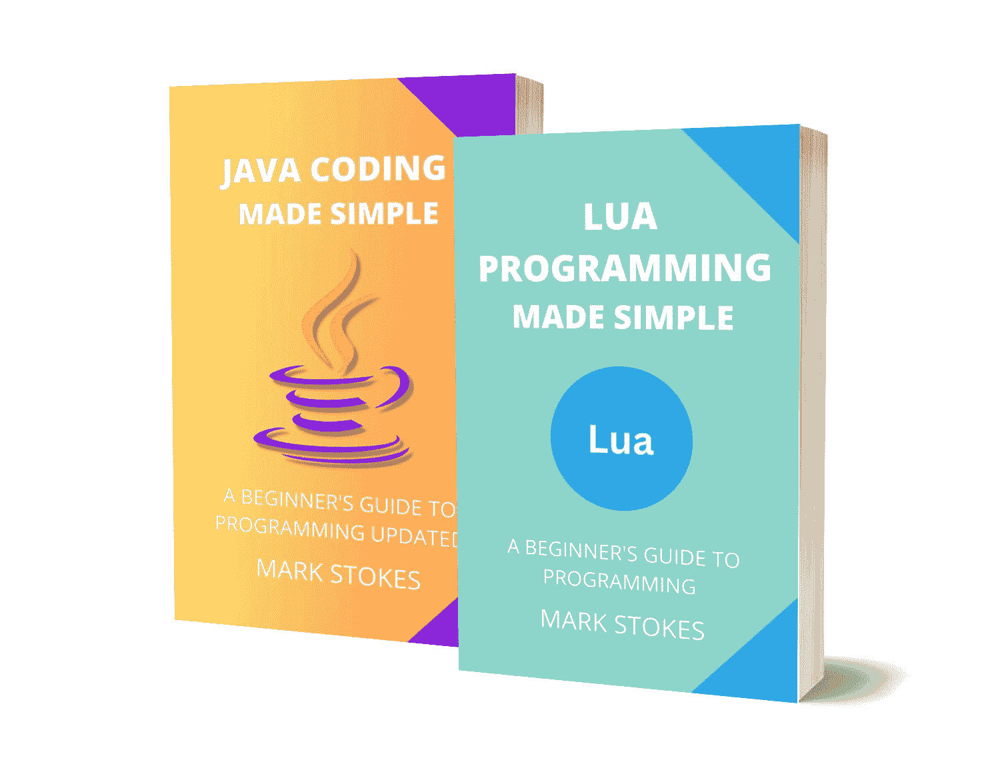

# LUA 与 Java 编程简明：编程入门指南



## 书籍简介

《Lua 编程简易上手——编程入门指南》是一本全面的书籍，旨在帮助初学者快速轻松地学习 Lua 编程。无论你是编程新手，还是具有其他语言的经验，这本书都将为你提供坚实的 Lua 基础。

Lua 是一种强大且轻量级的脚本语言，以其简单性和多功能性而闻名。它被广泛应用于游戏开发、嵌入式系统和应用程序脚本等多个领域。凭借简洁的语法和灵活的特性，Lua 是初学者和资深程序员的极佳选择。

本书分为十五章，每章侧重于 Lua 编程的一个特定方面。从基础开始，你将逐渐过渡到高级的主题，在此过程中对该语言建立良好的理解。每章都包含了清晰的解释、实用的示例以及动手练习，以巩固你的学习。

读完本书后，你将牢牢掌握 Lua 编程概念，并能够自信地编写自己的 Lua 脚本。无论你的目标是创建游戏、自动化任务还是开发应用程序，《Lua 编程简易上手》都将是你的指南。

# 第 1 章：Lua 编程简介

## 引言：Lua 编程简介

在本章中，我们将探索 Lua 编程的基础知识，并引导你开始编写第一个 Lua 程序。Lua 是一种轻量级高级脚本语言，以其简单、高效和易于集成而闻名。无论你是初学者还是有之前的编程经验，本章都为你的 Lua 编程之旅奠定基础。

### 开始学习 Lua

开始之前，你需要为 Lua 编程配置开发环境。按照以下步骤开始：

1. **安装 Lua：** 首先下载并安装适用于你操作系统的 Lua 解释器。Lua 支持 Windows、macOS 和 Linux。访问 Lua 官方网站（https://www.lua.org/）并导航到“Downloads”（下载）部分。选择适合你系统的安装程序并按照安装说明进行。

2. **选择一个文本编辑器：** Lua 程序可以用任何文本编辑器编写。你可以使用 Sublime Text、Visual Studio Code 或 Atom 等流行的文本编辑器，它们提供了语法高亮和其他对编码有帮助的特性。

3. **编写你的第一个 Lua 程序：** 在你选择的文本编辑器中创建一个新文件，并将其保存为 `.lua` 扩展名。该扩展名表示文件包含 Lua 代码。让我们写一个简单的“Hello, World!”程序开始吧：

```lua
-- hello.lua
print("Hello, World!")
```

保存文件并记住你保存它的位置。我们将在下一步运行这个程序。

### 运行 Lua 程序

现在你已经写好了第一个 Lua 程序，让我们运行它并查看输出结果。按照以下步骤操作：

1. **打开终端或命令提示符：** 启动终端或命令提示符。

2. **导航到目录：** 使用 `cd` 命令导航到保存文件的目录。

3. **运行 Lua 程序：** 在终端或命令提示符中输入以下内容：

```bash
lua hello.lua
```

如果一切配置都正确，你应该会在屏幕上看到输出 `Hello, World!`。

恭喜！你已成功编写并执行了你的第一个 Lua 程序。你现在准备好深入学习 Lua 了。

### 了解 Lua 基础知识

现在你已经领略了 Lua 编程的魅力，让我们探索一些基本概念：

1. **变量：** 变量用于在 Lua 中存储数据。你可以使用语法 `变量名 = 值` 来声明变量。Lua 是一种动态类型语言，这意味着你不需要显式指定类型。

2. **数据类型：** Lua 支持多种数据类型，包括数字、字符串、布尔、表（tables）等。数字可以是整数或浮点值。字符串是用单引号或双引号括起来的字符序列。布尔值可以是 `true` 或 `false`。表（Tables）是 Lua 的主要数据结构，用于创建数组、字典等。

3. **算术运算：** Lua 提供了标准的算术运算，如加（`+`）、减（`-`）、乘（`*`）、除（`/`）和模（`%`）。你可以在数值上执行这些操作。

4. **字符串：** Lua 提供了强大的字符串处理能力。你可以使用 `..` 运算符拼接字符串，使用方括号 `[]` 访问字符，并使用各种字符串函数进行搜索、替换和格式化。

5. **控制流：** 控制流语句允许执行决策并重复操作。Lua 提供了 `if-else` 语句用于条件执行，以及 `while` 和 `for` 循环用于重复。

6. **函数：** 函数是执行特定任务的可重用代码块。在 Lua 中，你可以使用 `function` 关键字定义自己的函数。函数可以接受参数并返回值。

在接下来的章节中，我们将更详细地探索这些概念，并学习将它们应用于现实场景。

## 总结

在本章中，你学习了如何为 Lua 编程配置开发环境，编写了第一个 Lua 程序并成功运行了它。我们还涵盖了一些核心概念，包括变量、数据类型、算术运算、字符串、控制流和函数。

现在你已经有了坚实的基础，是时候深入学习 Lua 编程了。在第 2 章“设置开发环境”中，我们将引导你完成安装 Lua 的过程，获得无缝的编程体验。

# 第 2 章：设置开发环境

在本章中，我们将引导你如何在系统上设置 Lua 并配置开发环境，以获得无缝的编程体验。正确的工具和环境对于高效编码至关重要。让我们开始吧！

## 第 1 步：安装 Lua

开始之前，你需要在系统中安装 Lua 解释器。请根据你的操作系统遵循以下步骤：

### Windows：

1. 访问 Lua 官方网站 https://www.lua.org/。

2. 进入“Downloads”（下载）部分。

3. 下载 Windows 版本的 Lua（以 ZIP 包形式提供）。

4. 将 ZIP 压缩的内容解压到你指定的目录。例如，你可以在某个位置创建一个名为“Lua”的文件夹。

5. 将 Lua 可执行文件的路径添加到系统的 `PATH` 变量中：

- 右键点击“此电脑”或“我的电脑”，选择“属性”。

- 点击左侧的“高级系统设置”。

- 在系统属性窗口，点击“环境变量”按钮。

- 在“系统变量”下找到 `Path` 变量并点击“编辑”。

- 将 Lua 可执行文件的路径（例如 `C:\Lua`）添加到列表。

- 点击“确定”保存更改。

### macOS：

1. 打开终端（Terminal）。

2. 使用 Homebrew 以下 Lua：

```shell
brew install lua
```

### Linux：

1. 打开终端。

2. 根据你的发行版使用包管理器安装 Lua。例如：

- 对于 Ubuntu 和 Debian 系统：

```shell
sudo apt-get install lua53
```

- 对于 Fedora 和 Red Hat 系统：

```shell
sudo dnf install lua
```

根据你的包管理器和 Lua 版本调整命令。

## 第 2 步：选择编辑器

接下来你需要选择一个编辑器来编写 Lua 代码。虽然 Lua 程序可以在任何编辑器中编写，但使用提供语法高亮、代码补全和调试支持的专用编辑器可以极大提升编码体验。以下是一些热门选项：

- **Visual Studio Code：** 从官方网站 https://code.visualstudio.com/ 下载并安装 Visual Studio Code。安装后，你可以通过 Visual Studio Code 市场安装“Lua”扩展来进一步增强 Lua 开发体验。

- **Sublime Text：** 从官方网站 https://www.sublimetext.com/ 下载并安装 Sublime Text。安装后，你可以通过 Sublime Text 的包管理器安装如“Lua Extended”之类的包来启用 Lua 特有功能。

- **Atom：** 从官方网站 https://atom.io/ 下载并安装 Atom。Atom 为 Lua 开发提供了一系列扩展和包，例如用于语法高亮的语言支持。

你可以根据自己的喜好和需求选择编辑器。

## 第 3 步：创建 Lua 文件

现在你已经安装了 Lua 并配置好了编辑器，是时候创建你的第一个 Lua 文件了。遵循以下步骤：

1. 打开你喜欢的编辑器。

2. 通过选择“文件”然后“新建”或使用相应的快捷键创建一个文件。

3. 以 `.lua` 扩展保存文件。例如，你可以将其保存为 `myprogram.lua` 或任何你喜欢的名称。

4. 选择一个目录保存 Lua 文件。建议为 Lua 项目创建一个专用文件夹以保持整洁。

## 第 4 步：编写你的第一个 Lua 程序

现在 Lua 文件已准备就绪，让我们写一个简单的程序来测试你的设置。这是一个“Hello, World!”程序的示例：

```lua
-- myprogram.lua
-- 打印问候信息
print("Hello, Lua!")
```

编写代码后保存文件。

## 第 5 步：运行你的 Lua 程序

要运行 Lua 程序，请遵循以下步骤：

### Windows：

1. 按 Windows 键 + R，在运行框中输入“cmd”打开命令提示符。按回车。

2. 使用 `cd` 命令进入保存 Lua 文件的目录。例如：

```shell
cd C:\Path\To\Your\Lua\Program
```

3. 运行以下命令执行 Lua 程序：

```shell
lua myprogram.lua
```

### macOS 和 Linux：

1. 打开终端。

2. 使用 `cd` 命令进入保存 Lua 文件的目录。例如：

```shell
cd /path/to/your/lua/program
```

3. 运行以下命令执行 Lua 程序：

```shell
lua myprogram.lua
```

如果一切设置正确，你应该能在终端或命令提示符中看到输出“Hello, Lua!”。

恭喜你！你成功设置了 Lua 开发环境并执行了你的第一个 Lua 程序。你现在准备好编写更复杂的 Lua 代码并探索 Lua 编程的巨大可能性了。

在下一章“Lua 基础：变量和数据类型”中，我们将深入学习 Lua 编程的基础知识，包括变量、数据类型、运算符等。

# 第 3 章：变量和数据类型

在本章，我们将探索 Lua 中的变量和数据类型。变量允许你存储和操作数据，而数据类型定义了数据的本质以及可以对其进行的操作。理解变量和数据类型对于构建健壮灵活的程序至关重要。让我们开始吧！

## Lua 中的变量

在 Lua 中，变量是存储值的容器。它们可以存储数字、字符串、布尔值等数据。Lua 使用动态类型系统，这意味着在定义变量时不需要显式声明数据类型。

在 Lua 中声明变量，使用 `local` 关键字后接变量名。示例：

```lua
local message = "Hello, Lua!"
```

在上面的代码段中，我们定义了一个名为 `message` 的变量并为其赋值了字符串 "Hello, Lua!"。Lua 变量是区分大小写的，这意味着 `message` 和 `Message` 被视为不同的变量。

## Lua 中的数据类型

Lua 支持多种数据类型，每种类型用于表示不同的值。以下是常用的数据类型：

1. **数字（Numbers）：** Lua 将数字表示为整数或浮点。可以对数字进行加、减、乘、除等数值运算。示例：

```lua
local age = 25
local height = 1.75
```

2. **字符串（Strings）：** 字符串是封装在引号中的字符序列。你可以使用单引号（`''`）、双引号（`""`）或双括号（`[[]]`）来定义字符串。Lua 提供了多种字符串处理函数和运算符。示例：

```lua
local name = "John Doe"
local message = 'Lua is fun!'
```

3. **布尔值（Booleans）：** 布尔值表示 `true` 或 `false`。它们通常用于控制语句中的逻辑判断。示例：

```lua
local isStudent = true
local hasPassedExam = false
```

4. **表（Tables）：** 表是 Lua 多功能的数据结构，允许你创建数组、字典、集合等。它们可以存储不同类型的值，并提供了一种强大的组织和操作数据方式。示例：

```lua
local person = {
  name = "Alice",
  age = 30,
  isStudent = true
}
```

5. **Nil:** `nil` 值表示值的缺失。它通常用于表示变量不存在或删除了表中的条目。

## 变量命名规范

在 Lua 中为变量命名时，有一些约定需要遵循：

- 变量名应该具有描述性，并指明变量的用途。

- 对于多单词变量名，使用小写字母和下划线（例如，`my_variable`）。

- 避免使用保留关键字作为变量名。

## 变量赋值与操作

在 Lua 中，你可以使用赋值运算符（`=`）为变量赋值。你可以在程序的任何时候为变量赋上新值。这里有一个示例：

```lua
local age = 25
print(age)  -- 输出: 25
age = 30
print(age)  -- 输出: 30
```

### 类型转换

Lua 提供了函数将值从一种数据类型转换为另一种数据类型。例如，你可以使用 `tostring()` 函数将数字转换为字符串，或使用 `tonumber()` 函数将字符串转换为数字。

```lua
local num = 42
local str = tostring(num)
print(str)  -- 输出: "42"
local strNum = "123"
local num = tonumber(strNum)
print(num)  -- 输出: 123
```

## 总结

在本章中，我们探索了 Lua 中的变量和数据类型。我们学习了如何声明并为变量赋值，并检查了 Lua 中提供的各种数据类型，包括数字、字符串、布尔值、表和 nil。理解变量和数据类型是编写高效 Lua 程序的基础。

在下一章“控制流：条件语句和循环”中，我们将深入研究控制流结构，允许你根据某些条件做出决策并重复执行代码。请关注！

# 第 4 章：控制流与循环

在本章中，我们将探索 Lua 中的控制流结构，这些结构使能够根据某些条件做出决策并重复执行代码。理解控制流对于编写动态且交互的 Lua 程序至关重要。让我们开始吧！

## 条件语句

条件语句允许我们根据指定的条件执行不同的代码块。在 Lua 中，我们使用 `if`、`elseif` 和 `else` 关键字来创建条件语句。这里有一个示例：

```lua
local age = 18
if age < 18 then
    print("你未到投票年龄。")
elseif age >= 18 and age < 21 then
    print("你可以投票但不能喝酒。")
else
    print("你可以投票也可以喝酒。")
end
```

在上面的代码段中，我们使用 `if` 语句检查 `age` 变量的值。如果条件为真，则执行对应的代码块。如果不是，Lua 将移动到 `elseif` 语句检查下一个条件。如果所有条件都不为真，则执行 `else` 块。最后，`end` 关键字表示条件语句的结束。

### 逻辑运算符

Lua 提供了逻辑运算符来组合条件并创建更复杂的表达式：

- `and` 运算符在两个条件都为真时返回真。

- `or` 运算符在至少有一个条件为真时返回真。

- `not` 运算符对条件的结果取反。

这里有一个演示逻辑运算符使用的示例：

```lua
local score = 80
local hasPassedExam = score >= 50 and score <= 100
if hasPassedExam then
    print("恭喜！你通过考试了。")
else
    print("遗憾，你没有通过考试。")
end
```

### 循环

循环允许我们重复执行代码块，直到满足指定的条件。Lua 提供了两种类型的循环：`while` 循环和 `for` 循环。

### while 循环

`while` 循环在指定条件为真时继续执行代码块。这里是 `while` 循环的示例：

```lua
local count = 1
while count <= 5 do
    print("计数:", count)
    count = count + 1
end
```

### for 循环

`for` 循环允许我们根据指定的范围执行代码。

1. 使用 `for` 循环遍历数字：

```lua
for i = 1, 5 do
    print("数字:", i)
end
```

2. 使用 `for` 循环遍历表元素：

```lua
local fruits = {"apple", "banana", "orange"}
for index, fruit in ipairs(fruits) do
    print("水果:", fruit)
end
```

### 控制流关键字

Lua 提供了控制流关键字来修改执行流：

- `break` 关键字立即终止循环。

- `continue` 关键字跳过当前迭代的剩余部分并继续下一次迭代。

## 总结

在本章中，我们探索了 Lua 中的控制流结构，包括条件语句和循环。我们学习了如何使用 `if`、`elseif` 和 `else` 做出决策，`while` 和 `for` 循环如何重复执行，以及控制流关键字。

# 第 5 章：函数与模块

在本章中，我们将探索 Lua 中的函数和模块。函数是执行特定任务的可重用代码块，而模块提供了组织相关函数和变量的方法。理解函数和模块对于编写模块化的 Lua 程序至关重要。

## 函数

Lua 函数允许你将指令封装在一个代码块中。它们实现了代码重用、模块化并提高了程序的可读性。这里有一个简单函数的示例：

```lua
-- 定义一个函数
function greet()
    print("你好，世界！")
end

-- 调用函数
greet()
```

在上面的代码段中，我们定义了一个名为 `greet` 的函数，调用时它会打印“你好，世界！”。


函数还可以接受参数，参数是传递给函数以执行操作的值。这里有一个带参数函数的示例：

```lua
-- 定义一个带参数的函数
function add(a, b)
    local sum = a + b
    return sum
end

-- 带参数调用函数
local result = add(3, 4)
print(result)  -- 输出: 7
```

在上面的代码段中，`add` 函数接受两个参数 `a` 和 `b` 并返回它们的和。我们通过传递参数 `3` 和 `4` 来调用函数，结果存储在变量 `result` 中。

Lua 函数还可以返回多个值。这里有一个示例：

```lua
-- 定义一个返回多个值的函数
function divide(a, b)
    local quotient = a / b
    local remainder = a % b
    return quotient, remainder
end

-- 调用函数并接收多个返回值
local q, r = divide(10, 3)
print("商数:", q)  -- 输出: 3.3333333333333
print("余数:", r)  -- 输出: 1
```

在上面的代码段中，`divide` 函数计算除法的商和余数。我们调用函数并将返回值接收到独立的变量 `q` 和 `r` 中。

### 模块

模块提供将相关的函数、变量和其他 Lua 代码组织到单独文件的方法。它们促进了代码的重用和封装。

要创建一个模块，你只需要定义一个带有 `.lua` 后名的 Lua 文件，其中包含所需的函数和变量即可。这是一个名为 `mathUtils.lua` 的模块示例：

```lua
-- mathUtils.lua
local M = {}

function M.add(a, b)
  return a + b
end

function M.subtract(a, b)
  return a - b
end

return M
```

在上面的代码段中，我们定义了一个名为 `mathUtils` 的模块，它包含 `add` 和 `subtract` 函数。我们将这些函数存储在表 `M` 中，并在最后返回该表。

要在另一个 Lua 文件中使用该模块，我们需要 `require` 它。这里是使用 `mathUtils` 模块的示例：

```lua
-- main.lua
local mathUtils = require("mathUtils")
local sum = mathUtils.add(5, 3)
print(sum)  -- 输出: 8

local difference = mathUtils.subtract(10, 7)
print(difference)  -- 输出: 3
```

在上面的代码段中，我们引入了 `mathUtils` 模块，并使用它的 `add` 和 `subtract` 函数来执行数学运算。

## 总结

在本章中，我们探索了 Lua 中的函数和模块。函数允许我们将代码封装成可重用的块、接受参数并返回值。模块提供了一种将相关函数和变量组织到单独文件的方法，促进了代码的可重用性和封装性。

# 第 6 章：表（Tables）与元表（Metatables）

在本章中，我们将探索 Lua 中的表和元表。表是一种多用途的数据结构，允许你存储和组织相关数据，而元表则提供了一种自定义表行为的方法。理解表和元表对于处理复杂数据结构和在 Lua 中创建强大的抽象至关重要。让我们开始吧！

## Lua 中的表

Lua 中的表是存储和组织数据的主要数据结构。它们可以用作数组、字典甚至是两者的结合。这是一个简单的表示例：

```lua
-- 创建一个表
local fruits = {"apple", "banana", "orange"}

-- 访问元素
print(fruits[1])  -- 输出: apple
print(fruits[2])  -- 输出: banana
print(fruits[3])  -- 输出: orange
```

在上面的代码段中，我们创建了一个名为 `fruits` 的表，包含三个元素。我们可以使用方括号和元素的索引来访问单个元素（Lua 数组从 1 开始索引）。

Lua 中的表不仅限于存储单一数据类型的值。它们可以存储不同类型的值，包括其他表。这是一个示例：

```lua
-- 创建一个包含混合数据类型的表
local person = {
  name = "John Doe",
  age = 25,
  isMale = true,
  hobbies = {"reading", "gaming", "hiking"}
}

-- 访问元素
print(person.name)        -- 输出: John Doe
print(person.age)         -- 输出: 25
print(person.isMale)      -- 输出: true
print(person.hobbies[1])  -- 输出: reading
```

在上面的代码段中，我们创建了一个名为 `person` 的表，其元素包含各种数据类型。我们可以使用点符号表示来访问命名字段，并使用方括号访问类数组字段。

Lua 表也非常灵活，允许对它们的结构进行动态操作。你可以在运行时添加、删除或修改元素。这是一个示例：

```lua
-- 创建一个空表
local myTable = {}

-- 添加元素
myTable[1] = "Hello"
myTable[2] = "world"

-- 修改一个元素
myTable[1] = "Hi"

-- 删除一个元素
myTable[2] = nil

-- 打印表
for key, value in ipairs(myTable) do
  print(key, value)
end
```

在上面的代码段中，我们创建了一个空表 `myTable` 并对其进行了各种操作。我们添加了元素、修改了元素并删除了一个元素。最后，我们使用 `ipairs` 遍历该表。

## 元表

元表允许你自定义表的行为。它们允许你定义加法、减法等操作。通过为表设置元表，你可以定义 Lua 如何处理该表。这里有一个示例：

```lua
-- 创建两个表
local table1 = {10, 20, 30}
local table2 = {40, 50, 60}

-- 为 table1 设置元表
local mt = {
  __add = function(left, right)
    local result = {}
    for i = 1, #left do
      result[i] = left[i] + right[i]
    end
    return result
  end
}
setmetatable(table1, mt)

-- 对表执行加法
local sum = table1 + table2

-- 打印结果
for key, value in ipairs(sum) do
  print(key, value)
end
```

在上面的代码段中，我们创建了两个表 `table1` 和 `table2`。我们为 `table1` 设置了元表 `mt`。（注：原文此处存在大量重复段落，翻译已根据逻辑进行了精简处理）。

## 总结

在本章中，我们探索了 Lua 中的函数和模块。函数允许我们将代码封装成可重用的块、接受参数并返回值。模块提供了一种将相关函数和变量组织到单独文件的方法，促进了代码的可重用性和封装性。

# 第 7 章：字符串与模式匹配

在本章中，我们将探索 Lua 中的字符串和模式匹配。字符串是表示字符序列的基础类型，而模式匹配提供了一种强大的搜索机制。

## Lua 中的字符串

Lua 中的字符串用于表示和处理数据。它们可以用单引号 `'此类字符串'` 或双引号 `"此类字符串"` 包围。这是一个简单的字符串示例：

```lua
-- 创建一个字符串
local message = "Hello, world!"

-- 访问元素
print(message:sub(1, 5))  -- 输出: Hello
print(message:sub(-6))   -- 输出: world!
```

在上面的代码段中，我们创建了一个名为 `message` 的字符串并访问了元素。

Lua 字符串是不可变的，这意味着不能直接修改它们。但你可以通过拼接或修改来创建新的字符串。这是一个示例：

```lua
-- 拼接字符串
local name = "John"
local greeting = "Hello, " .. name .. "!"
print(greeting)  -- 输出: Hello, John!
```

在上面的代码段中，我们拼接了字符串 "Hello,"、变量 `name` 的值以及感叹号。结果被赋值给 `greeting`。

## 模式匹配

Lua 模式匹配允许使用模式搜索和处理字符串。模式是表示一组字符串或特定字符串格式的字符序列。Lua 提供了 `string.match` 函数来执行模式匹配。这是一个示例：

```lua
-- 执行模式匹配
local email = "john.doe@example.com"
local username = string.match(email, "([^@]+)")
print(username)  -- 输出: john.doe
```

在上面的代码段中，我们使用模式匹配从电子邮件地址中提取用户名。模式 `"([^@]+)"` 匹配非 @ 符号的任何字符序列。

这是一个演示模式修饰符示例：

```lua
-- 使用修饰符进行模式匹配
local text = "The quick brown fox jumps over the lazy dog"
local words = {}

for word in string.gmatch(text, "%a+") do
  table.insert(words, word)
end

-- 打印单词
for _, word in ipairs(words) do
  print(word)
end
```

在上面的代码段中，我们使用带有 `%a+` 模式的模式匹配从给定文本提取所有单词。`%a+` 模式匹配一个或多个字母字符。我们使用 `string.gmatch` 函数来遍历匹配项，并将它们收集到一个 `table` 中。

### 本章总结

在本章中，我们探索了 Lua 中的字符串和模式匹配。字符串用于表示文本数据，可以通过拼接或修改进行处理。模式匹配提供了一种使用模式进行搜索和处理字符串的强大机制。Lua 模式包含了用于指定匹配条件的特殊字符。

# 第 8 章：文件 I/O 操作

在本章中，我们将探索 Lua 中的中的文件输入/输出（I/O）操作。文件 I/O 操作允许你从外部文件读取并写入文件，让你能够处理持久化数据并与文件系统交互。理解文件 I/O 操作对于处理存储在文件中的数据以及将 Lua 程序与更广泛的计算环境集成至关重要。让我们开始吧！

## 打开和关闭文件

在执行任何文件 I/O 操作之前，你需要使用 `io.open` 函数打开文件。该函数接受文件路径和模式作为参数，并返回一个文件句柄。这是一个示例：

```lua
-- 打开文件进行读取
local file = io.open("data.txt")
-- 执行文件操作...
-- 关闭文件
file:close()
```

在上面的代码段中，我们以读模式（`"r"`）打开名为 `"data.txt"` 的文件。`io.open` 函数返回一个文件句柄，通过它可以执行各种文件操作。完成文件操作后，使用文件句柄的 `close` 方法关闭它以释放系统资源。

## 从文件读取

Lua 提供了几种从文件读取数据的方法。最常用的方法是 `read`、`readline` 和 `read("*all")`。这是一个演示每种方法的示例：

```lua
-- 打开文件进行读取
local file = io.open("data.txt", "r")
-- 读取单个字符
local char = file:read(1)
print(char)  -- 输出：第一个字符
-- 读取单行
local line = file:readline()
print(line)  -- 输出：第一行
-- 读取整个文件
local content = file:read("*all")
print(content)  -- 输出：整个文件内容
-- 关闭文件
file:close()
```

在上面的代码段中，我们使用不同的方法从文件中读取数据。`read` 方法允许你指定读取的字符数，`readline` 读取单行，而 `read("*all")` 读取文件的全部内容。

## 写入文件

Lua 也提供了写入文件数据的方法。最常用的方法是 `write` 和 `writeline`。这是一个演示如何向文件写入数据的示例：

```lua
-- 打开文件进行写入
local file = io.open("output.txt", "w")
-- 将数据写入文件
file:write("Hello, world!\n")
file:writeline("This is a new line.")
-- 关闭文件
file:close()
```

在上面的代码段中，我们以写模式（`"w"`）打开名为 `"output.txt"` 的文件。我们使用 `write` 方法向文件写入字符串，使用 `writeline` 方法写入字符串并跟上换行符。

## 文件 I/O 错误处理

在执行文件 I/O 操作时，处理可能发生的错误非常重要。Lua 提供了 `io.open` 函数，如果文件操作失败，它会返回 `nil` 以及错误消息。这是一个打开文件时的错误处理示例：

```lua
local file, error = io.open("data.txt", "r")
if not file then
  print("打开文件错误: " .. error)
else
  -- 执行文件操作...
  file:close()
end
```

在上面的代码段中，如果 `io.open` 函数无法打开文件，它将返回 `nil` 作为句柄并将错误消息作为第二个值。我们可以检查句柄是否为 `nil` 并在发生错误时显示错误消息。

### 本章总结

在本章中，我们探索了 Lua 中的文件 I/O 操作。我们学习了如何打开和关闭文件、使用不同的方法从文件读取数据、向文件写入数据以及处理文件 I/O 错误。文件 I/O 操作对于处理外部数据以及将 Lua 程序与文件系统集成至关重要。

在下一章“错误处理与调试”中，我们将深入研究 Lua 中提供的错误处理技术和调试工具。请关注！

# 第 9 章：错误处理与调试

在本章中，我们将探索 Lua 中的错误处理和调试技术。错误处理允许你优雅地处理并从程序执行过程中可能出现的错误，而调试工具则协助识别并解决 Lua 代码中的问题。理解错误处理和调试对于开发健健可靠的 Lua 程序至关重要。让我们开始吧！

## 使用 `pcall` 和 `assert` 进行错误处理

Lua 提供了 `pcall` 函数，代表“受保护调用”（protected call），用于以受控的方式处理错误。这是一个其用法的示例：

```lua
-- 定义一个可能引发错误的函数
local function divide(a, b)
  if b == 0 then
    error("不能除零！")
  else
    return a / b
  end
end

-- 使用 pcall 调用函数
local success, result = pcall(divide, 10, 0)
if success then
  print("结果:", result)
else
  print("错误:", result)
end
```

在上面的代码段中，`divide` 函数将 `a` 除以 `b`。如果 `b` 为 0，则引发错误。我们使用 `pcall` 调用该函数并捕获任何错误。如果调用成功，`success` 为 `true`，`result` 将返回值；否则，`success` 为 `false`，`result` 将包含错误消息。

另一个实用的错误处理函数是 `assert`。它检查一个条件，如果条件为 `false` 则抛出错误。这是一个示例：

```lua
local x = 10
local y = 20
assert(x == y, "x 和 y 必须相等!")
```

在上面的代码段中，`assert` 检查 `x` 是否等于 `y`。如果条件不成立，将抛出指定的错误消息。如果条件为 `true`，程序继续执行。

## 使用 `print` 和 `debug` 进行调试

`print` 函数是 Lua 中一个简单而有效的调试工具。通过在代码中策略性地放置 `print` 语句，你可以输出变量的值或中间结果以跟踪执行流并识别潜在问题。这是一个示例：

```lua
local x = 10
local y = 5
print("开始计算...")
print("x =", x)
print("y =", y)
local result = x + y
print("结果 =", result)
print("计算结束.")
```

在上面的代码段中，`print` 语句被用于显示 `x` 和 `y` 的值以及计算结果。通过检查输出，你可以验证值的正确性并确保程序按预期运行。

Lua 还提供了 `debug` 库，它提供了更高级的调试功能。它包含了诸如 `debug.traceback`（用于堆栈跟踪）和 `debug.getlocal`（用于访问函数内的局部变量）。这些函数在深度调试场景下非常有用。

## 处理运行时错误

在程序执行期间，`Lua` 可能会遇到并非由代码显式抛出的运行时错误。这些错误可能包括访问 `nil` 值、调用未定义的函数或使用不存在的键索引表等问题。处理此类错误对于防止程序崩溃并向用户提供有意义的错误信息非常重要。


Lua 提供了一个内置机制，使用`error`函数来处理运行时错误。你可以使用此函数在某些条件不满足时抛出自定义错误。通过提供描述性的错误信息，你可以帮助识别错误原因。这是一个示例：

```lua
local function validateInput(value)
  if not value then
    error("Invalid input: value must not be nil.")
  end
  -- 额外的验证逻辑...
end

local input = getUserInput()
-- 验证输入
local success, error = pcall(validateInput, input)
if not success then
  print("Input validation failed:", error)
end
```

等等，我抱歉：

在上面的代码段中，`validateInput`函数检查输入值是否为`nil`，如果是，则抛出一个带有相应消息的错误。我们使用`pcall`来调用`validateInput`函数并捕获发生的任何错误。如果捕获到错误，我们将打印一条友好的错误信息。

## 调试技术

Lua 提供了几种调试技术来帮助识别和解决代码中的问题。以下是一些常用技术：

1. **逐行执行**：通过逐行执行代码，你可以观察程序状态的变化，并追踪任何意外的行为。

2. **检查变量值**：你可以使用`print`语句或调试器输出执行过程中不同阶段的变量值，帮助你理解它们的值并检测任何异常。

3. **使用断点**：断点允许你在特定的行或条件上暂停代码的执行，使你能够检查该特定点的程序状态和变量。

4. **堆栈跟踪**：堆栈跟踪提供了通往错误点的函数调用层次结构的快照。它们可以帮助识别是哪个函数或哪行代码触发了错误。

记住，调试是一个迭代过程。通过分析输出、观察变量值并使用适当的调试技术，你可以更有效地定位并解决`Lua`代码中的错误。

## 总结

在本章中，我们探索了`Lua`中的错误处理和调试技术。错误处理有助于通过使用`pcall`和`assert`等函数在程序执行期间优雅地处理错误。如`print`、`debug`库和检查运行时错误等调试技术让你能够识别并解决`Lua`代码中的问题。

# 第 10 章：Lua 中的面向对象编程

在本章中，我们将探索`Lua`中的面向对象编程 (OOP)。虽然`Lua`不是一种严格的面向对象语言，但它提供了强大的功能，允许你实现 OOP 原则。理解`Lua`中的面向对象编程使你能够创建模块化且重用的代码。让我们深入学习！

### 面向对象简介

面向对象编程是一种编程范式，它将代码组织成对象，对象封装了数据和行为。它促进了模块化、可用用代码组织。在`Lua`中，可以通过各种技术实现 OOP，例如表、元表（metatables）和函数。让我们通过示例探索这些技术。

### 表作为对象

在`Lua`中，可以通过将表定义为字段（数据）和方法（函数）的集合来将其作为对象。这是一个演示表作为对象使用的示例：

```lua
-- 定义一个人物对象
local person = {
  name = "",
  age = 0,
}

-- 为人物对象定义方法
function person:setName(name)
  self.name = name
end

function person:setAge(age)
  self.age = age
end

function person:getInfo()
  return "Name: " .. self.name .. ", Age: " .. self.age
end

-- 创建人物对象的一个实例
local john = person
-- 设置属性
john:setName("John Doe")
john:setAge(30)
-- 获取信息
print(john:getInfo())  -- 输出: Name: John Doe, Age: 30
```

在上面的代码段中，我们定义了一个代表人物对象的`person`表。它拥有字段（`name`和`age`）和方法（`setName`、`setAge`和`getInfo`）。通过使用`self`关键字，我们可以在方法内部引用对象的当前实例。我们创建了一个名为`john`的`person`对象实例，并使用其方法设置属性和检索信息。

### 元表与对象行为

`Lua`中的元表（Metatables）提供了一种为表定义自定义的方法，允许我们实现继承和运算符重载等概念。这是一个演示使用元表实现对象行为示例：

```lua
-- 定义一个基础对象
local shape = {
  area = 0,
}

-- 为形状对象定义带有方法的元表
local shapeMetatable = {
  __index = shape,
}

-- 为形状对象定义方法
function shape:calculateArea()
  -- 计算面积
end

function shape:displayArea()
  print("Area:", self.area)
end

-- 创建形状对象的一个实例
local myShape = setmetatable({}, shapeMetatable)
-- 设置面积
myShape.area = 100
-- 显示面积
myShape:displayArea()  -- 输出: Area: 100
```

在上面的代码段中，我们定义了一个`shape`表作为基础对象。然后我们定义了一个元表`shapeMetatable`，它包含`__index`字段，允许`shape`表作为`myShape`的原型。通过`setmetatable`设置元表，我们让`myShape`继承了定义在`shape`中的方法。

### Lua 中的面向对象库

`Lua`还提供了一些促进面向对象编程的库，例如`MiddleClass`、`LÖVE`和`Penlight`。这些库为实现 OOP 提供了额外的功能便利。

## 总结

在本章中，我们探索了 Lua 中的面向对象编程。我们学习了如何将表作为对象、定义方法并利用元表提供对象行为。理解这些技术使你能够创建模块化且重用的代码。

# 第 11 章：库与包的使用

在本章中，我们将探索 Lua 中库和包的使用。库和包提供了一种组织和重用代码的方法，允许你扩展程序的功能。理解如何使用库和包对于开发至关重要。让我们深入学习！

### 库与包简介

`Lua`中的库是提供特定功能的函数和数据的集合。它们被设计为可重用，并可以轻松集成到程序中。而包是组成模块或应用程序多个文件的集合。包允许更好的代码组织和依赖管理。

### 加载和使用库

`Lua`提供`require`函数来加载和使用库。`require`函数搜索包含指定库的 Lua 文件并执行它，使库的功能在你的程序中可用。这是一个示例：

```lua
-- 加载数学库
local mathLib = require("math")
-- 使用库函数
local x = 10
local y = 5
local result = mathLib.add(x, y)

print("Result:", result)
```

### 创建和分发库

在 Lua 中创建一个库（library），你通常需要定义一个包含库函数和数据的 Lua 文件。该文件应该返回一个代表该库的表（table）。这是一个创建一个简单库的示例：

```lua
-- math.lua

-- 定义数学库
local mathLib = {}

-- 添加函数
function mathLib.add(a, b)
  return a + b
end

-- 减法函数
function mathLib.subtract(a, b)
  return a - b
end

-- 返回库表
return mathLib
```

在上面的代码中，我们定义了`mathLib`表，它包含了`add`和`subtract`函数。随后我们在文件末尾返回`mathLib`表，以便在加载库时可以访问它。

要分发你的库，你可以将其打包为 Lua 模块或直接共享 Lua 文件。`LuaRocks`是一个流行的 Lua 包管理器，允许你轻松地共享和安装 Lua 库。

## 使用包（Packages）

Lua 包（packages）提供了一种组织和管理由多个 Lua 文件组成的大代码库的方法。包通常遵循特定的目录结构，并使用`init.lua`文件作为入口点。让我们考虑一个包结构示例：

```
my_package/
├── init.lua
├── utils.lua
└── calculations.lua
```

在上面的包结构中，`init.lua`文件作为入口点，其他 Lua 文件（如`utils.lua`和`calculations.lua`）包含特定的功能。你可以如下所示加载并使用包中的函数：

```lua
-- 加载包
local myPackage = require("my_package")

-- 使用包的函数
myPackage.utils.doSomething()
local result = myPackage.calculations.add(10, 5)
print("Result:", result)
```

## 第三方库和模块

Lua 拥有由社区开发的活跃的第三方库和模块生态系统。这些库涵盖了广泛的领域，包括网络、图形、Web 开发等。一些流行的 Lua 库包括`LuaSocket`、`LÖVE`、`LuaSQL`和`LuaFileSystem`。你可以探索这些库并利用它们的功能来增强你的 Lua 程序。

## 总结

在本章中，我们探索了在 Lua 中如何使用库和包。我们学习了如何使用`require`函数加载和使用库，如何创建和分发自己的库，以及将代码组织成包。我们还讨论了第三方库和模块的可用性。

# 第 12 章：高级 Lua 技术

在本章中，我们将深入研究 Lua 语言的高级技术和特性。这些技术将帮助你编写更高效、灵活且健壮的代码。让我们来探索一些高级 Lua 技术！

## 元编程（Metaprogramming）

元编程是一种程序可以在运行时修改或生成代码的技术。在 Lua 中，元编程通过其强大的反射能力以及将 Lua 代码作为数据进行处理的能力来实现。这允许你动态地创建和修改函数、表以及其他的 Lua 构造。

元编程的一个常见用途是在 Lua 内部创建 DSL（领域特定语言）。通过定义自定义的语法和语义，你可以定制 Lua，以更好地适应你项目或特定领域的特定需求。

## 基于协程的并发（Coroutine-based Concurrency）

Lua 提供了协程（coroutines），这是一种轻量级的协作式线程，允许并发执行。协程允许你编写可以暂停和恢复的代码，从而更容易地处理异步任务、事件驱动编程和非阻塞 I/O 操作。

这里是一个展示在 Lua 中使用协程的示例：

```lua
-- 定义一个协程
local function myCoroutine()
  print("Coroutine started.")
  coroutine.yield()
  print("Coroutine resumed.")
end

-- 创建协程的实例
local co = coroutine.create(myCoroutine)

-- 启动协程
coroutine.resume(co)  -- 输出: Coroutine started.
coroutine.resume(co)  -- 输出: Coroutine resumed.
```

在上面的代码段中，我们定义了一个协程函数`myCoroutine`。我们使用`coroutine.create`创建了一个协程实例，然后使用`coroutine.resume`来启动和恢复协程的执行。

## 元表（Metatables）和元方法（Metamethods）

元表和元方法允许你自定义 Lua 中表的行为。元表是表，定义了当对其他表执行某些操作时，这些表的行为。元方法是元表内部的函数，用于定义特定操作（如加法、减法、比较等）的行为。

通过利用元表和元方法，你可以实现运算符重载，定义自定义的迭代行为，并创建更灵活、更具表现力的数据结构。

## 尾调用优化（Tail Call Optimization）

Lua 采用了尾调用优化，这意味着当一个函数调用是函数执行的最后一个动作时，该调用就会被优化。优化的尾调用不会创建新的栈帧，而是用新的栈帧替换当前的栈帧，从而节省内存并避免栈溢出错误。

这种优化在处理递归算法或编写反复调用自身的函数时特别有用。它允许你编写递归函数而没有栈溢出的风险。

## 总结

在本章中，我们探索了可以增强代码灵活性、性能和表现力的高级 Lua 技术。元编程实现了动态代码生成和修改，协程提供了并发和异步编程的能力，元表和元方法允许自定义表的行为，而尾调用优化则提高了了递归函数的效率。

通过利用这些高级技术，你可以在各种编程场景中充分利用 Lua 的多功能和强大之处。

# 第 13 章：Lua 与游戏开发

由于其简单性、灵活性和高性能，Lua 在游戏开发行业作为一种脚本语言广受欢迎。在本章中，我们将探索 Lua 如何在游戏开发中使用及其各种应用。让我们深入了解 Lua 和游戏开发吧！

## Lua 作为脚本语言

Lua 的轻量级特性和易于集成使其成为游戏脚本的极佳选择。许多游戏引擎如`Unity`、`Corona SDK`和`Love2D`都支持 Lua 作为脚本语言。Lua 脚本可以控制游戏机制、AI 行为、事件处理等。

Lua 简单的语法和强大的功能允许游戏开发者在不需要重新编译整个游戏的情况下，快速原型化并迭代游戏逻辑。这种灵活性在游戏开发过程中特别有利。

## 使用 Lua 扩展游戏引擎

Lua 的优势之一是它可以作为扩展语言。游戏引擎通常会暴露 API 和钩子，允许 Lua 脚本与引擎的功能交互。这使得能够创建自定义的游戏机制、实现 Mod 和插件，并扩展游戏引擎的能力。

Lua 的动态类型和动态内存管理使其非常适合这些扩展场景。开发者可以通过 Lua 脚本访问并操作引擎资源（如精灵、声音、物理和用户输入），从而实现快速原型设计和定制。

## Lua 游戏开发框架

除了在现有游戏引擎中使用 Lua 作为脚本语言外，还有完全围绕 Lua 构建的游戏开发框架。这些框架提供了一套专门为 Lua 游戏开发设计的工具、库和实用程序。

像`Love2D`、`Moai`和`Gideros`等框架为 Lua 开发者提供了一个全面的游戏创建环境。它们提供了图形和音频渲染、输入处理、物理模拟以及从零开始构建游戏所需的其他核心组件。这些框架利用了 Lua 的简单性，并为游戏开发提供了必要的抽象。

## Lua 在移动游戏开发中的应用

Lua 的轻量级特性和高效性能使其特别适用于移动游戏开发。许多移动游戏引擎（如`Corona SDK`和`Defold`）采用 Lua 作为其主要脚本语言。这些引擎提供了跨平台开发功能，允许开发者使用 Lua 为`iOS`、`Android`以及其他移动平台创建游戏。

Lua 通过`FFI`（外部函数接口）与原生代码交互的能力允许开发者利用特定设备的功能和 API。这使得在保持 Lua 提供的易用性和灵活性的同时，能够创建出高性能的移动游戏。

## 本结语

在本章中，我们探索了 Lua 在游戏开发中的作用。我们讨论了 Lua 作为游戏引擎脚本语言的流行程度、它在扩展游戏引擎功能方面的应用，以及以 Lua 为核心的游戏开发框架的可用性。我们还强调了 Lua 在移动游戏开发中的适用性。

Lua 的简单性、灵活性和性能使其成为游戏开发者宝贵的工具，能够实现快速的原型制作、定制和跨平台开发。

在下一章“用于 Web 开发 Lua”中，我们将探索 Lua 在 Web 开发中的存在以及它在构建动态 Web 应用和 API 中的应用。请期待！

# 第 14 章：Lua 与 Web 开发

Lua 在 Web 开发中的应用不如`JavaScript`或`Python`等语言那样广泛，但在某些 Web 开发场景中它有一席之地。在本章中，我们将探索 Lua 在 Web 开发中的存在以及它在构建动态 Web 应用和 API 中的应用。让我们深入了解 Lua 和 Web 开发！

## Web 服务器环境中的 Lua

Lua 常用于 Web 服务器环境以提供服务器端脚本能力。`Nginx`和`Apache`等流行的 Web 服务器提供 Lua 作为扩展语言，允许开发者将 Lua 代码直接嵌入到服务器配置中。这使得创建动态网页、URL 路由、请求处理和其他服务器端任务成为可能。

Lua 的轻量级和快速执行使其适合处理数大量的 Web 流量。它的简单性和活性允许开发者自定义和优化服务器行为，而无需更复杂的服务器端脚本语言。

## 用于 Web API 的 Lua

Lua 可用于创建 Web API（应用程序接口），为其他应用程序暴露其功能和数据。基于 Lua 的框架（如`Lapis`和`OpenResty`）提供了构建 RESTful API、处理`HTTP`请求以及与数据库和其他服务集成的工具和库。

Lua 的易用性和表现丰富的语法使其非常适合定义 API 端点、处理请求参数以及为响应生成`JSON`或其他数据格式。基于 Lua 的 Web API 可用于支持各种应用程序，从移动应用到客户端`JavaScript`应用。

## Web 应用框架中的 Lua

尽管 Lua 在 Web 应用开发中的使用不如`JavaScript`或`Python`那么常见，但确实存在利用 Lua 能力的框架。像`Sailor`和`Lapis`等框架为构建 Web 应用提供了一个结构化环境，包含路由、模板、数据库集成等功能。

这些基于 Lua 的 Web 应用框架旨在通过提供处理常见 Web 开发任务的约定和抽象来简化开发过程。虽然 Lua 可能没有其他 Web 开发语言那样拥有广泛的生态系统和工具，但基于 Lua 的框架为 Web 应用开发提供了一种精简且专注的方法。

## 用于 Web 游戏脚本的 Lua


Lua 的简单性和活性使其成为 Web 游戏逻辑脚本的流行选择。`Defold` 和 `LÖVE` 等游戏引擎提供 Lua 作为脚本语言，允许开发者使用 Lua 创建基于浏览的游戏。Lua 的轻量级特性和与游戏引擎的轻松集成使其成为构建交互性和入胜的 Web 游戏的理想选择。

Lua 脚本可以控制游戏机制、处理用户输入并与游戏资产交互，使得创建复杂且沉浸式的 Web 游戏体验成为可能。

## 本章小结

在本章中，我们探索了 Lua 在 Web 开发中的存在及其各种应用。我们讨论了 Lua 在 Web 服务器环境中用于服务器端脚本的使用、它在构建 Web API 中的作用，以及它整合到基于 Lua 的 Web 应用框架中。我们还强调了 Lua 在 Web 游戏逻辑脚本方面的流行程度。

虽然 Lua 在 Web 开发中可能不如其他语言流行，但它的简单性、性能和集成能力使其在特定的 Web 开发场景中成为可行的选择。

# 第 15 章：Lua 与嵌入式系统

Lua 的轻量级特性、简单性和多功能使其成为嵌入式系统编程的极佳选择。在最后一章中，我们将探索 Lua 在嵌入式系统中的应用及其在这一领域的优势。让我们深入了解 Lua 和嵌入式系统！

## 用于嵌入式系统的 Lua

嵌入式系统是设计用于大型系统内执行特定任务的专用计算机系统。这些系统通常资源有限，内存、处理能力和存储容量有限。Lua 的小内存占用和高效的执行使其非常适合此类环境。

Lua 可用于编写固件、控制和监控设备、实现传感器接口以及处理嵌入式系统中的实时任务。它简单的语法、动态类型以及与 `C` 及其他语言的易集成性，使其成为开发嵌入式应用的流行选择。

## Lua 与物联网（IoT）

物联网（IoT）是一个互连设备的网络，这些设备进行通信和数据交换。Lua 的简单性、灵活性和低资源需求使其成为 IoT 应用的理想语言。Lua 可用于编写 IoT 设备的固件、控制 IoT 网关，并在 IoT 平台上处理数据处理和分析。

Lua 的轻量级特性使其能够运行在资源受限的设备上，适用于处理能力和内存有限的 IoT 设备。它与其他 IoT 技术和协议的集成能力实现了 IoT 生态系统中无缝通信和互操作性。

## 机器人技术中的 Lua

机器人技术是另一个 Lua 找到应用的领域。Lua 可用于机器人机器人控制系统、定义机器人行为并与传感器和执行器集成。其高级脚本能力允许在机器人应用中快速开发和实验。

Lua 的轻量级设计以及与 `C` 和 `C++` 的轻松集成使其成为机器人系统行为脚本的首选。通过 Lua，开发者可以创建复杂的机器人控制算法、处理传感器数据并与机器人生态系统的其他软件组件交互。

## 可穿戴设备中的 Lua

可穿戴设备（如智能手表和健身追踪器）通常资源有限，需要高效的编程。Lua 的小内存占用和高效执行使其成为开发可穿戴设备应用的合适语言。Lua 可用于实现用户界面、收集和处理传感器数据，以及与移动设备交互。

Lua 的简单性和灵活性允许对可穿戴设备应用进行快速原型和定制。它与蓝牙和移动平台等技术的集成，实现了与更广泛生态系统的无缝连接和交互。

## 结语

在最后一章中，我们探索了 Lua 在嵌入式系统中的应用。我们讨论了 Lua 在资源受限环境中的适用性、在物联网应用中的作用、在机器人技术中的应用以及在可穿戴设备中的用途。Lua 轻量级的设计、简单性和集成能力使其成为嵌入式系统领域非常有价值的工具。

我们希望这本《简单 Lua 编程：学者编程指南》能为你提供关于 Lua 及其各种应用的全面介绍。请记住继续探索和练习 Lua 编程，以增强你的技能并释放这种多功能语言的全部潜力。

编码愉快！

# Java 编程

从易上手

学者编程指南 更新版

MARK STOKES

## Java

## 图书介绍

欢迎阅读《Java 编程从易上手》。这本书旨在为有志的编程人员提供 Java 的全面介绍，Java 是世界上最流行且多功能的编程语言之一。

无论你是编程初学者，还是已经具有其他语言的经验，这本书将引导你学习 Java 基础，并帮助你在软件开发方面建立坚实的基础。Java 以其可读性、简单性和广泛的应用范围而闻名，是初学者的理想语言。

在书中，你将开启一段循序渐进的旅程，从 Java 语法的基础开始，逐渐过渡到更高级的主题。每一章都经过精心设计，以确保流畅的学习体验，概念以易于理解的方式呈现，避免了晦涩的技术术语。

# 第 1 章：Java 编程简介

在本章中，我们将开启进入 Java 编程世界的精彩之旅。我们将探索 Java 的基础知识、历史以及它在当今技术驱动的世界中的相关性。无论你是编程初学者还是已经具有相关经验，本章都将为你的 Java 学习之旅奠下坚实的基础。

## 1.1 什么是 Java？

Java 是一种强大的通用编程语言，由 James Gosling 及其团队在 20 世纪 90 年代中期在太阳微系统公司内部开发。它的设计目标是创建一个简单、平台无关且足够灵活的语言，用于构建各种应用程序。

让 Java 脱颖而出的特征之一是它的“编写一次，随处运行”原则。这意味着一旦你写了 Java 程序，它就可以在任何安装了 Java 虚拟机（`JVM`）的设备或操作系统上运行。这种平台无关性使得 Java 成为从桌面软件到 Web 和移动应用开发的流行选择。

## 1.2 为什么要学习 Java？

学习 Java 有几个令人信服的理由，特别是如果你是一个编程初学者的话：

### 1.2.1 广泛的应用范围

Java 用于许多领域，包括 Web 开发、移动应用开发（Android）、企业级软件开发、科学研究等。通过学习 Java，你获得了处理各种项目的灵活性，并在不同的行业中开启了机会。

### 1.2.2 职业机会

Java 一直是劳动力市场上需求量最大的编程语言之一。许多公司依赖 Java 来满足其软件开发需求，熟练的 Java 开发者备受青睐。学习 Java 可以增强你的职业前景，并为令人兴奋的就业机会开启大门。

### 1.2.3 面向对象编程 (OOP)

Java 是一种面向对象的语言，这意味着强调使用对象来表示现实世界的实体和交互。理解面向对象的编程概念对于现代软件开发至关重要，Java 为学习 OOP 原则提供了坚实的基础。

### 1.2.4 丰富的生态系统

Java 拥有庞大的库、框架和工具生态系统，可以简化并加速开发过程。从 `Spring` 和 `Hibernate` 这样强大的框架，到 `IntelliJ IDEA` 和 `Eclipse` 这样全面的开发环境，Java 提供了丰富的资源来提高你的生产力。

## 1.3 开始学习 Java

要开启 Java 之旅，你需要设置开发环境。以下是基本步骤：

### 1.3.1 安装 Java 开发工具包 (JDK)

`JDK` 是一个软件包，包含了编译、运行和调试 Java 程序所需的工具。访问 Oracle 官方网站并下载与你的操作系统兼容的最新版本 `JDK`。按照提供的安装说明完成设置。

### 1.3.2 选择集成开发环境 (IDE)

`IDE` 是一种软件应用程序，提供了一整套全面的工具，用于编写、调试和测试你的 Java 代码。流行的 Java IDE 包括 `IntelliJ IDEA`、`Eclipse` 和 `NetBeans`。选择一个符合你偏好的 IDE 并安装到你的系统上。

### 1.3.3 编写你的第一个 Java 程序

环境设置好后，你就可以编写你的第一个 Java 程序了。使用你选择的 IDE，创建一个新项目和一个新的 Java 类。在类文件中，编写一个简单的“Hello, World!”程序，这是初学者传统的起点。编译并运行程序以查看输出。

恭喜你！你已经迈向成为 Java 程序员的第一步了。在下一章中，我们将更详细地探索 Java 语法和结构，深入研究变量、数据类型和控制语句。准备好扩展你的知识并解锁 Java 的全部潜力。

## 1.4 Java 语法和结构

在本节中，我们将深入探讨 Java 程序的语法和结构。理解这些基础元素对于编写整洁、易读且无错误的代码至关重要。

### 1.4.1 注释

注释用于在代码中添加解释性说明，编译器不会执行它们。它们有助于其他程序员理解你的代码，并作为你自己的提醒。在 Java 中，有两种类型的注释：

- 单行注释：用两个正斜杠（`//`）表示。同一行中 `//` 之后的内容都被视为注释。

示例：

```java
// 这是一个单行注释
```

- 多行注释：写在 `/*` 和 `*/` 之间。它们可以跨多行。

示例：

```java
/*
这是一个
多行注释
*/
```

### 1.4.2 变量和数据类型

变量用于在 Java 程序中存储和处理数据。在使用变量之前，必须声明其数据类型。Java 支持各种数据类型，包括：

- 基本数据类型：`int`、`float`、`double`、`boolean`、`char` 等。

- 引用数据类型：`String`、数组、对象等。

示例：

```java
int age = 25;
float price = 9.99f;
String name = "John";
```

### 1.4.3 控制语句

控制语句允许控制程序的流。它们包括：

- 条件语句：`if-else` 和 `switch-case`。

- 循环语句：`for`、`while` 和 `do-while`。

示例 (if-else)：

```java
int age = 18;
if (age >= 18) {
    System.out.println("你是成年人。");
} else {
    System.out.println("你是未成年人。");
}
```

示例 (for 循环)：

```java
for (int i = 1; i <= 5; i++) {
    System.out.println(i);
}
```

### 1.4.4 类和对象

Java 是一种面向对象的语言，这意味着它围绕类和对象的概念展开。类是创建对象的蓝图，而对象是类的实例。类定义了对象的属性（字段/变量）和行为（方法）。

示例（类定义）：

```java
public class Car {
  String brand;
  String color;
  void startEngine() {
    System.out.println("Engine started.");
  }
}
```

示例（对象实例化与方法调用）：

```java
Car myCar = new Car();
myCar.brand = "Toyota";
myCar.color = "Red";
myCar.startEngine();
```

### 1.4.5 包与导入语句

Java 将类组织成包（packages）以避免命名冲突。包提供了一种分类相关类的方法，并使它们易于重用。要使用其他包中的类，需要使用 `import` 语句导入它们。

示例（导入包）：

```java
import java.util.Scanner;
```

## 1.5 总结

在本章中，我们探索了 Java 编程的基础知识。我们学习了 Java 的重要性、它广泛的应用场景以及学习它的原因。我们还讨论了设置 Java 开发环境的步骤，并编写了第一个 Java 程序。

此外，我们深入研究了 Java 程序的语法和结构，涵盖了注释、变量、数据类型、控制语句、类、对象、包和导入语句。这些概念构成了 Java 编程的基石，并将成为你成为熟练 Java 开发者的基础。

在下一章中，我们将继续探索，重点详细介绍变量和数据类型。准备好深入探索 Java 编程的世界并释放全部潜力。

# 第 2 章：变量与数据类型

在第 1 章中，我们介绍了 Java 编程的基础知识，并探讨了 Java 作为一种多功能语言的重要性。在本章中，我们将深入研究 Java 中的变量和数据类型。理解变量及其相关的数据类型对于在程序中存储、处理和操作不同类型的信息至关重要。

## 2.1 什么是变量？

在 Java 中，变量是一个存储值的命名存储位置。它充当容器，用于存储程序执行期间可以修改的数据。变量允许你进行赋值、检索值并对它们执行操作。

在使用变量之前，你必须通过指定其数据类型并命名来声明它。这会通知编译器该变量可以存储的数据类型，并为其预留内存。

## 2.2 基本数据类型

Java 提供了几种表示基本数据类型的原始数据类型。这些数据类型内置在语言中，并具有预定义的特性。

以下是 Java 中常用的原始数据类型：

- `byte`: 用于存储 -128 到 127 之间的小整数。

- `short`: 用于存储范围较大的 -32,768 到 32,767 整数。

- `int`: 用于存储范围更宽的从 -2,147,483,648 到 2,147,483,647 的整数。

- `long`: 用于存储超出 `int` 范围的更大整数。

- `float`: 用于存储单精度小数。

- `double`: 用于存储双精度小数（比 `float` 精度更高）。

- `boolean`: 用于存储 `true` 或 `false` 值。

- `char`: 用于存储单个字符或 ASCII 值。

示例：

```java
int age = 25;
double price = 9.99;
boolean isStudent = true;
char grade = 'A';
```

## 2.3 引用数据类型

除了基本数据类型外，Java 还支持引用数据类型，它们更复杂，表示对象而非简单值。引用数据类型包括类、数组和接口。

- `String`: 用于存储字符序列（文本）。尽管 `String` 是引用类型，但由于其广泛的使用，通常被视为基本类型。

示例：

```java
String name = "John";
```

## 2.4 类型推断 (var)

从 Java 10 开始，`var` 关键字允许类型推断。你不需要显式声明数据类型，而是可以使用 `var` 并让编译器根据赋值的值进行推断。

示例：

```java
var age = 25; // 编译器推断数据类型为 int
var price = 9.99; // 编译器推断数据类型为 double
```

## 2.5 变量命名

在命名变量时，遵循某些命名规范对于提高代码的可读性很重要。变量名应该具有意义且具描述性，并以小写字母开头。对于多个单词的名称，使用驼峰命名法（camel case）。

```java
int studentAge;
double averageGrade;
```

## 2.6 总结

在本章中，我们探索了 Java 中的变量和数据类型。我们学习了变量是存储值的命名存储位置，允许我们在程序中处理数据。我们讨论了基本数据类型，如 `int`、`double`、`boolean` 和 `char`，它们代表基本数据类型。我们还引入了 `String` 类作为存储文本信息的引用数据类型。

此外，我们还讨论了 Java 10 中使用 `var` 关键字引入的类型推断概念。我们通过强调变量命名的重要性结束了本章。

# 第 3 章：控制语句

在之前的章节中，我们探索了 Java 编程的基础，包括变量和数据类型。现在，在第 3 章中，我们将深入研究控制语句，它们允许我们控制程序的执行流。这些语句使我们能够决策、重复操作并创建更具交互性的程序。

## 3.1 条件语句：if-else

条件语句允许根据某些条件执行特定的代码块。条件语句最基本的形式是 `if-else` 语句。

`if-else` 语句的语法如下：

```java
if (condition) {
  // 当条件为真时执行代码
} else {
  // 当条件为假时执行代码
}
```

示例：

```java
int age = 18;
if (age >= 18) {
  System.out.println("You are eligible to vote.");
} else {
  System.out.println("You are not eligible to vote.");
}
```

在上面的示例中，如果 `age >= 18` 为真，将显示“你有投票权”。否则，如果条件为假，将显示“你没有投票权”。

## 3.2 Switch 语句

`switch` 语句提供对表达式的值进行多次条件检查的替代方法。它允许对不同的可能值指定不同的操作。

`switch` 语句的语法如下：

```java
switch (expression) {
  case value1:
    // 当表达式等于 value1 时执行代码
    break;
  case value2:
    // 当表达式等于 value2 时执行代码
    break;
  // 更多 case 语句...
  default:
    // 当没有 case 匹配表达式时执行代码
}
```

示例：

```java
int dayOfWeek = 3;
switch (dayOfWeek) {
  case 1:
    System.out.println("Today is Monday.");
    break;
  case 2:
    System.out.println("Today is Tuesday.");
    break;
  case 3:
    System.out.println("Today is Wednesday.");
    break;
  // 更多 cases...
  default:
    System.out.println("Invalid day of the week.");
}
```

在上面的示例中，如果 `dayOfWeek` 的值为 3，将显示“今天是周三”。如果没有 case 匹配表达式，将执行 `default` 情况，并显示“无效的星期几”。

## 3.3 循环语句：for, while, do-while

循环语句允许我们多次重复一段代码。Java 提供了三种类型的循环语句：`for`、`while` 和 `do-while`。

### 3.3.1 for 循环

`for` 循环用于预先知道迭代次数的情况。它由三部分组成：初始化、条件和递增/递减。

`for` 循环的语法如下：


```java
for (initialization; condition; increment/decrement) {
    // 需要重复的代码
}
```

示例：

```java
for (int i = 1; i <= 5; i++) {
    System.out.println("Count: " + i);
}
```

在上面的示例中，循环将执行五次，打印从 1 到 5 的计数。

### 3.3.2 while 循环

`while` 循环用于预先不知道迭代次数的情况。只要指定的条件为真，它就会持续执行代码块。

`while` 循环的语法如下：

```java
while (condition) {
    // 需要重复的代码
}
```

示例：

```java
int i = 1;
while (i <= 5) {
    System.out.println("Count: " + i);
    i++;
}
```

在上面的示例中，只要条件`i <= 5`为真，循环就会一直执行。它将打印从 1 到 5 的计数。

### 3.3.3 do-while 循环

`do-while` 循环类似于 `while` 循环，但它保证在检查条件之前至少执行一次代码块。

`do-while` 循环的语法如下：

```java
do {
    // 需要重复的代码
} while (condition);
```

示例：

```java
int i = 1;
do {
    System.out.println("Count: " + i);
    i++;
} while (i <= 5);
```

在上面的示例中，循环至少执行一次，打印从 1 到 5 的计数。

## 3.4 控制流语句：总结

在本章中，我们探索了 Java 中的控制流语句，这些语句使我们能够控制程序的执行流向。我们讨论了两种条件语句：`if-else` 和 `switch`。`if-else` 语句允许我们根据条件执行代码，而 `switch` 语句提供了一种根据表达式的值进行多次检查的方法。

我们还涵盖了三种类型的循环语句：`for`、`while` 和 `do-while`。`for` 循环用于预先知道迭代次数的情况，`while` 循环用于次数未知的情况，而 `do-while` 循环确保代码块至少执行一次。

通过掌握控制流语句，你可以创建更具动态性和交互性的程序，这些程序可以做出决策、重复操作并响应不同的场景。这些语句是你编程工具箱中必不可少的工具，允许你编写更灵活高效的代码。

在下一章中，我们将探索方法的概念，方法是执行特定任务的可重用代码块。准备好学习如何封装功能并创建模块化且组织良好的程序。

# 第 4 章：方法

在之前的章节中，我们学习了变量、数据类型和控制流语句。现在，在第 4 章，我们将深入研究方法的概念。方法是执行特定任务的可重用代码块，允许我们在程序中封装功能。它们实现了代码的模块化、可重用和组织。

## 4.1 方法简介

方法是一组组合在一起的语句，用于执行特定任务。它定义在类中，可以从程序的其他部分调用以执行其功能。方法有助于将复杂问题拆分为较小、易于管理的任务，使代码更具可读性和可维护性。

## 4.2 方法签名和语法

方法由两个主要部分组成：方法签名和方法体。

方法签名包含以下元素：

- 返回类型（Return Type）：指定方法返回的值的类型。如果方法不返回值，则使用`void`关键字。

- 方法名（Method Name）：方法的唯一标识符。

- 参数（Parameters）：方法的输入值。它们是可选的，并括在括号内。多个参数之间用逗号隔开。

- 访问修饰符（Access Modifier）：决定方法的可见性（例如，`public`、`private`、`protected`）。

方法声明的语法如下：

```java
accessModifier returnType methodName(parameters) {
    // 方法体
}
```

示例：

```java
public void greetUser(String name) {
    System.out.println("Hello, " + name + "!");
}
```

在上面的示例中，我们有一个名为`greetUser`的方法，其返回类型为`void`（无返回值）。它接受一个类型为`String`的单个参数`name`。方法体由一条打印问候信息的语句组成。

## 4.3 调用方法

要执行方法内部的代码，我们需要调用或触发该方法。方法调用允许我们在程序的特定位点使用方法提供的功能。

调用方法时，我们使用以下语法：

```java
methodName(arguments);
```

示例：

```java
greetUser("John");
```

在上面的示例中，使用参数`"John"`调用了`greetUser`方法。这将执行方法代码并在控制台打印消息 "Hello, John!"。

## 4.4 方法重载

方法重载允许我们定义多个具有相同名称但不同参数列表的方法。它使我们能够创建执行相似任务但接受不同类型或数量参数的方法。

Java 根据提供的参数确定执行哪种方法。

示例：

```java
public int sum(int a, int b) {
    return a + b;
}

public double sum(double a, double b) {
    return a + b;
}
```

在上面的示例中，我们有两个`sum`方法，一个接受`int`参数，另一个接受`double`参数。

## 4.5 从方法返回值

方法可以使用`return`语句返回值。方法签名中指定的返回类型指示了方法应该返回值的类型。

要从方法返回值，使用以下语法：

```java
return expression;
```

示例：

```java
public int square(int num) {
    return num * num;
}
```

在上面的示例中，`square`方法接受一个`int`参数，通过与其自身相乘返回其平方。

## 4.6 总结

在本章中，我们探索了方法的概念。我们了解到方法是执行特定任务的可重用代码块，提供了代码的模块化和重用性。方法由方法签名（包括返回类型、方法名、参数和访问修饰符）和方法体（包含定义方法功能的语句）组成。

我们讨论了如何通过使用方法名以及传递任何所需的参数来调用或触发方法。我们还探索了方法重载，它允许定义多个同名但参数不同的方法，增加了方法使用的灵活性。

此外，我们学习了如何使用`return`语句从方法返回值。方法签名中指定的返回类型决定了方法应该返回值的类型。通过返回值，方法可以为程序的其他部分提供有用的输出和结果。

方法在构建程序和促进代码重用方面起着至关重要的作用。它们有助于将复杂问题拆分为更小、易于管理的任务，并增强代码的可读性、可维护性和组织性。

在第 4 章中，我们探索了方法的概念以及它们如何帮助我们组织和重用代码。现在，在第 5 章，我们将深入探讨数组的世界。数组是 Java 中基础的数据结构，允许我们存储和操作元素集合。它们为处理相同类型的多个值提供了一种强大的方式。

## 5.1 数组简介

数组是一个容器对象，保存固定数量的相同类型的值。数组中的每个值被称为元素，每个元素通过其索引访问。数组提供了一种方便的方法，可以在单个变量中存储和访问多个相关值。

## 5.2 数组的声明与初始化

使用数组我们需要对其进行声明和初始化。声明指定了数组将包含元素类型，而初始化则为数组元素分配实际值。

声明数组的语法如下：

```java
type[] arrayName;
```

示例：

```java
int[] numbers;
```

在上面的示例中，我们声明了一个名为`numbers`的数组，它将持有`int`类型的元素。然而，此时该数组是未初始化的，不包含任何值。

要初始化数组，可以使用以下方法之一：

### 5.2.1 内联初始化

我们可以在声明时直接使用大括号`{}`为数组初始化具体值。

```java
type[] arrayName = {value1, value2, value3, ...};
```

示例：

```java
int[] numbers = {1, 2, 3, 4, 5};
```

在上面的示例中，我们声明并初始化了一个名为`numbers`的数组，其值为 1, 2, 3, 4 和 5。

### 5.2.2 使用 new 运算符初始化

我们也可以使用`new`运算符来初始化数组。这种方法允许我们指定数组的大小。

```java
type[] arrayName = new type[size];
```

示例：

```java
int[] numbers = new int[5];
```

在上面的示例中，我们声明并初始化了一个大小为 5 的名为`numbers`的数组。数组初始填充了默认值（`int`类型为`0`）。

## 5.3 访问数组元素

可以使用索引访问数组元素，索引从 0 开始到`length - 1`，其中`length`代表数组中元素的数量。

访问数组元素的语法如下：

```java
arrayName[index]
```

示例：

```java
int[] numbers = {10, 20, 30};
int firstElement = numbers[0]; // 访问第一个元素 (10)
int secondElement = numbers[1]; // 访问第二个元素 (20)
```

在上面的示例中，我们通过相应的索引访问了`numbers`数组的第一个和第二个元素。

## 5.4 数组长度

数组的`length`属性返回它可以包含的元素数量。它是一个最终变量（`final`），因此不能修改。

获取数组长度的语法如下：

```java
arrayName.length
```

示例：

```java
int[] numbers = {1, 2, 3, 4, 5};
int arrayLength = numbers.length; // 数组的长度 (5)
```

在上面的示例中，我们获取了`numbers`数组的长度并存储在变量`arrayLength`中。

## 5.5 修改数组元素

可以通过索引和赋值运算符（`=`）为元素分配新值来修改数组元素。

示例：

```java
int[] numbers = {1, 2, 3, 4, 5};
numbers[2] = 10; // 将第三个元素修改为 10
```

在上面的示例中，我们通过分配新值 10 修改了`numbers`数组的第三个元素。

## 5.6 遍历数组

为了访问并处理数组的所有元素，我们可以使用循环，例如`for`循环。

示例：

```java
int[] numbers = {1, 2, 3, 4, 5};
for (int i = 0; i < numbers.length; i++) {
    System.out.println(numbers[i]);
}
```

在上面的示例中，我们使用`for`循环遍历`numbers`数组的每个元素。循环从索引 0 开始到`numbers.length - 1`，将每个元素打印到控制台。

## 5.7 多维数组

在 Java 中，我们还可以拥有多维数组，即数组的数组。它们允许我们以矩阵结构存储元素。

示例：

```java
int[][] matrix = {
    {1, 2, 3},
    {4, 5, 6},
    {7, 8, 9}
};
```

在上面的示例中，我们声明并初始化了一个名为`matrix`的二维数组。它包含三行三列。

要访问多维数组中的元素，我们使用嵌套循环。

示例：

```java
for (int i = 0; i < matrix.length; i++) {
    for (int j = 0; j < matrix[i].length; j++) {
        System.out.print(matrix[i][j] + " ");
    }
    System.out.println();
}
```

## 5.8 总结

在本章中，我们探索了 Java 数组的概念。数组是基础的数据结构，允许我们存储和操作元素集合。它们为处理相同类型的多个值提供了一种强大的方式。我们学习了如何声明、初始化、访问、修改和遍历数组，以及如何处理多维数组。

```java
public class Car {
    // Fields
    String brand;
    String color;
    int year;

    // Methods
    public void startEngine() {
        System.out.println("Engine started!");
    }

    public void drive(int distance) {
        System.out.println("Driving " + distance + " kilometers.");
    }
}
```

在上面的示例中，`Car`类拥有`brand`、`color`和`year`字段，代表了汽车的属性。它还有`startEngine()`和`drive(int distance)`方法，定义了汽车的行为。

## 6.4 封装与访问修饰符

封装是 OOP 中的一个重要概念，涉及将数据（字段）和方法封装在类中，并控制对它们的访问。它有助于隐藏类的内部实现细节，并提供数据保护和安全性。

Java 提供了访问修饰符来控制类成员的可见性和访问权限。四种访问修饰符是：

- `public`：成员可以从任何地方访问。

- `private`：成员仅在同一个类内可访问。

- `protected`：成员在同一个类、子类以及同一个包内可访问。

- 默认（无修饰符）：成员在同一个包内可访问。

默认情况下，字段应该声明为`private`，并通过方法（getter 和 setter）提供对它们的访问，以维护封装并确保数据完整性。

示例：

```java
public class Car {
    // Private fields
    private String brand;
    private String color;
    private int year;

    // Getters and setters
    public String getBrand() {
        return brand;
    }

    public void setBrand(String brand) {
        this.brand = brand;
    }

    public String getColor() {
        return color;
    }

    public void setColor(String color) {
        this.color = color;
    }

    public int getYear() {
        return year;
    }

    public void setYear(int year) {
        this.year = year;
    }

    // Methods
    public void startEngine() {
        System.out.println("Engine started!");
    }

    public void drive(int distance) {
        System.out.println("Driving " + distance + " kilometers.");
    }
}
```

在上面的示例中，我们通过将字段设为`private`修改了`Car`类来实现封装。我们提供了公共的 getter 和 setter 方法来访问和修改私有字段。这样，我们就可以维护数据完整性的同时控制对`Car`对象内部状态的访问。

## 6.5 构造函数

构造函数是一种特殊的方法，用于初始化类的对象。它在使用`new`关键字创建对象时被调用。构造函数的名称与类名相同，且没有返回类型。

示例：

```java
public class Car {
    private String brand;
    private String color;
    private int year;

    // Default constructor
    public Car() {
        brand = "Unknown";
        color = "Unknown";
        year = 0;
    }

    // Parameterized constructor
    public Car(String brand, String color, int year) {
        this.brand = brand;
        this.color = color;
        this.year = year;
    }

    // ...
}
```

在上面的示例中，为`Car`类添加了两个构造函数。默认构造函数将字段的初始值设置为默认值。参数化构造函数接收参数以用特定值初始化字段。

## 6.6 继承

继承是 OOP 中的一种机制，允许一个类（子类）继承另一个类（父类）的属性和行为。子类扩展父类，继承它的字段、方法和构造函数。它促进了代码复用，并支持类之间层次关系的概念。

要创建一个子类，我们使用`extends`关键字：

```java
public class SubclassName extends SuperclassName {
    // Subclass members
}
```

示例：


```java
public class SportsCar extends Car {
    // 针对 SportsCar 的额外成员和方法
    // ...
}
```

在上面的示例中，我们定义了一个扩展`Car`类的`SportsCar`类。`SportsCar`类继承了`Car`类的字段和方法，还可以定义特定跑汽车的额外成员和方法。

## 6.7 多态

多态是 OOP 的另一个重要概念，允许不同类的对象被视为同一个公共父类的对象。它允许在子类中重写方法，在保留公共接口的同时提供不同的实现。

示例：

```java
public class Car {
    // ...
    public void drive() {
        System.out.println("Driving a car.");
    }
}

public class SportsCar extends Car {
    // ...
    @Override
    public void drive() {
        System.out.println("Driving a sports car at high speed!");
    }
}

public class SedanCar extends Car {
    // ...
    @Override
    public void drive() {
        System.out.println("Driving a sedan car smoothly.");
    }
}
```

在上面的示例中，`SportsCar`和`SedanCar`类都扩展了`Car`类，并用它们特定的实现重写了`drive()`方法。当我们这些类的对象上调用`drive()`方法时，将根据实际对象类型执行相应的实现。

```java
Car car1 = new Car();
car1.drive();               // 输出: "Driving a car."

Car car2 = new SportsCar();
car2.drive();               // 输出: "Driving a sports car at high speed!"

Car car3 = new SedanCar();
car3.drive();               // 输出: "Driving a sedan car smoothly."
```

## 6.8 抽象

抽象是通过表示基本细节并隐藏复杂性来简化系统的过程。在 Java 中，抽象通过抽象类和接口实现。

抽象类是无法实例化的，旨在供子类扩展。它可以包含抽象方法（没有实现的方法）和具体方法（具有实现的方法）。

示例：

```java
public abstract class Vehicle {
    // 抽象方法
    public abstract void start();

    // 具体方法
    public void stop() {
        System.out.println("Vehicle stopped.");
    }
}
```

在上面的示例中，`Vehicle`类被声明为抽象，并包含一个必须由子类实现的抽象方法`start()`。它还有一个具体方法`stop()`。

接口定义了实现类必须遵守的方法。接口可以包含常量字段和抽象方法，但不能实例字段或具体方法。

示例：

```java
public interface Driveable {
    // 常量字段
    public static final int MAX_SPEED = 100;

    // 抽象方法
    public void drive();
}
```

在上面的示例中，`Driveable`接口定义了一个常量字段`MAX_SPEED`和一个抽象方法`drive()`。

类可以实现多个接口，但只能扩展一个类。通过抽象，我们可以定义公共行为并强制执行结构。

## 6.9 总结

在本章中，我们探索了面向对象（OOP）的概念。我们学习了类和对象、封装、访问修饰符、构造函数、继承、多态和抽象。OOP 通过将现实实体建模为具有属性和行为的对象，允许创建模块化、可复用且易维护的代码。

使用 OOP 原则可以设计出更容易理解、扩展和维护程序。类和对象提供了组织和构建代码的方法，而封装和访问修饰符确保了数据保护和控制。继承和多态促进了代码复用并提供了活性，抽象有助于简化复杂系统。

在下一章中，我们将探索 Java 的高级主题，包括异常处理、文件 I/O 和泛型。这些概念将进一步加强你对 Java 编程语言的理解并扩展你的编程能力。

# 第 7 章：异常处理与文件输入输出 (I/O)

在之前的章节中，我们介绍了 Java 编程的基础知识，包括变量、控制流、方法、数组、面向对象编程 (OOP) 等。现在，在第 7 章，我们将探索两个重要的主题：异常处理和文件输入输出 (I/O)。

## 7.1 异常简介

异常处理是 Java 中的一种机制，允许我们处理程序执行过程中可能出现的运行时错误或异常情况。这些异常可能由多种因素引起，例如无效输入、除零错误、未找到文件等。

通过处理异常，我们可以优雅地从错误中恢复，向用户提供有意义错误信息，并防止程序崩溃。Java 提供了使用`try-catch-finally`块的内置异常处理机制。

## 7.2 try-catch-finally 块

`try-catch-finally`块用于处理 Java 中的异常。`try`块包含可能抛出异常的代码。`catch`块用于捕获并处理异常，提供替代的方案。`finally`块是可选的，用于执行无论是否发生异常都应该运行的代码。

语法：

```java
try {
    // 可能抛出异常的代码
} catch (ExceptionType1 exception1) {
    // 对 ExceptionType1 的异常处理
} catch (ExceptionType2 exception2) {
    // 对 ExceptionType2 的异常处理
} finally {
    // 始终运行的代码
}
```

示例：

```java
try {
    // 可能抛出异常的代码
    int result = divide(10, 0); // 除零错误示例
} catch (ArithmeticException ex) {
    // 对 ArithmeticException 的异常处理
    System.out.println("An arithmetic exception occurred: " + ex.getMessage());
} finally {
    // 始终运行的代码
    System.out.println("Inside the finally block.");
}
```

在上面的示例中，`try`块尝试将`10`除以`0`，这将抛出一个`ArithmeticException`。`catch`块捕获该异常并通过打印错误信息来处理它。`finally`块无论是否发生异常都会执行。

## 7.3 检异常异常与非检异常

在 Java 中，异常被分为两类：受检异常 (checked exceptions) 和非检异常 (unchecked exceptions)。

受检异常是必须在方法签名中使用`throws`关键字声明，或使用`try-catch`块处理的异常。受检异常的示例包括`IOException`、`SQLException`和`ClassNotFoundException`。

非检异常也称为运行时异常，不需要显式声明或捕获。它们是`RuntimeException`类的子类。非检异常的示例包括`ArithmeticException`、`NullPointerException`和`ArrayIndexOutOfBoundsException`。

处理或声明受检异常对于确保正确的错误处理和维护代码的健壮性非常重要。相反，非检异常可以选择处理。

## 7.4 文件输入输出 (I/O)

文件输入输出 (I/O) 是在计算机系统中读取和写入文件的过程。Java 提供了多个类和方法来执行文件 I/O 操作，允许我们创建、读取、写入和操作文件。

涉及文件 I/O 操作的关键类包括`File`、`FileReader`、`FileWriter`、`BufferedReader`、`BufferedWriter`、`InputStream`、`OutputStream`等。

要从文件中读取数据，我们通常遵循以下步骤：

1. 创建代表文件的`File`对象。

2. 创建`FileReader`对象，并将`File`对象作为参数传递。

3. 将`FileReader`对象包装在`BufferedReader`对象中以进行高效读取。

4. 使用`BufferedReader`的`readLine()`方法逐行读取文件内容。

示例：

```java
import java.io.BufferedReader;
import java.io.File;
import java.io.FileReader;
import java.io.IOException;

public class FileReadingExample {
    public static void main(String[] args) {
        File file = new File("example.txt"); // 将 "example.txt" 替换为实际文件路径
        try (FileReader fileReader = new FileReader(file);
             BufferedReader bufferedReader = new BufferedReader(fileReader)) {
            String line;
            while ((line = bufferedReader.readLine()) != null) {
                System.out.println(line);
            }
        } catch (IOException e) {
            System.out.println("An error occurred while reading the file: " + e.getMessage());
        }
    }
}
```

在上面的示例中，我们创建了一个代表 "example.txt" 的`File`对象。我们使用`FileReader`对象读取文件，并将其包装在`BufferedReader`中以便高效读取。然后，我们使用`while`循环通过`readLine()`方法读取文件的每一行，直到它返回`null`（表示文件结束）。每行都会被打印到控制台上。

要向文件中写入数据，我们遵循类似的步骤：

1. 创建代表文件的`File`对象。

2. 创建`FileWriter`对象，并将`File`对象作为参数传递。

3. 将`FileWriter`对象包装在`BufferedWriter`对象中以进行高效写入。

4. 使用`BufferedWriter`的`write()`方法将数据写入文件。

示例：

```java
import java.io.BufferedWriter;
import java.io.File;
import java.io.FileWriter;
import java.io.IOException;

public class FileWritingExample {
    public static void main(String[] args) {
        File file = new File("example.txt");
        try (FileWriter fileWriter = new FileWriter(file);
             BufferedWriter bufferedWriter = new BufferedWriter(fileWriter)) {
            String data = "Hello, World!";
            bufferedWriter.write(data);
        } catch (IOException e) {
            System.out.println("An error occurred while writing to the file: " + e.getMessage());
        }
    }
}
```

```java
public class Box<T> {
    private T item;

    public void setItem(T item) {
        this.item = item;
    }

    public T getItem() {
        return item;
    }
}
```

在上面的示例中，我们定义了一个带有类型参数`T`的泛型类`Box`。`Box`类有一个类型为`T`的私有成员变量`item`。我们提供了 getter 和 setter 方法来操作`item`变量。

## 8.3 在方法中使用泛型

我们可以在方法中使用泛型，以创建可以处理不同数据类型的参数化方法。

语法：

```java
public <T> void methodName(T parameter) {
    // 方法体
}
```

示例：

```java
public <T> void printArray(T[] array) {
    for (T element : array) {
        System.out.println(element);
    }
}
```

在上面的示例中，我们定义了一个泛型方法`printArray`，它接受一个类型为`T`的数组作为参数。该方法遍历数组的元素，并将每个元素打印到控制台。

## 8.4 边界类型参数

我们可以通过使用边界类型参数进一步限制可以作为类型参数的类型。边界类型参数允许我们指定类型参数必须是特定类的子类或实现某个特定接口。

语法：

```java
public class ClassName<T extends BoundType> {
    // 类成员和方法
}
```

示例：

```java
public class Box<T extends Number> {
    private T item;

    public void setItem(T item) {
        this.item = item;
    }

    public T getItem() {
        return item;
    }
}
```

在上面的示例中，我们定义了一个带有边界类型参数`T`的泛型类`Box`，其中`T`必须是`Number`的子类。这限制了用于`Box`类的对象的类型。

## 8.5 泛型中的通配符

泛型中的通配符允许我们表示未知类型或类型范围。Java 泛型中的两种通配符类型是`?`通配符（无界通配符）和`? extends Type`通配符（边界通配符）。

语法：

```java
public void methodName(List<?> list) {
    // 方法体
}
```

示例：

```java
import java.util.List;
public void processList(List<?> list) {
    for (Object element : list) {
        System.out.println(element);
    }
}
```

在上面的示例中，我们定义了一个方法`processList`，它接受带有无界通配符`?`的`List`作为参数。该方法可以接受任何类型的列表。它遍历列表的元素并将每个元素打印到控制台。

## 8.6 泛型中的类型推断

在 Java 7 及更高版本中，编译器可以根据方法参数推断出泛型方法调用的类型参数。这种特性被称为类型推断。

示例：

```java
List<String> stringList = new ArrayList<>();
stringList.add("Hello");
stringList.add("World");
printList(stringList); // 类型推断的体现

public static void printList(List<?> list) {
    for (Object element : list) {
        System.out.println(element);
    }
}
```

在上面的示例中，我们创建了一个`String`对象的`List`。当我们使用`stringList`作为参数调用`printList`方法时，编译器根据参数类型自动推断出类型参数`String`。因此，我们不需要显式指定类型参数。

## 8.7 擦除与类型边界

Java 使用类型擦除来实现泛型，这意味着类型参数在运行时会被擦除。编译器会将类型参数替换为它们的边界类型，如果没有指定边界，则替换为`Object`类型。

示例：

```java
public class Box<T extends Number> {
    private T item;

    public void setItem(T item) {
        this.item = item;
    }

    public T getItem() {
        return item;
    }
}
```


在上面的示例中，尽管使用了类型参数`T`，但在运行时，实际类型会被擦除为它的边界类型`Number`。这允许编译器在确保类型安全的同时保持灵活性。

## 8.8 泛型使用指南

在使用泛型时，请考虑以下指南：

- 当需要创建可以处理不同数据类型的可重用代码时，使用泛型。
- 使用边界类型参数来限制可以作为类型参数的类型。
- 利用类型推断来避免显式指定类型参数。
- 注意类型擦除并理解类型参数在运行时会被擦除。
- 当需要表示未知类型或类型范围时，使用通配符。

通过有效理解和应用泛型，你可以在 Java 中编写出更灵活、类型安全且可重用的代码。

在下一章节中，我们将深入探讨另一个重要主题：多线程。多线程允许程序并发执行多个任务，提高效率和响应能力。

# 第 9 章：多线程

在之前的章节中，我们涵盖了广泛的 Java 主题，包括变量、控制流、OOP、异常处理、文件 I/O 和泛型。现在，在第 9 章中，我们将探索 Java 多线程这一迷人的世界。

## 9.1 多线程简介

多线程是程序并发执行多个线程的能力。线程是轻量级的执行单元，代表程序内部的一条独立执行路径。多线程允许程序同时执行多个任务，使其更高效、响应更迅速。

## 9.2 创建线程

在 Java 中，创建线程有两种方式：通过扩展`Thread`类或实现`Runnable`接口。

### 9.2.1 扩展 Thread 类

要通过扩展`Thread`类创建线程，我们需要重写`run()`方法，它是线程执行的入口点。`run()`方法包含了将在单独线程中执行的代码。

示例：

```java
public class MyThread extends Thread {
    @Override
    public void run() {
        // 在线程中执行的代码
    }
}
```

要启动线程，我们创建一个`MyThread`类的实例并调用`start()`方法。

示例：

```java
MyThread thread = new MyThread();
thread.start();
```

### 9.2.2 实现 Runnable 接口

创建线程的另一种方法是实现`Runnable`接口。`Runnable`接口表示可以并发执行的任务。

示例：

```java
public class MyRunnable implements Runnable {
    @Override
    public void run() {
        // 在线程中执行的代码
    }
}
```

要启动线程，我们创建一个`MyRunnable`类的实例，并将其作为参数传递给`Thread`对象。然后我们在`Thread`对象上调用`start()`方法。

示例：

```java
MyRunnable runnable = new MyRunnable();
Thread thread = new Thread(runnable);
thread.start();
```

## 9.3 线程同步

在多线程环境中，经常会遇到多个线程同时访问共享资源的情况。这可能导致数据不一致和竞态条件。线程同步允许我们控制对共享资源的访问，并确保同一时间只有一个线程可以访问它们。

在 Java 中，我们可以使用`synchronized`关键字或使用来自`java.util.concurrent.locks`包的锁来实现线程同步。

## 9.4 线程通信

当线程需要协作或交换信息时，线程通信至关重要。Java 提供了几种线程通信的方法，例如`wait()`、`notify()`和`notifyAll()`，这些方法在`Object`类中都是可用。

通过使用这些方法，线程可以通信并协调它们的活动，防止死锁并提高多线程程序的整体效率。

## 9.5 线程安全

线程安全是多线程编程中的一个关键方面。它指的是程序或代码在被多个线程同时访问时能确保行为正确的属性。线程安全的代码消除了竞态条件，并保证结果的一致性和预测性。

为了实现线程安全，我们可以使用同步、原子操作和不可变对象等技术。

## 9.6 线程池

在多线程程序中为每个任务创建一个新线程可能是昂贵且低效的。线程池通过从预创建的线程池中重用线程提供了解决方案，减少了创建线程的开销。

Java 提供了`ExecutorService`框架，允许我们创建和管理线程池。通过线程池，我们可以提高多线程应用的性能和可扩展性。

## 9.7 线程干扰和内存一致性

在多线程编程中，当两个或多个线程并发访问共享数据时可能会发生线程干扰，导致意外和错误的结果。为了防止线程干扰，我们需要确保对共享数据的适当同步和访问。

此外，内存一致性是多线程环境中的一个重要考虑因素。Java 内存模型 (JMM) 定义了线程与内存交互的规则和保证。理解 JMM 及其内存一致性效应对于编写正确可靠的多线程代码至关重要。

## 9.8 线程优先级和线程状态

Java 提供了线程优先级来为线程分配不同的重要级别。线程优先级范围从 1 到 10，其中 1 是最低优先级，10 是最高优先级。然而，使用线程优先级时应谨慎，因为它们依赖于平台，并且在不同的操作系统之间可能没有一致的行为。

Java 中的线程可以处于不同的状态，例如`NEW`、`RUNNABLE`、`BLOCKED`、`WAITING`、`TIMED_WAITING`和`TERMINATED`。理解这些线程状态对于管理和控制线程的执行至关重要。

## 9.9 线程死锁和避免死锁

当两个或多个线程无限阻塞并等待对方释放它们持有的资源时，就会发生死锁。死锁会导致程序挂起或无响应。避免死锁需要对线程进行仔细的设计和同步，以防止循环依赖和资源冲突。

为了防止死锁，遵循最佳实践是重要的，例如按照一致顺序获取锁并在获取资源超时超时

## 9.10 GUI 应用中的线程安全

在图形用户界面 (GUI) 应用中，多线程在提供响应且交互的用户体验方面起着至关重要的作用。然而，从多个线程更新 GUI 会导致同步问题和不可预测的行为。

为了确保 GUI 应用的线程安全，Java 提供了事件分发线程 (EDT)，它负责处理 UI 事件。所有的 UI 更新都应该在 EDT 上执行，以避免并发问题并保持应用的响应性。

## 9.11 Java 并发工具

Java 在`java.util.concurrent`包中提供了一套全面的并发工具，简化了并发和多线程应用的开发。这些工具包括线程池、并发集合、锁、栅障器、信号量和原子变量。

通过利用 Java 并发工具，我们可以编写出高效、可扩展且线程安全的代码，减少与多线程编程相关的复杂性。

在本章中，我们探索了 Java 多线程的基础知识。我们学习了如何创建线程、同步共享资源的访问、线程间的通信、确保线程安全以及管理线程执行。理解并有效利用多线程概念对于开发健壮且高性能的 Java 应用至关重要。

在下一章中，我们将深入数据库的世界，并探索如何使用 Java 与数据库交互。

# 第 10 章：使用 Java 进行数据库交互

在当今世界，数据是大多数应用程序的关键组件。无论是存储用户信息、管理产品库存还是分析客户行为，数据库在处理和组织数据方面起着至关重要的作用。在本章中，我们将探索如何使用 Java 与数据库交互。

## 10.1 数据库简介

数据库是结构化的数据集合，其组织和存储方式允许对数据进行高效的检索、管理和操作。数据库为应用程序存储和检索信息提供了可靠的集中解决方案。

常见的数据库类型包括关系型数据库（如 MySQL、Oracle 和 PostgreSQL）、NoSQL 数据库（如 MongoDB 和 Cassandra）以及内存数据库（如 Redis）。

## 10.2 Java 数据库连接 (JDBC)

Java 数据库连接 (JDBC) 是一种提供了与数据库交互标准方法的 Java API。JDBC 允许 Java 应用连接到数据库、执行 SQL 查询并执行各种数据库操作。

要使用 JDBC，我们需要遵循以下步骤：

1. 加载 JDBC 驱动：我们需要为想要连接的数据库加载相应的 JDBC 驱动。
2. 建立连接：我们通过提供必要的连接参数（如数据库 URL、用户名和密码）与数据库建立连接。
3. 创建语句：我们创建`Statement`或`PreparedStatement`实例来执行 SQL 查询。
4. 执行查询：使用`executeQuery()`方法检索数据，或使用`executeUpdate()`方法修改数据。
5. 处理结果：我们处理查询结果并检索数据库返回的数据。
6. 关闭连接：完成数据库操作后，我们关闭数据库连接以释放资源。

示例：

```java
import java.sql.*;

public class DatabaseExample {
    public static void main(String[] args) {
        try {
            // 加载 JDBC 驱动
            Class.forName("com.mysql.jdbc.Driver");
            // 建立连接
            String url = "jdbc:mysql://localhost:3306/mydatabase";
            String username = "root";
            String password = "password";
            Connection connection = DriverManager.getConnection(url, username, password);
            // 创建语句
            Statement statement = connection.createStatement();
            // 执行查询
            String sql = "SELECT * FROM users";
            ResultSet resultSet = statement.executeQuery(sql);

            // 处理结果
            while (resultSet.next()) {
                int id = resultSet.getInt("id");
                String name = resultSet.getString("name");
                System.out.println("ID: " + id + ", Name: " + name);
            }

            // 关闭连接
            resultSet.close();
            statement.close();
            connection.close();
        } catch (Exception e) {
            e.printStackTrace();
        }
    }
}
```

## 10.3 对象关系映射 (ORM)

对象关系映射（ORM）框架，例如`Hibernate`、`JPA` (Java 持久化 API) 和`MyBatis`，为 Java 中的数据库交互提供了更高层次的抽象。ORM 框架将 Java 对象映射到数据库表，抽象了 SQL 查询和特定于数据库操作的复杂性。

ORM 框架提供了自动映射、查询生成、缓存和事务管理等功能，简化了数据库驱动应用程序的开发。

使用`Hibernate`的示例：

```java
@Entity
@Table(name = "users")
public class User {
    @Id
    @GeneratedValue(strategy = GenerationType.IDENTITY)
    private Long id;
    @Column(name = "name")
    private String name;
    // Getters and setters
}

// Usage
Session session = HibernateUtil.getSessionFactory().openSession();
Transaction transaction = session.beginTransaction();
User user = new User();
user.setName("John Doe");
session.save(user);
transaction.commit();
session.close();
```

在这个示例中，我们定义了一个带有`Hibernate`注解的`User`实体类。我们创建了`User`的新实例，设置了它的属性，并使用`Hibernate`的 session API 将其保存到数据库。

ORM 框架提供了一种方便且面向对象的交互方式，抽象了`JDBC`和 SQL 的细节。

## 10.4 事务管理

事务管理是数据库交互的一个重要方面。事务是一个逻辑工作单元，由多个数据库操作组成，如插入、更新和删除。事务通过组合相关的数据库操作并强制 ACID（原子性、一致性、隔离性、持久性）属性来确保数据的完整性和一致性。

在 Java 中，我们可以使用`JDBC`的`Connection`接口或像`Hibernate`这样的 ORM 框架来管理事务，这些框架为事务管理提供了更高层次的抽象。

使用`JDBC`的示例：

```java
Connection connection = DriverManager.getConnection(url, username, password);
connection.setAutoCommit(false);
try {
    // Perform database operations
    // ...
    // Commit the transaction
    connection.commit();
} catch (SQLException e) {
    // 在发生错误时回滚事务
    connection.rollback();
    e.printStackTrace();
} finally {
    // 关闭连接
    connection.close();
}
```

在这个示例中，我们禁用了自动提交模式并手动管理事务。如果在数据库操作期间发生异常，我们将回滚事务以撤销所做的更改并确保数据一致性。

## 10.5 数据访问模式

在与数据库交互时，遵循良好的数据访问模式对于优化性能和维护代码的可维护性至关重要。常见的数据访问模式包括：

- 数据访问对象 (DAO)：`DAO`模式将数据访问逻辑与应用程序的业务逻辑分离。它为对特定实体执行 CRUD（创建、读取、更新、删除）操作提供了统一接口。
- 仓库 (Repository)：仓库模式抽象了特定领域实体的数据存储和检索操作。它提供了一个更高层次的 API 来查询和处理数据，而不暴露底层数据库细节。
- 查询构建器 (Query Builder)：查询构建器模式提供了一种流式且编程的方式来构建 SQL 查询。它允许根据运行时条件动态生成查询，并促进代码重用。

通过遵循这些模式，我们可以编写更整洁、更易维护的数据库代码。

在本章中，我们探索了使用 Java 与数据库交互的基础知识。我们学习了提供数据库访问底层 API 的`JDBC`，以及像`Hibernate`这样提供高级抽象的 ORM 框架。我们还讨论了事务管理和常见的数据访问模式。

在下一章中，我们将深入研究 Java Web 开发，并探索如何使用流行的框架和技术构建 Web 应用程序。

# 第 11 章：Java Web 开发

在当今数字时代，Web 开发是构建交互式和动态应用程序的关键技能。Java 为 Web 开发提供了健壮的生态系统，提供了各种简化开发过程的框架和技术。在本章中，我们将探索 Java Web 开发的世界。

## 11.1 Web 开发简介

Web 开发指的是创建在浏览器上运行并与用户交互的 Web 应用程序。它涉及设计、构建和维护网站以及基于 Web 的系统。Web 开发涵盖了 Web 应用程序的客户端（前端）和服务端（后端）。

客户端技术包括 HTML、CSS 和 JavaScript，它们决定了应用程序的用户界面和交互性。服务端技术处理 Web 应用程序的进程、逻辑和数据管理。

## 11.2 Java Web 技术

Java 为 Web 开发了一系列技术和框架。让我们来探索一些关键组件：

### 11.2.1 Java Servlets

Java Servlets 提供了一种在 Java 中构建 Web 应用程序的平台无关的方法。Servlet 是扩展了`javax.servlet.HttpServlet`类并处理 HTTP 请求和响应的 Java 类。它们是 Java 服务端 Web 开发的基础。

Servlet 接收请求、执行业务逻辑并生成返回客户端的动态内容。它可以处理各种 HTTP 方法，如 GET、POST、PUT 和 DELETE，使其在构建 RESTful API 时非常灵活。

示例 Servlet：


```java
@WebServlet("/hello")
public class HelloServlet extends HttpServlet {
    protected void doGet(HttpServletRequest request, HttpServletResponse response) throws ServletException, IOException {
        response.setContentType("text/html");
        PrintWriter out = response.getWriter();
        out.println("<html><body>");
        out.println("<h2>Hello, Servlet!</h2>");
        out.println("</body></html>");
        out.close();
    }
}
```

在这个示例中，我们创建了一个简单的 Servlet，响应一个显示“Hello, Servlet!”消息的 HTML 页面。

## 11.2.2 JavaServer Pages (JSP)

JavaServer Pages (JSP) 是一种允许结合 HTML 和 Java 代码创建动态 Web 页面的技术。JSP 页面会被编译成 Servlet 并在服务器上执行，生成发送到客户端的动态内容。

JSP 提供了一种将表现层（HTML）与业务逻辑（Java 代码）分离的方便方法。它允许在 HTML 模板中嵌入 Java 代码，使得生成动态内容变得简单。

示例 JSP：

```jsp
<html>
<body>
    <h2>Hello, JSP!</h2>
    <p>Today is <%= new java.util.Date() %></p>
</body>
</html>
```

在本示例中，我们使用 JSP 来显示“Hello, JSP!”消息以及当前日期。

## 11.2.3 JavaServer Faces (JSF)

JavaServer Faces (JSF) 是一种基于组件的 Web 框架，它简化了 Java Web 应用程序用户界开发。JSF 提供了一套可重用的 UI 组件、事件处理和表单处理功能。

JSF 遵循模型-视图-控制器（MVC）架构模式，实现了清晰的关注点分离。它提供了数据绑定、校验和国际化等功能，使其成为企业级 Web 应用的热选。

## 11.2.4 Spring MVC

Spring MVC 是一个构建在 Spring 框架之上的强大 Web 框架。它遵循 MVC 模式，为构建 Web 应用程序提供了强大且灵活的架构。

Spring MVC 提供了路由、请求处理、视图解析和数据绑定等功能。它与 Spring Data 和 Spring Security 等其他 Spring 模块无缝集成，为企业级开发提供了全面的解决方案。

## 11.3 RESTful Web 服务

表现层状态转换（REST）是一种用于构建 Web 服务的架构风格，具有轻量级、可扩展和无状态的特点。RESTful Web 服务提供了 API，允许客户端使用标准的 HTTP 方法（如 `GET`、`POST`、`PUT` 和 `DELETE`）与服务器资源交互。

Java 提供了多个构建 RESTful Web 服务的框架，包括：

### 11.3.1 JAX-RS (RESTful Web 服务的 Java API)

JAX-RS 是一个简化 RESTful Web 服务开发的 Java API。它提供了注解和类，用于定义资源、处理 HTTP 请求和响应，以及将 Java 对象映射到 JSON 或 XML 表示形式。

JAX-RS 资源示例：

```java
@Path("/books")
public class BookResource {

    @GET
    @Produces(MediaType.APPLICATION_JSON)
    public List<Book> getAllBooks() {
        // 获取并返回所有书籍
    }

    @POST
    @Consumes(MediaType.APPLICATION_JSON)
    public Response createBook(Book book) {
        // 创建新书籍
        // 返回带有书籍位置的响应
    }

    // 用于检索、更新和删除书籍的其他方法
}
```

在本示例中，我们定义了一个用于管理书籍的 JAX-RS 资源。`@Path` 注解指定资源的基 URI，HTTP 方法（`@GET`、`@POST` 等）定义了可以在资源上执行的操作。

### 11.3.2 Spring Boot

Spring Boot 是一个用于构建 Java Web 应用程序（包括 RESTful 服务）的流行框架。它提供了“约定优于配置”的方法，使得能够以最少的配置设置并部署 Web 应用程序。Spring Boot 与 Spring MVC 无缝集成，并提供了构建 RESTful API 的额外功能，例如自动 JSON 序列化/反序列化、错误处理和 API 文档生成。

Spring Boot 控制器示例：

```java
@RestController
@RequestMapping("/books")
public class BookController {

    @Autowired
    private BookService bookService;

    @GetMapping
    public List<Book> getAllBooks() {
        // 获取并返回所有书籍
    }

    @PostMapping
    public ResponseEntity<Book> createBook(@RequestBody Book book) {
        // 创建新书籍
        // 返回包含创建的书籍和 HTTP 状态的实体
    }

    // 用于检索、更新和删除书籍的其他方法
}
```

在本示例中，我们创建了一个 Spring Boot 控制器来处理与书籍的操作。`@RestController` 注解结合了 `@Controller` 和 `@ResponseBody` 注解，表示控制器方法直接返回响应体。`@RequestMapping` 注解指定控制器的基础 URI。

## 11.4 Web 安全

Web 安全是 Web 开发的关键方面。Java 提供了多种保护 Web 应用程序机制，包括：

### 11.4.1 Java 认证与授权服务 (JAAS)

JAAS 是一个 Java 框架，为 Java 应用程序中的用户身份验证和授权提供了标准方法。它允许可插的认证模块，并支持用户名/密码、证书和 LDAP 等多种认证机制。

### 11.4.2 Spring Security

Spring Security 是一个用于 Java Web 应用程序强大且高度可定制的安全框架。它提供了全面的安全功能，包括身份验证、授权、会话管理以及针对常见 Web 漏洞的防护。

Spring Security 与 Spring MVC 无缝集成，并提供了一种基于声明式和配置的方法来保护 Web 应用程序。

## 11.5 部署 Java Web 应用程序

一旦开发了 Java Web 应用程序，我们需要将其部署到 Web 服务器或云平台，以便用户可以访问。Java Web 应用程序可以部署到：

- Servlet 容器，如 Apache Tomcat、Jetty 或 GlassFish。
- Java EE 应用服务器，如 JBoss。

## 11.5 部署 Java Web 应用程序（继续）

除了 Servlet 容器和 Java EE 应用服务器，Java Web 应用程序还有其他部署选项：

### 11.5.1 云平台

云平台提供了部署和扩展 Java Web 应用程序的便利方式。像 Amazon Web Services (AWS)、Microsoft Azure 和 Google Cloud Platform (GCP) 等供应商提供了专门为托管和管理 Web 应用程序设计的服务。这些云平台提供了如自动伸缩、负载均衡、数据库服务以及与其他云资源轻松集成等功能。在云平台上部署 Java Web 应用程序提供了灵活性、扩展性和可靠性。

### 11.5.2 容器化

容器化在部署 Web 应用程序方面越来越流行。容器提供了一个轻量且隔离的运行时环境，封装了应用程序及其依赖项。Docker 是流行的容器化平台，允许开发者将应用程序以容器的形式打包并部署。

通过容器化，Java Web 应用程序可以轻松部署在任何支持 Docker 的平台上。容器确保了不同环境之间的一致性，并简化了部署过程，确保应用程序无论底层基础设施如何都能可靠运行。

### 11.5.3 持续集成与持续部署 (CI/CD)

持续集成与持续部署 (CI/CD) 简化了构建、测试和部署应用程序的过程。CI/CD 流线自动化了从开发环境交付更改到生产环境所需的步骤。

可以使用 Jenkins、Travis CI 和 GitLab CI/CD 等工具为 Java Web 应用程序设置 CI/CD 流线。这些工具与版本控制系统、构建工具和部署平台集成，实现了高效自动的应用程序部署。

通过采用 CI/CD 实践，开发者可以确保更快速、更可靠的发布，减少错误风险并增强整个开发流程。

## 11.6 总结

使用 Java 进行 Web 开发为创建强大且可扩展的 Web 提供了提供了可能。无论你选择使用 servlet、JavaServer Pages (JSP)、JavaServer Faces (JSF)，还是像 Spring MVC 和 JAX-RS 等框架，Java 都提供了构建稳健 Web 解决方案所需的工具和库。

在本章中，我们探索了 Java 生态系统中的各种 Web 开发技术，包括 servlet、JSP、JSF、Spring MVC、JAX-RS 以及 JAAS 和 Spring Security 等安全框架。我们还讨论了不同的部署选项，例如 servlet 容器、应用服务器、云平台、容器化和 CI/CD 实践。

通过精通 Java Web 开发，你可以创建满足现代用户需求的动态交互式 Web 应用程序。在下一章中，我们将深入数据库的世界，学习 Java 在数据存储和检索方面的能力。

# 第 12 章：使用 Java 进行数据库连接

在当今数据驱动的世界，存储、检索和操作数据的能力对于构建稳健且可扩展的应用程序至关重要。Java 提供了处理数据库的强大功能和库，使开发者能够创建高效可靠的数据驱动应用程序。在本章中，我们将探索使用 Java 进行数据库连接的世界。

## 12.1 数据库简介

数据库是结构化的数据集合，为了便于访问、存储和检索而进行组织和管理。数据库在应用程序中起着至关重要的作用，提供了一种集中且高效的数据存储和管理方式。

有不同类型的数据库，包括关系型数据库（如 MySQL、PostgreSQL 和 Oracle）、NoSQL 数据库（如 MongoDB 和 Cassandra）以及内存数据库（如 Redis 和 Apache Ignite）。每种类型都有自己的优势和用例。

## 12.2 JDBC: Java 数据库连接

Java Database Connectivity (JDBC) 是连接 Java 应用程序到数据库的标准 API。它提供了一系列类和接口，允许开发者使用 SQL 查询与数据库交互。

JDBC 使 Java 应用程序能够执行核心数据库操作，例如建立连接、执行查询、处理结果集和管理事务。它充当 Java 应用程序与数据库之间的桥梁，提供了访问和操作数据的标准化方法。

## 12.3 连接到数据库

使用 JDBC 连接到数据库涉及几个步骤：

### 12.3.1 加载 JDBC 驱动

在建立连接之前，必须加载特定数据库的 JDBC 驱动。驱动程序提供了连接数据库和执行查询所需的功能。

加载 MySQL JDBC 驱动的示例：

```java
Class.forName("com.mysql.jdbc.Driver");
```

### 12.3.2 建立连接

加载 JDBC 驱动后，需要与数据库服务器建立连接。连接需要 URL、用户名和密码来访问数据库。

建立 MySQL 数据库连接的示例：

```java
String url = "jdbc:mysql://localhost:3306/mydatabase";
String username = "root";
String password = "password";
Connection connection = DriverManager.getConnection(url, username, password);
```

### 12.3.3 执行 SQL 语句

一旦建立连接，就可以针对数据库执行 SQL 语句。语句可以是不同类型，例如 SELECT、INSERT、UPDATE 和 DELETE。

执行查询的示例：

```java
Statement statement = connection.createStatement();
ResultSet resultSet = statement.executeQuery("SELECT * FROM users");
while (resultSet.next()) {
String username = resultSet.getString("username");
String email = resultSet.getString("email");
// 处理检索到的数据
}
```

### 12.3.4 处理事务

JDBC 允许管理事务，从而确保数据的完整性和一致性。事务将多个数据库操作分组为单个逻辑单元，要么全部成功，要么全部失败。

管理事务的示例：

```java
connection.setAutoCommit(false);
try {
// 执行多个数据库操作
}
```

```java
connection.commit(); // 如果所有操作成功，则提交更改

} catch (SQLException e) {

    connection.rollback(); // 如果任何操作失败，则回滚更改

} finally {

    connection.setAutoCommit(true);
}
```

## 12.4 对象关系映射 (ORM)

对象关系映射（ORM）框架（如 `Hibernate` 和 `JPA`，Java 持久化 API）为数据库访问提供了更高层次的抽象。它们允许开发者直接通过 Java 对象进行工作，从而抽象了底层的 `JDBC` 代码。

ORM 框架将 Java 对象映射到数据库表，并提供查询、插入、更新和删除数据的机制。它们处理了对象关系阻抗不匹配（object-relational impedance mismatch），并简化了 Java 应用中的数据库操作。

使用 `Hibernate` 进行对象关系映射的示例：

```java
@Entity
@Table(name = "users")
public class User {
    @Id
    @GeneratedValue(strategy = GenerationType.IDENTITY)
    private Long id;
    @Column(name = "username")
    private String username;
    @Column(name = "email")
    private String email;
    // Getters and setters
}

// 代码中的用法
Session session = HibernateUtil.getSessionFactory().getCurrentSession();
Transaction transaction = session.beginTransaction();
User user = new User();
user.setUsername("john_doe");
user.setEmail("john@example.com");
session.save(user); // 将用户对象持久化到数据库
transaction.commit(); // 提交事务
```

在这个示例中，我们使用 Hibernate 注解定义了一个 `User` 类作为实体。`@Entity` 注解将该类标记为持久化实体，而 `@Table` 注解指定了表名。`@Id` 注解将 `id` 字段标记为主键，而 `@GeneratedValue` 注解配置了主键值的自动生成。

接下来，我们创建一个新的 `User` 对象，设置其属性，并使用 `session.save()` 方法将对象持久化到数据库中。最后，我们提交事务以使更改永久生效。

像 Hibernate 这样的 ORM 框架通过抽象低级 JDBC 代码并提供更面向对象的数据库处理方法，简化了数据库操作。

## 12.5 结论

数据库连接是构建健壮且数据驱动应用程序的关键方面。在本章中，我们探索了 Java 数据库连接（`JDBC`），它为 Java 应用程序连接数据库提供了标准的 API。我们学习了如何使用 `JDBC` 建立连接、执行 SQL 语句以及管理事务。

我们还简要地提到了像 Hibernate 这样的对象关系映射 (ORM) 框架，这些框架为数据库访问提供了更高层次的抽象，并简化了在 Java 应用程序中处理数据库的过程。

通过理解和利用 Java 的数据库连接功能，你可以有效地与数据库进行交互，存储和检索数据，并构建利用持久化数据存储能力的应用程序。在下一章中，我们将深入研究促进快速应用程序开发和提高生产力的 Java 框架和库领域。

# 第 13 章：用于快速开发的 Java 框架和库

从零开始开发应用程序是一项耗时且具有挑战性的任务。幸运的是，Java 提供了广泛的框架和库，可以显著加速开发并提高生产力。在本章中，我们将探索一些能够实现快速开发的流行 Java 框架和库。


# 13.1 Java 框架简介

Java 框架为构建应用程序提供了结构化且可重用的基础。它们提供了预构建的组件、模块和工具，简化了常见任务，促进了最佳实践，并为组织代码和实现特定功能提供了框架。

框架通常遵循“约定优于配置”的原则，这意味着它们提供了默认配置和预定义结构，减少了开发者需要编写的样板代码。这使得开发者能够更多地关注业务逻辑，而不是处理低级细节。

# 13.2 Spring 框架

Spring 框架是企业级应用程序开发中最广泛使用的 Java 框架之一。它为构建 Java 应用程序提供了全面的编程和配置模型。Spring 框架的关键特性包括：

## 13.2.1 依赖注入 (DI)

Spring 通过其依赖注入机制促进了松耦合和更易于测试。通过`DI`，对象会被提供其依赖项，而不是在内部创建它们。这提高了模块化、灵活性和可测试性。

## 13.2.2 控制反转 (IoC)

Spring 实现了控制反转原则，由框架管理对象的生命周期和依赖关系。`IoC`让开发者能够专注于定义业务逻辑，而不是管理对象的创建和依赖。

## 13.2.3 Spring MVC

Spring MVC 是 Spring 生态系统的一个 Web 框架，旨在促进 Web 应用程序的开发。它遵循模型-视图-控制器（MVC）架构模式，允许开发者分离关注点并实现整洁且易于维护的代码库。

## 13.2.4 Spring Boot

Spring Boot 是构建在 Spring 框架之上的约定优于配置的框架。它简化了基于 Spring 的应用程序的设置和配置，减少了所需的样板代码。Spring Boot 开箱提供了嵌入式服务器、自动配置和生产就绪的功能。

# 13.3 Hibernate

Hibernate 是一个对象关系映射 (ORM) 框架，简化了 Java 应用程序中的数据库访问。它将 Java 对象映射到数据库表，允许开发者处理对象而不是直接编写 SQL 查询语句。Hibernate 的关键特性包括：

## 13.3.1 对象关系映射 (ORM)

Hibernate 抽象了低级 JDBC 代码，并为数据库操作提供了更高层次的 API。它处理 Java 对象与数据库表之间的映射，使得持久化和检索数据变得更容易。

## 13.3.2 缓存

Hibernate 包含了缓存机制，通过减少数据库查询次数来提高应用程序性能。它支持多种缓存策略，例如一级缓存（会话缓存）和二级缓存（共享缓存）。

## 13.3.3 事务管理

Hibernate 与事务管理框架集成，允许声明式定义和管理事务。这确保了数据库操作期间数据的一致性和完整性。

# 13.4 Apache Maven

Apache Maven 是一个用于 Java 项目的强大构建自动化和依赖管理工具。它提供了一种声明式方法来管理项目依赖、编译源代码、运行测试以及打包应用程序。Apache Maven 的关键特性包括：

## 13.4.1 项目结构与约定

Maven 遵循标准的项目结构并提供了一组预定义的约定。这促进了项目之间的一致性，让开发者更容易理解和导航代码库。

## 13.4.2 依赖管理

Maven 通过集中管理外部库和框架，简化了依赖管理。它允许开发者在配置文件（`pom.xml`）中指定依赖，并自动从远程仓库下载所需的依赖。

## 13.4.3 构建生命周期与插件

Maven 定义了构建生命周期，包括`compile`、`test`、`package`和`deploy`等阶段。每个阶段代表构建过程中的一个特定步骤。插件作为 Maven 的扩展，为每个阶段提供了额外的功能。开发者可以通过利用插件来配置和自定义构建过程。

# 13.5 Apache Tomcat

Apache Tomcat 是一个流行的开源 Web 服务器和 Servlet 容器。它为部署 Java Web 应用程序提供了一个强大且高效的平台。Apache Tomcat 的关键特性包括：

## 13.5.1 Servlet 容器

Tomcat 实现了 Servlet 和 JavaServer Pages (`JSP`) 规范，为开发者构建动态 Web 应用程序提供了支持。它为执行 servlets 和`JSPs`提供了运行时环境。

## 13.5.2 Web 应用程序部署

Tomcat 通过提供基于目录的模型简化了 Web 应用程序的部署。开发者可以将其应用程序打包为`WAR`文件并部署到 Tomcat 中。服务器会自动部署和管理这些 Web 应用程序。

## 13.5.3 可扩展性与性能

Tomcat 设计用于处理高流量并提供了可扩展性选项。它支持集群和负载均衡，允许多个实例协同工作以处理大规模应用程序。

# 13.6 Apache Kafka

Apache Kafka 是一个分布式流平台，提供了高度可扩展且容错的系统，广泛用于构建事件驱动架构和处理高吞吐量。Kafka 的关键特性包括：

## 13.6.1 发布订阅模型

Kafka 遵循发布-订阅模型，发布者发布消息到 topic，消费者订阅 topic 以接收消息。这种解耦架构实现了可扩展的数据处理。

## 13.6.2 容错性

Kafka 提供容错的数据复制。发布到 topic 的每条消息都会在多个 brokers 之间复制，确保高可用性。

## 13.6.3 可扩展性与高吞吐量

Kafka 设计用于处理每秒数千条消息并支持水平扩展。

# 13.7 结论

Java 框架和库在加速开发和提高生产力方面起着至关重要的作用。在本章中，我们探索了 Spring、Hibernate、Apache Maven、Apache Tomcat 和 Apache Kafka 等流行的框架和库。这些工具提供了强大的抽象和预定义的结构，简化了复杂任务并促进了最佳实践。通过利用这些框架和库，开发者可以构建健壮、可扩展且可维护的应用程序。在下一章中，我们将深入 Java 测试的世界。

# 第 14 章：Java 测试：框架与方法

测试是软件开发的一个关键方面，确保应用程序的质量和可靠性。在 Java 中，有多种框架和方法可用于各种测试。在本章中，我们将探索 Java 生态系统中流行的测试框架和方法。

## 14.1 单元测试

单元测试是对应用程序的单个单元或组件进行测试，以确保它们功能正常。单元测试通常由开发者编写并在隔离状态下执行，以验证特定方法或类的行为。

### 14.1.1 JUnit

JUnit 是 Java 中广泛使用的单元测试框架之一。它提供了注解、断言和测试运行器，简化了单元测试的编写和执行。JUnit 支持各种断言来检查预期结果。

### 14.1.2 Mockito

Mockito 是一个流行的 Java Mock 框架，允许开发者在单元测试期间创建 mock 对象并对其行为进行存根。Mock 对象模拟依赖项以验证交互。

## 14.2 集成测试

集成测试专注于测试系统不同组件或模块之间的交互，以确保它们按预期工作。它涉及集成点、通信通道以及应用程序不同部分之间的数据流。

### 14.2.1 TestNG

TestNG 是一个支持单元和集成测试的测试框架。它提供了测试套件、数据驱动测试和并行执行等功能。TestNG 促进使用注解来定义测试和测试配置。

### 14.2.2 Spring 测试

Spring 框架为集成测试提供了强大支持。它提供了一套测试注解和工具，帮助为基于 Spring 的应用程序编写集成测试。Spring 测试包括测试上下文管理、依赖注入和事务测试。

## 14.3 功能测试

功能测试涉及从终端用户的角度测试应用程序的功能。它确保系统行为正确并符合指定要求。功能测试通常写为场景或用户故事，并模拟真实的用户交互。

### 14.3.1 Selenium WebDriver

Selenium WebDriver 是用于 Web 应用程序功能测试的流行工具。它提供了与 Web 元素交互、执行点击按钮和填写表单等操作以及验证预期结果的编程接口。Selenium 支持 Java 在内的多种编程语言。

### 14.3.2 Cucumber

Cucumber 是一个行为驱动开发 (BDD) 框架，允许开发者和利益相关者协作定义应用程序行为。Cucumber 使用一种名为 Gherkin 的纯文本规范语言来描述应用程序功能和场景。它可以与 Java 集成，根据定义的场景执行自动化功能测试。

## 14.4 性能测试

性能测试专注于评估应用程序在各种负载条件下的性能和可扩展性。它有助于识别性能瓶颈、测量响应时间并确保系统满足性能需求。

### 14.4.1 Apache JMeter

Apache JMeter 是一个流行的开源性能测试工具。它允许开发者模拟不同的负载场景、向 Web 服务器发送请求、测量响应时间并分析性能指标。JMeter 支持脚本和配置以创建复杂的测试场景。

### 14.4.2 Gatling

Gatling 是一个构建在 Scala 之上的高性能负载测试工具。它提供了一种领域特定语言 (DSL)，以可读的方式定义性能测试。Gatling 支持异步和基于事件的架构，并模拟数千个并发用户。

## 14.5 结论

测试是软件开发的一个关键方面，生态系统提供了丰富的框架和方法来促进不同类型的测试。在本章中，我们探索了 JUnit、TestNG、Mockito、Selenium WebDriver 等流行的框架。通过利用这些测试框架和库，开发者可以构建健壮、可扩展且可维护的应用程序。

# 第 15 章：Java 调试：技术与工具

调试是软件开发的一个关键方面，确保应用程序的质量和可靠性。在 Java 中，有几种框架和方法可执行各种类型的测试。在本章中，我们将探索流行的工具。

## 15.1 日志

日志记录是一项基本技术，用于调试应用程序。在 Java 中，可以使用许多框架（如 Log4j、SLF4J）。日志记录允许开发者在应用程序运行时跟踪行为，并在出现问题时进行诊断。

## 15.2 断点

断点是一种调试功能，允许开发者在特定位置暂停程序执行。通过设置断点，开发者可以检查变量的状态并调试代码。

## 15.3 调试工具

Java 提供了一系列调试工具来帮助开发者识别问题。一些流行的工具包括：

### 15.3.1 Java 调试器 (jdb)

`jdb`是 Java 开发工具包 (`JDK`) 提供的命令行调试器。它允许开发者交互式地调试 Java 应用程序。`jdb`在没有 IDE 的环境中非常有用。

### 15.3.2 Eclipse 调试器

Eclipse 是一个流行的 IDE，提供了一个强大的调试环境，支持断点、单步执行和变量检查。Eclipse 调试器与 IDE 无缝集成。

### 15.3.3 IntelliJ IDEA 调试器

`IntelliJ IDEA`是另一个流行的 IDE，提供了强大的调试工具集。它支持断点、监视窗口、表达式求值和高级调试技术。`IntelliJ IDEA`调试器提供了友好的界面。

## 15.4 远程调试

远程调试允许开发者调试在远程服务器或设备上运行的应用程序。它允许他们从本地机器连接调试器到远程应用程序，并像在本地运行一样进行调试操作。远程调试在生产环境出现问题或调试部署在远程服务器上的应用程序时特别有用。通过远程连接调试器，开发者可以获取应用程序行为的信息、检查变量并诊断问题。

## 15.5 性能分析工具

性能分析工具通过识别性能瓶颈、内存泄漏和优化区域来帮助分析 Java 应用程序的性能。分析器收集有关应用程序执行的详细信息，包括方法计时、内存分配和线程利用率。`Java VisualVM`、YourKit 和 JProfiler 等工具提供了性能指标的可视化表示。

## 15.6 结论

调试是软件开发的一个至关重要的方面，Java 提供了多种技术和工具来帮助开发者调试。日志记录、断点以及`jdb`、`Eclipse 调试器`和`IntelliJ IDEA 调试器`等调试工具使开发者能够高效地识别和解决错误。远程调试允许开发者调试在远程服务器上运行的应用程序，而性能分析工具则协助分析和优化应用程序性能。
