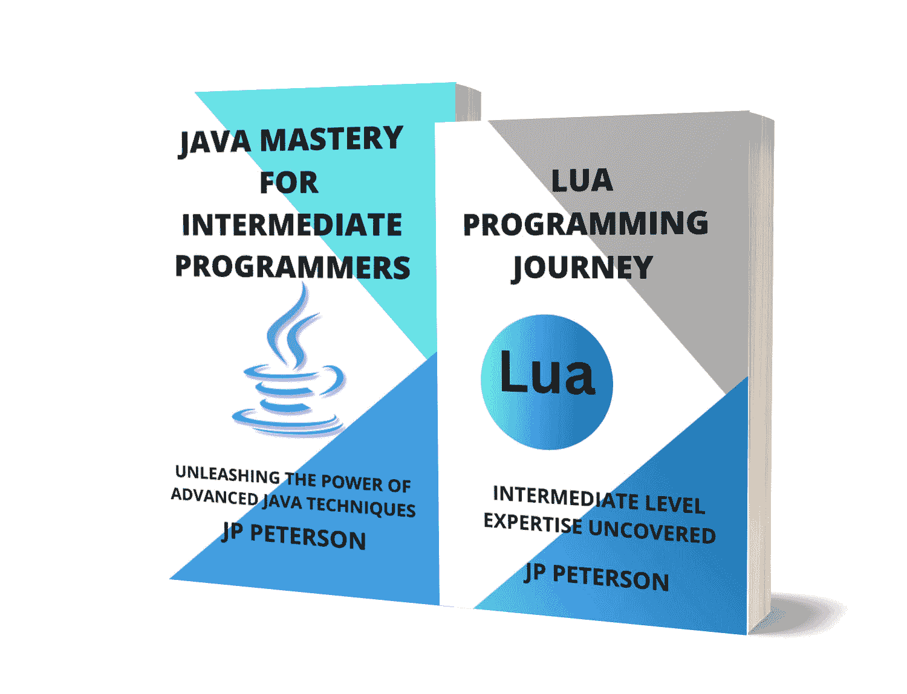

# 中级程序员者的 LUA 编程之旅与 Java 精通：解锁中级专家级知识并释放高级 Java 技术力量 - 2 本合



## 书籍介绍

欢迎来到令人兴奋的中级 Lua 编程之旅！在书中，我们将深入探索 Lua，这是一种强大且多功能的脚本语言。无论你是一个有抱负的游戏开发人员、Web 程序员，还是仅仅想扩展编码技能的人，这本书都将为你提供所需的知识和工具，让你的 Lua 专业知识提升到新水平。

Lua 以其高效、简单和扩展性而闻名。在接下来的章节中，我们将探索高级主题、复杂技术和实际示例，使你能够编写出高效、简洁且易于维护的代码。每一章将专注于 Lua 编程的一个特定方面，逐步建立你的技能，直到你成为一名中级 Lua 程序员。

所以，让我们开启这段揭示 Lua 编程中级专家知识的旅程。从掌握复杂数据结构到理解元表，从处理高级文件操作到创建自己的模块，你将以惊人的方式扩展你的编程视野。

## 第 1 章：掌握复杂数据结构

在编程世界中，数据是我们构建一切一切的基石。能够高效有效地操纵数据是一项区分新手与专者的技能。在本章中，我们将深入探索 Lua 中复杂数据结构的领域，探索数组、集合、映射以及数据操作的艺术。

### 数组：超越基础

数组是编程中的一个基本概念，Lua 提供了灵活的实现，允许动态调整大小和易于索引。但让我们超越基础。考虑一种场景：你正在开发一个游戏，需要管理角色的多个属性。Lua 的数组可以用于为每个角色创建结构化集合，存储健康值、经验和库存物品等信息。

```lua
-- 创建一个数组来存储角色属性
characters = {}
characters["hero"] = { hp = 100, xp = 0, items = {"sword", "shield"} }
characters["villain"] = { hp = 80, xp = 50, items = {"dagger", "cloak"} }
```

数组中的数组通常称为嵌套数组，允许你构建复杂的数据结构。将此看作表示矩阵或网格的方法。想象正在设计一个基于瓦片的游戏，你需要管理一个具有不同属性的瓦片网格。嵌套数组提供了存储和访问此类多维数据的方便方法。

### 集合：管理唯一值

集合存储唯一元素的数据结构。Lua 没有提供原生的集合类型，但你可以使用表来模拟。例如，假设你正在开发一个管理用户订阅的应用。

```lua
-- 用于模拟订阅的集合
subscribed_users = {}

function subscribe(user_id)
  subscribed_users[user_id] = true
end

function is_subscribed(user_id)
  return subscribed_users[user_id] == true
end
```

通过使用具有唯一值的表，你可以创建一个允许成员检查的结构。

### 映射：关联数组

映射（称为关联数组或字典）是存储键值对的数据结构。它们在需要将特定标识符关联的场景中特别有用。想象你正在开发一个游戏并想要映射物品属性。

```lua
-- 创建一个关联属性的映射
item_attributes = {}
item_attributes["sword"] = { damage = 20, weight = 5 }
item_attributes["shield"] = { defense = 15, weight = 8 }
```

映射也可以用于创建配置设置。与其使用许多变量存储各种设置，不如将它们合并到一个映射。

```lua
-- 创建配置映射
config = {
  username = "user123",
  volume = 80,
  language = "en"
}
```

### 数据操作：超越存储

存储数据至关重要，但操纵数据同样关键。Lua 提供了许多用于数据数据的函数和技术。例如，`table.foreach` 函数允许遍历表的元素并执行操作。

```lua
-- 使用 table.foreach 遍历元素并应用操作
function double_values(table)
  for key, value in pairs(table) do
    table[key] = value * 2
  end
end

numbers = { 2, 5, 8, 10 }
double_values(numbers)
-- numbers 现在持有 { 4, 10, 16, 20 }
```

除了基础迭代，Lua 还提供了如 `table.sort` 排序表、`table.concat` 将元素连接成字符串以及 `table.insert` 在特定位置插入元素等函数。

### 总结

在本章中，我们探索了 Lua 中复杂数据结构的世界。从数组到集合再映射，我们超越了基础，理解了这些结构在各种场景中的应用。通过掌握这些概念，你将能够更好地应对编程之旅中的各种数据相关挑战。

函数式编程是一种将计算视为数学函数求值的范式，它避免了状态改变和可变数据。在本章中，我们将探索如何在 Lua 中利用函数式编程的力量。我们将深入高阶函数、闭包和匿名函数，揭示它们在编写优雅且高效的代码中的作用。让我们开启掌握 Lua 函数式编程技巧的之旅。

## 第 2 章：函数式编程技巧

### 理解高阶函数

函数式编程的核心是高阶函数——即可以接受其他函数作为参数或将函数作为结果返回的。这些函数提供了一种抽象和泛化行为的强大方式，促进了代码的可重用。

考虑这样一个场景：你需要将一个数字列表转换为它们的平方。通过高阶函数，你可以将一个转换函数作为参数。

```lua
-- 使用转换函数转换列表的高阶函数
function transform_list(list, transform_fn)
local result = {}
for _, value in ipairs(list) do
table.insert(result, transform_fn(value))
end
return result
end

-- 使用 transform_list 函数对数字列表平方
numbers = { 2, 5, 8, 10 }
squared_numbers = transform_list(numbers, function(x) return x * x end)
-- squared_numbers 现在持有 { 4, 25, 64, 100 }
```

高阶函数允许你创建灵活且可重用的代码，使程序更加模块化并易于维护。

### 拥抱闭包

闭包是函数式编程的关键特性。闭包是一个“捕获”周围环境的函数，封装了函数本身及其词法作用域。这允许数据封装和私有化。

想象你正在创建一个计数器，并想用特定值对其初始化。闭包允许通过在函数作用范围内保留计数值来实现。

```lua
-- 创建基于闭包的计数器
function create_counter(initial_value)
local count = initial_value
return function()
count = count + 1
return count
end
end

-- 创建两个初始值不同的独立计数器
counter1 = create_counter(10)
counter2 = create_counter(20)
print(counter1())  -- 输出: 11
print(counter2())  -- 输出: 21
```

闭包使你能够以受控且封装的方式管理状态，让你的代码更加可靠。

### 利用匿名函数

匿名函数（也称为 lambda 函数）是不具固定名称的函数。当你需要一个小型、一次性使用的函数时，它们特别有用。在函数式编程中，匿名函数经常作为高阶函数的参数。

假设你有一个字符串列表，想要过滤掉太短的字符串。你可以结合匿名函数和 `table.filter` 来实现这一目标。

```lua
-- 使用匿名函数过滤短字符串
function filter_short_strings(strings)
return table.filter(strings, function(s) return #s > 5 end)
end

words = { "apple", "banana", "grape", "kiwi", "orange" }
filtered_words = filter_short_strings(words)
-- filtered_words 现在持有 { "banana", "orange" }
```

匿名函数提供了一种简洁且有效的地定义逻辑的方式，改进了代码的可读性和维护性。

### 应用函数式技巧

函数式编程技巧不仅仅是理论概念；它们具有现实世界的应用。考虑数据转换、事件处理和算法问题解决等场景。通过使用高阶函数、闭包和匿名函数，你可以编写出不仅简洁、表达力强，而且更容易推理和测试的代码。

在 Lua 中，拥抱函数式技巧可以带来更干净的代码和改进模块模块。通过将问题分解为更小的、可组合的函数，你可以创建更具适应性且对变化更有韧性的系统。

### 结论

在本章中，我们深入了 Lua 函数式编程技巧的世界。高阶函数、闭包和匿名函数是强大的工具，可以帮助你编写更模块化、可重用且优雅的代码。通过理解和应用这些技巧，你将能够应对复杂的编程挑战，同时保持代码库的清晰有序。在你继续 Lua 编程之旅时，请将函数式范式视为你编程工具箱中宝贵的补充。

## 第 3 章：揭秘元表与元方法

在 Lua 中，元表（`metatables`）和元方法（`metamethods`）提供了一种独特且强大的扩展自定义表行为的方法，实现了面向对象编程和运算符重载等功能。在本章中，我们将揭开元表和元方法的秘密，探索它们是如何工作的以及你如何利用它们来创建灵活且富有表现力的代码。

### 理解元表

从本质上说，元表是一个定义另一个表行为的 Lua 表。Lua 中的每个表都可以关联一个元表，该元表充当该表操作应该如何执行的蓝图。元表允许你对索引、算术运算等标准 Lua 操作引入自定义行为。

让我们从创建一个简单的示例开始，以理解元表的概念。想象你正在开发一个游戏，并想用表来定义角色属性。

```lua
-- 创建一个角色属性的表
character = {
name = "Hero",
hp = 100,
attack = 20
}
```

现在，假设你想实现一个根据角色的攻击值计算总伤害的函数。

```lua
-- 计算角色总伤害的函数
function calculate_total_damage(character)
return character.hp + character.attack
end

print(calculate_total_damage(character))  -- 输出: 120
```

但如果你想封装字符属性并提供更面向对象的方法呢？这就是元表大显身场的地方。

### 实现面向对象的行为

在 Lua 中，你可以使用元表创建带有方法的对象。让我们为字符表定义一个元表来实现此目标。

```lua
-- 定义字符对象的元表
character_metatable = {
__index = {
calculate_total_damage = function(self)
return self.hp + self.attack
end
}
}

-- 使用元表创建字符
hero = {
name = "Hero",
hp = 100,
attack = 20
}
setmetatable(hero, character_metatable)
print(hero:calculate_total_damage())  -- 输出: 120
```

在这个示例中，我们在元表的 `__index` 字段中定义了 `calculate_total_damage` 方法。当我们调用 `hero:calculate_total_damage()` 时，Lua 使用元表查找并调用它。

### 探索元方法

元方法是定义在元表中的特殊函数，允许你自定义标准 Lua 操作。例如，`__add` 元方法允许你定义在关联表上使用 `+` 运算符的行为。

考虑这样一个场景：你正在开发一个游戏，并想要根据总伤害启用角色比较功能。

```lua
-- 定义带有 __lt 元方法的字符对象元表
character_metatable = {
__index = {
calculate_total_damage = function(self)
return self.hp + self.attack
end,
__lt = function(self, other)
return self:calculate_total_damage() < other:calculate_total_damage()
end
}
}

-- 创建角色并使用元表
hero = {
name = "Hero",
hp = 100,
attack = 20
}
villain = {
name = "Villain",
hp = 80,
attack = 30
}
setmetatable(hero, character_metatable)
setmetatable(villain, character_metatable)

print(hero < villain)  -- 输出: true
```

在这里，我们定义了 `__lt` 元方法，根据根据总伤害来比较角色。当我们使用 `<` 运算符时，Lua 会调用该元方法来确定结果。

#### 自定义标准操作

元表和元方法还可以用于自定义各种标准操作，如索引查找、算术运算和字符串表示。

考虑以下示例，我们使用 `__tostring` 元方法为角色对象提供自定义的字符串表示：

```lua
-- 定义一个带有 __tostring 元方法的元表
character_metatable = {
__index = {
calculate_total_damage = function(self)
return self.hp + self.attack
end
},
__tostring = function(self)
return self.name .. " (HP: " .. self.hp .. ", Attack: " .. self.attack .. ")"
end
}
-- 创建一个角色并使用元表
character = {
name = "Warrior",
hp = 150,
attack = 25
}
setmetatable(character, character_metatable)
print(character)  -- 输出: Warrior (HP: 150, Attack: 25)
```

在这个示例中，`__tostring` 元方法定义了角色对象的字符串表示。当我们使用 `print(character)` 时，Lua 会自动调用此元方法来提供自定义字符串。

### 结论

元表和元方法在 Lua 编程中提供了高级别的定制化和灵活性。它们允许你创建具有自定义方法的对象、定义运算符重载并自定义标准操作。通过理解并有效利用元表和元方法，你可以编写出不仅强大而且优雅且富有表现力的代码。在你继续 Lua 之旅时，请记住，元表和元方法是你编程武器库中的强大工具，能够让你创建出复杂且功能丰富的应用程序。

## 第 4 章：高级文件 I/O 操作

文件输入和输出（I/O）是许多编程任务的关键方面，从读取和写入配置文件到管理数据持久化。在本章中，我们将探索 Lua 中的高级文件 I/O 操作，深入研究操作文件、处理不同格式甚至实现基于文件的数据库的技巧。让我们揭开文件 I/O 的复杂性，并发现如何有效高效地执行这些任务。

### 读取和写入文本文件

Lua 提供了简单有效的函数来读写文本文件。`io.open` 函数允许你以不同的模式打开文件，例如读取（`"r"`）、写入（`"w"`）或追加（`"a"`）。

让我们从创建一个文本文件并向写入数据开始：

```lua
-- 将数据写入文本文件
file = io.open("data.txt", "w")
file:write("Hello, world!\n")
file:write("Lua programming is fascinating.")
file:close()
```

现在，让我们从文件中读取数据：

```lua
-- 从文本文件读取数据
file = io.open("data.txt", "r")
data = file:read("*a")
file:close()
print(data)
```

`file:read` 中的 `"*a"` 参数读取文件的全部内容。

### 读取和写入二进制文件

对于处理二进制数据，Lua 提供了类似的函数。由于字符编码的差异，二进制文件需要仔细处理。你可以使用 `"wb"` 模式写入二进制数据，使用 `"rb"` 模式读取二进制数据。

创建一个二进制文件并向其中写入二进制数据：

```lua
-- 将二进制数据写入文件
file = io.open("binary_data.bin", "wb")
data = string.char(72, 101, 108, 108, 111)  -- ASCII 中的 "Hello"
file:write(data)
file:close()
```

现在，让我们从文件中读取二进制数据：

```lua
-- 从文件读取二进制数据
file = io.open("binary_data.bin", "rb")
data = file:read("*all")
file:close()
for i = 1, #data do
print(data:byte(i))
end
```

这段代码读取二进制数据的每个字节并打印其 ASCII 值。

### 解析和处理 CSV 文件

逗号分隔值（CSV）文件是存储表格数据的常见格式。为了处理 CSV 文件，我们需要解析并妥善地处理数据。`string.split` 函数可以使用分隔符将字符串拆分为数组。

考虑这样一个示例，我们有一个包含姓名和年龄的 CSV 文件：

```csv
John,25
Emma,30
Michael,28
```

我们可以使用以下 Lua 代码读取并解析这些数据：


```lua
-- 解析并处理 CSV 数据
file = io.open("data.csv", "r")
data = file:read("*all")
file:close()
lines = {}
for line in data:gmatch("[^\r\n]+") do
table.insert(lines, line)
end
for _, line in ipairs(lines) do
local name, age = line:split(",")
print("Name:", name, "Age:", age)
end
```

## 实现基于文件的数据库

对于需要数据存储的应用，实现基于文件的数据库是一个可行的方案。在这种方法中，你在文件中以结构化格式存储数据。`JSON` 是此目的流行格式，因为它对人类可读且被 `Lua` 库支持。

让我们创建一个简单的示例，在文件中存储用户数据：

```lua
-- 在文件中存储用户数据
local json = require("json")
users = {
{name = "Alice", age = 28},
{name = "Bob", age = 22}
}
file = io.open("users.json", "w")
file:write(json.encode(users))
file:close()

-- 从文件读取数据
file = io.open("users.json", "r")
data = file:read("*all")
file:close()
parsed_users = json.decode(data)
for _, user in ipairs(parsed_users) do
print("Name:", user.name, "Age:", user.age)
end
```

在这个示例中，使用了 `json` 库来编码和解码数据。

## 结论

文件 I/O 操作是许多任务的基础，从管理数据到交互外部资源。通过掌握读写文本和二进制文件、解析 CSV 数据以及实现基于文件的数据库，你可以有效地处理各种场景。无论你是在进行数据驱动的应用、游戏开发还是系统管理，操作文件和数据的能力都是增强 `Lua` 程序功能和效率的重要。

# 第 5 章：高效内存管理

内存管理对于优化 `Lua` 应用的性能至关重要。在本章中，我们将探索高效内存使用的策略、内存泄漏预防以及优化 `Lua` 垃圾回收系统的技巧。通过理解内存管理的工作原理，你可以创建不仅快速响应而且谨慎使用资源的应用程序。

## 理解 Lua 的内存管理

`Lua` 采用自动垃圾回收系统来管理内存。该系统会自动识别并收集未引用的对象，以释放内存供未来使用。虽然自动垃圾回收消除了手动内存管理的需求，但理解其原理对于编写高效内存的代码至关重要。

`Lua` 内存管理的核心概念是引用计数。当一个对象被创建时，其引用计数设置为 1。如果一个对象被其他对象引用，它们的引用计数也会相应增加。当一个对象的引用计数减为 0 时，它就可以被进行垃圾回收。

然而，循环引用可能会阻止对象被回收，导致内存泄漏。例如：

```lua
-- 创建循环引用
a = { }
b = { }
a.ref = b
b.ref = a
```

在这种情况下，即使 `a` 和 `b` 不再被主程序访问，由于循环引用，它们的引用计数仍然不为零。

## 内存泄漏预防

为了防止内存泄漏，在不再需要时断开循环引用至关重要。一种有效的策略是使用弱表（weak tables）。弱表允许其键或值即使被表引用，也可以被垃圾回收。

例如，`{"__mode" = "v"}` 模式创建了一个弱表，其中值是弱引用的。这在实现缓存或映射时非常有用，此时值的生命周期应该由缓存本身之外的因素决定。

```lua
-- 使用弱表防止内存泄漏
cache = setmetatable({}, {__mode = "v"})

function getCachedValue(key)
  if cache[key] then
    return cache[key]
  else
    local value = computeValue(key)
    cache[key] = value
    return value
  end
end
```

## 优化 Lua 的垃圾回收

`Lua` 提供了优化其垃圾回收行为的方法以适应你的应用程序需求。你可以调整垃圾回收器的步进倍数（step multiplier）和增量模式（incremental mode）等参数来精调其行为。

```lua
-- 调整垃圾回收参数
collectgarbage("setpause", 200)
collectgarbage("setstepmul", 400)
collectgarbage("step")
```

手动使用 `collectgarbage("step")` 函数会触发垃圾回收周期。虽然通常不建议手动触发，但在你想要控制收集发生时机的特定情况下，它是非常有用的。

## 高效的数据结构与内存剖析

选择正确的数据结构会显著影响内存使用。例如，使用数组代替带有字符串键的表可以减少内存消耗。此外，使用整数键代替浮点数键可以优化内存使用。

内存剖析工具可以帮助识别代码中内存密集型部分。像 `LuaJIT` 这样的库和第三方工具可以提供关于内存使用模式的见解，让你能够精确定位需要优化的区域。

## 结论

高效的内存管理对于创建高性能且资源节约的 `Lua` 应用程序至关重要。通过理解 `Lua` 的自动垃圾回收系统、通过弱表防止内存泄漏、优化垃圾回收参数、选择高效的数据结构以及采用内存剖析技术，你可以创建在速度和资源消耗之间平衡的应用程序。在你继续 `Lua` 编程之旅时，请记住，掌握内存管理是构建既响应迅速又节省系统资源的应用程序的关键步骤。

# 第 6 章：Lua 中的面向对象编程

面向对象编程（OOP）是一种强大的范式，促进代码的组织、可重用性和模块化。在本章中，我们将深入探讨如何在 `Lua` 中实现 OOP 概念，包括创建类、封装、继承和多态。通过掌握这些技术，你可以构建出更有组织、更易维护的 `Lua` 应用程序，并利用 OOP 的优势。

## 创建类和对象

在 `Lua` 中，类可以使用元表（metatables）来实现。类本质上是一个充当对象原型的表。方法和属性定义在类内部，而对象是该类的实例。

让我们创建一个 `Person` 类的基础示例：

```lua
-- 创建一个基础的 Person 类
Person = {}

function Person:new(name, age)
  local obj = { name = name, age = age }
  setmetatable(obj, self)
  self.__index = self
  return obj
end

function Person:sayHello()
  print("Hello, my name is " .. self.name)
end

-- 创建对象
person1 = Person:new("Alice", 30)
person2 = Person:new("Bob", 25)
person1:sayHello()  -- 输出: Hello, my name is Alice
person2:sayHello()  -- 输出: Hello, my name is Bob
```

在这个示例中，`Person` 类定义了一个构造函数 `new` 和一个方法 `sayHello`。当使用 `new` 构造函数创建对象时，它们继承了类中定义的方法属性。

## 封装与访问控制

封装是 OOP 的基本原则，涉及隐藏对象的内部细节并对其属性和方法提供受控访问。虽然 `Lua` 不像其他语言那样提供访问控制修饰，但你可以通过命名约定和约定来实现封装。

考虑一个为 `BankAccount` 类实现封装的示例：

```lua
-- 为 BankAccount 类实现封装
BankAccount = {}

function BankAccount:new(balance)
  local obj = { _balance = balance }  -- 约定：使用 "_" 表示私有
  setmetatable(obj, self)
  self.__index = self
  return obj
end

function BankAccount:getBalance()
  return self._balance
end

function BankAccount:deposit(amount)
  self._balance = self._balance + amount
end

function BankAccount:withdraw(amount)
  if amount <= self._balance then
    self._balance = self._balance - amount
  else
    print("Insufficient balance")
  end
end
```

在这个示例中，`_balance` 属性由于命名约定被认为是私有的。虽然语言本身没有强制执行这一点，但使用 `_` 作为前缀意味着该属性不应从类外部直接访问。

## 继承与多态

继承允许你创建从父类继承属性和方法的子类。多态允许不同类的对象被视为公共父类的实例。

让我们使用 `Student` 子类创建一个继承和多态的示例：

```lua
-- 创建一个继承自 Person 的 Student 子类
Student = Person:new()

function Student:new(name, age, school)
  local obj = Person:new(name, age)
  obj.school = school
  setmetatable(obj, self)
  self.__index = self
  return obj
end

-- 为 Student 重写 sayHello 方法
function Student:sayHello()
  print("Hello, I'm a student named " .. self.name .. " from " .. self.school)
end

-- 创建对象
student = Student:new("Carol", 18, "High School")
student:sayHello()  -- 输出: Hello, I'm a student named Carol from High School
```

在这个示例中，`Student` 类继承自 `Person` 类并重写了 `sayHello` 方法以提供更具体的信息。

## 结论

面向对象编程是一种多变的范式，有助于组织代码并促进重用性。通过创建类、封装属性和方法、实现继承以及利用多态，你可以在 `Lua` 应用程序中利用 OOP 的力量。虽然 `Lua` 的动态特性提供了活性，但遵循命名约定来实现封装是非常重要的。当你继续 `Lua` 编程之旅时，请记住，面向对象的原则可以极大增强代码的结构可维护性，让你能够构建更加模块化且高效的应用程序。

# 第 7 章：并发与多线程

并发和多线程是现代编程中的核心概念，允许应用程序同时执行多个任务并高效利用可用系统资源。在本章中，我们将探索如何在 `Lua` 中通过协程和线程实现并发。我们将探讨异步编程的原理、同步机制以及如何有效地管理并发执行。

## 理解协程

协程是 `Lua` 中一种强大的工具，允许你执行协作式多任务。与操作系统管理的线程不同，协程在 `Lua` 运行时管理，并允许任务将控制权交回主程序。这种协作特性使得协程适用于需要在不引入完整线程开销的情况下管理并发任务的场景。

让我们创建一个使用协程模拟倒计时的简单示例：

```lua
-- Simulating a countdown using coroutines

function countdown(n)
for i = n, 1, -1 do
print(i)
coroutine.yield()
end
print("Boom!")
end

-- Creating a coroutine
co = coroutine.create(countdown)

-- Running the coroutine
while coroutine.status(co) ~= "dead" do
coroutine.resume(co)
end
```

在这个示例中，`countdown` 函数使用 `coroutine.yield` 在每次迭代后将控制权交回给主程序。主程序使用 `coroutine.resume` 来恢复协程的执行。

## 使用 Lanes 进行异步编程

虽然 `Lua` 的协程（coroutines）提供了协作式多任务，但它们在单线程中运行。对于需要真正并行的场景，你可以使用如 `Lanes` 之类的第三方库。`Lanes` 是一个 `Lua` 扩展，通过在独立的线程中运行协程来实现真正的多线程。

这里是一个使用 `Lanes` 同时运行两个协程的简单示例：

```lua
-- Using Lanes for multithreading
lanes = require("lanes")

function print_numbers(n)
for i = 1, n do
print(i)
lanes.sleep(1)  -- Sleep for 1 second
end
end

-- Create two threads
thread1 = lanes.gen("*", print_numbers)(5)
thread2 = lanes.gen("*", print_numbers)(5)

-- Wait for threads to complete
thread1:join()
thread2:join()
```

在这个示例中，`lanes.gen` 函数创建了并发执行 `print_numbers` 协程的线程。`lanes.sleep` 函数用于模拟执行中的延迟。

## 同步与互斥锁（Mutex）

当多个线程或协程并发访问共享资源时，同步对于防止数据竞态和确保数据完整性至关重要。互斥锁（Mutex，mutual exclusion 的缩写）是一种同步机制，防止多个线程同时访问共享资源。

在 `Lua` 中，你可以使用 `lua-llthreads2` 库来处理线程和互斥锁。这里有一个使用互斥锁同步访问共享计数器的基本示例：

```lua
-- Using mutexes for synchronization
llthreads = require("llthreads2")

-- Shared counter and mutex
counter = 0
mutex = llthreads.mutex()

function increment_counter()
for i = 1, 1000000 do
mutex:lock()
counter = counter + 1
mutex:unlock()
end
end

-- Create two threads
thread1 = llthreads.new(increment_counter)
thread2 = llthreads.new(increment_counter)

-- Start threads
thread1:start()
thread2:start()

-- Wait for threads to complete
thread1:join()
thread2:join()
print("Final counter value:", counter)  -- Should be 2000000
```

在这个示例中，`mutex:lock()` 和 `mutex:unlock()` 函数用于确保对 `counter` 变量的排他访问。

## 管理并发执行

管理并发执行需要仔细考虑资源使用和潜在的瓶颈。在设计应用程序时，考虑到扩展性并考虑如负载均衡和线程池等技术是非常重要的。

对于复杂场景，像 `Lua Lanes` 和 `LLThreads2` 这样的库提供了更有效的管理并发和多线程的工具。

## 结论

并发和多线程是现代编程中的核心概念，能够高效利用系统资源并提高应用程序的响应速度。通过理解协程、使用异步编程技术、实现互斥锁同步以及管理并发执行，你可以创建出能够同时处理多个任务并避免数据竞态等常见陷阱的 `Lua` 应用程序。当你继续探索并发的世界时，请记住，选择合适的方法取决于你的应用程序需求以及协作式多任务与真正并行之间的平衡。

# 第 8 章：错误处理与调试策略

错误处理和调试是任何程序员必不可缺的技能。它们帮助你识别并修复代码中的问题，确保你的应用程序运行顺利并符合预期。在本章中，我们将探索各种错误处理技术、调试工具以及编写健壮 `Lua` 代码的最佳实践。

## 了解 Lua 的错误处理机制

`Lua` 提供了几种错误处理机制，包括 `assert` 函数和对 `error` 函数的使用。`assert` 函数检查给定条件是否为真，如果不是，它将抛出一个错误并附带可选的错误消息。

```lua
-- Using the assert function for error handling
local value = -5
assert(value > 0, "Value must be positive")
```

`error` 函数可以用于抛出带有特定错误消息的自定义错误。

```lua
-- Using the error function for custom error messages
local age = -10
if age < 0 then
error("Age cannot be negative")
end
```

## 使用 pcall 和 xpcall 实现健壮的错误处理

`Lua` 提供了两个函数 `pcall` 和 `xpcall` 用于健壮的错误处理。这些函数允许你执行一个函数并捕获其执行过程中发生的任何错误。

`pcall` 函数在函数执行成功时返回 `true` 以及该函数的返回值；如果发生错误，则返回 `false` 和错误消息。


使用`pcall`进行健壮的错误处理：

```lua
-- Using pcall for robust error handling
local success, result = pcall(function()
return 10 / 0
end)
if not success then
print("An error occurred:", result)
end
```

`xpcall`函数通过允许你指定自定义的错误处理函数，提供了更细致的控制。当发生错误时，该函数会被调用，允许你记录错误或采取其他操作。

```lua
-- Using xpcall for custom error handling
local function errorHandler(err)
print("An error occurred:", err)
end
local success = xpcall(function()
return 10 / 0
end, errorHandler)
```

## 调试技术与工具

调试是识别并修复代码中问题的过程。Lua提供了各种调试工具来帮助诊断和解决错误。

**打印语句（Print Statements）：** 最简单的调试技术是在代码中插入`print`语句，在不同点输出值和消息。这可以帮助跟踪执行流并识别错误值。

```lua
-- Using print statements for debugging
local x = 5
print("Value of x:", x)
```

**调试库：** 像`inspect`和`serpent`这样的库可以帮助可视化复杂的数据结构和对象，从而更容易地识别代码中的问题。

```lua
-- Using the inspect library for debugging
local inspect = require("inspect")
local data = { name = "Alice", age = 30 }
print(inspect(data))
```

**Lua调试器：** 像`ZeroBrane Studio`这样的工具提供了带有调试功能的完整IDE。它们允许你设置断点、单步执行代码、检查变量并分析调用栈。

```lua
-- Using a debugger to step through code
function factorial(n)
if n <= 1 then
return 1
else
return n * factorial(n - 1)
end
end
print(factorial(5))
```

## 有效调试的技巧

调试可能充满挑战，但遵循这些技巧可以帮助你高效地识别和解决问题：

1. **隔离问题：** 通过识别导致问题的代码部分来缩小问题范围。

2. **检查输入输出：** 验证函数的输入和输出是否符合预期。错误的数据会导致意外的行为。

3. **使用版本控制：** 像`Git`这样的版本控制系统可以帮助跟踪代码更改，并在必要时恢复到之前的可用版本。

4. **拆分问题：** 将复杂问题分解为更小、更容易管理的单元进行单独调试。

5. **记录日志：** 维护你所做的更改和调试步骤的日志。这可以帮助你回溯步骤并发现遇到问题的规律。

错误处理和调试是每位程序员至关重要的技能。通过理解Lua的错误处理机制，使用`pcall`和`xpcall`实现健壮的错误处理，并利用调试技术和工具，你可以有效地识别并修复代码中的问题。请记住，调试是一个迭代过程，需要耐心和坚持。随着你不断提高错误处理和调试技能，你将更擅长编写可靠且无错误的Lua应用程序。

# 第9章：创建和使用Lua模块

Lua模块是组织代码和提高应用程序可重用性的重要部分。模块允许你将相关功能封装到单独的文件中使得管理、维护和共享代码变得更加容易。在本章中，我们将探索如何创建、使用和导入Lua模块，以及设计模块化和可扩展代码的最佳实践。

## 理解Lua模块

Lua模块是函数、变量和其他定义的自包含集合，可以在应用程序的不同部分进行重用。模块促进了模块化、关注点分离和代码组织。通过将代码拆分为更小、更集中的模块，你可以获得更整洁、更易维护的代码库。

## 创建一个简单的Lua模块

让我们从创建一个名为`mathutils`的简单Lua模块开始，提供基本的数学运算：

```lua
-- mathutils.lua

local M = {}

function M.add(a, b)
return a + b
end

function M.subtract(a, b)
return a - b
end

return M
```

在这个示例中，我们定义了一个包含两个函数`add`和`subtract`的模块`mathutils`。模块末尾的`return M`语句确保了在导入模块时这些函数是可以访问的。

## 使用Lua模块

要在另一个Lua文件中使用`mathutils`模块，你需要使用`require`函数来导入它：

```lua
-- main.lua

local mathutils = require("mathutils")

print(mathutils.add(5, 3))  -- 输出: 8

print(mathutils.subtract(10, 4))  -- 输出: 6
```

`require`函数加载模块并返回模块的值（在我们例中为`M`）。然后你就可以使用模块中定义的函数和变量。

## 在子目录中组织模块

随着代码库的增长，你可能希望将模块组织到子目录中，将相关功能放在一起。考虑以下结构：

```
myapp/
main.lua
modules/
mathutils.lua
stringutils.lua
```

你可以通过使用子目录名称的点点符号来访问子目录中的模块：

```lua
-- main.lua

local mathutils = require("modules.mathutils")

local stringutils = require("modules.stringutils")
```

## Lua模块的最佳实践

在设计和使用Lua模块时，考虑以下最佳实践：

1. **保持模块聚焦**：每个模块都应该有明确且特定的目的。避免创建试图做太多事情的“大杂烩”型模块。

2. **使用描述性名称**：为你的模块选择有意义的名称，准确反映其功能。

3. **限制全局污染**：在模块内部定义局部变量以避免污染全局命名空间。

4. **编写模块文档**：在模块中包含注释或文档字符串，以解释它们的用途和使用方法。

5. **遵循命名规范**：为模块文件名和函数名使用一致的命名规范。

6. **分离接口与实现**：如果适用，将模块的公共接口与其实现细节分离开。

7. **测试你的模块**：为你的模块编写单元测试，以确保它们按预期工作并尽早发现潜在问题。

## 高级模块技术

Lua的模块系统允许更高级的技术，例如创建基于元表（metatable）的模块或将模块表作为对象原型。这些方法可以为你的代码提供更大的灵活性扩展性。

## 结论

Lua模块是组织化、可维护和可重用代码的基石。通过创建自包含的模块、使用`require`函数导入它们并遵循模块设计最佳实践，你可以实现模块化架构，使你的应用程序更容易开发、调试和维护。当你继续Lua编程之旅时，请记住，模块不仅是一个实用的工具，还是提高代码质量和可重用性的强大概念。

# 第10章：与外部库工作

与外部库工作是任何语言编程中至关重要的一个方面，因为它允许你利用现有代码并扩展应用程序的功能。在本章中，我们将探索如何将外部库整合到你的Lua项目中，从安装到使用。我们将涵盖Lua特定的库以及提供其他编程语言绑定的库，以及有效集成和管理外部代码的最佳实践。

## 安装外部Lua库

外部Lua库可以从各种来源安装，例如包管理器或直接从GitHub仓库。Lua一个流行的包管理器是`LuaRocks`。使用`LuaRocks`安装Lua库请使用以下命令：

```bash
luarocks install <library-name>
```

例如，要安装提供JSON编码和解码功能的`lua-cjson`库，你会使用：

```bash
luarocks install lua-cjson
```

安装完成后，你可以在Lua代码中导入并使用该库。

## 使用Lua库

Lua库通常使用`require`函数加载。让我们考虑一个使用`lua-cjson`库的示例：

```lua
-- 使用 lua-cjson 库进行 JSON 编码和解码

local cjson = require("cjson")

local data = { name = "Alice", age = 30 }

local json = cjson.encode(data)
print("Encoded JSON:", json)

local decoded_data = cjson.decode(json)
print("Decoded Data:", decoded_data.name, decoded_data.age)
```

在这个示例中，`cjson`库通过`require`导入，其函数`encode`和`decode`用于处理JSON数据。

## 使用LuaJIT整合C库

LuaJIT是Lua解释器的增强版本，提供了即时编译和其他性能优化。它也可以通过创建Lua绑定来整合外部C库。

例如，假设你想使用`libsodium`库进行加密。你可以这样创建Lua绑定：

```lua
-- 使用 LuaJIT 使用 libsodium C 库

local ffi = require("ffi")

ffi.cdef[[
int crypto_pwhash_str(char *output, const char *passwd, unsigned long long passwdlen,
unsigned long long opslimit, size_t memlimit);
]]

local libsodium = ffi.load("libsodium")

local password = "securepassword"
local hashed_password = ffi.new("char[?]", 128)

libsodium.crypto_pwhash_str(hashed_password, password, #password, 3, 65536)

print("Hashed Password:", ffi.string(hashed_password))
```

在这个示例中，`ffi`模块被用于与C库交互，并调用了`libsodium`库中的`crypto_pwhash_str`函数。

## 其他语言的Lua绑定

Lua可以嵌入其他语言，反之亦然。许多语言提供了Lua绑定，允许从这些语言调用Lua代码，反之亦然。例如，你可以在C/C++中使用Lua绑定，或将Lua与Python等脚本语言集成。

为了说明这一点，考虑使用`luabind`库将C++函数绑定到Lua：

```cpp
// 使用 luabind 将 C++ 函数绑定到 Lua
#include <luabind/luabind.hpp>

int add(int a, int b) {
return a + b;
}

extern "C" int luaopen_mylibrary(lua_State* L) {
using namespace luabind;

open(L);

module(L) [
def("add", &add)
];

return 0;
}
```

在本示例中，使用`luabind`库将`add`函数绑定到Lua。随后，你可以从Lua中调用此函数。

## 使用外部库的最佳实践

在使用外部库工作时，请考虑以下最佳实践：

1. **选择信誉良好的库：** 使用维护良好且口碑好的库以确保稳定性和安全性。

2. **阅读文档：** 彻底阅读库的文档以理解其功能、用法和潜在的限制。

3. **版本兼容性：** 确保库的版本与你的Lua版本及其他依赖兼容。

4. **管理依赖项：** 注意该库所需的任何依赖项，并确保它们已正确安装。

5. **隔离：** 使用第三方库时，将它们的使用封装在代码内部，以最大限度地减少潜在的冲突和问题。

6. **测试：** 在你的应用程序环境中对库进行彻底测试，以确保它满足你的需求。

## 结论

将外部库整合到你的Lua项目中可以通过提供额外功能和节省开发时间来增强应用程序。无论你是在处理Lua特有的库、使用Lua绑定与C/C++库进行接口，还是将Lua集成到其他语言，利用外部代码的能力都是一项宝贵的技能。通过遵循最佳实践并理解你所用库的功能，你可以创建稳健、功能丰富的Lua应用程序，充分利用编程社区的集体成果。

# 第11章：网络与Web服务集成

网络和Web服务集成对于构建与远程服务器通信、交换数据以及提供在线功能的应用程序至关重要。在本章中，我们将探索如何在Lua中处理网络、发送HTTP请求以及与Web API交互。我们将涵盖常见的网络概念、工具和技术，以实现你的Lua应用程序与外部服务之间的无缝通信。

## 理解网络概念

网络涉及设备通过网络（如互联网）进行通信。关键概念包括IP地址、端口、协议和套接字。

- **IP地址：** IP地址唯一地标识网络上的设备。

- **端口：** 端口用于指定设备上的哪个进程应该接收数据。

- **协议：** 协议定义了通信规则。常见的互联网协议包括`HTTP`、`HTTPS`、`TCP`和`UDP`。

- **套接字：** 套接字是跨网络发送和接收数据的端点。

## 发送HTTP请求

HTTP（超文本传输协议）是互联网数据通信的基础。Lua提供了发送HTTP请求和处理响应的库。

这是一个使用`http`库发送GET请求的示例：

```lua
-- 发送 HTTP GET 请求
local http = require("socket.http")

local response, status = http.request("http://example.com")

print("Response:", response)
print("Status:", status)
```

要发送安全的HTTPS请求，你可以使用`https`库：

```lua
-- 发送 HTTPS GET 请求
local https = require("ssl.https")

local response, status = https.request("https://example.com")

print("Response:", response)
print("Status:", status)
```

## 与Web API交互

Web API（应用程序编程接口）允许你的应用程序与外部服务交互，并检索或发送数据。常用的API包括社交媒体、天气预报和数据存储的API。

这是一个使用`http`库向基于JSON的API发送GET请求的示例：

```lua
-- 与基于 JSON 的 Web API 交互
local http = require("socket.http")
local cjson = require("cjson")
local url = "https://api.example.com/data"

local response, status = http.request(url)

if status == 200 then
    local data = cjson.decode(response)
    print("Temperature:", data.temperature)
else
    print("Error:", status)
end
```

在这个示例中，使用`cjson`库来解析JSON响应并提取温度数据。

## 处理异步请求

在Lua中，可以使用协程（coroutines）来管理异步请求。像`luasocket`库提供了执行非阻塞网络操作的方法。

```lua
-- 使用 luasocket 发送异步 HTTP 请求
local socket = require("socket")
local http = require("socket.http")
local url = "http://example.com"

local co = coroutine.create(function()
    local response, status = http.request(url)
    coroutine.yield(response, status)
end)

local result = {}

while coroutine.status(co) ~= "dead" do
    local success, response, status = coroutine.resume(co)
    if success then
        table.insert(result, { response = response, status = status })
    end
end

for _, res in ipairs(result) do
    print("Response:", res.response)
    print("Status:", res.status)
end
```

## 网络与Web服务集成的最佳实践

在进行网络和Web服务集成工作时，请考虑以下最佳实践：

1. **安全性：** 使用`HTTPS`进行安全通信，保护敏感数据免受拦截。

2. **错误处理：** 始终妥善处理错误，无论它是关于网络问题、API响应还是数据解析。

3. **频率限制：** 许多API都有频率限制以防止滥用。尊重这些限制以避免被封。


4. **身份验证：** 如果需要，正确实现身份验证机制，例如 API 密钥或 OAuth 令牌。

5. **数据验证：** 验证并清理输入数据，以确保处理过程是安全的。

6. **异步操作：** 使用协程或事件驱动库等异步技术进行非阻塞操作。

## 结论

网络和 Web 服务集成对于创建动态且连接的应用程序至关重要。通过理解网络概念、发送 HTTP 请求、与 Web API 交互以及处理异步操作，你可以构建与外部服务无缝通信的 Lua 应用程序。无论是从 Web API 获取数据、将用户生成的内容发送到服务器，还是跨设备同步数据，处理网络的能力都是一项宝贵的技能，它让你的 Lua 应用程序能够与更广泛的数字世界交互。

# 第 12 章：使用 Lua 进行 GUI 编程

图形用户界面（GUI）为用户提供了与应用程序交互的直观方式。Lua 可用于创建基于应用程序，允许你设计窗口、按钮、文本字段等。在本章中，我们将探索 Lua 中的 GUI 编程，包括流行的 GUI 库、创建窗口、处理用户输入以及设计交互式界面。

## GUI 编程简介

GUI 编程涉及创建用户可以交互的视觉元素，例如按钮、菜单和文本字段。GUI 库提供了在应用程序中创建和管理这些元素的工具。

## LuaGUI：适用于 Lua 的简单 GUI 库

为了本章，我们将使用一个名为 `LuaGUI` 的简化 GUI 库来演示 GUI 编程概念。请记住，现实世界的 GUI 库如 `wxLua`、`Love2D` 或 `IUP` 提供了更多功能和定制选项。

## 创建基础窗口

让我们开始使用 `LuaGUI` 创建一个基础窗口：

```lua
-- 使用 LuaGUI 创建基础窗口
local gui = require("luagui")

local window = gui.Window("My Window", 400, 300)

window:show()

gui.run()
```

在这个示例中，我们导入了 `luagui` 库并创建一个标题为 "My Window”、尺寸为 400x300 像素的窗口。`show` 函数显示窗口，`gui.run()` 事件循环以处理用户交互。

## 添加按钮和事件处理

让我们通过添加按钮并处理按钮点击事件来增强我们的窗口：

```lua
-- 使用 LuaGUI 添加按钮和处理事件

local gui = require("luagui")

local window = gui.Window("My Window", 400, 300)

local button = gui.Button("Click Me")

window:add(button)

function button:onclick()

print("Button clicked!")

end

window:show()

gui.run()
```

在这个示例中，我们创建了一个标签为“Click Me”的按钮，并使用 `add` 函数将其添加到窗口中。我们为按钮定义了一个 `onclick` 事件处理程序，当按钮被点击时会打印一条消息。

## 设计交互式界面

GUI 编程涉及创建用户可以交互的界面。你可以添加文本字段、标签、复选框和其他元素来收集和显示信息。

```lua
-- 使用 LuaGUI 设计交互式界面

local gui = require("luagui")

local window = gui.Window("Calculator", 300, 200)

local label = gui.Label("Enter numbers:")

local input1 = gui.Input()

local input2 = gui.Input()

local result_label = gui.Label("Result:")

local add_button = gui.Button("Add")

local sub_button = gui.Button("Subtract")

function add_button:onclick()

local num1 = tonumber(input1.text)

local num2 = tonumber(input2.text)

if num1 and num2 then

result_label.text = "Result: " .. (num1 + num2)

else

result_label.text = "Invalid input"

end

end

function sub_button:onclick()

local num1 = tonumber(input1.text)

local num2 = tonumber(input2.text)

if num1 and num2 then

result_label.text = "Result: " .. (num1 - num2)

else

result_label.text = "Invalid input"

end

end

window:add(label, input1, input2, add_button, sub_button, result_label)

window:show()

gui.run()
```

在这个示例中，我们创建了一个简单的计算器界面，包含两个输入字段、“加”和“减”按钮以及一个结果标签。点击按钮会根据用户输入计算并显示结果。

## GUI 编程的最佳实践

使用 Lua 创建 GUI 应用程序时，请考虑以下最佳实践：

1. **保持界面直观：** 在设计界面时考虑用户友好性。逻辑化地组织元素并提供清晰的指令。

2. **处理用户输入：** 正确验证并处理用户输入，以防止错误或意外行为。

3. **使用描述性标签：** 标签应清晰描述每个元素的用途，例如按钮、输入字段和标签。

4. **最小化杂乱：** 避免使用过多的元素使界面过于拥挤。专注于最核心的功能。

5. **事件处理：** 使用事件处理程序来响应用户交互，例如按钮点击或菜单选择。

6. **测试：** 彻底测试你的 GUI 应用程序，确保其行为符合预期且没有错误。

## 结论

使用 Lua 进行 GUI 编程允许你创建交互式且视觉吸引人的应用程序。通过利用 GUI 库、设计直观的界面、处理用户输入以及实现事件驱动编程，你可以构建用户可以无缝交互的应用程序。无论你是在开发游戏、实用程序还是生产力工具，GUI 编程都能让你创建出满足广泛用户需求和偏好的应用程序。

# 第 13 章：高级 Lua 模式和惯用法

Lua 是一种多功能且富有表现力的编程语言，提供了丰富的高级模式和惯用法。这些技术允许你编写更高效、更易读且更强大的代码。在本章中，我们将探索这些高级概念，并提供示例来演示它们的用法和优势。通过掌握这些模式，你可以将你的 Lua 编程技能提升一个水平，创建既优雅又高效的代码。

## 元表 (Metatables) 和元方法 (Metamethods)

元表是 Lua 最强大的功能之一，允许你自定义表的行为。元方法是元表中的特殊键，定义了 Lua 操作如何在表上工作。

让我们来看一个使用元表为表创建自定义索引行为的示例：

```lua
-- 使用元表创建自定义索引行为

local customTable = {}

local mt = {

__index = function(table, key)

return "Value for key: " .. key

end

}

setmetatable(customTable, mt)

print(customTable.foo)  -- 输出: Value for key: foo

print(customTable.bar)  -- 输出: Value for key: bar
```

在这个示例中，我们创建了一个表 `customTable` 并将其元表设置为 `mt`。定义了 `__index` 元方法，以便为索引操作提供自定义响应。

## 闭包 (Closures)

闭包是 Lua 中的一个基本概念，允许函数携带其闭包作用域。这种行为使得工厂函数、封装和备忘等强大的编程模式成为可能。考虑一个使用闭包创建带有私有数据的简单计数器的示例：

```lua
-- 使用闭包进行封装

function createCounter()

local count = 0

return function()

count = count + 1

return count

end

end

local counter = createCounter()

print(counter())  -- 输出: 1

print(counter())  -- 输出: 2
```

在这个示例中，`createCounter` 函数返回了一个闭包，该闭包可以访问局部变量 `count`，从而对其有效封装。

## 协程 (Coroutines) 和协作式多任务

协程是 Lua 中的一个独特功能，实现了协作式多任务，允许任务向其他任务让出控制权。协程对于管理异步操作、状态机和复杂的控制流非常有用。这里有一个使用协程实现简单协作多任务的基础示例：

```lua
-- 使用协程进行协作多任务

function task1()

for i = 1, 5 do

print("Task 1 - Step", i)

coroutine.yield()

end

end

function task2()

for i = 1, 3 do

print("Task 2 - Step", i)

coroutine.yield()

end

end

co1 = coroutine.create(task1)

co2 = coroutine.create(task2)

for i = 1, 5 do

coroutine.resume(co1)

coroutine.resume(co2)

end
```

在这个示例中，`task1` 和 `task2` 被实现为协程。`coroutine.yield()` 允许任务将控制权交回主循环，导致交替执行。

## 函数式编程范式

Lua 支持函数等公民、高阶函数和闭包等函数式编程概念。采用这些概念可以使代码更加模块化。考虑一个使用高阶函数为列表创建过滤函数的示例：

```lua
-- 使用函数式编程创建过滤函数

function filter(list, predicate)

local result = {}

for _, value in ipairs(list) do

if predicate(value) then

table.insert(result, value)

end

end

return result

end

local numbers = { 1, 2, 3, 4, 5, 6 }

local evenNumbers = filter(numbers, function(x) return x % 2 == 0 end)

print(table.concat(evenNumbers, ", "))  -- 输出: 2, 4, 6
```

在这个示例中，`filter` 函数接收列表和一个谓词函数，并返回包含满足谓词元素的列表。

## 高级模式的最佳实践

在使用高级 Lua 模式和惯用法时，请考虑以下最佳实践：

1. **可读性：** 优先考虑代码的可读性而非技巧。高级模式应该增强理解，而不是阻碍。

2. **文档：** 有效地注释代码，特别是在使用复杂模式时，以便他人和未来的你理解。

3. **测试：** 彻底测试高级模式，以确保它们在不同场景下按预期工作。

4. **模块化：** 使用高级模式将复杂问题分解为更小的、可重用的组件。

通过掌握高级 Lua 模式和惯用法，你可以显著提升自己的编程技能，并创建更复杂、更高效的代码。无论你是利用元表（metatables）进行自定义、使用闭包（closures）进行封装、采用协程（coroutines）进行协作式并发、接受函数式编程概念还是探索其他高级技术，这些模式都能为你解决复杂挑战提供工具。当你继续在 Lua 项目中探索并应用这些模式时，你会发现你的代码不仅更加强大，而且更加优雅和易于维护。

# 第 14 章：性能优化技术

优化 Lua 代码的性能对于确保应用程序高效运行并对用户交互做出快速响应至关重要。在本章，我们将深入探讨各种性能优化技术，这些技术可以帮助你识别瓶颈、缩短执行时间，并创建即使在高负载下也能流畅运行的 Lua 代码。通过实际示例和策略，你将学会如何让你的 Lua 程序更快、更响应。

## 性能分析与基准测试

性能分析（Profiling）和基准测试是性能优化中不可少的步骤。性能分析工具可以帮助你识别代码中哪些部分消耗了最多的资源，让你能够将优化精力集中在正确的区域。

让我们考虑使用 `luaprofiler` 库对函数进行性能分析的示例：

```lua
-- 使用 luaprofiler 库对函数进行分析
local profiler = require("luaprofiler")

function slowFunction()
  for i = 1, 1000000 do
    local result = math.sqrt(i)
  end
end

profiler.start()
slowFunction()
profiler.stop()
profiler.report("profile.txt")
```

在这个示例中，我们使用 `luaprofiler` 库对 `slowFunction` 进行分析并生成分析报告。

## 算法优化

算法优化涉及提高算法的效率以减少代码的计算复杂度。选择正确的算法可以带来显著的性能提升。

这是一个使用 Lua 内置 `table.sort` 函数优化排序算法的示例：

```lua
-- 使用 table.sort 进行算法优化
local function customSort(a, b)
  return a > b
end

local data = { 5, 2, 8, 1, 3 }
table.sort(data, customSort)
print(table.concat(data, ", "))  -- 输出: 8, 5, 3, 2, 1
```

在这个示例中，我们为 `table.sort` 提供了一个自定义排序函数来实现降序排序。

## 内存管理

高效的内存管理对性能优化至关重要。减少内存分配和释放可以提高你的 Lua 代码的速度。

考虑一个使用 `ffi` 模块与 C 内存分配函数工作的示例：

```lua
-- 使用 ffi 模块进行内存管理
local ffi = require("ffi")
local size = 1024
local ptr = ffi.C.malloc(size)  -- 分配内存
if ptr ~= nil then
  ffi.C.free(ptr)  -- 释放内存
end
```

在这个示例中，使用 `malloc` 函数分配内存，并使用 `free` 函数释放内存。

## 微优化

微优化涉及对代码进行细小的更改以提高性能。虽然这些优化单独来看影响可能较小，但它们可以累积起来。以下是一个微优化的示例：

```lua
-- 微优化
local strings = {"This", "is", "a"}
local result = table.concat(strings, " ")
print(result)  -- 输出: This is a
```

## 即时编译

LuaJIT 是 Lua 的增强版本，提供了即时（JIT）编译功能。JIT 编译可以显著提高执行速度。让我们来看一个使用 JIT 的示例：

```lua
-- 使用 ffi 使用 JIT 编译
local ffi = require("ffi")
local result = ffi.C.pow(2, 10)
print(result)
```

## 性能优化最佳实践

在 Lua 中优化性能时，请考虑以下最佳实践：

1. **先测量后优化**：使用性能分析识别瓶颈。

2. **关注高影响区域**：针对消耗大部分资源的代码。

3. **使用内置函数**：利用如 `table.sort` 和 `table.concat` 等内置函数。

4. **避免过早优化**：仅在必要时进行优化。

5. **测试更改**：对你的代码进行基准测试以验证改进。

6. **保持代码的可维护性**：不要为了性能而牺牲清晰度。

## 总结

性能优化是创建高质量应用程序的关键方面。通过采用性能分析、算法优化、内存管理、微优化和 JIT 编译等技术，你可以显著增强你的 Lua 代码。在高效算法、内存使用和可维护代码之间取得平衡至关重要。

# 第 15 章：用于游戏开发的 Lua

Lua 因其简单性、灵活性和高效性在游戏开发领域获得了巨大的普及。它通常被用作脚本语言来增强游戏逻辑、创建行为并实现模组（mod）。在本章中，我们将探索 Lua 如何用于游戏开发，涵盖其作为脚本语言的角色、与游戏引擎的集成，以及使用 Lua 创建交互和游戏性的示例。

## Lua 在游戏开发中的角色

Lua 在游戏开发中的角色主要作为脚本语言。虽然游戏的核心引擎通常用 C++ 或 C# 等低级语言编写，但 Lua 被用于定义和修改游戏逻辑、行为和资产，而无需重新编译主代码库。这种灵活性允许游戏开发者进行快速迭代和实验。

Lua 的优势之一是与其他语言易于集成。游戏引擎通常会提供 API，允许 Lua 脚本与游戏对象、场景和系统进行交互。

## Lua 与游戏引擎集成

许多游戏引擎提供对 Lua 脚本的内置支持。这些引擎将其内部 API 暴露给 Lua，允许开发者操作游戏元素、创建自定义逻辑甚至构建整个游戏系统。

例如，流行的游戏引擎“Unity”提供了一个名为“UniLua”的插件，允许开发者在 Unity 项目中集成 Lua 脚本。同样，“Love2D”是一个完全围绕 Lua 脚本构建的游戏框架，使其成为独立游戏开发者的热门选择。

## 使用 Lua 开发游戏性

Lua 的简单性和灵活性使其成为定义游戏机制的极佳选择。让我们探索一些 Lua 用于游戏开发的示例：


## 游戏开发中 `Lua` 的应用

1. **创建技能：** 在角色扮演游戏（RPG）中，你可以使用 `Lua` 为角色定义特殊技能。例如，你可以创建一个火球技能，它根据玩家的统计数据计算伤害并施加灼烧效果。
2. **对话系统：** `Lua` 可用于实现分支对话系统。当玩家与 NPC 交互时，游戏可以加载 `Lua` 脚本，根据之前的交互和玩家选择来决定 NPC 的响应。
3. **Mod 支持（模组）：** 许多游戏允许玩家创建模组（mods）或自定义内容。`Lua` 脚本可以定义新物品、敌人、关卡，甚至改变核心游戏规则，从而延长游戏的寿命。
4. **事件处理：** `Lua` 通常用于定义由游戏内动作触发的脚本事件。例如，游戏的昼夜循环可以使用 `Lua` 脚本来控制，调整光照、敌人行为和其他因素。

## 热门游戏中的 `Lua`

许多成功的游戏都利用 `Lua` 来增强其游戏性并提供模组支持能力：

1. **魔兽世界：** `Lua` 脚本在《魔兽世界》中被广泛用于创建用户界面（UI）插件、自动化任务以及增强游戏机制。
2. **Garry's Mod：** 《Garry's Mod》（GMod）允许玩家使用 `Lua` 脚本操控对象并创建自定义游戏模式，导致了繁荣的用户生成内容社区。
3. **不要饥荒求生生存：** 这款生存游戏使用 `Lua` 脚本来定义生物的行为、天气模式，甚至玩家角色的理智值。

## 游戏开发中 `Lua` 的最佳实践

在使用 `Lua` 进行游戏开发时，请考虑以下最佳实践：

1. **关注点分离：** 使用 `Lua` 脚本定义游戏逻辑和行为，而将性能密集型任务留给底层引擎的核心代码。
2. **API 设计：** 如果你正在开发一个支持 `Lua` 脚本的游戏引擎，请设计一个简洁且文档齐全的 `API`，使脚本编写直观且高效。
3. **安全性：** 在允许来自外部源的 `Lua` 脚本时要小心，因为它们可能会引入安全漏洞。限制脚本对引擎关键部分的访问。
4. **优化：** 在需要时对 `Lua` 脚本进行性能分析和优化，确保它们不会引入性能瓶颈。

## 结论

`Lua` 作为脚本语言在游戏开发中的作用已被证明对于创建交互和动态的游戏体验至关重要。它的简单性、灵活性以及与游戏引擎易于集成，使其成为独立游戏和 AAA 游戏开发者的热门选择。从定义游戏机制到启用模组支持以及创建复杂的脚本事件，`Lua` 的多功能性赋予了游戏开发者实现愿景的能力。当你探索 `Lua` 在游戏开发中的应用时，你会发现它为创建沉浸式且迷人的游戏体验开启了无限可能。

# 中级开发者的 `Java` 精通

## 释放高级 `Java` 技巧的力量

JP PETERSON

## 书籍介绍

欢迎阅读《中级开发者的 `Java` 精通：释放高级 `Python` 技巧的力量》。本书专为具有某些 `Java` 经验并准备好将其技能提升到新水平的程序员身定制。无论你是学生、专业开发人员，还是对扩展编程视野感兴趣的人，这本全面的指南都将赋予掌握 `Java` 并利用高级 `Python` 技巧的力量所需的知识和专业技能。

`Java` 是一种多功能且广泛使用的编程语言，以其健壮性、平台独立性以及大量的库和框架而闻名。同时，`Python` 以其简单易用而闻名，成为开发者之间的热门选择。在本书中，我们将弥合这两种强大语言之间的差距，探索 `Java` 开发人员如何利用 `Python` 中使用的高级技术来创建高效、优雅且创新的解决方案。

在整书中，我们将采用易于理解的语言并提供实际示例，以确保顺畅的学习体验。每一章都经过精心设计，深入探讨特定主题，在之前的知识的基础上逐步向更复杂的概念迈进。

所以，让我们一起开启这段学习之旅吧，解锁 `Java` 的潜力并拥抱 `Python` 的精华。读完这本书后，你将拥有应对现实项目的技能和信心，成为一名 `Java` 大师。

# 第 1 章：`Java` 和 `Python` 简介

## 第 1 节：理解 `Java`

`Java` 由 James Gosling 及其 Sun Microsystems 团队（现由 Oracle 公司所有）创建，于 20 世纪 90 年代中期出现并作为一种多功能且健壮的编程语言迅速流行。`Java` 最具定义性的特征之一是它的平台独立性，允许开发者编写一次代码并在任何支持 `Java` 的平台上运行，使其能够“一次编写，随运行”（WORA）。这种可移植性通过 `Java` 虚拟机（`JVM`）实现，它将 `Java` 字节码翻译成特定于底层平台的机器码。

### `Java` 的起源与演变

`Java` 的开发始于 1991 年，名为“Oak”，旨在用于消费电子设备。然而，随着世界维网的兴起，重心转向了使用 `Java` 开发 Web 小程序（applets）。1995 年，该语言作为 `Java 1.0` 正式发布，其跨平台开发的潜力立即一而易见。

多年来，`Java` 经历了多次更新，每隔几年发布一次大版本。这些更新带来了新功能、性能改进和安全性增强，确保了 `Java` 在快速演变的技术格局中保持相关性和可靠性。

### `Java` 的特性与优势

`Java` 的流行归功于它强大的特性和优势：

1. **面向对象：** `Java` 遵循面向对象编程（OOP）范式，允许开发者创建模块化和可重用的组件。
2. **简单易学：** `Java` 的语法清晰易于理解，使其成为学者和经验丰富的开发人员的优秀语言。
3. **平台独立性：** 如前所述，`Java` “一次编写，随运行”的能力使其在跨平台开发中极具吸引力。
4. **健壮且安全：** `Java` 的强内存管理、异常处理和安全机制有助于创建可靠安全的应用程序。
5. **庞大的标准库：** `Java` 提供了丰富的标准库，包含各种任务的内置类和 `API`，减少了开发者从零编写代码的需求。
6. **多线程支持：** `Java` 对多线程有原生支持，允许开发者创建充分利用现代硬件的并发应用程序。
7. **开源生态系统：** `Java` 拥有蓬勃发展的开源社区，这构建了大量的库、框架和工具生态系统。

## 第 2 节：介绍 `Python`

`Python` 由 Guido van Rossum 开发并于 1991 年首次发布，是一种解释型高级编程语言，以简单性和可读性而闻名。`Python` 的设计哲学强调代码的可读性和生产力，这导致它在各个领域被广泛采用，包括 Web 开发、数据科学、人工智能和自动化。

### `Python` 之禅（Zen of `Python`）

`Python` 设计原则封装在“`Python` 之禅”中，这是一系列指导 `Python` 开发者的格言。一些关键原则包括可读性非常重要、简单优于复杂，以及做某事应该只有一种（最好仅一种）明显的方法。

### `Python` 的特性与优势

`Python` 的流行因其卓越的特性和优势而飞速增长：

1. **可读性与表达力：** `Python` 的语法简洁且类似于自然语言，使其易于阅读和快速编写代码。
2. **动态类型：** `Python` 是动态类型语言，允许变量持有任何数据类型的值，这使得代码更加灵活和简洁。
3. **丰富的标准库：** `Python` 的标准库非常庞大，提供了大量的模块和包，用于执行各种任务，而无需外部依赖。
4. **广泛的库和框架：** 大量可用的第三方库和框架进一步增强了 `Python` 的多功能性，能够满足多样化的应用需求。
5. **集成性与扩展性：** `Python` 可以与 C 和 C++ 等其他语言无缝集成，允许开发者利用现的代码和库。
6. **社区与支持：** `Python` 拥有一个充满活力的社区，他们积极为开发做出贡献，确保了持续的改进和支持。

# 第 3 章：连接 `Java` 和 `Python`

现在我们已经对 `Java` 和 `Python` 进行了简要概述，你可能会好奇这些看似不同的语言是如何相互互补的。事实是，`Java` 和 `Python` 各有其优缺点，使其适用于特定的用例。`Java` 的性能和平台无关性在构建健壮的后端系统和企业级应用程序方面非常有价值，而 `Python` 的易用性和丰富的库则受到快速原型开发、数据分析和脚本任务的青睐。

在本书中，我们将探索如何利用高级 `Python` 技术的力量并将其应用于 `Java` 编程世界中。这种融合不仅将增强你对这两种语言的理解，还将扩展你处理更广泛项目和挑战的能力。

在随后的章节中，我们将深入研究特定的 `Java` 主题，并探索如何使用 `Python` 优雅简洁的代码来实现类似的功能。我们将涵盖面向对象编程、数据处理、并发编程、Web 开发等许多领域。这段旅程结束时，你将拥有一个结合了 `Java` 和 `Python` 优点的全面工具箱，使你成为一个更熟练、多多的程序员。

# 第 2 章：理解面向对象编程

面向对象编程（OOP）是一种围绕“对象”概念的编程范式——对象是封装了数据和行为的自包含单元。OOP 允许开发者对现实世界的实体和关系进行建模，使其成为现代软件开发中强大且应用广泛的方法。在本章中，我们将探索 OOP 的基本原则，包括类、对象、继承、多态和封装，并结合 `Java` 和 `Python` 的实际示例进行说明。

## 第 1 节：类和对象

### 类

类是创建对象的蓝图或模板。它定义了从该类实例化的对象的结构和行为。在 `Java` 中，使用 `class` 关键字定义类，而在 `Python` 中也使用 `class` 关键字。

让我们考虑一个在 `Java` 和 `Python` 中表示“汽车”（Car）类的简单示例。

#### `Java` 示例

```java
public class Car {
    // 字段或实例变量
    String make;
    String model;
    int year;

    // 构造函数
    public Car(String make, String model, int year) {
        this.make = make;
        this.model = model;
        this.year = year;
    }

    // 显示汽车信息的方法
    public void displayInfo() {
        System.out.println("Make: " + make);
        System.out.println("Model: " + model);
        System.out.println("Year: " + year);
    }
}
```

#### `Python` 示例

```python
class Car:
    # 构造函数
    def __init__(self, make, model, year):
        self.make = make
        self.model = model
        self.year = year

    # 显示汽车信息的方法
    def display_info(self):
        print("Make:", self.make)
        print("Model:", self.model)
        print("Year:", self.year)
```

### 对象

对象是类的实例，代表一个特定的实体。它有自己独特的状态（数据）和行为（方法）。在 `Java` 和 `Python` 中创建对象时，我们使用类的构造函数。

#### `Java` 示例

```java
// 创建一个 Car 对象
Car car1 = new Car("Toyota", "Camry", 2022);
```

#### `Python` 示例

```python
### 创建一个 Car 对象
car1 = Car("Toyota", "Camry", 2022)
```

## 第 2 节：继承

继承是 OOP 的核心原则，允许一个类（称为“子类”或“派生类”）从另一个类（称为“父类”或“基类”）继承属性和方法。这促进了代码重用并促进了类之间的层次级关系。

让我们考虑在 `Java` 和 `Python` 中使用基类“Animal”（动物）以及两个子类“Dog”（狗）和“Cat”（猫）的继承示例。

#### `Java` 示例

```java
class Animal {
    void makeSound() {
        System.out.println("Animal makes a sound");
    }
}

class Dog extends Animal {
    @Override
    void makeSound() {
        System.out.println("Dog barks");
    }
}

class Cat extends Animal {
    @Override
    void makeSound() {
        System.out.println("Cat meows");
    }
}
```

#### `Python` 示例

```python
class Animal:
    def make_sound(self):
        print("Animal makes a sound")

class Dog(Animal):
    def make_sound(self):
        print("Dog barks")

class Cat(Animal):
    def make_sound(self):
        print("Cat meows")
```

## 第 3 节：多态

多态允许不同类的对象被视为公共父类的对象。它允许一个接口表示不同的类型，从而提供了代码的灵性和扩展性。

在上面的示例中，`Dog` 和 `Cat` 类继承自 `Animal` 类。这意味着我们可以将 `Dog` 和 `Cat` 的对象视为 `Animal` 的对象。

#### `Java` 示例

```java
public class Main {
    public static void main(String[] args) {
        Animal animal1 = new Dog();
        Animal animal2 = new Cat();
        animal1.makeSound(); // 输出: Dog barks
        animal2.makeSound(); // 输出: Cat meows
    }
}
```

#### `Python` 示例

```python
## Python 中的多态
animals = [Dog(), Cat()]
for animal in animals:
    animal.make_sound()
## 输出：
### Dog barks
### Cat meows
```

## 第 4 节：封装

封装是隐藏类内部细节并通过方法（getter 和 setter）提供类功能访问的原则。这确保了数据安全，并防止了对类状态的未经访问。

在第一节的汽车示例中，我们可以使用 getter 和 setter 方法封装字段。

#### `Java` 示例

```java
public class Car {
    private String make;
    private String model;
    private int year;

    public String getMake() {
        return make;
    }

    public void setMake(String make) {
        this.make = make;
    }
    // 对于 model 和 year 的类似方法
}
```

#### `Python` 示例

```python
class Car:
    def __init__(self, make, model, year):
        self._make = make
        self._model = model
        self._year = year

    def get_make(self):
        return self._make

    def set_make(self, make):
        self._make = make
    # 对于 model 和 year 的类似方法
```

# 第 3 章：数据类型和变量

在任何编程语言中，数据类型和变量在定义和处理数据方面起着至关重要的作用。理解数据类型允许程序员高效地处理不同类型的数据，而变量则允许在程序执行期间对数据进行存储和操作。在本章，我们将探索 `Java` 和 `Python` 中的数据类型和变量，并结合实际示例来演示它们的用法。

## 第一节：数据类型

### `Java` 中的数据类型

`Java` 是一种静态类型语言，这意味着在使用变量之前，必须显式声明其数据类型。`Java` 提供了几种内置数据类型来表示各种数据：

1. **原始数据类型（Primitive Data Types）：** 这些表示单个值的基本数据类型。`Java` 中有 8 种原始类型：
   - `byte`：8 位符号整数（-128 到 127）
   - `short`：16 位符号整数（-32,768 到 32,767）
   - `int`：32 位符号整数（-2³¹ 到 2³¹ - 1）
   - `long`：64 位符号整数（-2⁶³ 到 2⁶³ - 1）
   - `float`：32 位浮点数（约 ±3.40282347E+38F）
   - `double`：64 位浮点数（约 ±1.79769313486231570E+308）
   - `char`：16 位 Unicode 字符（0 到 65,535）
   - `boolean`：表示真（true）或假（false）。
2. **引用数据类型（Reference Data Types）：** 这些数据类型引用从类或接口创建的对象。示例包括字符串、数组和自定义类。

### `Python` 中的数据类型

`Python` 是一种动态类型语言，这意味着变量的数据类型根据赋值的值自动确定。`Python` 提供了以下内置数据类型：


# 数据类型与变量

## 第一节：数据类型

1. **数值类型（Numeric Types）：** 包括`int`（无限精度的整数）、`float`（浮点数）和`complex`（复数）。

2. **序列类型（Sequence Types）：** 表示值的序列。主要的序列类型有`list`（列表）、`tuple`（元组）和`range`（范围）。

3. **文本类型（Text Type）：** `str`数据类型表示字符字符串。

4. **布尔类型（Boolean Type）：** `bool`数据类型表示逻辑值`True`和`False`。

5. **集合类型（Set Types）：** 包括`set`（无序唯一集合）和`frozenset`（不可变集合）。

6. **映射类型（Mapping Type）：** `dict`数据类型表示键值对。

## 第二节：变量

### 在 Java 中声明变量

在 Java 中，变量在使用之前必须用显式数据类型进行声明。声明变量的语法如下：

```java
<dataType> <variableName>;
```

这是一个在 Java 中声明和初始化变量的示例：

```java
public class Main {
    public static void main(String[] args) {
        int age;
        double salary;
        char grade;
        age = 30;
        salary = 45000.50;
        grade = 'A';
        System.out.println("Age: " + age);
        System.out.println("Salary: " + salary);
        System.out.println("Grade: " + grade);
    }
}
```

### 在 Python 中声明变量

在 Python 中，你可以直接给变量赋值，而无需显式声明其数据类型。Python 根据赋值的值自动推断数据类型。这是一个在 Python 中声明和初始化变量的示例：

```python
age = 30
salary = 45000.50
grade = 'A'
print("Age:", age)
print("Salary:", salary)
print("Grade:", grade)
```

### 变量命名规则

Java 和 Python 对变量命名都有特定规则：

- 变量名可以包含字母（a-z, A-Z）、数字（0-9）和下划线（`_`）。
- 变量名的第一个字符不能是数字。
- 变量名大小敏感，这意味着`age`、`Age`和`AGE`被视为不同的变量。

## 第三节：类型转换与强制转换

### Java 中的类型转换

Java 为兼容的数据类型提供自动类型转换，称为宽转换（widening）。例如，当一个`int`赋值给`double`时，会自动完成转换。

然而在 Java 中，当从大类型转换为小类型时，则需要显式的强制转换（casting），例如：

```java
double d = 19.98;
int i = (int) d; // 强制转换为 int
```

### Python 中的类型转换

Python 也进行自动类型转换，但被称为“类型转换”（coercion）。例如，将`int`赋值给`float`时：

```python
x = 10
y = float(x) # y 会变成 10.0
```

但在不同类型间转换需要显式转换，例如：

```python
d = 19.98
i = int(d) # 强制转换为 int
```

## 第四节：类型检查与转换函数

### Java 中的类型检查

在 Java 中，可以使用`instanceof`运算符检查对象的类型。如果变量是指定类型的实例，则返回`true`。

```java
public class Main {
    public static void main(String[] args) {
        Object age = 30;
        if (age instanceof Integer) {
            System.out.println("age is an Integer");
        }
        Object salary = 45000.50;
        if (salary instanceof Double) {
            System.out.println("salary is a Double");
        }
    }
}
```

### Python 中的类型检查

Python 使用`type()`函数来检查变量类型：

```python
age = 30
salary = 45000.50
grade = 'A'

print(type(age))    # <class 'int'>
print(type(salary)) # <class 'float'>
print(type(grade)) # <class 'str'>
```

## 第五节：数据类型与变量示例

### 示例 1：数值类型操作

**Java 示例：**

```java
int num1 = 10;
int num2 = 20;
int sum = num1 + num2;
System.out.println("Sum: " + sum);
```

**Python 示例：**

```python
num1 = 10
num2 = 20
sum = num1 + num2
print("Sum:", sum)
```

### 示例 2：字符串操作

**Java 示例：**

```java
String firstName = "John";
String lastName = "Doe";
String fullName = firstName + " " + lastName;
System.out.println("Full Name: " + fullName);
```

**Python 示例：**

```python
first_name = "John"
last_name = "Doe"
full_name = first_name + " " + last_name
print("Full Name:", full_name)
```

### 示例 3：使用布尔变量

**Java 示例：**

```java
boolean isRaining = true;
if (isRaining) {
    System.out.println("Take an umbrella.");
} else {
    System.out.println("Enjoy the sunshine.");
}
```

**Python 示例：**

```python
is_raining = True
if is_raining:
    print("Take an umbrella.")
else:
    print("Enjoy the sunshine!")
```

# 控制流

## 第 1 节：条件语句

### Python 中的 If-Else 语句

Python 也使用`if-else`语句进行决策，但它不使用大括号。相反，它依赖缩进来定义代码块。

**Python 示例：**

```python
age = 25

if age >= 18:
    print("You are an adult.")
else:
    print("You are a minor.")
```

### 嵌套 If-Else 语句

Java 和 Python 都允许嵌套`if-else`语句，以便根据多个条件进行更复杂的决策。

**Java 示例：**

```java
int score = 85;
char grade;
if (score >= 90) {
    grade = 'A';
} else if (score >= 80) {
    grade = 'B';
} else if (score >= 70) {
    grade = 'C';
} else {
    grade = 'D';
}
System.out.println("Grade: " + grade);
```

**Python 示例：**

```python
score = 85
grade = None
if score >= 90:
    grade = 'A'
elif score >= 80:
    grade = 'B'
elif score >= 70:
    grade = 'C'
else:
    grade = 'D'
print("Grade:", grade)
```

## 第 2 节：Switch 语句（仅限 Java）

Java 包含`switch`语句，允许根据表达式的值执行多个代码分支。每个`case`代表一个与表达式比较的特定值，如果匹配，则执行相应的代码块。然而，Python 没有内置的`switch`语句。

**Java 示例：**

```java
int dayOfWeek = 3;
String dayName;
switch (dayOfWeek) {
    case 1:
        dayName = "Sunday";
        break;
    case 2:
        dayName = "Monday";
        break;
    case 3:
        dayName = "Tuesday";
        break;
    // 以此类推...
    default:
        dayName = "Invalid day";
        break;
}
System.out.println("Day: " + dayName);
```

## 第 3 节：循环

### For 循环

**Java 示例：**

```java
for (int i = 1; i <= 5; i++) {
    System.out.println("Iteration: " + i);
}
```

**Python 示例：**

```python
for i in range(1, 6):
    print("Iteration:", i)
```

### While 循环

**Java 示例：**

```java
int i = 1;
while (i <= 5) {
    System.out.println("Iteration: " + i);
    i++;
}
```

**Python 示例：**

```python
i = 1
while i <= 5:
    print("Iteration:", i)
    i += 1
```

## 第 4 节：使用 Break 和 Continue 的控制流

### Break 语句

**Java 示例：**

```java
for (int i = 1; i <= 10; i++) {
    if (i == 6) {
        break;
    }
    System.out.println("Iteration: " + i);
}
```

**Python 示例：**

```python
for i in range(1, 11):
    if i == 6:
        break
    print("Iteration:", i)
```

### Continue 语句

**Java 示例：**

```java
for (int i = 1; i <= 5; i++) {
    if (i == 3) {
        continue;
    }
    System.out.println("Iteration: " + i);
}
```

**Python 示例：**

```python
for i in range(1, 6):
    if i == 3:
        continue
    print("Iteration:", i)
```

---

本章涵盖了 Java 和 Python 中的控制流和决策结构。条件语句（如`if-else`和`switch`（仅限 Java））允许程序员根据条件的评估结果做出决策。循环（如`for`和`while`）有助于代码块的重复执行。此外，`break`和`continue`语句提供了对循环内执行流的控制。

通过掌握这些控制流结构，你将能够创建灵活且高效的程序，动态地响应不同的场景。

# 第 5 章：函数与方法

函数和方法是编程中的关键构建模块，允许开发者将复杂任务分解为更小、易于管理的代码段。它们促进了代码的可重用、模块化和组织，使开发过程更加高效且可维护。在本章中，我们将探索 Java 和 Python 中的函数和方法，并结合实际示例说明它们的用法。

## 第 1 节：Python 中的函数

### 函数定义与调用

在 Python 中，使用`def`关键字定义函数，后面跟着函数名和包含可选参数的括号。函数体缩进，`return`语句指定函数返回的值。

**Python 示例：**

```python
def greet(name):
    return "Hello, " + name + "!"
message = greet("John")
print(message) # 输出: Hello, John!
```

### 默认参数

Python 函数可以有默认参数值，当调用者没有为该参数提供特定参数时，就会使用该值。

**Python 示例：**

```python
def greet(name="Guest"):
    return "Hello, " + name + "!"
```

### 可变参数

Python 函数可以接受变数量的参数。

**Python 示例：**

```python
def sum_values(*args):
    total = 0
    for arg in args:
        total += arg
    return total
```

## 第 2 节：Java 中的函数

### 方法定义与调用

在 Java 中，函数是定义在类中的方法。

**Java 示例：**

```java
class Main {
    public static String greet(String name) {
        return "Hello, " + name + "!";
    }
    public static void main(String[] args) {
        String message = greet("John");
        System.out.println(message);
    }
}
```

### 方法重载

Java 支持方法重载，允许具有相同名称但参数列表不同的方法。

**Java 示例：**

```java
class MathUtils {
    public int add(int a, int b) {
        return a + b;
    }
    public double add(double a, double b) {
        return a + b;
    }
}
```

## 第 3 节：递归函数

Python 和 Java 都支持递归函数，即函数在执行过程中调用自己。

**Python 示例：**

```python
def factorial(n):
    if n == 0:
        return 1
    else:
        return n * factorial(n - 1)

print(factorial(5)) # 输出: 120
```

**Java 示例：**

```java
class MathUtils {
    public static int factorial(int n) {
        if (n == 0) {
            return 1;
        } else {
            return n * factorial(n - 1);
        }
    }
    public static void main(String[] args) {
        System.out.println(factorial(5));
    }
}
```

## 第 4 节：Lambda 函数（仅限 Python）

Python 支持 Lambda 函数，即使用`lambda`关键字定义的匿名函数。

**Python 示例：**

```python
add = lambda a, b: a + b
result = add(10, 20)
print(result) # 输出: 30
```

## 第 5 节：方法链

Python 和 Java 都允许方法链式，即在同一个对象上顺序调用多个方法。

**Python 示例：**

```python
class Calculator:
    def __init__(self):
        self.value = 0
    def add(self, num):
        self.value += num
        return self
    def multiply(self, num):
        self.value *= num
        return self

calc = Calculator()
result = calc.add(10).multiply(5).value
print(result) # 输出: 50
```

**Java 示例：**


```java
public class Calculator {
    private int value;
    public Calculator() {
        this.value = 0;
    }
    public Calculator add(int num) {
        this.value += num;
        return this;
    }
    public Calculator multiply(int num) {
        this.value *= num;
        return this;
    }
    public int getValue() {
        return value;
    }
    public static void main(String[] args) {
        Calculator calc = new Calculator();
        int result = calc.add(10).multiply(5).getValue();
        System.out.println(result); // 输出: 50
    }
}
```

本章涵盖了 Python 和 Java 中的函数和方法，展示了它们如何实现代码的模块化、可重用和组织。Python 中的函数和 Java 中的方法是强大的工具，可以将复杂问题拆分为更小、更易于管理的任务。此外，方法重载、递归和 lambda 函数（Python）为程序员提供了额外的灵活性和功能。

通过利用函数和方法的潜力，你可以构建高效且易于维护的程序，实现更快的开发和更简单的代码维护。

# 第 6 章：异常处理

异常处理是编程中一个至关重要的方面，它允许开发者优雅地处理意外或错误的情况。当程序执行过程中发生错误时，会抛出异常，正确处理这些异常可以防止程序崩溃，并为开发者调试提供有用信息。在本章中，我们将探索 Java 和 Python 中的异常处理，并结合实际示例演示如何处理各种类型的异常。

## 第 1 节：异常处理基础

### 异常类体系

在 Java 和 Python 中，异常都组织成类层次结构。基类通常命名为`Exception`，各种特定的异常都派生自它。这种层次结构允许开发者根据异常类型更有效地处理异常。

### Java 示例：

```java
try {
    // 可能抛出异常的代码
} catch (Exception e) {
    // 异常处理代码
}
```

### Python 示例：

```python
try:
    # 可能抛出异常的代码
except Exception as e:
    # 异常处理代码
```

## 第 2 节：处理特定异常

Java 和 Python 允许开发者单独或成组处理特定的异常。

### Java 示例：

```java
try {
    int result = divide(10, 0);
    System.out.println("Result: " + result);
} catch (ArithmeticException e) {
    System.out.println("不能除以零.");
} catch (Exception e) {
    System.out.println("发生了意外的错误.");
}
```

### Python 示例：

```python
try:
    result = divide(10, 0)
    print("Result:", result)
except ZeroDivisionError:
    print("不能除以零.")
except Exception as e:
    print("发生了意外的错误.")
```

## 第 3 节：Finally 块

Java 和 Python 都提供了`finally`块，无论是否抛出异常，该块都会执行。此块用于清理活动，如关闭文件或释放资源。

### Java 示例：

```java
try {
    // 可能抛出异常的代码
} catch (Exception e) {
    // 异常处理代码
} finally {
    // 清理代码（始终执行）
}
```

### Python 示例：

```python
try:
    # 可能抛出异常的代码
except Exception as e:
    # 异常处理代码
finally:
    # 清理代码（始终执行）
```

## 第 4 节：抛出异常

在 Java 和 Python 中，开发者都可以使用`throw`关键字（Java）或`raise`语句（Python）手动抛出异常。这对于信号代码中的特定错误或情况非常有用。

### Java 示例：

```java
public void processAge(int age) throws InvalidAgeException {
    if (age < 0) {
        throw new InvalidAgeException("年龄不能为负数.");
    }
    // 处理年龄的代码
}
```

### Python 示例：

```python
def process_age(age):
    if age < 0:
        raise ValueError("年龄不能为负数.")
    # 处理年龄的代码
```

## 第 5 节：自定义异常

开发者可以创建自定义异常类，以处理内置异常未的特定场景。

### Java 示例：

```java
public class CustomException extends Exception {
    public CustomException(String message) {
        super(message);
    }
}
// 使用
try {
    if (someCondition) {
        throw new CustomException("自定义错误消息.");
    }
} catch (CustomException e) {
    // 自定义异常处理代码
}
```

### Python 示例：

```python
class CustomException(Exception):
    def __init__(self, message):
        super().__init__(message)
# 使用
try:
    if some_condition:
        raise CustomException("自定义错误消息.")
except CustomException as e:
    # 自定义异常处理代码
```

## 第 6 节：嵌套异常处理

Java 和 Python 都支持嵌套异常处理，可以在代码的不同层次捕获异常。

### Java 示例：

```java
try {
    try {
        // 可能抛出异常的代码
    } catch (Exception e) {
        // 内部异常处理
    }
} catch (Exception e) {
    // 外部异常处理
}
```

### Python 示例：

```python
try:
    try:
        # 可能抛出异常的代码
    except Exception as e:
        # 内部异常处理
except Exception as e:
    # 外部异常处理
```

---

本章探索了 Java 和 Python 中的异常处理，展示了它如何帮助管理意外错误并提高代码的健性和可靠性。通过使用`try-catch`（Java）或`try-except`（Python）块，开发者可以优雅地处理异常并防止程序崩溃。

此外，`finally`块的使用确保了无论是否发生异常，关键的清理活动都会执行。此外，两种语言都允许开发者创建自定义异常类用于专门的错误处理。

掌握了异常处理技术后，你可以创建更具韧性和更可靠的程序，这些程序能够从意外情况中优雅地恢复。随着书籍的继续，我们将探索更高级的异常处理策略并演示其在现实挑战中的应用。

# 第 7 章：文件处理与 I/O 操作

文件处理和输入输出（I/O）操作是编程中的基本方面，涉及从文件中读取数据、向文件中写入数据以及对文件进行各种操作。文件处理允许程序持久化存储和检索数据，这对于数据存储、配置和处理等任务至关重要。在本章中，我们将深入探讨 Java 和 Python 中的文件处理和 I/O 操作，并提供示例。

## 第 1 节：Python 中的文件处理

### 打开和关闭文件

在 Python 中，可以使用`open()`函数打开文件，并在处理后使用`close()`方法正确关闭。

**Python 示例：**

```python
# 以写入模式打开文件
file = open("data.txt", "w")
# 向文件写入数据
file.write("Hello, world!\n")
file.write("这是一个示例文本。\n")
# 关闭文件
file.close()
```

### 从文件中读取数据

可以使用不同的模式从文件中读取数据：`"r"`（读取）、`"w"`（写入）、`"a"`（追加）、`"r+"`（读写）等。

**Python 示例：**

```python
# 以读取模式打开文件
file = open("data.txt", "r")
# 读取文件内容
content = file.read()
print(content)
# 关闭文件
file.close()
```

### 逐行读取

可以使用`readline()`方法逐行读取文件。

**Python 示例：**

```python
# 以读取模式打开文件
file = open("data.txt", "r")
# 逐行读取数据
line1 = file.readline()
line2 = file.readline()
print(line1)
print(line2)
# 关闭文件
file.close()
```

## 第 2 节：Java 中的文件处理

### 读取和写入文件

在 Java 中，文件处理涉及使用`File`、`FileReader`、`FileWriter`、`BufferedReader`和`BufferedWriter`等类来执行文件操作。

**Java 示例：**

```java
import java.io.File;
import java.io.FileReader;
import java.io.FileWriter;
import java.io.BufferedReader;
import java.io.BufferedWriter;
import java.io.IOException;

public class FileHandler {
    public static void main(String[] args) {
        try {
            // Writing data to a file
            FileWriter writer = new FileWriter("data.txt");
            writer.write("Hello, world!\n");
            writer.write("This is a sample text.\n");
            writer.close();
            // Reading data from a file
            FileReader reader = new FileReader("data.txt");
            BufferedReader bufferedReader = new BufferedReader(reader);
            String line;
            while ((line = bufferedReader.readLine()) != null) {
                System.out.println(line);
            }
            bufferedReader.close();
            reader.close();
        } catch (IOException e) {
            e.printStackTrace();
        }
    }
}
```

## 第 3 节：文件模式与异常处理

### Python 中的文件模式

在 Python 中，可以使用`open()`函数配合不同的模式对文件进行读取、写入和追加。

**Python 示例：**

```python
# 从文件中读取
with open("data.txt", "r") as file:
    content = file.read()
    print(content)

# 向文件写入（现有内容将被重写）
with open("data.txt", "w") as file:
    file.write("Hello, world!\n")

# 向文件追加内容（数据将添加到末尾）
with open("data.txt", "a") as file:
    file.write("This is a sample text.\n")
```

### Java 中的文件异常处理

在 Java 中，文件处理可能会引发异常，例如`IOException`，应该使用`try-catch`块对其进行适当处理。

**Java 示例：**

```java
import java.io.File;
import java.io.FileReader;
import java.io.FileWriter;
import java.io.BufferedReader;
import java.io.BufferedWriter;
import java.io.IOException;

public class FileHandler {
    public static void main(String[] args) {
        try {
            // Writing data to a file
            FileWriter writer = new FileWriter("data.txt");
            writer.write("Hello, world!\n");
            writer.close();
            // Reading data from a file
            FileReader reader = new FileReader("data.txt");
            BufferedReader bufferedReader = new BufferedReader(reader);
            String line;
            while ((line = bufferedReader.readLine()) != null) {
                System.out.println(line);
            }
            bufferedReader.close();
            reader.close();
        } catch (IOException e) {
            e.printStackTrace();
        }
    }
}
```

## 第 4 节：目录操作

Python 和 Java 均提供了操作目录（文件夹）的功能，包括创建、删除和导航目录。

### Python 中的目录操作

**Python 示例：**

```python
import os
# 创建一个目录
os.mkdir("my_folder")

# 检查目录是否存在
if os.path.exists("my_folder"):
    print("my_folder exists.")

# 切换当前目录
os.chdir("my_folder")

# 获取当前目录
print("Current directory:", os.getcwd())

# 列出目录中的文件
files = os.listdir()
print("Files in current directory:", files)

# 回到父目录
os.chdir("..")

# 删除目录
os.rmdir("my_folder")
```

### Java 中的目录操作

**Java 示例：**


```java
import java.io.File;

public class DirectoryHandler {
    public static void main(String[] args) {
        // 创建一个目录
        File dir = new File("my_folder");
        if (dir.mkdir()) {
            System.out.println("my_folder created.");
        }
        // 检查目录是否存在
        if (dir.exists()) {
            System.out.println("my_folder exists.");
        }
        // 切换当前目录
        if (dir.isDirectory()) {
            System.setProperty("user.dir", dir.getAbsolutePath());
        }
        // 获取当前目录
        System.out.println("Current directory: " + System.getProperty("user.dir"));
        // 列出当前目录下的文件
        File[] files = dir.listFiles();
        System.out.println("Files in current directory:");
        for (File file : files) {
            System.out.println(file.getName());
        }
        // 回到父目录
        File parentDir = dir.getParentFile();
        System.setProperty("user.dir", parentDir.getAbsolutePath());
        // 删除目录
        if (dir.delete()) {
            System.out.println("my_folder deleted.");
        }
    }
}
```

---

本章涵盖了 Java 和 Python 中的文件处理和 I/O 操作，强调了它们在数据存储、检索和处理任务中的重要性。适当的文件处理可确保数据的持久化，并使程序能够外部文件进行配置和数据管理。

Python 和 Java 提供了相似的功能来处理文件和目录，例如打开和关闭文件、读取和写入数据以及对目录进行操作。提供的示例演示了常见的文件处理场景，以及用于处理 I/O 操作过程中潜在错误的适当异常处理机制。

通过理解文件处理和 I/O 操作，你可以有效地管理数据、处理来自文件中的信息，并构建健壮可靠的应用程序。随着书籍的进展，我们将探索与文件处理和 I/O 相关的更高级的主题，并结合真实世界的用例进一步提升你的编程技能。

# 第 8 章：集合与泛型

集合和泛型是编程中强大的概念，能够高效地存储和处理元素。而泛型通过允许在类和方法中使用参数化类型来确保类型安全。

## Python 示例

```python
# 创建一个整数列表
numbers = [10, 20, 30]

# 访问列表元素
print("第一个元素:", numbers[0])

# 向列表添加元素
numbers.append(40)
numbers.insert(1, 15)

# 从列表中删除一个元素
numbers.remove(20)
print("删除后:", numbers)
```

## 集合（Set）

`Set` 是 Python 中一个无序的唯一元素集合，特别用于移除列表中的重复项。

## Python 示例

```python
# 创建一个字符串集合
names = {"Alice", "Bob", "Alice"} # 重复，不会被添加

# 访问集合元素
print("集合大小:", len(names))

# 向集合添加元素
names.add("Charlie")

# 从集合中删除一个元素
names.remove("Bob")
print("删除后:", names)
```

## 字典（Dictionary）

`Dictionary` 是 Python 中的一种关联数据结构，用于存储键值对，允许根据键高效检索值。

## Python 示例

```python
# 创建一个整数字典 (ID -> 名称)
students = {1: "Alice", 2: "Bob", 3: "Charlie"}

# 使用键从字典中访问值
print("ID 为 2 的学生姓名:", students.get(2))

# 向字典添加键值对
students[4] = "Dave"

# 从字典中删除键值对
del students[1]
print("删除后:", students)
```

## 第 3 部分：Java 中的泛型（Generics）

Java 中的泛型允许创建参数化的类、接口和方法，这些内容可以在确保类型安全的同时处理不同的数据类型。

### 泛型类

### Java 示例

```java
public class Box<T> {
    private T content;

    public Box(T content) {
        this.content = content;
    }

    public T getContent() {
        return content;
    }

    public void setContent(T content) {
        this.content = content;
    }

    public static void main(String[] args) {
        Box<Integer> integerBox = new Box<>(10);
        Box<String> stringBox = new Box<>("Hello");
        int intValue = integerBox.getContent();
        String stringValue = stringBox.getContent();
        System.out.println("Integer value: " + intValue);
        System.out.println("String value: " + stringValue);
    }
}
```

### 泛型方法

### Java 示例

```java
public class ArrayUtil {
    public static <T> void printArray(T[] array) {
        for (T element : array) {
            System.out.print(element + " ");
        }
        System.out.println();
    }

    public static void main(String[] args) {
        Integer[] intArray = {1, 2, 3, 4, 5};
        String[] stringArray = {"A", "B", "C"};
        printArray(intArray); // 输出: 1 2 3 4 5
        printArray(stringArray); // 输出: A B C
    }
}
```

## 第 4 部分：Python 中的泛型

Python 没有像 Java 那样显式的泛型语法，但它支持使用 `typing` 模块的类型提示来提供类似的功能。

### Python 示例

```python
from typing import TypeVar, List
T = TypeVar('T')

class Box:
    def __init__(self, content: T):
        self.content = content

    def get_content(self) -> T:
        return self.content

    def set_content(self, content: T):
        self.content = content

integer_box = Box(10)
string_box = Box("Hello")
int_value = integer_box.get_content()
string_value = string_box.get_content()
print("Integer value:", int_value)
print("String value:", string_value)
```

## 第 5 部分：集合与泛型的优势

### 集合的优势

- 集合为不同的存储和检索需求提供了各种数据结构。
- 它们为添加、删除和搜索元素提供了高效的操作。
- 集合有助于更好地组织和操作数据。

### 泛型的优势

- 泛型通过在类和方法中使用参数化类型来确保类型安全。
- 它们允许开发者创建处理不同数据类型的可重用且灵活的代码。
- 泛型通过在编译时检测类型不匹配，帮助防止运行时错误。

---

本章涵盖了 Java 和 Python 中的集合和泛型，强调了它们如何增强数据存储、检索和操作。集合提供了广泛的数据结构，如列表、集合和映射，以适应不同的编程需求。另一方面，泛型通过在类和方法中启用参数化类型提升了类型安全性。

通过对集合和泛型的深层理解，你可以高效地管理数据，并编写出灵活、类型安全的代码，以适应各种场景。随着书籍的进展，我们将探索更多与集合和泛型相关的高级主题，以进一步提升你的编程技能。

# 第 9 章：Java Streams API

Java Streams API 是 Java 8 引入的 Java 标准库的一项强大扩展。它提供了一种函数式方法，可以高效、简洁地处理数据集合。流操作允许开发者以声明式的方式对数据进行操作，使代码更具表达力和可读性。在本章中，我们将探索 Java Streams API 及其关键特性，并通过实际示例演示如何有效地使用它。

## 第 1 节：Java 流简介

### 什么是流？

Java 流是可以用函数式方式处理的元素序列。它们为对列表、数组和映射等集合的操作提供了方法，使其更具表达。

### 流的特性

Java 流具有以下特性：

1. **函数式方法**：流使用函数式方法处理数据，使操作更加简洁易读。
2. **惰性计算（Laziness）**：流是惰性的，这意味着在调用终端操作之前不会执行中间操作。
3. **并行处理**：流可以进行并行处理，从而充分利用多核处理器。

## 第 2 节：创建流

### 从集合创建流

流可以从各种数据源（包括列表和集合等）创建。

示例：

```java
import java.util.List;
import java.util.stream.Stream;

public class StreamExample {
    public static void main(String[] args) {
        List<String> names = List.of("Alice", "Bob", "Charlie", "David");
        // 从列表创建流
        Stream<String> namesStream = names.stream();
        namesStream.forEach(System.out::println);
    }
}
```

### 生成流

可以使用静态方法如 `Stream.of()` 或 `Stream.iterate()` 来生成流。

示例：

```java
import java.util.stream.Stream;

public class StreamExample {
    public static void main(String[] args) {
        // 使用 Stream.of() 创建流
        Stream<Integer> numbersStream = Stream.of(1, 2, 3, 4, 5);
        numbersStream.forEach(System.out::println);

        // 使用 Stream.iterate() 创建流
        Stream<Integer> evenNumbersStream = Stream.iterate(0, n -> n + 2).limit(5);
        evenNumbersStream.forEach(System.out::println);
    }
}
```

## 第 3 节：中间操作

### 过滤元素

流支持使用 `filter()` 方法根据指定条件过滤元素。

示例：

```java
import java.util.List;
import java.util.stream.Stream;

public class StreamExample {
    public static void main(String[] args) {
        List<String> names = List.of("Alice", "Bob", "Charlie", "David");
        // 过滤以 'A' 开头的名称
        Stream<String> filteredNames = names.stream().filter(name -> name.startsWith("A"));
        filteredNames.forEach(System.out::println);
    }
}
```

### 映射元素

映射使用 `map()` 方法将流中的每个元素转换为另一个对象。

```java
import java.util.List;
import java.util.stream.Stream;

public class StreamExample {
    public static void main(String[] args) {
        List<String> names = List.of("Alice", "Bob", "Charlie", "David");
        // 将名称映射到它们的长度
        Stream<Integer> nameLengths = names.stream().map(String::length);
        nameLengths.forEach(System.out::println);
    }
}
```

### 排序元素

可以使用 `sorted()` 方法对流进行排序。

示例：

```java
import java.util.List;
import java.util.stream.Stream;

public class StreamExample {
    public static void main(String[] args) {
        List<String> names = List.of("Alice", "Bob", "Charlie", "David");
        // 按字母顺序排序名称
        Stream<String> sortedNames = names.stream().sorted();
        sortedNames.forEach(System.out::println);
    }
}
```

## 第 4 部分：终端操作

### 收集元素

终端操作使用 `collect()` 方法将流的元素收集到集合中。

示例：

```java
import java.util.List;
import java.util.stream.Collectors;
import java.util.stream.Stream;

public class StreamExample {
    public static void main(String[] args) {
        List<String> names = List.of("Alice", "Bob", "Charlie", "David");
        // 将以 'A' 开头的名称收集到一个新列表中
        List<String> filteredNames = names.stream()
            .filter(name -> name.startsWith("A"))
            .collect(Collectors.toList());
        System.out.println(filteredNames);
    }
}
```

### 归约元素

`reduce()` 方法对流的元素执行归约操作。

示例：


```java
import java.util.List;
import java.util.Optional;
import java.util.stream.Stream;

public class StreamExample {
    public static void main(String[] args) {
        List<Integer> numbers = List.of(1, 2, 3, 4, 5);
        // 将数字归约为它们的和
        Optional<Integer> sum = numbers.stream().reduce(Integer::sum);
        sum.ifPresent(System.out::println);
    }
}
```

### 计数元素

`count()` 方法返回流中元素的数量。

**示例：**

```java
import java.util.List;
import java.util.stream.Stream;

public class StreamExample {
    public static void main(String[] args) {
        List<String> names = List.of("Alice", "Bob", "Charlie", "David");
        // 统计名称的数量
        long count = names.stream().count();
        System.out.println("Number of names: " + count);
    }
}
```

## 第 5 部分：并行流

### 使用并行流

流可以并行并行处理，以充分利用多核处理器，可能提高大型数据集的性能。

**示例：**

```java
import java.util.List;
import java.util.stream.Stream;

public class StreamExample {
    public static void main(String[] args) {
        List<Integer> numbers = List.of(1, 2, 3, 4, 5, 6, 7, 8, 9, 10);
        // 串行流处理
        long startTime = System.currentTimeMillis();
        numbers.stream().forEach(System.out::println);
        long endTime = System.currentTimeMillis();
        System.out.println("Serial processing time: " + (endTime - startTime) + " ms");
        // 并行流处理
        startTime = System.currentTimeMillis();
        numbers.parallelStream().forEach(System.out::println);
        endTime = System.currentTimeMillis();
        System.out.println("Parallel processing time: " + (endTime - startTime) + " ms");
    }
}
```

## 第 6 部分：组合操作

### 链式操作

可以将多个操作链在一起，以执行复杂的数据处理任务。

**示例：**

```java
import java.util.List;
import java.util.stream.Collectors;
import java.util.stream.Stream;

public class StreamExample {
    public static void main(String[] args) {
        List<String> names = List.of("Alice", "Bob", "Charlie", "David");
        // 链式 filter 和 map 操作
        List<Integer> nameLengths = names.stream()
            .filter(name -> name.startsWith("A"))
            .map(String::length)
            .collect(Collectors.toList());
        System.out.println(nameLengths);
    }
}
```

## 第 7 部分：处理无限流

### 创建无限流

可以使用 `Stream.iterate()` 等方法创建包含无限元素的流。

**示例：**

```java
import java.util.stream.Stream;

public class StreamExample {
    public static void main(String[] args) {
        // 创建一个无限偶数流
        Stream<Integer> evenNumbers = Stream.iterate(0, n -> n + 2);
        evenNumbers.limit(5).forEach(System.out::println);
    }
}
```

### 短路操作

像 `limit()` 和 `findFirst()` 这样的短路操作允许无限流提前终止。

**示例：**

```java
import java.util.stream.Stream;

public class StreamExample {
    public static void main(String[] args) {
        // 创建一个无限自然数流
        Stream<Integer> naturalNumbers = Stream.iterate(1, n -> n + 1);
        naturalNumbers.limit(5).forEach(System.out::println);
    }
}
```

## 第 8 部分：流性能

### 性能考虑

虽然流提供了简洁且灵活的代码，但在使用流时应考虑性能。

1. **针对大型数据集使用并行流**：考虑使用并行流以利用多核处理器。

2. **注意无限流**：避免没有短路的情况下无限流，这可能会导致内存过度。

3. **选择正确的数据源**：为流选择合适的数据源。

## 总结

Java Streams API 提供了一种强大且灵活的方式来处理集合。通过对中间和终端操作的支持，开发者可以高效地过滤、映射和归约数据。通过并行流，应用程序可以利用多核处理器。

在本章中，我们探索了 Java Streams 的基础，包括如何创建流、执行中间和终端操作、处理无限流以及性能考虑。掌握了这些知识，你可以有效地使用 Java Streams 为数据处理任务编写高效的代码。

# 第 10 章：Java 并发

并发是指系统同时执行多个任务的能力，允许程序同时执行多个操作。在 Java 中，并发通过线程实现，线程是独立运行并共享资源的轻级进程。Java 平台提供了强大的 API 和工具来管理并发。在本章中，我们将探索 Java 并发的基础，讨论线程管理、同步和并发集合，并提供实用示例演示如何编写并发程序。

## 第 1 部分：并发简介

### 什么是并发？

并发是指程序同时处理多个任务的能力，利用多个线程并发执行操作。

### 线程与多线程

线程是进程中最小执行单元。多线程允许程序并发运行多个线程，从而更有效地利用 CPU 资源。

## 第 2 部分：创建线程

### 扩展 `Thread` 类

可以通过扩展 `Thread` 类并重写 `run()` 方法来创建线程。

**示例：**

```java
public class MyThread extends Thread {
    @Override
    public void run() {
        System.out.println("Thread running");
    }

    public static void main(String[] args) {
        MyThread thread = new MyThread();
        thread.start();
    }
}
```

### 实现 `Runnable` 接口

创建另一种另一种是通过实现 `Runnable` 接口并将其传递给 `Thread` 对象。

**示例：**

```java
public class MyRunnable implements Runnable {
    @Override
    public void run() {
        System.out.println("Thread running");
    }

    public static void main(String[] args) {
        MyRunnable myRunnable = new MyRunnable();
        Thread thread = new Thread(myRunnable);
        thread.start();
    }
}
```

## 第 3 节：线程管理

### 线程状态

Java 中的线程根据其执行状态处于不同的状态，例如 `NEW`、`RUNNABLE`、`BLOCKED`、`WAITING`、`TIMED_WAITING` 和 `TERMINATED`。

### 线程优先级

可以使用 `setPriority()` 方法为线程分配不同的优先级，但它是依赖于平台的，且用法非常有限。

**示例：**

```java
public class PriorityExample {
    public static void main(String[] args) {
        Thread thread1 = new Thread(() -> {
            for (int i = 0; i < 5; i++) {
                System.out.println("Thread 1 - Priority: " + Thread.currentThread().getPriority());
            }
        });
        Thread thread2 = new Thread(() -> {
            for (int i = 0; i < 5; i++) {
                System.out.println("Thread 2 - Priority: " + Thread.currentThread().getPriority());
            }
        });
        thread1.setPriority(Thread.MAX_PRIORITY);
        thread2.setPriority(Thread.MIN_PRIORITY);
        thread1.start();
        thread2.start();
    }
}
```

### 守护线程

守护线程是在后台运行的线程，当所有非守护线程都结束时，它们不会阻止程序退出。

**示例：**

```java
public class DaemonThreadExample {
    public static void main(String[] args) {
        Thread daemonThread = new Thread(() -> {
            while (true) {
                System.out.println("Daemon Thread is running...");
            }
        });
        daemonThread.setDaemon(true);
        daemonThread.start();
        System.out.println("Main thread is exiting...");
    }
}
```

## 第 4 节：线程同步

### 线程干扰

线程干扰发生于多个线程并发访问共享资源时，会导致不可预测的行为。

### 同步方法

同步方法确保一次只有一个线程可以访问该方法，防止线程干扰。

**示例：**

```java
public class Counter {
    private int count = 0;

    public synchronized void increment() {
        count++;
    }

    public synchronized int getCount() {
        return count;
    }
}
```

### 同步块

同步块允许通过对特定对象加锁来实现更细粒度的同步控制。

**示例：**

```java
public class SynchronizedBlockExample {
    private final Object lock = new Object();
    private int count = 0;

    public void increment() {
        synchronized (lock) {
            count++;
        }
    }

    public int getCount() {
        synchronized (lock) {
            return count;
        }
    }
}
```

## 第 5 节：并发集合

### `ConcurrentHashMap`

`ConcurrentHashMap` 是 `HashMap` 的线程安全版本，适用于并发访问。

**示例：**

```java
import java.util.concurrent.ConcurrentHashMap;
public class ConcurrentHashMapExample {
    public static void main(String[] args) {
        ConcurrentHashMap<String, Integer> map = new ConcurrentHashMap<>();
        map.put("one", 1);
        map.put("two", 2);
        map.forEach((key, value) -> System.out.println(key + " : " + value));
    }
}
```

### `CopyOnWriteArrayList`

`CopyOnWriteArrayList` 是 `ArrayList` 的线程安全版本，针对读多型负载进行了优化。

**示例：**

```java
import java.util.List;
import java.util.concurrent.CopyOnWriteArrayList;
public class CopyOnWriteArrayListExample {
    public static void main(String[] args) {
        List<String> list = new CopyOnWriteArrayList<>();
        list.add("Alice");
        list.add("Bob");
        list.forEach(System.out::println);
    }
}
```

## 第 6 节：线程通信

### 使用 `wait()` 和 `notify()`

`wait()` 和 `notify()` 方法允许线程进行通信并协调它们的活动。

**示例：**


```java
public class WaitNotifyExample {
    public static void main(String[] args) {
        Object lock = new Object();
        Thread producer = new Thread(() -> {
            synchronized (lock) {
                System.out.println("Producer is producing data...");
                lock.notify(); // 通知等待的消费者
            }
        });
        Thread consumer = new Thread(() -> {
            synchronized (lock) {
                try {
                    lock.wait(); // 等待生产者产生数据
                    System.out.println("Consumer is consuming data...");
                } catch (InterruptedException e) {
                    e.printStackTrace();
                }
            }
        });
        producer.start();
        consumer.start();
    }
}
```

## 第 7 节：线程安全

### Java 中的线程安全

线程安全指的是程序在多线程环境中正确且安全执行的能力。

### 不变对象

不可变对象本质上是线程安全的，因为它们的状态在创建后无法被修改。

**示例：**

```java
public final class ImmutablePoint {
    private final int x;
    private final int y;

    public ImmutablePoint(int x, int y) {
        this.x = x;
        this.y = y;
    }

    public int getX() {
        return x;
    }

    public int getY() {
        return y;
    }
}
```

## 结论

并发是现代编程的一个重要方面，Java 提供了强大的工具来有效管理线程和并发编程。

```java
import java.io.*;
import java.net.*;

public class Server {
    public static void main(String[] args) {
        try {
            ServerSocket serverSocket = new ServerSocket(1234);
            System.out.println("Server is listening on port 1234...");
            Socket clientSocket = serverSocket.accept();
            PrintWriter out = new PrintWriter(clientSocket.getOutputStream(), true);
            BufferedReader in = new BufferedReader(new InputStreamReader(clientSocket.getInputStream()));
            String message = in.readLine();
            System.out.println("Received from client: " + message);
            out.println("Hello, client!");
            clientSocket.close();
            serverSocket.close();
        } catch (IOException e) {
            e.printStackTrace();
        }
    }
}
```

## 第 3 节：URL 处理

### 使用 URL

URL（统一资源定位符）用于识别互联网或局域网上的资源。

### URL 类

Java 在`java.net`包中提供了`URL`类用于处理 URL。

**示例：**

```java
import java.net.*;
public class URLExample {
    public static void main(String[] args) {
        try {
            URL url = new URL("https://www.example.com/index.html");
            System.out.println("Protocol: " + url.getProtocol());
            System.out.println("Host: " + url.getHost());
            System.out.println("Port: " + url.getPort());
            System.out.println("Path: " + url.getPath());
        } catch (MalformedURLException e) {
            e.printStackTrace();
        }
    }
}
```

## 第 4 节：HTTP 通信

### HTTP 基础

HTTP（超文本传输协议）是互联网数据通信的基础。

### HttpURLConnection 类

Java 在`java.net`包中提供了`HttpURLConnection`类用于发送 HTTP 请求和处理响应。

**示例：**

```java
import java.io.*;
import java.net.*;
public class HTTPExample {
    public static void main(String[] args) {
        try {
            URL url = new URL("https://api.example.com/data");
            HttpURLConnection conn = (HttpURLConnection) url.openConnection();
            conn.setRequestMethod("GET");
            int responseCode = conn.getResponseCode();
            System.out.println("Response Code: " + responseCode);
            BufferedReader in = new BufferedReader(new InputStreamReader(conn.getInputStream()));
            String inputLine;
            StringBuffer response = new StringBuffer();
            while ((inputLine = in.readLine()) != null) {
                response.append(inputLine);
            }
            in.close();
            System.out.println("Response Data: " + response.toString());
        } catch (IOException e) {
            e.printStackTrace();
        }
    }
}
```

## 第 5 节：DatagramSocket 和 DatagramPacket

### UDP 通信

UDP（用户数据报协议）是一种用于发送和接收数据包的无连接协议。

### DatagramSocket 类

`java.net`包中的`DatagramSocket`类用于 UDP 通信。

### DatagramPacket 类

`java.net`包中的`DatagramPacket`类表示 UDP 通信中使用的数据包。

**示例：**

```java
import java.net.*;
import java.util.Arrays;
public class UDPExample {
    public static void main(String[] args) {
        try {
            DatagramSocket socket = new DatagramSocket();
            byte[] sendData = "Hello, server!".getBytes();
            InetAddress serverAddress = InetAddress.getByName("localhost");
            int serverPort = 1234;
            DatagramPacket sendPacket = new DatagramPacket(sendData, sendData.length, serverAddress, serverPort);
            socket.send(sendPacket);
            byte[] receiveData = new byte[1024];
            DatagramPacket receivePacket = new DatagramPacket(receiveData, receiveData.length);
            socket.receive(receivePacket);
            String response = new String(receivePacket.getData(), 0, receivePacket.getLength());
            System.out.println("Server response: " + response);
            socket.close();
        } catch (IOException e) {
            e.printStackTrace();
        }
    }
}
```

## 结论

网络编程是现代应用程序的一个重要方面，Java 提供了一套强大的 API 来处理网络任务。在本章中，我们涵盖了 Java 网络编程的基础，包括套接字编程、URL 处理、HTTP 通信和 UDP 通信。通过所学知识，你可以使用 Java 构建网络应用程序、客户端-服务器系统，并与跨网络资源交互。

# 第 12 章：使用 Java 进行 GUI 开发

图形用户界面（GUI）在现代软件应用程序中起着至关重要的作用，为用户与程序的交互提供了直观且友好的方式。Java 通过 Swing 和 JavaFX 库提供了强大的 GUI 开发能力。在本章中，我们将探索 Java GUI 开发的基础，涵盖 Swing 和 JavaFX，并提供实际示例来演示如何创建交互式且具有视觉吸引力的界面。

## 第 1 节：Java GUI 开发简介

### 什么是 GUI 开发？

GUI 开发涉及为软件应用程序创建图形界面，使用户能够使用视觉元素与程序交互。

### Java GUI 库

Java 提供了两个主要的 GUI 开发库：Swing 和 JavaFX。Swing 是较旧的库，而 JavaFX 是更新且更现代的。

## 第 2 节：Swing GUI 开发

### Swing 简介

Swing 是 Java 基础类（JFC）的一部分，自 Java 早期一直存在。它提供了一组用于构建桌面应用程序的组件和工具。

### 创建简单的 Swing 应用

**示例：HelloWorldSwing.java**

```java
import javax.swing.*;
public class HelloWorldSwing {
    public static void main(String[] args) {
        SwingUtilities.invokeLater(() -> {
            JFrame frame = new JFrame("Hello World");
            frame.setDefaultCloseOperation(JFrame.EXIT_ON_CLOSE);
            frame.setSize(300, 200);
            JLabel label = new JLabel("Hello, World!");
            frame.add(label);
            frame.setVisible(true);
        });
    }
}
```

### Swing 组件

Swing 提供了各种组件，如按钮、标签、文本框、复选框等，用于构建 GUI。

### Swing 中的事件处理

事件监听器用于处理与 Swing 组件的交互。

**示例：ButtonClickExample.java**

```java
import javax.swing.*;
import java.awt.event.ActionEvent;
import java.awt.event.ActionListener;
public class ButtonClickExample {
    public static void main(String[] args) {
        SwingUtilities.invokeLater(() -> {
            JFrame frame = new JFrame("Button Click Example");
            frame.setDefaultCloseOperation(JFrame.EXIT_ON_CLOSE);
            frame.setSize(300, 200);
            JButton button = new JButton("Click Me!");
            frame.add(button);
            button.addActionListener(new ActionListener() {
                @Override
                public void actionPerformed(ActionEvent e) {
                    JOptionPane.showMessageDialog(frame, "Button Clicked!");
                }
            });
            frame.setVisible(true);
        });
    }
}
```

## 第 3 节：JavaFX GUI 开发

### JavaFX 简介

JavaFX 是一个现代 GUI 库，与 Swing 相比，提供了丰富的视觉组件和更灵活的架构。

### 创建简单的 JavaFX 应用

**示例：HelloWorldJavaFX.java**

```java
import javafx.application.Application;
import javafx.scene.Scene;
import javafx.scene.control.Label;
import javafx.scene.layout.StackPane;
import javafx.stage.Stage;
public class HelloWorldJavaFX extends Application {
    @Override
    public void start(Stage primaryStage) {
        Label label = new Label("Hello, World!");
        StackPane root = new StackPane(label);
        Scene scene = new Scene(root, 300, 200);
        primaryStage.setTitle("Hello World JavaFX");
        primaryStage.setScene(scene);
        primaryStage.show();
    }
    public static void main(String[] args) {
        launch(args);
    }
}
```

### JavaFX 组件

JavaFX 提供了广泛的组件，包括布局、控件、图表、媒体等。

### JavaFX 中的事件处理

JavaFX 使用与 Swing 类似的事件处理器来处理用户交互。

**示例：ButtonClickExampleJavaFX.java**


```java
import javafx.application.Application;
import javafx.scene.Scene;
import javafx.scene.control.Button;
import javafx.scene.layout.StackPane;
import javafx.stage.Stage;

public class ButtonClickExampleJavaFX extends Application {
    @Override
    public void start(Stage primaryStage) {
        Button button = new Button("Click Me!");
        button.setOnAction(e -> {
            Stage dialog = new Stage();
            dialog.setTitle("Button Click Example");
            dialog.setScene(new Scene(new StackPane(new Button("Button Clicked!")), 200, 100));
            dialog.show();
        });
        StackPane root = new StackPane(button);
        Scene scene = new Scene(root, 300, 200);
        primaryStage.setTitle("Button Click Example");
        primaryStage.setScene(scene);
        primaryStage.show();
    }

    public static void main(String[] args) {
        launch(args);
    }
}
```

## 第 4 节：布局管理

### 布局管理简介

Java 中的布局管理器可以帮助在容器内排列组件，确保适当的缩放和定位。

### Swing 布局管理器

Swing 提供了多种布局管理器，包括`FlowLayout`、`BorderLayout`、`GridLayout`等。

### JavaFX 布局管理

JavaFX 提供了布局窗，例如`StackPane`、`HBox`、`VBox`、`BorderPane`等，用于控制组件的排列。

### 示例：JavaFXLayoutExample.java

```java
import javafx.application.Application;
import javafx.scene.Scene;
import javafx.scene.control.Button;
import javafx.scene.layout.VBox;
import javafx.stage.Stage;

public class JavaFXLayoutExample extends Application {
    @Override
    public void start(Stage primaryStage) {
        Button button1 = new Button("Button 1");
        Button button2 = new Button("Button 2");
        Button button3 = new Button("Button 3");
        VBox vbox = new VBox(button1, button2, button3);
        Scene scene = new Scene(vbox, 300, 200);
        primaryStage.setTitle("JavaFX Layout Example");
        primaryStage.setScene(scene);
        primaryStage.show();
    }

    public static void main(String[] args) {
        launch(args);
    }
}
```

## 结论

GUI 开发是现代 Java 应用的一个关键方面，Java 提供了 Swing 和 JavaFX 这两个强大的库来构建交互式且具有视觉吸引力的用户界面。在本章中，我们探索了 Java GUI 开发的基础知识，包括 Swing 和 JavaFX、如何创建简单的 GUI 应用程序、处理用户事件以及管理布局以排列组件。掌握了这些知识，你就可以为 Java 应用程序构建复杂且用户友好的 GUI，从而提升用户体验和易用性。

# 第 13 章：使用 JDBC 进行数据库连接

数据库连接是现代软件应用程序的一个关键方面，它允许程序与关系型数据库交互，以存储、检索和操作数据。Java 数据库连接（JDBC）是一种标准的 Java API，允许 Java 应用程序连接并与各种关系型数据库交互。在本章中，我们将探索 JDBC 的基础知识，包括建立数据库连接、执行查询和执行数据库操作，并结合实际示例演示如何在 Java 应用程序中使用数据库。

## 第 1 节：JDBC 简介

### 什么是 JDBC？

JDBC 代表 Java Database Connectivity（Java 数据库连接），是一种标准的 Java API，提供了一系列类和接口用于连接关系型数据库和执行 SQL 查询。

### JDBC 架构

JDBC 遵循分层架构，包括以下组件：

1. `JDBC API`：包含与数据库交互的接口和类。
2. `JDBC Driver Manager`：管理数据库驱动并处理连接。
3. `JDBC Driver`：实现与特定数据库的底层通信。

## 第 2 节：连接数据库

### 加载 JDBC 驱动

在连接数据库之前，你需要使用`Class.forName()`加载适当的 JDBC 驱动。

### 示例：

```java
import java.sql.*;
public class DBConnectionExample {
    public static void main(String[] args) {
        try {
            Class.forName("com.mysql.jdbc.Driver");
            System.out.println("JDBC Driver loaded successfully!");
        } catch (ClassNotFoundException e) {
            System.out.println("Failed to load JDBC Driver: " + e.getMessage());
        }
    }
}
```

### 建立数据库连接

加载 JDBC 驱动后，你可以使用`DriverManager.getConnection()`建立数据库连接。

### 示例：

```java
import java.sql.*;
public class DBConnectionExample {
    public static void main(String[] args) {
        String url = "jdbc:mysql://localhost:3306/mydatabase";
        String username = "myusername";
        String password = "mypassword";
        try {
            Connection connection = DriverManager.getConnection(url, username, password);
            System.out.println("Database connection established successfully!");
        } catch (SQLException e) {
            System.out.println("Failed to establish database connection: " + e.getMessage());
        }
    }
}
```

## 第 3 节：执行 SQL 查询

### 执行语句

一旦建立了数据库连接，你就可以创建一个`Statement`对象来执行 SQL 查询。

### 示例：

```java
import java.sql.*;
public class SQLQueryExample {
    public static void main(String[] args) {
        String url = "jdbc:mysql://localhost:3306/mydatabase";
        String username = "myusername";
        String password = "mypassword";
        try {
            Connection connection = DriverManager.getConnection(url, username, password);
            Statement statement = connection.createStatement();
            String sql = "SELECT * FROM employees";
            ResultSet resultSet = statement.executeQuery(sql);
            while (resultSet.next()) {
                String name = resultSet.getString("name");
                int age = resultSet.getInt("age");
                System.out.println("Name: " + name + ", Age: " + age);
            }
            statement.close();
            connection.close();
        } catch (SQLException e) {
            System.out.println("Error executing query: " + e.getMessage());
        }
    }
}
```

### 预语句

预语句是执行 SQL 查询的一种更高效的方法，特别是对于参数化查询。

### 示例：

```java
import java.sql.*;
public class PreparedStatementExample {
    public static void main(String[] args) {
        String url = "jdbc:mysql://localhost:3306/mydatabase";
        String username = "myusername";
        String password = "mypassword";
        try {
            Connection connection = DriverManager.getConnection(url, username, password);
            String sql = "INSERT INTO employees (name, age) VALUES (?, ?)";
            PreparedStatement statement = connection.prepareStatement(sql);
            statement.setString(1, "John");
            statement.setInt(2, 30);
            statement.executeUpdate();
            statement.setString(1, "Alice");
            statement.setInt(2, 28);
            statement.executeUpdate();
            statement.close();
            connection.close();
        } catch (SQLException e) {
            System.out.println("Error executing prepared statement: " + e.getMessage());
        }
    }
}
```

## 第 4 节：数据库操作

### 插入数据

要向数据库中插入数据，可以使用 SQL `INSERT` 语句。

### 示例：

```java
import java.sql.*;
public class InsertDataExample {
    public static void main(String[] args) {
        String url = "jdbc:mysql://localhost:3306/mydatabase";
        String username = "myusername";
        String password = "mypassword";
        try {
            Connection connection = DriverManager.getConnection(url, username, password);
            Statement statement = connection.createStatement();
            String sql = "INSERT INTO employees (name, age) VALUES ('John', 30)";
            int rowsAffected = statement.executeUpdate(sql);
            System.out.println(rowsAffected + " row(s) inserted.");
            statement.close();
            connection.close();
        } catch (SQLException e) {
            System.out.println("Error inserting data: " + e.getMessage());
        }
    }
}
```

### 更新数据

要更新数据库中的现有数据，可以使用 SQL `UPDATE` 语句。

### 示例：

```java
import java.sql.*;

public class UpdateDataExample {
    public static void main(String[] args) {
        String url = "jdbc:mysql://localhost:3306/mydatabase";
        String username = "myusername";
        String password = "mypassword";
        try {
            Connection connection = DriverManager.getConnection(url, username, password);
            Statement statement = connection.createStatement();
            String sql = "UPDATE employees SET age = 31 WHERE name = 'John'";
            int rowsAffected = statement.executeUpdate(sql);
            System.out.println(rowsAffected + " row(s) updated.");
            statement.close();
            connection.close();
        } catch (SQLException e) {
            System.out.println("Error updating data: " + e.getMessage());
        }
    }
}
```

### 删除数据

要从数据库中删除数据，可以使用 SQL `DELETE` 语句。

### 示例：


```java
import java.sql.*;

public class DeleteDataExample {
    public static void main(String[] args) {
        String url = "jdbc:mysql://localhost:3306/mydatabase";
        String username = "myusername";
        String password = "mypassword";
        try {
            Connection connection = DriverManager.getConnection(url, username, password);
            Statement statement = connection.createStatement();
            String sql = "DELETE FROM employees WHERE name = 'John'";
            int rowsAffected = statement.executeUpdate(sql);
            System.out.println(rowsAffected + " row(s) deleted.");
            statement.close();
            connection.close();
        } catch (SQLException e) {
            System.out.println("Error deleting data: " + e.getMessage());
        }
    }
}
```

## 结论

JDBC 为 Java 应用提供了一种强大且标准的方式来连接和交互关系型数据库。在本章中，我们探索了 JDBC 的基础知识，包括连接数据库、使用语句和预编译语句执行 SQL 查询，以及执行插入、更新和删除数据等常见的数据库操作。掌握了这些知识，你可以在 Java 应用中高效地与数据库工作，并构建稳健的、驱动型软件系统。

# 第 14 章：使用 Java Servlets 进行 Web 开发

Java Servlets 是使用 Java 进行 Web 开发不可或缺的一部分。Servlets 提供了处理 HTTP 请求和在 Web 上生成动态内容的服务端解决方案。在本章中，我们将探索 Java Servlets 的基础知识，包括处理 HTTP 方法、处理请求和响应对象、会话管理，以及演示如何使用 Servlets 构建 Web 应用的示例。

## 第 1 节：Java Servlets 简介

### 什么是 Java Servlets？

Java Servlets 是运行在服务端 Java 类，用于处理 HTTP 请求并为 Web 应用生成动态内容。

### Servlet 生命周期

Servlet 遵循包含 `init()`、`service()` 和 `destroy()` 等方法的生命周期。

## 第 2 节：设置 Servlet

### web.xml 中的 Servlet 配置

Servlet 需要在 `web.xml` 部署描述符中进行配置。

**示例：web.xml**

```xml
<?xml version="1.0" encoding="UTF-8"?>
<web-app xmlns="http://java.sun.com/xml/ns/javaee"
xmlns:xsi="http://www.w3.org/2001/XMLSchema-instance"
xsi:schemaLocation="http://java.sun.com/xml/ns/javaee
http://java.sun.com/xml/ns/javaee/web-app_3_0.xsd"
version="3.0">
<servlet>
  <servlet-name>HelloServlet</servlet-name>
  <servlet-class>com.example.HelloServlet</servlet-class>
</servlet>
<servlet-mapping>
  <servlet-name>HelloServlet</servlet-name>
  <url-pattern>/hello</url-pattern>
</servlet-mapping>
</web-app>
```

### 创建简单的 Servlet

**示例：HelloServlet.java**

```java
package com.example;

import javax.servlet.*;
import java.io.IOException;

public class HelloServlet implements Servlet {
    @Override
    public void init(ServletConfig config) throws ServletException {
        // 初始化代码
    }
    @Override
    public void service(ServletRequest req, ServletResponse res) throws ServletException, IOException {
        res.setContentType("text/html");
        res.getWriter().println("<html><body><h1>Hello, Servlet!</h1></body>></html>");
    }
    @Override
    public void destroy() {
        // 清理代码
    }
    @Override
    public ServletConfig getServletConfig() {
        return null;
    }
    @Override
    public String getServletInfo() {
        return null;
    }
}
```

## 第 3 节：处理 HTTP 方法

### HTTP GET 方法

Servlet 可以 `doGet()` 方法处理 GET 请求。

**示例：HelloServlet.java**

```java
package com.example;

import javax.servlet.*;
import javax.servlet.http.*;
import java.io.IOException;

public class HelloServlet extends HttpServlet {
    @Override
    protected void doGet(HttpServletRequest req, HttpServletResponse res) throws ServletException, IOException {
        res.setContentType("text/html");
        res.getWriter().println("<html><body><h1>Hello, Servlet!</h1></body></html>");
    }
}
```

### HTTP POST 方法

Servlet 使用 `doPost()` 方法处理 POST 请求。

**示例：PostServlet.java**

```java
package com.example;

import javax.servlet.*;
import javax.servlet.http.*;
import java.io.IOException;

public class PostServlet extends HttpServlet {
    @Override
    protected void doPost(HttpServletRequest req, HttpServletResponse res) throws ServletException, IOException {
        String name = req.getParameter("name");
        res.setContentType("text/html");
        res.getWriter().println("<html><body><h1>Hello, " + name + "!</h1></body></html>");
    }
}
```

## 第 4 节：请求与响应对象

### HttpServletRequest

`HttpServletRequest` 对象包含了关于请求的信息。

**示例：RequestInfoServlet.java**

```java
package com.example;

import javax.servlet.*;
import javax.servlet.http.*;
import java.io.IOException;

public class RequestInfoServlet extends HttpServlet {
    @Override
    protected void doGet(HttpServletRequest req, HttpServletResponse res) throws ServletException, IOException {
        String method = req.getMethod();
        String uri = req.getRequestURI();
        String protocol = req.getProtocol();
        res.setContentType("text/html");
        res.getWriter().println("<html><body>");
        res.getWriter().println("<p>Method: " + method + "</p>");
        res.getWriter().println("<p>URI: " + uri + "</p>");
        res.getWriter().println("<p>Protocol: " + protocol + "</p>");
        res.getWriter().println("</body></html>");
    }
}
```

### HttpServletResponse

`HttpServletResponse` 对象用于向客户端发送响应。

## 第 5 节：会话管理

### HttpSession

Servlet 使用 `HttpSession` 对象管理会话。

**示例：CounterServlet.java**

```java
package com.example;

import javax.servlet.*;
import javax.servlet.http.*;
import java.io.IOException;

public class CounterServlet extends HttpServlet {
    @Override
    protected void doGet(HttpServletRequest req, HttpServletResponse res) throws ServletException, IOException {
        HttpSession session = req.getSession(true);
        Integer count = (Integer) session.getAttribute("count");
        if (count == null) {
            count = 1;
        } else {
            count++;
        }
        session.setAttribute("count", count);
        res.setContentType("text/html");
        res.getWriter().println("<html><body>");
        res.getWriter().println("<p>Page visits: " + count + "</p>");
        res.getWriter().println("</body></html>");
    }
}
```

Java 提供了庞大的框架生态系统和高级技术，可以显著增强开发过程并帮助构建复杂的应用程序。在本章中，我们将探索一些流行的 Java 框架和高级技术，并结合实际示例来演示它们的功能和优势。

## 第 1 节：Java 框架简介

### 什么是 Java 框架？

Java 框架是预先编写的、复用代码库，为常见的软件开发挑战提供解决方案，简化开发过程并提高代码的组织性和可维护性。

### Java 框架的优势

- **代码复用：** 框架提供了可以在跨项目复用的预构建组件。
- **生产力：** 框架减少了样板代码，允许开发者专注于业务逻辑。
- **一致性：** 框架强制最佳实践，确保代码质量的一致性。

## 第 2 节：Spring 框架

### Spring 框架简介

Spring 框架是最受欢迎且应用广泛的 Java 框架之一，为构建企业级应用程序提供了全面的支持。

### 依赖注入 (DI)

依赖注入是 Spring 的核心特性，对象被注入到类中，而不是由这些类来实例化。

**示例：**

```java
// Without DI
public class WithoutDI {
    private Dependency dependency;
    public WithoutDI() {
        this.dependency = new Dependency();
    }
}

// With DI
public class WithDI {
    private Dependency dependency;
    public WithDI(Dependency dependency) {
        this.dependency = dependency;
    }
}
```

### 控制反转 (IoC)

控制反转是一种设计原则，它将对象实例化和管理的控制权转移到容器（如 Spring）。

### Spring Boot

Spring Boot 是 Spring 的子项目，简化了设置和配置 Spring 应用程序的过程。

**示例：**

```java
// A simple Spring Boot application
import org.springframework.boot.SpringApplication;
import org.springframework.boot.autoconfigure.SpringBootApplication;

@SpringBootApplication
public class MyApplication {
    public static void main(String[] args) {
        SpringApplication.run(MyApplication.class, args);
    }
}
```

## 第 3 节：Hibernate ORM

### Hibernate 简介

Hibernate 是一个对象关系映射 (ORM) 框架，通过将 Java 对象映射到数据库表来简化数据库交互。

### 实体类

Hibernate 中的实体类代表数据库表，每个实体的实例代表表中的行。

**示例：**

```java
import javax.persistence.*;

@Entity
@Table(name = "employees")
public class Employee {
    @Id
    @GeneratedValue(strategy = GenerationType.IDENTITY)
    private Long id;
    private String name;
    private int age;
    // Getters and setters
}
```

### Session 和事务管理

Hibernate 通过 session 和事务来管理 Java 对象与数据库之间的交互。

**示例：**

```java
Session session = sessionFactory.openSession();
Transaction tx = session.beginTransaction();
Employee employee = new Employee();
employee.setName("John");
employee.setAge(30);
session.save(employee);
tx.commit();
session.close();
```

## 第 4 节：Apache Maven

### Apache Maven 简介

Apache Maven 是一个用于 Java 项目的构建自动化和依赖管理工具。

### 项目结构和 pom.xml

Maven 遵循标准的项目结构，所有的项目配置都管理在 `pom.xml` 文件中。

**示例：pom.xml**


```xml
<project xmlns="http://maven.apache.org/POM/4.0.0"
xmlns:xsi="http://www.w3.org/2001/XMLSchema-instance"
xsi:schemaLocation="http://maven.apache.org/POM/4.0.0 http://maven.apache.org/xsd/maven-4.0.0.xsd">
<modelVersion>4.0.0</modelVersion>
<groupId>com.example</groupId>
<artifactId>my-project</artifactId>
<version>1.0-SNAPSHOT</version>
<dependencies>
    <dependency>
        <groupId>org.springframework</groupId>
        <artifactId>spring-core</artifactId>
        <version>5.3.8</version>
    </dependency>
</dependencies>
</project>
```

## Maven 构建周期

Maven 遵循构建生命周期，包含预定义的阶段如`compile`、`test`、`package`、`install`等。

**示例：**

```bash
### To compile the project
mvn compile
### To run tests
mvn test
### To create a JAR file
mvn package
### To install the JAR in the local Maven repository
mvn install
```

## 第 5 节：高级技术

### 多线程

Java 提供了对多线程的内置支持，允许任务的并发执行。

**示例：**

```java
public class ThreadExample {
    public static void main(String[] args) {
        Thread thread1 = new Thread(() -> {
            for (int i = 0; i < 5; i++) {
                System.out.println("Thread 1 - Count: " + i);
            }
        });
        Thread thread2 = new Thread(() -> {
            for (int i = 0; i < 5; i++) {
                System.out.println("Thread 2 - Count: " + i);
            }
        });
        thread1.start();
        thread2.start();
    }
}
```

### Java 8 Streams

Java 8 引入了流（Streams），允许对集合进行函数式操作。

**示例：**

```java
import java.util.Arrays;
import java.util.List;
public class StreamExample {
    public static void main(String[] args) {
        List<Integer> numbers = Arrays.asList(1, 2, 3, 4, 5);
        // Filtering and mapping using streams
        numbers.stream()
            .filter(n -> n % 2 == 0)
            .map(n -> n * n)
            .forEach(System.out::println);
    }
}
```

### 注解（Annotations）

注解允许开发者在类、方法和字段上添加元数据并应用行为。

**示例：**

```java
@Retention(RetentionPolicy.RUNTIME)
@Target(ElementType.METHOD)
public @interface Loggable {
}
```

## 总结

Java 框架和高级技术提供了强大的工具来增强开发过程、提高代码质量并构建复杂的应用程序。在本章中，我们探索了一些流行的 Java 框架，包括 Spring 和 Hibernate，以及 Apache Maven 等核心工具。此外，我们还涵盖了多线程、Java 8 流和注解等高级技术。掌握了这些知识，你就可以高效地开发 Java 应用程序，利用现有库，并应用最佳实践来创建健壮且可扩展的软件解决方案。

编码愉快

感谢
