# M Is for (Data) Monkey：Excel Power Query M 语言指南

作者：Ken Puls 和 Miguel Escobar

# 前言：Power Query 如何改变我们的生活

## Ken 的故事：“咖啡与 Power Query”

这是我们在 2013 年 11 月的 Outlook 日历中的某次会议名称。当时是微软 MVP 峰会之一，该产品已从 Data Explorer 改名，我正与 Power Query 团队的 Miguel Escobar 和 Faisal Mohamad 会面，从 Excel 用户的角度讨论这个工具的优缺点。

在那个谈话中，我告诉他们 Power Query 非常棒，但对于 SQL Server Management Studio (SSMS) 来说却是一个糟糕的现实。我清楚地记得对话的一部分。当时我经常使用 SSMS 和 Power Query，并正苦恼于 Power Query 能完成某些任务，却完全不能。我感到很沮丧，因为我正与这个工具作斗，试图让它表现得像 SSMS 一样，但效果并不如人意。

在我提出顾虑之后发生的事情彻底颠覆了我的认知。根据我的记忆，他们的回答大致如下：

> “Ken，这个工具不是 SSMS 的替代品。我们为 Excel 用户开发这个工具……我们的意图是让他们完全不需要使用或学习 SQL。”

任何认识我的人都知道，我很少语塞，但那句话还不足以让我改变想法。那句话打破了我世界的平衡。

请理解，我并不是一个普通的 Excel 专家。我知道 SQL 是强大的，我对 VBA、VB.NET、C#、XML 以及其他几种语言都非常擅长。虽然我教授技术和挑战，但我今天之所以掌握这么多语言，真正原因是我是出于必要而自学的。通常，我的需求非常复杂，涉及一段以“不学就死”的方式直接跳入深水区的痛苦历程。

任何 Excel 专家都不应该为了获取他们需要的数据而必须使用 SSMS。由于多年处理数据和解决问题的经验，我曾假设 Power Query 是一个以 Excel 为核心的替代工具。我意识到，它的设计初衷实际上是让 Excel 的生活变得如此容易，以至于他们根本不需要接触 SQL。

我热爱这一点。不是因为我能用它做什么，而是因为它让为业务完成任务变得如此简单，而不需要编码。我热爱它，是因为我们快速上手它，并在极短的时间内创造了真正的价值。这个产品真正围绕 Excel 专家展开，允许我们使用长期以来最好的用户界面设计来构建复杂的解决方案。虽然我们在工具中使用了编码技术，但最好的部分是它是优化的，极大地扩展了功能。

## Miguel 的故事：逆袭者

我不记得接触到 Power Query 的确切时刻。我记得是 2013 年下载并玩这个工具的。起初，它看起来像是一个可以转换数据的新工具，但我认为 Power Pivot 才是数据故事的焦点。后来 Power Query 被称为 'Data Explorer'，就像现在一样——它专注于提供丰富的用户界面，让你在无需查看代码的情况下完成惊人的事情。我怎么也没想到这个“精巧”的工具会解决我所有的数据问题。

## 致谢

让我们不要忘记我生命中至关重要的部分：朋友和家人。我没有在这里列出他们的名字，因为我担心可能会漏掉某人——所以我在这里采取了稳妥的做法 :)

特别感谢 Ken，他给予了极大的支持，并与我一起克服了语言障碍！有时候“西班牙语”会让我困惑，但 Ken 能够辨别出我想表达的意思，并将其转化为更完美的版本。

希望加拿大和巴拿马能进入 2018 年 FIFA 世界杯！

## Power Query 社区

我们从 Power Query 社区获得了不可思议的支持，包括那些预购书籍以及参加我们在 `http://query.training/course` 在线研讨会的人。你们的支持对我们来说意义重大！以下是有机会进入“M is for Data Monkey”支持者名单的人员列表：

| | Data Monkey | 支持者俱乐部 |
|---|---|---|
| 1 | Ted @ Murphy Bi | John Stelista | Ryan Christian Wilson |
| 2 | Rafael Paul | Mike Dietrich | Tony 'T' Dibebrisck |
| 3 | Markus 'Datacookie' | Carl Hooker | Steve French, impactful |
| 4 | www.dataanalysis.com | Leon Smith | Simon Noah |
| 5 | Jeremy Barry | Orlando Huerta | Ted Edinburgh |
| 6 | Jon Acosta @ExcelCampus | Anne Kotowski | Oz Du Seoul, Excel MVP & Data Group |
| 7 | Charles Brown | Russ Webber | MyExcelOnline.com |
| 8 | John Malone | Andrew Ambick | Mike Kardash, F.P. Eng - EPICOR |
| 9 | Andrew Newell | Eugene Walden | |
| 10 | Double Burke | Frank "The Tank" Carney | Dave 'Mr' McTrick |
| 11 | Danish Paisley | Les Schneider | Dominic Peti |
| 12 | Saren Aurum | Upasana Basin | Lynn Matthewson, CA*IFACE, CFE |
| 13 | Adam R. Dunn | Mark Denmark | Daphne Betty-Smith, MBA, CPE |
| 14 | Kenny McMillan | www.ExcelOnline.com | Rebeca G. Beagle, RN, CPHIA, CHODA, GBSS |
| 15 | Jeff Thorburgh | Guy-François Castella | "Success Sprinkle" |
| 16 | John Breeden | Elizabeth A. Constant | Anne Walsh MCT (Excel Expert) |
| 17 | Jesus "MAWR" | Joseph M. Stephens, Sr | |
| 18 | Michele Astrosio | Lisa Barnett | Kevin "GT Services" Zandee |
| 19 | Javier Sorenson (IKCNOS) | Scott Nelson | Doug Briggs |
| 20 | Jeff Lindskog | Le Faco masqui | Bob Collect |
| 21 | Dharmesh Patel | Slobordan Horvat | Mark Bond |
| 22 | Karen Nice | Mike Poulton | Wanda Norris, Asset Campus House |
| 23 | "There's a Way" | Todd Rieke | and! |

## 最后……

我们想感谢你。感谢你购买这本书，信任我们的教学方法，并成为 Power Query 世界的一员。

这本书是专为你编写的，旨在帮助你掌握自己的数据。我们真心希望，你会发现它是你买过的最有影响力的 Excel 书。

# 第 0 章 引言：一场新革命

无论我们是在进行基础数据输入、构建简单的报告，还是使用 VBA、SQL 和其他语言设计完整的业务解决方案，我们 Excel 专家在某种程度上都必须处理数据。我们的技能组合各不相同，但我们通常尝试的整体工作包括：

- 转换数据以满足我们的需求
- 将一个数据集追加到另一个数据集
- 合并多个数据集
- 丰富数据以进行更好的分析

我们可能会被贴上“数据猴子”（data monkey）的标签，但我们实际上是信息工作者。无论我们在职位描述中如何称呼自己，我们的角色都是清理数据并将其转化为信息。我们的工作可能并不光鲜，但是必不可少的，如果没有正确完成工作，任何分析的最终结果都是值得怀疑的。

虽然 Excel 拥有惊人的工具集来帮助我们从数据中构建商业智能，但将原始数据转换为可消费的数据多年以来是一项挑战。事实上，这正是我们经常花费大部分时间的地方——为分析准备数据，并将其整理成良好的表格格式，以发挥 Excel 最强大的分析和报告工具的作用。

图 1 在幕后，我们都是试图从数据中构建商业智能的信息工作者。

## 魔法的收益与风险

我们都是试图从数据中构建商业智能的信息工作者。尽管这些工具非常有用，但将数据准备就绪，通常是神奇的。但准备数据是最困难的部分。

我们的最终目标很简单：为了确保数据准确，我们尽可能快地将数据转化为表格。

一旦数据准备就绪，我们可以轻松进行各种操作。但如果导入格式发生细微变化或将其扩展到另一个数据源，可能是灾难性的。

在公司里拥有真正的魔法师的一个隐藏危险是，这个人可能会建立一个惊人的解决方案，直到他或她离开公司。在某个时刻，公司的其他人意识到他们并不理解这个解决方案，而且当它最终失效时没有人可以修复。

另一方面，许多进行这种数据清理的人没有时间或机会学习这些高级技术。虽然我们可以说，也许他们没有一个没人可以修复的大系统崩溃要好，但他们浪费了小时、天、周、月和年的时间，并定期进行重复的数据清理。

## 传统工具的局限

真正的魔法师使用许多不同的技术。这些魔法类型包括：

- **Excel 公式**——这些是魔法师经常使用的基础技术，利用如 `VLOOKUP()`、`INDEX()`、`MATCH()`、`OFFSET()`、`LEFT()`、`LEN()`、`TRIM()` 等函数。许多用户使用公式，其复杂性因而异。
- **Visual Basic (VBA)**——这种强大的语言可以帮助你为数据创建动态转换。VBA 技术需要高级用户使用才能真正掌握。
- **SQL 语句**——SQL 是另一种操作数据的语言，对于选择、排序、分组和转换非常有用。现实是，这种语言通常由高级用户使用，即使许多人不知道从哪里开始。这种语言通常被认为是数据库专业人员的专属领域，每位专家都应该花时间学习它。

所有这些工具都有一个共同点：多年来，它们基本上是清理数据将其转换为可用格式的唯一工具。尽管这些工具非常有用，但许多此类工具也有两个严重的缺点：构建解决方案需要时间，掌握技术也需要时间。

虽然聪明的魔法师确实可以使用这些工具构建解决方案并以整洁格式导入原始数据，但这需要多年学习高级语言，并花费大量时间开发、测试和维护解决方案。取决于所构建解决方案的复杂性，导入格式的细微变化或将其扩展到另一个数据源可能是灾难性的。

## 改变未来

Power Query 解决了与上述工具集相关的问题。它非常容易学习，并且拥有我们用过的最直观的用户界面之一。它易于维护，因为它显示了流程的每一个步骤，你之后可以对其进行审查或更新。而且 Power Query 中的一切只需点击几次即可刷新。

我们花费了多年时间使用“黑魔法”技术构建解决方案，我们认为 Power Query 是许多方面的游戏规则改变者。其中之一就是它的学习速度。

在导入、清洗和转换数据以供分析时，你学习 Power Query 的速度比学习 Excel 公式要快，而且它比 VBA 更加轻松地处理复杂源。

图 3 Power Query 的设计是一个易于使用的数据转换和处理工具。

它的易用性使得 Power Query 成为许多企业面临的“消失的数据魔术”问题的答案。即使是现代魔术师在 Power Query 中构建了复杂的内容，你也可以通过极少的培训让某人上手并维护该查询——我们说的是小时，而不是周。

尽管对于 Excel 专家来说这事实可能很难理解，但许多用户实际上并不想精通 Excel 公式。他们只是想打开一个工具，连接到他们的数据源，点击几个按钮进行清理和导入，然后构建他们需要的图表或报告。正因为如此，Power Query 的触及范围比公式更远。通过菜单驱动的界面，在许多情况下，用户可以避免学习任何一个公式或一行代码。

## 转换工具的触及

图 4 Power Query 的易用性将比任何一种经典方法都影响更多的用户。

我们深信不疑，Power Query 将永远改变 Excel 处理数据的方式。

我们想明确一点，我们并没有贬低公式、VBA 或 SQL 的价值。事实上，没有这些工具我们无法生存。你可以快速将公式应用于转换上下文之外的许多事情，而这些是 Power Query 永远不会做的。VBA 在纯能力和力量方面具有更大的范围，允许你访问其他应用程序，创建程序来拉取和推送数据以及许多其他事情。由 SQL 魔法师编写的 SQL 查询将比 Power Query 创建的更快、更好。

在仅进行连接、清理和改进数据的背景下，Power Query 提供了更多免费功能，让你更快速、花费更短的时间自动完成工作。

对于真正的魔术师来说，好消息是，Power Query 是另一个你可以使用的工具。你可以提供所需的自定义 SQL 查询，在需要时用 VBA 刷新它们，将 Power Query 创建的查询直接加载到 Power Pivot 中，等等。

## 为什么 Power Query 是魔法

Excel 专家在构建健壮且稳定的解决方案时面临的首要问题是访问、清理和转换数据。我们需要的，但我们中许多人从未听说过的，是一个 ETL 工具——即用于数据的提取、转换和加载工具。

图 5 ETL：提取、转换、加载。

Power Query 是 ETL 工具；它的功能是从任何地方提取数据，按需要进行转换，然后加载。但对于我们这些 Excel 专家来说，这意味着什么？

### 提取

提取可以针对一个或多个数据源，包括文本文件、CSV 文件、Excel 文件、数据库和网页。此外，Power Query 拥有许多原本难以获取的数据源——Microsoft Exchange、Facebook、Salesforce 以及其他软件服务 (SaaS) 源。

### 转换

当我们允许转换时，包含了以下每个领域：

- **数据清理**——数据清理可能涉及从数据库中过滤部门，或从文本文件中删除空行或垃圾行。其他用途包括将大写改为小写、将数据拆分为多列，以及强制以特定国家的格式导入数据。数据清理是你为了清理数据而对其做的任何操作。
- **数据集成**——如果你使用 `VLOOKUP()` 或 `INDEX(MATCH())`，你可能正在整合多个数据集。Power Query 可以以垂直或水平方式连接数据，允许你连接两个表（创建一个表）或水平合并表，而无需编写任何一个 `VLOOKUP` 函数。你还可以执行其他操作，如分组。
- **数据增强**——这些任务包括对数据集添加新列或计算。Power Query 让执行数学计算变得简单，例如通过乘以 `数量 * 价格` 来创建总销售额。事实上，通过 Power Query，你可以根据 Excel 单元格中的值创建整个表格。你可以创建一个从今天起运行五年的动态表格吗？看 Power Query 就够了。

### 加载

通过 Power Query，你可以将其加载到以下四者之一：

- Excel 表格
- Power Pivot 模型
- 仅连接

最后一点可能看起来像个谜，但它正是你看到真正威力的地方。Power Query 允许你在无需编写代码的情况下执行许多转换。

## 定义并随时消费

图 6 Power Query 的易用性将比任何一种经典方法都影响更多的用户。

尽管 Power Query 处理了 Power BI Desktop 的数据源提取工作，但本书是由 Excel 专家为 Excel 专家编写的。书中的每一个解决方案都用 Excel 进行了示例说明。

## 如何使用本书

本书旨在成为你作为 Excel 专家从实战角度理解 Power Query 和 M 语言的首选资源。我们的目标是解决 Excel 专家经常遇到的 Excel 问题，并向你展示如何使用 Power Query 来解决它们。我们还涵盖了一些高级场景，贯穿始终结合 Power Query 和 M 的最佳实践，帮助你不仅理解如何构建 Power Query 解决方案，还如何让它们持久有效。

## 学习地图

在长期使用 Power Query 之后，我们想出了一种我们认为是教授使用这一神奇工具的最佳方法。这是我们在在线 `http://powerquery.training` 工作坊中经过测试和完善的方法，它涉及仔细层层构建、相互支撑的技术。学习地图如图所示。

图 7 掌握 Power Query 和 M 语言的优化学习路径。

## 在哪里找到 Power Query 命令


# Power Query 简介

Power Query 最初在 Excel 2013 之后作为 Excel 的免费内置功能发布，并且（令人惊讶的是）与 Excel 2010 向后兼容。在这两个版本中，都有一个独特的功能区选项卡持有所有的 Power Query 命令。

由于 Power Query 极其有用，将其集成到 Excel 2016 中是理所当然的。然而，由于对用户界面臃肿的担心，Power Query 在 Excel 2016 中没有获得自己的功能区选项卡，而是被压缩到了“数据”选项卡上的“获取和转换”组中。下面的图片显示了在每个应用程序中如何访问 Power Query。

## 图 8
在 Excel 2010、2013、2016 和 Power BI Desktop 中定位 Power Query。

## 创建新查询

由于不同版本的 Excel 访问 Power Query 命令的路径不同，我们决定使用以下命令来描述如何获取每个查询：

- 创建新查询 -> 来自文件 -> 来自 CSV

当你看到此内容时，你需要按照如下方式进行解释：

- Excel 2016: 数据选项卡 -> 新查询 -> 来自文件 -> 来自 CSV
- Excel 2010/2013: Power Query 选项卡 -> 来自文件 -> 来自 CSV

## 图 9
在 Excel 2015/2016 中从 CSV 文件创建查询。

那么让我们来测试一下。如果你想从 Azure SQL 数据库获取数据，我们的说明是：

- 创建新查询 -> 来自 Azure -> Microsoft Azure SQL Database

## 第 0 章 引言：一场新革命

Excel 2016 和 Azure 2013 的过程如下所示。

## 图 10
在 Excel 2016 与 Excel 2010/2013 从 SQL 数据库创建查询。

## 示例文件

在继续阅读之前，我们强烈建议你下载书中使用的所有文件，以便跟随。你可以在 `http://www.powerquery.training/book-files/` 获取它们。是时候深入探索这个神奇工具了。让我们开始吧。

## 特殊元素

- **注意** 将出现在缩进段落中。这些特有的功能或技巧将提高你的 Power Query 效率。
- **警告** 出现在阴影段落中。特别注意这些框，因为可能会让你在未来遇到查询问题。

# 第 1 章 导入数据

如果你是一个 Excel 专家，你的生活很可能关于导入、处理和转换数据。遗憾的是，我们没有访问数据库的权限，而是通过导入这些 TXT 或 CSV 文件来开始。对于我们来说，关键业务信息存储在以下格式中：

- TXT 文件
- CSV 文件
- Excel 工作表

幸运的是，Power Query 为我们构建，并允许我们从这些任何源导入数据。

## 导入分隔文件

导入像 `.CSV` 或制表符分隔的 `.TXT` 文件非常简单，基本的 ETL（提取、转换、加载）过程在后续章节中描述。

## 提取（来自文件）

本章包含两个分隔文件，都可以用于示例。它们命名为 `Ch01-Delimited`，其中一个是逗号分隔 CSV，另一个是制表符分隔 TXT 文件。使用 Power Query 导入任一分隔文件可以：

- 打开一个新的（空白）工作簿
- 创建新查询 -> 来自文件 -> 来自 CSV（或使用 TXT 文件）
- 浏览到 `Ch01\Delimited` 并双击

> 在不同的 Excel 版本中，你将使用不同的方法创建新查询。要学习如何在你的 Excel 版本中创建新查询，请查看引言中的“创建查询”。

Excel 启动一个新窗口，Power Query 编辑器如下：

| TranDate | Account | Dept | Sum of Amount |
|---|---|---|---|
| 1 | 12/1/2009 | 61510 | 150 | (22.07) |
| 2 | 12/1/2009 | 61520 | 150 | (151.82) |
| 3 | 12/1/2009 | 61530 | 150 | (12.4) |
| 4 | 12/1/2009 | 61540 | 150 | (0.92) |
| 5 | 12/1/2009 | 61550 | 150 | (61.87) |
| 6 | 12/1/2009 | 61560 | 150 | (1.6) |
| 7 | 12/1/2009 | 61570 | 150 | (127.03) |
| 8 | 12/1/2009 | 62010 | 150 | (283.84) |
| 9 | 12/1/2009 | 62020 | 150 | (241.45) |
| 10 | 12/1/2009 | 62099 | 150 | 18.41 |
| 11 | 12/1/2009 | 62510 | 150 | (70.58) |

## 转换（到所需的输出）

Power Query 编辑器显示了一些值得关注的内容：

- 数据出现在“源”步骤中
- 查询已命名
- “已应用步骤”中列出的步骤

## 设置

| TranDate | Account | Dept | Sum of Amount |
|---|---|---|---|
| 1 | 12/1/2009 | 61510 | 150 | (22.07) |
| 2 | 12/1/2009 | 61520 | 150 | (151.82) |
| 3 | 12/1/2009 | 61530 | 150 | (12.4) |
| 4 | 12/1/2009 | 61540 | 150 | (0.92) |
| 5 | 12/1/2009 | 61550 | 150 | (61.87) |
| 6 | 12/1/2009 | 61560 | 150 | (1.6) |
| 7 | 12/1/2009 | 61570 | 150 | (127.03) |
| 8 | 12/1/2009 | 62010 | 150 | (283.84) |
| 9 | 12/1/2009 | 62020 | 150 | (241.45) |
| 10 | 12/1/2009 | 62099 | 150 | 18.41 |
| 11 | 12/1/2009 | 62510 | 150 | (70.58) |

这里很棒的一点是你可以对数据进行修改，以修复列头中的术语。这样做遵循以下步骤：

- 在“已应用步骤”中更改类型
- 右键点击 `TranDate` 头 -> 重命名
- 右键点击 `Sum of Amount` -> 重命名

现在的 Power Query 编辑器看起来如下：

| Date | Account | Dept | Amount |
|---|---|---|---|
| 1 | 1/1/2009 | 61510 | 150 | (22.07) |
| 2 | 1/1/2009 | 61520 | 150 | (151.82) |
| 3 | 1/1/2009 | 61530 | 150 | (12.4) |
| 4 | 1/1/2009 | 61540 | 150 | (0.92) |
| 5 | 1/1/2009 | 61550 | 150 | (61.87) |
| 6 | 1/1/2009 | 61560 | | |
| 7 | 1/1/2009 | 61570 | 150 | (127.03) |
| 8 | 1/1/2009 | 62010 | 150 | (283.84) |
| 9 | 1/1/2009 | 62020 | 150 | (241.45) |
| 10 | 1/1/2009 | 62099 | 150 | 18.41 |
| 11 | 1/1/2009 | 62510 | | (70.58) |

## 图 13
重命名列后的的数据集。

# 第 1 章 导入基础数据

现在再次查看“应用步骤”（Applied Steps）窗格。如果你在操作时仔细观察，你会注意到在重命名“Date”（日期）列时，创建了一个新步骤。但当你重命名“Amount”（金额）列时，并没有创建新步骤。相反，这两个步骤合并在了一起。Power Query 会尝试在你构建查询时通过合并操作来保持效率。

查询看起来看起来不错，但如果你不同意 Power Query 对数据类型的选择呢？例如，“Account”（账户）和“Dept”（部门）列的值应该格式化为文本，而不是数字。修复这个问题并不困难：

- 选择 `Account`
- 按住 `Ctrl` 键并选择 `Dept` 列
- 右键点击每个列标题 → 更改类型 → 文本

`Account` 和 `Dept` 字段现在对齐到列的左侧，这表明它们被格式化为文本，与 Excel 保持一致。你还可以在“应用步骤”窗格中添加一个名为 `Type1` 的新步骤：

| Date | Account | Dept | Amount |
|---|---|---|---|
| 1/12/2019 | 65110 | 150 | (22.07) |
| 2/12/2019 | 65120 | 150 | (151.82) |
| 3/12/2019 | 65130 | 150 | (12.4) |
| 4/12/2019 | 65140 | 150 | (0.9) |
| 5/12/2019 | 65150 | 150 | (61.87) |
| 6/12/2019 | 65160 | 150 | (1.6) |
| 7/12/2019 | 65170 | 150 | (127.03) |
| 8/12/2019 | 65180 | 150 | (283.84) |
| 9/12/2019 | 62020 | 150 | (241.45) |
| 10/12/2019 | 62099 | 150 | 18.4 |

## 图 14
数据集，看起来很漂亮并已准备好加载。

那么为什么类型更改没有合并回原始的“更改类型”（Changed Type）步骤呢？答案是 Power Query 不知道你在上一个步骤中执行了某些重要操作，因此它采取了安全的方法并创建一个新步骤。

Power Query 本质上作为一个顺序宏录制器工作：每当你刷新数据时，它都会按照顺序完全执行这些步骤。

## 加载

现在是时候通过“加载”（Load）步骤来完成查询了。在提交查询之前，你应该给它一个比数据更具描述性的名称。Excel 将使用你在此提供的名称作为输出或或查询名称。按照以下步骤操作：

- 将名称从 `Ch01-Delimited` 改为 `Transactions`
- 转到“文件”菜单 → 关闭并加载

默认情况下，数据被加载到与查询同名的 Excel 表格中。你实际上可以看到以灰色方案创建的表格，并将其变为绿色。每当刷新查询时，它都会经过这个过程——首先变为查询，然后在准备就绪后变为（表格）。

你还会注意到 Excel 窗口右侧弹出一个新的任务窗格，“工作簿查询”（Workbook Queries）窗格。这个实用的界面为你提供了有关查询的关键信息（例如加载的行数和遇到的错误），它还允许你以后定位和管理你的查询。

## 工作簿查询

## 图 15
工作簿查询窗格，显示了结果。

# 第 1 章 导入基础数据（续）

| | 日期 | 库存项目 | 销售人员 | 成本 | 价格 |
|---|---|---|---|---|---|
| 1 | 6/26/2014 12:00:00 AM | 小幼龟 | Fred | | 8 |
| 2 | 6/26/2014 12:00:00 AM | Talikari 鹦 | Jane | | 17 |
| 3 | 6/20/2014 12:00:00 AM | 蹦蹦小狗 | Fred | | |
| 4 | 6/21/2014 12:00:00 AM | 可爱的小猫 | John | | 12 |
| 5 | 6/28/2014 12:00:00 AM | 鳄鱼西西兰 | Fred | | 10 |
| 6 | 6/14/2014 12:00:00 AM | 爬行的蛇 | Fred | | |
| 7 | 6/02/2014 12:00:00 AM | Talikari 鹦 | Fred | | 17 |
| 8 | 6/23/2014 12:00:00 AM | 金丝雀金 | Mary | | 10 |
| 9 | 6/09/2014 12:00:00 AM | 蹦蹦小狗 | Mary | | 9 |
| 10 | 6/12/2014 12:00:00 AM | 幽趣的仓鼠 | Mary | | 31 |

## 图 19
通过命名区域导入的数据。

Excel 表格的特性之一是它们具有预定义的表头行。由于命名区域不存在这种表头，Power Query 必须连接到数据源并运行分析以确定数据。当处理带分隔符的文本文件时，它会识别看起来像表头的行，将其提升为表头，并尝试将数据类型映射到列。

注意，查询的默认名称是区域的名称。同样，更改此是一个好主意，因为 Excel 在创建表格时会为表格名称附加一个名称，因为表格名称不能与任何其他表格或命名区域相同。遵循以下步骤：

- 将名称更改为 `FromNamedRange`
- 转到首页 $\rightarrow$ 关闭并加载

## 动态命名区域

Excel 表格会随着新数据的添加在垂直和水平方向上自动扩展。这是 Excel 表格的伟大特性之一，但挑战在于它们携带了格式的负担。命名区域不携带所有这些格式，但它们提供了 Excel 表格中非常奇妙的自动扩展能力。作为解决方法，你可以创建一个随数据增长自动扩展的动态区域。

在 `Ch01-Excel Data.xlsx` 文件的 `Dynamic` 工作表中，你会找到原始数据的另一个副本。按照以下步骤设置随新记录添加而扩展的动态区域：

- 转到公式栏 $\rightarrow$ 名称管理器 $\rightarrow$ 新建
- 将名称更改为 `DynamicRange`
- 在公式栏中输入公式：
```
=Dynamic!$A$5:INDEX(Dynamic!$F:$F,MATCH(999999,Dynamic!$A:$A))
```
- 点击确定

现在的挑战是你可以在 Power Query 中重命名此区域，但因为它是动态区域，你可以从 Excel 的名称框中选择它。如果你无法选择它，你起初能将其附加到 Power Query 吗？秘密在于创建一个空白查询并告诉 Power Query 你想连接到哪个内容。方法如下：

- 创建新查询 $\rightarrow$ 来自源 $\rightarrow$ 空白查询

> 如果你在查询编辑器丝带和数据区域没有看到公式栏，请转到“视图”选项卡并勾选“公式栏”。

- 在公式栏中输入：
```
=Excel.CurrentWorkbook()
```
- 按回车

所示，你将看到一个列出你可以连接的所有 Excel 对象的表格。

## M 用于 (Data)

| 内容 | 名称 |
|---|---|
| 1 Table | Table1 |
| 2 Table | FromTable |
| 3 Table | FromNamedRange |
| 4 Table | Data |
| 5 Table | DynamicRange |

## 图 20
你刚刚创建的 Power Query 对象列表。点击 `DynamicRange` 左侧的绿色 Table 单词。Power Query 会进入表格，如下所示。

在你刚刚创建的 `DynamicRange` 底部。点击 `DynamicRange` 左侧的绿色 Table 单词。Power Query 会进入表格，如下所示。

| 日期 | 库存项目 | 销售人员 | 成本 | 价格 |
|---|---|---|---|---|
| 6/26/2014 12:00:00 AM | 小幼龟 | Fred | | 8 |
| 6/22/2014 12:00:00 AM | Talikari 鹦 | Jane | | 17 |
| 6/20/2014 12:00:00 AM | 蹦蹦小狗 | Fred | | 9 |
| 6/21/2014 12:00:00 AM | 可爱的小猫 | John | | 12 |
| 6/28/2014 12:00:00 AM | 鳄鱼西西兰 | Fred | | |
| 6/14/2014 12:00:00 AM | 爬行的蛇 | Fred | | 13 |
| 6/22/2014 12:00:00 AM | Talikari 鹦 | Fred | | 17 |
| 6/23/2014 12:00:00 AM | Cranky Doodle | Mary | | 9 |
| 6/29/2014 12:00:00 AM | 蹦蹦小狗 | Mary | | |
| 6/12/2014 12:00:00 AM | 幽趣的仓鼠 | Mary | | 31 |

通过查看应用步骤，你可以看到你执行了这些步骤：

- 连接到数据（Excel 工作簿）
- 导航到 `DynamicRange` 表格

此外，Power Query 为你的数据做了一些假设，并自执行了提升列标题和设置数据类型等更多步骤。你现在只需要这些：

- 重命名查询 `FromDynamicRange`
- 转到首页 -> 关闭并加载

## 注意事项

如果可能，基于 Excel 表格构建解决方案更好。它们比替代方案更容易设置、更容易维护，并且数据存储位置非常透明。

在特定情况下，你可能有理由避免表格，可以在需要时这样做。我们建议仅在有充分理由的情况下使用这些技术。

# 第 2 章 覆盖 Power Query 默认设置

当大家都遵守规则时，你的工作很轻松。但偶尔尝试将数据导入到 Excel 时，可能会发现它不起作用。

## 格式错误示例

假设你正在处理一个如下所示 CSV：

```
Date,Account,Amount
6/26/2014,Puppy Turtle,8
6/22/2014,Talikative Parrot,17
6/20/2014,Rambouncy Puppy,9
6/21/2014,Lovable Kitten,12
6/28/2014,Cranky Doodle
6/14/2014,Slithering Snake,13
6/22/2014,Talikative Parrot,17
6/23/2014,Cranky Doodle,9
```


6/29/2014,Rambouncy Puppy

6/12/2014,Hilarious Hamster,31

图 22 一个格式错误的文件。

那么这些数据有什么问题？在这种情况下，它顶部多了一行不是正确表头的行。注意表头行没有被识别：

| 日期 | 库存项目 | 销售人员 | 成本 | 价格 |
|---|---|---|---|---|
| 6/26/2014 12:00:00 AM | 小幼龟 | Fred | | 8 |
| 6/22/2014 12:00:00 AM | Talikari 鹦 | Jane | | 17 |
| 6/20/2014 12:00:00 AM | 蹦蹦小狗 | Fred | | 9 |
| 6/21/2014 12:00:00 AM | 可爱的小猫 | John | | 12 |
| 6/28/2014 12:00:00 AM | 鳄鱼西西兰 | Fred | | |
| 6/14/2014 12:00:00 AM | 爬行的蛇 | Fred | | 13 |
| 6/22/2014 12:00:00 AM | Talikari 鹦 | Fred | | 17 |
| 6/23/2014 12:00:00 AM | Cranky Doodle | Mary | | 9 |
| 6/29/2014 12:00:00 AM | 蹦蹦小狗 | Mary | | |
| 6/12/2014 12:00:00 AM | 幽趣的仓鼠 | Mary | | 31 |

当 Power Query 导入此文件时，它假设第一行是表头。在这种情况下，第一行实际上是数据：

| 日期 | 库存项目 | 销售人员 | 成本 | 价格 |
|---|---|---|---|---|
| 6/26/2014 12:00:00 AM | 小幼龟 | Fred | | 8 |
| 6/22/2014 12:00:00 AM | Talikari 鹦 | Jane | | 17 |
| 6/20/2014 12:00:00 AM | 蹦蹦小狗 | Fred | | 9 |
| 6/21/2014 12:00:00 AM | 可爱的小猫 | John | | 12 |
| 6/28/2014 12:00:00 AM | Cranky Doodle | Fred | | |
| 6/14/2014 12:00:00 AM | 爬行的蛇 | Fred | | 13 |
| 6/22/2014 12:00:00 AM | Talikari 鹦 | Fred | | 17 |
| 6/23/2014 12:00:00 AM | Cranky Doodle | Mary | | 9 |
| 6/29/2014 12:00:00 AM | 蹦蹦小狗 | Mary | | |
| 6/12/2014 12:00:00 AM | 幽趣的仓鼠 | Mary | | 31 |

要修复这个问题，你需要告诉 Power Query 第一行实际上是表头。你可以通过这样做：

- 将第一行用作表头

这样做之后，Power Query 将正确识别表头：

| 日期 | 库存项目 | 销售人员 | 成本 | 价格 |
|---|---|---|---|---|
| 小幼龟 | Fred | | 8 |
| Talikari 鹦 | Jane | | 17 |
| 蹦蹦小狗 | Fred | | |
| 可爱的小猫 | John | | 12 |
| Cranky Doodle | Fred | | |
| 爬行的蛇 | Fred | | 13 |
| Talikari 鹦 | Fred | | 17 |
| Cranky Doodle | Mary | | 9 |
| 蹦蹦小狗 | Mary | | |
| 幽趣的仓鼠 | Mary | | 31 |

图 23 正确导入的数据。

# 第 2 章 覆盖 Power Query 默认设置

书中的每个示例文件都有一个“已完成”（Completed）版本。为了刷新这些文件，你需要点击“源”（Source）步骤旁边的齿轮图标，并将文件夹位置更改为你 PC 上的位置。

此时，你需要告诉 Power Query CSV 不是该文档的正确格式，尽管它伪装成了 CSV 扩展名。要为此，点击“打开文件方式”（Open File As）旁边的下拉菜单 -> OK。

图 27 数据导入时可用的不同选项。

结果要舒服得多，尽管确实会有更多工作要做：

图 28 所有数据再次显示了！

看起来你需要将这些数据拆分为列，但这并不是什么大问题。至少它是以逗号分隔的，这会让事情变得简单一些。现在你需要检查 Power Query 为你执行的步骤：

- 在“首页”（Home）选项卡上 -> 删除行（Remove Rows） -> 删除顶部行（Remove Top Rows）
- 转到“转换”（Transform）选项卡 -> 使用分隔符拆分列（Split Column By Delimiter）
- 选择按逗号分割 -> 每个分隔符出现（At Each Occurrence of the Delimiter） -> OK
- 转到“转换”（Transform）选项卡 -> 使用第一行作为标题（Use First Row as Headers） -> OK

## 现在导入的数据看起来好多了：

| 日期 (Date) | 账户 (Account) | 部门 (Dept) | 金额 (Amount) |
|---|---|---|---|
| 1/2/2008 | 61510 | 150 | ($26.03) |
| 2/2/2008 | 61520 | 150 | ($55.07) |
| 3/2/2008 | 61530 | 150 | ($10.60) |
| 4/2/2008 | 61540 | 150 | ($00.29) |
| 5/2/2008 | 61550 | 150 | ($48.02) |
| 6/2/2008 | 61560 | 150 | ($1.35) |
| 7/2/2008 | 61570 | 150 | ($77.04) |
| 8/2/2008 | 62010 | 150 | ($305.95) |
| 9/2/2008 | 62020 | 150 | ($95.15) |
| 10/2/2008 | 62099 | 150 | $8.79 |

图 29 你想要导入的日期。

> 你可能认为你可以通过选择从“从”（From）而不是 CSV 来跳过这个过程。遗憾的是，Power Query 太过热心了，它会覆盖你的选择并并将文件作为 CSV 导入。

## 重新排序步骤

当你查看“应用的步骤”（Applied Steps）中的步骤时，你会看到如果按分隔符拆分列，Power Query 会自动插入一个更改列类型的步骤。遗憾的是，数据是左对齐的，所以你知道 Power Query 是如何配置所有内容的。

你需要修复这个问题，如果你回退到“更改类型”（Changed Type）步骤并开始将数据类型转换为日期和数值，你将导致第 1 行出现错误（它们都是数值，并且已提升为标题）。在提升标题之后更改列类型是有意义的，而不是在之前。尝试通过右键点击“更改类型”步骤 -> 向下移动（Move Down）将“更改类型”步骤向下移动。

步骤移动了，但在执行以下操作时会产生错误：

> Expression.Error: The column 'Column1.1' wasn't found.
> Details: Column1.1

图 30 Power Query 告诉它找不到某个特定的列名。

此错误出现的原因是“更改类型”步骤正在为 `Column1.1` 设置数据类型。但你提升了列标题，现在没有 `Column1.1`；它现在是 `TranDate`。

在 Power Query 中移动步骤是一个非常实用的功能，但你必须注意像刚才那样的错误。

当你熟悉了 Power Query，你可能会决定通过直接使用公式步骤来解决此类问题，但修复此特定问题最简单的方法是删除该步骤并重新创建：

- 在“应用步骤”框中删除“更改类型”步骤
- 右键点击 Amount -> 更改类型（Change Type） -> 十进制数字（Decimal Number）

> 如果你在执行此操作时在列中遇到错误，可以通过以下方法修复：选择“提升的标题”（Promoted Headers）步骤 -> 右键点击 Amount 列 -> 替换值（Replace Values）。将 $ 符号替换为空。此时，“更改类型”步骤将可以工作。问题的根源在于你的区域设置使用负号（–）表示负数，而不是将负数放在括号中。

你快要完成了。只剩下日期列需要处理。现在，转到首页（Home） -> 关闭并加载（Close & Load）以完成查询。

# 第 2 章 覆盖 Power Query 默认设置

## 强制执行日期类型

Excel 专家（特别是美国以外的人）面临的一个巨大问题是导入日期并确保其正确。

一旦数据进入 Excel，就没有什么大问题了。无论工作簿移动到哪里，日期都会正确渲染，并且可以轻松切换到读者所需的格式，无论他们在世界的何处，或者无论他们想要遵循什么格式。困难之处在于最初的日期导入。

问题在于 Excel 和 Power Query 需要解释来自外部源的日期，确定它是哪一天，并返回正确的序列号。让这项工作变得困难的事实，我们在日常工作中使用的所有软件并非使用与我们国家相同的日期标准。事实上，如果数据源与你 PC 上的区域设置之间不匹配，你就会遇到。

> 本章中的示例和插图是使用美国标准格式的 PC 构建的。如果你的系统设置是不同的格式，结果可能与此处所示不同。

## 演示日期问题

要查看这个问题，请按照以下步骤操作：

- 新建查询 -> 从文件（From File） -> 从文本（From Text）
- 浏览并打开 `Ch02 Examples.Dates.txt`

你看到的视图取决于 PC 中的 Windows 区域设置。如果你将设置配置为使用美国日期格式 MM/DD/YYYY，你的导入将如下所示。如果你的系统使用 DD/MM/YYYY 设置，你会发现第一列将左对齐，第二列将右对齐。

| MM/DD/YYYY | DD/MM/YYYY | Date Date |
|---|---|---|
| 1 | 5/3/2015 | March 5th 2015 |
| 2 | 9/6/2015 | June 9th 2015 |
| 3 | 12/6/2015 | June 12th 2015 |
| 4 | 17/6/2015 | June 17th 2015 |
| 5 | 12/13/2015 | December 13th 2015 |

图 31 使用美国标准导入并格式化的日期。

通过右键点击左对齐列并选择“更改类型 -> 日期”，将该列的格式更改为日期。结果应该类似于：

| MM/DD/YYYY | DD/MM/YYYY | Date |
|---|---|---|
| 1 | 5/3/2015 | March 5th 2015 |
| 2 | 9/6/2015 | June 9th 2015 |
| 3 | 12/6/2015 | June 12th 2015 |
| 4 | 17/6/2015 | June 17th 2015 |
| 5 | 12/13/2015 | December 13th 2015 |

图 32 来自不同区域的日期。

注意出现的几个问题。首先，天和月份颠反了，其次，你在列中得到了错误。当区域设置为 MM/DD/YYYY 时，Power Query 尝试按该格式解释所有日期。当它遇到像 17/6/2015 这样的日期时，它会抛错误。

## 修复日期问题

避免问题的秘密是明确告诉 Power Query 导入的数据。一旦你知道了，这样做很容易。要强制 Power Query 使用正确的设置读取日期，请按照以下步骤操作：

- 删除现有的“更改类型”步骤
- 右键点击 MM/DD/YYYY 列 -> 更改类型 -> 使用区域设置（Using Local）
- 将数据类型更改为日期
- 将区域更改为“英语（美国）”，如下所示
- 右键点击 MM/DD/YYYY 列 -> 更改类型 -> 使用区域设置
- 将区域更改为“英语（英国）”

图 33 设置数据来源。

如下所示，所有日期都根据你系统区域设置中的格式一致渲染。这是因为这些日期——无论原始格式如何——都已转换为你系统的日期设置。

| MM/DD/YYYY... | DD/MM/YYYY... | Text Date |
|---|---|---|
| 1 | 3/5/2015 | 3/5/2015 March 5th 2015 |
| 2 | 6/9/2015 | 6/9/2015 June 9th 2015 |
| 3 | 6/12/2015 | 6/12/2015 June 12th 2015 |
| 4 | 6/17/2015 | 6/17/2015 June 17th 2015 |
| 5 | 12/13/2015 | 12/13/2015 December 13th 2015 |

图 34 包含两种不同格式日期的致性视图。

## 第 2 章 覆盖 Power 查询

你现在可以通过转到“首页 -> 关闭并并加载”来完成此查询，并且可以编辑 `MalformedCSV` 查询以强制日期正确加载：

- 在“工作簿查询”窗格中，右键点击 `MalformedCSV` 查询 -> 编辑
- 右键点击 `TranDate` 列 -> 更改类型 -> 使用区域设置
- 设置为“日期” -> “英语（美国）” -> 确定

现在的查询如下所示，已准备好由工作表加载。

| TranDate | Account | Dept | Amount |
|---|---|---|---|
| 1 | 1/2/2008 61510 | 150 | (26.03) |
| 2 | 1/2/2008 61520 | 150 | (55.07) |
| 3 | 1/2/2008 61530 | 150 | (10.6) |
| 4 | 1/2/2008 61540 | 150 | (0.29) |
| 5 | 1/2/2008 61550 | 150 | (48.02) |
| 6 | 1/2/2008 61560 | 150 | (1.35) |
| 7 | 1/2/2008 61570 | 150 | (77.04) |
| 8 | 1/2/2008 62010 | 150 | (95.95) |
| 9 | 1/2/2008 62010 | 150 | (95.15) |
| 10 | 1/2/2008 62099 | 150 | 8.79 |
| 11 | 1/2/2008 62510 | 120 | (56.74) |

图 35 查询已准备好由工作表加载。

> “使用区域设置的更改类型”步骤不会与“更改类型”步骤合并。如果“更改类型”步骤包含日期转换，你必须将其删除。上述查询之所以有效的原因是“更改类型”步骤没有为 `TranDate` 列设置数据类型。

# 第 3 章 基础追加操作

Excel 专家经常执行的工作之一就是将一个文件追加到另一个文件中。特别是在通过 CSV、TXT 或 Excel 文件共享数据的组织中，该过程通常归纳为：

- 导入并转换文件 #1
- 导入并转换文件 #2
- 复制文件 #1 的数据并粘贴到文件 #2 的末尾
- 将文件保存为 Consolidated（合并）

用户随后在 `Consolidated` 文件中构建商业智能解决方案。当下个月到来时，将下个月的数据复制到 `Consolidated` 文件中，更新解决方案，一切就好。

但这个过程并非一帆风顺，这里存在一些明显的问题。本章并没有解决在转换过程中出错的问题（尽管其他章节会解决），但它确实展示了 Power Query 如何合并两个或多个数据集，而完全不必担心覆盖掉最后几行数据。

## 导入数据文件

`Ch03 Examples` 文件夹包含三个 CSV 文件：`Jan 2008.csv`、`Feb 2008.csv` 和 `Mar 2008.csv`。本节将介绍导入和追加每个文件的过程。

导入文件非常简单：

- 创建新查询 -> 来自文件 -> 来自 CSV
- 浏览到 `Ch03 Examples\Jan 2008.csv` -> 打开

Power Query 打开文件并对该数据源自动执行以下步骤：

- 将第一行提升为标题，显示 `TranDate`、`Account`、`Dept` 和 `Sum of Amount`。
- 将数据类型设置为“日期”、“整数”、“整数”和“小数值”。

为了安全起见，你应该删除“更改类型”步骤并重新创建它，以强制根据源自美国标准导入日期：

- 删除“更改类型”步骤
- 右键点击 `TranDate` -> 更改类型 -> 使用区域设置 -> 日期 -> 英语（美国） -> 确定
- 右键点击 `Account` -> 更改类型 -> 整数
- 右键点击 `Dept` -> 更改类型 -> 整数
- 右键点击 `Amount` -> 更改类型 -> 进制数

> 记住，如果你的数字格式设置为使用符号显示负数而不是使用括号，你可能还需要在将其更改为小数之前之前删除 `Sum of Amount` 列中的 `$` 符号以避免错误。这样做：选择“使用区域设置的更改类型”步骤 -> 右键点击 `Sum of Amount` 列 -> 替换值 -> 将 `$` 替换为空。执行这些步骤后，再次选择“更改类型”步骤以确保位于末尾。

此外，你应该进行以下转换：


- 选择 `TranDate` 列 → 主页 → 删除错误
- 右键点击 `TranDate` → 重命名 → Date
- 右键点击 `Sum of Amount` → 重命名 → Amount

错误将在第 7 章中详细介绍。


| Date | Dept | Amount |
|---|---|---|
| 1/2/2008 | 150 | (26.03) |
| 1/2/2008 | 150 | (55.07) |
| 1/2/2008 | 150 | (10.6) |
| 1/2/2008 | 150 | (0.29) |
| 1/2/2008 | 150 | (48.02) |
| 1/2/2008 | 150 | (1.35) |
| 1/2/2008 | 150 | (77.04) |
| 1/2/2008 | 150 | (95.95) |
| 1/2/2008 | 150 | (95.15) |
| 1/2/2008 | 150 | 8.79 |
| 1/2/2008 | 120 | (56.74) |

等待，OCR 识别的表格有些乱码。根据上下文重新对齐：

| Date | Account | Dept | Amount |
|---|---|---|---|
| 1/2/2008 | 61510 | 150 | (26.03) |
| 1/2/2008 | 61520 | 150 | (55.07) |
| 1/2/2008 | 61530 | 150 | (10.6) |
| 1/2/2008 | 61540 | 150 | (0.29) |
| 1/2/2008 | 61550 | 150 | (48.02) |
| 1/2/2008 | 61560 | 150 | (1.35) |
| 1/2/2008 | 61570 | 150 | (77.04) |
| 1/2/2008 | 62010 | 150 | (95.95) |
| 1/2/2008 | 62010 | 150 | (95.15) |
| 1/2/2008 | 62099 | 150 | 8.79 |
| 1/2/2008 | 62510 | 120 | (56.74) |

图 35 查询已准备好由工作表加载。

此时，查询应该如下。

| Date | Dept | Amount |
|---|---|---|
| 1/2/2008 | 150 | (26.03) |
| 1/2/2008 | 150 | (55.07) |
| 1/2/2008 | 150 | (10.6) |
| 1/2/2008 | 150 | (0.29) |
| 1/2/2008 | 150 | (48.02) |
| 1/2/2008 | 150 | (1.35) |
| 1/2/2008 | 150 | (77.04) |
| 1/2/2008 | 150 | (95.95) |
| 1/2/2008 | 150 | (95.15) |
| 1/2/2008 | 150 | 8.79 |
| 1/2/2008 | 120 | (56.74) |

## 添加其他表格

假设你想要将 3 月的记录也添加到查询中。你可能会想回到原来的位置来追加 3 月的记录：

图 41 准备合并 3 月的记录。

等一下！这真的有效吗？这难道不会创建一个新查询吗？是的，确实如此。这样做会启动一个新的查询，这完全没有意义。透视表是基于 `Transactions` 表构建的，因此你真的需要返回并修改该表，以添加 3 月的记录。该怎么做呢？

答案是取消上方对话框并返回“工作簿查询”窗格，在其中右键点击 `Transactions` 查询 → “编辑”。

在 Power Query 编辑器中，你可以修改现有的查询。恰好，“首页”选项卡上有一个非常吸引人的按钮，看起来很有用：“合并”组中的“追加查询”按钮（从右数第二个组）。

与 Excel 用户界面中的“追加”按钮不同，Power Query 用户界面中的按钮只接受单个表格，但它已经知道要将其追加到哪个查询中（即你当前所在的查询）。

有趣的是，选项中不仅包含你设置的其他 Power 查询，还包含你正在构建的查询：

图 42 包含你正在操作的表格的选项。

> 选择为当前表格会将该查询的副本追加到此处，本质上是复制了数据集。虽然这并不是大多数用户会频繁使用的功能，但知道该功能的存在是很好的。

此时，你选择 `Mar 2008` 查询，它将被追加到已经包含 1 月和 2 月记录的 `Transactions` 查询中：

- 选择 Mar 2008 → 好
- 转到首页 → 关闭并上载

# 第 3 章 基础追加操作

现在你看到了 Power Query 的一个令人遗憾的问题。当你查看包含透视表的工作表时，查询（因此也是 Excel 表格）确实有 604 行——这是之前三个数据集的总和。透视表并没有变化：

| | A | B | C | D | E | F | G |
|---|---|---|---|---|---|---|---|
| 1 | Date | 1/2/2018 | 65150 | 150 | -26.03 | 行 | 金额和 |
| 2 | 1/2/2018 | 65150 | 150 | -55.07 | Jan | 89794.0 |
| 3 | 1/2/2018 | 65150 | 150 | -10.6 | Feb | 56211.4 |
| 4 | 1/2/2018 | 65150 | 150 | -0.27 | 总计 | 146082.0 |
| 5 | | | 65150 | 150 | -1.35 | | |
| 6 | | | 65150 | 150 | -77.04 | | |
| 7 | 1/2/2018 | 65010 | 150 | -30.95 | | |
| 8 | 1/2/2018 | 62099 | 150 | -8.79 | | |
| 9 | 1/2/2018 | 62510 | 120 | -41.22 | | |

图 43 交易列表已更新，但透视表尚未更新。

这是一个小不便，你还需要刷新透视表才能让更新后的值生效。这样做，右键点击透视表 -> 刷新。然后你会看到：

| | A | B | C | D | E | F | G |
|---|---|---|---|---|---|---|---|
| 1 | Date | 1/2/2018 | 65150 | 150 | -26.03 | 行 | 金额和 |
| 2 | 1/2/2018 | 65150 | 150 | -55.07 | Jan | 89794.0 |
| 3 | 1/2/2018 | 65150 | 150 | -10.6 | Feb | 56211.4 |
| 4 | 1/2/2018 | 65150 | 150 | -0.27 | 总计 | 146082.0 |
| 5 | | | 65150 | 150 | -1.35 | | |
| 6 | | | 65150 | 150 | -77.04 | | |
| 7 | 1/2/2018 | 65010 | 150 | -30.95 | | |
| 8 | 1/2/2018 | 62099 | 150 | -8.79 | | |
| 9 | 1/2/2018 | 62510 | 120 | -41.22 | | |

图 44 查询到 3 月的记录现在显示在单个透视表中。

## 合并不同表头的查询

当你追加查询时，只要被合并查询的表头相同，第二个查询就会如你预期的那样追加到第一个后面。但如果列不相同呢？在所示的情况下，用户忘记重命名 Mar 2008 和 Feb 2008 查询中的 `TranDate` 列，当用户追加它们时，结果如下：

| | Date | Amount | TranDate |
|---|---|---|---|
| 1 | 1/2/2018 | 65150 | 26.03 |
| 2 | 1/2/2018 | 65150 | 55.07 |
| 3 | | | |
| 4 | 1/2/2018 | 65150 | 137.06 |
| 5 | 1/2/2018 | 65150 | 287.81 |
| 6 | 1/2/2018 | 65130 | 73.81 |
| 7 | 1/2/2018 | 65140 | 2.23 |
| 8 | | 65150 | 149.18 |
| 9 | | 65160 | 2.33 |
| 10 | | 65170 | 191.37 |
| 11 | | 62010 | 78.93 |

图 45 1 月的 `TranDate` 列全为空值，3 月的 `Date` 列全为空值。

## M 代表 (数据)

当你将一个表格追加到另一个表格时，Power Query 从第一个查询加载数据。它扫描第二个及后续查询的表头行。如果检索结果中不存在任何表头，Power Query 会添加新列。它会将记录填充到每一列中，并将任何空白填充为 `null` 值。

在上面的场景中，这意味着 1 月的 `TranDate` 列填充了 `null` 值，因为 Feb 2008 查询没有 `TranDate` 列。另一方面，由于用户忘记重命名 `TranDate` 列，Mar 2008 查询没有 `Date` 列。因此，`Date` 列每个记录填充了 `null` 值，而 `TranDate` 列包含了本应在这里的值。

修复方法是执行以下操作：

- 转到工作簿查询 -> 右键点击 Mar 2008 查询 -> 编辑
- 右键点击 `TranDate` 列 -> 重命名 -> Date
- 保存 Mar 2008 查询
- 转到工作簿查询 -> 右键点击 `Transactions` 查询 -> 编辑

一旦你打开 `Transactions` 查询，你就会发现它已经自动修复了。

## 追加查询的影响

能够追加查询的影响有很多。考虑一下，你刚刚获取了三个单独的文件，导入了它们，将它们合并成一个表格并据此构建了透视表。从单独文件构建一个透视表。

当你想要刷新解决方案时，只需转到数据 -> 全部刷新即可。Power Query 会启动 `Transactions` 查询的刷新，从而触发三个独立数据表的刷新。

现在假设该解决方案是基于并非特定日期的文件构建的，而是 Product 1、Product 2，你针对它们构建了透视表。然后下个月到了……IT 部门用每个月的新交易记录替换了文件。

你用新的 Product 1 文件覆盖旧文件，对 Product 2 和 Product 3 也执行相同的操作。然后点击全部刷新，你就完成了。

说真的，让我们花时间体会：你完成了。

你花费的时间只是之前过程所需的一小部分，而且没有意外删除现有数据的风险，因为 Power Query 不使用复制和粘贴；它简单地将一个追加到另一个并移除重复的表头。你在单个解决方案中同时获得了速度和一致性。

但注意，追加查询的过程不仅适用于处理 CSV 或 TXT 文件。假设你有一系列交易表格，例如公司今年发行的促销礼券。工作簿的作者设置了 12 个表格，每年每月一个，存储在不同的工作表中。你可以看到，在这种情况下，你可以轻松地将它们合并为了一个。

# 第 4 章 从文件夹导入文件

Excel 处理文件夹内文件导入的经典方法是繁琐且容易出错的。每个文件都需要导入、转换并粘贴到主文件中。取决于文件的大小和数量，这个过程可能是恐怖的。

- 导入文件是繁琐的。
- 重复转换步骤容易出错。

好消息是，Power Query 有方法处理这两个大问题。本章重点介绍导入 CSV 和 Excel 文件。

## 获取文件夹中的所有文件

本章的示例文件分为四个文件夹：

- Begin
- 2008
- 2009
- 2010

要开始，打开一个空白工作簿：

- 新查询 -> 从文件 -> 从文件夹

现在出现了一个选择文件夹的文件器。

- 定位 Begin 文件夹
- 点击确定

你现在看到了 Power Query 窗口。这次的情况与你之前看到的非常不同。不是转换，你看到的是文件列表及其属性：

| 内容 | 名称 | 扩展 | 访问日期 | 修改日期 | 创建日期 |
|---|---|---|---|---|---|
| [Binary] | Feb.csv | csv | 8/7/2015 2:57:48 | 4/5/2015 10:55:03 | 8/7/2015 2:57:48 |
| [Binary] | Jan.csv | csv | 8/7/2015 2:57:48 | 4/5/2015 10:55:04 | 8/7/2015 2:57:48 |
| [Binary] | Mar.csv | csv | 8/7/2015 2:57:48 | 4/5/2015 10:55:06 | 8/7/2015 2:57:48 |

图 46 Begin 文件夹中的文件列表。

## M 代表 (数据) Monkey

重新勾选了“全选”选项，这并没有帮助。你需要更深层次的操作来保护自己，并强制将筛选器设置为 CSV。

但在此之前，你还需要防止在过滤“csv”（文本过滤器）时意外过滤掉“CSV”（因为文本过滤器是大小写敏感的）。为了处理这个问题，请按照以下步骤操作：

- 右键点击“扩展”列 -> 转换 -> 小写
- 选择“扩展”列的筛选箭头 -> 文本过滤器 -> 等于
- 将过滤器设置为 .csv

不要忘记 csv 前面的句点！如果你忘记了，你将无法获得任何文件，因为 csv 和 .csv 是不一样的。

- 点击确定

尽管在执行这些步骤后，看起来没有任何变化，但你已经强制系统接受 CSV 文件进行你的操作，减少了污染数据破坏你解决方案的概率。

## 合并文件

现在是合并文件了。只要你处理的是如 TXT 或 CSV 文件之类的二进制文件，一旦知道了这个窍门，就会非常简单。

## 合并初始文件集

查看当前查询前三列中的图标：

| | 内容 | 扩展 | 日期计数 |
|---|---|---|---|
| 1 二进制 | Feb 2008.csv | .csv | 8/2 |
| 2 二进制 | Jan 2008.csv | .csv | 8/7 |
| 3 二进制 | Mar 2008.csv | .csv | 8/7 |

图 47 当前查询的前三列。

“名称”列显示的是未筛选的过滤器，“扩展”列显示的是当前正在使用的过滤器。但“内容”列呢？它是什么？

这令人难以置信，确实如此。在包含二进制文件的列上会出现那个小气泡，当你点击它时，魔法发生了：

| 交易日期 | 账户 | 部门 | 金额和 |
|---|---|---|---|
| 1 2/1/2008 | 61510 | 150 | (20.82) |
| 2 2/1/2008 | 61520 | 150 | (44.06) |
| 3 2/1/2008 | 61530 | 150 | (8.48) |
| 4 2/1/2008 | 61540 | 150 | (0.23) |
| 5 2/1/2008 | 61550 | 150 | (38.41) |
| 6 2/1/2008 | 61560 | 150 | (1.08) |
| 7 2/1/2008 | 61570 | 150 | (61.63) |
| 8 2/1/2008 | 62010 | 150 | (244.76) |
| 9 2/1/2008 | 62020 | 150 | (76.12) |
| 10 2/1/2008 | 62099 | 150 | 7.03 |
| 11 2/1/2008 | 62510 | 120 | (45.39) |
| 12 2/1/2008 | 62520 | 120 | (32.98) |
| 13 2/1/2008 | 62530 | 120 | (37.26) |

| 属性 |
|---|
| 名称 |
| Query1 |
| 所有属性 |
| 应用步骤 |
| 源 |
| 小写文本 |
| 已筛选的行 |
| 合并的二进制文件 |
| 导入的 CSV |
| 提升标题 |
| 更改类型 |

图 8 魔法现场（合并二进制文件）。

当你点击魔法按钮时会发生很多事情，通过查看“应用步骤”框，你可以撤回所有操作。

# 第 4 章：导入文件夹中的所有文件

在这个示例中，我们点击时使用了“已筛选的行”。从 Power Query 将所有单独的文件合并成一个巨大的 CSV，它导入了、扫描了、将第一行提升为标题，并对数据类型进行了猜测。这只需点击一个微小的按钮就实现了！

这似乎是事实，预览显示我们有 999 行，所以我们甚至无法验证它是否成功。你需要定稿此查询并对其进行透视处理，这样你就可以确认它正在正常工作。按照以下步骤操作：

- 删除“更改类型”
- 右键点击 `TranDate` -> 更改类型 -> 使用区域语言 -> 日期 -> 英语（美国） -> 确定
- 右键点击 `Account` -> 更改类型 -> 整数
- 右键点击 `Dept` -> 更改类型 -> 整数
- 右键点击 `Amount` -> 更改类型 -> 浮点数字
- 将查询从 Query1（或 Begin in 2013）重命名为 `Transactions`
- 选择 `TranDate` -> 主页 -> 删除行 -> 删除错误
- 右键点击 `TranDate` -> 重命名 -> Date
- 右键点击 `Sum of Amount` -> 重命名 -> Amount
- 主页 -> 关闭并加载

数据落到了 Excel 工作表中，共有 6,084 行，看起来很有前景。你现在可以进行透视处理：

- 选择表格中的单元格 -> 插入 -> 透视表


- 在单元格 2 的工作表中创建透视表
- 将 `Amount` 拖到值
- 右键点击 `F3` -> 分组 -> 选择月份和年份 -> 确定

你可以看到你查看的是所有文件的数据——你不需要手动导入每个文件并追加它们！

| 日期 | 账户 | 部门 | F | 金额和 | 工作簿... |
|---|---|---|---|---|---|
| 2/1/2018 | 61510 | 150 | -20.82 | 行标签 | |
| 3/1/2018 | 61520 | 150 | -44.06 | 1月 | |
| 4/1/2018 | 61530 | 150 | -8.48 | | 89790.94 1月 |
| 5/1/2018 | 61540 | 150 | -0.23 | 2月 | | 56221.14 |
| 6/1/2018 | 61550 | 150 | -38.41 | 3月 | | 23220.33 |
| 7/1/2018 | 61560 | 150 | -1.08 | 总计 | | 16982.41 |
| 8/1/2018 | 61570 | 150 | -61.63 | | |

图 49 代表从单个文件夹导入的所有数据。

## 添加更多文件

Power Query 的强大之处之一是能够刷新解决方案。到目前为止，书中的示例针对特定文件，在不更改文件细节的情况下，很难看到刷新产生了任何影响。现在改变了。

回到 `04 Files` 文件夹。记得有四个文件夹，你针对的是 `Begin` 文件夹。现在你将模拟添加新文件的过程：

- 将 `2008` 文件拖入 `Begin` 文件夹
- 返回 Excel -> 数据 -> 全部刷新

Power Query 启动刷新并更新表格，显示已加载了 25,700 行。然而，再次，透视表没有更新。

## 递归

Power Query 默认递归，这意味着它会检查文件夹及其所有子文件夹。这允许你保留按年份指定的数据文件，解决方案仍然可以工作。

# 第 4 章：导入时保留文件属性

一次性导入所有文件可以节省大量时间，但请考虑以下现实场景。系统设定为导入交易列表并根据月份和年份命名（例如，`2008.csv`）。在这种情况下，问题在于系统没有设置包含交易日期，因为所有交易都被认为是月底。导入这些文件的用户希望导入所有交易并在每行放置相应的月底，而且他有两年的文件需要处理。遗憾的是，使用本章概述的方法合并文件时，你丢失了文件名，而文件名是解决此解决方案的关键部分。

这意味着你不能使用 Power Query 完成工作了吗？完全不是。你只需要使用一些不同的技巧。

## 操作文件夹中的所有内容

| 日期 | 账户 | B | C | D | E | F | G | 行标签 | 金额和 |
|---|---|---|---|---|---|---|---|---|---|
| 1 2/1/2008 | 61510 | 150 | -20.82 | | | | | | |
| 2 2/1/2008 | 61530 | 150 | -44.06 | | | | | | |
| 3 2/1/2008 | 61530 | 150 | -8.48 | | | | | 1月 | 89790.94 |
| 4 2/1/2008 | 61540 | 150 | -0.23 | | | | | | 56221.14 |
| 5 2/1/2008 | 61540 | 150 | -3.81 | | | | | 3月 | 23820.33 |
| 6 2/1/2008 | 61550 | 150 | -1.08 | | | | | 4月 | 36616.05 |
| 7 2/1/2008 | 61570 | 150 | -61.63 | | | | | 5月 | 87985.65 |
| 8 2/1/2008 | 62010 | 150 | -244.76 | | | | | 6月 | 56486.01 |
| 9 2/1/2008 | 62020 | 150 | -76.12 | | | | | 7月 | 36681.2 |
| 10 2/1/2008 | 62099 | 150 | 7.03 | | | | | 8月 | 124911.7 |
| 11 2/1/2008 | 62510 | 120 | -45.39 | | | | | 9月 | 58284.4 |
| 12 2/1/2008 | 62520 | 120 | -32.98 | | | | | 10月 | 90496.79 |
| 13 2/1/2008 | 62530 | 120 | -37.26 | | | | | 11月 | 47399.19 |
| 14 2/1/2008 | 62560 | 120 | -0.37 | | | | | 12月 | 100220.36 |
| 15 2/1/2008 | 63050 | 150 | -5.74 | | | | | |总计 | 256177.07 |

38

M 代表（数据）猴子

47

从这里开始，情况与你之前的操作有所不同

## 移除多余的列

现在 Power Query 编辑器中有很多列，在接下来的步骤中你并不需要它们。你应该删掉无关的列，以便专注于重要的列：

- 选择 `Name` 列 -> 按住 `Ctrl` 键 -> 选择 `Content` 列
- 在其中一列上点击鼠标右键 -> 移除其他列

> Power Query 的工作方式像一个顺序宏录制器，在移动到下一步之前会处理每一步。这意味着，如果你像 Excel 一样操作，它并不要求列一直保留。鉴于此，既然你已经过滤了 CSV 文件，你也可以重命名该列。

这些步骤产生了两个效果。第一个是你以最简单的方法删除了所有多余的列（这是为了防患未然，以 Power Query 团队在未来的更新中决定向此视图添加另一列的话）。其次，由于你选择列的顺序，你翻转了它们在 Power Query 编辑器中的呈现方式，如下所示：

| Name | Content |
|---|---|
| 1 Feb 2008.csv | Binary |
| 2 Jan 2008.csv | Binary |
| 3 Mar 2008.csv | Binary |
| 4 Apr 2008.csv | Binary |
| 5 Aug 2008.csv | Binary |

图 53 Power Query 编辑器中精简并重新排序的列。

## 将文本转换为日期

下一个任务是将文件名转换为用于月末的有效日期。Power Query 实际上包含了一些非常棒的工具来处理此，但为了让这些工具生效，数据看起来必须是一个日期，这需要一些技巧：

- 在 `Name` 列上点击鼠标右键 -> 替换值
- 设置查找值为 `.csv` -> 将替换值为空 -> 确定
- 在 `Name` 列上点击鼠标右键 -> 替换值
- 设置查找值为单个空格 -> 替换为 `,` （空格加逗号——但不要带引号） -> 确定

现在数据看起来如下：

| Name | Content |
|---|---|
| 1 Feb 1, 2008 | Binary |
| 2 Jan 1, 2008 | Binary |
| 3 Mar 1, 2008 | Binary |
| 4 Apr 1, 2008 | Binary |
| 5 Aug 1, 2008 | Binary |

图 54 看起来像日期但仍然是文本的数据。

此时，你可以强制将数据转换为有效日期并将其递增到月的最后一天：

- 在 `Name` 列上点击鼠标右键 -> 更改类型 -> 日期
- 转到转换选项卡 -> 日期 -> 月 -> 月末
- 在 `Name` 列上点击鼠标右键 -> 重命名 -> 日期

你现在已经准备好了月末日期，以便与你的交易记录合并：

# 第 4 章导入文件夹中的文件

| Date | Content |
|---|---|
| 1 | 2/29/2008 Binary |
| 2 | 1/31/2008 Binary |
| 3 | 3/31/2008 Binary |
| 4 | 4/30/2008 Binary |
| 5 | 8/31/2008 Binary |

图 55 Date 列中正确的日期。

> 无需使用区域设置来强制导入这组日期，因为 Power Query 会正确识别全文本日期。

## 将文件属性与二进制内容合并

此时，你已准备好月末日期与二进制文件中的所有行合并。巨大的挑战是，点击“合并二进制文件”按钮会丢弃你处理过的 `Date` 列。因此，你需要提取每个二进制文件的内容。操作方法如下：

- 转到添加列选项卡 -> 添加自定义列
- 输入公式：

```
=Csv.Document([Content])
```

- 点击确定

> Power Query 公式对大小写敏感，所以请确保一切输入正确，否则它将无法工作。
> 如果你不想输入长的字段名，可以在构建自定义公式时，直接在字段列表中双击它。这会将该字段放入你的列表中，并用方括号括起来。

结果是一个新列 `Custom`，其中填充了一系列表格：

| Date | Content | Custom |
|---|---|---|
| 1 | 2/29/2008 Binary | Table |
| 2 | 1/31/2008 Binary | Table |
| 3 | 3/31/2008 Binary | Table |
| 4 | 4/30/2008 Binary | Table |
| 5 | 8/31/2008 Binary | Table |

图 56 一列表格。

停下来思考一秒。`Csv.Document()` 函数是你可以用来将二进制文件的内容转换为表格的函数。`[Content]` 仅仅是指该列名。

> 尽管你可能预期会有这样一个函数，但并没有 `Txt.Document()` 函数。如果你想将文本文件的内容转换为表格，可以使用 `Csv.Document()` 函数。

要查看这些文件之一内部的内容，点击 `Table` 单词旁边的空白处。（如果你真的点击了 `Table` 单词，Power Query 将进入表格内部，但如果你点击它的右侧，你就能在屏幕底部看到预览，如下所示。）

# 40 M 代表（数据）猴子

| | | |
|---|---|---|
| 15 | 12/31/2009 | Binary | Table |
| 16 | 2/28/2009 | Binary | Table |

| Column1 | Column2 | Column3 | Column4 |
|---|---|---|---|
| TranDate | Account | Dept | Sum of Amount |
| 2/1/2009 | 61510 | 150 | ($27.94) |
| 2/1/2009 | 61520 | 150 | ($17.90) |
| 2/1/2009 | 61530 | 150 | ($23.91) |

3 COLUMNS, 29 ROWS

图 57 表格格式的 2009 年 2 月二进制文件。

现在有了内容，如何获取？首先，通过右键点击 `Content` 列 -> 移除来清除杂质。最后，`Custom` 列的右上角有一个新的双头箭头符号。点击它，你会得到这个：


图 58 展开表格。

此对话框允许你选择要展开的列。如果你想这样做，只需勾选它们。你已经通过预览看到这四列都包含有用信息，因此在这种情况下，你可以保留它们。你在这里唯一需要更改的是取消勾选“使用原始名称作为前缀”。如果你留着它，Power Query 会为每列加上 `Custom` 前缀，得到 `Custom.Column1`、`Custom.Column2` 等。

当你点击确定时，所有列都展开了，这次 Power Query 保留了数据列（与“合并二进制文件”功能不同）：

| Date | Column1 | Column2 | Column3 |
|---|---|---|---|
| 1 | 2/28/2009 | TranDate | Account | Sum of Amount |
| 2 | 2/28/2009 | 61510 | 150 | ($27.94) |
| 3 | 2/28/2009 | 61520 | 150 | ($17.90) |
| 4 | 2/28/2009 | 61530 | 150 | ($23.91) |
| 5 | 2/28/2009 | 61540 | 150 | (0.23) |
| 6 | 2/28/2009 | 61550 | 150 | (38.41) |
| 7 | 2/28/2009 | 61560 | 150 | (1.08) |
| 8 | 2/28/2009 | 61570 | 150 | (61.63) |

| PROPERTIES | Name |
|---|---|
| APPLIED STEPS | |
| Source | |
| Removed Columns | |
| Value | |

图 59 从文件夹导入的所有文件，根据属性保留数据。

> 无需使用区域设置来强制导入这组日期，因为 Power Query 会正确识别全文本日期。

# 第 5 章 聚合 Excel 工作表

到目前为止，演示的每种聚合技术都是基于从外部 CSV 或 TXT 文件提取数据。然而，正如 Excel 所认知的，数据世界比这些类型的文件要大得多。Excel 文件中包含海量数据，你需要能够将这些数据源合并在一起。例如，你可能想要追加工作簿中的所有表。或者，你可能想要追加工作簿中的所有工作表（在尚未设置表的情况下）。自然地，你还需要能够从活动工作簿内部或从外部工作簿完成这些目标。

好消息是这些成就是可以实现的，但坏消息是，没有通过标准用户界面完成这些任务的简单方法。每项任务都需要对 Power Query 公式栏进行一些操作——这比你目前看到的其实并不算太严重。

重要的是，理解处理活动工作簿中数据的方法与从外部文件提取数据的方法非常不同。

从当前文件中提取数据的工作原理如下：

- 从空白查询开始
- 在 Power Query 公式栏中输入以下函数：

```
=Excel.CurrentWorkbook()
```

- 过滤并扩展你需要的表或范围

此过程让你访问以下对象：

- Excel 表
- 命名区域
- 工作簿连接

遗憾的是，此过程不允许你列出文件中的所有工作表。

## 合并表

让我们来看一些具体的示例，从 `Ch05 Example Files\Consolidate Tables-Start.xlsx` 开始。在这个文件中，你会发现三个工作表，它们列出了本月按水疗中心分类的礼品券。创建该工作簿的职员从未为这些券添加任何发券日期，尽管她确实在 `Jan_2008`、`Feb_2008` 等文件中创建创建了表。

为了分析这些交易，显然需要对数据进行合并，而 Power Query 是完成这一任务的完美工具。让我们开始吧：

- 创建新查询 -> 来自源 -> 空白查询
- 在公式栏中键入以下内容：

```
=Excel.CurrentWorkbook()
```

现在你看到了你的表列表：

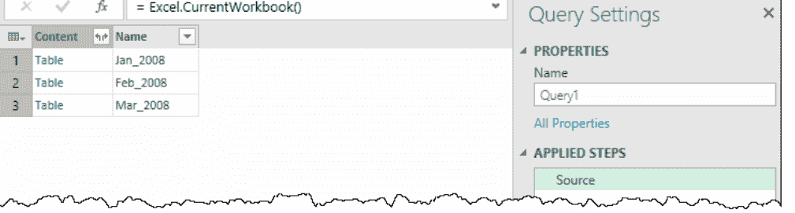

图 61 当前工作簿中的表列表。

正如你在第 4 章中学到的，你可以点击 `Content` 列中深绿色区域旁空白处来预览数据。你也知道，如果点击该列顶部的双向箭头，就可以扩展表的列而不会丢失 `Name` 列的详细信息。以下是操作步骤：

- 点击双向箭头扩展 `Content` 列
- 取消勾选“使用原始名称作为前缀” → OK

数据扩展了，同时保留了 `Name` 列的位置，允许你继续操作并将表转换为名称：

- 右键点击 `Name` 列 -> 替换值
- 将字符 `_` 替换为 `, `（一个空格、逗号、一个空格——但不要带引号）
- 右键点击 `Name` 列 -> 更改类型 -> 日期
- 转到“转换”选项卡 -> 日期 -> 月份 -> 月末
- 右键点击 `Name` 列 -> 重命名 -> `Month End`
- 将查询命名为 `Gift Certificates`

完成后的查询现在看起来如下：

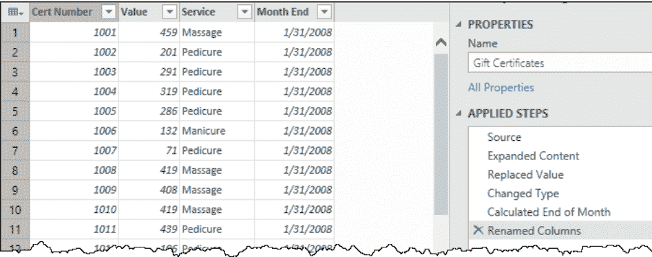

图 62 完成的查询，准备就绪。

这里一切看起来良好，但当你选择“关闭并加载”时，会触发一系列错误：


图 63 它看起来明明好好的！怎么会有 62 个错误？

那么发生了什么？返回并通过右键点击 Gift Certificate 查询 -> 编辑 -> 选择 Source（源）步骤来逐步执行查询。此时，你会发现列出的表比之前多了一个。那是作为此查询输出而创建的 Gift Certificates 表！

# 第 5 章 聚合 Excel 工作表

| Content | Name | PROPERTIES |
| --- | --- | --- |
| 1 Table | Jan_2008 | Name |
| 2 Table | Feb_2008 | Gift Certificates |
| 3 Table | Mar_2008 | All Properties |
| 4 Table | Gift_Certificates | APPLIED STEPS |
| | | Expanded Content |
| | | Replaced Value |
| | | Changed Type |
| | | Calculated End of Month |
| | | Renamed Columns |

图 64 最终的 `excelquery()` 出现在表列表中。

当使用 `=Excel.CurrentWorkbook()` 列出表或范围时，请记住输出在刷新时也会被识别。这一次，取决于你如何构建查询，可能需要防范未来的步骤。这些步骤可能包括过滤以避免潜在的重复或错误、更改数据类型，或更改任何其他预先设置以防止出错的内容。

| Cert Number | Value | Name |
| --- | --- | --- |
| 61 | 3025 | 280 |
| 62 | 3026 | 106 |
| 63 | 1001 | 459 |
| 64 | 1002 | 201 |
| 65 | 1003 | 291 |

当更改类型时，它会尝试转换列中的所有数据，这实际上对你有利。通过过滤完成后，你得到了来自 Power Query 的积极结果。

- 确保更改类型已选中
- 选择 Name 列 -> 主页 -> 删除行


图 67 有 62 行。

## 聚合查询

现在如果工作表没有表，你可以合并所有工作表吗？是的，但你需要使用打印区域。因为打印区域是动态的。为了将范围提取到 Power Query，你需要遵循以下步骤：

- 选择 2008 工作表 -> 页面布局 -> 打印标题
- 在打印区域设置
- 为 Feb2008 重复新查询 -> 来自其他 -> 空白查询
- 在公式栏中输入：`=Excel.CurrentWorkbook()`

你现在看到了所有表和命名区域的列表！

| Content | Name |
| --- | --- |
| 1 | Jan_2008 |
| 2 | Feb_2008 |
| 3 | Mar_2008 |
| 4 | 'Feb2008'\|Print_Area |
| 5 | 'Jan2008'\|Print_Area |
| 6 | 'Mar2008'\|Print_Area |

图 68 `Excel.CurrentWorkbook()` 显示打印区域。

你目前同时拥有表和打印区域，但你可以对其进行过滤并扩展以查看结果：

- 过滤列 -> 文本筛选 -> 于 Print_Area → OK
- 点击扩展按钮取消勾选原始名称作为前缀 → OK

注意这里的情况不同。你拥有整个范围，包括你的每一列。

| Column1 | Column2 | Column3 | Column4 | Name |
| --- | --- | --- | --- | --- |
| 1 | Gift Certificates Issued - Feb 2008 | null | null | null | 'Feb2008'\|Print_Area |
| 2 | null | null | null | null | 'Feb2008'\|Print_Area |
| 3 | Cert Number | null | null | null | 'Feb2008'\|Print_Area |
| 4 | | 2001 | 498 Massage | null | 'Feb2008'\|Print_Area |
| 5 | | 2002 | 448 Massage | null | 'Feb2008'\|Print_Area |
| 6 | | 2003 | 249 Manicure | null | 'Feb2008'\|Print_Area |
| 7 | | 2004 | 94 Manicure | null | 'Feb2008'\|Print_Area |

图 69 工作表的原始视图。

# 第 5 章 汇总 Excel 工作表

这显然意味着需要进行数据清理，以便汇总这些区域并转换为整洁的表格，但好消息是这是可以。要清理这组数据，请按照以下步骤操作：

- 转到主页 -> 删除行 -> 删除顶部行 -> 2 -> 确定
- 转换 -> 使用第一行标题
- 过滤“Cell Number”单元格编号列 -> 取消勾选空（null）
- 右键点击“Number”列 -> 更改类型 -> 整数
- 选择“Cell Number”列
- 转到主页 -> 删除错误 -> 确定
- 选择“Cell Number”列 -> 按住 Shift 键 -> 选择“Service”列
- 右键点击任一选中的列标题 -> 删除其他列
- 将查询重命名为 AllSheets -> 确定
- 转到主页 -> 关闭并加载

在处理打印内容时，将打印区域限制为仅需要的行和列是一个好主意。第一个原因是 Power Query 处理更多数据需要更长时间。第二个原因是，在扩展窗口中每一列仅被简称为 `Column1`，这使得非常容易过滤掉需要删除的额外列。

## 从其他工作簿汇总数据

假设你正在构建一个依赖于存储在其他 Excel 工作簿中的解决方案。在这种情况下，用户将数据存储在带有月份和年份的工作表中，但每个工作簿仅包含一个季度。这些数据存储在一个文件夹中，你需要汇总其中的数据。

在本章之前使用的方法针对的是当前工作簿内部的对象，当你处理外部工作簿时，它们不起作用。相反，你实际上需要生成 Excel 工作簿列表并提取其内容，这与你在第 4 章提取 csv 文件内容的操作类似。

## 获取数据源

从空白工作簿开始数据源获取过程：

- 创建新建查询 -> 来自 -> 文件夹
- 选择 Ch05ExamplesSource Files 文件夹

当 Power Query 列出文件时，你可以看到这里已经有一些非 Excel 文件：

| 内容 | 名称 | 扩展名 | 访问日期 | 属性 |
| --- | --- | --- | --- | --- |
| 1 | Named Range.xlsx | xlsx | 8/8/2018 8:41:51 AM | Name |
| 2 | New Document.txt | txt | 8/8/2018 8:41:51 AM | Query1 |
| 3 | Noting.html | htm | 8/8/2018 8:41:51 AM | All Properties |
| 4 | Workbook1.xlsx | xlsx | 8/8/2018 8:41:51 AM | |
| 5 | Workbook2.xlsx | xlsx | 8/8/2018 8:41:51 AM | APPLIED STEPS |


你需要从列表中过滤掉这些文件，因为你只需要 Excel 工作簿：

- 右键点击“Extension”列 -> 转换 -> 小写
- 过滤“Extension”列 -> 文本筛选 -> 以 .xls 开头
- 选择“Content”和“Name”列 -> 右键 -> 删除其他列

## M 代表（数据）猴子 (Data Monkey)

此时，你可能忍不住想点击“合并二进制文件”按钮，遗憾的是 Power Query 确实允许你这样做。然而，如果你这样做了，你会发现 Power Query 查询了文件但无法导入它们：

> DataFormat.Error: 无法识别输入为有效的 Excel 文档。
>
> 详细信息:
>
> Binary

图 71 Power Query 表示它无法合并 Excel 二进制文件。

如果你确实点击了“合并二进制文件”按钮，现在需要转到“应用步骤”窗格，删除“导入的 Excel”和“合并的二进制文件”步骤。

如果你无法使用简单方法合并并导入文件，就必须使用“硬核”方法：

- 转到“添加列”选项卡 -> 添加自定义列
- 输入以下公式：
  `=Excel.Workbook([Content])`
- 点击确定
- 现在右键点击“Content”列 -> 删除

你的自定义列现在包含一列表格，每个表格都包含你可以连接的对象——包括所有 Excel 表格、定义的名称以及所在位置。

| Name | Table |
| --- | --- |
| 1 Named Range.xlsx | Table |
| 2 Workbook1.xlsx | Table |
| 3 Workbook2.xlsx | Table |

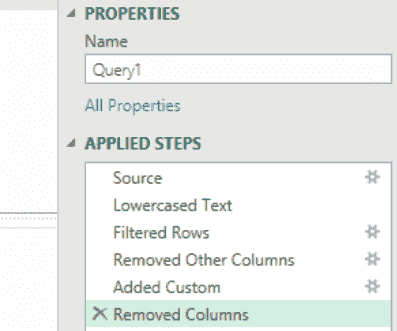

| Name | Data | Item | Kind | Hidden |
| --- | --- | --- | --- | --- |
| Sheet1 | Table | Sheet | Sheet | FALSE |
| Sheet2 | Table | Sheet2 | Sheet | FALSE |
| rngValue | Table | Sheet | DefinedName | FALSE |

图 72 显示了 Named Range.xlsx 文件的部分。

## 扩展 Excel 文件内容

自定义列的表头中有一个双向箭头（扩展图标），因此它可以被扩展。当你点击“Custom”列上的扩展图标时，你将获得所有不同工作簿部分的列表：

| Name | Name.1 | Data | Item | Kind |
| --- | --- | --- | --- | --- |
| 1 Named Range.xlsx | Sheet1 | Table | Sheet1 | Sheet |
| 2 Named Range.xlsx | Sheet2 | Table | Sheet2 | Sheet |
| 3 Named Range.xlsx | rngValue | Table | Sheet | DefinedName |
| 4 Workbook1.xlsx | Jan 2008 | Table | Jan 2008 | Sheet |
| 5 Workbook1.xlsx | Feb 2008 | Table | Feb 2008 | Sheet |
| 6 Workbook1.xlsx | Mar 2008 | Table | Mar 2008 | Sheet |
| 7 Workbook1.xlsx | Jan_2008 | Table | Jan 2008 | Sheet |
| 8 Workbook1.xlsx | Feb_2008 | Table | Feb 2008 | |

图 73 工作簿部分。

## 汇总 Excel 工作表

## M 代表 (数据)猴子 (Monkey)

在这里你可以看到你已成功从两个不同的文件以及其中的两个工作表中提取了数据，总计超过 12,000 条记录：

| 行标签 | 月份计数 | 金额总和 |
| --- | --- | --- |
| Workbook1.xlsx | 6084 | 169822.41 |
| 2008年2月 | 1857 | 56211.14 |
| 2008年1月 | 2030 | 89790.94 |
| 2008年3月 | 2197 | 23820.30 |
| Workbook2.xlsx | 6084 | 169822.41 |
| 2008年4月 | 2030 | 89790.94 |
| 2008年6月 | 2197 | 23820.33 |
| 2008年5月 | 1857 | 56211.14 |
| 总计 | 12168 | 339644.82 |

图 75 你辛勤工作的成果。

## 注意事项

在学习本章描述的技术时，有几点你需要记住。

## 使用 =Excel.CurrentWorkbook()

在使用 `Excel.CurrentWorkbook()` 函数构建解决方案时，最需要记住的一点是，该函数会读取当前文件中的所有对象。由于这会影响计算链，你会遇到递归效应，这意味着随着表格的构建，Power Query 会识别它们并将它们读取为你可以使用的潜在内容。

这种影响会体现在刷新时，此时查询尝试加载其自身，从而导致输出中的数据重复。在使用这种方法时，重要的是记住这一点并对其防范。防止此类问题的策略包括：通过为输入列和输出列命名来防止在关键列上出现过滤错误——你可以过滤掉不需要的列。

> 无论你选择什么，在发布到生产环境之前，请务必通过几次刷新进行测试！

## 使用 =Excel.CurrentWorkbook([Content])

与 `Excel.CurrentWorkbook()` 不同，使用 `Excel.CurrentWorkbook()` 函数不会引起递归问题。原因是 `Excel.CurrentWorkbook()` 读取的是 Excel 工作簿的最后一次保存的副本。如果用户正在更新文件但尚未保存，就会出现问题，因为你无法获得预期的最新数据。

使用 `Excel.CurrentWorkbook()` 函数提取工作簿内容时的另一个问题是，它除了读取区域和表格外，还会读取工作表。如果你不小心，这非常容易导致数据重复，因为所有区域和表格都存在于工作表中。注意过滤你想要避免的列。

如果在构建解决方案时，工作簿中即使只有一种类型的数据，使用过滤器只接受所需的特定类型来为你的解决方案提供未来保障也不是一个坏主意。这可以防止用户向表中添加以前从未有过的数据时出现问题。

需要注意的是，完全可以使用 `Excel.CurrentWorkbook()` 从当前工作簿读取，从而获得读取工作表内容的能力。如果你无法为数据定义打印区域或其他区域，那么这将非常有用。但请记住，查询读取的是工作簿的最后一次保存的副本，而不是实时副本。这产生了一个遗憾的副作用，即仍然面临来自 `Excel.CurrentWorkbook()` 函数的递归问题，但在你下次打开文件之前，可能看不到它。

# 第 6 章 数据取消透视 (Unpivoting Data)

Excel 专家面临的大问题之一是，无论我们从哪里获取数据，数据并不总是以有用的状态呈现。因此，我们不仅浪费时间将数据导入到工作簿，还要花费更多时间进行清洗并更改布局以便进行处理。

## 透视化数据的诅咒

假设一个用户开始按天跟踪销售额，并将数据发送为如下所示格式：

| 销售类别 | 1/1/2014 | 1/2/2014 | 1/3/2014 | 1/4/2014 | 1/5/2014 | 1/6/2014 | 1/7/2014 | 总计 |
| --- | --- | --- | --- | --- | --- | --- | --- | --- |
| 啤酒 | 103 | 243 | 101 | 137 | 53 | 105 | 111 | 983 |
| 葡萄酒 | 175 | 223 | 138 | 57 | 66 | 199 | 83 | 941 |
| 白酒 | 162 | 207 | 103 | 179 | 150 | 147 | 180 | 1,128 |
| 总计 | 440 | 673 | 342 | 373 | 319 | 531 | 374 | 3,052 |

图 76 令人畏惧的数据集。

自然，在跟踪销售额几天或几周后，他将数据交给你，并让你从中构建各种不同的报告。解决这个困境的办法当然是针对源数据构建透视表。问题是，这个数据集已经是透视状态了。这种困境的问题源于针对源数据构建透视表，但该数据集已经是透视的。这种问题经常出现，透视表是为了快速处理数据而构建的。挑战在于，用户认为数据应该是表格格式的，但透视表将其转换成透视格式。

| 日期 | 啤酒 | 葡萄酒 | 白酒 | 单位 |
| --- | --- | --- | --- | --- |
| 1/1/2014 | 103 | 175 | 162 | 103 |
| 1/2/2014 | 243 | 223 | 207 | 243 |
| 1/3/2014 | 101 | 138 | 103 | 101 |
| 1/4/2014 | 137 | 57 | 179 | 137 |
| 1/5/2014 | 53 | 66 | 150 | 53 |
| 1/6/2014 | 105 | 199 | 147 | 185 |
| 1/7/2014 | 111 | 83 | 180 | 111 |

图 77 左侧是转置数据，右侧是良好的透视数据。

最糟糕的部分是，过去没有工具可以轻松处理这种数据，透视表需要这种格式。但现在 Power Query 来救场了。

## 轻松取消透视

此示例展示了如何通过 Power Query 解决问题。打开 `Unpivot.xlsx` 并准备好数据：

| 销售类别 | 1/1/2014 | 1/2/2014 | 1/3/2014 | 1/4/2014 | 1/5/2014 | 1/6/2014 | 1/7/2014 | 总计 |
| --- | --- | --- | --- | --- | --- | --- | --- | --- |
| 啤酒 | 103 | 243 | 101 | 137 | 53 | 105 | 111 | 983 |
| 葡萄酒 | 175 | 223 | 138 | 57 | 66 | 199 | 83 | 941 |


| 白酒 | 162 | 207 | 103 | 179 | 150 | 147 | 180 | 1,128 |
|---|---|---|---|---|---|---|---|---|
| 总计 | 440 | 673 | 342 | 373 | 319 | 531 | 374 | 3,052 |

图 78 以透视格式构建的数据。

## 准备数据

如你所示，数据包含在工作表中，但它没有关联表格。你已经知道可以修复它，因此在数据处创建一个查询：

- 创建新查询 -> 来自表格 -> OK（确认表格）
- 在 Excel 中调整范围为 `$A$4:$I$7`（移除最后一行）

进入 Power Query，你现在有能力进行任何需要的转换或操作。这里的总目标是取消透视数据，但有一列是你并不需要的。总计列可以删除，因为你只需用透视表重新构建它。右键点击总计列 -> 删除。你现在剩下数据：销售类别列和每天的列。

## 取消透视列

要在透视表中取消透视，请按照以下步骤操作：

- 选择 `1/1/2014` 列 -> 按住 Shift 键 -> 选择 `1/7/2014` 列
- 右键点击其中一列 -> 取消透视列

结果非常惊人：你已经完成了。

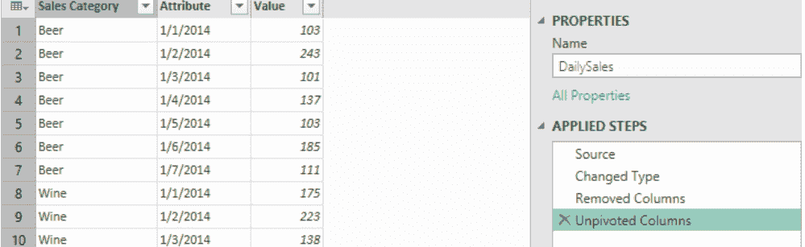

在完成数据集之前，只需要少量更改：

- 右键点击属性列 -> 更改类型 -> 日期
- 右键点击属性列 -> 重命名为 日期
- 右键点击值列 -> 重命名为 单位
- 重命名查询为 `DailySales`
- 转到主页 -> 关闭并载入

你能相信这有多简单吗？

> 注意，这种情况不需要使用“使用区域设置更改类型”。由于数据已位于 Excel 内部，无论你的区域设置如何，Power Query 都能正确识别这些数据。

## 重新透视

接下来，你可以从这些数据构建几个透视表，重构建用户现有的数据：

- 选择表格中的单元格 -> 插入透视表
- 在工作表的 `F11` 处插入透视表
- 将类别放在行上，日期放在列上，将单位放在值上

现在你可以从同一个数据集切换到另一种视图：

- 选择表格中的单元格 -> 插入透视表
- 在工作表的 `F11` 处插入透视表
- 将“销售类别”置于行，“日期”置于行（在类别下方），并将“单位”置于值。
- 右键点击 `F12` → 展开/收叠 → 整个字段

现在你非常轻松地从一组未透视数据创建了两个不同的集：

| A | B | C | D | E | F | G | H |
|---|---|---|---|---|---|---|---|
| 销售类别 | 日期 | 单位 | | 单位求和 | 列标签 | | |
| 啤酒 | 1/1/2014 | 103 | | 行标签 | | 1/1/2014 | 1/2/2013 |
| 啤酒 | 1/2/2014 | 243 | 啤酒 | | 103 | 243 | |
| 啤酒 | 1/3/2014 | 101 | 酒酒类 | | 162 | 207 | |
| 啤酒 | 1/4/2014 | 137 | 葡萄酒 | | 175 | 223 | |
| 啤酒 | 1/5/2014 | 103 | | 总计 | | 440 | 673 |
| 啤酒 | 1/6/2014 | 185 | | | | | |
| 啤酒 | 1/7/2014 | 111 | | | | | |
| 啤酒 | 1/8/2014 | | | | | | |
| 葡萄酒 | 1/9/2014 | 175 | | | | | |
| 葡萄酒 | 1/10/2014 | 223 | | | | | |
| 葡萄酒 | 1/11/2014 | 138 | | 行标签 | 单位求和 | | 983 |
| 葡萄酒 | 1/12/2014 | | | 啤酒 | | | |
| 葡萄酒 | 1/13/2014 | 66 | 酒酒类 | | 1128 | | |
| 葡萄酒 | 1/14/2014 | 199 | 葡萄酒 | | 941 | | |
| 葡萄酒 | 1/15/2014 | 83 | | 总计 | | 3052 |

图 80 从未透视数据集构建的两个数据透视表。

# 第 6 章 未透视数据

## 在更新中幸存

到此时，你已经很习惯保存文件、将其返回给用户，并让他们继续更新。毕竟，Power Query 的更新可以随时刷新给你。当你打开文件时，你会发现用户进行了一些只有终端用户才会想更改：

| 销售类别 | 1/1/2014 | 1/2/2014 | 1/3/2014 | 1/4/2014 | 1/5/2014 | 1/6/2014 | 1/7/2014 | 总计 | 1/8/2014 |
|---|---|---|---|---|---|---|---|---|---|
| 啤酒 | 103 | 241 | 101 | 137 | 107 | 185 | 111 | 983 | 34 |
| 葡萄酒 | 175 | 223 | 138 | 57 | 66 | 199 | 92 | 941 | 86 |
| 苹果酒 | | | | | | | 78 | 170 | 47 |
| 酒酒类 | 162 | 207 | 103 | 179 | 150 | 147 | 180 | 1,128 | 23 |
| 总计 | 440 | 672 | 342 | 373 | 319 | 609 | 466 | 3,222 | |

图 81 终端用户返回的文件。

查看这些更改后，你惊讶地发现以下内容：

- 在总计列之后增加了新日期。
- 注入了一个新的销售类别并带有追溯数据。
- 用户没有完成新列的总计计算。

在这些更改的情况下，刷新效果会如何？要找到答案，转到“数据”选项卡并双击“全部刷新”（一次针对 Power Query，一次针对数据透视表）。

结果令人惊叹，如下所示：

| 单位求和 | 列标签 | 1/1/2014 | 1/2/2014 | 1/3/2014 | 1/4/2014 | 1/5/2014 | 1/6/2014 | 1/7/2014 | 1/8/2014 | 总计 |
|---|---|---|---|---|---|---|---|---|---|---|
| 行标签 | 啤酒 | | | | | | | | | | |
| 酒酒类 | | 203 | 241 | 101 | 137 | 103 | 185 | 111 | 23 | 1151 |
| 葡萄酒 | | 175 | 223 | 138 | 57 | 66 | 199 | 92 | 86 | 1027 |
| 苹果酒 | | | | | | | 72 | 47 | 217 |
| 总计 | | 440 | 673 | 342 | 373 | 319 | 609 | 466 | 190 | 3412 |
| | 单位 |
|---|---|
| 啤酒 | 101 |
| 酒酒类 | 1151 |
| 葡萄酒 | 1027 |
| 苹果酒 | 217 |
| 1/6/2014 | 78 |
| 1/7/2014 | 92 |
| 1/8/2014 | 47 |
| 总计 | 3412 |

图 82 尽管有了用户的操作，数据透视表仍然可以工作。用户提出的每个问题都得到了处理。总计处于正确的顺序，历史值已更新。

## 理解取消透视函数

在 Power Query 的右键菜单中实际上有两个取消透视函数：取消透视列和取消其他列。

### 取消透视的工作

公平地说，我们做了一些不必要的步骤。与其选择 `1/1/2014` 到 `7/1/2014`，你可以右键点击“销售类别”列并选择“取消其他列”命令。此命令会将除选中列以外的所有列取消透视。从逻辑角度来看，当解决方案有效时这样做是合理的。之所以设置演示是为了解释使用取消透视命令时到底发生了什么。

### 取消透视是如何工作的

根据用户界面的术语，你可能认为在记录取消透视 `1/1/2014` 到 `7/1/2014` 时，Power Query 会硬编码这些特定列。显然并非如此。以下是 Power Query 的实际操作：它查看了数据集中的所有列，并确定有一列没有被选中。它没有记录“取消透视这些列”的命令，而是记录了“取消透视未选中的列”。在这种情况下，它实际上记录了“除销售类别以外的所有内容”。

虽然这种变化看起来很微妙，但它既有利也有坏。好处是当添加新列时很难出错导致场景崩溃；本质上，它使你的解决方案具有未来性，因为它总会被包含。坏处是没有方法通过用户界面锁定特定的“仅取消透视列”命令。如果你在查询中有“取消其他列”命令并向数据添加新列，它也将会被取消透视。

### 锁定取消透视的列

虽然这并不常见，但可能某时你需要锁定特定的列或列，并确保源数据中添加的新列默认不取消透视。这需要对公式栏进行操作。

假设你想取消透视“总计”列，你需要执行以下步骤：

- 创建新查询 → 来自表格
- 右键点击“总计”列 → 取消透视
- 此时查询看起来如下，最后的列已完成取消透视：

| 销售类别 | 1/1/2014 | 2/7/2014 | 属性 | 值 |
|---|---|---|---|---|
| 1 啤酒 | 103 | 111 | 总计 | 983 |
| 2 葡萄酒 | 177 | 83 | 86 总计 | 941 |
| 3 苹果酒 | | 92 | 47 总计 | 170 |
| 4 酒酒类 | | 161 | 180 | 23 总计 | 1128 |

图 38 总计列已完成取消透视。

- 使用公式栏中的 V 图标展开公式栏
- 此时公式栏中的公式如下：

```
=Table.UnpivotOtherColumns("Changed Type", "Sales Category", "1/2/2014", "1/3/2014", "1/4/2014", "1/5/2014", "1/6/2014", "1/7/2014", "1/8/2014", "Attribute", "Value")
```

代码拆解如下：

- `Table.UnpivotOtherColumns()` 是要执行的函数
- `#"Changed Type"` 是应用步骤框中的上一步的名称
- `{...}` 是所有列的列表，用逗号分隔
- `"Attribute"` 是存储取消透视文本的新列名称
- `"Value"` 是存储取消透视值的列名称

如果你想锁定代码以确保永远不会有其他列被取消透视，你需要将此项从 `Table.UnpivotOtherColumns` 函数更改为使用 `Table.Unpivot` 函数。

就像 `Table.UnpivotOtherColumns` 接受四个参数：

- 你想要取消透视的步骤：`#"Changed Type"`
- 你想要取消透视的列列表：`{"Total"}`
- 存储取消透视文本的列名：`"Attribute"`
- 存储取消透视值的列名：`"Value"`，

因此整体公式如下：

```
=Table.Unpivot("Changed Type", "Total", "Attribute", "Value")
```

效果与上述使用原始代码产生的版本完全相同。区别在于，如果之后向源数据添加了任何其他列，刷新时它们将不再被取消透视。

> 为了锁定多列的取消透视，你只需要在 `()` 字符之间提供要取消透视的完整列列表，每个列标题用引号括起来并用逗号分隔，

M 代表 (数据) 猴子

# 第 7 章 导入非分隔符文本文件

许多 Excel 高级用户面临的最大挑战之一就是导入和清理非分隔符文本文件。如果你曾经处理过这些文件，就会知道这有多么痛苦。它们通常带有类似 `ASCII.TXT` 的默认名称，并且本质上是打印时输出结果的逐字符表示。它们会遇到各种诡异的问题，包括：

- 字符按位置对齐，而不是通过字符分隔
- 对齐不一致
- 非打印字符（如控制字符）
- 重复的标题行

许多 Excel 高级用户的工作中很大大部分是将此类信息导入到 Excel 并进行清理。而这一切都必须在对其进行具有业务价值的分析*之前*完成。

如果你经历过这些，你就知道这个处理过程遵循以下通用流程：

1. 将文件导入到 Excel 中的“数据 -> 来自文本”。
2. 在邮票大小的“导入向导”窗口中操作，尝试确定列是如何分隔的以及跳过哪些列。
3. 将导入向导的结果导入工作表中。
4. 将数据转换为真正的 Excel 表格。
5. 对表格进行排序和过滤以删除垃圾行。
6. 清理并修剪列中的文本。

最棒的部分是，下个月当你获得更新后的数据文件时，你又要重新经历一遍这个令人兴奋的过程。如果有更好的方法难道不是更好吗？好消息是！方法就在，而且你已经找到了。

## 连接到文件

连接非分隔符文件的方式与连接任何其他文本文件的方式相同：

- 创建新建查询 -> 来自文件 -> 来自文本
- 浏览到 `Ch07 Examples` -> `GL Jan-Mar.TXT`

Power Query 将数据放在了单列中：

| Column1 | XYZ Company Ltd. | Pg 1 | PROPERTIES |
|---|---|---|---|
| 2 | | | Name |
| 3 | Detailed Ledger Detail with Change for Aug 2004 to 2009 | | GL-Mar |
| 4 | | | All Properties |
| 5 | Account | Begin | Final | APPLIED STEPS |
| 6 | Description of Account | Balance | Change | Source |
| 7 | | | | |
| 8 Jan 2006 | | | | |
| 9 123-03 | Purchases | 0.00 | 214,861.77 | 21 |
| 10 | | | | |
| 11 | Tran Date | Tran Amount | Source Reference Information | Veil |
| 12 | 01/02/2006 | 4,429.36 | G0001 | Food Purchase-Douglas | | |
| 13 | 01/09/2006 | 0,450 | G0002 | User-Direct | | |

图 84 非分隔符文本文件的 Power Query 视图。

与标准的 Excel 导入相比，你将注意到的第一个优势是你可以获得一个全尺寸窗口。这是对其所有方面的巨大改进，因为你实际上可以看到发生了什么。

> 如果列太窄，只需将鼠标悬停在列标题的右侧，按住左鼠标键并拖动加宽。

你还会注意到，由于文件没有使用任何一致的分隔符，Power Query 对你的数据没有任何猜测。相反，它将整个过程留给了你。考虑到这个文件的状态，这可能不是一件坏事。

在我们进一步讨论之前，请注意导入非分隔符文本文件有很多方法，没有对错之分。本章中的示例设计目的是展示通过用户界面进行大量的转换，以及 Excel 处理此任务的典型方法。随着经验的增加，你将发现几乎肯定有更快的路径到达目标。

## 清理非分隔符文件

开始清理非分隔符文件的通用目标是尽可能地将数据转换为类似列的数据。在这种情况下，前 10 行似乎没有增加太大价值，而第 11 行可能是列标题。因此，转到主页 -> 减少行 -> 删除行 -> 删除顶部行 -> 10。

行消失了且不会被导入解决方案中：


图 85 删除了顶部行，将标题移到了顶部。

接下来，你需要选择一个方向来处理这些数据。你可以尝试从左侧或右侧开始，但目前有很多额外的前导空格，且中间有重复的空格。如果能去掉它们就太好了。

在 Excel 中，标准做法是通过 `TRIM()` 和 `CLEAN()` 函数对文本数据运行，以删除所有前导、尾部和重复空格，以及删除非打印字符。Power Query 也具有此功能，你可以这样应用：

- 右键点击 `Column1` -> 转换 -> 修剪
- 右键点击 `Column1` -> 转换 -> 清理

数据看起来好了一点：

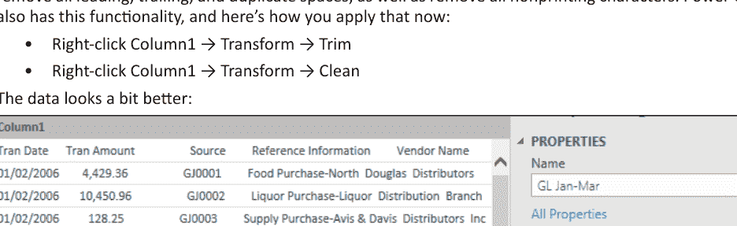

图 86 数据已修剪并清理。

在此时，你可能会发现 Power Query 的修剪功能与 Excel 不同。Excel 的 `TRIM()` 函数会删除所有前导和尾部空格并将数据中间的重复空格替换为单个空格，Power Query 没有这样做。它只修剪前导和尾部空格。Power Query 的 `CLEAN` 函数与 Excel 类似，尽管更难观察。非打印字符在 Excel 界面中显示为标记。在 Power Query 中，它们被清理了。

## 按位置分列

下一步是开始分列。基本方法是根据字符数进行分列，猜测你需要多少个，然后进行微调。考虑到日期的字符数是 10，你可以尝试 12。成功了！你可以看到，日期可能是正确的，但其他的不是：

| Column1.1 | Column1.2 | Column1.3 | Column1.4 | PROPERTIES |
|---|---|---|---|---|
| Tran Date | Tran Amount | Source | Name |
| 01/02/2006 | 4,429.36 | G0001 | GL-Mar |
| 01/03/2006 | 10,450.96 | G0002 | All Properties |
| 01/04/2006 | 128.25 | G0003 | APPLIED STEPS |
| 01/05/2006 | 4,895.61 | G0004 | Source |
| 01/06/2006 | 11,551.06 | G0005 | Removed Top Rows |
| 01/07/2006 | 141.75 | G0006 | Trimmed |
| 01/08/2006 | 4,662.86 | G0007 | Cleaned |
| 01/09/2006 | 11,001.21 | G0008 | Split Column by Position |


# 第 7 章 导入非分隔文本文件

| 01/10/2006 | 135.00 | G0009 | Changed Type |
|---|---|---|---|
| 01/11/2006 | 3,276.19 | G0010 | |

图 87 数据没有按预期方式分列。

这不是大问题，你可以通过完善原始工作来再次尝试：

- 更改类型步骤
- 点击按位置分列旁边的齿轮图标
- 将其更改为 15 -> OK

结果好多了：

| Column1.1 | Column1.2 | Column1.3 | Column1.4 | PROPERTIES |
|---|---|---|---|---|
| Tran Date | Tran Amount | Source | Name | |
| 01/02/2006 | 4,429.36 | G0001 | GL-Mar | |
| 01/03/2006 | 10,450.96 | G0002 | All Properties | |
| 01/04/2006 | 128.25 | G0003 | APPLIED STEPS | |
| 01/05/2006 | 4,895.61 | G0004 | Source | |
| 01/06/2006 | 11,551.06 | G0005 | Removed Top Rows | |
| 01/07/2006 | 141.75 | G0006 | Trimmed | |
| 01/08/2006 | 4,662.86 | G0007 | Cleaned | |
| 01/09/2006 | 11,001.21 | G0008 | Split Column by Position | |
| 01/10/2006 | 135.00 | G0009 | Changed Type | |
| 01/11/2006 | 3,276.19 | G0010 | | |

图 88 数据的更具启发性的视图。

值得提的是，分列是复杂的。如果日期不一致，你可以选择从左侧/右侧仅分列一次。这允许你对每一列进行更细粒度的控制。


现在你可以进行更多更改。由于更改类型步骤只是将列清除为文本（当你完成时它们将不再是文本），你可以删除更改类型步骤，因为它是无关的。你可以将第一行作为标题。遵循以下步骤：

- 删除“更改”步骤
- 转到 转换 -> 第一行作为标题

数据现在看起来已经干净了，即使 Tran 列中有些错误：

| Tran Date | Tran Amount | Source |
|---|---|---|
| 38 01/30/2006 | 11612.20 | G0038 |
| 39 01/30/2006 | 122.14 | G0039 |
| 40 | null | null |
| 41 02/01/2006 | null | null |
| 42 03/01/2006 | Purchases | null |
| 43 | null | null |
| 44 Error | Amount | Source |
| 45 02/01/2006 | 4,395.03 | G0040 |
| 46 | null | null |
| 47 | null | null |
| 48 Error | | |
| 49 Error | 3/20/2009 2:08pm | Pg 2 |

图 89 错误行与数据混合。

问题在于如何处理这些。有些是日期，有些是文本，有些是错误。现在尝试：

- 右键点击 Tran 列 -> 更改类型 -> 使用区域 -> 日期 -> 英语（美国） -> OK

结果是 Tran 列中出现了一堆错误：

| Tran Date | Tran Amount | Source |
|---|---|---|
| 38 01/30/2006 | 11612.20 | G0038 |
| 39 01/30/2006 | 122.14 | G0039 |
| 40 | null | null |
| 41 02/01/2006 | null | null |
| 42 03/01/2006 | Purchases | null |
| 43 | null | null |
| 44 Error | Amount | Source |
| 45 02/01/2006 | 4,395.03 | G0040 |
| 46 | null | null |
| 47 | null | null |
| 48 Error | | |
| 49 Error | 3/20/2009 2:08pm | Pg 2 |

图 90 转换为日期产生的错误。

与任何其他程序不同，错误在 Power Query 中是真正令人兴奋的。它们令人兴奋是因为你可以控制并响应它们。如果你仔细观察这些数据，你会发现错误只发生在你想要过滤掉的行中。此外，每一个在 Tran Date 列中为空（null）的行，其后续列包含的值也不是你想要保留的交易数据。因此，你可以删掉这两者：

- 选择 Tran Data 列 -> 主页选项卡 -> 减少行 -> 移除错误
- 过滤 Tran Data 列 -> 取消勾选 null

结果非常令人鼓舞，你现在有了一个从上到下都是有效日期的 TranData 列：

| Tran Date | Tran Amount | Source |
|---|---|---|
| 39 | 1/30/2006 | 122.14 | GJ0039 |
| 40 | 2/1/2006 | null | |
| 41 | 3/1/0123 | Purchases | |
| 42 | 2/1/2006 | 4,395.03 | GJ0040 |
| 43 | 3/20/2009 | 2.08pm | |
| 44 | 2/1/2006 | 12,834.54 | GJ0041 |

图 91 显示从上到下有效日期的 TranData 列。

现在，你发现仍有几行出现但并不属于此数据集。挑战在于，你并不真的想过滤掉日期，因为其中某些日期可能是有效的（例如在 3/1/0123）。你可以移动到下一列，看看能否在这里修复这些问题：

- 右键点击 Tran Data 列 -> 重命名 -> Date -> 好
- 右键点击 Tran Amount 列 -> 重命名 -> Amount
- 右键点击 Amount 列 -> 更改类型 -> 小数数字

Power Query 允许将所有条目设置为小数值，这将触发一些错误。移除这些错误以及数据集中的对应行：

- 选择 Amount 列 -> 主页 -> 减少行 -> 移除错误
- 过滤 Amount 列 -> 取消勾选 null

如果你检查第 40 行左右及之后的数据集，你会发现所有垃圾行都完全消失了。

## 移除垃圾列

删除额外的列非常简单：你只需要在操作时遵循一个流程。该流程简单如下：

- 过滤列
- 确保列中的值全为空或 null
- 右键点击并删除列

检查数据集中的列，你可以看到第三列（表头为空）似乎只包含空值。该列可以删除。

同样，如果你一直滚动到第 9 列，你会发现该列只包含 null 值。该列也可以删除。

## 聚合列

此时，很明显你对列的拆分得太激进了。似乎有四列被错误地拆分了，如下所示：

| Reference Info | Vendor Name | ColumnB | |
|---|---|---|---|
| Supply Purchase | -Avis & Davis | Distributors I | |
| Food Purchase-N | orth Douglas | Distributors | null |
| Liquor Purchase | -Liquor Dist | Branch Ranch | null |
| Supply Purchase | -Avis & Davis | Distributors I | nc |
| Food Purchase-N | orth Douglas | Distributors | null |

图 92 错误拆分的列。

幸运的是，这里并不是无可回，你完全不需要返回重新开始。方法如下：

将列重新合并在一起。

- 选择 Reference Info -> 按住 Shift 键 -> 选择 Column8
- 右键点击其中一个表头 -> 合并列

你可以选择使用分隔符并为（新列）提供新名称。在这种情况下，你不需要进行任何搜索。而且由于你反正会以不同的方式再次拆分此列，所以名称其实并不重要。点击确定，你的列就合并了：

| Source | Merged | |
|---|---|---|
| 4429.36 G0001 | Food Purchase-North Douglas Distributors |
| 10450.96 G0002 | Liquor Purchase-Liquor Distribution Branch |
| 128.25 G0003 | Supply Purchase-Avis & Distributors Inc |
| 4895.61 G0004 | Food Purchase-North Douglas Distributors |
| 1151.06 G0005 | Liquor Purchase-Liquor Distribution Branch |
| 141.75 G0006 | Supply Purchase-Avis & Distributors Inc |
| 4652.48 G0007 | Food Purchase-North Douglas Distributors |

图 93 蛋蛋蛋（Humpty Dumpy）希望自己有力量！

## 按分隔符拆分列

重新聚合的数据表明，新的合并列是用字符 - 分隔的。这意味着你可以使用某些内容将其拆分为各个组件。需要考虑的一点是，如果你不知道哪些供应商在名称中使用了连字符，那么你可能不想基于字符 - 强制进行拆分。按照以下步骤操作：

- 右键点击合并列 -> 拆分列 -> 按分隔符
- 从分隔符列表中选择 -> 自定义- 并输入 -（减号）
- 选择在最左侧分隔符处拆分

> 按分隔符拆分时，你并不限于单个字符分隔符。事实上，如果你想按任何单词进行拆分，可以将该单词作为你的分隔符。

数据被拆分为两个独立的列：Merged.1 和 Merged.2。这些列应该重命名为更合理的名称：

- 右键点击 Merged.1 -> 重命名 -> Category
- 右键点击 Merged.2 -> 重命名 -> Vendor

结果是一个几乎完美的数据集：

| Source | Category | Vendor |
|---|---|---|
| 429.36 G0001 | Food Purchase | North Douglas Distributors |
| 450.96 G0002 | Liquor Purchase | Liquor Distribution Branch |
| 128.25 G0003 | Supply Purchase | Avis & Davis Distributors Inc |
| 895.61 G0004 | Food Purchase | North Douglas Distributors |
| 551.06 G0005 | Liquor Purchase | Liquor Distribution Branch |
| 141.75 G0006 | Supply Purchase | Avis & Davis Inc |

图 94 数据集现在是完美的。

## 修除重复空格

你需要处理此数据集的最后一件事是 Vendor 列单词之间留下的重复空格。由于你无法依赖 Power Query 的修剪（trim）函数，你需要自己处理：


- 右键点击 Vendor -> 替换值
- 将查找值设置为 2 个空格
- 将替换为设置为 1 个空格

你现在有一个可以加载到表中的完全干净的数据集。

> 遗憾的是，没有函数可以轻松地从文本字符串中删除“空白”。如果你怀疑存在某些空格实例，你可能需要运行几次这种修剪过程以完全清理数据。

此时，你可以完成查询并根据它生成报告。自然，你将通过创建数据透表来实现。在此之前，遵循以下步骤：

- 将查询重命名为 Transactions
- 转到主页 -> 关闭并加载

## Power Query 的高光时刻

- 右键点击查询 → 编辑（Edit）
- 回到“源”（Source）步骤并点击齿轮图标
- 更新文件路径为 `Ch07 Examples\GL Apr-Jun.TXT`
- 转到首页（Home）→ 关闭并加载（Close & Load）

查询的输出会更新表格，但你必须强制数据透表更新。可以通过右键点击数据透表 → 刷新（Refresh）来实现。

现在你看到使用 Power Query 的好处了：

| 金额总和 | 列标签 | | | | |
|---|---|---|---|---|---|
| 行标签 | 食品购买 | 酒类购买 | 用品购买 | 总计 |
| 4月 | | | | | |
| Avis & Davis Distributors Inc | | | | 1660.94 | 1660.94 |
| Liquor Distribution Branch | | | 19192.54 | | 19192.54 |
| North Distributors | | 55196.09 | | | 55196.09 |
| 5月 | | | | | |
| Avis & Davis Distributors Inc | | | | 261.07 | 261.07 |
| Liquor Distribution Branch | | | 177123.05 | | 177123.05 |
| North Distributors | | 62668.47 | | | 62668.47 |
| ACME&Co Supply Haus LLC | | | 1580.15 | | 1580.15 |
| Sysco | | 5847.82 | | | 5847.82 |
| 6月 | | | | | |
| Liquor Distribution Branch | | | 226607.59 | | 226607.59 |
| ACME&Co Supply Haus LLC | | | 3376.48 | | 3376.48 |
| Sysco | | 102759.26 | | | 102759.26 |
| 总计 | | 22641.64 | 59572.16 | 6878.64 | 82907.44 |

图 96 同一个数据透表，已为下季度进行了更新。

有供应商、新交易和日期，而你处理所有这些都毫无问题。这是革命性的，你会怀疑在没有 Power Query 帮助的情况下，你的工作将是如何完成的。

> 如果你用新文件覆盖旧文件，那么你必须编辑“源”步骤来更新文件路径。相反，你只需转到数据（Data）→ 刷新全部（两次）即可更新解决方案。

你还应该意识到这不是旅程的终点。在这种情况下，你必须手动编辑“源”步骤来更新新文件的路径。考虑一下如果你是通过第 4 章描述的“从文件夹”（From → Folder）方法获取数据文件会有什么影响。如果是这样，你就可以添加文件夹中的文件列表：

- 按“修改日期”降序排序
- 筛选保留行 → 1


- 钻入 Content 列中剩余单个二进制文件
- 执行本章列出的其余列表操作

到这一步时你拥有什么？你将拥有一个从查询中最近修改的文件提取数据的解决方案。随着每个新季度的文件被添加到文件夹中，你都可以刷新查询并自动引入当前数据。

> 如果你决定更改“修改日期”属性，它每次保存文件时都会更改。虽然 Power Query 不会通过读取文件来更改此属性，但用户进行并保存的任何修改都将强制更新“修改日期”属性。如果这是你担心的问题，“访问日期”和“创建日期”属性可能会根据你的目标提供更好的筛选选项。


## 数据源设置

`azuredb.powerqueryworkshop.com:AdventureWorks2012`

## 凭据

类型：数据库

## 加密

加密连接

## 隐私级别

无

## 原生数据库查询

你尚未批准此源的任何原生数据库查询。

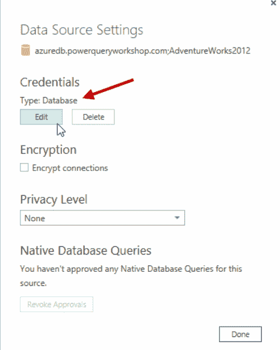

图 100 Azure 数据库的数据源设置框。

如有需要，你还可以通过点击凭据部分中的“编辑”按钮来触发窗口更新/替换用户名和密码。

## 使用导航器

一旦 Power Query 连接到数据库，你将进入导航器界面，该界面允许你选择想要连接的表。在这种情况下，你可以从 `SalesOrders` 表中提取数据。有很多表，你可以使用搜索功能来缩小列表范围：

- 在搜索区域输入 `else`
- 点击 `Sales.SalesOrderHeader`

预览格会连接到数据库，并让你一览该表中存储的数据：

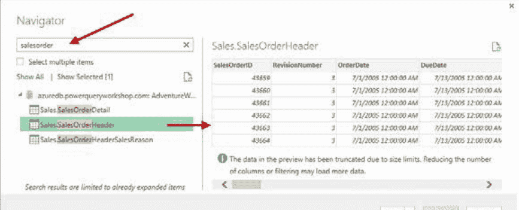

图 101 使用导航器。

这里的数据看起来相当有用。点击“编辑”，看看你可以从中获取到什么有用信息。

## 第 8 章 从数据库导入

## 探索数据

在导航器中点击“编辑”后，你首先会注意到“应用步骤”窗口中有两个步骤：源（`Source`）和导航（`Navigation`）。如果你选择“源”步骤，你会发现它回到了数据库的原始模式架构，允许你查看数据库中的其他表、视图和对象。“导航”步骤则会进入你选择的表。

你注意到的点是这里有很多数据。你可以对其进行精简：

- 选择 `OrderDate`、`SalesOrderNumber`、`SubTotal`、`TaxAmt`、`Freight` 和 `Sales.SalesTerritory`
- 右键点击其中一个表头 -> 删除列
- 右键点击 `OrderDate` 列 -> 转换
- 右键点击 `OrderDate` 列 -> 重命名
- 右键点击 `SalesOrderNumber` 列 -> 重命名 -> `Order#`

现在查询变得更加聚焦且紧凑了。

| Year | OrderID | SubTotal | TaxAmt | Freight | Sales.SalesTerritory |
|---|---|---|---|---|---|
| 1 | 2005 | S036459 | 20565.620 | 1971.519 | 616.0984 |
| 2 | 2005 | S036560 | 12954.259 | 124.2483 | 38.8276 |
| 3 | 2005 | S036561 | 32726.486 | 3153.769 | 985.553 |
| 4 | 2005 | S036562 | 28832.588 | 2775.1646 | 867.2389 |
| 5 | 2005 | S036563 | 419.458 | 40.2681 | 12.5838 |
| 6 | 2005 | S036564 | 24432.668 | 2349.992 | 732.831 |
| 7 | 2005 | S036565 | 14352.711 | 1375.927 | 429.9821 |
| 8 | 2005 | S036566 | 5056.486 | 486.347 | 151.9921 |
| 9 | 2005 | S036567 | 61007.062 | 586.1203 | 183.1626 |
| 10 | 2005 | S036568 | 35954.1562 | 3461.7654 | 1081.8017 |

图 102 使用 SalesOrderHeader。

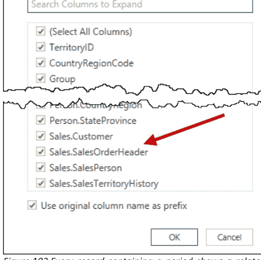

大多数列头都非常有意义，但 `Sales.Territory` 列非常特殊。该列显示的并不是来自 `SalesOrder` 表的值；它显示的是来自 `Sa-Territory` 表的相关值！

这是连接数据库的奇大之处之一：大多数数据库都支持自动检测，因此你可以直接浏览相关记录，而无需设置关系或执行任何合并。更棒的是，当你展开该列时，你会发现还有更多来自其他表的字段。要查看它是如何运作的：

- 点击 `Sales.Territory` 列右侧的双向箭头

Power Query 会询问你想要展开哪些列，如图 103 所示。可以继续深入相关表真是不可思议的，我们只需要记录：

- 取消勾选所有列
- 分组
- 删除原始列
- 重命名 `Year`

数据现在可以加载进行分析了：

| Year | OrderID | SubTotal | TaxAmount | Freight | Sales.Territory |
|---|---|---|---|---|---|
| 2005 | 5034559 | 20565.306 | 1972.519 | 616.094 | North America |
| 2005 | 5034560 | 12949.254 | 128.241 | 387.228 | North America |
| 2005 | 5034561 | 32726.488 | 3153.766 | 885.553 | North America |
| 2005 | 5034562 | 28832.589 | 2775.164 | 867.218 | North America |
| 2005 | 5034563 | 419.458 | 40.268 | 12.5838 | North America |
| 2005 | 5034564 | 24432.668 | 2349.992 | 732.831 | North America |
| 2005 | 5034565 | 14352.713 | 1375.927 | 429.982 | North America |
| 2005 | 5034566 | 5056.486 | 486.347 | 151.992 | North America |
| 2005 | 5034567 | 61007.082 | 585.120 | 183.162 | North America |
| 2005 | 5034568 | 35954.152 | 3461.754 | 1081.807 | North America |
| 2005 | 5034569 | 71230.218 | 2713.133 | 719.445 | North America |

图 14 数据现在准备好加载

你可以进入“首页”选项卡并点击“关闭并加载”，将数据加载到 Excel 工作表中。等待片刻，表格变为绿色，你就可以建立数据透视表了。按照以下步骤操作：

- 选择表中的一个单元格
- 将表放在工作表中，从 `H2` 开始
- 配置数据透视表的行
- 将 `Year` 和 `Group` 放在行
- 将 `SubTotal`、`Tax` 和 `Freight` 放在值
- 设置每列显示会计格式，不带小数或符号。

结果是一个你可以随时更新的数据透视表：

| Row Labels | Sum of SubTotal | Sum of TaxAmt | Sum of Freight |
|---|---|---|---|
| 2005 | 11,331,809 | 1,037,289 | 324,153 |
| Europe | 709,947 | 56,796 | 17,749 |
| North America | 9,312,815 | 875,769 | 273,638 |
| Pacific | 1,309,047 | 104,724 | 32,726 |
| 2006 | 30,674,773 | 2,886,914 | 902,161 |
| Europe | 3,326,641 | 294,729 | 92,125 |
| North America | 25,193,848 | 2,419,773 | 756,177 |
| Pacific | 2,154,285 | 172,743 | 53,587 |
| 2007 | 42,011,037 | 3,931,773 | 1,286,679 |
| Europe | 9,933,153 | 828,728 | 258,977 |
| North America | 29,099,716 | 773,743 | 884,626 |
| Pacific | | | |

## 使用 SSAS 作为源

SQL Server Analysis Services (`SSAS`) 是你可能在企业环境中遇到的源之一。`SSAS` 可以分为表模型和多维模型，这两者都可以导入 Power Query。

> 请注意，以下使用的所有数字都是虚构的。

## 连接到 SSAS

为了连接到 `SSAS`，你需要创建一个新查询 -> 从数据库 -> SQL Server 分析数据库。Power Query 会启动一个窗口，需要在其中输入服务器的名称（或地址）。

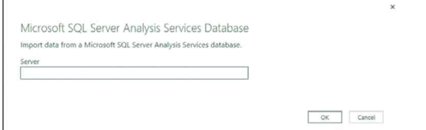

图 106 输入地址以进行连接。

在身份验证 `SSAS` 实例后，你将立即看到导航器，就像连接到其他数据库时一样：

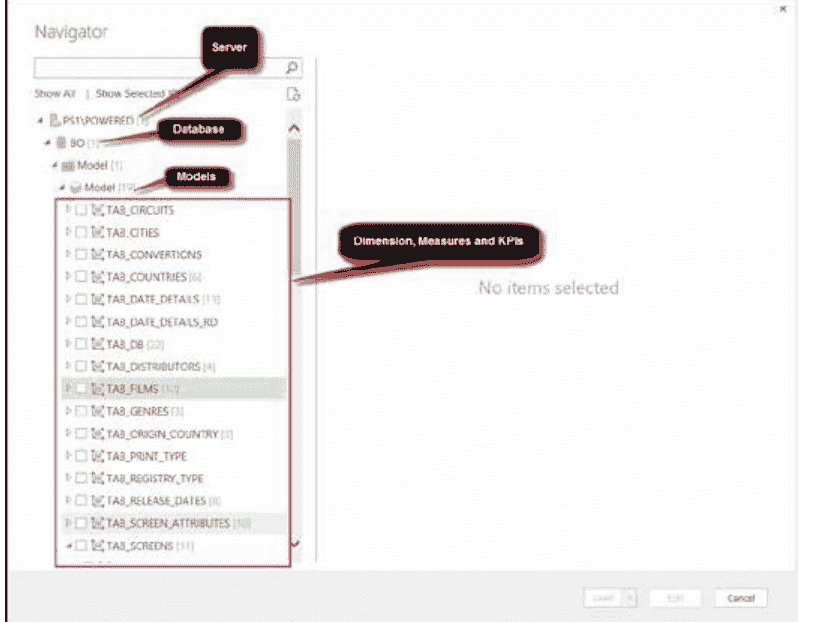

图 107 这个新窗口提供了一个树视图，用于浏览 `SSAS` 服务器。

在这里，你可以通过勾选项目旁边的选择框来选择你需要的维度、度量和 KPI。在本例中，假设你选择了 `FILM_NAME` 维度，以及几个度量如 `Screens`、`Locations`、`Sum of BORT` 和 `Sum of ADM`。（这些度量提供了与每部电影票房表现整体信息相关的数值。）

当表格预览符合你的预期时，可以点击“编辑”按钮进入 Power Query 编辑器。

此窗口与你之前看到的略有不同。与之前提供与表操作相关的命令的实例不同，你发现“立方体工具”上下文功能带处于激活状态，提供了“添加项”和“折叠列”选项。

## 第 8 章 从数据库导入数据

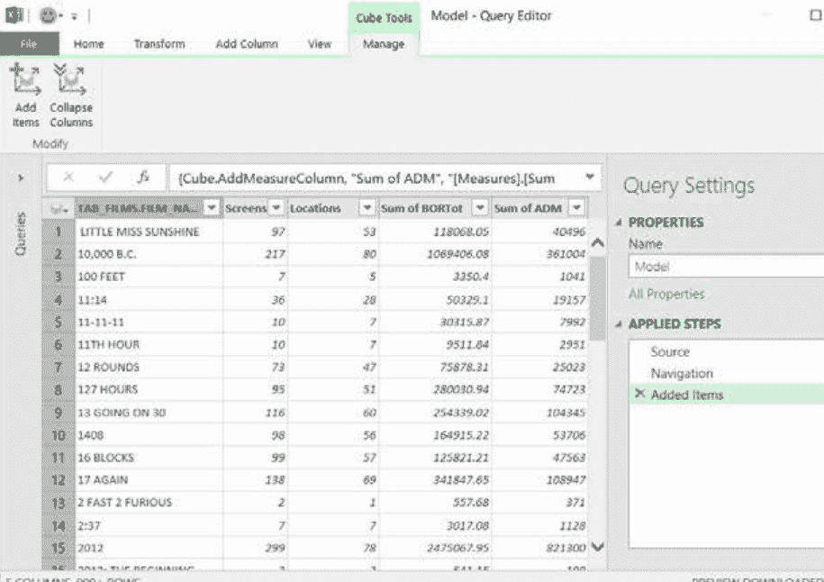

图 109 三个已应用步骤、一个表格和两个神秘的新按钮。

此特定模型包含了整个中美洲洲地区的信息，但假设你想关注某部特定的电影：泰坦尼克号（Titanic）。在这种情况下，你需要将 `TAB_FILMS_FILM_NAME` 列过滤为只剩那部电影。

## 添加遗漏的字段

现在你想知道按国家划分的细分。这里唯一的问题是你漏选了包含该信息的列。要解决这个问题，你点击“添加项目（`Add Items`）”按钮，找到带有国家名称的字段并选择它：

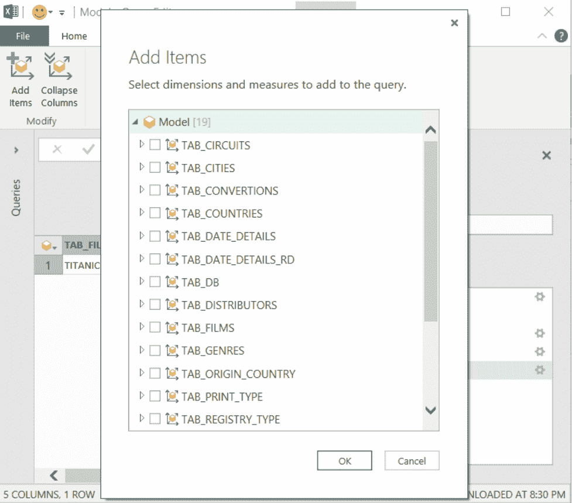

图 110 “添加项目”按钮允许你选择更多字段。

新列会立即添加到表格输出的最右侧：

## 第 1 章 从数据库导入数据

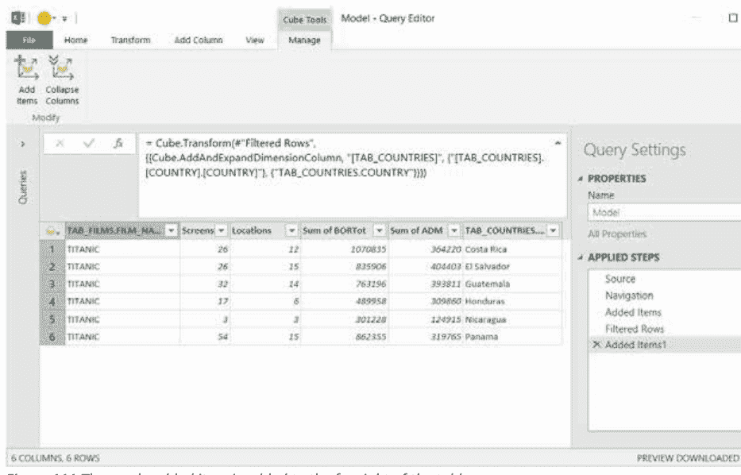

图 111 新项目已添加到表格右侧。

尽管“立方体工具（`Cube Tools`）”上下文功能仍然可用，但这并不意味着你不能使用过的其他功能带。“立方体工具”功能带仅在你连接到这种特殊数据源时为你提供新功能。

## 折叠字段

你已经学会了如何添加字段，但“折叠行（`Collapse Rows`）”的作用是什么？

在查看了泰坦尼克号的结果后，你决定真的想查看数据的视图。你返回并删除“过滤行”步骤。结果是，所有字段都被列出，并按每个国家进行了细分，例如：

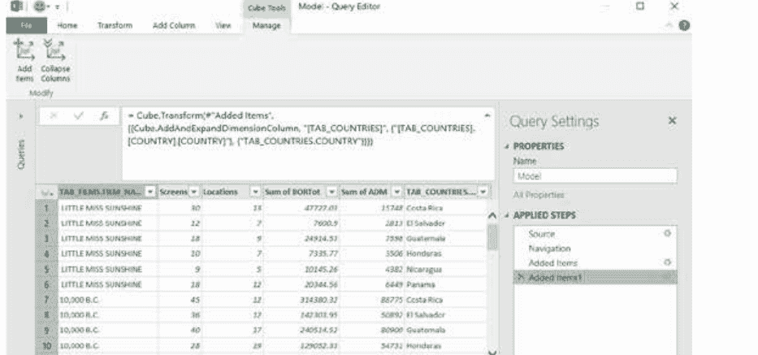

图 112 显示按国家划分的所有字段。

## M 代表（数据）猴

接下来，你可以移除 `TAB_FILMS.FILE_NAME` 列，以尝试按国家显示票房表。与其右键点击该列并选择删除，不如选择 `TAB_FILMS.FILE_NAME` 列 -> “折叠列（`Collapse Columns`）”。结果如下：

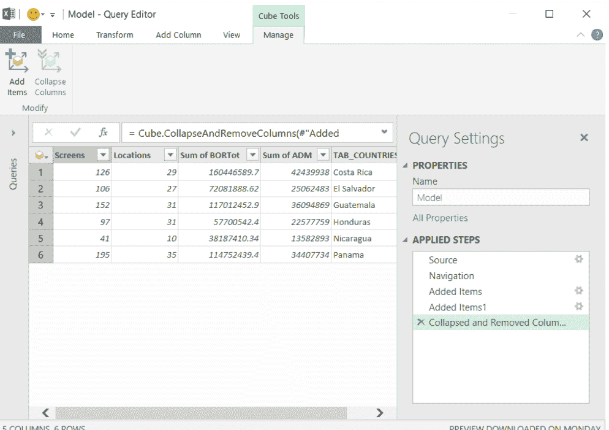

图 113 “折叠列”命令的效果。

如你所见，如果你只是选择删除列，你仍然会有按国家划分的未聚合数据（没有标题）。“折叠列”功能会重新聚合数据，然后将其从查询中删除。

## Google Analytics 和其他源

`SSAS` 源解释的行为也适用于其他源。其中一个例子是 Google Analytics。

> 遗憾的是，Google Analytics 仅在 Power BI Desktop 中可用，Excel 不支持。

像 Google Analytics 和其他 `SSAS` 数据库之类的源已经为你预聚合了数据，可以直接使用。在这些情况下，Power Query 的主要用途不是数据清洗，而是为终端用户提供发现所需数据并将这些数据与其他表格集成的方法。当然，你仍然可以使用 Power Query 用户界面的功能进一步丰富表格。

## 第 8 章 从数据库导入数据

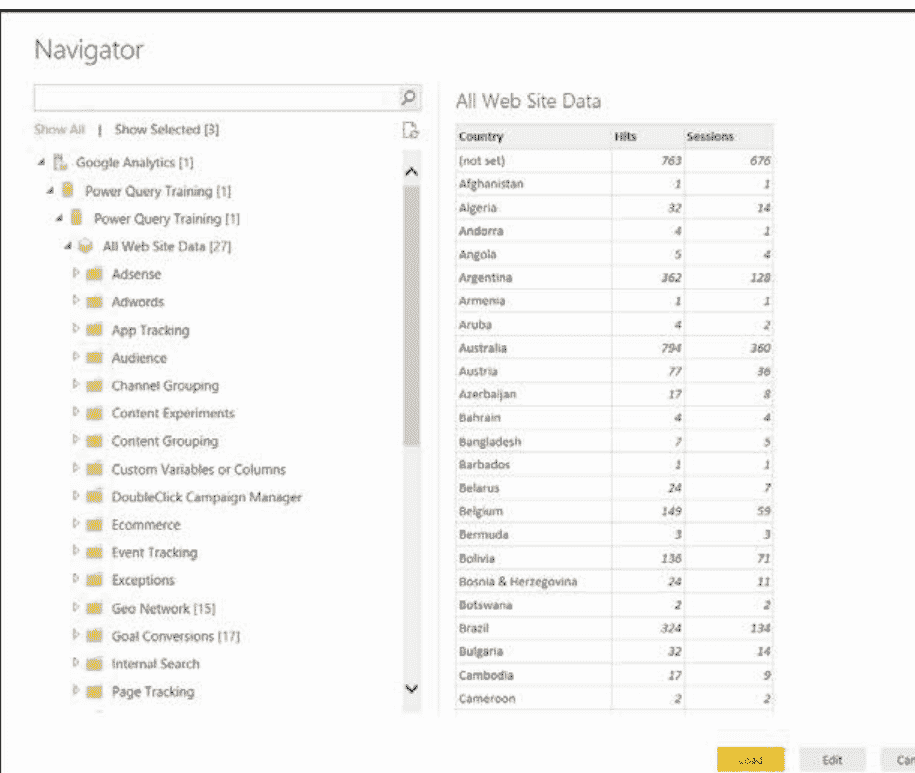

## 查询折叠与优化

数据库提供的优秀功能之一是利用“查询折叠（`query folding`）”来优化查询性能。虽然这项技术是内置的，并且当你使用 Power Query 用户界面构建解决方案时会默认为你工作，但你也可以加速它，在这种情况下，你的查询将由 Excel 处理。要理解如何避免这种错误，你需要了解什么是查询折叠以及它在原理上是如何工作的。

## 什么是查询折叠？

大多数人在点击各种命令来选择、过滤、排序和分组数据时，并不会考虑后台发生了什么。正如你现在所意识到的，这些步骤每一个都记录在“已应用步骤（`Applied steps`）”框中，让你构建一个顺序宏。你可能没有意识到的是，Power Query 还会尽可能将许多命令翻译为 SQL 并发送到数据库。

更重要的是，具有查询折叠能力的服务器将接受这些单独查询，并尝试将它们折叠成更高效的查询。即使当你发布后续命令（如“选择表中的所有记录”后接“过滤以排除150以外的所有部门”）时，这种影响依然存在。

从术语上讲，与其加载所有100,000行并过滤出该部门的1,500行，服务器通过查询构建了一个更高效的查询：

```sql
Select * From tblTransactions Where Dept = '150'
```

这种影响是巨大的：它节省了处理 98,500 行所需的时间。虽然并不是所有命令都可以折叠，但许多命令都是，从而将处理负载推给了服务器。

查询折叠：与其加载所有 100,000 行并过滤出该部门的 1,500 行，服务器通过查询构建了一个更高效的查询如下：

```sql
Select * From tblTransactions Where Dept = '150'
```

（注：原文末尾存在大量重复内容，已清理以保持文档整洁。）

当你看到查询显示在“工作簿查询（`Workbook Queries`）”窗格中，Power Query 并没有为你创建一个新表。

## 工作簿查询


图 116 创建了一个仅限连接的类型查询。

> 如果你操作失误并创建了带有表的查询，可以通过右键点击“工作簿查询”窗格中的该查询，并选择“加载到...（`Load To...`）”来修复。Power Query 会警告你，在提交更改时将删除数据，即移除新创建的表。如果你创建的是仅限连接查询，也可以通过按上述方法编辑“加载到...”行为，并将所选的加载行为从“仅创建连接”更改为“表”来添加表。

现在 Power Query 中已经有了库存表（`Inventory`），你需要对销售表（`Sales`）重复此过程：

- 点击销售表内的任意单元格 -> 创建新查询 -> 来自表格
- 首页 -> 关闭并加载到... -> 仅创建连接 -> 确定

你已经准备就绪，可以合并这些表了。

## 执行合并

你在 Excel 用户界面创建追加查询的相同位置创建合并表。以下是操作步骤：

- 创建新查询 -> 组合 -> 合并
- 选择“销售”作为上表
- 选择“库存”作为下表

出现合并对话框。它的两个下拉菜单允许你选择想要合并的两个表。

奇怪的是，在你执行这些操作后，“确定”按钮仍然处于启用状态：

# 第 9 章 合并表和查询

## 合并

选择并匹配列以创建合并表。

| 日期 | SKU 编号 | 品牌 | 销售数量 |
|---|---|---|---|
| 3/12/2014 12:00:00 AM | 510007 | weiser | 64 |
| 3/12/2014 12:00:00 AM | 510010 | Canadian | 45 |
| 3/12/2014 12:00:00 AM | 510014 | Canterbury | 62 |
| 3/12/2014 12:00:00 AM | 510019 | Corona Extra | 64 |
| 3/12/2014 12:00:00 AM | 510019 | Corona Extra | 24 |

| SKU 编号 | 品牌 | 类型 | 单位 | 包装数量 | 销售价格 | 单位成本 | 利润 |
|---|---|---|---|---|---|---|---|


# 第 9 章 合并表格和查询

| 510007 | Budweiser | Lager | 罐装 | 15 | 29.5 | 24.4 | 5.1 |
| 510010 | Canadian | Lager | 罐装 | 6 | 12 | 9.5 | 2.05 |
| 510014 | Canterbury | Ale | 罐装 | 6 | 11.5 | 9.5 | 2 |
| 510019 | Corona Extra | Lager | 瓶装 | 6 | 13.5 | 11.25 | 2.25 |
| 510021 | Corona Grande | Lager | 瓶装 | 1 | 4.5 | 3.7 | 0.8 |

- 仅包含匹配行

## 图 17 你已经选择了表，但为什么无法继续呢？

问题在于 Power Query 不知道你想使用哪些字段来执行合并。为了执行合并，理想情况下，你希望有一列，在其中一个表中包含唯一值，而在另一个表中具有重复的记录。这被称为“一对多”结构，使用它是确保结果符合你预期的最佳方法。

> Power Query 支持一对一和多对多连接，你很快就会看到。

在这种情况下，`SKU 编号`列在库存表中包含唯一值，并且在销售表中多次重复，因此你可以使用这些列：

- 点击每个表头中的 `SKU 编号`
- 点击确定

| SKU 编号 | 品牌 | 销售查询 | 新列 | 属性 |
|---|---|---|---|---|
| # 12:00:00 AM | 510007 Budweiser | | 64 表 | 名称 |
| # 12:00:00 AM | 510010 Canadian | | 45 表 | 合并1 |
| # 12:00:00 AM | 510014 Canterbury | | 62 表 | 所有属性 |
| # 12:00:00 AM | 510019 Corona Extra | | 64 表 | 应用的步骤 |
| # 12:00:00 AM | 510021 Corona Grande | | 38 表 | 来源 |
| # 12:00:00 AM | 510021 Corona Grande | | 31 表 | |

## 图 18 一列新的表，其中包含了匹配的库存记录。

你知道该如何处理一列表：展开！这里唯一的问题是你需要哪些列。因为 `SKU 编号`和`品牌`列已经存在于销售表中，所以你不需要这些列了，因此请确保在展开时排除它们。按照以下步骤操作：

- 点击展开图标

## 多对多合并

- 取消勾选 `SKU 编号`和`品牌`列
- 取消勾选列前缀选项 → 确定

如你所见，你现在将产品详情合并到了销售表中：

| SKU 编号 | 品牌 | 销售数量 | 类型 | 单位 |
|---|---|---|---|---|
| 51007 | Budweiser | 64 | Lager | 罐装 |
| 51010 | Canadian | 45 | Lager | 罐装 |
| 51014 | Canterbury | 82 | Ale | 罐装 |
| 51016 | Corona Extra | 64 | Lager | 瓶装 |
| 51019 | Corona Extra | 24 | Lager | 瓶装 |
| 51021 | Corona Grande | 38 | Lager | 瓶装 |
| 51022 | Corona Grande | 31 | Lager | 瓶装 |


你可以通过以下操作完成完成：

- 创建新查询 -> 组合 -> 合并
- 选择“销售”作为上表
- 选择“库存”作为下表
- `表格 → 设计 → 表格名称` → 将表命名为 `DateTranslation`
- 复制 `B32:M32`
- 右键点击 `B41` → 选取性粘贴
- 选择粘贴“公式和数字格式”并勾选“置置”框

你的表格现在应该设置如下：

| 周期 | 日期 |
|---|---|
| 40 CYM1 | 1/31/2014 |
| 41 CYM2 | 2/28/2014 |
| 42 CYM3 | 3/31/2014 |
| 43 CYM4 | 4/30/2014 |
| 44 CYM5 | 5/31/2014 |
| 45 CYM6 | 6/30/2014 |
| 46 CYM7 | 7/31/2014 |
| 47 CYM8 | 8/31/2014 |
| 48 CYM9 | 9/30/2014 |
| 49 CYM10 | 10/31/2014 |
| 50 CYM11 | 11/30/2014 |
| 51 CYM12 | 12/31/2014 |

## 图 122 DateTranslation 表格。

通常，为了将其合并到另一个表格中，你需要让 Power Query 知道它的存在，请按照以下步骤操作：

- 选择表格中的任意查询
- 创建新查询 → 来自表格
- 首页 → 关闭并加载到 → 仅创建连接

建立到此表格的连接后，你就可以准备好了。

## 改造源表格

接下来，你需要引入摘要表（Summary）。为了合并数据，它显然需要具有 CYM 格式的表头。但同时，你又希望保留当前的日期。这并不是大问题——你可以修复：

- 复制第 32 行
- 右键点击第 33 行 → 插入复制的单元格
- 复制单元格 `A42:A53`
- 右键点击 `B33` → 选取性粘贴 → 值 + 置置

范围现在已设置好并可以使用，你只需要向其添加一个表格：

| | B | C | D |
|---|---|---|---|
| 31 汇总 | 1/31/2014 | 2/28/2014 | 3/31/2014 |
| 32 月 | CYM1 | CYM2 | CYM3 |
| 33 月 | | | |
| 34 总果绿费场次 | 140 | 310 | 501 |
| 35 总通行证场次 | 50 | 50 | 90 |
| 36 会员/年卡场次 | 146 | 184 | 290 |
| 37 总其他场次 | 48 | 71 | 155 |

## 图 123 摘要表现在有了交替表头。

这里的诀窍在于，你需要确保表格仅覆盖第 33:37 行，因为你不想锁定第 32 行的公式。按照这些步骤操作：

- 点击数据区域内部 → 首页 → 设置为为表格
- 将范围调整为 `=$A33:$M37`
- 确定 → 将表格设置为 `StatsData`
- 隐藏第 33 行

根据你选择的样式，你甚至可以隐藏所有你曾进行修改并将其设置为表格的证据：

| A | B | C | D |
|---|---|---|---|
| 31 汇总 | | | | |
| 32 月 | 1/31/2014 | 2/28/2014 | 3/31/2014 |
| 34 总果绿费场次 | | 140 | 310 | 505 |
| 35 总通行证场次 | | 50 | 50 | 58 |
| 36 会员/年卡场次 | | 146 | 184 | 290 |
| 37 总其他场次 | | 48 | 71 | 15 |

## 图 124 表格？什么表格？

## 合并表格

现在是见奇的时刻——组合这些表格：

- 点击 `StatsData` 表格内部 → 创建新查询 → 来自表格
- 右键点击 `Month` 列 → 逆透平其他列
- 右键点击 `Month` 列 → 替换值 → 将 “Total ”带有末尾空格和引号）替换为空 → 确定

此时，你的查询已经很像像样了。经过逆透平处理，它已准备好合并。猜猜怎么着？你不需要离开 Power Query 就可以完成！

- 转到首页 → 合并查询
- 选择 `DateTranslation` 表
- 选择 `Attribute`（属性）和 `Period`（周期）列 → 确定
- 从新列仅展开 `Date`（日期）字段（取消勾选前缀） → 确定
- 右键点击 `Date` 列 → 更改类型 → 日期
- 右键点击 `Attribute` 列 → 删除
- 右键点击值列 → 重命名 → `Rounds`
- 将查询重命名为 `Budget`
- 转到首页 → 关闭并加载

输出是一个非常漂亮的逆透平数据集，每个交易都有了正确的日期：

| | B | C | D |
|---|---|---|---|
| 1 月 | Rounds | Date | 1/31/2014 |
| 2 绿费场次 | | 140 | 1/31/2014 |
| 3 通行证场次 | | 50 | 1/31/2014 |
| 4 绿费场次 | | 310 | 2/28/2014 |
| 5 绿费场次 | | 503 | 3/31/2014 |
| 6 绿费场次 | | 845 | 4/30/2014 |
| 7 绿费场次 | | 2005 | 5/31/2014 |
| 8 绿费场次 | | 2355 | 6/30/2014 |
| 9 绿费场次 | | 2290 | 7/31/2014 |
| 10 绿费场次 | | 2320 | 8/31/2014 |
| 11 绿费场次 | | 2288 | 9/30/2014 |
| 12 绿费场次 | | 948 | 10/31/2014 |

## 图 125 逆透平数据集。

## 86

它的更新效果如何？尝试一下：

- 转到 Data 工作表
- 更新 `B1` 为 2015

看起来录入正在正常工作：

| A | B | C | D | E |
|---|---|---|---|---|
| 1 最近提供的： | 2015 | | | |
| 2 月 | 1/31/2015 | 2/28/2015 | 3/31/2015 | 4/30/2015 5/3 |
| 4 绿费 | | | | |
| 5 9 洞场次（18 洞等） | 40 | 60 | 103 | 175 |
| 6 18 洞场次 | 100 | 250 | 400 | 670 |
- 31 汇总
- 32 月

| A | B | C | D | E |
|---|---|---|---|---|
| 34 总果绿费场次 | 1/31/2015 | 2/28/2015 | 3/31/2015 | 4/30/2015 5/3 |
| 35 总通行证场次 | 140 | 310 | 503 | 845 |
| 36 会员/年卡场次 | 50 | 50 | 90 | 180 |
| 37 总其他场次 | 146 | 184 | 290 | 423 |
| | | 48 | 71 | 155 | 329 |

## 图 126 数据录入工作表仍在响应。

现在检查查询：

- 选择带有 `Budget` 表格的工作表
- 转到数据 -> 刷新

看起来表格运行得很好！

| A | B | C | D |
|---|---|---|---|
| 1 月 | Rounds | Date |
| 2 绿费场次 | 140 | 1/31/2015 |
| 3 通行证场次 | 50 | 1/31/2015 |
| 4 绿费场次 | 310 | 2/28/2015 |
| 5 绿费场次 | 503 | 3/31/2015 |
| 6 绿费场次 | 845 | 4/30/2015 |
| 7 绿费场次 | 2005 | 5/31/2015 |
| 8 绿费场次 | 2355 | 6/30/2015 |
| 9 绿费场次 | 2290 | 7/31/2015 |
| 10 绿费场次 | 2320 | 8/31/2015 |
| 11 绿费场次 | 2288 | 9/30/2015 |
| 12 绿费... | | |

## 图 127 输出表格更新为当前日期。

现在表格表头本质上已是动态的，加上你能够快速将数据透视为表格，你为数据开启了巨大的可能性。从这里到其他数据集，再到导入数据透视表或 Power Pivot，可能性真的是无限的——而且你仍然有一个用户友好的前端。

# 第 10 章 查询目标

虽然书中的大多数示例都聚焦于将 Power Query 输出落地到 Excel 表格，但这显然不是放置 Power Query 数据的唯一选择。

事实上你有三个不同的加载目标选项，其中某些可以组合使用：

- Excel 表格
- 仅连接查询
- Power Pivot 数据模型

> Excel 不支持直接加载到 Power Pivot 模型的功能。话虽如此，不支持并不意味着不能这样做。你将在本章学习如何操作。

## 查询加载方法

每种加载选项都有不同的优点、缺点和注意事项，我们在此进行探讨。

## M 代表 (数据)猴子 (Data Monkey)

- 在 May 工作表中的数据区域选择一个单元格
- 创建新查询 -> 来自表格 (`From Table`)
- 将查询重命名为 `Sales-May`
- 转到主页 -> 关闭并加载到... (`Close & Load To...`) -> 仅创建连接
- 在 Jun 工作表中的数据区域选择一个单元格
- 创建新查询 -> 来自表格 (`From Table`)
- 将查询重命名为 `Sales-Jun`
- 转到主页 -> 关闭并加载到... -> 仅创建连接

此过程将为你生成两个仅连接的查询，而不会在工作簿中重复任何数据。

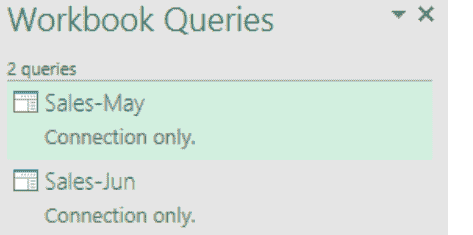

## 图 128 仅连接的查询，已就绪可用。

你可以创建一个追加查询来将这些仅连接的查询合并在一起：

- 右键点击 `Sales-May` 查询 -> 追加 (`Append`)
- 选择追加 `Sales-Jun` -> 好
- 将查询重命名为 `Sales`
- 右键点击 `Date` 列 -> 更改类型 -> 日期
- 转到主页 -> 关闭并加载

Power Query 会创建一个包含所有数据的新表，并准备好进行透视分析：

| A | B | C | D | E | F | G |
|---|---|---|---|---|---|---|
| 1 | Date | Inventory Item | Sold By | Cost | Price | Commission |
| 2 | 5/10/2014 | Lovable Kitten | Fred | | 12 | 1.35 |
| 3 | 5/9/2014 | Talkative Parrot | John | | 17 | 0.96 |
| 4 | 5/24/2014 | Lovable Kitten | Jane | | 12 | 1.35 |
| 5 | 5/20/2014 | Adorable Kitty Cat | John | | 25 | 1.05 |
| 6 | 5/8/2014 | Lovable Kitten | Jane | | 45 | 1.35 |
| 7 | 5/23/2014 | Sleepy Gerbil | Jane | | 29 | 1.17 |
| 8 | 5/11/2014 | Cranky Crocodile | John | | 10 | 1.05 |
| 9 | 5/19/2014 | Adorable Kitty Cat | Mary | | 25 | 1.05 |

## 图 129 由仅连接查询创建的追加查询。

> 在针对仅连接查询创建新查询时，没有必要将输出加载到 Excel 表格。如果需要，你可以轻松地将其加载到另一个仅连接的查询。

## 加载到 Power Pivot (Excel 2010)

在 Excel 2010 中，实际上有两种方法可以将 Power 数据加载到 Power Pivot 中。但只有一种是官方支持的：通过链接表加载。

# 第 10 章 查询加载目标

要将此数据链接到数据模型（位于 `Sales` 表内部任何位置），请转到 Power Pivot 选项卡并点击创建链接表 (`Create Linked Table`)。最终结果是遵循此过程的数据流：`Excel 表格` -> `仅连接查询` -> `追加查询` -> `Excel 表格` -> `Power Pivot`

> 你可能认为直接从每月销售表开始，将两个表都链接到透视表并建立关系会简单——从而避免追加查询的必要性。问题在于，Power Pivot 非常擅长水平方向创建（复制 `VLOOKUP()` 功能），但不擅长将两个表堆叠在一起（追加数据）。

这种方法的挑战体现在两个方面：

- 如果先将数据加载到工作表，然后加载到数据模型，你的数据就会被重复。
- 你的 Power Pivot 表格上限限制为 1,048,575 行（比工作表的行数少 1 行）。

因此，虽然这种方法可行且是支持的方法，但对于专业开发者来说，使用 Power Query 支持的加载方法确实存在缺点。

## 加载到数据模型 (Excel 2013+)

在 Excel 2013 及更高版本中，链接到数据模型的过程实际上简单得多：Excel 会给你一个小方框，你可以点击它让 Excel 为你完成工作。要查看操作演示，你可以修改现有的 `Sales` 表：

- 在工作簿查询面板中，右键点击 `Sales` 查询 -> 加载到...
- 选择仅创建连接
- 勾选将数据添加到数据模型复选框
- 点击加载

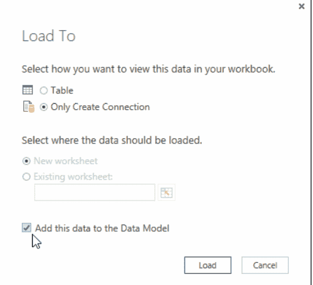

## 图 130 更改查询加载选项。

进行这些更改会触发关于可能丢失数据的警告。这是因为从“表格”更改为“仅创建连接”告诉 Excel 你希望删除 Power Query 落在工作表中的表格。由于这是意料之中的，你只需点击“继续”来确认警告即可。

# 如果需要，你可以将数据同时加载到工作表中的表格和数据模型中。

在 Power Query 花费一点时间移除数据并对数据模型做好设置后，你可以进入 Power Query 并前往透视表 →。

| Date | Inventory item | Sold By | Cost | Price | Commission |
|---|---|---|---|---|---|
| 1 | 5/31/... | Slithering Snake | Fred | 13 | 30 | 0.9 |


## M 代表 (数据)猴子 (Data Monkey)

- 在 `May` 工作表中的数据区域选择一个单元格
- 创建新查询 -> 来自表格 (`From Table`)
- 将查询重命名为 `Sales-May`
- 转到主页 -> 关闭并加载到... -> 仅创建连接
- 在 `Jun` 工作表中的数据区域选择一个单元格
- 创建新查询 -> 来自表格 (`From Table`)
- 将查询重命名为 `Sales-Jun`
- 转到主页 -> 关闭并加载到... -> 仅创建连接

此过程将为你生成两个仅连接的查询，而不会在工作簿中重复任何数据。


图 128 仅连接的查询，已就绪可用。

你可以创建一个追加查询来将这些仅连接的查询合并在一起：

- 右键点击 `Sales-May` 查询 -> 追加 (`Append`)
- 选择追加 `Sales-Jun` -> 好
- 将查询重命名为 `Sales`
- 右键点击 `Date` 列 -> 更改类型 -> 日期
- 转到主页 -> 关闭并加载

Power Query 会创建一个包含所有数据的新表，并准备好进行透视分析：

| A | B | C | D | E | F | G |
|---|---|---|---|---|---|---|
| 1 | Date | Inventory Item | Sold By | Cost | Price | Commission |
| 2 | 5/10/2014 | Lovable Kitten | Fred | | 12 | 1.35 |
| 3 | 5/9/2014 | Talkative Parrot | John | | 17 | 0.96 |
| 4 | 5/24/2014 | Lovable Kitten | Jane | | 12 | 1.35 |
| 5 | 5/20/2014 | Adorable Kitty Cat | John | | 25 | 1.05 |
| 6 | 5/8/2014 | Lovable Kitten | Jane | | 45 | 1.35 |
| 7 | 5/23/2014 | Sleepy Gerbil | Jane | | 29 | 1.17 |
| 8 | 5/11/2014 | Cranky Crocodile | John | | 10 | 1.05 |
| 9 | 5/19/2014 | Adorable Kitty Cat | Mary | | 25 | 1.05 |

图 129 由仅连接查询创建的追加查询。

> 在针对仅连接查询创建新查询时，没有必要将输出加载到 Excel 表格。如果需要，你可以轻松地将其加载到另一个仅连接的查询。

## 加载到 Power Pivot (Excel 2010)

在 Excel 2010 中，实际上有两种方法可以将 Power 数据加载到 Power Pivot 中。但只有一种是官方支持的：通过链接表加载。

# 第 10 章 查询加载目标

要将此数据链接到数据模型（位于 `Sales` 表内部任何位置），请转到 Power Pivot 选项卡并点击创建链接表。最终结果是遵循此过程的数据流：`Excel 表格` -> `仅连接查询` -> `追加查询` -> `Excel 表格` -> `Power Pivot`

> 你可能认为直接从每月销售表开始，将两个表都链接到透视表并建立关系会简单——从而避免追加查询的必要性。问题在于，Power Pivot 非常擅长水平方向创建（复制 `VLOOKUP()` 功能），但不擅长将两个表堆叠在一起（追加数据）。

这种方法的挑战体现在两个方面：

- 如果先将数据加载到工作表，然后加载到数据模型，你的数据就会被重复。
- 你的 Power Pivot 表格上限限制为 1,048,575 行（比工作表的行数少 1 行）。

因此，虽然这种方法可行且是支持的方法，但对于专业开发者来说，使用 Power Query 支持的加载方法确实存在缺点。

# 加载到数据模型 (Excel 2013+)

在 Excel 2013 及更高版本中，链接到数据模型的过程实际上简单得多：Excel 会给你一个小方框，你可以点击它让 Excel 为你完成工作。要查看操作演示，你可以修改现有的 `Sales` 表：

- 在工作簿查询面板中，右键点击 `Sales` 查询 -> 加载到...
- 选择 `仅创建连接`
- 勾选 `将数据添加到数据模型` 复选框
- 点击加载


图 130 更改查询加载选项。

进行这些更改会触发关于可能丢失数据的警告。这是因为从“表格”更改为“仅创建连接”告诉 Excel 你希望删除 Power Query 落在工作表中的表格。由于这是意料之中的，你只需点击“继续”来确认警告。

# 如果需要，你可以将数据同时加载到工作表中的表格和数据模型中。

在 Power Query 花费一点时间移除数据并对数据模型做好设置后，你可以进入 Power Query 并前往透视表 →。

| 日期 | 物品项目 | 销售者 | 成本 | 价格 | 佣金 |
|---|---|---|---|---|---|
| 1 | 5/31/... | 滑滑蛇 | Fred | 13 | 30 | 0.9 |
| 2 | 5/31/... | 滑滑蛇 | Fred | 13 | 30 | 0.9 |
| 3 | 5/31/... | 滑滑蛇 | Fred | 13 | 30 | 0.9 |
| 4 | 5/31/... | 滑滑蛇 | Fred | 13 | 30 | 0.9 |
| 5 | 5/31/... | 滑滑蛇 | Fred | 13 | 30 | 0.9 |
| 6 | 5/31/... | 滑滑蛇 | Fred | 13 | 30 | 0.9 |
| 7 | 5/31/... | 滑滑蛇 | Fred | 13 | 30 | 0.9 |

# 表导入向导

指定 SQL 查询

输入或粘贴 SQL 查询以从源数据库选择要导入的数据。

| 友好的查询名称: | 查询 |
|---|---|
| SQL 语句: | `SELECT * FROM [Sales]` |

< 上一步 | 下一步 > | 完成 | 取消 |

图 135 不可编辑的 SQL 查询界面。

这是你设置 Power Pivot 表格名称的唯一机会……将查询名称更改为更符合逻辑的名称，否则自担后果，因为在此之后它将无法再次编辑。

- 将查询名称更改为 `Sales` -> 完成

现在查询已加载到数据模型中：

| 日期 | 物品项目 | 销售人员 | 成本 | 价格 | 佣金 |
|---|---|---|---|---|---|
| 5/31/20... | Slithering Snake | Fred | 13 | 30 | 0.9 |
| 5/31/20... | Rambunctious Pu... | John | 9 | 30 | 0.9 |
| 5/21/20... | Tubby Turtle | John | 8 | 30 | 0.9 |
| 5/4/201... | Tubby Turtle | Fred | 8 | 30 | 0.9 |
| 5/31/20... | Rambunctious Pu... | Fred | 9 | 30 | 0.9 |
| 5/21/20... | Tubby Turtle | Fred | 8 | 30 | 0.9 |
| 5/29/20... | Slithering Snake | Fred | 13 | 30 | 0.9 |

图 136 直接加载到 Excel 数据模型的查询。

# 向查询中添加列

现在，如何添加“月份（Month）”列？返回 `Sales` 查询并添加它：

- 编辑 `Sales` 查询
- 选择 `日期` 列 -> 添加列 -> 日期 -> 月 -> 月份
- 转到首页 -> 关闭并加载

现在，看看它是如何更新的：

- 返回 Power Pivot
- 转到首页 -> 刷新

情况并不顺利：

# 第 10 章 查询加载目标

# 93

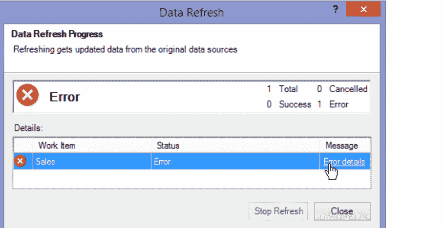

当你立即收到错误时。点击错误详细信息会显示如下消息（以及更多内容）：

> 查询 'Sales' 或其输入之一在此连接添加后在 Power Query 中被修改。请禁用并重新启用此查询到数据模型中的加载。

这显然不是很好。那么如何修复它呢？

问题在于 Power Query 被编译成复杂的连接字符串。每当源查询被修改时，连接字符串就会发生。因为你在设置此查询时链接了该连接字符串，你需要更新该字符串，操作方法如下：

- 忽略错误
- 返回 Excel
- 转到 `数据` -> `连接`
- 选择查询 -> `Sales` -> `属性` -> `定义`
- 点击连接字符串框内部 -> 按 `Ctrl+A` 选择整个连接字符串
- 按 `Ctrl+C` 复制整个连接字符串
- 点击确定 -> 关闭
- 返回 Power Pivot -> `设计` -> `现有连接` -> `查询` -> `Sales` -> `编辑`
- 选择连接字符串内的所有内容（此处 `Ctrl+A` 不起作用）
- 按 `Ctrl+V` 粘贴你之前复制的整个连接字符串
- 点击保存 -> 关闭
- 转到首页 -> 刷新

但这是什么？虽然连接现在刷新了，但新的“月份”列并没有出现？

由于初始过程不够彻底，你需要重新确认表格查询，并进入 `设计` -> `表格属性` -> `保存`。

现在你完成了。只需简单的打开并保存，你终于看到了你的新列：

## M 代表（数据）猴

| 日期 | 物品项目 | 销售人员 | 成本 | 价格 | 佣金 | 月份 |
|---|---|---|---|---|---|---|
| 5/31/20... | Slithering Snake | Fred | 13 | 30 | 0.9 | 5 |
| 5/31/20... | Rambunctious Pu... | John | 9 | 30 | 0.9 | 5 |
| 5/21/20... | Puppy Turtle | John | 8 | 30 | 0.9 | 5 |
| 5/4/20... | Puppy Turtle | Fred | 8 | 30 | 0.9 | 5 |
| 5/31/20... | Rambunctious Pu... | Fred | 9 | 30 | 0.9 | 5 |
| 5/21/20... | Puppy Turtle | Fred | 8 | 30 | 0.9 | 5 |

图 17 新的月份列终于出现在 Power Pivot 中。

# 从查询中删除列

如何从查询中删除列？需要类似的更新过程：

- 返回 Excel
- 转到 `工作簿查询` -> 右键点击 `Sales` 查询 -> 编辑
- 在“应用步骤”窗口中删除插入的“月份”
- 转到首页 -> 关闭并加载
- 转到 `数据` -> `连接`
- 选择查询 -> `Sales` -> `属性` -> `定义`
- 点击连接字符串框内部 -> 按 `Ctrl+A` 选择整个连接
- 按 `Ctrl+C` 复制整个连接
- 点击确定 -> 关闭
- 返回 Power Pivot -> `设计` -> `现有连接` -> `查询` -> `Sales` -> `编辑`
- 选择连接字符串内的所有内容（此处 `Ctrl+A` 不起作用）
- 按 `Ctrl+V` 粘贴你之前复制的整个连接字符串


- 点击保存 -> 关闭
- 转到首页 -> 刷新

# 第 11 章 定义数据类型

作为 Power Query，它在自动为数据列设置合适的数据类型方面正变得越来越好。尽管如此，它有时仍给出一个奇怪的选择（或完全不给出选择）。这可能会在数据集中留下隐藏的陷阱，在你不预料的时候冒头出来，并导致各种困惑。

## 识别哪些数据类型？

Power Query 识别多种数据类型——事实上，Excel 识别的类型更多。Power Query 数据类型的完整列表如下：

- 数字：小数、整数、货币
- 日期/时间：日期/时间、日期、时间、日期/时间/时区
- 文本：文本
- 布尔值：真/假
- 对象：二进制
- 未定义：任意 (`Any`)

真正的杀手锏在于最后一种数据类型。`Any` 是一种变体数据类型，Power Query 用它来表示它不确定数据的类型。这里的挑战在于，被定义为 `Any` 的数据在未来加载或引用时可能会采取各种形式。

## 为什么数据类型很重要？

为了演示定义数据类型的重要性，在本章中，你将创建一个新查询，并删除 Power Query 为之定义的数据类型。这将让你很好地理解为什么声明数据类型是重要的，而不是你应该随遇而安。

## 表格与 Any 数据类型

从一个没有定义数据类型的查询开始导入 Excel 表格：

- 打开 `Ch11 Examples>Defining Data Types`
- 选择 May 表格中的一个单元格 -> 创建新查询 -> 来自表格 (`From Table`)
- 移除“更改类型 (`Changed Type`)”步骤

此时，数据完全没有定义数据类型，你可以通过选择列中的一个单元格并查看“转换 (`Transform`)”选项卡来看这一点。

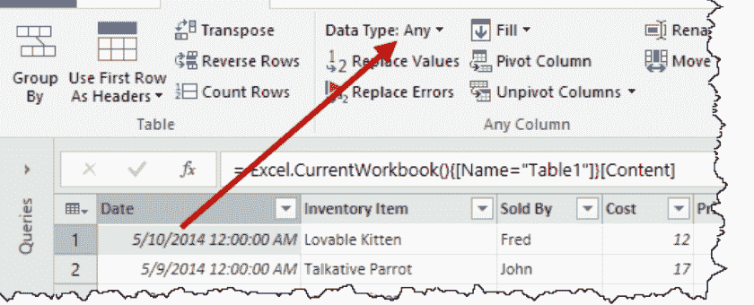

图 14 此数据集中的列具有相同的数据类型 `Any`，但它们看起来都不同。

- 有趣的是，此数据集中的每一列都具有相同的数据类型 `Any`，但它们看起来都不同。日期看起来是“日期/时间”格式，而数字看起来是“数字”数据类型。那么这有什么大不了？按照以下步骤找出：

## M 代表（数据）猴子

- 将查询重命名为 `May`
- 转到主页 (`Home`) -> 关闭并加载 (`Close & Load`)

这是所显示的 Excel 表格：

| A | B | C | D | E | F | G |
|---|---|---|---|---|---|---|
| 1 | Date | Inventory Item | Sold By | Cost | Price | Commission |
| 2 | 41769 | Lovable Kitten | Fred | | 12 | 45 | |
| 3 | 41768 | Talking Parrot | John | | 17 | 32 | 0.96 |
| 4 | 41783 | Lovable Kitten | Jane | | 12 | 45 | 1.35 |
| 5 | 41779 | Adorable Kitty Cat | John | | 25 | 35 | 1.05 |
| 6 | 41767 | Lovable Kitten | Jane | | 12 | 45 | 1.35 |
| 7 | 41782 | Sleepy Gerbil | Jane | | 25 | 39 | 1.17 |
| 8 | 41770 | Canary Crocodile | John | | 10 | 35 | 1.05 |


你可以看到，Excel 没有将日期列识别为日期，而是放置了日期序列号。虽然这很容易纠正（通过将列格式化为日期），但它表明了一个更严重的问题。

## Power Pivot 与 Any 数据类型

此时，对查询进行更改并右键点击 `May` -> 加载到... (`Load To...`)

- 在工作簿查询 (`Workbook Queries`) 窗格中右键...
- 勾选“添加到数据模型 (`Add to Data Model`)”复选框（保持选中表格选项）-> 加载 (`Load`) -> 继续 (`Continue`)

一旦你提交了此操作，工作表中的 Excel 也发生了变化！

| A | B | C | D | E | F | G |
|---|---|---|---|---|---|---|
| 1 | Date | Inventory Item | Sold By | Cost | Price | Commission |
| 2 | 5/31/2014 12:00:00 AM | Slithering Snake | Fred | | 13 | 30 | 0.9 |
| 3 | 5/31/2014 12:00:00 AM | Rambumbouncy Puppy | John | | 9 | 30 | 0.9 |
| 4 | 5/21/2014 12:00:00 AM | Tubby Turtle | John | | 8 | 30 | 0.9 |
| 5 | 5/4/2014 12:00:00 AM | Puppy Turtle | Fred | | 8 | 30 | 0.9 |
| 6 | 5/13/2014 12:00:00 AM | Rambumbouncy Puppy | Fred | | 9 | 30 | 0.9 |
| 7 | 5/21/2014 12:00:00 AM | Tubby Turtle | Fred | | 8 | 30 | 0.9 |
| 8 | 5/29/2014 12:00:00 AM | Slithering Snake | John | | 13 | 30 | 0.9 |


这是你在 Power Pivot 中看到的最奇怪的变化之一。将此项添加到 Power Pivot 的操作会将 Excel 表格中的字段变回日期——真的吗？看看：

- 选择列 A -> 主页

没有变化！事实上，你可以对列 A 中的数据应用任何数值格式，它不会改变。数据现在被处理为文本而不是日期。如果你打开 Power Pivot，你会发现那里有数据看起来是有效的日期/时间。但当你选择该列时，可以清楚地看到数据类型被设置为文本。这在你与日历建立关系时没有帮助。

## 处理 Any 数据类型

解决这些问题的方法非常简单。编辑 `May` 查询并设置数据类型如下：

- 在工作簿查询窗格中右键点击 `May` -> 编辑 (`Edit`)
- 将日期列设置为日期类型
- 将 Inventory Item 和 Sold 列设置为文本类型
- 将 Cost 和 Price 列设置为数字类型
- 将 Commission 列设置为小数类型
- 转到主页 -> 关闭

如果你检查表格和模型，你会发现一切都是按你预期的类型进行处理的。记住 Power Pivot 以日期/时间格式化日期，`00:00:00` 是午夜。

## 合并不同类型的查询

你可能经常执行的任务之一是合并两个表格。如果这些表格中的列数据类型不同会发生什么？由于你已经修复了 `May` 查询，现在可以创建一个没有数据类型的 `June` 查询，并看看合并它们时会发生什么：

- 选择 `June` -> 创建新查询 -> 来自表格
- 移除“更改类型”步骤
- 重命名查询
- 转到主页 -> 加载到... -> 仅连接

## 将定义的合并到 Any 类型

现在你可以合并这两个查询：

- 在工作簿查询中右键点击 `June` 查询 -> 合并 (`Append`)
- 选择 `May` 查询 -> 好

此时，如果你检查日期列的数据类型，你会发现它是 `Any`：

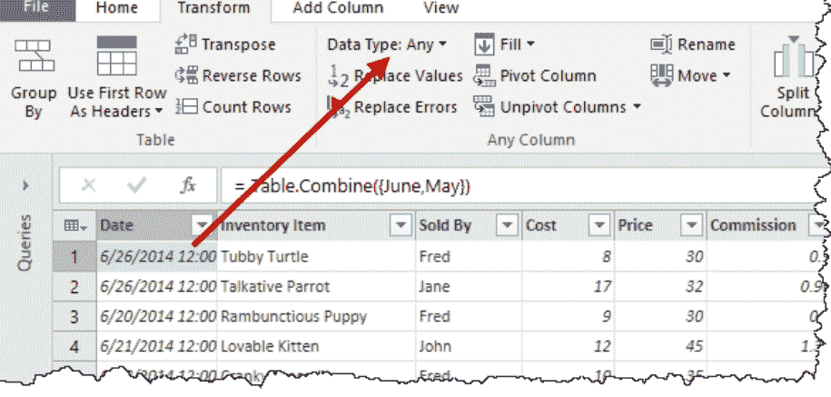

图 15 与不同数据类型的合并。

这并不意外。毕竟，你从一个日期列被定义为 `Any` 的查询开始，向 `Any` 合并其他可能会产生相同类型的列。你可以完成查询并看看从另一侧处理它会发生什么：

- 重命名查询为 `May+Jun`
- 转到主页 -> 加载到... -> 仅连接

## 将 Any 合到定义的类型

现在尝试另一个方向，从具有以下数据类型的列开始：

- 转到工作簿窗格 -> 右键点击 `May` 查询 -> 合并
- 选择查询 -> 好

数据看起来好多了，但当你检查数据时，它仍然显示为 `Any` 数据类型：

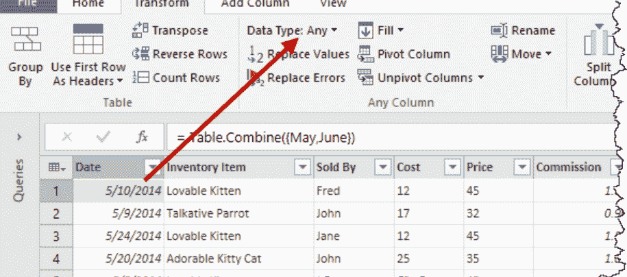

图 16 日期列仍然显示为 `Any` 数据类型。

现在很清楚，执行查询的顺序并不重要：如果它们之间的数据类型不匹配，它们将被转换为 `Any` 数据类型。你可以完成查询并看看如果你在底层表格中修正问题会发生什么：

- 重命名查询为 `May+Jun`
- 转到主页 -> 加载到... -> 仅连接

## 合并一致的数据类型

由于你已经知道 `May` 查询中定义了数据类型，你可以使 `June` 查询中的数据类型保持一致，并查看合并查询如何：

- 在工作簿查询中右键点击 `June` -> 编辑
- 将日期列设置为日期类型
- 将 Inventory Item 和 Sold 列设置为文本类型
- 将 Cost 和 Price 列设置为数字类型
- 将 Commission 列设置为小数类型
- 转到主页 -> 关闭

现在你返回两个合并查询之一来查看效果。无论你选择哪一个，都会发现日期列中的值都得到了正确处理。


# 第 12 章 导入网络数据

Power Query 非常有趣的一个用例，是利用它从网络上获取与你的业务相关的数据。

当网站数据存储在表格中，Power Query 的效果非常好；有时它还允许你直接访问存储信息的文本文件。然而，如果数据在 HTML 代码中没有使用表格标签格式，即使你具备 HTML 知识，操作也会变得非常困难。

## 连接到带有表格的页面

在本章的示例中，你将扮演营销人员的角色，试图找出营销产品的最佳国家。你想要统计的首要数据是人口最多的前 10 个国家，因为这似乎是一个可以合理构建以驱动销售的因素。

为了实现这一点，你一直在浏览 CIA 世界事实库（World Factbook）网站，并发现了一个列出世界人口的网页。你可以将这些数据导入 Excel，并与其他表格配合。请按照以下步骤操作：

- 创建新查询 -> 其他源 -> 来自网络 (`Create a new query -> Other Sources -> From Web`)
- 当提示输入 URL 时，输入以下：`https://www.cia.gov/library/publications/the-world-factbook/rankorder/2119rank.html`
- 点击确定

你将看到一组身份验证选项：


对话框左侧有几个选项，允许你选择 Windows 或基本身份验证、提供 Web API 密钥或提供你的 Office 365 凭据。此时对你来说最重要的是“匿名”（`Anonymous`）选项。

这里问你的问题是，你想针对特定页面还是根域名使用这些凭据。虽然有时有选择特定页的原因，但在大多数情况下，你可能希望保持默认设置——即根域名。确保选中第一个选项并点击“连接”（`Connect`）。

此时，Power Query 会检查文档并寻找表格。一旦它识别出可以识别的内容，就会将你带到导航器（`Navigator`）面板。在这种情况下，有两个选项可以选择——`Table 0` 或 `Document`（文档）：

# 104

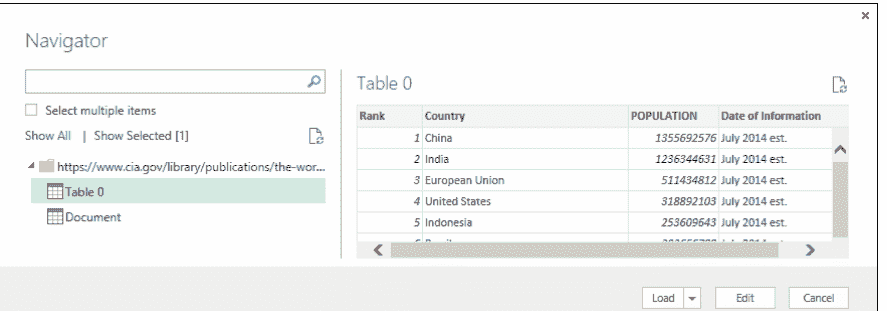

图 14 在导航器中预览 `Table 0`。

在这种情况下，Power Query 识别出 HTML 文档包含一个由页面代码中的 `table` 标签定义的表格。然后它以易于使用的格式为你展示。

如果你选择 `Document`（文档）选项，你会发现它看起来并不好用：

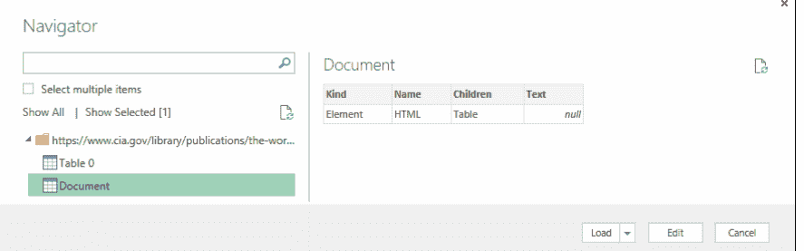

图 15 这样做没有任何益处。

> 这里的现实是，通过文档界面而非表格界面来提取数据要困难得多。

这是你现在拥有的：

| 排名 (`Rank`) | 国家 (`Country`) | 人口 (`POPULATION`) | 信息日期 (`Date of information`) |
|---|---|---|---|
| 1 | 中国 | | 135562576 2014年7月估值 |
| 2 | 印度 | | 126344832 2014年7月估值 |
| 3 | 欧盟 | | 514334812 2014年7月估值 |
| 4 | 美国 | | 318892101 2014年7月估值 |
| 5 | 印度尼西亚 | | 253609643 2014年7月估值 |
| 6 | 巴西 | | 206256788 2014年7月估值 |
| 7 | 巴基斯坦 | | 197167480 2014年7月估值 |
| 8 | 尼日利亚 | | 177155741 2014年7月估值 |
| 9 | 孟加拉国 | | 162682072 2014年7月估值 |
| 10 | 俄罗斯 | | 142734792 2014年7月估值 |

图 11 你已经获得了前 10 个国家。

查询现在已完成，你可以通过选择“首页 -> 关闭并加载”（`Home → Close & Load`）来完成它。

## 连接到网络托管的文件

为了方便，世界事实库页面实际上使用了一个文本文件来提供网页上显示的数据。

现在，如果你知道文本文件的 URL，你可以直接连接到它吗？答案是肯定的，操作如下：

- 创建新查询 -> 来自源 -> 来自网络 (`Create a new query From Sources -> From Web`)
- 输入 URL：`https://www.cia.gov/library/publications/the-world-factbook/rankorder/rawdata2119.txt`
- 点击确定

你将直接进入 Power Query 编辑器。注意，你跳过了网站身份验证。

# 第 12 章 导入网页数据

你正在查看 Power Query 编辑器中这个相当友好的视图：

| Kind | Name | Children | Text |
| --- | --- | --- | --- |
| Element | HTML | Table | null |

图 154 一个极具启发性的视图。

现在，你需要仔细复制你在网页开发人员界面中采取的步骤，进入 Power Query 对应的表格元素（`element`）。这两个程序之间有一些相似之处，可以提供帮助，但尽管如此，也很容易迷失方向。

导航此过程的诀窍在于意识到 Power Query 中的 `Name` 字段包含与网页开发工具中显示的元素。在这种情况下，你看到了 `HTML`，而在 Chrome 中，你在顶部看到了 `html class`。这两项是相同的。

点击 `Children` 列以进入：

| Kind | Name | Children | Text |
| --- | --- | --- | --- |
| Element | HEAD | Table | null |
| Text | null | null | null |
| Element | BODY | Table | null |

图 155 HTML 元素的子级。

你看到了 `HEAD` 和 `BODY` 标签，但根据你展开的 HTML，你知道你需要进入 `Body` 标签。你点击 `Table` 并继续操作。

这个过程的难点在于，在 HTML 中，标签有名称，但在 Power Query 中你看不见它们，因此非常容易迷失方向。此外，`Steps`（步骤）框不会追踪路径；它只是将步骤组合在一起，你没有办法返回上一层。当这种情况发生时，你唯一的办法就是从头重新开始。

如果这还不够糟糕的话，在这个导航过程的末尾，你正在提取列以深入详细信息，结果却变成了一个垂直表格：

| Text.1 | Text | | |
| --- | --- | --- | --- |
| 1 | null Rank | | |
| 2 | null Country | | |
| 3 | null POPULATION | | |
| 4 | null Date of Information | | |
| 5 | null 1 | | |
| 6 China | null 1,355,692,576 | | |
| 7 | null July 2014 est. | | |
| 8 | null 2 | | |
| 9 | null | | |
| 10 India | null 235,344... | | |

图 156 漂亮整洁的表格也就此为止！

将此表格变成漂亮整洁表格的步骤超出了本章的范围，因此我们在此处将放弃这种方法。（放心，这些步骤会被涵盖的，不仅仅是到第 15 章。）

然而，完成此过程的步骤已保存在完整示例中，可以在 `Ch12\Importing Web Data – Complete.xlsx` 中找到。这个特定的查询已保存为 `the-Hard-Way`。通过查看该查询，你需要意识到 `Navigation`（导航）步骤是从初始表格开始生成的：

| Kind | Name | Children | Text |
|---|---|---|---|
| 1 Element | HTML | Table | null |

图 157 开启进入 HTML 地狱的之旅。

在 `Children` 列中点击 `Table` 进入：

- `HTML` (第 1 行)
- `Body` (第 3 行)
- `DIV` (第 4 行)
- 第 1 个 `DIV` (第 4 行)
- `SECTION` (第 2 行)
- 第 2 个 `DIV` (第 4 行)


- 第 2 个 DIV（第 4 行）
- ARTICLE（第 4 行）
- DIV（第 4 行）
- 第 5 个 DIV（第 12 行）
- TABLE（第 2 行）
- TBODY（第 2 行）

如果你仔细遵循这种钻取操作，你会发现你钻取的位置与 `TheHardWay` 查询的 `Navigation` 步骤中显示的完全相同，你可以遵循其余的步骤一直到最后。

钻取 HTML 文档的工作可以完成，这比替代方案要好。然而，这不适合胆小者，而且可能是一个极其令人沮丧的过程。

## 网页体验的注意事项与无奈

网页体验无疑是 Power Query 其他本不可惊叹的工具库中的一个弱点。在这一领域，我们希望能够得到改进的地方，而且在基于网页数据开发解决方案时，有一些需要注意的地方。

下面讨论的任何因素都不应被视为不开发基于网站数据解决方案的理由。相反，它们的目的是让你在进入这一领域时保持清醒，不仅看到益处，也能看到依赖你无法控制的网页数据的风险。

## 收集数据的体验

在 Power Query 中基于网页数据构建解决方案可能是一种痛苦的体验。如果 HTML 代码中存在 `table` 标签，一切运行良好。然而，如果没有，一切都不可控了。

将其与我们的“经典数据 -> 网页”体验进行对比，后者会启动一个网页浏览器，允许你浏览正在查找的网页数据。Power Query 没有为你提供此功能，而是让你自己使用不同的浏览器浏览网页。

这可能看起来不是什么大问题，除非问题在于：如果不看代码，你很难判断在浏览器中看到的数据是一个易于使用的工具还是不是。

这里的挑战在于，你将获取一个看起来有前景的 URL，将其丢入 Power Query 界面，然后花费大量时间扩展列，顺着 HTML 标签的每条路径，尝试找到你寻找的数据。即使你理解网页调试，这也是大量的体力工作。

## 第 13 章 从 Exchange 加载数据

### 可访问数据

钻取 HTML 文档的工作可以完成，这比替代方案要好。然而，这不适合胆小者。

连接 Exchange 有五个主要方面：

- 邮件
- 日历
- 任务
- 会议请求

### 汇总调查数据

通过 Power Query 读取邮件，你可以创建一个简单的调查并将其发送给听众。你随后可以使用 Power Query 读取所有回复，从各个表格中提取信息，并将这些合并为一个数据源。更好的是，不必担心有人迟交副本，你只需刷新数据源即可导入。

### 汇总预算请求

会计师的常见做法是将 Excel 表格发送给关键人员，并让他们通过电子邮件填写预算信息。如果能使用 Power Query 扫描所有具有特定主题或附件的邮件，然后打开并合并每个附件以提取数据，那将会怎样？这通过 Power Query 是完全可能的。

### 构建 IT 警报面板

在 IT 领域，我们从各种服务器和设备收到大量警报。有些是信息性的、关键性的，但取决于设备数量和警报频率，它们可能会迅速变成信息过载。通常这些邮件会自动路由到文件夹并被忽略。考虑一下：你现在可以使用 Power Query 汇总警报、图表值和严重程度，并从以前无用的邮件构建系统警报。

### 无限可能

对于匹配和联系预约与邮件的细节，今天的真正问题不是你是否可以使用此功能，而是如何使用。你可能需要一个与客户互动的仪表板，或者需要跟踪谁回复了你发出的关键邮件。你的收件箱中坐着大量有价值的信息，你现在可以以前所未有的方式访问它们了。

### 112 M 代表（数据）猴子

（是针对网站所有者收件箱的特定内容），你将看到从以前未读的邮件中提取关键信息以驱动仪表板的过程。

首先，你需要连接到 Microsoft Exchange。通过以下过程完成：

- 创建新查询 -> 来自其他源 -> Microsoft Exchange
- 输入你的用户名和密码
- 当提示允许 Exchange 自动发现服务（Autodiscovery Service）时点击“允许”


图 158 信任自动发现服务。

此服务由你的 IT 部门配置，为了访问 Exchange 服务器需要对其信任。它通常已经安装并配置好，允许手机远程访问其电子邮件。

在 Power Query 连接到 Exchange 服务器稍短延迟后，你将进入导航器窗口。

- 选择 Mail（邮件）-> 编辑

> 在导航器中选择 Mail 表格后，千万不要点击“加载”按钮。你将等待很长时间，因为你会丢失你的收件箱入口。

Power Query 启动并为你提供收件箱的预览：

| 文件夹路径 | 主题 | 属性 |
|---|---|---|
| 1 | Inbox/ | Mail |
| 2 | Inbox/ | 所有属性 |
| 3 | Inbox/ | 已应用步骤 |
| 4 | Inbox/ | 源 |

图 159 你的收件箱中的邮件列表。

为了减少需要搜索的邮件数量，你通过规则将相关邮件路由到文件夹中。这意味着你需要过滤“文件夹路径”（Folder Path）列，以便仅定位路由到特定文件夹的邮件。有趣的是，当你尝试设置过滤器时，相关的文件夹并没有列出：

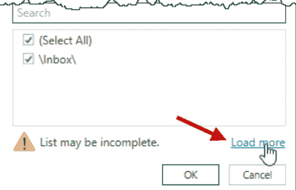

图 160 定位合适的文件夹。

如果你发现确定在列中的值不在那里，请查看右下角的“加载更多”（Load More）选项。默认情况下，此列表被缩短为预览中显示的有限数据，但点击“加载更多”按钮将显示收件箱中的所有邮件。

当列表完全出现时，你选择正确的文件夹，邮件列表将被过滤为仅显示你感兴趣的内容——来自特定联盟源的赚取的佣金：

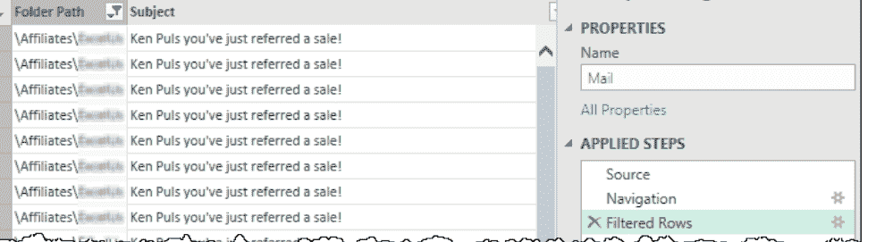

图 161 主题行有趣的邮件列表。

虽然它们在图像中没有显示，但邮件中包含了许多列，诸如收件人（To）、抄送（CC）、发件人（Sender）、附件等有用字段。对于此仪表板而言，只需要日期-时间（Date-Time）和正文（Body）字段。因此，选择这两列并使用“删除列”命令来移除多余数据：

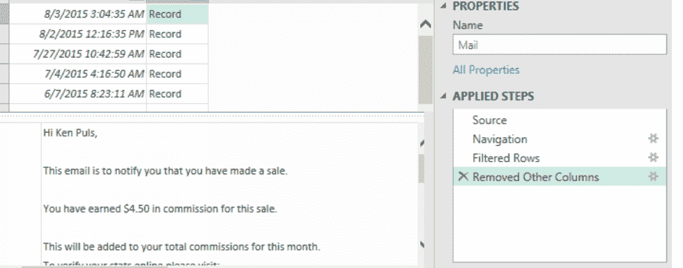

图 162 充满记录的列。

### 114 M 代表（数据）猴子

正文（Body）列的有趣之处在于它充满了记录，你可以将其视为表格的详情。如果发生这种情况，这些记录在邮件正文中包含了一些非常有趣的信息。你还可以看到正文列右上角的箭头，这意味着可以将这些记录展开为一列。这样做将为你提供另一个选项：在文本正文（TextBody）和 HTML 正文（HTMLBody）之间进行选择。处理文本比处理 HTML 容易得多，你只需轻松展开 `TextBody`，然后清理并修剪结果。

结果是一个一致的数据集，可以进一步清理：

| | 日期-时间 | 文本正文 |
|---|---|---|
| 1 | 8/2/3/2015 03:04:35 | Hi Ken Puls,这是为了通知你完成了一笔交易。你赚了 $4.50 |
| 2 | 8/12/2015 12:16:35 | Hi Ken Puls,这是为了通知你完成了一笔交易。你赚了 $3.00 |
| 3 | 7/27/2015 10:42:59 | Hi Ken Puls,这是为了通知你完成了一笔交易。你赚了 $11.70 |
| 4 | 7/4/2015 16:46:50 | Hi Ken Puls,这是为了通知你完成了一笔交易。你赚了 $4.50 |
| 5 | 6/7/2015 08:23:11 | Hi Ken Puls,这是为了通知你完成了一笔交易。你赚了 $3.00 |

图 163 邮件正文可以粘贴以获取真实的金额部分：结果。

让我们面对现实：我们中的大多数人并没有保持极其整洁的邮箱收件箱。相反，它们是巨大的邮件桶，跨度有时长达几个月，往往是几年。结果是从 Exchange 中检索数据可能非常慢。

解决此问题的方法是使用规则将关键邮件重定向到子文件夹。当子文件夹包含相关数据时，检索、转换和加载最终产品将快得多。

# 第 14 章 分组与总结

在许多方面，分组和总结涵盖了 Excel 专家的工作生活。你拥有各种实现此目的的工具，包括 Excel 的小计、聚合以及使用数据透视表执行其他操作的能力。然而，在处理大型数据集时，你只需要在源处对记录进行分组。

Power Query 提供了另一组工具，你可以用来快速分组和总结数据。有趣的是，它让你能够快速删除列，从而将数据精简到可管理的水平。

## 应用分组

为了演示分组在 Power Query 中如何工作，请考虑一家 T 恤制造商，他们提供了以下数据表：

| 日期 | 产品ID | 产品名称 | 渠道名称 | 金额 |
|---|---|---|---|---|
| 1 | 3/6/2015 | 1001 短袖 | Reseller | 164.7 |
| 2 | 3/6/2015 | 1002 长袖 | Online | 180.4 |
| 3 | 4/10/2015 | 1003 短袖 | Online | 229.9 |
| 4 | 5/10/2015 | 1004 无袖 | Online | 118.4 |
| 5 | 6/11/2015 | 1005 3/4 袖 | Store | 184.0 |
| 6 | 7/12/2015 | 1003 短袖 | Online | 230.6 |
| 7 | 8/13/2015 | 1003 短袖 | Online | 133.9 |

图 167 销售交易列表。

你的目标是获取此列表并弄出两件事：

- 每个渠道每天的销售总额
- 最大产品的产量占每日销售额的百分比

## 连接到数据

从在 Power Query 中加载数据开始：

- 打开 `Ch14 Examples\Grouping.xlsx`
- 选择表格 Datas 中的一个单元格 -> 新建查询 -> 来自表格
- 右键点击该列 -> 更改类型 -> 日期

你现在你的表格处于良好的状态，准备好对数据进行分组和总结：

| 日期 | 产品ID | 产品名称 | 渠道名称 | 金额 | 属性 |
|---|---|---|---|---|---|
| 1 | 3/6/2015 | 1001 短袖 | Reseller | 164.7 | 名称 |
| 2 | 3/6/2015 | 1002 长袖 | Online | 180.4 | 销售 |
| 3 | 3/10/2015 | 1003 短袖 | Online | 229.9 | 所有属性 |
| 4 | 4/10/2015 | 1004 无袖 | Online | 118.4 | |
| 5 | 5/11/2015 | 1005 3/4 袖 | Store | 184.0 | 应用步骤 |
| 6 | 6/12/2015 | 1003 短袖 | Online | 230.6 | 源 |
| 7 | 7/13/2015 | 1003 短袖 | Online | 133.9 | 更改类型 |
| 8 | 8/14/2015 | 1004 无袖 | Reseller | 163.55 | |

图 168 表格已准备好总结。

## 分组数据

要按日期和渠道对数据进行分组：

- 选择日期列
- 转到 转换 -> 分组

在此界面中，你可以定义想要分组的项目，以及你希望分组的方式。Power Query 在“分组”部分最初仅包含日期列。如果你保持该设置不变，数据将不会按日期和渠道名称拆分，因此你需要更改它：

- 点击分组标题旁边的 `+`

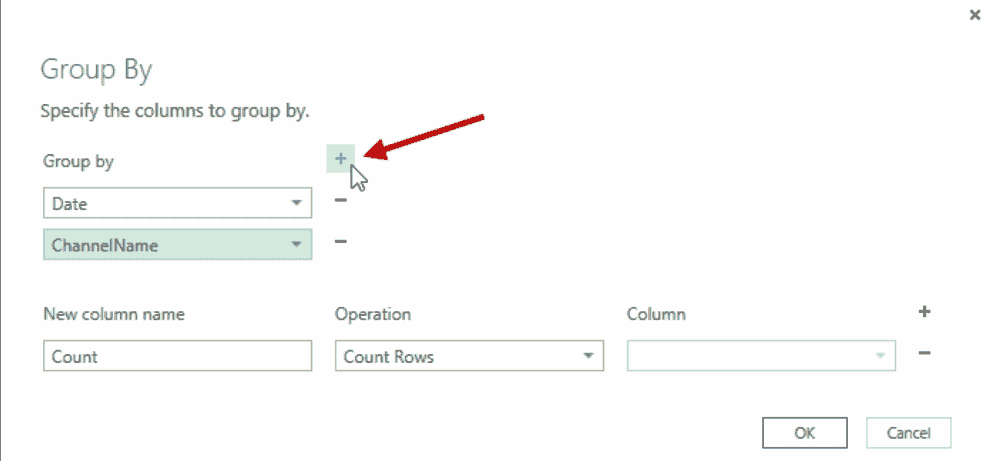

图 169 添加分组级别

接下来，你需要确定数据如何分组。因为你正在寻找所有渠道的总和，以及按渠道的产品总和，你需要采取以下步骤：

- 将新列名称从 Count（计数）更改为 Products Sold（销售数量）
- 点击右侧列旁边的 `+` 以添加新的计算
- 为新列命名为 Sales $（销售额 $），并设置为 Amount 列的求和

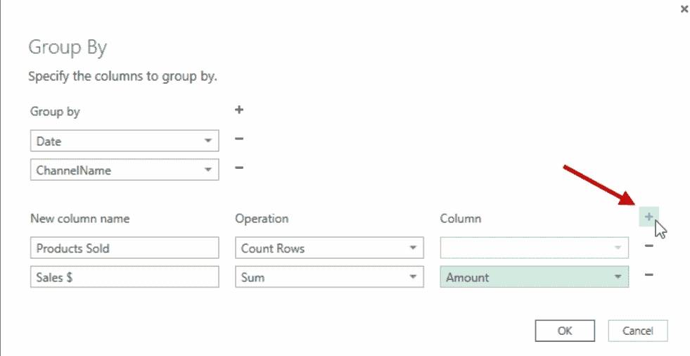

图 170 分组级别配置正确。

- 点击确定

数据分组结果如下：

| 日期 | 渠道名称 | 销售数量 | 销售额 $ |
|---|---|---|---|
| 3/6/2015 | Reseller | | 164.7 |
| 3/6/2015 | Online | | 180.4 |
| 3/10/2015 | Online | 2 | 348.32 |
| 3/11/2015 | Store | 1 | 184.02 |
| 3/12/2015 | Online | 5 | 230.67 |

图 171 按日期和渠道名称分组。

注意分组功能可以很好地处理你的数据，并且你可以轻松拥有多个级别。你还可以以不同方式聚合数据，包括计数行、计数唯一行或执行求和、平均值、最大值。此外，分组包含了原始分组部分未指定的所有列。这节省了你在操作之前或之后删除不需要列的精力。现在你可以加载此数据：

- 将查询更改为 分组
- 转到  -> 关闭加载

## 创建统计

你已经完成了按日期和渠道名称分组第一个目标。现在你需要计算每个部分最畅销的产品，以及它占该组总销售额的百分比。

## 复制查询

为了实现你的目标，你实际上需要修改原始查询并添加一些步骤。与其拆分它，创建一个副本并不坏。这在结果不符合预期时为你提供了回退方案：

- 显示查询
- 右键点击自己的查询 -> 复制
- 重命名查询为 Performance

你现在有了之前查询的精确副本，可以加载：

| 日期 | 渠道名称 | 销售数量 | 销售额 $ |
|---|---|---|---|
| 3/6/2015 | Reseller | | 164.7 |
| 3/6/2015 | Online | | 180.4 |
| 3/10/2015 | Online | 2 | 348.32 |
| 3/11/2015 | Store | 1 | 184.02 |
| 3/12/2015 | Online | 5 | 230.67 |
| 3/13/2015 | Online | 1 | 133.98 |
| 3/14/2015 | Reseller | 2 | 327.1 |
| 3/14/2015 | Online | 1 | 116.83 |

图 172 分组查询的精确副本。

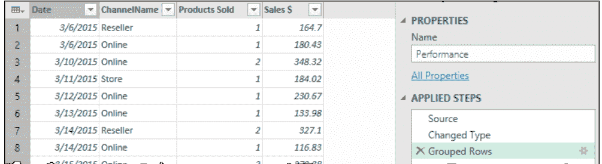

## 确定最畅销者

现在你可以设置最畅销的产品。为了实现此，你需要修改分组步骤并添加另一个步骤：

- 点击分组步骤旁边的齿轮
- 在查询底部添加新列
- 将列命名为 Details 并将操作设置为 所有行
- 点击确定

这为你的查询添加了一列表格。然而，这些表格非常特殊。它们包含了用于摘要的行详细信息，并附有每行的总计！

| 日期 | 渠道名称 | 销售数量 | 销售额 $ | Details |
|---|---|---|---|---|
| 1 | 3/06/2015 | Reseller | | 164.7 |
| 2 | 3/06/2015 | Online | | 180.43 |
| 3 | 3/10/2015 | | | 248.32 |
| 4 | 3/11/2015 | Store | 1 | 184.02 |
| 5 | 3/12/2015 | | 1 | 230.67 |
| 6 | 3/13/2015 | | 1 | 228.98 |
| 7 | 3/14/2015 | Reseller | | 327.1 |

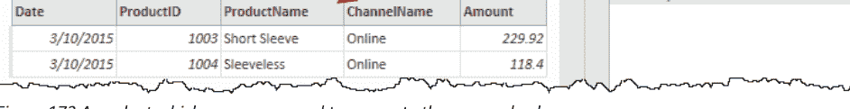

问题是，你如何使用每天最畅销的销售商品？

你的目标是计算每天最畅销的销售商品。你可以通过查看每个表格预览中 Amount 列显示的最高值来识别它。但你如何提取它？答案是到达自定义列并使用公式。要这样做，请遵循以下步骤：

- 转到 添加列 -> 添加自定义列
- 将列命名为 MaxRecord 并使用以下公式

```
=Table.Max([Details], "Amount")
```

- 点击确定

你拥有一列列出的记录：


# 第 14 章 分组与汇总

让我们回过头来看看首先发生了什么，然后看看你从中获得了什么。你所使用的公式会检查表格并从给定的列中提取最大值。对于参数，你提供了查询的 `[Details]` 列，因为该列包含了要检查的表。该表中的列 `amount` 已经提供，并用引号括起来以符合函数要求。

与你使用的公式不同，此函数返回的不只是值。它返回的是一条记录。

这太棒了，因为记录并不包含最大值，它包含了与该数据点相关的所有细节。

> 你将在第 19 章学习更多关于记录的知识。

此外，你可以使用右上角的双向箭头展开 `MaxRecord` 列，将各个组件拆分出来：

- 点击 `MaxRecord` 列上的箭头
- 展开 `ProductName` 和 `Amount` 列，并取消勾选底部的 `Prefix` 选项 → OK
- 右键点击 `Details` 列 → 移除
- 右键点击 `Product` 列 → 重命名 → `TopSeller`
- 右键点击 `Amount` 列 → 重命名 → `TopSeller`

现在你有了一张按日期（`Date`）和渠道（`Channel`）汇总销售情况的表格，并清晰地显示了顶级商品及其贡献。

只剩一件事要做：计算顶级卖家占总销售额的百分比。这可以通过简单的计算轻松实现：

- 转到“列” → 添加自定义列
- 将列名设为 `TS % of Sales` 并输入以下公式：

```
#["TopSeller $"] / #["Sales $"]
```

不要被井号和引号搞乱了。构建公式最简单的方法是点击右侧的字段，Power Query 会自动为你填充。当你阅读第 21 章时，会学到其中的原因。

结果有点奇怪，有些不显示小数，有些显示一位，而有些显示了一堆。你可以快速进行处理：

- 设置 `TS % of Sales` 列 → 转换 → 舍入 → 舍入... → 2

确保你使用“转换”选项卡来执行此操作。如果不这样做，Power Query 将为你创建一个新列，你必须手动删除之前的列。

结果已经为你做了良好的舍入处理，但它们仍以 1、0.66 等十进制数值的形式显示。它们显然没有显示为漂亮的百分比，但没关系。你可以将查询加载到 Excel 表格并对列应用百分比格式。如你所见，这实现了你的原始目标。

# 第 15 章 转置与取消透视

在处理现实世界的数据时，Excel 专家经常需要以多种方式处理数据。取消透视非常常见，有时你需要在进行更复杂的转换之前转置数据——例如，将垂直排列改为水平排列（反之亦然）。另一种非常有用的技术是在 Power Query 界面中转置数据。

## 取消透视分类表

本章处理的第一个示例是取消透视一个分类表。我们在第 6 章看过了透视的情况，基于下面的表格增加了另一个维度。

## 加载数据

对于此示例，你把数据加载到 Power Query。你可以通过设置命名范围来实现此，因为你并不想用表格来锁定列标题：步骤如下：

- 选择 `A8:H21` → 公式 → 定义名称 → 定义名称
- 在“名称”字段中输入 `Statement` → OK
- 创建新查询 → 来自表

Power Query 打开，向你展示了一个有点糟糕的数据视图。

你首先将数据加载到 Power Query。你可以通过设置命名范围来实现，因为你并不真的想用表格来锁定列标题：以下是步骤：

- 选择 `A8:H21` → 公式 → 定义名称 → 定义名称
- 在“名称”字段中输入 `Statement` → OK
- 创建新查询 → 来自表

Power Query 打开，向你展示了数据的有点糟糕的视图。

| Column1 | | | | | PROPERTIES |
|---|---|---|---|---|---|
| | | | April | | Name |
| | | | Budget ($) | Actual | Budget ($) |
| 10 Revenues | | | | | |
| 11 Alcoholic Beverages | 15747.28 | 25012.00 | (9264.72) | 22123.53 | 41881.00 | (19747.43) |
| 12 Food & Non-Alc Beverages | 34523.71 | 44740.00 | (10216.29) | 51007.25 | 71185.00 | (20117.98) |
| 13 Revenue | 237.99 | 3867.00 | (3629.21) | 186.59 | 4334.00 | (4147.41) |
| 14 Total Revenues | | | 50508.78 | 73619.00 | (23110.22) | 73327.14 | 117344.00 | (44012.86) |
| 15 | | | | | | |
| 16 | | | | | | |
| 17 Cost of Sales | 21981.21 | 24296.00 | 2318.19 | 23442.63 | 40284.00 | 16841.37 |
| 18 Labour & Benefits | | 35166.60 | 45327.20 | 10160.65 | 34266.40 | 52415.50 | 18149.10 |
| 19 Other Operational | | 10830.99 | 13210.00 | 2379.01 | 9078.01 | 14447.00 | 5368.99 |
| 20 Total Expenses | | 67975.00 | 82833.25 | 14857.85 | 66778.04 | 107146.50 | 40359.46 |
| 21 Net Income (Loss) | | | (17466.22) | (9214.25) | (8252.67) | 10193.50 | (3653.00) |

图 179 数据集充满了空值。注意这些数据：

- 原始表格中的每个空白处都是 null
- `Column4` 的第 1 行也是 null

现在你必须弄清楚对这些怎么办。你可以从查看 `Column1` 开始。

## 垂直填充

你不能去掉 `Column1`，因为它包含了告诉账户是收入分类还是支出的信息。问题是账户分类并不与描述和值在同一行。这意味着你需要一种方法让分类向下填充空区域。

恰好，这正是 Power Query “向下填充”命令的工作方式：

- 选择 `Column1` → 转换 → 填充 → 向下

Power Query 的“向下填充”命令将上方的值填充到 null 单元格中，但它不会覆盖任何数据。“向上填充”命令以相同的方式工作，只是向上而不是向下填充。

> 空单元格不是 null。如果你需要填充空白区域，你必须替换列中的数据，要求将空值（留空字段）替换为 null。

# 第 15 章 复杂数据的转置与取消透视

你现在需要一种策略来处理列标题。它们似乎存在相同的问题，4 月在第 3 列，而在第 4 列和第 5 列中缺失。遗憾的是，Power Query 中没有填充（Fill）命令。你如何处理这个问题？

## 转置数据

为了填充 Power Query 中的数据，你必须转置表格，将其侧卧过来：

- 转到 转换 (Transform) → 转置 (Transpose)

视图发生了变化，原来的列变成了行，反之亦然。

这开启了几个实用的功能。你之前遇到的问题之一是无法向右填充（fill right），但现在你可以从 `Column1` 开始向下填充（fill down）。此外，取消透视分类数据的主要挑战在于你必须按列名进行取消透视，这意味着你不能使用两行的列来执行任务。但如果你想临时合并 `Column1` 和 `Column2` 以产生单个标题将会呢？尝试一下看看会发生什么：

- 选择 `Column1` → 填充 (Fill) → 向下 (Down)
- 选择 `Column1` → 按住 Ctrl → 选择 `Column2` → 转换 (Transform) → 合并列 (Merge Columns)
- 设置分隔符为 `|`（管道符）→ 确定 (OK)

> 使用 `|` 字符的原因是该字符在平均数据集中很少出现。这意味着你以后可以使用这个字符，而确信不会意外选到数据中已存在的字符。

现在你有了一个单一类型的列，可以用于：


# 第 15 章 复杂数据的转置与取消逆透

你现在需要一种策略来处理列标题。它们似乎存在相同的问题，4 月在第 3 列，而在第 4 列和第 5 列中缺失。遗憾的是，Power Query 中没有填充（Fill）命令。你如何处理这个问题？

## 转置数据

为了填充 Power Query 中的数据，你必须转置表格，将它侧卧过来：

- 转到 `转换` (Transform) → `转置` (Transpose)

视图发生了变化，原来的列变成了行，反之亦然：

| Column1 | Column2 | Column3 | Column4 | Column5 | 属性 |
|---|---|---|---|---|---|
| 1 | null | null | Revenues | Revenues | Name |
| 2 | null | null | null | Alcoholic: Beaver Food & No | Statement |
| 3 | April | Actual | null | | All Properties |
| 4 | null | Budget | null | 15748.26 | 应用的步骤 |
| 5 | null | Variance ($) | null | (926.72) | Source |
| 6 | May | Actual | null | 22133.53 | Changed Type |
| 7 | null | Budget | null | 41881 | Filled Down |
| 8 | null | Variance ($) | null | (1947.47) | Transposed Table |

图 18 转置表格的结果。

这开启了几个实用的功能。你之前遇到的问题之一是无法向右填充，但现在你可以从 `Column1` 开始向下填充。此外，取消逆透分类数据的主要挑战在于你必须按列名进行取消逆透，这意味着你不能使用两行的列来执行任务。但如果你想临时合并 `Column1` 和 `Column2` 以产生单个标题将会呢？尝试一下看看会发生什么：

- 选择 `Column1` → `填充` (Fill) → `向下` (Down)
- 选择 `Column1` → 按住 `Ctrl` → 选择 `Column2` → `转换` (Transform) → `合并列` (Merge Columns)
- 设置分隔符为 `|`（管道符）→ `确定` (OK)

> 使用 `|` 字符的原因是该字符在平均数据集中很少出现。这意味着你以后可以使用这个字符，而确信不会意外选到数据中已存在的字符。

现在你有了一个单一类型的列，可以用于：

| Merged | Column3 | Column4 | Column5 | Col | 属性 |
|---|---|---|---|---|---|
| 1 | | Revenues | Revenues | Total | |
| 2 | | null | Alcoholic Beaver Food & Non-Al | Incidental Rev | Statement |
| 3 | April | Budget | 15748.27 | 34523.51 | 237.79 | All Properties |
| 4 | | null | 25012 | 44740 | | 应用的步骤 |
| 5 | April | Variance ($) | null | (9264.72) | (10126.29) | (3629.21) | Source |
| 6 | May | Actual | null | 22133.53 | 51007.02 | 186.59 | Changed Type |
| 7 | May | Budget | null | 41881 | 7125 | 4334 | Filled Down |
| 8 | May | Variance ($) | null | (1947.47) | (20117.98) | (4147.41) | |

图 18 将类别和子类别合并为单列。

现在将数据翻转回来并提升新标题：

- 转到 `转换` (Transform) -> `转置` (Transpose)
- 转到 `转换` (Transform) -> `使用第一行作为标题` (Use First Row as Headers)
- 右键点击 `|` 列 → `重命名` (Rename) → `Class`
- 右键点击 `_1` 列 → `重命名` (Rename) → `Account`

| Class | Account | April | Actual | Budget | April | 属性 |
|---|---|---|---|---|---|---|
| 1 | Revenues | | null | null | null | Name Statement |
| 2 | Revenues | Alcoholic Beverages | | 15747.28 | 25012 | All Properties |
| 3 | Revenues | Food & Non-Alcohol Beverages | 34523.71 | 44740 | | |
| 4 | Revenues | Incidental Revenue | 237.79 | 3867 | | 应用的步骤 |
| 5 | Total Revenues | | null | 50508.7 | 73619 | Source |
| 6 | Total Revenues | | null | null | | Changed Type |
| 7 | Expenses | | null | null | | Filled Down |
| 8 | Expenses | Cost of Sales | 21977.81 | 24296 | Transposed Table |
| 9 | Expenses | Labour & Benefits | 35166.6 | 45327.25 | Filled Down |
| 10 | Expenses | Other Operational | 10830.99 | 13210 | | |

图 183 你正越来越接近了！

## 取消逆透数据

剩余的过程对于取消逆透（unpivot）来说非常简单且标准：

- 过滤 `Account` 列以移除 `null` 值
- 选择 `Class` 和 `Account` 列
- 右键点击选定的列 -> `取消逆透列` (Unpivot Columns)

现在你得到了一个取消逆透的列表：

| Class | Account | Attribute | Value |
|---|---|---|---|
| 1 | Revenues | Alcoholic Beverages | April |
| ... (此处根据原文逻辑对应) |

---

# 第 15 章 复杂数据的转置与取消透视

在进行任何其他操作之前，你需要将数据导入 Power Query：

- 选择 `A1` -> `创建新查询` -> `来自表格`
- 扩展表格边界以覆盖 `A1:A17`

数据现在已准备就绪，是时候考虑如何处理它了。

## 创建取模列

此时，你不会直接转置记录，而是将采取不同的方法。你将对记录进行编号，并且操作两次。为了实现这一点：

- 转到 `列` -> `添加索引列` -> `从 0 开始`

此时，你已经有了一个从 0 开始的交易数值列表：

| | 索引 | |
|---|---|---|
| 1 | 10/27/2015 12:00:00 AM | 0 |
| 2 | City of Vancouver | 1 |
| 3 | 123456 | 2 |
| 4 | 34.98 | 3 |
| 5 | null | 4 |
| 6 | null | 5 |
| 7 | 10/27/2015 12:00:00 AM | 6 |
| 8 | Earl's Restaurant | 7 |
| 9 | 123456 | 8 |

图 18 你现在有了一个指示文件中数值数据的数字。我们实际上想要的是一个与每行交易对应的数字。换句话说，供应商应该始终为 0，供应商为 1，以此类推。为了得到这个，你需要添加一个取模列。


在执行此操作之前，你需要从表格中获取一个关键信息：你需要知道第二条记录第一行的值。在这种情况下，你正在寻找的值是 6，如索引列所示（Power Query 从 0 开始计数，而不是 1）。该数字将作为取模计算的因子。

取模本质上是取一个值，减去该值最接近的因子倍数，并返回余数。所以，如果该值为 8，取模将减去 6 并返回余数，即 2。尝试一下：

- 选择索引列
- 转到 `列` -> `数字` -> `标准` -> `取模` -> 6

你现在有了交易行号的列表！

| | 索引 | 插入的取模 |
|---|---|---|
| 1 | 10/27/2015 12:00:00 AM | 0 |
| 2 | City of Vancouver | 1 |
| 3 | 123456 | 2 |
| 4 | 34.98 | 3 |
| 5 | null | 4 |
| 6 | null | 5 |
| 7 | 10/27/2015 12:00:00 AM | 0 |
| 8 | Earl's Restaurant | 1 |
| 9 | 123456 | 2 |

图 19 你现在为每个项目都有了一个交易行号。

这看起来很有趣，但最初为什么要这样设置呢？答案在于这个数据集的解决方案。

# 数据的透视

当你像本例一样有一个重复的交易编号列表时，你可以对它们进行透视。起初看起来很丑，但你会发现这有多么不可思议。

- 选择 `插入的取模` -> `转换` -> `透视列`

现在是棘手部分：当你请求透视列时，该列中的值将成为列标题。Power Query 然后会询问你想要在透视数据的（或主体）区域包含哪些值。这里的诀窍在于，透视通常是为了汇总值，而你并不对这样做感兴趣。你想要原始值，因此请遵循以下步骤：

- 将值列设置为 `Transactions`
- 展开高级选项
- 将聚合函数设置为 `不聚合`
- 点击 `确定`

表格的形状发生了变化，并且到处填充了空值：

| 索引 | | | | | | | | |
|---|---|---|---|---|---|---|---|---|
| 1 | | 10/26/2015 12:00:00 | null | null | null | null | | |
| 2 | 1 | null City of Vancouver | null | null | null | null | | |
| 3 | 2 | null | 123456 | null | null | null | | |
| 4 | 3 | null | null | 34.98 | null | null | | |
| 5 | 4 | null | null | null | null | null | | |
| 6 | 5 | null | null | null | null | null | | |
| 7 | 6 | 10/26/2015 12:00:00 | null | null | null | null | | |
| 8 | 7 | null Earl's Restaurant | null | null | null | null | | |
| 9 | 8 | null | null | 323511 | 89.98 | null | | |


这实际上非常神奇。

## 填充空白

接下来的步骤是填充透视数据中的空隙：

- 选择列 1 -> 按住 Shift 键 -> 选择列 5
- 转到 `填充` -> `向上`

交易现在会级联填充空白：

| 索引 | | | | |
|---|---|---|---|---|
| 1 | | 10/26/2015 12:00:00 | City of Vancouver | 123456 | 34.98 | null |
| 2 | 1 | null City of Vancouver | 123456 | 34.98 | null |
| 3 | 2 | null Earl's Restaurant | 123456 | 34.98 | null |
| 4 | 3 | null Earl's Restaurant | 323511 | 34.98 | null |
| 5 | 4 | null Earl's Restaurant | 323511 | 89.98 | null |
| 6 | 5 | null Earl's Restaurant | 323511 | 89.98 | null |
| 7 | 6 | 10/26/2015 12:00:00 | Earl's Restaurant | 323511 | 89.98 | null |
| 8 | 7 | null Earl's Restaurant | 323511 | 89.98 | null |


信不信，你已经非常接近完成了：

# 第 15 章 数据的转置与透视

- 过滤列 0 -> 取消勾选 `(null)`
- 选择列 0 到 3 -> 右键点击 -> `删除其他列`

你现在有一个从单列完全转置的数据集：

| | | | | | |
|---|---|---|---|---|---|
| 1 | 0 | 10/26/2015 12:00:00 | City of Vancouver | 123456 | 34.98 |
| 2 | 1 | 10/27/2015 12:00:00 | Earl's Restaurant | 323511 | 89.98 |
| 3 | 2 | 10/28/2015 12:00:00 | Best Buy | 927235 | 89.98 |

图 191 从堆叠表格到有用数据的转换几乎完成。

对此查询最后要做的工作是提供更好的列名和数据类型。一旦完成，你就结束了：

- 重命名列 0 为 `Dates` 并将其格式为日期
- 重命名列 1 为 `Vendor` 并将其格式为文本
- 重命名列 2 为 `TransactionID` 并将其格式为整数
- 重命名列 3 为 `Amount` 并将其格式为小数数字
- 重命名查询为 `Transactions`
- 转到 `首页` -> `关闭并加载`

数据已经经过了转换：

| | | | |
|---|---|---|---|
| Date | Vendor | Transaction ID | Amount |
| 2 | 10/26/2015 12:00:00 | City of Vancouver | 123456 | 34.98 |
| 3 | 10/27/2015 | Earl's Restaurant | 323511 | 89.98 |
| 4 | 10/28/2015 | Best Buy | 927235 | 89.98 |
| 5 | | | |

图 194 转换后的数据集。

## 方法总结

这是对单列数据进行转置和透视的过程：

1. 加载数据。
2. 从 0 开始添加索引列。
3. 添加取模列，使用指示第二个数据集第一个的值。
4. 使用文本作为值并聚合透视取模列。
5. 对初始列后的每一列向上填充数据。
6. 过滤掉第一个数据列中的空行。
7. 进行最后的清理。

通过练习，这个过程实际上会变得非常快，这是一件好事。你会惊讶于在现实世界中需要这样做多少次。

M 代表 (数据) 猴子 (Monkey)


# 第 16 章 自动刷新

随着你构建越来越多利用 Power Query 的解决方案，并且你意识到它为你节省了多少时间时，你不可避免地渴望在生活中更多自动化。你可以简单地对来自 Power Query 的表格点击右键，但即使那也会让你觉得非常……手动。如果可以按照事物更新的顺序来调度更新，难道不是更好吗？

## 自动刷新的选项

你可以使用几种不同的方法来自动刷新 Power Query：

- 在打开工作簿时刷新
- 每隔几分钟刷新一次
- 通过 VBA 按需刷新连接
- 通过 VBA 按需刷新所有连接
- 通过第三方插件调度刷新

正如你在本章中看到的，每种方法的工作方式不同，并且有自己的优缺点。

## 无代码调度刷新

前两种自动刷新的方法都是通过用户界面进行，并且不需要任何 VBA 代码。它们可以按连接进行配置，在需要时甚至可以自动刷新到 Power Pivot。这些连接都通过导航到 Excel 中的工作簿连接框（而不是 Power Query）来控制：

- 转到 `数据` -> `连接` -> 选择你的查询 -> `属性`

这会启动以下对话框，你可以在其中勾选在打开文件时更新查询：

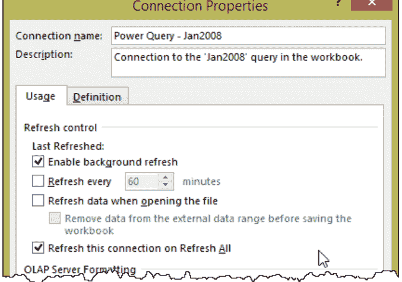

图 195 设置连接选项。

## 后台刷新

在连接属性对话框中，注意 `启用后台刷新` 是勾选的。这允许你指定在数据刷新时是否想在 Excel 中工作。如果你取消此项，可能会减少刷新解决方案所需的时间，但也会锁定用户界面，这意味着在完成之前你无法做其他事情。

如果你想防止用户在数据完全刷新之前处理数据，你需要禁用此设置。然而，如果你在等待时需要做其他事情，那么这个设置最好保持原样。

## 每隔 x 分钟刷新

“连接属性”对话框中的下一个设置允许你使用 Excel 每隔几分钟刷新一次 Power 查询。勾选此框后，你可以设置刷新数据的频率。如果你正在从不断变化的网络源提取数据，或者从定期更新的数据库获取数据，此设置非常出色，因为它可以确保你的数据在在线时始终是最新的。

请记住，此刷新的发生需要工作簿处于打开状态。如果你打算在活动操作工作簿期间安排频繁刷新，则需要确保已勾选了“后台刷新”。

> 此设置的有效值范围为 1 到 32,767，这意味着你最多可以每隔 22.75 天刷新一次。

## 在打开工作簿时刷新

“连接属性”对话框中的此选项实际上允许你指定两个组件：

- 在打开文件时刷新数据
- 在打开之前移除数据

第一个选项是不言自喻的，勾选此框将改变工作簿的行为变为它的字面意思：每次打开文件时都刷新数据。这有助于确保在你开始工作工作簿时数据始终是最新的。

如果你有多个数据源，或者数据刷新需要很长时间，那么开启“启用后台刷新”设置可能是一个好主意，这样你可以在刷新发生时使用工作簿。

该部分的第二个选项控制是在工作簿中保存数据还是仅保存查询定义。这是一个安全设置，确保你的用户在打开工作簿时拥有数据源的权限。如果他们没有权限，将看到空白表格，因为连接无法建立。如果有权限，查询将运行并带入数据。

> 目前所有版本的 Excel 都存在一个影响最后一个选项的 bug。如果你打开 Excel 然后打开工作簿，查询将刷新并且数据将加载。如果你随后关闭工作簿并重新打开它（不关闭 Excel），数据将不会自动刷新。关闭 Excel 可以解决此问题。

## 使用 VBA 自动刷新查询

本章描述的选项允许你在完全没有宏安全警告的情况下刷新 Power 查询。此外，使用这些选项的工作簿更容易导出到 Power BI，因为它们不会引起任何问题。

然而，如果你在桌面版 Excel 实例中工作，有时你可能希望为用户提供一种易用且直观的方法来更新你的 Power 解决方案。可以通过 VBA 宏来实现。

## 刷新单个连接

你可以编写一个宏来刷新单个 Power Query 连接。要查看如何操作，请打开 `Ch16 Examples.Refreshing.xlsm` 并导航到 `Transactions` 工作表。

在此工作表中，你将找到一个 Transactions 表和一个数据透视表。假设你想创建一个宏来更新 Transactions 表以及数据透视表。

要执行此操作，可以使用以下步骤录制简单的宏：

- 导航到“开发”选项卡

> 如果你没有看到“开发”选项卡，右键点击功能区上的任何选项卡并选择“自定义功能区”。勾选右侧“开发”旁边的框，然后点击“确定”。

- 在左上角点击“录制宏”


图 196 开始运行宏。

点击此按钮后，Excel 在每次点击工作表、每次击键以及你犯的错误时开始记录。严格按照以下步骤操作以确保获得干净的宏：

- 将宏命名为 `Refresh` 并存储在此工作簿中 -> 确定
- 转到 `数据` -> `Power Query` -> `Transactions` -> `刷新`
- 点击关闭
- 右键点击数据透视表 -> `刷新`
- 转到 `开发` -> `停止录制`

宏现在已录制并可以使用。要测试它：

- 转到 `开发` -> `宏`

你现在看到了 `Refresh` 对话框，它允许你查看文件中有哪些宏并运行其中任何一个。选择 `Refresh` 宏——它可能是你点击“运行”的唯一一个：

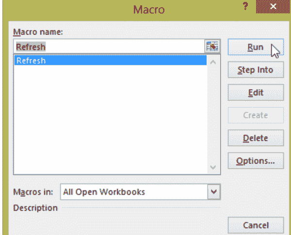

图 197 运行你的宏。

运行宏时，可以看到 Transactions 表进行刷新，随后是数据透视表。（当然，如果数据发生变化这一点会更明显，但数据源是静态的。）

尽管这很好，但让你的用户定期回到“开发”选项卡运行宏是有一定风险的。与其这样做，不如给他们一个按钮来运行刷新宏？按照以下步骤操作：

- 转到 `开发` -> `插入` -> 选择左上角的图标
- 在工作表上找到一个空区域
- 按住左鼠标键 -> 向下向右拖动 -> 松开鼠标
- 选择 `Refresh` 宏 -> 确定

弹出“分配宏”对话框，其中包含你的宏。

- 右键点击按钮 -> `编辑文本`
- 将重命名为 `Refresh`
- 点击工作表中的任何单元格，新按钮已全部准备就绪：

你现在有了一个漂亮、闪亮的新按钮，一切已准备就绪：

| 日期 | B | C | D | E | F | G |
|---|---|---|---|---|---|---|
| 1/2/2008 | 6150 | 150 | -26.03 | 金额标签和 | | |
| 2/2/2008 | 61520 | 150 | -55.05 | 行标签 | | |
| 3/2/2008 | 61530 | 150 | -10.6 | 2008 | 110 | |
| 4/2/2008 | 61540 | 150 | -0.29 | 一月 | (7,568.2) | |
| 5/2/2008 | 61550 | 150 | -48.02 | 二月 | (32,777.2) | |
| 6/2/2008 | 61560 | 150 | -1.35 | 三月 | (45,802.53) | |
| 7/2/2008 | 61570 | 150 | -77.04 | 总计 | (86,148.01) | |
| 8/2/2008 | 62010 | 150 | -305.95 | 刷新 | | |
| 9/2/2008 | 62020 | 150 | -95.15 | | | |
| 10/2/2008 | 62099 | 150 | 8.79 | | | |
| 11/2/2008 | 62510 | 120 | -56.74 | | | |

图 188 启动按钮，准备就绪！

点击刷新按钮，右键点击它。当白色气泡围绕它时，它处于设计模式并可以修改。选择工作表中的单元格以移除选中并将其返回活动模式。

> 如果你需要编辑按钮以移除选中并将其返回活动模式。

## 刷新多个连接

你想要解决的下一个问题是添加更多查询并控制它们的刷新顺序。你可以通过修改宏轻松地完成这些操作。

- 转到 `开发` -> `宏` -> `刷新` -> `编辑`

此时，你可以看到如下代码：

```
Sub Refresh()
    ' 刷新宏
    ActiveWorkbook.Connections("Power Query - Transactions").Refresh
    Range("G6").Select
    ActiveSheet.PivotTables("PivotTable").PivotCache.Refresh
End Sub
```

你的代码的作用如下：

- `Sub Refresh()` 之后的行只是注释，所以你不需要保留它们。
- 以 `ActiveWorkbook` 开头的行刷新了连接。
- 下一行选择活动工作表上的区域。
- 最后一行刷新活动工作表上的数据透视表。

你可以对此宏进行一些修改，不仅可以控制所有连接的刷新顺序，还可以使其更健壮。（目前，如果有人尝试从不同的工作表运行它，将会失败，因为那里没有数据透视表。）修改后的代码应该是这样的：

```
Sub Refresh()
    ActiveWorkbook.Connections("Power Query - Jan2008").Refresh
    ActiveWorkbook.Connections("Power Query - Feb2008").Refresh
    ActiveWorkbook.Connections("Power Query - Mar2008").Refresh
    ActiveWorkbook.Connections("Power Query - Transactions").Refresh
    Worksheets("Transactions").PivotTables("PivotTable1").PivotCache.Refresh
End Sub
```

空格和下划线是你用于指示 VBA 代码中换行的字符。`Refresh` 代码行与 `Worksheets("Transactions").PivotTables("PivotTable")` 保持同一行。只需确保第一行的句号与 `PivotCache.Refresh` 之间没有空格。

你可以看到你需要先移除未注释的代码。之后，你只需注入新行来按你要求的顺序刷新特定连接。此外，通过用 `Worksheets("Transactions")` 代替 `ActiveSheet`，你消除了选择数据透视表的需求，并确保你始终在刷新 Transactions 工作表上的数据透视表。

注意，连接可能包含也可能不包含 Power Query。这些名称必须与工作簿连接对话框中显示的名称匹配，如下：

| 工作簿连接 | | |


| 名称 | 说明 | 操作 |
|---|---|---|
| Power Query - Feb2008 | 工作簿中的 Feb2008 查询 | 添加... |
| Power Query - Jan2008 | 工作簿中的 'Jan2008' 查询 | 移除 |
| Power Query - Mar2008 | 工作簿中的 'Mar2008' 查询 | 属性... |
| Power Query - Transactions | 工作簿中的 'Transactions' 查询 | 刷新 |
| | | {集... |

图 199 确定您的查询连接名称。

> 在 2015 年夏天，微软决定对 Power Query 进行重新品牌（或去品牌化），因为担心该术语会吓跑用户远离该功能集。为此，今天创建的查询不会像对话框中那样带有“Power Query --”前缀。

当您点击刷新按钮时，每个查询将依次启动，数据透视表将得到刷新。

- 需要注意的一点是，一旦工作簿中包含宏，就无法以 `XLSX` 格式保存它。相反，您需要将工作簿保存为 `XLSM` 或 `XLSB` 格式以保留宏。这样，用户在打开工作簿时会收到宏安全警告消息，然后才能使用您的按钮刷新数据。

# 刷新所有 Power Query 查询

为了刷新工作簿中的所有 Power Query，你需要使用一段稍有不同的代码。

以下宏将遍历工作簿中的所有连接，并识别它们是否是由 Power Query 创建的（并识别所有其他连接）：

```vb
Public Sub UpdatePowerQueriesOnly()
    Dim Lest As Long, cn As WorkbookConnection
    On Error Resume Next
    For Each cn In ThisWorkbook.Connections
        LTest = InStr(1, cn.OLEDB.Connection, 
            "Provider=Microsoft.Mashup.OleDb.1")
        If Err.Number <> 0 Then
            Err.Clear
            Exit For
        End If
        If LTest > 0 Then cn.Refresh
    Next cn
End Sub
```

此宏可以存储在与上一节创建的相同的工作簿中，也可以替换之前的代码（你可能需要将你的重新链接到新宏）。

> 请注意，上述代码并不一定按照你需要的顺序刷新查询，因为 Excel 是按字母顺序刷新查询的。幸运的是，你可以通过转数据 → 连接 → 属性并修改连接名称来更改查询名称。你可以将每个查询重命名为类似 `01-Jan-2008`、`02-Feb-2008`、`03-Mar-2008`、`99-Transactions` 的顺序。通过这种方式，你可以确保 Power 查询按正确的顺序运行。

# 通过第三方插件实现自动刷新

虽然 VBA 适用于桌面解决方案，但如果你需要针对 Web、SharePoint、Office 365 或 Power BI 的解决方案，它就完全无从下手。由于原因，power-planner.com 的团队为 Power Query 构建了一个插件来帮助解决这些问题。

以下是该公司在其作品中对该产品的描述：

Power Update 是一项由该小组设计的全新软件工具，作为 Power Pivot 和 Power Query 的“伴侣”，无论使用什么数据源，它都可以免费刷新。

它允许你调度任何 Power Pivot / Power BI 工作簿进行刷新，并将结果自动部署/发布到选择的目标位置：SharePoint（包括本地和云端）、OneDrive、Power BI 在线、文件网络共享以及 Tabular SS 服务器。

即使与 O365、Power BI 或其他云服务器配合，Power Update 也不需要配置网关、VPN 或防火墙。Power Update 提供 Power Query 工作表的自动刷新，并将 Power Query 和透视数据加载到 SQL Server，允许行业在“本地”生产环境中使用 PQ。

最后，Power Update 限制为“每天一次”刷新，或者受到 Power BI 版本每小时 10 万行（免费版）或每小时 100 万行（专业版）的“行集限制”。

如果你对此感兴趣，或者想阅读更多 Power Update 的功能，请查看 PowerPivotProCom 的 Rob Collie 的以下博客：

http://mr.cl/intropowerupdate, http://mr.cl/freepowerupdate, http://mr.cl/ssisalternative, http://mr.cl/buildingdaten

可以直接从此处下载 Power Update 的免费版：

http://www.power-planner.com/Products/ProdID/10

# 第 17 章 Power Query 公式

Power Query 的用户界面非常出色，你需要的很多操作已经内置其中了。尽管如此，你确实会执行一些用户界面中没有内置的操作。即使没有易于点击的按钮，也有方法完成此类工作。你只需要进入 Power Query 的编程语言：M。

## 从 M 开始

虽然 M 的某些方面可能非常技术化，但接触该语言最简单的方法是从自定义列开始并向它们添加公式。

由于 Power Query 是为 Excel 专家构建的，你可能认为它的公式语言与 Excel 一直一样——就像透视表的 `DAX` 公式在名称上与 Excel 公式相同一样。遗憾的是，事实并非如此，正如你所看到的，在学习新语法时，你必须克制使用那些公式的初始直觉。

## 创建自定义列

创建自定义列相对简单。在查询内部：

- 导航到 “添加列” -> “添加自定义列”

你会看到这个对话框，允许你创建一个新公式：

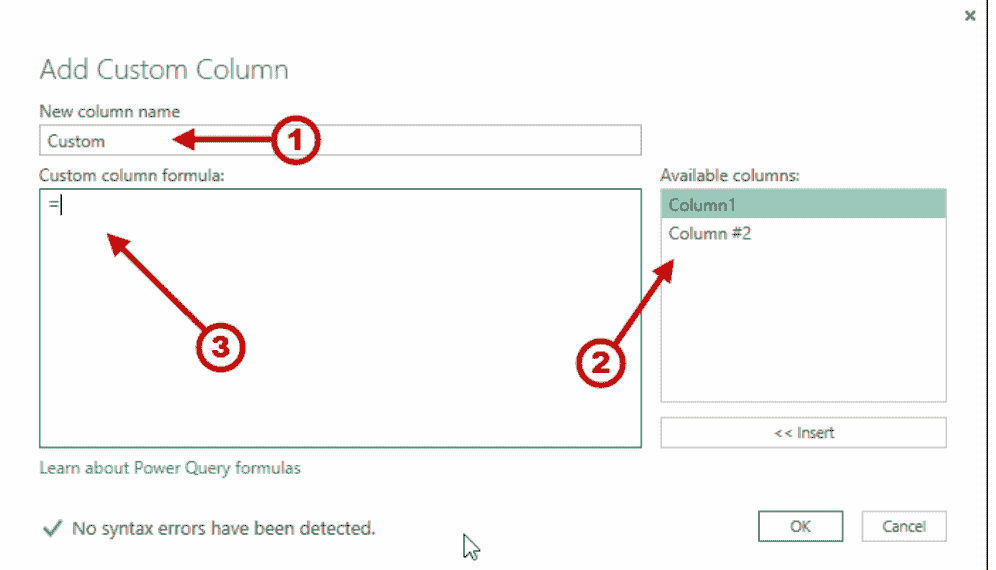

该对话框的三个部分非常重要：

- **新列名称**——当你点击确定时，在此处输入的任何内容将作为创建的列的名称。
- **可用列**——此框列出了查询中所有列的名称。双击此框中的任何项目，都会将其带有引用该字段的语法放入公式区域。
- **自定义列公式**——这是你实际创建将要使用的公式的地方。

你可以在公式区域中使用你熟悉的 Excel 语法轻松地进行简单的聚合。例如，要将上述两个列作为文本合并，按照以下方式构建公式：

- 在“可用列”列表中双击 `Column1`
- 输入字符 `&`
- 在“可用列”列表中双击 `Column2`

据此，Power Query 将构建以下公式：

```
=[Column1] & [Column2]
```

如果你向 Power Query 提问相同的问题，它会返回答案 1。这起初确实有点让人困惑，尤其是因为 Excel 使用的是 1 进制计数。你本会期望 Power Query 遵循相同的规则，但它并没有。Power Query 是从 0 开始计数的，在 "Excel" 这个单词中，E 是第 0 个字符，X 是第 1 个字符。

归根结底，这并不会产生无法解决的问题，但它意味着你在 Power Query 中编写公式时，很容易出现差 1 位的错误（off by one）。

## 数据类型转换

Excel 公式对数据类型非常宽容，使用隐式转换，而 Power Query 则使用显式转换。为了理解这意味着什么，请考虑以下场景。

在 Excel 中，你可以通过相加一个值来将其增加到第二天。因为所有日期本质上都只是数字，所以给日期加 1 将会完美运行。

在 Power Query 中，如果你尝试添加天数，必须使用特定的公式来添加。如果你尝试使用相同的公式来添加数字，Power Query 将会返回错误，因为它们不是日期。这意味着在在公式中使用这些字段之前，必须显式地将它们转换为数据类型。

在 Excel 中，你可以使用 `&` 函数连接两个单元格。单元格包含文本还是数值完全无关。Excel 会隐式地将它们转换为文本然后将其连接在一起：

```
=[Column1] &[Column2]
```

| Column1 | Column2 | Column3 |
|---|---|---|
| 1234 | Ab | Ab1234 |

图 202 隐式转换示例：数字和文本转换为文本。

观察当你将此数据导入 Power Query 并使用以下公式创建新列时发生了什么：

```
=[Column1] &[Column2]
```

如你所见，你得到了完全不同的结果：

| Column1 | Column2 | Custom |
|---|---|---|
| 1234 | Ab | Error |

> Expression.Error: 无法将运算符 & 应用于类型 Number 和 Text。
>
> 详细信息:
>
> Operator=&
>
> Left=1234
>
> Right=Ab

图 203 Power Query 无法将数字和文本连接。

为了解决这个问题，你必须显式告诉 Power Query 在尝试连接两个文本字符串之前将数字转换为文本。你可以通过将 `Column1` 的输入包装在转换函数中来实现这一点：

```
=Text.From([Column1]) &[Column2]
```

当你显式地将 `Column1` 中的数据转换为文本值时，拼接将按照你最初预想的方式正常工作：

# 第 17 章 Power Query 公式


图 204 数据类型的显式转换显示该公式是有效的。

在 Power Query 中处理数据类型恰好有两种方法：

- 在使用自定义函数之前，为你所引用的列设置数据类型。
- 使用数据类型转换函数强制将输入转换为所需的数据类型。

## 有用的数据类型转换函数

Power Query 中有多个数据类型转换函数。其中一些最重要的函数将在下面的章节中介绍。

### 转换为文本

在大多数情况下，如果你需要将列中的值转换为文本，只需使用 `Text.From()` 函数。然而，你也可以使用一些额外的函数来让你的数据类型变得更加显式。下表显示了如何将不同的数据类型转换为文本数据类型：

| 要转换 | 公式 | 示例 |
|---|---|---|
| 任意类型 | `Text.From()` | `Text.From([Column1])` |
| 日期 | `Date.ToText()` | `Date.ToText([Column1])` |
| 时间 | `Time.ToText()` | `Time.ToText([Column1])` |
| 数字 | `Number.ToText()` | `Number.ToText([Column1])` |

请记住，`Text.From()` 可以完成其他其他的工作，而 `Time.ToText()` 则不会将数字转换为文本值。

### 日期

你需要关注两种类型的日期：基于数字的日期和以文本形式出现的日期。针对每种数据类型提供了不同的转换函数，以便将其转换为 Date 数据类型：

| 要转换 | 公式 | 示例 |
|---|---|---|
| 数字日期 | `Date.From()` | `Date.From([Column1])`<br>`Date.From(42986)` |
| 文本日期 | `Date.FromText()` | `Date.FromText([Column1])`<br>`Date.FromText("Jan 31, 2015")` |

再次说明，`Date.From()` 实际上执行了 `Date.FromText` 的功能，尽管反之不然。

### 时间

与日期一样，时间值可以以数值时间值或文本形式出现。同样，有两个函数可以处理此：

| 要转换 | 公式 | 示例 |
|---|---|---|
| 数字时间 | `Time.From()` | `Time.From([Column1])`<br>`Time.From(0.586)` |
| 文本时间 | `Time.FromText()` | `Time.FromText([Column1])`<br>`Time.FromText("22:03 PM")` |

再次，就像日期一样，`Time.From()` 执行了 `Time.FromText()` 的功能，但反之不然。

### 持续时长

两个日期/时间值之间的差值允许你计算小时、分钟和秒。

| 要转换 | 公式 | 示例 |
|---|---|---|
| 数字持续时长 | `Duration.From()` | `Duration.From([Column1])`<br>`Duration.From(42986)` |
| 文本持续时长 | `Duration.FromText()` | `Duration.FromText([Column1])`<br>`Duration.FromText("Jan 31, 2015")` |

### 数值

在你想强制将数字转换为特定类型时：

| 要转换 | 公式 | 示例 |
|---|---|---|
| 小浮数数字 | `Decimal.From()` | `Decimal.From([Column1])`<br>`Decimal.From(42986)` |
| 文本数字 | `Decimal.FromText()` | `Decimal.FromText([Column1])`<br>`Decimal.FromText("Jan 31, 2015")` |
| 整数 | `Int64.From()` | `Int64.From([Column1])`<br>`Int64.From(42986)` |
| 文本整数 | `Int64.FromText()` | `Int64.FromText([Column1])`<br>`Int64.FromText("Jan 31, 2015")` |
| 货币 | `Currency.From()` | `Currency.From([Column1])`<br>`Currency.From(42986)` |
| 文本货币 | `Currency.FromText()` | `Currency.FromText([Column1])`<br>`Currency.FromText("Jan 31, 2015")` |

## 比较 Excel 和 Power Query 函数

当你长期使用 Excel 函数时，你会发现自己自然地倾向于使用它们来从数据中提取组件。因此，在本节中，我们将探索如何复制最常用的函数。每个示例都可以在 `Ch17 Examples\xlsx` 中找到。

> 2015年8月，Power Query 团队将提取第一个字符、最后一个字符和范围字符的功能添加到了转换选项卡中。尽管如此，下面的章节将介绍如何将这些公式复制到 Excel，因为这不仅有助于理解如何使用 M 代码公式，还能让你构建比仅用用户界面更健壮的解决方案。

## 复制 Excel 的 LEFT(x) 函数

按照以下步骤将数据导入 Power Query：

- 选择 LEFT 工作表上数据表中的一个单元格 → 创建新查询 → 来自表格
- 重命名查询为 `pqleft`
- 转到 `pqleft` → 添加自定义列
- 将新列命名为 `pqleft(x,4)` 并输入公式：

`=LEFT ([Word], 4)`

这应该可以运行，不是吗？Power Query 并没有指示它不可行：

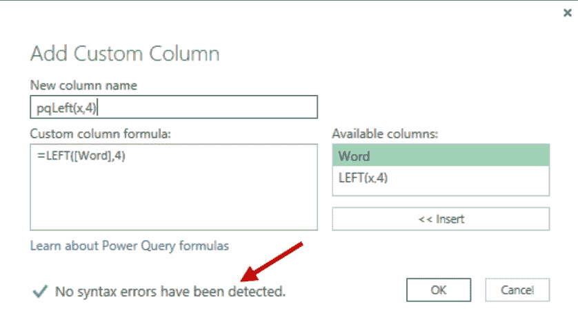

图 206 Power Query 对该公式看起来有效的。

点击确定，尽管出现了绿色的对钩，但情况并没有像你预想的那么好：

> 表达式错误：无法识别名称 'LEFT'。请检查拼写是否正确。

图 207 你对 "left" 的拼写其实是正确的。

因此，尽管你为 Excel 构建了该函数，但设计者选择使用一个完全不同的公式来引用每个词左侧的 x 个字符。是两个程序语法的直接对比：

| 语法 | 示例 | 结果 |
|---|---|---|
| Excel | `=LEFT(text,num_chars)` | `=LEFT("Excel",2)` \| Ex |
| Power Query | `=Text.Start(text,num_chars)` | `=Text.Start("Excel",2)` \| Ex |

这意味着你需要编辑公式：

- 点击“添加自定义列”步骤旁边的齿轮图标
- 将公式修改为：

  `=Text.Start([Word],4)`

- 点击确定

> 不要忘记公式是区分大小写的。`Text.start`、`TEXT.START` 以及其他变体将返回错误！

这种方法有效，而且更好的是，它交付的结果与 Excel 公式集保持一致：

| Word | LEFT(x,4) | pqLeft(x,4) |
|---|---|---|
| 1 Football | Foot | Foot |
| 2 Doorknob | Door | Door |
| 3 Bookkeeper | Book | Book |
| 4 Automobile | Auto | Auto |
| 5 Mountain | Moun | Moun |
| 6 Truck | Truc | Truc |
| 7 Car | Car | Car |

图 208 使用 `Text.Start()` 复制 Excel 的 `LEFT()` 函数。

你现在可以完成查询了：

- 转到 首页 → 关闭并加载... → 仅创建连接

> 永远不要使用现有函数的名称作为你的查询表名。如果你给此表命名为函数，你将在原表的 Excel 公式中遇到 #N/A 错误，因为表名在函数之前被求值。

## 复制 Excel 的 RIGHT() 函数

根据你对 `LEFT()` 的了解，你可能已经猜到使用 `RIGHT()` 在 Power Query 中不起作用，你是正确的。同样，Power Query 团队选择了不同的名称，如下所示：

| 语法 | 示例 | 结果 |
|---|---|---|
| Excel | `=RIGHT(text,num_chars)` | `=RIGHT("Excel",2)` \| el |
| Power Query | `=Text.End(text,num_chars)` | `=Text.End("Excel",2)` \| el |


| Power Query | `=Text.End(text,num_chars)` | `=Text.End("Excel",2)` | el |

按照以下步骤查看结果的对比情况：

- 在 RIGHT 工作表的数据中选择一个表格 → 创建新查询 → 来自表
- 将查询重命名为 `pqRight`
- 转到 **添加列** → **添加自定义列**

# 第 17 章 Power Query 公式

将新列命名为 `pqRight(x,4)` 并输入以下公式：

- `=Text.End([Word], 4)`
- 点击确定

结果所示：

| Word | RIGHT(x,4) | pqRight(x,4) |
|---|---|---|
| Football | ball | ball |
| Doorknob | knob | knob |
| Bookkeeper | eper | eper |
| Automobile | bile | bile |
| Mountain | tain | tain |
| Truck | ruck | ruck |
| Car | Car | Car |

图 209 使用 `Text.End()` 复制 Excel 的 `RIGHT(x)` 函数。

再次，结果与 Excel 一致，这是一件好事。你现在可以按照以下方式完成查询：

- 转到 **首页** → **关闭并加载至...** → **仅创建连接**

## 复制 Excel 的 LEN() 函数

到目前为止看起来并不困难，对吧？现在尝试 `LEN()` 函数，其语法列如下：

| 语法 | 示例 | 结果 |
|---|---|---|
| Excel | `=LEN(text)` | `=LEN("Excel")` | 5 |
| Power Query | `=Text.Length(text)` | | 5 |

基于此，结果应该与 Excel 的完全相同。按照以下步骤查看会发生什么：

- 在 LEN 工作表的数据表格中选择一列 → 创建新查询 → 来自表
- 将查询重命名为 `pqlen`
- 转到 **添加列** → **添加自定义列**
- 将新列命名为 `pqLen(x)` 并输入以下公式：
  `=Text.Length([Word])`
- 点击确定

结果所示：

| Word | LEN(x) | pqLen(x) |
|---|---|---|
| Football | 8 | 8 |
| Doorknob | 8 | 8 |
| Bookkeeper | 10 | 10 |
| Automobile | 10 | 10 |
| Mountain | 8 | 8 |
| Truck | 5 | 5 |
| Car | 3 | 3 |

图 210 使用 `Text.Length()` 复制 Excel 的 `LEN()` 函数。

结果完美对齐。你也准备好将它们加载到连接中了：

- 转到 **首页** → **关闭并加载至...** → **仅创建连接**

## 复制 Excel 的 FIND() 函数

到此时你可能在想这有什么意义。显而易见，Power Query 团队改变了我们引用公式的方式。事实上，团队注入了一些逻辑来统一查询所有公式，因为它们都以 `Text` 开头。但变化要大一些。让我们看看复制 Excel 的 `FIND()` 函数。下表使用 `FIND()` 查找单词中的小写 'o'。自然地：

| Word | FIND("o",x) |
|---|---|
| 1 Football | 2 |
| 2 Doorknob | 5 |
| 3 Bookkeeper | 5 |
| 4 Automobile | 7 |
| 5 Mountain | 6 |
| 6 Truck | -1 |
| 7 Car | -1 |

图 211 到底有什么大不了的

*(注：原文文本在 FIND() 之后存在严重的重复和乱码，译文已根据逻辑进行了清理处理。)*

| | 语法 | 示例 | 结果 |
|---|---|---|---|
| Excel | `=MID(text,start,num_chars)` | `=MID("Excel",2,2)` | ex |
| Power Query | `=Text.Range(text,start,num_chars)` | `=Text.Range("Excel",2,2)` | ce |

如你所示，这个函数的名称不同，但参数列表与 Excel 中的对应函数相同。这至少是个好消息。然而，如你所看到的，最终结果会偏差一个字符。这是因为 Power Query 使用从 0 开始的计数法，而不是像 Excel 那样从 1 开始。掌握了这些信息后，你应该能够让它正常工作。开始该过程：

- 在 MID 工作表的数据中选择一个单元格 → 创建新查询 → 来自表格
- 将查询命名为 `pqMid`
- 转到 **列** → **添加自定义列**
- 将新列命名为 `pqMid(x,5,4)` 并输入以下公式：

```
=Text.Range([Word], 5, 4)
```

- 点击确定

结果再次令人出乎意料：

| Word | MID(5,4) | pqMid(x,5,4) |
|---|---|---|
| 1 Football | ball | Error |
| 2 Doorknob | knob | Error |
| 3 Bookkeeper | keep | eepe |
| 4 Automobile | mobi | obil |
| 5 Mountain | tain | Error |
| 6 Truck | k | Error |
| 7 Car | | Error |

图 215 其中一些结果是正确的，但由于差了一个字符，导致并没有处处出现错误。发生了什么？

在处理错误之前，你需要纠正起始字符的位置。你可以看到 Bookkeeper 应该返回“keep”，但它多出来了一个字母，返回了“eeper”。这不需要进行巨大的修复；你只需要将起始参数调整为 1 即可：

- 点击“添加自定义列”步骤旁边的齿轮图标
- 按如下方式修改公式：
- 点击确定

```
=Text.Range([Word], 5-1, 4)
```

有趣的是，结果看起来好多了：

| Word | MID(5,4) | pqMid(x,5,4) |
|---|---|---|
| 1 Football | ball | ball |
| 2 Doorknob | knob | knob |
| 3 Bookkeeper | keep | keep |
| 4 Automobile | mobi | mobi |
| 5 Mountain | tain | tain |
| 6 Truck | k | Error |
| 7 Car | | Error |

图 216 为什么这些公式没有返回一致的结果？

# 第 17 章 Power Query 公式

Excel 的 `MID()` 函数的一个非常棒的特性是，你永远不需要担心文本字符串中还剩下多少字符。你提供的最后一个参数是剩余字符的数量，它将直接返回所有字符而不会触发错误。Power Query 则并非如此。

要修复这个问题，你显然必须对返回的字符数量进行修改，因为你不希望提供一个大于剩余字符数的数字。换句话说，你想返回四个字符中的最小值，或者是文本字符串中剩余字符的数量。

你将在第 20 章学到更多关于记录的知识。但现在，只需要知道你需要使用 `List` 函数来实现，具体是 `List.Min()`。

不要直接将其构建到你的函数中，请按照以下步骤看看是否可以在单独的列中构建它：

- 转到 **列** → **添加自定义列**
- 输入以下公式
  `=List.Min({Text.Length([Word])-(5-1),4})`
- 点击确定

你可以看到你有一个只包含一个字符的表格：

| Word | MID(5,4) | pqMID(x,5,4) | Custom |
|---|---|---|---|
| 1 Football | ball | ball | 4 |
| 2 Doorknob | knob | knob | 4 |
| 3 Bookkeeper | keep | keep | 4 |
| 4 Automobile | mobi | mobi | 4 |
| 5 Mountain | tain | tain | 4 |
| 6 Truck | k | Error | 1 |
| 7 Car | | Error | -1 |

图 217 你确定了剩余字符的数量。

你将在第 19 章接触到更多列表，但这里是对该公式的快速解析：

- `Text.Length([Word])-(5-1)` 获取 Word 列中 Word 的长度并减去起始位置。你使用 `(5-1)` 是因为想要第五个字符，但你需要针对基 0 计数进行修正（如果需要，你可以将其简化为 4）。
- 最后的 `4` 代表你想返回的最大字符数。
- 为了在 `List.Min()` 函数中使用这些内容，它们需要用大括号括起来并逗号隔开。

运行成功后，你可以只需编辑原始列，用此公式替换最后的 `4`：

- 点击“添加自定义 1”步骤旁边的齿轮图标
- 复制你刚刚编写的公式
- 点击确定
- 点击“添加自定义列”步骤旁边的齿轮图标
- 修改公式并将复制的公式替换最后的 `4`：
  `=Text.Range([Word],5-1, List.Min({Text.Length([Word])-(5-1),4}))`
- 点击确定

当你在预览“添加自定义列”步骤时，你的 `MID` 函数现在应该可以工作了：

| Word | MID(5,4) | pqMid(x,4) |
|---|---|---|
| 1 Football | ball | ball |
| 2 Doorknob | knob | knob |
| 3 Bookkeeper | keep | keep |
| 4 Automobile | mobi | mobi |
| 5 Mountain | tain | tain |
| 6 Truck | k | Error |
| 7 Car | | Error |

图 218 查询对所有行都有效。

一旦你习惯了查询正常工作，可以采取以下步骤：

- 删除“添加自定义列”步骤
- 转到 **首页** → **关闭并加载**

尽管有错误，你也可以调用并加载查询到表格。因为错误只是出现在单元格中：

| A | B | C |
|---|---|---|
| 1 Word | MID(5,4) | pqMid(x,4) |
| 2 Football | ball | ball |
| 3 Doorknob | knob | knob |
| 4 Bookkeeper | keep | keep |
| 5 Automobile | mobi | mobi |
| 6 Mountain | tain | tain |
| 7 Truck | k | k |
| 8 Car | | |

图 219 加载到表格后错误消失了，这种一致的感觉。

## 观察


遗憾的是，并不是所有的 Power Query 函数都与 Excel 等效，特别是对于 Excel 用户来说。希望在未来的版本中会增加新的库，让你能够直接将 Excel 知识应用于 Power Query，而不需要学习新语法。然而，测试 Power Query 函数的结果以确保它们正确。

# 第 18 章 Power Query 中的条件逻辑

当你使用 Power Query 构建解决方案时，不可避免会遇到需要某种逻辑的情况。虽然 Power Query 有处理此的方法，但与 Excel 处理此问题并不一致。此示例查看了导入以下文本文件时出现的问题：

| Date | Work Date | |
|---|---|---|
| From | 3/1/2015 | |
| To: | 3/14/2015 | |
| Work Date | Out | Reg Hrs | Misc Hrs |
| Contingent Worker: John Thompson | | | |
| 3/3/2015 | 6:00 PM | 8.50 | 0.00 | 0.00 |
| 3/4/2015 | 6:00 PM | 8.00 | 0.00 | 0.00 |
| 3/5/2015 | 6:00 PM | 8.50 | 0.00 | 0.00 |
| 3/6/2015 | 6:00 PM | 8.50 | 0.00 | 0.00 |
| 3/7/2015 | 3:30 PM | | | |
| 3/10/2015 | 6:00 PM | 8.50 | 0.00 | 0.00 |
| 3/11/2015 | 6:00 PM | 8.50 | 0.00 | 0.00 |
| 3/12/2015 | 6:00 PM | 6.00 | 0.00 | 0.00 |


数据起初看起来并不糟糕。当你意识到你并不需要顶几行时，问题似乎不大，因为日期包含在数据表的每行中。但你发现了一个问题：员工姓名不在行中，而是埋在数据的中间。你如何从中提取？这种情况下挑战在于找出如何获取与每行数据关联的员工姓名——如果没有条件逻辑，这是可能的。

## 连接数据

你需要连接数据以查看它在 Power Query 中如何工作，这可能会给你提供一些操作思路：

- 在新笔记本中，创建新查询 -> 来自文件 -> 来自文本
- 浏览到 `Ch18 Examples\2015-03-14.txt`
- 转到 -> 减少行 -> 删除行 -> 删除前几行 -> 4 -> 确定
- 转换 -> 使用第一行作为标题

现在问题完全暴露了：

| Work Date | Out | Reg Hrs | OT Hrs | Misc Hrs | Expenses | PROPERTIES |
|---|---|---|---|---|---|---|
| Contingent Worker: John Thompson | | | | | | Name: 2015-03-14 |
| 3/3/2015 | 6:00 PM | 8.50 | 0.00 | 0.00 | 0.00 | All Properties |
| 3/4/2015 | 6:00 PM | 8.00 | 0.00 | 0.00 | 0.00 | APPLIED STEPS |
| 3/5/2015 | 6:00 PM | 8.50 | 0.00 | 0.00 | 0.00 | Source: Changed Type |
| 3/6/2015 | 6:00 PM | 8.50 | 0.00 | 0.00 | 0.00 | Removed To... |
| 3/7/2015 | 3:30 PM | 6.50 | 0.00 | 0.00 | 0.00 | Promoted H... |
| 3/10/2015 | 6:00 PM | 8.50 | 0.00 | 0.00 | 0.00 | |
| 3/11/2015 | 6:00 PM | 8.50 | 0.00 | 0.00 | 0.00 | |
| 3/12/2015 | 6:00 PM | 6.00 | 0.00 | 0.00 | 0.00 | |

乍看之下，你可能想转置这些数据并将 John Thompson 的名字向下填充。还有其他方法，但你并不知道该如何操作。为这种方法构建解决方案可能非常难以维护，因此你需要找到更好的方法。

在这种情况下，更合理的方法是添加一个新列并在其中输入一个公式——该公式会检查 `Out` 列是否为时间类型，如果测试失败，则提取该列中的数据。你该如何做呢？

## 复制 Excel 的 IFERROR() 函数

尝试一个实验：

- 右键点击 `Out` 列 → 更改类型 -> 时间

正如你预期的那样，所有时间都很好地转换了，但员工名称却返回了错误：

| Work Date | Out | Reg Hrs |
|---|---|---|
| Contingent Worker | Error | |
| 3/3/2015 | 6:00 PM | 8.50 |
| 3/4/2015 | 6:00 PM | 8.00 |

图 222 John Thompson 没有时间数据。

这是完全正常的，但你能否你在这里的知识来解决问题呢？如果测试将此列转换为时间类型会返回错误会怎样？如果返回了错误，如果没有，你就可以返回时间。

你可以使用 Query 的 `Time.From()` 来尝试将数据转换为有效值。根据你对 Excel 的知识，你可能会期望它如下：

```
=IFERROR(Time.From([]),null)
```

遗憾的是，这只会让你得到一个错误，因为 Power Query 不识别 `IFERROR` 函数。然而，一切并不可怕，Power Query 确实有一个函数可以实现此功能，其语法如下：

```
=try <operation> otherwise <alternate result>
```

就像 Excel 的 `IFERROR()` 一样，Power Query 的 `try` 语句尝试执行所执行的操作。如果成功，将返回结果。然而，如果结果是错误，它将返回在 `otherwise` 子句中指定的值（或其他逻辑）。

这意味着 `IFERROR()` 在 Power Query 中可以写为：

```
=try Time.From([]) otherwise null
```

它应该对于任何 `Out` 列中包含员工名称的行返回 null，对于任何包含有效时间的行返回时间。尝试一下：

- 删除“更改类型”步骤
- 添加列 → 添加自定义列
- 在下方公式中保留名称
- 点击确定

新列已添加，并且很好地符合当前目标：

| Work Date | Out | Reg Hrs | OT | Misc | Exp | Custom |
|---|---|---|---|---|---|---|
| Contingent Worker | John Thompson | | | | | null |
| 3/3/2015 | 6:00 PM | 8.50 | 0.00 | 0.00 | 0.00 | 6:00 PM |
| 3/4/2015 | 6:00 PM | 8.00 | 0.00 | 0.00 | 0.00 | 6:00 PM |
| 3/5/2015 | 6:00 PM | 8.50 | 0.00 | 0.00 | 0.00 | 6:00 PM |
| 3/6/2015 | 6:00 PM | 8.50 | 0.00 | 0.00 | 0.00 | 6:00 PM |
| 3/7/2015 | 3:30 PM | 6.50 | 0.00 | 0.00 | 0.00 | 3:30 PM |
| 3/10/2015 | 6:00 PM | 8.50 | 0.00 | 0.00 | 0.00 | 6:00 PM |

图 223 返回 null 而不是错误。

## 复制 Excel 的 IF() 函数

你有了一个简单的逻辑：如果 `Custom` 列包含 null，则给我们 `Out` 列中的值——如果不是，则返回 null。这应该是很容易的——创建一个自定义列并使用以下函数：

```
=if([Custom]=null, [Out],null)
```

不对！这行不通。Power Query 不使用与 Excel 相同的 `IF()` 函数。相反，Power Query 的语法是：

```
=if <logical_test> then <result> else <alternate_result>
```

是的，你实际上必须为 Power Query 写完整整个。尝试一下：

- 添加列 → 添加自定义列
- 将列命名为 Employee
- 输入以下公式：
- `if [Custom]=null then [Out] else null`
- 点击确定

列已添加到数据中，你可以看到一些真实的潜力：

| Out | Reg Hrs | OT | Misc | Custom | Employee |
|---|---|---|---|---|---|
| John Thompson | | | | | |
| 6:00 PM | 8.50 | 0.00 | 0.00 | 6:00 PM | null |
| 6:00 PM | 8.50 | 0.00 | 0.00 | 6:00 PM | null |
| 6:00 PM | 8.50 | 0.00 | 0.00 | 6:00 PM | null |
| 6:00 PM | 8.50 | 0.00 | 0.00 | 6:00 PM | null |
| 3:30 PM | 6.50 | 0.00 | 0.00 | 3:30 PM | null |
| 6:00 PM | 8.50 | 0.00 | 0.00 | 6:00 PM | null |

图 224 John Thompson 终于有了自己的列。自然地，有了这个，由于 Power Query 是按顺序处理步骤的，你不需要记住周围的信息。你可以这样清理其余数据：

- 右键点击列 → 向下填充
- 右键点击 `Custom` 列 → 删除
- 右键点击 `Work Date` 列 → 更改类型 → 日期
- 选择 `Work Date` 列 → 首页 → 减少行 → 删除错误
- 右键点击 `Out` 列 → 更改类型 → 时间
- 选择 `Reg Hrs` 到 `Expense` 列 → 转换 → 数据类型 → 数字类型
- 右键点击 `Employee` 列 → 更改类型 → 文本
- 重命名查询为 Timesheet

现在查询完成并准备好加载：

| Work Date | Out | Reg Hrs | OT | Misc | Employee |
|---|---|---|---|---|---|
| 3/3/2015 | 6:00:00 PM | 8.5 | 0 | 0 | 0 | John Thompson |
| 3/4/2015 | 6:00:00 PM | 8 | 0 | 0 | 0 | John Thompson |
| 3/5/2015 | 6:00:00 PM | 8.5 | 0 | 0 | 0 | John Thompson |
| 3/6/2015 | 6:00:00 PM | 8.5 | 0 | 0 | 0 | John Thompson |
| 3/7/2015 | 3:30:00 PM | 6.5 | 0 | 0 | 0 | John Thompson |
| 3/10/2015 | 6:00:00 PM | 8.5 | 0 | 0 | 0 | John Thompson |
| 3/11/2015 | 6:00:00 PM | 8.5 | 0 | 0 | 0 | John Thompson |
| 3/12/2015 | 6:00:00 PM | 6 | 0 | 0 | 0 | John Thompson |
| 3/13/2015 | 6:00:00 PM | 8.5 | 0 | 0 | 0 | John Thompson |
| 3/14/2015 | 6:00:00 PM | 8.5 | 0 | 0 | 0 | John Thompson |
| 3/3/2015 | 6:00:00 PM | 9.5 | 0 | 0 | 0 | Bob Johnson |
| 3/4/2015 | 6:00:00 PM | 8 | 0 | 0 | 0 | Bob Johnson |

图 225 员工已填充最后一列的工勤表。

使用 Power Query 逻辑函数的关键是记住完整拼写它们，并确保函数名称全部用小写。


# 第 19 章 Power Query 对象

在我们深入研究使用 Power Query 的 M 语言之前，我们首先需要详细查看不同的对象，并确保如何创建这些对象，这对处理高级概念非常有用。请注意，所有的对象（表格、列表、记录、值、二进制文件和错误）都以绿色字体显示在列中。

## 表格

表格对象在 Power Query 中很多处出现，我们非常欢迎它们，因为它们很容易处理。按照以下步骤亲身尝试：

- 打开 `Ch19\Power Objects.xlsx`
- 创建新查询 → 来自源 → 空白查询
- 在公式栏中输入：

```
=Excel.CurrentWorkbook()
```

你可以看到有一个表格在：


| Date | Inventory Item | EmployeeID | Quantity | Price |
|---|---|---|---|---|
| 5/10/2014 12:00:00 | Lovable Kitten | 1 | | |
| 5/9/2014 12:00:00 | Talkative Parrot | 2 | | |
| 5/24/2014 12:00:00 | Lovable Kitten | 3 | | |

图 26 正在预览的唯一表格。

表格在 Power Query 中有很多益处：

- 你可以预览表格数据。
- 表格包含的数据具有行和列（即使你无法保证会有标题行）。
- 你可以钻取特定的表格或展开它们。
- 一旦展开表格，你就拥有一整套转换功能选项卡可用，并可以使用它们对数据进行处理。

表格，当然，不仅意味着 Excel 工作簿表格——远不止如此。你可以在许多数据源中找到表格，包括从公式如 `Excel.CurrentWorkbook()`、`Csv.Document()`、数据库表等提取的表格，正如你在前面的章节中看到的。

在继续之前，你应该完成此查询：

- 重命名查询为 Table
- 转到首页 -> 关闭并加载到... -> 仅创建连接

## 列表

Power Query 列表非常强大且实用，在许多情况下，为了使用 Power Query 中最强大的公式，必须使用列表。

列表与表格的主要区别在于，从视图来看，列表只包含单列数据。如果你将列表比作你的购物清单，那么你只需要列出想要购买的物品名称即可。一旦你开始添加不同商店之间的价格比较，你的这个列表就变成了一个表格。

### 语法

在使用 Power Query 时，可以通过存在大括号 `{ }` 来识别列表，此外文本项必须用引号括起来，就像在 Excel 公式中需要的那样。以下是两个列表的示例：

- **数字列表：**
  - `{1,2,3,4,5,6,7,8,9,10}`
- **文本值列表：**
  - `{"M","B","C","D","E","F","G","H","I","J"}`

然而，列表并不限制为仅包含数值。它们可以混合任何数据类型，包括其他列表：

- `{1,465,"M","Data Monkey",{999,234}}`

需要记住的关键点是：单个列表项由逗号分隔，且每个项都由大括号括起来。

## 从头创建列表

现在你将从头创建一些列表来查看它们是如何工作的，首先从一个单独数字列表开始：

- 新建查询 -> 来自源 -> 空白查询
- 在公式栏中，输入以下公式：
  - `{1,2,3}`
- 按回车键

你现在有了一个从 1 到 3 的精美数字列表：

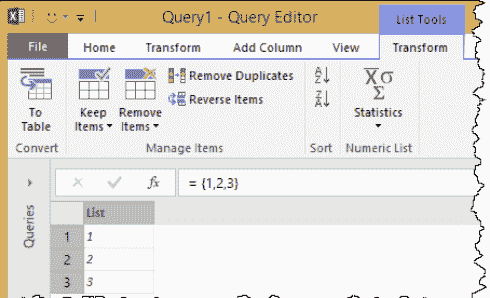

除了你创建了一个值列表外，你还会注意到你现在正在使用“列表工具 -> 转换”上下文选项卡。此时，其他选项卡上的几乎所有命令都将处于未激活状态，这让你感觉体验非常有限。尽管如此，你会发现你仍然可以对数据进行保留/删除行、排序、去重，甚至对你的数据执行一些基本的统计操作。

现在，虽然像这样从头创建列表很方便，但要创建一个从 1 到 365 的数字列表会有点麻烦。因为你还有能力使用编码快捷方式创建一个从一个数字到另一个数字的连续列表。将公式栏中的公式更改如下：

```
=(1..365)
```

你得到了一个从 1 到 365 的连续列表：

| 列表 | 值 |
|---|---|
| 1 | 1 |
| 2 | 2 |
| 3 | 3 |

图 228 使用 `..` 字符创建连续列表。

> 你也可以以这种方式创建连续的字母列表，前提是将字符括在引号中并仅使用单个字符。例如，`=("A".."J")` 可以运行，但 `=("AA".."ZZ")` 则不行。

你也可以在列表内部使用逗号，只要它们在引号内。将公式栏中的公式替换为：

```
=("Puls,Ken","Escobar, Miguel")
```

提交后，你得到了两个列表项，显示了你书籍作者的名称：

| 列表 | 作者 |
|---|---|
| 1 | Puls,Ken |
| 2 | Escobar,Miguel |


图 229 你仍然可以在列表输出中使用逗号。

## 将列表转换为表格

假设你真的想将数据拆分为两列，用列表是不可能的，因为列表被限制为单列数据。在这种情况下，你需要它提供的更丰富的转换工具集。

别担心：将列表转换为表格非常简单。只需点击“列表工具”上下文选项卡左上角的“转表格”按钮即可。会出现这个有趣的对话框：

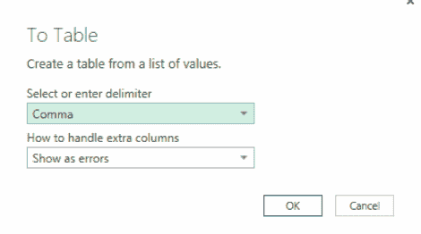

图 230 这是分隔符是什么？

你可以将分隔符设置为“逗号”并点击确定，你的数据将整齐地加载到双列表格中：

| 列1 | 列2 |
|---|---|
| 1 Puls | Ken |
| 2 Escobar | Miguel |

图 231 从由逗号分隔的列表加载的数据。

> 此对话框显示你的数据中是否存在分隔符。如果你没有分隔符，只需点击确定，对话框就会消失。

完成你的查询：

- 将查询重命名为 `List_Authors`
- 转到 `首页` → `加载到` → `仅创建连接`

## 从表格列创建列表

有时你想从查询的单列中提取数据到列表中。要查看它是如何工作的，请连接到 `Sales` 表格：

- 进入工作表并选择 `Sales` 表格中的所有单元格
- `创建查询` → `来自表格`

你现在有了以下表格：

| 日期 | 库存物品 | 员工... | 数量 | 价格 | 属性 |
|---|---|---|---|---|---|
| 5/10/2014 12:00:00 | Lovelace | | | | |
| ... | ... | ... | ... | ... | ... |

*(注：你已经创建了一个值列表，根据上下文，它是表格结构)*

现在，如果你想获取唯一项怎么办？这可能看起来很奇怪，让我们研究一下。按照以下步骤操作：

- 从应用步骤中删除“更改类型”步骤
- 右键点击 `Item` 列 → `钻取`

你现在拥有了所有物品的列表：

在移动之前，查看公式栏。在那里你会看到这行代码：

```
=Source[Inventory Item]
```

这行代码引用了列，它是在 `Source` 步骤中计算的。这提供了一种无需界面即可提取所有列值的 M 快捷方式。

提取列表后，你可以对其执行后续操作，例如去重，如下：

- 转到 `列表` -> `转换` -> `删除重复项`

你拥有了一个可以输入函数的唯一项列表。

是时候完成此查询了：

- 将查询重命名为 `List_FromColumn`
- 转到 `首页` -> `关闭并加载到` -> `仅创建连接`

## 创建列表

我们之前提到过可以创建嵌套列表。这可能看起来很奇怪，让我们研究一下。假设你有四个从 1 到 4 的员工 ID 位于销售表格中。这些值代表 Fred、John、Jane 和 Mary。

按照以下步骤操作：

- 从其他源创建新查询 -> `空白查询`
- 在公式栏中创建一个新列表：

```
= {1,"Fred","2,"John","3,"Jane","4,"Mary"}
```

注意你有四个独立的列表，每个列表都用大括号括起来并用逗号分隔。这四个列表被包含在一个单一的大括号中，定义了一个由四个列表组成的列表。当你将此公式提交到公式栏时，Power Query 给你一个包含列表的列表：

| 列表 | 内容 | 查询设置 |
|---|---|---|
| 1 | 列表 | 属性 |
| 2 | 列表 | 属性 |
| 3 | 列表 | Query1 |
| 4 | 列表 | 所有属性 |
| | | 应用步骤 |
| | | 源 |
| | | 转换为表格 |
| | | 扩展列1 |

图 234 列表列表。

如你所示，预览第一个列表显示它是一个包含值 1 和 Fred 的列表。这很有趣，但你能使用它吗？

将此列表转换为表格会返回一个仍然包含列表的单列，但它在顶部有一个展开箭头。点击并查看结果：

| | Column1 |
|---|---|
| 1 | 1 |
| 2 | Fred |
| | 2 |
| 4 | John |
| | 3 |
| 5 | Jane |
| | 4 |
| 7 | Mary |

图 235 列表在垂直方向上展开了，而不是水平方向！

很显然，聚合列表是通过堆叠行来合并的，而不是将每一行视为单独的一行。你可以使用第 15 章中的索引/取模/枢轴方法来转换它，但这是一系列你本可以避免的额外工作。

> 为了让这起作用，你需要像上面作者的示例那样定义你的列表——不是作为嵌套列表，而是作为一个带有引号内逗号的项列表。

通过以下步骤完成此示例：

- 重命名查询为 `List_Of_lists`
- 转到 `首页` -> `关闭并加载到...` -> `仅创建连接`

在处理列表时，有两个关键点需要识别：

- 列表可以包含其他列表
- 展开嵌套列表不会改变它们的方向

让我们看看另一种方案。

## 记录

虽然列表可以被描述为单列垂直数据，但记录是列表的水平、多列对应物。记录可以被可视化为数据库中的某行，包含与特定客户或交易相关的所有相关信息。

在 Power Query 中，当你检索数据时，记录可能会出现在表格列中或列表中。如果需要，它们也可以动态创建。

### 语法

记录比列表复杂得多，因为它们需要具有某种类型的值，而且你必须定义列名，如下所示：

```
[Name="Ken Puls", Country="Canada", Languages Spoken=2]
```

观察这些关键的语法点：

- 每个记录都用方括号括在内。
- 每个记录字段（列）都需要定义一个名称，后面跟着 `=` 字符。
- 提供该字段的数据，文本数据用引号括起来。
- 每个字段名和数据对之间用逗号分隔。

> 字段（列）名称不需要任何标点符号围绕，无论它们是否包含空格。

当你需要一次创建多个记录时会发生什么？答案是你求助于列表：

# 第 19 章 Power Query 对象

```
=[Name="Ken Puls", Country="Canada", Languages Spoken=2],
[Name="Miguel Escobar", Country="Panama", Languages Spoken=2]
```

## 从头开始创建

是时候回到你为员工 ID 表格构建记录的拙劣尝试了：

- 创建新查询 -> `来自数据源` -> `空白查询`

在这里，你需要创建一个单个记录：

- 在公式栏中，输入以下公式：

```
=[EmployeeID=1,EmployeeName="Fred"]
```

- 按回车键

Power Query 返回了你的记录：

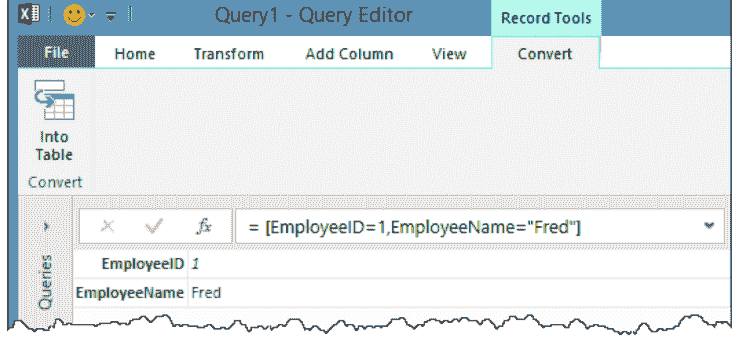

图 236 你的第一个记录。

如你所示，记录的字段名列在左侧，对应的数据在右侧。有趣的是，数据是垂直排列的，而不是你预期的那样水平排列。这不是问题，只是需要习惯一下。

另外注意到你现在有一个新的 `记录工具` -> `上下文添加选项卡`，如果你探索功能带上的其他选项卡，你会发现它们都是灰色的。

## 将记录转换为表格

由于显然你对记录做不了什么，你可以直接将这一个转换为表格，看看会发生什么：

- 转到 `记录工具` -> `转换` -> `格`

结果可能不是完全你预期的那样的：

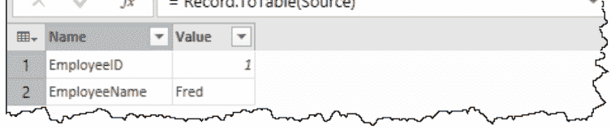

图 237 将单个记录转换为表格。

你可能期望这会显示字段名跨在顶部，值在第一行。虽然它不是这样工作的，但现在作为表格很容易修复它：

- 转到 `转换` -> `逆置`
- `转换` -> `使用第一行作为标题`

结果看起来更像你最初预期的那样：

| Table.PromoteHeaders("Transposed Table") | EmployeeID | EmployeeName |
|---|---|---|
| 1 | Fred | |

图 238 结果现在看起来像一个正式的表格。

在这种情况下，这很好，但如果你有一堆需要转换为表格的记录，会发生什么？你现在可以将查询移动到下一节并发现：

- 重命名查询 `String`
- 转到 `首页` -> `关闭并加载到...` -> `仅创建连接`

## 从头开始创建多个记录

现在你想构建你的表格，使其包含所有员工。你需要构建一个记录列表来实现：

- 创建新查询 → `来自其他数据源` -> `空白查询`
- 在公式栏中输入以下内容：

```
=[EmployeeID=1,EmployeeName="Fred"],[EmployeeID=2,EmployeeName="John"],[EmployeeID=3,EmployeeName="Jane"],[EmployeeID=4,EmployeeName="Mary"]
```

注意，这并不是嵌套列表，而是作为一个带有引号内逗号的项列表。

## 从每个表行创建记录

要将每行转换为表记录，你需要一个小技巧。按照以下步骤开始：

- 转到 `Sales` 工作表，并选择 `Sales` 表格中的任意单元格
- `创建新条目` -> `来自表格/范围`

接下来，你想将表中的每行转换为记录。挑战在于，你需要每行的索引数字来完成此操作。因此，你可以获取索引列：

- 转到 `添加列` -> `添加索引列` -> `从 0 开始`

现在，你将在“应用步骤”窗格中重命名此步骤（而不是重命名列）：

- 右键点击“已添加的索引”步骤 -> `重命名` -> `AddedIndex`（不留空格）

现在的查询结果如下所示：

| 日期 | 存货项目 | 员工... | 数量... | 价格 | 索引 |
|---|---|---|---|---|---|
| 1 | 5/10/2014 可爱的小猫 | | 1 | 45 | 0 |
| 2 | 5/9/2014 话多的鹦鹉 | | 2 | 32 | 1 |
| 3 | 5/24/2014 可爱的小猫 | | 3 | 45 | 2 |
| 4 | 5/20/2014 可呆的小猫 | | 2 | 35 | 3 |
| 5 | 5/8/2014 可爱的小猫 | | 3 | 45 | 4 |
| 6 | 5/23/2014 困倦的出生 | | 1 | 39 | 5 |
| 7 | 5/11/2014 奶奶鳄鱼 | | 2 | 35 | 6 |
| 8 | 5/19/2014 可爱的猫猫 | | 2 | 35 | 7 |

图 25 已添加了列，且步骤保持重命名状态且没有空格。


现在，你可以使用自定义列将你的行转换为记录。技巧在于创建这个“已添加”列，因为你现在拥有了提取记录所需的值。为什么需要这个技巧？你不是在对当前行进行操作，而是对 `AddedIndex` 步骤的输出进行操作。这样，你不是获取特定值（例如第一行），而是可以动态地将其输入查询以获取每行。按照以下步骤操作：

- 转到 `添加` -> `添加自定义列`
- 将列命名为 `Records`
- 使用以下公式：
  `=AddedIndex[Index]`

结果是创建了一个新记录，它包含记录如下：

| 日期 | 存货项目 | 员工... | 数量... | 价格 | 索引 | 记录 |
|---|---|---|---|---|---|---|
| 1 | 5/10/2014 可爱的小猫 | | 1 | 45 | 0 | 0 Record |
| 2 | 5/9/2014 话多的鹦鹉 | | 2 | 32 | 1 | 1 Record |
| 3 | 5/24/2014 可爱的小猫 | | 3 | 45 | 2 | 2 Record |

日期: 5/10/2014
存货项目: 可爱的小猫
员工ID: 1
数量: 4
价格: 45
索引: 0

严格来说，你不需要重命名“已添加的索引”列来删除空格。这样做只是让用户界面上的操作变得简单得多。

图 246 一列记录。

此时，你可以删除所有其他列，这样你将只有一列记录：

- 右键点击 `Records` 列 -> `删除其他列`
- 将查询重命名为 `Records_From_Table`
- 转到 `首页` -> `关闭并载入到...` -> `仅连接`

## 值

如果你正在处理数据库，偶尔会看到包含以下内容的列：

| 销售年份 | 年至今成本 | 年成本 | 人员.国家地区 | 人员.州 |
|---|---|---|---|---|
| 3298694.494 | 0 | 0 Value | Table |
| 3607148.937 | 0 | 0 Value | Table |
| 3205014.077 | 0 | 0 Value | Table |
| 536675.71 | 0 | 0 Value | Table |
| 3925071.432 | 0 | 0 Value | Table |
| 5693988.86 | 0 | 0 Value | Table |
| 2396539.76 | 0 | 0 Value | Table |

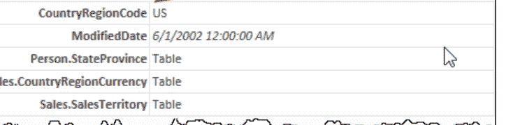

图 247 隐藏的对象。

这种特定的对象只在某些情况下出现。为了让它出现，你必须处理一个表之间建立了主键和外键关系的数据库。真正奇怪的是，值只是数据库返回的记录。

> 这个特定的表可以在第 8 章中连接的 AdventureWorks2012 数据库中找到。使用第 8 章描述的方法进行连接，连接到 `SalesTerritory` 表，并删除显示内容之外的其他列。

一旦你知道拥有哪些值，处理它们与处理其他数据相同：

> 值的方向决定了在数据库中返回的是什么（记录）。

## 二进制文件

二进制文件本质上是文件。它们可以使用 `Csv.Document()` 等函数进行组合，而可以使用 `Excel.Workbook`。从这些工作簿提取数据的过程在第 3 和第 4 章中有详细介绍，因此我们不再深入探讨，只需提到：

## 错误

你在 Power Query 中可能会遇到两种错误消息：步骤错误和行级错误。

### 行级错误

行级错误通常发生在尝试转换数据类型或在数据转换之前进行操作时。

### 步骤错误

步骤错误比行级错误更严重。

## 函数

你在 Power Query 中遇到的对象类型是函数。函数出现在两个地方：

1. 它们位于数据库内部，作为存储过程。
2. 它们可以从列表中检索。

将在书中学习更多关于使用和调用函数的知识，但在这里我们将学习一个显示函数的技巧。尝试：

- 创建新查询 -> 来自 -> 空查询
- 在公式栏中输入以下公式：
  `#shared`
- 转到 `转换` -> `表格`

Power Query 生成当前工作簿中所有查询的表格，更重要的是，它包含了所有函数的列表。你可以从此列表访问任何函数的文档：

| 名称 | 值 |
|---|---|
| 10 List.NullCount | 函数 |
| 11 List.MatchesAll | 函数 |
| 12 List.MatchesAny | 函数 |
| 13 List.Range | 函数 |
| 14 List.RemoveItems | 函数 |
| 15 List.ReplaceValue | 函数 |
| 16 List.FindText | 函数 |
| 17 List.RemoveLastN | 函数 |
| 18 List.RemoveFirstN | 函数 |

图 252 函数表格。

如何使用这个？为了查看，筛选第一列包含 Max（带大写 M）：

- 筛选 `名称` -> `文本筛选` -> `包含` -> `Max`

搜索出现了四个选项：

| 名称 | 值 |
|---|---|
| 1 Table.Max | 函数 |
| 2 Table.MaxN | 函数 |
| 3 List.Max | 函数 |
| 4 List.MaxN | 函数 |

图 253 包含 Table.Max 的函数。

# 第 19 章 Power Query 对象

```
function (table as table, comparisonCriteria as any, optional default as any) as any
```

根据 `comparisonCriteria` 返回表中具有最大值的行。如果表为空，则返回可选的默认值。

示例：在表 `[[a = 2, b = 4], [a = 6, b = 8]]` 中找到列 `[a]` 值最大的行。

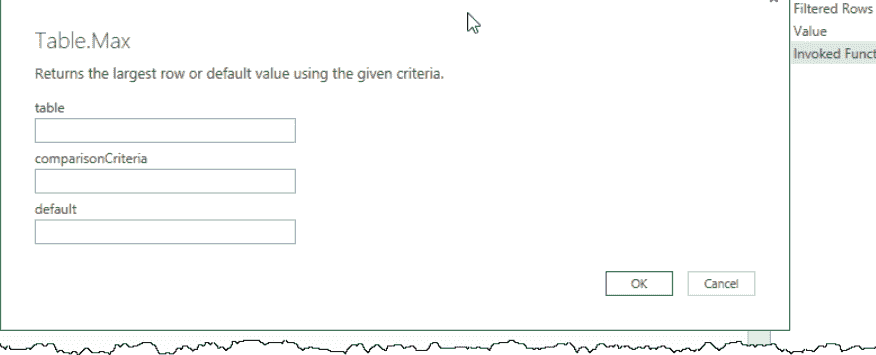

此框允许你测试该函数，但点击“取消”会让它消失。在后面，你可以找到该函数的完整文档，从而判断它是否符合你的需求。

请注意，你并不局限于从空白查询中使用 `#Shared` 命令。每当你想要检查 Power Query 的公式文档时，都可以执行以下操作：

1. 点击公式栏上的 `fx` 添加新步骤
2. 将新步骤中的代码替换为 `=#Shared`
3. 将记录转换为表格
4. 深入研究你想要探索的函数

然后你可以回到“应用步骤”框中的较早步骤来实施该函数，并在完成后删除所有 `#Shared` 步骤。


# 第 20 章 理解 M 语言

现在你已经探索了在 Power Query 中使用的不同对象，现在是时候深入研究用于执行 Power Query 魔法的 M 语言了。精通 M 并非绝对必要，它无疑会为你的武器库增加更多力量，并让你能够处理他人无法应对的情况。

## 查询结构

要开始，你将将其引入 Power Query 并检查后台运行的代码：

- 打开 `Ch20 Examples\Unappearing M.xlsx` -> 在 `Sales` 表中选择任意单元格
- 创建新查询 -> 来自表格
- 删除“更改类型”步骤

你的查询看起来应该是这样：

| 日期 | 库存货物品 | 雇... | 数量 | 价格 |
|---|---|---|---|---|
| 1 | 5/10/2014 12:00:00 | Lovable | 1 | 45 |
| 2 | 5/29/2014 12:00:00 | Taltik Parrot | 2 | 32 |
| 3 | 5/24/2014 12:00:00 | Lovable Kitten | 3 | 45 |
| 4 | 5/20/2014 12:00:00 | Adorable Kitty Cat | 2 | 35 |
| 5 | 5/28/2014 12:00:00 | Lovable Kitten | 3 | 39 |
| 6 | 5/23/2014 12:00:00 | Sleepy Giraffe | 3 | 39 |
| 7 | 5/13/2014 12:00:00 | American Crocodile | 5 | 35 |

图 255 初始查询已准备好进行检查。

## 查询格式

到为止，你所看到的一切都是通过用户界面驱动的。你见过 Power Query 充当宏录制器，并能够通过“应用步骤”框与其交互。你还通过公式栏进行了一些有限的交互。你尚未看到的是隐藏在这个惊人工具底层的编程语言。是时候改变这一点了。

- 转到 `首页` -> `高级编辑器`，它包含了截至目前创建的整个查询的代码：

高级编辑器窗口出现，并且

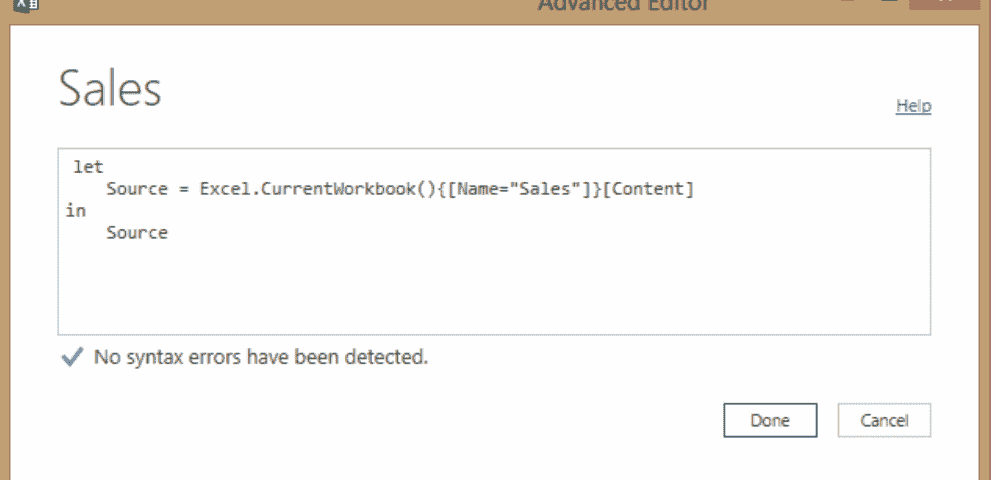

图 256 Power Query 的高级编辑器。

你可以看到，此时此功能非常有限。高级编辑器本质上是一个在左下角带有语法检查器的文本编辑器。这个区域在未来无疑会有一些投入，但现在它本质上只是一个文本框。

> 在尝试调整编辑器大小以匹配上方所示图像而感到沮丧之前，请注意你可以将其变得像上面一样小（为了节省页面，我们通过照片编辑缩小了它）。高级编辑器可以展开变得更大，但在你第一次打开它时，它不会比默认尺寸更折叠。

查看上方所示窗口中的代码：

```
let
Source = Excel.CurrentWorkbook(){[Name="Sales"]}[Content]
in Source
```

这里有一些构建成功查询所需的关键部分，因此我们将逐行拆解。

每个查询的第一行必须以单词 `let` 开头（这在函数中会改变，函数将在第 21 章介绍）。该行没有其他内容。

第二行以单词 `Source` 开头。这很重要，因为这是“应用步骤”框中的步骤名称。在这种情况下，你可以推断出的该行代码与你想要检查的步骤有关。

为什么这很重要？这意味着你实际上可以在中间断开处换行。因为 Power Query 没有在初始的 `NewType` 末尾找到逗号或键，它会继续向下移动，假设该行仍然是完成部分的一部分。从本质上，这意味着这段代码：

```
NewType = Table.TransformColumnTypes(Source,{{"Price", type number}})
```

等同于以下代码：

```
NewType = Table.TransformColumnTypes
(Source,{{"Price", type number}})
```

或者这段代码：

```
NewType = Table.TransformColumnTypes(
Source,
{{"Price", type number}}
)
```

这里的理解点是，你不能在函数名或单词的中间放置硬回车，但在任何标点符号处断行都是可以。从大范围来看，此查询将完美地运行：

```
Source = Excel.CurrentWorkbook(){[Name="Sales"]}[Content],
NewType = Table.TransformColumnTypes(
Source,
{{"Price", type number}}
)
in
NewType
```

当你尝试调试诸如嵌套列表（包含大量列表项对）的内容时，为什么你会发现这很有用？在手动将元组转换为代码时，很容易在大括号中迷失，并且没有意识到你漏掉了一个闭合括号。当你漏掉时，你会得到不平衡的代码，它无法编译且非常难以修正，特别是目前 Power Query 缺乏良好的调试工具。通过将开启和闭合括号分开，并将列表项分到单独的行，你有更大的机会保持开启和关闭括号的平衡。这种方法的另一个优点是，非常容易在 `TransformColumnTypes` 步骤中添加新列（至少在你知道要分配什么数据类型时）。

如下所示为所有列添加类型：

| Column(s) | 数据类型 |
|---|---|
| Date | Date |
| Inventory Item | Text |
| EmployeeID, Quantity | Number |

你可以识别出 `NewType` 步骤中 `Source` 之后的大括号，这表示你需要以列表格式提供列名和数据类型的列表。由于你已经从第 19 章知道所有列表项都需要用逗号分隔，因此你知道这项工作：

```
Source = Excel.CurrentWorkbook(){[Name="Sales"]}[Content],
NewType = Table.TransformColumnTypes(
Source,
{{
```

```
("Price", type number),
("Date", type date),
("Inventory Item", type text),
("EmployeeID", type number),
("Quantity", type number)
)
in
NewType
```

如果你点击 `Down` 来提交这段代码（完全按照书写方式），你会看到查询返回了你想要的结果，你转换的每个数据类型如下：

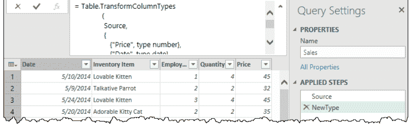

图 260 不仅日期是不带时间的，还要查看公式栏中的缩进！

## 代码注释

你最后需要知道如何创建的一组字符是允许你在代码中编写注释的字符。这些对于在代码中留备注或临时禁用某行代码非常有用。

要标记单行注释，你需要在行开头放置两个斜杠，所示：

```
let
// 从 Excel 中检索 Sales 表格
Source = Excel.CurrentWorkbook(){[Name="Sales"]}[Content],
```

Power Query 不读取 `// Retrieve...` 这一行，该行也不会出现在“应用步骤”框中，但它是为了提醒你后续一行的目的。

有时你需要无法放在单行内的较长注释。在这种情况下，你在不希望执行的代码之前放置 `/*` 字符，并在部分的末尾放置 `*/` 字符，如下所示：

```
/* 我将此注释跨越了多行
（通过阅读 M 代表 Data Monkey）   */
```

## 特殊字符总结

下表列出了你在 Power Query 编码语言中会遇到的特殊字符列表：

| 字符 | 用途 |
|---|---|
| (Parameters) | 包围函数参数 |
| (List) | 包围列表项 |
| (Record) | 包围记录 |
| "Text" | 包围文本 |
| #Step Name | 引用包含空格或其他保留字符的步骤名称 |
| //comment | 注释单行代码 |
| /* comment */ | 注释多行代码 |

## 在列中对行进行操作

M 语言中有一个非常重要的结构：如何读取和修改操作列中每一行的代码。要实现这一点，你可以获取你的查询并添加一列来确定按行的总计：

- 确保你使用高级编辑器
- 选择 `Quantity` 和 `Price` 列 -> `添加列` -> `标准` -> `乘法`
- 右键点击 `Multiply` 列 -> `重命名` -> `Gross Sales`
- 右键点击 `Inserted Multiplication` 步骤 -> `重命名` -> `CalSales`
- 右键点击 `Renamed Columns` 步骤 -> `重命名` -> `Rename`

现在的查询看起来如下：

| Date | Inventory Item | Employ... | Quantity | Price | Gross Sales |
|---|---|---|---|---|---|
| 1 | 5/10/2014 | Lovable Kitten | 1 | 45 | 180 |
| 2 | 5/9/2014 | Talkative Parrot | 2 | 32 | 64 |
| 3 | 5/24/2014 | Lovable Kitten | 3 | 45 | 180 |
| 4 | 5/20/2014 | Affordable Cat | 2 | 35 | 70 |
| 5 | 5/08/2014 | Lovable | 1 | 45 | 45 |
| 6 | 5/23/2014 | Sleepy Billy | 1 | 39 | 39 |
| 7 | 5/11/2014 | Cranky Crocodile | 2 | 35 | 175 |
| 8 | 5/19/2014 | Affordable Cat | 4 | 25 | 70 |
| 9 | 5/24/2014 | Simple | 15 | | 150 |


# 第 20 章 理解 M 语言

| 6 | 5/23/2014 | Sleepy Billy | 1 | 39 | 39 |
|---|---|---|---|---|---|
| 7 | 5/11/2014 | Cranky Crocodile | 2 | 35 | 175 |
| 8 | 5/19/2014 | Affordable Cat | 4 | 25 | 70 |
| 9 | 5/24/2014 | Simple | 15 | | 150 |

## PROPERTIES

| Name | Sales |
|---|---|
| All Properties | |

## APPLIED STEPS

| Source |
|---|
| NewType |
| CalcSales |

现在的查询看起来是这样的：

```powerquery
let
    // 从 Excel 中检索 Sales 表格
    Source = Excel.CurrentWorkbook(){[Name="Sales"]}[Content],

    // 我将此注释跨越了多行
    // （通过阅读 M 代表 Data Monkey）
    NewType = Table.TransformColumnTypes(
        Source,
        {"Price", type number},
        {"Date", type date},
        {"Inventory Item", type text},
        {"EmployeeID", type number},
        {"Quantity", type number}
    ),
    CalcSales = Table.AddColumn(NewType, "Gross Sales", each [Quantity] * [Price])

in
    NewType
```

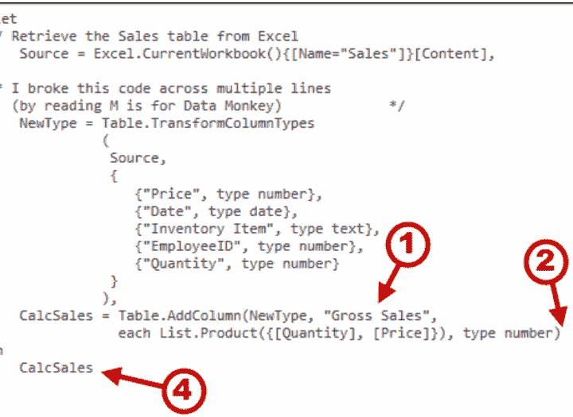

换行符可能不在相同的位置——或者根本不出现。关键点在于：(1) `CalcSales` 行被视为一个完整的代码，尽管它被分成了两行；以及 (2) 该行末尾没有逗号，因为它位于关键字 `in` 之前。

- 点击完成

注意 `Rename` 步骤很好，但 `Gross Sales` 列依然存在：

| Date | Inventory Item | Employ... | Quantity | Price | Gross Sales |
|---|---|---|---|---|---|
| 1 | 5/10/2014 | Lovable Kitten | 1 | 45 | 180 |
| 2 | 5/09/2014 | Talkative Parrot | 2 | 32 | 64 |
| 3 | 5/24/2014 | Lovable Kitten | 3 | 45 | 180 |
| 4 | 5/20/2014 | Affordable Cat | 2 | 35 | 70 |
| 5 | 5/08/2014 | Lovable | 1 | 45 | 45 |
| 6 | 5/23/2014 | Sleepy Billy | 1 | 39 | 39 |
| 7 | 5/11/2014 | Cranky Crocodile | 2 | 35 | 175 |
| 8 | 5/19/2014 | Affordable Cat | 4 | 25 | 70 |
| 9 | 5/24/2014 | Simple | 15 | | 150 |

- 重命名查询为 `GrossSales`
- 转到主页 -> 关闭并加载

## 引用步骤或行

考虑这样一种场景：你有一个包含如下所示数据的数据文本文件：

**挑战：**

导入 ID Number 和 ID Total 之间的行

| ID Number | Amount | OrderDate |
|---|---|---|
| 1234 | 5 | 2015-05-01 |
| 1235 | 45 | 2015-05-12 |
| 1236 | 82 | 2015-05-13 |
| 1237 | 32 | 2015-05-22 |
| ID Total | 164 | |

此处显示了更多无关数据

图 264 具有特定要求的制表符分隔数据。

- 数据是用分隔符分隔的，但第一行不包含任何制表符。这意味着你需要手动触发列分。
- ID Number 之前的行数是不固定的。在包含 ID Number 文本的行之前，可能有 5 行，也可能有 5,000 行。
- ID 行之间以及之后的行数也是不固定的。

你面临的总体挑战是，你需要从数据集的中间提取行，并动态地处理所需数据之前、中间和之后出现了多少行。

此外，还有一个最后的细微之处：你希望确定每个订单日期与上一个订单之间的天数。此任务将涉及尝试从一行的数据减去另一行的数据——这是通过 Power Query 用户界面无法完成的。

## 连接到数据

你需要连接到数据，并确定需要哪些行来完成你的目标：

- 打开一个空白工作簿
- 创建新查询 -> 来自 -> 来自文本 -> Ch20 Examples|Varying Header Rows.txt -> 确定
- 转到添加列 -> 添加索引列 -> 从 0 开始
- 过滤 Column1 -> 文本筛选 -> 开头为
- 通过 ID Number 或是 包含 ID Total 的行设置筛选
- 右键点击并将“已筛选的行”重命名为 RowNumbers

> 你也可以通过过滤以 ID 开头的行来实现相同的目标，但你不知道数据集中是否还有其他以 ID 开头的行。通过尽可能紧凑条件，你可以减少未来发生错误的概率。（当然，如果数据中引入了另一个 ID 行，你仍然需要想办法处理这种情况。）

查询现在应该显示如下：

| Column1 | Index |
|---|---|
| ID Number Amount OrderDate | 4 |
| ID Total 164 | 9 |


现在你有一个精简视图，显示了 ID Number 行和 ID Total 行的行号。记住，这些是完全动态的，无论数据之前、之后或中间有多少行，你的步骤都将生成正确的行。

## 合并查询步骤

现在，如果你想的话，可以编写这段代码吗？你会再次需要 `Source` 步骤，但在“应用的步骤”中你并不绝对需要 `Added Index` 步骤。不过，可以将这两个步骤合并为一个。你可以通过转到“首页 -> 高级编辑器”来查看这两个步骤的代码：

```powerquery
#"Added Index" = Table.AddIndexColumn(Source, "Index", 0, 1),
RowNumbers = Table.SelectRows(#"Added Index", each Text.StartsWith([Column1], "ID Number") or Text.StartsWith([Column1], "ID Total"))
```

注意 `#"Added Index"` 步骤包含了 `Table.AddIndexColumn`。在 `RowNumbers` 上，你还看到 `#"Added Index"` 步骤是 `Table.SelectRows()` 函数的第一个参数。如果你想避免有一个单独的 `#"Added Index"` 步骤，你只需要在下一行中用 `#"Added Index"` 步骤中的实际代码替换该术语：

> 记住，在这样替换代码时，你只需要等号和最后一个逗号之间的所有内容。

通过原位替换代码、添加一些换行符并完全删除 `#"Added Index"` 行，你最终得到了嵌套代码，如下：

```powerquery
RowNumbers = Table.SelectRows(
    Table.AddIndexColumn(Source, "Index", 0, 1),
    each Text.StartsWith([Column1], "ID Number")
    or Text.StartsWith([Column1], "ID Total"))
```

如你所见，这段代码仍然运行得完美无缺，但它从“步骤”框中删除了 Added Index 步骤：

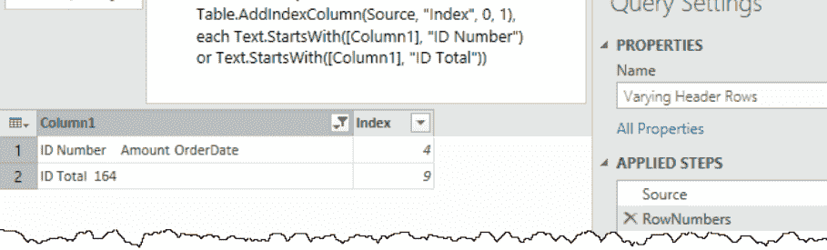

## 创建查询步骤

答案是点击公式栏中的 `fx`：

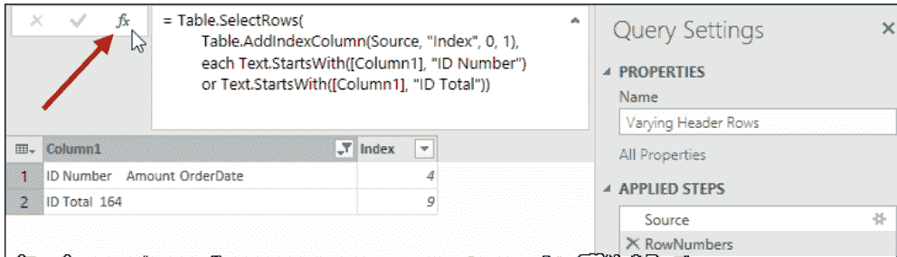

267 手动创建一个新的查询步骤。

如果你在点击此按钮时没有注意，认为什么发生是可以被原谅的。预览窗口中的数据并没有像你预期的那样出现。然而，你看到的是“应用步骤”框中有一个名为 `Custom1` 的新步骤，且公式栏中的公式已变为：

```powerquery
= RowNumbers
```

点击 `fx` 总是会创建一个引用上一个步骤的新查询步骤。这有什么用呢？

将公式改为：

```powerquery
= Source
```

你现在看到回了原始数据。

> 如果你检查了高级编辑器，你可以通过在关键字 `in` 之前手动添加此步骤来实现，如下：`Custom1 = Source`，为了保持代码正常，你还需要在前面的行添加一个逗号，并将关键字 `in` 之后的术语更改为 `RowNumbers`。

你现在状态良好，因为你可以选择 `RowNumbers` 步骤来选择你想要的第一行和最后一行，回到 `Custom1` 以便开始这样做。

## 引用应用步骤

现在你想要将数据恢复到必要的行。

首先，你通过用户界面设置你的命令。这样做是因为它将为你提供功能的语法，而不是锁定。

你在这里使用的移除方法不需要更改。这是因为索引实际上是动态的。如果你文件中有更多行，索引将更新。如果你删除行，索引也将更新。这意味着我们可以重写公式栏中的公式来动态跟踪值：

```powerquery
= Table.FirstN(Custom1, RowNumbers[Index]{1})
```

你能做得更好吗？如果你检查 `Custom1` 步骤的代码，你会发现它引用 `Source`。你可以跳过使用 `Custom1` 步骤并直接在公式中引用 `Source` 吗？绝对可以！再次更新公式：

```powerquery
= Table.FirstN(Source, RowNumbers[Index]{1})
```

结果给了你正所需要的：

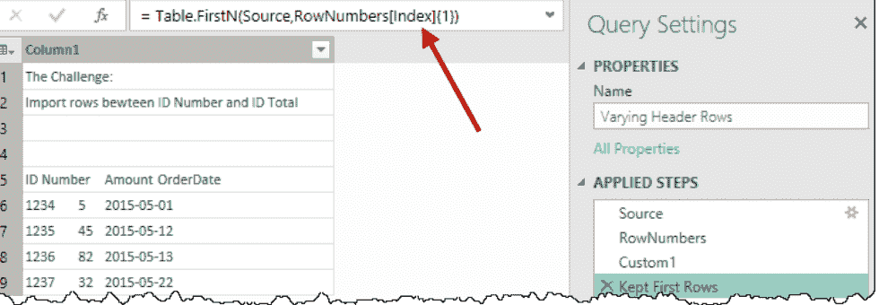

图 29 更新后的公式仍然运行良好。

现在，由于公式引用了 `Source` 步骤，你完全不再需要 `Custom1` 步骤。

- 从“应用步骤”框中删除 `Custom1` 步骤

完成这一步清理后，你现在只剩下三步查询，并且正走在正确的路上。添加你的动态过滤器来过滤掉顶部的几行：

- 转到首页 -> 删除行 -> 删除顶部行 -> 4 -> 好
- 将 `Removed Rows` 步骤重命名为 `ExtractRows`
- 更新公式为：

```powerquery
= Table.Skip(#"Kept First Rows", 4)
```

- 为：

```powerquery
= Table.Skip(#"Kept First Rows", RowNumbers[Index]{0})
```

结果是限制在第二行以及你所需的数据：

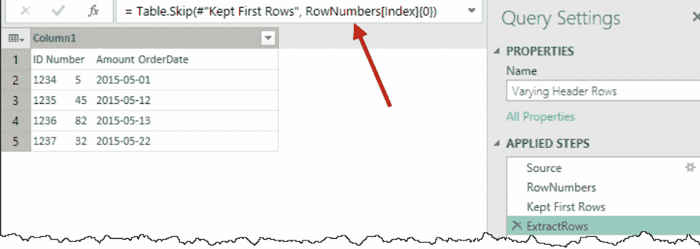

图 270 代码现在正在动态提取起始行和结束行。

你可以将最后两个步骤合并，以保持目前代码的整洁：

- 转到首页 -> 高级编辑器
- 编辑以下代码：

```powerquery
#"Kept First Rows" = Table.FirstN(Source, RowNumbers[Index]{1}),
ExtractRows = Table.Skip(#"Kept First Rows", RowNumbers[Index]{0})
```

- 通过将 `#"Kept First Rows"` 步骤嵌套到第二行如下所示：

```powerquery
ExtractRows = Table.Skip(
    Table.FirstN(Source, RowNumbers[Index]{1}),
    RowNumbers[Index]{0})
```

- 点击完成

再次，你缩短了应用步骤的数量，并得到了紧凑的代码，它可以动态检索你所需的数据集：

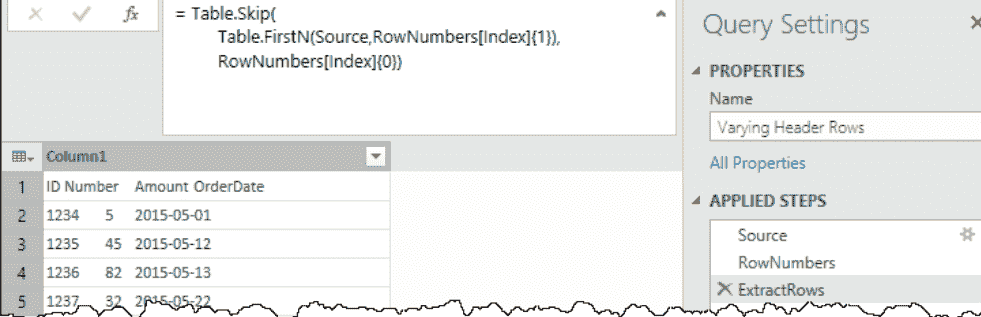

图 271 动态数据集已准备好清理。

## 后续清理步骤

接下来的步骤只是常规的清理步骤：

- 转到转换 -> 分列 -> 按分隔符 -> Tab -> 在每个出现处 -> 好
- 删除自动创建的更改类型（它将所有列都设置为文本，从长期来看是不准确的）
- 转到转换 -> 使用第一行作为标题
- 右键点击 ID Number -> 更改类型 -> 整数类型
- 右键点击 Amount 列 -> 更改类型 -> 整数类型
- 右键点击 OrderDate -> 更改类型 -> 日期

结果是一个完美的数据集：

```powerquery
Table.TransformColumnTypes(#"Promoted Headers",
    {{"ID Number", Int64.Type}, {"Amount", Int64.Type}, {"OrderDate", type date}})
```

| ID Number | Amount | OrderDate |
|---|---|---|
| 1 | 1234 | 5/1/2015 |
| 2 | 1235 | 5/12/2015 |
| 3 | 1236 | 5/13/2015 |
| 4 | 1237 | 5/22/2015 |

（注：OCR 包含了额外的数字如“72”）数据集已清理并可以使用。

到目前为止，你已经成功导入一组数据并动态限制了你想要使用的行。此时，无论 ID Number 行之前有多少行数据，查询都将从正确的位置开始。此外，无论 Total 行之后存在多少行，你都不会在输出查询中看到它们，而且查询还会拉取这两个标题之间的任意数量行。

压缩代码是一个完全可选的步骤。你可以通过复制上一个步骤并将其替换到下一个步骤中来保留你的代码。虽然这可以让你的代码更加紧凑且高效，但请注意，如果出现问题，这可能会严重影响你调试代码的能力。诀窍在于找到一个对你有意义的平衡点。

## 动态引用上一行

该数据集还有一个任务需要完成：计算距离上一行的天数。遗憾的是，虽然如果只需点击一下按钮就能实现这一点太棒了，但你并不幸运，因为 Power Query 没有内置此功能。你仍然可以实现，但必须手动操作。

要实现这一点，你需要弄清如何创建一个包含上一个订单日期的新列。你已经知道如何引用上一个步骤，甚至知道如何引用该步骤中的列。你还需要在大括号之间提供行号来提取特定的行。你需要到这里稍微扩展你的逻辑，并提取一个比当前行号小一的数字。

为了计算结果，你需要数据集中每一行的索引号。由于你将使用这个新步骤，你也应该重命名它以避免编码上的尴尬：

- 转到添加列 -> 添加索引列 -> 从 0 开始
- 右键点击 Indexed 步骤 -> 重命名 -> Transactions

你现在准备就绪，可以构建一个跨行的公式了：

| ID Number | Amount | OrderDate | Index |
|---|---|---|---|
| 1 | 1234 | 5/1/2015 | 0 |
| 2 | 1235 | 5/12/2015 | 1 |
| 3 | 1236 | 5/13/2015 | 2 |
| 4 | 1237 | 5/22/2015 | 3 |


添加新列：

- 转到 添加列 -> 添加自定义列
- 命名为 PreviousOrder
- 输入以下公式：

```powerquery
= Transactions[OrderDate]{[Index]-1}
```

在这种情况下，你正在引用 `Transactions` 步骤，并从 `OrderDate` 列中获取一个值。下一部分很微妙：`[Index]` 在大括号内部，且没有步骤前缀。这意味着它引用的是当前步骤的值。此外，由于它是在“添加自定义”对话框中输入的，它将作为一个关键字，对每一行进行操作。你只需要获取每一行的 `Index` 值，减 1，这将是你从 `Transactions` 步骤中返回的行。`[Index]` 列是生成的，因此你可以告诉 Power Query 你想要哪一行。这种方法会让你得到的结果更清晰：

| ID Number | Amount | OrderDate | Index | PreviousOrder |
|---|---|---|---|---|
| 1 | 1234 | 5/1/2015 | 0 | |
| 2 | 1235 | 5/12/2015 | 1 | 5/1/2015 |
| 3 | 1236 | 5/13/2015 | 2 | 5/12/2015 |
| 4 | 1237 | 5/22/2015 | 3 | 5/13/2015 |


> 这种方法会让你得到的结果更清晰：

| ID Number | Amount | OrderDate | Index | PreviousOrder |
|---|---|---|---|---|
| 1 | 1234 | 5/1/2015 | 0 | |
| 2 | 1235 | 5/12/2015 | 1 | 5/12/2015 |
| 3 | 1236 | 5/13/2015 | 2 | 5/12/2015 |
| 4 | 1237 | 5/22/2015 | 3 | 5/13/2015 |

为了实现这一点，你需要使用 `try` 语句：

- 点击自定义列步骤旁边的齿轮图标
- 修改公式以使用 `try` 语句，如下：

```powerquery
=try Transactions[OrderDate]{Index-1} otherwise [OrderDate]
```

这种方法会让你得到的结果更清晰：

| ID Number | Amount | OrderDate | Index | PreviousOrder |
|---|---|---|---|---|
| 1 | 1234 | 5/1/2015 | 0 | |
| 2 | 1235 | 5/12/2015 | 1 | 5/12/2015 |
| 3 | 1236 | 5/13/2015 | 2 | 5/12/2015 |
| 4 | 1237 | 5/22/2015 | 3 | 5/13/2015 |

图 275 PreviousOrder 列返回了上一个订单。

有了日期，你可以计算它们之间的天数：

- 选择 `Order Date` 列 -> 按住 `Shift` 键选择 `PreviousOrder` 列
- 转到 `添加列` (Add Column) -> `减去天数` (Subtract Days)

你就得到了：

| ID Number | Amount | OrderDate | Index | PreviousOrder | DateDifference |
|---|---|---|---|---|---|
| 1 | 1234 | 5/1/2015 | 0 | | 0 |
| 2 | 1235 | 5/12/2015 | 1 | 5/12/2015 | 11 |
| 3 | 1236 | 5/13/2015 | 2 | 5/12/2015 | 1 |
| 4 | 1237 | 5/22/2015 | 3 | 5/13/2015 | 9 |

图 276 差异已经计算完毕。

> 在此处选择列的顺序是重要的。如果你先选择 `PreviousOrder` 列再选择 `OrderDate`，你的差异将显示为负数。

到目前，唯一要做的工作就是最后的清理：

- 右键点击 `Index` 列 -> `删除`
- 右键点击 `PreviousOrder` 列 -> `更改类型` -> `日期`
- 右键点击 `DateDifference` 列 -> `重命名` -> `DaysSinceLastOrder`
- 转到 `首页` (Home) -> `关闭并载入` (Close & Load)


# 第 21 章 创建自定义函数

如果你回想起第 3 章和第 4 章，你可能记得 Excel 专家在过去导入和追加数据集时遇到过一些问题。这些是合并这些文件的经典方法：

1. 导入并转换文件 #1。
2. 导入并转换文件 #2。
3. 复制文件 #2 的数据并粘贴到文件 #1 的末尾。
4. 将文件 #1 保存为合并文件。

然后，随着每个新月的到来，就会遵循类似的导入、清理、复制和粘贴工作流。

这，当然，在转换步骤以及复制粘贴过程中都导致了许多风险。转换越复杂，运行时间就越长，交给新手的任务就越多，就越容易出问题。步骤可能会被遗漏或执行错误，导致数据集损坏。

虽然你可以通过创建查询来解决许多此类问题，并且如果有足够的远见，你可以导入文件夹中的所有文件，但在以下情况下会发生什么？

- 你针对单个文件构建了一个带有大量转换的查询。老板非常喜欢它，以至于将其变成了业务智能系统，现在需要对每个每月文件执行该操作并追加。
- 你尝试导入文件夹中的所有文件，但这些文件在追加之前需要进行转换。

这两种场景都会产生问题，可以通过创建一个自定义函数来解决。然后只需调用它，并允许它执行多次。在第一种情况下，你可以重用已经构建的内容，并将其一致地应用于每个新文件（减少人为错误因素）。在后一种情况下，你可以将过程应用到每个文件，将每个预处理数据集的结果落实到表格列中，然后对它们进行合并。

最棒的部分是？并不困难！

## 构建自定义函数

为了构建自定义函数，你基本上遵循一个三步流程：

1. 首先构建一个单次使用的场景。
2. 将单次使用的场景转换为函数。
3. 从另一个查询调用该函数。

这在实践中听起来很简单。让我们看看如何将它们整合在一起。

你将构建一个新场景，而是回到第 18 章关于条件逻辑的场景，在该章节中你导入了 `2015-03-14.txt` 工时表文件。在那个章节中，你已经构建了执行所需导入的代码，针对特定的工时表。意料的是，你现在想将相同的逻辑应用于不同的文件。你不仅想更改源，还想合并这些文件以及之后添加到目录的其他文件。为此，你可以使用自定义函数。

## 构建单次使用的场景

你之前已经构建了单次使用的场景，你只需加载它即可开始这里的工作。打开 `Ch21 Examples\Custom Functions.xlsx` 文件以获取你之前构建的程序副本。此文件包含与第 18 章构建的相同的代码，唯一的例外是：文件路径指向 `Source Files` 子文件夹，该文件夹包含三个单独的文件（包括原始的 `2015-03-14.txt` 文件）。

当你点击“编辑查询”（Edit Query）时，你会收到错误消息，因为源引用的位置与你复制示例文件的位置不同。要解决这个问题：

1. 点击黄色错误条右上角的“转到错误”（Go to Error）按钮。Power Query 显示当前正在使用的路径。
2. 点击编辑文件夹，在屏幕中间打开的对话框中点击“浏览”（Browse）。
3. 导航到你复制源文件的文件夹，`2015-03-14.txt` 并点击确定，然后再次点击确定。

记住，该查询构建了从文本文件的加载，它将员工提取到新列中，然后将他们移动到标题列和多余行下方：

| Dut | Reg Hrs | OT Hrs | Misc Hrs | Expenses | Employee |
|---|---|---|---|---|---|
| 6:00:00 PM | 8.5 | | 0 | | 0 | John Thompson |
| 6:00:00 PM | 8 | | 0 | | 0 | John Thompson |
| 6:00:00 PM | 8.5 | | 0 | | 0 | John Thompson |
| 6:00:00 PM | 8.5 | | 0 | | 0 | John Thompson |
| 6:00:00 PM | 3.5 | | 0 | | 0 | John Thompson |
| 6:00:00 PM | 8.5 | | 0 | | 0 | John Thompson |
| 6:00:00 PM | 8.5 | | 0 | | 0 | John Thompson |
| 6:00:00 PM | 6 | | 0 | | 0 | John Thompson |
| 6:00:00 PM | 8.5 | | 0 | | 0 | John Thompson |
| 6:00:00 PM | 9.5 | | 0 | | 0 | Bob Johnson |

图 277 重新格式化工时表的查询。

## 将查询转换为函数

接下来，你需要将查询转换为函数。这涉及三个步骤：

1. 在以 `Source` 开头的行中找到完整路径
2. 选择文件路径，注意排除括号
3. 输入 `filepath` 作为变量名

目标是将现有路径替换为变量名，以便函数变为动态。一旦你完成此操作，你的代码应该如下所示：

```powerquery
(filepath)=
let
    Source = Csv.Document(filepath,null,"tab",null,1252),
    Changed Type = Table.TransformTypes(Source,{"Column1",type text}}),
    Removed Rows = Table.Skip(Changed Type,4),
    As Header = Table.PromoteHeaders(Removed Rows,null)
)
```

图 28 变量现在已就绪。

> 当你使用鼠标选择文件路径时，Power Query 会选择额外的字符，包括括号。更好的主是点击第一个引号前面，按住 Shift 键并方向键选择要替换的代码。这种方式选择文本不会自动获取额外字符。

在代码中替换变量名后，你的代码应该像这样：

```powerquery
(filepath)=
let
    Source = Csv.Document(filepath,null,"tab",null,1252),
    Changed Type = Table.TransformTypes(Source,{"Column1",type text}}),
    Removed Rows = Table.Skip(Changed Type,4),
    As Header = Table.PromoteHeaders(Removed Rows,null),
    Added Custom = Table.AddColumn(As Header,"Employee",if [Custom]=null then null else [Custom]),
    Filled Down = Table.FillDown(Added Custom,"Employee"),
    Removed Columns = Table.RemoveColumns(Filled Down,{"Custom"}),
    Changed Type1 = Table.TransformTypes(RemovedColumns,{"Work Date",type date}),
    Changed Errors = Table.RemoveRowsWithErrors(Changed Type1,{"Work Date"}),
    Changed Type2 = Table.TransformTypes(Changed Errors,{"Out",type time},{"Reg",type time})
```

图 29 变量已替换代码中的完整路径。

此时，你可以点击确定，你的查询发生了巨大的变化：

| = (filepath) => | Query Settings | |
|---|---|---|
| function (filepath as any) as any | | |
| Invoke | PROPERTIES | |
| | Name | | |
| | Timesheet | | |
| | All Properties | | |
| | APPLIED STEPS | | |
| | Timesheet | | |

图 20 我的查询怎么了？？

遗憾的是，这些变化完全是在意料之。虽然它显然是一个函数而不是查询，这很好，而且它明确表示需要输入路径，但你会发现“已应用步骤”（Applied Steps）框中的所有项目都丢失了。别担心：它们都在那里，只是你现在看不到它们。

## 测试函数

在此阶段，测试所有仍然运行的内容是一个好主意。操作如下：

- 点击“调用”（Invoke）按钮
- 按 `Ctrl+V` 粘贴之前复制的文件路径

> 如果你之前在复制文件路径时调用了查询，你需要删除粘贴值两端的查询内容，因为当路径被查询包围时，Power Query 无法正确读取路径。

当你点击确定时，查询将从文件中加载信息，并通过你原始编写的所有步骤：

| 工作日期 | 输出 | 法定时长 | 加时长 | 杂项 | 费用 |
|---|---|---|---|---|---|
| 1 | 3/3/2015 | 6:00:00 | 8.5 | 0 | 0 | |
| 2 | 3/4/2015 | 6:00:00 | 8 | 0 | 0 | |


| 3 | 3/5/2015 | 6:00:00 | 8.5 | 0 | 0 | |
|---|---|---|---|---|---|---|
| 4 | 3/6/2015 | 6:00:00 | 8.5 | 0 | 0 | |
| 5 | 3/7/2015 | 3:30:00 | 6.5 | 0 | 0 | |
| 6 | 3/10/2015 | 6:00:00 | 8.5 | 0 | 0 | |
| 7 | 3/11/2015 | 6:00:00 | 8.5 | 0 | 0 | |
| 8 | 3/12/2015 | 6:00:00 | 6 | 0 | 0 | |

图 281 从动态文件加载的数据。

注意，你现在“已应用步骤”框中有一个新步骤。该步骤显示你调用了该函数。虽然这本质上破坏了该函数从其他地方调用的能力。既然你已经测试了函数，需要删除此步骤：

- 删除调用函数 `Timesheet`（`Invoked FunctionTimesheet`）
- 重命名查询 `fnGetTimesheet`
- 转到“主页 -> 关闭并加载”

注意，位于 Timesheet 工作表中的 Timesheet 消失了。这是尽管只是点击了“关闭并加载”，查询也已从查询变为了函数。根据函数的本质，它们只能在“仅连接”模式下创建：


图 282 查询现在是一个函数。

## 调用函数

现在你已经完成了困难的工作，需要从另一个函数中调用此查询。由于你的目标是合并文件夹中的所有工作表，你可以启动一个新的查询来一次性导入所有工作表：

- 创建新查询 -> 来自 -> 文件夹
- 导航到 `Ch21 Examples\Source Files` 文件夹
- 选择文件夹名称和列 -> 右键点击 -> 删除其他列

尽管你已将数据限制为文件夹路径和文件名，但你已经拥有添加自定义列并调用函数所需的所有内容。就那样这样做：

# 第 21 章 创建自定义函数

- 添加列
- 在“添加列”对话框中输入公式：
  `=fnGetTimesheet([Folder Path]&[Name])`
- 点击确定

这里的技巧在于记住你的函数名称并确保大小写正确。一旦完成这些，就像填充适当的数据一样简单。在这种情况下，你只需使用 `&` 字符连接文件路径和文件名，就像在 Excel 公式中执行的那样。你获得了完整路径，然后将其传递给函数。随后函数执行函数中的所有步骤，并为每个文件返回一组列，如此处所示：

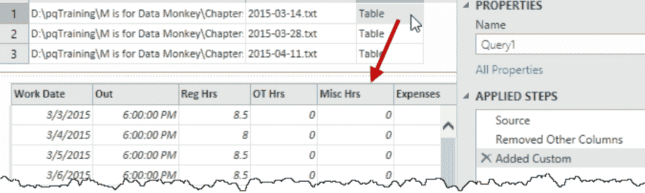

图 23 预览新的导入数据。

现在你可以删除“文件夹路径”和“名称”列并导入数据，从而将文件合并在一起：

- 删除“Folder Path”和“Name”列
- 点击自定义列上的箭头 -> 取消勾选前缀选项 ->
- 重命名查询 `Timesheets`

在提交此查询之前还有最后一点需要检查：数据类型。这有点遗憾，尽管你构建的原始查询定义了数据类型，但当你发现将其转换为函数并以此方式合并文件时，这些设置没有一个被保留：


图 24 警惕恶性的“任意”（Any）数据类型！

为了防止 Power Query 的错误解释，现在设置它们是一个好主意：

- 文本：`Expenses`
- 小数数字：`Misc Hrs`
- 时间：`Reg Hrs`
- 日期：`Out`

完成后，查询最终加载为：

- 日期：`Work Date`
- 时间：`Out`
- 小数数字：`Reg Hrs`
- 小数数字：`Misc Hrs`
- 文本：`Expenses`

# 196 M 代表 (数据) 猴子

当你点击 OK 时，你可以逐步执行并验证查询正在发生的情况：

| | 工作日期 | 离开 | 常规小时 | 加时小时 | 杂小时 | 费用 |
|---|---|---|---|---|---|---|
| 1 | 3/3/2015 | 6:00:00 | 8.5 | 0 | 0 | 0 |
| 2 | 3/4/2015 | 6:00:00 | 8 | 0 | 0 | 0 |
| 3 | 3/5/2015 | 6:00:00 | 8.5 | 0 | 0 | 0 |
| 4 | 3/6/2015 | 6:00:00 | 8.5 | 0 | 0 | 0 |
| 5 | 3/7/2015 | 3:30:00 | 6.5 | 0 | 0 | 0 |
| 6 | 3/10/2015 | 6:00:00 | 8.5 | 0 | 0 | 0 |
| 7 | 3/11/2015 | 6:00:00 | 8.5 | 0 | 0 | 0 |
| 8 | 3/12/2015 | 6:00:00 | 8 | 0 | 0 | 0 |
| 9 | 3/13/2015 | 6:00:00 | 8.5 | 0 | 0 | 0 |
| 10 | 3/14/2015 | 6:00:00 | 8.5 | 0 | 0 | 0 |

图 28 步骤返回了。这里的的好处是你甚至可以点击步骤查看你设置了什么，然后查看它是如何反应的。如果你在数据中发现错误，可以修正它们，然后将查询转换回函数。当你的函数处于调试模式时，任何引用它的后续查询将无法运行！

## 恢复功能

要将查询转换回函数，你需要编辑代码来完成两件事：

- 删除初始行中的字符
- 将这些字符放置在当前声明变量的行之前

一旦完成这些操作，你的函数将恢复正常运行，所有使用此函数的查询都能够再次使用它。忘记注释掉临时行将导致该行覆盖传递到函数的任何变量。


## 高级条件逻辑

在第 18 章中，你学习了如何复制 Excel 中 `IF()` 和 `IFERROR()` 函数的功能。当然，`IF()` 和 `IFERROR` 并不是你在 Excel 中用于实现条件输出或匹配的唯一函数。与之前显示的示例不同，在 Excel 的条件逻辑中复制其他公式涉及一些更复杂的技巧，例如使用列表和自定义函数。

## 多列逻辑

偶尔，当你尝试过滤数据时，你可能需要根据多个标准进行过滤。考虑下表，它包含在 `Ch22 Multi-Column Logic.xlsx` 中：

| 日期 | 库存物品 | 销售员 | 成本 | 价格 | 佣金 |
|---|---|---|---|---|---|
| 5/10/24 周六 | 可爱的小猫 | Fred | 12.00 | 45.00 | 1.35 |
| 5/9/24 周五 | 话话的鹦鹉 | John | 17.00 | 32.00 | 0.96 |
| 5/24/24 周六 | 可爱的小猫 | Jane | 12.00 | 45.00 | 1.35 |
| 5/20/24 周二 | 漂亮的猫咪 | John | 25.00 | 35.00 | 1.05 |
| 5/8/24 周四 | 可爱的小猫 | Jane | 12.00 | 45.00 | 1.35 |
| 5/23/24 周五 | 瞌睡的比鼠 | Jane | 25.00 | 39.00 | 1.17 |
| 5/11/24 周日 | 脾气不好的odil | John | 10.00 | 35.00 | 1.05 |
| 5/19/24 周一 | 漂亮的猫咪 | Mary | 25.00 | 35.00 | 1.05 |
| 5/15/24 周六 | 瞌睡的比鼠 | Jane | 25.00 | 25.00 | 1.25 |

图 288 原始数据集。

## 复制 Excel 的 OR() 函数

如果你只想列出由 Fred 销售的 Talkative Parrot 或其他物品该怎么办？如果是这种情况，将很容易：过滤 `Inventory Item` 列为 `Talkative Parrot` 并过滤 `Sold By` 列为 `Fred`。但如果你使用的是 John 或 Jane 销售的 Talkative Parrot，就会丢失任何由 Fred 销售的物品。

如果数据在 Excel 表格中，你可以使用高级筛选或通过使用以下公式添加列来解决这个问题：

```
=OR([@Inventory Item]="Talkative Parrot", [@Sold By]="Fred")
```

但如果数据不是源自 Excel 表格呢？如果它来自数据库、网页或文本文件？显然，这不可行。将数据拉入 Power Query 查看你应该如何处理：

- 选择工作表中的任意单元格
- 创建新查询 -> 来自表格
- 右键点击 `Date` 列 -> 更改类型 -> 日期

由于你无法在丢失结果的情况下过滤数据，你需要添加一个自定义列并对每行应用公式：

- 转到列 -> 添加自定义列
- 命名列

你知道你将使用类似下面的基本公式测试标准为真为假：

```
if logic then "Meets Criteria!" else "No Match"
```

挑战在于想出该逻辑。Power Query 没有 `OR()` 函数，那么等效的是什么？当你想要测试比较时，快速扫描 Power Query 类中的函数列表是有帮助的。

## M 代表 (数据) 猴子

记住你可以通过点击自定义对话框底部的 Power Query 访问 Power Query 公式列表，并点击页面上的 `https://msdn.microsoft.com/en-us/library/mt29612.aspx` 链接。在列表中你会找到 `List.AnyTrue` 函数，它看起来很有希望。在文档中选择该项会显示：

```
List.AnyTrue({0, false})
```

基于此，你会看到函数包含一个值列表，如括号内的大括号所示。它还显示如果没有任何项目为真，函数将返回假。尝试在逻辑测试中嵌套此公式：

```
=if List.AnyTrue({[Item]="Talkative Parrot",[Sold By]="Fred"}) then "Meets Criteria!" else "No Match"
```

记住你需要逗号分隔标准，然后用大括号包裹整个列表，因为 `List.AnyTrue()` 函数需要列表作为参数。


图 289 使用 `List.AnyTrue()` 复制 Excel 的 `OR()` 函数。由于函数在任何标准为真时返回真，因此 Fred 销售 Talkative Parrot 的任何实例在 Match 列中显示结果 Meets Criteria!。你现在可以通过以下步骤完成此查询：

- 过滤 `Match` 列以仅包含 `Meets Criteria!` 值
- 将查询重名为 `pqOR`
- 转到首页 -> 关闭并加载

Power Query 返回一个包含所有原始行的表格。

## 复制 Excel 的 AND() 函数

虽然你可以通过逐列过滤表格来减少记录是事实，但如果你只想标记在多个列中存在条件的记录怎么办？对于此，你需要复制 Excel 的 `AND()` 函数。此技巧本质上与使用 `List.Any()` 复制 `OR()` 函数的技巧相同，只是对于 `AND()` 你需要使用 `List.AllTrue()`。此函数仅在每个逻辑测试都提供真值时才返回真值——就像 Excel 的 `AND()` 函数一样。看看它与之前的函数有什么不同：

- 转到查询窗格，右键点击 `pqOR` -> 复制
- 重命名为 `pqAND`
- 选择 添加自定义步骤，点击齿轮图标（编辑公式）
- 将 `List.AnyTrue` 替换为 `List.AllTrue`
- 选择 过滤行步骤

你可以看到，结果与使用原始 `List.AnyTrue()` 函数得到的结果大不同：

| 库存物品 | 销售员 | 成本 | 价格 | 佣金 | 匹配？ |
|---|---|---|---|---|---|
| Talkative Parrot | Fred | 17 | 32 | | Meets Criteria! |
| Talkative Parrot | Fred | 17 | 32 | | Meets Criteria! |
| Talkative Parrot | Fred | 17 | 32 | | Meets Criteria! |
| Talkative Parrot | Fred | 17 | 32 | | Meets Criteria! |
| Talkative Parrot | Fred | 17 | 32 | | Meets Criteria! |
| Talkative Parrot | Fred | 17 | 32 | | Meets Criteria! |

图 290 使用 `List.AllTrue()` 函数根据多列标准标记记录。

虽然这种方法显然是根据公式输出的结果过滤数据，但该函数的好处在于你可以轻松地在不过滤的情况下标记记录。这允许你在构建更复杂逻辑的同时保留原始数据——这种做法在通过过滤列来钻取最终值时是无法实现的。

## 分级水位表

| | G | H |
|---|---|---|
| 2 | 收入 | 带 1 | 备带 |
| 3 | | 0-100k | < 100k |
| 4 | | 100,000 (100k-200k) | 100k > 200k |
| 5 | | 200,000 (200-300k) | 200k > 300k |
| 6 | | 300,000 (300-500k) | 300k > 500k |
| 7 | | 500,000 (500-750k) | 500k > 750k |
| 8 | | 750,000 (750–1M) | 750k > 1M |
| 9 | | 1,000,000 (1M–1.5M) | 1M > 1.5M |
| 10 | | 1,500,000 (1.5M–2M) | 1.5M > 2M |
| 11 | | 2,000,000 (2–3M) | 2M > 3M |
| 12 | | 3,000,000 (3M) | |

图 291 BandingLevels 表。

| A | B | C | D |
|---|---|---|---|
| 1 | | VLOOKUP(v,rng,2,true) | VLOOKUP(v,rng,3) | VLOOKUP(v,rng,2,false) |
| 2 | 数值 | | | |
| 3 | | 99,000 (0-100k) | < 100k | #N/A |
| 4 | | 110,000 (100k-200k) | 100k > 200k | #N/A |
| 5 | | 220,000 (200-300k) | 200k > 300k | #N/A |
| 6 | | 301,000 (300–500k) | 300k > 500k | #N/A |
| 7 | | 505,000 (500–750k) | 500k > 750k | #N/A |
| 8 | | 3,000,050 (> 3M) | > 3M | #N/A |
| 9 | | | #N/A | #N/A | #N/A |
| 10 | | 170,000 (100k-200k) | | |

图 292 DataTable 表。

你应该在此处设置 Power Query 函数，然后你将看到它是如何模拟 Excel 版本的 `VLOOKUP()` 的：

- 使用 Windows 资源管理器转到 `Ch22 Examples|pqVLOOKUP.txt`
- 打开文件并复制文件内容
- 返回 Excel
- 创建新查询 -> 来自其他源 -> 空白查询
- 打开高级编辑器 -> 选择窗口中的所有代码
- 粘贴文本文件的内容（替换所有现有代码）
- 点击完成
- 重命名函数为 `pqVLOOKUP`
- 转到主页 -> 关闭并载入

创建好函数后，你需要一个指向 BandingLevels 表的指针：

# 第 22 章 高级条件逻辑

- 选择 `BandingLevels` 表中的任意列 -> 创建新查询 -> 来自表格
- 转到主页 -> 关闭并载入... -> 仅创建连接

我们现在准备好查看它是如何工作的了。导入 DataTable，并删除所有 Excel 版本的函数。

- 选择 `DataTable` 中的任意列 -> 创建新查询 -> 来自表格
- 右键点击 `Values`（数值）列 -> 删除其他列

现在你只剩下一列数据了：


图 293 准备好尝试 `pqVLOOKUP` 函数。

要查看 `pqVLOOKUP` 是否对有效，你可以尝试复制以下公式：

```
=VLOOKUP ([Values], BandingLevels, 2, true)
```

要实现这一点，你可以按照以下步骤操作：

- 转到添加列 -> 添加自定义列
- 将列命名为 `2,True`
- 使用以下公式：
  `=pqVLOOKUP([Values], BandingLevels, 2, true)`

结果与 Excel 的结果完全相同：


图 294 使用显式定义的近似匹配复制 `VLOOKUP()`。

看起来看起来不错。现在尝试去掉末尾的 `true`，并返回查找表中的第三列而不是第二列：

- 转到添加列 -> 添加自定义列
- 将列命名为 `3,default`
- 使用公式：
  `=pqVLOOKUP([Values], BandingLevels, 3)`

结果与 Excel 的结果一样：


图 295 使用近似匹配复制 `VLOOKUP()`。

再试一次。如果想对表的第二列定义精确匹配怎么办？这样做：

- 转到添加列 -> 添加自定义列
- 将列命名为 `2,false`
- 使用公式：
  `=pqVLOOKUP([Values], BandingLevels, 2, false)`

再次，结果与 Excel 一致：


 图 296 使用精确匹配复制 `VLOOKUP()`。

尽管使用此函数模拟 `VLOOKUP()` 的精确匹配，但不这样做是因为可以通过合并表格来实现精确匹配——这种方法更快。如果你需要近似匹配，这是一个可行的方法。完成查询：

- 转到主页 -> 关闭并载入

在这一点，你应该注意到 Excel 的 `VLOOKUP()` 和 `pqVLOOKUP` 函数之间的区别在于：`pqVLOOKUP` 返回的值实际上是文本，而不是错误，你可以看到。

| | | | | |
|---|---|---|---|---|
| 2 | Values | `VLOOKUP(v,rng,2,true)` | `VLOOKUP(v,rng,3)` | `VLOOKUP(v,rng,2,false)` |
| 3 | | 99,000 (0-100k) | < 100k | #N/A |
| 4 | | 110,000 (100k-200k) | 100k > 200k | #N/A |
| 5 | | 220,000 (200-300k) | 200k > 300k | #N/A |
| 6 | | 301,000 (300–500k) | 300k > 500k | #N/A |
| 7 | | 505,000 (500–750k) | 500k > 750k | #N/A |
| 8 | | 3,000,050 (> 3M) | > 3M | #N/A |
| 9 | | | #N/A | #N/A | #N/A |
| 11 | | 100,000 (100k-200k) | 100k > 200k | 100k-200k |

## 在 Power Query 中模拟 VLOOKUP

| | | | | |
|---|---|---|---|---|
| 13 | Values | 2,true | 3,default | 2 false |
| 14 | | 99,000 (0-100k) | < 100k | #N/A |
| 15 | | 110,000 (100k-200k) | 100k > 200k | #N/A |
| 16 | | 220,000 (200-300k) | 200k > 300k | #N/A |
| 17 | | 301,010 (300–500k) | 300k > 500k | #N/A |
| 18 | | 505,000 (500–750k) | 500k > 750k | #N/A |
| 19 | | 3,000,050 (> 3M) | > 3M | #N/A |
| 20 | | #N/A | #N/A | #N/A |
| 21 | | 100,000 (0-100k) | 100k > 200k | 100k-200k |

图 297 `pqVLOOKUP` 的“错误” #N/A 实际上是文本。

在返回错误时，返回文本是你能做到的最接近，因为在 Power Query 中无法输出真正的 #N/A 错误。

## 理解 pqVLOOKUP 函数

那么 `pqVLOOKUP` 函数有效吗？看下代码：

```powerquery
(lookup_value = any, table_array as table, col_index_number as number,
optional approximate_match as logical) as any =>
let
  /*如果用户未指定，则可选匹配 */
  matchtype =
    if approximate_match = null then
      true
    else
      approximate_match,
  /*获取列名 */
  Cols = Table.ColumnNames(table_array),
  FilteredTable = Table.SelectRows(table_array, each Record.Field(_, Cols{0}) <= lookup_value),
  SortedTable = Table.Sort(FilteredTable, {{Cols{0}, Order.Descending}}),
  TopRow = Table.First(SortedTable),
  Result =
    if TopRow <> null then
      TopRow{col_index_number - 1}
    else
      "#N/A"
in
  Result
```

[第 21 页]

## 构建一个 SWITCH() 函数

一旦你了解了基本结构，构建该函数并不困难。以下是入门步骤：

- 打开 `Ch22 Examples|Emulating SWITCH.xlsx`
- 创建新查询 -> 来自其他源 -> 空白查询
- 将查询重命名为 `fnSWITCH`
- 转到首页 -> 高级编辑器
- 输入下方所示 M 代码：

```powerquery
(input) =>
let
values = {
    result_1, return_value_1,
    (input, "Undefined")
}
Result = List.First(List.Select(values, each _{0}=input))
in
Result
```

这段代码是任何 `SWITCH()` 函数的基础框架。这里是需要识别的关键部分：

- `result_1` 是你传递给函数的第一个可能性
- `return_value_1` 是如果第一个值等于 `result_1`，你想要返回的值
- 如果你需要更多值，只需在 `(result_1, return_value_1)` 部分之后插入另一个逗号，并放入一个 `(result_2, return_value_2)` 部分
- 你可以根据需要保留尽可能多的值
- 如果传递的值不在你提供的选项列表中，列表中的值将返回文本 `Undefined`（这是 `SWITCH()` 函数的 Else 部分）

使用此结构，你可以如下所示针对你的场景修改 `fnSWITCH` 函数：

```powerquery
(input) =>
let
values = {
    "E", "Employee",
    "S", "SCYC",
    "N", "Non-Taxable",
    "R", "Restricted",
    "I", "Inactive",
    "L", "Social",
    "M", "Medical",
    "U", "Regular",
    (input, "Undefined")
}
Result = List.First(List.Select(values, each _{0}=input))
in
Result
```

你在此处做的修改是将 `value_1` 替换为 `"E"`，将 `return_value_1` 替换为 `"Employee"`，并添加更多潜在输入对和期望返回的值。请注意，你并不限于查找单个字符。你可以轻松地查找值或较长的字符串；只需确保你的选项始终以成对的形式输入在大括号之间，并在行末加上逗号即可。

完成修改后：

- 点击完成
- 转到首页 -> 关闭并加载

[第 216 页]

## 使用 fnSWITCH 函数

现在 `fnSWITCH` 函数已经创建，你可以用它从此文件的每个客户记录中提取账单类型。

- 选择 Customers 工作表中的任意单元格 -> 创建新查询 -> 来自表格

数据加载到 Power Query 中的如下：

| CustomerCode | BillingCode |
| :--- | :--- |
| 1 | 65121 Grand Banks/Power | MP010450UP |
| 2 | 65124 Samson/Sail | MA120435UP |
| 3 | 65125 US 25 (sail) | MA120430SP |
| 4 | 65126 Sail | MP010325UP |
| 5 | 65131 Sail | MA120330SP |
| 6 | 65133 King Fisher-Pwr | MP010440SP |
| 7 | 65146 ranger 255C-Pwr | MA120330UP |
| 8 | 65159 Sail | MA120335SP |
| 9 | 66108 O'Day/Sail | MP010335SP |

图 298 原始数据表。

`fnSWITCH()` 函数的设计用于将 `BillingCode` 中的第九个字符转换为对应的客户类型。为了使用它，你需要提取出那个字符：

- 转到列 -> 添加自定义列
- 将列命名为 Customer Type
- 输入公式：

```powerquery
=fnSWITCH(Text.Range([BillingCode], 8, 1))
```

> 记住，你需要从第 8 个字符开始获取第九个字符，因为 Power Query 对 `Text.Range` 函数的此参数使用 0 索引，如第 17 章所示。

结果如下：

| CustomerCode | BillingCode | Customer Type |
| :--- | :--- | :--- |
| 1 | 65121 Grand Banks/Power | MP010450UP | Regular |
| 2 | 65124 Samson/Sail | MA120435UP | Regular |
| 3 | 65125 US 25 (sail) | MA120430SP | SCYC |
| 4 | 65126 Sail | MP010325UP | Regular |
| 5 | 65131 Sail | MA120330SP | SCYC |

图 299 `fnSWITCH` 函数的 own。

你会发现数据中的所有样本运行良好，且没有内容返回为 undefined。按照以下步骤查看查询如何响应于不同的项目：

- 将查询名称更改为 Billing
- 转到首页 -> 关闭并加载
- 将任何账单代码的倒数第二个字母改为其他内容

[第 217 页]

## M 代表 (数据) 猴

当刷新表格时，它评估新字符并返回适当的结果。这里你看到当第一个记录的账单代码更新时发生了什么：

| CustomerCode | BillingCode | Customer Type |
| :--- | :--- | :--- |
| 1 | 65121 Grand Banks/Power | MP010450UP | Regular |
| 2 | 65124 Samson/Sail | MA120435UP | Regular |
| 3 | 65125 US 25 (sail) | MA120430SP | SCYC |
| 4 | 65126 Sail | MP010325UP | Regular |
| 5 | 65131 Sail | MA120330SP | SCYC |
| 6 | 65133 King Fisher-Pwr | MP010440SP | SCYC |
| 7 | 65146 ranger 255C-Pwr | MA120330UP | Regular |

注意该函数是区分大小写的，如上所示，路径不是有效的字符。图 300 客户类型已计算。

[第 218 页]

## 第23 章 动态表格

在第 21 章中，我们探索了自定义函数如何预处理数据集。虽然这是自定义函数的巨大优势之一，但并非唯一的优势。

回顾上一章关于从文件夹收集工作单的示例。假设你建立了一个汇总文件并将其保存在 `H:\Payroll`，并且在那里工作了一年后，现在你只有几周的假期，而你希望交付的解决方案无论放在哪里都能运行。真正的挑战是什么？M 语言中没有函数可以获取你正在使用的工作簿路径。有趣的是，Excel 公式可以做到。

> 在我们开始让文件路径动态化之前，关于这项技术你应该知道：当数据访问发生在函数内部，且数据源取决于函数的参数时，查询无法在 Power BI 中刷新。这是因为 Microsoft 对查询进行静态分析，而静态分析尚无法处理这种场景。

这并不意味着该功能没有用，也不意味着它将来不会被支持。它仅仅意味着只有当解决方案将位于桌面 Excel 而不是网络端时，你才能依赖它。

# 实现参数表

将参数表实现到解决方案中有三个步骤：

1. 在 Excel 中创建参数表。
2. 创建从表格中提取值的函数。
3. 重新调整现有查询以调用该函数。

我们将使用 `Ch 23 Examples\ParameterTables.xlsx` 文件逐步此过程的每一个步骤。

## 第 1 步：创建表格

你首先需要的是创建一个表格来存储你的参数。此表格应该具有特定的格式，并且需要正确设置某些组件。

在 Info 工作表的单元格 A7:B8 中中创建下方的表格：

| 文件 | 开始 | 插入 | 页面布局 | 公式 | 数据 | 审阅 | 视图 | 开发工具 | Power Pivot |
|---|---|---|---|---|---|---|---|---|---|
| 表格名称: | 使用透视表汇总 | 属性 | 标题行 | 第一 | | |
| 参数 | 删除重复 | 在浏览器中打开 | 总计行 | 最后 | |
| 调整表格大小 | 转换为区域 | 插入切片刷新 | 解除链接 | 条纹行 | 禁止 |
| 属性 | 工具 | 外部表格数据 | 表格 | | |
| 参数 | 值 |
|---|---|
| 文件路径 | |
| | |
| | |

图 302 基础的 Parameters 表格。

注意此表格的几个关键特征：

- 第一列表头：Parameter
- 第二列表头：Value
- 表格名称为：Parameters

> 如果你想复制并粘贴从下载文件中提供的函数，这些特征中的每一个必须是正确的。即使其中任何一项的拼写有所不同，你将需要对表格或函数进行调试。

现在表格已设置好，可以存储你想要作为解决方案中动态变量使用的每个数据。只需在左侧提供参数名称，并在 Values 列中提供参数的值即可。

> Values 列中的项可以是硬编码的文本或数值，可以由数据验证性列表驱动，也可以使用公式。如何在单元格中获取正确的值完全取决于解决方案设计者。

接下来，你需要确定当前工作簿的文件路径。在单元格 B8 中输入以下公式：

```excel
=LEFT(CELL("filename", A1), FIND("[", CELL("filename", A1), 1)-1)
```

> 如果你还没有保存文件，此函数将无法返回路径，因为它无法确定工作簿所在的位置。保存文件将为你解决这个问题。

执行操作后，你将看到工作簿的文件路径。唯一的挑战是，你实际上希望此文件路径指向 Source Files 文件夹，即存储工时表的地方。如下所示更新公式：

```excel
=LEFT(CELL("filename", A1), FIND("[", CELL("filename", A1), 1)-1) & "Source Files\"
```

| 参数 | 值 |
|---|---|
| 文件路径 | D:\pqTraining\MCh 23 Examples\Source Files\ |
| | |
| | |

图 303 使用 Excel 公式动态返回文件路径。

## 第 2 步：实现 fnGetParameter 函数

有了参数名这种可以容纳任何变量的状态，你需要为 Power Query 提供一种方法来读取这些值。这部分可以通过以下自定义函数完成：

```powerquery
(ParameterName as text) =>
let
    ParamSource = Excel.CurrentWorkbook(){[Name="Parameters"]}[Content],
    ParamRow = Table.SelectRows(ParamSource, each ([Parameter]=ParameterName)),
    Value = if Table.IsEmpty(ParamRow)=true then null else Record.Field(ParamRow{0},"Value")
in
    Value
```

> 该函数包含在 `Ch23 Examples` 文件夹的 `fnGetParameter.txt` 文件中。除了代码，它还包含了使用该函数的说明，以及从单元格返回路径的公式。提供该文件是为了给你一个可以存储并多次使用的模板。

此代码连接到工作簿中的 Parameters 表格，然后选择表格中动态参数之值与 Excel 表格中 Parameter 列中的记录匹配的行。在完成匹配后，它会返回在 Value 列中找到的内容。正是因为这些名称在函数中都是硬编码的，所以 Excel 表格的表名和列名必须与上述指定的匹配。

与其重新输入这整块代码，不如打开 `Ch23 Examples\fnGetParameter.txt` 文件并复制文件中的所有行。使用剪贴板后，将此函数实现到你的解决方案中将变得极其简单：

- 创建查询 -> 从其他源 -> 来自空查询
- 转到“开始”选项卡 -> 高级编辑器
- 高亮窗口中的所有行代码
- 按 `Ctrl+V` 粘贴文本文件的内容
- 点击完成
- 将函数名称重命名为 `fnGetParameter`

你就完成了。

## 第 3 步：调用 fnGetParameter 函数

参数表格构建好且函数已就绪后，最后一步是改造查询以实际使用它。这样做将允许你从单元格中获取文件路径并在你的查询中使用它。因为文件路径会在工作簿重新计算时更新，所以它将始终保持准确，这意味着解决方案将始终在解决方案所在的子目录中查找工时表文件。

要改造 Timesheets 查询，你甚至无需离开 Power Query 编辑。你只需点击“查询”左侧的小箭头即可展开导航器：


图 304 展开导航器窗口。

导航器允许你选择任何查询或函数，这样你就可以快速切换回。以下是你的操作步骤：

- 右键点击 `Timesheets` 查询 -> 高级编辑器
- 插入以下行：`let`


图 305 调用 `fnGetParameter`。

查询现在看起来应该是：

```
let
fullfilepath = fnGetParameter("File Path"),
Source = Folder.Files(fullfilepath),
```

> 你必须手动编辑代码才能使其工作。无法通过点击 `Source` 步骤旁边的齿轮来实现，因为 `fullfilepath` 不是一个有效的文件夹。

当你完成修改后，点击完成，你会发现查询的每个步骤仍然正常运行。


图 306 改造后的查询可以工作。

## 参数表的影响

在构建解决方案时，引用参数表格为我们提供了巨大的灵活性。无论是在公司内部构建解决方案并需要与团队成员或部门共享，你现在都可以动态地设置它们了。

```
let
Source = Folder.Files(fullfilepath),
```

图 307 `fullfilepath` 变量是正确的。

# 第 24 章 动态日历表

在 Excel 2010 和 2013 中使用 Power Pivot 时，你需要为模型提供自己的日历表。对于拥有协作 IT 部门并为用户发布日历的组织来说，这很容易。

然而，如果你不在这样的组织中，情况就会变得棘手。你可以寻找网络资源，但当你坐在飞机上或在非洲矿井视察途中调整模型时，这些资源是无法作用的。你也可以 Excel 表格中构建自己的日历，但这会导致日期表扩展时发生变化，日期不会自动为你扩展。

对于这些用户，Power Query 的出现出现。正如你将看到的，使用 Power Query 在 Excel 中设置一个完全动态的日历超级简单。而且基于第 23 章的技术，你可以根据几个 Excel 单元格来驱动整个过程。

# 创建动态日历表

为你的解决方案创建一个完全动态日历共需要以下步骤：

1. 添加一个参数表来存储日历边界。
2. 实现 `fnGetParameter` 函数以检索边界。
3. 构建基础动态日历框架。
4. 添加所需的日历列。

基于第 23 章探索的方法，你会发现这个过程设置非常快。

# 第 1 步：添加参数表

对于此示例，你将从一个完全空白的工作簿开始，尽管你可以轻松地将其整合到现有模型中。如果你恰好已经在解决方案中有一个 `Parameter` 表，只需向其添加新字段即可。如果没有，你将必须从头构建该表。

记住构建表时的关键点：

- 表名必须为 `Parameters`
- 必须有一列 `Parameter` 和一列 `Value`

你应该构建此表来存储起始日期和结束日期：

- `Start Date` 1/1/2014
- `End Date` `=EOMONTH(TODAY(),0)`

设置完成后，该表将如下所示：

| 文件 | 插入 | 页面布局 | 公式 | 数据 |
|---|---|---|---|---|
| 表格名称: | 使用透视表汇总 | | | |
| Parameters | 删除重复项 | | | |
| 调整表格大小 | 转换为区域 | 插入切片 | 导出刷新 | |
| 属性 | | | | Ext |
| B4 | | | | `=TODAY()` |
| 1 | A | B | C | D | E |
| 2 | Parameter | Value | | | |
| 3 | Start Date | 1/1/2014 | | | |
| 4 | End Date | 8/14/2015 | | | |


`EOMONTH()` 函数的语法如下：

```
=EOMONTH(start_date,months)
```

如果你在 `months` 参数中使用 `0`，函数将返回给定月份最后最后。如果你提供 `-1`，它将是上个月的最后；如果你使用正值 `3`，函数将给你提供日期之后 3 个月的最后一天。此函数在驱动你的日历表时非常有用。

# 第 2 步：实现 fnGetParameter 函数

构建表后，你就可以创建 `fnGetParameter` 函数：

- 打开 `Ch24 Examples!fnGetParameter.txt` 文件
- 复制文本文件的全部内容
- 创建新查询 -> 来自其他源 -> 空查询
- 转到主页 -> 高级窗口 -> 高级编辑器
- 选亮窗口中的所有代码 -> `Ctrl+V` -> 完成
- 重命名查询为 `fnGetParameter`

`fnGetParameter` 函数现在已安装，准备好使用：


# 第 3 步：构建基础日历框架

基础工作快速完成后，你现在可以处理手头的实际任务：构建日历。与其退出 Power Query 编辑器，你直接可以在它内部创建一个新查询：

- 转到主页 -> 新源 -> 其他源 -> 空查询
- 重命名查询为 `Calendar`

你现在有一个完全为空的新查询：


信你不信，开始构建日历的更简单方法是从简单的列表开始。点击公式栏内部并输入以下公式：

```
= (1..10)
```

这创建了一个从一到十的列表：


图 311 你有一个简单的列表。

接下来，将其转换为表格，并查看将结果列更改日期会发生什么：

- 转到列表工具 → 转换 -> 表格
- 保留默认选项并点击确定
- 右键点击 `Column1` → 更改类型 → 日期
- 右键点击 `Column1` → 重命名 → `Date`

虽然这不正是你想要的日期范围，但你确实得到了日历的开头：


图 312 日期有点问题！

尽管它看起来不完全像，但你已经处于正确的状态了。记得在查询的开头插入两个步骤来提取起始日期和结束日期，而不是使用 1 到 10？尝试一下：

- 转到主页 -> 高级编辑器
- 在紧行之后添加以下行：

```
startdate = fnGetParameter("Start Date"),
enddate = fnGetParameter("End Date"),
```

此时，检查步骤以确保它们返回的是你预期的日期是一个好主意。


图 313 `startdate` 返回了日期。

现在变量持有了结束日期，你可以将它们合并到 `Source` 行，替换之前的 1 和 10：

- 选择 `Source` 步骤
- 将公式栏中的公式编辑为 `={startdate..enddate}`
- 按回车


图 314 这是什么意思？

这个错误信息不明确。更好的说法是除非提供了日期，否则 Power Query 无法使用 `..` 运算符。尽管你知道日期只是数字，Power Query 并不十分灵活。这意味着你需要将这些日期转换为数字。一旦它们成为值，Power Query 就能处理它们。操作方法如下：

- 转到高级编辑器
- 替换起始和结束行：

```
startdate = Number.From(fnGetParameter("Start Date")),
enddate = Number.From(fnGetParameter("End Date")),
```

- 点击完成
- 选择日期步骤

`startdate` 现在转换为了日期序列号。查询结束，你可以看到你现在拥有了一个从 2014 年 1 月 1 日到你的表提供的结束日期的有效日历：

| 日期 | 属性 |
|---|---|
| 1 | 1/1/2014 | 名称 |
| 2 | 1/2/2014 | Calendar |
| 3 | 1/3/2014 | 所有属性 |
| 4 | 1/4/2014 | 应用步骤 |
| 5 | 1/5/2014 | startdate |
| 6 | 1/6/2014 | enddate |
| 7 | 1/7/2014 | Source |
| 8 | 1/8/2014 | 转换为表格 |
| 9 | 1/9/2014 | 更改类型 |
| 10 | 1/10/2014 | |
| 11 | 1/11/2014 | 重命名列 |

图 315 日历表已就绪。

# 第 4 步：添加所需的日历列

日历表设置好并覆盖了你的日期范围，现在是向其添加所需的列了。这很简单：

- 选择日期列 -> 添加列 -> 日期 -> 年
- 选择日期列 -> 添加列 -> 日期 -> 月
- 选择日期列 -> 添加列 -> 日期 -> 日

如你所见，日历表正开始成型：

| | 日期 | 年 | 月 | 日 |
|---|---|---|---|---|
| 1 | 1/1/2014 | 2014 | 1 | 1 |
| 2 | 1/2/2014 | 2014 | 1 | 2 |
| 3 | 1/3/2014 | 2014 | 1 | 3 |
| 4 | 1/4/2014 | 2014 | 1 | 4 |
| 5 | 1/5/2014 | 2014 | 1 | 5 |
| 6 | 1/6/2014 | 2014 | 1 | 6 |
| 7 | 1/7/2014 | 2014 | 1 | 7 |
| 8 | 1/8/2014 | 2014 | 1 | 8 |


Power Query 有许多可以很容易添加到表格中的格式。然而，也有一些格式是不行的。

# Power Query 日期函数

Power Query 的许多日期函数与 Excel 不同——有些是细微的，有些则并不明显。因此，接下来的页面将为你提供方法，让你在 Power Query 中轻松实现你已经在 Excel 中知道如何操作。

# Excel 日期函数

Excel 有多种日期函数，在构建参数表以驱动日历时可能很有帮助。它们中的每一个都显式地用于 Excel（而不是 Power Query），并可用于起始或结束日期，从而为你提供一个符合你需求的范围。

| 返回 | 公式 |
|---|---|
| 当前日期 | `TODAY()` |
| 本月底 | `EOMONTH(TODAY(),0)` |
| 上个月底 | `EOMONTH(TODAY(),-1)` |
| 下个月底 | `EOMONTH(TODAY(),1)` |
| 当前年份底 | `EOMONTH(TODAY(),12-MONTH(TODAY()))` |
| B25 单元格日期的年份底 | `EOMONTH(B25,12-MONTH(B25))` |

## 日期函数等效于：添加日期

如果你取一个有效日期并对其加上一个值来递增，你可能会感到沮丧。尽管你知道所有日期都是基于日期序列号，但 Power Query 不会像 Excel 那样隐式转换日期类型。出于某些原因，有一组 `.Addx` 函数用于此类：

| 添加 x | Excel 公式 | Power Query 版本 |
|---|---|---|
| 天 | `[Date]+x` | `Date.AddDays([Date],...)` |

## 日期函数等效于：返回日期

为了以文本格式转换并返回日期，会在 Excel 中使用 `TEXT()` 函数。在 Power Query 中，等效函数由 `Date.ToText()` 提供，但它们有一个额外的细节：不仅函数本身是敏感的，参数也是敏感的：

| 返回 | Excel 公式 | Power Query 版本 |
|---|---|---|
| 日 | `Text([Date],"ddd")` | `Date.ToText([Date],"ddd")` |
| 日 | `Text([Date],"dddd")` | `Date.ToText([Date],"dddd")` |
| 八月 | `Text([Date],"mmm")` | `Date.ToText([Date],"MMM")` |
| 八月 | `Text([Date],"mmmm")` | `Date.ToText([Date],"MMM")` |
| 2015年8月9日 | `Text([Date],"mmm d, yyyy")` | `Date.ToText([Date],"MMM d, yyyy")` |
| 2015年8月09日 | `Text([Date],"mm dd, yyyy")` | `Date.ToText([Date],"MMM dd, yyyy")` |

## 处理日期转换错误

列出的许多函数都需要日期或日期数据类型作为输入，如果提供了替代日期类型，将返回错误。为了防止这种情况，你可以像这里所示将 `[Date]` 列输入封装在 `Date.From` 函数中：

```
=Date.AddDays(Date.From([DateColumn]),1)
```

# 第 25 章 查询组织

在你学习了 Power Query 的所有工作后，你可能不会意外在尝试合并两个表时突然遇到错误。遗憾的是，如果表来自不同的数据源，这是有可能的。

## Formula.Firewall 错误

在书中到为止还没有见过的之一就是可怕的 `Formula.Firewall` 错误，但当它发生在你身上时，可能会让你大震惊。虽然有避免它的策略，但如果提前知道是什么导致这个糟糕的错误消息出现会更好。

## 触发 Formula.Firewall 错误

在几个章节中使用的工时表中，回想你构建了一个相当健壮的解决方案。解决方案文件保存在特定位置，数据文件存储在 `Sources` 子文件夹中，该文件夹挂在解决方案目录下。你重用了代码来导入单个表，将其转换为函数，并利用它对 `Sources` 目录中的所有文件进行预处理，以便之后可以合并它们。如果你倾向于将其推送到那里，数据将落在 Excel 工作表（或 Power Pivot 数据模型）中。能出什么问题呢？

范围变化。就是这样。假设你的经理告诉她，她想将每个员工的部门与数据集合并。

你将员工记录存储在另一个 Excel 文件中，其中有每个员工的姓名和部门。你知道可以从 Excel 文件导入，也知道如何合并数据集。这能有多难？尝试：

- 打开 `Ch25 Examples\Query Organization.xlsx`
- 创建新查询 -> 来自 (From) -> Excel 工作簿 (From Excel Workbook)
- 导航到 `Ch25 Examples\Departments.xlsx`
- 选择 `EmployeeDepts` 表


这个表看起来很不错。事实上，它看起来非常棒，你只需将其加载到连接中，因为真的不需要任何修改：

- 点击 加载 (Load) 选项上的箭头 -> 加载到...(Load To...) -> 仅创建连接 (Only Create Connection)

你在工作簿查询 (Workbook Queries) 格中获得了一个很好的新的 `EmployeeDepts` 查询，目前一切看起来良好。

## M 代表（数据）猴子

现在合并这些表：

- 右键点击 `Timesheets` 查询 -> 编辑 (Edit)
- 转到 开始 (Home) -> 合并查询 (Merge Queries)
- 选择合并 `EmployeeDepts` 表
- 选择每个表上的 `Employee` 列


图 318 目前情况看起来很乐观。

奇怪的是，Power Query 无法确定将有多少行会匹配：


图 319 为什么 Power Query 会出现匹配问题？

别管它。点击确定并期待最好的结果。然后*砰*，你得到了可怕的 `Formula.Firewall` 消息：

> Formula.Firewall: 查询 'Timesheets' (步骤 'Merged Queries') 引用了其他查询或步骤，它可能无法访问数据源。请重新构建此数据组合。

图 320 可怕的 Formula.Firewall 露出了真目。

这个消息有点吓人。在英语中，它想说你使用同一个查询连接了两个不同的数据集。无论你处理的是来自同一个工作簿的两个表；它们被视为两个集合，Power Query 不喜欢这样。

## 避免 Formula.Firewall 错误

如何解决这个问题？避免该问题的方法如下：

- 删除 合并查询 (Merged Queries) 步骤
- 关闭 Power Query 编辑器
- 转到 工作簿查询格 -> 右键点击 `Timesheets` 查询 -> 加载到...(Load To...)
- 将查询的行为更改为 仅连接 (Only Connection)
- 确认你可以删除该表

# 第 25 章 查询组织

你现在为 `Timesheets` 数据和 `EmployeeDepts` 数据设置了仅连接。创建一个新查询来合并：

- 右键点击 `Timesheets` 查询 -> 合并 (Merge)
- 选择 `EmployeeDepts` 表
- 选择两个表上的 `Employee` 列


注意这次 Power Query 识别出了匹配项：

图 321 这更有希望。

随着合并，你可以继续：

- 点击确定
- 将查询重命名为 `Consolidated`
- 展开 -> 无前缀 -> `Department` 列
- 转到 `开始` -> `关闭并加载到...` -> `现有工作表`
- 将数据加载到 `Timesheets` 工作表的 `A1`

这次行通了：

| A | B | C | D | E | F |
|---|---|---|---|---|---|
| 1 | Employee | Misc Hrs | OT Hrs | Reg Hrs | Work Date | Department |
| 2 | John Thompson | 0 | 0 | 6:00:00 PM | 8.5 | 3/3/2015 |
| 3 | John Thompson | 0 | 0 | 6:00:00 PM | 8.5 | 3/4/2015 |
| 4 | John Thompson | 0 | 0 | 6:00:00 PM | 8.5 | 3/5/2015 |
| 5 | John Thompson | 0 | 0 | 6:00:00 PM | 8.5 | 3/6/2015 |
| 6 | John Thompson | 0 | 0 | 0:30:00 PM | 6.5 | 3/7/2015 |
| 7 | John Thompson | 0 | 0 | 6:00:00 PM | 8.5 | 3/8/2015 |
| 8 | John Thompson | 0 | 0 | 6:00:00 PM | 8.5 | 3/11/2015 |
| 9 | John Thompson | 0 | 0 | 6:00:00 PM | 6 | 3/12/2015 |
| 10 | John Thompson | 0 | 0 | 6:00:00 PM | 8.5 | 3/13/2015 |
| 11 | John Thompson | 0 | 0 | 6:00:00 PM | 8.5 | 3/14/2015 |
| 12 | Bob Johnson | 0 | 0 | 6:00:00 PM | 9.5 | 3/3/2015 |
| 13 | Bob Johnson | 0 | | 6:00:00 PM | | 3/4/2015 |

图 322 部门已合并到数据集中。

## 创建分阶段/加载查询

避免 `Formula.Firewall` 的秘密是将连接数据库的工作和加载到最终目标的工作分开。我们将这些称为分阶段 和加载 查询。

## M 代表（数据）猴子

你使用分阶段查询来确保尽可能创建单独查询来从每个数据源提取初始数据。然后你在分阶段查询中进行尽可能多的转换，以便将数据转换为许多查询可以使用的形状。然而，你不要尝试将另一个数据源或最终结果合并到数据模型的工作表中。这两项任务都留给加载查询。

加载查询旨在从一个或多个分阶段查询提取数据，并在进行任何所需的最终转换之前进行合并或追加。你设置这些查询将输出加载到最终目标，无论是工作表还是数据模型。

从视觉上看，过程如下：


图 323 组织分阶段和加载查询。

从技术上说，合并任何两个不同的数据源都会导致 `Formula.Firewall` 出现；从 Excel 参数表中注入参数也可能触发错误。如果你在尝试在查询中间嵌套动态参数时遇到 `Formula.Firewall` 错误，请尝试从前面声明变量，而不是避免变量声明并将函数嵌套在代码中。这解决了该问题。

## 注意事项

在处理分阶段和加载查询时，你需要在某些情况下格外小心，特别是当你连接的数据源可以利用过滤来提高性能时。这是因为查询过滤只能从到数据源的主连接执行。

当对支持查询过滤的数据库使用分阶段/加载方法时，你应该始终尝试在分阶段查询中完成尽可能多的过滤和分组操作。这将允许 Power Query 将处理任务传回数据库。当你离开查询进入加载查询时，不再有更多命令可以传回数据库，这意味着 Power Query 必须执行处理工作。这会显著减慢速度。对数据库建立多个连接以提取单个数据集也是明智的，让数据库为你完成重型工作。

## 第 25 章 查询组织

你应该意识到，Power BI 通常并不推崇使用分阶段和加载查询方法的长查询链。如果你打算将解决方案推送到 Power BI，最好尝试将该方法保持为单个查询，如果不能，则限制步骤的数量。

## 保持查询整洁

随着你构建并创建更多的 Power Query 查询，你会发现工作簿 窗格中的内容开始变得有些杂乱。事实上，有几种方法可以帮助你解决这个问题。

## 修改查询显示顺序

当你开始构建时，Power Query 会按顺序将它们添加到列表的底部。不过，你可以更改这些查询在工作簿窗格中（以及 Power Query 编辑器中的 Power Query 导航器中）的呈现顺序。要更改查询相对于其他查询的显示位置，请遵循以下操作：

- 右键点击你的查询
- 选择 `向上移动` 或 `向下移动`


图 324 移动查询位置。

## 分组查询

排序虽然很好，但它不能帮助你对查询进行分类。特别是使用分阶段和加载方法时，创建组来存储每个查询非常有帮助。方法如下：

- 右键点击 `fnGetTimesheet` 查询 -> 移动到组 -> 新组...
- 将新组命名为 `Functions`


图 325 分类函数。

你现在可以将 `fnParameter` 移动到 `Functions` 组中：

- 右键点击 `fnParameter` -> 移动到组 -> `Functions`

为分阶段和加载查询创建新组只是简单的事：


图 326 所有查询，井井有齐。

这种方法对于保持内容整洁非常有效，同时也让你能够快速扫描查询查看它们是否已设置好。如果你在分阶段查询下看到“已加载 x 行”文本，你就知道它并没有采取特定的分阶段角色，你可以修复它或将其移动到加载 组。

除了可以在 Excel 界面中执行重排序和分组外，这些功能还通过 Power Query 编辑器中的导航器窗格支持：


图 327 在导航器窗格中组织 Power Query 查询。

## 索引

CSV，从 11 导入

- 货币：来自 144
- `Column1` 选 1
- 自定义列 139
- 自定义函数 189
- 指数使用幂次方 `^` 140
- 提取数据部分 219
- 提取、转换、加载 4

### A

- 添加索引 129, 180
- 添加日期 220
- 添加项目 74
- 加法 140
- `AdventuresWorks` 65
- 分组时聚合 118
- 文件夹中的所有文件 33
- `AND()` 等效 198
- 任何数据类型 97
- 附加任何类型 99
- 附加操作 27
- Excel 与 Power Query 图标 30
- 最早时刻解码器 62
- 网络数据的身份验证选项 103
- 平均值 119
- `Azure` 65

### D

- 危险 94
- 数据库 65
- 数据数学 142
- 数据模型危险 94
- 数据猴子：1
- 数据引用错误 93
- 数据类型 97
- 最佳实践 101
- `Date.From` 143
- `Date.FromText` 143
- 日期函数 219
- 修改日期 64
- 日期序列号 98
- 文本中的日期 38
- 日期类型: 143
- 日期类型 23
- `DD/MM/YYYY` 23
- 调试 94
- `Decimal.From` 144
- 定义一次 6
- 计数计数 119
- 除法
- 不要隔离 130
- 文件文件夹 646
- 文件属性，保留 37
- 文件
- 从文件夹列出 33
- 书中的示例工作簿 9
- 填充
- 水平 125
- 垂直 124
- 过滤错误 45
- `FIND()` 等效 148
- 第一英寸火 29
- 第一行作为标题 21
- `fnGetParameter()`: 21
- `fnSWITCH()`: 27
- 文件夹，导入所有文件 33
- `Formula.Firewall` 错误 221
- 公式 159
- 案例激励 141
- 发现函数 140
- 来自网络 103
- 函数 170
- 未来保护 33
- `fx` 按钮 182

### G

- 分级级别 200
- 基础 0 本身 141
- 以 xls 开始 47
- 优势对比时间 3
- 二进制数 168
- 空查询 17
- 通过邮件 111
- 日历
- 来自 Excel 111
- 表 215
- 调用函数 192
- 修改工具 106
- `CLEAN()` 等效 58
- 关闭并加载 13
- 折叠字段 75
- 合并工作表 43
- 注释 177
- 拼接情况 142
- 条件逻辑 153
- 配置窗口 20
- 仅连接查询 79
- 连接管理 67
- 连续数字 159
- 合并表 43
- 内容列 34
- 损坏你的模型 94
- 计数 119
- `CSV`: 39

### C

- 垃圾列 61
- 齿轮图标 20
- `Google Analytics` 76
- 查询分组 225
- 查询 117

### H

- 表头行 19
- `HTML` 导航 106

### E

- 每行 178
- 月底 38
- 错误 168
- 退出 60
- 过滤 45
- 行级 169
- `ETL` 4
- 示例文件 5
- `Excel.CurrentWorkbook()` 50
- Excel 数据 111
- 最佳实践 115
- 扩展图标 148
- 扩展到文件 41
- 显式转换 42

### I

- 加载图标 34
- `IF()` 等效 155
- `IFERROR()` 等效 142
- 隐式转换 42
- 导入 11
- 来自动态范围 17
- 来自命名范围 16
- 不一致对齐 57
- `INDEX()` 17
- `It.From` 144
- `IT` 仪表板 111

### K

- `KPIs` 72
- 非打印字符 57
- 空值 32
- `Number.From` 144
- `Number.FromText` 144
- `Number.ToText` 143
- 每分钟 134
- 方法 14
- 在工作 134
- 通过 Power 更新 138
- 使用 VBA 34

### L

- 学习地图 7
- `LEFT()` 等效 145
- `LEN()` 等效 147
- M 中的换行符 175
- M 中的步骤 175
- 文件夹中的文件 33
- 来自表格的列 160
- 函数 170
- 列表 158
- 记录 162
- 表 157
- 区域设置 24
- 关系检测 69
- 删除错误 43
- 删除行 21
- 重命名列 12
- 重复组 51
- 重复表头 57

### O

- 列表对象 158
- 列表 161
- 列表工具选项卡 158
- 列表表 159
- 实时对比保存 50
- `ODBC` 65
- 禁用 52
- 一一对一 81
- 对每行操作 78
- 优化 78
- `OR()` 等效 197
- 查询组织 225
- 透视 52
- 将 `$` 替换为空 27
- 溯及 53
- 翻译改造 84
- 加载
- 仅连接 87
- 来自 Exchange 111
- 到数据模型 89
- 到 Power Pivot 110, 91
- 到表 87
- `RIGHT()` 等效 146
- 行级 169

### P

- 参数表 209
- 来自 Exchange Exchange 111
- 总百分比 121

### S

- 示例文件 9
- 保存对比实时 50
- 顺序性 38
- 单列错误 19
- 源，更改 64
- 空格，重复 58
- 按列拆分 21
- 按位置拆分 59

### M

- 每行 178
- 入门 139
- 换行符 155
- 特殊字符 127
- `#语法*` 174
- 步骤合并 175
- 理解 173

### 透视表

- 插入 35
- 刷新 31
- 指针查询 79
- 查询的可迁移性 115
- 元素的 Power 140
- Power 更新 138
- `pVLOOKUP(201)`
- 保留属性 37
- 预览视图 39
- 预览窗口 114
- 邮件 111
- 连接管理 67
- 多对多 82
- 最大 119
- 中位数 119
- 会议请求 111
- 合并 62
- 合并步骤 13
- 合并表 79
- 中间设置偏移 180
- `MID()` 等效 149
- 最小 119
- 之前的顺序 185
- 之前的行 185
- 动态范围打印区符 46
- 提升的表头

### Q

- 查询跟随 77
- 查询名称 87
- `SQL Server` 65
- `SQL` 分析服务 71
- `SSAS` 71
- `SNMS` 78
- 堆叠表 128
- 分阶段/加载查询 223
- 行级错误 169
- 减法 140
- 求和 119
- 通过邮件 111
- `SWITCH()` 等效 205

### R

- `MM/DD/YYYY` 23
- 取模列 129
- 最近修改 64
- 向下移动 22
- 乘法 140

### N

- 名称冲突 15
- 命名范围 16
- 导航 `HTML` 106
- 导航器 68
- 非分隔符文本 57
- `Table.Name` 120
- Power Pivot 中的表 92
- 表
- 找到之处 7
- 重新排序步骤 22
- 最近修改的文件 64
- 记录对象 162
- 来自行 165
- 到表 163
- 文件夹递归 37
- 删除行 45, 58
- 引用上一步步骤 182
- 刷新全部 36
- 刷新 133
- 对象 157
- 官方 15
- 对视图 78
- 来自 Exchange 的任务 111
- 文本
- 函数 144
- 非分隔符 57

### 第 25 章 查询组织

- 转换为年份 69
- `txt` 代替 `CSV` 21
- `Text.From` 142
- `Time.From` 144
- `Time.FromText` 144
- `Time.ToText` 143
- 畅销 120
- 到表 159
- 培训工作坊 7
- 翻译表 83
- 数据转置 125
- 堆叠数据 128
- `TRIM()` 等效 58
- 尝试 ...否则 154

### U

- 反透视数据 51
- 锁定列 55
- 带子分类 123
- 反透视其他列 54
- 使用原始列名作为前缀 48

### V

- 值对象 168
- 视图对比表 27
- `VLOOKUP()`
- 用于合并 79
- Power Query 等效 199

### W

- 网络数据 103
- 网络托管文件 105
- 在哪里找到 7
- 维基百科危险 109
- 工作簿查询窗格，显示 142
- 工作簿合并 47
- 工作表合并 43


# 继续旅程


# 通过顶尖作者的著作，精进你的 Power Pivot、Power Map 和 Excel 技能。


# Power Query 工作坊

为你和你的团队提供现场培训

## 工作坊包内容

- 现场在线课程
- 高清视频录制
- 工作坊实验室
- **免费**电子书
- 顶级讲师
- 问答环节

课程安排、定价以及我们详细的课程介绍手册请参阅：

```
http://powerquery.training/course
```

封底 - 此页特意留白

# 分类索引：电子表格

读者级别：数据猴子

## 当你用 Power Query 代替枯燥的数据清洗时，你会惊掉下巴


> 尽管我已经随手使用 Power Query 好几个月了，但在读完这本书之前，我只是触及了皮毛。读完这本书的前半部分第二天，我 Excel 研讨会上的一个人提出了一个 Excel 数据清洗问题，实习生通常需要花整个一个月才能解决，而我们用 9 分钟就通过 Power Query 替换了整个过程。如果你经常清理数据，Power Query 将改变你的生活，而这本书将告诉你如何做。
>
> - Bill Jelen, MrExcel.com

# 关于作者


Ken Puls 是加拿大特许专业会计师成员，同时也是微软 Excel MVP。他的 Excel 咨询公司致力于培训用户更高效使用 Excel 和 Power BI。

Miguel Escobar 是 Excel MVP、顾问，也是商业智能、PowerPivot、Excel、Power View 和 SharePoint 专家。他曾是《Fábulas DAX para PowerPivot》的译者。Miguel 和 Ken 共同创立了 PowerQuery.Training。


尽管被称为“数据猴子”，但我们这些信息工作者往往更像魔术师。进入我们世界的很少以可以直接使用的格式呈现；可能需要数小时的清洗、过滤和重塑才能让一切就绪。Power Query 将让这个过程在第一次变得更快，并在之后的每次操作都只需点击一下。在导入、清洗和转换数据方面，它可以让你为分析准备好数据，让你学习 Power Query 的速度比学习 Excel 公式还要快，而且它处理复杂结构的能力远超 VBA。我们深毫无疑问，Power Query 将永远改变 Excel 专家处理数据的方式。如果你在 Windows 电脑上使用 Excel 2010、2013 或 2016，你就可以使用 Power Query。这本书将教你一些专业技巧，以充分发挥 Power Query 的效能。


Holy Macro! Books

PO Box 541731

Merritt Island, FL 32954

$29.95 美国 | $35.95 加拿大
