# 机器学习：开发者与技术专业人员实用指南 (Java)

美国于美国

> 致所有只想让代码运行起来而不先阅读所有数学内容的开发者们。

# 关于作者

Jason Bell 在软件开发领域工作了 30 多年。目前，他专注于大规模数据解决方案，并帮助零售和金融客户通过机器学习从数据中获得洞察。他还是几个国际技术会议的活跃委员会成员。

# 关于技术编辑

Jacob Andersen 在丹麦哥本哈根担任高级软件开发人员。自 2002 年以来，他一直在信息检索系统和 Web 应用领域担任软件开发人员和顾问。

# 致谢

“再也不了！”我想这是我在完成本书第一版后说的最后的话。五年后，我们又回到这里了。当召唤到来时，你立刻会想：“好吧，这应该不难吧？”

## 致团队

Jim Minatel, Devon Lewis, Janet Wehner, Pete Gaughan 以及 Wiley 团队的其余成员，感谢你们对这个第二版的认可，并信任由我来修订这大量内容。对于拼写错误和颜色出现的问题深表歉意。非常感谢 Jacob Andresen 为本书提供技术概述。他对这个项目的热情太棒了。

## 最出色的朋友和合作伙伴

亲爱的朋友和相识们，感谢你们：Jennifer Michael, Marie Bentall, Tim Brundale, Stephen Houston, Garrett Murphy, Clare Conway, Matt Johnston, Alan Edwards, Simon Hewitt, Mary McKenna, Alan Thorburn, Colin McHale, Dan Lyons, Victoria McCallum, Andrew Bolton, Catherine Muldoon, Amanda, Alastair Croll, Ellen Friedman, Ted Dunning, Sophia DeMartini, Bruce Durling, Francine Bennett, Elise Huard, Anthony Jones, Craig, Carla Gagg, Kiki Shir, Wendy, Brian O'Neill, Tom Gray, Jen Harwood, 以及 Colin Masters。我遗漏了很多人，我很抱歉。

## 最后

致我的妻子 Wendy 和女儿 Clarissa，感谢你们的一切，并鼓励我尽力完成这些项目。没有你们，我无法做到。

致家人其他成员 Maggie, Fern, Andrew, Kerry, Ian 和 Sylvia，感谢所有的支持和鼓励的话。如果我需要更多帮助，我会联系你们的。

## 那些入选的简介……

> “他拥有许多人羡慕的靴子和外套。”

> “他很擅长深夜看 80 代流行星的 YouTube 视频。”

> “Jason 学会在周六下午在假装在音乐店工作时弹贝斯吉他。”

感谢每一位读这本书的人。我希望它对你的旅程有所帮助。你们选择阅读它是我的荣幸和幸运。现在，我认为是时候喝杯茶了。

- 规划 18
- 数据清洗的思考 33
- 四分位距 67
- 总结 128
- 在 Java 中实现神经网络 183
- 编写代码 188
- 消费者 256
- 基础概念 318

# 附录 B Twitter API 开发者应用程序配置 371

# 附录 C 有用的 Unix 命令 375

# 引言

由于，自从我写第一本书以来，情况发生了变化。硬件变得更强大，处理速度变快得多，我们基于数据进行分类、预测的能力非常卓越。与此同时，我们越来越意识到黑箱模型并不总是正确的。

仍然，现在是一个令人兴奋的时代。我们产生的数据超过了我们的合理处理能力。新的机器学习想法每天都在出现。对学习的需求也日益增长。

数据挖掘和机器学习已经存在多年了。仔细观察发现，应用的机器学习算法与年前并没有不同；不同的是它们的应用方式。从规模来看，创建数据的组织在我的观点是少数。`Google`、`Facebook`、`Twitter`、`Netflix` 以及少数几个占据了大部分，它们结合了算法学习和能够扩展的工具。因此，你应该提出的真正问题是：“这一切如何适用于我们？”

大规模数据、近即时处理已成为主流。重点已经从批处理转向了流处理。

## 本书目标

本书是关于实战方法。随着现在可用机器学习工具的增加，重点不再是这些工具如何工作，而在于你如何让它们为你服务。我相信本书。那些完成这些工作的人值得赞誉。

## “实战”意味着实战

- 从问题开始。
- 寻找你需要的。
- 将它们应用到你的项目中。
- 让它们生效。

其实我的哲学非常简单：

- 从问题开始。
- 寻找你需要的。
- 将它们应用到你的项目中。
- 让它们生效。

## “数学如何？”

一个长期的争论是在开始机器学习之前需要什么样的知识水平。

### 实践机器学习和学习理论是两个不同的学科

学习理论需要良好的数学基础。本书讨论了实战方法。

### “你需要博士学位吗！”

不需要！我相信如果你愿意花几年时间完成硕士学位然后博士学位，你可以尽管选择那条路线。我处理问题更加务实，喜欢阅读和实践。

### 一个人能成为科学家吗？

我认为更有可能是一个团队将机器学习所需的各种技能引入组织。我将在第 2 章中详细讨论这一点。

# 引言

引用你想要学习的特定章节也是没有问题的。本书的章节和示例在设计时已经考虑了章节之间没有依赖关系。

其目标是以实用的方式涵盖常见的机器学习概念。利用你手头的免费工具和库，几乎没有什么阻碍你开始从你拥有的数据中获得洞察。

# 平衡理论与实战学习

市上有许多关于机器学习和数据挖掘的书籍，要在理论和实践示例之间找到平衡是非常困难的。在策划本书时，我强调了实用且易于使用的示例的重要性，并提供了分步说明，以便你看到这些内容是如何组合在一起的。

我并不是说理论很浅显，因为事实并非如此。理解你想学什么，或者更重要的是，理解你想如何学习，将决定你如何阅读这本书。

你可以将这本书分为三个截不同的部分。第一部分涵盖了“什么是机器学习？”这个问题，并侧重于项目规划、数据获取和清洗。对于那些想要温习数学和相关方面知识的人，我包含了一个新章节；它还涵盖了线性回归和标准差。

下一部分将详细介绍机器学习项目使用的一些基础性算法。聚类、决策树、支持向量机、关联规则学习和神经网络既提供了它们工作原理的背景知识，也提供了供你使用的代码示例。及早接触实践是至关重要的。

最后，我关注企业中使用的真实世界工具；这些工具包括 `Spark`、`Kafka` 和 `R`。了解这些框架和工具是如何组合在一起的，将为你提供基础，让你知道该用什么。

# 本书的源代码

书中章节中解释的所有代码都已保存在 `GitHub` 仓库中，供你下载和尝试。对于这个版本，我还包含了 `Maven` 依赖文件，这样你可以轻松地构建你正在的项目。

仓库的地址为 `https://github.com/jasebell/mlbook2nd-edition`。你也可以在 `Wiley` 网站 `www.wiley.com/go/machinelearning2e` 找到它。

# 引言

示例是用 `Java`、`Clojure` 或 `R` 语言编写的。如果你想将知识扩展到其他语言，那么在 `GitHub` 网站上进行搜索可能会带你发现一些有趣的示例。

代码按章节分分；仓库中每个章节都有一个文件夹，每个文件夹都有自己的构建文件。数据也位于仓库的 `data` 目录中，并按章节进行了划分。

## 使用 Git

`Git` 是一种版本控制系统，在商业和开源软件社区广泛使用。如果你在团队中工作，它变得非常有用，因为你可以创建代码库分支进行工作，之后合并更改。

`Git` 在书中的用途是有限的，但如果你想使用示例，你需要它来“克隆”示例仓库。

要克隆本书的示例，请使用以下命令：

```
$ mkdir mlbookexamples
$ cd mlbookexamples
$ git clone https://github.com/jasebell/mlbook2nd-edition.git
```

你可以看到克隆进度，完成后，你就可以切换到新下载的文件夹并查看代码样本。

# 第 1 章：什么是机器学习？

让我们从头开始，看看机器学习到底是什么、它的历史以及它在工业中的应用。本章还描述了贯穿全书的一些软件，以便你安装好一切，并准备好开始实性工作。

## 机器学习的历史

那么，机器学习的定义是什么？在过去的六十年里，该行业的几位先驱一直在引导我们向正确的方向发展。

### 艾兰·图灵

在 1950 年的论文《计算机器与智能》中，艾兰·图灵提问：“机器能思考吗？”（全文请参见此链接）

`www.csee.umbc.edu/courses/471/papers/turing.pdf`

该论文描述了“模仿游戏”，其中涉及三个参与者——一个扮演法官的人类、另一个人类，以及一台试图说服法官自己是人类的计算机。法官通过终端程序输入内容与其他两个参与者“对话”。

计算机会回答，法官将判断哪个回答来自计算机。如果法官无法一致地分辨人类和计算机的回答，那么计算机就赢了。

这项测试今天仍以罗伯奖（Loebner Prize）的形式存在，这是一项年度人工智能竞赛。其目标非常简单：说服法官他们正在与人类而不是机器人程序聊天。

### 亚瑟·萨缪尔

1959 年，亚瑟·萨缪尔将机器学习定义为一门“赋予计算机在没有显式编程的情况下学习的能力”的学科。萨缪尔在 `IBM` 的工作让他被认为创建了第一个自学习计算机程序之一。他专注于将游戏作为让计算机学习事物的方法。

萨缪尔选择的游戏是跳棋，因为它是一个简单的游戏，但需要程序可以学习的策略。通过使用 `Alpha-Beta` 剪枝（消除不需要评估的节点）和极大极小策略（最小化最情况的损失），程序会对移动进行折扣，从而提高程序的内存性能。

萨缪尔因其在人工智能领域广为人知，但他作为第一批使用哈希表的程序员之一同样闻名。

### 汤姆·M·米切尔

汤姆·M·米切尔是卡内基·梅隆大学的机器学习主任。作为书籍《机器学习》（McGraw-Hill, 1997）的作者，他对机器学习的定义经常被引用：

> 如果一个计算机程序对于某些任务 T 和根据性能衡量标准 P，其通过 P 衡量的任务 T 上的性能随着经验 E 的增加而提高，则称该程序从经验 E 中学习。

这里的要点是，你现在定义了：

- 任务 (T)，一个或多个
- 经验 (E)
- 性能 (P)

所以，当计算机运行一组任务时，经验应该导致性能的提升。

## 总结定义

机器学习是人工智能的一个分支。通过计算，我们设计了可以以训练方式从数据中学习的系统。系统可能会随着经验进行学习和改进，并随着时间的推移，完善可以根据先前的学习预测结果的模型。

## 机器学习的算法类型

机器学习中可以使用许多不同的算法。所需的输出决定了使用哪种算法。随着章节的进行，你将看到不同类型的算法被投入使用。机器学习算法特征上属于两种学习类型之一：监督学习或无监督学习。

## 监督学习

监督学习是指与一组标记的训练数据一起。对于训练数据中的每个示例，你都有一个输入对象和一个输出对象。例如，分类 `Twitter` 数据（`Twitter` 数据在书的后续章节中使用）。假设你有以下来自 `Twitter` 的数据；这些将是你的输入数据对象：

> Really loving the new St Vincent album! #fashion I'm selling my Louboutins! Who's interested? #louboutins I've got my Kafka cluster working on a load of data. #data

为了让你的监督学习分类器知道每条推的结果，你需要手动输入答案；为了清晰，我在每行的开头添加了结果输出对象。

```
music Really loving the new St Vincent album!
clothing #fashion I'm selling my Louboutins! Who's interested?
louboutins
bigdata I've got my Kafka cluster working on a load of data. #data
```

显然，为了在正确运行时对数据的任何意义进行分类，你必须手动处理更多的输入数据。然而，你拥有的是可以用于稍后数据分类的训练集。

监督学习存在一些必须考虑的问题。偏差-方差困境就是之一：机器学习模型在不同的训练集上表现准确。高偏差模型包含受限的学习集，而高方差模型则带有复杂性进行学习。

对抗噪声训练数据。这两种模型之间存在权衡。关键在于接受这种权衡，以及何时应用哪种类型的模型。

## 无监督学习

在这一光谱的另一端是无监督学习，你让算法在大量数据中寻找隐藏的模式。在无监督学习中，没有正确与错误之分；它只是运行机器学习算法并寻求会出现什么模式和结果的情况。

无监督学习可能更像是数据挖掘而非实际学习。如果你正在观察数据聚类，那么与人工神经网络（它们在之前已过训练）相比，你可能会在无监督学习上花费大量时间。

## 人类的触感

结果会变，数据会变，需求也会变。机器学习不能被视为解决问题的一劳永逸解决方案。此外，编写这些算法还需要人的手感和直觉。亚瑟·萨缪尔（Arthur Samuel）的跳棋程序基本上改进了人类已经教给它的东西。计算机需要人类来启动，然后它在这些基础知识的基础上进行构建。这一点很重要。

在整本书中，我谈到了知道你正试图回答什么问题的重要性。问题是任何数据项目的基石，它始于开放讨论和规划。（在第 2 章“机器学习的规划”中阅读更多相关内容。）

只有在少数情况下，你才能把数据丢给机器学习程序并让它立即开始提供见解。

## 机器学习的用途

那么，用机器学习你可以做什么？实际上可以做很多。这一节将内容进行了分解，并描述了目前机器学习是如何使用的。

### 软件

机器学习在软件中被广泛用于以提供改进的用户体验。通过某些软件包，软件在首次使用后会学习用户的行为。在软件使用一段时间后，它会开始预测用户想要做什么。

### 垃圾邮件检测

对于所有被捕获的垃圾邮件，很有可能是由于一个贝叶斯分类过滤器（`Bayesian classification filter`）正在执行工作以捕获它们。从 `SpamAssassin` 的早期到 `Google` 在 `Google Mail`（`Gmail`）中的工作，一直存在某种形式的学习，以判断信息是好是坏。

垃圾邮件检测是机器学习的经典用途之一，随着时间的推移，算法变得越来越好。想想你使用的电子邮件程序。当它看到认为垃圾邮件的消息时，你会要求确认它是否为垃圾邮件。如果你决定该信息是垃圾邮件，系统会从这条信息以及这种经验中学习。从那时起，未来的消息上将得到正确处理。

### 语音识别

苹果在许多 `iOS` 设备上的 `Siri` 服务是软件机器学习的另一个例子。你向 `Siri` 提一个问题，它会找出你想做什么。结果可能是发送推特或短信，也可能是设置日历预约。如果 `Siri` 无法理解你在问什么，它会针对你使用的短语进行 `Google` 搜索。

`Siri` 是一项令人印象深刻的服务，它使用设备和基于云的统计模型来分析你的短语及其中的词汇，从而得出设备执行的动作。

家庭中大量采用了语音激活的助手，如亚马逊的 `Alexa` 和 `Google Home` 设备，它们接收语音命令并使用机器学习来决定用户试图做什么，并给出有用的回复。

### 股票交易

有许多平台旨在帮助用户做出更好的股票交易。这些平台必须进行大量的分析和计算来做出建议。从机器学习的角度来看，系统会为你做出是否以当前价格买卖某股票的决定。它考虑了历史开盘价、收盘价以及该股票的买卖量。

通过四项信息（低价、高价以及每日开盘价和收盘价），系统会为你做出买卖决策。在某些情况下，机器学习算法可以根据这些数据预测趋势。加密货币是另一个例子。

虽然分析数据很容易，但保护用户数据隐私是另一个问题。这种广告被认为是对隐私的巨大侵犯，但当问题发生时，2010 年 5 月道琼斯指数下跌 600 点就是一个很好的例子。

### 机器人

使用机器学习，机器人可以获取物体放置、抓取和移动技能，或者通过学习来适应环境。

随着机器人内部传感器的增加，其他技术可以部署用于进一步分析。

我们无法在谈论机器人时而不提到自驾驶汽车。自从本书第一版出版以来，取得了巨大进展。特斯拉拥有自动驾驶系统，让汽车能够行驶

### 医学与医疗健康

图像处理已变得更加强大，通过 X 光和 MRI 进行诊断变得更容易。

虽然分析数据很容易，但保护用户数据隐私是另一个问题。显然，某些用户更担心他们的数据如何被使用，尤其是出售给第三方公司的情况。医疗领域分析量的增加是新的，但隐私辩论将决定数据最终如何被使用。

### 广告

只要有产品制造和服务提供，公司一直试图影响人们购买其产品。自 1995 年以来，互联网为营销人员提供了直接向我们的屏幕投放的机会，而不需要电视或大型平面广告活动。还记得电脑上的 `Cookie` 可能会追踪我们吗？从浏览器禁用 `Cookie` 的竞争在当时很大。

日志文件分析是广告商使用的另一种策略，以查看我们感兴趣的事物。他们能够根据结果进行聚类，并根据兴趣对用户分组。结合移动位置感知，你就会收到直接发送给你的针对性广告。

曾经这种广告被认为是对隐私的巨大侵犯，但我们逐渐习惯了这种想法，有些人乐意在某个位置签到并宣布到达

### 零售与电子商务

机器学习在零售业中被大量使用，包括电子商务和实体零售。在高范围内，明显的用例是忠诚度卡。发行忠诚度卡的零售商往往难以理解返回给他们的数据。由于我曾与一家分析此类数据的公司合作，我知道超市为了获取见解所经历的痛苦。

英国超市 `Tesco` 是客户忠诚度计划的领导者。`Tesco Clubcard` 被客户大量使用，为 `Tesco` 提供了客户购买决策的巨大价值。数据是从销售点收集的

销售（`POS`）数据被反馈到数据仓库。在会员卡（`Clubcard`）的早期，数据处理速度不够快；数据量太大了。随着多年处理方法的改进，特易超市（`Tesco`）和营销公司 `Dunn Humby` 开发了一套良好的策略，用于理解客户行为和购物习惯，并鼓励客户尝试与其常规选择相似的产品。


美国的类似机构是 Target，它运行着类似的程序，追踪客户与品牌的每一次互动，包括邮件邮寄、访问网站，甚至在店内的访问。通过数据仓库，Target 可以精细调整如何将正确的沟通方式发送给正确的客户，以便他们做出反应。Target 发现，并不是每个客户都想收到电子邮件或短信；有些人则更倾向于通过邮政服务接收邮件。

机器学习在零售业的应用是显而易见的：购物篮挖掘和用户细分是向客户传递正确信息的关键过程。另一方面，它也可能非常准确以至于令人头疼。Target 的“婴儿俱乐部”故事被媒体广泛引用为大数据中的一个巨大风险，这表明机器学习可以很容易地判断我们是习惯性生物，而当习惯改变时，它们会被察觉。

## Target 的隐私问题

Target 的统计学家 Andrew Pole 分析了购物篮数据，以看看他是否能确定客户何时怀孕。一些产品开始在分析中出现，Target 开发了一个预测分。根据新挖掘的评分，优惠券被发送给预测为怀孕的客户。这起初一直很好，直到一个青少年女孩的父亲联系了当地商店，抱怨给他女儿送了婴儿优惠券。事实证明，Target 在女孩告诉她父亲自己怀孕之前就预判了她的怀孕。

尽管机器学习有许多用途，但也存在一些都市传说。例如，你可能听过与沃尔玛和其他大型零售商相关的“啤酒和尿布”故事。这种观点认为，周五啤酒和尿布的销量都会增加，这表明妈妈们出门了，爸爸们会为自己囤啤酒，并为他们照顾的孩子囤尿布。事实证明这是一个传闻，但这并没有阻止营销公司将这个故事筛选出来（并相信它是真的）传给想要从数据中学习的组织。

另一个传说是重金属乐队铁娘子试图找出哪些国家在非法下载他们的歌曲，然后飞到那些地方举办演唱会。这个故事让营销人员和媒体对大数据和机器学习感到非常兴奋，但遗憾的是这不是事实。这并不是说这些事情某天不会发生；它们只是还没有发生。

## 游戏分析

我们已经确定国际跳棋是机器学习的一个良好备选对象。你还记得那些带有写实棋子的旧象棋游戏吗？人类玩家走一步，然后电脑走一步。嗯，这就是机器学习算法运行的案例。时光飞逝几十年（国际象棋电脑感觉就像昨天发生一样），到了今天，游戏机市场在你每次玩喜爱的游戏时都会产生分析数据。

微软花费时间研究《光环 3》（Halo 3）的数据，以观察玩家在某些关卡的表现，并确定玩家何时在使用作弊。根据从主机传回的数据分析，已经创建了修复方案。其他厂家如暴雪（《守望先锋》）、Epic Games（《堡垒之夜》）和 Respawn Entertainment（《Apex 英雄》）使用矩阵计算来确保玩家在游戏开始前得到合适的匹配。

微软还创建了 Drivatar，它被整合到《极限竞速》（Forza Motorsport）中。当你玩游戏时，它对你的驾驶风格一无所知。通过一段时间的练习，系统会学习你的风格、在弯道的一致性以及在赛道上的定位。采样发生在三圈之内，这段时间足够观察你的驾驶行为。在你学习了游戏的驾驶风格后，游戏会开启新关卡，并让你与其他驾驶手竞争并赢得积分。

即使在像 Naughty Dog 开发的《最后生还者》（The Last of Us）这类基于故事的游戏中，场景中的角色也能感知周围环境和其他游戏中的其他角色。例如，如果瓶子掉落并破碎，敌人、朋友和感染者都会被惊动，他们的下一步将由游戏内人工智能决定。

如果你有孩子，你可能见过像 Nintendogs（或 Nintendogs + Cats）这样的游戏，或者让一个人任务是照顾屏幕上的宠物的游戏（想象一下电子宠物，但规模更大）。算法可以算出宠物什么时候需要玩耍、如何对主人做出反应，以及宠物有多饿。

这是游戏公司将机器学习引入基础设施以改进游戏的早期阶段。随着越来越多的游戏出现在小型设备上（如带有 iOS 和 Android 平台的设备），真正的学习难点在于如何让玩家回来玩得更久。可以对游戏的“粘性”进行分析——玩家是否会回来玩，还是会随着时间的推移而转向其他游戏？最终，机器学习水平与游戏性能之间存在权衡，特别是在较小的设备上。更高水平的机器学习需要设备内更多的内存。有时你必须考虑从游戏中可以学习知识的局限性。

## 物联网

收集各种数据的连接设备正在到处生长。设备与设备通信并不新鲜，但直到最近才真正引起公众的关注。由于制造和分销成本较低，现在设备在家庭中的应用与在工业中的一样多。

包括家庭自动化、购物和用于测量能源消耗的智能电表。这些事物还处于婴儿阶段，对这些设备的安全性仍然存在许多担忧。就像移动设备的位置引起关注一样，公司可以通过唯一 ID 定位设备，并最终将其与用户关联。

好的方面是数据如此丰富，有许多机会将机器学习置于数据的核心并从设备的输出中学习。这可能仅仅是监测房屋以感知环境温度——例如，是热还是太冷？

## 机器学习的语言

本书使用 Java 和 Clojure 编程语言作为工作示例。原因很简单：Java 是一种被广泛使用的语言，特别是在企业中，且库有良好的支持。Clojure 得益于其函数式本质，具有更好的数据处理能力：数据进入函数，结果以数据形式输出。Java 并不是用于机器学习的唯一语言——远非如此。如果你在现有组织工作，你可能会受限于其内部使用的语言。

对于大多数语言，功能上存在很多重叠。对于访问 Java 虚拟机（JVM）的语言，你很有可能访问到基于 Java 的库。不存在某一种语言比另一种语言“更好”的说法。这取决于为工作任务选择合适的工具。以下章节描述了你可以用于机器学习的其他一些语言。

### Python

Python 语言的使用量增加是因为易于学习和阅读。它还有一些很好的机器学习库，如 `scikit-learn`、`PyML` 和 `pybrain`。Python 被开发为 JVM 的 Python 解释器，这可能值得研究。

如果你在使用 `Tensorflow` 库，那么 Python 是一个显而易见的选择，虽然有 Java 扩展，但我建议初次使用 Python。

### R

R 是一种开源的统计编程语言。它的语法并不是最容易学习的，但我鼓励你尝试一下。它还拥有大量的机器学习包和可视化工具。`Rjava` 项目允许 Java 程序员从 Java 代码中访问 R 函数。关于 R 的基础介绍，请参阅第 14 章“使用 R 进行机器学习”。

### Matlab

Matlab 语言在学术界被广泛用于技术计算和算法创建。与 R 一样，它也具有绘图、可视化和图表的功能。

### Scala

一种新型语言正在兴起，它们利用 Java 的运行时环境，基于平台架构这可能会提高性能。Scala（Scalable Language 的缩写）就是其中之一，被许多初创公司广泛使用。

这里有一些机器学习库，例如 `ScalaNLP`，但 Scala 可以访问 Java JAR 文件，也可以实现 `Classifier4J` 和 `Mahout` 等工具。它还是 `Apache Spark` 项目的核心，该项目在第 13 章“Apache Spark”中有介绍。

### Ruby

许多人通过 `Ruby on Rails` Web 开发框架知道 Ruby 语言，但它也可以作为独立语言使用。集成机器学习框架的最佳方法是查看 `JRuby`，它是一种基于 JVM 的替代方案，让你能够访问 Java 机器学习库。

## 本书使用的软件

书中的实操元素使用了许多程序和包来使算法和机器学习运行。

为了方便起见，我强烈建议你在系统上创建一个目录来安装所有这些包。我打算把我的目录命名为 `mlbook`。

```
$ mkdir ~/mlbook
$ cd ~/mlbook
```

## 检查 Java 版本

由于书中使用的程序依赖于 Java，你需要快速检查正在使用的 Java 版本。这些程序需要 Java 1.8 或更高版本。要检查版本，请打开终端窗口并运行：

```
$ java -version
java version "1.7.0_40"
Java(TM) SE Runtime Environment (build 1.7.0_40-b43)
Java HotSpot(TM) 64-Bit Server VM (build 24.0-b56, mixed mode)
```

如果你运行的版本低于 1.6，则你需要升级你的 Java 版本。你可以从以下地址下载当前版本：

www.oracle.com/technetwork/java/javase/downloads/index.html

## Weka 工具包

Weka（Waikato Environment for Knowledge Acquisition）是由新西兰怀卡托大学用 Java 编写的机器学习和数据挖掘工具包。它提供了一套通过提供的工作台或命令行进行学习和可视化的工具。Weka 还允许你从具有 JDBC 驱动程序的现有数据源检索数据。通过 Weka，你可以执行以下操作：

- 预处理数据
- 聚类
- 分类
- 回归
- 关联规则

Weka 工具包被广泛使用，现在通过与 Hadoop 接口进行聚类数据挖掘来支持大数据领域。

你可以从怀卡托大学网站下载 Weka：

www.cs.waikato.ac.nz/ml/weka/downloading.html

Weka 有 Linux、macOS 和 Windows 版本。要在 Linux 上安装 Weka，只需要将提供的文件解压到目录中。在 macOS 和 Windows 上，提供了一个安装程序会自动为你解压所有所需文件。

## DeepLearning4J

对于更复杂的神经网络，我将使用 `DeepLearning4j` 库。

由于它是用 Java 编写的，扩展性良好，但更好的是它可以使用 Spark 进行某些预处理。这意味着当其他工具遇到困难时，它可以随大数据扩展。

在本书中，我在 Maven 依赖文件 (`pom.xml`) 中使用了所需的库，但如果你想了解更多关于 `DeepLearning4j` 的功能，请访问 https://deeplearning4j.org。

## Kafka

在书的第一版中，我决定使用 SpringXD 作为数据摄取引擎。从那时起，Kafka 证明自己在流处理领域的市场领导地位。有两个社区版本可以下载：Apache Kafka 分发版和来自 Confluent 的社区版（Kafka 的商业部门）。

对于书中的示例，特别是第 12 章“使用 Kafka 进行机器学习流”，其中我将 Kafka 用于自训练机器学习应用，我将使用 Apache Kafka 分发版。

## Spark 和 Hadoop

使用 Hadoop 的客户仍然存在，但它们开始被像对待旧数据库一样对待。Spark 在大数据社区中占有一席，正成为大规模数据处理的事实框架。

在书中，我将使用版本 2.4.4 配合 Hadoop 2.7 二进制文件。关于 Spark 的更多信息，请访问 https://spark.apache.org。

## 编辑器和 IDE

某些讨论在特定圈子里会引发激烈辩论——例如，最喜欢的男/女演员、最好的足球队以及最好的集成开发环境 (IDE)。

我现在使用 `IntelliJ IDEA` 开发平台进行基于 Java 的开发。对于 Clojure 开发，我使用安装了大量包的 Emacs。要查看 Emacs 包，我们使用我 GitHub 上的 Light Sabre Kit。

https://github.com/jasebell/home-lightsaber-kit

它是来自 Bruce Durling 原始项目的分支。

## 数据仓库

在我的课上反复出现的一个问题是“我可以在哪里获取数据？”这个问题有几个答案，最好的答案取决于你正在尝试学习什么。

数据有各种形状和大小，将在下一章中讨论。我强烈建议你花时间在互联网上寻找不同的数据集并查看它们。你将对这些内容是如何组合产生的感觉。你会发现逗号分隔变量 (CSV) 数据，或者可能会发现 JSON 或 XML 数据。

记住，最好的学习来自于玩转数据。在尝试用数据回答问题时产生问题是一个很好的开始（你会在书中多次提到这一点），但学习来自实验和对结果的改进。因此，我完全赞同先玩玩数据并看看什么有效。在开发和学习方面，我来自务实的背景。虽然大多数关于机器学习的出版物来自具有学术背景的人——我完全认可并支持他们——但我们不应该阻碍在实践中学习。

以下章节描述了一些你可以获取大量数据进行练习的地方。

### UC Irvine 机器学习仓库

该机器学习仓库包含 270 多个数据集。这些集合包含了关于变量名、实例和数据关联任务的注释。你可以在 http://archive.ics.uci.edu/ml/datasets 找到该仓库。

### Kaggle

Kaggle 竞赛在过去几年引起了巨大的关注。网站上的 101 部分提供了一些可以实验的数据集。你可以在 www.kaggle.com/competitions 找到它们。

## 总结

这一章介绍了什么是机器学习，它如何应用于不同的业务领域，以及你跟随书籍内容所需的工具。

下一章将向你介绍机器学习规划。它涵盖了数据科学团队、清洗以及处理数据的不同方法。

# 第 2 章 机器学习规划

本章介绍了你的机器学习项目规划、存储类型、处理选项和数据输入。该章还涵盖了数据质量以及在进行任何分析之前验证和清洗数据的方法。

## 机器学习周期

机器学习项目基本上是一个需要执行的动作循环（参见图 2.1）。

| 阶段 | 任务 |
| :--- | :--- |
| 获取 | 汇总数据 |
| 准备 | 数据清洗和质量 |
| 处理 | 运行机器工具 |
| 报告 | 展示结果 |

**图 2.1:** 机器学习过程

你可以从许多来源获取数据；这些可能是你组织持有的数据，也可能是互联网上的开放数据。可能有一个数据集，也可能有 10 个或更多。

你必须接受，在任何处理之前，都需要对数据进行清洗和质量检查。这些过程发生在准备阶段。

处理阶段是完成工作的阶段。你在这个阶段创建了机器学习例程。

最后，是呈现结果。报告可以通过多种方式进行，例如将数据重新投入数据存储器中，或者以电子表格或报告的形式呈现结果。

## 一切始于一个问题

似乎有一种误解，认为机器学习和大数据一样，只要向问题中投入足够的数据，答案就会神奇般出现。尽管我很想一直这么说，但事实并非如此。机器学习项目始于几个需要调查的问题。在与人们讨论他们公司的雄心以及他们希望通过机器学习和 Hadoop 等实现的目标时，我经常遇到这种情况。

使用白板、便利贴甚至一张纸，开始提出此类问题：

- 我们的销售额和天气之间存在相关性吗？
- 与每周的其他五天相比，周六和周日的销售额是否产生了业务的大部分收入？
- 我们可以通过查看 Twitter 上热门标签的数据，来规划未来三个月备货的时尚款式。
- 我们能判断出客户什么时候怀孕吗？

这些都是合理的问题，它们也为适当讨论提供了基础。利益相关者通常会提出问题，然后数据项目团队（可能只有一个人——也就是你）就可以投入行动。

在不知道问题的情况下，很难知道从何处开始。任何认为答案会凭空出现的人，都需要得到一个礼貌但坚定的解释，说明为了发现答案必须发生什么。

## 我没有数据！

当你手里拿着一本关于机器学习的书时，这听起来像是一句愚话，但有时人们确实没有数据。

在理想的世界里，我们希望公司拥有维护得良好的客户关系管理（CRM）系统和整洁的数据存储库，可以随心所欲地检索并很好地复制到 Hadoop 文件系统中，可以运行无数的 MapReduce 作业（在第 13 章“Apache Spark 和 MLLib”中阅读更多关于 MapReduce 的内容）。

数据来自各种来源。有很多开放数据计划可用，所以你有很大机会找到一些可以处理的数据。

## 从本地开始

也许你可以改变你所在的当地社区；看看他们拥有哪些可以进行实验的开放数据。纽约市拥有一个开放数据门户，有超过 1,100 个数据集供公民下载和学习。黑客松和竞赛鼓励人们参与并回馈社区。黑客松的结果产生了影响，因为关于当地社区如何运作的洞察会回馈给活动组织者。如果你找不到想要的数据集，也被鼓励请求它。

## 迁移学习

鉴于现在在领域中执行了大量的机器学习，可能值得研究现有模型并修改某些参数以适应你的预测数据，特别是当你没有多少训练数据时。这被称为**迁移学习**（transfer learning）。它非常适用于需要大规模数据集进行训练的模型，例如图像、视频和大型文本语料库。我将在后面的章节中重点介绍一些迁移学习的例子。

## 竞赛

如果你渴望真正的挑战，可以考虑参加竞赛。最著名的之一是 Netflix 大奖，这是一项改进 Netflix 电影服务推荐算法的竞赛。

团队通过下载的用户数据样本集进行竞争，并像获胜者一样工作。获胜团队是将客户观看电影的预测准确率提高了 10% 的团队。2009 年，100 万美元奖金颁给了“BellKor's Pragmatic Chaos”。这引发了新一轮的竞赛，让数据公开，以便协作团队进行改进。

2010 年，Anthony Goldbloom 发现了 Kaggle.com，这是一个预测建模和分析竞赛的平台。每个竞赛都有样本数据集和预期结果的简报。团队或个人都可以参加，最有效的算法（类似于 Netflix 大奖）决定获胜者。

竞争有效吗？看起来是有效的。Kaggle 在全球范围内注册了超过 100,000 名数据科学家。Facebook、NASA、GE（电气）、维基百科和 AllState 等组织已使用该服务来改进他们的产品，甚至猎取人才。

## 一种方案适用于天下？

机器学习是由一套变化的工具、语言和技术构建的。可以说，没有一种方案是适用于大多数项目的。正如你在本章和整本书中发现的那样，我将提到各种工具来完成工作的某些方面。例如，关系型数据库中可能存在数据，在处理它们之前需要将其提取到文件中。

在过去的几年里，我看到过经理和开发者在分配项目时脸上露出复杂的喜悦。它是新的，是时髦的，而且我敢说，负责这些项目是很有趣的。但当项目规模变得明确后，我看到他们的脸色变得苍白。这通常发生在经理和开发者看到为了让项目成功运行需要多少种不同的元素之后。而且，像任何大项目一样，利益相关者的规范会在此过程中发生变化。

## 定义流程

制造任何东西都归于流程，无论是烘焙蛋糕、泡咖啡，还是规划一个机器学习项目。随着时间的推移，流程会不断完善，如果你以前从未开发过流程，可以使用以下流程作为模板。

## 规划

在 20 世纪 80 年代后期，我写了许多关于无纸化办公以及计算机某日如何改变当今操作方式的作业和论文。即使在没有互联网的情况下，也很看出计算机正在改变事情的完成方式。


回到现在，你会发现我的办公桌上满了纸、笔记本、便利贴和其他信息碎片。无纸化办公并没有带来我预想中的改变，你不需要更多的证据，我办公桌的状态就是最好的证明。我本可以给你看一张照片，但可能会很尴尬。

我发现的是，所有项目都始于纸面。对我来说，直接跳到代码是行不通的；我觉得这种方法杂乱无章且容易出错。我需要先规划。我使用 A5 Molesine 笔记本记笔记，使用 A4 和 A3 艺术家画本画大型图表。它们在我的桌子上，在我的包里，在我的夹口袋里。

## 生产环境

从代码中获得的每一分性能都越高，整体处理时间就越短。想象一下一个滚动的球；起步越慢，结束时就越慢。

当团队完成所有的测试、审查和优化后，迁移到生产环境并不是一项艰巨的任务。请务必考虑该项目运行的时间——它是每小时、每天、每周还是每月运行的任务？在项目上线和下一次运行之间，数据会发生剧变吗？

确保团队审查前几次生产运行，以确保结果符合预期，然后从整体上查看项目是否满足利益相关者的标准。某些地方可能需要完善。正如你可能已经知道的，软件很少是完全完工的。

## 避免偏差

不要忘记，机器学习是一项困难的任务；获取避免偏差的模型也很困难。让团队之间相互讨论如何避免在最终解决方案中引入任何形式的偏差，这一点非常重要。

数据集的选择至关重要。确保它的权重是均匀的。无论是性别、年龄、位置还是其他参数，如果某种源数据类型数量过大，模型就会倾向于它。

尝试使用不同的模型类型，并评估训练和测试预测。无监督模型在从训练数据进行聚类时，可能会由于紧密的相关性引入偏差；而在引入人工干预控制模型或训练数据时，监督模型可能会渗入偏差。必须谨慎对待。

## 构建数据团队

数据科学家是能够将数据处理、分析、统计、编程和可视化各个维度引入项目的人。由于需要许多技能，即使是最小的项目，要求一个人具备所有必要的技能也是很高的要求。事实上，我甚至可以说这样的人可能不存在——或者极其罕见。数据科学团队可能会涉及以下某些或全部专业领域。

### 数学与统计学

团队中需要有人对数学很有天赋——这个人在面试中听到“线性回归”时不会退缩。我不是说在开始任何项目之前应该掌握最低水平的统计学，但对描述性统计（均值、众数和中位数）、分布和离群值的了解将为你开始工作提供良好的基础。

关于任何学习项目所需的数学水平，争论将会激烈，但我的观点是每个项目都有其自身的复杂性。如果需要学习新信息，有大量的来源可以让你学习。

如果你能接触到才华横溢的数学家，那么你的数据团队就是一个受眷的幸运群体。

### 编程

优秀的编程人才很难得，但我假设如果你手里拿着这本书，你很有可能已经是一个程序员了。掌握算法并将其转换为可运行的代码需要时间和计划。同时也了解一些大数据工具也是值得的，例如 `Spark` 框架和 `Kafka`。（请阅读第 12 章和第 13 章以获得对这两项技术的全面介绍。）

### 图形设计

数据可视化非常重要；它向利益相关者或终端用户讲述你的发现结果。虽然 Web 端在通过 `D3` 和 `Processing` 等技术进行演示投入了大量精力，但不要忘记像 `BIRT`、`Jasper Reports` 和 `Crystal Reports` 等工具。

本书没有涉及可视化，但附录 D“进一步阅读”包含了一些可以引导你走向正确方向的话题。

### 领域知识

例如，如果你正在处理医疗数据，那么有一个了解医疗领域的人将大有益处。零售行业也是如此；如果没有人知道如何解释客户行为，在数行交易记录中徘徊将意义不大。领域专家是引导团队项目的关键英雄。有些决策领域专家会直觉性地知道。

想象一个有护照检查的边境检查。规则可能会根据国籍、移民规则等产生许多变体。领域专家会掌握这些知识，这让你作为开发者的工作变得轻松得多，并帮助解决方案快速投入运行。

有一种观点认为我们不需要领域专家。我的观点是我们需要他们，即使你只是坐下来和某个了解该领域的人喝杯咖啡。

# 第 2 章 机器学习规划

## 数据处理

当团队完成所有的测试、审查和优化后，迁移到生产环境并不是一项艰巨的任务。请务必考虑该项目运行的时间——它是每小时、每天、每周还是每月运行的任务？在项目上线和下一次运行之间，数据会发生剧变吗？

确保团队审查前几次生产运行，以确保结果符合预期，然后从整体上查看项目是否满足利益相关者的标准。某些地方可能需要完善。正如你可能已经知道的，软件很少是完全完工的。

## 使用你的电脑

当团队完成所有的测试、审查和优化后，迁移到生产环境并不是一项艰巨的任务。请务必考虑该项目运行的时间——它是每小时、每天、每周还是每月运行的任务？在项目上线和下一次运行之间，数据会发生剧变吗？

确保团队审查前几次生产运行，以确保结果符合预期，然后从整体上查看项目是否满足利益相关者的标准。某些地方可能需要完善。正如你可能已经知道的，软件很少是完全完工的。

## 机器集群

当团队完成所有的测试、审查和优化后，迁移到生产环境并不是一项艰巨的任务。请务必考虑该项目运行的时间——它是每小时、每天、每周还是每月运行的任务？在项目上线和下一次运行之间，数据会发生剧变吗？

确保团队审查前几次生产运行，以确保结果符合预期，然后从整体上查看项目是否满足利益相关者的标准。某些地方可能需要完善。正如你可能已经知道的，软件很少是完全完工的。

## 云服务

当团队完成所有的测试、审查和优化后，迁移到生产环境并不是一项艰巨的任务。请务必考虑该项目运行的时间——它是每小时、每天、每周还是每月运行的任务？在项目上线和下一次运行之间，数据会发生剧变吗？

确保团队审查前几次生产运行，以确保结果符合预期，然后从整体上查看项目是否满足利益相关者的标准。某些地方可能需要完善。正如你可能已经知道的，软件很少是完全完工的。

## 数据存储

当团队完成所有的测试、审查和优化后，迁移到生产环境并不是一项艰巨的任务。请务必考虑该项目运行的时间——它是每小时、每天、每周还是每月运行的任务？在项目上线和下一次运行之间，数据会发生剧变吗？

确保团队审查前几次生产运行，以确保结果符合预期，然后从整体上查看项目是否满足利益相关者的标准。某些地方可能需要完善。正如你可能已经知道的，软件很少是完全完工的。

## 云存储

当团队完成所有的测试、审查和优化后，迁移到生产环境并不是一项艰巨的任务。请务必考虑该项目运行的时间——它是每小时、每天、每周还是每月运行的任务？在项目上线和下一次运行之间，数据会发生剧变吗？

确保团队审查前几次生产运行，以确保结果符合预期，然后从整体上查看项目是否满足利益相关者的标准。某些地方可能需要完善。正如你可能已经知道的，软件很少是完全完工的。

在过去的五年里，人们对如何使用用户数据产生了高度关注。在欧洲，《通用数据保护条例》（GDPR）控制着企业如何在其内部使用个人数据。

归根结底，权力越大责任越大，如何保护和处理这些数据将取决于你。

## 文化规范

文化预期是很难衡量的。随着全球维网自 20 世纪 90 年代中期以来的发展，关于隐私的斗争一直持续，从 `Cookie` 如何存储在你的计算机上，到无数公司通过你的移动设备追踪位置、社交互动、评分和购买决策，无一不包。

如果你通过网站或移动应用程序收集数据，那么用户会期望你为他们的信息换取某种回报。当你收集这些信息时，告诉用户你打算如何处理这些数据是理应当的。

超市忠诚卡计划是一个简单的数据收集过程。对于每一个通过结账台的购物篮，客户都有可能持有忠诚卡。通过将该客户与该篮商品关联起来，你可以应用机器学习。随着时间的推移，你将能够看到该客户的购物习惯——她的平均支出、购物的星期——而客户在向你提供这些信息后，期望获得某种形式的折扣促销。

所以，如何遵守内部文化规范呢？通过给客户提供清晰的加入（`opt-in`）或退出（`opt-out`）策略。

## 代际预期

在我的 iPhone 开发课程上，我通常以关于个人数据的讨论开始。我能看到房间里瞬间发生了分化，并能一眼看出决定因素：年龄。

有些人非常乐意与朋友以及世界上其他的人分享自己的位置、正在做什么以及和谁在一起。这些人发布自己的活动照片并标记标签，以便他们被搜索、评分和评论。他们将 `Facebook`、`Instagram`、`YouTube`、`Twitter` 以及其他应用作为日常生活的常态部分。

另一组人年龄较大，他们对移交个人信息的概念感到不适。其中一些人认为，没有理智的人会对这种信息感兴趣。大多数人看不出其中的意义。

尽管代沟可能正在缩小，人们愿意发布到互联网上的内容也在不断放宽，但开发者对信息供应商负有责任。你必须考虑你生成的结果是会引起他们的担忧，还是会改善他们的生活。

# 第 2 章 机器学习规划

你可以从数据中学习，但当名字关联在数据上时，用户会变得敏感。为重要数据创建哈希值（`hashes`）是一个起点，但这绝对不是终点。将我的名字视为一个 `MD5` 哈希。使用 Linux 的 `md5sum`，我可以轻松找到它，如下所示：

```
$ printf '%s' 'Jason Bell' | md5sum
a7b19d2ca559f8e94121b549f26333c-
```

现在，我有一个哈希值，这是一个很好的开始，但它仍然没有真正保护我的身份。你现在知道了它，而且可能与之相关的项被用作机器学习过程中的用户键。对于一个拥有名字和姓氏列表的合格程序员来说，为所有组合生成所有的 `md5` 值不会花费多少时间。

使用“盐值”（`salt`）是一个更好的解决方案。盐值是一段随机数据，与该部分数据一起使用，使其更安全且更难被破解。

假设盐值是自 1970 年 1 月以来的纳秒数。你获取该数值以及你想要哈希的字符串：

```
$ printf 'Jason Bell $(date +%s)' | md5sum
40e6b48a873c308649dbbea5e16
```

处理输入字符串有不同的方法。你可能想要删除空格，但概念保持不变。这些哈希值的安全性取决于（你可能想要删除空格，但概念保持不变。这些哈希值的安全性取决于）此处。

## 范围检查

范围检查或合理性检查用于数值或日期范围。年龄范围是这里讨论的重点。在科学医学中出现延长寿命的平均水平之前，你可以做一个相当合理的假设：人的寿命上限是 120 岁。你可以为了稳妥起见，将上限扩展到 150 岁；任何超过这个年龄的人要么是在撒谎，要么只是试图输入一个错误值来难为系统。

| 字段 | 下限范围 | 上限范围 |
|---|---|---|
| 年龄 | 0 | 120 |
| 月份 | 1 | 12 |

## 格式检查

当你知道某些数据必须遵循给定的格式时，对其进行检查总是很有用的。如果你具备正则表达式的知识，这将是一个巨大的优势。电子邮件地址在 Web 表单和数据库表中可以被使用也可以被滥用，因此在源头对你能验证的内容进行验证是个好主意。

开发者世界对于什么是正确的电子邮件正则表达式有许多讨论。电子邮件地址规范的官方标准是 `RFC 5322`。使用正则表达式正确匹配电子邮件地址是一个非常复杂的模式。你寻找的是能够捕获大多数电子邮件地址的东西。

```
[a-z0-9!#\$%&'*+\+/=?^_`{|}~-](?:\.[a-z0-9!#\$%&'*+\+/=?^_`{|}~-]+)*@@[a-z0-9](?:[a-z0-9]*[a-z0-9])?(?:\.[a-z0-9](?:[a-z0-9]*[a-z0-9])?)*
```

最重要的是，针对你认为可能出现的所有电子邮件变体，创建一个系列测试。不要只测试一次；要随着时间的推移不断重新测试。

邮政编码和 ZIP 码是另一个格式烦恼的来源——尤其是英国邮政编码。正则表达式在这种情况下也有帮助，但有时会有特殊情况漏掉测试。归根结底，这类问题还是交给专业的软件或专家服务更好。

## 布兰特尼困境

人类用户会输入各种东西，确保我们的软件能捕获尽可能的内容，真的取决于我们。虽然搜索字符串并不是机器学习特有的，但它是关于不同名称如何真正搞乱结果的一个有趣案例。

# 第 2 章 机器学习的规划

例如，以知名搜索引擎中搜索词“Britney Spears”的变体为例。在一个理想且略带乌托邦色彩的视觉中，每个人都会在文本框中完美地输入她的名字：

britney spears

生活很少按照计划进行，用户会输入他们认为正确的写法，如下：

- brittany spears
- bittney spears
- britany spears
- britny spears
- briteny spears
- briney spears
- brittny spears
- brintey spears
- brittannay spears
- bitiny spears
- britnet spears
- britney spears
- britaney spears
- bitnay spears
- brithney spears
- brtriney spears
- birtney spears
- britney spears
- briteney spears
- bitney spears
- brinty spears
- brittanney spears
- brittney spears
- bpritey spears
- brittiny spears

如果你在 `Hadoop` 集群中运行寻找唯一的搜索术语，你会陷入困境，因为这里的每一个术语都会注册一个新的结果计数。

你想对每个术语进行加权，并看看它像什么。最简单的方法是使用分类器在每个术语进入时对其进行加权。你知道正确的术语，所以只需将输入的术语与正确的术语进行对比，并查看置信度评分是多少。

```java
package mlbook.ch02.examples;

import java.util.ArrayList;
import java.util.List;
import java.util.HashMap;
import mlbook.ch02.classifier.Classifier;
import mlbook.ch02.classifier.ClassifierException;
import mlbook.ch02.vector.TermStorage;
import mlbook.ch02.vector.VectorStorage;

class BritneyDilemma {

    public BritneyDilemma() {
        List<String> terms = new ArrayList<>();
        terms.add("bittany spears");
        terms.add("bittney spears");
        terms.add("britany spears");
        terms.add("britny spears");
        terms.add("briteny spears");
        terms.add("briney spears");
        terms.add("brittny spears");
        terms.add("brintey spears");
        terms.add("brittannay spears");
        terms.add("bitiny spears");
        terms.add("britnet spears");
        terms.add("britney spears");
        terms.add("britaney spears");
        terms.add("bitnay spears");
        terms.add("brithney spears");
        terms.add("brtriney spears");
        terms.add("bertney spears");
        terms.add("britney spears");
        terms.add("briteney spears");
        terms.add("bitney spears");
        terms.add("brinty spears");
        terms.add("brittanney spears");
        terms.add("brittney spears");
        terms.add("bpritey spears");
        terms.add("brittiny spears");

        TermStorage storage = new HashMapStorage();
        Classifier vc = new Classifier(storage);
        String correctString = "britney spears";

        for (String term : terms) {
            try {
                vc.train(term, correctString);
                double result = vc.classify(term);
                System.out.println(term + " = " + result);
            } catch (ClassifierException e) {
                e.printStackTrace();
            }
        }
    }

    public static void main(String[] args) {
        BritneyDilemma bd = new BritneyDilemma();
    }
}
```

这段代码使用 `Classifier` 库对输入的术语进行基础向量空间，然后将其与正确的字符串进行排名。当你运行这段代码时，你会得到以下输出：

```
britany spears = 0.7
...
christina aguera = 0.0
```

置信度始终是 0 到 0.9999 之间的一个数字。为了证明这一点，将正确的写法放入列表并再次运行程序将产生一个正分。


```
britney spears = 0.9999999999999998
```

显然，需要一些准备工作，因为在运行分类器之前，你需要知道术语的正确写法。这个例子证明了这一点。

## 国家名称需要做什么？

数据清洗在各种情况下都需要进行，但最常见的原因是最初提供的选项太多。

几年前，我正在查看一家酒店的数据库。其数据是通过 Web 端查询表单收集的，但它没有提供国家下拉列表，而只是提供了一个开放文本字段。（始终记住，只要可以避免输入自由，就避免。）

让我们考虑一下。如果你取像爱尔兰这样的国家，那么国家名称可能会有以下条目：

- Ireland
- Republic of Ireland
- Eire
- EIR
- Rep. of Ireland

这些本质上都是同一个地方；唯一的例外是北爱尔兰，它仍然是英国的一部分。

你面临着清理国家字段的巨大工作。为了修复这个问题，你需要找到国家字段中所有的唯一名称，并将它们与两位国家代码关联。因此，爱尔兰以及所有与爱尔兰相关的名称都变成 `IE`。你必须对所有国家都这样做。在可能的情况下，严格控制输入数据更好，这将使处理工作变得容易得多。

# 第2章 机器学习规划

前面的示例是一个基础代码段，可以在短时间内自动完成清理过程。然而，强烈建议你查看问题的根源并重构输入。如果不进行任何更改，将再次对业务产生相同的成本，或者你将不得不再次清理数据。

理想情况下，为了避免进行这种清理工作，你应该在输入阶段采用验证策略。例如，如果你正在使用网络表单，应该在数据保存到数据库之前使用 `JavaScript` 对输入进行验证。在其他情况下，你可能会继承数据，有时必须采用此类方法。

## 日期和时间

对于时间处理，你必须确保你拥有一组一致的日期来读取。你选择的格式完全由你决定。国际标准 `ISO 8601` 规定了数值格式日期和时间表示规范。`ISO 8601` 标准的问题在于它无法免疫 `Y10K` 漏洞（千年虫），即在 `2038` 年 `1` 月 `19` 日之后时间戳将是不正确的。国际原子时（`TAI`）标准考虑了这些问题。

无论你使用哪种语言，都要了解日期格式化和解析程序是如何工作的。对于 `Java`，可以查看 `SimpleDateFormat` API，它为你提供了所有设置的概述以及实用的示例。在分布式系统以及不同时区运行代码时，请务必小心。

表 2.1 显示了一些常用的日期/时间格式

| 日期/格式 | 简化后的格式表示 |
|---|---|
| 2014-01-01 | `Yyyy-MM-dd` |
| 2014-01-01 11:59:00 | `Yyyy-MM-dd hh:mm:ss` |
| 1388577540 | (Unix 时间戳类似于长型变量类型，但增加了纳秒。) |

我见过许多以字符串类型保存的不同日期格式的数据库表。情况已经有所好转，但仍然需要留心中。

## 关于数据清理的最后思考

数据清理是一项大任务，因为它增加了获得更好结果的概率。对于某些大数据项目，`80%` 的项目时间花在了实际分析开始之前的数据清理上。将此步骤置于项目计划的高优先级位置并相应地管理时间是非常重要的。

# 思考输入数据

对于任何机器学习项目，你都需要考虑传入的数据、它的格式以及它将如何被构建的代码访问。数据以各种格式出现，因此在开始编写任何代码之前了解你正在处理的内容是一个好主意。以下章节描述了更常见数据格式。

## 原始文本

基础原始文本文件用于许多出版物。如果你查看古登堡计划（`Gutenberg Project`）等网站，你会发现下载原始文本文件的作品。数据是非结构化的，因此它们很少有你可以处理的适当格式。

Lorem ipsum dolor sit amet, consectetur adipiscing elit. Suspendisse metus quis erat tempor hendrer. Vestibulum turpis ante, bibendum visie nisi, euismod dui. Maecenas tincidunt est enecum. Maecenas porttitor, arcu sed gravida tempus, purus tellus lacaria erat, dapibus euismod felis n et nisl. Nunc mollis volutpat ligula. Etiam interdum porttitor nulla non lobortis.

文本文件的常用格式有 `Unicode`、`ASCII` 或 `UTF-8`。如果需要任何国际编码，`UTF-8` 和 `Unicode` 最常见。注意，`PDF` 文档、富格式文件（`RTF`）和 `Word` 文档不是原始文本文件。`Microsoft Office` 文档（如 `Word` 文件）特别麻烦，因为有“智能引号”和其他在 `Java` 程序中造成破坏的额外字符。

## 逗号分隔变量

`CSV` 格式在数据领域被广泛使用，每个数据字段之间使用逗号。你可能会发现使用了其他分隔符，例如制表符（`TSV`）和竖线（`|`）符号（`PSV`）。分隔符也不限于单个字符。如果你查看像 `USDA` 食品数据库这样的内容，你会使用 `~` 作为分隔符。下面的 `CSV` 文件是由假名生成器生成的。（在测试事物时使用虚假数据总是好的）。

```
1,male,Mr.,Joe,L,Perry,50 Park Row,EDERN,,LL53 QGB,United Kingdom,JoePenny@enrot.com,Aner,eihThaphh9,077 643 7650,7/4/1991,Visa,4539148712302735,342,2/2018,Y 20 98 60,A1Z 23F 38 91 4167 727 1,Blue,Nephrology nurse,Friendly Advice,Alma Romeo 145,BadProtection,co.uk,0,169.94.7,0,5 10,,177,a617ef80-6e42-4146-b743-090e5c2c9f,52.806493,-4.72918 ale,Mr.,Daniel,J,Carpenter,51 Guildford,EAST DTRAYON,NN2 37GB,United Kingdom,DanielCarpenter@telecom.nus,Rest1950,EichKiegle0789 2928,Harris,3/26/1990,Master,5352732860326,717,KL 50 03 195 862 50 0370 62,Blue,Corporate assistant,Hit or Miss,2000 Jeep Chemistry,Biology.co.uk,39.7,5,169,ac907a-591-ba2-a27653da,52.80124,071902,Mr.,Harvey,Hawkins,37 Street,Shoke,OX9Y,United Kingdom,Hawkins@army.com,Ueech9ob,0077 7965 0825,2/3/1974,Master,5131618608679,53/2017, 81 32 33 C9111894 72,Black,Education,person,1999 740,Lights.co.uk,-224,102.2,185,6cf85fb-81ae-42af-9d685c29,51.53749,-179833,Mr.,Kyle,E,371och Rd,ST MARTIN,TR12,United Kingdom,KylePetesuper.com,Wilve,0179 0279 6351,Hancock,6/7/1958,Visa,4191640823595,960,4/2016,MIH 93 02 76 12 Z 590 692,15,4564,Blue,Interior decorator,Grade A Investment,2002 ProtonMenu.com,189,2.86,0.5,10,179,c758fe-ba64-06-al299400be365,49.95743,-53749,-2586 5,Mr.,Dale,Willis,666 Temple Way,WINWICK,52 HE,United Kingdom,DanielWillis@ucov.uk,Helsid,shaelPoo,077 1105 4178,8/16/1948,Visa,4485311104976,423,11/2016,WG 24 10 12 Z 538 8427,10,Community educator,Mr. Steak,2002 NissanFakerom.co.uk,170.77,3.5,175,335c2508-71be-43ad-9760-4f5c18ec029,53.43749,-631634 6,female,Mr.,Courtney,Jordan,42 Kendell Street,SHARLSTON,WF4,United Kingdom,CourtneyJordansefens,no.phone,H120ette10369 5710,23/1922,MasterCard,557081500780457,426,2019,CJ87 95 98,12 853 849 848609 3,Mechanical inspector,Olson Electronics,LandscapeCovers.co.uk,B+,143.9,65.4,161,2723db29-6100-4700-8533-edc26a10bf,64.5315,-1.56395
```

判断它是否真的是 `CSV` 文件的最佳方法是打开数据并查看。

## JSON

`JavaScript` 符号（`JSON`）是一种常用的数据格式，利用键值对在机器和网络之间通信数据。它被设计为 `XML` 的替代方案，不需要 `JavaScript` 就可以使用这种数据格式。各种语言都有 `JSON` 解析器。之前的 `CSV` 示例使用了虚假数据；这里是 `JSON` 格式的 `CSV` 第一条目：

```json
{
  "Number": 1,
  "Gender": "male",
  "Title": "Mr.",
  "GivenName": "Joe",
  "MiddleInitial": "L",
  "Surname": "Perry",
  "StreetAddress": "50 Park Row",
  "City": "EASTERN",
  "State": "",
  "ZipCode": "LL53 2SQ",
  "Country": "GB",
  "CountryFull": "United Kingdom",
  "EmailAddress": "JoePerry@email.com",
  "Username": "Annever",
  "Password": "E1thahph9Ah",
  "TelephoneNumber": "077 6473 7650",
  "MotherMaiden": "Fry",
  "Birthday": "7/4/1991",
  "Cctype": "Visa",
  "CCNumber": 4531948721302735,
  "CVV2": "342",
  "CCExpires": "2/2/2018",
  "NationalID": "YB 20 98 60 A",
  "UPS": "Z 238 39 61 4167 727 1",
  "Color": "Blue",
  "Occupation": "Nephrology nurse",
  "Company": "Friendly Advice",
  "Vehicle": "1999 Alfa Romeo 145",
  "Domain": "BadProtection.co.uk",
  "BloodType": "O",
  "Pounds": 169.4,
  "Kilograms": 77.0,
  "FeetInches": "5'10\"",
  "Centimeters": 177,
  "GUID": "a617fe64-6e42-4146-b743-090ee59c2c9f",
  "Latitude": 52.806493,
  "Longitude": -4.02818
}
```

## YAML

`JSON` 是一种文档标记格式，而 `YAML`（意思是“YAML 并不是标记语言”）无疑是一种数据格式。尽管从表面上看与 `JSON` 相似，但它的使用范围并没有 `JSON` 那么广泛。

```yaml
date : 2014-01-02
bill-to: &idd001
given : Jason
family : Bell
address: |
lines:
    458 Some Street Somewhere
    In Some Suburb
city : MyCity
state : CA
postal : 55555
```

## XML

可扩展标记语言（`XML`）追随了流行的标准通用标记语言（`SGML`）用于文档标记的用法。`XML` 的设计理念是让人类和机器都能易于阅读。从第一眼看上去，`XML` 也是一种超文本标记语言（`HTML`）；稍后版本的 `HTML` 使用了严格的 `XML` 格式类型。

`XML` 因其复杂性而受到批评，特别是在读取大型结构时。这也是它在使用 `JSON` 数据作为响应的 `Web API` 中非常流行的原因之一。有大量的 `API` 提供 `XML` 响应，因此研究它的工作原理是值得的：

```xml
<?xml version="1.0" encoding="UTF-8"?>
<Customer>
  <Number>1</Number>
  <Gender>male</Gender>
  <Title>Mr.</Title>
  <GivenName>Joe</GivenName>
  <MiddleInitial>L</MiddleInitial>
  <Surname>Perry</Surname>
  <Address>50 Park Row</Address>
  <City>ERDEN</City>
  <State>CA</State>
  <ZipCode>LL53 2Q</ZipCode>
  <Country>United Kingdom</Country>
  <EmailAddress>JoePerry@inrot.com</EmailAddress>
  <Username>Annever</Username>
  <Password>eiTahph9ah</Password>
  <TelephoneNumber>077 6473</TelephoneNumber>
  <MotherMaiden>Fry</MotherMaiden>
  <Birthday>7/4/1991</Birthday>
  <CCType>Visa</CCType>
  <CCNNumber>4539148712302735</CCNNumber>
  <CCV>342</CCV>
  <CCExpires>2/2018</CCExpires>
  <NationalID>YB 20 98 60 AC</NationalID>
  <UPSID>23F 389 41 6167 727 1</UPSID>
  <Color>Blue</Color>
  <Occupation>Nephrology nurse</Occupation>
  <Company>Friendly Advice</Company>
  <Vehicle>1999 Alfa Romeo 145</Vehicle>
  <Domain>BadProtection.co.uk</Domain>
  <BloodType>O+</BloodType>
  <Pounds>169.4</Pounds>
  <Kilograms>77</Kilograms>
  <FeetInches>5'10"</FeetInches>
  <Centimeters>177</Centimeters>
  <GUID>6144-b143-09ee59e2c9f</GUID>
  <Latitude>52.866</Latitude>
  <Longitude>-4.72918</Longitude>
</Customer>
```

大多数常用语言都使用文档对象模型（`DOM`）解析器或 `XML` 简单 API（`SAX`）解析器。根据你处理的 `XML` 文档的大小和复杂性，这两者各有优劣。

## 电子表格

与你机构中的任何财务人员聊天，你会发现他们的整个世界都围绕着电子表格旋转。程序员倾向于避开电子表格，转而使用让生活更简单的格式。然而，你不能完全忽略它们。电子表格是组织的生命线，而且它们可能存储了组织的大部分数据。

有很多电子表格程序，最常用的应用程序是 `Microsoft Excel`、`Google Docs Spreadsheet` 和 `LibreOffice`。

幸运的是，有一些编程 `API` 可以直接从电子表格中提取数据，这节省了大量将电子表格转换为 `CSV` 文件的工作量。研究电子表格中的公式是值得的，因为其中可能隐藏着某些价值连城的算法。

如果你想让你的财务人员支持这个项目，就告诉他们结果将以电子表格的形式呈现，这样你就能长期拥有一个好朋友了。

`Java` 编程语言有几个 `API` 可供选择，允许你读写电子表格。`Apache POI` 项目和 `Excel API` 是最受欢迎的两个。

## 数据库

如果你是 `Web` 编程出身，你可能接触过数据库和数据库表。常见的有 `MySQL`、`Postgres`、`Microsoft SQL Server` 和 `Oracle`。

最近，`NoSQL`（意思是“不仅仅是 `SQL`”）爆发了，例如 `MongoDB`、`CouchDB`、`Cassandra`、`Redis` 和 `HBase`，它们在存储方面都有自己的特色。这些文档和键值存储脱离了传统数据库僵化的表格结构。

此外，还有像 `Apache Giraph` 和 `Neo4j` 这样的图数据库，以及 `Spark`、`memcached` 和 `Storm` 等内存系统。第 13 章将介绍 `Spark`。

在我看来，所有的数据库都有其用武之地，并且值得去学习。

规划阶段是一个不断演变的过程，你和团队执行的机器学习项目越多，你从以往的错误中学习到的就越多。

关键在于从小处开始。对数据进行快照，并取一个占总数 `10%` 的随机样本。让团队检查这些数据。你可以处理它们吗？你是否预见到在处理这些数据时会遇到任何问题？


数据清洗可能会占用项目大部分时间；而实际的处理可能只占整个项目时间的一小部分。如果你能提供干净的数据，你的结果将会更加精确。

无论你是在 10 人的团队中工作还是独立工作，都要留意你的人脉网络；某些人可能拥有非常有用的领域知识。也要多提问。你会惊讶地发现，有多少人为了看到你成功愿意回答问题。

接下来的几章将介绍一些不同的机器学习技术，并编写一些示例代码，以便你开始将它们应用到自己的项目中。

# 第 3 章 数据获取技术

> “计算机并不是目的。它们是带我们到达目的工具。”
>
> —Joe MacMillan

这段引用出自电视节目《狂燃之火》（Halt and Catch Fire）；也许我们应该根据自己的需求重新审视那句话：“数据并不是目的。数据是带我们到达目的的工具。”要问的问题是数据来自哪里，它们是否需要清洗或转换？

涉及到机器学习和机器学习项目时，你将花费大量时间将数据转换成可以处理的正确形状。欢迎来到提取、转换和加载数据（ETL）的黑艺术。

## 数据爬取

现实的残酷事实是，数据很少像我们想要的那样整齐包装。当然，也有像 WikiData 和 `Facebook Graph API` 这样的例外，还有一些应用程序接口（API）会为你提供准备良好的数据（稍后会介绍）。但你必须准备好面对混乱的数据爬取世界。

处理爬取的数据需要几个步骤才能将其从通常混乱状态变为可用的状态。

1. 确定数据来源。
2. 确定你将如何获取数据。
3. 让它变得可读。
4. 确保数值是可用的。
5. 确定存储在哪里。

## 复制与粘贴

总有一天，你必须从一个网页或一系列页面提取数据。坦白说，它们往往是一团糟，但有些比其他的要好。第一次尝试可以是从页面复制并粘贴数据，然后想办法删除 HTML 标签。然而，其实有更简单的方法。让我们来看一个例子。

假设我们正在提取机场数据。我想看看英国最繁忙的机场。我在维基百科上找到了一个页面，并获取数据（见图 3.1）。


图 3.1：维基百科英国最繁忙机场列表

访问链接：`https://en.wikipedia.org/wiki/List_of_busiest_airports_in_the_United_Kingdom`

有几个任务包含了我寻找的信息。在这个例子中，我想复制 2017–2018 年的数据。如果我复制/粘贴 2017–2018 年的文本，输出结果还可以，但需要清洗（见图 3）。

### 2017/2018 数据

以下是根据英国 CAA 统计数据列出的 2018 年总客流量最大的 48 个英国机场列表。（5）

| 排名 | 2017 | 2018 | 变化 | 总人数 [nb] | 起降架次 [nb] |
|---|---|---|---|---|---|
| 1 | 伦敦希斯罗 | 79,912,825 | 80,182,825 | 0.5% | 775,473 | 668,473 (8.4%) |
| 2 | 伦敦盖特威克 | 46,881,000 | 46,043,000 | -1.9% | 431,688 | 393,338 (-10.2%) |
| 3 | 曼彻斯特 | 27,264,854 | 28,992,797 | 6.3% | 231,783 | 219,689 (5.3%) |
| 4 | 伦敦斯坦斯特德 | 24,321,000 | 23,310,000 | -4.2% | 221,638 | 198,638 (-9.7%) |
| 5 | 伦敦卢顿 | 14,356,345 | 15,930,000 | 11.0% | 139,616 | 131,618 (5.7%) |
| 6 | 格拉斯哥 | 9,056,927 | 9,442,000 | 4.3% | 172,796 | 157,917 (12.5%) |
| 7 | 贝尔法斯特 | 8,815,000 | 8,738,000 | -0.9% | 148,792 | 136,917 (-7.9%) |
| 8 | 爱丁堡 | 8,500,000 | 8,100,000 | -4.7% | 138,818 | 125,338 (-9.7%) |
| 9 | 东米德兰 | 7,800,000 | 7,500,000 | -3.8% | 169,681 | 148,553 (12.5%) |
| 10 | 利兹 | 7,400,000 | 7,100,000 | -4.1% | 97,761 | 86,413 (11.6%) |
| 11 | 利物浦 | 6,800,000 | 6,500,000 | -4.4% | 77,867 | 76,163 (2.2%) |
| 12 | 布里斯托尔 | 6,400,000 | 5,900,000 | -9.2% | 66,459 | 56,268 (-21.2%) |
| 13 | 纽卡斯尔 | 5,800,000 | 5,400,000 | -6.9% | 68,338 | 58,248 (-14.8%) |
| 14 | 伯明翰 | 5,200,000 | 4,900,000 | -5.8% | 64,181 | 59,065 (-8.0%) |
| 15 | 诺维奇 | 4,800,000 | 4,500,000 | -6.3% | 51,968 | 47,745 (-8.1%) |
| 16 | 卡迪夫 | 4,500,000 | 4,300,000 | -4.4% | 48,152 | 43,722 (-10.2%) |
| 17 | 利物浦 | 4,200,000 | 3,900,000 | -7.1% | 44,650 | 39,600 (-11.2%) |
| 18 | 诺维奇 | 3,800,000 | 3,500,000 | -7.9% | 45,619 | 38,648 (-15.3%) |
| 19 | 伯明翰 | 3,500,000 | 3,300,000 | -5.7% | 54,661 | 48,535 (-11.3%) |
| 20 | 曼彻斯特 | 3,200,000 | 3,100,000 | -3.1% | 53,341 | 49,218 (-7.7%) |
| 21 | 阿伯丁 | 2,900,000 | 2,800,000 | -3.4% | 52,355 | 42,228 (-19.3%) |
| 22 | 布里斯托尔 | 2,700,000 | 2,600,000 | -3.7% | 47,175 | 41,763 (8.4%) |
| 23 | 利物浦 | 2,500,000 | 2,400,000 | -4.0% | 39,890 | 33,538 (-16.0%) |
| 24 | 伯明翰 | 2,300,000 | 2,200,000 | -4.3% | 36,641 | 31,315 (-13.3%) |
| 25 | 伯明翰 | 2,100,000 | 2,000,000 | -4.8% | 34,641 | 29,515 (-14.8%) |
| 26 | 伯明翰 | 2,000,000 | 1,900,000 | -5.0% | 33,341 | 28,515 (-14.2%) |
| 27 | 伯明翰 | 1,800,000 | 1,700,000 | -5.6% | 31,315 | 26,648 (-15.3%) |
| 28 | 伯明翰 | 1,700,000 | 1,600,000 | -5.9% | 30,015 | 25,515 (-14.7%) |
| 29 | 伯明翰 | 1,600,000 | 1,500,000 | -6.3% | 28,515 | 24,515 (-14.0%) |
| 30 | 伯明翰 | 1,500,000 | 1,400,000 | -6.7% | 27,015 | 22,515 (-14.8%) |
| 31 | 伯明翰 | 1,400,000 | 1,300,000 | -7.1% | 25,515 | 21,515 (-15.7%) |
| 32 | 伯明翰 | 1,300,000 | 1,200,000 | -7.7% | 24,015 | 20,515 (-16.7%) |
| 33 | 伯明翰 | 1,200,000 | 1,100,000 | -8.3% | 22,515 | 19,515 (-13.3%) |
| 34 | 伯明翰 | 1,100,000 | 1,000,000 | -9.1% | 21,015 | 18,515 (-14.3%) |
| 35 | 伯明翰 | 1,000,000 | 900,000 | -10.0% | 19,515 | 17,515 (-15.4%) |
| 36 | 伯明翰 | 900,000 | 800,000 | -11.1% | 18,015 | 16,515 (-15.1%) |
| 37 | 伯明翰 | 800,000 | 700,000 | -12.5% | 17,015 | 15,515 (-14.7%) |
| 38 | 伯明翰 | 700,000 | 600,000 | -14.3% | 16,015 | 14,515 (-15.6%) |
| 39 | 伯明翰 | 600,000 | 500,000 | -16.7% | 15,015 | 13,515 (-16.7%) |
| 40 | 伯明翰 | 500,000 | 400,000 | -20.0% | 14,015 | 12,515 (-10.7%) |
| 41 | 伯明翰 | 400,000 | 300,000 | -25.0% | 13,015 | 11,515 (-12.5%) |
| 42 | 伯明翰 | 300,000 | 200,000 | -33.3% | 12,015 | 10,515 (-13.3%) |
| 43 | 伯明翰 | 200,000 | 100,000 | -50.0% | 11,015 | 9,515 (-21.0%) |
| 44 | 伯明翰 | 100,000 | 50,000 | -50.0% | 10,015 | 8,515 (-17.6%) |

| # | 机场 | 当前数据 | 上期数据 | 变化 | 到站 | 出离 | % |
|---|---|---|---|---|---|---|---|
| 1 | 伦敦-希斯罗 | 78,012,825 | 80,124,537 | 2.72% | 475,783 | 477,604 | 0.40% |
| 2 | 伦敦-盖特威克 | 45,556,899 | 46,086,089 | 1.21% | 285,912 | 283,919 | -0.7% |
| 3 | 曼彻斯特 | 27,826,054 | 28,292,797 | 1.21% | 203,689 | 201,247 | -1.22% |
| 4 | 伦敦-斯坦斯特德 | 25,904,450 | 27,916,118 | 1.18% | 189,219 | 201,614 | 6.26% |
| 5 | 伦敦-卢顿 | 15,990,276 | 16,769,634 | 0.94% | 133,743 | 136,511 | 2.12% |
| 6 | 爱丁堡 | 13,410,343 | 14,294,905 | 0.66% | 128,675 | 130,016 | 1.01% |
| 7 | 伯明翰 | 12,991,303 | 13,405,151 | 0.44% | 114,224 | 111,828 | -4.8% |
| 8 | 格拉斯哥 | 9,897,959 | 9,566,227 | -2.42% | 102,766 | 97,157 | -5.55% |
| 9 | 布里斯托尔 | 8,239,250 | 8,639,525 | 0.55% | 76,199 | 72,927 | -4.34% |
| 10 | 贝尔法国际 | 5,836,735 | 6,268,960 | 0.74% | 47,584 | | -58.64% |
| 11 | 纽卡斯尔 | 5,300,274 | 5,334,995 | 0.60% | 57,808 | 53,740 | -7.07% |
| 12 | 利物浦 | 4,901,257 | 5,046,995 | 3.03% | 56,643 | 59,320 | 4.74% |

让我们来看一下这个 Perl 脚本。

```perl
$ perl -p -e "s/t\\///g" copypaste_airport_data_piped.txt
```

这些标志为我们设置。`-i` 标志将脚本的输出设置为该文件名。它在源数据的备份副本上运行。如果一切出现问题，你可以复制源文件并提供另一个。脚本通过 `-p` 标志构建了一个输入循环，而 `-e` 标志用于通过正则表达式选择单行脚本。该正则表达式是一个简单的搜索和替换。

```
"s/replace this>/with this>/;"
```

表达式末尾是 `g`，意味着全局应用于整个字符串。

回到输出结果，Perl 脚本似乎有效了！我在获取所需数据时遇到了一些困难。然而，通过检查，我开始发现数据上存在问题。查看第一行，我看到了像 2.72% 和 0.40% 这样的内容，所以存在数据问题。我可以手动将它们编辑为正确值，但这太浪费时间。或者我可以创建另一个正则表达式，但那会产生难以发现的错误。你为了添加或修复数据需要添加的过程越多，结果输出中增加的错误就越多。我现在已经到了想要另一种方法的地步。

## Google 表格

Google 指定的电子表格中有一个很少人谈论的函数。所以，我会告诉你这个秘密。

从主云端硬盘（Drive）创建一个新表格。一旦获得空白电子表格，在第一个单元格 (A1) 中输入公式命令：

```excel
=importhtml("https://en.wikipedia.org/wiki/List_of_busiest_airports_in_the_United_Kingdom","table",1)
```

数据的第一部分是你想要加载到电子表格的内容。第二部分是你想要提取的类型；例如，它是表格。最后部分是要提取的索引。对于机场来说，我想要第一个。你会看到第一个单元格变为“加载中”，当电子表格获取数据，几秒钟后，数据将整齐地出现在电子表格中（见图 3.3）。


**图 3.3：英国最繁忙机场**

要将数据导出为 CSV 格式，点击电子表格顶部的标签，下载并保存为逗号分隔值文件。这种格式的数据没有复制粘贴版本的问题。需要注意的是，数据仍然是基于文本的；数字中的逗号阻止它们被识别为数值类型，所以你仍然会在格式中看到逗号。

虽然这种方法节省了大量时间，但仍需注意事项。你需要再次进行清理以移除某些数值中的逗号。最好的方法是在电子表格中操作，然后将数据导出为 CSV。

## 使用 API

当 2000 年初讨论 Web 2 时，共识是每个人都将拥有 API，并在彼此之间获取所有数据。我不 100% 确定确实如此。对于这一点，并没有很多人掌握以机器友好的方式获取数据。

API 是由系统或网站提供的一系列程序，允许你请求和接收数据，或直接与系统通信。大多数情况下，你将拥有某种权限来与服务通信；例如，令牌密钥或用户名和密码组合。某些 API 是公开的，不需要注册，但现在这些很少见了，因为供应商希望知道是谁在调用、获取什么数据以及调用频率。

## 获取天气数据

OpenWeather 网站（`https://openweathermap.org`）拥有一套 API 用于检索天气信息。有多个端点可以获取城市天气或三日预报和历史数据。当你调用 API 服务时，可以指定所需的格式，无论是 JSON、CSV 还是 HTML。

在开始之前，你需要在 `openweathermap.org` 注册。一旦创建了账户，你需要复制为你生成的 API 密钥。一旦你的密钥激活，可能需要几个小时，然后你就可以尝试示例了。

在本章中，我将使用三种方法从 API 获取数据：命令行、Java 和 Clojure。

### Java 示例

```java
public static void main(String[] args) throws Exception {
    String apikey = "Add your key here.....";
    ReadURL r = new ReadURL();
    String rawstring = r.readURL("https://api.openweathermap.org/\ndata/2.5/weather?q=London&APPID=" + apikey);
    JSONObject j = r.stringToJSON(rawstring);
    System.out.println(j.toString());
}
```

### 使用 Clojure

Clojure 语言利用了 JVM 的强大，但提供了一种函数式且极其简洁的方法来从文件或 URL 读取数据。通过使用额外的 `clojure.data.json` 库，你可以编写一个简单的三行函数来读取并转换来自 API 的 JSON 数据。

```clojure
(ns ch03.core
  (:require [clojure.data.json :as json])
  (:gen-class))

(def baseurl "https://api.openweathermap.org/data/2.5/weather?q=London&APPID=")
(def apikey "Add your key here.....")

(def get-json
  (let [rawstring (slurp (str baseurl apikey))]
    (json/read-str rawstring :key-fn keyword)))
```

值得注意的是，`:key-fn` 使用关键字函数将 JSON 映射转换为 Clojure 使用的标识符。


```clojure
ch03.core (:get-json)
(:coord {:lon -0.13, :lat 51.51}, :timezone 3600, :cod 200, :name
"London", :dt 1656597508, :wind {:speed 3.1, :deg 90}, :id 2643743,
weather {:id 800, :description "clear sky", :icon
"01n"}, :clouds {:all 0}, :sys {:type 1, :id 1414, :message 0.0099,
country "GB", :sunrise 1566536298, :sunset 1566587317}, :base
stations, {:id 800, :temp 289.7, :pressure 1022, :humidity 77, :temp_min
287.0, :temp_max 293.15}, :visibility 10000)
ch03.core
```

# 数据迁移

获取数据只是等式的一部分；在某些时候，还需要对数据进行迁移和转换。对于某些任务，编写一个小型程序或脚本来导入/导出数据就可以了；但随着数据量的增长和利益相关者的需求变得越来越复杂，我们需要开始考虑替代工具。

`Embulk` 是一个开源批量加载工具。它提供了许多插件来读取、写入和转换数据。例如，如果你想读取一个 `CSV` 文件的目录，将其转换为 `JSON` 并写入 `AWS S3`，只需一个配置文件就可以使用 `Embulk` 完成。如果你使用的是 `OpenJDK`，那么它可以无任何问题地运行在版本 8 上。

# 安装 Embulk

`Embulk` 适用于 `Linux`、`Mac` 和 `Windows` 平台。要在 `Linux` 和 `macOS` 上安装它，你需要打开终端窗口并执行以下命令：

```bash
$ curl --create-dirs -o ~/.embulk/bin/embulk -L "https://dl.embulk.org/embulk-latest.jar"
chmod +x ~/.embulk/bin/embulk
echo 'export PATH=$HOME/.embulk/bin:$PATH' >> ~/.bashrc
```

安装完成后，你可以像运行任何其他应用程序一样从命令行运行 `Embulk`。

# 快速运行

`Embulk` 具有一项功能，可以尝试推断输入数据的模式。对于来自 `http://www.fakegenerator.com` 的测试数据，在 `data/ch03/` 目录下你会看到配置文件 `simpleconfig.yml`。它包含了输入步骤 (`in:`) 和输出步骤 (`out:`)：

```yaml
in:
  type: file
out:
  type: stdout
```

当你执行 `Embulk` 时，它会尝试解析 `CSV` 文件并为你推出 `schema`。使用 `-o` 参数，可以将 `YAML` 输出写入文件。

```bash
$ embulk guess ./sampledata/simpleconfig.yml \
-o ./config.yml
```

```yaml
in:
  type: file
  path_prefix: ./sampledata/sample_
  parser:
    charset: UTF-8
    newline: LF
    type: csv
    delimiter: ','
    quote: '\''
    escape: '\'
    trim_if_not_quoted: false
    skip_header_lines: 1
    allow_extra_columns: false
    allow_optional_columns: false
  columns:
    - {name: Number, type: long}
    - {name: Title, type: string}
    - {name: GivenName, type: string}
    - {name: MiddleInitial, type: string}
    - {name: Surname, type: string}
    - {name: City, type: string}
    - {name: ZipCode, type: string}
    - {name: Country, type: string}
    - {name: EmailAddress, type: string}
    - {name: Username, type: string}
    - {name: Age, type: long}
    - {name: Occupation, type: string}
    - {name: Company, type: string}
    - {name: GUID, type: string}
    - {name: Latitude, type: double}
    - {name: Longitude, type: double}
out:
  type: stdout
```

# 安装插件

`Embulk` 核心引擎并不处理它处理的数据输入和输出类型；它负责协调正在执行的任务。插件是 `Embulk` 强大之处。有关可用插件的完整列表，请访问 `www.embulk.org` 网站。

插件安装通过命令行完成。使用以下命令可以安装插件或列出插件：

```bash
$ embulk install <plugin-name>
$ embulk list
```

现在你已经了解如何安装插件，我将涵盖两个常见场景：将数据从一种格式迁移到另一种格式。第一个场景是从文件迁移到 `MySQL` 数据库。第二个场景是从 `MySQL` 数据库迁移到文件。

## 批量将 CSV 转换为 JSON

一个常见的请求是将数据从一种类型转换为另一种类型。在最后一个示例中，我将使用 `Embulk` 将 `CSV` 文件转换为 `JSON`。虽然这看起来很轻而易举，但可以通过代码实现。当数据量大到单个进程无法处理时，正是我期待使用它。

要做的第一件事是安装过滤器插件，它将把数据转换为 `JSON`。

```bash
$ embulk gem install embulk-filter-to_json
2019-01-01:01:01.000 +0100: Embulk v0.9.17
```

在 `csv_to_json` 示例目录中，你将看到一个带有评分数据的 `data.csv` 文件。这将被转换为 `JSON`。该目录下还包含 `Embulk` 的配置文件。

```yaml
in:
  type: file
  path_prefix: data.csv
  parser:
    type: CSV
    charset: UTF-8
    newline: CRLF
    null_string: 'NULL'
    skip_header_lines: 1
    comment_line_marker: '#'
    columns:
      - {name: time, type: timestamp, format: "%Y-%m-%d"}
      - {name: id, type: long}
      - {name: name, type: string}
      - {name: score, type: double}
filters:
  type: to_json
  column:
    name: test
    type: string
    skip_if_null: [id]
  default_timezone: Asia/Tokyo
out:
  type: stdout
```

记住，该过滤器并不是 `CSV` 到 `JSON` 的转换；它将传递到进程流中的**任何内容**转换为 `JSON`。当运行此示例时，`CSV` 数据将通过输入，然后进入过滤器，生成的 `JSON` 输出将通过标准输出通道发送控制台。

```bash
$ embulk run config.yml
```

## 第 3 章 数据获取技术

这里是我执行结果的示例输出。注意任何错误行是如何从文件中剪掉的。

```
2019-08-24 10:42:04.983 +000 [INFO] (0001:transaction): Loading files
[data.csv]
2019-08-24 10:42:05.180 +000 [INFO] (0001:transaction): Using local thread executor with max_threads=8 / output tasks 1 * 4
2019-08-24 10:42:05.198 +000 [INFO] (0001:transaction): (done: 0 / 1, running: 0)
2019-08-24 10:42:05.495 +000 [WARN] (0014:task-0000): Skipped line /home/jason/work/embulkscripts/data/scenario03/data.csv (org.embulk.spi.time.TimestampSerializer: text is null or empty striped.)
..,97
time":"1370.0","name":"VnjbAAat00EBPV_vKAGMtD_0aXzJiobeGe7_VXHmqQ_","time","id:0"
time":"2015-07-13 09:00:00.000000000 +0900","id":0"
time":"3962.0","name":"VnjbAAat00EBPV_vKAGMtD_0aXzJiobeGe7_VXHmqQ_","time":"2015-07-13 09:00:00.000000000 +0900","id":1"
time":"7233.0","name":"C04P5SHWBX-AWFDJI16h8QPEIZ2OUgupt-gB88Ut_","time":"2015-07-13 09:00:00.000000000 +0900","id":2"
time":"5905.0","name":"Prr_UtsItsmyofEcB07pYCtOtnM,"time":"2015-07-13 09:00:00.000000000 +0900","id":3"
time":"8378.0","name":"S4999999vVllk3DAvvtLDSMDw,"time":"2015-07-13 09:00:00.000000000 +0900","id":4"
time":"275.0","name":"upWLRChaudInLR5Q_cqqat4sSJBCwMA,"time":"2015-07-13 09:00:00.000000000 +0900","id":5"
time":"9303.0","name":"BNcQ7XRGOOnN6hbBidyocP_vXZg","time":"2015-07-13 09:00:00.000000000 +0900","id":6
```

# 第 4 章 统计学、线性回归与随机性

## Java

假设输入类型是集合，`Collections` 对象将允许你使用 `min` 和 `max` 方法。在本章开头加载文件时涵盖的 `List<Integer>` 类型在这里同样适用。

```java
Collections.min(numList);
Collections.max(numList);
```

## 和

和，或者说求和，是对数字序列进行相加。结果是总和单一值。在求和过程中，数字的顺序并不重要。例如，`[1, 2, 3, 4]` 的和与 `[3, 1, 4, 2]` 的和是一样的。

## 数学符号

求和的数学符号是希腊字母 sigma，它看起来像一个大写的 E：我们越观察机器学习中使用的算法，就越会发现序列或数字集合的加法非常频繁。

## Clojure

我们再次对集合使用了 `apply` 函数；唯一的变化是所应用的函数。`+` 被归类为函数。

```clojure
(defn find-sum [v]
  (apply + v))

;; 在 REPL 上运行
ch04.core> (find-sum numlist)
3113.0
```

## Java

在 `Java` 中，事情需要更多的思考，因为我们处理的是一个对象集合。此时，我可以写一个方法，通过遍历集合中的每个值并累加到总和中来获取和。

```java
public int getSum(List<Integer> numList) {
  int total = 0;
  for(Integer i : numList){
    total += i.intValue();
  }
  return total;
}
```

另一种方法是使用 `Arrays` 类并使用 `stream()` 方法。注意，该方法使用原始数组作为输入，因此你需要先将 `List` 转换。

```java
int[] pNumList = list.stream()
    .mapToInt(Integer::intValue)
    .toArray();

int total = Arrays.stream(pNumList).sum();
```

## 平均值

平均值（或平均数）是你在学校学习的第一种统计方法之一。当我们说“平均值”或“平均数”时，我们通常指的是算术平均值。平均值能让我们对数据集的中间位置有一个直观的了解。

然而，这有一个限制：良好的平均值是基于数据集分布均匀的假设的。如果数据集中存在离群值，平均值可能会被严重扭曲并失效。当数据中存在离群值时，使用中位数作为衡量标准会更明智。

## 算术平均值

要计算算术平均值，取一组数字并将它们求和。最后一步是将和后的数字除以数据集中的项目个数。

```text
1 + 2 + 3 = 6
6 / 3 = 2
```

## 调和平均值

调和平均值的计算方式不同。完成计算需要三个步骤：

1. 对于每个值，计算其倒数。
2. 找到倒数的平均值。
3. 计算平均值的倒数。

```text
1/1 = 1, 1/2 = 0.5, 1/3 = 0.3333
1 + 0.5 + 0.3333 = 1.8333
3/1.8333 = 1.6366
```

## 几何平均值

如果数据集中中的值差异很大，那么使用几何平均值来寻找平均值是值得的。计算方法是将一组数字相乘，并找到总积的 n 次根。例如，如果你的集合有两个数字，你就对总积开平方根；如果有三个数字，就开立方根；以此类推。

以下是两个示例，一个是包含三个数字的集合，另一个是包含六个数字的集合。

```text
1 x 2 x 3 = 6
\sqrt[3]{6} = 1.8172
```

第二个示例：

```text
1 x 2 x 3 x 4 x 5 x 6 = 720
\sqrt[6]{720} = 2.9937
```

## 三种平均值之间的关系

数学中有一种理论叫做算术-几何平均值不等式，也称为 `AM-GM` 不等式。

在一个没有负值的数字列表中，算术平均值应该大于或等于几何平均值。只有当列表中的值相同时，每种平均值才相等。

作为指南，算术平均值应该大于或等于几何平均值，而几何平均值应该大于或等于调和平均值。

`AM ≥ GM ≥ HM`

在每种平均值的示例中，我们得到了以下输出：

```text
2 \geq 1.81712 \geq 1.6366
```

现在让我们关注代码以及如何执行每种类型的平均值计算。

## Clojure

对于某些 `Clojure` 代码示例，我使用了 `kixi.stats` 库：

`https://github.com/MastodonC/kixi.stats`

你可以轻松地从 `REPL` 运行示例。使用之前加载的原始数据集，你将获得以下输出：

```clojure
(defn basic-arithmetic-mean [v]
  (/ (find-sum v) (count v)))

;; 来自 REPL
ch04.core> (basic-arithmetic-mean numlist)
6.5751054852307

(defn harmonic-mean [v]
  (transduce identity/harmonic-mean v))

;; 来自 REPL
ch04.core> (harmonic-mean numlist)
5.669807329876

(defn geometric-mean [v]
  (transduce identity/geometric-mean v))

;; 来自 REPL
ch04.core> (geometric-mean (take 100 numlist))
5.9176924965465
```

最后一个示例与其他示例略有不同；我使用了数据集中的前 100 个值。这是因为当数据集中的所有值相乘时，结果会超过最大值。使用完整数据集的子集可以减少错误的概率。

## Java

`Apache Commons Math` 库提供了一实用的统计工具。使用 `StatUtils.mean` 方法将接收一个 `double` 数组并返回结果。

```java
public double getMean(List<Integer> numList) {
  // 实现逻辑...
}
```

```java
DescriptiveStatistics ds = new DescriptiveStatistics();
for(int i = 0; i < pNumList.length - 1; i++) {
  ds.addValue(pNumList[i]);
}
return ds.getPercentile(50);
```

# 范围

数据集的范围是通过从集合中的最大值减去最小值计算得出的。例如，数据集如下：

`[2,2,3,4,5,7,7]`

那么范围就是 `$7 - 2 = 5$`。

## Clojure

你已经见过了寻找集合中最小值和最大值的函数。将其中一个值减去另一个即可得到范围。

```clojure
(defn find-range [numlist]
  (- (find-max-value numlist) (find-min-value numlist)))
```

## Java


Java 的实现也是一样。最小和最大值的方法已经建立；这只是重用这些方法的问题。

```java
public double getRange(List<Double> nums) {
  return (getMaxValue(nums)) - getMinValue(nums);
}
```

# 四分位距

如前所述，如果数据集包含离群值，算术平均值将不是你寻找的中心平均值。最好使用调和平均值或几何平均值。范围提供了数据从开始到结束的完整分布情况。四分位距提供了数据的大部分值，也被称为“中间的50%”。

从数据集的第一四分位数减去第三四分位数即可得到四分位距。

# 第4章 统计学、线性回归与随机性

## Clojure

`kixi.stats` 库有一个用于四分位距的函数。

```clojure
(defn interquartile-range [v]
  (transduce identity ks/iqr v))
```

## Java

与寻找位数的方法，使用 `DescriptiveStatistics` 类将通过从数据集的第一四分之一减去最后一个四分之一来得到四分位距。

```java
public double getIQR(List<Double> nums) {
  double[] pNumList = nums.stream().mapToDouble(Double::doubleValue)
    .toArray();
  DescriptiveStatistics ds = new DescriptiveStatistics();
  for(int i = 0; i < pNumList.length - 1; i++) {
    ds.addValue(pNumList[i]);
  }
  return ds.getPercentile(75) - ds.getPercentile(25);
}
```

## 方差

方差将给你数据集的离散程度。如果方差为零，则数据集的所有值都是相同的。计算数据集的方差有一个过程：

- 计算数据集的平均值。
- 对于数据集中的每个数字，减去平均值并对结果平方。
- 计算平方差的平均值。

## Clojure

可以使用 `kixi.stats` 库在数据集中方差。

```clojure
(defn find-variance [numlist]
  (transduce identity ks/variance numlist))
```

## Java

`SummaryStatistics` 类有一个 `getVariance` 方法。在其他示例中，你必须使用 `addValue` 方法向类的实例中添加值。

```java
public double variance(List<Double> nums) {
  double[] pNumList = nums.stream().mapToDouble(Double::doubleValue)
  .toArray();
  SummaryStatistics ss = new SummaryStatistics();
  for(int i = 0; i < pNumList.length - 1; i++) {
    ss.addValue(pNumList[i]);
  }
  return ss.getVariance();
}
```

## 标准差

标准差（有时称为 SD）是一个告诉我们数据集偏离平均值的数值。如果标准差很小，意味着数据集中的大多数数字接近平均值。较大的标准差将显示数值距离平均值更远。

标准差的大部分计算是通过计算数据集的方差完成的。分布中的值一旦你有了标准差就可以计算。经验法则（或 68-95-99.7 法则）会告诉你， 68% 的值将位于平均值的两个标准差范围内，95% 位于三个范围内，99.7% 位于四个范围内。

## Clojure

可以使用 `kixi.stats` 计算标准差。

```clojure
(defn find-standard-deviation [v]
  (transduce identity ks/standard-deviation v))
```

## Java

`SummaryStatistics` 类支持标准差。

```java
public double getStandardDeviation(List<Double> nums) {
  double[] pNumList = nums.stream().mapToDouble(Double::doubleValue)
  .toArray();
  SummaryStatistics ss = new SummaryStatistics();
  for(int i = 0; i < pNumList.length - 1; i++) {
    ss.addValue(pNumList[i]);
  }
  return ss.getStandardDeviation();
}
```

# 第4章 统计学、线性回归与随机性

## 使用线性回归

虽然线性回归不是机器学习算法，但它被归类为统计方法。无论如何，从历史数据预测值是有意义的。简单线性回归模型表达式：

$y = \beta_0 + \beta_1x + \epsilon$

其中 $y$ 是因变量，$x$ 是自变量，$\beta_0$ 是截距，$\beta_1$ 是斜率，$\epsilon$ 是误差项。

为了找到系数 $\beta_0$ 和 $\beta_1$，我们使用最小二乘法。公式为：

$\beta_1 = \frac{\sum(x_i - \bar{x})(y_i - \bar{y})}{\sum(x_i - \bar{x})^2}$

$\beta_0 = \bar{y} - \beta_1\bar{x}$

其中 $\bar{x}$ 和 $\bar{y}$ 分别是 $x$ 和 $y$ 的平均值。

# 第 4 章：统计学、线性回归与回归

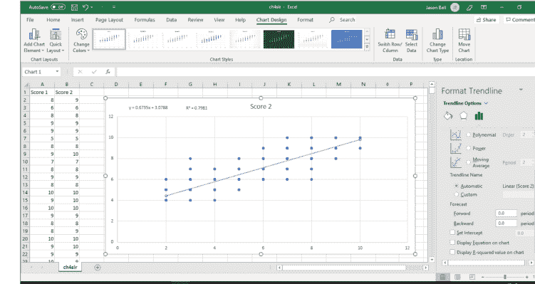

图 4.4：R2 值和方程

## 进行预测

此时，你可以使用计算器来得一个预测。观察图表，我看到了这个方程：

y = 0.6735x + 3.0788

假设我想预测，如果我在比赛中评了 6 分，评委会给多少分，可以通过以下方程得出：

评委分数 = (我的分数 * 0.675) + 3.0788

或者：

评委分数 = (6 * 0.6735) + 3.0788 = 7.1198

向下取整，我得到了 7 分。

## 编写程序

总会有你想要处理电子表格的时刻。这可能是因为有太多的数据需要处理，例如。

使用 Java 时，Apache Commons Math 库提供了简单线性回归的实现。该过程非常直接。第一步是加载文本文件并将每个逗号分隔的数据对添加到集合中（在这种情况下是 `ArrayList`）。使用 `addData` 方法，传入两个分数的 `double` 值；在这一步中完成字符串到原始 `double` 数据类型的转换。此代码如列表 4.1 所示。

列表 4.1：使用 AddData 进行简单线性回归

```java
package mlbook.chapter4.slr;

import org.apache.commons.math3.stat.regression.SimpleRegression;
import java.io.*;
import java.util.ArrayList;
import java.util.List;
import java.util.Random;
import java.util.UUID;

public class LinearRegressionBuilder {
    private static String path = "/path/to/ch4sl.csv";

    public LinearRegressionBuilder() {
        List<String> lines = loadData(path);
        SimpleRegression sr = getLinearRegressionModel(lines);
        System.out.println(runPredictions(sr, 40));
    }

    private SimpleRegression getLinearRegressionModel(List<String> lines) {
        SimpleRegression sr = new SimpleRegression();
        for (String s : lines) {
            String[] split = s.split(",");
            double x = Double.parseDouble(split[0]);
            double y = Double.parseDouble(split[1]);
            sr.addData(x,y);
        }
        return sr;
    }

    private String runPredictions(SimpleRegression sr, int runs) {
        StringBuilder sb = new StringBuilder();
        // 显示回归的截距
        sb.append("Intercept: " + sr.getIntercept());
        sb.append("\n");
        // 显示回归的斜率
        sb.append("Slope: " + sr.getSlope());
        sb.append("\n");

        sb.append("\n");
        sb.append("\n");
        Random r = new Random();
        for (int i = 0; i < runs; i++) {
            int rn = r.nextInt(10);
            sb.append("Input score: " + rn + " prediction: " + 
                Math.round(sr.predict(rn)));
            sb.append("\n");
        }
        return sb.toString();
    }

    private List<String> loadData(String filename) {
        List<String> lines = new ArrayList<String>();
        try {
            FileReader f = new FileReader(filename);
            BufferedReader br;
            br = new BufferedReader(f);
            String line = "";
            while ((line = br.readLine()) != null) {
                lines.add(line);
            }
        } catch (FileNotFoundException e) {
            System.out.println("File not found.");
        } catch (IOException e) {
            System.out.println("Error reading file");
        }

        return lines;
    }
}
```

运行列表 4.1 中的程序将得到不同的响应，因为输入分数是基于随机数的。它看起来如下：

> Intercept: 3.031026812343519
>
> Slope: 0.6769323768870359
>
> Running random predictions......
>
> Input score: 4 prediction: 6
>
> Input score: 5 prediction: 6
>
> Input score: 2 prediction: 4
>
> Input score: 5 prediction: 6
>
> Input score: 3 prediction: 5
>
> Input score: 8 prediction: 8
>
> Input score: 4 prediction: 6
>
> Input score: 9 prediction: 9
>
> Input score: 8 prediction: 8
>
> Input score: 3 prediction: 5

## 接受随机性

对于工作，并不总是手头都有数据。随机数可以带来一些有趣的实验和代码。在本节中，我们将研究使用随机数的两个方面。首先，我们将通过使用一些基础数学和蒙特卡洛方法寻找圆周率；其次，我们将研究随机游走。

## 使用随机数寻找 Pi

蒙特卡洛方法是模拟随机过程的概念。当该过程重复多次时，它将产生某些感兴趣的数学量的近似值。所以，从理论上来说，只要向圆投掷足够的随机镖，你就能找到圆周率。图 4.5 显示了你的正方形。


图 4.5：正方形的初始绘制

现在在正方形内画一个圆（见图 4.6）。


图 4.6：正方形内的圆

在正方形内放置足够的随机数据将给你提供落在正方形内的镖，其中一些会在圆内（见图 4.7）。这些是我们真正感兴趣的镖。

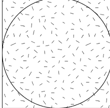

图 4.7：正方形内的镖

在正方形内放置足够的随机数据将给你提供落在正方形内的镖，其中一些会在圆内（见图 4.7）。这些是我们真正感兴趣的镖。

蒙特卡洛方法是模拟随机过程的概念。当该过程重复多次时，它将产生某些感兴趣的数学量的近似值。所以，从理论上来说，只要向圆投掷足够的随机镖，你就能找到圆周率。图 4.5 显示了你的正方形。

$\pi = 4 \times \frac{\text{圆内的镖的数量}}{\text{总投掷次数}}$

## 第 4 章 统计学、线性回归与随机性 79

如果我运行模拟，我将得到 1、10、100 和 1,000 次投掷的结果。这些结果将作为列表返回。如果我在 REPL 中运行九次模拟（取决于你使用的机器，可能需要一段时间），我会得到如下结果：

```
mathematical.programming.examples.montecarlo> (run-simulation 9)
(0.0 3.6 3.28 3.128 3.1176 3.1428 3.142932 3.1425368 3.14173752)
```

这是一个很好的近似值。圆周率是 3.1415265，因此通过蒙特卡洛方法通过随机评估计算圆周率是有效的。以下是最终的代码列表：

```clojure
(ns ch04.montecarlo)

(def calc-position [v])
  (* + v side-of-square 2) (+ (- 1) (* 2 (Math/random))))

(def throw-dart []
  {:x (calc-position 0)
   :y (calc-position 0)})

(def is-within-circle [m]
  (let [distance-from-center (Math/sqrt (+ (Math/pow (: x) 2)
(Math/pow (: y) 2))]
    (< distance-from-center (/ side-of-square 2))))

(def throw-range [throws]
  (filter (fn [t] (is-within-circle (throw-dart))) (range 0 throws)))

(def compute-pi-throwing-dart [throws]
  (double (* 4 (/ (count (throw-range throws)) throws))))

(def run-simulation [iter]
  (map (fn [i]
    (let throws (long (Math/pow 10 i))
      (compute-pi-throwing-dart throws))) (range iter))
```

```
mathematical.programming.examples.montecarlo> (run-simulation 3)
(4.0 3.6 3.28 3.056 3.1392 3.146 3.139848 3.141404 3.14128264)
mathematical.programming.examples.montecarlo>
```

## 总结

数学是机器学习中所有工作的基础。本章作为对一些基础汇总统计的回顾，并基于这些知识产生诸如线性回归、标准差和蒙特卡洛方法等技术。

通过使用 Java 和 Clojure 添加简单的编程函数，你现在可以在需要时随时拥有一套可用的工具。不要忘记，有些时候电子表格会更有效。

## 使用决策树

不要被决策树误骗；乍看之下它可能是一个简单的概念，但力量正存在于这种简单之中。本章将向你展示决策树是如何工作的。示例使用了 Weka 创建一个可以运行的决策树，它还会为你生成 Java 代码。

### 决策树的基础

任何决策树的目标都是创建一个可行的模型，根据一组输入变量来预测目标变量的值。本节将解释决策树的使用场景以及决策树的一些优点和局限性。在本节中，你还将了解如何手动计算决策树，以便理解其中涉及的数学原理。

### 决策树的用途

思考一下如何在自动电话回复中选择不同的选项。这些选项本质上是为你设计的决策树，以便你到达所需的部门。这些决策树在许多行业领域都被得到有效使用。


金融机构使用决策树。一个基本用例是期权定价，其中使用类二元的决策树来预测牛市或熊市中的期权价格。

营销人员使用决策树根据类型对客户分类，并预测客户是否会购买特定类型的产品。

在医学领域，决策树模型被用于诊断血液感染或预测胸痛患者的心脏病发作结果。决策树中的变量包括诊断、治疗和患者数据。

业界现在在动作识别和人脸识别中使用多个决策树。微软 Kinect 平台使用这种方法来跟踪身体动作。Kinect 团队使用了百万张图片并训练了三棵树。在一天之内，使用 1,000 核集群，决策树就对屏幕上的特定身体部位进行了分类。

## 决策树的优点

使用决策树有一些原因。首先，它们易于阅读。模型生成后，很容易向他人报告该树是如何工作的。此外，通过决策树，你可以处理数值或分类信息。本章稍后将演示如何手动通过类别值来运行算法；示例步骤说明使用了数值数据。

在数据准备方面，只要数据是类似于逗号分隔变量的形式，你就可以创建一个可以运行的模型。这使得使用各种测试来验证模型变得简单。决策树使用白盒测试——意味着内部工作可以被观察但不能更改；你可以查看在建模树时所使用的步骤。

决策树在合理的计算能力下表现良好。如果你有一组大数据，决策树学习将很好地处理它。

## 决策树的局限性

优点都有对应的局限性。虽然决策树是强大的，但它们也有缺点。决策树的主要问题之一是随着规模的扩大，它们可能会变得复杂且难以解释。它们还容易过拟合，即模型捕捉的是数据中的噪声而非本质。

此外，决策树需要大量数据才能准确执行。如果数据有限，树可能无法很好地泛化到新信息。最后，算法和参数的选择会显著影响结果模型，需要仔细的选择和调优。

# 构建决策树

决策树的构建围绕该算法的基本概念展开。

- 检查模型的边界情况。
- 遍历所有属性（`attr`）。
- 获取基于 `attr` 拆分后的归一化信息增益。
- 令 `best_attr` 为信息增益最高的属性。
- 创建一个根据 `best_attr` 属性进行拆分的决策节点。
- 对通过 `best_attr` 拆分得到的子列表进行处理，并将这些节点作为子节点。

这就是构建决策树时所发生过程的基本概述。根据算法类型的不同，上述提到的算法在执行方式上可能会存在细微差异。

# 手动演示示例

如果你对算法工作的基本原理感兴趣并想跟随操作，本节将介绍计算熵（`entropy`）和信息增益的基本知识。如果你想直接进入章节的实操部分，可以跳过本节。

基于属性划分前后熵值来使用信息增益的方法，是 ID3 和 C4.5 算法中的关键方法。由于这些是常用的算法，本节将集中于这种发现决策树构建的基本方法。

对于基于机器学习的决策树，你可以让算法为你完成所有工作。它将找出最适合作为根节点的节点。这需要找出每个节点的纯度。考虑表 5.1，它包含了某些用户通过电子商务商店进行购买的真/假值。

**表 5.1：用户购买历史**

| 是否有信用账户？ | 阅读过评论吗？ | 是否是老客户？ | 是否购买了？ |
| :--- | :--- | :--- | :--- |
| 用户 A | N | Y | Y |
| 用户 B | Y | Y | Y |
| 用户 C | N | N | N |
| 用户 D | Y | N | Y |
| 用户 E | Y | Y | Y |

表格中有四个节点：

- 客户有账户吗？
- 客户读过之前的产品评论吗？
- 客户是回访客户吗？
- 客户购买了产品吗？

在计算决策树之初，对于哪个节点将产生最佳结果尚无所知。你正在寻找能够最准确预测结果的节点。这需要一些计算。输入熵。

## 计算熵

熵是不确定性的衡量标准，以比特（bits）为单位，数值在 0 到 1 之间（熵比特与计算方法论中使用的比特不同）。基本上，你是在寻找随机变量中的不可预测性。

有两种熵需要计算：第一种针对单个属性，第二种针对两个属性。在这个示例中，我将使用“是否有信用账户”（`Has Credit Account`）作为工作示例的目标属性。在练习结束时，我们将知道决策树中下一个使用的节点。“是否有信用账户”这一属性有两个结果（是或否）。

| 是否有信用账户 | |
| :--- | :--- |
| 是 | 否 |
| 3 | 2 |

熵的计算如下：

```
Entropy(Has Credit Account) = Entropy (2,3)
= Entropy (0.4,0.6)
= -(0.4 log2 0.4) - (0.6 log2 0.6)
= 0.97095
```

当应用两个属性时，值映射表所示：

| 是否有信用账户 | Y | N | |
| :--- | :--- | :--- | :--- |
| 阅读评论 | Y | 2 | 1 | 3 |
| N | 1 | 1 | 2 | |

使用两个属性，我们得到以下熵的计算：

```
Entropy (Has Credit Account, Accounts Reviews)
= P(Y)×E(2,1)+P(N)×E(1,1)
= (2/5)×0.971+(1/5)×1
= 0.5884
```

所以，你有两个增益：一个是拆分前的（是否有信用账户），另一个是拆分后的（是否有信用账户/评论，为 0.5884）。

在这个属性上的工作就快完成了。下一步是计算信息增益。

## 信息增益

当你知道属性在拆分前后的增益时，就可以计算信息增益。对于检查客户是否有信用账户的属性，你的计算将如下：

```
InformationGain = Gain(before the split) – Gain(after the split)
with Reads Reviews
= 0.97095–0.5884
= 0.38255
```

因此，“是否有信用账户”属性的信息增益为 0.38255。

## 重复步骤

前两节涵盖了单个属性“是否有信用账户”的信息增益计算。你需要处理另外两个属性以找到它们的信息增益。有了所有属性的信息增益值后，你现在可以决定从树的哪个节点开始。

| 属性 | 信息增益 |
| :--- | :--- |
| 阅读评论 | 0.38255 |
| 是否已购买 | 0.48672 |
| 是否是老客户 | 0.37095 |

现在情况变得越来越清晰了；假设“是否有信用账户”是根节点，那么“是否已购买”是根节点。（注：原文此处逻辑似乎有重复，已按原意翻译）。

# 第 5 章 使用决策树

数据文件包含几个元素，让我们逐个部分查看它。

## 关系 (Relation)

`@relation` 标签是你正在使用的数据集的名称。在例子中，它是 Lady Gaga 的 CD 盘，所以我将其命名为 `ladygaga`。

## 属性 (Attributes)

接下来，是你在数据模型中使用的属性。此集合包含五个属性，它们是你从客户那里收到的原始 CSV 数据的行。

- **位置 (`Placement`)：** 显示在何种类型的架子上：端头架、特价活动篮，还是标准架子？
- **显著性 (`Prominence`)：** 展示的 CD 中，Lady Gaga 的 CD 占百分之几？
- **定价 (`Pricing`)：** 购买时 CD 占原价的百分比是多少？很少有原价出售 CD，除非它是旧的、目录中的作品。
- **视线高度 (`Eye Level`)：** 在视线位置显示的产品是什么？大多数销售发生在产品处于视线高度时。
- **客户购买 (`Customer Purchase`)：** 结果如何？客户是否购买了？

`Prominence` 和 `Pricing` 属性都是数值。其他三个是算法运行期间预期的名义值。`Placement` 有三种：`end_rack`、`cd_spec` 或 `std_rack`。`Eye Level` 属性为 `true` 或 `false`，而 `Customer Purchase` 属性有两个名义值 `yes` 或 `no`，表示客户是否购买。

## 数据 (Data)

最后，是数据，按照属性的顺序（`Placement`、`Prominence`、`Pricing` 和 `Customer Purchase`）用逗号隔开。在这个样本中，你已经知道了结果——客户是否购买；这个模型是关于如何使用回归来使你的预测与新入的数据步调一致的。你可以在书籍的配套网站上找到本章的所有代码：

```
www.wiley.com/go/machinelearning2
```

## 使用 Weka 创建决策树

现在你已经准备好了数据模型，可以开始了。当你打开 Weka 程序时，你会看到一个小的启动屏幕（见图 5.2），上面四个按钮：`Explorer`（探索器）、`Experimenter`（实验器）、`KnowledgeFlow`（知识流）和 `Simple CLI`（简单命令行）。点击 `Explorer` 按钮。


图 5.2：Weka GUI 选择器

当 `Explorer` 打开时，你将面对另一个包含许多区域和一组按钮的窗口（见图 5.3）。如果现在看起来很困惑，不要担心；这个指南将一步带你完成。

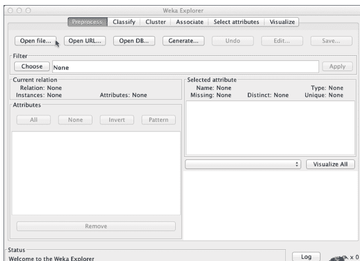

图 5.3：基础 Explorer 窗口

点击 `Open File`（打开文件）并打开名为 `ladygaga.arraf` 的数据文件。Weka 解析数据模型并对数据进行预处理。很快，你就能根据数据模型和数据的预处理获得信息。

图 5.4 中 `Explorer` 窗口右侧的 `Select Attribute`（选择属性）面板显示了 `customer_purchase` 属性的不同名义值。Weka 还注意到我们有 14 行和 5 个属性。

预处理之后是分类。点击按钮顶行中的 `Classify`（分类）按钮。你将使用 C4.5 分类算法；在 Weka 中，这就是 `J48` 算法。在 `Classifier` 面板中（见图 5.5），点击 `Choose` 按钮并在 `Trees` 菜单下选择 `J48` 选项。选择会自动完成，你会发现分类器的名称已从默认的 `ZeroR` 变为 `C-0.25 -M 2`（见图 5.5）。

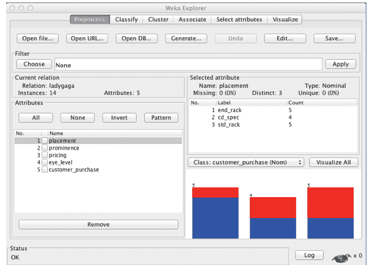

图 5.4：带有数据的处理面板

默认 `J48` 分类器中的选项标志设置了剪枝置信度（`-C` 标志）和最小实例数（`-M`）。

要运行分类器，点击 `Start`（启动）按钮并观察 `Classifier` 输出窗口（见图 5.6）。你看到了有关运行的信息。运行信息告诉你是所使用的方案，并对 Weka 所处理的模型进行了概述。

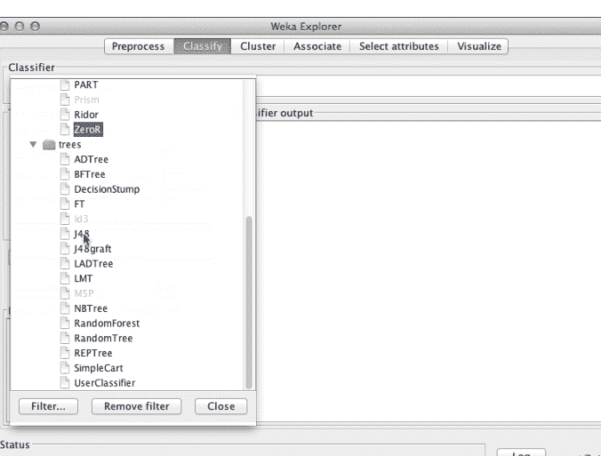

图 5.5：选择分类器

有趣的数据开始显现。`J48` 剪枝树给出了结果，在这种情况下是关于位置，因为它具有高信息增：

**J48 剪枝树**

```
placement = end_rack: yes (5.0/1.0)
placement = cd_spec
  pricing <= 80: yes (2.0)
  pricing > 80: no (2.0)
placement = std_rack
  eye_level = TRUE: yes (2.0)
  eye_level = FALSE: no (3.0)
```

叶子数量：5

树的大小：8

构建模型所需的时间：0 秒

看起来，将产品放置在端头架上对销售有益。对于特价架，似乎定价起了作用；如果产品太便宜，客户就会离开。在标准架上，产品的放置是销售的一个因素；如果它处于视线高度，就能售出。

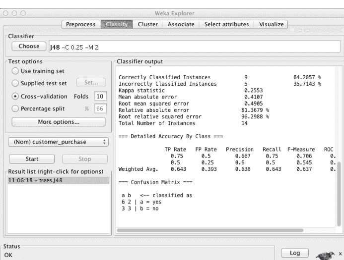

图 5.6：带有输出的分类器

最后，你想可视化决策树。（见图 5.7）。

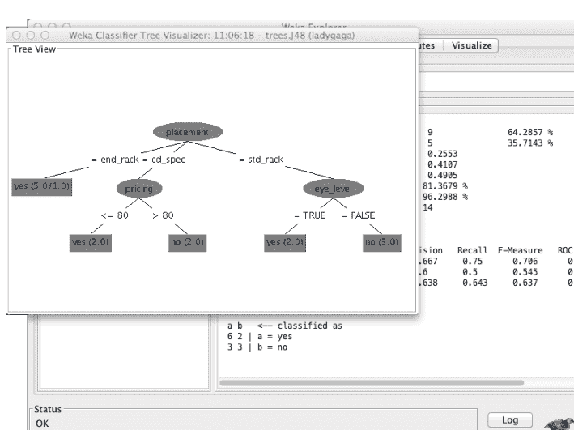

图 5.7：J48 可视化

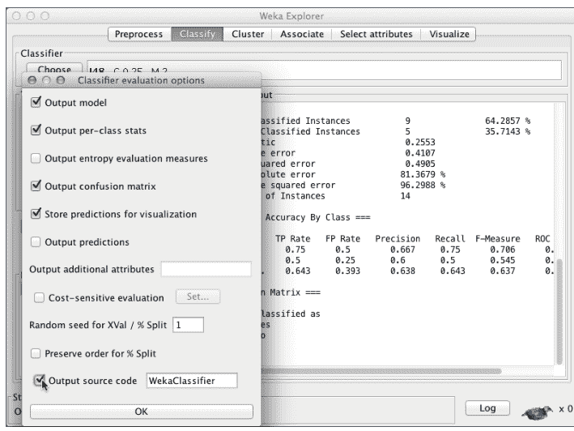

图 5.8：评估面板

再次启动分类器，在输出窗口的末尾你看到了 Java 代码。

```java
package mlbook.ch5.decisiontrees;

import weka.core.Attribute;
import weka.core.Capabilities;
import weka.core.Capabilities.Capability;
import weka.core.Instance;
import weka.core.Instances;
import weka.core.RevisionUtils;
import weka.classifiers.Classifier;
```

## 第 5 章 使用决策树

```java
public void buildClassifier(Instances i) throws Exception {
    // 分类器处理数据？
    getCapabilities().testWithFail(i);
}
```

```java
/**
 * 对给定的实例进行分类
 * @param i 要分类的实例
 * @return 分类器结果
 */
public double classifyInstance(Instance i) throws Exception {
    Object[] s = new Object[i.numAttributes()];

    for (int j = 0; j < s.length; j++) {
        if (!i.isMissing(j)) {
            if (i.attribute(j).isNominal())
                s[j] = new String(i.attribute(j).value(j));
            else if (i.attribute(j).isNumeric())
                s[j] = new Double(i.value(j));
        }
    }

    // 将类值设置为缺失
    s[i.currentIndex()] = null;

    return WekaClassifier.classify(s);
}
```

```java
/**
 * 返回修订字符串。
 * @return 修订版本
 */
public String getRevision() {
    return RevisionUtils.extract("1.0");
}
```

```java
/**
 * 返回类名以及它基于什么分类器。
 * @return 简短描述
 */
public String toString() {
    return "auto-generated classifier wrapper, based on weka\nclassifiers.trees.J48 (generated with Weka 3.6.10)\n" +
    getClass().getName() + " /WekaClassifier";
}
```


```java
/**
 * 从命令行运行分类器。
 * @param args 命令行参数
 */
public static void main(String args[]) {
    runClassifier(new WekaWrapper(), args);
}

class WekaClassifier {

    public static double classify(Object[] i) 
        throws Exception {

        double p = Double.NaN;
        p = WekaClassifier.N32ec89882(i);
        return p;
    } 
    static double N32ec89882(Object []i) {
        double p = Double.NaN;
        if (i[0] == null) {
            p = 0;
        } else if (i[0].equals("end_rack")) {
            p = 0;
        } else if (i[0].equals("cd_spec")) {
            p = WekaClassifier.N47395963(i);
        } else if (i[0].equals("std_rack")) {
            p = WekaClassifier.N63915224(i);
        }
        return p;
    }

    static double N47395963(Object []i) {
        double p = Double.NaN;
        if (i[2] == null) {
            p = 0;
        } else if (((Double) i[2]).doubleValue() <= 80.0) {
            p = 0;
        } else if (((Double) i[2]).doubleValue() > 80.0) {
            p = 1;
        }
        return p;
    }

    static double N63915224(Object []i) {
        double p = Double.NaN;
        if (i[3] == null) {
            p = 0;
        } else if (i[3].equals("TRUE")) {
            p = 0;
        } else if (i[3].equals("FALSE")) {
            p = 1;
        }
        return p;
    }
}
```

# 第 5 章 使用决策树

打开你喜欢的文本编辑器，然后复制并粘贴 Java 代码。将文件保存为 `WekaClassifier.java`（或你在选项面板中指定的类名）。

在源代码中，实际上有两个类：一个 Weka 生成的包装类，以及一个用于运行的主方法。分类器的代码在第二个类 `WekaClassifier` 中。这基本上是基于分类树的一组 `if/then` 语句。

## 测试分类器代码

复制 `.arff` 文件以测试你编写的分类器。在结果为 `yes` 或 `no` 的地方，将它们替换为问号（`?`）。这意味着你想让分类器算出你的输入：

```
end_rack,85,85,FALSE?
end_rack,80,90,TRUE?
cd_spec,83,86,FALSE?
std_rack,70,90,FALSE?
std_rack,65,80,FALSE?
std_rack,65,70,TRUE?
cd_spec,64,65,TRUE?
end_rack,72,95,FALSE?
end_rack,69,70,FALSE?
std_rack,75,80,FALSE?
end_rack,75,70,TRUE?
cd_spec,72,90,TRUE?
cd_spec,81,75,FALSE?
std_rack,71,91,TRUE?
```

你需要编写一个新类来加载你的测试数据，并针对编写的分类器运行每个实例。

```java
package chapter3;

import java.io.BufferedReader;
import java.io.FileReader;

import weka.core.Instances;

public class TestClassifier {
    public static void main(String[] args) {
        WekaWrapper ww = new WekaWrapper();
        try {
            Instances unlabeled = new Instances(new BufferedReader(new FileReader("data2.arff")));
            unlabeled.setClassIndex(unlabeled.numAttributes() - 1);

            for (int i = 0; i < unlabeled.numInstances(); i++) {
                double clsLabel = ww.classifyInstance(unlabeled.instance(i));
                System.out.println(unlabeled.instance(i) + " -> " + clsLabel);
            }
        } catch (Exception e) {
            e.printStackTrace();
        }
    }
}

class WekaWrapper {
    // 包装类实现（略）
    public double classifyInstance(weka.core.Instance i) throws Exception {
        return 0.0;
    }
}
```

# 第 6 章 聚类

## 什么是聚类？

如果你把所有关于聚类的定义进行简化，你得到的结论是“将具有相似特征的对象组织在一起”。它被归类为无监督学习方法，这意味着没有先前的训练数据可供学习。在图 6.1 中你看到了三个不同的分组；每一个组都是一个聚类。

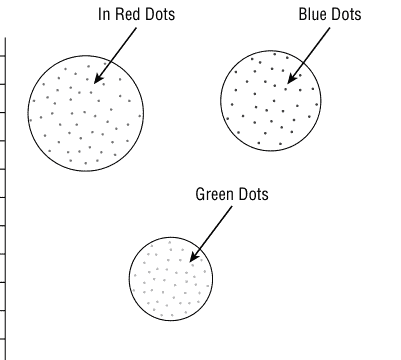

图 6.1：聚类的图表表示

## 聚类用于何处

聚类是一种广泛使用的机器学习方法。尽管它看起来可能很简单，但不要低估将多变量数据划分为精细分组的重要性。

### 互联网

社交媒体网络分析使用聚类来确定用户社区。例如，Facebook 上有如此多的用户，使用此类技术可以精炼广告，确保特定的广告展示给特定的客户群。

如果你在许多地图网站之一上搜索过，你可能看到过当某个位置聚集了大量兴趣点（pins）时，聚类正在发挥作用。与其显示所有的标记点（这将导致糟糕的用户体验），不如使用聚类来定义给定位置内的标记点组。

网站日志和搜索结果通常会进行聚类，以显示更相关的搜索分组。许多公司正在使用聚类来优化搜索引擎的查询。

### 商业与零售

市场研究公司频繁使用聚类。通过包含许多变量的调查，像聚类这样的多变量系统让营销人员能够根据调查问卷提供的答案对客户群进行更好的定义。聚类可以根据人口、位置、购买习惯等对分组进行细分。通过定义这些聚类，营销公司可以尝试开发新产品或对某些聚类结果进行测试。

此外，结合关联规则（在第 7 章中讨论），聚类还用于购物篮分析。某些拍卖网站使用聚类来处理偏好。

### 执法

犯罪记录会根据各个方面进行记录。警察部门运行聚类和其他机器学习算法来预测犯罪何时会发生。其结果可能是将巡逻车部署在某些高发区域。

### 计算

随着“物联网”的兴起，我们现在比以前任何时候都收集更多数据。聚类可以对传感器结果进行分组。例如，对于温度传感器可能会根据时间进行聚类。另一个例子是红外传感器的运动检测。这些热点信息可以很容易地进行聚类和检查。

在教育领域，在线的大规模聚类可以将学生分组并得出结果。聚类经常用于数字成像。当需要分割大量图像时，聚类算法可以识别面或边界。

## 聚类模型

如前所述，聚类的目标是将数据分组成特定的组。许多不同的聚类算法是为了在所有聚类中找到对象的公分母。例如，分布模型使用多变量分布进行建模。

如图 6.2 所示，你也可以以结构化查询的方式对分组进行简单聚类。

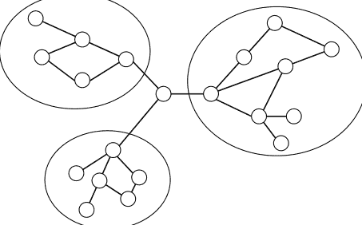

图 6.2：作为聚类

最常用的质心模型之一是均值模型（`k-means`），这就是均值算法的地方。均值算法基本上是向量量化。本章重点关注均值算法。

## K-Means 工作原理

如果你有一组对象，均值算法的想法是定义聚类的数量。重要的是由你决定想要多少个类。例如，假设我有 1000 个对象，我想找到 4 个类：

- `n`（对象） = 1000
- `k`（聚类） = 4

每个聚类都有一个质心（有时称为均值，因此名为 `k-means`），将计算对象到质心的距离。聚类是通过对距离的迭代过程定义的。这一切都是无监督的；你只需要让算法处理并检查结果。当迭代到对象不再移动到不同质心时，假设均值聚类完成。

以下伪代码描述了正在发生的过程：

```
计算均值的初始值 m[1],m[2],m[3],m[4]

将对象分配给最近的中心

while(均值位置发生变化) {
  估计分类为类的均值
  for(i in 1 to k) {
    m[i] = 类 i 的样本均值
  }
}
```

### 初始化

首先，算法必须通过为每个观测值分配一个类来初始化。随机划分方法将聚类点放在数据集的中心。另一种初始化方法是随机方法。

### 更新

在更新步骤中，你将对象值分配给类。聚类中心点（质心）的重新计算是作为该类中对象的平均值。这个过程循环进行，直到每个组中的实体不再变化。`k-means` 算法非常有效，但并不是没有问题。可能需要对数据运行几次才能获得良好的拟合。当你选择的类太少时，对象可能会随着时间的推移很容易掉进错误的类。

## 计算数据集中的聚类数量


当面对数据集时，很难定义你想要分类的类数量。有时这个数字已经由利益相关者确定。例如，在营销活动中，你可能会有以下分类：

- 低频、低价值客户
- 低频、高价值客户
- 高频、低价值客户
- 高频、高价值客户

有时这些信息不可用，你必须找到一个平衡来做出决策。有许多方法可以计算最佳值。

## 经验法则方法

没有什么比用手指指向天空观察风向更好了。对于聚类来说，有一个大致等效简单计算方法：类的数量（k）等于对象数量除以2的平方根。

```
K = √objects/2
```

如果你有250个对象，其中一半是125，125的平方根是11.18——所以有11个类。这显然可以根据尝试运行的结果进行测试和重新应用。

## 肘部法

你可以计算数据集方差的百分比，并根据聚类数量进行绘图。存在一个聚类达到最佳的状态——在该点之后，添加更多聚类不会对最终分类产生巨大影响。你可以从图 6.4 中看到，肘部法如何显示最佳聚类数量为四个，这已经分类了 80% 的数据。

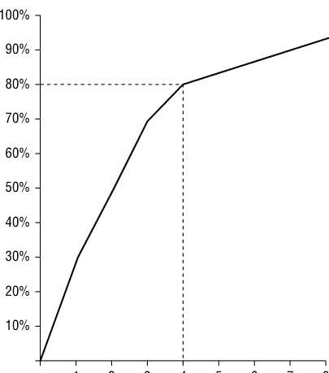

图 6.4：肘部图

## 交叉验证法

通过将数据集分成不同的部分，你可以对数据集进行分析，然后对剩余部分进行分析。通过计算平方和的平均值，你可以确定使用的聚类数量。

Weka 通过 `weka.clusterers.MakeDensityBasedClustering` 类支持交叉验证。该类将在本节后面的基于命令行的演示中进行更详细介绍。

## 轮廓法

Peter J. Rousuw 在 1986 年首次描述了轮廓法。这是一种用于验证对象在聚类内部位置的方法。

对于任何对象，你可以计算该对象与同一聚类内另一个对象的相似性。通过计算连接到某个聚类的对象的平均值，然后评估它们与其他聚类之间的差异，你可以确定一个平均分。主要目标是衡量聚类中对象的分组程度——数值越低越好。在比较每个聚类的平均值时，预计它们是相似的。当某些轮廓值非常窄而其他轮廓值很大时，可能表明在计算开始时定义的聚类数量不足。

## 使用 Weka 进行 K-Means 聚类

Weka 机器学习应用带有一个处理 k-means 聚类的算法，名为 `SimpleKMeans` 的类。在本次演示中，你将学习三种方法：一种来自工作台应用程序，一种直接从命令行操作，最后一种是 Java 代码示例。

目标是获取一些营销数据并使用 k-means 生成客户的某些细分；这从长远来看可能会为营销部门增加成功交易量。

在开始这三个演示之前，你需要准备一些要处理的数据。

### 准备数据

以下 Java 代码为两个整数变量 `x` 和 `y` 生成 75 个随机数实例。将保存的文件 (`kmeansdata.csv`) 输出到 Weka 并通过程序方式加载它。

```java
import java.io.BufferedWriter;
import java.io.FileWriter;
import java.io.IOException;
import java.util.Random;

public class DataSet3 {
    public static void main(String[] args) {
        Random r = new Random(System.nanoTime());
        try {
            BufferedWriter out = new BufferedWriter(new FileWriter("kmeansdata.csv"));
            out.write("x,y\n");
            for (int count = 0; count < 75; count++) {
                out.write(r.nextInt(125) + "," + r.nextInt(150) + "\n");
            }
            out.close();
        } catch (IOException e) {
            e.printStackTrace();
        }
    }
}
```

输出内容如下：

```
X,y
78,29
0,55
101,19
52,146
49,140
44,97
65,45
41,49
66,141
111,100
23,128
101,1
1,113
88,100
```

如果你想创建更多实例，可以通过调整代码中 `for` 循环的迭代次数来实现。我将其设置为 75 作为起点。上限实际上取决于你计算机的内存大小。

先看一眼 Weka 工作台的方法。

### 工作台方法

工作台方法使用 Weka 用户界面来加载、聚类和视觉化数据。这不涉及实际编程，但在你学习命令行和代码示例之前，查看 Weka 正在做什么是有用的。

#### 加载数据

工作台的过程与你运行的其他示例类似。你需要做的第一件事是加载 CSV 数据。点击 Open（打开）并选择你创建的 `kmeansdata.csv`。确保文件格式下拉菜单显示 CSV 而不是 ARFF（见图 6.5）；否则将无法打开文件。

数据加载后，Explorer（探索器）会显示各种信息。Relation（关系）面板显示有两个属性和 75 个实例（见图 6.6）。属性信息显示了两个属性：`x` 和 `y`。

在右侧面板，Selected Attribute（选中属性）面板显示了加载数据的统计信息，包括最小值、最大值以及平均值和标准差。最后，有一个值分布图和频率图。

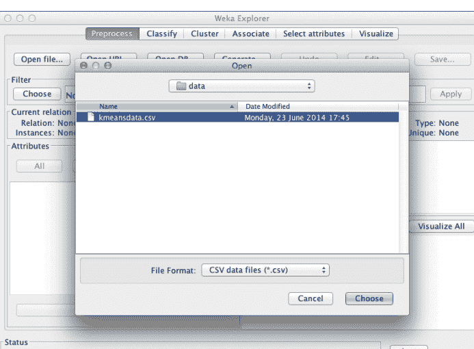

图 6.5：将 CSV 数据加载到 Weka

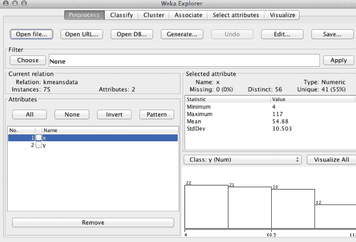

图 6.6：Preprocess（处理）窗口

#### 数据聚类

点击顶部的 Cluster 标签卡选择聚类方法。默认情况下，Weka 使用 EM 方法（期望最大化）。点击 Choose（选择）按钮显示你可以使用的其他聚类算法。对于此示例，选择 `SimpleKMeans` 然后点击 Close（关闭）；最后点击 Start（开始）运行算法，如图 6.7 所示。

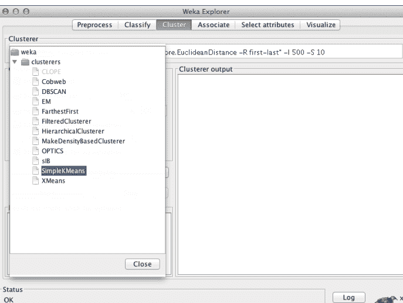

图 6.7：选择 SimpleKMeans

聚类类输出显示了 Weka 正在使用的聚类方法：

```
weka.clusterers.SimpleKMeans -N 4 -A
weka.core.EuclideanDistance -R last -l 500 -S 10
```

- `N` 决定了聚类数量。
- `A` 是距离函数。
- `l` 决定了迭代次数。
- `S` 是随机种子，可以使用数据值。

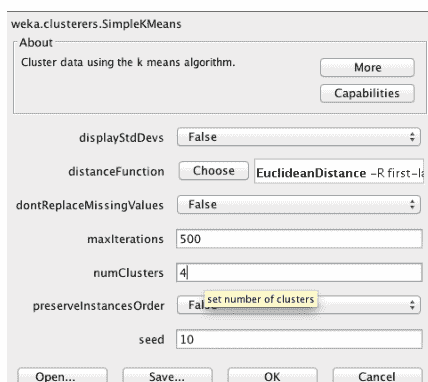

图 6.8：SimpleKMeans 选项

点击 Start（开始）按钮开始聚类过程。在 Explorer 的左下角查看状态。完成后，结果将出现在 Clusterer 中。以下部分描述了输出内容：

#### 信息 (运行 Information)

```
Relation: kmeans
Instances: 75
Attributes: 2
x
y
Scheme: weka.clusterers.SimpleKMeans -N 4 -A weka.core.EuclideanDistance -R last -l 500 -S 10
```

#### K-Means

K-Means 输出显示了 Weka 为得出结果所执行的实际工作。它包含了对数据进行迭代次数以及平方和。

迭代次数: 3

类内平方和: 0.80729603239689

全局缺失值替换为平均值/模式

聚类中心（Cluster centroids）：

| 属性 | 全数据 (75) | 0 (15) | 1 (23) | 2 (17) | 3 (20) |
|---|---|---|---|---|---|
| X | 54.88 | 68.9333 | 43.913 | 98.1765 | 20.15 |
| Y | 92.067 | 19.4 | 146.063 | 114.8824 | 64.95 |

聚类中心数据相对于实例数据显示了每个聚类的最终值位置。

#### 聚类实例

最后，显示每个聚类中数据的百分比。它让你了解数据是如何分布的。

聚类实例：

- 15 (20%)
- 23 (31%)
- 17 (23%)
- 20 (27%)

#### 视觉化数据

最后要做的是查看聚类的视觉化结果。在 Explorer 窗口中，你在左下方看到结果。右键点击 `SimpleKMeans`（在 Mac 上为 Alt+点击）将弹出可视化窗口，如图 6.9 所示。

每个聚类都有自己的颜色方案，图表显示数值。可视化窗口顶部有两个下拉菜单。要更改图表，从每个下拉菜单中选择一个值。要显示 `x` 和 `y` 实例值，选择 X: x(Num) 和 Y: y(Num) 值，你会看到图表更新。

# 116 第 6 章 聚类

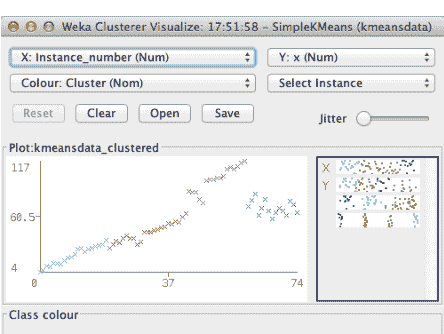

图 6.9：可视化窗口

使用工作台方法可以让你快速获得一些洞察，如果你想掌握聚类所在的位置，这种方法非常有用。要启动自动化过程，你需要查看另外两种方法，从命令行方法开始。

## 命令行方法

命令行方法与工作台方法类似，但它在运行作业方面提供了更多的灵活性。这意味着你可以收集更多数据并定期重新分析。

### 将 CSV 文件转换为 ARFF

Weka 使用 `.arff` 格式来确定对象类型并准备好数据。GUI（图形用户界面）允许导入 `.csv` 文件，但最好有一个工具为你转换文件。你可以使用命令行上的 `CSVLoader` 类将 `.csv` 文件转换为 `.arff`。例如，对于你之前创建的 `kmeansdata.csv` 文件，在终端运行以下命令：

```
java -cp weka.jar weka.core.converters.CSVLoader kmeansdata.csv > kmeansdata.arff
```

> 注意：如果你使用的是 Windows 系统，可以省略 `-cp weka.jar`。

命令行输出可能会给出关于驱动程序不可用的警告，但无需担心。最重要的是 `.arff` 文件中你有了正确的定义。快速查看以下定义：

```
@relation kmeans

@attribute x numeric
@attribute y numeric

@data
```

### 首次运行

通过直接在 `.arff` 文件上运行 `SimpleKMeans` 类来测试命令行方法。这是你的训练文件：

```
java -cp /path/to/weka.jar weka.clusterers.SimpleKMeans -t kmeansdata.arff
```

`-t` 标志告诉 Weka 尝试进行聚类。以此方式运行它将得到以下输出：

```
kMeans
=====
迭代次数：3
类内误差平方和：5.83945782519278
全局缺失值已用均值/众数替换

聚类中心：

| 属性 | 聚类 #0 | 聚类 #1 |
| --- | --- | --- |
| | (75) | (35) |
| x | 54.88 | 41.0571 | 66.975 |
| y | 92.0267 | 45.4286 | 132.8 |

--- 训练数据的聚类统计

聚类实例
0 35 (47%)
1 40 (53%)
```

这种运行可以，但只有两个类，而且可能有更多。

### 优化聚类

使用书中之前描述的法则来确定最佳聚类是足够的。你可以使用 `wc` 命令找出对象的实例数量：

```
wc kmeansdata.csv
```

有 74 行（排除顶行，该行提供了数据 `x` 和 `y`）。快速计算 75 除以 2 得到 37.5，其平方根是 6.12。通过更改命令，你可以添加目标类数（使用 `-N` 标志）和随机种子（使用 `-S` 标志）：

```
java -cp /path/to/weka.jar weka.clusterers.SimpleKMeans -t kmeansdata.arff -N 6 -S 42
```

这次输出得到了相同的输出，但有了更多的类：

```
kMeans
=====
迭代次数：3
类内误差平方和：0.523849925862059
全局缺失值已用均值/众数替换

聚类中心：

| 属性 | 聚类 #0 | 聚类 #1 | 聚类 #2 | 聚类 #3 | 聚类 #4 | 聚类 #5 |
|---|---|---|---|---|---|---|
| | (75) | (10) | (12) | (15) | (10) | (23) |
| x | 54.88 | 11.8 | 105.0833 | 68.9333 | 81.6 | 28.5 |
| y | 92.067 | 65.9 | 118.3333 | 19.4 | 106.6 | 64 | 146.0435 |
```

=== 训练数据的聚类统计 ===

聚类实例

- 0 10 (13%)
- 1 12 (16%)
- 2 15 (20%)
- 3 5 (7%)
- 4 10 (13%)
- 5 23 (31%)

现在，你有了六类，对象进入类的定义良好。唯一的问题是你不知道对象属于哪个类。

### 为聚类命名

从命令行来看，`-p` 标志告诉 Weka 显示每行的分配。要使用此功能，你必须指示 Weka 为每行使用哪个数值属性。从命令行：

```
java -cp /path/to/weka.jar weka.clusterers.SimpleKMeans -t kmeansdata.arff -N 6 -S 42 -p 0
```

`-p` 标志告诉 Weka 根据数据的行号进行聚类。当运行时，你会在控制台看到以下输出：

```
0
1 0
2 0
3 0
4 0
5 0
6 0
7 0
8 0
9 0
10 4
11 4
12 4
13 4
14 4
15 4
16 4
17 4
18 4
19 4
```

显示的所有内容行号和行所属的聚类标识符。如果你将 `-p` 标志设置为 1 或 2，你将分别获得 `x` 或 `y` 的值。

通过这些工作台和命令行示例，你现在应该对所有内容是如何组合的有了很好的了解。看看使用 Weka 编程接口（API）的方法。它演示了你如何将这些聚类方法集成到自己的项目中。

## 代码方法

工作台运行良好，而当需要执行计划任务时，命令行更适合开发。但为了极致的灵活性，没有比使用 API 编写自己的程序更好的选择了。这是工作台、命令行和代码示例使用的核心 Weka 类。这只是弄清楚数据已加载的问题。

### 创建项目

选择 File -> Project，如图 6.10 所示。


图 6.10：Eclipse 项目对话框

### 添加外部 JAR

在 Windows 系统上，你可以通过 File -> Properties 查找类路径。

### 创建类

使用 File -> New Class，如图 6.11 所示。


图 6.11：创建类文件


|---|---|---|---|---|---|---|

| | (75) | (10) | (12) | (15) | (10) | (23) |

| x | 54.88 | 11.8 | 105.0833 | 68.9333 | 81.6 | 28.5 |

| y | 92.067 | 65.9 | 118.3333 | 19.4 | 106.6 | 64 | 146.0435 |

```
=== 训练数据的聚类统计 ===

聚类实例

+   0 10 (13%)
1 12 (16%)
2 15 (20%)
3 5 (7%)
4 10 (13%)
5 23 (31%)
```

## 为聚类命名

从命令行来看，`-p` 标志告诉 Weka 显示每行的分配。要使用此功能，你必须指示 Weka 为每行使用哪个数值属性。从命令行：

```
java -cp /path/to/weka.jar weka.clusterers.SimpleKMeans -t kmeansdata.arff -N 6 -S 42 -p 0
```

`-p` 标志告诉 Weka 根据数据的行号进行聚类。当此运行时，你会在控制台看到以下输出：

+   0

1 0

2 0

3 0

4 0

5 0

6 0

7 0

8 0

9 0

10 4

11 4

12 4

13 4

14 4

15 4

16 4

17 4

18 4

19 4

显示的所有内容是行号和行所属的聚类标识符。如果你将 `-p` 标志设置为 1 或 2，你将分别获得 `x` 或 `y` 的值。

## 代码方法

工作台运行良好，而当需要执行计划任务时，命令行更适合开发。但为了极致的灵活性，没有比使用 API 编写自己的程序更好的选择了。这是工作台、命令行和代码示例使用的核心 Weka 类。这只是弄清楚数据已加载的问题。

这是一段简短的代码。Weka 会为你处理好，因此不需要进行大量的准备工作。

```java
public WekaCluster(String filepath) {
  try {
    Instances data = DataSource.read(filepath);
    int clusters = calculateRuleOfThumb(data.numInstances());
    System.out.println("Creating k-means model with " + clusters + " clusters.");
    SimpleKMeans kMeans = new SimpleKMeans();
    kMeans.setNumClusters(clusters);
    kMeans.buildClusterer(data);

    showCentroids(kMeans);
    showInstanceCluster(kMeans, data);

    testRandomInstances(kMeans);
  } catch (Exception e) {
    e.printStackTrace();
  }
}
```

数据在 `DataSource.read()` 方法中读取。该方法获取字符串路径（建议使用 `InputStream`）并将数据保存为实例（instances）。接下来，你使用之前创建的经验法则（rule of thumb）方法来计算要定义的簇数量。簇的实际构建由接下来的四行代码处理。`SimpleKMeans` 类与工作台（workbench）和命令行中使用类相同。你设置要定义的簇数量（`setNumClusters()`）和随机数种子（使用 `setSeed()`），然后构建簇。

最后，你可以使用两个方法：一个方法显示每个簇质心的位置，另一个方法显示实例所在的簇。

## 打印质心

现在模型已经构建完成，你可以开始显示它产生的一些结果。首先，你打印每个簇质心的位置。

```java
public void showCentroids(SimpleKMeans kMeans) {
  Instances centroids = kMeans.getClusterCentroids();
  for(int i = 0; i < centroids.numInstances(); i++) {
    System.out.println("Centroid: " + i + ": " + centroids.instance(i));
  }
}
```

`getClusterCentroids()` 方法返回一组实例。这通过遍历这些实例并打印每个实例的结果来实现。由于创建了六个簇（通过经验法则计算），应该会打印出六个实例。

## 打印簇信息

为了显示实例属于哪个簇，`showInstanceInCluster()` 方法接收 k-means 模型和分配的实例。代码随后遍历每个实例，并打印它们被分配到模型中的哪个簇。

```java
public void showInstanceInCluster(SimpleKmeans kmeans, Instances data) {
    try {
        for (int i = 0; i < data.numInstances(); i++) {
            System.out.println("Instance " + i + " is in cluster " + kmeans.clusterInstance(data.instance(i)));
        }
    } catch (Exception e) {
        e.printStackTrace();
    }
}
```

## 进行预测

到目前为止，程序涵盖了簇的创建和实例结果报告。当数据进入时会发生什么？目前，你无法进行任何预测。如果有一个可以访问的方法，接收新值并预测结果所在的簇，那就太好了。可以在代码中创建实例并针对聚类模型运行，以查看新值所在。你可以通过传递模型以及 `x` 和 `y` 变量的值（与原始数据分配的方式相同）创建另一个方法来返回簇编号。创建一个双精度数组并将两个值存储在 0 到 1 之间。为了测试这一点，我将创建另一个方法，迭代 100 次并生成随机值。

```java
public void testRandomInstances(SimpleKMeans kmeans) {
    Random rand = new Random();
    for (int i = 0; i < 100; i++) {
        double x = rand.nextInt(200);
        double y = rand.nextInt(200);
        System.out.println(x + " / " + y);
    }
}
```

该方法生成 `x` 和 `y` 的随机值，并将它们传递给预测方法。

## 最终代码

这里是组装并准备好运行的代码：

```java
import java.util.Random;
import weka.cluster.SimpleKMeans;
import weka.core.Instance;
import weka.core.Instances;

public class WekaCluster {

    public WekaCluster(String filepath) {
        try {
            Instances data = DataSource.read(filepath);
            int clusters = calculateRuleOfThumb(data.numInstances());
            System.out.println("Creating k-means model with " + clusters + " clusters.");
            SimpleKMeans kMeans = new SimpleKMeans();
            kMeans.setNumClusters(clusters);
            kMeans.buildClusterer(data);

            showCentroids(kMeans);
            showInstanceCluster(kMeans, data);

            testRandomInstances(kMeans);
        } catch (Exception e) {
            e.printStackTrace();
        }
    }

    public int calculateRuleOfThumb(int rows) {
        // 经验法则计算
        return rows / 2;
    }

    public void showCentroids(SimpleKMeans kMeans) {
        Instances centroids = kMeans.getClusterCentroids();
        for(int i = 0; i < centroids.numInstances(); i++) {
            System.out.println("Centroid: " + i + ": " + centroids.instance(i));
        }
    }

    public void showInstanceCluster(SimpleKmeans kmeans, Instances data) {
        try {
            for (int i = 0; i < data.numInstances(); i++) {
                System.out.println("Instance " + i + " is in cluster " + kmeans.clusterInstance(data.instance(i)));
            }
        } catch (Exception e) {
            e.printStackTrace();
        }
    }

    public void testRandomInstances(SimpleKMeans kmeans) {
        Random rand = new Random();
        for (int i = 0; i < 100; i++) {
            double x = rand.nextInt(200);
            double y = rand.nextInt(200);
            System.out.println(x + " / " + y);
        }
    }

    public int predictCluster(SimpleKmeans kmeans, double x, double y) {
        int clusterNumber = -1;
        try {
            double[] newata = new double[] {x, y};
            Instance testInstance = new Instance(1.0, newata);
            clusterNumber = kmeans.clusterInstance(testInstance);
        } catch (Exception e) {
            e.printStackTrace();
        }
        return clusterNumber;
    }

    public static void main(String[] args) {
        // 传递 arff 位置和簇的数量
        WekaCluster wc = new WekaCluster("/Users/Jason/kanda.arff");
    }
}
```

## 运行程序

完成这些工作后，你可以运行程序并检查结果。在 Eclipse 中选择 Run，程序将启动。控制台的输出可能如下：

```
Rule of Clusters = 6
Centroid: 0: 11.8,65.9
Centroid: 1: 105.08333,118.3333
Centroid: 2: 68.93333,19.4
Centroid: 3: 81.6,106.6
Centroid: 4: 28.5,6
Centroid: 5: 43.91043,146.03478
Instance 0 0 is in cluster 0
Instance 1 1 is in cluster 0
Instance 2 2 is in cluster 0
Instance 3 3 is in cluster 0
Instance 4 4 is in cluster 0
Instance 5 5 is in cluster 0
Instance 6 6 is in cluster 0
Instance 7 7 is in cluster 0
Instance 8 8 is in cluster 0
Instance 9 9 is in cluster 0
Instance 10 10 is in cluster 4
....
```

如你所示，经验法则建议创建六个簇。执行 k-means 聚类方法后，显示了每个簇的质心，以衡量簇中任何数据点到其簇中心的距离；最后，你显示了原始数据对象每个元素的簇成员关系。

## 进一步开发

你会发现，使用 `SimpleKMeans` 组合一个基础聚类算法是一件相当简单的事情。我已经涵盖了编写解决方案的主要方面。从这一点开始，还有明显的开发方向，例如使用 Java 数据库连接 (JDBC) 连接到数据库表，并将数据提取到实例中。

使用 Weka 需要记住的一点是，当应用海量数据时，内存性能可能会受到影响。我建议大多数企业需求仍然可以通过这种方法涵盖，并且可以考虑扩展性进行开发。特别是，对数据进行采样以适应 Weka 的内存限制，将带给你带来非常好的结果。

## 总结

聚类将是你反复使用的机器学习技术之一。为此，在开始构建聚类并观察会发生什么之前，确实需要进行一些思考。

你已经通过工作台、命令行以及代码在 Weka 中创建了简单的均值（k-means）聚类。显然，从现在开始有很多选择，但通过你在本章中学到的知识，你将能够快速搭建并运行一个系统。

# 第 7 章

## 关联规则学习

在所有机器学习方法中，关联规则学习可能是最常用的。从销售点系统（POS）到网页使用情况挖掘，这种方法被频繁用于检查交易。它能够发现数据元素之间，以及导致某些相关结果的序列（行为）之间的有趣联系。

本章描述了关联规则学习方法的工作原理，并还介绍了一个使用 Apache Mahout 挖掘购物篮的示例。本章还触及了使用这种机器学习的神话、现实和传奇。

## 关联规则用于何处？

零售业为了向你（客户）提供它认为你会购买的商品优惠可谓竞争激烈。然而，要做到这一点，它需要你之前买过什么，以及与你类似的其他客户买过什么。像 Tesco 和 Target 等品牌依赖于购物篮分析，以查看你之前购买了什么。如果你认为 Twitter 产生的内容量很大，那么想一下销售点数据吧；那是另一个世界。超市未能适应这项技术并从未研究购物篮，这使得它们在竞争中处于劣势。如果你能分析购物篮并根据结果采取行动，就可以增加利润。

Machine Learning: Hands-On for Developers and Technical Professionals, Second Edition. Jason Bell.

2020 John Wiley & Sons, Inc. Published 2020 by John Wiley & Sons, Inc.

130 第 7 章 关联规则学习

关联规则学习不仅适用于零售业和超市。在网页分析领域，关联规则学习被用于跟踪、学习和预测网站上的用户行为。

有大量的生物数据正在被挖掘以获取知识。生物信息学将关联规则用于蛋白质和基因测序。与计算生物学相比，它的规模较小，因为它处理的是特定物种的基因组而非 DNA。因此，对基因组的研究是生物信息学的一个分支，该分支可能正在与之工作。

# 网页使用挖掘

知道用户正在查看哪些页面然后推荐用户可能感兴趣的页面是常见且具有“粘性”的。对于这类挖掘，你需要一种机制来识别哪个用户正在查看页面；用户可以通过用户会话（session）、Cookie ID 或要求用户登录才能查看信息的优质 Cookie 登录来识别。

如果你有自己的网站日志文件，那么你就有机会挖掘信息。许多公司使用 Google Analytics 等工具，因为它可以节省自己挖掘日志的时间，但如果可以，自己进行分析是值得的。

例如，可以在基础日志文件上运行一些基础关联规则学习。查看 Apache 通用日志 (CLF)，你可以使用其尝试访问的文件的 IP 地址。

```
86.78.88.189 - thuisid [10/May/2014:13:55:59 -0700]
/GET /myinterestingarticle.html HTTP/1.0* 200 2326
```

通过提取 URL 和 IP 地址，关联规则最终可以建议你网站上用户可能感兴趣的相关内容。

## 啤酒与尿布

在历经多年的羊皮纸上写着一个关于熊和尿布（或我称之为 nappies）的寓言。

> 在这一天记录，该物种的美国男性会在安日的前一天光顾较大的市场。新配备了敏锐目光和新宝宝的美国男性会购买一种捕捉掉落的喜悦——布料和缎子疼痛装置的设备，当他看到喜悦的满溢在傍晚后无法到达旅馆时，他新获得的父亲角色随之而来。沃尔玛（Mart）观察到了这种反复行为，根据产品放置的经文调整了货架，从而增加了利润。

第 7 章 - 关联规则学习 131


这个故事被全球的营销部门传扬（可能不是此处呈现的风格），它被用于从主基调到短演讲，从黑客松到深夜代码马拉松的一切中。然而，这是一个事实与神话混合的案例。

当 Thomas Bischlok 担任名为 Mindmeld 的公司 CEO 时，他也曾参加过关于数据挖掘过去、现在和未来的网络研讨会小组，并管理了跨越啤酒和尿布故事的研究。这项研究可以追溯到 20 世纪 90 年代初，当时他的团队正在查看……

## 关联规则如何工作

购物篮分析场景是一个很好的示例。考虑以下交易：

| TRANSACTIONID | PRODUCT1 | PRODUCT2 | PRODUCT3 | PRODUCT4 |
|---|---|---|---|---|
| 1 | True | True | False | False |
| 2 | False | False | True | False |
| 3 | False | False | False | True |
| 4 | True | True | True | False |
| 5 | False | True | False | False |

## 支持度

支持度（Support）定义为数据中包含该项集的事务比例。它的写法如下：

```
$$Supp(X) = \frac{transactions\_containing\_X}{total\_number\_of\_transactions}$$
```

如果你以第 1 号事务为例，你将得到以下方程：

```
$$supp(X) = \frac{\{product1,product2\}}{5} = 0.2$$
```

该项集在事务日志中仅出现一次，总共有五笔事务，因此支持度为 1/5，即 0.2。

## 置信度

规则的置信度（Confidence）衡量方式为：

```
$$conf(X \Rightarrow Y) = supp(X \cap Y) / supp(X)$$
```

你在这里定义的是包含 X 的事务中也包含 Y 的比例。这可以解释为：在找到左侧项的情况下，找到其右侧项的概率。

用类比来说，想象一下池池投注（parimutuel betting）。所有注单共同汇总在一个池中，比赛结束后，赔付将根据总池（扣除代理佣金）计算。例如，假设有五只马在比赛，且对每只马都有下注：

| 马号码 | 赌注金额 |
| :--- | :--- |
| 1 | $40 |
| 2 | $150 |
| 3 | $25 |
| 4 | $40 |
| 5 | $30 |

总池金额为 $285，在活动进行并确认胜者后，即可计算赔付。假设 4 号马是胜者，计算方法如下：

扣除佣金后的池规模 = $285 × (1 - 0.15) = $242.25

结果 4 的每 $1 赔付 = 每投注 $1 获得 $6.05

## 提升度

提升度（Lift）定义为 X 和 Y 项集相互独立时的观测值之比。它的写法如下：

```
Lift(X \Rightarrow Y) = \frac{supp(XY)}{supp(X) \times supp(Y)}$
```

## 确定度

最后是*确定度*（conviction），它被定义为 X 发生而没有 Y 的期望频率之比：

```
conv(X \Rightarrow Y) = \frac{1 - supp(Y)}{1 - conf(X \Rightarrow Y)}
```

## 定义流程

关联规则的定义需要满足两个用户自定义标准：最小支持度值和最小置信度。规则的生成分为两个部分。

首先，对数据库（或文件数据源）中的所有频繁项集应用最小支持。频繁项集连同最小置信度用于形成规则。

寻找项集可能是困难的；它涉及遍历项集中所有可能的项的组合。可能的项集数量是该项集的“幂集”（power set）。

例如，如果你有以下内容：

```
I = {p1,p2,p3}
```

那么 I 的幂集为：

{{p1}, {p2}, {p3}, {p1,p2}, {p1,p3}, {p2,p3}, {p1, p2, p3}}

注意，幂集中省略了空集（{}）；这种公式给出的大小为 2^n，其中 n 是项的数量。项数量的微小增加会导致幂集的大小急剧增加；因此，在使用类似 Apriori 算法时，这种方法非常消耗内存。显然，所有篮组合的幂集并不存在，计算将仅基于那些确实存在的篮组合。尽管如此，基于这种方法运行计算在时间和内存上仍然是非常昂贵的的。

## 算法

在关联规则学习中有几种你将会遇到的算法，本节描述的两种是最常见的。

### Apriori 算法

Apriori 算法采用自底向上的方法，一次处理一个项集。候选组会与数据进行测试；当没有发现该集合的扩展时，算法将停止。示例中的支持度阈设定为 3。

考虑以下项集：

- [1,2,3,4]
- [1,3,4]
- [1,2]
- [2,3,4]
- [3,4]
- [2,4]

首先，它统计每个项的支持度：

- [1] = 3
- [2] = 5
- [3] = 4
- [4] = 5

下一步是查看项对：

- [1,2] = 2
- [1,3] = 2
- [1,4] = 2
- [2,3] = 2
- [2,4] = 3
- [3,4] = 4

由于 [1,2], [1,3], [1,4] 和 [2,3] 低于支持度阈值，你可以从数据库的三元组中排除它们。在示例中，只有一个三元组：

- [2,4] = 1（我们从 [1,2] 组中排除了一个）

通过推导，你得到了频繁项集。

### FP-Growth 算法

频繁模式增长（FP-Growth）算法以树结构（称为 FP-Tree）工作。它通过统计数据库中项的出现次数并将其存储在头表中来创建该树。

在第二次遍历中，通过沿着头表插入实例来构建树。不满足最小支持度阈值的项会被丢弃；否则，它们将按降序列出。

你可以将 FP-Growth 算法想象成图，这在关于贝叶斯网络的章节（第 4 章）中有所介绍。在形成减少的数据集后，FP-Growth 从底部开始——即分支最长的地方——并找到给定条件的所有实例。当没有更多单项匹配属性的支持度阈值时，增长结束，然后处理 FP-Tree 的下部分。

# 挖掘篮子——流程解析

有几个库处理关联规则学习；在本章中，我将再次使用 Weka，并离开我在本书第一版中介绍过的 Mahout。有了 Apache Sparklib 项目，有了 FPGrowth 和关联规则学习包，但我将把它们留给第 7 章介绍的 Spark。

## 原始数据

在 Weka 应用程序中，有一个超市数据集。如果你打开该文件，你将看到属性。有 4627 个实例。属性包括篮子项、部门和总计。

## 使用 Weka 应用

打开 Weka 应用程序，从菜单中选择 Explorer。它将带你进入执行所有工作的主工作。

数据文件位于 Weka 分发版的 目录下。点击 `Open File` 按钮并找到数据文件 `supermarket.arff`。

## 第 7 章：关联规则学习

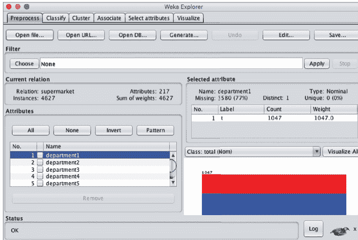

图 7.3：数据预处理部分

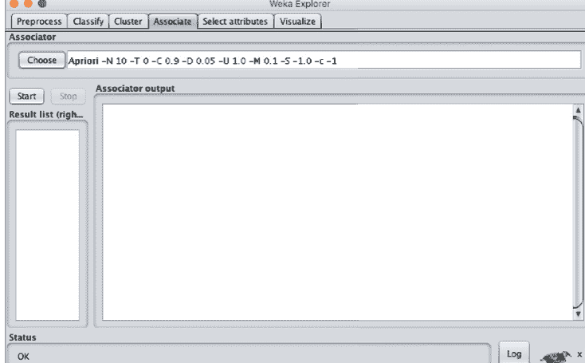

图 7.4：Weka Associate 选项卡

## 第 7 章：关联规则学习

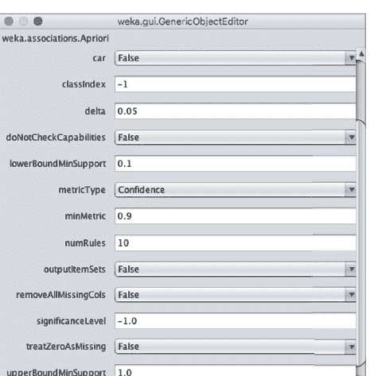

图 7.5：选项面板

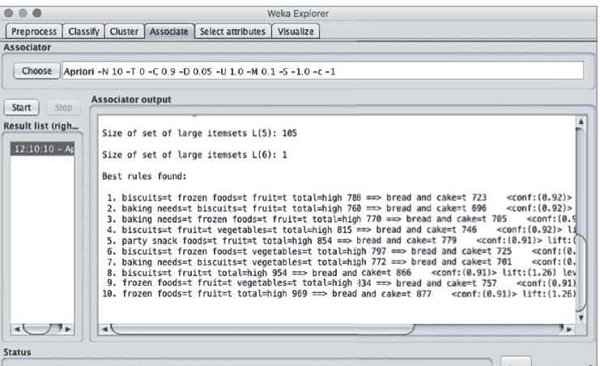

图 7.6：生成的运行

## 检查结果

由于我们在选项中请求了 10 条规则，并且有足够的数据来进行预测，输出指明了频繁使用的项目。如你所示，“面包和蛋糕”具有重复的置信度（confidence）和提升度（lift）。

- 大项项目集 L(5) 的大小：105
- 大项项目集 L(6) 的大小：1

找到的最优规则：

1. `biscuits=frozen foods=fruit=total-high 788 >> bread and cake=723 <conf:(0.92) lift:(1.27) lev:(0.03) [155] conv:(3.35)`
2. `baking=frozen biscuits=fruit=total-high 760 >> bread and cake=696 <conf:(0.92) lift:(1.27) lev:(0.03) [149] conv:(3.28)`
3. `baking=frozen food=fruit=total-high 770 >> bread and cake=705 <conf:(0.92) lift:(1.27) lev:(0.03) [150] conv:(3.27)`
4. `biscuits=fruit=vegetables=total-high 815 >> bread and cake=746 <conf:(0.91) lift:(1.27) lev:(0.03) [159] conv:(3.26)`
5. `party snack=frozen fruit=total-high 854 >> bread and cake=779 <conf:(0.91) lift:(1.27) lev:(0.04) [164] conv:(3.15)`
6. `biscuits=frozen food=vegetables=total-high 797 >> bread and cake=725 <conf:(0.91) lift:(1.26) lev:(0.03) [151] conv:(3.06)`
7. `needing=frozen food=vegetables=total-high 772 >> bread and cake=701 <conf:(0.91) lift:(1.26) lev:(0.03) [145] conv:(3.01)`
8. `biscuits=fruit=total-high 954 >> bread and cake=866 <conf:(0.91) lift:(1.26) lev:(0.04) [179] conv:(3)`
9. `frozen food=fruit=vegetables=total-high 834 >> bread and cake=757 <conf:(0.91) lift:(1.26) lev:(0.03) [156] conv:(3)`
10. `frozen food=fruit=total-high 969 >> bread and cake=877 <conf:(0.91) lift:(1.26) lev:(0.04) [179] conv:(2.92)`

让我们来详细分析一下这些规则。

我们有一个呈现出来的格式，`->` 告诉我们有四个项目是“面包和蛋糕”结论（consequent）的前件（antecedent）。饼干、冷冻食品、水果和高总额在数据集中出现了 788 次。

92% 的置信度（0.92）。算法选项中的指标设置意味着我们可以调整此值；默认设置为 0.9。这在处理大型数据集时非常有用。处理后的结果开始对项目变得精炼且有用。

## 总结

关联规则学习是领域特定相关的，因此它的工作方式因情况而异。本章提供了一个简要概述以及使用 Weka 的操作演示。还有其他库可用选择，因此也值得花时间评估它们，看看它们是否符合你的策略。

# 第 8 章：支持向量机

大多数机器学习任务的目标通常是将某些东西归类到一个组中，以便稍后检查。当你尝试分类的只有几类时，这是一件易事。当你处理许多类型时，这个过程就变成了一项挑战。支持向量机帮助你处理挑战性的分类。本章将介绍支持向量机：基本算法在二分类意义下如何工作，然后是扩展讨论。

## 什么是支持向量机？

支持向量机本质上是一种分类对象的技术。它是一种监督学习方法；设置支持向量机的常规路径是准备训练数据来测试算法。通过支持向量机，你可以进行分类——它是线性的或非线性的。本章涵盖这两种类型。

有很多关于支持向量机与人工神经网络的比较，特别是在寻找最小误差的方法方面，而且两者都使用了 sigmoid 函数。

很容易将支持向量机想象成二维或三维图表，每个对象位于空间中的一个点。本质上，如果该区域有足够的距离，分类过程就足够简单。

## 支持向量机应用在哪里？

支持向量机用于各种分类场景，例如图像和手写识别。使用支持向量机可以极大改进图像分类。分类成千上万百万图像正变得越来越重要。例如，支持向量机还可以对网页文档进行文本分类。

医学科学一直使用支持向量机进行蛋白质分类。美国国立卫生学会甚至开发了一种支持向量机软件库，将蛋白质归类到其功能家族中。

有些人批评支持向量机，因为除非你有一位有天赋的数学家来引导和解释发生了什么，否则它们很难理解。在某些情况下，你面对的是一个支持向量机的黑箱实现。支持向量机与人工神经网络的比较在泛函数和性能上很常见。

在几何意义上，支持向量机涉及感知机（将在第 9 章解释）输入数据并输出数据。

## 分类基本原理

对于尚未浸入分类工作的人来说，本节提供了一个简化的版本。

### 二分类与多分类

考虑一个简单的分类问题。你想确定哪些是正方形，哪些是圆形。这些正方形和圆形可以代表任何东西——猫和狗，或者其他。图 8.1 展示了两组对象。

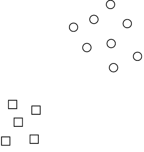

图 8.1：两个对象的分类

这项任务被视为一个二分类问题，因为只有两个结果；要么是 0，要么是 1。通过一些监督学习，你可以快速确定这些类别的位置。

如果有超过两个类呢？例如，你可以把三角形加入进来，如图 8.2 所示。

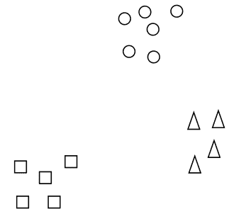

图 8.2：三个对象的分类

二分类在这里不起作用。你现在面临的是一个多分类问题。因为有多个类，你必须使用能够相应分类这些类的算法。值得注意的是，某些多分类方法使用二分类器的组合来得出预测。

### 线性分类器

为了确定一个对象属于哪个组，你使用线性分类器来建立对象的位置，并查看是否存在一条整洁的分割线——称为超平面；应该有一组对象清晰地位于这一侧，另一组对象同样清晰地位于另一侧。（这只是理论上如此，现实情况并非如此，这一点将在本章后续讨论）假设一切都已就绪——嗯，两个独立的组。

如图 8.3 所示，从视觉上看这很直观，但你需要通过数学方式进行计算。图中的每个点，你知道有一个 x 轴值和一个 y 轴值。分类点的计算公式如下：

```
sign(ax + by + c)
```

a、b 和 c 的值定义了直线；这些值是你选择的，你需要在过程中不断调整它们，直到获得良好的拟合（清晰的分离）。

## 第 8 章 ■ 支持向量机

学习方法。必须执行这一步来确定直线的拟合位置。距离直线越远的点，其属于特定类别的置信度就越高。

### 置信度

你刚刚确定了每个点根据其到超平线的距离有一个置信度。该置信度可以转换为概率。

由此得到了以下方程：

```
$P[+1|x] = \frac{1}{1+\exp(-(ax+by+c))}$
```

这是针对单个点的。你需要的是每一组线的概率；这些线被分配给训练数据中的每个对象。

```
$$\prod_{i=1}^{N} P[L_i|x_i] = \prod_{i=1}^{N} \frac{1}{1+\exp(-l_i(ax+by+c))}$$
```

概率之所以相乘，是因为这些点是独立绘制的。每个点都有一个方程，指示超平面是正确分类的概率。将每个点的概率结合起来就产生了通常定义的“数据似然”；你寻找的是尽可能接近 1 的数字。

记住，概率是基于 0 到 1 之间的值。在一组对象中，你正在寻找一组具有最高概率的线参数，以确认分类是正确的。

### 通过最大化和最小化寻找直线

使用单调递增的对数函数可以使方程之值最大化。因此，你最终得到一个如下所示的函数：

```
$$\sum_{i=1}^{N} -log(1+\exp(-l_i(ax+by+c)))$
```

为了实现最小化，你只需要将方程乘以 -1。它就变成了一个“成本”或“损失”函数。目标是找到使该函数值最小的直线参数。

线性分类器通常非常快；它们可以轻松处理即使是大型对象。当你使用它们进行文档分类（可能需要测量词频）时，这是一件好事。

## 支持向量机如何处理分类

线性分类的基本解释是，超平面创建了区分一个对象和另一个对象的直线。支持向量机在此基础上更进一步。

在有限的空间内，我概述了支持向量机在线性和非线性形式下的工作原理。我也向你展示如何使用 Weka 为你完成实际工作。

### 使用线性分类

再次观察圆形和正方形对象集。你知道超平面如何在平面上将对象划分为 1 或 -1。

进一步扩展这一概念，支持向量机定义了最大间隔，假设超平面是以线性方式分离的。你可以在图 8.4 中看到这一点，主超平面线给出了以下符号：

```
w \cdot x - b = 0
```

这个点积显示了法向量，x 是对象的点。超平面有一个偏移，从原点延伸到法向量。

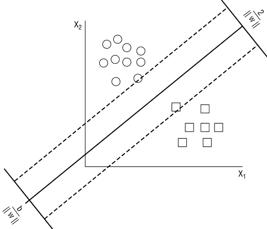

**图 8.4：** 支持向量机最大间隔超平面

# 第 8 章 ■ 支持向量机 149

由于对象是线性可分的，你可以创建另外两个超平面——边缘超平面——它们定义了主超平面两侧的偏移。在跨越主超平面和边缘超平面之间的区域内没有对象。

在其中一侧有一个方程

```
$w \cdot x - b = 1$
```

在另一侧有：

```
$w \cdot x - b = -1
```

位于边缘超平面上的对象就是支持向量（见图 8.5）。

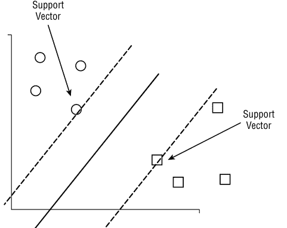

图 8.5：超平面边缘上的支持向量

当向分类中添加新对象时，超平面及其边缘可能会移动。关键目标是确保 +1 超平面和 -1 边缘超平面之间存在最大间隔。

如果你能够让类别之间保持巨大的间隙，那么你对预测的置信度就会增加。知道超平面边缘的值可以让你直观感受到类别分离的程度。

在最小化值 $w$（在数学符号中称为 $||w||$）之后，你可以通过应用以下方程来优化 $w$：

```
$||w||_2$
```


基本上，你取的是 `||w||` 平方的一半，而不是使用 `||w||` 的平方根。根据拉格朗日乘子法，为了找到函数的最大值和最小值，你现在可以寻找鞍点，并忽略那些不为零（不落在鞍点内部）的点。

> 注意：对于未知的人来说，鞍点是一种数学函数，在临界点处两个变量的函数值均为零。它被称为鞍点是因为它在图形形式中产生的形状像马鞍。你可以通过 `http://wikipedia.org/wiki/Saddle_point` 了解更多信息。

你正在将图形塑造成一个多维空间，并观察向量的位置，以便使类别区分尽可能大。通过标准的二次规划，你随后应用将训练向量表示为线性组合的函数：

```
$w = \sum_{i=1}^{n} \alpha_i x_i$
```

其中 $\alpha_i$ 大于零。

# 使用非线性分类

在理想的世界中，对象位于。对于使用 Weka，情况如图 8.6 所示。

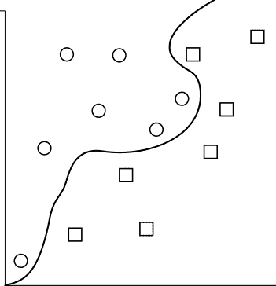

图 8.6：非线性分类

## 第 8 章 支持向量机

通过应用内核（有时被称为“内核技巧”），你可以应用。在较新版本的 Weka 中，可以从包管理器安装。包管理器位于。对于使用 SVM，选项是在 classpath 中引用（本章将介绍）或使用 Maven。

```xml
<?xml version="1.0" encoding="UTF-8"?>
<project xmlns="http://maven.apache.org/POM/4.0.0"
     xmlns:xsi="http://www.w3.org/2001/XMLSchema-instance"
     xsi:schemaLocation="http://maven.apache.org/xsd/maven-4.0.0.xsd">
  <modelVersion>4.0.0</modelVersion>

  <groupId>mlbook</groupId>
  <artifactId>Chapter8</artifactId>
  <version>1.0-SNAPSHOT</version>
  <dependencies>
    <!-- https://mvnrepository.com/artifact/nz.ac.waikato.cms.weka/weka-stable -->
    <dependency>
      <groupId>nz.ac.waikato.cms.weka</groupId>
      <artifactId>weka-stable</artifactId>
      <version>3.6.7</version>
    </dependency>
    <!-- https://mvnrepository.com/artifact/tw.edu.ntu.csie/libsvm -->
    <dependency>
      <groupId>tw.edu.ntu.csie</groupId>
      <artifactId>libsvm</artifactId>
      <version>3.23</version>
    </dependency>
  </dependencies>
</project>
```

库就绪后，你可以启动 Weka。如果你是 Windows 用户，按正常方式启动 Weka，但如果你运行 macOS 或 Linux，则必须从命令行执行：

```
-cp weka.jar:libsvm weka.gui.Chooser
```

如果你没有从命令行启动 Weka，分类器会给出一个错误，告知未找到库。

在较新版本的 Weka 中，可以从包管理器安装 LibSVM 库。包管理器位于主 GUI Chooser。从列表中选择 LibSVM 包并点击安装。

# 分类演示

你将看到 GUI 应用程序打开，就像通过 GUI 启动 Weka 一（见图 8.7）。选择 Explorer 选项。

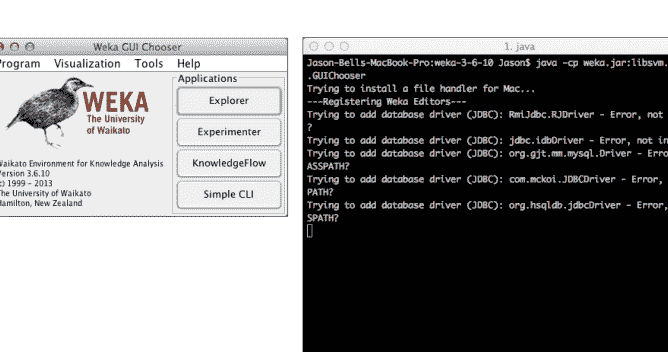

图 8.7：GUI 选择器

我将使用随书附带的代码和数据存储库中的 100,000 行车辆数据。在 `data/ch08` 文件夹中找到 `.csv` 文件，并在 Weka 中打开它，如图 8.8 所示。不要忘记将文件类型从 `.arraf` 改为 `.csv`。

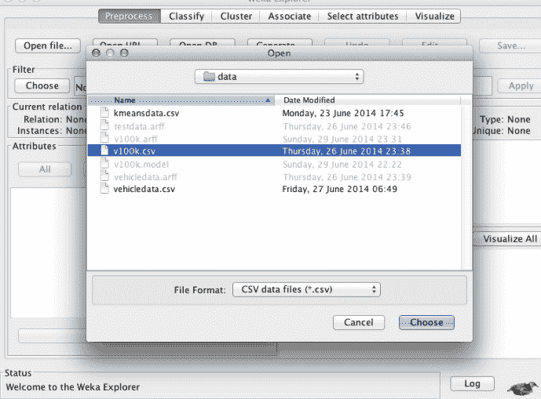

图 8.8：加载 .csv 文件

## 设置选项

点击 Classify（分类）标签页，并点击 Choose（选择）按钮来选择不同的分类算法。在算法树中，点击 Functions（函数），然后选择 LibSVM，如图 8.9 所示。

在选择要运行的分类器之前，需要进行几处更改。首先，你可能希望训练数据和测试数据之间有一个比例。在这种情况下，你可以非常有把握认为数据很难分类，而且这不是一个非线性分类问题；你可以使用 10% 的数据（10,000 行）进行训练，并使用 90% 的数据查看其性能。

点击 Split（划分）选项，将默认值 66% 更改为 10%，如图 8.10 所示。

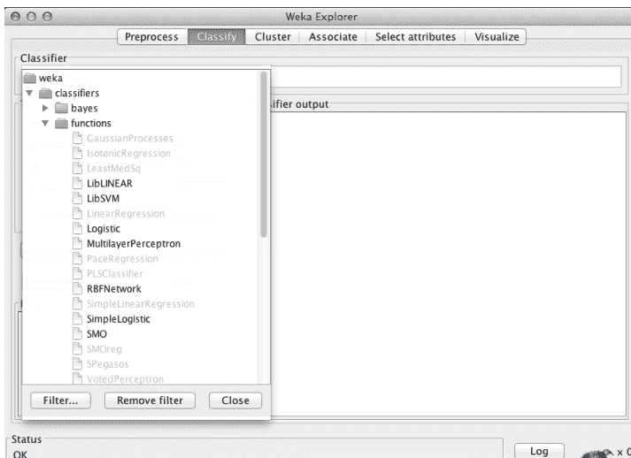

图 8.9：选择 LibSVM 分类器

你希望将测试数据（那 90%）的结果输出到 Weka 控制台，以便查看它的运行性能。点击 Options（选项）按钮，并确保 Output Predictions（输出预测）复选框已勾选，如图 8.11 所示。

LibSVM 包装器默认使用径基函数作为其内核类型。点击带有所有 LibSVM 选项的行，将其更改为你一直关注的线性版本。它位于分类器面板内 Choose 按钮旁边。

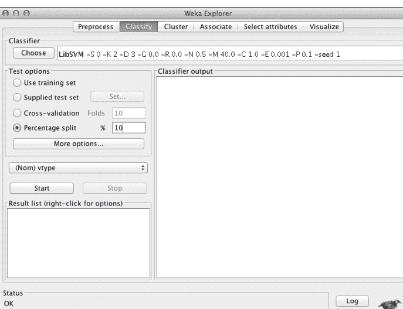

图 8.10：更改划分比例

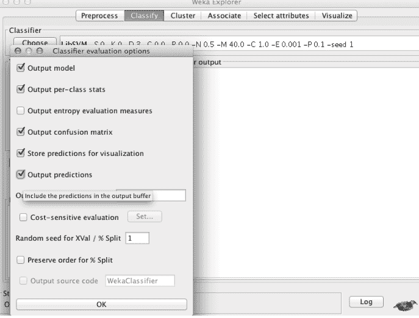

图 8.11：分类器评估选项对话框

将 `kernelType` 下拉菜单从 Radial Basis Function（径基函数）更改为 Linear（线性）。保持其他选项不变（见图 8.12）。

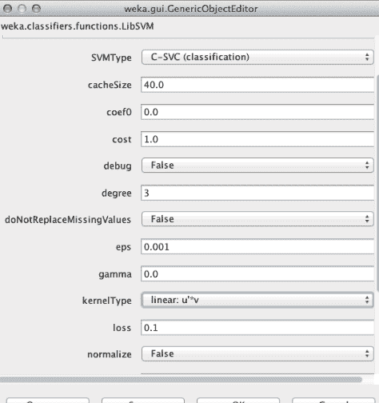

图 8.12：更改内核类型

## 运行分类器

一切设置完成后，你就可以运行分类器。点击 Start（开始）按钮，你将看到输出窗口开始输出有关分类的信息。

首先，是运行信息，或者你刚刚设置的所有选项。

```
=== Run information ===
Scheme:weka.classifiers.functions.LibSVM -S 0 -K 0 -D 3 -G 0.0 -R 0.0
-N 0.5 -M 40.0 -C 1.0 -E 0.001 -P 0.1 -seed 1
Relation: v100K
Instances: 100000
Attributes: 4
wheels
chassis
pax
type

Test mode:split 10.0% train, remainder test
```

接下来，你将获得关于分类器模型的通用信息。

```
=== Classifier model (full training set) ===
LibSVM wrapper, original code by Yasser EL-Manzalawy (= WLSVM)
Time taken to build model: 3.08 seconds
```

在你的机器上，在 10,000 个实例上训练的分类器仅花了三多秒时间，当你输出用于显示预测的划分时，你将看到接下来。

```
=== Predictions on test split ===
inst#, actual, predicted, error, probability distribution
```

| | | | | | | | |
|---|---|---|---|---|---|---|---|
| 1 | Bike | Bike | 0 | 0 | 0 | *1 |
| 2 | Bike | Bike | 0 | 0 | 0 | *1 |
| 3 | Truck | Truck | 0 | *1 | 0 | 0 |
| 4 | Bus | Bus | *1 | 0 | 0 | 0 |
| 5 | Bus | Bus | *1 | 0 | 0 | 0 |
| 6 | Car | Car | 0 | *1 | 0 | 0 |
| 7 | Bike | Bike | 0 | 0 | 0 | *1 |
| 8 | Truck | Truck | 0 | 0 | *1 | 0 |
| 9 | Truck | Truck | 0 | *1 | 0 | 0 |
| 10 | Car | Car | 0 | 0 | 0 | 0 |
| 11 | Bike | Bike | 0 | 0 | 0 | *1 |
| 12 | Car | Car | 0 | 0 | 0 | 0 |
| 13 | Truck | Truck | 0 | *1 | 0 | 0 |
| 14 | Truck | Truck | 0 | 0 | 0 | 0 |
| 15 | Bike | Bike | 0 | 0 | 0 | 0 |
| 16 | Bus | Bus | 0 | 0 | 0 | 0 |
| 17 | Bus | Bus | 0 | 0 | 0 | 0 |
| 18 | Car | Car | 0 | 0 | 0 | 0 |
| 19 | Bus | Bus | 0 | 0 | 0 | 0 |

## 代码实现


图 8.13：创建新的 Java 项目

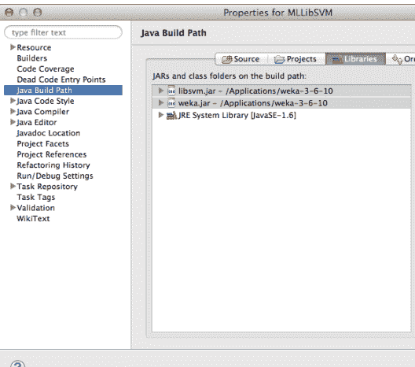

图 8.14：添加所需的 JAR 文件

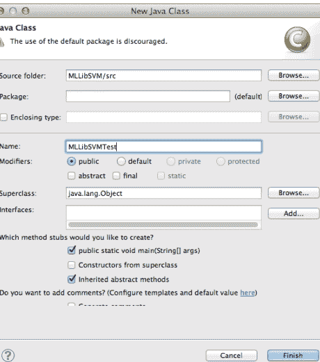

图 8.15：创建一个新的 Java 类

```java
public class MLLibSVMTest {
    public MLLibSVMTest(String filepath) {
        Instances data;
        try {
            data = DataSource.read(filepath);

            if (data.getClassIndex() == -1)
                data.setClassIndex(data.numAttributes() - 1);
            LibSVM svm = new MLLibSVM();
            String[] options = weka.core.Utils
                .splitOptions("-K 0 -D 3");
            svm.setOptions(options);
            svm.buildClassifier(data);
        } catch (Exception e) {
            e.printStackTrace();
        }
    }

    public static void main(String[] args) {
        MLLibSVMTest mllsvm =
        new MLLibSVMTest("/path/to/data/ch08/v100k.arff");
    }
}
```

LibSVM 库有很多选项设置，但我想要重点关注的是核类型。与 Weka 工作台中一样，默认值是径向基函数。在选项中，2 代表这种类型。对于线性核函数，你将其更改为零。

要在 Eclipse 中运行代码，请选择 Run。这会获取训练数据并创建模型。它不会做其他任何操作。

已处理零权重。将使用默认权重

+ * optimization finished, #iter = 9

nu = 7.999320068325541E-7

obj = -0.01999999994535163, rho = 2.1200468366586958

SV = 4, nBSV = 0

+ * optimization finished, #iter = 9

nu = 5.508578921562448-7

obj = -0.01379310348278558, rho = -1.0137931034482762

nBSV = 5, nBSV = 0

+ * optimization finished, #iter = 3

nu = 3.801428931030698E-7

obj = -0.000947867298571991, rho = 1.2180094768279256

SV = 2, nBSV = 0

+ * optimization finished, #iter = 5

nu = 1.877434063289764E-7

obj = -0.0047058832352941176, rho = -1.60705883235294119

SV = 4, nBSV = 0

+ * optimization finished, #iter = 6

nu = 8.90259889118131E-6

obj = -0.222222222222222227, rho = 1.6666666666666667

SV = 3, nBSV = 0

+ * optimization finished, #iter = 3

nu = 1.230867700185247E-7

obj = -0.00370769230796307, rho = 1.1107692307962307

SV = 2, nBSV = 0

Total nSV = 14

输出看起来很困惑，但这些是支持向量的数量 (nSV)、边界支持向量的数量 (nBSV)，而 obj 是对偶支持机的最优值。

## 使用现有数据进行训练和预测

到为止，你已经使用 .arff 文件中的全部 100,000 行数据进行了训练。我想用 90% 的数据进行训练，然后以与工作台相同的方式预测剩余的 10%。

Weka API 允许你像在工作台中那样添加选项，在划分数据进行训练时，你可以在代码中执行相同的操作。修改选项并添加训练百分比例如：

```java
String[] options = weka.core.Utils.splitOptions("-K 0 -D 3");
```

现在它变成了：

```java
String[] options = weka.core.Utils.splitOptions("-K 0 -D 3 -percentage 10");
```

要显示数据的预测结果，请添加一个新的 svm 来遍历实例：

```java
public void showClassifications(LibSVM svm, Instances data) {
    try {
        for (int i = 0; i < data.numInstances(); i++) {
            System.out.println("Instance " + i + " is classified as " +
                data.classAttribute((int)svm.classifyInstance(data(i))));
        }
    } catch (Exception e) {
        e.printStackTrace();
    }
}
```

分类器始终返回数值值作为结果；取决于你将该数字转换为整数并通过类属性来确定它是自行车、汽车还是卡车。当你再次运行代码时，你会看到之前用 10% 训练数据生成的分类器，它对整个集合进行了分类。

- 实例 99991 分类为 卡车 (Truck)
- 实例 99992 分类为 公交 (Bus)
- 实例 99993 分类为 汽车 (Car)
- 实例 99994 分类为 卡车 (Truck)
- 实例 99995 分类为 汽车 (Car)
- 实例 99996 分类为 公交 (Bus)
- 实例 99997 分类为 自车 (Bike)
- 实例 99998 分类为 卡车 (Truck)
- 实例 99999 分类为 自车 (Bike)

输出看起来很困惑，但这些是支持向量的数量 (nSV)、边界支持向量的数量 (nBSV)，而 obj 是对偶支持机的最优值。


```java
public void showClassifications(LibSVM svm, Instances data) {
    try {
        for (int i = 0; i < data.numInstances(); i++) {
            System.out.println("Instance " + i + " is classified as " +
                data.classAttribute((int)svm.classifyInstance(data(i))));
        }
    } catch (Exception e) {
        e.printStackTrace();
    }
}
```

分类器始终返回数值值作为结果；取决于你将该数字转换为整数并通过类属性来确定它是自行车、汽车还是卡车。当你再次运行代码时，你会看到之前用 10% 训练数据生成的分类器，它对整个集合进行了分类。

- 实例 99991 分类为 卡车 (Truck)
- 实例 99992 分类为 公交 (Bus)
- 实例 99993 分类为 汽车 (Car)
- 实例 99994 分类为 卡车 (Truck)
- 实例 99995 分类为 汽车 (Car)
- 实例 99996 分类为 公交 (Bus)
- 实例 99997 分类为 自车 (Bike)
- 实例 99998 分类为 卡车 (Truck)
- 实例 99999 分类为 自车 (Bike)

### 什么是神经网络？

人工智能神经网络在本质上非常依赖数据量。人工智能神经网络本质上是基于大脑运作的。

### 第 9章 神经元

在生物学中，神经元通过轴突传递电信号。细胞体决定权重，如果超过了阈值，信号就会通过树突继续传递。

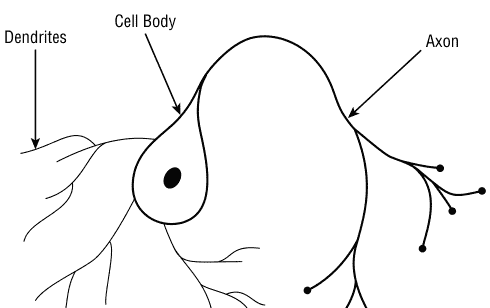

**图 9.1：神经元结构**

## 神经网络的应用

人工智能神经网络在数据量和速度上表现优异，因此被用于实时或非常接近的场景。以下章节描述了人工智能神经网络的一些典型案例。

## 高频交易

由于人工智能神经网络模拟大脑，但具有更快的速度，它们非常适合高频交易。因为 HFT 做出决策比人类快得多——数以千计的

### 数据中心管理

Google 使用神经网络进行数据中心管理。有了有关负载、运行温度、网络设备使用和外部空气温度的数据，Google 可以计算数据中心的效率并调整设置。

Jim Gao 将这是一个 Google 20% 项目（一项鼓励 Google 员工将其20% 的工作时间用于自己项目的计划），并随着时间的推移，将模型训练到了 99.6% 的准确率。如果你对此感兴趣，可以查看这里 Google 的博客文章：

http://googleblog.blogspot.ca/2014/05/better-data-centers-through-machine.html

## 机器人

人工智能在机器人领域已经使用了多年。某些人工智能需要模式识别，并且需要大量的传感器数据输入到神经网络中，以决定采取什么动作或行动。

## 医疗监控

可以通过人工神经网络对医疗设备进行监控，这涉及对许多变量的持续更新，例如心率、血压等。对于具有多种变化并触发症状的状况可以进行计算和监控，当变量超过某些阈值时，工作人员会收到警报。

医学影像领域已经取得了巨大进展，使用深度学习技术（如卷积神经网络）可以预测疾病区域，并为咨询顾问和医生提供决策支持。

## 信任“黑箱”

自本书第一版出版以来，神经网络已经得到了大规模应用。数据的价值已经增加，意味着有足够的数据来支持准确的预测，但很难解释这些“黑箱”算法是如何运作的。

可以遵循这样一个准则：如果你不确定模型输入和输出之间的关系，那么通过神经网络进行研究是一个很好的 way。但如果你对输入/输出关系有良好的理解，那么很可能会使用其他传统方法。

我一直鼓励学生、软件专业人员和管理人员在确定神经网络之前，探索所有的算法选项，特别是当你的发现最终将受到其他专业人士或大众审查时。

随着时间的推移，许多人工智能分支所做出的错误预测受到了关注。在创建旨在代表他人进行预测的算法时，“可解释人工智能”一词已处于讨论的前沿。

此外，拥有足够数量的数据来训练神经网络至关重要。小规模的训练将产生较低的准确率分数，而且有时其他机器学习算法（甚至是线性回归）的表现会比神经网络更好。

查看数据质量也很重要。它是否涵盖了你试图回答的问题的谱畴？偏偏的数据将给你带来错误的预测，而且你无法解释原因。

最终，在向神经网络投入时间、数据和金钱之前，真的值得问问自己这是完成此任务的最佳方法吗。

## 拆解人工神经网络

在深入研究数据和示例之前，我将介绍神经网络的原理和工作机制。

## 感知机

神经网络的基础是`perceptron`（感知机）。它的作用非常简单：它接收一个输入信号，然后通过某种函数传递该值。它输出函数的结果。（参见图 9.2）。

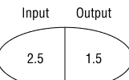

**图 9.2：** 简单的感知机

当输入一个数字或数字向量时，感知机处理这些数字。然后它会被传递给一个计算输出值的函数；这被称为`activation function`（激活函数）。节点可以处理任意数量的输入——图 9.3 显示了两个输入进入函数——它取所有输入的加权和。

假设输入是一个向量 Z，你将得到如下结果：

```
Z1 = 2
Z2 = 5
Z3 = 1
```

所有输入的加权和计算方式如下：

```
\sum wiZi
```

换句话说，“把它们加起来”。对于我这样不习惯太多数学符号的人来说，它看起来如下：

```
2w1 + 5w2 + 1w3
```

节点的输出部分有一组阈值。如果总和值超过阈值，则输出（由变量 `y` 表示）为 1；如果低于阈值，则 `y` 为 0（零）。

你最终得到了以下方程：

```
$$\if \sum w_iz_i \geq 1 \text{ then } y = 1
\text{else } y = 0$$
```

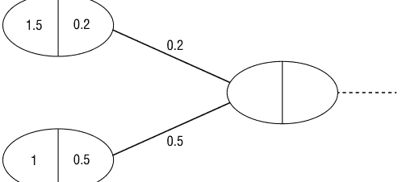

**图 9.3：** 两个输入的感知机

感知机的权重可以是 0 或任何其他值。如果权重值为 0，那么它就不会改变进入感知机的节点值。同样，输入可以是正数或负数。输出的关键基于相对于阈值的加权和。

这就是单节点感知机的基础。当你把组件拆分开时，它的组成非常基础。

## 激活函数

激活`function`（函数）是在输入传递到神经元后发生的处理。该函数的结果决定了该值是否被传递到输出轴并进入网络中的下一个神经元。

通常使用 Sigmoid 函数（见图 9-4）和双曲正切函数作为激活函数来计算输出。

Sigmoid 函数只输出两个值之一：0 和 1。对于语法规则中，该函数的写法如下：

```java
return 1.0 / (1.0 + Math.exp(-x));
```

如果需要，也可以改变曲线的陡度，但对于大多数应用，直线函数就足够了。

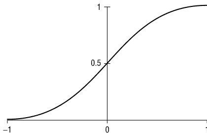

**图 9.4：** Sigmoid 函数

## 多层感知机

单层感知机的问题是它们是线性可分的。输出要么是一个值，要么是另一个。

如果你考虑到逻辑理论中的 AND 门（与门），那么输出要么是一个值，要么是另一个。

如果你有两个输入，其结果如表 9.1 所示。

表 9.1：AND 门输出

| 输入 | 输出 |
| :--- | :--- |
| Off | Off |
| On | Off |
| Off | Off |
| On | On |

感知机的这种方式如图 9.5 所示。


**图 9.5：** AND 门感知机

网络输出如下：

```
$$\begin{cases} 1 & \text{if} (W0 \times I0) + (W1 \times I1) > 0 \\ 0 & \text{Otherwise} \end{cases}$$
```

多层感知机在输入节点和输出节点之间有一层或多层层，被称为`Hidden layer`（隐藏层），见图 9.7。

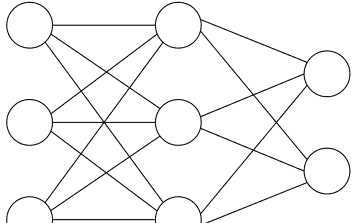

**图 9.7：** 具有隐藏层的多层感知机

# 第9章 人工神经网络

```
更新网络权重
直到所有分类都与训练数据匹配正确
返回最终完成的网络
```

进行传播，并将训练数据输入网络并生成输出的激活值。然后，根据训练模式的目标，将网络的所有输出层和隐藏层的激活值和误差（deltas）进行反向传播。

在第二阶段，通过将输出误差和输入激活值相乘来计算权重更新。这得出了梯度权重。从权重中减去该百分比。第二部分针对网络中的所有权重轴进行。

该百分比就是学习率。比例越高，学习速度越快。比例越低，你知道学习的准确性越高。

> 我理解在 一目侧重于如何快速上手机器学习的实际方面的书中，要掌握神经网络的数学概念是很困难的。本概述提供了关于它们如何工作的基本概念。输入层和输出层、感知器以及正向和反向传播的概念等主要概念为思维过程提供了一个良好虽然简单的基础。

## 人工神经网络的数据准备

为了创建人工神经网络，值得使用有监督学习方法。然而，这需要对你将用于网络的数据进行一些思考。

人工神经网络仅对数值数据值有效。因此，如果有带有文本值的归一化权重，则需要对其进行转换。对于性别等数据，这并不是什么问题，常见的输出将是男性 = 0，女性 = 1。原始文本将不再适用，因此它将被清理、被哈希化为数值值，或者从测试中删除。

对于所有数据策略，当你思考用于分类的数据时，你会遇到一种被称为“维度灾难”的现象。这是当增加的变量增加了获得合理结果和洞察所需的所需的总量时。因此，当你考虑添加另一个变量时，请确保你有足够的训练数据来涵盖所有其他变量的各种情况。

尽管神经网络对噪声数据相当有容忍度，但最好尝试确保没有可能导致结果问题的巨大离群值。要么找到并删除这些离群的数字，要么将它们转变为

## 使用 Weka 构建的人工神经网络

Weka 框架支持多层感知器，并使用我所描述的反向传播技术对其进行训练。在演示中，你将创建一些数据然后生成一个神经网络。

## 生成数据集

我的数据集将包含不同类型车辆的分类。我首先将创建一个 Java 程序，生成一些随机但加权的数据，为我们提供四种车辆：自行车、汽车、公交车和卡车。代码如下：

```java
import java.io.BufferedWriter;
import java.io.FileWriter;
import java.io.IOException;
import java.util.Random;

public class MLPData {
    private String[] classtype = new String[] { "Bike"
```

```java
sb.append(rand.nextInt(30) + 10 + ","); // 乘客人数

sb.append(clastype[2] + "\n");
    break;
    case 3:
        sb.append("*18,");
        sb.append(rand.nextInt(10) + 20 + ",");
        sb.append(rand.nextInt(2) + 1) +
        sb.append(clastype[3] + "\n");
        break;
    default:
        break;
    }
    out.write(sb.toString());

out.close();
} catch (IOException e) {
    e.printStackTrace();
}

    public static void main(String[] args) {
        MLPData mlp = new MLPData();

    }
}
```

运行上述代码会创建一个名为 `vehicledata.csv` 的 CSV 文件。首先创建 100 行输出。

- 4,2,4,Car
- 9,20,25,Bus
- 5,14,18,Bus
- 5,2,1,Car
- 9,17,25,Bus
- 1,1,1,Bike
- 4,4,2,Car
- 9,15,36,Bus
- 1,1,1,Bike
- 5,1,4,Car
- 4,2,1,Car

如之前讨论的，你需要进行大量的训练才能使神经网络在预测中保持准确。

## 将数据加载到 Weka

打开 Weka 工具包并选择 Explorer（探索器）功能以显示图 9.8 所示的 Explorer。

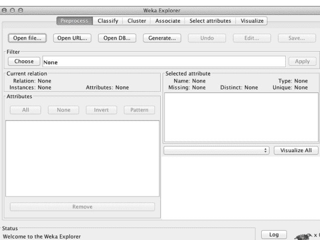

图 9.8: Weka Explorer

你将导入创建的 CSV 文件。确保选择了 Preprocess（预处理）窗口；然后点击 Open File（打开文件）按钮并选择 vehicles.csv 文件。不要忘记将 File Format 下拉菜单从 .arff 更改为 .csv，如图 9.9 所示。

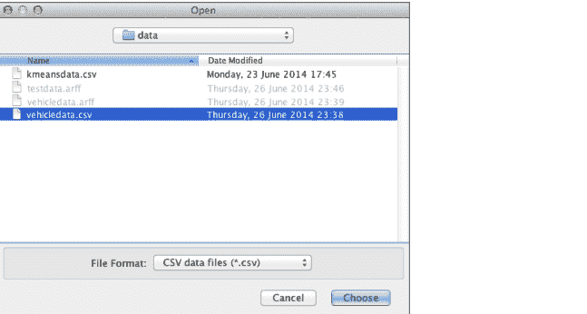

图 9.9: Weka 文件对话框

你看到数据已加载，带有关系和属性信息的基本表示。

## 配置多层感知器

Weka 的神经网络功能带有其自己的图形用户界面。运行时，你可以看到它。

点击 Classify（分类）面板。默认分类器是 ZeroR，将其更改为 Multilayerperceptron（多层感知器），见图 9.10。主要概念是输入层和输出层、感知器以及正向和反向传播的概念为思维过程提供了良好虽然简单的基础。

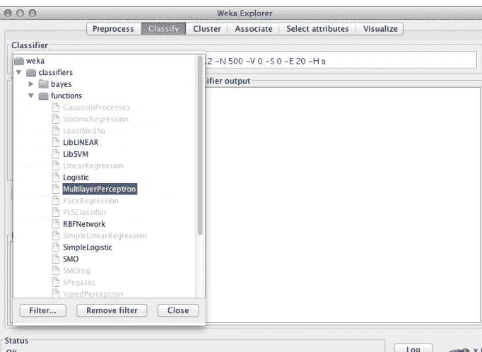

图 9.10: 选择分类器

将 GUI 设置为 True。此设置会让神经网络以图形形式显示。如果 GUI 设置为 False，Weka 将在没有你干预的情况下生成网络。点击它，会打开一个窗口，如图 9.11。

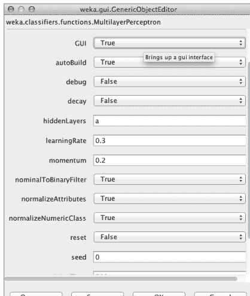

图 9.11: 选项对话框

## 学习率

权重更新的默认为 0.3。如果看起来太重或太轻，可以根据需要调整。

## 隐藏层

你可以定义神经网络具有多少层隐藏层。默认情况下，Weka 构建四层，你也可以只有类别。

## 训练时间

Weka 在训练期间迭代的次数（epochs）设置为 500。数字越高，误差率越低。正如我们稍后看到的，这会产生不同的结果。

当你对选项满意时，可以点击 OK 返回 Classify 窗口。

## 训练网络

你需要进行几次神经网络运行，以找到产生良好分类的平衡点。对于 100 行数据，你并没有解决什么很有价值的问题；无论如何，它都让你了解了它是如何工作的。

确保测试选项设置为使用整个训练集。交叉验证（crossvalidation）是可以的，但它会通过所有 10 折训练，这在你想要测试时可能会很耗时。点击 Start（开始），显示图 9.12 所示的神经网络窗口。

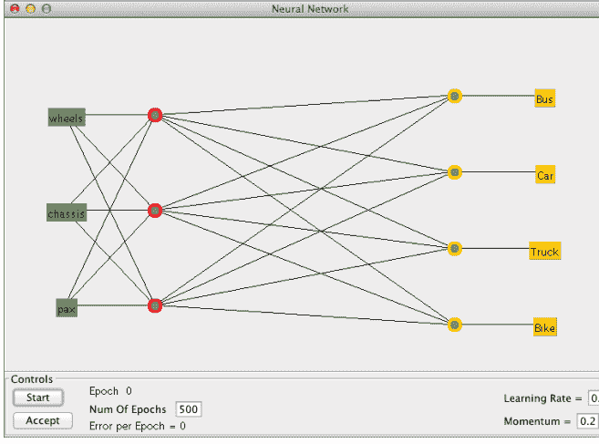

图 9.12: 神经网络 GUI 窗口

点击 Start，你看到时代计数增加，误差率下降。如果你不点击了 Accept（接受），则没有数据被分类，结果也就没有了。

神经网络运行后，点击 Accept 按钮，你将返回分类输出屏幕。

完整的分类输出给出了隐藏层的输出。节点 0、1、2 和 3，以及图 9.12 右侧的四个节点是输出连接。分类的类别属性在神经网络输出的右侧显示为 bike、car、bus 或 truck（参见图 9.12）。

# 第9章 | 人工神经网络 181

| 节点 | 权重 |
|---|---|
| 节点 4 | -0.0403863863499096 |
| 节点 5 | 0.006548363496521245 |
| 节点 6 | -0.03873856454480489 |
| Sigmoid 节点 1 | |
| 输入阈值 | -0.0451840582741909 |
| 节点 4 | -0.0028251224687941959 |
| 节点 5 | -0.012455737520358182 |
| 节点 6 | -0.049138267380073 |
| Sigmoid 节点 2 | |
| 输入阈值 | -0.010479295335213488 |
| 节点 4 | 0.02182917059539388 |
| 节点 5 | 0.0287742383728064 |
| 节点 6 | -0.0018131553428896 |
| Sigmoid 节点 3 | |
| 输入阈值 | 0.02680212140425596 |
| 节点 4 | 0.00681039239375398 |
| 节点 5 | -0.04966876115075054 |
| 节点 6 | -0.01501536426914899 |

节点4和5构成了隐藏层，接收来自轮子、底盘和乘客数量的输入。

| Sigmoid 节点 4 | |
|---|---|
| 输入阈值 | 0.011850773635702267 |
| 轮子属性 | 0.042994050506718635 |
| 底盘属性 | -0.0356245938529804 |
| 乘客属性 | -0.01284810000068835 |
| Sigmoid 节点 5 | |
| 输入阈值 | 0.011650747862320076 |
| 轮子属性 | -0.018370069737576836 |
| 底盘属性 | -0.030933815802372954 |
| 乘客属性 | 0.0156751314244977 |


# 第9章 | 人工神经网络

| Sigmoid 节点 6 | |
|---|---|
| 输入阈值 | -0.047537599808653169 |
| 轮子属性 | -0.00211881837379247 |
| 底盘属性 | 0.040431974347463484 |
| 乘客属性 | -0.017949325044400313 |

每个节点都有输入类型和对应输入节点的权重。摘要显示了有多少实例被正确分类，以及发生错误时的其他值。

在最后部分，你可以看到混淆矩阵中的分类计数，如下：

```
=== 混淆矩阵 ===

a b c d      <-- 分类为
33 0 0 0  | a = Bus
0 27 0 0  | b = Car
0 0 20 0  | c = Bike
0 0 20 20 | d = Truck
```

## 修改网络

当 GUI 设置为 `True` 时，你可以添加节点，也可以删除指向隐藏层的输入路径。如果你进行了任何更改，都需要重新训练神经网络；更新后的网络将显示在 GUI 中。

## 哪个位是什么？

在 GUI 上从左到右看，你可以看到黄色框中的原始输入节点。红点是隐藏层节点，橙色点是输出节点。橙色标签是橙色节点关联的类别。

### 添加节点

你可以通过点击 GUI 添加新节点。红点的出现表示隐藏层节点。除非你已经在 GUI 中选择了节点，否则它不会连接到任何地方。

### 连接节点

在选中节点的状态下，你可以点击另一个节点来查看连接的建立。

### 移除连接

要移除连接，选择其中一个连接的节点，并右键点击另一个连接的节点。连接线就会消失。

### 移除节点

右键点击节点会移除该节点及其所有连接。请务必确保没有其他被选中的节点，否则这些节点及其连接也将被移除。

## 增加测试数据大小

在之前在本节中创建的 `MLP.java` 程序的 `for` 循环中，将循环次数从 100 行更改到 100,000 行。回到预处理窗口加载新的 CSV 文件。加载可能需要一些时间。

现在，回到分类窗口并重新运行网络。当 GUI 打开时，网络在隐藏层方面与之前相同。你之前是针对 100 行数据进行 500 次迭代（epoch），现在是针对 100,000 行进行迭代。点击“开始”，训练开始。你会注意到 GUI 上的时间发生了变化，因为它正在运行所有 100,000 行。主要关注的是每次迭代的错误数；该数字会不断减少，直到你从 100 次迭代缩短到 20 次。当训练完成时，你将获得一个非常准确的模型。尽管是以内存为代价的，训练时间超过了两分钟。构建模型的时间：124.5 秒。从整体来看，两分钟并不很长，但正如之前提到的收集数据时，变量越多会导致维度灾难。你用于训练的数据越多，预测结果就越准确。在这个时间点你会发现（每个迭代）数据都是不同的，所以没有硬性规则，并再次尝试。

## 在 Java 中实现神经网络

使用 Weka API，你可以使用 GUI 内部使用的相同的多层感知器构建神经网络。

### 创建项目

选择 `File -> New Project` 并将其命名为 `MLPProcessor`，如图 9.13 所示。在 macOS 上，Weka 通常安装在 `Applications` 目录。在 Windows 上取决于具体的操作系统，位于 `/Program Files (x86)/Weka-3/weka.jar`。对于 Weka 项目，选择 `File -> Properties` 和 `Java Build Path`。然后点击 `Libraries`；在对话框中点击 JAR 添加 `weka.jar` 文件，如图 9.14 所示。

![img/3c4b08972f1d075e8ebe64f0b2476_207_0.png) Eclipse New Project 对话框

![img/3c4b08972f1d075e8ebe64f0b2476_207_1.png) 添加外部

最后要做的是创建一个名为 `MLPProcessor.java` 的新类（使用 New Class），如图 9.15 所示。

![img/3c4b08972f1d075e8ebe64f0b2476_208_0.png) 9.15 创建类文件

### 编写代码

实际的 Java 代码很简单。你将执行以下操作：

1. 打开训练数据 `.arff` 文件。
2. 创建多层感知器并设置与 Weka 相同的选项。
3. 构建分类器。
4. 加载一些测试数据。
5. 使用测试数据对训练的模型运行评估。

你需要创建一个测试数据文件来测试模型。在名为 `testdata.arff` 的文件中输入以下内容：

```
@relation vehiculata

@attribute wheels numeric
@attribute chassis numeric
@attribute pax numeric
@attribute vtype {Bus,Car,Truck,Bike}

@data
18,25,Truck
8,21,24,Bus
18,27,Truck
1,1,1,Bike
7,23,21,Bus
18,20,1,Truck
8,16,20,Bus
18,28,2,Truck
7,18,36,Bus
8,21,27,Bus
5,2,4,Car
18,28,1,Truck
5,1,1,Car
1,1,1,Bike
18,27,1,Truck
5,1,1,Car
6,15,38,Bus
7,21,38,Bus
18,20,2,Truck
1,1,1,Bike
18,28,2,Truck
18,24,2,Truck
18,20,1,Truck
1,1,1,Bike
5,17,18,Bus
18,27,1,Truck
4,4,3,Car
18,21,1,Truck
5,2,3,Car
4,3,3,Car
```

创建测试文件后，使用以下代码：

```java
import java.io.FileNotFoundException;
import java.io.FileReader;
import java.io.IOException;
import weka.classifiers.Evaluation;
import weka.classifiers.functions.MultilayerPerceptron;
import weka.core.Instances;
import weka.core.Utils;

public class MLPProcessor {
    public MLPProcessor() {
        try {
            FileReader fr = new FileReader("vehicledata.arff");
            Instances training = new Instances(fr);
            training.setClassIndex(training.numAttributes() - 1);

            MultilayerPerceptron mlp = new MultilayerPerceptron();
            mlp.setOptions(Utils.splitOptions("-L 0.3 -M 0.2 -N 500 -V 0 -S 0 -E 20 -H 4"));

            mlp.buildClassifier(training);

            FileReader tr = new FileReader("testdata.arff");
            Instances testdata = new Instances(tr);
            testdata.setClassIndex(testdata.numAttributes() - 1);
            Evaluation eval = new Evaluation(training);
            eval.evaluateModel(mlp, testdata);
            System.out.println(eval.toSummary("\nresults\n\nn\n\n", false));

            tr.close();
            fr.close();
        } catch (FileNotFoundException e) {
            e.printStackTrace();
        } catch (IOException e) {
            e.printStackTrace();
        } catch (Exception e) {
            e.printStackTrace();
        }
    }

    public static void main(String[] args) {
        MLPProcessor mlp = new MLPProcessor();
    }
}
```

### 从 CSV 转换为 Arff

CSV 文件不包含 Weka 所需的数据。你可以实现 `SVLoader` 类，但我更倾向于确保 .arff 数据已经准备就绪并可以使用。这也让其他人在需要时解码数据模型变得更加方便。

从命令行，你可以通过一条命令将数据从 .csv 文件转换为 .arff 文件。

```
java -cp /Applications/weka-3-6-10/weka.jar \
weka.core.converters.SVLoader \
vehicledata.csv > vehicledata.arff
```

如果你检查该 .arff 文件，将看到它为你设置好的属性设置。

```
@relation vehicledata

@attribute wheels numeric
@attribute chassis numeric
@attribute pax numeric
@attribute vtype {Bus,Car,Truck,Bike}

@data
6,20,39,Bus
8,23,11,Bus
5,3,1,Car
4,3,4,Car
5,3,1,Car
4,18,37,Bus
18,23,2,Truck
```

### 运行神经网络

代码列表在运行时不会包含任何输出信息，评估结果输出除外。我之所以这么说，是因为训练数据可能包含 100,000 行，运行需要几分钟。

使用 Eclipse 中的 `Run: Run` 运行该类，它将开始生成模型。一段时间后，你就能看到评估的输出。

```
Results
======
```

| Correctly Classified Instances | 38 | 100 | % |
|---|---|---|---|
| Incorrectly Classified Instances | 0 | 0 | % |
| Kappa statistic | 1 | | |
| Mean absolute error | | 0.0003 | | |
| Root mean squared error | | 0.0004 | | |
| Relative absolute error | | 0.0795 % | | |
| Root mean squared error | | 0.0949 % | | |
| Total Number of Instances | 38 | | |

可以使用多层感知器的 `classify()` 方法轻松地分类实例，该方法接收单个 `Instance` 类并输出结果的数值表示。该结果对应于 .arff 训练文件中的输出类。

## 使用 DeepLearning4J 开发神经网络

Weka 框架为创建神经网络提供了一个非常好的工作系统。你所使用的系统显然决定了模型训练所需的时间。根据经验，我发现训练过程中会有那么一点，Weka 会开始变得非常吃力。当这种情况发生时，我会寻找我可以使用的替代方案。作为一名 Java 开发人员，我使用 DeepLearning4J 框架；它的扩展性良好，并且可以与 Spark 配合使用，让你跨集群扩展大型数据集。

让我们以车辆数据为例，使用 DL4J 创建一个多层神经网络。

### 修改数据

由于我们有了 Arff 数据文件，它知道输出类是车辆类型。DL4J 的训练数据基于 CSV 文件，但它需要数值输出类而不是文本类。因此，我将输出分类更改如下：

| 车辆类别 | DL4J 数值化输出类 |
|---|---|
| Bus | 0 |
| Car | 1 |
| Truck | 2 |
| Bike | 3 |

现在的数据看起来如下：

```
wheels,chassis,pax,vtype
6,20,39,0
8,23,11,0
5,3,1,1
4,3,4,1
5,3,1,1
4,18,37,0
18,23,2,2
5,4,2,1
1,1,1,3
```

```
18,26,2,2
1,1,1,3
1,1,1,3
1,1,1,3
8,21,28,0
5,4,2,1
```

### 查看 Maven 依赖

在代码仓库中有一个 `pom.xml` 文件，包含了 DL4J 所需的依赖项。我没有使用任何形式的图形处理器（GPU）进行计算，仅使用我正在工作的机器的 CPU。

```xml
<properties>
  <nd4j.backend>nd4j-native-platform</nd4j.backend>
  <dl4j.version>0.9.1</dl4j.version>
  <nd4j.version>0.9.1</nd4j.version>
</properties>
<dependency>
  <groupId>org.nd4j</groupId>
  <artifactId>${nd4j.backend}</artifactId>
  <version>${dl4j.version}</version>
</dependency>
<!-- Core DL4J functionality -->
<dependency>
  <groupId>org.deeplearning4j</groupId>
  <artifactId>deeplearning4j-core</artifactId>
  <version>${dl4j.version}</version>
</dependency>
<dependency>
  <groupId>org.deeplearning4j</groupId>
  <artifactId>deeplearning4j-nlp</artifactId>
  <version>${dl4j.version}</version>
</dependency>
<dependency>
  <groupId>org.httpcomponents</groupId>
  <artifactId>httpclient</artifactId>
  <version>4.5.5</version>
</dependency>
<dependency>
  <groupId>org.slf4j</groupId>
  <artifactId>slf4j-log4j12</artifactId>
  <version>1.7.13</version>
</dependency>
```

有了这些行配置，我们现在可以查看创建神经网络的步骤。

### 处理训练数据

由于 DL4J 可以处理各种数据格式，因此选择正确的格式作为训练数据至关重要；使用 `CSVRecordReader` 来读取文件。表头行将被跳过；该行包含列名。接下来的阶段是将每个 CSV 转换为 DL4J 的对象。我们用于预测车辆类型的值就是我们要的，因此 `labelIndex` 设置为 3（从 0 开始计数）。每个对象中有四个类，在这个示例中共有 100,000 行数据。我将使用 65% 的数据进行训练，剩余的 35% 用于评估。注意数据集是如何洗牌的，这样训练就具有一定的随机性。

```
labelIndex = 3;
evalSplit = 0.65;
batchSize = 100000;
```

```java
DataSetIterator iterator = new RecordDataSetIterator(reader, batchSize);
iterator.shuffle();
```

```java
reader = new CSVRecordReader(true, 3);
```

```java
DataSetIterator trainTestIter = iterator.split(evalSplit);
```

```java
DataSet trainData = trainTestIter.next();
DataSet testData = trainTestIter.next();
```

```java
DataNormalization normalizer = NormalizerStandard();
normalizer.fit(trainData);
normalizer.transform(trainData);
normalizer.transform(testData);
```

### 构建并执行程序

为了能够运行该应用程序，我将在 `pom.xml` 文件中添加 Java 执行插件。


```xml
<build>
  <plugins>
    <plugin>
      <groupId>org.codehaus.mojo</groupId>
      <artifactId>exec-maven-plugin</artifactId>
      <version>1.2.1</version>
      <executions>
        <execution>
          <goals>
            <goal>java</goal>
          </goals>
        </execution>
      </executions>
      <configuration>
        <mainClass>mlbook.ch09.ann.dl4j.BasicMLP</mainClass>
      </configuration>
    </plugin>
  </plugins>
</build>
```

`<mainClass>`标签被设置为我们程序的 Java 类。要运行此程序，请使用以下命令：

```bash
$ mvn exec:java -Dexec="mlbook.ch09.ann.dl4j.BasicMLP"
```

你将看到 Maven 的输出，几分钟后，将看到神经网络模型的评估结果。

```
[INFO] Scanning for projects...
[INFO]
[INFO] --- mlbook:Chapter9 ---
[INFO] Building Machine Learning: Hands On 2nd Edition Chapter 9 - Artificial Neural Networks 1.0-SNAPSHOT
[INFO] --- [ jar ] -

[INFO]
[INFO] >>> exec-maven-plugin:1.2.1:java (default-cli) >>>
validate @
[INFO]
[INFO] <<< exec-maven-plugin:1.2.1:java (default-cli) < validate @
Chapter9 <<<
[INFO]
[INFO] --- exec-maven-plugin:1.2.1:java (default-cli) @ Chapter9 ---
log4j:WARN No appenders could be found
```

```
logger (org.nd4j.linalg.factory.Nd4jBackend)
log4j:WARN Please initialize the log4j system properly.
log4j:WARN See http://logging.apache.org/log4j/1.2/faq.html#config for more info.
```

标签为 0 的示例被模型分类为 0：8725 次

标签为 1 的示例被模型分类为 1：8861 次

标签为 2 的示例被模型分类为 2：8762 次

标签为 3 的示例被模型分类为 3：8652 次

```
==================================scores=================
# of classes:      4
Accuracy:           1.0000
Precision:          1.0000
Recall:             1.0000
F1 Score:           1.0000
Precision, recall & F1: macro-averaged (equally weighted avg.
of 4 classes)
======================================================================
```

```
[INFO]

[INFO] BUILD SUCCESS
[INFO]

[INFO] Total time:   03:10 min
[INFO] Finished at:  2019-10-28T14:30:52Z
[INFO]
```

我们的模型仅花了三分钟就完成了 100,000 行数据的构建、训练和评估。生成的模型已保存到文件系统中，因此该模型可以重复使用。

## 总结

这是一个内容复杂的章节，涵盖了神经网络实际运作的核心概念。值得去探索 Weka 和 DeepLearning (DL4J) 库，并看看哪一个最适合你的工作和项目。

正如章节开头提到的，在确定使用神经网络之前，探索所有的算法选项都是值得的。一个可解释的模型总比一个不可解释的要好。这些神经网络模型的“黑箱”性质使得如果有人对预测结果产生质疑，很难为其提供合理的理由。

今后的工作必须格外小心，特别是在使用真实客户数据进行预测时。虽然是由计算机在工作并做出预测，但确保它们公平、准确且不对另一方产生负面影响仍然我们的责任。

虽然本章重点介绍了多层感知器作为常用的神经网络，但接下来的两个章节会将这些概念应用于卷积神经网络。通过这些深度学习算法，我们可以在机器学习环境中探索大型文本语料、图像和视频。

# 基于文档的机器学习

当你考虑到存储的文本量时，“文档”这个词听起来太正式了。它可能是文字处理文档、博客文章、电子邮件、新闻文章或学术论文。当你停下来考虑互联网和网上拥有的文本数据量时，你会发现它是巨大的，因此对其进行分析将花费大量的精力。

文本分析是杂乱的，而从中进行机器学习并不是世界上最容易的事情。文档是杂乱的，需要进行大量的清理工作，而且它们以各种不同的格式出现，这通常也带来了挑战。

在本章中，我将描述从文本文档中寻找信息的各种方法，还将涵盖准备数据进行分析的步骤。从那里，我将向你展示三种从文本中学习的方法：`TF-IDF`、`Word2Vec` 以及使用神经网络生成新文本。

作为文本分析的进一步学习，值得研究使用长短期记忆网络 (`LSTM`) 和 Transformer 双向编码器表示 (`BERT`) 的高级技术。

```
https://colab.research.google.com/github/research/blob/predicting_reviews_with_bert.ipynb
```

# 为分析准备文本

当我们说“文本”时，有些人可能会想到纯文本 (`.txt`)，而另一些人可能会富文本 (`.rtf`) 甚至是微软文档 (`.doc`/`.docx`)。如果你完全不确定处理的是什么类型的文档，值得看看 `Apache Tika`。

`Tika` 不仅限于文档，它还可以读取图像、视频、声音和其他类型。要查看完整的类型列表，请访问 Apache 网站。

```
http://tika.apache.org/1.22/formats.html#Full_list_of_Formats
```

对于命令行示例，我将从 Apache 站点下载 JAR 文件。选择离最近的镜像，进入以下：

```
java -jar tika-app-1.22.jar
```

一旦保存了 JAR 文件（可能会收到关于下载 JAR 的警告），你现在可以从命令行引用它。它提供了一个内置的 GUI；从命令行运行以下命令：

```bash
java -jar tika-app-1.22.jar
```

一旦 GUI（见图 10.1）加载，找到一个文本文件并将其拖入 GUI 然后释放。你将看到所掉落文件的元数据。

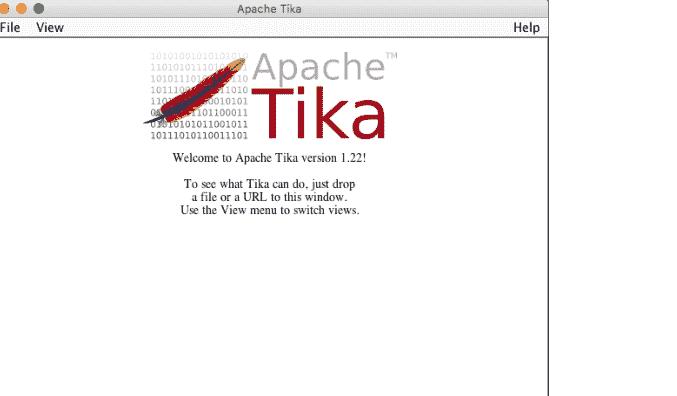

```
org.apache.tika.parser.audio.MidiParser
org.apache.tika.parser.chm.ChmParser
org.apache.tika.parser.code.SourceCodeParser
org.apache.tika.parser.crypto.Pkcs7Parser
org.apache.tika.parser.crypto.TSDSParser
org.apache.tika.parser.csv.TextAndCSVParser
org.apache.tika.parser.dbf.DBFParser
org.apache.tika.parser.dif.DIFParser
org.apache.tika.parser.dwg.DWGParser
org.apache.tika.parser.epub.EPubParser
org.apache.tika.parser.feed.FeedParser
org.apache.tika.parser.font.AdobeFontMetricParser
org.apache.tika.parser.font.TrueTypeParser
org.apache.tika.parser...GDALParser
org.apache.tika.parser.geo.topic.GeoParser
org.apache.tika.parser.geoinfo.GeographicInformationParser
org.apache.tika.parser.grib.GribParser
org.apache.tika.parser.hdf.HDFParser
org.apache.tika.parser.sas.SAS7BDATParser
org.apache.tika.parser.video.FLVParser
org.apache.tika.parser.wordperfect.QuattroProParser
org.apache.tika.parser.wordperfect.WordParser
org.apache.tika.parser.xml.DXMLParser
org.apache.tika.parser.xml.FictionBookParser
org.agravrar.tika.FlacParser
org.agravrar.tika.OgsParser
org.agravrar.tika.OggParser
org.agravrar.tika.SpeexParser
org.agravrar.tika.TheoraParser
org.agravrar.tika.VorbisParser
```

我将使用手中的一个文本文件；`midcdn.txt` 文件包含了来自本地开发者大会的所有会议演讲描述。

首先，我想获取该文件的元数据。

```
$ java -jar tika-app-1.22.jar -m -midcdn.txt
Aug 28, 2019 9:36:23 PM org.apache.tika.config.Initializable ProblemHandler$handleInitializableProblem
WARNING: J2ImageReader not loaded. JPG2000 data files will not be
processed.
See https://pdfbox.apache.org/pdf/2.0/dependencies.html#jai-io 查看可选依赖。
Aug 28, 2019 9:36:23 PM org.apache.tika.config.Initializable ProblemHandler$handleInitializableProblem
WARNING: org.xerial's sqlite-jdbc is not loaded.
请提供类路径上的 jar 包以解析 sqlite 文件。
请查看 tika-parsers/pom.xml 获取正确的版本。
Content-Encoding: UTF-8
Content-Length: 38222
Content-Type: text/plain; charset=UTF-8
X-Parsed: org.apache.tika.parser.DefaultParser
X-Parsed: org.apache.tika.parser.csv.TextAndCSVParser
resourceName: nidcclean.txt
```

`-m` 选项标记将输出元数据。我想改为将文件内容导出为 XML，这也可以通过命令行完成。

```
$ java -jar tika-app-1.22.jar -x -nidcclean.txt
Aug 28, 2019 9:44:33 PM org.apache.tika.config.Initializable
ProblemHandler3 handleInitializableProblem
WARNING: J2ImageReader not loaded. JPEG2000 files will not be
processed.
查看 https://pdfbox.apache.org/2.0/dependencies.html#jai-image-io 获取可选依赖。
Aug 28, 2019 9:44:33 PM org.apache.tika.config.Initializable
ProblemHandler3 handleInitializableProblem
WARNING: org.xerial/sqlite-jdbc is not loaded.
请提供 tika-parsers/pom.xml 获取正确的版本。
<?xml version="1.0" encoding="UTF-8"?>
<html xmlns="http://www.w3.org/1999/xhtml">
<head>
<meta name="X-Parsed-By" />
<meta content="org.apache.tika.parser.DefaultParser"/>
<meta name="X-Parsed-By" content="org.apache.tika.parser.csv.TextAndCSVParser"/>
<meta name="Content-Encoding" content="UTF-8" />
<meta name="resourceName" content="nidcclean.txt" />
<meta name="Content-Length" content="38222" />
<meta name="Content-Type" content="text/plain; charset=UTF-8" />
<title>
</head>
<body>
生物信息可视化即使在最好的情况下也是具有挑战性的。在 axial3d，我们通过提供面向初学者的机器学习标注注释来加速理解，因为我就是其中之一。testcontainers 是一个开源库，允许你利用 testcontainers 将数据库或任何可以在生产环境中运行的外部资源容器化，通过它，我们可以仅使用 docker 在更接近生产环境环境中开发和运行测试。
</body>
```

# 第 10 章 基于文本文档的机器学习 205

`Clojure` 使用了相同的 Java 函数，但将其封装在一个方便的序列中，以便你可以对结果进行迭代。

```
user= (re-seq "\w+" "you are worthy, you are family. focus on
what you have to be grateful.")
("you" "are" "worthy" "you" "are" "family" "focus" "on" "what"
("you" "have" "to" "be" "grateful" "for")
```

## 停用词

值得花一点时间考虑。在大多数情况下，你可能想要移除一些常见的词，以免它们干扰分析。对于一个常用停用词列表，这个列表是一个起点。

```
$ cat stopwords.txt
a about above again against all m an an and are as be
because before being below between both but by can do does
doing down during each he himself his how if in it is itself
he here hers himself he more not myself no nor now off on once or other
our ours ourselves over out ours s she should she some such t
that the theirs them themselves there these they those
through to under until up very was we what when where which
while who whom will with your yours yourself yourselves
```

你可能会发现，仅有常用停用词列表是不够的。在你的特定领域，可能存在某些并不常用的常用词，它们会扭曲你的分析结果。此时，你需要做一个决定：要么将你的领域词汇添加到同一个停用词文件中，要么创建一个单独的领域特定词汇文件。

使用 Collections API，选项是使用 Stream API 将其转换为 `ArrayList`。通过使用 `removeAll` 方法，可以传入停用词。生成的字符串就是移除了停用词后的内容。

首先加载你的文本文件并将其转换为小写。

```
rawtext = new String(Files.readBytes(
Paths.get("yourdatatafile.txt")));
rawtext = rawtext.toLowerCase();
```

接下来，处理 stopwords。

```
stopwords = Files.readAllLines(Paths.get("stopwords.txt"));
```


在加载了原始文本并将其转换为小写后，停用词也被加载了。下一步是将原始文本字符串转换为数组，并移除所有出现在停用词列表中的项。最后，将输出的字符串用空格连接，你就得到了一个清洗后的字符串。

```java
public String removeAll() {
    ArrayList<String> importtext =
    Stream.of(rawtext.split(" "))
        .collect(Collectors.toCollection(ArrayList<String>::new));
    importtext.removeAll(stopwords);
    return importtext.stream().collect(Collectors.joining(" "));
}
```

## 词干

虽然不是必须的，但将短语还原为词根形式是有用的。派生词是复杂的，对于某些分析，将所有不同形式转换为词根是有很有帮助的。

如果我们看 `like` 这个词，例如，你可能会在语料库中遇到 `likes`、`liked` 和 `liking` 等实例。当应用词干函数时，你会返回词根 `like`。

使用词干时要小心，因为存在过度还原（over stemming）的风险，即文本被截断为一个实际上具有两种不同含义的词根，导致你的分析丢失上下文。

Apache OpenNLP 项目（https://opennlp.apache.org）为你的文本提供了许多词干应用。它还提供了语言检测、标记和其他工具。

## N-元模型

N-grams 是词的序列，通常用于自然语言处理。

you are worthy are family focus on what you have to be grateful for

上一行有 15 个词，所以它是 15-gram。如果将其拆分为多个两个或三个词的 n-gram，可能根据 n-gram 序列预测下一个词组。

该句的二-gram 序列看起来如下：

(you are), (are worthy), (worthy you), (you are), (are family)....

以此类推。有趣的是，(you are) 这个 2-gram 序列有两个后续模式：`worthy` 和单词 `family`。

三词 n-gram 序列看起来如下：

(you are worthy), (are worthy you), (worthy you), (you are family)....

词的 n-gram 序列可以用于诸如算法，例如词频/逆文档频率（TF/IDF），这将在本章稍后部分介绍。n-gram 中的每个序列都可以用作一个词（term）。序列比单个单词更具意义；它意味着我们是在语料库文本的上下文中进行评分。

## TF/IDF

一种实用的技术是找出一个词或短语在语料库或文档集中有多重要。词频/逆文档频率（TF/IDF）是一种为词的重要性赋予数值值的方法。TF/IDF 广泛应用于推荐系统中，而且非常容易实现。

为了了解它是如何工作的，让我们通过一些示例代码在 Java 中构建一个 TF/IDF 算法。

### 加载文档

在进行任何计算之前，我们需要将文档加载到应用程序中。文档被加载并按空格字符拆分；每个单词被添加到 List 集合并返回。使用词列表的原因很简单；这样更容易迭代和统计词频。

```java
public class TFIDFExample {
    public double getTextFrequency(List<String> doc, String term) {
        double result = 0;
        for (String word : doc) {
            if (term.equalsIgnoreCase(word)) {
                result++;
            }
        }
        return result / doc.size();
    }

    public double getInverseDocumentFrequency(List<List<String>> allDocuments, String term) {
        double wordOccurrences = 0;
        for (String document : allDocuments) {
            for (String word : document) {
                if (term.equalsIgnoreCase(word)) {
                    wordOccurrences++;
                }
            }
        }
        return Math.log(allDocuments.size() / wordOccurrences);
    }

    public double computeTfdf(List<String> doc, List<List<String>> docs, String term) {
        return getTextFrequency(doc, term) *
        getInverseDocumentFrequency(docs, term);
    }

    public List<String> loadDocToStrings(String filepath) {
        List<String> words = new ArrayList<String>();
        try {
            File file = new File(filepath);
            BufferedReader br = new BufferedReader(new FileReader(file));
            String s;
            while ((s = br.readLine()) != null) {
                String[] ws = s.split(" ");
                for (int i = 0; i < ws.length; i++) {
                    words.add(ws[i]);
                }
            }
        } catch (IOException e) {
            e.printStackTrace();
        }
        return words;
    }

    public static void main(String[] args) {
        String docspath = "/path/to/data/ch10/";
        TFIDFExample tfidf = new TFIDFExample();

        List<String> wordDoc1 = tfidf.loadDocToStrings(docspath + "doc1.txt");
        List<String> wordDoc2 = tfidf.loadDocToStrings(docspath + "doc2.txt");
        List<String> wordDoc3 = tfidf.loadDocToStrings(docspath + "doc3.txt");
        List<String> wordDoc4 = tfidf.loadDocToStrings(docspath + "doc4.txt");
        List<String> wordDoc5 = tfidf.loadDocToStrings(docspath + "doc5.txt");

        List<List<String>> allDocuments = Arrays.asList(wordDoc1, wordDoc2, wordDoc3, wordDoc4, wordDoc5);

        double score = tfidf.computeTfdf(wordDoc1, allDocuments, "data");
        System.out.println("TF-IDF score for word: " + score);
    }
}
```

## Word2Vec

Word2Vec 算法由 Google 开发。它由一个两层的神经网络组成。通过大规模的文本语料库，你可以获得非常准确的结果。词在向量空间中的距离会更近。

Word2Vec 算法基于向量，称为词嵌入，用数字表示单词。训练通过两种方式完成：

- 连续词袋模型（CBOW），它利用单词的上下文来预测目标词。
- 跳跃语法（Skip-grams），它取一个单词并预测单词的上下文。

单词被逐个读取并在特定范围内进行扫描；在训练期间，向量包含了每个单词的上下文以及与其他单词的相似性。

在本节中，我将概述如何使用 DeepLearning4J 构建 Word2Vec。首先，我会解释代码中正在发生什么，然后你将在最后看到完整的代码。

### 加载原始文本

第一项工作是加载原始文本。`SentenceIterator` 将提供一个文件的迭代器，内部类中包含 `preProcess` 方法。在这里，我将字符串转换为小写。

```java
public SentenceIterator createSentenceIterator(String filepath) {
    SentenceIterator iter = new SentenceIterator(new File(filepath));
    iter.setProcessor(new PreProcessor() {
        public String preProcess(String sentence) {
            return sentence.toLowerCase();
        }
    });
    return iter;
}
```

### 分词字符串

下一步工作是对字符串进行分词。对于基础的空格分词，`CommonPreprocessor` 可以工作。

```java
public TokenizerFactory createTokenizer() {
    TokenizerFactory t = new DefaultTokenizerFactory();
    t.setTokenPreprocessor(new CommonPreprocessor());
    return t;
}
```

### 创建模型

有了迭代器和分词器，我们现在可以构建模型。DeepLearning4J 提供了一个方便的 Word2Vec 模型。

```java
public Word2Vec createWord2VecModel(SentenceIterator iter, TokenizerFactory t) {
    Word2Vec vec = new Word2Vec.Builder()
        .minFrequency(5)
        .layerSize(100)
        .seed(42)
        .windowSize(5)
        .iterate(iter)
        .tokenizerFactory(t)
        .build();
    vec.fit();
    return vec;
}
```

设置了一些参数。`minFrequency` 值是单词在语料库中出现的次数。向量中的特征数量通过 `layerSize` 方法设置；在我们的示例中，有 100 个特征。

### 评估模型

模型的特征向量值被写入磁盘。当添加数据时，可以加载并更新模型。

```java
public void evaluateModel(Word2Vec vec) {
  try {
    System.out.println("正在将模型序列化到磁盘.");
    WordVectorSerializer.writeWordVectors(vec, "word2vecout.txt");
  } catch (IOException e) {
    e.printStackTrace();
  }
}
```

所以，我们的新模型看起来怎么样？让我们运行一些基础测试，看看输出是什么样的。首先让我们看看词关联；我想知道与“data”单词最接近的单词。

```java
Collection<String> lst = vec.wordsNearest("data", 10);
```

`wordsNearest` 方法告诉我们使用关联性以及返回多少个单词。这将返回一个单词集合。

```java
public Word2Vec createWord2VecModel(SentenceIterator iter,
    TokenizerFactory t) {
    Word2Vec vec = new Word2Vec.Builder()
        .minWordFrequency(5)
        .layerSize(100)
        .seed(42)
        .windowSize(5)
        .iterate(iter)
        .tokenizerFactory(t)
        .build());
    vec.fit(iter);
    return vec;
}
```

```java
public SentenceIterator createSentenceIterator(String filepath) {
    SentenceIterator iter = new LinesSentenceIterator(new File(filepath));
    iter.setPreprocessor(new SentenceProcessor() {
        public String preProcess(String sentence) {
            return sentence.toLowerCase();
        }
    });
    return iter;
}
```

```java
public TokenizerFactory createTokenizer() {
    // Split on white spaces in the line to get words
    TokenizerFactory t = new DefaultTokenizerFactory();
    t.setPreprocessor(new CommonPreprocessor());
    return t;
}
```

```java
public void evaluateModel(Word2Vec vec) {
    try {
        System.out.println("Serializing the model to disk.");
        WordVectorSerializer.writeWordVectors(vec
```

```java
public static void main(String[] args) {
    Word2VecExample w2ve = new Word2VecExample();
}
```

## 基础情感分析

人们对情感分析一直保持着巨大的兴趣，尤其是考虑到社交媒体产生的海量数据。我对大数据的首次研究是关于像 MTV 音乐奖等活动产生的大量 Twitter 数据。我当时使用的一些技术现在仍然在使用，因为它们既简单又运行良好。这也这意味着任何人都能轻松学会。基本流程如下：

- 加载一组正向词汇。
- 加载一组负向词汇。
- 加载一组句子以衡量其情感倾向。
- 对于每个句子，通过空格字符进行分割，得到一个词汇集合。
- 将分数置为零。
- 遍历集合，每发现一个正向词，分数就加 1；如果发现负向词，则从分数中减 1。

虽然在机器学习或数据处理方面这并不特别令人，但它是有效的，并且可以很容易在大多数语言中实现。让我们来看一个基础的 Java 实现。

### 加载正向和负向词汇

`loadWords` 方法加载一个包含正向或负向词汇的文本文件。由于文件中有以分号（;）开头的注释，我们需要忽略这些行并将单词添加到 `Set` 中。

```java
public Set<String> loadWords(String filepath) {
    Set<String> words = new HashSet<String>();
    try {
        File file = new File(filePath);
        BufferedReader br = new BufferedReader(new FileReader(file));
        String s;
        while ((s = br.readLine()) != null) {
            if (!s.startsWith(";")) {
words.add(s);
}
} catch (IOException e) {
  e.printStackTrace();
}
return words;
}
```

正向和负向词汇集都执行了此操作。

### 加载句子

我们想要衡量情感的句子会被加载并添加到 `String` 列表（List）中。在这个示例中，假设数据已经过清洗、转换为小写，并去除了标点符号。


```java
public List<String> loadSentences(String filepath) {
  List<String> sentences = new ArrayList<String>();
  try {
    File file = new File(filepath);
    BufferedReader br = new BufferedReader(new FileReader(file));
    String s;
    while ((s = br.readLine()) != null) {
      sentences.add(s);
    }
  } catch (IOException e) {
    e.printStackTrace();
  }
  return sentences;
}
```

## 计算情感得分

现在让我们来看程序的核心部分，情感得分本身。`calculateSentimentScore` 接收三个参数：要评分的句子、正向词集和负向词集。句子通过空格字符分割，这给了我们一个基础的 `String` 数组（`String[]`）。

```java
public int calculateSentimentScore(String sentence, Set<String> words, Set<String> nwords) {
  int score = 0;
  String[] words = sentence.split(" ");
  for (int i = 0; i < words.length; i++) {
    if (pwords.contains(words[i])) {
      System.out.println("Contains the positive word: " +
        words[i]);
      score = score + 1;
    } else if (nwords.contains(words[i])) {
      System.out.println("Contains the negative word: " +
        words[i]);
      score = score - 1;
    }
  }
  return score;
}
```

得分通过遍历句子字符串数组计算得出。如果循环中的单词在正向词集内，我们就给计数加 1。如果它出现在负向集中，我们就从分数中减 1。一旦完成对所有单词的遍历，就会返回得分。

## 审查最终代码

列表 10.3 是情感分析程序的最终代码。首先加载句子的正向和负向词汇集，然后进行处理。

列表 10.3: 情感分析

```java
package ml.sentiment;

import java.io.BufferedReader;
import java.io.File;
import java.io.FileReader;
import java.io.IOException;
import java.util.*;

public class BasicSentimentAnalysis {
    public BasicSentimentAnalysis() {
    }

    public Set<String> loadWords(String filepath) {
        Set<String> words = new HashSet<String>();
        try {
            File file = new File(filepath);
            BufferedReader br = new BufferedReader(new FileReader(file));
            String s;
            while ((s = br.readLine()) != null) {
                if (!s.startsWith(";")) {
                    words.add(s);
                }
            }
        } catch (IOException e) {
            e.printStackTrace();
        }
        return words;
    }

    public List<String> loadSentences(String filepath) {
        List<String> sentences = new ArrayList<String>();
        try {
            File file = new File(filepath);
            BufferedReader br = new BufferedReader(new FileReader(file));
            String s;
            while ((s = br.readLine()) != null) {
                sentences.add(s);
            }
        } catch (IOException e) {
            e.printStackTrace();
        }
        return sentences;
    }

    public int calculateSentimentScore(String sentence, Set<String> words, Set<String> nwords) {
        int score = 0;
        String[] words = sentence.split(" ");
        for (int i = 0; i < words.length; i++) {
            if (pwords.contains(words[i])) {
                System.out.println("Contains the positive word: " +
                words[i]);
                score = score + 1;
            } else if (nwords.contains(words[i])) {
                System.out.println("Contains the negative word: " +
                words[i]);
                score = score - 1;
            }
        }
        return score;
    }

    public void runSentimentAnalysis(List<String> sentences) {
        Set<String> pwords = loadWords("/path/to/data/ch10/positive-words.txt");
        Set<String> nwords = loadWords("/path/to/data/ch10/negative-words.txt");
        for (String s : sentences) {
            System.out.println("Sentence: " + s);
            System.out.println("Score: " + calculateSentimentScore(s, pwords, nwords));
        }
    }

    public static void main(String[] args) {
        BasicSentimentAnalysis bsa = new BasicSentimentAnalysis();
        List<String> sentences = bsa.loadSentences("/path/to/data/ch10/sentiment/sentences.txt");
        bsa.runSentimentAnalysis(sentences);
    }
}
```

## 执行测试

让我们运行一下情感分析，看看它是如何工作的。在 data 目录下有一些句子。

```
i loved receiving the gifts from you it was like it was my birthday
i hated that movie
this is the best meal i've ever had
this is the worst meal i've ever had
```

现在让这些句子通过程序，看看输出结果如何。

```
Sentence: i loved receiving the gifts from you it was like it was my birthday
Contains the positive word: loved
Contains the positive word: like
Score: 2
Sentence: i hated that movie
Contains the negative word: hated
Score: -1
Sentence: this is the best meal i've ever had
Contains the positive word: best
Score: 1
Sentence: this is the worst meal i've ever had
Contains the negative word: worst
Score: -1
```

## 进一步开发

基础情感分析代码还有很大的改进空间，特别是在数据来源方面。对我来说，下一个明显的切入点是源数据。在附录 B 中提供了关于如何设置的说明。

通过开发者帐户启动 Twitter 应用。一旦完成，你就可以开始抓取公共推文并应用情感分析。

同样的函数也可以用于 Kafka 和 Spark 中，以实现大规模、高速度的情感评分。

## 总结

本章讨论了处理文本数据时的各种考虑因素。它涵盖了数据的获取、转换、清理以及分析。它还涵盖了如何使用词频/逆文档频率（TF-IDF）寻找词汇重要性、使用 Word2Vec 进行词汇分组以及情感评分。

在处理完文本后，下一个逻辑步骤是查看如何处理图像。

## 第 11 章

基于图像的机器学习

到目前为止，书中的信息训练和分类一直是基于数字数据集，或者如第 10 章中的文本。在本章中，我们将简要介绍图像处理和分类，从基础神经网络开始，然后将知识扩展到使用卷积神经网络。过去几年里，机器学习在图像处理领域取得了巨大进展。图形（GPU）的加入将加速模型的训练。要了解目前的发展状况，可以看一眼 [This Does Not Exist](https://thispersondonotexist.com) 网站。使用 Nvidia 开发的 StyleGAN，每张图像都是生成的，并非真实的人，但看起来非常真实！

## 什么是图像？

在基本形式上，计算机图像是一个数字网格。每个“正方形”被称为像素。图 11.1 是一个 8 像素图像的示例。不要过于乐观，让我们假设这是一个双颜色的图像：黑色和白色。当某个像素被上色时，它的值为 1，而所有其他像素均为 0。从数字角度来看，我们的图像看起来如图 11.2。我们得到的是位图表示。每个位代表一种颜色，黑色或白色。


图 11.2：8 x 8 像素的数字图像

## 介绍深度

可用位越多，图像中存储的信息就越多。表 11.1 显示了根据深度可以处理的图像信息；深度越大，可以引入的颜色越多。

表 11.1：色彩深度

| 位深（位） | 颜色数量 | 示例二进制 |
| :--- | :--- | :--- |
| 1 | 2 | 01 |
| 2 | 4 | 0011 |
| 3 | 8 | 000011 |
| 4 | 14 | 000000010011 |
| 8 | 256 | 0100101111001 |
| 24 | 16,777,216 | 01011010101001111101 |

即使是 24 位，像图 11.3 这样的图像也只是网格形式的数字集合；只是包含了更多的信息。图 11.1 所示的图像是 $8 \times 8$ 像素，只有两种颜色（黑色或白色，0 或 1）。相反，向日葵是一幅 24 位色彩图像，拥有 15,360,000 位信息。在机器学习背景下，降低色彩深度以加速训练可能是明智的；缩小图像尺寸也有帮助。


## 机器学习中的图像

正如你通过阅读这本书和练习示例所了解的，我们进行机器学习的大部分工作是输入信息（通常是数字形式），并寻找可以定义为模型的模式。因此，如果我们能将图像数据转换为数字网格，剩下的就是一个机器学习算法可以进行训练的矩阵网格。

你会发现，大多数机器学习示例都使用较小的数字网格；$16 \times 16$ 和 $28 \times 28$ 像素的图像被频繁使用。其原因是处理时间；如果图像太大，那么取决于机器性能，转换和处理图像将花费很长时间。当你处理成上万张图像时，这些过程可能会花费数小时。

在大多数情况下，做好准备并将图像尺寸缩小到足够可处理的大小是明智的。确保图像集使用相同的像素高度和宽度也很重要。考虑到这些，让我们来看看如何使用基础神经网络处理图像。

## 使用神经网络进行基础分类

我们已经在第 9 章中涵盖了神经网络是如何运作的；相同的多层感知器也可以应用于图像。

### 基础设置

我们将使用的模型是一个三层神经网络，包含输入层、隐藏层和输出层。我们的输入层由 784 个输入节点组成；这代表图像中的每个像素（28 x 28），输入层的输出被发送到隐藏层。隐藏层由 500 个节点组成，并输出到 100 个节点的输出层。最后一层使用 Softmax 激活方法来确定输出类别，该类别由 MNIST 数据集中 10 个不同的数字组成。

### 加载 MNIST 图像

我们需要定义两个数据集，一个用于训练数据，另一个用于测试数据。`MNISTIterator` 接收批处理大小（64）和一个布尔值，用于指示我们正在处理训练数据集还是测试数据集。随机种子值用于对数据集进行洗牌，从而避免每次都返回相同的文件。

### 模型训练

要开始模型训练，我们执行 `fit()` 方法，并传入训练数据集和想要运行的轮次数（epochs）。

```
model.fit(mnistTrain, numEpochs);
```

一旦开始，你将看到模型评分的更新。

### 模型评估

一旦模型训练完成，就是时候使用 MNIST 数据集中的测试数据对模型进行评估了。评估的统计结果将显示在控制台中。

```
evaluation = model.evaluate(mnistTest)
log.info(eval.stats);
```

如你所见，它与第 9 章中创建的神经网络相比，唯一的真实变化是输入的处理方式。配置、训练和评估都是以相同的方式处理的。既然你已经看到了一个基础的多层感知器配置，让我们来看一种新的算法类型——卷积神经网络，它们被广泛应用于图像处理任务中。

## 卷积神经网络

卷积神经网络（从现在起我称之为 CNNs）于 1998 年引入机器学习领域，当时 Yann LeCun、Leon Bottou、Yoshua Bengio 和 Patrick Haffer 发表了一篇论文，概述了他们对一种名为 LeNet-5 的神经网络的工作。按照惯例，该论文同时使用 MNIST 数字识别数据集进行训练和评估。

### CNN 的工作原理

CNN 包含两个部分：第一部分是特征提取，第二部分是分类。让我们拆解这两个元素并进一步检查它们。

#### 特征提取

特征提取元素是 CNN 算法的核心部分。卷积是一个数学和积分函数，它表示从一个函数到另一个函数的重叠程度。

这些特征可以是手写体中的元素，例如垂直线或水平线。如果是一个汽车，它可能是轮子、窗户或保险杠。

卷积并不知道这些东西*实际上*是什么；它只是以数值的形式注意到它们。

在 CNN 内部，卷积充当了图像上的过滤器。例如，如果我们处理的是一张 $5 \times 5$ 像素的图像（如图 11.4 所示），滤波器的尺寸可以是 $3 \times 3$ 像素，并从左上到右下扫描图像，每次移动一个像素。

| 0 | 1 | 1 | 0 |
| :--- | :--- | :--- | :--- |
| 0 | 1 | 1 | 1 |
| 0 | 0 | 0 | 1 |
| 1 | 1 | 0 | 0 |
| 0 | 1 | 0 | 1 |

**图 11.4：** $5 \times 5$ 像素图像

过滤器是覆盖在图像上的一个小型值矩阵和层；初始值通常基于随机分布（见图 11.5）。

| 0 | 1 | 1 |
| :--- | :--- | :--- |
| 1 | 0 | 0 |
| 0 | 1 | 0 |

**图 11.5：** 过滤器矩阵

通过在图像上移动过滤器，过滤器将其自身的值与输入图像上对应的值相乘。例如，如果过滤器位于图像的左上角，滤波器的计算将如下：

`(1x + 0x + 1x) + (0x + 1x + 0x) + (0x + 0x + 0x) = 1`

这就是感受野——CNN 的输出值。过滤器将向右移动一步并重复该过程，直到覆盖整个图像。注意，过滤器与之前的过滤器计算是重叠的；最终，你将为滤波器的每一步得到对应的 CNN 输出值（见图 11.6）。

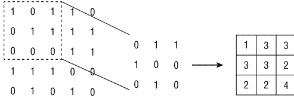

**图 11.6：** CNN 输出值

可以这样设置过滤器值：如果我们正在寻找垂直特征，可以将滤波器的垂直方向设置为 1，例如（图 11.7）。或者，如果寻找水平特征，也可以对过滤器进行相应设置。

| 1 | 0 | 1 |
| :--- | :--- | :--- |
| 1 | 1 | 1 |


|---|---|---|---|---|---|---|

| 1 | 0 | 1 | | 0 | 0 | 0 |

| 1 | 0 | 1 | | 1 | 1 | 1 |

图 11.7：在垂直和水平方向设置的过滤器值

滤波器的配置方式将决定 CNN 的输出；过滤器中未包含的特征将从输出的 CNN 值中变暗。

## 激活函数

正如我们在第 9 章中确定的那样，有一个激活层，通常通过 `Sigmoid` 函数实现（如果你更喜欢则用 `TANH`）。ANN 是其输入的线性组合。

非线性函数允许在数据不可线性可分时对其进行分类。在 CNN 中，一旦过滤器通过了图像的某个，它将被传递给另一个数学函数，即激活函数。此操作常用的函数是线性整流函数单元（Rectified Linear Unit，简称 `ReLU`）。`ReLU` 的作用是将所有负值转换为零，并保持正值不变。在此时，过滤器产生的这种变暗效果将被增强。

## 池化

如之前所述，卷积层为我们留下了特征图（feature maps）。CNN 实现中常见的做法是添加下采样层，也称为池化（pooling）。执行池化可以减少参数的数量。

# 第 11 章 图像机器学习

## 处理训练数据和测试数据

模型需要知道所有文件的路径。`FileSplit` 类接收所有文件路径并确保它们适用于训练。我们正在寻找图像。

```java
File trainingData = new File(pathToImages);
FileSplit trainingDataSplit = new FileSplit(trainingData,
NativeImageLoader.ALLOWED_FORMATS, randNum);
```

数据集目录下的文件夹名称将用作输出类别。`ParentLabelGenerator` 处理目录名称并将它们转换为模型的类名。

```java
ParentLabelGenerator labelMaker = new ParentLabelGenerator();
```

我们希望 CNN 在各个类别目录之间保持平衡；例如，某些目录包含的图像可能比其他目录多。为了获得一个良好的平衡模型，我们需要确保训练数据也是平衡的。这通过 `BalancedPathFilter` 类来实现。之后，我们将输入数据分为包含 80% 数据的训练集和包含剩余 20% 数据的测试集。

```java
BalancedPathFilter pathFilter = new BalancedPathFilter(randNumGen,
labelMaker, 0, numOutputClasses, batchSize);
InputSplit[] filesInDirSplit = trainingDataSplit.sample(
pathFilter, 80, 20);
InputSplit trainingSet = filesInDirSplit[0];
InputSplit testingSet = filesInDirSplit[1];
```

## 图像准备

我们设置了三个用于训练的变换。在前两种中，图像沿 x 轴或 y 轴翻转，或者不翻转。最后一个是随机扭曲。

```java
ImageTransform tf1 = new FlipImageTransform(randNumGen);
ImageTransform tf2 = new FlipImageTransform(new Random(seed));
ImageTransform warpTransform = new WarpImageTransform(randNumGen, 42);
List<ImageTransform> transforms = Arrays.asList(new ImageTransform[]{
tf1, warpTransform, tf2});
```

通过 `ImageRecordReader` 加载图像，传入高度、宽度、通道数以及之前创建的标签生成器。一旦初始化，程序现在就拥有该图像 set 的信息。

```java
ImageRecordReader recordReader = new ImageRecordReader(imageHeight,
width, channels, labelMaker);
recordReader.initialize(trainingSet);
```

最后，我们将比例从 0 到 255 缩小到 0 到 1。

```java
DataNormalization scaler = new ImageProcessingScaler(0, 1);
DataSetIterator dataSet = new DataSetIterator();
```

## CNN 模型配置

现在是时候创建 CNN 模型配置了，如列表 11.1 所示。该神经网络有 14 层。层步骤请见表 11.2。

表 11.2：层

| 层数 | 功能 |
| :--- | :--- |
| 1 | 卷积层，带有 1 × 1 像素滤波器步长，具有 3 个输入节点和 16 个输出节点。 |
| 2 | 归一化层。 |
| 3 | ReLU 激活层。 |
| 4 | 卷积层，带有另一个 1 × 1 像素滤波器步长，这次有 16 个输入节点和 16 个输出节点。 |
| 5 | 归一化层。 |
| 6 | ReLU 激活层。 |
| 7 | 池化层。 |
| 8 | 卷积层，带有 2 × 2 像素滤波器步长，16 个输入节点和 16 个输出节点。 |
| 9 | 归一化层。 |
| 10 | ReLU 激活层。 |
| 11 | 池化层。 |
| 12 | 丢弃层；对 CNN 不重要的特征将被丢弃。 |
| 13 | 密连接层（Dense layer）展平数据并与所有神经元结合。 |
| 14 | Softmax 层在所有 10 个输出类别上提供分类器。 |

列表 11.1：CNN 模型配置

```java
MultiLayerConfiguration conf = new NeuralNetConfiguration.Builder()
    .trainingWorkspaceMode(WorkspaceMode.SEPARATE)
    .inferenceWorkspaceMode(WorkspaceMode.SINGLE)
    .seed(seed)
    .iterations(1)
    .activation(Activation.IDENTITY)
    .weightInit(WeightInit.XAVIER)
    .optimizationAlgo(OptimizationAlgorithm.STOCHASTIC_GRADIENT)
    .learningRate(.006)
    .updater(Updater.NESTEROVS)
    .regularization(true)
    .l2(.0001)
    .convolutionMode(ConvolutionMode.Same)
    .list()
    // block 1
    .layer(0, new ConvolutionLayer.Builder(new int[] {5, 5})
        .name("image_array").stride(new int[] {1, 1})
        .nout(16).build())
    .layer(1, new BatchNormalization.Builder().build())
    .layer(2, new ActivationLayer.Builder()
        .activation(Activation.RELU).build())
    .layer(3, new ConvolutionLayer.Builder(new int[] {3, 3})
        .stride(new int[] {1, 1})
        .nout(16).build())
    .layer(4, new BatchNormalization.Builder().build())
    .layer(5, new ActivationLayer.Builder()
        .activation(Activation.RELU).build())
    .layer(6, new SubsamplingLayer.Builder(PoolingType.MAX)
        .kernelSize(new int[]{2, 2}).stride(new int[]{2, 2}).build())
    .layer(7, new ConvolutionLayer.Builder(new int[] {2, 2})
        .stride(new int[] {1, 1})
        .nout(16).build())
    .layer(8, new BatchNormalization.Builder().build())
    .layer(9, new ActivationLayer.Builder()
        .activation(Activation.RELU).build())
    .layer(10, new SubsamplingLayer.Builder(PoolingType.MAX)
        .kernelSize(new int[]{2, 2}).stride(new int[]{2, 2}).build())
    .layer(11, new DropoutLayer.Builder(0.5).build())
    .layer(12, new DenseLayer.Builder().nOut(10).build())
    .layer(13, new OutputLayer.Builder(LossFunctions.LossFunction.NEGATIVELOGLIKELIHOOD)
        .activation(Activation.SOFTMAX).nOut(10).build())
    .build();
```

## 迁移学习

通过像 CNN 之类的工具，我们可以利用分类器层将其替换为我们想要使用的分类器版本。这意味着我们不需要复制大量的训练过程，因为那些工作量的工作发生在那里，即卷积、归一化、池化和激活步骤。

在 DeepLearning4j 中，有一个 `TransferLearning`（迁移学习）API，可以帮助你精炼分类器并保存新训练的模型。这对于类似于 ImageNet 的模型非常有用。

如果你发现自己的训练数据集较小，或者数据集特征与原始训练模型中存在的特征相似，那么应用迁移学习将为你节省开发和训练时间。在可能的情况下，始终坚持复用。

## 总结

在本章中，我们涵盖了如何使用神经网络来处理图像。首先，我们使用多层感知器来处理 MNIST 数字数据集，然后引入了更完整的卷积神经网络，以一种更透彻的方式从图像数据中提取特征。

虽然这些方法在理论上是很好的，但取决于图像的数量以及你想要训练模型的方式，它们的训练和应用时间可能花费数小时甚至几天。因此，如果可能，请寻找预训练模型，并研究使用迁移学习来更新分类器输出层，以匹配你所工作的领域。

在第 12 章中，我们将引入流式数据应用 Kafka，并研究如何开发一个自训练和更新的机器学习系统。

# 第 12 章 使用 Kafka 进行流式机器学习

## 使用 Kafka 进行流式机器学习

在书中，我们主要将机器学习视为一个单一的过程：获取数据、训练模型，然后进行预测。在本章中，我们将查看流式数据以及它如何影响模型训练和预测。

## 本章你将学到

这是一个复杂的章节，包含大量的代码示例和需要处理的过程。在本章结束，你将拥有一个可以接收流式数据、事件和多个机器学习模型的概念验证应用。

首先，我们将介绍如何设置 Kafka，它是用于流式日志类数据的主要应用程序之一。然后，我们将讨论主题（topics）的工作原理，以及用于生产和消费消息的方法。最后，我们将查看这些内容如何融入到机器学习框架中，并设计一个持续自我训练并处理多个预测模型的系统。

本章的重点不在于模型是如何工作的，或者它们如何参与实际应用。视角从机器学习转向了工程。我们还将桥接 Java 和 Clojure 等几种基于 JVM 的语言，并提供一条阻力最小的路径，以便轻松创建可以从基于 Kafka 的应用程序调用的 REST 端 API。

## 从机器学习到机器学习工程师

可以说，书中涵盖的某些概念已经存在很长时间了。例如，神经网络已经存在了 50 多年。在这一时期内，发生变化的是计算能力的增长以及相关因素，例如存储成本的降低。廉价地处理数据变得更容易了。这带来了处理数据速度、运行算法计算以及反向为相关者生成预测速度的一些进展。

然而，这类系统并不容易构建。云基础设施如 Amazon 的 AWS SageMaker、Google 的 ML Engine（现为 Cloud AI）以及 Microsoft 的 Azure Machine Learning 平台旨在让事情变得简单，但要让这些解决方案运行良好，所需的技能仍然难以获得。

数据工程师或机器学习工程师作为一种职业角色的兴起比以前更加重要。机器学习工程师现在是软件开发人员、系统管理员和少量数据科学家的混合体，他们处于机器学习模型创建与部署到生产系统之间。

工程技能始终是紧缺的，任何能够获取、清洗和为生产环境准备数据，并组合所需组件以创建端到端解决方案的人，对团队来说就像金子一样。你会看到各种博客文章告诉你成为 ML 工程师应该知道什么，但当它们被分解时，基础是很简单的。

- 了解机器学习模型如何工作的知识
- 能够准备数据
- 精通至少一种开发语言，最好是创建模型的人正在使用的语言
- 核心 Linux 系统（你分得 `cat` 和 `ls` 吗？）
- 部署方法，并能够安装各种工具以使这个端到端解决方案运行

关于成为专才还是通才更好，总会有激烈的辩论。对我个人而言，我发现尽可能多地学习更有帮助，因此我一直认为自己是一个通才。在经理告诉我这基本上就是我在做的事情之前，我从未考虑过成为一名机器学习工程师。

## 从批处理到流式数据处理

当这本书的第一版编写时，大数据技术的爆炸充斥着技术出版物、博客和新闻网站。从好处到可怕的事情（例如，通过购物购物车预测怀孕），你无法逃避 Hadoop 正在改变世界。

重点是批处理数据。海量的结构化和非结构化数据可以存储在 Hadoop 的文件系统 (HDFS) 或像 Amazon Web Services Simple Storage System (S3) 这样的存储解决方案上。

当 Spark 出现时，它在提高大数据系统性能方面实现了巨大飞跃。此外，它通过 SparkSQL 提供了一种有效的类似 SQL 的数据查询方式，并通过一个名为 Spark Streaming 的流式系统。该流式系统并不是我们认为的真正的流；它是基于 Spark 任务处理的批处理数据窗口。这被称为微批处理（micro-batching）。它运行良好并且仍被广泛使用。

物联网 (IoT) 数据量和速度的增加，社交媒体数据需要真正的流式框架。流式框架有 RabbitMQ、Storm 和 SpringXD（我在第一本书中提到它在 2017 年停止了），以及传统的消息中间件 ActiveMQ。反复出现的名字是 Apache Kafka。

## 什么是 Kafka？

Kafka 是一个流处理平台。它最初由 LinkedIn 开发并在 2011 年开源。Kafka 提供高性能、容错的流数据服务。它作为一个发布者/订阅（pub/sub）消息队列，如果你需要实时推送，那么 Kafka 是一个应该认真考虑的选择。

## 它是如何工作的？

Kafka 真正的力量在于它是可扩展的，可以运行在一个或多个服务器上，这些服务器被称为代理（brokers）。消息发送到主题，生产者将消息发送到代理，消费者从代理获取消息。

对于订阅该系统的生产者和消费者来说，它似乎是一个独立的处理引擎，但生产系统是构建在许多机器上的。它可以处理数百万消息的吞吐量，取决于机器的磁盘和内存，并且具有容错性。

消息发送到主题，主题按顺序写入不可变日志。Kafka 支持许多主题并可以进行复制和分区（见图 12.1）。

下一个要写入的主题记录

![image/3c4b0b8c972f1d075e8ebe064f0b2476_264_0.png]

| 0 | 1 | 2 | 3 | 4 | 5 | 6 | 7 | 8 | 9 | 10 | 11 | 12 | 13 |
|---|---|---|---|---|---|---|---|---|---|---|---|---|---|

图 12.1 按顺序写入主题

一旦记录追加到主题日志中，就无法删除或修改。它是一个简单的数据结构，每条消息都是字节编码的。生产者和消费者可以将数据序列化和反序列化。生产者将消息发送到 Kafka 集群，这些消息由代理存储在主题中。消费者订阅主题并轮询主题以读取消息。代理节点是“愚笨”的；是生产者和消费者在做智能的工作（见图 12.2）。

![image/3c4b0b8c972f1d075e8ebe064f0b2476_264_1.png]

图 12.2 生产者与 Kafka 集群以及消费者的关系

## 容错性

分区数据在多个代理（broker）上进行复制。如果某个 broker 死亡，数据在剩余的 broker 上仍然可用。指定一个 broker 为领导者（leader），它是所有向分区写入和从中读取数据的节点。

如果 leader 故障，集群将分配一个新的 leader broker，其他 broker 将跟随它。broker 的注册表（包括哪个是 leader）由 Zookeeper 维护。

## 延伸阅读

关于 Kafka 工作原理的更多信息，我在附录 D“延伸阅读”中包含了一些阅读材料。在本章中，我将重点关注运行 Kafka 以及使用它进行机器学习的更具实践性的方面。

## 安装 Kafka


# 使用 Kafka 进行流式机器学习

有两个版本的 Kafka 可以下载。一个是开源的 Apache 版本，另一个是 Confluent Community 版本。它们的操作方式相同；主要的区别在于我们引入 SQL 查询语言 KSQL 的时候。

对于本章，我将使用 Apache Kafka 分发版，地址位于 https://kafka.apache.org。这是我使用的下载链接：

```
https://www.apache.org/dyn/closer.cgi?path=/kafka/2.2.0/kafka_2.12.0.tgz
```

你需要选择一个镜像网站来下载你的 Kafka 分发。

下载 TGZ 文件并将其存储在你想安装 Kafka 的目录中。安装 Kafka 非常简单；第一是将压缩的 TAR 文件解压到目录中。

```
$ tar -xzf kafka_2.12-2.2.0.tgz
$ cd kafka_2.12-2.2.0
```

由于 Kafka 运行在 Zookeeper 上进行 broker 标识，因此在我们启动 Kafka 之前，Zookeeper 需要先运行。Kafka 内部使用了各种配置文件，但在这里我特别关注两个：`zookeeper.properties` 和 `server.properties`。这些文件将如何配置，取决于你想要运行的集群类型。我将在书中涵盖这些：单节点集群和运行在同一机器上的多节点集群。

## 作为单节点集群的 Kafka

在 Kafka 单节点集群配置上进行练习是一个好主意。单机器将同时处理 Zookeeper 和 Kafka。我使用单节点配置来开发和测试生产者、消费者和流式应用程序。当我应用程序按预期运行时，我就可以考虑将它们部署到多节点集群上。

第一个启动的应用是 Zookeeper。Kafka 需要 Zookeeper 来维护 broker 的状态。如果它上线，Kafka 将无法工作。在开发过程中，我打开了多个终端窗口——一个用于 Zookeeper，一个用于 Kafka，另一个用于我正在工作的任何生产者或消费者。

## 启动 Zookeeper

让我们开始安装 Kafka。要的第一件事是打开终端窗口并进入安装 Kafka 的目录。从命令行输入 `bin/zookeeper-server.sh config/zookeeper.properties`。

```
$ bin/zookeeper-server.sh config/zookeeper.properties
[2019-06-18 07:43:12,238] INFO Reading configuration from:
zookeeper.properties org.apache.zookeeper.server.quorum.
QuorumPeerConfig
[2019-06-18 07:43:12,241] INFO autopurge.snapRetentionCount set to 3 (org.
apache.zookeeper.server.DatadirCleanupManager)
[2019-06-18 07:43:12,241] INFO autopurge.purgeInterval set to 0 (org.
apache.zookeeper.server.DatadirCleanupManager)
[2019-06-18 07:43:12,243] INFO Purge task is not scheduled. (org.apache.
zookeeper.server.DatadirCleanupManager)
[2019-06-18 07:43:12,243] WARN Either no config or quorum defined in
config, in standalone mode (org.apache.zookeeper.server.quorum.
QuorumPeerMain)
[2019-06-18 07:43:12,260] INFO Reading configuration from: config/
zookeeper.properties (org.apache.zookeeper.server.quorum.
QuorumPeerConfig)
```

## 启动 Kafka

一旦 Zookeeper 运行，你现在就可以启动 Kafka broker。打开一个新的终端窗口，并进入你启动 Zookeeper 的相同目录。

现在输入 `bin/kafka-server-start.sh config/server.properties`。

```
$ bin/kafka-server-start.sh config/server.properties
[2019-06-18 07:43:15,123] INFO Registered new leader for controller /controller
[2019-06-18 07:43:15,125] INFO Controller is now the leader
[2019-06-18 07:43:15,126] INFO Started Kafka
```

## 作为多节点集群的 Kafka

虽然单节点集群只有一个 broker，但多节点集群有多个。在示例中，我们将建立一个三 broker 集群。我们的第一个任务是为其他 broker 创建服务器属性文件的副本。

```
$ cp server.properties server1.properties
$ cp server.properties server2.properties
```

这些新文件都需要编辑。打开你的文本编辑器，编辑 `server1.properties` 文件使其值如表 12.1 所示，对 `server2.properties` 进行更改。

**表 12.1：服务器 1 和 2 属性**

| SETTING NAME | SERVER1.PROPERTIES | SERVER2.PROPERTIES |
|---|---|---|
| broker.id | 1 | 2 |
| listeners | PLAINTEXT:::9093 | PLAINTEXT:::9094 |
| log.dirs | /tmp/kafka-logs1 | /tmp/kafka-logs2 |

> * 取配置文件中的注释 (#)

我们更改了什么？首先是 broker id，这些必须是唯一的，所以现在有了 broker 0、1 和 2。其次，每个 broker 需要一个与其他 broker 不同的端口地址，因为它们将在同一台机器上运行。最后，日志信息（实际消息）目录发生了更改，因为每个 broker 都需要自己的消息和其他关联文件的位置。

## 启动多节点集群

与单机节点一样，Zookeeper 需要启动。打开终端并运行之前的启动命令：

```
$ bin/zookeeper-server-start.sh config/zookeeper.properties
```

要启动 broker，打开三个新窗口并确保每个窗口都位于安装 Kafka 的目录。在每个终端窗口启动一个 broker。

启动第一个 broker（broker 0）与之前所示。

```
$ bin/kafka-server-start.sh config/server.properties
```

可以启动剩余的 broker；下一个 broker 是 1。

```
$ bin/kafka-server-start.sh config/server1.properties
```

接下来是 broker 2（见图 12.4）。

```
$ bin/kafka-server-start.sh config/server2.properties
```

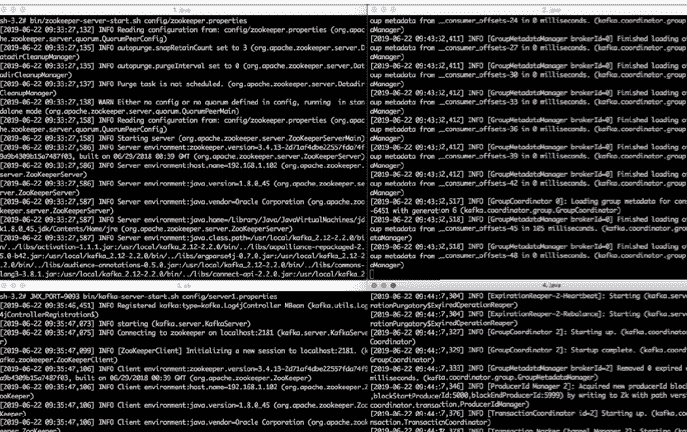

图 12.4：多节点集群

在本章的剩余部分中，任何运行 Kafka 的命令或程序都假设你的 Kafka broker 运行在单机模式，并使用 localhost 作为主机名。

## 主题管理

你在 Kafka 系统中发送的任何消息都会发送到一个主题（topic）。你可以随心所欲地创建任意数量的主题。根据你拥有的节点数量，关于集群上主题的最佳主题数量有一些通用的规则。

在你的 Kafka 分发包的 `bin` 目录下，有几个脚本可以完成主题管理所需的任务。我们需要关注的主要脚本是 `kafka-topics.sh`。

## 创建主题

主题可以通过两种方式创建。第一种使用命令行工具，第二是在生产者应用程序内部，如果主题不存在，它将创建该主题。

使用命令行是值得的，因为这能让你理解创建主题所需的内容、复制所需的设置，以及 broker 和 Zookeeper 设置是如何处理的。

让我们现在创建一个测试主题；为了演示，我们暂称之为 `testtopic`。在 Kafka 分发包的 `bin` 目录下，你会看到一个名为 `kafka-topics.sh` 的 shell 脚本。这是与主题相关的活动的主要命令。要创建主题，请在终端窗口中执行以下命令：

```
$KAFKA_HOME/bin/kafka-topics.sh --zookeeper localhost:2181 --create
--topic testtopic --replication-factor 1 --partitions 1
Created topic "testtopic".
```

让我们将这个命令拆分为更小的部分，并分析脚本正在执行的操作。第一个设置是告诉 Kafka 我们正在使用哪个 Zookeeper 服务器。这是一个必选的设置，因为我们使用的是本地部署，且 Zookeeper 服务器运行在 localhost 的 2181 端口（Zookeeper 的默认端口）。

接下来 `--create` 告诉应用程序我们想要创建一个主题。主题名称通过随后的 `--topic` 标志处理。由于集群仅用于开发，我不关心复制因子或分区数量，这些值都被设置为 1。

## 查找有关现有主题的信息

通过此命令，你可以查找到集群上可用的主题。要生成集群上所有主题的列表，请运行以下命令：

```
bin/kafka-topics --zookeeper localhost:2181 --list
testtopic
```

如果你只创建了一个主题，那么可能会发现主题比你预期的要多而感到惊讶。Kafka 集群会为监控和指标创建内部主题。所有的偏移信息（包括相关消费者的消息位置）也存储在主题内部。

应用程序可以通过 `--describe` 标志来扩展主题信息。

```
$ bin/kafka-topics --zookeeper localhost:2181 --describe --topic testtopic
Topic:testtopic PartitionCount:1 ReplicationFactor:1 Configs:
Topic: testtopic Partition: 0 Leader: 0 Replicas: 0
```

描述主题会产生多行输出，详细说明 Kafka 如何为该主题使用集群。第一行是分区的计数和复制因子。在本例中，它们都只有 1，正如早些创建主题时一样。

第二行提供了更多关于作为 leader 的 broker ID 以及 broker 副本 ID 的信息。

## 删除主题

无论主题中是否包含消息，都会占用集群资源。移除你不使用的主题是一个良好的习惯。主题的删除通过 `kafka-topics` 命令行程序完成，但只有在将 `delete.topic.enable` 设置为 `true` 时才会生效。

该设置的任何其他值意味着删除主题命令将被忽略。

```
$ bin/kafka-topics --zookeeper localhost:2181 --delete --topic testtopic
Topic: testtopic is marked for deletion.
Note: 如果 delete.topic.enable 未设为 true，则不会产生任何影响。
```

## 从命令行发送消息

测试集群是否正常工作的最好方法是使用命令行工具创建和消费消息。`kafka-console-producer` 应用程序允许你从命令行发送消息。

```
$ bin/kafka-console-producer --broker-list localhost:9092 --topic testtopic
```

一旦应用程序启动，你就可以在终端窗口中输入数据。每当你按下回车键，你的消息就会发送到带有指定主题的 broker。如果你想退出应用程序，按下 `Ctrl+C` 组合键，应用程序将停止并返回终端命令行。

在准备了一些测试数据后，现在我们要关注日志中的消息了。

## 从命令行接收消息

除了用于创建消息并推送到日志的命令行应用程序外，还有一个对应的工具可以从日志读取消息。

```
$ bin/kafka-console-consumer --bootstrap-server localhost:9092 --topic testtopic --from-beginning
```

`--from-beginning` 标志从开始读取。如果没有它，应用程序将一直运行直到你关闭它。

## Kafka 工具 UI

对于不习惯或不喜欢命令行的人来说，有一些工具可以让管理 Kafka 变得更容易。如果你使用的是 Confluent Kafka 分发版，你可以访问控制中心（见图 12.5）。要访问它，请将浏览器指向集群的 IP 地址以及端口 9021，例如：

```
http://192.168.1.102:9021
```

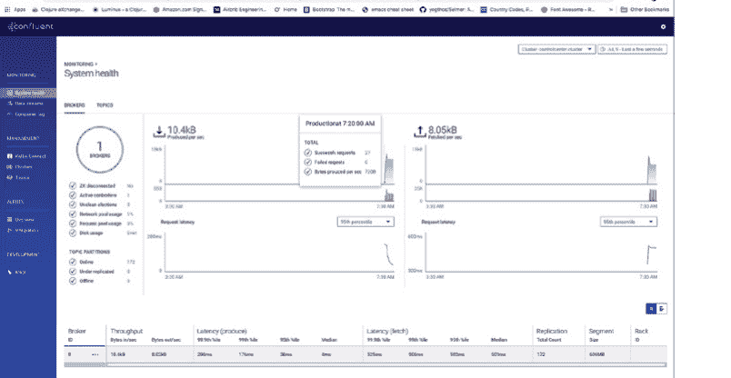

图 12.5：控制中心

由于我无法预测处理什么类型的 Kafka 集群，我使用一个名为 Kafka Tool 的通用工具（见图 12.6），它可以从 http://www.kafkatool.com 获取且个人免费。它可以在 macOS、Linux 和 Windows 上运行。

一旦安装，你就可以查看集群概览、Zookeeper 状态以及主题和消费组信息。它对于检查消息内容和主题偏移信息也非常有用。有时从命令行读取很困难，这样的工具可以使生活变得轻松。

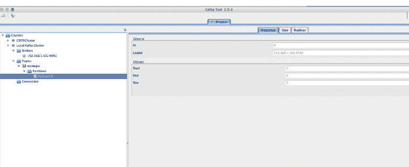

图 12.6：Kafka Tool

## 编写你自己的生产者和消费者

到为止，重点一直是 Kafka broker 以及用于执行基础任务（如创建和管理主题）的命令行工具。现在是时候编写一些向 broker 发送消息并从中读取消息的基础应用程序了。

各种客户端库涵盖了大多数语言；关于可用列表，请查看此列表：

```
https://wiki.apache.org/confluence/display/KAFKA/Clients
```

## Java 生产者

正如你在这两个章节中看到的，生产和消费消息的过程非常简单。在开始与 broker 工作之前，需要进行一些准备工作。应用程序的每个部分都会先进行解释，然后你可以看到完整的代码。

## 属性

任何与 Kafka 集群通信的 Java 都是通过 Java 类进行设置。Kafka API 需要这些键值对来向 broker 发默认设置和标志。

```java
props = new Properties();
props.put("bootstrap.servers", "localhost:9092");
props.put("acks", "all");
props.put("retries", 0);
props.put("key.serializer", org.apache.kafka.common.serialization.StringSerializer);
props.put("value.serializer", org.apache.kafka.common.serialization.StringSerializer);
```

观察此设置，我们可以看到一些在本章之前示例中熟悉的设置，以及一些新的设置。

## 启动服务器

`bootstrap.servers` 键告诉应用程序 broker 的位置。在单机开发集群中，这只有一个节点和一个启动服务器。它是应用程序发现集群中其他 broker 的起点。如果你有多个 broker，可以使用逗号分隔的值。

```java
props.put("bootstrap.servers", "server1.localhost:9092, server2.localhost:9093");
```

## 确认

接下来是 `acks`，它是 acknowledgments 的缩写。当生产者向 broker 发送消息时，它可以接收到一个 ack，表示 broker 已收到的该消息。虽然从应用程序安全的角度来看这是很好的，但值得记住，这会引入少量的延迟。`acks` 有三个可用设置，表 12.2 解释了这些设置。

**表 12.2：Kafka 生产者 Ack**

| ACKS 设置 | 含义 |
| :--- | :--- |
| acks=0 | 生产者不接收 broker 已收到消息的确认。这基本上是发后忽略，不保证消息已到达 broker。 |
| acks=1 | 生产者将收到 leader（领导副本）的确认，这意味着 leader 已经接收了消息。 |
| acks=all 或 acks=-1 | 只有当 leader 收到同步副本（ISR）确认后，生产者才会收到确认。 |

## 重试


当发送失败时，生产者客户端会尝试重发消息。在本示例中，值 `0` 表示客户端不会尝试重发。使用重试可能会导致消息顺序问题。如果客户端在某批消息上失败但在第二批上成功，可能会导致第二批消息在第一批之前可用。

## 反序列化器

Kafka 将消息视为二进制负载。这意味着消息在最终被读取时，需要由生产者序列化并由消费者反序列化。属性配置设置了生产者序列化器，它包含两个部分：键和值。在本示例中，键是基于字符串的，消息负载也是字符串。

## 生产者

在 `Properties` 类中设置好配置后，现在是创建实际生产者了。`Producer` 类接收在键值序列化器设置中指定的对象。通过一行传入配置属性即可创建 Producer。

```java
Producer<String, String> producer = new KafkaProducer(props);
```

## 消息

现在我们处于向 broker 发送消息的阶段。`send()` 方法接收一个 `ProducerRecord` 对象，该对象接收主题名称、键和消息。

```java
producer.send(new ProducerRecord<String, String>(topicName, keyName, payload));
System.out.println(keyName + " - 消息发送成功：" + payload);
producer.close();
```

## 最终代码

这三个步骤——配置属性、创建生产者以及发送消息——构建了生产者应用程序的基础组件。以下是应用程序；注意其中有一个向 broker 发送 10 条消息的 for 循环。

```java
import java.util.Properties;
import org.apache.kafka.clients.producer.Producer;
import org.apache.kafka.clients.producer.KafkaProducer;
import org.apache.kafka.clients.producer.ProducerRecord;

public class ExampleProducer {
    public static void main(String[] args) throws Exception {
        String topicName = "testtopic";

        Properties props = new Properties();
        props.put("bootstrap.servers", "localhost:9092");
        props.put("acks", "all");
        props.put("retries", 0);
        props.put("batch.size", 16384);
        props.put("linger.ms", 1);
        props.put("buffer.memory", 3355432);
        props.put("key.serializer", "org.apache.kafka.common.serialization.StringSerializer");
        props.put("value.serializer", "org.apache.kafka.common.serialization.StringSerializer");

        Producer<String, String> producer = new KafkaProducer<>(props);

        for (int i = 0; i < 10; i++) {
            producer.send(new ProducerRecord<String, String>(topicName, Integer.toString(i), Integer.toString(i)));
            System.out.println("消息发送成功");
        }
    }
}
```

# 第 12 章 使用 Kafka 进行机器学习流处理

每个消费者记录都包含以下信息：

- 主题名称（topic name）
- 接收记录所在的分区编号
- 分区中的偏移量位置
- 生产者创建的时间戳
- 键值（key value）
- 实际的消息负载（payload）

你不需要担心设置正在读取的记录偏移量；这由消费者本身处理。以下代码片段将偏移量、键和消息输出到控制台：

```java
for (ConsumerRecord<String, String> record : records) {
    System.out.printf("offset = %d, key = %s, value = %s\n",
        record.offset(), record.key(), record.value());
}
```

## 最终代码

当一切整合在一起时，你就有了独立消费者应用程序的基础。主要组件包括设置属性、创建消费者、轮询批量记录进行处理，以及遍历集合中的每条记录。

```java
import java.util.Properties;
import java.util.Arrays;
import org.apache.kafka.clients.consumer.KafkaConsumer;
import org.apache.kafka.clients.consumer.ConsumerRecords;
import org.apache.kafka.clients.consumer.ConsumerRecord;

public class ExampleConsumer {
    public static void main(String[] args) throws Exception {
        String topicName = "testtopic";
        Properties props = new Properties();

        props.put("bootstrap.servers", "localhost:9092");
        props.put("group.id", "testcg");
        props.put("enable.auto.commit", "true");
        props.put("auto.commit.interval.ms", "1000");
        props.put("session.timeout.ms", "30000");
        props.put("key.deserializer", "org.apache.kafka.common.serialization.StringDeserializer");
        props.put("value.deserializer", "org.apache.kafka.common.serialization.StringDeserializer");
        KafkaConsumer<String, String> consumer = new KafkaConsumer<String, String>(props);

        consumer.subscribe(Arrays.asList(topicName));
        System.out.println("Subscribed to topic " + topicName);
        int i = 0;

        while (true) {
            ConsumerRecords<String, String> records = consumer.poll(100);
            for (ConsumerRecord<String, String> record : records) {
                System.out.printf("offset = %d, key = %s, value = %s\n",
                    record.offset(), record.key(), record.value());
            }
        }
    }
}
```

## 构建和运行应用程序

现在你已经看到了应用程序是如何构建的，让我们来构建并运行它们。从命令行中运行 Maven 来构建包。

```bash
mvn package
```

如果成功，你将看到包含所有依赖项的完整 JAR 文件路径。

```
[INFO] Building jar: /path/to/your/target/kafka-jar-with-dependencies.jar
[INFO] SUCCESS
[INFO] Total time: 4.7 s
```

启动你的独立集群（如果你需要帮助，可以在本章较早部分找到完整介绍）。当 Zookeeper 和 Kafka 运行后，执行 JAR 文件并生产和消费一些消息。在一切都运行后，打开一个新窗口。现在是运行应用程序的时间了。

## 消费者应用程序

在向集群发送任何消息之前，让我们先让消费者运行。打开一个终端窗口，并在目录下输入以下命令：

```bash
java -cp target/kafka-jar-with-dependencies.jar chapter.12.examples.ExampleConsumer
```

你将看到应用程序启动并等待消息。

```
java -cp target/kafka-jar-with-dependencies.jar chapter.12.examples.ExampleConsumer
SLF4J: Failed to load class "org.slf4j.impl.StaticBinder"
SLF4J: Defaulting to no-operation (NOP) logger
SLF4J: See http://www.slf4j.org/codes.html
Subscribed to topic
```

现在是时候用生产者应用程序向主题发送一些消息了。

## 生产者应用程序

打开另一个与消费者应用程序独立的终端。该应用程序将向测试主题发送 10 条消息。

```bash
java -cp target/kafka-jar-with-dependencies.jar chapter.12.examples.ExampleProducer
```

输出将显示消息已发送。

```
SLF4J: Failed to load class "org.slf4j.impl.StaticBinder"
SLF4J: Defaulting to no-operation (NOP) logger
SLF4J: See http://www.slf4j.org/codes.html
Messages sent
```

切换回消费者应用程序并查看；它看起来应该是这样的：

```
Subscribed to topic
offset = 0, key = 0
offset = 1, key = 1
offset = 2, key = 2
offset = 3, key = 3
offset = 4, key = 4
offset = 5, key = 5
offset = 6, key = 6
offset = 7, key = 7
offset = 8, key = 8
offset = 9, key = 9
```

偏移量（offset）是 Kafka 主题中的位置，键（key）是给定的键，值是实际消息（例如 UUID）。如果从生产者应用程序发送更多消息（运行应用程序的一种简单情况），将发送另外 10 条消息，消费者将再次轮询主题。输出将显示新消息。如果你查看偏移量，你会发现它已经增加了，但键和值将与之前的负载相同。

```
Subscribed to topic
offset = 0, key = 0
offset = 1, key = 1
offset = 2, key = 2
offset = 3, key = 3
offset = 4, key = 4
offset = 5, key = 5
offset = 6, key = 6
offset = 7, key = 7
offset = 8, key = 8
offset = 9, key = 9
offset = 10, key = 0
offset = 11, key = 1
offset = 12, key = 2
offset = 13, key = 3
offset = 14, key = 4
offset = 15, key = 5
offset = 16, key = 6
offset = 17, key = 7
offset = 18, key = 8
offset = 19, key = 9
```

如果你关闭消费者应用程序并从生产者应用程序再次发送消息，当你启动消费者应用程序时，它将从最后一个偏移量继续并处理新消息。要退出消费者应用程序，按下 `Ctrl+C`，你将返回命令行。

## 流式 API

消费者应用程序处理消息。从上看它非常简单，但这正是 Kafka 的魅力所在。如果你需要更多功能和特性，流式 API 将是更好的选择。

通过流式应用程序，你可以访问生产者和消费者 API，以及允许对通过应用程序的消息进行映射、过滤和还原的 Lambda 函数。如果你需要聚合函数，如滑动窗口、固定窗口和表化，那么流式 API 是完美选择。

以下代码列表概述了经典单词计数应用程序的基础。你将看到在本章之前涵盖过的生产者和消费者配置。在列表中，应用程序的核心位于 `createWordCountStream` 方法中。

`KTable` 将每行转换为小写单词数组。这些单词被映射并按每个进行分组。此时不需要对键进行任何处理；我们稍后需要的单词。然后对这些组进行计数并发送到输出主题。

```java
static void createWordCountStream(final StreamsBuilder builder) {
    final KStream<String, String> lines = builder.stream(inputTopic);
    final Pattern pattern = Pattern.compile("\\W+", Pattern.UNICODE_CHARACTER_CLASS);

    final KTable<String, Long> counts = lines
        .flatMapValues((value) -> Arrays.asList(pattern
            .split(value.toLowerCase())))
        .groupBy((keyIgnored, word) -> word)
        .count();
    counts.toStream().to(outputTopic, Produced.with(Serdes.String(),
    Serdes.Long()));
}
```

```java
static Properties getStreamsConfiguration(final String bootstrapServers) {
    Properties sConfig = new Properties();
    sConfig.put(StreamsConfig.BOOTSTRAP_SERVERS_CONFIG, bootstrapServers);
    sConfig.put(StreamsConfig.DEFAULT_KEY_SERDE_CLASS_CONFIG, Serdes.String().getClass().getName());
    sConfig.put(StreamsConfig.DEFAULT_VALUE_SERDE_CLASS_CONFIG, Serdes.String().getClass().getName());
    return sConfig;
}
```

```java
public static void main(String[] args) {
    final String bootstrapServers = "localhost:9092";
    final Properties streamsConfiguration = getStreamsConfiguration(bootstrapServers);
    final StreamsBuilder builder = new StreamsBuilder();
    createWordCountStream(builder);
    final KafkaStreams streams = new KafkaStreams(builder.build(), streamsConfiguration);

    streams.cleanup();
    streams.start();
    Runtime.getRuntime().addShutdownHook(new Thread(streams::close));
}
```

## 构建流式机器学习系统

到本章目前为止，你已经学习了 Kafka、消息日志以及相关的代码，现在是时候将这些知识转化为概念验证的机器学习系统了。

本章的剩余部分将集中于机器学习方面，包括系统规划和组件组装。在本章结束时，你将拥有一个基于 Kafka 的自学习机器学习系统。

为了说明这种可能性，我将使用一个简单的数据集预测。通过创建不同的机器学习和统计模型（决策树、多层感知器和线性回归），你将拥有一个可以在三个模型上给出预测的系统；随着时间的推移，某个模型可能会比其他模型给出更稳健的预测。从表面上看，数据看起来很基础，但如果你想将流式数据与机器学习预测相结合，它将为你提供所需的框架。

## 系统规划

首先，值得写下获取数据、训练模型和处理预测所需的内容。还要考虑诸如数据和模型的持久化位置等。它们是在文件系统中吗？还是你打算将它们持久化到 Amazon S3 或 Azure 存储设施等存储服务上？

以下是规划阶段需要考虑的问题列表：

- 我们需要的主题（topics）？
- 数据来自哪里？
- 数据是什么格式的？
- 我们将使用哪些算法？


- 训练将如何触发？
- 模型将保存在哪里？
- 我们如何决定使用哪些模型进行预测？
- 我们如何执行预测？

图 12.7 显示了一个示例规划。

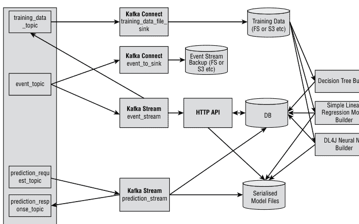

图 12.7：系统规划

## 我们需要的主题？

该系统执行几个功能。首先，有数据进入系统，需要一个专门用于事件的主题。这将是我们事件消息的第一入口；我们稍后会查看具体的消息内容。

事件数据有两种形式：训练数据和命令，并将由流式 API 应用程序处理。如果事件包含命令，则应在应用程序内部执行；否则，事件是训练数据，系统将将其推送到主题，即训练数据主题。

训练数据主题接收实际内容，这是一行逗号分隔的变量。没有自定义的消费者应用程序来处理信息；这将通过 `Kafka Connect` 完成，它将为我们消费 CSV 数据并将其持久化文件中。

预测需要两个主题，一个用于请求，一个用于响应。预测请求将接受一个 JSON 负载，其中包含一个请求模型类型的键和一个用于预测的特征值。最终的细分见表 12.3。

### 表 12.3：主题细分

| 主题名称 | 说明 |
| --- | --- |
| `event_stream` | 带有命令或训练类型的入站事件消息。 |
| `training_data_topic` | 该主题处理原始 CSV 条目。 |
| `prediction_request_topic` | 用户想要运行预测时，通过此主题进行。JSON 负载... |
| `prediction_response_topic` | 预测结果。 |

## 数据是什么格式的？

训练数据主题接收实际内容，这是一行逗号分隔的变量。没有自定义的消费者应用程序来处理信息；这将通过 `Kafka Connect` 完成，它将为我们消费 CSV 数据并将其持久化文件中。

预测请求将接受一个 JSON 负载，其中包含一个请求模型类型的键和一个用于预测的特征值。最终的细分见表 12.3。

## 事件

事件数据有两种形式：训练数据和命令，并将由流式 API 应用程序处理。如果事件包含命令，则应在应用程序内部执行；否则，事件是训练数据，系统将将其推送到主题，即训练数据主题。

```json
{"type": "mlp"}
```

## 预测

预测需要两个主题，一个用于请求，一个用于响应。预测请求将接受一个 JSON 负载，其中包含一个请求模型类型的键和一个用于预测的特征值。最终的细分见表 12.3。

## 持续训练

一种方法是发送 Kafka 主题。一旦模型被训练到训练。

```json
{"type": "command", "payload": "3,5"}
```

## 如何安装 crontab

如果你想安装定时任务（cron entries），你必须通过 `crontab` 完成。打开终端窗口并输入：

```bash
crontab -e
```

```bash
# Kafka DL4J 训练的 crontab 条目
## 每天 1 点运行
## 运行决策树
0 1 * * * /opt/mlbook/projects/dl4j.mlp/scripts/rundtr.sh > /var/log/kafka-dl4j-training.log 2>&1
## 运行线性回归
30 1 * * * /opt/mlbook/projects/dl4j.mlp/scripts/runslr.sh > /var/log/kafka-dl4j-training.log 2>&1
## 运行多层感知器
45 1 * * * /opt/mlbook/projects/dl4j.mlp/scripts/runmlp.sh > /var/log/kafka-dl4j-training.log 2>&1
```

## 设置数据库

数据库的模式（schema）位于本章节的中。要在 MySQL 中创建数据库，请从命令行执行以下指令。

```bash
$ mysql -u root -p<your admin password> create mlchapter12
```

在设置 MySQL 时，请将 `<your admin password>` 替换为您的管理员密码。如果没有密码，可以移除 `-p` 标记。接下来再次运行 MySQL 客户端并读取 `schema.sql` 文件。

```sql
DROP TABLE IF EXISTS 'linear_model'
/*!140101 SET @saved_cs_client = @@character_set_client */
/*!140101 SET character_set_client = utf8 */
CREATE TABLE 'linear_model' (
  'id' int(11) NOT NULL AUTO_INCREMENT,
  'uuid' varchar(255) NOT NULL DEFAULT '',
  'createdat' datetime DEFAULT NULL,
  'slope' double DEFAULT NULL,
  'intercept' double DEFAULT NULL,
  'rsq' double DEFAULT NULL,
  'logoutput' text,
  PRIMARY KEY ('id')
) ENGINE=InnoDB AUTO_INCREMENT=6 CHARSET=latin1;
/*!140101 SET character_set_client = @saved_cs_client */
```

```sql
DROP TABLE IF EXISTS 'training_log'
/*!140101 SET @saved_cs_client = @@character_set_client */
/*!140101 SET character_set_client = utf8 */
CREATE TABLE 'training_log' (
  'id' int(11) NOT NULL AUTO_INCREMENT,
  'uuid' varchar(100) NOT NULL DEFAULT '',
  'training_date' datetime DEFAULT NULL,
  'train_eval_split' double NOT NULL DEFAULT '0.65',
  'execution_time' int(11) NOT NULL DEFAULT '-1',
  'model_accuracy' double NOT NULL DEFAULT '0',
  'training_output' text,
  'model_type' varchar(50) NOT NULL DEFAULT '',
  PRIMARY KEY ('id')
) ENGINE=InnoDB AUTO_INCREMENT=14 CHARSET=latin1;
```

保存完成后，你现在可以将其安装到 MySQL 中。在保存模式文件的目录下运行以下命令：

```bash
$ mysql -u root -p<your admin password> mlchapter12 < schema.sql
```

数据集设置好后，你现在可以将注意力转向项目中将用到的模型上。

## 确定使用哪些算法

到本书为止，我们一直在以一种“既然既然如此，那我们就这么做吧”的方式，观察单组数据与单一类型算法的关系。根据数据量，某些算法可能比其他算法更合适。

例如，在开始阶段，`J48` 决策树算法可能比神经网络有效得多，但随着时间的推移，在处理海量数据进行训练时，它的效果可能会下降。如果我们使用不同数量的隐藏节点来测试不同类型的神经网络会怎样？

通过这个概念验证项目，我们有机会尝试任何想要的模型。为此，我将集中在三种模型上：基于 `Weka` 构建的 `J48` 决策树（它是一个老旧但非常有效的 Java 机器学习库）；使用 `DL4J` 的多层感知器；最后，一个使用 `Apache Commons Math` 库中简单线性回归的模型。

这个系统的优之处在于，你可以同时持有不同类型的模型，并对它们中的全部进行预测。如果你决定添加另一个模型（例如支持向量机），一旦你编写了基础模型，就可以这样做。让我们来看看我将要使用的三个模型。

## 决策树

`Weka` 机器学习库已经存在多年了。对于某些个人项目，它是我的首选库，因为它的占用很小。

### 创建 J48 实例

`Weka` 机器学习库已经存在多年了。对于某些个人项目，它是我的首选库，因为它的占用很小。

### 运行评估

`Weka` 机器学习库已经存在多年了。对于某些个人项目，它是我的首选库，因为它的占用很小。

### 持久化模型

`Weka` 机器学习库已经存在多年了。对于某些个人项目，它是我的首选库，因为它的占用很小。

## 更新数据库

`Weka` 机器学习库已经存在多年了。对于某些个人项目，它是我的首选库，因为它的占用很小。

## 评估

并没有像神经网络或决策树那样的实际模型评估。`SimpleRegression` 类会根据斜率、截距值、标准误差和 R2 值提供输出，以查看回归所覆盖的数据方差。调整后的 R2 值用作模型在数据库中的排名。

作为证明模型正在运行的最后一步，程序将对模型运行一些预测。它会显示输入分（一个随机数）和回归模型的预测结果。

所有这些内容将以字符串的形式输出。

```java
sb.append("Intercept: " + sr.getIntercept());
sb.append("\n");
sb.append("SloComp: " + sr.getSlope());
sb.append("Standard Error: " + sr.getSlopeStdErr());
sb.append("Adjusted R2 value: " + sr.getRSquare());
```

```java
Random r = new Random();
for (int i = 0; i < runs; i++) {
    int rn = r.nextInt(10);
    sb.append("Input score: " + rn + " prediction: " + Math.round(sr.predict(rn)));
    sb.append("\n");
}
```

## 将模型保存到数据库

我们不需要像神经网络和决策树那样保存模型。我们需要做的仅仅是将这些值持久化到数据库中。斜率和截距是进行未来预测所需的。我们还将创建模型的时间以及我们创建的评估结果也持久化了。

```java
DBTools.writeLinearResults(uuid, sr.getIntercept(), sr.getSlope(), sr.getRSquare(time, runPredictions(sr, 20));
```

## 最终代码

代码加载数据、创建模型并将值持久化到数据库。没有模型需要序列化。它只是保存斜率和截距，以便以后流式 API 请求时使用。

```java
package mlbook.ch12.kafka.mlp;

import org.apache.commons.math3.stat.regression.SimpleRegression;

import java.io.*;
import java.util.ArrayList;
import java.util.List;
import java.util.Random;
import java.util.UUID;
```

```java
public class LinearRegressionBuilder {

    private static String path = "/opt/mlbook/testdata/alloutput.csv";

    public LinearRegressionBuilder() {

        List<String> lines = loadData(path);

        long start = System.currentTimeMillis();

        SimpleRegression sr = getLinearRegressionModel(lines);

        long stop = System.currentTimeMillis();

        long time = stop - start;

        String uuid = UUID.randomUUID().toString();

        DBUtils.writeLinearResults(uuid, sr.getSlope(), sr.getRS(), time, runPredictions(sr, 20));

        runPredictions(sr, 40);

    }

    private SimpleRegression getLinearRegressionModel(List<String> lines) {

        SimpleRegression sr = new SimpleRegression();

        for (String s : lines) {

            String[] split = s.split(",");

            double x = Double.parseDouble(split[0]);

            double y = Double.parseDouble(split[1]);

            sr.addData(x,y);

        }

        return sr;

    }

    private String runPredictions(SimpleRegression sr, int runs) {

        StringBuilder sb = new StringBuilder();

        // 显示回归的截距

        sb.append("Intercept: " + sr.getIntercept());

        sb.append("\n");

        // 显示回归的斜率

        sb.append("SComp: " + sr.getSlope());

        sb.append("\n");

        // 显示标准误差

        sb.append("Std Error: " + sr.getSlopeStdErr());

        sb.append("\n");

        // 显示调整后的 R2 值

        sb.append("Adjusted R2 value: " + sr.getRSquared());

        sb.append("\n");

        sb.append("************************************");

        sb.append("\n");

        return sb.toString();

    }

}
```

```java
sb.append("Running random predictions......");

sb.append("\n");

sb.append("\n");

Random r = new Random();

for (int i = 0; i < runs; i++) {

  int rn = r.nextInt(10);

  sb.append("Input score: " + rn + " prediction: " + Math.

  round(sr.predict(rn)));

  sb.append("\n");

}

return sb.toString();

```

```java
private List<String> loadData (String filename) {

  List<String> lines = new ArrayList<String>();

  try {

    FileReader f = new FileReader(filename);

    BufferedReader br = new BufferedReader(f);

    String line = "";

    while ((line = br.readLine()) != null) {

      lines.add(line);

    }

  } catch (FileNotFoundException e) {

    System.out.println("File not found.");

  } catch (IOException e) {

    System.out.println("Error reading file");

  }

  return lines;

}

```

```java
public static void main(String[] args) {

  LinearRegressionBuilder dlr = new LinearRegressionBuilder();

}

```

# 神经网络

如果坦诚地说，完全针对当前数据集运行神经网络并不是最好的主意。然而，为了未来进行规划是值得的。通过 Kafka 持续传输数据，构建一个神经网络是有意义的。在构建模型时，会产生一些有趣的问题。随着时间的推移，我们需要构建一个能够处理数据的。

# 数据导入

我使用 Deep4J 库来创建它。为了导入数据，我们使用 `CSVReader` 类并跳过表头。

```java
int numLinesToSkip = 0;

String delimiter = ",";
```


# 隐藏节点

我们应该使用多少隐藏节点？方法的结果是节点数。随着训练次数，你会建立一个视图。当我们讨论神经网络时，通常涉及到一组固定参数。有 `x` 个输入、`y` 个输出和 `z` 个隐藏节点。数据往往是固定的，不需要重新运行。然而，数据是演化的。

```java
private static long getHiddenNodeEstimate(int inputs, int outputs, int samplesize) {
    Random r = new Random();
    double out = (samplesize / (inputs + outputs)) * r.nextInt(9);
    return Math.round(out);
}
```

# 模型配置

神经网络的配置是一个简单的多层感知机。我使用了四层：输入层、输出层和两个隐藏层。隐藏层中多少隐藏节点取决于早些讨论过的 `getHiddenNodesEstimate` 方法。

```java
MultiLayerConfiguration conf = new NeuralNetConfiguration.Builder()
    .seed(seed)
    .iterations(iterations)
    .activation(Activation.TANH)
    .weightInit(WeightInit.XAVIER)
    .learningRate(0.1)
    .regularization(true).l2(1e-4)
    .list()
        .layer(0, new DenseLayer.Builder().nIn(numInputs).nOut(hiddenNodes).build())
        .layer(1, new DenseLayer.Builder().nIn(hiddenNodes).nOut(hiddenNodes).build())
        .layer(2, new DenseLayer.Builder().nIn(hiddenNodes).nOut(hiddenNodes).build())
        .layer(3, new OutputLayer.Builder(LossFunctions.LossFunction.NEGATIVELOGLIKHOOD)
            .activation(Activation.SOFTMAX)
            .nIn(hiddenNodes).nOut(outputNum).build())
    .backprop(true).pretrain(false)
    .build();
```

## 模型训练

配置完成后，将创建模型。训练集划分比例被设置为训练数据的 65%，剩余的 35% 用于评估。在模型训练期间，应用程序每隔 100 次迭代输出一次进度；模型训练在应用程序中设置为 2,000 次迭代。

```java
MultiLayerNetwork model = new MultiLayerNetwork(conf);
model.init();
model.setListeners(new ScoreIterationListener(100));
model.fit(trainingData);
```

## 评估

评估步骤不需要应用程序本身进行任何干预；它更像是一项报告生成工作。由于我们有 11 个输出节点，评估类将根据测试数据的特征矩阵生成一个输出。一旦评估完成，结果将被输出到控制台。

```java
Evaluation eval = new Evaluation(11);
log.info("Getting evaluation");
INDArray output = model.output(testData.getFeatureMatrix());
log.info("Getting evaluation output");
eval.eval(testData.getLabels(), output);
System.out.println(eval.stats());
```

## 将模型结果保存到数据库

与其他模型一样，评估结果也存储在数据库中。我们会获取训练数据划分的图表，以及创建模型所需的时间。当预测事件发生时，使用哪种模型的标准由 F1 分数决定。

```java
// Write output results to database
DBTools.writeResultsToDB(uuid, splitsplit, timaken, eval.f1(), eval.stats(), "mlp");
```

### 持久化模型

DeepLearning4Java 中生成的模型以 ZIP 文件的形式持久化。`ModelSerializer` 为我们提供了持久化生成模型的简单方法。在我们的演示系统中，不需要更新模型；我们每次运行都会创建新模型，因此我们将 `saveUpdater` 布尔值设置为 `false`。

在此示例中，我们将生成的 UUID 作为 ZIP 文件的文件名。此 UUID 将与数据库表中持久化的 UUID 保持一致。

```java
// Save model
File locationToSave = new File("/opt/mlbook/testdata/models/" + uuid + ".zip");
boolean saveUpdater = false;
ModelSerializer.writeModel(model, locationToSave, saveUpdater);
```

## 代码

这里是神经网络的完整代码。它包含了我们过的过的步骤，并实现了 `CSVRecordReader`，这是一个用于解析 CSV 文件的辅助类。

该模型还实现了隐藏节点模式，接收输入节点、输出节点以及数据集中的样本数量。

```java
package mlbook.ch12.kafka;

import org.datavec.api.records.reader.RecordReader;
import org.datavec.api.records.reader.impl.csv.CSVRecordReader;
import org.datavec.api.split.FileSplit;
import org.deeplearning4j.datasets.datavec.RecordReaderDataSetIterator;
import org.deeplearning4j.eval.Evaluation;
import org.deeplearning4j.nn.conf.NeuralNetConfiguration;
import org.deeplearning4j.nn.conf.layers.DenseLayer;
import org.deeplearning4j.nn.conf.layers.OutputLayer;
import org.deeplearning4j.nn.multilayer.MultiLayerNetwork;
import org.deeplearning4j.nn.weights.WeightInit;
import org.deeplearning4j.optimize.listeners.ScoreIterationListener;
import org.deeplearning4j.util.ModelSerializer;
import org.nd4j.linalg.activations.Activation;
import org.nd4j.linalg.dataset.DataSet;
import org.nd4j.linalg.dataset.SplitTestAndTrain;
import org.nd4j.linalg.dataset.api.iterator.DataSetIterator;
import org.nd4j.linalg.dataset.api.preprocessor.DataNormalization;
import org.nd4j.linalg.dataset.api.preprocessor.NormalizerStandardize;
import org.nd4j.linalg.lossfunctions.LossFunctions;
import org.slf4j.Logger;
import org.slf4j.LoggerFactory;

import java.io.File;
import java.sql.Connection;
import java.sql.DriverManager;
import java.sql.PreparedStatement;
import java.sql.SQLException;
import java.util.Random;
import java.util.UUID;
```

```java
public class ANNBuilder {
    private static final Logger log = LoggerFactory.getLogger(ANNBuilder.class);

    private static long getHiddenNodeEstimate(int inputs, int outputs, int samplesize) {
        Random r = new Random();
        double out = (samplesize / (inputs + outputs)) * r.nextInt(9) + 1;
        return Math.round(out);
    }

    public static void main(String[] args) throws Exception {
        // 每一行都被归类为新行，我们为每个模型运行都需要一个 UUID
        String uid = UUID.randomUUID().toString();
        long start = System.currentTimeMillis();
        // 使用 record reader 获取数据集。
        int numLinesToSkip = 0;
        String delimiter = ",";
        CSVRecordReader recordReader = new CSVRecordReader(numLinesToSkip, delimiter);

        recordReader.initialize(new FileSplit(new File("/opt/mlbook/testdata/")));

        // the RecordDataSetIterator handles conversion to DataSet objects,
    }
}
```

为了学习起见，我将复制因子（replication factor）和分区（partitions）设置为 1。如果将此系统应用于生产环境，我会考虑增加这些数值以提高整个应用程序的韧性。以下是创建所需 topic 的完整脚本：

```bash
KAFKA_HOME=/usr/local/kafka/2.11-1.0.0/
ZK_CONNECT=localhost:2181
REPLICATION_FACTOR=1
PARTITIONS=1
```

```bash
# training_data_topic - 原始数据将传输的地方
# training。使用 Kafka Connector 将数据推送到数据存储器。
echo "Creating topic: training_data_topic"
```

```bash
$KAFKA_HOME/bin/kafka-topics.sh --create --topic training_data_topic --zookeeper $ZK_CONNECT --partitions $PARTITIONS --replication-factor $REPLICATION_FACTOR
```

```bash
# event_stream_topic - 事件被发送到 Events Kafka Streaming API
# 应用。
echo "Creating topic: event_topic"
$KAFKA_HOME/bin/kafka-topics.sh --create --topic event_topic --zookeeper $ZK_CONNECT --partitions $PARTITIONS --replication-factor $REPLICATION_FACTOR
```

假设 Zookeeper 和 Kafka 正在运行，打开一个终端窗口，进入脚本所在的目录并执行它。如果你是以 root 用户运行 Kafka，那么你也需要以 root 身份运行脚本。

```bash
sudo ./create_topics.sh
```

确认 topic 已经创建是明智的，因此请运行 Kafka topics 命令列出所有 topic。

```bash
kafka-topics --list --zookeeper localhost:2181
```

# 第 12 章 使用 Kafka 进行机器学习流处理

## Kafka Connect

在 Kafka 生态系统中包含 Kafka Connect，它基本上是一个消费者应用程序，既可以作为源（source）从应用程序中消费数据，也可以作为汇（sink）将数据持久化或发送到应用程序中。

对于此应用程序，有两个 Connect sink 正在运行——一个用于备份所有通过事件 topic 的消息，另一个用于持久化训练数据以供模型重新训练。

## 为什么要持久化事件数据？

正如你在在本章中所看到的，Kafka 系统是一个不可变的消息日志。Broker 拥有配置，正如你所预期的，其中设置之一就是日志保留（log retention），换句话说，集群内的消息被保留多久以供消费者使用。

创建事件 sink 的原因（尽管它没有被应用程序使用）是为了为每个数据事件创建一个记录，以防我们需要从头开始运行。如果发生这种需要，只需要再次通过 `event_topic` 播放 JSON 负载即可。此时重置所有模型并从头开始是明智的。它提供了一种灾难恢复的机制。

## 持久化事件数据

Connect 配置需要一个名称和一个要读取的 topic。键和值转换器（key and value converters）将反序列化数据以便其安全地持久化。Connect 需要一个文件路径来写入数据。

将配置选项组合在一起，最终的 Connect 配置如下：

```
name=dl4j-events-file-sink
connector.class=FileStreamSink
tasks.max=1
file=/opt/ml/testdata/events/events.json
topic=event_topic
key.converter=org.apache.kafka.connect.storage.StringConverter
value.converter=org.apache.kafka.connect.storage.StringConverter
```

## 持久化训练数据

训练数据 sink 的工作方式与事件 topic 备份 sink 相同。更改 topic 和输出文件路径是唯一的操作。

数据将以 CSV 格式写入文件。

```
name=d4j-training-data-file-sink
connector.class=FileStreamSink
tasks.max=1
file=/opt/mlbook/test/data/connect/trainingdata.csv
topics=training_data_topic
key.converter=org.apache.kafka.connect.storage.StringConverter
value.converter=org.apache.kafka.connect.storage.StringConverter
```

## 安装 Connector 配置

Kafka Connect 脚本有两种类型——一种用于独立模式（stand-alone）运行，另一种用于分布式集群。要在独立模式开发集群上启动 Kafka Connect，你需要先传递 Connect 属性，然后是后续的属性文件。

对于此项目示例，将在命令行上运行以下命令（作为一个命令）：

```bash
bin/connect-standalone.sh config/connect-standalone.properties \
/path/to/repo/config/d4j_event_to_fs_sink.properties \
/path/to/repo/config/d4j_to_fs_sink.properties
```

Kafka 将加载所需的插件并启动。如果属性文件有错误，Connect 将连接，你将返回命令行检查属性文件是否有任何错误并重试。

当 Connect 启动时，你应该能看到类似输出的内容。需要关注的主要是如“Sink finished initialization and start”，这意味着连接器已安装并等待。


# 第 12 章 使用 Kafka 进行流式机器学习

## 日志示例

```
2019-08-11 14:36:38,032 INFO WorkersTask(id=d4j-events-file-sink) Sink initialization and start (org.kafka.connect.runtime)
2019-08-11 14:36:38,071 INFO Cluster: id=e57402019-08-11 14:36:38,851 INFO [ClientId=consumer-1, Consumer=consumer-1, group=d4j-events-file-sink] Discovered group coordinator 2019-08-11 14:36:38,992 (id:21748364:null) org.kafka.clients.consumer.AbstractCoordinator(675)
2019-08-11 14:36:38,856 INFO [ClientId=consumer-1, group=d4j-events-file-sink] Revoking previously assigned partitions (org.kafka.clients.consumer.AbstractCoordinator:459)
2019-08-11 14:36:38,856 INFO [ClientId=consumer-1, group=d4j-events-file-sink] joining group (org.kafka.clients.consumer.AbstractCoordinator:491)
```

```
2019-08-11 14:36:38,894 INFO [ClientId=consumer-1, group=d4j-events-file-sink] 
2019-08-11 14:36:38,894 INFO [ClientId=consumer-1, group=d4j-events-file-sink] 
2019-08-11 14:36:38,894 INFO [ClientId=consumer-1, group=d4j-events-file-sink] 
```

> **注**：由于原文中日志部分存在重复和截断，此处保持格式并针对性翻译。

## API 端点定义

```clojure
(GET /predict/mlp/:d []
  :path-params [d :- String]
  :summary "针对神经网络模型运行预测"
  (ok (json/write-str (mlp/predict-mlp dps))))
```

```clojure
(GET /predict/dtr/:d []
  :path-params [d :- String]
  :summary "针对决策树模型运行预测"
  (ok (json/write-str (dtr/predict-decision-tree dps))))
```

```clojure
(GET /predict/slr/:d []
  :path-params [d :- String]
  :summary "针对简单线性回归模型运行预测"
  (ok (json/write-str (slr/predict-simple-linear dps))))
```

Swagger 接口提供了一个基于浏览器的页面，你可以在其中测试 API、运行命令并查看 API 响应（参见图 12.9）。

| 参数 | 值 | 描述 | 参数类型 | 数据类型 |
|---|---|---|---|---|
| d | 3A5 | | path | string |

响应消息

| HTTP 状态码 | 原因 | 响应模型 | 头部 |
|---|---|---|---|
| default | | | |

尝试执行 隐藏响应

```bash
curl -X GET -H "Accept: application/json" "http://localhost:3000/api/predict/mlp/3h2C4C2C"
```

请求 URL

`http://localhost:3000/api/predict/mlp/3h2C4C2C`

```json
响应体
{
  "input": "3A.5",
  "result": 10,
  "accuracy": 0.86585769583517,
  "modelId": "7f80d67e-2a70-4a6e-9c10-5939927d2c76",
  "prediction-date": "2018-05-19 09:48:16"
}
```

图 12.9：用于测试 API 的 Swagger 接口

## 处理命令与事件

系统的核心围绕两个 Kafka 流式应用展开。一个处理来自事件主题（`event topic`）的命令和事件，另一个流式应用用于处理预测。图 12.10 显示了消息映射的流程。

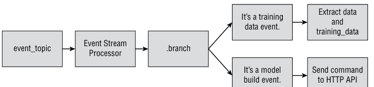

图 12.10：消息流

我决定用 Clojure 编写这些代码，主要是为了测试。当函数很小时，它们很容易测试。在 REPL 中工作时，可以快速在 REPL 中构建函数并将它们传输到主代码库中。

该流式应用使用 Java API 来设置流式作业，就像你在在本章之前看到的示例一样。不过，我添加了一些功能，以便启动应用和配置更加容易。

### 查找 Kafka Broker

正如你通过使用 Kafka 命令行工具所意识到的，有很多地方需要指定 broker 列表和 Zookeeper 服务器所在地。久而久之，很难找到并配置所有的它们，尤其是当是一个大型集群时。

在此应用程序中，有两个函数会在运行时为我们创建 broker 列表，因此不需要配置或硬编码。基础 Zookeeper 服务器地址位于 EDN 配置文件中。

```clojure
(defn get-broker-list
  [zk-conf]
  (let [c (merge zk-defaults/zk-client-defaults zk-conf)]
    (with-open [u (client/make-zk-utils c false)]
      (cluster/all-brokers u))))
```

```clojure
(defn broker-str [zk-conf]
  (let [zk-brokers (get-broker-list zk-conf)
        brokers (map (fn [broker] (str (get-in broker [:endpoints :plaintext :host]) "," (get-in broker [:endpoints :plaintext :port])))
                  zk-brokers)]
    (if (= 1 (count brokers))
      (first brokers)
      (str/join "," brokers))))
```

第一个函数 `get-broker-list` 接收 Zookeeper 配置并从 Zookeeper 节点返回所有 broker。返回的结果映射通过 `broker-str` 函数，它遍历条目并获取主机名和端口。最后一步是返回字符串。根据存在的 broker 名称，这可能是单个条目，也可能是逗号分隔的 broker 地址列表。

### 是命令还是事件？

当消息通过事件主题时，应用程序需要确定负载（`payload`）是一个包含一行 CSV 数据的训练事件，还是一个命令。在流式 API 中，有一个方法可以分支流。在这种情况下，无论我们的负载是命令还是训练行，消息值都可以被重定向到数组的正确元素。这个分区的流随后可以通过访问数组的位置被正确处理。

对于此示例，数组的第一个元素由命令组成；这些由 `process-command` 函数处理。在处理命令时，会测试模型类型并设置到 API 以启动训练作业。训练数据消息由 `process-training` 函数处理，并从负载中提取 CSV 数据并返回。流随后充当生产者，将原始数据发送到训练主题。发送到此主题的数据通过 Kafka 持久化。

（此处后续代码块保持原样不翻译）

## 事件处理流式应用代码

```clojure
(log/info "PROFILE" (:profile))
(broker-list (broker-str (:servers zookeeper)))
(props (:StreamsConfig/APPLICATION_ID (:consumer-group kafka)))
```

```clojure
StreamsConfig/BOOTSTRAP_SERVERS_CONFIG broker-list
StreamsConfig/ZOOKEEPER_CONNECT_CONFIG zookeeper
StreamsConfig/TIMESTAMP_EXTRACTOR_CLASS_CONFIG org.apache.kafka.processor.WallclockTimestampExtractor
StreamsConfig/KEY_SERDE_CLASS_CONFIG (.getName (getClass Serdes/String))
StreamsConfig/VALUE_SERDE_CLASS_CONFIG (.getName (getClass Serdes/ByteArray))
builder (KStreamBuilder)
config (StreamsConfig. props)
input-topic (to-array String [:topic kafka])
training-topic (:training-data kafka)
training-topic (to-array String [training-topic-name])
(log/info "Zookeeper Address: %s" zookeeper)
(log/info "Broker List: %s" broker-list)
(log/info "Kafka Topic: %s" (:topic kafka))
(log/info "Kafka Consumer Group: %s" (:consumer-group kafka))
```

```clojure
(do
  (let [partitioned-stream
        (.branch
         (.stream builder input-topic (reify
           Predicate
           (test [_ v]
             (do
               (log/info "p0 * v" (->> v))
               (pre-process-data)
               (pred-key-type)))
           "command"))))]
```

```clojure
(reify
  Predicate
  (test [_ v]
    (do
      (log/info "p1 * v" (->> v))
      (pre-process-data)
      (pred-key-type)))
  "training"))
training-topic-stream (.stream builder training-stream)
(log/info partitioned-stream)
(log/info training-topic-stream)
(-> (aget partitioned-stream 0)
  .mapValues (reify ValueMapper (apply [_ v] (process-command v)))
  .print)
(-> (aget partitioned-stream 1)
  .mapValues (reify ValueMapper (apply [_ v] (process-training v)))
  .to training-topic-name)
(KafkaStreams. builder config)
```

## 进行预测

随着 Kafka 处理传入的事件和训练数据，现在是时候将注意力转向对构建好的模型进行预测了。在事件主题流式应用程序中，你可能已经注意到了 API 端点的引用。

```clojure
(def api-endpoint "http://localhost:3000/api/")
```

API 的代码在章节前面的部分介绍过。为了进行预测，使用了三个端点。它们的工作方式都相同。

`/predict/<model to use>/<csv values>`

此例中使用的模型是简单回归模型 (`slr`)、决策树 (`dt`) 或神经网络 (`mlp`)。CSV 值是三个得分，模型将输出第四个得分。例如，调用 API 预测决策树预测 3, 4 和 5 分数的结果如下：

`http://localhost:3000/api/predict/dtr/3,4,5`

对于通过 `request_topic` 通过 Kafka 进行预测，需要一个应用程序来读取有效负载并针对 API 执行预测。

### 预测流式 API

流式应用程序从主题读取消息并将其反序列化为 JSON 格式。该应用程序的配置与之前所示的事件处理应用程序相似。

实际工作发生在 `run-prediction` 函数中。

```clojure
(defn run-prediction [data-in]
  (let [json (pre-process-data data-in)
        prediction-json (p/make-prediction json)]
    (->> prediction-json
         (.getBytes))))
```

`make-prediction` 函数的值返回并存储在 `prediction-json` 值中；此时，它是一个 JSON 格式的消息，但必须转换为字节数组以便发送到 `prediction-response` 主题。以下是预测流式应用程序的完整代码：

```clojure
(ns kafka.stream.prediction.core
  (:require [franzany.zookeeper.defaults :as zk-defaults]
            [franzany.zookeeper.client :as client]
            [franzany.cluster :as cluster]
            [clojure.java.io :as io]
            [clojure.string :as cstr]
            [taoensso.timbre :as log]
            [clojure.data.json :as json]
            [aero.core :refer [env]]
            [environ.core :as prediction.predict :as pl])
  (:import [org.apache.kafka.streams.kstream KStreamBuilder ValueMapper]
           [org.apache.kafka.streams KafkaStreams StreamsConfig]
           [org.apache.kafka.common.serialization Serdes])
  (:gen-class))
```

```clojure
(def api-endpoint "http://localhost:3000/api/")
```

```clojure
(def config profile
  (io/read-config (io/resource "config.edn" {:profile conf})))
```

```clojure
(defn get-broker-list
  [zk-conf]
  (let [c (merge zk-defaults/zk-client-defaults zk-conf)]
    (with-open [u (client/make-zk-utils false)]
      (cluster/all-brokers u))))
```

```clojure
(defn get-broker-str [zkconf]
  (let [zk-brokers (get-broker-list zkconf)
        brokers (map (fn [broker] (str (get-in broker [:endpoints :plaintext :host]) ":" (get-in broker [:endpoints :plaintext :port])))
                  zk-brokers)]
    (if (= 1 (count brokers))
      (first brokers)
      (cstr/join brokers))))
```

Kafka 消息仍然是字节数组。将它们转换为字符串。

```clojure
(defn deserialize-message [bytes]
  (try (-> bytes
           java.io.ByteArrayInputStream.
           io/reader
           slurp)
       (catch Exception e (log/info (.printStackTrace e)))
       (finally (log/info "*"))))
```

函数将字节数组消息转换为 Clojure Map。

```clojure
(defn pre-process-data [data-in]
  (let [json (deserialize-message data-in)
        prediction-json (p/make-prediction json)]
    (->> prediction-json
         (.getBytes))))
```


# 第 12 章 使用 Kafka 进行机器学习流处理

最后我们要看这三个模型如何进行预测；由于它们使用不同的 Java API，它们的预测方式各不相同。首先是决策树。

## 使用决策树模型进行预测

决策树模型使用 Weka，该命名空间处理模型构建（通过 shell 脚本）和预测。当预测机制调用 `:dtr` 事件时，它会执行 `predict-decision-tree` 函数。它执行了几个任务：

- 它创建一个 ARFF 格式的实例。
- 它对 MySQL 数据库进行查询以寻找最准确的决策树模型，查询返回 UUID。
- 使用 UUID 将模型加载到内存中。
- 对模型进行预测。
- 创建一个 JSON 负载并返回给流式应用程序的调用函数。

```clojure
(ns prediction.http.api.decisiontree
  (:require [prediction.http.api.db :as db]
            [clj-time.core :as t]
            [clj-time.format :as f])
  (:use [clojure.java.shell :only [sh]])
  (:import [java.io ByteArrayInputStream InputStreamReader BufferedReader]
           [weka.core Instances]
           [weka.core SerializationHelper]))
```

```clojure
(def script-path "/opt/mlbook/work/strata-2018-kafka-dl4j-clojure/projects/dl4j.ml/scripts/rundtrr.sh")
```

```clojure
(defn run-model []
  (sh script-path)
  "Decision Tree built.")
```

```clojure
(defn get-most-accurate-model [input]
  (first (db/load-accurate-model-by-type {:model-type "dtr"})))
```

```clojure
(defn create-instance [input]
  (let [header (slurp "/opt/mlbook/testdata/wekaheader.txt")]
    (-> (str header input "*")
        (.getBytes)
        (ByteArrayInputStream.)
        (InputStreamReader.)
        (BufferedReader.)
        (Instances.))))
```

```clojure
(defn load-model [uuid]
  (let [model-path (str "/mlbook/testdata/models/" uuid ".model")]
    (SerializationHelper/read model-path)))
```

```clojure
(defn classify-instance [model instance]
  (do
    (.setClassIndex instance (dec (.numAttributes instance)))
    (.classifyInstance model instance)))
```

```clojure
(defn predict-decision-tree [x]
  (let [instance (create-instance x)
        model-info (get-most-accurate-model {})
        model (load-model (:uuid model-info))
        result (classify-instance model instance)]
    {:input x
     :result result
     :accuracy (:model_accuracy model-info)
     :modelid (:uuid model-info)
     :prediction-date (f/unparse (f/formatters :mysql) (t/now))}))
```

## 线性回归的预测

决策树和神经网络模型都将序列化的模型构建持久化到磁盘。对于线性回归模型，斜率和截距存储在 MySQL 数据库中，因此不需要反序列化任何内容；只需要查询找到 R2 分数最高的模型即可。

该模型没有使用所有值来获取预测，因此有一个函数来解析第一个值并将其转换为整数。这就是进行预测的依据。

注意，大部分代码都是解析和转换。实际工作由两行代码完成。

```clojure
(defn calc-linear [slope intercept x]
  (+ intercept (* x slope)))
```

Clojure 语言的优之处之一在于你可以用简洁的代码实现高级的功能。线性回归构建器和预测器的代码列表如下：

```clojure
(ns prediction.http.api.linear
  (:require [prediction.http.db :as db]
            [clojure.string :as s]
            [clj-time.core :as t]
            [clj-time.format :as f])
  (:use [clojure.java.shell :only [sh]]))
```

```clojure
(def script-path "/opt/mlbook/work/strata-2018-kafka-dl4j-clojure/projects/dl4j.mlbook/scripts/runsl.sh")
```

```clojure
(defn run-model-build []
  (sh script-path)
  "Linear model built.")
```

```clojure
(defn load-simple-linear []
  (db/load-linear-model))
```

```clojure
(defn calc-linear [slope intercept x]
  (+ intercept (* slope x)))
```

```clojure
(defn convert-input-to-integer [input]
  (-> input
      (s/split "#")
      first
      (Integer/parseInt)))
```

```clojure
; 加载 r2 值最高的模型
(defn predict-simple-linear [x]
  (let [model (first (load-simple-linear))
        input (convert-input-to-integer x)
        result (calc-linear (:slope model)
                            (:intercept model)
                            input)]
    {:input input
     :result result
     :accuracy (:rsq model)
     :modelid (:uuid model)
     :prediction-date (f/unparse (f/formatters :mysql) (t/now))}))
```

## 神经网络模型的预测

与决策树模型类似，系统在获取预测之前需要执行以下步骤：

1. 从数据库找到最准确的模型，返回其 UUID。
2. 将模型加载到内存中。
3. 从 API 解析输入字符串。
4. 执行预测。
5. 构建 JSON 负载并返回给 API。

完整的代码列表处理模型构建并触发 shell 脚本。

```clojure
(ns prediction.http.api.neural
  (:require [prediction.http.api.db :as db]
            [clojure.string :as s]
            [clj-time.core :as t]
            [clj-time.format :as f])
  (:use [clojure.java.shell :only [sh]])
  (:import [org.deeplearning4j.util ModelSerializer]
           [org.nd4j.linalg.factory Nd4j]
           [org.nd4j.linalg.api.ndarray INDArray]))
```

```clojure
(def script-path "/mlbook/work/strata-kafka-2018-dl4j-clojure/projects/dl4j.mlp/scripts/runmlp.sh")
```

```clojure
(defn run-model []
  (sh script-path)
  "MLP model built.")
```

```clojure
(defn get-most-accurate-model [input]
  (first (db/load-accurate-model-by-type {:model-type "mlp"})))
```

```clojure
(defn load-model [uuid]
  (let [model-path (str "/mlbook/testdata/models/" uuid ".zip")]
    (ModelSerializer/restoreMultiLayerNetwork (java.io.File. model-path) true)))
```

```clojure
(defn parse-input [input]
  (-> input
      (s/split ",")
      (map #(Double/parseDouble %))
      (double-array)
      (Nd4j/create)))
```

```clojure
(defn predict-neural [x]
  (let [model-info (get-most-accurate-model {})
        model (load-model (:uuid model-info))
        input-arr (parse-input x)
        output (-> model
                   (.output input-arr)
                   (first)
                   (first))]
    {:input x
     :result output
     :accuracy (:model_accuracy model-info)
     :modelid (:uuid model-info)
     :prediction-date (f/unparse (f/formatters :mysql) (t/now))}))
```

# 第 12 章 使用 Kafka 进行机器学习流式处理

## 进行预测

在 `messages` 目录中有一个示例预测消息。与你请求构建模型一样，将 `sample_predict.json` 发送到 `prediction_request` 话题。

```bash
cat sample_predict.json | /path/to/kafka/bin/kafka-console-producer.sh --broker-list localhost:9092 prediction_request_topic
```

如果你正在 `prediction_response` 话题上运行一个消费者，你将看到带有预测结果的 JSON 输出。

```json
{
  "input": "3,4,5",
  "result": 5.27,
  "accuracy": "72.876",
  "modelid": "32201ab39be3745e5e9a7e576827cc59",
  "prediction-date": "2019-08-11 18:58:00"
}
```


## 总结

Kafka 为我们提供了一个实时的消息生产和消费可靠系统。通过将其与你已掌握的机器学习知识中的其他技术相结合，你可以构建一个使用流式数据创建模型集进行预测的系统，并随着新数据的加入不断提高模型的准确性。

虽然 Kafka 框架的组件非常简单，但创建流式智能应用的潜力是巨大的。关键在于如何将每个元素连接在一起并精炼这一过程。本章涵盖了数据收集、处理、训练和预测各个方面。

# 第 13 章 Apache Spark

Apache Spark 项目由加州伯克利分校的 AMPLab 创建，作为一个数据分析集群计算框架。本章将对 Scala 语言及其在 Spark 框架中的用法进行快速概述。本章还将查看用于机器学习、SQL 类查询以及使用 Spark 处理流数据的外部库。

## Spark：Hadoop 的替代者吗？

关于 Spark 是否是 Hadoop 替代者的争论可能会比某些人预期的持续得久。Hadoop 的问题之一正是让它出名的原因：MapReduce。编程模型掌握某些任务上可能需要时间。如果只是简单地统计数据频率，那么 MapReduce 是可以的，但当你达到这一点后，剩下的就会面临艰难的决策了。

Spark 超越了仅将 Hadoop 用于 MapReduce 的问题。随着 YARN（另一个资源调度器）的引入，Hadoop 充当了数据的操作系统，由 YARN 控制集群的资源。这些资源并不限于 MapReduce 任务；它们可以是任何可以执行的任务。

Spark 项目不依赖于 MapReduce，这让它具有了速度优势。据称，它比内存中的 Hadoop 快 100 倍，比磁盘上的 Hadoop 快 10 倍。如果速度是一个问题，那么 Spark 绝对是待关注列表上的热门选择。至于关于它是 Hadoop 替代者的论点，嗯，使用 Hadoop 有合适的时间和地点，Spark 也是如此；这完全取决于你正在完成的项目以及为任务选择合适的工具。工具仅仅是工具而已。

## Java、Scala 还是 Python？

Spark 任务可以用 Java、Scala 或 Python 编写。如往常一样，你倾向于哪种语言取决于个人偏好。

本书到目前一直集中在 Java 作为核心选择语言，我将在 Spark 示例中继续使用它。在本书的第一版中，Spark 的 Python 库被归类为实验性；随着 Python 作为一种语言在数据科学领域被更广泛地采用，这些库已经过更新并被更广泛使用。

当你学习本章时，你可能会得出 Java 对于编写 Spark 任务来说太臃肿的结论。记住，这取决于个人偏好，所以你应该使用你最熟悉的语言。

## 下载并安装 Spark

有几种方法下载和使用 Spark。最简单的方法是使用 Spark 网站上提供的预构建包。在下载之前，请检查你（或你的组织）运行的 Hadoop 版本，因为它将决定你想要下载的版本。如果你仍在运行 Hadoop，最好让你的 Spark 下载版本与你运行的 Hadoop 版本匹配。对于大多数开发者来说，我打赌这已经不再是一个问题了。

在下载适用于你 Hadoop 版本的文件后，你可以通过将下载的文件移动到想要安装的目录来安装它。该文件是一个 `.tgz` 文件，因此你可以用一条命令进行解压。

```bash
tar xvzf spark-2.4.4-bin-hadoop2.7.tgz
```

文件内容将完成解压并准备好使用。

## Spark 快速介绍

Scala 中的交互式 shell 为你提供了一种快速方便的方法，在短时间内查看 Spark 能做什么。如果你以前没用过 Scala，不要担心；这里显示的示例非常简单。了解 Scala 中一些基础的 Spark 代码很有帮助，这样你可以从 REPL 检查数据，而无需编写代码来完成任务。在这个简短介绍之后，我将介绍如何在 Spark 中构建完整的应用程序。

## 启动 Shell

从安装 Spark 的目录，输入以下命令启动 shell：

```bash
./bin/spark-shell
```

在 Spark 启动期间你会看到以下输出：

```
$ bin/spark-shell

19/10 09:24:25 WARN NativeClassLoader: Unable to load native library 'libslf4j_cpp'
19/10 09:24:25 WARN NativeClassLoader: Unable to load native library 'libslf4j_adapter'
19/10 09:24:25 WARN NativeClassLoader: Unable to load native library 'libslf4j_log4j'
19/10 09:24:25 WARN NativeClassLoader: Unable to load native library 'libslf4j_log4j12'
19/10 09:24:25 WARN NativeClassLoader: Unable to load native library 'libslf4j_simple'
19/10 09:24:25 WARN NativeClassLoader: Unable to load native library 'libslf4j_jdk14'
19/10 09:24:25 WARN NativeClassLoader: Unable to load native library 'libslf4j_nop'
19/10 09:24:25 WARN NativeClassLoader: Unable to load native library 'libslf4j_xpp12'
19/10 09:24:25 WARN NativeClassLoader: Unable to load native library 'libslf4j_jcl-over-slf4j'
19/10 09:24:25 WARN NativeClassLoader: Unable to load native library 'libslf4j_j-over-slf4j'
19/10 09:24:25 WARN NativeClassLoader: Unable to load native library 'libslf4j_jul-to-slf4j'
19/10 09:24:25 WARN NativeClassLoader: Unable to load native library 'libslf4j_1-to-slf4j'
19/10 09:24:25 WARN NativeClassLoader: Unable to load native library 'libslf4j_rt-to-slf4j'
19/10 09:24:25 WARN NativeClassLoader: Unable to load native library 'libslf4j_stat-to-slf4j'
19/10 09:24:25 WARN NativeClassLoader: Unable to load native library 'libslf4j_ext-to-slf4j'
19/10 09:24:25 WARN NativeClassLoader: Unable to load native library 'libslf4j_test-to-slf4j'
19/10 09:24:25 WARN NativeClassLoader: Unable to load native library 'libslf4j_reload-to-slf4j'
19/10 09:24:25 WARN NativeClassLoader: Unable to load native library 'libslf4j_log-to-slf4j'
19/10 09:24:25 INFO  NativeClassLoader: Failed to load native library 'libslf4j-log-to-slf4j'
19/10 09:24:25 INFO  NativeClassLoader: Failed to load native library 'libslf4j-log-to-slf4j'
19/10 09:24:25 INFO  NativeClassLoader: Failed to load native library 'libslf4j-log-to-slf4j'
```

正如你所看到的，由于 RDD 位于内存中，这些结果返回非常快。

## 从 RDD 过滤文本

通过 `.filter` 函数，你可以开始检查文本文件中的特定内容。假设你想查看文档中 "statistical" 一词出现了多少次，你可以运行以下代码：

```scala
scala> textF.filter(line => line.contains("whale")).count()
```

Scala 和 Spark 的这一行代码会遍历 RDD 并检查每一行。由于你在末尾添加了 `count`，你可以得到以下结果：

```
res3: Long = 316
```

因此，在整个文档中 "whale" 这个词出现了 316 次。如果需要，你可以将此输出保存到另一个 Spark Array 中。

```scala
scala> var filtered = textF.filter(line => line.contains("whale"))
```

```scala
scala> filtered.count()
res4: Long = 316
```

凭借 Scala 简洁的命令和分布式数据集（RDD）的内存处理能力，你拥有了一个整洁的系统，可以快速完成大量的数据计算。

## Spark 监控

早早我提到过，当你启动 Spark 时，会有一些程序运行。其中之一就是基于 Web 的监控器。如果你将浏览器指向 `http://yourdomain:4040`，你应该能看到图 13.1 所示的网站（假设 Spark 仍在运行）。

对于 Spark 而言，你运行的每一行都是一个作业（job），因此 Spark 会相应记录它，并给出持续时间和结果。还有关于存储和运行环境的信息。

你可以点击每个阶段（stage）来查看作业的完整细节及其执行输出。如果你的某个作业遇到了问题，首先查看这里并获取全局视图会很有帮助。

```java
public static class Map extends MapReduceBase implements
    Mapper<LongWritable, Text, Text, IntWritable> {
    private final IntWritable one = new IntWritable(1);
    private Text text = new Text();

    public void map(LongWritable key, Text value,
        OutputCollector<Text, IntWritable> output,
        Reporter reporter) throws IOException {
        // 通常在这里向 reducer 发送一些...
    }
}

public static class Reduce extends MapReduceBase implements
    Reducer<Text, IntWritable, Text, IntWritable> {
    public void reduce(Text key, Iterator<IntWritable> values,
        OutputCollector<Text, IntWritable> output,
        Reporter reporter) throws IOException {
        // 例如，reducer 会将值加 1
    }
}
```

作业定义使其能够在 Hadoop 框架内运行；还会添加额外信息，如输入和输出格式，以及读取数据和写入结果的路径。

```java
public static void main(String[] args) throws IOException {
    JobConf conf = new JobConf(BlankHadoopJob.class);
    conf.setJobName("BlankHadoopJob");

    conf.setOutputKey(Text.class);
    conf.setOutputValue(IntWritable.class);

    conf.setMapper(Map.class);
    conf.setCombiner(Reduce.class);
    conf.setReducer(Reduce.class);

    conf.setInputFormat(InputFormat.class);
    conf.setOutputFormat(OutputFormat.class);

    FileInputFormat.setInputPaths(conf, new Path(args[0]));
    OutputFormat.setOutputPath(conf, new Path(args[1]));

    JobClient.runJob(conf);
}
```

有些开发者抱怨为了让 MapReduce 运行需要在 Java 中编写大量的代码。对我来说这从不是问题（因为我设置了模板），但当我向你展示它在 Spark 中如何工作，你就会明白他们为什么要抱怨了。

在 Spark 中，你可以组合出相同的单词计数 MapReduce，以此展示它是多易用。使用你之前使用的文件，你可以从 Spark shell 运行 MapReduce 进程。首先加载文本文件。

```scala
scala> var text = sc.textFile("/path/to/data/ch13/mobydick.txt")
```

然后创建一个带有 MapReduce 结果的新变量。

```scala
scala> var mapped = text.flatMap(line => line.split(" "))
map(word => (word, 1)).reduceByKey((a,b) => a+b)
mapped: org.apache.spark.rdd.RDD[String, Int] = ShuffledRDD[9]
at reduceByKey = <console>:25
```

然后输出结果。

```scala
scala> mapred.collect
```

你在 shell 中看到了一正输出：

```
res5= Array((shelf,2), (Ah!,5), (bone,6),
(lug,1), (roses.,1), (dreamiest.,1), (dotings,1), (Fat-Cutter,,1),
(seems-aye,1), (Boat,1), (countrymen.,1), (consideration,1),
(chapters,3), (sweat.,1), (wasn't,3), (been,116), (they,,2),
(chests,,1), (proceedings,,1), (battering,2), (contemptible,2),
(salt,2), (known,9), (Pants,1), (Nathan,1), (surf,,1),
(ignore,1), (greenness,,1), (apples,1), (smooth,1), (stern,5),
casket,--1), (completing,1), (seductive,1), (disdain,1),
disclosures,,1), (snuffing,1), (southward,1),
```

*(注：由于提供的 OCR 文本存在大量重复和乱码，此处翻译已根据逻辑对内容进行了清理和去重处理)*

要保存结果，在 RDD 上使用 `.saveAsTextFile`（将输出目录更改为你的目录，例如）。

```scala
scala> mapred.saveAsTextFile("/path/to/output")
```

Spark 以 Hadoop 相同的方式在目录中保存文件。你可以看到这些文件。

## 使用 Spark 编写独立程序

虽然通过 Spark REPL 执行一些基础转换和应用是可能的，但真正的力量来自于可用的 API。这意味着可以使用 Java、Scala 或任何其他支持的语言构建数据应用程序。在本章中将继续使用 Java。如果你是 Clojure 开发者，那么值得研究一下 Clojure 的 Spark 封装（`http://gorillabs.github.io/sparkling/`）。

# Java 版 Spark 程序


# 第 13 章 - Apache Spark

在章节前面，我展示了如何进行基础单词计数。工作流分为三部分：

- 代码
- 构建文件 (`pom.xml`)
- 部署到 Spark 以用 Java 实现相同功能

## 单词计数的 Java 代码

```java
package mlbook.ch13.spark;

import org.apache.spark.api.java.*;
import org.apache.spark.sql.SparkSession;
import scala.Tuple2;
import java.util.List;
import java.util.Arrays;
import java.util.Scanner;

public final class BasicCount {
    public static void main(String[] args) throws Exception {
        System.out.println("Starting BasicWordCount...");
        if (args.length < 1) {
            System.err.println("Usage: BasicWordCount <file>");
            System.exit(1);
        }

        SparkSession sparkSession = SparkSession
            .builder()
            .appName("BasicWordCount")
            .getOrCreate();

        JavaRDD<String> lineOfText = sparkSession.read()
            .textFile(args[0]).textFileRDD();
        JavaRDD<String> wordsInEachLine = lineOfText
            .flatMap(s -> Arrays.asList(s.split("\\s+"))).iterator();
        JavaPairRDD<String, Integer> allTheOn = wordsInEachLine
            .mapToPair(word -> new Tuple2<>(word, 1));

        JavaPairRDD<String, Integer> finalCounts = allTheOn
            .reduceByKey((i1, i2) -> i1 + i2);

        List<Tuple2<String, Integer>> output = finalCounts.collect();
        for (Tuple2<String, Integer> tuple : output) {
            System.out.println("Segment " + tuple._1 + " found " + tuple._2 + " times.");
        }

        sparkSession.stop();
        System.out.println("Finishing BasicWordCount...");
    }
}
```

## 使用 Maven 构建项目

Maven 现在已成为大多数 Java 应用程序的构建工具选择。如果你没有安装 Maven，可以从 `http://maven.apache.org` 下载并解压该文件。

对于每个项目，你都需要一个 Maven 构建文件 `pom.xml`。对于本应用程序，构建文件如下所示：

```xml
<?xml version="1.0" encoding="UTF-8"?>
<project xmlns="http://maven.apache.org/POM/4.0.0"
     xmlns:xsi="http://www.w3.org/2001/XMLSchema-instance"
     xsi:schemaLocation="http://maven.apache.org/xsd/maven-4.0.0.xsd">
  <modelVersion>4.0.0</modelVersion>
  <groupId>mblook</groupId>
  <artifactId>Chapter13</artifactId>
  <version>1.0-SNAPSHOT</version>

  <properties>
    <project.name>sparkChapter13</project.name>
    <java.version>1.8</java.version>
    <maven.compiler.source>1.8</maven.compiler.source>
    <maven.compiler.target>1.8</maven.compiler.target>
    <build.testJarPhase>none</build.testJarPhase>
    <build.copyDependenciesPhase>package</build.copyDependenciesPhase>
  </properties>

  <dependencies>
    <dependency>
      <groupId>org.apache.spark</groupId>
      <artifactId>spark-core_2.11</artifactId>
      <version>2.2.0</version>
    </dependency>
    <dependency>
      <groupId>org.apache.spark</groupId>
      <artifactId>spark-sql-kafka-0-10_2.11</artifactId>
      <version>2.2.0</version>
    </dependency>
    <dependency>
      <groupId>org.apache.spark</groupId>
      <artifactId>spark-sql_2.11</artifactId>
      <version>2.2.0</version>
    </dependency>
  </dependencies>

  <build>
    <outputDirectory>target/scala-2.11/classes</outputDirectory>
    <testOutputDirectory>target/scala-2.11/test-classes</testOutputDirectory>
    <plugins>
      <plugin>
        <groupId>org.apache.maven.plugins</groupId>
        <artifactId>maven-deploy-plugin</artifactId>
        <configuration>
          <skip>true</skip>
        </configuration>
      </plugin>
      <plugin>
        <groupId>org.apache.maven.plugins</groupId>
        <artifactId>maven-install-plugin</artifactId>
        <configuration>
          <skip>true</skip>
        </configuration>
      </plugin>
      <plugin>
        <groupId>org.apache.maven.plugins</groupId>
        <artifactId>maven-jar-plugin</artifactId>
        <configuration>
          <outputDirectory>${jars.target.dir}</outputDirectory>
        </configuration>
      </plugin>
    </plugins>
  </build>
</project>
```

这为你提供了项目的基本轮廓，以及从哪些仓库拉取所需的依赖项。对于 Spark 项目，你需要在依赖声明中包含 Spark API。随着本章继续，你将根据需要添加更多依赖；如果你不想手动输入整个构建文件，`pom` 构建文件位于随书附的代码库中。

## 在 Maven 中创建包

要创建包，你需要从命令行运行 Maven。

```bash
mvn package
```

Maven 构建工具会负责依赖项的下载、创建类文件，并将所需的类打包成 `.jar` 文件。包构建完成后，会创建一个名为 `target` 的目录，你可以在那里看到 `.jar` 文件。

```bash
$ pwd
/path/to/code/java/ch13/target
```

```bash
$ ls -l
total 16
-rw-r--r-- 1 jabell staff 5917 22 Oct 09:49 Chapter13-1.0.0-SNAPSHOT.jar
drwxr-xr-x 3 jabell staff 96 21 Oct 10:44 generated-sources
drwxr-xr-x 3 jabell staff 96 21 Oct 10:44 maven-archiver
drwxr-xr-x 3 jabell staff 96 21 Oct 10:42 maven-status
drwxr-xr-x 3 jabell staff 96 21 Oct 11:25 scala-2.11
```

要使用 Spark 运行它，你需要使用 `spark-submit` 程序，就像你在之前的 Scala 示例中所做的那样（确保它在终端中是连续的一行）：

```bash
/usr/local/spark-2.4.4-bin-hadoop2.7/bin/spark-submit --class \
mlbook.ch13.spark.BasicCount --master local \
/path/to/Chapter13/target/Chapter13-1.0.0-SNAPSHOT.jar \
/path/to/data/ch13
```

让我们来看 `--class` 标志，它指定要运行的 Spark 类；包含五个部分。首先是包名，用引号括起来。`--master` 标志指定运行 Spark 集群；在本例中，它在本地机器上运行并使用线程执行。最后两部分是 JAR 文件的位置以及执行应用程序的其他任何参数（在本例中是目录路径）。Spark 执行 JAR 文件，你可以在控制台中看到输出。

虽然 Spark 应用程序已经完全执行了预期操作，但在处理之前对数据进行清理是明智的。更多信息请参阅第 3 章。

## Spark 总结

创建好我们的 Spark 应用程序后，让我们扩展这些知识，看看 Spark 提供的其他 API：`SparkSQL`、`Spark Streaming` 和 `MLlib`。你可以以相同的方式构建所有应用程序。通过重构 `pom` 构建文件，你可以快速地将 Spark 库扩展到你的应用程序中。

## Spark SQL

正如你从上一个 Spark 示例中所记得的，`SparkSession` 创建了在集群中运行应用程序的环境。`SparkSQL` 库的工作原理相同。

为了说明 SQL 功能的不同层次，我将从基础 Spark 任务开始，并添加 SQL 方法来通过 API 执行不同的操作。

```java
package mllook.ch13;

import org.apache.spark.sql.AnalysisException;
import org.apache.spark.sql.Dataset;
import org.apache.spark.sql.Row;
import org.apache.spark.sql.SparkSession;

public class BasicSparkSQL {

    private static String airportPath = "/path/to/data/ch13/airports.csv";

    public static void main(String[] args) throws AnalysisException {
        SparkSession spark = SparkSession.builder()
            .appName("ML Example")
            .getOrCreate();

        // 我们很快就会在这里添加内容
        runShowports(spark);

        spark.stop();
    }

    public static void runShowports(SparkSession spark) throws AnalysisException {
        Dataset<Row> df = spark.read().csv(airportPath);
        df.show();
    }
}
```

Spark 将 CSV 文件读取为数据帧（`DataFrame`）；不需要将其转换为 `RDD`。创建 Spark 会话后，在 `main` 方法中调用该方法。

下一步是构建并运行应用程序。像之前一样，运行 `mvn package` 在相同的 `target` 目录下创建一个新的 JAR 文件。下一步是执行。

```bash
$ /usr/local/spark-2.4.4-hadoop2.7/bin/spark-submit --class mllook.ch13.BasicSparkSQL --master local target/Chapter13-1.0.0-SNAPSHOT.jar
```

注意我删除了数据路径引用；另一个变化是包名和类名。当你运行应用程序时，将启动 Spark，加载数据并将前 20 行输出到控制台。

```
19/10/22 14:20:58 INFO SchedulerImpl: RemovedTask 1, whose tasks have all completed, from pool
19/10/22 14:20:58 INFO DAGScheduler: ResultStage 1 (show at BasicSparkSQL.java:207) finished in 0.139 s
19/10/22 14:20:58 INFO DAGScheduler: Job 1 finished: show at BasicSparkSQL.java:270, timeout 0.013854 s
```


# 第 13 章 Apache Spark

## 数据示例

| id | name | city | country | iata | icao | lat | lon | alt | timezone | tz |
|---|---|---|---|---|---|---|---|---|---|---|
| 1 | Goroka | Goroka | Papua New Guinea | GKA | AYGA | -5.207083 | 145.395181 | 5282 | 10 | Pacific/Papua_Moresby |
| 2 | | | Papua New Guinea | MAG | AYMD | - | | | | |
| 3 | Mount Haven | Mount Haven 巴布亚亚新几内亚 | HGU | AYMH | 5.82679 | 144.29586 | 5338 | 10 | | |
| 4 | Nadzab | Nadzab 巴布亚亚新几内亚 | LAB | AYN | -6.56928 | 146.72624 | 239 | 10 | Pacific/Port_Moresby | |
| 5 | Port Moresby | Port Moresby 巴布亚亚新几内亚 | POM | AYF | -9.44383 | 147.22005 | 10 | Pacific/Port_Moresby | | |
| 6 | Kewak | Kewak 巴布亚亚新几内亚 | WAK | AYW | -3.58218 | 143.69616 | 19 | 10 | Pacific/Port_Moresby | |
| 7 | Marsarsua | Marsarsua 格陵兰 | UKB | BW | 61.60517 | 54.25978 | -3 | America/Godth | | |
| 8 | Nukuk Godthad | 格陵兰 | GOH | GOH | 64.19042 | -57.06804 | 23 | -3 | America/Godth | |
| 9 | Sondstrom | Sondstrom 格陵兰 | SPF | BGS | 67.01969 | -60.58325 | 15 | -3 | America/Godth | |
| 10 | Thule Base | Thule 格陵兰 | THU | BGL | 76.53103 | -68.70361 | 251 | -4 | America/Thule | |
| 11 | Akurey | Akurey 冰兰 | AEY | BIAR | 65.65994 | -18.07203 | 6 | 0 | Atlantic/Reykjavik | |
| 12 | Egilsstadir | Egilsstadir 冰兰 | EGS | BIG | 65.28333 | -40.14189 | 76 | 0 | Atlantic/Reykjavik | |
| 13 | Hornafjordur | Hornafjordur 冰兰 | HFN | BIHN | 64.99515 | -15.22724 | 25 | 10 | Atlantic/Reykjavik | |
| 14 | Husavik | Husavik 冰兰 | KHZ | BIHU | 65.95238 | -17.42598 | 48 | 0 | Atlantic/Reykjavik | |
| 15 | Isafjordur | Isafjordur 冰兰 | IPJ | BIJ | 66.08506 | -23.13528 | 8 | 0 | Atlantic/Reykjavik | |
| 16 | Keflavik | Keflavik 冰兰 KEF | BIKF | 63.985 | -22.60556 | 171 | 0 | M | Atlantic/Reykjavik | |
| 17 | Patreksfjord | Patreksfjord | PRJ | BIPA | 65.55583 | -23.965 | 11 | 0 | Atlantic/Reykjavik | |
| 18 | Reykjavik | Reykjavik 冰兰 KV | BIRK | 64.13 | -21.940556 | 48 | 0 | Atlantic/Reykjavik | |
| 19 | Siglufjordur | Siglufjordur 冰兰 | SIJ | BIS | 66.13333 | -18.91667 | 10 | 0 | Atlantic/Reykjavik | |

仅显示前20行

## Spark SQL 查询示例

现在让我们添加查询：我想列出爱尔兰所有的机场。查看之前的输出，我们知道国家在 `c3` 列。创建一个新函数 `runShowports()`。

```java
public static void runShowports(SparkSession spark) throws Exception {
    DataFrame df = spark.read().csv(airDataPath);
    df.createTempView("airports");
    DataFrame irishAirports = spark.sql("SELECT c1, c4, c5 FROM airports WHERE c3 LIKE '%Ireland%'");
    irishAirports.show();
}
```

`runShowports()` 函数以之前的方式读取 CSV 文件，但这次我们提供了一个名为 `airports` 的临时视图。SQL 查询是一个简单的语句，用于读取机场名称、IATA（三字母代码）和 ICAO 代码。`.show()` 方法被调用，最后将前20行结果输出到控制台。将该方法添加到 `main()` 方法中以便在运行时执行。你可以使用 Maven 运行该应用程序。如果成功，你将看到如下输出：

```
19/10/22 14:36:00 INFO TaskSchedulerImpl: RemovedTaskSet 3.0, whose tasks have completed, from pool
19/10/22 14:36:00 INFO DAGScheduler: ResultStage 3 (show at BasicSparkSQL.java:33) finished in 0.213 s
19/10/22 14:36:00 INFO DAGScheduler: Job 3 finished: show at BasicSparkSQL.java:33, took 0.22565 s
```

| | c1 | c4 | c5 |
|---|---|---|---|
| Cork | ORK | EICK |
| Galway | GWY | EICM |
| Dublin | DUB | EIW |
| Ireland West | NOC | EIKN |
| Kerry | KIR | EIKY |
| Casement | null | EIME |
| Shannon | SNN | EINN |
| Sligo | SXL | EISG |
| Waterford | WAT | EWIF |
| Weston Airport | null | EIWT |
| Donegal Airport | CFN | EIDL |
| Inishmore Airport | IOR | EIMN |
| Connemara Regional | null | ECHO |
| Thurles | null | \N |
| Limerick | null | \N |
| Inisheer | INQ | EIR |
| Cashel | null | \N |
| Inishaan Aerrodrome | IIA | EMN |
| Cashel | null | \N |
| Newcastle | null | EINC |

### 基于列的查询

与其依赖 SQL，你可以使用基于列的查询。考虑以下函数：

```java
public static void runShowportsByCols(SparkSession spark) {
    Dataset<Row> df = spark.read().csv(airDataPath);
    Dataset<Row> filtered = df.filter(col("c3").contains("Ireland"));
    filtered.show();
}
```

`filter()` 方法允许你创建条件。该列将返回包含该单词的行。执行时，输出如下：

```
19/10/22 14:36:00 INFO TaskSchedulerImpl: RemovedTaskSet 3.0, whose tasks have completed, from pool
19/10/22 14:36:00 INFO DAGScheduler: ResultStage 3 (show at BasicSparkSQL.java:33) finished in 0.213 s
19/10/22 14:36:00 INFO DAGScheduler: Job 3 finished: show at BasicSparkSQL.java:33, took 0.22565 s
```

| | c1 | c4 | c5 |
|---|---|---|---|
| Cork | ORK | EICK |
| Galway | GWY | EICM |
| Dublin | DUB | EIW |
| Ireland West | NOC | EIKN |
| Kerry | KIR | EIKY |
| Casement | null | EIME |
| Shannon | SNN | EINN |
| Sligo | SXL | EISG |
| Waterford | WAT | EWIF |
| Weston Airport | null | EIWT |
| Donegal Airport | CFN | EIDL |
| Inishmore Airport | IOR | EIMN |
| Connemara Regional | null | ECHO |
| Thurles | null | \N |
| Limerick | null | \N |
| Inisheer | INQ | EIR |
| Cashel | null | \N |
| Inishaan Aerrodrome | IIA | EMN |
| Cashel | null | \N |
| Newcastle | null | EINC |

## 爱尔兰机场详细数据

| ID | 名称 | 城市 | 国家 | 类型 | 代码 | 纬度 | 经度 |
| :--- | :--- | :--- | :--- | :--- | :--- | :--- | :--- |
| 7034 | Cashel | Cashel | 爱尔兰 | null | \N | 52.515833 | -7.885556 |
| 7468 | Inishmaan 机场 | Inishmaan | 爱尔兰 | IIA | EIMN | 53.091944 | -9.57 |
| 8464 | Alpha | Cork | 爱尔兰 | null | \N | 51.400377 | -7.901464 |
| 8683 | Newcastle机场 | Newcastle | 爱尔兰 | null | EINC | 53.073056 | -6.039722 |

## 封装 Spark SQL

Spark SQL API 是在开始任何机器学习之前从大型数据集中提取数据的一种良好方法。当你不知道某些数据是否会为最终模型提供任何价值时，使用每一列数据是毫无意义的。

它非常适合分段海量数据；毕竟它是一个大数据工具。例如，如果你正在从销售点终端（POS）收集数据，并想对特定项目类型开始运行分析，使用 Spark SQL 你可以拉取所有 POS 数据，根据类型进行查询，然后在保存的输出数据上运行你的机器学习训练。

## Spark Streaming

在上一章中，你学习了 Kafka 如何作为流式日志工作。在 Kafka 内部，有多种消费和转换消息流的方法。Spark 有一个流式 API，允许集群在数据块从数据源设置时处理它们。在本节，你将看到流式 API 如何运行以及它是如何与其他数据源连接的。

### 概念

Spark Streaming 可以从多种源摄数据，例如 ZeroMQ、Kafka、Flume 和原始 TCP 套接字。在 Spring XD 之后，数据进入系统后，你可以选择处理和操作进入系统的数据，并将其存储到输出位置。

Spark Streaming 将数据分批次进行处理，而不是像 Kafka 那样一次处理一条数据。然后 Spark Streaming 处理并将这些批次交给请求的输出。Spark 将它们称为微批次（micro batches）。

### 创建你的第一个 Spark Stream

在这个示例中，我们将使用 Linux 的 `nc` 命令产生数据，并使用 Spark Streaming 读取它并进行基础的单词计数。在应用代码之前，你需要在 Maven `pom.xml` 文件中添加 Spark Streaming 库依赖。在你的构建文件中添加以下依赖：

```xml
<dependencies>
  ...
  <dependency>
    <groupId>org.apache</groupId>
    <artifactId>spark-streaming_2.11</artifactId>
    <version>2.2.0</version>
  </dependency>
</dependencies>
```

Spark Streaming 的代码非常直观。

```java
package org.apache.spark.SparkConf;

import org.apache.spark.api.java.StorageLevels;
import org.apache.spark.streaming.Durations;
import org.apache.spark.streaming.api.java.JavaDStream;
import org.apache.spark.streaming.api.java.JavaPairDStream;
import org.apache.spark.streaming.api.java.JavaReceiverInputDStream;
import org.apache.spark.streaming.api.java.JavaStreamingContext;
import org.apache.spark.Tuple2;
import java.util.Arrays;
import java.util.regex.Pattern;
import org.apache.spark.streaming.streaming.java.JavaReceiverContext;

public class BasicSparkStreaming {
    private static final Pattern PATTERN = Pattern.compile(" ");

    public static void main(String[] args) throws Exception {
        String hostname = "192.168.1.103";
        int port = 9999;
        SparkConf sparkConf = new SparkConf()
            .setAppName("BasicSparkStreaming");
        JavaStreamingContext ssc = new JavaStreamingContext(sparkConf,
            Durations.seconds(1));
        JavaReceiverInputDStream<String, String> lines = ssc.socketTextStream(
            hostname, port, StorageLevels.MEMORY_AND_DISK_SER);

        JavaDStream<String> wordsOnEachLine = lines
            .flatMap(line -> Arrays.asList(SPACE.split(line)).iterator());

        JavaDStream<String, Integer> wordCounts = wordsOnEachLine
            .mapPair(s -> new Tuple2<>(s, 1))
            .reduceKey((i1, i2) -> i1 + i2);

        wordCounts.print();
        ssc.start();
        ssc.awaitTermination();
    }
}
```


再次，应用程序需要若干步骤才能工作。`JavaStreamingContext` 使用 Spark 配置设置核心上下文。另一个点是 Spark 处理数据块之间的间隔。在这个示例中，Spark 框架包含了一组用于大规模学习的机器学习库。它支持多种类型的算法。

- 逻辑回归
- 朴素贝叶斯分类
- 决策树
- 随机森林
- K-means 聚类
- 关联规则
- 隐狄利克雷分配 (LDA) 主题模型

在本章的剩余部分中，我将向你展示几种机器学习类型：决策树、K-means 聚类以及使用 FP-Growth 的关联规则。在进行这些操作之前，我们需要向 Maven 构建文件添加机器学习库的依赖项。

## 依赖

打开 `pom.xml`，并将以下依赖添加到我们之前为 Spark 和 Spark Streaming API 添加的其他依赖中：

```xml
<dependency>
  <groupId>org.apache.spark</groupId>
  <artifactId>spark-mllib_2.11</artifactId>
  <version>2.2.0</version>
  <scope>provided</scope>
</dependency>
```

依赖就绪后，让我们来看之前章节中涵盖的三个算法。

## 决策树

Spark 任务的基础在所有示例中基本上是相同的。创建一个上下文，构建一个配置，并设置训练数据所在的位置。使用 Java 为我们学习的每一步提供了一个数据占位符。对于决策树，你必须设置算法将处理的类别数量（在本例中为 2），并添加树的深度（在海量数据下，你可能会得到非常深的树）。

传递 RDD 数据路径后，它将读取文件内容，下一步是将数据拆分为训练数据和评估数据。这是在一个 RDD 数组上完成的，它只有两个元素：一个用于训练数据，一个用于评估数据。

整个模型的工作通过一行代码完成。

```java
DecisionTreeModel model = DecisionTree
    .trainClassifier(trainingData, numberOfClasses, categoricalFeaturesInfo, impurity, maximumTreeDepth, maximumBins);
```

完成后，将使用评估数据对模型进行评估，结果输出到控制台。最终代码显示此处：

```java
package mlbook.ch3.spark;

import java.util.HashMap;
import java.util.Map;
import org.scala.Tuple;
import org.apache.spark.SparkConf;
import org.apache.spark.api.java.JavaPairRDD;
import org.apache.spark.api.java.JavaRDD;
import org.apache.spark.api.java.SparkContext;
import org.apache.spark.mlib.regression.LabeledPoint;
import org.apache.spark.mlib.tree.DecisionTree;
import org.apache.spark.mlib.tree.model.DecisionTreeModel;
import org.apache.spark.mlib.util.MLUtils;

public class BasicMLibDecisionTree {
    public static void main(String[] args) {
        int numberOfClasses = 2;
        Map<Integer, Integer> categoricalFeaturesInfo = new HashMap<>();
        String impurity = "gini";
        int maximumTreeDepth = 7;
        int maximumBins = 48;
        SparkConf conf = new SparkConf()
            .setAppName("BasicMLibDecisionTree");
        JavaSparkContext jsc = new JavaSparkContext(conf);
        String datapath = "path/to/data/ch13/mlib/dtree.txt";
        JavaRDD<LabeledPoint> data = MLUtils.loadLibSVMFile(jsc.sc(), datapath).toJavaRDD();
        JavaRDD<LabeledPoint>[] splits = data.randomSplit(new double[]{0.7, 0.3});
        JavaRDD<LabeledPoint> trainingData = splits[0];
        JavaRDD<LabeledPoint> testData = splits[1];
        DecisionTreeModel model = DecisionTree()
            .trainClassifier(trainingData, numberOfClasses,
                categoricalFeaturesInfo, impurity, maximumTreeDepth, maximumBins);
        JavaPairRDD<Double, Double> predictionAndLabel = 
            testData.mapToPair(p -> new Tuple2<>(model
                .predict(p.features()), p.label()));
        double predictionTestErrorValue =
            predictionAndLabel.filter(pl -> !pl._1().equals(pl._2()))
            .count() / (double) testData.count();
        System.out.println("Prediction test error value: " +
            predictionTestErrorValue);
        System.out.println("Output classification tree:\n" + model.toString());
    }
}
```

运行 Maven 以复制并重新打包带有新应用的 JAR 文件。

```bash
mvn package
```

使用 `spark-submit`，你可以针对提供的训练数据测试应用程序。

```bash
$ /usr/local/spark-2.4.4-hadoop2.7/bin/spark-submit \
--class "mlbook.ch13.BasicMLibDecisionTree" --master local[4] \
target/Chapter13-1.0-SNAPSHOT.jar
```

你将看到 Spark 启动一个本地集群并处理训练数据。最后，你将看到带有错误值的决策树输出。

```
19/10/24 11:28:54 INFO DAGScheduler: ResultStage 8 
(count at BasicMLLibDecisionTree.java:42) finished in 0.015 s
19/10/24 11:28:54 INFO DAGScheduler: Job 6 finished:
count at BasicMLLibDecisionTree.java:42, took
Prediction test error value: 0.1
Output classification tree:
```

### 第13 章 = Apache Spark 333

首先，我需要购物篮交易数据。这是一个包含物品的简单文本文件；每行代表一个结账篮的内容。

- 奶茶 面粉 铅
- 茶蛋糕 饼干 豆 豌豆 热巧克力 鸡蛋 咖啡
- 咖啡 面条 报纸 牛
- 饼干 茶蛋糕肥皂 鸡蛋 咖啡 纸 饼干
- 茶
- 饼干 蛋糕 纸 鸡蛋 铅

辅助 Spark 代码与决策树和 K-means 示例具有类似的功能。设置上下文，然后读取数据并将其解析为 RDD。

对于 FP-Growth，我们需要在计算关联规则时设置最小支持度以及要创建的分区数量。正如你可能在 Weka 的上一个关联规则示例中所记得的，我们只想显示具有最小置信度的关联规则。在本示例中，它设置为 70%（在代码中为双精度浮值 0.7）。

最后一步是生成关联规则并将其输出到控制台。我们还想看到前件项、后果项以及对应的置信度分数。

```java
package mlbook.ch13.spark;

import java.util.Arrays;
import java.util.List;
import org.apache.spark.api.java.RDD;
import org.apache.spark.api.java.SparkContext;
import org.apache.spark.mllib.fp.AssociationRules;
import org.apache.spark.mllib.fp.FPGrowth;
import org.apache.spark.mllib.fp.FPGrowthModel;
import org.apache.spark.SparkConf;

public class BasicMLLLibFPGrowth {
    public static void main(String[] args) {
        SparkConf conf = new SparkConf().setAppName("BasicMLLLibFPGrowth");
        SparkContext sc = new SparkContext(conf);
        RDD<String> data = sc.textFile("/path/to/data/ch13/ch13/mllib/fpgrowth_items.txt");
        RDD<List<String>> basketItems = data.map(line -> Arrays.asList(line.split("\\s+")));
        FPGrowth fpg = new FPGrowth()
            .setMinSupport(0.2)
            .setNumPartitions(10);
        FPGrowthModel<String> model = fpg.run(basketItems);
        for (FPGrowth.FreqItem<String> itemset: model.freqItems)
          .toJavaRDD().collect() {
            System.out.println("" + itemset.javaItems() + ", " + itemset.freq());
        }
        double minConfidence = 0.7;
        for (AssociationRules.Rule<String> rule
          : model.generateAssociationRules(minConfidence))
          .toJavaRDD().collect() {
            System.out.println("" + rule.javaAntecedent() + ", => " +
              rule.javaConsequent() + ", " + rule.confidence());
          }
        sc.stop();
    }
}
```

最后一次，运行 Maven 来编译并打包包含关联规则应用程序代码的 JAR 文件。

```bash
mvn package
```

然后使用 `spark-submit` 针对购物篮数据对应用程序进行测试。

```bash
$ /usr/local/spark/2.4.4-bin-hadoop2.7/bin/spark-submit \
  --class "mlbook.spark.SparkMLibFPGrowth" --master local \
  target/Chapter13-1.0.0-SNAPSHOT.jar
```

Spark 将启动，处理数据，并计算关联规则模型。完成后，结果将输出到控制台。

```
19/10/24 11:03:01 INFO TaskSchedulerImpl: Removed Task 8.0,
whose tasks have all completed, from pool
19/10/24 11:03:01 INFO DAGScheduler:ResultStage 8 
  (collect at SparkMLibFPGrowth.java:32) finished in 0.144 s
19/10/24 11:03:01 INFO DAGScheduler: Job 3 finished:
collect at SparkMLibFPGrowth.java:30, took 0.48325 s
[cake, eggs, coffee] => [biscuits], 1.0
[cake, eggs, tea] => [cake], 1.0
[paper, eggs, tea] => [biscuits], 1.0
[paper, eggs, tea] => [biscuits], 1.0
[eggs, coffee, tea] => [cake], 1.0
[eggs, coffee, tea] => [cake], 1.0
[coffee] => [biscuits], 1.0
[paper, cake, biscuits] => [tea], 1.0
[paper, cake, biscuits] => [eggs], 1.0
[eggs, coffee] => [biscuits], 1.0
[eggs, coffee] => [tea], 1.0
[eggs, coffee] => [cake], 1.0
[eggs, biscuits] => [tea], 1.0
[eggs, biscuits] => [cake], 1.0
```

## 总结

Spark 框架自第一版介绍以来已经发生了很大变化。

### 第 14 章 = 使用 R 进行机器学习

```
> myage
[1] 21
> myageagain
[1] 21
>
```

变量也可以存储字符串变量和其他数据类型。你最常用的是数值。数据列表存储在数组中，在 R 中称为向量（vectors），并通过 `c()` 函数定义。

```
> lotterynums <- c(2,7,20,35,36,42)
> lotterynums
[1] 2 7 20 35 36 42
```

向量也可以包含字符串。使用 `length()` 函数可以告诉你数组中有多少个元素。

```
> kc <- c("Robert", "Jakko", "Tony", "Mel", "Pat",
"Jeremy", "Gavin", "Bill")
> kc
[1] "Robert" "Jakko" "Tony" "Mel" "Pat" "Jeremy" "Gavin" "Bill"
> length(kc)
[1] 8
```

要显示数组中的特定值，你可以使用变量名和想要显示的元素。

```
> kc[5]
[1] "Pat"
```

## 矩阵

现在你已经知道数字向量列表是如何工作的，你可以将它们转换为矩阵。要定义一个矩阵，你需要获取数据然后定义使用的行和列数。

```
> mymatrix <- matrix(c(1,2,3,4,5,6,7,8,9,10), nrow=2, ncol=5)
> mymatrix
[1,] [1] [2] [3] [4] [5]
[2,] [6] [7] [8] [9] [10]
```

你可以根据行和列的位置来检索数据。

```
> # by row, col
> mymatrix[2,4]
[1] 9
> # entire row
> mymatrix[2]
[1] 6 7 8 9 10
> # entire col
> mymatrix[,4]
[1] 4 9
```

与其使用数值行列名称，你可以定义文本标签名称来提高可读性。

```
> dimnames(mymatrix) <- list(c("row1","row2"),c("c1","c2"),
c("c3","c4","c5"))
> mymatrix
c c1 c2 c3 c4 c5
row1 1 2 3 4 5
row2 6 7 8 9 10
```

你可以使用刚刚定义的行和列名通过行和列来引用数据。

```
> mymatrix["row2","c5"]
[1] 10
```

## 列表

列表是一个包含其他对象的向量。它可以是混合（数值、布尔值、字符串，例如）或列表中的其他向量。

```
> nums <- c(1,2,3,4,5)
```


> strings <- c("hello", "world", "again")

> bools <- c(TRUE, FALSE)

Error: unexpected '.' in "bools" <- (TRUE, FALSE

> bools <- c(TRUE, FALSE)

> mylist <- list(bools, strings, nums)

> mylist

[[1]] TRUE FALSE

[[2]]

[1] "hello" "world" "again"

[[3]]

[1] 1 2 3 4 5

```

要单独检索字符串，你可以相应地使用 `[1]` 表示对列表进行切片。

要直接引用列表对象的成员，必须使用双方括号。你也可以修改列表内的成员。

```

> mylist[[2]] [1]

[1] "hello"

> mylist[[2]] [1] <- "goodbye"

> mylist

[[1]]

[1] TRUE FALSE

[[2]]

[1] "goodbye" "world" "again"

[[3]]

[1] 1 2 3 4 5

```

## 数据框

数据框基本上是向量的列表。列数与向量相同。R 自带了一些预定义的数据框供使用。使用 `head()` 函数，你可以查看数据框的前几行。这避免了在命令行中显示整个帧的内容。

```

> data(USArrests)

> head(USArrests)

```

| Murder | Assault | Urban | Pop | Rape |
|---|---|---|---|---|
| Alabama | 13.2 | 236 | 58 | 21.2 |
| Alaska | 10.0 | 263 | 48 | 44.5 |
| Arizona | 8.1 | 294 | 80 | 31.0 |
| Arkansas | 8.8 | 190 | 50 | 19.5 |
| California | 9.0 | 276 | 91 | 40.6 |
| Colorado | 7.9 | 204 | 78 | 38.7 |

你可以像处理矩阵一样，通过行和列定位来引用数据。

```

> USArrests["New York","Assault"]

[1] 254

```

## 安装包

R 自带了大量的包供你选择。你可以在全面的 R 存档（通常称为 CRAN）网站 www.r-project.org 上看到这些包。它们涵盖了统计、数据处理和其他工具。要安装包，请使用来自 `install.packages()` 函数。它会为你处理一切。例如，要安装近似贝叶斯计算 (ABC) 工具，安装包：

```

install.packages("abc")

```

有些包可能需要先安装依赖项，因此使用 `dependencies` 标志是稳妥的。

```

> installing the dependencies 'SparseM', 'quantreg', 'locfit'

trying URL 'http://cran.r-project.org/bin/macos/contrib/3.1/SparseM_1.0.tgz'

Content type 'application/gzip' length 825491 bytes (806 Kb)

opened URL

=================

downloaded 806 Kb

```

```

trying URL 'http://cran.r-project.org/bin/macos/contrib/3.1/quantreg_5.0.tgz'

Content type 'application/gzip' length 1846783 bytes (1.8 Mb)

opened URL

=================

downloaded 1.8 Mb

```

```

trying URL 'http://cran.r-project.org/bin/macos/contrib/3.1/locfit_1.5.9.tgz'

Content type 'application/gzip' length 597404 bytes (583 Kb)

opened URL

=================

downloaded 583 Kb

```

```

trying URL 'http://cran.r-project.org/bin/macos/contrib/3.1/abc_2.0.tgz'

Content type 'application/gzip' length 5303210 bytes (5.1 Mb)

opened URL

=================

downloaded 5.1 Mb

```

下载的二进制包位于 `/var/tmp/downloaded_packages`。要使用已安装的库，用 `library()` 函数调用它。它会初始化并通知已加载的依赖项。

```

> library(abc)

Loading required package: nnet

Loading required package: quantreg

Loading required package: SparseM

Attaching package: 'SparseM'

The following object is masked from 'package:base':

```
Loading required package: MASS
Loading required package
```

## 加载数据

掌握了变量、列表和向量的基本概念后，是时候将一些数据加载到 R 中了。

### CSV 文件

`read.csv` 函数读取 .csv 文件并将其加载到数据框中。

```
> trans <- read.csv('vdata.csv', header=TRUE, sep=',')
> head(trans)
```

| | | | |

|---|---|---|---|

| 1 | 4 | 2 | 4 Car |

| 2 | 9 | 20 | 25 Bus |

| 3 | 5 | 14 | 18 Bus |

| 4 | 5 | 2 | 4 Car |

| 5 | 9 | 17 | 25 Bus |

| 6 | 1 | 1 | Bike |

如果你的 .csv 文件第一行有列名，则使用 `header=TRUE`，否则设置为 `FALSE`。分隔符由 `sep` 关键字定义，你可以定义任何分隔符。如果你有缺失值，使用 `fill` 标志以确保你的数据每行都有正确数量的元素。

## MySQL 查询

安装 `RMySQL` 包让你访问 MySQL 数据库。你可以将查询提取到 R 中进行处理。

```
install.packages("RMySQL", dependencies=TRUE)
```

如果你在 Windows 系统上工作，该库需要源文件。需要两个环境变量来编译。

- `Sys.setenv(PKG_CPPFLAGS = "-I/path/to/mysql/include/dir")`

- `Sys.setenv(PKG_LIBS = "-L/path/to/library/dir -lmysqlclient")`

- `install.packages("RMySQL", type = "source")`

```

与 Java 一样，在查询数据库之前需要定义一个连接。

```

> con <- dbConnect(MySQL(), user="mysql", password="mypass",

dbname="mydb", host="localhost")

```

从那里，你有了连接，可以查看数据库中有哪些表。

- `dbListTables(con)`

你查询一个表。查询数据以数据框的形式返回。

```

dta <- dbGetQuery(con, "SELECT * FROM mytable")

```

R 支持许多数据库，包括 SQLite3、PostgreSQL 和 Oracle。

## 创建随机数据

也许你没有数据要加载，或者你只是想要一组随机数字来玩。使用 `sample` 函数，你可以创建一个方便的数字向量。

```

> sam <- sample.int(1000, 20, replace=TRUE)

> sam

[1] 32 192 783 654 250 261 150 687 619 332 549 225 545 175

508 782 237 748 334 804

```

# 第 14 章 使用 R 进行机器学习

## 绘制数据

R 支持对数据进行基础绘图。在语法方面，可能需要一点时间来适应，因此后续章节将提供简短的入门。

## 柱状图

你在学校画过多少张图表？我画的图比我记得的多得多，但 R 让这一切变得非常简单（见图 14.4）。

```

> sam <- sample.int(1000, 20, replace=TRUE)

> sam

[1] 32 193 674 654 261 150 687 619 332 549 225 545 175

    508 782 237 744 338 804

> bar(sam, main="My first plot", horiz=TRUE)

```


图 14.4：水平柱状图

如果你使用 `horiz` 选项，柱条将沿垂直方向延伸，如图 14.5 所示。

```

> barplot(sam, main="My first plot")

```

## 饼图

R 中的饼图是基础的（见图 14.6），但它们可以完成任务。这只需要给饼图提供数值和标签。如果有必要，你可以轻松地扩展它。

```

> pie(sam, main="First Pie Chart", labels=sam)

```


图 14.5：垂直柱状图


图 14.6：简单饼图

点图函数（见图 14.7）是指定向量的一个简单案例。如果需要，你还可以将点图分为特定区域。

- `dotchart(sam, main="My Dot Chart", labels="Value", xlabel="Frequency")`


图 14.7：简单点图

## 折线图

有了两个数字，你可以创建一个折线图，如图 14.8 所示。

```

> sam1 <- c(10, 12, replace=TRUE)

> sam1

[1] 5 10 4 8 2 2 4 2 5 2 6

> sam2 <- sam1

> plot(sam1, sam2)

> lines(sam1, sam2, type="")

```


图 14.8：简单折线图

## 简单统计

R 是关于统计的；这正是它为此而生的。与 Scala、Java 或 Python 不同，R 的语法稍微有点严苛，但在操作几次后，它就会变得更加自然。创建一个简单的数字向量，然后你就可以处理一些函数。从基础开始。

```

> sample(100, 12, replace=TRUE)

> # 获取向量的基本摘要：最小值、第一四位数、

> 中位数、第三四位数和最大值

> summary(s)

Min. 1st Qu. Median 3rd Qu. Max.

1.00 9.25 28.50 37.58 58.25 97.00

> # 获取最小值

> min(s)

[1] 1

> # 获取最大值

> max(s)

[1] 97

> # 获取平均值

> mean(s)

[1] 37.5833

> # 获取中位数

> median(s)

> # 获取标准差

> sd(s)

[1] 31.57807

> # 使用 table 函数查看数据的频率

> table(s)

s

1 5 7 10 22 25 32 55 57 62 78 97

1 1 1 1 1 1 1 1 1 1 1 1

```

显然，你可以将这些函数结果重新赋值给新的变量或向量。这让你了解了摘要工作的基本轮廓。

## 简单线性回归

本节提供了 R 中简单线性回归的示例。它将让你对这些内容是如何组合的有一个良好的理解。故事是这样的：你根据销售团队通话的秒数产生了利润。如果你知道产生的利润，你能计算出通话了多久吗？

### 创建数据

首先创建两个独立的向量：一个用于通话秒数（`secondsCall`），另一个用于所产生的利润金额（`dollarProfit`）。

```

# 设置数据

secondsCall <- c(23,28,39,48,64,75,88,96,107,110,149,150,165)

dollarProfit <- c(1,2,3,4,5,6,7,8,9,10)

```

### 初始图形

你可以使用 `plot` 命令为这些值创建一个简单的图（见图 14.9）。

```

# 创建一个简单的图

plot(secondsCall, dollarProfit)

```


图 14.9：秒数/美元图

### 线性回归

在 R 中，有一个命令可以为你定义线性模型：`lm`。定义模型并设置变量。变量的顺序是因变量（`secondsCall`），后面是波浪号（`~`），最后是自变量（`dollarProfit`）。

```

# 定义线性模型

model <- lm(secondsCall ~ dollarProfit)

```

```

> model

Call:

lm(formula = secondsCall ~ dollarProfit)

```

| Estimate | Std. Error | t | Pr(\|t\|)|
| :--- | :--- | :--- | :--- |
| (Intercept) | 0.6226 | 4.8981 | 0.127 |
| dollarProfit | 1.2286 | 0.7681 | 21.1229 | *** |

Signif.. codes: *** .001 ** .01 * .05 .
Residual standard error: 8.306 on 13 degrees of freedom
Multiple R-squared: 0.9717, Adjusted R-squared: 0.9695
F-statistic: 446.4 on 13 DF, p-value: 1.898e-11

所以，现在你知道了截距 (0.6226) 和利润金额 1.2286，你可以使用 `summary` 命令扩展模型。

要在图中添加回归线，请使用 `abline` 函数。

```

> abline(model)

```

## 预测

假设某人获得了 $5 的利润，你想根据你创建的模型知道通话时长。使用 `predict` 命令可以进行预测。

```

> 某人 $5 的基本预测

> predict(model, newdata=data.frame(dollarProfit=5))

```

预测该人通话了 81 秒。你可以通过添加不同的区间类型来扩展，这将给你基于模型的上下预测。

```

> predict(model, newdata=data.frame(dollarProfit=5), interval="pred")

  fit upper

81.76568 63.19372 100.3376

> predict(model, newdata=data.frame(dollarProfit=5), intervals="confidence")

  fit upper

81.76568 76.97553 86.55503

```

## 基本情感分析

挖掘 Twitter 数据并测量正负情感很容易实现。你需要在 Twitter 开发者账户上注册一个应用程序。要评分的文本可以是输入的简单句子、Twitter 流或文件。

要学习如何创建带有令牌和密钥的 Twitter 开发者应用程序，请参考附录 B。那里有详细的步骤说明。一旦有了所需的令牌和密钥，就可以继续。

## 使用函数加载单词列表

你需要两个文本文件：一个包含正面词，一个包含否定词。你可以写两个函数来加载文本文件并将它们保存到两个独立的列表中。

```

LoadPosWordSet<-function() {

  iu.pos = scan("positive-words.txt", what='character', comment.char="=")

  pos.words = c(iu.pos)

  return(pos.words)

}

```

对否定词列表执行相同的操作：

```

LoadNegWordSet<-function() {

  iu.neg = scan("negative-words.txt", what='character', comment.char="=")

  neg.words = c(iu.neg)

  return(neg.words)

}

```

## 编写情感评分函数

你有一个函数接收一个句子两个列表（正面词和否定词）。现在你可以测试它了。

```

GetScore<-function(sentence, pos.words, neg.words) {

  sentence = gsub('[punct:]]', '', sentence)

  sentence = gsub('[cntrl:]]', '', sentence)
```


sentence = gsub('\\d+', '', sentence)

sentence = tolower(sentence)

word.list = str_split(sentence, '\\s+')

words = unlist(word.list)

pos.matches = match(words, pos.words)

neg.matches = match(words, neg.words)

score = sum(pos.matches) - sum(neg.matches)

return(score)

}

发生的第一件事是清理句子，移掉标点符号、控制字符和数字。这应该只给你一个由单词组成的句子；然后将其转换为全小写。

## 测试函数

要测试情感代码，你首先需要将代码和所需的库加载到 R。

```
install.packages("stringr")
library(stringr)
source('sentiment.r')
```

# 第 14 章 使用 R 进行机器学习

> pos.words <- LoadPosWordSet()
读取 2006 项

> neg.words <- LoadNegWordSet()
读取 4783 项

现在你已经加载了 2,006 个正面词和 4,783 个负面词。使用 `GetScore` 方法，你现在可以为某些文本评分，并且可以构造一些文本。例如，这里有一个正性句子：

```
> testscore<-GetScore("This concert is the best thing I've been to!",pos.words, neg.words)
> testscore
[1] 1
```

如你所见，情感分析得分为 +1，所以它是正性的。一个负性句子：

```r
> testscore2<-GetScore("That's bad real bad, horrible", pos.words, neg.words)
> testscore2
[1] -3
```

对于一个负性字符串，你得到 -3 的分。通过这个基础函数，你可以处理句子列表并创建评分的柱状图。

# Apriori 关联规则

对于一组交易，你可以运行基础的 Apriori 算法。R 基础系统在使用前需要安装名为 `arules` 的包。

## 安装 rules 软件包

在开始之前，你必须拥有 `arules` 软件包。

```r
> install.packages("arules", dependencies=TRUE)
正在安装依赖项 'colorspace', 'TSP', 'glus', 'scatterplot3d', 'vcd', 'seriation', 'igraph', 'ppmml', 'XML', 'arulesViz', 'ttsethash'
下载的二进制包位于 /var/folders/b5/_f7qk52nd6vq2pd4lytr0000gn/T//rtmgp3zNQ/downloaded_packages
```

```r
> library(arules)
加载所需的包: Matrix
挂载包：'arules'
以下对象已从 'package:base'屏蔽： %in%
```

## 收集训练数据

我准备了一个基本的 .csv 文件，包含篮子 ID 和每行一个项目。你可以看到有重复的篮子 ID，表示该篮子包含多个项目。我将我的文件命名为 `transactions.csv`。

```
1001,Fries
1001,Coffee
1001,Milk
1002,Coffee
1002,Fries
1003,Coffee
1003,Coke
1003,Braser
1004,Coffee
1004,Fries
1004,Cookies
1005,Milk
1006,Coffee
1006,Milk
1007,Coffee
1007,Fries
1008,Fries
1008,Coke
```

## 导入交易数据

通过 `read.transactions` 方法，你将 .csv 数据加载到 `transactions` 对象中。它的工作方式与你在章节开头看到的 `read.csv` 函数类似。我将 `rm.duplicates` 标志设置为 `FALSE`，因为我不想移除篮子项目。

```r
> transactions <- read.transactions(file="transactions.csv", rm.duplicates=FALSE, format="single", sep=",", cols=c(1,2))
> transactions
稀疏格式的 transactions
8 条交易（行）和 6 个项目（列）
>
```

如你所见，交易知道有八笔交易和六个项目。你可以使用 `itemFrequencyPlot` 函数通过图形方式查看项目的相对频率，它会生成一张类似于图 14.10 的图。

```r
> itemFrequencyPlot(transactions)
```


图 14.10：交易频率

## 运行 Apriori 算法

运行算法的函数只需一行。你提供交易对象一组参数。当你运行算法时，将看到结果输出。因此，当支持度为 0.5 置信度为 0.8（系统有 80% 的把握），你得到一条关联规则。

```r
> minedbasketrules <- apriori(transactions, parameter=list(sup=0.5, conf=0.8, target='rules'))
```

参数规范：

| confidence | min | max | rem | aval | originalSupport | minlen | maxlen | target | ext |
| :--- | :--- | :--- | :--- | :--- | :--- | :--- | :--- | :--- | :--- |
| 0.8 | 0.1 | 1 | none | FALSE | TRUE | 0.5 | 1 | 10 | rules | FALSE |

算法控制:

| filter | tree | heap | memopt | load | sort | verbose |
| :--- | :--- | :--- | :--- | :--- | :--- | :--- |
| 0.1 | TRUE | FALSE | TRUE | 2 | TRUE | |

```
apriori - 使用 apriori 算法查找关联规则
version 4.1 (2004.05.09) (c) 1996-2004 Christian Borgert
设置项目出现次数 ... [0 item(s)] 完成 [0.00s].设置交易 ... [6 item(s)], 8 条交易(s) 完成 [0.00s].正在排序并编辑项目 ... [2 item(s)] 完成 [0.00s].创建交易树 ... 完成 [0.00s].正在检查大小为 1 2 的子集 完成 [0.00s].正在写入 ... [1 条规则(s)] 完成 [0.00s].创建 S4 对象 ... 完成 [0.00s].
```

### 检查结果

查看结果看看它是什么。使用 `inspect` 命令查看结果。

```r
> inspect(minebasketrules)
lhs support lift
1 (Fries) => (Coffee) 0.5 0.8 1.06667
```

有 80% 的概率有人买薯条，如果你有成千上万条交易，就可以提高置信度水平并看到更多规则。

# 从 Java 访问 R

像 Weka 工作台可以从 Java 程序访问一样，通过 `rJava` 桥接，你可以在 Java 中运行 R 代码并在 R 中运行代码。

## 安装 rJava 软件包

最初 `rJava` 包是与 `JRI` 包分开的；当时安装是一个技术过程。坦率地说，它已经被一个覆盖两个包的单一二进制包所取代。

```r
> install.packages("rJava")
尝试 http://cran.rstudio.com/bin/macosx/contrib/3.1/ rJava_t_0.9.tgz
内容类型 'application/x-gzip' 长度 60621 字节 (586 Kb)
=============================================
已下载 586 Kb
```

# 第 14 章 使用 R 进行机器学习

下载的二进制包位于 /var/folders/b5/fz7qk52nd6vq2pd4lytr0000gn/T//Rtmp/downloaded_packages

`rjava` 包使用 JNI 访问 Java。从 R 内部的角度来看，这些看起来可能很复杂，但它们可以工作。

## 在 R 中创建 Java

打开你的 R 控制台。假设你已经安装了该包，你可以这样做：

```r
> library(rJava)
> .init()
```

加载包后，你需要初始化字符串。

```r
> stringobj <- .new("java/lang/String", "This is a string")
```

`rjava` 包使用 JNI 访问 Java。从 R 内部的角度来看，这些看起来可能很复杂，但它们可以工作。

## 在 R 中创建 Java

打开你的 R 控制台。假设你已经安装了该包，你可以这样做：

```r
> library(rJava)
> .init()
```

加载包后，你需要初始化字符串。如果你想在 R 中查找单词的位置，使用：

```r
> .jcall(stringobj, "I", "Java")
[1] 2
```

该方法返回一个整数。第一个参数是现有对象，下一个是返回类型。关于 rjava 的完整包信息，请查看： http://rforge.org/doc/packages/rjava/00Index.html

## 从 Java 程序调用 R

从 Java 调用 R 的接口是 JRI。你的 Java 需要两个组件：jar 文件（称为 `JRI.jar`）和原生库（名称取决于操作系统——在 macOS 上是 `libjri.jnilib`）。

```
Jason-Bells-MacBook-Pro:jri$ pwd
/Library/Frameworks/R.framework/Resources/library/java/jri
Jason-Bells-MacBook-Pro:jri$ ls -l
total 256
-rw-r--r-- 1 admin 31384 24 Apr 16:02 JRI.jar
-rw-r--r-- 1 admin 10272 24 Apr 16:02 JRIEngine.jar
-rw-r--r-- 1 admin 32354 24 Apr 16:02 REEngine.jar
drwxr-xr-x 8 admin 272 24 Apr 16:02 examples
drwxr-xr-x 1 admin 47500 24 Apr 16:02 libjri.jnilib
drwxr-xr-x 1 admin 833 24 Apr 16:02 run
Jason-Bells-MacBook-Pro:jri$
```

## 设置 Eclipse 项目

创建一个 Java 项目并命名为 `JRITest`。进入属性，点击 Java Build Path，并添加外部 jar 文件。现在寻找 `JRI.jar` 文件，它通常位于 `/Library/Frameworks/R.framework/Resources/library/java/jri` 文件夹中。（见图 14.11）

为了确保引擎在 Java 内部正常工作，你将创建一个小型测试文件来初始化引擎、内置的 iris 数据集，并进行评估。

### 创建 Java/R 类

要创建一个新类，选择文件 > 新类，并将新文件命名为 `TestR.java`。

```java
import java.util.Enumeration;
import org.rosuda.JRI.REXP;
import org.rosuda.JRI.RVector;
import org.rosuda.JRI.Rengine;

public class TestR {
    public static void main(String[] args) {
        Rengine engine = new Rengine(new String[] {"vanilla"}, false, null);
        System.out.println("Waiting for R to create the engine.");
        if (!engine.waitForR(0)) {
            System.out.println("Cannot load R engine.");
            return;
        }
        Rengine.eval("data(iris)", false);
        REXP exp = engine.eval("iris");
        RVector vector = exp.asVector();
        System.out.println("Outputting data:");
        for (Enumeration e = vector.getNames().elements(); e.hasMoreElements();) {
            System.out.println(e.nextElement());
        }
    }
}
```


在 `main` 方法中发生的第一件事是启动 R 引擎。在这一步骤完成之前，程序不会继续执行。接下来，你通过 `REngine.eval` 函数传递 R 命令来加载 iris 数据。最后，你在 Java 中初始化一个 R 向量，将 iris 数据转换为向量，然后对输出进行迭代。

## 运行示例

如果你尝试运行该类，现在会收到来自 Eclipse 的错误，因为 R 运行时库没有链接到项目中。如果库没有链接，你会得到以下错误：

```
Cannot find JRI native library!
Please make sure that the JRI native library is in a directory listed in java.library.path
java.lang.UnsatisfiedLinkError: no jri in java.library.path
	at java.lang.ClassLoader.loadLibrary(ClassLoader.java:1764)
	at java.lang.Runtime.loadLibrary(Runtime.java:823)
	at java.lang.System.loadLibrary(System.java:1044)
	at org.rosuda.JRI.Rengine.<clinit>(Rengine.java:19)
	at TestR.main(TestR.java:10)
```

要设置该项，你需要查找项目的运行配置。选择运行配置，然后点击 `TestR` 代码。在参数选项卡中，你需要在虚拟机参数中添加一个 `-D` 标志，如图 14.12 所示。


图 14.12：添加 JRI 库路径

如果你收到关于 `R_HOME` 路径未设置错误，请重新打开运行配置并点击环境选项卡，如图 14.13 所示。如果你使用 Windows，在系统中找到 `R.dll` 文件并将其添加到路径中。


图 14.13：添加环境变量 `R_HOME` 路径

点击运行并重试。这一次你应该看到正确的输出。

```
Waiting for R to create the engine.
Outputting names:
Sepal.Length
Sepal.Width
Petal.Length
Petal.Width
Species
```

## 扩展你的 R 实现

你刚刚阅读的代码为你提供了在 Java 程序中运行 R 函数和命令的基本框架。如果你想，可以使用这种方法将本章中看到的 R 示例轻松转换为 Java 程序。如果你的团队中有 R 专家，那么让此人先编写 R 函数然后将其迁移到 Java 可能是明智之举。

## 使用 R 连接社交媒体

我知道，又提到了 Twitter 应用程序编程接口（API）。这类数据非常重要，不仅仅是为了情感分析。大多数新闻、社交图谱和对话都发生在这些平台上，跟上发展变得越来越重要。对于 R 来说也是如此；能够连接到 Twitter 是非常重要的。

在之前的示例中，你使用了 Twitter 开发账户为应用程序创建授权密钥。你本质上是强制你的应用程序使用这些预先存在的密钥。这运行良好，但在使用 `tweetlibrary` 时，你需要采取稍微不同的方法。

记下你需要的消费者密钥和密钥，但有几件事你需要确认。

首先，确保没有回调 URL。你在 Twitter 框的设置选项卡中确认这也设置为 true。不要忘记更新设置以生效。刷新页面直到你看到设置正确。现在 Twitter 设置好了，你可以查看 R 代码来帮助你登录 Twitter。

你需要打开文本编辑器并编辑以下代码：

```r
library(twitter)

cred <- OAuthFactory$new(
  consumerKey="xxxxxxxx",
  consumerSecret="xxxxxxxx",
  requestURL="http://twitter.com/oauth/request",
  accessTokenURL="http://twitter.com/oauth/token",
  accessURL="http://twitter.com/oauth/authorize"
)

auth <- cred$getRequest()
token <- auth$getAccessToken()
auth$setAccessToken(token)
auth$search("bigdata")
```

# 附录 A

## Kafka 快速上手

有关 Kafka 如何工作的完整说明以及生产者和消费者的详细介绍，请参阅第 12 章。

你可以从此链接下载 Kafka 的开源版本：

https://www.apache.org/dyn/closer.cgi?path=kafka/2.2.0/kafka_2.12-2.2.0.tgz

## 安装 Kafka

下载的发行包包含了 Zookeeper 和 Kafka，以及本附录中解释的所有命令行工具。在使用之前，请创建一个工作目录并解压发行包文件。

```
$ tar -xzf kafka_2.12-2.2.0.tgz
$ cd kafka_2.12-2.2.0
```

## 启动 Zookeeper

对于开发，单机集群就可以良好运行，因此不需要对任何配置文件进行任何更改。首先要启动的是 Zookeeper。

在终端中，以 root 用户身份运行以下（如果你不使用 root 用户，可能会遇到文件权限问题）：

```
$ bin/zookeeper-server.sh config/zookeeper.properties
[2019-06-18 07:43:12,238] INFO Reading configuration from: config/zookeeper.properties org.apache.zookeeper.server.quorum.QuorumPeerConfig
[2019-06-18 07:43:12,241] INFO autpurge.snapRetentionCount set to 3 (org.apache.zookeeper.server.DatadirlCleanupManager)
[2019-06-18 07:43:12,241] INFO autpurge.purgeInterval set to 0 (org.apache.zookeeper.server.DatadirlCleanupManager)
[2019-06-18 07:43:12,243] INFO Purge task is not scheduled. org.apache.zookeeper.server.DatadirlCleanupManager)
[2019-06-18 07:43:12,243] WARN Either no config or quorum defined in config, running in standalone mode (org.apache.zookeeper.server.quorum.QuorumPeerMain)
[2019-06-18 07:43:12,260] INFO Reading configuration from: config/zookeeper.properties org.apache.zookeeper.server.quorum.QuorumPeerConfig
```

## 启动 Kafka

一旦 Zookeeper 运行，打开一个新的终端窗口并使用以下命令启动 Kafka broker：

```
$ bin/kafka-server-start.sh config/server.properties
[2019-06-18 07:43:45,792] INFO Registered kafka.type=kafka.Log4jController MBean (kafka.utils.Log4jControllerRegistration)
[2019-06-18 07:43:46,536] INFO starting (kafka.server.KafkaServer)
[2019-06-18 07:43:46,538] INFO Connecting to zookeeper on localhost:2181 (kafka.server.KafkaServer)
[2019-06-18 07:43:46,562] INFO [KeeperClient] Initializing a new session to localhost:2181. (kafka.server.KafkaServer)
[2019-06-18 07:43:46,568] INFO Client environment: zookeeper.version=3.4.13-d7f1aabd22557dafab0348 on 06/27/2019 00:33:59 GMT org.apache.zookeeper
[2019-06-18 07:43:46,568] INFO Client environment: host.name=192.168.1.102 (org.zookeeper)
[2019-06-18 07:43:46,568] INFO Client environment: java.version=1.8.0_45 (org.zookeeper)
```

### 创建 Topic

要向 Kafka 写入消息，你需要一个 topic。要在命令行创建 topic，请使用以下命令。注意，最小副本因子和分区数为 1。如果将来需要，你可以增加这些数字；唯一的办法是删除该 topic 并重新开始。

```
$KAFKA_HOME/bin/kafka-topics.sh --zookeeper localhost:2181 --create --topic testtopic --replication-factor 1 --partitions 1
Created topic "testtopic".
```

### 列出 Topics

使用 `kafka-topics` 命令的 `--list` 标志。注意，所有 topic 都将被列出，包括 Kafka 用于偏移量计数和指标的内部 topic。

```
$ bin/kafka-topics --zookeeper localhost:2181 --list
```

### 描述 Topic

`describe` 标志 `--describe` 将向控制输出给定 topic 的常规信息以及任何其他配置设置。

```
$ bin/kafka-topics --zookeeper localhost:2181 --describe --topic testtopic
Topic: testtopic PartitionCount:1 ReplicationFactor:1 Configs:0 Partition:0 Replicas:0
```

### 删除 Topics

通过 `kafka-topics` 命令中的 `--delete` 标志完成对 topic 的删除。如果你的 broker 或 topic 配置包含 `delete.enable=false`，你的请求将被忽略，但不会给出警告。取决于你的 topic 大小，可能不会立即删除；值得使用 `--list` 标志再次检查以确认。

```
$ bin/kafka-topics --zookeeper localhost:2181 --delete --topic testtopic
Topic testtopic is marked for deletion. Note: This will have no impact if delete.enable is not set to true.
```

### 运行控制台生产者

你可以使用 `kafka-console-producer` 脚本从命令行创建测试消息。运行它时，你可以在终端窗口中输入或复制/粘贴信息，信息将会被发送到指定的 topic。

```
$ bin/kafka-console-producer --broker-list localhost:9092 --topic testtopic
```

### 运行控制台消费者

要从终端从 topic 读取消息，请使用 `kafka-console-consumer` 命令。

```
$ bin/kafka-console-consumer --bootstrap-list localhost:9092 --topic testtopic --from-beginning
```

# 附录 B

## Twitter API 开发者配置

在从 Twitter 读取数据之前，你需要设置一个应用程序。Twitter 开发者网站允许用户创建密钥来访问 Twitter。如果你还没有 Twitter 账号，可以去 http://twitter.com 注册。

1. 打开浏览器并访问 http://twitter.com。使用你的 Twitter 凭据登录。
2. 找到右上角的 Twitter 头像。将鼠标悬停在其旁边。在下拉菜单中点击 Applications。
3. 点击 Create New Application 按钮，如图 B.1 所示。
4. 填写名称、描述和网站 URL 等必需字段（见图 B.2）。如果 Twitter 用户决定使用你的应用程序，这些信息是必要的。你可以将回调 URL 留空，因为你不会使用它。
5. 同意 Twitter 的条款和条件并填写验证码。点击 Create Your Application 按钮。

假设一切顺利，你将被重定向到应用程序详情配置界面。这些设置包括组织、授权、设置、访问密钥以及删除应用程序的选项。

6. 在 Details 标签的 OAuth Settings （见图 B.3）是 Spring XD 系统收集 Twitter 流数据所需的信息。记下消费者密钥和消费者密钥。
7. Twitter 需要一个访问令牌来配合你的消费者密钥和消费者密钥。获取它的最简单方法是点击 OAuth 设置下方的 Create My Access Token 按钮。访问令牌出现在 Details 页面可能需要一些时间。如果超过 30 秒或访问令牌仍为空，请刷新页面，令牌将会出现。

过程完成后，你将看到访问令牌、访问令牌密钥密钥以及访问级别。只读令牌对于你的目的是足够的，因为你是在收集数据而不是编写新推文。

# 附录 C

## 有用的 Unix 命令

无论你日常使用什么操作系统，学习一些实用的 Unix 命令都是很有好处的。本节涵盖的命令将帮助你在日常任务中快速地测试、解析和搜索文本数据。

如果你是 Windows 用户，仍然可以尝试下载 Cygwin，它是一个 Unix shell 命令解释器。Cygwin 是一个运行在 Windows 应用程序之上的 shell，其行为就像安装了 Unix 一样。

这些命令中的一些会经常出现在书中章节中，因此现在回顾它们是值得的。尝试使用它们并研究输出结果，这样你对预期结果有个了解。

## 使用示例数据

在开始使用这些工具之前，你需要一些示例数据。使用文本编辑器输入以下行，并用制表键隔开每个值：

```
987 1391548780 hhh bbb
988 1391548781 sda jjj
989 1391548782 asd asd
990 1391548783 gjh jkl
991 1391548784 abc abc
992 1391548785 ghj ghj
```

将文件命名为 `text.txt`，然后就可以跟随以下命令并查看输出。示例数据基本上由唯一 ID、时间戳和一些文本组成。这种内容你在数据库表中会看到，但它是以文本形式输出的。此示例使用制表符作为分隔符，但你可能会发现使用逗号、分号或其他字符作为分隔符的数据。

```
993 1391548785 hhh bbb
994 1391548785 sda jjj
995 1391548786 asd asd
996 1391548787 ghj jkl
997 1391548787 abc abc
998 1391548787 ghj gjj
```

### 显示内容：cat, more, and less

`cat` 命令将一个或多个文件的内容连接并打印到控制台输出。

#### 示例命令

```
cat text.txt text2.txt text3.txt
```

#### 预期输出

```
987 1391548780 hhh bbb
988 1391548781 sda jjj
989 1391548782 asd asd
990 1391548783 gjh jkl
991 1391548784 abc abc
992 1391548785 ghj ghj
993 1391548785 hhh bbb
994 1391548785 sda jjj
995 1391548786 asd asd
996 1391548787 ghj jkl
997 1391548787 abc abc
998 1391548787 ghj gjj
```

在输出中添加 `-b` 也可以得到行号。

```
$ cat -b sample.txt
  1 987 1391548780 hhh bbb
  2 988 1391548781 sda jjj
```


3 989 1391548782 asd asd

| 4 990 | 1391548783 | gjh jkl |
| 5 991 | 1391548784 | abc abc |
| 6 992 | 1391548785 | ghj gjj |
| 7 993 | 1391548785 | hhh bbb |
| 8 994 | 1391548785 | sda jjj |
| 9 995 | 1391548786 | asd asd |
| 10 996 | 1391548787 | gjh jkl |
| 11 997 | 1391548787 | abc abc |
| 12 998 | 1391548787 | ghj gjh |

如果控制台显示的内容太多无法跟上，你可以在 `cat` 命令后添加 `more` 命令。

```
$ cat sample | more
```

或者，`less` 命令为你提供了一个受控的环境来查看文件内容，但不允许你编辑它们。

## 过滤内容：grep

对于文本中的模式匹配，`grep` 是你的好朋友。它是你学会后会反复使用的工具之一。语法非常简单：`grep [options] [要查找的模式] [文件名(s)]`。

### 查找文本的示例命令

```
$ grep 'bbb bbb' sample.txt
```

### 输出

要反转输出（显示不匹配模式的行），可以添加 `-v` 标志。表 C 显示了你可以配合 `grep` 使用的其他常用选项。

**表 C grep 选项**

| 选项 | 输出 |
| :--- | :--- |
| `-c` | 输出匹配模式的行数 |
| `-v` | 反转输出，显示不匹配模式的行 |
| `-i` | 忽略大小写 |
| `-n` | 显示匹配行的行号 |
| `-l` | 列出匹配模式的文件名 |

你可以通过引入类 Perl 模式来进一步扩展模式匹配。

```
$ grep -e 'bbb' sample.txt
988 1391548781 sda jjj
994 1391548785 sda jjj
```

## 数据排序：sort

`sort` 命令升序或降序对输入文件进行排序。默认情况下，`sort` 假设所有内容都是字符串。（稍后我们将讨论数值。）

### 基础排序示例命令

```
$ sort sample.txt
```

### 示例输出

```
987 1391548780 hhh bbb
988 1391548781 sda jjj
989 1391548782 asd asd
990 1391548783 gjh jkl
991 1391548784 abc abc
992 1391548785 ghj ghj
993 1391548785 hhh bbb
994 1391548785 sda jjj
995 1391548786 asd asd
996 1391548787 ghj jkl
997 1391548787 abc abc
998 1391548787 ghj gjj
```

`-r` 标志以降序输出结果。

```
$ sort -r sample.txt
998 1391548787 ghj gjj
997 1391548787 abc abc
996 1391548787 ghj jkl
995 1391548786 asd asd
994 1391548785 sda jjj
993 1391548785 hhh bbb
992 1391548785 ghj ghj
991 1391548784 abc abc
990 1391548783 gjh jkl
989 1391548782 asd asd
988 1391548781 sda jjj
987 1391548780 hhh bbb
```

# 定位任何内容：find

`find` 命令是我最喜欢的命令之一。虽然需要一点时间适应，但一旦学会，它将为你提供极大的帮助。

该语法包含一个源目录（如果你想从当前目录开始，可以使用点 `.`）和各种文本选项。例如，以下是在我的机器上对主目录运行 `find` 命令的示例：

```
$ find -type f -name '*.txt'
./gradle/caches/1.10/scripts/build361hee7li7errd096649rjns/
ProjectScript/buildscript/classes/emptyScript.txt
./gradle/caches/1.8/scripts/build-4p3rjkeuk5gal80of3d9h4wso/
ProjectScript/buildscript/classes/emptyScript.txt
./rvm/config/displayed-notes.txt
./rvm/gems/ruby-1.9.2-p220/gems-arel.0.2/History.txt
./rvm/gems/ruby-1.9.2-p220/gems-3.0.2/Manifest.txt
```

通过 `-type` 标志，我正在查找文件（`f`）。`-name` 给出了我正在查找的文件类型——例如任何带有 `.txt` 扩展的文件。我使用 `-print` 标志打印结果。

到目前为止，没有什么是几个 Unix 命令无法做到的。这本身就很伟大。想象一下，你可以在 `find` 命令中使用 Unix 命令来查找文本文件中包含“SOFTWARE IS PROVIDED”短语的文件。

```
$ find -type f -name "*.txt" -exec grep "SOFTWARE IS PROVIDED" {} {} \
-print
THE SOFTWARE IS PROVIDED "AS IS", WITHOUT WARRANTY OF ANY KIND,
./rvm/gems/ruby-1.9.2-p220/arel-3.0.2/MIT-LICENSE.txt
THE SOFTWARE IS PROVIDED "AS IS", WITHOUT WARRANTY OF ANY KIND,
./rvm/gems/ruby-1.9.2-p220/polyglot-0.3/License.txt
THE SOFTWARE IS PROVIDED "AS IS", WITHOUT WARRANTY OF ANY KIND,
./rvm/gems/ruby-1.9.2-p220/polyglot-0.3/README.txt
THE SOFTWARE IS PROVIDED "AS IS", WITHOUT WARRANTY OF ANY KIND,
EXPRESS OR
./rvm/gems/ruby-1.9.2-p220/rack-test-0.6.1/MIT-LICENSE.txt
THE SOFTWARE IS PROVIDED "AS IS", WITHOUT WARRANTY OF ANY KIND,
EXPRESS OR
./rvm/gems/ruby-1.9.2-p220/rack-test-0.6.2/MIT-LICENSE.txt
THE SOFTWARE IS PROVIDED "AS IS", WITHOUT WARRANTY OF ANY KIND,
./rvm/gems/ruby-1.9.2-p220/uglifier-1.2.6/LICENSE.txt
THE SOFTWARE IS PROVIDED "AS IS", WITHOUT WARRANTY OF ANY KIND,
./rvm/gems/ruby-1.9.2-p220/uglifier-1.3.0/LICENSE.txt
```

这个示例使用了在本附录前面介绍过的标准 `grep`，但它将文件名替换为 `{}`，`{}` 是 `find` 命令运行的文件名占位符。

## 附录 C ■ 有用命令

`find` 多次拯救了我的编程心态。如果我正在寻找一个包含方法名的文件但不记得它在哪里（这在大型代码库中经常发生），我不需要启动 IDE。我只需要从命令行使用 `find`。

## 组合命令与重定向输出

对 Unix 命令的解释展示了如何一次使用一个命令。使用管道符号 `|`，你可以将这些命令链起来。使用大于符号 `>`，你可以将输出重定向到一个新文件。

```
$ grep 'hhh' sample.txt | sort | less
987 139154780 hbb
993 139154785 h
```


前面的命令使用 `grep` 在 `sample.txt` 文件中搜索 'hhh'，然后通过 `sort` 命令处理；将其写入新文件 `newssample.txt`。最后，通过 `cat` 发送到控制台。

## 选择文本编辑器

文本编辑器的选择是个人喜好，类似于喜欢特定的音乐组合、运动队或演员。我不是说这些编辑器之间发生过冲突，但有时在咖啡和啤酒中会讨论。如果你想知道某个软件开发者的类型，问问他们使用什么文本编辑器即可。

归根结底，取决于你使用什么文本编辑器。你可能不会整天使用它，但当你需要快速查看或编辑某些内容时，你需要一个流畅且无需复杂的编辑器。

## 命令狂热：Vi 和 Vim

Vi 由 Bill Joy 于 1976 年编写，并在 1978 年作为 BSD 的发布。发音为 "vee eye"，长期以来一直是 Unix 系统管理员的支柱。它是今天最常用的文本编辑器之一。

让 vi 具有挑战性的是 "ex" 命令的概念，这些命令操作文本行；你需要 `:w` 来写入文件或退出应用。如果你想在不保存的情况下退出，就需要 `:q`。同样，在输入新文本时有插入模式，在移动和更改文本时有编辑模式。Vi 简单到可以使用所有的（100%）vi 命令。学习这些命令需要删除行、将文本 yank 到缓冲区然后粘贴、搜索文本以及执行其他基本函数。过一段时间后，模式会变成本能。Vi 包含一种强大的宏语言序列。然而，我承认在 1995 年使用它时我被逼疯了。但我还没有转向 vim，尽管它有窗口、更好的编辑、鼠标支持和彩色高亮。

## Nano

对于那些无法处理命令的人来说，nano 编辑器提供了不复杂的命令行天堂。nano 编辑器允许你使用箭头键导航（vi）。编辑器底部有足够的提示，让你知道如何保存和退出。对于加载、编辑和退出文档的速度来说，nano 是一个很好的选择。

## Emacs

与 vi 和 nano 相比，Emacs 是文本编辑器中的大杀器。它是高度自定义和可配置的。随着 Lisp 类语言的复兴（以 Clojure 为例），Emacs 的地位正在上升。对于我所有的开发，我都使用 Emacs。配合 CIDER，它在一个地方提供了编辑、REPL 和调试。如果你想尝试 Emacs，vi 用户愿意采用插入模式。像 nano 一样，在 Emacs 中你在屏幕输入并看到变化。对于那些乐于使用 Emacs 作为主编辑器的人，它还有超过 2000 个内置命令。可以通过编写 Lisp 程序进行扩展。如果不小心退出 Emacs，按下 `Ctrl-X` 然后 `Ctrl-C`。

## 附录 延伸阅读

机器学习只是故事的一部分；它是获取你所需洞察的应用。科学领域结合了编程、数学、领域知识和可视化等多个学科。一本书要涵盖所有内容是罕见的。为此，我包含了一些延伸阅读，这些是大量的、深入的、需要时间来阅读、消化和欣赏的内容。（我知道你在想什么，是的，我购买并阅读了所有的书籍。）

### 机器学习

机器学习领域是一个巨大的领域，大多数编写的书都是大量的、深入的、需要时间来阅读、消化和欣赏的内容。其中两个脱颖而出：

- 《Data Mining – Practical Machine Learning Tools and Techniques》Ian H. Witten, Eibe Frank 和 Mark A. Hall 著（Morgan Kaufmann, 2001, ISBN 9780123748560）
- 《Collective Intelligence in Action》Satnam Al 著（Manning, 2008, ISBN 9781939388313）

### 统计学

越来越强调统计知识及其应用。有时觉得很难入门，特别是对于软件开发者，所以这些书籍将帮助你了解：

- 《The Art of Statistics》David Spielhalter 著（Pelican Books, 2019, ISBN 9780241398630）
- 《Naked Statistics: Stripping the Dread from the Data》Charles Whelan 著（Norton, 2013, ISBN 9780803930195）
- 《Keeping Up with the Quants: Your Guide to Understanding and Using Analytics》Thomas H. Davenport 和 Jinho Kim 著（Harvard Business Review Press, 2013, ISBN 9781422187258）

### 大数据与数据科学

无论你是否支持“大数据”这个词，不可否认数据对行业的影响。在大数据中，计划是关键，正确理解计划和洞察的影响很重要。

- 《Data Just Right: Introduction to Large-Scale Data & Analytics》Michael Manoocheheri 著（Addison-Wesley, 2014, ISBN 9780321898654）
- 《Big Data: Understanding How Data Powers Big Data》Bill Schmarzo 著（Wiley, 2013, ISBN 9781118379570）
- 《Big Data @ Work: Dispelling the Myths, Uncovering the Opportunities》Thomas H. Davenport 著（Harvard Business Review Press, 2014, 9781422168165）
- 《Big Data: A Revolution that Will Transform How We Live, and Think》Viktor Mayer-Schonberger 和 Kenneth Cukier 著（Eamon Dolan/Houghton Mifflin Harcourt, 2013, ISBN 9780554002662）
- 《Data Smart: Using Data Science to Transform Information into Insight》John W. Foreman 著（Wiley, 2013, ISBN 9781118661468）
- 《Data Science for Business: What You Need To Know About Data Mining and Data-Analytic Thinking》Foster Provost 和 Tom Fawcett 著（O'Reilly Media, 2013, ISBN 9781449361327）

### 可视化

我的书侧重于使用机器学习技术进行纯后端数据处理，但并没有忽视可视化在传播结果方面的作用。这些书籍将对你有帮助：

- 《流式数据：设计、可视化与统计指南》(The Flowing Data Guide to Design, Visualization, and Statistics)，Nathan Yau 著 (Wiley, 2011, ISBN 9780470944882)
- 《信息之美》，David Mcandless 著 (Harper Collins, 2012, ISBN 9780007942893)
- 《事实神圣》，Simon Rogers 著 (Faber & Faber, 2013, ISBN 97805751301614)

### 决策

机器学习项目的关键在于做出良好的决策。有了洞察，你就可以制定下一步。这里列出的书籍完全不面向软件，但它们将为你提供关于如何处理现有信息并做出决策的海量思维库。

- Annie Duke 著，《在注中思考》(Thinking in Bets)，Portfolio/Penguin, 2018, ISBN 9780735216358
- Kenneth S. Keyes, J. Jr. 著，《提升你的思维能力》(How to Develop Your Thinking Ability)，McGraw/Hill Paperbacks, 1963
- 一本精彩的书，现在已绝版，但可以在互联网上的各种卖家处找到。如果它对 Marilyn Nove 来说足够好，那么对我也足够好。
- Noreena Hertz 著，《睁开眼睛》(Eyes Wide Open)，HarperCollins, 2013, ISBN 9780062268617
- Silver 著，《信号与噪音：为什么许多预测会失败，但有些没有》(The Signal and the Noise: Why So Many Predictions Fail—but Some Don't)，Penguin Books, 2012, ISBN 9781594204111
- Alistair Croll 和 Benjamin Voskovitz 著，《精益分析：利用数据构建更好的初创公司》(Lean Analytics: Use Data to Build a Better Startup)，O'Reilly Media, 2013, ISBN 9781449335670
- April Dunford 著，《显而易见》(Obviously Awesome)，Ambient Press, 2019, ISBN 9781999023003
- 严格来说不是一本决策书，但如果你是任何……的人，那么这就是你需要的书。

### 数据集

有时候很难找到可以玩玩的数据。幸运的是，有几个网站提供了大量的待下载内容。

- UCI 机器学习仓库：`http://archive.ics.uci.edu/ml/`
  UCI 维护着 290 个涵盖许多不同领域的数据集。最受欢迎下载的数据集是什么？仍然是鸢尾花（iris）。
- Quora：`http://www.quora.com/Where-can-I-find-large-datasets-open-to-the-public`
  在这里你可以找到一个涵盖你可以调查的所有的话题的 URL 列表。（此网站需要登录。）
- Kaggle：`https://www.kaggle.com`
  这里有丰富的数据集、建议、教程和竞赛供你查阅。

### 博客

他们竟然说 RSS 订阅已经死了……我不这么认为！我一直定期关注着几个博客，这些是与本书内容相关的：

- FiveThirtyEight：`http://www.fivethirtyeight.com`
  Nate Silver 和他的贡献者团队编写了这个每日数据故事摘要，涵盖了从政治到美国哪种卷饼最好的所有内容。
- Radar：`http://radar.oreilly.com`
  这个关于新兴技术的网站值得关注其每日的“四个短链接”栏目，它指明了互联网上一些有趣的程序、故事和案例研究。
- MathBaby：`http://mathbaby.org`
  Cathy O'Neill 的博客讨论了数据、定量问题以及 Neill 分析领域内的其他主题。

### 有用的网站

尽管 Google 在向你展示去哪里寻找最佳网站方面做得很好，但在寻找特定内容时，我仍然会参考以下网站：

- Wiley：`www.wiley.com`
  这是所有 Wiley 书籍的主页，也是获取本书示例代码示例的地方。
- Overflow：`www.stackoverflow.com`
  一个开发者帮助另一个开发者的社区，这有什么不好的呢？这个网站在寻找编码、服务器和机器学习问题的答案方面绝对值得快速一看。

### 行业工具

以下是书中使用的工具链接。值得将它们收藏，以便获取更新和公告。

- Apache Spark：`http://spark.apache.org`
- Weka：`http://www.cs.waikato.ac.nz/ml/weka`
- Kafka：`http://kafka.apache.org`
- DeepLearning4J：`https://deeplearning4j.org`

## 索引 A

- 激活函数，人工神经网络, 170–171
- 广告, 7
- Alexa (亚马逊), 5
- 算法
  - 关联规则学习, 135–136
  - 决策树
    - C4.5, 83
    - CHAID (卡方自动划分)
    - ID3 (迭代二分法 3), 83
    - J4, 83
    - MARS (多变量自适应回归样条), 84
  - 监督学习, 3–4
  - 无监督学习, 4
- AM-GM 不等式, 63
- 亚马逊 (Amazon), 5
- AWS SageMaker, 240
- 用户数据匿名化, 24
- Apache Commons Math 库, 73
- Apache Giraph, 30
- Apache POI 项目, 39
- Apache Spark 项目, 11
- Apache Tika, 198–203
- Apex Legends, 9
- APIs (应用程序接口), 47–48
- Excel 流式 API, 39
- Kafka 流式 API, 260–262, 293
- SAX (XML Simple API), 38
- Twitter, 371–373
- Apple (苹果), Siri, 5
- Apriori 算法, 135–136
- 算术平均值, 62
- 人工神经网络, 165–166
  - 激活函数, 170–171
  - 反向传播, 173–174
  - 应用, 167
  - 数据中心管理, 167
  - 数据准备, 174
  - DL4j, 189–195
  - FT, 166
  - 图像分类, 226–228
  - Java 实现, 183–189
  - 医疗监控, 168
  - 神经元, 169–173
  - 机器人, 167
  - Sigmoid 函数, 170–171
  - 流式, 299–300

## 索引 B

- 反向传播，人工神经网络, 173–174
- 批量处理, 241
- BERT (双向编码器), 197
- 偏差回避, 20
- 大数据 (Big Data), 8
- 二分类, 144–145
- 比特币, 5
- 块, 388
- BMP 图像, 39

## 索引 C

- C4.5 算法, 83
- CHAID (卡方自动交互算法), 83
- Chang, Chih-Chung, 151
- 信用卡应用, 167
- CRM (客户关系管理), 17
- CSV (逗号分隔变量), 34–35
- 转换，到 JSON, 55–56
- Excel 简单线性回归, 70–71
- 数据存储
  - 云端, 23
  - 物理磁盘, 23
  - 数据团队, 20–21
  - 数据集, 57
  - 聚类计算, 108–110
  - 加载, 58
  - Java, 59
  - 资源, 388
  - 日期/时间, 33
  - 决策资源, 387
- 决策树优势, 82
- 数据
  - 竞争, 17
  - 输入数据
    - CSV, 34–35
    - JSON, 35–36
    - 原始文本, 34
    - 表格, 38–39
    - XML, 37–38
    - YAML, 37
  - 机器学习过程, 16–18
  - 迁移 (*查看迁移数据*)
  - 输出数据, 34–59
  - 数据中心，人工神经网络, 167
  - 数据清洗, 31–33
  - 数据准备，人工神经网络, 174
  - 数据隐私, 23–26
  - 数据处理, 22–23
  - 流式, 241
  - 数据质量
    - Britney 困境, 28–31
    - 日期/时间, 33
    - 格式检查, 28
    - 长度检查, 27
    - 存在性检查, 26–27
    - 范围检查, 28
    - 类型检查, 27
  - 数据仓库, 14
  - 数据科学家, 20
  - 数据爬, 43–47
- 算法
  - C.5, 83
  - CHAID, 83
  - ID3, 83
  - MARS, 84
  - 构建, 85
  - 熵计算, 86–87
  - 示例演练, 85–86
  - 信息增, 87
  - 局限性, 82
  - MLib, 328–330
  - 用途, 81–82
  - Weka, 88
  - 分类器代码测试, 99–101
  - Java 代码创建, 94–99
  - 训练数据, 89–90
  - 树创建, 90–94

## 索引 A–C

- 关联规则学习, 135–136
- 算法, 135–136
- 篮子数据，原始, 136–137
- 啤酒和尿尿布的使用, 130–131
- 差异, 129, 132
- 置信度, 133
- 后件, 132
- 确定度, 134
- 提升度, 134
- 概览, 131–132
- 过程, 134–135
- 结果, 141
- 支持, 133
- 网络使用, 130
- Weka, 137–140
- AWS (亚马逊网络服务, SageMaker (亚马逊)), 240–241
- Azure 机器学习平台 (Windows), 240
- 分类, 144–147
- 分类器 (常见日志格式), 130
- 数据集，加载, 58
- Emacs, 13
- 平均值, 63–64
- 最小值/最大值, 60
- 蒙特卡洛 Pi, 77–79
- OpenWeather, 50
- 范围和, 67
- 总和和, 61
- 方差和, 68
- 云端 AI (谷歌), 240
- 云端服务, 22–23
- 云端存储, 23
- 聚类, 103
- 业务和零售用途, 104–105
- 计算和, 104
- 法律执法和, 105
- MLib, 330–332
- 模型, 105
- Weka, k-means, 118
- CNNs (卷积神经网络), 197
- 激活函数, 230–231
- 分类, 230–231
- 特征提取, 228–230
- 图像, 231–234
- 模型, 234–237
- 提取, 230
- 设置, 232
- 测试数据, 233
- 训练数据, 233
- 聚类方法 (Weka), 120–128

## 索引 D–J

- 程序执行, 194–195
- 训练数据, 191
- 文档, 197
- DOM (文档对象模型), 38
- Duhigg, Charles, 25
- Dunn Humby, 8
- Halo 3, 9
- 和平均数, 62
- 哈希值, 25
- HDFS (Hadoop文件系统), 241
- 医疗健康分析, 6–7
- HFT (高频交易), 166–167
- Home (Google), 5
- Home Light Sabre Kit, Emacs, 和 13
- 人机交互, 4
- 超平面, 线性分类器, 146–147

### E

- E (经验), 2
- 电子商务, 7–8
- 肘法计算, 109
- Emacs 编辑器, 13, 384
- Embulk, 51–52
- 端点 (endpoints), 285–286
- 方程 (Excel), 简单线性回归, 72–73
- 事件流应用, 302
- Excel, 简单线性回归, 70–73

### F

- Facebook, 24
- 容错性, Kafka, 243
- Forgy 方法, 107
- Fortnite, 9
- Forza Motorsport, 9
- FP-Growth 算法, 136

### G

- 游戏分析, 9
- 几何平均数, 63
- GitHub, 数据集下载, 58
- Goldblom, Anthony, 17
- Google: 云端 AI, 240, ML Engine, 240, 表格, 46–47
- 图, 线性分类, 196

### H

- Hadoop, 13, 305
- MapReduce, Spark 比较, 310–313
- 与 Weka, 和 12
- Hadoop2, 305

### I

- ID3 (迭代二分法) 3 算法, 83
- IDEs (集成开发环境), 13
- 图像分类, 144
- 图像, 39, 223–226
- CNNs (卷积神经网络), 228–237
- 色深, 224–225
- 神经网络, 226–228
- 像素, 223–244
- 迁移学习, 237–238
- 输入数据: CSV, 34–35, 数据库, 39, JSON, 35–36, 原始文本, 34, 表格, 38–39, XML, 37–38, YAML, 37
- Instagram, 24
- Intellij IDEA, 13
- 四分位距, 67–68
- IoT (物联网), 10, 241

### J

- J48 算法, 83
- Java, 10
- 人工神经网络, 183–189
- 代码, Weka, 和 94–99
- 数据集, 加载, 58
- 与 MapReduce, 和 311–312
- 平均值, 64–65
- 中位数和, 66–67
- 最小值/最大值和, 61
- 众数和, 66
- OpenWeather, 49–50
- 范围和, 67
- 与 Spark, 和 306, 313–317
- 标准差和, 69
- 总和和, 61–62
- 方差和, 68–69
- 版本, 12
- Jeopardy, 6
- JExcel API, 39
- JPEG 图像, 39
- Ruby, 11
- JSON (JavaScript 对象表示), 35–36
- 转换为 CSV, 55–56
- 训练数据, 302
- JVM (Java 虚拟机), Jython, 10, 信息, 248–249, 列表, 369, 版本, 243, Zookeeper, 244, 367–368
- Kafka Connect, 301, 命令, 289–293, 配置安装, 284–285, 持久数据, 283–284, Kafka Tool, 250–251
- Kag, 14–18

## 索引 K–O

### K

- k-means, 106–108
- Kafka, 13, 239, 241
  - 代理 (brokers), 241, 288–289
  - 命令行, 消息, 249–250
  - 控制台消费者, 370
  - 消费者, Java, 255–258
  - 容错性, 243
  - 安装, 243, 367
  - 消息, 命令行, 249–250
  - 生产者, Java, 251–255
  - 作为多节点集群, 245–247
  - 作为单节点集群, 244–245
  - 开始, 368
  - 流式 API, 260–262
  - 线性回归, 293–303
  - 流式, Spark streaming, 326–327
  - 顶部, 242, 247–248
  - 创建, 248, 281–282, 368
  - 删除, 249, 370

### L

- Clojure, 10
- Java, 10
- Matlab, 11
- Python, 10
- Ruby, 11
- Scala, 11
- 学习率, 174
- 库: 参见 MLib (机器学习库)
- LibSVM: 152–158, 与 Java, 158–163
- Lin, Chih-Jen, 151
- 线性分类, 146–150
- 线性回归, 20, 298–299
- Linux 与 Weka, 和 12
- 日志文件分析, 7
- 忠诚卡, 7–8, 25–26
- LSTM (长短期记忆网络), 197

### M

- 机器学习: 广告, 7, 电子商务, 7–8, 游戏分析, 9, 医疗健康, 6–7, 人机交互, 4, 物联网 (IoT), 和 10, 医学, 6–7
- 偏差规避, 20
- 数据, 16–18
- 数据处理, 22–23
- 开发阶段, 19
- 规划, 18–19
- 生产阶段, 20
- 问题, 16
- 提炼阶段, 19–20
- 报告阶段, 19
- 测试阶段, 19
- 零售, 7–8
- 机器人, 6
- 软件用途, 4–5
- 股票交易, 5–6
- 监督学习, 3–4
- 迁移学习, 17
- 无监督学习, 4
- 机器学习 (Mitchell), 2
- macOS 与 Weka, 和 12
- MapReduce, 17, 305, 310–313
- MARS (多元自适应回归)算法, 84
- 数学, 团队建设, 20–21
- 迁移数据, 50–51
- CSV 转换为 JSON, 55–56
- 数据库, 53–54
- Embulk, 51
- 插件, 52
- 快速运行, 51–52
- 最小化, 线性分类, 147
- 最小值/最大值, 60–61
- Mitchell, Tom M., 2–3
- ML Engine (Google), 240
- ML 工程师, 240
- MLib (机器学习库), 328
- 关联规则, 332–335
- 聚类, 330–332
- 决策树, 328–338
- 依赖项, 328
- FP-Growth, 332–335
- 众数: Clojure 和, 65–66, Java 和 66
- 蒙特卡洛 Pi, 76–79
- 多分类分类, 144–145
- MySQL, 53, 301

### N

- Nano 编辑器, 384
- Neo4j, 39
- 神经网络. 参见 神经网络, 166
- Nintendogs, 9
- 非线性分类, 支持向量机和, 150–151

### O

- OpenWeather, 48–50
- 输出数据, 39–40
- Overwatch, 9

## 索引 P–S

### P

- P (性能), 2
- 感知器, 神经网络, 169–173
- Maven, Spark Java 程序, 315–317
- 最大化, 线性分类和, 147
- 平均值: AM-GM不等式, 63, 算术平均值, 62, Clojure 和, 63–64, 几何平均数, 63, 和平均数, 62, Java 和, 64–65, 中位数, 66–67
- 医疗分析, 6–7
- 医学科学: 神经网络和, 168
- memcached, 39
- 支持向量机, 144
- 物理存储, 23
- 像素, 223–224
- 纯文本, 198
- PII (个人身份信息), 25
- PNG (便携网络), 39
- POS (销售点), 7–8
- 预测流, 302
- 预测 (Excel), 简单线性回归, 72–73
- 生产阶段, 20
- 编程, 简单线性回归, 73
- PyML, 10
- Python, 10, 306
- 变量, 340–341
- Windows, 安装, 338

### R

- RabbitMQ, 24
- 随机数, 75
- 随机参与方法, 107
- 范围, 67
- 四分位距, 67–68
- 原始文本, 34
- 提炼阶段, 19–20
- 报告阶段, 19
- 资源: 大数据, 386, 决策, 387, 工具, 389, 网站, 389
- RESTful API, 285–287
- 零售, 7–8
- 机器人, 6
- Ruby, 11
- 经验法则方法, 108
- R 语言, 11
- 软件包, 355–358
- 数据帧, 347
- 散点图, 347–348
- 饼图, 349
- 线性回归, 350–353
- Linux, 安装, 338
- 列表, 342–346
- macOS, 安装, 337
- 软件包, 344–345
- 绘图, 347–348
- 数据, 347
- rjava 软件包, 358–359
- 运行, 338–339
- 情感分析, 353–355
- 命令行, 338–339
- 社交媒体, 364–366
- 统计学, 350

### S

- S3 (简单存储系统), 241
- 盐值, 25
- Samuel, Arthur, 2
- SAX (XML 扩展 API), 38
- Scala (扩展语言), 11
- 分类器, 11
- JAR 文件 (Java), 11
- Mahout, 11
- ScalaNLP, 11
- 散点图 (Excel), 简单线性回归, 71–72
- 爬取数据, 43–47
- 情感分析, 216–220
- 命令行, 338–339
- Sigmoid 函数, 140–171
- 轮廓系数计算法, 109–110
- 简单回归, 70–75
- SimpleKMeans, 110–128
- Siri, 5
- 社交媒体, R 语言和, 364–364
- 机器学习用途, 4–5
- 垃圾邮件检测, 6
- SpamAssassin, 5
- Spark, 13, 39, 241
- 数据源, 307–308
- 下载, 306
- 输入文件系统, 307–308
- 检查, 308–309
- 安装, 306
- Java, 306, 313–317
- MapReduce, Hadoop 比较, 310–313
- 监控, 309–310
- Python 和, 306
- Scala 和, 306
- 命令行, 307
- 流式, 323–327
- 流式库, 324
- 文本文件, 308–309
- SparkSQL, 241, 318–323
- 读取表格, 33–39
- SpringXD, 13, 241
- SQL (结构查询语言): KSQL, 243
- SparkSQL, 241, 318–323
- 统计学, 59–60
- 平均值, 62–65
- 中位数, 66–67
- 最小值/最大值, 60–61

## 索引 T–Z

### T

- Tensorflow, 10
- Tesco Clubcard, 7–8
- `>` (大于符号), 383
- Tesla, 6
- `|` (管道符号), 383
- 测试阶段, 19
- 文本
  - 组合, 383
  - Apache Tika, 198–203
  - 内容
  - 数据清洗, 203–205
  - 过滤, 377–378
  - N-grams, 206–207
  - 显示, 376–377
  - 原始文本输入, 39
  - 数据排序, 378–380
  - 情感分析, 216–220
  - 查找, 382–383
  - 词干提取, 206
  - grep, 377–388
  - 停用词, 205–206
  - head, 381
  - TF/IDF (词频/逆文档频率), 207–211
  - less, 377
  - 重定向, 383
  - Word2Vec, 211–216
  - 样本数据和, 375–376
  - 文本文档, 197
  - 排序, 378–380
  - 编辑器, 13
  - 文件头部, 381
  - Unix
  - uniq, 380–381
  - Emacs, 384
  - 唯一出现次数, 380–381
  - Nano, 384
  - wc, 381
  - Vi, 383–384
  - 单词计数, 381
  - Vim, 383–384
- 文本编辑器
- TF/IDF (词频/逆文档频率), 197
- Emacs, 384
- Nano, 384
- 代码审查, 209–211
- Vi, 383–384
- Vim, 383–384
- 文档，加载, 207–208
- 逆文档频率,
- 无监督学习, 4
- 208–209
- 方差, 68–69
- 分数，计算, 209
- Vi 文本编辑器, 383–384
- 词频计算, 208
- Vim 文本编辑器, 383–384
- 《最后生者》(The Last of Us), 9
- 可视化资源, 387
- 语音识别, 5
- TIFF, 39
- 时间, 33. 参见日期/时间
- 《习惯的力量》(Duhigg), 25

### U

- UC Irvine 机器学习存储库, 14
- Unix
  - cat, 376–377
  - `>` (大于符号), 383
  - `|` (管道符号), 383
  - head, 381
  - less, 377
  - 重定向, 383
  - 排序, 378–380
  - uniq, 380–381
  - wc, 381

### W

- 迁移学习, 17
- Watson (IBM), 6
- 图像, 237–238
- 天气数据获取, 40–50
- 趋势线 (Excel), 简单线性回归, 72
- 网站资源, 389
- Weka (Waikato 知识获取环境), 12
  - .arff 文件
  - 属性, 90
  - 数据, 90
  - 人工神经网络
  - 修改, 182
  - 数据集生成, 175–176
  - 加载数据, 177–178
  - 多层感知器
    - 配置, 178–179
    - 网络训练, 180–182
    - 测试数据大小, 183
  - 分类按钮, 92
  - 簇标签, 113
  - 聚类, k-means, 110–128
  - 决策树和, 88
  - 分类器代码测试, 99–101
  - Java 代码创建, 94–99
  - 训练数据, 89–90
  - 树创建, 90–94
  - 资源管理器, 91
  - Hadoop 和, 12
  - 打开文件属性面板, 92
  - 选择支持机
    - LibSVM 分类, 152–158
    - LibSVM 实现, 158–163
    - LibSVM 安装, 151–152
- 白板，规划与 19
- Windows
  - Azure 机器学习平台, 240
  - Weka 和, 12
- Word2Vec, 197
  - CBOW (连续词袋), 211
  - 代码审查, 214–216
  - 模型创建, 212–213
  - 模型评估, 213–214
  - 神经词嵌入, 211
  - 原始文本数据, 212
  - 字符串分词, 212
- 工作台聚类方法 (Weka), 111–116

### X

- XML (可扩展标记语言), 37–38

### Y

- YAML (一种不是标记语言), 37
- YARN (另一种资源调度器), 305
- YouTube, 24

### Z

- Zookeeper, 244, 301
- 图灵 (Alan Turing), 1–2
- Twitter, 24
- Twitter APIs, 371–373
- @relation 标签, 90
