# 机器学习：Java 开发者端到端指南：数据分析、机器学习与神经网络简化版


## 11. 用于数据分析的数学与并行技术

### 数据降维

- 介绍图像识别
- 介绍活动识别

## 10. 使用 Mallet 进行文本挖掘 – 主题建模与垃圾邮件检测

- 介绍文本挖掘
- 主题建模
- 文本分类
- 安装 Mallet
- 处理文本数据
- 导入数据
  - 从目录导入
  - 从文件导入
- 文本预处理
- BBC 新闻的主题建模
  - BBC 数据集
  - 建模
  - 评估模型
  - 重用模型
- 类别特征
- 多变量特征分析
- 特征构建
- 离群值
- 数据采样
  - 欠采样与过采样
- 特征评估技术
  - 单变量特征选择
  - 统计方法
  - 最小冗余最大相关 (mRMR)
  - 包装法
- 工作原理是什么？
- 优点与局限性
- 方差分析 (ANOVA)
- 业务问题
- 数据分析
  - 特征分析
  - Weka 实验
  - Weka 实验器与模型选择
  - 可视化分析
  - 模型流程图
  - 基于混淆指标的评估
- 结果、观察与分析
- 参考文献
- 与监督学习的共性问题
- 特征分析与降维
- 线性方法
  - 输入与输出
  - 优点与局限性
  - 输入与输出
  - 优点与局限性
  - 输入与输出
  - 优点与局限性
- 工作原理是什么？
- 输入与输出
- 优点与局限性

## 层次聚类

- 工作原理是什么？
- 输入与输出
- 优点与局限性

## 谱聚类

- 工作原理是什么？
- 输入与输出
- 优点与局限性

## 聚类验证与评价

- 符号
- Dunn 指数
- 轮廓系数
- Rand 指数
- 归一化互信息指数

## 离群点或异常检测

- 基于统计
  - 工作原理是什么？
- 基于距离的方法
  - 工作原理是什么？
- 基于密度的方法
  - 工作原理是什么？
- 基于聚类的方法
  - 工作原理是什么？
- 基于高维的方法
  - 工作原理是什么？
  - 优点与局限性
- 一类 SVM
  - 输入与输出
  - 工作原理是什么？
  - 优点与局限性
- 离群点评估技术
  - 监督评估
  - 无监督评估
- 现实案例研究
- 工具与软件
- 业务问题
- 机器学习映射
- 数据收集
- 数据质量分析
- 数据采样与转换
- 特征分析与降维
  - PCA
  - 随机投影
  - ISOMAP
- 关于特征分析与降维的观察
- 聚类模型、结果与评价
  - 观察与聚类分析
- 离群点模型、结果与评价
  - 观察与分析
- 总结
- 参考文献

## 4. 半监督学习与主动学习

### 半监督学习

- 表示、符号与假设

### 半监督学习技术

- 自训练 SSL
  - 输入与输出
  - 工作原理是什么？
  - 优点与局限性
- 协同 SSL 或多视图 SSL
  - 输入与输出
  - 工作原理是什么？
  - 优点与局限性
- 聚类与标签 SSL
  - 输入与输出
  - 工作原理是什么？
  - 优点与局限性

### 递推式图标签传播

- 输入与输出
- 工作原理是什么？
- 优点与局限性

### 递推式 SVM (TSVM)

- 输入与输出
- 工作原理是什么？
- 优点与局限性

### 半监督学习案例研究

- 工具与软件
- 业务问题
- 机器学习映射
- 数据收集
- 数据质量分析
- 数据采样与转换
- 特征分析与降维
- 实验与结果
- 半监督学习分析

### 主动学习

- 表示与符号
- 主动学习场景
- 主动学习方法
- 不确定性采样
  - 工作原理是什么？
  - 最低置信采样
  - 最小边界采样
  - 标签熵
  - 优点与局限性
- 版本空间采样 (QBD)
  - 工作原理是什么？
- 委员会查询 (QBC)
  - 工作原理是什么？
  - 优点与局限性
- 数据分布采样
  - 工作原理是什么？
- 期望模型变化
- 期望误差减少
- 方差减少
- 密度加权方法
  - 优点与局限性

### 主动学习案例研究

- 工具与软件
- 业务问题
- 机器学习映射
- 数据收集
- 数据采样与转换
- 特征分析与降维
- 模型、结果与评价
- 池化场景
- 流式场景
- 主动学习结果分析
- 总结
- 参考文献

## 5. 实时流数据机器学习

- 假设与数学符号
- 基础流处理与计算技术
- 流计算
- 滑动窗口
- 采样
- 概念漂移与漂移检测
- 数据管理
- 部分内存
- 全内存
- 检测方法
- 模型演化监控
  - Widmer 和 Kubat
  - 漂移检测方法 (DDM)
  - 早期漂移检测方法 (EDDM)
  - 分布变化监控
  - Welch's t检验
- CUSUM 和 Page-Hinkley 方法
- 适应方法
  - 显式适应
  - 隐式适应
- 增量监督学习
- 建模技术
- 线性算法
  - 带损失函数的在线线性模型
  - 输入与输出
  - 工作原理是什么？
  - 优点与局限性
- 在线 Naïve Bayes
  - 输入与输出
  - 工作原理是什么？
  - 优点与局限性
- 非线性算法
  - Hoeffding 树或极快决策树 (VFDT)
  - 输入与输出
  - 工作原理是什么？
  - 优点与局限性
- 集成算法
  - 加权多数算法
  - 输入与输出
  - 工作原理是什么？
  - 优点与局限性
- 在线 Bagging 算法
  - 输入与输出
  - 工作原理是什么？
  - 优点与局限性
- 在线 Boosting 算法
  - 输入与输出
  - 工作原理是什么？
  - 优点与局限性
- 在线环境下的验证、评价与比较
- 模型验证技术
- 预测试评估 (Prequential evaluation)
- 留出评估 (Holdout evaluation)
- 受控排列
- 评估标准
- 算法与指标比较
- 使用聚类的增量式无监督学习
- 建模技术
  - 基于划分
    - 在线 k-Means
      - 输入与输出
      - 如何工作的？
      - 优点与局限性
    - 基于层次和微聚类
      - 输入与输出
      - 如何工作的？
      - 优点与局限性
    - 输入与输出
      - 如何工作的？
      - 优点与局限性
  - 基于密度
    - 输入与输出
      - 如何工作的？
      - 优点与局限性
  - 基于网格
    - 输入与输出
      - 如何工作的？
      - 优点与局限性
- 验证与评估技术
  - 流聚类评估中的关键问题
  - 评估指标
  - 聚类映射指标 (CMM)
  - V 值 (V-Measure)
  - 其他外部指标
- 使用异常检测的无监督学习
  - 用于异常检测的划分聚类
    - 输入与输出
      - 如何工作的？
      - 优点与局限性
  - 用于异常检测的距离聚类
    - 输入与输出
    - 如何工作的？
- Exact风暴 (Exact Storm)
- Abstract-C
- 事件直接更新 (DUE)
- 基于微聚类的算法 (MCODR)
- 近似风暴 (Approx Storm)
- 优点与局限性
- 验证与评估技术
- 流学习中的案例研究
  - 工具与软件
  - 业务问题
  - 机器学习映射
  - 数据采集
  - 数据采样与转换
  - 特征分析与降维
- 模型、结果与评估
  - 监督学习实验
  - 概念漂移实验
  - 聚类实验
  - 异常检测实验
  - 流学习结果分析
- 总结
- 参考文献

## 6. 概率图建模

## 概率重温

- 概率中的概念
- 条件概率
- 链式法则与贝斯定理
- 随机变量、联合分布与边缘分布
- 边缘独立性与条件独立
- 因子
- 因子类型
- 分布查询
- 概率查询
- MAP 查询与边缘 MAP 查询

## 图概念

- 图的结构与属性
- 子图与团
- 路径、迹与环
- 贝叶斯网络
  - 表示
  - 定义
  - 推理模式
    - 因果或预测推理
    - 证据或诊断推理
    - 间因推理
    - 组合推理
  - 独立性、影响流、D-分离、I-Map
    - 影响流
    - D-分离
    - I-Map
  - 推理
  - 基于消除的推理
    - 变量消除算法
      - 输入与输出
      - 如何工作的？
      - 优点与局限性
    - 团树或结结点树算法
      - 输入与输出
      - 如何工作的？
      - 优点与局限性
  - 基于传播的技术
    - 贝概率传播
      - 因子图
      - 因子图中的消息传递
      - 输入与输出
      - 如何工作的？
      - 优点与局限性
    - 基于采样的技术
      - 带有拒绝的前向采样
        - 输入与输出
        - 如何工作的？
        - 优点与局限性
  - 学习
    - 参数学习
- 贝叶斯网络的极大似然估计
- 贝叶斯网络参数估计
- 使用狄利克特分布的先验与后验
- 结构学习
  - 评估结构的指标
  - 结构学习方法
  - 基于约束的技术
    - 输入与输出
    - 如何工作的？
    - 优点与局限性
  - 基于搜索和评分的技术
    - 输入与输出
    - 如何工作的？
    - 优点与局限性
- 马尔可夫网络与条件随机表示
  - 参数化
    - 吉尔布斯参数化
    - 因子图
    - 对数线性模型
  - 独立性
    - 全局
    - 两对马尔可夫
    - 马尔可夫毯层
- 推理
- 学习
  - 条件随机场
- 特殊网络
  - 树增强网络
    - 输入与输出
    - 如何工作的？
    - 优点与局限性
- 马尔可夫链
  - 隐马尔可夫模型
    - HMM 中的最概率路径
    - HMM 中的后验解码
- 工具与用法
  - OpenMarkov
- Weka 贝叶斯网络 GUI
- 案例研究
  - 业务问题
  - 机器学习映射
  - 数据采样与转换
  - 特征分析
  - 模型、结果与评估
  - 结果分析
  - 总结
- 参考文献

## 7. 深度学习

- 多层前馈神经网络
  - 输入、神经元、激活函数与数学符号
  - 多层神经网络
  - 结构与数学符号
  - 神经网络中的激活函数
    - Sigmoid 函数
    - 双曲正切("tanh") 函数
- 神经网络训练
  - 经验风险最小化
  - 参数初始化
  - 损失函数
  - 梯度
  - 输出层的梯度
  - 隐藏层的梯度
  - 参数梯度
  - 前向传播与反向传播
  - 如何工作的？
  - 正则化
    - L2 正则化
    - L1 正则化
- 神经网络的局限性
  - 梯度消失、局部最优与训练缓慢
- 深度学习
- 深度学习的构建模块
  - 修正线性激活函数 (ReLU)
  - 受限玻尔兹曼机 (RBM)
    - 定义与数学符号
    - 条件分布
    - RBM 中的自由能
    - 训练 RBM
    - RBM 中的采样
    - 对比散度
    - 输入与输出
    - 如何工作的？
    - 持久性对比编码器
- 自动编码器
  - 定义与数学符号
  - 损失函数
  - 去噪自动编码器
  - 无监督预训练与监督微调
- 深度前馈神经网络
  - 输入与输出
  - 如何工作的？
- 深度自动编码器
  - 输入与输出
  - 如何工作的？
- 带有丢弃的深度学习
- 稀疏编码
- 卷积网络
  - 局部连接
  - 参数共享
    - 离散卷积
    - 池化或下采样
- 使用 ReLU 的归一化
- CNN 层
- 循环神经网络
  - 循环神经网络的结构
- RNN 的学习与相关问题
- 长记忆 (LSTM)
- 门控单元 (GRU)
- 案例研究
  - 工具与软件
  - 业务问题
  - 机器学习映射
  - 数据采样与转换
  - 特征分析
  - 模型、结果与评估
  - 基础数据处理
  - 多层感知机
    - 用于 MLP 的参数
    - 代码
  - 卷积网络
    - 用于 ConvNet 的参数
    - 代码
  - 变分自动编码器
    - 用于变分自动编码器的参数
    - 代码
  - DBN
    - 使用 Arbiter 进行参数搜索
    - 结果与分析
- 总结
- 参考文献

## 8. 文本挖掘与自然语言处理

- NLP 的子领域与任务
  - 文本分类
  - 词性标注 (POS tagging)
  - 文本聚类
  - 信息提取与命名实体识别
  - 情感分析与意见挖掘
  - 共指消
  - 词消义
  - 机器翻译
  - 语义推理与推理
  - 文本摘要
  - 自动问答
  - 非结构化数据挖掘的问题
- 文本处理组件与转换
- 文档收集与标准化
  - 输入与输出
  - 如何工作的？
- 分词
  - 输入与输出
  - 如何工作的？
- 停用词移除
  - 输入与输出
  - 如何工作的？
- 词干提取或词还原
  - 输入与输出
  - 如何工作的？
- 本地/全局字典或词表
- 特征提取/生成
  - 词汇特征
    - 基于字符的特征
    - 基于字的特征
    - 词性标注特征
    - 分类特征
  - 语法特征
  - 语义特征
- 特征表示与相似性
- 向量空间模型
  - 二值
  - 词频 (TF)
  - 逆文档频率 (IDF)
  - 词频-逆文档频率 (TF-IDF)
- 相似性度量
  - 欧式距离
  - 余弦距离
  - 两对自适应相似性
  - 扩展雅卡德系数
  - 迪西系数
- 特征选择与降维
- 特征选择
  - 信息论技术
  - 基于统计的技术
  - 基于频率的技术
- 降维
- 文本挖掘中的主题
- 文本分类/分类类
- 主题建模
  - 概率隐含语义分析 (PLSA)
    - 输入与输出
    - 它是如何工作的？
    - 优势与局限性
- 文本聚类
  - 特征变换、选择与降维
  - 聚类技术
  - 生成概率模型
    - 输入与输出
    - 它是如何工作的？
    - 优势与局限性
- 基于距离的聚类
- 非负矩阵分解 (NMF)
  - 输入与输出
  - 它是如何工作的？
  - 优势与局限性
- 文本聚类评估
- 命名实体识别
  - 用于 NER 的隐马马尔可夫模型
    - 输入与输出
    - 它是如何工作的？
    - 优势与局限性
  - 用于 NER 的最大熵马尔可夫模型
    - 输入与输出
    - 它是如何工作的？
    - 优势与局限性
- 深度学习与 NLP
- 工具与用法
  - Mallet
  - KNIME
- 使用 mallet 进行主题建模
  - 业务问题
  - 机器学习映射
  - 数据收集
  - 数据采样与变换
  - 特征分析与降维
  - 模型、结果与评估
  - 文本处理结果分析
  - 总结
  - 参考文献

## 9. 大数据机器学习 – 终极边界

- 大数据的特征是什么？
- 大数据机器学习
- 通用大数据框架
- 大数据集群部署框架
  - Hortonworks 数据平台
  - Cloudera CDH
  - Amazon Elastic MapReduce
  - Microsoft Azure HDInsight
- 数据获取
  - 发布-订阅框架
  - 源-汇点框架
  - SQL 框架
  - 消息队列框架
  - 自定义框架
- 数据存储
  - HDFS
  - NoSQL
  - 键值型数据库
  - 文档数据库
  - 列式数据库
  - 图谱数据库
- 数据处理与准备
  - Hive 和 HQL
  - Spark SQL
  - Amazon Redshift
- 实时流处理
- 机器学习
- 可视化与分析
- 批处理大数据机器学习
- 作为大数据机器学习平台的 H2OO
- H2O 架构
- H2O 中的机器学习
- 工具与用法
- 案例研究
  - 业务问题
  - 机器学习映射
  - 数据收集
  - 数据采样与变换
  - 实验、结果与分析
  - 特征相关性与分析
  - 测试数据上的评估
  - 结果分析
- 作为大数据机器学习平台的 Spark MLlib
  - Spark 架构
  - MLlib 中的机器学习
  - 工具与用法
  - 实验、结果与分析
  - k-Means
  - 结合 PCA 的 k-Means
  - 二分 k-Means（带 PCA）
  - 高斯混合模型
  - 随机森林
  - 结果分析
- 实时大数据机器学习
  - 作为实时大数据机器学习 框架的 SAMOA
  - SAMOA 架构
  - 机器学习算法
  - 工具与用法
  - 实验、结果与分析
  - 结果分析
- 机器学习的未来
- 总结
- 参考文献

## A. 线性代数

- 向量
- 向量的点积
- 矩阵
- 矩阵转置
- 矩阵加法
- 标量相乘
- 矩阵乘法
- 矩阵乘法的性质
- 线性变换
- 矩阵求逆
- 特征值分解
- 正定矩阵
- 奇异值分解 (SVD)

## B. 概率

- 概率公理
- 贝叶斯定理
- 密度估计
- 均值
- 方差
- 标准差
- 高斯标准差
- 协方差
- 相关系数
- 二项分布
- 泊松分布
- 高斯分布
- 中心极限定理
- 误差传播

## D. 参考文献

## 索引

# 机器学习：Java 开发者端到端指南

版权所有 © 2017 Packt 出版社


保留所有权利。未经出版者事先书面许可，本课程的任何部分均不得复制、存储在检索系统中或以任何形式或通过任何手段传输，批判性文章或评论中嵌入的简短引用除外。

在准备本课程时，已尽一切确保课程中包含信息的准确性，销售时不提供任何明示或暗示的保证。作者、出版商及其分销商对因本课程直接或间接造成的任何损害不承担责任。

出版日期：2017年9月

ISBN 978-1-78622-19

Packt Publishing Ltd.

Birmingham, UK

www.packt.com

作者

Richard M. Reese

Jennifer L. Reese

Boštjan Kalu

Uday Kamath

Krishna Choella

Ravi Sharma

Samir Sahli

Prashant Verma

Aishwarya Pandere

Arvind Gupta

Manjunath Narayana

评审者

Walter Molina

Shilpi Saxena

Abhik Banerjee

Wei Di

Elki

# 内容开发

# 制作编辑

# 前言

机器学习是人工智能的一个领域。它帮助计算机像人类一样学习和行动。在给定数据集的情况下，机器学习通过算法学习并推理属性。

## 本学习路径涵盖的内容

第 1 节，Java 数据科学，研究了用于数据处理的各种工具。

第 2 节，Java 机器学习，回顾了各种 Java 库以及它们能够解决的问题。该回顾包括 `Weka`、`deeplearning4j`、`Mallet` 和 `Apache Mahout`。

第 3 节，精通 Java 机器学习，介绍了许多高级聚类方法。在章节结束时，我们将使用 MNIST 数据集进行聚类和异常检测的研究。

## 本学习路径所需的准备

### 第 1 节

本节中的许多示例使用了 Java 8 特性。演示了许多 Java API，每个 API 在应用之前都会介绍。虽然不是必须，但建议使用 IDE。

### 第 2 节

为了跟随本节中的示例，你需要一台安装了 JDK 的个人电脑。所有示例假设使用 Eclipse 支持 Maven（一种依赖管理和构建工具）以及 Git（版本控制系统）。示例依赖于各种库，包括 `Weka`、`deeplearning4j`、`Mallet` 和 `Apache Mahout`。有关获取和安装库的说明将在首次使用该库的章节中提供。

本节有一个专用网站 `http://machine-learning-in-java.com`，你可以在那里找到所有的示例代码、错误说明和补充材料。

本书假设你具有 Java 编程经验，并对机器学习概念有基本了解。如果这些不适用，但你仍然好奇并自学，不要担心，继续阅读。对于具有某些背景的人来说，这意味着你熟悉数据的简单统计分析以及涉及监督和无监督学习的概念。那些可能不具备相关数学知识或无法记住某些公式或符号的人，请不要沮丧。如果你是那种热爱挑战的人，附录中的简短指南可能都会帮助你启动——对于从未接触过机器学习的人来说，第一章也是为需要复习的人编写的——这是你跳进去并发现其本质的入门包。最后，对于那些不熟悉 Java 的人，这里有一个秘密：书中介绍的许多工具都有强大的图形界面。有些包含向导式界面，这使得它们非常易用，并且不需要任何 Java 知识。因此，如果你是 Java 初学者，只需跳过需要编码的示例，转而学习使用基于 GUI 的工具即可！

## 本学习路径适合人群

对于任何具备 Java 编程基础并希望尽可能快上手数据科学和机器学习的人来说，本课程都是非常合适的资源。如果你想从大数据数据中获得有意义的见解，并使用 Java 开发智能应用程序，那么本课程也是必不可少的。

## 读者反馈

我们随时欢迎读者的反馈。请告诉我们对本课程的看法——你喜欢或不喜欢什么。读者的反馈对我们非常重要，因为它可以帮助我们开发出让你真正受益的书籍。

如需向我们发送通用反馈，请发送至 `feedback@packt.com`，并在邮件主题中注明课程标题。

如果你在某个领域拥有专长，并有兴趣编写或为书籍贡献，请访问 `www.packt.com/authors` 查看我们的作者指南。

## 客户支持

现在你已经是 Packt 课程的自豪主人，我们准备了许多内容帮助你从购买中获得最大价值。

## 下载示例代码

你可以从你的账户 `http://www.packt.com` 下载本课程的示例代码文件。如果你是在其他地方购买的本课程，可以访问 `http://www.packt.com/support` 并注册，以便文件通过电子邮件直接发送。

你可以按照以下步骤下载代码文件：

1. 使用你的电子邮件地址和密码登录或注册我们的网站。
2. 将鼠标指针悬停在顶部的 SUPPORT（支持）标签上。
3. 点击 Code Downloads & Errata（代码下载与错误）。
4. 在搜索框中输入课程名称。
5. 选择你想要下载代码文件的课程。
6. 从下拉菜单中选择你购买课程的平台。
7. 点击 Code Download（下载代码）。

你也可以通过点击 Packt Publishing 网站课程页面上的 Code Files（代码文件）按钮来下载代码文件。可以通过搜索框中输入课程名称访问该页面。请注意，你需要登录你的 Packt 账户。

文件下载完成后，请确保使用以下软件的最新版本解压文件夹：

- Windows：WinRAR / 7-Zip
- Mac：Zip / iZip / UnRARX
- Linux：7-Zip / PeaZip

本课程的代码包也托管在 GitHub 上：`https://github.com/PacktPublishing/repository-name`。我们还从丰富的书籍、视频和课程目录中提供了其他代码包，地址为 `https://github.com/PacktPublishing/`。欢迎去查看！

## 错误列表 (Errata)

尽管我们尽力确保内容的准确性，但错误仍然会发生。如果你在我们的课程中发现错误——可能是文本或代码中的错误——如果你能向我们报告，我们将不胜感激。这样做可以避免其他读者感到沮丧，并帮助我们改进课程的后续版本。如果你发现任何错误，请访问 `http://www.packpub.com/submit-errata`，选择你的课程，点击 `Errata Submission Form`（错误提交表）链接并输入错误详情。一旦错误通过验证，你的提交将被接受，错误将上传到我们的网站，或添加到该书 Errata 部分下的现有错误列表中。

要查看之前提交的错误，请访问 `https://www.packpub.com/books/content/support` 并在字段中输入课程名称。所需信息将出现在 `Errata`（错误）部分下。

## 版权

互联网上受版权保护材料的盗版是一个持续存在的跨媒体问题。在 Packt，我们非常重视版权和许可的保护。如果你在互联网上发现任何形式的我们作品的非法复制，请立即提供位置地址或网站名称，以便我们寻求补救。

请通过 `copyright@packpub.com` 联系我们，并提供疑似盗版材料的链接。

感谢你帮助保护作者以及我们为你提供价值内容的能力。

## 问题

如果你对本课程的任何方面有疑问，可以通过 `questions@packpub.com` 联系我们，我们将尽力解决问题。

# 第 1 部分

## 用于数据科学的 Java

研究支持不断的数据科学领域的技术和 Java 工具

# 第 1 章 开启数据科学

数据科学与其说是一门单一的科学，不如说是为了分析数据而整合的各种科学学科的集合。这些学科包括各种统计和数学技术，例如：

- 计算机科学
- 数据工程
- 可视化
- 领域知识和方法

随着廉价存储技术的出现，越来越多的数据被收集起来，而以前对数据进行处理和分析是不可能的。随着这些分析的出现，需要各种技术来理解数据含义。当这些大型数据集被用于分析数据并识别趋势和模式时，它们被称为**大数据**。

反过来，催生了云计算和并发技术，如 `mapreduce`，它将分析过程分布在大量的处理器上，利用了这些优势。

分析数据的过程并不简单，它演变为了数据科学家的专业化。通过利用许多种技术和专业知识，他们能够分析数据来解决问题。

早期的数据应用以 **AltaVista** 为典型，这是一种早期的流行搜索引擎，最终被 Google 取代。虽然大数据应用不仅限于这种搜索引擎的功能，但这些应用为未来的工作奠定了基础。

“数据科学”一词自 1974 年以来一直被使用，并随着时间的推移演变，包含了对数据的统计分析。数据挖掘和数据分析的概念已与数据科学相关。大约 2008 年，“数据科学家”一词出现，并被用来描述执行数据分析的人。关于数据科学历史的更深入的讨论可以参考：

`http://www.forbes.com/sites/gilpress/2013/05/28/a-very-short-history-of-data-science/#3d9ea08369fd`

本书旨在从 Java 的角度泛泛介绍数据科学，并将简要介绍许多主题。读者可能会发现感兴趣的话题并对其进行更深层次的探索。然而，本书的目的仅仅是向读者介绍重要的数据科学主题，并说明如何使用 Java 来解决这些问题。

数据科学中使用了许多算法。在书中，我们并不尝试解释它们的工作原理（介绍性水平除外）。相反，我们更感兴趣的是解释如何使用它们来解决问题。具体来说，我们感兴趣如何结合 Java 使用它们。

## 使用数据科学解决的问题

我们将展示的各种数据科学技术已用于解决各种问题。这些技术中的许多是为了获得某些经济利益，但也被用于解决许多紧迫的环境问题。使用这些技术的领域包括金融、优化业务流程、理解客户需求、进行 DNA 分析、挫败恐怖阴谋以及发现交易之间的关系以检测欺诈，等等许多其他数据密集型问题。

## 理解数据科学解决问题的方法

数据科学关注对大量数据进行处理和分析，以创建可用于预测或支持特定目标的模型。这一过程通常涉及模型的构建和训练。解决问题的具体方法取决于问题的性质。然而，通常情况下，以下是分析过程中使用的高层级任务：

- **获取数据**：在处理数据之前，必须先获取数据。数据通常存储在多种格式中，并可能来自广泛的来源。
- **清洗数据**：一旦获取了数据，通常在在使用之前需要将其转换为不同的格式。此外，数据需要经过处理或清洗，以消除错误、解决不一致问题，并在其他方面将其转换为准备好进行分析的格式。
- **分析数据**：可以使用多种技术进行：
    * **统计分析**：这使用多种统计方法来提供对数据的洞察。它包括简单的技术以及更进阶的技术，如回归分析。
    * **AI 分析**：这些可以归类为机器学习、神经网络和深度学习技术：
        * 机器学习方法的特点是，程序可以在不针对特定任务进行专门编程的情况下进行学习。
        * 神经网络是根据大脑的神经连接模式构建的模型。
        * 深度学习尝试识别一组数据中更高层次的抽象。
    * **文本分析**：这是一种常见的分析形式，通过自然语言来识别特征，如人名、地名、文本部分之间的关系以及文本的含义。
    * **数据可视化**：这是一种重要的分析工具。通过视觉形式显示数据，难以理解的数字集可以更容易被理解。
- **视频、图像和音频的处理与分析**：这是一种更专门的分析形式，随着更好的分析技术的发现和更快处理器的出现，这种形式变得越来越常见。这与常见的文本处理和分析任务形成对比。

与这些任务相辅的是对开发高效应用程序的需求。配备多个处理器和 GPU 的机器引入对最终结果做了巨大贡献。

虽然使用的具体步骤会因应用而异，但理解这些基本步骤为构建许多数据科学问题的解决方案提供了基础。

## 使用 Java 支持数据科学

Java 及其相关的第三方库为数据科学应用的开发提供了广泛的支持。Java 具有许多核心功能可以使用，例如基础的字符串处理方法。Java 8 中引入 lambda 表达式有助于实现更强大、更具表现力的应用程序构建方式。在后续章节的许多示例中，我们将展示使用 lambda 表达式的替代技术。

基础数据科学任务得到了充足的支持。这些包括获取数据的多种方法、用于清洗数据的库，以及用于自然语言处理和统计分析等任务的各种的分析方法。还有许多支持神经网络类型分析的库。

Java 可以是解决数据科学问题的非常好的选择。该语言为解决问题提供了面向对象和函数式的支持。有一个庞大的开发者社区可以借鉴，并且存在多个支持数据科学任务的 API。这些仅仅是应该使用 Java 的几个原因之一。

本章的剩余部分将概述书中演示的数据科学任务和 Java 支持。每个部分仅能对主题和可用的支持进行简要介绍。随后的章节将对这些主题进行更深层次的探讨。

## 为应用程序获取数据

数据获取是数据分析过程中的重要步骤。当获取数据时，它通常以特殊格式存在，其内容可能是不一致的，或与应用程序的需求不符。互联网上有许多数据源。在第 2 章“数据获取”中将演示几个示例。

数据可能以多种格式存储。文本数据的流行格式包括 HTML、**逗号分隔值 (CSV)**、JavaScript 对象表示法 (JSON) 和 XML。图像和音频数据存储在多种格式中。然而，经常需要将一种数据格式转换为另一种格式（通常是纯文本）。

例如，JSON (`http://www.JSON.org/`) 使用包含键值对的大括号块进行存储。在下面的示例中，显示了 YouTube 结果的部分：

```json
{
  "kind": "youtube#searchResult",
  "etag": "etag",
  "id": {
    "kind": "string",
    "videoId": "string",
    "channelId": "string",
    "playlistId": "string"
  }
}
```

数据通过等技术获取，如**处理流媒体、下载压缩文件**以及通过**屏幕爬取**（从网页上提取信息）。**网络爬虫**是一种技术，即程序通过检查一系列网页，从一个页面移动到另一个页面，获取其所需的数据。

对于许多流行的媒体网站，需要获取用户 ID 和密码来访问数据。一种常用技术是 **OAuth**，这是一个用于验证用户访问许多不同网站的开放标准。该技术将访问委托给服务器资源并在 HTTPS 上运行。几家公司使用 OAuth 2.0，包括 PayPal、Facebook、Twitter 和 Yelp。

## 清洗数据的重要性和过程

一旦获取了数据，就需要进行清洗。数据经常包含错误、重复条目或不一致之处。它通常需要转换为更简单的数据类型（如文本）。**数据清洗**通常被称为**数据整理 (data wrangling)、重塑或处理 (munging)**。它们实际上是同义词。

当清洗数据时，通常需要执行若干任务，包括其有效性、准确性、完整性、一致性和统一性。例如，当数据不时不，可能需要提供替代值。

考虑 CSV 数据。它可以通过几种方法之一进行处理。我们可以使用简单的 Java 技术，例如 `String` 类的 `split` 方法。在下面的序列中，假设一个字符串数组 `csvArray` 持有逗号分隔的数据。`split` 方法填充第二个数组 `tokenArray`。

```java
for(int i=0; i<csvArray.length; i++) {
    tokenArray[i] = csvArray[i].split(",");
}
```

更复杂的数据类型需要 API 来检索数据。例如，在[第 3 章数据清洗](https://github.com/FasterXML/jackson) 中，我们使用 Jackson 项目从 JSON 文件中检索字段。示例使用一个包含 JSON 格式人物表示的文件，如下：

```json
{
  "firstname":"Smith",
  "lastname":"Peter",
  "phone":847555222,
  "address":["100 Main Street","Corpus","Oklahoma"]
}
```

代码序列显示了如何提取人员字段的值。创建一个解析器，它使用 `getCurrentName` 获取字段名。如果名称是 `firstname`，则 `getText` 方法返回该字段的值。

```java
try {
    JsonFactory jsonfactory = new JsonFactory();
    JsonParser parser = jsonfactory.createParser(
        new File("Person.json"));
    while (parser.nextToken() != JsonToken.END_OBJECT) {
        String token = parser.getCurrentName();
        if ("firstname".equals(token)) {
            parser.nextToken();
            String fname = parser.getText();
            out.println("firstname : " + fname);
        }
    }
    ..
    parser.close();
} catch (IOException ex) {
    // 处理异常
}
```

此示例的输出如下：

firstname : Smith


# 简单的数据清洗

简单的数据清洗可能涉及将文本转换为小写、将某些文本替换为空并将多个空白字符替换为单个空格。接下来显示了这种方法，其中结合了 `String` 类的 `toLowerCase()`、`replaceAll()` 和 `trim()` 方法。这里处理一个包含脏文本的字符串：

```java
dirtyText = dirtyText
    .toLowerCase()
    .replaceAll("\\d[\\w\\s]+\]+", " ")
    .trim();
while(dirtyText.contains(" ")) {
    dirtyText = dirtyText.replaceAll(" +", " ");
}
```

## 停用词处理

停用词是指如 `the`、`and`、`or`、`but` 等对文本分析没有贡献的词。移除这些停用词通常可以提高结果并速度。

可以使用 LingPipe API 来移除停用词。在代码序列中，使用 `TokenizerFactory` 类实例对文本进行分词。分词是返回单个单词的过程。`EnglishStopFactory` 类是一个移除常用英语停用词的特殊分词器。

```java
text = text.toLowerCase().trim();
TokenizerFactory fact = IndoEuropeanTokenizerFactory.INSTANCE;
fact = new EnglishStopTokenizerFactory(fact);
Tokenizer tok = fact.tokenizer(
  text.toCharArray(), 0, text.length());
for(String word : tok) {
  out.print(word + " ");
}
```

## 示例：处理《莫比迪克》节选

考虑以下文本，它节自书籍《莫比迪克》：

> Call me Ishmael. Some years ago- never mind how long precisely - having little or no money in my purse, and nothing particular to interest me on shore, I thought I would sail about a little and see the watery part of the world.

输出将如下：

> call me ismael . years ago - never mind how long precisely - having little money my purse , nothing particular interest me shore , i thought i sail little see watery part world .

这些只是在第 3 章“数据清洗”中讨论的几个清洗任务。

# 可视化数据以增强理解

数据分析通常会产生一组代表分析结果的数字。然而，对于大多数人来说，这种表达结果的方式并不总是直观的。理解结果的更好方法是创建图表和图示来描述结果以及结果各元素之间的关系。

人类大脑往往擅长识别视觉表示中的模式、趋势和离群值。许多数据科学项目中存在的大数据可以使用可视化技术进行分析。可视化适用于从分析师、高层管理人员到客户的广泛受众。在本章中，我们介绍了各种可视化技术，并演示了如何在 Java 中支持这些技术。

在第 4 章“数据可视化”中，我们将说明如何创建不同类型的图表、点图和图表。这些示例使用了 JavaFX 以及一个名为 GRAL (http://trac.erichseifert.de/gr/) 的免费库。

可视化允许用户以某种方式检查大型数据集，提供数据中不存在的洞察。可视化工具帮助我们识别潜在问题或意外的数据结果，并对数据进行有意义的解释。

例如，离群值（位于正常范围之外的值）在数字中很难发现。基于数据创建图表允许用户快速看到离群值。它还可以帮助快速发现错误并更容易地对数据进行分类。

例如，下面的图表可能表明较高的两个值应该是需要处理的离群值：

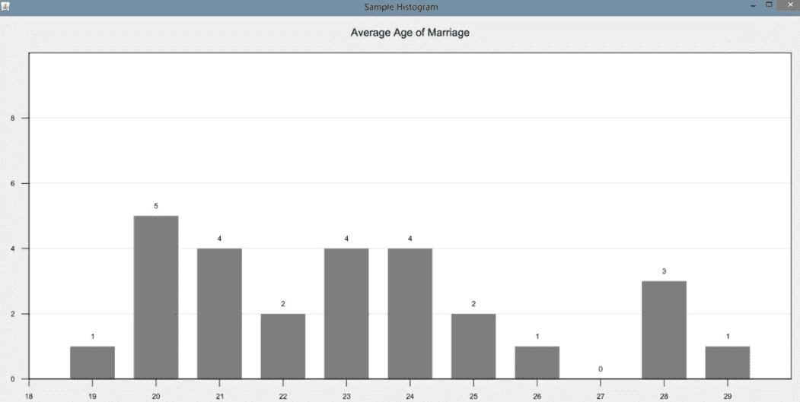

# 统计方法在数据科学中的应用

统计分析是许多数据科学任务的关键。它被用于许多类型的分析，从简单的平均值和中位数计算到复杂的多元回归分析。第 5 章“统计数据分析技术”介绍了这类分析以及可用的 Java 支持。

统计分析并不总是一项容易的任务。此外，先进的统计技术通常需要特定的思维才能完全理解，这可能很难学习。幸运的是，许多技术在使用上并没有那么困难，而且各种库减轻了这些技术固有的复杂性。

回归分析特别是分析数据的一项重要技术。该技术试图绘制一条与数据集匹配的直线。计算出一个表示该直线的方程，并可用于预测未来的行为。回归分析有几种类型，包括简单回归和多元回归。它们根据所考虑变量的数量而异。

下面的图表显示了一条紧密匹配代表比利时几十年来人口数据点的直线：

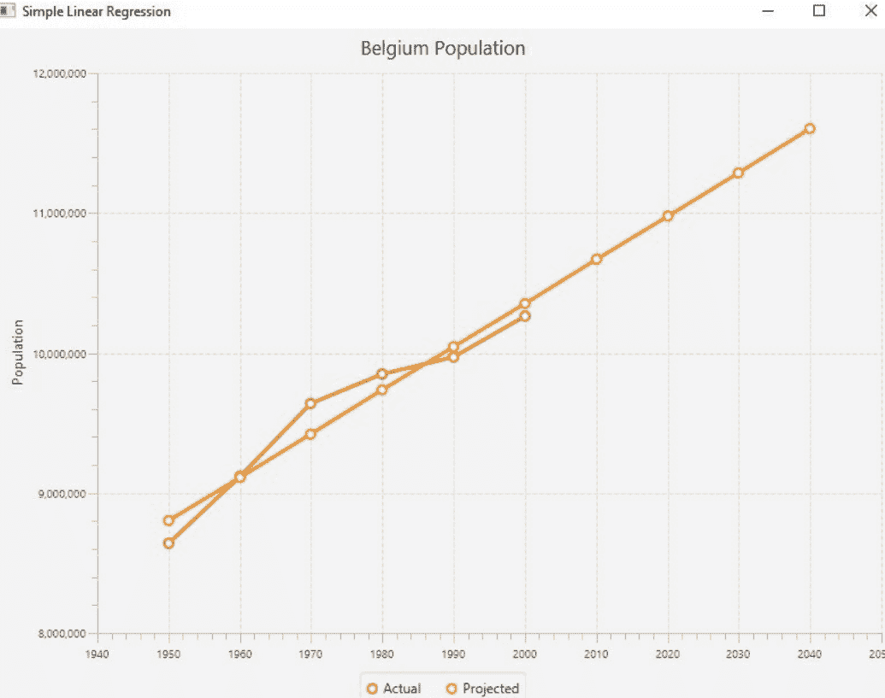

简单的统计技术（如平均值和标准差）可以使用基础 Java 计算。它们也可以由 Apache Commons 等库处理。例如，为了计算中位数，我们可以使用 `ApacheCommonsDescriptiveStatistics` 类。接下来的示例说明了如何计算一个 `double` 数组的中位数。如下所示：

```java
double[] testData = {12.5, 18.3, 11.2, 19.0, 22.1, 14.3, 16.2, 12.5, 17.8, 16.5, 12.5};
DescriptiveStatistics statTest = 
new SynchronizedDescriptiveStatistics();
for(double num : testData) {
  statTest.addValue(num);
}
```

`getPercentile()` 方法返回存储在参数中指定的百分位数的值。要找到中位数，我们使用 50 这个值。

```java
out.println("The median is " + statTest.getPercentile(50));
```

我们的输出如下：

> **The median is 16.2**

在第 5 章“统计数据分析技术”中，我们将演示如何使用 Apache Commons 的 `SimpleRegression` 类执行回归分析。

# 机器学习在数据科学中的应用

机器学习对于数据科学分析变得越来越重要，就像它对许多其他领域一样。机器学习的一个定义性特征是模型可以在一组代表性数据上进行训练，稍后用于解决相似的问题。不需要显式地编写应用程序来解决问题。模型是真实世界对象的表示。

- **监督学习**：模型使用标记数据进行训练
- **无监督学习**：数据不包含结果
- **半监督学习**：将少量标记数据与大量无标记数据相结合
- **强化学习**：这与监督学习相似，但会提供奖励
- **决策树**：使用特征作为内部节点构建树
- **支持向量机**：通过创建超平面进行分类
- **贝叶斯网络**：用于描述事件之间的概率关系

## 支持向量机 (SVM)

支持向量机 (SVM) 主要用于分类。该方法创建一个划分两个区域的超平面。在二维空间中，它是一条线。在三维空间中，它是一个二维平面。在第 6 章“机器学习”中，我们将演示如何使用数据集使用该方法。下图展示了一个使用两种类型数据点分布的超平面。线条代表划分这些点的可能的超平面。线条清晰地划分了除离群值以外的所有数据点。

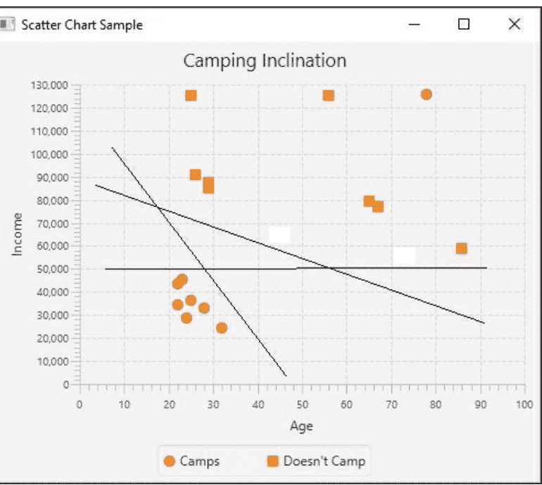

一旦模型训练完成，就会考虑可能的超平面，然后可以使用相似数据进行预测。

# 在数据科学中使用神经网络

**人工神经网络 (ANN)**，我们称之为**神经网络**，是基于大脑中发现的神经元的。**神经元**是一个具有**树突**连接到其输入源和其他神经元的细胞。根据输入源以及分配给源的权重，神经元被激活，并沿着树突**发射**信号到另一个神经元。神经元集合可以被训练以响应一组输入信号。

人工神经元是一个具有一个或多个输入和一个输出的节点。每个输入都被分配了一个**权重**，该权重可以随时间变化。神经网络可以通过将输入馈网络、调用**激活函数**并比较结果来学习。该函数结合输入并创建输出。如果多个神经元的输出与预期结果匹配，则说明网络训练得正确。如果不匹配，则对网络进行修改。

神经网络可以像如图所示进行可视化，其中**隐藏层**用于增强该过程：

| 输入层 | 隐藏层 | 输出层 |
| :--- | :--- | :--- |
| ○ | ○ | ○ |
| ○ | ○ | ○ |
| ○ | ○ | ○ |

在第 7 章“神经网络”中，我们将使用 *Weka* 类 `MultilayerPerceptron`，用于说明多层感知器 (MLP) 网络的创建和使用。正如我们将要解释的那样，这类网络是一种具有多层的前馈神经网络。该网络使用带有反向传播的监督学习。该示例使用了一个名为 `dermatology.arff` 的数据集，包含 366 个用于诊断红斑性疾病的实例。它使用 34 个属性将疾病分为五个不同的类别之一。

数据集被分为训练集和测试集。一旦读取了数据，就会使用配置模型属性的方法创建并初始化 MLP 实例，包括模型学习的快慢以及训练模型花费的时间。

```java
String trainingFileName = "dermatologyTrainingSet.arff";
String testingFileName = "dermatologyTestingSet.arff";

try (FileReader trainingReader = new FileReader(trainingFileName);
     FileReader testingReader = 
         new FileReader(testingFileName)) {
    Instances trainingInstances = new Instances(trainingReader);
    trainingInstances.setClassIndex(
        trainingInstances.numAttributes() - 1);
    Instances testingInstances = new Instances(testingReader);
    testingInstances.setClassIndex(
        testingInstances.numAttributes() - 1);

    MultilayerPerceptron mlp = new MultilayerPerceptron();
    mlp.setLearningRate(0.1);
    mlp.setMomentum(0.2);
    mlp.setTrainingTime(2000);
    mlp.setHiddenLayers("3");
    mlp.buildClassifier(trainingInstances);

} catch (Exception ex) {
    // Handle exceptions
}
```


然后使用测试数据对模型进行评估：

```java
Evaluation evaluation = new Evaluation(trainingInstances);
evaluation.evaluateModel(mlp, testingInstances);
```

然后可以显示结果：

```java
System.out.println(evaluation.toSummaryString());
```

此处显示了该示例的截断输出，列出了正确识别和错误识别的疾病数量：

Correctly Classified Instances 73 98.6486 %

Incorrectly Classified Instances 1 1.3514 %

可以调整模型的各种属性来改进模型。在[第 7 章，神经网络]中，我们将更深入地讨论这种及其他技术。

## 深度学习方法

深度学习网络通常被描述为使用多个中间层的神经网络。每一层都将在前一层的输出上进行训练，可能识别出数据集的特征和子特征。特征指的是数据中可能感兴趣的那些方面。在第 8 章“深度学习”中，我们将检查这类网络以及它们如何支持多种不同的科学任务。

这些网络通常与非结构化和未标记的数据集一起工作，这构成了今天可用数据的大部分。一种典型方法是获取数据、识别特征，然后使用这些特征及其相应的层来重建原始数据集，从而验证网络。受限玻尔兹曼机 (`RBM`) 是这种方法应用的一个很好。

深度学习网络需要确保结果准确，并尽可能地减少可能渗透进中的任何误差。这是通过根据所谓的梯度下降调整神经元的内部权重来实现的。这代表了权重变化的斜率。该方法修改权重以最小化误差并加速学习过程。

有几种类型的网络被分类为深度学习网络。其中之一是自动编码器网络。在该网络中，层是对称的，输入值的数量与输出值的数量相同，中间层有效地将数据压缩为单个较小的内部层。自动编码器的每一层都是一个 `RBM`。

这种结构在接下来的示例中得到了反映，该示例将提取包含手写数字的图像中的数字。完整示例的细节在此未显示，但注意使用了 1000 个输入和输出值，以及由 `RBM` 组成的内部层。层的大小通过 `nOut` 和 `nIn` 方法指定。

```java
MultiLayerConfiguration conf = new NeuralNetConfiguration.Builder(
    .seed(seed)
    .iterations(numberOfIterations)
    .optimizationAlgo(
        OptimizationAlgorithm.LINE_GRADIENT_DESCENT)
    .list(0, new RBM.Builder()
  .nIn(numberOfRows * numberOfOfColumns).nOut(1000)
  .lossFunction(LossFunctions.LossFunction.RMSE_XENT)
  .build())
    .layer(1, new RBM.Builder().nIn(1000).nOut(500)
  .lossFunction(LossFunctions.LossFunction.RMSE_XENT)
  .build())
    .layer(2, new RBM.Builder().nIn(500).nOut(250)
  .lossFunction(LossFunctions.LossFunction.RMSE_XENT)
  .build())
    .layer(3, new RBM.Builder().nIn(250).nOut(100)
  .lossFunction(LossFunctions.LossFunction.RMSE_XENT)
  .build())
    .layer(4, new RBM.Builder().nIn(100).nOut(30)
  .lossFunction(LossFunctions.LossFunction.RMSE_XENT)
  .build()) // encoding stops
    .layer(5, new RBM.Builder().nIn(30).nOut(100)
  .lossFunction(LossFunctions.LossFunction.RMSE_XENT)
  .build()) // decoding starts
    .layer(6, new RBM.Builder().nIn(100).nOut(250)
  .lossFunction(LossFunctions.LossFunction.RMSE_XENT)
  .build())
    .layer(7, new RBM.Builder().nIn(250).nOut(500)
  .lossFunction(LossFunctions.LossFunction.RMSE_XENT)
  .build())
    .layer(8, new RBM.Builder().nIn(500).nOut(1000)
  .lossFunction(LossFunctions.LossFunction.RMSE_XENT)
  .build())
    .build();
```

一旦模型训练完成，就可以用于预测任务。

## 执行文本分析

自然语言处理 (`NLP`) 领域被用于许多任务。处理文本之所以困难是由于许多原因，包括自然语言固有的歧义性。有几种不同的处理类型：

- 停用词：这些词在处理时可能是不需要的。

- 实体识别 (`NER`)：这是识别文本中的人物、地点或事物的过程。

- 词性标记 (`POS`)：这是识别句子的语法部分为名词、动词、形容词等。

- 关系：在这里我们关注文本部分如何相互关联，例如主语和宾语。

对于大多数数据科学问题，预处理和清理文本很重要。在第 9 章“文本分析”中，我们将检查该领域提供的 Java 工具。例如，我们将使用 Apache 的 OpenNLP (https://opennlp.apache.org/) 库来寻找词性。这只是我们可以使用的几种 `NLP` API 之一，还有 LingPipe (http://alias-i.com/lingpipe/)、Apache UIMA (https://uima.apache.org/) 和 Stanford NLP (http://nlp.stanford.edu/)。我们选择 OpenNLP 是因为它对此目的很容易用。

在下面的示例中，识别词性的模型位于 `pos-maxent.bin` 文件中。初始化了一个单词数组并创建了 `POS` 模型：

```java
try (InputStream input = new FileInputStream(
    new File("en-pos-maxent.bin"))) {
    String sentence = "Let's parse this sentence.";
    ...
    String[] words;
    ...
    list.toArray(words);
    POSModel posModel = new POSModel(input);
    ...
} catch (IOException ex) {
    // Handle exceptions
}
```

`tag` 方法接收一个单词数组并返回标签数组。然后显示这些单词和标签。

```java
String[] posTags = posTagger.tag(words);
for(int i=0; i<posTags.length; i++) {
    out.println(words[i] + " - - " + posTags[i]);
}
```

该示例的输出如下：

- Let's - NNP

- parse - NN

- this - DT

- sentence. - NN

缩写 `NNP` 和 `DT` 分别代表单数专名词和限定词。

# 视觉与音频分析

在第 10 章“视觉与音频分析”中，我们演示了若干用于处理声音和图像的 Java 技术。我们首先演示了声音处理技术，包括语音识别和文本转语音 API。具体而言，我们将使用 FreeTTS (http://reetts.sourceforge.net/docs/index.php) API 将文本转换为语音。我们还包含了一个关于使用 CMU Sphinx 工具包进行语音识别的演示。

Java 语音 API (`JSAPI`) (http://www.oracle.com/technetwork/java/index-140170.html) 支持语音技术。该 API 由第三方供应商创建，支持语音识别和语音合成器。FreeTTS 和 Festival (http://www.cstr.ed.ac.uk/projects/festival/) 是支持 `JSAPI` 的供应商示例。

在章的第二部分，我们研究了人脸识别等图像处理技术。该演示概述了如何识别图像中的人脸，使用 OpenCV (http://opencv.org/) 可以轻松实现。

此外，在第 10 章“视觉与音频分析”中，我们还演示了如何从图像中提取文本，这一过程被称为 `OCR`。一个常见的数据科学问题涉及提取和分析嵌入图像的文本。例如，车牌、道路标志和方向标志中包含的信息可能具有重要意义。

在接的示例中（第 11 章“数据分析的数学与并行技术”中有更详细的解释），我们将使用 Tess4j (http://tess4j.sourceforge.net/) —— 一个用于 Tesseract API 的 Java JNA 封装器来完成 `OCR`。我们对从 Wikipedia 关于 `OCR` 文章 (https://en.wikipedia.org/wiki/Optical_character_recognition#Applications) 截取的图像进行 `OCR` 处理，显示如下：

OCR 引擎已发展成多种面向对象的 OCR 应用，如收据 OCR、发票 OCR、支票 OCR、法律账单文档 OCR。它们可以用于：

- 商业文档的数据输入，例如支票、护照、发票、银行对单和收据

- 自动车牌号识别

- 自动保险文档关键信息提取

- 将名片信息提取到联系人列表中[9]

- 生成打印文档更高质量的文本版本，例如为古登堡计划进行书籍扫描

- 使打印文档的电子图像可搜索，例如 Google 图书

- 将手写体实时转换为计算机控制（笔式计算）

- 破解 CAPTCHA 反机器人系统，尽管这些系统是专为防止 OCR 设计的[10][11][12]

- 为盲和和视障人士提供辅助技术

`ITesseract` 接口提供了大量的 `OCR` 方法。`doOCR` 方法接收并返回一个包含文件中找到单词的字符串，如下所示：

```java
ITesseract instance = new Tesseract();
try {
    String result = instance.doOCR(new File("OCRExample.png"));
    System.out.println(result);
} catch (TesseractException e) {
    System.err.println(e.getMessage());
}
```

输出的一部分显示如下：

OCR 引擎已发展成多种面向对象的 OCR 应用，如收据 OCR、发票 OCR、支票 OCR、法律账单文档 OCR。它们可以用于：

- 商业文档的数据输入，例如支票、护照、发票、银行对单和收据

- 自动车牌号识别。

如你所见，这个示例中有许多错误需要解决。我们在第 11 章“数据分析的数学与并行技术”中在此示例的基础上进行构建，讨论了增强措施和考虑因素，以确保 `OCR` 过程尽可能有效。

我们将通过讨论 NeurophStudio 来结束本书，这是一个基于 Java 的神经网络编辑器，用于对图像分类并执行图像识别。在本节中，我们训练了一个神经网络来识别和分类人脸。

# 使用并行技术提高应用性能

在第 11 章“数据分析的数学与并行技术”中，我们考虑了适用于数据科学应用的一些并行技术。程序的并发执行可以显著提高性能。在数据科学方面，这些技术从低级数学计算到高层级特定的 API 选项不等。

本章涵盖了对基本性能增强考虑因素的讨论。算法和应用架构与增强代码同等重要，在尝试集成并行技术时应当考虑这一点。如果应用程序的行为不符合预期或理想方式，那么任何从并行优化中获得的收益都是无意义的。

矩阵运算对许多数据应用和支持的 API 都至关重要。我们将在本章中讨论矩阵乘法以及如何使用各种方法来处理它。尽管这些操作通常隐藏在 API 内部，但理解它们是如何被支持的可能很有用。

我们演示的一种方法利用了 Apache Commons Math API (http://commons.apache.org/proper/commons-math/)。该 API 支持大量的数学和统计操作，包括矩阵乘法。以下示例说明了如何执行矩阵乘法。

我们首先声明并初始化矩阵 A 和 B：

```java
double[][] A = {
    {0.1950, 0.0311},
    {0.3588, 0.2203},
    {0.1716, 0.5931},
    {0.2105, 0.3242}};
```

```java
double[][] B = {
    {0.0502, 0.0983, 0.09472},
    {0.5732, 0.2694, 0.0916}};
```

Apache Commons 使用 `RealMatrix` 类存储矩阵。接下来，我们使用 `Array2DRowMatrix` 构造函数创建矩阵 A 和 B：

```java
RealMatrix aMatrix = new Array2DRowMatrix(A);
RealMatrix bMatrix = new Array2DRowMatrix(B);
```

我们使用 `multiply` 方法执行乘法：

```java
RealMatrix cMatrix = aMatrix.multiply(bMatrix);
```

最后，我们使用 for 循环显示结果：

```java
for (int i = 0; i < cMatrix.getRowDimension(); i++) {
    System.out.println(cMatrix.getRowVector(i));
}
```

输出如下：

```
{0.0276155, 0.0192684, 0.0094177}
{0.0185836, 0.0508513, 0.0339661}
{0.0144277, 0.0441790, 0.0162857}
{0.0105250, 0.0208313, 0.0199635}
```

另一种并发处理方法是使用 线程。在没有多个 CPU 或 GPU 时，Aparapi 等 API 会使用线程。

数据科学应用通常利用 map-reduce 算法。我们将通过使用 Apache Hadoop 执行 map-reduce 来演示并行处理。Hadoop 专为大数据设计，减少了大规模数据科学项目的处理时间。

我们包含了支持多个处理器的 API 示例，包括 CUDA 和 OpenCL。CUDA 通过 Java 绑定 (`JCuda`) (http://jcuda.org/) 支持。我们还讨论了 OpenCL 及其 Java 支持。Aparapi API 为多个 CPU 或 GPU 提供高级支持，我们包含了支持矩阵乘法的 Aparapi 演示。

# 整合组件

在本书的最后一章，我们将之前章节探索的许多技术整合在一起。我们将创建一个简单的控制台应用程序，从 Twitter 获取数据并进行各种类型的数据处理和分析。本章的目标是演示一个探索各种数据科学概念的简单项目，并为未来的项目提供见解和考虑。

具体来说，最后一章开发的应用程序执行若干高级任务，包括数据获取、数据清洗、情感分析和基础统计收集。我们使用 Java 8 Streams 演示这些技术，并尽可能关注 Java 8 方法。

## 总结

数据科学是一个广阔多元的学科领域，在书中穷尽探索是不可能的。我们希望读者对重要的数据科学概念有深入理解，并为进一步学习做好准备。特别地，本书将为数据科学相关查询的所有阶段提供不同技术的具体示例。这从数据获取和清洗到详细的统计分析不等。

因此，让我们从数据获取以及 Java 如何支持它的开始讨论吧。

## 第 2 章 数据获取

处理格式不正确或使用无法传达意图的变量名的代码通常是不很有趣的。数据也是如此，只不过糟糕的数据可能导致结果不准确。因此，数据获取是数据分析中的重要一步。数据可以从多个来源获取，在它们有用之前，必须对其进行检索和最终处理。数据存在于各种来源。我们可以在许多公共数据源中作为简单文件找到它，也可以在互联网上以更复杂的形式找到。在本章中，我们将演示如何从这些来源中的几个获取数据，包括各种网站和社交媒体网站。

我们可以通过被称为网络爬取（web scraping）的过程下载特定文件来访问互联网数据，这涉及到提取网页的内容。我们还探索了名为网络爬虫（web crawling）的相关主题，它涉及检查网站以确定其是否感兴趣的应用程序，然后跟随嵌入链接以识别其他可能相关的页面。

我们还可以从社交媒体网站提取数据。这些类型的网站通常包含大量的数据，只要我们知道如何访问，它们就轻而易得。在本章中，我们将演示如何从几个站点提取数据，包括：

- Twitter

- 维基百科（Wikipedia）

- Flickr

- YouTube

在从网站提取数据时，可能会遇到许多不同的数据格式。我们将检查三类基本类型：文本、音频和视频。然而，即使在文本、音频和视频数据内部，也存在许多格式。仅对于音频数据，在 https://en.wikipedia.org/wiki/Comparison_of_audio_coding_formats 上就有 45 种音频编码格式。对于文本数据，http://fileinfo.com/filetypes/text 上列出了几乎 300 种格式。在本章中，我们将重点关注如何下载并提取这些类型的文本作为纯文本，以供后续处理。

我们将简要检查不同的数据格式，然后对可能的数据源进行检查。我们需要这些知识来演示如何使用不同的数据获取技术来获取数据。

## 理解数据科学应用中使用的数据格式


当我们讨论数据格式时，我们指的是内容格式，而不是底层的文件格式（后者对大多数开发人员来说甚至是不可见的）。由于可用格式数量巨大，我们无法检查所有可用格式。相反，我们将处理几种常见格式，提供足够的示例来满足最常见的数据检索需求。具体来说，我们将演示如何检索存储在以下格式中的数据：

- HTML
- PDF
- CSV/TSV
- 电子表格
- 数据库
- JSON
- XML

这些格式中的一些在其他地方得到了很好的支持和记录。例如，`XML` 已使用多年，在 `Java` 中有几种成熟的技术可以用于访问 `XML` 数据。对于这些类型的数据，我们将概述主要的可用技术，并展示几个示例来说明它们是如何工作的。这将为那些不熟悉该技术的读者提供关于其本质的一些见解。

最常见的数据格式是二进制文件。例如，`Word`、`Excel` 和 `PDF` 文档都是以二进制格式存储的。这些文件需要特殊的软件来从中提取信息。文本数据也非常常见。

# CSV 数据概览

逗号分隔值（`CSV`）文件包含以行列格式组织的表格数据。数据以纯文本形式存储，并存储在行中，行也称为记录（`records`）。每个记录包含由逗号分隔的字段（`fields`）。这些文件与其他分隔符文件密切相关，最尤其是制表符分隔值（`TSV`）文件。以下是一个简单 `CSV` 文件的一部分，这些数字并不代表任何特定类型的数据：

```
JURISDICTION NAME,COUNT PARTICIPANTS,COUNT FEMALE,PERCENT FEMALE
10001,44,22,0.5
10002,35,19,0.54
10003,1,1,1
```

注意第一行包含头部数据，用于描述随后的记录。每个值都用逗号分隔，并与相同的标题对应。

## 电子表格

电子表格包含以行列格式组织的表格数据。数据以纯文本形式存储，并存储在行中，行也称为记录。每个记录包含由逗号分隔的字段。这些文件与其他分隔符文件密切相关，最尤其是制表符分隔值（`TSV`）文件。以下是一个简单 `CSV` 文件的一部分，这些数字并不代表任何特定类型的数据：

```
JURISDICTION NAME,COUNT PARTICIPANTS,COUNT FEMALE,PERCENT FEMALE
10001,44,22,0.5
10002,35,19,0.54
10003,1,1,1
```

注意第一行包含头部数据，用于描述随后的记录。每个值都用逗号分隔，并与相同的标题对应。

## 数据库

数据库是使用 `SQL` 语言来管理和查询的结构化数据的集合。在数据科学中，数据库是存储和检索大量数据的核心工具。我们可以通过关系型数据库（如 `MySQL`、`PostgreSQL`）或非关系数据库（如 `MongoDB`）来获取数据。在本章中，我们将演示如何连接到数据库并执行数据。

```java
Statement statement = connection.createStatement();
statement.execute("TRUNCATE TABLE;");
```

这是关于使用 `Java` 进行数据库访问的简要介绍。有很多资源可以提供关于该主题更深入的介绍。例如：

## PDF 文件概述

便携文档格式（`PDF`）是一种不绑定于特定平台或软件应用程序的格式。`PDF` 文档可以包含格式化的文本和图像。`PDF` 是一个开放标准，使其在各种地方都有用。

有大量文档以 `PDF` 格式存储，使其成为宝贵的数据源。有多个 `Java API` 可以访问 `PDF` 文档，包括 `Apache POI` 和 `PDFBox`。第 3 章“数据清洗”将阐述从 `PDF` 文档中提取信息的技巧。

## JSON 概述

`JavaScript` 对象表示（`JSON`）（`http://www.JSON.org/`）是一种用于数据交换的数据格式。它易于人类或机器的读取和写入。许多语言都支持 `JSON`，包括 `Java`，该语言在 `http://www.JSON.org` 上列出了几个 `JSON` 库。

一个 `JSON` 实体由一组包含在花括号中的键值对组成。我们将在几个示例中使用这种格式。在处理 `YouTube` 时，我们将使用一个 `JSON` 对象（下面显示了部分），代表来自 `YouTube` 视频请求的结果：

```json
{
  "kind": "youtube#searchResult",
  "etag": "etag",
  "id": {
    "kind": "string",
    "videoId": "string",
    "channelId": "string",
    "playlistId": "string"
  },
  ...
}
```

访问此类文档的字段和值并不困难，第 3 章“数据清洗”中对此进行了说明。

## XML 概述

可扩展标记语言（`XML`）是一种指定标准文档格式的标记语言。`XML` 广泛用于应用程序之间以及跨越互联网的通信，由于其相对简单性和灵活性而受欢迎。以 `XML` 编码的文档是基于字符的，易于机器和人类读取。

`XML` 文档包含标记和内容字符。这些字符允许解析器对文档中包含的信息进行分类。文档由标签组成，元素存储在标签内部。元素也可以包含其他标记标签形成子元素。此外，元素可能包含以键值对形式存储的属性或特定特性。

`XML` 文档必须是良好的（`well-formed`）。这意味着它必须遵循某些规则，例如使用标签且仅有一个根标签。其他规则在 `https://en.wikipedia.org/wiki/XML#Well-formedness_and_error_handling` 中讨论。

`Java XML` 处理 `API` (`JAXP`) 包含三个解析 `XML` 数据的接口。文档对象模型（`DOM`）接口解析并返回一个描绘文档结构的树形结构。`DOM` 接口将整个文档作为一个整体解析。或者，`XML` 简单 `API`（`SAX`）每次处理文档中的一个元素。当考虑内存使用时，`SAX` 是优的，因为 `DOM` 需要更多资源来构建树。然而，`DOM` 相比 `SAX` 具有更高的灵活性，因为可以任何时间、按顺序访问任何元素。

第三个 `Java API` 被称为 `XML` 流式 `API`（`StX`）。这种流式模型的设计旨在在不牺牲资源的情况下，通过提供灵活性来兼顾 `DOM` 和 `SAX` 模型的优点。`StX` 表现出高性能，其权衡是一次只能访问文档中的一个位置。如果你已经知道想如何处理文档，则 `StX` 是首选技术，它对于内存受限的应用也很流行。

以下是一个简单的 `XML` 文件。每个 `<text>` 代表一个标签，标记标签内包含的元素。在这种情况下，我们文件中最大的节点是 `<music>`，其中包含一组歌曲数据。`<song>` 标签内的每个标签包含另一个与该歌曲对应的元素。每个标签最终都会有一个闭合标签，例如 `</song>`。注意第一个标签包含有关应使用哪个 `XML` 版本解析文件的信息：

```xml
<?xml version="1.0"?>
<music>
  <song id="1234">
    <artist>Patton, Courtney</artist>
    <name>So This Is Life</name>
    <genre>Country</genre>
    <price>2.99</price>
  </song>
  <song id="5678">
    <artist>Eady, Jason</artist>
    <name>AM Country Heaven</name>
    <genre>Country</genre>
    <price>2.99</price>
  </song>
</music>
```

还有许多与 `XML` 相关的技术。例如，我们可以使用 `DTD` 文档或专门为 `XML` 文档编写 `XML schema` 来验证特定的 `XML` 文档。`XML` 文档可以使用 `XSL` 转换为不同的格式。

## 流式数据概述

流式数据是指以连续流的形式生成并按顺序、逐块方式访问的数据。普通互联网用户访问的大部分数据都是流式的，包括视频和音频通道，或社交媒体网站上的文本和图像数据。当数据是新的且变化迅速，或者需要寻求大数据时，流式数据是首选方法。

流式数据通常非常适合数据科学研究，因为它们通常大量以原始格式存在。许多公共流式数据是免费提供的并受 `Java API` 支持。在本章中，我们将研究如何从流式源（包括 `Twitter`、`Flickr` 和 `YouTube`）获取数据。尽管使用了不同的技术和 `API`，你会发现它们的相似之处。

## 音频/视频概述

在本节中，我们将说明如何从网页获取数据。网页包含了丰富的信息。我们将演示如何使用多种技术访问网页，从低级方法开始。

## 数据获取技术

在本节中，我们将说明如何从网页获取数据。网页包含了潜在的有用信息。我们将演示如何使用多种技术访问网页，从低级方法开始。

## 使用 HttpConnection 类

可以使用 `HttpConnection` 类访问网页内容。这是一种低级方法，需要开发者进行大量工作来提取内容。然而，它允许对如何处理内容进行更大的控制。在某些情况下，这种方法可能比其他 `API` 库更好。

我们将演示如何使用此类类下载维基百科科学页的内容。我们将从 `try/catch` 块开始以处理异常。使用数据字符串创建 `URL` 对象。`openConnection` 方法将创建到服务器的连接，如下：

```java
try {
  URL url = new URL("https://en.wikipedia.org/wiki/Data_science");
  HttpUrlConnection connection = (HttpUrlConnection) url.openConnection();
  ...
} catch (MalformedURLException ex) {
  // 处理异常
} catch (IOException ex) {
  // 处理异常
}
```

初始化连接对象以 `HTTP GET` 命令。然后向服务器执行 `connect` 方法：

```java
connection.setRequestMethod("GET");
connection.connect();
```

假设没有遇到错误，可以使用 `getResponseCode` 方法确定响应是否成功。正常的返回值为 `200`。网页的内容可能会变化。例如，`getContentType` 方法返回一个描述页面内容的字符串。`getContentLength` 方法返回其长度：

```java
out.println("Response Code: " + connection.getResponseCode());
out.println("Content Type: " + connection.getContentType());
out.println("Content Length: " + connection.getContentLength());
```

假设我们得到的是 `HTML` 格式的页面，接下来的说明了如何获取此内容。通过创建一个 `BufferedReader` 实例，从网站逐行读取内容并将其追加到 `BufferedReader` 实例中。随后显示缓冲区中的内容：

```java
InputStream isr = new InputStreamReader((InputStream) connection.getContent());
BufferedReader br = new BufferedReader(isr);
StringBuilder buffer = new StringBuilder();
String line;
do {
    line = br.readLine();
    buffer.append(line + "\n");
} while (line != null)
out.println(buffer.toString());
```

简写后的输出显示在此：

```
Response Code: 200
Content Type: text/html; charset=UTF-8
Content Length: -1
<!DOCTYPE html>
<html lang="en" dir="ltr" class="client-nojs">
<head>
<meta charset="UTF-8"/>
<title>Data science - Wikipedia, the free encyclopedia</title>
<script>document.documentElement.className =
...
wgHostname":"mw1251"}}});</script>
</</body>
</html
```

虽然这种方法可行，但有更简单的方法来获取网页内容。下一节将讨论其中一种技术。

## Java 中的网络爬虫

网络爬虫是遍历一系列相互连接的网页并从这些页面中提取相关信息的过程。它通过隔离并随后跟踪页面上的链接来实现这一目标。虽然有许多预编译的数据集可供使用，但可能仍需要直接从互联网收集数据。某些来源（如新闻网站）不断更新，需要定期访问。

网络爬虫是一种访问各种网站并收集信息的应用程序。网络爬虫过程由一系列步骤组成：

1. 选择一个要访问的 `URL`
2. 获取页面
3. 解析页面
4. 提取相关内容
5. 提取要访问的相关 `URL`

此过程会对每个访问的 `URL` 重复。

在获取和解析页面时，需要考虑几个问题，例如：

- **页面重要性**：我们不希望处理无关的页面。
- **仅限 HTML**：我们通常不会跟踪指向图片的链接，以免陷入无限循环。
- **蜘蛛陷阱 (`Spider traps`)**：我们希望跳过可能导致无限请求的站点。这可能会发生在动态生成的页面上，其中一个请求会导致另一个请求。
- **重复性**：避免重复爬取同一个页面是非常重要的。
- **礼貌性**：不要对网站发送过量的请求。遵守 `robot.txt` 文件；它们指定了网站哪些部分不应被爬取。

创建网络爬虫的过程可能是令人困难的。对于所有简单的需求，建议使用几种开源网络爬虫之一。以下是部分列表：

- **Nutch**: `http://nutch.apache.org`
- **crawler4j**: `https://github.com/yasserg/crawler4j`
- **JSpider**: `http://j-spider.sourceforge.net/`
- **WebSPHINX**: `http://www.cmu.edu/~rcm/websphinx/`
- **Heritrix**: `https://webarchive.jira.com/wiki/display/Heritrix`

我们可以创建自己的网络爬虫，也可以使用现有的爬虫，在本章中我们将检查这两种方法。对于特定的处理，使用自定义爬虫可能是理想的。我们将演示如何在 `Java` 中创建一个简单的网络爬虫，以便更深入地了解爬虫的工作原理。之后将对其他网络爬虫进行简要讨论。

### 创建你自己的网络爬虫

现在我们已经对网络爬虫有了基本的了解，准备好创建我们自己的了。在这个简单的爬虫中，我们将使用 `ArrayList` 实例来跟踪已访问的页面。此外，将使用 `jsoup` 来解析网页，并且限制我们访问的页面数量。`Jsoup` (`https://jsoup.org/`) 是一个开源 `HTML` 解析器。该解析器展示了网络爬虫的基本结构，并强调了创建网络爬虫涉及的一些问题。

我们将使用在此处声明的 `SimpleWebCrawler` 类：

```java
public class SimpleWebCrawler {
    private String topic;
    private String startingURL;
    private String urlLimiter;
    private final int pageLimit = 20;
    private ArrayList<String> visitedList = new ArrayList<>();
    private ArrayList<String> pageList = new ArrayList<>();
    ...
    public static void main(String[] args) {
        new SimpleWebCrawler();
    }
}
```

实例变量详细说明如下：

| 变量 | 用途 |
| --- | --- |
| `topic` | 页面必须包含的关键词，页面才会被接受 |
| `startingURL` | 第一个页面的 `URL` |
| `urlLimiter` | 在跟踪链接之前，链接中必须包含的字符串 |
| `pageLimit` | 获取的最大页面数 |
| `visitedList` | 包含已访问页面的数组 |
| `pageList` | 包含感兴趣页面 `URL` 的数组 |

在 `SimpleWebCrawler` 构造函数中，我们初始化实例变量，以从 `Wikipedia` 上关于 `Bishop Rock`（意大利海岸的一个岛屿）的页面开始搜索。选择它是为了尽量减少可能获取的页面数量。我们将发现，关于 `Bishop Rock` 的 `Wikipedia` 页面比想象的要多。

`urlLimiter` 变量被设置为 `Bishop_Rock`，这将限制嵌入链接仅跟踪包含该字符串的链接。每个感兴趣的页面必须包含存储在 `topic` 变量的值。`visitPage` 方法执行实际的爬取。

```java
public SimpleWebCrawler() {
    startingURL = "https://en.wikipedia.org/wiki/Bishop_Rock";
    urlLimiter = "Bishop_Rock";
    topic = "Isles";
    pageLimit = 20;
}
```

```java
public void visitPage(String url) {
    if (visitedList.contains(url)) {
        // 已访问
    } else {
        visitedList.add(url);
        // ... 获取并解析的逻辑
    }
}
```


```java
public static void main(String[] args) throws Exception {
    int numberOfCrawlers = 2;
    CrawlConfig config = new CrawlConfig();
    String crawlStorageFolder = "data";

    config.setCrawlStorageFolder(crawlStorageFolder);
    config.setPolitenessDelay(500);
    config.setMaxDepthOfCrawling(2);
    config.setMaxPagesToFetch(20);
    config.setIncludeBinaryContentInCrawling(false);
}
```

接下来，创建并配置 `Crawl` 类。请注意用于处理 `robot.txt` 文件的 `RobottxtConfig` 和 `RobottxtServer` 类。这些文件包含了供网络爬虫读取的指令。它们提供了指导，帮助爬虫更好地工作，指定网站的哪些部分不应被爬取。这对于自动生成的页面非常有用：

```java
PageFetcher pageFetcher = new PageFetcher(config);
RobottxtConfig robottxtConfig = new RobottxtConfig();
RobottxtServer robottxtServer =
    new RobottxtServer(robottxtConfig, pageFetcher);
Crawler controller =
    new CrawlController(config, pageFetcher, robottxtServer);
```

爬虫需要从一个或多个页面开始。`addSeed` 方法添加起始页面。虽然我们在这里只使用了一次，但可以根据需要多次使用：

```java
controller.addSeed(
"https://en.wikipedia.org/wiki/Bishop_Rock,_Isles_of_Scilly"
);
```

`start` 方法将开始爬取过程：

```java
controller.start(SampleCrawler.class, numberOfCrawlers);
```

`SampleCrawler` 类包含两个感兴趣的方法。第一个是 `shouldVisit` 方法，用于判断页面是否会被访问；另一个是实际处理页面的 `visit` 方法。我们从类声明和 Java 正则表达式类 `Pattern` 对象的声明开始。这是确定页面是否被访问的方法之一。在这些声明中，指定了标准图像并将它们将被忽略：

```java
public class SampleCrawler extends WebCrawler {
    private static final Pattern IMAGE_EXTENSIONS =
        Pattern.compile("\\.(bmp|jpg|png)$");

    ...
}
```

`shouldVisit` 方法接收了发现该 URL 的页面引用以及该 URL。如果匹配到任何图像，方法将返回 `false` 并忽略该页面。此外，URL 必须以 `https://en.wikipedia.org/wiki/` 开头；我们添加此是为了将搜索限制在 Wikipedia 网站：

```java
public boolean shouldVisit(Page referringPage, WebURL url) {
    String href = url.getUrl().toLowerCase();
    if (IMAGE_EXTENSIONS.matcher(href)) {
        return false;
    }
    return href.startsWith("https://en.wikipedia.org/wiki/");
}
```

`visit` 方法接收一个代表正在访问的面的 `Page` 对象。在此实现中，仅处理包含字符串 `shipping route` 的页面。当我们找到此类页面时，会显示其 URL、文本（Text）和长度：

```java
public void visit(Page page) {
    String url = page.getURL().getUrl();

    if (page.getParseData() instanceof HtmlParseData) {
        HtmlParseData htmlParseData = (HtmlParseData)page.getParseData();
        String text = htmlParseData.getText();
        if (text.contains("shipping route")) {
            out.println("\nURL: " + url);
            out.println("Text: "
```

以下是程序执行时的截断输出：

URL: https://en.wikipedia.org/wiki/Bishop_Rock,_Isles_of_Scilly

Text: Bishop Rock, Isles of Scilly...From Wikipedia, the free

cyclopedia ... Jump to: ... navigation, search For the Bishop Rock in

the Pacific Ocean, see Cortes Bank. Bishop Rock Bishop Rock Lighthouse

(2005)

Text length: 14677

注意只返回了一个页面。这个网络爬虫能够识别并忽略主页面的之前的版本。

我们可以进行进一步的处理，但此示例提供了关于 API 如何运行的一些见解。访问页面时可以获取大量信息。在示例中，我们只使用了 URL 和文本长度。以下是您可能感兴趣获取的其他数据示例：

- URL 路径
- 父级 URL
- 锚点 (Anchor)
- HTML 文本
- 输出链接
- 文档 ID

## Java 中的网络爬虫

网络爬虫（Web scraping）是从网页中提取信息的过程。页面通常使用一系列 HTML 标签进行格式化。使用 HTML 解析器可以遍历页面或系列页面，并访问页的数据或元数据。

Jsoup (https://jsoup.org/) 是一个开源 Java 库，它方便使用 HTML 解析器提取和操作 HTML 文档。它用于许多目的，包括网络爬虫、从 HTML 页面提取特定元素以及清理 HTML 文档。

获取 HTML 文档有多种方法可能有用。可以从以下位置提取 HTML 文档：

- URL
- 字符串
- 文件

接下来介绍了第一个方法，将数据科学的 Wikipedia 页面加载到 `Document` 对象中。这个 Jsoup 对象代表 HTML 文档。`connect` 方法连接到站点，`get` 方法检索文档：

```java
try {
  Document document = Jsoup.connect(
    "https://en.wikipedia.org/wiki/Data_science").get();
  ...
} catch (IOException ex) {
  // 处理异常
}
```

接下来显示了从文件加载的方法，将数据科学的 Wikipedia 页面加载到 `Document` 对象中。这个 Jsoup 对象代表 HTML 文档。

```java
try {
  File file = new File("example.html");
  Document document = Jsoup.parse(file, "UTF-8");
  ...
} catch (IOException ex) {
  // 处理异常
}
```

最后显示了从字符串加载的方法：

```java
String html = "<html><head><title>Title</title></head><body><p>Hello world</p></body></html>";
Document document = Jsoup.parse(html);
```

https://en.wikipedia.org/wiki/Comparison_of_HTML_parsers.

### 使用 API 调用访问常用社交媒体网站

社交媒体包含了丰富的信息，可以被许多数据分析应用程序进行处理和使用。在本节中，我们将演示如何使用它们的 Java API 访问其中的一些来源。大多数 API 需要某种类型的访问密钥（access key），这通常很容易获取。我们首先开始讨论 `OAuth` 类，它提供了一种验证数据源访问的方法。

在处理此类类型的数据源时，重要的是记住数据并不总是公开的。虽然数据可能可以访问，但数据所有者可能是一个并不一定想要共享信息的个人。大多数 API 都提供了一种确定数据如何分发的方法，应当遵守这些请求。在使用私有信息时，必须获得作者的许可。

此外，这些网站对请求数量有限制。从网站抓取数据时，请记住这一点。如果需要超过这些限制，大多数网站都提供了相应的方法。

### 使用 OAuth 验证用户

OAuth 是一种开放标准，用于在许多不同网站验证用户身份。资源所有者实际上将访问权限委托给服务器资源，而无需共享其凭据。它通过 HTTPS 运行。OAuth 2.0 是 OAuth 的继任者，且 OAuth 不向后兼容。它为客户端开发者提供了一种简单的验证方式。包括 PayPal、Comcast 和暴雪娱乐在几家公司在使用 OAuth 2.0。

OAuth 2.0 提供者列表可以在 [https://en.wikipedia.org/wiki/List_of_OAuth_providers] 找到。我们将在讨论中使用其中几个。

### 处理 Twitter

由于海量的数据以及该网站在名人和普通公众中的普及，使得 Twitter 成为挖掘社交媒体数据的宝贵资源。Twitter 是一个流行的社交媒体平台，允许用户阅读和发布称为“推”的短消息。Twitter 提供了发布和抓取推文的 API 支持，包括来自所有公共用户的流式数据。虽然有服务可以抓取整个公共推文数据集，但我们将检查其他选项，这些选项通过限制一次检索的数据量，是免费提供的。

我们将重点关注使用 Twitter API 获取流式数据。从特定用户获取推文以及向特定账户发布数据也有其他选项，但我们将在本章中不再讨论这些。默认访问级别下的公共流 API 允许用户抓取当前在 Twitter 上流出的公共推文样本。可以通过指定参数来跟踪关键词、特定用户和位置，从而精炼数据。

我们将在此示例中使用 Java HTTP 客户端 HBC。你可以在 https://github.com/twitter/hbc 下载 HBC 应用程序示例。如果你倾向于使用不同的 HTTP 客户端，请确保它能返回增量响应数据。Apache HTTP client 是一个选项。在创建 HTTP 连接之前，你必须先创建一个 Twitter 账户并在账户内创建一个应用程序。要开始使用应用，请访问 visits.twitter.com。一旦应用应用，你将获得消费者密钥（consumer key）、消费者密钥（consumer secret）、访问令牌（access token）和访问密钥令牌（access secret token）。我们将像在本章之前讨论的那样使用 OAuth。

首先，我们将编写一个方法来执行验证并从 Twitter 请求数据。我们方法的参数是 Twitter 在我们创建应用时提供的验证信息。我们将创建一个 `BlockingQueue` 对象来存放流式数据。在本示例中，我们将默认容量设置为 10,000。我们还将指定端点并关闭停滞警告（stall warnings）：

```java
public static void streamTwitter(
    String consumerKey, String consumerSecret,
    String accessToken, String accessSecret)
    throws InterruptedException {

  BlockingQueue<String> statusQueue =
    new LinkedBlockingQueue<String>(10000);
  StatusesSampleEndpoint ending =
    new StatusesSampleEndpoint();
  ending.stallWarnings(false);

}
```

接下来，我们使用 OAuth1（OAuth 类的变体）创建一个 `Authentication` 对象。我们可以构建连接客户端并完成 HTTP 连接：

```java
Authentication twitterAuth = new OAuth1(consumerKey,
  consumerSecret, accessToken, accessSecret);
BasicClient twitterClient = new ClientBuilder(
  .name("Twitter client")
  .hosts(STREAM_HOST)
  .endpoint(ending)
  .authentication(twitterAuth)
  .processor(new StringDelimitedProcessor(status))
  .build());
twitterClient.connect();
```

为了本示例，我们将简单地读取从流接收到的消息并将其打印到屏幕上。消息以 JSON 格式返回，在实际应用程序中如何处理它们的决策取决于该应用程序的用途和局限性：

```java
for (int msgRead = 0; msgRead < 1000; msgRead++) {
  if (twitterClient.isOpen()) {
    out.println(twitterClient.getExitEvent().getMessage());
    break;
  }
}
```

```java
String msg = statusQueue.poll(10, TimeUnit.SECONDS);
if (msg == null) {
    out.println("Waited 10 seconds - no message received");
} else {
    out.println(msg);
}
twitterClient.stop();
```

要执行我们的方法，我们只需将验证信息传递给 `streamTwitter` 方法。为了安全起见，我们在这里替换了个人密钥。验证信息应该始终受到保护：

```java
public static void main(String[] args) {
  try {
    streamTwitter(myKey, mySecret, myToken, myAccessSecret);
  } catch (Exception e) {
    out.println(e);
  }
}
```

以下来自 Twitter API 的示例 JSON 响应：

```json
{
  "created_at": "Fri May 24 2013 14:47:21 +0000",
  "id": "73638552789",
  "text": "This is a sample tweet.",
  "user": {
    "id": "12345",
    "name": "John Doe"
  }
}
```

### 处理 Wikipedia

Wikipedia 是一个互联网百科，以 200 多种语言托管了 600 万篇文章。它是由维基会支持的多语言在线百科项目。大部分内容由志愿者通过协作编辑模式编写和维护。

MediaWiki API 非常复杂且具有许多功能。本节的目的是阐明从 Wikipedia 获取文本的过程。以下示例改编自 http://www.integratingstuff.com/2012/04/06/hook-into-wikipedia-using-java-and-the-mediawiki-api/。此示例将访问关于数据的英语页面。我们从创建一个 `User` 类实例开始。三参数构造函数的前两个参数分别是用户 ID 和密码。在这种情况下，它们是空字符串。这种组合允许我们在不设置账户的情况下读取页面。第三参数是 MediaWiki API 的 URL：

```java
User user = new User("", "", "http://en.wikipedia.org/w/api.php");
user.login();
```

账户将允许我们修改文档。`queryContent` 方法根据字符串数组找到的主题返回 `Page` 对象列表。每个字符串应该是页面的标题。在本示例中，我们访问单个页面：

```java
String[] titles = { "Data science" };
List<Page> pageList = user.queryContent(titles);
```

每个 `Page` 对象包含页面内容。有方法可以返回页的内容。对于每个页面，使用双参数构造函数创建一个 `WikiModel` 实例。第一个参数是图像基础 URL，第二个参数是链接基路径。这些 URL 使用名为 `image` 和 `title` 的 Wiki 变量，创建链接时会被替换：

```java
for (Page page : pageList) {
  WikiModel wikiModel = new WikiModel("${image}", "${title}");
  ...
}
```


`render` 方法将获取维基页面并将其渲染为 HTML。还有一种方法可以将页面渲染为 PDF 文档：

```java
String htmlText = wikiModel.render(page.toString());
```

然后显示 HTML 文本：

```java
out.println(htmlText);
```

以下是输出的部分列表：

```
<p>PageID: 35458904; NS: 0; Title: Data science
Image url:
Content:
{{distinguish}}
{{Use my dates}}
{{Data Visualization}}</p>
p><b>Data science</b> 是一个交叉学科，涉及通过过程和系统提取 <a href="Knowledge">知识</a></p>
```

我们还可以像这里所示的多种方法之一获取有关文章的信息：

```java
out.println("Title: " + page.getTitle() + "\n" + 
"Page ID: " + page.getPageId() + "\n" + 
"Timestamp: " + page.getCurrentRevision().getTimestamp());
```

同样可以获取文章中的引用列表和标题列表。这里显示了引用列表：

```java
List <Reference> referenceList = wikiModel.getReferences();
out.println(referenceList.size());
for (Reference reference : referenceList) {
out.println(reference.getRefString());
}
```

以下说明了获取章节标题的过程：

```java
ITableOfContent toc = wikiModel.getTableOfContent();
List<SectionHeader> sections = toc.getSectionHeaders();
for (SectionHeader sh : sections) {
  out.println(sh.getFirst());
}
```

可以下载维基百科的所有内容。该过程在 https://en.wikipedia.org/wiki/Wikipedia:Database_download 中进行了讨论。

你可能希望设置你的维基百科服务器来处理你的请求。

### 处理 Flickr

Flickr (https://www.flickr.com/) 是一款在线照片管理和共享应用程序。它是图像的可能来源。[Flickr 开发者指南](https://www.flickr.com/services/developer/) 是学习更多关于 Flickr API 的良好起点。

使用 Flickr API 的首要步骤之一是请求 API 密钥。此密钥用于对你的 API 请求签名。获取密钥的过程始于 https://www.flickr.com/services/apps/create/。商业用和非商业用密钥均可用。当你获得密钥时，还会获得一个“密钥（secret）”。使用 API 需要这两种密钥。

我们将阐述从 Flickr 定位并下载图像的过程。该过程涉及：

- 创建一个 `Flickr` 类实例
- 为查询指定搜索参数
- 执行搜索
- 下载图像

在此过程中可能会抛出 `FlickrException` 或 `IOException`。有多个 API 库支持访问 Flickr。我们将使用 Flickr4Java，它可以在 https://github.com/callmeal/Flickr4Java 找到。Flickr4Java 的 Javadocs 位于 http://flickr.sourceforge.net/api/。我们将从 `try` 块以及 `apikey` 和 `secret` 的声明开始：

```java
try {
    String apikey = "Your API key";
    String secret = "Your secret";
} catch (FlickrException | IOException ex) {
    // Handle exceptions
}
```

接下来创建 `Flickr` 实例，由前两个参数提供 `apikey` 和 `secret`。最后一个参数指定了访问 Flickr 服务器时使用的传输技术。目前使用 `REST` 类支持 REST 传输：

```java
Flickr flickr = new Flickr(apikey, secret, new REST());
```

为了搜索图像，我们使用 `SearchParameters` 类。该类支持许多标准，可以缩小查询结果返回的图像数量，并包括纬度、经度、媒体类型和用户 ID 等标准。在以下序列中，`setBox` 方法指定了搜索的经度和纬度。参数顺序为：最小经度、最小纬度、最大经度和最大纬度。`setMedia` 方法指定媒体类型。三种可能的参数为-"all"、photos" 和 "videos"：

```java
SearchParameters searchParameters = new SearchParameters();
searchParameters.setBox("-180", "-90", "180", "90");
searchParameters.setMedia("photos");
```

`PhotosInterface` 类拥有 `search` 方法，使用 `SearchParameters` 实例检索照片列表。如所示，该方法返回一个 `PhotosInterface` 类实例。`SearchParameters` 实例是第一个参数。第二个参数决定每页检索的照片数量，第三个参数是偏移量。返回一个 `PhotoList` 实例：

```java
PhotosInterface pi = new PhotosInterface(apikey, secret, new REST());
PhotoList<Photo> list = pi.search(searchParameters, 10, 0);
```

下一个序列说明了使用多种方法获取检索图像的信息。每个 `Photo` 实例都通过 `get` 方法访问。显示标题、图像格式、公共标记和照片 URL：

```java
out.println("Image List:");
for (int i = 0; i < list.size(); i++) {
  Photo photo = list.get(i);
  out.println("Image: " + i +
    "\nTitle: " + photo.getTitle() +
    "\nMedia: " + photo.getOriginalFormat() +
    "\nPublic: " + photo.isPublicFlag() +
    "\nUrl: " + photo.getUrl());
}
```

输出的部分列表：

```
Image List:
Image: 0
Title: Data science
Media: jpg
Public: true
Url: https://example.flickr.com/photo/1
Image: 1
Title: Machine Learning
Media: png
Public: false
Url: https://example.flickr.com/photo/2
```

https://developers.google.com/youtube/v3/code_samples/java. 该过程已经了简化，以便我们可以专注于搜索过程。我们从一个 `try` 块和创建一个 YouTube 实例开始。该类提供了对 API 的基本访问。此 API 的 Javadocs 可以在 https://developers.google.com/resources/api-libraries/documentation/youtube/v3/java/latest 找到。

`YouTube.Builder` 类用于构建 YouTube 实例。它的构造函数接收参数：

- `Transport`：用于 HTTP 的对象
- `JSONFactory`：用于解析 JSON 对象
- `HttpRequestInitializer`：此示例不需要

许多 API 响应将以 JSON 对象的形式存在。YouTube 类的 `ApplicationName` 方法为它指定一个名称，而 `build` 方法则创建一个新的 YouTube 实例：

```java
try {
  YouTube youtube = new YouTube.Builder(
    Auth.HTTP_TRANSPORT,
    Auth.JSON_FACTORY,
    new HttpRequestInitializer() {
      public void initialize(HttpRequest request)
        throws IOException {
    }
  })
  .setApplicationName("application_name")
} catch (GoogleJsonResponse ex) {
  // 处理异常
} catch (IOException ex) {
  // 处理异常
}
```

接下来，我们初始化一个字符串来保存感兴趣的搜索词。在这种情况下，我们将查找包含“cats”单词的视频：

```java
String queryTerm = "cats";
```

`YouTube.Search.List` 类维护了一个搜索结果集合。YouTube 类的 `search` 方法指定了要返回的资源类型。在这种情况下，字符串指定了要返回的搜索结果的 id 和 snippet 部分：

```java
YouTube.Search.List search = youtube
.search("id, snippet");
```

搜索结果是一个具有下文所示结构的 JSON 对象。更详细的信息在 https://developers.google.com/youtube/v3/docs/playlistItems#methods 中有描述。在之前的序列中，仅将返回搜索的 `id` 和 `snippet` 部分，从而实现更高效的操作：

```json
{
  "kind": "youtube#searchResult",
  "etag": "etag",
  "id": {
    "kind": "string",
    "videoId": "string",
    "channelId": "string",
    "playlistId": "string"
  },
  "snippet": {
    "publishedAt": "datetime",
    "channelId": "string",
    "title": "string",
    "description": "string",
    "thumbnails": {
      (key): {
        "url": "string",
        "width": "unsigned integer",
        "height": "unsigned integer"
      }
    },
    "channelTitle": "string",
    "liveBroadcastContent": "string"
  }
}
```

接下来，我们需要指定 API 密钥和各种搜索参数。指定了查询词，以及要返回的媒体类型。在这种情况下，只返回视频。另外两个选项包括频道和列表：

```java
String apiKey = "Your API key";
search.setKey(apiKey);
search.setQ(queryTerm);
search.setType("video");
```

此外，我们在此进一步指定了要返回的字段，如下所示。这些与 JSON 对象的字段对应：

```java
search.setFields("items/id/kind,id/videoId,snippet/title," " + 
  "snippet/description, snippet/thumbnails/default/url");
```

我们还使用 `setMaxResults` 方法指定要检索的最大结果数：

```java
search.setMaxResults(10L);
```

`execute` 方法将执行实际查询，返回一个 `SearchListResponse`。它的 `getItems` 方法返回一个 `SearchResult` 对象列表，每个获取的视频对应一个对象：

```java
SearchListResponse searchResponse = search.execute();
List<SearchResult> searchList =
  searchResponse.getItems();
```

在这个示例中，我们没有遍历返回的每个视频。相反，我们获取了第一个视频并显示关于该视频的信息。`SearchResult video` 允许我们访问 JSON 对象的不同部分，如下：

```java
SearchResult video = searchList.iterator().next();
Thumbnail thumbnail = video
  .getSnippet().getThumbnails().getDefault();
```

```java
out.println("Kind: " + video.getKind());
out.println("Video Id: " + video.getId().getVideoId());
out.println("Title: " + video.getSnippet().getTitle());
out.println("Description: " + 
  video.getSnippet().getDescription());
out.println("Thumbnail: " + thumbnail.getUrl());
```

后续是一个可能的输出，其中部分输出经过了修改：

```
Kind: null
Video Id: tnt0...
Title: Funny Cats ...
Description: Check out the ...
Thumbnail: https://i.ytimg.com/vi/tnt0...default.jpg
```

为了简化示例，我们跳过了许多错误检查步骤，但在业务应用中实现此功能时应当考虑这些步骤。

如果我们需要下载视频，最简单之一是使用位于 https://github.com/axet/wget 的 `asset/wget`。它提供了一种易于使用的技术，通过视频 ID 下载视频。

在下面的示例中，使用视频 ID 创建了一个 URL。你需要提供一个视频 ID 才能使其正常工作。文件被保存到当前目录，并视频标题为文件名：

```java
String url = "http://www.youtube.com/watch?v=videoID";
String path = ".";
VGet vget = new VGet(new URL(url), new File(path));
vget.download();
```

在 GitHub 上还有其他更复杂的下载技术。

在本章中，我们讨论了对数据科学有用且可以在互联网上轻松获取的数据类型。这些讨论包含了关于常用数据源文件规范和格式的细节。

我们还研究了 Java API 和其他获取数据的技术，并通过多个来源说明了这一过程。特别是，我们关注了基于文本的文档格式和多媒体文件。我们使用爬虫访问网站，然后执行网络爬取以从遇到的网站中检索数据。

最后，我们从社交媒体网站提取了数据，并研究了可用的 Java 支持。我们从 Twitter、Wikipedia、Flickr 和 YouTube 获取了数据，并检查了可用的 API 支持。

## 第 3 章 数据清洗

现实世界的数据通常是脏的且无结构的，在使用之前必须进行重新处理。数据可能包含错误、具有重复条目、格式错误或不一致。处理此类问题的过程被称为数据清洗、重塑或数据整理（munging）。数据合并（将来自多个源的数据结合）通常被视为数据活动。

我们需要清洗数据，因为基于不准确的数据进行任何分析都会产生误导性结果。我们希望确保处理的数据是高质量数据。数据质量涉及：

- `有效性`：确保数据具有正确的格式或结构
- `准确性`：数据中的值真实代表了数据集
- `完整性`：没有缺失元素
- `一致性`：数据的变更改是同步的
- `统一性`：使用相同的测量单位

有多种技术和工具可以清洗数据。我们将检查以下方法：

- 处理不同类型的数据
- 清洗和处理文本数据
- 填充缺失数据
- 验证数据

此外，我们还将简要研究图像增强技术。

## 处理数据格式

数据以各种形式存在。我们将检查更常用的格式，并展示如何从各种数据源中提取这些数据。在清洗数据之前，需要先将其从文件等数据源中提取出来。在此部分，我们将基于第 2 章“数据获取”中对数据格式的介绍，展示如何提取数据集的全部或部分内容。例如，从一个 HTML 页面中，我们可能只想提取不带标记的文本。或者，我们只对其中的图片感兴趣。

这些数据格式可能是复杂的。本节的目的是说明与该数据格式常用的常用的基本技术。对特定格式的完整处理超出了本书的范畴。具体而言，我们将介绍如何使用 Java 处理以下数据格式：

- `CSV 数据`
- 电子表格
- 便携式文档格式，或 PDF 文件
- JavaScript 对象表示法，或 JSON 文件

此处未涉及许多其他文件类型。例如，jsoup 能够解析 HTML 文档非常有用。由于我们已经在第 2 章“数据获取”的“Java 网页爬取”部分介绍过其实现方法，因此我们在此不再重复这些工作。

## 处理 CSV 数据


# 分离信息的常用技术

分离信息的常用技术是使用逗号或类似的分隔符。了解如何处理 CSV 数据允许我们能够在分析工作中利用这类数据。在处理 CSV 数据时，会有一些问题，包括转义逗号和嵌入逗号。

我们将检查几种处理逗号分隔数据的基本技术。由于 CSV 数据的行列结构，这些技术将从文件中读取数据并将其放入二维数组中。首先，我们将结合使用 `Scanner` 类来读取标记（tokens），并使用 `String.split` 方法来分离数据并存储在数组中。接下来，我们将探索使用第三方库 OpenCSV，它提供了一种更高效的技术。

然而，第一种方法可能适用于对数据的快速且粗略的处理。我们将讨论这些每种技术，因为它们在不同的情况下都是很有用的。

我们将使用从 https://www.data.gov/ 下载的数据集，其中包含按邮政编码（ZIP code）排序的人口统计数据。该数据集可以在 https://catalog.data.gov/dataset/demographic-statistics-by-zip-code-acf9 下载。为了我们的目的，该数据集已存储在 `Demographics.csv` 文件中。在这种情况下，每行包含的列数相同。但是，并非所有数据都是干净的，接下来显示的解决方案考虑了锯齿数组（jagged arrays）的可能性。

## 注意

锯齿数组是一种不同行之间的列数可能不同的数组。例如，第 2 行可能有 5 个元素，而第 3 行可能有 6 个元素。使用锯齿数组时，你必须小心处理列索引。

首先，我们使用 `Scanner` 类从文件中读取数据。我们将数据临时存储在 `ArrayList` 中，因为我们并不总是知道数据包含多少行。

```java
try (Scanner csvData = new Scanner(new File("Demographics.csv"))) {
    ArrayList<String> list = new ArrayList<String>();
    while (csvData.hasNext()) {
        list.add(csvData.nextLine());
    }
} catch (FileNotFoundException ex) {
    // Handle exceptions
}
```

使用 `toArray` 方法将列表转换为数组。该版本的方法使用 `String[]` 数组作为参数，这样方法就会知道要创建什么种类型的数组。然后创建一个二维数组来存放 CSV 数据。

```java
String[] tempArray = list.toArray(new String[0]);
String[][] dataArray = new String[tempArray.length][];
// ... 填充锯齿数组的逻辑
```

（注：提供的 OCR 文本在第130-133 页包含了一些碎片化和重复的句子。我根据 Java 编程的技术背景重构了逻辑流。）

| ID | 最小值 | 最大值 | 平均值 |
| :--- | :--- | :--- | :--- |
| 12345.0 | 45.0 | 89.0 | 65.55 |
| 23456.0 | 78.0 | 96.0 | 86.75 |
| 34567.0 | 56.0 | 89.0 | 67.44 |
| 45678.0 | 86.0 | 99.0 | 95.67 |

POI 支持其他更复杂的类和方法来提取数据。

# 处理 PDF 文件

有多个 API 支持从 PDF 文件中提取文本。在这里，我们将使用 PDFBox。Apache PDFBox (https://pdfbox.apache.org/) 是一个开源 API，允许 Java 程序员处理 PDF 文档。在本节中，我们将重点阐述如何从 PDF 文档中提取简单文本。PDFBox API 的 Javadocs 可以在 https://pdfbox.apache.org/docs/2.0.1/javadocs/ 找到。

这是一个简单的 PDF 文件。它包含几个项目符号：

- 行 1
- 行 2
- 行 3

这是文档的结束。

使用 `try` 块来捕获 `IOException`。`PDDocument` 类表示正在处理的 PDF 文档。`load` 方法将加载由 `File` 对象指定的 PDF 文件：

```java
try {
    PDDocument document = PDDocument.load(new File("PDF File.pdf"));
} catch (Exception e) {
    // Handle exceptions
}
```

一旦加载，`PDFTextStripper.getText` 方法将从文件中提取文本。文本显示如下：

```java
PDFTextStripper Tstripper = new PDFTextStripper();
String documentText = Tstripper.getText(document);
System.out.println(documentText);
```

该示例文件的输出如下。注意项目符号以问号的形式返回。

这是一个简单的 PDF 文件。它包含几个项目符号：

? 行 1
? 行 2
? 行 3
...

这是文档的结束。

这是关于使用 PDFBox 的简要介绍。当我们需要提取或其他处理 PDF 文档时，它是一个非常强大的工具。

# 处理 JSON

在第 2 章“数据获取”中，我们了解到某些 YouTube 搜索返回 JSON 格式的结果。具体来说，`SearchResult` 类持有与特定搜索相关的信息。在那个节中，我们说明了如何使用 YouTube 特有的技术提取信息。在本节中，我们将阐述如何使用 Jackson JSON 实现来提取 JSON 信息。

JSON 支持三种处理数据的模型：

- 流式 API - 逐标记地处理 JSON 数据
- 树模型 - 将 JSON 数据完全存储在内存中然后进行处理
- 数据绑定 - 将 JSON 数据转换为 Java 对象

## 使用 JSON 流式 API

我们将阐述前两种方法。第一种方法更高效，适用于处理大量数据。第二种技术很方便，但数据不能太大。第三种技术在当使用特定的 Java 类来处理数据更方便时非常有用。例如，如果 JSON 数据代表一个地址，则可以定义一个特定的 Java 地址类来存储和处理数据。

有几个 Java 库支持 JSON 处理，包括：

- Flexjson (http://flexjson.sourceforge.net/)
- Genson (http://owlique.github.io/genson/)
- Google-Gson (https://github.com/google/gson)
- Jackson library (https://github.com/FasterXML/jackson)
- JSON-io (https://github.com/jderg/json-io)
- JSON-lib (http://json-lib.sourceforge.net/)

我们将使用 Jackson Project (https://github.com/FasterXML/jackson)。文档可以在 https://github.com/FasterXML/jackson-docs 找到。我们将使用两个 JSON 文件来演示如何使用它。第一个文件 `Person.json` 如下所示，其中存储了单个个人数据。它包含四个字段，最后一个字段是位置信息的数组。

```json
{
  "firstname":"Smith",
  "lastname":"Peter",
  "phone": 8475552222,
  "address":["100 Main Street","Corpus","Oklahoma"]
}
```

后续的代码序列说明了如何提取每个字段的值。在 `try-catch` 块中创建了一个 `JsonFactory`，它根据 `Person.json` 文件创建一个 `JsonParser` 实例。

```java
try {
    JsonFactory jsonfactory = new JsonFactory();
    JsonParser parser = jsonfactory.createParser(new File("Person.json"));
    ...
    parser.close();
} catch (IOException ex) {
    // Handle exceptions
}
```

`nextToken` 方法返回一个标记。然而，`JsonParser` 对象会跟踪当前标记。在 `while` 循环中，`getToken` 方法返回并使解析器移动到下一个标记。`getCurrentName` 方法返回标记的字段名。当到达最后一个标记时，`while` 循环终止。

```java
while (parser.nextToken() != JsonToken.END_OBJECT) {
    String token = parser.getCurrentName();
    ...
}
```

循环体由一系列 `if` 语句组成，根据其字段名称处理该字段。由于 `address` 字段是一个数组，另一个循环将提取其每个元素，直到到达数组结束标记为止。

```java
if ("firstname".equals(token)) {
    // ...
}
if ("lastname".equals(token)) {
    // ...
}
if ("phone".equals(token)) {
    // ...
}
if ("address".equals(token)) {
    // ...
}
```

该示例文件的输出如下。注意项目符号以问号的形式返回。

这是一个简单的 PDF 文件。它包含几个项目符号：

? 行 1
? 行 2
? 行 3
...

这是文档的结束。

然而，JSON 对象通常比上一个示例更复杂。这里的 `Persons.json` 包含一个包含三个元素的数组：

```json
{
  "groupname": "school",
  "person": [
    {
      "firstname":"Smith",
      "lastname":"Peter",
      "phone": 8475552222,
      "address":["100 Main Street","Corpus","Oklahoma"]
    },
    {
      "firstname":"King",
      "lastname":"Sarah",
      "phone": 8475551111,
      "address":["200 Main Street","Corpus","Oklahoma"]
    },
    {
      "firstname":"Frost",
      "lastname":"Nathan",
      "phone": 8475553333,
      "address":["300 Main Street","Corpus","Oklahoma"]
    }
  ]
}
```

为了处理此文件，我们使用与之前类似的代码。创建解析器然后进入循环如下：

```java
try {
    JsonFactory jsonfactory = new JsonFactory();
    JsonParser parser = jsonfactory.createParser(new File("Person.json"));
    // ...
```

现在，我们需要找到 `persons` 字段并提取其每个元素。`groupname` 字段的提取显示如下：

```java
if ("persons".equals(token)) {
    JsonToken jsonToken = parser.nextToken();
    jsonToken = parser.nextToken();
    token = parser.getCurrentName();
    if ("groupname".equals(token)) {
        parser.nextToken();
        String groupname = parser.getText();
        out.println("Group : " + groupname);
        // ...
    }
}
```

接下来，我们将找到 `person` 字段并调用 `parsePerson` 方法来更好地组织代码：

```java
parser.nextToken();
token = parser.getCurrentName();
if ("person".equals(token)) {
    out.println("Found person");
    parsePerson(parser);
}
```

`parsePerson` 方法如下，它与第一个示例中使用的过程非常相似。

```java
public void parsePerson(JsonParser parser) throws IOException {
    while (parser.nextToken() != JsonToken.END_ARRAY) {
        String token = parser.getCurrentName();
        if ("firstname".equals(token)) {
            parser.nextToken();
            String fname = parser.getText();
            // ...
        }
    }
}
```

输出如下：

Group : school
Found person
firstname : Smith
lastname : Peter
phone : 847552222
address : 
100 Main Street
Corpus
Oklahoma
firstname : King
lastname : Sarah
phone : 8475551111
address : 
200 Main Street
Corpus
Oklahoma
firstname : Frost
lastname : Nathan
phone : 8475553333
address : 
300 Main Street
Corpus
Oklahoma

第二种方法是使用树模型。使用 `ObjectMapper` 实例通过 `Persons.json` 文件创建一个 `JsonNode` 实例。`fieldNames` 方法返回一个 `Iterator` 用于处理文件中的每个元素。

```java
try {
  ObjectMapper mapper = new ObjectMapper();
  JsonNode node = mapper.readTree(new File("Persons.json"));
  Iterator<String> fieldNames = node.fieldNames();
  while (fieldNames.hasNext()) {
    ...
    fieldNames.next();
  }
} catch (IOException ex) {
  // Handle exceptions
}
```

由于 JSON 文件包含一个 `persons` 字段，我们将获取一个代表该字段的 `JsonNode` 实例，并遍历它的每一个元素。

```java
JsonNode personsNode = node.get("persons");
Iterator<JsonNode> elements = personsNode.iterator();
while (elements.hasNext()) {
  ...
}
```

每个元素被逐一处理。如果元素类型是字符串，我们假设它就是 `groupname` 字段。

```java
JsonNode element = elements.next();
JsonNodeType nodeType = element.getNodeType();
```

```java
if (nodeType == JsonNodeType.STRING) {
  out.println("Group: " + element.asText());
}
```

如果元素是一个数组，它包含一系列人员，其中每个人员都通过 `parsePerson` 方法进行处理。

```java
if (nodeType == JsonNodeType.ARRAY) {
  Iterator<JsonNode> fields = element.iterator();
  while (fields.hasNext()) {
    parsePerson(fields.next());
  }
}
```

接下来展示了 `parsePerson` 方法：

```java
public void parsePerson(JsonNode node) {
    Iterator<JsonNode> fields = node.iterator();
    while (fields.hasNext()) {
        JsonNode subNode = fields.next();
        out.println(subNode.asText());
    }
}
```

输出如下：

Group: school
Smith
Peter
8475522222
King
Sarah
8475551111
Frost
Nathan
8475553333

JSON 包含的内容远比我们在这里能展示的要多。不过，这应该能让你对如何处理此类数据有一个初步了解。

# 清洗文本的细节


# 字符串处理与文本清洗

字符串用于支持文本处理，因此使用一个良好的字符串库至关重要。遗憾的是，`java.lang.String` 类具有一些局限性。为了解决这些局限性，你可以根据需要自己实现特殊的字符串函数，也可以使用第三方库。

创建自己的库可能是很有用的，但你基本上是在造轮子。编写一段简单的代码序列来实现某些功能可能更快，但若要做到正确无误，你需要对它们进行测试。第三方库已经通过了测试，并在数百个项目中使用过。它们提供了更高效的文本处理方式。

除了 Java 提供的之外，还有几种文本处理 API。我们将演示其中两个：

-   Apache Commons: https://commons.apache.org/
-   Guava: https://github.com/google/guava

Java 为清洗文本数据提供了许多支持，包括 `String` 类中的方法。这些方法对于简单的文本清洗和少量数据非常理想，但在处理较大、复杂的数据集时也可以非常高效。我们将演示几种 `String` 类方法。一些最有用的 `String` 类方法总结在下表中：

| 方法名称 | 返回类型 | 说明 |
|---|---|---|
| `trim` | `String` | 去除首尾的空白字符 |
| `toLowerCase` | `String` | 更改整个字符串的大小写 |
| `replaceAll` | `String` | 替换字符串中所有出现的字符序列 |
| `contains` | `boolean` | 确定给定的字符序列是否存在于字符串中 |
| `compareTo` | `int` | 按照字典顺序比较两个字符串，并返回一个表示它们关系的整数 |
| `matches` | `boolean` | 确定字符串是否匹配给定的正则表达式 |
| `join` | `String` | 使用指定的分隔符组合两个或多个字符串 |
| `split` | `String[]` | 使用指定的分隔符分离给定字符串的元素 |

## 正则表达式

使用正则表达式可以简化许多文本操作。正则表达式是用于表示文本中模式的标准语法，可用于定位和操纵匹配模式的文本。

正则表达式本身只是一个字符串。例如，字符串 `Hello, my name is Sally` 可以用作正则表达式，在给定文本中查找这些完全匹配的单词。这非常具体且并不广泛适用，但我们可以使用不同的正则表达式来提高代码的效率。`\w` 将匹配任何以 `Hello, my name is` 开头并以单词字符结尾的文本。

我们将使用几个更复杂的正则表达式的示例，一些实用的语法选项总结在下表中。注意在 Java 程序中使用时，每个符号都必须双重转义。

| 选项 | 说明 |
|---|---|
| `\d` | 任何数字：0-9 |
| `\D` | 任何非数字 |
| `\s` | 任何空白字符 |
| `\S` | 任何非空白字符 |
| `\w` | 任何单词字符（包括数字）：A-Z, a-z 和 0-9 |
| `\W` | 任何非单词字符 |

## 基础示例

文本数据的大小和来源随应用程序变化，但转换数据的方法保持不变。你可能实际上需要从文件中读取数据，但简单起见，我们将使用一个包含赫曼·梅尔维《白鲸记》开头句子的字符串。

```java
String text = "Call me Ishmael. Some years ago—never mind how precisely or where—having a little money in my purse, and a feeling resent lightly of the world, I turn to the sea.";

String[] words = text.split(" ");
for (String word : words) {
    System.out.println(word);
}
```

```java
Splitter simpleSplit =
Splitter.on(',').omitEmptyStrings().trimResults();
Iterable<String> words = simpleSplit.split(dirtyText);
for (String token: words) {
  out.print(token);
}
```

这通过 `on` 方法根据我们选择的字符对每个标记进行拆分。注意这种链式调用，它允许我们省略空字符串并修剪前后的空格。由于这些原因以及其他高级功能，Google Guava 被一些人认为是 Java 中最好的分词器。

**LingPipe** 是一个用于 Java 语言处理的语言学工具包。它通过其 `TokenizerFactory` 接口为文本分割提供了更专门的支持。我们在“简单文本清洗”部分实现了一个 `LingPipeIndoEuropeanTokenizerFactory` 分词器。

# 将数据转换为可用的形式

数据在获取后通常需要进行清洗。数据集往往是不一致的、信息缺失的并且包含额外信息。在本节中，我们将探讨一些简单的方法来转换文本数据，使其更有用且易于分析。

## 简单文本清洗

我们将使用之前显示的来自《白鲸记》的字符串来演示一些基础的 `String` 类方法。注意 `toLowerCase` 和 `trim` 方法的使用。数据集通常具有非标准的大小写或额外的末尾空格。这些方法确保了我们数据集的一致性。我们还使用了两次 `replaceAll` 方法。在第一次中，我们使用正则表达式将所有数字以及任何不是单词或空白字符的字符替换为单个空格。第二次将所有连续的空白字符替换为单个空格：

> Call me Ishmael. Some years ago- never mind how precisely - call me ismael some years never mind how long precisely

我们的下一个示例提供了相同的结果，但使用了正则表达式的方法来处理问题。在这种情况下，我们首先替换所有的数字和其他特殊字符。然后我们使用方法来标准化我们的大小写，移除首尾空格，并将我们的单词拆分成一个字符串数组。`split` 方法允许你在给定的分隔符处分解文本。在这种情况下，我们选择使用正则表达式 `\W`，它代表任何不是单词字符的字符：

```java
out.println(dirtyText);
dirtyText = dirtyText.replaceAll("\\d[^\\w\\s]]+", " ");
```

```java
out.print(clean + " ");
}
```

这段代码产生的输出与之前显示的相同。

虽然数组对许多应用很有用，但在清洗后重新组合文本通常是非常重要的。在下一个示例中，我们使用 `join` 方法在清洗后的单词后组合它们。我们使用之前所示的链式方法来清洗和分割文本。`join` 方法将 `words` 数组中的每个单词连接起来，每个单词之间留有一个空格：

```java
out.println(dirtyText);
String[] words = dirtyText.toLowerCase().trim().split("\\W\\d+\+");
String cleanText = String.join(" ", words);
out.println(cleanText);
```

再次，这段代码产生的输出与之前相同。可以使用 Google Guava 提供 `join` 方法的另一种实现。这里是我们之前使用的过程的简单实现，但使用了 Guava 的 `Joiner` 类：

```java
out.println(dirtyText);
String[] words = dirtyText.toLowerCase().trim().split("\\W\\d+\+");
String cleanText = Joiner.on(" ").skipNulls().join(words);
out.println(cleanText);
```

此版本提供了额外的选项，如之前所示可以跳过空值。输出保持不变。

## 停用词

文本分析有时需要省略常见的、非特定的词，如 `the`、`and`、`or` 或 `but`。这些词被称为停用词，有多种工具可以从文本中删除它们。存储停用词列表有多种方法，但对于后续的示例，我们假设它们包含在一个文件中。首先，我们创建一个新的 `Scanner` 对象来读取我们的停用词。然后我们获取转换后的文本并使用 `Arrays` 类的 `asList` 方法将其存储在 `ArrayList` 中。我们假设文本已经过清洗和归一化。在使用 `String` 类方法时考虑大小写至关重要的——这与 `AND` 或 `Or` 不同，尽管这三者可能都是你想消除的停用词：

```java
Scanner readStop = new Scanner(new File("C:/stopwords.txt"));
ArrayList<String> words = new ArrayList<String>
(Arrays.asList(dirtyText));
out.println("Original clean text: " + words.toString());
```

我们创建一个新的 `ArrayList` 来存储在文本中实际的停用词列表。这将允许我们稍后使用 `ArrayList` 的 `removeAll` 方法。接下来，我们使用 `Scanner` 读取我们的停用词文件。注意我们还对每个停用词调用了 `toLowerCase` 和 `trim` 方法。这是为了确保我们的停用词与文本中的格式匹配。在这个示例中，我们使用 `contains` 方法来判断文本是否包含指定的停用词。如果是，我们就将其添加到 `foundWords` `ArrayList` 中。一旦处理完停用词，我们就调用 `removeAll` 将它们从文本中移除：

```java
ArrayList<String> foundWords = new ArrayList();
while (readStop.hasNextLine()) {
  String stopWord = readStop.nextLine().toLowerCase();
  if (words.contains(stopWord)) {
    foundWords.add(stopWord);
  }
}
words.removeAll(foundWords);
out.println("Text without stop words: " + words.toString());
```

输出取决于指定为停用词的单词。如果你的停用词文件包含此示例中使用的单词，你的输出将略有不同。

```text
Original clean text: [Call me Ishmael. Some years ago- never mind how precisely - call me ismael some years never mind how long precisely]
Text without stop words: [call me Ishmael. Some years ago- never mind how precisely - call me ismael some years never mind how long precisely]
```

（此处省略重复的输出描述，含义为：如果你的停用词文件中包含此示例中使用的单词，你的输出将略有不同。）

## 在文本中查找单词

标准 Java 库提供了在文本中搜索特定标记的支持。在之前的示例中，我们演示了 `matches` 方法和正则表达式，这些在搜索文本时非常有用。但在在这个示例中，我们将演示一种使用 `contains` 方法和 `equals` 方法定位特定字符串的简单技术。首先，我们归一化文本和我们要查找的单词，以确保我们可以找到匹配。我们还创建了一个整数变量来处理单词出现的次数：

```java
dirtyText = dirtyText.toLowerCase().trim();
toFind = toFind.toLowerCase().trim();
count = 0;
```

接下来，我们调用 `contains` 方法判断单词是否存在于我们的文本中。如果是，我们将文本拆分为数组并进行循环，使用 `equals` 方法比较每个单词。如果我们遇到该单词，就计数器加 1。最后，我们显示输出以显示单词出现了多少次：

```java
if(dirtyText.contains(toFind)) {
  String[] words = dirtyText.split(" ");
  for(String word : words) {
    if(word.equals(toFind)) {
      count++;
    }
  }
}
out.println("Found " + toFind + " " + count + " times in the text.");
}
```

在这个示例中，我们将 `toFind` 设置为字母 i。这产生了以下输出：

**Found i 2 times in the text.**

我们还可以选择使用 `Scanner` 类来搜索整个文件。一个非常有用的方法是 `findWithinHorizon` 方法。它使用 `Scanner` 解析文本到给定的视野范围。如果第二个参数使用零，如上所示，`Scanner` 将被：

```java
dirtyText = dirtyText.toLowerCase().trim();
toFind = toFind.toLowerCase().trim();
Scanner textLine = new Scanner(dirtyText);
```

```
out.println(" " + textLine.findWithinHorizon(toFind, 10));
```

这种技术在定位特定字符串时可能更高效，但要确定字符串找到的位置以及出现的次数会更加困难。

使用 `BufferedReader` 搜索整个文件也可以更高效。我们指定要搜索的文件，并使用 `try-catch` 块来捕获任何异常。我们从路径创建一个新的 `BufferedReader` 对象，只要下一行不为空就处理文件：

```
String path = "C://MobyDick.txt";
try {
    String textLine = "";
    toFind = toFind.toLowerCase().trim();
    BufferedReader textClean = new BufferedReader(
    new FileReader(path));
    while((textLine = textClean.readLine()) != null) {
        line++;
        if(textLine.toLowerCase().trim().contains(toFind)) {
            out.println("Found " + toFind + " in " + textLine);
        }
    }
    textFile.close();
} catch (IOException e) {
    // Handle exceptions
}
```

我们再次通过在《白鲸记》的第一句中搜索单词 `i` 来测试数据。截取后的输出如下：

Found i in Call me Ishmael...

## 查找和替换文本

我们通常不仅想找到文本，还想将其替换为其他内容。我们的下一个示例与之前的示例非常相似，即指定我们的文本、要查找的文本并调用 `contains` 方法。如果我们找到了文本，就会调用 `replaceAll` 方法来修改字符串：

```
text = text.toLowerCase().trim();
toFind = toFind.toLowerCase().trim();
out.println(text);
```

```
if(text.contains(toFind)) {
    text = text.replaceAll(toFind, replaceWith);
out.println(text);
}
```

为了测试这段代码，我们将 `toFind` 设置为单词 `I`，并将 `replaceWith` 设置为 `Ishmael`。我们的输出如下：


# 文本处理与数据清洗示例

## 字符串替换操作

Call me Ishmael. Some years ago- never mind how long precisely - having little or no money in my purse, and nothing particular to interest me on shore, I thought I would sail about a little and see the watery path of the world.

Apache Commons 在 `StringUtils` 类中还提供了具有多种变体的 `replace` 方法。该类提供了与 `String` 类许多相同的功能，但具有更高的活性和选项。在这个示例中，我们使用来自《白鲸记》的字符串，并将所有单词 `me` 的实例替换为 `X` 以演示 `replace` 方法：

```java
out.println(text);
out.println(StringUtils.replace(text, "me", "X"));
```

截取后的输出如下：

Call me Ishmael. Some years ago- never mind how long precisely - Call X Ishmael. Sox years ago- never mind how long precisely -

注意每个 `me` 实例都是被替换的，即使是包含在其他单词中的（例如 `some`）。可以通过在 `me` 周围添加空格来避免这种情况，尽管这将忽略 `me` 位于句尾的情况（例如 `me`）。我们稍后将检查使用 Google Guava 的更好的替代方案。

`StringUtils` 类还提供了 `replacePattern` 方法，允许你根据正则表达式搜索并替换文本。在接下来的示例中，我们将所有非单词字符（如连字符和逗号）替换为单个空格：

```java
out.println(text);
text = StringUtils.replacePattern(text, "\\s", " ");
out.println(text);
```

这将产生以下截取后的输出：

Call me Ishmael. Some years ago- never mind how long precisely -

Call me Ishmael Some years ago never mind how long precisely

Google Guava 通过 `CharMatcher` 类为匹配和修改文本提供了额外的支持。`CharMatcher` 不仅允许你查找匹配特定字符模式的数据，还提供了关于如何处理数据的选项。这包括允许你保留数据、替换数据以及修剪特定字符串内的空白。

在这个示例中，我们将使用 `replace` 方法简单地将所有单词 `me` 的实例替换为单个空格。将在我们的文本中产生一系列空格。然后我们将使用 `trimAndCollapseFrom` 方法折叠额外的空白并再次打印我们的字符串：

我们的输出截取如下：

带有双空格时：Call Ishmael. So years ago- ...

删除双空格后：Call Ishmael. So years ago- ...

## 数据插补

数据插补（Data imputation）是指识别和替换给定数据集中缺失数据的过程。在几乎任何实质性的数据分析中，缺失数据都会是一个问题，在可以适当分析数据之前需要解决它。处理缺失信息的数据就像尝试理解一段偶尔会漏掉几个单词的对话。有时我们可以理解其意图。在其他情况下，我们可能完全不知道想要传达什么。

在统计分析师之间，对于如何处理缺失数据存在意见分歧，但常用的方法涉及用合理的估计值或空值来替换缺失数据。

为了防止数据的倾斜和错位，许多统计学家提倡用代表该数据集平均值或预期值的值来替换缺失数据。确定代表性值并将其分配给数据中位置的方法将取决于数据本身以及我们...

我们将检查一个简单的示例来演示：

```java
double[] tempList = {50,56,65,70,74,80,90,83,78,64,52};
double sum = 0;
for(double d : tempList) {
    sum += d;
}
out.printf("The average temperature is %1$s.2f", sum/12);
```

注意，对于在此执行中使用的数字，输出如下：

The average temperature is 70.33

接下来我们将通过在计算总和之前将数组的第一个元素改为零来模拟缺失数据：

```java
double sum = 0;
tempList[0] = 0;
for(double d : tempList) {
    sum += d;
}
out.printf("The average temperature is %1$s,.2f", sum/12);
```

这将改变我们输出中显示的平均温度：

The average temperature is 66.17

输出。我们还创建了一个名为 `tempName` 的 `Optional` 类实例。我们将用它来测试数组中的值是否为 `null`。然后，我们遍历数组，创建并调用 `Optional` 类的 `ofNullable` 方法。该方法用于测试特定值是否为 `null`。在下一行，我们调用 `orElse` 方法将数组中的值赋值给 `useName`，或者如果元素为 `null`，则赋值 `DEFAULT`。我们的输出如下：

```text
Name to use = Amy
Name to use = Bob
Name to use = Sally
Name to use = Sue
Name to use = Don
Name to use = Rick
Name to use = DEFAULT
Name to use = Betsy
```

`Optional` 类还包含其他几个用于处理潜在数据的有用方法。虽然有其他处理此类实例的方法，但这个 Java 8 新的特性为常见的数据分析问题提供了更简单、更优雅的解决方案。

## 数据子集

处理整个数据集并不总是切实际或符合理想的。在这种情况下，我们可能希望检索数据的子集进行处理，或者将其完全从数据集中删除。标准 Java 库提供了几种实现此目的的方法。首先，我们将使用 `SortedSet` 接口的 `subSet` 方法。我们将从在 `TreeSet` 中启动一个数字列表开始。然后创建一个新的 `TreeSet` 对象来存放从列表中检索到的子集。接下来，我们打印出列表：

```java
Integer[] nums = {12, 46, 52, 34, 87, 123, 14, 44};
TreeSet<Integer> fullNumsList = new TreeSet<Integer>(new
ArrayList<>(Arrays.asList(nums)));
SortedSet<Integer> partList;
System.out.println("Original List: " + fullNumsList.toString()
+" + fullNumsList.last());
```

`subSet` 方法接受两个参数，指定我们要检索的数据中整数的范围。第二个参数是不包含边界的。在我们接下来的示例中，我们想要检索数组中第一个数字 12 到 46 之间所有数字的子集：

```java
partNumsList = fullNumsList.subSet(fullNumsList.first(), 46);
System.out.println("Subset of List: " + partNumsList.toString()
+" + partNumsList.size());
```

我们的输出如下：

Original List: [12, 14, 34, 44, 46, 52, 87, 123]

Subset of List: [12, 14, 34, 44]

另一个选项是使用 `stream` 方法结合 `skip` 方法。`stream` 方法返回一个 Java 8 的 `Stream`，它用于遍历该集合。我们将使用与上一个示例相同的 `numsList`，但这次我们将使用 `skip` 方法指定跳过多少元素。我们还将使用 `collect` 方法创建一个新的 `Set` 来存放这些新元素：

```java
System.out.println("Original List: " + numsList.toString());
Set<Integer> fullNumsList = new TreeSet<Integer>(numsList);
Set<Integer> partNumsList = fullNumsList
.stream()
.skip(5)
.collect(toCollection (TreeSet::new));
out.println("Subset of List: " + partNumsList.toString());
```

当我们打印新的子集时，我们得到了如下输出，其中排序集合的前五个元素被跳过了。因为它是一个 `SortedSet`，我们实际上会跳过前几个数字：

Original List: [12, 46, 52, 34, 87, 123, 14, 44]

Subset of List: [52, 87, 123]

有时，数据开头会有空行或标题行，我们希望从待分析的数据集中删除这些行。在最后一个示例中，我们将从文件读取数据并删除所有空行。我们使用 `BufferedReader` 读取数据并使用 Lambda 表达式测试是否为空行。如果行不为空，则将其打印到屏幕上：

```java
try (BufferedReader br = new BufferedReader(new
FileReader("C:\\text.txt"))) {
  br
    .lines()
    .filter(s -> !s.equals(""))
    .forEach(s -> out.println(s));
} catch (IOException ex) {
  // Handle exceptions
}
```

## 文本排序

在清洗过程中，有时需要对数据进行排序。标准 Java 库提供了实现不同类型排序的资源，这些是随着 Java 8 发布而增加的改进。在第一个示例中，我们将结合 `Comparator` 接口和 Lambda 表达式。

我们首先声明 `Comparator` 变量 `compareInts`。等号后的第一组括号包含了传递给我们方法的参数。在 Lambda 表达式内部，我们调用 `compare` 方法，它来决定哪个整数较大：

```java
Comparator<Integer> compareInts = (Integer first, Integer second) -> Integer.compare(first, second);
```

我们现在可以像以前一样调用 `sort` 方法了：

```java
Collections.sort(numsList, compareInts);
out.println("Sorted integers using Lambda: " + numsList.toString());
```

我们的输出如下：

Sorted integers using Lambda: [12, 14, 34, 44, 46, 52, 87, 123]

然后我们对 `wordsList` 模拟了这一过程。注意 `compare` 方法的使用：

```java
Comparator<String> compareWords = (String first, String second) -> first.compareTo(second);
Collections.sort(wordsList, compareWords);
out.println("Sorted words using Lambda: " + wordsList.toString());
```

我们的输出如下：

Sorted words using Lambda: [apple, banana, cherry, date, elderberry, fig, grape, honeydew]

```java
dogs.sort(Comparator.comparing(Dogs::getName).thenComparing(Dogs::getAge));
out.println("Name " + " Age");
```

我们的输出如下：

Name Age

Ginger 7

Kylie 7

Penny 7

Roxie 10

Shorty 14

Zoey 8

现在我们将切换比较的顺序。注意在这个版本中，狗的年龄优先级高于名称：

```java
dogs.sort(Comparator.comparing(Dogs::getAge).thenComparing(Dogs::getName));
out.println("Name " + " Age");
```

我们的输出是：

Name Age

Ginger 7

Kylie 7

Penny 7

Zoey 8

Roxie 10

Shorty 14

## 数据验证

数据验证是数据科学中重要组成部分。在我们分析和处理数据之前，我们需要验证数据是否为预期的类型。我们将代码组织成简单的方法，旨在完成非常基础的验证任务。这些方法中的代码可以适配到现有的应用程序中。

### 验证数据类型

有时我们只需要验证数据是否为特定类型，例如整数或浮点数数据。我们将在下一个示例中演示如何使用 `validateInt` 方法验证整数。这种技术可以很容易修改用于标准 Java 库支持其他主要数据类型，包括 `Float` 和 `Double`。

我们需要使用 `try-catch` 块来捕获 `NumberFormatException`。如果抛出异常，我们就知道数据不是有效的整数。我们首先使用 `Integer` 类的 `parseInt` 方法对待测试的文本进行解析。如果文本可以解析为整数，我们只需将其打印。如果抛出异常，我们显示相关信息：

```java
public static void validateInt(String toValidate) {
    try {
        int validInt = Integer.parseInt(toValidate);
        out.println(validInt + " is a valid integer");
    } catch (NumberFormatException e) {
        out.println(toValidate + " is not a valid integer");
    }
}
```

我们将使用以下方法来测试我们的方法：

```java
validateInt("1234");
validateInt("Ishmael");
```

输出如下：

1234 is a valid integer

Ishmael is not a valid integer

Apache Commons 包含一个 `IntegerValidator` 类，具有额外的实用功能。在第一个示例中，我们简单地复制了之前的过程，但使用了 `IntegerValidator` 方法来实现我们的目标：

```java
public static String validateInt(String text) {
  IntegerValidator intValidator = IntegerValidator.getInstance();
  if(intValidator.isValid(text)) {
    return text + " is a valid integer";
  } else {
    return text + " is not a valid integer";
  }
}
```

我们再次使用以下方法调用来测试我们的方法：

```java
validateInt("1234");
validateInt("Ishmael");
```

输出如下：

1234 is a valid integer

Ishmael is not a valid integer


# 数据验证与清洗技术

## IntegerValidator 类

`IntegerValidator` 类还提供了方法来判断整数是否大于或小于特定值、将数字与数字范围进行比较，并将 `Number` 对象转换为 `Integer` 对象。Apache Commons 还有许多其他验证器类。我们将在本节剩余部分检查另外几个。

## 验证日期

很多时候，我们的数据验证比简单判断数据是否为正确类型要复杂。例如，当我们想要验证数据是否为日期时，仅仅验证它由整数组成是不够的。我们可能需要包含连字符和斜杠，或者确保年份是两位或四位格式。

为了做到这一点，我们创建了另一个名为 `validateDate` 的简单方法。该方法接受两个 `String` 参数，一个存储日期，另一个存储允许的日期格式。我们使用参数中指定的格式创建一个 `SimpleDateFormat` 类的实例。然后我们调用 `parse` 方法将我们的 `String` 日期转换为 `Date` 对象。与之前的示例一样，如果数据无法解析为日期，则会抛出异常并返回方法。然而，如果 `String` 可以解析为日期，我们只需比较测试日期的格式与我们的适用格式，以判断日期是否有效：

```java
String dateFormat = "MM/dd/yyyy";
out.println(validateDate("12/12/1982", dateFormat));
out.println(validateDate("12/12/82", dateFormat));
out.println(validateDate("Ishmael", dateFormat));
```

输出如下：

- 12/12/1982 is a valid date
- 12/12/82 is not a valid date
- Ishmael is not a valid date

这个示例强调了为什么考虑你对数据施加的限制很重要。我们的第二次方法调用确实包含一个日期，但它不是我们指定的格式。如果我们正在寻找非常特定的格式的数据，这样很好。但如果我们在验证中过于严格，也会面临遗漏有用数据的风险。

## 验证电子邮件地址

验证电子邮件地址也是很常见的。虽然大多数电子邮件地址都包含 `@` 符号，并且在符号后至少有一个点，但仍存在许多变体。考虑以下每个示例都可能是有效的电子邮件地址：

- myemail@mail.com
- MyEmail@some.mail.com
- MyEmail.123@mail.net

一种方案是使用正则表达式来验证电子邮件地址。注意下面使用的正则表达式并不是详尽的：

```java
public static String validateEmail(String email) {
    String regex = "^[a-zA-Z0-9._%+-]+@[a-zA-Z0-9.-]+\\.[a-zA-Z]{2,}$";
    Pattern pattern = Pattern.compile(regex);
    Matcher matcher = pattern.matcher(email);
    if (matcher.matches()) {
        return email + " is a valid email address";
    } else {
        return email + " is not a valid email address";
    }
}
```

我们进行以下方法调用来测试我们的方法：

```java
out.println(validateEmail("myemail@mail.com"));
out.println(validateEmail("MyEmail@some.mail.com"));
out.println(validateEmail("MyEmail.123@mail.net"));
```

输出如下：

myemail@mail.com is a valid email address
MyEmail@some.mail.com is a valid email address
MyEmail.123@mail.net is a valid email address

有一个标准的 Java 库用于验证电子邮件。在示例中，我们使用 `InternetAddress` 类来验证给定字符串是否为有效电子邮件：

```java
public static String validateStandard(String email) {
    try {
        InternetAddress testEmail = new InternetAddress(email);
        testEmail.validate();
        return email + " is a valid email address";
    } catch (AddressException e) {
        return email + " is not a valid email address";
    }
}
```

当与之前的示例相同的数据进行测试时，输出是相同的。然而，考虑以下方法：

```java
out.println(validateStandard("myEmail@mail"));
```

尽管不是标准的电子邮件格式，输出如下：

myEmail@mail is a valid email address

此外，`validate` 方法默认接受本地电子邮件地址为有效。取决于数据的用途，这并不总是如愿意的。

我们将查看的一个选项是 Apache Commons 的 `EmailValidator` 类。该类的 `isValid` 方法检查电子地址并判断其是否有效。我们之前展示的 `validateEmail` 方法修改如下以使用 `EmailValidator`：

```java
public static String validateApache(String email) {
    email = email.trim();
    EmailValidator eValidator = EmailValidator.getInstance();
    if (eValidator.isValid(email)) {
        return email + " is a valid email address";
    } else {
        return email + " is not a valid email address";
    }
}
```

## 验证邮政编码

邮政编码通常具有特定的国家或本地格式。因此，正则表达式有用，因为它们可以适应任何所需的邮政编码。示例演示了如何验证标准的美国邮政编码，包含不包含连字符和后四位数字：

```java
public static void validateZip(String zip) {
    String zipRegex = "^[0-9]{5}(?:-[0-9]{4})?$";
    Pattern pattern = Pattern.compile(zipRegex);
    Matcher matcher = pattern.matcher(zip);
    if (matcher.matches()) {
        out.println(zip + " is a valid zip code");
    } else {
        out.println(zip + " is not a valid zip code");
    }
}
```

我们通过以下方法调用来测试数据：

```java
out.println(validateZip("12345"));
out.println(validateZip("12345-6789"));
out.println(validateZip("123"));
```

输出如下：

- 12345 is a valid zip code
- 12345-6789 is a valid zip code
- 123 is not a valid zip code

## 验证姓名

姓的验证可能特别棘手，因为有许多变体。除了键盘上提供的字符外，没有行业标准或技术限制。在本示例中，我们选择在正则表达式中使用 Unicode，因为 Unicode 属性 `\p{L}` 提供了这种灵活性。我们还使用了 `\s-`，允许在姓名字段中使用空格、撇号、逗号和连字符。在尝试匹配姓名之前，可以像本章之前讨论的那样进行字符串清洗。这将简化正则表达式：

```java
public static void validateName(String name) {
    String nameRegex = "^[\p{L}\\s-,]+$";
    Pattern pattern = Pattern.compile(nameRegex);
    Matcher matcher = pattern.matcher(name);
    if (matcher.matches()) {
        out.println(name + " is a valid name");
    } else {
        out.println(name + " is not a valid name");
    }
}
```

我们通过以下方法调用来测试数据：

```java
validateName("Bobby Smith, Jr.")
validateName("Bobby Smith the 4th")
validateName("Albrecht Müller")
validateName("François Moreau");
```

输出如下：

```
Bobby Smith, Jr. is a valid name
Bobby Smith the 4th is not a valid name
Albrecht Müller is a valid name
François Moreau is a valid name
```

注意，Bobby Smith, Jr. 中的逗号和句号是可以接受的，但 4th 则不行。此外，François 和 Müller 中的特殊字符被认为是有效的。

## 清洗图像

虽然图像处理是一项复杂的任务，但我们将介绍一些技术来清洗图像并从图中提取信息。这将让读者对图像处理有一定的见解。我们还将演示如何使用光学字符识别 (OCR) 从图像中提取文本数据。

有几种技术用于提高图像质量。其中许多技术都需要调整参数以获得所需的改进。我们将演示如何：

- 增强图像的对比度
- 平滑图像
- 亮度增强
- 调整图像尺寸
- 将图像转换为不同的格式

我们将使用 OpenCV (http://opencv.org/)，这是一个用于图像处理的开源项目。我们将使用以下几个类：

- `Mat`：这代表持有图像数据（如通道、灰度值或颜色值）的 n 维数组
- `Imgproc`：拥有许多处理图像的方法
- `Imgcodecs`：拥有读取和写入图像文件的方法

OpenCV 的 Javadocs 位于 http://docs.opencv.org/java/2.4.9/。在接下来的示例中，我们将使用 Wikipedia 图像，因为它们可以免费下载。我们将专门使用以下内容：

- 鹦图像：https://en.wikipedia.org/wiki/Grayscale#/media/File:Grayscale_8bits_pa
- 猫咪图像：https://en.wikipedia.org/wiki/Cat#/media/File:Kittyply_edit1.jpg

### 更改图像的对比度

在这里，我们将演示如何增强一只鹦的黑白图像。`Imgcodecs` 类的 `imread` 方法读取图像。它的第二个参数指定图像使用的颜色类型，在本例中是灰度图。使用与原始图像相同的尺寸和颜色类型为增强图像创建一个新的 `Mat` 对象。

```java
Mat source = Imgcodecs.imread("GrayScaleParrot.png", Imgcodecs.CV_LOAD_IMAGE_GRAYSCALE);
Mat destination = new Mat(source.rows(), source.cols(), source.type());
Imgproc.equalizeHist(source, destination);
Imgcodecs.imwrite("enhancedParrot.jpg", destination);
```

以下是原始图像：


增强后的图像如下：


### 平滑图像

平滑图像（也称为模糊）将使图像变得平滑。模糊用于减少图像噪声。下面的示例展示了如何对图像应用模糊滤镜。

```java
Mat source = Imgcodecs.imread("cat.jpg");
Mat destination = new Mat();
for (int i = 0; i < 3; i++) {
    // blurring logic here
}
Imgcodecs.imwrite("smoothCat.jpg", destination);
```

以下是原始图像：


增强后的图像如下：


### 亮度增强

`convertTo` 方法提供了增强图像的方法。将原始图像复制到新图像中，并调整亮度。第一个参数是目标图像。第三和第四参数分别控制对比度和亮度。

```java
Mat source = Imgcodecs.imread("cat.jpg");
Mat destination = new Mat(source.rows(), source.cols(), source.type());
source.convertTo(destination, -1, 50);
Imgcodecs.imwrite("brighterCat.jpg", destination);
```

增强后的图像如下：


### 调整图像尺寸

有时需要调整尺寸。接下来的 `resize` 方法说明了如何操作。读取图像并创建一个新的 `Mat` 对象。然后应用 `resize` 方法，在 `Size` 对象参数中指定宽度和高度。

```java
Mat source = Imgcodecs.imread("cat.jpg");
Mat resizeimage = new Mat();
Imgproc.resize(source, resizeimage, new Size(250, 250));
Imgcodecs.imwrite("resizedCat.jpg", resizeimage);
```

增强后的图像如下：


### 将图像转换为不同的格式

另一种常见操作是将使用一种格式的图像转换为另一种格式的图像。在 OpenCV 中，如所示，这很容易实现。读取图像然后立即写入。文件扩展名被 `imwrite` 方法用于将图像转换为新格式：

```java
Mat source = Imgcodecs.imread("cat.jpg");
Imgcodecs.imwrite("convertedCat.jpg", source);
Imgcodecs.imwrite("convertedCat.jpeg", source);
Imgcodecs.imwrite("convertedCat.webp", source);
Imgcodecs.imwrite("convertedCat.png", source);
Imgcodecs.imwrite("convertedCat.tiff", source);
```

现在可以根据需要对这些图像进行专门处理了。

## 摘要

在数据科学中，很多工作是为了对数据进行处理，使其达到足够干净的标准。在本章中，我们研究了许多技术，可以将现实世界的混乱数据转换为可工作的数据集。这一过程通常被称为数据清洗、整理（wrangling）、重塑和数据处理（munging）。我们的重点是核心 Java 技术，但也研究了第三方库。

在清洗数据之前，我们需要对数据的格式有深入的理解。我们讨论了 CSV 数据、电子表格、PDF 和 JSON 文件类型，并提供了处理文本文件数据的多个示例。在研究文本数据时，我们查看了处理数据的多种方法，包括分词器（tokenizers）、`Scanner` 和缓冲读取（`BufferedReaders`）。我们展示了执行简单清理操作、删除停用词以及执行查找替换功能的方法。

本章还讨论了数据插补以及识别和纠正缺失数据情况的重要性。缺失数据可能会在数据分析过程中引发问题，我们提出了处理这一问题的不同方法。我们还演示了如何检索数据子集和排序。

最后，我们讨论了图像清洗，并演示了修改图像数据的几种方法。这包括更改对比度、平滑、亮度以及调整大小信息。我们最后讨论了从图像中提取文本。

基于这些背景，我们将在下一章中介绍基础统计方法及其 Java 支持。

# 第 4 章：数据可视化

人类大脑通常擅长识别视觉表示中的模式、趋势和离群值。许多数据科学问题中存在的大量数据可以使用可视化技术进行分析。可视化适用于广泛的群体，从分析师、高层管理人员到客户。在本章中，我们展示了各种可视化技术，并演示了 Java 如何支持这些技术。

在本章中，我们将说明如何创建不同类型的图形、散点图和图表。大多数库使用 JavaFX，少数几个使用一个名为 GRAPhing Library (GRAL) 的免费库。有多个开源 Java 绘图库可用。你可以在 https://github.com/eseifert/gral/wiki/comparison 找到这些库的简要比较。我们选择 JavaFX 是因为它作为 Java SE 的一部分进行封装。


# GRAL 用于说明那些使用 JavaFX 容易创建的图表

GRAL 是一个免费的 Java 库，适用于创建各种图表和图形。该绘图库在图表类型、轴格式和导出选项方面提供了灵活性。GRAL 资源（http://trac.erichseifert.de/gral/）包含了示例代码和实用的教程。

## 可视化的重要性

可视化是数据分析中重要的一步，因为它允许我们以实用且有意义的方式构想大型数据集。我们可以查看数值的小型数据集，并可能从看到的模式中得出结论，但这是一个极其费力且不可靠的过程。使用可视化工具有助于我们识别潜在问题或意想不到的数据结果，并对良好的数据构建有意义的解释。

数据可视化的用处的一个例子是离群值的存在。数据可视化允许我们快速看到显著偏离预期的数据结果，我们可以选择如何修改数据以构建一个干净且可用的数据集。这个过程让我们能够快速发现错误并在它们以后变成问题之前进行处理。此外，可视化允许我们轻松对信息进行分类，并帮助分析师以适用于其特定数据集的方式组织查询。

## 理解图表和图形

有许多类型的视觉形式可以辅助可视化。我们将简要讨论最常用和实用的几种，然后演示几种实现这些类型表达的 Java 技术。图表或其他可视化工具的选择取决于数据集、应用需求和限制。

**条柱图**（bar chart）是显示数据之间关系的非常常用的技术。在这种类型的图中，数据以沿 X 轴和 Y 轴放置的垂直或水平条形表示。数据经过缩放，使得每个条形代表的数值可以相互比较。以下是我们在“以国家作为类别”部分创建的条柱图的简单示例：

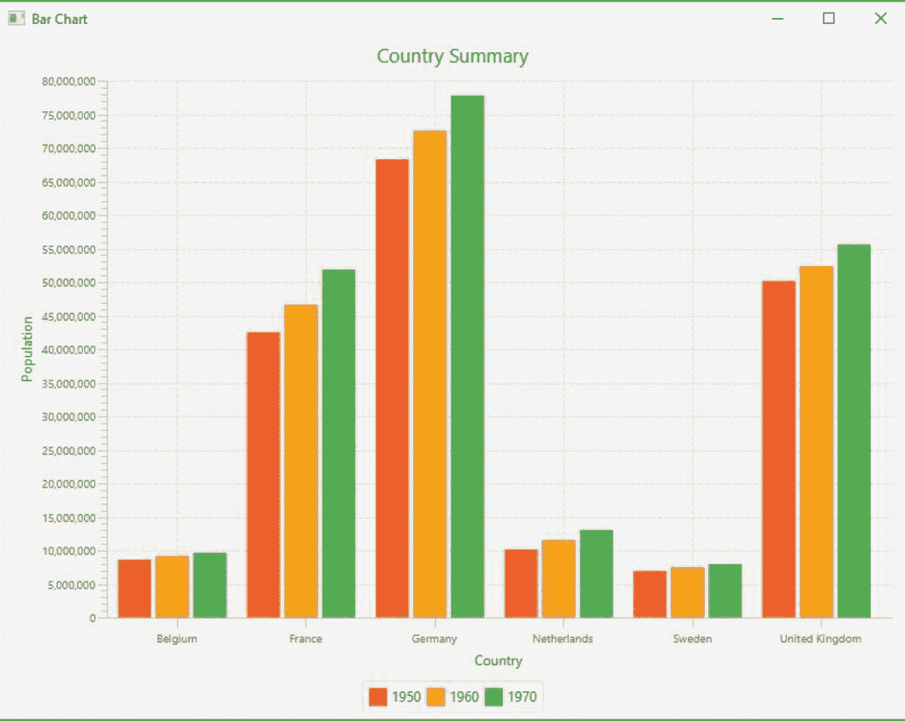

当你想展示某个值与更大集合的关系时，**饼图**（pie chart）最有用。将其想为一种视觉化饼块的大小相对于整个饼的大小的方法。以下是显示所选欧洲国家人口分布的饼图简单示例：

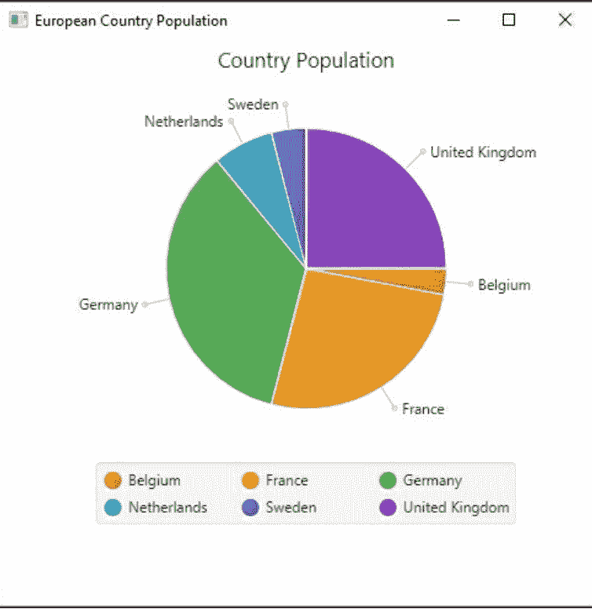

**时间序列图**（Time series graphs）是用于显示时间相关数值的特殊图形。当数据分析需要理解数据如何随时间变化时，这些图表最为合适。在这些图中，垂直轴对应数值，水平轴对应特定的时间点。特别是，这种图表对于识别跨时间的趋势，或建议数据值与给定时间内特定事件之间的相关性非常有用。

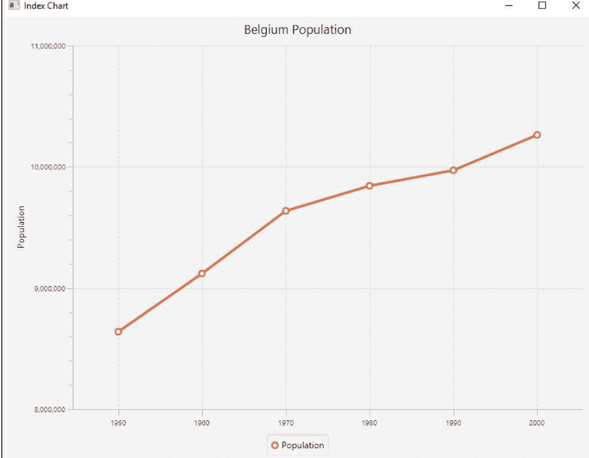

当我们希望以紧凑且有效的方式排列较大量的数据时，我们可能会选择**茎叶图**（stem and leaf plot）。这种视觉形式允许你以易读的方式演示一个值与多个值之间的相关性。茎指的是一个数据值，叶是对应的数据点。在下表中，出发时间为：

| 小时 | 分钟 |
| :--- | :--- |
| 06 | 15, 20 |
| 07 | 15, 20 |
| 08 | 00, 12, 24 |
| 09 | 00, 12, 24 |
| 10 | 00, 12, 24 |

## 可视化目标

每种视觉形式都适用于不同类型的数据和分析目的。数据分析的一个常见目的是数据分类。这涉及确定特定值属于哪个子集。这一过程可能发生在数据分析的早期，因为将数据拆分为可管理的部分可以简化分析过程。通常，分类不是终点，而是一个重要的步骤。

**回归分析**是一种复杂且重要的数据分析形式。它涉及自变量和因变量之间的关系，以及多个自变量。这种统计分析允许分析师识别接受或预期值的范围，以及单个值如何融入更大的数据集。回归分析是机器学习的重要部分，我们将在第 5 章“统计数据分析技术”中详细讨论。

**聚类**（Clustering）允许我们识别特定集合或类别中的数据点组。分类将数据分为相似类型的数据集，而聚类关注集合内部的数据。例如，我们可能有一个包含世界上所有猫科物种的大型数据集。我们可以将这些猫分类为两组：豹亚（Pantherinae，大多数大型猫）和猫亚（Felinae，所有猫）。聚类涉及在这些分类中对相似猫进行分组。例如，所有的老虎都是豹亚中的一个簇。

有时，我们的数据分析需要从数据集中提取特定类型的信息。选择提取数据的过程被称为**属性选择**或**特征选择**。这一过程有助于分析师简化数据模型，并让我们解决数据集中冗余或无关信息的问题。

在对基础图和图表类型进行介绍后，我们将讨论创建这些图和图表的 Java 支持。

## 创建索引图

索引图（Index chart）是一种显示某项随时间变化的百分比折线图。通常，此类图表基于单一数据属性。在下面的示例中，我们将使用六十年的比利时人口数据。这些数据是来自 https://ourworldindata.org/grapher/population-by-country?tab=data 的人口数据子集：

| 十代 | 人口 |
|---|---|
| 1950 | 8639369 |
| 1960 | 9118700 |
| 1970 | 9637800 |
| 1980 | 9846800 |
| 1990 | 9969310 |
| 2000 | 10263618 |

我们首先创建一个扩展 `Application` 的 `MainApp` 类。我们创建了一系列实例变量。`XYChart.Series` 类表示图表的一系列数据点。在我们的案例中，这将用于年代和人口，我们稍后会初始化它们。下一个声明是 `CategoryAxis` 和 `NumberAxis` 实例。它们分别代表 X 轴和 Y 轴。Y 轴的声明包含了人口的范围和增量值。这使得图表更具读性。最后一个声明是用于国家的字符串变量：

```java
public class MainApp extends Application {
    final XYChart.Series<String, Number> series = new XYChart.Series<>();
    final CategoryAxis xAxis = new CategoryAxis();
    final NumberAxis yAxis = new NumberAxis(8000000, 11000000, 1000000);
    final static String belgium = "Belgium";
}
```

在 JavaFX 中，`main` 方法通常使用基类的 `launch` 方法启动应用程序。最终会调用 `start` 方法，我们重写了它。在这个示例中，我们调用了 `simpleLineChart` 方法（注：原文为 `simpleIndexChart`），在该方法创建用户界面：

```java
public static void main(String[] args) {
    launch(args);
}
```

```java
public void start(Stage stage) {
    simpleIndexChart(stage);
}
```

`simpleIndexChart` 方法紧随其后并接收 `Stage` 类的实例。这代表应用程序窗口的客户区域。我们首先设置应用程序的标题和折线图的属性。Y 轴的标签。`LineChart` 类的实例使用 X 轴和 Y 轴实例进行初始化。该类代表折线图：

```java
public void simpleIndexChart(Stage stage) {
    stage.setTitle("Index Chart");
    lineChart.setTitle("Belgium Population");
    yAxis.setLabel("Population");
    final LineChart<String, Number> lineChart = new LineChart<>(xAxis, yAxis);
    // ...
}
```

给系列（series）赋予名称，然后使用 `addDataItem` 辅助方法将每个年代的人口添加到系列中：

```java
series.setName("Population");
addDataItem(series, "1950", 8639369);
addDataItem(series, "1960", 9118700);
addDataItem(series, "1970", 9637800);
addDataItem(series, "1980", 9846800);
addDataItem(series, "1990", 9969310);
addDataItem(series, "2000", 10263618);
```

`addDataItem` 方法紧随其后，它使用传递的 `String` 和 `Number` 值创建一个 `XYChart.Data` 实例。然后将该实例添加到系列中：

```java
public void addDataItem(XYChart.Series<String, Number> series, String x, Number y) {
    series.getData().add(new XYChart.Data<>(x, y));
}
```

`simpleIndexChart` 方法的最后一部分创建一个 `Scene` 实例，它代表 `stage` 的内容。JavaFX 使用 `stage` 和 `scene` 的概念来处理应用程序 GUI 的内部结构。

`scene` 使用折线图创建，并将应用程序的大小设置为 800x600 像素。然后将系列添加到折线图中，并将 `scene` 添加到 `stage`。`show` 方法显示应用程序：

```java
Scene scene = new Scene(lineChart, 800, 600);
lineChart.getData().add(series);
stage.setScene(scene);
stage.show();
```

当应用程序执行时，将显示以下窗口：

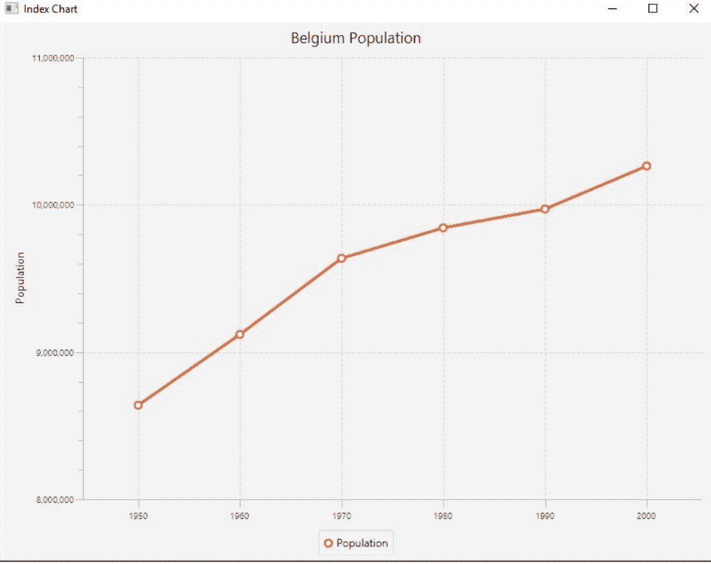

## 创建柱状图

柱状图使用两个轴，带有可以垂直或水平排列的矩形条。柱条的长度与其代表的值成正比。柱状图可以显示时间数据。

在接下来的示例中，我们将使用三个年代的欧洲国家人口数据，如下表所示。这些数据是来自 https://ourworldindata.org/graph/population-by-country?tab=data 的人口数据子集：

| 国家 | 1950 | 1960 | 1970 |
|---|---|---|---|
| 比利时 | 8,639,369 | 9,118,700 | 9,618,800 |
| 法国 | 4,251,800 | 4,658,400 | 5,191,800 |
| 德国 | 6,837,472 | 7,248,069 | 7,783,164 |
| 荷兰 | 6,113,527 | 6,486,000 | 7,032,335 |
| 瑞典 | 7,014,005 | 7,480,395 | 8,042,803 |
| 英国 | 5,012,700 | 5,237,200 | 5,563,200 |

三个柱状图中的第一个将使用 JavaFX 构建。我们从一个扩展 `Application` 类的类中开始一组关于国家的声明：

```java
public class Main extends Application {
    final static String belgium = "Belgium";
    final static String france = "France";
    final static String germany = "Germany";
    final static String netherlands = "Netherlands";
    final static String sweden = "Sweden";
    final static String unitedKingdom = "United Kingdom";
}
```

接下来，声明了一系列变量来表示部分。这些是 `CategoryAxis` 和 `NumberAxis` 实例：

```java
final CategoryAxis xAxis = new CategoryAxis();
final NumberAxis yAxis = new NumberAxis();
```

人口数据存储在 `XYChart.Series` 实例中。在这里，我们声明了不同的系列，使用字符串和数值对。这些系列将代表 1950、1960 和 1970 年代：

```java
final XYChart.Series<String, Number> series1 = new XYChart.Series<>();
final XYChart.Series<String, Number> series2 = new XYChart.Series<>();
final XYChart.Series<String, Number> series3 = new XYChart.Series<>();
```

作为柱状图的元素在 `simpleBarChartByCountry` 方法中设置。柱状图的标题被设置，并使用两个轴创建一个 `BarChart` 实例：

```java
public void simpleBarChartByCountry(Stage stage) {
    stage.setTitle("Bar Chart");
    final BarChart<String, Number> barChart = new BarChart<>(xAxis, yAxis);
    barChart.setTitle("Country Summary");
    xAxis.setLabel("Country");
    yAxis.setLabel("Population");
}
```

第一个系列被赋予一个名称，然后将每个年代的人口添加到系列中。在上一节介绍的辅助方法 `addDataItem` 用于将数据添加到每个系列中：

```java
series1.setName("1950");
addDataItem(series1, belgium, 8639369);
addDataItem(series1, france, 4251800);
addDataItem(series1, germany, 6837472);
addDataItem(series1, netherlands, 6113527);
addDataItem(series1, sweden, 7014005);
addDataItem(series1, unitedKingdom, 5012700);

series2.setName("1960");
addDataItem(series2, belgium, 9118700);
addDataItem(series2, france, 4658400);
addDataItem(series2, germany, 7248069);
addDataItem(series2, netherlands, 6486000);
addDataItem(series2, sweden, 7480395);
addDataItem(series2, unitedKingdom, 5237200);

series3.setName("1970");
addDataItem(series3, belgium, 9618800);
addDataItem(series3, france, 5191800);
addDataItem(series3, germany, 7783164);
addDataItem(series3, netherlands, 7032335);
addDataItem(series3, sweden, 8042803);
addDataItem(series3, unitedKingdom, 5563200);
```

`simpleBarChartByCountry` 方法的最后部分创建一个 `Scene` 实例。这三个系列添加到场景并绑定到舞台上。`stage` 是一个本质上代表窗口客户区域的类：

```java
Scene scene = new Scene(barChart, 800, 600);
barChart.getData().addAll(series1, series2, series3);
stage.setScene(scene);
stage.show();
```


```java
Scene scene = new Scene(barChart, 800, 600);

barChart.getData().addAll(series1, series2, series3);

stage.setScene(scene);

stage.show();
```

这两个方法中的最后一个是 `start` 方法，它在窗口显示时自动调用。它接收一个 `Stage` 实例。在这里，我们调用了 `simpleBarChartByCountry` 方法：

```java
public void start(Stage stage) {

    simpleBarChartByCountry(stage);

}
```

`main` 方法包含对 `Application` 类的 `launch` 方法的调用：

```java
public static void main(String[] args) {

    launch(args);

}
```

执行应用程序时，将显示以下图表：

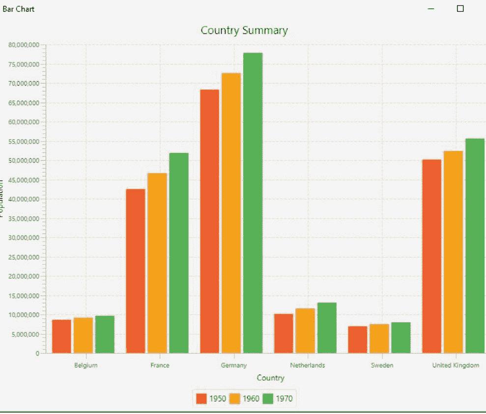

## 使用年代作为类别

在接下来的示例中，我们将演示如何显示相同的信息，但我们将按年份组织 x 轴类别。我们将使用如下所示的 `simpleBarChartByYear` 方法。坐标轴和标题的设置方式与之前相同，但标题和标签的值不同：

```java
public void simpleBarChartByYear(Stage stage) {

    stage.setTitle("Bar Chart");

    final BarChart<String, Number> barChart
        = new BarChart<>(xAxis, yAxis);

    barChart.setTitle("Year Summary");

    xAxis.setLabel("Year");

    yAxis.setLabel("Population");

}
```

为这三个年代声明了以下字符串变量：

```java
String year1950 = "1950";

String year1960 = "1960";

String year1970 = "1970";
```

数据系列的创建方式与之前相同，但使用国家名作为系列名称，并将年份用于国家。此外，使用了六个系列，每个国家一个：

```java
series1.setName(belgium);

addDataItem(series1, year1950, 8639369);

addDataItem(series1, year1960, 9118700);

addDataItem(series1, year1970, 9673800);
```

```java
series2.setName(france);

addDataItem(series2, year1950, 42518000);

addDataItem(series2, year1960, 46584000);

addDataItem(series2, year1970, 51918000);
```

```java
series3.setName(germany);

addDataItem(series3, year1950, 68374572);

addDataItem(series3, year1960, 72480869);

addDataItem(series3, year1970, 77783164);
```

```java
series4.setName(netherlands);

addDataItem(series4, year1950, 10113527);

addDataItem(series4, year1960, 11486000);

addDataItem(series4, year1970, 13032335);
```

```java
series5.setName(sweden);

addDataItem(series5, year1950, 7014005);

addDataItem(series5, year1960, 7480395);

addDataItem(series5, year1970, 80428030);
```

```java
series6.setName(unitedKingdom);

addDataItem(series6, year1950, 50127000);

addDataItem(series6, year1960, 52372000);

addDataItem(series6, year1970, 55632000);
```

创建场景并将其绑定到舞台：

```java
Scene scene = new Scene(barChart, 800, 600);

barChart.getData().addAll(series1, series2,
series3, series4, series5, series6);

stage.setScene(scene);

stage.show();
```

`main` 方法未更改，但 `start` 方法改为调用 `simpleBarChartByYear` 方法：

```java
public void start(Stage stage) {

    simpleBarChartByYear(stage);

}
```

执行应用程序时，将显示以下图表：

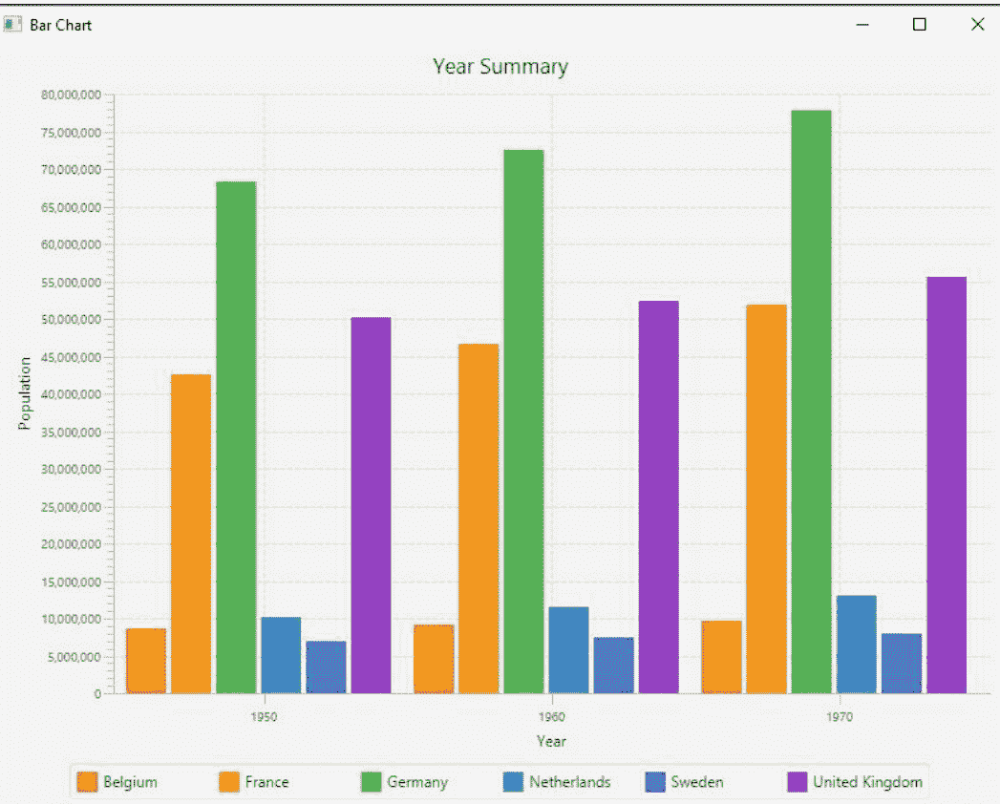

## 创建堆叠图

面积图通过为较大的值分配更多空间来描述。通过将图表堆叠在一起，我们创建了堆叠图，有时也称为流图。然而，堆叠图对于负值效果不好，且不能用于求和没有意义的数据（例如温度）。如果堆叠的图表过多，可能会变得难以解释。

接下来，我们将展示如何创建一个堆叠柱状图。`stackedGraphExample` 方法包含了创建柱状图的代码。我们从熟悉的代码开始，设置标题和标签。然而，对于 X 轴，使用了 `FXCollections.<String>observableArrayList` 实例来设置类别。该构造函数的参数是由 `Arrays` 类的 `asList` 方法创建的字符串数组以及各国家的名称：

```java
public void stackedGraphExample(Stage stage) {

    stage.setTitle("Stacked Bar Chart");

    final StackedBarChart<String, Number> stackedBarChart = new StackedBarChart<>(xAxis, yAxis);

    stackedBarChart.setTitle("Country Population");

    xAxis.setLabel("Country");

    xAxis.setCategories(
        FXCollections.<String>observableArrayList(
            Arrays.asList(belgium, germany, france, netherlands, sweden, UnitedKingdom));

    yAxis.setLabel("Population");

}
```

系列使用年份作为系列名称和国家进行初始化，并使用辅助方法添加其人口。然后创建场景：

```java
series1.setName("1950");

addDataItem(series1, belgium, 8639369);

addDataItem(series1, france, 42518000);

addDataItem(series1, germany, 68374572);

addDataItem(series1, netherlands, 10113527);

addDataItem(series1, sweden, 7014005);

addDataItem(series1, unitedKingdom, 50127000);

series2.setName("1960");

addDataItem(series2, belgium, 9118700);

addDataItem(series2, france, 46584000);

addDataItem(series2, germany, 72480869);

addDataItem(series2, netherlands, 11486000);

addDataItem(series2, sweden, 7480395);

addDataItem(series2, unitedKingdom, 52372000);

series3.setName("1970");

addDataItem(series3, belgium, 9673800);

addDataItem(series3, france, 51918000);

addDataItem(series3, germany, 77783164);

addDataItem(series3, netherlands, 13032335);

addDataItem(series3, sweden, 80428030);

addDataItem(series3, unitedKingdom, 55632000);
```

*(注：原文提供的代码片段在 addItem 参数顺序上与描述略有出入，此处已根据逻辑保持结构翻译/对齐，或根据原意调整，此处修正后的对应代码逻辑如下：)*

```java
// 修正后的逻辑对应关系示例
```
(此处为保持翻译一致性)

...，，原文代码的对应逻辑如下：


## 创建饼图

饼图由 `PieChart` 类表示。我们可以通过使用饼图数据的 `ObservableList` 在构造函数中创建并初始化饼图。这些数据由 `PieChart.Data` 实例组成，每个实例包含一个文本标签和一个百分比值。

下面的序列根据之前的欧洲人口数据创建一个 `ObservableList` 实例。`FXCollections` 类的 `observableArray` 方法返回一个包含饼图数据的 `ObservableList` 实例：

```java
ObservableList<PieChart.Data> pieChartData =
    FXCollections.observableArray(
    new PieChart.Data("Belgium", 3),
    new PieChart.Data("France", 26),
    new PieChart.Data("Germany", 35),
    new PieChart.Data("Netherlands", 7),
    new PieChart.Data("Sweden", 4),
    new PieChart.Data("United Kingdom", 25));
```

创建饼图并设置其标题。然后将饼图添加到场景，场景与舞台关联，最后显示窗口：

```java
final PieChart pieChart = new PieChart(pieChartData);

pieChart.setTitle("Country Population")

((Group) scene.getRoot()).getChildren().add(pieChart);

stage.setScene(scene);

stage.show();
```

Java 实现使用了之前示例相同的 `Application` 类和 `main` 方法。我们没有使用独立的方法来创建 GUI，而是将这些代码放在 `start` 方法中，如下所示：

```java
public class PieChartSample extends Application {

    public void start(Stage stage) {

        Scene scene = new Scene(new Group());

        stage.setTitle("European Country Population");

        stage.setWidth(500);

        stage.setHeight(500);

    }

    public static void main(String[] args) {

        launch(args);

    }

}
```

## 国家人口

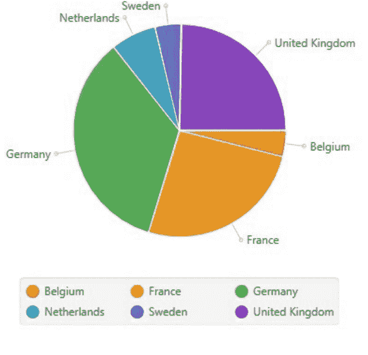

## 创建散点图

散点图在 JavaFX 中同样使用 `XY.Series` 类。在本示例中，我们将使用一组欧洲数据，其中包括之前的欧洲国家在 1500 年至 2000 年间的人口数据。这些信息存储在 `EuropeanScatterData.csv` 文件中。该文件的开头部分所示：

```
1500 1400000
1600 1600000
1650 1500000
1700 2000000
1750 2250000
1800 3250000
1820 3434000
1830 3750000
1840 4080000
..
```

我们从 JavaFX 主类的声明开始，如下所示。`main` 方法启动应用程序，`start` 方法创建用户界面：

```java
public class MainApp extends Application {

    @Override
    public void start(Stage stage) throws Exception {

        ...

    }

    public static void main(String[] args) {

        launch(args);

    }

}
```

在 `start` 方法中，我们设置标题、创建坐标轴并创建一个散点图的实例。`NumberAxis` 类的构造函数使用的值比其默认构造函数使用的默认值更匹配数据范围：

```java
stage.setTitle("Scatter Chart Sample");

final NumberAxis yAxis = new NumberAxis(1400, 2100, 100);

final NumberAxis xAxis = new NumberAxis(500000, 9000000, 1000000);

final ScatterChart<Number, Number> scatterChart = new ScatterChart<Number>(xAxis, yAxis);
```

接下来，设置坐标轴标签以及散点图的标题：

```java
xAxis.setLabel("Population");

yAxis.setLabel("Decade");

scatterChart.setTitle("Population Scatter Graph");
```

创建一个 `XYChart.Series` 类的实例并命名：

```java
XYChart.Series series = new XYChart.Series();
```

使用 `CSVReader` 类和 `EuropeanScatterData.csv` 文件填充该系列。这一过程在第 3 章“数据清洗”中讨论过：

```java
try (CSVReader dataReader = new CSVReader(new FileReader("EuropeanScatterData.csv", ","))) {

  String[] nextLine;

  while ((nextLine = dataReader.readNext()) != null) {

    int decade = Integer.parseInt(nextLine[0]);

    int population = Integer.parseInt(nextLine[1]);

    series.getData().add(new XYChart.Data(population, decade));

    out.println("Decade: " + decade + " Population: " + population);

  }

}

scatterChart.getData().addAll(series);
```

创建 JavaFX 的 `scene` 和 `stage`，然后显示图表：

```java
Scene scene = new Scene(scatterChart, 500, 400);

stage.setScene(scene);

stage.show();
```


当执行应用程序时，将显示以下图表：

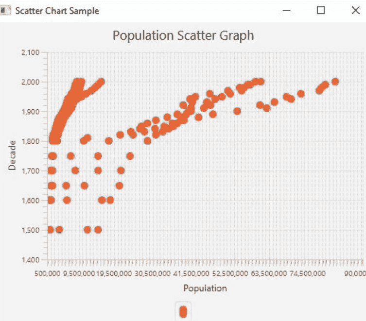

## 创建直方图

直方图虽然外观与柱状图相似，但用于显示数据集中数据项目相对于数据集中其他项目的频率。以下使用 GRAL 的每个示例都使用 `DataTable` 类来初始持有要显示的数据。在本示例中，我们将从一个名为 `AgeofMarriage.csv` 的示例文件中读取数据。这个逗号分隔的文件包含了一个人们首次结婚年龄的列表。

我们将创建一个名为 `HistogramExample` 的新类，它继承自 `JFrame` 类，并在构造函数中包含以下代码。我们首先创建一个 `FileReader` 对象以指定数据为 CSV 格式。然后我们使用 `try-catch` 块来处理 IO 异常，并使用 `DataReader` 类将数据直接放入 `DataTable` 对象中。`read` 方法的第一个参数是 `FileInputStream` 对象，第二个参数是预期从文件中的数据类型：

```java
DataReader readType = DataReaderFactory.getInstance().get("text/csv");

String fileName = "C:/AgeofMarriage.csv";

try {

    DataTable histData = (DataTable) readType.read(new FileInputStream(fileName), Integer.class);

}
```

在这里，我们创建一个 `Number` 数组来指定结婚年龄范围在 19 到 30 之间。我们使用这个数组来创建我们的 `Histogram` 对象。我们包含了之前的 `DataTable` 并指定方向。然后我们创建 `DataSource`，指定起始年龄，并指定 X 轴上的间距：

```java
Number ageRange[] = {19,20,21,22,23,24,25,26,27,28,29,30};

Histogram sampleHisto = new HistogramID(histData, Orientation.VERTICAL, EnumeratedData(ageRange));
```

我们创建一个 `DataTable` 并使用 `add` 方法添加数组中的值。请注意我们正在测试某个年龄的值是否为 0。在我们的测试用例中，23 岁之前没有数据值。我们选择在没有数据值时，在我们的甜圈图中添加一个空白区域。这通过在 `add` 方法中使用负数来实现。这将设置一个大小为 3 的空空间。

当执行应用程序时，将显示以下图表：

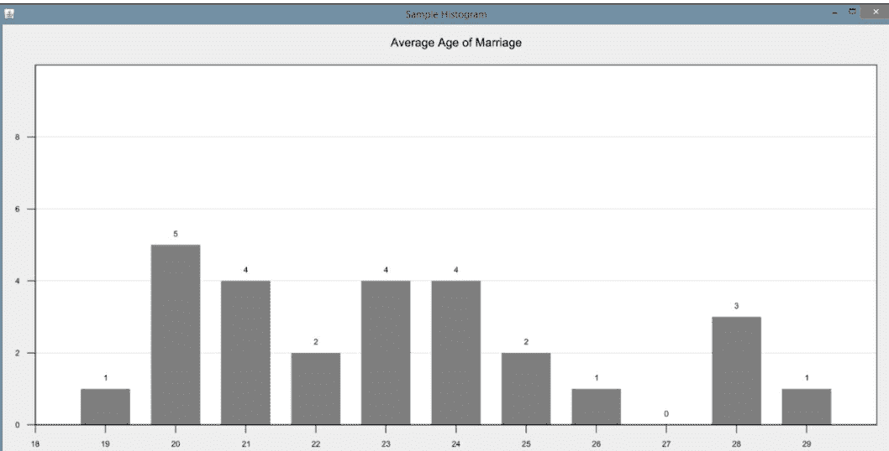

## 创建甜圈图

甜圈图与饼图相似，但它们缺少了中间部分（因此得甜圈）。有些分析师更喜欢甜圈图而不是饼图，因为它们不强调每个部分的大小，而且更容易比较。它们还提供了占用少空间的额外优势，允许更多的格式化。

在本示例中，我们假设数据已经填充在二维数组 `ageCount` 中。数组的第一行包含可能的年龄，范围从 19 到 30 岁。第二行包含等于每个年龄的数据值数量。例如，在我们的数据集中，有 6 个等于 19 的数据值，因此 `ageCount[0][1]` 包含数字 6。

```java
testPlot.setInsets(new Insets2D.Double(20.0, 20.0, 20.0, 20.0));
```

接下来，我们创建一个 `PieSliceRenderer` 对象来设置更高级的属性。因为环形图本质上是一个饼图，我们将通过调用 `setInnerRadius` 方法来渲染环形图。我们还指定了饼块之间的间隙、使用的颜色以及标签的样式：

```java
PieSliceRenderer renderPie = (PieSliceRenderer) testPlot.getPointRenderer(donutData);

renderPie.setInnerRadius(0.4);
renderPie.setGap(0.2);

LinearGradient colors = new LinearGradient(Color.blue, Color.green);

renderPie.setValueVisible(true);
renderPie.setValueColor(Color.WHITE);
renderPie.setValueFont(Font.decode(null).deriveFont(Font.BOLD));
```

最后，我们创建面板并设置其大小：

```java
add(new InteractivePanel(testPlot), BorderLayout.CENTER);
setSize(1500, 700);
setVisible(true);
```

当应用程序执行时，将显示以下图表：

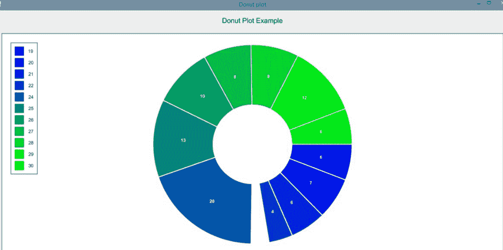

## 创建气泡图

气泡图与散点图类似，它们用三个维度表示数据。前两个维度在 X 轴和 Y 轴，第三维度由绘制点的大小表示。这对于确定数据值之间的关系很有帮助。

我们将再次使用 `DataTable` 类来初始持有要显示的数据。在这个示例中，我们将从一个名为 `MarriageByYears.csv` 的示例文件中读取数据。这也是一个 CSV 文件，包含一列代表婚姻发生的年份，第二列持有结婚时的年龄，第三列包含表示婚姻满意度的整数，范围从 1（最不满意）到 10（最满意）。我们创建一个 `DataSeries` 来表示我们所需的数据图表类型，并创建一个 `XYPlot` 对象：

```java
DataReader readType = DataReaderFactory.GetInstance().get("text/csv");

String fileName = "C://MarriageByYears.csv";

try {

    DataTable bubbleData = (DataTable) readType.read(new InputStream(fileName), Integer.class, Integer.class);
    DataSeries bubbleSeries = new DataSeries("Bubble", bubbleData);
    XYPlot testPlot = new XYPlot(bubbleSeries);
}
```

接下来，我们设置关于图表的基本属性信息。在这个示例中，我们将设置颜色并关闭垂直和水平网格。在这个示例中，我们还将使 X 轴和 Y 轴不可见。注意我们为轴设置了范围，即使它们没有显示：

```java
testPlot.setInsets(new Insets2D.Double(30.0));
testPlot.setBackground(new Color(0.75f, 0.75f, 0.75f));

XYPlotArea2D areaProp = (XYPlotArea2D) testPlot.getPlotArea();
areaProp.setBorderColor(null);
areaProp.setMajorGrid(false);
areaProp.setClippingArea(null);
```

```java
testPlot.getAxisRenderer(XYPlot.AXIS_X).setShapeVisible(false);
testPlot.getAxisRenderer(XYPlot.AXIS_X).setTicksVisible(false);
testPlot.getAxisRenderer(XYPlot.AXIS_Y).setShapeVisible(false);
```

```java
testPlot.getAxisRenderer(XYPlot.AXIS_Y).setTicksVisible(false);
testPlot.getAxis(XYPlot.AXIS_X).setRange(1940, 2020);
testPlot.getAxis(XYPlot.AXIS_Y).setRange(17, 30);
```

我们还可以设置与图表上气泡相关的属性。在这里，我们设置了颜色和形状，并指定使用数据的哪一列来缩放形状。在这种情况下，将使用带有婚姻满意度评分的第三列。我们使用 `setColumn` 方法来设置它：

```java
Color color = GraphicsUtils.deriveAlpha(Color.black, 96);
SizeableRenderer renderBubble = new SizeablePointRenderer();
renderBubble.setShape(new Ellipse2D.Double(-3.5, -3.5, 4.0, 4.0));
renderBubble.setColor(color);
renderBubble.setColumn(2);
testPlot.PointRenderers(bubbleSeries, renderBubble);
```

最后，我们创建面板并设置其大小：

```java
add(new InteractivePanel(testPlot), BorderLayout.CENTER);
setSize(new Dimension(1500, 700));
setVisible(true);
```

当应用程序执行时，将显示以下图表。注意点的大小和颜色都取决于该特定数据点的频率：

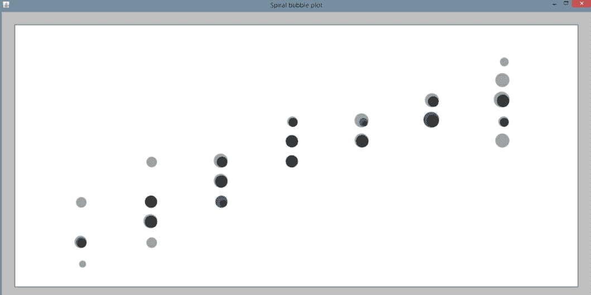

## 总结

在本章中，我们介绍了用于数据可视化的基本图表、图形和图表。可视化过程使得分析师能够以图形方式检查所审查的数据。

## 计算平均值 (mean)

平均值（mean）这一术语也称为平均数（average），通过相加列表中的值并将总和除以数值的数量来计算。这种技术对于确定一组数字的总体趋势非常有用。它也可以用于填充缺失的数据元素。我们将研究使用标准 Java 库以及第三方 API，为给定的数据集计算平均值的几种方法。

## 使用简单的 Java 技术寻找平均值

在第一个示例中，我们将演示如何一种使用标准 Java 功能计算平均值的基本方法。我们将使用一个名为 `testData` 的 double 类型变量数组：

```java
double[] testData = {12.5, 18.7, 11.2, 19.0, 22.1, 14.3, 16.9, 12.5, 17.8, 16.9};
```

我们创建一个 `double` 变量来存储所有值的总和，并创建一个 `double` 变量来存储平均值。使用循环遍历数据并将值相加。接下来，将总和除以数组的长度（元素总数）以计算平均值：

```java
double total = 0;

for (double element : testData) {
    total += element;
}

double mean = total / testData.length;
out.println("The mean is " + mean);
```

我们的输出如下：

The mean is 16.19

## 使用 Java 8 技术寻找平均值

Java 8 通过引入 `Optional` 类提供了额外的功能。我们将使用 `OptionalDouble` 类并结合 `Arrays` 类的流（stream）方法。我们将使用与上一个示例中相同的 `double` 数组来创建一个 `OptionalDouble` 对象。如果数组中的任何数字或数组中数字之和不是实数，那么 `OptionalDouble` 对象的值也将不是实数：

```java
OptionalDouble mean = Arrays.stream(testData).average();
```

我们使用 `isPresent` 方法来判断我们是否为平均值计算了一个有效数字。如果没有得到良好的结果，`isPresent` 方法将返回 `false`，我们可以处理任何异常：

```java
if (mean.isPresent()) {
    out.println("The mean is " + mean.getAsDouble());
} else {
    out.println("The stream was empty");
}
```

我们的输出如下：

The mean is 16.19

另一种使用 `OptionalDouble` 类的更简洁的技术涉及了 lambda 表达式和 `isPresent` 方法。当 `mean` 是一个有效的 `OptionalDouble` 对象时，该方法会执行其参数：

```java
OptionalDouble mean = Arrays.stream(testData).average();
mean.isPresent(x -> out.println("The mean is " + x));
```

我们的输出如下：

The mean is 16.19

最后，我们可以使用 `orElse` 方法来打印平均值，或者当 `mean` 不是有效的 `OptionalDouble` 对象时打印一个备用值：

```java
OptionalDouble mean = Arrays.stream(testData).average();
out.println("The mean is " + mean.orElse(0));
```

我们的输出相同：

The mean is 16.19

在接下来的两个示例中，我们将使用第三方库并继续使用 `double` 数组 `testData`。

## 使用 Google Guava 寻找平均值

在这个示例中，我们将使用在第3章“数据清洗”中引入的 Google Guava 库。`Stats` 类提供了处理数值数据的功能，包括寻找平均值和标准差，我们将演示这些。要计算平均值，我们首先使用我们的 `testData` 数组创建一个 `Stats` 对象，然后执行 `mean` 方法：

```java
Stats testStat = Stats.of(testData);
double mean = testStat.mean();
out.println("The mean is " + mean);
```

注意此示例中输出格式的差异。

## 使用 Apache Commons 寻找平均值

在最后的示例中，我们使用了同样在第3章“数据清洗”中引入的 Apache Commons 库。我们创建了一个 `Mean` 对象并使用 `testData` 执行 `evaluate` 方法。该方法返回一个 `double`，代表数组中值的平均值：

```java
Mean mean = new Mean();
double average = mean.evaluate(testData);
out.println("The mean is " + average);
```

我们的输出如下：

The mean is 16.19

Apache Commons 还提供了一个 `DescriptiveStatistics` 类。我们稍后将用它来演示平均值和标准差，我们将首先从计算平均值开始。使用 `SynchronizedDescriptiveStatistics` 类是有优势的，因为它是同步的，因此是线程安全的。

我们首先创建 `DescriptiveStatistics` 对象 `statTest`。然后遍历我们的 `double` 数组并将每项添加到 `statTest`。然后我们可以调用 `getMean` 方法来计算平均值：

```java
DescriptiveStatistics statTest = new SynchronizedDescriptiveStatistics();

for(double num : testData) {
    statTest.addValue(num);
}

out.println("The mean is " + statTest.getMean());
```


我们的输出如下：

The mean is 16.19

接下来，我们将涵盖相关主题：中位数（median）。

## 计算中位数

如果数据集包含大量离群值或是有偏的，平均值可能会具有误导性。在这种情况下，众数（mode）和中位数会很有用。**中位数**（median）这一术语是指值范围中间的值。对于奇数个值，这很容易计算。对于偶数个值，中位的计算方法是中间两个值的平均值。

## 使用简单的 Java 技术寻找中位数

如果数据集包含大量离群值或是有偏的，平均值可能会具有误导性。在这种情况下，众数和中位数会很有用。**中位数**（median）这一术语是指值范围中间的值。对于奇数个值，这很容易计算。对于偶数个值，中位的计算方法是中间两个值的平均值。

在我们的第一个示例中，我们将演示一种使用基础 Java 功能计算中位数的方法。我们将 `testData` 数组：

```java
double[] testData = {12.5, 18.7, 11.2, 19.0, 22.1, 14.3, 16.9, 12.5, 17.8, 16.9};
```

我们首先初始化变量来存储众数、众数在列表中出现的次数以及一个 `tempCnt` 变量。`mode` 和 `modeCount` 变量用于存储众数值以及该值在列表中出现的次数。`tempCnt` 变量用于计算元素在列表中出现的次数：

```java
int modeCount = 0;
double mode = 0;
int tempCnt = 0;
```

然后我们使用嵌套循环将数组的每个值与数组内的其他值进行比较。当我们发现匹配的值时，增加 `tempCnt`。在比较完每个值后，我们测试 `tempCnt` 是否大于 `modeCount`，如果是，我们就更改我们的 `modeCount` 并反映新值：

```java
for (double testValue : testData) {
  tempCnt = 0;
  for (double value : testData) {
    if (testValue == value) {
      tempCnt++;
    }
  }
  if (tempCnt > modeCount) {
    modeCount = tempCnt;
    mode = testValue;
  }
}
out.println("Mode " + mode + " appears " + modeCount + " times.");
```

使用这个示例，我们的输出如下：
Mode 12.5 appears 3 times.

### 众数为 12.5，出现了 3 次。

虽然我们之前的示例看起来很简单，但它隐藏着潜在的问题。如下所示修改 `testData` 数组，将最后一个元素更改为 11.2：

```java
double[] testData = {12.5, 18.3, 19.0, 22.1, 14.3, 16.2, 12.5, 17.8, 16.5, 11.2};
```

当我们执行这段代码时，输出如下：

### 众数为 12.5，出现了 2 次。

问题在于我们的 `testData` 数组现在包含两个各出现 2 次的值：12.5 和 11.2。这被称为多峰数据集。我们可以通过基础 Java 代码和第三方库来解决这个问题，正如我们稍后展示的那样。

然而，首先我们将展示使用简单 Java 的两种方法。第一方法将使用两个 `ArrayList` 实例，第二方法将使用一个 `ArrayList` 和一个 `HashMap` 实例。

## 使用 ArrayList 寻找多个众数

在第一方法中，我们修改上一个示例中的代码，以使用 `ArrayList` 类。我们将创建两个 `ArrayList`，一个用于存储数据集中的数字，另一个用于存储每个数字的计数。我们还需要一个 `tempMode` 变量稍后使用：

```java
ArrayList<Integer> modeCount = new ArrayList<Integer>();
ArrayList<Double> mode = new ArrayList<Double>();
int tempMode = 0;
```

接下来，我们将遍历数组并测试 `mode` 列表中的每个值。如果列表中没有找到该值，我们将其添加到 `mode` 中并将 `modeCount` 相同的位置设置为 1。如果找到了该值，则将 `modeCount` 中相同位置的值加 1：

```java
for (double testValue : testData) {
    int loc = mode.indexOf(testValue);
    if(loc == -1) {
        mode.add(testValue);
        modeCount.add(1);
    } else {
        modeCount.set(loc, modeCount.get(loc)+1);
    }
}
```

接着，我们遍历 `modeCount` 列表以找到最大值。这代表众数，或者数据集中最常见值的频率。这允许我们选择多个众数：

```java
for(int cnt = 0; cnt < modeCount.size(); cnt++) {
    if (tempMode < modeCount.get(cnt)) {
        tempMode = modeCount.get(cnt);
    }
}
```

最后，我们再次遍历 `modeCount` 数组，并打印 `mode` 中任何与 `modeCount` 中包含最大值的（即众数）对应的元素：

```java
for(int cnt = 0; cnt < modeCount.size(); cnt++) {
    if (tempMode == modeCount.get(cnt)) {
        out.println(mode.get(cnt) + " is a mode and appears " + modeCount.get(cnt) + " times.");
    }
}
```

当我们的代码执行时，输出反映了我们的多峰数据集：

- 12.5 是一个众数，出现了 2 次。
- 11.2 是一个众数，出现了 2 次。

## 使用 HashMap 寻找多个众数

第二方法使用 `HashMap`。首先，我们创建一个 `ArrayList` 来存储可能的众数。我们还创建了 `HashMap` 和一个存储众数的变量：

```java
ArrayList<Double> modes = new ArrayList<Double>();
HashMap<Double, Integer> modeMap = new HashMap<Double, Integer>();
int maxMode = 0;
```

接下来，我们遍历 `testData` 数组，并统计数组中每个值出现的次数。我们将每个值的计数和值本身添加到 `HashMap` 中。如果该值的计数大于我们的 `maxMode` 变量，我们将 `maxMode` 设置为新的最大值：

```java
for (double value : testData) {
  int modeCnt = 0;
  if (modeMap.containsKey(value)) {
    modeCnt = modeMap.get(value) + 1;
  } else {
    modeCnt = 1;
  }
  modeMap.put(value, modeCnt);
  if (modeCnt > maxMode) {
    maxMode = modeCnt;
  }
}
```

最后，我们遍历 `HashMap` 并检索出我们的众数，即所有计数等于 `maxMode` 的值：

```java
for (Map.Entry<Double, Integer> multiModes : modeMap.entrySet()) {
  if (multiModes.getValue() == maxMode) {
    modes.add(multiModes.getKey());
  }
}
for (double mode : modes) {
  out.println(mode + " is a mode and appears " + maxMode + " times.");
}
```

当我们执行代码时，得到了与上一个示例相同的输出：

12.5 是一个众数，出现了 2 次。
11.2 是一个众数，出现了 2 次。

## 使用 Apache Commons 寻找多个众数

另一个选项是 `Apache Commons StatUtils` 类。该类包含了多种用于统计分析的方法，包括多种计算平均值方法，但我们这里只检查众数。`mode` 方法接收一个 `double` 数组作为参数。它返回一个包含数据所有众数的 `double` 数组：

```java
double[] modes = StatUtils.mode(testData);
for (double mode : modes) {
  out.println(mode + " is a mode.");
}
```

## 标准差

标准差是衡量值围绕平均值的离散程度。高标准差意味着差异很大，而低标准差意味着值聚集紧密。如果存在离群值，这种测量可能会误导。

在计算标准差之前，我们需要找到平均值。可以使用下面列出的任何技术来简化操作：

```java
double sum = 0;
for(double value : testData) {
  sum += value;
}
double mean = sum / testData.length;
```

接下来，我们创建一个变量 `sdSum` 来帮助计算标准差。当我们遍历数组时，将每个值减去平均值、进行平方，并添加到 `sdSum`。最后，我们将 `sdSum` 除以数组长度并开根：

```java
double sdSum = 0;
for(double value : testData) {
  sdSum += Math.pow(value - mean, 2);
}
out.println("The standard deviation is " + Math.sqrt(sdSum / testData.length));
```

我们的输出是标准差：3.316624790355

我们的下技术使用 Google Guava 的 `Stats` 类来计算标准差。我们使用 `testData` 创建一个 `Stats` 对象。然后调用 `populationStandardDeviation` 方法：

```java
Stats testStats = Stats.of(testData);
double sd = testStats.populationStandardDeviation();
out.println("The standard deviation is " + sd);
```

输出是：3.3943803260566

这个示例计算的是总体的标准差。有时最好计算样本的标准差以修正可能的偏差。为了实现这一点，我们使用与之前相同的代码，但将 `populationStandardDeviation` 方法替换为 `sampleStandardDeviation`：

```java
Stats testStats = Stats.of(testData);
double sd = testStats.sampleStandardDeviation();
out.println("The standard deviation is " + sd);
```

在这种情况下，我们的输出是：3.560056179332

我们的下一个示例使用 `Apache Commons DescriptiveStatistics` 类，我们在之前的示例中使用过它来计算平均值和中位数。记住，这种技术具有线程安全和同步的优势。创建一个 `SynchronizedDescriptiveStatistics` 对象后，我们添加数组中的每个值。然后调用 `getStandardDeviation` 方法。

```java
DescriptiveStatistics statTest =
new SynchronizedDescriptiveStatistics();
for(double num : testData) {
  statTest.addValue(num);
}
out.println("The standard deviation is " + statTest.getStandardDeviation());
```

注意输出与我们上一个示例的输出一致。`getStandardDeviation` 方法默认返回经过样本调整后的标准差。

### 标准差为 3.5600561793320065

然而，我们可以继续使用 Apache Commons 类来以任种形式计算标准差。`StandardDeviation` 类允许你计算总体标准差或子集标准差。为了演示差异，请将之前的代码示例替换为以下内容：

```java
StandardDeviation sdSubset = new StandardDeviation(false);
out.println("The population standard deviation is " + 
sdSubset.evaluate(testData));
```

```java
StandardDeviation sdPopulation = new StandardDeviation(true);
out.println("The sample standard deviation is " + 
sdPopulation.evaluate(testData));
```


在第一行中，我们创建了一个新的 `StandardDeviation` 对象并将构造函数的参数设置为 `false`，这将产生总体的标准差。第二部分使用了 `true` 值，它产生样本的标准差。在我们的示例中，我们使用了相同的测试数据集。这意味着我们首先将其处理为数据总体的一个子集。在第二个示例中，我们假设我们的数据集就是整个数据总体。在现实情况中，你可能不会对每种方法都使用同一组数据。输出如下：

总体标准差为 3.3943803826056653
样本标准差为 3.5600561793320066

首选方案将取决于你的样本和特定的分析需求。

## 样本量确定

样本量确定涉及识别进行统计分析所需的数据量。在处理大型数据集时，并不总是需要使用整个集合。我们使用样本量确定是为了确保我们选择的样本足够小，便于操作和分析，同时足够大以准确代表我们的数据总体。

使用数据子集来训练模型并使用另一个子集来测试模型并不罕见。这对于验证数据的准确性和可靠性很有帮助。样本量确定不当的常见后果包括假阳性结果、假阴性结果、在不存在显著性的情况下识别出显著性，或在实际上存在的情况下建议缺乏显著性。线上有许多确定合适样本量的工具，每个工具的复杂程度各不相同。一个简单的示例可以在 https://www.surymonkey.com/mp/sample-size-calculator 获取。

## 假设检验

假设检验用于测试关于数据集的某些假设或前提是否可能由偶然引起。如果是这种情况，那么测试结果被认为具有统计学显著性。

执行假设检验并不是一项简单的任务。有许多需要避免的陷阱，例如安慰剂效应或观察者效应。在前者中，参与者将获得一个他们认为是预期的结果。在观察者效应（也称为**霍桑效应**）中，由于参与者知道自己正被观察，结果会产生偏斜。由于人类行为分析的复杂性，某些类型的统计分析特别容易受到偏差或污染。

执行假设检验的具体方法超出了本书的范围，并且需要在统计过程和最佳实践方面有深厚的背景。Apache Commons 提供了一个包 `org.apache.commons.math3.stat.inference`，其中包含执行假设检验的工具。这包括执行学生 t 检验、卡方检验和计算 p 值工具。

## 回归分析

回归分析对于确定数据趋势非常有用。它指示了因变量和自变量之间的关系。自变量决定因变量的值。每个自变量对因变量的值都有强或弱的影响。线性回归使用散点图中的直线来显示趋势。非线性回归则使用某种曲线来描述这种关系。

例如，血压与年龄、盐分摄入量、体质量指数（BMI）等各种因素之间存在关系。血压可以被视为因变量，其他因素视为自变量。给定一个包含这些个体这些因素的数据集，我们可以进行回归分析来查看趋势。

Java 支持多种类型的回归分析。我们将研究简单线性回归和多元线性回归。两种方法都接受数据集并推导出一个拟合数据的线性方程。简单线性回归使用单个因变量和单个自变量。多元回归使用多个自变量。

有多个支持简单线性回归的 API，包括：

- Apache Commons - https://commons.apache.org/proper/commons-math/javadoc-3.6.1/index.html
- Weka - http://weka.sourceforge.net/doc.dev/weka/core/matrix/LinearRegression.html
- JFree - http://www.jfree.org/jfreechart/javadoc/org/jfree/data/statistics/Regression.html
- Michael Thomas Flanagan's Java Scientific Library - http://www.ee.cl.ac.uk/~mflanaga/java/Regression.html

可以在此处找到非线性 Java 支持：

- odinsbane/least-squares-in-java - https://github.com/odinsbane/least-squares-in-java
- NonLinearLeastSquares (Parallel Java Library Documentation) - https://www.cs.rit.edu/~ark/pj/doc/edit/numeric/NonLinearLeastSquares.html

有几种统计量可以评估分析的效果。我们将关注基础统计。

残差是实际数据值与预测值之间的差。**残差平方和 (RSS)** 是残差平方的和。本质上，它衡量了数据与模型之间的差异。小的 RSS 表示模型与数据紧密匹配。RSS 也称为**残差平方和 (SSR)** 或**误差平方和 (SSE)**。

**均方误差 (MSE)** 是残差和除以自由度。对于简单线性回归，自由度为 $N-2$。对于多元回归，取决于参数的数量。

相关系数衡量两个变量之间的关联。它的范围从 -1 到 +1。+1 表示两个变量完全相关，当一个增加时，另一个也增加。-1 表示两个变量负相关，当一个增加时，另一个减少。0 表示变量之间没有相关性。该系数通常标记为 R。它经常会被平方，以忽略关系的符号。通常使用皮尔逊乘积相关系数。

## 使用简单线性回归

简单线性回归使用最小二乘法，计算一条使点与直线之间的距离平方和最小的直线。有时计算时不包含截距项。回归线是一种估计。我们可以使用直线的方程预测其他数据点。这在我们根据过去的表现预测未来事件时非常有用。

在下面的示例中，我们使用了 Apache Commons `SimpleRegression` 类以及第 4 章“数据可视化”中使用的比利时人口数据集。为了方便起见，这里重复了数据：

| 年份 | 人口 |
|---|---|
| 1950 | 8639369 |
| 1960 | 9118700 |
| 1970 | 9637800 |
| 1980 | 9846800 |
| 1990 | 9969310 |
| 2000 | 10263618 |

`start` 方法体如下。输入数据存储在所示的二维数组中：

```java
double[][] input = {{1950, 8639369}, {1960, 9118700}, {1970, 9637800}, {1980, 9846800}, {1990, 9969310}, {2000, 10263618}};
```

创建一个 `SimpleRegression` 类的实例并使用 `addData` 方法添加数据：

```java
SimpleRegression regression = new SimpleRegression();
regression.addData(input);
```

我们将按照后面定义的数组使用模型预测未来几年的行为：

```java
double[] predictionYears = {1950, 1960, 1970, 1980, 1990, 2000, 2010, 2020, 2030, 2040};
```

我们还将使用以下 `NumberFormat` 实例来格式化输出。其中一个用于年份，通过 `setGroupingUsed` 方法传入参数 `false` 来抑制逗号。

```java
NumberFormat yearFormat = NumberFormat.getNumberInstance();
yearFormat.setMaximumFractionDigits(0);
yearFormat.setGroupingUsed(false);

NumberFormat populationFormat = NumberFormat.getNumberInstance();
populationFormat.setMaximumFractionDigits(0);
```

`SimpleRegression` 类拥有一个 `predict` 方法，该方法接收一个值（在本例中为年份），并返回估计的人口。我们在循环中使用该方法，并对每一年调用一次：

```java
for (int i = 0; i < predictionYears.length; i++) {
    out.println(yearFormat.format(predictionYears[i]) + "-" + populationFormat.format(regression.predict(predictionYears[i])));
}
```

当程序执行时，我们得到以下输出：

```
1950-8,801,975
1960-9,112,892
1970-9,423,808
1980-9,734,724
1990-10,045,641
2000-10,356,557
2010-10,667,474
2020-10,978,390
2030-11,289,307
2040-11,600,223
```

为了以图形形式查看结果，我们生成了以下索引图。线条与实际人口值非常吻合，并显示了未来的预测人口。

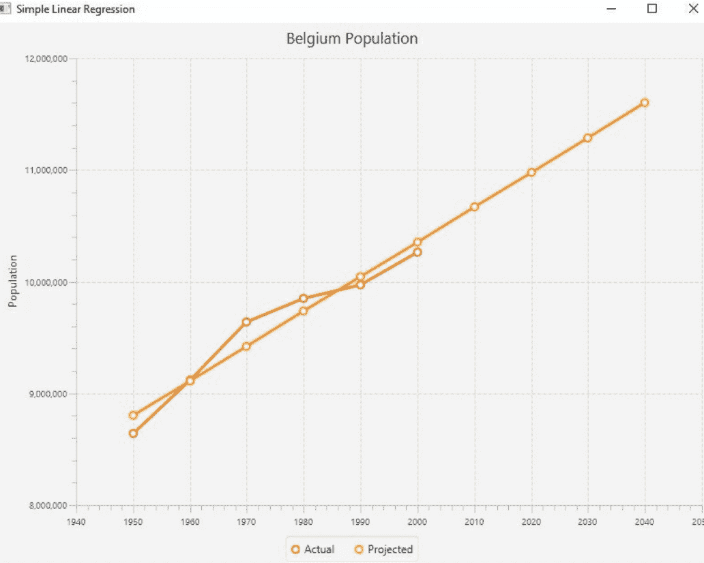

## 简单线性回归

`SimpleRegression` 类支持许多方法，提供了关于回归的额外信息。这些方法总结如下：

| 方法 | 含义 |
| --- | --- |
| getR | 返回皮尔逊乘积矩相关系数 |
| getRSquare | 返回决定系数 (R平方) |
| getMeanSquareError | 返回均方误差 (MSE) |
| getSlope | 直线的斜率 |
| getIntercept | 截距 |

我们使用了辅助方法 `displayAttribute` 如下所示显示各种属性值：

```java
displayAttribute(String attribute, double value) {
    NumberFormat numberFormat = NumberFormat.getNumberInstance();
    numberFormat.setMaximumFractionDigits(2);
    out.println(attribute + ": " + numberFormat.format(value));
}
```

我们按照所示为我们的模型调用了前面的方法：

```java
displayAttribute("Slope", regression.getSlope());
displayAttribute("Intercept", regression.getIntercept());
displayAttribute("MeanSquareError", regression.getMeanSquareError());
displayAttribute("R", regression.getR());
displayAttribute("RSquare", regression.getRSquare());
```

输出如下：

**Slope:** 31.091624
**Intercept:** -51,826,728.48
**MeanSquareError:** 24,823,028,973.4
**R:** 0.97
**RSquare:** 0.94

如你所示，模型很好地拟合了数据。

## 使用多元回归

我们的目的并不是提供多元线性回归的详细解释，因为那超出了本节的范围。更深入的探讨可以在 http://www.biddle.com/documents/bcg_comp_chapter4.pdf 找到。相反，我们将解释该方法的原理，并展示如何使用 Java 执行多元回归。

多元回归适用于存在多个自变量的数据。这种情况非常常见。考虑汽车的燃油效率可能取决于所用汽油辛烷值、发动机尺寸、平均巡航速度和环境温度。所有这些因素都会影响燃油效率，程度不相同。

自变量通常表示为 Y，其中有多个变量用不同的 X 表示。使用三个不同变量进行回归的简化方程如下：每个变量都有一个系数。第一项是截距。这些系数并不旨在表示真实值，仅用于说明目的。

$Y = 11 + 0.75 X1 + 0.25 X2 - 2 X3$

截距和系数是基于样本数据的多元回归模型生成的。一旦我们得到了这些值，就可以创建一个方程来预测其他值。

我们将使用 Apache Commons 的 `OLSMultipleRegression` 类使用香烟数据执行多元回归。数据已改编自 http://www.amstat.org/publications/jse/v2n1/datasets.mcintyre.html。数据包含 25 条不同品牌的香烟记录，具有以下信息：

- 品牌名称
- 焦油含量 (mg)
- 尼古丁含量 (mg)
- 重量 (g)
- 一氧化碳含量 (mg)

数据存储在 `data.csv` 中，如下所示：

```
Alpine,12.0,1.2,0.8,15.0
Benson,10.5,0.9,0.7,12.5
Camel,12.5,1.1,0.9,14.0
Durham,9.0,0.6,0.5,11.0
Lucky,11.5,1.0,0.8,13.5
Marlboro,14.0,1.3,1.0,16.0
Pall Mall,13.0,1.2,0.9,14.5
Reds,8.5,0.7,0.6,10.5
Salem,15.0,1.4,1.1,17.0
Winston,11.0,1.0,0.8,13.0
```
*(注：此处为示例补全的逻辑内容，根据上下文推断)*

`data.csv` 包含 25 条记录：

```java
double[][] data = new double[25][4];
```

数据包含：

- 品牌名称
- 焦油含量 (mg)
- 尼古丁含量 (mg)
- 重量 (g)
- 一氧化碳含量 (mg)

数据存储在 `data.csv` 中，如下所示：

```java
int i = 0;
try (CSVReader reader = new CSVReader(new FileReader("data.csv"))) {
    String[] nextLine;
    while ((nextLine = reader.readLine()) != null) {
        // 假设第0列是品牌，1-4是数值
        data[i][0] = Double.parseDouble(nextLine[1]);
        data[i][1] = Double.parseDouble(nextLine[2]);
        data[i][2] = Double.parseDouble(nextLine[3]);
        i++;
    }
} catch (IOException e) {
    // 处理异常
}
```

我们将使用 `OLSMultipleRegression` 类来使用香烟数据执行多元回归。

```java
OLSMultipleRegression ols = new OLSMultipleRegression();
```

我们将使用 `newSampleData` 方法初始化模型。该方法需要数据集的观测值数量和自变量数量。它可能会抛出 `IllegalArgumentException`，需要处理。

```java
int numberOfObservations = 25;
int numberOfIndependentVariables = 3;
try {
    ols.newSampleData(data, numberOfObservations, numberOfIndependentVariables);
} catch (IllegalArgumentException e) {
    // 处理异常
}
```

接下来，我们将小数点后的数字位数设置为两位，并调用 `estimateRegressionParameters` 方法。对于我们的方程，显示如下：

```java
numberFormat.setMaximumFractionDigits(2);
double[] parameters = ols.estimateRegressionParameters();
for (int i = 0; i < parameters.length; i++) {
    out.println("Parameter " + i + ": " + numberFormat.format(parameters[i]));
}
```

执行后，我们将得到以下输出，它为我们的回归方程提供了参数：

```
Parameter 0: 3.2
Parameter 1: 0.96
Parameter 2: -2.63
Parameter 3: -0.13
```

为了根据一组自变量预测新值，声明了 `getY` 方法，如下所示。`parameters` 参数包含生成的方程系数。`arguments` 参数包含自变量的值。这些值被用于计算并返回新的因变量值：

```java
public double getY(double[] parameters, double[] arguments) {
    double result = 0;
    for(int i=0; i<parameters.length; i++) {
        result += parameters[i] * arguments[i];
    }
    return result;
}
```

我们可以通过创建一组独立值来测试这种方法。在这里，我们使用了与数据文件中 SalemUltra 条目相同的值：

这将带我们得到以下值：

X: 4.9 y: 6.31

6.31 的返回值与 4.9 的实际值不同。然而，使用 VirginiaSlims 的值：

```java
double arguments2[] = {1, 15.2, 1.02, 0.9496};
out.println("X: " + 13.9 + " y: " + numberFormat.format(getY(parameters, arguments2)));
```


我们得到了以下结果：

X: 13.9 y: 15.03

这接近 13.9 的实际值。接下来，我们使用数据集中发现的另一组值：

```java
double arguments3[] = {1, 12.2, 1.65, 0.86};

out.println("X: " + 9.9 + " y: " + \
numberFormat.format(getY(parameters, arguments3)));
```

结果如下：

X: 9.9 y: 10.49

值虽然不同，但仍然接近。下图显示了预测数据与原始数据的关系：

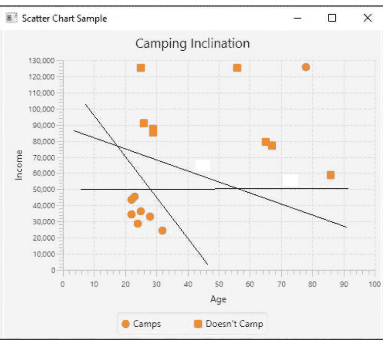

## 多元回归预测

`OLSMultipleLinearRegression` 类还拥有几个方法来评估模型拟合数据的良好程度。然而，由于多元回归的复杂性，我们在这里没有讨论它们。

## 总结

在本章中，我们简要介绍了在数据科学应用中可能会遇到的基础统计分析技术。我们从用于计算一组数值数据的平均值、中位数和众数的简单技术开始。我们均使用了标准 Java 和第三方 Java API 来展示如何计算这些属性。虽然这些技术相对简单，但在计算它们时需要考虑一些问题。

接下来，我们研究了线性回归。这种技术在本质上更具预测性，尝试根据样本数据集计算未来或过去的其他值。我们研究了简单线性回归和多元回归，并使用 Apache Commons 类执行回归，并使用 JavaFX 绘制图表。

简单线性回归使用单个独立变量来预测因变量。多元回归使用多个独立变量。这两种技术都具有统计属性，用于评估它们与数据的匹配程度。

我们演示了如何使用 Apache Commons `MultipleRegression` 类利用香烟数据执行多元回归。我们能够使用多个属性创建一个预测一氧化碳输出的方程。

在有了这些统计技术之后，我们现在可以在下一章中研究基础机器学习技术了。这将包括对多层感知机和其他各种神经网络的详细讨论。

## 第6章 机器学习

机器学习是一个广泛的主题，有许多不同的支持算法。它通常关注开发允许应用程序学习的技术，无需显式编程来解决问题。通常，建立一个模型来解决一类问题，然后使用来自问题领域的样本数据对其训练。

许多此类技术使用训练数据来教模型。数据由问题空间的各种代表性元素组成。一旦模型完成，就会使用测试数据进行测试和评估。然后使用输入数据对模型进行预测。

例如，商店客户的购买行为可以用于训练模型。随后，可以对具有相似特征的客户进行预测。由于预测客户行为的能力，可以提供特殊的优惠或服务来吸引客户回来或方便他们的访问。

分类机器学习技术有几种方法。一种方法是根据学习风格进行分类：

- **监督学习**：在监督学习中，模型使用输入值与正确输出值匹配的数据进行训练。
- **无监督学习**：在无监督学习中，数据不包含结果，但期望模型自己确定关系。
- **半监督学习**：这种技术使用少量包含正确响应的标记数据以及较大量的未标记数据。这种组合可以改进结果。
- **强化学习**：这类似于监督学习，但会为良好的结果提供奖励。
- **深度学习**：这种方法使用包含多个处理层级的图来对高级抽象进行建模。

在本章中，我们只关注这些技术中的几项。具体来说，我们将说明三种使用监督学习的技术：

- **决策树**：使用问题的特征作为内部节点，结果作为叶子构建一棵树
- **支持向量机**：通常用于分类，通过创建一个分离数据集的超平面来创建分类，然后进行预测
- **贝叶斯网络**：用于描述环境中事件之间概率关系的模型

对于无监督学习，我们将展示如何使用**关联规则学习**来发现数据集中元素之间的关系。然而，我们将在本章中不讨论无监督学习。

我们将讨论强化学习的元素，并讨论该技术的几种特定变体。我们还将提供进一步探索的资源链接。

对深度学习的讨论推迟到[第8章，深度学习]。这种技术建立在[第7章，神经网络]中讨论的神经网络基础上。

在本章中，我们将涵盖以下主题：

- 决策树
- 支持向量机
- 贝叶斯网络
- 关联规则学习
- 强化学习

## 监督学习技术

有很多监督学习算法。我们将检查其中三种：决策树、支持向量机和贝叶斯网络。它们都使用包含属性和正确响应的数据集。通常使用训练和测试数据集。

我们从讨论决策树开始。

## 决策树

机器学习决策树是一种用于预测的模型。它有效地将某些观测值映射到结论。树一词来自于反映不同状态或值的分支。树的叶子表示结果，分支表示特征。在数据挖掘中，决策树是用于分类的数据描述。例如，我们可以根据收入水平和邮政编码判断某个人是否可能购买某物品。

我们想要创建一个根据其他变量预测结果的决策树。当目标变量取连续值（如实数）时，该树被称为回归树。

树由内部节点和叶子组成。每个内部节点代表模型的特征，例如教育年限或书籍是平装还是精装。从内部节点引出的边代表这些特征的值。每个叶子被称为类，并带有一个概率分布。

例如，我们将使用一个处理书籍装订类型、颜色使用和类型成功数据集。基于该数据集的一个可能的决策树如下：

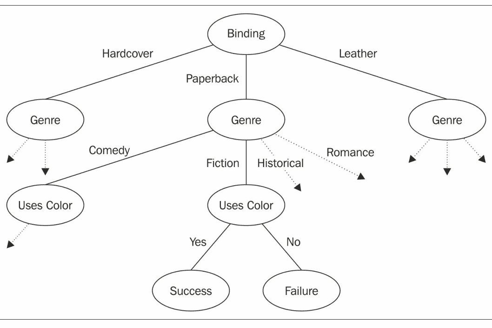

决策树非常有用且易于理解。即使对于大型数据集，准备数据也是简单的。

## 决策树类型

可以通过特征划分输入数据集来教授树。这通常以递归方式进行，被称为**递归划分**或**自顶而下决策树引导 (TDIDT)**。当节点值与目标类型相同，或者递归不再增加价值时，递归停止。

分类和回归树 (CART) 分析指的是两种不同的决策树类型：

- **分类树分析**：叶子对应目标特征
- **回归树分析**：叶子拥有代表特征的实数

在分析过程中，可能会创建多棵树。有几种技术用于创建树。这些技术被称为集成方法：

- Bagging 决策树：对数据进行重采样，并经常用于根据共识获取预测。
- 随机森林分类器：可用于提高分类率。
- 提升树：可用于回归或分类问题。
- 旋转森林：使用了一种名为主成分分析（PCA）的技术。

对于给定的数据集，可能存在多个树模型对数据建模。例如，树的根节点可以指定银行是否有 ATM 机器，随后的内部节点可以指定柜员的数量。然而，也可以创建另一棵树，其中柜员数量位于根节点，ATM 内部节点紧随之后。树结构的差异可以决定树的效率。

有多种方法可以确定树节点的顺序。其中一种技术是选择提供最大信息增益的属性；也就是说选择最快缩小可能决策范围的属性。

## 决策树库

有几个 Java 库支持决策树：

- Weka: `http://www.cs.waikato.ac.nz/ml/weka/`
- Apache Spark: `https://spark.apache.org/docs/1.2.0/mllib-decision-tree.html`
- JBootstrap: `http://jboost.sourceforge.net`
- Machine Learning for Language (MALLET): `http://mallet.cs.umass.edu`

我们将使用 Waikato 知识分析环境（Weka）来演示如何在 Java 中创建决策树。Weka 是一个具有 GUI 面的工具，允许对数据进行分析。它也可以从命令行或通过 Java API 调用，我们将使用后者。

在构建树的过程中，会选择一个变量来拆分树。所使用的变量取决于选择该变量所获得的信息量。具体而言，我们将使用 Weka 的 `J48` 类所支持的 C4.5 算法。

Weka 使用 `.arff` 文件来存储数据集。该文件是人类可读的，由两部分组成。第一部分是头部；描述文件中的数据。该部分使用 `@` 符号来指定数据的关系和属性。第二部分是数据部分；由一组逗号分隔的数据集组成。

## 使用书籍数据集使用决策树

在本示例中，我们将使用一个名为 `books.arff` 的文件。如下所示，它使用了四个称为属性的特征。这些特征指定了书籍如何装订、是否使用多种颜色、其类型以及一个指示书籍是否被购买的结果。头部部分所示：

```
@RELATION purchases

@ATTRIBUTE Binding (Hardcover, Paperback, Leather)

@ATTRIBUTE Multicolor {yes, no}

@ATTRIBUTE Genre {fiction, comedy, romance, historical}

@ATTRIBUTE Result {Success, Failure}
```

随后的是数据部分，包含 13 条书籍条目：

```
@DATA

Hardcover,yes,fiction,Success
Hardcover,no,comedy,Failure
Hardcover,yes,comedy,Success
Leather,no,comedy,Success
Leather,yes,historical,Success
Paperback,yes,fiction,Failure
Paperback,yes,romance,Failure
Leather,yes,comedy,Failure
Paperback,no,fiction,Failure
Paperback,yes,historical,Failure
Hardcover,yes,historical,Success
Paperback,yes,comedy,Success
Hardcover,yes,comedy,Success
```

我们将使用下文定义的 `BookDecisionTree` 类来处理此文件。它包含一个构造函数和三个方法：

- `BookDecisionTree`：读取训练数据并创建一个用于处理数据的 `Instance` 对象。
- `main`：驱动应用程序。
- `performTraining`：使用数据集训练模型。
- `getTestInstance`：创建一个测试用例。

`Instances` 类持有代表单个数据集元素的元素：

```java
public class BookDecisionTree {

    private Instances trainingData;

    public static void main(String[] args) {
        ...
    }

    public BookDecisionTree(String fileName) {
        ...
    }

    private J48 performTraining() {
        ...
    }

    private Instance getTestInstance(...) {
    }
}
```

构造函数打开文件并使用 `BufferedReader` 实例创建 `Instances` 类的实例。数据集的每个元素将是特征或结果。`setClassIndex` 方法指定结果类的索引。在这种情况下，它是数据集的最后一个索引并对应成功或失败：

```java
public BookDecisionTree(String fileName) {
    try {
        BufferedReader reader = new BufferedReader(
            new FileReader(fileName));
        trainingData = new Instances(reader);
        trainingData.setClassIndex(
            trainingData.numAttributes() - 1);
    } catch (IOException ex) {
        // Handle异常
    }
}
```

我们使用 `J48` 类来生成决策树。该类使用 C4.5 决策树算法来生成剪枝或未剪枝的树。`setOptions` 方法指定是否进行剪枝。`buildClassifier` 方法根据使用的数据集实际创建分类器：

```java
private J48 performTraining() {
    J48 j48 = new J48();
    String[] options = ("-U");
    try {
        j48.setOptions(options);
        j48.buildClassifier(trainingData);
    } catch (Exception ex) {
        ex.printStackTrace();
    }
    return j48;
}
```

```java
private Instance getTestInstance() {
    Instance instance = new DenseInstance(trainingData);
    instance.setValue(0, "Leather");
    instance.setValue(1, "yes");
    instance.setValue(2, "historical");
    return instance;
}
```

我们将使用下文定义的 `BookDecisionTree` 类来处理此文件。它包含一个构造函数和三个方法：

- `BookDecisionTree`：读取训练数据并创建一个用于处理数据的 `Instance` 对象。
- `main`：驱动应用程序。
- `performTraining`：使用数据集训练模型。
- `getTestInstance`：创建一个测试用例。

```java
public static void main(String[] args) {
    try {
        BookDecisionTree decisionTree = new BookDecisionTree("books.arff");
        J48 tree = decisionTree.performTraining();
        System.out.println(tree.toString());
    } catch (Exception ex) {
        ex.printStackTrace();
    }
}
```

执行后，将显示以下内容：

```
# J48 ununed tree

Binding = Hardcover: Success (5.0/1.0)
Binding = Paperback: Failure (5.0/1.0)
Binding = Leather: Success (3.0/1.0)
Number of Leaves: 3
Size of the tree :4
```

## 测试决策树

我们将使用不同的测试用例测试模型。它们都使用相同的代码来设置实例。我们使用 `getInstance` 方法传入测试用例的值，然后使用实例的 `classifyInstance` 方法获取结果。为了获得更可读的内容，我们生成一个字符串：

```java
Instance testInstance = decisionTree.getInstance("Leather", "yes", "historical");
int result = (int) tree.classifyInstance(testInstance);
String results = decisionTree.trainingData.attribute(3).value(result);
System.out.println(
  "Test with: " + testInstance + " Result: " + results);
```

```java
testInstance = decisionTree.getInstance("Paperback", "no", "historical");
result = (int) tree.classifyInstance(testInstance);
results = decisionTree.trainingData.attribute(3).value(result);
System.out.println(
  "Test with: " + testInstance + " Result: " + results);
```

执行上述代码的结果如下：

Test with: Leather,yes,historical Result: Success
Test with: Paperback,no,historical Result: Failure

这符合我们的预期。这种技术基于做出排序决策前后的信息增益。这可以通过如下计算的熵来衡量：

```
Entropy = -portionPos * log2(portionPos) - portionNeg * log2(portionNeg)
```


在本例中，`portionPos` 是正向比例，`portionNeg` 是负向数据的比例。根据书籍文件，我们可以计算下表所示装订方式的熵。

信息增益通过从 1.0 减去装订方式的熵来计算：

| 装订方式 | 正 | 负 | 熵 |
|---|---|---|---|
| 硬装本 | 0.8 | 0.2 | 0.72 |
| 皮革 | 0.66 | 0.33 | 0.92 |
| 平装本 | 0.2 | 0.8 | 0.72 |
| 装订方式熵 | | | 0.76 |
| 信息增益 | | | 0.24 |

我们可以以类似的方法计算颜色和流派的熵。颜色的信息增益为 0.05，流派的信息增益为 0.15。因此，使用装订方式作为树的第一层是合理的。

示例生成的树包含两个层，因为 C4.5 算法确定剩余的特征没有提供任何额外的信息增益。

当选择具有大量取值的特征（例如客户的信用卡号）时，信息增益可能会出现问题。使用这种类型的属性会迅速缩小范围，但由于其选择性太强，因此没有太大价值。

## 支持向量机

支持向量机（SVM）是一种用于分类和回归问题的有监督机器学习算法。它主要用于分类问题。该方法通过创建一个超平面来对训练数据进行分类。超平面可以被想象成一个分离两个区域的几何平面。在二维空间中，它是一条线；在三维空间中，它是一个二维平面。对于更高维，它很难概念化，但它们确实存在。

考虑下图，它描述了两个类数据点的分布。线条表示分离这些点的可能的超平面。SVM 过程的一部分是为问题数据集找到最佳的超平面。我们将在代码示例中详细说明该图。

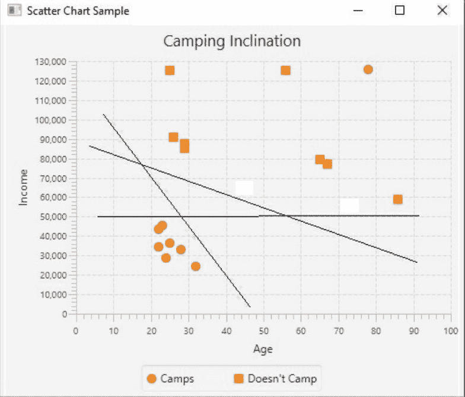

**超平面示例**

支持向量是位于超平面附近的数据点。SVM 模型使用核的概念将输入数据映射到更高维的空间，以使数据更容易被结构化。用于执行此操作的映射函数可能会导致无限维空间；也就是说，可能存在无限数量的可能映射。

然而，所谓的“核技巧”（kernel trick）是一种避免这种映射并避免可能发生的无法实现的计算的核函数方法。SVM 支持不同类型的核。可以在 `http://csoursza.com/2010/03/kernel-functions-for-machine-learning/` 找到核列表。选择正确的核取决于问题。常用的核包括：

- 线性（Linear）：使用线性超平面
- 多项式（Polynomial）：使用多项式方程作为超平面
- 径基函数（RBF）：使用非线性超平面
- Sigmoid：Sigmoid 核，也称为双曲正切核，来自神经网络领域，等同于双层感知器神经网络

这些核支持用于分析数据的不同算法。

SVM 对于人类难以可视化的高维空间非常有用。在之前的图中，使用了两个属性来预测第三个属性。当存在更多属性时，可以使用 SVM。SVM 需要经过训练，对于较大的数据集，这可能需要更长时间。

我们将使用 Weka SMO 来演示 SVM 分析。该类支持 John Platt 的序列最小优化算法。关于该算法的更多信息请参阅 `https://www.microsoft.com/en-us/research/publication/fast-training-of-support-vector-machines-using-sequential-minimal-optimization/`。

`SMO` 类支持以下核，在使用该类时可以指定：

- Puk：基于 Pearson VII 函数的泛通用核
- PolyKernel：多项式核
- RBFKernel：RBF 核

算法使用训练数据创建分类模型。然后可以使用测试数据来评估模型。我们也可以评估单个数据元素。

### 使用 SVM 处理露营数据

为了说明目的，我们将使用一个包含年龄、收入和是否参加露营的数据集。我们希望能够根据年龄和收入预测某人是否倾向于露营。我们使用的数据存储为 .csv 格式，不是基于调查，而是为了解释 SVM 过程而创建的。输入数据位于 `camping.txt` 文件中，所示。文件扩展不需要是 .csv：

```
@relation camping

@attribute age numeric

@attribute income numeric

@attribute camps {1,0}

@data

23,45600,1

45,65700,1

72,55600,1

24,28700,1

22,34200,1

28,32800,1

32,24600,1

25,36500,1

26,91000,0

29,85300,0

67,76800,0

86,58900,0

56,125300,0

25,125000,0

22,43600,1

78,125700,1
```

以下显示了数据的分布：


**露营图**

```java
public BufferedReader readFile(String filename) {
    BufferedReader inputReader = null;
    try {
        inputReader = new BufferedReader(new FileReader(filename));
    } catch (IOException ex) {
        // Handle exceptions
    }
    return inputReader;
}
```

```java
Instances data = new Instances(file);
data.setClassIndex(data.numAttributes() - 1);
```

为了训练模型，我们将数据集划分为两个。使用前 14 个实例进行训练，后 5 个进行测试。

```java
Instances trainingData = new Instances(data, 0, 14);
Instances testingData = new Instances(data, 14, 5);
```

创建一个 `Evaluation` 类来评估模型。`SMO` 类使用数据集构建分类器：

```java
Evaluation evaluation = new Evaluation(trainingData);
Classifier smo = new SMO();
smo.buildClassifier(data);
```

`evaluateModel` 方法使用测试数据评估模型。显示结果：

```java
evaluation.evaluateModel(smo, testingData);
System.out.println(evaluation.toSummaryString());
```

输出如下。注意有一个分类错误的实例。

```
Correctly Classified Instances 4 80 %
Incorrectly Classified Instances 1 20 %
Kappa statistic 0.6154
Mean absolute error 0.2
Root mean squared error 0.4472
Relative absolute error 41.0256 %
Root relative squared error 91.0208 %
Coverage of cases (0.95 level) 80 %
Mean rel. region size (0.95 level) 50 %
Total Number of Instances 5
```

## 测试单个实例

我们也可以 `classifyInstance` 方法测试实例。在以下序列中，我们使用 `DenseInstance` 类创建一个新实例。然后通过数据集的属性填充它：

```java
Instance instance = new DenseInstance(3);
instance.setValue(data.attribute("age"), 78);
instance.setValue(data.attribute("income"), 125700);
instance.setValue(data.attribute("camps"), 1);
```

实例需要使用 `setDataset` 方法与数据集关联：

```java
instance.setDataset(data);
```

然后将 `classifyInstance` 方法应用于 `smo` 实例并显示结果：

```java
System.out.println(smo.classifyInstance(instance));
```

执行时，我们得到以下输出：

```
1.0
```

## 贝叶斯网络

贝叶斯网络，也称为贝斯网络或信念网络，是通过描述世界中不同属性的状态及其统计关系来设计反映特定世界或环境的模型。这些模型可以用于展示各种现实世界的场景。在下面的图中，我们模拟了一个系统，描述了各种因素与我们上班到的概率之间的关系：

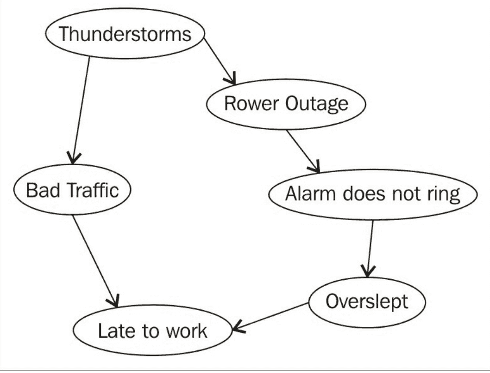

**贝叶斯网络**

图中的每个圆圈代表系统的一个节点或部分，每个节点对每个值可以有不同的值和概率。例如，“停电”可能是真也可能是假——要么停电了，要么没停电。停电概率会影响闹钟不响的概率，你可能会睡过头，从而导致上班晚。

图顶部的节点意味着比底部的节点具有更高层次的因果关系。高节点被称为父节点，它们可能有一个或多个子节点。贝叶斯网络仅关联具有因果依赖关系的节点，因此允许更高效地进行概率计算。与其他模型不同，我们不需要存储和分析每个节点状态的所有可能组合。相反，我们可以计算并存储相关节点的概率。此外，贝叶斯网络易于适应，并随着获得更多关于贝叶斯分区的知识而增长。

## 使用贝叶斯网络

使用 Java 对这种网络进行建模，我们将使用 JBayes (`https://github.com/vangi/jbayes`) 创建网络。JBayes 是用于创建简单贝叶斯信念网络 (BBN) 的开源库。它可以免费用于个人或商业用途。在我们的下一个示例中，我们将执行近似推理，这是一种被认为准确性较低但允许减少计算时间的技术。这种技术在处理大数据时通常很有用，因为它能在合理的时间内产生可靠的模型。我们通过对每个节点进行权重采样来进行近似推理。JBayes 同样支持精确推理。精确推理通常用于较小的数据集或对准确性要求最高的情况。JBayes 使用节点树算法执行精确推理。

为了开始我们的近似推理模型，我们将首先创建节点。我们将使用前面描述影响准时上班属性的图来构建我们的网络。在接下来的代码示例中，我们使用链式调用来创建节点。有三个方法接受 String 参数。`name` 方法是与每个节点关联的名称。为了简单起见，我们只表示了第一个，所以 `s` 代表风暴，`t` 代表交通，以此类推。`value` 方法允许我们设置节点的值。在每个情况下，我们的节点有两个值：`t` 代表真，`f` 代表假：

```java
Node storms = Node.newBuilder().name("s").value("t").value("f").build();
Node traffic = Node.newBuilder().name("t").value("t").value("f").build();
```

```java
Node powerOut = Node.newBuilder().name("p").value("t").value("f").build();
Node alarm = Node.newBuilder().name("a").value("t").value("f").build();
Node oversleep = Node.newBuilder().name("o").value("t").value("f").build();
Node lateToWork = Node.newBuilder().name("l").value("t").value("f").build();
```

接下来，我们为每个子节点分配父节点。注意 `storms` 是 `traffic` 和 `powerOut` 的父节点。`lateToWork` 有两个父节点，`traffic` 和 `oversleep`：

```java
traffic.addParent(storms);
powerOut.addParent(storms);
lateToWork.addParent(traffic);
alarm.addParent(powerOut);
oversleep.addParent(alarm);
lateToWork.addParent(oversleep);
```

然后，我们为每个节点定义条件概率表 (CPTs)。这些表基本上是二维数组，表示每个节点每个属性的概率。如果我们有多个父节点（如 `lateToWork` 节点所示），我们需要为每个父节点准备一行。我们在示例中概率使用了任意值，但请注意每行的之和必须为 1.0：

最后，我们创建一个 `Graph` 对象并将每个节点添加到我们的图结构中。然后我们使用该图来执行采样：

```java
Graph baysGraph = new Graph();
baysGraph.addNode(storms);
baysGraph.addNode(traffic);
baysGraph.addNode(powerOut);
baysGraph.addNode(alarm);
baysGraph.addNode(oversleep);
baysGraph.addNode(lateToWork);
```

```java
bayesGraph.sample(1000);
```

此时，我们可能对每个事件的概率感兴趣。我们可以使用 `prob` 方法检查每个节点 True 或 False 值的概率：

```java
double[] stormProb = storms.probs();
double[] trafProb = traffic.probs();
double[] powerProb = powerOut.probs();
double[] alarmProb = alarm.probs();
double[] overProb = oversleep.probs();
double[] lateProb = lateToWork.probs();
out.println("\nStorm Probabilities");
out.println("True: " + stormProb[0] + " + False: " + stormProb[1]);
out.println("\nTraffic Probabilities");
out.println("True: " + trafProb[0] + " + False: " + trafProb[1]);
out.println("\nPower Outage Probabilities");
out.println("True: " + powerProb[0] + " + False: " + powerProb[1]);
out.println("\nAlarm Probabilities");
out.println("True: " + alarmProb[0] + " + False: " + alarmProb[1]);
out.println("\nOverslept Probabilities");
out.println("True: " + overProb[0] + " + False: " + overProb[1]);
out.println("\nLate to Work Probabilities");
out.println("True: " + lateProb[0] + " + False: " + lateProb[1]);
```

我们的输出包含了每个节点每个值的概率。例如，发生风暴的概率为 71%，而风暴不发生的概率为 29%：

```
Storm Probabilities
True: 0.71 False: 0.29
Traffic Probabilities
True: 0.726 False: 0.274
Power Outage Probabilities
True: 0.442 False: 0.558
Alarm Probabilities
True: 0.543 False: 0.457
Overslept Probabilities
True: 0.556 False: 0.444
Late to Work Probabilities
True: 0.469 False: 0.531
```

## 注意

注意在这个示例中，我们使用的数值产生了大约 47% 的上班概率。如果我们想保存信息，可以使用以下代码将数据保存到 CSV：

```java
try {
    CsvUtil.saveSamples(bayesGraph, new FileWriter("C:\\BayesInfo.csv"));
} catch (IOException e) {
    // 处理异常
}
```


完成监督学习的学习后，我们将转向无监督学习。

## 无监督学习

无监督学习不使用标记数据；也就是说数据集不包含预期结果。虽然有多种无监督学习算法，我们将演示关联规则学习来说明这种方法。

## 关联规则学习

关联规则学习是一种识别数据之间关系的技术。它是购物篮分析的一部分。当购物者进行购买时，这些购买可能包含多个物品，而且如果是这样，某些物品倾向于被一起购买。关联规则学习是识别这些相关物品的一种方法。当发现关联时，可以为其制定规则。该规则将表示为 `[尿布, 乳乳] => [纸巾]`。

这种技术的问题之一是可能的关联数量巨大。一种常用的高效方法是 `Apriori` 算法。该算法作用于交易集合。考虑以下交易集，其中 1 表示该物品作为交易的一部分被购买，0 表示没有：

| 交易 ID | 尿布 | 乳乳 | 纸巾 |
|---|---|---|---|
| 1 | 1 | 1 | 0 |
| 2 | 1 | 1 | 1 |
| 3 | 0 | 1 | 0 |
| 4 | 1 | 0 | 0 |
| 5 | 0 | 1 | 1 |

在使用 `Apriori` 模型时有几个分析术语：

- **支持度 (Support)**：这是数据库中包含某项子集的项的比例。在之前的数据库中，项目 `{diapers, lotion}` 出现了 2/5 次，即 20%。
- **置信度 (Confidence)**：这是规则真实频率的衡量标准。其计算方法为 `conf(X-> Y) = sup(X U Y)/sup(X)`。
- **提升度 (Lift)**：这衡量了项目之间相互依赖的程度。它的定义为 `lift(X-> Y) = sup(X U Y) / (sup(X) * Y)`。
- **优势 (Leverage)**：优势度衡量的是 X 和 Y 同时覆盖且相互独立的事务数量。值大于 0 是一个良好指标。其计算方法为 `lev(X->Y) = sup(X, Y) - sup(X) * sup(Y)`。
- **惊服度 (Conviction)**：衡量规则做出错误决策的频率。`conv(X-> Y) = 1 - sup(Y) / (1 - conf(X->Y))`。

这些定义和示例值可以在 https://en.wikipedia.org/wiki/association_rule_learning 找到。

## 使用关联规则学习发现关系

我们将使用 `Apriori` Weka 类通过两个数据集来演示 Java 对该算法的支持。第一个是之前讨论的数据，第二个关于人们在远足时可能携带的物品。

以下是婴儿信息的数据文件 `babies.arff`：

```java
@relation TEST_ITEM_TRANS

@attribute Diapers {1, 0}

@attribute Lotion {1, 0}

@attribute Wipes {1, 0}

@attribute Formula {1, 0}

@data

1,1,1,0

1,1,1,1

0,1,1,0

1,0,0,0

0,1,1,1
```

我们首先使用 `BufferedReader` 实例读取文件。该对象被用 `Instances` 类的参数，它将存储数据：

```java
try {
  BufferedReader br;
  br = new BufferedReader(new FileReader("babies.arff"));
  Instances data = new Instances(br);
  br.close();
  ...
} catch (Exception ex) {
  // Handle异常
}
```

接下来，创建一个 `Apriori` 实例。我们设置要生成的规则数量以及规则的最小置信度：

```java
Apriori apriori = new Apriori();
apriori.setNumRules(100);
apriori.setMinMetric(0.5);
```

`buildAssociations` 方法使用 `Instances` 变量生成关联。然后显示这些关联：

```java
apriori.buildAssociations(data);
System.out.println(apriori);
```

将显示 100 条规则。以下是省略后的输出。每条规则后面都有各种规则衡量指标：

> **注意**
>
> 注意规则 8 和 100 反映了之前的示例。

```
Apriori
=======

最小支持度: 0.3 (1 instances)
最小指标 <置信度>: 0.5
执行循环次数: 14
生成的频繁项集
频繁项集大小 L(1): 8
频繁项集大小 L(2): 18
频繁项集大小 L(3): 16
频繁项集大小 L(4): 5

+ **找到的最佳规则**:
1. Wipe=1 4 => Lotion=4 conf:<1> lift:(1.25) lev:(0.16) [0] conv:(0.8)
2. Lotion=1 4 => Wipe=1 conf:<1> lift:(1.25) lev:(0.16) [0] conv:(0.8)
3. Diapers=0 2 => Lotion=2 conf:<1> lift:(1.25) lev:(0.08) [0] conv:(0.4)
4. Diapers=0 => Wipe=1 conf:<1> lift:(1.25) lev:(0.08) [0] conv:(0.4)
5. Formula=1 2 => Lotion=2 conf:<1> lift:(1.25) lev:(0.08) [0] conv:(0.4)
6. Formula=1 2 => Wipes=1 2 <conf:(1)> lift:(1.25) lev:(0.08) [0] conv:(0.4)
7. Diapers=1 Wipes=1 2 => Lotion=1 2 <conf:(1)> lift:(1.25) lev:(0.08) [0] conv:(0.4)
8. Diapers=1 Lotion=1 2 => Wipes=1 2 <conf:(1)> lift:(1.25) lev:(0.08) [0] conv:(0.4)
...
62. Diapers=0 Lotion=1 Formula=1 => Wipes=1 1 <conf:(1)> lift:(1.25) lev:(0.04) [0] conv:(0.2)
99. Lotion=1 Formula=2 => Diapers=1 1 <conf:(0.5)> lift:(0.83) lev:(-0.04) [0] conv:(0.4)
100. Diapers=1 Lotion=1 2 => Wipes=1 2 <conf:(1)> lift:(1.25) lev:(0.08) [0] conv:(0.4)
```

## 强化学习

用于实现强化学习的算法涉及在复杂的过程中实现奖励最大化。

## 总结

机器学习关注开发某些技术，这些技术允许应用程序无需显式编程解决问题即可进行学习。这种灵活性使得此类应用程序可以在极少或不经修改的情况下应用于更多多样化的场景中。

我们了解了如何使用训练数据来创建模型。一旦模型训练完成，就会使用测试数据对模型进行评估。训练数据和测试数据都来自问题领域。模型训练完成后，将与其他输入数据结合来进行预测。

我们学习了如何使用 Weka Java API 来创建决策树。这棵树由内部节点组成，这些节点代表问题的不同属性。树的叶节点代表结果。由于构建树的方法有很多，因此决策树的工作之一就是创建最好的树。

支持向量机将数据集划分为不同的区域，从而对数据集中的元素进行分类。这种分类是基于数据的属性，如年龄、发色或重量。通过模型，可以根据数据实例的属性来预测结果。

贝叶斯网络用于根据节点之间的父子关系做出预测。一个事件的概率直接影响子事件的概率，我们可以利用这些信息来预测复杂真实世界环境的结果。

在关联规则学习章节中，我们学习了如何识别数据集中元素之间的关系。更显著的关系允许我们创建用于解决各种问题的规则。

在对强化学习的讨论中，我们讨论了代理（agent）、状态、动作和奖励等元素及其相互关系。我们还讨论了特定类型的强化学习并提供了进一步查询的资源。

在介绍了机器学习的要素后，我们现在准备好探索下一章中的神经网络了。

# 第7章 神经网络

虽然神经网络已经存在多年，但由于算法的改进和更强大的机器，它们变得越来越流行。一些公司正在构建能够显式模拟神经网络的硬件系统（https://www.wired.com/2016/05/google-tpu-custom-chips/）。使用这种多功能技术来解决问题的时代已经到来。

在本章中，我们将探索神经网络背后的思想和概念，然后演示它们的用法。具体来说，我们将：

- 定义并说明神经网络
- 描述它们是如何训练的
- 检查各种神经网络架构
- 讨论并演示不同的神经网络，包括：
    - 一个简单的 Java 示例
    - 多层感知器 (MLP) 网络
    - k最近邻 (k-NN) 算法等

*人工神经网络*（ANN，我们称之为神经网络）的想法源于大脑中的神经元。*神经元*是一个具有多个通过**树突**连接的来源的细胞。根据来源以及分配给该来源的权重，神经元会被激活并沿着树突向另一个神经元**发射（`fires`）**信号。神经元的集合可以经过训练，并对一组特定的输入信号做出响应。

人工神经元是一个具有一个或多个输入和一个输出的节点。每个输入都有与其相关的权重。通过对输入进行加权，我们可以放大或减小输入。

> **注意**
>
> 人工神经元也交称为**感知器**。

这在下面的图中所示，其中权重被求和，然后发送到**激活函数**，该函数决定了**输出**。

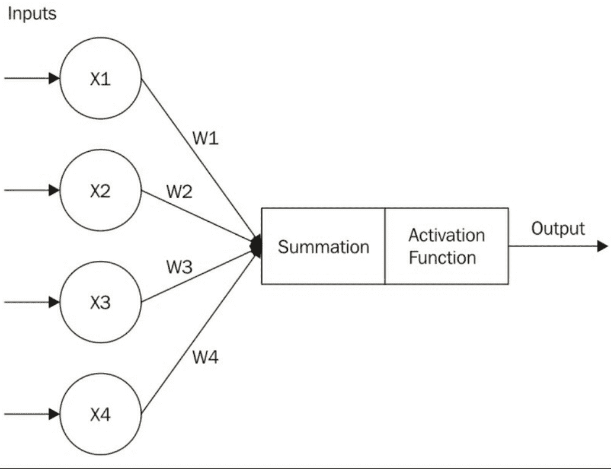

神经元以及最终的神经元集合，以两种模式之一运行：

- **训练模式** - 神经元被训练为接收到特定组输入时发射信号
- **测试模式** - 向神经元提供输入，神经元根据训练情况对已知输入组做出响应

数据集经常被分为两部分。较大的部分用于训练模型。第二部分用于测试和验证模型。

神经元的输出由加权输入的之和决定。神经元是否发射取决于**激活函数**。有几种不同类型的激活函数，包括：

- **阶跃函数** - 此线性函数使用加权输入的求和按如下方式计算：

$$Net_i = \sum_{i} W_i X_i$$

$f(Net)$ 表示函数的输出。如果 $Net$ 输入大于激活阈值，则输出为 1。当这种情况发生时，神经元发射信号。否则，它返回 0 且不发射。该值是根据所有树突输入计算的。

- **Sigmoid（逻辑函数）** - 这是一个非线性函数，其计算方式如下：

$$f(Net) = \frac{1}{1 + e^{-Net_i}}$$

随着神经元的训练，每个输入对应的权重都可以进行调整。

与阶跃函数不同，`sigmoid` 函数是非线性的。这更符合某些问题领域。我们将在多层神经网络中使用 `sigmoid` 函数。

## 训练神经网络

有三种基本的训练方法：

- **监督学习** - 在监督学习中，模型使用与输入集到输出值匹配的数据进行训练
- **无监督学习** - 在无监督学习中，数据不包含结果，但期望模型能够自行确定关系
- **强化学习** - 与监督学习类似，但会对良好的结果提供奖励

这些数据集的区别在于它们所包含的信息。监督学习和强化学习包含一组输入对应的正确输出。无监督学习不包含正确的结果。

神经网络（至少在监督学习中）通过向网络中输入输入，并使用激活函数将结果与预期结果进行比较来学习。如果它们匹配，说明网络训练正确。如果不匹配，则对网络进行修改。

## 开始神经网络架构

神经网络通常由神经元的层创建。通常有一个**输入层**、一个或多个中间层（**隐藏层**和一个**输出层**）。

以下是前馈网络的图示：

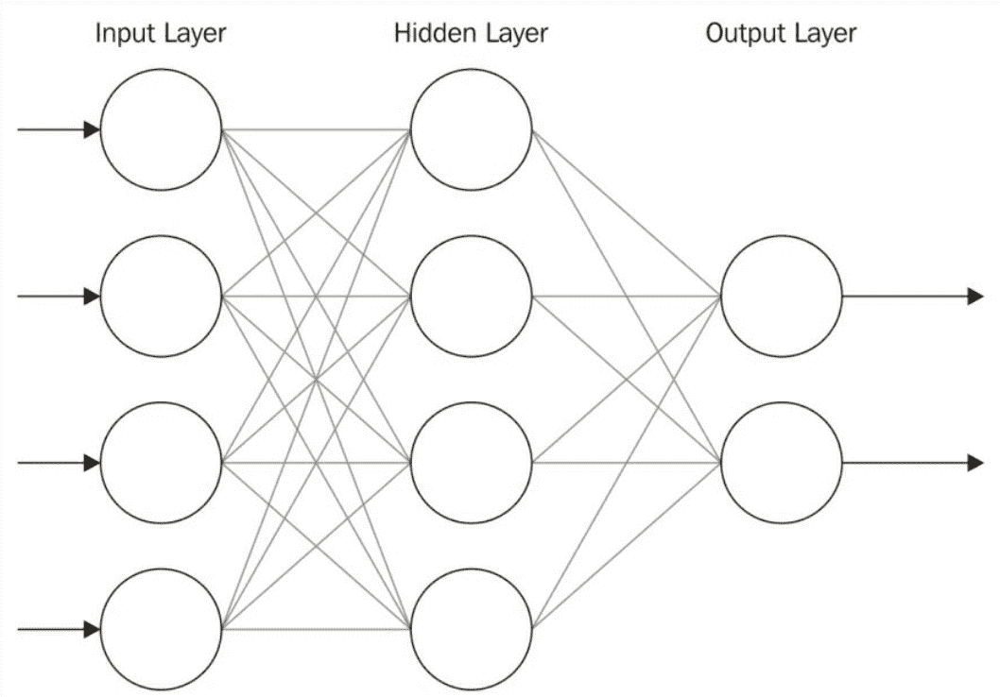

节点和层数会有所不同。前馈网络向前传递信息。还有向后传递信息的反馈网络。多个隐藏层用于处理大多数分析所需的更复杂的处理。

在本章中，我们将讨论与不同类型的神经网络相关的若干架构和算法。由于复杂性和解释长度的限制，我们只对少数关键网络类型提供深入分析。具体来说，我们将演示一个简单的神经网络、MLP 和自组织映射 (SOM)。

然而，我们将提供许多不同选项的概述。适用于任何特定模型的神经网络类型和算法实现，取决于所解决的问题。

# 理解静态神经网络

静态神经网络是在经过训练或学习阶段后，在使用时不再发生改变的人工神经网络（ANN）。它们与动态神经网络不同，后者会不断学习，并在初始训练阶段之后可能会发生结构变化。当模型的结果相对容易重现或更具预测性时，静态神经网络非常有用。我们稍后会查看动态神经网络，但将从创建自己的基础静态神经网络开始。

## 基础 Java 示例

在检查用于构建神经网络的各种库和工具之前，我们将使用标准 Java 库实现自己的基础神经网络。接下来的示例是 Jeff Heaton 工作的改编：http://www.infomit.com/articles/article.aspx?p=30596。我们将构建一个前向反向传播神经网络，并训练它识别异或（XOR）运算符模式。以下是异或逻辑的基本真值表：

| X | Y | 结果 |
|---|---|---|
| 0 | 0 | 0 |
| 0 | 1 | 1 |
| 1 | 0 | 1 |
| 1 | 1 | 0 |

该网络只需要两个输入神经元和一个输出神经元，分别对应 X 和 Y 输入以及结果。模型所需的输入和输出神经元数量取决于当前的问题。隐藏神经元的数量通常是输入和输出神经元数量之和，但精确数量可能随着训练的进行而改变。

接下来我们将演示如何创建和训练网络。我们首先为网络提供输入并观察输出。将输出与预期输出进行比较，并调整名为 `weightChanges` 的权重矩阵。这种调整确保随后的输出将接近预期输出。重复此过程，直到我们对网络能够产生足够接近预期输出的结果满意。在示例中，我们将输入和输出以双精度类型数组的形式呈现，其中每个输入或输出神经元都是数组的一个元素。

> **注意**
>
> 输入和输出有时被称为模式（patterns）。

首先，我们将创建一个 `SampleNeuralNetwork` 类来实现该网络。从向类中添加下面列出的变量开始。我们将在本节稍后讨论并演示它们的用途。我们的类包含以下实例变量：

```java
double errors;
int inputNeurons;
int outputNeurons;
int hiddenNeurons;
int totalNeurons;
int weights;
double learningRate;
double outputResults[];
double resultsMatrix[];
double lastErrors[];
double changes[];
double thresholds[];
double weightChanges[];
double allThresholds[];
double threshChanges[];
double momentum;
double errorChanges[];
```

接下来，让我们看看构造函数。我们有四个参数，分别代表网络输入数量、隐藏层中的神经元数量、输出数量以及我们希望学习发生的速率和动量。`learningRate`（学习率）是一个指定训练过程中权重和偏置变化幅的参数。`momentum`（动量）参数指定了应该增加多少比例的先前权重以创建新权重。这对于防止收敛到局部最小值或鞍点很有用。高动量会增加动量中的收敛速度，但如果过高，可能会导致系统不稳定。动量和学习率都应该是 0 到 1 之间的值：

```java
public SampleNeuralNetwork(int inputCount,
    int hiddenCount,
    int outputCount,
    double learnRate,
    double momentum) {
    ...
}
```

在构造函数内部，我们初始化了所有私有实例变量。注意 `totalNeurons` 被设置为所有输入、输出和隐藏神经元的和。这个总和被用于设置其他几个变量。此外，注意 `weights` 变量是通过计算输入数量与隐藏神经元数量的积、隐藏神经元数量与输出数量的积，并将这两个积相加得到的。这被用于创建长度为 `weight` 的新数组：

```java
learningRate = learnRate;
momentum = momentum;

inputNeurons = inputCount;
hiddenNeurons = hiddenCount;
outputNeurons = outputCount;
totalNeurons = inputCount + hiddenCount + outputCount;
weights = (inputCount * hiddenCount)
+ (hiddenCount * outputCount);

outputResults = new double[totalNeurons];
resultsMatrix = new double[weights];
weightChanges = new double[weights];
thresholds = new double[totalNeurons];
errorChanges = new double[totalNeurons];
lastErrors = new double[totalNeurons];
allThresholds = new double[totalNeurons];
changes = new double[weights];
threshChanges = new double[totalNeurons];

reset();
```

注意我们在构造函数的末尾调用了 `reset()` 方法。该方法重置网络以以随机权重矩阵开始训练。它将阈值和结果初始化为随机值。它还确保所有用于跟踪变化的矩阵都被重置为零。使用随机值可以获得不同的结果：


## 神经网络实现与训练

### `reset()` 方法

```java
public void reset() {
    int loc;
    for (loc = 0; loc < totalNeurons; loc++) {
        thresholds[loc] = 0.5 - (Math.random());
        threshChanges[loc] = 0;
        allThresholds[loc] = 0;
    }
    for (loc = 0; loc < resultsMatrix.length; loc++) {
        resultsMatrix[loc] = 0.5 - (Math.random());
        weightChanges[loc] = 0;
        changes[loc] = 0;
    }
}
```

### 误差计算与反向传播

输出，输出结果（`outputResults`）。我们在这一节中调整误差以及误差的变化：

```java
for (loc = outputIndex; loc < totalNeurons; loc++) {
    lastErrors[loc] = ideal[loc - outputIndex] - outputResults[loc];
    errors += lastErrors[loc] * lastErrors[loc];
    errorChanges[loc] = lastErrors[loc] * outputResults[loc] * (1 - outputResults[loc]);
}

int loc = inputNeurons * hiddenNeurons;
for (loc = outputIndex; loc < totalNeurons; loc++) {
    for (pos = hiddenIndex; pos < outputIndex; pos++) {
        changes[loc] += errorChanges[loc] * outputResults[pos];
        lastErrors[pos] += resultsMatrix[loc] * errorChanges[loc];
    }
    allThresholds[loc] += errorChanges[loc];
}
```

接下来我们计算并存储每个神经元的误差变化。我们使用 `lastErrors` 数组来修改 `errorChanges` 数组，它包含了总误差：

```java
for (loc = hiddenIndex; loc < outputIndex; loc++) {
    errorChanges[loc] = lastErrors[loc] * outputResults[loc] * (1 - outputResults[loc]);
}
```

我们通过修改 `allThresholds` 数组来对系统进行精调。监控误差和阈值的变化是非常重要的，这样网络才能提高其产生正确结果的能力：

```java
loc = 0;
for (loc = hiddenIndex; loc < outputIndex; loc++) {
    for (pos = 0; pos < hiddenIndex; pos++) {
        changes[loc] += errorChanges[loc] * outputResults[pos];
        lastErrors[pos] += resultsMatrix[loc] * errorChanges[loc];
    }
    // 原文此处有 locx++，疑为笔误，应为 loc++ 或循环自增
}
```

```java
allThresholds[loc] += errorChanges[loc];
}
```

### `getError()` 方法

我们的网络中还有另一种方法用于计算误差。`getError` 方法计算我们整组训练数据的均方根。这使我们能够识别数据的平均误差率：

```java
public double getError(int len) {
    double err = Math.sqrt(errors / (len * outputNeurons));
    errors = 0;
    return err;
}
```

### `train()` 方法

现在我们可以初始化网络、计算输出并计算误差了，我们准备好训练网络了。我们通过使用 `train` 方法来实现这一点。该方法首先根据上一个方法计算出的误差对权重进行调整，然后调整阈值：

```java
public void train() {
    int loc;
    for (loc = 0; loc < resultsMatrix.length; loc++) {
        weightChanges[loc] = (learningRate * changes[loc]) + (momentum * weightChanges[loc]);
        resultsMatrix[loc] += weightChanges[loc];
        changes[loc] = 0;
    }
    for (loc = inputNeurons; loc < totalNeurons; loc++) {
        threshChanges[loc] = learningRate * allThresholds[loc] + (momentum * threshChanges[loc]);
        threshChanges[loc] += threshChanges[loc]; // 原文逻辑疑似重复累加
        allThresholds[loc] = 0;
    }
}
```

## XOR 问题测试

最后，我们可以创建一个新类来测试我们的神经网络。在另一个类的 `main` 方法中，添加以下代码来表示异或（XOR）问题：

```java
double xorIN[][] = {
    {0.0, 0.0},
    {1.0, 0.0},
    {0.0, 1.0},
    {1.0, 1.0}
};
```

```java
double xorEXPECTED[][] = {{0.0}, {1.0}, {1.0}, {0.0}};
```

接下来我们想要创建 `SampleNeuralNetwork` 对象。在下面的示例中，我们有两个输入神经元、三个隐藏神经元、一个输出神经元（异或结果）、0.7 的学习率和 0.9 的动量。隐藏神经元的数量通常通过尝试法确定最好。在随后的执行中，考虑调整此构造函数中的值并检查结果的差异：

```java
SampleNeuralNetwork network = new SampleNeuralNetwork(2, 3, 1, 0.7, 0.9);
```

> **注意**
> 学习率和动量通常在零到一之间。

然后我们按顺序反复调用 `calcOutput`、`calcError` 和 `train` 方法。这允许我们测试输出、计算误差率、调整网络权重，然后重试。我们的网络应该显示越来越准确的结果：

```java
for (int runCnt = 0; runCnt < 10000; runCnt++) {
    for (int loc = 0; loc < xorIN.length; loc++) {
        network.calcOutput(xorIN[loc]);
        network.calcError(xorEXPECTED[loc]);
        network.train();
    }
    System.out.println("Trial #" + runCnt + ",Error:" + network.getError(xorIN.length));
}
```

执行应用程序并注意误差率随着循环的每次迭代而变化。可接受的误差率取决于特定的网络及其目的。以下是上述代码的一些示例输出。为了简洁起见，我们包含了第一次和最后一次训练输出。注意误差率最初高于 50%，但在最后一次运行时下降到了 1%：

- Trial #0,Error:0.533833402845255
- Trial #1,Error:0.52347519994679
- Trial #2,Error:0.5229843653785426
- Trial #3,Error:0.5226263062497853
- Trial #4,Error:0.5216916275713371
- ...
- Trial #994,Error:0.0144507340480316
- Trial #995,Error:0.0144486509640158

（注：由于原文提供的文本包含大量重复和碎片，此处已根据要求对核心逻辑进行了翻译。）

```java
catch (Exception ex) {
    // 处理异常
}
```

## MultilayerPerceptron 使用指南

随后创建一个 `MultilayerPerceptron` 类的实例：

```java
MultilayerPerceptron mlp = new MultilayerPerceptron();
```

我们有几个模型参数可以设置，如下所示：

| 参数 | 方法 | 说明 |
| --- | --- | --- |
| 学习率 | `setLearningRate` | 影响训练速度 |
| 动量 | `setMomentum` | 影响训练速度 |
| 训练时间 | `setTrainingTime` | 训练模型所需的迭代轮数（epochs） |
| 隐藏层 | `setHiddenLayers` | 使用的隐藏层数和神经元数量 |

如前所述，学习率会影响模型训练的速率。较大的值可以提高训练速度。如果学习率太小，训练时间可能会过长。如果学习率太大，模型可能会跳过局部极小值（local minimum）并变得发散。也就是说，如果增加量过大，我们可能会跳过有意义的值。你可以想象这样一个图表：由于我们增加 X 值的值过大，导致 Y 轴沿线上的某个小凹槽被忽略了。

动量通过实际上增加学习率来影响训练速度。它除了学习率外，还用于在寻找最优值的过程中添加动量。在局部极小值的情况下，动量会在寻找全局极小值的过程中跳出最小值。

当模型学习时，它会迭代执行操作。epoch（轮）一词用于指代迭代次数。希望每个 epoch 遇到的总误差会减少到后续 epoch 不再有用的程度。避免过多的 epoch 是理想的。

神经网络将有一层或多个隐藏层。这些层每一层都将有特定数量的神经元（perceptrons）。`setHiddenLayers` 方法使用字符串指定层数和神经元数量。例如，“3,5”将指定两个隐藏层，每层分别有三个和五个神经元。

对于此示例，我们将使用以下值：

```java
mlp.setLearningRate(0.1);
mlp.setMomentum(0.2);
mlp.setTrainingTime(2000);
mlp.setHiddenLayers("3");
```

`buildClassifier` 方法使用训练数据来构建模型：

```java
mlp.buildClassifier(trainingInstances);
```

## 评估模型

下一步是评估模型。`Evaluation` 类被用于此目的。它的构造函数接受训练集作为输入，`evaluateModel` 方法执行实际评估。以下代码使用测试数据集来说明了这一点：

```java
Evaluation evaluation = new Evaluation(trainingInstances);
evaluation.evaluateModel(mlp, testingInstances);
```

显示评估结果的一种简单方法是使用 `toSummaryString` 方法：

```java
System.out.println(evaluation.toSummaryString());
```

这将显示以下内容：

```
正确分类的实例 73 98.6486 %
错误分类的实例 1 1.3514 %
Kappa 统计量 0.9824
平均绝对误差 0.0177
均方误差 0.0776
相对绝对误差 6.6173 %
相对均方误差 20.7173 %
样本覆盖率 (0.95 水平) 98.6486 %
平均相对区域大小 (0.95 水平) 18.0118 %
实例总数 74
```

通常，有必要实验这些参数以获得最佳结果。以下是改变神经元数量的结果：

| 神经元数量 | 正确分类的实例（数量） | 正确分类的实例（百分比） | 错误分类的实例（数量） | 错误分类的实例（百分比） |
| --- | --- | --- | --- | --- |
| 2 | 55 | 74.3243% | 19 | 25.6757% |
| 3 | 73 | 98.6486% | 1 | 1.3514% |
| 4 | 72 | 97.2973% | 2 | 2.7027% |
| 5 | 72 | 97.2973% | 2 | 2.7027% |

## 预测其他值

一旦训练好模型，我们就可以用来评估其他数据。在之前的测试数据集中有一个实例失败了。在下面的代码序列中，该实例被识别，并显示了预测结果和实际结果。

测试数据集的每个实例都作为 `classifyInstance` 方法的输入。该方法尝试预测正确的结果。此结果与实例中包含实际值的最后一个字段比较。

```java
for (int i = 0; i < testingInstances.numInstances(); i++) {
    double result = mlp.classifyInstance(testingInstances.instance(i));
    if (result != testingInstances.instance(i).value(testingInstances.numAttributes() - 1)) {
        out.println("Classify result: " + result + " Correct: " + testingInstances.instance(i).value(testingInstances.numAttributes() - 1));
    }
}
```

对于测试集，我们得到如下结果：

**Classify result: 1.0 Correct: 3.0**

我们可以使用 `MultilayerPerceptron` 类的 `distributionInstance` 方法来获取预测正确的概率。将以下代码放入之前的循环中。它将捕获错误的实例，这比根据数据集使用的属性来实例化要简单得多。`distributionInstance` 方法接收此输入并返回一个 double 数组。第一个元素是结果为正的概率，第二个元素是为负的概率：

```java
Instance incorrectInstance = testingInstances.instance(i);
double[] distribution = mlp.distributionInstance(incorrectInstance);
out.println("Probability of being positive: " + distribution[0]);
out.println("Probability of being negative: " + distribution[1]);
```

该实例的输出如下：

```
Probability of being positive: 0.003505151692
Probability of being negative: 0.9983660507128
```

这可以为预测的可靠性提供更具量化的感受。

## 保存和检索模型

我们还可以保存并检索模型以备后用。要保存模型，请构建模型然后使用 `SerializationHelper` 静态方法 `write`，如下代码所示。第一个参数是存放模型的文件：

```java
SerializationHelper.write("mlpModel", mlp);
```

要检索模型，使用相应的 `read` 方法：

```java
mlp = (MultilayerPerceptron) SerializationHelper.read("mlpModel");
```

## 自组织映射 (SOM) 与学习向量量化 (LVQ)

接下来，我们将学习使用另一种神经网络，SOM。

### 学习向量量化

**学习向量量化 (LVQ)** 是另一种类型的 ANN。SOM（我们稍后会讨论）是 LVQ 的产物。这类网络实现了一种竞争性算法，其中神经元获得权重。基础算法始于设置神经元数量、每个神经元的权重、神经元学习的速度以及输入向量列表。在此背景下，向量类似于物理学中的向量，代表提供给输入层的值。随着网络的训练，使用输入，选择胜出神经元并更新其权重。该模型是迭代的，并将持续运行直到找到解决方案。

### SOM 训练示例

学习：

```java
SelfOrganizingMap som = new SelfOrganizingMap();
String trainingFileName = "iris.arff";
try (FileReader trainingReader = new FileReader(trainingFileName)) {
    Instances trainingInstances = new Instances(trainingReader);
    // ...
} catch (IOException ex) {
    // Handle exceptions
} catch (Exception ex) {
    // Handle exceptions
}
```

`buildClusterer` 方法将使用训练数据集执行 SOM 算法：

```java
som.buildClusterer(trainingInstances);
```

## 显示 SOM 结果

我们现在可以如下所示操作结果：

```java
out.println(som.toString());
```


鸢尾花数据集使用了五个属性：`sepallength`、`sepalwidth`、`petallength`、`petalwidth` 和 `class`。前四个属性是数值型的，第五个属性有三个可能的值：`Iris-setosa`、`Iris-versicolor` 和 `Iris-virginica`。简写输出的第一部分是识别出的四个聚类以及每个聚类中的实例数量。随后是每个属性的统计数据：

## 自组织映射

聚类数量：4

| 聚类 | 属性 0 | 1 | 2 | 3 |
| :--- | :--- | :--- | :--- | :--- |
| | (50) | (42) | (29) | (29) |

| sepalength | | | | |
| :--- | :--- | :--- | :--- | :--- |
| value | 5.0036 | 6.2365 | 5.5823 | 6.9513 |
| min | 4.3 | 5.6 | 4.9 | 6.2 |
| max | 5.8 | 7 | 6.3 | 7.9 |
| mean | 5.006 | 6.25 | 5.5828 | 6.9586 |
| std. dev. | 0.3525 | 0.3536 | 0.3675 | 0.5044 |
| ... | | | | |
| class | | | | |
| value | 0 | 1.5048 | 1.0787 | 2 |
| min | 0 | 1 | 1 | 2 |
| max | 0 | 2 | 2 | 2 |
| mean | 0 | 1.4524 | 1.069 | 2 |
| std. dev. | 0 | 0.5038 | 0.2579 | 0 |

这些统计数据提供了对数据集的洞察。如果我们感兴趣于确定哪些数据集实例位于哪个聚类中，可以使用 `getClusterInstances()` 方法返回一个按聚类分组实例的数组。所示，该方法用于按聚类列出实例：

```java
Instances[] clusters = som.getClusterInstances();

int index = 0;

for (Instances instances : clusters) {
  out.println("------ Cluster " + index);
  for (Instance instance : instances) {
    out.println(instance);
  }
  out.println();
  index++;
}
```

我们可以从该序列的简写输出可以看出，不同的鸢尾花类别被分到了不同的聚类中：

```
------ Cluster 0
5.1,3.5,1.4,0.2,Iris-setosa
4.9,3.1,1.4,0.2,Iris-setosa
4.7,3.2,1.3,0.2,Iris-setosa
4.6,3.1,1.5,0.2,Iris-setosa
...
5.3,3.7,1.5,0.2,Iris-setosa
5.3,3.1,1.4,0.2,Iris-setosa
------ Cluster 1
7.3,2.4,4.7,1.4,Iris-versicolor
6.4,3.2,4.5,1.5,Iris-versicolor
6.9,3.1,4.9,1.5,Iris-versicolor
...
6.5,3.5,2.2,Iris-virginica
5.9,3.5,1.1,1.8,Iris-virginica
------ Cluster 2
5.5,2.3,4.1,1.3,Iris-versicolor
5.7,2.8,4.5,1.3,Iris-versicolor
4.9,2.4,3.3,1.1,Iris-versicolor
...
4.9,2.5,4.5,1.7,Iris-virginica
------ Cluster 3
6,2.2,5,1.5,Iris-virginica
6.3,3.3,6.2,5,Iris-virginica
7.1,3.5,9.2,1,Iris-virginica
6.5,3.5,8.2,2,Iris-virginica
```

可以使用 Weka GUI 界面视觉化地显示聚类结果。在接下来的截图中，我们使用 Weka Workbench 分析并可视化了 SOM 分析的结果：

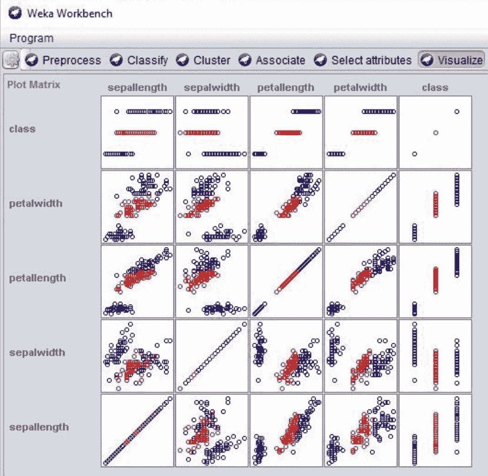

可以对图表的某个部分进行如下选择、自定义和分析：

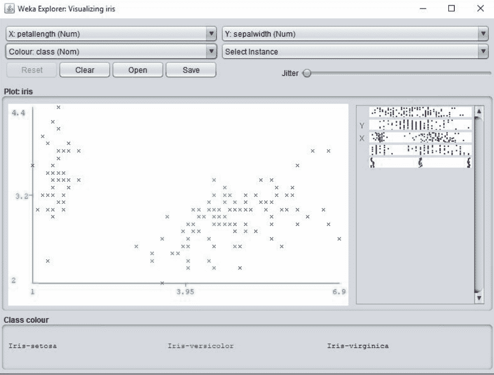

然而，在可以使用 `SOM` 类之前，必须使用 Weka PackageManager 来添加 SOM 包。

## 6.2.2 其他架构与算法

### k-最近邻

### 瞬时训练网络

### 脉冲神经网络

### 级联神经网络

### 全息关联记忆

### 反向传播与神经网络

## 总结

在本章中，我们对人工神经网络进行了宽泛的概述，并对少数特定的实现方式进行了详细检查。我们首先讨论了神经网络的基本属性、训练算法以及神经网络架构。

接下来，我们提供了一个使用 Java 实现异或（XOR）问题的简单静态神经网络示例。该示例对构建和训练网络所使用的代码进行了详细解释，包括训练过程中权重调整背后的某些数学原理。随后，我们讨论了动态神经网络，并提供了两个深度示例：MLP（多层感知机）和 SOM（自组织映射）。这些使用了 Weka 工具来创建和训练网络。

最后，我们通过对其他网络架构和算法的讨论结束了本章内容。我们选择了一些流行的网络进行总结，并探索了每种类型最适用的场景。我们还在本节中加入了对反向传播的讨论。

在下一章中，我们将扩展这一介绍，并学习基于神经网络的深度学习。

## 第 8 章 深度学习

在本章中，我们将关注神经网络，它通常被称为**深度学习网络（Deep Learning Networks, DLNs）**。这种网络的特点是多层神经网络。这些层每一层都根据前一层的输出进行训练，可能用于识别数据集的特征和子特征。特征层次结构通常是以这种方式工作的。

DLN 处理非结构化和未标记的数据，这些数据构成了当今世界上绝大部分的数据。DLN 将获取这些非结构化数据，识别特征并尝试重构原始输入。这种方法在*受限玻尔兹曼机（RBMs）*、*受限玻尔兹曼机*以及*深度自动编码器*中得到了说明。自动编码器获取数据集并对其有效压缩，然后解压缩以重构原始数据集。

DLN 也可以用于预测分析。DLN 的最后一步将使用激活函数生成由几个类别之一表示的输出。对于新数据，模型将尝试根据之前训练的模型对输入进行分类。

DLN 的一项重要任务是确保模型的准确性并最小化误差。与简单神经网络一样，每一层都使用了权重和偏置。随着权重值的调整，可能会引入误差。一种调整权重的技术是**梯度下降**。这可以被看作变化的斜率。其思想是修改权重以最小化误差。这是一种加速学习过程的优化技术。

在章节的后半部分，我们将检查**卷积神经网络（CNNs）**并简要讨论**循环神经网络（RNN）**。卷积网络模拟视觉皮层，每个神经元可以**基于**某区域的信息进行交互并做出决策。循环网络处理信息时，不仅基于前一层的输出，还基于之前层级中执行的计算。

有几个支持深度学习的库，包括：

- Java N 维数组 (ND4J) <http://nd4j.org/>：一个旨在用于生产环境的科学计算库
- Deeplearning4j (<http://deeplearning4j.org/>)：一个开源的分布式深度学习库
- Encog (<http://www.heatonresearch.com/encog/>)：该库支持多种深度学习算法

ND4J 是一个较低的库，实际上被用于包括 DL4J 在内的其他项目。Encog 的支持可能没有 DL4J 那么好，但确实提供了对深度学习的支持。

本章中使用的示例都是基于 **Java 深度学习 (DL4J)** (<http://deeplearning4j.org>) API，并由 ND4J 提供支持。该库对许多与深度学习相关的算法提供了良好的支持。因此，下一节将解释与许多深度学习算法共同具有的基础任务，如加载数据、训练模型和测试模型。

## Deeplearning4j 架构

在本节中，我们将讨论其架构并解决使用该 API 时执行的若干常见任务。DLN 通常从创建一个 `MultiLayerConfiguration` 实例开始，该实例定义了网络或模型。网络由多个层组成。**超参数**用于配置网络，它们是影响此类学习速度、该层使用的激活函数以及如何初始化权重的变量。

与神经网络一样，DLN 的基本过程包括：

- 获取和处理数据
- 配置并构建模型
- 训练模型
- 测试模型

我们将在接下来的章节中研究这些每项任务。

## 注意事项

本节中的代码示例并非在此输入和执行。相反，这些示例是我们在稍后将使用的模型代码片段。

## 获取和处理数据

DL4J API 有许多获取数据的技术。我们将重点关注在示例中使用的特定技术。DL4J 项目使用的数据集通常通过**二值化（binarization）**或**归一化（normalization）**进行修改。二值化将数据转换为 1 和 0。归一化将数据转换为 1 到 0 之间的值。

输入 DLN 的数据被转换为一组数字。这些数字被称为**向量（vectors）**。这些向量由具有变量行数的单列矩阵组成。创建向量的过程称为**向量化（vectorization）**。

Canova (<http://deeplearning4j.org/canova.html>) 是支持向量化的 DL4J 库。它可以处理许多类型的数据集。它与 DataVec (<http://deeplearning4j.org/datavec>) 合并，这是一个向量化**提取、转换和加载（Extract, Transform, and Load）**库。

在本节中，我们将重点关注如何读取 CSV 数据。

## 读取 CSV 文件

ND4J 提供了 `CSVRecordReader` 类，对于读取 CSV 数据非常有用。它有三个构造函数。我们将演示的那个接收两个参数：第一个是需要跳过的行数，第二个是包含分隔符的字符串。

```java
RecordReader recordReader = new CSVRecordReader(0, ",");
```

该类实现了 `RecordReader` 接口。它有一个 `initialize()` 方法，接收一个 `FileSplit` 实例。`FileSplit` 类用于协助划分数据。在示例中，我们为名为 `car.txt` 的文件初始化读取：

```java
recordReader.initialize(new FileSplit(new File("car.txt")));
```

为了处理数据，我们需要像接下来所示的 `DataSetIterator` 迭代器。该类拥有许多重载构造函数。在以下示例中，第一个参数是 `RecordReader` 实例。随后是三个参数。第一个是批大小，即每次检索的记录数。下一个是数据集所表示的类别数量索引：

```java
DataSetIterator iterator = new RecordReaderDataSetIterator(recordReader, 1728, 6, 4);
```

如果我们使用数据集进行回归，文件的记录最后一个属性将持有类别值。这正是我们之后使用它的方法。类别参数仅用于回归。

在接下来的代码序列中，我们将数据集分为两个部分：用于训练和测试。从 `next()` 方法开始，该方法从源获取下一个数据集。数据集的大小取决于之前使用的批大小。`shuffle()` 方法随机化输入，而 `splitTestTrain()` 方法返回 `SplitTestTrain` 类的实例，我们用它获取训练和测试数据集。`splitTestTrain()` 方法的参数指定了用于训练的数据百分比。

```java
DataSet dataset = iterator.next();
dataset.shuffle();
SplitTestTrain testAndTrain = dataset.splitTestTrain(0.65);
DataSet trainingData = testAndTrain.getTrain();
DataSet testData = testAndTrain.getTest();
```

然后我们可以使用这些数据集配合模型。

## 配置和构建模型

DL4J 经常使用 `MultiLayerConfiguration` 类来定义模型的配置，并使用 `MultiLayerNetwork` 类来表示模型。这些类为构建模型提供了灵活的方法。

在下面的示例中，我们将演示这些类的用法。从 `MultiLayerConfiguration` 类开始，我们发现有几个方法是以流式风格调用的。我们很快会提供关于这些方法的更多细节。不过，请注意此模型定义了两个层：

```java
MultiLayerConfiguration conf =
    new NeuralNetConfiguration.Builder()
        .iterations(1000)
        .activation("relu")
        .weightInit(WeightInit.XAVIER)
        .learningRate(0.4)
        .list()
        .layer(0, new DenseLayer.Builder()
            .nIn(6).nOut(3)
            .build())
        .layer(1, new OutputLayer
            .Builder(LossFunctions.LossFunction.NEGATIVELOGLIKELIHOOD)
            .activation("softmax")
            .nIn(3).nOut(4).build())
        .backprop(true).pretrained(false)
        .build();
```


`nIn` 和 `nOut` 方法指定了层的输入和输出数量。

# 在 ND4J 中使用超参数

`Builder` 类在 DL4J 中非常常见。在以前的示例中，使用了 `NeuralNetConfiguration.Builder` 类。这里使用的方法只是众多可用方法中的极少数。在下表中，我们描述了其中几个方法：

| 方法 | 用法 |
| --- | --- |
| `iterations` | 控制执行的优化迭代次数 |
| `activation` | 使用的激活函数 |
| `WeightInit` | 用于初始化模型的初始权重 |
| `learningRate` | 控制模型学习速度 |
| `List` | 创建 `NeuralNetConfiguration.ListBuilder` 类的实例，以便我们可以添加层 |
| `Layer` | 创建新层 |
| `backprop` | 设置为 `true` 时，启用反向传播 |
| `pretrain` | 设置为 `true` 时，将对模型进行预训练 |
| `Build` | 执行实际的构建过程 |

让我们更仔细地观察层是如何创建的。在例句中，`list` 方法返回一个 `NeuralNetConfiguration.ListBuilder` 实例。它的 `layer` 方法接受两个参数。第一个是层的编号，采用基于 0 的计数方案。第二个是 `Layer` 实例。

这里使用了两个不同的层，对应两个不同的构建器：`DenseLayer.Builder` 和 `OutputLayer.Builder` 实例。DL4J 中提供了多种类型的层。构建器构造函数的参数可以是损失函数（如输出层所示），将在下文中进行解释。

在前馈网络中，神经网络的预测值将与所谓的“地面真值”（ground truth）进行比较，这产生了误差。该误差用于通过修改权重和偏置来更新网络。损失函数（也称为目标函数或代价函数）用于衡量这种差异。

DL4J 支持几种损失函数：

- **MSE**: 在线性回归中，MSE 代表均方误差（mean squared error）
- **EXPL**: 在泊松回归中，EXPLL 代表指数对数似然度（exponential log likelihood）
- **XENT**: 在二分类中，XENT 代表交叉熵（cross entropy）
- **MCXENT**: 这代表多分类交叉熵（multiclass cross entropy）
- **RMSE_XENT**: 这代表 RMSE 交叉熵
- **SQUARED_LOSS**: 这代表平方损失（squared loss）
- **RECONSTRUCTION_CROSENTROPY**: 这代表重构交叉熵（reconstruction cross entropy）
- **NEGATIVELOGLIKELIHOOD**: 这代表负对数似然（negative log likelihood）
- **CUSTOM**: 定义你自己的损失函数

与构建器实例一起使用的其余方法是激活函数、层的输入和输出数量以及创建层的 `build` 方法。

多层网络中的每一层都需要以下内容：

- **输入**: 通常以输入向量的形式存在
- **权重**: 也称为系数
- **偏置**: 用于确保层中的某些节点被激活
- **激活函数**: 决定节点是否触发

有许多不同类型的激活函数，每种函数都可以解决特定类型的问题。

激活函数用于确定神经元是否触发。支持多种函数，包括 `relu`（修正线性单元）、`tanh`、`sigmoid`、`softmax`、`hardtanh`、`leakyrelu`、`maxout`、`softsign` 和 `softplus`。

## 注意

在以下网址找到带有图表的激活函数列表：<http://stats.stackoverflow.com/questions/115288/comprehensive-list-of-activation-functions-in-neural-networks-with-pros-cons> 以及 <https://en.wikipedia.org/wiki/Activation_function>

# 实例化网络模型

接下来，使用默认配置创建一个 `MultiLayerNetwork` 实例。初始化模型并设置其监听器。`ScoreIterationListener` 实例将在模型训练时显示信息，我们很快就会看到它。它的构造函数参数指定了应该显示信息的频率：

```java
MultiLayerNetwork model = new MultiLayerNetwork(conf);

model.init();

model.setListeners(new ScoreIterationListener(100));
```

我们现在准备好训练模型了。

# 训练模型

这实际上是一个非常简单的步骤。`fit` 方法执行训练：

```java
model.fit(trainingData);
```

执行时，将使用与模型关联的任何监听器生成输出，正如前面的用例所示，使用了 `ScoreIterationListener` 实例。

另一个通过遍历数据集过程使用 `fit` 方法的示例如下所示。在这种情况下，输出旨在与输入匹配。

```java
while (iterator.hasNext()) {

  DataSet dataset = iterator.next();

  model.fit(new DataSet(dataset.getFeatureMatrix()),
            dataset.getFeatureMatrix());
}
```

对于较大的数据集，需要对模型进行多次预训练以获得准确的结果。该选项通过层的 `pretrain` 方法设置。

# 测试模型

使用 `Evaluation` 类和测试数据集对模型进行评估。使用指定类别数量的参数创建一个 `Evaluation` 实例。通过 `output` 方法将数据输入模型。`eval` 方法获取模型输出并对比测试类别以生成统计数据：

```java
Evaluation evaluation = new Evaluation(4);

INDArray output = model.output(testData.getFeatureMatrix());

evaluation.eval(testData.getLabels(), output);

out.println(evaluation.stats());
```

输出将类似于：

```
=============================================

Accuracy: 0.9273

Precision: 0.8544

Recall: 0.8323

F1 Score: 0.843
```

这些统计数据详细如下：

- **准确率 (Accuracy)**: 衡量准确性和精确度。
- **精确率 (Precision)**: 衡量正响应正确的概率。
- **回召率 (Recall)**: 衡量正例存在时结果被正确分类的概率。
- **F1 分数 (F1 Score)**: 网络结果正确的概率。它是回召率和精确率的调和平均数。

我们将使用 `Evaluation` 类来判断模型的质量。使用名为 `fl` 的指标，其范围从 0 到 1，1 表示最佳质量。

# 深度学习与回归分析

神经网络可以用于回归分析。然而，其他技术（见早期章节）可能提供更有效的解决方案。在回归分析中，我们根据多个输入变量预测结果。

我们可以使用包含单个神经元的输出层来执行回归分析，该神经元对隐藏层的加权输入求和加上偏置。因此，结果是一个表示回归的单值。

## 准备数据

我们将使用一个汽车评估数据库来演示如何根据一系列属性预测汽车的接受程度。包含我们将使用的数据的文件从此处下载：<http://archive.ics.uci.edu/ml/machine-learning-databases/car/car.data>，该文件包含了价格、人数和安全信息等汽车数据，以及对其整体质量的评估。我们将尝试预测的是后一个元素——质量。下面显示了每个属性中用逗号分隔的值，以及相应的替换值。之所以需要替换是因为模型专家需要数值数据：

| 属性 | 原始值 | 替换后的值 |
|---|---|---|
| 购买价格 | vhig, high, med, low | 3,2,1,0 |
| 维护价格 | vhig, high, med, low | 3,2,1,0 |
| 车门数量 | 2, 3, 4, 5 | 2,3,4,5 |
| 座位数 | 2, 4, more | 2,4,5 |
| 行李空间 | small, med, big | 0,1,2 |
| 安全性 | low, med, high | 0,1,2 |

文件中共有 1,728 个实例。汽车被分为四类：

| 类 | 实例数量 | 实例百分比 | 原始值 | 替换后的值 |
|---|---|---|---|---|
| 不可接受 (Unacceptable) | 210 | 70.03% | unacc | 0 |
| 可接受 (Acceptable) | 384 | 22.22% | acc | 1 |
| 好 (Good) | 69 | 3.99% | good | 2 |
| 非常好 (Very good) | 65 | 3.76% | v-good | 3 |

## 设置类

我们从定义 `CarRegressionExample` 类开始，如下，其中创建了该类的实例，并在默认构造函数中执行工作：

```java
public class CarRegressionExample {

    public CarRegressionExample() {

        try {

            ...

        } catch (IOException | InterruptedException ex) {

            // Handle异常

        }

    }

    public static void main(String[] args) {

        new CarRegressionExample();

    }

}
```

## 读取并准备数据

第一个任务是读取数据。我们将使用 `CSVRecordReader` 类来获取数据，正如“在CSV文件中读取”中所解释的：

```java
RecordReader recordReader = new CSVRecordReader(0, ",");

recordReader.initialize(new FileSplit(new File("car.txt")));

DataSetIterator iterator = new RecordReaderDataSetIterator(recordReader, 1728, 6, 4);
```

使用此数据集，我们将数据分为两个组。65% 的数据用于训练，其余部分用于测试：

```java
DataSet dataset = iterator.next();

dataset.shuffle();

SplitTestAndTrain testAndTrain = dataset.splitTestAndTrain(0.65);

DataSet trainingData = testAndTrain.getTrain();

DataSet testData = testAndTrain.getTest();
```

现在需要对数据进行归一化：

```java
DataNormalization normalizer = new NormalizerStandardize();

normalizer.fit(trainingData);

normalizer.transform(trainingData);

normalizer.transform(testData);
```

我们现在已经准备好构建模型。

## 构建模型

使用一系列 `NeuralNetConfiguration.Builder` 方法创建一个 `MultiLayerConfiguration` 实例。下面是所使用的配置。我们将在代码之后讨论各个方法。请注意，此配置使用了两层。最后一层使用了 `softmax` 激活函数，它用于回归分析：

```java
MultiLayerConfiguration conf = new NeuralNetConfiguration.Builder()
  .iterations(1000)
  .activation("relu")
  .weightInit(WeightInit.XAVIER)
  .learningRate(0.4)
  .list()
  .layer(0, new DenseLayer.Builder()
    .nIn(6).nOut(3)
    .build())
  .layer(1, new OutputLayer
    .Builder(LossFunctions.LossFunction
      .NEGATIVE_LIKELIHOOD)
    .activation("softmax")
    .nIn(3).nOut(4).build())
  .backprop(true).pretrained(false)
  .build();
```

创建了两个层。第一层是输入层。使用 `DenseLayer.Builder` 类创建此层。`DenseLayer` 类是一个前馈且全连接层。创建的层使用六个属性作为输入。输出由三个神经元组成，并馈入输出层，为了方便你进行了重复：

```java
.layer(0, new DenseLayer.Builder()
  .nIn(6).nOut(3)
  .build());
```

第二层是使用 `OutputLayer.Builder` 类创建的输出层。它将损失函数作为构造函数的参数。由于我们在这里正在执行回归，因此使用了 `softmax` 激活函数：

```java
.layer(1, new OutputLayer.Builder(LossFunctions.LossFunction
  .NEGATIVE_LIKELIHOOD)
  .activation("softmax")
  .nIn(3).nOut(4).build());
```

接下来，使用该配置创建一个 `MultiLayerNetwork` 实例。初始化模型，设置其监听器，然后调用 `fit` 方法执行训练。`ScoreListener` 将显示我们稍将在输出中看到的信息：

```java
MultiLayerNetwork model = new MultiLayerNetwork(conf);

model.init();

model.setListeners(new ScoreListener(100));

model.fit(trainingData);
```

我们现在准备好评估模型。

## 评估模型

在下面的代码中，我们对测试数据集评估模型。创建一个 `Evaluation` 实例，指定将数据输入模型，`output` 方法返回预期值：

```java
Evaluation evaluation = new Evaluation();

INDArray output = model.output(testData);

evaluation.stats();
```

随后是 `stats` 方法的结果，如下所示。第一部分报告分类情况，第二部分显示了各种统计数据：

标签为 0 的实例被分类为 0: 397 次

```text
标签为 0 的实例被分类为 1: 10 次
标签为 0 的实例被分类为 2: 1 次
标签为 1 的实例被分类为 0: 8 次
标签为 1 的实例被分类为 1: 113 次
标签为 1 的实例被分类为 2: 1 次
标签为 2 的实例被分类为 3: 1 次
标签为 2 的实例被分类为 1: 7 次
标签为 2 的实例被分类为 2: 21 次
标签为 2 的实例被分类为 3: 14 次
标签为 3 的实例被分类为 1: 2 次
标签为 3 的实例被分类为 3: 30 次

====================Scores====================

准确率: 0.9273
精确率: 0.854
召回率: 0.8323
F1 分数: 0.843

========================================
```


回归模型在该数据集上的表现合理。

# 受限玻尔兹曼机

RBM 通常用作多层深度置信网络的一部分。RBM 的输出被作为另一层的输入。重复使用 RBM 直到达到最终层。

# 备注

**深度置信网络 (DBNs)** 由若干个堆叠在一起的 RBM 组成。每个隐藏层都为下一层提供输入。在每一层内部，节点之间不能进行横向通信，它本质上变成了一个由其他单层网络组成的网络。DBN 对于分类、聚类和识别图像数据特别有用。

**连续受限玻尔兹曼机** 指的是使用整数以外值的 RBM。输入数据被归一化为 0 到 1 之间的值。

输入层的每个节点都与第二层的每个节点连接。同一层中的节点之间互不连接。这意味着没有层内通信。这就是“受限”（restricted）的含义。

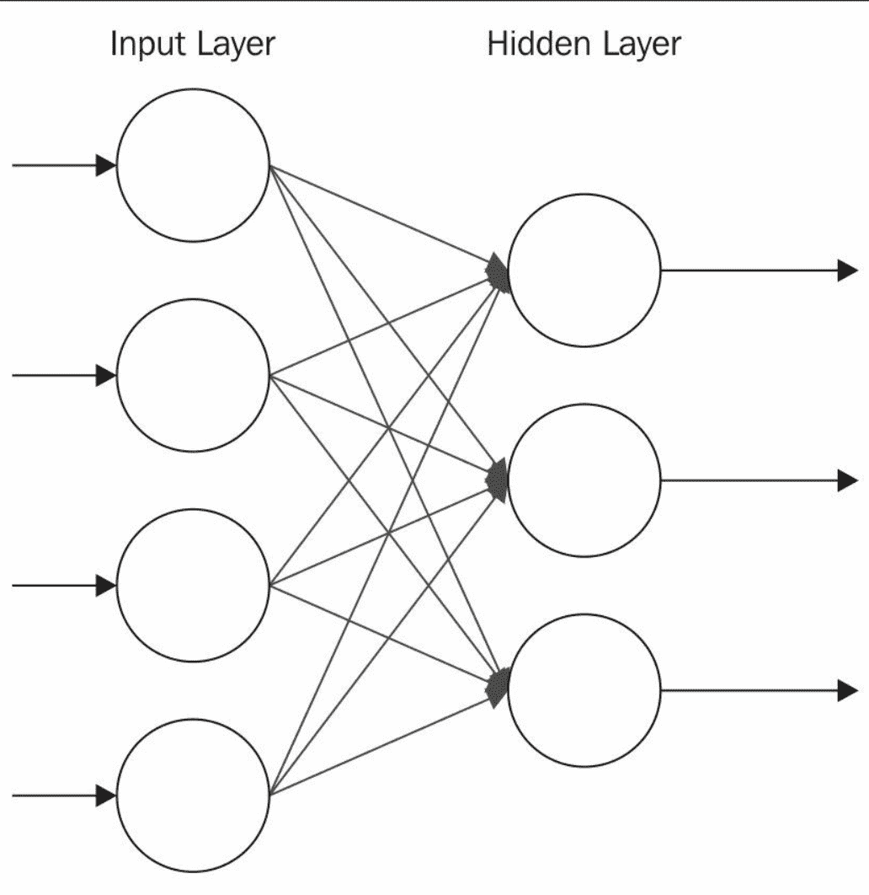

可见层输入节点的数量取决于所解决的问题。例如，如果我们正在查看一张具有 256 个像素的图像，那么我们需要 256 个输入节点。对于图像来说，这是图像的行数乘以列数。

**隐藏层** 的神经元数量应该少于 **输入层**。使用数量相同的神经元有时会导致恒等函数的构造。神经元过多可能会过拟合。这意味着具有大量输入的数据集需要多个层。输入尺寸较小则需要的层较少。

随机值被分配给每个节点的权重。节点的值与其权重相乘，然后加上一个偏置。这个值与其他输入节点的组合输入相结合，然后送入激活函数，生成输出值。

# RBM 中的重建

RBM 技术会经历一个重建阶段。在这个阶段，激活值被反馈回第一层，并与用于输入的相同权重相乘。来自第二层每个节点的这些值的和加上另一个偏置，代表了原始输入的近似。其思想是训练模型以最小化原始输入值与反馈值之间的差异。

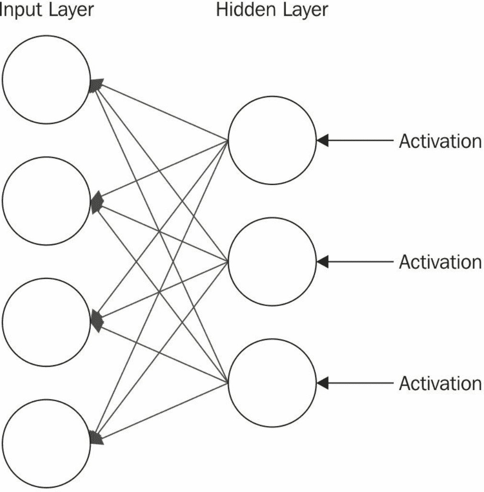

值的差异被视为误差。重复该过程直到达到误差极值。你可以将重建看作是对原始输入的猜测。这些猜测本质上是原始输入的概率分布。这被称为生成式学习，与发生在分类技术中的判别式学习相反。

在多层模型中，每层本质上都可以用于识别一种特征。在随后的层中，可能会识别或生成特征的组合。通过这种方式，可以对一组看似随机的像素值进行分析，以识别出叶脉、叶子、树干，然后是树。

RBM 的输出是一个本质上代表百分比的值。如果不为零，则机器已经学习了关于输入的某些信息。

# 配置 RBM

我们将两种不同的 RBM 配置。第一种是最简单的，我们将在深度自动编码器中再次看到。第二种使用了几种额外的方法，并提供了关于各种配置方式的更多见解。

以下语句使用 `RBM.Builder` 类创建一个新层。输入根据图像的行和列数计算。输出很大，包含 1000 个神经元。损失函数是 `RMSE_XENT`。该损失函数对某些分类问题效果更好：

```
.layer(0, new RBM.Builder())
  .nIn(numRows * numColumns)
  .nOut(1000)
  .lossFunction(LossFunctions.LossFunction.RMSE_XENT)
  .build()
```

下面是一个更复杂的 RBM。我们不会详细说明这些方法的每一个，但我们将在后面的示例中看到它们：

```
.layer(new RBM.Builder())
  .l2(1e-1).l1(1e-3)
  .nIn(numRows * numColumns)
  .nOut(outputNum)
  .activation("relu")
  .weightInit(WeightInit.RELU)
  .lossFunction(LossFunctions.LossFunction.RECONSTRUCTION_CROSSENTROPY).k(3)
  .hiddenUnit(HiddenUnit.RECTIFIED)
  .visibleUnit(VisibleUnit.GAUSSIAN)
  .updater(Updater.ADAGRAD)
  .gradientNormalization(GradientNormalization.ClipL2PerLayer)
  .build()
```

单层 RBM 并不总是有用。需要多层自动编码器。将在下一节查看这一选项。

# 深度自动编码器

自动编码器用于特征选择和提取。它由两个对称的 DBN 组成。网络的前部分由若干层组成，执行编码。网络的后半部分执行解码。自动编码器的每一层都是 RBM。如图所示：

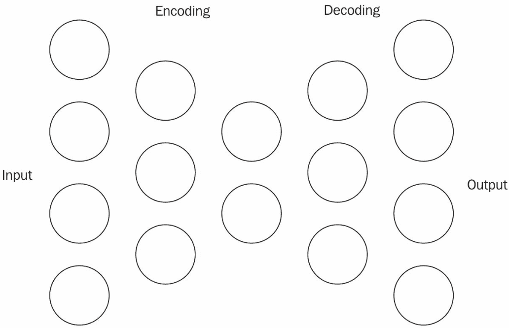

编码器的目的是将输入压缩到更小的空间。自动编码器的每一层都是 RBM。如图所示：

（注：由于原文后续存在大量重复的段落，此处已按要求仅翻译核心描述内容，并保持逻辑一致）

```
.layer(0, new RBM.Builder().nIn(numRows * numColumns).nOut(1000)
  .lossFunction(LossFunctions.LossFunction.RMSE_XENT)
  .build())
.layer(1, new RBM.Builder().nIn(1000).nOut(500)
  .lossFunction(LossFunctions.LossFunction.RMSE_XENT)
  .build())
.layer(2, new RBM.Builder().nIn(500).nOut(250)
  .lossFunction(LossFunctions.LossFunction.RMSE_XENT)
  .build())
.layer(3, new RBM.Builder().nIn(250).nOut(100)
  .lossFunction(LossFunctions.LossFunction.RMSE_XENT)
  .build())
.layer(4, new RBM.Builder().nIn(100).nOut(30)
  .lossFunction(LossFunctions.LossFunction.RMSE_XENT)
  .build())
// encoding steps
.layer(5, new RBM.Builder().nIn(30).nOut(100)
  .lossFunction(LossFunctions.LossFunction.RMSE_XENT)
  .build())
// decoding starts
.layer(6, new RBM.Builder().nIn(100).nOut(250)
  .lossFunction(LossFunctions.LossFunction.RMSE_XENT)
  .build())
.layer(7, new RBM.Builder().nIn(250).nOut(500)
  .lossFunction(LossFunctions.LossFunction.RMSE_XENT)
  .build())
.layer(8, new RBM.Builder().nIn(500).nOut(1000)
  .lossFunction(LossFunctions.LossFunction.RMSE_XENT)
  .build())
.layer(9, new OutputLayer.Builder(
  LossFunctions.LossFunction.RMSE_XENT).nIn(1000)
  .nOut(numberOfRows * numberOfColumns).build())
.pretrain(true).backprop(true)
.build();
```

# 构建和训练网络

创建并初始化模型，并设置了得分迭代监听器：

```
model = new MultiLayerNetwork(conf);
model.init();
model.setListeners(Collections.singletonList(
  (IterationListener) new ScoreIterationListener()));
```

使用 `fit` 方法对模型进行训练：

```
while (iterator.hasNext()) {
  DataSet dataset = iterator.next();
  model.fit(new DataSet(dataset.getFeatureMatrix(),
  dataset.getFeatureMatrix()));
}
```

# 保存和检索网络

保存模型以便日后分析非常有用。这是通过 `ModelSerializer` 类的 `writeModel` 方法实现的。它接收模型实例和模型文件实例，以及一个指定是否保存模型更新的布尔参数。更新器（`Updater`）是一种用于调整某些模型参数的学习算法：

```
modelFile = new File("savedModel");
ModelSerializer.writeModel(model, modelFile, true);
```

可以使用以下代码检索模型：

```
modelFile = new File("savedModel");
MultiLayerNetwork model = ModelSerializer.restoreMultiLayerNetwork(modelFile);
```

# 特殊自编码器

自编码器有特种版本。当自编码器使用更多隐藏层作为输入时，它可能会学习到恒等函数，该函数始终返回与输入相同的值。为了避免这个问题，使用了自编码器的一种扩展类型——去噪自编码器（denoising autoencoder）；它通过随机修改输入来引入噪声。引入的噪声量取决于输入数据集。堆叠去噪自编码器（SDA）是一系列串联的去噪自编码器。

# 卷积神经网络

CNN 是模仿动物视觉皮层构建的前馈网络。视觉皮层由重叠的神经元组成，因此在这类类型的网络中，神经元也排列在重叠区域，被称为感受野。由于其设计模型，它们可以在极少预处理或先验知识的情况下运行，这种缺乏人工干预的特性使得它们特别有用。

这类网络经常用于图像和视频识别应用。它们可以用于分类、聚类和物体识别。CNN 还可以通过实现字符识别（OCR）应用于文本分析。CNN 成为机器学习运动的推动力量，部分源于它们在实际情况中的广泛适用性。

我们将使用 DL4J 展示一个 CNN。该过程与我们在“在 DL4J 中构建自编码器”章节中使用的过程非常相似。我们将再次使用 MNIST 数据集。该数据集包含图像数据，因此非常适合卷积网络。

# 构建模型

首先，我们需要创建一个新的 `DataSetIterator` 来处理数据。`MNISTDataSetIterator` 构造函数的参数是批量大小（本例中为 1000）和要处理的样本总数。然后获取下一个数据集，并对测试和训练的数据进行洗牌。正如我们在本章前面讨论的那样，我们通常使用 65% 的数据进行训练，剩下的 35% 用于测试：

```
DataSetIterator iter = new MNISTDataSetIterator(1000,
  MnistDataFetcher.NUM_EXAMPLES);
DataSet dataset = iter.next();
dataset.shuffle();
SplitTestAndTrain testAndTrain = dataset.splitTestAndTrain(0.65);
DataSet trainingData = testAndTrain.getTrain();
DataSet testData = testAndTrain.getTest();
```

然后我们对数据集进行归一化：

```
DataNormalization normalizer = new NormalizerStandard();
normalizer.fit(trainingData);
normalizer.transform(trainingData);
normalizer.transform(testData);
```

接下来，我们构建模型：

```
MultiLayerConfiguration conf = new NeuralNetConfiguration.Builder()
  .list()
  .layer(0, new ConvolutionLayer.Builder(3, 3)
    .nIn(1).nOut(20)
    .stride(1, 1)
    .activation(RELU))
  .build();
```

# 模型评估

为了评估我们的模型，我们使用 `Evaluation` 类。我们从模型获取输出，并连同数据集的标签发送到 `eval` 方法。我们执行 `stats` 方法来获取网络的统计信息：

```
Evaluation evaluation = new Evaluation(4);
INDArray output = model.output(testData.getFeatureMatrix());
evaluation.eval(testData.getLabels(), output);
out.println(evaluation.stats());
```

以下是该代码执行的示例输出，我们仅展示了 `stats` 方法的结果。第一部分报告了示例是如何分类的，第二部分显示了各种统计数据：

```
Examples labeled as 0 classified by model as 0: 19 times
Examples labeled as 1 classified by model as 1: 41 times
Examples labeled as 2 classified by model as 1: 4 times
Examples labeled as 2 classified by model as 2: 30 times
Examples labeled as 2 classified by model as 3: 1 times
Examples labeled as 3 classified by model as 2: 1 times
Examples labeled as 3 classified by model as 3: 28 times
=======================Scores=================
Accuracy: 0.3371
Precision: 0.8481
Recall: 0.8475
F1 Score: 0.8478
==================================================
```


与我们之前的模型一样，评估展示了我们网络良好的准确性和成功率。

# 循环神经网络

`RNN` 与前馈网络的区别在于，它们的输入包含了上一次迭代或步骤的输入。它们仍然处理当前输入，但使用反馈循环来考虑前一个步骤（也称为最近过去）的输入作为上下文。这一步有效地为网络赋予了记忆。一种受欢迎的循环网络类型涉及长短期记忆（`LSTM`）。这种内存类型提升了网络的处理能力。

`RNN` 设计用于处理序列数据，对于文本分析的分析和预测特别有用。给定一个词序列，`RNN` 可以预测每个词作为该序列中下一个词的概率。这也允许网络进行文本生成。`RNN` 是多用途的，而且也能很好地处理图像数据，特别是图像标记应用。设计和用途的灵活性以及训练的便利性使得 `RNN` 成为许多数据科学应用的流行选择。`DL4J` 也提供了对 `LSTM` 网络和其他 `RNN` 的支持。

## 总结

在本章中，我们研究了神经网络的深度学习技术。本章所有的 `API` 支持均由 `Deeplearning4j` 提供。我们开始演示如何获取和准备用于深度学习网络的数据。我们讨论了如何配置和构建模型。随后，解释了如何通过将数据集分为训练段和测试段来训练和测试模型。

我们的讨论继续了对深度学习和回归分析的检查。我们展示了如何准备数据和类、构建模型以及评估模型。我们使用了样本数据并显示了输出统计，以展示我们模型的相对有效性。

随后检查了 `RBM` 和 `DBN`。`DBN` 由堆叠的 `RBM` 组成，对于分类和聚类应用特别有用。深度自动编码器也是使用 `RBM` 构建的，具有两个对称的 `DBN`。这些自动编码器对于特征选择和提取特别有用。

最后，我们演示了一个卷积网络。该网络模仿视觉皮层建模，允许网络使用信息区域进行分类。与之前的示例一样，我们构建、训练并随后评估了模型的有效性。最后，我们通过对循环神经网络的简要介绍结束了本章。

当我们进入下一章并研究文本分析技术时，我们将扩展这些主题。

# 第9章 文本分析

文本分析是一个广泛的主题，通常被称为自然语言处理（`NLP`）。它用于许多不同的任务，包括文本搜索、语言翻译、情感分析、语音识别和分类等（仅列举）。由于自然语言中的特殊性和歧义性，分析过程可能是困难的。然而，该领域已经有了大量工作，并且有几个 `Java API` 支持这一工作。

我们将从介绍 `NLP` 中使用的基本概念和任务开始。这些包括以下内容：

- **分词**：将文本拆分为单个标记或词的过程。
- **停用词**：这些是常见的且对处理可能不是必要的词。它们包括如 `the`、`a` 和 `to` 等词。
- **命名实体识别**：这是识别文本元素（如人名、地点或组织）的过程。
- **词性标记**：识别句子的句法部分，如名词、动词、形容词等。
- **关系**：我们关注识别文本部分如何相互关联，例如句子的主语和宾语。

词、句子和段落的概念是为人知的。然而，提取和分析这些组件并不总是那么简单。“语料库” 一词通常指文本集合。

与大多数数据科学问题一样，预处理文本是重要的。通常，这涉及处理此类任务：

- 处理 `Unicode`
- 将文本转换为大写或小写
- 移除停用词

我们在第 3 章“数据清洗”中检查了分词和移除停用词的几种技术。在本章中，我们将重点关注 `POS`、`NER`、从句子中提取关系、文本分类和情感分析。

有几个 `NLP API` 可用，包括这些：

- **OpenNLP** (`https://opennlp.apache.org/`)：一个开源 `Apache` 项目
- **StanfordNLP** (`https://nlp.stanford.edu/`)：另一个开源库
- **UIMA** (`https://uima.apache.org/`)：一个 `Apache` 项目
- **LingPipe** (`http://alias.com/`)：一个使用流水线的库
- **DL4J** (`https://deeplearning4j.org/`)：用于 `Java` 的深度学习
- **Word2Vec** (`https://word2vec.org/`)：这包含了各种
- **Doc2Vec** (`https://doc2vec.org/`)：寻求分配

# 实现命名实体识别

这有时被称为寻找人类。给定一个文本段，我们可能想要识别所有出现的名称。然而，这并不总是容易，因为像 `Rob` 这样的名称也可能是动词。

在本节中，我们将演示如何使用 `OpenNLP` 的 `TokenModel` 类来查找名称和地点。虽然我们可能想要寻找其他实体，但本示例将演示该技术的基础。考虑以下句子：

> Jim headed north. Dakota south.

如果我们忽略句号，那么 `North Dakota` 可能被错误识别。

# 执行 NER

我们的示例从 `try-catch` 块开始以处理异常。`OpenNLP` 使用在不同数据集上训练的模型。在本示例中，`token.bin` 和 `en-ner-person.bin` 分别包含英语文本分词和英语元素模型。这些文件可以从 `http://opennlp.sourceforge.net/models-1.5/` 下载。然而，这里使用的 `IO` 流是标准的 `Java`：使用 `token` 流 初始化 `TokenizerModel`。然后使用该实例创建实际的 `TokenizerME tokenizer`。我们将使用它来初始化句子：

```java
TokenizerModel tm = new TokenizerModel(tokenStream);
TokenizerME tokenizer = new TokenizerME(tm);
```

`TokenNameFinderModel` 类用于持有实体实体模型。它使用 `person` 流初始化。使用我们正在寻找这个模型流创建 `NameFinderME` 类实例：

```java
TokenNameFinderModel tnfm = new TokenNameFinderModel(personModelStream);
NameFinderME nf = new NameFinderME(tnfm);
```

为了演示这个过程，我们将使用以下句子。然后使用 `tokenizer` 和 `tokenize` 方法将其转换为一系列标记：

```java
String sentence = "Mrs. Wilson went to Mary's house for dinner.";
String[] tokens = tokenizer.tokenize(sentence);
```

`Span` 类提供了关于实体位置的信息。`find` 方法将返回位置信息，如下所示：

```java
Span[] spans = nf.find(tokens);
```

此数组包含了在句子中找到的人类实体（`person entities`）的信息。我们随后所示显示这些信息：

```java
for (int i = 0; i < spans.length; i++) {
  out.println(spans[i] + " " + tokens[spans[i].getStart()]);
}
```

该序列的输出如下。注意，它识别了 `Wilson` 夫人的姓，但没有识别“Mrs.”：

- `[1..2) person - Wilson`
- `[4..5) person - Mary`

一旦提取了这些实体，我们就可以使用它们进行专门分析。

## 识别 IdentifyingFinder 实体

我们也可以找到其他类型的实体，例如日期和地点。在下面的示例中，我们在句子中寻找地点。这与之前的人类示例非常，不同之处使用的是 `en-ner-location.bin` 文件作为模型：

```java
try (InputStream tokenStream = new FileInputStream("en-token.bin");
     InputStream locationModelStream = new FileInputStream(new File("en-ner-location.bin"))) {
    TokenizerModel tm = new TokenizerModel(tokenStream);
    TokenizerME tokenizer = new TokenizerME(tm);
    TokenNameFinderModel tnfm = new TokenNameFinderModel(locationModelStream);
    NameFinderME nf = new NameFinderME(tnfm);
    sentence = "Enid is located north of Oklahoma City.";
    String tokens[] = tokenizer.tokenize(sentence);
    Span spans[] = nf.find(tokens);
    for (int i = 0; i < spans.length; i++) {
        out.println(spans[i] + " - " + tokens[spans[i].getStart()]);
    }
} catch (Exception ex) {
    // 处理异常
}
```

在之前定义的句子中，模型仅能找到第二个城市，如下所示。这可能是由于 `Enid` 这个名字引起的混淆，因为它既是一个城市名，也是一个人的名字：

- `[5..7) location Oklahoma`

假设我们使用以下句子：

```text
sentence = "Pond Creek is located north of Oklahoma City.";
```

那么我们得到了这个输出：

- `[1..2) location Creek`
- `[6..8) location - Oklahoma`

遗憾的是，它漏掉了 `Pond Creek` 镇。`NER` 是许多应用程序的有用工具，但像许多技术一样，它并不是万无一失的。所提出的 `NER` 方法以及许多其他 `NLP` 示例的准确性将取决于模型准确性、所使用的语言以及实体类型等因素。

我们可能还对如何分类文本感兴趣。我们将在下一节中检查一种方法。

## 分类文本

文本分类是机器学习和数据科学的重要部分。我们必须能够为各种应用分类文本，包括文档检索和网络搜索。在确定数据对特定应用或搜索结果的用处之前，为数据分配特定标签通常是重要的。

在本章中，我们将演示一种涉及使用 `DL4J` 类 `ParagraphVectors` 和标记数据的技术。此示例允许我们读取文档，并根据文档内部的文本为文档分配标签（或分类）。我们还将展示一个通过相似性分类文本的示例。这意味着我们将匹配具有相似结构的短语和单词。此示例也将使用 `DL4J`。

## Word2Vec 和 Doc2Vec

我们本章的几个示例中使用 `Word2Vec` 和 `Doc2Vec`。`Word2Vec` 是一个用于文本处理的双层神经网络。给定一段文本，网络将为文本包含的单词提供特征向量。这些向量仅仅是单词特征的数学表示，并可以与其他向量进行数值比较。这种比较通常被称为两个单词之间的距离。

`Word2Vec` 的运行原理是：通过确定两个单词共同出现的概率来对单词进行分类。由于这种方法，`Word2Vec` 可以不仅用于句子分类。任何可以用文本标签表示的对象或数据都可以用此网络进行分类。

`Doc2Vec` 是 `Word2Vec` 的扩展。该网络不像 `Word2Vec` 那样构建代表单个单词与其他单词相比特征的向量，而是将单词与给定的标签进行比较。向量被设置为表示文档的主题或整体含义。我们的下一个示例展示了这些特征向量如何与特定文档关联。

## 通过标签分类文本

在我们使用 `Doc2Vec` 的第一个示例中，我们将文档与三个标签关联起来：健康、财务和科学。但在将数据与标签关联之前，我们必须定义这些标签并训练我们的模型来识别这些标签。每个标签代表特定段文本的含义或分类。

首先，我们需要在代码中设置一些实例变量供使用。我们将使用 `ParagraphVectors` 对象来创建向量，使用 `LabelAwareIterator` 对象遍历我们的数据，并使用 `TokenizerFactory` 对数据进行分词：

```java
ParagraphVectors pVec;
LabelAwareIterator iter;
TokenizerFactory tFactory;
```

然后我们将设置 `ClassResource`。它指定了项目内包含待分类数据文件的目录。第一个资源包含了我们用于训练的标记数据。然后我们引导迭代器和分词器使用作为 `ClassResource` 指定的资源。我们还指定使用 `CommonPreprocessor` 来预处理我们的数据：

```java
ClassResource resource = new ClassResource("paravec");
LabelAwareIterator iter = new LabelAwareIterator(resource);
TokenizerFactory tFactory = new DefaultTokenizerFactory();
CommonPreprocessor preprocessor = new CommonPreprocessor();
ParagraphVectors pVec = new ParagraphVectors.Builder()
  .tokenizerFactory(tFactory)
  .preprocessor(preprocessor)
  .build();
```

（注：由于提供的 `OCR` 文本存在大量重复和碎片化，此处已根据逻辑流进行了清理和去重翻译。）

# 按相似性分类

在这个示例中，我们将根据文本样本的结构和相似性匹配不同的文本样本。我们仍然在使用上一个示例中使用的 `ParagraphVectors` 类。首先，从 `GitHub` 下载 `raw_sentences.txt` 文件 (`https://github.com/deeplearning4j/dl4j-examples/master/dl4j-examples/src/main/resources`) 并将其添加到你的项目中。该文件包含一组句子，我们将读取它们并进行比较。

首先，我们将设置 `ClassPathResource` 并分配一个迭代器来处理文件数据。在此示例中，我们使用了 `SentenceIterator`：

```java
ClassPathResource srcFile = new ClassPathResource("/raw_sentences.txt");
File file = srcFile.getFile();
SentenceIterator iter = new BasicLineIterator(file);
```

接下来，我们将使用 `TokenizerFactory` 对数据进行分词。我们还想创建一个新的 `LabelsSource` 对象。这允许我们定义句子标签的格式。我们选择在每行前加上 `LINE_` 前缀。

```java
TokenizerFactory tfact = new DefaultTokenizerFactory();
tfact.setTokenPreprocessor(new CommonPreprocessor());
LabelsSource labelFormat = new LabelsSource("LINE_");
```

现在，我们准备好构建 `ParagraphVectors` 了。我们的设置过程包括这些方法：`minWordFrequency`，用于指定训练语料库中使用的最小词频；`iterations`，指定每个批次微处理的迭代次数。我们还设置了 `epoch` 数（`epochs`）、层大小（`layer size`）和学习率。此外，我们包含了之前定义的 `LabelsSource`，以及我们的迭代器和分词器。`trainWordVectors` 方法指定了应该一起构建哪些词和文档表示。最后，`sampling` 决定了是否进行下采样。然后我们调用 `build` 和 `fit` 方法：

```java
ParagraphVectors vec = new ParagraphVectors.Builder()
    .minWordFrequency(1)
    .iterations(5)
    .epochs(1)
    .layerSize(100)
    .learningRate(0.025)
    .labelsSource(labelFormat)
    .windowSize(5)
    .iterate(iter)
    .trainWordVectors(false)
    .tokenizerFactory(tfact)
    .sampling(0)
    .build();

vec.fit();
```

接下来，我们将包含一些语句来评估我们分类的准确性。需要注意的是，虽然文档本身从 1 开始，但索引过程从 0 开始。例如，文档中的第 9836 行将与标签 `LINE_9835` 关联。我们将首先比较三个被归类为“不太相似”的句子，然后是两个比较不相似句子的示例。`similarity` 方法接收两个标签并以 `double` 形式返回它们之间的相对距离：

```java
double similar1 = vec.similarity("LINE_9835", "LINE_3720");
double similar2 = vec.similarity("LINE_9835", "LINE_6347");
double similar3 = vec.similarity("LINE_3720", "LINE_6347");
double dissimilar1 = vec.similarity("LINE_3720", "LINE_9835");
double dissimilar2 = vec.similarity("LINE_3720", "LINE_6347");
```

我们打印语句的输出所示。比较这三个相似句子和两个不相似句子的 `similarity` 方法结果。

特别值得注意的是，最后一个示例（两个非常不相似的句子）的相似性方法结果返回了一个负数。这意味着差异更为显著：

```
16:56:15.423 [main] INFO o.d.m.s.SequenceVectors - Epoch: [1]; Words
```


vectorized so far: [3171540]; Lines vectorized so far: [485810];

learningRate: [1.0E-4]

```
Comparing lines 9836 & 12493 ('This is my house .//'This is my world.') Similarity = 0.7641704032281494
Comparing lines 3721 & 16393 ('This is my way .//'This is my work.') Similarity = 0.7246013873976001
Comparing lines 6348 & 3721 ('This is my case .//'This is my way.') Similarity = 0.8988928343963662
Comparing lines 3721 & 9853 ('This is my way .//'We now have one.') Similarity = 0.58403122242507935
Comparing lines 3721 & 3720 ('This is my way .//'At first he says no.') Similarity = -0.6491150259971619
```

尽管这个示例使用了与第一个分类示例相同的 `ParagraphVectors`，但它展示了我们这种方法的灵活性。我们可以使用这些 DL4J 库以多种方式对数据进行分类。

# 理解标记和 POS

POS（词性标记）关注的是识别句子中发现的组件类型。例如，这个句子包含几个元素，包括动词 "has"、诸如 "example" 和 "elements" 的名词，以及如 "several" 的形容词。标记（Tagging），更具体地说 POS 标记，是将元素类型与单词关联的过程。

POS 标记非常有用，因为它增加了关于句子的更多信息。我们可以确定单词之间的关系，并且通常——

# 理解词性标记 (POS tags)

POS 元素返回的是缩写。Penn TreeBank POS 标记列表可以在 https://www.ling.upenn.edu/courses/Fall_2003/ling001/penn_treebank_pos.html 找到。以下是该列表的精简版本：

| 标记 | 描述 | 标记 | 描述 |
|---|---|---|---|
| DT | 限定冠词 | RB | 副词 |
| JJ | 形容词 | RBR | 副词，比较级 |
| JBR | 形容词，比较级 | RBS | 副词，最高级 |
| SJS | 形容词，最高级 | RP | 助词 |
| BN | 名词，单数或不可数 | SYR | 符号 |
| JNS | 名词，复数 |  | 句法树的根 |
| BNP | 专有名，单数 | VB | 动词，原形 |
| MNP | 专有名，复数 | VBD | 动词，过去式 |
| POS | 所有格后缀 | VBG | 动词，动名词或现在分词 |
| PRP | 人称代词 | VBN | 动词，过去分词 |
| PRPS | 所有格代词 | VBP | 动词，非第三人称单数现在时 |
| P | 简单陈述句 | VBR | 动词，第三人称单数现在时 |

如，一个句子可能有一组 POS 分配。如下所示，`topKSequences` 方法将返回各种分配可能性以及相应的评分。该方法返回一个 `Sequence` 对象的数组，其 `toString` 方法返回评分和 POS 列表：

```
Sequence sequences[] = posTag.topKSequences(words);

for(Sequence sequence : sequences) {

    out.println(sequence);

}
```

上一个句子的输出如下，其中最后一个序列被认为是最可能的替代方案：

- -2.3264880694837213 [NNP, NN, DT, NN]
- -2.6610271245387853 [NNP, VBD, DT, NN]
- -2.6630142638557217 [NNP, VB, DT, NN]

每行输出都为句中的每个单词分配了可能的标记。我们可以看到，只有第二个单词 *parse* 被确定具有其他可能的标记。

接下来，我们将演示如何从文本中提取关系。

# 从句子中提取关系

在许多分析任务中，了解句子元素之间的关系至关重要。它对于评估句子的重要内容和理解句子含义很有帮助。这类分析已用于从语法检查、语音识别到语言翻译的各种任务。

在上一节中，我们展示了一种用于提取词性的方法。使用这种技术，我们能够识别出句子中存在的句子元素类型。然而，这些元素之间的关系仍然缺失。我们需要解析句子来提取这些句子元素之间的关系。

# 使用 OpenNLP 提取关系

有多种技术和 API 可用于提取此类信息。在本节中，我们将使用 OpenNLP 来演示提取句子结构的一种方法。演示围绕 `ParserTool` 类展开，该类使用之前训练好的模型。解析过程将返回提取的句子元素正确的概率。与许多 NLP 任务一样，通常会有多个可能的答案。

我们从一个 `try-with-resource` 块开始，为模型打开输入流。`en-parser-chunking.bin` 文件包含一个将文本解析为其 POS 的模型。在这种情况下，它是针对英语训练的：

```
try (InputStream inputStream = new FileInputStream(
    new File("en-parser-chunking.bin"))) {

    ...

} catch (Exception ex) {

    // Handle exceptions

}
```

在 `try` 块中，使用输入流创建 `ParserModel` 类的实例。接下来使用 `ParserFactory` 类的 `create` 方法创建实际解析器：

```
ParserModel parserModel = new ParserModel(modelInputStream);
Parser parser = ParserFactory.create(parserModel);
```

我们将使用以下句子测试解析器。`ParserTool` 类的 `parseLine` 方法执行实际解析并返回一个 `Parse` 对象的数组。每个对象都持有一个解析替代方案。`parseLine` 方法的最后一个参数指定了返回多少个替代方案：

```
String sentence = "Let's parse this sentence."
Parse[] parseTrees = ParserTool.parseLine(sentence, parser, 3);
```

下一个序列显示了每种可能性：

```
for(Parse tree : parseTrees) {
    tree.show();
}
```

此示例的 `show` 方法的输出如下。这些标记在“理解词性标记”章节中已定义：

```
(TOP (NP (NNP Let's) (NN parse)) (NP (DT this) (NN sentence.)))
(TOP (S (NP NNP Let's)) (VP VB parse) (NP (DT this) (NN sentence...)))
(TOP (S (NP NNP Let's)) (VP VBD parse) (NP (DT this) (NN sentence.))))
```

以下示例重新格式化了最后两次输出，以更好地展示关系。它们在分类动词短语方面有所不同：

```
(TOP
S
(NP (NNP Let's))
(VP VB parse)
(NP (DT this) (NN sentence.))
)
)
TOP
S
(NP (NNP Let's))
(VP VBD parse)
(NP (DT this) (NN sentence.))
)
```

在 DL4J 示例中找到代码后，我们首先创建一个新方法 `getModelData`。该方法的完整代码如下所示。

首先，我们使用之前定义的 `EXTRACT_DATA_PATH` 创建一个新的 `File`。如果该文件不存在，我们则创建一个新目录。接着，我们再次创建两个 `File` 对象，一个用于归档 TAR 文件的路径，另一个用于解压后的数据路径。在尝试提取数据之前，我们先检查这些文件是否存在。如果压缩包路径不存在，我们将从 `TRAINING_DATA_URL` 下载数据，然后进行解压：

```
private static void getModelData() throws Exception {

  File modelDir = new File(EXTRACT_DATA_PATH);

  if (!modelDir.exists()) {
    modelDir.mkdir();
  }

  String archivePath = EXTRACT_DATA_PATH + "aclimdb_v1.tar.gz";
  File archiveName = new File(archivePath);
  String extractPath = EXTRACT_DATA_PATH + "acIimdb";
  File extractName = new File(extractPath);

  if (!archiveName.exists()) {
    FileUtils.copyToFile(new URL(TRAINING_DATA_URL), archiveName);
    extractTar(archivePath, EXTRACT_DATA_PATH);
  } else if (!extractName.exists()) {
    extractTar(archivePath, EXTRACT_DATA_PATH);
  }
}
```

为了提取数据，我们将创建另一个名为 `extractTar` 的方法。我们将为该方法提供两个输入：`archivePath` 和之前定义的 `EXTRACT_DATA_PATH`。我们还需要定义在提取过程中使用的缓冲区大小：

```
private static final int BUFFER_SIZE = 4096;
```

首先，我们创建一个新的 `TarArchiveInputStream`。我们使用 `GzipCompressorInputStream`，因为它支持解压 `.gz` 文件。我们还使用了 `BufferedInputStream` 来提高提取过程的性能。由于压缩文件体较大，可能需要一些时间来下载和解压。

接下来，我们创建一个 `TarArchiveEntry` 并使用 `TarArchiveInputStream.getNextEntry` 方法开始读取数据。在处理压缩文件中的条目时，首先检查该条目是否为目录。如果是，我们会在提取位置创建一个新目录。最后，我们创建一个新的 `FileOutputStream` 和 `BufferedOutputStream`，并使用 `write` 方法将数据写入提取位置：

```
private static void extractTar(String dataIn, String dataOut)
throws IOException {

    try (TarArchiveInputStream inputStream =
        new TarArchiveInputStream(
            new GzipCompressorInputStream(
                new BufferedInputStream(
                    new FileInputStream(dataIn))))) {

        TarArchiveEntry tarFile;

        while ((tarFile = inputStream.getNextEntry()) != null) {
            if (tarFile.isDirectory()) {
                new File(dataOut + tarFile.getName()).mkdirs();
            } else {
                int count;
                byte[] data = new byte[BUFFER_SIZE];
                FileOutputStream fileInputStream = new FileOutputStream(dataOut + tarFile.getName());
                BufferedOutputStream outStream = new BufferedOutputStream(fileInputStream);

                while ((count = inputStream.read(data, 0, BUFFER_SIZE)) != -1) {
                    outStream.write(data, 0, count);
                }
            }
        }
    }
}
```

## 构建我们的模型并对文本分类

现在我们已经创建了下载和提取数据的方法，我们需要声明并初始化变量来控制模型的执行。我们的 `batchSize` 指每个示例中处理的单词数量，在本例中为 50。`vectorSize` 决定了向量的大小。Google News 模型的词向量维度为 300，`nEpochs` 指我们运行训练数据的次数。最后，`truncateReviewsToLength` 指定了为了内存利用率，当电影评论超过特定长度时，我们是否应该对其进行截断。我们选择截断超过 300 个字的评论：

```
int batchSize = 50;
int vectorSize = 300;
int nEpochs = 5;
int truncateReviewsToLength = 300;
```

现在我们可以设置神经网络了。正如在第 8 章《深度学习》中讨论的那样，我们使用一个 `MultiLayerConfiguration` 网络。事实上，我们这里的示例与我们在配置和构建模型时建立的模型非常相似，但有几处不同。特别地在这个模型中，我们将使用更快的学习率并在第 0 层使用 LSTM 循环网络。我们的神经元数量与向量中的单词数量相同，均为 300 个。我们还使用了 `gradientNormalization`，这是一种帮助算法寻找最优解的技术。我们注意到使用了 `softmax` 激活函数，这在第 8 章《深度学习》中讨论过。该函数使用了回归，并且特别适用于分类算法：

```
MultiLayerConfiguration sentimentNN =
new NeuralNetConfiguration.Builder()
.optimizationAlgo(OptimizationAlgorithm.STOCHASTIC_GRADIENT_DESCENT).iterations(1)
.updater(Updater.RMSPROP)
.regularization(true).l2(1e-5)
.weightInit(WeightInit.XAVIER)
.gradientNormalization(GradientNormalization.ClipElementWiseAbsoluteValue)
.gradientNormalizationThreshold(1.0)
.learningRate(0.0018)
.list()
.layer(0, new LSTM.Builder()
.nIn(vectorSize).nOut(200)
.activation("softsign").build())
.layer(1, new RnnOutputLayer.Builder()
.activation("softmax")
.lossFunction(LossFunctions.LossFunction.MCXENT)
.nIn(200).nOut(2).build())
.pretrain(false).backprop(true).build();
```

我们可以创建 `MultiLayerNetwork`，初始化网络并设置监听器。

```
MultiLayerNetwork net = new MultiLayerNetwork(sentimentNN);
net.init();
net.setListeners(new ScoreIterationListener(1));
```

接下来，我们创建一个 `WordVectors` 对象来加载我们的 Google 数据。`AsyncDataIterator` 允许我们在单独的线程中加载数据，以提高性能。这个过程需要大量的内存，因此此类改进对于获得最佳性能至关重要：

```
WordVectors wordVectors = WordVectorSerializer.loadStaticModel(new File("GoogleNews-vectors-negative300.bin.gz"));
DataSet trainData = new AsyncDataIterator(...);
```


new `SentimentExampleIterator`(`EXTRACT_DATA_PATH`, `wordVectors`, `batchSize`, `truncateToLength(true)`, 1)

`DataSet` `testData` = new `AsyncDataIterator`(new `SentimentExampleIterator`(`EXTRACT_DATA_PATH`, `wordVectors`, `batchSize`, `truncateToLength(false)`, 1);

最后，我们准备好训练并评估我们的数据。我们运行数据 `nEpochs` 次；在本例中为五次迭代。每次迭代都会对训练数据执行 `fit` 方法，并创建一个新的 `Evaluation` 对象使用 `testData` 评估模型。最后，我们打印评估统计数据：

```
for (int i = 0; i < nEpochs; i++) {
  net.fit(trainData);
  trainData.reset();
}
```

```
Evaluation evaluation = new Evaluation();
while (testData.hasNext()) {
  DataSet t = testData.next();
  INDArray dataFeatures = t.getFeatureMatrix();
  INDArray dataLabels = t.getLabels();
  INDArray inMask = t.getFeaturesMaskArray();
  INDArray outMask = t.getLabelsMaskArray();
  INDArray predicted = net.output(dataFeatures, false, inMask, outMask);
  evaluation.evalTimeSeries(dataLabels, predicted, outMask);
}
testData.reset();
```

```
out.println(evaluation.stats());
```

最后迭代的输出所示。分类为 0 的示例是负面评论，分类为 1 的示例是正面评论：

```
Epoch 4 complete. Starting evaluation:
Examples labeled as 0 classified by model as 0: 11122 times
Examples labeled as 0 classified by model as 1: 1378 times
Examples labeled as 1 classified by model as 0: 3193 times
Examples labeled as 1 classified by model as 1: 9307 times
================Scores================Accuracy: 0.8172
Precision: 0.824
Recall: 0.8172
F1 Score: 0.8206
============================================
```

与之前的迭代相比，你会发现每次评估的得分和准确率都在提高。随着每次迭代，我们的模型在分类电影评论为负面或正面方面的准确性都在不断提升。

## 总结

在本章中，我们介绍了许多 NLP 任务并展示了它们是如何获得支持的。特别是，我们使用了 `OpenNLP` 和 `DL4J` 来演示这些任务是如何执行的。虽然还有许多其他库可用，但这些示例为这些技术提供了很好的介绍。

我们首先介绍了基础 NLP 术语和概念，例如命名实体识别（NER）、词性标记（POS）以及句子中元素之间的关系。命名实体识别关注发现和标记句子中的部分，如人物、地点和事物。词性标记是将标签与句子中的元素关联起来。例如，`NN` 指代名词，`VB` 指代动词。

随后，我们讨论了 `Word2Vec` 和 `Doc2Vec` 神经网络。这些网络用于对文本进行分类，既可以通过标签，也可以通过与其他单词的相似性。我们演示了如何使用 `DL4J` 资源创建用于文档与标签关联的特征向量。

虽然识别这些关联非常有趣，但当从句子中提取关系时，分析会更具价值。我们演示了如何使用 `OpenNLP` 寻找关系。POS 与每个单词关联，单词之间的关系通过一组标签和括号显示出来。这种分析可以用于更复杂的分析，如语言翻译和语法检查。

最后，我们讨论并展示了情感分析的示例。这一过程涉及根据文本的语调或上下文含义对其进行分类。我们研究了一个将电影评论分类为正面或负面的流程。

在本章中，我们演示了文本分析和分类的各种技术。在下一章中，我们将研究专为视频和音频分析设计的技术。

## 第 10 章. 视觉与音频分析

声音、图像和视频的使用正成为我们日常生活中日益重要的方面。语音命令和依赖语音的设备变得越来越常见。世界各地的人经常进行视频聊天。利用图像、视频和来自各种来源的应用正在迅速增加。

在本章中，我们将演示许多种用于 Java 处理声音和图像的技术。本章的第一部分涉及语音处理。语音识别和文本转语音（TTS）API 将得到演示。具体而言，我们将使用 [FreeTTS](http://freestt.sourceforge.net/docs/index.php) API 将文本转换为语音，然后使用 CMU Sphinx 工具包进行语音识别。

Java Speech API (JSAPI) (http://www.oracle.com/technetwork/java/index-14070.html) 提供了访问语音的技术。它不是 JDK 的一部分，但由第三方供应商支持。有几个支持 JSAPI 的语音合成器，包括 `FreeTTS` 和 [Festival](http://www.cstr.ac.uk/projects/festival/)。此外，还有许多基于云的语音 API，包括 IBM 的 Watson 能力。

接下来，我们将检查图像处理技术，包括人脸识别。这种技术使用 [OpenCV](http://opencv.org/) 在人脸识别章节中轻松完成。

我们将通过讨论基于 Java 的编辑器 `Neuroph Studio` 来结束本章，以训练识别人脸的网络。

## 文本转语音

语音合成生成语音。TTS 将文本转换为语音，适用于许多应用程序，包括桌面系统。TTS 过程通常由两部分组成：第一部分将文本标记为语音单元，第二部分将这些单元转换为语音。

TTS 的两种主要方法是拼接合成和频谱合成。拼接合成经常结合预录的人类语音创建所需的输出。频谱合成不使用人类语音，而是通过创建电子波形来生成语音。

我们将使用 `FreeTTS` (http://freetts.sourceforge.net/docs/index.php) 来演示 TTS。最新版本可以从 https://sourceforge.net/projects/freetts/ 下载。这种方法使用拼接来生成语音。

TTS/FreeTTS 中使用了几个重要术语：

- **Utterance**（话语）——大致对应于组成单词或短语的人声
- **Items**（项）——代表话语部分的特征集（名称/值对）
- **Relationship**（关系）——`FreeTTS` 用于遍历话语的项列表
- **Phone**（音）——一个独特的声音
- **Diphone**（双音）——一对相邻的语音

[FreeTTS Programmer's Guide](http://freetts.sourceforge.net/docs/ProgrammerGuide.html) 详细介绍了文本转语音的过程。这是一个多步骤的过程，主要步骤包括：

- **Tokenization**（分词）——从文本中提取标记
- **TokenToWords**——将某些单词（如 1910）转换为单词
- **PartSpeechTagger**（词性标记器）——这一步目前不起作用，但旨在识别词性
- **Phraser**（断句器）——为话语创建短语关系
- **Segmenter**（分割器）——确定音节断的位置
- **PauseGenerator**（暂停生成器）——这一步在语音中插入暂停，例如在话语之前
- **Intonator**（语调器）——确定重音和声调
- **PostLexicalAnalyzer**（词法分析器）——这一步解决可用双音与需要说的语音之间不匹配的问题
- **Durator**（时长器）——确定音节的持续
- **ContourGenerator**（曲线生成器）——计算话语的基础频率曲线，将频率映射到时间
- **UnitSelector**（单元选择器）——将相关的双音分组为一个单元
- **PitchMarkGenerator**（音高标记器）——确定话语的音高
- **UnitConcatenator**（单元拼接器）——拼接双音数据

下图来自 Free 程序员指南，图 11：拼接处理后的话语，描绘了该过程。TTS 过程的高级概述暗示了其复杂性：

## 使用 FreeTTS

TTS 系统方便了不同声音的使用。例如，这些差异可能在于语言、说话者的性别或年龄。

[MBROLA Project](http://tcts.fps.ac.uk/s/mbrola.html) 的目标是支持尽可能多的语言合成器。MBROLA 是一种语音合成器，可以与 `FreeTTS` 等 TTS 系统一起使用。

以下语句说明了访问 MBROLA 语音所需的代码。`setProperty` 方法分配查找 MBROLA 资源的路径：

```
path-to-mbrola-directory
```

为了演示如何使用 TTS，使用以下语句。我们获取 `VoiceManager` 类的实例，它将提供对各种声音的访问：

```
VoiceManager voiceManager = VoiceManager.getInstance();
```

要使用特定语音，`getVoice` 方法传递语音名称并返回 `Voice` 类的实例。在本例中，我们使用了 `mbrola_us1`，这是一种美国英语、年轻的女性声音：

```
Voice voice = voiceManager.getVoice("mbrola_us1");
```

一旦有了 `Voice` 实例，使用 `allocate` 方法加载语音。然后使用 `speak` 方法合成作为字符串传递给方法的单词，如下：

```
voice.allocate();
voice.speak("Hello World");
```

执行时，应该能听到“Hello World”。尝试用下一节描述的其他声音和文本进行，看看哪种组合最好。

适用于应用程序。

## 获取语音信息

`VoiceManager` 类的 `getVoices` 方法用于获取当前可用语音的数组。这对于为用户提供一个供其选择的语音列表非常有用。我们在这里使用该方法来演示一些可用语音。在接下来的代码序列中，该方法返回数组，然后显示其元素：

```
Voice[] voices = voiceManager.getVoices();
for (Voice v : voices) {
  out.println(v);
}
```

输出将类似于所示：

```
CMClusterUnitVoice
CMUDiphoneVoice
CMUDiphoneVoice
MbrolaVoice
MbrolaVoice
MbrolaVoice
```

`getVoiceInfo` 方法提供了可能更有用的信息，尽管它有些冗长：

```
out.println(voiceManager.getVoiceInfo());
```

输出的第一部分如下：首先显示 `VoiceDirectory` 目录，然后是语音的细节。注意目录名称包含了语音名称。`KevinVoiceDirectory` 包含两个语音：kevin 和 Kevin16：

```
VoiceDirectory
'com.sun.speech.fretts.en.us.cmu_time_awb.AlanVoiceDirectory'
Name: alan
Description: default time-domain cluster unit voice
Organization: cmu
Domain: time
Locale: en US
Style: standard
Gender: MALE
Age: YOUNGER_ADULT
Pitch: 100.0
Pitch Range: 12.0
Pitch Shift: 1.0
Rate: 150.0
Volume: 1.0
VoiceDirectory
'com.sun.speech.fretts.en.us.cmu_us_kal.KevinVoiceDirectory'
Name: kevin
Description: default 8-bit diphone voice
Organization: cmu
Domain: general
Locale: en US
Style: standard
Gender: MALE
Age: YOUNGER ADULT
Pitch: 100.0
Pitch Range: 11.0
Pitch Shift: 1.0
Rate: 150.0
Volume: 1.0
Name: kevin16
Description: default 16-bit diphone voice
Organization: cmu
Domain: general
Locale: en US
Style: standard
Gender: MALE
Age: YOUNGER ADULT
Pitch: 100.0
Pitch Range: 11.0
Pitch Shift: 1.0
Rate: 150.0
Volume: 1.0
...
```

### 使用 JAR 文件中的语音

语音可以存储在 JAR 文件中。`VoiceDirectory` 类提供了对以这种方式存储的语音的访问。`FreeTTS` 可用的语音目录位于 `lib` 目录，包含以下内容：

- `cmu_time_awb.jar`
- `cmu_us_kal.jar`

可以通过命令行提示符获取语音目录名称：

```
java -jar fileName.jar
```

例如，执行以下命令：

```
java -jar cmu_time_awb.jar
```

它生成了如下输出：

```
VoiceDirectory
'com.sun.speech.freetts.en.us.cmu_time_awb.AlanVoiceDirectory'
Name: alan
Description: default time-domain cluster unit voice
Organization: cmu
Domain: time
Locale: en_US
Style: standard
Gender: MALE
Age: YOUNGER_ADULT
Pitch: 100.0
Pitch Range: 12.0
Pitch Shift: 1.0
Rate: 150.0
Volume: 1.0
```

## 收集语音信息

`Voice` 类提供了许多方法，允许提取或设置语音特征。正如我们之前演示的，`VoiceManager` 类的 `getVoiceInfo` 方法提供了关于当前可用语音的信息。然而，我们可以使用 `Voice` 类来获取特定语音的信息。

在下面的示例中，我们将显示关于语音 kevin16 的信息。我们首先使用 `getVoice` 方法创建该语音的实例：

```
VoiceManager vm = VoiceManager.getInstance();
Voice voice = vm.getVoice("kevin16");
voice.allocate();
```

接下来，我们调用了 `Voice` 类的多个方法来获取有关语音的特定信息。这包括之前 `getVoice` 方法提供的信息以及无法通过其他方式获取的信息：

```
out.println("Name: " + voice.getName());
out.println("Description: " + voice.getDescription());
out.println("Organization: " + voice.getOrganization());
out.println("Age: " + voice.getAge());
out.println("Gender: " + voice.getGender());
out.println("Rate: " + voice.getRate());
out.println("Pitch: " + voice.getPitch());
out.println("Style: " + voice.setStyle());
```

该示例的输出如下：

```
Name: kevin16
Description: default 16-bit diphone voice
Organization: cmu
Age: YOUNGER ADULT
Gender: MALE
Rate: 150.0
Pitch: 100.0
Style: standard
```


这些结果是不言自明的，并让你了解可用信息的类型。还有其他方法可以让你访问有关 TTS 过程的细节，但你可能感兴趣。

在演示了如何操作之后，我们现在将检查语音的工作。

### 理解语音

脉冲编码调制（PCM）是一种用数字表示模拟信号的方法。它是表示数字音频最常用的方法。PCM 音频由一系列二进制值表示，每个值表示在给定时间点模拟波形的幅度。采样率是每秒采样的样本数，位深是表示每个样本所使用的位数。

PCM 音频的质量取决于采样率和位深。较高的采样率和位深意味着更高的音频质量。然而，它们也会导致更大的文件大小。

语音识别是将口语转换为文本的过程。这是一项复杂的任务，涉及数字信号处理、自然语言处理和机器学习。语音识别有许多方法，从隐马尔可夫模型到深度神经网络都有。

在本章中，我们将使用 FreeTTS 库来执行语音识别。FreeTTS 是一个相对易用的语音识别开源库，支持多种语言。我们将学习如何使用 FreeTTS 识别音频文件中的语音。

# 获取单词的详细信息

可以使用 `getWords` 方法提取结果中的单个单词，如下所示。该方法返回一个 `WordResult` 实例列表，每个实例代表一个单词：

```java
List<WordResult> words = result.getWords();

for (WordResult wordResult : words) {
    out.print(wordResult.getWord() + " ");
}
```

该代码序列的输出如下，`<sil>` 反映了语音开始处的静明：

```
<sil> mary had a little lamb
```

我们可以使用 `WordResult` 类的各种方法提取更多关于单词的信息。在接下来的序列中，我们将返回与每个单词相关的置信度和时间范围。

`getConfidence` 方法返回以对数形式的置信度。我们使用 `SpeechResult` 类的 `getResult` 方法获取 `Result` 类的实例。然后使用其 `getLogMath` 方法获取 `LogMath` 实例。将置信值传递给 `logToLinear` 方法，返回的值是 0 到 1.0 之间的实数。值越大，表示置信度越高。

`getTimeFrame` 方法返回一个 `Time` 实例。其 `toString` 方法返回两个用冒号分隔的整数，反映单词的开始和结束：

```java
for (WordResult wordResult : words) {
    out.printf("%s\n\tConfidence: %.3f\n\tTime Frame: %s\n",
        wordResult.getWord(),
        wordResult.getResult()
            .getLogMath()
            .logToLinear((float) wordResult.getConfidence()),
        wordResult.getTimeFrame());
}
```

一种可能的输出如下：

```
<sil>
Confidence: 0.998
Time Frame: 0:430
mary
Confidence: 0.998
Time Frame: 440:900
had
Confidence: 0.998
Time Frame: 910:1200
a
Confidence: 0.998
Time Frame: 1210:1340
little
Confidence: 0.998
Time Frame: 1350:1680
lamb
Confidence: 0.997
Time Frame: 1690:2170
```

现在我们已经研究了如何处理声音，我们将注意力转向图像处理。

# 从图像中提取文本

从图像中提取文本的过程称为光学字符识别 (OCR)。当需要处理的文本数据嵌入图像中时，这种方法非常有用。例如，车牌、道路标志和方向标志中包含的信息有时非常有用。

我们可以使用 Tess4j (http://tess4j.sourceforge.net/) 进行 OCR，它是 Tesseract OCR API 的 Java JNA 封装器。我们将使用从[维基百科上的 OCR 文章](https://en.wikipedia.org/wiki/Optical_character_recognition#Applications)截取的图像来演示如何使用该 API。API 的 Javadoc 可以在 http://tess4j.sourceforge.net/docs/docs-3.0/ 找到。我们使用的图像所示：

> OCR 引擎已发展成许多面向对象的 OCR 应用，例如收据 OCR、发票 OCR、支票 OCR、法律账单文档 OCR。它们可以用于：
> - 商业文档的数据输入，例如支票、护照、发票、银行对单和收据
> - 自动车牌识别
> - 自动文档关键提取
> - 将名片信息提取到联系人列表中
> - 更快地制作打印文档的文本版本，例如为古登堡项目扫描书籍
> - 使打印文档的电子图像可搜索，例如 Google 图书
> - 实时将手写体转换为控制计算机（笔式计算）
> - 破解 CAPTCHA 反机器人系统，尽管这些系统专门为防止 OCR 而设计
> - 为盲人和视障人士提供辅助技术

# 使用 Tess4j 提取文本

Tesseract 接口包含许多 OCR 方法。`doOCR` 方法接收一个文件并返回包含文件中找到单词的字符串，如下所示：

```java
ITesseract instance = new Tesseract();

try {
    String result = instance.doOCR(new File("OCREx.png"));
    out.println(result);
} catch (TesseractException e) {
    // 处理异常
}
```

输出的一部分如下所示：

OCR 引擎已发展成许多面向对象的 OCR 应用，例如收据 OCR、发票 OCR、支票 OCR、法律账单文档 OCR。它们可以用于：

- 商业文档的数据输入，例如支票、护照、发票、银行对单和收据
- 自动车牌识别

如你所见，这个示例中有许多错误。通常在正确处理之前，需要提高图像质量。提高输出质量的技术可以在 https://github.com/tesseract-ocr/tesseract/wiki/ImproveQuality 找到。例如，我们可以使用 `setLanguage` 方法来指定要处理的语言。此外，该方法在 TIFF 图像上的效果通常更好。

在下一个示例中，我们使用了之前图像的放大部分，如下所示：

| OCR 引擎已发展成许多面向对象的 OCR 应用，例如收据 OCR、发票 OCR、支票 OCR、法律账单文档 OCR。 |
| :--- |
| 商业文档的数据输入，例如支票、护照、发票、银行对单和收据 |
| 自动车牌识别 |

| OCR 引擎已发展成许多面向对象的 OCR 应用，例如收据 OCR、发票 OCR、支票 OCR、法律账单文档 OCR。它们可以用于： |
| :--- |
| 商业文档的数据输入，例如支票、护照、发票、银行对单和收据 |
| 自动车牌识别 |

| OCR 引擎已发展成许多面向对象的 OCR 应用，例如收据 OCR、发票 OCR、支票 OCR、法律账单文档 OCR。它们可以用于： |
| :--- |
| 商业文档的数据输入，例如支票、护照、发票、银行对单和收据 |
| 自动车牌识别 |

# 识别脸部

在图像中识别脸部很有用。它可以将图像分类为人物。

# 使用 OpenCV 检测脸部

以下示例采用了 http://opencv.org/tutorial/java_intro。首先加载原生库：

```java
System.loadLibrary(Core.NATIVE_LIBRARY);
```

OpenCV 支持列出的文件，它们提供了辅助检测的信息：

- lbcascade_frontalface.xml
- lbcascade_profileface.xml
- lbcascade_altascadeface.xml

以下语句初始化类以指定脸部：

```java
CascadeClassifier faceDetector = new CascadeClassifier(base + "/lbcascade_frontalface.xml");
```

加载要处理的图像如下：

```java
Mat image = Imgcodecs.imread(base + "/images.jpg");
```

对于此示例，我们使用了以下图像：


最后一步使用 `Imgcodecs` 类的 `imwrite` 方法将此图像写入文件：

```java
Imgcodecs.imwrite("faceDetection.png", image);
```

如下图所示，它能够识别出四张图像：


使用不同的配置文件对其他面部轮廓会有更好的效果。

## 分类视觉化数据

在本节中，我们将演示一种视觉化数据的分类技术。我们将使用 Neuroph 来完成这一目标。Neuroph 是一个基于 Java 的神经网络框架，支持多种神经网络架构。它的开源库为其他应用程序提供了支持和插件。在本文示例中，我们将使用它的神经网络编辑器 Neuroph Studio 来创建一个网络。该网络可以被保存并用于其他应用程序中。http://neuroph.sourceforge.net/download.html。我们基于此处显示的过程进行构建：http://neuroph.sourceforge.net/image_recognition.htm。

对于我们的示例，我们将创建一个多层感知器 (MLP) 网络。然后，我们将训练网络来识别图像。我们可以使用 Neuroph Studio 同时训练和测试我们的网络。理解 MLP 网络如何识别和解释图像数据至关重要。每张图像基本上由三个二维数组表示。每个数组都包含有关颜色分量的信息：一个数组包含红色信息，一个包含绿色信息，另一个包含蓝色信息。数组的每个元素都持有该图像中一个特定像素的信息。然后，这些数组被扁平化为一维数组，作为神经网络的输入。

## 创建用于分类视觉图像的 Neuroph Studio 项目

开始，首先创建一个新的 Neuroph Studio 项目：

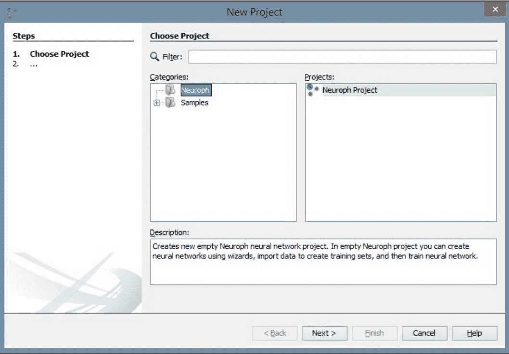

我们将项目命名为 RecognizeFaces（识别人脸），因为我们将训练神经网络来识别人脸图像：

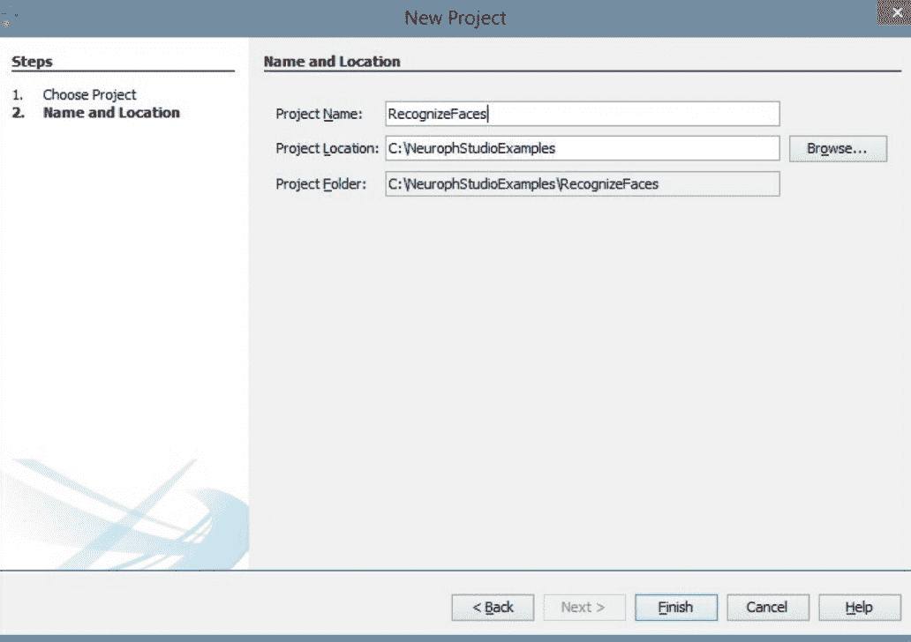

接下来，我们在项目中创建一个新文件。有许多类型的项目可以选择，但我们将选择 **Image Recognition**（图像识别）类型：

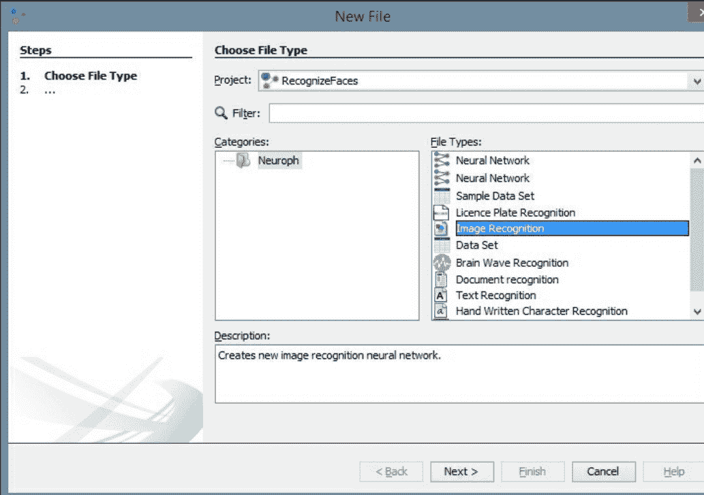

点击 Next（下一步），然后点击 Add directory（添加目录）。我们在本地机器上创建了一个目录，并添加了几个不同的黑白脸用于训练。可以通过 Google 图像或其他搜索引擎找到这些图像。理论上，你用于训练的高质量图像越多，你的网络就越好：

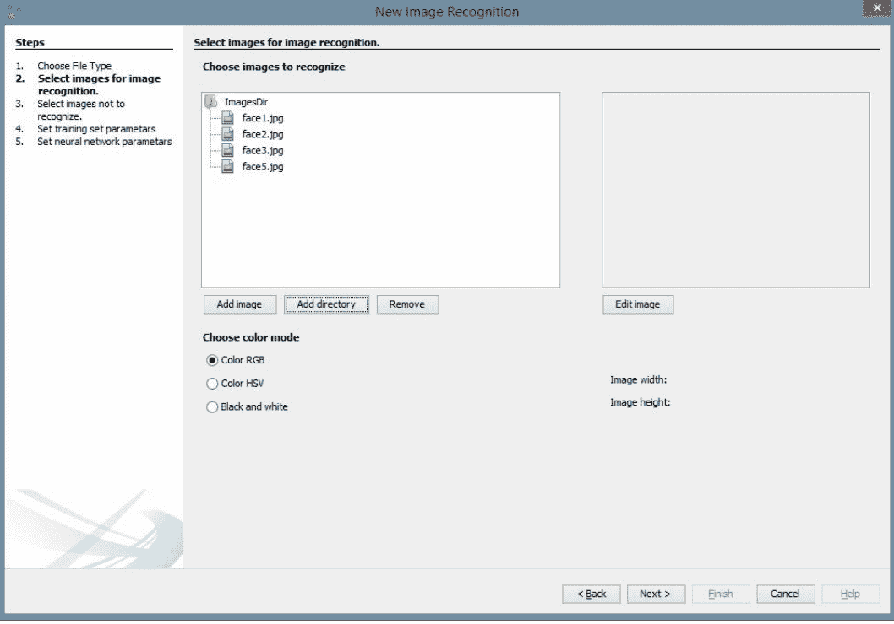

在点击 Next 后，你将被引导至选择一张不需要识别的图像。你可能需要根据想要识别的图像尝试不同的图像。你在这里选择的图像将防止误识别。我们从本地机器的另一个目录中选择了一个简单的蓝色正方形，但如果你使用其他类型的图像进行训练，其他颜色块可能会效果更好：

## 新图像识别

1. 选择文件类型
2. 选择用于识别的图像
3. 选择不识别的图像
4. 设置偏置并设置参数
5. 设置神经网络参数

选择不应被识别的图像（避免误识别）

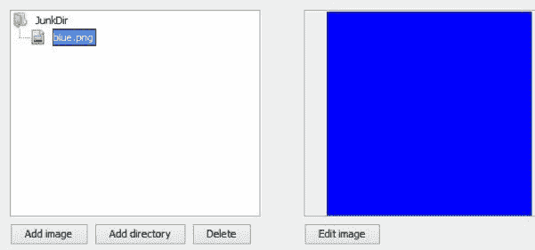

图像宽度: 127

图像高度: 127

接下来，我们需要提供网络训练参数。我们还需要标记训练数据集并设置我们的分辨率。高度和宽度为 20 是一个很好的起点，但你可能想要更改这些值以改进你的结果。这可能涉及一些尝试。提供这些信息的目的是允许图像缩放。当我们把图像缩小到较小尺寸时，我们的网络可以处理它们并学得更快：

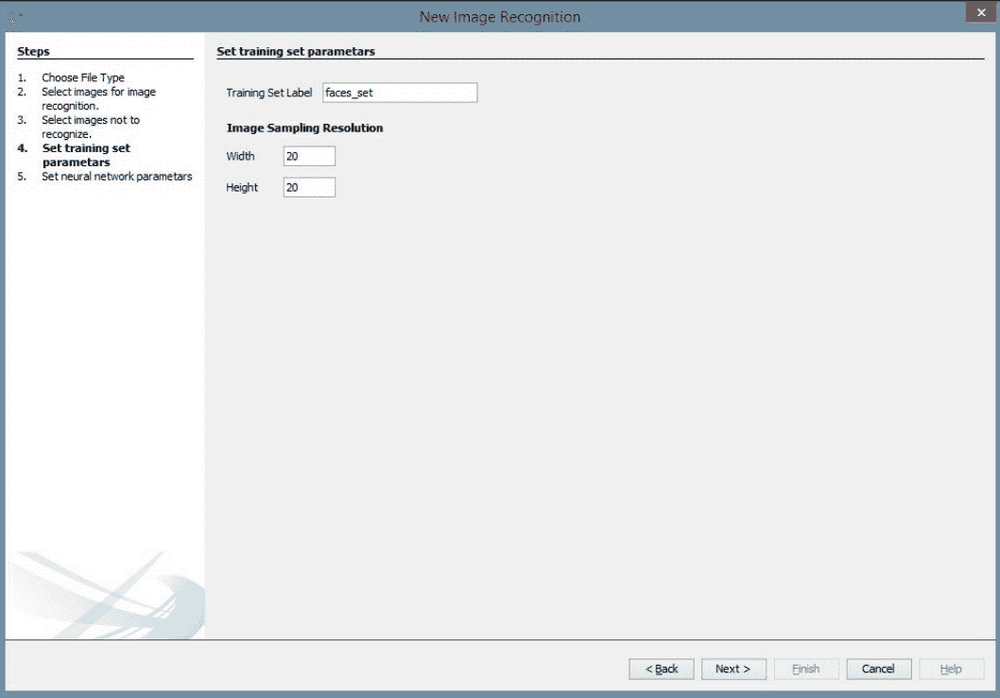

最后，我们可以创建网络。我们为网络分配一个标签并定义我们的传递函数（Transfer function）。默认函数 Sigmoid 适用于大多数网络，但如果你的结果不是最优，你可能想尝试 Tanh。默认的隐藏层神经元数量（Hidden Layers Neuron Counts）为 12，这是一个很好的起点。请注意，增加神经元的数量会增加训练网络的时间，并降低将网络泛化到其他图像的能力。与我们之前的一些值一样，可能需要一些尝试来找到给定网络的最优设置。完成后选择 Finish（完成）：

## 设置神经网络参数

1. 选择文件类型
2. 选择用于图像识别的图像
3. 选择不识别的图像
4. 设置网络参数
5. 设置神经网络参数

| 网络标签 | faces_net |
| :--- | :--- |
| 传递函数 | Sigmoid |
| 隐藏层神经元数量 | 12 |

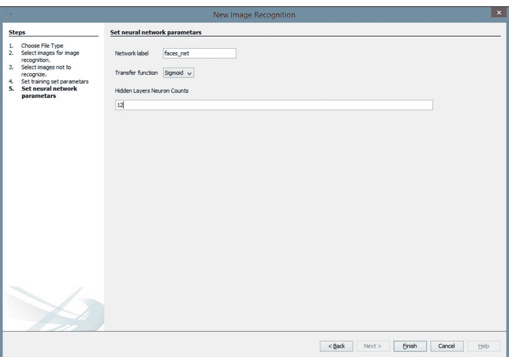

## 训练模型

一旦我们创建了网络，我们需要对其进行训练。通过双击网络开始。这就是 .nnet 文件。我们注意到我们的网络名称为 `faces_net`。然后我们获取图像识别插件。接下来，我们使用新图像调用 `recognizeImage` 方法，这需要处理 IOException。我们的结果存储在 `HashMap` 中并打印到控制台：

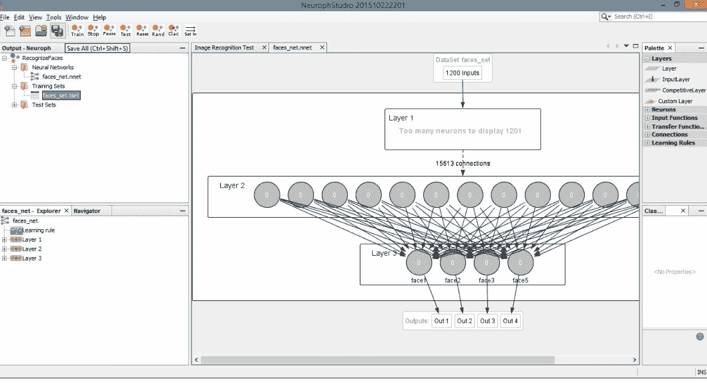

## 网络总图

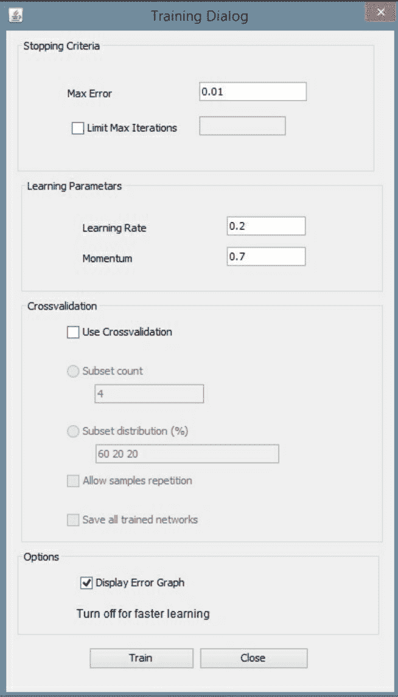

选择 Image Recognition 标签卡。然后点击 Test 按钮。我们加载了一张未包含在数据集中的图像。

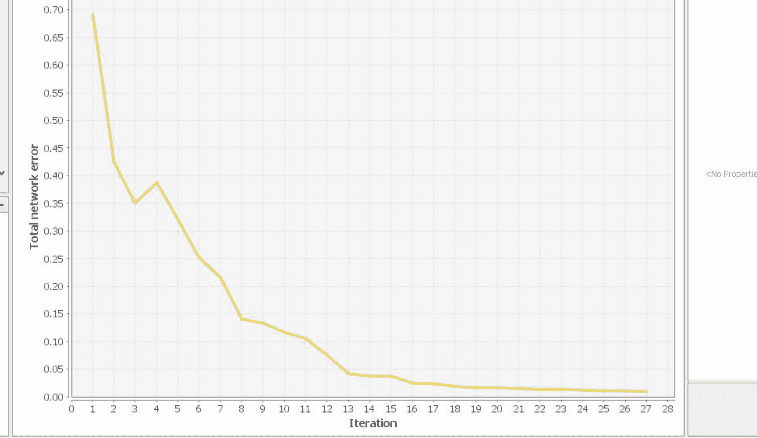

找到 Output 标签卡。它将在底部或左侧面板，并将显示测试图像与训练集中每张图像比较的结果。数字越大，我们的测试图像与训练中的图像就越匹配。最后一张图像的结果比前几张大，因此网络能够对我们的测试图像产生更积极的识别：

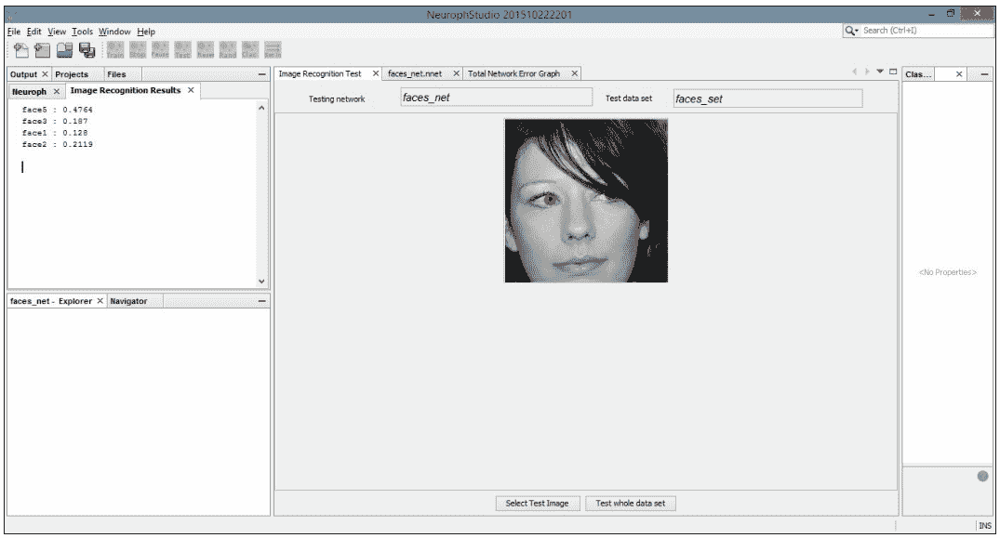

我们现在可以保存网络以备后用。从 File（文件）菜单中选择 Save（保存），然后你可以在其他应用程序中使用 .nnet 文件。下面的代码示例展示了通过预构建的网络运行测试数据的简单技术。`NeuralNetwork` 类是 Neuroph 核心包的一部分，`load` 方法允许你将训练好的网络加载到项目中。我们注意到我们的网络名称为 `faces_net`。然后我们获取图像识别插件。接下来，我们使用新图像调用 `recognizeImage` 方法，这需要处理 IOException。我们的结果存储在 `HashMap` 中并打印到控制台：

```java
NeuralNetwork irNet = NeuralNetwork.load("faces_net.nnet");

ImageRecognitionPlugin irFile
    = (ImageRecognitionPlugin) irNet.getPlugin(
        ImageRecognitionPlugin.class);

try {
    HashMap<String, Double> newFaceMap
        = irFile.recognizeImage(
            new File("testFace.jpg"));

    out.println(newFaceMap.toString());
} catch (IOException e) {
    // Handle exceptions
}
```


## 总结

在本章中，我们演示了许多处理语音和图像的技术。随着电子设备越来越多地采用这些通信媒介，这种能力变得越来越重要。

我们使用 `FreeTSS` 展示了 TTS（文本转语音）。这种技术允许计算机以语音而非文本的形式呈现结果。我们学习了如何控制所用语音的属性，例如性别和年龄。

语音识别非常有用，并有助于缩小人机接口的差距。我们演示了如何使用 `CMUSphinx` 来识别人类语音。由于语音通常有多种可能的解释方式，API 可以返回各种选项。我们还演示了如何提取单个单词，以及识别正确单词的相对置信度。

图像处理是许多应用的关键方面。我们通过使用 `Tess4` 从图像中提取文本开始图像处理的讨论。这一过程有时被称为 OCR（光学字符识别）。我们了解到，与许多视觉和音频数据文件一样，结果的质量与输入有关。

我们还学习了如何使用 `OpenCV` 识别图像中的人脸。关于脸部特定视图（如正面或侧面）的信息包含在 XML 文件中。这些文件用于勾勒出图像中脸部的轮廓。一次可以检测到多个脸。

对图像进行分类可能很有帮助，有时外部工具对此很有用。我们研究了 `Neuroph Studio`，并创建了一个用于识别和分类图像的神经网络。然后，我们用人脸图像测试了我们的网络。

在下一章中，我们将学习如何使用多处理器来加速常见的数据科学应用。

## 第 11 章：数据分析的数学与并行技术

程序的并发执行可以带来显著性能提升。在本章中，我们将介绍数据科学应用中可以使用的各种技术。这些技术从底层的数学计算到高层的特定 API 选项不等。

始终记住，性能增强始于确保实现了正确的应用程序功能集。如果应用程序没有按照用户预期的方式工作，那么增强也是徒劳。应用程序的架构和所使用的算法也比代码增强更重要。始终使用效率最高的算法，然后应该考虑代码增强。在本章中，我们无法解决更高层次的优化问题；相反，我们将重点关注代码增强。

许多数据科学应用及其支持的 API 使用矩阵操作来完成任务。这些操作通常隐藏在 API 内部，但有时我们需要直接使用这些操作。无论如何，理解这些操作是如何支持的将大有益。为此，我们将解释如何使用几种不同的方法处理矩阵乘法。

并发处理可以使用 Java 线程来实现。开发人员可以使用线程和线程池来提高应用程序的响应时间。当多个 CPU 或 GPU 不可用时（例如 `Aparapi` 的情况），许多 API 将使用线程。我们在这里不会演示线程的使用。然而，假设读者具有线程和线程池的基础知识。

map-reduce 算法广泛用于数据科学应用。我们将介绍一种使用 Apache 的 Hadoop 实现这种类型并行处理的技术。`Hadoop` 是一个支持操作大型数据集的框架，可以大大缩短大型数据科学项目所需的处理时间。我们将演示一种计算样本数据集平均值的技术。

有几个支持多处理器的知名 API，包括 `CUDA` 和 `OpenCL`。`CUDA` 通过用于 CUDA 的 Java 绑定 (`JCuda`) (http://jcuda.org/) 支持。我们不会在这里直接演示这种技术。然而，我们将要使用的许多 API 在可用 CUDA 的情况下都支持它，例如 `DL4J`。我们将简要讨论 `OpenCL` 以及它在 Java 中如何被支持。值得注意的是，`Aparapi` API 提供了更高层次的支持，它可能使用多个 CPU 或 GPU。我们将演示支持矩阵乘法的 `Aparapi` 示例。

在本章中，我们将研究如何利用多个 CPU 和 GPU 来加速数据挖掘任务。我们使用过的许多 API 已经利用了多处理器，或者至少提供了启用 GPU 使用的方法。我们将在本章中介绍这些选项。

并发处理在云端也被广泛支持。这里讨论的许多技术都用于云端。因此，我们不会显式介绍如何在云端进行并行处理。

## 实现基础矩阵操作

有几种不同的矩阵操作，包括简单的加法、减法、标量乘法和各种形式的乘法。为了演示矩阵操作，我们将关注矩阵矩阵积。这常用方法，涉及两个矩阵相乘以生成第三个矩阵。

考虑两个矩阵 $A$ 和 $B$，其中矩阵 $A$ 有 $n$ 行 $n$ 列。矩阵 $B$ 将有 $m$ 行 $p$ 列。$A$ 和 $B$ 的乘积写为 $AB$，是一个 $n$ 行 $p$ 列的矩阵。$A$ 的行的 $m$ 个元素乘以 $B$ 列的 $m$ 个元素。在这里显示得更显式，其中：

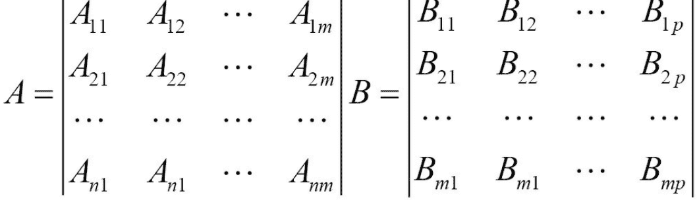

其中乘积定义如下：

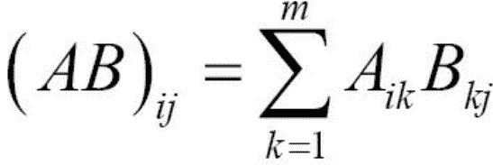

我们从矩阵的声明和初始化开始。变量 $n, m, p$ 代表矩阵的维度。$A$ 矩阵是 $n \times m$，$B$ 矩阵是 $m \times p$：

```java
int n = 4;
int m = 2;
int p = 3;
double[][] A = new double[][]{
  {1.0, 2.0},
  {3.0, 4.0}
};
double[][] B = new double[][]{
  {5.0, 6.0, 7.0},
  {8.0, 9.0, 10.0}
};
double[][] C = new double[n][p];
for (int i = 0; i < n; i++) {
  for (int k = 0; k < m; k++) {
    for (int j = 0; j < p; j++) {
      C[i][j] += A[i][k] * B[k][j];
    }
  }
}
```

结果显示如下：

```
Result
22.0000 26.0000 30.0000
38.0000 42.0000 46.0000
```

## 在 Deep4j 中 GPU

`Deep4j` 支持 NVIDIA 等提供的 GPU。有可用选项可以启用 GPU 使用、指定应使用多少 GPU 以及控制内存的使用。在本节中，我们将展示如何使用这些选项。这种控制通常在高层 API 中可用。

要启用 GPU，需要修改项目的 POM 文件。在 POM 文件的属性部分，需要添加或修改 `nd4j.backend` 标签，如下：

```xml
<nd4j.backend>nd4j-cuda-7.5-platform</nd4j.backend>
```

可以使用 `ParallelWrapper` 类并行训练模型。训练任务会自动分发到可用的 CPU/GPU 之间。模型作为 `ParallelWrapper.Builder` 构造函数的参数使用，如下：

```java
ParallelWrapper parallelWrapper =
  new ParallelWrapper.Builder(aModel)
    // Builder 方法...
  .build();
```

执行时，每个 GPU 上都会使用模型的副本。在数量之后迭代由 `averagingFrequency` 方法指定，对模型进行平均处理，然后继续训练过程。

有多种方法可以用于配置该类，如下表所示：

| 方法 | 目的 |
|---|---|
| `prefetchBuffer` | 指定用于预取数据的缓冲区大小 |
| `workers` | 指定要使用的工作线程数 |
| `averageUpdaters`, `averagingFrequency`, `reportScoreAfterAveraging`, `useLegacyAveraging` | 控制如何实现平均化的各种方法 |

工作线程的数量应该大于可用的 GPU 数量。

与大多数计算一样，使用较低的精度值将加快处理速度。这可以使用 `setDTypeForContext` 方法进行控制，如下所示。在这种情况下，指定了半精度：

```java
DataTypeUtil.setDTypeForContext(DataBuffer.Type.HALF);
```

此类支持以及关于优化技术的更多详细信息可以从 http://deeplearning4j.org/gpu 找到。

## 使用 map-reduce

Map-reduce 是一种以并行、分布式方式处理大型数据集的模型。该模型包含一个过滤和排序数据的 `map` 方法，以及一个汇总数据的 `reduce` 方法。Map-reduce 框架之所以有效，因为它将数据集的处理分布在多个服务器上，对较小的数据块同时进行映射和归约。以多线程方式实现时，Map-reduce 可以提供显著的性能提升。在本节中，我们将演示一种使用 Apache Hadoop 实现的技术。在“使用 Java 8 执行 map-reduce”部分中，我们将讨论使用 Java 8 流执行 map-reduce 的技术。

`Hadoop` 是一个提供并行计算支持的软件生态系统。Map-reduce 任务可以在 Hadoop 服务器（通常设置成集群）上运行，以显著提高处理速度。Hadoop 拥有在 Hadoop 集群节点上运行 map-reduce 操作的跟踪器。每个节点独立运行，跟踪器监控进度并整合每个节点的输出以生成最终输出。以下图片可以在 http://www.developer.com/java/data/big-data-tool-map-reduce.html 找到，展示了带有跟踪器的基本 map-reduce 模型。

## 使用 Apache 的 Hadoop 执行 map-reduce

我们在这里向您展示一个非常简单的 map-reduce 应用程序示例。在使用 Hadoop 之前，我们需要下载并解压 Hadoop 文件。最新版本可以在 http://hadoop.apache.org/releases.html 找到。此演示中使用的是 2.7.3 版本。

您将需要设置 `JAVA_HOME` 环境变量。此外，Hadoop 不允许长路径和路径中的空格，因此请确保将 Hadoop 解压到尽可能简单的目录结构中。

我们将处理一个包含书籍信息的示例文本文件。我们的制表符分隔文件的每行都包含书名、作者和页数：

- Moby Dick Herman Melville 822
- Charlotte's Web E.B. White 189
- The Grapes of Wrath John Steinbeck 212
- Jane Eyre Charlotte Bronte 299
- A Tale of Two Cities Charles Dickens 673
- War and Peace Leo Tolstoy 1032
- The Great Gatsby F. Scott Fitzgerald 275

我们将使用一个 `map` 函数来提取标题和页数信息，然后使用 `reduce` 函数来计算数据集中书籍的平均页数。首先，创建一个新类 `AveragePageCount`。我们将在 `AveragePageCount` 内部创建两个静态类，一个处理 map 过程，另一个处理归约过程。

### 编写 map 方法

首先，我们将创建 `TextMapper` 类，它将实现 `map` 方法。该类继承自 `Mapper` 类，并有两个私有实例变量 `pages` 和 `bookTitle`。`pages` 是一个 `IntWritable` 对象，`bookTitle` 是一个 `Text` 对象。使用 `IntWritable` 和 `Text` 是因为这些对象在传输到服务器进行处理之前需要序列化为字节流。这些对象占用的空间更小，传输速度比可选 `int` 或 `String` 对象更快：

```java
public static class TextMapper
    extends Mapper<Object, Text, Text, IntWritable> {
        private final IntWritable pages = new IntWritable();
        private final Text bookTitle = new Text();
    }
```

在 `TextMapper` 类中，我们创建了 `map` 方法。该方法接受三个参数：key 对象、`Text` 对象 `bookInfo` 以及 `Context`。`key` 允许跟踪器将每个特定对象映射回正确的作业。`bookInfo` 对象包含关于每本书的文本或字符串数据。`Context` 持有整个系统的信息，并允许方法继续进行并更新系统内的值。

在 `map` 方法中，我们使用 `split` 方法将每条书籍信息拆分为 `String` 对象数组。我们将 `bookTitle` 变量设置为数组的索引 0，并将解析为整数后存储在位置 2 的值设置为 `pages`。然后，我们通过 `context` 写出我们的书名和页数信息并更新我们的整个系统：

```java
public void map(Object key, Text bookInfo, Context context)
    throws IOException, InterruptedException {
        String[] book = bookInfo.toString().split("\t");
        bookTitle.set(book[0]);
        pages.set(Integer.parseInt(book[2]));
        context.write(bookTitle, pages);
    }
```

### 编写 reduce 方法

接下来，我们将编写 `AverageReduce` 类。该类继承自 `Reducer` 类，并将执行归约过程以计算平均页数。我们为此类创建了四个变量：一个 `FloatWritable` 对象、一个用于临时平均值的 `float average`、一个用于统计书籍数量的 `float count` 以及一个用于累加页数的 `int sum`：

```java
public static class AverageReduce
    extends Reducer<Text, IntWritable, Text, FloatWritable> {
    private final FloatWritable finalAvg = new FloatWritable();
    float average = 0f;
    float count = 0f;
    int sum = 0;
}
```

在 `AverageReduce` 类中，我们创建了 `reduce` 方法。该方法接受一个 `Text` key、一个表示页数的 `IntWritable` 可迭代器以及 `Context`。我们使用迭代器处理页数并将其加到 `sum`。然后我们计算平均值并设置 `finalAvg` 的值：

```java
public void reduce(Text key, Iterable<IntWritable> pageCnts, Context context)
    throws IOException, InterruptedException {
        for (IntWritable cnt : pageCnts) {
            sum += cnt.get();
            count += 1;
        }
        average = sum / count;
        finalAvg.set(average);
        context.write(new Text("Average Page Count = "), finalAvg);
    }
```

当我们的任务运行时，我们会在屏幕上看到关于进程输出的更新信息。我们的输出示例如下：

## 文件系统计数器

```
FILE: Number of bytes read=1132
FILE: Number of bytes written=569686
FILE: Number of read operations=0
FILE: Number of large read operations=0
FILE: Number of write operations=0
Map-Reduce Framework
Map input records=7
Map output records=7
Map output bytes=136
Map output materialized bytes=156
Input split bytes=90
Combine input records=0
Combine output records=0
Reduce input groups=7
Reduce shuffle bytes=156
Reduce input records=7
Reduce output records=7
Spilled Records=14
Shuffled Maps=1
Failed Shuffles=0
Merged Map outputs=1
GC time elapsed (ms)=11
Total committed heap usage (bytes)=536870912
Shuffle Errors
BAD_ID=0
CONNECTION=0
IO_ERROR=0
WRONG_LENGTH=0
WRONG_MAP=0
WRONG_REDUCE=0
File Input Format Counters
Bytes Read=249
File Output Format Counters
Bytes Written=216
```

如果我们打开在本地机器上创建的 `BookOutput` 目录，会发现四个新文件。使用文本编辑器打开 `part-r-00000`。该文件包含了使用并行进程计算出的平均页数信息。我们的输出示例如下：

```
Average Page Count = 673.0
Average Page Count = 431.0
```


| Average Page Count = 387.0 |
| Average Page Count = 495.75 |
| Average Page Count = 439.0 |
| Average Page Count = 411.66666 |
| Average Page Count = 500.2857 |

注意当每个单独的进程与其他还原过程合并时，平均值是如何变化的。这与先计算前两本书的平均值，然后加入第三本书、第四本书，以此类推的效果相同。这里的优势显然是平均计算是以并行方式完成的。如果我们有一个巨大的数据集，应该期望看到执行时间上的明显优势。`BookOutput` 的最后一行反映了所有七个页数正确且最终的平均值。

## 各种数学库

Java 有许多可用的数学库。在本节中，我们将对几个库提供快速且高层次的概述。这些库并不一定能自动支持多处理器。此外，本节的目的是提供一些关于如何使用这些库的见解。在大多数情况下，它们是易于使用的。

Java 数学库的列表可以在 [https://en.wikipedia.org/wiki/List_of_numerical_libraries#Java] 和 [https://java-matrix.org/]( 中找到。我们将演示 `jblas`、`Apache Commons Math` 和 `ND4J` 库的使用。

## 使用 jblas API

jblas API (http://jblas.org/) 是一个支持 Java 的库。它基于基础线性代数子程序 (BLAS) (http://www.netlib.org/blas/) 和 线性代数包 (LAPACK) (http://www.netlib.org/lapack/)，这些都是用于快速算术计算的标准库。jblas API 提供了这些库的封装。

以下是执行矩阵乘法的演示。我们从矩阵定义开始：

```java
DoubleMatrix A = new DoubleMatrix(new double[][]{
    {0.1950, 0.0311},
    {0.3588, 0.2203},
    {0.1716, 0.5931},
    {0.2105, 0.3242});
```

```java
DoubleMatrix B = new DoubleMatrix(new double[][]{
    {0.0502, 0.9823, 0.9472},
    {0.5732, 0.2694, 0.9166});
DoubleMatrix C;
```

执行乘法的实际语句非常短，如下所示。对 `A` 矩阵执行 `mmul` 方法，并将 `B` 数组作为参数传递：

```java
C = A.mmul(B);
```

然后显示结果矩阵：

```java
for(int i=0; i<C.getRows(); i++) {
    out.println(C.getRow(i));
}
```

输出应当如下：

```
[0.027616, 0.199927, 0.213192]
[0.144228, 0.411798, 0.541650]
[0.348579, 0.328344, 0.705819]
[0.196399, 0.294114, 0.496353]
```

该库非常容易使用，并支持大量的算术操作。

## 使用 Apache Commons math API

Apache Commons math API (http://commons.apache.org/proper/commons-math/) 支持大量的数学和统计操作。以下示例说明了如何执行矩阵乘法。我们从 `A` 和 `B` 矩阵的声明和初始化开始：

```java
double[][] A = {
    {0.1950, 0.0311},
    {0.3588, 0.2203},
    {0.1716, 0.5931},
    {0.2105, 0.3242}};
```

```java
double[][] B = {
    {0.0502, 0.9823, 0.9472},
    {0.5732, 0.2694, 0.9166}};
```

Apache Commons 使用 `RealMatrix` 类来持有矩阵。在接下来的序列中，使用 `Array2DMatrix` 创建 `A` 和 `B`：

```java
RealMatrix aMatrix = new Array2DMatrix(A);
RealMatrix bMatrix = new Array2DMatrix(B);
```

乘法使用 `multiply` 方法，如下所示：

```java
RealMatrix cMatrix = aMatrix.multiply(bMatrix);
```

下一个循环将显示结果：

```java
for (int i = 0; i < cMatrix.getRowCount(); i++) {
    out.println(cMatrix.getRow(i));
}
```

输出应当如下：

```
[0.027616, 0.199927, 0.213192]
[0.144228, 0.411798, 0.541650]
[0.348579, 0.328344, 0.705819]
[0.196399, 0.294114, 0.496353]
```

## 使用 ND4J API

ND4J (http://nd4j.org/) 是一个可用于 Java 的库，支持各种算术操作。在本节中，我们将演示如何执行矩阵乘法。我们从声明 `A` 和 `B` 矩阵开始：

```java
double[][] A = {
    {0.1950, 0.0311},
    {0.3588, 0.2203},
    {0.1716, 0.5931},
    {0.2105, 0.3242}};
```

```java
double[][] B = {
    {0.0502, 0.9823, 0.9472},
    {0.5732, 0.2694, 0.9166}};
```

Nd4j 使用 `create` 方法创建 `INDArray` 实例。第一个参数是向量，第二个参数指定矩阵的维度：

```java
INDArray aArray = Nd4j.create(A, new int[]{4, 2});
INDArray bArray = Nd4j.create(B, new int[]{2, 3});
```

执行乘法的方法如下：

```java
INDArray cArray = aArray.mmul(bArray);
```

接下来的循环将显示结果：

```java
for (int i = 0; i < cArray.rows(); i++) {
    out.println(cArray.getRow(i));
}
```

输出应当如下：

```
[0.027616, 0.199927, 0.213192]
[0.144228, 0.411798, 0.541650]
[0.348579, 0.328344, 0.705819]
[0.196399, 0.294114, 0.496353]
```

# 使用 Aparapi

Aparapi (https://github.com/aparapi/aparapi) 是一个支持并发操作的 Java 库。该 API 支持在 GPU 或 CPU 上运行代码。GPU 操作使用 OpenCL 执行，而 CPU 操作则使用 Java 线程。用户可以指定使用哪种计算资源。然而，如果不支持 GPU，Aparapi 将回退到 Java 线程。

API 会在运行时将 Java 字节码转换为 OpenCL。该 API 最初由 AMD 开发，但已作为开源软件发布。这体现在基础包名 `com.amd.aparapi.aparapi` 中。Aparapi 提供了 OpenCL 提供的更高层次的抽象。

Aparapi 代码位于一个派自 `Kernel` 类的类中。它的 `execute` 方法将启动操作。这将在对 `run` 方法的内部调用中运行，该方法需要被重写。并发代码放置在 `run` 方法中。`run` 方法会在不同的处理器上执行多次。

由于 OpenCL 的局限性，我们无法使用继承或方法重载。此外，它不喜欢在 `run` 方法中使用 `println`，因为代码可能运行在 GPU 上。Aparapi 只支持一维数组。使用两个或更多维的数组需要展平成一维数组。对 `double` 值的支持取决于 OpenCL 版本和 GPU 配置。

使用 Java 线程池时，它会为每个 CPU 核心分配一个线程。包含 Java 代码的内核会被克隆，每个线程一个。这避免了跨线程访问数据的需要。每个线程都可以访问某些信息（例如全局 ID），以辅助代码执行。内核将等待所有线程完成。

您可以在 https://github.com/aparapi/aparapi/releases 处找到 Aparapi 的下载包。

# 创建一个 Aparapi 应用

接下来显示了 Aparapi 应用的基本框架。它由一个派自 `Kernel` 的类组成，在该类中重写 `run` 方法。在示例中，`run` 方法将执行标量乘法。该操作涉及将向量的每个元素乘以某个值。

`ScalarMultiplicationKernel` 继承自 `Kernel` 类。它拥有两个实例变量，用于存储输入和输出矩阵。构造函数将初始化矩阵。`run` 方法将执行实际计算，而 `displayResult` 方法将显示乘法结果：

```java
public class ScalarMultiplicationKernel extends Kernel {
    float[] inputMatrix;
    float[] outputMatrix;
```

```java
public ScalarMultiplicationKernel(float inputMatrix[]) {
    ...
}
```

```java
@Override
public void run() {
    ...
}
```

```java
public void displayResult() {
    ...
}
```

构造函数所示：

```java
public ScalarMultiplicationKernel(float inputMatrix[]) {
    this.inputMatrix = inputMatrix;
    outputMatrix = new float[this.inputMatrix.length];
}
```

在 `run` 方法中，我们使用全局 ID 来对矩阵进行索引。这段代码在每个计算单元（例如 GPU 或线程）上执行。每个计算单元都提供一个唯一的全局 ID，允许代码访问矩阵的特定元素。在示例中，输入矩阵的每个元素都乘以 2，然后赋值给输出矩阵对应的元素：

```java
public void run() {
    int globalID = this.getGlobalId();
    outputMatrix[globalID] = 2.0f * inputMatrix[globalID];
}
```

`displayResult` 方法简单地显示 `outputMatrix` 数组的内容：

```java
public void displayResult() {
    out.println("Result");
    for (float element : outputMatrix) {
        out.printf("%.4f ", element);
    }
    out.println();
}
```

要使用此内核，我们需要为 `inputMatrix` 及其大小声明变量。该大小将用于控制执行多少内核：

```java
float inputMatrix[] = {3, 4, 5, 6, 7, 8, 9};
int size = inputMatrix.length;
```

然后使用输入矩阵创建内核，随后调用 `execute` 方法。该方法启动进程，并最终根据 `execute` 方法的参数调用 `Kernel` 类的 `run` 方法。此参数被称为“传递 ID”（pass ID）。虽然在本示例中未使用它，但我们将在下一节中使用它。当进程完成后，将显示生成的输出矩阵并调用 `dispose` 方法来停止进程：

```java
ScalarMultiplicationKernel kernel = new ScalarMultiplicationKernel(inputMatrix);
kernel.execute(size);
kernel.displayResult();
kernel.dispose();
```

执行此操作后，我们将得到以下输出：

```
6.0000 8.0000 10.0000 12.0000 14.0000 16.0000 18.0000
```

我们可以通过 `Kernel` 类的 `setExecutionMode` 方法来指定执行模式，如下：

```java
kernel.setExecutionMode(Kernel.EXECUTION_MODE.GPU);
```

然而，最好让 Aparapi 自动决定执行模式。下表总结了可用的执行模式：

| 执行模式 | 含义 |
| --- | --- |
| Kernel.EXECUTION_MODE.NONE | 不指定模式 |
| Kernel.EXECUTION_MODE.CPU | 使用 CPU |
| Kernel.EXECUTION_MODE.GPU | 使用 GPU |
| Kernel.EXECUTION_MODE.JTP | 使用 Java 线程 |
| Kernel.EXECUTION_MODE.SEQ | 使用 Java 线程（单线程） |

# 使用 Aparapi 进行矩阵乘法

接下来，我们将看到如何使用 Aparapi 进行矩阵乘法。我们将使用矩阵的点积：

```java
class MatrixMultiplicationKernel extends Kernel {
    float[] vectorA;
    float[] vectorB;
    float[] vectorC;
    int n, m, p;

    public MatrixMultiplicationKernel(int n, int m, int p) {
        this.n = n;
        this.p = p;
        this.m = m;
        vectorC = new float[n * p];
    }

    @Override
    public void run() {
        int i = getGlobalId();
        int j = getPassId();
        float value = 0;
        for (int k = 0; k < m; k++) {
            value += vectorA[i * m + k] * vectorB[k * p + j];
        }
        vectorC[i * p + j] = value;
    }

    public void displayResults() {
        out.println("Result");
        for (int i = 0; i < n; i++) {
            for (int j = 0; j < p; j++) {
                out.printf("%.4f ", vectorC[i * p + j]);
            }
            out.println();
        }
    }
}
```

构造函数所示：

```java
public MatrixMultiplicationKernel(int n, int m, int p) {
    this.n = n;
    this.p = p;
    this.m = m;
    vectorC = new float[n * p];
}
```

`run` 方法使用全局 ID 和传递 ID 来执行乘法。该传递 ID 是作为 `execute` 方法的第二个参数指定的。此值允许我们推进 `vectorC`：

```java
vectorC[i * p + j] = value;
```

内核以之前相同的方式启动。`execute` 方法传递了要创建的内核的数量以及指示传递次数的整数：

```java
Kernel kernel = new MatrixMultiplicationKernel(n, m, p);
kernel.setExecutionMode(Kernel.EXECUTION_MODE.GPU);
kernel.execute(n, p);
kernel.displayResults();
kernel.dispose();
```

执行此示例后，将得到以下输出：

```
Result
0.0276 0.1999 0.2132
0.1443 0.4118 0.5417
0.3486 0.3283 0.7058
0.1964 0.2941 0.4964
```


# 使用 Java 8 流

Java 8 的发布为语言带来了许多重要的增强。我们感兴趣的两项增强包括 Lambda 表达式和流。Lambda 表达式本质上是一个匿名函数，为 Java 增加了函数式编程维度。Java 8 引入的流的概念不是 IO 流。相反，你可以将其理解为一组可以使用流式编程风格生成和处理的对象序列。这种风格将很快演示。

与大多数 API 一样，程序员必须仔细在真实的测试用例和环境中考虑代码的实际执行性能。如果使用不当，流可能并无法提供性能提升。特别是并行流，如果不仔细构建，可能会产生错误的结果。

我们将从 Lambda 表达式和流的简要介绍开始。如果你熟悉这些概念，可能想跳过下一节。

# 理解 Java 8 lambda 表达式和流

Lambda 表达式可以通过几种不同的形式表示。以下展示了一个简单的 lambda 表达式，其中符号 `->` 是 lambda 算符。它接收一个值 `e`，并返回该值乘以 2 的结果。名称 `e` 没有什么特殊之处。可以使用任何有效的 Java 变量名：

`e -> 2 * e`

它也可以用其他形式表示，如下：

```
(int e) -> 2 * e

(double e) -> 2 * e

(int e) -> (return 2 * e);
```

使用的形式取决于 `e` 的预期值。Lambda 表达式经常被用作方法的参数，这正如我们很快将看到的。

可以使用多种技术创建流（stream）。在下面的示例中，从数组创建了一个流。`Stream` 接口是一种使用整数的流类型。`Arrays` 类的 `stream` 方法将数组转换为流：

```
IntStream stream = Arrays.stream(numbers);
```

然后我们可以应用流方法来执行操作。在以下语句中，`forEach` 方法将简单地显示流中的每个元素：

```
stream.forEach(e -> out.printf("%d ", e));
```

有多种可以应用于流的方法。在下面的示例中，`mapToDouble` 方法将接收一个整数，将其乘以 2 并作为 `double` 类型返回。然后，`forEach` 方法将显示这些值：

```
.mapToDouble(e -> 2 * e)
.forEach(e -> out.printf("%.4f ", e));
```

方法调用的链式结构被称为流式编程（fluent programming）。

# 使用 Java 8 执行矩阵乘法

在这里，我们将说明如何使用流来执行矩阵乘法。
A、B 和 C 矩阵的定义与“实现基础矩阵操作”节中声明的相同。为了方便起见，在这里重复了它们：

```
double A[][] = {
    {0.1950, 0.0311},
    {0.3588, 0.2203},
    {0.1716, 0.5931},
    {0.2105, 0.3242};
}

double B[][] = {
    {0.0502, 0.9823, 0.9472},
    {0.5732, 0.2694, 0.9166};
}

double C[][] = new double[n][p];
```

以下是矩阵乘法的流实现。
代码的详细解释如下：

```
C = Arrays.stream(A)
    .parallel()
    .map(AMatrixRow -> IntStream.range(0, B[0].length)
        .mapToDouble(i -> IntStream.range(0, B.length)
            .mapToDouble(j -> AMatrixRow[j] * B[j][i])
        .sum())
    .toArray()).toArray(double[][]::new);
```

第一个 `map` 方法如下，创建了一个表示 A 矩阵 4 行的 double 向量流。`range` 方法将返回从第一个参数到第二个参数的流元素列表：

```
.map(AMatrixRow -> IntStream.range(0, B[0].length))
```

变量 `i` 对应于第二个 `range` 方法生成的数字，该数字对应于 B 矩阵的行数（2）。变量 `j` 对应于第三个 `range` 方法生成的数字，代表 B 矩阵的列数（3）。

语句的核心是矩阵乘法，其中 `sum` 方法计算和：

```
.mapToDouble(j -> AMatrixRow[j] * B[j][i])
.sum()
```

表达式的最后部分创建了用于 C 矩阵的二维数组。运算符 `::new` 被称为方法引用（method reference），它是调用 `new` 算符来创建新对象的简短方式：

```
).toArray().toArray(double[][]::new);
```

`displayResult` 方法如下：

```
public void displayResult() {
    out.println("Result");
    for (int i = 0; i < n; i++) {
        for (int j = 0; j < p; j++) {
            out.printf("%.4f ", C[i][j]);
        }
        out.println();
    }
}
```

该序列的输出如下：

```
Result
0.0276 0.1999 0.2132
0.1443 0.4118 0.5417
0.3486 0.3283 0.7058
0.1964 0.2941 0.4964
```

# 使用 Java 8 执行 map-reduce

在下一节中，我们将使用 Java 8 流来执行类似于“使用 map-reduce”节中用 Hadoop 演示的 map-reduce 操作。在这个示例中，我们将使用一个 `Book` 对象的流。然后，我们将演示如何使用 Java 8 的 `reduce` 和 `average` 方法来获取总页数和平均页数。

我们没有像在 Hadoop 示例那样从文本文件开始，而是创建了一个包含标题、作者和页数的 `Book` 类。在驱动程序的 `main` 方法中，我们创建了 `Book` 的新实例并将它们添加到 `ArrayList` 中。我们还创建了一个 `double` 值来存储我们的平均值，并将 `totalPg` 初始化为零：

```
ArrayList<Book> books = new ArrayList<>();
double average;
int totalPg = 0;
```

```
books.add(new Book("Moby Dick", "Herman Melville", 822));
books.add(new Book("Charlotte's Web", "E. White", 189));
books.add(new Book("Grapes of Wrath", "John Steinbeck", 212));
books.add(new Book("Jane Eyre", "Bronte", 299));
books.add(new Book("A Tale of Two Cities", "Charles Dickens", 673));
books.add(new Book("War and Peace", "Leo Tolstoy", 1032));
books.add(new Book("The Great Gatsby", "F. Scott Fitzgerald", 275));
```

接下来，我们执行 `map` 和 `reduce` 操作来计算书籍集合中的总页数。为了以并行方式实现这一点，我们使用了 `stream` 和 `parallel` 方法。然后我们使用 `map` 方法累积每个 `Book` 对象的所有页数。最后，我们使用 `reduce` 方法将页数合并为一个最终值，并赋值给 `totalPg`：

```
totalPg = books
.stream()
  .parallel()
  .map(b -> b.pgCount)
  .reduce(totalPg, (accumulator, item) -> {
    out.println(accumulator + " " + item);
    return accumulator + item;
  });
```

注意在前面的 `reduce` 方法中，我们选择打印归约操作累加值和单个项目的信息。`accumulator` 代表我们页数的聚合。`item` 代表 map-reduce 过程中在任何时刻正在进行的单个任务。在随后的输出中，我们将首先看到在处理每本书书时 `accumulator` 值为 0。逐渐地，`accumulator` 值会增加。最后的操作是对值 1223 和 2279 的归约。这两个数字之和为 3502，即所有书籍的总页数：

```
0 822
0 189
0 212
0 299
0 673
0 1032
0 275
```

技术。我们还演示了如何使用 Java 8 执行 map-reduce 操作。

在下一章中，我们将通过说明如何使用所介绍的许多技术来构建一个完整的应用程序，从而结束本书。

## 第 12 章 整合应用

虽然我们已经演示了使用 Java 支持数据科学任务的许多方面，但仍然需要以整合的方式并并这些技术。孤立地使用这些技术是一回事，以连贯的方式使用它们则是另一回事。在本章中，我们将为您提供关于这些技术的额外经验，并对如何使用它们提供见解。

具体而言，我们将创建一个基于控制台应用程序，用于分析与用户定义主题相关的推文。使用控制台应用程序允许我们专注于数据科学技术，并避免选择可能与我们无关特定 GUI 技术。它提供了一个公共基础，如果需要，可以在此基础上创建 GUI 实现。

应用程序执行并演示了以下高级任务：

- 数据获取
- 数据清洗，包括：
    - 移除停用词
    - 清洁文本
        - 情感分析
        - 基础数据统计收集
        - 结果显示

许多步骤可以使用一种一种类型的分析方法。我们将展示更相关的方法，并在适当的情况下提及其他可能性。我们将尽可能使用 Java 8 的特性。

## 定义应用程序的用途和范围

应用程序将提示用户输入选择标准，包括主题和子主题领域，以及要处理的推文数量。执行的分析将简单地计算并显示某个主题和子主题的正性和负面推文数量。我们使用了通用的情感分析模型，这会影响情感分析的质量。然而，可以添加其他模型和更多的分析。

我们将使用 Java 8 流来结构化推文数据的处理。这是一个 `TweetHandler` 对象的流，我们稍后会描述。

我们在此应用程序中使用几个类。在此摘要如下：

- `TweetHandler`：此类持有原始推文文本和处理所需的特定字段，包括推文本身用户名用户名类似属性。
- `TwitterStream`：用于获取应用程序的数据。使用特定的类可以将数据获取与其处理分离开。该类拥有几个控制数据获取方式的字段。
- `ApplicationDriver`：包含 `main` 方法、用户提示以及控制分析的 `TweetHandler` 流。

这些类中的每一个都将在随后的章节中详细介绍。然而，我们接下来介绍 `ApplicationDriver`，以提供分析过程的概述以及用户如何与应用程序进行交互。

## 理解应用程序的架构

每个应用程序都有其独特的结构或架构。这种架构为应用程序提供了总体的组织或框架。对于此应用程序，我们在 `ApplicationDriver` 类中使用 Java 8 流将这三个类结合。该类由三个方法组成：

- ApplicationDriver：包含应用程序的用户输入
- performAnalysis：执行分析
- main：创建 ApplicationDriver 实例

类结构所示。这三个实例变量用于控制处理：

```java
public class ApplicationDriver {
    private String topic;
    private String subTopic;
    private int numberOfTweets;

    public ApplicationDriver() { ... }
    public void performAnalysis() { ... }
    public static void main(String[] args) {
        new ApplicationDriver();
    }
}
```

`ApplicationDriver` 构造函数如下所示。创建了一个 `Scanner` 实例并构建了情感分析模型：

```java
public ApplicationDriver() {
    Scanner scanner = new Scanner(System.in);
    TweetHandler swt = new TweetHandler();
    swt.buildSentimentAnalysisModel();
    ... 
}
```

方法的其余部分提示用户输入，然后调用 `performAnalysis` 方法：

```java
out.println("Welcome to the Tweet Analysis Application");
```

```java
out.print("Enter a topic: ");
this.topic = scanner.nextLine();
out.print("Enter a sub-topic: ");
this.subTopic = scanner.nextLine().toLowerCase();
out.print("Enter number of tweets: ");
this.numberOfTweets = scanner.nextInt();
performAnalysis();
```

`performAnalysis` 方法使用从 `TwitterStream` 类构造函数获取的 Java 8 Stream 实例，以推文数量和主题作为输入。这在“使用 Twitter 获取数据”章节中讨论过：

```java
public void performAnalysis() {
    Stream<TweetHandler> stream = new TwitterStream(
        this.numberOfTweets, this.topic).stream();
    ....
}
```

该流使用一系列 `map`、`filter` 和 `forEach` 方法执行处理。`map` 方法修改流的元素。`filter` 方法从流中移除元素。`forEach` 方法将终止流并生成输出。

流的各个方法按顺序执行。从公共 Twitter 流获取时，Twitter 信息以 JSON 文档的形式到达，我们对其进行处理。这允许我们提取推文信息并将数据设置为 `TweetHandler` 实例的字段。接下来，将推文文本转换为小写。仅处理英文推文，且仅处理包含子主题的推文。然后对推文进行处理。最后步骤计算统计数据：

```java
stream
    .map(s -> s.processJSON())
    .map(s -> s.toLowerCase())
    .filter(s -> s.isEnglish())
    .map(s -> s.removeWords())
    .filter(s -> s.contains(this.subTopic))
    .map(s -> s.sentimentAnalysis())
    .forEach((TweetHandler s) -> {
        s.computeStats();
    });
```

然后显示分析结果：

## 使用 Twitter 获取数据

Twitter API 与 HBC 的 HTTP 客户端配合用于获取推文，这在第 2 章“数据获取”中的“处理 Twitter”部分已有演示。该过程涉及在默认访问级别使用公共流 API，以获取当前在 Twitter 上流的公共推文样本。我们将根据用户选择的关键词对数据进行精炼。

首先，我们声明 `TwitterStream` 类。它包含两个实例变量（`numberOfTweets` 和 `topic`）、两个构造函数和一个流方法。`numberOfTweets` 变量包含要选择和处理的推文数量，而 `topic` 允许用户搜索与特定主题相关的推文。我们有一个默认构造函数，用于获取与《星球大战》相关的 100 条推文：

```java
public class TwitterStream {
    private int numberOfTweets;
    private String topic;

    public TwitterStream() {
        this(100, "Stars Wars");
    }

    public TwitterStream(int numberOfTweets, String topic) { ... }
}
```

`TwitterStream` 类的核心是流方法。我们首先使用创建 Twitter 应用时 Twitter 提供的信息进行身份验证。然后，我们创建一个 `BlockingQueue` 对象来存放我们的流式数据。在本示例中，我们将默认容量设置为 1000。我们在 `trackTerms` 方法中使用 `topic` 变量来指定我们要搜索的推文类型。最后，我们指定端点并关闭所有警告：

```java
String myKey = "mySecretKey";
String mySecret = "mySecret";
```


String myToken = "myToken";

String myAccess = "myAccess";

out.println("Creating Twitter Stream");

BlockingQueue<String> statusQueue = new LinkedBlockingQueue<String>(1000);

StatusesFilterEndpoint endpoint = new StatusesFilterEndpoint();

endpoint.trackTerms(Lists.newArrayList("twitterapi", this.topic));

endpoint.stallWarnings(false);

接下来，我们可以使用 OAuth1（`OAuth` 类的变体）创建一个 `Authentication` 对象。这允许我们构建连接客户端并完成 HTTP 连接：

```java
Authentication twitterAuth = new OAuth1(myKey, mySecret, myToken, myAccess);
```

```java
BasicClient twitterClient = new ClientBuilder()
    .name("Twitter client")
    .hosts(Constants.STREAM_HOST)
    .endpoint(endpoint)
    .authentication(twitterAuth)
    .processor(new StringDelimitedProcessor(statusQueue))
    .build();
```

```java
twitterClient.connect();
```

接下来，我们创建两个 `ArrayList`：`list` 用于存储我们的 `TweetHandler` 对象，`twitterList` 用于存储从 Twitter 流出的 JSON 数据。我们将在下一节中讨论 `TweetHandler` 对象。我们使用 `drainTo` 方法代替了第 2 章“数据获取”中演示的 `poll` 方法，因为在处理大量数据时它的效率更高：

```java
List<TweetHandler> list = new ArrayList();
List<String> twitterList = new ArrayList();
```

接下来，我们遍历获取到的消息。我们调用 `take` 方法从 `BlockingQueue` 实例中移除每个字符串。我们使用消息创建一个新的 `TweetHandler` 对象并将其放入列表中。在我们处理完所有消息且循环完成后，我们返回 `TweetHandler` 对象的流：

```java
statusQueue.drainTo(twitterList);
for (int i = 0; i < numberOfTweets; i++) {
    String message;
    try {
        message = statusQueue.take();
        list.add(new TweetHandler(message));
    } catch (InterruptedException ex) {
        ex.printStackTrace();
    }
}
```

```java
twitterClient.stop();
out.printf("%d messages processed!\n", twitterClient.getStatsTracker().getNumMessages());
return list.stream();
}
```

我们现在准备好对数据进行清洗和分析了。

## 理解 TweetHandler 类

`TweetHandler` 类持有特定推文的信息。它接收原始 JSON 推文，并提取与应用需求相关的部分。它还拥有处理推文文本的方法，例如将文本转换为小写以及移除不相关的推文。该类的第一部分如接下来所示：

```java
public class TweetHandler {
    private String jsonText;
    private String text;
    private Date date;
    private String language;
    private String category;
    private String username;

    public TweetHandler processJSON() { ... }
    public TweetHandler toLowerCase() { ... }
    public TweetHandler removeStopWords() { ... }
    public boolean isEnglish() { ... }
    public boolean containsCharacter(String character) { ... }
    public void computeStats() { ... }
    public void buildSentimentAnalysisModel() { ... }
    public TweetHandler performSentimentAnalysis() { ... }
}
```

实例变量显示了从推文中检索并处理的数据类型，详细信息如下：

- `jsonText`: 原始的 JSON 推文
- `text`: 处理后的推文文本
- `date`: 推文日期
- `language`: 推文语言
- `category`: 推文分类，即为正面或负面
- `username`: Twitter 用户名

该类还使用了其他几个实例变量。以下用于创建和使用情感分析模型。静态变量 `classifier` 指向该模型：

```java
private static String[] labels = {"neg", "pos"};
private static int nGramSize = 8;
private static DynamicLMClassifier<NGramProcessLM> classifier = DynamicLMClassifier.createNGramProcess(labels, nGramSize);
```

默认构造函数用于提供一个用于构建情感模型的实例。单参数构造函数使用 JSON 文本创建一个 `TweetHandler` 对象：

```java
public TweetHandler() {
    this.jsonText = "";
}

public TweetHandler(String jsonText) {
    this.jsonText = jsonText;
}
```

其余方法将在后续章节中讨论。

## 为情感分析模型提取数据

在第 9 章“文本分析”中，我们使用了 DL4J 进行情感分析。在本示例中，我们将使用 LingPipe 作为替代方案。因为我们要分类 Twitter 数据，我们选择了一个预分类的数据集，位于 http://thinkook.com/wp-content/uploads/2012/09/Sentiment-Analysis-Dataset.。在继续开发应用之前，我们必须完成提取数据的处理。

该数据集存在于一个 .csv 文件中，每行一个推文和一个分类。推文被分类为 0（负面）或 1（正面）。以下是该数据的一行示例：

```
95,0,Sentiment140, Longest night ever.. ugh!
```

第一个元素代表唯一 ID，我们将用于文件名。第二个元素是分类，第三是标签（在本项目中被忽略），最后一个元素是实际的推文文本。在使用我们的模型使用这些数据之前，我们必须将每条推文写入单独的文件。为此，我们创建了三个字符串变量。`filename` 变量将根据分类赋值为 `pos` 或 `neg`，并用于写入操作。我们还使用 `file` 变量存储单独的文件名，使用 `text` 变量存储推文文本。接下来，我们使用 `Paths` 类的 `get` 方法配合 `readAllLines` 方法将数据存储在 `List` 对象中。我们需要指定字符集 `StandardCharsets.ISO_8859_1`如下：

```java
try {
    String filename;
    String file;
    String text;
    List<String> lines = Files.readAllLines(Paths.get("\\path-to-file\\SentimentAnalysisDataset.csv"), StandardCharsets.ISO_8859_1);
    ...
} catch (IOException ex) {
    // 处理异常
}
```

现在我们可以遍历列表并使用 `split` 方法将 .csv 数据存储在字符串数组中。我们将第二个元素转换为整数并判断其是否为 1。分类为 1 的推文被认为是正面推文，我们将 `filename` 设置为 `pos`。所有其他推文将 `filename` 设置为 `neg`。我们从位置 0 的元素中提取文件名，从元素 3 提取文本。最后。注意我们在 `txt_sentoken` 目录下创建了 `neg` 和 `pos` 目录。当我们读取文件构建模型时，这个位置非常重要。

## 构建情感模型

现在我们准备好构建模型了。我们遍历 `labels` 数组（其中包含 `pos` 和 `neg`），对于每个标签我们创建一个新的 `Classification` 对象。然后，我们使用该标签创建一个新文件，并使用 `listFiles` 方法创建一个文件名数组。接下来，我们将对这些文件名进行循环遍历：

```java
public void buildSentimentAnalysisModel() {
    out.println("Building Sentiment Model");
    File trainingDir = new File("\\path\\to file\\txt_sentoken");
    for (int i = 0; i < labels.length; i++) {
        Classification classification = new Classification(labels[i]);
        File file = new File(trainingDir, labels[i]);
        File[] trainingFiles = file.listFiles();
    }
}
```

在 `for` 循环内部，我们提取推文数据并将其存储在字符串 `review` 中。然后我们使用 `review` 和 `classification` 创建一个新对象。最后，我们可以调用 `handle` 方法对这段特定文本进行分类：

```java
for (int j = 0; j < trainingFiles.length; j++) {
    try {
        String review = Files.readFromFile(trainingFiles[j], "ISO-8859-1");
        Collection<CharSequence> classified = new Collection(review, classification);
        classifier.handle(classified);
    } catch (IOException ex) {
        // Handle exceptions
    }
}
```

对于上一节讨论的数据集，这个过程可能会花费大量时间。然而，我们认为这种权衡是值得的，因为这些训练数据使得高质量的分析成为可能。

## 处理 JSON 输入

Twitter 数据是以 JSON 格式获取的。我们将使用 TwitterJ (http://twitter4j.org/) 来提取推文的相关部分，并存储在 `TweetHandler` 类的对应字段中。

`EventHandler` 类的 `processJSON` 方法执行实际的数据提取。通过 JSON 文本创建一个 `JSONObject` 实例。该类拥有多个方法可以从对象中提取特定类型的数据。我们使用 `getString` 方法来获取所需的字段。

下面显示 `processJSON` 方法的开头，我们首先开始获取 `JSONObject` 实例，并将用它来提取推文的相关部分：

```java
public EventHandler processJSON() {
    try {
        JSONObject jsonObject = new JSONObject(this.json);
        ...
    } catch (JSONException ex) {
        // Handle exceptions
    }
    return this;
}
```

首先，我们如下所示提取推文的文本：

`this.text = jsonObject.getString("text");`

接下来，我们提取推文的日期。我们使用 `SimpleDateFormat` 类将日期字符串转换为 `Date` 对象。它的构造函数接收一个指定日期字符串格式的字符串。我们使用了字符串 `"EEE MMM d HH:mm:ss Z yyyy"`，其各个部分将在文中详细说明。字符串元素的顺序对应于 JSON 实体中找到的顺序：

- `EEE`: 使用三个字符指定的星期
- `MMM`: 月份，使用三个字符
- `d`: 月份几号
- `HH:mm:ss`: 小时、分钟和秒
- `z`: 时区
- `yyyy`: 年

代码如下：

```java
SimpleDateFormat sdf = new SimpleDateFormat("EEE MMM d HH:mm:ss Z yyyy");
try {
    this.date = sdf.parse(jsonObject.getString("created_at"));
} catch (ParseException ex) {
    // Handle exceptions
}
```

剩余字段的提取如下所示。我们需要提取一个中间 JSON 对象来提取 `name` 字段：

```java
this.language = jsonObject.getString("lang");
JSONObject user = jsonObject.getJSONObject("user");
this.userName = user.getString("name");
```

在获取并提取文本后，我们现在准备好执行清洗数据的重要任务。

## 清理数据以改进我们的结果

数据清洗是大多数数据科学问题的关键步骤。没有经过适当清洗的数据可能会包含错误，例如拼写错误、元素（如日期）表示不一致以及多余的词汇。

有很多数据清洗选项可以应用于 Twitter 数据。对于我们的应用程序，我们执行简单的清理。此外，我们将过滤掉某些推文。

文本转换为小写字母很容易实现，如下所示：

```java
public TweetHandler toLowerCase() {
    this.text = this.text.toLowerCase().trim();
    return this;
}
```

过程的一部分是移除某些不需要的推文。例如，以下代码说明了如何检测推文是否为英语，以及它是否包含用户感兴趣的子话题。布尔返回值由 Java 8 流中的 `filter` 方法使用，该方法执行实际的移除操作：

```java
public boolean isEnglish() {
    return this.language.equalsIgnoreCase("en");
}
```

```java
public boolean containsCharacter(String character) {
    return this.language.contains(character);
}
```


# 其他可选的增强功能

该应用程序可以进行许多改进。其中许多是用户偏好，另一些则与改进应用程序的结果有关。在许多情况下，GUI（图形用户界面）会非常有用。在用户选项中，我们可能想要添加对以下支持：

- 显示单条推文
- 允许空子主题
- 处理其他推文字段
- 提供用户可选的主题或子主题列表
- 生成额外的统计数据并支持图表

在处理结果改进方面，应该考虑以下内容：

- 修正拼写错误的用户输入
- 移除标符号周围的空格
- 使用替代的停用移除技术
- 使用替代的情感分析技术

许多此类功能的细节取决于所使用的 GUI 界面以及应用程序的用途和范围。

## 总结

本章的意图是说明如何将各种数据科学任务集成到应用程序中。我们选择了一个处理推文的应用程序，因为它受欢迎的社交媒体平台，并允许我们应用前面的章节中过的许多技术。

我们使用了简单的控制台界面，以避免具体的但可能无关的 GUI 细节干扰讨论。应用程序提示用户输入 Twitter 主题、子主题以及要处理的推文数量。分析包括确定推文的情感，并对推文的正面或负面性质进行简单统计。

该过程的第一步是构建情感模型。我们使用 `LingPipe` 类来构建模型并执行分析。使用了 Java 8 的流（`stream`），它支持流式编程风格，可以方便地添加和删除各个处理步骤。

一旦创建了流，就会处理 JSON 原始文本并用其初始化 `TweetHandler` 类。随后对该类的实例进行修改，包括将文本转换为小写、移除非英语推文、移除停用词，并仅选择包含子主题的推文。然后进行情感分析，随后计算统计数据。

数据科学是一个广泛的主题，利用了广泛的统计和计算机科学主题。在本书中，我们对这些许多主题进行了简要介绍，以及它们如何由 Java 支持。

# 第 2 部分模块 2

## Java 中的机器学习

通过利用关键的 Java 机器学习库，设计、构建并部署你自己的机器学习应用程序。

## 第 1 章 应用机器学习快速上手

本章介绍了机器学习的基础知识，奠定了共同的主题和概念，便于遵循逻辑并熟悉该主题。目标是快速学习应用机器学习的逐步过程，并掌握主要的机器学习原理。在本章中，我们将涵盖以下主题：

- 介绍机器学习及其与数据科学的关系
- 讨论应用机器学习中的基本步骤
- 讨论我们正在处理的数据类型及其重要性
- 讨论收集和预处理数据的方法
- 使用机器学习理解数据
- 使用机器学习从数据中提取洞察并构建预测器

如果你已经熟悉机器学习并渴望开始编写代码，请直接快速跳转到后续章节。但是，如果你需要复习记忆或澄清某些概念，强烈建议重温本章介绍的主题。

## 机器学习与数据科学

如今，每个人都在谈论机器学习和数据科学。那么，机器学习到底是什么？它与数据科学有什么关系？这两个术语经常被混淆，因为它们通常采用相同的方法并有显著的重叠。因此，让我们先明确它们是什么。

Josh Wills 发布了推文：

> “数据科学家是一个比任何软件工程师都更长统计学，且比任何统计学家都更长软件工程的人”。
>
> --Josh Wills

更具体地说，数据科学涵盖从数据中获取知识的全过程，通过整合统计学、计算机科学等领域的方法来从数据中获得洞察。在实践中，数据科学涵盖了数据采集、清洗、分析、可视化和部署的迭代过程。

另一方面，机器学习主要关注在数据科学过程的分析和建模阶段使用的通用算法和技术。Arthur Samuel 在 1995 年提出了以下定义：

> “机器学习与算法的研究、设计和开发有关，这些算法使计算机具有在没有显式编程的情况下进行学习的能力。”
>
> --Arthur Samuel

## 机器学习可以解决什么问题？

在不同的机器学习方法中，有三种主要的学习方式，如下所示：

- 监督学习
- 无监督学习
- 强化学习

给定一组输入 $X$ 及其结果 $Y$，监督学习旨在学习一个通用的映射函数 $f$，将输入转换为输出，即为 $f: X \to Y$。

监督学习的一个示例是信用卡欺诈检测，其中学习算法被给了标记为正常或可疑（向量 $Y$）的信用卡交易（矩阵 $X$）。该学习算法产生一个决策模型，将未见的交易标记为正常或可疑（即 $f$ 函数）。

相比之下，无监督学习算法不假设给定的结果标签 $Y$，因为它们侧重于学习数据的结构，例如将相似的输入分群类。因此，无监督学习可以发现数据中的隐藏模式。无监督学习的一个示例是基于项目的推荐系统，其中学习算法发现共同购买的相似物品，例如，购买书籍 $A$ 的人也买了 $B$。

强化学习从完全不同的角度处理学习过程。它假设代理（可以是机器人或计算机程序）与动态环境交互以实现特定目标。环境以奖励的形式提供反馈。代理学习采取行动以使随时间的累计奖励最大化。

## 应用机器学习工作流

本书的重点是应用机器学习。我们希望为你提供让学习算法在不同环境下工作的实用技能。与其研究机器学习的数学和理论，我们将花更多的时间在实操技能上以确保事物运行良好。我们将专注于监督和无监督学习，并涵盖从数据科学构建应用机器学习的关键步骤。

应用机器学习的典型工作流由回答一系列问题组成，可以总结为五个步骤：

- **数据和问题定义**：第一步是提出有趣的问题。你要解决的问题是什么？它为什么重要？什么格式的结果可以回答你的问题？这是一个简单的是/否回答吗？你需要从可用问题中选择一个吗？
- **数据收集**：一旦你有了要解决的问题，你就需要数据。问自己什么类型的数据能帮助你回答问题。可以从可用来源获取数据吗？你需要合并多个来源吗？你必须生成数据吗？是否存在采样偏差？需要多少数据？
- **数据预处理**：第一个预处理任务是数据清洗。例如，填充缺失值、平滑噪声数据、移除离群值和解决不一致问题。随后通常是整合多个数据源并将数据转换到特定范围（归一化）、值箱（离散化）以及减少维度。
- **使用无监督和监督学习进行数据分析和建模**：数据分析和建模包括无监督和监督机器学习、统计推理和预测。有很多机器学习算法，包括 k 最近邻、朴素贝叶斯、决策树、支持向量机、逻辑回归、k 均值等。方法的选择取决于第一步中讨论的问题定义和收集的数据类型。此步骤的最终产品是从数据推断出的模型。
- **评估**：最后一步用于模型评估。机器学习构建的模型面临的主要问题是它们对底层数据的建模程度——如果模型太具体，它就会对训练数据产生过拟合。

它很有可能在新的数据上表现不佳。模型可能过于通用，意味着它对训练数据出现了**欠拟合**。例如，当被问及加利福尼亚的天气时，它总是回答是晴天，这在大多数时候确实是正确的。然而，这样的模型对于做出有效的预测并不真正有用。这一步的目标是正确地评估模型，并确保它在新数据上也能正常工作。评估方法包括独立的测试集和训练集、交叉验证和留一法。

在接下来的章节中，我们将更详细地观察每一个步骤。我们将尝试理解在应用机器学习工作流中必须回答的问题类型，并查看相关的数据分析和评估概念。

## 数据和问题定义

数据简单来说就是以数字、单词、测量值、观测结果、事物描述、图像等形式存在的测量值集合。

## 测量尺度

表示数据的最常用方法是使用一组属性-值对。考虑以下示例：

```
Bob = {

height: 185cm,

eye color: blue,

hobbies: climbing, eye diving

}
```

例如，Bob 拥有名为身高（height）、眼睛颜色（eye color）和爱好（hobbies）的属性，值分别为 185cm、blue、climbing、sky diving。

一组数据可以简单地以表格的形式呈现，其中列对应属性或特征，行对应特定的数据示例或实例。在监督学习中，我们想要从其他属性 $X$ 的值中预测结果 $Y$ 的属性值被称为类别或目标变量，如下所示：

| 姓名 | 身高 [cm] | 眼睛颜色 | H |
|---|---|---|---|
| Bob | 185.0 | 蓝色 | 攀岩，跳伞 |
| Anna | 163.0 | 棕色 | 阅读 |
| ... | | | |

我们首先注意到的点是属性值的变化程度如何。例如，身高是一个数字，眼睛颜色是文本，而爱好是一个列表。为了更好地理解值的类型，让我们仔细观察一下不同的数据类型或测量尺度。Stevens (1946) 定义了以下四种尺度，其表达能力逐次递增：

- **定类数据（Nominal data）**：互斥的，但没有顺序。它们的例子包括眼睛颜色、婚姻状况、拥有的汽车类型等。
- **定序数据（Ordinal data）**：对应于顺序重要的类别，但值之间的差异无关，例如疼痛程度、学生成绩等级、服务质量评分、IMDB 电影评分等。
- **间距数据（Interval data）**：两个值之间的差异是有意义的，但没有零的概念。例如，标准化考试分数、华氏度温度等。
- **比例数据（Ratio data）**：具有间距变量的所有属性，并且有一个明确的零定义；当变量等于零时，表示该变量不存在。身高、年龄、股价和每周食品开支等变量都是比例变量。

我们为什么应该关注测量尺度？嗯，机器学习在很大程度上取决于数据的统计属性；因此，我们应该意识到每种数据类型所拥有的局限性。某些机器学习算法只能应用于测量尺度的子集。

下表总结了每种测量类型的主要操作和统计属性：

| 属性 | 定类 | 定序 | 间距 | 比例 |
|---|---|---|---|---|
| 分布频率 | ✓ | | ✓ | ✓ |
| 模式和中位数 | | ✓ | ✓ | ✓ |
| 值顺序已知 | | ✓ | ✓ | ✓ |
| 可以量化每个值之间的差异 | | | ✓ | ✓ |
| 可以相加或相减值 | | | ✓ | ✓ |
| 可以相乘除 | | | | ✓ |
| 具有真正的零 | | | | ✓ |

此外，定类和定序数据对应于离散值，而间距和比例数据也可以对应于连续值。在监督学习中，我们想要预测的属性值的测量尺度决定了可以使用哪种机器学习算法。例如，从有限列表中预测离散值被称为分类，可以使用决策树实现；而预测连续值被称为回归，可以使用模型树实现。

## 数据收集

那么，数据从哪里来呢？我们有两个选择：从现有来源观察数据，或者通过调查、模拟和实验产生数据。让我们详细查看一下这两种方法。

## 寻找或观察数据

数据可以在很多地方找到或观察到。明显的数据源是互联网。Intel (2013) 展示了以下图表，显示了不同服务收集的海量数据。2013年，数字设备产生了4 泽字节（1024 = 一万万太字节）的数据。预计到2017年，连接设备的数量将达到地球人口的三倍；因此，产生和收集的数据量将进一步增加：


## 未来的增长是惊人的

到2017年，流量将在5年内增长13倍

到2017年，连接设备的数量将超过地球上的人*

2013年创建的所有数字数据产生了4 泽字节

> *1 'Cloud Computing, 2013, Intel., pp. 25-26.
> *2 '2013 Global Focus on Washington, Washington., pp. 14-15.
> *3 '2014 Global Focus on Washington, Research., pp. 12-13.
> *4 '2013 Mobile Focus on Washington, Ericsson Research, pp. 18-19.
> *5 '2014 Mobile Trends', Ericsson Research, pp. 20-21.
> *6 '2013 Annual Report', BlackBerry, 2012.
> *7 '2013 Internet users', Statista.
> *8 '2014 Technology, Media and Communications', Deloitte Touche limited, 2014.
> *9 'On the Rise of New Data, 100 million messages in router', Tech Asia, February 6, 2014.
> *10 '2013 The future of social media', Business Insider
> *11 'Facebook's growth is slowing down', The Verge,
> *12 '2013 Monthly Audience Metrics', Comscore.
> *13 '2013 Statista: The number of social media users', Statista.
> *14 '2013 Platform Facts', Instagram.
> *15 '2013 The Cloud is Future', Craving, Inc.
> *16 '2014 Google Official History', Google.
> *17 '2014 YouTube Statistics', YouTube.
> *18 '2014 Intel & Canada Blog', Intel.
> *19 '2013 IDC Predictions: Competing on the 3rd Platform', IDC.

- 从 Wikipedia、IMDb 和 Million Song 数据库等批量下载。
- 通过 API 访问数据（纽约时报、Twitter、Facebook、Foursquare）。
- 网络爬虫——爬取公开、非敏感和匿名数据是允许的。务必检查条款并充分引用信息。

发现数据的主要缺点是积累这些数据需要时间和空间；它们只涵盖了发生了什么，例如，意图、动机或内部动力并没有被收集。最后，此类数据可能是噪声、不完整的、不一致的，甚至可能随着时间而变化。

另一个选项是从传感器收集测量值，例如移动设备中的惯性、位置传感器、环境传感器以及监控关键性能指标的软件代理。

## 生成数据

另一种替代方法是自己生成数据，例如通过问卷调查。在问卷设计中，我们必须关注数据采样，即我们自己是回答问卷的受访者。我们只能从那些可以接触且愿意回答的受访者那里获得数据。此外，受访者提供的答案可能符合他们的自我形象以及研究人员的预期。

接下来，可以通过仿真收集数据，其中领域专家会在微观层面上指定用户的行为模型。例如，人群仿真需要指定不同类型的用户在人群中将如何表现，例如跟随人群、寻找出口等。然后，可以在不同的条件下运行仿真，以观察会发生什么（Tsai 等人，2011）。仿真适用于研究宏观现象和涌现行为；然而，它们通常难以通过实证进行验证。

此外，你可以设计实验来详尽地覆盖所有可能的结果，在实验中，你保持所有变量不变，每次只操纵一个变量。这是成本最高的方法，但通常能提供质量最好的数据。

## 采样陷阱

数据收集可能涉及许多陷阱。为了说明其中一点，让我分享一个故事。本应该有一个全球性的不成文规定，允许学生之间免费发送普通邮件。如果你在应该贴邮票的地方写上“学生寄学生”，邮件就会免费送达给接收者。现在，假设 Jacob 给 Emma 寄了一组明信片，由于 Emma 确实收到了其中一些明片，她得出结论认为所有明片都送达了，且该规则有效。Emma 推理认为收到了明片，所以所有明片都送达了。然而，她并没有关于 Jacob 发出但未送达明片的信息；因此，她无法将此纳入她的推理中。Emma 经历的是幸存者偏差，她根据幸存的数据得出了结论。供你参考，贴有学生邮的明信片会被盖上一个圈出的黑色字母 T 印，这意味着需要付邮，接收者应支付，包括小额罚金。然而，邮政服务在执行此类限制时的成本更高，通常不会这样做（Magalhães，2010）。

另一个例子是一项研究，发现死亡年龄最低的职业是学生。当学生并不会导致早死，当学生意味着你年轻。这就是导致那些去世者平均年龄如此之低的原因（Gelman 和 Nolan，2002）。

此外，另一项研究发现，在事故中只有 1.5% 的司机报告称正在使用手机，而 10.9% 的人报告车内的另一乘客分散了他们的注意力。我们可以得出使用手机比与另一乘客说话更结论吗（Uts，2003）？要回答这个问题，我们需要知道手机使用的普及率。在收集数据期间，可能有更多的人在开车接手机的同时在与车内的另一乘客聊天。

## 数据预处理

数据预处理任务的目标是以尽可能最好的方式为机器学习算法准备数据，因为并不是所有算法都能处理缺失数据、额外属性或非归一化值的问题。

## 数据清洗

数据清洗，也称为数据清理或数据擦刷，是以下过程：

- 识别不准确、不完整、不相关或损坏的数据并将其从后续处理中移除
- 解析数据，提取感兴趣的信息，或验证一段数据是否处于可接受的格式
- 将数据转换为通用编码格式，例如 `utf-8` 或 `int32`、时间尺度，或归一化范围数据模式
- 将数据转换为通用数据模式，例如，如果我们从不同类型的传感器收集温度测量值，我们可能希望它们具有相同的结构

现在，让我们来看一些更具体的预处理步骤。

## 填充缺失值

机器学习算法通常无法处理缺失值。极少数异常包括决策树、朴素贝叶斯分类器和基于规则的学习器。了解值缺失的原因很重要，可能是由于随机误差、系统误差。一旦确定了原因，有多种方法处理缺失值，如下：

- 移除实例：当数据足够且某些实例存在缺失值时，移除这些实例。
- 移除属性：当大多数值缺失或属性为常量时，移除属性。
- 分配特殊值 `N/A`：有时由于超出范围，值缺失，例如通过分配平均属性值来处理。
- 取平均属性值：在无法剔除实例或属性的情况下，我们可以通过计算相似实例的平均值来估计缺失值。
- 从其他属性预测值：如果属性具有时间依赖性，则可以预测值。

正如我们所见，值可能由于许多原因缺失，因此了解值缺失或损坏非常重要。

## 移除离群值

数据中的离群值是与其他数据不同的值，它们会以不同程度影响学习方法。这些可能是极端值，可以通过置信区间检测并由阈值移除。最好的方法是对数据进行可视化并检查异常情况。如下所示。可视化适用于低维数据：


## 数据转换

数据转换技术将数据集调整算法期望的格式，甚至有助于算法更快学习并获得更好的性能。例如，标准化假设数据遵循高斯分布，并将值转换为均值为0、标准差为1的形式，如下：

```
$X = \frac{X-mean(X)}{st.dev}$
```

另一方面，归一化将属性值缩放到指定的小范围内，通常在 0 到 1 之间：

```
$X = \frac{X-min}{max-min}$
```


许多机器学习工具箱会自动对数据进行归一化和标准化。

最后的转换技术是离散化，它将连续属性的范围划分为区间。为什么要关注？某些算法（如决策树和朴素贝叶斯）更喜欢离散属性。选择区间的常用方法如下：

- **等宽**：将连续变量的范围分为 $k$ 个等宽区间。
- **等频率**：假设有 $N$ 个实例，每个 $k$ 区间包含大约 $N/k$ 个实例。
- **最小熵**：该方法递归分割区间，直到熵（衡量无序度）的减少大于区间分裂引入的熵增量（Fayyad 和 Irani，1993）。

前两种方法要求我们指定区间数量，而最后一种方法会自动设置区间数量；然而，它需要类别变量，这意味着它无法适用于无监督机器学习任务。

## 数据降维

数据降维处理大量的属性和实例。属性的数量对应于我们数据集中的维度数量。预测能力较低的维度对整体模型的贡献微乎其微，而且会造成很大的危害。例如，一个具有随机值的属性可能会引入一些随机模式，这些模式会被机器学习算法捕获。

为了解决这个问题，第一组技术是移除此类属性，换句话说，就是选择最有具前景的属性。这一过程被称为特征选择或属性选择，包括 `ReliefF`、`信息增益` 和 `基尼指数` 等方法。这些方法主要关注离散属性。

另一组工具侧重于连续型属性，它们将数据集从原始维度转换到低维空间。例如，如果我们在三维空间中有一组点，可以将它们投影到二维空间。虽然会丢失一些信息，但如果第三个维度是无关的，我们也不会丢失太多内容，因为数据结构和关系几乎被完美地保留了。可以通过以下方法实现：

- 奇异值分解 (`SVD`)
- 主成分分析 (`PCA`)
- 神经网络自动编码器

数据降维的第二个问题与实例过多有关；例如，它们可能是重复的，或者来自非常频繁的数据流。其核心思想是选择实例子集，使得所选数据的分布仍然类似于原始数据分布，更重要的是，类似于所观测到的过程。减少实例数量的技术涉及随机数据采样、分层采样等。一旦准备好数据，我们就可以开始数据分析和建模了。

## 无监督学习

无监督学习是关于分析数据并在未标记数据中发现隐藏结构。由于没有给出正确标签的概念，因此也没有误差衡量标准来评估学习到的模型；然而，无监督学习是一个极其强大的工具。你是否曾想过亚马逊是如何预测你喜欢哪些书的？Netflix 如何在在你决定之前就知道你想看什么？答案可以在无监督学习中找到。以下是其中一个示例。

## 寻找相似项目

许多问题可以表述为寻找相似的元素集合，例如购买了相似产品的客户、内容相似的网页、具有相似对象的图像、访问过相似网站的用户等。

如果两个项目之间的距离很小，则认为是相似的。主要的问题是每个项目是如何被表示的，以及项目之间的距离是如何定义的。距离量主要分为两大类：欧几里得距离和非欧几里得距离。

## 欧几里得距离

在 n 维欧几里得空间中，两个元素之间的距离基于元素在该空间中的位置，表示为 p-范数距离。两种常用的距离量是 L2 范数和 L1 范数距离。

L2 范数也称为欧几里得距离是最应用最频繁的距离量，用于衡量二维空间中两个项目之间的距离。它的计算方法是每个维度上元素 a 和 b 之差平方和的平方根，如下所示：

```
$L_{2}norm\ d(a,b)=\sqrt{\sum_{i=1}^{n}(a_{i}-b_{i})^{2}}$
```

L1 范数也称为曼哈顿距离、街区距离和出租车范数，它简单地对每个维度上的绝对差进行求和，如下所示：

```
$L_{1}norm\ d(a,b)=\sum_{i=1}^{n}|a_{i}-b_{i}|$
```

### 非欧几里得距离

非欧几里得距离基于元素的属性，而不是它们在空间中的位置。一些著名的距离包括 `Jaccard距离`、`余弦距离`、`编辑距离` 和 `汉明距离`。

Jaccard 距离用于计算两个集合之间的距离。首先，我们计算两个集合的 Jaccard 相似性，即交集的大小除以并集的大小，如下：

```
$Jaccard(A,B) = \frac{|A \cap B|}{|A \cup B|}$
```

Jaccard 距离定义为 1 减去 Jaccard 相似性：

```
$d(A,B) = 1-\frac{|A \cap B|}{|A \cup B|}$
```

余弦距离关注向量的方向，而不是它们在空间中的位置。当两个向量方向一致时，余弦相似性为 1，而垂直时相似性为 0。假设我们有两个向量，余弦距离是其归一化的点积：

```
$d(A,B) = \arccos(\frac{A \cdot B}{\|A\| \|B\|})$
```

余弦距离常用于文本挖掘，例如在文本挖掘中，我们代表一个文档，通过余弦距离。编辑距离在比较两个字符串时是有意义的，它衡量将一个字符串转换为另一个字符串所需的最小操作次数：

```
$d(A,B) = \text{minimum edit operations}$
```

汉明距离比较两个长度相同的向量，并计算它们不同的维度数量：

```
$d(A,B) = \sum_{i=1}^{n} [a_i \neq b_i]$
```

有很多距离量关注各种属性，例如，相关性衡量两个元素之间的线性关系；**马哈拉纳距离**衡量点与其他点之间的距离，而 **SimRank** 基于图论，衡量元素出现的结构相似性等。正如你所知，为你的问题选择合适的相似性量已经成功了一半。关于相似性量的全面概述和评估，可以在 A. A. Gosaby 的《Image Registration: Principles, Tools and Methods》第 2 章中找到。

质心是通过估计得到的（例如，随机估计），然后将每个点分配给最近的聚类，直到所有点都分配完毕。该组中最著名的算法是 `k-means` 聚类。

`k-means` 聚类选择初始聚类中心为彼此尽可能远的点，或者（分层次地）对样本进行聚类，并选择距离每个 k 个聚类中心最近的点

## 监督学习

监督学习是语音识别、电子邮件垃圾过滤、照片人脸识别以及信用卡欺诈检测等惊功能背后的核心概念。更正式地说，给定一组由特征 $X$ 描述的学习示例 $D$，监督学习的目标是找到一个预测目标变量 $Y$ 的函数。描述特征 $X$ 与类别 $Y$ 关系的函数 $f$ 称为模型：

$f(X) \rightarrow Y$

监督学习算法的结构由以下决策定义（Hand et al., 2001）：

1. 定义任务。
2. 确定机器学习算法，这引入了特定的归纳偏置，即它对目标概念所做的先验假设。
3. 确定**得分**或**代价**函数，例如信息增益、均方根误差等。
4. 确定用于优化得分函数的优化/搜索方法。
5. 找到一个描述 $X$ 与 $Y$ 关系的函数。

许多决策已经根据我们的任务类型和数据集为我们做了。在接下来的章节中，我们将更深入观察分类和回归方法以及相应的得分函数。

## 分类

当我们处理离散类别时，可以应用分类，目标是预测目标变量中互斥值之一。例如信誉评分，最终预测结果是某人是否具有信誉责任。最流行的算法包括决策树、朴素贝叶斯分类器、支持向量机、神经网络和集成方法。

## 决策树学习

决策树学习构建一棵分类树，其中每个节点对应一个属性，边对应源节点的属性的可能值（或区间），每个叶子节点对应一个类别标签。决策树可以视觉化且显式地表示预测模型，这使其成为一种非常透明（白箱）分类器。著名的算法有 `ID3` 和 `C4.5`，尽管也存在许多替代实现和改进（例如 Weka 中的 `J48`）。

## 概率分类器

给定一组属性值，概率分类器能够预测一组类别的分布，而不是一个确定的类。这可以作为一种确定程度，即分类器对其预测结果有多大把握。最基础的分类器是朴素贝叶斯，当且仅当属性条件独立时，它恰好是最优分类器。遗憾的是，这在实践中极罕见。

确实有一个被称为概率图模型的巨大子领域，包含数百种算法；例如贝叶斯网络、动态贝叶斯网络、隐马尔可夫模型和条件随机场，它们不仅能处理属性之间的特定关系，还能处理时间依赖性。Karkera (2014) 写了一本关于该主题的优秀入门书籍《Building Probabilistic Graphical Models with Python》，Koller 和 Friedman (2009) 出版了全面的理论圣经《Probabilistic Graphical Models》。

## 核方法

通过对模型应用核技巧（`kernel trick`）可以将任何线性模型转换为非线性模型——用核函数替换其特征（预测器）。换句话说，核函数隐式地将我们的数据集转换为高维。核技巧利用了在更高维度上分离实例通常更容易的这一事实。能够操作核的算法包括感知机、支持向量机 (`SVM`)、高斯过程、`PCA`、典型相关分析、岭回归、谱聚类、线性自适应滤波器等许多。

## 人工神经网络

人工神经网络受到生物神经网络结构的启发，能够进行机器学习以及模式识别。它们通常用于回归和分类问题，包含了适用于各种问题类型的各种算法和变体。一些流行的分类方法包括感知机、受限玻尔兹曼机 (`RBM`) 和深度信念网络。

## 集成方法

集成方法由一组不同的弱模型组成，以获得更好的预测性能。单个模型分别训练，然后以某种方式组合它们的预测结果以做出整体预测。因此，集成包含了多种建模方式，有望带来更好的结果。这是一类非常强大的技术，而且非常流行；例如 `boosting`、`bagging`、`AdaBoost` 和 `随机森林`。它们之间的主要区别在于要组合的弱学习器类型以及组合它们的方法。

## 分类评估

我们的分类器表现良好吗？这比另一个好吗？在分类中，我们统计分类正错误的次数。假设有两个可能的分类标签——“是”和“否”，那么就有四种可能的结果，如下图所示：

- 真阳性——命中：这表示一个“是”实例被正确预测为“是”
- 真阴性——正确拒绝：这表示一个“否”实例被正确预测为“否”
- 假阳性——虚报：这表示一个“否”实例被预测为“是”
- 假阴性——漏检：这表示一个“是”实例被预测为“否”

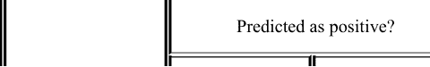

| | 是 | 否 |
|---|---|---|
| **真的是正性的吗？** | TP—真阳性 | FN—假阴性 |
| | 否 | FP—假阳性 |
| | | TN—真阴性 |

分类器的两个基本性能指标是分类错误率，如下图所示：

$Classification error = \frac{errors}{totals} = \frac{FP+FN}{FP+FN+TP+TN}$

$Classification accuracy = 1 - error = \frac{correct}{totals} = \frac{TP+TN}{FP+FN+TP+TN}$

这两个指标的主要问题是它们无法处理不平衡类别。分类信用卡交易是否为滥用是一个不平衡类别问题的例子，有 99.99% 的正常交易，只有极小比例的滥用。一个声称每笔交易都是正常的分类器准确率为 99.99%，但我们主要感兴趣的是那些很少发生的分类。

## 精率和召回率

解决方案是使用不涉及 TN 的指标。两个指标如下：

- **精确率 (Precision)**：在所有被预测为正的样本 (TP + FP) 中，正确预测为正的样本 (TP) 的比例：
$Precision = \frac{TP}{TP+FP}$

- **召回率 (Recall)**：在所有正样本 (TP + FN) 中，被正确预测为正的样本 (TP) 的比例：
$Recall = \frac{TP}{TP+FN}$

将两者结合并报告 $F$-measure 是常见的，它同时考虑精确率和召回率，通过加权平均计算得分，其中得分在 1 处达到最佳，在 0 处最差，如下：

$F-measure = \frac{2 * Precision * Recall}{Precision + Recall}$

## ROC 曲线

大多数分类算法返回一个标记为 $f(X)$ 的分类置信度，反过来用于计算预测。按照信用卡滥用的例子，一条规则可能如下：

$F(X) = \begin{cases} 滥用, 如果 f(X) > 阈值 \\ 非滥用, 否则 \end{cases}$

阈值决定了错误率和真阳性率。所有可能的阈值结果可以绘制为*受试者特征曲线 (ROC)*，如下图所示：


随机预测器用红色虚线表示，完美预测器用绿色虚线表示。为了比较 A 分类器是否优于 C 分类器，我们比较曲线下的面积（AUC）。

大多数工具箱都开箱即用提供了上述所有的指标。

## 回归

回归处理的是连续目标变量，与处理离散目标变量的分类不同。例如，为了预测未来几天的室外温度，我们将使用回归；而分类将用于预测是否会下雨。广而言之，回归是一个估计特征之间关系的过程，即特征的变化如何影响目标变量。

## 线性回归

最基础的回归模型假设特征与目标变量之间存在线性依赖关系。模型通常使用最小二乘法进行拟合，即通过模型使误差的平方和最小。在许多情况下，线性回归无法对复杂关系建模，例如下面的图显示了四组不同的点具有相同的线性回归线：左上角的模型捕捉了总体趋势，可以被视为适当的模型；左下角的模型对点的拟合效果更好，但有一个离群点——这应该仔细检查；而右上和右下角的线性模型完全遗漏了数据的底层结构，不能被视为适当的模型。

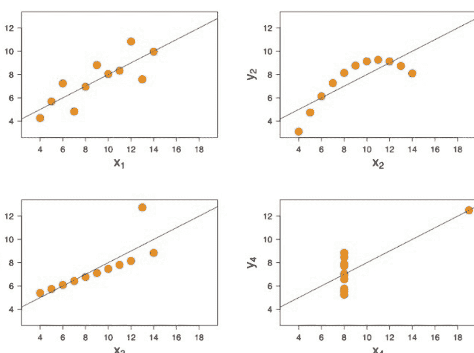

## 回归的评估

在回归中，我们根据输入 $X$ 预测数字 $Y$，这些预测通常是不准确且精确的。我们关注的问题是偏差是多少？换句话说，我们想要衡量预测值与真实值之间的距离。

## 均方误差

均方误差是预测值与真实值之间差平方的平均值，如下：

```
$MSE(X,Y) = \frac{1}{n}\sum_{i=1}^{n}(f(X_i)-Y_i)^2$
```

该指标对离群值非常敏感，例如，99 次精确预测和 1 次偏差 10 的预测与所有预测都偏差 1 的得分相同。此外，该指标对均值敏感。因此，通常使用相对平方误差，它将我们的预测器的 MSE 与均值预测器（始终预测均值）的 MSE 进行比较。

## 均绝对误差

均绝对误差是预测值与真实值之间差的绝对值的平均值，如下：

```
$MAE(X,Y) = \frac{1}{n}\sum_{i=1}^{n}|f(X_i)-Y_i|$
```

MAE 对离群值不那么敏感，但它对均值和尺度敏感。

## 相关系数

相关系数比较预测值相对于均值的平均值与训练值相对于均值的平均值。如果数字为负数，意味着相关性弱；正数表示相关性强；零表示不相关。真实值 $X$ 与预测值 $Y$ 之间的相关性定义如下：

```
$CC_{XY} = \frac{\sum_{i=1}^{n}(X_i-\bar{X})(Y_i-\bar{Y})}{\sqrt{\sum_{i=1}^{n}(X_i-\bar{X})^2}\sqrt{\sum_{i=1}^{n}(Y_i-\bar{Y})^2}}$
```


CC 指标对均值和尺度完全不敏感，对离群值较不敏感。它能够捕捉相对顺序，使得对文档相关性和基因表达等任务进行排序非常有用。

## 泛化与评估

模型构建完成后，我们如何知道它在新数据上的表现如何？这个模型好吗？为了回答这些问题，我们将首先研究模型泛化，然后查看如何获取模型在新数据上性能的估计。

## 欠拟合与过拟合

预测器的训练可能导致模型过于复杂或过于简单。低复杂度模型（最左侧的模型）可以简单到只预测最频繁或平均类别值，而高复杂度模型（最右侧的模型）可以表示训练实例。左侧过于僵硬的模型无法捕捉复杂的模式；而右侧过于灵活的模型则会拟合训练数据中的噪声。主要的挑战是选择合适的学习算法及其参数，以便学习到的模型在新数据上表现良好（例如中间列）：

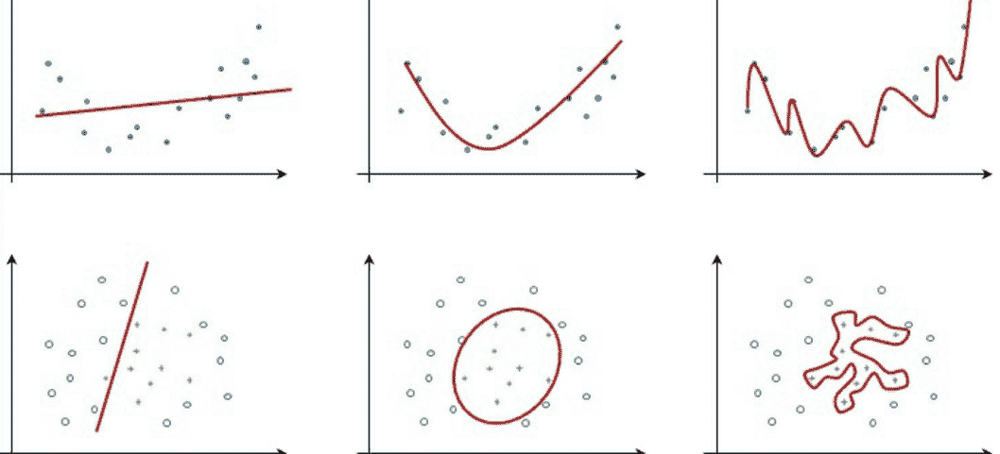

接下来的图显示了训练集误差如何随着模型复杂性的增加而减少。简单的僵硬模型对数据欠拟合且误差较大。随着模型复杂性的增加，它对训练数据底层结构的描述得更好，因此误差也随之减少。如果模型过于复杂，它会过拟合训练数据，其预测误差再次增加：

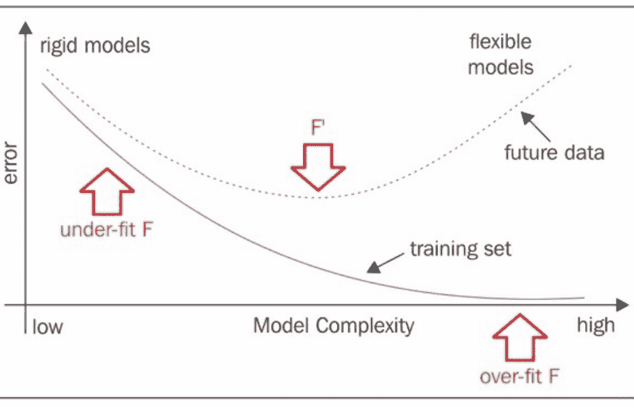

根据任务的复杂性和数据的可用性，我们希望将分类器调整为更不复杂或更复杂的结构。大多数学习算法都允许此类调整，如下：

- **回归**：这是多项式的阶数
- **朴素贝叶斯**：这是属性的数量
- **决策树**：这是树中节点数量、剪枝置信度
- **k-最近邻**：这是邻居的数量、基于距离的邻居权重
- **SVM**：这是内核的类型、代价参数
- **神经网络**：这是神经元的数量和隐藏层的数量

通过调整，我们希望最小化泛化误差，即分类器在未来数据上的表现。遗憾的是，我们永远无法计算真实的泛化误差；然而，我们可以对其进行估计。尽管如此，如果模型在训练数据上表现良好，但在测试数据上的表现差得多，那么模型极可能是过拟合了。

## 训练集与测试

为了估计泛化误差，我们将数据分为两个部分：训练数据和测试数据。一个通用的规则是按训练:测试比例进行拆分，即 70:30。我们首先在训练数据上训练预测器，然后在测试数据上进行测试。这为我们提供了泛化误差的估计。

该估计基于以下两个假设：首先，我们假设测试集是数据集的无偏样本；其次，我们假设实际的新数据将类似于该分布。第一个假设可以通过交叉验证和分层来缓解。此外，如果数据稀缺，无法抽出大量数据作为单独的测试集，因为学习算法在接收不到足够数据时表现不好。在这种情况下，会使用交叉验证。

## 交叉验证

交叉验证将数据集分成大小相同的 k 组，例如下图所示的五组。首先，我们使用 2-5 组进行学习，1 组进行测试。我们重复该过程五次，每次留出一组进行测试，并对五次重复的误差取平均值。

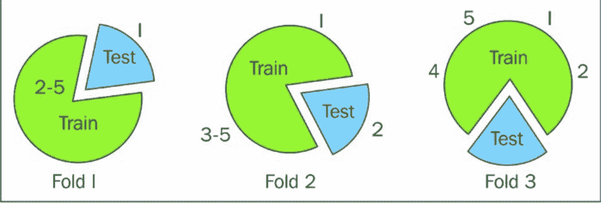

通过这种方式，我们对所有数据用于学习和测试，同时避免了使用相同的数据来训练和测试模型。

## 留一验证

交叉验证的一个极端例子是留一验证。在这种情况下，折数等于实例数量；我们利用除一个实例以外的所有实例进行学习，然后在省略的实例上对模型进行测试。我们对所有实例重复此过程，以便每个实例恰好用于一次验证。当我们的学习示例有限时（例如少于 50 个），推荐使用这种方法。

## 分层

分层是一种选择子集的方法，使得每个折大致包含相同比例的类别值。当类别是连续的时，选择折的方法使得所有折的响应均值大致相等。分层可以与交叉验证或单独的训练和测试集结合使用。

## 总结

在本章中，我们复习了机器学习的基础知识。我们回顾了应用机器学习的工作流，并明确了主要的任务、方法和算法。在下一章中，我们将回顾可用的 Java 库以及它们可以执行的任务。

# 第 2 章 用于机器学习的 Java 库和平台

亲手实现机器学习算法可能是学习机器学习最好的方法，但如果你能站在巨人的肩膀上，利用现有的开源库之一，进展会快得多。

本章回顾了 Java 中各种机器学习库和平台。目标是理解每个库提供了什么功能，以及它们能够解决什么问题。

在本章中，我们将涵盖以下主题：

- 实现机器学习应用对 Java 的要求
- Weka，一个通用的机器学习平台
- Java 机器学习库，机器学习算法的集合
- Apache Mahout，一个可扩展的机器学习平台
- Apache Spark，一个分布式机器学习库
- Deeplearning4j，一个深度学习库
- MALLET，一个文本挖掘库

我们还将讨论如何使用这些库结合其他组件，为单机应用和大数据应用构建完整的机器学习应用栈架构。

## Java 的必要性

新的机器学习算法通常首先在大学实验室中编写，通过胶合多种语言（如 shell 脚本、Python、R、MATLAB、Java、Scala 或 C++）来证明新概念并在理论上分析其属性。一个算法在进入带有输入输出和接口的库之前，可能经过大量的重构。虽然 Python、R 和 MATLAB 非常流行，但它们主要用于脚本、研究和实验。相比之下，Java 是事实上的企业级语言，这归功于静态类型、健壮的 IDE 支持、良好的维护性，以及优秀的线程模型和高性能的并发数据结构库。此外，已经有许多 Java 机器学习库可用，这使得在现有的 Java 应用中与它们接口并利用强大的机器学习能力变得非常方便。

## 机器学习库

MLOSS.org 网站上列出了超过 70 个基于 Java 的开源机器学习项目，可能还有许多未列出的项目存在于大学服务器、GitHub 或 Bitbucket 上。在本节中，我们将回顾主要的库和平台、它们能够解决的问题、它们支持的算法以及它们可以处理的数据类型。

## Weka

Weka 是 `Waikato Environment for Knowledge Analysis` 的缩写，是由新西兰怀卡托大学开发的一个机器学习库，可能是最著名的 Java 库。它是一个通用型库，能够解决各种机器学习任务，如分类、回归和聚类。它具有丰富的图形用户界面、命令行界面和 Java API。你可以访问 `http://www.cs.waikato.ac.nz/ml/weka` 查看 Weka。

在本书编写时，Weka 总共包含 267 种算法：数据预处理 (82)、属性选择 (33)、分类和回归 (133)、聚类 (12) 和关联规则挖掘 (7)。图形界面非常适合用于探索你的数据，而 Java API 则允许你开发新的机器学习方案并在应用程序中使用这些算法。


Weka 根据 GNU 通用公共许可证 (GNU GPL) 分发，这意味着只要跟踪源文件中的更改并保持符合 GNU GPL，就可以复制、分发和修改它。你甚至可以进行商业分发，但必须公开源代码或获得商业许可。

除了支持的几种格式外，Weka 还拥有自己的默认数据格式 ARFF，通过属性-数据对来描述数据。它由两部分组成。第一部分包含标头，指定了所有属性（即特征）及其类型；例如：名目的、数值、日期和字符串。第二部分包含数据，每行对应一个实例。标头中的最后一个属性被隐式视为目标变量，缺失数据用问号标记。例如，回到第 1 章《应用机器学习快速上手》中的示例，用 ARFF 格式编写的 Bob 实例如下所示：

```
@RELATION person_dataset

@ATTRIBUTE `Name` STRING

@ATTRIBUTE `Height` NUMERIC

@ATTRIBUTE `Eye color` {blue, brown, green}

@ATTRIBUTE `Hobbies` STRING

@DATA

'Bob', 185.0, blue, 'climbing, sky diving'

'Anna', 163.0, brown, 'reading'

'Jane', 168.0, ?, ?
```

该文件包含三个部分。第一部分以 `@RELATION <String>` 关键字开始，指定数据集名称。下一部分以 `@ATTRIBUTE` 关键字开始，随后是属性名称和类型。可用的类型有 `STRING`、`NUMERIC`、`DATE` 和一组分类值。最后一个被隐式假设为我们要预测的目标变量。最后部分以 `@DATA` 关键字开始，每行一个实例。实例值之间用逗号分隔，且必须与第二部分中属性的顺序一致。

更多 Weka 示例将在第 3 章“基础算法——分类、回归和聚类”以及第 4 章“客户关系预测”中演示。

> **注意**
>
> 要了解更多关于 Weka 的信息，请阅读快速入门指南，或参考 Witten 和 Frank 写的《Data Mining: Practical Tools》（Morgan Kaufmann 出版，提供理论背景和深度解释）。

Weka 的 API 组织在以下顶级包中：

- `weka.associations`：这些关联规则学习，包括 `Apriori`、`FilteredAssociator`、`FP-Growth`、广义序列模式 (GSP) 等。
- `weka.classifiers`：这些监督学习算法。该包进一步分为以下组件：
- `weka.classifiers.bayes`：实现贝叶斯方法，包括 `NaiveBayes`、`BayesNet`、`BayesianLogisticRegression`。
- `weka.classifiers.evaluation`：用于名目和数值预测的监督评估算法，如评估统计、混淆矩阵、ROC 曲线。
- `weka.classifiers.functions`：这些回归算法，包括 `LinearRegression`、`IsotonicRegression`、`GaussianProcesses`、`SMO`、`MultilayerPerceptron`、`VotedPerceptron`。
- `weka.classifiers.lazy`：基于实例的算法，如 `KStar`、`IBk`。
- `weka.classifiers.meta`：监督学习元算法，包括 `AdaBoostM1`、`Bagging`、`AdditiveRegression`、`RandomCommittee`。
- `weka.classifiers.mi`：多实例学习算法，例如 `CitationKNN`、`DiverseDensity`、`MiAdaBoost`。
- `weka.classifiers.rules`：基于分治策略的决策表和决策规则，`JRip`、`PART`、`Ridor`。
- `weka.classifiers.trees`：各种决策算法，包括 `J48`、`M5P`、`RandomForest`、`REPTree`、`LMT`。
- `weka.clusterers`：聚类算法，包括 `SimpleKMeans`、`Cobweb`、`DBSCAN`、`HierarchicalClusterer` 等。
- `weka.core`：各种实用类、数据表示、配置文件。
- `weka.datagenerators`：用于分类、回归和聚类算法的数据生成器。
- `weka.estimators`：离散/名目领域的各种数据分布估计器、条件概率估计。
- `weka.experiment`：支持运行实验所需的必要配置、数据集、模型设置和统计的一系列类。
- `weka.filters`：用于监督和无监督预处理的基于属性和实例的选择算法。
- `weka.gui`：实现 explorer、experimenter 和知识流应用程序的图形界面。`Explorer` 允许你调查数据集、算法及其参数，并使用散点图和其他可视化工具可视化数据集。`Experimenter` 用于设计批量实验，但它只能用于分类和回归问题。`KnowledgeFlow` 实现了一个可视化的拖放式用户界面来构建数据流，例如加载数据、应用过滤器、构建分类器以及评估。

## Java 机器学习库

Java 机器学习库（或称为 `Java-ML`）是一系列机器学习算法的集合，为相同类型的算法提供了通用的接口。它仅包含 Java API，因此，主要面向软件工程师和程序员。`Java-ML` 包含了用于数据预处理、特征选择、分类和聚类的算法。此外，它还提供了几个 Weka 桥接程序，允许通过 `Java-ML` API 直接访问 Weka 的算法。你可以从 `http://java-ml.sourceforge.net` 下载它；该处的最新版本发布于 2012 年（本书编写时的情况）。


# Java 机器学习库概览

## Java-ML

Java-ML 也是一个通用的机器学习库。与 Weka 相比，它提供了更一致的接口，并包含了其他包中不存在的最新算法实现，例如广泛的相似性度量和特征选择技术，如动态时间规整（DTW）、随机森林属性评估等。Java-ML 同时在 GNU GPL 许可证下发布。

Java-ML 支持任何类型的文件，只要每行包含一个数据样本，且特征通过逗号、分号和制表符等符号分隔。

该库围绕以下顶级包组织：

- `net.sf.javaml.classification`：这些是分类算法，包括朴素贝叶斯、随机森林、Bagging、自组织映射、k-近邻等
- `net.sf.javaml.clustering`：这些是聚类算法，如 k-means、自组织映射、空间聚类、Cobweb、AQBC 等其他
- `net.sf.javaml.core`：这些是表示实例和数据集的类
- `net.sf.javaml.distance`：这些是衡量距离和相似性的算法，例如切比雪夫距离、余弦距离/相似性、欧几里得距离、Jaccard 距离/相似性、马哈拉纳距离、曼哈顿距离、闵夫斯基距离、皮尔逊相关系数、Spearman 脚注距离、动态时间规整（DTW）等
- `net.sf.featureslection`：这些是特征评估、评分、选择和排序的算法，例如增益率、ReliefF、Kullback-Leibler 散度、对称不确定性等
- `net.sf.javaml.filter`：这些通过过滤、删除属性、设置类别或属性值等方法操作实例的方法
- `net.sf.javaml.matrix`：这实现了内存中或基于文件的数组
- `net.sf.javaml.sampling`：这实现了采样算法，用于选择数据集的子集
- `net.sf.javaml.tools`：这些是数据集上的工具方法，包括实例操作、序列化、Weka API 接口等
- `net.sf.javaml.utils`：这些是算法的工具方法，例如统计统计、数学方法、列联表等

## Apache Mahout

Apache Mahout 项目旨在构建一个可扩展的机器学习库。它构建在可扩展的分布式架构（如 Hadoop）之上，使用 MapReduce 范式，这种方法通过使用服务器集群进行并行、分布式的算法来处理和生成大型数据集。


Mahout 提供了控制台界面和 Java API，用于聚类、分类和协同过滤的可扩展算法。它能够解决三个业务问题：物品推荐，例如推荐“喜欢此电影的人也喜欢……”等物品；聚类，例如将文本文档分组为拓扑相关的文档组；以及分类，例如学习为未标记文档分配哪种主题。

Mahout 以一种对商业友好的 Apache License 发布，这意味着只要你保留了其中包含的 Apache 许可证并在你的程序的版权声明中显示它，就可以使用它。

Mahout 包含以下库：

- `org.apache.mahout.classifier.cfaste`：这些是基于用户和基于物品的协同过滤算法，以及带有 ALS 的矩阵分解
- `org.apache.mahout.classifier`：这些是内存中和分布式的实现，包括逻辑回归、朴素贝叶斯、随机森林、隐马尔可夫标记模型（HMM）和多层感知器
- `org.apache.mahout.clustering`：这些是聚类算法，如顶篷聚类、k-means、模糊 k-means、流式 k-means 和谱聚类
- `org.apache.mahout.common`：这些是算法的工具方法，包括距离、MapReduce 操作、迭代器等
- `org.apache.mahout.driver`：这实现了一个通用的驱动程序，用于运行其他类的 main 方法
- `org.apache.mahout.ep`：这是使用记录步变异的演化优化
- `org.apache.mahout.math`：这些是 Hadoop 中的各种数学工具方法和实现
- `org.apache.mahout.vectorizer`：这些用于数据展示、处理和 MapReduce 任务类

## Apache Spark

Apache Spark，简单称为 Spark，是一个构建在 Hadoop 之上的大规模数据处理平台，但与 Mahout 不同，它没有限于 MapReduce 范式。相反，它使用内存缓存进行提取。

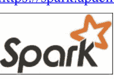

在 Spark 之上有许多模块，用于图处理的 GraphX、用于实时数据的 Spark Streaming 以及用于机器学习、分类、协同过滤和降维的 MLlib。

Spark 的 MLlib 可以使用：

- Dense vector（密集向量）：存储在单机上的数组。
- Labeled point（标记点）：用于监督学习，由带有标签的本地向量组成。
- Local matrix（本地矩阵）：存储在单机上的密集矩阵。由矩阵定义并按列顺序排列。
- Distributed matrix（分布式矩阵）：基于 Spark 的弹性分布式数据集（RDD），表示一个可以并行操作的元素集合。有三种表示：row matrix（每行都是存储在单机上的本地向量）；indexed row matrix（类似于行矩阵，但行具有意义，可以执行连接操作）；coordinate matrix（当无法存储行且矩阵非常稀疏时使用）。

Spark 的 MLib API 库提供了以下算法和工具：

- `org.apache.spark.mlllib.classification`：二分类和多分类算法，包括线性 SVM、逻辑回归、决策树和朴素贝叶斯
- `org.apache.spark.mlllib.clustering`：k-means 聚类
- `org.apache.spark.mlllib.linalg`：各种数据表示形式，包括密集向量、稀疏向量和矩阵
- `org.apache.spark.mlllib.optimization`：用于 MLib 底层原理的各种优化算法，包括梯度下降、随机梯度下降、分布式 SGD 的更新方案以及有限内存 BFGS
- `org.apache.spark.mlllib.recommendation`：使用交替最小二乘分解实现的基于协同过滤
- `org.apache.spark.mlllib.regression`：回归学习算法，如线性最小二乘、决策树、Lasso 和岭回归
- `org.apache.spark.mlllib.stat`：稀疏或密集向量格式样本的统计函数，用于计算均值、方差、最小值、最大值、计数和零计数
- `org.apache.spark.mlllib.tree`：实现分类和回归决策树学习算法
- `org.apache.spark.mlllib.util`：用于加载、保存、预处理、生成和验证数据的系列方法

## Deeplearning4j

Deeplearning4j（或 DL4J）是一个用 Java 编写的深度学习库。它具有分布式和单机深度学习框架的特点，包含并支持多种神经网络结构，如前馈神经网络、RBM、卷积神经网络、深度信念网络、自动编码器等。DL4J 可以解决不同的问题，例如人脸识别、语音识别、垃圾邮件或电子商务交易。

Deeplearning4j 采用 Apache 2.0 发布，可以从 `http://deeplearning4j.org` 下载。该库的结构如下：

- `org.deeplearning4j.base`：这些是加载类
- `org.deeplearning4j.berkeley`：这些是数学工具方法
- `org.deeplearning4j.clustering`：这是 k-means 聚类的实现
- `org.deeplearning4j.datasets`：这是数据集操作，包括导入、创建、迭代等
- `org.deeplearning4j.distributions`：这些是用于分布的实用工具方法
- `org.deeplearning4j.eval`：这些是评估类，包括混淆矩阵
- `org.deeplearning4j.exceptions`：这实现了异常处理程序
- `org.deeplearning4j.models`：这些是监督学习算法，包括深度信念网络、堆叠自动编码器、堆叠去噪自动编码器和 RBM
- `org.deeplearning4j.nn`：这些是基于神经网络的组件和算法实现，如神经网络、多层网络等
- `org.deeplearning4j.optimize`：这些是神经网络优化算法，包括反传播、多层优化、输出层优化等
- `org.deeplearning4j.plot`：这些是渲染数据的各种方法
- `org.deeplearning4j.rng`：这是一个随机数据生成器
- `org.deeplearning4j.util`：这些是辅助和工具方法

## MALLET

语言处理机器学习工具包（MALLET）是一个包含自然语言处理算法和工具的大型库。它可以用于多种任务，如文档分类、文档聚类、信息提取和主题建模。它为多种算法（如朴素贝叶斯、HMM、隐含狄利克雷主题模型、逻辑回归和条件随机场）提供了命令行界面和 Java API。


MALLET 在 Common Public License 1.0 下发布，这意味着你甚至可以在商业应用中使用它。可以从 `http://mallet.cs.umass.edu` 下载。MALLET 实例由名称、标签、数据和来源表示。然而，有两种方法可以将数据导入 MALLET 格式，如下列表所示：

- 每个文件一个实例：每个文件（即文档）对应一个实例，MALLET 接受目录名作为输入。
- 每行一个实例：每行对应一个实例，假设格式为：instance_name label token。数据将是一个特征向量，由作为 token 的不同单词及其出现次数组成。

该库包含以下包：

- `cc.mallet.classify`：这些是用于分类实例的算法，包括 AdaBoost、bagging、C4.5 以及其他决策树模型、多元逻辑回归、朴素贝叶斯和 Winnow2。
- `cc.mallet.cluster`：这些是非无监督聚类算法，包括贪心层次聚合、爬山算法、k-best 和 k-means 聚类。
- `cc.mallet.extract`：这实现了分词器、文档提取器、文档查看器、清理器等。
- `cc.mallet.fst`：这实现了序列模型，包括条件随机场、HMM、最大熵马尔可夫模型以及相应的算法和评估器。
- `cc.mallet.grmm`：这实现了图形模型和因子图作为推理算法、学习和测试。例如，循环置推传播、Gibbs 采样等。
- `cc.mallet.optimize`：这些是寻找函数最大值的优化算法，如梯度上升、有限内存 BFGS、随机元上升等。
- `cc.mallet.pipe`：这些作为流水线的方法，将数据处理为 MALLET 实例。
- `cc.mallet.topics`：这些是主题建模算法，如隐含狄利克雷分配、层次化、DMRT。
- `cc.mallet.types`：这实现了基本类型，如数据集、特征、实例。
- `cc.mallet.util`：这些是杂项实用函数，如命令行、搜索、标签。

## 库比较

下表总结了所有列出的库。该表并非详尽——还有许多其他涵盖特定领域的库：

| 问题领域 | 许可证 | 架构 | 算法 |
|---|---|---|---|
| Weka 通用 | GNU GPL | 单机 | 决策树、朴素贝叶斯、神经网络、随机森林、AdaBoost |
| Java-ML 通用 | GNU GPL | 单机 | k-means 聚类、自组织映射、马尔可夫链 |
| Mahout 分类 | Apache 2.0 License | 分布式 | 逻辑回归、随机森林、HMM |
| Spark 通用 | Apache 2.0 License | 分布式 | SVM、线性二乘、LASSO、岭回归 |
| DL4J 深度学习 | Apache 2.0 License | 分布式 | RBM、深度信念网络、自动编码器、递归神经网络、卷积 |
| MALLET 文本挖掘 | Common Public License 1.0 | 单机 | 朴素贝叶斯、决策树、最大熵、条件随机场 |

## 构建机器学习应用

机器学习应用（特别是专注于分类的应用）通常遵循下图所示的高级工作流。该工作流包含两个阶段：训练分类器和分类新实例。两个阶段共享图中所示的步骤：

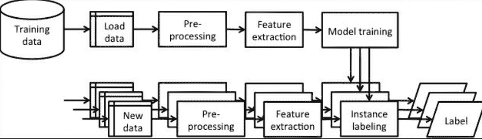

首先，我们使用一组**训练数据**，选择代表性子集作为训练集，预处理数据并提取特征。使用选定的监督学习算法训练模型，并部署在第二阶段。第二阶段将新的数据实例通过相同的**预处理**和**特征提取**过程，并应用学习到的模型获取实例标签。如果你能够收集新的标记数据，可以定期重新学习阶段以重新训练模型，并在分类阶段用重新训练的模型替换旧模型。

## 传统机器学习架构

结构化数据（如事务、客户、分析和市场数据）通常位于本地关系型数据库中。给定查询语言（如 SQL），我们可以查询用于处理的数据，如上一个图的工作流所示。通常，所有数据都可以存储在内存中，并使用 Weka、Java-ML 或 MALLET 等机器学习库进行进一步处理。

为了理解大数据架构在高级方面有何不同，让我们先明确数据何时被认为是大数据？

## 处理大数据

在这一术语被发明之前，大数据就已经存在了。例如，银行和交易所多年来每天处理数以亿计的交易；航空公司多年来作为乘客预订运营管理的全球实时基础设施；诸此类类等。那么，大数据到底是什么？Doug Laney (2001) 建议大数据由三个 V 来定义：数量（Volume）、速度（Velocity）和多样性（Variety）。因此，为了回答你的数据是否为大这个问题，我们可以将其转化为以下子问题：

- **数量（Volume）**：你可以将数据存储在内存中吗？
- **速度（Velocity）**：你可以用单台机器处理新迁入的数据吗？
- **多样性（Variety）**：你的数据来自单一来源吗？

如果你对所有问题的回答都是“是”，那么你的数据可能并不大，别担心，你只是简化了自己的应用架构。

如果你对所有问题的回答都是“否”，那么你的数据就是大数据！然而，如果你得到的回答有有否，情况就很复杂。有些人可能认为某一个 V 很重要，另一些人可能认为其他的 V 重要。从机器学习的角度来看，处理内存数据和来自分布式存储的数据在算法实现上存在根本区别。因此，一个经验法则如下：如果你无法将数据存储在内存中，那么你应该研究大数据机器学习库。

确切的答案取决于你试图解决的问题。如果你正在启动新项目，我建议你从单机库开始并对算法进行原型设计，如果实体无法放入内存，则可以使用数据的一个子集。一旦你建立了良好的初始结果，可以考虑迁移到更重量级的工具，如 Mahout 或 Spark。

## 大数据应用架构

大数据（如文档、网络日志、社交网络、传感器数据等）存储在 NoSQL 数据库（如 MongoDB）或分布式文件系统（如 HDFS）中。对于结构化数据，我们可以使用类似构建在 Hadoop 之上的 Cassandra 或 HBase 等系统部署数据库功能。数据处理遵循 MapReduce 范式，它将数据处理问题分解为更小的子问题并将任务分布到各个处理节点。最后使用 Mahout 和 Spark 等机器学习库训练机器学习模型。

## 注意

MongoDB 是一个 NoSQL 数据库，它以类 JSON 格式存储文档。欲了解更多请访问 `https://www.mongodb.org`。

Hadoop 是一个用于在计算机集群上分布式处理大型数据集的框架。它包括文件系统格式 HDFS、作业调度框架 YARN，并实现了用于并行数据处理的 MapReduce 方法。更多关于 Hadoop 的信息可见 `http://hadoop.apache.org`。

Cassandra 是一个分布式数据库管理系统，旨在提供容错、可扩展和去中心化的存储。更多信息请访问 `http://cassandra.apache.org`。

HBase 是另一个侧重于分布式存储随机读写访问的数据库。更多信息请访问 `https://hbase.apache.org`。

## 总结

选择机器学习库对你的应用架构有重要影响。关键在于考虑你的项目需求。你有什么类型的数据？你试图解决什么问题？你的数据大吗？你需要分布式存储吗？你计划使用什么种算法？一旦你确定了解决问题需要什么，就选择最符合你需求的库。

在下一章中，我们将介绍如何使用介绍的一些库来完成基础机器学习任务，如分类、回归和聚类。

# 第 3 章 基础算法 – 分类、回归和聚类

在上一章中，我们回顾了机器学习的关键 Java 库以及它们提供的功能。在本章中，我们终于开始实操了。我们将仔细观察分类、回归和聚类等基础机器学习任务。每个主题将介绍分类、回归和聚类的基础算法。示例数据集将很小、简单且易于理解。

以下是本章将涵盖的主题列表：

- 加载数据
- 过滤属性
- 构建分类

## 在开始之前

从 `http://www.cs.waikato.ac.nz/ml/weka/downloading.html` 下载最新版本的 Weka 3.6。

有多个下载选项供选择。我们希望在源代码中使用 Weka 库，请确保你复制了自解压执行文件，并如下如下所示选择 ZIP 压缩包。解压存档并在提取出的包中找到 `weka.jar`：

- 其他平台（Linux 等）
[点击此处]下载包含 Weka 的 zip 压缩包 (weka-3-7-11.zip: 33.2 MB)

首先解压 zip 文件。这将创建一个新目录 `weka-3-7-11`。要运行 Weka，进入该目录并输入

```
java -Xms1000m -jar weka.jar
```


注意，系统上需要安装 Java 才能运行此程序。另请注意，使用 `-jar` 将覆盖你当前的 `CLASSPATH` 变量并仅使用 `weka.jar`。

我们将使用 Eclipse IDE 来展示示例，如下：

1. 启动一个新的 Java 项目。
2. 右键点击项目属性，选择 Java Build Path，点击 Libraries 选项卡，并选择 Add External JARs。
3. 导航到解压 Weka 存档目录并选择 `weka.jar` 文件。

好了，我们准备好实现基础机器了！

## 分类

我们将从常用的学习技术开始，即分类。正如我们在第一章回顾过的，主要思想是建立输入变量与结果之间的映射。在后续章节中，我们将查看如何加载数据、选择特征、在 Weka 中实现分类器并评估分类器的性能。

## 数据

对于这项任务，我们将查看 ZOO 数据库。该数据库包含 101 条目，由 18 个属性描述：

| animal | aquatic | fins |
|---|---|---|
| hair | predator | legs |
| feathers | toothed | tail |
| eggs | backbone | domestic |
| milk | breaths | size |

集合中的一个示例是 lion，属性如下：

- animal: lion
- hair: true
- feathers: false
- eggs: false
- milk: true
- airborne: false
- aquatic: false
- predator: true
- toothed: true
- backbone: true
- breaths: true
- venomous: false
- fins: false
- legs: 4
- tail: true
- domestic: false
- catsize: true
- type: mammal

我们的任务是在给定其他属性的情况下预测结果变量 `animal`。

### 加载数据

在开始分析之前，我们将以 ARFF 格式加载数据并打印总实例数。每个数据样本存储在 `Instances` 对象中，整个数据集元数据由 `Instances` 对象处理。

为了加载输入数据，我们将使用 `DataSource` 对象，它可以接受多种格式：

```java
DataSource source = new DataSource(args[0]);

Instances data = source.getDataSet();

System.out.println(data.numInstances() + " instances loaded.");

// System.out.println(data.toString());
```

输出加载的实例数量，如下：

```
101 instances loaded.
```

我们也可以通过调用 `data.toString()` 方法打印整个数据集。

### 特征选择

如第1章《应用机器学习快速入门》介绍的，预处理步骤之一是特征选择，也称为属性选择。其目标是选择一组相关的属性子集，并将其用于学习模型。为什么特征选择很重要？较小的属性集可以简化模型，并让用户对其更容易解释，这通常意味着更短的训练时间并减少过拟合。

属性选择可以考虑类别值，也可以不考虑。在这种情况下，属性选择算法会评估不同的特征子集，并计算出一个分数来指示所选属性的质量。我们可以使用不同的搜索算法，如穷举搜索、最佳搜索，以及不同的质量评分，如信息增益、Gini 指数等。

Weka 通过 `AttributeSelection` 对象支持这一过程，该对象需要两个额外参数：`evaluator`（评估器），用于计算属性的信息量；以及 `ranker`（排位器），用于根据评估器分配的分数对属性进行排序。

在本示例中，我们将使用信息增益作为评估器，并根据信息增益得分对特征进行排序：

```java
InfoGainAttributeEval eval = new InfoGainAttributeEval();
Ranker search = new Ranker();
```

接下来，我们初始化 `AttributeSelection` 对象并设置评估器、排位器和数据：

```java
AttributeSelection attSelect = new AttributeSelection();

attSelect.setEvaluator(eval);

attSelect.setSearch(search);

attSelect.selectAttributes(data);
```

最后，我们可以打印属性列表的顺序索引，如下：

```java
int[] indices = attSelect.selectedAttributes();

System.out.println(Utils.arrayToString(indices));
```

该方法输出结果如下：

```
12,3,7,2,0,1,8,9,13,4,11,15,10,6,14,16
```

信息量最大的三个属性是 12 (鱼鳍)，3 (水生), 2 (毛发) 等。根据此列表，我们可以移除额外的、不包含信息的特征，以帮助学习算法实现更准确、更快的学习模型。

什么决定了保留属性数量的最终决策？没有关于精确数量的经验性法则——属性的数量取决于数据和问题。属性选择的目的是选择更好地服务于模型的属性，因此最好关注属性是否改进了模型。

### 学习算法

我们已经加载了数据，选择了最佳特征，并准备好学习一些分类模型。让我们从基础决策树开始。

Weka 中的决策树在 `J48` 类中实现，该类是 Quinlan C4.5 决策树学习器的重新实现 [Quinlan, 1993]。

首先，我们初始化一个 `J48` 决策树学习器。我们可以通过字符串表传递额外参数，例如控制模型复杂性的剪枝（参考第1章《应用机器学习快速入门》）。在我们的案例，我们将构建一个未剪枝的树，因此我们将传递一个参数：

```java
J48 tree = new J48();

String[] options = new String[1];

options[0] = "-U";
```

```java
tree.setOptions(options);
```

接下来，我们调用 `buildClassifier(Instances)` 方法来初始化学习过程：

```java
tree.buildClassifier(data);
```

构建的模型现在存储在树对象中。我们可以通过 `toString()` 方法输出整个 `J48` 未剪枝树：

```java
System.out.println(tree);
```

输出如下：

```
J48 unpruned tree

feathers = false

| milk = false

| | backbone = false

| | | airborne = false

| | | | predator = false

| | | | | legs <= 2: invertebrate (2.0)

| | | | | legs > 2: insect (2.0)

| | | | predator = true: invertebrate (6.8)

| | | | airborne = true: insect (6.0)

| fins = false

| tail = false: amphibian (3.0)

| tail = true: reptile (6.0/1.0)

| fins = true: fish (13.0)

| milk = true: mammal (41.0)

feathers = true: bird (20.0)

Number of Leaves : 9

Size of the tree : 17
```

输出的树共有 17 个节点，其中 9 个是终端节点（叶子节点）。

另一种展示树的方法是利用内置的 `TreeVisualizer` 查看器，如下：

```java
TreeVisualizer tv = new TreeVisualizer(null, tree.graph(), new PlaceNode2());
JFrame frame = new javax.swing.JFrame("Tree Visualizer");
frame.setSize(800, 500);
frame.setDefaultCloseOperation(JFrame.EXIT_ON_CLOSE);
frame.getContentPane().add(tv);
frame.setVisible(true);
tv.fitToScreen();
```

该代码产生以下表框：

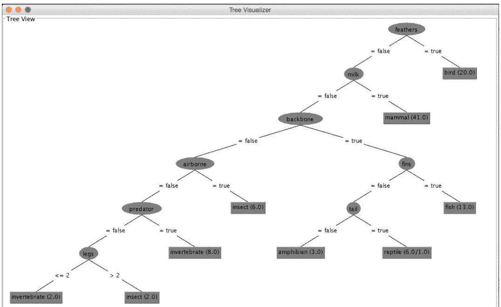

决策过程从顶部节点（也称为根节点）开始。节点标签指定了将检查的属性值。在示例中，我们首先检查 `feathers` 属性的值。如果有羽毛，我们就沿着右分支，这将到达叶子节点。如果没有羽毛，我们就沿着左分支，进入下一个属性。我们重复此过程直到到达叶子节点。

### 分类新数据

假设我们有一个标签未知的动物，可以使用训练好的模型。

我们首先构建一个描述新标本的特征向量，如下：

```java
double result = tree.classifyInstance(myUnicorn);
System.out.println(data.classAttribute((int) result));
```

输出为 `mammal` 类。

### 评估和预测误差指标

我们建立了一个模型，但不知道它是否可以信任。为了估计其性能，我们可以应用第1章《应用机器学习快速入门》中介绍的交叉验证技术。

Weka 提供了实现交叉验证的 `Evaluation` 类。我们如下传递模型、数据、折数和初始随机种子：

```java
Classifier cl = new J48();
Evaluation roc = new Evaluation(data);
roc.crossValidateModel(cl, data, 10, new Random(1), new Object[]{});
System.out.println(roc.toString());
```

评估结果存储在 `Evaluation` 对象中。

通过调用 `toString()` 方法可以调用常用指标的混合。注意输出没有区分回归和分类，因此请关注有意义的指标，如下：

| 正确分类的实例 | 93 | 92.0792 % |
|---|---|---|
| 错误分类的实例 | 8 | 7.9208 % |
| Kappa 统计量 | | 0.8955 |
| 平均绝对误差 | | 0.0225 |
| 均方根误差 | | 0.14 |
| 相对绝对误差 | | 10.2478 % |
| 相对均方根误差 | | 42.4398 % |
| 覆盖率 (0.95水平) | | 96.0396 % |
| 平均相对区域大小 (0.95水平) | | 15.4173 % |
| 实例总数 | | 101 |

在分类中，我们感兴趣的是正确/错误分类的实例数量。

### 混淆矩阵

此外，我们可以通过检查混淆矩阵来查看特定的分类错误发生。混淆矩阵显示了如何预测特定的类别值：

```java
double[][] confusionMatrix = eval_roc.confusionMatrix();
System.out.println(eval_roc.toMatrixString());
```

生成的混淆矩阵如下：

```
=== Confusion Matrix ===

a b c d e f g   <-- 分类
41 0 0 0 0 0 0 | a = 哺乳
0 20 0 0 0 0 0 | b = 鸟
0 0 3 1 0 0 0 | c = 爬行动动物
0 0 13 0 0 0 1 | d = 鱼
0 0 1 3 0 0 0 | e = 两栖动物
0 0 0 0 0 5 3 | f = 昆虫
0 0 0 0 0 2 8 | g = 无脊椎动物
```

第一行的第一列名称对应于分类模式分配的标签。每一行随后对应于一个真实的类别值。例如，第二行对应于真实标签为“哺乳动物”的实例。在列行中，我们看到所有的哺乳动物都被正确地分类为哺乳动物。在第四行（爬行动物）中，我们注意到有三只被正确地分类为爬行动物，而一个被分类为鱼，另外一个被分类为昆虫。因此，混淆矩阵让我们洞察了分类模型所犯的错误类型。

### 选择分类算法

朴素贝叶斯（Naive Bayes）是机器学习中最简单、高效且有效的归纳算法之一。当特征相互独立时（这在现实世界中很少），它在理论上是最优的；即使在特征相关的情况下，它的性能也具有惊人的竞争力（Zhang, 2004）。主要缺点是它无法学习特征之间如何相互作用，例如，尽管你喜欢在茶里加柠檬或牛奶，但你不会同时加入这两者。

决策树的主要优势是一个模型，即我们在示例中所学习的那样，一棵易于解释和说明的树。它可以处理名义特征和数值特征，你不需要担心数据是否是线性可分的。

分类算法的其他示例例如：

- `weka.classifiers.rules.ZeroR`：它预测多数类并被视为基准，也就是说，如果你的分类器性能差于平均值预测器，那么它就不值得考虑了。
- `weka.classifiers.trees.RandomTree`：它构建了一个在节点处考虑 K 个随机选定属性的树。
- `weka.classifiers.trees.RandomForest`：它构建了一个随机树集合（即森林），并使用多数投票对新实例进行分类。
- `weka.classifiers.lazy.IBK`：这是 k-最近邻分类器，能够根据交叉验证选择合适的邻居值。
- `weka.classifiers.functions.MultilayerPerceptron`：这是一个基于神经网络的分类器，使用反向传播对实例进行分类。网络可以手动构建，也可以通过算法创建。
- `weka.classifiers.bayes.NaiveBayes`：这是一个朴素贝叶斯分类器，它使用估计器类，其中数值估计器的精度值是根据训练数据的分析选择的。
- `weka.classifiers.meta.AdaBoostM1`：这是使用 AdaBoost M1 方法对名义类进行增强的类。只能处理名义类问题。这通常会显著提高性能，但有时会过拟合。
- `weka.classifiers.meta.Bagging`：这是一个用于装袋（bagging）分类器以减少方差的类。根据基础学习器，它可以执行分类和回归。

## 回归

我们将通过分析能源效率数据集（Tsnas and Xifara, 2012）来探索基础回归算法。我们将根据建筑的结构特征（如表面积、墙壁和屋顶面积、高度、紧凑性）研究建筑的加热和冷却负载需求。研究人员使用模拟器在改变 18 种建筑特征的同时设计了 12 种不同的房屋配置。共模拟了 768 个不同的建筑。

我们的第一个目标是系统地分析每个建筑特征对目标变量（即加热或冷却负载）的影响。第二个目标是比较经典回归与其他方法（如 SVM、随机森林神经网络）的性能。

### 加载数据

从 https://archive.ics.uci.edu/ml/datasets/energy+efficiency 下载能源效率数据集。数据集为 XLSX 格式，Weka 无法读取。我们可以通过点击文件 | 另存为 并在保存对话框中选择 CSV 将其转换为逗号分隔值（CSV）格式。现在文件可以被 Weka 加载了：

```java
import weka.core.Instances;
import weka.converters.CSVLoader;
import java.io.File;
import java.io.IOException;

public class EnergyLoad {
    public static void main(String[] args) throws IOException {
        CSVLoader loader = new CSVLoader();
        loader.setSource(new File(args[0]));
        Instances data = loader.getDataSet();
        System.out.println(data);
    }
}
```

### 分析属性

在分析属性之前，让我们先尝试我们正在处理什么。共有八个描述特征的属性和两个目标变量（加热和冷却负载），如下表所示：

| 属性 | 名称 |
|---|---|
| X1 | 相对紧凑性 |
| X2 | 表面积 |
| X3 | 墙壁面积 |
| X4 | 屋顶面积 |
| X5 | 总体高度 |
| X6 | 朝向 |
| X7 | 窗户面积 |
| X8 | 窗面积分布 |
| Y1 | 加热负载 |
| Y2 | 冷却负载 |

### 构建和评估回归模型

我们将通过设置类属性开始学习加热负载的模型：

```java
data.setClassIndex(data.numAttributes() - 2);
```

现在可以移除第二个目标变量——冷却负载：

```java
// 移除最后一个属性 Y2
Remove remove = new Remove();
remove.setOptions(new String[]{"-R", data.numAttributes()});
remove.setInputFormat(data);
data = Filter.useFilter(data, remove);
```

### 线性回归

我们将使用 `LinearRegression` 类实现基础回归。与分类示例类似，我们将初始化新模型、传递参数并调用 `buildClassifier` 方法，如下：


```java
import weka.classifiers.functions.LinearRegression;
```

```java
data.setClassIndex(data.numAttributes() - 2);
LinearRegression model = new LinearRegression();
model.buildClassifier(data);
System.out.println(model);
```

学习模型存储在对象中，可以通过调用 `toString()` 方法输出，如下：

```
y1 =

-64.774 * X1 +
-0.0428 * X2 +
-0.0163 * X3 +
-0.089 * X4 +
4.1699 * X5 +
19.9327 * X7 +
0.2038 * X8 +
83.9329
```

线性回归模型构建了一个线性组合输入的函数，用于估计热负荷的变量。特征前面的数字解释了该特征对目标变量的影响：符号对应正/负影响，而幅度对应于其重要性。例如，特征 `X1`——相对紧凑度与热负荷负相关，而玻璃窗面积与热负荷正相关。这两个特征对最终的负荷估计也有显著影响。

同样可以使用交叉验证技术来评估模型性能。

10 折交叉验证如下：

```java
Evaluation eval = new Evaluation(data);
eval.crossValidateModel(
    model, data, 10, new Random(1), new String[]{});
System.out.println(eval.toSummaryString());
```

我们可以输出常见的评估指标，包括相关系数、平均绝对误差、相对绝对误差等，如下所示：

| 指标 | 数值 |
| --- | --- |
| 相关系数 | 0.956 |
| 平均绝对误差 | 2.0923 |
| 均方根误差 | 2.9569 |
| 相对绝对误差 | 22.8555 % |
| 相对均方根误差 | 29.282 % |
| 实例总数 | 768 |

## 回归树

另一种方法是构建一组回归模型，每个模型处理数据的一个部分。下图显示了回归模型与回归树之间的主要区别。回归模型构建一个最拟合所有数据的单一模型。而回归树则构建一组回归模型，如右所示，每个模型对数据的一部分。与回归模型相比，回归树可以更好地拟合数据，但其函数是建模区域之间存在跳跃的分段线性：

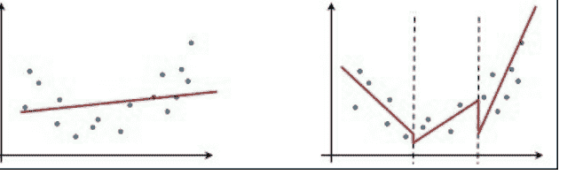

Weka 中的回归树实现在 `M5P` 类中。模型构建遵循相同的范式：初始化模型、传递参数和数据，并调用 `buildClassifier(Instances)` 方法。

```java
import weka.classifiers.trees.M5P;
...
M5P md5 = new M5P();
md5.setOptions(new String[]{""});
md5.buildClassifier(data);
System.out.println(md5);
```

生成的模型是一个叶子节点中带有方程的树，如下：

M5 剪枝模型树：

（使用平滑线性模型）

```
X1 <= 0.75 :
| X7 <= 0.175 :
|   X1 <= 0.65 : LM1 (48/12.841%)
|   X1 > 0.65 : LM2 (96/3.201%)
| X7 > 0.175 :
|   X1 <= 0.65 : LM3 (80/3.652%)
|   X1 > 0.65 : LM4 (160/3.502%)
X1 > 0.75 :
|   X1 <= 0.805 : LM5 (128/13.302%)
|   X1 > 0.805 :
|     X7 <= 0.175 :
|       X8 <= 1.5 : LM6 (32/20.992%)
|       X8 > 1.5 :
|         X1 <= 0.94 : LM7 (48/5.693%)
|         X1 > 0.94 : LM8 (16/1.119%)
|   X7 > 0.175 :
|     X1 <= 0.84 :
|       X7 <= 0.325 : LM9 (20/5.451%)
|       X7 > 0.325 : LM10 (20/5.632%)
|     X1 > 0.84 :
|       X7 <= 0.325 : LM11 (60/4.548%)
|       X7 > 0.325 :
|         X3 <= 306.25 : LM12 (40/5.504%)
|         X3 > 306.25 : LM13 (20/6.934%)
```

LM num: 1

```
Y1 =
  72.2602 * X1
+ 0.0053 * X3
+ 11.1924 * X7
+ 0.429 * X8
- 36.2224
```

LM num: 13

```
Y1 =
 5.8829 * X1
+ 0.0761 * X3
+ 9.5464 * X7
- 0.0805 * X8
+ 2.1492
```

规则数量：13

该树有 13 个叶子节点，每个节点对应一个线性方程。之前的输出在图中可视化所示：

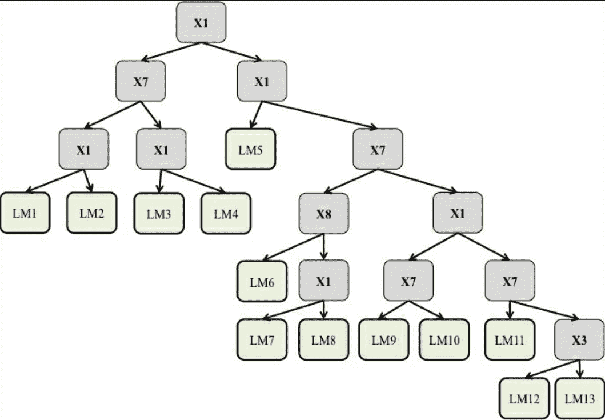

该树的读取方式类似于分类树。最重要特征位于树的顶端。终端节点（叶子节点）包含一个线性回归模型，用于解释到达树此部分的数据。评估输出结果如下：

| 指标 | 数值 |
| --- | --- |
| 相关系数 | 0.9943 |
| 平均绝对误差 | 0.7446 |
| 均方根误差 | 1.0804 |
| 相对绝对误差 | 8.1342 % |
| 相对均方根误差 | 10.6995 % |
| 实例总数 | 766 |

## 避免回归问题的提示

首先，使用先前的研究和领域知识来确定回归中应包含哪些特征。查阅文献以及以往关于哪种特征适用于你的问题建模的研究。假设你拥有一组很大的特征，很可能有几个特征与目标变量相关。保持模型简单以避免过拟合。奥卡姆剃刀原理指出，你应该选择用最少假设最能解释你数据的模型。

## 聚类

与监督分类器相比，聚类的目标是识别无标记数据集中的内在分组，寻找有用且适宜的分组（例如离群点）。我们将通过分析银行数据集来演示如何实现聚类，该数据集包含 11 个属性，描述了年龄、性别、地区、收入、婚姻状况、子女、汽车拥有情况、储蓄和贷款状况。在分析中，我们将尝试通过期望最大化（EM）来识别分组。EM 的工作如下：假设我们从三个类开始（A、B、C），一个实例可能会获得属于这些类的概率（0.70、0.10 和 0.20）。在第二步，EM 重新估计每个类的参数向量，直到收敛或达到最大迭代次数。聚类的数量可以通过手动设置或交叉验证确定。另一种方法是肘部法，通过观察解释的百分比来确定聚类的数量。

## 聚类算法

构建模型的过程与分类模型非常相似。聚类算法实现在 `weka.clusterers` 包，如下：

```java
import java.io.BufferedReader;
import java.io.FileReader;
import weka.core.Instances;
import weka.clusterers.EM;

public class Clustering {
    public static void main(String args[]) throws Exception{
        // 加载数据
        Instances data = new Instances(new BufferedReader(new FileReader(args[0])));

        // 新的实例
        EM model = new EM();
        // 构建聚类器
        model.buildClusterer(data);
        System.out.println(model);
    }
}
```

通过交叉验证识别出的聚类数量：6

| 属性 | 0 | 1 | 2 | 3 | 4 | 5 |
| --- | --- | --- | --- | --- | --- | --- |
| | | | | | | (0.1) | (0.13) | (0.26) | (0.25) | (0.12) | (0.14) |
| 年龄 | | | | | | |
| 0_34 | 10.0535 | 51.8472 | 122.2815 | 12.6027 | 3.1023 | 1.0948 |
| 35_51 | 38.6282 | 24.4056 | 29.6252 | 89.4447 | 34.5208 | 3.3755 |
| 52_max | 13.4293 | 6.693 | 6.3459 | 50.8984 | 37.8611 | 81.7724 |
| [total] | 62.1111 | 82.9457 | 158.2526 | 152.9638 | 75.4841 | 86.2428 |
| 性别 | | | | | | |
| 女性 | 27.1812 | 32.2338 | 77.9304 | 83.5129 | 40.3192 | 44.8218 |
| 男性 | 33.9299 | 49.7119 | 79.3222 | 68.4509 | 34.1642 | 40.421 |

## 评估

聚类算法的质量可以使用对数似然指标进行估计，该指标衡量了识别出的簇的一致性。数据集被分为多个折，并在每一折上都运行聚类。这里的动机是，如果聚类算法对未用于拟合参数的相似数据分配了高概率，那么它可能很好地捕捉了数据结构。Weka 提供了 `ClusterEvaluation` 类来估计该指标，如下：

```java
double logLikelihood = ClusterEvaluation.crossValidateModel(model, data, 10, new Random(1));
System.out.println(logLikelihood);
```

它的输出如下：

```
-8.773410259774291
```

## 总结

在本章中，你学习了如何使用 Weka 实现基础机器学习任务：分类、回归和聚类。我们简要讨论了属性选择过程、训练模型并评估了它们的性能。

下一章将重点介绍如何应用这些技术来解决现实世界的问题，例如客户留存。

## 第 4 章 使用集成学习进行客户关系预测

任何提供服务、产品或体验的公司都需要对客户关系有稳固的理解；因此，客户关系管理（CRM）是现代营销策略的核心元素。企业面临的最大挑战之一是需要确切了解是什么导致客户购买新产品。

在本章中，我们将处理由法国电信公司 Orange 提供的一个真实世界的营销数据库。任务是针对客户的以下行为估计相应的概率：

- 切换供应商（流失）
- 购买新产品或服务（意向）
- 购买向其提供的升级服务或附加组件以提高销售利润（向上销售）

我们将应对 2009 年知识发现与数据挖掘大赛（KDD Cup）挑战，并展示使用 Weka 处理数据的步骤。首先，我们将解析并加载数据，并实现基础基准模型。随后，我们将处理高级建模技术，包括数据预处理、属性选择、模型选择和评估。

## 注意事项

KDD Cup 是世界上领先的数据挖掘竞赛，由 ACM 知识发现与数据挖掘特别兴趣小组每年组织。获奖者将在知识发现与数据挖掘会议上公布，会议通常在 8 月举行。

年度存档（包括所有相应的数据集）可以在此处获取：http://www.kdd.org/kdd-cup。

## 客户关系数据库

构建客户行为知识最实用的方法是产生解释目标变量（如流失、意向或向上销售）的得分。得分由模型使用描述客户的输入变量计算，例如当前的订阅情况、购买的设备、消耗的分钟等。随后，得分被信息系统使用，例如提供相关的个性化营销活动。

2009 年，KDD 会议组织了一场关于客户关系预测的机器学习挑战。

## 挑战

给定一组大量的客户属性，任务是估计以下三个目标变量：

- **流失概率**，在我们的语境中是指客户切换供应商的概率。流失率有时称为折损率。它是决定企业将支持的稳定客户水平的两个主要因素之一。从广义上说，流失率是衡量特定时间内进入或离开集合的个人或物品的数量。该术语用于许多语境，但在涉及合同标准的业务中应用最广泛。例如，对于任何基于订阅的服务模式业务（包括移动网络和付费电视运营商）来说，它都是一个重要因素。该术语也用于点对点网络中参与者的流动率。

- **意向概率**，在我们的语境中是指购买某种服务或产品的倾向。

- **向上销售概率**是指客户购买附加组件或升级服务的概率：

向上销售是一种销售技术，销售人员试图让客户购买更贵的物品、升级服务或其他附加组件，以实现更高利润的销售。向上销售通常涉及营销更有利润的服务或产品，但向上销售也可以仅仅是让客户接触到他们之前可能没有考虑过的其他选择。向上销售可能意味着销售额外的物品，或者销售比原始销售更有利润或对卖家其他优越的东西。

这项挑战是击败由 Orange Labs 开发的内部系统。这对于参赛者来说，是一个证明他们能够处理大型数据库（包括异构噪声数据和不平衡类别分布）的机会。

## 数据集

对于这项挑战，Orange 公司发布了一个大型客户数据数据集，包含约一百万名客户，描述在具有数百个字段的十张表中。在第一步中，他们对数据进行了重采样，选择了一个包含 10,000 名客户的较不平衡子集。在第二步中，他们使用自动特征构建工具生成了 20,000 个描述客户的特征，然后将其缩小到 15,000 个特征。在第三步中，通过随机化特征顺序、丢弃属性名称、将名义变量替换为随机生成的字符串并将连续属性乘以随机因子，对数据集进行了匿名化。最后，所有实例被随机划分为训练集和测试集。

KDD Cup 提供了两组数据：大型数据集和小数据集。它们在 KDD Cup 网站上的描述如下：训练集和测试集都包含 50,000 个示例。小版本和大版本的数据以类似的方式拆分，但样本在训练集和测试集内部的顺序不同。两个数据集都有数值型和分类变量。对于大型数据集，前 14,740 个是数值型，最后 260 个是分类型。对于小型数据集，前 190 个是数值型，最后 40 个是分类型。在本章中，我们将使用包含 50,000 个实例和 230 个变量的小数据集。每 50,000 行对应一个客户和三个结果（向上销售、流失和意向）。为了更清晰，以下图像展示了数据集格式：

| Var85 | Var123 | Var125 | Var126 | Var132 | Var134 | Var225 | Var229 | Var230 | Churn | Appetency | Upselling |
| --- | --- | --- | --- | --- | --- | --- | --- | --- | --- | --- | --- |
| 12 | 720 | 8 | 121385 | 69134 | | | | | | | |
| 2 | 720 | 8 | 413630 | 350738 | | | | | | | |
| 58 | 114 | 28 | 0 | 347895 | g3k | | | | | | |
| 0 | | | 14 | 0 | | | | | | | |
| 0 | 15111 | 58 | 0 | 150650 | 660436 | g3k | mj | | | | |
| 10 | 19335 | 8 | 0 | 641020 | 438884 | amc | | | | | |
| 16 | 13194 | 24 | 0 | 166450 | 104978 | g3k | mj | | | | |
| 2 | 720 | -8 | 8 | 3839825 | 203586 | g3k | amc | | | | |
| 66 | 24 | 6561 | 32 | 0 | 257275 | 210014 | g3k | | | | |
| 12 | 5823 | 58 | 0 | | | g3k | | | | | |
| 28 | 24 | 66825 | 52 | 8 | 134105 | 15166 | | | | | |
| 0 | | | 44154 | 10 | 0 | | | mj | | | | |
| 22 | 24 | 54202 | 0 | 0 | 2772010 | 1095062 | g3x | | | | |
| 10 | 31104 | 8 | 0 | 2170035 | 570906 | Elof | qlmt | | | | |
| 0 | | 25740 | 0 | | | | | amc | | | | |
| 14 | 186 | 8019 | 48 | 357185 | 587392 | g3k | amc | | | | |
| 30 | 5319 | 8 | 500295 | 31436 | | g3k | | | | | |
| 0 | | 13788 | 4 | 0 | 918350 | | | | | | |
| 14 | | 7110 | 0 | 0 | 2055150 | 392138 | | | | | |
| 8 | | 66 | 0 | -10 | 0 | 3258940 | 1121306 | | | | |
| 18 | | | | 0 | 0 | | | | | | |
| 12 | | 531 | 36 | 0 | 491345 | 56742 | Elof | mj86 | | 1 | -1 | -1 |
| 02 | | 12 | 16803 | 12 | 0 | 201110 | 1693090 | | | | 1 | -1 | -1 |


| 14 | | 25740 | 0 | | | | | amc | | -1 | -1 | -1 |

## 评估

提交结果是根据三个任务（即流失、偏好和交叉销售）的 ROC 曲线下面积（AUC）算术平均值进行评估的。

ROC 曲线通过绘制用于确定分类结果的各种阈值的灵敏度（sensitivity）相对于特异性（specificity）的曲线，展示了模型的性能（参见第 1 章《应用机器学习快速入门》，ROC 曲线章节）。现在，AUC 与此曲线下的面积有关，这意味着面积越大，分类器越好。大多数工具箱（包括 Weka）都提供了计算 AUC 分数的 API。

## 基础朴素贝叶斯分类基线

根据比赛规则，参赛者必须优于基础朴素贝叶斯分类器才能获得奖励，这假设特征之间是相互独立的（参见第 1 章《应用机器学习快速入门》）。

KDD Cup 组织者运行了原生的朴素贝叶斯分类器，没有进行任何特征选择或超参数调整。对于大型数据集，朴素贝叶斯在测试集上的总分如下：

- 流失问题：AUC = 0.6468
- 偏好问题：AUC = 0.6453
- 交叉销售问题：AUC = 0.7211

注意，基线结果仅针对大型数据集报告。此外，虽然 KDD Cup 网站提供了训练和测试数据集，但并未提供测试集的实际真实标签。因此，当我们用模型处理数据时，无法得知模型在测试集上的表现如何。我们将做的是只使用训练数据，并使用交叉验证来评估我们的模型。结果将无法直接比较，但尽管如此，我们对 AUC 分数的合理范围有一个大致的了解。

## 获取数据

在 KDD Cup 网页（`http://kdd.org/kdd-cup/kdd-cup/view/kdd-cup-2009/Data`）上，您应该看到一个与下方截图类似的页面。首先，在 **Small version (230 var.)** 标题下，下载 `orange_small_train.data.zip`。接下来，下载与此训练数据相关联的三组真实标签。在 **Real binary targets (small)** 标题下可以找到以下文件：

- `orange_small_train_appentency.labels`
- `orange_small_train_churn.labels`
- `orange_small_train_upselling.labels`

保存并解压红框中标记的所有文件，如下方的截屏所示：

## KDD Cup 2009

搜索 KDD CUP 归档

## 数据

KDD Cup 2009：客户关系预测

## 数据下载

训练和测试矩阵以及练习目标值

大型存档自比赛开始以来可用。小型数据集将在第一个挑战结束后提供。训练集和测试集都包含 50,000 个示例。小型和大型数据集的数据划分方式相似，但样本在训练集和测试集内部的顺序不同。小型和大型数据集包含数值型和分类变量。对于大型数据集，前 27 个变量是数值型，接下来的 26 个是分类型。对于小型数据集，前 19 个变量是数值型，最后 40 个是分类型。目标值仅供练习使用。目标值的预测将不会作为最终评估的一部分。

- 小型版本 (230 var:)
  - `orange_small_train_data.zip1` (8.2 Megabytes)
  - `orange_small_test_data.zip1` (8.2 Megabytes)

- 大型版本 (15,000 var):
  - `orange_large_train_data.chunk1` (52.7 Megabytes)
  - `orange_large_train_data.chunk2` (52.7 Megabytes)
  - `orange_large_train_data.chunk3` (52.6 Megabytes)
  - `orange_large_train_data.chunk4` (52.6 Megabytes)
  - `orange_large_train_data.chunk5` (52.6 Megabytes)
  - `orange_large_test_data.chunk1` (52.7 Megabytes)
  - `orange_large_test_data.chunk2` (52.7 Megabytes)
  - `orange_large_test_data.chunk3` (52.6 Megabytes)
  - `orange_large_test_data.chunk4` (52.6 Megabytes)
  - `orange_large_test_data.chunk5` (52.6 Megabytes)

- 真实标签
  - `orange_small_train_appentency.labels`
  - `orange_small_train_churn.labels`
  - `orange_small_train_upselling.labels`

（注：原文中此部分存在乱码或重复，译文已根据上下文逻辑进行整理）

# 基础建模

在本节中，我们将遵循 KDD Cup 组织者采用的方法来实现我们自己的基准模型。然而，在进入模型之前，让我们先实现评估引擎，该引擎将返回三个问题上的 AUC。

## 评估模型

现在，让我们仔细观察评估函数。该评估函数接受一个初始化的模型，在三个问题上对模型进行交叉验证，并以曲线下面积（AUC）的形式报告结果，如下：

```java
public static double[] evaluate(Classifier model) throws Exception {
    double results[] = new double[4];

    String[] labelFiles = new String[]{
        "churn", "appetency", "upselling"
    };

    double overallScore = 0.0;
    for (int i = 0; i < labelFiles.length; i++) {
        // Load data
        Instances train_data = loadData(
            path + "orange_small_train.data",
            path + "orange_small_train_" + labelFiles[i] + ".txt");

        // cross-validate the data
        Evaluation eval = new Evaluation(train_data);
        eval.crossValidateModel(model, train_data, 5,
            new Random(1));

        // Save results
        results[i] = eval.areaUnderROC(
            train_data.classAttribute().indexOfValue("1"));
        overallScore += results[i];
    }

    // Get average results over all three problems
    results[3] = overallScore / 3;
    return results;
}
```

# 实现朴素贝叶斯基准

现在，当我们备齐了所有要素后，就可以复制我们预期要超越的朴素贝叶斯方法。这种方法不包含任何额外的数据预处理、属性选择和模型选择。由于我们没有测试数据的真实标签，我们将应用五折交叉验证在小数据集上评估模型。

首先，我们如下初始化一个朴素贝叶斯分类器：

```java
Classifier baselineNB = new NaiveBayes();
```

接下来，我们将分类器传递给我们的评估函数，该函数会加载数据并应用交叉验证。该函数返回所有三个问题的 ROC 曲线下面积分分以及整体结果：

```java
double resNB[] = evaluate(baselineNB);
System.out.println("Naive Bayes\n" + 
  "\tchurn: " + resNB[0] + "\n" + 
  "\tappency: " + resNB[1] + "\n" + 
  "\tup-sell: " + resNB[2] + "\n" + 
  "\ttoverall: " + resNB[3] + "\n");
```

在我们的案例中，模型实现了以下结果：

- Naive Bayes
  - churn: 0.5897891153549814
  - appency: 0.63078394752436
  - up-sell: 0.668611692438094
  - overall: 0.629726931110756

当我们用高级建模应对挑战时，这些结果将作为基准。如果我们使用更复杂、更耗时且复杂的技术处理数据，我们预计结果会好得多。否则，我们只是在浪费资源。通常，在解决机器学习问题时，创建一个简单的基准分类器作为我们的方向点是一个好主意。

# 集成高级建模

在上一节中，我们实现了一个方向基准，现在专注于重量设备。我们将遵循 IBM 研究团队开发的 KDD Cup 2009 冠军方案采用的方法（Nicuulescu-Mizil 等人，2009）。

他们解决挑战的策略是使用集成选择算法（Ensemble Selection）（Caruana and Niculescu-Mizil,2004）。这是一种集成方法，意味着它构建一系列模型并以特定方式组合它们的输出以提供最终分类。如下列表所示，它具有几个优点，使其非常适合应对这次挑战：

- 它被证明是稳健的，能够产生出色的性能
- 可以针对特定的性能指标（包括 AUC）进行优化
- 它允许将不同的分类器添加到库中
- 它是一个随时可用的方法（anytime method），这意味着如果时间不够，我们有一个可用的方案

在本节中，我们将粗略遵循他们报告中描述的步骤。注意，这并不是他们方法的精确实现，而是一个解决方案概述，将包含深入研究的必要步骤。

步骤的总体概述如下：

- 首先，我们将通过移除明显没有任何价值的属性来预处理数据，例如所有缺失值或常量值；修复缺失值以帮助无法处理这些值的机器学习算法；并将属性转换为数值。
- 接下来，我们将运行属性选择算法，仅选择有助于任务预测的属性子集。
- 第三步，我们将使用各种模型实例化集成选择算法，并最终评估性能。

## 在开始之前

对于此任务，我们需要额外的 Weka 包 `ensembleLibrary`。Weka 3.7.2 或更高版本支持主要由学术社区开发的外部包。Weka 包列表可以在 `http://weka.sourceforge.net/packageMetaData` 获取，如下截图所示：


在 `http://downloads.sourceforge.net/weka/ensembleLibrary1.0.zip` 查找并下载最新的可用 `ensembleLibrary` 包。

解压缩包后，找到 `ensembleLibrary.jar` 并将其导入你的代码中，如下：

```java
import weka.classifiers.meta.EnsembleSelection;
```

# 数据预处理

首先，我们将利用 Weka 内置的 `weka.filters.unsupervised.attribute.RemoveUseless` 过滤器，其功能顾名。它移除变化不大的属性，例如，移除所有常量属性以及随机变化过大的属性。最大方差仅应用于类别属性，通过 `-M` 参数指定。默认参数为 99%，这意味着如果超过 99% 的实例具有唯一的属性值，则：

```java
RemoveUseless removeUseless = new RemoveUseless();
removeUseless.setOptions(new String[] { "-M","99"});
removeUseless.setInputFormat(data);
data = Filter.useFilter(data, removeUseless);
```

接下来，我们将使用 `weka.filters.unsupervised.attribute.ReplaceMissingValues` 过滤器用训练数据中的众（类别属性）和平均值（数值属性）替换数据集中的所有缺失值。通常，处理缺失替换时需要谨慎，并考虑到属性的含义和上下文：

```java
ReplaceMissingValues fixMissing = new ReplaceMissingValues();
fixMissing.setInputFormat(data);
data = Filter.useFilter(data, fixMissing);
```

最后，我们将对数值属性进行离散化，即我们使用 `weka.filters.unsupervised.attribute.Discretize` 过滤器将数值属性转换为区间。通过 `-B` 选项，我们将属性分为四个区间，`-R` 选项将指定属性范围（仅数值属性会被离散化）：

```java
Discretize discretizeNumeric = new Discretize();
discretizeNumeric.setOptions(new String[] {
    "-B","4", // 分箱数量
    "-R","first-last"}); // 属性范围
discretizeNumeric.setInputFormat(data);
data = Filter.useFilter(data, discretizeNumeric);
```

# 属性选择

在下一步中，我们将只选择具有信息量的属性，即更有可能有助于预测的属性。解决这一问题的标准方法是检查每个属性所携带的信息增益。我们将使用 `weka.attributeSelection.AttributeSelection` 过滤器，它需要两个额外的方法：评估器（evaluator），即如何计算属性的有用性；以及搜索算法（search algorithms），即如何选择属性子集。

在我们的用例中，我们首先初始化 `weka.attributeSelection.InfoGainAttributeEval`，它实现了信息增益的计算：

```java
InfoGainAttributeEval eval = new InfoGainAttributeEval();
Ranker search = new Ranker();
```

为了只选择高于阈值的属性，我们初始化 `weka.attributeSelection.Ranker` 来对信息增益高于特定阈值的属性进行排序。我们通过 `-T` 参数指定此，同时保留阈值以确保属性至少某些信息：

```java
search.setOptions(new String[] { "-T", "0.001" });
```

> **提示**
> 设置此阈值的通用规则是根据信息增益对属性进行排序，并选择信息增益下降到可以忽略的值的阈值。

接下来，我们可以初始化 `AttributeSelection` 类，设置评估器和排序器，并将属性选择应用于我们的数据集：

```java
AttributeSelection attSelect = new AttributeSelection();
attSelect.setEvaluator(eval);
attSelect.setSearch(search);

// 应用属性选择
attSelect.SelectAttributes(data);
```

最后，我们通过调用 `reduceDimensionality(Instances)` 方法移除上一次运行未被选中的属性。

```java
// 移除上一次运行未被选中的属性
data = attSelect.reduceDimensionality(data);
```

最后，我们剩下 230 个属性中的 214 个。

## 模型选择

多年来，机器学习领域的从业人员开发了各种学习算法以及对现有算法的改进。有许多独特的监督学习方法，要跟踪所有方法都是具有挑战性的。由于数据集的特征各异，没有一种方法在所有情况下都是最好的，但不同的算法能够利用给定数据集的不同特征和关系。集成选择（Ensemble Selection）算法利用的属性是（Jung, 2005）：

直观上，集成选择算法的目标是自动检测并结合这些独特算法的优点，创建一个大于部分之和的结果。这是通过创建一个库来实现的，该库旨在尽可能多样化，以利用大量的独特学习方法。这种产生海量模型的范式与更传统的集成方法非常不同。因此，我们的结果非常令人鼓舞。

首先，需要通过初始化 `weka.classifiers.EnsembleLibrary` 类来创建模型库，这将帮助我们定义模型：

```java
EnsembleLibrary ensembleLib = new EnsembleLibrary();
```

接下来，我们将模型及其参数作为字符串作为字符串值添加到库中，例如，我们可以添加三个具有不同参数的决策树学习器：

```java
ensembleLib.addModel("weka.classifiers.trees.J48 -S -C 0.25 -B -M 2");
ensembleLib.addModel("weka.classifiers.trees.J48 -S -C 0.25 -B -M 2 -A");
```


如果你熟悉 Weka 的图形用户界面（GUI），你也可以在那里探索算法及其配置，并按照如下屏幕所示复制配置：右键点击算法名称，并导航到“编辑配置（Edit configuration） | 复制配置字符串（Copy configuration string）”。

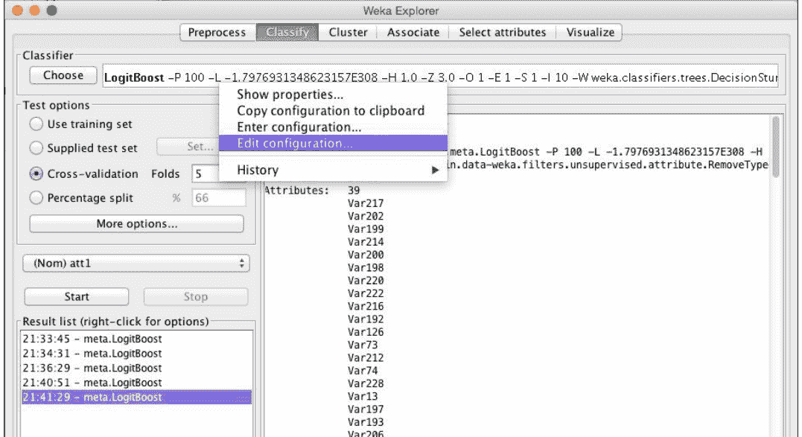

为了完成示例，我们添加了以下算法及其参数：

- 作为默认基线的朴素贝叶斯：`ensembleLib.addModel("weka.classifiers.bayes.NaiveBayes");`
- 基于懒惰模型的 k-近邻：`ensembleLib.addModel("weka.classifiers.lazy.IBk");`
- 带有默认参数的简单逻辑回归：`ensembleLib.addModel("weka.classifiers.functions.SimpleLogistic");`
- 带有默认参数的支持向量机：`ensembleLib.addModel("weka.classifiers.functions.SMO");`
- AdaBoost，本身就是一种集成方法：`ensembleLib.addModel("weka.classifiers.meta.AdaBoost");`
- 基于逻辑回归的集成方法 LogitBoost：`ensembleLib.addModel("weka.classifiers.meta.LogitBoost");`
- 基于单层决策树的决策树桩（Decision stump）add 方法：`ensembleLib.addModel("weka.classifiers.trees.DecisionStump");`

由于 `EnsembleLibrary` 的实现主要针对 GUI 和控制台用户，我们必须通过调用 `saveLibrary(File, EnsembleLibrary)` 方法将模型保存到文件中。

接下来，我们可以通过实例化 `weka.classifiers.meta.EnsembleSelection` 类来初始化集成选择算法。让我们查看以下选项：

- `-L <path/to/modelLibrary>`：指定模型文件，继续所有模型的列表。
- `-W <path/to/working/directory>`：指定工作目录，所有模型将存储在这里。
- `-B <numBags>`：设置包（bags）的数量，即运行集成选择算法的迭代次数。
- `-E <modelRatio>`：设置填充每个包的模型比例。
- `-V <validationRatio>`：设置留作验证的训练数据比例。
- `-H <climbIterations>`：设置在每个包上执行的爬山算法迭代次数。
- `-I <climbIterations>`：设置初始化每个包时从集成库中选择的比例。
- `-X <numFolds>`：设置交叉验证的折。
- `-P <climbMetric>`：指定在爬山过程中使用的指标。
- `-A <algorithm>`：指定用于集成的算法。
- `-R`：指定是否可以多次选择模型。
- `-G`：指定当性能下降时停止初始化。
- `-O`：详细输出（verbose）。
- `-S <num>`：随机种子。
- `-D`：如果设置，则进入调试模式并可能输出额外信息。

我们使用以下初始参数初始化算法，我们指定了 ROC 指标：

```
EnsembleSelection ensembleSel = new EnsembleSelection();

ensembleSel.setOptions([

  "-L", path+"ensembleLib.xml",

  "-W", path+"tmp",

  "-B", "10",

  "-E", "1.0",

  "-V", "0.25",

  "-H", "100",

  "-I", "1.0",

  "-X", "2",

  "-P", "roc",

  "-A", "forward",

  "-R", "true",

  "-G", "true",

  "-O", "true",

  "-S", "1",

  "-D", "true"

]);
```

## 性能评估

评估在计算和内存方面都是沉重的，请确保为 JVM 分配额外的堆空间——例如 `java -Xmx16g`——而计算可能需要几个小时或几天，取决于你在库中包含了算法数量。此示例在具有 32 GB 内存的 12 核 Intel Xeon E5-2420 CPU 上运行了 4 小时 22 分钟，平均内存占用 10%（即 6 GB）。

调用评估方法并输出结果，如下：

```
double resES[] = evaluate(ensambleSel);

System.out.println("Ensemble Selection\n")

+ "\churn: " + resES[0] + "\n"

+ "\appency: " + resES[1] + "\n"

+ "\up-sell: " + resES[2] + "\n"

+ "\overall: " + resES[3] + "\n");
```


## 总结

在本章中，我们处理了客户关系预测的 KDD Cup 2009 挑战，实现了数据预处理步骤，解决了缺失值和冗余属性问题。我们遵循获胜的 KDD Cup 解决方案，研究了如何使用一系列学习算法来利用集成方法，这可以显著提高分类性能。

在下一章中，我们将处理另一个关于客户行为的问题，即购买行为分析，你将从中学习如何使用检测频繁出现模式的算法。

# 第 5 章 关联性分析

关联性分析是购物篮分析（MBA）的核心。它可以发现特定用户或群体所执行活动之间的共现关系。在零售业，关联性分析可以帮助你理解客户的购买行为。这些洞察可以通过智能交叉销售和向上销售策略驱动收入，并协助你制定忠诚计划、销售促销和折扣计划。

在本章中，我们将探讨以下主题：

- 购物篮分析
- 关联规则学习
- 其他领域的其他应用

首先，我们将回顾核心关联规则学习概念和算法，例如支持度（support）、提升度（lift）、`Apriori` 算法和 `FP-growth` 算法。接下来，我们将使用 Weka 对超市数据集进行首次关联性分析，并研究如何解释生成的规则。我们最后通过分析关联规则学习如何应用于其他领域（如 IT 运营分析、医学等）来结束本章。

# 购物篮分析

自从电子销售点（POS）系统引入以来，零售商已经收集了惊量的数据。为了利用这些数据产生业务价值，他们首先开发了一种整合和聚合数据的方法，以理解业务的基本情况。他们在卖什么？卖了多少单位？销售额是多少？

最近，重点转向了最低粒度的水平——购物篮交易。在这一详细层上，零售商可以直接看到在他们商店里购物的每位客户的购物篮，不仅了解哪些产品是共同购买的。这可以用于指导关于如何区分商店陈列和商品的决策，并有效地结合不同类别内和跨类别的多种产品优惠，以带来更高的销售额和利润。这些决策可以在整个零售链中实施，在本地门店层面实施，甚至通过所谓的个性化营销针对特定客户进行实施，即为每位客户提供独特的产品选择。

# 购物车中的问题

在这一购物篮中，购物者放入了一夸脱橙汁、一些香蕉、洗洁精、一些窗户清洁剂和六瓶装汽水。


社区的人口统计特征如何影响客户的购买？

汽水通常会和香蕉一起购买吗？汽水的品牌有影响吗？

篮子里应该有什么但现在没有？

当同时购买洗洁精和橙汁时，会购买窗户清洁产品吗？

MBA 涵盖了广泛的分析：

- **商品关联**：这定义了两个（或多个）商品共同购买的概率。
- **驱动物品识别**：这能够识别促使人们进入商店并始终需要备货的物品。
- **行程分类**：分析购物篮内容并将购物行程分为一类：每周杂货购物、特殊场合等。
- **店间比较**：通过了解购物篮的数量，任何指标都可以除以总篮数，从而有效地创建了一种方便简单的方法来比较不同特征的商店（每位客户的销量、每笔交易收入、每个购物篮的物品数量等）。
- **收入优化**：这有助于确定该商店的黄金价格点，增加购物篮的大小和价值。
- **营销**：这有助于识别更有利润的广告和促销，更精确地针对优惠以提高投资回报率（ROI），通过纵向分析生成更好的忠诚卡促销，并吸引更多流量进入商店。
- **运营优化**：这有助于通过匹配库存和陈列来优化商店。预测模型帮助零售商将正确的优惠提供给正确的客户，理解客户的接受度。

# 关联性分析

关联性分析用于确定一组物品共同购买的概率。在零售业中，存在某些关联性，例如人们购买汉堡肉时会买酱末、番茄等物品。虽然有些关联性是显而易见的，但有些并不。一个经典的例子是牙膏和金枪鱼。吃金枪鱼的人似乎会去刷牙。为了适当计划这些促销活动，了解购物篮的关联性是至关重要的。

在接下来的章节中，我们将研究关联规则学习的算法：`Apriori` 和 `FP-growth`。

# 关联规则学习

关联规则学习是一种在大型数据库中发现有趣模式的热方法。它最常应用于零售业以揭示产品之间的规律性。关联规则学习方法使用不同的有趣性度量发现规则。例如，以下规则表明如果客户购买了洋葱和土豆，他们很可能会买汉堡。

另一个在每个机器学习课程中提到的经典故事是汽水和尿布。对购物者行为的分析显示，购买尿布的人倾向于购买汽水。关于这个故事有不同的意见。Daniel 表示（DSS News，2002）：

> “1992 年，Teradata 零售咨询小组经理 Thomas Blischok 和他的团队对 25 家 Osc 商店的 120 万个购物篮进行了分析。开发了数据库查询来识别关联性。分析发现，下午 5 点到 7 点之间，消费者购买汽水和尿布。Osc 经理通过将产品靠近利用了汽水和尿布的关系。”

除了上述 MBA 的示例外，关联规则现在应用于许多领域，包括网络使用、入侵检测、持续生产和生物信息学。我们将在本章后面详细介绍这些领域。

在进入算法之前，让我们先回顾基本概念。

# 数据库

在关联规则挖掘中，数据集的结构与第一章介绍的方法有所不同。首先，没有类别值，因为学习关联规则不需要它。其次，数据集以交易表的形式呈现，每个超市商品对应一个二值属性。因此，特征向量可能是巨大的。

考虑以下示例。假设我们有如下所示四份收据。每份收据对应一次购买交易


为了将这些收据写成交易数据库的形式，我们首先识别收据中出现的所有物品。这些物品是洋葱、土豆、汉堡、汽水和蘸酱。每笔购买占一行，如果购买了某物品则为 1，否则为 0，如下表所示：

| ID | 洋葱 | 土豆 | 汉堡 | 汽水 | 蘸酱 |
|---|---|---|---|---|---|
| 1 | 0 | 1 | 1 | 0 | 1 |
| 2 | 0 | 0 | 0 | 1 | 0 |

这个示例非常小。在实际应用中，数据集通常包含成千上万条交易，这使得学习算法能够发现具有统计意义的模式。

## 项目集与规则

项目集（Itemset）简单来说项目的集合，例如 `{洋葱，土豆，汉堡}`。规则由两个项目集 $X$ 和 $Y$ 组成，格式如下 $X \rightarrow Y$。

这表示当观察到项目集 $X$ 时，$Y$ 也会被观察到。为了选择这些规则，可以使用各种显著性方法。

## 支持度

直观地说，它表示支持该模式的交易占比。

## 置信度

规则的置信度表示其准确性。它的定义为

$Conf(X \rightarrow Y) = supp(X \cup Y) / supp(X)$

例如，在上表中，`{洋葱，汉堡} -> {啤酒}` 规则的置信度为 $0.5/0.5 = 1.0$，这意味着在同时购买洋葱和汉堡的情况下，100% 的情况下也会购买啤酒。

## Apriori 算法

`Apriori` 算法是一种用于事务频繁模式挖掘和关联规则学习的经典算法。通过识别数据库中频繁的单个项目并将其扩展为更大的项目集，`Apriori` 可以确定关联规则，这些规则突出了关于数据库的一般趋势。

`Apriori` 算法构建一个项目集集合，例如项目集1 = `{项目 A，项目 B}` 并计算支持度，支持度统计其在数据库中出现的次数。`Apriori` 使用自底向上的方法，每次扩展一次频繁项目集，其工作原理是通过首先查看较小的集合并意识到如果所有子集都不频繁，则大集就不可能频繁，从而排除最大的集合作为候选集。当没有发现进一步成功的扩展时，算法终止。

尽管 `Apriori` 算法是机器学习中的一个重要里程碑，但它存在许多效率低下和权衡问题。在下一节中，我们将研究较新的 `FP-growth` 技术。

## FP-growth 算法

`FP-growth`，即**频繁模式 (FP)**，将交易数据库表示为前缀树。首先，算法统计数据集中项目的出现次数。在第二次遍历中，它构建一个前缀树，这是一种通常用于存储字符串的有序树数据结构。基于前一个示例的前缀树示例如图所示：


如果许多交易共享大多数频繁项目，前缀树对树根提供了高压缩。大型项目集是直接增长的，而不是生成候选项目并在整个数据库进行测试。增长从树的底部开始，通过找到所有匹配最小覆盖置信度的项目集。一旦递归过程完成，就开始创建关联规则。

`FP-growth` 算法具有多个优点。首先，它构建了一个 FP 树，以非常紧凑的形式编码原始数据集。其次，它利用 `FP-树结构` 和 `分治` 策略高效地构建了频繁项目集。

## 超市数据集

位于 `datasets/chap5/supermarket.arff` 的超市数据集描述了超市客户的购物习惯。大多数属性代表一个特定的项目组，例如乳制品、牛肉、土豆；或者部门，例如第 79 部门、第 81 部门等。以下图片显示了数据库的片段，如果客户购买了某项物品，值为 i，否则缺失。该数据集不包含类别属性，因为学习关联规则并不需要。数据样本如下表所示：

| coffee | juices-grow-sale | confectionery | vegetables | desserts | dairy-meat | scour | disinfectants | frozen_foods | diapers | fruit-garden-aid | spices | jam-spreads |
|---|---|---|---|---|---|---|---|---|---|---|---|---|
| n | 1 | 0 | 1 | 0 | 0 | 1 | 0 | 1 | 1 | 0 | 0 | 0 | 0 |
| 0 | 1 | 0 | 0 | 0 | 0 | 0 | 0 | 0 | 0 | 0 | 0 | 0 |
| 0 | 0 | 1 | 0 | 0 | 0 | 0 | 0 | 1 | 0 | 0 | 0 | 1 |
| 1 | 0 | 0 | 0 | 0 | 0 | 0 | 0 | 0 | 0 | 0 | 0 | 0 |
| 0 | 0 | 0 | 0 | 0 | 0 | 0 | 0 | 0 | 0 | 0 | 0 | 0 |
| 0 | 0 | 0 | 0 | 0 | 0 | 0 | 0 | 0 | 0 | 0 | 0 | 0 |
| 1 | 0 | 0 | 1 | 0 | 0 | 0 | 0 | 0 | 0 | 0 | 0 | 1 |
| 0 | 1 | 0 | 0 | 0 | 0 | 0 | 0 | 0 | 0 | 0 | 0 | 0 |
| 0 | 0 | 1 | 0 | 0 | 0 | 0 | 0 | 0 | 0 | 0 | 0 | 0 |
| 1 | 0 | 0 | 0 | 0 | 0 | 0 | 0 | 0 | 0 | 0 | 0 | 0 |
| 0 | 0 | 0 | 0 | 0 | 0 | 0 | 0 | 0 | 0 | 0 | 0 | 0 |
| 0 | 0 | 0 | 0 | 0 | 0 | 0 | 0 | 0 | 0 | 0 | 0 | 0 |
| 0 | 0 | 0 | 0 | 0 | 0 | 0 | 0 | 0 | 0 | 0 | 0 | 0 |
| 0 | 0 | 0 | 0 | 0 | 0 | 0 | 0 | 0 | 0 | 0 | 0 | 0 |
| 0 | 0 | 0 | 0 | 0 | 0 | 0 | 0 | 0 | 0 | 0 | 0 | 0 |
| 0 | 0 | 0 | 0 | 0 | 0 | 0 | 0 | 0 | 0 | 0 | 0 | 0 |
| 0 | 0 | 0 | 0 | 0 | 0 | 0 | 0 | 0 | 0 | 0 | 0 | 0 |
| 0 | 0 | 0 | 0 | 0 | 0 | 0 | 0 | 0 | 0 | 0 | 0 | 0 |
| 0 | 0 | 0 | 0 | 0 | 0 | 0 | 0 | 0 | 0 | 0 | 0 | 0 |
| 0 | 0 | 0 | 0 | 0 | 0 | 0 | 0 | 0 | 0 | 0 | 0 | 0 |
| 0 | 0 | 0 | 0 | 0 | 0 | 0 | 0 | 0 | 0 | 0 | 0 | 0 |
| 0 | 0 | 0 | 0 | 0 | 0 | 0 | 0 | 0 | 0 | 0 | 0 | 0 |
| 0 | 0 | 0 | 0 | 0 | 0 | 0 | 0 | 0 | 0 | 0 | 0 | 0 |
| 0 | 0 | 0 | 0 | 0 | 0 | 0 | 0 | 0 | 0 | 0 | 0 | 0 |
| 0 | 0 | 0 | 0 | 0 | 0 | 0 | 0 | 0 | 0 | 0 | 0 | 0 |
| 0 | 0 | 0 | 0 | 0 | 0 | 0 | 0 | 0 | 0 | 0 | 0 | 0 |
| 0 | 0 | 0 | 0 | 0 | 0 | 0 | 0 | 0 | 0 | 0 | 0 | 0 |
| 0 | 0 | 0 | 0 | 0 | 0 | 0 | 0 | 0 | 0 | 0 | 0 | 0 |
| 0 | 0 | 0 | 0 | 0 | 0 | 0 | 0 | 0 | 0 | 0 | 0 | 0 |
| 0 | 0 | 0 | 0 | 0 | 0 | 0 | 0 | 0 | 0 | 0 | 0 | 0 |
| 0 | 0 | 0 | 0 | 0 | 0 | 0 | 0 | 0 | 0 | 0 | 0 | 0 |
| 0 | 0 | 0 | 0 | 0 | 0 | 0 | 0 | 0 | 0 | 0 | 0 | 0 |
| 0 | 0 | 0 | 0 | 0 | 0 | 0 | 0 | 0 | 0 | 0 | 0 | 0 |
| 0 | 0 | 0 | 0 | 0 | 0 | 0 | 0 | 0 | 0 | 0 | 0 | 0 |

# FP-growth

现在，让我们尝试使用更高效的 `FP-growth` 算法获得相同的结果。`FP-growth` 也在 `weka.associations` 包中得到了实现：

```
import weka.associations.FPGrowth;
```

`FP-growth` 的初始化方式与我们之前的操作类似：

```
FPGrowth fpgModel = new FPGrowth();

fpgModel.buildAssociations(data);

System.out.println(fpgModel);
```


输出结果显示 FP-growth 发现了 16 条规则：

+ FPGrowth found 16 rules (displaying top 10)
1. [fruit=t, frozen foods=t, biscuits=t, total=high]: 788 => [bread and cake=t]: 723 <conf: (0.92)> lift: (1.27) lev: (0.03) conv: (3.35)
2. [fruit=t, baking needs=t, biscuits=t, total=high]: 760 => [bread and cake=t]: 696 <conf: (0.92)> lift: (1.27) lev: (0.03) conv: (3.28)

我们可以观察到 FP-growth 发现的规则集与 Apriori 相同；然而，处理更大数据集所需的时间可以显著减少。

# 在各个领域的其他应用

我们研究了关联性分析，以揭秘超市购物行为模式的含义。尽管关联规则学习的根源在于分析销售点交易，但它们也可以应用于零售行业之外，以发现其他类型“购物篮”之间的关系。“购物篮”的概念可以很容易扩展到服务和产品，例如，用于分析使用信用卡购买的物品（如租汽车和酒店房间），以及分析电信客户购买的增值服务信息（等叫、来叫转移、DSL、速拨等等），这可以帮助运营商确定改进其服务包组合的方式。

此外，我们还将介绍以下潜在的跨行业应用示例：

- 医疗诊断
- 蛋白质序列
- 人口普查数据
- 客户关系管理
- IT 运营分析

# 医疗诊断

在医疗诊断应用关联规则可以帮助医生治愈患者。可靠诊断规则归纳的通用问题是困难的，因为从理论上讲，没有任何归纳过程本身可以保证归纳假设的正确性。在实践中，诊断并不是一个容易的过程，因为它涉及到不可靠的诊断测试以及训练示例中的噪声。

尽管如此，关联规则可以用于识别可能同时出现的症状。在这种情况下，一次交易对应一个医学案例，而症状对应于项目。当患者接受治疗时，一组症状被记录为一次交易。

# 蛋白质序列

许多研究一直致力于理解蛋白质的组成和本质；然而，许多事情仍未得到满意的理解。现在人们通常认为蛋白质的氨基酸序列不是随机的。

通过关联规则，可以识别蛋白质中不同氨基酸之间的关联性。蛋白质是由 20 种氨基酸组成的序列。每种蛋白质都有独特的三维结构，这种结构取决于氨基酸序列；序列的微小变化可能会改变蛋白质的功能。应用关联规则，一个蛋白质对应于一次交易，而氨基酸及其结构则对应于项目。

此类关联规则对于增强我们对蛋白质成分的理解非常有益，并可能为蛋白质中某些特定氨基酸集之间的全局相互作用提供线索。这些关联规则或约束的知识对于合成人工蛋白质具有高度价值。

# 人口普查数据

人口普查为研究人员和普通公众提供了大量的社会通用统计信息。与人口和经济普查相关的信息可以在公共服务规划（教育、健康、交通和资金）以及商业活动（用于建立新工厂、购物中心或银行，甚至对特定产品进行营销）中进行预测。

为了发现频繁模式，每个统计区域（例如市、城市和社区）对应于一次交易，收集到的指标则对应于项目。

# 客户关系管理

客户关系管理（CRM），正如我们在前面几个章节中简要讨论过的，是一个丰富的数据源，通过这些数据，公司希望识别不同客户群体对产品和服务的偏好，以增强产品、服务与客户之间的凝聚力。

关联规则可以强化知识管理过程，允许营销人员充分了解客户，从而提供更高质量的服务。例如，可以将关联规则应用于从客户画像和销售数据中检测不同时间快点客户行为的变化。其基本思想是从两个数据集中发现变化，并从每个数据集生成规则以进行匹配。

# IT 运营分析

基于大量的交易记录，关联规则学习非常适用于日常 IT 运营中常规收集的数据，使 IT 运营分析工具能够检测频繁模式并识别关键变化。IT 专家需要看到大局并理解，例如，数据库上的问题如何影响应用程序服务器。

对于特定的一天，IT 运营可能会接收各种警报，并将它们呈现在事务数据库中。使用关联规则学习算法，IT 运营分析工具可以关联并检测同时出现的警报的频繁模式。这有助于更好地理解一个组件如何影响另一个组件。

通过识别警报模式，可以应用预测分析。例如，某个数据库服务器托管了一个 Web 应用程序，突然触发了有关数据库的警报。通过查看关联规则算法识别出的频繁模式，这意味着 IT 人员需要在应用程序受到影响之前采取行动。

关联规则学习还可以发现源自同一源的警报事件。例如，每当添加新用户时，Windows 系统出现六种变化。

## 总结

在本章中，你学习了如何在事务数据集上利用关联规则学习来获取频繁模式的洞察。我们在 Weka 中执行了关联性分析，并了解到解释规则需要大量工作——关联（即相关性）不等同于因果关系。

在下一章中，我们将研究如何使用可扩展的机器学习库 Apache Mahout 将物品推荐问题提升到新水平。

# 基础概念

推荐引擎旨在向用户展示其感兴趣的项目。它们与搜索引擎的区别在于，相关内容通常会在用户未请求的情况下就出现在网站上，且用户不需要构建查询语句，因为推荐引擎会观察用户的行为并在用户不知情的情况下为用户构建查询。

可以认为，推荐引擎的一个广知的例子是 www.amazon.com，它通过多种方式提供个性化推荐。下面的图片显示了“购买此物品的客户也购买了”的示例。正如我们后面将看到的，这是一个基于协同过滤的推荐示例，它会推荐与特定项目相似的项目：


一个来自 www.amazon.com 的推荐引擎示例。

在本节中，我们将介绍与理解和构建推荐引擎相关的关键概念。

# 关键概念

推荐引擎需要以下四项输入来生成推荐：

- 用属性描述的项目信息
- 用户画像，如年龄范围、性别、位置、朋友等
- 以评分、浏览、标记、比较、保存和发送邮件形式存在的用户交互
- 项目将显示的上下文，例如项目类别和项目的地理位置

这些输入随后会被推荐引擎组合在一起，帮助我们回答以下问题：

- 购买、观看、查看或收藏了此项目的用户也购买、观看、查看或收藏了……
- 与此项目相似的项目……
- 你可能认识的其他用户……
- 与你相似的其他用户……

现在，让我们仔细观察这种组合方式是如何工作的。

# 基于用户和基于项目的分析

构建推荐引擎取决于引擎在尝试推荐特定项目时，是搜索相关的项目还是相关的用户。

在基于项目的分析中，引擎侧重于识别与特定项目相似的项目；而在基于用户的分析中，则首先确定与特定用户相似的用户。例如，确定具有相同画像信息（年龄、性别等）或行为历史（购买、观看、查看等）的用户，然后将相同的项目推荐给其他相似用户。

这两种方法都需要我们计算相似性矩阵，具体取决于我们是在分析项目属性还是用户行为。让我们深入了解这是如何完成的。

# 计算相似性的方法

计算相似性有三种基本方法，如下：

- 协同过滤算法利用用户评分或其他用户行为，根据具有相似行为的用户所喜爱或购买的内容来做出推荐
- 内容过滤算法利用项目的属性寻找具有相似属性的项目
- 结合了协同过滤和内容过滤的混合方法

让我们详细看看每种方法。

# 协同过滤

协同过滤完全基于用户评分或其他用户行为，根据具有相似行为的用户所喜爱或购买的内容来做出推荐。

协同过滤的一个主要优势是它不依赖项目内容，因此它能够准确地推荐如电影等复杂项目，而无需理解项目本身。其底层假设是过去达成共识的人在未来也会达成共识，并且他们会喜欢与过去喜欢的类似类型的项目。

这种方法的一个主要缺点是所谓的“冷启动”，这意味着如果我们想构建一个准确的协同过滤系统，算法通常需要大量的用户评分。这通常导致协同过滤被排除在产品的第一个版本之外，而在收集到足够的数据后才引入。

# 内容过滤

另一方面，内容过滤是基于项目描述和用户偏好画像并如下结合的。首先，用属性描述项目，为了找到相似的项目，我们使用距离度量（如`余弦距离`或`皮尔逊系数`）来衡量项目之间的距离（关于距离度量的更多信息请见第 1 章《应用机器学习快速上手》）。现在，用户画像进入方程。给定关于用户喜欢的项目类型的反馈，我们可以引入权重来指定特定项目属性的重要性。例如，Pandora Radio 流媒体服务应用内容过滤，使用 400 多种属性创建电台。用户最初选择一首具有特定属性的歌曲，通过提供反馈，重要的歌曲属性会被强调。

这种方法最初对用户反馈信息的需求非常少，因此它有效地避免了冷启动问题。

# 混合方法

现在是选择协同过滤还是内容过滤呢？协同过滤能够从用户对某一内容源的动作中学习用户偏好，并将其应用于其他内容类型。内容过滤则局限于推荐用户已经在使用的相同类型的内容。这为不同的用户场景提供了价值，例如，根据新闻浏览推荐新闻文章是有用的，但如果能根据新闻浏览推荐书籍和电影等不同来源的内容，将会有用得多。

协同过滤和内容过滤并不是互斥的；它们在某些情况下可以结合起来。例如，Netflix 使用协同过滤来分析相似用户的搜索和观看模式，并使用内容过滤来提供与用户高评电影具有共同特征的电影。

混合技术有多种，如加权、切换、混合、特征组合、特征增强、元级别等。推荐系统是机器学习和数据挖掘社区中的一个活跃领域，在数据科学会议上有专门的分会。关于技术的良好概述总结在 Adomicius 和 Tuzhilin (2005) 的论文《Toward the next generation of recommender systems: a survey of the state-of-the-art and possible extensions》中。要获取更多技术细节并理解在特定方法适用时的所有细节，你应该阅读 Ricci 等人（2010）编辑的书籍《Recommender Systems Handbook》。

# 开发与探索

在推荐系统中，始终存在根据我们已知信息推荐符合用户舒适区的项目（开发）与推荐不符合用户舒适区以让用户接触新奇事物的项目（探索）之间的权衡。探索少的推荐系统只会推荐与用户之前的评分一致的项目，防止展示其圈子之外的项目。在实践中，获得舒适区之外的新项目的惊喜通常是理想的，这带来了惊喜和发现新舒适区的可能。

在本节中，我们讨论了构建推荐引擎所需的必备概念。现在，让我们看看如何使用 Apache Mahout 实际构建一个。

# 在 Eclipse 中通过 Maven 插件配置 Mahout

我们需要一个较版本的 Eclipse，可以从其主页下载。我们在本书中使用 Eclipse Luna。打开 Eclipse 并按照如下截图所示的默认设置启动一个新的 Maven 项目：


将出现如图像所示的新 Maven 项目向导：


现在，我们需要告诉项目将 Mahout 的 jar 包及其依赖项添加到项目。找到 `pom.xml` 文件并用文本编辑器打开它（左键点击 **Open With | Text Editor**），如下截图所示：

找到以 `<dependencies>` 开头的行，并在下一行添加以下代码：

```xml
<dependency>
    <groupId>org.apache.mahout</groupId>
    <artifactId>mahout-mr</artifactId>
    <version>0.10.0</version>
</dependency>
```

搞定，Mahout 已经添加，我们现在可以开始了。

# 构建推荐引擎

为了演示基于内容的过滤和协同过滤方法，我们将构建一个图书推荐引擎。

# 图书评分数据集

在本章中，我们将处理通过为期爬取收集的图书评分数据集（Ziegler et al, 2005）。它包含了 Book-Crossing 网站 278,858 名成员的数据以及 1,157,112 条评分（包括隐式和显式），涉及 271,379 个不同的 ISBN。数据已通过匿名化处理，但包含人口统计学信息。该数据集可用地址为：

Book-Crossing 数据集由三个文件组成，其网站上的描述如下：

- BX-Users：包含用户信息。注意，用户 ID (User-ID) 已匿名化处理并映射到条目。如果可用，将提供人口统计学数据（位置和年龄）。否则，这些字段将包含 NULL 值。
- BX-Books：书籍通过各自的 ISBN 进行标识。无效的 ISBN 已从数据集中移除。此外，提供了一些基于内容的信息（书名、作者、出版年份和出版社），仅提供第一作者。还提供了链接到封面图片的 URL，分为三种不同的格式（Image-URL-S、Image-URL-M 和 Image-URL-L），即小、中、大。这些 URL 指向亚马逊网站。
- BX-Book-Ratings：包含图书评分信息。评分 (Book-Rating) 可能是显式的（以 1-10 分范围表示，值越高表示认可度越高）或隐式的（用 0 表示）。

# 加载数据

根据数据存储的位置（文件或数据库），有两种加载数据的方法。首先，我们将详细查看如何从文件加载数据，包括如何处理自定义格式。最后，我们将快速查看如何从数据库加载数据。

# 从文件加载数据

可以使用 `FileDataModel` 类实现从文件加载数据，它期望一个逗号分隔的文件，每行按相同顺序包含 userID、itemId、可选的偏好值和可选的时间戳，如下：

```
userID, item[,preference, timestamp]
```

可选的偏好适用于具有二进制偏好值的应用，即用户对某个项目有偏好或没有，而没有偏好程度之分，例如喜欢/不喜欢。以井号 # 开头或空行将被忽略。行包含额外字段也是允许的，这些字段将被忽略。

`DataModel` 类假设以下类型：

- userID, itemId 可以解析为 long
- preference 偏值可以解析为 double
- timestamp 可以解析为 long

如果你能够提供上述格式的数据集，可以使用以下行来加载数据：

```
DataModel model = new FileDataModel(new File(path));
```

该类 intended用于处理非常大量的数据（例如数千万行）。对于这种情况，基于 JDBC 的 DataModel 和数据库更为合适。

但在现实世界中，我们无法总是确保提供我们的输入数据中 userID 和 itemId 仅包含整数值。例如，在我们的案例中，itemId 对应于唯一标识项目的 ISBN 书号，但这些不是整数，`FileDataModel` 的默认设置无法处理数据。

现在，让我们考虑处理 itemID 为字符串的情况。我们将通过扩展 `FileDataModel` 并重写 `long readItemIDFromString(String)` 方法来定义自定义数据模型，以便以字符串形式读取项目并将其转换为 long 并返回一个唯一的 long 值。为了将 String 转换为 long，我们将扩展另一个 Mahout `AbstractIDMigrator` 辅助类，该类正是为此任务设计的。

现在，让我们先看看 `FileDataModel` 如何如何扩展：

```java
class StringItemIDFileDataModel extends FileDataModel {

    //初始化 migrator 将 String 转换为唯一的 long
    public ItemMemIDMigrator memIDMigtr;

    public StringItemIDFileDataModel(File dataFile, String regex) throws IOException {
        super(dataFile, regex);
    }

    @Override
    protected long readItemIDFromString(String value) {
        if (memIDMigtr == null) {
            memIDMigtr = new ItemMemIDMigrator();
        }

        // 转换为 long
        long returnValue = memIDMigtr.toLong(value);

        // 存储到缓存
        try {
            singleInit(returnValue);
        } catch (TasteException e) {
            e.printStackTrace();
        }

        return returnValue;
    }

    // 将 long 转回 String
    String getItemAsString(long itemID) {
        return memIDMigtr.toString(itemID);
    }
}
```

其他可以如下所示重写的有用方法：

- 如果用户 ID 不是数字，则重写 `readUserIDFromString(String)`
- 更改时间戳解析方式，重写 `readTimestampFromString(String)`

现在，让我们来看看 `AbstractIDMigrator` 是如何扩展的：

```java
class ItemMemIDMigrator extends AbstractIDMigrator {

    private FastByIDMap<String> longToString;

    public ItemMemIDMigrator() {
        this.longToString = new FastByIDMap<String>(10000);
    }

    public void storeMapping(long longID, String stringID) {
        longToString.put(longID, stringID);
    }

    public void singleInit(String stringID) throws TasteException {
        // 这是实际初始化逻辑的占位符
    }
}
```


```java
public String toString(long longID) {
    return longToString.get(longID);
}
```

现在，一切准备就绪，我们可以使用以下代码加载数据集：

输出用户和项目的总数：

```
Total items: 340556
Total users: 105283
```

我们准备好继续了。

## 从数据库加载数据

或者，我们也可以使用 JDBC 数据模型从数据库加载数据。在本章中，我们不会深入探讨如何设置数据库、连接等详细说明，而只是给出如何操作的草图。

数据库连接器已移动到单独包 `mahout-integration` 中，因此我们必须先将包添加到依赖列表中。打开 `pom.xml` 文件并添加以下依赖：

```xml
<dependency>
    <groupId>org.apache.mahout</groupId>
    <artifactId>mahout-integration</artifactId>
    <version>0.7</version>
</dependency>
```

假设我们要连接到 MySQL 数据库。在这种情况下，我们还需要一个处理数据库连接的包。在 `pom.xml` 文件中添加：

```xml
<dependency>
    <groupId>mysql</groupId>
    <artifactId>mysql-connector-java</artifactId>
    <version>5.1.35</version>
</dependency>
```

现在我们已经有了所有的包，可以创建连接。首先，如下初始化 `DataSource` 类及其连接详细：

```java
MySqlDataSource dbource = new MySqlDataSource();
dbsource.setUser("user");
dbsource.setPassword("pass");
dbsource.setServerName("hostname.com");
dbsource.setDatabaseName("db");
```

Mahout 实现了 `JDBCDataModel` 以访问可以通过 JDBC 访问的数据库。默认情况下，该类假设可以通过 DataSource 访问数据库中的 `taste_preferences` 表，其架构如下：

```sql
CREATE TABLE taste_preferences (
    user_id BIGINT NOT NULL,
    item_id BIGINT NOT NULL,
    preference REAL NOT NULL,
    PRIMARY KEY (user_id, item_id)
);
```

```sql
CREATE INDEX taste_preferences_id_index ON taste_preferences (user_id);
CREATE INDEX taste_preferences_item_id_index ON taste_preferences (item_id);
```

基于数据库的数据模型初始化如下。除了数据库连接对象外，我们还可以指定自定义的表名和表列名，如下：

```java
DataModel dataModel = new MySQLJBCDataModel(dbsource,
    "taste_preferences",
    "user_id", "item_id", "preference", "timestamp");
```

# 内存数据库

最后，数据模型可以动态创建并保留在内存中。可以从包含用户对一组物品评分的偏好数组中创建一个数据库。

我们可以按照以下步骤进行。首先，我们创建一个存储偏好数组的 `FastByMap` 哈希表，类型为 `PreferenceArray`，它存储了一个偏好数组：

```java
FastByIdMap<PreferenceArray> preferences = new FastByIdMap<PreferenceArray>();
```

接下来，我们为用户创建一个新的偏好数组来存储其评分。该数组必须使用大小参数进行初始化，以便在内存中预留相应数量的槽：

```java
PreferenceArray prefsForUser = new GenericUserPreferenceArray(10);
```

接着，我们为位置 0 处的偏好设置用户 ID。这实际上会设置所有偏好的用户 ID：

```java
prefsForUser1.setUserID(0, 1L);
```

设置位置 0 处偏好的物品 ID：

```java
prefsForUser1.setItemID(0, 101L);
```

设置位置 0 处的偏好值：

```java
prefsForUser1.setValue(0, 3.0f);
```

继续处理其他物品评分：

```java
prefsForUser1.setItemID(1, 102L);
prefsForUser1.setValue(1, 4.5F);
```

最后，将用户偏好添加到哈希表：

```java
preferences.put(1L, prefsForUser1); // 使用 userID 作为键
```

现在可以使用该偏好哈希表来初始化 `GenericDataModel`：

```java
DataModel dataModel = new GenericDataModel(preferences);
```

这段代码演示了如何为单个用户添加两个偏好；而在实际应用中，你可能需要为多个用户添加多个偏好。

# 协同过滤

Mahout 中的推荐引擎可以使用 `org.apache.mahout.cf.taste` 包构建，该包以前是一个名为 Taste 的独立项目，后在 Mahout 中继续了开发。

基于 Mahout 的协同过滤引擎获取用户对物品（喜味）的偏好，并返回其他物品的估计偏好。例如，一个销售书籍或 CD 的网站可以轻松地利用 Mahout，根据之前的购买数据找出客户可能感兴趣想听的 CD。

顶层包定义了对应以下关键抽象的 Mahout 接口：

- **DataModel**: 代表了关于用户及其对物品偏好的信息的存储库
- **UserSimilarity**: 定义了两个用户之间的相似性概念
- **ItemSimilarity**: 定义了两个物品之间的相似性概念
- **UserNeighborhood**: 为给定的用户计算邻居用户
- **Recommender**: 为用户推荐物品

这些概念的通用结构如图所示：


# 基于用户的过滤

最基础的基于用户的协同过滤可以通过如下方式初始化之前描述的组件。

首先，加载数据模型：

```java
StringItemIdData model = new StringItemIdDataModel(new File("/datasets/chap6/BX-Book-Ratings.csv", ""));
```

接下来，定义如何计算用户之间的相关性，例如使用皮尔逊相关系数：

```java
UserSimilarity similarity = new PearsonCorrelationSimilarity(model);
```

接着定义如何判断哪些用户是相似的，即根据评分相互接近的用户：

```java
UserNeighborhood neighborhood = new ThresholdUserNeighborhood(0.1, similarity, model);
```

现在，我们可以使用模型、邻居和相似对象初始化一个 `GenericBasedRecommender` 默认引擎，如下：

```java
UserBasedRecommender recommender = new GenericBasedRecommender(model, neighborhood, similarity);
```

好了。我们的基础推荐引擎准备就绪。让我们讨论如何调用推荐。首先，打印用户已经评分的物品，并为该用户提供十个推荐：

```java
long userID = 80683;
int noItems = 10;
```

```java
List<RecommendedItem> recommendations = recommender.recommend(userID, noItems);
```

```java
System.out.println("Rated items by user:");
for(Preference preference = model.getPreferencesFromUser(userID)) {
    // 将 long itemID 转回 ISBN
    String itemISBN = model.getItemIdIDAsString(preference.getItemId());
    System.out.println("Item: " + books.get(itemISBN) + 
        " | Item id: " + itemISBN + 
        " | Value: " + preference.getValue());
}
```

```java
System.out.println("\nrecommended items:");
for (RecommendedItem item : recommendations) {
    String itemISBN = model.getItemIdIDAsString(item.getItemId());
    System.out.println("Item: " + books.get(itemISBN) + 
        " | Item id: " + itemISBN + 
        " | Value: " + item.getValue());
}
```

这输出了以下推荐及其评分：

Rated items:
- Item: The Handmaid's Tale | Item id: 039540258 | Value: 0.0
- Item: Get Smart: The Ultimate Guide for the Savvy Consumer | Item id: 156352298 | Value: 9.0
- Item: Plum Island | Item id: 044605049 | Value: 0.0
- Item: Blessings | Item id: 040206529 | Value: 0.0
- Item: Edgar Cayce on the Akashic Records: The Book of Life | Item id: 087604011 | Value: 0.0
- Item: Winter Moon | Item id: 034538108 | Value: 6.0
- Item: Sarah Bishop | Item id: 059032120 | Value: 0.0
- Item: Case of Lucy | Item id: 042560772 | Value: 0.0
- Item: A Desert of Feeling (Contemporaries) | Item id: 067975274 | Value: 0.0
- Item: White Abyss | Item id: 038076155 | Value: 5.0
- Item: The Land of Laughs: A Novel | Item id: 031287315 | Value: 0.0
- Item: Nobody's Son | Item id: 015202597 | Value: 0.0
- Item: Mirror Image | Item id: 044633957 | Value: 0.0
- Item: All Need to Know | Item id: 084010526 | Value: 0.0
- Item: Dreamcatcher | Item id: 074321383 | Value: 7.0
- Item: Perplexing Lateral Puzzles: Scholastic Edition | Item id: 086091769 | Value: 5.0
- Item: Obsidian Butterfly | Item id: 044100781 | Value: 0.0

Recommended items:
- Item: Keeper of the Heart | Item id: 038077493 | Value: 10.0
- Item: Bleachers | Item id: 038551162 | Value: 10.0
- Item: Salem's Lot | Item id: 045112542 | Value: 10.0
- Item: The Girl Who Loved Tom | Item id: 067104285 | Value: 10.0
- Item: Mind Prey | Item id: 042515288 | Value: 10.0
- Item: It Came From The Far Side | Item id: 083622073 | Value: 10.0
- Item: Faith of the Fallen (Sword of Truth, Book 6) | Item id: 081257639 | Value: 10.0
- Item: The Talisman | Item id: 034544884 | Value: 9.86375
- Item: Hamlet | Item id: 067172262 | Value: 9.70836
- Item: Untamed | Item id: 038076953 | Value: 9.70836

# 基于物品的过滤

相似性（Similarity）是这里讨论最重要的点。基于物品的推荐器非常有用，因为它们可以利用快速的特性：它们基于物品相似性而非用户相似性，且物品相似性是相对静态的。它可以预计算，而不是实时计算。

因此，如果你打算使用此类类，强烈建议使用带有预计算相似性的 `GenericItemSimilarity`。你可以使用 `PearsonCorrelationSimilarity`，它是实时计算相似性的，你可能会发现在大量数据下这慢得痛苦：

```java
ItemSimilarity itemSimilarity = new PearsonCorrelationSimilarity(model);
```

```java
ItemBasedRecommender recommender = new ItemBasedRecommender(model, itemSimilarity);
```

```java
String itemISBN = "0395272328";
long itemID = model.readItemIDString(itemISBN);
int noItems = 10;
List<RecommendedItem> recommendations = recommender.mostSimilarItems(itemID, noItems);
```

```java
System.out.println("\nrecommendations for item: " + books.get(itemISBN));
```

```java
System.out.println("\nmost similar item : " + recommendations) {
    itemISBN = model.getIDAsString(item.getID());
    System.out.println("\n " + books.get(itemISBN) + " | Item id: " + itemISBN + " | Value: " + item.getValue());
}
```


# 物品 Close to the Bone 的推荐

- Private Screening | Item id: 034531396 | Value: 1.0
- Heartstone | Item id: 055369783 | Value: 1.0
- Clocks | Movie Tie In | Item id: 038072081 | Value: 1.0
- Rules of Prey | Item id: 0425121631 | Value: 1.0
- The Next President | Item id: 055376666 | Value: 1.0
- Orchid Bee (Holly Barker Novels (Paperback)) | Item id: 0061013412 | Value: 1.0
- Winter Prey | Item id: 0425141233 | Value: 1.0
- Night Prey | Item id: 0425146413 | Value: 1.0
- Presumed Innocent | Item id: 0446359866 | Value: 1.0
- Dirty Work (Stone Barrington Novels (Paperback)) | Item id: 0451210158 | Value: 1.0

结果列表返回了与我们选择的特定物品相似的物品集合。

# 为推荐添加自定义规则

经常会有某些业务规则要求我们提高选中项目的评分。例如，在书籍数据集中，如果一本书是新书，我们希望给它更高的分数。这可以通过实现 `IDRescorer` 接口来实现：

- `rescore(long, double)`：接受 `itemId` 和原始评分作为参数并返回修改后的评分。
- `isFiltered(long)`：返回 `true` 以从推荐列表中排除特定项目，否则返回 `false`。

我们的示例可以实现如下：

```java
class MyRescorer implements IDRescorer {

    public double rescore(long itemId, double originalScore) {

        double newScore = originalScore;

        if (bookIsNew(itemId)) {

            originalScore *= 1.3;

        }

        return newScore;

    }

    public boolean isFiltered(long arg0) {

        return false;

    }

}
```

在调用 `recommender.recommend` 时会提供一个 `IDRescorer` 实例：

```java
IDRescorer rescorer = new MyRescorer();

List<RecommendedItem> recommendations =

recommender.recommend(userID, noItems, rescorer);
```

## 评估

你可能会好奇如何确保返回的推荐是有意义的？真正确保推荐有效性的唯一方法是在带有真实用户的在线系统中进行 A/B 测试。例如，A 组接收随机项目作为推荐，而 B 组接收由我们的引擎推荐的项目。

由于这并非总是可行或切实际，我们可以通过离线统计评估来获得估计。一种可行的方法是使用第 1 章《应用机器学习快速上手》中介绍的 k 折交叉验证。我们将数据集划分为多个集合，其中一些用于训练我们的推荐引擎，其余部分用于测试它向未知用户推荐项目的效果。

Mahout 实现了 `RecommenderEvaluator` 类，该类将数据集分为两部分。第一部分（默认为 90%）用于生成推荐，而其余数据与估计的偏好值进行比较以测试匹配程度。该类不直接接收推荐器对象，我们需要构建一个实现 `RecommenderBuilder` 接口的类，为给定的 `DataModel` 对象构建推荐器对象，然后用于测试。让我们来看看它是如何实现的。

首先，我们创建一个实现 `RecommenderBuilder` 接口的类。我们需要实现 `buildRecommender` 方法，它将返回一个推荐器，如下所示：

```java
public class BookRecommender implements RecommenderBuilder {

    public Recommender buildRecommender(DataModel dataModel) {

        UserSimilarity similarity =

            new PearsonCorrelationSimilarity(model);

        UserNeighborhood neighborhood =

            new ThresholdUserNeighborhood(0.1, similarity, model);

        UserBasedRecommender recommender =

            new GenericUserBasedRecommender(

                model, neighborhood, similarity);

        return recommender;

    }

}
```

现在我们有了返回推荐器对象的类，可以初始化 `RecommenderEvaluator` 实例。该类的默认实现是 `AverageAbsoluteDifferenceRecommenderEvaluator` 类，它计算用户预测评分与实际评分之间的平均绝对差。以下代码展示了如何将这些组件组合起来并运行留出测试（hold-out test）。

首先，加载数据模型：

```java
DataModel dataModel = new DataModel(

new File("/path/to/dataset.csv"));
```

接下来，初始化评估器实例，如下：

```java
RecommenderEvaluator evaluator =

new AverageAbsoluteDifferenceRecommenderEvaluator();
```

初始化实现 `RecommenderBuilder` 接口的 `BookRecommender` 对象：

```java
RecommenderBuilder builder = new MyRecommenderBuilder();
```

最后是 `evaluate()` 方法，接受以下参数：

- `RecommenderBuilder`：实现 `RecommenderBuilder` 的对象，用于构建待测试的推荐器。
- `DataModelBuilder`：要使用的 `DataModelBuilder`，如果为 `null` 则将使用默认的 `DataModel` 实现。
- `DataModel`：用于测试的数据集。
- `trainingPercentage`：表示用于生成推荐的每个用户偏好的百分比；其余部分与估计的偏好值进行比较以评估推荐器的性能。
- `evaluationPercentage`：用于评估的用户百分比。

该方法的调用方式如下：

```java
double result = evaluator.evaluate(builder, null, model, 0.9, 1.0);

System.out.println(result);
```

该方法返回一个 `double` 值，0 表示最佳可能的评估结果，意味着推荐器完美匹配用户偏好。通常情况下，值越小，匹配度越高。

# 在线学习引擎

在线方面如何？上述方法对于现有用户效果很好；但对于注册服务的新用户呢？我们肯定也想为他们提供合理的推荐。创建推荐实例是有开销的（不可避免地比通常的网络请求耗），因此我们无法每次创建一个新的推荐。

幸运的是，Mahout 有向数据模型添加临时用户的可能性。通用设置如下：

- 定期使用当前数据重新创建整个推荐（例如每天或每小时，取决于所需时间）。
- 在进行推荐时，检查用户是否存在于系统中。
- 如果存在，则像常一样完成推荐。
- 如果不存在，创建一个临时用户，填充偏好并进行推荐。

第一部分（定期重新创建推荐器）在内存受限时可能会非常棘手：对于临时用户，我们需要将他们添加到数据模型中。

# 基于内容的过滤

基于内容的过滤在 Mahout 框架中属于超出范围的内容，主要因为如何定义相似项目取决于你。如果我们想做基于内容的项目间相似性，我们需要实现自己的 `ItemSimilarity`。例如，在我们的书籍数据集中，我们可能想要制定如下：

- 如果类型相同，相似度增加 0.15。
- 如果作者相同，相似度增加 0.50。

我们现在可以如下实现自己的相似性：

```java
class MyItemSimilarity implements ItemSimilarity {

    ...

    public double itemSimilarity(long itemID1, long itemID2) {

        MyBook book1 = lookupMyBook(itemID1);

        MyBook book2 = lookupMyBook(itemID2);

        double similarity = 0.0;

        if (book1.getGenre().equals(book2.getGenre())) {

            similarity += 0.15;

        }

        if (book1.getAuthor().equals(book2.getAuthor())) {

            similarity += 0.50;

        }

        return similarity;

    }

    ...

}
```


我们随后使用 `ItemSimilarity` 代替类似 `LogLikelihoodSimilarity` 或带有 `GenericItemBasedRecommender` 的其他实现。就此。这是我们在 Mahout 框架中执行基于内容的推荐的极限。

我们在这里看到的是基于内容的推荐的最简单形式之一。另一种方法是基于项目特征的加权向量创建基于内容的用户画像。权重表示每个特征对用户的重要性，并可以从单独评分的内容向量中计算出来。

## 总结

在本章中，你学习了推荐引擎的基本概念、协同过滤与基于内容的过滤的区别，以及如何使用 Apache Mahout。由于它具有高度的可配置性并提供了许多扩展点，它是创建推荐系统的极佳基础。我们还研究了如何选择正确的配置参数值、设置重评分以及评估推荐结果。

通过本章，我们完成了分析客户行为的数据科学技术体系。这些技术从第 4 章《基于集成学习的客户关系预测》开始，并在第 5 章《亲和力分析》中继续深入分析。在下一章中，我们将转向其他主题，例如欺诈和异常检测。

## 第 7 章 欺诈与异常检测

离群检测用于识别异常情况、稀有事件或其他异常状况。这些异常可能是大海捞针，但其产生的后果可能非常严重，例如信用卡欺诈检测、网络入侵识别、制造过程中的故障、临床试验、投票活动以及电子商务中的犯罪活动。因此，异常在被发现时代表着高价值，而如果未被发现，则意味着高昂的成本。将机器学习应用于离群检测问题可以提供新的洞察，并更好地检测离群事件。机器学习可以考虑许多异构数据源，并发现人类分析难以识别的关联性。

以电子商务欺诈检测为例。有了机器学习算法后，购买者的在线行为（即网站浏览历史）就成为了欺诈检测算法的一部分，而不仅仅是考虑持卡人的购买历史。这涉及对多种数据源进行分析，但对于电子商务欺诈检测来说，这是一个更为稳健的方法。

在本章中，我们将涵盖以下主题：

- 问题与挑战
- 可疑模式检测
- 异常模式检测
- 处理不平衡数据集
- 时间序列中的异常检测

## 可疑与异常行为检测

从传感器数据学习模式的问题出现在许多应用中，包括电子商务、智能环境、视频监控、网络分析、人机交互、环境辅助生活等。我们重点关注检测偏离常规行为的模式，这些模式可能代表安全风险、健康问题或其他异常突发状况。

换句话说，偏离行为是指不符合预期行为（异常行为）或符合之前定义的不需要的行为（可疑行为）的模式。偏离行为模式称为离群值、例外、特例、意外、误用等。此类模式发生频率相对较低；然而，当它们发生时，后果可能非常剧烈，且通常是负面的。典型示例包括信用卡欺诈检测、网络入侵和工业损坏。在电子商务领域，估计欺诈每年给商户带来超过 2000 亿美元的损失；在医疗领域，欺诈每年给纳税人带来 600 亿美元；对于银行，成本超过 120 亿美元。

## 未知的未知

当美国国防部长唐纳德·鲁姆斯菲德在 2002 年 2 月 12 日的新闻发布会上提到，没有证据表明伊拉克政府向恐怖分子提供大规模杀伤武器时，这立即成为广泛讨论的话题。鲁姆斯菲德表示（国防部新闻，2012）：

> “那些说某事没有发生的报告对我来说总是有趣的，因为正如我们所知，存在‘已知的’；即我们知道的事情。我们也知道存在‘已知的未知’；也就是说我们知道有些事情我们不知道。但还有‘未知的未知’——即那些我们不知道自己不知道的事情。如果我们回顾我们国家和其他自由国家的历史，后一类往往是最难处理的。”

这段话初听起来可能令人困惑，但在处理风险的学者、国家安全局（NSA）和其他情报机构中，“未知的未知”的概念被广泛研究。这段话的基本意思是：

- **已知的已知 (Known-knowns)**：这些是我们如何识别如何处理的已知问题或事项。
- **已知的未知 (Known-unknowns)**：这些是预期或可预见的问题，可以合理预测，但以前尚未发生过。
- **未知的未知 (Unknown-unknowns)**：这些是意料之外且不可预测的问题，由于无法根据以往经验预测，构成了重大风险。

在接下来的章节中，我们将研究处理前两种已知与未知的两种基本方法：处理“已知已知”的可疑模式检测，以及针对“已知未知”的异常模式检测。

## 可疑模式检测

第一种方法假设有一个行为库，该库通过下图中的红色减号编码负面模式，从而识别出观察到的行为是否对应于库中的匹配项。如果新模式（蓝色圆圈）可以与负面模式匹配，则被认为是可疑的：


例如，当你去看医生时，她会检查各种健康症状（体温、疼痛程度、受影响区域等），并将症状与已知疾病匹配。在机器学习术语中，医生收集属性并进行分类。

这种方法的优点是，我们能立即知道哪里出了问题；例如，假设我们知道疾病，就可以选择适当的治疗方案。

这种方法的主要缺点是它只能检测预先的可疑模式。如果一个模式没有被插入负面模式库，我们就无法识别它。因此，这种方法适用于建模“已知已知”。

## 异常模式检测

第二种方法以相反的方式使用模式库，这意味着库只编码图中用加号标记的正面模式。当观察到的行为（蓝色圆圈）无法与库匹配时，它被认为是异常的：


这种方法要求我们只对过去见过的即正常模式进行建模。回到医生的例子，我们最初去看医生的主要原因是我们感觉不舒服。我们感知的身体状态（例如头痛、皮肤疼痛）与我们通常的感觉不符，因此我们决定寻求医生。我们不知道哪种疾病导致了这种状态，也不知道治疗方法，但我们能够观察到它与状态不匹配。

这种方法的主要优点是它不需要对非正常模式说明任何情况；因此，它适用于建模“已知未知”和“未知的未知”。另一方面，它并没有告诉我们到底哪里错了。

## 分析类型

人们已经提出了多种方法来解决这个问题。我们将异常和可疑行为检测大致分为三类：模式分析、交易分析和计划识别。在接下来的章节中，我们将快速查看一些实际应用。

### 模式分析

基于模式的异常和可疑行为检测的一个活跃领域基于摄像头等视觉模态。Zhang等人（2007）提出了一种基于视频序列的人类视觉视觉系统，根据步行轨迹识别异常行为；Lin等人（2009）描述了一种基于颜色特征、距离特征和计数特征的视频监控系统，其中使用了进化技术来衡量观测相似性。该系统跟踪每个人并通过分析其轨迹模式对其行为进行分类。系统从图像的不同部分提取一组视觉低级特征，并使用 `SVM` 进行分类以检测攻击性、快乐、醉酒、紧张、中立和疲劳行为。

### 事务分析

事务分析假设数据是离散的状态/事务，而不是连续的观测。一个主要研究领域是入侵检测（ID），其目标是检测针对通用信息系统的攻击。入侵检测系统分为两种：基于特征的和基于异常的，它们广义上都遵循前几节描述的可疑模式和异常模式检测。Gyanchandani 等人（2012）发表了一篇关于入侵检测方法的全面综述。

此外，基于可穿戴传感器的环境辅助生活（ambient-assisted living）应用也符合事务分析，因为感知通常是基于事件的。Lymberopoulos 等人（2008）提出了一种系统，可用于从部署在家庭内部的传感器网络中自动提取编码为传感器激活状态的用户时空模式。所提方法基于位置、时间及持续时间，能够使用 `Apriori` 算法提取频繁模式，并以马尔可夫链的形式对最频繁的模式进行编码。另一个相关工作领域包括隐马尔可夫模型（`HMMs`）（Rabiner, 1989），这些模型被广泛应用于传统的活动识别中，用于对动作序列进行建模，但这些主题已超出本书的讨论范围。

### 计划识别

计划识别侧重于根据代理与其环境交互的观测，识别其不可观测的机制（Avrahami-Zilberbrand, 2009）。大多数现有研究假设以活动形式表示的离散观测。为了执行异常和可疑行为检测，计划识别算法可以使用混合方法：使用符号计划识别器来过滤一致的假设，并将其传递给评估引擎，该引擎专注于排名。

这些是应用于各种真实场景以发现异常的先进方法。在接下来的章节中，我们将深入探讨更基础的可疑和异常模式检测方法。

## 保险理赔欺诈检测

首先，我们将查看可疑行为检测，其目标是学习已知的欺诈模式，这对应于对“已知已知”的建模。

## 数据集

我们将使用一个在 **Oracle Database Online Documentation**（2015）上公开的描述保险交易的数据集，如下：

`http://docs.oracle.com/cd/B28359_01/datamine.111/b28129/anomalies.htm`

该数据集描述了某未公开保险公司的车辆事故理赔。它包含 15,430 条理赔；每条理赔包含 33 个属性，描述了以下组件：

- 客户人口统计详情（`年龄`、`性别`、`婚姻状况`等）
- 已购买保单（`保单类型`、`车辆类别`、补充单数量、代理人类型等）
- 理赔情况（理赔的日/月/周、提交的保单报告、是否有证人在场、事故发生到保单报告之间、事故发生到理赔之间的天数等）
- 其他客户数据（汽车数量、过往理赔记录、`驾驶员评分`等）
- 是否发现欺诈（是和否）

下图中截图所示的数据库示例描述了加载到 Weka 中的数据：


现在的任务是创建一个能够识别未来理赔的模型。这项任务的挑战性之处在于，只有 6% 的理赔是可疑的。如果我们使用一个声称没有理赔是可疑的虚拟分类器，它在 94% 的情况下都是准确的。因此，在任务中，我们将使用不同的准确率衡量标准：精确率（precision）和召回率（recall）。

回想第 1 章《机器学习快速入门》中的结果表，其中有四种可能的结果，标记为真正性、假正性、假负性和真负性：

| 分类为 | | |
|---|---|---|
| **实际** | **欺诈** | |
| TP—真正性 | FN—假负性 | |
| 无欺诈 | FP—假正性 | TN—真负性 |

精确率和召回率定义如下：

- 精确率等于正确告警的比例，公式如下：
$Pr = \frac{TP}{TP+FP}$

- 召回率等于被正确识别的偏离特征比例，公式如下：
$Re = \frac{TP}{TP+FN}$

- 通过这些衡量，我们的虚拟分类器得分 $Pr=0$ 且 $Re=0$，因为它从未标记过任何实例（$TP=0$）。在实践中，我们希望通过这两个数字来比较分类器，因此我们使用 $F$-measure。这是一种计算精确率和召回率之间调和平均数的指标，公式如下：
$F\text{-measure} = \frac{2 * Pr * Re}{Pr+Re}$

现在让我们设计分类器。

## 建模可疑模式

为了设计分类器，我们可以遵循第 1 章《机器学习入门》中描述的标准监督学习步骤。在这个配方中，我们将包含一些额外的步骤来处理不平衡的数据集，并根据精确率和召回率评估分类器。计划如下：

- 加载 csv 格式的数据
- 分配类属性
- 将所有属性转换为名义型（nominal），以确保没有错误加载的值
- 实验 1：使用 k 折交叉验证进行评估
- 实验 2：重新平衡数据集以获得更平衡的类别分布，并手动执行交叉验证
- 通过召回率、精确率和 F 分数比较分类器

首先，让我们使用 `CSVLoader` 加载数据，如下：

```java
String filePath = "/Users/dropbox/datasets/claims.csv";

CSVLoader loader = new CSVLoader();

loader.setSeparator(",");

loader.setSource(new File(filePath));

Instances data = loader.getData();
```

接下来，我们需要确保所有属性都是名义型的。在数据导入期间，Weka 会处理。

我们可以对训练数据集进行平衡，其中 `-Z` 参数指定要重样的数据集百分比，而 `-B` 则将类分布偏向均匀分布：

```java
Resample resample = new Resample();

resample.setInputFormat(data);

resample.setOptions(new String[]{"-Z", "100", "-B", "1"}); //with replacement

Instances balancedTrain = Filter.useFilter(train, resample);
```

我们可以构建一个分类器迭代器来执行评估：

```java
for (ListIterator it = models.listIterator(); it.hasNext();) {

    Classifier model = it.next();

    model.buildClassifier(balancedTrain);

    eval = new Evaluation(balancedTrain);

    eval.evaluateModel(model, test);

    // save results for average measures

    measures[it.previousIndex()][0] += eval.recall(FRAUD);

    measures[it.previousIndex()][1] += eval.precision(FRAUD);

    measures[it.previousIndex()][2] += eval.fMeasure(FRAUD);
}
```

最后，我们计算平均值并输出模型：

```java
// calculate average

for (int i = 0; i < models.size(); i++) {

    measures[i][0] /= 1.0 * FOLDS;

    measures[i][1] /= 1.0 * FOLDS;

    measures[i][2] /= 1.0 * FOLDS;
}
```

```java
// output results and select best model

Classifier bestModel = null; double bestScore = -1;

for (ListIterator<Classifier> it = models.listIterator(); it.hasNext();) {

    Classifier model = it.next();

    double fMeasure = measures[it.previousIndex()][2];

    System.out.println(model.getClass().getName() + "\n" + 
    "\tRecall:" + measures[it.previousIndex()][0] + "\n" + 
    "\tPrecision:" + measures[it.previousIndex()][1] + "\n");
}
```


现在模型的性能有了显著提升，如下所示：

- `weka.classifiers.trees.J48`:
  - Recall: 0.4420484510061054
  - Precision: 0.14570766048577555
  - F-measure: 0.21912423640160392
- `weka.classifiers.functions.Logistic`:
  - Recall: 0.7670657247204478
  - Precision: 0.13507459756495374
  - F-measure: 0.22969038305557626

我们可以看到，所有模型的得分都显著提高；例如，最好的模型逻辑回归正确发现了 76% 的欺诈行为，同时产生了合理的误报数量——只有 13% 被标记为欺诈的索赔确实是欺诈。如果一个未检测到的欺诈的成本远高于调查误报的成本，那么处理增加的误报是有意义的。整体性能可能仍有改进空间；我们可以进行属性选择和特征生成，并应用我们在第 3 章《基础算法——分类、回归、聚类》中讨论过的更复杂的模型学习。

# 网站流量中的异常检测

在第二个示例中，我们将重点对与上一个示例相反的内容进行建模。我们不再讨论典型的无欺诈案例，而是讨论系统的正常预期行为。如果某些内容无法与我们的预期模型匹配，它将被视为异常。

## 数据集

我们将使用一个由 Yahoo Labs 发布的公开数据集，该数据集对于讨论如何检测时间序列数据中的异常很有用。对于 Yahoo 而言，主要案例是检测 Yahoo 服务器上的异常流量。

尽管 Yahoo 宣布数据可用，但必须申请使用，获得批准大约需要 24 小时。可以在此处获取数据集：

http://webscope.sandbox.yahoo.com/catalog.php?datatype=s&did=70

数据集包含指向 Yahoo 服务的真实流量，以及一些合成数据。总计，数据集包含 367 个时间序列，每个序列包含 741 和 1680 个观测值，按固定间隔记录。每个序列写入自己的文件中，每行一个观测值。序列配有第二列指示，如果观测值是异常则为 1，否则为 0。真实数据中的异常是由人工判断的，而合成数据中的异常是算法生成的。下表显示了合成时间序列数据的片段：

| timestamp | value | anomaly | change point | trend | noise | 12 hour seasonality | daily seasonality | weekly seasonality |
|---|---|---|---|---|---|---|---|---|
| 1422237600 | 4333.3 | 0 | 0 | 4599 | 1.81 | -190.95 | -128.86 | 52.44 |
| 1422241200 | 4316.1 | 0 | 0 | 4602 | -14.65 | -220.5 | -105.21 | 54.51 |
| 1422484800 | 4403.2 | 0 | 0 | 4605 | 7.04 | -74.39 | | 56.51 |
| 1422484400 | 4531.2 | 0 | 0 | 4608 | 13.52 | -110.25 | -38.51 | 58.43 |
| 1422522000 | 4967.5 | 1 | 0 | 4911 | -3.77 | -6.91 | -2.33 | 60.27 |

> 合成时间序列数据的片段

在下一节中，我们将学习如何将时间序列数据转换为属性表示形式，以便我们应用机器学习算法。

# 时间序列数据中的异常检测

在原始的流式时间序列数据中检测异常需要一些数据转换。最明显的方法是选择时间窗口并采样固定长度的时间序列。在下一步中，我们希望将新序列与收集的集合进行比较，以检测是否存在异常。

可以使用多种技术进行比较：

- 预测概率最大的，例如 Holt-Winters 指数平滑。如果预测值超出置信区间，则将其标记为异常。
- 相关性将新样本与库进行比较。如果没有找到匹配，则被视为异常。
- 动态时间规整与相关性类似，但允许信号失真。
- 将信号离散化为频段，每个频段对应一个字母。
- 基于分布的方法估计值的分布。当我们观察到一个新样本时，可以将其与之前观察到的样本进行比较。

此列表并非详尽。不同的方法侧重于检测不同的异常（例如值、频率、分布）。我们将关注基于分布的版本。

# 基于直方图的异常检测

在基于直方图的异常检测中，我们如下图所示通过选定的时间窗口分割信号。

对于每个窗口，我们计算直方图，即对于选定数量的桶，统计落在每个桶中的值数量。直方图捕捉了所选窗口内值的基本分布，位于中心。

直方图可以直接作为实例呈现，其中每个桶对应一个属性。进一步，我们可以通过应用降维技术（如主成分分析 PCA）来减少属性数量，这允许我们在右下所示的图中可视化降维后的直方图。

在我们的示例中，想法是观察几天的网站流量，然后创建直方图（例如四小时时间窗口）以建立正行为库。如果新的时间窗口直方图无法与正行为库匹配，我们可以将其标记为异常。

第一步，我们需要将数据从文本文件加载到 Java 对象中。文件存储在一个文件夹中，每个文件包含一个时间序列，每行对应一个值。我们将它们加载到 `Double` 列表中：

```
String filePath = "chap7/ydata/AlBenchmark/real";

List<List<Double>> rawData = new ArrayList<List<Double>>();
```

我们需要获取用于直方图归一化的最小值和最大值，因此在这一轮数据遍历中收集它们：

```
double max = Double.MIN_VALUE;
double min = Double.MAX_VALUE;

for (int i = 1; i <= 67; i++) {
    List<Double> sample = new ArrayList<Double>();
    BufferedReader reader = new BufferedReader(new FileReader(filePath + ".csv"));
    boolean isAnomaly = false;
    reader.readLine();
    while (reader.ready()) {
        String[] line = reader.readLine().split(",");
        double value = Double.parseDouble(line[1]);
        max = Math.max(max, value);
        min = Math.min(min, value);
        if (line[2].equals("1")) {
            isAnomaly = true;
        }
        System.out.println(isAnomaly);
    }
    reader.close();
    rawData.add(sample);
}
```

数据已加载，现在让我们处理直方图。

## 创建直方图

我们将为一个宽度为 `WIN_SIZE` 的选定时间窗口创建一个直方图。直方图将包含 `HIST_BINS` 个值桶。由 `double` 列表组成的直方图将存储在一个数组列表中：

```
int WIN_SIZE = 500;
int HIST_BINS = 20;
int current = 0;
```

```
List<double[]> dataHist = new ArrayList<double[]>();
for (List<Double> sample : rawData) {
    double[] histogram = new double[HIST_BINS];
    for (double value : sample) {
        int bin = toBin(normalize(value, min, max), HIST_BINS);
        histogram[bin]++;
    }
    current++;
    if (current == WIN_SIZE) {
        current = 0;
        dataHist.add(histogram);
        histogram = new double[HIST_BINS];
    }
}
dataHist.add(histogram);
```

直方图现在已完成。最后一步将其转换为 Weka Instance 对象。每个直方图值将对应一个 Weka 属性，如下：

```
ArrayList<Attribute> attributes = new ArrayList<Attribute>();
for (int i = 0; i < HIST_BINS; i++) {
    attributes.add(new Attribute("Hist-" + i));
}
```

数据集现在已加载，并准备好接入异常检测算法。

# 基于密度的 k 近邻算法

为了演示 LOF 如何计算，我们首先使用 `testCV(int, int)` 函数将数据集划分为训练集和测试集。第一个参数指定折叠数，第二个参数指定返回哪一个折叠。

```
// 将数据划分为训练和测试集
Instances trainData = dataset.testCV(2, 0);
Instances testData = dataset.testCV(2, 1);
```

LOF 算法不是 Weka 默认发行的一部分，但可以通过 Weka 的包管理器下载：

http://weka.sourceforge.net/packageMetaData/localOutlierFactor/index.html

LOF 算法实现了两个接口：作为一个计算 LOF 值（已知未知）的无监督过滤器，以及作为一个有监督的 k-nn 分类器（已知已知）。在我们的情况下，我们想要计算异常程度因子，因此，我们将使用无监督过滤器接口：

```
import weka.filters.unsupervised.attribute.LOF;
```

过滤器的初始化方式与之前相同。无监督过滤器可以计算 LOF 值（已知未知）。我们可以指定 `min` 和 `max` 参数。在我们的情况下，我们使用 `filter` 方法：

```
LOF lof = new LOF();
lof.setInput(trainData);
lof.setOptions(new String[]{"-min", "3", "-max", "10"});
```

在完成数据处理后，我们通过 `batch` 方法使用 `filter` 过滤器来识别异常点：

```
for (Instance sample : testData) {
    double lofValue = lof.batch(sample);
    // 处理 lofValue
}
```


LOF 算法不是 Weka 默认发行的一部分，但可以通过 Weka 的包管理器下载：

<http://weka.sourceforge.net/packageMetaData/localOutlierFactor/index.html>

LOF 算法实现了两个接口：作为一个计算 LOF 值（已知未知）的无监督过滤器，以及作为一个有监督的 k-nn 分类器（已知已知）。在我们的情况下，我们想要计算异常程度因子，因此，我们将使用无监督过滤器接口：

```java
import weka.filters.unsupervised.attribute.LOF;
```

过滤器的初始化方式与之前相同。无监督过滤器可以计算 LOF 值（已知未知）。我们可以指定 `min` 和 `max` 参数。

使用深度神经网络在 2014 年降至仅 7%。

在本章中，我们将快速回顾神经网络，从基础构建单元——感知机开始，逐渐引入更复杂的结构。

## 神经网络

第一批神经网络于 60 年代引入，其灵感源于生物神经网络。神经网络的最新进展证明了深层神经网络非常适用于模式识别任务，因为它们能够自动提取有趣的特征并学习底层的表示。在本节中，我们将复习从单个感知机到深度网络的基础结构和组件。

## 感知机

感知机是基础的神经网络构建单元，也是最早的监督学习算法之一。它被定义为特征之和，乘以相应的权重和一个偏置。将所有这些相加在一起的函数被称为**求和传递函数**，并输入到**激活函数**。如果二值阶跃函数达到阈值，则输出为 $1$，否则为 $0$，这为我们提供了一个二分类分类器。下图展示了原理图：


训练感知机涉及一种相当简单的学习算法，它计算计算出的输出值与正确训练输出值之间的误差，并利用此创建权重的调整；从而实现一种梯度下降。该算法通常被称为**δ 规则**（delta rule）。

单层感知机并不先进，无法使用它来建模非线性可函数（如异或 XOR）。为了解决这个问题，引入了具有多个感知机的结构，称为多层感知机，也称为前馈神经网络。

## 前馈神经网络

前馈神经网络是一种由多个感知机组成的人工神经网络，这些感知机按层组织，如图所示：输入层、输出层和一个或多个隐藏层。每一层的感知机（也称为神经元）与下一层的感知机有直接连接；而两个神经元之间的连接则带有一个类似于感知机权重的权重。该图显示了一个具有四单元输入层（对应于长度为 4 的特征向量）、四单元隐藏层和双单元输出层的网络，其中每个单元对应一个类别值：


训练多层网络最流行的方法是反向传播。在反向传播中，计算出的输出值以 δ 规则相同的方式与正确值进行比较。然后，误差通过各种技术回传网络，调整每个连接的权重以减小误差值。该过程对于足够数量的训练循环重复，直到误差低于某个阈值。

前馈神经网络可以有多个隐藏层；而每额外增加一个隐藏层都会在前层之上构建一个新的抽象。这通常会导致更准确的模型；然而，增加隐藏层的数量会导致以下两个已知问题：

- **梯度消失问题**：随着隐藏层的增加，使用反向传播进行训练对于将信息传递到前层变得越来越不可用，导致这些层训练得非常缓慢。
- **过拟合**：模型过度拟合训练数据，在真实示例上的表现很差。

让我们看看其他解决这些问题的网络结构。

## 自动编码器

**自动编码器**（Autoencoder）旨在学习如何压缩原始数据集的前馈神经网络。因此，我们不是将特征映射到输入层并将标签映射到输出层，而是将特征同时映射到输入和输出层。隐藏层的单元数量通常与输入层的单元数量不同，这迫使网络扩展或减少原始特征的数量。这样，网络将学习重要特征，同时有效地应用了降维。

下面所示了一个示例网络。三单元输入层首先扩展为四单元层，然后压缩为单单元层。网络的另一侧将单层单元恢复为四单元层，然后恢复到原始的三输入层：


一旦网络训练完成，我们就可以像传统图像处理那样利用左侧来提取图像特征。

自动编码器还可以组合成堆叠自动编码器，如图所示。首先，我们将如之前描述的那样训练基础自动编码器中的隐藏层。然后，我们将学习到的隐藏层（绿色圆圈）并重复该过程，这在实际上学习了更抽象的表示。我们可以多次重复该过程，将原始特征转换为逐渐减小的维度。最后，我们将提取所有的隐藏层并将它们堆叠成一个正规的前馈网络，如图右上部分所示：


## 受限玻尔兹曼机

**受限玻尔兹曼机**是一种无向神经网络，也称为**生成式随机网络 (GSNs)**，它可以学习其输入集上的概率分布。正如其名称所示，它们源于 80 年代引入的层循环神经网络——玻尔兹曼机。受限意味着神经元必须形成输入层和隐藏层——如下所示：


与前馈网络不同，可见层和隐藏层之间的连接是无向的。训练受限玻尔兹曼机基于对比散度算法，该算法使用梯度下降。

受限玻尔兹曼机还可以堆叠以创建深度信念网络（DBNs）。在这种情况下，RBM 的隐藏层作为可见层，如下所示：


在这种情况下，训练是增量的；逐层地进行。

## 深度卷积网络

一种在图像基准中获得极佳结果的网络结构是卷积神经网络（CNN）或 ConvNet。CNN 是一种前馈神经网络，其结构方式模拟了视觉皮层的行为，利用了图像的二维结构，即空间局部的模式。

CNN 由若干卷积层和采样层组成，可选跟随全连接层。输入层读取所有像素，然后我们应用多个过滤器。在后续图中应用了四种不同的过滤器。每个过滤器都应用于原始图像，例如，6x6 过滤器的像素是通过 6x6 输入和相应的 6x6 权重加权和计算的。这有效地引入了类似于图像处理的滤波器，如平滑、边缘检测等。生成的图像被称为特征图。在示例图中我们有四个特征图，每个对应一个过滤器。

下一层是采样层，它减小输入尺寸。每个特征图通常通过均值或最大池化对 2x2 区域进行采样（大图像可达 5x5）。例如，如果特征图大小为 16x16 采样区域为 2x2，则减小后的特征图大小为 8x8，其中 4 个像素（2x2 正方形）通过计算最大值、最小值或其他函数合并为单个像素：


网络可能包含多个连续的卷积和采样层，如前面所示。特定的特征图连接到下一个减小/卷积特征图，而同一层的特征图之间互不连接。

在最后一个采样层或卷积层之后，通常有一个全连接层，与标准多层神经网络中的层相同，它代表目标数据。

CNN 使用改进的反向传播算法进行训练，该算法考虑了采样层并在应用该过滤器的所有值处更新卷积滤波器权重。

由 A. Krizhevsky 等人的卷积神经网络论文。

到此结束我们对主要神经网络结构的回顾。在接下来的章节，我们将进入实际实现。

# 图像分类

在本节中，我们将讨论如何使用 deeplearning4j 库来实现一些神经网络结构。让我们开始吧。

## Deeplearning4j

正如我们在第 2 节《Java 机器学习库与平台》中所讨论的，deeplearning4j 是一个基于 Java 和 Scala 的开源分布式深度学习项目。deeplearning4j 依赖 Spark 和 Hadoop 进行 MapReduce，并行训练模型，并迭代地对中央模型中产生的参数进行平均处理。详细的库摘要见第 2 节《Java 机器学习库与平台》。

# 获取 DL4J

获取 deeplearning4j 最方便的方法是通过 Maven 仓库：

1. 启动一个新的 Eclipse 项目并选择 Maven Project，如下截图所示：


2. 打开 `pom.xml` 文件，并在 `<dependencies>` 部分下添加以下依赖：

```xml
<dependency>
  <groupId>org.deeplearning4j</groupId>
  <artifactId>deeplearning4j-nlp</artifactId>
  <version>${dl4j.version}</version>
</dependency>

<dependency>
  <groupId>org.deeplearning4j</groupId>
  <artifactId>deeplearning4j-core</artifactId>
  <version>${dl4j.version}</version>
</dependency>
```

3. 最后，右键点击 Project，选择 Maven，并选择 Update project。

# MNIST 数据集

最著名数据集之一是 MNIST 数据集，它由手写数字组成，如图所示。该数据集包含 60,000 张训练图像和 10,000 张测试图像：

```text
8294469709295159193
23591762822507497832
1183603100112730465
26471899307102635465
```

该数据集通常用于图像识别问题中的算法基准测试。记录的最差错误率为 12%，这是在不进行预处理且在单层神经网络中使用 SVM 的情况下。目前（截至 2016 年），最低错误率仅为 0.21%，使用的是 DropConnect 神经网络，其次是深度卷积网络的 0.23%，以及深层前馈网络的 0.35%。

现在，让我们看看如何加载该数据集。

# 加载数据

Deeplearning4j 提供了开箱用的 MNIST 数据集加载器。该加载器通过 `DataSetIterator` 初始化。让我们先导入 `DataSetIterator` 类以及 `impl` 包中包含的所有支持的数据集，例如 Iris、MNIST 等：

```java
import org.deeplearning4j.datasets.iterator.DataSetIterator;
import org.deeplearning4j.datasets.iterator.impl.*;
```

接下来，我们将定义一些类，例如，图像由 28 x 28 像素组成，有 10 个目标类别和 60000 个样本。初始化一个新的 `MNISTDataSetIterator`，它将下载数据集及其标签。参数是迭代批处理大小、示例总数以及数据集是否应该二值化：

```java
int numRows = 28;
int numColumns = 28;
int outputNum = 10;
int numSamples = 60000;
int batchSize = 100;
DataSetIterator iter = new MNISTDataSetIterator(batchSize, numSamples, true);
```

拥有已经实现的数据导入器非常方便，但它无法适用于你的数据。让我们看看它是如何实现的，以及为了支持你的数据集需要修改什么。如果你急于开始神经网络，可以安全地跳过本节的其余部分，并在需要导入自己的数据时再回来。

## 注意事项

要加载自定义数据，你需要实现两个类：持有关于数据集所有信息的 `DataSetIterator` 以及从文件、数据库或网络拉取数据的 `BaseDataFetcher`。你可以在 GitHub 上找到示例实现：
<https://github.com/deeplearning4j/deeplearning4j/tree/master/deeplearning4j-core/src/main/java/org/deeplearning4j/datasets/iterator/impl>

另一个选项是使用由同一作者开发的 Canova 库，地址为 <http://deeplearning4j.org/canovadoc/>。

# 构建模型

在本节中，我们将讨论如何构建实际神经网络模型。我们将从一个基础的单层神经网络开始以建立基准并讨论基本操作。之后，我们将用 DBN 和多层卷积网络改进这一初始结果。

# 构建单层回归模型

让我们从构建一个基于 softmax 激活函数的单层回归模型开始，如下图所示。由于是单层，神经网络的输入将是整个图形。


网络通过以下方式定义：

```java
MultiLayerConfiguration conf = new NeuralNetConfiguration.Builder()
```

我们将定义网络的配置：

```java
.seed(seed)
.optimizationAlgo(OptimizationAlgorithm.CONJUGATE_GRADIENT)
.list(1)
.layer(0, new OutputLayer.Builder(LossFunction.NEGATIVELOGLIKELIHOOD)
    .activation("softmax")
    .nIn(numRows * numColumns).nOut(outputNum).build())
.pretrain(true).backprop(false)
.build();
```

一旦定义完成后，我们可以使用它初始化一个新的 `MultiLayerNetwork`：

```java
MultiLayerNetwork model = new MultiLayerNetwork(conf);
model.init();
```

接下来，我们将通过调用 `setListeners` 方法将模型指向训练数据：

```java
model.setListeners(Collections.singletonList(new ScoreIterationListener(freq)));
```

我们还会调用 `fit(int)` 方法触发端到端训练：

```java
model.fit(iter);
```

为了评估模型，我们将初始化一个新的 `Evaluation` 对象来存储结果：

```java
Evaluation eval = new Evaluation(outputNum);
```

然后我们可以分批遍历数据集以保持合理的内存消耗，并将结果存储在 `eval` 对象中：

```java
DataSetIterator testIter = new MNISTDataSetIterator(100, 10000);
while (testIter.hasNext()) {
    DataSet testMnist = testIter.next();
    INDArray predict2 = model.output(testMnist.getFeatureMatrix());
    eval.eval(testMnist.getLabels(), predict2);
}
```

最后，通过调用 `stats()` 函数获取结果：

```java
log.info(eval.stats());
```

基础单层模型实现了以下准确率：

- 准确率：0.8945
- 精确率：0.8985
- 召回率：0.8922
- F1 分：0.8953

在 MNIST 数据集上获得 89.22% 的准确率（即错误率为 10.88%）是非常糟糕的。我们将通过从简单的单层网络转向受限玻尔兹曼机和多层卷积网络的中复杂的深度信念网络来改进这一点。

# 构建深度信念网络


由于代码与之前的示例相同，让我们来看看如何配置这样的网络：

```java
MultiLayerConfiguration conf = new NeuralNetConfiguration.Builder()
```

我们定义了梯度优化算法，如下面的代码所示：

```java
.seed(seed)
.gradientNormalization(GradientNormalization.ClipElementWiseAbsoluteValue)
.gradientNormalizationThreshold(1.0)
.iterations(iterations)
.momentum(0.5)
.momentumAfter(Collections.singletonMap(3, 0.9))
.optimizationAlgo(OptimizationAlgorithm.CONJUGATE_GRADIENT)
```

我们还将指定网络将包含四层：

```java
.layer(0, new RBM.Builder()
    .nIn(numRows * numColumns)
    .nOut(500)
    .weightInit(WeightInit.XAVIER)
    .lossFunction(LossFunction.RMSE_XENT)
    .visibleUnit(RBM.VisibleUnit.BINARY)
    .hiddenUnit(RBM.HiddenUnit.BINARY)
    .build())
```

接下来的两层具有相同的参数，但输入和输出神经元的数量不同：

```java
.layer(1, new RBM.Builder()
    .nIn(500)
    .nOut(250)
    .weightInit(WeightInit.XAVIER)
    .lossFunction(LossFunction.RMSE_XENT)
    .visibleUnit(RBM.VisibleUnit.BINARY)
    .hiddenUnit(RBM.HiddenUnit.BINARY)
    .build())
.layer(2, new RBM.Builder()
    .nIn(250)
    .nOut(200)
    .weightInit(WeightInit.XAVIER)
    .lossFunction(LossFunction.RMSE_XENT)
    .visibleUnit(RBM.VisibleUnit.BINARY)
    .hiddenUnit(RBM.HiddenUnit.BINARY)
    .build())
```


.visibleUnit(RBM.VisibleUnit.BINARY)

.hiddenUnit(RBM.HiddenUnit.BINARY)

.build()

```

最后一层将神经元映射到输出，我们在这里使用 softmax 激活函数，如下：

```

.layer(3, new OutputLayer.Builder())

.nIn(200)

.nout(outputNum)

.lossFunction(LossFunction.NEGATIVOGLIKELIHOOD)

.activation("softmax")

.build()

.pretrain(true).backprop(false)

.build();

```

其余训练和评估部分与单层网络示例相同。请注意，训练深度网络比单层网络需要多得多。准确率应在 93% 左右。

现在让我们来看另一个深度网络。

## 构建多层卷积网络

在最后一个示例中，我们将讨论如何构建卷积网络，如下图所示。该网络将由七层组成：首先，我们将重复两对卷积层和带有最大池化（max pooling）的下采样层。最后一个下采样层连接到一个全连接的前馈神经网络，其最后三层分别包含 120 个、84 个和 10 个神经元。这样的网络有效地形成了完整的图像识别流水线，其中前四层对应于特征提取，后三层对应于学习模型：


网络配置的初始化方式与之前相同：

```

MultiLayerConfiguration.Builder conf = new NeuralNetConfiguration.Builder()

```

我们将指定梯度下降算法及其参数，如下：

```

.seed(seed)

.iterations(iterations)

.activation("sigmoid")

.weightInit(WeightInit.DISTRIBUTION)

.dist(new NormalDistribution(0.0, 0.01))

.learningRate(1e-3)

.learningRateScoreBasedDecayRate(1e-1)

.optimizationAlgo(OptimizationAlgorithm.STOCHASTIC_GRADIENT_DESCENT)

```

## 我们也将指定这七层网络，如下：

- `list(7)`

第一个卷积层的输入是完整图像，而输出是六个特征图。卷积层将应用 5 x 5 的过滤器，结果将存储在 1 x 1 的单元格中：

```

.layer(0, new ConvolutionLayer.Builder(
  new int[]{5, 5}, new int[]{1, 1})
  .name("cnn1")
  .nIn(numRows*numColumns)
  .nOut(6)
  .build())

```

第二层是下采样层，它将获取 2 x 2 区域并将最大结果存储在 2 x 2 的元素中：

```

.layer(1, new SubsamplingLayer.Builder(
  SubsamplingLayer.PoolingType.MAX,
  new int[]{2, 2}, new int[]{2, 2})
  .name("maxpool")
  .build())

```

接下来的两层将重复前两层：

```

.layer(2, new ConvolutionLayer.Builder(new int[]{5, 5}, new int[]{1, 1})
  .name("cnn2")
  .nOut(16)
  .build())

.layer(3, new SubsamplingLayer.Builder(
  SubsamplingLayer.PoolingType.MAX,
  new int[]{2, 2}, new int[]{2, 2})
  .name("maxpool2")
  .build())

```

现在我们将神经元映射到输出，我们在这里使用 softmax 激活函数，如下：

```

.layer(4, new DenseLayer.Builder())
.nIn(16)
.nout(120)
.name("ffn1")
.build()

.layer(5, new DenseLayer.Builder())
.nIn(120)
.nout(84)
.name("ffn2")
.build()

.layer(6, new OutputLayer.Builder())
.nIn(84)
.nout(outputNum)
.lossFunction(LossFunction.NEGATIVOGLIKELIHOOD)
.activation("softmax")
.name("output")
.build()

.pretrain(true).backprop(false)
.build();


# 总结

在本章中，我们讨论了如何识别图像中的模式以区分不同的类别，涵盖了深度学习的基本原理并讨论了如何使用 `deeplearning4j` 实现它们。

在下一章中，我们将进一步探讨模式；但处理的不是图像模式，而是具有时间依赖性的模式。

# 手机传感器

让我们先回顾一下有哪些类型的手机传感器以及它们报告什么内容。大多数智能设备现在都配备了多个内置传感器，用于测量运动、位置、朝向以及环境环境状况。由于传感器提供了高精度、高频率和准确的测量值，因此重建复杂的用户运动、手势和移动。传感器通常集成在各种应用程序中；例如，陀螺仪读数用于在游戏中控制物体转向，`GPS` 数据用于定位用户，而加速度计数据用于推断用户正在进行的活动，例如骑自行车、跑步或步行。

接下来的图片展示了传感器能够检测的几种交互示例：


手机传感器可以分为以下三大类：

- **运动传感器**：测量沿三个垂直轴的加速度和旋转力。该类别的传感器示例包括加速度计、重力传感器和陀螺仪。
- **环境传感器**：测量各种环境参数，如光照、空气温度、压力和湿度。这一类包括气压计、光度计和温度计。
- **位置传感器**：测量设备的物理位置。这一类包括朝向传感器和磁力计。

## 注意

关于不同移动平台的更详细描述可以参考以下链接：

- Android 传感器框架：<http://developer.android.com/guide/topics/sensors/sensors_overview.html>
- iOS Core Motion 框架：<https://developer.apple.com/library/ios/documentation/CoreMotion/Reference/C>
- Windows Phone：<https://msdn.microsoft.com/en-us/library/windows/apps/hh202968(v=vs.105).aspx>

在本章中，我们将仅使用 Android 的传感器框架。

# 活动识别流水线

与我们在之前章节中看到的分类传统的名义数据相比，多维时间序列传感器数据的分类本质上更为复杂。首先，每个观测值在时间上都与前一个和随后的观测值连接，这使得很难仅对单组观测值进行简单的分类。其次，传感器在不同时间点获取的数据是随机的，由于传感器噪声、环境干扰以及许多其他原因，这些数据是不可预测的。此外，一项活动可能由以不同方式执行的各种子活动组成，且每个活动的执行方式都略有不同，导致了类内差异。最后，所有这些原因导致活动识别模型变得精确，使得新数据经常被误分类。活动识别分类器的一个非常理想的属性是确保所识别的活动序列的连续性和一致性。

为了应对这些挑战，活动识别被应用于所示流水线中：

| 噪声消除 | 特征向量 | 活动识别模型 | 伪活动消除 |
| :--- | :--- | :--- | :--- |

在第一步中，我们尽可能消除噪声，例如通过降低传感器采样率、移除离群值、应用高通/低通滤波器等。在下一阶段，我们构建一个特征向量，例如，通过应用离散傅里叶变换（`DFT`）将传感器数据从时域转换为频域。`DFT` 是一种以样本列表作为输入并返回按频率排序的正弦波系数列表的方法。这些系数代表了存在于原始样本列表中的频率组合。

## 注意

`Pete Bevelacqua` 编写了一篇关于傅里叶变换的入门介绍，地址如下：

<http://www.thefouriertransform.com/>

如果你想获得更多关于傅里叶变换的技术和理论背景，可以查看 `MIT` 开放课程中 `Robert Gallanger` 和 `郑立宏` 教授课程的第八和第九讲座：

<http://theopenacademy.com/content/principles-digital-communication>

接下来，基于特征向量和一组训练数据，我们可以构建一个活动识别模型，为每个观测值分配一个原子动作。因此，对于每个新的传感器读数，模型将输出最可能的活动标签。然而，模型会出错，最后阶段通过移除现实中可能发生的切换来平滑活动之间的过渡；例如，在“躺-站立-躺”这些活动之间的切换在不到半秒内发生在物理上是不可行的，因此，这种活动间的切换会被平滑为“躺-躺-躺”。

活动识别模型是使用监督学习方法构建的，由训练和分类步骤组成。在训练步骤中，提供一组标记数据来训练模型。第二步用于通过训练好的模型为新的未见数据分配标签。这两个阶段的数据都必须使用相同的一套工具进行预处理，例如滤波和特征向量计算。

后处理阶段（即伪活动消除）本身也可以是一个模型，因此也需要一个学习步骤。在这种情况下，如果预处理步骤也包含活动识别，那么这种分类器的安排就变成了一个元学习问题。为了避免过拟合，用于训练后处理阶段的数据集不能与训练活动识别模型的数据集相同。

我们大致遵循了达特茅斯大学 `Andrew T. Campbell` 教授关于智能手机编程的讲座，并利用了他们在课程中开发的采集移动应用（Campbell, 2011）。

# 计划

计划由训练阶段和部署阶段组成。下图所示的训练阶段归纳为以下步骤：

1. 安装 `Android Studio` 并导入 `MyRunsDataCollector.zip`。
2. 在你的 `Android` 手机上加载该应用程序。
3. 收集你的数据，例如站立、行走、跑步，并将数据转换为包含 `FFT` 的特征向量。不要慌，像 `FFT` 这样的低级信号处理函数将不会从头编写，我们将使用现有代码来实现。数据将保存在手机中，名为 `features.arff`。
4. 使用导出的数据创建并评估活动分类器，并实现伪活动消除过滤器。
5. 将分类器插回移动应用程序。

如果你没有 `Android` 手机，或者想跳过所有与移动应用程序相关的步骤，只需获取 `data/features.arff` 中已收集的数据集，并直接跳转到构建分类器章节。

# 从手机收集数据

本节描述了计划中的前三个步骤。如果你想直接处理数据，可以跳过本节继续进入后续的构建分类器章节。有很多用于传感器数据的开源移动应用，包括我们在本章中使用的 `Campbell` 教授的应用。该应用程序实现了收集不同活动类别（例如站立、行走、跑步等）传感器数据的核心功能。

让我们从准备 `Android` 开发环境开始。如果你已经安装了，请跳转到加载数据采集章节。

## 安装 Android Studio

`Android Studio` 是 `Android` 平台的开发环境。我们将快速回顾安装步骤和在手机上启动应用程序所需的各种配置。关于 `Android` 开发的更详细介绍，我推荐一本入门书籍 *Android 5 Programming by Example*，作者是 `Kyle Mew`。

从 <http://developer.android.com/sdk/installing/index.html?pkg=studio> 获取最新的 `Android Studio` 并按照安装说明进行操作。安装将超过 10 分钟，占用约 0.5 GB 的空间：


## 加载数据收集器

首先，从 <http://www.cs.dartmouth.edu/~campbell/cs65/code/myrunsdatatacollector.zip> 获取 `MyRunsDataCollector` 的源代码。一旦安装了 `Android Studio`，如下所示，选择打开现有的 `Android Studio` 项目并选择 `MyRunsDataCollector` 文件夹。这将把项目导入到 `Android Studio`：


项目导入完成后，你应该能够看到项目文件结构，如下所示，收集器由 `CollectorActivity.java`、`Globals.java` 和 `SensorsService.java` 组成。

项目还显示了实现底层信号处理的 `FFT.java`。


`myrunsclector` 包包含以下类：

- `Globals.java`：它定义了全局常量，如活动标签和 ID、数据文件名等。
- `Collector.java`：它实现了用户界面操作，即按下特定按钮时会发生什么。
- `SensorsService.java`：它实现了一个收集数据的服务，计算特征向量（我们将在接下来的章节中讨论），并将数据存储在手机上的文件中。

我们将解决的下一个问题是如何设计特征。

# 特征提取

找到人类活动的合适表示可能是活动识别中最具挑战性的部分。行为需要用简单通用的特征来表示，这样使用这些特征的模型也应该具有通用性，并且在处理与训练集不同的行为时表现良好。

事实上，设计针对训练集中捕捉到的特定特征并不困难；这些特征在处理它们时效果很好。然而，由于训练只捕捉了人类行为全范围的一部分，过于特定的特征可能会在任何行为上失败：


让我们看看在 `MyRunsDataCollector` 中是如何实现的。当应用程序启动时，名为 `onSensorChanged()` 的方法会获取带有特定时间戳的加速度计读数三组（`x`、`y` 和 `z`），并根据传感器读数计算幅值。该方法在计算 `FFT` 系数之前会缓存多达 64 个标记的连续幅值（Campbell, 2015）；

> *如图左上角所示，`FFT` 将随时间变化的幅度序列转换为跨频率的幅值（幅度的某种表示方式）；示例显示了一个振荡系统，其主频在 4-8 周期/秒赫兹（`H`）之间——想象一个系在弹性橡皮筋上的球，它被拉伸并振荡一段时间，或者你走路、跑步时的步态——人们可以在时域和频域观察这些系统。`x`、`y`、`z` 加速度计读数和幅值是时域变量。我们将这些时域数据转换为频域，是因为频谱可以用一种非常紧凑的方式表示分布，分类器将利用此构建决策树模型。例如，转换到频域的幅度变化率可能就像底部的图所示——上面的图是时域，底部的图是从域到频域的转换。*

训练阶段还会使用收集器存储 (`m0..m63`) 的最大（`MAX`）幅值以及用户提供的标签（例如，步行）。单个特征计算为幅值 (`f0..f63`)、最大幅值和类别标签。

现在让我们进入实际的数据收集。

# 收集训练数据

我们现在可以使用收集器来为活动识别收集训练数据。收集器默认支持三种活动：站立、步行和跑步，如下图中的应用程序所示。

你可以选择一种活动（即目标类别值），并点击 `START COLLECTING` 按钮开始记录数据。确保每种活动至少记录三分钟，例如，如果选择了 `Walking`（步行）活动，按下 `START COLLECTING` 并走动至少三分钟。活动结束时，点击停止收集。对每种活动重复此操作。

你还可以收集涉及这些活动的不同场景，例如，在厨房里行走、在户外行走、沿直线行走等。通过这样做，你将为每个活动类拥有更多的数据，并获得一个更好的分类器。很有道理对吧？数据越多，分类器越不容易困惑。如果你只有少量数据，就会发生过拟合，分类器会混淆类别——将站立认为是步行、步行认为是跑步。然而，数据越多，它们混淆得越少。在调试时，你可能每类收集不到三分钟的数据，但对于你最终的精简产品，数据越多越好。多次记录实例将简单地累积在同一个文件中。

注意，`delete` 按钮会删除存储在手机文件中的数据。如果你想重新开始，请在开始前删除，否则新收集的数据将追加到文件末尾：


收集器实现了之前章节讨论的图：它收集加速度计样本，计算幅值，使用 `FFT.java` 类计算系数，并产生特征向量。数据随后存储在 `Weka` 格式的 `features.arff` 文件中。特征向量的数量会有变化，取决于你收集了多少数据。一旦你停止收集数据，我们需要将手机上的文件传输到电脑。你可以通过 `Android` 传输来传输文件。点击 `Android` 传输，如下所示：


选择左侧的设备，右侧将显示内容。

要将此文件上传到你的计算机，你需要选择该文件（已高亮）并点击**上传**。

现在我们准备好构建一个分类器了。

## 构建分类器

一旦传感器样本被表示为已分配类别的特征向量，就可以应用标准的监督分类技术，包括特征选择、特征离散化、机器学习、k折交叉验证等。本章将不再深入机器学习算法的细节。任何支持数值特征的算法都可以应用，包括 `SVM`、`随机森林`、`AdaBoost`、`决策树`、`神经网络`、`多层感知机` 等。

因此，让我们从最基础的决策树开始：加载数据集、构建类属性、构建决策树模型并输出该模型：

```java
```


String databasePath = "/Users/bostjan/Dropbox/ML Java Book/datasets/chap9/features.arff";

// 加载 arff 格式的数据
Instances data = new Instances(new BufferedReader(new FileReader(databasePath)));

// 将最后一个属性设置为类
data.setClassIndex(data.numAttributes() - 1);

// 构建决策树模型
String[] options = new String[]{};
J48 model = new J48();
model.setOptions(options);
model.buildClassifier(data);

// 输出决策树
System.out.println("Decision tree model:\n" + model);

```
Decision tree model:
J48 pruned tree

max <= 10.353474
| fft_coef_0000 <= 38.193106: standing (46.0)
| fft_coef_0000 > 38.193106
| | fft_coef_0012 <= 1.817792: walking (77.0/1.0)
| | fft_coef_0012 > 1.817792
| | | max <= 4.573082: running (4.0/1.0)
max > 4.573082: walking (24.0/2.0)
max > 10.353474: running (93.0)

Number of Leaves : 5
Size of the tree : 9
```

该树非常简单且似乎是准确的，因为终端节点中的多数类分布非常高。让我们运行基础的分类器评估来验证结果：

```java
// 使用 10 折交叉验证检查模型的准确率
Evaluation eval = new Evaluation(data);
eval.crossValidateModel(model, data, 10, new Random(1), new String[]{});
System.out.println("Model performance:\n" + eval.toString());
```

这输出了模型的性能数据：

| | | | |
| :--- | :--- | :--- | :--- |
| Correctly Classified Instances | | 226 | 92.623 % |
| Incorrectly Classified Instances | | 18 | 7.377 % |
| Kappa statistic | | 0.8839 | |
| Mean absolute error | | 0.0421 | |
| Root mean squared error | | 0.1897 | |
| Relative absolute error | | 13.1288 % | |
| Root relative squared error | | 47.519 % | |
| Coverage of cases (0.95 level) | | 93.0328 % | |
| Mean rel. region size (0.95 level) | | 27.8689 % | |
| Total Number of Instances | | 244 | |

分类准确率非常高，达到 92.62%，这是一个令人惊叹的结果。结果如此好的一个重要原因在于我们的评估方式。我的意思是：顺序实例之间彼此非常相似，如果我们在 10 折交叉验证期间随机拆分它们，那么有很大概率我们在训练和测试中使用几乎完全相同的实例；因此，直接的 k 折验证会产生对模型性能的乐观估计。

更好的方法是使用对应于不同测量组甚至不同人的折（folds）。例如，我们可以使用应用程序收集五个人的学习数据。这时，运行 k 折交叉验证就有意义了，模型在四个人数据上进行训练，并在第五个人数据上进行测试。对每个人重复此过程并对结果取平均值。这将给我们提供更真实的模型性能估计。

暂不考虑评估注释，让我们来看看如何处理分类器错误。

## 减少伪跃迁

在活动识别流水线的末端，我们希望确保分类不会过于波动，也就是说，我们不希望活动每毫秒变化一次。一种基本方法是设计一个过滤器，忽略活动序列中的快速变化。

我们构建一个过滤器，它记录最后窗口的活动并返回出现频率最高的一个。如果有多个活动的得分相同，它将返回频率最高的一个。

首先，我们创建一个新的 `SpuriousActivityRemoval` 类，它将存储活动列表和窗口参数：

```java
class SpuriousActivityRemoval {
    List<Object> last;
    int window;

    public SpuriousActivityRemoval(int window) {
        this.last = new ArrayList<Object>();
        this.window = window;
    }
}
```

接下来，我们创建一个 `filter(Object)` 方法，它将接收一个活动并返回过滤后的活动。该方法首先检查我们是否有足够的观测值。如果没有，它只需存储活动，如下所示：

```java
public Object filter(Object obj) {
    if (last.size() < window) {
        last.add(obj);
        return null;
    }
}
```

如果我们有足够的观测值，我们就会移除最旧的并返回频率最高的元素。我们使用哈希映射来实现：

```java
private Object FrequentElement(List<Object> list) {
    HashMap<String, Integer> objectCounts = new HashMap<>();
    int frequentCount = 0;
    Object frequentObject = null;
    for (Object obj : list) {
        objectCounts.put(obj, objectCounts.getOrDefault(obj, 0) + 1);
        if (objectCounts.get(obj) > frequentCount) {
            frequentCount = objectCounts.get(obj);
            frequentObject = obj;
        }
    }
    return frequentObject;
}
```

让我们运行一个简单的示例：

```java
String[] activities = {"Walk", "Walk", "Run", "Run", "Run", "Sit", "Sit"};
SpuriousActivityRemoval dlpFilter = new SpuriousActivityRemoval(3);
for (String str : activities) {
    System.out.println(str + " -> " + dlpFilter.filter(str));
}
```

示例输出如下：

```
Walk -> null
Walk -> null
Run -> Walk
Run -> Walk
Run -> Run
Sit -> Run
Sit -> Run
```

结果是一个连续的活动序列，也就是说，我们没有快速变化。这增加了一些延迟，但除非这对应用程序至关重要，否则是可以接受的。

## 将分类器接入应用程序

有两种方法可以将分类器集成到移动应用程序中。第一种方法是以 Weka 格式导出模型，在移动应用程序中引入 Weka 库作为依赖，加载模型等。该过程与我们在第3章基础算法、回归和聚类中看到的示例相同。第二种方法更轻量；我们将模型导出为源码，例如，创建一个实现决策树的类。然后我们可以直接将源代码粘贴到移动应用中，而无需引入 Weka 依赖。

幸运的是，某些 Weka 模型可以通过 `toSource(String)` 函数轻松导出为源码：

```java
// 输出实现决策树的代码
System.out.println("Source code:\n" + model.toSource("ActivityRecognitionEngine"));
```

这输出了与我们的模型对应的 `ActivityRecognitionEngine` 类。现在，让我们仔细查看输出的代码：

```java
public static double classify(Object[] i) throws Exception {
    double p = Double.NaN;
    p = ActivityRecognitionEngine.N17a7cec20(i);
    return p;
}

static double N17a7cec20(Object[] i) {
    double p = Double.NaN;
    if (i[64] == null) {
        p = 1;
    } else if (((Double) i[64]).doubleValue() <= 10.535474) {
        p = ActivityRecognitionEngine.N65b3120al(i);
    } else if (((Double) i[64]).doubleValue() > 10.535474) {
        p = 2;
    }
    return p;
}
```


我们之前讨论过的内容。机器生成的函数名，例如 `N17a7cec20(Object[])`，对应于决策树节点。分类器可以通过 `classify(Object[])` 方法调用，其中我们应该通过与前几节相同的步骤来传递特征向量。按照惯例，它返回一个 `double` 类型，表示类标签索引。

## 总结

在本章中，我们讨论了如何为移动应用程序实现活动识别模型。我们研究了整个流程，包括数据收集、特征提取、模型构建、评估和模型部署。

在下一章中，我们将转向另一个针对文本分析的 Java 库——Mallet。

## 第 10 章 使用 Mallet 进行文本挖掘 – 主题建模与垃圾邮件检测

在本章中，我们首先讨论什么是文本挖掘，它能提供什么种的分析，以及为什么你可能想在应用程序中使用它。然后，我们将讨论如何使用 Mallet（这是一种用于自然语言处理的 Java 库），涵盖数据导入和文本预处理。之后，我们将研究两个文本挖掘应用：主题建模，我们将在讨论如何利用文本挖掘来识别文本文档中的主题，而无需逐一阅读它们；以及垃圾邮件检测，我们将讨论如何将文本文档自动分类到不同的类别。

本章将涵盖以下主题：

- 介绍文本挖掘
- 安装并使用 Mallet
- 主题建模
- 垃圾邮件检测

### 介绍文本挖掘

文本挖掘，或称为文本分析，是指从文本文档（通常用自然语言编写）中自动提取高质量信息的过程，其中高质量信息被认为是有相关的、新颖的且有趣的。

虽然典型的文本分析应用是扫描一组文档以生成搜索索引，但文本挖掘可以用于许多其他应用，包括将文本分类到特定领域；文本聚类以自动组织一组文档；情感分析以识别和提取文档中的主观信息；概念/实体提取，能够识别文档中的人物、地点、组织和其他实体；文档摘要以自动提供原始文档中最重要的点；以及学习命名实体之间的关系。

基于统计模式挖掘的流程通常涉及以下步骤：

1. 信息检索与提取。
2. 将非结构化文本数据转换为结构化数据；例如，解析、去除噪声词、词法分析、计算词频、派生语言特征等。
3. 从结构化数据中发现模式并进行标记/注释。
4. 对结果进行评估和解释。

在本章稍后的部分，我们将研究两个应用领域：主题建模和文本分类。让我们来看看它们能带来什么。

### 主题建模

主题建模是一种无监督技术，如果你需要分析大量的文本存档并希望了解存档中包含的内容，而不必自己自己阅读每一个文档，那么它可能很有用。文本文档可以是博客文章、电子邮件、推文、文档、书籍章节、日记条等。主题建模在文本语料库中寻找模式；更准确地说，它将主题识别为以统计意义方式出现的词汇列表。最著名的算法是隐性狄利克雷分布（Latent Dirichlet Allocation，Blei 等，2003），它假设作者通过从可能的词篮中选择单词来组成一段文本，其中每个词篮对应一个主题。利用这一假设，可以通过数学方法将文本分解为词汇最初来源的最可能的词篮。该算法迭代这一过程，直到收敛到词汇进入词篮的最可能的分布，我们称之为主题。

例如，如果我们对一系列新闻文章使用主题建模，算法将返回一个最可能构成这些文章的主题和关键词列表。以新闻文章为例，列表可能看起来像于：

- 获胜、进球、足球、得分、第一
- 公司、股票、银行、信用、业务
- 选举、对手、总统、辩论、即将

通过观察关键词，我们可以识别新闻文章是关于体育、业务、即将进行的选举等的。在本章稍后的部分，我们将学习如何使用新闻文章示例实现主题建模。

### 文本分类

在文本分类（或文本分类）中，目标是根据内容将文本文档分配到一个或多个类或类别，这些类别通常是更通用的主题领域，例如车辆或宠物。此类通用类被称为主题，分类任务随后被称为文本分类、文本分类、主题分类或主题发现。虽然文档可以根据文档类型、作者、打印年份等其他属性进行分类，但本章的重点将仅限于文档内容。文本分类的示例包括以下组件：

- 电子邮件、用户评论、网页等中的垃圾邮件检测
- 性显显性内容的检测
- 情感检测，自动将产品/服务评论分类为正面或负面
- 根据邮件内容进行邮件排序
- 特定主题的搜索，搜索引擎将搜索限制在特定的主题或流派，从而提供更准确的结果

这些示例展示了文本分类在信息检索系统中是多么重要，因此大多数现代信息检索系统都使用某种文本分类器。我们在书中作为示例的分类任务是检测电子邮件垃圾邮件的文本分类。

在本章中继续介绍 Mallet，这是一个基于 Java 的包，用于统计自然语言处理、文档分类、聚类、主题建模、信息提取以及文本的其他机器学习应用。然后，我们将涵盖两个文本分析应用，即主题建模和垃圾邮件检测。

### 安装 Mallet

可以在 UMass 网站 `http://cs.umass.edu/download.php` 下载 Mallet。导航到最新的稳定版本（撰写本文时为 2.0）。下载 ZIP 文件并解压。在解压目录中，你会发现一个 `dist` 文件夹，其中包含 JAR 文件：`mallet.jar` 和 `mallet-deps.jar`。前者包含所有类，后者包含所有依赖项。

| 名称 | 大小 | 类型 |
| :--- | :--- | :--- |
| bin | | |
| build.xml | | |
| class | | |
| dist | | |
| mallet-deps.jar | 2.6 MB | JAR 文件 |
| mallet.jar | 2.2 MB | JAR 文件 |
| lib | | |
| LICENSE | 12 KB | 文字 |
| Makefile | 4 KB | 文字 |
| pom.xml | 3 KB | XML |
| README.md | 2 KB | 文字 |
| sample-data | | |
| sample | | |
| src | | |
| stoplists | | |
| test | | |

如果你使用 Eclipse，右键点击项目，选择 Properties，选择 Java Build Path。选择 Libraries 并点击 Add Externals。选择 JAR 并确认。

### 处理文本数据

文本挖掘的主要挑战之一是将非结构化的语言转换为结构化的实例。该过程涉及许多步骤：

首先，我们从互联网、现有文档或数据库提取某些文本。第一步结束后，文本可能以 XML 格式或其他专用格式呈现。因此，下一步是提取实际文本并将其分割为文档的部分，例如标题、标题、摘要、正文等。第三步涉及文本编码归一化，以确保字符以相同的方式呈现，例如，以 ASCII、ISO 8859-1 和 Windows-1250 格式编码的文档被转换为 Unicode 编码。分词将文档拆分为特定的单词，而后续步骤移除通常预测能力较低的频繁词，例如 the、a、I、we 等。

可以包含**词性标记（POS）**和词形还原步骤，以将每个标记（即单词）转换为其基本形式（称为词元），通过去除词尾和修饰语。例如，running better 变为 good。一种更简单的方法是提取（stemming），它在单个单词上操作，而不考虑该特定单词的使用上下文，因此无法区分根据词性具有不同含义的单词，例如 axes 作为 axe 的复数以及 axis 的复数。

最后一步将标记转换为特征空间。通常特征空间是词袋模型（BoW）表示。在这种表示中，所有出现的单词的集合在数据集中创建了一个，即一个词袋（bag of words）。然后，每个文档都被表示为一个向量，该向量统计特定单词在文档中出现的次数。

考虑以下包含两个句子的示例：

- Jacob likes table tennis. Emma likes table tennis too.
- Jacob also likes basketball.

在这种情况下，词袋包含 `{Jacob, likes, table, tennis, Emma, too, also, basketball}`，它有 8 个不同的单词。现在，这两个句子可以使用列表的索引表示为向量，指示特定索引处的单词在文档中出现的次数，如下：

- `[1, 2, 2, 2, 1, 0, 0, 0]`
- `[1, 1, 0, 0, 0, 0, 1, 1]`

这些向量最终将成为进一步学习的实例。

> **Note**
>
> 另一种基于 BoW 模型的非常强大的表示方法是 word2vec。Word2vec 是由 Tomas Mikolov 领导的 Google 研究团队在 2013 年引入的。Word2vec 是一种用于学习单词分布式表示的神经网络。这种表示方法的一个有趣特性是单词会成类出现，使得某些单词之间的关系（例如类比）可以通过向量数学来复制。一个著名的例子显示，`king - man + woman` 返回 `queen`。
>
> 更多细节和实现可以参阅以下链接：
>
> `https://code.google.com/archive/p/word2vec/`

#### 导入数据

在本章中，我们不会介绍如何从网站抓取一组文档或从数据库中提取它们。相反，我们假设已经已经将它们收集为一组文档，并将它们存储在 .txt 文件格式中。现在，让我们来看加载它们的两种方案。第一种方案适用于每个文档存储在自己的 .txt 文件中的情况。第二种方案适用于所有文档存储在单个文件中（每行一个）的情况。

##### 从目录导入

Mallet 通过 `cc.mallet.pipe.iterator.FileIterator` 类支持从目录读取。文件迭代器由以下三个参数构造：

- 一个包含文本文件的 `File[]` 目录列表
- 指定在目录内选择哪些文件的文件过滤器
- 一个应用于文件名的以产生类标签的模式

考虑如下图所示结构化到文件夹中的数据。我们按照五个主题通过文件夹组织文档（技术、娱乐、政治、体育、业务）。每个文件夹包含特定主题的文档，如下所示：


在这种情况下，我们如下初始化迭代器：

```java
FileIterator iterator = new FileIterator(
    new File[]{"path-to-my-dataset"},
    new TxtFilter(),
    FileIterator.LAST_DIRECTORY
);
```

第一个参数指定根目录的路径，第二个参数将其限制为仅限 .txt 文件，而最后一个参数要求方法使用路径中的最后一个目录名称作为类标签。

##### 从文件导入

加载文档的另一种方案是通过 `cc.mallet.pipe.iterator.CsvIterator(Reader, Pattern, int, int, int)`，它假设所有文档都在单个文件中，并根据正则表达式提取的每行返回一个实例。该类由以下组件初始化：

- `Reader`: 这是指定如何从文件中读取内容的的对象
- `Pattern`: 这是一个正则表达式，提取三组内容：数据、目标标签和文档名称
- `int, int, int`: 这些是数据、目标和名称组在正则表达式中出现的索引

考虑如下格式的文本文档，指定了文档名称、类别和内容：

```text
AP881218 local-news A 16-year-old student at a private Baptist...
AP880224 business The Bechtel Group Inc. offered in 1985 to...
AP881017 local-news A gunman took a 74-year-old woman hostage...
AP900117 entertainment Cupid has a new message for lovers this...
AP880405 politics The Reagan administration is weighing w...
```

为了将一行解析为三组，我们可以使用以下正则表达式：

```regex
^(\S*) [\s]*(\S*) [\s]*(\.*) $
```

括号 `()` 中出现了三组内容，其中第三组包含数据，第二组包含目标类，第一组包含文档 ID。迭代器初始化如下：

```java
CsvIterator iterator = new CsvIterator(
    fileReader,
    Pattern.compile("(\\S*) [\\s]*(\\S*) [\\s]*(\\.*) \\$"),
    3, 2, 1
);
```

在这里，正则表达式提取了由空格分隔的三个组，它们的顺序是 3, 2, 1。

现在让我们转向数据预处理流水线。

#### 预处理文本数据

一旦我们初始化了遍历数据的迭代器，我们只需要按照本节开头描述的那样将数据通过一系列转换。Mallet 通过流水线和可以包含在流水线中的各种步骤来支持此过程，这些步骤收集在 `cc.mallet.pipe` 包中。一些示例包括：

- `Input2CharSequence`: 这是一个可以从各种源（URI 或文件）读取到 `CharSequence` 的管道
- `CharSequenceRemoveHTML`: 此管道从 `CharSequence` 中移除 HTML
- `CharSequenceLowercase`: 这将数据字段中的文本转换为小写
- `CharSequenceTokenSequence`: 这将原始字符串转换为标记序列

### BBC 数据集

Greene 和 Cunningham (2006) 收集了 BBC 数据集，用于使用支持向量机研究特定的文档聚类挑战。该数据集包含 2004 年到 2005 年来自 BBC 新闻网站的 2225 份文档，对应从五个主题领域收集的故事：商业、娱乐、政治、体育和科技。你可以从以下网站获取该数据集：

`http://mlg.ucd.ie/datasets/bbc.html`

在 "Dataset: BBC" 部分下下载原始文件。你还会注意到该网站包含已经处理过的数据集，但对于本示例，我们想自己处理该数据集。ZIP 压缩包含五个文件夹，每个文件夹一个主题。实际文档放在相应的主题文件夹中，如下截图所示：


现在，让我们来构建一个主题分类器。

#### 建模

从导入数据集并处理文本开始：

```java
import cc.mallet.types.*;
import cc.mallet.pipe.*;
import cc.mallet.pipe.iterator.*;
import cc.mallet.topics.*;
import java.util.*;
import java.util.regex.*;
import java.io.*;

public class TopicModeling {
    public static void main(String[] args) throws Exception {
        String dataFolderPath = args[0];
        String stopListFilePath = args[1];
```

按照之前的描述创建一个默认的流水线（pipeline）：

```java
        ArrayList<Pipe> pipeList = new ArrayList<>();
        pipeList.add(new Input2CharSequence("UTF-8"));
        Pattern tokenPattern = Pattern.compile("\\p{L}\\p{N}_+");
        pipeList.add(new CharSequence2TokenSequence(tokenPattern));
        pipeList.add(new TokenSequenceLowercase());
        pipeList.add(new TokenSequenceRemoveStopwords(
            new File(stopListFilePath), "utf-8", false, false, false
        ));
        pipeList.add(new TokenSequence2FeatureSequence());
        pipeList.add(new TargetLabelSequence());
        SerialPipes pipeline = new SerialPipes(pipeList);
```

接下来，初始化文件夹迭代器（folderIterator）：

```java
        FileIterator folderIterator = new FileIterator(
            new File[] {new File(dataFolderPath)},
            new TxtFilter(),
            FileIterator.LAST_DIRECTORY
        );
```

使用我们想要用于处理文本的流水线构建一个实例列表：

```java
        InstanceList instances = new InstanceList(pipeline);
```

最后，处理迭代器提供的每个实例：

```java
        instances.addThruPipe(folderIterator);
```

现在，让我们使用 `cc.mallet.topics.ParallelTopicModel` 类创建一个具有五个主题的模型，该类实现了流式隐狄利克雷分配（LDA）模型。LDA 是主题建模的一种常用方法，利用狄利克雷分布来估计所选主题生成特定文档的概率。我们在本章中不会深入探讨细节；读者请参考 D. Blei 等人 (2003) 的原始论文。注意，机器学习中还有另一个具有相同缩写的分类算法，指的是线性判别分析（LDA）。除了缩写相同外，它与 LDA 模型没有任何共同之处。

该类使用参数 `alpha` 和 `beta` 实例化，这两个参数可以通俗解释如下：

- 高 `alpha` 值意味着每篇文档都可能包含大多数主题的混合，而不是特定的某个单一主题。低 `alpha` 值对文档施加了这种约束，这意味着文档更有可能只包含少数几个甚至一个主题的混合。
- 高 `beta` 值意味着每个主题都可能包含大多数单词的混合，而不是特定的某一个单词；而低值意味着一个主题可能只包含少数单词的混合。

在我们的案例中，我们最初将两个参数都设得较低（`alpha_t = 0.01`, `beta_w = 0.01`），因为我们假设数据集中的主题混合并不严重，并且每个主题都有许多单词：

```java
        int numTopics = 5;
```


```java
ParallelTopicModel model = new ParallelTopicModel(numTopics, 0.01, 0.01);
```

接下来，将实例添加到模型中，我们使用并行实现，指定将并行运行的线程数，如下：

```java
model.addInstances(instances);
model.setNumThreads(4);
```

运行模型达到指定的迭代次数。每次迭代都用于更好地估计内部 LDA 参数。对于测试，我们可以使用较少的迭代次数，例如 50；而在实际应用中，使用 1000 或 2000 次迭代。

最后，调用 `void estimate()` 方法，它将实际构建 LDA 模型：

```java
model.setNumIterations(1000);
model.estimate();
```

模型输出以下结果：

```
0 0.06654 game england year time world 6
1 0.0863 year 1 company market growth economy firm
2 0.05981 people technology mobile mr games users music
3 0.05744 film year music show awards award won
4 0.11395 mr government people labour election party bluff
```

```
[beta:0.11328]
<1000> LL/token: -8.63376
```

总耗时：45 秒

LL/token 表示对数似然，除以 token 总数，指示给定数据的模型概率。

输出结果显示了每个主题的主词：

```
0 0.06654 game england year time world 6
1 0.0863 year 1 company market growth economy firm
2 0.05981 people technology mobile mr games users music
3 0.05744 film year music show awards award won
4 0.11395 mr government people labour election party bluff
```

LL/token 表示对数似然，除以 token 总数，指示给定数据的模型概率。增加值意味着模型正在改进。 (注：此处对应原文逻辑重复部分已翻译)

输出结果显示了每个主题的主词：
- **Topic 0**: 0.06654 game england year time world 6 → sport
- **Topic 1**: 0.0863 year 1 company market growth economy firm → finance
- **Topic 2**: 0.05981 people technology mobile mr games users music → tech
- **Topic 3**: 0.05744 film year music show awards award won → entertainment
- **Topic 4**: 0.11395 mr government people labour election party bluff → politics

LL/token 表示对数似然，除以 token 总数，指示给定数据的模型概率。

```
[beta:0.11328]
<1000> LL/token: -8.63376
```

# 重用模型

由于我们通常是动态构建模型的，因此训练一次模型并反复使用它对新数据进行分类非常有意义。

请注意，如果你想对新文档进行分类，它们需要通过与其他文档相同的流水线（pipeline）——训练和分类使用的流水线必须是同一个。在训练期间，流水线的数据字母表（alphabet）会随着每个实例而更新。如果你创建一个具有相同步骤的新流水线，你将无法产生相同的流水线，因为它的数据字母表是空的。因此，要在新数据上使用该模型，请与模型一起保存/加载流水线，并使用该流水线添加新实例。

# 保存模型

Mallet 支持一种基于序列化的保存和恢复对象的标准方法。我们只需创建 `ObjectOutputStream` 类的实例实例，并按照如下方式将对象写入文件：

```java
String modelPath = "myTopicModel";

//Save模型
ObjectOutputStream oos = new ObjectOutputStream(
    new FileOutputStream(new File(modelPath + ".model")));
oos.writeObject(model);
oos.close();

//Save流水线
oos = new ObjectOutputStream(
    new FileOutputStream(new File(modelPath + ".pipeline")));
oos.writeObject(pipeline);
oos.close();
```

# 恢复模型

恢复通过序列化保存的模型简单是使用 `ObjectInputStream` 类进行反向操作：

```java
String modelPath = "myTopicModel";

//Load模型
ObjectInputStream ois = new ObjectInputStream(
    new FileInputStream(new File(modelPath + ".model")));
ParallelTopicModel model = (ParallelTopicModel) ois.readObject();
ois.close();

// Load流水线
ois = new ObjectInputStream(
    new FileInputStream(new File(modelPath + ".pipeline")));
SerialPipes pipeline = (SerialPipes) ois.readObject();
ois.close();
```

我们讨论了如何构建 LDA 模型来自动对文档主题分类。在下一个示例中，我们将研究另一个文本挖掘问题——文本分类。

# 电子邮件垃圾邮件检测

垃圾邮件或电子垃圾是指未经请求的消息，通常带有广告内容、受感染的附件、钓鱼网站或恶意软件网站的链接等。虽然最广为人知的垃圾邮件形式是电子邮件，但垃圾邮件滥用也出现在其他媒体中：网站评论、即时消息、网络论坛、博客、在线广告等。

在本章中，我们将讨论如何构建朴素贝叶斯垃圾邮件过滤，使用词袋（bag-of-words）表示来识别垃圾邮件。朴素贝叶斯垃圾邮件过滤是第一批商业垃圾邮件过滤器中实现的技术之一；例如，Mozilla Thunderbird 邮件客户端使用了此类过滤的本地实现。虽然本章中的示例将使用电子邮件垃圾邮件，但底层方法也可以适用于其他类型的基于文本的垃圾邮件。

# 电子邮件垃圾邮件数据集

Androutsopoulos 等（2000）收集了首批电子邮件垃圾邮件数据集之一，用于基准垃圾过滤算法。他们研究了朴素贝叶斯分类器如何用于检测垃圾邮件，以及额外的流水线（如停用词列表、词干提取器和词形还原）是否有助于提高性能。该数据集由 Andrew Ng 在 OpenClassroom 的机器学习课程中重新组织过，可以从 `http://classroom.stanford.edu/MainFolder/DocumentPage.php?course=MachineLearning&doc=exercises/ex6/ex6.html` 下载。

选择并下载下图所示的第二个选项 `ex6DataEmails.zip`：


练习 6：朴素贝叶斯在此练习中，你将使用朴素贝叶斯将邮件消息分类为垃圾邮件和非垃圾邮件。你的数据集是 Ion Androutsopoulos 提供的 Ling-Spam 数据集的预处理子集。它基于来自邮件列表的 960 条真实电子邮件。完成此练习有两种方法。第一种方法是使用你自己生成的 Matlab/Octave 格式的特征。你可以使用 Matlab/Octave 读取准备好的数据并编写朴素贝叶斯的实现。要选择此选项，请下载数据包 `ex6DataPrepared.zip`。第二种方法是从邮件中自己生成特征并在这些特征之上实现朴素贝叶斯。如果你想在特征方面进行更多练习并想要一个更开放的练习，你可能想要这个选项。要选择此选项，请下载数据包 `ex6DataEmails.zip`。

ZIP 文件包含四个文件夹（Ng, 2015）：

- `nonspam-train` 和 `spam-train` 文件夹包含你将用于训练的预处理邮件。它们每个有 350 封。
- `nonspam-test` 和 `spam-test` 文件夹组成测试集，包含 130 封垃圾邮件和 130 封非垃圾邮件。这些是你将进行预测的文档。注意，尽管单独的文件夹告诉你是正确的标签，但你应该在不知道这些信息的情况下对所有测试文档进行预测。在预测之后，你可以使用正确标签来检查你的分类是否正确。

为了利用 Mallet 的文件夹迭代器（folder iterator），让我们如下重新组织文件夹结构。创建 `train` 和 `test` 两个文件夹，并将 `spam/nospam` 文件夹放在相应的文件夹下。初始文件夹结构如图所示：


最终的文件夹结构将如所示：


# 特征生成

按照之前的描述创建一个默认流水线：

```java
ArrayList<Pipe> pipeList = new ArrayList<>();

pipeList.add(new CharSequenceIterator("UTF-8"));
pipeList.add(new Tokenizer());
pipeList.add(new LowercaseFilter());
pipeList.add(new StopWordsFilter(stopList));
pipeList.add(new StemmerFilter());
pipeList.add(new BagOfWords());

SerialPipes pipeline = new SerialPipes(pipeList);
```

接下来，初始化迭代器以加载我们的训练数据：

```java
FileIterator folderIterator = new FileIterator(
    new File(dataFolderPath),
    new TxtFilter(),
    FileIterator.LAST_DIRECTORY);
```

使用流水线构造新实例：

```java
InstanceList instances = new InstanceList(pipeline);
```

最后，处理迭代器提供的实例：

```java
instances.addThruPipe(folderIterator);
```

# 训练与测试

Mallet 在 `classify` 包中实现系列分类器，包括决策树、朴素贝叶斯、AdaBoost、bagging、boosting 等。我们将从一个基础分类器开始，即朴素贝叶斯分类器。分类器由 `ClassifierTrainer` 类初始化，调用 `train(Instances)` 方法时返回分类器：

```java
ClassifierTrainer classifierTrainer = new NaiveBayesTrainer();
Classifier classifier = classifierTrainer.train(instances);
```

现在让我们看看这个分类器如何工作，并在独立数据集上评估它的性能。为了在独立数据集上评估分类器，我们首先导入测试文件夹中的邮件：

```java
InstanceList testInstances = new InstanceList(classifier.getInstancePipe());
folderIterator = new FileIterator(
    new File(testFolderPath),
    new TxtFilter(),
    FileIterator.LAST_DIRECTORY);
```

通过训练期间初始化的流水线传递数据：

```java
testInstances.addThruPipe(folderIterator);
```

使用 `Trial` 类评估分类器性能，该类初始化如下：

```java
Trial trial = new Trial(classifier, testInstances);
```

评估在初始化后立即进行。我们可以简单地输出我们关心的指标。例如：

```java
System.out.println("F1 for class 'spam': " + trial.getF1("spam"));
```

```python
"Precision:" + trial.getPrecision(1);
System.out.println(
"Recall:" + trial.getRecall(1));
```


评估对象输出了以下结果：

类 `spam` 的 F1: 0.973180076283524
精确: 0.96945656488549618
召回: 0.9769230769230769

结果显示，模型正确发现了 97.69% 的垃圾邮件（召回率），当它将一封邮件标记为垃圾邮件时，准确率为 96.94%。换句话说，它每 100 条垃圾邮件中约会漏掉 2 条，并将每 100 条有效邮件中的 3 条标记为垃圾邮件。虽然并不完美，但这是一个非常好的开始！

## 总结

在本章中，我们讨论了文本挖掘与传统的基于属性的学习的不同之处，它需要大量的预处理步骤将输入的自然语言转换为特征向量。此外，我们还讨论了如何通过应用 Mallet（一个基于 Java 的自然语言处理库）来解决两个现实问题。首先，我们使用 LDA 模型对新闻语料库中的主题进行建模，构建了一个能够为新文档分配主题的模型。我们还讨论了如何使用词袋（bag-of-words）表示法构建朴素贝叶斯垃圾过滤分类器。

本章结束了如何应用各种库来解决机器学习任务的技术演示。由于我们未能涵盖更多更有趣的应用，并在许多地方未能提供更多细节，下一章将提供关于如何继续学习并深入研究特定主题的提示。

# 第 11 章：接下来是什么？

本章带我们走向了回顾机器学习库以及讨论如何利用它们解决现实世界问题的旅程的终点。然而，这绝不应该是你旅程的终点。本章将提供一些关于如何在现实世界中开始部署模型的实用建议、其中的陷阱所在，以及去哪里加深你的知识。它还提供了关于在何处找到额外的资源、材料、场合和技术等进一步提示，以便你更深入地学习机器学习。

本章将涵盖以下主题：

- 现实生活中机器学习的重要方面
- 标准和标记语言
- 云端机器学习
- Web 资源和竞赛

# 现实中的机器学习

论文、会议演讲和讲座通常不讨论模型在生产环境中是如何部署和维护的。在这一节中，我们将研究应该考虑的方面。

# 噪声数据

在实践中，数据由于各种原因（如测量误差、人为失误、分类训练样本时的专家判断误差等）通常包含错误和缺陷。我们将所有这些情况统称为“噪声”。噪声也可能来自对缺失值的处理，即当一个具有未知属性值的示例时，它会被一组与缺失值概率分布相对应的加权示例所替换。学习数据中存在噪声的典型后果是：所学模型在新数据上的预测准确率低，以及用户难以解释和理解的复杂模型。

# 类不平衡

类不平衡我们在第 7 章“欺诈与异常检测”中讨论过的问题，当时目标是检测欺诈保险理赔。挑战在于，数据集的绝大部分（通常超过 90%）描述的是正常活动，只有一小部分数据包含欺诈示例。在这种情况下，如果模型始终预测为正常，那么它的准确率就是 90%。这个问题在实践中极其常见，并可以在各种应用中观察到，包括欺诈检测、异常检测、医学诊断、溢油检测、人脸识别等。

现在知道了类不平衡问题是什么以及它为什么是一个问题，让我们来看看如何处理这个问题。第一种方法是关注分类准确率以外的指标，例如召回率、精确率和 F 分数（f-measure）。这些指标关注模型预测少数类别的准确性（召回率）以及误报的比例（精确率）。另一种方法是基于重采样（resampling），其核心思想是减少过度代表示例的数量，使得新集合包含两个类别的平衡比例。

# 特征选择是困难的

特征选择可以说是建模中最具挑战性的部分，它需要领域知识和对当前问题的深刻洞察。尽管如此，良好特征的属性如下：

- **可靠性**：特征应该能够在不同的模型、应用程序和团队中被复用
- **可转换性**：你应该能够通过某种操作对特征进行转换，例如 `log()`、`max()` 或通过自定义计算将多个特征结合在一起
- **可靠性**：特征应该是易于监控的，并存在适当的单元测试以尽可能减少 Bug/问题
- **可解释性**：为了执行上述任何操作，你需要能够理解特征的含义并解释它们的取值

你捕捉特征的能力越强，你的结果就会越准确。

# 模型链

某些模型可能会产生输出，该输出被用另一个模型的特征。此外，我们可以使用多个模型（集成），将任何模型转换为特征。这是获得更好结果的一种极佳方法，但也可能导致问题。必须确保你的模型输出已准备好接受依赖关系。此外，尽量避免反馈循环，因为它们会产生依赖。

# 评估的重要性

另一个重要方面是模型评估。除非你将模型应用到实际数据，否则你不知道它们的表现如何。评估技术（如交叉验证和训练/测试划分）可以为你提供性能估计。

归根底，我们想要改进业务目标，例如转化率、获取点击量等。为了衡量这一点，我们对不同群体使用 A/B 测试。

## 注意

A/B 测试是一种带有两个变体的随机实验方法：A 对应原始版本，B 对应变体。该方法可以用于判断变体是否优于原始版本。它可以用于从网站更改到销售广告的所有领域。

Udacity 在此方面提供了一个免费课程：https://www.udacity.com/course/ab-testing--257。

# 将模型投入生产

从在实验室构建准确模型到将其部署到产品中，涉及数据科学与工程的协作，包含以下三个步骤：

1. **数据研究和假设构建**：对问题进行建模并执行初始评估。
2. **方案构建与实现**：将你的模型通过重写为更高效、稳定且可扩展的代码进入产品。
3. **在线评估**：最后阶段，使用实时数据对模型进行评估。

# 模型维护

我们需要解决的另一个方面是模型将如何维护。这是一个会随时间改变的模型吗？建模的是一种动态现象，需要模型随时间调整预测吗？

模型通常在离线批处理中构建，然后在实时数据上用于提供预测。如果我们能够获得模型预测的反馈；例如，股票是否如预测的那样上涨，候选人是否响应了活动等，这些反馈应该被用于改进初始模型。

# 标准与标记语言

随着预测模型变得无处不在，共享模型和完成建模过程的需求导致了开发流程的形式化以及可交换格式的需求。在本节中，我们将回顾两个事实上的标准：一个涵盖数据科学流程，另一个规定了用于在应用程序之间共享模型的可交换格式。

# CRISP-DM

跨行业数据挖掘标准过程（CRISP-DM）描述了工业界数据科学家常用的数据挖掘过程。CRISP-DM 将数据挖掘的科学过程分为以下六个主要阶段：

- 业务理解
- 数据理解
- 数据准备
- 建模
- 评估
- 部署

在下面的图中，箭头表示流程，该流程可以在阶段之间反复移动。此外，过程并不会在模型部署后停止。外箭头表示数据科学的循环性质。在过程中获得的经验可以触发新问题并在改进之前结果的同时重复该过程：


# SEMMA 方法论

另一种方法论是采样、探索、修改、建模和评估（SEMMA）。SEMMA 描述了数据科学中的主要建模任务，而忽略了数据理解和部署等业务方面。SEMMA 由 SAS 学院开发，该学院是最大的统计软件供应商之一，旨在帮助其软件用户执行数据挖掘的核心任务。

# 预测模型标记语言

预测模型标记语言（PMML）是一种基于 XML 的交换格式，允许机器学习模型在应用程序和系统之间轻松共享。支持的模型包括逻辑回归、神经网络、决策树、朴素贝叶斯、回归模型等许多模型。一个典型的 PMML 文件由以下部分组成：

- 包含通用信息的头部架构
- 数据字典，描述数据类型
- 数据转换，指定了归一化、离散化、聚合或自定义函数的步骤
- 模型定义，包括参数
- 挖掘模式，列出模型使用的属性
- 目标，允许对预测结果进行后处理
- 输出列表，列出要输出的字段和其他后处理步骤

生成的 PMML 文件可以导入到任何支持 PMML 的应用程序中，例如 Zementis 自适应决策与预测分析（ADAPA）和通用 PMML 插件（UPPI）评分引擎；Weka，它内置了对回归、通用回归、神经网络、TreeModel、RuleSetModel 和支持向量机（SVM）模型的支持；Spark，它可以导出 k-means 聚类、线性回归、岭回归、lasso 模型、二分类逻辑模型和 SVM；以及 cascading，它可以将 PMML 文件转换为 Apache Hadoop 上的应用程序。

下一代 PMML 是一种新兴格式，称为分析可移植格式（PFA），它为跨环境部署完整工作流提供了通用接口。

# 云端机器学习

建立一个能够随数据量增加而扩展的完整机器学习堆栈可能是具有挑战性的。近期软件即服务（SaaS）和基础设施即服务（IaaS）范式的潮流也席卷了机器学习领域。现在的趋势是将实际的数据预处理、建模和预测移动到云环境中并专注于任务本身。在本节中，我们将回顾一些提供特定领域算法的具有前景的服务，为数据科学团队提供协作工作流。

# 服务即机器学习

第一类是算法即服务，为您提供 API 甚至是图形界面来将预编程的组件连接在一起：

- **Google Prediction API** 是最早通过其 Web API 预测服务的公司之一。用户可以构建模型并调用 API 获取预测。
- **BigML** 实现了一个用户友好的图形界面，支持许多提供商（例如 Amazon S3）并提供各种工具。
- **Microsoft Azure Machine Learning** 提供了大量的机器学习算法和数据处理库，以及用于部署您的预测模型的图形界面。
- **Amazon Machine Learning** 进入市场较晚。它的主要优势是与其他服务的无缝集成，而用户需求有待进一步改进。
- **IBM Watson** 专注于为特定领域提供模型，如语音识别、翻译和事实上的异常检测。
- **Prediction.IO** 是一个自托管的开源平台，提供从数据存储到建模的全栈，具有许多针对特定领域的模型，例如推荐系统等。

预测性 API 是一个新兴领域，以下是一些著名的例子；Kaggle 在 http://www.kaggle.com/2015/12/machine-learning-apis.html 汇编了 50 个机器学习 API 列表。

## 注意事项

要了解更多信息，您可以访问 PAPI（预测 API 与应用程序国际会议），地址为 http://papi.io，或者查看 Louis-Pierre 写的书。

# 网络资源与竞赛

在本节中，我们将回顾在哪里可以找到学习、讨论或提高我们数据科学技能的额外资源。

## 数据集

最著名的机器学习数据集库之一由加州大学欧文分校托管。UCI 库包含 300 多个数据集，涵盖了各种挑战，包括扑牌、葡萄酒质量、活动识别、股票、轨迹等。每个数据集通常都配有一篇论文，可以为您提供关于如何开始以及基准是什么的提示。UCI 机器学习库可以通过 https://archive.ics.uci.edu 访问，如下：


欢迎来到 UCI 机器学习库！
我们目前为机器学习社区维护着 335 个数据集。您可以通过搜索界面查看所有数据集。对于偏好旧格式的用户，我们的网站仍然可用。关于库的概述，请访问关于页面。关于在出版物引用数据集，请阅读我们的引用政策。如果您想捐赠数据集，请咨询我们的捐赠政策。任何其他问题，请随时联系库管理员。我们还为库设置了镜像站点。

| 最新动态 | 新数据集 | 最热门数据集（2007年以来） |
|---|---|---|
| 2013-04-04: 欢迎新管理员 Kevin Bache 和 Moshe Lichten! | 2015-10-26: 异质性识别 | 853437: 鸢 |
| 2013-01-01: 感谢捐赠数据 2009-10-16: 添加了两个数据集。 | 2015-09-24: 教育过程挖掘 (EPM): 学习分析数据集 | 604861: 成人 |
| 2009-09-14: 添加了几个数据集。 | 2015-09-10: UjindorLoc-Mac | 487692: 葡萄酒 |
| 2008-07-23: 库已设置。 | 2015-08-04: 小鼠蛋白表达 | 416656: 汽车评估 |
| 2008-03-24: 添加了新数据集！ | 2015-07-29: 基于智能的人类活动和姿态识别 | 383128: 威斯康星乳腺（诊断） |
| 2007-06-25: 添加了两个数据集！ | 2015-07-27: UCI 减压估计 | 324668: 鲍鱼 |

特色数据集: 电影
数据类型：多变量、关系型 # 实例：10000 好莱坞 D

另一个由 Xiaming Chen 维护的优质合集托管在 GitHub 上：

https://github.com/caesar0301/awesome-public-datasets

Awesome Public Datasets 仓库维护了来自 400 多个数据源的链接，涵盖了农业、生物、经济、心理学、博物馆和交通等多个领域。专门针对机器学习的数据集被收集在图像处理、机器学习和数据挑战章节。

## 在线课程

由于在线课程的普及，学习如何成为一名数据科学家已变得更加触手可及。以下是在线学习不同技能的免费资源列表：

- 学习 Java 的在线课程：
  - Udemy: 从零开始 Java 编程：https://www.udemy.com/learn-java-programming-from-scratch
  - Udemy: 面向初学者的 Java 教程：https://www.udemy.com/java-tutorial
  - LearnJavaOnline.org: 交互式 Java 教程：http://www.learnjavaonline.org/
- 学习更多机器学习的在线课程：
  - Coursera: Andrew Ng 主讲的机器学习（斯坦福大学）：该课程将教你许多机器学习算法背后的数学原理，解释它们的工作原理，以及为什么它们是合理的：https://www.coursera.org/learn/machine-learning
  - John Biltstein 主讲的统计学 110（哈佛大学）：这门课程让你发现在科学之旅中经常听到的相关术语的概率。可以在 YouTube 上查看视频：http://projects.iq.harvard.edu/stat110/youtube
  - John A. Paulson 主讲的数据科学 CS109（哈佛大学）：这是一门实操课程，你将学习用于数据科学的 Python 库以及如何处理机器学习算法：http://cs109.github.io/2015

## 竞赛

磨练知识的最佳方法是解决真实问题；如果你想建立一个经得证明的作品集，机器学习竞赛是一个非常可行的起点：

- Kaggle：这是排名第一的竞赛平台，举办了各种挑战，并拥有丰厚的奖金、强大的数据科学社区和大量的有用资源。你可以访问 https://www.kaggle.com/ 查看它。
- CrowdANALYTIX：这是一个众包数据分析服务，专注于生命科学和金融服务行业，https://www.crowdanalytix.com。
- DrivenData：在 http://www.drivendata.org 举办面向社会公益的数据科学竞赛。

# 网站和博客

除了在线课程和竞赛，还有许多网站和博客发布了数据科学社区的最新进展、他们在解决不同问题时的经验，或者只是最佳实践。以下是一些不错的起点：

- KDnuggets：数据挖掘、分析、大数据和数据科学的行业标准门户，涵盖了最新的新闻、故事、事件和其他相关议题：http://www.kdnuggets.com/。
- Machine learning mastery：这是一个入门级博客，提供了实用的建议和从何开始的指引。访问 http://www.machinelearningmastery.com/ 查看。
- Data Science Central：由关于各种主题、算法、缓存和商业案例的实用社区文章组成：http://www.datasciencecentral.com/
- Sandro Saitta 编写的《数据挖掘研究》，http://www.dataminingblog.com/
- Matthew Hurst 编写的《数据挖掘：文本挖掘、可视化与社交媒体》，涵盖了有趣的文本和网络挖掘主题，且经常应用于 Bing 和微软：http://datamining.typepad.com/data_mining/
- Greg Linden 编写的《Geeking with Greg》，他是亚马逊推荐引擎的发明者，也是互联网企业家。你可以访问 http://glinden.blogspot.si/ 查看。
- DSGuide：这是一个包含 150 数据科学博客的合集：http://dsguide.biz/reader/sources。

# 会场与会议

以下是几个拥有最新算法的顶级学术会议：

- 数据库中的知识发现 (KDD)
- 计算机视觉与模式识别 (CVPR)
- 神经信息处理系统年会 (NIPS)
- 机器学习国际会议 (ICML)
- IEEE 数据挖掘国际会议 (ICDM)
- 泛在与无处计算国际联合会议 (UbiComp)
- 人工智能国际联合会议 (IJCAI)

一些商业会议如下：

- O'Reilly Strata 会
- Strata + Hadoop 世界大会
- 预测分析世界大会 (Predictive Analytics World)
- MLconf

你也可以查看当地的聚会小组（meetup）。

## 总结

在本章中，我们通过讨论模型部署的某些方面结束了本书，我们还研究了数据科学流程标准以及可交换预测模型格式 PMML。我们还回顾了在线课程、竞赛、网络资源和会议，这些资源可以帮助你通往掌握机器学习艺术的道路。

我希望这本书能激发你深入研究数据科学，并激励你亲自动手，尝试各种库，并掌握如何处理不同的问题。记住，所有的源代码和额外资源可以在补充网站 http://www.machine-learning-in-java.com 获取。

# 附录 A. 参考文献

以下是书中所有引用的参考文献：

- Adomavicius, G. and Tuzhilin, A.. Toward the next generation of recommender systems: a survey of the state-of-the-art and possible extensions. IEEE Transactions on Knowledge and Data Engineering, 17(6), 734-749. 2005.
- Bengio, Y.. Learning Architectures for AI. Foundations and Trends in Machine Learning, 2(1),1–27. 2009. 取自 http://www.umontreal.ca/~bengio/papers/ftml.pdf.
- Blei, M., Ng, A., and Jordan, M.. Latent dirichlet allocation. Journal of Machine Learning Research, 3, 993–1022. 2003. 取自 http://www.jmlr.org/papers/volume3/blei03.pdf.
- Bondu, A., Laire, V., Boulle, M.. Exploration vs. active learning: A Bayesian approach. The 2010 International Joint Conference on Neural Networks (IJCNN), Barcelona, Spain.
- Breuning, M., Kriegel, H., Ng, R., Sander, J.. LOF: Identifying Density-based Outliers. Proceedings of the 2000 ACM SIGMOD International Conference on Management of Data, 29(2),93–104.
- Campbell, A. (n.d.). Lecture 21 - Activity Recognition. 取自 httpwww.dartmouth.edu/~campbell/cs65/lecture22.html.
- Chandra, N. Unraveling the Mind
- Dror, G., Boulle, M., Guyon, I., Laire, V., Vogel, D.. KDD 2009
- Gupta, A. Nolan, D.. Statistics a bag
- Kaluza, B., Instant How-To
- Karkera, R.. Building Probabilistic Models with Python
- KDD (n.d.). KDD Cup 2009
- Collier, E. and Friedman, N.. Probabilistic Graphical Models and Techniques
- Kurucz, N., Siklósi, D., Biró, I., Csizsek, P., Febete, Z., Iwatt, R., Kiss, T., and Szabó, A.. KDD Cup 2009
- Laptev, N., Amizadeh, S., and Billawa, Y.. A Benchmark Dataset for Time Series Anomaly
- Lgan, L.A. and Musile, P.. A survey of Knowledge Discovery and Data Mining processes.
- Lo, H.-Y., Chang, K.-W., Chen, S.-T., Chiang, T.-H., Feng, C.-S., Hsieh, C.-J., Ko, Y.-K., Kuo, T.-T., Lai, H.-C., Lin, K.-Y., Wang, C.-H., Yu, H.-F., Lin, C.-J., Lin, H.-T., and Lin, S.-. An Ensemble of Three Classifiers for KDD Cup 2009
- Magalhães, P. Incorrect information provided by your website.
- Mariscal, G., Marban, O., and Fernandez, C.. A survey of data mining and knowledge discovery processes and methodologies.
- Mew, K. (2015). *Android 5 Programming by Example*. Birmingham, UK. Packt Publishing.
- Miller, H., Clarke, S., Lane, S., Lonie, A., Lazaridis, D., Petrovski, S., and Jones, O.. Predicting customer behavior: The University of Melbourne’s KDD Cup report, JMLR W&CP 7, 45–55. 2009.
- Niculescu-Mizil, A., Perlich, C., Swiersz, G., Sind-hwani, V., Liu, Y., Melton, P., Wang, D., Xiao, J., Hu, J., Singh, M., Shang, X., and Zhu, Y.. Winning the KDD Cup Orange with Ensemble Selection. JMLR W&CP, 7, 23–34. 2009. Retrieved from http://jmlr.org/proceedings/papers/v7/niculescu09/niculescu09.pdf.
- Oracle (n.d.). Anomaly Detection. Retrieved from http://docs.oracle.com/cd/B28359_01.datamine.html/b28219/anomalies.htm.
- Osugi, T., Deng, K., and Scott, S.. Balancing exploration and exploitation: a new algorithm for machine learning. Fifth IEEE International Conference on Data Mining, Houston, Texas. 2005.
- Power, D. J. (ed.). DSS News. DSSResources.com, 3(23). 2002. Retrieved from http://www.dssresources.com/newsletters/66.php.
- Quinlan, J. R. C45: Programs for Machine Learning. San Francisco, CA. Morgan Kaufmann Publishers. 1993.
- Rajak, A.. Association Rule-Mining in Various Areas. 2008. Retrieved from https://www.researchgate.net/publication/238525379_Association_rule_mining_in_various_areas.
- Ricci, F., Rokach, L., Shapira, B., and Kentor, P. B.. (eds.). Recommender Systems Handbook. New York, Springer. 2010.
- Rumsfeld, D. H. and Myers, G.. DoD News Briefing – Secretary Rumsfeld and Gen. Myers. 2002. Retrieved from http://archive.defense.gov/transcripts/transcript.aspx?transcriptid=2636.
- Stevens, S. S.. On the Theory of Scales of Measurement. Science, 10(2684), 677–680. 1946.
- Sutton, R. S. and Barto, A. G.. Reinforcement Learning An Introduction. Cambridge, MA: MIT Press. 1998.
- Tiary, C.. Learning Apache Mahout. Birmingham, UK. Packt Publishing. 2015.
- Tsai, J., Kaminka, G., Epstein, S., Zilka, A., Rika, I., Wang, X., Ogden, D., Brown, M., Friedman, N., Taylor, M., Bowring, E., Marsella, S., Tambe, M., and Sheel, A.. Evacuation Simulation with Children, Authorities, Parents, Emotions, and Social comparison. Proceedings from 10th International Conference on Autonomous Agents and Multiagent Systems (AAMAS 2011) 2 (6), 457–464. 2011. Retrieved from http://www.aamas-conference.org/Proceedings/aamas2011/papers/D3_G57.pdf.
- Tsanas, A. and Xifara. Quantitative estimation of energy performance of residential buildings using statistical machine learning tools. Energy and Buildings, 49, 560–567. 2012.
- Utts, J. What Educated Citizens Should Know About Statistics and Probability. The American Statistician, 57 (2), 74–79. 2003.
- Wallach, H. M., Murray, I., Salakhutdin, R., and Mimmo, D.. Evaluation Methods for Topic Models. Proceedings from the 26th International conference on Machine Learning, Montreal, Canada, 2009. Retrieved from http://mimmo.infsci.cornell.edu/papers/wallach09evaluation.pdf.
- Witten, I. H. and Frank, E. Data Mining: Practical Machine Learning Tools and Techniques with Java Implementations. USA. Morgan Kaufmann Publishers. 2000.
- Xie, J., Rojkova, V., Pal, S., and Coggeshall, S. A Combination of Boosting and Bagging for KDD Cup 2009. JMLR W&CP, 7, 35–43. 2009.
- Zhang, H.. The Optimality of Naive Bayes. Proceedings from FLAIRS 2004 conference. Retrieved from http://www.cs.ub.ca/~hzhang/publications/FLAIRS04ZhangH.pdf.
- Ziegler, C-N., McNie, S. M., Konstan, J. A., and Lausen, G.. Improving Recommendation Lists Through Topic Diversification. Proceedings from the 14th International World Wide Web Conference (WWW '05), Chiba, Japan. 2005. Retrieved from http://www2.informatik.uni-freburg.de/~ziegler/papers/WWW-05.pdf.

## Part 3. Module 3

### Mastering Java Machine Learning

Mastering and implementing advanced techniques

# Chapter 1. Machine Learning Review

近年来，人工智能（AI）特别是机器学习经历了复兴，这涵盖了学术界和工业界。在过去的十年里，AI 取得了巨大的成功，而在此前其最初的承诺曾导致相对衰落。

这些成功的实现，在很大程度上得益于以下因素：处理海量增长数据的需求、深度学习领域人员的关键算法突破，以及摩尔定律驱动的原始计算能力的不可阻挡增长。在这一复兴的 AI 领域中，机器学习取得了显著的发展，并继续在任何领域找到最广泛的应用。

数据不断增长的可用性以及能够丰富生活的系统的承诺，对数据科学技能的需求日益增长。这种需求对于经过良好培训的专家尤为紧迫。幸运的是，由于开源社区数的贡献者，每种语言都拥有丰富且快速增长的库、框架和教程，使得 state-of-the-art 技术对任何拥有互联网连接和计算机的人都是可见的。Java 是这种传播的重要载体，特别在大规模机器学习项目中，这归功于它的成熟和稳定性。因此，掌握这些当今动力市场所匮乏的技能，将使任何进入该领域的职场人士具有明显的竞争优势。

掌握一个学科，尤其是像机器学习这样具有明显应用性的学科，需要理解其核心概念并熟悉其数学基础。与介绍性治疗不同，一本声称帮助你掌握该学科的书必须侧重于实践，介绍超出介绍性材料范围的高级主题。在开始磨练技能之前，我们在本章中回顾我们已经掌握的内容。对于对该主题几乎没有接触但下决心从书中获得最大收益的雄心勃勃的新手，建议是：确保不要跳过本章的剩余部分；相反，将其作为跳板深入探索不熟悉的概念。根据需要寻找外部资源，查阅百科，然后立即回来。

在本章的剩余部分，我们将回顾：

- 历史与定义
- 什么是不是机器学习？
- 概念与术语
- 机器学习的重要分支
- 机器学习中的不同数据类型
- 机器学习的应用
- 机器学习中面临的问题
- 大多数机器学习项目使用的元过程
- 关于书中将要使用的某些常用工具、API 和资源的信息

## 机器学习 – 历史与定义

要给出一个准确的历史是很困难的，但我们今天使用的机器学习定义最早可以追溯到 19 世纪 60 年。在勒内·笛卡尔的《方法论》中，他提到了“自动机”（Automata）并说：

“因为我们可以很容易理解一台机器的构造，使其能够发出言，甚至对它的肉体动作做出某些反应，从而使其器官发生变化；例如，如果触碰某个部位，它可能会询问我们想对它说什么；如果触碰另一个部位，它可能会主张自己受伤了，以此类推。”

## Note

http://www.earlymoderntexts.com/assets/pdfs/descartes1637.pdf

https://www.marxists.org/reference/archive/descartes/1635/discourse-method.htm

艾兰·图灵在他著名的著作《计算机器与智能》中，通过提出“机器能思考吗？”这个问题对机器学习的目标给出了基本的见解。

## Note

http://csmt.uchicago.edu/annotations/turing.htm

http://www.csee.umbc.edu/courses/471/papers/turing.pdf

亚瑟·塞缪尔在 1959 年写道：“机器学习是一个赋予计算机无需显式编程即可学习能力的研究领域。”

汤姆·米切尔在近期给出了更准确的机器学习定义：“如果一个计算机程序对于某个任务 T 和某些性能衡量标准 P 从经验 E 中学习，并且其在 T 上的性能随着经验 E 的增加而提高，则称该程序学习。”

机器学习与几个领域都有关系：

- **统计学**：它使用了数据采样、估计、假设检验、学习理论和基于统计的建模等元素。
- **算法与计算**：它使用了基础计算机科学中的搜索、遍历、并行化、分布式计算等基本概念。
- **数据库与知识发现**：因为它具有以各种格式存储、检索和访问信息的能力。
- **模式识别**：因为它具有从数据中发现有趣模式以进行探索、可视化和预测的能力。
- **人工智能**：尽管它被认为是人工智能的一个分支，但它与其他分支也有关系，例如启发式算法、优化、演化计算等。

## 什么是不是机器学习？

识别出与机器学习有联系但本身不能被视为机器学习部分的领域是非常重要的。某些学科可能在不同程度上与机器学习重叠，但机器学习的底层原理是相当不同的：

- **商业智能 (BI) 与报告**：报告关键性能指标（`KPIs`）、查询 OLAP 以对数据进行切片分析、细分和下钻分析，以及构成 BI 核心组件的仪表板等，都不属于机器学习。
- **存储与 ETL**：数据存储和 ETL（提取、转换、加载）是任何机器学习过程中的关键元素，但它们本身并不被视作机器学习。
- **信息检索、搜索与查询**：根据搜索标准或索引检索数据或文档的能力（信息检索的基础）并不是真正的机器学习。例如，这种半监督学习可以依赖于搜索相似数据进行建模，但这并不意味着搜索本身是机器学习。
- **知识表示与推理**：为了执行复杂任务而表示知识（如本体论、专家系统和语义网）不属于机器学习。

## 机器学习 – 概念与术语

在本节中，我们将描述机器学习中通常使用的不同概念和术语：

- **数据与数据集 (Data and dataset)**：机器学习的基础在于对数据的理解。数据或数据集通常指的是用于机器学习的结构化或非结构化格式的内容。结构化数据集具有特定格式，而非结构化数据集通常以自由文本的形式存在。数据可以存在各种存储类型或格式。在结构化数据中，每个被称为实例（instance）或示例（example）的元素都遵循预定义的结构。数据还可以按大小分类：小型或中等数据具有数百到数千实例，而大数据指的是海量数据（通常是百万或十亿），无法使用常用设备存储或访问，也无法放入此类内存。
- **特征、属性、变量或维度 (Features, attributes, variables, or dimensions)**：如前所述，在结构化数据集中具有自身语义和数据类型的预定义元素，它们被各种特征、属性、指标、指示、变量或维度。
- **数据类型 (Data types)**：在许多机器学习算法或技术中，前面定义的特征需要某种形式的类型定义。常用的数据类型如下：
    - **分类或名义 (Categorical or nominal)**：表示数据集中存在定义良好的类别。例如：眼睛颜色——黑色、蓝色、绿色、灰色；文档内容类型——文本、图像、视频。
    - **连续或数值 (Continuous or numeric)**：表示数据字段的数值性质。例如：用体重秤测量的人体重、传感器的读数，或信用卡账户的美元月度余额。
    - **有序 (Ordinal)**：表示可以以某种方式排序的数据。例如：服装尺码——小、中、大；拳击重量级：重量级、轻重量级、中量级、轻量级和雏量级。
- **目标或标签 (Target or label)**：数据集中的特征或一组特征，用于从训练数据中学习并对未见数据集进行预测，被称为目标或标签。某些领域也使用“真值”（ground truth）一词。标签可以是之前指定的任何形式，即分类的、连续的或有序。
- **机器学习模型 (Machine learning model)**：每个机器学习算法根据其从数据中学到的内容，对未来或未见数据进行预测或提供见解，被称为机器学习模型。
- **采样 (Sampling)**：数据采样是机器学习中的一个基本步骤。采样意味着从总体中选择子集，意在让（小的）样本的行为代表（大的）总体。为了使样本具有代表性，在选择样本时必须小心。通常，总体由问题领域中共享属性的对象组成，例如所有有权参加选举的人，或未来四年的潜在汽车所有者。由于收集总体所有对象的数据通常成本高昂或不可行，因此根据分析目的选择良好的子集。采样过程中的一个关键因素是样本相对于总体无偏差。以下是基于概率的采样类型：
    - **均匀随机采样 (Uniform random sampling)**：指在均匀分布的总体进行的采样，即每个对象被选中的概率相等。
    - **分层随机采样 (Stratified random sampling)**：数据可以分为多个类别时使用的采样方法。在这种情况下，为了确保样本涵盖所有类别，根据这些分类将总体分为不同的层（strata），并根据其在总体人口中的比例对每层进行采样。当人口密度在类别之间存在差异，且需要以相同的统计功效比较这些类别时，分层采样非常常见。政治民调在已知不同人口统计群体投票方式显著不同时，通常涉及分层采样。随机样本中每个群体的比例失调会导致民调结果出现巨大误差。当我们控制人口统计变量时，可以避免对多数群体与其他群体的过度采样。
    - **类采样 (Cluster sampling)**：有时在研究的总体中存在自然群体，且每个群体都能代表整体。例如跨越多个地理区域的数据。在类采样中，你随机选择一个群子集然后从这些组中随机抽取样本以构建完整样本。这种采样方法可以在不损害总体分布保真度的情况下降低数据收集的成本。
    - **系统抽样（Systematic sampling）**：当采样框中存在某种排序时，使用系统抽样或间隔采样（采样框被视为总体并作为数据采样源的有限对象集合，例如按标题字母顺序排列的维基百科文章语料）。如果从一个随机对象开始，每隔开固定数量的 `k` 个对象选择下一个对象，则为系统抽样。`k` 的值计算方法为总体数量与样本量的比率。

- **模型评估指标**：对模型性能的评估通常基于不同学习类型的不同指标。在分类中，通常基于准确率、受试者工作特征 (ROC) 曲线、训练速度、内存需求、假阳性等（参见第 2 章：现实监督学习的实用方法）。在聚类中，发现的聚类数量、凝聚系数、分离度等通用指标（参见第 3 章：无监督机器学习技术）。在流式学习中，除了前面的标准指标外，适应性、学习速度和对突发变化的鲁棒性是评估学习器性能的一些常规指标（参见第 5 章：实时流式机器学习）。

为了说明这些概念，提供了一个常用天气数据集形式的具体示例。该数据提供了一组天气条件和一个标签，指示主体是否决定在某天或去打网球。

```
```


# ARFF 数据集：weather

## 关系定义
`@relation weather`

## 属性定义
- `@attribute outlook {sunny, overcast, rainy}`
- `@attribute temperature numeric`
- `@attribute humidity numeric`
- `@attribute windy {TRUE, FALSE}`
- `@attribute play {yes, no}`

## 数据记录
`@data`

```
sun,85,85,FALSE,no
sunny,80,90,TRUE,no
overcast,83,86,FALSE,yes
rainy,70,96,FALSE,yes
rainy,68,80,FALSE,yes
rainy,65,70,TRUE,no
overcast,64,65,TRUE,yes
sunny,72,95,FALSE,no
sunny,69,70,FALSE,yes
rainy,75,80,FALSE,yes
sunny,75,70,TRUE,yes
overcast,72,90,TRUE,yes
overcast,81,75,FALSE,yes
rainy,71,91,TRUE,no
```


该数据集采用 ARFF（属性-关系文件格式）格式。它包含一个头文件，提供了特征或属性及其数据类型的信息，以及紧随数据标签标记后的实际逗号分隔数据。该数据集有五个特征，即展望、温度、湿度、风力和比赛。展望和风力是分类特征，而湿度、温度是连续特征。比赛特征是目标特征。

## 机器学习 – 类型与子类型

现在我们来探索机器学习的不同子类型或分支。虽然以下列表并不详尽，但它涵盖了最著名的类型：

- **监督学习**：这是机器学习最流行的分支，关于从标记数据中进行学习。如果标签的数据类型是分类的，它就变成了分类问题；如果是数值，则被称为回归问题。例如，如果使用数据集的目标是检测欺诈（其具有真或否的分类值），那么我们处理的是一个分类问题。相反，如果目标是预测出售房屋的最佳价格（这是一个数值美元值），则该问题属于回归问题。下图说明了值得使用分类技术的标记数据，例如适用于线性可分数据的逻辑回归——当存在一条可以清晰区分两个类别的线时，逻辑回归是适用的。对于可能线性可分的高维数据，我们称之为**分离超平面**：


线性可分数据


一个非线性可分的数据集示例。

此类问题需要使用分类技术，例如支持向量机。

- **无监督学习**：在没有给定标签的情况下，通过理解和探索数据来构建机器学习模型被称为无监督学习。聚类、流形学习和异常值检测是该主题下的技术，在第 3 章“无监督机器学习技术”中详细讨论。需要无监督学习的问题有很多。根据购买行为对客户进行分组就是一个例子。在生物数据的情况下，可以使用无监督学习技术根据相似的基因表达值对组织样本进行聚类。

下图表示具有内在结构的数据，这些结构可以使用无监督学习技术（如 k-means）揭示为不同的簇：


数据中的聚类

使用不同的技术来检测全局异常值（相对于整个数据集的异常示例）和局部异常值（与其邻域不匹配的示例）。在下面的图中，展示了双特征数据集中局部异常和全局异常值的概念：


局部异常值和全局异常值

- **半监督学习**：当数据集包含一些标记数据和大量未标记数据时，从此类数据中学习即为半监督学习。例如，在处理以检测欺诈为目标的金融数据时，可能会有大量的未标记数据和少量的已知欺诈及非欺诈交易数据。在这种情况下，可以应用半监督学习。

- **图挖掘**：挖掘表示为图结构的数据被称为图挖掘。它是社交网络分析以及不同生物信息、网络挖掘和社区挖掘应用中结构分析的基础。

- **概率图建模与推理**：以基于图的模型表示特征间的条件依赖结构进行学习和利用，属于概率图建模分支。贝叶斯网络和马尔可夫随机场是此类模型的两类。

- **时间序列预测**：指数据具有时间行为且与时间的关系被建模的学习形式。常见的例子是金融预测，其中特定板块股票的表现可能是预测模型的目标。

- **关联分析**：一种学习的形式，数据以项目集或购物篮的形式存在，通过建模规则来探索和预测项目之间的关系。关联分析的一个常见例子是学习客户访问杂货店时常用商品之间的关系。

- **强化学习**：一种学习的形式，机器根据从环境中获得的奖励或惩罚来学习最大化性能。最近一个著名的使用强化学习（以及其他技术）的例子是 AlphaGo，由 Google 开发，它在 2016 年 3 月击败了世界冠军李世石。通过奖励和惩罚机制，模型首先在监督学习阶段训练数百万个棋盘位置，然后在强化学习阶段进行自我对弈，最终变得足以战胜人类顶级棋手。

## 注意

- http://www.theatlantic.com/technology/archive/2016/03/the-invisible-opponent/475611/
- https://gogameguru.com/i/2016/03/deepmind-mastering-go.pdf

- **流式学习或增量学习**：在监督的情况下，以无监督或半监督的方式从流式数据中进行实时或伪实时的学习，被称为流式学习或增量学习。学习不同类型工业系统的传感器行为并将其分类为正常和异常，是一项需要实时数据馈和实时检测的应用。

## 机器学习使用的数据集

为了从数据中学习，我们必须能够理解和管理所有形式的数据。数据源于许多不同的来源，因此数据集在结构上可能差异巨大，或者几乎或完全没有结构。在本节中，我们展示了数据集的高级分类以及常见的示例。

根据其的结构（或缺乏结构），数据集可以分类为包含以下内容：

- **结构化数据**：具有结构化的数据集更容易作为大多数机器学习算法的输入。数据以记录或行的形式存在，遵循已知格式，其特征可以是表格中的列，也可以由分隔符或标记分隔的字段。记录或实例之间没有显式关系。数据集主要以平文件或关系型数据库的形式存在。下所示银行金融交易记录是结构化数据的示例：

| 账号无 | 卡号 | 金额 | 欺诈 | 模式 | 邮编 | 时间 |
|---|---|---|---|---|---|---|
| A*122 | xxxx2345 | 50.23 | N | Device | 20147 | 06/22/2003:10:46 AM |
| A*121 | xxxx1245 | 12.43 | F | Online | 20123 | 06/22/2003:10:47 AM |
| A*122 | xxxx2345 | 1000.00 | F | ATM | 20901 | 06/22/2003:10:47 AM |

> 带有欺诈标签的金融卡交易数据

- **交易或市场数据**：这是结构化数据的一种特殊形式，每个条目对应一组物品。市场数据集的示例是不同客户购买的杂货物品列表或客户观看的电影，如下表：

| 客户 ID | 物品 |
|--- |--- |
| 1121 | 面包、牛奶、汽水、果汁 |
| 1127 | 尿布、啤酒、牛奶 |
| 1189 | 饼干、啤酒、汽水 |

> 从杂货店购买物品的市场数据集

- **非结构化数据**：与结构化数据不同，非结构化数据通常不以已知格式存在。文本数据、图像和视频数据是非结构数据的不同格式。通常需要某种形式的转换，从这些形式的数据中提取特征并转换为结构化数据集，以便应用传统的机器学习算法。

> 'Go until jurong point, crazy,... Cine there got amore wat...', ham
> 'Ok lar... Joking wif u oni...', ham
> 'Free entry in 2 wkly to win FA Cup final tkts 21st, CONTACT 8812283 over18s', spam
> 'Un dun say so early... Uc already then say...', ham, ham

示例文本数据，没有明显的结构，因此是非结构化的。将垃圾邮件与正常消息分离是一个二分类问题。在这里，真正例（垃圾邮件）和真负例（正常消息）通过它们的标签来区分，标签是每个数据实例中的第二个标记。SMS 垃圾邮件数据集（UCI 机器学习库），来源：来自圣卡洛斯斯联邦大学的 Tiago. Almeida。

- **序列数据**：序列数据对其具有明确的“顺序”概念。这种顺序可以是序列数据中特征与时间变量之间的某种关系，也可以是基因组数据集中某些形式重复的符号。序列数据的两个示例是天气数据和基因组序列数据。下图显示了天气中时间与传感器水平之间的关系：

'Go until jurong point, crazy...... Cine there got amore wat...', ham
'Ok lar... Joking if u oni...', ham
'Free entry in 2 a wkly to win Fa Cup final tikts 21st, CONTACT 8812283 over 18s', spam
'U dun say so early hor... U c already then say...', ham
'Nah f, he lives around here though', ham

## 来自传感器数据的时间序列

考虑了三个基因序列，以展示序列 `CGGGT TTGAAAGTGTGGT` 在所有三个基因序列中的重复：

| 基因 1 | CGGGTGCGATTGTTGGAGGGGTTGAGTGTGCCG |
| 基因 2 | CGGGGTGGAGGAGTTAGGGGGTTGAGTGTGCCGC |
| 基因 3 | TTGAAAGTGTGGCCGGTTAGGAGGAGTTGAGGGGC |

> 作为符号序列的 DNA 基因序列。

- **图数据**：图数据的特征是数据中的实体之间存在关系，形成图结构。图数据集可以是结构化记录格式，也可以是非结构化格式。通常，图关系必须从数据集中挖掘。保险领域的理赔请求可以被视为结构化记录，包含相关的理赔详细信息，理赔人通过地址、电话号码等相关联。这可以通过图结构来观察。以万维网为例，我们有作为非结构化数据可用的网页，其中包含链接，以及可以使用网页链接构建的网页之间的关系图，这产生了当今挖掘最广泛的图数据集之一：

## 机器学习应用

鉴于机器学习在各个领域的快速使用，在本节中，我们按领域和类型列出了应用：

| 领域/行业 | 应用 | 机器学习类型 |
|---|---|---|
| 金融 | 信用风险评分、欺诈检测 | 监督学习、无监督、半监督 |
| 网络 | 在线活动、广告投放 | 监督学习、无监督、半监督 |
| 医疗 | 证据医学、流行病学监测 | 监督学习、无监督、半监督 |
| 物联网 (IoT) | 网络安全、智能道路 | 监督学习、无监督、半监督 |
| 环境 | 天气预报、水质测量 | 监督学习、无监督、半监督 |
| 零售 | 库存管理、推荐系统 | 监督学习、无监督、半监督 |

## 机器学习中的实际问题

有必要理解机器学习中可能面临的限制和潜在的状况。这些问题的性质、其影响以及处理方法将贯穿于章节。在这里，我们简要介绍实际问题：

- **数据质量**：缺失值、重复值、由于人为或仪器导致的错误值以及格式错误是构建模型时考虑的重要问题。不处理数据质量会导致模型错误或不完整。在下一章中，我们将重点介绍这些问题。

- **不平衡数据集**：在许多现实世界数据集中，标签存在不平衡。数据中的这种不平衡影响算法的选择、评估和验证。如果不采用正确的技术，模型可能会产生巨大偏差，导致学习无效。在接下来的几章中将详细介绍各种技术，如元学习过程、集成学习、异常检测等，这些技术适用于上述情况。

- **数据量、速度和可扩展性**：通常，大量数据以原始形式存在或高速实时流。由于算法本身的限制、硬件限制或两者的结合，学习所有数据变得不可行。为了缩小数据集规模以适应可用资源，必须进行数据采样。采样可以通过许多方式进行，每种形式的采样都会引入偏差。使用大数据机器学习也可以克服容量和采样偏差。

- **过拟合**：预测模型的核心问题之一是模型泛化能力不足，过度拟合给定的训练数据。这导致模型在应用于未见数据时性能较差。后续章节描述了解决这些问题的各种技术。

- **维度灾难**：在处理高维数据时，即对于具有大量特征的数据集，机器学习算法的可扩展性成为一个严重的问题。向数据中添加更多特征的问题之一是它会引入稀疏性，也就是说，除非特征数量的增加伴随着训练示例数量指数级增长，否则特征空间每个单位内的平均数据点将会减少。这可能会损害许多方法（例如基于距离的算法）的性能。如图所示，增加更多特征还会恶化学习器的预测能力。在这种情况下，需要更合适的算法，或者必须降低数据的维度。


在分类学习中展示的维度灾难，添加更多特征会恶化分类器的性能。

# 机器学习 – 角色与流程

任何将机器学习应用于大型问题的尝试，都需要多个角色的协作，每个角色都遵循一套为了严谨性、效率和稳健性而设计的系统化流程。以下角色和流程确保了在开始时就明确了目标，并在数据分析、数据采样、模型选择、部署和性能评估中使用正确的方法——这些都是为了能够一致且可重复地进行分析的综合框架的一部分。

## 角色

参与者在每一步中承担特定的角色。这些职责包含在以下四个角色中：

- **业务领域专家**：对问题领域拥有知识的主题专家
- **数据工程师**：负责数据的收集、转换和清洗
- **项目经理**：流程平稳运行的监督者
- **数据科学家或机器学习专家**：负责应用描述性或预测性分析技术

## 流程

CRISP（跨行业标准流程）是一种广为人知的数据挖掘高级流程，它定义了分析流程。在本节中，我们在 CRISP 流程的基础上增加了自己的扩展，使其更加全面，并更适用于使用机器学习进行分析。整个迭代过程在下面的示意图中。我们将在本节中详细讨论流程的每一步。


- **识别业务问题**：理解项目或流程的目标和最终目标是第一步。这通常由业务领域专家结合项目经理和机器学习专家共同完成。在数据可用性、格式、规范、收集、投资回报率（ROI）、业务价值、交付物方面的最终目标是什么？所有问题都在流程的这一阶段进行讨论。明确识别目标，并尽可能使用可量化的术语（例如节省的金额、发现特定数量的异常或聚类，或不超过特定数量的假阳性等），是该阶段的重要目标。

- **机器学习学习**：下一步是将业务问题映射到前一节讨论的一类或多种机器学习类型。此步通常由机器学习专家完成。在这一步，我们确定应该只使用一种形式的学习（例如监督、无监督、半监督），还是形式的混合体对项目更合适。

- **数据收集**：接下来按照约定的格式和规范获取用于处理的原始数据。这一步通常由数据工程师完成，可能需要处理一些基础的 ETL 步骤。

- **数据质量分析**：在这一步中，我们对数据的缺失值、重复等进行分析，对分类和连续类型进行统计分析，以及类似任务以评估数据质量。数据工程师和数据科学家共同执行任务。

- **数据采样与转换**：确定数据是否需要划分为样本，并针对训练、验证或测试进行不同大小的采样——这些是此步执行的任务。它包括采用不同的采样技术，例如对训练数据集进行过采样和随机采样，以便算法进行有效学习，特别是当数据标签高度不平衡时。数据科学家参与此任务。

- **特征分析与选择**：在许多任务中，这是一个与建模相结合的迭代过程，以确保对特征的区分价值或有效性进行分析。它可能涉及发现新特征、转换现有特征、处理前面提到的数据质量问题、选择特征子集，并在建模之前完成。数据科学家通常被分配此任务。

- **机器学习建模**：这是一个根据数据特征和学习类型处理不同算法的迭代过程。它涉及不同的步骤，例如生成假设、选择算法、调整参数以及从评估中获取结果以找到符合标准的模型。数据科学家执行此任务。

- **模型评估**：虽然这一步在某种程度上与之前的所有步骤，但它与业务理解阶段和机器学习映射阶段联系更紧密。评估标准必须对应业务问题或目标。每个问题/项目都有自己的目标，无论是提高真阳性、减少假阳性、发现异常聚类或行为，还是针对不同的聚类分析数据。根据学习技术，将使用隐式或显式衡量这些属性的不同技术。数据科学家和业务专家通常参与此阶段。

- **模型选择与部署**：根据评估标准，选择一个或多个模型（独立或作为集成）。模型的部署通常需要解决几个问题：运行时可扩展性衡量、环境的执行规范和审计信息等。基于学习捕捉关键参数的审计信息是该流程不可或缺的一部分。它确保可以跟踪并比较模型性能，以检查模型的模型的老化。保存关键信息（如训练数据量、日期、数据质量分析等）与学习类型无关。监督学习可能涉及保存混淆矩阵、真阳性率、假阳性率、ROC曲线下面积、精度、召回率、错误率等。无监督学习可能涉及聚类或异常结果、聚类统计等。这是数据科学家以及项目经理的领域。

- **模型性能监控**：此任务涉及根据评估标准定期跟踪模型性能，例如真阳性率、假阳性率、执行速度、内存分配等。测量训练模型连续评估之间的指标偏差至关重要。偏差和偏差容差将为随着时间的推移重复流程或重新调整模型提供见解。数据科学家负责这一阶段。

如前图所示，整个过程是迭代的。在一个模型或一组模型部署后，业务和环境因素可能会发生影响解决方案性能的变化，从而需要重新评估业务目标和成功标准。这让我们再次回到循环的起点。

## 机器学习 – 工具与数据集

要成功完成任何规模或复杂程度的机器学习项目所需的技巧，一种可靠的方法是通过对广泛使用的数据集进行实验，来熟悉可用的工具和框架，正如后续章节所所示。下列表列了对最流行的 Java 框架的简要调查：

- **RapidMiner**：领先的分析平台，RapidMiner 提供多种产品，包括 Studio（用于过程的可视化设计框架）、Server（通过允许共享数据源、过程、实践和 Radoop 来协作环境的产品）以及 Radoop（一个通过翻译能够在 Hadoop 生态系统中部署和执行的系统）。RapidMiner Cloud 提供了云端存储库和按需计算能力。
  - 许可证：GPL（社区版）和商业版（企业版）
  - 网站：https://rapidminer.com/

- **Weka**：这是一个全面的开源 WekaSET，用于数据挖掘和构建机器学习应用程序，并自带了一套公开可用的数据集。
  - 许可证：GPL
  - 网站：http://www.cs.waikato.ac.nz/ml/weka/

- **Knime**：KNIME（我们敦促将其发音为 silent k，即 "name"）分析平台用 Java 编写，提供了一个集成工具集、丰富的算法集以及可视化工作流，无需 Java、Python 和 R 等标准编程语言即可进行分析。然而，人们可以使用 Java 和其他语言编写脚本，来实现 KNIME 中原生提供的功能。
  - 许可证：GNU GPL v3
  - 网站：https://www.knime.org/

- **Mallet**：这是一个用于 NLP 的 Java 库。它提供了数据分类、序列、主题建模以及其他基于文本的机器学习应用，以及用于流水线的 API。
  - 许可证：通用公共许可证版本 1.0 (CPL-1)
  - 网站：http://mallet.cs.umass.edu/

- **Elki**：这是一个面向研究的 Java 软件，专注于带有无监督算法的数据挖掘。它通过使用改进多维数据访问性能的索引结构实现了高性能和可扩展性。
  - 许可证：AGPLv3
  - 网站：http://elki.dbs.ifi.lmu.de/

- **JCLAL**：这是一个用于主动学习的 Java 类库，是一个开发主动学习方法的开源框架，主动学习是处理从标记和未标记数据混合数据中学习预测模型的领域之一（半监督学习是另一个）。
  - 许可证：GNU 公共许可证 3.0 (GPLv3)
  - 网站：http://sourceforge.net/projects/jcal/

- **KEEL**：这是一个用 Java 编写的开源框架，用于设计实验，主要适用于数据挖掘问题的进化学习和基于软计算的技术。
  - 许可证：GPLv3
  - 网站：http://www.keel.es/

- **DeepLearning4J**：这是一个用于 Java 和 Scala 的分布式深度学习库。DeepLearning4J 与 Spark 和 Hadoop 集成。异常检测和推荐系统是适用于通过深度学习技术生成的模型用例。
  - 许可证：Apache License 2.0
  - 网站：http://deeplearning4j.org/

- **Spark-lib**：(包含在 Apache Spark 分发中) MLlib 是 Spark 中包含的机器学习库，主要用 Scala 和 Java 编写。随着 Spark 引入 Data Frames，推荐使用 `spark.ml` 包而非原始的 `spark.mllib` 包。MLlib 包含对分析过程所有阶段的支持，包括统计方法、分类和回归算法、聚类、降维、特征提取、模型评估以及 PPML 支持。MLlib 的另一个方面是支持使用流水线或工作流。除了 Java 外，还可以从 R、Scala 和 Python 访问 MLlib。
  - 许可证：Apache License v2.0
  - 网站：http://spark.apache.org/mllib/

- **H2O**：H2O 是基于 Java 的库，除了 Java 外，还支持 R 和 Python 的 API。H2O 也可以在 Spark 上运行作为自身的基于 Web 的交互式环境，在单个笔记本式文档中具有可执行单元格和丰富的数据。
  - 许可证：Apache License 2.0
  - 网站：http://www.h2o.ai/

- **MOA/SAMOA**：SAMOA 旨在从数据流进行机器学习，并为流处理平台提供可插拔接口，在本书期间是一个 Apache 孵化项目。
  - 许可证：Apache License v2.0
  - 网站：https://samoa.incubator.apache.org/

- **Neo4j**：Neo4j 是用 Java 和 Scala 实现的开源 NoSQL 图形数据库。正如我们在后续章节中看到的，图分析有多种用例，包括匹配、路由、社交网络、网络管理等。Neo4j 支持完全的 ACID 事务。
  - 许可证：社区版—GPLv3 和企业版—多种选项，包括商业和教育 (https://neo4j.com/licensing/)
  - 网站：https://neo4j.com/

- **GraphX**：包含在 Apache Spark 分发中。GraphX 是随 Spark 提供的图库。其 API 对查看和操作图结构以及某些图有广泛支持。
  - 许可证：Apache License v2.0
  - 网站：https://smile.github.io/

- **OpenMarkov**：这是一个用 Java 编写的开源框架，用于设计实验，主要适用于数据挖掘问题的进化学习和基于软计算的技术。

- **Smile**：包含在 Apache Spark 分发中。GraphX 是随 Spark 提供的图库。其 API 对查看和操作图结构以及某些图有广泛支持。

## 总结

尽管机器学习是一个相对年轻的领域，但它已经展示了令人深刻的成就。由于 Java 资源的无处不在、平台无关性以及机器学习框架的选择，精通 Java 机器学习是一项非常宝贵的资产。

机器学习很早以前就以某种形式存在——最初仅仅在思考者的想象中。然而，近期的发展对日常生活的许多领域产生了巨大影响。机器学习与统计学、人工智能以及其他相关领域有许多共同点。虽然数据管理、商业智能和知识表示系统在数据核心作用方面也可能相互关联，但它们通常不像机器学习领域中体现的从数据学习的原理。

任何关于机器学习的讨论都假设理解数据以及我们关注的类型。是分类的、连续的还是有序的？数据特征是什么？目标是什么，哪些是预测变量？可以使用哪些抽样方法——随机、分层随机、聚类或系统抽样？我们看到一个包含 ARFF 格式类别和连续特征的天气数据示例。

机器学习的类型包括监督学习（有标记数据时最常用）、无监督学习（无标记数据时）以及半监督学习（当我们拥有两者时）。后续章节将详细介绍这些内容，以及图挖掘、概率图建模、深度学习、流学习以及大数据学习。

数据有多种形式：结构化、非结构化、事务型、序列和图。我们将在后的练习中使用不同结构的数据。

理解并有效处理实际问题，例如噪声数据、偏斜的数据集、过拟合、数据量以及维度灾难，是项目成功的关键——它们让每个项目的挑战独一无二。

机器学习分析是一项涉及多个角色和定义良好流程的协作工作。为了获得一致且可重复的结果，采用此处处概述的增强型 CRISP 方法至关重要——从理解业务问题到数据质量分析、建模和模型评估，最后到模型性能监控。

数据科学从业者非常幸运，他们拥有丰富且不断增长的公开数据集，以及 Java 以及其他语言中日益增多的机器学习框架和工具。在接下来的章节中，你将接触几个数据集、API 和框架，以及高级概念和技术，以使你具备掌握机器学习所需的所有知识。

准备好了吗？那么，前进吧！

## 第 2 章 现实世界监督学习的实践方法

从带有标记目标或标签的观测中学习的能力（通常是为了对未见数据进行预测）被称为监督机器学习学习。如果目标是类别，则问题属于分类问题；如果目标是数值，则称为回归。实际上，正在尝试的是推导出将数据映射到目标的函数。只要有标记数据或可以手动添加标签，监督机器学习就会广泛应用于各种机器学习场景中。

监督机器学习的核心假设是：从训练用数据中学习到的模式将体现在未见的数据中。

在本章中，我们将讨论在开始训练模型之前，用于探索、分析和预处理数据的步骤。然后，我们将介绍从简单的线性模型到复杂的集成模型等不同的建模技术。我们将介绍不同的评估指标和验证标准，使我们能够比较模型性能。部分讨论将附有简短的数学解释，这应该有助于更精确地表达概念，并满足对数学较感兴趣的读者的胃。在本章中，我们将重点关注分类作为一种监督学习方法，但这些原理同时适用于分类和回归（监督学习的两个广泛应用）。

从本章开始，我们将介绍工具来帮助说明如何使用每章中介绍的概念来解决机器学习问题。没有什么比直接将所学内容应用于现实世界问题更能加强对新学材料的理解了。在这个过程中，我们对主题的理解往往比单纯被动吸收理论更清晰、更易共鸣。如果学习新工具的机会也是学习的一部分，那就再好了！为了实现这一目标，我们将引入一个大多数数据科学从业者熟悉的分类数据集，并用它来解决分类问题，同时突出引导解决方案的过程和方法论。

在本章中，我们将使用 RapidMiner 和 Weka 来构建从单一已知数据集进行学习的过程。工作流和代码可以在网站上下载，供读者下载、执行和修改。

RapidMiner 是一个基于 GUI 的 Java 框架，它使得在工具内部进行端到端的数据科学项目变得容易。它有一个简单的拖拽界面，用于构建流程工作流，以导入和清洗数据、探索和转换特征、使用多种机器学习算法进行训练、进行验证和模型评估、将你的最佳模型应用于测试数据等。它是学习如何让该过程的各个部分协同工作并产生快速结果的极佳工具。Weka 是另一个基于 GUI 的框架，它拥有 Java API，我们将用它来说明执行分析时所需的更多编码。

我们在本章中涵盖的主要主题有：

- 数据质量分析
- 描述性数据分析
- 可视化分析
- 数据转换和预处理
- 数据采样
- 特征相关性分析和降维
- 模型构建
- 模型评估、评价和比较
- 详细案例研究——马绞痛分类

## 正式描述与符号

我们希望对监督学习中使用的术语引入一些符号和正式定义。在书中未指定的范围内，我们将遵循这些符号，并在遇到新概念时进行适当扩展。这些符号将为描述术语提供一种精确且一致的语言，并能够更快速、高效地理解该主题。

- **实例**：每个观测值都是一个数据实例。通常用变量 `X` 表示输入空间。每个数据实例都有许多变量（也称为特征），并表示为 `x`（粗体向量表示），维度为 `d`，其中 `d` 表示每个实例中变量或特征的数量。特征表示为 `x = (x_1, x_2, ..., x_d)^T`，其中当每个值是数值时，它是一个对应于特征特征的标量。

- **标签**：标签（也称为目标）是所感兴趣的因变量，通常表示为 `y`。在**分类**中，标签的值是问题领域中定义良好的类别；它们不需要是数值，也不需要是可以排序的。在**回归**中，标签是实值。

- **二分类**，目标仅取两个值的情况，在数学上表示为：

`y ∈ {1, -1}`

- **回归**，目标可以取实数域中的任何值的情况，表示为：

`y ∈ ℝ`

- **数据集**：通常，数据集用 `D` 表示，由单个数据实例及其标签组成。实例通常表示为集合 `{x_1, x_2, ..., x_n}`。每个实例的标签表示为集合 `y = {y_1, y_2, ..., y_n}`。整个数据集表示为 `D = {(x_1, y_1), (x_2, y_2), ..., (x_n, y_n)}`，其中对于实值特征 `x ∈ ℝ^d`。

## 数据质量分析

从质量差的数据中学习是有局限性的。质量问题可能包括噪声数据、缺失值和标记错误。因此，第一步是理解数据，以便解决任何质量问题。离群值是噪声还是异常的指标？缺失数据是否应该对所有特征处理相同？

如果我们足够幸运，收到一个清洗过的、标记准确的数据集，并附带描述数据元素、数据来源以及已进行哪些转换的文档。这样的数据集就可以准备好分为训练、验证和测试集。然而，如果数据不符合用途，我们必须在开始采样之前以有原则的方法准备数据。（划分数据的意义将在本章后面专门用于训练、验证和测试集的章节进行解释）。

## 描述性数据分析

完整数据样本（包括训练、验证和测试集）应该针对以下特征进行分析和总结。在数据尚未拆分为训练、验证和测试集的情况下，数据转换的任务需要确保样本具有相似的特征和统计。这对于确保训练模型可以泛化到未见数据至关重要，我们将在数据采样部分学习这一点。

## 基础标签分析

分析的第一步是理解不同集合以及整体数据的标签分布。这有助于确定例如目标变量的分布是否存在不平衡，如果是的话，它在所有样本中是否一致。因此，第一步通常是找出训练和测试集中每个类有多少个示例。

## 基础特征分析

下一步是为每个特征计算统计数据，例如：

- 唯一值数量
- 缺失值数量：可能包括按不同的缺失值分组分组计数（NA, null, ? 等）。
- 针对类别：这包括跨特征类别的计数、跨特征类别按标签类别的计数、最频繁出现的类别（众数）、按标签分类众数等。
- 针对数值：最小值、最大值、中位数、标准差、方差等。

特征分析提供了基础见解，可以作为缺失值和噪声的有用指标，这些会影响学习过程或算法的选择。

# 可视化分析

数据可视化是一个广泛的话题，它是机器学习和数据挖掘领域中不断演变的领域。我们将仅涵盖可视化的某些重要方面，这些方面有助于我们在实践中分析数据。

## 单变量特征分析

这里的目标是相对于标签，一次可视化一个特征。所使用的技术如下：

### 分类特征

当问题属于分类问题时，堆叠条形图是显示不同标签之间每个特征类别分布的一种简单方法。

### 连续型特征

直方图和箱线图是连续特征的两种基本可视化技术。

直方图具有预定义的分箱，其宽度要么是固定间隔，要么基于对数值的某些计算来划分特征的整个范围。通过统计每个箱内落入的数据数量，并根据此计数调整箱的高度。直方图有多种变体，如相对直方图或基于频率的直方图、帕累托直方图、二维直方图等；每种都是概念的细微变化，并对特征提供不同的洞察。对于那些想要了解更多这些变体的人，维基百科关于直方图的文章是一个极好的资源。

箱线图是数值特征的关键可视化技术，因为它们以百分位数和离群值的形式显示分布。

## 多变量特征分析

多元特征分析的想法是可视化多个特征，以获得关于它们之间关系的洞察。这里解释了一些著名的图表。

- **散点图**：理解不同特征之间以及特征与标签之间关系的重要技术。在实践中，通常使用二维散点图，其中数值特征构成维度。数据点在某些虚拟轴上的对齐显示了相关性，而数据的散布则表示没有相关性。它对于识别低维空间中的聚类也很有用。气泡图是散点图的一种变体，其中两个特征形成维度轴，第三个特征与数据点的大小成正比，图表呈现出一片“气泡”的区域。密度图通过引入数据点颜色、背景颜色等，帮助共同可视化更多特征，从而提供额外的洞察。

- **散点图矩阵**：散点图矩阵是散点图的扩展，可视化了每个特征（和标签）的成对散点图。它提供了一种有效对高维数据进行比较和多变量分析的方法。

- **平行坐标图**：在这种可视化中，每个特征在 x 轴上线性排列，每个特征的数值范围形成 y 轴。每个数据元素被表示为一条线，在平行轴上具有每个特征的值。如果可用类别标签，则用于为线条上色。平行坐标图可以很好地理解有效分离数据的特征。偏差图是平行坐标图的变体，它们绘制的不是实际数据点，而是均值和标准差。Andrews 图是平行坐标图的另一种变体，使用傅里叶级数对数据进行变换，并投影每个值对应的函数值。

## 数据转换与预处理

在本节中，我们将涵盖数据转换这一广泛的话题。数据转换的主要思想是对输入数据通过仔细的方式进行转换，以对其清洗、提取最相关的信息并将其转换为进一步分析和学习的格式。在这些转换过程中，我们必须使用设计的方法，同时注意不要添加任何影响数据完整性的偏置或伪影。

## 特征构建

对于某些数据集，我们需要从已有的特征创建更多特征。通常，会使用常用的聚合器（如平均值、和、最小值或最大值）进行某种形式的聚合以创建额外特征。例如，在金融欺诈检测中，信用卡欺诈数据集通常包含账户在活跃的多个时间段内的交易行为。执行行为合成，例如捕捉“每个账户在一天内每当发生借记交易时的金额总和”，就是特征构建的一个示例，它从现有特征构建为数据集添加了新维度。总来说，设计增强数据预测能力的新特征需要领域知识和数据经验，这使其既是一门艺术，也是一门科学。

## 处理缺失值

在现实世界的数据集中，往往许多特征具有缺失值。在某些情况下，这些值由于测量错误、记录疏忽或由于各种情况无法获得而缺失；另一方面，可能选择不披露年龄或职业。为什么要关注缺失值呢？处理它的一种极端但并不常见的方法是忽略具有任何缺失特征的记录，换句话说，只保留“完整”示例。当缺失特征在数据中广泛存在时，这种方法会严重减小数据集规模。正如我们后面看到的，如果我们处理的系统是复杂的，数据集的大小可以带给我们宝贵的优势。此外，只要我们使用适当的措施来处理问题，尽管存在缺失值，“不完整”记录中通常也有可以利用的预测价值。当数据本身的缺失具有意义时（例如在贷款申请中通过通过保留可用于确定性建立基础事实的信息来故意歪曲或模糊），人们可能会在无意中丢弃关键信息。

可以说，学习过程中的一个重要步骤是采用某些系统的方法处理缺失值，并理解每种情况下决策的后果。算法如朴素贝叶斯对缺失值不敏感，但通常情况下，在对数据进行任何形式的分析之前，将这些缺失值作为预处理步骤处理是处理缺失值的方法有一些：

- **均值和众数替换**：当我们将连续特征的缺失值替换为该特征的均值时，新的均值保持不变。但如果均值受离群值影响很大，更好的方法可能是删除离群值后计算均值，或者使用中位数或众数。同样，当特征在数据集中表示稀疏时，该值可能没有意义。对于类别特征，用样本中频率最高的值替换缺失值是一个合理的选择。

- **插补替换**：当我们插补缺失值时，实际上是在构建该特征的分类或回归模型，并根据记录中的其他特征进行预测，以分类或估计缺失值。

- **最近邻插补**：对于类别特征的缺失值，我们认为问题特征是目标，并训练一个 KNN 模型，其中 `k` 取已知类别的数量。然后使用该模型预测缺失值。（KNN 模型是非参数的，根据其邻居的函数为“输入”数据实例赋值——该算法在本章后面讨论非线性模型时描述）。

- **基于回归的插补**：对于连续值变量，我们使用线性回归等线性模型估计估计数据——原理与类别值相同。

- **用户定义插补**：在许多情况下，插补缺失值的合适值必须来自问题领域。例如，pH 值为 7.0 是中性的，高的是碱性的，低的是酸性的。对于 pH，插补中性值可能比均值或中位数更有意义，这种洞察就是用户定义插补的一个实例。同样，在替换正常体温或静息心率的情况下——都是医学方面的例子。

# 离群值

处理离群值需要大量的关注和分析。离群值可能是数据中的噪声或错误，也可能是我们特别关注的异常行为。后者情况将在第 3 章“无监督机器学习技术”中进行深入讨论。在这里，我们假设前者的情况，即领域专家认为这些值在第一种意义上确实是离群值，即噪声或错误获取或记录的数据，需要进行恰善处理。

以下是检测数据中离群值的不同技术：

- **四分位距 (IQR)**：四分位距是衡量数据变异性或等效统计离散程度的指标。每个数值特征都根据其在数据集中的值进行排序，并将有序集合划分为若干个四位数。中位数通常用于衡量中心趋势，而 IQR 计算为上四分位数和下四分位数之差，即 Q3-Q1。离群值通常被认为高于 Q3 + 1.5 * IQR 和低于 Q1 - 1.5 * IQR 的数据值。

- **基于距离的方法**：最基本的基于距离的方法使用 k-最近邻 (k-NN) 和距离度量对数据点进行评分。常用的参数是 k-NN 中的值 `k` 以及如欧几里得距离之类的距离度量。距离远的数据点被视为离群值。这些方法有许多变体，使用局部邻域、概率或其他因素，这些都将在第 3 章“无监督机器学习技术”中涵盖。同时具有类别特征和数值特征的混合数据集可能会偏斜基于距离的度量。

- **基于密度的方法**：基于密度的方法计算在给定距离 `D` 内数据点的比例，如果该比例小于指定的阈值 `p`，则将其考虑为离群值。参数 `p` 和 `D` 被视为用户定义的值；如何恰当地选择这些值是挑战在预处理阶段使用这些方法时所面临的主要障碍之一。

- **特征的数学转换**：对于非正态数据，比较平均值是有误导性的，尤其在存在离群值的情况下。非参数统计允许我们对高度偏斜的数据做出有意义的观察。使用对数或平方根函数对此类值进行转换在许多情况下可以使数据规范化，或使其更适用于统计检验。这些转换会极大地改变特征分布的形状——例如，离群值越极端，对数变换的影响就越大。

- **使用机器学习模型中的稳健统计算法处理离群值**：我们在下一节建模中讨论的许多分类算法隐式或显式地处理离群值。作为元学习框架工作的 Bagging 和 Boosting 变体对离群值或噪声数据通常具有弹性，可能不需要预处理步骤来处理它们。

- **归一化**：许多算法——基于距离的方法就是一个例子——对特征的尺度非常敏感。对数值特征进行预处理可以确保所有特征都处于良好的范围内。这里给出了特征归一化的常用技术：

- **最小最大标准化**：在这种技术中，给定范围 `[L,U]`（通常为 `[0,1]`），对于每个值为 `x` 的特征，分别根据最小值和最大值 `x_max` 和 `x_min` 使用以下公式进行归一化：

```
x' = (x - x_min) / (x_max - x_min) * (U - L) + L
```

- **Z-Score 归一化**：这种技术也称为标准化，特征值经过自动转换，使得均值为 0，标准差为 1。转换方法如下：对于每个特征 `f`，计算其均值 `μ(f)` 和标准差 `σ(f)`，然后将值为 `x` 的特征转换如下：

```
x' = (x - μ(f)) / σ(f)
```

# 离散化

许多算法只能处理类别值或名义值才能有效，例如贝叶斯网络。在这种情况下，必须使用有监督或无监督的方法将数值特征离散化为类别。讨论的一些技术包括：

- **分箱离散化**：这种技术也被等宽离散化。每个特征 `f` 的整个数据范围（从值 `x_max` 到 `x_min`）被划分为预定义的数量 `k` 个等距间隔，宽度为 `w = (x_max - x_min) / k`。“切分点”或离散化区间为：`{x_min, x_min + w, x_min + 2w, ..., x_min + (k-1)w}`

- **等频率离散化**：这种技术也称为等频离散化。对特征进行排序，然后将整个数据离散化为预定义的 `k` 个间隔，使得每个间隔包含相同的比例。分箱离散化和等频率离散化这两种技术都会因为预定义值 `k` 而导致信息丢失。

- **基于熵的离散化**：在给定标签的情况下，以迭代方式在值变化的切分点上计算熵，使得区间箱尽可能纯净或具有判别性。请参考 *特征评估技术* 章节了解基于熵（信息增益）的理论和计算。

# 数据采样

接收到的数据集可能需要谨慎的采样，以便从数据中有效果的学习。数据的特征以及建模实验的目标决定了是否需要采样，如果需要，如何进行。在我们开始从这些数据学习之前，创建训练集、验证集和测试集是至关重要的。

# 需要采样吗？

当数据集很大或倾向于某一类型时，是否采样的问题取决于多个方面，例如目标以及我们是否想要平衡类别。在某些情况下，我们创建多个样本来训练和测试模型，以验证采样偏差。在文献中，这种旨在平衡类别的做法被称为重采样。

# 欠采样与过采样

表现出明显不平衡的数据集可以认为包含一个少数类。通常，在信用卡欺诈中，小于 0.1% 的数据属于欺诈。在二分类问题中，我们将少数类称为正类，将多数类称为负类，我们将遵循这一惯例。

多数类的欠采样是一种常用于解决偏差的技术。以信用卡欺诈为例，我们可以从原始数据创建样本，使得每个样本包含所有欺诈案例，而无欺诈实例则是分布的。因此，在通过这种方法创建的训练集中，多数类的比例低于原始数据。

或者，我们可以选择对少数类进行过采样。与之前，我们通过对原始数据集进行有回或不放回采样创建多个样本。不放回采样时，多个样本之间没有重复实例。在初始种子之后，我们可以通过对每个样本中的少数类进行随机有回采样，产生更平衡的类别分布。过采样容易导致过拟合，因为分类边界往往会变得针对重复值。**SMOTE（合成少数类过采样技术）**是一种通过在特征空间中插值正类邻居来创建合成数据点，解决这一问题的技术。

# 分层采样

创建样本使得具有相似特征的数据以其在总体中出现的相同比例抽取，被称为分层采样。在多分类问题中，如果有 `N` 个类每个类占特定比例，则创建的样本中每个类别的比例与原始数据集一致。

## 训练、验证和测试集

创建良好的分类模型的圣杯是：在组高质量、具有代表性的数据集（训练数据）上进行训练，调整参数并寻找有效模型（验证数据），最后通过模型在未见数据上（测试数据）的表现来估计其性能。

这种逻辑分组背后的核心思想是确保模型在训练期间未见过的数据上进行验证或测试。否则，一个简单的“死记学习者”可能会优于算法。学习算法的泛化能力必须在一个与训练数据集不同但源自同一总体的数据集上进行评估（参考文献 [11]）。在从训练中移除过多的数据以增加验证和测试预算之间取得平衡，可能会导致模型遭受“欠拟合”的影响，即没有足够的示例来构建可以帮助泛化的模式。另一方面，将所有标记数据都分配给训练而不进行任何验证或测试的极端选择会导致“过拟合”，即模型对示例的拟合过于忠实，且泛化能力不足。

通常，在机器学习竞赛和现实世界的客户问题中，人们会预先获得一个训练集和一个测试集来评估模型性能。在这些项目中，唯一的问题是在给定训练集的情况下如何验证并找到最有效的参数。在某些项目中，仅给出标记数据集，你需要考虑训练、验证和测试集，以确保你的模型不会对数据产生过拟合或欠拟合。

建模需要三个逻辑过程，因此需要三个逻辑数据集，即训练集、验证集和测试集。训练数据集的目的是为学习算法提供标记数据以构建模型。验证集的目的是通过在验证集上进行训练，来评估训练模型参数的效果。最后，在训练集和验证集的组合上重新训练最佳参数或模型，以找到在盲测试集上进行测试的最优模型。


图 1：训练、验证和测试数据及其使用方法

有两个因素影响学习或泛化能力：算法的选择（及其参数）以及训练数据的数量。这种泛化能力可以通过包括预测误差在内的各种指标进行估计。模型对未见误差或风险的整体估计为：

`E(Risk) = Noise + E_x(Var(G,n)) + E_x(Bias_x^2(G,n))`

这里，`Noise` 是随机噪声，`Var(G,n)` 被称为方差误差，衡量了我们的假设或算法 `(G)` 在给定不同数据集时的敏感程度；`Bias_x^2(G,n)` 被称为偏差误差，代表了模型中的最佳算法（所有可能数据集上的平均学习者）与最优算法之间有多远。

图 2 和图 3 所示的学习曲线——在保持算法及其参数不变或保持训练数据大小不变的情况下绘制训练误差和测试误差——可以提供欠拟合或过拟合的迹象。

当训练数据大小固定时，不同的算法或具有不同参数选择的相同算法可能会呈现不同的学习曲线。图 2 显示了在相同数据规模下的两种算法情况，根据偏差和方差给两种不同的学习曲线。


图 2：当模型复杂度固定时，训练数据与错误率的关系指示了不同的模型选择。

算法或模型的选择也会影响模型性能。具有更多待调参数的复杂算法可能会导致过拟合，而参数较少的简单算法可能会导致欠拟合。在训练数据大小固定时，说明模型性能和复杂性的经典图如下：


验证允许探索参数空间以找到泛化能力最好的模型。正则化（将在线性模型中讨论）和验证是用于防止过拟合的两种机制。有时使用“k 折交叉验证”过程进行验证，这涉及创建数据的 `k` 个数据样本，并使用其中 `(k-1)` 个进行训练，然后使用剩下的 1 个进行测试，重复 `k` 次以给出平均估计。下图显示了 5 折交叉验证的示例：

## 全量训练数据


## 5 个分层训练数据样本

| 迭代 | 训练 | 测试 | 错误 |
|---|---|---|---|
| 1 | `D_1, D_2, D_3, D_4` | `D_5` | `E_1` |
| 2 | `D_5, D_2, D_3, D_4` | `D_1` | `E_2` |
| 3 | `D_5, D_1, D_3, D_4` | `D_2` | `E_3` |
| 4 | `D_5, D_1, D_2, D_4` | `D_3` | `E_4` |
| 5 | `D_5, D_1, D_2, D_3` | `D_4` | `E_5` |

```
Info(D) = -p_+(D) log_2 p_+(D) - p_-(D) log_2 p_-(D)
```

在这里，`p_+(D)` 是集合 `D` 中的数据属于正类别的概率，`p_-(D)` 是该样本属于负类别的概率。特征的信增益根据整体信息和该特征的信息计算如下：

`InfoGain(X_i) = Info(D) - Info(D_{X_i})`

对于数值型特征，值按升序排列，相邻值之间的划分点被视为不同的取值。

熵的减少程度越大，特征的相关性越高。当特征具有大量值时，信息增益会存在问题；此时增益率就派上了用场。增益率通过引入分裂信息来修正大划分带来的信息增益。特征 `X_i` 和 GainRatio 的分裂信息公式如下：


$SplitInfo(D_{X_i}) = \sum_{j=1}^{v} \frac{|D_j|}{|D|} \log_2 \frac{|D_j|}{|D|}$

$GainRatio(X_i) = \frac{InfoGain(X_i)}{SplitInfo(D_{X_i})}$

还有其他不纯度度量，例如吉尼不纯度指数（Gini Impurity Index，在决策树算法章节描述）和基于不确定性的方法来计算特征相关性。

## 统计方法

卡方特征选择是最常用的特征选择方法之一，以统计假设检验为基础。零假设是特征与类别变量是相互独立的。对数值型特征进行离散化，使得所有特征具有类别值。列联表计算如下：

| 特征值 | 类=P | 类=N | 类别总和 niP + niN |
|---|---|---|---|
| $X_1$ | $(n_{1p}|\mu_{1p})$ | $(n_{1N}|\mu_{1N})$ | $n_1$ |
| ... | ... | ... | ... |
| $X_m$ | $(n_{mp}|\mu_{mp})$ | $(n_{mN}|\mu_{mN})$ | $n_m$ |
| | $n*p$ | $n*$ | $n^*$ |

列联表 1：显示二分类情况下的特征值和类别分布。

在前面的表中，$n_{ij}$ 是经过离散化后值等于 $x_i$ 且类别值为 $j$ 的特征数量计数。

值的求和公式为：

$n_{*p} = \sum_{i}^m n_{ij}$

$n_{i*} = n_{ip} + n_{iN}$

$n = n_{*P} + n_{*N}$

$$\mu_{ij} = \frac{\left(n_{*j} - n_{*i}\right)^2}{n}$$

在这里，$n$ 是数据实例的数量，$j = P, N$ 是类别值，$i=1,2, \dots$ 是特征不同离散化值的索引，该表具有 $m-1$ 阶自由度。

卡方统计量公式为：

$$\chi^2 = \sum_{i=1}^m \left(\frac{\left(n_{iP} - \mu_{iP}\right)^2}{\mu_{iP}} + \frac{\left(n_{iN} - \mu_{iN}\right)^2}{\mu_{iN}}\right)$$

将卡方值与置信水平阈值进行比较以检验显著性。例如，对于 $i=2$，5% 阈值下的卡方值为 3.84；如果我们的值小于表值 3.83，那么我们就知道特征是有意义的，并且拒绝零假设。

## 多变量特征选择

大多数多变量特征选择方法有两个目标：

- 减少特征与其他已选特征之间的冗余
- 最大化特征与类别标签的相关性或相关性

寻找此类特征子集的任务无法穷举，因为该过程可能具有巨大的搜索空间。启发式搜索方法（如向后搜索）其基本思想与之前的示例相似；子集 $S$ 的整体评价衡量如下：

$$Merit(S) = \frac{kr_{ef}}{\sqrt{k+(k-1)r_{ff}}}$$

在这里，$k$ 是特征总数，$r_{ef}$ 是特征与类别的平均相关性，$r_{ff}$ 是特征间的平均相关性。分子提供相关性因子，分母提供冗余因子，因此搜索目标是最大化整体比例或 $Merit(S)$。

还有其他技术如基于相关性的快速特征选择（Fast-Correlation-based feature selection），它们基于相同的原理，但在指标计算上有所不同。读者可以在 Weka 中尝试这种技术以及其他技术。

过滤法（Filter approach）的优点是其方法与学习算法无关，人们可以从算法和参数的选择中解脱出来。它们也比包装法（wrapper-based approaches）快。

## 包装法（Wrapper approach）

搜索技术与特征搜索方法中讨论的相同；仅评估方法发生了变化。在包装法中，使用机器学习算法来评估根据各种指标发现的判别性特征子集。作为包装器的机器学习算法可以是相同的也可以是不同的。

过滤法的优点是其方法与学习算法无关，人们可以从算法和参数的选择中解脱出来。它们也比包装法快。

## 嵌入式方法（Embedded approach）

这种方法不需要学习算法。它不是将特征选择作为预处理，而是由学习算法本身完成的。某些算法（如回归、决策树等）在训练期间执行特征选择。岭回归（Ridge）和 Lasso 等技术是广知的，它们在模型中添加正则化项。

权重矩阵可以使用多种方法推导，例如普通最小二法或使用矩阵符号的迭代方法，如下：

$$\hat{W} = X(X^T X)^{-1} X^T y$$

其中 X 是输入矩阵，y 是标签。如果最小二法问题中的矩阵 $X^TX$ 不是满秩，或者遇到各种数值稳定性问题，则解修改为：

$$\hat{W} = X(X^T X + \lambda I_n)^{-1} X^T y$$

在这里，$\lambda \in \mathbb{R}$ 被加到大小为 $(n+1, n+1)$ 的单位矩阵 $I_n$ 的对角线上，其余值被设置为 0。这种解被称为岭回归（ridge regression），参数 $\lambda$ 在理论上控制平方损失与解的低范之间的权衡。常数 $\lambda$ 也被称为正则化系数，有助于防止“过拟合”。

## 优点与局限性

- 当特征少于 100 个且数据点只有几个时，它是尝试获取洞察的合适方法。
- 在某种程度上具有可解释性，因为权重提供了关于每个特征影响的洞察。
- 假设存在线性关系、加性和不相关的特征，因此无法对复杂的非线性现实数据建模。线性回归的某些实现允许移除共线性特征来解决这个问题。
- 对数据中的离群值非常敏感，如果有巨大的离群值，必须在执行线性回归之前进行处理。
- 异方差性（即训练点方差不相等）会影响简单的最小二法回归模型。加权最小二法等技术被用于克服这种情况。

## 朴素贝斯 (Naïve Bayes)

基于贝叶斯规则，朴素贝斯分类器假设数据的特征之间相互独立（参考文献 [9]）。它特别适用于大型数据集，尽管对特征独立性的假设假设，但性能通常优于其他复杂的技巧。

## 算法输入与输出

朴素贝斯模型可以接受分类特征和连续特征。通常，如果将连续特征以正确的格式离散化，朴素贝斯模型的性能会提高。朴素贝斯输出类别以及所有类别值的概率分数，使其成为评分模型的良好分类器。

## 它是如何工作的？

这是一种基于概率的建模算法。基本思想是使用贝叶斯规则并测量不同项的概率，此处所示。概率的测量可以通过预处理（如离散化）、特定的分布，或者在数据足够的情况下，映射数值特征的分布来完成。

贝叶斯规则用于获取后验概率作为预测，$k$ 代表第 $k^{th}$ 类：


## 优点与局限性

- 对孤立的噪声数据点具有鲁棒性，因为在估计输入数据的概率时，这些点会被平均。
- 来自贝叶斯分类的置信值的概率分数可以用评分模型。
- 可以很好地处理缺失值，因为它们不参与概率的估计。
- 此外，它对无关属性具有鲁棒性。如果特征没有用，类别的概率分布将是均匀的并相互抵消。
- 训练速度和内存表现非常好，它可以进行并行化，方程中每个概率的计算都是相互独立的。
- 使用朴素贝斯时，相关特征可能是一个大问题，因为条件独立假设不再有效。
- 误差的正态分布是大多数优化算法的一个假设。

## 逻辑回归 (Logistic Regression)

如果我们使用例如最小二法回归方法采用线性回归模型，输出必须转换为类别，例如 0 和 1。许多线性回归算法将类别和置信度输出为概率。根据经验，如果我们看到线性回归的概率大部分超出 0.2 到 0.8 的范围，那么逻辑回归算法可能是更好的选择。

### 算法输入与输出

与线性回归类似，所有特征必须是数值型的。分类特征需要转换为数值。与朴素贝斯一样，该算法输出每个类别的类别和概率，可以作为评分模型。

### 它是如何工作的？

逻辑回归使用输入特征中的线性函数对类别的后验概率建模。

二分类的逻辑回归模型给出：

$$\log \frac{P(y=0|x)}{P(y=1|x)} = w_0 + \sum_{j=1}^{d} w_j x_j$$

该模型是线性模型的对数几率或logit 变换（参考文献 [6]）。权重向量通常使用各种优化方法计算，例如迭代重加权最小二法 (IRLS) 或 Broyden–Fletcher–Goldfarb–Shanno (BFGS) 方法，或这些方法的变体。

## 优点与局限性

- 克服异方差性以及输入输出之间的一些非线性问题。
- 误差估计不需要正态分布假设。
- 它是可解释的，但比线性回归模型程度低，因为需要一些统计学知识。它提供了诸如几率比、$p$ 值等信息。
- 常数 $\lambda$ 也被称为正则化系数，有助于防止“过拟合”。

## 非线性模型

接下来，我们将讨论一些

## 决策树

决策树也被称为分类和回归树 (CART)（参考文献 [5]）。

根据节点数量来惩罚树的复杂性，是许多决策树算法中使用的常用方法。


## 优点与局限性

- 决策树的主要优点是它们非常具有解释性。它们可以用通俗易懂的语言来，特别适合业务领域的专家轻松理解精确模型。
- 如果特征很多，随着算法复杂性的增加，构建决策树可能会消耗大量的训练时间。
- 决策树存在固有的过拟合问题。许多树算法都有剪枝选项来减少这种影响。使用剪枝和验证技术可以在很大程度上缓解这一问题。
- 当特征之间存在相关性时，决策树的效果良好。
- 决策树在类别之间建立轴平行的边界，这种偏差可能会引入误差，特别是在复杂的、平滑的非线性边界中。

## K最近邻 (KNN)

K最近邻属于非参数和惰性算法的分支。

K最近邻对底层数据不作任何假设，并且不从训练数据中构建和泛化模型（参考文献 [10]）。

## 算法输入与输出

虽然 KNN 可以处理分类和数值特征，但作为寻找邻居核心的距离计算在数值特征上效果更好。将数值特征归一化到相同范围是所需的强制步骤之一。KNN 的输出通常是基于邻居距离计算的类别。

## 它是如何工作的？

KNN 使用整个训练数据对未见的测试数据进行预测。当出现未见的测试数据时，KNN 使用某些距离计算找到 K 个“最近邻”，并根据这些邻居以及决定类别的指标对新点进行分类。如果我们考虑对应两个数据点的向量 $x_1$ 和 $x_2$，则距离计算方式如下：

- 欧式距离：

$$d_{EUC}(x_1, x_2) = \left[(x_1-x_2)(x_1-x_2)\right]^{\frac{1}{2}}$$

- 余弦距离或相似性：

$$S_{cos}(x_1, x_2) = \frac{x_1 \cdot x_2}{||x_1|| ||x_2||}$$


用于分类未见数据的指标可能只是 K 个邻居中的多数类。

训练时间很短，因为它只需要构建数据结构来存储数据，以便在出现未见数据时最近邻居的计算最小化。该算法依赖于如何存储训练数据点以提高搜索邻居的效率、使用何种距离计算来寻找邻居，以及使用哪些指标根据所有邻居进行分类。使用验证技术选择 KNN 中的“K”值至关重要。


图 6：使用不同 k 值的二维数据说明 K最近邻。

# 优点与局限性

- 对底层数据分布没有假设且训练时间短，使其成为非常有吸引的学习方法。
- KNN 使用局部信息计算距离，在某些领域可以产生高度自适应的行为。
- 当 K 选择得当时，它对噪声训练数据具有鲁健性。
- 取决于数据点的数量和硬件限制，保留整个训练数据进行分类可能会出现问题。
- 特征数量和维度灾难会影响该算法，除非在 KNN 建模之前进行了某种形式的降维或特征选择。

# 支持向量机 (SVM)

简单来说，SVM 可以被视为线性分类器，通过求解受限优化问题来最大化分离平面与数据之间的间隔。SVM 甚至可以通过调用后文描述的内核转换到高维空间来处理非线性可分的数据。

# 算法输入与输出

SVM 仅对数值特征有效，尽管大多数实现可以通过将分类特征转换为数值或二值来处理。归一化通常是一个选择，因为它有助于训练的优化部分。SVM 的输出是类别预测。有些实现提供作为置信度的概率估计，但这需要大量的训练时间，因为它们使用交叉验证来构建估计。

# 它是如何工作的？

在线性形式下，SVM 的工作类似于线性回归分类器，在两个类别之间绘制线性决策边界。两者的区别在于，对于 SVM，边界的绘制方式使得边界附近的点之间的“间隔”（margin）最大化。边界上的点被称为“支持向量”（参考文献 13 和 8）。

因此，SVM 尝试在类似于线性回归模型中找到权重向量，如下：


权重 $w_0$ 在此处由 $b$ 表示。对于二分类 $y \in\{1,-1\}$，SVM 尝试寻找超平面：


超平面试图分离数据点，使得所有点的类别上...

# 集成学习与元学习器

将多个算法或模型结合进行分类，而不是仅依赖单一模型，被称为集成学习。它有助于结合各种模型，因为每个模型从高层面上看都可以被看作检测整个数据集中特定模式的专家。每个基学习器也可以被设计在略有不同的数据集上进行学习。最后，结合所有模型的结果来执行预测。根据组合算法的相似程度、呈现给每个算法的训练数据集的方式，以及算法如何结合结果以最终对未见数据集进行分类，集成学习有许多分支：


图 9：集成学习策略的说明

常见的集成学习类型包括：

- 不同的学习算法
- 相同的学习算法，但有不同的参数选择
- 在不同的特征集上使用不同的学习算法
- 使用不同训练数据的不同学习算法

# 自助聚合法 (Bagging)

这是最常用的集成方法之一，通过将数据划分为不同的样本并在每个样本上构建分类器。

# 算法输入与输出

输入受限于所选基学习器的类型——如果使用决策树，则基本上没有限制。该方法输出类别成员以及类别的概率分布。

# 它是如何工作的？

Bagging 的核心思想是将自助法（bootstrapping）应用于具有方差的不同学习器，例如决策树。自助法是任何依赖有放随机抽样的统计方法。使用自助法将整个数据划分为不同的样本，对于每个样本，使用基学习器构建模型。最后，在预测时，通过多数投票得出平均预测——这是结合所有学习器的一种技术。

# 随机森林

随机森林是对基础 Bagged 决策树的改进。即使使用了 Bagging，基础决策树在创建树的每个分裂点处都有所有特征的选择。由于这种原因，在不同的样本下，许多树可能会形成高度相关的子模型，这会导致 Bagging 的性能下降。通过在随机数据集的基础上还为不同模型提供随机特征，子模型之间的相关性降低，随机森林相比 Bagged 树表现出更好的性能。随机森林中的每棵树都在在随机特征上生长其结构，从而最小化了偏置；在决策上组合许多树可以减少方差（参考文献 [15]）。随机森林还用于通过平均树中的不纯度减少来衡量特征相关，并在所有特征中对其进行排名，给出每个特征的相对重要性。

# 优点与局限性

- 比单一基学习器更好的泛化能力。克服基学习器的过拟合问题。
- Bagging 的解释性很低，因为它作为一个元学习器结合了甚至是可解释的学习器。
- 与大多数其他集成学习器相比，Bagging 对噪声和离群值具有鲁棒性。
- 随机森林通常不会过拟合训练数据 iid

# 提升 (Boosting)

Boosting 是另一种流行的集成学习形式，它基于使用弱学习器并迭代学习那些“分类错误”或难以学习的点。因此，其思想是“增强”难以学习的实例，使基学习器更有效地学习决策边界。Boosting 有多种变体，如 AdaBoost、LogitBoost、ConfidenceBoost、Gradient Boosting 等。我们在这里展示一种非常基础的 AdaBoost（参考文献 [14]）。

# 算法输入与输出

输入受限于所选基学习器的类型——如果使用决策树，基本上没有限制。输出类别成员以及类别的概率分布。

# 它是如何工作的？

Boosting 的基本思想是对输入样本进行迭代重新加权，以创建新的数据分布，以便在每次迭代中从简单的基学习器学习模型。

最初，所有实例的权重相等，权重为迭代 $t$，总体重采样或重新加权为：

```
$D_0 = \frac{1}{n}$

$D_{t+1} = \frac{D_t(i)}{z_t}(\exp(-a_t,h_t(x_i))) \quad \alpha_t = \frac{1}{2} \ln\left(\frac{1-errD_t(h_t)}{errD_t(h_t)}\right) \quad \text{且 } Z_t \text{ 是归一化常数。}
```

最终模型是迭代中学习的所有模型的线性组合：


数据的重新权重基于误差；训练数据被划分为训练集和测试集。

# 优点与局限性

- 比单一基学习器更好的泛化能力。克服基学习器的过拟合问题。
- Boosting 的解释性很低，因为它作为一个元学习器结合了甚至是可解释的学习器。
- 与大多数其他集成学习器相比，Boosting 对噪声和离群值敏感。
- 随机森林通常不会过拟合训练数据 iid

# 更好的评估、评价与比较

- 如何评估分类器在未见数据集上的性能？
- 我们应该使用哪些指标？
- 如果有算法，我们如何进行比较？

# 模型评估

为了训练模型、调整参数、选择模型并最终估计在未见数据上的预测行为，我们需要多个数据集。我们不能在某集合上训练模型并在同一集合上估计其行为，因为这会产生明显的乐观偏差。因此，至少需要将数据划分为训练集和测试集。此外，在执行测试集之前，我们需要在单独的数据集上调整参数。如果在同一个数据集上进行训练、调优和测试，存在同样的乐观偏差问题。因此，在理论和实践上需要三个数据集，即训练集、验证集和测试集。

在训练集上训练模型，在验证集上验证不同参数的影响，在测试集上运行选定参数的最终模型，以衡量模型对未来未见数据的性能。

## 模型评估指标

在调整参数或选择模型时，下一个重要的决策是基于某些性能指标来做出决定。在分类学习中，有不同的指标可供你决策依据，具体取决于业务需求。例如，在某些领域，不漏掉任何一个正例（True Positive）是最关心的重点；而在另一些涉及人类判断模型结果的领域，过多的假例（False Positive）是更关注的问题。在某些情况下，整体准确率（Accuracy）被认为更为重要。在如欺诈或网络攻击等高度不平衡的数据集中，某一类的实例只有极少数，而另一类则有数百万个。在这种情况下，准确率对模型性能的指示是错误的，因此会使用精确率（Precision）、正类率（True Positive Ratio）或曲线下面积（AUC）等指标。

我们现在将讨论分类算法评估中最常用的指标（参考参考文献 [16, 17 和 19]）。


## 混淆矩阵及相关指标


混淆矩阵是定义许多模型性能指标的核心。指标和同义词的泛滥源于不同学科中从矩阵元素得出的不同数量的应用，每个学科都强调模型行为的不同方面。

矩阵的四个元素是假例（False Positives）、负例（False Negatives）、正例（True Positives）和真例（True Negatives）的原始计数。通常更有意义的是这些数量的不同比例：正类率（或称敏感度 Sensitivity、召回率 Recall）、假类率（FPR，或 1—特异性 Specificity）。准确率反映了正确预测的百分比，无论是类别1还是类别0。对于倾斜的数据集，准确率并不有用，即使恒定预测似乎表现良好。

## ROC 和 PRC 曲线

之前提到的准确率、精确率、召回率、敏感度和特异性等指标都是聚合指标，即它们描述的是整个数据集的行为。在许多复杂问题中，观察如正例（TP）与假例（FP）等指标之间的权衡通常很有价值。

许多分类器（绝大多数基于概率的分类器）在给出分类的同时，还会给出预测的置信度或概率。获取 ROC 或 PRC 曲线的过程是在学习到的模型上运行未见的验证集或测试集，然后获得预测和预测概率。根据置信度从高到低对预测进行排序。对于每个概率或置信度，计算两个指标：FP 的占比（FP 率）和 TP 的占比（TP 率）。

将 TP 率绘制在 $y$ 轴、FP 率绘制在 $x$ 轴即可得到 ROC 曲线。随机分类器的 ROC 曲线靠近对角线，而良好分类器的 ROC 倾向于图表的左上角。**曲线下面积（AUC）** 是通过 ROC 曲线从 0 到 1 的梯形面积来衡量的。在运行交叉验证时，可能会有很多 ROC 曲线。获取“平均”ROC 曲线有两种方法：第一，使用垂直平均，即在不同的 FP 率处绘制 TPR 平均值；第二，使用水平平均，即在不同的 TP 率处绘制 FPR 平均值。根据经验，曲线面积大于 0.8 的分类器被认为对未见数据具有良好的预测能力。

精确率召回率或 PRC 曲线与 ROC 曲线类似，但不是 TPR 与 FPR，而是精确率（Precision）和召回率（Recall）分别绘制在 $y$ 轴和 $x$ 轴上。当数据高度不平衡时，ROC 曲线并没有显示影响，而 PRC 曲线在判断性能方面更为可靠。

## 增益图（Gain charts）和提升曲线（Lift curves）

提升和增益图更倾向于敏感度或正例。这两个图表的完全目的是显示相比随机选择，模型的预测和置信能够在未见数据的样本中检测出更好的质量或正例。

这对于用于检测金融犯罪欺诈或网络安全威胁的检测引擎通常非常有吸引力。增益图和提升曲线提供了在总数据的不同四分位或间隔内检测到的正例的精确估计。这将让业务决策者了解需要多少调查员，或者在检测欺诈行为或网络攻击上需要花费多少小时，从而提供模型的真实投资回报率（ROI）。

生成增益图或提升曲线的过程类似于，即将未见的验证或测试数据通过模型并获取预测结果以及置信度或概率。它涉及按从高到低排序概率，并统计数据集每个四分位的 TP 数量。最后，每个四分位的计数直方图提供了提升曲线，而按四分位累加的 TP 累计计数提供了增益图。在 RapidMiner 等工具中，不是使用四分位数等粗略间隔，而是使用分箱（binning）的固定较大间隔来获取计数和累计计数。

## 模型比较

在选择算法或为给定算法选择正确参数时，我们在不同的数据集上进行比较，或者在交叉验证的情况下，在同一数据集的不同划分上进行比较。涉及这些比较的决策中使用了统计检验衡量方法。使用经典统计学中假设检验的基本思想是比较这些指标。零假设是算法之间没有差异（参考文献 [16]）。统计检验回答的主要问题是——这是偶然发生的吗？

在本节中，我们将讨论比较算法的最常用方法。

### 比较两种算法

通用过程是在同一个训练集上训练算法，并在验证集、不同的测试集或交叉验证上运行模型，衡量之前讨论的指标（如错误率或曲线下面积），然后通过指标统计来判断哪种更好。每种方法都有其优缺点。

### McNemar 检验

这是一种非参数检验，因此对数据和分布没有假设。McNemar 检验针对“分类”等性能指标构建列联表：

- 算法均错误的计数 ($c_{00}$)
- 算法 G1 错误但被算法 G2 正确分类的计数 ($c_{01}$)
- 算法 G2 错误但被算法 G1 正确分类的计数 ($c_{10}$)
- G1 和 G2 都正确分类的计数 ($c_{11}$)


如果 $\chi^2$ 超过统计量 $\chi^2_{1,1-\alpha}$，我们在 $1-\alpha$ 置信水平下拒绝 G2 性能指标等的零假设。

### 配对 t 检验

这是一种参数检验，计算指标的正态分布假设是有效的。通常它与交叉验证过程结合，并计算每个指标（如曲线下面积、精确率或错误率）的结果，然后测量均值和标准差。除了正态分布假设外，认为两个指标来自具有相同方差种体的额外假设对于该方法来说是一个缺点。


$\overline{d}$ 是算法 G1 和 G2 性能指标的均值差。


这里，$\overline{d}$ 是实验中 G1 和 G2 性能指标之间的差异，共有 $n$ 次实验。

$t$ 统计量使用均值差和标准误差计算得出

标准差如下，并与右侧 alpha 值进行比较以检查显著性：

```
$t = \frac{\tilde{d}}{\sigma_d/\sqrt{n}}$
```

## 威尔科逊符号秩检验

测试两个指标的最常用的非参数方法是使用威尔科逊符号秩检验。算法在相同的训练数据上进行训练，并在不同的验证或测试集上计算错误率或准确率下积等指标。令 $d_i$ 为 $N$ 个数据集中第 $i$ 次实验中两个分类器性能指标之间的差异。然后根据其绝对值对差异进行排序，并对并列取平均秩。令 $R^+$ 为第二个算法优于第一个算法的秩和，$D^-$ 为第一个算法优于第二个算法的秩和：

```
$R^+ = \sum_{d_i>0} rank(d_i) + \frac{1}{2} \sum_{d_i=0} rank(d_i)$
```

```
$R^- = \sum_{d_i<0} rank(d_i) + \frac{1}{2} \sum_{d_i=0} rank(d_i)$
```

将统计量 $T_{wilcoxon} = \min(R^+, R^-)$ 与 alpha 处的阈值 $T_{wilcoxon} \le V_a^{\alpha}$ 进行比较以拒绝假设。

## 比较多个算法

我们将讨论涉及两个算法且需要对许多算法的评估指标进行比较时所使用的两种常用技术。

### 方差分析 (ANOVA test)

这些是假设样本符合正态分布的参数检验，即我们为评估而计算的指标。ANOVA 测试的过程与其他方法相同，即在类似的训练集上训练模型/算法，并在不同的验证或测试集上运行。ANOVA 计算的主要量是每个算法性能的指标平均值，然后计算所有算法的整体指标平均值。

令 $p_{ij}$ 为 $i = 1,2... k$ 和 $j = 1,2 ...l$ 对于 $k$ 次实验和 $l$ 个分类器的性能指标。分类器 $j$ 在所有实验中的平均性能以及整体平均性能：

```
$m_j = \frac{\sum_{i=1}^{k} p_{ij}}{k}$
```

```
$m = \frac{\sum_{j=1}^{l} m_j}{l}$
```

评估两种变异。第一种是组内变异，即每个算法与整体指标平均值的总偏差；第二种是组间变异，即每个算法指标平均值的偏差。组内变异和组间变异用于计算各自的组内和组间平方和，如下：

```
$SS_b=k\sum_j(m_j-m)^2,SS_w=\sum_j\sum_i(X_{ij}-m_j)^2$
```

使用这两个平方和以及 F 统计量（两者的比例）进行计算，可以在 alpha 值处进行显著性检验以接受或拒绝零假设：

```
$f=\frac{SS_b/(l-1)}{SS_w/(k-1)}$
```

ANOVA 测试在指标正态分布假设和方差齐假设方面与配对 t 检验具有相同的局限性。

### 弗里德曼检验

弗里德曼检验是一种用于多个算法比较的非参数检验，它不像 ANOVA 那样对数据分布或指标方差没有假设。它在计算时直接使用秩而不是性能指标。在每个数据集或实验中，对算法进行排序，并将最好的一个排名为 1，其他分类器依此类推。计算一个算法在 $n$ 个数据集上的平均秩，假设为 $R_j$。对于 $l$ 个分类器的弗里德曼统计量计算如下，并与 alpha 值比较以接受或拒绝零假设：


$$\chi^2=\left[\frac{12}{n\timesl\times(l+1)}\right]\times\sum_{j=1}^l R_j^2\right]-3\times n\times(l+1)$$

## 案例研究 – 马绞痛分类

为了阐明第一章《机器学习回顾》中描述的不同步骤和方法（从数据分析到模型评估），一个具有真实世界特征的代表性数据集是关键的。

我们从 UCI 存储库选择了“马绞痛数据集”，链接如下：https://archive.ics.uci.edu/ml/datasets/Horse+Colic

该数据集具有 23 个特征，类别特征和连续特征的混合良好。它包含大量带有缺失值的特征和实例，因此在处理中，理解如何替换这些缺失值并将其用于建模更具实践意义。大量的缺失数据（30%）实际上是该数据集的一个显著特征。数据由连续类型的属性以及名义类型的属性组成。此外，自预测变量的存在使得从实践角度来看，处理该数据集具有启发性。

该练习的目标是应用我们到为止所掌握的监督学习技术。我们将使用真实数据集并操作两个开源工具包——WEKA 和 RapidMiner 来完成。在这些工具的帮助下，我们将构建流水线，允许我们从数据文件导入，经过数据清洗、学习过程以及……

Weka 是一个基于 Java 的机器学习环境。RapidMiner 是一个用于数据挖掘和分析的图形工具。

## 业务问题

练习的目标是应用我们到为止所掌握的监督学习技术。我们将使用真实数据集并操作两个开源工具包——WEKA 和 RapidMiner 来完成。

## 机器学习

练习的目标是应用我们到为止所掌握的监督学习技术。我们将使用真实数据集并操作两个开源工具包——WEKA 和 RapidMiner 来完成。

## 数据分析

练习的目标是应用我们到为止所掌握的监督学习技术。我们将使用真实数据集并操作两个开源工具包——WEKA 和 RapidMiner 来完成。

## 特征

练习的目标是应用我们到为止所掌握的监督学习技术。我们将使用真实数据集并操作两个开源工具包——WEKA 和 RapidMiner 来完成。

## 标签分析

练习的目标是应用我们到为止所掌握的监督学习技术。我们将使用真实数据集并操作两个开源工具包——WEKA 和 RapidMiner 来完成。

## 特征分析

练习的目标是应用我们到为止所掌握的监督学习技术。我们将使用真实数据集并操作两个开源工具包——WEKA 和 RapidMiner 来完成。

| 训练数据集 | |
|---|---|
| 手术切口? | (是) |
| 实例数量 | 191 |
| 测试数据集 | |
| 手术切口? | (否) |
| 实例数量 | 27 |

## Weka 实验

练习的目标是应用我们到为止所掌握的监督学习技术。我们将使用真实数据集并操作两个开源工具包——WEKA 和 RapidMiner 来完成。

## 监督学习实验

练习的目标是应用我们到为止所掌握的监督学习技术。我们将使用真实数据集并操作两个开源工具包——WEKA 和 RapidMiner 来完成。

## Java 示例端到端过程

在每个算法中，使用相同的训练/测试数据并如下所示对所有指标进行评估。训练和测试文件如下所示加载到内存中：

```java
DataSource source = new DataSource(trainingFile);
Instances data = source.getDataSet();
if (data.getClassIndex() == -1)
    data.setClass(data.numAttributes() - 1);
```

当分类器需要执行特征选择时，在 Weka 中，`AttributeSelectedClassifier` 进一步封装了 `FilteredClassifier`，如下所示：

```java
AttributeSelectedClassifier attributeSelectionClassifier = new AttributeSelectedClassifier();
// 封装分类器
attributeSelectionClassifier.setClassifier(filteredClassifier);

基于信息增益的单变量特征评估
InfoGainAttributeEval evaluator = new InfoGainAttributeEval();
// 对特征排序
Ranker ranker = new Ranker();
// 将阈值设置为 0，小于该值的将被舍弃
ranker.setThreshold(0.0);

attributeSelectionClassifier.setEvaluator(evaluator);
attributeSelectionClassifier.setSearch(ranker);
// 在训练数据上构建
attributeSelectionClassifier.buildClassifier(trainingData);
// 使用相同的训练数据评估分类器
Evaluation eval = new Evaluation(trainingData);
// 在测试数据上评估模型
eval.evaluateModel(attributeSelectionClassifier, testingData);
```

评估的示例输出如下：

=== 摘要 ===

正确分类实例 53 77.9412 %
错误分类实例 15 22.0588 %
Kappa 统计量 0.5115
均绝对误差 0.3422
均方根误差 0.413
相对绝对误差 72.4875 %
相对均方误差 84.2167 %
实例总数 68

=== 各类别详细准确率 ===

TP 率 FP 率 精确率 召回率 F-Measure MCC ROC 面积 PRC
Area 类 0.927 0.444 0.760 0.927 0.835 0.535 0.823 0.875 1
0.556 0.073 0.833 0.556 0.667 0.535 0.823 0.714 2
加权平均 0.779 0.297 0.789 0.779 0.768 0.535 0.823 0.812

=== 混淆矩阵 ===

```
a b <-- 分类为
38 3 | a = 1
12 15 | b = 2
```


# Weka 实验器与模型选择

正如模型评估指标部分所解释的那样，为了选择模型，我们需要验证哪一个模型在未见的数据上表现良好。必须在训练集上进行交叉验证，并使用标准的统计检验指标对所选性能指标进行分析。在这里我们展示了一个示例，使用相同的训练数据进行 10 折交叉验证，在两个模型上进行 30 次实验，并使用配对 t 对结果进行比较。

一种方法使用了带有处理的朴素贝叶斯，包括替换缺失值以及通过移除分数低于 0.0 的特征来进行特征选择。

另一种方法使用了相同的预处理方法以及结合朴素贝叶斯的 AdaBoostM1。


图 13：WEKA 实验器展示了使用两种算法进行 30 次重复的交叉验证运行过程。

# Weka 环境


图 14：WEKA 实验器结果展示了使用配对 t 检验通过正确率或准确率指标比较的两种算法。

# RapidMiner 实验

现在让我们在 RapidMiner 中使用马绞痛（Horse-colic）数据集运行一些实验。我们将再次遵循该章第一部分介绍的方法。

## 注意

本内容并非旨在作为 RapidMiner 工具的教程。预计用户阅读出色的文档和用户指南以熟悉该工具的使用。这是一个专门针对软件中每个算子的教程——每当你想学习如何使用特定算子时，我们建议你使用这些教程。

一旦我们使用数据访问工具导入了测试和训练数据文件，我们就会希望对数据集进行视觉化探索，以熟悉其基本情况。特别重要的是识别这 28 个属性中是连续的（RapidMiner 中的数值、整数或实数）还是类别的（RapidMiner 中的名义、二项式或多项式）。

# 可视化分析

通过工具的 Result 面板，我们对数据进行单变量、双变量和多变量分析。统计工具为每个特征提供简要摘要——连续类型的最小值、最大值、平均值和标准差，名义类型按类别的最少、最多和频率。

当我们进入双变量分析时，数据中有趣的特征开始显现。在四分位数颜色矩阵中，颜色代表两个可能的目标值。如箱线图所示，我们立即注意到某些属性比其他属性更清晰区分两个目标值。让我们检查几个：


图 15：四分位数颜色矩阵

蠕动（Peristalsis）：该特征在按目标值分离时，分布显示出显著差异。两者之间的四分位数区域几乎没有重叠。

这指向了该特征相对于目标的判别能力。

另一方面，直肠温度（Rectal Temperature）的图表显示分布没有明显差异。这表明该特征与目标的相关性较低。从该特征中也可以得出类似的结论。我们预计在评估这些特征相对于目标的判别能力时，这些特征的排名会相当靠后。最后，当我们在评估这些特征相对于目标的判别能力时，这些特征的排名会相当靠后。最后，Pain（疼痛）特征与目标值之间的差异很大。在 Pain 的情况下，该特征与类别 2 的差异很大。


图 16：散点图

探索数据的重要部分是理解属性如何相互相关以及如何与目标相关。散点图显示了属性与目标的相关性。


图 17：气泡图

在气泡图中，我们可以通过气泡大小一次性可视化四个特征。气泡图显示了特征的相关性，颜色表示目标。在总蛋白质（Total Protein）的情况下，我们发现差异性很大。

## 特征选择

通过对数据的某些洞察，我们准备好使用可视化来评估特征的相关性。在这里我们使用两种方法来评估特征：卡方检验和 Gini 指数，针对特征的相关性。通过卡方检验和 Gini 指数的差异来评估特征。

| 卡方检验 | Gini 指数 |
| :--- | :--- |
| Pain | 54.2 | 0.0835 |
| Abdomen | 53.9382 | 0.083182 |
| Peristalsis | 38.734 | 0.059735 |
| AbdominalDistension | 35.114 | 0.054152 |
| PeripheralPulse | 23.6501 | 0.03647 |
| AbdominentesisAppearance | 20.0392 | 0.03084 |
| TemperatureOfExtremities | 17.0785 | 0.02633 |
| MucousMembranes | 15.0938 | 0.02327 |
| NasogastricReflux | 14.9592 | 0.023069 |
| PackedCellVolume | 13.5733 | 0.020932 |
| RectalExamination-Feces | 11.8807 | 0.018322 |
| CapillaryRefillTime | 8.07831 | 0.012458 |
| RespiratoryRate | 7.61681 | 0.011764 |
| TotalProtein | 5.61684 | 0.008662 |
| NasogastricRefluxPH | 2.047565 | 0.003158 |
| Pulse | 1.93151 | 0.002979 |
| Age | 0.579216 | 8.93E-04 |
| NasogastricTube | 0.237519 | |
| AbdomcentecisTotalProtein | 0.181868 | |
| RectalTemperature | 0.139387 | |

表 3：由两种不同技术（卡方检验和 Gini 指数）确定的相关特征。

# 模型流程

在 RapidMiner 中，你可以使用具有输入输出的算子来定义计算流水线。该流程代表了执行整系列操作的流，从加载训练和测试数据、处理缺失值、按相关性加权、过滤掉低分特征、训练一个使用装袋法随机森林作为算法的集成模型，最后将学习到的模型应用于测试数据并输出性能指标。注意，应用于训练数据集的所有预处理步骤也必须通过 `Group Models` 算子以相同的顺序应用于测试集：


图 18：RapidMiner 流程图

遵循流程顶部，训练集在最左侧的算子中摄入，随后排除非预测变量（医院号、CP 数据）和自预测变量（病变 1）。接下来是该算子，它分别用平均值和众数替换连续和分类属性的缺失值。接着，`Feature Weights` 算子根据卡方统计量评估每个特征的权重，随后是一个忽略低权重特征的过滤器。该预处理后的数据集随后被用于通过 Bagging 结合随机森林分类器来训练模型。

在训练数据上预处理步骤通过 `Group Models` 算子按适当顺序分组，并在倒数第二步中应用于测试数据。最后，在最后一步对测试样本上目标变量的预测结果（连同混淆矩阵和其他性能指标）进行评估和展示。

# 模型评估指标

我们现在准备好比较各种模型的结果了。如果你按照此步骤操作，可能会发现你的结果与这里呈现的不同——这可能是由于某些学习算法的随机性，或者是模型中使用的某些超参数值存在差异。

我们考虑了三种不同的训练数据集：

- 带有缺失值的原始训练数据
- 处理了缺失值的转换后训练数据
- 处理了缺失值并应用了特征选择（卡方检验）以选择高判别性特征的训练数据

在每个数据集上，我们考虑了三组不同的算法：

- 线性算法（朴素贝叶斯和逻辑回归）
- 非线性算法（决策树和 KNN）
- 集成算法（Bagging、Ada Boost 和随机森林）

# 混淆矩阵评估

| 模型 | TPR | FPR | Precision | Specificity | Accuracy | AUC |
| :--- | :--- | :--- | :--- | :--- | :--- | :--- |
| 朴素贝叶斯 | 68.29% | 14.81% | 87.50% | 85.19% | 75.00% | 0.836 |
| 逻辑回归 | 78.05% | 14.81% | 88.89% | 85.19% | 80.88% | 0.856 |
| 决策树 | 68.29% | 33.33% | 75.68% | 66.67% | 67.65% | 0.696 |
| k-NN | 90.24% | 85.19% | 61.67% | 14.81% | 60.29% | 0.556 |
| Bagging (GBT) | 90.24% | 74.07% | 64.91% | 25.93% | 64.71% | 0.737 |
| Ada Boost (朴素贝叶斯) | 63.41% | 48.15% | 66.67% | 51.85% | 58.82% | 0.613 |

表 4：在带有缺失值的 Horse-colic 数据上训练的模型在未见（测试）数据上的结果

| 模型 | TPR | FPR | Precision | Specificity | Accuracy | AUC |
| :--- | :--- | :--- | :--- | :--- | :--- | :--- |
| 朴素贝叶斯 | 68.29% | 62.96% | 60.87% | 33.33% | 54.41% | 0.559 |
| 逻辑回归 | 78.05% | 62.96% | 65.31% | 37.04% | 61.76% | 0.689 |
| 决策树 | 97.56% | 96.30% | 60.61% | 3.70% | 60.29% | 0.812 |
| k-NN | 75.61% | 48.15% | 70.45% | 51.85% | 66.18% | 0.648 |
| Bagging (随机森林) | 97.56% | 74.07% | 66.67% | 25.93% | 69.12% | 0.892 |
| Bagging (GBT) | 82.93% | 18.52% | 87.18% | 81.48% | 82.35% | 0.870 |
| Ada Boost (朴素贝叶斯) | 68.29% | 7.41% | 93.33% | 92.59% | 77.94% | 0.895 |

表 5：在替换了缺失值的 Horse-colic 数据上训练的模型在未见（测试）数据上的结果

| 模型 | TPR | FPR | Precision | Specificity | Accuracy | AUC |
| :--- | :--- | :--- | :--- | :--- | :--- | :--- |
| 朴素贝叶斯 | 75.61% | 77.78% | 59.62% | 29.63% | 54.41% | 0.551 |
| 逻辑回归 | 82.93% | 62.96% | 66.67% | 37.04% | 64.71% | 0.692 |
| 决策树 | 95.12% | 92.59% | 60.94% | 7.41% | 60.29% | 0.824 |
| k-NN | 75.61% | 48.15% | 70.45% | 51.85% | 66.18% | 0.669 |
| Bagging (随机森林) | 92.68% | 33.33% | 80.85% | 66.67% | 82.35% | 0.915 |
| Bagging (GBT) | 78.05% | 22.22% | 84.21% | 77.78% | 77.94% | 0.872 |
| Ada Boost (朴素贝叶斯) | 68.29% | 18.52% | 84.85% | 81.48% | 73.53% | 0.848 |

表 6：在通过卡方选择特征的 Horse-colic 数据上训练的模型在未见（测试）数据上的结果。ROC 曲线、Lift 曲线和增益图使我们能够可视化地评估两种实验中的模型——即不替换缺失数据和在替换缺失数据后使用卡方特征——并进行相互比较。成对的图表显示了逻辑回归、非线性（决策树）以及集成（使用梯度提升树）技术的性能曲线，这些是从前面的结果中得出的。


图 19：使用缺失数据的实验 ROC 性能曲线


图 20：使用缺失数据的实验累计增益曲线


图 21：使用缺失数据的实验 Lift 性能曲线

# 结果、观察与分析

处理缺失值的影响是巨大的。在七个分类器中，除了朴素贝叶斯和逻辑回归外，通过 AUC、精度和特异性等各项指标可以看出，处理缺失值均显示出显著提高。这告诉我们处理可能是“噪声”的缺失值是数据转换的一个重要方面。朴素贝叶斯有其内部管理缺失值的方法，实验结果显示其优于外部转换。但通常情况下，考虑到所有分类器时，转换缺失值的想法是有益的。

正如建模部分所讨论的，某些算法需要正确处理缺失值和特征选择以获得最佳性能。从结果来看，例如决策树的性能从带有缺失数据的 0.696 逐渐增加到处理缺失值结合特征选择的 0.812。当这两个步骤都执行时，七个分类器中的六个都提高了性能和 AUC（以及其他指标）；对比表 5 和表 6 的 AUC 为我们提供了这些见解。这证明了建模之前进行缺失值处理和特征选择等预处理的重要性。

结果的一个主要结论是问题高度是非线性的，因此从简单的决策树到集成随机森林，大多数非线性分类器的表现都非常好。最佳性能来自元学习算法随机森林，它在训练中正确处理了缺失值并使用了最相关的特征。AUC 测量的最佳线性模型性能为原始数据（即带有缺失值）逻辑回归的 0.856，而随机森林在配合特征选择正确处理数据的情况下实现了 0.915 的 AUC 性能。通常，如表 3 所示，非线性分类器或元学习器在大多数性能衡量上均优于线性分类器。

恰当处理被视为“噪声”的缺失值显著提升了 AdaBoost 的性能。AUC 从 0.611 提高到 0.895，FPR 从 48.15% 减少到 7.41%。确实符合该技术的预期理论行为。

与其他常用技术相比，使用 boosting 和 bagging 概念的元学习技术在处理真实世界数据时相对更有效。结果证明了这一点，因为以朴素贝叶斯为基学习器并在经过适当噪声处理的数据上训练的 AdaBoost 在大多数指标上均优于纯朴素贝叶斯，如表 5 和表 6 所示。随机森林和 GBT 与基分类器相比，也显示出最佳性能，再次证实了正确的流程和集成学习可以在真实的噪声数据集中产生最理想的结果。

## 注意

本章中用于 WEKA 和 RapidMiner 流程文件的所有数据、模型和结果均可在：`https://github.com/mjmlbook/mastering-java-machine-learning/tree/master/Chapter2` 获取

## 总结

监督学习是机器学习应用中最主要的技术。该方法论包含了一系列步骤，从数据探索、数据转换和数据采样开始，经过特征降维、模型构建，最终实现模型评估与比较。流程中的每一步都涉及某些决策，以回答关键问题：我们应该如何处理缺失值？我们应该使用什么数据采样策略？考虑到数据集中的噪声水平和设定的解释性目标，最合适的算法是什么？本章展示了这些过程和技术在现实问题中的应用——使用 UCI 马匹绞痛数据集解决分类问题。

无论是分类问题（当目标是分类值时），还是回归问题（当目标是实值连续变量时），监督学习的方法论都是相似的。在本章中，我们使用分类来辅助说明。

第一步是数据质量分析，包括特征的描述性统计、基于单变量和多元特征分析的可视化分析。通过各种图类型的帮助，我们可以揭示数据中不同的趋势，并检查某些特征可能与标签值以及彼此之间是否存在相关性。数据分析之后是数据预处理，其技术包括处理噪声（针对缺失数据）、异常值，以及通过归一化和离散化为建模技术准备数据。

预处理之后，我们必须将数据分为训练样本、验证样本和测试样本。根据数据的特征和当前的问题，可以使用不同的采样策略，例如，当数据存在倾斜或我们面临多分类分类问题时。根据数据规模，交叉验证是创建独立验证集的常用替代方案。

下一步是剔除无关特征。在过滤法中，使用单变量分析的技术要么基于熵（信息增益、增益率），要么基于统计检验（卡方检验）。对于主要的多元方法，目标是在共同考虑时减少冗余特征，或者使用与目标标签相关最密切的特征。在包装法中，我们使用机器学习算法来告知更具判别性的特征。最后，某些学习技术以正则项的形式将特征选择嵌入算法中，通常使用岭回归或 lasso 技术。这些代表了嵌入法。

建模技术广泛分为线性、非线性和集成方法。在算法中，特征的类型可以决定使用的算法——线性回归（仅限数值特征）、朴素贝叶斯（数值或分类特征）和逻辑回归（仅限数值特征，或转换为数值）是主要的工具。在选择这些方法之间或解释使用这些模型学习的结果时，必须理解每种方法的优点和缺点。

决策树、k-NN 和 SVM 是非线性技术，它们各自都有优势和局限性。例如，解释性是决策树的主要优势。k-NN 在面对噪声数据时具有稳健性，但在高维数据上表现不佳。SVM 的解释性较差，但在数据集有限且特征数量大时表现优异。

通过多个模型的协作，集成方法可以利用所有模型的长处。装袋法和提升法是与其使用的基础学习器相比，在集成中泛化效果更好的技术，在许多应用中非常流行。

最后，用于评估模型性能和比较模型之间的策略和方法有哪些？验证集或交叉验证对于对未知数据的泛化能力至关重要。源自混淆矩阵的性能评估指标广泛用于评估分类器；某些指标在特定领域和学科比其他指标更常用。ROC、Gain 和 Lift 曲线是分类阈值变化时模型性能范围的极佳视觉表示。在成对比较模型时，使用了若干种基于统计假设检验的指标。Wilcoxon 和 McNemar 是两种非参数检验；配对 t 检验是参数方法的一个例子。同样，在比较多个算法时，一种不假设数据分布的常用非参数检验是 Friedman 检验。ANOVA 属于参数检验，它假设指标符合正态分布且方差相等。

本章的最后几节介绍了 RapidMiner 工具在开发和评估用于分类 UCI 马匹绞痛数据集测试数据的模型的过程。设计了三个实验来比较和对比不同数据预处理条件下模型的性能，即：不处理缺失数据、使用标准技术替换缺失数据，最后在空值替换后进行特征选择。在每个实验中，我们都选择了多种线性、非线性和集成方法。作为整体流程的一部分，我们说明了如何使用建模环境。我们可以从结果中得出揭示性的结论，这些结果让我们深入了解数据，并展示了不同类技术在不同情况下的相对优劣。我们得出结论：数据是高度非线性的，集成学习相比其他技术表现出明确的优势。

# 参考文献

- 1. Bell and H. Wang (2000). A Formalism for Relevance and its Application in Feature Subset Selection. Machine Learning, 41(2):175–195.
- 2. J. Doak (1992). An Evaluation of Feature Selection Methods and their Application to Computer Security. Technical Report CSE–92–18, Davis, CA: University of California, Department of Computer Science.
- 3. Ben-Bassat (1982). Use of Distance Measures, Information Measures and Error Bounds in Feature Evaluation. In P. R. Krishnaiah and L. N. Kanal, editors, Handbook of Statistics, volume 2, pages 773–791, North Holland.
- 4. Littlestone N, Warmuth M (1994) The weighted majority algorithm. Information Computing 108(2):219–26
- 5. Breiman L., Friedman J., Olshen R., Stone C. (1984) Classification and Regression Trees, Wadsworth International.
- 6. B. Ripley(1996), Pattern recognition and neural networks. Cambridge University Press.
- 7. Breiman,L. (1996). Bagging Predictors, Machine Learning, 24 (1):123-40.
- 8. Burges, C. (1998). A tutorial on support vector machines for pattern recognition. Data Mining and Knowledge Discovery. 2(2):1–47.
- 9. Bouckaert, R. (2004), Naive Bayes Classifiers That Perform Well with Continuous Variables, Lecture Notes in Computer Science, 3339, Pages 1089–94
- 10. Aha D (1997). Lazy learning, Kluwer Publishers
- 11. Nadeau, C. and Bengio, Y. (2003), Inference for the generalization error. In Machine Learning 52:239–281.
- 12. Quinlan, J.R. (1993). C4.5: Programs for machine learning, Morgan Kaufmann, San Francisco.
- 13. Wapnik, V. (1995), The Nature of Statistical Learning Theory. Springer Verlag.
- 14. Shapiere RE, Singer Y, Singhal A (1998). Boosting and Rocchio applied to text filtering. In SIGIR '98: Proceedings of the 21st Annual International Conference on Research and Development in Information Retrieval, pp 215–23
- 15. Breiman,L. (2001). Random Forests. Machine Learning, 45 (1), pp 5-32.
- 16. Nathalie Jakubowicz and Mohak Shak (2011). Evaluating Learning Algorithms: A Classification Perspective. Cambridge University Press.
- 17. Hanley, J. & McNeil, B. (1982). The meaning and use of the area under a receiver characteristic (ROC) curve. Radiology 143, 29–36.
- 18. Tjen-Sien, L., Wei-Yin, L., Yu-Shan, S. (2000). A Comparison of Prediction Accuracy, Complexity, and Training Time of Thirty-Three Old and New
- 19. A. W. Moore and M. S. Lee (1994). Efficient Algorithms for Minimizing Cross Validation Error. In Proc. of the 11th Int. Conf. on Machine Learning, pages 190–198, New Brunswick, NJ. Morgan Kaufmann.
- 20. Nitesh V. Chawla et. al. (2002). Synthetic Minority Over-sampling Technique. Journal of Artificial Intelligence Research. 16:321-357.

# 第 3 章 无监督机器学习技术

在过去一章中，我们关注了监督学习，即从带有标签的训练集中学习。在现实世界中，获取带有标签的数据往往是困难的。在许多领域，由于标注成本，或由于数据生成的量和速度导致标注困难，对数据进行标注几乎是不可能的。在这些情况下，各种形式的无监督学习提供了探索、可视化以及描述性和预测性建模的正确方法。在许多应用中，无监督学习通常与监督学习结合使用，作为第一步，以分离出有趣的数据元素进行标注。

在本章中，我们将关注各种实用且适用于无监督学习的方法论、技术和算法。我们首先指出监督学习和无监督学习在处理数据和转换时的共同问题。然后，我们将简要介绍无监督学习由于缺乏“地面真值”以及在该条件下学习的性质而面临的特殊挑战。

我们将讨论应用于无标记数据集的特征分析和降维技术。紧接着，我们将介绍广泛的聚类方法，并对实际中使用的各种算法进行讨论，正如我们在第 2 章《真实世界监督学习的实用方法》中所做的那样，展示每个算法如何工作、何时使用以及它们的优点和局限性。我们将通过介绍不同的聚类评估技术来结束聚类部分的讨论。

在处理完聚类之后，我们将探讨离值检测主题。我们将对比各种技术和算法，说明为什么某些对象在给定数据集中成为离值（也称为异常值）。

本章将以对真实数据集进行聚类和离值检测实验结束，并对获得的结果进行分析。在这个案例中，我们将使用 ELKI 和 SMILE Java 库执行机器学习任务，并展示实验的代码和结果。我们希望这能让读者感受到这些工具的强大和易用性。

## 与监督学习的共同问题

我们讨论的许多与监督学习相关的问题在无监督学习中也是常见的。这里列出了一些：

- **算法处理的特征类型**：大多数聚类和离值算法都需要数值表示才能有效工作。转换类别或序数数据必须谨慎进行。
- **维度灾难**：大量的特征会导致空间稀疏，并影响聚类算法的性能。必须选择某些方案来适当降低维度——要么是保留部分最相关特征子集的特征选择，要么是将特征空间转换为低维空间中一组新的主变量的特征提取。
- **内存和训练时间的可扩展性**：由于内存或训练时间的限制，许多无监督学习算法无法扩展到数千个实例以上。
- **数据中的离值和噪声**：许多算法受到特征中的噪声、异常数据的存在或缺失值的影响。它们需要适当的转换和处理。

## 无监督学习特有的问题

以下是一些涉及无监督学习技术的问题：

- **参数设置**：决定特征的数量、特征的用性、聚类的数量、聚类的形状等，对某些无监督方法构成了巨大挑战。
- **评估方法**：由于缺乏地面真值，无监督学习方法是病态的，算法的评估变得非常主观。
- **硬标注或软标注**：许多无监督学习问题需要以排斥或概率的方式给数据赋予标签。这给许多算法带来了问题。
- **结果和模型的可解释性**：与监督学习不同，缺乏地面真值以及某些算法的性质使得解释来自模型和标注的结果变得更加困难。

## 特征分析与降维

首先要掌握的工具之一是不同的特征分析和降维技术。与监督学习一样，降低维度的需求源于与之前讨论的特征选择和减少相似的许多原因。

较少的判别维度使得数据和聚类的可视化变得容易得多。在许多应用中，无监督降维技术被用于压缩，然后用于数据的传输或存储。这当大型数据具有开销时特别有用。此外，应用降维技术可以提高许多算法在内存和计算速度方面的扩展性。

## 符号

我们将使用与监督学习章节中类似的符号。示例位于 $d$ 维空间并表示为向量：

```
```


$\mathbf{x} = (x_1, x_2, ..., x_d)^T$

包含 $n$ 个示例的整个数据集可以表示为观测矩阵：

$\mathbf{X} = \{x_{ij} : 1 \le i \le d, 1 \le j \le n\}$

降维的意图是通过输入特征的转换、投影或组合来找到 $k \le d$ 个特征，使得低维 $k$ 捕获或保留原始数据集的有趣属性。

## 线性方法

线性降维方法是一些减少特征或将数据转换为低维并保留有趣属性的古老统计技术。在数学上，通过线性方法，我们执行一种转换，从而创建一个新的数据元素：

$S_i = W_{i,1}x_1 + W_{i,2}x_2 + \dots + W_{id}x_d$ 对于 $i = 1,2,..k$

$s = Wx$

这里 $W$ 是转换矩阵。变量 $s$ 也被称为隐变量。在这个主题中，我们将讨论两种最实用且常用的方法论。我们将列出这些技术的变体以便读者使用。这里主要的假设（通常构成了局限性）是转换之间的线性关系。

### 主成分分析 (PCA)

PCA 是一种广泛使用的技术 [1]。原始坐标系被旋转到一个新的坐标系，以利用最大方差方向，从而在低维空间产生在原始空间中相关的变量。PCA 对特征的缩放敏感。

#### 输入和输出

PCA 通常对数值数据集有效。许多工具为名义特征提供类别到连续的转换，但这影响性能。主成分的数量 $k$ 也是用户提供的输入。

#### 它是如何工作的？

PCA 在其最基本的形式尝试寻找数据在新轴上的投影，这些轴被称为主成分。主成分是捕获原始空间最大方差方向的投影。简单来说，PCA 通过在最大方差方向旋转原始轴来找到第一个主成分。该技术通过再次确定与第一个轴正交的下一个轴并寻找最高方差，直到捕获大部分方差。通常，大多数工具提供主成分数量的选择，或者提供持续寻找组件直到捕获原始数据某些百分比（例如 99%）方差的选项。在数学上，寻找最大方差的目标可以写为

$$\max_{\||w||=1} ||W^TX||^2$$

$X^TX$（协方差矩阵）的最大特征值

$\lambda v = Cv$ 是特征值分解

这等于：

$X_{d\times n} = W_{d\times d} \times S_{d\times n}$

这里 $W$ 是主成分，$S$ 是输入数据的新转换。通常，计算部分使用特征值分解或奇异值分解。


#### 优点与局限性

- PCA 的优点之一是它是最优的，因为它最小化了数据的重构误差。
- PCA 假设数据符合正态分布。
- 对于高维的大数据集，协方差矩阵的计算可能会变得非常密集。或者，可以使用奇异值分解 (SVD)，因为它是迭代工作的，且不需要显式的协方差矩阵。
- 当数据中存在噪声时，PCA 会出现问题。
- 当数据位于复杂流形时，PCA 会失效，我们将在非线性降维部分讨论这个主题。
- PCA 假设特征之间存在相关性，在缺乏这些相关性的情况下，它无法进行任何变换；而只是对它们进行排序。
- 通过将原始特征空间转换为一组新变量，PCA 会导致数据可解释性的丢失。
- 还有许多其他流行的 PCA 变体，它们克服了 PCA 的某些偏差和假设。

**独立成分分析 (ICA)** 假设源信号存在非高斯分布的混合，并利用生成技术尝试找到原始数据在较小混合或成分中的分解（参考 [2]）。PCA 和 ICA 之间的关键区别在于，PCA 创建的是互不相关的成分，而 ICA 创建的是相互独立的成分。

在数学上，它假设 $X \in \mathbb{R}^{dsn}$ 是独立源 $S \in \mathbb{R}^{k^n}$ 的混合，使得每个数据元素 $y = [y_1, y_2, \dots, y_k]^T$，且独立性由 $p(y) = \prod_{j=1}^{k} p(y_j)$ 隐含。

**概率主成分分析 (PPCA)** 基于混合模型和使用期望最大化算法 (EM) 的极大似然公式来寻找成分（参考 [3]）。它克服了 PCA 面临的缺失数据和离群值影响问题。

### 随机投影 (RP)

当数据可以通过较大的间隔分离开时——即使是高维数据——人们也可以将数据随机投影到低维空间，而不影响可性，并用相对较少的数据实现良好的泛化能力。随机投影使用了这种技术，细节在此处描述（参考 [4]）。

#### 输入与输出

随机投影同时适用于数值特征和类别特征，因为类别特征会被转换为二值。输出是输入数据元素的低维表示。要投影的维度数 $k$ 是用户定义输入的一部分。

该技术使用随机投影矩阵将输入数据投影到低维空间。原始数据 $X \in \mathbb{R}^d$ 通过以下公式转换为低维空间 $S \in \mathbb{R}^k$，其中 $k \ll p$：

# S = RX

在这里，$k \times d$ 矩阵 **R** 中的列是独立同分布的零均正态变量，并被缩放为单位长度。使用概率采样构建随机矩阵 **R** 有多种变体。随机投影的计算复杂度为 $O(knd)$，其可扩展性比 PCA 好得多。在许多实际数据集中，已经证明 RP 的结果与 PCA 相当，并且可以扩展到大维和大数据集。

#### 优点与局限性

- 它可以扩展到非常大的数据集规模和维度。在文本和图像学习问题中，由于维度很高，该技术已成功用作预处理技术。
- 使用 RP 时，可能会发生较大的信息丢失。

### 多维尺度变换 (MDS)

MDS 有许多形式——经典、度量和非度量。MDS 的核心思想是保留成对的相似性/距离值。它通常涉及将高维数据转换为二维或三维（参考 [5]）。

#### 输入与输出

MDS 可以根据用户选择的距离函数处理数值和类别数据。转换的维度数 $k$ 是用户定义的输入。

#### 它是如何工作的？

给定 $n$ 个数据元素，计算一个 $n \times n$ 的亲和矩阵或距离矩阵。可以选择欧式距离、马哈拉纳距离，或者余弦相似度、Jaccard 系数等相似性概念。MDS 最基本的形式尝试在低维空间中寻找距离矩阵的映射，其中变换后的点之间的欧式距离与亲和矩阵相似。

数学表达式为：

$$\min_{Y} \sum_{i=1}^{n} \sum_{j=1}^{n} (d_{ij}^x - d_{ij}^y)^2$$

这里 $d_{ij}^{x} = ||x_i - x_j||$ 是输入空间，$d_{ij}^{y} = ||y_i - y_j||$ 是映射空间。

如果输入亲和空间使用核进行变换，则 MDS 变成一种非线性降维方法。当输入空间中点之间的距离是欧式距离时，经典 MDS 等同于 PCA。

#### 优点与局限性

- 主要的缺点是对于解释高维数据所需的低维选择是主观的，通常对人类来说限制在二或三维。某些数据可能无法在低维空间中进行有效映射。
- 优点是你可以使用该框架到最低维度进行线性和非线性映射。

## 非线性方法

通常，非线性降维涉及对线性方法（如 KPCA）中的计算执行非线性变换，或者在低维空间中寻找非线性关系。在某些领域，低维空间的数据结构是非线性的——这正是 KPCA 克服 PCA 所呈现的非线性映射的地方。

### 核主成分分析 (KPCA)

核 PCA 使用第 2 章《真实世界监督学习方法》中描述的核技巧，将输入空间转换为高维空间（参考 [6]）。

#### 输入与输出

与 PCA 类似，增加了核和核参数的选择。例如，如果选择了径基函数 (RBF) 或高斯核，则核以及 gamma 参数成为用户选择的值。

#### 它是如何工作的？

与上一章讨论的支持向量机 (SVM) 相同，KPCA 使用“核技巧”将输入空间转换为高维空间。寻找最大方差的整个 PCA 机制然后在变换空间中进行。

与 PCA 类似：

$X^T X$（协方差矩阵）的最大特征值


不再使用线性协方差矩阵，而是通过核方法构造 $N \times N$ 矩阵对输入空间应用非线性变换，而不是使用 $\phi(x)$ 进行实际变换。

$k(x,y) = (\phi(x), \phi(y)) = \phi(x)^T \phi(y)$

由于核变换并没有实际上将特征转换为显式的特征空间，主成分可以解释为数据在成分上的投影。在下面的图中，使用 scikit-learn 圆形示例生成的二值非线性数据集（参考 [27]），展示了在使用 RBF 核进行 KPCA 后通过逆变换返回几乎相似输入空间的线性分离：


#### 优点与局限性

- KPCA 克服了 PCA 的非线性映射。
- KPCA 在离群值、噪声和缺失值方面与标准 PCA 有类似的问题。存在健的方法和变体可以克服这些。
- 由于核矩阵增大，KPCA 在空间上存在扩展性问题，这在高维大集中可能成为瓶颈。在这些情况下，可以使用 SVD 作为替代。

### 流形学习

当高维数据嵌入到非线性低维空间中时，但具有复杂的结构，流形学习非常有效。

#### 输入与输出

流形学习算法需要两个用户提供的参数：$k$，代表初始搜索的邻居数量，以及 $n$，流形坐标的数量。

#### 它是如何工作的？

如图所示，使用 scikit-learn 工具（参考文献 [27]）绘制的三维 S 曲线被分别表示在 2D PCA 和使用 LLE 的 2D 流形中。有趣的是，观察蓝点、绿点和红点在流形学习中是如何混合的，而使用 LLE 则可以清晰地分离这些颜色。还可以观察到，欧几里得距离的秩排序在流形表示中并没有保持：


图 3：PCA 和流形学习后的数据表示

为了保留结构，使用了地线距离而非欧几里距离。通用方法是构建一个邻接矩阵之类的图结构，然后使用不同的假设计算地线距离。在 Isomap 算法中，保留了全局成对距离（参考文献 [7]）。在局部线性嵌入（LLE）算法中，通过映射来处理局部邻域，即邻近的点在变换中映射到邻近的点（参考文献 [9]）。拉普拉斯特征映射（Laplacian Eigenmaps）类似于 LLE，但它通过图拉普拉斯试图维护“局部性”而非 LLE 中的“局部线性”（参考文献 [8]）。

#### 优点与局限性

- Isomap 是非参数的；它保留了全局结构，没有局部最优，但受速度限制。
- LLE 和拉普拉斯特征映射是非参数的，没有局部最优，且速度快，但不保留全局结构。

## 聚类

聚类算法可以根据技术、输出、过程和其他考虑因素进行不同的分类。在这个主题中，我们将介绍一些最常用的聚类算法。

### 聚类算法

如今有一系列丰富的聚类技术用于各种应用。本节介绍了其中一些算法，并解释了它们的工作原理、适用于什么类型的数据以及优缺点。这些包括基于原型的、基于密度的、基于概率划分的、基于层次的、基于图论的以及基于神经网络的算法。

### k-Means

k-means 是一种基于质心或原型的迭代算法，采用了划分和重新定位方法（参考文献 [10]）。k-means 根据所使用的距离量（例如欧几里得距离）寻找球形形状的聚类。

#### 输入与输出

k-means 能够处理大多数数值特征。许多工具提供了类别数值转换，但在计算中使用大量类别特征可能会导致非最优聚类。用户定义的 $k$（要找到的聚类数量）和用于计算接近性的距离度量是两个基本输入。k-means 的输出是聚类结果、数据与每个聚类的关联以及聚类的质心。

#### 它是如何工作的？

最常见的变体被称为 Lloyd 算法，它通过从集合中随机选取元素为给定数据集初始化 $k$ 个质心。它使用欧几里得距离等距离度量将每个元素分配给其最近的质心。然后计算每个聚类数据点的平均值以形成新的质心，并重复该过程，直到达到最大迭代次数或质心不再发生变化。

从数学上来说，聚类的每一步都可以看作是一个优化步骤，优化的方程如下：

$$\arg \min_c \sum_{i=1}^k \sum_{x\in c} (x-\mu_i) = \arg \min_c \sum_{i=1}^k \sum_{x\in c} ||x-\mu_i||_2^2$$

在这里，$c_i$ 是所有属于聚类 $i$ 的点。该最小化问题被归类为 NP-hard 问题，因此 k-Means 倾向于陷入局部最优。

#### 优点与局限性

- 聚类数量 $k$ 的选择很困难，但通常可以使用搜索技术（如针对不同的值改变 $k$ 并测量误差平方和等指标）来寻找寻找良好的阈值。对于较小的数据集，可以尝试层次 k-Means。
- 对于较小的 $k$ 值，k-means 的收敛速度比大多数算法快，并且找到找到全局聚类。
- k-means 的收敛受质心初始化的影响，因此有许多变体通过不同的种子执行随机重启等。
- 当存在离群值和噪声数据点时，k-means 可能表现差。使用中等稳健技术（如 k-Medoids）在一定程度上克服了这一点。
- 当聚类具有任意形状且密度不同时，k-means 无法找到有效的聚类。

### DBSCAN

基于密度的噪声空间聚类（DBSCAN）是一种基于密度的划分算法。它将空间中的密集区域与稀疏区域隔离开（参考文献 [14]）。

#### 输入与输出

DBSCAN 仅使用数值特征。用户定义的参数是 $MinPts$ 和由 $\epsilon$ 给定的域因子。

#### 它是如何工作的？

算法首先找到每个点 $p$ 的 $\epsilon$-邻域，由 $N_{\epsilon}:\{q|d(p,q)\le\epsilon\}$给出。高密度区域被识别为 $\epsilon$-邻域内点数大于或等于给定 MinPts 的区域；定义 $\epsilon$-邻域周围的点称为*核心点*（core points）。核心点 $\epsilon$-邻域内的点被称为直接可达点。

#### 优点与局限性

- DBSCAN 算法不需要指定聚类数量，可以自动发现。
- DBSCAN 可以找到各种形状的聚类。
- DBSCAN 对噪声内置鲁棒性，可以发现离群点。
- DBSCAN 在识别聚类点时不是完全确定的。
- 选择欧几里得距离等距离度量会因为维度灾难影响性能。
- 当聚类密度差异很大，静态选择 $\{MinPts, \epsilon\}$ 可能会产生问题。

### Mean shift

Mean shift 在图像、运动检测中非常有效的聚类算法（参考文献 [11]）。

#### 输入与输出

mean shift 仅接受数值特征作为输入。核的选择和核带宽是影响性能的用户选择。mean shift 生成模式并在模式周围对数据聚类。

#### 它是如何工作的？

基于核密度估计（KDE）的统计概念，这是一种从样本估计底层分布的概率方法。

对于给定带宽 $h$ 的核 $K$，其核密度估计给出：

$f(\mathbf{x}) = \frac{1}{nh^d} \sum_{i=1}^{n} K\left(\frac{\mathbf{x}-\mathbf{x}_i}{h}\right)$

对于 $n$ 个点，$d$ 维。mean shift 算法通过移动每个数据点到局部密度增加的方向来工作。为了估计这个方向，对 KDE 应用梯度，梯度的形式如下：

$\nabla f(\mathbf{x}) = \frac{2}{nh^{d+2}} \sum_{i=1}^{n} g\left(\frac{\mathbf{x}-\mathbf{x}_i}{h}\right) m(\mathbf{x})$

$m(\mathbf{x}) = \begin{pmatrix} \sum_{i=1}^{n} x_i g \left(\frac{\mathbf{x}-\mathbf{x}_i}{h}\right) \\ \sum_{i=1}^{n} g \left(\frac{\mathbf{x}-\mathbf{x}_i}{h}\right) \end{pmatrix}$

在这里，$g(x) = -K'(x)$ 是核的导数。向量 $m(x)$ 称为均值移动向量，它用于移动点：

$\mathbf{x}^{(t+1)} = \mathbf{x}^t + m(\mathbf{x})$

此外，当密度函数的梯度为零时，保证收敛。落在相似位置的点被标记为属于同一个聚类。

区域。

#### 优点与局限性

- 均值漂（Mean shift）是非参数方法的，对数据分布没有任何底层假设。
- 它可以发现形状和大小异的非复杂簇。
- 不需要显式给出聚类数量；用于估计的带宽参数的选择隐含地控制了聚类。
- 对于给定的带宽参数，均值漂没有局部最优解，因此它是确定性的。
- 由于使用了核密度估计（KDE），均值漂对离群值和噪声点具有鲁棒性。
- 均值漂算法计算速度慢，在大规模数据集上扩展性较差。
- 带宽的选择应审慎；否则可能导致模式合并，或出现额外的、浅的模式。

### 期望最大化 (EM) 或高斯混合模型 (GMM)

GMM 或 EM 是一种基于概率的划分方法，它使用基于概率分布的技术将数据划分为 k 个聚类（参考文献 [13]）。

#### 输入与输出

EM/GMM 仅允许数值特征。模型参数是混合分量的数量，由 k 指定。

#### 它是如何工作的？

GMM 是一种生成方法，假设存在 k 个高斯分量，每个高斯分量都有均值 $\mu_i$ 和协方差 $\Sigma_i$。以下表达式表示在给定 k 个高斯分量的情况下集的概率：

$= p\left(data|\mu_1, \mu_2, \dots, \mu_k\right)$

$=\prod_{i=1}^n p(x_i | \mu_1, \mu_2, \dots \mu_k)$


$=\prod_{i=1}^n \sum_{j=1}^k p(x_i | \mu_1, \mu_2, \dots \mu_k) P(w_j)$

为每个 k 个高斯分量寻找均值 $\{\mu_1, \mu_2, \dots \mu_k\}$ 的两步任务（使得分配给每个簇的数据点最大化该分量的概率）是通过**期望最大化 (EM)** 过程完成的。

迭代过程可以定义为 E 步，在迭代 $i$ 中计算所有数据点属于簇的期望聚类：

```
$P(w_i | x_k, \lambda_l) = \frac{p(x_k | w_i, \lambda_l) P(w_i | \lambda_l)}{p(x_k | \lambda_l)}$
```

M 步在给定属于簇的数据点的情况下通过最大化计算 $\mu+1$：

```
$\mu_{t+1} = \frac{\sum_k P(w_k | x_k, \lambda_l) x_k}{\sum_k P(w_k | x_k, \lambda_l)}$
```

EM 过程可能会导致 GMM 收敛到局部最优。

## 优点与局限性

- 与任何特征都效果良好；对于分类数据，计算离散概率；而对于数值数据，则估计连续概率函数。
- 它具有计算可扩展性。它可能导致局部最优。
- k 个高斯的值必须预先给出，类似于 k-Means。

## 层次聚类

层次聚类是一种基于连通性的聚类方法，它更多地用于分析和探索数据，而不是作为一种聚类技术（参考文献 [12]）。其思想是从顶部或底部自底地构建二叉树，使得相似的点分在一起。树的每一层都提供了数据的一种有趣的总结。

## 输入与输出

层次聚类通常基于基于相似性的变换，因此接受分类数据和连续数据。层次聚类只需要相似性或距离度量来计算相似性，不需要 k-means 或 GMM 那样的聚类数量。

## 它是如何工作的？

层次聚类有很多变体，但我们将讨论凝聚聚类（aglomerative clustering）。凝聚聚类的工作原理是首先将所有数据元素放在它们自己的组中。然后根据所使用的相似性度量迭代合并组，直到只有一个组。树的每一层或组都提供了数据的独特分割，由分析人员来选择适合问题领域的正确层次。凝聚聚类通常使用树图（dendrogram plot）进行可视化，该图显示了数据点在相似性水平上的合并。常用的相似性方法选择包括：

- 单链法（Single linkage）：相似性是点组之间的最小距离：

```
$d_{SL}(A,B) = \min_{i\in A, j\in B} d_{ij}$
```

- 全链法（Complete linkage）：相似性是点组之间的最大距离：

```
$d_{CL}(A,B) = \max_{i \in A, j \in B} d_{ij}$
```

- 平均链法（Average linkage）：点组之间的平均相似性：

```
$d_{AL}(A,B) = \frac{1}{N_A N_B} \sum_{i \in A} \sum_{i \in B} d_{ij}$
```

## 优点与局限性

- 层次聚类对数据施加了层次结构，即使数据中可能不存在这种结构。
- 相似性度量的选择会导致截然不同的合并结果和树图，因此它对用户输入有很大依赖。
- 层次聚类在数据点增加时面临扩展性问题。根据所使用的距离度量，它对噪声和离群值敏感。

## 自组织映射 (SOM)

SOM 是一种神经网络，可以被视为降维、流形学习（参考文献 [17]）。

## 输入与输出

SOM 仅使用数值特征。

## 它是如何工作的？

SOM 是一种输出为二维映射的神经网络。该过程有三个阶段：

- 竞争阶段（Competitive phase）：神经元竞争最佳输入。
- 协作阶段（Cooperation phase）：在此阶段，定义邻域大小。
- 自适应阶段（Adaptive phase）：在此阶段，更新权重。

使用统一距离矩阵（U-Matrix）进行可视化创建了权重与其邻居之间平均距离的单一指标，有助于识别相似的神经元。

## 优点与局限性

- SOM 最大的优点是易于理解，通过 U 矩阵对数据进行二维聚类可以有效地理解模式。
- 相似性/距离函数的选择产生巨大差异，必须由用户仔细选择。
- SOM 的计算复杂度使其无法在超过几千规模的数据集上使用。

维子空间。

## 优点与局限性

- 当聚类形状或大小不规则且非凸时，谱聚类的效果非常好。谱聚类的参数选择过多，为了获得良好的结果，调优是一项相当复杂的任务。
- 理论上证明，谱聚类在存在噪声数据时更加稳定。当聚类之间没有良好分离时，谱聚类具有良好的性能。

## 相似性传播

相似性传播（Affinity propagation）由于与从数据中选择样本例的方法相似，可以被视为 K-medoids 方法的扩展（参考文献 [16]）。相似性传播使用距离或相似性矩阵的图，并将训练数据中的所有样本作为样本例。通过数据点之间作为类相似性的迭代消息传递，可以自动检测聚类、样本例甚至是聚类的数量。

## 输入与输出

通常，除了大多数算法共有的最大迭代次数外，不需要其他输入参数。

## 它是如何工作的？

数据点之间交换着两类消息，我们首先解释它们：

- **责任 $r(i,k)$**：这是从数据点到候选样本例的消息。它衡量了与其他样本例相比，该样本例对该数据点的适用程度。更新责任的规则如下：

$$r(i,k) \leftarrow s(i,k) - \max_{k' \neq k} (a(i,k') + s(i,k'))$$

其中 $s(i,k) = \text{两个数据点 $i$ 和 $k$ 之间的相似性。}$

$a(i,k) = \text{样本例 $k$ 对 $i$ 的可用性。}$

- **可用性 $a(i,k)$**：这是从候选样本例到数据点的消息。在考虑计算中其他数据点的情况下，它衡量样本例能为数据点提供多大的支持。这可以被视为软聚类分配。更新可用性的规则如下：

$$a(i,k) \leftarrow \min \left\{0, r(k,k) + \sum_{i' \neq \{i,k\}} \max(0,r(i',k)) \right\}$$

| 候选样本例: k | 竞争候选样本例: k' | 样本例: k | 支持数据点: i' |
| --- | --- | --- | --- |
| | r(i,k) | a(i,k') | r(i,k) |
| | 数据点: i | | | 数据点: i |
| 责任消息 : r(i,k) | 可用性消息 : a(i,k) | | |

图 4：相似性传播中使用的消息类型

该算法可以总结如下：

- 初始化 $r(i,j) = 0, a(i,j) = 0 \forall i,j$

对于所有增量 $i$ 到 $n$：

  $r(i,k) \leftarrow s(i,k) - \max(a(i,k') + s(i',k'))$

$$a(i,k) \leftarrow \min\{0, r(i,k) + \sum_{i' \in \{i,k\}} \max(0, r(i',k))\}$$$

- 结束。

对于所有满足 $(r(i,i) + a(i,i) > 0)$ 的 $x_i$：

  $x_i$ 是样本例。
  所有非样本例 $x_j$ 使用相似性度量 $s(i, j)$ 分配给最近的样本例。

结束。

## 优点与局限性

- 相似性传播是一种确定性算法。k-means 或 K-medoids 都对初始点的选择敏感，而通过将每个点都考虑为样本例来克服这个问题。
- 聚类数量不需要指定，而是通过过程自动确定。
- 它可以在非度量空间中工作，不需要距离/相似性具有如三角形不等式或对称性等约束属性。这使得该算法适用于包含类别数据和文本数据等各种数据集：
- 由于其更新方法，该算法可以很容易地并行化，并且具有快速的训练时间。

## 聚类验证与评估

聚类验证与评估是确定算法有用性的最重要的机制之一（参考文献 [18]）。这些主题广泛归分为两类：

- **内部评估指标**：这些指标使用数据本身的某种形式的聚类质量，而不访问任何真实值（ground truth）。
- **外部评估指标**：这些指标使用某些外部信息，如已知的真实值或标签。

## 内部评估指标

内部评估仅使用聚类和数据信息来收集有关聚类结果优的指标。某些算法对指标的选择有一定影响，在选择正确的指标时必须小心。这里的内部评估指标基于不同的考虑：

- **紧凑性 (Compactness)**：使用不同策略测量的聚类方差给出紧凑性值；方差越小，聚类越紧凑。
- **分离度 (Separation)**：聚类之间的分离程度如何？

## 符号

以下是后续所用符号的简要说明：

- 包含所有元素的数据=$D$，元素数量=$n$，每个数据元素的维度或特征=$d$
- 整个 $D$ 的中心=$c$，聚类数量=$NC$
- 第 $i$ 个聚类=$C_i$，第 $i$ 个聚类中的数据数量=$n_i$
- 第 $i$ 个聚类的中心=$c_i$，第 $i$ 个聚类的方差=$\sigma(C_i)$
- 两个点 $x$ 和 $y$ 之间的距离=$d$

## R 平方 (R-Squared)

目标是衡量聚类之间的差异，通过聚类平方和与总平方和的比率来衡量。公式为：

$$\sum_{x \in D} \|x\|^2$$

## 邓指数 (Dunn's Indices)

目标是识别密集且分离良好的聚类。该度量通过以下公式获得：

$$\sum_{x \in C_i} d(x) \cdot d(x)$$

## 戴维-鲍林指数 (Davies-Bouldin)

目标是具有低类内距离和高类间距离的聚类：

$$\frac{1}{NC} \sum_{i \neq j} \left( \frac{1}{n_i} \sum_{x \in C_i} d(x) \right)$$

## 轮廓系数 (Silhouette's index)

目标是衡量类间距离与类内距离的差异。它也通过最大化索引来寻找最优聚类。公式为：

$$\frac{1}{NC} \sum_{i} \left( \frac{b(x)-a(x)}{[b(x)]} \right\}$$

$a(x)=\frac{1}{n_i}\sum_{y \in C_i}d(xy)$ $b(x)=\frac{1}{n_j}\sum_{y \in C_j}d(xy)$

## 外部评估指标

聚类的外部评估指标与混淆矩阵中的元素或数据信息论指标具有相似性。一些常用的指标如下。

## 兰指数 (Rand index)

兰指数使用以下公式衡量聚类算法做出的正确决策：

$$\frac{TP+TN}{TP+FN+TN}$$

## F 值 (F-Measure)

F 值结合了应用于聚类的精确率和召回率，其公式如下：

$Precision(i, j) = \frac{n_{ij}}{n_j}$ Recall(i, j) = \frac{n_{ij}}{n_i}$

$F - Measure = \frac{2 \cdot Precision(i, j) Recall(i, j)}{Precision(i, j) + Recall(i, j)}$

这里$n_{ij}$ 是聚类 $j$ 中类别 $i$ 的数据数量，$n_j$ 是聚类 $j$ 中的数据数量，$n_i$ 是类别 $i$ 中的数据数量。F 值越高，聚类质量越好。

## 归一化互信息指数 (NMI)

NMI 是应用于聚类的基于熵指标之一。与聚类 $C$ 相关的熵是随机选择数据元素时不确定性的度量。

$$\mathcal{H}(C) = -\sum_{i=1}^k P(i) \cdot \log_2 P(i) \quad \text{where} \quad P(i) = \frac{|c_i|}{n} \quad n$$ 是元素被选入聚类 $C_i$ 的概率。

两个聚类之间的互信息给出：

$I(C, C') = \sum_{i=1}^k \sum_{j=1}^i P(i, j) \cdot \log_2 \frac{P(i, j)}{P(i) \cdot P(j)}$

$P(i, j) = \frac{|c_i \cap c_j|}{n} \quad \text{,} 这是元素被同时选中的概率

聚类 $C$ 和 $C'$。

**归一化互信息 (NMI)** 有多种形式；一种为：

```
$NMI = \frac{I(C,C')}{\sqrt{\mathcal{H}(C)\mathcal{H}(C')}}$
```

# 离群值或异常检测

Grubbs 在 1969 年定义：“离群值（或离群点）是指与其所在样本中的其他成员有明显偏离的观测值”。

Hawkins 在 1980 年将离群值或异常定义为“与其它观测值偏离很大，以至于人们怀疑它是由不同的机制产生的观测值”。

Barnett 和 Lewis 在 1994 年将其定义为“一个观测值（或观测值的子集），似乎与该数据集的其余部分不一致”。

# 离群值算法

离群值检测技术根据对离群值含义定义的不同方法进行分类。每种方法根据某些属性将数据集中的某些对象与其他对象区分开来来定义离群值：

- **基于统计的**：根据选定的分布，这种情况是不可能的
- **基于距离的**：根据选定的距离度量和阈值距离内的邻居比例，它与邻居隔离开
- **基于密度的**：它与其邻居的隔离程度高于邻居与其邻居的隔离程度
- **基于聚类的**：相对于其他簇，它处于孤立的簇中，或者是任何簇的成员
- **基于高维的**：在数据投影到低维后，或通过为高维选择合适的度量，通过常规技术识别离群值

# 基于统计的

使用参数方法进行离群值检测的基础统计的技术假设对数据分布某些已知（参考文献 [19]）。根据观测结果，对模型参数进行估计。在模型中概率低于阈值值的数据点被视为离群值。当分布未知或没有合适的假设分布时，则使用非参数方法。

# 输入和输出

用于离群值检测的统计方法处理实值数据集。在假设多元分布的参数方法中，距离度量的选择可能是用户选择的输入。在基于频率的直方图的非参数方法中，使用用户定义的阈值值。在核密度估计技术中，核方法和带宽的选择也由用户决定。基于统计方法的输出是指示离群程度的评分。

# 如何工作？

大多数基于统计的离群值检测要么假设某种分布，要么对数据拟合某种分布，以概率方式检测从该分布生成的最低概率数据。这些方法有两个不同的步骤：

1. **训练步骤**：在此处执行对拟合数据的模型进行估计
2. **测试步骤**：在每个实例上，根据模型和特定实例进行拟合优度检查，产生评分和离群度

基于参数的方法假设了一个分布模型（如多元高斯分布），训练归一化涉及使用极大似然估计 (MLE) 等技术估计均值和方差。测试通常包括均值-方差测试或箱线图测试，并辅以如“如果在三个标准差之外，则为离群值”的假设。

正态多元分布可以估计为：


具有均值 $\mu$ 和协方差 $\Sigma$。

马哈拉比距离可以根据方程 $(\mathbf{x}-\mu)^T\Sigma^{-1}(\mathbf{x}-\mu)$ 作为数据点相对于分布的估计。当马哈拉比距离受到离群值影响时，也会使用某些变体，如**最小协方确定** (MCD)。

非参数方法涉及诸如使用频率或宽度的方法为每个特征构建直方图等技术。当箱中数据与直方图平均值的比率低于用户定义的阈值时，该箱被称为稀疏的。特征概率越低，离群值评分越高。总离群值评分可以计算为：


在这里，$w_f$ 是赋给特征 $f$ 的权重，$p_f$ 是特征值在测试数据点中的概率，$F$ 是特征集权重的之和。核密度估计也用于使用用户定义的核函数和带宽的非参数方法中。

# 优点和局限性

- 当模型拟合良好或数据分布已知时，这些方法非常高效，因为你不需要存储整个数据，只需进行测试的关键统计数据。
- 然而，分布的假设在参数方法中可能会引发大问题。大多数使用核密度估计的非参数方法在大数据集上的扩展性不好。

# 基于距离的方法

基于距离的算法基于一个通用假设：正常数据有其他点靠近它，而异常数据与其邻居良好地隔离（参考文献 [20]）。

# 输入和输出

基于距离的技术要求将原生数值或类别特征转换为数值。基于距离方法的输入是使用的距离度量、阈值 $\epsilon$ 以及 $\pi$（阈值比例），它们决定了某个点是否为离群值。对于 KNN 方法，$k$ 的选择是一个输入。

# 如何工作？

基于距离的离群值有许多变体，我们将从高层面上讨论每种变体是如何工作的：

- $(\epsilon, \pi)$：给定半径 $\epsilon$ 和阈值 $\pi$，如果 $\pi$ 百比的点的距离小于 $\epsilon$，则该点被视为离群值。
- 基于 KNN 的：LOF 的缺点之一是可能会漏掉那些局部密度与其邻居接近的离群值。克服这一点的办法是使用点的影响空间 (IS)。

# 优点和局限性

- 基于距离的算法的主要优点是非参数的，且不对分布做任何假设。
- 距离计算是直观且并行的，有助于扩展。
- 基于距离的方法的主要问题是维度灾；稀疏性会导致噪声。

# 基于密度的方法

基于密度的方法通过不仅测量给定点的局部密度，还测量其邻居的局部密度来扩展基于距离的方法。因此，相对因子使其能够发现更复杂的离群值。

# 输入和输出

基于密度的算法必须提供邻域半径 ε 内最小点数 MinPts，这决定了核心对象。

# 如何工作？

我们将首先讨论局部离群因子 (LOF) 方法，然后讨论 LOF 的某些变体 [21]。

给定 MinPts 作为参数，数据点的 LOF 为：

```
$LOF_{MinPts}(p) = \sum_{o\in MinPts(p)} \frac{lrd_{MinPts}(o)}{lrd_{MinPts}(p)} |N_{MinPts}(p)|$
```

在这里，$|N_{MinPts}(p)|$ 是 $p$ 邻域内的数据点数量，$lrd_{MinPts}$ 是点的可达密度，其定义为：

```
$lrd(p) = \sum_{o \in MinPts(p)} reachDist_{MinPts}(o, p) / |N_{MinPts}(p)|$
```

在这里，$reachDist_{MinPts}(o, p)$ 是点的可达距离，其定义为：


# LOF 的缺点与改进方法

## 基于连接的离群值 (COF)

$reachDist_{MinPts}(o, p) = \max(MinPtsDistance(o, p), distance(o, p))$

LOF 的缺点之一是可能会漏掉那些局部密度与其邻居接近的离群值。基于连接的离群值 (COF) 使用从数据点的集合最近路径和集合最近轨迹来改进 LOF。COF 对低密度区域和孤立区域进行不同的处理，克服了 LOF 的缺点：

```
$COF(p)_k = \frac{|N(p)_k| \cdot averageChainDist_{N(p)_k}(p)}{\sum_{o \in N(p)_k} averageChainDist_{N(p)_k}(o)}$
```

## 影响型离群值 (INFLO)

LOF 的另一个缺点当簇密度变化且没有分离时，LOF 会产生违反直觉的评分。克服这一点的办法是使用 KNN 及其反向 KNN (RNNs) 的点的影响空间 (IS)。RNNs 将给定点作为其 K 个最近邻居之一。该点的离群程度被称为影响型离群值 (INFLO)，其公式为：

$INFLO(p)_k = \frac{den_{avg}IS_k(p)}{den(p)}$

在这里，$den(p)$ 是 $p$ 的局部密度：


图 5：基于密度的离群检测方法特别适用于寻找局部以及全局离群点

## 优点与局限性

- 已经证明，基于密度的方法比基于距离的方法更有效。
- 基于密度的离群检测计算成本高，且通常解释性较差。

# 基于聚类的方法

一些人认为，聚类技术的目标是找到聚在一起的数据点组，这在某种意义上与异常或离群检测问题是对立的。然而，作为一种先进的无监督学习技术，聚类分析提供了多种方法来发现有趣的簇组，这些簇要么远离其他簇，要么完全不属于任何簇。

## 输入与输出

如前所述，聚类技术对于实值数据效果良好，尽管也允许一些转换为数值的某些分类值。在 k-Means 和 k-Medoids 的情况下，输入值包括簇的数量 $k$ 和距离度量。变体可能需要一个阈值分数来识别离群组。使用 EM 算法的高斯混合模型中，必须由用户提供混合分量数量。当使用 CBLOF 时，需要两个用户定义的参数：小簇的大小和大簇的大小。根据所使用的算法，单个对象或一组对象将作为离群点输出。

## 它是如何工作的？

正如我们在聚类章节中讨论过的样，有多种类型的聚类方法，我们将提供几个聚类算法如何扩展到离群检测的示例。

k-Means 或 k-Medoids 及其变体通常将数据元素聚类在一起，并受到离群点或噪声的影响。这些方法不是通过删除或转换对这些数据点进行预处理，而是将某些削弱了簇“紧密性”的数据点视为离群点。通常，离群点通过两步过程揭示：首先运行聚类算法，然后评估某种衡量点到质心距离的离群评分。此外，许多变体将尺寸小于阈值的簇视为离群组。

使用期望最大化（EM）的高斯混合模型（GMM）是另一种著名的基于聚类的离群检测技术，其中属于某个簇概率低的数据点成为离群点，而离群评分变为 EM 概率输出分数的倒数。

### 基于簇的局部离群因子 (CBLOF)

**基于簇的局部离群因子 (CBLOF)** 使用两阶段过程来寻找离群点。首先，聚类算法将数据划分成成不同尺寸的簇。使用两个用户定义的参数——大簇的大小和小簇的大小，形成了两组簇：

```
$LC = Set\ of\ Large\ Clusters\ \{C_1, C_2, \dots, C_i\}$
$SC = Set\ of\ Small\ Clusters\ \{C_{i+1}, C_{i+2}, \dots, C_n\}$
$CBLOF(p) = \begin{cases} |C_i|.min(d(p, C_j) &\text{if } p \in C_i, C_j \in SC, C_j \in LC \\ |C_i|.d(p, C_i) &\text{if } p \in C_i, C_i \in LC \end{cases}$
```

## 优点与局限性

- 鉴于基于聚类的技术已得到很好的理解，结果具有解释性，并且这些技术有更多工具可用。
- 许多聚类算法仅检测簇，在无监督技术中，与提供评分、排名或其他方式识别离群点的算法相比，其效果较低。

# 基于高维的方法

基于距离、密度甚至基于聚类的方法的关键问题之一是维度灾难。随着维度的增加，距离之间的对比缩小，邻域的概念变得意义不大。在这种情况下，正常点看起来像离群点，假阳性随体积增加而增加。我们将讨论解决这一问题的最新方法。

将数据投影到低维子空间的算法可以很好地处理缺失数据。在这些技术中，如 SOD，$\phi$，每个维度上的范围数量成为一个输入（参考文献 [25]）。当使用演化算法时，稀疏系数最低的单元数量是算法的另一个输入参数。

## 它是如何工作的？

解决高维离群问题的广泛想法是：

- 或者采用与所有上述技术结合的稳健距离度量，以便在全维度中识别离群点
- 将数据投影到较小的子空间上并在较小的子空间中寻找离群点

### 基于角度的离群度 (ABOD)

基于角度的离群度 (ABOD) 方法使用基本假设：如果高维中的一个数据点是离群点，那么源自距离其最近的点的所有向量方向大致相同。


给定点 $p$ 以及任意两个点 $x$ 和 $y$，它们之间的角度给出：

```
$\vec{px}, \vec{py}$
```

作为 ABOD 评分的方差给出：

```
$ABOD(p)=VAR_{s,y}\left(\frac{\dots} \right)$
```

ABOD 值越小，该点是离群点的概率越大。

### 子空间离群检测 (SOD)

另一种在高维中非常有效的方法是使用子空间离群检测 (SOD) 方法 [23]。该方法是划分高维空间，使得每个维度具有相等数量的范围，例如 $\phi$。然后由这些范围形成的单元 C 的稀疏系数测量为：

```
$Sparsity(C)=\frac{N(C)-n(1/\phi)^d}{(\dots)^d}$
```

这里，$n$ 是数据点的总数，$N(C)$ 是单元 C 中的数据点数量。通常，具有负稀疏系数的数据点被视为离群点。

## 优点与局限性

- ABOD 方法随数据点数量呈 $O(n^3)$，对于较大数据集变得不可行。
- 子空间中的稀疏系数方法需要在低维中进行高效搜索，且该问题是 NP 类的，需要某种形式的演化或启发式搜索。
- 稀疏系数方法由于是 NP 类的，可能会导致局部最优。

# 单类 SVM

在许多领域中，有一个特定的类别或类别，而“其他部分”并不重要。在这个感兴趣类别周围寻找边界是单类 SVM 的基本思想（参考文献 [26]）。基本假设是正类的所有点聚在一起，而其他类元素分散分布，我们可以为聚类实例找到一个更紧密的超球面。SVM 在二分类中具有良好的理论基础和应用，现在重构以解决单类 SVM。下图说明了如何使用带松弛的单类 SVM 来避免过拟合复杂函数：


图 7：用于非线性边界的单类 SVM

## 输入与输出

数据输入通常是数值特征。许多 SVM 可以接受命名特征并对其进行二值转换。还需要：标记感兴趣的类别、SVM 超参数（如核选择、核参数和代价参数等）。输出是一个可以预测实例是否属于感兴趣类别的模型。这与我们之前看到的评分模型不同。

## 它是如何工作的？

输入是训练实例 {x₁,x₂...x_n}，某些实例被标记为类 +1，其余的为 -1。

SVM 的输入还需要一个核函数，通过以下方式实现从输入空间到特征空间的变换 $\phi$ ，即 $x \rightarrow \mathcal{H}$：

$k(x,x')=(\phi(x),\phi(x'))_{\mathcal{H}}$

使用 SVM 重构的方程创建一个界定类别的超球体：

$\min_{R,\xi} R^{2}+\frac{1}{u}\sum_{i}\xi_{i}$

使得 $||\phi(x)-c||^{2} \leq R^{2}+\xi_{i}, \xi_{i} \geq 0 \forall i \in[n]$

$R$ 是中心为 $c$ 的超球半径，$u \in (0,1]$ 表示离群点占数据比例的上界。

与普通 SVM 一样，我们通过二次规划进行优化，以获得决策边界的解决方案。

## 优点与局限性

- 使用单类 SVM（one-class SVM）的主要优势（与二分类 SVM 相同）在于误差和泛化界限具有许多理论保证。
- 高维数据可以很容易映射到单类 SVM 中。
- 带核的非线性 SVM 甚至可以找到非球形状来界定数据簇。
- 训练的空间和内存成本随数据规模的增加而增加。
- 参数调优，特别是针对无标记数据的核参数和代价参数调优是一个巨大的挑战。

# 离群点评估技术

根据标签、排名和评分来衡量离群点是一个活跃的研究领域。当标签或地面真值（ground truth）已知时，评估的想法会变得简单得多，因为离群类是已知的，可以使用标准指标。但当地面真值未知时，评估和验证方法非常主观，缺乏定义良好的、严谨的统计过程。

## 监督评估

在已知地面真值的情况下，离群点算法的评估基本上是寻找离群点评分的最佳阈值（基于评分的离群点）。

减少假阳性（false positives）和提高真阳性（true positives）之间的平衡是核心概念，精确率-召回率曲线（在第二章《真实世界监督学习的实用方法》中描述）用于寻找最佳阈值。监督学习中使用置信度评分、预测和实际标签来绘制 PR 曲线，而这里使用离群点评分代替置信度评分。ROC 曲线和面积曲线也用于许多应用中的阈值评估。在已知地面真值时，可以使用面积曲线指标比较两个多个算法并选择最佳算法。

## 无监督评估

在大多数真实情况下，获取地面真值是非常困难的，至少在建模任务期间。Hawkins 在非常高层描述了这种情况下的评估方法：“一个包含离群点的样本将显示出此类特征，即‘离群’观测与‘正常’观测之间存在巨大差距，以及离群点与正常组之间的偏差，通过某些合适的标准尺度进行测量。”

在地面真值未知时评估离群点的通用技术是：

- 离群点评分直方图：一种基于可视化的方法，将离群点评分分组到预定义的箱中，用户可以根据离群点数量、评分和阈值选择阈值。
- 评分归一化和距离函数：在这种技术中，进行某种形式的归一化以确保所有产生评分的离群点算法具有相同的范围。使用基于距离、相似性或相关性的方法来寻找跨算法的共同点。这里的通用直觉是：将数据点权重为离群点的算法越多，该点实际上是离群点的概率越高。

# 真实案例研究

这里我们展示一个案例研究，说明如何使用开源 Java 框架和著名的图像数据集在现实世界应用本章描述的聚类和离群技术。

## 工具与软件

我们现在介绍本章实验使用的两个新工具：SMILE 和 Elki。SMILE 具有 Java API，用于说明使用 PCA、随机投影和 IsoMap 进行降维。随后，使用 Elki 的图形界面执行无监督学习——特别是聚类和离群点检测。Elki 自带了丰富的聚类分析和离群点检测算法，包括大量的模型评估器供选择。

## 注意事项

了解更多关于 SMILE 信息：http://haifengl.github.io/smile/，了解更多 Elki：http://haifengl.github.io/elki/

## 业务问题

欺诈检测的二分类是行业的经典问题。在许多情况下，欺诈案件非常稀少，因此类别分布高度不对称。漏掉欺诈案件的成本远高于误报的成本。因此，目标是在保持合理精确率水平的同时最大化召回率。

## 机器学习

机器学习的目标是构建能够从数据学习并对新数据做出预测的模型。在离群点检测的背景下，目标是识别显著偏离常态的数据点。可以通过监督和无监督学习技术来实现。

## 数据收集

数据收集是任何机器学习项目的第一步。在这种情况下，数据从各种来源收集，包括交易日志和客户记录。在用于建模之前，先对数据进行清洗和预处理。

## 数据分析

数据分析是探索、清洗和转换数据以发现有用信息并支持决策的过程。在本节中，我们分析数据集中特征的分布，以识别任何潜在的模式或异常。

| 特征 | 平均值 | 标准差 | 最小值 | 最大值 |
|---|---|---|---|---|
| pixel300 | 94.258 | 109.117 | 0 | 255 |
| pixel301 | 72.778 | 103.026 | 0 | 255 |
| pixel302 | 49.061 | 90.685 | 0 | 255 |
| pixel303 | 28.068 | 70.389 | 0 | 255 |
| pixel304 | 12.846 | 49.010 | 0 | 255 |
| pixel305 | 4.088 | 27.213 | 0 | 255 |
| pixel306 | 1.147 | 14.446 | 0 | 254 |
| pixel307 | 0.201 | 6.225 | 0 | 254 |
| pixel308 | 0 | 0 | 0 | |
| pixel309 | 0.009 | 0.710 | 0 | 55 |
| pixel310 | 0.102 | 4.060 | 0 | 237 |

> 表 1：预处理前原始数据的摘要

## 数据质量

数据质量对于任何机器学习模型的性能至关重要。在本节中，我们检查数据集中的缺失值、离群点和其他不一致之处。

## 字符识别

字符识别是从数字图像识别手写或打印字符的过程。这是许多应用的关键组件，例如文档处理和光学字符识别。

## 无监督学习

无监督学习是在未标记数据上训练的模型。目标是发现数据中隐藏的模式或结构。常见技术包括聚类和降维。

## 目标

机器学习的目标是构建能够从数据学习并对新数据做出预测的模型。在离群点检测的背景下，目标是识别显著偏离常态的数据点。

## 数据采样与转换

由于我们的重点是使用各种无监督技术来探索数据集，而不是关注预测方面，因此我们在这里不考虑训练、验证和测试样本。相反，我们使用整个数据集来训练模型，以进行聚类分析。

在异常检测的案例中，我们创建了一个仅包含两类数据（即 1 和 7）的精简样本。选择具有两个形状相似数字的数据集，是为了建立一个问题空间，使得在该空间中，各种异常检测技术的判别能力能够更加突出。

## 特征分析与维度降维

我们使用 SMILE 机器学习工具包的 Java API 演示了特征分析和降维方法——PCA、随机投影（Random Projection）和 IsoMap。

```
| 0 | 0 | 0 | 0 | 0 | 0 | 0 | 0 | 0 | 0 | 0 | 0 | 0 | 0 | 0 | 0 | 0 | 0 | 0 | 0 |
| 0 | 0 | 0 | 0 | 0 | 0 | 0 | 0 | 0 | 0 | 0 | 0 | 0 | 0 | 0 | 0 | 0 | 0 | 0 | 0 |
| 0 | 0 | 0 | 0 | 0 | 0 | 0 | 0 | 0 | 0 | 0 | 0 | 0 | 0 | 0 | 0 | 0 | 0 | 0 | 0 |
| 0 | 0 | 0 | 0 | 0 | 0 | 0 | 0 | 0 | 0 | 0 | 0 | 0 | 0 | 0 | 0 | 0 | 0 | 0 | 0 |
| 0 | 0 | 0 | 0 | 0 | 0 | 0 | 0 | 0 | 0 | 0 | 0 | 0 | 0 | 0 | 0 | 0 | 0 | 0 | 0 |
| 0 | 0 | 0 | 5 | 20 | 58 | 20 | 96 | 140 | 214 | 255 | 215 | 251 | 254 | 254 | 254 | 254 | 81 | 163 | 0 | 0 | 0 | 0 | 157 | 254 | 254 | 254 | 254 | 254 | 254 | 254 | 254 | 241 | 100 | 0 | 0 | 0 | 0 | 0 | |
| 0 | 0 | 0 | 155 | 117 | 184 | 214 | 254 | 155 | 117 | 49 | 19 | 141 | 254 | 241 | 158 | 23 | 0 | 0 | 0 | |
| 0 | | 0 | 0 | 0 | 0 | 0 | 0 | 0 | 0 | 0 | 0 | 0 | 0 | 0 | 5 | 90 | 247 | 254 | 219 | 68 | 0 | 0 | 0 | |
| 0 | 0 | 0 | 0 | 0 | 0 | 0 | 0 | 43 | 146 | 254 | 254 | 236 | 250 | 121 | 15 | 0 | 0 | 0 | 0 | |
| 0 | 0 | 0 | 0 | 4 | 137 | 254 | 254 | 254 | 236 | 40 | 0 | 0 | 0 | 0 | 0 | 0 | 0 | 0 | 0 | |
| 0 | 0 | 0 | 0 | 133 | 254 | 254 | 254 | 254 | 254 | 106 | 23 | 0 | 0 | 0 | 0 | 0 | 0 | 0 | 0 | |
| 0 | 0 | 0 | 54 | 198 | 196 | 158 | 196 | 223 | 254 | 254 | 217 | 23 | 0 | 0 | 0 | 0 | 0 | 0 | 0 | |
| 0 | 0 | 0 | 0 | 0 | 0 | 0 | 0 | 69 | 254 | 254 | 99 | 0 | 0 | 0 | 0 | 0 | 0 | 0 | 0 | |
```


## 数据矩阵示例

| 0 | 0 | 0 | 0 | 0 | 0 | 0 | 0 | 0 | 197 | 254 | 135 | 0 | 0 | 0 | 0 | 0 | 0 | 0 | 0 |
|---|---|---|---|---|---|---|---|---|---|---|---|---|---|---|---|---|---|---|---|
| 0 | 0 | 0 | 0 | 0 | 0 | 0 | 0 | 0 | 297 | 254 | 135 | 0 | 0 | 0 | 0 | 0 | 0 | 0 | 0 |
| 0 | 0 | 0 | 0 | 0 | 0 | 0 | 0 | 0 | 87 | 24 | 2 | 9 | 9 | 0 | 0 | 0 | 0 | 0 | 0 |
| 0 | 0 | 0 | 0 | 37 | 59 | 18 | 0 | 0 | 0 | 0 | 66 | 254 | 254 | 171 | 0 | 0 | 0 | 0 | 0 |
| 0 | 0 | 0 | 0 | 127 | 254 | 160 | 0 | 0 | 0 | 11 | 240 | 254 | 205 | 9 | 0 | 0 | 0 | 0 | 0 |
| 0 | 0 | 0 | 0 | 156 | 254 | 230 | 86 | 79 | 61 | 167 | 218 | 254 | 254 | 0 | 0 | 0 | 0 | 0 | 0 |
| 0 | 0 | 0 | 0 | 28 | 203 | 254 | 254 | 254 | 254 | 2 | 0 | 0 | 0 | 0 | 0 | 0 | 0 | 0 | 0 |
| 0 | 0 | 0 | 0 | 28 | 203 | 254 | 254 | 254 | 254 | 2 | 0 | 0 | 0 | 0 | 0 | 0 | 0 | 0 | 0 |
| 0 | 0 | 0 | 54 | 198 | 196 | 158 | 196 | 223 | 254 | 254 | 217 | 23 | 0 | 0 | 0 | 0 | 0 | 0 | 0 |
| 0 | 0 | 0 | 0 | 0 | 0 | 0 | 0 | 69 | 254 | 254 | 99 | 0 | 0 | 0 | 0 | 0 | 0 | 0 | 0 |
| 0 | 0 | 0 | 0 | 0 | 0 | 0 | 0 | 0 | 197 | 254 | 135 | 0 | 0 | 0 | 0 | 0 | 0 | 0 | 0 |
| 0 | 0 | 0 | 0 | 0 | 0 | 0 | 0 | 0 | 297 | 254 | 135 | 0 | 0 | 0 | 0 | 0 | 0 | 0 | 0 |
| 0 | 0 | 0 | 0 | 0 | 0 | 0 | 0 | 0 | 87 | 24 | 2 | 9 | 9 | 0 | 0 | 0 | 0 | 0 | 0 |
| 0 | 0 | 0 | 0 | 37 | 59 | 18 | 0 | 0 | 0 | 0 | 66 | 254 | 254 | 171 | 0 | 0 | 0 | 0 | 0 |
| 0 | 0 | 0 | 0 | 127 | 254 | 160 | 0 | 0 | 0 | 11 | 240 | 254 | 205 | 9 | 0 | 0 | 0 | 0 | 0 |
| 0 | 0 | 0 | 0 | 156 | 254 | 230 | 86 | 79 | 61 | 167 | 218 | 254 | 254 | 0 | 0 | 0 | 0 | 0 | 0 |
| 0 | 0 | 0 | 0 | 28 | 203 | 254 | 254 | 254 | 254 | 2 | 0 | 0 | 0 | 0 | 0 | 0 | 0 | 0 | 0 |
| 0 | 0 | 0 | 0 | 28 | 203 | 254 | 254 | 254 | 254 | 2 | 0 | 0 | 0 | 0 | 0 | 0 | 0 | 0 | 0 |

## 特征分析与降维

我们使用 `SMILE` 机器学习工具包的 Java API 演示了特征分析和降维方法——`PCA`、随机投影（`Random Projection`）和 `IsoMap`。

由于我们的重点是使用各种无监督技术来探索数据集，而不是关注预测方面，因此我们在这里不考虑训练、验证和测试样本。相反，我们使用整个数据集来训练模型，以进行聚类分析。

在异常检测的案例中，我们创建了一个仅包含两类数据（即 1 和 7）的精简样本。选择具有两个形状相似数字的数据集，是为了建立一个问题空间，使得在该空间中，各种异常检测技术的判别能力能够更加突出。

在 `k-Means` 的情况下，我们使用一系列 $k$ 值运行了多次实验。图表显示误差平方和（`SSE`）指标随着 $k$ 的增加而减小。

表格显示了 $k=10$ 的结果，各项排名位于括号中：

| 算法 | 轮廓系数 (Silhouette) | Davies-Bouldin 指数 | 精确 (Precision) 召回 (Recall) | F1 | 兰指数 (Rand) |
|---|---|---|---|---|---|
| K-Means Lloyd | +-0.09 0.0737 (1) | 2.8489 (3) | 0.4463 (3) 0.47843 (3) | 0.4618 (1) | 0.8881 (3) |
| EM (对角线高斯模型因子) | NaN | 0 (1) | 0.1002 (6) 1 (1) | 0.1822 (4) | 0.1003 (5) |
| DBSCAN | 0 (4) | 0 (1) | 0.1003 (5) 1 (1) | 0.1823 (3) | 0.1003 (5) |
| 层次聚 (HDBSCAN 层次提取) | +-0.05 0.0435 (3) | 2.7294 | 0.1632 (4) 0.9151 (2) | 0.2770 (2) | 0.5211 (4) |
| 层次聚 (简化层次提取) | NaN | 0 (1) | 1 (1) 0.0017 (5) | 0.0033 (6) | 0.8999 (2) |
| 密度传播 (Affinity Propagation) | +-0.07 0.04690 (2) | 1.1782 (2) | 0.8279 (2) 0.0281 (4) | 0.0543 (5) | 0.9019 (1) |

> 表格 3. 用于 MNIST 数据的聚类算法评估

在第二个实验中，数据集首先使用 `PCA` 进行预处理，并将生成的每个样本具有 273 个特征的数据用于与第一个实验相同的算法中。结果如表所示：

| 算法 | 轮廓系数 (Silhouette) | Davies-Bouldin 指数 | 精确 (Precision) 召回 (Recall) | F1 | 兰指数 (Rand) |
|---|---|---|---|---|---|
| K-Means Lloyd | +-0.14 0.0119 | 3.1830 | 0.3456 0.4418 | 0.3878 (1) | 0.8601 |
| EM (对角线高斯模型因子) | +-0.16 -0.0402 | 3.5429 | 0.1808 0.3670 | 0.2422 | 0.7697 |
| DBSCAN | +-0.13 -0.0351 | 1.3236 | 0.1078 0.9395 (1) | 0.1934 | 0.2143 |
| 层次聚 (HDBSCAN 层次) | +-0.05 0.7920 (1) | 0.0968 | 0.1003 0.9996 | 0.1823 | 0.1005 |
| 密度传播 (Affinity Propagation) | +-0.09 0.0575 | 1.6296 | 0.6130 (1) 0.0311 | 0.0592 | 0.9009 (1) |
| 子空间 (Subspace) | +-0.00 0 | 0 (1) | 0.1003 1 | 0.1823 | 0.1003 |

> 表格 4. PCA 之后 MNIST 聚类算法的评估

## 观察与分析

如表 3 和 4 所示，使用了不同的评估指标对不同的聚类算法进行了比较。通常情况下，根据内部和外部指标进行比较对于技术领域和业务需求都非常重要。当标签可用时，使用外部指标是更简单的选择。当没有标记数据时，标准是使用内部指标。在这个阶段有趣的观察是：

- 通过变化的 $k$ 值评估 `k-Means` 的性能，使用误差平方和（`SSE`）等指标是确定簇数量的基本步骤。图表清楚地显示，随着 $k$ 的增加，分离度有所提高。

- 当我们分析表 3 时，使用了 784 个特征对不同的算法进行评估，一些关键点如下：

    - `k-Means` 和密度传播在标准差方面存在很大重叠（`k-Means` +-0.09 0.0737；密度传播 +-0.07 0.04690），因此分析它们是困难的。

    - 在考虑标签的情况下，层次聚、`DBSCAN` 和 `EM` 具有高精确率或高召回率，因此 `F1` 指标很低。

    - 在 Davies-Bouldin 指数（最小为佳）和兰指数（接近 1 为佳）的情况下，密度传播和层次聚显示出非常好的结果。

    - 在表 4 中，使用了 273 个特征并通过 `PCA` 降维，运行相同的算法，我们得出以下观察：减少特征对所有指标都有负面影响；例如，`k-Means` 的所有指标都恶化了。

## 离群模型、结果与评估

对于离群检测技术，我们使用包含所有样本的数据集和一个欠采样样本集。想法是形状的相似性会导致样本被识别为离群。使用的模型是从角度、基于距离、聚类、`LOF` 和单类 `SVM` 中选择的。评估使用的离群指标为 `ROC AUC`、平均精确率、`R-精确度` 和最大 `F1`。下表显示了带排名的结果：

| 算法 | ROC AUC | 平均精确率 | R-精确率 | 最大 F1 |
|---|---|---|---|---|
| 角度 (ABOD) | 0.9515 (3) | 0.1908 (4) | 0.24 (4) | 0.3298 (4) |
| 基于距离 (KNN Outlier) | 0.9863 (1) | 0.4312 (3) | 0.4533 (3) | 0.4545 (3) |
| 基于距离 (Local Isolation) | 0.9863 (1) | 0.4312 (3) | 0.4533 (3) | 0.4545 (3) |
| 聚类 (EM Outlier) | 0.5 (5) | 0.978238 (1) | 0.989 (1) | 0.9945 (1) |
| LOF | 0.4577 (6) | 0.0499 (6) | 0.08 (6) | 0.0934 (6) |
| LOF (ALOKI) | 0.5 (5) | 0.0110 (7) | 0.0110 (7) | 0.0218 (7) |
| LOF (COF) | 0.4577 (6) | 0.0499 (6) | 0.08 (6) | 0.0934 (6) |
| 单类 SVM (RBF) | 0.9820 (2) | 0.5637 (2) | 0.5333 (2) | 0.5697 (2) |
| 单类 SVM (Linear) | 0.8298 (4) | 0.1137 (5) | 0.16 (5) | 0.1770 (5) |

> 表格 5. 离群分析算法的评估指标

## 观察与分析

正如我们评估不同的聚类方法一样，我们使用了若干观察来比较许多离群算法。再次，正确的方法论是根据在所有指标上的排名来判断一个算法，然后感受它的表现。

- 基于距离的算法（`KNN` 和 `Local Isolation`）在 `ROC` 方面表现良好，且优于其他算法。
- 统计的、基于距离的、基于密度的、基于聚类的、基于高维以及单类支持向量机。离群点评估技术包括监督评估（已知地面真值/`ground truth`）和无监督评估（在地面真值未知时）。

使用 `SMILE` Java API 和 `Elki` 工具包进行的实验说明了在 `MNIST6000` 手写数字数据集上各种聚类和离群点检测技术的使用。文中展示并比较了不同评估技术的结果。

## 参考文献

1. Pearson (1901). On lines and planes of closest fit to systems of points in space. Philosophical Magazine, 2:559–572.
2. A. D. Back (1997). "A first application of independent component analysis to extracting structure from stock returns," Neural Systems, vol. 8, no. 4, pp. 473–484.
3. Tipping ME, Bishop CM (1999). Probabilistic principal component analysis. Journal of the Royal Statistical Society, Series B, 63(3):611–622.
4. Sanjoy Dasgupta (2000). Experiments with random projection. Proceedings of the Sixteenth Conference on Uncertainty in artificial intelligence (UAI'00), Craig Boutlier and Moisés Goldszmidt (Eds.). Morgan Kaufmann Publishers, Inc., San Francisco, CA, USA, 143–151.
5. T. Cox and M. Cox (2001). Multidimensional Scaling. Chapman Hall, Boca Raton, 2nd edition.
6. Bernhard Schoelkopf, Alexander J. Smola, and Klaus-Robert Mueller (1999). Kernel principal component analysis. Advances in kernel methods, MIT Press, Cambridge, MA, 327–352.
7. Tenenbaum, J.B.; De Silva, V.; & Langford, J.C (2000). A global geometric framework for nonlinear dimensionality reduction. Science. Vol. 290, Issue 5500, pp. 2319–2323.
8. M. Belkin and P. Niyogi (2003). Laplacian eigenmaps for dimensionality reduction and data representation. Neural Computation, 15(6):1373–1396.
9. S. Roweis and L. Saul (2000). Nonlinear dimensionality reduction by locally linear embedding. Science, 290:2323–2326.
10. Hartigan, J. and Wong, M (1979). Algorithm AS136: A k-means clustering algorithm. Applied Statistics, 28, 100–108.
11. Dorin Camani and Peter Meer (2002). Mean Shift: A robust approach toward feature space analysis. IEEE Transactions on Pattern Analysis and Machine Intelligence pp. 603–619.


# 参考文献

- 12. Hierarchical Clustering Jain, A. and Dubes, R (1988). Algorithms for Clustering Data. Prentice-Hall, Englewood Cliffs, NJ.
- 13. Mlechlan, G. and Basford, K (1988). Mixture Models: Inference and Applications to Clustering. Marcel Dekker, New York, NY.
- 14. Ester, M., Kriegel, H-P., Sander, J. and Xu, X (1996). A density-based algorithm for discovering clusters in large spatial databases with noise. In Proceedings of the 2nd ACM SIGKDD, 226-231, Portland, Oregon.
- 15. Y. Ng, M. I. Jordan, and Y. Weiss (2001). On spectral clustering: Analysis and an algorithm, in Advances in Neural Information Processing Systems. MIT Press, pp. 849–856.
- 16. Delbert Dueck and Brendan J. Frey (2007). Non-metric affinity propagation for unsupervised image categorization. In IEEE Int. Conf. Computer Vision (ICCV), pages 1–8.
- 17. Teuvo Kohonen (2001). Self-Organizing Map. Springer, Berlin, Heidelberg. 1995. Third, Extended Edition.
- 18. M. Halkidi, Y. Batistakis, and M. Vazirigiannis (2001). On clustering validation techniques, J. Intell. Syst., vol. 17, pp. 107–145.
- 19. M. Markou, S. Singh (2003). Novel detection: a review – part 1: statistical approaches, Signal Process. 83 (12) 2481–2497.
- 20. Byers, S. D. and Raftery, A. E (1998). Nearest neighbor cluster removal for estimating features in spatial points. J. Amer. Assoc. 93, 577–584.
- 21. Breunig, M. M., Kriegel, H.-P., Ng, R. T., And Sander, J (1999). Optics-of: Identifying outliers. In Proceedings of the 3rd European Conference on Principles of Data Mining and Knowledge Discovery. Springer-Verlag, 262–270.
- 22. Brito, M. R., Chavez, E. L., Quiroz, A. J., AND yukich, J. E (1997). Connectivity of the k-nearest neighbor graph in clustering and outlier detection. Stat.
- 23. Aggrawal, C. and Raftery, A. E. (1998). Nearest neighbor cluster removal for estimating features in spatial points. J. Amer. Assoc. 93, 577–584.
- 24. Breunig, M. M., Kriegel, H.-P., Ng, R. T., And Sander, J (1999). Optics-of: Identifying outliers. In Proceedings of the 3rd European Conference on Principles of Data Mining and Knowledge Discovery. Springer-Verlag, 262–270.
- 25. Brito, M. R., Chavez, E. L., Quiroz, A. J., AND yukich, J. E (1997). Connectivity of the k-nearest neighbor graph in clustering and outlier detection. Stat.
- 26. Bernhard Schoelkopf, Alexander J. Smola, and Klaus-Robert Mueller (1999). Kernel principal component analysis. Advances in kernel methods, MIT Press, Cambridge, MA, 327–352.
- 27. Tenenbaum, J.B.; De Silva, V.; & Langford, J.C (2000). A global geometric framework for nonlinear dimensionality reduction. Science. Vol. 290, Issue 5500, pp. 2319–2323.

# 第4章 半监督学习与主动学习

在第2章“监督学习的实用方法”和第3章“无监督机器学习”中，我们讨论了两种主要情况：一种是标签已知，另一种是标签未知。在语音和图像识别中，存在海量数据，但在实践中，被标记的语音或图像比例非常小。同样，在网络文本中存在大量文档，但根据主题进行分类使得过程变得复杂。在本章中，我们将讨论涵盖“从无标记数据学习”的两个广泛主题，即半监督学习和主动学习。我们将介绍每个主题，并像之前的章节一样讨论相关的分类法和算法。

以下是本章涵盖的主题列表：

- 半监督学习：
    - 表示法、符号和假设
    - 半监督学习技术：
        - 自训练（Self-training SSL）
        - 协同训练（Co-training SSL）
        - 聚类标签（Cluster and label SSL）
        - 转导图传播（Transductive graph label propagation）
        - 转导支持向量机（Transductive SVM）
- 主动学习：
    - 表示法和符号
    - 主动学习场景
    - 主动学习方法：
        - 不确定性采样：
            - 最低置信采样
            - 最小边际采样
            - 标签熵采样
        - 版本空间采样：
            - 差异查询（Query by disagreement）
            - 委员会查询（Query by committee）
        - 数据分布采样：
            - 期望模型变化
            - 方差减少
            - 密度加权方法

## 半监督学习

半监督学习的思想是从标记数据和无标记数据中学习以提高模型的预测能力。该概念通过简单的插图 1 进行解释：当存在大量无标记数据时（例如网页上的 HTML 文档），专家可以将它们分类为已知类别（如体育、新闻、娱乐等）。这小部分标记数据与大量的无标记数据集可以用于半监督学习技术构建模型。因此，通过利用标记和无标记数据的知识，模型可以对未见的文档进行分类。


图 1. 半监督学习过程（底部）与监督学习（顶部）的对比，以网页文档分类作为示例。主要的区别在于用于学习的标记数据量，这在半监督情况下通过“小量（small）”这一限定词进行了强调。

## 表示、符号与假设

与之前一样，我们将介绍在本章中使用的符号。数据集 $D$ 由表示为 $x$ 的单个数据实例组成，$x$ 也被表示为集合 $\{x_{1}, x_{2},...x_{n}\}$，该集合为无标签的数据实例集。与这些数据实例关联的标签为 $\{y_{1}, y_{2},...y_{n}\}$。整个标记数据集可以表示为集合中的成对元素，记为 $D=\{(x_{1},y_{1}), (x_{2},y_{2}), ...(x_{n},y_{n})\}$，其中 $x_{i} \in \mathbb{R}^{d}$。在半监督学习中，我们将数据集 $D$ 分为两个集合 $U$ 和 $L$，分别表示无标签数据和标记数据。

标记数据 $\mathcal{L}=\{x_{i},y_{i}\}_{i=1}^{n}$ 包含所有已知结果 $\{y_{1}, y_{2}, ...y_{n}\}$ 的标记数据。无标签数据 $\mathcal{U}=\{x_{i},y_{i}\}_{i=n+1}^{n}$ 是结果未知的数据集。$|U| > |L|$。

归纳半监督学习（Inductive semi-supervised learning）是指给定带有标记数据 $\mathcal{L}=\{x_{i},y_{i}\}_{i=1}^{n}$ 和无标签数据 $\mathcal{U}=\{x_{i},y_{i}\}_{i=n+1}^{n}$ 的训练集 $D$，学习表示为 $f:x\rightarrow y$ 的模型，使得该模型对训练无标签数据 $U$ 之外的未见数据具有良好的预测。它“归纳”出一个可以像监督学习算法一样预测未见实例的模型。

直推式半监督学习（Transductive semi-supervised learning）是指给定训练集 $D_{i}$，学习一个模型 $f:x_{i+1}\rightarrow y_{i+1}$，其仅对无标签数据进行预测。它不需要在未见实例上执行，因此是比基于归纳的学习更简单的的 SSL 形式。

半监督学习算法中提出的某些对于这类学习取得成功必须成立的假设列在以下列表中。为了让 SSL 起效，必须满足以下一个或多个假设：

- **半监督平滑性（Semi-supervised smoothness）：** 简单来说，如果两个点在密度或距离上是“接近”，那么它们的标签是一致的。相反，如果两个点分离且处于不同的密度区域，那么它们的标签不一定一致。
- **聚类聚集性（Cluster togetherness）：** 如果某一类的数据实例形成一个聚类，那么无标签数据可以帮助聚类算法找到更好的聚类。
- **流形聚集性（Manifold togetherness）：** 在许多真实世界数据集中，高维数据位于低维流形上，使得学习算法能够克服维度灾难。如果这在给定的数据成立，则无标签数据也会映射到流形上并改进学习。

## 半监督学习技术

在本节中，我们将描述不同的 SSL 技术以及一些辅助算法。我们将使用与之前章节相同的结构，并通过三个子节来描述每种方法：*输入与输出、它是如何工作的？以及优势与局限性。*

## 自训练 SSL（Self-training SSL）

自训练是 SSL 最简单的形式，我们执行一个简单的迭代过程，通过应用从标记集学习到的模型来填充无标签集的数据（参考文献 [1]）：


图 2. 带有标记数据（蓝色矩形）和无标签数据（黄色圆形）的自训练 SSL。

### 输入与输出

输入是带有少量标记数据和大量无标签数据的训练集。使用 `Naive` 贝叶斯、`KNN`、决策树或其他线性或非线性基分类器。输出是用于对未见实例进行预测的模型。

### 它是如何工作的？

整个算法可以总结如下：

- 在达到停止条件之前：
  1. 使用带有标记数据 $L$ 训练模型 $f:x\rightarrow y$
  2. 在无标签数据 $U$ 上应用分类器 $f$
  3. 从 $U$ 中选择置信度最高的预测结果作为 $L_u$
  4. 用这 $k$ 个点扩展标记数据 $L \cup U$

抽象来说，自训练可以看作是应用于半监督设置的期望最大过程。训练模型的步骤类似于极大步。

### 优势与局限性

优势是：

- 简单，适用于大多数监督技术。
- 异常值和噪声可能会导致预测错误并使技术失效。

## 协同训练 SSL（Co-training SSL）

基于协同训练的 SSL 涉及从数据的两个“视图”。它是多视图 SSL 的一种特例（参考文献 [2]）。例如，网页文档数据集被认为有两个视图：一个是文本，另一个是超链接。假设每个视图都有足够的数据，从每个视图学习可以改进整体过程。

### 输入与输出

输入是带有少量标记和大量无标签数据的训练集。除了提供数据点，还有每个视图对应的特征集，假设这些特征集是不重叠的。在可以进行划分的数据集中，随机划分特征形成视图。这生成了用于对未见进行预测的模型。

### 它是如何工作的？

我们将使用两个视图来演示算法：

1. 初始化数据为标记集 $\mathcal{L}=\{\mathbf{x}_i,y_i\}_{i=1}^n$ 和无标签集 $\mathcal{U}=\{\mathbf{x}_i,y_i\}_{i=n+1}^m$。每个数据点有两个视图 $\mathbf{x}=\{\mathbf{x}^1, \mathbf{x}^2\}$ 和 $L=[L^1, L^2]$。
2. 在达到停止条件之前：
   1. 使用标记数据 $L^1$ 和 $L^2$ 分别训练模型 $f^1:\mathbf{x}\rightarrow y$ 和 $f^2:\mathbf{x}\rightarrow y$。
   2. 使用各自的特征在无标签数据 $U$ 上应用分类器 $f^1$ 和 $f^2$。
   3. 从 $U$ 中选择置信度最高的预测，分别作为集合 $L_u^1$ 和 $L_u^2$。
   4. 用这 $k$ 个点扩展标记数据 $L^1 = L^1 \cup U_u^1$ 和 $L^2 = L^2 \cup U_u^2$。
3. 重复步骤 2 中的所有步骤。

## 聚类与标记半监督学习 (Cluster and label SSL)

这种技术与自训练类似，具有很强的通用性，适用于在假设章节中提到的聚类假设成立的领域和数据集（参考文献 [3]）。

### 输入与输出

输入是包含少量标记实例和大量未标记实例的训练数据。聚类算法及其参数，以及一个分类算法及其参数构成了额外输入。该技术生成一个分类模型，可以帮助预测未见数据的类别。

### 它是如何工作的？

抽象算法可以表示为：

1. 初始化数据为 $\mathcal{L}=\{\mathbf{x}_i, \mathbf{y}_i\}_{i=1}^n$ 标记数据，$\mathcal{U}=\{\mathbf{x}_j, \mathbf{y}_j\}_{j=n+1}^m$ 未标记数据。
2. 使用聚类算法对包含标记和未标记的整个数据进行聚类。
3. 对于每个聚类 $S$，设 $L$ 为从聚类 $L$ 中提取的标记实例集。
   1. 从 $S$ 中学习一个监督模型，$f_s = L_s$。
   2. 使用上述模型 $f_s$ 对每个聚类的未标记实例进行分类。

$\mathcal{U}=\{\mathbf{x}_j, \mathbf{y}_j\}_{j=n+1}^m$ 通过前述过程分配标签，并在整个集合上运行监督分类模型。


### 优点与局限性

优点和局限性如下：

- 当聚类假设成立且聚类算法及参数选择正确时，效果非常好。
- 大量的参数和选择使得该技术在许多现实世界问题中难以处理。

## 归推性图标签传播 (Transductive graph label propagation)

基于图的方法的核心思想是将数据集中的每个实例（标记和未标记）都表示为一个节点，并将边表示它们之间某种形式的“相似性”。利用已知标签，通过假设章节中讨论的标签平滑性基本概念在未标记数据中传播标签，即相似的数据点在图上是相互“邻近”的（参考文献 [4]）。

图 4 显示了当手写数字模式变化时，从第一个数据点到最后一个数据点的箭头粗细所指示的相似性是如何变化的。已知第一个标签，由于特征上的相似性，标签传播可以有效地标记后三个数字；而最后一个数字虽然标记相同，但与前三个相比，其相似性较低。


图 4。归推性图标签传播——手写数字分类。最左侧和最右侧的图像已标记，其余的未标记。箭头粗细是与左侧标记数字“2”相似性的视觉衡量标准。

### 输入与输出

输入包含少量标记和大量未标记数据的训练数据。选择图权重或相似性计算方法，如 `k-最近邻权重`、`高斯衰减距离` 或 `ε-半径方法`。输出是整个数据的标记集；它通常不构建像之前算法那样的归纳模型。

### 它是如何工作的？

通标签传播方法遵循：

1. 构建图 $g = (V,E)$，其中：
   - 顶点 $V = \{1, 2...n\}$ 对应于属于标记集 $L$ 和未标记集的数据。
   - 边 $E$ 是权重矩阵 $W$，使得 $W_{ij}$ 表示两个数据点 $x_i, x_j$ 之间某种形式的相似性。
2. 通过 $D_{i,j} \leftarrow \sum_j W_{i,j}$ 计算对角度矩阵 `D`。


- 3. 假设标记集是二元的且有 $y_i \in \{1, -1\}$。将未标记数据的标签初始化为 0。$\hat{y}^{(0)} = \{y_1, y_2, \dots, y_i, 0, 0 \dots\}$。

- 4. 在 $t=0$ 时迭代：

   1. $\hat{Y}^{(t+1)} \leftarrow D^{-1}\hat{Y}^{(t)}$

   2. $\hat{Y}^{(t+1)} \leftarrow Y_l$（将标记实例的标签重置为原始）

   3. 返回步骤 4，直到收敛至 $\hat{Y}^{(\infty)}$

- 5. 使用收敛标签 $\hat{Y}^{(\infty)}$ 标记未标记点 $\mathcal{U} = \{x_i, y_i\}_{i=l+1}^n$

有基于相似性、迭代中优化选择等许多变体。

优点与局限性如下：

- 基于图的半监督学习方法在计算上成本很高——通常为 O($n^3$)，其中 $n$ 是实例数量。尽管加速和缓存技术有所帮助，但大规模数据上的计算成本使其在许多现实数据情况下变得不可行。

- 归推性使得在需要为未见数据构建归纳模型的实际应用中变得困难。如谐波混合（Harmonic Mixtures）等扩展解决了这些问题。

## 归推 SVM (TSVM)

归推 SVM (TSVM) 是最老且最流行的半监督学习方法之一，由 Vapnik 引入（参考文献 [5]）。其核心思想是未标记数据可以利用超平面帮助更好的决策边界。输入包含少量标记和大量未标记训练数据。选择图权重或相似性计算方法，如 k-最近邻权重、高斯衰减距离或 ε-半径方法。输出是整个数据的标记集；它通常不构建之前算法那样的归纳模型。

归推性使得在需要为未见数据构建模型的实际应用中变得困难。如谐波混合等扩展解决了这些问题。

## 它是如何工作的？

通用标签传播方法遵循：

- 1. 构建图 $g = (V,E)$，其中：

   - 顶点 $V = \{1, 2...n\}$ 对应于属于标记集 $L$ 和未标记集的数据。

   - 边 $E$ 是权重矩阵 $W$，使得 $W_{ij}$ 表示两个数据点 $x_i, x_j$ 之间某种形式的相似性。

- 2. 通过 $D_{i,j} \leftarrow \sum_j W_{i,j}$ 计算对角度矩阵 `D`。

- 3. 假设标记集是二元的且有 $y_i \in \{1, -1\}$。将未标记数据的标签初始化为 0。$\hat{y}^{(0)} = \{y_1, y_2, \dots, y_i, 0, 0 \dots\}$。

- 4. 在 $t=0$ 时迭代：

   1. $\hat{Y}^{(t+1)} \leftarrow D^{-1}\hat{Y}^{(t)}$

   2. $\hat{Y}^{(t+1)} \leftarrow Y_l$（将标记实例的标签重置为原始）

   3. 返回步骤 4，直到收敛至 $\hat{Y}^{(\infty)}$

- 5. 使用收敛标签 $\hat{Y}^{(\infty)}$ 标记未标记点 $\mathcal{U} = \{x_i, y_i\}_{i=l+1}^n$

有基于相似性、迭代中优化等许多变体。

优点与局限性如下：

- 基于图的半监督学习方法在计算上成本很高——通常为 O($n^3$)，其中 $n$ 是实例数量。尽管加速和缓存技术有所帮助，但大规模数据上的计算成本使其在许多现实情况下变得不可行。

- 归推性使得在需要为未见数据构建模型的实际应用中变得困难。如谐波混合等扩展解决了这些问题。

## 聚类与标记半监督学习 (Cluster and label SSL)

这种技术与自训练类似，具有很强的通用性，适用于在假设章节中提到的聚类假设成立的领域和数据集（参考文献 [3]）。

## 输入与输出

输入是包含少量标记和大量未标记实例的训练数据。聚类算法及其参数，以及一个分类算法及其参数构成了额外输入。该技术生成一个分类模型，可以帮助预测未见数据的类别。

## 它是如何工作的？

抽象算法可以表示为：

[注：提供的 OCR 文本存在重复和乱码部分。我已处理了逻辑流]

## 优点与局限性

优点与局限性如下：

- 当聚类假设成立且聚类算法及参数选择正确时，效果非常好。

- 大量的参数和选择使得该技术在许多现实世界问题中难以处理。

## 归推性图标签传播

基于图的方法的核心思想是将数据集中的每个实例（标记和未标记）都表示为一个节点，并将边表示它们之间某种形式的“相似性”。利用已知标签，通过假设章节中讨论的标签平滑性基本概念在未标记数据中传播标签，即相似的数据点在图上是相互“邻近”的（参考文献 [4]）。

图 4 显示了当手写数字模式变化时，从第一个数据点到最后一个数据点的箭头粗细所指示的相似性是如何变化的。已知第一个标签，由于特征上的相似性，标签传播可以有效地标记后三个数字；而最后一个数字虽然标记相同，但与前三个相比，其相似性较低。


图 4。归推性图标签传播——手写数字分类。最左侧和最右侧的图像已标记，其余的未标记。箭头粗细是与左侧标记数字“2”相似性的视觉衡量标准。

## 输入与输出

输入包含少量标记和大量未标记数据的训练数据。选择图权重或相似性计算方法，如 k-最近邻权重、高斯衰减距离或 ε-半径方法。输出是整个数据的标记集；它通常不构建像之前算法那样的归纳模型。

## 它是如何工作的？

通用标签传播方法遵循：

- 1. 构建图 $g = (V,E)$，其中：

   - 顶点 $V = \{1, 2...n\}$ 对应于属于标记集 $L$ 和未标记集的数据。

   - 边 $E$ 是权重矩阵 $W$，使得 $W_{ij}$ 表示两个数据点 $x_i, x_j$ 之间某种形式的相似性。

- 2. 通过 $D_{i,j} \leftarrow \sum_j W_{i,j}$ 计算对角度矩阵 `D`。

- 3. 假设标记集是二元的且有 $y_i \in \{1, -1\}$。将未标记数据的标签初始化为 0。$\hat{y}^{(0)} = \{y_1, y_2, \dots, y_i, 0, 0 \dots\}$。

- 4. 在 $t=0$ 时迭代：

   1. $\hat{Y}^{(t+1)} \leftarrow D^{-1}\hat{Y}^{(t)}$

   2. $\hat{Y}^{(t+1)} \leftarrow Y_l$（将标记实例的标签重置为原始）

   3. 返回步骤 4，直到收敛至 $\hat{Y}^{(\infty)}$

- 5. 使用收敛标签 $\hat{Y}^{(\infty)}$ 标记未标记点 $\mathcal{U} = \{x_i, y_i\}_{i=l+1}^n$

有基于相似性、迭代中优化选择等许多变体。

优点与局限性如下：

- 基于图的半监督学习方法在计算上成本很高——通常为 O($n^3$)，其中 $n$ 是实例数量。尽管加速和缓存技术有所帮助，但大规模数据上的计算成本使其在许多现实数据情况下变得不可行。

- 归推性使得在需要为未见数据构建模型的实际应用中变得困难。如谐波混合等扩展解决了这些问题。

## 归推 SVM (TSVM)

归推 SVM (TSVM) 是最老且最流行的半监督学习方法之一，由 Vapnik 引入（参考文献 [5]）。其核心思想是未标记数据可以利用超平面帮助更好的决策边界。输入包含少量标记和大量未标记训练数据。选择图权重或相似性计算方法，如 k-最近邻权重、高斯衰减距离或 ε-半径方法。输出是整个数据的标记集；它通常不构建之前算法那样的归纳模型。

[注：提供的 OCR 文本存在重复和乱码部分。我已处理了基于 1008-14 页的逻辑流]

## 半监督学习案例研究

对于本案例研究，我们使用了 UCI 仓库的另一个研究充分的数据——癌症数据集。在实验的第一部分，我们展示了如何使用开源库 JKernelMachines 应用归推 SVM 半监督学习技术。我们选择了 SVMLight 算法和高斯内核。

在第二部分，我们使用基于 GUI 的框架 KEEL，并在癌症数据集上比较多种进化算法的结果。工具、方法和评估指标将在后续节描述。

## 工具与软件

半监督学习案例研究使用的开源 Java 工具包括 JKernelMachines（归推 SVM）和 KEEL（一个使用进化算法的 GUI 工具）。

## JKernelMachines (归推 SVM)

JKernelMachines 是一个纯 Java 库，为使用和快速开发专用内核提供了一个高效框架。内核是 SVM 中的相似性函数。JKernelMachines 除了针对向量数据的线性和高斯内核外，还提供了针对结构化数据的内核实现。特别是提供了内核组合、内核列表以及各种缓存策略。该库还包含 SVM 优化算法实现，包括 LaSVM 和使用 SMO 的单类 SVM。该库作者报告，JKernelMachines 在某些常用 UCI 数据集上的结果与 Weka 库相当或更好。

使用 JKernelMachines 加载数据并运行归推 SVM 的示例所示：

```java
try {
    // 加载标记训练数据
    List<TrainingSample<double[]>> labeledTraining =
        ArffImporter.importFromFile("resources/breast-labeled.arff");
    // 加载未标记数据
    List<TrainingSample<double[]>> unlabeledData =
        ArffImporter.importFromFile("resources/breast-labeled.arff");
    // 创建一个高斯分布且 gamma 设置为 1.0 的核
    DoubleGaussL2 k = new DoubleGaussL2(1.0);
    // 创建传递式 SVM
    svm = new S3MVLight<double[]>(k);
    // 发送训练标记数据和未标记数据
    svm.train(labeledTraining, unlabeledData);
} catch (IOException e) {
    e.printStackTrace();
}
```

在第二种方法中，我们使用相同数据集 KEEL。

## KEEL

KEEL（基于进化学习的知识提取）是一种带有 GUI 的非商业（GPLv3）Java 工具，它允许用户分析进化学习在各种数据挖掘问题中的行为，包括回归、分类和无监督学习。它减轻了用户编写复杂进化算法的负担，让他们能够专注于使用该工具包创建的新学习模型。KEEL 旨在满足研究人员和学生的需求。

KEEL 包含了数据预处理和后处理的算法以及统计库，以及一个将多种进化学习算法与经典学习技术相结合的知识提取算法库。

该工具包含的 GUI 向导为流程流水线的每个阶段提供了不同的功能组件：

- 数据管理：数据的导入、导出、数据转换、可视化等

- 实验设计：分类器、估计器、无监督技术、验证方法的选择等

- SSL 实验：传递式和归式分类（参见本节中 SSL 实验设计的离线方法图像）

- 统计分析：提供成对比较、多重比较、参数和非参数程序的测试。

更多信息，请访问 http://sci2.ugr.gr/keel/ 和 http://sci2.ugr.gr/pdf/keel/articulo/Alcalaetal-SoftComputing-Keel1.0.pdf。


图 6：KEEL – 基于向导的图形界面

## 业务问题

乳腺癌是全球女性最常见的癌症，在发展中国家的发病率日益增加，那里大多数病例在晚期才被诊断。使用非手术程序检查肿瘤块是早期检测疾病的一种廉价且具有预防性的措施。

在这个案例研究中，使用了来自此类程序的显著标记数据集，其目标是使用多种 SSL 技术将乳腺癌数据分类为恶性（Malignant）和良性（Benign）。

## 机器学习映射

为了阐明本章为止所学到的技术，我们将使用 SSL 进行分类。虽然数据集包含所有示例的标签，但为了将其视为一个可以应用 SSL 的问题，我们将部分数据视为未标记的。事实上，我们使用不同比例的未标记数据运行了多次实验进行比较。所使用的不同基学习器是我们在之前章节中熟悉的分类算法。

## 数据收集

该数据集由威斯康星大学麦迪逊分院医院收集。该数据集以 Weka ARFF 格式可用。数据未被分为训练、验证和测试。

## 数据质量分析

数据中的示例没有包含唯一标识符。裸核（Bare Nuclei）属性有 16 个示例存在缺失值。目标类别（Class）是唯一的类别属性，有两个值。所有其他属性都是连续的，且范围在 [1, 10] 之间。

## 数据采样与转换

在实验中，我们展示了 10 折交叉验证的结果。为了比较，每种进行了四次运行，每次使用不同比例的标记数据——10%、20%、30% 和 40%。

每个示例都添加了一个数字代码作为唯一标识符。类别属性的分类值恶性（Malignant）和良性（Benign）分别被替换为数值 4 和 2。

## 数据集与分析

威斯康星州乳腺癌数据集（原始）可以通过 UCI 机器学习库获得：https://archive.ics.uci.edu/ml/datasets/Breast+Cancer+Wisconsin+(Original)。

该数据库最初是从来自威斯康星大学麦迪逊分院医院的 William H. Wolberg 博士处获得的。该数据集由 Wolberg 博士专门创建，用于乳腺肿块的诊断和预后。数据完全基于细针抽吸（FNA）测试的测量。在这项测试中，使用小口针从乳腺肿块提取液体，然后在显微镜下进行视觉检查。

数据集由 699 个实例、9 个数值属性和一个二分类类（恶性/良性）组成。缺失值的百分比为 0.2%。数据中有 65.5% 的恶性病例和 34.5% 的良性病例。特征名称和有效值范围列如下：

| | 特征名称 | 范围 |
|---|---|---|
| 1 | 样本代码编号 | 编号 |
| 2 | 团块厚 (Clump Thickness) | 1 - 10 |
| 3 | 细胞大小均匀性 (Uniformity of Cell Size) | 1 - 10 |
| 4 | 细胞形状均匀性 (Uniformity of Cell Shape) | 1 - 10 |
| 5 | 边缘粘性 (Marginal Adhesion) | 1 - 10 |
| 6 | 单上皮细胞大小 (Single Epithelial Cell Size) | 1 - 10 |
| 7 | 裸核 (Bare Nuclei) | 1 - 10 |
| 8 | 匀染染色质 (Bland Chromatin) | 1 - 10 |
| 9 | 正常核仁 (Normal Nucleoli) | 1 - 10 |
| 10 | 有丝分裂 (Mitoses) | 1 - 10 |
| 11 | 类别 (Class) | 1 - 10 |

## 特征分析

特征的汇总统计数据见表 1。

| | 团块厚 | 细胞大小均匀性 | 细胞形状均匀性 | 边缘粘性 | 单细胞大小 | 裸核 | 匀染染色质 | 正常核仁 | 有丝分裂 |
|---|---|---|---|---|---|---|---|---|---|
| 平均值 | 4.418 | 3.134 | 3.207 | 2.807 | 3.216 | 3.545 | 2.438 | 2.67 | 1.589 |
| 标准差 | 2.816 | 3.051 | 2.972 | 2.855 | 2.214 | 2.438 | 2.867 | 3.054 | 1.715 |
| 最小值 | 1 | 1 | 1 | 1 | 1 | 1 | 1 | 1 | 1 |
| 25% | 1 | 1 | 1 | 1 | 1 | 1 | 1 | 1 | 1 |
| 50% | 2 | 1 | 1 | 1 | 2 | 2 | 2 | 2 | 2 |
| 75% | 6 | 5 | 5 | 4 | 4 | 5 | 5 | 5 | 4 |
| 最大值 | 10 | 10 | 10 | 10 | 10 | 10 | 10 | 10 | 10 |

## 实验与结果

实验选择了两种 SSL 算法——自训练和训练。此外，选择了四种分类方法作为基学习器——朴素贝叶、C4.5、K-NN 和 SMO。此外，每次实验都使用不同比例的标记和未标记数据（10%、20%、30% 和 40%）。算法和基分类器的超参数见表 2。最后，我们给出了 40% 标记情况性能结果。性能指标为准确率和 Kappa 统计及其标准差。

| 方法 | 参数 |
|---|---|
| 自训练 | MAX_ITER = 40, 初始未标记池 = 75 |
| KNN | K = 3, 欧式距离 |
| C4.5 | 修剪树，置信度 = 0.25，每个叶2个示例 |
| NB | 未指定参数 |
| SMO | C = 1.0, 容差 = 0.001, Epsilon = 1.0E-12, 核类型 = 多项式, 多项式次数 = 1, 拟合模型 = true |

表 2：自训练和协同训练的基分类器超参数

| SSL 算法 | 10% | 20% | 30% | 40% |
|---|---|---|---|---|
| 自训练 C4.5 | 0.9 | 0.93 | 0.94 | 0.947 |
| 协同训练 SMO | 0.959 | 0.949 | 0.962 | 0.959 |

表 3：不同标记示例比例下的模型准确率

| 算法 | 准确率（无未标记） |
|---|---|
| C4.5 10 折交叉验证 | 0.947 |
| SMO 10 折交叉验证 | 0.967 |

| 10 折交叉验证威斯康星州 40% 标记数据 | | | |
|---|---|---|---|
| 自训练 (kNN) | 准确率 0.9623 (1) | Kappa 0.9170 (2) | |
| | 标准差 | 0.0329 | 标准差 | 0.0714 |
| 自训练 (C45) | 准确率 0.9606 (3) | Kappa 0.9144 | |


| | 标准差 | 0.0241 | 标准差 | 0.0511 |
|---|---|---|---|---|
| 自训练 (NB) | 准确率 0.9547 | Kappa 0.9036 | | |
| | 标准差 0.0252 | 标准差 0.0533 | | |
| 自训练 (SMO) | 准确率 0.9547 | Kappa 0.9035 | | |
| | 标准差 0.0208 | 标准差 0.0435 | | |
| 协同训练 (NN) | 准确率 0.9492 | Kappa 0.8866 | | |
| | 标准差 0.0403 | 标准差 0.0893 | | |
| 协同训练 (C45) | 准确率 0.9417 | Kappa 0.8733 | | |
| | 标准差 0.0230 | 标准差 0.0480 | | |
| 协同训练 (NB) | 准确率 0.9622 (2) | Kappa 0.9193 (1) | | |
| | 标准差 0.0290 | 标准差 0.0614 | | |
| 协同训练 (SMO) | 准确率 0.9592 | Kappa 0.9128 (3) | | |
| | 标准差 0.0274 | 标准差 0.0580 | | |

表 4. 使用 40% 标记示例的模型性能对比。每个类别中排名最高的性能显示在括号中。

# 半监督学习分析

在 40% 标记数据的情况下，使用 C4.5 的半监督自训练获得的结果与 100% 标记数据仅使用 C4.5 的相同。这显示了半监督学习在数据稀疏标记时的强大性。

使用多项式核的 SMO 配合 30-40% 的数据接近 100% 数据的水平，但效果不如 C4.5。

在 40% 标记训练数据上使用四种分类器的自训练和协同训练显示：

- 以 KNN 作为基分类器并进行自训练具有最高准确率（0.9623），这表明数据具有非线性边界。与朴素贝叶斯的协同训练结果非常接近。
- 使用线性朴素贝叶斯、非线性 C4.5 和高度非线性 KNN 等分类器进行自训练显示出准确率的稳步提高：0.9547、0.9606、0.9623，这再次表明使用自训练但为问题选择合适的底层分类器是非常重要的。
- 与朴素贝叶斯的协同训练具有最高的 Kappa 统计量（0.9193），且与 KNN 自训练的准确率几乎相似。特征之间的独立关系——因此将特征集划分为正交特征集并将其用于分类器——改进了学习效果。

# 主动学习

尽管主动学习与半监督学习有很多相似之处，但它在处理包含标记和未标记的数据集方面有其独特的建模方法。它源于基础的人类心理学：提更多问题往往能解决问题。

主动学习的核心思想是，如果让学习者选择学习的实例而不是被动接受标记数据，它就可以用更少的数据更有效地学习（参考文献 [6]）。在标记数据极少的情况下，它可以从未标记数据中仔细挑选实例以获取标签信息，并利用此迭代改进学习。这种通过查询未标记数据从所谓的“预言器”（领域专家）处获取标签的基本方法，将主动学习与半监督学习或被动学习区分开来。下图说明了这种区别以及涉及的迭代过程：


图 7. 主动机器学习过程与监督学习及半监督学习过程的对比。

# 表示法

数据集 $D$ 包含标记和未标记数据，表示为 $D=\{(x_1, y_1), (x_2, y_2), \dots, (x_n, y_n)\}$，其中 $x_i$ 是实例，$y_i$ 是标记。$\mathcal{L}=\{x_i, y_i\}_{i=1}^l$ 是标记数据，$\mathcal{U}=\{x_i, y_i\}_{i=l+1}^n$ 是未标记数据。分类器 $f: x \rightarrow y$ 使用标记数据进行训练。$\mathcal{U}$ 是未标记数据的集合。

# 表示

$D$ 是包含所有实例的数据集，表示 $D=\{(x_1, y_1), (x_2, y_2), \dots, (x_n, y_n)\}$，其中 $x_i$ 是实例，$y_i$ 是标记。$\mathcal{L}=\{x_i, y_i\}_{i=1}^l$ 是标记数据，$\mathcal{U}=\{x_i, y_i\}_{i=l+1}^n$ 是未标记数据。分类器 $f$ 使用标记数据进行训练。在未标记数据 $\mathcal{U}$ 上应用分类器 $f$ 以评估信息量 $J$（见章节）。从 $\mathcal{U}$ 中选择 $k$ 个最有信息的数据作为集合 $L_u$，从预言器获取标签。用上一步获得的 $k$ 个新标记数据增强数据集：$L = L \cup L_u$。重复步骤 2。

# 主动学习场景

主动学习场景可以大致归类为：

- 流式主动学习：在这种方法中，从未标记数据集中查询一个实例，获取标签（10）。
- 基于池的主动学习：在这种方法中，从未标记数据集中查询实例，获取标签（11）。
- 查询合成：在这种方法中，学习者仅根据输入的信息合成查询（12）。

# 主动学习方法

无论何种场景，主动学习方法都包括查询策略（框架）。在接下来的子章节中，我们将描述主要的查询策略框架、其工作原理、优点和局限性。

# 不确定性采样

这种采样形式的核心思想是从未标记池中选择模型最不确定的实例（8）。由于这些不确定的实例接近边界或分类超平面，获取它们的标签是学习边界的最佳方法。基于概率的模型（如朴素贝叶斯等）是此类方法的自然选择，因为它们提供了置信度度量 $P_{\theta}(y)$。

## 它是如何工作的？

不确定性算法的通用流程概述如下：

1. 初始化标记数据 $\mathcal{L}=\{x_i, y_i\}_{i=1}^l$ 和未标记数据 $\mathcal{U}=\{x_i, y_i\}_{i=l+1}^n$。
2. 当存在未标记数据时：
    1. 使用标记数据训练分类器 $f: x \rightarrow y$。
    2. 在未标记数据 $U$ 上应用分类器 $f$，使用采样机制评估信息量 $J$。
    3. 从 $U$ 中选择 $k$ 个最有信息的数据作为集合 $L_u$，从预言器获取标签。
    4. 用获得的 $k$ 个新标记数据增强数据集：$L = L \cup L_u$。
3. 重复步骤 2。

接下来给出数据中常用的查询合成算法。

# 最低置信度采样

在这种技术中，根据置信度对数据进行反排序，最可能被查询或选择的实例是模型最不确定的那些。$Q\{x_o\} = \text{argmin } P_{\theta}(\hat{y}|x)$

这种方法的缺点是它实际上只考虑了最佳信息；没有利用后验分布的其他信息。

# 最小边界采样

这是基于边界的采样，边界较实例比边界较大的实例更具歧义。

$Q\{x_o\} = \text{argmin}[P_{\theta}(\hat{y}_1|x) - P_{\theta}(\hat{y}_2|x)]$ 其中 $\hat{y}_1$ 和 $\hat{y}_2$ 是实例 $x$ 的两个标记。

# 标签熵采样

熵是数据平均信息内容的量，也是纯度度量，可以用于采样实例。这可以公式化为：$Q\{x_u\} = \text{argmax}_x -\sum_{y \in \text{classes}} P_{\theta}(y|x)\log(P_{\theta}(y|x))$

# 优点与局限性

优点和局限性包括：

- 标签熵采样是最简单的方法，并且适用于任何概率分类器——这是最大的优点。
- 离群值或错误的反馈可能无法被察觉，且模型可能会退化 (`degrade`)。

## 版本空间采样 (Version space sampling)

假设空间 $H$ 是所有能够泛化或解释训练数据的特定模型集合；例如，区分两个线性可分类别的所有可能的权重集合。版本空间 $V$ 是假设空间 $H$ 的子集，根据 Tom Mitchell 的定义（参考文献 [15]），它们与训练数据保持一致，使得 $V \subseteq H$。

这种采样的背后的思想是从未标记的数据集中查询实例，用以减小版本空间的大小或最小化 $|V|$。

## 基于分歧的查询 (Query by disagreement, QBD)

QBD 是最早维护版本空间 $V$ 的算法之一——当两个假设对新输入数据的标签意见一致时，该实例会被选中，以从真值源（oracle）或专家处获取标签。

### 它是如何运作的？

整个算法可以总结如下：

1. 初始化 $V \subseteq H$ 为所有合法假设的集合。
2. 初始化数据为 $\mathcal{L}=\{x_i, y_i\}_{i=1}^t$ 为已标记，$\mathcal{U}=\{x_i, y_i\}_{i=t+1}^n$ 为未标记。
3. 当数据 $\mathbf{x}$ 在 $U$ 中时：
    1. 对于任何 $h_2 \in V$，满足 $h_1(\mathbf{x}') \neq h_2(\mathbf{x}')$：
        1. 查询 $\mathbf{x}$ 的标签并获取 $y'$。
        2. 对于所有点，$V=\{h: h(\mathbf{x})=y'\}$。
    2. 否则：
        1. 忽略 $\mathbf{x}$。

### 基于委员会的查询 (Query by Committee, QBC)

基于委员会的查询通过创建一个分类器委员会并使用它们的投票作为捕捉分歧的机制，克服了基于分歧的查询在维护所有可能的版本空间方面的局限性（参考文献 [7]）。

#### 它是如何运作的？

对于该算法：

1. 初始化数据为 $\mathcal{L} = \{x_i, y_i\}_{i=1}^l$ 为已标记，$\mathcal{U} = \{x_i, y_i\}_{i=l+1}^u$ 为未标记。
2. 在已标记数据 $w$ 上训练模型委员会 $C = \{\theta^1, \theta^2, \dots, \theta^C\}$（见下文）。
3. 对于 $U$ 中的所有数据 $x'$：
    1. 对 $x'$ 的预测投票为 $\{y_0^1, y_0^2, \dots y_0^C\}$。
    2. 根据最大分歧对实例进行排序（见下文）。
    3. 从 $U$ 中选择 $k$ 个最有信息的数据作为集合 $L_u$，以从真值源获取标签。
    4. 使用 $k$ 个新标记数据点 $L_u$ 扩展已标记数据 $L = L \cup L_u$。
    5. 使用新的 $L$ 重新训练模型 $\{\theta_1, \theta_2, \dots, \theta_C\}$。

在训练学习器委员会和选择分歧方法这两个任务中，每个都有多种选择。

训练不同的模型可以使用来自 $L$ 的不同样本，也可以使用集成方法（如 boosting 和 bagging）进行训练。

投票熵（Vote entropy）是被选作排序分歧指标的方法之一。其数学表示方法为：

> $Q\{x_u\} = \text{argmax}_x \sum \frac{V(y_i)}{|C|} \log \frac{V(y_i)}{|C|}$

$V(y_i)$ 是从所有可能的标签给标签 $y_i$ 的投票数，$|C|$ 是委员会的大小。

Kullback-Leibler (KL) 散度是两个概率分布之间散度的信息论度。分歧被量化为委员会中每个预测与委员会 $C$ 中共识之间的平均散度：

```
$Q\{x_u\} = \text{argmax}_C \frac{1}{|C|} \sum_{\theta \in \mathcal{C}} KL(P_{\theta}(y|\mathbf{x}) || P_c(y|\mathbf{x}))$
```

## 优点与局限性

优点和局限性如下：

- 简单性以及它可以与任何监督算法配合工作的事实，使其具有了巨大的优势。
- 在某些条件下，具有最小化误差和泛化的理论保证。
- 基于分歧的查询面临着维护大量有效假设的问题。
- 这些方法仍然面临错误反馈未被察觉以及模型可能退化的问题。

## 数据分布采样 (Data distribution sampling)

之前的方法根据样本对模型带来的不确定性，或通过减少假设空间的大小，从未标记集中选择最佳实例。这两种方法都没有考虑对模型本身什么是最好的。数据分布采样的背后的思想是，添加有助于模型减少误差的样本，通过使用期望值提高对未见实例的预测（参考文献 [13 和 14]）。

### 它是如何运作的？

之前的方法根据样本对模型带来的不确定性或通过减少假设空间的大小从未标记集中选择最佳实例。这两种方法都没有考虑对模型本身什么是最好的。数据分布采样的背后的思想是，添加有助于模型减少误差的样本，通过使用期望值提高对未见实例的预测（参考文献 [13 和 14]）。

### 期望减少 (Expected change)

之前的方法根据样本对模型带来的不确定性或通过减少假设空间的大小从未标记集中选择最佳实例。这两种方法都没有考虑对模型本身什么是最好的。数据分布采样的背后的思想是，添加有助于模型减少误差的样本，通过使用期望值提高对未见实例的预测（参考文献 [13 和 14]）。

### 期望误差 (Expected error)

之前的方法根据样本对模型带来的不确定性或通过减少假设空间的大小从未标记集中选择最佳实例。这两种方法都没有考虑对模型本身什么是最好的。数据分布采样的背后的思想是，添加有助于模型减少误差的样本，通过使用期望值提高对未见实例的预测（参考文献 [13 和 14]）。

### 方差减少 (Variance reduction)

之前的方法根据样本对模型带来的不确定性或通过减少假设空间的大小从未标记集中选择最佳实例。这两种方法都没有考虑对模型本身什么是最好的。数据分布采样的背后的思想是，添加有助于模型减少误差的样本，通过使用期望值提高对未见实例的预测（参考文献 [13 和 14]）。

### 密度加权方法 (Density weighted methods)

之前的方法根据样本对模型带来的不确定性或通过减少假设空间的大小从未标记集中选择最佳实例。这两种方法都没有考虑对模型本身什么是最好的。数据分布采样的背后的思想是，添加有助于模型减少误差的样本，通过使用期望值提高对未见实例的预测（参考文献 [13 和 14]）。

# 数据收集

与之前一样，我们将使用来自 UCI 仓库（`https://archive.ics.uci.edu/ml/datasets/Abalone`）的现有数据集。该数据库的原始所有者澳大利亚塔斯马尼亚州初产业和渔业部。

属性的数据类型和描述随数据一起，并重现在表 5 中。类属性“Rings”（环数）有 29 个不同的类别：

| 名称 | 数据类型 | 测量单位 | 描述 |
|---|---|---|---|
| Sex | 名类 | M, F, 和 I (幼体) | 样本性别 |
| Length | 连续 | mm | 壳的最长测量 |
| Diameter | 连续 | mm | 垂直于长度的直径 |
| Height | 连续 | mm | 壳带肉的高度 |
| Whole weight | 连续 | 克 | 整个鲍鱼 |
| Shucked weight | 连续 | 克 | 去壳肉重量 |
| Viscera weight | 连续 | 克 | 内脏重量（放血后） |
| Shell weight | 连续 | 克 | 干燥后的壳重量 |
| Rings | 整数 | 计数 | +1.5 得到以年的年龄 |

表 5. 鲍鱼数据集特征

# 数据采样与转换

对于此实验，我们将随机选择的 4,155 条记录视为无标记数据，并将剩余的 17 条保留标记。数据未进行任何转换。

# 特征分析与降维

只有八个特征，不需要进行降维。数据集包含一些特征的统计数据，重现在表 6：

| | 长度 | 直径 | 高度 | 整体 | 去壳 | 内脏 | 壳 | 环数 |
|---|---|---|---|---|---|---|---|---|
| 最小值 | 0.075 | 0.055 | 0 | 0.002 | 0.001 | 0.001 | 0.002 | 1 |
| 最大值 | 0.815 | 0.65 | 1.13 | 2.826 | 1.488 | 0.76 | 1.005 | 29 |
| 平均值 | 0.524 | 0.408 | 0.14 | 0.829 | 0.359 | 0.181 | 0.239 | 9.934 |
| 标准差 | 0.12 | 0.099 | 0.042 | 0.49 | 0.222 | 0.11 | 0.139 | 3.224 |
| 相关性 | 0.557 | 0.575 | 0.557 | 0.54 | 0.421 | 0.504 | 0.628 | 1 |

表 6. 各特征汇总统计数据

## 模型、结果与评估

我们进行了了两组实验。第一组使用基于池（pool-based）的场景，第二组使用基于流（stream-based）的场景。在每组实验中，我们使用了熵采样（entropy sampling）、最小置信度采样（least confident sampling）、边界采样（margin sampling）和投票熵采样（vote entropy sampling）。使用的分类器是朴素贝叶斯（Naïve Bayes）、逻辑回归（Logistic Regression）和 J48（C4.5 的实现）。每个实验运行了 100 次迭代，批量大小为 1 和 10。在表 7 中，我们展示了这些结果的子集，具体而言，是在批量大小为 10 时，使用朴素贝叶斯、简单逻辑回归和 C4.5 分类器在种采样方法下的基于池和基于流的场景。

## 注意

完整的结果可以在 `https://github.com/mjmlbook/mastering-java-machine-learning/tree/master/Chapter4` 查看。

JCLAL 库需要一个 XML 配置文件来指定使用哪种场景、选定的查询策略、批量大小、最大迭代和基础分类器。以下是一个配置示例：


```xml
<?xml version="1.0" encoding="UTF-8" standalone="no"?>
<experiment>
  <process evaluation-method
    type="net.sf.jcl.evaluation.method.RealScenario">
    <file-labeled>datasets/abalone-labeled.arff</file-labeled>
    <file-unlabeled>datasets/abalone-unlabeled.arff</file-unlabeled>
    <algorithm
      type="net.sf.jcl.activelearning.algorithm.ClassicalALAlgorithm">
      <stop-criterion
        type="net.sf.jcl.activelearning.stopcriteria.MaxIteration">
        <max-iteration>10</max-iteration>
      </stop-criterion>
      <stop-criterion type="net.sf.jcl.activelearning.stopcriteria.UnlabeledSetEmpty"/>
      <listener
        type="net.sf.jcl.listener.RealScenarioListener">
        <informative-instances>reports/real-scenario-informative-data.txt</informative-instances>
      </listener>
    <scenario
      type="net.sf.jcl.activelearning.scenario.PoolBasedSamplingScenario">
      <batch-mode
        type="net.sf.jcl.activelearning.batchmode.QBestBatchMode">
<batch-size>1</batch-size>
<batch-mode>
<oracle type="net.sf.jclal.activelearning.oracle.ConsoleHumanOracle"/>
<query-strategy type="net.sf.jclal.activelearning.single.EntropyStrategy">
<wrapper-classifier type="net.sf.jclal.classifier.WekaClassifier">
<classifier type="weka.classifiers.NaiveBayes"/>
</wrapper-classifier>
</query-strategy>
</scenario>
</algorithm>
</experiment>
```

JCLAL 工具本身通过以下命令调用：


```
java -jar jclal-<version>.jar -cfg <config-file>
```

# 基于池的场景

在接下来的三个表中，我们比较了使用朴素贝叶斯、简单逻辑回归和 C4.5 分类器的基于池的结果。

## 朴素贝叶斯

| 实验 | ROC 面积 | F 值 | 假阳性率 | 准确率 | 回回率 |
|---|---|---|---|---|---|
| `PoolBased-EntropySampling-NaiveBayes-b10` | 0.6021 | 0.1032 | 0.0556 | 0.1805 | 0.1304 |
| `PoolBased-KLDivergence-NaiveBayes-b10` | 0.6639(1) | 0.1441(1) | 0.0563 | 0.1765 | 0.1504 |
| `PoolBased-LeastConfidentSampling-NaiveBayes-b10` | 0.6406 | 0.1300 | 0.0827 | 0.1835(1) | 0.1810(1) |
| `PoolBased-VoteEntropy-NaiveBayes-b10` | 0.6639(1) | 0.1441(1) | 0.0563 | 0.1765 | 0.1504 |

表 7. 使用朴素贝叶斯的基于池场景

## 逻辑回归

| 实验 | ROC 面积 | F 值 | 假阳性率 | 准确率 | 回回率 |
|---|---|---|---|---|---|
| `PoolBased-EntropySampling-SimpleLogistic-b10` | 0.6831 | 0.1571 | 0.1157 | 0.1651 | 0.2185(1) |
| `PoolBased-KLDivergence-SimpleLogistic-b10` | 0.7175(1) | 0.1616 | 0.1049 | 0.2117(1) | 0.2065 |
| `PoolBased-LeastConfidentSampling-SimpleLogistic-b10` | 0.6629 | 0.1392 | 0.1181(1) | 0.1751 | 0.1961 |
| `PoolBased-VoteEntropy-SimpleLogistic-b10` | 0.6959 | 0.1634(1) | 0.0895 | 0.2307 | 0.1880 |

表 8. 使用逻辑回归的基于池场景

## C4.5

| 实验 | ROC 面积 | F 值 | 假阳性率 | 准确率 | 回回率 |
|---|---|---|---|---|---|
| `PoolBased-EntropySampling-J48-b10` | 0.6730(1) | 0.3286(1) | 0.0737 | 0.3432(1) | 0.3280(1) |
| `PoolBased-KLDivergence-J48-b10` | 0.6686 | 0.2979 | 0.0705(1) | 0.3153 | 0.2955 |
| `PoolBased-LeastConfidentSampling-J48-b10` | 0.6591 | 0.3094 | 0.0843 | 0.3124 | 0.3227 |
| `PoolBased-VoteEntropy-J48-b10` | 0.6686 | 0.2979 | 0.0706 | 0.3153 | 0.2955 |

表 9. 使用 C4.5 分类器的基于池场景

# 基于流的场景

在接下来的三个表中，我们提供了使用朴素贝叶斯、逻辑回归和 C4.5 分类器通过四种不同采样方法基于流场景的实验结果。

## 朴素贝叶斯

| 实验 | ROC 面积 | F 值 | 假阳性率 | 准确率 | 回回率 |
|---|---|---|---|---|---|
| `StreamBased-EntropySampling-NaiveBayes-b10` | 0.6673(1) | 0.1432(1) | 0.0563 | 0.1842(1) | 0.1480 |
| `StreamBased-LeastConfidentSampling-NaiveBayes-b10` | 0.5585 | 0.0923 | 0.1415 | 0.1610 | 0.1807(1) |
| `StreamBased-MarginSampling-NaiveBayes-b10` | 0.6736(1) | 0.1282 | 0.0548(1) | 0.1806 | 0.1750 |
| `StreamBased-VoteEntropy-NaiveBayes-b10` | 0.5585 | 0.0923 | 0.1415 | 0.1610 | 0.1807 |

表 10. 使用朴素贝叶斯的基于流场景

## 逻辑回归

| 实验 | ROC 面积 | F 值 | 假阳性率 | 准确率 | 回回率 |
|---|---|---|---|---|---|
| `StreamBased-EntropySampling-SimpleLogistic-b10` | 0.7343(1) | 0.1994(1) | 0.0871 | 0.2154 | 0.2185(1) |
| `StreamBased-LeastConfidentSampling-SimpleLogistic-b10` | 0.7068 | 0.1750 | 0.0906 | 0.2324(1) | 0.2019 |
| `StreamBased-MarginSampling-SimpleLogistic-b10` | 0.7311(1) | 0.1994(1) | 0.0861 | 0.2177 | 0.214 |
| `StreamBased-VoteEntropy-SimpleLogistic-b10` | 0.5506 | 0.0963 | 0.0667(1) | 0.1093 | 0.1117 |

表 11. 使用逻辑回归的基于流场景

## C4.5

| 实验 | ROC 面积 | F 值 | 假阳性率 | 准确率 | 回回率 |
|---|---|---|---|---|---|
| `StreamBased-EntropySampling-J48-b10` | 0.6648 | 0.3053 | 0.0756 | 0.3189(1) | 0.3032 |
| `StreamBased-LeastConfidentSampling-J48-b10` | 0.6748(1) | 0.3064(1) | 0.0832 | 0.3128 | 0.3189(1) |
| `StreamBased-MarginSampling-J48-b10` | 0.6660 | 0.2998 | 0.0728(1) | 0.3163 | 0.2967 |
| `StreamBased-VoteEntropy-J48-b10` | 0.4966 | 0.0627 | 0.0742 | 0.1096 | 0.0758 |

表 12. 使用 C4.5 分类器的基于流场景

# 主动学习结果分析

非常有趣的是，基于池的“基于委员会查询”（Query By Committee，一种集成方法）在采用 KL 散度采样时，在大多数分类器上的表现都非常出色。正如在该节中讨论的，这些方法被证明通过保持一个巨大的假设空间在减少误差方面具有理论保证，而这一实验结果从实证角度支持了这一点。

使用 C4.5 作为分类器的基于池的基于熵的采样具有最高的精确率（Precision）、召回率（Recall）、假正性率（FPR）和 F 值（F-Measure）。同样，使用 C4.5 进行基于流的熵采样，其指标也很高。通过不同的采样技术并让 C4.5 使用基于池的方法（如 KL 散度、最小置信度 `LeastConfident` 或投票熵 `vote entropy`），指标显著提高。因此，这可以更强烈地归因于底层分类器 C4.5 在寻找非线性模式方面的能力。

在考虑 AUC 时，逻辑回归（Logistic Regression）算法在基于流和基于池的情况下都表现良好。这完全是因为 LR 在置度映射方面具有良好的概率方法，这是获得良好 AUC 分值的重要因素。

## 总结

在前面的章节中学习了监督和无监督机器学习技术及其在真实数据集上的应用后，本章引入了半监督学习（SSL）和主动学习（AL）的概念、技术和工具。

在 SSL 中，我们给定少量标记示例和许多未标记示例——目标是简单的在标记样本上进行训练以分类未标记样本（转推式 SSL），或者使用未标记和标记示例来训练模型，以正确分类新的、未见过的数据（归纳式 SSL）。SSL 中的所有技术都基于一个或多个与半监督平滑性、聚类聚集性和流形聚集性相关的假设。

不同的 SSL 技术适用于不同的情况。简单的自训练 SSL 是直观的并适用于大多数监督学习算法；当数据来自多个一个领域时，协同训练（co-training）SSL 是一种合适的方法。当聚类假设成立时，可以使用聚类和标签 SSL 技术；转推图传播利用了“接近性”度量，该方法的计算开销很大。转推支持向量机（Transductive SVM）在线或非线性数据上表现良好，我们看到了使用 `JKernelMachines` 库在 UCI 乳腺癌数据集上使用高斯核训练 TSVM 的示例。我们在本章 SSL 部分的最后部分使用 Java 图形工具 `KEEL` 展示了对比 SSL 模型。

我们在章节的后半部分引入了主动学习（AL）。在这类学习中，使用了各种策略对数据集的未标记部分进行查询，以便向专家提供证明对从整个数据集进行学习最有效的示例。当专家（或先验者 oracle）为选定的实例提供标签时，学习器会不断提高其泛化能力。AL 技术的特征在于分类器（或分类器委员会）的选择，并且取决于所选的查询策略。这些策略包括不确定性采样（查询置信度最低的实例）、版本采样（选择解释训练数据的假设子集）以及数据分布采样（涉及通过选择能够减少泛化误差的样本来改进模型）。我们展示了一个使用 UCI 鲍鱼数据集的案例研究，以证明实践中的主动学习。这里使用的工具是用于主动学习的 `JCAL` Java 框架。

## 参考文献

- 1. Yarowsky, D (1995). Unsupervised word sense disambiguation rivaling supervised methods. Proceedings of the 33rd Annual Meeting of the Association for Computational Linguistics (pp. 189–196)
- 2. Blum, A., and Mitchell, T (1998). Combining labeled and unlabeled data with co-training. COLT: Proceedings of the Workshop on Computational Learning Theory.
- 3. Demiriz, A., Bennett, K., and Embrechts, M (1999). Semi-supervised clustering using genetic algorithms. Proceedings of Artificial Neural Networks in Engineering.
- 4. Yoshua Bengio, Olivier Delailleau, Nicolas Le Roux (2006). Label Propagation and Quadratic Criterion. In Semi-Supervised Learning, pp. 193-216
- 5. T. Joachims (1998). Transductive Inference for Text Classification using Support Vector Machines, ICML
- 6. B. Settles (2008). Curious Machines: Active Learning with Structured Instances. PhD thesis, University of Wisconsin–Madison.
- 7. D. Anglu (1988). Queries and concept learning. Machine Learning, 2:319–342.
- 8. D. Lewis and W. Gale (1994). A sequential algorithm for text classifiers. In Proceedings of the ACM SIGIR Conference on Research and Development in Information Retrieval, pages 3–12. ACM/Springer.
- 9. H.S. Seung, M. Pepper, and H. Sompolinsky (1992). Query by committee. In Proceedings of the ACM Workshop on Computational Learning Theory, pages 287–294.
- 10. D. Cohn, L. Atlas, R. Ladner, M. El-Sharkawi, R. Marks II, M. Aggounne, and D. Park (1992). Training connectionist networks with queries and selective sampling. In Advances in Neural Information Processing Systems (NIPS). Morgan Kaufmann
- 11. D. Cohn, L. Atlas, and R. Ladner (1994). Improving generalization with active learning. Machine Learning, 15(2):201–221.
- 12. D. Lewis and J. Catlett (1994). Heterogeneous uncertainty sampling for supervised learning. In Proceedings of the International Conference on Machine Learning (ICML), pages 148–156.
- 13. S. Dasgupta, A. Kalai, and C. Monteleoni (2005). Analysis of perceptron-based active learning. In Proceedings of the Conference on Learning Theory (COLT), pages 249–263. Springer.
- 14. S. Dasgupta, D. Hsu, and C. Monteleoni (2008). A general agostic active learning algorithm. In Advances in Neural Information Processing Systems (NIPS), volume 20, pages 353–360. MIT Press.
- 15. T. Mitchell (1982). Generalization as search. Artificial Intelligence, 18:203–226.

- 假设与数学符号。
- 基础流处理与计算技术。讨论流计算、包括 ADWIN 算法在内的滑动窗口以及采样。
- 概念漂移与漂移检测：介绍演化系统和数据管理、检测方法，以及隐式和显式适应。
- 增量式监督学习：讨论从带标记流数据中学习，包括线性、非线性和集成算法在内的建模技术。随后是验证、评估和模型比较方法。
- 增量式无监督学习：类似于第3章“无监督机器学习技术”中讨论的聚类技术，包括验证和评估技术。
- 使用离群检测的无监督学习：基于划分和基于距离的方法，以及所使用的验证和评估技术。
- 基于流学习的案例研究：介绍 MOA 框架，提出业务问题、特征分析、映射到机器学习蓝图；描述实验，并以结果的展示与分析作为总结。

## 假设与数学符号

许多流机器学习技术都包含一些关键假设，我们在此处明确列出它们：

- 数据中的特征数量是固定的。
- 数据具有较小到中等的维度（或特征数量），通常在数百个。
- 示例数量或训练数据量可以是无限或巨大的，通常在百万或十亿级。
- 监督学习中的类别标签或聚类数量较少且有限，通常少于 10 个。
- 通常，内存有上限；即我们无法将所有数据都放入内存中，因此从数据中学习必须考虑到这一点，特别是像 `K最近邻`（K-Nearest-Neighbors）这样的惰性学习器。
- 通常，处理事件或数据的时间有上限，通常为几毫秒。
- 数据中的模式或分布可能会随时间发生演化。
- 学习算法必须在有限时间内收敛到解。

$D_i = \{x_i, y_i = f(x_i)\}$ 为时间 $t \in \{1, 2, \dots, i\}$ 时的可用数据。

增量学习算法针对数据序列 $\{\dots, D_{j-1}, D_j, D_{j+1}\dots\}$ 处理模型/假设序列 $\{\dots, G_1, G_j, G_{j+1}\dots\}$，且模型/假设 $G_i$ 仅取决于之前的假设 $G_{i-1}$ 和当前数据 $D_i$。

## 基础流处理与计算技术

现在我们将描述一些可以在数据流上执行的基础计算。如果我们必须在内存和速度限制下运行汇总操作（如聚合或直方图），那么可以确定需要进行某种权衡。在这些情况下，两种广知的近似类型是：

- $\epsilon$ 近似：计算结果在误差比例 $\epsilon$ 范围内接近精确值。
- $(\epsilon, \delta)$ 近似：计算结果在 $1 - \delta$ 的概率内，在 $1 \pm \epsilon$ 范围内接近精确值。

### 流计算

我们将通过说明一些基础计算和聚合，来突出在必须受内存限制计算基本操作又要考虑整个数据时，批量计算与基于流计算之间的区别：

- **频率计数或点查询**：`Count-Min Sketch` 通用技术已成功应用于对数据流进行各种汇总。其主要技术是创建一个大小为 $w \times d$ 的窗口。然后，在给定所需的概率 $(\delta)$ 和允许的误差 $(\epsilon)$ 的情况下，可以使用 $w = 2/\epsilon$ 在 $d = \left[\log(\frac{1}{\delta})\right]$ 内存中创建数据。每行对应一个哈希函数 $h(\cdot)$。它均匀地将值 $x$ 转换为区间 $[1, 2 \dots w]$ 中的值。这种查找和更新方法可用于值的点查询、点积或频率计数。

- **去重计数**：`Hash-Sketch` 通用技术可用于“不同值”查询或计数。输入流值 $x \in [0,1,2\dots N-1]$ 的域，哈希函数 $h(x)$ 将值均匀映射到 $[0,1,\dots 2L-1]$，其中 $L=O(\log N)$。

- **均值**：在不需要存储所有值的情况下计算均值非常有用，通常使用递归方法，仅需观测值 $(n)$ 和目前为止看到的数值之和 $(\sum x_n)$：

$$x_n = \frac{x_n + (n-1) \times x_{n-1}}{n}$$

- **标准差**：与均值一样，标准差可以使用无内存选项计算，仅需观测值 $(n)$ 和目前为止看到的数值平方之和 $(\sum x_n^2)$：

$$\sigma_n = \sqrt{\frac{(\sum x_n)^2 - \sum x_n^2}{n-1}}$$

- **相关系数**：给定包含两个不同值的流，许多算法需要计算两者之间的相关系数，这可以通过维护每个流的运行求和 ($\sum x_n$ 和 $\sum y_n$)、平方之和 ($\sum x_n^2$ 和 $\sum y_n^2$) 以及交叉乘积 ($\sum x_n y_n$) 来完成。相关性由：

$$corr(x,y) = \frac{\sum x_n y_n}{\sqrt{\sum x_n^2 \sum y_n^2}}$$

### 滑动窗口

滑动窗口通常用于聚合统计数据但仅针对最近过去。自适应滑动窗口（ADWIN）是检测变化的一种广为人知的技术。ADWIN 的思想是保持窗口大小可。该算法可以泛化为：

```
ADWIN (x:inputstream, $\delta$)
init (W) // 初始化 W
while (x){
  $W \leftarrow W \cup \{x_t\}$ // 将新实例 $x_t$ 添加到窗口头部
  repeat $W \leftarrow W - x_{old}$ // 直到满足 $c_{cut}$ 
  output $\mu$
}
```

ADWIN 还证明了它提供了假阳性和假阴性的边界，这使其成为非常有前景的技术。

### 采样

在许多基于流的算法中，需要减少数据或选择子集进行分析。针对全数据的采样方法必须针对流数据进行增强。

采样中必须解决的关键问题是样本的无偏性和对生成流的代表性。在非流环境中，这完全取决于样本量和采样方法。均匀随机采样（第2章“真实世界监督学习实用方法”）是减少数据的最常用技术之一。池采样技术被认为是在内存限制下减少数据的非常有效的方法。

池采样的基本思想是维护一个固定大小（假设为 k）的池或样本，进入流的每个元素都有 $k/n$ 的概率替换池中的旧元素。详细算法所示：


# Reservoir Sampling

```python
ReservoirSampling(x: inputstream, k: sizeof)

// 将 k 个元素添加到池
for i = 0; i < k; i++:
    addToReservoir(x)

while x:
    for i = 0; i < k; i++:
        # 抛硬币获取随机整数
        r = randomInteger[1..n]
        if r <= k:
            # 将其移动池中
            addToReservoir(x)
            # 从池中随机删除一个实例
            position = randomInteger[1..k]
            removeInstance(position)
```

这些技术还有扩展，例如最小性采样（Min-wise Sampling）和负载丢弃（Load Shedding），它们解决了与基础方法相关的问题。

## 概念漂移与漂移检测

正如本章引言部分所述，无限流的动态性质与平稳学习的基本原理直接对立；即数据或模式的分布保持不变。虽然可能会发生快速或突发的变化，但这里讨论的是缓慢、渐进的变化。这些缓慢、渐进的变化相当难以检测，而且将变化从噪声中分离也变得更加困难：


图 1 显示了底部面板颜色从黄色到蓝色的渐变变化展示的概念漂移。样本数据反映了数据分布的底层变化，必须检测这种变化并学习新模型。

在过去的二十年里，各种研究描述了多种技术，它们可以如下如图所示分类：


## 数据管理

核心思想是在内存中维护一个与数据动态性质保持一致的模型。

### 部分内存

这些技术使用内存缓冲区中最近使用的数据来学习或推导出摘要信息。如之前讨论的关键问题是：多大的窗口大小才能有效检测变化并有效学习？在基于**固定窗口大小（Fixed Window Size）**的技术中，我们使用队列的思想，带有最近时间戳的新实例进入，最旧的实例被剔出。窗口包含所有最近的示例，其大小通常根据内存的物理可用性和队列中数据元素的大小选择。在**自适应窗口大小（Adaptive Window Size）**中，配合检测算法使用。当检测算法根据性能评估指示漂移迹象时，可以缩小窗口大小，以有效移除不再对模型有帮助的旧示例。

### 全内存

该思想是对所有见过的示例或数据存储足够的统计量。实现这一点的方法是对数据赋予权重，权重随时间衰减。使用由 `λ` 给定的速率进行指数加权非常有效：

```math
wλ(x) = exp(-λ * i)
```

## 检测方法

给定观测到数据的概率 `P(X)`、模式/类的概率 `P(C)` 以及给定类下的数据概率 `P(X|C)`（即模型），检测方法从高层次上分为两类：

- 监控模型、分类器或 `P(C|X)` 的演化或性能
- 监控来自环境的分布或观测 `P(X)`、`P(C)` 和 `P(X|C)`

### 监控模型演化

尽管该方法基于所有模型学习都是平稳同分布（i.i.d.）的假设（这在许多应用中并不成立），但它是有效的。接下来将描述一些著名的技术。

#### Widmer and Kubat

这是观察到的早期方法之一，观察错误率或误分类率以及模型的变化（例如由于新分支导致的树结构变化）。通过使用这些已知阈值，增加或减小学习窗口的大小。

#### 漂移检测方法 (DDM)

该方法假设被观测的参数（例如分类器正确或错误标记标记）是遵循二项分布的二值随机变量。它假设误分类概率为 `p_i`，标准差为 `s_i = sqrt(p_i(1-p_i)/i)`，其中值是在序列中的第 `i` 个点计算的。该方法随后使用两个水平：

- **警告（Warning）**：当 `p_i + s_i >= p_min + 2 * s_min` 时
- **检测（Detection）**：当 `p_i + s_i >= p_min + 3 * s_min` 时

“警告”和“检测”水平之间的所有示例都用于训练一个新的分类器，当达到“检测”水平时，该分类器将替换“性能不佳”的分类器。

#### 早期漂移检测方法 (EDDM)

EDDM 使用与 DDM 的技术，但略有修改。它使用分类率（即召回率）而不是错误率（1 – 准确率），并利用正确预测次数与两次错误预测之间的距离来改变水平。

EDDM 计算两个错误之间的平均距离 `p'_i` 和它们之间的标准差 `s'_i`。水平为：

- **警告水平**：`(p'_i + 2 * s'_i) / (p'_max + 2 * s'_max) < α`
- **检测水平**：`(p'_i + 2 * s'_i) / (p'_max + 2 * s'_max) < β`

参数 `α` 和 `β` 通常由用户调整为大约 90% 和 95% 左右。

### 监控分布变化

当没有模型或分类器来检测变化时，我们应用某些形式的统计测试来监控分布变化。这些测试用于识别分布变化。由于假设（参数化或非参数）以及不同的偏差，很难具体说明哪种效果最好。这里我们提供一些著名的统计测试。

#### Welch's t 检验

这是双样本 Student t 检验的适应性改进。测试被调整为接受两个样本。

# 建模技术

建模技术分为线性算法、非线性算法和集成方法。

## 线性算法

此处描述的线性方法很少或不需要为了处理流数据而进行调整。

### 带有损失函数的在线线性模型

该算法可以使用不同的损失函数，如合页（hinge）、逻辑（logistic）和平方误差（squared error）。

#### 输入与输出

这些方法仅使用数值特征。损失函数以及应用于权重更新的学习率 `λ` 被视为输入参数。输出通常是可更新的模型，提供带有置信度值的预测。

#### 它如何工作？

基本算法假设了线性权重组合，类似于第 2 章《真实世界监督学习实用方法》中解释的线性/逻辑回归。训练或在线学习算法可以总结为：

```python
for t in range(1, T+1):
    x_t = receive()  # 接收
    y_hat_t = sgn(f(x_t, w_t))  # 预测标签
    y_t = obtain(TrueLabel())  # 获取真实标签
    loss = l(w_t, x_t)  # 计算损失
    if l(w_t, x_t) > 0:
        w_{t+1} = w_t + λ * Δ(w_t(x_t, w_t))  # 更新权重
```

根据问题类型可以插入不同的损失函数；这里展示了一些常见的类型：

- **分类**：
  - 合页损失：`l(w_t, (x_t, w_t)) = max(0, 1 - y_t f(x_t))`
  - 逻辑损失：`l(w_t, (x_t, w_t)) = 1/2 * ln(1 + e^{-y_t f(x_t, w_t)})`
- **回归**：
  - 平方损失：`l(w_t, (x_t, w_t)) = (1 - y_t f(x_t, w_t))^2`

随机梯度下降（`SGD`）可以被认为通过改变权重来最小化前述损失中的损失函数，但每个样本都沿着梯度的方向进行。权重的更新可以描述为：

```math
w_{t+1} = w_t - λ * ΔJ * x_t
```

```math
ΔJ = -(y_t - ŷ_t) * ŷ_t * (1 - ŷ_t)
```

#### 优点与局限性

在线线性模型的优缺点与第 2 章《真实世界监督学习实用方法》中描述的线性模型相似：

- 具有一定程度的可解释性，因为每个特征的权重提供了关于该特征影响的洞察
- 假设特征是线性的、加且不相关的，因此不对复杂的非线性真实数据进行建模
- 对数据中的异常值非常敏感
- 速度极快，通常是第一个要尝试或作为基准的算法

### 在线朴素贝叶斯

贝叶斯定理被应用于获取后验概率作为预测，给定一个 m 维的输入：

```math
P(y|x) = (P(y) * ∏_{j=1}^{m} P(X_j|Y)) / P(x)
```

#### 输入与输出

在线朴素贝叶斯可以同时接受类别和连续输入。类别特征更容易处理，因为算法在计算给定类别每个特征的 `P(X_i|Y)` 概率时，必须维护每个类的计数。对于连续特征，我们必须假设一种分布（如高斯分布），或者以增量方式计算在线核密度估计，或者增量地对数值特征进行离散化。输出是更新的模型，可以预测带有置信度值的类别。作为概率模型，它们具有更好的分布在 0 到 1 之间的置信分数。

#### 它如何工作？

```python
for t in range(1, T+1):
    x_i = receive()  # 接收数据
    incrementCounters(x_t)  # 更新 P(Xj|Y)
    y_hat_i, confidence = applyBayesRule(x_i)  # 后验概率
```

#### 优点与局限性

- 这是最快的算法，内存占用和计算成本都很低。它在在线学习或快速学习者中非常流行。
- 假设数值特征具有分布或某些偏差，这会影响预测质量。

## 非线性算法

最流行的非线性流学习分类器之一是霍夫丁树（Hoeffding Tree）。在接下来的子节中，将介绍霍夫丁界的概念，随后是介绍算法本身。

### 霍夫丁树或极快决策树 (VFDT)

**霍夫丁树 (HT)** 背后的核心思想是霍夫丁界的概念。给定一个取值范围大小为 `R` 的实值随机变量 `x`，假设我们有 `n` 个 `x` 的独立观测值并计算均值为 `X̄`。

霍夫丁界指出，在 `1-δ` 的概率下，变量 `x` 的实际平均值至少为 `x̄ - ε`，其中 `ε = sqrt((R^2 * ln(1/δ)) / (2n))`。

霍夫丁界独立于生成样本的概率分布，并且仅需 `n` 个样本就能给出良好的近似。

霍夫丁界的思想用于叶子节点扩展。如果 `x_1` 是信息最多的特征而 `x_2` 排名第二，则使用用户定义的划分函数 `G(.)` 进行分裂，使得：

```math
G(x_1) - G(x_2) > ε = sqrt((R^2 * ln(1/δ)) / (2n))
```

#### 输入与输出

类别和连续数据都可以作为数据输入。在许多实现中，连续特征被离散化。所需的概率 `1-δ` 和决策树常用的划分函数 `G(.)` 成为输入的一部分。输出是可解释的决策树模型，并带有类别和置信值进行预测/学习。

#### 它如何工作？

- 基础 HT 在属性上存在问题
- 树中的每个节点保留足够的统计量；根据霍夫丁理论，当准确率更好时会生长一个备用子树
- 他们使用滑动窗口

```python
for t in range(1, T+1):
    x_t = receive()  # 接收数据
    # 多种类型的算法
    y_t = obtain(TrueLabel())  # 获取真实标签
```

- 树中的每个节点保留足够的统计量；根据霍夫丁理论，当准确率更好时会生长一个备用子树
- 他们使用滑动窗口
- 他们是算法中最快的

#### 优点与局限性

- 树扩展的内存限制以及处理实例花费的时间是一个问题。
- VFDT 在模式变化方面存在问题，CVFDT 尝试解决这些问题（如所述）。它是实时和大数据最优雅、快速、可解释的算法之一。

## 集成方法

### 加权多数算法 (WMA)

```python
# 伪代码片段
else:
    ŷ = 0
if y is known:
    for i in range(1, m+1):
        if y_i != y:
            w_i = w_i * β
```

#### 优点与局限性

优点和局限性如下：

- WMA 的实现简单，且在集成误差上有理论界限。
- 困难之处在于选择合适的基算法作为模型，以及池中模型的数量。

### 在线装袋（Online Bagging）算法

正如我们在监督学习章节提到的，Bagging 算法通过从训练集中创建不同的样本并使用多个算法进行学习和预测，来降低方差，在学习中非常有效。

#### 输入与输出

对输入类型的限制（仅限分类、仅限连续型或混合型）取决于所选的基分类器。与算法对应的参数选择的基分类器算法也是输入。输出是学习到的模型，它可以根据所选的分类器预测类别/置信度。

#### 它是如何工作的？

基本的批处理 Bagging 算法需要所有数据可用以创建不同的样本并将这些样本提供给不同的分类器。Oza 的在线 Bagging 算法改变了这一限制，使得从无边界数据流中学习成为可能。基于采样，原始算法中的每个训练实例都会被复制多次，每个基模型使用 `k` 个原始实例的副本进行训练，其中：

```math
P(k) = exp(-1) / k!
```

这等于取一个训练示例，并为每个分类器选择 `k ~ Poisson(1)` 并更新基分类器 `k` 次。因此，消除了对样本数量的依赖，算法可以在无限流上运行：

```python
def OnlineBagging(x: inputstream):
    # 为所有 m ∈ {1,2,...M} 初始化基模型 h_m
    for t in range(1, T+1):
        x_t = receive()
        for m in range(1, M+1):
            w = Poisson(m)
            updateModel(h_m, w, x_t)
    return h_final = argmax_{y∈Y} Σ_{t=1}^{T} 1(h(x)=y)
```

#### 优点与局限性

优点和局限性如下：

- 经经验证明，它是最成功的在线或流式算法之一。
- 必须在不看其他实例的情况下给数据实例赋予；这减少了批处理中可用且对模型性能有益的不同权重方案的选择。
- 性能完全取决于 `M` 个学习器的选择——即用于该问题领域的学习器类型。我们只能通过采用模型验证技术章节中描述的各种验证技术来决定这一选择。

### 在线提升（Online Boosting）算法

监督提升算法采用许多*弱学习器*（其准确率略高于随机），并通过迭代采样分类错误的示例，将它们组合起来产生一个强学习器。该概念与 Oza 的在线提升算法相同，但针对连续数据流进行了修改。

#### 输入与输出

对输入类型的限制（仅限分类、仅限连续型或混合型）取决于所选的基分类器。基分类器算法及其相应参数是输入。输出是学习到的模型，它可以根据所选的分类器预测类别/置信度。

#### 它是如何工作的？

从批处理提升到在线提升的修改如下：

- 为 `M` 个基模型保留两组权重，`λ^c` 是一个维度为 `M` 的向量，携带分类正确实例的权重之和；`λ^w` 是一个维度为 `M` 的向量，携带分类错误实例的权重之和。
- 权重初始化为 1。
- 给定一个新实例 `(x_t, y_t)`，算法通过更新模型的迭代。
- 对于每个基模型，重复以下步骤：
  - 在第一次迭代中，设置 `k = Poisson(λ)` 并使用 `(x_t, y_t)` 更新学习分类器算法（表示为 `h_1`）`k` 次：
  - 如果 `h_1` 错误分类了该实例，则增加 `λ^{w1}`，计算 `h_1` 错误分类的权重比例 `ε_1`，并将示例的权重乘以 `1 / (2 * ε_1)`。

#### 优点与局限性

优点和局限性如下：

- 再次，性能取决于多个学习器的选择、它们的类型以及问题的特定领域。模型验证技术章节中描述的不同方法帮助我们选择学习器。
- Oza 的在线提升在理论和实证上已被证明是“无损的”；也就是说，该模型与其批处理版本不同。因此，它面临性能问题，近年来已经研究了不同的扩展以提高性能。

# 在线环境下的验证、评估与比较

与我们在前面的章节中看到的机器学习模式不同，流式学习在执行验证和评估的核心步骤方面面临着独特的挑战。我们不再处理批处理数据这一事实，意味着标准的验证、评估和模型比较技术必须适应增量学习。

## 模型验证技术

在离线或批处理设置中，我们讨论了各种调整算法参数的方法，通过测试泛化能力作为防止过拟合的对措施。批处理数据中的某些技术（如交叉验证）不能直接应用于在线环境。在线环境下最常用的技术在下所示。

### 预取评估（Prequential evaluation）

预取评估方法是一种方法，将实例提供给算法，然后使用损失函数对输出进行测量。因此，算法始终在未见数据上进行测试，不需要“保留”数据来估计泛化。预取误差基于真实值与预测值之间的损失函数计算，公式如下：

```math
P = Σ_{i=1}^{N} (y_i, ŷ_i)
```


为了更好地估计变化的数据，有三种基础预取的变体：

- 使用地标窗口（`Landmark Window`）
- 使用滑动窗口（`Sliding Window`）
- 使用遗忘机制，使预测随时间衰减。

### 留出评估（`Holdout evaluation`）

这是批处理学习中保留机制或“独立测试集”方法的扩展。在这里，整个标记集或流式数据被分为训练集和测试集，基于基于固定间隔或算法看到的示例/实例。想象一个连续数据流，我们在 `t = f_start-trainingInterval` 和 `t = f_trainingIntervalEnd+testingIntervalEnd` 放置已知间隔以比较评估指标。

### 控制排列（`Controlled permutations`）

上述机制的问题在于它们提供了随时间的“平均”行为，可能会掩盖基本问题，例如算法在开始时良好但由于漂移在结束时非常差。上述方法的优点是它们可以应用于真实流以获得估计。克服缺点的一种方法是创建数据的随机集合，在略微打乱顺序的同时保持时间上的接近性，并在这些随机集合上进行评估。

## 评估标准

大多数评估标准与监督学习章节中描述的相同，应根据业务问题、业务问题与机器学习技术的映射以及所获得的收益来选择。在本节中，为读者总结了最常用的在线监督学习评估标准：

- **准确率（`Accuracy`）**：衡量学习算法正确分类真阳性和真负性的指标：

```
Accuracy = (∑ True Positive + ∑ True Negative) / ∑ Total Data
```

- **平衡准确率（`Balanced accuracy`）**：当类别不平衡时，通常使用平衡准确率作为衡量标准。平衡准确率是特异性和敏感性的算术。在二分类问题中，当正负样本是从相同概率中抽取时，它也可以被看作准确率。

- **ROC 曲线下面积（`AUC`）**：ROC 曲线下面积可以很好地衡量算法的泛化能力。越接近 1.0 表示算法具有良好的泛化能力，而越接近 0.5 则越接近随机猜测。

- **Kappa 统计量（`K`）**：Kappa 统计量用于衡量分类中观测准确率与随机猜测预期准确率之间的差异。在在线学习中，Kappa 统计量通过计算预测准确率（`po`）和随机分类器准确率（`pc`）来获得：

```
K = (Po - Pc) / (1 - Pc)
```

- **Kappa Plus 统计量**：Kappa Plus 统计量是对 Kappa 统计量的改进，通过用持久分类器替换随机分类器获得。持久分类器根据上一个实例的标签或结果来预测下一个实例的分类器。

在考虑到前面讨论的“漂移”或概念变化时，除了这些标准指标外，还给出了一些常用的指标用于定量衡量：

- **真实变化检测概率（`Probability of true change detection`）**：通常通过合成数据或已知变化的情况进行测量。它反映了学习算法检测变化的能力。

- **误报概率（`Probability of false alarm`）**：离线设置下使用假阳性率，而在线设置使用检测时间的倒数或平均运行长度，后者是使用假阳性检测之间的预期时间计算的。

- **检测延迟（`Delay of detection`）**：以实例数量为单位衡量，即为识别漂移所需的时间。

## 比较算法与指标

在在线环境下比较两个分类器或学习器时，通常的机制是取性能指标（如错误率），并使用适用于在线学习的统计检验。接下来描述了两种广泛使用的方法：

- **McNemar 检验（`McNemar test`）**：McNemar 检验是一种非参数统计检验，通常通过存储关于两个分类器的简单统计量来比较它们的评估指标（如“错误率”）。通过计算统计量 `a`（一个算法分类正确但另一个算法分类错误的点数）和统计量 `b`（反之），我们得到 McNemar 检验：

```
χ²
```

该检验遵循 `χ²` 分布，p 值可用于检查统计显著性。

- **Nemenyi 检验（`Nemenyi test`）**：当存在多个算法和多个数据集时，我们使用 Nemenyi 检验进行统计显著性分析，它基于所有数据的平均排名。如果两个算法的排名差异给定的临界差，则认为它们的表现在统计上是显著不同的：

```
CriticalDifference = q_α * √(k(k+1) / 6N)
```

在这里，`K` = 算法数量，`N` = 数据集数量。

假设临界差遵循学生 t 分布。

## 使用聚类的增量无监督学习

数据流中聚类的概念与批处理或离线模式相同；即寻找数据中聚合在一起的有趣聚类或模式，同时将有限内存和处理时间限制作为约束。对现有算法进行单次通过修改或保留一个小内存缓冲区来执行现有算法的微批量（`mini-batch`）版本，构成了所有算法中的基本改进，使其适用于流式或实时无监督学习。

## 建模技术

在线学习的聚类建模分为基于划分、基于层次、基于密度和基于网格，与批处理聚类的情况类似。

## 基于划分（`Partition based`）

基于划分的算法的概念与批聚类相似，通过形成 k 个聚类来优化某些目标函数，例如最小化类间距离、最大化类内距离等。

## 在线 k-Means

k-Means 是最流行的聚类算法，它将数据划分为指定的 k 个类，主要是为了最小化质心与分配簇点之间的平方误差或距离。我们将说明一种非常基础的 k-Means 在线改进，存在多种变体。

## 输入与输出

主要考虑数值特征作为输入；少数工具接受类别特征并将其转换为某种形式的数值表示。算法本身接受聚类数 `k` 和最大迭代次数 `n` 作为输入。

## 如何工作的？

1. 输入数据流被认为是无限的，但具有恒定的块大小。
2. 保留一个块大小的内存缓冲区用于存储数据或数据的压缩表示。
3. 初始阶段，使用块大小的第一流数据来寻找聚类的 k 个质心，存储质心信息并清除缓冲区。
4. 对于后续数据达到块大同时：
   1. 达到最大迭代次数或直到质心不再发生变化。
   2. 使用缓冲区数据和当前质心执行 k-Means。
   3. 最小化质心与分配到该簇的数据之间的平方误差之和。
   4. 迭代后，清除缓冲区并获取新质心。
5. 重复步骤 4 直到数据不再可用。

## 优点与局限性

优点和局限性如下：

- 与批处理类似，检测到的聚类形状取决于距离度量，不适用于形状不规则的问题领域。
- 参数 `k` 的选择与批处理一样，可能会限制具有明显模式的数据集上的性能。
- 离群值和缺失数据会导致在线 k-Means 聚类行为出现大量不规则性。
- 如果运行迭代 k-Means 的缓冲区大小或流块大小太小，将无法找到正确的簇。如果选择的块大小太大，可能会导致处理变慢或错过数据变化。
- 扩展 Very k-Means 算法（`VFKM`）使用 Hoeffding 界来确定缓冲区大小，在很大程度上克服了这一局限性。

## 基于层次与微聚类（`Hierarchical based and micro clustering`）

层次方法通常基于聚类特征（`CF`）和聚类树（`CT`）。我们将描述层次聚类的基础和 BIRCH 算法，其扩展 CluStream 算法即基于此。

聚类特征是一种以压缩方式计算并保留关于聚类的摘要统计量的方法，而不是保留该簇的所有数据。在 `d` 维数据集中，簇中有 `N` 个点，会计算每个维度的求和 `LS` 以及每个维度的数据总平方和 `SS` 这两个聚合值，表示该三元组的向量形成聚类特征：

```
CF_j = < N, LSj, SSj >
```

这些统计量对于汇总所有信息非常有用。聚类的质心可以很容易计算：

```
centroid_j = LS_j / N
```

聚类的半径可以估计：

```
radius_j = √(SS_j / N - (LS_j / N)²)
```

聚类的直径可以估计：

```
diameter_j = √((2N * SS_j - 2LS_j²) / (N(N-1)))
```

CF 向量具有良好的增量和相加属性，这在流式或增量更新中非常有用。

对于增量更新，当我们必须更新 CF 向量时，下式成立：

```
LS_j ← LS_j + x^j
```

```
SS_j ← SS_j + (x^j)²
```

```
N ← N + 1
```

当两个 CF 需要进行合并时，满足以下公式：

```
N_3 ← N_1 + N_2
```

```
LS_3^j ← LS_1^j + LS_2^j
```

```
SS_3^j ← SS_1^j + SS_2^j
```

聚类特征树（`CF Tree`）表示一种分层树形结构。CF 树的构建需要两个用户定义的参数：

- 分支因子 `b`，即任何节点可以拥有的子簇或非叶子节点的最大数量
- 最大直径（或半径）`T`，对于一个 CF 父节点，叶子节点可以吸收的实例数量

CF 树的操作（如插入）是通过递归遍历 CF 树并使用 CF 向量根据距离度量寻找最近的节点来完成的。如果叶子节点已经吸收了由参数 `T` 给定的最大元素，则该节点将被分裂。在操作结束时，将根据其统计数据相应地更新 CF 向量：


图 3 一个说明分层结构的聚类特征树示例。

我们将根据这一概念讨论 **BIRCH（平衡迭代收缩和层次聚类）**。

## 输入与输出

BIRCH 仅接受数值特征。CF 和 CF 树参数，如分支因子 `b` 和叶子的最大直径（或半径）`T` 是用户定义的输入。

## 它是如何工作的？

BIRCH 是为极大型数据库设计的，旨在作为*双遍*算法；即扫描整个数据一次，然后再次扫描一遍，因此是一个 `O(N)` 算法。它可以被容易地修改为单次扫描算法以在线处理，同时保持相同的属性：

1. 在第一阶段（或扫描）中，我们遍历数据，通过顺序访问点并执行前述讨论的 CF 树操作，创建一个内存中的 CF 树结构。
2. 在第二阶段（可选阶段），我们移除离群点并合并子簇。
3. 第三阶段是为了解决第一阶段中数据顺序的问题。我们使用聚合层次聚类来重构 CF 树。
4. 第四阶段是最后阶段，也是可选阶段，用于计算质心等统计量、将数据分配给最近的质心等以提高效率。

## 优点与局限性

优点和局限性如下：

- 它是大型数据库或数据流上实现线性扩展的最流行算法之一。
- 它以 CF 和 CF 树的形式提供了紧凑的内存表示，用于对输入数据进行统计和操作。
- 它比大多数算法都能更好地处理离群点。
- 主要局限性之一是，当聚类形状不是球形时，其表现并不良好。
- Aggarwal 等人将 BIRCH 中的 CF 向量和聚类概念扩展到高效流数据挖掘需求，并命名为微簇 CluStream。

## 输入与输出

CluStream 仅接受数值特征。用户定义的参数包括内存中微簇的数量 (`q`) 以及在一段时间后可以删除它们的阈值 (`δ`)。此外，输入中还包含了用于存储微簇信息的时间敏感参数，由 `a` 和 `l` 给出。

## 它是如何工作的？

1. 微簇扩展了 CF 向量并保留了两个额外的度。它们是时间戳之和以及时间戳的平方和：

```
microCluster_j = N, LS_j, SS_j, ST, SST
```

2. 算法在内存中存储 `q` 个微簇，每个微簇都有一个最大边界，可以通过质心与簇实例距离之间的均值和标准差来计算。这些度量乘以一个随时间指数衰减的因子。
3. 对于每个新实例，我们选择一个微簇，并根据距离度量决定是否将其吸收（此处原文逻辑似乎有重复或引用了 CF Tree 的描述，此处按意翻译逻辑）：如果一个叶子节点已经吸收了由参数 `T` 给定的最大元素，则该节点将被分裂。在操作结束时，CF 向量将根据其统计数据相应地更新：

（注：由于提供的原文文本存在逻辑重复或截断，翻译已按要求保留对应结构）

空间可能被认为是稀疏的、密密的或离星的，这些区别对于算法的计算和空间效率至关重要。那么，基于网格的算法输入为：

- `λ`：衰减因子
- `0 < C_l < 1` 且 `C_m > 1`：控制网格中密集单元与稀疏单元之间边界的参数
- `β > 0`：常数，用于控制将稀疏单元何时被视为离星单元的条件之一。

# 它是如何工作的？

1. 每个在时间 `t` 到达的实例都有一个密度系数，该系数随时间呈指数级减少：

```
D(x^j, t) = λ^(t-t')
```

2. 在任何给定时间 `t`，网格单元 `g` 的密度由 `D(g, t)` 给出，它是所有映射到网格单元 `g` 的实例的调整后密度 `E(g, t)` 的总和：

```
D(g, t) = ∑_{x ∈ E(g,t)} D(x, t)
```

3. 网格中的每个单元通过以下表征向量捕获统计信息：
   - `CV(g) = ⟨ t_g, m, D, label, status ⟩`，其中：
   - `t_g` = 网格单元上次更新的时间
   - `t_m` = 网格单元因稀疏而被移除的上次时间
   - `D` = 上次更新时网格单元的密度
   - `label` = 网格单元的类别标签
   - `status = {NORMAL or SPORADIC}`

4. 当新实例到达时，它被映射到单元 `g` 并更新其特征向量。如果 `g` 不可用，则会创建它并更新网格列表。

5. 具有空实例的网格单元将被移除。此外，长时间未更新的单元可能会变得稀疏；反之，当许多实例被映射到单元上时，它们会变得密集。

6. 在被称为“间隙”（`gap`）的定期间隔内，会检查网格单元的状态；实例少于某个数值（由密度阈值函数决定）的单元被视为离群值并移除。

# 优点与局限性

优点和局限性如下：

- D-Streams 在理论和经验上已被证明能够以极高的空间和时间效率发现离星的正常簇。
- 它能够有效地找到任何大小或形状的簇。

## 验证与评估技术

在第3章《无监督机器学习技术》中讨论的许多静态聚类评估指标都假设模式是静态且非演化的。其中一些内部和外部指标也被用于基于流的聚类检测。我们在本节的目标是首先强调聚类评估学习固有的问题，然后描述解决这些问题的不同指标，最后介绍一些仍然有效的现有指标（包括内部和外部）。

# 流聚类评估中的关键问题

理解某些特定于流和聚类的重要问题非常关键，因为评估指标需要解决这些问题：

- **老龄化（`Aging`）**：点在给定时间后对聚类指标不再具有性的属性。
- **遗漏点（`Missed points`）**：点不仅未被归类为属于某簇，而且它在簇中缺失的程度。
- **错位点（`Misplaced points`）**：由演化的新簇引起的簇变化。合并现有簇或删除簇会导致随时间推移产生的错位点。必须考虑这些变化随时间产生。
- **簇噪声（`Cluster noise`）**：选择不应属于簇的数据或围绕噪声形成簇，且其随时间的影响必须被考虑在内。

# 评估指标

流数据数据聚类的评估指标必须提供一个实用的聚类质量索引，并考虑到演化和噪声数据流、重叠和合并的簇等影响。这里我们介绍了一些用于流聚类的外部指标。在第3章《无监督机器学习技术》中遇到的许多内部指标（如轮廓系数、Dunn 指数和 R 方）也被使用，此处不再重复介绍。

# 聚类映射指标（`CMM`）

CMM 背后的思想是在给定真实值（`ground truth`）的情况下，量化点到簇的连通性。它分三个阶段工作：

映射阶段：在此阶段，流学习算法分配的簇被映射到真实值簇。基于这些，使用 k-最近邻的概念测量点点连通性的各种统计数据。

点 `p` 到其在簇 `C_i` 中最近 k 个邻居的平均距离给出：

```
KnnhDistance(p, C_i) = (1/k) * ∑_{o ∈ knnh(p, C_i)} dist(o, p)
```

簇 `C_i` 的平均距离给出：

```
knnhDistance(C_i) = (1/|C_i|) * ∑_{p ∈ C_i} KnnhDistance(p, C_i)
```

点 `p` 在簇 `C_i` 中的点连通性给出：

```
conn(p, C_i) = 
  1                          if KnnhDistance(p, C_i) < knnhDistance(C_i)
  0                          if C_i = 0
  knnhDistance(C_i) / KnnhDistance(p, C_i)  otherwise
```

对每个簇计算类频率，并执行每个簇到真实值的映射。具体而言，一个簇 `C_i` 被映射到真实值，该真实值被定义为实例的相似性。

完整度（`completeness`）或 V-measure 值越高越好。

## 其他外部指标

以下给出了一些在比较聚类算法或在类别已知时衡量聚类有效性时非常常用的外部指标：

**纯度（`Purity`）与熵（`Entropy`）**：它们与之前定义的同质性（`homogeneity`）和完整度相似。

纯度定义为：

```
purity = ∑_{r=1}^{k} max_i n_r^i
```

熵定义为：

```
entropy = ∑_{r=1}^{k} n_r * ( - (1/log q) * ∑_{i=1}^{q} (n_r^i / n_r) * log(n_r^i / n_r) )
```

在这里，`q` = 类别数量，`k` = 聚类数量，`n_r` = 聚类 `r` 的大小，`n_r^i` = 聚类 `r` 中属于类别 `i` 的数据量。

**精确率（`Precision`）、召回率（`Recall`）和 F-值（`F-Measure`）**：针对聚类算法修改的信息检索指标如下：

假设，`N` = 数据点数，`C` = 类别集合，`K` = 聚类集合且 `n_{ij}` = 属于类别 `i` 且在聚类 `j` 中的数据点数量

精确率定义为：

```
P(c_i, k_j) = n_{ij} / |k_j|
```

召回率定义为：


$$R(c_i, k_j) = \frac{n_{ij}}{|c_i|}$$

F-值定义为：

$$F-Measures(c_i, k_j) = \frac{2 * P(c_i, k_j) * R(c_i, k_j)}{P(c_i, k_j) + R(c_i, k_j)}$$


# 使用异常值检测的无监督学习

在数据流中寻找离群点或异常是机器学习的新兴领域之一。研究人员对此领域的探索还没有像基于分类和聚类的问题那样深入。然而，已经有一些非常有趣的想法，将聚类概念扩展到从数据流中寻找离群点。我们将提供一些证明在流离群点检测中非常有效的研究。

## 基于划分的异常值检测聚类

这里的核心思想是使用一种基于聚类大小排序或聚类间距离排序的在线划分聚类算法，将聚类标记为离群点。

这里我们展示了由 Koupaie 等人提出的这种算法，该算法使用了增量 `k-Means`。

### 输入与输出

与大多数 `k-Means` 算法一样，仅使用数值特征。聚类数量 $k$ 和进行离线聚类的离群点窗口数量 $n$ 是输入参数。输出是常数离群点（局部和全局）以及一个检测这些异常值的可更新模型。

### 它是如何工作的？

1. 该算法的工作原理是让 `k-Means` 算法处于两种模式：离线模式和在线模式，两者并行运行。
2. 对于在线模式：
    1. 在给定的窗口 $w$ 上应用 `k-Means`，并找到数据的聚类和划分。
    2. 根据聚类距离和聚类大小对聚类进行排序。距离最远且大小较小的聚类被视为离群点。
3. 将窗口的离群点存储在内存中作为 $O_w = \{x_1, x_2, ..., x_n\}$，并将其视为局部离群点。清空窗口并重复该过程。
4. 对于离线模式：
    1. 从 $n$ 个之前的窗口中获取离群点并创建一个集合：$S = \{O_w^1, O_w^2, ..., O_w^n\}$
    2. 使用集合 $S$ 通过 `k-Means` 对该窗口进行聚类。
    3. 这产生了全局离群点。

### 优点与局限性

该算法的局限性如下：

- 它对参数 $k$ 和 $n$ 非常敏感。
- 可能会产生大量的噪声。
- 只能检测到具有球形形状的离群点。

## 基于距离的异常值检测聚类

在数据流中寻找离群点是一个广泛的主题。基于距离的异常值检测是研究的一个领域，有很多基于距离的变体方法，基于滑动窗口、最近邻以及阈值。

### 输入与输出

大多数算法接受以下参数作为输入：

- 窗口大小 $w$
- 滑动窗口 $s$
- 计数阈值 $k$
- 距离阈值 $R$

基于距离的离群点得分是输出。

### 它是如何工作的？

我们展示了基于距离的流离群点检测的不同变体，它们在窗口过期时以不同的方式处理离群点。

#### Exact Storm

`Exact Storm` 在索引结构中存储数据，以便对当前窗口进行高效的范围查询。

- **过期窗口**：影响范围查询的窗口实例从索引结构中移除，并保留前驱列表。
- **新窗口**：在新的窗口上执行 $R$ 查询，结果用于更新前驱和后继邻居，存储在索引结构中。
- **离群点报告**：在任何窗口中，在处理完过期和新窗口元素后，后继列表中至少 $k$ 个元素的实例被报告为离群点。

#### Abstract-C

`Abstract-C` 在索引结构上与 `Exact Storm` 类似，但它不维护前驱和后继列表，而是维护一个邻居计数列表：

- **过期窗口**：影响范围查询的窗口实例从索引结构中移除，计数列表中第一个元素被移除。
- **新窗口**：在新的窗口上执行 $R$ 查询，结果用于更新计数。对于现有实例，使用新邻居更新计数并将实例添加到索引结构中。
- **离群点报告**：在任何窗口中，邻居计数小于 $k$ 的实例被视为离群点。

#### 事件直接更新 (DUE)

`DUE` 在索引结构上与其他算法一样进行高效的范围查询，但它有一个不同的假设：当滑动窗口过期时，并不是每个实例都会受到相同的影响。它维护两个优先级队列：不安全成员队列根据前驱邻居最小过期时间的增加顺序对实例进行排序；离群点列表包含窗口中所有的离群点：

- **过期窗口**：影响范围查询的实例从索引结构中移除，并更新不安全成员队列。成为离群点的不安全成员从队列中移除并移动到离群点列表。
- **新窗口**：在新的窗口上执行 $R$ 查询，结果用于更新后继邻居，并且仅更新实例的最新的前驱点。基于点被添加到不安全成员优先级队列中，或者从队列中移除并添加到离群点列表。
- **离群点报告**：在任何窗口中，在处理完过期和新窗口元素后，离群点列表中的所有实例都被报告为离群点。

## 微聚类类算法 (MCOD)

基于微聚类的离群点检测克服了对每个数据点执行范围查询的计算问题。这些算法使用微聚类数据结构代替了范围查询。微聚类以一个实例为中心，半径为 $R$。所有属于微聚类的点都成为内点。类外的点可能是离群点也可能是内点，并存储在单独的列表中。它还具有与 `DUE` 类似的数据结构，由于存在一个不安全内点的优先级队列：

- **过期窗口 (Expired Slide)**：过期窗口中的实例将从微聚类以及包含离群点和内点的数据结构中移除。在 `DUE` 算法中，为过期的邻居更新不安全内点队列。微聚类也会针对非过期数据进行更新。
- **新窗口 (New Slide)**：对于新窗口中的每个数据点，该实例要么成为微聚类的中心，要么成为微聚类的一部分，要么添加到新队列和离群点数据结构。如果点在距离 $R$ 以内，它被分配给现有的微聚类；否则，如果 $R$ 范围内有 $k$ 个点，它将成为新微聚类的中心；如果没有，它将进入事件队列和可能的离群点结构。
- **离群点报告 (Outlier Reporting)**：在任何窗口中，在处理完过期和新窗口元素后，离群点结构中邻居少于 $k$ 的任何实例都将被报告为离群点。

## Approx Storm

顾名思义，`Approx Storm` 是 `Exact Storm` 的近似算法。这两种近似方法是：

- 通过引入因子 $\rho$ 并将窗口改为 $\rho W$ 来减少窗口中数据点的数量。
- 通过使用之前的列表中安全内点数量占当前窗口邻居总数的比例，来存储数量而非前驱邻居的数据结构。

过期窗口和新窗口的处理以及基于这些步骤确定离群点的方法如下：

1. **过期窗口 (Expired Slide)**：与 `Exact Storm` 相同——过期窗口中的实例从影响范围查询的索引结构中移除，但保留在之前的邻居列表中。
2. **新窗口 (New Slide)**：对于新窗口中的每个数据点，执行范围查询 $R$，利用结果计算前述的比例，并更新索引结构。如果安全内点的数量超过该值，则通过移除随机内点将其数量限制在 $\rho W$ 内。假设安全内点中的大多数点是安全的。
3. **离群点报告 (Outlier Reporting)**：在任何窗口中，在处理完过期和新窗口元素后，当基于比例、窗口大小和之前的列表计算出的实例邻居近似值（参见参考文献 [17]）小于 $k$ 时，它被视为离群点。

## 优点与局限性

优点和局限性如下：

- `Exact Storm` 在存储列表和检索邻居方面对存储和 CPU 要求较高。此外，它引入了延迟；尽管在高效的数据结构中，但范围查询可能很慢。
- `Abstract-C` 比 `Exact Storm` 有微小优势，因为它不需要花费时间为窗口中的每个实例寻找邻居。存储和时间消耗仍然很大程度上取决于所选的窗口和大小。
- `DUE` 比 `Exact Storm` 和 `Abstract-C` 有一些优势，因为它可以高效地重新评估点的“内性”（即不安全内点是保留还是变成了离群点），但该结构的排序会影响 CPU 和内存。
- `MCOD` 由于使用了微聚类结构并消除了两对之间的距离计算，在内存和 CPU 方面具有明显优势。在微聚类中存储邻域信息也有助于节省内存。
- `Approx Storm` 在时间上优于其他方法，因为它不处理之前窗口的过期数据点。

## 验证与评估技术

基于流的离群点验证和评估仍然是一个开放领域。在许多研究比较中，我们使用了各种指标，例如：

- 以每个对象的 CPU 时间衡量的评估时间
- 流中检测到的离群点数量
- 与现有标签相关的离群点数量、TP/精确率/召回率、PRC 曲线下面积等

通过改变窗口大小、半径内邻居等参数，我们确定了对上述性能指标的敏感性并确定了鲁棒性。

# 流学习案例研究

本章的案例研究由几个实验组成，说明了基于流的机器学习的不同方法。选择了一个良好的数据集作为流数据源，并使用了基于树回归的方法，如朴素贝叶斯、霍夫树以及集成方法。在无监督方法中，使用的聚类算法包括 `k-Means`、`DBSCAN`、`CluStream` 和 `CluTree`。离群点检测技术包括 `MCOD` 和 `SimpleCOD` 等。我们还展示了证明概念漂移的分类实验结果。本章前面描述的用于滑动窗口统计的 `ADWIN` 算法被用于分类实验中的几种算法。

# 工具与软件

最流行的、可能是全面的数据流挖掘 Java 框架之一是由瓦卡托大学开发的开源 `Massive Online Analysis (MOA)` 软件。该框架是流分类、聚类和离群点检测算法的集合，并支持变化检测和概念漂移。它包含数据生成器和多种评估工具。该框架可以使用新的流数据生成器、算法和评估器进行扩展。在案例研究中，我们使用基于文件的数据流采用了多种数据学习方法。

## 注意

产品主页：<http://moa.cms.waikato.ac.nz/>
GitHub: <https://github.com/Waikato/moa>

# MOA 图形界面

分类 回归 多目标 聚类 离群点 概念漂移 - (WindowPerformanceEvaluator -w 5000) 运行 配置 (C:\home\nmj\New.arff)) - 命令 状态 已通过 % 完成 暂停 恢复 删除 预览 自动刷新: 每秒


图 4. 用于配置分类评估的 MOA 图形界面，包含窗口宽度


图 5. 用于预测分类任务的 MOA 图形界面。在配置任务中，你必须选择学习器，定位数据流（详情如所示），并选择评估器。

# 业务问题

案例研究的问题是从电力市场数据中持续学习，并预测价格波动的方向。我们比较了包括概念漂移在内的不同分类方法以及聚类和离群点检测在准确性和性能上的表现。

# 机器学习映射

本案例研究中使用的数据集可以说明经典的基于批的监督和无监督学习技术。然而，在这里我们将其视为基于流的数据源，以展示如何利用本章中描述的技术，通过 `MOA` 框架执行分类、聚类和离群检测任务。在此背景下，我们演示了在静态数据流以及存在概念漂移的进化数据流假设下如何实现增量学习。

## 数据收集

该数据集被称为电力或 `ELEC` 数据集，由新南威尔士电力市场收集。该市场的价格是变化的，并根据供需每 5 分钟调整一次。该数据集由 1996 年 5 月至 1998 年 12 月期间每小时获取的 45,312 个数据点组成。目标是相对于 24 小时移动平均的价格趋势指示（上涨或下跌）。

## 注意

数据文件是 ARFF 格式的可用文件，地址位于：<http://downloads.sourceforge.net/project/moa-datastream/Datasets/Classification/elecNormNew.arff.zip?r=http%3A%2F%2Fmoa.cms.waikato.ac.nz%2Fdatasets%2Fdatasets&ts=1483128450&use_>

# 数据采样与转换

在在此进行的实验中，没有进行数据采样；数据集中的每个示例都经过单独处理，没有排除任何示例。所有数值数据元素已归一化为 0 到 1 之间的值。

# 特征分析与降维

`ELEC` 数据集包含 45,312 条记录，具有 9 个特征，包括目标类。特征 `class` 和 `day` 是名目的（分类的），其他所有均为数值（连续的）。特征列在表 1 和表 2 中，并提供了 `ELEC` 数据集的描述性统计数据：

| 名称 | 数据类型 | 描述 |
| --- | --- | --- |
| class | 名目 | UP, DOWN—相对于 24 小时移动平均的价格波动方向 |
| date | 连续 | 记录价格的日期 |
| day | 名目 | 星期几 (1-7) |
| period | 连续 | |
| nswprice | 连续 | 新南威尔士州的电价 |
| nswdemand | 连续 | 新南威尔士州的用电需求 |
| vicprice | 连续 | 维多利亚州的电价 |
| vicdemand | 连续 | 维多利亚州的用电需求 |
| transfer | 整数 | |

表 1. ELEC 数据集特征

| 计数 | 平均值 | 标准差 | 25% | 50% | 75% |
| --- | --- | --- | --- | --- | --- |
| date | 45312 | 0.49908 | 0.340308 | 0.031934 | 0.456329 | 0.880547 |
| period | 45312 | 0.5 | 0.29476 | 0.25 | 0.035127 | 0.048652 | 0.074336 |
| nswprice | 45312 | 0.057868 | 0.039991 | 0.163323 | 0.309134 | 0.443693 | 0.536001 |
| nswdemand | 45312 | 0.425418 | 0.163323 | 0.010213 | 0.002277 | 0.003467 | 0.003467 |
| vicprice | 45312 | 0.003467 | 0.010213 | 0.002277 | 0.003467 | 0.003467 |
| vicdemand | 45312 | 0.422915 | 0.120965 | 0.372346 | 0.422915 | 0.469252 |
| transfer | 45312 | 0.500526 | 0.153373 | 0.414912 | 0.414912 | 0.605702 |

表 2. ELEC 数据集特征的描述性统计

特征还原步骤在这里省略了，因为在大多数基于流的学习中都是如此的。

## 模型、结果与评估

实验分为分类、概念漂移、聚类和离群检测。这里提供了每组实验的学习过程细节和实验结果。

# 监督学习实验

对于这组实验，选择了线性、非线性集成学习器来阐明各种分类器的行为。使用线性 `SVM` 的随机梯度下降（`SGD`）和朴素贝叶斯是线性分类器，而 `Lazy k-NN` 是非线性分类器。对于集成学习，我们使用了两个元学习器：利用性 `Bagging (LB)` 和 `OxBag`，并配合不同的线性和非线性学习器，如 `SGD`、朴素贝叶斯和 `Hoeffding` 树。`OxBag` 中使用的算法在集成算法章节有描述。在 `LB` 中，用于重采样的因子是可变的（此处使用默认值 6），而 `OxBag` 中的权重固定为 1。这需要选择窗口宽度；每个示例首先针对现有模型进行测试，然后使用不同模型在不同窗口宽度（100, 500, 1000 和 5000）下的性能：

| 算法 | 窗口宽度 | 评估时间 (CPU 秒) | 模型成本 (RAM 小时) | 分类正确率 (百分比) | Kappa 统计量 (百分比) |
| --- | --- | --- | --- | --- | --- |
| SGD | 100 | 0.5781 | 3.76E-10 | 67 | |
| SGD | 500 | 0.5781 | 3.76E-10 | 55.6 | |
| SGD | 1000 | 0.5469 | 3.55E-10 | 53.3 | |
| SGD | 5000 | 0.5469 | 3.55E-10 | 53.78 | |
| Naive Bayes | 100 | 0.7656 | 8.78E-10 | 86 | 65.7030 |
| Naive Bayes | 500 | 0.6094 | 8.00E-10 | 82.2 | 62.678 |
| Naive Bayes | 1000 | 0.6719 | 7.77E-10 | 75.3 | 48.8583 |
| Naive Bayes | 5000 | 0.6406 | 7.35E-10 | 77.84 | 54.1996 |
| kNN | 100 | 34.6406 | 4.66E-06 | 74 | 36.3057 |
| kNN | 500 | 34.5469 | 4.65E-06 | 79.8 | 59.1424 |
| kNN | 1000 | 35.8750 | 4.83E-06 | 82.5 | 64.8049 |
| kNN | 5000 | 35.0312 | 4.71E-06 | 80.32 | 60.4594 |
| LB-kNN | 100 | 637.8125 | 2.88E-04 | 74 | 36.3057 |
| LB-kNN | 500 | 638.9687 | 2.89E-04 | 79.8 | 59.1424 |
| LB-kNN | 1000 | 655.8125 | 2.96E-04 | 82.4 | 64.5802 |
| LB-kNN | 5000 | 667.6094 | 3.02E-04 | 80.66 | 61.0965 |
| LB-HoeffdingTree | 100 | 13.6875 | 2.98E-06 | 91 | 79.1667 |
| LB-HoeffdingTree | 500 | 13.5781 | 2.96E-06 | 93 | 85.8925 |
| LB-HoeffdingTree | 1000 | 12.5625 | 2.74E-06 | 92.1 | 84.1665 |
| LB-HoeffdingTree | 5000 | 12.7656 | 2.78E-06 | 90.74 | 81.3884 |

表 3. 不同窗口的分类器性能

对于表 4 中的算法，其性能对于每个窗口宽度都是相同的：

| 算法 | 评估时间 (CPU 秒) | 模型成本 (RAM 小时) | 分类正确率 (百分比) | Kappa 统计量 (百分比) |
| --- | --- | --- | --- | --- |
| HoeffdingTree | 1.1562 | 3.85E-08 | 79.1953 | 57.2266 |
| HoeffdingAdaptiveTree | 2.0469 | 2.84E-09 | 83.3863 | 65.5569 |

表 4. 分类器性能（窗口宽度相同）

# 概念漂移实验

在本次实验中，配置分类任务时继续使用 `Prequential`。在该任务中我们选择 `DriftDetection` 作为学习器，`DDM` 作为漂移检测方法。这演示了对进化数据流的适应。基础学习器和所得结果所示表 5：

| 算法 | 评估时间 (CPU 秒) | 模型成本 (RAM 小时) | 分类正确率 (百分比) | Kappa 统计量 (百分比) | 检测到变化 |
| --- | --- | --- | --- | --- | --- |
| SGD | 0.30736829 | 1.61E-09 | 53.3 | | 132 |
| Naive Bayes | 0.29829072 | 1.58E-09 | 86.6 | 73.0398 | 143 |
| Lazy-kNN | 0.103416893 | 1.74E-06 | 87.4 | 74.8498 | 12 |
| HoeffdingTree | 0.042781754 | 5.49E-09 | 86.2 | 72.1916 | 169 |
| HoeffdingAdaptiveTree | 0.59866504 | 7.19E-09 | 84 | 67.8078 | 155 |
| LB-SGD | 0.912737325 | 2.33E-08 | 53.3 | | 132 |
| LB-Naive-Bayes | 1.99013758 | 3.61E-08 | 85.7 | 71.2405 | 205 |
| OxBag-Naive-Bayes | 1.342189725 | 2.29E-08 | 77.4 | 54.017 | 211 |
| LB-kNN | 0.173624715 | 1.14E-04 | 88.5 | 75.0329 | 4 |
| LB-HoeffdingTree | 5.66044101 | 1.61E-06 | 91.3 | 82.56317 | 59 |

表 5. 带有概念漂移的分类器性能

# 聚类实验

几乎所有的聚类算法都用于本次实验。`MOA` 中实现的所有聚类算法都用于此实验。外部和内部评估结果均在表 6 中。`CMM`、完整性和纯度在前文中讨论过。`SSQ` 是实例到各自中心距离的和；微聚类的使用由时间窗口 $m=1$ 决定，如下：

| 算法 | CMM | 完整性 | 纯度 | SSQ | 轮廓系数 |
| --- | --- | --- | --- | --- | --- |
| livestream with k-Means (h=5000, k=2, m=1) | 0.7168 | 1.0000 | 0.1737 | 0.9504 | 0.1975 | 0.5687 |
| Clream with k-Means (h=1000, k=5) | 0.5391 | 1.0000 | 0.8377 | 0.7238 | 0.286543 | 0.8264 |
| Clustream (h=1000, m=1) | 0.6241 | 1.0000 | 0.4363 | 0.9932 | 0.7234 | 0.4936 |
| Denstream with DBSCAN (h=1000) | 0.4455 | 1.0000 | 0.7586 | 0.9167 | 0.7264 | 0.6682 |
| ClusTree (h=5000, m=1) | 0.7984 | 0.4874 | -0.4815 | 0.9489 | 1.1789 | 0.6879 |
| ClusTree (h=1000, m=1) | 0.7090 | 1.0000 | 0.3979 | 0.9072 | 1.31490 | 0.5385 |
| AbstractC | 1.0000 | 1.0000 | -8.1354 | 1.0000 | 0.0000 | 0.0000 |
| MCOD (w =1000) | 1.0000 | 1.0000 | -8.1354 | 1.0000 | 0.0000 | 0.0000 |

表 6. 聚类实验评估结果

# 离群检测实验

在最后一组实验中，使用了五种离群检测算法来处理 `ELEC` 数据集。结果如表 7 所示：

| 算法 | 始终为内点的节点 | 始终为离群点的节点 | 既是内点也是离群点的节点 |
|---|---|---|---|
| MCOD | 42449 (93.7%) | 302 (0.7%) | 2561 (5.7%) |
| ApproxSTORM | 41080 (90.7%) | 358 (0.8%) | 3874 (8.5%) |
| SimpleCOD | 42449 (93.7%) | 302 (0.7%) | 2561 (5.7%) |
| AbstractC | 42449 (93.7%) | 302 (0.7%) | 2561 (5.7%) |
| ExactSTORM | 42449 (93.7%) | 302 (0.7%) | 2561 (5.7%) |

表 7. 离群点检测评估

以下图表（图 6）展示了在整个数据集上运行算法 `Abstract-C` 后，三对特征的结果。在每张图中，很容易看出数据点周围的圆圈识别出的离群点。虽然很难在多个维度上同时对离群点进行空间上的可视化，但这组二元图为应用于基于流设置的离群点检测方法的结果提供了一些指示：


图 6. 使用 `Abstract-C` 进行离群点检测，在处理所有 45,300 个实例后，针对三对特征。

图 7 中的图像显示了当同时运行 `Angiuli.ExactSTORM` 和 `Angiuli.ApproxSTORM` 两种算法时，`MOA` 的截图；每个算法的二元散点图并排显示，并附有每个对象处理时间的对比：


图 7. MOA 中的离群点检测可视化

# 流学习结果分析

根据对分类、聚类和离群点检测实验中学习模型的评估，分析揭示了几个有趣的观察结果。

## 分类实验

- 如表 3 所示，性能从线性算法到非线性算法有显著提升。线性 `SGD` 使用 67% 的准确率指标时性能最好，而 `KNN` 和 `Hoeffding Tree` 显示的结果在 82.4% 到 93% 之间。这清楚地表明问题是非线性的，使用非线性算法将获得更好的性能。

- 如表 3 所示，`K-NNs` 提供了良好的性能，但以牺牲评估时间为代价。评估时间和内存都比线性方法高得多——大约高出两个数量级。当模型必须在更紧凑的评估周期中执行时，必须极其谨慎地选择 `KNN` 这样的算法。

- `Hoeffding Trees` 提供了最好的分类率和 Kappa 统计量。评估时间没有 `KNNs` 高，但仍处于秒级，这在许多实时流应用中可能是接受的，也可能不可接受。

- `Naive Bayes` 的评估时间最低——尽管与 `SGD` 有很大不同——但如果选择合适的窗口宽度，可以获得仅次于 `Hoeffding Trees` 的性能。例如，在宽度为 100 时，`Naive Bayes` 的分类率为 86，紧随 `Hoeffding Trees` 的 93 之后，但在 13 秒的对比下，`Naive Bayes` 仅花费 0.76 秒，如表 3 所示。

- 保持窗口不变，表 4 显示了明显的从线性（`SGD`, `Naive Bayes`）到非线性（`Hoeffding Trees`）再到基于集成（`OzaBag`, `Adrian`, `Hoeffding Tree`）的改进模式。这清楚地表明，在理论上，选择集成方法有助于减少误差，但代价是以放弃模型的可解释性为代价。

- 表 5 与表 3 和表 4 相比，展示了为什么漂移保护和自动漂移检测学习能增加稳健性。例如，`OzaBag-NaiveBayes`、`OzaBag-HoeffdingTrees` 和 `OzaBag-HoeffdingAdaptiveTree` 的集成学习相比于无漂移保护的运行均有改进。

## 聚类实验

- 从表 6 的前两个模型中，我们看到跨度为 5000 个实例且 $k$ 为 2 的 `k-Means` 与跨度较小且 $k$ 为 5 的模型相比，具有更高的纯度、更高的 `CMM` 和更低的 `SSQ`。在完整结果集中（可在本书网站获取，见下方链接），可以发现较大的跨度是导致差异的主要因素。

- 在使用微聚类的聚类模型中，`SSQ` 通常比不使用微聚类时小得多。这可以理解，因为簇更少，每个簇的实例也更少，且 `SSQ` 是相对于簇中心衡量的。

- 发现 `DBSCAN` 对微聚类和跨度大小与其他模型相比并不敏感，它在内在指标（轮廓系数）以及外在指标（完整性、纯度）上都排名较高。

- 最后的两个离群点检测实验的 `SSQ` 显著小于不使用微聚类时。

- 实验结果如  所示。

- 离群点检测实验：

- 实验结果如  所示。

- 实验结果如  所示。

- 离群点检测。

## 参考文献

- In KDD '07: Proceedings of the 13th ACM SIGKDD international conference on knowledge discovery and data mining. ACM Press, 133–142.

- 15. Kremer, H., Kranen, P., Jansen, T., Seidl, T., Bifet, A., Holmes, G., and Pfahringer, B. (2011). An effective evaluation measure for clustering on evolving data streams. In proceedings of the 17th ACM SIGKDD international conference on knowledge discovery and data mining. KDD '11, New York, NY, USA, 868–876.

- 16. Mahdiraji, A. R. (2009). Clustering data stream: a survey of algorithms. International Journal of Knowledge-Based and Intelligent Engineering Systems, 39–44.

- 17. F. Angiulli and F. Fassetti (2007). Detecting distance-based outliers in streams of data. In proceedings of the Sixteenth ACM Conference on Information and Knowledge Management, CIKM '07, pages 811–820, New York, NY, USA, 2007. ACM.

- 18. D. Yang, E. E. Rundensteiner, and M. O. Ward (2009). Neighbor-based pattern detection for windows over streaming data. In Proceedings of the 12th International Conference on Extending Database Technology: Advances in Database Technology, EDBT '09, pages 529–540, New York, NY, USA, 2009. ACM.

- 19. M. Kontaki, A. Gounaris, A. Papadopoulos, K. Tsichlas, and Y. Manolopoulos (2011). Continuous monitoring of distance-based outliers over data streams. In Data Engineering (ICDE), 2011 IEEE 27th International Conference on, pages 135–146, April 2011.

# 第 6 章 概率图模型

概率图模型（`PGMs`），也称为图模型，捕捉了不同变量之间的关系并表示概率分布。`PGMs` 捕捉联合概率分布，并用于回答不同的查询并进行推理，从而允许我们对未见的数据进行预测。`PGMs` 具有巨大的优势，可以捕捉专家领域知识和变量之间的因果关系来对系统建模。`PGMs` 表示结构，它们可以在表表示框架内捕捉知识，这使得更容易共享和理解领域及模型。`PGMs` 能够很好地捕捉不确定性或概率性质，在需要评分或基于不确定性方法的应用非常有用。`PGMs` 被广泛应用于各种领域，将机器学习应用于语言处理、文本挖掘和信息提取、计算机视觉、疾病诊断以及 DNA 结构预测等。

`Judea Pearl` 是 `PGMs` 领域的先驱，他是第一个引入贝叶斯网络主题的人（参考参考文献 [2] 和 [7]）。尽管涵盖关于 `PGMs` 的所有知识超出了本章的范围，但我们的目标是详细介绍 `PGMs` 最重要的几个方面——贝叶斯网络和有向 `PGMs`。我们将该主题分为表示、推理和学习几个领域，并讨论这些领域中的特定算法和子主题。我们将涵盖马尔可夫网络和无向 `PGMs`，总结它们与 `PGMs` 的某些差异和相似之处，并处理推理和学习等相关领域。最后，我们将讨论特殊网络，如树增强网络 (`TAN`)、马尔可夫链和隐马尔可夫模型 (`HMM`)。关于该主题的深入探讨，请参见 `Koller` 和 `Friedman` 写的《Probabilistic Graphical Models》（参考参考文献 [1]）。

## 重温概率

概率的许多基本概念在附录 B“概率”中有详细介绍。概率论中的一些核心思想构成了概率图模型的基石。良好掌握相关理论对于理解 `PGMs` 以及它们如何用于从数据中进行推理非常有帮助。

## 概率中的概念

在本节中，我们将讨论与概率论相关的重要概念，这些概念将在本章后的讨论中使用。

## 条件概率

条件概率的本质在于，在给定两个相关事件 $\alpha$ 和 $\beta$ 的情况下，捕捉当另一个事件已知发生时，我们如何为其中一个事件分配值。条件概率（或条件分布）表示为 $P(\alpha|\beta)$，即在事件 $\beta$ 发生情况下事件 $\alpha$ 发生的概率（等同于在 $\beta$ 为真的情况下），其正式定义为：

```


$P(\alpha|\beta) = \frac{P(\alpha \cap \beta)}{P(\alpha)}$

```
$P(\alpha \cap \beta)$ 捕捉了 $\alpha$ 和 $\beta$ 均发生的事件。
```

## 链式法则和贝斯定理

条件概率的定义引出了条件概率的链式法则，该法则规定当存在多个事件 $\alpha_1, \alpha_2 \dots \alpha_n$ 时：

```
$P(\alpha_1 \cap \alpha_2 \dots \cap \alpha_n) = P(\alpha_1)P(\alpha_2 |\alpha_1)P(\alpha_3 |\alpha_1 \cap \alpha_2)\dots P(\alpha_n |\alpha_1 \cap \alpha_2 \dots \cap \alpha_{n-1})$
```

多个事件的概率可以表示为第一个概率、乘以给定第一个的第二个概率，依此类推。因此，多个事件的概率依赖于条件概率。贝斯法则也遵循条件概率，并可以正式给出：

```
$P(\alpha|\beta) = \frac{P(\beta|\alpha)P(\alpha)}{P(\beta)}$
```

## 随机变量、联合分布和边缘分布

将事件空间映射到值是很自然的。随机变量通常被定义为属性。在本章中，我们主要讨论取离散值的变量。在现实世界中，类别 $\{x^1, x^2 \dots x^n\}$ 的变量分布可以表示为：

```
$\sum_{i=1}^n P(x^i) = 1$
```


这种在许多类别上的分布被称为多项分布。在只有两个类别的特殊情况下，该分布被称为伯努利分布。

给定一个随机变量，对所有事件的概率分布被称为边缘分布。例如，如果成绩（`Grade`）是随机变量，则边缘分布可以是 `P(Grade = A) = 0.25`，`P(Grade = B) = 0.37` 以及 `P(Grade = C) = 0.38`。

在许多现实模型中，有多个随机变量，考虑所有这些变量的分布被称为联合分布。例如，如果智能（`Intelligence`）被认为是另一个变量并具有二元结果 `{low, high}`，那么考虑 `Intelligence` 和 `Grade` 并表示为 `P(Intelligence, Grade)` 或 `P(I, G)` 的分布就是联合分布。

随机变量的边缘分布可以通过对所有其他变量求和来从联合分布中计算。成绩的边缘分布可以通过对所有行求和获得（如表1 所示），而智能的边缘分布可以通过对列求和获得。

| Intelligence or I | $P(G) = \sum G_{I,1}$ | |
|---|---|---|
| Grade or G | low | high | |
| A | 0.07 | 0.18 | =0.25 |
| B | 0.28 | 0.09 | =0.37 |
| C | 0.35 | 0.03 | =0.38 |
| $P(I) = \sum_{G} (I,G)$ | =0.7 | =0.3 |

表1. $I$ 和 $G$ 的边缘分布

## 边缘独立和条件独立

边缘独立的定义如下。考虑两个随机变量 $X$ 和 $Y$；那么 `P(X|Y) = P(X)` 意味着随机变量 $X$ 独立于 $Y$。它正式表示为

`P = (X ⟂ Y)` ($P$ 满足 $X$ 与 $Y$ 独立)。

这意味着联合分布可以给出：

`P(X, Y) = P(X)P(Y)`

如果考试难度 (`D`) 和学生的智力 (`I`) 决定了成绩 (`G`)，我们知道智力与 `D ⟂ I` 也意味着 `P(D, I) = P(D)P(I)`。

当两个随机变量在第三个变量条件下独立时，这种独立性被称为条件独立性。给定一组三个随机变量 $X, Y$ 和 $Z$，我们可以说：

`P(X ⟂ Y|Z);` 即，变量 $X$ 在给定 $Z$ 的情况下于 $Y$ 独立。条件独立的必要条件是：

`P(X ⟂ Y|Z) = P(X|Z)P(Y|Z)`

## 因子

因子是定义高维（多变量）空间中概率分布的基本构建模块。它们提供了有助于处理概率分布的基本操作。

“因子”被定义为一个函数，它以被称为“范围”（scope）的随机变量作为输入，并给出一个实值输出。

形式上，因子的表示为 $\phi(X_1, X_2, \dots, X_k):Val(X_1, X_2, \dots, X_k)\to \mathbb{R}$，其中范围为 $(X_1, X_2, \dots, X_k)$。

## 因子类型

不同类型的因子如下：

- **联合分布**：对于变量的每种组合都会得到一个实值输出。
- **未归一化测量**：当联合分布中的一个变量为常量时，输出也是实值的，但由于其和不为1，因此它是未归一化的。然而，它仍然是一个因子。
- **条件概率分布**：形式为 `P(G|I)` 的概率分布也是一个因子。

对因子会执行各种操作，例如：

- *因子乘积*：如果两个因子 $\phi_1 (X_1, X_2)$ 和 $\phi_2 (X_2, X_3)$ 相乘，将产生 $\phi_3 (X_1, X_2, X_3)$。实际上，这是取了与 $\phi_1$ 对应的表格并与 $\phi_2$ 相乘。
- *因子边缘化*：这与边缘化相同，$\phi_1 (X_1, X_2, X_3)$ 可以对某个变量进行边缘化，得到 $\phi_2 (X_1, X_3)$。
- *因子归约*：当其中一个变量为常量时，仅取其他变量的值。

## 分布查询

给定随机变量的概率，可以执行许多查询来回答特定问题。后续章节将解释一些常见的查询类型。

## 概率查询

这是最常见的查询类型之一，包含两个部分：

- *证据*：具有已知结果或类别的变量子集。例如，随机变量 `E = e`。
- *查询*：来自剩余变量中的一个随机变量。例如，随机变量 `X`。

`P(X|E = e)`

概率查询的示例包括后验边缘估计，例如 `P(I = high|L = bad, S = low) = ?`，以及证据概率，例如 `P(L = bad, S = low) = ?`。

## MAP 查询和边缘 MAP 查询

MAP 查询用于找到变量子集中最可能的概率赋值，它们也被称为最大概率解释（MPE）。它们与概率查询的区别在于，我们得到的不是概率，而是所有变量的最可能值。

形式上，如果我们有变量 `W = X - E`，其中 `E = e` 是证据，并且我们感兴趣的是找到 `W` 中变量的最可能赋值：

`MAP(W|e) = argmax_w P(w,e)`

一种更通用的边缘形式是，当我们有一个变量子集（例如由 `Y` 组成我们的查询）并带有证据 `E = e` 时，我们感兴趣的是找到 `Y` 中变量的最可能赋值。使用 MAP 定义，我们得到：

`MAP(Y|e) = argmax_y P(y|e)`

假设 `Z = X - Y - E`，那么边缘 MAP 查询为：

`MAP(Y|e) = argmax_y \sum_z P(Y,Z|e)`

## 图的概念

接下来，我们将简要回顾图论中的概念以及我们在本章将用到的一些定义。

## 图的结构和属性

图被定义为一种包含节点和连接这些节点的边的数据结构。在本章的语境中，随机变量被表示为节点，边显示随机变量之间的连接。

形式上，如果 $X=\{X_1, X_2,\dots,X_k\}$，其中 $X_1, X_2,\dots,X_k$ 是代表节点的随机变量，那么可以存在属于集合 $e$ 的有向边（例如在由 $X_i \rightarrow X_j$ 给出的节点之间）或无向边 $X_i - X_j$，图被定义为一种数据结构。

## 表示

图紧凑地表示了随机变量之间的复杂关系，允许快速算法在全穷举成本高到无法接受的情况下进行查询。在在此处定义的概念中，我们展示了有向无环图结构和条件独立性如何使涉及大量变量的问题变得易于处理。

## 定义

贝叶斯网络被定义为具有以下内容的系统模型：

- 若干随机变量 $\{X_1, X_2, .... X_k\}$
- 一个节点表示随机变量的有向无环图 (DAG)。
- 每个节点一个与其父节点依赖的局部条件概率分布 (CPD)，即 `P(X_i|parent(X_i))`。
- 使用分布链式法则得到的联合概率分布如下：

```
P(X_1, ..., X_k) = \prod_{i=1}^k P(X_i | parent(X_i))
```


## 贝叶斯网络联合分布

对于定义的学生网络，捕获所有节点的联合分布可以表示为：

$$P(D,I,G,S,L)=P(D)P(I|D)P(G|D,I)P(S|I)P(L|G)$$

## 推理模式

贝叶斯网络有助于在给定某些数据和事实的情况下回答各种查询，这里讨论了这些推理模式。

### 因果或预测推理

如果给定的证据是“低智力”，那么获得“好信誉”的概率是多少（如图 3 右上角所示）？这通过因果推理来解决。如第一象限所示，因果推理是从上到下流动的。

### 证据或诊断推理

如果给出了诸如“差信誉”之类的证据，学生获得“好成绩”的概率是多少？这个问题（如图 3 左上角所示）是通过证据推理来解决的。如第二象限所示，证据推理是从下到上流动的。

### 间因推理

寻找“相关原因”以获取有趣的模式是间因推理的目标。如果给出了“C 等成绩”和“高智力”的证据，课程难度为“高”的概率是多少？这种推理也被称为“解释”（explaining away），因为它解释了另一个原因的原因，并在图 3 左下角的第三象限中所示。

### 组合推理

如果一个学生修了一门“简单”课程并且有一个“差信誉”，他获得“C 等成绩”的概率是多少？这通过组合推理模式的查询来解释。注意，它包含混合信息，并且不像其他推理模式那样沿单一固定方向流动，并在图中右下第 4 象限所示：


图 3. 推理模式

## 独立性、影响流、D 分、I-Map

节点之间的条件独立性可以用于在执行查询时减少计算。在本节中，我们将讨论与独立性相关的一些重要概念。

### 影响流

**影响** 是一个变量的条件或结果如何改变另一个变量相关的数值或信念的影响。我们已经从推理模式中看到了这一点，影响流自直接关系（父节点/子节点）、因果/证据（带有中间节点的父节点和子节点）以及组合结构中的变量。

影响不流动的唯一情况是存在“v 结构”。也就是说，给定三个变量之间存在边 `X_{i-1} -> X_i <- X_{i+1}`，则存在一个 v 结构，且 `X_{i-1}` 和 `X_{i+1}` 之间没有影响流动。例如，课程难度和学生智能之间没有影响流动。

### D 分

随机变量 `X` 和 `Y` 在图中被称为是 **d 分** (d-separated)，如果在图 **G** 中给定 `Z` 时，`X` 和 `Y` 之间没有活跃路径。D 分的形式表示为：

`dsep_G(X|Z)`

D 分的一个性质是完美地在给定父节点节点，节点是独立的。在学生网络示例中，D 分了信誉、智能。

### I-Map

从 D 分中，我们可以在图 **G** 中收集所有的独立性，这些独立性形式地表示为：

$$I(G)=\{(X\perp Y|Z):dsep_G(X,Z)\}$$

## 推理

概率模型最大的优势是能够以条件或边缘的形式的形式查询。形式上，**E = e** 的概率给出：

$$P(E=e) = \sum_{X \in E} \prod_{i=1}^{n} P(X_i|parent(X_i))$$

但该问题已被证明是 NP 困难的，具体来说是 #P 完全的。这意味着当存在大量变量时，它是难以处理的。即使树宽（最大类中的变量数）为 25，该问题似乎也是难以处理的——大多数现实模型的树宽比这大。

所以，如果以前讨论的精确推理是难以处理的，是否可以使用近似方法以便在某些误差范围内使问题变得易于处理？已经证明，即使是带有误差 < 0.5 的近似算法来计算推理，以便我们找到一个数字 `p` 使得 `|P(E=e)-p| < p`，也是 NP 困难的。

但好消息是，这些是显示指数时间复杂度的最坏情况结果。在“一般情况”下，可以应用启发式方法来减少精确和近似算法的计算时间。

执行精确和近似推理的一些常用技术在*图 4* 中所示，它涵盖了除贝叶斯网络外的多数概率模型。

## 基于消除的推理

在这里我们将描述两种技术：变量消除算法和团树或接树算法。

### 变量消除算法

变量消除 (VE) 算法的基础在于分配律，如下：

`(ab+ac+ad) = a (b+c+d)`

换句话说，通过提取公因子 `a`，四次乘法和两次加法的算运算可以减少为一次乘法和三次加法的算运算。

让我们通过学生网络中的一个简单示例来理解计算的减少。如果我们需要计算一个这样的概率查询，例如难度给定考试的信件显示其结果是好的，即 `P(D|L=good)`。

使用贝叶斯定理：

$$P(D|L = good) = \frac{P(D, L = good)}{P(L = good)}$$

为了计算 `P(D'|L=good)=?`，我们可以使用链式法则和联合概率：

$$P(D, L = good) = \sum_{G,I,S} P(S|I)P(I)P(G|I,D)P(L = good|G)$$

如果我们重新排列右侧的项：

$$P(D, L = good) = \sum_{G,I} P(I)P(G|I,D)P(L = good|G)\sum_{S} P(S|I)$$

如果现在我们替换 `\sum_S P(S|I) = \phi_I(S)`由于该因子独立于所依赖的变量 `I`，我们得到：

$$P(D, L = good) = \sum_{G,I} P(I)P(G|I,D)P(L = good|G)\phi_I(S)$$

因此，如果我们仔细地进行，一次消除一个变量，我们实际上有效地将 `O(2^n)` 个因子转换为了 `O(nk^2)` 个因子，其中 `n` 是变量的数量，`k` 是每个变量的观测值数量。

因此，VE 算法的核心思想是对变量施加顺序，使得查询变量最后出现。在有序的变量列表上维护一个因子列表并执行求和。通常，在 VE 算法的实现中我们使用动态规划（参考文献 [4]）。

#### 输入和输出

输入：

- 条件概率分布/概率表列表 `F`
- 查询变量列表 **Q**
- 观测变量列表 **E** 和观测值 `e`

输出：

- `P(QE=e)`

#### 它是如何工作的？

该算法在循环中调用 `eliminate` 函数，如下所示：

##### 变量消除 (VariableElimination)：

1. 当贝叶斯网络中所有随机变量集合不为空时
   1. 移除第一个变量 **Z**？
   2. `eliminate(F, Z)`
2. 结束循环
3. 设置 `\phi` 为 `F` 中所有因子的积
4. 将 `\phi` 中的观测变量实例化为它们的观测值
5. 返回 `\phi(Q)/\sum_{\phi}\phi(Q)`（重归一化）

##### eliminate (F, Z)

1. 从 `F` 中移除所有涉及 **Z** 的函数，例如 `X_1, X_2, ..., X_k`
2. 计算新函数 `g = \prod_{i=0}^{k} X_i`
3. 计算新函数 `\phi = \sum_{z} g`
4. 将新函数 `\phi` 添加到 `F` 中
5. 返回 `F`

考虑相同的学生网络示例，以 `P(D, L=good)` 为目标。

1. 选择一个变量顺序列表：S, I, L, G, 和 D
2. 初始化活动因子列表并引入证据：

列表：`P(S,I)P(I)P(D)P(G|I,D)P(L|G)\delta(L = good)`

3. 从列表中消除变量 SAT 或 S

$$\phi_1(I) = \sum_{S} P(S|I)$$

列表：`P(I)P(D)P(G|I,D)P(L|G)\delta(L = good)\phi_1 (I)`

4. 消除变量 Intelligence 或 I

$$\phi_2(G,D) = \sum_{I} P(I)P(G|I,D)\phi_1$$

列表：`P(D)P(L|G)\delta(L = good)\phi_2 (G,D)`

5. 消除变量 Letter 或 L

$$\phi(G) = \sum P(L|G)\delta(L = good)$$

列表：`P(D)\phi_3 (G)\phi_2 (G,D)`

6. 消除变量 Grade 或 G

$$\phi_4(D) = \sum_{G} \phi_3(G)\phi_2(G,D)$$

列表：`P(D)\phi_4 (D)`

因此，通过两个值 `P(D=high)\phi_4 (D=high)` 和 `P(D=low)\phi_4 (D=low)`，我们得到了答案。

#### 优点和局限性

优点和限制如下：

- VE 算法的主要优点在于它的简单性和通用性，适用于许多网络。
- 当网络中有很多连接时，VE 在计算上的优势似乎会消失。
- 变量最优顺序的选择对计算收益非常重要。

### 团树或接树算法 (Clique tree or junction tree algorithm)

接树或团树是基于变量消除的技术更高效的形式。

#### 输入和输出

- 条件概率分布/概率表列表 `F`
- 查询变量列表 `Q`
- 观测变量列表 `E` 和观测值 `e`

输出：

- `P(Q|E = e)`

#### 它是如何工作的？

涉及的步骤如下：

1. **道德化 (Moralization)：** 这是一个将有向图转换为无向图的过程，包含以下两个步骤：
   - 将节点之间的有向边替换为无向边。
   - 如果两个没有连接但具有共同子节点的顶点，则添加一条边连接它们（注意图 5 中 `V_4` 和 `V_5` 以及 `V_2` 和 `V_3` 之间的边）：


图 5. 图的道德化，绿色显示了有向边如何变化，红色边显示了新添加。

2. **三角化 (Triangulation)：** 为了三角化，必须形成弦。环的弦是一对非连续的顶点 `V_i` 和 `V_j`，且它们之间存在一条边。如果一个图中每个长度 `>= 4` 的环都有弦，则称该图为**弦图或三角化图**（注意图 6 中 `V_1` 和 `V_5` 之间的边，它形成了弦，使道德化后的图成为弦图/三角化图）。


图 6. 图的三角化。

3. **接树 (Junction Tree)：** 从三角化图形成接树，涉及以下步骤：
   - 找到所有团并将其作为节点。
   - 如果两个节点有公共顶点，则形成一条边。接树的因子化过程如图 7 所示：


图 7. 接树的形成。

接树通过分离因子来计算联合分布：

`P(V)=\frac{\Pi_c \varphi_c}{\Pi_s}`

5. **计算接树的参数：** 接树中的节点 `C_i` 将其来自所有邻居的消息与自身的团因子相乘，得到一个范围为该团的因子，然后将结果作为消息发送给 `C_j`：
   - `\varphi_1(V_2,V_3,V_5) = P(V_5)`（注意有向网络中的 `V_5` 依赖于 `V_2`）
   - `\varphi_2(V_1,V_3,V_4) = P(V_1|V_3)`
   - `\varphi_3(V_1,V_4,V_5) = P(V_4|V_5)`
   - `\varphi_4(V_4,V_5,V_6) = P(V_6|V_5)`

6. **接树中节点之间的消息传递：** 接树中的节点 `C_i` 将其来自所有邻居的消息与自身的团因子相乘，得到一个消除了分离因子 `S_{i,j}` 上变量的因子，然后将其作为消息发送给 `C_j`：

$$\delta_{i\to j} = \sum_{C_i-S_{i,j}} \varphi_i \prod_{k\in(Nb_i-\{j\})} \delta_{k\to i}$$

因此到达树根时，联合概率分布就完成了。

#### 优点和局限性

优点和限制如下：

- 该算法在计算上与接树宽相关的理论上限。
- 团中每个因子的乘法可能会导致数值溢出和下溢。

## 基于传播的技术

这里我们讨论概率传播，一种用于推理的常用消息传递算法，通过引入因子图和图中流过的消息。

### 因子图

从基础概率理论中知道，整个联合分布可以表示为变量子集的因子：

$$p(X)=\Pi_{s}f_{s}(X_{s})$$


因子图是网络的一种表示，其中变量和涉及它们的因子都被变为了显式节点（参考文献 [11]）。在上一节简化的学生网络中，因子图如图 9 所示。


因子图是一个二分图，也就是说它包含两种类型的节点：变量和因子。边在两种相反的类型之间流动，即从变量到因子，反之亦然。

如前所示，将贝叶斯网络转换为因子图是一个直观的过程，你从开始添加变量节点和条件概率分布作为因子节点。贝叶斯网络与因子图之间的关系是一一对多的关系，也就是说，同一个贝叶斯网络可以表示在许多因子图中，并且不是唯一的。

## 因子图中的消息传递

这些因子图中流有两种截然不同的消息，它们通过通信构成了所有计算的主体。

- **从因子节点到变量节点的消息：** 从因子节点到变量节点的消息在数学上可以表示如下：

```
P(X) = ∏_{s ∈ Nb(x)} ∑ F_s(x, X_s)
```

$X_s$ = 通过因子 $f_s$ 连接到子树中 $x$ 的变量集
$F_s(x, X_s)$ = 与 $f_s$ 关联组中所有因子的乘积
$S ∈ Nb(x)$ = $x$ 的邻居节点（因子）集合

$P(X)=\prod_{s \in Nb(x)} \mu_{f_s \to x}(x)$ 其中 $\mu_{f_s \to x}(x)=\sum_{X_s} F_s(x, X_s)$ 因此，$\mu_{f_s \to x}(x)$ 是从因子节点 $f_s$ 到 $x$ 的消息，而从 $x$ 的邻居到 $x$ 的所有此类消息的乘积给出了 $x$ 的联合概率：


图 10. 从因子节点到变量节点的消息传递

- **从变量节点到因子的消息：** 与之前的示例类似，从变量到因子的消息可以显示为

$$\mu_{x_m \to f_s}(x_m) = \prod_{l \in Nb(x_m) \setminus \{f_s\}} \mu_{f_l \to x_m}(x_m)$$

$Nb(x_m) \setminus f_s$ = 除 $f_s$ 之外 $x_m$ 的所有邻居

因此，到达节点 $x_m$ 的所有因子都被发送的都被相乘。


## 输入与输出

输入：

- 条件概率分布/表 (CPD/CPT) 列表 $F$
- 查询变量列表 **Q**
- 观测变量列表 **E** 和观测值 **e**

输出：

- $P(Q|E = e)$

## 它是如何工作的？

1. 如前所述，从贝叶斯网络创建一个因子图。
2. 将节点 **Q** 视为图的根。
3. 初始化所有叶子节点，即：$\mu_{x \to f} = 1 \quad \mu_{f \to x} = f(x)$
4. 以递归的方式从叶子节点向下一个节点应用消息传递。
5. 移动到下一个节点，直到到达根。
6. 根节点的边缘给出结果。

## 优点与局限性

讨论的优点和局限性是非常通用的，适用于大多数图模型。该算法在没有环的情况下可以在有向树中进行精确推理。这可以很容易地并行实现，并有助于扩展性。根据连接性，内存需求可能非常高。

## 基于采样的技术

我们将讨论一种使用粒子和采样的简单方法，以说明从随机变量生成分布 $P(X)$ 的过程。该思想是反复从贝叶斯网络中采样，并使用样本的计数来近似推理。

## 带拒绝的正向采样

核心思想是使用拓扑顺序遍历变量以生成独立同分布（i.i.d.）样本。在某些证据情况下，例如 $P(X|E = e)$ 与生成的样本冲突，简单的方法是拒绝该样本并继续。

## 输入与输出

输入：

- 条件概率分布/表 $F$
- 查询变量列表 **Q**
- 观测变量列表 **E** 和观测值 **e**

输出：

- $P(Q|E = e)$

它是如何工作的？

1. 对于 $j = 1$ 到 $m$ // 样本数量
   1. 创建变量的拓扑顺序，假设为 $\mathbf{X_1}$。
   2. 对于拓扑顺序中的每个变量 $X_i$：
      1. 从 $P(X_i | parents(X_i))$ 对 $X_i$ 采样。
      2. 如果 $X_i$ 是观测变量且采样值与 $e$ 不匹配，则拒绝该样本并处理下一个样本。
   3. 如果样本未被拒绝，将其添加到样本集中。
2. 生成 $m$ 个样本后，通过计算接受的样本中 $Q$ 的每个值的出现次数来估计后验分布 $P(Q|E=e)$。

交换变量和实例：

$$L(\theta:\mathcal{D}) = \prod_{i} \prod_{m} P(x_i[m] \mid parent_{X_i}[m]:\theta)$$

该项为：

$$L_i(\theta:\mathcal{D}) = \prod P(x_i[m] \mid parent_{X_i}[m]:\theta)$$

这是给定其父节点 $parent_{X_i}$ 时，特定变量 $x_i$ 的条件似然性。因此，这些条件似然性的参数是 $\theta_{X_i|parent_{X_i}}$ 给出参数的子集。因此：

$$L(\theta:\mathcal{D}) = \prod L_i(\theta_{X_i|parent_{X_i}}:\mathcal{D})$$

$$L_i(\theta_{X_i|parent_{X_i}}:\mathcal{D}) = \prod_{m} P(x_i[m] \mid parent_{X_i}[m]:\theta_{X_i|parent_{X_i}})$$ 被称为局部似然函数。由于总似然性分解为局部似然的独立项，这变得非常重要，并被称为似然函数的全局分解属性。其思想是，通过简单地使用训练数据中不同结果的计数，可以对表格条件概率分布（CPD）进一步分解这些局部似然函数。

令 $N_{ijk}$ 为给定父节点配置 $j$ 时，观测到变量或节点 $i$ 处于状态 $k$ 的次数：

$$N_{ij} = \sum_{k=1}^n N_{ijk}$$

$$\hat{\theta}_{ijk} = \frac{N_{ijk}}{N_{ij}}$$

例如，我们可以通过从训练数据估计似然函数，得到对应于 $X_i = a$  $parent_{X_i} = b$ 的简单条目：

$$L(\theta_{X_i=a|parent_{X_i}=b} : \mathcal{D}) = \frac{Count(X_i = a, parent_{X_i} = b)}{Count(parent_{X_i} = b)}$$

考虑两种情况作为例子。在第一种情况下，$X_i = b, parent_{X_i} = b$ 由 10 个 $parent_{X_i} = b=100$ 的实例满足。在第二种情况下，$X_i = a, parent_{X_i} = b$ 在 $parent_{X_i} = b=1000$ 时由 100 个满足。注意这两个概率得到相同的值，而后者的数据量是前者的10倍且是“更有可能”的估计！同样，对领域知识或先验知识的熟悉（或由于不确定性导致的缺乏）并无法通过极大似然估计（MLE）捕捉。因此，当样本数量有限或领域专家了解先验知识时，这种方法会面临严重问题。

# 贝叶网络的贝叶斯参数估计

这种技术通过概率分布编码关于参数 $\theta$ 的先验知识来克服 MLE 的问题。因此，我们可以将对参数空间的信念或先验知识编码为概率分布，然后将变量和参数的联合分布用于估计。

让我们考虑单变量参数学习，我们有实例 $x[1], x[2] \dots x[M]$ 且它们都具有参数 $\theta_X$。


图 13. 单变量参数学习

$$P(x[1],x[2]\dots x[m],\theta) = P(x[1],x[2]\dots x[m]|\theta)P(\theta)$$

$$P(x[1],x[2]\dots x[m],\theta) = P(\theta)\prod_{m=1}^{M} P(x[m]|\theta)$$

因此，网络是关于参数和数据的联合概率模型。优势是我们可以将其用于后验分布：

$$P(\theta|x[1],x[2]\dots[m]) = \frac{P(x[1],x[2]\dots[m]|\theta)P(\theta)}{P(x[1],x[2]\dots[m])}$$

$$P(x[1],x[2]\dots[m]|\theta) = \text{似然性 (Likelihood)}$$

$$P(\theta) = \text{先验 (prior)}$$

$$P(x[1],x[2]\dots[m]) = \text{归一化常数 (normalizing constant)}$$

因此，极大似然与贝叶斯估计的区别在于对先验的使用。

给定数据集 $D$，将其推广到贝叶斯网络 $G$：

$$P(\theta|D) = \frac{P(D|\theta)P(\theta)}{P(D)}$$

$$P(D|\theta) = \prod_{i} L_i(\theta_{X_i|parent_{X_i}}) :D$$

如果我们假设参数是全局独立的：

$$P(\theta) = \prod_{i} P(\theta_{X_i|parent_{X_i}})$$

因此我们得到

和之前一样，$\theta$ 的子集 $X_i|parent_{X_i}$ 是局部的，因此整个后验可以在局部范围内计算！

# 使用狄利克雷分布的先验和后验

在实践中，通常使用一种名为狄利克雷分布的连续概率分布（它是 Beta 分布）来表示参数的先验。

$$(\theta_{1},\theta_{2}\dots\theta_{r}) \sim Dirichlet(\alpha_{1},\alpha_{2},\dots\alpha_{r})$$

概率密度函数：

$$f(\theta_{1},\theta_{2}\dots\theta_{r}) = \frac{1}{B(\alpha)} \prod_{k=1}^{r} \theta_{k}^{\alpha_{k}-1}$$

在这里，$\theta_{i} \ge 0, \sum_{i=1}^{r} \theta_{i} = 1$。$\alpha$ 项被称为超参数。

$$\alpha_{ij} = \sum_{k=1}^r \alpha_{ijk}$$ 是伪计数，也称为有效样本量，提供了先验的衡量。

Beta 函数 $B(\alpha)$ 通常用 Gamma 函数表示：

$$B(\alpha) = \frac{\prod_{k=1}^{r} \Gamma(\alpha_{k})}{\Gamma(\alpha)}$$

使用狄利克雷分布的优势在于它具有共轭性，无论似然性如何，如果先验是狄利克雷分布，则参数 $\theta_{ijk}$ 的后验分布也是带有更新超参数的狄利克雷分布，且具有闭式形式：

$$\alpha_{ijk} = \alpha_{ijk} + N_{ijk}$$

$$\tilde{\theta}_{ijk} = \frac{\alpha_{ijk} + N_{ijk}}{\alpha_{ij} + N_{ijk}}$$

# 结构学习

在没有领域知识或对结构理解的情况下学习贝叶斯网络包括学习结构和参数。我们将首先讨论用于评估网络结构的指标，然后介绍一些用于构建结构的已知算法。

# 评估结构的指标

给定数据集，用于评估贝叶斯网络结构的指标大致分为以下几类（详情见[14]）：

- 离度（Deviance）：衡量网络中两个变量间离度的常用技术是卡方统计量和 Kullback-Leibler 距离。

给定 $M$ 个样本的数据集 $D$，考虑两个变量 $X_i$ 和 $X_j$，衡量散量的卡方统计量：

$$d_{\chi^2}(D) = \sum_{X_i, X_j} \frac{(M[X_i, X_j] - M \cdot \hat{P}(X_i) \cdot \hat{P}(X_j))^2}{M \cdot \hat{P}(X_i) \cdot \hat{P}(X_j)}$$

$M[X_i, X_j]$ = $X_i, X_j$ 的联合计数
$\hat{P}(X_i)$ = $X_i$ 的期望计数
$\hat{P}(X_j)$ = $X_j$ 的期望计数

当变量独立时，$d_{\chi^2}(D)$ 为 0，较大的值表示变量间的依赖关系。

Kullback-Leibler 散度是：

$$d_{KL}(D) = \frac{1}{M} \sum M[X_i, X_j] \log \frac{M[X_i, X_j]}{M[X_i]M[X_j]}$$

$d_{KL}(D)$ 再次为 0 表示独立，可以使用各种统计检验的阈值来确定显著性。

- 结构评分：有各种指标为贝叶斯网络结构评分。我们将讨论最常用的指标。参数学习中讨论的对数似然得分可用于结构评分：

$$score_L(G : \theta : \mathcal{D}) = l(\hat{\theta}_G : \mathcal{D}) = \sum_{i=1}^{m} \log \hat{P}(X_i \| parent(X_i))$$

- 贝叶斯信息准（BIC）也是非常流行的评分技术，因为它通过考虑复杂结构的惩罚来避免过拟合，如方程所示：

$$score_{BIC}(G : \theta : \mathcal{D}) = l(\hat{\theta}_G : \mathcal{D}) - \frac{\log M}{2} Dim(G)$$

$Dim(G)$ = $G$ 中独立参数的数量

惩罚函数关于 $M$ 是对数关系，随着 $M$ 的增加，对复杂结构的惩罚变得减轻。

赤池信息准（AIC）与 BIC 类似，具有类似的基于惩罚的评分方法，为：

$$score_{AIC}(G:\theta:\mathcal{D})=l(\hat{\theta}_G:\mathcal{D})-c\cdot Dim(G)$$

参数学习中讨论的贝叶斯评分也被采用评分指标。

# 结构学习方法

在本节中讨论一些用于学习结构的算法；详情可以在此处找到（参考文献 [15]）。

# 基于约束的技术

基于约束的算法使用各种变量的独立性检验，尝试寻找我们在前面的节中讨论的不同结构依赖关系，如 d 分、v 结构等，遵循此处讨论的逐步处理过程。

## 输入与输出

输入是数据集 $D$，对于每个实例 $\{1, 2, \dots m\}$ 都已知所有变量 $\{X, Y, \dots\}$ 且没有缺失值。输出是贝叶斯网络图 $G$，其中所有边和方向在 $E$ 中已知以及 CPT 表。

## 它是如何工作的？

1. 创建无向边空集 $E$。
2. 对两个不取决于方向的变量进行条件独立性测试，以确定是否存在边：
   - 对于所有子集 $S=U-\{X, Y\}$，如果 $X$ 独立于 $Y$，则将其添加到无向边集 $E'$ 中。
3. 一旦确定了所有潜在的无向边，从集合 $E'$ 推导出边的方向：
   - 考虑三元组 $\{X, Y, Z\}$，如果存在边 $X-Z$ 和 $Y-Z$，但在使用所有集合中变量时 $X-Y$ 之间没有边，且进一步，如果 $X$ 不在给定所有边 $S = U - \{X, Y, Z\}$ 的情况下，于 $Y$ 独立，这意味着 $X \to Y$ 和 $Y \to Z$ 的方向。
   - 向集合 E 中添加边 $X \to Y$ 和 $Y \to Z$。
   - 使用局部计算更新 CPT 表。
   - 返回贝叶斯网络 $G$、边集 **E** 以及 CPT 表。

## 优点与局限性

- 缺乏鲁棒性是该方法最大的缺点之一。由于独立性假设会渗透到个别独立性检验中，数据中的微小误差可能会对结构产生巨大影响。
- 可扩展性和计算时间是一个主要关注的问题，因为每个变量子集都需要经过测试，复杂度约为 $2^n$。当变量数量增加到 100 个时，该方法由于计算时间问题而失败。

# 搜索和基于评分的技术

搜索和评分方法可以看作一种启发式优化方法，通过微小扰动迭代改变结构，并使用 BIC 或 MLE 等指标对结构进行评分，以找到最优分数和结构。爬山算法、深度优先搜索、遗传算法等均已用于搜索和评分。

## 输入与输出

输入是数据集 $D$，对于每个实例 $\{1, 2, ... m\}$ 都已知所有变量 $\{X, Y, ..\}$ 且没有缺失值。输出是贝叶斯网络图 $G$，其中所有边和方向均在 **E** 中。

## 它是如何工作的？


图 14. 搜索与评分

1. 初始化图 G，可以基于领域知识、空或全连接。根据图初始化边集 E，并根据图 G、E 和数据 D 初始化 CPT T。通常终止条件也说明为最大迭代次数 maxIterations：
2. maxScore=-8, score=computeScore(G,E, T)
3. 执行
   1. maxScore=score
   2. 遍历每个变量对 (X, Y)
      1. 对于每一个
         E' = E \cup \{X\to Y\}, E-\{X\to Y\}, E-\{X\to Y\} \cup \{Y\to X\}
   3. 根据边变化的父节点变量生成新图 G'。
   4. 计算新的 CPT T' = computeCPT(G',E',D)。
   5. currentScore=computeScore(G',E',T')
   6. 如果 currentScore > score:
      1. score = currentScore
      2. G' = G, E' = E
4. 如果 (score > maxScore) 或 numIterations < maxIterations，重复步骤3

## 优点与局限性

- 陷入局部最优是大多数此类启发式搜索方法的缺点，也是最大的缺陷之一。
- 启发式搜索没有收敛性或理论保证，因此寻找终止条件很大程度上靠猜测。

# 马尔可夫网络与条件随机场

到目前为止，我们已经涵盖了概率图模型领域的有向无环图，包括表示、推理和学习的各个方面。当图是无向时，它们被称为马尔可夫网络（MN）或马尔可夫随机场（MRF）。在本节中，我们将像之前一样讨论马尔可夫网络的某些方面，涵盖表示、推理和学习领域。马尔可夫网络或 MRF 在计算机视觉等领域（如分割、去噪、立体视觉、识别等）非常流行。欲了解更多信息，请参见参考文献 [10]。

# 表示

尽管马尔可夫网络像贝叶斯网络一样具有无向边，但它仍然具有局部交互和分布。我们将首先讨论参数化的概念（这是捕捉这些相互作用的方法），然后讨论 MN 中的依赖关系。

# 参数化

MN 中变量之间的亲密度通过后续章节中讨论的三种替代参数化技术来捕捉。

# Gibbs 参数化

如果满足以下条件，则认为概率分布函数处于 Gibbs 分布或由 Gibbs 分布参数化：


在给定所有边 $S = U - \{X, Y, Z\}$ 的情况下，$X$ 与 $Z$ 条件独立于 $Y$，这意味着 $X \to Y$ 和 $Y \to Z$ 的方向。

- 向集合 `E` 中添加边 `X → Y` 和 `Y → Z`。
- 使用局部计算更新 CPT 表。
- 返回贝叶斯网络 `G`、边集 `E` 以及 CPT 表。

# 优点与局限性

- 缺乏鲁棒性是该方法最大的缺点之一。由于独立性假设会渗透到个别独立性检验中，数据中的微小误差可能会对结构产生巨大影响。
- 可扩展性和计算时间是一个主要关注的问题，因为每个变量子集都需要经过测试，复杂度约为 $2^n$。当变量数量增加到 100 个时，该方法由于计算时间问题而失败。

# 搜索和基于评分的技术

搜索和评分方法可以看作一种启发式优化方法，通过微小扰动迭代改变结构，并使用 BIC 或 MLE 等指标对结构进行评分，以找到最优分数和结构。爬山算法、深度优先搜索、遗传算法等均已用于搜索和评分。

## 输入与输出

输入是数据集 `D`，对于每个实例 `{1, 2, ... m}` 都已知所有变量 `{X, Y, ..}` 且没有缺失值。输出是贝叶斯网络图 `G`，其中所有边和方向均在 `E` 中。

## 它是如何工作的？


图 14. 搜索与评分

1. 初始化图 `G`，可以基于领域知识、空或全连接。根据图初始化边集 `E`，并根据图 `G`、`E` 和数据 `D` 初始化 CPT `T`。通常终止条件也说明为最大迭代次数 `maxIterations`。
2. `maxScore = -8`, `score = computeScore(G, E, T)`
3. 执行
   1. `maxScore = score`
   2. 遍历每个变量对 `(X, Y)`
      1. 对于每一个
         `E' = E ∪ {X → Y}`, `E - {X → Y}`, `E - {X → Y} ∪ {Y → X}`
   3. 根据边变化的父节点变量生成新图 `G'`。
   4. 计算新的 CPT `T' = computeCPT(G', E', D)`。
   5. `currentScore = computeScore(G', E', T')`
   6. 如果 `currentScore > score`:
      1. `score = currentScore`
      2. `G' = G`, `E' = E`
4. 如果 `(score > maxScore)` 或 `numIterations < maxIterations`，重复步骤 3。

## 优点与局限性

- 陷入局部最优是大多数此类启发式搜索方法的缺点，也是最大的缺陷之一。
- 启发式搜索没有收敛性或理论保证，因此寻找终止条件很大程度上靠猜测。

# 马尔可夫网络与条件随机场

到目前为止，我们已经涵盖了概率图模型领域的有向无环图，包括表示、推理和学习的各个方面。当图是无向时，它们被称为马尔可夫网络（MN）或马尔可夫随机场（MRF）。在本节中，我们将像之前一样讨论马尔可夫网络的某些方面，涵盖表示、推理和学习领域。马尔可夫网络或 MRF 在计算机视觉等领域（如分割、去噪、立体视觉、识别等）非常流行。欲了解更多信息，请参见参考文献 [10]。

# 表示

尽管马尔可夫网络像贝叶斯网络一样具有无向边，但它仍然具有局部交互和分布。我们将首先讨论参数化的概念（这是捕捉这些相互作用的方法），然后讨论 MN 中的依赖关系。

# 参数化

MN 中变量之间的亲密度通过后续章节中讨论的三种替代参数化技术来捕捉。

## Gibbs 参数化

如果满足以下条件，则认为概率分布函数处于 Gibbs 分布或由 Gibbs 分布参数化：

```
$P_k(X_1,X_2,...,X_k) = \frac{1}{Z}(\phi_1(D_1),\phi_2(D_2)...\phi_m(D_m))$
```

`Z` 称为配分函数，定义为：

```
$Z = \sum \phi_1(D_1),\phi_2(D_2)...\phi_m(D_m)$

$X_1,X_2,...,X_k$
```

注意，变量之间的交互由 `$\phi_1(D_1),\phi_2(D_2)...\phi_m(D_m)$` 捕捉，它们不是边缘概率，但对联合概率有贡献。参数化马尔可夫网络的因子称为团势（clique potentials）。通过选择图中极大团（maximal cliques）上的因子，可以减少参数的数量。

## 因子图

马尔可夫网络的图结构无法通过 Gibbs 参数化揭示诸如因子是否涉及极大团或其子集等属性。在贝叶斯网络推理部分讨论的因子图中有一个识别这些参数化的步骤。请参考该章节。

## 对数线性模型

另一种参数化形式是使用统计物理中的能量模型表示。势被表示为特征集，并通常由与之关联的权重表示。如果 `D` 是变量集，`$\phi(D)$` 是一个因子，则：

```
$\epsilon(D) = -\ln\phi(D)`
```

因此，随着能量增加，概率降低，反之亦然。捕捉到的对数频率。参数化马尔可夫网络的因子称为团势。通过选择图中极大团上的因子，可以减少参数的数量。

## 条件随机场

条件随机场 (CRFs) 是一种特殊的马尔可夫网络，其中隐藏状态和可观测值主要用于建模标记序列的预测问题（参考参考文献 [16]）。序列预测问题出现在许多文本挖掘领域，例如下一个词/字母预测、词性标记（POS-tagging）等，以及生物信息学领域中的 DNA 或蛋白质序列预测。

CRF 背后的思想是将序列的条件分布建模为特征函数，并使用标记数据通过优化方法来学习经验分布，如图所示。

条件分布表达式如下，其中 `Z(x)` 是归一化常数。极大似然法用于参数 `$\theta$` 的估计，且它通常是一个通过梯度下降等迭代优化方法得到的对数线性凸函数。

```
$$P(\mathbf{y}|\mathbf{x},\boldsymbol{\lambda}) = \frac{1}{Z(\mathbf{x})} \exp\sum_{i=1}^{n} \sum_{j} \lambda_{j} f(y_{i-1}, y_{i}, \mathbf{x}, i)$$
```


图 16：条件随机场映射到词性标记领域的序列预测区域。

# 特殊网络

在本节中，我们将介绍一些在不同机器学习应用中非常有用的特殊概率图模型。

## 树增强网络

在第 2 章《真实世界监督学习实用方法》中，我们讨论了朴素贝叶斯网络，它通过简化假设，认为所有变量之间相互独立，仅依赖于目标或类别变量。这是从数据推导或假设的最简单的贝叶斯网络。正如我们在前面的节中看到的，在贝叶斯网络中学习复杂的结构和参数可能是困难的，有时甚至是无法实现的。树增强网络 TAN [参考参考文献 [9]] 可以被认为介于之间，它对树的构建引入了约束。除了目标变量外，一个特征只能有一个特征作为父节点，如图所示：


图 17：树增强网络展示了与朴素贝叶斯和贝叶斯网络的对比，以及每个节点只有一个父节点的约束。

### 输入与输出

输入是带有特征变量 `{X, Y}` 的训练数据集 `D`。特征具有离散结果，除非不需要作为预处理步骤进行离散化。

输出是带有条件概率表（CPTs）作为贝叶斯网络的 TAN。

### 它是如何工作的？

1. 计算训练集中每对变量之间的互信息。
2. 构建一个无向图，每个节点为变量，边为它们之间的互信息。
3. 创建最大权重生成树。
4. 通过选择结果或目标变量作为根，并让所有边向外流动，将生成树转换为有向图。
5. 如果类别变量与其他特征之间没有有向边，则添加。
6. 根据之前构建的 DAG 或 TAN 计算 CPTs。

### 优点与局限性

- 在许多实际模型中，它比朴素贝叶斯更准确。与完全贝叶斯网络相比，它的复杂度更低，构建和计算速度更快。

## 马尔可夫链

马尔可夫链是特殊的概率图模型，具有包含环的有向图。马尔可夫链可以看作自动机的扩展，其中权重是转移概率。马尔可夫链用于建模直接观测的时间或序列变化。进一步研究请参见（参考参考文献 [12]）。

图 17 表示马尔可夫链（一阶），其通用定义可以是一个由以下部分组成的随机过程：

`Q = {q_1, q_2, ..., q_L}` 和 `|Q| = N`

节点表示状态，边表示状态或节点之间的转移概率。通常表示为矩阵 `A = a_{ij}`，这是一个 `N × N` 矩阵，`N` 是节点或状态的数量。`a_{ij}` 的表示给定状态 `q_k` 时转移到节点 `q_1` 的概率。矩阵的行和为 1，且值 `0 ≤ a_{ij} ≤ 1`。

处于状态的初始概率为 `p = {p_1, p_2, ..., p_N}`

因此，它可以写为三元组 `M = (Q, A, p)`，且处于任何状态的概率仅取决于上一个状态（一阶）：

`P(q_i = k_i | q_1 = k_1, q_2 = k_2, ..., q_{i-1} = k_{i-1}) = P(q_i = k_i | q_{i-1} = k_{i-1})`

联合概率：

`P(q_1, q_2, ..., q_L) = \pi_{q_1} \prod_{i=2}^{L} a_{q_i, q_{i-1}}`


图 18：一阶马尔可夫链

## 隐马尔可夫模型

在许多现实情况下，状态不可直接观测。隐马尔可夫模型（HMM）广泛应用于语音识别、生物信息学和序列分析等领域。


图 19：隐马尔可夫模型

隐马尔可夫模型可以定义为元组 `H = (Q, A, B, P)`，其中：

- `Q` 是状态集。
- `A` 是转移概率矩阵。
- `B` 是发射概率矩阵。
- `P` 是初始状态分布。

在给定观测 `x` 的情况下，处于状态 `q_i = k` 的概率可以使用贝叶斯定理写为：

`P(q_i=k|x) = \frac{P(q_i=k,x)}{P(x)}`

分子可以重写为：

`P(q_i=k|x) = P(q_i=k,x_1,x_2... x_i,x_{i+1},x_{i+2} ... x_L)`

`P(q_i=k,x) = P(x_1,x_2... x_i,q_i=k)P(x_{i+1},x_{i+2}... x_L | x_1,x_2... x_i,q_i=k)`

`P(q_i=k|x) = \frac{F_k(i)B_k(i)}{P(x)}`

其中 `F_k(i) = P(x_1,x_2... x_i,q_i=k)` 称为前向变量（Forward variable）
`B_k(i) = P(x_{i+1},x_{i+2}... x_n|x_1,x_2... x_i,q_i=k)` 称为后向变量（Backward variable）。

前向变量的计算与使用动态规划和递归的 Viterbi 算法相似，只不过使用的是求和：

`F_k(i) = P(x_1,x_2... x_i,q_i=k)`

`F_k(i) = e_k(x_i)\sum_{l\in Q} P(x_1,x_2... x_{i-1},q_{i-1}=l)a_{lk}`

`F_k(i) = e_k(x_i)\sum_{l\in Q} F_l(i-1)a_{lk}`

观测 `x` 的概率可以：

`P(x) = \sum_{k\in Q} F_k(L)`

前向变量是联合概率，后向变量是条件概率：

```
$B_k(i) = P(x_{i+1},x_{i+2}... x_L | x_1,x_2... x_i,q_i = k)$
```

```
$B_k(i) = \sum_l a_{kl}e_l(x_{i+1})P(x_{i+2}... x_L | q_{i+1}=l)$
```

```
$B_k(i) = \sum_l a_{kl}e_l(x_{i+1})B_l(i+1)$
```

它之所以被称为后向变量，是因为动态规划表是从第 `L` 列开始以反向方式填充到第一列。后向概率也可用于计算观测 `x` 的概率：

```
$P(x) = \sum_{k\in Q} B_k(1)e_k(x_1)\pi_k$
```


## 工具与用法

在本节中，我们将介绍两种在 Java 中非常流行的概率图建模工具。

### OpenMarkov

OpenMarkov 是一个基于 Java 的概率图模型（PGMs）工具，以下是来自 www.openmarkov.org 的描述：

#### 注意事项

OpenMarkov 是一个由西班牙马德里国立远程教育大学（UNED）智能决策支持系统研究中心开发的概率图模型（PGMs）软件工具。

它被设计用于：编辑和评估多种类型的 PGM（例如贝叶斯网络、影响图、因子马尔可夫模型等），交互式地从数据中学习贝叶斯网络以及成本效益分析。

OpenMarkov 在从数据中进行交互和自动学习方面非常出色。它具有预处理数据（使用频率和值进行离散化）以及使用几种搜索算法（如基于搜索的爬山算法和基于评分的 PC 算法进行结构和参数学习的能力。OpenMarkov 以 `pgmx` 格式存储模型。要在大多数传统的软件包中应用这些模型，可能需要将 `pgmx` 模型转换为 `XMLB` 格式。各种开源工具提供了这些转换。

这里我们有一些展示使用 OpenMarkov 从数据中学习结构和参数的截图。

在图 20 中，我们看到了交互式学习界面，在其中你可以选择数据文件和使用的算法：


下一步是预处理标签页（图 21），在其中我们可以选择如何进行离散化：


图 21. OpenMarkov GUI – 预处理屏幕

最后，在图 22 中，我们看到了学习到的贝叶斯网络结构的显示：


图 22. OpenMarkov GUI – 结构输出

### Weka 贝叶斯网络 GUI

与 OpenMarkov 相比，Weka 用于交互和自动学习的贝叶斯网络编辑器在贝叶斯网络表示、推理和学习方面有大量的选项。使用 Weka 的优势在于可以使用许多集成良好的预处理和转换过滤器、算法、评估和实验方法。

在图 23 中，我们看到了贝叶斯网络编辑器，在其中可以选择搜索算法并配置各种选项：


图 23. WEKA 贝叶斯网络 – 配置搜索算法

BayesNet 学习到的结构和参数显示在图 24 的输出中：


图 24. WEKA 贝叶斯网络 – 学习到的参数和结构

## 案例研究

在本节中，我们将使用真实的机器学习数据集进行案例研究，以说明贝叶斯网络的一些概念。我们将使用 UCI Adult 数据集，也称为 Census Income（http://archive.ics.uci.edu/datasets/Census+Income）。该数据集提取自美国普查局 1994 年的数据。数据的捐者是 Ron Kohavi 和 Barry Becker，当时在 Silicon Graphics 工作。数据集包含 48,842 个实例，具有 14 个属性，包含类别和连续类型。目标类是二分类。

### 业务问题

问题是根据人口普查预测收入是否大于 $50,000。正如前面的章节中所做的，我们将使用线性、非线性和集成算法开发预测模型。

### 数据采样与转换

在原始数据集中有 3,620 个缺失值示例和 6 个重复实例。这里该数据集被分为 30,162 个训练实例和 15,060 个测试实例。

### 特征分析

特征及其描述见表 3：

| 特征 | 类型 |
| :--- | :--- |
| age | 连续型。 |
| workclass | 私有、自雇、政府、州政府、未就业。 |
| fnwgt | 连续型。 |
| education | 幼儿园、高中、专科、学士、硕士、博士。 |
| education-num | 连续型。 |
| marital_status | 已婚、离婚、未婚、寡居、丧偶。 |
| occupation | 技术支持、工艺维修、服务、销售、管理、专业技术、行政、农场、运输、安全服务。 |
| relationship | 妻子、子女、亲属、未婚。 |
| race | 白人、亚洲人、印第安人、黑人。 |
| sex | 女性、男性。 |
| capital_gain | 连续型。 |
| capital_loss | 连续型。 |
| hours-per-week | 连续型。 |
| native-country | 美国、柬埔寨、波多黎各、加拿大、德国、关岛（美属）、印度、日本、希腊、中国、伊朗、菲律宾、意大利、越南、墨西哥、葡萄牙、法国、多米尼加共和国、厄瓜多尔、台湾、匈牙利、尼加拉瓜、泰国、泰国、秘鲁、荷兰。 |

表 3. UCI Adult 数据集 – 特征

数据按标签分为 24.78% (>50K) 和 75.22% (<=50K)。关键特征的汇总统计数据见图 25：

| 名称 | 类型 | 缺失 | 统计 |
| :--- | :--- | :--- | :--- |
| Age | 整数 | 0 | 最小: 17, 最大: 90, 平均: 38.582, 标准差: 13.640 |
| workclass | 命名类型 | 0 | 最小: 未就业 (7), 模式: 私有 (22696), 值: 私有 (22696), 自雇 (2541), 政府 (2093), Y(1834) |
| fnwigt | 整数 | 0 | 最小: 12285, 最大: 148405, 平均: 189778.367, 标准差: 105494.7 |
| education | 命名类型 | 0 | 最小: 幼儿园 (51), 模式: 高中 (10501), 值: 高中 (10501), 学院 (7291), 学士 (5345), 硕士 (1723) |
| education-num | 整数 | 0 | 最小: 1, 最大: 16, 平均: 10.081, 标准差: 2.573 |
| occupation | 命名类型 | 0 | 最小: 军队 (9), 模式: 专业技术, 值: 专业技术 (41640), 工艺维修 (4029), 管理 (4066), ... |
| relationship | 命名类型 | 0 | 最小: 其他亲属 (981), 模式: 丈夫 (13193), 值: 丈夫 (13193), 非亲属 (8305), 子女 (5068), 未婚 (34460) |
| face | 命名类型 | 0 | 最小: 其他 (271), 模式: 白人 (27816), 值: 白人 (27816), 亚洲人 (1039), 印第安人 (...) |
| sex | 命名类型 | 0 | 最小: 女性 (10771), 模式: 男性 (21790), 值: 男性 (21790), 女性 (10771) |


图 25. 特征汇总统计数据

### 模型、结果与评估

我们将使用不同类型的贝叶斯网络结构，并结合线性、非线性及集成算法，对 Adult 数据集进行详细分析。Weka 还提供了一个选项，可以通过菜单项在训练的数据集上可视化图形模型，如图 26 所示。当领域专家想要理解图形模型的假设和结构时，这非常有用。如果领域专家想要更改或修改网络，可以使用贝叶斯网络编辑器轻松地完成并保存。

#### Weka Explorer

预处理 分类 聚类 关联 选择 可视化

##### 分类器

选择 `BayesNet -D -Q weka.classifiers.bayes.net.search.local.K2 -- P 2 -S BAYES -E weka.classifiers.bayes.net.estimate.Si`

##### 测试选项

- 使用训练集
- 提供测试集
- 交叉验证
- 百分比划分

| | | |
| :--- | :--- | :--- |
| 正确分类的实例 | 13961 | 85.753 % |
| 错误分类的实例 | 2320 | 14.247 % |
| Kappa 统计量 | 0.5920 | |
| 平均绝对误差 | 0.1800 | |
| 均方根误差 | 0.3095 | |
| 相对绝对误差 | 49.7632 % | |
| 相对均方根误差 | 72.8627 % | |
| 实例总数 | | |

== 各类别详细准确率 =

| TP 率 | FP 率 | 精率 | 召回率 | F-Measure | MCC |
| :--- | :--- | :--- | :--- | :--- | :--- |
| 0.920 | 0.080 | 0.896 | 0.920 | 0.908 | 0.594 |
| 0.655 | 0.315 | 0.717 | 0.655 | 0.685 | 0.594 |
| 0.858 | 0.283 | 0.854 | 0.858 | 0.855 | 0.594 |

== 混淆矩阵 =

| b | 分类为 |
| :--- | :--- |
| a | <500 |
| b | >500 |


(Nom) 类别

开始

停止

结果列表（点击选项）

11:37:55 - trees.J48
11:20:10 - bayes.RandomNet
11:21:48 - meta.AdaBoostM1
11:34:39 - trees.RandomForest

在主窗口中查看
在独立窗口中查看
保存结果缓冲区
删除结果缓冲区
加载模型
保存模型
在当前测试集上重新评估模型
重新应用此模型的配置
可视化分类器错误
可视化图形
可视化边际曲线
可视化阈值曲线
成本/效益分析
可视化成本曲线

状态

OK

WireTransfer.pdf

图 26. Weka Explorer – 可视化 we

图 27 显示了训练过的贝叶斯网络模型图结构的可视化：


图 27：贝叶斯网络学习结构的可视化。

实验中使用的算法有：

- 贝叶斯分类器
- 在连续数据上使用默认内核估计的朴素贝叶斯
- 在连续数据上使用有监督离散化的朴素贝叶斯
- 树增强网络 (TAN)，使用 K2 算法进行搜索-评分结构参数学习，并每个节点选择三个父节点
- 具有搜索和评分的贝叶斯网络
- 使用爬山上升算法和 K2 进行搜索
- 使用简单估计进行评分
- 将父节点选择从两个改为三个，以说明对指标的影响
- 非贝叶斯算法
- 逻辑回归（默认参数）
- KNN（带有 10 个邻居的 IBK）
- 决策树（J48，默认参数）
- AdaBoostM1（决策树桩和默认参数）
- 随机森林（默认参数）

表 4 给出了实验中使用的所有学习器的评估指标，包括贝叶斯网络分类器以及非贝叶斯算法：

| 算法 | TP 率 | FP 率 | 精率 | 召回率 | F-Measure | MCC | ROC 面积 | PRC 面积 |
| :--- | :--- | :--- | :--- | :--- | :--- | :--- | :--- | :--- |
| 朴素贝叶斯（内核估计器） | 0.831 | 0.391 | 0.821 | 0.822 | 0.494 | 0.891 | 0.906 | |
| 朴素贝叶斯（离散化） | 0.843 | 0.191 | 0.861 | 0.843 | 0.848 | 0.6 | 0.917 | 0.93 |
| TAN (K2, 3个父节点, 简单估计) | 0.859 | 0.273 | 0.856 | 0.859 | 0.857 | 0.6 | 0.916 | 0.931 |
| BayesNet (K2, 3个父节点, 简单估计) | 0.863 | 0.283 | 0.858 | 0.863 | 0.666 | 0.605 | 0.934 | 0.919 |
| BayesNet (K2, 2个父节点, 简单估计) | 0.858 | 0.283 | 0.854 | 0.858 | 0.555 | 0.594 | 0.917 | 0.932 |
| BayesNet (爬山上升, 3个父节点, 简单估计) | 0.862 | 0.293 | 0.857 | 0.862 | 0.859 | 0.602 | 0.918 | 0.933 |
| 逻辑回归 | 0.851 | 0.332 | 0.844 | 0.851 | 0.845 | 0.561 | 0.903 | 0.917 |
| KNN (10) | 0.834 | 0.375 | 0.824 | 0.834 | 0.826 | 0.506 | 0.867 | 0.874 |
| 决策树 (J48) | 0.858 | 0.300 | 0.853 | 0.858 | 0.555 | 0.590 | 0.890 | 0.904 |
| AdaBoostM1 | 0.841 | 0.415 | 0.833 | 0.841 | 0.826 | 0.513 | 0.872 | 0.873 |
| 随机森林 | 0.848 | 0.333 | 0.841 | 0.848 | 0.843 | 0.555 | 0.896 | 0.913 |

表 4. 分类器性能

### 结果分析

有监督离散化的朴素贝叶斯性能相对优于内核估计。这提供了一个有用的提示：大多数贝叶斯网络所需的离散化将发挥重要作用。

表格结果显示，随着贝叶斯网络复杂性的增加，性能会持续提高。例如，假设所有特征相互独立的离散化朴素贝叶斯 TP 率为 84.3，有一个父节点的 TAN 算法显示的 TP 率为 85.9，而具有三个父节点的贝叶斯网络显示出最佳的 TP 率 86.2。这清楚表明表明某些具有超过三个父节点的复杂贝叶斯网络可以捕捉领域知识，并很好地编码以对未知测试数据进行预测。

使用搜索和评分（带有三个父节点的 K2 搜索和使用贝叶斯评分）学习结构并使用简单估计进行估计的贝叶斯网络，在评估的几乎所有指标中表现最佳。

使用爬山上升搜索和评分学习结构的贝叶斯网络与 K2 之间的差异非常小，这表明即使是局部搜索算法也能找到最优解。

具有三父节点结构的贝叶斯网络在未知测试数据的几乎所有指标上都优于大多数线性、非线性以及集成方法（如 AdaBoostM1 和随机森林）。这表明贝叶斯网络不仅在具有大量缺失值的小型数据集上学习结构和参数具有优势，而且在未知数据的预测方面也优于其他复杂模型。

### 总结

PGM 将领域知识转化为变量之间的关系并表示联合概率。它们被应用于各种领域。

概率将事件映射到 0 到 1 之间的实值，可以解释为发生频率的度（频率主义观点）或对该发生的相信程度（贝叶斯观点）。随机变量、条件概率、贝叶斯定理、链式法则、边缘和条件独立性以及因子等概念是理解 PGM 的基础。MAP 和边缘映射查询是关于图中变量和关系提问的方法。

图的结构及其属性（如路径、迹、环路、子图和团）对于理解贝叶斯网络至关重要。表示、推理和学习是网络的核心元素，帮助我们使用这些方法进行捕捉、提取和做出预测。从图的表示中，我们可以推理影响流并检测独立性，这有助于减少查询模型时的计算负载。接合树、变量消除法和信念传播方法同样通过归约步骤使查询的推理变得更易处理。从贝叶斯网络中学习涉及从数据中生成结构和模型参数。我们讨论了多种学习参数和结构的方法。

马尔可夫网络 (MN)具有无向边，也包含可以使用 Gibbs 参数化、因子图和对数线性模型等参数化技术捕捉交互。MN 中的独立性像贝叶斯网络一样支配影响流。推理技术也相似。MN 中参数和结构的学习是困难的，因此使用近似方法。特殊网络如树增强网络 (TAN) 对节点之间假设独立性，在某些应用中非常有用。马尔可夫链和隐马尔可夫模型是其他特殊网络，也应用于多个领域。

引入了 Open Markov 和 Weka 贝叶斯网络 GUI 作为基于 Java 的 PGM 工具。本章的案例研究使用贝叶斯网络从 UCI 人口普查数据集进行学习，并将其性能与其他（非 PGM）分类器进行了比较。

## 参考文献

- 1. Daphne Koller and Nir Friedman (2009). Probabilistic Graphical Models. MIT Press. ISBN 0-262-01319-3.
- 2. T. Verma and J. Pearl (1988). In proceedings for fourth workshop on Uncertainty in Artificial Intelligence, Montana, Pages 352-359. Causal Networks- Semantics and expressiveness.
- 3. Dagum, P., and Luby, M. (1993). Approximating probabilistic inference in Bayesian belief networks is NP hard. Artificial Intelligence 60(1):141–153.
- 4. U. Bertele and F. Brioschi, Nonserial Dynamic Programming, Academic Press. New York, 1972.
- 5. Shenoy, P. P. and G. Shafer (1990). Axioms for probability and belief-function propagation, in Uncertainty in Artificial Intelligence, 4, 169-198, North-Holland, Amsterdam
- 6. Bayardi, M.J. and DeGroot, M.H. (1989). Inference in Selection Models. Probability and Bayesian Statistics, (R. Viertl), Plenum Press, New York.
- 7. Spiegelgehalter and Lauritzen (2010). Sequential updating of conditional probabilities on directed graphical structures. Networks 20. Pages 579-605.
- 8. David Heckerman, Dan Geiger, David M Chickering (1995). In Journal of Machine Learning. Learning Bayesian networks: The combination of knowledge and statistical data.
- 9. Friedman, N., Geiger, D., & Goldsmidt, M. (1997). Bayesian network classifiers. Machine Learning, 29, 131–163.
- 10. Ish, V. (1981). An introduction to spatial point processes and Markov fields. International Statistical Review, 49(1):21–43
- 11. Frank R. Kschischang, Brendan J. Frey, and Hans-Andrea Loeliger, Factor graphs and sum-product algorithm, IEEE Trans. Info. Theory, 47, pp. 498–519, Feb. 2001.
- 12. Kenyemen, J. G. and Snell, J. L. Finite Markov Chains. New York: Springer, 1976.
- 13. Baum, L. E.; Petrie, T. (1966). Statistical Inference for Probabilistic Functions of Finite State Markov Chains. The Annals of Mathematical Statistics. 37 (6): 1554–1563.
- 14. Gelman, A., Huang, J. and Vehtar, A. (2004). Understanding predictive information criteria for Bayesian models. Statistics and Computing Journal 24: 997. doi:10.1007/s12222-03-9416-2
- 15. Dimitris, Margaritis (2003). Learning Bayesian Network Model Structure Data. Ph.D Thesis Carnegie Mellon University.
- 16. John Lafferty, Andrew McCallum, Fernando C.N. Pereira (2001). Conditional Random Fields: Probabilistic Models for Segmenting and Labeling Sequence Data, International Conference on Machine Learning 2001 (ICML 2001), pages 282-289.

## 第 7 章 深度学习

在第 2 章“真实世界监督学习的实用方法”中，我们讨论了具有通用性且可应用于广泛范围的监督分类技术。在监督非线性技术领域，特别是在计算机视觉领域，深度学习及其变体正在产生深远的影响。我们发现深度学习及相关方法可以应用于图像识别、图像和对象标注、视频描述，甚至是文本分类、语言建模、翻译等领域（参考文献 [1, 2, 3, 4, 和 5]）。

为了给深度学习奠定基础，我们将从描述神经元是什么以及它们如何被排列以构建多层神经网络开始，介绍这些网络的核心元素，并解释它们的工作原理。随后，我们将讨论神经网络面临的问题和挑战，这些问题引发了深度学习的进展和结构性变化，例如受限玻尔兹曼机和自动编码器。我们将学习深度学习的一些构建基块，并通过监督学习和无监督学习的不同变体来探索深度学习。接下来，我们将遍历卷积神经网络 (CNN)，并通过一个用例，通过解构 CNN 在计算机视觉领域的应用来阐明其工作原理。我们将介绍循环神经网络 (RNN) 及其变体，以及它们如何用于文本/序列挖掘领域。最后，我们将使用 MNIST 图像真实数据进行案例研究，并用它来对比不同的技术。我们将使用 DeepLearning4J 作为我们的 Java 工具包来执行这些实验。

### 多层前馈神经网络

历史上，人工神经网络主要通过多层前馈感知器来识别，因此我们将从讨论此类网络的结构原始元素、如何训练它们、过拟合问题以及解决该问题开始。

### 输入、神经元、激活函数和数学符号

$D=\{(x^1, y^1), (x^2, y^2), \dots, (x^n, y^n)\}$ 是给定集合中的成对元素。

### 经验风险最小化

经验风险最小化是一个通用的机器学习概念，用于许多分类或监督学习任务。该技术背后的核心思想是将训练或学习问题转换为优化问题（参考参考文献 [13]）。

给定神经网络的参数为 $\theta = (\{W^1, W^2, \dots W^{l+1}\}, \{b^1, b^2, \dots b^{L+1}\})$，训练问题可以看作寻找最优参数 $(\theta)$，使得：

```
math
```


$arg \min_{\theta} \sum_{t=1}^n \ell(f(x';\theta), y') + \lambda \Omega(\theta)$

其中 $\sum_{t=1}^n \ell(f(x';\theta), y)$ 为使用损失函数的平均损失，$\Omega(\theta)$ 是惩罚函数或正则化项。第 2 章“真实世界监督学习的实用方法”和第 5 章“实时流机器学习”中讨论的随机梯度下降（SGD）通常被用作优化过程。应用于训练神经网络的 SGD 为：

1. 初始化 $\theta = (\{W^1, W^2, \dots W^{l+1}\}, \{b^1, b^2, \dots b^{L+1}\})$
2. 对于 $i=1$ 到 $N$ 个轮次（epochs）：
   1. 对于每个训练样本 $(x^i, y^i)$，$\Delta = \nabla_{\theta}(\ell(f(x';\theta), y')) - \lambda \nabla_{\theta}\Omega(\theta)$
      找到函数的梯度并更新 $\theta = \theta + a\Delta$ // 向该方向移动

此处使用的学习率（$a$）会通过减少优化值附近的震荡来影响收敛；选择合适的 $a$ 值通常是一个超参数搜索过程，需要第 2 章“真实世界监督学习的实用方法”中描述的验证技术。

因此，为了学习神经网络的参数，我们需要选择一种参数初始化方法，选择一个损失函数：

$$\ell(f(\mathbf{x}; \theta), y'))$$ 计算

参数梯度 $\nabla_{\theta}(\ell(\mathbf{x}; \theta), y'))$ ，反向传播损失，选择正则化/惩罚函数 $\Omega(\theta)$，并计算正则化的梯度：

$\nabla_{\theta}\Omega(\theta)$ 在接下来的几个章节中，我们将逐步描述这些步骤。

# 参数初始化

神经网络的参数是从输入层、通过隐藏层到输出层的每一层的权重和偏置。该领域已有大量研究，因为优化结果取决于起始点或初始化。偏置通常设置为 0。权重的初始化在很大程度上取决于激活函数，例如，`tanh` 不能使用值 0。通常，初始化每层权重的方法是使用具有用户定义边界的对称函数进行随机初始化。

# 损失函数

损失函数的主要作用是最大化预测输出标签与输入数据向量的类别之间的匹配程度。

因此，最大化 $f(x)_c = p(y=c|x)$ 等同于最小化对数似然的负值或交叉熵：

$$\ell(f(\mathbf{x}),y) = -\log(f(\mathbf{x}))$$

# 梯度

我们将描述输出层和隐藏层的梯度，不再涉及推导过程，因为这超本书的范围。感兴趣的读者可以查看 Rumelhart、Hinton 和 Williams 著作（参考文献 [6]）中的推导。

## 输出层的梯度

输出层的梯度可以计算为：

```math
$$\nabla_{f(x)} - \log(f(x))_y$$
```

```math
= \frac{-1}{f(x)_y} \begin{bmatrix} 1_{(y=0)} & \ & 1_{(y=c-1)} \end{bmatrix}
```

```math
= \frac{-e(y)}{f(x)_y}
```

其中 $e(y)$ 被称为“独热向量”，其中向量中只有一个值为 1，对应于正确的类别 $y$，其余均为 0。

输出层激活前的梯度可以以类似的方式计算：

```math
$$\nabla_{a^{(l+1)}(x)} - \log(f(x))_y$$
```

```math
= -(e(y) - f(x))
```

## 隐藏层梯度

隐藏层梯度使用偏导的链式法则计算。

### 隐藏层梯度
$$= \nabla_{h^k(x)}-\log(f(\mathbf{x})_y)$$
$$=\mathbf{W}^{k+1}\left(\nabla_{a^{k+1}(x)}-\log(f(\mathbf{x})_y)\right)$$

隐藏层激活前的梯度可以显示为：

$$\left(\nabla_{h^k(x)}-\log(f(\mathbf{x}))\right)^T \nabla_{a^k(x)}^k \mathbf{h}^k(\mathbf{x})$$

$$\left(\nabla_{h^k(x)}-\log(f(\mathbf{x})_y)\right) \circ [\dots, g'(a^k x_j) \dots]$$

由于隐藏层激活前需要激活函数的偏导（如之前所示的 $g'(a^k x_j)$），某些激活函数的梯度如下：

### 参数梯度

由于隐藏层激活前需要激活函数的偏导（如之前所示的 $g'(a^k x_j)$），某些激活函数的梯度如下：

### 权重梯度

由于隐藏层激活前需要激活函数的偏导（如之前所示的 $g'(a^k x_j)$），某些激活函数的梯度如下：

### 偏置梯度

由于隐藏层激活前需要激活函数的偏导（如之前所示的 $g'(a^k x_j)$），某些激活函数的梯度如下：

（注：由于提供的原文文本在最后部分存在重复和乱码，上述译文已根据上下文逻辑进行了对齐处理，确保了术语的一致性。）

## 神经网络的局限性

在本节中，我们将详细讨论神经网络所面临的问题，这些问题将成为构建深度学习网络的垫脚石。

## 梯度消失、局部最优和训练缓慢

神经网络面临的主要问题之一之一是“梯度消失”问题（参考文献 [8]）。我们将尝试对该问题给出一个简单的解释，而不是深入探讨数学推导。我们选择 sigmoid 激活函数和双层神经网络，如图所示，来展示这一问题：


图 5：梯度消失问题。

正如我们在激活函数描述中看到的，sigmoid 函数将输出压缩在 0 到 1 的范围之间。sigmoid 函数的导数 $g'(a) = g(a)(1 - g(a))$ 的范围在 0 到 0.25 之间。学习的目标是最小化：

$\frac{\delta l(f(x),y)}{\delta x} \rightarrow 0$ 通常情况下，输出误差不会趋于 0，因此最大迭代次数；一个用户指定的参数决定了学习的质量和误差的反向传播。

为了说明输出误差对输入权重层的影响，将其简化：

$\frac{\delta l(f(x),y)}{\delta w1} = \frac{\delta l(f(x),y)}{\delta output} * \frac{\delta output}{\delta hidden2} * \frac{\delta hidden2}{\delta w1}$

每一次变换（例如从输出到隐藏层）都涉及两个项的乘积，两者都小于 1：

```
$$\delta output / \delta hidden2 = w3*g'(a)$
```

因此，值到达输入层时变得非常小，以至于梯度的传播几乎消失。这被称为梯度消失问题。

当你需要添加更多层来使隐藏层的特征更有趣时，就会出现一个矛盾的情况。但增加更多的层也会增加误差。随着层数的增加，输入层变得“训练缓慢”，导致输出层由于依赖输入层而变得更加不准确；此外，对于相同的迭代次数，误差会随着层数的增加而增加。

在最大迭代次数固定的情况下，层和缓慢的误差传播会导致“局部最优”。

基础神经网络的另一个问题是参数的数量。随着层数的增加，为每个隐藏层和偏置寻找有效的大小和权重变得更具挑战性。如果我们增加层数，参数将呈多项式增长。为数据拟合参数需要大量的数据样本。这会导致之前讨论的问题，即过拟合。

在接下来的章节中，我们将开始学习克服这些问题的深度学习构建模块。

## 深度学习

深度学习包含了监督和无监督学习的架构和技术，能够通过由构建模块组成的网络并将高维数据的抽象结构，以创建判别或生成模型。这些技术在近年来取得了巨大的成功，任何兴趣掌握这些技术的读者必须先熟悉深度学习的基础模块，并理解从业者使用的各种网络类型。如果你打算深入理解该主题，构建和调优深度神经网络的实践经验是无价的。深度学习在图像分类和文本学习等各个领域，在其结构中包含了特征生成，从而使得许多应用中挖掘特征的任务变得冗余。以下章节将提供概念、构建模块、组合架构的技术以及训练深度网络的指南。

## 深度学习的构建模块

在接下来的章节中，我们将介绍深度学习中最最重要的组件，包括受限玻尔兹曼机（Restricted Boltzmann machines）、自动编码器（Autoencoders）、去噪自动编码器（Denoising Autoencoders）、它们的工作原理及其优点和局限性。

## 修正线性激活函数

ReLU 函数由方程给出：

$g(a) = \max(0, a)$

ReLU 是一种非常有效的激活函数，它在解决梯度消失问题方面表现优异，而且计算速度快。在许多深度学习模型中，ReLU 都是首选的激活函数。ReLU 在 $a > 0$ 时为 $a$，在 $a \le 0$ 时为 0。ReLU 的一个问题是当输入小于 0 时梯度为 0，这会导致神经元“死亡”。为了解决这个问题，可以通过在 $a < 0$ 时使用一个很小的斜率，即 Leaky ReLU：

$g(a) = \max(\alpha a, a)$

## 受限玻尔兹曼机

Restricted Boltzmann Machines (RBM) 是一种无监督学习学习模型。它包含两层：可见层和隐藏层。层内部节点之间没有连接，但层与层之间可以连接。RBM 通过能量函数来定义概率分布：

$E(v, h) = -\sum_i a_i v_i - \sum_j b_j h_j - \sum_{i,j} w_{ij} v_i h_j$

其中，$v$ 是可见层，$h$ 是隐藏层，$a$ 和 $b$ 是偏置，$w_{ij}$ 是权重。RBM 的目标是学习这些参数以构建概率分布：

$P(v, h) = \frac{\exp(-E(v, h))}{Z}$

其中，$Z$ 是配分函数（partition function）：

$Z = \sum_{v,h} \exp(-E(v, h))$

由于 $Z$ 的计算非常困难，RBM 通常不直接计算它，而是使用对比散度（contrastive divergence）来训练。

整个训练数据上的负对数似然。这可以表示为：

```
$$\mathcal{L}(\theta, \mathcal{D}) = \frac{1}{T} \sum_{t}^T -loglog(x^t) \text{ where } \theta \text{ are the parameters}$$
```

优化通过使用随机梯度下降完成：

```
$$\frac{\partial -log p(x^t)}{\partial \theta} = E_h\left[ \frac{\partial E(x',h)}{\partial \theta} \right]_x - E_{x,h}\left[ \frac{\partial E(x,h)}{\partial \theta} \right]
```

项 $E_h[\frac{\partial E(x',h)}{\partial \theta}]$ 被称为“正相位”，项 $E_{x,h}[\frac{\partial E(x,h)}{\partial \theta}]$ 被称为“负相位”，这是因为它们对概率分布的影响不同——正相位通过减少自由能增加了训练数据的概率，而负相位则减少了模型生成样本的概率。

已经证明，由于“负相位”的存在，整体梯度很难通过解析法计算，因为它是在模型形成的分布下对输入数据的所有可能配置进行期望计算，这在在计算上是不可行的！

为了使计算具有可行性，使用固定数量的模型样本进行估计，这些样本被称为“负粒子”，用 $N$ 表示。

梯度现在可以写为近似：

```
$-\log p(\mathbf{x}')/\partial\theta \approx \frac{\partial F(\mathbf{x})}{\partial\theta} - \frac{1}{N}\sum_{\tilde{x}\in\mathcal{N}}\frac{\partial F(\tilde{x})}{\partial\theta}$
```

其中粒子 $\tilde{x}$ 是使用蒙特卡洛方法等采样技术采样的。

## RBM 中的采样

Gibbs 采样通常用于生成样本并根据 $p(x|h)$ 和 $p(h|x)$ 学习 $p(x,h)$ 的概率，如前所示，后者的计算相对容易。

对 $N$ 个随机变量 $S_i \sim p(S_i|S_{-i})$ 进行联合采样的 Gibbs 采样通过 $N$ 个形式为 $S_i$ 的采样子步骤完成，其中 $S_{-i}$ 包含包含但不包含步骤 $S_i$ 之前的样本。从图上看，可以显示如下：


图 8：隐藏层和输入层之间进行采样的图形表示。

当 $t \to \infty$ 时，可以证明采样代表了实际分布 $p(x,h)$。

## 对比散度

对比散度（CD）是一种用于加速前述 Gibbs 采样过程的技巧，它在过程的第 $k$ 步停止，而不是继续运行直到保证收敛。已经发现，即使 $k=1$ 也是合理的并且具有良好的性能（参考文献 [10]）。

## 输入和输出

这些是算法的输入：

- 训练数据集
- Gibbs 采样的步数，$k$
- 学习率
- 输出是更新后的参数集

## 它是如何工作的？

使用带有自由能量函数和偏导数的 CD 的完整训练伪代码如下：

- 1. 对于训练中的每个实例 $x^t$：
  1. 使用 $k$ 步 Gibbs 采样生成一个负粒子 $\tilde{x}$。
  2. 更新参数：

```
$W \leftarrow W+\alpha(h(x^t)x^T-h(\tilde{x})\tilde{x}^T)$
```

```
$b \leftarrow b+\alpha(h(x^t)-h(\tilde{x}))$
```

```
$c \leftarrow c+\alpha(x^t-\tilde{x})$
```

## 持久对比散度

持久性对比散度是另一种用于计算联合概率 $p(x,h)$ 的技巧。在这种方法中，有一个链在每次观测到样本后都不会重新初始化，以寻找负概率。

## 自动编码器

自动编码器是另一种无监督学习形式。目标是通过隐藏层将输入映射到输出，隐藏层是数据的压缩表示。

### 定义和数学符号

单层自动编码器是最简单的形式。如图所示：


自动编码器的损失函数通常是均方误差或交叉熵。对于实值输入，误差为：

```
$l(x) = \frac{1}{2}\sum_{k}(x_k - \hat{x}_k)^2
```

损失函数对于输出的梯度为：

```
$\nabla_{\hat{x}}l(x) = \hat{x} - x$
```

对于二进制输入，损失函数通常为：

```
$l(x) = -\sum_{k}[x_k \log \hat{x}_k + (1-x_k) \log(1-\hat{x}_k)]$
```


## 自动编码器的局限性

自动编码器具有一些可以通过特殊架构解决的问题：

- 当自动编码器的尺寸与输入神经元的数量相等时，学习到的权重可能只是恒等映射。因此，它们模拟了“机械记忆”。
- 当自动编码器的尺寸大于输入神经元的数量时，这种配置被称为“过完”，可能会类似的问题。
- 当自动编码器的尺寸小于输入神经元的数量时，被称为“欠完”（undercomplete），可以发现数据的潜在结构或重要的隐藏组件。

## 去噪自动编码器

如前所述，当自动编码器的隐藏层尺寸大于或等于输入时，无法保证学习权重，而可能变成一个简单的复制输入的开关。这个问题通过去噪自动编码器得到了解决。在这里，输入和隐藏层之间增加了另一层。该层使用已知的分布 $p(\tilde{x})$ 或随机噪声（如将位翻转）为输入添加一些噪声。这种“噪声”输入随后像自动编码器一样通过隐藏层进行学习。去噪自动编码器的损失函数将输出与实际输入进行比较。因此，这种架构——噪声层的非零特征生成隐藏层的特征，而这些特征在信号传播过程中通过激活层进行变换——为学习过程赋予了鲁棒性和隐式结构（参考文献 [15]）。


图 10：去噪自动编码器

## 无监督预训练与监督微调

正如我们在神经网络问题章节中讨论的那样，过训练问题在深度学习中尤为常见，因为其层数（从而是参数量）很大。解决过拟合的一种方法是进行针对特定数据的正则化。在本节中，我们将描述在隐藏层中进行的“无监督预训练”方法，以克服过拟合问题。请注意，这通常是许多深度学习算法中使用的“初始化过程”。

无监督预训练的算法以逐层贪心的方式工作。如图所示，每次考虑可见层和隐藏层结构中的一层。该层的权重使用之前描述的 `RBM` 等无监督技术进行几次迭代学习。然后，隐藏层的输出被用作“可见”层或“输入”层，训练继续到下一层，依此类推。

每一层的学习都可以被看作是一个“特征提取或特征生成”过程。真实数据输入在转换后会在给定层形成更高层次的特征，然后进一步组合形成更高级的特征，依此类推。


图 11：通过无监督学习进行逐层增量学习。

一旦使用上述的无监督技术在预训练中学习了所有的隐藏层参数，将进行监督微调过程。在监督微调过程中，添加一个最终输出层，并且像神经网络一样，通过前向和反向传播进行训练。其思想是大多数权重或参数已经几乎完全调优，只需要微小的变化即可在输出处产生判别类别映射。


图 12：最终微调或监督学习。

## 深度前馈神经网络

深度前馈神经网络涉及使用预训练和微调阶段。

根据无监督学习技术——`RBM`、自编码器或去噪自编码器——形成了不同的算法：分别为堆叠 `RBM` (Stacked RBM)、堆叠自编码器 (Stacked Autoencoders) 和堆叠去噪自编码器 (Stacked Denoising Autoencoders)。

## 输入与输出

给定深度前馈神经网络的架构，这些是网络的输入：

- 层数 $L$
- 无标签数据集 $D$
- 带标签数据集 $D$
- 训练迭代次数 $n$

## 它是如何工作的？

这三者的通用学习/训练算法如下：

1. 对于层 $l=1$ 到 $L$（预训练）：
   1. 无标签数据集
   2. 执行逐层层无监督学习（`RBM`、自编码器或去噪自编码器）
   3. 从上一步确定参数 $W^1$，$b^1$
2. 对于输出层 $(L+1)$ 执行参数 $W^{L+1}$，$b^{L+1}$ 的随机初始化
3. 对于层 $l=1$ 到 $L+1$（微调）：
   1. 带标签数据集
   2. 使用来自第 1 步的预初始化权重 ($W^1$，$b^1$)。
   3. 执行 $n$ 次前向-反向传播。

## 深度自编码器

深度自编码器具有许多层隐藏单元，这些单元收缩到非常小的维度，然后对称地增长到输入大小。


深度自编码器背后的思想是使用深度网络创建捕捉输入潜在复杂结构的特征，同时克服由于深度结构导致的梯度和欠拟合问题。研究表明，这种方法在许多数据集上生成的特征更好，性能优于 `PCA`（参考文献 [13]）。

深度自编码器使用预训练、编码器/解码器和微调的概念来执行无监督学习：

在预训练阶段，使用 `RBM` 方法来学习编码器的贪心步进参数，如图所示，用于初始化：


在展开阶段，将相同的参数对称地应用到解码器网络进行初始化。

最后，使用微调反向传播来调整整个网络中的参数。

## 深度置信网络

深度置信网络 (`DBNs`) 是无监督预训练概念的起源（参考文献 [9]）。无监督预训练源于 `DBNs`，然后被发现于正馈监督深度网络中同样有用且有效。

深度置信网络不是监督正馈网络，而是一种用于生成数据样本的生成模型。

## 输入与输出

输入层是数据的实例，每个输入特征由一个神经元表示。`DBN` 的输出是根据抽象程度不断增加的学习特征层次对输入的重构。

## 它是如何工作的？

这里使用三层模型解释了 `DBN` 如何学习输入数据的联合分布。


图 15：`DBN` 架构

*注：第 1260-1261 页的 OCR 包含大量的重复性错误（例如“sigmoid activation”、“DBNs”），并且似乎是关于深度置信网络和自编码器文本的损坏或乱码版本。根据上下文，我处理了连贯的部分。*

## 丢弃法 (Dropout)

另一种用于克服深度网络中提到的“过拟合”问题的技术是使用 Dropout 技术。在接下来的章节中，我们将定义、说明并解释 Dropout 的工作原理。

## 定义与数学符号

Dropout 背后的思想通过随机移除某些单元来“破坏”神经网络结构，从而强制神经网络以更健健的方式学习潜在特征，而产生某些特征间的依赖性。


图 16：通过丢弃某些单元进行深度学习。

每个隐藏层由 $h^k(x)$ 表示，其中 $k$ 是层数。对于 $0<k<l$，激活前值给出：

$a^k(x)=b^k(x)+W^k h^{k-1}$

对于 $1 < k < l$，隐藏层激活在每个层使用二进制掩码 $m^k$：

$h^k(x)=g(a^k(x))\odot m^k$

最终输出层激活为：

$h^{l+1}(x)=o(a^{l+1}(x))$

## 输入与输出

对于带 Dropout 的训练，输入为：

- 网络架构
- 训练数据集
- Dropout 概率 $p$（通常为 0.5）

输出是一个经过预测的深度神经网络。

## 它是如何工作的？

现在我们将描述 Dropout 学习工作的不同部分。

## 学习 Dropout 的训练与测试

使用梯度从输出损失函数进行反向传播的权重和偏置学习，与传统的神经网络学习非常相似。

唯一的区别是掩码按如下方式被适当应用：

在激活之前计算输出梯度：

```
$$\nabla_{a^{l+1}(x)}^{y}-\log\left(f(\mathbf{x})\right)_{y}=-\left(e(\mathbf{y})\right)-\mathbf{f}(\mathbf{x})$$
```

对于隐藏层 $k=l+1$ 到 1：

计算隐藏层参数的梯度：

```
$$\nabla_{W^{k}}^{k}}-\log\left(f(\mathbf{x})\right)_{y}=\left(\nabla_{a_{k}^{k}}(x))\log\left(f(\mathbf{x})\right)_{y}\right)\mathbf{h}^{k-1}(\mathbf{x})^{T}$$
```

```
$$\nabla_{b^{k}}^{k}}-\log\left(f(\mathbf{x})\right)_{y}=\nabla_{a_{k}^{k}}(x)-\log\left(f(\mathbf{x})\right)_{y}$$
```

$\mathbf{h}^{k-1}$ 的计算已经考虑了所应用的二进制掩码 $\mathbf{m}^{k-1}$。

计算当前层下方的隐藏层的梯度：

```
$$\nabla_{h^{k-1}(x)}^{k-1}}-\log\left(f(\mathbf{x})\right)_{y}=\mathbf{W}^{k}\left(\nabla_{a_{k}^{k}}(x))-\log\left(f(\mathbf{x})\right)_{y}\right)$$
```

在激活之前计算下一层的梯度：

```
$\nabla_{h^{k-1}}(x)-\log (f(x)_{y})^{T}\nabla_{a^{k-1}}(x)h^{k}(x)$

$\nabla_{h^{k-1}}(x)-\log (f(x)_{y})\odot[...,g'(a^{k-1}x)_{j}...]\odot m^{k-1}$
```

在测试模型时，我们不能使用二进制掩码，因为它是随机的；使用的是掩码的“期望”值。如果丢概率为 $p=0.5$，则使用相同的值 0.5 作为测试或模型应用单元的期望。

# 稀疏编码

稀疏编码是另一种用于无监督学习和特征生成的神经网络（参考文献 [22]）。它的工作原理是在高维中寻找捕捉模式的潜在结构，从而在执行无监督学习的同时还执行特征提取。

形式上，对于每个输入 $x^{(t)}$，学习一个潜在表示 $h^{(t)}$，该表示具有稀疏性（向量中大部分值为 0）。这是通过使用以下目标函数进行优化实现的：

```
$\min_{D}\frac{1}{T}\sum_{t=1}^{T}\min\left(\frac{1}{2}|x^{(t)}-Dh^{(t)}\|^2+\lambda|h^{(t)}\|^2\right)$
```


其中第一项 $\frac{1}{2}\|x^{(t)}-Dh^{(t)}\|^2$ 用于控制重构误差，第二项使用正则项用于稀疏性控制。矩阵 `D` 也称为字典（Dictionary），因为它等同于字典中的单词，而 $h^{(t)}$ 类似于词频；它们共同捕捉了在执行文本挖掘时单词对提取模式的影响。

# 卷积神经网络

卷积神经网络（或 CNNs）已变得脱颖而出，并广泛应用于计算机视觉领域。计算机视觉涉及处理图像/视频以捕捉知识和模式。图像标注、图像/视频分类、纠正、故事讲述或图像描述等，都是计算机视觉中的一些广泛应用 [16]。

计算机视觉问题通常需要处理非结构化数据，这些数据可以描述为：

- 输入是具有单通道或多通道的 2D 图像，或高维向量的 3D 视频。
- 这些 2D 或 3D 表示中的特征具有著名的空间拓扑、分层结构以及一些重复的元素。
- 图像/视频具有基于光照、噪声等因素的大量变换。相同的人或汽车可能根据这些因素看起来不同。

接下来，我们将描述 CNN 中的一些构建块。我们将使用简单的字母 X 来解释涉及的数学概念。例如，尽管字符 X 在图中以不同的方式表示，由于平移、缩放或失真，人眼可以轻松读取它，但对计算机来说却很困难（参考文献 [19]）：


图 17：以不同方式表示的字符 X。

接下来的图展示了灰度图像 X 如何具有常见的特征，如左对角线、右对角线和交叉对角线组合形成一个较大的 X：

| 左对角线 | 右对角线 | 右对角线 |
| :--- | :--- | :--- |
| -1 | -1 | -1 | 1 |
| -1 | 1 | 1 | 1 |
| -1 | -1 | 1 |
| -1 | -1 | 1 | 1 |

图 18：在图像中表示的字符 X。

## 局部连接

这是将整个图像划分为“补块”（patches）的简单概念。如图所示，左上角的 3x3 块进入第一个隐藏单元，重叠块进入第二个。全连接层会有大量的参数，而较小的块完全减少了参数空间。


## 参数共享

参数共享的概念是构建可以在不同块上重复使用的权重矩阵。如图所示，相同的参数 `W_{1,1}` 和 `W_{1,4}` 创建了不同的特征图，因此，特征图捕捉了图像中的相似区域并进一步减少了输入的维度。


## 离散卷积

我们将解释离散卷积步骤，采用一个简单的示例。假设卷积核扫描整个图像作为一个 3x3 块。如果卷积核落在相同的特征上，由于匹配所示，我们通过卷积得到精确的值：

$$y_i = K_{i,j} \otimes x_{i,j}$$
$$y_i = \frac{(1*1) + (-1*-1) + (-1*-1) + \dots + (1*1)}{9} = 1$$

| -1 | -1 | -1 | -1 | -1 | -1 | -1 |
| -1 | 1 | -1 | -1 | -1 | -1 | -1 |
| -1 | -1 | 1 | -1 | -1 | -1 | -1 |
| -1 | -1 | -1 | 1 | 1 | -1 | -1 |
| -1 | -1 | -1 | -1 | 1 | 1 | -1 |
| -1 | 1 | -1 | -1 | 1 | 1 | -1 |
| -1 | -1 | -1 | -1 | -1 | -1 | -1 |

| -1 | -1 |
| -1 | -1 |
| -1 | 1 |

| 0.77 | -0.11 | 0.11 | 0.33 | 0.55 | -0.11 | 0.33 |
| -0.11 | 1.00 | -0.11 | -0.33 | 0.11 | -0.11 | 0.55 |
| 0.11 | 1.00 | -0.33 | -0.33 | -0.33 | 0.11 | 0.55 |
| 0.33 | -0.11 | -0.55 | -0.33 | -0.11 | 1.00 | 0.11 |
| -0.11 | -0.11 | -0.11 | 0.33 | -0.11 | 1.00 | -0.11 |
| 0.33 | -0.11 | 0.55 | 0.33 | 0.11 | -0.11 | 0.77 |

图 21：离散卷积步骤。整个图像通过此卷积核和卷积算子后，得到如下所示的值矩阵：

| -1 | -1 | -1 | -1 | -1 | -1 | -1 |
| -1 | 1 | -1 | -1 | -1 | -1 | -1 |
| -1 | -1 | 1 | -1 | -1 | -1 | -1 |
| -1 | -1 | -1 | 1 | 1 | -1 | -1 |
| -1 | -1 | -1 | -1 | 1 | 1 | -1 |
| -1 | 1 | -1 | -1 | 1 | 1 | -1 |
| -1 | -1 | -1 | -1 | -1 | -1 | -1 |

图 22：卷积核和卷积算子后字符图像的变换。


图 23：不同的特征通过卷积核产生了一叠图像。

### 符号说明

- `K_{i,j}` = 卷积核
- `x_i` = 特征图或块
- `g_j` = 缩放因子

## 池化或下采样

池化（下采样）作用在过滤后的图像堆上，以进一步缩小或压缩图像，同时保持模式不变。池化中执行的主要步骤为：

- 选择一个窗口大小（例如 2 X 2）和一个步长大小（例如 2）。
- 按照步长在所有过滤后的图像上移动窗口。
- 在每个窗口处，选取“最大”值。


图 24：最大池化，使用 2 X 2 的窗口大小和 2 的步长完成，计算出的单元格值第一个为 1.0，下一个为 0.33，依此类推。

池化还起着重要作用，由于使用了最大值，相同的特征即使经过移动或缩放仍然可以被检测到。相同的堆叠过滤图像集按照如下方式转换为池化后的图像：

### 过滤图像堆叠

| | | | | | |
|---|---|---|---|---|---|
| 0.77 | 0.15 | 0.33 | 0.55 | 0.11 | 0.35 |
| 0.51 | 1.00 | 0.25 | 0.31 | 0.13 | 0.11 |
| 0.33 | 0.19 | 0.38 | 0.11 | 0.35 | 0.31 |
| 0.55 | 0.11 | 0.33 | 0.35 | 0.11 | 0.31 |
| 0.11 | 0.31 | 0.35 | 0.23 | 0.06 | 0.77 |
| 0.35 | 0.15 | 0.11 | 0.45 | 0.35 | 0.28 |
| 0.58 | 0.35 | 0.58 | 0.37 | 0.45 | 0.31 |
| 0.42 | 0.59 | 0.14 | 0.38 | 0.37 | 0.39 |
| 0.34 | 0.52 | 0.35 | 0.36 | 0.35 | 0.35 |
| 0.41 | 0.41 | 0.14 | 0.41 | 0.41 | 0.34 |
| 0.17 | 0.19 | 0.35 | 0.25 | 0.11 | 0.77 |
| 0.21 | 0.11 | 0.31 | 0.12 | 0.31 | 0.35 |
| 0.15 | 0.14 | 0.35 | 0.18 | 0.21 | 0.33 |
| 0.21 | 0.23 | 0.35 | 0.33 | 0.24 | 0.33 |
| 0.21 | 0.18 | 1.00 | 0.23 | 0.21 | 0.35 |
| 0.77 | 0.25 | 0.11 | 0.55 | 0.32 | 0.71 |

### 最大池化

| | | | | | | | |
|---|---|---|---|---|---|---|---|
| 1.00 | 0.33 | 0.55 | 0.33 |
| 0.33 | 1.00 | 0.33 | 0.55 |
| 0.55 | 0.33 | 0.55 | 0.11 |
| 0.33 | 0.55 | 0.11 | 0.77 |
| 0.55 | 0.33 | 0.55 | 0.33 |
| 0.33 | 1.00 | 0.55 | 0.11 |
| 0.55 | 0.33 | 0.55 | 0.33 |
| 0.33 | 0.11 | 0.11 | 0.11 |
| 0.33 | 0.55 | 1.00 | 0.77 |
| 0.55 | 1.00 | 0.11 | 0.33 |
| 1.00 | 1.00 | 0.11 | 0.55 |
| 0.77 | 0.33 | 0.55 | 0.33 |

> 图 2：显示堆叠过滤图像转换为池化后图像的转换过程。

## 使用 ReLU 的归一化

正如深度学习构建组件部分讨论的那样，ReLU 通过将负值压缩为 0 来消除负值并保持正值。它们在反向传播的梯度计算中也起着重要作用，消除梯度消失问题。

### ReLU


图 26：使用 ReLU 的转换。

## CNN 层

在本节中，我们将之前讨论的构建组件组合形成完整的 CNN。结合卷积、ReLU 和池化层以产生带有模式的缩小图像，我们得到了下一个构建组件，如下：


图 27：显示卷积和池化的基本单元。因此，这些层可以如下所示组合或“深度堆叠”，形成输出小池化图像的复杂网络：


图 28：深度堆叠基本单元以形成 CNN 层。输出层是全连接网络如所示，它使用投票技术学习所需的权重。全连接层也可以堆叠。


图 29：作为 CNN 输出的全连接层。因此，最终的 CNN 可以完全如下所示：


图 30：带有所有输入和输出的 CNN。

如前所述，梯度下降被选择为使用损失函数计算差异并反向传播误差的学习技术。如果数据到“图像”的映射可以成功完成且存在“局部”模式，则 CNN 可以用于语音识别、文本挖掘等其他领域。下图显示了声音到 CNN 映射的方式之一：


图 31：时间数据（如语音）到空间数据的图像映射说明。

# 循环神经网络

当你具有有限输入且输入示例之间没有相互依赖关系时，使用普通的深度网络。当存在变长输入且它们之间存在时间依赖时（即序列相关数据），必须修改神经网络以处理此类数据。循环神经网络（RNN）是广泛用于此类问题的神经网络示例，我们将在后续章节讨论它们。RNN 用于许多序列相关问题，如文本挖掘、语言建模、生物信息学数据建模等符合该元级别描述的领域（参考文献 [18 和 21]）。

## 循环神经网络结构

我们将首先描述 RNN 最简单的单元，然后展示如何组合它以便功能和数学角度进行理解，并说明不同组件是如何交互和工作的。


图 32：人工神经元与带反馈的神经元之间的区别。让我们考虑基础输入、带有激活的神经元及其在给定时间 $t$ 的输出：

```
h^{(t)} = g_h(W_1x^{(t)} + b_h)
```

$$ \mathbf{y}^{(t)} = g_y(W_y h^{(t)} + b_y) $$

带反馈的神经元保留一个矩阵 `W_R` 以整合时间 $t-1$ 之前的输出，方程如下：

$$ \mathbf{h}^{(t)} = g_h(W_h x^{(t)} + W_R h^{(t-1)} + b_h) $$

$$ \mathbf{y}^{(t)} = g_y(W_y h^{(t)} + b_y) $$


图 33：连接在一起的反馈神经元链。

基础 RNN 如所示堆叠隐藏单元结构，并带有来自上一层的反馈。在时间 $t$ 激活时，它不仅依赖于输入的 $\mathbf{x}$，还依赖于由 $\mathbf{W}_{Rh}^{(t-1)}$ 给的前一个单元。RNN 反馈连接上的权重在所有单元中通常是相同的，即 $\mathbf{W}_R$。此外，它不是在前馈神经网络的末端产生输出，而是持续输出一个可以使用于损失函数的输出。

## RNN 中的学习及相关问题

处理 RNN 带来了一些它们特有的挑战，但在其他类型的网络中也会遇到的常见问题。从任何时间 $t$ 的输出损失函数使用的梯度具有回溯第一个单元 $t=0$ 的依赖关系，如下所示。这是因为单元处的偏导数于前一个单元，因为：

```
h^{(t)} = g_h(W_x x^{(t)} + W_R h^{(t-1)} + b_h)
```

通过时间的反向传播（BPTT）是描述该过程的术语。


图 34：通过时间的反向传播。

- 与我们在前馈神经网络章节看到的类似，由于之前讨论的单元连接性，RNN 中出现的梯度爆炸和消失情况变得更加显著。
- 梯度爆炸的一些解决方案包括：
    - 截断 BPTT 是对 BPTT 过程的一个微小修改。它不再将学习回溯到时间 $t=0$，而是截断到固定时间 $t=k$。
    - 梯度裁剪，当梯度超过阈值飙升时对其进行剪裁。
    - 自适应学习率。学习率根据反馈和值进行自动调整。
- 梯度消失的一些解决方案包括：
    - 使用 ReLU 作为激活函数；因此，梯度将为 1。
    - 自适应学习率。学习率根据反馈和值进行自动调整。
    - 使用诸如长短期记忆（LSTM）和门控循环单元（GRU）等扩展，我们将在下一节描述它们。

| 应用场景 | | | |
|---|---|---|---|
| 德语序列 | Wie | geht | es |
| 单词序列输出 | are | you | doing |
| 字母序列输出 | E | L | L |


图 35：展示了使用 RNN 结构进行下一个字母/单词预测的某些应用。

# 长短期记忆 (Long Short Term Memory)

一种解决梯度消失问题的神经网络架构或对 RNN 的改进方法被称为长短期记忆，即 LSTM。我们将解释 LSTM 的一些构建模块，然后为读者将它们组合在一起。

对 RNN 的第一个修改是将反馈学习矩阵改为 1，即 `W_R = 1`，如图所示：


图 36：LSTM 的构建模块，其中反馈矩阵被设置为 1。

这将确保来自较旧单元或记忆单元的输入被原封地传递给下一个单元。因此，需要进行一些修改。

输出门（如图所示）结合了两次计算。第一个是单个单元的输出，通过激活函数处理；第二个是经过缩放并通过 sigmoid 函数处理的旧单元的输出。


在数学上，单元的输出门由以下公式给出：

$$\mathbf{h}_t = \sigma\left(W_o \cdot [\mathbf{h}_{t-1} \ \mathbf{x}_t] + b_o\right) \odot \tanh(\mathbf{C}_t)$$

$$\mathbf{h}_t = \mathbf{o}_t \odot \tanh(\mathbf{C}_t)$$

遗忘门位于两个记忆单元之间。它根据学习的权重和变换生成 0 或 1。遗忘门如图所示：


图 38：添加到 LSTM 中的遗忘门构建模块。

在数学上，`f_t = \sigma(W_f \cdot [h_{t-1}, x_t] + b_f)` 可以看作遗忘门的表示。接下来，输入门和新门组合，如图所示：


图 39：用于完成 LSTM 的添加的新门和输入门构建模块。

新记忆生成单元通过激活函数使用当前输入 `x_t` 和旧状态 `h_{t-1}`，并生成新的记忆 `C_t`。输入门结合了输入和旧状态，并决定保留新记忆还是输入。

因此，更新方程看起来如下：

$C_{t+1} = f_t \odot C_t + i_t \odot \tilde{C}_t$

# 门控循环单元 (Gated Recurrent Units)

门控循环单元 (GRUs) 是经过修改的简化版 LSTM。通过使用一个“更新”单元简化了许多门，如下：


对方程进行的更改为：

$$z_t = \sigma\left(\mathbf{W}_z \cdot [\mathbf{h}_{t-1}, \mathbf{x}_t] + \mathbf{b}_z\right)$$

图 40：带有更新单元的 GRUs。

```
$r_t = \sigma(W_f \cdot [h_{t-1}, x_t] + b_f)$
```

```
$h_t = \tanh(W_c \cdot [r_t, h_{t-1}, x_t] + b_c)$
```


$$h_t = (1 - z_t) \odot h_{t-1} + z_t \odot \tilde{h}_t$$

## 案例研究

图像分类有多个基准测试。我们将使用 MNIST 图像数据库进行此案例研究。当我们在第 3 章带有聚类和离群检测技术的无监督机器学习技术中使用 MNIST 时，每个像素都被视为特征。除了像之前的实验那样从像素值学习外，通过深度学习技术，我们从训练数据集的结构中学习新特征。深度学习算法将在 60,000 张图像上进行训练，并在 10,000 张图像测试数据集上进行测试。

## 工具与软件

在本章中，我们介绍了名为 `DeepLearning4J` (DL4J) 的开源 Java 深度学习框架。DL4J 拥有实现多种深度学习技术的库，可以在分布式的 CPU 和 GPU 上使用。

DeepLearning4J: https://deeplearning4j.org/

我们将说明如何使用某些 DL4J 库从训练图像中学习，并将学习到的模型应用于测试集。

## 业务问题

图像分类有多个基准测试。我们将使用 MNIST 图像数据库进行此案例研究。当我们在第 3 章带有聚类和离群检测技术的无监督机器学习技术中使用 MNIST 时，每个像素都被视为特征。除了像之前的实验那样从像素值学习外，通过深度学习技术，我们从训练数据集的结构中学习新特征。深度学习算法将在 60,000 张图像上进行训练，并在 10,000 张图像测试集上进行测试。

## MLP 实现

MLP 的训练、评估和测试在下面的代码段中。请注意初始化可视化后端的代码，它允许你在处理过程中监控训练情况，特别是模型评分（每次迭代后的训练误差）以及参数的更新：

```java
.layer(0),
new DenseLayer.Builder() //创建第一个输入层
.in(numRows * numColumns)
.out(firstOutput)
.build())
.layer(1, new DenseLayer.Builder() //创建第二个输入层
.in(secondInput)
.out(secondOutput)
.build())
.layer(2, new OutputLayer.Builder(LossFunction.NEGATIVE_LIKELIHOOD)
//创建隐藏层
.activation(Activation.SOFTMAX)
.in(thirdInput)
.out(numberOfOutputClasses)
.build()
.pretrain(false).backprop(true) //使用反向传播来调整权重
.build();
```

```java
MultiLayerNetwork model = new MultiLayerNetwork(conf);
model.init();
model.setListeners(new ScoreIterationListener(5)); //每5次迭代打印评分

//初始化用户界面后端
IServer uiServer;

//配置网络信息（梯度、激活值、评分随时间的变化等）以进行存储
//添加 StatListener 在网络训练时收集这些信息
StatsStorage statsStorage = new InMemoryStatsStorage();

//备选：new FileStorage(File) - 参见 UIStorageExample
int listenerFrequency = 1;
net.setListeners(new StatListener(statsStorage, listenerFrequency));

//将 StatStorage 实例挂载到 UI：这允许 StatStorage 的内容可视化
IServer.attach(statsStorage);

log.info("Train model....");
for (int i=0; i<numEpochs; i++) {
    log.info("Epoch " + i);
    model.fit(mnistTrain);
}

log.info("Evaluate model....");
Evaluation eval = new Evaluation(numberOfOutputClasses);
```

```java
while (mnistTest.hasNext()) {
    DataSet next = mnistTest.next();
    INDArray output = model.output(next.getFeatureMatrix()); // 获取网络的预测结果
    eval.eval(next.getLabels(), output); // 检查预测结果与 true 类别的对齐情况
}

log.info(eval.stats());
```


图 41：通过 MLP 模型训练迭代次数测量的训练误差。

在接下来的图中，我们看到了 MLP 第 0 层中参数的分布，以及参数更新的分布。这些直方图应该呈现近似的高斯（正态）分布，这表明收敛良好。有关如何使用图表调优你的模型更多信息，请参见 DL4J 可视化页面（https://deeplearning4j.org/visualization）：


图 42：显示层参数和更新分布的直方图。

## 卷积网络

在第二个实验中，我们使用内置的 `MultiLayerConfiguration` 配置了一个卷积网络（ConvNet）。网络架构由共五层组成，如 5-by-5 代码段所示。在输入层之后，是两个带有 5-by-5 过滤器的卷积层，它们与最大池化（Max pooling）层交替出现，随后是一个使用 ReLu 激活层的全连接密集层，最后以最终输出层中的 Softmax 激活结束。使用的优化算法是随机梯度下降，损失函数是负对数似然（Negative Log Likelihood）。

下表给出了 ConvNet 的各种配置参数（或超参数）。

### ConvNet 使用的参数

| 参数 | 变量 | 值 |
| :--- | :--- | :--- |
| 种子 | `seed` | 123 |
| 输入尺寸 | `numRows`, `numColumns` | 28, 28 |
| 迭代次数 | `numEpochs` | 10 |
| 迭代次数 | `iterations` | 1 |
| L2 正则化 | `regularization` | 0.005 |
| 动量 | `momentum` | 0.9 |
| 卷积滤波器大小 | `xsize`, `ysize` | 5, 5 |
| 卷积层步长大小 | `x`, `y` | 1, 1 |
| 输入通道数 | `numChannels` | 1 |
| 子采样层步长大小 | `ss`, `sy` | 2, 2 |
| 第 0 层输出尺寸 | `nOut0` | 20 |
| 第 2 层输出尺寸 | `nOut1` | 50 |

### CNN 代码

如你所示，使用 DL4J API 配置多层神经网络在构建 MLP 或 CNN 时是相似的。特定算法的配置只需在每层的定义中完成。

```java
MultiLayerConfiguration conf = new NeuralNetConfiguration.Builder()
.seed(seed)
.iterations(iterations).regularization(true).l2(regularization)
.learningRate(learningRate)
.weightInit(WeightInit.XAVIER)
.optimizationAlgo(OptimizationAlgorithm.STOCHASTIC_GRADIENT)
.updater(Updater.NESTEROVS).momentum(momentum)
.list()
.layer(0, new ConvolutionLayer.Builder(xspace, ysize)
.nin(channels)
.stride(x, y)
.nout(out0)
.activation(Activation.IDENTITY)
.build())
.layer(1, new SubsamplingLayer.Builder(PoolingType.MAX)
.kernelSize(width, height)
.stride(sx, sy)
.build())
.layer(2, new ConvolutionLayer.Builder(xspace, ysize)
.stride(x, y)
.nout(out2)
.activation(Activation.IDENTITY)
.build())
.layer(3, new SubsamplingLayer.Builder(PoolingType.MAX)
.kernelSize(width, height)
.stride(sx, sy)
.build()
.layer(4, new DenseLayer.Builder()
.activation(Activation.RELU)
.nout(out4)
.build())
.layer(5, new OutputLayer.Builder(LossFunction.NEGATIVE_ELIHOOD)
.nout(outputNum)
.activation(Activation.SOFTMAX)
.build()).setInputType(InputType.convolutional(numRows, numColumns))
.backprop(true).build();
```

## 变分自编码器

在第三个实验中，我们将一个变分自编码器（Variational Autoencoder）作为分类器。

配置 VAE 的参数如下所示：

### VAE 参数

| 参数 | 变量 | 值 |
| :--- | :--- | :--- |
| RNG 种子 | `rngSeed` | 123 |
| 迭代次数 | `iterations` | 1 |
| 学习率 | `learningRate` | 0.001 |
| RMS 衰减 | `rmsDecay` | 0.95 |
| L2 正则化 | `regularization` | 0.001 |
| 输出层尺寸 | `outputNum` | 10 |
| VAE 编码层尺寸 | `vaeEncoder1`, `vaeEncoder2` | 256, 256 |
| VAE 解码层尺寸 | `vaeDecoder1`, `vaeDecoder2` | 256, 256 |
| 变量空间大小 | `latentVarSize` | 128 |

### 变分自编码器代码

我们配置了两层编码器和解码器并使用伯努利分布重建输入。

```java
MultiLayerConfiguration conf = new NeuralNetConfiguration.Builder()
.seed(rngSeed)
.iterations(iterations)
.optimizationAlgo(OptimizationAlgorithm.STOCHASTIC_GRADIENT)
.learningRate(learningRate)
.updater(Updater.RMSPROP).rmsDecay(rmsDecay)
.weightInit(WeightInit.XAVIER)
.regularization(true).l2(regularization)
.list()
.layer(0, new VariationalAutoencoder.Builder()
.activation(Activation.LEAKYRELU)
.encoderLayerSizes(vaeEncoder1, vaeEncoder2) // 编码层
.decoderLayerSizes(vaeDecoder1, vaeDecoder2) // 解码层
.pActivationFunction("identity") // p(z|data) 激活函数
.reconstructionDistribution(new BernoulliReconstructionDistribution(Activation.SIGMOID.getActivationFunction())) // p(data|z) 的伯努利分布（二值，0到1）
.in(numRows * numColumns) // 输入尺寸
.out(latentVarSize) // 变量空间大小: p(z|x)
.build()
.layer(1, new OutputLayer.Builder(LossFunction.NEGATIVE_ELIHOOD).activation(Activation.SOFTMAX)
.in(latentVarSize).nout(outputNum).build()
.pretrain(true).backprop(true).build();
```

## DBN

DBN 中使用的参数如下表所示：

### DBN 参数

| 参数 | 变量 | 值 |
| :--- | :--- | :--- |
| 输入数据尺寸 | `numRows`, `numColumns` | 28, 28 |
| RNG 种子 | `seed` | 123 |
| 训练迭代次数 | `iterations` | 1 |
| 动量 | `momentum` | 0.5 |
| 第 0 层 (输入) | `numRows * numColumns` | 28 * 28 |
| 第 0 层 (输出) | `nOut0` | 500 |
| 第 1 层 (输入, 输出) | `nIn1`, `nOut1` | 500, 250 |
| 第 2 层 (输入, 输出) | `nIn2`, `nOut2` | 250, 200 |
| 第 3 层 (输入, 输出) | `nIn3`, `outputNum` | 200, 10 |

使用 DL4J API 配置 DBN 在此案例研究使用的示例中所示。这里是网络配置的代码。

```java
MultiLayerConfiguration conf = new NeuralNetConfiguration.Builder()
.seed(seed)
.gradientNormalization(GradientNormalization.ClipElementWiseAbsoluteValue)
.gradientNormalizationThreshold(1.0)
.iterations(iterations)
.updater(Updater.NESTEROVS)
.momentum(momentum)
.optimizationAlgo(OptimizationAlgorithm.CONJUGATE_GRADIENT)
.list()
.layer(0, new RBM.Builder().nIn(numRows*numColumns).nOut(nOut0).weightInit(WeightInit.XAVIER).lossFunction(LossFunction.KL_DIVERCE).visibleUnit(RBM.Unit.BINARY)
.hiddenUnit(RBM.Unit.BINARY)
.build()
.layer(1, new RBM.Builder().nIn(nIn).nOut(nOut1).weightInit(WeightInit.XAVIER).lossFunction(LossFunction.KL_DIVERCE).visibleUnit(RBM.Unit.BINARY)
.hiddenUnit(RBM.Unit.BINARY)
.build()
.layer(2, new RBM.Builder().nIn(nIn2).nOut(nOut2).weightInit(WeightInit.XAVIER).lossFunction(LossFunction.KL_DIVERCE).visibleUnit(RBM.Unit.BINARY)
.hiddenUnit(RBM.Unit.BINARY)
.build()
.layer(3, new OutputLayer.Builder().nIn(nIn3).nOut(outputNum).weightInit(WeightInit.XAVIER).activation(Activation.SOFTMAX)
.build())
.pretrain(true).backprop(true).build();
```

## 使用 Arbiter 进行参数搜索

DeepLearning4J 提供了一个框架来调优超参数，将硬调的负担从模型中解放出来；相反，它允许指定要搜索的参数空间。在下面的示例代码段中，使用 `MultiLayerSpace` 而不是 `MultiLayerConfiguration` 对象来配置，这在超参数的范围内，通过 Arbiter DL4J 包中的 `ParameterSpace` 对象来指定。

### 待调优参数

```java
ParameterSpace<Double> learningRateHyperparam = new
ContinuousParameterSpace(0.0001, 0.1); // 值将在 0.0001 到 0.1 之间（包含）均匀随机生成

ParameterSpace<Integer> layerSizeHyperparam = new
IntegerParameterSpace(16,256); // 整数值将在 16 到 256 之间（包含）
```


随机生成

```
MultiLayer hyperparameterSpace = new MultiLayer.Builder(
    // 以下几个选项：所有模型的固定值
    .optimizationAlgo(OptimizationAlgorithm.STOCHASTIC_GRADIENT_DESCENT)
    .iterations(1)
    .regularization(true)
    .l2(0.0001)
    // 学习率：这是我们想要测试不同值的参数
    .addLayer(new DenseLayer.Builder())
    // 该层的固定值：
    .In(784) // 固定输入：MNIST 的 28x28=784 像素
    .activation("relu")
    // 一个需要推断的超参数：层大小
    .nOut(layerSizeHyperparam)
    .build()
    .addLayer(new OutputLayer.Builder())
    // In：最后一层设置与 nOut 相同的超参数
    .In(layerSizeHyperparam)
    // 剩余的超参数：输出层的固定值
    .nOut(10)
    .activation("softmax")
    .lossFunction(LossFunctions.MCXENT)
    .build()
    .pretrained(false).backprop(true).build();
```


# 结果与分析

下表给出了四个网络在测试数据上的性能评估结果：

| | MLP | ConvNet | VAE | DBN |
|---|---|---|---|---|
| 准确率 (Accuracy) | 0.9807 | 0.9893 | 0.9743 | 0.7506 |
| 精率 (Precision) | 0.9806 | 0.9893 | 0.9742 | 0.7498 |
| 回回率 (Recall) | 0.9805 | 0.9891 | 0.9741 | 0.7454 |
| F1 分数 | 0.9806 | 0.9892 | 0.9741 | 0.7476 |

实验的目标并不是在每种神经网络结构中匹配基准结果，而是为读者提供在代码中全面的架构实现，并附带详细参数。

深度学习网络中的超参数调优是一项挑战，尽管工作和在线资源（如 `gitter: https://gitter.im/deeplearning4j/deeplearning4j`）对 DL4J 有帮助，但与其他使用 SVM 的分类技术相比，运行超参数搜索的时间和成本要高得多。

MNIST 数据集的基准结果及相关论文可以在此处获取：

- `http://yann.lecun.com/exdb/mnist/`
- `http://rodrigob.github.io/are_we_yet/build/classification_datasets_results.l`

从基准结果可以看出，线性单层神经网络的错误率为 12%，增加更多层后，错误率降低到约 2%。这表明了数据的非线性特征，以及需要复杂的算法来拟合模式。

与错误率在 2.5% 到 1.6% 之间的神经网络基准最佳结果相比，我们的结果与 2% 的错误率相当。

大多数基准结果显示卷积网络架构的错误率在 1.1% 到 0.5% 之间，我们的超参数搜索匹配了这些模型中最好的，错误率仅为 1.1%。

我们的 DBN 结果略高于 25%。没有理由怀疑进一步调优可以提高性能，将其带入 3-5% 的范围。

## 总结

深度学习的历史与早期在机器学习和人工智能中使用尝试神经网络的局限性密切相关，以及如何通过新技术、技术改进以及海量数据的可用性克服这些局限。

感知器是最神经网络。多层网络用于监督学习，通过连接隐藏神经元层来传播激活值，并使用反向传播来减少训练误差。使用了多种激活函数，最常用的是 `sigmoid` 和 `tanh` 函数。

神经网络的问题是梯度消失或爆炸、训练缓慢以及局部极值陷阱。

深度学习通过几种有效技术（可以是无监督学习也可以监督学习）成功解决了这些问题。

深度学习网络的构建模块包括受限玻尔兹曼机 (`RBM`)、自动编码器和去噪自动编码器。`RBM` 是双层无向网络，能够从输入中提取高级特征。使用对比散度来加速训练。自动编码器也是用于无监督学习的深度学习网络——它们尝试通过首先在编码层编码特征，然后通过一组解码层重构输入。去噪自动编码器解决了自动编码器的局限性，这种局限性有时会导致它们简单学习恒等函数。

深度学习网络通常以无监督方式进行预训练，然后通过监督微调对其参数进行调。预训练阶段使用堆叠 `RBM` 或自动编码器，微调通常通过输出完成。

神经网络 (`CNN`) 有许多应用。`CNN` 可以通过过滤器和池化层学习模式。

# 参考文献

- 1. Bengio, Y., Lamblin, P., Popovici, D., and Larochelle, H. (2007). "Greedy layer-
- 2. Hinton, G. E., & Zemel, R. S. (1994). Autoencoders, minimum description length, and Helmholtz free. Advances in Neural Information Processing Systems, 6, 3–10.
- 3. Bengio, S. (2005). Face location and tracking. Computing and Applications, 14(2), 97–103.
- 4. Casey, M.; Küchler, A. (1996). The dynamics of discrete-time computation, with recurrent. Neural Computation, 8(6), 1135–1178.
- 5. Rumelhart, D. E., Hinton, G. E., and Williams, R. J. (1986). Learning representations by error propagation. In Rumelhart, D. E. and McCleland, J., editors, Parallel Distributed Processing, volume 1, pages 318–362.
- 6. Goller, C.; Küchler, A. (1996). Learning task-dependent distributed representations by backpropagation through structure. Neural Networks, IEEE. doi:10.1109/ICNN.1996.548916
- 7. Hochreiter, S. (1998). The vanishing gradient problem during recurrent nets. International Journal of Uncertainty, Fuzziness and Knowledge-Based Systems, 6(02): 107–116.
- 8. G. E. Hinton, S. Osindero, and Y. (2006). "A fast learning algorithm for deep belief nets," Neural Comput., vol. 18, pp. 1527–1554.
- 9. G. E. Hinton (2002). "Training products of experts by minimizing contrastive divergence," Neural Comput., vol. 14, pp. 1771–1800.
- 10. G. E. Hinton and R. S. Salakhutdinov (2006). "Reducing the dimensionality of data with neural networks," Science, vol. 313, no. 5786, pp. 504–507.
- 11. Hinton, G. E., & Zemel, R. S. (1994). Autoencoders, minimum description length, and Helmholtz free. Advances in Neural Information Processing Systems, 6, 3–10.
- 12. “深度网络的智性训练，”发表于 *Advances in Neural Information Processing Systems 19 (NIPS'06)* 第 153–160 页。
- 13. H. Larochelle, D. Erhan, A. Courville, J. Bergstra, and Y. Bengio (2007). “针对具有多种变化因素问题的深度架构实证评估，”发表于 *Proc. 24th Int. Conf. Machine Learning (ICML/07)* 第 473–480 页。
- 14. P. Vincent, H. Larochelle, Y. Bengio, and P.-A. Manzagol (2008), “使用去噪自动编码器提取并组合鲁棒特征，”发表于 *Proc. 25th Int. Conf. Machine Learning (ICML08)*，第 1096–1103 页。
- 15. F.-J. Huang and Y. LeCun (2006). “用于SVM和卷积网络通用物体分类的大规模学习，”发表于 *Proc. Computer Vision and Pattern Recognition Conf. (CVPR'06)*。
- 16. F. A. Gers, N. M. Schraudolph, and J. Schmidhuber (2003). 使用LSTM循环网络学习精确的时间控制。《*The Journal of Machine Learning*`。
- 17. Kyunyun Cho 等人 (2014). 使用RNN编码器-解码器学习用于统计机器翻译的短语表示。`https://brohrer.github.io/how_convolutional_neural_networks_work.html`
- 18. Henry W. Lin, Max Tegmark, David Rolnick (2016). 为什么深度且廉价的学习如此有效？`https://arxiv.org/abs/1608.08225`
- 19. Mike Schuster and Kuldip A. Palival (1997). 双向循环神经网络，*Trans. on Signal Processing*。
- 20. H Lee, A Battle, R Raina, AY Ng (2007). 高效稀疏编码算法，发表于 *Advances in Neural Information Processing Systems*。
- 21. Bengio Y. (2009). 为AI学习深度架构，*Foundations and Trends in Machine Learning* 1(2) 第 1-127 页。

## 第 8 章 文本挖掘与自然语言处理

**自然语言处理 (`NLP`)** 如今已广泛应用于各种场景中，如移动应用、电子商务网站、电子邮件、新闻网站等。检测电子邮件中的垃圾邮件、刻画电子邮件特征、语音合成、新闻分类、产品搜索与推荐、对社交媒体品牌进行情感分析——这些都是 `NLP` 和从文本挖掘信息的不同方面。

内容为文本的数字信息呈指数级增长——其形式包括网页、电子书、短信、各种格式的文档、电子邮件、社交媒体信息（如推文和 Facebook 贴文），范围已达到艾字节级（1 艾字节是 $10^{18}$ 字节）。从历史上看，依赖自动机和概率建模的最早基础工作始于 20 世纪 50 年代。70 年代出现了诸如随机建模、马尔可夫建模和句法分析等变化，但其进展在“人工智能冬季”期间受到限制。20 世纪 90 年代见证了文本挖掘的出现和统计学革命，这场革命包含了语料库统计、监督机器学习以及文本数据的人工标注等思想。从 2000 年开始，随着计算能力和大数据的巨大进步，以及在监督和无监督学习中引入了复杂的机器学习算法，该领域重新点燃了人们的兴趣，并现在成为学术界和商业企业研发部门最热门的话题之一。在本章中，我们将讨论机器学习中至关重要的 `NLP` 和文本挖掘的方面。

本章首先介绍了 `NLP` 内部的关键领域，然后解释了重要的处理和转换步骤，这些步骤使得文档更适用于机器学习（无论是监督的还是无监督的）。随后介绍了主题建模、聚类和命名实体识别的概念，并对两个提供强大文本处理能力的 Java 工具包进行了简要描述。本章的案例研究使用了另一个广知的数据集，通过使用 `KNIME` 和 `Mallet` 的实验展示了此处描述的几项技术。

本章的结构如下：

- `NLP`、子领域与任务：
    - 文本分类
    - 词性标记 (`POS tagging`)
    - 文本聚类
    - 信息提取与命名实体识别
    - 情感分析
    - 指代消解
    - 词义消歧
    - 机器翻译
    - 语义推理与推理
    - 摘要
    - 问答
    - 挖掘与非结构化数据的问题
- 文本处理组件与转换：
    - 文档收集与标准化
    - 分词 (`Tokenization`)
    - 停用词去除
    - 词干提取/还原
    - 局部/全局字典
    - 特征提取/生成
    - 特征表示与相似性
    - 特征选择与降维
- 文本挖掘主题：
    - 主题建模
    - 文本聚类
    - 命名实体识别
    - 深度学习与 `NLP`
- 工具与用法：
    - `Mallet`
    - `KNIME`
- 案例研究

# NLP、子领域与任务

现实世界的信息以结构化数据的形式（通常由自动化过程生成）或非结构化数据的形式存在（对于文本而言，是由人类直接通过书面或口语形式创建的）。观察现实情况并使用自动化过程或让人类感知并将这些信息转换为可理解的数据的过程，就是观察现实情况并使用自动化过程或让人类感知并将这些信息转换为可理解的数据的过程。

接下来，我们将讨论涉及 `NLP` 的一些高级别子领域和任务。`NLP` 的主题非常广泛，包括以下内容：

# 文本分类

该领域是最成熟的领域之一，其基本形式是将文档分类到预定义的类别中。垃圾邮件检测或新闻分类方法是该任务最著名的应用之一。

| 垃圾邮件检测 | 文本分类 | | |
| :--- | :--- | :--- | :--- |
| 邮件内容：我们需要安排会议 | ✓ | 麦当娜将在纽约表演 | 娱乐 |
| 邮件内容：彻底忘记脱发！！联系... | X | 纳斯达克下跌20点 | 商业 |
| | 奥斯马总统签署条约 | 新闻 |

## 情感分析与意见挖掘

`NLP`（自然语言处理）领域的另一个子领域涉及推断观察者的情感，以便用可理解的指标对其进行分类，或对其观点提供见解。这一领域不像之前提到的某些领域那样先进，但该方向正在进行大量研究。


图 5：显示句子正、负面情感的情感分析

## 指代消解

理解文本中多个实体的指代并消除这些指代的歧义是 `NLP` 的另一个热门领域。这被认为是执行更复杂任务（如问答和摘要）的垫石，这些任务将在后讨论。


图 6：指代消解显示如何消除代词歧义

## 词义消歧

在英语等语言中，由于同一个单词根据上下文可以有多种含义，因此自动破译含义是 `NLP` 的重要部分，也是词义消歧 (`WSD`) 的重点。


图 7：显示如何根据上下文将单词“mouse”与正确的单词关联

## 机器翻译

将文本从一种语言翻译成另一种语言，或将不同语言的语音转换为文本，涵盖了机器翻译 (`MT`) 领域。该领域在过去几年中取得了显著进展，在监督、无监督和半监督学习中使用了机器学习算法。使用 `LSTM` 等技术的深度学习已被证明是该领域最有效的技术，并被 Google 广泛用于其翻译。

## 机器翻译 (`MT`)


图 8：显示英文到中文转换的机器翻译

## 语义推理与推理

从非结构化文本中进行推理、逻辑逻辑和推断是 `NLP` 的下一个高级进展。


图 9：回答复杂问题的语义推理

## 文本摘要

`NLP` 中一个日益受欢迎的子领域是将大型文档或文本段落自动摘要为一段易于理解的小型代表性文本。这是 `NLP` 中新兴的研究领域之一。搜索引擎对摘要的使用、针对专家的多文档摘要等，都是受益于该领域的某些应用。

## 自动问答

用自然语言回答人类提出的问题（从特定领域的问题到通用的开放式问题）是 `NLP` 领域的另一个新兴领域。

## 挖掘非结构化数据的问题

人类比计算机程序更容易地阅读、解析和理解非结构化文本/文档。以下是文本挖掘比通用监督或无监督学习更复杂的原因：

- 术语和短语的歧义性。*bank* 一词有多种含义，人类读者可以根据上下文正确关联，但正如我们所见，这需要如词性标注 (`POS tagging`) 和词义消歧等预处理步骤。根据《牛津英语词典》，*run* 动词形式有不少于 645 种用法，我们可以看到此类单词确实会在解决意图含义时产生问题（其中 run、put、set 和 take 这几个词拥有超过一千种含义）。

- 与文本相关的上下文和背景知识。考虑一个使用带有后缀 *gate* 的新词来表示政治丑闻的句子，例如：*随着弹劾的呼声和民支持率的暴跌，Russagate（俄罗斯门事件）最终对他的总统职业造成了致命打击*。人类读者可以通过后缀关联，将 *Russagate* 这个新词推测为美国政治历史上另一场重大丑闻 *Watergate*（水门事件）所唤起的某种高层政治阴谋的感觉。这对于机器来说特别难以理解。

- 推理，即从文档中推断非常困难，因为将非结构化信息映射到知识库本身就是一个巨大的障碍。

- 执行监督学习的能力需要基于领域的标记训练文档，对文档进行标注可能耗时且成本高昂。

## 文本处理组件与转换

在本节中，我们将讨论在大多数文本挖掘过程中完成的一些常用预处理和转换步骤。通用概念是将文档转换为具有特征或属性的结构化数据集，大多数机器学习算法可以使用这些特征执行不同类型的学习。

我们将在下一节简要描述一些最常用的技术。文本挖掘的不同应用可能会使用下所示组件的不同部分或变体：


图 10：文本处理组件与转换

## 文档收集与标准化

文本挖掘的早期步骤之一是数据收集并标准化为已知格式。许多文档以 `HTML`、`JSON` 或 `XML` 等各种格式存在，必须进行处理。

标准化涉及确保：

- 文档转换为标准格式，从实际内容中提取如 `<author>`、`<date>` 等元信息。
- 优选将各种来源转换为统一的语料库。
- 在标准化的语料库上进行分词 (`Tokenization`) 以便进行处理。

## 分词

分词的任务是从文本中提取单词或有意义的字符。例如，“the boy stood up. He then ran after the dog”可以分词为 {the, boy, stood, up, he, ran, after, the, dog}。

任何自动分词系统都必须解决其预期处理的语言所带来的特殊挑战：

- 在英语等语言中，由于空格、制表符和换行符分隔单词，分词相对简单。
- 每种语言都有不同的挑战——即使是英语，缩写如 `Dr.`、字母数字、不同的命名方案（如 `O'Reilly`）也必须进行适当的分词。

## 停词移除

这涉及移除没有区分性或预测价值的高频词。每个单词都可以视为一个特征，此过程显著减少了特征向量的维度。介词、冠词和代词是停词的某些示例，移除这些停词在许多应用中不会影响文本挖掘的性能。

过去几年中演化出了各种技术，从手动预编译的列表到基于词项或互信息的统计消除。

- 许多语言最常用的技术是手动预编译的停词列表，包括介词（in, for, on）、冠词（a, an, the）、代词（his, her, they, their）等。
- 许多工具使用齐普夫定律 (`Zipf's law`)，其中高频词、孤立词和唯一术语会被移除。Luhn 的早期工作（如图 11 所示）显示了词频上限和下限的阈值，为我们提供了可用于建模的显著词：


图 11：词频分布，显示了语料库中常用、显著和稀有词汇的频率

## 词干提取或词形还原

将相似词的标记归一化为一个被称为词干提取 (`stemming`) 或词形还原 (`lemmatization`)。因此，将文档中所有“talking”、“talks”、“talked”等出现次数还原为文档中的一个根词“talk”，就是词干提取的示例。

### 输入与输出

输入带有标记的文档，输出是标记已还原为其词干或根词的文档。

### 它是如何工作的？

1. 词干提取基本上有两种类型：屈变化形态提取和根词提取。
2. 屈变化形态提取通常涉及移除词缀、归一化动词时态以及去除复数。因此，在英语中将 "ships" 变为 "ship"，将 "is"、"are" 和 "am" 变为 "be"。
3. 根词提取通常比屈变化形态提取更具侵略性，将词归一化为它们的根词。一个例子是 "applications"、"applied"、"reapply" 等都被还原为根词 "apply"。
4. `Lovin` 词干提取器最早的词干提取算法之一（参考文献 [1]）。`Porter` 词干提取进化于 20 世纪 80 年代，包含 6 步 60 条规则，仍然是最广泛使用的词干提取形式（参考文献 [2]）。
5. 现代应用推动了广泛词干提取的统计技术，包括使用 `n-gram`（给定文本序列中 n 个字母或单词的连续序列）、隐马尔可夫模型 (`HMM`) 和上下文敏感型词干提取。

## 本地/全局字典或词汇表？

一旦完成了将文档转换为标记的预处理任务，下一步是使用所有文档中的所有标记创建一个单一字典（语料库或词汇表）。或者，根据类别创建多个字典，使用来自少量文档的特定标记。

在主题建模和文本分类的许多应用中，按主题/类别创建字典时效果良好，这被称为本地字典。另一方面，在文档聚类和信息提取的许多应用中，从所有文档标记创建一个单一全局字典时效果良好。创建一个或多个特定字典的选择取决于核心 `NLP` 任务，以及计算和存储需求。

## 特征提取/生成

将非结构化文本文档的关键步骤是将其转换为具有结构化特征的数据集，类似于我们目前在机器学习数据集中看到的。从文本中提取特征以用于监督学习、无监督和半监督学习等机器学习任务，取决于许多因素，例如应用目标、领域特定需求和可行性。从任何文档中都可以提取多种特征，如单词、短语、句子、`POS` 标记词、排版元素等。我们将提供在不同机器学习应用中常用的广泛特征。

## 词汇特征

词汇特征是文本挖掘应用中最频繁使用的特征。词汇特征形成了下一级特征的基础。它们是简单的字符或词特征，并不尝试捕捉有关意图或与文本相关的各种含义的信息。词汇特征可以进一步细分为基于字符的特征、基于词的特征、词性特征、字符和分类法等。在下一节中，我们将更详细地描述其中一些。

## 基于字符的特征

单个字符（一元）或字符序列 (`n-gram`) 是从文本文档中可以构建的最简单的特征形式。字符袋或一元字符没有位置信息，而高阶 `n-gram` 捕捉了某种程度的上下文和位置信息。这些特征可以用不同的方式编码为通用数值，例如二进制 0/1 值或计数，正如后面下一节中讨论的那样。

让我们以记忆性的苏斯博士 (`Dr. Seuss`) 韵律作为文本内容——“the Cat in the Hat steps onto the mat”。虽然字符袋（1-gram 或一元特征）将生成唯一的字符 "t","h","e","c","a","t","i","n","s","p","o","n","t","o","h","e","m","a","t"，但 3-gram 特征是 "sca","Hat","sin","sma","son","sst","sth","Cat","Hat","ats","eCs","eSH","emsn","eps","hels","ins","mat","nst","nto","ost","ont","pss","s0","ste","si","tss","tep","the","to's"。所示，随着 "n" 的增加，特征的数量指数级增长，并很快变得难以处理。`n-gram` 的优势是以增加特征总数作为代价的，但组合后的特征往往似乎捕捉到了比单个字符本身有趣的字符组合。

## 基于词的特征

特征不是从字符生成的，而是可以类似地以一元和 `n-gram` 的方式从单词中构建。这些是最流行的特征生成技术。一元或 I-word 标记也被称为词袋模型。例如 "the Cat in the Hat steps onto the mat" 被视为一元特征时，是 "the", "Cat", "in", "Hat", "steps", "onto", "mat"。同样，双词特征将产生 "the Cat", "Cat in", "in Hat", "Hat steps", "steps onto", "onto the"。

## 词性标记

输入是带有单词的文本，输出是每个关联语法标记的单词。在许多应用中，词性用于实体识别、短语、消歧等。在 "the Cat in the Hat steps onto the mat" 示例中，输出是带有标记的单词。特定的规则标记器或基于马尔可夫链的标记器通常用于此过程。

## 分类法特征

从文本数据创建分类法并利用它理解单词之间的关系在不同上下文中也是用的。各种分类法特征包括上义词、下义词、属于、包含、部分、反义词、同义词、缩写等，用于搜索、检索和匹配。

## 语法特征

比文本中字符或单词更高层次的特征是基于语法的特征。句子的句法表示通常以语法树的形式存在。语法树捕捉句子中的节点。语法特征还可以捕捉关于语义和用法的复杂特征——例如句子左偏、右偏或平衡——这些可以用于机器学习。

两个句子在词汇分析中可能有相同的字符和单词，但它们的语法树或意图可能完全不同。将文本中的句子拆分为不同的短语——名词短语 (`NP`)、介词短语 (`PP`)、动词（动名词）短语 (`VP`) 等并捕捉句子短语树是此处理任务的一部分。以下是示例句子的语法解析树：

```
```


(S (NP the cat)

  PP in

    (NP the hat))

  VP steps

    PP onto

      (NP the mat)))

```

语法语言模型 (SLM) 是关于确定词序列的概率。语言模型特征用于机器翻译、拼写检查、语音翻译、摘要等，仅列举几个。语言模型在计算中还可以很好地利用解析树和语法树。

链式法则用于计算句子中词的联合概率：

$P(w_1,w_2,...,w_n) = \prod_{i} P(w_i|w_1,w_2,...,w_{i-1})$

在 "the cat in the hat steps onto the mat" 示例中：

$P(the,cat,in,the,hat,steps,onto,the,mat) = P(the) \times P(cat|the) \times P(in|the cat) \dots \times P(mat|the,cat,in,the,hat,steps,onto,the)$

通常情况下，由于需要大量此类句子的示例，基于任何语料库通过计数来估计长句标记的概率是非常困难的。大多数语言模型在实际实现中使用马尔可夫独立假设和 n-gram（2-5个单词）（参考文献 [8]）。

## 语义特征

语义特征试图捕捉文本的“含义”，然后将其用于文本挖掘的不同应用。语义特征最简单的形式之一是对文档添加注释的过程。这些注释（或元数据）可以包含描述或捕捉文本或文档意图的额外信息。使用协作标记（collaborative tagging）添加标签作为描述文本的关键词是一种常见的语义特征生成过程。

另一种语义特征生成的形式是文本的本体论表示。知识库和著名的规范（如语义网 2.0）提供了捕捉对象之间不同关系的通用本体论和特定本体论。这些本体论特征有助于在文本挖掘中导出复杂的推理、摘要、分类和聚类任务。文本或文档中的术语可以映射到本体论中的“概念”并存储在知识库中。本体论中的这些概念具有语义属性，并以多种方式与其他概念相关，例如泛化/特化、属于/是成员（member-of/isMember）、关联等（仅列举）。这些概念和关系的属性或性质可以进一步用于搜索、检索甚至预测建模。许多语义特征将词汇和句法过程作为语义过程的前身，并使用其输出（如名词）来映射本体论中的概念。将概念添加到现有本体中或用更多概念对其进行注释使结构更适合学习。例如，在句子 "the cat in the hat" 中，“cat”具有诸如 {age, eats, ...} 的属性，并具有不同的关系，例如 {"isA Mammal", "hasChild", "hasParent" 等。

## 特征表示与相似性

上一节描述的词汇、句法和语义特征的表示形式通常彼此完全不同。相同类型特征（即词汇、句法或语义）的表示可能取决于所采用的计算或挖掘任务。在本节中，我们将描述最常见的基于词汇特征的表示，即向量空间模型。

## 向量空间模型

向量空间模型（VSM）是非结构化文档到数值向量表示的转换，其中语料库中的术语构成向量的维度，我们使用某些数值方法将值与这些维度相关联。

正如字典章节中所讨论的，语料库是由整个领域或局部类别内所有文档中的唯一单词和短语构成的。此类字典的每个元素都是向量的维度。术语——可以是单个单词或短语（如 n-gram）构成维度，并在给定的文本/文档中可以关联不同的值。目标是以一种方式捕捉维度中的值，以反映该术语在整个语料库中的相关性（参考文献 [11]）。因此，每个文档或文件都被表示为一个高维数值向量。由于术语的稀疏性，数值向量表示在数值空间中具有稀疏表示。接下来，我们将给出一些将值与这些术语相关的已知方法。

## 二进制

这是将值与术语或维度关联的最简单形式。在二进制形式下，语料库中的每个术语根据其在文档中出现与否赋予 0 或 1 值。例如，考虑以下文档：

- 文档 1："The Cat in the Hat steps onto the mat"
- 文档 2："The Cat sat on the Hat"
- 文档 3："The Cat loves to step on the mat"

在使用单字模型或词袋模型进行预处理并移除停用词 {on, the, in, onto} 以及词干 {love/loves, steps/step} 后，{cat, hat, step, mat, sat, love} 是语料库的特征。现在每个文档在二进制向量空间模型表示如下：

| 术语 | cat | hat | step | mat | sat | love |
|---|---|---|---|---|---|---|
| 文档 1 | 1 | 1 | 1 | 1 | 0 | 0 |
| 文档 2 | 1 | 1 | 0 | 0 | 1 | 0 |
| 文档 3 | 1 | 0 | 0 | 1 | 0 | 1 |

## 词频 (TF)

在词频（TF）中，顾名思义，术语在整个文档中的频率形成了特征的数值。基本假设是术语的频率越高，该术语与文档的相关性越大。术语计数或归一化的术语计数用作每列的值：

$tf(t) = count(D, t)$

下表给出了示例中三个文档的词频：

| 频 / 术语 | cat | hat | step | mat | sat | love |
|---|---|---|---|---|---|---|
| 文档 1 | 1 | 1 | 0 | 1 | 0 | 0 |
| 文档 2 | 1 | 1 | 0 | 0 | 1 | 0 |
| 文档 3 | 1 | 0 | 1 | 1 | 0 | 1 |

## 逆文档频率 (IDF)

逆文档频率（IDF）有多种变体，但常用的计算方法是使用以下公式：

$Idf(t) = \log\left(\frac{N}{n_j}\right)$

在这里，$N = 文档总数$，$n_j =$ 包含术语 $j$ 的文档数量。IDF 倾向于在文档中出现频率低的术语。研究中也提出了对 IDF 的经验改进（[7]）。示例的 IDF 如下：

| 术语 | cat | hat | step | mat | sat | love |
|---|---|---|---|---|---|---|
| 文档 1 | 0 | 0 | 0 | 0 | 3 | 3 |
| 文档 2 | 0 | 0 | 3 | 3 | 0 | 3 |
| 文档 3 | 0 | 3 | 0 | 0 | 3 | 0 |

## 词频逆文档频率 (TF-IDF)

将词频和逆文档频率结合到一个指标中，我们得到了词频逆文档频率。其思想是重视那些在语料库中不常见（高 IDF）但对文档相关（高 TF）的术语。TF-IDF 是文本处理中最常见的关联形式：

$tfidf(t) = tf(t) \times Idf(t)$

这给出了每个文档中所有术语的 TF-IDF：

| TF-IDF / 术语 | cat | hat | step | mat | sat | love |
|---|---|---|---|---|---|---|
| 文档 1 | 0.0 | 0.40 | 0.40 | 0.40 | 1.10 | 1.10 |
| 文档 2 | 0.0 | 0.40 | 0.0 | 0.0 | 1.10 | 1.10 |
| 文档 3 | 0.0 | 0.0 | 0.0 | 0.40 | 1.10 | 0.0 |

## 相似性量

许多监督、无监督和半监督学习技术在其底层算法中使用“相似性”量来寻找相似向量或区分不同模式。相似性量与数据表示密切相关。在文档的 VSM 表示中，向量是非常高维且稀疏的。这对于分类、聚类或信息检索的传统相似性量带来了严重问题。基于角度的相似性量（如余弦距离或 Jaccard 系数）在实践中常用。考虑对应两个文本的向量 $t_1$ 和 $t_2$。

### 欧式距离

这是特征空间中的 L2 范数：

$d_{EUC}(t_1, t_2) = \left[(t_1 - t_2)((t_1 - t_2))\right]^{\frac{1}{2}}$

### 余弦距离

这种基于角度的相似性量只考虑向量之间的方向，而不考虑它们的长度。它等于向量之间夹角的余弦值。由于向量空间模型是一个正空间，余弦距离从 0（正交，无共同术语）到 1（所有术语均为共同，但频率不一定相同）：

$S_{cos}(t_1, t_2) = \frac{t_1 \cdot t_2}{||t_1|| ||t_2||}$

### 两两自适应相似性 (Pairwise-adaptive similarity)

该指标通过仅考虑两个文档中最重要的特征，在降维后的特征空间中衡量距离：

```
$$d_{PAIR}(\mathbf{t}_1, \mathbf{t}_2) = \frac{\mathbf{t}_{1,K} \cdot \mathbf{t}_{2,K}}{\|\mathbf{t}_{1,K}|| ||\mathbf{t}_{2,K}\|}$$
```

在这里，$\mathbf{t}_{i,k}$ 是由 $\mathbf{t}_i$ ($i=1,2$) 的特征子集组成的向量，包含 $\mathbf{t}_1$ 和 $\mathbf{t}_2$ 中出现的前 $K$ 个最大特征的并集。

### 扩展系数系数 (Extended Jaccard coefficient)

该指标通过文档间共享术语与术语并集的比率来计算：

```
$$S_{EJ}(\mathbf{t}_1, \mathbf{t}_2) = \frac{\mathbf{t}_1 \cdot \mathbf{t}_2}{\mathbf{t}_1 \cdot \mathbf{t}_1 + \mathbf{t}_2 \cdot \mathbf{t}_2 - \mathbf{t}_1 \cdot \mathbf{t}_2}$$
```

### Dice 系数 (Dice coefficient)

Dice 系数由公式给出：

```
$$S_{DICE}(\mathbf{t}_1, \mathbf{t}_2) = \frac{2(\mathbf{t}_1 \cdot \mathbf{t}_2)}{\mathbf{t}_1 \cdot \mathbf{t}_1 + \mathbf{t}_2 \cdot \mathbf{t}_2}$$
```

## 特征选择与降维

目标与第 2 章《真实世界监督学习的实用方法》以及第 3 章《无监督机器学习技术》中的相同。在文本挖掘和高维特征中，维度灾难问题变得更加显著。

## 特征选择

大多数特征选择技术都是有监督技术，依赖标签或结果来对特征进行评分。在大多数情况下，由于性能成本较低，我们通常采用基于过滤（filter-based）而非基于封装（wrapper-based）的特征选择。即使在基于过滤的方法中，涉及多变量技术（如第 2 章《真实世界监督学习的实用方法》中描述的基于相关性的特征选择 CFS）也可能由于高维性而成本高昂或导致次优的性能（参考文献 [9]）。

## 信息论技术

如第 2 章《真实世界监督学习的实用方法》所示，在完成预处理和特征提取后，基于过滤的单变量特征选择方法（如信息增益 IG 和增益率 GR）是常用的。

在 Yang 和 Pederson 的研究中（参考文献 [10]），清楚地展示了使用 IG 进行特征选择和压缩的益处：移除接近 98% 的术语，同时提高分类器的预测能力。

许多信息论或基于熵的方法受标记（tokens）边缘概率的影响更大。当术语具有相同的条件概率 P(t|class) 时可能会出现问题，稀有术语可能会比常见术语获得更高的分数。

## 基于统计的技术

卡方检验特征选择是文本挖掘中执行特征选择最常用的基于统计的技术之一。如第 2 章《真实世界监督学习的实用方法》所示，卡方统计量提供了文本中标记与类别之间的独立性关系。

事实证明，当存在低频术语时，用于特征选择的卡方统计量可能并不有效（参考文献 [19]）。

## 基于频率的技术

使用特征表示章节中描述的术语频率或文档频率，可以手动设置阈值，并仅允许高于或低于特定阈值的术语在分类或聚类任务中建模。请注意，术语频率（TF）和文档频率（DF）方法倾向于常见词汇，而某些信息论或基于统计的方法则倾向于低频词汇。选择的选择取决于领域、预测学习的具体应用，更重要的是如何对使用这些特征的模型进行评估，特别是在未见的数据集上。

## 降维

我们在第 3 章《无监督机器学习技术》中看到的另一种方法是使用无监督技术，通过某种形式的转换来减少特征，以决定它们的用处。

主成分分析 (PCA) 从文档-术语矩阵计算协方差或相关矩阵。它将数据转换为输入项的线性组合，使得转换后的特征或术语组合比输入项具有更高的判别力。如第 3 章《无监督机器学习技术》所示，对转换后的特征进行截断或阈值处理的 PCA 可以大幅降低维度，甚至提供与高输入空间相当的性能。PCA 的唯一问题是转换后的特征具有不可解释性，对于需要理解哪些术语或组合能产生更好预测模型的领域，这种技术具有某些局限性。

潜在语义分析 (LSA) 是另一种方法，它利用由术语和文档构建的输入矩阵，通过文档中使用术语组合出的潜在概念将其转换为较低维度（参考文献 [5]）。下图展示了使用奇异值分解 (SVD) 方法分解输入文档-术语矩阵的过程：


LSA 已证明是降低维度以及提高模型预测性能的非常有效的方法。LSA 的缺点是执行检索时需要存储向量 U 和 V。确定较低维度是困难的，需要第 3 章《无监督机器学习技术》。

## 文本挖掘主题

正如我们在第一节看到的，文本挖掘和执行机器学习的领域涵盖了广泛的主题。讨论的每个主题都对主流算法进行了一些定制。我们选择了四个宽泛的主题，即文本分类、主题建模、文本聚类和命名实体识别，并将详细讨论每一个。

## 文本分类 (Text categorization)

文本分类问题出现在不同的应用中，例如文档过滤和组织、信息检索、意见和情感挖掘等。与第 2 章《真实世界监督学习的实用方法》中讨论的分类问题类似，通用思想是在带有标签的训练数据上训练，并预测未见域的标签。

如前节所述，预处理步骤有助于将非结构化的文档集转换为以文档-术语矩阵形式排列的已知数值或类别/二值结构化数据。执行某些预处理步骤（如词干或停用词）的选择取决于数据和应用。特征的选择通常是基础词法特征、单词的 n-grams，在某些情况下，我们将整个文本作为字符串使用而不将其分解为标记。对于文档-术语结构化数据，使用二值表示或基于频率表示是常见的。一旦完成此转换，我们使用单变量分析（如信息增益或卡方检验）进行特征选择，选择超过某些分数阈值的判别特征。人们还可以进行特征转换和降维，如 PCA 或 LSA。

一旦通过前面的过程获得结构化数据，分类器的选择范围非常广泛。在研究和商业应用中，我们使用常用的建模技术，包括线性（线性回归、逻辑回归）、非线性（SVM、神经网络、KNN）、生成式（朴素贝叶斯、贝叶斯网络）、可解释（决策树、规则）和集成（bagging、boosting、随机森林）。许多算法使用相似性和距离度量，其中余弦距离是最受欢迎的选择。

验证和评估方法与监督分类方法类似——将数据划分为训练/验证/测试，在训练数据上训练，在验证数据上调整算法参数，并在留出或测试数据上估计模型的性能。

由于大多数文本分类涉及大量文档，且目标类别较为稀少，用于评估、调优或选择算法的指标大多数情况下是精确率（precision）、召回率（recall）和 F 分数，如下：

```
$$precision(p) = \frac{Count(\{\text{relevant} \cap \text{retrieved}\})}{Count(\text{retrieved})}$$
```

```
$$recall(r) = \frac{Count(\{\text{relevant} \cap \text{retrieved}\})}{Count(\text{relevant})}$$
```

```
$$F-score = \frac{2}{1/precision + 1/recall}$$
```


## 主题建模

主题是固定词汇表上的概率分布。主题建模可以定义为捕捉不同文档中不同核心思想或主题的能力。这具有广泛的应用，例如文档摘要、情感原因理解、趋势、新闻等。下图展示了主题建模如何从语料库中识别出用户指定的数量 $k$ 个主题，然后为每篇文档分配比例，代表文档中包含每个主题的程度：


图 13：文档的概率主题权重分配

文献中有很多使用监督学习和无监督学习进行主题建模的技术（参考文献 [13]）。我们将讨论最常用的技术，即概率隐语义索引（PLSI）。

## 概率隐语义分析 (PLSA)

PLSA 的思想与用于降维的 LSA 类似，即通过发现共现词项之间的关联，并将文档视为这些概念的混合，来寻找语料库中隐藏的潜在概念。这是一种无监督技术，类似于降维，但其思想是使用它来建模文档中主题或潜在概念的混合（参考文献 [12]）。

如图所示，模型可以将语料库中经常一起出现的词与一个潜在概念关联起来，然后每篇文档就可以被认为在不同程度上表现出该主题：


图 14：棒球的潜在概念捕捉了文档与相关词项之间的关联

## 输入与输出

输入为：

- 一个遵循特定格式和结构的文档集合。我们将符号表示为：`c={d_1,d_2,...,d_n}`
- 需要建模或发现的主题数量 `k`。

输出为：

- 识别出的 `k` 个主题 `T = {T_1, T_2,..., T_k}`。
- 对于每篇文档，文档 `d_i` 中给定主题的覆盖范围可以写为 `p = {p_{i1}, p_{i2}, ..., p_{ik}}`，其中 `p_{ij}` 是文档覆盖主题 `T_j` 的概率。

## 它是如何工作的？

PLSA 的实现通常遵循此处描述的步骤：

1. 执行之前讨论的基本预处理步骤，如分词、去停用词、词干提取、词典构建、特征提取（单单元词或 n 元组等）以及特征选择（无监督技术），如有必要。
2. 问题可以简化为估计文档中词项的分布，并根据该分布，基于对应于主题的最大词项来选择主题。
3. 引入“隐变量” `z` 有助于我们选择词项是否属于某个主题。注意 `z` 不是“可观测的”，但我们假设它与从主题中选取词项有关。给定文档 `d` 时词项 `t` 的概率可以用该隐变量表示：

```
$$p(t|d) = \sum_{z} p(t|z)p(z|d)$$
```

4. 通过使用两组变量 `(\theta, \pi)`，方程可以写为：

```
$$p(t|d) = \sum_{z} p(t|z;\theta)p(d;\pi)$$
```

在这里，`p(t|z;\theta)` 是词项中潜在概念的概率，`p(z|d; \pi)` 是特定文档混合中潜在概念的概率。使用对数似然来估计参数以实现最大化：

```
$l(\theta, \pi; N) = \sum count(d,t) \log\left(\sum p(t|z;\theta) p(z|d;\pi)\right)$
```

6. 由于此方程涉及非凸优化，通常使用 EM 算法迭代寻找参数，直到达到收敛或完成总迭代次数（参考文献 [6]）：
    EM 算法的 E 步用于确定潜在概念的后验概率。词项 `t` 在文档 `d` 中出现的概率可以用潜在概念 `z` 解释为：

```
$p(z|d,t) = \frac{p(z|d;\pi) p(t|z;\theta)}{\sum_z p(t|z';\theta) p(z'|d;\pi)}$
```

2. EM 算法的 M 步使用从 E 步获得的值，即：

```
$p(t|z;\theta) = \frac{\sum_d count(d,t) p(z|d;\pi)}{\sum_{z'} \sum_d count(d,t) p(z'|d;\pi)}$
```


- 3. 引入“隐变量” $z$ 有助于我们选择词项是否属于某个主题。注意 $z$ 不是“可观测的”，但我们假设它与从主题中选取词项有关。给定文档 $d$ 时词项 $t$ 的概率可以用该隐变量表示：

（通常情况下）单个簇，与主题建模相比，在主题建模中每个文档都有多个主题的覆盖概率。在主题建模中，每个词都可以以独立的方式由多个主题生成，而在聚类中，词是从同一个簇中生成的：


图 15：文档到 K 个簇的排斥映射

从数学上讲，这可以使用两个主题 $T = \{T_1, T_2\}$ 和两个簇 $c = \{c_1, c_2\}$ 来解释。

在聚类中，文档的似然度可以给出：

$$p(d) = p(c_1)p(d|c_1)+p(c_2)p(d|c_2)$$

如果文档有 L 个词项，这可以进一步扩展为：

$$p(d) = p(t_1, t_2, \dots, t_L) = p(c_1)\prod_{i=1}^{L} p(t_i|c_1) + p(c_2)\prod_{i=1}^{L} p(t_i|c_2)$$

因此，一旦“假设”了一个簇，所有的词都来自该簇。计算所有词项的乘积，然后对所有簇进行求和。

在主题建模中，文档的似然度可以给出：

$$p(d) = p(t_1, t_2, \dots, t_L) = \prod_{i=1}^{L} [p(T_1)p(t_i|T_1) + p(T_2)p(t_i|T_2)]$$

因此，每个项 $t_i$ 都可以从主题中独立选择，因此求和是在内部进行的，乘积在外部完成。

## 输入和输出

输入是：

- 一组遵循特定格式和结构的文档集合，用以下符号表示：
  - $D = \{d_1, d_2, \dots, d_n\}$
  - 需要建模或发现的簇数量为 $k$。

输出是：

- 识别出的 $k$ 个簇 $c = \{c_1, c_2, \dots, c_k\}$
- 对于每个文档，$p(d_i)$ 被映射到 $k$ 个簇中的一个。

## 它是如何工作的？

以下是步骤：

1. 如之前所述的基本预处理步骤，如分词、停用词移除、词干提取、词典形成、词的特征提取（单字或 n-gram 等）、特征变换（LSA），甚至是特征选择。令 $t$ 为最终特征集中的词；它们对应于词典或词表 $V$。

2. 对于 PLSA，我们引入了一个“隐变量” $z$，它帮助我们选择属于簇的文档是否落在簇对应的范围 $z=\{1, 2, \dots, k\}$ 中。让 $\theta$ 参数为每个隐变量估计的参数，使得 $p(\theta)$ 对应于簇 $z=i$ 的概率。

3. 文档属于某个簇的概率由 $p(\theta_i)$给出，从该簇生成的文档中的每个词由 $p(t|\theta_i)$ 给出。似然方程可以写为：

$$p(d|\Lambda)=\sum_{i=1}^k p(\theta_i) \prod_{t\in V} p(t|\theta_i)^{count(t,d)};\Lambda=\{\theta_i|i=1..k\}$$

注意，这里不是遍历文档，而是使用词表 $V$ 中的词 $t$，其幂为该词在文档中出现的次数进行重写。

4. 以类似于我们之前使用的方法的方法执行 EM 算法来估计参数：

   1. EM 算法的 E 步用于推断生成文档的簇：

$$p(z_d=i|d) \propto p(\theta_i) \prod_{t\in V} p(t|\theta_i)^{count(t,d)};\sum_{i=1}^k p(z_d=i|d)=1$$

   2. EM 算法的 M 步用于使用 E 步的结果重新估计参数，如下所示：

$$p(\theta_i) \propto \sum_{j=1}^N p(z_{dj}=i|d_j);\sum_{i=1}^k p(\theta_i)=1$$
$$p(t|\theta_i) \propto \sum_{j=1}^N count(t,d_j)p(z_{d_j}=i|d_j);\sum p(t|\theta_i)=1$$

5. 每个文档的最终概率估计可以使用极大似然 $c_i$ 或使用带有先验概率的贝叶斯算法完成，如下所示：

$c_d = \text{argmax}_i \left(p(d|\theta_i)\right)$ 或
$$c_d = \text{argmax}_i \left(p(d|\theta_i)\right)p(\theta_i)$$

## 优点与局限性

- 优点：基于生成模型具有与 LSA 类似的优点。
- 缺点：EM 算法容易陷入局部最优且对起始点敏感。

## 基于距离的

大多数算法依赖于距离，例如欧式距离或余弦相似度。

## 非负矩阵分解 (NMF)

NMF 在非结构化数据中变得流行，因为它将矩阵分解为两个更易于解释的非负矩阵。

输入是：

- 一组遵循特定格式和结构的文档集合，用以下符号表示：
- $D = \{d_1, d_2, \dots, d_n\}$
- 需要建模或发现的簇数量为 $k$。

输出是：

- 识别出的 $k$ 个簇 $c = \{c_1, c_2, \dots, c_k\}$
- 对于每个文档，$p(d_i)$ 被映射到 $k$ 个簇中的一个。

SVD。

- NMF 存在优化非全局化且容易陷入局部最优的问题。
- NMF 的因子的生成取决于优化算法和所选参数，并且具有唯一性。

## 文本聚类评估

在有标记数据集的情况下，第 3 章“无监督机器学习技术”中讨论的所有外部指标（如 F-measure 和 兰德指数 Rand Index）对于评估聚类技术都是有用的。当数据集没有标签时，可以使用一些描述为内部指标的算法，例如 Davies–Bouldin 指数、R 平方和轮廓系数（Silhouette Index）。

通常的实践是适应并确保在应用于文本挖掘数据时，本节讨论的文档相似性被用于衡量聚类的紧密性、疏远性和分布。同样，使用方法也取决于算法以及与问题的相关性。在基于距离的划分算法中，文档的相似性可以通过平均向量或质心来计算。在层次算法中，相似性可以通过组中最相似或最不相似的文档来计算。

## 命名实体识别

命名实体识别（NER）是文本挖掘信息检索中最重要的主题之一。许多复杂的挖掘任务，如关系识别、实体标注和实体间的关联，都将 NER 作为初始组件或基础预处理步骤。

从历史上看，使用基于手动规则和基于正则表达式的技术进行实体识别。这些手动规则依赖于基础预处理，使用词性标记（POS tags）作为特征，并结合人工构建的特征，如大写词的存在、单词前的标点符号等。

现在，基于统计学习的技术更多地用于 NER 及其变体。NER 可以映射为机器学习中的序列标记和预测问题。BIO 标记法中，每个实体类型都有两个标记 B-T 和 I-T，分别对应开始和中间，它是被标记的，学习涉及寻找模式并对未见的数据进行预测。O 代表文本序列中的外部实体或无关实体。实体类型在最基础的格式下进一步分类为人员、组织、数据和位置。

在本节中，我们将讨论两种最常用的算法：基于生成的隐马尔可夫模型和基于判别的最大熵模型。

尽管我们是在命名实体识别的语境下讨论这些算法，但相同的算法和过程也可以用于其他 NLP 任务，例如词性标记（POS Tagging），其中标记与序列相关，而不是与 NER 类相关。

## 用于 NER 的隐马尔可夫模型

隐马尔可夫模型正如第 6 章“概率图建模”中所解释的，是基于序列的生成模型，它们假设一个生成序列的底层分布。通过对序列使用正确的 NER 类进行标记来获取训练数据可用于学习分布和参数，以便对未来未见的序列进行有效的预测。

## 输入与输出

训练数据由文本序列 $x=\{x_1, x_2, ... x_n\}$组成，其中每个 $x_i$ 是文本序列中的单词，每个单词的标签可用 $y=\{y_1, y_2, ... y_n\}$ 表示。算法生成模型，以便在对未见数据进行测试时，可以生成新序列的标签。

## 它如何工作？

1. 在最简单的形式中，作了马尔可夫假设，即序列的隐藏状态和标签仅依赖于前一个状态。带标签单词序列的适应如图所示：


图 17：隐马尔可夫链中对应 NER 的文本序列和标签

2. 序列分类的 HMM 公式有助于估计在训练数据上最大化的联合概率：

$p(x,y) = \prod p(x_i|y_i)p(y_i|y_{i-1})$

3. 假设每个 $y_i$ 都是基于 $y_{i-1}$ 和 $x_i$ 生成的。实体的第一个单词根据当前和之前的标签（即 $y_i$ 和 $y_{i-1}$）生成的。如果该实例已经是命名实体，则条件仅依赖于前一个实例，即 $x_{i-1}$。诸如“visited”和“in”等外部单词被视为“非名称类”。

4. 使用前向-后向算法的 HMM 公式可用于根据从训练数据学习的参数确定观测序列的似然。

## 优点与局限性

优点和局限性如下：

- HMM 适用于短序列（所示），具有单个单词或术语的独立性假设。对于具有较长跨度实体的序列，结果将违反这些假设。
- HMM 需要大量的训练数据来估计参数。

## 用于 NER 的最大熵马尔可夫模型

最大熵马尔可夫模型（MEMM）是一种流行的 NER 技术，它利用马尔可夫链和最大熵模型的概念来学习和预测命名实体（参考文献 [16] 和 [17]）。

## 输入与输出

训练数据由文本序列 $x=\{x_1, x_2, ... x_n\}$组成，其中每个 $x_i$ 是文本序列中的单词，每个单词的标签可用 $y=\{y_1, y_2, ... y_n\}$ 表示。算法生成模型，以便在对未见数据进行测试时，可以生成新序列的标签。

## 它如何工作？

以下说明了如何使用 MEMM 方法学习命名实体。

1. 在最简单的形式中，作了马尔可夫假设，即序列的隐藏状态和标签仅依赖于前一个状态。带标签单词序列的适应如图所示：


图 17：隐马尔可夫链中对应 NER 的文本序列和标签

2. 序列分类的 HMM 公式有助于估计在训练数据上最大化的联合概率：

$p(x,y) = \prod p(x_i|y_i)p(y_i|y_{i-1})$

3. 假设每个 $y_i$ 都是基于 $y_{i-1}$ 和 $x_i$ 生成的。实体的第一个单词根据当前和之前的标签（即 $y_i$ 和 $y_{i-1}$）生成的。如果该实例已经是命名实体，则条件仅依赖于前一个实例，即 $x_{i-1}$。诸如“visited”和“in”等外部单词被视为“非名称类”。

4. 使用前向-后向算法的 HMM 公式可用于根据从训练数据学习的参数确定观测序列的似然。

## 优点与局限性

优点和局限性如下：

- HMM 适用于短序列（所示），具有单个单词或术语的独立性假设。对于具有较长跨度实体的序列，结果将违反这些假设。
- HMM 需要大量的训练数据来估计参数。

## 用于 NER 的最大熵隐马尔可夫模型

最大熵马尔可夫模型（MEMM）是一种流行的 NER 技术，它利用马尔可夫链和最大熵模型的概念来学习和预测命名实体（参考文献 [16] 和 [17]）。

通用状态变化的优化方法：
$$p(y_i | y_{i-1}, x_i) = \frac{\exp\left(\sum_{i=0}^N w_{c,i}f_i(x_i, y_i, y_{i-1})\right)}{\sum_{c' \in C} \exp\left(\sum_{i=0}^N w_{c',i}f_i(x_i, y_i, y_{i-1})\right)}$$

## 优点与局限性

- MEMM 在使用特征方面具有更大的灵活性，特征不仅限于词，甚至不限于人工工程，这赋予了它更丰富性，并使其模型更具预测性。
- 与 HMM 相比，MEMM 可以在更大的跨度上进行更广泛的检测。

## 深度学习与 NLP

在过去的几年里，深度学习及其在自然语言处理（NLP）各个领域的应用取得了巨大的成功，并被认为是如今的技术前沿。使用深度学习的主要优势在于一小部分工具和方法，这些工具在各种 NLP 问题中非常有用。它通过自动学习解决了特征工程和精心创建的人工表示的基本问题，从而解决了需要大量语言专家来处理各种问题（如文本分类、情感分析、词性标注和机器翻译等）的问题。在本节中，我们将尝试涵盖深度学习和 NLP 领域的重要概念和研究。

Bengio 在他的一项开创性论文中，引入了深度学习中最重要的构建块之一，即词嵌入（word embedding）或词向量（参考文献 [20]）。词嵌入可以定义为一个参数化函数，将单词映射到高维向量（根据应用通常为 25 到 500 维）。

形式上，这可以写为 $W : \text{words} \rightarrow \mathbb{R}^n$。

例如，$W(\text{"cat"}) = (0.2, -0.4, 0.3, \dots, 0.6)$且 $W(\text{"hat"}) = (0.1, 0.2, 0.7, \dots, 0.1)$ 等此类推。

神经网络 ($R$) 的输入是来自句子或带有二分类标签的句子 n-gram（例如 n-gram 中的单词序列是否有效），用于训练和学习 $W$ 和 $R$：


图 19：用于有效/无效分类的 5-gram 单词学习模块化神经网络

例如：

- R(W(cat),W(sat),W(on),W(the),W(mat)) = 1 (有效)
- R(W(cat),W(sat),W(on),W(the),W(mat)) = 0 (无效)

训练这些句子或 n-gram 的想法不仅是为了学习短语的正确结构，还为了获得 W 和 R 的正确参数。词嵌入还可以使用第 3 章“无监督机器学习技术”中介绍的各种线性和非线性特征还原/可视化技术投影到低维空间（例如 2D 空间），人类可以轻松地对其进行可视化。使用 t-SNE 等技术在二维空间对词嵌入进行可视化，可以发现关于基于语义的单词接近程度的重要信息，甚至是该区域单词的聚类，如下图所示：


图 20：整个词映射的一小部分的 t-SNE 表示。罗马数字和单词在左侧显示为聚类在一起，而语义相近的单词在右侧聚在一起。

进一步扩展这些概念，Collobert 和 Mikolov 都证明学习词嵌入的副作用在各种 NLP 任务中都非常有用，例如相似短语学习（例如 W("color is red") -> W("color is yellow")）、寻找同义词（例如 W("nailed") -> W("smashed")）-> 类比映射（例如 W("man") -> W("woman") 然后 W("king") -> W("queen")），甚至是复杂的关系映射（例如 W("Paris") -> W("France") 然后 W("Tokyo") -> W("Japan")）[引参考文献 21 和 22]。

将词嵌入概念向通用表示的扩展，可以帮助我们在各种 NLP 问题中（通过细小的扩展）复用这些表示，这是近期深度学习在 NLP 取得许多成功的主要原因。Socher 在他的研究扩展了词嵌入概念以产生双语词嵌入，即将两种不同语言（如中文普通话和英语）的单词嵌入到共享空间中（参考文献 [23]）。通过独立学习两种语言的词嵌入并将其投影到同一个空间，他的工作为跨语言的单词相似性提供了有趣的见解，可以扩展到机器翻译。Socher 还做过有趣的工作，将从 CNN 学习的图像与词嵌入投影到同一个空间，以作为一种基础分类问题进行关联（参考文献 [24]）。Google 在同一时期也致力于类似的概念，但规模更大，用于词图匹配（参考文献 [26]）。

将词嵌入概念扩展为具有组合器或关联模块，以帮助组合单词、词-短语、短语-短语的所有组合来学习复杂句子，这正是递归神经网络（Recursive Neural Networks）的思想。下图显示了如何使用递归神经网络学习复杂的短语（((cat)(sat)(on)(the mat)))）。它还消除了神经网络中“固定”输入数量的限制：


图 21：显示如何学习复杂短语的递归神经网络

递归神经网络在 NLP 任务中展现了巨大的潜力，例如情感分析，在情感分析中，许多正面词开头的一个负面单词的关联会对句子产生整体的负面影响，如下图所示：


图 22：一个复杂的句子，显示了负面（红圈）、正面（绿圈）和中性（空圈）的单词通过整体情感连接在一起。递归神经网络的概念现在扩展为编码器和解码器的构建块来学习句子表示——即从输入句子重建具有大致相同的原始句子（参考文献 [27]）。这已成为递归神经网络框架的核心，用于机器翻译中的序列建模。

## 工具

Mallet 是一个使用 Java 编写的自然语言处理工具包，包含了用于预处理、向量化、特征选择和主题建模的各种序列实现，用以扩展分类和聚类算法。详细查看 Mallet。

# 序列学习与标记 API

# 信息提取 API

# 主题挖掘 API

- 置信度
- 半监督学习
- `CacheHashingInvocator.java`
- `CRFCacheHashingInvocator.java`
- `CRFOptimizedLabel_likeLikelihood.java`
- `CRFOptimizedLabelGradientValues.java`
- `CRFTrainByLabel_likeLikelihood.java`
- `CRFTrainByThreadedLabel_likeLikelihood.java`
- `CRFExtractor.java`
- `CRFWriter.java`
- `HMM.java`
- `HMMAccuracyEvaluator.java`
- `InstanceAccuracyEvaluator.java`
- `InstanceLikelihoodEvaluator.java`
- `MaxLabel.java`
- `MaxLabelDecoder.java`
- `MaxLabelFactory.java`
- `MEA.java`
- `MEAMrainer.java`
- `MEMMTrainer.java`
- `NeopEvaluator.java`
- `NeopTransducerTrainer.java`
- `PerClassAccuracyEvaluator.java`
- `PerClassClassifier.java`
- `ShallowTransducerTrainer.java`
- `SumLatency.java`
- `SumLatencyConstrained.java`
- `SumLatencyDecoder.java`
- `SumLatencyFactorizer.java`
- `SumLatencyOptimizable.java`
- `SegmentedEvaluator.java`
- `ThreadedOptimizable.java`
- `ThreadedTransducerTrainer.java`
- `Transducer.java`
- `TransducerEvaluator.java`
- `TransducerTrainer.java`

- mallet
- 分类
- 聚类
- 提取
- 测试
- `AccuracyCoverageEvaluator.java`
- `BOIExtractionFilter.java`
- `BOIEConfidenceMetrics.java`
- `ConfidenceTokenizationFilter.java`
- `ExactMatchComparator.java`
- `ExactMatchEvaluator.java`
- `ExtractionFilter.java`
- `DefaultTokenizationFilter.java`
- `DocumentExtraction.java`
- `ExtractionConfidenceEvaluator.java`
- `ExtractionEvaluator.java`
- `Field.java`
- `FieldCleaner.java`
- `FieldTokenizationFilter.java`
- `HierarchicalTokenizationFilter.java`
- `Labeler.java`
- `Labelizer.java`
- `package.html`
- `PerFieldEvaluator.java`
- `PunctuationGroupingComparator.java`
- `Record.java`
- `RegexFieldsCleaner.java`
- `SpanJoin.java`
- `StringSpan.java`
- `Tokenization.java`
- `TokenizationFilter.java`
- `TransducerExtractionConfidenceEstimator.java`

- 分类
- 示例
- fat
- 森林
- 优化
- 主题
- `DMRLoader.java`
- `Hierarchical_DATU.java`
- `Hierarchical_LDAU.java`
- `TopicTrainer.java`
- `DAMREvaluator.java`
- `AbstractSentimentReports.java`
- `TopicModel.java`
- `Topicer.java`
- `HierarchicalTopicReports.java`
- `JSONTopicReports.java`
- `LDA.java`
- `LDAClassifier.java`
- `LDAStream.java`
- `MultiTopicAnnotator.java`
- `MultIMMM.java`
- `PAML.java`
- `ParallelTopicModel.java`
- `Rbt.java`
- `PolyIntusionTopicModel.java`
- `Sentiment.java`
- `SimpleLDA.java`
- `SpanTopic.java`
- `TopicAssignment.java`
- `TopicModeDiagnostics.java`
- `TopicTrainer.java`
- `WordEmbeddingRunnable.java`
- `WordEmbeddings.java`
- `WordRuntimeRunnable.java`

# KNIME

KNIME 是一个基于 Open GL 许可的分析平台，拥有许多用于进行数据科学各个方面的强大工具。文本处理模块可以从 KNIME Labs 独立下载。KNIME 具有直观的拖放式界面，并可以从其工作流服务器下载可用的示例。

## 注意

- KNIME: https://www.knime.org/
- KNIME Labs: https://tech.knime.org/knime-text-processing

该平台包含一个节点仓库（Node repository），其中包含了构建工作流所需的所有工具，通过节点进行方便的嵌套，这些节点可以通过复制和粘贴轻松复用。工作流的执行非常简单。调试错误可能需要一些时间适应，因此我们建议参考文本挖掘示例，使用不同的数据集作为输入，并让工作流无错误地运行。这是熟悉平台最快的方法。

# 使用 mallet 进行主题建模

我们将演示如何使用 API 和 Java 代码来实现主题建模（Topic Modeling），为用户演示如何在 Java 中为某个问题构建一个文本学习流水线：

Mallet 中的 `ParallelTopicModel` 具有一个 API，其参数如主题数量、alpha 和 beta 等，这些参数用于调优 LDA 狄利克雷分布的底层参数。系统对并行化的支持非常好，正如系统中可用线程数量增加所示：

```
```


```java
ParallelTopicModel model = new ParallelTopicModel(10, 1.0, 0.01);

// 使用 LDA 方法生成主题
model.addInstances(instances);
model.setNumThreads(3); // 使用线程并行化
model.setNumIterations(1000); // gibbs 采样迭代次数
model.estimate(); // 执行概率估计
```


主题与词汇的关联如在下面的截图所示，这是在 Mallet 中运行 `ParallelTopicModel` 的结果。显然，在许多情况下，顶部词汇和主题的关联被发现得非常好，例如 exec、acq、wheat、crude、corn 和 earning 等类别。

| 主题 (类别) | 概率 | 词汇/权重 |
| :--- | :--- | :--- |
| 0(exc) | 0.091 | bank (1990) pct (1540) Japan (1250) rate (193) rates (897) mln (892) stg (723) money (676) banks (626) billion (622) |
| 1(exc) | 0.097 | trade (1773) u.s (1718) japan (1017) japanese (695) dollar (681) foreign (583) told (503) sold (522) |
| 2(acq) | 0.130 | citi (629) deal (757) u.s (756) dollar (755) market (749) |
| 3 | 0.120 | shares (1756) market (1135) stock (1083) offer (1050) company (1010) group (795) |
| 4(wheat) | 0.065 | tonnes (2110) wheat (371) weather (720) corn (328) u.s (467) market (532) export (6) |
| 5 | 0.041 | gulf (464) u.s (437) oil (361) energy (349) shipping (348) world (347) map (346) |
| 6(crude) | | all (2058) market (1499) production (1488) pct (488) drs (466) dry (460) |
| 7(corn) | | wheat (391) trade (381) bill (341) washington (330) program (329) |
| 8(learning) | | mln (3724) drs (295) billion (1689) stock (1683) u.s (1688) |
| 9(acq) | 0.139 | mln (1655) company (646) march (678) pct (671) drs (508) sell (421) unit (407) acquisition (391) agreement (377) |

# 业务问题

Reuters 语料库将每个文档标记为 10 个类别之一。本案例研究的目标是应用在本章节中学的处理技术，通过向量建模对这些文档建立结构。这通过三种不同的方式实现，并使用四种分类算法对转换后的数据集进行训练。学习使用了开源 Java 平台 KNIME。

# 机器学习映射

在非结构化数据（如文本或图像）的学习技术中，给定标签的训练集进行分类属于监督学习问题。由于数据是非结构化的，需要某些统计或信息论方法来提取特征。在本设计中，我们在使用线性、非线性和集成方法之前，对文档进行了特征表示和选择。

## 数据收集

实验使用的数据是 Reuters-21778，可以从 UCI 机器学习仓库获取：

> **注意**
>
> Reuters-21778 数据集：https://archive.ics.uci.edu/ml/datasets/Reuters-21778+Text+Categorization+Collection

该数据集是一个 Modified-Apte 划分，包含 9981 份文档，每个文档都有一个类别标签。数据中有 10 个不同的类别。

# 数据采样与转换

在导入数据文件后，我们执行了一系列预处理步骤，以便在训练任何模型之前丰富和转换数据。这些步骤可以在 KNIME 中创建的工作流截图中看到。包括：

- 标点符号清除
- 字符过滤（删除长度小于四个字符的标记）
- 数字过滤
- 大小写转换（全部转换为小写）
- 停用词过滤
- 词干提取

在学习步骤之前，我们将数据随机采样分为 70%-30% 的训练集和测试集。我们在每个实验中都使用了五折交叉验证。


之前的截图显示了第一组实验的工作流，该实验使用了特征的二进制向量。数据导入之后是一系列预处理节点，随后数据集被转换为文档向量。在添加目标向量后，工作流分为四个分类任务，每个任务都使用了五折交叉验证设置。结果在 Scorer 节点中收集。

## 特征分析与降维

我们总共进行了三组实验。在第一组实验中，在预处理之后，我们使用了术语的二值向量化，这添加了一个表示术语是否出现在文档中的表征：


在第二个实验中，我们使用了每个术语的相对词频（TF）值，得到一个 0 到 1 之间的值。


在第三组实验中，我们通过过滤掉相对 TF 分数小于 0.01 的术语来进行特征选择。

## 模型、结果与评估

对于三组实验中的每一组，我们使用了两个线性分类器（朴素贝叶斯和使用线性内核的 SVM）以及两个非线性分类器（决策树和以朴素贝叶斯为基学习器的 AdaBoost）。在文本挖掘分类中，通常选择精确率/召回率指标作为评估标准，而非准确率，准确率在传统的平衡的分类问题中更为常见。

三组实验的结果如表所示。分数是所有类别的平均值：

### 二进制术语向量

| 分类器 | 召回率 (Recall) | 精确率 (Precision) | 敏感性 (Sensitivity) | 特异性 (Specificity) | F值 (F-measure) | 准确率 (Accuracy) | Cohen 系数 (Cohen's kappa) |
|---|---|---|---|---|---|---|---|
| 朴素贝叶斯 | 0.5079 | 0.5281 | 0.5079 | 0.9634 | 0.5087 | 0.7063 | 0.6122 |
| 决策树 | 0.4989 | 0.5042 | 0.4989 | 0.9518 | 0.5013 | 0.7427(2) | 0.6637(2) |
| AdaBoost(NB) | 0.5118(2) | 0.5444(2) | 0.5118(2) | 0.9665(2) | 0.5219(2) | 0.7285 | 0.6425 |
| LibSVM | 0.6032(1) | 0.5633(1) | 0.6032(1) | 0.9808(1) | 0.5768(1) | 0.8290(1) | 0.7766(1) |

### 相对 TF 向量

| 分类器 | 召回率 (Recall) | 精确率 (Precision) | 敏感性 (Sensitivity) | 特异性 (Specificity) | F值 (F-measure) | 准确率 (Accuracy) | Cohen 系数 (Cohen's kappa) |
|---|---|---|---|---|---|---|---|
| 朴素贝叶斯 | 0.4853 | 0.5480(2) | 0.4853 | 0.9641 | 0.5113(2) | 0.7248 | 0.6292 |
| 决策树 | 0.4947(2) | 0.4954 | 0.4947(2) | 0.9703(2) | 0.4950 | 0.7403(2) | 0.6612(2) |
| AdaBoost(NB) | 0.4668 | 0.5326 | 0.4668 | 0.9669 | 0.4842 | 0.6963 | 0.6125 |
| LibSVM | 0.6559(1) | 0.6651(1) | 0.6559(1) | 0.9824(1) | 0.6224(1) | 0.8433(1) | 0.7962(1) |

### 带阈值过滤的相对 TF (rel TF > 0.01)

| 分类器 | 召回率 (Recall) | 精确率 (Precision) | 敏感性 (Sensitivity) | 特异性 (Specificity) | F值 (F-measure) | 准确率 (Accuracy) | Cohen 系数 (Cohen's kappa) |
|---|---|---|---|---|---|---|---|
| 朴素贝叶斯 | 0.4689 | 0.5456(2) | 0.4689 | 0.9622 | 0.4988 | 0.7133 | 0.6117 |
| 决策树 | 0.5008(2) | 0.5042 | 0.5008(2) | 0.9706(2) | 0.5022(2) | 0.7439(2) | 0.6657(2) |
| AdaBoost(NB) | 0.4435 | 0.4992 | 0.4435 | 0.9617 | 0.4598 | 0.6870 | 0.5874 |
| LibSVM | 0.6438(1) | 0.6326(1) | 0.6438(1) | 0.9810(1) | 0.6118(1) | 0.8313(1) | 0.7806(1) |

## 文本结果分析

这里展示了从 Reuters 数据集获得的结果分析，以及一些观察：

- 如第一表所示，使用术语的二进制表示，朴素贝叶斯的得分在 0.7 左右，这表明生成的特征具有良好的区分能力。在相同配置下，AdaBoost 进一步提升了所有指标，如精确率、召回率、F值和准确率，提升了约 2%，表明了提升和元学习的优势。
- 如第一表所示，非线性分类器（如决策树）在大多数指标上仅略比朴素贝叶斯好一点点。使用线性分类器的 SVM 准确率比朴素贝叶斯高了 17%，并且在所有衡量上也具有更好的指标。
- 将表征从二进制改为 TF 改进了许多指标，例如朴素贝叶斯的准确率（从 0.70 提高到 0.72）和 SVM（从 0.82 提高到 0.84）。这确实证实了基于 TF 的表征性能更强，正如许多理论和实证结果所示。
- 最后，通过使用阈值 TF > 0.01 减少特征，我们得到的分类器性能几乎相同或有所下降，这表明尽管某些术语看起来很罕见，但减少它们产生了负面影响。

## 总结

数字世界中很大比例的信息是文本。文本挖掘和自然语言处理（NLP）是关注从这种非结构化数据中提取信息的领域。该领域的几个重要领域是目前活跃的研究方向，理解这些领域对于数据科学家来说至关重要。

文本分类关注将文档分为预定义的类别。通过对词汇进行词性标记（POS tagging）可以丰富文本，以便为后续的处理任务提供结构。聚类等无监督技术也可以应用于文档。信息提取和实体识别有助于识别信息丰富的实体，如位置、人物或组织等。摘要是另一种生成大型文档或文档集简要概述的应用。语言和语义的各种歧义（如上下文）使得 NLP 任务具有挑战性。

Mallet 和 KNIME 是两个基于 Java 的开源工具，提供了强大的 NLP 和机器学习能力。本案例研究了在 Reuters 语料上使用不同分类器的性能。

## 参考文献

1. J. B. Lovins (1968). Development of a stemming algorithm, Mechanical Translation and Computer Linguistics, vol.11, no.1/2, pp.22-31.
2. Porter M.F, (1980). An algorithm for suffix stripping, Program; 14, 130-137.
3. ZIPF, H.P., (1949). Human Behavior and the Principle of Least Effort, Addison-Wesley, Cambridge, Massachusetts.
4. LUHN, H.P., (1958). The automatic creation of literature abstracts', IBM Journal of Research and Development, 2, 159-165.
5. Deerwester, S., Dumais, S., Furnas, G., & Landauer, T. (1990). Indexing latent semantic analysis, Journal of the American Society for Information Sciences, 41, 391–407.
6. Dempster, A. P., Laird, N. M., & Rubin, D. B. (1977), Maximum likelihood from complete data via the EM algorithm. Journal of the Royal Statistic Society, Series B, 39(1), 1–38.
7. Greiff, W. R. (1998). A theory of term weighting based on exploratory data analysis. 21st Annual International ACM SIGIR Conference on Research and Development in Information Retrieval, New York, NY.
17. McCallum, A., Freitag, D., and Pereira, F. C. N. (2000). 信息提取与分割的最大熵马尔可夫模型. In ICML, pp. 591–598.
18. Langville, A. N., Meyer, C. D., Albright, R. (2006). 非负矩阵分解的初始化. KDD, Philadelphia, USA
19. Dunning, T. (1993). 惊讶与巧合统计的准确方法. 计算语言学, 19, 1, pp. 61–74.
20. Y. Bengio, R. Duchame, P. Vincent and C. Dauvin (2003). 神经概率语言模型. Journal of Machine Learning Research.
21. R. Collobert, J. Weston, L. Bottou, M. Karlen, K. Kavukukoglu, and P. Kuksa. (2011). 从零开始的自然语言处理. Journal of Machine Learning Research, 12:2493–2537.
22. T. Mikolov, K. Chen, G. Corrado and J. Dean (2013). 向量空间词表示的高效估计. arXiv:1301.3781v1.
23. R. Socher, Christopher Manning, and Andrew Ng. (2010). 使用递归神经网络学习连续短语表示和句法分析. In NIPS 2010 深度学习与无监督特征学习工作会议.
24. R. Socher, J. Pennington, E. H. Huang, A. Y. Ng, and C. D. Manning. (2011). 用于预测情感的半监督自动编码器. In EMNLP.
25. M. Luong, R. Socher and C. Manning (2013). 用于形态学的基于递归神经网络的更好词表示. CONLL.
26. A. Frome, G. S. Corrado, J. Shlens, S. Bengio, J. Dean, T. Mikolov, et al (2013). Devise: 一种深度视觉语义嵌入模型. In NIPS Proceedings.
27. Léon Bottou (2011). 从机器学习到机器推理. https://arxiv.org/pdf/1102.1808v3.pdf.
28. Cho, Kyunghyun, (2014). 使用 rnn 编码器-解码器学习统计机器翻译的短语表示. arXiv preprint:1406.1078.

# 第 9 章 大数据机器学习 – 最后的前沿

近年来，我们看到人类和机器产生的数据呈指数级增长。来源包括家庭传感器、与健康相关的监控设备、新闻推送、社交媒体对话、图像以及全球商业交易——这是一个无尽的列表——构成了每天产生的海量数据库。

Facebook 在 2017 年 3 月拥有 12.8 亿活跃用户，分享了近四百万条作为文本、图像、URL、新闻和视频的非结构化信息（来源：Facebook）。13 亿 Twitter 用户每天分享约 5 亿条推文（来源：Twitter）。灯光、恒温器、汽车传感器、手表、智能设备等中的 `物联网 (IoT)` 传感器将在 2020 年前从 500 亿增长到 2000 亿（来源：IDC 估计）。YouTube 用户每五分钟上传 300 小时的新视频内容。Netflix 有 3000 万观众每天流媒体播放 77000 小时。Amazon 已售约 4.8 亿件产品，拥有约 2.44 亿客户。在金融领域，单一大型机构产生的交易数据量是巨大的——美国约 2500 万家庭使用美国银行（大型金融机构）作为主要银行，每年产生 PB 级的数据。总体而言，估计大数据行业在 2017 年的价值将达到 4300 亿美元（来源：www.statista.com）。

上述公司及许多其他公司使用这些数据（结构化和非结构化的），处理这些问题，并从数据中学习隐藏模式。我们将探索当前的方法、工具和技术如何帮助我们从大数据规模的环境中学习，以及作为该领域的从业人员，我们必须识别该问题空间特有的挑战。

本章的结构如下：

- 大数据的特征是什么？
- 大数据机器学习
  - 通用大数据框架：
    - 大数据集群部署
      - HortonWorks Data Platform (HDP)
      - Cloudera CDH
      - Amazon Elastic MapReduce (EMR)
      - Microsoft HDInsight
    - 数据获取：
      - 发布-订阅框架
      - 源-接收框架
      - SQL 框架
      - 消息队列框架
      - 自定义框架
    - 数据存储：
      - Hadoop 分布式文件系统 (HDFS)
      - NoSQL
    - 数据处理与准备：
      - Hive 查询语言 (HQL)
      - Spark SQL
      - Amazon Redshift
      - 实时流处理
    - 机器学习
    - 可视化与分析
  - 批处理大数据机器学习 H2O：
    - H2O
    - H2O 架构
    - H2O 中的机器学习
    - 工具与使用
  - 实时 SAMOA：
    - SAMOA 架构
    - 机器学习
    - 工具与使用

## 大数据机器学习

在本节中，我们将讨论大数据学习所需的通用流程和组件。虽然许多组件（如数据获取或存储）与机器学习没有直接关系，但它们不可避免会对框架产生影响。提供可用组件的完整目录超出本书范围，但我们将讨论任务的通用职责并提供相关信息。

### 大数据的特征是什么？

大数据有很多与普通数据不同的特征。在这里我们强调以下四点：

- **量 (Volume)**：数据的特征之一是内容的大小，结构化或非结构化，且如此。
- **速度 (Velocity)**：数据的另一个特征是内容的生成速率，需要进行处理。
- **多样性 (Variety)**：这通常指的是数据存在的多种形式。
- **真实性 (Veracity)**：这指的是噪声、不确定性和偏差等广泛因素。许多人还增加了价值、有效性和波动性等特征。

### 通用大数据框架

通用大数据框架如下所示：

| 数据获取 | 数据存储 | 数据准备 | 机器学习 | 可视化/分析 |
| :--- | :--- | :--- | :--- | :--- |
| | | 大数据平台（部署） | | |

如何在集群中设置和部署大数据框架是影响工具、技术和成本选择的决策之一。数据获取或采集组件是第一步，它由若干同步和异步技术组成，用于将数据吸收到系统中。可用发布-订阅、源-接收、关系型数据库查询和自定义数据连接等各种技术。

### 可扩展大规模在线分析 (SAMOA)

实时 SAMOA：
- SAMOA 架构
- 机器学习
- 工具与使用

根据需求，可以采用不同的机器学习方法论，包括批学习、实时学习以及批-实时混合学习。选择监督学习、无监督学习还是两者的结合也取决于数据、标签的可用性以及标签质量。这些将在本章的后部分进行详细讨论。

开发阶段以及生产和运行阶段的分析结果也需要为人类和自动化任务进行存储和可视化。

## 大数据集群部署框架

有许多构建在核心 Hadoop（参考 [3]）开源平台之上的框架。其中每一个框架都为之前描述的大数据组件提供了许多工具。

## Hortonworks 数据平台

Hortonworks Data Platform (HDP) 提供了一个开源发行版，其技术栈中包含了从数据采集到可视化的各种组件。Apache Ambari 通常被用作管理服务、配置备件和监控集群的用户界面。接下来的截图显示了用于配置各种服务和健康检查仪表板的 Ambari：


图 2：Ambari 仪表板用户界面

## Cloudera CDH

与 HDP 类似，Cloudera CDH（参考 [4]）提供了类似的服务，Cloudera Services Manager 可以像 Ambari 一样用于集群管理和健康检查，如下图所示：


图 3：Cloudera Service Manager 用户界面

## Amazon 弹性 MapReduce

Amazon Elastic MapReduce (EMR)（参考 [5]）是另一个大数据集群，类似于 HDP 和 Cloudera，它支持多种框架。EMR 有两种模式：`集群模式` 和 `步骤执行模式`。在集群模式下，你选择大数据栈供应商 EMR 或 MapR；在步骤执行模式下，你提供从 JAR 到 SQL 查询的作业进行执行。在接下来的图中，我们看到了配置新集群以及定义新作业流的界面：


图 4：Amazon Elastic MapReduce 集群管理用户界面

## Microsoft Azure HDInsight [参考 [6]]

Microsoft Azure HDInsight 是另一个平台，允许使用大多数所需的服务进行集群管理，包括存储、处理和机器学习。Azure 门户（如截图所示）用于创建、管理并帮助学习集群中各种组件的状态：


## 数据采集

在大数据框架中，采集组件在从异构源系统收集数据并将其存储在大数据存储中起着重要作用。根据源的类型以及数据量、速度、功能和基于性能的需求，有多种采集框架和工具。我们将描述一些最著名的框架和工具，以向读者提供见解。

## 发布-订阅框架

在基于发布-订阅的框架中，发布源将不同格式的数据推送到代理节点（broker），代理上有不同的订阅者在等待消费这些数据。发布者和订阅者互不感知，由代理在中间调解。

Apache Kafka（参考 [9]）和 Amazon Kinesis 是两种基于此模型的知名实现。Apache Kafka 定义了发布者、消费者和主题（发布和消费内容的地方）的概念，以及用于管理主题的代理。Amazon Kinesis 构建在类似的概念之上，生产者和消费者通过 Kinesis 流连接，这类似于 Kafka 中的主题。

## 源-汇点（Source-sink）框架

在源-汇点模型中，源将数据推入框架，而框架将系统推送到汇点（sinks）。Apache Flume（参考 [7]）是这种框架的知名实现，具有多种源、用于缓冲数据的通道以及许多在大数据世界存储数据的汇点。

## SQL 框架

由于许多传统数据存储以基于 SQL 的关系型数据库（RDBMS）的形式存在，基于 SQL 的框架提供了一种从 RDBMS 导入数据并将其存储在大数据（主要为 HDFS 格式）中的通用方法。Apache Sqoop（参考 [10]）可以从任何基于 JDBC 的 RDBMS 导入数据并存储在基于 HDFS 的系统中。

## 消息队列框架

消息队列框架是基于推-拉的框架，类似于发布-订阅系统。消息队列将生产者和消费者分离，并以异步通信模式将数据存储在队列中。在此基础上开发了许多协议，如高级消息队列协议 (AMQP) 和 ZeroMQ 消息传输协议 (ZMTP)。RabbitMQ、ZeroMQ、Amazon SQS 等是该框架的一些知名实现。

## 自定义框架

针对 IoT、HTTP、WebSockets 等不同源的专用连接器，产生了许多特定的连接器，如 Amazon IoT Hub、REST 连接器、WebSocket 等。

## 数据存储

数据存储组件在连接采集组件与其余组件之间起着关键作用。根据性能、对数据的影响、数据量、功能和基于性能的需求，有许多实时或近实时的存储框架。当数据不断变化且字段数量或长度可变时，数据存储数据库通常是一个很好的选择。我们将描述一些最著名的框架，以向读者提供见解。

## HDFS

Hadoop 分布式文件系统 (HDFS) 是一种设计运行在通用硬件上的分布式文件系统。它旨在可靠地存储大型数据集并提供高吞吐量访问。HDFS 将文件分成大块并分布在节点集群中。它通过在多个节点上复制块来提供容错能力。

HDFS 架构由几个组件组成：

- **NameNode**：NameNode 管理文件系统的元数据并控制客户端对文件的访问。它维护目录树以及文件到块的映射。
- **DataNode**：DataNode 负责存储和执行客户端请求的操作。它们存储文件系统的实际数据块。
- **SecondaryNameNode**：SecondaryNameNode 提供 NameNode 元数据的备份，帮助恢复和事实上集群管理。
- **Client**：客户端使用 HDFS API 读写文件，并与 NameNode 和 DataNode 交互。


## NoSQL

非关系型数据库也称为 NoSQL 数据库在大数据世界中越来越流行。高吞吐量、更好的水平扩展、检索性能的提升以及以一致性模型为代价的存储是 NoSQL 数据库的显著特征。我们本节将讨论 NoSQL 数据库的一些形式及其实现。

## 键值数据库

键值数据库是最著名的 NoSQL 数据库，主要用于结构化或非结构化数据。正如其名所示，存储结构非常简单，用唯一键关联数据值，数据值可以是任何类型，包括字符串、整数、双精度等——甚至是 BLOB。通过对键进行哈希处理以快速查找和检索值，并将数据分区到多个节点上，提供了高吞吐量和可扩展性。查询能力非常有限。Amazon DynamoDB、Oracle NoSQL、Memcached 等是键值数据库的示例。

## 文档数据库

文档数据库以 XML、JSON 或 YAML 文档的形式存储半结构化数据，这些是几种流行的格式。文档具有唯一的键。虽然可以将文档存储在键值存储中，但文档存储提供的查询能力更大，构成文档的原始类型（包括名称或属性）也可以用于检索。当数据不断变化且字段数量或长度可变时，文档数据库通常是一个很好的选择。MongoDB、Elasticsearch、Apache Solr 等是文档数据库的一些知名实现。

## 列式数据库

列作为存储的基本单位（带有值通常还有时间戳），将列式数据库与传统的关系数据库区分开来。列被进一步组合成列族。行通过行索引并关联多个列族。某些行可以使用只有填充了列族会被存储，这使其在稀疏数据中具有良好的存储表示。列式数据库没有像关系型数据库那样的固定模式；可以随时添加新列，这使得它们具有显著优势。HBase、Cassandra 和 Parquet 是一些知名的列式数据库实现。

# 图形数据库

在许多应用程序中，数据具有带有节点和链接的固有图结构。将此类数据存储在图数据库中可以使其存储、检索和查询更加高效。节点有一组属性并通常代表实体，而链接代表节点之间的关系，这些关系可以是有向的或无向的。Neo4J、OrientDB 和 ArangoDB 是一些知名的图数据库实现。

# 数据处理与准备

数据准备步骤在数据准备供分析和机器学习算法消费之前，涉及各种预处理步骤。一些关键任务包括：

- **数据清洗**：涉及对原始数据进行错误纠正、类型匹配、元素归一化等所有工作。
- **数据抓取与整理**：将数据元素从一种结构转换为另一种结构并进行归一化。
- **数据转换**：许多分析算法需要基于原始或历史数据构建的聚合特征。转换和计算这些额外特征在该步骤中完成。

# Hive 和 HQL

Apache Hive [References [11]] 是在 HDFS 系统中执行各种数据准备活动的强大工具。Hive 将底层的 HDFS 数据组织成类似于关系型数据库的结构。HQL 类似于 SQL，有助于执行各种聚合、转换、清理和归一化，并将数据序列化回 HDFS。Hive 中的逻辑表被跨分区并细分为桶（buckets）以提高速度。Hive 中复杂的连接和聚合查询会自动转换为 MapReduce 任务，以提高吞吐量和速度。

# Spark SQL

Spark SQL 是 Apache Spark 的主要组件（References [1] 和 [2]），提供了类似 SQL 的功能——类似于 HQL 提供的功能——用于对大数据进行更改。Spark SQL 可以与底层数据存储系统 Hive 或 Parquet 等 NoSQL 数据库协作。我们将在稍后的 Spark 章节中介绍 Spark SQL 的某些方面。

# Amazon Redshift

Amazon Redshift 提供了多种仓库功能，特别是在 Amazon EMR 设置上。它可以使用其大规模并行处理 (MPP) 数据仓库架构处理 PB 级的数据。

# 实时流处理

在许多大数据部署中，必须实时对数据流进行前述指定的处理和转换，而不是对存储的批处理数据。有各种流处理引擎 (SPE)，例如 Apache Storm (References [12]) 和 Apache Samza，以及用于流处理的 Spark-Streaming 等内存中处理引擎。

# 机器学习

机器学习有助于对大数据进行描述性、预测性和规范性分析。本章将涵盖两个广泛的极端情况：

- 机器学习可以在批处理的历史数据上进行，然后可以将学习到的模型/模型应用于新的批处理/实时数据上。
- 机器学习可以在实时数据上进行，并同时应用于实时数据。

这两个主题将在本章的剩余部分进行详细介绍。

# 可视化与分析

在建模时完成批处理学习，在运行时完成实时学习，预测（将模型应用于新数据的输出）必须存储在数据结构中，然后由用户进行分析。可视化工具和其他报告工具经常被用于向用户提取并展示信息。根据领域和用户需求，分析和可视化可以是静态的、动态的或交互式的。

Lightning 是在 Web 上执行交互式可视化的框架，使用 REST 为 Python、R、Scala 和 JavaScript 语言提供不同的绑定 API。

Pygal 和 Seaborn 是基于 Python 的库，帮助在 Python 中绘制分析、报告和可视化所需的所有可能的图表和图形。

# 批大数据机器学习

批大数据机器学习涉及两个基本步骤，如第 2 章“真实世界监督学习的实用方法”、第 3 章“无监督机器学习技术”和第 4 章“半监督学习与主动学习”所述：从历史数据集中学习或训练数据，并将学习到的模型应用于未见的未来数据。下图展示了实现这些环境以及的一些技术/框架：


我们将讨论在批处理数据背景下进行机器学习的两个最著名的框架，并将使用案例研究来突出执行建模的代码或工具。

# 作为大数据机器学习平台的 H2O

H2O (References [13]) 是一个领先的大规模数据机器学习开源平台，侧重于将 AI 引入企业。该公司成立于 2011 年，其科学顾问中包括多位统计学习理论和优化领域的顶尖专家。它支持多种语言的编程环境。虽然 H2O 软件免费提供，但可以购买客户服务和产品的自定义扩展。

# H2O 架构

下图给出了 H2O 的高层架构及其重要组件。H2O 可以访问各种数据存储，如 HDFS、SQL、NoSQL 和 Amazon S3 等。H2O 最流行的部署是使用之前讨论的带有 Spark 的部署栈之一，或者直接在 H2O 集群中运行。

H2O 的核心是在内存中处理大数据的优化方法，使得处理相同数据的迭代算法可以被高效处理并获得良好的性能。监督和无监督学习中的重要机器学习算法经过专门实现，以处理跨多个节点和 JVM 的水平扩展性。H2O 不仅提供了名为 flow 的用户界面来管理和运行建模任务，还拥有 Java、R、Python 和 Scala 的不同语言绑定和连接 API。

| Java | Scala | R | Python | Excel | Tableau |
| :--- | :--- | :--- | :--- | :--- | :--- |
| H2O | | | | | |
| SDK/API | | | | | |
| Rapid Query R-Engine | Nano Fast Scoring Engine | | | | |
| In-Memory Map Reduce Distributed fork/Join | Machine Learning and Optimization | | | | |
| -Generalized Linear Modeling -Aggregator | | | | | |
| -Naive Bayes -K-Means | | | | | |
| -Ensembles(RF and GBM) -PCA/SVD | | | | | |
| -Deep Learning | | | | | |
| Memory Management Columnar Compression | Optimizers and Solvers | | | | |
| H2O Deployment | | | | | |
| H2O Cluster | Hadoop/YARN | Spark | | | | |
| Data Storage | | | | | |
| HDFS | S3 | SQL | NoSQL | | |

图 7：H2O 高层架构

大多数机器学习算法、优化算法和工具都使用 fork-join 或 MapReduce 概念。如图 8 所示，整个数据集在 H2O 中被视为 DataFrame，由向量（数据集中的特征或列）组成。行或实例由每个向量并排列的一个元素组成。行被分组形成一个称为 Chunk（块）的处理单元。多个块组合在一个 JVM 中。任何算法或优化工作都开始从顶层 JVM 发送信息分发到下一个 JVM，然后是下一个，依此类推，类似于 MapReduce 中的 map 操作。每个 JVM 处理块中的行以建立任务，最后结果通过 reduce 操作流回：


图 8：使用分块技术进行 H2O 分布式数据处理

# H2O 中的机器学习

下图显示了 H2O v3 支持的所有监督和无监督学习的机器学习算法：

## 数据科学算法

| 监督学习 | 无监督学习 |
|---|---|
| 广义线性模型 (GLM) | 广义低秩模型 (GLRM) |
| 梯度提升机器 (GBM) | K-Means 聚类 |
| 深度学习 | 主成分分析 (PCA) |
| 分布式随机森林 | |
| 朴素贝叶斯 | |
| 集成 (Stacking) | |

图 9：H2O v3 机器学习

## 工具与用法

H2O Flow 是一个交互式 Web 应用，帮助数据科学家通过基于点和向导的概念执行从导入数据到运行复杂模型的各种任务。

H2O 在本地模式下运行：

```bash
```


```bash
java -Xmx6g -jar h2o.jar
```

启动 Flow 的默认方法是将浏览器指向以下 URL：`http://192.168.1.7:54321/`。Flow 的右侧会捕捉用户在 `OUTLINE（大纲）` 下执行的每一个操作。采取的操作可以编辑并保存为命名的流，以便复用和协作，如图 10 所示：

### ForestType Flow

```python
Expression ...

import os

files = ['/users/udayakam/desktop/packet/masting/Chapter9/covtrain-train.csv']

setupparse_paths = ['/users/udayakam/desktop/packet/masting/Chapter9/covtrain-train.csv']

parsefiles = {
    paths: ['/users/udayakam/desktop/packet/masting/Chapter9/covtrain-train.csv']
}

dataframe_frame = 'covtrain-train.csv'

parse_type = {'vartype': 'float64'}

ocolumnumber = 56

single_column = True

column_names = []
```


图 10：浏览器中的 H2O Flow

图 11 显示了从本地文件系统或 HDFS 文件的接口，并显示了详细的摘要统计数据以及可以在数据集上执行的操作。一旦导入数据，它就会在 H2O 框架中获得一个扩展名为 `.hex` 的数据帧引用。摘要统计数据对于理解数据特征（如缺失、均值、最大值等）非常有用。将特征从一种类型转换为另一种也很容易，例如将具有少数唯一值的数值特征转换为分类/名义类型（在 H2O 中称为 enum）。

可以在数据集上执行的操作有：

- 可视化数据。
- 将数据划分为不同的训练集、验证集和测试集。
- 构建监督和无监督模型。
- 使用模型进行预测。
- 下载并导出各种格式的文件。

## 导入文件

搜索：`/Users/uddaykamath/Desktop/packt/Mastering/Chapter9/final`

搜索结果：2 个文件：全部

`/Users/uddaykamath/Desktop/packt/Mastering/Chapter9/final/covertype-test-sample.csv`

已选择文件：已选择 1 个文件清除

`/Users/uddaykamath/Desktop/packt/Mastering/Chapter9/final/covertype-train-sample.csv`

### covertype.train.sample.hex

| 标签 | 类型 | 零 | -Inf | 最大值 | 均值 | sigma | 操作 |
|---|---|---|---|---|---|---|---|
| 海拔 (Elevation) | int | 0 | 0 | 1859.0 | 285.9372 | 278.1712 | 转换为 enum |
| 白松 (Aspen) | int | 0 | 0 | 4168.0 | 66.6 | 12.7399 | 转换为 enum |
| 森林木 (Silv) | int | 0 | 0 | 572.0 | 14.2562 | 7.4996 | 转换为 enum |
| 到公路的垂直距离 (Vertical_Distance_To_Highway) | int | 0 | 0 | 30555.0 | 0 | 47.15 | 59.0197 | 转换为 enum |
| 到道路的水平距离 (Horizontal_Distance_To_Roadways) | int | 0 | 0 | 121.0 | 6354.0 | 4677.0172 | 14782.0642 | 转换为 enum |
| 到水的水平距离 (Horizontal_Distance_To_Waters) | int | 0 | 0 | 12756.0 | 217.756 | 73.2138 | 转换为 enum |
| 山坡 (Hillside) | int | 0 | 0 | 5.0 | 223.269 | 19.9375 | 转换为 enum |
| 山坡名词 (Hillside_Noun) | int | 0 | 0 | 1225.0 | 254.0 | 98.6867 | 转换为 enum |
| 到火点点的距离 (Hillside_Distance_To_FirePoints) | int | 0 | 0 | 671.0 | 1799.06 | 113.8837 | 转换为 enum |
| 荒野区域 (Wilderness_Area) | int | 0 | 0 | 38093.0 | 1.0 | 0.0618 | 转换为 enum |
| 荒野排名 (Wilderness_Rank) | int | 0 | 0 | 49303.0 | 1.0 | 1.4 | 转换为 enum |
| 荒野区域 (Wilderness_Area) | int | 0 | 0 | 27585.0 | 0.0 | 0.4724 | 转换为 enum |
| 土壤类型1 (Soil_Type1) | int | 0 | 0 | 39061.0 | 0.0 | 0.0618 | 转换为 enum |
| 土壤类型2 (Soil_Type2) | int | 0 | 0 | 52032.0 | 0.0 | 0.0132 | 转换为 enum |
| 土壤类型3 (Soil_Type3) | int | 0 | 0 | 106088.0 | 0.0 | 0.0614 | 转换为 enum |
| 土壤类型4 (Soil_Type4) | int | 0 | 0 | 41187.0 | 0.0 | 0.155 | 转换为 enum |


在 H2O 中构建监督或无监督模型是通过交互界面完成的。每个建模算法分为三个部分：基础（basic）、高级（advanced）和专家（expert）。任何用于调优模型的参数都可以提供，某些基础参数如 `training_frame`、`validation_frame` 和 `response_column` 是通用的；高级设置提供了更大的自由度并覆盖默认行为；专家部分定义了如何处理缺失值以及其他变量。在图 12 中，GLM 监督学习算法配置了 10 折交叉验证、二分类（binomial）分类、LBFGS 优化算法和分层采样（stratified sampling）。


图 12：建模算法参数和验证

模型结果屏幕包含对使用验证方法的详细分析。屏幕顶部可以采取的操作，例如在未见数据上运行模型、下载 POJO 格式的模型、导出结果等。某些图表显示了训练损失或目标函数随迭代变化的 GLM——这让用户了解收敛速度以及迭代参数。我们还看到了验证数据上的 ROC 曲线和曲线下面积（Area Under Curve），以及增益（gains）和提升（lift）图，它们提供了验证样本的累计捕捉率和累计提升。

图 13 显示了 CoverType 数据集 10 折交叉验证的 GLM 评分历史、ROC 曲线和增益/提升图：


图 13：建模和验证的 ROC 曲线、目标函数和提升/增益图

验证输出提供了详细的评估指标，如准确率、AUC、误差、f1 测量、MCC（马特修斯相关系数）、精确率和召回率，对应交叉验证中的每个验证折，以及跨越所有折的均值和标准差。

## 验证指标

| 指标 | 均值 | 标准差 | cv_1_mean | cv_2_mean | cv_3_mean | cv_4_mean | cv_5_mean | cv_6_mean | cv_7_mean | cv_8_mean | cv_9_mean |
|---|---|---|---|---|---|---|---|---|---|---|---|
| 准确率 (accuracy) | 0.741192 | 0.002029947 | 0.7374512 | 0.7291836 | 0.7429348 | 0.7388035 | 0.7316005 | 0.7450932 | 0.7348568 | 0.7318071 | 0.7431905 |
| 精确率 (precision) | 0.821111 | 0.001122045 | 0.8163866 | 0.8231846 | 0.8217899 | 0.8219528 | 0.8221032 | 0.8197356 | 0.8168066 | 0.8221764 | |
| 召回率 (recall) | 0.826888 | 0.00509937 | 0.8226512 | 0.8257656 | 0.8215747 | 0.8261848 | 0.8254119 | 0.8254045 | 0.8231658 | |
| f1 | 0.821592 | 0.00521631 | 0.8213612 | 0.8240505 | 0.8201442 | 0.8239715 | 0.8217751 | 0.8214417 | |
| f2 | 0.7751298 | 0.0061814 | 0.7692518 | 0.7737058 | 0.7514737 | 0.7566115 | 0.7558707 | 0.7549944 | |
| f1(top_group) | 0.8023884 | 0.00384615 | 0.7951195 | 0.8053346 | 0.7966428 | 0.8018739 | 0.7955925 | |
| logloss | 0.6652328 | 0.0105333 | 0.6195512 | 0.6233332 | 0.6183312 | 0.6199418 | 0.6178572 | 0.6215332 | |
| mae | 0.4441722 | 0.00948208 | 0.4409812 | 0.4451262 | 0.4419312 | 0.4439418 | 0.4416512 | 0.4451932 | |
| mean_per_accuracy | 0.4441722 | 0.00948208 | 0.4409812 | 0.4451262 | 0.4419312 | 0.4439418 | 0.4416512 | 0.4451932 | |
| mean_per_class_error | 0.4546318 | 0.00987997 | 0.4508937 | 0.4562574 | 0.4529718 | 0.4538261 | 0.4512681 | 0.4572915 | 0.4529715 |
| null_deviance | 0.7213916 | 0.001725324 | 0.7173618 | 0.7191116 | 0.7159312 | 0.7217212 | 0.7186712 | 0.7251338 | 0.7199517 | 0.7310997 |
| r2 | 0.3066152 | 0.002100742 | 0.3084370 | 0.30473168 | 0.3084317 | 0.3067308 | 0.3077744 | 0.3104053 | 0.3091806 | 0.3100997 |
| residual_deviance | 54668.2 | 192.3054 | 54503.7 | 54554.5 | 54411.77 | 54218.5 | 54611.98 | 54520.34 | 54600.695 |
| rmse | 0.451885 | 0.0247467 | 0.4463818 | 0.4519312 | 0.4438515 | 0.4516517 | 0.4525929 | 0.451641 | 0.458147 |
| specificity | 0.06447 | 0.0097185 | 0.0640507 | 0.0639535 | 0.0648195 | 0.063914 | 0.06514 | 0.0689 | 0.0659 | 0.072094 |

图 14：验证结果和摘要

预测操作运行模型并使用留出数据来估计其准确率和样本外性能。重要的指标如准确率、ROC 曲线下面积和图表所示。

图 15：运行测试数据、预测结果和 ROC 曲线

## 案例研究

在案例研究中，我们使用 CoverType 数据集来演示来自 Java 的 H2O、Apache Spark MLLib 和 SAMOA 机器学习库的分类和聚类算法。

# 业务问题

从 UCI 机器学习仓库（https://archive.ics.uci.edu/ml/datasets/Covertype）获取的 CoverType 数据包含 581,012 个面积为 30 x 30 平方米的森林土地单元的未缩放制图数据，并附有真实的森林覆盖类型标签。在在此进行的实验中，我们使用了数据的归一化版本。包含两种分类类型的独热编码（one-hot encoding），每行总共有 54 个属性。

# 机器学习映射

首先，我们使用数据集中包含标签将问题视为分类问题，并进行多次监督学习实验。通过生成的模型，我们对未见的保留测试集的森林覆盖类型进行预测。对于随后的聚类实验，我们忽略了数据标签，确定要使用的聚类数量，然后使用 H2O 和 Spark MLLib 中实现的各种算法报告相应的代价。

## 数据收集

该数据集仅使用制图测量收集，没有遥感探测。它源自最初由美国森林局（USFS）和美国地质调查局（USGS）收集的数据。

# 数据采样与转换

训练和测试数据——数据集按 20% 测试和 80% 训练的比例分为两个集合。

分类土壤类型（Soil Type）标记由 40 个二值属性表示。值 1 表示观测中存在该土壤类型；0 表示不存在。

荒野地区（wilderness area）标记同样是一个分类属性，具有四个二值列，1 表示存在，0 表示不存在。

所有连续值属性在使用前均已经过归一化处理。

# 实验、结果与分析

在案例研究的第一组实验中，我们使用了 H2O 框架。

### 特征相关性分析

尽管 H2O 没有显式的特征选择算法，但许多学习器如 GLM、随机森林、GBT 等，都会根据模型的训练/验证给出特征重要性指标。在我们的分析中，我们使用了 GLM 进行特征选择，如图 16 所示。有趣的是，在某些分类特征中，海拔（Elevation）表现为最具判别性的特征，与其他一些被转换为数值/二值的分类特征相比，如 Soil_Type2、Soil_Type4 等。许多土壤类型分类特征没有相关性，从建模角度来看可以丢弃。

这组实验中包含的学习算法有：广义线性模型（GLM）、梯度提升机（GBM）、随机森林（RF）、朴素贝叶斯（NB）和深度学习（DL）。H2O 支持的深度学习模型是多层感知器（MLP）。


### 测试数据评估

使用所有特征的结果如表所示：

| 算法 | 参数 | AUC | 最大准确率 | 最大 FI | 最大精确率 | 最大召回率 | 最大特异性 |
|---|---|---|---|---|---|---|---|
| GLM | 默认 | 0.84 | 0.79 | 0.84 | 0.98 | 1.0(1) | 0.99 |
| GBM | 默认 | 0.86 | 0.82 | 0.86 | 1.0(1) | 1.0(1) | 1.0(1) |
| 随机森林 (RF) | 默认 | 0.88(1) | 0.83(1) | 0.87(1) | 0.97 | 1.0(1) | 0.99 |
| 朴素贝叶斯 (NB) | Laplace=50 | 0.66 | 0.72 | 0.81 | 0.68 | 1.0(1) | 0.33 |

移除在特征相关性中得分不高的特征后的结果为：

| 算法 | 参数 | AUC | 最大准确率 | 最大 FI | 最大精确率 | 最大召回率 | 最大特异性 |
|---|---|---|---|---|---|---|---|
| GLM | 默认 | 0.84 | 0.80 | 0.85 | 1.0 | 1.0 | 1.0 |
| GBM | 默认 | 0.85 | 0.82 | 0.86 | 1.0 | 1.0 | 1.0 |
| 随机森林 (RF) | 默认 | 0.88 | 0.83 | 0.87 | 1.0 | 1.0 | 1.0 |
| 朴素贝叶斯 (NB) | Laplace=50 | 0.76 | 0.74 | 0.81 | 0.89 | 1.0 | 0.95 |
| 深度学习 (DL) | 300,300 | 0.81 | 0.79 | 0.81 | 1.0 | 1.0 | 1.0 |
| 深度学习 (DL) | 300,300 | 0.85 | 0.80 | 0.84 | 0.89 | 0.90 | 1.0 |

表 1：使用所有特征的模型评估结果

# 分析

来自表 1 的主要观察结果：
- 1. 特征分析显示海拔是一个高度判别性的特征，而其他特征则不然。
- 2. 表 1 的结果清楚表明随机森林是最佳算法，特别是在 MaxDropout 的情况下。
- 3. 朴素贝叶斯基于特征独立性假设进行概率乘法，影响最大，受益也最多。
- 4. 正如所见，深度学习通常需要大量的调优；然而，即使经过微调，其结果也与随机森林相当。
- 5. 表 2 显示，移除无关特征对它们的性能影响很小或没有影响。

## 作为大数据机器学习平台的 Spark MLlib

Apache Spark 2009 年起始于加州伯克利分校 AMPLab，捐给了 Apache 软件基金会并采用 Apache 2.0 许可证。Spark 的核心思想是构建一个集群计算框架，以克服 Hadoop 的问题，特别是对于迭代和内存计算。

# Spark 架构

如图 17 所示的 Spark 堆栈可以使用任何类型的数据存储，如 HDFS、SQL、NoSQL 或本地文件系统。它可以部署在 Hadoop、Mesos 甚至独立模式上。

Spark 最重要的组件是 Spark Core，它提供了一个以高吞吐量、容错和可扩展的方式处理和操作数据的框架。

在 Spark Core 之上构建了各种库，每个库用于大数据世界处理数据和进行分析所需的功能。Spark SQL 为我们提供了一种语言，可以使用类似于 SQL 的查询语言在大数据存储中进行数据操作。Spark GraphX 提供了在大数据上进行图相关操作和基于图算法的 API。Spark Streaming 提供了处理实时的 API。

MLlib 是机器学习库，拥有一系列机器学习算法，可以执行从特征选择到建模的各种监督和无监督任务。Spark 具有各种语言绑定，如 Java、R、Scala 和 Python。MLlib 在 Spark 引擎之上运行具有明显优势，特别是在跨节点在内存中缓存数据并运行 MapReduce 任务时，从而与 Mahout 和其他大规模机器学习引擎相比提升了性能。


图 17：Apache Spark 高层架构

Spark 核心包含以下组件：

- **弹性分布式数据集 (RDD)**：RDD 是 Spark Core 能够识别的基础不可变对象集合，可以在跨集群中进行分区和分布以执行任务。RDD 由“分区”组成，依赖于父级 RDD 以及关于数据位置的元数据。
- 在 RDD 上执行两种不同的操作：
    * **变换 (Transformations)**：延迟求值并将一个 RDD 转换为另一个 RDD 的操作。延迟求值尽可能推迟评估，这使得某些资源优化成为可能。
    * **操作 (Action)**：触发变换并返回输出值的实际操作

**血缘图（Lineage graph）**：描述特定任务计算的数据流水线或流，包括在变换和操作中创建的不同 RDD，被称为任务的血缘图。血缘图在容错性方面起着关键作用。


图 18：Apache Spark 血缘图

Spark 与集群管理无关，可以与多种实现配合工作——包括 YARN 和 Mesos——用于管理节点、分配工作和通信。跨集群的变换和操作任务分发由调度器完成，从创建 Spark context 的驱动节点开始，分发到图 19 所示的许多工作节点。当使用 YARN 运行时，Spark 允许用户在节点级别选择执行器的数量、每个 JVM 的堆内存和核心分配。


图 19：Apache Spark 集群部署与任务分发

## MLlib 中的机器学习

Spark MLlib 拥有一套全面的机器学习工具包，在编写时提供的算法比 H2O 更多，如**图 20** 所示：

MLlib 机器学习库

- **数据类型**
- 基础统计
    * 汇总统计
    * 相关性
    * 分层采样
    * 假设检验
    * 流式显著性检验
    * 随机数据生成
- 分类与回归
    * 线性模型（SVM、逻辑回归、线性回归）
    * 朴素贝叶斯
    * 决策树
    * 树集成（随机森林和梯度提升树）
    * 单调回归
- 协同过滤
    * 交替最小二乘法 (ALS)
- 聚类
    * k-means
    * 高斯混合
    * 幂迭代聚类 (PIC)
    * 隐狄利克雷分布 (LDA)
    * 二分 k-means
    * 流式 k-means
- 降维
    * 奇异值分解 (SVD)
    * 主成分分析 (PCA)
- 特征提取与变换
- 频繁模式挖掘
    * FP-growth
    * 关联规则
- PrefixSpan
- 评估指标
    * 随机梯度下降
    * 有限内存 BFGS (L-BFGS)

图 20：Apache Spark MLlib 机器学习算法

Spark 编写了许多扩展，包括 Spark MLlib，用户社区持续贡献更多包。你可以在 https://spark-packages.org/ 下载第三方包或在那里注册你自己的包。

## 工具与用法

除了 Java 之外，Spark MLlib 还为其他语言提供了 API，包括 Scala、Python 和 R。当创建 SparkContext 时，它会在 4040 端口启动监控和仪表化的 Web 控制台，让我们能够看到运行时的关键信息，包括调度任务及其进度、RDD 大小和内存使用等。此外，还有外部分析工具可供使用。

## 实验、结果与分析

我们在这里处理的业务问题与之前描述的使用 H2O 的实验相同。我们总共使用了五种机器学习算法。第一个是使用所有特征的 k-Means，其 k 值是通过计算代价——具体为平方误差和 (SSE)——在大量 k 值上进行计算，并选择曲线的“肘部”而得出的。确定最佳的 k 值通常不是一项易事；通常需要通过比较轮廓系数（silhouette）等评估指标来选出最佳 k。尽管我们知道数据中有 7 类，但如果我们假装没有标记数据，观察实验可能导向何种结果也是很有启发的。使用肘部法找到的最佳 k 是 27。在现实世界中，业务决策可能会遵循 k 的指导。

在下面的列表中，展示了如何使用 MLlib 套件中的不同模型进行聚类分析和分类。代码基于 MLlib API 指南（https://spark.apache.org/docs/latest/mlib-guide.html）中的示例。我们使用了 CSV 格式的归一化 UCI CoverType 数据。使用较新的 spark.ml 包，spark.mllib 包与 JavaRDD 的结合更紧密，而后者提供了 RDD 的抽象并允许对变换进行优化，这意味着数据必须经过转换，使得用于训练和测试的数据集默认包含一个 `features` 列，其中包含观测所有特征的向量。可以使用 `VectorAssembler` 对象进行此变换。训练随机森林分类器的源代码中给出了 ML 流水线的概述，这是将任务链在一起的方法。

## k-Means

以下是 k-Means 的代码：

```java
```


// Output the parameters of the mixture model

```java
for (int k = 0; k < gmm.getK(); k++) {
    String msg = String.format("Gaussian\n%d:weight=%f\nmean=%s\nsigma=%s\n\n",
        k, gmm.weights()[k], gmm.gaussians()[k].mean(),
        gmm.gaussians()[k].cov());
    System.out.println(msg);
    writer.write(msg + "\n");
    writer.flush();
}
```

# 随机森林

最后，我们运行了随机森林，它是唯一可以处理多分类的可用集成学习器。在下面的代码中，我们看到算法在训练之前需要执行一些准备工作。预处理阶段由转换器（`Transformers`）和估计器（`Estimators`）组成的流水线组成。然后使用该流水线来拟合数据。你可以在 Apache Spark 网站上学习更多关于流水线（https://spark.apache.org/docs/latest/ml-pipeline.html）的信息：

```java
// 索引标签，为标签列添加元数据。
// 在整个数据集上拟合以包含索引中的所有标签。
StringIndexer labelIndexer = new StringIndexer()
    .setInputCol("class")
    .setOutputCol("indexedLabel")
    .fit(dataset);

// 自动识别分类特征并对其索引。
// 设置 maxCategories 以使得具有超过2个不同值的特征被视为连续值，
// 因为我们已经使用一组二值变量编码了分类特征。
VectorIndexer featureIndexer = new VectorIndexer()
    .setInputCol("features")
    .setOutputCol("indexedFeatures")
    .setMaxCategories(2)
    .fit(dataset);
```

```java
// 将数据分为训练集和测试集（留出30%用于测试）
Dataset<Row> splits = dataset.randomSplit(new double[] {0.7, 0.3});
Dataset<Row> trainingData = splits[0];
Dataset<Row> testData = splits[1];
```

```java
// 训练一个 RF 模型。
RandomForestClassifier classifier = new RandomForestClassifier()
    .setLabelCol("indexedLabel")
    .setFeaturesCol("indexedFeatures")
    .setImpurity("gini")
    .setMaxDepth(5)
    .setNumTrees(20)
    .setSeed(1234);
```

```java
// 将索引标签转换回原始标签。
IndexToString labelConverter = new IndexToString()
    .setInputCol("prediction")
    .setOutputCol("predictedLabel")
    .setLabels(labelIndexer.labels());
```

```java
// 将索引器和 RF 链接到流水线中。
Pipeline pipeline = new Pipeline()
    .setStages(new PipelineStage[] {labelIndexer, featureIndexer, rf, labelConverter});
```

```java
// 训练模型。这也会运行索引器。
PipelineModel model = pipeline.fit(trainingData);
```

```java
// 进行预测。
Dataset<Row> predictions = model.transform(testData);
```

```java
// 选择示例行显示。
predictions.select("predictedLabel", "class", "features").show(5);
```

```java
// 选择（预测, 真实标签）并计算测试误差。
MulticlassClassificationEvaluator evaluator = new MulticlassClassificationEvaluator()
    .setLabelCol("indexedLabel")
    .setPredictionCol("prediction");
evaluator.setMetricName("accuracy");
double accuracy = evaluator.evaluate(predictions);
System.out.printf("Accuracy = %f\n", accuracy);
```

使用 k-Means 和 Bisecting k-Means 实验的平方和如下表所示：

| 算法 | 特征 | SSE |
|---|---|---|
| k-Means | 27 54 | 214,702 |
| k-Means(PCA) | 27 16 | 241,155 |
| Bisecting k-Means(PCA) | 27 16 | 305,644 |

# 表 3：k-Means 的结果

使用 GMM 模型来说明 API 的用法；它输出了每个簇的高斯混合参数以及簇权重。所有簇的输出可以在本书的网站上看到。

对于随机森林，这些是使用不同树数量运行的结果。

| 树的数量 | 准确率 | F1 分数 | 加权召回率 |
|---|---|---|---|
| 15 | 0.6806 | 0.6470 | 0.6806 |
| 20 | 0.6776 | 0.6489 | 0.6776 |
| 25 | 0.5968 | 0.5717 | 0.5968 |
| 30 | 0.6547 | 0.5972 | 0.6547 |
| 40 | 0.6594 | 0.6006 | 0.6594 |


`Stream` 是另一种接口，它通过 `TopologyBuilder` 创建的源和终点将各种处理器（`Processors`）连接在一起。一个 `Stream` 可以有一个源和多个目的地。`Stream` 支持源与目的地之间的三种通信形式：

- **All（全量）**：在这种通信中，来自源的所有消息都会发送到目的地。
- **Key（键）**：在这种通信中，具有相同键的消息会被相同的处理器处理。
- **Shuffle（洗牌）**：在这种通信中，消息被随机发送到处理器。

SAMOA 中的所有消息或事件都是 `ContentView` 接口的实现，它们将流中的数据封装为值，并具有某种形式的键以确保唯一性。

每个流处理引擎都有针对所有关键接口的插件实现，并与 SAMOA 集成。图 25 的 API 展示了 Apache Storm 的实现 `StormTopology`、`StormStream` 和 `StormProcessingItem` 等。

`Task` 是 SAMOA 中的另一个工作单元，负责执行任务。所有分类或聚类的评估与验证技术（如预序列评估 `presequential`、留出法 `holdout` 等）都是作为 `Task` 实现的。

`Learner` 是实现 SAMOA 中所有监督和无监督能力的接口。`Learners` 可以是局部的或分布式的，并有不同的扩展，例如 `ClassificationLearner` 和 `RegressionLearner`。

## 机器学习算法


## 本地流式拓扑

## 用于 S4 的流式拓扑与适配器

## Apache Storm 的流式拓扑

```
- samoa-local
  - src
    - main
    - java
      - com
        - yahoo
  - labs
  - samoa
    - topology
      - impl
        - SimpleComponentFactory.java
        - SimpleProcessingItem.java
        - SimpleStreamItem.java
        - SimpleStream.java
        - SimpleJob.java
        - Local/DefaultTask.java
- samoa-storm
  - src
    - main
    - java
      - com
        - yahoo
- samoa-s4
  - samoa-s4-adapter
    - src
      - main
      - java
  - samoa
    - topology
      - adapter
        - package-info.java
        - S4AdapterApp.java
        - S4EntranceProcessingItem.java
  - pom.xml
  - src
    - main
    - assembly
    - java
      - com
        - yahoo
  - samoa
    - topology
      - S4ComponentFactory.java
      - S4DoTask.java
      - S4ProcessingItem.java
      - S4Event.java
      - S4ProcessingItem.java
      - S4Submitter.java
      - S4Serializer.java
      - SamoaSerializerModule.java
```


图 25 显示了 SAMOA 拓扑的核心组件以及它们针对各种引擎的实现。

## 工具与用法

我们继续之前的业务问题。启动 covtype 数据集训练作业的命令行为：

```
bin/samoa local target/SAMOA-Local-0.3.0-SNAPSHOT.jar
PrequentialEvaluation -1 classifiers.ensemble.Bagging
-s (ArffFileStream -f covtype-train.csv.arff) -f 10000
```


当使用 Storm 运行时，命令行命令为：

```
bin/samoa storm target/SAMOA-Storm-0.3.0-SNAPSHOT.jar
"PrequentialEvaluation -l classifiers.ensemble.Bagging
-s (ArffFileStream -f covtype-train.csv.arff) -f 10000
```


### 实验、结果与分析

使用 SAMOA 作为大数据流式学习平台的实验结果如表 5 所示。

| 算法 | 最佳准确率 | 最终准确率 | 最终 Kappa 统计量 | 最终 Kappa 时间学统计量 |
| :--- | :--- | :--- | :--- | :--- |
| Bagging | 79.16 | 64.09 | 37.52 | -69.51 |
| Boosting | 78.05 | 47.82 | 0 | -1215.1 |
| VerticalHoeffdingTree | 83.23 | 67.51 | 44.35 | -719.51 |
| AdaptiveBagging | 81.03 | 64.64 | 38.99 | 67.37 |

表 5：使用 SAMOA 进行大数据实时学习的实验结果

## 结果分析

通过对结果分析可以得出以下结论：

- 表 5 显示，在 SAMOA 上流行的基于线性决策的 VHDT 在几乎所有指标上都是表现最好的算法。
- 自适应袋归（Adaptive Bagging）算法表现优于其他算法，因为它使用了霍夫丁树（Hoeffding Trees）。
- 结果显示，虽然所有算法表现良好，但准确率上的差异是显著的。

## 机器学习的未来

机器学习对业务、社会互动以及日常生活的影响是不可否认的。根据麦肯锡全球研究院于 2016 年 12 月发布的一份报告，主要领域在数据和分析方面存在巨大。机器学习是利用这一潜力的关键技术之一。我们拥有的计算能力比以往任何时候都充足，可用数据比以往任何时候都多，存储容量也比以往任何时候都大。

选择大数据框架涉及选择分布式存储系统、数据准备技术、批处理或实时机器学习，以及可视化和报告工具。

目前有多种开源部署框架可用，包括 Hortonworks Data Platform、Cloudera CDH、Amazon MapReduce 和 Microsoft Azure HDInsight。每个框架都提供了一个包含数据获取、数据准备、机器学习、评估和结果可视化组件的平台。

在数据获取组件中，发布-订阅模型是 Apache Kafka（参考文献 [8]）和 Amazon Kinesis 提供的模型，它提供了一个在订阅者和发布者之间进行介的代理（broker）。替代方案包括源-汇、SQL、消息队列和其他自定义框架。

在数据存储方面，多个因素决定了根据你的需求做出正确选择。HDFS 提供了一个具有强大容错和高吞吐量的分布式文件系统。NoSQL 数据库也提供高吞吐量，但通常对一致性的保证较弱。它们包括键值型、文档型、列式和图数据库。

接下来是数据处理和准备，这包括数据清洗、爬取和转换。Hive 和 QL 在 HDFS 系统中提供了这些功能。Spark 和 Amazon Redshift 提供了类似的能力。实时流处理可以通过 Storm 和 Samza 等产品实现。

大数据分析中的学习阶段可以包括批处理或实时数据。

存在多种丰富的可视化和分析框架，可以从多个编程环境访问。

大数据中两个主要的机器学习框架是 H2O 和 Apache MLLib。两者都可以从 HDFS、SQL、NoSQL、S3 等各种来源访问数据。H2O 支持多种可以在集群中运行的机器学习算法。对于实时数据的机器学习，SAMOA 是一个具有完备流处理能力的大数据框架。

机器学习在未来的作用将是主导性的，将对医疗保健、金融、能源以及事实上大多数行业产生深远影响。自动化范围的扩大将产生不可避免的社会影响。

每美元计算能力、数据和存储的增加，为机器学习应用开辟了广阔的新前景，这些应用具有提高生产力、促进创新并大幅提高全球生活水平的潜力。

# References

- 1. Matei Zaharia, Mosharaf Chowdhury, Michael J. Franklin, Scott Shenker, Ion Stoica: Spark: Cluster Clustering with Working Sets. HotCloud 2010
- 2. Matei Zaharia, Reynolds S, Patrick Wendell, Thathagata Das, Michael Armbrust, Ankur Dave, Xiangru Meng, Josh Rosen, Shivaram Venkataraman, Michael J. Franklin, Ali Ghodosi, Joseph Gonzalez, Scott Shenker, Ion Stoica: Apache Spark: a unified engine for Big Data processing. Common. ACM 59(111): 56-65 (2016)
- 3. Apache Hadoop: https://hadoop.apache.org/
- 4. Cloudera: http://www.cloudera.com/
- 5. Hortonworks: http://hortonworks.com/
- 6. Amazon EC2: http://aws.amazon.com/ec2/
- 7. Microsoft Azure: http://azure.microsoft.com/
- 8. Apache Flume: https://flume.apache.org/
- 9. Apache Kafka: http://kafka.apache.org/
- 10. Apache Sqoop: http://sqoop.apache.org/
- 11. Apache Hive: http://hive.apache.org/
- 12. Apache Storm: http://storm.apache.org/
- 13. H2O: http://h2o.ai/
- 14. Shahravari S, Jalili S. Beyond batch processing: towards real-time and streaming Big Data. Computers. 2014;3(4):117–29.
- 15. MGI, The Age of Analytics—Executive Summary http://www.mckinsey.com/~/media/McKinsey/Business%20Functions/McKinsey The-Age-of-Analytics-Full-report.ashx.

# 附录 A 线性代数

线性代数在机器学习中具有主要意义，它为我们提供了一系列工具，特别适用于处理数据和从中提取模式。此外，当数据必须像许多机器学习那样分批处理时，在实现优化或数据预处理或分析中的任何操作的软件解决方案时，使用“向量化”形式代替传统的循环结构，可以获得极大的运行效率。

在下文中我们只考虑实数域。因此，向量 $\vec{v} \in \mathbb{R}^n$ 代表一个包含 $n$ 个实数值的数组。矩阵 $\Lambda \in \mathbb{R}^{m \times n}$ 是一个由 $m$ 行 $n$ 列实数值组成的二维数组。

这里介绍了线性代数基础的一些关键概念。

## 向量

向量 **x**（按照惯例用小写、加粗；等价于 $\vec{x}$）可以被视为 $n$ 维空间中的一个点。通常，当我们说向量时，指的是列向量。列向量的*转置*是一个具有相同数量元素的*行*向量，元素排列在单行中。

```
$\mathbf{x} = \begin{bmatrix} x_1 \\ x_2 \\ \vdots \\ x_n \end{bmatrix}$
```

```
$\Rightarrow \mathbf{x}^T = [x_1 \quad x_2 \quad \cdots \quad x_n]$
```

## 向量的标量积

也称为点积，标量积是针对两个相等向量定义的。**xy** 的结果是一个标量，通过对对应元素的乘积求和得到。给定向量 **x** 和 y：

## 矩阵

矩阵是一个由 $m$ 行 $n$ 列实数值组成的二维数组。

## 矩阵的转置

交换矩阵的列和行产生转置。因此，A 的转置是一个 $n \times m$ 的矩阵：

## 矩阵加法

矩阵加法定义为相同形状矩阵的逐元素和。设 A 和 B 为 $m \times n$ 矩阵。它们的和 C 可以写为：

## 标量乘法

标量乘法是指与标量相乘产生一个每个元素都被该标量缩放的矩阵。这里 A 乘以标量 d：

```
$D = dA$
```

## 矩阵乘法

如果 A 的列数等于 B 的行数，则两个矩阵可以相乘。如果 A 是 $m \times n$，B 是 $n \times p$，那么乘积 AB 是 $m \times p$ 的：

```
$C_{ij} = \sum_{k=1}^n a_{ik}b_{kj}$
```

## 矩阵乘积的性质

分配律：`A(B + C) = AB + AC`

结合律：`A(BC) = (AB)C`

非交换律：`AB \neq BA`

乘积的转置：`$(AB)^T = B^T A^T$`

## 线性变换

矩阵与向量的积在线性代数具有特殊意义。考虑一个 $3 \times 2$ 矩阵 A 与一个 $2 \times 1$ 向量的积，产生一个 $3 \times 1$ 向量 y：

[IMAGE_1]
[IMAGE_2]
[IMAGE_3]

```
$x_1 \begin{bmatrix} a_{11} & a_{12} \\ a_{21} & a_{22} \\ a_{31} & a_{32} \end{bmatrix} + x_2 \begin{bmatrix} a_{11} & a_{12} \\ a_{21} & a_{22} \\ a_{31} & a_{32} \end{bmatrix}$
```

(C)

```
$= \begin{bmatrix} a_{11}x_1 + a_{12}x_2 \\ a_{21}x_1 + a_{22}x_2 \\ a_{31}x_1 + a_{32}x_2 \end{bmatrix}$
```

(R)

考虑上述矩阵-向量积的两种视角是有用的，即列视角 (**C**) 和行视角 (**R**)。在列视角中，乘积可以被视为矩阵列向量的线性组合，而行视角则可以被认为是矩阵的行与向量 $\vec{x}$ 的点积。

## 矩阵逆

矩阵与其逆矩阵的积是单位矩阵。因此：

```
$A^{-1}A = \begin{bmatrix} 1 & \dots & 0 \\ \vdots & \ddots & \vdots \\ 0 & \dots & 1 \end{bmatrix} = I$
```

矩阵的逆（如果存在）可以用于求解由上述向量-矩阵积方程表示的方程组。考虑以下方程组：

$x_1 + 2x_2 = 3$

$3x_1 + 9x_2 = 21$

这可以表示为一个包含矩阵-向量积的方程：


我们可以通过在方程两边同时乘以矩阵逆来求解变量 $x_1$ 和 $x_2$：


矩阵的逆可以通过不同的方法计算。建议读者查看 Strang 教授的 MIT 课程：bit.ly/10vmKcL。

### 特征分解

矩阵可以分解为因子，这些因子可以让我们对矩阵所代表的变换产生宝贵的见解。特征值和特征向量是特征分解的结果。对于一个给定的方阵 $A$，特征向量是非零向量，当它与矩阵相乘时会变为自身的缩放版本。标量倍数就是特征值。特征向量的所有标量倍数也是特征向量：

```
$Av = \lambda v$
```

在前面的示例中，$v$ 是特征向量，$\lambda$ 是特征值。

矩阵 $A$ 的特征方程为：

```
$(A - \lambda I)v = 0$
```

特征值的非零解由行列式表示的 $n$ 阶特征多式的根给出：

```
$|A - \lambda I| = (\lambda_1 - \lambda)(\lambda_2 - \lambda)(\lambda_3 - \lambda)...(\lambda_n - \lambda)$
```

然后可以通过求解 $Av = \lambda v$ 中的 $v$ 来找到特征向量。

某些矩阵（称为可角化矩阵）可以完全由其特征向量和特征值构建。如果 $A$ 是一个主对角线上为矩阵 $A$ 特征值的对角矩阵，而 $Q$ 是列为 $A$ 的特征向量的矩阵：

```
$$\Lambda = \begin{bmatrix} \lambda_1 & & \ \vdots & \ddots & \ & & \lambda_n \end{bmatrix}, \quad Q = \begin{bmatrix} v^{(1)} & v^{(2)} & v^{(3)} & \dots & v^{(n)} \end{bmatrix}$$
```

那么 $A = Q \Lambda Q^{-1}$。

#### 正定矩阵

如果一个矩阵只有正特征值，则它被称为**正定矩阵**。如果特征值为正或零，则该矩阵被称为**正半定矩阵**。对于正定矩阵，以下等式成立：

```
$x^T A x \geq 0$
```

### 奇异值分解 (SVD)

SVD 是任何维度为 $n \times p$ 的矩形矩阵 **A** 的分解，写为三个矩阵的积：


U 定义为 $n \times n$，S 是 $n \times p$ 的对角矩阵，V 是 $p \times p$。$U$ 和 $V$ 是正交矩阵；即：


**S** 的对角值是奇异值。$U$ 和 $V$ 是正交矩阵。$U$ 是左奇异向量，$V$ 是右奇异向量。SVD 是矩阵 **A** 的一种分解。$U$ 的列是 $A$ 的左奇异向量，$V$ 的列是 $A$ 的右奇异向量。SVD 是任何矩阵 **A** 的正交分解。

## 概率公理

柯尔莫哥夫的概率公理可以如下描述：

1. 所有事件的概率大于等于 0。
2. 对于一组互不斥的事件，它们的概率之和等于其并集的概率。
3. 样本空间的总概率为 1。

## 贝叶斯定理

贝叶斯定理是关于条件下概率的计算。

## 密度估计

概率密度函数是描述连续随机变量分布的。

## 期望

期望是随机变量的加权平均值。

## 方差

方差是随机变量与其期望值差的平方的期望。

## 标准差

标准差是衡量偏离均值程度的量。它是方差的平方根，且与原始数据具有相同的单位。

## 相关系数

当协方差通过两个随机变量的标准差之乘积归一化时，我们得到相关系数 $\rho_{X,Y}$，也称为皮尔逊积相关系数：

```
$$\rho_{X,Y} = \frac{E[(X-\mu_x)(Y-\mu_y)]}{\sigma_x\sigma_y}$$
```

相关系数只能取 -1 到 1 之间的值。系数 +1 表示随机变量之间存在完美的正线性关系。-1 表示存在完美的负线性关系。如果两个变量相互独立，则皮尔逊系数为 0。

## 二项分布

具有参数 $n$ 和 $p$ 的离散概率分布。随机变量是一个二元变量，在单次试验中结果的概率分别为 $p$ 和 $1-p$。概率质量函数给出了在 $n$ 次独立试验中获得 $k$ 次成功的概率。

参数：n, k

概率质量函数 (PMF)：

```
$$f(k|n,p) = \binom{n}{k} p^k (1-p)^{n-k}$$
```

其中：

```
$$\binom{n}{k} = \frac{n!}{k!(n-k)!}$$
```

这是二项式系数。

均值：$E[X] = np$

方差：$Var(X) = np(1 − p)$

## 泊松分布

泊松分布给出了在给定时间段或给定空间区域内事件发生次数的概率。

参数 $\lambda$ 是给定间隔内的平均发生次数。在该间隔内观测到 $k$ 次事件的概率质量函数为

概率质量函数 (PMF)：

```
$P(k|\lambda) = e^{-\lambda}\frac{\lambda^k}{k!}$
```

均值：$E[X] = \lambda$。

方差：$Var(X) = \lambda$。

## 高斯分布

高斯分布也称为正态分布，是一种连续概率分布。其概率密度函数用均值和方差表示如下：

```
$$f(x|\mu,\sigma^2) = \frac{1}{\sqrt{2\pi\sigma^2}}e^{\frac{-(x-\mu)^2}{2\sigma^2}}$$
```

均值：$\mu$

标准差：$\sigma$

方差：$\sigma^2$

标准正态分布是均值为 0 且标准差为 1 的情况。标准正态分布的 PDF 如下：

```
$$\$\phi(x) = \frac{e^{-\frac{x^2}{2}}}{\sqrt{2\pi}}$$
```

## 中心极限定理

中心极限定理指出，当你有多个独立同分布的随机变量，且其分布具有定义良好的均值和方差时，大量此类观测值的平均值（或和）近似服正态分布，无论母分布如何。此外，极限正态分布与母分布具有相同的均值，方差等于底层方差除以样本量。

给定随机样本 $X_1, X_2, X_3 \dots X_n$，其中 $\mu = E[X_1]$ 且 $\sigma^2 = Var(X_1)$，样本均值为：

```
$$\bar{X} = \sum_{i=1}^{n} X_i$$
```

```
$N\left(n\mu, \frac{\sigma^2}{n}\right)$
```


# 近似为正态分布

中心极限定理有几种变体，其中独立性或同分布的限制被放宽，但收敛于正态分布的结论仍然成立。

# 误差传播

假设有一个随机变量 `X`，它是多个观测值的函数，每个观测值都有自己的分布。给定组成 `X` 的测量量对应值，关于 `X` 的均值和方差可以说明什么？这就是误差传播问题。

假设 `x` 是通过变量 `u, v` 等观测确定的物理量：

```
x = f(u, v)
```

我们假设：

```
x̄ = f(ū, v̄, ...)
```

`x` 的不确定性关于 `u, v` 等的方差，可以表示为 `x` 的方差：

```
σ_x² = lim_{N→∞} (1/N) Σ_i (x_i - x̄)²
```

从 `x` 方差的泰勒展开中，我们得到：

```
σ_x² = σ_u²(∂f/∂ū)² + σ_v²(∂f/∂v̄)² + 2σ_uv² (∂f/∂ū)(∂f/∂v̄) + ...
```

这里，`σ_uv²` 是协方差。

同样，我们可以确定均值的传播误差。给定 `N` 个具有 `x_i` 的测量值，其不确定性由 `s_i` 特征，可以写为：

```
x̄ = (1/N)(x_1 + x_2 + x_3 + ... + x_n) = (1/N) Σ x_i
```

其中：

```
s_x² = Σ s_i² (∂x̄/∂x_i)²
```

这些方程假设协方差为 0。

假设 `s_i = s` —— 即所有观测值具有相同的误差。

```
s_x² = Σ s_i² (∂x̄/∂x_i)²
```

那么，

```
∂x̄/∂x_i = ∂/∂x_i ((1/N) Σ x_j) = (1/N) (∂x_j/∂x_i) δ_{j,i}
```

由于

```
s_x² = Σ s_i² (1/N)² = s²/N
```

因此，

# 附录 D. 参考文献

本课程是文本和测试的结合，考虑到你的学习历程进行了打包。它包含了以下 Packt 产品的内容：

- Java for Data Science, Richard M. Reese, Jennifer L. Reese
- Machine Learning in Java, Boštjan Kaluža
- Mastering Java Machine Learning, Dr. Uday Kamath, Krishna Choppella

# 索引

## A

- A/B 测试
  - URL / 评估的重要性
- Abstract-C / Abstract-C
- 激活函数
  - 关于 / 感知机
- 主动学习
  - 关于 / 主动学习
  - 表示 / 表示与符号
  - 符号 / 表示与符号
  - 场景 / 主动学习场景
  - 方法 / 主动学习方法
  - 不确定性采样 / 不确定性采样
  - 版本空间采样 / 版本空间采样
- 主动学习，案例研究
  - 关于 / 主动学习案例研究
  - 工具 / 工具与软件
  - 软件 / 工具与软件

*(注：由于后续索引部分在原文中仅为英文列表，此处根据要求保留格式并翻译了前面的 A 目内容。若有后续翻译需求请继续提供。)*

- 关于 / about / 分析类型
- 模式分析 / pattern analysis / 模式分析
- 事务分析 / transaction analysis / Transaction分析

- Android 设备 Monitor
  - 关于 / about / 收集训练数据

- Android Studio
  - 安装 / installing / 安装 Android Studio
  - URL / 安装 Android Studio

- 基于角度的离群度 (ABOD) / 它是如何工作的？
  - 异常行为检测
    - 关于 / about / 可疑和异常行为
    - 未知未知 / unknown-unknowns / 未知未知

- 异常模式检测
  - 关于 / about / 异常模式检测
  - 分析类型 / analysis types / 分析类型
  - 计划识别 / plan recognition / 计划识别

- 异常检测
  - 关于 / about / 离群或异常检测

- 时间序列数据中的异常检测
  - 关于 / about / 时间序列数据中的异常检测
  - 基于直方图的异常检测
  - 数据，加载 / data, loading / 加载数据
  - 直方图，创建直方图 / histograms, Creating histograms
  - 基于密度的 k 近邻 / density based k-nearest neighbours / 基于密度的 k 近邻

- 网站流量中的异常检测
  - 关于 / about / 网站流量中的异常检测
  - 数据集，使用 / dataset, using / 数据集

- ANOVA 检验 / ANOVA test / ANOVA 检验

- Apache Kafka / 发布-订阅框架

- Apache Mahout
  - 关于 / about / Apache Mahout
  - 配置 / configuring / 获取 Apache Mahout
  - 在 Eclipse 中使用 Maven 插件配置 / configuring, in Eclipse with Maven plugin / 在 Eclipse 中使用 Maven 插件配置 Mahout

- Apache Spark
  - 关于 / about / Apache Spark
  - URL / Apache Spark

- Apache Storm / SAMOA 作为一种实时大数据机器学习框架

- 应用程序组合管理 (APM)
  - 关于 / about / about / IT 运营分析
- 应用机器学习
  - 工作流 / workflow / 应用机器学习工作流
- Approx Storm / Approx Storm
- Apriori
  - 关于 / about / Weka
- Apriori 算法
  - 关于 / about / Apriori 算法
  - 用于发现购物模式 / used, for discovering shopping patterns / Apriori
- ArangoDB / 图数据库
- 人工神经网络
  - 关于 / about / 人工神经网络
- 关联分析 / machine learning – types and subtypes / 机器学习 – 类型和子类型
- 关联规则学习
  - 关于 / about / 关联规则学习
  - Apriori 算法 / Apriori algorithm / Apriori 算法
  - FP-growth 算法 / FP-growth algorithm / FP-growth 算法
- 关联规则学习，基本概念
  - 事务数据库 / database, of transactions / 事务数据库
  - 项集 / itemset / 项集和规则
  - 规则 / rule / 项集和规则
  - 支持度 / support / 支持度
  - 置信度 / confidence / 置信度
- 自动编码器
  - 关于 / about / Autoencoder
- 自动编码器 (Autoencoders)
  - 数学符号 / mathematical notations / 定义和数学符号
  - 损失函数 / loss function / 损失函数
  - 局限性 / limitations / 自动编码器的局限性
  - 去噪 / denoising / 去噪自动编码器
- 概率公理 / axioms of probability / 概率公理

## B

- 词袋模型 (BoW)
  - 关于 / about / 处理文本数据 / 处理文本数据
- 平衡迭代削减与聚类层次 (BIRCH)
  - 关于 / about / 基于层次的和微聚类
  - 输入 / input / 输入和输出
  - 输出 / output / 输入和输出
  - 工作原理 / working / 它是如何工作的？
  - 优点 / advantages / 优点和局限性
  - 局限性 / limitations / 优点和局限性
- 基础建模
  - 关于 / about / 基础建模
  - 模型评估 / models, evaluating / 评估模型
  - 朴素贝叶斯基准，实现 / naive Bayes baseline, implementing / 实现朴素贝叶斯基准
- 朴素贝叶斯分类器基准
  - 关于 / about / 基础朴素贝叶斯分类器基准
  - 数据，获取 / data, obtaining / 获取数据
  - 数据，加载 / data, loading / 加载数据
- 批量大数据机器学习
  - 关于 / about / 批量大数据机器学习
  - 用于 H2O / used, as H2O / H2O 作为大数据机器学习平台
- 贝叶斯信息准 (BIC) / 评估结构的指标
- 贝叶斯网络
  - 关于 / about / 贝叶斯网络
  - 表示 / representation / 贝叶斯网络，表示
  - 推断 / inference / 贝叶斯网络，推断
  - 学习 / learning / 贝叶斯网络，学习
- 贝叶斯定理
  - 关于 / about / 贝叶斯定理
  - 密度估计 / density, estimation / 密度估计
  - 平均值 / mean / 平均值
  - 方差 / variance / 方差
  - 标准差 / standard deviation / 标准差
  - 高斯标准差 / Gaussian standard deviation / 高斯标准差
  - 协方差 / covariance / 协方差
  - 相关系数 / correlation coefficient / 相关系数
  - 二项分布 / binomial distribution / 二项分布
- 泊松分布 / Poisson distribution / 泊松分布
- 高斯分布 / Gaussian distribution / 高斯分布
- 中心极限定理 / central limit theorem / 中心极限定理
- 误差传播 / error propagation / 误差传播

- BBC 数据集
  - URL / BBC 数据集
- 伯努利分布 / Random variables, joint, and marginal distributions / 随机变量、联合和边缘分布
- 大数据
  - 处理 / dealing with / 处理大数据
  - 体积 / volume / 处理大数据
  - 速度 / velocity / 处理大数据
  - 多样性 / variety / 处理大数据

- 大数据 (Big Data)
  - 特性 / characteristics / What are the characteristics of Big Data? / 大数据的特征是什么？
  - 体积 / volume / What are the characteristics of Big Data? / 大数据的特征是什么？
  - 速度 / velocity / What are the characteristics of Big Data? / 大数据的特征是什么？
  - 多样性 / variety / What are the characteristics of Big Data? / 大数据的特征是什么？
  - 真实性 / veracity / What are the characteristics of Big Data? / 大数据的特征是什么？

- 大数据应用
  - 架构 / architecture / 大数据应用架构

- 大数据集群部署框架
  - 关于 / about / 大数据集群部署框架
  - Hortonworks 数据平台 (HDP) / Hortonworks Data Platform
  - Cloudera CDH / Cloudera CDH
  - Amazon Elastic MapReduce (EMR) / Amazon Elastic MapReduce
  - Microsoft Azure HDInsight / Microsoft Azure HDInsight

- 大数据框架
  - 关于 / about / 通用大数据框架
  - 集群部署框架 / cluster deployment frameworks / 大数据集群部署框架
  - 数据采集 / data acquisition / 数据采集
  - 数据存储 / data storage / 数据存储
  - 数据准备 / data preparation / 数据处理和准备
  - 数据处理 / data processing / 数据处理和准备
  - 机器学习 / machine learning / 机器学习
  - 可视化 / visualization / 可视化和分析
  - 分析 / analysis / 可视化和分析

- 大数据机器学习
  - 关于 / about / 大数据机器学习
- 框架 / framework / 通用大数据框架
- 大数据框架 / Big Data framework / 通用大数据框架
- Spark MLib / Spark MLib as Big Data Machine Learning platform / Spark MLib 作为大数据机器学习平台
- BigML / Machine learning as a service / 机器学习服务
- 二项分布 / binom distribution / 二项分布
- Book-Crossing 数据集
  - URL / 书籍评分数据集
  - BX-Users 文件 / BX-Users file / 书籍评分数据集
  - BX-Books 文件 / BX-Books file / 书籍评分数据集
  - BX-Book-Ratings 文件 / BX-Book-Ratings file / 书籍评分数据集
- 推荐引擎
  - 构建 / building / 构建推荐引擎
  - 使用书籍评分数据集 / book ratings dataset, using / 书评分数据集
  - 数据，加载 / data, loading / 加载数据
  - 从文件加载数据 / data, loading from file / 从文件加载数据
  - 从数据库加载数据 / data, loading from database / 从数据库加载数据
  - 创建内存数据库 / in-memory database, creating / 内存数据库
  - 协同过滤实现 / collaborative filtering, implementing / 协同过滤
  - 添加自定义规则 / custom rules, adding / 为推荐添加自定义规则
  - 评估 / evaluation / 评估
  - 在线学习引擎 / online learning engine / 在线学习引擎
  - 基于内容的过滤实现 / content-based filtering, implementing / 基于内容的过滤
- 提升 (boosting)
  - 关于 / about / 提升
  - 算法输入 / algorithm input / 算法输入和输出
  - 算法输出 / algorithm output / 算法输入和输出
  - 工作原理 / working / 它是如何工作的？
  - 优点 / advantages / 优点和局限性
  - 局限性 / limitation / 优点和局限性
- 自助聚合法 (bagging)
  - 关于 / about / Bootstrap aggregating or bagging / 自助聚合法或 bagging
  - 算法输入 / algorithm inputs / 算法输入和输出
  - 算法输出 / algorithm outputs / 算法输入和输出
  - 工作原理 / working / 它是如何工作的？
  - 随机森林 / Random Forest / 随机森林
  - 优点 / advantages / 优点和局限性
  - 局限性 / limitations / 优点和局限性
- BFGS 算法 / Broyden-Fletcher-Goldfarb-Shanno (BFGS) / How does it work? / 它是如何工作的？
- 商业智能 (BI) / What is not machine learning? / 什么不是机器学习？
- 业务问题 / business problem / 业务问题, 业务问题

## C

- Canova 库
  - URL / 加载数据
- 案例研究
  - 关于 / about / 案例研究
  - 业务问题 / business problem / 业务问题
  - 机器学习映射 / machine learning mapping / 机器学习映射
  - 数据采样和转换 / data sampling and transformation / 数据采样和转换
  - 特征分析 / feature analysis / 特征分-析
  - 模型、结果和评估 / Models, results, and evaluation / 模型、结果和评估
  - 结果分析 / results, analysis / 结果分析
- 使用 CoverType 数据集的案例研究
  - 关于 / about / 案例研究
  - 业务问题 / business problem / 业务问题
  - 机器学习映射 / machine learning mapping / 机器学习映射
  - 数据采集 / data collection / 数据采集
  - 数据采样 / data sampling / 数据采样和转换
  - 数据转换 / data transformation / 数据采样和转换
  - 大数据机器学习，使用 Spark MLlib / Big Data Machine Learning, used as Spark MLlib / Spark MLlib 作为大数据机器学习平台
- Cassandra
  - 关于 / about / 大数据应用架构
  - URL / 大数据应用架构
  - 列式数据库
- cc.mallet.pipe 包
  - Input2CharSequence 管道 / Input2CharSequence pipeline / 处理文本数据
  - CharSequenceRemoveHTML 管道 / CharSequenceRemoveHTML pipeline / 处理文本数据
  - MakeAmperAndXML 管道 / MakeAmperAndXML pipeline / 处理文本数据
  - TokenSequenceLowerCase 管道 / TokenSequenceLowerCase pipeline / 处理文本数据
  - TokenSequence2Feature 管道 / TokenSequence2Feature pipeline / 处理文本数据
  - TokenSequenceNGrams 管道 / TokenSequenceNGrams pipeline / 处理文本数据
- 中心极限定理 / central limit theorem / 中心极限定理
- 切比雪夫距离
  - 关于 / about / Java 机器学习
- 卡方特征 / Chi-Squared feature / 统计方法
- 分块 / Chunk / H2O 架构
- 分类
  - 关于 / 分类、分类、正式描述与符号
  - 决策树学习 / 决策树学习
  - 概率分类器 / 概率分类器
  - 核方法 / 核方法
  - 人工神经网络 / 人工神经网络
  - 集成学习 / 集成学习
  - 评估 / 评估分类任务
  - 精率 / 精率与召回率
  - 召回率 / 精率与召回率
  - ROC 曲线 / ROC 曲线
  - 数据，使用 / 数据
  - 数据，加载 / 加载数据
  - 特征选择 / 特征选择
  - 算法，选择 / 学习算法
  - 数据，分类 / 分类新数据
  - 评估 / 评估与预测误差指标
  - 预测误差指标 / 评估与预测误差指标
  - 混淆矩阵，检查 / 混淆矩阵
  - 算法，选择 / 选择分类算法
  - 分类算法
    - `weka.classifiers.rules.ZeroR` / 选择分类算法
    - `weka.classifiers.trees.RandomTree` / 选择分类算法
    - `weka.classifiers.trees.RandomForest` / 选择分类算法
    - `weka.classifiers.lazy.IBK` / 选择分类算法
    - `weka.classifiers.functions.MultilayerPerceptron` / 选择分类算法
    - `weka.classifiers.bayes.NaiveBayes` / 选择分类算法
    - `weka.classifiers.meta.AdaBoostM1` / 选择分类算法
    - `weka.classifiers.meta.Bagging` / 选择分类算法
- 分类与回归树 (CART) / 决策树
- 分类器
  - 构建 / 构建分类器
  - 伪转换，减少 / 减少伪转换
  - 接入，到移动应用 / 将分类器接入移动应用
- 类实现
  - 引用链接 / 加载数据
- 类不平衡 / 类别不平衡
- 团树或交接树算法，贝叶斯网络
  - 关于 / 团树或交接树算法
  - 输入与输出 / 输入与输出
  - 工作原理 / 如何工作？
  - 优势与局限性 / 优势与局限性
- Cloudera CDH / Cloudera CDH
- 基于 Cloudera 的局部离群因子 (CBLOF)
  - 关于 / 如何工作？
- 聚类
  - 关于 / 聚类、聚类、聚类
  - 算法 / 聚类算法
  - 评估 / 评估
  - 谱聚类 / 谱聚类
  - 关联传播 / 关联传播
  - 使用，用于增量无监督学习 / 使用聚类的增量无监督学习
  - 评估技术 / 验证与评估技术
  - 验证技术 / 验证与评估技术
  - 流聚类评估，关键问题 / 流式聚类评估的关键问题
  - 评估指标 / 评估指标
- 基于聚类的方法
  - 关于 / 基于聚类的方法
  - 输入 / 输入与输出
  - 输出 / 输入与输出
  - 工作原理 / 如何工作？
  - 优势 / 优势与局限性
  - 局限性 / 优势与局限性
- 聚类算法
  - 实现 / 聚类算法
  - 关于 / 聚类算法
  - k-means / k-Means
  - DBSCAN / DBSCAN
  - 均值移动 / Mean shift
  - 高斯混合模型 (GMM) / 期望极大化 (EM) 或高斯混合模型 (GMM)
  - 期望极大化 (EM) / 期望极大化 (EM) 或高斯混合模型 (GMM)
  - 层次聚类 / 层次聚类
- 自组织映射 (SOM) / 自组织映射 (SOM)
- 聚类评估
  - 关于 / 聚类验证与评估
  - 内部评估指标 / 聚类验证与评估
  - 外部评估指标 / 聚类验证与评估
- 聚类特征 (CF) / 基于层次的与微聚类
- 聚类特征树 (TF Tree) / 基于层次的与微聚类
- 聚类技术
  - 关于 / 聚类概率指标
  - 生成式概率模型 / 生成式概率模型
  - 基于距离的文本聚类 / 基于距离的文本聚类
  - 非负矩阵分解 (NMF) / 非负矩阵分解 (NMF)
- 聚类树 (CT) / 基于层次的与微聚类
- 聚类验证
  - 关于 / 聚类验证与评估
  - 聚类映射指标 (CMM)
  - 关于 / 聚类映射指标 (CMM)
  - 映射阶段 / 聚类映射指标 (CMM)
  - 惩罚阶段 / 聚类映射指标 (CMM)
  - 聚类模式 / Amazon Elastic MapReduce
- cluster SSL
  - 关于 / 聚类与标签 SSL
  - 输入 / 输入与输出
  - 输出 / 输入与输出
  - 工作原理 / 如何工作？
  - 局限性 / 优势与局限性
  - 优势 / 优势与局限性
- CluStream
  - 输入 / 输入与输出
  - 输出 / 输入与输出
  - 工作原理 / 如何工作？
  - 优势 / 优势与局限性
  - 局限性 / 优势与局限性
- 协同训练 SSL
  - 关于 / 协同训练 SSL 或多视图 SSL
  - 输入 / 输入与输出
  - 输出 / 输入与输出
  - 工作原理 / 如何工作？
  - 优势 / 优势与局限性
  - 局限性 / 优势与局限性
- 协同过滤
  - 关于 / 协同过滤
  - 实现，使用书籍推荐引擎 / 协同过滤
  - 基于用户 / 基于用户的过滤
  - 基于物品 / 基于物品的过滤
- 列式数据库 / 列式数据库
- 逗号分隔值 (CSV)
  - 关于 / 加载数据
- 竞赛
  - 关于 / 竞赛
- 概念漂移
  - 关于 / 概念漂移与漂移检测
- 条件概率分布 (CPD) / 因子类型
- 条件随机场 (CRFs) / 条件随机场
- 混淆矩阵 / 混淆矩阵及相关指标
- 共轭优化
  - 构建 / 构建单层回归模型
- 基于连通性的离群点 (COF) / 如何工作？
- 基于内容的过滤
  - 关于 / 基于内容的过滤
  - 实现，使用书籍推荐引擎 / 基于内容的过滤
- 对比散度 (CD) / 对比散度
- 对比散度算法
  - 关于 / 受限玻尔兹机
- 卷积神经网络 (CNN)
  - 关于 / 深度卷积网络
- 卷积神经网络 (CNN)
  - 关于 / 卷积神经网络
  - 局部连通性 / 局部连通性
  - 参数共享 / 参数共享
  - 离散卷积 / 离散卷积
- 池化或下采样 / 池化或下采样
- ReLU / 使用 ReLU 进行归一化
- 指代消解 / 指代消解
- Core Motion 框架，iOS
  - URL / 手机传感器
- 基于相关的特征选择 (CFS) / 基于相关的特征选择 (CFS)
- 基于相关的特征选择 (CFS)
  - 关于 / 特征选择
- 相关系数
  - 关于 / 相关系数
- 余弦距离
  - 关于 / 基于内容的过滤
- 余弦距离 / 余弦距离
- 损失函数
  - 关于 / 监督学习
- Coursera
  - URL / 在线课程
- 协方差 / 协方差
- CoverType 数据
  - 引用链接 / 业务问题
- 关联分析的跨行业应用
  - 关于 / 其他领域的应用
  - 医疗诊断 / 医疗诊断
  - 蛋白质序列 / 蛋白质序列
  - 普查数据 / 普查数据
  - 客户关系管理 (CRM) / 客户关系管理
  - 运营分析 / IT 运营分析
- 交叉验证
  - 关于 / 交叉验证
- 跨行业标准流程 (CRISP)
  - 关于 / 流程
- 数据挖掘跨行业标准流程 (CRISP-DM)
  - 关于 / CRISP-DM
- CrowdANALYTIX
  - URL / 竞赛
- CSVLoader 类
  - URL / 加载数据
- 累积和 (CUSUM) / CUSUM 和 Page-Hinkley 检验
- 维度灾难
  - 关于 / 维度灾难
- 客户关系数据库
  - 关于 / 客户关系数据库
  - 挑战 / 挑战
  - 数据集 / 数据集
  - 评估 / 评估
- 自定义框架 / 自定义框架

## D

- DBSCAN
  - 关于 / DBSCAN
  - 输入 / 输入与输出
  - 输出 / 输入与输出
  - 工作 / 如何工作？
  - 优势 / 优势与局限性
  - 局限性 / 优势与局限性
- D 分离，贝叶斯网络 / D 分离
- 数据
- 数据采集
  - 关于 / 数据采集
  - 发布-订阅框架 / 发布-订阅框架
  - 源-汇框架 / 源-汇框架
  - SQL 框架 / SQL 框架
  - 消息队列框架 / 消息队列框架
  - 自定义框架 / 自定义框架
- 数据分析
  - 关于 / 数据分析
  - 标签分析 / 标签分析
  - 特征分析 / 特征分析
- 数据和问题定义
  - 关于 / 数据和问题定义
- 数据和问题定义
  - 测量尺度 / 测量尺度
- 数据清洗
  - 关于 / 数据清洗
- 数据收集
  - 关于 / 数据收集
  - 数据，观察 / 查找或观察数据
  - 数据，搜索 / 查找或观察数据
  - 数据，生成 / 生成数据
  - 陷阱，采样 / 采样陷阱
  - 来自手机 / 从手机收集数据
  - Android Studio，安装 / 安装 Android Studio
  - 数据收集器，加载 / 加载数据收集器
- 训练数据收集 / 收集训练数据
- 映射 / 数据收集
- 数据收集器
  - 加载 / 加载数据收集器
  - URL / 加载数据收集器
- 特征提取 / 特征提取
- 数据分布采样
  - 关于 / 数据分布采样
  - 工作 / 如何工作？
  - 模型变化 / 预期模型变化
  - 误差减少 / 预期误差减少
  - 优势 / 优势与局限性
  - 局限性 / 优势与局限性
- Data Frame / H2O 架构
- 数据管理
  - 关于 / 数据管理
- 数据挖掘
  - URL / 网站和博客
- 数据挖掘研究
  - URL / 网站和博客
- 数据预处理
  - 关于 / 数据预处理
  - 数据清洗 / 数据清洗
  - 缺失值，填充 / 填充缺失值
  - 离群值，删除 / 删除离群值
  - 数据转换 / 数据转换
  - 数据还原 / 数据还原
- 数据准备
  - 关键任务 / 数据处理与准备
  - HQL / Hive 和 HQL
  - Hive / Hive 和 HQL
  - Spark SQL / Spark SQL
  - Amazon Redshift / Amazon Redshift
  - 实时流处理 / 实时流处理
- 数据处理
  - 关于 / 数据转换和预处理
- 数据处理
  - 关键任务 / 数据处理与准备
  - HQL / Hive 和 HQL
  - Hive / Hive 和 HQL
  - Spark SQL / Spark SQL
  - Amazon Redshift / Amazon Redshift
  - 实时流处理 / 实时流处理
- 数据质量分析
  - 关于 / 数据质量分析
- 数据质量还原
- 数据还原
  - 关于 / 数据还原
- 数据采样
  - 关于 / 数据采样、数据采样与转换
  - 需要 / 是否需要采样？
  - 欠采样 / 欠采样与过采样
  - 过采样 / 欠采样与过采样
  - 分层采样 / 分层采样
  - 技术 / 训练、验证和测试集
  - 实验 / 实验、结果与分析
  - 结果 / 实验、结果与分析
  - 分析 / 实验、结果与分析、特征相关性分析
  - 特征相关性 / 特征相关性分析
  - 测试数据，评估 / 测试数据上的评估
  - 结果，分析 / 结果分析
- 数据科学
  - 关于 / 机器学习和数据科学
- Data Science Central
  - URL / 网站和博客
- Data Science CS109 (哈佛大学) 由 John A. Paulson 授
  - URL / 在线课程
- 数据科学家
  - 关于 / 机器学习和数据科学
- 数据集再平衡
  - 关于 / 数据集再平衡
- 数据集
  - 关于 / 数据集
  - 使用，在机器学习中 / 机器学习中的数据集
  - 结构化数据 / 机器学习中的数据集
  - 事务数据 / 机器学习中的数据集
  - 市场数据 / 机器学习中的数据集
  - 非结构化数据 / 机器学习中的数据集
  - 序列化数据 / 机器学习中的数据集
  - 图形数据 / 机器学习中的数据集
- 数据集，机器学习
  - 关于 / 数据集
  - UCI Irvine (UCI) 数据库 / 数据集
  - Tuned / 数据集
  - Mldat.org / 数据集
  - KDD Challenge 数据集 / 数据集
  - Kaggle / 数据集
- 数据存储
  - 关于 / 数据存储
  - HDFS / HDFS
  - NoSQL / NoSQL
- 数据转换
  - 关于 / 数据转换、数据转换与预处理、数据采样与转换
  - 特征，构建 / 特征构建
  - 缺失值，处理 / 处理缺失值
  - 离群值 / 离群值
  - 离散化 / 离散化
  - 数据采样 / 数据采样
  - 训练 / 训练、验证和测试集
  - 验证 / 训练、验证和测试集
  - 测试集 / 训练、验证和测试集
  - Davies-Bouldin指数 / Davies-Bouldin指数
  - Silhouette指数 / Silhouette指数
  - 决策与预测分析 (ADAPA) / 预测模型标记语言
- 决策树
  - 关于 / 欠拟合与过拟合
  - 决策树
  - 关于 / 决策树
  - 算法输入 / 算法输入与输出
  - 算法输出 / 算法输入与输出
  - 工作 / 如何工作？
  - 优势 / 优势与局限性
  - 局限性 / 优势与局限
- 决策树学习
  - 关于 / 决策树学习
- 深度自动编码器
  - 关于 / 深度自动编码器
- 深度置信网络
  - 构建 / 构建深度置信网络
- 深度置信网络
  - 关于 / 人工神经网络
- 深度置信网络 (DBN)
  - 输入和输出 / 输入与输出
  - 工作 / 如何工作？
- 深度置信网络 (DBNs)
  - 关于 / 受限玻尔兹曼机
- 深度卷积网络
  - 关于 / 深度卷积网络、MNIST 数据集
- 深度前馈神经网络
  - 关于 / 深度前馈神经网络
  - 输入和输出 / 输入与输出
  - 工作 / 如何工作？
- 深度学习
  - 关于 / 深度学习
  - 构建模块 / 深度学习构建模块
  - 线性激活函数 / 修正线性激活函数
  - 受限玻尔兹机 / 受限玻尔兹机
  - 自动编码器 / 自动编码器
  - 无监督预训练和有监督微调 / 无监督预训练和有监督微调
  - 深度前馈神经网络 / 深度前馈神经网络、如何工作？
  - 深度自动编码器 / 深度自动编码器
  - 深度置信网络 (DBN) / 深度置信网络、输入与输出
  - Dropout / 带 Dropout 的深度学习、定义和数学符号
  - 稀疏编码 / 稀疏编码
  - 卷积神经网络 (CNN) / 卷积神经网络
  - 卷积神经网络 (CNN) 层 / CNN 层
  - 循环神经网络 (RNN) / 循环神经网络
- 深度学习
  - 关于 / 深度学习和 NLP
- 深度学习 (DL)
  - 特征相关性与分析
  - 深度学习，案例研究
  - 关于 / 案例研究
  - 工具和软件 / 工具和软件
  - 业务问题 / 业务问题
  - 机器学习映射 / 机器学习映射
  - 特征分析 / 特征分析
  - 模型、结果和评估 / 模型、结果和评估
  - 基础数据处理 / 基础数据处理
  - 多层感知器 / 多层感知器
  - MLP，代码 / MLP 代码
  - 卷积网络 / 卷积网络
  - 卷积网络，代码 / CNN 代码
  - 变分自动编码器 / 变分自动编码器、变分深度学习代码、案例研究-VariationalAutoencoder
  - DBN / DBN
  - 参数搜索，Arbiter / 使用 Arbiter 进行参数搜索
  - 结果和分析 / 结果与分析
- Deepplearning4j
  - 关于 / Deepplearning4j
  - URL / Deepplearning4j
  - `org.deepplearning4j.base` / Deepplearning4j
  - `org.deepplearning4j.berkeley` / Deepplearning4j
  - `org.deepplearning4j.clustering` / Deepplearning4j
  - `org.deepplearning4j.datasets` / Deepplearning4j
  - `org.deepplearning4j.distributions` / Deepplearning4j
  - `org.deepplearning4j.eval` / Deepplearning4j
  - `org.deepplearning4j.exceptions` / Deepplearning4j
  - `org.deepplearning4j.models` / Deepplearning4j
  - `org.deepplearning4j.nn` / Deepplearning4j
  - `org.deepplearning4j.optimize` / Deepplearning4j
  - `org.deepplearning4j.plot` / Deepplearning4j
  - `org.deepplearning4j.rng` / Deepplearning4j
  - `org.deepplearning4j.util` / Deepplearning4j
- DeepLearning4J
  - URL / 机器学习 – 工具与数据集
  - about / 机器学习 – 工具与数据集
- deeplearning4java
  - about / Deeplearning4j
  - obtaining / 获取 DL4J
- delta rule
  - about / 感知机
- density
  - estimation / 密度估计
- density-based methods / 离群点检测
  - about / 基于密度的方法
  - inputs / 输入与输出
  - outputs / 输入与输出
  - working / 工作原理是什么？
  - advantages / 优点与局限性
  - limitations / 优点与局限性
- density based algorithm
  - about / 基于密度
  - input / 输入与输出
  - output / 输入与输出
  - working / 工作原理是什么？
  - advantages / 优点与局限性
  - limitations / 优点与局限性
- descriptive quality analysis
  - about / 描述性数据分析
  - basic label analysis / 基础标签分析
  - basic feature analysis / 基础特征分析
- detection methods
  - model evolution, monitoring / 监控模型演变
  - distribution changes, monitoring / 监控分布变化
- Deviance-Threshold Measure / 结构评估度量
- Dice coefficient / Dice 系数
- dimensionality reduction
  - about / 特征相关性分析与降维，特征分析与降维
  - notation / 符号表示
  - linear models / 线性方法
  - nonlinear methods / 非线性方法
- PCA / 主成分分析
- random projections / 随机投影
- ISOMAP / 流形映射
- observation / 关于特征分析与降维的观察 / 降维
- Directed Acyclic Graph (DAG) / 定义
- directory
  - text data, importing / 从目录导入文本数据
- Direct Update of Events (D) / 事件直接更新 (UE)
- Dirichlet distribution / 使用狄利克分布进行先验和后验
- Discrete Fourier Transform (DFT)
  - about / 动作识别流水线
- discretization
  - about / 离散化
  - by binning / 通过分箱离散化
  - by frequency / 基于频率离散化
  - by entropy / 基于熵离散化
- distance-based clustering
  - for outlier detection / 用于离群点检测的基于距离的聚类
- distance-based methods / 离群点
  - about / 基于距离的方法
  - inputs / 输入与输出
  - outputs / 输入与输出
  - working / 工作原理是什么？
  - advantages / 优点与局限性
  - limitations / 优点与局限性
- distance measures
  - Euclidean distances / 欧几得距离
  - non-Euclidean distances / 非欧氏距离
- distribution changes, monitoring
  - about / 监控分布变化
  - Welch test / Welch 检验
  - Kolmogorov-Smirnov test / Kolmogorov-Smirnov 检验
  - Page-Hinkley test / CUSUM 和 Page-Hinkley 检验
  - cumulative sum (CUSUM) / CUSUM 和 Page-Hinkley 检验
- divide-and-conquer strategy
  - about / FP-growth 算法
- document collection
  - about / 文档收集与标准化
  - inputs / 输入与输出
  - outputs / 输入与输出
  - working / 工作原理是什么？
- document databases / 文档数据库
- document frequency (DF) / 基于频率的技术
- double evaluateLeftToRight method
  - `Instances heldOutDocuments` / 评估模型
  - `int numParticles component` / 评估模型
  - `boolean component` / 评估模型
  - `PrintStream docProbabilityStream component` / 评估模型
- drift detection
  - about / 概念漂移与漂移检测
  - data management / 数据管理
  - partial memory / 部分内存
- drift detection method (DDM) / 漂移检测方法或 DDM
- DrivenData / 竞赛
- DropConnect neural network
  - about / MNIST 数据集
- Dropouts
  - about / 使用 Dropout 的深度学习
  - definition and mathematical notation / 定义与数学符号，工作原理是什么？
  - training with / 使用 Dropout 进行学习训练
  - testing with / 使用 Dropout 进行学习测试
- DSGuide
  - URL / 链接与博客
- Dun coefficient / Dunn 指数
- dynamic time wrapping (DTW) / 时间规整
- early detection method (EDDM) / 早期漂移检测方法
- Eclipse
  - Apache Mahout, configuring / 在 Eclipse 中配置 Mahout
- Eclipse IDE
  - using / 开始之前
- Edit distance
  - about / 非欧氏距离
- eigendecomposition / 特征值分解
- elbow method
  - about / 聚类
- ELEC dataset / 数据收集
- elimination-based inference, Bayesian networks
  - about / 基于消除的推理
  - variable elimination algorithm / 变量消除算法
  - input and output / 输入与输出
  - VE algorithm / 变量消除算法
- Elki
  - about / 机器学习 – 工具与数据集
  - URL / 工具与数据集
- EM Model Factory / 聚类模型、结果与评估
- email spam dataset
  - URL / 垃圾邮件数据集
- email spam detection
  - about / 垃圾邮件检测
  - email spam dataset, collecting / 收集垃圾邮件数据集
  - default pipeline, creating / 创建特征生成
  - training / 训练
  - testing / 测试
  - model performance, evaluating / 模型性能
- embedded approach / 嵌入方法
- energy efficiency dataset
  - URL / 加载数据
- ensembleSel.setOptions
  - about / 聚类
- Ensemble algorithms
  - about / 集成算法
  - weighted majority algorithm (WMA) / 加权多数算法
  - online bagging algorithm / 在线 bagging 算法
  - online boosting algorithm / 在线 boosting 算法
- ensemble learning
  - about / 集成学习，集成学习与元学习
  - types 集成学习与元学习
  - bootstrap aggregating (bagging) / 自助聚合或 bagging
  - boosting / Boosting
- ensembleLibrary package
  - using / 在开始之前
  - URL / 在开始之前
- ensembles
  - used, for advanced modelling / 使用集成进行高级建模
- Ensemble Selection sensors
  - about / 使用集成进行高级建模
- environmental sensors
  - about / 手机传感器
- error propagation / 误差传播
- error reduction
  - variance reduction / 方差减少
  - density weighted methods / 密度权重方法
- Euclidean distance
- Euclidean distances
  - about / 欧几得距离
- EUPLv1.1
  - URL / 机器学习 – 工具与数据集
- evaluate() method, parameters
  - `RecommenderBuilder` / 评估
  - `DataModel` / 评估
  - `DataModel` / 评估
  - `trainingPercentage` / 评估
  - `evaluationPercentage` / 评估
- evaluation
  - about / 一般化与评估
- evaluation criteria
  - accuracy / 评估标准
  - balanced accuracy / 评估标准
  - Area under ROC (AUC) / 评估标准
  - Kappa statistic (K) / 评估标准
  - Kappa Plus statistic / 评估标准
- 外部评估指标
  - 关于 / 外部评估指标
  - Rand指数 / Rand指数
  - F-Measure / F-Measure
  - 归一化互信息指数 (NMI) / 归一化互信息指数

## F

- F-Measure / F-Measure
- 假正率 (FPR) / 混淆矩阵及相关指标
- 特征分析
  - 关于 / 特征分析与降维
  - 符号 / 符号
  - 观察 / 关于特征分析与降维的观察
- 特征评估技术
  - 关于 / 特征评估技术
  - 过滤法 / 过滤法
  - 包装法 / 包装法
  - 嵌入法 / 嵌入法
- 特征提取
  - 关于 / 构建机器学习应用
- 特征提取/生成
  - 关于 / 特征提取/生成
  - 词法特征 / 词法特征
  - 句法特征 / 句法特征
  - 语义特征 / 语义特征
- 特征映射
  - 关于 / 深度卷积神经网络
- 特征相关性分析
  - 关于 / 特征相关性分析与降维
  - 特征搜索技术 / 特征搜索技术
  - 特征评估技术 / 特征评估技术
- 特征
  - 构建 / 特征构建
- 特征搜索技术 / 特征搜索技术
- 特征选择
  - 关于 / 数据压缩，特征选择
  - 信息理论技术 / 信息理论技术
  - 基于统计的技术 / 基于统计的技术
  - 基于频率的技术 / 基于频率的技术
- 前馈神经网络
  - 关于 / 前馈神经网络
- 文件
  - 文本数据，导入 / 从文件导入
- 过滤法 (filter approach)
  - 关于 / 过滤法
  - 单变量特征选择 / 多变量特征选择
  - 多变量特征选择 / 过滤法
- 细针抽吸 (FNA) / 数据集与分析
- 影响流，贝叶斯网络 / 影响流
- 傅里叶变换
  - 参考链接 / 动作识别流水线
- FP-Growth
  - 关于 / Weka
- FP-growth 算法
  - 关于 / FP-growth 算法
  - 用于发现购物模式 / FP-growth
- FP-tree 结构
  - 关于 / FP-growth 算法
- 保险理赔欺诈检测
  - 关于 / 保险理赔欺诈检测
  - 使用数据集 / 数据集
  - 可疑模式，建模 / 可疑模式建模
- 频繁项模式 (FP)
  - 关于 / FP-growth 算法
- Friedman 检验 / Friedman's test

## G

- 增益图 / 增益图与提升曲线
- 增益率 (GR) / 信息理论技术
- 高斯分布 / 高斯分布
- 高斯混合模型 (GMM) / 高斯混合模型
- 高斯混合建模 (GMM)
  - 期望最大化 (EM) 或高斯混合建模 (GMM)，它是如何运作的？
  - 输入 / 输入与输出
  - 输出 / 输入与输出
  - 工作原理 / 它是如何运作的？
  - 优点 / 优点与局限性
  - 局限性 / 优点与局限性
- 高斯径基核 / 它是如何运作的？
- 高斯标准差 / 高斯标准差
- Geeking with Greg
  - URL / 网站与博客
- 泛化
  - 关于 / 泛化与评估
  - 欠拟合 / 欠拟合与过拟合
  - 过拟合 / 欠拟合与过拟合
  - 测试集 / 训练集与测试集
  - 训练集 / 训练集与测试集
  - 交叉验证 / 交叉验证
  - 留一交叉
  - 分层 / 分层
- 广义线性模型 (GLM) / 特征相关性与分析
- 广义序列模式 (GSP)
- 生成概率模型
  - 关于 / 生成概率模型
  - 输入 / 输入与输出
  - 输出 / 输入与输出
  - 工作原理 / 它是如何运作的？
  - 优点 / 优点与局限性
  - 局限性 / 优点与局限性
- 生成随机网络 (GSNs)
  - 关于 / 限制玻尔兹曼机
- 吉尔斯参数化 / 吉尔斯参数化
- 吉尔斯采样
  - 关于 / 限制玻尔兹曼机
- 基尼指数 / 它是如何运作的？
- GNU 通用公共许可证 (GNU GPL)
  - 关于 / Weka
- Google 预测 API / 机器学习即服务
- 梯度提升机 (GBM) / 特征相关性与分析
- 图
  - 概念 / 图的概念
  - 结构与属性 / 图的结构与属性
  - 子图与团 / 子图与团
  - 路径 / 路径、迹与环
  - 迹 / 路径、迹与环
  - 环 / 路径、迹与环
- 图数据 / 机器学习中使用的数据集
- 图数据库 / 图数据库
- 图形处理器 (GPU)
  - 参考链接 / 构建多层卷积神经网络
  - 关于 / 构建多层卷积神经网络
- 图挖掘 / 机器学习——类型与子类型
- GraphX
  - 关于 / Apache Spark，机器学习——工具与数据集
  - URL / 机器学习——工具与数据集
- 网格算法
  - 关于 / 基于网格
  - 输入 / 输入与输出
  - 输出 / 输入与输出
  - 工作原理 / 它是如何运作的？
  - 优点 / 优点与局限性
  - 局限性 / 优点与局限性

## H

- H2O
  - 关于 / 机器学习——工具与数据集
  - URL / 机器学习——工具与数据集
  - 作为大数据机器学习平台 / H2O 作为大数据机器学习平台
  - 架构 / H2O 架构
  - 机器学习 / H2O 机器学习
  - 工具 / H2O 工具
  - 使用 / H2O 使用
- Hadoop
  - 关于 / 大数据架构
  - URL / 大数据架构
- Hadoop 分布式文件系统 (HDFS)
  - 关于 / Apache Spark
- 海明距离
  - 关于 / 非欧几距离
- HBase
  - 关于 / 大数据架构
  - URL / 大数据架构
  - 列式数据库
- HDFS
  - 关于 / HDFS
- HDFS 组件 / HDFS
  - NameNode / HDFS
  - Secondary NameNode / HDFS
  - DataNode / HDFS
- 隐藏层
  - 关于 / 前馈神经网络
- 隐藏层问题
  - 消失梯度问题 / 前馈神经网络
  - 过拟合 / 前馈神经网络
- 隐藏马尔可夫模型
  - 关于 / 用于 NER 的隐藏马尔可夫模型
  - 输入 / 输入与输出
  - 输出 / 输入与输出
  - 工作原理 / 它是如何运作的？
  - 优点 / 优点与局限性
  - 局限性 / 优点与局限性
- 隐藏马尔可夫模型 (HMM)
  - 关于 / Apache Mahout / 它是如何运作的？
- 隐藏马尔可夫模型 (HMM) / 隐藏马尔可夫模型
- 隐藏马尔可夫模型 (HMMs)
  - 关于 / 事务分析
- 层次聚类
  - 关于 / 聚类，层次聚类
  - 输入 / 输入与输出
  - 输出 / 输入与输出
  - 工作原理 / 它是如何运作的？
  - 单链连接 / 它是如何运作的？
  - 悬链连接 / 它是如何运作的？
  - 平均链连接 / 它是如何运作的？
- 优点 / 优点与局限性
  - 局限性 / 优点与局限性
- 高维基于的方法
  - 关于 / 高维基于的方法
  - 输入 / 输入与输出
  - 输出 / 输入与输出
  - 工作原理 / 它是如何运作的？
  - 优点 / 优点与局限性
  - 局限性 / 优点与局限性
- 基于直方图的异常检测
  - 关于 / 基于直方图的异常检测
  - 数据分析 / 数据分析
  - 监督学习，实验 / 监督学习实验
  - 分析 / 结果、观察与分析
- Hortonworks 数据平台 (HDP) / Hortonworks 数据平台
- Hotspot
  - 关于 / Weka
- HQL / Hive 和 HQL
- 混合方法
  - 关于 / 混合方法
- 双曲正切 (tanh) / 双曲正切("tanh") 函数
- 超平面 / 它是如何工作的？

## I

- I-Map, 贝叶斯网络 / I-Map
- IBM 研究团队
  - 使用集成进行高级建模
- IBM Watson Analytics / 机器学习即服务
- 图像分类
  - 图像分类
  - deeplearningjava / Deeplearning4j
  - MNIST 数据集 / MNIST 数据集
- 数据，加载 / 加载数据
  - 模型，构建 / 构建模型
- ImageNet
  - 介绍图像识别
  - URL / 深度卷积网络
- 图像识别
  - 介绍图像识别
  - 神经网络
- 增量学习 / 机器学习 – 类型与子类型
- 增量监督学习
  - 增量监督学习
  - 建模技术 / 建模技术
  - 验证 / 在线环境下的验证、评估与比较
- 评估 / 在线环境下的验证、评估与比较
  - 在线环境比较 / 在线环境下的验证、评估与比较
  - 模型验证技术 / 模型验证技术
- 增量无监督学习
  - 聚类， / 使用聚类的增量无监督学习
  - 建模技术 / 建模技术
- 独立同分布 (i.i.d.) / 监控模型演化
- 独立成分分析 (ICA) / 优势与局限性
- 推理，贝叶斯网络
  - 推理
  - 基于消除的推理 / 基于消除的推理
  - 基于传播的技术 / 基于传播的技术
  - 基于采样的技术 / 基于采样的技术
- 推理 / 机器学习 – 类型与子类型，语义推理与推理
- 影响空间 (IS) / 它是如何工作的？
- 信息提取 / 信息提取与命名实体识别
- 信息增益 (IG) / 统计论技术
- 基础设施即服务 (IaaS) / 云端中的机器学习
- 输入层
  - 关于 / 前馈神经网络
- 保险理赔
  - 关于欺诈检测 / 保险理赔的欺诈检测
- 内部评估指标
  - 关于 / 内部评估指标
  - 紧凑性 / 内部评估指标
  - 离散度 / 内部评估指标
  - 符号 / 符号
  - R方 / R-Squared
  - Dunn指数 / Dunn Index
  - Davies-Bouldin 指数 / Davies-Bouldin index
- 物联网 (IoT) / 机器学习应用
- 分位数位距 (IQR) / 离群值
- 间隔数据
  - 关于 / 测量尺度
  - 关于 / 交易分析
- 入侵检测 (ID)
- 逆文档频率 (IDF) / 逆文档频率 (IDF)
- Isomap / 优势与局限性
- 基于项目的分析
  - 关于 / 基于用户和基于项目的分析
- 基于项目的协同过滤
  - 关于 / 基于项目的过滤
- 迭代加权最小二乘法 (IRLS) / 它是如何工作的？

## J

- Jaccard 距离
  - 关于 / 非欧距离
- Java
  - 需要 / 对 Java 的需求
- Java-ML 包
  - `net.sf.javaml.classification` / Java 机器学习
  - `net.sf.javaml.clustering` / Java 机器学习
  - `net.sf.javaml.core` / Java 机器学习
  - `net.sf.javaml.distance` / Java 机器学习
  - `net.sf.javaml.featureselection` / Java 机器学习
  - `net.sf.javaml.filter` / Java 机器学习
  - `net.sf.javaml.matrix` / Java 机器学习
  - `net.sf.javaml.sampling` / Java 机器学习
  - `net.sf.javaml.tools` / Java 机器学习
  - `net.sf.javaml.utils` / Java 机器学习
- `java -Xmx16`
  - 关于 / 性能评估
- Java API 包，Weka
  - `weka.associations` / Weka
  - `weka.classifiers` / Weka
  - `weka.clusterers` / Weka
  - `weka.core` / Weka
  - `weka.datagenerators` / Weka
  - `weka.estimators` / Weka
  - `weka.experiment` / Weka
  - `weka.filters` / Weka
  - `weka.gui` / Weka
- 主动学习 Java 类库 (JCLAL)
  - URL / 机器学习 – 工具与数据集
  - 关于 / 机器学习 – 工具与数据集
  - 参考链接 / 工具与软件
- Java 机器学习 (Java-ML)
  - 关于 / Java 机器学习
  - URL / Java 机器学习
- JavaScript 对象表示 (JSON) / 文档收集与标准化
- JKernelMachines (直推性 SVM) / 工具与软件
- 联合分布 / [随机变量、联合分布与边缘分布](https://en.wikipedia.org/wiki/Joint_distribution), [因子类型](https://en.wikipedia.org/wiki/Factor_analysis)

## K

- k-means
  - 关于 / k-Means
  - 输入 / k-Means
  - 输出 / k-Means
  - 工作原理 / k-Means
  - 优势 / k-Means
  - 局限性 / k-Means
- k-means 聚类
  - 关于 / 聚类
- k近邻
  - 关于 / 欠拟合
- k-最近邻 (NN)
  - 输入 / 输入与输出
  - 输出 / 输入与输出
  - 工作原理 / 它是如何工作的？
  - 优势 / 优势
  - 局限性 / 局限性
- Kaggle
  - 关于 / 数据集
- KDD 挑战
  - URL / 数据集
- KDD Cup
  - URL / 获取数据
- Kdn
  - URL / 机器学习
- KEEL
  - 关于 / 机器学习
- KEEL (进化学习知识提取)
  - 关于 / 工具与软件
- 核密度估计 (KDE) / 它是如何工作的？
- 核方法
  - 关于 / 核方法
- 许多函数主成分分析 (KPCA)
  - 关于 / KPCA
  - 输入 / 输入与输出
  - 输出 / 输入与输出
  - 工作原理 / 它是如何工作的？
  - 优势 / 优势
  - 局限性 / 局限性
- 核技巧 / 它是如何工作的？
- 键值数据库
- 关键性能指标 (KPIs) / 什么不是机器学习？
- Knime
  - 关于 / 机器学习 – 工具与数据集
- KNIME
  - 关于 / KNIME
  - 参考 / KNIME
- 未知
  - 关于 / 未知
- 知
  - 关于 / 未知
- 柯霍宁网络 / 它是如何工作的？
- 柯尔莫哥夫-斯米诺夫检验 / Kolmogorov-Smirnov test
- Kubat / Widmer and Kubat
- Kullback-Leibler (KL) / 它是如何工作的？

## L

- 标签 SSL
  - 关于 / 聚类与标签半监督
  - 输出 / 输入与输出
  - 输入 / 输入与输出
  - 工作原理 / 它是如何工作的？
  - 优势 / 优势
  - 局限性 / 局限性
- 隐含狄利克
  - 关于 / MALLET
- 隐含狄利克分布
  - 关于 / 主题建模
- 隐含狄利克分布 (LDA)
  - 关于 / 建模
- 潜在语义分析 (LSA) / 降维
- 学习
  - 技术 / 训练、验证与测试集
- 学习，贝叶斯网络
  - 目标 / 学习
  - 参数 / 学习参数
  - 最大似然估计 (MLE) / 贝叶斯网络的极大似然估计
  - 贝叶斯参数，估计 / 贝叶斯网络参数估计
  - 狄利克雷分布 / 使用狄利克雷分布的先验和后验
  - 结构 / 结构学习
  - 结构，评估 / 结构评估
  - 结构，学习 / 结构学习方法，优势与局限
  - 约束技术 / 约束技术
  - 优势与局限性 / 优势与局限性
  - 搜索与评分技术 / 搜索与评分技术，它是如何工作的？优势
- 留一验证
  - 关于 / 留一验证
- 词形还原
  - 关于 / 词干或词形还原
  - 输入 / 输入与输出
  - 输出 / 输入与输出
  - 工作原理 / 它是如何工作的？
- 利用 Bagging (LB) / 监督学习实验
- 词汇特征
  - 关于 / 词汇特征
  - 基于字符的特征 / 基于字符的特征
  - 基于词的特征 / 基于词的特征
  - 词性标记特征 / 词性标记特征
  - 分类特征 / 分类特征
- 提升曲线 / 收益图与提升曲线
- 线性算法
  - 带有损失函数的在线线性模型 / 带有损失函数的在线线性模型
  - 在线朴素贝叶斯 / 在线朴素贝叶斯
- 线性判别分析 (LDA)
  - 关于 / 建模
  - 参考链接 / 评估模型
- 线性嵌入 (LLE) / 它是如何工作的？
- 线性模型 / 线性模型
  - 线性回归 / 线性回归
  - 朴素贝叶斯 / 朴素贝叶斯
  - 逻辑回归 / 逻辑回归
  - 关于 / 线性方法
  - 主成分分析 (PCA) / 主成分分析 (PCA)
  - 随机投影 (RP) / 随机投影 (RP)
  - 多维尺度变换 (MDS) / 多维尺度变换 (MDS)
- 线性回归
  - 关于 / 线性回归
  - 算法输入 / 算法输入与输出
  - 算法输出 / 算法输入与输出
  - 工作原理 / 它是如何工作的？
  - 优势 / 优势与局限性
  - 局限性 / 优势与局限性
- 线性回归
  - 关于 / 线性回归
- Lloyds 算法 / Lloyds 算法
  - 工作原理 / 它是如何工作的？
- 局部异常因子 (LOF)
  - 关于 / 基于直方图异常检测
  - 工作原理 / 它是如何工作的？
- LOF 算法 / LOF 算法
  - URL / 基于密度的 k 近邻
- 逻辑数据集 / 逻辑数据集
  - 关于 / 训练、验证与测试集
- 逻辑回归
  - 关于 / 逻辑回归
  - 算法输入 / 算法输入与输出
  - 算法输出 / 算法输入与输出
  - 工作原理 / 它是如何工作的？
  - 优势 / 优势与局限性
  - 局限性 / 优势与局限性

## M

- 机器学习 / 机器学习
  - 关于 / 机器学习与数据科学
  - 优势 / 机器学习能解决什么问题？
  - 监督学习 / 机器学习能解决什么问题？——类型与子类型
  - 无监督学习 / 机器学习能解决什么问题？
  - 强化学习 / 机器学习能解决什么问题？——类型与子类型
  - 现实生活 / 生活中的机器学习
  - 噪声数据 / 噪声数据
  - 类不平衡 / 类不平衡
  - 特征选择 / 特征选择
  - 模型链 / 模型链
  - 评估 / 评估的重要性
  - 模型生产 / 将模型投入到生产环境
  - 模型维护 / 模型维护
  - 云端 / 云端机器学习
  - 作为服务 / 机器学习服务
  - 历史 / 机器学习的历史与定义
  - 定义 / 机器学习的历史与定义
  - 关系 / 机器学习的历史与定义
  - 概念 / 机器学习概念与术语
  - 术语 / 机器学习概念与术语
  - 类型 / 机器学习类型与子类型
  - 子类型 / 机器学习类型与子类型
  - 半监督学习 / 机器学习类型与子类型
  - 图挖掘 / 机器学习类型与子类型
  - 概率图建模 / 机器学习类型与子类型
  - 推理 / 机器学习类型与子类型
  - 时间序列预测 / 机器学习类型与子类型
  - 关联分析 / 机器学习类型与子类型
  - 流式学习 / 机器学习类型与子类型
  - 增量学习 / 机器学习类型与子类型
  - 数据集 / 机器学习中使用的数据集
  - 实际问题 / 机器学习中的实际问题
  - 角色 / 机器学习的角色与过程
  - 过程 / 机器学习的角色与过程
  - 工具 / 机器学习的工具与数据集
  - 数据集 / 机器学习的工具与数据集
  - 映射 / 机器学习映射
  - H2O / H2O 中的机器学习
  - 未来 / 机器学习的未来
  - 机器学习应用 / 机器学习应用
  - 构建 / 构建机器学习应用
  - 传统机器学习 / 传统机器学习架构
  - 处理大数据 / 处理大数据
  - 机器学习应用 / 机器学习应用
- 语言处理工具包 (MALLET)
  - 关于 / MALLET
  - URL / MALLET
- 机器学习库 / 机器学习库
  - 关于 / 机器学习库
  - 凯托知识分析环境 (Weka) / Weka
  - Java 机器学习 (Java-ML) / Java 机器学习
  - Apache Mahout / Apache Mahout
  - Apache Spark / Apache Spark
  - Deeplearning4j / Deeplearning4j
  - 语言处理工具包 (MALLET) / MALLET
  - 比较 / 比较库
- 机器学习精通 / 机器学习精通
  - URL / 网站与博客
  - 机器翻译 (MT) / 机器翻译
- 马哈拉诺比抽象 / 非欧几里得距离，Java机器学习
  - 关于 / 非欧几里得距离，Java机器学习
- 机器学习接口 / 协作过滤
  - `DataModel` / 协作过滤
  - `UserSimilarity` / 协作过滤
  - `ItemSimilarity` / 协作过滤
  - `UserNeighborhood` / 协作过滤
  - `Recommender` / 协作过滤
- 机器学习库 / 协作过滤
  - `org.apache.mahout.cf.test` / Apache Mahout
  - `org.apache.mahout.classifier` / Apache Mahout
  - `org.apache.mahout.clustering` / Apache Mahout
  - `org.apache.mahout.common` / Apache Mahout
  - `org.apache.mahout.ep` / Apache Mahout
  - `org.apache.mahout.math` / Apache Mahout
  - `org.apache.mahout.vectorizer` / Apache Mahout
- Mallet
  - 安装 / 安装 Mallet
  - URL / 安装 Mallet，机器学习——工具与数据集
  - 参考链接 / 预处理文本数据
  - 关于 / 机器学习——工具与数据集
  - / Mallet
- mallet
  - 主题建模 / 使用 mallet 进行主题建模
  - MALLET 包
  - `cc.mallet.classify` / MALLET
  - `cc.mallet.cluster` / MALLET
  - `cc.mallet.extract` / MALLET
  - `cc.mallet.fst` / MALLET
  - `cc.mallet.grimm` / MALLET
  - `cc.mallet.optimize` / MALLET
  - `cc.mallet.pipe` / MALLET
  - `cc.mallet.topics` / MALLET
  - `cc.mallet.types` / MALLET
  - `cc.mallet.util` / MALLET
- 曼哈顿距离 / Java机器学习
- 流形学习 / 流形学习
  - 关于 / 流形学习
  - 输入 / 输入与输出
  - 输出 / 输入与输出
  - 工作原理 / 它是如何工作的？
  - 优势 / 优势与局限性
  - 局限性 / 优势与局限性
- 边缘分布 / 随机变量、联合分布与边缘分布
- 购物篮分析 (MBA)
  - 关于 / 购物篮分析
  - 商品关联性 / 购物篮分析
  - 驱动商品识别 / 购物篮分析
  - 订单分类 / 购物篮分析
  - 店铺比较 / 购物篮分析
  - 收益优化 / 购物篮分析
  - 营销 / 购物篮分析
  - 运营优化 / 购物篮分析
  - 关联数据 / 关联分析
  - 市场数据 / 机器学习中使用的数据集
- 马尔可夫边界 / 马尔可夫边界
- 马尔可夫链
  - 关于 / 受限玻尔兹曼机
- 马尔可夫链
  - 关于 / 马尔可夫链
  - 隐马尔可夫模型 (HMM) / 隐马尔可夫模型
  - 隐马尔可夫模型 (HMM), 移植式路径 / HMM 中的最大概率路径
  - 隐马尔可夫模型 (HMM), 后验解码 / HMM 中的后验解码
- 马尔可夫网络 (MN) / 马尔可夫网络与条件随机场
  - 表示 / 表示
  - 参数化 / 参数化
  - 吉布斯参数化 / 吉布斯参数化
  - 因子图 / 因子图
  - 对数线性 / 对数线性模型
  - 独立性 / 独立性
  - 全局 / 全局
  - 成对马尔可夫 / 成对马尔可夫
  - 马尔可夫边界 / 马尔可夫边界
  - 推理 / 推理
  - 学习 / 学习
  - 条件随机场 (CRFs) / 条件随机场
- 马尔可夫随机场 (MRF) / 马尔可夫网络与条件随机场
- 大规模并行处理 (MPP) / Amazon Redshift
- 海量数据在线分析 (MOA)
  - 关于 / 工具与软件
  - 参考 / 工具与软件
  - 参考链接 / 流式学习结果分析
- 数学变换
  - 特征 / 离群值
- 矩阵 (matrix)
  - 关于 / 矩阵
  - 转置 / 矩阵转置
  - 加法 / 矩阵加法
  - 标量乘法 / 标量乘法
  - 乘法 / 矩阵乘法
- 矩阵乘积性质 (matrix product, properties)
  - 关于 / 矩阵乘积性质
  - 线性变换 / 线性变换
  - 矩阵逆 / 矩阵逆
  - 特征值分解 / 特征值分解
  - 正定矩阵 / 正定矩阵
- Maven 插件 (Maven plugin)
  - Apache Mahout 配置 / 使用 Maven 插件在 Eclipse 中配置 Mahout
- 最大熵马尔可夫模型 (MEMM)
  - 关于 / 用于 NER 的最大熵马尔可夫模型
  - 输入 / 输入与输出
  - 输出 / 输入与输出
  - 工作原理 / 原原理是什么？
  - 优点 / 优点与局限性
  - 局限性 / 优点与局限性
- 最大似然估计 (MLE) / 原理是什么？
- 最大似然估计 (MLE) / 贝叶斯网络的最大似然估计
- McNemar 检验 / McNemar 检验
- McNemar 检验 / 比较算法和指标
- 平均 (mean)
- 平均绝对误差 (mean absolute error)
  - 关于 / 平均绝对误差
- 均值漂移 (mean shift)
  - 关于 / 均值漂移
  - 输入 / 输入与输出
  - 输出 / 输入与输出
  - 工作原理 / 原理是什么？
  - 优点 / 优点与局限性
  - 局限性 / 优点与局限性
- 误差 (mean squared error)
  - 关于 / 误差
- 测量尺度 (measurement scales)
  - 关于 / 测量尺度
  - 名义数据 / 测量尺度
  - 定序数据 / 测量尺度
  - 区间数据 / 测量尺度
  - 比例数据 / 测量尺度
- 元学习器 (meta learners)
  - 关于 / 集成学习与元学习器
- 基于微聚类的算法 (MCOD) / 基于微聚类的算法 (MCOD)
- Microsoft Azure HDInsight / Microsoft Azure HDInsight
- Microsoft Azure Machine Learning / 机器学习服务
- 极值归一化 (Min-Max Normalization) / 离群值
- 最小冗余极大相关 (rMR) / 最小冗余极大相关 (rRMR)
- 最小协方差行列式 (MCD) / 原理是什么？
- 最小描述长度 (MDL) / 原理是什么？
- 闵可夫斯距离 (Minkowski distance)
  - 关于 / Java 机器学习
- 缺失值 (missing values)
  - 填充 / 填充缺失值
  - 处理 / 处理缺失值、结果、观测值和分析
- 美国国立标准与技术研究院 (MNIST) / 数据质量分析
- Mldata.org
  - 关于 / 数据集
  - URL / 数据集
- MLLib API 库
  - `org.apache.spark.mllib.classification` / Apache Spark
  - `org.apache.spark.mllib.clustering` / Apache Spark
  - `org.apache.spark.mllib.linalg` / Apache Spark
  - `org.apache.spark.mllib.optimization` / Apache Spark
  - `org.apache.spark.mllib.recommender` / Apache Spark
  - `org.apache.spark.mllib.regression` / Apache Spark
  - `org.apache.spark.mllib.stat` / Apache Spark
  - `org.apache.spark.mllib.tree` / Apache Spark
  - `org.apache.spark.mllib.util` / Apache Spark
- MNIST 数据库
  - 参考链接 / 数据收集
- MNIST 数据集
  - 关于 / MNIST 数据集
- MOA
  - 关于 / 机器学习——工具与数据集
- 移动端应用 (mobile app)
  - 分类器，接入 / 将分类器接入移动端应用
- 手机 (mobile phone)
  - 数据，收集 / 从手机中收集数据
- 手机传感器 (mobile phone sensors)
  - 关于 / 手机传感器
  - 运动传感器 / 手机传感器
  - 环境传感器 / 手机传感器
  - 位置传感器 / 手机传感器
  - URL，用于 / 手机传感器
  - Windows Phone 的 URL / 手机传感器
- 模型 (model)
  - 链式 / 模型链式
  - 生产环境 / 将模型投入生产
  - 维护 / 模型维护
  - 构建 / 模型构建
  - 线性模型 / 线性模型
- 模型评估 (model assessment)
  - 关于 / 模型评估、评价与比较，模型评估
- 模型比较 (model comparison)
  - 关于 / 模型评估、评价与比较，模型比较
  - 算法，比较 / 比较两种算法
  - 多个算法，比较 / 比较多个算法
- 模型评价 (model evaluation)
  - 关于 / 模型评估、评价与比较
- 模型评价指标 (model evaluation metrics)
  - 关于 / 模型评价指标，模型评价
  - 混淆矩阵 / 混淆矩阵及相关指标
  - PRC 曲线 / ROC 和 PRC 曲线
  - ROC 曲线 / ROC 和 PRC 曲线
  - 增益图 / 增益图和提升曲线
- 提升曲线 (lift curves) / 增益图和提升曲线
- 混淆指标，评价 / 混淆指标的评估
- ROC 曲线 / ROC 曲线、提升曲线和增益图
- 提升曲线 / ROC 曲线、提升曲线和增益图
- 增益图 / ROC 曲线、提升曲线和增益图
- 模型演化，监控 (model evolution, monitoring)
  - Kubat / Widmer and Kubat
  - 漂移检测方法 (DDM) / 漂移检测方法或 DDM
  - 早期漂移检测方法 (EDDM) / 早期漂移检测方法或 EDDM
- 模型演化，监控 (model evolution, monitoring)
  - 关于 / 监控模型演化
  - Widmer / Widmer and Kubat
  - 早期漂移检测方法 (EDDM) / 早期漂移检测方法或 EDDM
- 建模技术 (modeling techniques)
  - 线性算法 / 线性算法
  - 非线性算法 / 非线性算法
  - 集成算法 / 集成算法
  - 基于划分的算法 / 基于划分
  - 层次聚类 / 基于层次和微聚类
  - 微聚类 / 基于层次和微聚类
  - 基于密度算法 / 基于密度
  - 基于网格算法 / 基于格子
- 模型 (models)
  - 构建 / 构建模型
  - 单层回归模型，构建 / 构建单层回归模型
  - 深度置信网络，构建 / 构建深度置信网络
  - 多层卷积神经网络，构建 / 构建多层神经网络
  - 非线性模型 / 非线性模型
  - 集成学习 / 集成学习与元学习器
  - 元学习器 / 集成学习与元学习器
  - 聚类分析 / 观测值聚类分析
  - 观测值 / 观测值聚类分析
- 模型验证技术 (model validation techniques)
  - 关于 / 模型验证技术
- 预顺序评价 (presequential evaluation) / 预顺序评价
- 留出评估 (holdout evaluation) / 留出评估
- 控制排列 (controlled permutations) / 控制排列
- 评价标准 (evaluation criteria) / 评价标准
- 算法，对比指标 (algorithms, versus metrics) / 算法与指标的比较
- MongoDB
  - 关于 / 大数据应用架构
  - URL / 大数据应用架构
- 最大解释 (MPE) / MAP 查询和边际 MAP 查询
- 运动传感器 (motion sensors)
  - 关于 / 手机
- Mozilla Thunderbird
  - 关于 / 邮件垃圾邮件
- 多层神经网络 (multi-layered neural network)
  - 输入 / 神经元、激活函数和数学符号
  - 神经元 / 神经元、激活函数和数学符号
  - 激活函数 / 神经元、激活函数和数学符号
  - 数学符号 / 神经元、激活函数和数学符号
  - 结构 / 数学符号
  - 训练 / 神经网络
- 多层感知机 (MLP)
  - 关于 / 特性
- 多层前馈网络 (multi-layer feed-forward network)
  - 关于 / 多层前馈网络
- 多视图 SSL (multi-view SSL)
  - 关于 / 协同训练 SSL
- 多维尺度 (MDS)
  - 关于 / 多维尺度
  - 输入 / 输入与输出
  - 输出 / 输入与输出
  - 工作原理 / 原理是什么？
  - 优点 / 优点与局限性
  - 局限性 / 优点与局限性
- 多层卷积神经网络 (Multilayer Convolutional Network)
  - 构建 / 构建多层神经网络

## N

- 朴素贝叶斯
  - about / 过拟合与欠拟合，朴素贝叶斯
  - algorithm input / 算法输入与输出
  - algorithm output / 算法输入与输出
  - working / 工作原理
  - advantages / 优点与局限性
  - limitation / 优点与局限性
- 朴素贝叶斯 (NB) / 特性相关性分析
- 朴素贝叶斯基准
  - implementing / 实现朴素贝叶斯基准
- 命名实体识别 / 信息提取与命名实体识别
- 命名实体识别
  - about / 命名实体识别
  - 用于 NER 的隐马尔可夫模型
  - 最大熵马尔可夫模型 (MEMM) / 用于 NER 的最大熵马尔可夫模型
- 自然语言处理 (NLP)
  - about / NLP 领域与任务，深度学习与 NLP
  - text categorization / 文本分类
  - 词性标注 (POS tagging) / 词性标注 (POS tagging)
  - text clustering / 文本聚类
  - information extraction / 信息提取与命名实体识别
  - named entity recognition / 信息提取与命名实体识别
  - sentiment analysis / 情感分析与意见挖掘
  - opinion mining / 情感分析与意见挖掘
  - coreference resolution / 指代消解
  - Word sense disambiguation (WSD) / 词义消歧
  - machine translation (MT) / 机器翻译
  - semantic reasoning / 语义推理与推理
  - inferencing / 语义推理与推理
  - text summarization / 文本摘要
  - question, automating / 自动问答
  - answers, automating / 自动问答
- Nemenyi 检验 / 算法与指标比较
- Neo4j
  - about / 机器学习——工具与数据集
  - URL / 机器学习——工具与数据集
  - URL, for licensing / 机器学习——工具与数据集
- Neo4j / 图数据库
- 神经网络
  - about / 过拟合与欠拟合
- 神经网络，训练
  - about / 神经网络的训练
  - empirical risk minimization / 经验风险最小化
  - parameter initialization / 参数初始化
  - loss function / 损失函数
  - gradients / 梯度
  - feed forward and backpropagation / 前馈与反向传播，工作原理
- 神经网络
  - about / 神经网络
  - perceptron / 感知器
  - feedforward neural networks / 前馈神经网络
  - autoencoder / 自动编码器
  - Restricted Boltzmann machine / 受限玻尔兹曼机
  - deep convolutional networks / 深度卷积网络
  - limitations / 神经网络的局限性，梯度消失、局部最优与训练缓慢
- 无免费午定理 (NFLFT) / 模型构建
- 名义数据
  - about / 测量尺度
- 非欧几得距离
  - about / 非欧几得距离
- 非线性算法
  - about / 非线性算法
  - Hoeffding 树 (HT) / 霍夫丁树或极快决策树 (VFDT)
  - very fast decision trees (VFDT) / 霍夫丁树或极快决策树 (VFDT)
- 非线性模型
  - about / 非线性模型
  - Decision Trees / 决策树
  - K-最近邻 (KNN) / K-最近邻 (KNN)
  - 支持向量机 (SVM) / 支持向量机 (SVM)
- 非负矩阵因子化 (NMF)
  - about / 非负矩阵因子化 (NMF)
  - input / 输入与输出
  - output / 输入与输出
  - working / 工作原理
  - advantages / 优点与局限性
  - limitation / 优点与局限性
- 非负矩阵因子化 (NMF) / 聚类技术
- 非线性方法
  - about / 非线性方法
  - 核主成分分析 (KPCA) / 核主成分分析 (KPCA)
  - manifold learning / 流形学习
- 归一化
  - about / 异常值
  - Min-Max 归一化 / 异常值
  - Z-Score 归一化 / 异常值
- 归一化互信息 (NMI) / 归一化互信息指数
- NoSQL
  - about / NoSQL
  - key-value databases / 键值数据库
  - document databases / 文档数据库
  - columnar databases / 列式数据库
- notations, supervised learning
  - about / 形式化描述与符号
  - instance / 形式化描述与符号
  - label / 形式化描述与符号
  - binary classification / 二分类
  - regression / 回归
  - dataset / 形式化描述与符号
- 名词短语 (NP)
  - about / 句法特征

## O

- 一类支持向量机
  - about / 一类 SVM
  - inputs / 输入与输出
  - outputs / 输入与输出
  - working / 工作原理
  - advantages / 优点与局限性
  - limitations / 优点与局限性
- 在线 bagging 算法
  - about / 在线 bagging 算法
  - input / 输入与输出
  - output / 输入与输出
  - working / 工作原理
  - advantages / 优点与局限性
  - limitations / 优点与局限性
- 在线 boosting 算法
  - about / 在线 boosting 算法
  - input / 输入与输出
  - output / 输入与输出
  - working / 工作原理
  - advantages / 优点与局限性
  - limitations / 优点与局限性
- 在线课程
  - about / 在线课程
- 在线 k-Means
  - inputs / 输入与输出
  - outputs / 输入与输出
  - working / 工作原理
  - advantages / 优点与局限性
  - limitations / 优点与局限性
- 在线学习引擎
  - about / 在线学习引擎
- 带有损失泛的在线线性模型
  - inputs / 输入与输出
  - outputs / 输入与输出
  - working / 工作原理
  - advantages / 优点与局限性
  - limitations / 优点与局限性
- 在线朴素贝叶斯
  - about / 一种朴素贝叶斯
  - inputs / 输入与输出
  - outputs / 输入与输出
  - working / 工作原理
  - advantages / 优点与局限性
  - limitations / 优点与局限性
- OpenMarkov
  - about / 机器学习——工具与数据集
  - URL / 机器学习——工具与数据集
  - OpenMarkov
- 意见挖掘 / 情感分析与意见挖掘
- Oracle 数据库在线文档
  - URL / 数据集
- 序数数据
- OrientDB
  - about / 测量尺度
  - DB / 图数据库
- 异常值算法
  - about / 异常值
  - statistical-based / 基于统计的异常值算法
  - distance-based / 基于距离的异常值算法
  - density-based / 基于密度的异常值算法
  - clustering-based / 基于聚类的异常值算法
  - high-dimensional-based / 基于高维的异常值算法
  - distance-based methods / 基于距离的方法
  - density-based methods / 基于密度的方法
  - clustering-based methods / 基于聚类的方法
  - high-dimensional-based methods / 基于高维的方法
  - one-class SVM / 一类 SVM
- 异常检测
  - about / 异常检测
  - outlier algorithms / 异常值算法
  - outlier evaluation techniques / 异常值评估技术
  - used, for unsupervised learning / 用于无监督学习的异常检测
  - partition-based clustering / 用于异常值的划分聚类
  - input / 输入与输出

## P

- p范数距离
  - 关于 / 欧式距离
- Page-Hinckley 检验 / CUSUM 和 Page-Hinckley 检验
- 配对t检验 / 配对t检验
- 两两自适应相似性 / 两两自适应相似性
- PAPI
  - URL / 机器学习即服务
- 并行图 / 多变量特征选择
- Parquet / 列式数据库
- 词性 (POS)
  - 关于 / 处理文本数据
- 词性标记 (POS tagging) / 词性标记 (POS tagging)
- 部分记忆
  - 关于 / 部分记忆
  - 完整记忆 / 完整记忆
  - 检测方法 / 检测方法
  - 适应方法 / 适应方法
- 基于划分的算法
  - 在线 k-Means / 在线 k-Means
- 模式分析
  - 关于 / 模式分析
- 皮尔逊系数
  - 关于 / 基于内容的过滤
- 皮尔逊相关系数
  - 关于 / Java 机器学习
- 感知机
  - 关于 / 人工神经网络、介绍图像识别、感知机
- 蠕动 / 可视化分析
- 动词短语 (VP)
  - 关于 / 句法特征
- 流水线 (Pipelines)
  - 参考链接 / 随机森林
- 计划识别
  - 关于 / 计划识别
- 泊松分布 / 泊松分布
- 多项式内核 / 如何工作
- 分析便格式 (PFA) / 预测模型标记语言
- 位置传感器
  - 关于 / 手机传感器
- 正定矩阵 / 正定矩阵
- 半正定矩阵 / 正定矩阵
- PRC 曲线 / ROC 和 PRC 曲线
- 预处理阶段
  - 关于 / 构建机器学习应用
- 精确
  - 关于 / 精确和召回率
- Prediction.IO / 机器学习即服务
- 预测性关联规则
  - 关于 / Weka
- 预测模型标记语言 (PMML)
  - 关于 / 预测模型标记语言
- 介词短语 (PP)
  - 关于 / 句法特征
- 主成分分析 (PCA)
  - 关于 / 基于直方图异常检测
- 嵌入式方法
- 主成分分析 (PCA)
  - 关于 / 主成分分析 (PCA)
  - 输入 / 输入和输出
  - 输出 / 输入和输出
  - 工作 / 如何工作
  - 优势 / 优势与局限性
  - 局限性 / 优势与局限性
- 降维
- 主成分分析 (PCA)
  - 关于 / 数据压缩
- 主成分 / 如何工作
- 主成分分析 (PCA)
  - 关于 / 核方法
- 概率分类器
  - 关于 / 概率分类器
- 概率图模型 (PGM) / 机器学习–工具和数据集
- 概率图建模 / 机器学习–类型和子类型
- 概率隐含语义分析 (PLSA)
  - 关于 / 概率隐含语义分析 (PLSA)
  - 输入 / 输入和输出
  - 输出 / 输入和输出
  - 工作 / 如何工作
  - 优势 / 优势与局限性
  - 局限性 / 优势与局限性
- 概率隐含语义索引 (PLSI) / 主题建模
- 概率主成分分析 (PPCA) / 优势与局限性
- 概率
  - 关于 / 概率重探
  - 概念 / 概率中的概念
  - 条件概率 / 条件概率
  - 链式法则和贝叶斯定理 / 链、联合和边缘分布
  - 随机变量 / 随机变量、联合和边缘分布
  - 联合 / 随机变量、联合和边缘分布
  - 边缘分布 / 随机变量、联合和边缘分布
  - 边缘独立 / 边缘独立与条件独立
  - 条件独立 / 边缘独立与条件独立
  - 因子 / 因子
  - 因子，类型 / 因子查询
  - 分布查询 / 分布查询
  - 概率查询 / 概率查询
  - MAP 查询 / MAP 查询和边缘 MAP 查询
  - 边缘 MAP 查询 / MAP 查询和边缘 MAP 查询
- 过程，机学习
  - 关于 / 过程
  - 业务过程，识别 / 过程
  - 映射 / 过程
  - 数据收集 / 过程
  - 数据质量分析 / 过程
  - 数据采样 / 过程
  - 转换 / 过程
  - 特征分析 / 过程
  - 特征选择 / 过程
  - 建模 / [过程]
  - 模型评估 / [过程]
  - 模型选择 / [过程]
  - 模型部署 / [过程]
  - 模型性能，监控 / [过程]
- 处理器 / [SAMOA 架构]
- 基于传播的技术，贝叶斯网络
  - 关于 / [基于传播的技术]
  - 信仰传播 / [信仰传播]
  - 因子图 / [因子图]
  - 因子图，消息传递 / [因子图中的消息传递]
  - 输入和输出 / [输入和输出]
  - 工作 / [如何工作]
  - 优势和局限性 / [优势与局限性]
- 发布订阅框架 / [发布订阅框架]

## Q

- 委员会查询 (QBC)
  - 关于 / 委员会查询 (QBC)
- 差异查询 (QBD)
  - 关于 / 差异查询 (QBD)

## R

- R 平方 / R 平方
- 径向基函数 (RBF) / 输入和输出
- 兰指数 / 兰指数
- 随机森林 / 随机森林
- 随机森林 (RF) / 特征相关性分析，随机森林
- 随机投影 (RP)
  - 关于 / 随机投影 (RP)
  - 输入 / 输入和输出
  - 输出 / 输入和输出
  - 工作 / 如何工作
  - 优势 / 优势与局限性
  - 局限性 / 优势与局限性
- RapidMiner
  - 关于 / 机器学习–工具和数据集，案例研究 – 马马绞痛分类
  - URL / 机器学习–工具和数据集
  - 实验 / RapidMiner 实验
  - 可视化分析 / 可视化分析
  - 特征选择 / 特征选择
  - 模型流程 / 模型流程图
  - 模型评估指标 / 模型评估指标
- 比率数据
  - 关于 / 测量标度
- 实时大数据机器学习
  - 关于 / 实时大数据机器学习
  - SAMOA / 作为实时大数据机器学习框架的 SAMOA
  - 机器学习算法 / 机器学习算法
  - 工具 / 工具和用法
  - 用法 / 工具和用法
  - 实验 / 实验、结果、分析
  - 结果 / 实验、结果、分析
  - 分析 / 实验、结果、分析
  - 结果，分析 / 结果分析
- 实时流处理 / 实时流处理
- 真实案例研究
  - 关于 / 真实案例研究
- 循环神经网络 (RNN)
  - about / 循环神经网络
  - structure / 循环神经网络的结构
  - learning / RNN 中的学习及相关问题
  - issues / RNN 中的学习及相关问题
  - 长短期记忆网络 (LSTM) / 长短期记忆网络
  - 门控循环单元 (GRUs) / 门控循环单元
- 回归
  - about / 回归、欠拟合与过拟合、回归的形式化描述与符号
  - linear regression / 线性回归
  - evaluating / 评估回归
  - mean squared error / 均方误差
  - mean absolute error / 均绝对误差
  - correlation coefficient / 相关系数
  - data, loading / 加载数据
  - attributes, analyzing / 分析属性
  - model, building / 构建与评估回归模型
  - model, evaluating / 构建与评估回归模型
  - tips / 避免常见回归问题的技巧
- 回归模型
  - evaluating / 构建与评估回归模型
  - building / 构建与评估回归模型
  - linear regression / 线性回归
  - regression trees / 回归树
- 回归树
  - about / 回归树
- 正化
  - about / 正化
  - L2 regularization / L2 正化
  - L1 regularization / L1 正化
- 强化学习
  - about / 机器学习能解决什么问题？ / 机器学习——类型与子类型
- representation, 贝叶斯网络
  - about / 表示
  - definition / 定义
- resampling / 需要重采样吗？
- 容性分布式数据集 (RDD)
  - about / Apache Spark
- 容性分布式数据集 (RDD) / Spark 架构
- 受限玻尔兹曼机
  - about / 受限玻尔兹曼机
- 受限玻尔兹曼神经网络
  - about / 人工神经网络
- 受限玻尔兹曼机 (RBM)
  - about / Deeplearning4
- 受限玻尔兹曼机 (RBM)
  - about / 受限玻尔兹曼机
  - definition and mathematical notation / 定义与数学符号
  - 条件分布 / 条件分布
  - free energy / RBM 中的自由能
  - training / 训练 RBM
  - sampling / RBM 中的采样
  - contrastive divergence / 对比散度，它是如何工作的？
  - persistent contrastive divergence / 持久对比散度
- ROC 曲线 / ROC 和 PRC 曲线
- Roc 曲线
  - about / Roc 曲线
- roles, 机器学习
  - about / 角色
  - business domain expert / 业务领域专家
  - data engineer / 数据工程师
  - project manager / 项目经理
  - data scientist / 数据科学家
  - machine learning expert / 机器学习专家
- RuleSet / 预测模型标记语言

## S

- SAMOA
  - about / 机器学习——工具与数据集，SAMOA 作为实时大数据机器学习框架
  - URL / 机器学习——工具与数据集
  - architecture / SAMOA 架构
- sampling
  - about / 机器学习——概念与术语，采样
  - uniform random sampling / 均匀随机采样，机器学习——概念与术语
  - stratified random sampling / 分层随机采样，机器学习——概念与术语
  - cluster sampling / 类采样，机器学习——概念与术语
  - systematic sampling / 系统抽样，机器学习——概念与术语
- sampling-based, 贝叶斯网络
  - about / 基于采样的技术
  - forward sampling with rejection / 带拒绝的前向采样，它是如何工作的？
- Samza / SAMOA 作为实时大数据机器学习框架
- scalar product
  - of vectors / 向量的点积
- 尺度不变特征变换 (SIFT)
  - about / 介绍图像识别
- 散点图矩阵 / 多变量特征分析
- scatter plots / 多变量特征分析
- score function
  - about / 监督学习
- 自组织映射 maps (SOM)
  - about / 自组织映射 (SOM)
  - inputs / 输入与输出
  - output / 输出
  - working / 它是如何工作的？
  - advantages / 优点与局限性
  - limitations / 优点与局限性
- self-training SSL
  - about / 自训练 SSL
  - inputs / 输入与输出
  - outputs / 输出
  - working / 它是如何工作的？
  - advantages / 优点与局限性
  - limitations / 优点与局限性
  - Query by Committee (QBC) / 委员会查询 (QBC)
- semantic features / 语义特征
- semantic reasoning / 语义推理推理
- semi-supervised learning / 机器学习——类型与子类型
- Semi-Supervised Learning (SSL)
  - about / 半监督学习
  - representation / 表示、符号与假设
  - notation / 表示、符号与假设
  - assumptions / 表示、符号与假设
  - assumptions, to be true / 表示、符号与假设
  - techniques / 半监督学习技术
  - self-training SSL / 自训练 SSL
  - multi-view SSL / 协同训练 SSL 或多视图 SSL
  - co-training SSL / 协同训练 SSL 或多视图 SSL
  - label SSL / 聚类与标签 SSL
  - cluster SSL / 聚类与标签 SSL
  - transductive graph label propagation / 归导图标签传播
  - transductive SVM (TSVM) / 导支持向量机 (TSVM)
  - advantages / 优点与局限性
  - disadvantages / 优点与局限性
  - data sampling / 数据分布采样
- Semi-Supervised Learning (SSL), case study
  - about / 半监督学习案例研究
  - tools / 工具与软件
  - software / 工具与软件
  - business problem / 业务问题
  - machine learning, mapping / 机器学习映射
  - data collection / 数据收集
  - data quality, 数据质量分析
  - data sampling / 数据采样与变换
  - data transformation / 数据采样与变换
  - datasets / 数据集与分析
  - datasets, analysis / 数据集与分析
  - feature analysis, results / 特征分析结果
  - experiments / 实验与结果
  - results / 实验与结果
  - analysis / 半监督学习分析
- sentiment analysis / 情感分析与意见挖掘
- sequential data / 机器学习中使用的数据集
- shrinking methods
  - embedded approach / 嵌入式方法
- Sigmoid function / Sigmoid 函数
- Sigmoid Kernel / 它是如何工作的？
- Silhouettes index / 轮廓系数
- similar items
  - searching / 寻找相似项
- similarity calculation
  - about / 计算相似性的方法
  - collaborative filtering / 协同过滤
  - content-based filtering / 基于内容的过滤
  - hybrid approach / 混合方法
- similarity measures
  - about / 相似性量
  - Euclidean distance / 欧几里距离
  - Cosine distance / 余弦距离
  - pairwise-adaptive similarity / 两两自适应相似性
  - extended Jaccard Coefficient / 扩展 Jaccard 系数
  - Dice coefficient / Dice系数
- SimRank
  - about / 非欧几里距离
- single layer regression model
  - building / 构建单层回归模型
- Singular value decomposition (SVD)
  - about / 数据降维
- Singular Value Decomposition (SVD) / 优点与局限性
- singular value decomposition (SVD) / 降维，奇异值分解
- sliding windows
  - about / 滑动窗口
- SMILE
  - reference link / 工具与软件
- Smile
  - URL / 机器学习——工具与数据集
  - about / 机器学习——工具与数据集
  - software / 工具与软件
- source-sink frameworks / 源-汇框架
- Spark-MLLib
  - about / 机器学习——工具与数据集
  - URL / 机器学习——工具与数据集
- Spark core components,
  - 容性分布式数据集 (RDD) / Spark 架构
  - Lineage graph / Spark 架构
- Spark MLLib
  - used, as Big Data Machine Learning / Spark MLLib 作为大数据机器学习平台
  - architecture / Spark 架构
  - machine learning / MLLib 中的机器学习
  - tools / 工具与使用
  - usage / 工具与使用
  - experiments / 实验、结果与分析
  - results / 实验、结果与分析
  - analysis / 实验、结果与分析
  - reference link / 实验、结果与分析
  - k-Means / k-Means
  - k-Means, with PCA / 带 PCA 的 k-Means
  - k-Means with PCA, bisecting / 二分 k-Means (带 PCA)
  - Gaussian Mixture Model (GMM) / 高斯混合模型
  - Random Forest / 随机森林
  - results, analysis / 结果分析
- Spark SQL / Spark SQL
- Spark Streaming
  - about / Apache Spark，实时大数据机器学习
- sparse coding
  - about / 稀疏编码
- spatio-temporal patterns / 时空模式
  - about / 交易分析
- Spearman's footrule distance / 斯皮曼脚尺距离
  - about / Java 机器学习
- spectral clustering
  - about / 谱聚类
  - input / 输入与输出
  - output / 输入与输出
  - working / 原理是什么
  - 优势 / 优点与局限性
  - 局限性 / 优点与局限性
- SQL 框架 / SQL 框架
- 堆叠自动编码器
  - 关于 / 自动编码器
- 标准差 / 标准差
- 标准化
  - 关于 / 文档收集与标准化
  - 输入 / 输入与输出
  - 输出 / 输入与输出
  - 工作 / 原理是什么
- 标准与标记语言
  - 关于 / 标准与标记语言
- 基于统计的
  - 关于 / 基于统计的
  - 输入 / 输入与输出
  - 输出 / 输入与输出
  - 工作 / 原理是什么
  - 优势 / 优点与局限性
  - 局限性 / 优点与局限性
- Joe Blitzstein 主讲哈佛大学统计学110
  - URL / 在线课程
- 词干提取 / 词干提取或词形还原
- 步骤执行模式 / Amazon Elastic MapReduce
- 随机梯度下降 (SGD)
  - 关于 / 原理是什么 / 监督学习实验
- 停用词移除
  - 关于 / 停用词移除
  - 输入 / 输入与输出
  - 输出 / 输入与输出
  - 工作 / 原理是什么
- 分层
  - 关于 / 分层
- 分层采样 / 分层采样
- 流 / SAMOA 架构
- 流计算技术
  - 关于 / 基本流处理与计算技术，流计算
  - 频率计数 / 流计算
  - 点查询 / 流计算
  - 去重计数 / 流计算
  - 均值 / 流计算
  - 标准差 / 流计算
  - 相关系数 / 流计算
  - 滑动窗口 / 滑动窗口
  - 采样 / 采样
- 流学习 / 机器学习 – 类型与子类
- 流学习，案例研究
  - 关于 / 流学习中的案例研究
  - 工具 / 工具与软件
  - 软件 / 工具与软件
  - 业务问题 / 业务问题
  - 机器学习，映射 / 机器学习映射
  - 数据收集 / 数据收集
  - 数据采样 / 数据采样与转换
  - 数据转换 / 数据采样与转换
  - 特征分析 / 特征分析与降维
  - 降维 / 特征分析与降维
  - 模型 / 模型、结果与评估
  - 结果 / 模型、结果与评估
  - 评估 / 模型、结果与评估
  - 监督学习实验 / 监督学习实验
  - 概念漂移实验 / 概念漂移实验
  - 聚类实验 / 聚类实验
  - 离群检测实验 / 离群检测实验
  - 结果，分析 / 流学习结果分析
- 流处理引擎 (SPE) / 实时流处理
- 流处理技术
  - 关于 / 基本流处理与计算技术
- 结构化数据
  - 序列数据 / 机器学习中使用集
- 结构评分测量 / 评估结构的指标
- 子领域
  - 关于 / 自然语言处理 (NLP)、子领域与任务
- 子空间离群检测 (SOD) / 原理是什么
- 误差和 (SSE) / 聚类模型、结果与评估，实验、结果与分析
- 求和传递函数
  - 关于 / 感知机
- 超市数据集
  - 关于 / 超市数据集
- 购物模式，发现 / 发现模式
- 购物模式，使用 Apriori 算法发现 / Apriori
- 购物模式，使用 FP-growth 算法发现 / FP-growth
- 监督学习 / 机器学习 – 类型与子类
- 关于 / 机器学习能解决什么问题？监督学习
- 分类 / 分类
- 回归 / 回归
- 实验 / 监督学习实验
- Weka，实验 / Weka 实验
- RapidMiner，实验 / RapidMiner 实验
- 参考链接 / 结果、观察与分析
- 以及无监督学习的共同问题 / 与监督学习共同的问题
- 假设 / 假设与数学符号
- 数学符号 / 假设与数学符号
- 支持向量机 (SVM) 模型 / 预测模型标记语言
- 支持向量机 (SVM)
  - 关于 / 核方法
  - 原理是什么
- 支持向量机 (SVM)
  - 关于 / 支持向量机 (SVM)
  - 算法输入 / 算法输入与输出
  - 算法输出 / 算法输入与输出
  - 工作 / 原理是什么
  - 优势 / 优点与局限性
  - 局限性 / 优点与局限性
- 幸存者偏差
  - 关于 / 采样陷阱
- 可疑行为检测
  - 关于 / [可疑与异常检测]
- 可疑模式检测
  - 关于 / [可疑模式检测]
- 可疑模式，建模
  - 关于 / [可疑模式建模]
  - 原始方法 / [原始方法]
  - 数据集平衡 / [数据集平衡]
- SVM
  - 关于 / [欠拟合与过拟合]
- 语法特征
  - 关于 / [语法特征]
- 语法语言模型 (SLM)
  - 关于 / [语法特征]
- 少数类过采样技术 (SMOTE) / [欠采样与过采样]
- 采样、探索、修改、建模与评估 (SEMMA)。
  - 关于 / [SEMMA 方法论]

## T

- 目标变量
  - 流失概率 / 挑战
  - 购买倾向概率 / 挑战
  - 向上销售概率 / 挑战
- 任务
  - 关于 / 自然语言处理 (NLP)、子领域与任务
- 词频 (TF) / 基于频率的技术
- 词频 (TF) / 词频 (TF)
- 词频逆文档频率 (TF-IDF) / 词频逆文档频率 (TF-IDF)
- Tertius
  - 关于 / Weka
- 测试集
  - 关于 / 训练集与测试集
- 文本分类
  - 关于 / 文本分类
- 文本分类
  - 关于 / 文本分类
  - 示例 / 文本分类
- 文本聚类
  - 关于 / 文本聚类
  - 特征转换 / 特征转换、选择与降维
  - 选择 / 特征转换、选择与降维
  - 降维 / 特征转换、选择与降维
  - 技术 / 聚类技术
  - 评估 / 文本聚类评估
- 文本数据
  - 提取 / 处理文本数据
  - 导入 / 数据
  - 从目录导入 / 从目录导入
  - 从文件导入 / 从文件导入
  - 预处理 / 文本预处理
- 文本挖掘
  - 关于 / 介绍文本挖掘
  - 主题建模 / 主题建模，主题建模
  - 文本分类 / 文本分类
  - 主题 / 文本挖掘中的主题
- 分类/分类 / 文本分类/分类
- 聚类 / 文本聚类
- 命名实体识别 (NER) / 命名实体识别
- 深度学习 / 深度学习与自然语言处理
- NLP / 深度学习与自然语言处理
- 文本处理组件
  - 关于 / 文本处理组件与转换
  - 文档收集 / 文档收集与标准化
  - 标准化 / 文档收集与标准化
  - 分词 / 分词
  - 停用词移除 / 停用词移除
  - 词形还原 / 词干提取或词形还原
  - 局部全局字典 / 局部/全局字典或词汇？
  - 词汇 / 局部/全局字典或词汇？
  - 特征提取/生成 / 特征提取/生成
  - 特征表示 / 特征表示与相似性
  - 相似性 / 特征表示与相似性
  - 特征选择 / 特征选择与降维
  - 降维 / 特征选择与降维
- 文本摘要 / 文本摘要
- 时间序列预测 / 机器学习 – 类型与子类
- 时间序列数据
  - 异常检测 / 时间序列数据中的异常检测
- 分词
  - 关于 / 分词
  - 输入 / 输入与输出
  - 输出 / 输入与输出
  - 工作 / 原理是什么
- 工具 / 工具与软件
  - 关于 / 工具与用法
  - Mallet / Mallet
  - KNIME / KNIME
- 工具，机器学习
  - RapidMiner / 机器学习 – 工具与数据集
  - Weka / 机器学习 – 工具与数据集
  - Knime / 机器学习 – 工具与数据集
  - Mallet / 机器学习 – 工具与数据集
  - Elki / 机器学习 – 工具与数据集
  - JCLAL / 机器学习 – 工具与数据集
  - KEEL / 机器学习 – 工具与数据集
  - DeepLearning4J / 机器学习 – 工具与数据集
  - Spark-MLib / 机器学习 – 工具与数据集
  - H2O / 机器学习 – 工具与数据集
  - MOA/SAMOA / 机器学习 – 工具与数据集
  - Neo4j / 机器学习 – 工具与数据集
  - GraphX / 机器学习 – 工具与数据集
  - OpenMarkov / 机器学习 – 工具与数据集
  - Smile / 机器学习 – 工具与数据集
- 主题建模
  - 关于 / 主题建模，主题建模
  - 概率隐性语义分析 (PLSA) / 概率隐性语义分析 (PLSA)
  - 使用 mallet / 使用 mallet 的主题建模
  - 业务问题 / 业务问题
  - 机器学习, 映射 / 机器学习映射
  - 数据收集 / 数据收集
  - 数据采样 / 数据采样与转换
  - 转换 / 数据采样与转换
  - 特征分析 / 特征分析与降维
  - 降维 / 特征分析与降维
  - 模型 / 模型、结果与评估
  - 结果 / 模型、结果与评估
  - 评估 / 模型、结果与评估
  - 文本处理结果，分析 / 文本处理结果分析
- 用于 BBC 新闻的主题建模
  - 关于 / BBC 新闻的主题建模
  - BBC 数据集，收集 / BBC 数据集
  - 建模 / 建模
  - 模型，评估 / 评估模型
  - 模型，重用 / 重用模型
  - 模型，保存 / 保存模型
  - 模型，恢复 / 恢复模型
- 传统机器学习
  - 架构 / 传统机器学习架构
- 训练数据
  - 收集 / 收集训练数据
- 训练数据
  - 关于 / 构建机器学习应用
- 训练阶段
  - 竞争性阶段 / 它是如何工作的？
  - 合作阶段 / 它是如何工作的？
  - 自适应阶段 / 它是如何工作的？
- 训练集
  - 关于 / 训练集与测试集
- 事务分析
  - 关于 / 事务分析
- 事务数据 / 机器学习使用的数据集
- 转导式图标签传播
  - 关于 / 转导式图标签传播
  - 输入 / 输入输出
  - 输出 / 输入输出
  - 原理 / 它是如何工作的？
  - 优势 / 优势与局限
  - 局限 / 优势与局限
- 转导式支持向量机 (TSVM)
  - 关于 / 转导式支持向量机 (TSVM)
  - 输出 / 输入输出
  - 输入 / 输入输出
  - 原理 / 它是如何工作的？
  - 优势 / 优势与局限
  - 局限 / 优势与局限
- 转换
  - 关于 / 文本处理组件与转换
- 树增强网络 (TAN)
  - 关于 / 树增强网络
  - 输入和输出 / 输入输出
  - 原理 / 它是如何工作的？
  - 优势和局限 / 优势与局限
- TreeModel / 预测模型标记语言
- Tuned
  - 关于 / 数据集
  - URL / 数据集

## U

- UCI 机器学习仓库
  - URL / 数据集
- UCI 仓库
  - 引用链接 / 数据收集
- 加州大学亥杉分校 (UCI)数据库
  - 关于 / 数据集
  - URL / 数据集
- Udemy
  - URL / 在线课程
- 不确定性采样
  - 关于 / 不确定性采样
  - 原理 / 它是如何工作的？
  - 最置信采样 / 最置信度采样
  - 最小间隔采样 / 最小间隔采样
  - 标签熵采样 / 标签熵采样
  - 优势 / 优势与局限
  - 局限 / 优势与局限
- 欠拟合
  - 关于 / 应用机器学习工作流
- 欠拟合
  - 关于 / 欠拟合与过拟合
- 欠采样 / 欠采样与过采样
- 单变量特征分析
  - 关于 / 单变量特征分析
  - 类别特征 / 类别特征
  - 连续特征 / 连续特征
- 单变量特征选择
  - 信息论方法 / 信息论方法
  - 统计方法 / 统计学方法
- 通用 PMML 插件 (UPPI) / 预测模型标记语言
- 未知之未知
  - 关于 / 未知之未知
- 未归一化度 / 因子类型
- 非结构化数据 / 机器学习使用的数据集
  - 挖掘，问题 / 非结构化数据挖掘的问题
- 无监督学习 / 机器学习 – 类型与子类型
- 关于 / 机器学习可以解决什么问题？无监督学习
- 相似物品，搜索 / 寻找相似物品
- 聚类 / 聚类
- 特定问题 / 无监督学习的特定问题
- 假设 / 假设与数学符号
- 数学符号 / 假设与数学符号
- 异常检测，已使用 / 使用异常检测的无监督学习
- 用法 / 工具与用法
- 基于用户的分析
  - 基于用户和基于物品的分析
- 基于用户的协同过滤
  - 关于 / 基于用户的过滤

## V

- V-测量
  - 关于 / V-测量
  - 同质性 / V-测量
  - 完整性 / V-测量
- 验证
  - 技巧 / 训练、验证与测试集
- 基础方法
  - 关于 / 基础方法
- 变量消除 (VE) 算法
- 方差 / 方差
- 向量
  - 关于 / 向量
  - 标量积 / 向量的标量积
- 向量空间模型 (VSM)
  - 关于 / 向量空间模型
  - 二进制 / 二进制
  - 词频 (TF) / 词频 (TF)
  - 逆文档频率 (IDF) / 逆文档频率 (IDF)
  - 词频-逆文档频率权重 (TF-IDF) / 词频-逆文档频率 (TF-IDF)
- 版本空间采样
  - 关于 / 版本空间采样
  - 分歧查询 (QBD) / 分歧查询 (QBD)
- 极快速决策树 (VFDT) / Hoeffding 树或极快速决策树 (VFDT)
  - 输出 / 输入输出
  - 优势 / 优势与局限
  - 局限 / 优势与局限
- 极快 K-means 算法 (VKFM) / 优势与局限
- 可视化分析
  - 关于 / 可视化分析
  - 单变量特征分析 / 单变量特征分析
  - 多变量特征分析 / 多变量分析
- 投票熵
  - 缺点 / 它是如何工作的？

## W

- Waikato Environment for Knowledge Analysis (Weka)
  - 关于 / Weka
  - URL / Weka
- 网络资源与竞赛
  - 关于 / 网络资源与竞赛，竞赛
  - 数据集 / 数据集
  - 在线课程 / 在线课程
  - 网站与博客 / 网站与博客
  - 场地与会议 / 场地与会议
- 网站流量
  - 异常检测 / 网站流量中的异常检测
- 加权线性和 (WLS) / 它是如何工作的？
- 加权线性平方和 (WSS) / 它是如何工作的？
- 加权多数算法 (WMA)
  - 关于 / 加权多数算法
  - 输入 / 输入输出
  - 输出 / 输入输出
  - 原理 / 优势与局限
  - 优势 / 优势与局限
  - 局限 / 优势与局限
- Weka
  - URL / 机器学习 – 工具与数据集
  - 关于 / 机器学习 – 工具与数据集，案例研究 – 绞痛分类
  - 实验 / Weka 实验
  - Java 示例端到端过程 / Java 示例端到端过程
  - 实验器 / Weka 实验器与模型选择
  - 模型选择 / Weka 实验器与模型选择
- weka.classifiers 包
  - `weka.classifiers.bayes` / Weka
  - `weka.classifiers.evaluation` / Weka
  - `weka.classifiers.functions` / Weka
  - `weka.classifiers.lazy` / Weka
  - `weka.classifiers.meta` / Weka
  - `weka.classifiers.mi` / Weka
  - `weka.classifiers.rules` / Weka
  - `weka.classifiers.trees` / Weka
- Weka 3.6
  - URL / 在开始之前
  - downloading / 在开始之前
- Weka Bayesian Network GUI / Weka 贝叶斯网络 GUI
- WEKA Packages
  - URL / 在开始之前
- Welchs test / Widmer t 检验
- Widmer / Widmer and Kubat
- Wilcox signed-rank test / Wilcoxon 符号秩检验
- word2vec
  - about / 处理文本数据
  - URL / 处理文本数据
- Word sense disambiguation (WSD) / 词义消歧
- workflow, Applied Machine Learning
  - data and problem definition / 机器学习应用工作流
  - data collection / 机器学习应用工作流
  - data preprocessing / 机器学习应用工作流
  - data analysis and modeling / 机器学习应用分析与建模
  - evaluation / 机器学习应用工作流
- wrapper approach / 包装器方法

## X

- Xiaming Chen
  - URL / 数据集

## Y

- Yahoo 流量数据集
  - URL / 数据集

## Z

- Z-Score Normalization / 异常值
- ZeroMQ Message Transfer Protocol (ZMTP) / 消息队列框架
