# 机器学习：开发者与技术专业人员实用指南

> 献给所有只想让代码运行起来而不想先读所有数学内容的开发者们。

Jason Bell 在软件开发领域工作了 30 多年。目前他专注于大数据解决方案，并帮助零售和金融客户通过机器学习从数据中获得洞察。他还是多个国际技术会议的活跃委员会成员。

# 关于技术编辑

Jacob Andresen 在丹麦哥本哈根担任高级软件开发人员。2002 年以来，他一直担任信息检索系统和 Web 应用的软件开发者及顾问。

# 致谢

“再也不了！”我想这是我完成第一版后最后的话。五年年后，我们又聚在一起了。当号召来时，你会立刻想：“好吧，这应该不难吧？”

## 致团队

Jim Minatel, Devon Lewis, Janet Weiner, Pete Gaughan 以及 Wiley 团队的其余其他成员，感谢你们对第二版的认可，并信任我能重新复活大量内容。对于拼写错误以及那些颜色/颜色重叠的问题深表歉意。非常感谢 Jacob Andersen 对本书的内容提供了技术概述。他对这个项目的热情非常棒。

## 致最优秀的朋友和合作伙伴

亲爱的朋友和相识们，感谢你们：Jennifer Michael, Marie Bentall, Tim Brundale, Stephen Houston, Garrett Murphy, Clare Conway, Tom Sparks, Matt Johnston, Alan Edwards, Colin Mitchell, Simon Hewitt, Mary McKenna, Alan Thorburn, Colin McHale, Dan Lyons, Victoria McCallum, Andrew Bolstein, Erin McFadden, Catherine Muldoon, Amanda Waver, Alistair Croll, Mark Madsen, Ellen Friedman, Ted Dunning, Sophia DeMartini, Bruce Durling, Francine Bennett, Michelle Varron, Elise Huard, Anthony Jones, John Stephenson, Craig of Clan Craig。

# 机器学习

# 第 5 章 处理决策树 81

# 第 10 章 文本机器学习 197

- 303

- Spark: Hadoop 的替代者？ 305

- 统计学 386

# 索引 391

# 引言

自从，自本书第一版出版以来，时代已经发生了。从 2014 年到现在，人们更加强调数据能我们做什么，以及如何使用力量。硬件变得更好了，处理速度变得快得多，基于数据进行分类、预测和决策的能力是非常非凡的。与此同时，我们更地意识到了数据使用的风险、可能发生的偏差，以及黑箱模型并不总是正确的。尽管如此，这是一个参与机器学习的兴奋时期。新想法层出不穷，人们对学习的渴望也迅速增长。数据挖掘和机器学习已经存在多年了。仔细观察会，应用的机器学习算法与过去并没有区别；新的是规模，以及产生大部分头条新闻的组织数量。因此，你应该问的问题是：“这如何适用于我们？”随着大规模、近即时的处理成为关注焦点。重点已经从批处理系统转向像 `Kafka` 这样的流式系统。我承认，在书中涉及到机器学习的大数据方面——它只是获取数据洞察的整体图景中的一小因素。记住，我讨论的是工具，关键在于找到适合你尝试完成的任务的工具。

# 本本书

这本书是关于机器学习的，而不是大数据。它是关于用于从数据中获取洞察的各种技术。读到最后，你将看到各种机器学习方法是如何工作的，并获得关于代码是如何组合的的一些实用解释，让你对如何将正确的机器学习技术应用于你自己的问题有一个良好的想法。

使用这本书没有对错之分。你可以从开始一直读下去，也可以在需要的时候随时进出你所需要的部分。

## “实战”意味着实操

我过去读过的许多关于机器学习主题的书都非常侧重于理论。这并不是坏事。如果你在寻找带有复杂方程的深度理论，我赞赏你的严谨。在学习和项目的方法上，我更注重实操。我的哲学非常简单：

- 脑中带着一个问题开始。
- 找到我需要学习的理论。
- 找到许多可以学习的示例。
- 将它们应用到我的项目中。

作为一名软件开发者，我喜欢看到很多示例。作为一名老师，我喜欢尽可能获得实战开发时间，同时也尽可能简单地传递信息。手指在键盘上敲击、在 `IDE` 上编写代码并让程序运行起来的感觉是很有吸引力的，这也是我想在书中传达的内容。

每个人都有自己的学习风格。我相信这本书涵盖了最常见的方法，所以每个人都会受益。

## “数学方面又是呢？”

就像争论你喜欢的足球队比另一个更好，或者试图弄 Jimmy Page 是否是 Jeff Beck 更好的吉他手（我更喜欢 Beck）一样，有些事情将永远争论下去。其中一种争论就是，在开始做机器学习之前需要知道多少数学。

实践机器学习和学习机器学习理论是两个非常不同的学科。要学习理论，需要深厚的数学基础。本书讨论了机器学习的实战方法。随着现在为开发者提供的机器学习工具数量，重点不再是这些工具是如何工作的，而是你如何让这些工具为你服务。这些工作已经由他人完成了，那些工作的人应该掌声。

## 但你需要博士学位！

不，你不需要！长久以来的一种争论是在你在开始对数据进行分析或自称科学家之前需要多少知识水平。我相信，如果你愿意花费几年时间完成学位，然后攻读硕士和博士，你可以自由选择那条路线。对于我来说，我更加务实，喜欢开始阅读并动手去做。

学术是很棒的；有了大量的在线课程、论文、网站和关于数学、统计和数据挖掘的书籍，足以让最活跃的心灵忙碌。我经常进出这些资源，这是保持更新和调查新事物的一种好方法。

# 引言

引用你想要学习的特定章节也没有问题。本书的章节和示例在设计时已经考虑到了学习某一个章节并不依赖于另一个章节。

本书的目标是以实用的方式涵盖常见的机器学习概念。利用你手头现有的免费工具和库，几乎没有什么能阻碍你开始从现有的数据中获取洞察。

# 平衡理论与实践学习

市上有许多关于机器学习和数据挖掘的书籍，但要在理论与实践示例之间找到平衡点是很困难的。在规划本书时，我强调了实用且易于使用的示例的重要性，并提供了分步骤的说明，以便你可以看到它们是如何组合在一起的。

我并不是说理论很浅显，因为事实并非如此。理解你想学什么，或者更重要的是，理解你想如何学习，决定了你如何阅读这本书。

你可以将这本书分为三个截然不同的部分。第一部分涵盖了“什么是机器学习？”这个问题，并侧重于项目规划、数据获取和清洗。对于那些想要复习数学和相关知识的读者，我包含了一个新章节；它还涵盖了线性回归和标准差。

下一部分详细介绍了机器学习项目中使用一些基础性算法。聚类、决策树、支持向量机、关联规则学习和神经网络不仅提供了它们工作原理的背景知识，还提供了供你使用的代码示例。尽早接触实践操作至关重要。

最后，我关注企业中使用的真实世界工具；这些工具包括 `Spark`、`Kafka` 和 `R`。了解这些框架和工具是如何组合在一起的，将让你具备在何时使用什么工具的基础知识。

## 本书的源代码

书中章节解释的所有代码都已存在 `GitHub` 仓库中，供你下载和尝试。在本版本中，我内包含了 `Maven` 依赖文件，以便你可以轻松构建正在进行的项目。

仓库的地址为 `https://github.com/jasebell/mlbook2nd-edition`。你也可以在 `Wiley` 网站 `www.wiley.com/go/machinelearning2e` 找到它。

示例使用 `Java`、`Clojure` 或 `R` 语言。如果你想将知识扩展到其他语言，在 `GitHub` 网站上搜索可能会发现一些有趣的示例。

代码按章节划分的；仓库中每个章节都有一个文件夹，每个文件夹都有自己的构建文件。数据也位于仓库的 `data` 目录下，并按章节进行了拆分。

## 使用 Git

`Git` 是一种广泛应用于商业和开源软件社区的版本控制系统。如果你在团队中工作，它就会非常有用，因为你可以创建代码库分支进行工作，之后合并更改。

本书中 `Git` 的用途是有限的，但如果你想使用示例，就需要它来“克隆”示例仓库。

要克隆本书的示例，请使用以下命令：

```
$ mkdir mlbookexamples
$ cd mlbookexamples
$ git clone https://github.com/jasebell/mlbook2nd-edition.git
```

你可以看到克隆进度，完成后，你就可以切换到新下载的文件夹并查看代码样本。

# 什么是机器学习？

让我们从开始，看看机器学习到底是什么、它的历史以及它在工业中的应用。本章还描述了贯穿本书的一些软件，以便你安装所有内容，并准备好开始实性工作。

## 机器学习的历史

那么，机器学习的定义是什么？在过去的六十年里，该工业的几位先驱一直在引导我们向正确的方向发展。

## 艾兰·图灵

在 1950 年的论文《计算机器与智能》中，艾兰·图灵提出了：“机器能思考吗？”（全文请见链接）

`www.csee.umc.edu/courses/471/papers/turing.pdf`

该论文描述了“图灵测试”，它涉及三个参与者——一个充当法官的人类、另一个人类以及一台试图说服法官自己是人类的计算机。法官在终端程序中输入与另外两个参与者“对话”。人类和计算机都会做出响应，由法官判断哪一个响应来自计算机。如果法官无法一致地区分人类和计算机的响应，那么计算机就赢得了游戏。

这项测试今天仍以罗伯纳奖（Loebner Prize）的形式存在，这是一项人工智能的年度竞赛。其目标非常简单：说服法官他们正在聊天的是人类，而不是计算机聊天机器人。

## 亚瑟·塞缪尔

1959 年，亚瑟·塞缪尔将机器学习定义为一门“赋予计算机在没有显式编程的情况下进行学习的能力”的学科。塞缪尔因他在 `IBM` 的工作被认为创建了首批自学习计算机程序之一。他专注于将游戏作为让计算机学习事物的方法。

塞缪尔选择的游戏是跳棋，因为它是一个简单的游戏，但需要程序可以从中学习的策略。通过使用 Alpha-Beta 剪枝（消除不需要评估的节点）和极大策略（最小化最坏情况的损失），程序会对移动进行评估，从而提高程序的内存性能。

塞缪尔因其在人工智能领域的工作广为人知，但他也作为第一批使用哈希表的程序员之一而受到关注。

## 汤姆·M·米切尔

汤姆·M·米切尔是卡内基·梅隆大学的机器学习主任。作为《机器学习》（McGraw-Hill, 1997）一书的作者，他对机器学习的定义经常被引用：

> 如果一个计算机程序在任务 T 和性能衡量标准 P 上通过经验 E 得到了改进，则说该程序是从经验 E 中学习的。

这里的要点是，你现在有了一组定义机器学习的对象：

- 任务 (T)，一个或多个
- 经验 (E)
- 性能 (P)

# 什么是机器学习？

## 总结定义

机器学习是人工智能的一个分支。通过计算，我们设计了能够以训练方式从数据中学习的系统。系统可能会随着经验进行学习和改进，并随着时间的推移，完善一个用于预测结果的模型。

## 机器学习的算法类型

有很多不同的算法可以采用。在学习章节的过程中，你将看到不同类型的算法被投入使用。机器学习算法通常属于两类学习类型之一：监督学习或无监督学习。

## 监督学习

监督学习是指与一组标记的训练数据工作。对于训练数据中的每个示例，你都有一个输入对象和一个输出对象。一个例子是分类 Twitter 数据。（Twitter 数据将在本书后面的章节中使用。）假设你拥有以下来自 Twitter 数据；这些将是你的输入数据对象：

> 非常喜欢 St Vincent 的歌！

`#时尚 我要卖我的红布丁鞋，有人要买吗？#louboutins`

我的 `Kafka` 集群正在处理大量数据。`#data`

为了让你的监督学习分类器知道每条推文的结果，你需要手动输入答案；为了清晰起见，我在每行的开头增加了输出对象。

```
music 非常喜欢 St Vincent 的新专辑！
clothing #时尚 我要卖我的红布丁鞋，有人要买吗？#louboutins
data 我的 Kafka 集群正在处理大量数据。#data
```

# 第 1 章 什么是机器学习？

对抗噪声训练数据。这两种模型之间存在权衡。关键在于接受这种权衡，并决定何时应用哪种类型的模型。

## 无监督学习

在这个光谱的另一端是无监督学习，你让算法在大量数据中寻找隐藏的模式。在无监督学习中，没有对错之分；它只是运行机器学习算法并寻求会出现什么模式和结果的情况。

无监督学习可能更像是数据挖掘而非真正的学习。如果你正在观察数据聚类，那么与人工神经网络（它们在在使用之前已经过训练）相比，你很可能会在无监督学习上花费大量时间。

## 人类的触感


结果会变，数据会变，需求也会变。机器学习不能被视为一种一次编写解决问题的解决方案。此外，它还需要人类的手和直觉来编写这些算法。亚瑟·萨缪尔（Arthur Samuel）的跳棋程序基本上是在人类已经教给它的基础上进行的改进。计算机需要人类来启动，然后它在这些知识的基础上进行构建。这一点这一点。

在整本书中，我都会提到了解你正尝试回答什么问题的重要性。问题是任何数据项目的基石，它始于开放讨论和规划。（在第 2 章“机器学习的规划”中阅读更多相关内容。）

只有在极少数情况下，你才能将数据投入机器学习程序并让它立即提供见解。

## 机器学习的用途

那么，用机器学习可以做什么？实际上可以很多。这一部分将进行分解，并描述目前机器学习是如何使用的。

## 软件

机器学习在软件中广泛应用，以提供改进的用户体验。通过某些软件包，软件在首次使用后就会学习用户的行为。在软件使用一段时间后，它开始预测用户想要什么。

## 垃圾邮件检测

对于所有被捕到的垃圾邮件，很有可能是贝叶斯分类过滤器正在工作捕获它们。从 `Google Mail` 中 `SpamAssassin` 的早期开始，一直存在某种形式的学习来判断信息是好是坏。

垃圾邮件检测是机器学习的经典用途之一，随着时间的推移，算法变得越来越好。想一下你使用的电子邮件程序。当它看到它认为是垃圾邮件的消息时，你会要求确认是否为垃圾邮件。如果你决定该消息是垃圾邮件，系统就会从那条消息以及该经验中学习。从那时起，未来的消息将得到正确处理。

## 语音识别

苹果在许多 iOS 设备上的 `Siri` 是另一个软件机器学习的例子。你向 `Siri` 提问，它会弄清楚你想做什么。结果可能是发送推文或短信，也可能是设置日历预约。如果 `Siri` 无法弄清楚你在要求什么，它会对你使用的短语进行 `Google` 搜索。

`Siri` 是一项令人印象的服务，它使用设备和云统计模型来分析你的短语及其词语顺序，从而为设备得出一个相应的动作。

家庭中大量采用了语音激活助手，如亚马逊的 `Alexa` 和 `Google Home` 设备，它们接收语音命令并使用机器学习来判断用户试图做什么，并给出有帮助的响应。

## 股票交易

有很多平台旨在帮助用户进行更好的股票交易。这些平台必须进行大量的分析和计算来提供建议。从机器学习的角度来看，系统会为你做决定是否以当前价格买入或卖出股票。它考虑了历史开盘价、收盘价以及该股票的交易量。

通过四项信息（最低价、最高价以及每日开盘价和收盘价），机器学习算法可以学习趋势。将此应用于你投资组合中的所有股票，你就拥有了一个帮助你决定买入还是卖出的系统。

比特币是算法交易的一个很好的例子；虚拟货币是根据市场愿意支付的价格以及现有持币者愿意出售的价格进行买卖的。

媒体对算法交易的高速性非常感兴趣。基于算法预测每秒执行数千次交易的能力是一个非常有吸引力的故事。大量的资金投入到这些系统中，以及这些机器距离主股票交易所有多近。如果交易单放置得不及时，毫秒级的网络延迟可能会给交易公司带来数百万美元的损失。

约 70% 的交易是由机器完成的，而不是交易大厅的人类。在一切顺利时这并没问题，但当问题发生时，可能几分钟后才被察觉错误，而那时已经发生了许多交易。2010 年 5 月的“闪崩”——当时道琼斯工业平均指数下跌了 600 点——是该问题发生的一个很好的例子。

## 机器人

使用机器学习，机器人可以获取技能或适应其工作环境。随着机器人内部传感器数量的增加，可以在物体放置、抓取和移动技能上进行学习。

我们在谈论机器人时，无法提到自驾驶汽车。自本书第一版以来，该领域已取得了巨大的进步。特斯拉拥有自动驾驶。

## 医疗与健康保健

图像处理变得更加强大，现在更容易通过 X 光和 MRI 扫描来检测癌症和其他疾病。

虽然分析数据很容易，但保护用户隐私是另一个问题。显然，一些用户对数据如何被使用感到担心，尤其是出售给第三方公司的情况。医疗领域分析量的增加是新的，但隐私辩论将是算法如何使用的因素。

## 广告

长期以来，随着产品的制造服务的，公司一直试图影响人们购买产品。自 1995 年以来，互联网为营销人员提供了直接向我们的屏幕投放的机会，而不需要电视或大型平面广告。还记得 `Cookie` 在我们的计算机上可能追踪我们的想法吗？当时禁用 `Cookie` 的竞争很大。

日志文件分析是广告商使用的另一种策略，以查看我们感兴趣的内容。他们能够对结果进行聚类，并根据兴趣对用户分组。结合移动位置感知，就可以直接向你发送非常有针对性的广告。

曾几何这种广告被认为是对隐私的巨大入侵，但我们逐渐习惯了这种想法，一些人甚至乐于在某个地点“签到”并宣布他们的到达。如果你认为只有朋友在看着你，那就错了。事实上，有很多公司正在从你的活动中学习。

## 零售与电子商务

机器学习在零售业被大量使用，包括电子商务和实体零售。在宏观层面上，明显的用例是忠诚度卡。发行忠诚卡的零售商往往难以理解返回给他们的数据。由于我曾与一家分析此类数据的公司合作，所以我了解超市为了获取见解所经历的痛苦。

英国超市 `Tesco` 是客户忠诚度计划的领导者。`Tesco Clubcard` 被客户广泛使用，让 `Tesco` 拥有客户购买决策的绝佳视角。数据从销售点收集

## 第一章 什么是机器学习？

销售数据（`POS`）被回传到数据仓库。在会员卡（`Clubcard`）的早期，数据处理速度不够快；数据量实在太大了。随着多年来处理方法的改进，特乐福（`Tesco`）和营销咨询公司 `Dunn Humby` 开发出了一套良好的策略，用于理解客户行为和购物习惯，并鼓励客户尝试与其日常选择相似的商品。

美国类似的机构是 `Target`，它运行着一种类似的程序，追踪客户与品牌的每一次互动，包括邮件邮寄、访问甚至店内的到访。通过数据仓库，`Target` 可以精细调整如何将正确的沟通方式传递给正确的客户，以便他们做出反应。`Target` 发现，并不是每个客户都想收到电子邮件或短信；有些人则更倾向于通过邮政服务接收信件。

机器学习在零售业的应用是显而易见的：购物篮挖掘和用户细分是向客户传递正确信息的关键过程。另一方面，它也可能非常准确且令人头疼。`Target` 的“婴儿俱乐部”故事在媒体中被广泛引用为大数据中的巨大风险，这表明机器学习可以很容易判断出我们是习惯性生物，而当这些习惯改变时，就会被察觉。

## TARGET 的隐私问题

`Target` 的统计学家 `Andrew Pole` 通过分析数据，试图他是否能确定客户何时怀孕。某些特定的产品开始出现在分析中，`Target` 开发了一个预测评分。根据新挖掘的评分，`Target` 向预测可能怀孕的客户发送了优惠券。在此之前一切正常，直到一名青少年女孩的父亲联系了当地商店，抱怨他们寄给他女儿的婴儿优惠券。事实证明，`Target` 在女孩告诉父亲她怀孕之前，就已经预测到了她的怀孕。

尽管机器学习有许多用途，但也存在一些都市传说。例如，你可能听过与沃尔玛和其他大型零售商相关的“啤酒和尿尿裤”故事。这种观点认为，周五啤酒和尿尿裤的销售量都会增加，这意味着和爸爸一起出去的妈妈会为自己备啤酒，并为正在寻找的小宝宝备尿尿裤。事实证明这是一个传说，但这仍然阻止了那些想要从数据中学习的营销公司过滤掉这个故事（并相信它是真的）的组织。

另一个传说是，重金属乐队铁娘娘会（`Iron Maiden`）利用数据找出哪些国家正在非法下载他们的歌曲，然后飞到那些地方举办演唱。这个故事让营销人员和媒体对大数据和机器学习非常兴奋，但遗憾的是这并非事实。这并不是说这些事情将来不会发生；它们只是还没有发生。

## 游戏分析

我们已经确定双跳棋是机器学习的一个很好的候选对象。你还记得那些带有塑料棋子的旧式象棋电脑游戏吗？人类玩家走一步，然后电脑走一步。好

，这就是机器学习算法实际运行的案例。时光飞逝几十年（对我来说，电脑象棋感觉就像是昨天发生的事一样），到了今天，游戏机市场每当你玩喜爱的游戏时都会产生分析数据。

微软花费时间研究《光环 3》（`Halo 3`）的数据，以观察玩家在某些关卡中的表现，并确定玩家何时在使用作弊。根据从控制机传回的数据分析，创建了相应的修复方案。其他游戏公司如暴雪（《守望先锋》）、`Epic Games`（《堡垒之夜》）和 `Respawn Entertainment`（《Apex 竞技大师》）使用矩阵计算来确保玩家在游戏开始前获得合适的匹配。

微软还开发了 `Drivatar`，它被整合到赛车游戏《极限竞速》（`Forza Motorsport`）中。当你第一次玩游戏时，它就知道了你的驾驶风格。经过一段时间的练习，系统会学习你的风格、一致性、出弯速度以及在赛道上的位置。采样在三圈内进行，这段时间足够观察玩家的行为。随着时间的推移，系统继续从你的驾驶风格中学习，游戏会开启新关卡，并让你与其他司机竞争并赢得朋友的积分。

即使是像顽童狗开发的《最后生还者》（`The Last of Us`）这类基于剧情的游戏，游戏内场景中的角色也能感知周围环境以及游戏中的其他角色。例如，如果一个瓶子被扔并破碎，敌人、朋友和感染者都会被惊动，他们的下一步将由游戏中的人工智能决定。

如果你有孩子，你可能会看到像天堂天堂（或猫咪）这样的游戏，在游戏中，一个人被要求照顾屏幕上的一个电子宠物（类似于电子宠物，但规模更大）。算法可以算出宠物什么时候需要玩耍、如何对主人做出反应，以及宠物有多饿。

现在是游戏公司将机器学习引入基础设施以改进游戏的早期阶段。随着越来越多的游戏出现在如 iOS 和 Android 平台的小型设备上，真正的学习在于如何让玩家回来并玩得越来越多。可以对游戏的“粘性”进行分析——玩家是会回来再次玩，还是会在时间推移下转向其他游戏？最终，在机器学习的程度和游戏性能之间存在权衡，特别是在较小的设备上。更高水平的机器学习需要设备内有更多的内存。有时你必须考虑从游戏中可以学习的局限性。

## 物联网连接

能够收集各种数据的连接设备正在到处涌现。设备与设备之间的通信并不新鲜，但直到最近才真正进入人们的视野。由于制造和分销成本低廉，现在设备在家庭中的用途与在工业中一样多。

包括家庭自动化、购物以及测量能源消耗的智能电表。这些事物还处于婴儿阶段，人们对这些设备的安全性仍有许多担忧。就像移动位置是一个问题一样，公司可以通过唯一 ID 定位设备，并最终与用户关联起来。

# R

`R` 是一种开源的统计编程语言。它的语法并不是最容易学会的，但我鼓励你尝试一下。它还拥有大量的机器学习包和可视化工具。`R` 项目允许 `Java` 程序员从 `Java` 代码中直接调用 `R` 函数。如需了解关于 `R` 的基础介绍，请参阅第 14 章“使用 R 进行机学习”。

# Matlab

`Matlab` 语言在学术界被广泛用于技术计算和算法创建。与 `R` 一样，它也具有用于绘图、可视化和图表的功能。

# Scala

一种新型语言正在兴起，它们利用 `Java` 的运行时环境，这可能会根据平台提高性能。`Scala`（是 `Scalable Language` 的缩写）就是其中之一，它正被许多初创公司广泛使用。

虽然有一些机器学习库，例如 `ScalaNLP`，但 `Scala` 可以访问 `Java JAR` 文件，也可以实现类似 `Classifier4J` 和 `Mahout` 的工具。它还是 `Apache Spark` 项目的核心，该项目在第 13 章“Apache Spark”中有所介绍。

# Ruby

许多人通过 `Ruby on Rails` Web 开发框架对 `Ruby` 语言有所了解，但它也被作为一种独立语言使用。集成机器学习框架的最佳方法是查看 `JRuby`，它是一种基于 `JVM` 的替代方案，允许你访问 `Java` 机器学习库。

# 本书使用的软件

书中的实操元素使用了许多程序和包来使算法和机器学习运行起来。

为了方便起见，我强烈建议你在系统上创建一个目录来安装所有这些包。我将我的目录命名为 `mlbook`。

```
$ mkdir ~/mlbook
$ cd ~/mlbook
```

## 检查 Java 版本

由于书中使用的程序依赖于 `Java`，你需要快速检查你正在使用的 `Java` 版本。这些程序需要 `Java 1.8` 或更高版本。要检查你的版本，请打开终端窗口并运行以下命令：

```
$ java -version
java version "1.7.0_40"
Java(TM) SE Runtime Environment (build 1.7.0_40-b43)
Java HotSpot(TM) 64-Bit Server VM (build 24.0-b56, mixed mode)
```

如果你运行的版本低于 1.6，则你需要升级 `Java` 版本。你可以从以下地址下载当前版本：

www.oracle.com/technetwork/java/javase/downloads/index.html

## Weka 工具包

`Weka`（`Waikato Environment for Knowledge Acquisition`）是由新西兰瓦卡托大学用 `Java` 编写的机器学习和数据挖掘工具包。它通过监督学习工作站程序或命令行提供了一系列用于学习和可视化的工具。`Weka` 还允许你从具有 `JDBC` 驱动程序的现有数据源检索数据。通过 `Weka`，你可以进行以下操作：

- 数据预处理
- 聚类
- 分类
- 回归
- 关联规则

`Weka` 工具包被广泛使用，现在通过与 `Hadoop` 建立接口进行聚类数据挖掘来支持大数据方面。

你可以从瓦卡托大学网站下载 `Weka`：

www.cs.waikato.ac.nz/ml/weka/download.html

`Weka` 有适用于 Linux、macOS 和 Windows 版本。要在 Linux 上安装 `Weka`，你只需要将提供的文件解压到目录中。在 macOS 和 Windows 上，提供了一个安装程序，它会为你解压所有所需文件。

# 第 1 章：什么是机器学习？ 13

## DeepLearning4J

对于更复杂的神经网络，我将使用 `DeepLearning4J` 库。由于它是用 `Java` 编写的，因此扩展性良好，更好的是它可以使用 `Spark` 进行某些预处理。这意味着它可以在大数据规模上进行扩展，而其他语言可能在此很吃力。

在书中，我在 `Maven` 依赖文件（`pom.xml`）中使用了所需的库。有关 `DeepLearning4J` 的更多信息，请访问 deeplearning4j.org。

## Kafka

对于更复杂的神经网络，我将使用 `DeepLearning4J` 库。由于它是用 `Java` 编写，它可以使用 `Spark` 进行某些预处理。在本书中，我使用了 `Maven` 依赖文件（`pom.xml`）中的库。机器学习，尤其在第 12 章“使用 Kafka 进行机器学习”中有所介绍。

## Spark 和 Hadoop

机器学习项目基本上是一个需要执行的动作循环（见图 2.1）。机器学习项目基本上涉及到 2.4。有关 `Spark` 的更多信息，请访问 spark.apache.org。

## 编辑器和 IDE

有些讨论会反复涉及到文本编辑器和集成开发环境（`IDE`）。我目前使用 `IntelliJ IDEA`。对于 `Emacs` 包，请查看 GitHub 上的 `Home Saber Kit`：

```
https://github.com/jasebell/homeaber-kit
```

## 文本编辑器和 IDE

有些讨论会反复涉及到文本编辑器和集成开发环境（`IDE`）。我目前使用 `IntelliJ IDEA`。对于 `Emacs` 包，请查看 GitHub 上的 `Home Saber Kit`。

## 数据仓库

一个反复出现的问题是“我从哪里获取数据？”这个问题有很多答案，但最好的答案取决于你想学习什么。数据以各种形状和大小出现，将在下一章讨论。我强烈建议你花时间在网上寻找不同的数据集并浏览它们。你将感受到它们是如何组合的。你会发现逗号分隔（`CSV`）数据，也可能发现 `JSON` 或 `XML` 数据。记住，最好的教训来自实验。以下章节描述了一些你可以获取大量数据的地方。

## UCI 机器学习仓库

该机器学习仓库包含超过 270 个数据集。这些集合包含了关于变量名、实例以及数据关联任务的注释。你可以在此处找到该仓库：http://archive.ics.uci.edu/ml/datasets

## Kaggle

`Kaggle` 举办的竞赛过去几年引起了广泛关注。网站的 101 部分提供了一些供实验的数据集。你可以访问 www.kaggle.com/competitions。

## 总结

本章介绍了机器学习、它如何应用于不同的业务领域，以及跟随本书剩余部分所需的工具。

下一章将介绍机器学习的规划。它涵盖了数据科学团队、清洗以及不同的数据处理方法。

# 机器学习规划

本章介绍了规划你的机器学习项目、存储类型、处理选项和数据输入。本章还涵盖了数据质量以及在进行任何分析之前对数据进行验证和清洗的方法。

## 机器学习循环

机器学习项目基本上是一个需要执行的动作循环（见图 2.1）。

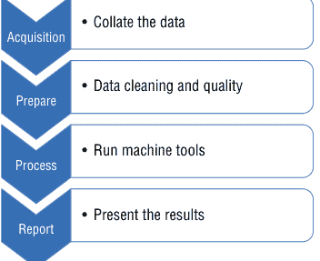

**图 2.1:** 机器学习流程

# 第 2 章 机器学习规划

你可以从许多来源获取数据；这些可能是你组织内部的数据，也可能是互联网上的开放数据。可能有一个数据集，也可能有 10 个或更多。

你必须接受，在进行任何处理之前，需要对数据进行清洗和质量检查。这些过程发生在“准备”阶段。

“处理”阶段是完成工作的阶段。你在此阶段创建的机器学习例程在此运行。

最后，是结果展示。报告可以通过多种方式进行，例如将数据重新存入数据存储器，或者以表格或报告的形式呈现结果。

## 一切始于一个问题

似乎存在一种误解，认为机器学习就像大数据一样，只要向问题中投入足够的数据，答案就会神奇地出现。正如我一直想说的那样，事实并非如此。机器学习项目始于一个需要调查的问题或直觉。在与人们谈论他们公司的数据雄心以及他们希望通过机器学习和 `Hadoop` 等工具实现的目标时，我多次遇到过这种情况。

使用白板、便利签，甚至一张纸，开始提出如下所示的问题：

- 我们的销售额与天气之间是否存在相关性？
- 与一周的其他五天相比，周六和周日的销售额是否产生了业务大部分营收？
- 我们可以通过查看 `Twitter` 上热门标签的数据，规划未来三个月进货的时尚款式
- 我们能判断出客户什么时候怀孕吗？

这些都是合理的问题，它们为适当的讨论提供了基础。利益相关者通常会提出问题，然后数据项目团队（可能只有一个人——你！）就可以大显身手。

如果没有问题，很难知道从何开始。任何认为答案会凭空掉出来的人，都需要得到一个礼貌但坚定的解释，即为了发现答案，必须经过哪些过程。

## 我没有数据！


当你手里拿着一本关于机器学习的书时，这话听起来很愚蠢，但有时人们确实没有数据。

在理想的世界里，我们期望公司拥有良好的客户关系管理（`CRM`）系统和整洁的数据库，可以随时随地检索并整齐地复制到 `Hadoop` 文件系统中，在其中可以运行无数 `MapReduce` 任务（有关 `MapReduce` 的更多信息请参阅第 13 章“Apache Spark 和 MLLib”）。

数据来自各种来源。现在有很多开放数据倡议，因此你有很大机会找到一些数据来工作。

## 从本地开始

也许你可以为你的当地社区做出改变；看看他们拥有哪些数据可以让你进行实验。纽约市拥有一个完整的开放数据门户，提供超过 1,100 个数据集供公民下载和学习。黑客松和竞赛鼓励人们参与并回馈社区。黑客松的结果是有意义的，因为关于当地社区如何运作的见解会反馈给活动组织者。如果你找不到想要的数据集，也鼓励你请求它。

# 迁移学习

鉴于现在在领域中执行了大量的机器学习，研究现有模型并修改某些参数以适应你的预测数据可能是值得的，特别是当你没有多少训练数据时。这被称为迁移学习。它非常适用于需要大规模数据集进行训练的模型，例如图像、视频和大型文本库。我将在后面的章节中重点介绍一些迁移学习的例子。

## 竞赛

如果你渴望真正的挑战，那么可以考虑参加竞赛。其中最著名的之一是 `Netflix` 大奖（`Netflix Prize`），这是一项改进 `Netflix` 电影服务推荐算法的竞赛。

各团队通过下载的用户数据样本进行竞争，并致力于开发算法以改进对客户喜欢的电影预测。获胜团队将其提升了 10%。2009 年，100 万美元的奖金颁给了“BellKor's Pragmatic Chaos”。这引发了新一波竞赛，让数据公开，以便协作团队可以进行改进。

2010 年，`Anthony Goldblom` 创立了 `Kaggle.com`，这是一个预测建模和分析竞赛的平台。每场竞赛都有样本数据集和预期结果的简要说明。团队或个人都可以参加，与 `Netflix` 大奖类似，由最有效的算法决定胜者。

竞赛有效吗？看起来似乎是有效的。`Kaggle` 全球范围内注册了超过 100,000 名数据科学家。`Facebook`、`NASA`、`GE`、`Wikipedia` 和 `AllState` 等组织已使用该服务来改进他们的产品，甚至招募顶尖人才。

## 一方案治天下？

机器学习是由一套变化的工具、语言和技术构建而成的。可以说，没有一种方案能够适用于大多数项目。正如你在本章和整书中发现的，我将提到各种工具来完成工作的某些方面。例如，关系型数据库中可能存在某些数据，在处理之前需要先提取文件。

在过去的几年里，我看到经理和开发者在分配项目时脸上露出复杂的喜悦和快乐。项目是新的，是时髦的，而且参与项目是很酷的。但当项目规模显现出来后，我看到他们的脸色变得苍白。这通常发生在经理和开发者看到为了让项目成功需要多少不同的元素之后。而且，就像任何专业一样，[文本错误]

你从代码中获得的每一分性能，都会缩短整体的处理时间。想象一下一场接力赛；起步越慢，到达终点时就会慢得多。

## 生产环境

当团队完成所有的测试、评审和完善后，迁移到生产环境不应该是一项艰巨的任务。务必考虑该项目的运行频率：它是每小时/每天/每周还是每月运行一次的任务？在项目上线到下一次运行之间，数据会发生剧烈变化吗？

确保团队审查前几次生产运行，以确保结果符合预期，然后从项目的整体来看，它是否符合利益相关者的标准。某些地方可能需要进一步完善。如你所知，软件很少有完全完工的时候。

## 避免偏见

不要忘记，机器学习是一项困难的任务；获取避免偏见的模型也很困难。让团队之间相互交流，如何避免在最终解决方案中引入任何形式的偏见至关重要。

数据集的选择非常重要。确保它的权重是均匀。无论是性别、年龄还是其他参数，如果源数据类型的数量过大，模型就会倾向于该类型。

尝试使用不同的模型类型并评估测试预测。无监督模型在从训练数据进行聚类时可能会因紧紧的相关性引入偏见，而监督模型在引入人工干预来控制模型或训练数据时也可能产生偏见。必须加小心。

## 构建数据团队

数据科学家是指能够将数据处理、分析、统计、编程和可视化等维度引入项目的人。由于涉及如此多的技能组合，即使对于最小的项目，要求一个人具备所有必要的技能也是很困难的。事实上，我甚至可以说，这样的人可能并不存在，或者极其罕见。数据科学团队可能会触及以下专业领域的部分或全部。

## 数学与统计

团队中需要有人具备良好的数学头脑——那种在面试中听到“线性回归”一词时不会感到畏缩的人。我并不是说在开始任何项目之前应该具备最低的统计学水平，但对描述性统计（平均值、众数和中位数）、分布和离群值的了解将为你开始工作提供良好的基础。

关于任何学习项目所需的数学水平，争论会不休，但我的观点是，每个项目都有自己的复杂性。如果需要学习新信息，那里有大量的资源供你学习。

如果你能接触到才华横溢的数学家，那么你的数据团队确实是一个幸运的群体。

## 编程

优秀的编程人才很难得到，但我假设如果你手里拿着这本书，那你很有可能已经是一个程序员了。接纳算法并能够将其转换为可运行的代码需要时间和规划。了解一些大数据工具工具也是值得的，例如 `Spark` 框架和 `Kafka`。（请参阅第 12 章和第 13 章，以获得对这两项技术的全面介绍。）

## 图形设计

数据可视化非常重要；它向利益相关者或最终用户讲述了你的发现结果。尽管人们非常强调使用 `D3` 和 `Processing` 等技术在 `Web` 端进行演示，但请不要忘记像 `BIRT`、`Jasper Reports` 和 `Crystal Reports` 等工具。

本书没有涉及可视化，但附录 D“扩展阅读”包含了一些可以指引你走向正确方向的书目。

## 领域知识

例如，如果你正在处理医疗数据，那么有一个精通医疗领域的人将大有益处。零售业也是如此；如果没有人如何解释客户行为，那么在密集的交易记录中翻找将意义不大。领域专家是引导团队通过项目的关键英雄。有些决策领域专家会本能地知道答案。

想象一个带有护照检查的边境口岸。根据国籍、移民规则等，可能会有许多规则变体。领域专家将拥有这些知识，让你的生活变得简单得多，并帮助快速建立解决方案。

有一种观点认为我们不需要领域专家。我的观点是我们需要，即使你只是和某个了解该领域的人坐下来喝杯咖啡。始终带上笔记本并做好记录。

## 数据处理

在你建立好团队并对所有这些内容将如何整合有一个大致的想法后，是时候将注意力转向那些将为你完成所有工作的内容了。你必须考虑数据处理任务的频率。如果它偶尔发生一次，那么从长远来看，在硬件上可能是虚假的节省。从手头已有的开始，然后随着你注意到处理时间和频率的增长再不断添加，会更有意义。

## 使用你的电脑

是的，你可以使用自己的机器，无论是台式机还是笔记本电脑。我在 `Apple MacBook Pro` 上进行开发。我在这台机器上运行 `Kafka`、`Spark` 和 `Hadoop` 等工具，因为它非常快，而且我在使用 `TB` 级的数据。没有什么能阻止你使用自己的机器；它是现成的，而且节省了购买更多机器的开支。显然，可能会有局限性。处理重型任务可能意味着你必须将注意力转向对处理器密集程度较低的任务，但永远不要排除使用自己机器的选择。

`Linux` 和 `MacOS` 等操作系统通常比 `Windows` 更受欢迎，尤其是对于基于大数据的操作。

## 机器集群

最终你会遇到需要机器集群的情况。像 `Hadoop` 这样的框架被设计用于并行处理。理想情况下机器应该在同一个网络中以减少网络流量。

就像云处理一样，基于云的存储按月或按年付费。你还需要考虑大量数据从办公室移动到云端的带宽影响，这也是需要考虑的成本。

## 云服务

如果维护和支付自有硬件的想法并不吸引你，请考虑使用某些形式的云。`Amazon`、`RackSpace` 等供应商提供可扩展服务器，你可以增加或减少机器数量和功率。

这些服务的优势是它们是“开启/关闭”技术，允许你只使用需要的部分。密切关注云服务的成本，因为它们有时可能比使用标准托管更贵。如果你需要 `Spark` 等工具，某些公司提供专用的数据服务。

## 数据隐私

数据就是力量，随之而来的是巨大的责任。隐私问题将会在用户和大众的心中持续存在。每个人对这个问题都有意见，而且人们往往倾向于谨慎。

# 第 2 章 机器学习规划

在过去的五年里，人们对如何使用用户数据产生了高度关注。在欧洲，《通用数据保护条例》（`GDPR`）控制着企业如何在其组织内部使用个人数据。

归根结底，能力越大，责任越大，数据的保护和处理将取决于你。

## 文化规范

文化期望是很难衡量的。自从 20 世纪 90 年代中期以来万维网的发展，隐私领域展开了一场斗争，涵盖了从 `Cookie` 如何存储在你的计算机上，到大量公司通过你的移动设备跟踪位置、社交互动、评分和购买决策。

如果你通过网站或移动应用程序收集数据，人们会期望你提供某些东西作为换取用户信息的报。当你收集这些信息时，告诉用户你打算如何处理这些数据是理所应当的。超市忠诚卡是一个简单的数据收集练习。对于每一个通过结账台的购物篮，客户都有可能持有忠诚卡。通过将该客户与这篮产品关联起来，你可以应用机器学习。随着时间的推移，你将能够看到该客户的购物习惯——她的平均支出、购物的星期——而客户也期望在你提供这些信息后获得某种形式的折扣促销。

那么，你如何遵守文化规范呢？通过给客户提供清晰的加入（`opt-in`）或退出（`opt-out`）策略。

## 代际期望

在我的 `iPhone` 开发课程上，我会从关于个人数据的讨论开始。我能看到房间里立刻分成了两派，我很容易看出决定因素：年龄。

有些人非常乐意与他们的朋友以及世界上其他地方分享位置、他们在做什么以及和谁在一起。这些人会发布他们活动的照片并进行标记，以便于被搜索、评分和评论。他们将 `Facebook`、`Instagram`、`YouTube`、`Twitter` 和其他应用作为生活中的正常日常部分。

另一组人年龄较大，他们对处理移交个人信息的概念感到不适。他们中的一些人认为，正常理智的人不会对这类信息感兴趣。大多数人看不出其中的意义。

尽管代沟可能会缩小，人们愿意发布到互联网上的内容也在不断放宽，但开发者对信息提供者负有责任。你必须考虑你生成的结果会引起他们的担忧，还是会改善他们的生活。

## 用户数据的匿名性

你可以从数据中学习，但当名字被关联在数据上时，用户会感到被触犯。为重要数据创建哈希（`hashes`）是一个起点，但绝对不是终点。将我的名字视为一个 `MD5` 哈希。使用 `Linux` 的 `md5sum` 命令，我可以很容易找到它，如下：

```
$ printf '%s' 'Jason Bell' | md5sum
a7b19bd2ca59f8e94121b549f26333c
```

现在，我有一个哈希值，这是一个良好的开始，但它仍然没有保护我的身份。你现在知道了它，以及如果作为机器学习过程中的用户它可能与什么关联。对于一个拥有姓氏列表的优秀程序员来说，生成所有组合的 `md5` 值不需要花费多少时间。

使用盐值（`salt value`）是一个更好的解决方案。盐值是与数据一起的数据，使其更安全且更难破解。

假设盐值是自 1970 年 1 月 1 日以来的纳秒数。获取该数值以及你想要哈希的字符串：

```
$ printf 'Jason Bell $(date +%s)' | md5sum
40e6b488a87c3c080469dbefaa5e16
```

处理输入字符串有多种方法。你可能想删除空格，但概念保持不变。在解释答案时，你必须维护这些哈希的安全性，届时你将知道哪些客户对应你所寻求的操作。哈希不仅限于用户名或客户姓名；它们可以应用于任何数据。任何你认为是私有信息（被称为个人身份识别信息 [`PII`]）——你不希望任何第三方看到的内容——都必须进行哈希处理。

小心不要因跨越我所谓的“毛骨悚然线”（`creepy line`）分界线而让客户大惊失色。那是感到惊恐的客户尖叫道：“他们是怎么知道的？”关于某公司以及他们对你了解的例子，请访问你的 `Google` 账户设置页面并查看你的网络搜索记录或位置记录：

```
https://www.google.com/settings/dashboard
```

数据科学、大数据和机器学习领域的一个传奇案例是 `Target` 公司和孕妇妈妈的故事，这个故事因为查尔斯·迪希格（`Charles Duhigg`）的书《习惯的力量》（`Random House`, 2011）而曾在互联网上被广泛引用。互联网读者忘记意识到的是，`Target` 多年来一直使用同样的做法。

## 范围检查

范围检查或合理性检查用于数值或日期范围。年龄范围是这里讨论的重点。在科学医学进步以延长寿命之前，你可以做一个相当合理的假设：一个人的寿命上限在 120 岁以上。你可以为了安全起见，将上限范围扩展到 150；任何比这个年龄大的人要么是在撒谎，要么只是试图通过错误值来刁难系统。

| 字段 | 下限范围 | 上限范围 |
| --- | --- | --- |
| 年龄 | 0 | 120 |
| 月份 | 1 | 12 |

## 格式检查

当你知道某些数据必须遵循给定的格式时，对其进行检查是很有用的。如果你了解正则表达式知识，这将是一个巨大的优势。电子邮件地址在 `Web` 表单和数据库表中可能被使用也会被滥用，因此在源头尽可能进行验证始终是一个好主意。

开发者世界中，关于什么是正确的电子邮件正则表达式有许多讨论。电子邮件地址规范的官方标准是 `RFC 5322`。用正则表达式正确匹配电子邮件地址是一个巨大的模式。你寻找的是一种可以捕获大多数电子邮件地址的东西。

```
[a-z0-9!#\$%&'*+/=?^_`{|}~-]+(?:\.[a-z0-9!#\$%&'*+/=?^_`{|}~-]+)*@(?:(?:[a-z0-9](?:[a-z0-9]*[a-z0-9])?\.)+[a-z0-9]*[a-z0-9])?)
```

最要的是要针对你认为可能出现的各种电子邮件变体创建一个测试。不要只测试一次；要随着时间的推移不断重新测试。

邮政编码和 `ZIP` 是另一个格式烦恼来源——尤其是英国邮编。正则表达式在这种情况下也有帮助，但有时测试过程中会发生疏漏。归根结底，这类事情最好交给专门的软件或专家服务。

## 布兰尼困境

人类用户会输入各种内容，确保我们的软件能够捕捉到它能捕捉的内容完全取决于我们。虽然搜索字符串并不是机器学习特有的，但它是一个关于不同名称如何真正搞乱结果的有趣案例。

# 第 2 章 机器学习规划

例如，在著名的搜索引擎中查看搜索词“Britney Spears”的变体。在一个理想且略带乌托邦色彩的愿中，每个人都会在文本框中完美地输入她的名字。

`britney spears`

生活很少按照计划进行，用户会输入他们认为正确的的内容，如下：

- `brittany spears`
- `brittney spears`
- `britany spears`
- `bitny spears`
- `biteny spears`
- `britteny spears`
- `brine spears`
- `brittny spears`
- `brintey spears`
- `britanny spears`
- `bitiny spears`
- `britnet spears`
- `briney spears`
- `braney spears`
- `bitnay spears`
- `brhtney spears`
- `brtiny spears`
- `birtney spears`
- `bigintey spears`
- `briteney spears`
- `bitney spears`
- `brinty spears`
- `brittaney spears`
- `brittay spears`
- `britei spears`
- `brittiny spears`

如果你在一个 `Hadoop` 集群中运行寻找唯一的搜索词，你将陷入困境，因为这里的每一个术语都会产生一个新的结果计数。

你想对每个术语进行权衡并查看它像什么。最简单的方法是使用分类器在每个术语输入时对其进行加权。你知道正确的术语，因此只需是将输入的术语与正确的术语进行对比并查看置信度评分。

```java
package mlbook.ch02.examples;

import java.util.ArrayList;
import java.util.List;
```

```java
import net.sf.classifier4J.ClassifierException;
import net.sf.classifier4J.vector.HashMapTermVectorStorage;
import net.sf.classifier4J.vector.TermVectorStorage;
import net.sf.classifier4J.vector.VectorClassifier;
```

```java
public class BritneyDilemma {

    public BritneyDilemma() {
        List<String> terms = new ArrayList<String>();
        terms.add("britany spears");
        terms.add("britany spears");
        terms.add("britany spears");
        terms.add("britny spears");
        terms.add("briten spears");
        terms.add("britinney spears");
        terms.add("brine spears");
        terms.add("britany spears");
        terms.add("brintey spears");
        terms.add("Brittany spears");
        terms.add("britiny spears");
        terms.add("britnet spears");
        terms.add("britiney spears");
        terms.add("christina aguilera");
    }
}
```


## 范围检查

范围检查或合理性检查用于数值或日期范围。年龄范围是这里讨论的重点。在科学医学进步以延长寿命之前，你可以做一个相当合理的假设：一个人的寿命上限在 120 岁以上。你可以为了安全起见，将上限范围扩展到 150；任何比这个年龄大的人要么是在撒谎，要么只是试图通过错误值来刁难系统。

| 字段 | 下限范围 | 上限范围 |
| --- | --- | --- |
| 年龄 | 0 | 120 |
| 月份 | 1 | 12 |

## 格式检查

当你知道某些数据必须遵循给定的格式时，对其进行检查是很有用的。如果你了解正则表达式知识，这将是一个巨大的优势。电子邮件地址在 Web 表单和数据库表中可能被使用也会被滥用，因此在源头尽可能进行验证始终是一个好主意。

开发者世界中，关于什么是正确的电子邮件正则表达式有许多讨论。电子邮件地址规范的官方标准是 `RFC 5322`。用正则表达式正确匹配电子邮件地址是一个巨大的模式。你寻找的是一种可以捕获大多数电子邮件地址的东西。

```
[a-z0-9!#\$%&'*+/=?^_`{|}~-]+(?:\.[a-z0-9!#\$%&'*+/=?^_`{|}~-]+)*@(?:(?:[a-z0-9](?:[a-z0-9]*[a-z0-9])?\.)+[a-z0-9]*[a-z0-9])?)
```

最重要的是针对你认为可能出现的各种电子邮件变体创建一个测试。不要只测试一次；要随着时间的推移不断重新测试。

邮政编码和 ZIP 是另一个格式烦恼来源——尤其是英国邮编。正则表达式在这种情况下也有帮助，但有时测试过程中会发生疏漏。归根结底，这类事情最好交给专门的软件或专家服务。

## 布兰尼困境

人类用户会输入各种内容，确保我们的软件能够捕捉到它能捕捉的内容完全取决于我们。虽然搜索字符串并不是机器学习特有的，但它是一个关于不同名称如何真正搞乱结果的有趣案例。

# 第 2 章 机器学习规划

例如，在著名的搜索引擎中查看搜索词“Britney Spears”的变体。在一个理想且略带乌托邦色彩的愿中，每个人都会在文本框中完美地输入她的名字。

britney spears

生活很少按照计划进行，用户会输入他们认为正确的的内容，如下：

- brittany spears
- brittney spears
- britany spears
- bitny spears
- biteny spears
- britteny spears
- brine spears
- brittny spears
- brintey spears
- britanny spears
- bitiny spears
- britnet spears
- briney spears
- braney spears
- bitnay spears
- brhtney spears
- brtiny spears
- birtney spears
- bigintey spears
- briteney spears
- bitney spears
- brinty spears
- brittaney spears
- brittay spears
- britei spears
- brittiny spears

如果你在一个 `Hadoop` 集群中运行寻找唯一的搜索词，你将陷入困境，因为这里的每一个术语都会产生一个新的结果计数。

你想对每个术语进行权衡并查看它像什么。最简单的方法是使用分类器在每个术语输入时对其进行加权。你知道正确的术语，因此只需将输入的术语与正确的术语进行对比并查看置信度评分。

```java
package mlbook.ch02.examples;

import java.util.ArrayList;
import java.util.List;
```

```java
import net.sf.classifier4J.ClassifierException;
import net.sf.classifier4J.vector.HashMapTermVectorStorage;
import net.sf.classifier4J.vector.TermVectorStorage;
import net.sf.classifier4J.vector.VectorClassifier;
```

```java
public class BritneyDilemma {

    public BritneyDilemma() {
        List<String> terms = new ArrayList<String>();
        terms.add("britany spears");
        terms.add("britany spears");
        terms.add("britany spears");
        terms.add("britny spears");
        terms.add("briten spears");
        terms.add("britinney spears");
        terms.add("brine spears");
        terms.add("britany spears");
        terms.add("brintey spears");
        terms.add("Brittany spears");
        terms.add("britiny spears");
        terms.add("britnet spears");
        terms.add("britiney spears");
        terms.add("christina aguilera");
    }
```

```java
        VectorStorage storage = new HashMapTermVectorStorage();
        VectorClassifier vc = new VectorClassifier(storage);
        String correctString = "britany spears";
```

```java
        for (String term : terms) {
            try {
                vc.teachMatch("sterm", correctString);
                double result = vc.classify("sterm", term);
                System.out.println(term + " = " + result);
            } catch (ClassifierException e) {
                e.printStackTrace();
            }
        }
```

```java
    public static void main(String[] args) {
        BritneyDilemma bd = new BritneyDilemma();
    }
```

## 日期和时间


# 时间处理

对于时间处理，你必须确保拥有一组一致的日期来读取。你选择的格式完全取决于你。国际标准 `ISO 8601` 规定了数值格式日期和时间表示的规范。`ISO 8601` 标准的问题在于它无法免受 `Y20K` 漏洞的影响，当 `2038` 年 `1` 月 `19` 日之后，时间戳将变得错误。国际原子时 (`TAI`) 标准考虑了这些问题。

无论你使用哪种语言，都要了解日期格式化和解析例程是如何工作的。对于 `Java`，请查看 `SimpleDateFormat` API，它提供了所有设置的概述以及实用的示例。在分布式系统上以及不同时区运行代码时，请务必小心。

表 2.1 显示了一些常用的日期/时间格式：

| 日期/格式 | 简化的格式表示 |
|---|---|
| `2014-01-01` | `Yyyy-MM-dd` |
| `2014-01-01 11:59:00` | `Yyyy-MM-dd hh:mm:ss` |
| `1388577540` | (Unix 时间戳类似于长变量类型，但增加了纳秒。) |

我见过许多以字符串类型保存的具有不同日期格式的数据库表。情况已有所好转，但我牢记这一点。

# 关于数据清理的最后思考

数据清理是一项大任务，因为它增加了获得更好结果的概率。对于某些大数据项目，在实际分析之前，`80%` 的项目时间都花在了数据清理上。将此步骤置于项目计划的高位置并相应地管理时间是非常重要的。

# 思考输入数据

对于任何机器学习项目，你都需要考虑输入数据、其格式以及构建的代码将如何访问这些数据。

数据以各种格式出现，因此在开始编写代码之前，了解你正在处理什么是一个好主意。接下来的章节描述了一些常见的数据格式。

## 原始文本

基础原始文本文件用于许多出版物。如果你查看古登堡计划 (`Gutenberg Project`)，你会发现可以下载原始文本格式的作品。数据是非结构化的，因此它们很少有你可以处理的恰当格式。

> Lorem ipsum dolor sit amet, consectetur adipiscing elit. Suspendisse metus erat tempor hendrer. Vestibulum turpis ante, bibendum vitae nisi, euismod blandit dui. Maecenas tincidunt consectetur est nec. Maecenas porttitor, arcu sed gravida, tellus lacinia eu, dapibus felis elit nisl. Nunc mollis volutpat ligula. Etiam interdum porttitor nulla non lobortis.

文本文件的常用格式有 `Unicode`、`ASCII` 或 `UTF-8`。如果需要任何国际编码，`UTF-8` 和 `Unicode` 最常见。请注意，`PDF` 文档、富格式文件 (`RTF`) 和 `Word` 文档不是原始文本。`Microsoft Office` 文档（如 `Word` 文件）特别麻烦，因为有“智能引号”和其他会对 `Java` 程序造成破坏的额外字符。

## 逗号分隔变量

`CSV` 格式广泛用于数据领域。逗号字符用于在每个数据字段之间。你可能会发现使用了其他分隔符，例如制表符 (`TSV`) 和管道符 (`|`) 符号 (`PSV`)。分隔符也不限于单个字符。如果你查看类似美国农业部 (`USDA`) 数据库，你会看到 `` `~` `` 用作分隔符。以下 `CSV` 格式由假名生成器生成。（测试时使用虚假数据总是好的。）

```
1,male,Mr.,Joe,Perry,50 Park Row,EDERN,,LL53 QGB,United Kingdom,JoePenny@enrot.com,Aver,eiThahph9h,077 643 7650,7/4/1991,Visa,4539148712302735,342,2/2018,Y 20 98 60,1Z 23F 389 61 4167 727 1,Blue,Nephrology nurse,Friendly Advice,999 Alfa Romeo,BadProtection.co.uk,0,169.4,70,5 10^,177,a617840-6e42-4146-b743-09ee59c2c9,52.806493,-4.72918
male,Mr.,Daniel,J,Carpenter,51 Guildford,RD,EAST DRAYTON,NN27 GT,United Kingdom,DanielCarpenter@telecom.nus,Rest1950,EichKgle279 289,Harris,26/1990,MasterCard,5352738063226,717,KL 50 12 89 360 370,Blue,Corporate assistant,Hit or Miss,2000 Jeep,Chemistry,Biology.co.uk,Aeb,175,79,7.5*,169,ac9075-a091-42-b26655215da
male,Mr.,Harvey,Hawkins,37 Shore Street,STOKE TALMAN,OX9941GB,United Kingdom,HarveyHawkins@army.com,Uee9Gh,077 7965 0825,1/1994,MasterCard,5136108666979,SI77 32 98 189,Black,Education,Mansour,1999,740,Shadows.co.uk,Aeb,-224,8.2,102.6*,185,ac865-fb81ae-42af-968d55324
male,Mr.,Kyle,37 Wilton Cloch Rd,ST MARTIN,Wilvear,deW,079 289 635,Hancock,Kingdom,Petersrito.com,Wilvear,de2251,6/7/1958,Visa,41964082335950,4/2016,H 93 02 76 12 590,1564,Blue,Interior,detector,Grade A,2002 Proton,Juara,ConsumerMenu.co.uk,Aeb,189,2.86,0.5*,179,ac58-ba41-06e-al1.290408be365,49.574
male,Mr.,Daniel,66 Temple Way,WINNICK,WA2 5HE,GB,United Kingdom,DanielWillis@coovdx.uk,Household,shael700 0115 4178,Kelly,8/16/1948,Visa,44853111404976,423,11/2016,WG 24 10 62 12 538,8247 102,Community health educator,Mr.Steak,2002 Nissan-Trail,FFaker.co.uk,Aeb,170,1.77,37.5*9,175,335c2508-71be-43ad-9760-4f5c18ec029,53.474
female,Mr.,Courtney,42 Kendall Street,SHARLSTON,WF41PZ,GB,United Kingdom,CourtneyJordanfleckens.hu,Postscript,H102ee01,3769 5710,Path/23/1982,MasterCard,557081500784057,426/2019,CJ 87 95 98 D,12 853 849 848609 3,Mechanical inspector,Olson Electronics,2000Chrysler LHS,LandscapeCovers.co.uk,B+,143.9,65.4,5'3*,161,2723d2b9-0616-4700-8533-561359People需要保存为 `CSV` 文件，尽管它们并不复杂。识别真实 `CSV` 文件的方法是打开数据并查看。

## JSON

`JavaScript` 对象表示 (`JSON`) 是一种常用的数据格式，利用键值对在机器和网络之间通信数据。我们将其设计为 `JavaScript` 使用的示例；你不需要 `JavaScript` 来使用这种数据格式。各种语言都有 `JSON` 解析器。之前的 `CSV` 示例使用了虚假数据；这里是 `JSON` 格式的 `CSV` 第一条目：

```json
{
  "Number": 1,
  "Gender": "male",
  "Title": "Mr.",
  "GivenName": "Joe",
  "MiddleInitial": "L",
  "Surname": "Perry",
  "StreetAddress": "50 Park Row",
  "City": "EDERN",
  "State": "",
  "ZipCode": "LL53 QGB",
  "Country": "GB",
  "CountryFull": "United Kingdom",
  "EmailAddress": "JoePenny@enrot.com",
  "Username": "Aver",
  "Password": "eiThahph9h",
  "TelephoneNumber": "077 643 7650",
  "MotherName": "Fry",
  "Birthday": "7/4/1991",
  "CCType": "Visa",
  "CCNumber": 4539148712302735,
  "CVV2": 342,
  "CCExpires": "2/2018",
  "NationalID": "YB 20 98 60",
  "UPS": "1Z 23F 389 61 4167 727 1",
  "Color": "Blue",
  "Occupation": "Nephrology nurse",
  "Company": "Friendly Advice",
  "Vehicle": "1999 Alfa Romeo 145",
  "Domain": "BadProtection.co.uk",
  "BloodType": "O",
  "Pounds": 169.4,
  "Kilograms": 77.0,
  "FeetInches": "5'10",
  "Centimeters": 177,
  "GUID": "a61f8f40-6e42-4146-b743-09ee5c9cf",
  "Latitude": 52.806493,
  "Longitude": 4.02918
}
```

许多应用程序编程接口 (`API`) 使用 `JSON` 向请求的程序发送响应。某些解析器可能会解析 `JSON` 数据并表示为对象。其他解析器可能为你的数据创建一个哈希值供你访问。

# 第 2 章 机器学习规划

## YAML

虽然 `JSON` 是一种文档标记格式，但 `YAML`（意思是“`YAML` 并不是标记语言”）无疑是一种数据格式。由于它看起来与 `JSON` 相似，它并没有 `JSON` 那样被广泛使用。

```yaml
date : 2014-01-02
bill-to: &id001
given : Jason
family : Bell
address:
  lines: |
    458 Some Street Somewhere
    In Some Suburb
  city : MyCity
  state : CA
  postal : 55555
```

## XML

可扩展标记语言 (`XML`) 延续了通用的标准通用标记语言 (`SGML`) 在文档标记方面的用法。`XML` 的理念是让人类和机器都能轻松阅读。初初看去，`XML` 类似于文本标记语言（`HTML`）；后版本的 `HTML` 使用了严格的 `XML` 格式类型。

`XML` 因其复杂性而受到批评，特别是在读取大型结构时。这也是它在以 `JSON` 数据作为响应的 `Web API` 中流行的原因之一。有大量的 `API` 提供 `XML` 响应数据，因此学习它的工作原理是值得的：

```xml
<?xml version="1.0" encoding="UTF-8"?>
<Customer>
  <Number>1</Number>
  <Gender>male</Gender>
  <Title>Mr.</Title>
  <GivenName>Joe</GivenName>
  <MiddleInitial>L</MiddleInitial>
  <Surname>Perry</Surname>
  <Address>50 Park Row</Address>
  <City>Eden</City>
  <State>SS</State>
  <ZipCode>LL53 2Q</ZipCode>
  <Country>GB</Country>
  <CountryFull>United Kingdom</CountryFull>
  <EmailAddress>JoePerry@inrot.com</EmailAddress>
  <Username>Anner</Username>
  <Password>eiThahph9ah</Password>
  <TelephoneNumber>077 6473 7650</TelephoneNumber>
  <MotherMaiden>Fry</MotherMaiden>
  <Birthday>7/4/1991</Birthday>
  <CCType>Visa</CCType>
  <CCNNumber>4539148712302735</CCNNumber>
  <CCVV>342</CCVV>
  <CCPExpires>2/2018</CCPExpires>
  <NationalID>YB 20 98 60 Ac</NationalID>
  <UPSID>23F 38 41 1617 727 1</UPSID>
  <Color>Blue</Color>
  <Occupation>Nerology nurse</Occupation>
  <Company>Friendly Advice</Company>
  <Vehicle>1999 Alfa Romeo 145</Vehicle>
  <Domain>BadProtection.co.uk</Domain>
  <BloodType>O++</BloodType>
  <Pounds>169</Pounds>
  <FeetIn>10</FeetIn>
  <Centimeters>177</Centimeters>
  <GUID>561</GUID>
  <Latitude>52</Latitude>
  <Longitude>72</Longitude>
</Customer>
```


大多数可用的语言解析器使用文档对象模型 (`DOM`) 解析器或简单 XML 接口 (`SAX`) 解析器。根据你处理的 XML 尺寸和复杂性，这两种类型各有优劣。

## 电子表格

与组织中的任何财务人员交流，你会发现他们的整个世界都围绕着电子表格转。程序员往往倾向于避开电子表格，转而选择让他们的生活更简单的格式。然而，你不能忽视它们。电子表格是组织的命脉，它们可能包含了大部分数据。

有很多不同的程序，最常用的是 `Microsoft Excel`、`Google Sheets` 和 `LibreOffice`。幸运的是，可以使用一些编程 `API` 来直接从电子表格中提取数据，这节省了大量将电子表格转换为 `CSV` 文件的工作量。研究电子表格中的公式是值得的，因为其中可能隐藏着一些端倪。

如果你想让财务人员支持这个项目，告诉他们结果最终会呈现在电子表格中。`Java` 语言有几个 `API` 可供选择，可以读写电子表格。`Apache POI` 和 `Excel` 是最流行的。

## 数据库

如果你是 `Web` 编程长大的，你可能对数据库有所了解。常见的有 `MySQL`、`Postgres`、`Microsoft SQL Server` 和 `Oracle`。最近，`NoSQL`（意思是非 `SQL`）爆发式增长，例如 `MongoDB`、`CouchDB` 和 `HBase`，它们都为存储带来了自己的特色。这些文档型和键值型存储脱离了传统数据库僵化的类表结构。此外，还有诸如 `Apache Giraph` 和 `Neo4j` 等图数据库，以及如 `Spark`、`memcached` 和 `Storm` 等内存系统。

在我看来，所有数据库都有其用武之地，并且值得研究。在项目中同时运行关系型、文档型和图数据库并没有问题。和所有事情一样，存在一个学习曲线，你需要将其考虑在项目时间之内。

## 图像

之前提到的常用数据格式主要处理不同深浅的文本或数字，但无法处理图像。你可以从图像中学习到很多东西。无论你是尝试使用人脸识别、情感跟踪，还是判断一张图像是汽车还是狗，都有几个 `API` 可以提供帮助。最流行的格式是便携网络图形 (`PNG`) 和 `JPEG`；这些在 `Web` 上非常常用。虽然 `TIFF` 或 `BMP` 文件大得多，但它们包含更多信息。

最终我们的工作是将图像转换为数字，以便算法处理。更多此类技术将在第 11 章“图像机器学习”中介绍。

## 思考输出数据

现在该把注意力转向输出数据了。这是利益相关者决定结果如何呈现的地方。关于机器学习输出的主要问题是：“目标受众是谁？”根据这个答案，你的输出会有所不同。你可能需要电子表格来进行财务人员。如果受众是网站用户，那么将数据放回数据库是合理的。机器学习结果可以与其他数据合并以定义更多内容。这最终取决于项目的定义。

有很多付费和免费的报告工具。有些是完整的系统，如 `Jasper Reports`、`BIRT` 和 `Tableau`。如果你是面向 `Web` 受众进行报告，那么 `D3` 和 `Processing` 等可能会有所帮助。

## 不要害怕实验

可以说，没有一种方案是适用于所有的。在任何项目中，都有许多组件、格式、工具和考虑因素。每个机器学习项目都从一张白纸开始，涉及到从利益相关者到可视化的沟通。工具和脚本可以重用，但每个案例都是不同的，因此在过程中需要进行微调。在获取数据时，不要害怕尝试数据；看看是否能从中发现什么。

还值得花时间研究一些数据，创建自己的场景并提出问题。这就像音乐家练习乐器；投入时间是值得的，以便在大机会到来时做好准备。

## 第 2 章 机器学习规划

规划阶段是一个不断演变的过程，你和团队执行的机器学习项目越多，你从以往错误中学到的东西就越多。

关键在于从小开始。对数据进行快照，并取一个占总数 10% 的随机样本。让团队检查数据。你可以处理这些数据吗？你预见到处理这些数据时会遇到任何问题吗？

数据清洗可能会占用项目大部分时间；而实际处理可能只占整个项目时间的一部分。如果你提供干净的数据，那么你的结果将会更加精确。

无论你是在一个 10 人的团队中工作还是独自工作，都要留意你的人脉网络；有些人可能拥有非常有用的领域知识。也要多提问。你会惊讶地发现有多少人愿意为了看到你成功而回答问题。

接下来的几章将介绍一些不同的机器学习技术，并编写一些示例代码，以便你开始将它们应用到自己的项目中。

## 第 3 章 数据获取技术

> “计算机不是目的。它们是带我们到达目的工具。”
> —Joe MacMillan

这段引用出自电视节目《狂火之路》（`Halt and Catch Fire`）；或许我们应该根据自己的需求重新考虑一下这一陈述：“数据不是目的。数据是带我们到达目的工具。”要问的问题是，数据从哪里来，它是否需要清洗或转换？

涉及到机器学习和机器学习项目时，你将花费大量时间将数据转换为可以处理的正确形状。欢迎来到提取、转换和加载数据 (`ETL`) 的黑暗艺术。

## 爬取数据

现实的悲哀事实是，数据很少像我们希望的那样整齐包装。当然，也有像 `WikiData` 和 `Facebook Graph API` 这样的例外，并且有一些应用程序接口 (`API`) 会为你提供准备良好的数据（稍后会详细介绍）。但你必须准备好面对爬取数据的杂乱世界。

处理爬取的数据需要几个步骤，才能将其从常见的混乱状态变为可用的状态。

- 弄清楚数据来自哪里。
- 确定你将如何获取它。
- 让它具有可读性。
- 确保数值有价值。
- 确定存储在哪里。

## 复制和粘贴

总有一天，你必须从网页或混乱源中提取数据，但有些方法比其他方法好。第一次尝试可以是从页面复制并粘贴数据，然后想办法删除 `HTML` 标签。然而，有更简单的方法。让我们来看一个例子。

假设我们被赋予了提取数据的任务。我想查看英国最繁忙的机场。我在维基百科上找到了一个页面，我想获取这些数据（见图 3.1）。


图 3.1：维基百科上的英国最繁忙机场列表

访问链接：
`https://en.wikipedia.org/wiki/List_of_busiest_airports_in_the_United_Kingdom`

有几个图包含了我寻找的信息。对于这个例子，我想看 2017–2018 年的数据。如果我复制/粘贴 2017–2018 年的文本，输出还可以的，但需要清洗（见图 3.2）。

### 2018 年数据

以下是根据英国民航局统计数据，2018 年客流量最大的 48 个英国机场列表。[5]

| 排名 | 2018 | 2017 | 变化 | 总乘客人数 | 飞机起降 |
| :--- | :--- | :--- | :--- | :--- | :--- |
| 1 | 伦敦希希罗 | 81,812,825 | 79,364,868 | 2.7% | 475,763 | 468,843 (8.4%) |
| 2 | 伦敦-盖特威 | 23,681,000 | 24,000,000 | -1.6% | 202,435 | 198,815 (-1.8%) |
| 3 | 曼彻斯特 | 27,286,854 | 26,992,797 | 1.1% | 231,783 | 238,219 (-3.2%) |
| 4 | 伦敦-斯坦斯特德 | 24,000,000 | 24,000,000 | 0.0% | 198,815 | 202,435 (-1.8%) |
| 5 | 伦敦-鲁特 | 14,356,435 | 15,000,000 | -4.3% | 136,996 | 131,618 (-4.4%) |
| 6 | 格拉斯哥 | 9,056,227 | 8,800,000 | 2.9% | 78,192 | 79,567 (-1.7%) |
| 7 | 贝尔法 | 8,185,000 | 8,200,000 | -0.2% | 77,867 | 76,813 (-1.4%) |
| 8 | 爱丁堡 | 8,300,000 | 8,000,000 | 3.8% | 72,111 | 71,233 (-1.2%) |
| 9 | 东米德兰斯 | 7,800,000 | 7,500,000 | 4.0% | 68,932 | 65,468 (5.3%) |
| 10 | 利兹 | 6,400,000 | 6,500,000 | -1.5% | 56,469 | 56,218 (-0.4%) |
| 11 | 布里斯托尔 | 6,000,000 | 6,000,000 | 0.0% | 51,235 | 51,110 (-0.2%) |
| 12 | 利物浦 | 5,500,000 | 5,600,000 | -1.8% | 46,818 | 45,412 (-3.0%) |
| 13 | 纽卡斯尔 | 5,000,000 | 4,900,000 | 2.0% | 43,111 | 41,811 (-2.9%) |
| 14 | 伯明翰 | 4,800,000 | 4,700,000 | 2.1% | 39,911 | 38,811 (-3.0%) |
| 15 | 汉普顿 | 4,500,000 | 4,400,000 | 2.3% | 35,235 | 34,411 (-2.3%) |
| 16 | 卡迪夫 | 3,500,000 | 3,600,000 | -2.8% | 31,235 | 30,111 (-3.5%) |
| 17 | 利物浦 | 3,400,000 | 3,300,000 | 3.0% | 28,811 | 27,811 (-3.5%) |
| 18 | 诺里奇 | 3,200,000 | 3,100,000 | 3.2% | 26,411 | 25,811 (-2.3%) |
| 19 | 伯明翰 | 2,800,000 | 2,900,000 | -3.4% | 23,411 | 23,111 (-1.3%) |
| 20 | 曼彻斯特 | 2,500,000 | 2,600,000 | -3.8% | 21,235 | 20,911 (-1.6%) |
| 21 | 埃克斯特 | 2,400,000 | 2,300,000 | 4.3% | 19,811 | 19,511 (-1.5%) |
| 22 | 阿伯丁丁 | 2,300,000 | 2,200,000 | 4.5% | 19,411 | 18,911 (-3.1%) |
| 23 | 利物浦 | 2,200,000 | 2,100,000 | 4.8% | 18,211 | 17,811 (-2.2%) |
| 24 | 利物浦 | 2,100,000 | 2,000,000 | 5.0% | 17,411 | 16,911 (-2.9%) |
| 25 | 利物浦 | 1,900,000 | 1,800,000 | 5.5% | 16,211 | 15,811 (-2.5%) |
| 26 | 利物浦 | 1,800,000 | 1,700,000 | 5.9% | 15,411 | 14,911 (-3.2%) |
| 27 | 利物浦 | 1,700,000 | 1,600,000 | 6.3% | 14,511 | 14,211 (-2.1%) |
| 28 | 利物浦 | 1,600,000 | 1,500,000 | 6.7% | 13,811 | 13,411 (-2.9%) |
| 29 | 利物浦 | 1,500,000 | 1,400,000 | 7.1% | 12,911 | 12,511 (-3.1%) |
| 30 | 利物浦 | 1,400,000 | 1,300,000 | 7.5% | 12,211 | 11,911 (-3.3%) |
| 31 | 利物浦 | 1,300,000 | 1,200,000 | 7.9% | 11,511 | 11,211 (-3.5%) |
| 32 | 利物浦 | 1,200,000 | 1,100,000 | 8.3% | 10,811 | 10,511 (-3.7%) |
| 33 | 利物浦 | 1,100,000 | 1,000,000 | 8.7% | 10,111 | 9,811 (-4.0%) |
| 34 | 利物浦 | 1,000,000 | 900,000 | 9.1% | 9,511 | 9,211 (-4.2%) |
| 35 | 利物浦 | 900,000 | 800,000 | 11.2% | 8,811 | 8,511 (-4.5%) |
| 36 | 利物浦 | 800,000 | 700,000 | 14.3% | 8,211 | 7,811 (-5.0%) |
| 37 | 利物浦 | 700,000 | 600,000 | 16.7% | 7,511 | 7,211 (-5.5%) |
| 38 | 利物浦 | 600,000 | 500,000 | 20.0% | 6,911 | 6,611 (-6.0%) |
| 39 | 利物浦 | 500,000 | 400,000 | 25.0% | 6,211 | 5,911 (-7.0%) |
| 40 | 利物浦 | 400,000 | 300,000 | 33.3% | 5,511 | 5,211 (-8.0%) |
| 41 | 利物浦 | 300,000 | 200,000 | 50.0% | 4,911 | 4,611 (-10.0%) |
| 42 | 利物浦 | 200,000 | 150,000 | 33.3% | 4,311 | 4,011 (-12.0%) |
| 43 | 利物浦 | 150,000 | 100,000 | 50.0% | 3,711 | 3,411 (-15.0%) |
| 44 | 利物浦 | 100,000 | 50,000 | 100.0% | 3,211 | 2,811 (-20.0%) |

图 3.2：2017-2018 文本

实际数据从第 9 行才开始。幸运的是，我做的复制粘贴保留了制表符字符，但确实需要一些工作。我需要运行命令行操作并在数据上正则表达式将制表符转换为逗号以便参考。

我正在使用 `Perl` 进行搜索和替换。然后我使用 `head` 命令检查结果，它将显示输出的前 10 行。

```
$ copypaste_airport_data.txt copypaste_airport_data_piped.txt
$ perl -i -pe 's/\t/,/g' copypaste_airport_data_piped.txt
$ head -n 20 copypaste_airport_data_piped.txt
```

### 2017 / 2018 数据

以下是根据英国民航局统计数据，2018 年客流量最大的 48 个英国机场列表。[5]

| 排名 | 2018 | 2017 | 变化 | 总乘客人数 | 飞机起降 |
| :--- | :--- | :--- | :--- | :--- | :--- |
| 1 | 伦敦希希罗 | 78,012,825 | 80,124 | 2.72% | 475,783 | 477,694 (0.40%) |
| 2 | 伦敦-盖特威 | 45,556,899 | 46,086,089 | 1.21% | 202,435 | 198,815 (-1.8%) |
| 3 | 曼彻斯特 | 27,286,854 | 26,992,797 | 1.1% | 231,783 | 238,219 (-3.2%) |
| 4 | 伦敦-斯坦斯特德 | 24,000,000 | 24,000,000 | 0.0% | 198,815 | 202,435 (-1.8%) |
| 5 | 伦敦-鲁特 | 14,356,435 | 15,000,000 | -4.3% | 136,996 | 131,618 (-4.4%) |
| 6 | 格拉斯哥 | 9,056,227 | 8,800,000 | 2.9% | 78,192 | 79,567 (-1.7%) |
| 7 | 贝尔法 | 8,185,000 | 8,200,000 | -0.2% | 77,867 | 76,813 (-1.4%) |
| 8 | 爱丁堡 | 8,300,000 | 8,000,000 | 3.8% | 72,111 | 71,233 (-1.2%) |
| 9 | 东米德兰斯 | 7,800,000 | 7,500,000 | 4.0% | 68,932 | 65,468 (5.3%) |
| 10 | 利兹 | 6,400,000 | 6,500,000 | -1.5% | 56,469 | 56,218 (-0.4%) |
| 11 | 布里斯托尔 | 6,000,000 | 6,000,000 | 0.0% | 51,235 | 51,110 (-0.2%) |
| 12 | 利物浦 | 5,500,000 | 5,600,000 | -1.8% | 46,818 | 45,412 (-3.0%) |
| 13 | 纽卡斯尔 | 5,000,000 | 4,900,000 | 2.0% | 43,111 | 41,811 (-2.9%) |
| 14 | 伯明翰 | 4,800,000 | 4,700,000 | 2.1% | 39,911 | 38,811 (-3.0%) |
| 15 | 汉普顿 | 4,500,000 | 4,400,000 | 2.3% | 35,235 | 34,411 (-2.3%) |
| 16 | 卡迪夫 | 3,500,000 | 3,600,000 | -2.8% | 31,235 | 30,111 (-3.5%) |
| 17 | 利物浦 | 3,400,000 | 3,300,000 | 3.0% | 28,811 | 27,811 (-3.5%) |
| 18 | 诺里奇 | 3,200,000 | 3,100,000 | 3.2% | 26,411 | 25,811 (-2.3%) |
| 19 | 伯明翰 | 2,800,000 | 2,900,000 | -3.4% | 23,411 | 23,111 (-1.3%) |
| 20 | 曼彻斯特 | 2,500,000 | 2,600,000 | -3.8% | 21,235 | 20,911 (-1.6%) |

## Google Sheets

`Google` 拥有的电子表格有一个许多人没有谈论过的函数。所以，让我告诉你这个秘密。

从主菜单创建一个新表格。一旦你得到了空白电子表格，在第一个单元格 (`A1`) 中输入以下公式：

```


# 第 3 章 数据获取技术

`=IMPORTHTML("https://en.wikipedia.org/wiki/List_of_busiest_airports_in_the_United_Kingdom","table",1")`

URL 的第一部分是你想要加载到电子表格中的内容。第二部分是你想要提取的类型；例如，机场。最后部分是需要提取的内容。对于机场，我想要第一部分。

当电子表格获取页面时，你会看到第一个单元格变为“Loading”（加载中），几秒钟后，数据就会整整齐齐地出现在电子表格中（见图 3.3）。

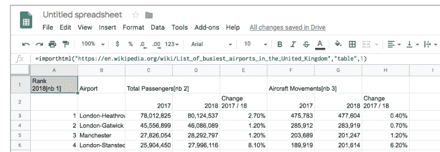

| 排名 | 机场 | 总旅客人数(n-1) | 2018/2017 变化 | 2017 | 飞机起降次数(n-1) | 2018/2017 变化 |
|---|---|---|---|---|---|---|
| 1 | 伦敦-希思罗 | 70,827,824 | 80,124,537 | 2.70% | 475,893 | 477,654 | 0.40% |
| 2 | 伦敦-盖威 | 45,556,869 | 46,086,089 | 1.20% | 285,912 | 201,247 | 1.20% |
| 3 | 伦敦-斯坦斯特德 | 27,856,024 | 29,796,117 | 6.96% | 189,995 | 203,689 | 6.20% |
| 4 | 伦敦-曼斯顿 | 15,990,274 | 16,795,634 | 4.90% | 128,675 | 131,016 | 1.00% |
| 5 | 伦敦-卢顿 | 13,510,943 | 14,294,365 | 5.86% | 94,400 | 136,511 | 2.10% |
| 6 | 爱丁堡 | 12,450,312 | 12,497,065 | 0.38% | 72,042 | 111,899 | 4.40% |
| 7 | 伯明翰 | 8,977,599 | 9,216,552 | 2.40% | 72,106 | 97,157 | 5.50% |
| 8 | 格拉斯哥 | 6,235,515 | 6,286,960 | 5.45% | 76,189 | 72,537 | 4.30% |
| 9 | 贝尔法斯特国际 | 5,531,218 | 5,648,972 | 7.40% | 58,152 | 60,541 | 4.10% |
| 10 | 纽卡斯尔 | 5,308,735 | 5,334,068 | 0.65% | 57,808 | 53,740 | 7.00% |
| 11 | 利物浦 | 4,901,157 | 5,036,532 | 3.00% | 56,643 | 59,320 | 4.70% |
| 12 | 东米德兰兹 | 4,875,781 | 4,873,831 | 0.10% | 77,068 | 76,013 | 1.40% |

**图 3.3:** 英国最繁忙的机场

将数据导出为 CSV 格式，点击电子表格顶部的标签页，然后保存为逗号分隔的文件。这种方法节省了你大量时间。需要注意的是，数据本身的数据仍然是文本。

## 使用 API

API 是由系统或网站提供的一组例程，允许你直接请求并接收数据。大多数情况下，你拥有某种权限来与服务通信；这可能是用户名和密码组合。某些 API 是公开的，不需要注册，但你需要知道如何调用。

## 获取天气数据

OpenWeather (https://openweathermap.org) 拥有一套完整的 API 来获取天气信息、天气预报和历史数据。当你调用 API 时，可以指定你想要的格式 JSON、CSV 或 HTML。在开始之前，需要在 openweathermap.org 注册。一旦创建了账户，就有了一个 API 密钥。尝试以下示例：

### 使用命令行

`curl` 命令出现在大多数 Linux 发行版中。这个简单的命令非常有威力，因为天气 API 是基于 GET 的调用。使用 `-o` 可以将结果输出到文件中。书中的代码库中的脚本如下所示：

```bash
#!/bin/bash

## 从 openweathermap.org 获取你的 API key

API_KEY=your key

curl -o london.json "https://api.openweathermap.org/data/2.5/weather?q=London&appid=$API_KEY"
```

你需要在 shell 脚本中添加 openweathermap.org 的 API key。当你从命令行运行它时，你会看到输出：

```
$ % Total % Received Average Speed Time Current

Dload Upload Total Spent

100 457 100 457 0 325 0 -|--|--|--|--|--| 3264
```

当你打开 `london.json` 文件时：

```json
{
  "weather":[{"lon":-0.13,"lat":51.51},{"id":800,"main":"Clear","description":"clear sky"}],
  "base":"stations",
  "main":{"temp":20.84,"pressure":1012.2,"humidity":68,"temp_min":18.5,"temp_max":24.15},
  "visibility":10000,
  "wind":{"speed":13.6,"deg":90},
  "clouds":{"all":0},
  "dt":1655635127,
  "sys":{"type":1,"id":141414,"message":0.009,"country":"GB"},
  "sunrise":1655632968,"sunset":1655687317,"timezone":3600,
  "id":264343,"name":"London","code":200
}
```

### 使用 Java

URL 的处理和内容的检索都是由 `java.io` 和 `java.net` 包中的类完成的。为了将字符串转换为 `JSONObject`，我使用了 `org.json` 库。当执行此代码时，首先的是的是带有 URL 的 `readUrl` 方法。它被存储为 String 对象并传递给 `toStringJSON` 方法转换为 JSON 对象（见列表 3.1）。

**列表 3.1: 使用 Java 获取天气数据**

```java
import org.json.JSONObject

import java.io.BufferedReader;
import java.io.IOException;
import java.io.InputStreamReader;
import java.net.MalformedURLException;
import java.net.URL;
import java.net.URLConnection;

public class ReadURL {

    public String readURL(String urlString) {
        StringBuffer sb = new StringBuffer();
        try {
            URL url = new URL(urlString);
            URLConnection urlConnection = url.openConnection();
            BufferedReader in = new BufferedReader(new InputStreamReader(urlConnection.getInputStream()));
            String inputLine;
            while ((inputLine = in.readLine()) != null) {
                sb.append(inputLine);
            }
            in.close();
        } catch (MalformedURLException e) {
            e.printStackTrace();
        } catch (IOException e) {
            e.printStackTrace();
        }
        return sb.toString();
    }

    public JSONObject toStringJSON(String rawjson) {
        return new JSONObject(rawjson);
    }

    public static void main(String[] args) throws Exception {
        String apikey = "your key here";
        ReadURL r = new ReadURL("https://api.openweathermap.org/data/2.5/weather?q=London&appid=" + apikey);
        JSONObject j = r.toStringJSON(r.readURL(""));
        System.out.println(j.toString());
    }
}
```

### 使用 Clojure

Clojure 语言继承了 JVM 的强大，但提供了一种更简洁获取 API 数据的方法。

```clojure
(ns ch03.core
  (:require [clojure.data.json :as json])
  (:gen-class))

(def baseurl "https://api.openweathermap.org/data/2.5/weather?q=London&appid=")
(def apikey "your key here")
(def get-json
  (let [rawstring (slurp baseurl apikey)]
    (json/read-str rawstring :key-fn keyword)))
```

值得注意的是，`key-fn` 是将 JSON Map 转换为 Clojure 使用的键标识符的函数。

## 数据迁移

获取数据只是等式的一部分；在某些时候还会被要求迁移和转换数据。对于某些人来说，编写一个小型程序或脚本随着数据量的增长以及利益相关者需求的变得日益复杂，仅仅导入/导出数据可能就够了，我们需要开始考虑替代工具。

Embulk 是一个开源的数据加载工具。它提供了许多插件来读取、写入和转换数据。例如，如果你想读取一个包含 CSV 文件的目录，将其转换为 JSON 并写入 AWS S3，通过 Embulk 只需一个配置文件即可完成。如果你使用的是 OpenJDK，它可以无问题地运行在版本 8 上。

### 安装 Embulk

Embulk 运行在 Linux、Mac 和 Windows 平台。要在 Linux 和 macOS 上安装它，你需要打开终端窗口并执行以下命令：

安装完成后，你可以像运行任何其他应用程序一样，从命令行运行 Embulk。

### 使用快速运行（Quick Run）

Embulk 有一个功能可以尝试推断输入数据的数据结构（schema）。在 `data/ch03/embulkdata` 目录中，你将看到一个从 http://www.fakenamegenerator.com 生成的 CSV 文件，这是一个生成测试用户数据的免费服务。配置文件包含一个输入步骤（`in:`）和一个输出步骤（`out:`）：

```yaml
in:
  type: file
  path_prefix: '/path/to/repo/.embulkdata/sample_'
out:
  type: stdout
```

当你执行 Embulk 时，它会尝试解析 CSV 文件并为你计算出输入结构。使用 `-o` 选项，它会将输出的 YAML 写入文件。

```bash
$ embulk guess ./embulkscripts/sampledata/simpleconfig.yml \
-o config.yml
```

如果你查看输出文件，你会发现 Embulk 现在已经填充了如分隔符类型、是否跳过表头以及结构表示的内容。

```yaml
in:
  type: file
  path_prefix: /path/to/repo/.embulkdata/sample_
  parser:
    charset: UTF-8
    newline: LF
    type: csv
    delimiter: ','
    quote: '\''
    escape: '\'
    trim_if_not_quoted: false
    skip_header_lines: 1
    allow_extra_columns: false
    allow_optional_columns: false
  columns:
    - {name: Number, type: long}
    - {name: Title, type: string}
    - {name: GivenName, type: string}
    - {name: MiddleInitial, type: string}
    - {name: Surname, type: string}
    - {name: City, type: string}
    - {name: ZipCode, type: string}
    - {name: Country, type: string}
    - {name: EmailAddress, type: string}
    - {name: Username, type: string}
    - {name: Age, type: long}
    - {name: Occupation, type: string}
    - {name: Company, type: string}
    - {name: GUID, type: double}
    - {name: Longitude, type: double}
out:
  type: stdout
```

### 安装插件

Embulk 核心引擎并不知道它处理的数据的输入输出类型；它负责协调正在执行的任务。插件是 Embulk 力量所在。可用插件的完整列表，请访问 www.embulk.org 网站。

插件安装通过命令行完成。使用以下命令安装插件或列出机器上已安装的插件：

```bash
$ embulk gem install <embulk-plugin-name>
$ embulk gem list
```

现在你已经知道如何安装插件了，我将涵盖两个常见场景：将基于文件的数据迁移到数据库，以及将数据从一种类型转换为另一种。

## 将文件迁移到数据库

你被要求将一些 CSV 格式的文件转在线评论统计数据迁移到 MySQL。虽然我知道使用 `mysqldump` 命令将单个文件迁移到 MySQL 数据库很容易，但当目录中有多个文件时，就需要更具管理的方法。

MySQL 数据库的结构与配置文件在同一个目录下。要安装它，假设你已经安装了 MySQL（它将在第 12 章“使用 Kafka 进行机器学习”中被用到），运行以下命令创建数据库：

```bash
$ mysql -u root -pyourpassword create database embodtest
```

导入结构。

```bash
$ mysql -u root -pyourpassword embodtest < schema.sql
```

下一个任务是从存储库中安装 MySQL 插件。从命令行运行以下命令：

```bash
$ gem install embulk-output-mysql
2019-01-01 01:01:01.00 +0100; Embulk v0.9.17 path is: /home/jason/.embulk/lib
Fetching: embulk-output-mysql (100%) Successfully installed embulk-output-mysql
```

我正在使用上一个示例中的简单配置；我让 Embulk 为我完成工作。这次，我编写了所需的输出元素，其中包含了 MySQL 数据库用户名和密码的信息。

当我在 Embulk 上运行 `guess` 函数时，它将生成如之前所示的 `config.yml`，保持输出元素完整，并根据 CSV 文件中的新信息更新输入元素。

```yaml
in:
  type: file
  path_prefix: /path/to/repo/.embulkdata/sample_
  parser:
    charset: UTF-8
    newline: LF
    type: csv
    delimiter: ','
    quote: '\''
    escape: '\'
    trim_if_not_quoted: false
    skip_header_lines: 1
    allow_extra_columns: false
    allow_optional_columns: false
  columns:
    - {name: userid, type: long}
    - {name: itemid, type: long}
    - {name: rating, type: double}
    - {name: timestamp, type: long}
```


out: (type: mysql, host: localhost, user: root, password: xxxxx, port: 3306, table: embodtest, mode: insert)

最后一步是运行 Embulk 并应用配置。这将目录中的数据插入数据库。

```bash
$ embulk run config.yml
```

任务运行时会有日志输出。完成后，打开你的 MySQL 数据库进行快速查询。

```bash
$ mysql -u root -pyourpassword embodtest> select * from scenario limit 10;
```

| userid | itemid | rating | timestamp |
|---|---|---|---|
| 548 | 5 | 3.0 | 85740547 |
| 292 | 1721 | 4.5 | 114005102 |
| 73 | 95873 | 3.5 | 146475093 |
| 378 | 3.5 | 144329423 |
| 165 | 1393 | 3.0 | 111162302 |
| 553 | 59369 | 3.0 | 142301062 |
| 104 | 42738 | 3.5 | 144674082 |
| 283 | 6296 | 3.0 | 111575001 |
| 548 | 544 | 3.0 | 857407872 |
| 353 | 1220 | 3.0 | 1157420794 |

10 rows (0.0 sec)

## CSV 转 JSON

一个常见的需求是将数据从一种类型转换为另一种。在最后一个示例中，我将使用 Embulk 将 CSV 文件转换为 JSON。虽然这看起来可以通过代码实现，但我考虑的是数据量大到单个进程无法处理的情况。

要做的第一件事是安装过滤器，它将数据转换为 JSON。

```bash
$ embulk gem install embulk-filter-to-json

2019-01-01 01:01:01.000 +0100: Embulk v0.9.17
```

在 `csv_to_json` 示例中，你会看到一个带有评分数据的 `data.csv` 文件。这将转换为 JSON。同一目录下也有 Embulk 的配置文件。

```yaml
in:
  type: file
  path_prefix: data.csv
  parser:
    type: CSV
    charset: UTF-8
    newline: CRLF
    null_string: 'NULL'
    skip_header_lines: 1
    comment_line_marker: '#'
    columns:
      - {name: time, type: timestamp, format: "%Y-%m-%d"}
      - {name: id, type: long}
      - {name: name, type: string}
      - {name: score, type: double}

filters:
  type: to_json
  column:
    name: test
    type: string
    skip_if_null: [id]
  default_timezone: Asia/Tokyo

out:
  type: stdout
```

记住，过滤器并不是 CSV 到 JSON 的转换；它是将处理流中的任何内容转换为 JSON。当运行此示例时，CSV 数据通过输入然后进入过滤器，生成的 JSON 输出通过标准输出通道发送到控制台。

```bash
$ embulk run config.yml
```

# 第 3 章 数据获取技术

这是我执行的示例输出。注意任何错误行是如何从文件中剔除的。

```text
2019-08-24 10:42:04.983 +010 [INFO] (0001:transaction): Loading files [data.csv]
2019-08-24 10:42:05.180 +010 [INFO] (0001:transaction): Using local max threads = 8
2019-08-24 10:42:05.983 +010 [INFO] (0001:transaction): done
2019-08-24 10:42:05.495 +010 [WARN] (0001:transaction): Skipped line /home/jason/work/embulkscripts/data.csv (text is null or empty)
```

## 总结

在本章中，我概述了几种获取数据技术，即通过页面爬取、使用 Google 表格导入数据或通过脚本语言清理文件。如果可用 API，那么在可能的情况下最大化其收益是有意义的。

当数据价值开始积累时，应该使用为该任务设计的工具，而不是自己编写。开源 Embulk 应用是开源世界产物的一个极佳案例。你可以利用它来修复并优化你的数据获取和迁移策略。

# 第 4 章 统计学、线性回归与随机性

在获取并清理数据后，现在是时候将注意力放在一些数字上了。作为一个温和的介绍，回顾一些统计学知识以及如何使用它们是一个好主意。此外，我将涵盖标准差、贝叶斯技术、线性回归的形式以及随机数的力量。

本章配套的代码将同时使用 Java 和 Clojure 语言编写，并将向你展示如何使用一些库，以及如何自己编写这些算法。

## 处理基础数据集

在深入本章之前，我们需要一些数据来操作。我准备了一个包含 474 个评分的数据集，这些评分来自一个电视节目（稍后会详细介绍）。它们都是整数，为我们提供了关于统计学的很好的介绍。

随着章节的进展，我们将向此数据集添加内容并进行预测工作。

## 加载与转换数据集

你可以从 GitHub 仓库下载数据集。在 `/data/ch04` 文件夹中有一个文件 `stats.txt`。由于我们处理的是数字文本，在开始任何工作之前，需要完成一些任务。让我们来看第一个文件，如下：

```
2
5
3
4
...
3
9
8
```

```
/data/ch04/stats.txt
```

虽然文本文件的每行看起来都有数字，但它们仍然被视为文本。如果我们在此时使用数学符号，我们的数字列表看起来将像这样所示：

```
{2, 5, 3, 4, ..., 3, 9, 8, 8}
```

我们的第一个任务是将文本文件每一行的内容转换为程序可以理解的整数类型。

## 使用 Clojure 加载数据

在 Clojure 中，可以使用一个命令通过 `slurp` 并文件路径作为参数来读取文件。`slurp` 文件会消耗它的全部，因此需要进行一些修改。这被称为转换。目前该文件是一行数字和换行符。

```
2\n5\n3\n4\n...3\n9\n8\n8
```

`clojure.string` 库中的 `split` 命令将根据正则表达式进行分割。这将产生一个字符串集合。最后一步是对每个字符串进行映射（map）并将其转换为双精度值。`double` 解析使用的是 Java 函数，因为 Clojure 是一种基于 JVM 的语言。我们可以通过 Java 互操作（Java Interop）调用 Java。

```clojure
(defn load-file [filepath]
  (map (fn [v] (Double/parseDouble v))
    (-> (slurp filepath)
      (clojure.string/split "\n"))))
```

## 使用 Java 加载数据

该过程与 Clojure 的过程相同，尽管在 Java 语言中代码方面稍微复杂一些。使用 `BufferedReader` 和 `FileReader` 对象创建了一个流来读取文件。在迭代它之后，将值转换为整数并添加到列表中。

注意使用 `Double` 对象来调用 `parse` 方法。这与 Clojure 程序中使用的方法相同。

```java
package ch04;

import java.io.*;
import java.util.ArrayList;
import java.util.List;

public class LoadFileExample {

    public List<Double> loadFile(String filename) throws Exception {
        List<Double> numList = new ArrayList<Double>();
        File file = new File(filename);
        BufferedReader br = new BufferedReader(new FileReader(file));
        String s;
        while ((s = br.readLine()) != null) {
            numList.add(Double.parseDouble(s));
        }
        return numList;
    }

    public static void main(String[] args) throws Exception {
        LoadFileExample example = new LoadFileExample();
        List<Double> nums = example.loadFile("stats.txt");
        System.out.println(nums);
    }
}
```

无论使用什么方法，输出基本上都是一个数字列表。

```
[2, 5, 3, 4, .... 3, 9, 8, 8]
```

假设结果函数已存储在一个新对象中，那么它就可以供你获取摘要统计数据。在接下来的章节中，我们将使用我们的数字向量计算基础统计数据。

## 介绍基础统计学

我不知道为什么，仅仅提到“统计”这个词就能带来宽慰的微笑或一阵恐慌。曾几何时我属于前者阵营，但后来转到了微笑阵营。无论你对它们有什么感受，统计学在代码中都足够简单。我还包含了每个摘要统计方法的数学符号。

本节涵盖了基础统计数据：总和、最小值和最大值、平均值、众数、中位数、方差和标准差。再次，我将涵盖 Java 和 Clojure 的变体。对于 Clojure，我们额外拥有名为 REPL 的东西，它代表“读取、求值、打印、循环”，这意味着轻松地输入命令并获得代码结果。遗憾的是，Java 在 1.8 版本中没有这种待遇，但互联网上有一些服务可以为 Java 提供类似 REPL 的界面，如果你想尝试的话。

从现在起，我假设你已经将评分存储在一个名为 `numList` 的值中。

## 最小值和最大值

寻找最小值和最大值。

## 几何平均数

如果数据集中的数值差异很大，那么值得使用几何平均数来寻找平均值。计算方法是将一组数字相乘，然后求总数的 n 次根。例如，如果你的集合中有两个数字，你就对总和开平方根；如果有三个数字，你就开立方根；以此类推。

以下是两个示例，一个是包含三个数的集合，另一个是包含六个数的集合。

```
1 x 2 x 3 = 6
³√6 = 1.81712
```

第二个示例。

```
1 x 2 x 3 x 4 x 5 x 6 = 720
⁶√720 = 2.9937
```

## 三平均数之间的关系

数学中有一个理论称为算术-几何平均值不等式，也称为 AM-GM 不等式。

在一个没有负数的列表中，算术平均数应该大于或等于几何平均数。只有当列表中的数值相同时，每种平均数才会相等。

作为指南，算术平均数应该大于或等于几何平均数，而几何平均数应该大于或等于调和平均数。

AM ≥ GM ≥ HM

在每种平均数的示例中，我们得到了以下输出：

```
2 ≥ 1.81712 ≥ 1.6366
```

现在让我们关注代码以及如何执行每种类型的平均数计算。

## Clojure

对于其中的一些 Clojure 代码示例，我使用了 `kixi.stats` 库：

`https://github.com/MastodonC/kixi.stats`

你可以轻松地从 REPL 运行示例。使用加载的原始数据集，你得到以下输出：

```clojure
(defn basic-arithmetic-mean [v]
  (/ (find-sum v) (count v)))

;; 来自 REPL
ch04.core> (basic-arithmetic-mean numlist)
6.576510485232027

(defn harmonic-mean [v]
  (transduce identity ks/harmonic-mean v))

;; 来自 REPL
ch04.core> (harmonic-mean numlist)
5.669680732298672

(defn geometric-mean [v]
  (transduce identity ks/geometric-mean v))

;; 来自 REPL
ch04.core> (geometric-mean (take 100 numlist))
5.917692496549645
```

最后一个示例与其他略有不同；我使用了 `take` 命令取数据集中的前 100 个值。这是因为当数据集中的所有值相乘时，结果是无穷大，这意味着该数字超过了数据类型的最大值。使用完整数据集的子集可以减少误差。

## Java

Apache Commons Math 库提供了一组摘要统计类。使用 `StatUtils.mean` 方法将一个双精度数组并返回平均值。

```java
public double getMean(List<Double> nums) {
  double[] pList = nums.stream().mapToDouble(Double::doubleValue)
    .toArray();
  return StatUtils.mean(pList);
}
```

```java
public double getHarmonicMean(List<Double> nums) {
  double[] pList = nums.stream().mapToDouble(Double::doubleValue)
    .toArray();
  double reciprocalTotal = 0.0;
  for(int i = 0; i < pList.length; i++) {
    reciprocalTotal += 1/pList[i];
  }
  double harmonicMean = pList.length / reciprocalTotal;
  return harmonicMean;
}
```

```java
public double getGeometricMean(List<Double> nums) {
  double[] pNumList = nums.stream().mapToDouble(Double::doubleValue)
    .toArray();
  return StatUtils.geometricMean(pNumList);
}
```

## 众数

要找到数据集中常用的数字，我们使用众数。

## Clojure

`frequencies` 命令会告诉你某个值在数据集中出现了多少。这会给出一个值和频率计数的映射。

```clojure
ch04.core> (frequencies numlist)
{2.0 15, 4.0 39, 8.0 91, 9.0 76, 5.0 43, 10.0 16, 3.0 36, 6.0 74, 7.0 84}
```

下一步是使用 `group-by` 函数返回另一个映射，其中频率值在先，然后是值/频率的向量。

```clojure
ch04.core> (group-by second (frequencies numlist))
{74 [[6.0 74]], 39 [[4.0 39]], 15 [[2.0 15]], 91 [[8.0 91]], 36 [[3.0 36]], 43 [[5.0 43]], 76 [[9.0 76]], 16 [[10.0 16]], 84 [[7.0 84]]}
```

对频率进行排序，我们得到了我们感兴趣的值。

```clojure
ch04.core> (last (sort (group-by second (frequencies numlist))))
```

我们知道它只出现了一次；这是我们要返回的值。使用 `map` 函数找到映射的第二部分（另一个向量），我们得到了众数的结果。

```clojure
ch04.core> (map first (group-by second (frequencies v)))
```

可以封装在一个函数中；你可以在完整代码中看到这个。

```clojure
(defn find-mode [v]
```


(map first (group-by second (frequencies v))))

## Java

使用 Apache Commons 中的 `StatUtils.mode` 方法。注意它返回的是双精度数组。

```java
public double getMode(List<Double> nums) {
  double[] pNumList = nums.stream().mapToDouble(Double::doubleValue)
    .toArray();
  return StatUtils.mode(pNumList);
}
```

## 中位数

要找到数据集的中间数字，使用中位数。寻找位数涉及将数据集按升序排列。如果数据集中的个数是奇数，中间数字就是位数。相反，如果数据集有偶数个数，则使用中间数的平均值。

## Clojure

kixi.stats 库接收一个集合并返回位数。

```clojure
(defn find-median [v]
  (transduce identity ks/median v))
```

## Java

使用 `DescriptiveStatistics` 类，`getPercentile` 方法将从集合提供位数。你需要遍历集合并将值添加到类的实例。

```java
public double getMedian(List<Double> nums) {
  double[] pNumList = nums.stream().mapToDouble(Double::doubleValue)
  .toArray();
  DescriptiveStatistics ds = new DescriptiveStatistics();
  for(int i = 0; i < pNumList.length; i++) {
    ds.addValue(pNumList[i]);
  }
  return ds.getPercentile(50);
}
```

## 范围

数据集的范围是通过从最大值减去最小值计算的。例如，数据集看起来如下：`[2, 2, 3, 4, 5, 7, 7]`。

那么范围就是 `7 - 2 = 5`。

## Clojure

你已经看到了找到集合最小值和最大值的函数。用一个减去另一个就会给你范围。

```clojure
(defn find-range [numlist]
  (- (find-max-value numlist) (find-min-value numlist)))
```

## Java

Java 实现也是类似的。最小值和最大值的方法已经建立；只需复用它们。

```java
public double getRange(List<Double> nums) {
  return (getMaxValue(nums)) - getMinValue(nums);
}
```

## 四分位距

如所述，如果数据集有异常值，算术平均数将不是你寻找的中心平均值。最好使用调和平均数或几何平均数。范围提供了从开始到结束的数据分布。四分位距提供了数值的大部分，被称为“中间的50%”。

从数据集的第一分位数中减去第三分位数得到四分位距。

## Clojure

kixi.stats 库有一个四分位距的函数。

```clojure
(defn interquartile-range [v]
  (transduce identity ks/iqr))
```

## Java

与寻找中位数的方法相同，使用 `DescriptiveStatistics` 类通过从数据集的第一四分之一减去第四四分之一得到四分位距。

```java
public double getIQR(List<Double> nums) {
  double[] pNumList = nums.stream().mapToDouble(Double::doubleValue)
    .toArray();
  DescriptiveStatistics ds = new DescriptiveStatistics();
  for(int i = 0; i < pNumList.length; i++) {
    ds.addValue(pNumList[i]);
  }
  return ds.getPercentile(75) - ds.getPercentile(25);
}
```

## 方差

方差将给你数据集的分布。如果方差为零，则数据集的所有值都是相同的。有一个计算数据集方差的过程。

- 计算数据集的平均值。
- 对于数据集中的每个数字，减去平均值并平方结果。
- 计算平方差的平均值。

## Clojure

可以使用 kixi.stats 库找到数据集的方差。

```clojure
(def find-variance [numlist]
  (transduce identity ks/variance numlist))
```

## Java

`SummaryStatistics` 类有一个 `getVariance` 方法。与其他示例一样，你必须使用 `addValue` 方法将值添加到类的实例。

```java
public double variance(List<Double> nums) {
    double[] pNumList = nums.stream().mapToDouble(Double::value)
                    .toArray();
    SummaryStatistics ss = new SummaryStatistics();
    for(int i = 0; i < pNumList.length - 1; i++) {
        ss.addValue(pNumList[i]);
    }
    return ss.variance();
}
```

## 标准差

标准差（有时称为 SD）是一个告诉我们数据集数值偏离平均值程度的数字。如果标准差较小，意味着数据集中的大多数数字接近平均值。较大的标准差将表明集合中的数字距离平均值更分散。

标准差的大部分计算是通过计算方差完成的。缺失的步骤是对数据集的方差开平方根。
一旦有了标准差，就可以计算出分布中的数值。这被称为经验法则（或 68-95-99.7 法则），它会告诉你 68% 的数值将落在平均值的两个标准差范围内，95% 落在三个标准差范围内，99.7% 落在四个标准差范围内。

## Clojure

可以使用 kixi.stats 计算标准差。

```clojure
(defn find-standard-deviation [v]
  (transduce identity ks/standard-deviation v))
```

## Java

`SummaryStatistics` 类支持标准差。

```java
public double getStandardDeviation(List<Double> nums) {
    double[] pNumList = nums.stream().mapToDouble(Double::value)
                    .toArray();
    SummaryStatistics ss = new SummaryStatistics();
    for(int i = 0; i < pNumList.length - 1; i++) {
        ss.addValue(pNumList[i]);
    }
    return ss.getStandardDeviation();
}
```

## 第 4 章 统计、线性回归与随机性

## 使用简单线性回归

虽然线性回归不是一种机器学习算法，但它被归类为统计方法。无论如何，能够从历史数据中预测值是一项值得拥有的技能。简单线性回归将独立变量（预测变量）对因变量（标准）进行绘图。

一个很好的例子使用了常用的两种温度单位：华氏度和摄氏度，因为它们之间存在关系。它通过以下回归方程所示：

```
Fahrenheit = 1.8x + 32
```

假设我们有一个 28 摄氏度的温度读数。要找到华氏度读数，我们将 28 乘以 1.8 并加上 32。答案是 82.4f。

你可以轻松地使用电子表格或使用库来生成自己的线性回归计算。在这个示例中，我们将使用逗号分隔值文件 `ch4slr.csv`，并通过应用程序编写一些代码来生成简单线性回归。

数据由比赛中的两组分数组成。根据第一位裁判的分数，是否可以可靠地预测第二位裁判的分数？我们可以通过简单线性回归来回答。

## 使用你的电子表格

据我所知，没有人经常坐在纸上写下这些。当你有大量数据时（如我们的分数数据），情况更是如此。为了在晚餐聚会和其他社交场合给朋友们留下印象，你可以向他们展示你可以在电子表格上进行简单线性回归。

## 使用 Excel

在 Excel 的图表功能中有可以启用线性回归的工具。在这个示例中，我使用的是 Microsoft Excel Office 365。Libre Office 和 Open Office 中也有相同的功能，你还可以在 Google Sheets 中计算简单线性回归。

## 加载 CSV 数据

启动 Excel，打开界面将为你提供创建新文件或打开现有文件的选项。点击左侧的“打开”按钮。

找到文件 `ch4slr.csv` 并将其导入 Excel 中。这是一个简单的两列文件，代表比赛中两位裁判的分数（见图 4.1）。


图 4.1：显示两位裁判分数的 Excel 文件

## 创建散点图

下一步是创建一个简单的散点图。选择两列中的所有内容，并点击顶部的“插入”。Excel 顶部区域将显示一组新图标；寻找“图表”部分，你会看到散点图图标。点击“选择散点图”选项，这是基础绘图方式（见图 4.2）。


图 4.2：两位裁判分数的散点图

## 显示趋势线

首先，我想看一条趋势线，以显示数据相对于斜率的位置。点击显示的散点图，顶部菜单中的选项将发生变化。点击“添加图表元素”，会出现一个下拉菜单。选择“趋势线”，然后将鼠标移动到新菜单并选择“线性”（见图 4.3）。


## 显示趋势线和 R2 值

## 使用 Java 进行简单线性回归

我们将使用 `org.apache.commons.math3.stat.regression.SimpleRegression` 类来执行简单线性回归。首先，我们需要加载 CSV 数据。

```java
private List<String> loadData(String filename) {
    List<String> lines = new ArrayList<String>();
    try {
        FileReader f = new FileReader(filename);
        BufferedReader br = new BufferedReader(f);
        String line = "";
        while ((line = br.readLine()) != null) {
            lines.add(line);
        }
    } catch (FileNotFoundException e) {
        System.out.println("File not found.");
    } catch (IOException e) {
        System.out.println("Error reading file");
    }
    return lines;
}
```

```java
public static void main(String[] args) {
    LinearRegressionBuilder dlr = new LinearRegressionBuilder();
}
```

运行列表 4.1 中的程序将得到不同的响应，因为输入分数是基于随机数的。它看起来像这样：

> 截距: 3.031062812433519
> 斜率: 0.6769323268870359
> 正在随机预测......
> 输入分数: 4 预测: 6
> 输入分数: 5 预测: 6
> 输入分数: 2 预测: 4
> 输入分数: 5 预测: 6
> 输入分数: 3 预测: 5
> 输入分数: 8 预测: 8
> 输入分数: 4 预测: 6
> 输入分数: 9 预测: 9
> 输入分数: 8 预测: 8
> 输入分数: 3 预测: 5

# 拥抱随机性

进行工作并不总是手头都有数据。随机数可以带来一些有趣的实验和代码。在本节中，我们将介绍使用随机数的两个方面。首先，我们将使用一些基础数学和蒙特卡洛方法寻找圆周率；其次，我们将研究随机游走。

# 使用随机数寻找圆周率

蒙特卡洛方法是模拟随机过程的概念。当过程重复多次时，它将产生某些感兴趣的数学量的近似值。所以从理论上说，只要向圆投掷足够的随机飞镖，你就能找到圆周率。

图 4.5 显示了一个正方形。


图 4.5: 正方形的初始绘制

现在在正方形内画一个圆（见图 4.6）。


图 4.6: 正方形内的圆

在正方形内放置足够的随机数据将给你落在正方形内的飞镖，其中一些会在圆内（见图 4.7）。这些是我们真正感兴趣的飞镖。

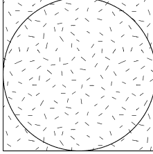

图 4.7: 圆和正方形内的随机飞镖

这些是随机投掷。你可能投掷 10 次；也可能投掷 100 万次。在飞镖投掷结束后，你计算圆内的飞镖数量，除以投掷次数（1000 万、100 万次等），并乘以 4。

`π = 4 × (圆内的飞镖数 / 总点数)`

投掷次数越多，我们找到接近圆周率数字的机会就越大。这是大数定律在作用。这是一个经典的计算机科学问题，我将通过编写一个 Clojure 程序来模拟投掷并解决它。

# 在 Clojure 中使用蒙特卡洛 Pi

我将创建一个模拟单个飞镖投掷的函数。我想将我的 Clojure 代码拆分为尽可能简单的函数。这使得测试和寻找错误容易得多。

```clojure
(defn throw-dart []
  {:x (calc-position 0)
   :y (calc-position 0)})
```

我创建的是包含 x,y 坐标的映射，中心点为 0,0，并将 x 和 y 的坐标传递给另一个函数来计算位置（`calc-position`）。

```clojure
(def side-of-square 2)

(defn calc-position [v]
  (* (/ (+ v side-of-square 2) (- 1) (* 2 (Math/random)))))
```

`calc-position` 函数接收 x 或 y 的值并应用计算。这是在中心点周围 `-side-of-square/2` 和 `+side-of-square/2` 的地方。

在 REPL 中运行此函数，我们可以看到 x 或 y 的位置。

```clojure
mathematical.programming.examples.montecarlo> (calc-position 0)
0.4289015180052328
```

# 飞镖在圆内吗？

现在我有一个映射形式的 xy 位置，`{:x 随机投掷值 :y 随机投掷值}`，我想确认投掷是否在圆内。

再次使用 `side-of-square` 值（因此它是一个 def），我可以确定飞镖是否击中圆内。我将传递带有 x,y 的映射并取坐标的平方根。

```clojure
(defn is-within-circle [m]
  (let [distance-from-center (Math/sqrt (+ (Math/pow (:x m) 2)
                               (Math/pow (:y m) 2)))]
    (<= distance-from-center (/ side-of-square 2))))
```

此函数将返回 true 或 false。如果在 REPL 中检查它，它看起来像：

```clojure
mathematical.programming.examples.montecarlo> (throw-dart)
{:x 0.225350852315827, :y 0.04205835379681}
mathematical.programming.examples.montecarlo> (is-within-circle (throw-dart))
true
```

# 现在投掷大量飞镖！


到为止，有函数可以模拟投掷并确认它是否在圆内。我需要重复此过程多次。我正在创建两个函数：`compute-pi-throwing-dart` 用于运行所需的投掷，`throw-range` 用于寻找圆内命中次数的工作。

```clojure
(defn throw-range [throws]
  (filter (fn [t] (is-within-circle (throw-dart))) (range throws)))

(defn compute-pi-throwing-dart [throws]
  (double (* 4 (count (throw-range throws)) throws)))
```

`throw-range` 函数执行 `throw-dart` 函数，`is-within-circle` 评估值是否为 true。`filter` 函数将返回 true 值列表。所以，如果 10 次投掷中的第一个、第三和第五个在圆内，我得到 `(1,3,5)` 作为结果。调用函数 `compute-pi-throwing-dart`。正如我所说的，将圆内的飞镖数量除以投掷次数并乘以 4 将得到一个接近圆周率的数字。投掷次数越多，它越接近。飞镖板上的 Pi 值是涌现行为。我最后要做的是运行模拟的函数。

```clojure
(defn run-simulation [iter]
  (map (fn [i]
    (let throws (long (Math/pow 10 i))
      (compute-pi-throwing-dart throws))) (range iter)))
```

# 第 4 章 统计、线性回归与随机性

如果我运行四次模拟，我将得到 10、100 和 1000 次投掷。这些结果以列表的形式返回。如果在 REPL 中运行九次模拟（取决于你使用的机器），我得到：

```clojure
mathematical.programming.examples.montecarlo> (run-simulation 9)
(0.0 3.6 3.28 3.128 3.1176 3.1428 3.142932 3.1425368 3.1417352)
```

这是一个很好的近似。Pi 是 3.1415265，所以通过蒙特卡洛方法随机评估计算 Pi 是好的。这里是最后的代码列表：

```clojure
(ns ch04.montecarlo)

(def calc-position 2)
  (* (/ side-of-square 2) (+ (- 1) (* 2 (Math/random))))

(def throw-dart []
  {:x (calc-position 0)
  :y (calc-position 0))

(def is-within-circle [m])
  (let [distance-from-center (Math/pow (:x m) 2) (Math/pow (:y m) 2)]
    (< distance-from-center (/ side-of-square 2))))

(def throw-range [throws])
  (filter (fn [t] (is-within-circle (throw-dart))) (range throws))

(def compute-pi-throwing-dart [throws])
  (double (* 4 (count (throw-range throws)) throws)))

(def run-simulation [iter]
  (map (fn [i]
    (let throws (long (Math/pow 10 i))]
      (compute-pi-throwing-dart throws))) (range iter)))
mathematical.programming.examples.montecarlo> (run-simulation 3)
(4.0 3.6 3.28 3.056 3.1392 3.146 3.139848 3.141404)
mathematical.programming.examples.montecarlo> (run-simulation 9)
(0.0 4.0 3.28 3.056 3.1392 3.146 3.139848 3.14128264)
mathematical.programming.examples.montecarlo>
```

## 总结

数学是机器学习中执行的所有工作的基础。本章是对一些基本汇总统计的提醒，在这些知识的基础上产生了了线性回归、标准差和蒙特卡洛方法等技术。

通过 Java 和 Clojure 添加简单的编程函数，你现在需要时都有一套工具可供随用。不要忘记，有时电子表格会获胜。

# 第 5 章 使用决策树

不要被决策树欺骗了；乍看它可能是一个简单的概念，但这种简单之中蕴含着它的力量。本章将向你展示决策树是如何工作的。示例将使用 Weka 创建一个运行的决策树，该工具还会为你生成 Java 代码。

## 决策树的基础

任何决策树的目标都是创建一个实行的模型，根据一组输入变量来预测目标变量的值。本节解释了决策树的使用场景，以及决策树的一些优势和局限性。在本节中，你还将了解如何手动计算决策树，以便理解涉及的数学原理。

## 决策树的用途

想一下你在自动电话中如何选择不同的选项。这些选项本质上是为你生成的决策树，以便你到达目标部门。这些决策树在许多行业中被有效使用。

金融机构使用决策树。一个基本用例是期权定价，使用类二决策树来预测牛市或熊市中的期权价格。

营销人员使用决策树按类型建立客户，并预测客户是否会购买特定类型的产品。

在医学领域，决策树模型被设计诊断血液感染或预测胸痛患者的心脏发作结果。决策树中的变量包括诊断、治疗和患者数据。

游戏行业在动作识别和脸部识别中使用多个决策树。微软 Kinect 平台使用这种方法跟踪身体动作。Kinect 团队使用了一百万张图像并训练了三棵树。在一天之内，使用 1000 核集群，决策树就对屏幕上的特定身体部位进行了分类。

## 决策树的优势

使用决策树有很多理由。首先，它们易于阅读。模型生成后，很容易向他人汇报树是如何运作的。此外，通过决策树，你可以处理数值或分类信息。本章稍后将演示如何手动通过类别值运行算法；示例演练使用了数值数据。

在数据准备方面，只要有一组逗号分隔的变量，你就可以创建一个运行的模型。这使得使用各种测试验证模型变得容易。决策树使用白盒测试——意味着内部运作可以被观察但不能更改；你可以查看树建模时所使用的步骤。

决策树在计算能力合理的情况下表现良好。如果你有一组大数据，决策树学习将很好地处理它。

## 决策树的局限性

每一组优势背后通常都有一组对应的劣势。决策树的一个主要问题是，根据训练集中呈现的数据，它们可能会创建复杂的模型。为了避免机器学习算法对数据的过拟合，有时值得审查训练数据并对树进行分类剪枝，这将产生一个更精细、调更优的模型。

某些决策树的概念可能很难学习，模型无法轻松表达它们。这种缺陷有时会导致比通常更大的模型。你可能需要更改模型或尝试不同的机器学习方法。

## 不同的算法类型

多年来，人们开发了各种用于决策树分析的算法。这里列出了一些常见的算法。

### ID3

ID3（迭代二分分类法 3）算法由 Ross Quinlan 发明，用于从数据集创建树。通过计算数据集中每个属性的熵，可以根据最小熵值将其拆分为子集。在集合创建了决策树节点后，只需要递归地处理集合中的剩余属性即可。

ID3 使用信息增益方法——属性分裂前后熵的差异的衡量标准——来决定根节点（信息增益最大的节点）。

ID3 在训练数据上存在过拟合问题，该算法更适用于小树而不是大树。ID3 算法的使用较少，取而代之的是下文概述的 C4.5 算法。

### C4.5

Quinlan 用 C4.5 算法再次带来了力作。它也基于信息增益方法，但它允许树用于分类。这是一种广泛使用的算法，因为许多用户在 Weka 中运行 C4.5 的开源 Java 版本——J48 算法。

C4.5 相比原始 ID3 算法有显著改进。由于具有处理连续属性的能力，C4.5 方法会计算分裂所需的阈值点。例如，对于如下值列表：

85, 80, 83, 70, 68, 65, 64, 72, 69, 75, 72, 81, 71

C4.5 将计算出一个分裂并给出属性 `a` 的简单决策准则：

```
a < 80 or a > 80
```

C4.5 能够在属性值缺失的情况下工作。缺失值用问号 (`?`) 标记。当无可用数据时，跳过增益和熵的计算。

用 C4.5 创建的树在创建后会进行剪枝；算法将重新访问节点并判断该节点是否对树的结果有贡献。如果没有，则将其替换为叶子节点。

### CHAID

CHAID（卡方检验自动交互检测）技术由 Gordon V. Kass 于 1991 年开发。

### MARS

对于数值数据使用 MARS（多元自适应回归样条）。

## 决策树的工作

决策树围绕该算法的基本概念构建。决策树总是从根节点开始并在叶节点结束。图 5.1 显示了一棵决策树。

## 构建决策树

- 检查模型的边界情况。
- 遍历所有属性 (`attr`)。
- 获取分裂 `attr` 的归一化信息增益。
- 令 `best_attr` 为信息增益最大的属性。
- 创建基于 `best_attr` 分裂的决策节点。
- 对通过 `best_attr` 分裂得到的子列表及其作为节点的节点进行处理。

## 手动演练示例

如果你对算法运作的基本原理感兴趣并想跟随学习，本节将介绍计算熵和信息增益的基础知识。如果你想进入本章的实践部分，可以跳过本节。

基于属性分裂前后的熵的信息增益方法是 ID3 和 C4.5 算法中的关键方法。由于这些是常用的算法，本节重点关注这种构建决策树的基本方法。

表格中有四个节点：

- 客户是否有账户？
- 客户是否读过之前的产品评论？
- 客户是回头客吗？
- 客户是否购买了该产品？

在开始计算决策树之前，并哪个节点将产生最佳结果。你正在寻找能够最好预测结果的节点。这需要一些计算。输入熵。

## 计算熵

熵是不确定性的衡量，以比特（bits）为单位，数值在 0 到 1 之间（熵的比特与计算术语中的比特不同）。基本上，你是在寻找随机变量中的不可预测性。

有两种类型的熵需要计算：第一种针对单个属性，第二个针对两个属性。在这个示例中，我将使用“是否有信用账户”（Had Credit Account）作为工作示例的目标属性。练习结束时，我们将知道决策树中下一个使用的节点。“是否有信用账户”属性有两个结果（是或否）。

| HAS CREDIT ACCOUNT | 是 | 否 |
| :--- | :--- | :--- |
| 3 | 2 | |

熵的计算如下：

```
Entropy(Has Credit Account) = Entropy (2,3)
= Entropy (0.4,0,6)
= -(0.4 log₂ 0.4) - (0.6 log₂ 0.6)
= 0.97095
```

当应用两个属性时，值的映射如下表：

| HAS CREDIT ACCOUNT | Y | N |
| :--- | :--- | :--- | :--- |
| 阅读评论 | 2 | 1 | 3 |
| N | 1 | 1 | 2 |

使用两个属性，我们得到了下面的熵计算：

Entropy (Has Credit Account, Reads Reviews)

= P(Y)×E(2,1) + P(N)×E(1,1)

= (2/5)×0.971 + (1/5)×1

= 0.5884

所以，你得到了两个增益：一个是拆分前的（是否有信用账户，为 0.97095），另一个是拆分后的（是否有信用账户/阅读评论，为 0.5884）。

你在这个属性上的工作快要完成了。下一步是计算信息增益。

## 信息增益

当你知道属性拆分前后的增益时，就可以计算信息增益。对于查看客户是否有信用账户的属性，你的计算如下：

InformationGain = Gain(拆分前增益) – Gain(带阅读评论拆分后增益)

= 0.97095 – 0.5884

= 0.38255

所以，“是否有信用账户”属性的信息增益为 0.38255。

## 重复操作

前两个部分涵盖了单个属性“是否有信用账户”的信息增益计算。你需要处理另外两个属性以找到它们的信息增益。在有了所有属性的信息增益值后，你现在可以决定从树的哪个节点开始。

| 属性 | 信息增益 |
| :--- | :--- |
| 阅读评论 | 0.38255 |
| 是否购买 | 0.48672 |
| 是否为之前的老客户 | 0.37095 |

现在情况变得越来越清晰了；假设“是否有信用账户”是根节点，“是否购买”属性具有最高的信息增益，因此它应该是树中的下一个决策节点。

信息增益的顺序决定了节点在决策树模型中出现的位置。增益最高的节点成为根节点。计算每个属性的所有增益及其信息增益，将从数学上为你提供决策树。

由于决策树算法是迭代计算的，较小的树可以很容易得出。虽然可以想象，在几百个实例的情况下，没有人真的想手动完成所有计算。那个时候，是时候引入软件来帮助了。

## Weka 中的决策树

在本节中，你将使用 Weka 数据挖掘工具来处理 Lady Gaga CD 最佳销售情况的一些训练数据，这取决于商店内的特定因素。在你浏览数据时，我会解释相关的因素。虽然我理解现在世界趋向于流媒体和下载音乐，但人们仍然购买 CD。

## 要求

要求是创建一个模型，能够根据 CD 在店内的放置位置预测对 Lady Gaga CD 的销售情况。唱片店给了你数据，关于产品放置的位置、是否在视线高度，以及客户实际上是购买了 CD 还是把它放回了架。

客户希望能够通过模型运行其他数据集，以确定产品的销售情况。

有条不紊地执行这种方法，你需要执行以下操作：

1. 运行提供的训练数据并将其转换为 Weka 的定义文件。
2. 使用 Weka 工作台为你构建决策树并绘制输出图表。
3. 导出带有新决策树分类器的生成的 Java 代码。
4. 使用一些测试数据对代码进行测试。
5. 思考分类器的未来迭代。

感觉有很多要做，但一旦你进入状态，用手头的工具完成非常简单。首先查看训练数据。

## 训练数据

在任何事情发生之前，你需要数据。你收到的文件是 CSV 格式：

```
@relation ladyg

@attribute placement {end_rack, cd_spec, std_rack}
@attribute prominence numeric
@attribute pricing numeric
@attribute eye_level {true, false}
@attribute customer_purchase {yes, no}

@data
end_rack,85,85,false,yes
end_rack,80,90,true,yes
cd_spec,83,86,false,no
std_rack,70,96,false,no
end_rack,68,80,false,no
std_rack,65,70,true,yes
cd_spec,64,65,true,yes
end_rack,72,95,false,yes
end_rack,69,70,false,no
std_rack,75,80,false,no
end_rack,75,70,true,no
cd_spec,72,90,true,no
cd_spec,81,75,false,yes
```

## 使用 Weka 创建决策树

现在你已经准备好了数据模型，可以开始了。当你打开 Weka 程序时，你会看到一个小的启动界面（见图 5.2）带有四个按钮：Explorer（探索）、Experimenter（实验者）、KnowledgeFlow（知识流）和 Simple CLI（简单命令行）。点击 Explorer 按钮。

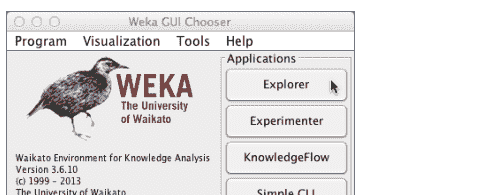

图 5.2：Weka GUI 选择器

当 Explorer 打开时，你将面对另一个窗口，其中包含多个区域和一组按钮（见图 5.3）。如果现在看起来一切都很困惑，请不要担心；本演示将带你逐步了解。

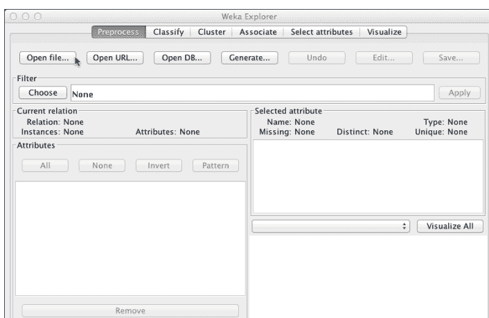

图 5.3：基础的 Explorer 窗口

点击 Open File（打开文件）按钮并选择名为 `ladygaga.ar` 的数据文件。Weka 会解析数据模型并对数据进行预处理。很快，你就能获得基于数据模型和数据预处理的信息。

图 5.4 Explorer 窗口右侧的 Select Attribute（选择属性）面板显示了 `customer_purchase` 属性不同的分类值。Weka 还注意到它有 14 行实例和 5 个属性。

预处理之后是分类。点击顶部按钮行中的 Classify（分类）按钮。你将使用 C4.5 分类器算法；在 Weka 中，这就是 J48 算法。在 Classifier（分类器）面板中（见图 5.5），点击 Choose（选择）按钮，并在 Trees 菜单标题下选择 J48 选项。选择会自动关闭，你会看到分类器的名称已从默认的 ZeroR -C 0.25 -M 2 改变（见图 5.5）。

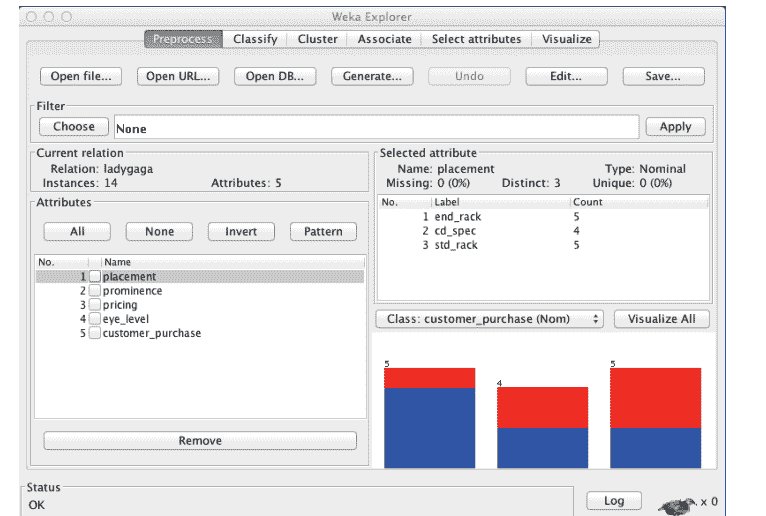

图 5.4：带有数据的预处理面板

默认 J48 分类的选项标志设置了剪枝置信度（`-C` 标志）和最小实例数（`-M`）。

要运行分类器，点击 Start（开始）按钮并观察 Classifier 输出窗口（见图 5.6）。你可以看到运行的信息。运行信息会告知你所使用的方案，并对 Weka 所处理的模型提供概述。

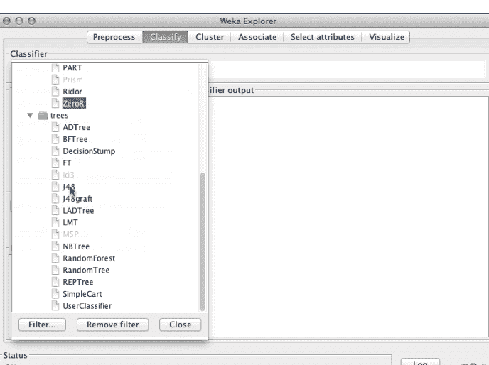

图 5.5：选择分类器

有趣的数据开始出现。J48 剪枝树给出了结果，在本例中是关于 `placement`（位置），因为它具有最高的信息量：

J48 剪枝树


```
placement = end_rack: yes (5.0/1.0)
placement = cd_spec
  pricing <= 80: yes (2.0)
  pricing > 80: no (2.0)
placement = std_rack
  eye_level = TRUE: yes (2.0)
  eye_level = FALSE: no (3.0)
```

叶节点数量：5

树的大小：8

构建模型所需的时间：0 秒

看起来，将产品放置在端架货架（end rack）对销售是有利的。对于特价货架（special offer rack），似乎定价起了作用；如果产品太便宜，客户就会离开。在标准货架（standard racks）上，产品的位置是销售的考虑因素；如果它处于视线高度，就能售出。

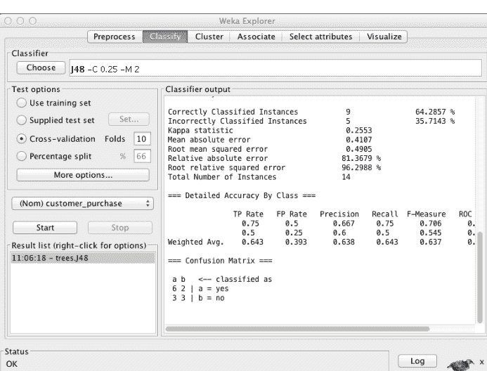

图 5.6：带有输出的分类器

最后，你想将树的决策可视化，以便管理团队查看，因为图片胜于千言。在 Explorer 窗口左下角的 Results List（结果列表）面板上，你可以看到运行的时间和算法。右键点击（如果你使用的是 macOS ，请使用 Alt+点击）并选择 Visualize Tree（可视化树）选项，以其可视化形式查看树，如图 5.7 所示。

通常到这里，大家都会互相拍背说“干得好”，但你还没有结束。你不想在每次有数据要运行的时候都跑去 Weka Explorer。如果有一些代码是可以重复使用的呢？

## 从分类中创建 Java 代码

如第 2 章所述，没有一种工具适用于所有场景。Weka 是非常优秀的，但你可能想要可以安全地在现有代码库中运行的代码。如果输入的数据量足够，你可能希望将新创建的分类挂载到 Hadoop 任务中。

使用现有的分类器，点击 More Options（更多选项）按钮，将打开一个带有当前评估器选项的新窗口（见图 5.8）。

最后一个选项是输出源代码。默认情况下，类名将 `WekaClassifier`。它不会保存你的 Java 代码，但会输出在 Classifier 输出窗口中。

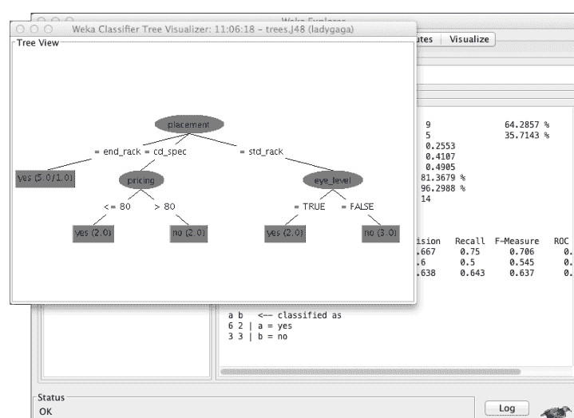

图 5.7：J48 可视化

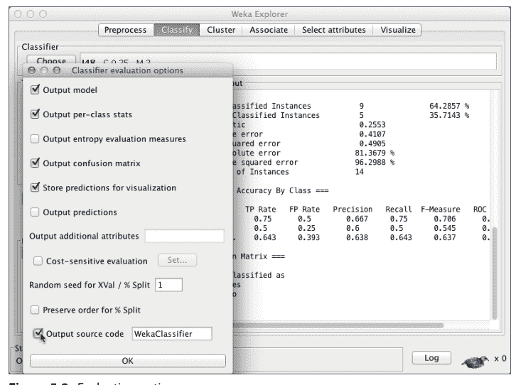

图 5.8：评估选项面板

# 第 5 章 使用决策树

打开你选择的文本编辑器，然后复制并粘贴 Java 代码。将文件保存为 `WekaClassifier.java`（或你在选项面板中指定的类名）。

在源代码中，实际上有两个类：由 Weka 生成的包装类（wrapper class）和一个用于运行的 `main` 方法。分类器的代码在第二个类 `WekaClassifier` 中。这基本上是一组基于分类树的 `if/then` 语句。

## 测试分类器代码

复制 `.arff` 文件的副本来测试你编写的分类器。在结果为 `yes` 或 `no` 的地方，将它们替换为问号（?）。这意味着你想让分类器算出你的答案：

```
end_rack,85,85,FALSE?
end_rack,80,86,TRUE?
cd_spec,83,86,FALSE?
std_rack,70,90,FALSE?
std_rack,65,80,FALSE?
std_rack,65,70,TRUE?
cd_spec,64,65,TRUE?
end_rack,72,95,FALSE?
end_rack,69,70,FALSE?
std_rack,75,80,FALSE?
end_rack,75,70,TRUE?
cd_spec,72,90,TRUE?
cd_spec,81,75,FALSE?
std_rack,71,91,TRUE?
```

你需要编写一个新类来加载你的测试数据，并针对每个实例运行你编写的分类器。

```java
package chapter3;

import java.io.BufferedReader;
import java.io.FileReader;

import weka.core.Instances;

public class TestClassifier {
    public static void main(String[] args) {
        WekaWrapper ww = new wekaWekaWrapper();
        try {
            Instances unlabeled = new Instances(new BufferedReader(
                new FileReader("lg2.arff")));

            unlabeled.setClassIndex(unlabeled.numAttributes() - 1);

for (int i = 0; i < unlabeled.numInstances(); i++) {
    double clsLabel =
    ww.classifyInstance(unlabeled.instance(i));
    System.out.println(clsLabel + " -> " + 
    unlabeled.classAttribute().value((int) clsLabel));
}
} catch (Exception e) {
    e.printStackTrace();
}
}
}
```

实例被加载，然后通过 `for` 循环迭代并使用 `classifyInstance()` 方法获取分类器的评分。在这个示例中，你正在寻找关于是否会发生销售的决策。因为 `classifyInstance()` 返回的是 `double` 类型的值，因此你根据类属性数组的位置进行引用。在这种情况下，客户购买属性有两个元素：“yes”和“no”。数组中的第一个元素 (0) 指“yes”，第二个元素 (1) 指“no”。运行此代码将生成以下输出：

- 0.0 -> yes
- 0.0 -> yes
- 1.0 -> no
- 1.0 -> no
- 1.0 -> no
- 0.0 -> yes
- 0.0 -> yes
- 0.0 -> yes
- 0.0 -> yes
- 1.0 -> no
- 0.0 -> yes
- 1.0 -> no
- 0.0 -> yes
- 0.0 -> yes

你可以进一步开发此基础代码，通过 Java 数据库连接 (JDBC) 从数据库提取信息并再次存储结果。你可以通过复制第一个实例并在循环中更新它们，将结果复制到文本文件中。

```java
Instances unlabeled = new Instances(new BufferedReader(
new FileReader("lg2.arff")));
Instances trained = new Instances(unlabeled);
for (int i = 0; i < unlabeled.numInstances(); i++) {
    double clsLabel = ww.classifyInstance(unlabeled.instance(i));
    trained.instance(i).setClassName(clsLabel);
    System.out.println(clsLabel + " -> " + 
    unlabeled.classAttribute().value((int) clsLabel));
}
```

这里的更改是`加粗`标记的。如果你想将实例的输出到文本文件，这种方法是很有用的。在实际工作中，你已经完成了这些工作。你可以交付一些健壮的代码。

## 关于未来的迭代

本章在短的范围内涵盖了大量内容：整合一个 `.arff` 文件以创建分类器，使用 Weka 生成 Java 代码并用更多未分类数据进行测试。

测试数据量很小，这对于让一切运行足够了。但在现实世界，你将处理更多数据。问题是，你应该保留多少数据进行训练？作为指南，我使用总数据的 10% 作为起点，并从那里开始。考虑数据的季节性也是值得的，特别是如果你从事零售业。针对特定的季节时期创建模型可以增加训练集中的信息增。

时间不等人任何人，这里也是如此。数据在变，趋势在变，管理决策也是如此。保持分类器的更新是至关重要的。

## 总结

本章在短的范围内涵盖了大量内容：整合一个 `.arff` 文件以创建分类器，使用 Weka 生成 Java 代码并用更多未分类数据进行测试。

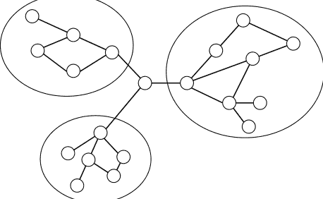

最常用的模型之一是质心模型（k-centroid model），这就是 k-means 算法发挥作用的地方。k-means 算法基本上是向量量化。本章将重点介绍 k-means 算法，并为章节后续的详细演示建立基础。

## K-Means 的工作原理

如果你有一组对象，k-means 算法的理念是定义数量的聚类。重要的是，想要定义多少个聚类由你来决定。例如，假设我有 1000 个对象，我想找到 4 个聚类：

```
n (objects) = 1000
k (clusters) = 4
```

每个聚类都有一个质心（有时称为均值，因此名为 k-means），它是计算对象距离的点。聚类的定义是通过对对象到质心的距离进行迭代过程的，以计算哪些对象靠近质心。这一切都是在无监督的情况下完成的；你只需要让算法进行处理并检查结果即可。当迭代进行到对象不再移动到不同的质心时，假设 k-means 聚类已完成。

以下伪代码描述了发生的过程：

```
calculate initial values for means m[1],m[2],m[3],m[4]
assign object to nearest center
while(there are changes in the mean position) {
  estimate the means to classify into clusters
  for(i in 1 to k) {
    m[i] = mean of the samples for cluster i
  }
}
```

## 初始化

首先，算法必须通过为每个观测值分配一个聚类来初始化。随机划分法（random partition method）将聚类点放置在数据集的中心。另一种初始化方法是 Forgy 方法，它分散了初始位置的随机性。

在分配了初始聚类观测后，你可以查看算法的分配和更新。

## 分配

每个观测到的对象都被分配到一个聚类中，以确定分配到哪个聚类质心；算法使用了欧几得距离测量。然后，通过对到每个聚类质心的欧几得距离进行平方来计算和，值最小的即为分配到的聚类。

计算欧几得距离非常简单，只需要一些入门数学；如果你能记得如何使用勾股定理，你就已经掌握了。

假设在 X 轴（水平）上有六个位置，Y 轴（垂直）上有四个位置的基础型网格。我的聚类中心点目前位于 1,6，而对象位于 3,1，如图 6.3 所示。

垂直边的距离为 3-1-2，水平轴为 6-5。使用勾股定理，平方距离为：

```
2^2 + 5^2 = 4 + 29
```

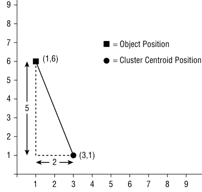

图 6.3：欧几得距离

29 的平方根是 5.38。这适用于数据集中所有分配到聚类的对象。

## 更新

在更新步骤中，你将对象值分配给聚类。聚类中心点（质心）的重新计算被视为该聚类部分对象值的平均值。这个过程作为一个循环持续，直到每个组中的实体不再发生变化。

k-means 算法非常有效，但它并非没有问题。可能需要数据运行几次才能获得一个不错的聚类结果。当你选择的数量太少时，对象在处理期间一段时间内很容易溢到错误的聚类中。

## 计算数据集中的聚类数量

当面对数据集时，很难定义你想要分类的聚类数量。有时这个数字已经由利益相关者确定了。例如，在营销活动中，你可能会有以下：

- 低频、低价值客户
- 低频、高价值客户
- 高频、低价值客户
- 高频、高价值客户

有时这些信息不可用，你必须找到一个平衡来做出决策。有多种方法可以计算最优值。

## 经验法则

没有什么比用手指指向天空观察风向更好的了。对于聚类，有一个简单的计算方法相当于：聚类数量 (k) 等于对象数量除以 2 的平方根。

```
K = √objects/2
```

如果你有 250 个对象，一半是 125，125 的平方根是 11.18——所以是 11 个。

根据运行情况进行测试并重新应用。

## 肘部法

你可以计算数据集的方差并对聚类数量绘图。你可以从图 6.4 中看到肘部法显示最优聚类数量为 4，这涵盖了 80% 的数据。

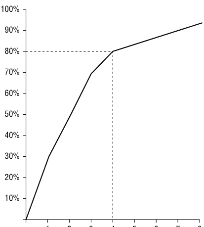

图 6.4：肘部法

## 交叉验证方法

通过将数据集分成不同的部分，你可以对 `weka.clusterers.DensityBasedClustering` 类进行分析。

## 轮廓法

Peter J. Roussee 在 1986 年首次描述了轮廓法。这是一种验证对象位于聚类内部的方法。数值越低越好。

## 使用 Weka 进行 K-Means 聚类

Weka 机器学习应用程序带有一个处理 k-means 聚类的算法，名为 simpleMeans。在本演示中，你将使用三种方法：一种通过工作应用程序，一种直接从命令行运行，最后是一个 Java 示例。

目标是获取一些营销数据并使用 k-means 对客户进行细分；从长期来看，这将为营销部门带来成功交易的增加。

在进入三个演示之前，你需要准备一些可以工作的数据。

## 准备数据

以下 Java 代码为两个整数变量 x 和 y 生成 75 个随机数。你将保存的文件 (kmeansdata.csv) 输出到 Weka 并通过编程加载它。

```java
import java.io.BufferedWriter;
import java.io.FileWriter;
import java.io.IOException;
import java.util.Random;

public class DataSet3 {
    public static void main(String[] args) {
        Random r = new Random(System.nanoTime());
        try {
            BufferedWriter out = new BufferedWriter(new FileWriter("kmeansdata.csv"));
            out.write("x,y\n");
            for (int count = 0; count < 75; count++) {
                out.write(r.nextInt(125) + "," + r.nextInt(150) + "\n");
            }
            out.close();
        } catch (IOException e) {
            e.printStackTrace();
        }
    }
}
```

输出看起来如下：

```
X,y
78,29
0,55
101,19
52,146
49,140
44,97
65,45
41,49
66,141
111,100
23,128
101,1
1,113
88,100
```

如果你想创建更多实例，可以通过调整代码中 for 循环的迭代次数来实现。我将其设置为 75 作为起点。上限实际上取决于你电脑的内存大小。

先看一眼 Weka 工作台方法（Workbench method）。

# 第 6 章 聚类

## 工作台方法

工作台方法使用 Weka 用户界面来加载、聚类并可视化数据。这不涉及实际的编程，但在转向命令行和代码示例之前，查看 Weka 正在做什么是有用的。

### 加载数据

工作台的过程与你运行过的示例类似。

你需要做的第一件事是加载 CSV 数据。

点击 Open（打开）按钮并选择你之前创建的 kmeansdata.csv 文件。确保文件格式下拉菜单显示的是 CSV 而不是 ARFF（见图 6.5）；否则你将无法打开该文件。

数据加载后，Explorer（Explorer）会显示各种信息。Current relation（当前关系）面板显示有两个属性和 75 个实例。（见图 6.6）。Attribute information（属性信息）显示两个属性：x 和 y。

在右侧面板中，Selected Attribute（选中属性）面板显示已加载数据的统计信息，包括最小值、最大值以及平均值和标准差。最后，有一个数值分布和频率的图表。

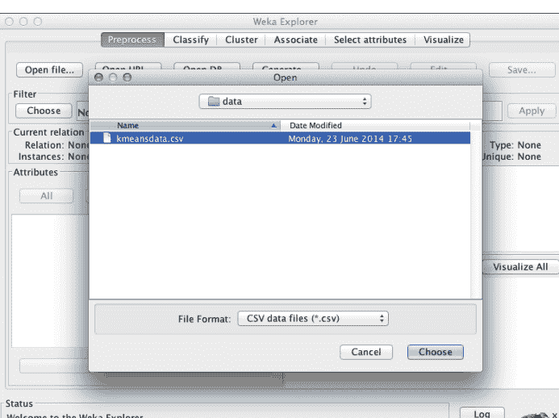

图 6.5：将 CSV 数据加载到 Weka

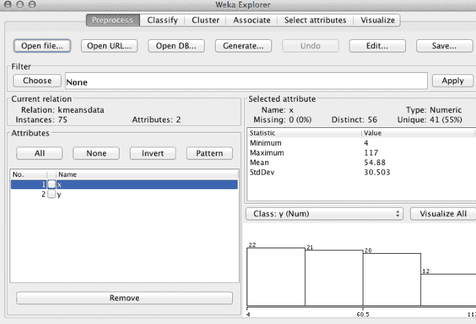

图 6.6：Preprocess（预处理）窗口

### 对数据进行聚类

点击顶部的 Cluster（聚类）标签页来选择聚类方法。默认情况下，Weka 聚类使用 Simple EM 方法（期望最大化）。点击 Choose（选择）按钮会显示你可以使用的其他聚类算法树。对于此示例，选择 SimpleKMeans 然后点击 Close（关闭）；最后点击 Start（开始）运行算法，如图 6.7 所示。

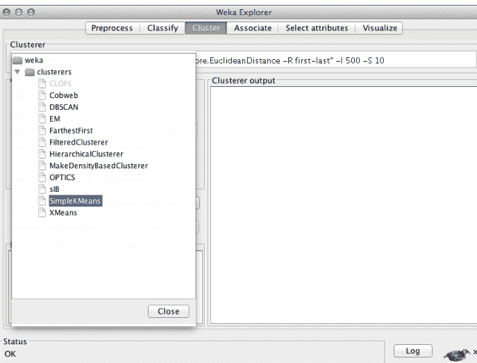

Clusterer 输出面板中的聚类行已更新，显示了你将获得的新类：

```
SimpleKMeans -N 2 -A "weka.core.EuclideanDistance -R \
first "-last" -l 500 -S 10
```

有几个标志需要解释一下。

- `-N` 决定 SimpleKMeans 将创建的聚类数量。


- `-A` 是使用的距离函数。默认是欧几里距离，并使用整个值范围作为其作用范围（`-R first-last`）。
- `-l` 标志定义了 k-means 创建时的迭代次数。
- `-S` 是随机数种子。你可以设置任何值。

点击显示按钮旁所有命令选项的行会弹出一个窗口，你可以在其中修改值。在 `number-Clusters`（聚类数量）字段中，将数字从 2 改为 4（见图 6.8）。你将用这些数据创建四个聚类。点击 OK 关闭窗口。

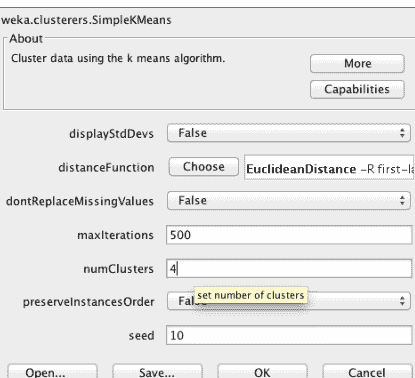

**图 6.8:** 修改 SimpleKMeans 选项

点击 `Start` 按钮开始聚类过程。对于长时间的处理，值得关注 Explorer 左下角的状态。

当进程完成时，你会看到输出出现在 `Clusterer Output` 窗口中。接下来的部分描述了输出内容。

## 运行信息

第一块信息提供了数据和所选算法的设置。

```
Scheme: weka.clusterers.SimpleKMeans -N 4 -A
weka.core.EuclideanDistance -R first-last -I 500 -S 10
Relation: td
Instances: 75
Attributes: 2
x y
Test mode: evaluate on training data
```

# 第 6 章 聚类

## K-Means

k-means 输出显示了 Weka 为获得结果所做的实际工作。这包括对数据执行的迭代次数和误差平方和。

Number of iterations: 3

Within cluster of squared errors: 0.8072960323968902

Miss values globally replaced with mean/mode

Cluster centroids（聚类中心）：

| Attribute（属性） | Full Data (75) | 0 (15) | 1 (23) | 2 (17) | 3 (20) |
| --- | --- | --- | --- | --- | --- |
| X | 54.88 | 68.9333 | 43.913 | 98.1765 | 20.15 |
| Y | 92.0267 | 19.4 | 146.0435 | 114.8824 | 64.95 |

聚类中心信息相对于实例数据显示，这是每个聚类的最终位置。最后显示了每个聚类的数据百分比。这让你了解数据的分布情况。

Clustered Instances（聚类实例）：

- 15 (20%)
- 23 (31%)
- 17 (23%)
- 20 (27%)

## 数据可视化

最后一步是查看聚类的可视化。在 Explorer 中，你可以在左下看到结果。右键点击（在 Mac 上是 `Alt+点击`）`SimpleKMeans` 会弹出如图 6.9 所示的可视化窗口。每个聚类都有自己的颜色，并显示数值。可视化窗口顶部有两个下拉菜单。要更改图表，从下拉菜单中选择值。要显示 x 和 y 实例，选择 `X(Num)` 和 `Y(Num)`，图表就会更新。

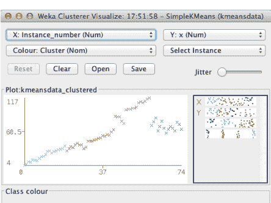

**图 6.9:** 窗口

使用工作台方法可以快速获得见解，如果你想掌握聚类的位置，这很有用。要实现过程自动化，你需要查看其他方法，从命令行方法开始。

## 命令行方法

命令行方法与工作台方法类似，但在运行任务方面提供了更多的灵活性。这意味着你可以定期收集数据并重新运行分析。

## 将 CSV 转换为 ARFF

Weka 使用 `.arff` 格式来确定对象类型并准备处理数据。GUI 允许直接导入 `.csv` 文件，但有一个为你转换文件的工具更好。你可以使用命令行上的 `CSVLoader` 类将 `.csv` 文件转换为 `.arff`。例如，之前创建的 `kmeansdata.csv`。在终端运行以下命令使用转换器：

```
java -cp weka.jar weka.core.converters.CSVLoader \
kmeansdata.csv
```

> 注意：如果你使用的是 Windows 操作系统，命令可以省略 `-cp weka.jar`。

命令行输出可能会给出关于数据库驱动不可用的警告，但不需要担心。重要的是 `.arff` 文件中有正确的定义。快速检查以查看以下定义：

```
@relation kmeansdata

@attribute x numeric
@attribute y numeric

@data
```

## 首次运行

通过直接在 `.arff` 文件上运行 `SimpleKMeans` 类来测试命令行方法。这是你的训练文件：

```
java -cp /path/to/weka.jar weka.clusterers.SimpleKMeans \
-t kmeansdata.arff
```

`-t` 标志给出 Weka 尝试聚类的文件名。直接运行此命令会得到以下输出：

```
KMeans
=====
```

Number of iterations: 3

Within cluster of squared errors: 5.839457872519278

Missing values globally replaced with mean/mode

Cluster centroids（聚类中心）。

| Attribute（属性） | Full Data (75) | Cluster# (35) (40) |
| --- | --- | --- |
| x | 54.88 | 41.0571 | 66.975 |
| y | 92.0267 | 45.4286 | 132.8 |

```
--- Clustering stats for training data（训练数据的聚类统计）
```

```
Clustered Instances
0 35 (47%)
1 40 (53%)
```

这样运行还可以，但只有两个聚类，很有可能还有更多。

# 完善最佳聚类数

使用本章之前描述的经验法则（rule of thumb）方法计算最优值是容易的。你可以使用 UNIX 的 `wc` 命令找出对象实例的数量。

```
wc kmeansdata.csv
75 494 kmeansdata.csv
```

有 74 行（排除第一行，第一行提供了数据标签 x 和 y）。 75 除以 2 的快速计算结果为 37.5，其平方根是 6.12。

通过修改命令，你可以添加目标聚类数（使用 `-N` 标志）和一个用于参考的随机种子数（使用 `-S` 标志）。

```
java -cp /path/to/weka.jar weka.clusterers.SimpleKMeans \
-t kmeansdata.arff -N 6 -S 42
```

这次的输出提供了具有更多聚类的相同输出。

```
kMeans
====
```

Number of iterations: 3

Within cluster of squared errors: 0.523849925862059

Missing values globally replaced with mean/mode

## 第 6 章 聚类 119

现在，你已经有了六个类，并且进入这些特定类的对象有了良好的定义。唯一的问题是你不知道这些对象属于哪一个类。

## 为聚类类命名

从命令行来看，`-p` 标志告诉 Weka 显示每行实例的类分配。要使用此功能，你必须指示 Weka 为每行使用哪种数据属性。在命令行中，你使用以下命令：

```
java -cp /path/to/weka.jar weka.clusterers.SimpleKMeans \
-t kmeansdata.arff -N 6 -S 42 -p 0
```

`-p` 标志告诉 Weka 根据数据行显示行和聚类。运行此命令时，你会在控制台上看到以下输出：

| 行 | 聚类 |
| :--- | :--- |
| 0 | |
| 1 | |
| 2 | |
| 3 | |
| 4 | |
| 5 | |
| 6 | |
| 7 | |
| 8 | |
| 9 | |
| 10 | 4 |
| 11 | 4 |
| 12 | 4 |
| 13 | 4 |
| 14 | 4 |
| 15 | 4 |
| 16 | 4 |
| 17 | 4 |
| 18 | 4 |
| 19 | 4 |

显示的所有只是行号以及该行所属聚类的数字标识符。如果你将 `-p` 标志设置为 1 或 2，那么你将分别获得 x 或 y 位置的值。

通过这个工作台和命令行示例，你现在应该对这一切是如何结合在一起的有了很好的理解。看一看使用 Weka 应用程序接口 (API) 编写的 Java 方法。它演示了你如何将这些聚类方法集成到你自己的服务器端项目中。

## 代码方法

工作台运行良好，而且在执行调度任务时，命令行更符合需求。但是，为了极致的灵活性，没有什么比使用 API 编写自己的程序来完成任务更好的了。核心 Weka 类被工作台、命令行和 Java 代码示例共同使用。这只需要弄清楚数据是如何加载的，以及使用你在之前的示例中使用的选项进行聚类。

在 Java 中创建 k-means 聚类实际上是一件易事；关键在于知道你要处理哪些元素。你将创建一个简单的 Java 程序来完成你在前两个操作演示中完成的工作。我将使用 Eclipse。

## 创建项目

选择 `File -> Java Project` 并将其命名为 `WekaCluster`，如图 6.10 所示。


只有一个库需要安装；那就是 `weka.jar` 文件。在 macOS 机器上，Weka 通常安装在 `Applications` 目录。在 Windows 机器上的位置取决于具体的操作系统。

选中 `WekaCluster` 项目后，点击 `File -> Properties` 并寻找 `Java Build Path`。然后，点击 `Libraries` 选项卡。点击 `Add External JARS` 添加外部 jar 文件。在文件对话框中，找到 `weka.jar` 文件，如图 6.11 所示。

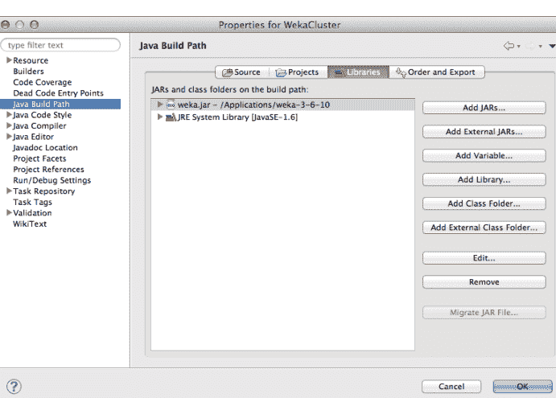

**图 6.11:** 添加外部 JAR

最后一步是创建一个名为 `WekaCluster.java` 的新类（使用 `File New Class`）；其样貌请参见图 6.12。

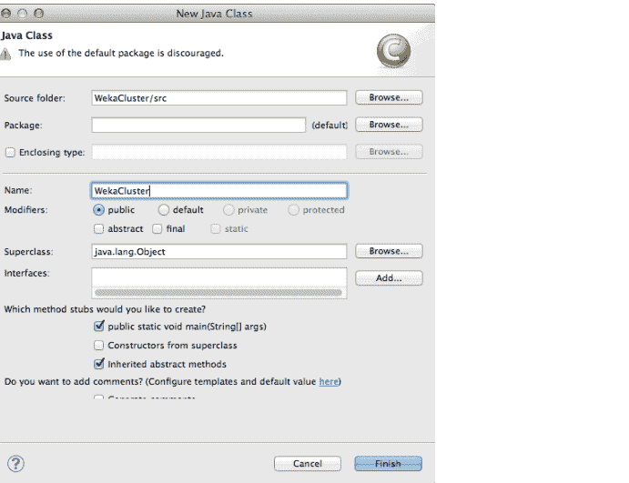

**图 6.12:** 创建新类文件

## 聚类代码

你将执行以下操作来使你的聚类运行：

- 编写 `main` 方法，传入 `.arff` 文件的位置。
- 编写一个经验规则来建议你应该追求的目标聚类数量。
- 使用 Weka 的 `SimpleKMeans` 类构建聚类模型。
- 打印聚类质心位置。
- 打印每个实例对象属于哪个类。

这听起来有很多工作，但实际上非常简单。接下来的章节将详细说明每一个步骤。

## main 方法

`main` 方法是程序的起点。它很简单——只需用一行代码创建构造函数的实例并传入 `.arff` 文件的位置。

```java
public static void main(String[] args) {
    // 传入 arff 位置和我们想要的聚类数量
    WekaCluster wc = new WekaCluster("/path/to/kmeandata.arff");
}
```

由于你将文件路径作为字符串传递，因此需要在类的构造函数中反映这一点。我稍后会详细介绍这一点。

## 计算聚类经验规则

之前，我已经确定你可以快速估计要生成的最佳聚类数量。我包含了一个方法，根据实例行数为你提供要生成的聚类数量。

```java
public int calculateRuleOfThumb(int rows) {
    return (int)Math.sqrt(rows / 2);
}
```

行数作为变量传入。你返回行数除以二的平方根。

## 构建聚类

```java
public WekaCluster(String filePath) {
    // 实现细节省略
}
```

## 打印质心

现在模型已经建立，你就可以开始显示结果了。首先打印每个质心的位置。

```java
public void showCentroids(SimpleKMeans kMeans) {
    Instances centroids = kMeans.getClusterCentroids();
    for(int i = 0; i < centroids.numInstances(); i++) {
        System.out.println("Centroid: " + i + ": " + centroids.instance(i));
    }
}
```

## 打印聚类信息

要显示实例所属的类，`showInstanceCluster` 方法接收 k-means 模型和分配的实例。代码遍历每个实例并根据模型打印它们分配到哪个类。

```java
public void showInstanceCluster(SimpleKMeans kMeans, Instances data) {
    try {
        for (int i = 0; i < data.numInstances(); i++) {
            System.out.println("Instance " + i + " is in cluster " + kMeans.clusterInstance(data.instance(i)));
        }
    } catch (Exception e) {
        e.printStackTrace();
    }
}
```

## 第 6 章 聚类 125

你正在传递模型以及 x 和 y 变量的值（与原始数据在两个属性中的方式相同）。会创建一个双精度数组并存储这两个值。

创建 `Instance` 类。第一个值是将分配给该实例的权重。这是一个 0 到 1 之间的值。第二个值是你创建的包含 x 和 y 值的双精度数组。

与你使用 `clusterInstance()` 方法显示聚类的方式一样，你运行新实例并获取聚类编号。该值将返回给调用方法。

为了测试这一点，我将创建另一个方法，它将迭代 100 次并生成随机值。显然，在你的代码中你会这样调用预构造函数。

该方法为 x 和 y 值生成随机数并将其传递给预测方法。在 `WekaCluster` 构造函数到达缓存块之前，通过插入以下行，将其添加到首次打印类之后的主构造函数中：

```java
testRandomInstances(kMeans);
```

## 最终代码列表

这里是组装并准备好运行的代码：


```java
import java.util.Random;

import weka.clusterers.SimpleKMeans;
import weka.core.Instance;
import weka.core.Instances;
import weka.core.converters.ConverterUtils.DataSource;

public class WekaCluster {

    public WekaCluster(String filePath) {
        try {
            Instances data = DataSource.read(filePath);

            int clusters = calculateRuleOfThumb(data.numInstances());
            System.out.println("Rule of Thumb Clusters = " + clusters);

            SimpleKMeans kmeans = new SimpleKMeans();
            kmeans.setNumClusters(clusters);
            kmeans.setSeed(42);
            kmeans.buildClusterer(data);

            showCentroids(kMeans, data);
            showInstanceCluster(kMeans, data);

        } catch (Exception e) {
            e.printStackTrace();
        }
    }

    public int calculateRuleOfThumb(int rows) {
        return (int)Math.sqrt(rows/2);
    }

    public void showCentroids(SimpleKMeans kMeans, Instances data) {
        Instances centroids = kMeans.getCentroids();
        for (int i = 0; i < centroids.numInstances(); i++) {
            System.out.println("Centroid: " + i + ": " + centroids.instance(i));
        }
    }

    public void showInstanceCluster(SimpleKMeans kMeans, Instances data) {
        try {
            for (int i = 0; i < data.numInstances(); i++) {
                System.out.println("Instance " + i + " is in cluster " + kMeans.clusterInstance(data.instance(i)));
            }
        } catch (Exception e) {
            e.printStackTrace();
        }
    }

    public static void main(String[] args) {
        // 传递 arff 位置和我们想要的聚类数量
        WekaCluster wc = new WekaCluster("/Users/Jason/kmeanda.arff");
    }
}
```

## 运行程序

完成工作后，你就可以运行程序并检查结果。在 Eclipse 中，选择 `Run`（运行），程序将启动。控制窗口中的输出应该如下：

```
Rule of Thumb Clusters = 6
Centroid: 0: 11.8,65.9
Centroid: 1: 105.08333,118.33333
Centroid: 2: 68.933333,19.4
Centroid: 3: 81.6,106.6
Centroid: 4: 28.5,6
Centroid: 5: 43.91043,146.034378
Instance 0 0 is in cluster 0
Instance 1 1 is in cluster 0
Instance 2 2 is in cluster 0
Instance 3 3 is in cluster 0
Instance 4 4 is in cluster 0
Instance 5 5 is in cluster 0
Instance 6 6 is in cluster 0
Instance 7 7 is in cluster 0
Instance 8 8 is in cluster 0
Instance 9 9 is in cluster 0
Instance 10 10 is in cluster 4
```

如你所见，经验法则计算建议创建聚类。执行 k-means 聚类方法后，按顺序显示了每个类的质心，以便“肉眼观察”类中任何数据点到类中心的距离；最后，你显示了原始数据对象每个元素的聚类成员关系。

最后，这里是预测结果及其输出聚类类：

```
146.0/167.0 test in cluster 1
109.0/67.0 test in cluster 1
95.0/80.0 test in cluster 3
29.0/160.0 test in cluster 5
165.0/193.0 test in cluster 1
33.0/167.0 test in cluster 5
108.0/73.0 test in cluster 1
63.0/63.0 test in cluster 2
186.0/176.0 test in cluster 1
67.0/47.0 test in cluster 2
43.0/5.0 test in cluster 2
85.0/9.0 test in cluster 2
152.0/60.0 test in cluster 1
```

## 进一步开发

你会发现使用 `SimpleKMeans` 组合一个基础聚类算法是一件相当的事情。我已经涵盖了编写解决方案的主要方面。从这里开始还有明显的开发空间，例如使用 Java 数据库连接 (`JDBC`) 连接到数据库表并将数据提取到实例中。

使用 Weka 时需要注意的是，当应用海量数据时，内存性能可能会下降。我建议大多数企业需求仍然可以通过这种方法满足，并可以考虑扩展性进行开发。特别是对数据进行采样以适应 Weka 内存将给你带来非常好的结果。

## 总结

聚类将是你再次使用的方法之一。为了这样做，它需要知道你购买了什么。

# 第 7 章 关联规则学习

这个故事被全球的营销部门广为流传（可能并非以此处呈现的风格），它被用于从主旨演讲到短报告，从黑客马拉松到深夜代码马拉松的各种场合。然而，这是一个事实与神话交织的案例。

在担任 Mindmeld 公司的 CEO 时，托马斯·比舒洛（Thomas Bischlok）曾是一次关于数据挖掘过去、现在和未来的网络会议的小组组成员，并主持了关于著名的“啤酒与尿布”故事的研究。这项研究可以追溯到 20 世纪 90 年代初，他的团队正在分析 Osco Drug 的数据。他们发现下午 5 点到 7 点之间的购物篮购买之间存在相关性，并将这一结果提交给了客户。

此后，关于这个故事的真实去向产生了一些困惑。许多版本像圣经和神话传说一样；它们多年来在饮水机旁引发了大量的讨论和争论，并将继续持续下去。我有幸遇到了 Third Nature 的 Mark Madsen，他对这个故事也有浓厚的兴趣；这个故事被借用、使用、引用和向前推进的方式令人惊叹。归根结底，这只是对结构化查询语言（`SQL`）的有效利用。

这个神话现在已经被一个引起隐私担忧的消费者故事——即“Target 能够预测我是否怀孕”的场景——所取代。对于我来说，Target 永远无法预测我的结果，有两个原因：你不需要二节点决策树就能看出这一点。（关于该主题的信息，请参阅第 5 章“使用决策树”）。

> 注意：关于啤酒和尿布传说的完整故事，请参阅 D.J. Power 于 2002 年 11 月的文章，地址为 http://www.dssources.com/newsletters/66.php

我确定，这个神话将永远流传（特别是如果你从事营销行业的话），而且它是一个很不错的读物。

# 关联规则学习是如何工作的

购物篮分析场景是一个很好的解释示例，因此我将继续使用它。考虑以下交易表：

| 交易ID | 产品1 | 产品2 | 产品3 | 产品4 |
| :--- | :--- | :--- | :--- | :--- |
| 1 | True | True | False | False |
| 2 | False | False | True | False |
| 3 | False | False | False | True |
| 4 | True | True | True | False |
| 5 | False | True | False | False |

这本质上是带有交易 ID 和产品（例如可以是牛奶、尿布、啤酒和豆子）的交易项目集。

最终，你正在寻找产品之间的关联性。例如，如果一个客户购买了产品 1 和 2，他很可能会购买产品 4。

这里有一组项目：

```
$I = \{product1,product2,product3,product4\}$
```

这里有一组交易：

```
$T = \{product1,product2,product4\}$
```

每个交易必须有一个唯一的 ID 以便生成规则。此外，值得注意的是，这种规则需要数百次交易才能开始产生对你有价值的内容。交易集越大，统计输出的结果就越好，预测结果也越准确。

规则被定义为一个蕴含；你所看到的是以下内容：

```
$X,Y \subseteq I,where X \cap Y = \emptyset$.
```

用通白的话说，你说的是 X 和 Y 是 X 与 Y 交集中项目集的子集。

它们以集合的形式出现，项目标记为 X 和 Y。在那些可怕的书中，它看起来像这样：X ⇒ Y。X 表示规则之前（或左侧）的项目集，称为*前件*（antecedent），而 Y 是规则之后（或右侧）的项目集，称为*后件*（consequent）。

回到基础项目集中的产品：

```
$I = \{product1,product2,product3,product4\}$
```

真/假语句显示了该项目是否在那个购物篮交易中。

要了解规则如何工作的真实情况，你需要进一步研究支持度（support）、置信度（confidence）、提升度（lift）和信念（conviction）的概念。

## 支持度 (Support)

支持度定义为数据中包含该项目集的比例。它的写法如下：

```
Supp(X) = \frac{transactions\containing\_X}{total\number\_of\transactions}
```

如果你以交易 1 为例，你会得到以下方程：

```
supp(X) = \frac_{\{product1,product2\}}{5} = 0.2
```

该项目集在交易日志中仅出现一次，总共有五个交易，所以支持度是 1/5，即 0.2。

## 置信度 (Confidence)

规则的置信度通过以下方式衡量：

```
conf(X \Rightarrow Y) = supp(X \cap\ Y) / supp(X)
```

在这里定义的是包含 X 的交易中也包含 Y 的交易比例。这可以解释为在找到左侧交易条件的情况下，找到右侧交易的概率。

用类比来说，考虑一下共同分赌（parimutuel betting）。所有的投注都放在一个池中，比赛结束后，根据总池资金（减去代理人的佣金）计算赔付。例如，假设有五匹马并且已经下注：

| 马匹编号 | 赌注 |
| :--- | :--- |
| 1 | $40 |
| 2 | $15 |
| 3 | $25 |
| 4 | |
| 5 | |

该总池资金在交易日志中出现一次，总共有五个交易，所以支持度是 1/5，即 0.2。

## 提升度 (Lift)

提升度定义为：

```
Lift(X, Y) = \frac{supp(X \cap Y)}{supp(X) \times supp(Y)}
```

如果 X 和 Y 是独立的，则提升度为 1。

## 信念 (Conviction)

最后，*信念*定义为：

```
conviction(X \Rightarrow Y) = \frac{1 - supp(Y)}{1 - conf(X \Rightarrow Y)}
```

## 定义规则

关联规则是根据特定的支持度和置信度定义的。在这个示例中，我们使用：

- 支持度 0.2
- 置信度 0.67

根据这些标准，我们可以生成以下规则：

- {1,2} ⇒ {4}
- {1,3} ⇒ {4}
- {2,3} ⇒ {4}
- {1,2,3} ⇒ {4}

```
@attribute 'canned fruit' { t }
@attribute 'canned vegetables' { t }
@attribute 'breakfast food' { t }
@attribute 'cleaners-polishers' { t }
@attribute 'soft drinks' { t }
@attribute 'health food other' { t }
@attribute 'beverages hot' { t }
@attribute 'health&beauty misc' { t }
@attribute 'deodorants-soap' { t }
@attribute 'mens toiletries' { t }
@attribute 'medicines' { t }
@attribute 'haircare' { t }
@attribute 'total' { low, high } % low < 100
```

属性有两个值：真（true）或假（false，用空格表示）。如果值为真，则表示该交易购买了该属性。属性列表的最后一行是篮子价值，无论是高还是低。

在 `@data` 行之后，你将看到所有的篮子交易数据。每一行都包含由逗号分隔的所有属性，标记为 `t` 表示已购买。

## 使用 Weka 应用程序

打开 Weka 应用程序，从菜单中选择 `Explorer`（探索器）选项。这将带你进入 Weka 主工作台，所有的工作都这里完成（见图 7.1）。


图 7.1：Weka Explorer

## 数据文件位于 Weka 分发版的 data 目录下

点击 `Open File`（打开文件）按钮并找到数据文件 `supermarket.arff`（见图 7.2）。

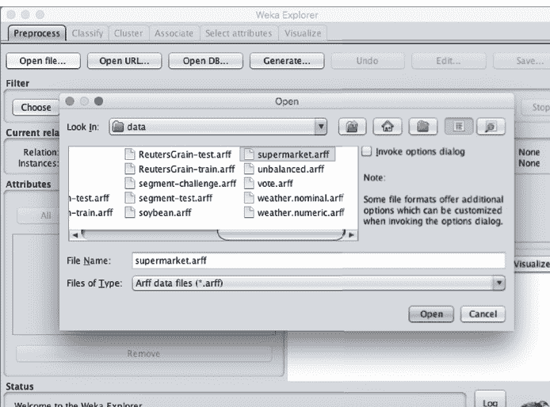

图 7.2：Weka 文件浏览器

文件打开后，你将看到 `Preprocess`（预处理）面板出现。这里应该有 4,627 个篮子数据实例。在 attributes（属性）面板中，包含了篮子物品、部门和总计。如果数据看起来无误，就是时候点击 `Associate`（关联）标签卡了（见图 7.3）。

在 `Associate` 面板内完成了算法的主要工作。从这里，你可以更改算法的选项。如果你点击 `Choose`（选择）按钮，可以更改用于关联的算法（见图 7.4）。现在让我们保留 `Apriori`。

`Apriori` 算法的设置显示在 `Choose` 按钮旁边的栏中。点击该栏将打开一个新窗口，你可以在其中修改选项（见图 7.5）。点击 `OK` 接受选项并返回 `Associate` 面板。

在面板左侧你会看到 `Start`（开始）按钮，点击它将开始对篮子数据进行学习过程。过段时间后，`Associator`（关联器）输出面板将报告训练的发现（见图 7.6）。

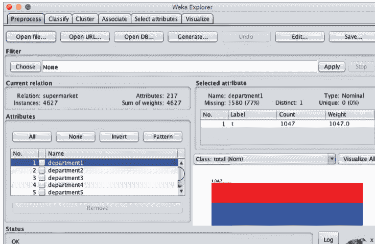

图 7.3：数据预处理部分

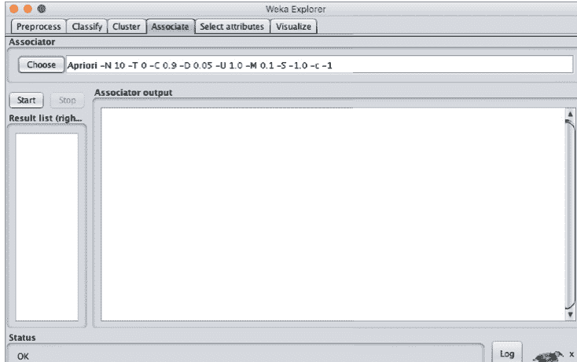

图 7.4：Weka Associate 标签卡

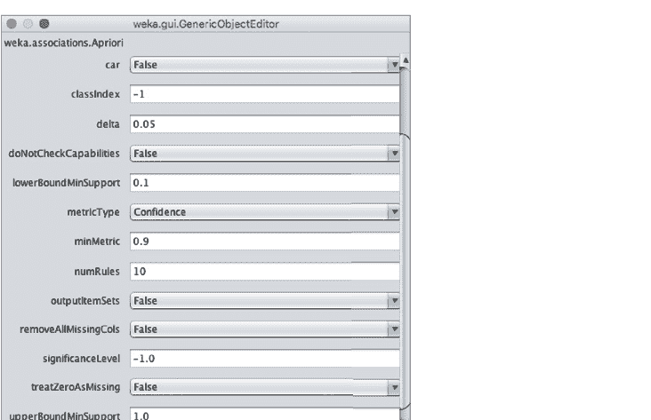

图 7.5：选项面板

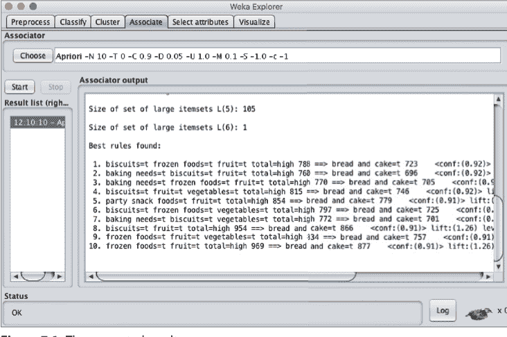

图 7.6：生成的的结果

## 检查结果

由于我们在选项中请求了 10 条规则，且有足够的数据进行预测，输出指定了经常使用的物品。如你所见，“bread and cake”具有重复的高置信度（confidence）和提升度（lift）。

- 大列表项目大小 L(5): 105
- 大列表项目大小 L(6): 1

找到的最佳规则：

1. biscuits=frozen foods fruit=total-high 788 => bread and cake=723 conf:(0.92) lift:(1.27) [155]
2. baking=biscuits fruit=total-high 760 => bread and cake=696 conf:(0.92) lift:(1.27) [149]
3. baking=biscuits frozen foods fruit=total-high 770 => bread and cake=705 conf:(0.92) lift:(1.27) [150]
4. biscuits=fruit vegetables=total-high 815 => bread and cake=746 conf:(0.91) lift:(1.27) [159]


## 关联规则结果

5. `snack=frozen fruit=total-high 854 => bread and cake=779 conf:(0.91) lift:(1.27) [164]`

6. `biscuits=frozen foods vegetables=total-high 797 => bread and cake=725 conf:(0.91) lift:(1.26) [151]`

7. `baking=biscuits vegetables=total-high 772 => bread and cake=701 conf:(0.91) lift:(1.26) [145]`

8. `biscuits=fruit=total-high 954 => bread and cake=866 conf:(0.91) lift:(1.26) [179]`

9. `frozen foods=fruit vegetables=total-high 834 => bread and cake=757 conf:(0.91) lift:(1.26) [156]`

10. `frozen foods=fruit vegetables=total-high 834 => bread and cake=757 conf:(0.91) lift:(1.26) [156]`

由于我们在选项中请求了 10 条规则，且有足够的数据进行预测，输出指定了经常使用的物品。如你所见，“bread and cake”具有重复的高置信度（confidence）和提升度（lift）。

## 使用 Weka 应用程序

打开 Weka 应用程序，从菜单中选择 **Explorer**（探索器）选项。这将带你进入 Weka 主工作台，所有的工作都在这里完成（见图 7.1）。


图 7.1：Weka Explorer

## 第 7 章 关联规则学习

数据文件位于 Weka 分发版的 `data` 目录下。点击 **Open File**（打开文件）按钮并找到数据文件 `supermarket.arff`（见图 7.2）。


图 7.2：Weka 文件浏览器

文件打开后，你将看到 **Preprocess**（预处理）面板出现。这里应该有 4,627 个篮子数据实例。在 **attributes**（属性）面板中，包含了篮子物品、部门和总计。如果数据看起来无误，就是时候点击 **Associate**（关联）标签卡了（见图 7.3）。

在 **Associate** 面板内完成了算法的主要工作。从这里，你可以更改算法的选项。如果你点击 **Choose**（选择）按钮，可以更改用于关联的算法（见图 7.4）。现在让我们保留 `Apriori`。

`Apriori` 算法的设置显示在 **Choose** 按钮旁边的栏中。点击该栏将打开一个新窗口，你可以在其中修改选项（见图 7.5）。点击 **OK** 接受选项并返回 **Associate** 面板。

在面板左侧你会看到 **Start**（开始）按钮，点击它将开始对篮子数据进行学习过程。过段时间后，**Associator**（关联器）输出面板将报告训练的发现（见图 7.6）。


图 7.3：数据预处理部分


图 7.4：Weka Associate 标签卡


图 7.5：选项面板


图 7.6：生成的的结果

## 检查结果

由于我们在选项中请求了 10 条规则，且有足够的数据进行预测，输出指定了经常使用的物品。如你所见，“bread and cake”具有重复的高置信度（confidence）和提升度（lift）。

- 大列表项目大小 `L(5)`: 105
- 大列表项目大小 `L(6)`: 1

找到的最佳规则：

1. `biscuits=frozen foods fruit=total-high 788 => bread and cake=723 conf:(0.92) lift:(1.27) [155]`

2. `baking=biscuits fruit=total-high 760 => bread and cake=696 conf:(0.92) lift:(1.27) [149]`

3. `baking=biscuits frozen foods fruit=total-high 770 => bread and cake=705 conf:(0.92) lift:(1.27) [150]`

4. `biscuits=fruit vegetables=total-high 815 => bread and cake=746 conf:(0.91) lift:(1.27) [159]`

5. `snack=frozen fruit=total-high 854 => bread and cake=779 conf:(0.91) lift:(1.27) [164]`

6. `biscuits=frozen foods vegetables=total-high 797 => bread and cake=725 conf:(0.91) lift:(1.26) [151]`

7. `baking=biscuits vegetables=total-high 772 => bread and cake=701 conf:(0.91) lift:(1.26) [145]`

8. `biscuits=fruit=total-high 954 => bread and cake=866 conf:(0.91) lift:(1.26) [179]`

9. `frozen foods=fruit vegetables=total-high 834 => bread and cake=757 conf:(0.91) lift:(1.26) [156]`

10. `frozen foods=fruit vegetables=total-high 834 => bread and cake=757 conf:(0.91) lift:(1.26) [156]`

## 什么是支持向量机？

支持向量机本质上是一种用于分类的技术。它是一种监督学习方法，通过训练数据和测试数据来建立。支持向量机具有线性分类或非线性分类。本章将介绍这两种类型。

## 支持向量机应用在哪里？

支持向量机用于多种分类场景，例如图像识别和手写识别。

图像分类可以通过使用支持向量机得到极大改进。医学科学长期以来一直使用支持向量机进行蛋白质分类。美国国立卫生甚至开发了支持向量机蛋白质软件库。它是一个将蛋白质分类到其功能家族的网络工具。

一些人批评支持向量机，因为它很难理解，除非你有一位优秀的数学家可以引导并解释发生了什么。在某些情况下，你只面对一个黑盒的实现，它接收输入数据并产生输出数据，但你对中间过程了解很少。

带有支持向量机的机器学习将感知机（在第 9 章中解释）的概念进一步扩展，以最大化几何间隔。

## 分类原理

对于那些没有浸入分类工作方式的人来说，本节提供了一个简化的版本。下一节将介绍支持向量机在分类方面的工作原理。我将保持数学尽可能简单。

## 二分类和多分类

考虑一个基本的分类问题。你想找出哪些是正方形，哪些是圆形。这些正方形和圆形可以代表任何东西——猫和狗、人类和外星人，或者其他的。图 8.1 展示了这两组对象。


图 8.1：两个待分类的对象

此任务可以被视为一个二分类问题，因为只有两种结果：要么是一个对象，要么是另一个。把它想象成 0 或 1。通过一些监督学习，你可以相当快速地以合理的置信度确定这些类别所在的位置。

如果类别多于两个会怎样？例如，你可以向组合中加入三角形，如图 8.2 所示。

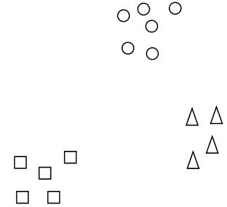

图 8.2：三个待分类的对象

二分类在这里将行不通。你现在面对的是一个多分类问题。由于类别多于两个，你必须使用一种能够相应分类这些类别的算法。值得注意的是，多分类方法使用二分类器的两两对组合来获取预测结果。

## 线性分类器

为了确定对象属于哪一组，你使用线性分类器来建立对象的位置，并查看是否存在一条整洁的分割线——称为超平面；应该有一组对象清晰地位于线的一侧，另一组对象同样清晰地位于相反的侧。（至少在理论上是这样。现实生活中很少如此，这一点将在章节的后续部分进行讨论）。假设你所有的对象都排好了齐——很好地，是两个独立的组。

如图 8.3 所示，从视觉上看它很直观，但你需要从数学上进行计算。你分类的每一个对象都被称为点，每个点都有一组特征。

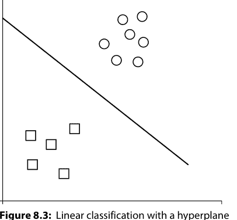

对于图中的每个点，你知道它有一个 x 轴值和一个 y 轴值。分类点的计算方法如下：

> $sign(ax + by + c)$

`a`、`b` 和 `c` 的值是定义直线的数值；这些值是你选择的数值，你需要在过程中不断调整它们，直到获得良好的拟合（清晰的分离）。然而，你感兴趣的是一个函数，如果函数结果为正，则返回 +1，表示点在一个类别中；当点在另一类中时，返回 -1。该函数产生的值（+1 或 -1）对于你尝试分类的每一个点都必须是正确的。

不要忘记你有一个包含正确分类数据的训练文件，以便你可以判断函数的正确性；这种方法是一种监督学习方法。这一步必须完成，以确定直线的拟合位置。距离直线越远的点，其属于特定类别的置信度越高。

## 置信度

你刚刚确定了每个点根据其与超平面的距离具有一个置信度。这种置信度可以转换为概率。这得出了以下方程：

```
$P[l=+1|x] = \frac{1}{1+\exp(-(ax+by+c))}$
```

这是针对一个点的。你需要的是每一组线的概率；这些概率被分配给训练数据中的每个对象。

```
$\prod_{i=1}^{N} P[l_i|x_i] = \prod_{i=1}^{N} \frac{1}{1+\exp(-l_i(ax+by+c))}$
```

概率之所以相乘是因为这些点是独立绘制的。每个点都有一个方程，指示超平面产生正确分类的概率有多大。组合每个点的概率就产生了通常定义的“数据似然性”（likelihood of the data）；你寻找的是尽可能接近 1 的数字。

记住，概率是基于 0 到 1 之间的值。在一组对象中，你正在寻找一组具有最高概率的直线参数，确认分类是正确的。

## 通过最大化和最小化寻找直线

使用调增对数函数可以使方程式的值最大。因此，你得到一个如下所示的函数：

```
$\sum_{i=1}^{N} -log(1+\exp(-l_i(ax+by+c)))$
```

为了实现最小化，只需将方程乘以 -1。它就变成了一个“代价”或“损失”函数。目标是找到使该函数最小的直线参数。

线性分类器通常很快；它们可以轻松地处理大型对象集。当你将它们用于文档分类（其中频率可能需要测量）时，这是一件好事。

## 支持向量机如何处理

线性分类的基本解释是，超平面创建了分类一个对象和另一个对象的直线。支持向量机更进了一步。在可用空间内，我概述了向量机如何以线性形式和非线性形式工作。

## 使用线性分类

再次观察这组对象。你知道超平面如何在平面上将对象分为 1 或 -1。进一步扩展这一概念，支持向量机在假设超平面以线性方式分离的情况下定义了最大间隔。你可以在图 8.4 中看到这一点，主超平面标记为：

```
$$w \cdot x - b = 0$$
```

这个点积显示了法向量，`x` 是对象的点。超平面有一个从原点到法向量的偏移。

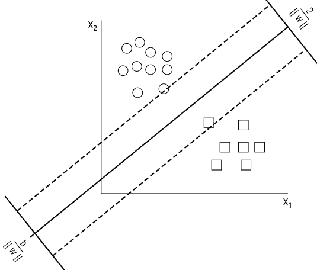

图 8.4：支持向量最大间隔

## 支持向量机

由于对象是线性可分的，你可以创建另一个超平面——边缘超平面——定义主超平面两侧的偏移。在跨越主超平面和边缘超平面的区域内没有对象。

在一侧，有一个方程：

```
$w \cdot x - b = 1$
```

在另一侧有：

```
$w \cdot x - b = -1$
```

位于边缘超平面上的对象就是支持向量（见图 8.5）。

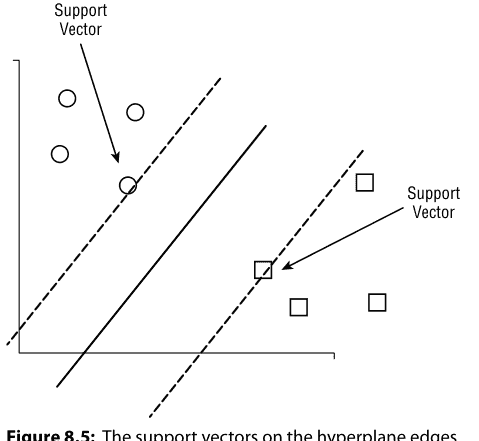

当向分类中添加新对象时，如果你能设法保持它们……

库安装完成后，你就可以启动 Weka 了。如果你是 Windows 用户，只需照常启动 Weka 即可；但如果你运行的是 macOS 或 Linux，则必须从命令行启动：

```
java -cp weka.jar:libsvm.jar weka.gui.GUIChooser
```

如果你没有从命令行启动 Weka，分类器将向你报告错误，告知你在类路径（`classpath`）中没有找到 SVM 库。

在较后版本的 Weka 中，可以通过包管理器安装 LibSVM 库。包管理器位于主 GUI 选择器（`GUI Chooser`）应用程序中。从包列表中，选择 `LibSVM` 包并点击安装（`Install`）。

在应用程序中使用 `LibSVM` 的方法是在你的类路径中引用 JAR 文件（本节后续将对此详细介绍），或使用 `Maven` 并将 `LibSVM` 作为依赖项引用。

```xml
<?xml version="1.0" encoding="UTF-8"?>
<project xmlns="http://maven.apache.org/POM/4.0.0"
    xmlns:xsi="http://www.w3.org/2001/XMLSchema-instance"
    xsi:schemaLocation="http://maven.apache.org/POM/4.0.0 http://maven.apache.org/xsd/maven-4.0.0.xsd">
    <modelVersion>4.0.0</modelVersion>
    <groupId>mllbook</groupId>
    <artifactId>Chapter8</artifactId>
    <version>1.0-SNAPSHOT</version>
    <dependencies>
        <!-- https://mvnrepository.com/artifact/nz.ac.waikato.cms.weka/weka-stable -->
        <dependency>
            <groupId>nz.ac.waikato.cms.weka</groupId>
            <artifactId>weka-stable</artifactId>
            <version>3.6.7</version>
        </dependency>
        <!-- https://mvnrepository.com/artifact/tw.edu.ntu.csie/libsvm -->
        <dependency>
            <groupId>tw.edu.ntu.csie</groupId>
            <artifactId>libsvm</artifactId>
            <version>3.23</version>
        </dependency>
    </dependencies>
</project>
```

## 分类流程演示

当你通过 GUI 而非命令行启动 Weka 时，你会看到 GUI 选择器应用程序（见图 8.7）。选择 **Explorer**（探索）选项。

## 第 8 章 支持向量机

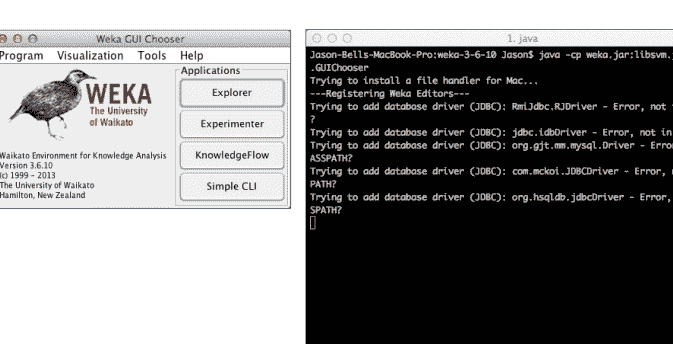

图 8.7：GUI 选择器

我将使用随书的代码和数据仓库中的 100,000 行车辆数据。在 `data/ch08` 文件夹中找到 `.csv` 文件，并在 Weka 中打开它，如图 8.8 所示。不要忘记将文件类型从 `.argb` 改为 `.csv`。

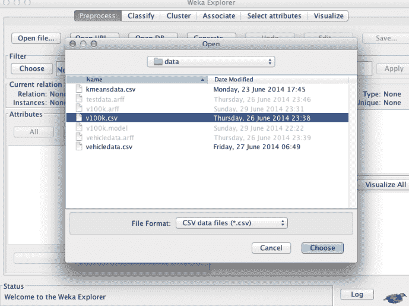

图 8.8：加载 `.csv` 文件

## 设置选项


# 运行分类器

点击 `Classify`（分类）选项卡，并点击 `Choose`（选择）按钮以选择不同的分类算法。在算法树中，点击 `Functions`（函数），然后选择 `LibSVM`，如图 8.9 所示。

在设置分类器工作之前，有几处更改需要完成。首先，你可以更改训练数据与测试数据的比例。在这种情况下，你可以非常有把握数据不会难以分类，而且这不是一个非线性分类问题；你可以使用 10% 的数据（10,000 行）进行训练，并使用剩下的 90% 数据查看其性能。

点击 `Percentage Split`（百分比划分）选项，将默认值 66% 更改为 10%，如图 8.10 所示。

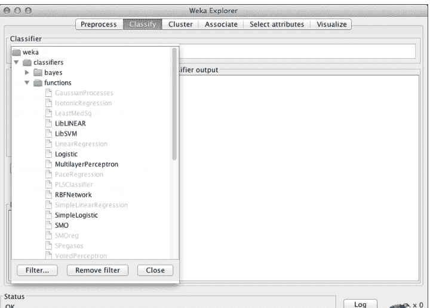

图 8.9：选择 LibSVM 分类器

你希望将测试数据（那 90%）的结果输出到 Weka 控制台，以便查看其性能。点击 `Options`（选项）按钮，并确保 `Output Predictions`（输出预测）复选框已勾选，如图 8.11 所示。

`LibSVM` 包装器默认使用径基函数作为内核类型。点击包含所有 `LibSVM` 选项的行，切换到你一直关注的线性版本。它位于分类器面板中 `Choose` 按钮旁边。

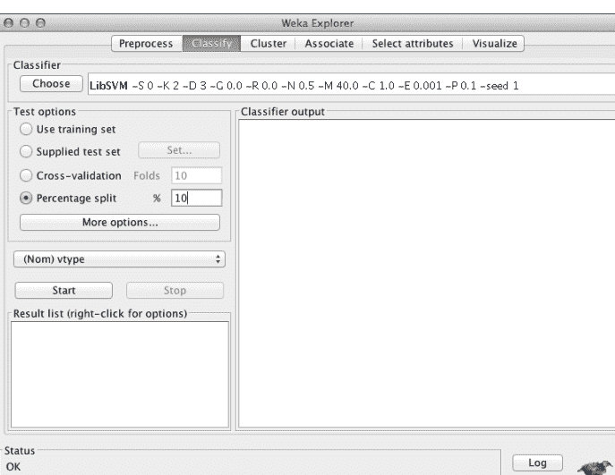

图 8.10：更改百分比划分

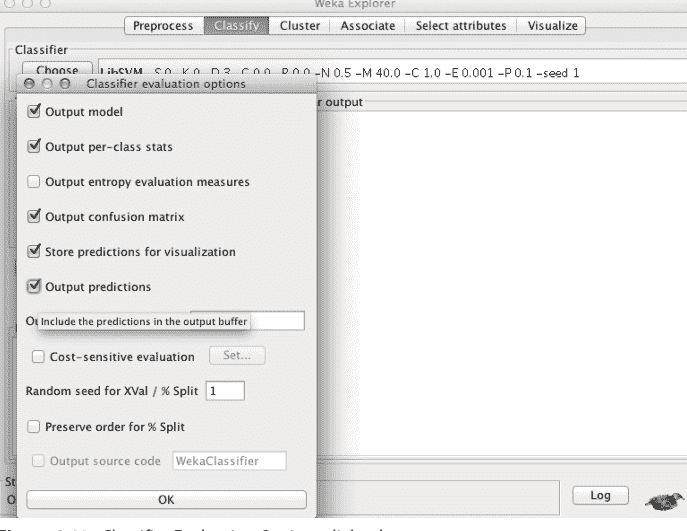

图 8.11：分类器评估选项对话框

将内核下拉菜单从 `Radial Function`（径向函数）更改为 `Linear`（线性）。保持其他选项默认不变（见图 8.12）。

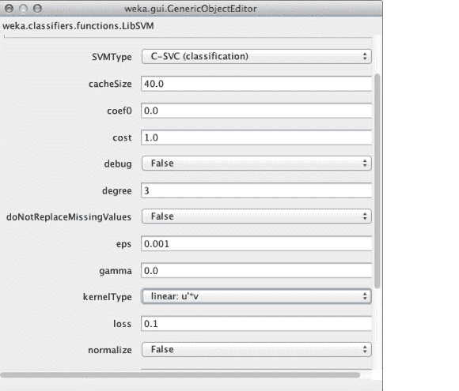

图 8.12：更改内核类型

## 运行分类器

一切设置完成后，你就可以运行分类器了。点击 `Start`（开始）按钮，你会看到输出窗口显示分类的输出信息。首先是运行信息，即你设置的所有选项。

```
=== Run information ===
Scheme:weka.classifiers.functions.LibSVM -S 0 -K 0 -D 3 -G 0.0 -R 0.0 -M 40.0 -C 1.0 -E 0.001 -P 0.1 -seed 1
Relation: v100
Instances:100000
Attributes:4
wheels, chassis, ax, type
Test mode:10% train
```

接下来，你将看到分类器的模型详细信息。

```
=== Classifier model (full set) ===
LibSVM wrapper 3.23 
Time to build: 3.08 seconds
```

接下来，你将看到关于 90,000 行详细信息：

```
=== Evaluation on test split ===
=== Summary ===
Correctly Classified Instances 90000 100 | %
Incorrectly Classified Instances 0 0 | %
Kappa statistic 1
Mean absolute error 0
Root mean error 0
Relative absolute error 0 | %
Root relative error 0 | %
Total Number of Instances 90000
```

混淆矩阵显示了测试数据的分类：

```
=== Confusion Matrix ===
      a    b    c    d <-- classified as
22486 0    0    0 | a = Bus
      0 22502 0    0 | b = Car
      0 0 22604 0 | c = Truck
      0 0    0 22408 | d = Bike
```

## 处理 LibSVM 错误

`LibSVM` 库在不同的操作系统上处理随机数生成器时存在差异。如果你遇到如下错误：

```
java.lang.NoSuchFieldException: rand
weka.lang.Class.getField(Unknown Source)
weka.classifiers.LibSVM.buildClassifier(LibSVM.java:1618)
weka.gui.explorer.ClassifierPanel$16.run(ClassifierPanel.java:1432)
at java.lang.Class.getField(Unknown Source)
weka.classifiers.LibSVM.buildClassifier(LibSVM.java:1618)
weka.gui.explorer.ClassifierPanel$16.run(ClassifierPanel.java:1432)
```

值得查看带有新包管理器的 Weka 版本（3.7 及更高版本）。

## 使用 Java 实现 LibSVM

在 Weka 工具包中使用 `LibSVM` 很容易实现，但总会有那么一天你会希望在自己的代码中使用它，以便将其集成到你自己的系统中。

## .csv 数据到 .arff 格式

`.csv` 文件不包含 Weka 需要的数据。你可以实现 `CSV` 类，但我更倾向于知道 `.arff` 数据已准备就绪。这使得其他人如果需要解码数据模型时也会更容易。

通过命令行，你可以通过一条命令将数据从 `.csv` 文件转换为 `.arff` 格式。

```java
java -cp /Applications/weka-3-6-10/weka.jar \
weka.core.converters.CSVLoader v100k.csv > v100k.arff
```

为了确保转换成功，你可以使用 `head` 命令输出前 20 行（你的输出应该像下面的示例）：

```bash
head -n 20 v100k.arff
@v100k

@attribute wheels numeric
@attribute chassis numeric
@attribute pax numeric
@attribute vtype {Bus,Car,Truck,Bike}

@data
6,20,39,Bus
8,23,11,Bus
5,3,1,Car
4,3,4,Car
5,3,1,Car
4,18,37,Bus
```

如果一切看起来正常，你现在可以将注意力转移到项目的 Eclipse 端了。

## 设置项目和库

使用相同的数据，使用 Eclipse 和 Java 创建一个代码示例来创建项目。创建一个新的 `Java Project`（选择 `File -> New Java Project`）并将其命名为 `LibSVM`，如图 8.13 所示。


# 第 8 章 支持向量机

需要将 Weka API 和 LibSVM API 添加到项目中。选择 `File -> Properties`，然后选择 `Build Path`。点击 `Add External JARs` 按钮。当文件对话框显示出来时，找到 `weka.jar` 和 `libsvm.jar` 文件并点击 `Open`（见图 8.14）。

一切工作都已就绪，因此你可以创建一个名为 `LibSVMTest.java` 的新 Java 类（`File -> Class`）（见图 8.15），并在其位置上编写一些代码。在 Weka 中让支持向量机运行是一项相当简单的任务。


图 8.13：创建新的 Java 项目

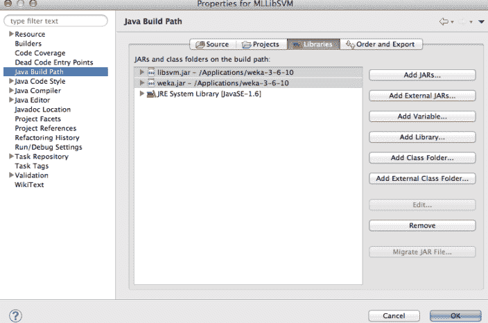

图 8.14：添加所需的 JAR 文件

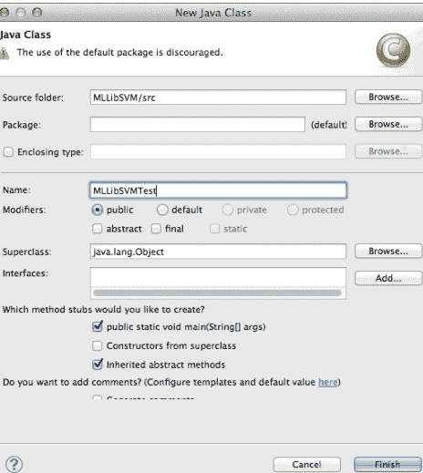

图 8.15：创建一个新的 Java 类

```java
public class MLLibSVMTest {
    public MLLibSVMTest(String filepath) {
        Instances data;
        try {
            data = DataSource.read(filepath);

            if (data.getClassIndex() == -1)
                data.setClassIndex(data.numAttributes() - 1);
            LibSVM svm = new MLLibSVM();
            String[] options = weka.core.Utils
                .splitOptions("-K 0 -D 3");
            svm.setOptions(options);
            svm.buildClassifier(data);
        } catch (Exception e) {
            e.printStackTrace();
        }
    }

    public static void main(String[] args) {
        MLLibSVMTest dllsvm =
            new MLLibSVMTest("/path/to/data/ch08/v100k.arff");
    }
}
```

LibSVM 库有很多选项设置，但我想要关注的主要是内核类型。与 Weka 工作台中一样，默认是径向基函数。在选项中，`2` 代表此类型。对于线性内核函数，你将其更改为零。

从 Eclipse 运行代码，选择 `Run -> Run`。这将获取训练数据并创建模型。目前它不会做其他操作。

将使用默认权重

+ * optimization finished, #iter = 9

nu = 7.999320068325541E-7

obj = -0.01999999994535163, rho = 2.1200468366586598

sV = 4, nBSV = 0

+ * optimization finished, #iter = 9

nu = 5.50875892156242E-7

obj = -0.01379310344827588, rho = -1.013793103448276

sV = 5, nBSV = 0

+ * optimization finished, #iter = 3

nu = 3.801428938130698E-7

obj = -0.00094786729857191, rho = 1.2180094762872956

sV = 2, nBSV = 0

+ * optimization finished, #iter = 5

nu = 1.877434063289764E-7

obj = -0.00407508235294176, rho = -1.6070588223529419

sV = 4, nBSV = 0

+ * optimization finished, #iter = 6

nu = 8.90259889118131E-6

obj = -0.2222222222222227, rho = 1.6666666666666667

sV = 3, nBSV = 0

+ * optimization finished, #iter = 3

nu = 1.230867700185247E-7

obj = -0.00307692307962307, rho = 1.110769230796230

sV = 2, nBSV = 0

## 训练与预测

LibSVM 库有很多选项设置，但我想要关注的主要是内核类型。与 Weka 工作台中一样，默认是径向基函数。在选项中，`2` 代表此类型。对于线性内核函数，你将其更改为零。

从 Eclipse 运行代码，选择 `Run -> Run`。这将获取训练数据并创建模型。目前它不会做其他操作。

## 处理现有数据

LibSVM 库有很多选项设置，但我想要关注的主要是内核类型。与 Weka 工作台中一样，默认是径向基函数。在选项中，`2` 代表此类型。对于线性内核函数，你将其更改为零。

从 Eclipse 运行代码，选择 `Run -> Run`。这将获取训练数据并创建模型。目前它不会做其他操作。

# 第 9 章 人工神经网络

其所需的时间与人类完成某项任务的时间相同——这为什么大多数股票市场系统都转向自动化交易是显而易见的。

高频交易通常采用监督学习方法进行；有大量的交易数据可以从中学习。人工神经网络则在从输入数据中寻找熵。

## 贷款申请

虽然许多贷款申请示例是通过决策树实现的，但它们通常也使用人工神经网络运行。凭借可用的各种应用数据，训练模型识别良好和糟糕的信用因素是一项相当直接的任务。

## 数据中心管理

Google 使用神经网络进行数据中心管理。通过获取负载、运行温度、网络使用情况和室外温度的输入数据，Google 可以计算数据中心的效率，并调整监控和冷却设备的设置。

Jim Gao 将此作为他的 Google 20% 项目（一项 Google 鼓励员工将其 20% 的工作时间用于自己的项目）启动，随着时间的推移，他已将模型训练到 99.6% 的准确率。如果你感兴趣并想阅读更多内容，请查看 Google 关于该主题的博客文章：

```
http://googleblog.blogspot.ca/2014/05/better-data-centers-through-machine.html
```

## 机器人技术

人工智能已经在机器人领域使用了多年。某些人工智能需要模式识别，并且需要将大量的传感器数据输入神经网络，以决定采取何种运动或动作。

在机器人领域训练模型需要花费长时间来创建，因为有许多不同的输入和输出变量需要处理和学习。例如，自动驾驶车辆的开发者需要数十万条之前的驾驶数据来建立一个能够处理多种道路状况的模型。

汽车制造商 Tesla 收集车辆的实时数据；这意味着它每天 24 小时都在产生知识。这些数据用于丰富其车辆的自动驾驶体验。个人而言，我更喜欢自己握方向盘；这只是我的个人偏好。

## 医疗监测

医疗设备可以通过人工神经网络进行监控，这涉及对许多变量（如心率、血压等）的持续更新。具有多种变化并会触发症状的情况可以被计算和监控，当变量超过某些阈值时，工作人员会收到警报。

在医学影像领域，使用深度学习技术（如卷积神经网络）预测疾病区域并为顾问和医生提供决策支持，已经取得了巨大的优势。

## 信任黑盒

自从本书第一版出版以来，神经网络已经有了大规模应用。数据量增加了，意味着有足够的数据支持准确的预测，但很难解释这些黑盒算法是如何运作的。

经验法是：如果你不确定模型输入和输出之间的关系，那么使用神经网络进行研究是一个好方法。如果你对输入/输出关系有很好的理解，那么很可能会使用其他传统方法。

我一直鼓励学生、软件专业人员和管理层在确定使用神经网络之前探索所有的算法选项，特别是当你的发现最终会被另一个专业人士或广大公众审查时。

随着时间的推移，对许多人工智能分支所产生的错误预测已经有了大量报道。在创建将预测他人行为的算法时，“可解释人工智能”（explainable AI）术语已处于讨论的前沿。

此外，拥有足够的训练数据量来训练神经网络至关重要。小规模训练将产生较低的准确率评分，有时其他机器学习算法（即使是线性回归）的表现也比神经网络更好。

查看训练数据的质量也很重要。它是否涵盖了你试图回答的问题的整个范围？偏偏的数据将给你带来不正确的预测，而且你无法解释其原因。

最终，在向神经网络投入时间、数据和金钱之前，值得问问自己这是否是完成任务的最佳方法。

## 拆解人工神经网络

在进入数据和一些示例之前，我将介绍神经网络的原理和工作机制。

## 感知机

神经网络的基础是 `perceptron`（感知机）。它的作用非常简单。它接收一个输入信号，然后通过某种形式函数传递该值。它输出函数的结果（见图 9.2）。

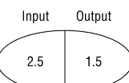

图 9.2：简单的感知机

当输入一个数字或一个数字向量时，感知机处理数字。然后它被传递给一个计算输出值的函数；这被称为 `activation function`（激活函数）。节点可以处理任意数量的输入——图 9.3 显示了两个输入传递到函数——并且它取所有输入的加权和。

假设输入是一个向量 Z，你将得到如下的内容：

```
Z1 = 2
Z2 = 5
Z3 = 1
```

或 (2,5,1)

所有输入的加权和计算方式如下：

```
\sum wiZi
```

换句话之，“全部加起来”。对于我这种不习惯太多数学符号的人来说，它看起来像于：

```
2w1 + 5w2 + 1w3
```

节点的输出部分有一组阈值。如果总和超过阈值，那么由 `y` 变量表示的输出

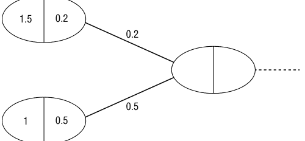

图 9.3：带有两个输入的感知机

当输入一个数字或数字向量时，感知机处理数字。然后它被传递到一个计算输出值的函数；这被称为 `activation function`。节点可以处理任意数量的输入——图 9.3 显示了两个输入传递到函数——并且取所有输入的加权和。


# 第9章 人工神经网络

其所需的时间与人类完成某项任务的时间相同——这为什么大多数股票市场系统都转向自动化交易是显而易见的。

高频交易通常采用监督学习方法进行；有大量的交易数据可以从中学习。人工神经网络则在从输入数据中寻找熵。

## 贷款申请

虽然许多贷款申请示例是通过决策树实现的，但它们通常也使用人工神经网络运行。凭借可用的各种应用数据，训练模型识别良好和糟糕的信用因素是一项相当直接的任务。

## 数据中心管理

Google 使用神经网络进行数据中心管理。通过获取负载、运行温度、网络使用情况和室外温度的输入数据，Google 可以计算数据中心的效率，并调整监控和冷却设备的设置。

Jim Gao 将此作为他的 Google 20% 项目（一项 Google 鼓励员工将其 20% 的工作时间用于自己的项目）启动，随着时间的推移，他已将模型训练到 99.6% 的准确。如果你感兴趣并想阅读更多内容，请查看 Google 关于该主题的博客文章：

```
http://googleblog.blogspot.ca/2014/05/better-data-centers-through-machine.html
```

## 机器人技术

人工智能已经在机器人领域使用了多年。某些人工智能需要模式识别，并且需要将大量的传感器数据输入神经网络，以决定采取何种运动或动作。

在机器人领域训练模型需要花费长时间来创建，因为有许多不同的输入和输出变量需要处理和学习。例如，自动驾驶车辆的开发者需要数十万条之前的驾驶数据来建立一个能够处理多种道路状况的模型。

汽车制造商 Tesla 收集车辆的实时数据；这意味着它每天 24 小时都在产生知识。这些数据用于丰富其车辆的自动驾驶体验。个人而言，我更喜欢自己握方向盘；这只是我的个人偏好。

## 医疗监测

医疗设备可以通过人工神经网络进行监控，这涉及对许多变量（如心率、血压等）的持续更新。具有多种变化并会触发症状的情况可以被计算和监控，当变量超过某些阈值时，工作人员会收到警报。

在医学影像领域，使用深度学习技术（如卷积神经网络）预测疾病区域并为顾问和医生提供决策支持，已经取得了巨大的优势。

## 信任黑盒

自从本书第一版出版以来，神经网络已经有了大规模应用。数据量增加了，意味着有足够的数据支持准确的预测，但很难解释这些黑盒算法是如何运作的。

经验法是：如果你不确定模型输入和输出之间的关系，那么使用神经网络进行研究是一个好方法。如果你对输入/输出关系有很好的理解，那么很可能会使用其他传统方法。

我一直鼓励学生、软件专业人员和管理层在确定使用神经网络之前探索所有的算法选项，特别是当你的发现最终会被另一个专业人士或广大公众审查时。

随着时间的推移，对许多人工智能分支所产生的错误预测已经有了大量报道。在创建将预测他人行为的算法时，“可解释人工智能”（explainable AI）术语已处于讨论的前沿。

此外，拥有足够的训练数据量来训练神经网络至关重要。小规模训练将产生较低的准确率评分，有时其他机器学习算法（即使是线性回归）的表现也比神经网络更好。

查看训练数据的质量也很重要。它是否涵盖了你试图回答的问题的整个范围？偏偏的数据将给你带来不正确的预测，而且你无法解释其原因。

最终，在向神经网络投入时间、数据和金钱之前，值得问问自己这是否是完成任务的最佳方法。

## 拆解人工神经网络

在进入数据和一些示例之前，我将介绍神经网络的原理和工作机制。

## 感知机

神经网络的基础是`perceptron`（感知机）。它的作用非常简单。它接收一个输入信号，然后通过某种形式函数传递该值。它输出函数的结果。（见图 9.2）。


**图 9.2：** 简单的感知机

当输入一个数字或一个数字向量时，感知机处理数字。然后它被传递给一个计算输出值的函数；这被称为`activation function`（激活函数）。节点可以处理任意数量的输入——图 9.3 显示了两个输入传递到函数——并且取所有输入的加权和。

假设输入是一个向量 `Z`，你将得到如下的内容：

```
Z1 = 2
Z2 = 5
Z3 = 1
```

或 `(2,5,1)`

所有输入的加权和计算方式如下：

```
\sum wiZi
```

换句话之，“全部加起来”。对于我这种不习惯太多数学符号的人来说，它看起来像于：

```
2w1 + 5w2 + 1w3
```

节点的输出部分有一组阈值。如果总和超过阈值，那么由 `$y$` 变量表示的输出为 1。如果低于阈值，输出为 0。


**图 9.3：** 带有两个输入的感知机

## 多层感知器

单个感知机只能解决线性可分问题。要解决更复杂的问题，我们需要多层感知器（`Multilayer Perceptron`，MLP）。它包含一个输入层、一个或多个隐藏层和一个输出层。

## Sigmoid 函数

感知机使用的阶跃函数是不连续的，这导致无法使用梯度下降法进行训练。`Sigmoid` 函数是一种平滑的、可微的 S 型曲线，常用作激活函数。其公式为：

```
sigmoid(x) = 1 / (1 + e^-x)
```

通过在 `Sigmoid` 函数中引入 `bias`（偏置），可以移动曲线的位置，从而更好地拟合数据。

## 反向传播算法

多层感知器内部的核心理念是`backpropagation`（反向传播），它是“误差反向传播”的缩写。反向传播计算梯度并将输入映射到正确的输出。

反向传播有两个步骤：传播阶段和网络更新阶段。这发生在网络中的所有神经元上。

如果你将其看作伪代码——假设有一个输入层、一个隐藏层和一个输出层——它看起来像这样：

```
初始化网络中的权重（随机值）

while(待处理的示例)
  for 示例 x
    prediction = neural_output(network, x)
    actual = trained_output(x)
    输出节点上的误差为 (prediction - actual)

backward_pass:
  计算从隐藏层到输出层的权重
  计算从输入层到隐藏层的权重

更新网络权重
直到所有样本都相对于训练数据正确分类
返回最终确定的网络
```

传播发生，训练数据通过网络输入并生成输出的激活值，然后根据训练模式的目标，反向传播网络所有输出层和隐藏层的激活值和增量（`deltas`）。

在第二阶段，权重更新通过将输出增量和输入激活值相乘计算出来。这为你提供了梯度权重。然后从权重中减去该百分比。第二部分对网络中的所有权重轴执行。

这个百分比被称为`learning rate`（学习率）。比例越高，学习越快。通过较低的比例，你可以知道学习的准确性。

> **注意**：我理解在 particular 侧重于快速让机器学习运行起来的书中，要掌握神经网络的数学概念是很困难的。这个概述提供了它们如何工作的大致概念。输入输出层、`perceptron`（感知机）以及正向和反向传播的概念这些主要概念为思维过程提供了一个良好、尽管简单的基础。

## 人工神经网络的数据准备

对于创建人工神经网络，使用有学习方法是值得的。然而，这需要你对将用于训练网络的数据进行思考。

人工神经网络仅对数值数据值有效。因此，如果有带有文本值的归一化权重，则需要进行转换。对于性别等情况并不是大问题，例如常见的输出可以是男性 = 0 和女性 = 1。原始文本是不适合的，因此它需要被清理、哈希为数值值，或者从测试中删除。

对于所有数据策略，关键在于思考什么是重要的，哪些数据是可以舍弃的。

随着分类数据中变量的增加，你将遇到被称为“维数灾难”的现象。这是当增加的变量增加了获得合理结果和洞察所需的总数据量。因此，当你考虑添加另一个变量时，请确保你有足够的训练数据来涵盖所有其他变量中的可能性。

人工神经网络对噪声数据具有完美的容忍性，值得尝试确保没有可能导致结果出现问题的大离群值。要么找到并移除这些异常的数字，要么将它们转换为缺失值。

## 使用 Weka 的人工神经网络

`Weka` 框架支持多层感知器，并使用我刚才描述的反向传播技术对其进行训练。在演示过程中，你将创建一些数据然后生成一个神经网络。

## 生成数据集

我的数据集将包含不同类型车辆的分类。我首先将创建一个 `Java` 程序，生成一些随机但加权的数据，为我们提供四种类型的车辆：自行车、汽车、公交和卡车。这里是代码：


```java
import java.io.BufferedWriter;
import java.io.FileWriter;
import java.io.IOException;
import java.util.Random;

public class MLPData {

    private String[] classtype = new String[] { "Bike", "Car", "Bus", "Truck" };

    public MLPData() {
        Random rand = new Random(System.nanoTime());

        try {
            BufferedWriter out = new BufferedWriter(new FileWriter("vehiledata.csv"));
            for (int i = 0; i < 100; i++) {
                StringBuilder sb = new StringBuilder();
                switch (rand.nextInt(3)) {
                    case 0:
                        sb.append((rand.nextInt(1) + 1) + ",");
                        sb.append((rand.nextInt(1) + 1) + ",");
                        sb.append((rand.nextInt(1) + 1) + ",");
                    case 1:
                        sb.append((rand.nextInt(1) + 1) + ",");
                        sb.append((rand.nextInt(1) + 1) + ",");
                    case 2:
                        sb.append((rand.nextInt(1) + 1) + ",");
                    default:
                        break;
                }
                sb.append(classtype[rand.nextInt(4)] + "\n");
                out.write(sb.toString());
            }
            out.close();
        } catch (IOException e) {
            e.printStackTrace();
        }
    }

    public static void main(String[] args) {
        MLPData mlp = new MLPData();
    }
}
```

运行后，上述代码会创建一个名为 `vehiledata.csv` 的文件。如之前所述，你需要进行大量的训练来使神经网络准确。

# 第9章 人工神经网络

## 将数据加载到 Weka

打开 Weka 工具包并选择 Explorer 功能来显示如图 9.8 所示的内容。

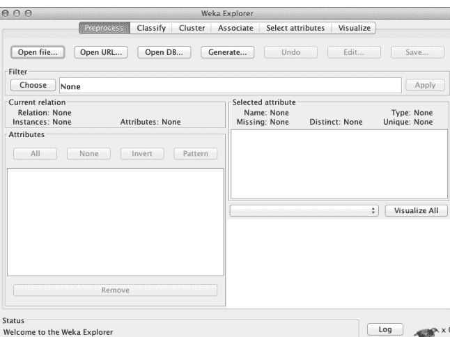

图 9.8 Weka Explorer

你将导入创建的 CSV 文件。确保选择了 Preprocess（预处理）窗口；然后点击 Open File 按钮并选择 `vehicles.csv`。别忘记将下拉菜单从 `.arff` 更改为 `.csv`，如图 9.9 所示。

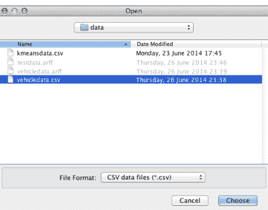

图 9.9 Weka 文件对话框

你看到加载的数据带有关系和属性信息的各种基础表示。

## 配置多层感知器

Weka 的神经网络功能带有自己的图形用户界面。运行时，你可以看到神经网络的图形化表示。

点击 Classify（分类）面板。由于默认分类器是 ZeroR，点击 Choice 并更改为 `MultilayerPerceptron`（参见图 9.10），它位于树列表 Functions 分类下。

你看到分类器变为 `MultilayerPerceptron`，并带有一个调优选项列表。点击它，会弹出一个选项窗口。

将 GUI 设置为 True。此设置使神经网络以图形形式显示；该显示也是交互式的，你可以更改网络。如果将 GUI 设置为 False，则 Weka 将为你生成网络而无需干预。

尽管这个版本的多层感知器会转换并处理你的名义值，但仍然值得花时间确保数据准备就绪。网络默认会重新构建。如果你想自己创建，可以关闭此设置并手动构建网络。

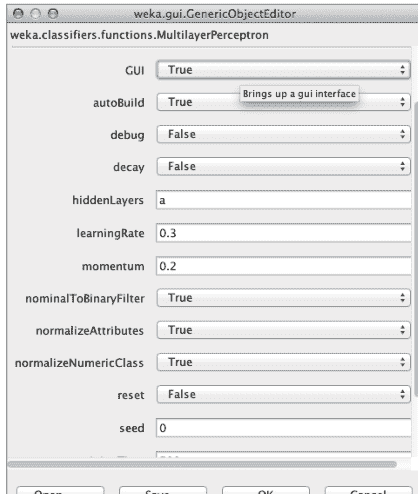

图 9.11：多层感知器（`MultilayerPerceptron`）选项对话框

在让网络训练之前，有几个值值得关注。

### 学习率

权重更新的默认值为 0.3。如果你觉得这个值偏大或太小，可以根据需要进行调整。

### 隐藏层

你可以定义神经网络具有多少个隐藏层。默认情况下，Weka 构建四层（属性数和类别数/2）（设置为“a”），但你也可以只包含属性（“i”）、只包含类别（“o”）以及完整的属性和类别（“t”）。

### 训练时间

Weka 在训练期间迭代的轮数（epochs）设置为 500。数字越高，错误率就越低。正如你稍后看到的，这可能会在输出中产生不同的结果。

当你对选项感到满意时，可以点击 OK 回到分类（Classify）窗口。

## 训练网络

你必须运行几次神经网络，找到网络产生良好分类的“黄金点”。有了 100 行数据，你并无法解决什么实际问题；无论如何，它能让你了解它是如何工作的。

确保测试选项已设置为使用整个训练集。交叉验证（cross-validation）是可以的，但它会运行所有 10 折的训练过程，这在你想要测试时可能会非常耗时。点击 Start，将显示图 9.12 所示的神经网络窗口。

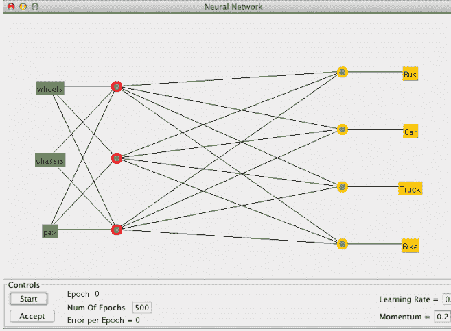

图 9.12：神经网络 GUI 窗口

神经网络运行后，点击 Accept 按钮，你将返回分类输出屏幕。

完整的分类器输出提供了隐藏层节点的输出。节点 0、1、2 和 3，以及图 9.12 右侧的四个节点是输出连接。用于分类的类别属性在神经网络输出的右侧显示为 bike、car、bus 或 truck（请参考图 9.12）。

```
Sigmoid Node 0
Inputs Weights
Threshold 0.018993883149676594
```

## 节点权重详情

| 节点 | 权重 |
| --- | --- |
| Node 4 | -0.0040836836439096 |
| Node 5 | 0.006548363496521245 |
| Node 6 | -0.03873856454480489 |
| Sigmoid Node 1 | |
| Threshold | -0.0451840582741909 |
| Node 4 | -0.002851224683749159 |
| Node 5 | -0.012453735720358182 |
| Node 6 | -0.0491382673800735 |
| Sigmoid Node 2 | |
| Threshold | -0.010479295335213488 |
| Node 4 | 0.021829170595393898 |
| Node 5 | 0.02877243837280648 |
| Node 6 | -0.001813155342889056 |
| Sigmoid Node 3 | |
| Threshold | 0.02680212410425596 |
| Node 4 | 0.00681039293935739 |
| Node 5 | -0.0496867611507544 |
| Node 6 | -0.0150153156426989 |

4、5 和 6 构成了接收车轮、底盘和乘客人数输入的隐藏层。

| Sigmoid Node 4 | |
| --- | --- |
| Inputs | Weights |
| Threshold | 0.01185077363570226 |
| Atrib wheels | 0.0429945050671835 |
| Atrib chassis | -0.0356524935829806 |
| Atrib pax | -0.0128481000006835 |
| Sigmoid Node 5 | |
| Inputs | Weights |
| Threshold | 0.01165074786232076 |
| Atrib wheels | -0.01837006973757686 |
| Atrib chassis | 0.03093831580237295 |
| Atrib pax | 0.015675131424977 |
| Sigmoid Node 6 | |
| Inputs | Weights |
| Threshold | -0.04753753980865316 |
| Atrib wheels | 0.00218818317377924 |
| Atrib chassis | 0.0404319743476348 |
| Atrib pax | -0.017934325014443 |

每个节点都有输入类型和对应的权重值。摘要显示了有多少实例被正确分类。

## 混淆矩阵

在最后部分，你可以看到混淆矩阵中的分类计数，如下：

```
=== Confusion Matrix ===

a b c d      classified as
33 0 0 0 | a = Bus
0 27 0 0 | b = Car
0 0 20 0 | c = Bike
0 0 0 20 | d = Truck
```

当 GUI 设置为 True 时，你可以添加隐藏层部分的输入路径。如果你做了任何更改，都需要重新训练神经网络；更新后的网络将显示在 GUI 中。

## 哪部分是哪个？

从左到右查看 GUI，黄色框是原始输入节点标签。红点是隐藏层节点，橙色点是输出节点。橙色标签是关联的类别。

## 添加节点

你可以点击 GUI 添加新节点。红点表示隐藏层节点。除非你已经在 GUI 中选择了节点，否则它不会连接到任何地方。

## 连接节点

选中节点后，你可以点击另一个节点建立连接。

## 移除连接

要移除连接，选择一个连接的节点，然后右键点击另一个。连接将消失。

## 移除节点

右键点击节点会移除它及其所有连接。确保没有选中其他节点；否则它们及其连接也会被移除。

## 增加测试数据量

在之前创建的 `MLPData.java` 程序的 `for` 循环中，将循环计数从 100 行改为 100,000。返回预处理窗口加载新的 CSV 文件。加载可能需要一些时间。

现在回到分类窗口，网络在隐藏层方面与之前相同。之前你针对 100 行数据运行了 500 轮，现在你针对 100,000 行训练数据运行每一轮。点击 Start 重新训练。你会注意到 GUI 在运行 100,000 行时的响应时间差异。主要关注的是每轮的错误数；数字会一直减少，直到从 100 轮变为 200 轮。训练结束时，你将获得一个非常准确的训练模型。

尽管这一切是以内存为代价的。你的训练集花费了两分钟。

构建模型时间：124.52 秒

从大局来看，两分钟并不是长时间，但正如我之前在收集神经网络数据时提到的，增加变量会导致维度灾难。用于训练的数据越多，预测结果越好。某个时刻你会发现训练数据过多。这需要一些练习（而且每个人的数据不同，所以没有硬性规则），这是一个实验、测量并再次尝试的过程。

## 在 Java 中实现神经网络

使用 Weka API，你可以构建与 Weka GUI 选项相同的神经网络。

### 创建项目

选择 File -> New -> Java Project 并命名为 `MLPProcessor`，如图 9.13 所示。你需要告诉 Eclipse Weka API 在哪里；它被称为 `weka.jar`。在 macOS 上，Weka 通常安装在 Applications 目录下。Windows 机器上的位置取决于操作系统。在大多数情况下，它将位于 `/Program Files (x86)/Weka-3/weka.jar`。

选中 Weka 项目，选择 Properties 并查找 Java Build Path。然后点击 Libraries 标签。点击 External JARs 添加外部 JAR 文件；然后在文件对话框中找到 `weka.jar` 文件，如图 9.14 所示。

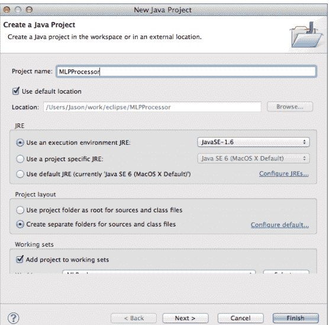

图 9.13：Eclipse 新项目对话框

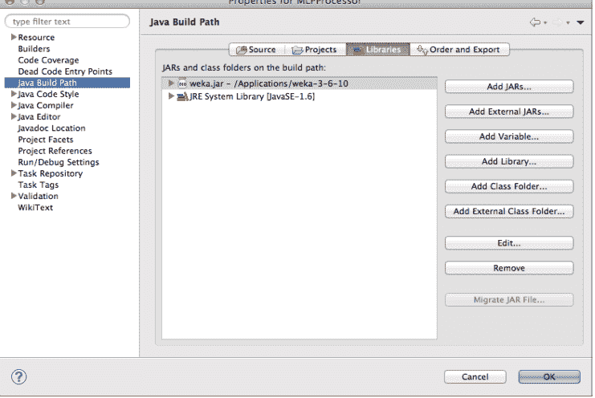

图 9.14：添加外部 jars

最后要做的是创建一个名为 `MLPProcessor.java` 的新类（使用 New Class），如图 9.15 所示。

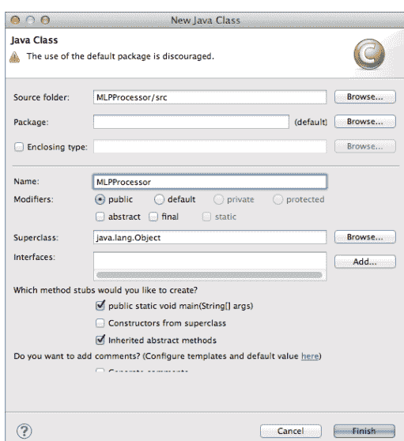

图 9.15：创建新类文件

### 编写代码

实际的 Java 代码简单。你将执行以下操作：

1. 打开训练数据 `.arff` 文件。
2. 创建多层感知器并设置与 Weka 示例相同的选项。
3. 构建分类器。
4. 加载一些测试数据。
5. 使用测试数据针对训练数据运行评估测试。

你需要创建一个小的测试数据文件来测试模型。在名为 `testdata.arff` 的文件中输入以下内容：

```
@relation vehicated

@attribute wheels numeric
@attribute chassis numeric
@attribute pax numeric
@attribute vtype {Bus,Car,Truck,Bike}

@data
18,25,Truck
8,21,24,Bus
18,27,Truck
1,1,1,Bike
7,23,21,Bus
18,20,1,Truck
8,16,2,Bus
18,28,2,Truck
7,18,36,Bus
8,21,27,Bus
5,2,4,Car
18,28,1,Truck
5,1,1,Car
1,1,1,Bike
18,27,1,Truck
5,1,1,Car
6,15,38,Bus
7,21,38,Bus
18,20,2,Truck
1,1,1,Bike
18,28,2,Truck
18,24,2,Truck
18,20,1,Truck
1,1,1,Bike
5,17,13,Bus
18,27,1,Truck
4,4,3,Car
18,21,1,Truck
5,2,3,Car
4,3,3,Car
18,23,1,Truck
5,20,30,Bus
5,3,3,Car
18,28,1,Truck
5,3,1,Car
9,13,19,Bus
1,1,1,Bike
18,26,2,Truck
```

在你创建了测试文件后，请使用以下代码：

```java
import java.io.FileNotFoundException;
import java.io.FileReader;
import java.io.IOException;

import weka.classifiers.Evaluation;
import weka.classifiers.functions.MultilayerPerceptron;
import weka.core.Instances;
import weka.core.Utils;
```


```java
public class MLPProcessor {
    public MLPProcessor() {
        try {
            FileReader fr = new FileReader("vehledata.arff");
            Instances training = new Instances(fr);
            training.setClassIndex(training.numAttributes() - 1);

            MultilayerPerceptron mlp = new MultilayerPerceptron();
            mlp.setOptions(Utils.getOptions("-L 0.3 -M 0.2 -N 500 -V 0 -S 0 -E 20 -H 4"));

            FileReader tr = new FileReader("testdata.arff");
            Instances testdata = new Instances(tr);
            testdata.setClassIndex(testdata.numAttributes() - 1);
            Evaluation eval = new Evaluation(training);
            eval.evaluateModel(mlp, testdata);
            System.out.println(eval.toSummaryString("\nResults\nn\n\n", false));

            tr.close();
        } catch (FileNotFoundException e) {
            e.printStackTrace();
        } catch (IOException e) {
            e.printStackTrace();
        } catch (Exception e) {
            e.printStackTrace();
        }
    }

    public static void main(String[] args) {
        MLPProcessor mlp = new MLPProcessor();
    }
}
```

实际神经网络的处理在三行代码内就完成了。创建多层感知器，设置你想要确定类别，并构建分类器。代码的其他部分是加载训练数据和测试数据。

# 从 CSV 转换为 Arff

CSV 文件不包含 Weka 所需的数据。你可以实现 `SVLoader` 类，但我更倾向于知道 `.arff` 数据已准备就绪。这使得其他人在需要时解码数据模型时也变得更加方便。

从命令行，你可以通过一个命令将数据从 .csv 文件转换为 .arff。

```bash
java -cp /Applications/weka-3-6-10/weka.jar \
weka.core.converters.SVLoader \
vehledata.csv > vehledata.arff
```

如果你检查该 .arff 文件，你会发现属性已经为你设置好了。

```
@relation vehledata

@attribute wheels numeric
@attribute chassis numeric
@attribute pax numeric
@attribute vtype {Bus,Car,Truck,Bike}

@data
6,20,39,Bus
8,23,11,Car
5,3,1,Car
4,3,4,Car
5,3,1,Car
18,37,22,Truck
```

# 运行神经网络

代码列表在运行时不包含任何输出消息，评估的输出除外。我这么说是因为训练数据可能有 100,000 行，运行将需要几分钟。

使用 Run :来自 Run from Eclipse 运行该类，它将开始生成模型。一段时间后，你就能看到评估的输出。

```
Results
=======

Correctly Classified Instances    38      100 %
Incorrectly Classified Instances  0       0 %
Kappa statistic                    1
Mean absolute error                0.0003
Root squared error                  0.0004
Relative absolute error             0.0795 %
Root relative squared error         0.0949 %
Total Number of Instances          38
```

# 第9 章 ■ 神经网络

可以使用 `perceptron()` 方法轻松地对实例进行分类，该方法接收单个 `Instance` 并输出结果的数值表示。此结果对应于 .arff 文件中的输出类别。

# 使用 DeepLearning4J 开发神经网络

Weka 框架为创建神经网络提供了一个很好的工作系统。你正在使用的系统将显然决定模型训练所需的时间。根据经验，我发现训练中的某一点 Weka 开始变得非常吃力。当这种情况发生时，我会寻找可以使用的替代方案。作为一个 Java 开发者，我使用 DeepLearning4J；它扩展性良好，并且可以与 Spark 一起使用来扩展数据集。

让我们利用车辆数据并 DL4J 创建一个多层神经网络。

# 修改数据

正如 .arff 数据文件本身所示，它知道输出类别是车辆类型。DL4J 的训练数据基于 CSV 文件，但它需要数值输出而不是文本输出。因此，我更改了以下输出：

| 车辆类别 | DL4J 数值输出 |
| :--- | :--- |
| 公交车 (Bus) | 0 |
| 汽车 (Car) | 1 |
| 卡车 (Truck) | 2 |
| 自行车 (Bike) | 3 |

数据如下：

```
wheels,chassis,pax,vtype
6,20,39,Bus
8,23,11,Car
5,3,1,Car
4,3,4,Car
5,3,1,Car
18,37,22,Truck
```

## 数据归一化


在为构建神经网络准备数据时，归一化过程正在进行。目标是将向量的值更改到一个共同的尺度，但不扭曲数据的实际差异。

# 第 9 章 神经网络

被使用。DL4 框架提供了一个类来执行此操作；在示例中，我正使用它对训练向量和测试向量进行归一化。

```
DataNormalization normalizer = new NormalizerStandardize()
normalizer.fit(trainingData)
normalizer.transform(trainingData)
normalizer.transform(testData);
```

## 构建模型

使用 `NeuralNetConfiguration.Builder` 类可以构建神经网络。层、隐藏节点和输出的信息都在这里创建。

`seed`（种子）是一个纯随机数，在模型构建期间会使用。

我们还被指定要使用哪种激活函数。Tanh 的作用非常类似于 sigmoid 函数，但它提供的是从 -1 到 1 的 S 型曲线，而 sigmoid 的作用范围是 0 到 1。

我正在创建一个四层网络。输入层有三个节点，隐藏层每层有四个节点，输出层有四个节点，每个预测值类型一个节点。通过 `DenseLayer` 类，你可以看到 `nIn` 方法如何处理输入边，以及 `nOut` 方法如何为下一个连接层设置输出边。

```
final int numInputs = 3;
final int hiddenNodes = 4;
int outputNum = 4;
int iterations = 2000;
long seed = 6;
log.info("Building model...");
MultiLayerConfiguration conf = new NeuralNetConfiguration.Builder()
.seed(seed)
.iterations(iterations)
.activation(Activation.TAN)
.weightInit(WeightInit.XAVIER)
.learningRate(0.1)
.regularization(true).l2(1e-4)
.list()
.layer(0, new DenseLayer.Builder().nIn(numInputs).nOut(hiddenNodes)
.build())
.layer(1, new DenseLayer.Builder().nIn(hiddenNodes).nOut(hiddenNodes)
.build())
.layer(2, new DenseLayer.Builder().nIn(hiddenNodes).nOut(hiddenNodes)
.build())
.layer(3, new
OutputLayer.Builder(LossFunctions.LossFunction.NEGATIVELOGLIKELIHOOD)
  .activation(Activation.SOFTMAX)
  .nIn(hiddenNodes).nOut(outputNum).build()
  .backprop(true).pretrained(false)
  .build();
```

配置好网络后，下一阶段是使用之前定义的配置和训练数据集来训练模型。

```
MultiLayerNetwork model = new MultiLayerNetwork(conf);
model.init();
model.setListeners(new ScoreIterationListener(100));
model.fit(trainingData);
```

一旦模型完成，就是时候使用另一个数据集运行评估了。

## 评估模型

`Evaluation` 类接收一个整数，表示它将对比评估数据的输出类别数量。模型从测试数据中生成输出特征矩阵，并对其进行评估后报告到控制台。

```
Evaluation eval = new Evaluation(4);
log.info("Getting evaluation");
INDArray output = model.output(testData.getFeatureMatrix());
log.info("Getting evaluation output");
eval.eval(testData.getLabels(), output);
System.out.println(eval.stats());
```

## 保存模型

生成的模型可以持久化到文件中供以后使用。为了说明这一点，我添加了代码将模型保存到本地机器的文件系统中。

```
File locationToSave = new File("/path/to/models/basicmlpmodel.zip");
boolean saveUpdater = false;
ModelSerializer.write(model, locationToSave, saveUpdater);
```

输出文件类型是 zip 文件。在这个示例中，该 zip 文件包含两个文件：一个配置 JSON 文件（包含了在所示代码中创建的所有模型配置）以及一个 bin 文件。

# 为分析准备文本

让我们从头开始；有人会向你提交文档。根据我以前的经验，这些文档的格式往往是你最意料之外的。当我们说“文本文档”时，有些人可能会想到纯文本 (.txt)，而另一些人可能会认为是富文本格式 (.rtf) 甚至是 Microsoft Word 文档 (.doc|.docx)。对于文本分析，我们需要纯文本，因此通常会有一些需要清洗的数据工作。

## Apache Tika

如果你完全不确定正在处理的是什么种类型的文档，那么值得查看一下 Apache Tika 库以检查内容元数据。

你可以从 `http://tika.apache.org/` 下载 Tika，它可以作为命令行工具使用，也可以嵌入到应用程序中。

Tika 不仅限于文档；它还可以读取图像、视频、声音、电子邮件和其他文件类型。要查看支持的类型完整列表，请参 Apache Tika 网站上的支持页面。

```
http://tika.apache.org/1.22/formats.html#Full_list_of_Supported_Formats
```

## 下载 Tika

对于命令行示例，我将从 Apache 镜像站点下载 JAR 文件。选择离你最近的镜像，访问以下网站并从中选择：

```
https://www.apache.org/dyn/closer.cgi/tika-app-1.22.jar
```

一旦保存了 JAR 文件（你可能会收到关于下载 JAR 文件的安全警告），你现在就可以从命令行引用它了。它提供了一个内置的 GUI；从命令行运行以下命令。

```
java -jar tika-app-1.22.jar
```

一旦 GUI（见图 10.1）加载，找到一个文本文件并将其拖到 GUI 上然后松开。你将看到所拖入文件的元数据。

| 文件 | 视图 | 帮助 |
|---|---|---|
| Apache Tika | | |


图 10.1：Apache Tika GUI

## 从命令行使用 Tika

同一个 JAR 文件也提供了命令行处理功能。使用 `--list-parsers` 标志，你将看到 Tika 将读取元数据的所有支持的文件类型。

```
$ java -jar tika-app-1.22.jar --list-parsers
Aug 28, 2019 9:27:33 PM
org.apache.tika.config.InitializableProblemHandler
$3 handleInitializableProblem
WARNING: J2ImageReader not loaded. JPEG2000 processed.
```

`https://pdfbox.apache.org/2.0/dependencies.html#jai-image-io` 用于可选依赖。

```
Aug 28, 2019 9:27:33 PM
org.apache.tika.config.InitializableProblemHandler
$3 handleInitializableProblem
WARNING: org.xerial.sqlite-jdbc is not loaded.
Please provide the jar or pom.xml for your classpath to parse sqlite files.
see tika-parsers/pom.xml for the correct version.
org.apache.tika.parser.AutoDetectParser (Composite Parser):
org.apache.tika.parser.apple.AppleSingleFileParser
org.apache.tika.parser.asm.ClassParser
org.apache.tika.parser.audio.AudioParser
org.apache.tika.parser.audio.MidiParser
org.apache.tika.parser.chm.ChmParser
org.apache.tika.parser.code.SourceCodeParser
org.apache.tika.parser.crypto.Pkcs7Parser
org.apache.tika.parser.csv.TsvAndCSVParser
org.apache.tika.parser.dbf.DBFParser
org.apache.tika.parser.dif.DifParser
org.apache.tika.parser.dwg.DWGParser
org.apache.tika.parser.epub.EpubParser
org.apache.tika.parser.exe.ExecutableParser
org.apache.tika.parser.feed.FeedParser
org.apache.tika.parser.font.AdobeFontParser
org.apache.tika.parser.font.TrueTypeParser
org.apache.tika.parser.dal.GDALParser
org.apache.tika.parser.geo.GeoParser
org.apache.tika.parser.geinfo.GeographicInformationParser
org.apache.tika.parser.grib.GribParser
org.apache.tika.parser.hdf.HDFParser
org.apache.tika.parser.sas.SASParser
org.apache.tika.parser.video.FLVParser
org.apache.tika.parser.wordperfect.QuattroParser
org.apache.tika.parser.wordperfect.WordPerfectParser
org.apache.tika.parser.xml.DcmParser
org.apache.tika.parser.xml.FictionParser
org.apache.tika.parser.FlacParser
org.apache.tika.parser.OggParser
org.apache.tika.parser.SpeexParser
org.apache.tika.parser.Theora-parser.VorbisParser
```

我打算本地使用一个文本文件；`clean.txt` 文件包含了本地开发人员的所有描述。首先，我想获取该文件的元数据。

```
$ java -jar tika-app-1.22.jar -m -clean.txt
Aug 28, 2019 9:36:33 PM org.apache.tika.config.InitializableProblemHandler
$3 handleInitializableProblem
WARNING: J2ImageReader not loaded. JPEG2000 files will not be processed.
See https://pdfbox.apache.org/2.0/dependencies.html#jai-image-io for optional dependencies.
Aug 28, 2019 9:36:33 PM org.apache.tika.config.InitializableProblemHandler
$3 handleInitializableProblem
WARNING: org.xerial.sqlite-jdbc is not loaded.
Please provide the jar on your classpath to parse sqlite files.
See tika-parsers/pom.xml for the correct version.
Content-Encoding: UTF-8
Content-Length: 38222
Content-Type: text/plain; charset=UTF-8
X-Parsed-By: org.apache.tika.parser.DefaultParser
X-Parsed-By: org.apache.tika.parser.csv.TextAndCSVParser
resourceName: clean.txt
```

`-m` 将输出元数据。如果我想将文件导出为 XML，也可以通过命令行完成。

```
$ java -jar tika-app-1.22.jar -x -clean.txt
Aug 28, 2019 9:44:33 PM org.apache.tika.config.InitializableProblemHandler
$3 handleInitializableProblem
WARNING: J2ImageReader not loaded. JPEG2000 files will not be processed.
https://pdfbox.apache.org/2.0/dependencies.html#jai-image-io for optional dependencies.
Aug 28, 2019 9:44:33 PM org.apache.tika.config.InitializableProblemHandler
$3 handleInitializableProblem
WARNING: org.xerial:sqlite-jdbc is not loaded.
Please provide tika-parsers/pom.xml for the correct version.
<xml version="1.0" encoding="UTF-8">
<html xmlns="http://www.w3.org/1999/xhtml">
<head>
<meta name="X-Parsed-By" content="org.apache.tika.parser.DefaultParser"/>
<meta name="X-Parsed-By" content="org.apache.tika.parser.csv.TextAndCSVParser"/>
<meta name="Content-Encoding" content="UTF-8"/>
<meta name="resourceName" content="clean.txt"/>
<meta name="Content-Length" content="38222"/>
<meta name="Content-Type" content="text/plain; charset=UTF-8"/>
<title>
</head>
<body>可视化生物信息即使在最好的情况下也是挑战性的，在 axial3d，我们通过提供机器学习标记注释来加速理解……主要针对乞丐，因为我自己也是之一。testcontainers 是一个开源库，允许你将外部资源依赖容器化，例如数据库、web 或任何可以在 docker 容器中运行的内容；使用 testcontainers，我们可以在只需要 docker 作为前提条件的情况下，在更像生产的环境中更容易开发和运行测试</p>
</html>
```

使用 Tika，你可以安全地进行文本提取（如果你在英国，请查看简历）。我的文件是 PDF 格式，但我想快速提取文本。


# 第 6 章 基于文本文档的机器学习

```bash
$ java -jar tika-app-1.22.jar -t /../Documents/JasonBellCV2018.pdf
Aug 28, 2019 9:48:39 PM org.apache.tika.config.InitializableProblemHandler
$3 handleInitializableProblem
WARNING: J2ImageReader not loaded. JPEG2000 files will not be processed.
See https://pdfbox.apache.org/2.0/dependencies.html#jai-image-io for optional dependencies.
Aug 28, 2019 9:48:39 PM org.apache.tika.config.InitializableProblemHandler
$3 handleInitializableProblem
WARNING: org.xerial'sqlite-jdbc is not loaded.
Please provide the jar on your classpath to parse sqlite files.
See tika-parsers/pom.xml for the correct version.
```

`-t` 选项将获取文件内容并输出文本。如果你需要，可以重定向到文件。

## 在应用程序中使用 Tika

仓库中有一个本章的代码文件夹。Apache Tika 库提供两个版本，取决于你的需求。核心库包含了提取元数据所需的一切；如果你想提取文本和转换，你需要解析器发布版本。

```java
public class TextExtraction {
    public String toPlainText(String filename) {
        BodyContentHandler handler = new BodyContentHandler();
        AutoDetectParser parser = new AutoDetectParser();
        Metadata metadata = new Metadata();
        String output = "";
        try {
            InputStream stream = new BufferedInputStream(filename);
            parser.parse(stream, handler, metadata);
            output = handler.toString();
        } catch (IOException e) {
            e.printStackTrace();
        } catch (TikaException e) {
            e.printStackTrace();
        } catch (SAXException e) {
            e.printStackTrace();
        }
        return output;
    }

    public static void main(String[] args) {
        TextExtraction t = new TextExtraction();
        String output = t.toPlainText("/path/to/your/file.pdf");
        System.out.println(output);
    }
}
```

## 清理文本数据

面对文本数据时，你通常需要进行某种形式的清理。需要清理的内容取决于项目的具体规定，但你会遇到一些共同点。

1. 从文档中提取文本（如果不是纯文本文档）。
2. 将所有单词转换为小写。
3. 移除任何标点符号。
4. 移除停用词。

## 将单词转换为小写

在任何分析中，大写字母和小写字母都会被视为不同的单词，因此将整个文本转换为其中一种形式是关键的。考虑以下句子：

> 你是值得的，你是家人。专注于你所心存感激的事物。

单词 `You` 和 `you` 会被任何算法视为两个独立的单词，这将影响任何权重或评分。

```java
public static String convertToLowerCase(String in) {
    return in.toLowerCase();
}
```

使用 Clojure，`clojure.string` 库中的函数可以实现相同的功能。

```clojure
user=> (clojure.string/lower-case "You are worthy, you are family.\nFocus on what you have to be grateful for.")
"you are worthy, you are family. focus on what you have to be grateful for."
```

## 移除标点符号

就像带有大写和小写的单词会被识别两次一样，带有标点符号的单词也是如此。让我们回到当前的示例文本状态：

> "you are worthy, you are family. focus on what you have to be grateful for."

单词 `worthy`、`family` 和 `for` 带有逗号和句号等标点。这些在任何分析中也会被归类为独立的单词。如果 `family` 和 `family,` 出现在同一个段落中，将会记录两次实例。

使用 Java 的正则表达式包为我们提供了一个可行的解决方案。`Pattern` 类匹配我们想要使用的实际正则表达式：`\w` 是一个单词类，匹配任何包含 ASCII 字母、数字或下划线 `[_]` 的单词。`Matcher` 提供了正则表达式应用于输入字符串之后的结果。我正使用 `StringBuilder` 来创建一个可以使用的输出字符串。

```java
public String removePunctuation(String in) {
    String pattern = "[\\w]+";

    Pattern pattern = Pattern.compile(pattern);
    Matcher matcher = pattern.matcher(convertToLowerCase(in));
    StringBuilder sb = new StringBuilder();

    while(matcher.find()) {
        sb.append(matcher.group() + " ");
    }
    return sb.toString().trim();
}
```

Clojure 使用相同的 Java 函数，但它被封装在一个方便的序列中，你可以遍历这些结果。

```clojure
user= (re-seq "\w+" "you are worthy, you are family. focus on what you have to be grateful for")
("you" "are" "worthy" "you" "are" "family" "focus" "on" "what" "you" "have" "to" "be" "grateful" "for")
```

## 停用词

值得停下来考虑一下停用词。在大多数情况下，你想要移除一些常见单词，以免干扰分析。以下是一份常见停用词列表。

最后，当所有文档加载到独立的 `List` 对象后，会创建一个最终的文档 `List`。

```java
List<List<String>> allDocuments = Arrays.asList(wordDoc1, wordDoc2, wordDoc3, wordDoc4, wordDoc5);
```

## 计算词频 (Term Frequency)

词频是一个短语在文档中出现的次数；在示例中，我们对列表嵌套列表使用迭代器，并检查术语是否匹配。

如果匹配，计数器加1：

```java
public double getTermFrequency(List<String> doc, String term) {
    double result = 0;
    for (String word : doc) {
        if (term.equalsIgnoreCase(word)) {
            result++;
        }
    }
    return result / doc.size();
}
```

计算词频的最后一步是将出现次数除以文档的大小。

## 计算逆向文档频率 (Inverse Document Frequency)

逆向文档频率是针对语料库中的所有文档计算的，这就是为什么在加载文件时创建了词列表集合的原因。该指标为我们提供了该术语相对于整个文档语料库的常见或稀有指示。同样，词频计算也是针对所有文档进行的，通过遍历每个文档。

```java
public double getInverseDocumentFrequency(List<List<String>> allDocuments, String term) {
    double wordOccurrences = 0;
    for (List<String> document : allDocuments) {
        if (term.equalsIgnoreCase(word)) {
            wordOccurrences++;
            break;
        }
    }
    return Math.log(allDocuments.size() / wordOccurrences);
}
```

结果是文档数量除以该术语在这些文档中找到的次数，商的对数即返回的值。

## 计算 TF/IDF 分数

最后一步是计算 TF-IDF 分数。这是通过将词频的结果乘以逆向文档频率的结果来实现的。

```java
public double computeTfIdf(List<String> doc, List<List<String>> docs, String term) {
    return getTermFrequency(doc, term) * getInverseDocumentFrequency(docs, term);
}
```

假设我们正在查找术语 `dapibus` 的分数，我们将我们要计算词频的文档、整个语料库以及该术语传递给 `computeTfIdf` 方法。

```java
double score = tfidf.computeTfIdf(wordDoc4, allDocuments, "dapibus");
```

如果该术语出现在更多文档中，那么分数将开始接近 1。在这种情况下，`dapibus` 未出现在语料库中，在评分中的权重很小。

> wordDoc4 中 dapibus 的词频 = 0.0090900900909009
>
> dapibus 的逆向文档频率 = 1.6094379123431003
>
> 单词的 TF-IDF 分数: 0.014499440652559462

## 审查最终代码列表

代码列表 10.1 是基础 TF-IDF 算法的完整代码。Spark 和 DeepLearning4j 中也存在其他实现，它们将为您提供对大型语料库数据集更好的控制和处理。

## 代码列表 10.1：基础 TF/IDF 算法

```java
package mlbook.ch10.tfidf;

import java.io.BufferedReader;
import java.io.File;
import java.io.FileReader;
import java.io.IOException;
import java.util.ArrayList;
import java.util.Arrays;
import java.util.List;

public class TFIDFExample {

    public double getTermFrequency(List<String> doc, String term) {
        double result = 0;
        for (String word : doc) {
            if (term.equalsIgnoreCase(word)) {
                result++;
            }
        }
        return result / doc.size();
    }

    public double getInverseDocumentFrequency(List<List<String>> allDocuments, String term) {
        double wordOccurrences = 0;
        for (List<String> document : allDocuments) {
            for (String word : document) {
                if (term.equalsIgnoreCase(word)) {
                    wordOccurrences++;
                }
            }
        }
        return Math.log(allDocuments.size() / wordOccurrences);
    }

    public double computeTfIdf(List<String> doc, List<List<String>> docs, String term) {
        return getTermFrequency(doc, term) * getInverseDocumentFrequency(docs, term);
    }

    public List<String> loadDocToStrings(String filePath) {
        List<String> words = new ArrayList<String>();
        try {
            File file = new File(filePath);
            BufferedReader br = new BufferedReader(new FileReader(file));
            String s;
            while ((s = br.readLine()) != null) {
                String[] ws = s.split(" ");
                for (int i = 0; i < ws.length; i++) {
                    words.add(ws[i]);
                }
            }
        } catch (IOException e) {
            e.printStackTrace();
        }
        return words;
    }

    public static void main(String[] args) {
        String docspath = "/path/to/data/ch10";
        TFIDFExample tfidf = new TFIDFExample();
        List<String> wordDoc1 = tfidf.loadDocToStrings(docspath + "/doc1.txt");
        List<String> wordDoc2 = tfidf.loadDocToStrings(docspath + "/doc2.txt");
        List<String> wordDoc3 = tfidf.loadDocToStrings(docspath + "/doc3.txt");
        List<String> wordDoc4 = tfidf.loadDocToStrings(docspath + "/doc4.txt");
        List<String> wordDoc5 = tfidf.loadDocToStrings(docspath + "/doc5.txt");
        List<List<String>> allDocuments = Arrays.asList(wordDoc1, wordDoc2, wordDoc3, wordDoc4, wordDoc5);
        double score = tfidf.computeTfIdf(wordDoc4, allDocuments, "dapibus");
        System.out.println("单词的 TF-IDF 分数: " + score);
    }
}
```

这里设置了一些参数。`minimumWordFrequency` 值是该词在语料库中必须出现的次数。向量中的特征数量通过 `layerSize` 方法设置；在我们的示例中，该向量空间中有 100 个特征。

模型的最后一步是 `vec.fit()`，在此处开始训练。完成后，它会返回模型。


## 评估模型

模型的特征向量值会被写入磁盘。当添加新数据时，可以加载并更新模型。

```java
public void evaluateModel(Word2Vec vec) {
    try {
        System.out.println("Serializing the model to disk.");
        WordVectorSerializer.writeVectors(vec, "word2vecout.txt");
    } catch (IOException e) {
        e.printStackTrace();
    }
}
```

那么，我们的新模型是如何工作的？让我们运行一些基础测试，看看输出是什么样的。首先看看词汇关联；我想知道与 `data` 词最接近的词。

```java
Collection<String> lst = vec.wordsNearest("data", 10);
```

`wordsNearest()` 方法接收我们想要查找关联的词以及要返回的数量。它将返回一个可以迭代和处理的字符串集合。

```
[in, machine, are, learning, over, a, can, out, it, good]
```

注意，这里有几个常用词；在训练之前去除这些词是一个好主意。

现在我想看看 `machine` 词与 `data`、`retail` 和 `games` 词之间的接近程度。为此，我需要使用 `similarity()` 方法。它接受两个来自语料库的字符串，并输出一个表示余弦相似度的数字。

```java
System.out.println("Similarity score for data:machine " + vec.similarity("data", "machine"));
System.out.println("Similarity score for retail:machine " + vec.similarity("retail", "machine"));
System.out.println("Similarity score for games:machine " + vec.similarity("games", "machine"));
```

```
Similarity score for data:machine - 0.993763872032166
Similarity score for retail:machine - 0.6593816876411438
Similarity score for games:machine - 0.9365512132644653
```

数值越高，该词在语料库中与目标词的相似性就越“接近”。在上一个例子中，我们看到 `data` 与目标词的接近程度与 `games` 相当。

## 审查最终代码

列表 10.2 是 Word2Vec 最终完整代码。Word2Vec 适用于大型数据集；文本语料库越小，你看到的关联词集合的质量就越低。

### 列表 10.2: Word2Vec 模型

```java
package mlbook.ch10.word2vec;

import org.deeplearning4j.models.embeddings.loader.WordVectorSerializer;
import org.deeplearning4j.models.word2vec.Word2Vec;
import org.deeplearning4j.text.sentenceiterator.LineSentenceIterator;
import org.deeplearning4j.text.sentenceiterator.SentenceIterator;
import org.deeplearning4j.text.sentenceiterator.SentencePreProcessor;
import org.deeplearning4j.text.tokenization.tokenizer.preprocessor.CommonPreprocessor;
import org.deeplearning4j.text.tokenization.tokenizerfactory.DefaultTokenizerFactory;
import org.deeplearning4j.text.tokenization.tokenizerfactory.TokenizerFactory;
import java.io.File;
import java.io.IOException;
import java.util.Collection;
```

```java
public class Word2VecExample {

    public void run() {
        System.out.println("Creating iterator");
        SentenceIterator iter = createSentenceIterator("/path/to/data/ch10/word2vec_text.txt");

        System.out.println("Creating tokenizer");
        TokenizerFactory t = createTokenizer();
        System.out.println("Creating word2vec model.");
        Word2Vec vec = createWord2VecModel(iter, t);
        System.out.println("Evaluating the model.");
        evaluateModel(vec);
    }
}
```

```java
public Word2Vec createWord2VecModel(SentenceIterator iter, TokenizerFactory t) {
    Word2Vec vec = new Word2Vec.Builder()
        .minWordFrequency(5)
        .layerSize(100)
        .seed(42)
        .windowSize(5)
        .iterate(iter)
        .tokenizerFactory(t)
        .build();
    vec.fit();
    return vec;
}
```

```java
public SentenceIterator createSentenceIterator(String filepath) {
    SentenceIterator iter = new LineSentenceIterator(new File(filepath));
    iter.setPreProcessor(new SentencePreProcessor() {
        @Override
        public String preProcess(String sentence) {
            return sentence.toLowerCase();
        }
    });
    return iter;
}
```

```java
public TokenizerFactory createTokenizer() {
    // Split on white spaces
    TokenizerFactory t = new DefaultTokenizerFactory();
    t.setTokenPreProcessor(new CommonPreprocessor());
    return t;
}
```

```java
public void evaluateModel(Word2Vec vec) {
    try {
        System.out.println("Serializing the model to disk.");
        WordVectorSerializer.writeVectors(vec, "word2vecout.txt");
    } catch (IOException e) {
        e.printStackTrace();
    }
}
```

```java
public static void main(String[] args) {
    Word2VecExample example = new Word2VecExample();
    example.run();
}
```

# 第10章 ■ 文本文档机器学习 219

```java
int score = 0;
String[] words = sentence.split(" ");
for (int i = 0; i < words.length; i++) {
    if (positiveWords.contains(words[i])) {
        System.out.println("Contains the positive word: " + words[i]);
        score = score + 1;
    } else if (negativeWords.contains(words[i])) {
        System.out.println("Contains the negative word: " + words[i]);
        score = score - 1;
    }
}
return score;
```

```java
public List<String> loadSentences(String filePath) {
    List<String> sentences = new ArrayList<String>();
    try {
        File file = new File(filePath);
        BufferedReader br = new BufferedReader(new FileReader(file));
        String s;
        while ((s = br.readLine()) != null) {
            sentences.add(s);
        }
    } catch (IOException e) {
        e.printStackTrace();
    }
    return sentences;
}
```

```java
public static void main(String[] args) {
    BasicSentimentAnalysis bsa = new BasicSentimentAnalysis();
    List<String> sentences = bsa.loadSentences("/path/to/data/ch10/sentiment/sentences.txt");
    bsa.runSentimentAnalysis(sentences);
}
```

## 运行测试

让我们运行一下情感分析，看看它是如何运作的。在数据目录中有一些示例句子。

```
i loved receiving the gifts from you it was like it was my birthday
i hated that movie
this is the best meal i've ever had
this is the worst meal i've ever had
```

现在，让这些句子通过一遍程序，看看输出是什么样子的。

```
Sentence: i loved receiving the gifts from you it was like it was my birthday
Contains the positive word: loved
Contains the positive word: like
Score: 2
*****
Sentence: i hated that movie
Contains the negative word: hated
Score: -1
******
Sentence: this is the best meal i've ever had
Contains the positive word: best
Score: 1
******
Sentence: this is the worst meal i've ever had
Contains the negative word: worst
Score: -1
*****
```

我添加了一些详细输出语句，以便你可以看到评分发生的位置。在大多数情况下，你可能对知道哪些词触发了评分并不感兴趣，只关心最终的情感得分。

## 进一步开发

基础情感分析代码有很大的改进空间，特别是在数据来源方面。对我来说，下一个合乎逻辑的切入点是源数据。在附录 B 中，有如何通过开发者账户设置 Twitter 应用的说明。设置完成后，你就可以开始获取公共推文并应用情感分析。

同样的函数也可以用于 `Kafka` 和 `Spark`，以实现大规模、高速度的情感评分。

## 总结

本章讨论了处理文本数据时的各种考虑因素。它涵盖了数据的获取、转换和清理，以及对其进行分析。它还涵盖了如何使用词频/逆文档频率（TF-IDF）寻找单词的重要性、使用 Word2Vec 进行词汇分组以及情感评分。

处理完文本后，下一个逻辑步骤是查看如何处理图像。

# 第11章：图像机器学习

到目前为止，本书中的信息训练和分类都是基于数字数据集，或者像第10章那样基于文本。

在本章中，我们将简单介绍图像处理和分类，从使用基础神经网络开始，然后将知识扩展到使用卷积神经网络进行图像分类。

在过去的几年里，机器学习在图像处理方面取得了巨大的飞跃。图形处理器（GPU）的加入将加速模型的训练。为了直观感受现在进步到了什么程度，可以看看网站 `https://thispersondoesnotexist.com`。使用 Nvidia 开发的 StyleGAN 模型，每张图像都是生成的，并不是真实的人，但它们看起来真实得令人震惊！

## 什么是图像？

在基本形式，基于计算机的图像是一个数字网格。每个“方块”被称为像素。图 11.1 是一个 8 像素乘 8 像素图像的示例。

我同意这并不过于乐观，但这是一个起点。假设这是一张只有两种颜色的图像：黑色和白色。当一个像素被涂成黑色时，它的值为 1，其余的都为 0。从数字的角度来看，我们的图像看起来如图 11.2。我们拥有的是一个位图表示。每个位代表颜色，黑色或白色。


**图 11.1：8 像素图像**

| 0 | 0 | 0 | 0 | 0 | 0 | 0 | 0 |
| :--- | :--- | :--- | :--- | :--- | :--- | :--- | :--- |
| 0 | 1 | 0 | 0 | 0 | 1 | 0 | 0 |
| 0 | 1 | 0 | 0 | 0 | 1 | 1 | 1 |
| 0 | 1 | 0 | 0 | 0 | 1 | 0 | 1 |
| 0 | 1 | 0 | 0 | 0 | 1 | 1 | 0 |
| 0 | 0 | 1 | 1 | 1 | 0 | 0 | 0 |
| 0 | 0 | 0 | 0 | 0 | 0 | 0 | 0 |

**图 11.2：8x8 像素图像的数字表示**

## 引入色彩深度

可用的位越多，图像中可以存储的信息就越多。表 11.1 显示了根据深度处理的图像信息；深度越大，引入的颜色越多。

### 表 11.1：色彩深度

| 色彩深度（位） | 颜色数量 | 示例二进制 |
| :--- | :--- | :--- |
| 1 | 2 | 0, 1 |
| 2 | 4 | 00, 01, 11 |
| 3 | 8 | 000, 001, 011 |
| 4 | 16 | 0000, 001, 0011 |
| 8 | 256 | 01001001, 110011 |
| 24 | 16777216 | 0101101010100111101 |

# 第11章 机器学习 225

即使是 24 位，图像（如图 11.3 所示）也只是网格形式的数字集合；只是信息更多。图 11.1 所示的图像是 8×8 像素，只有两种颜色（黑色或白色，0 或 1）。另一方面，24 位彩色图像有 15,360,000 位信息。在机器学习的背景下，降低色彩深度以加快训练；缩小图像大小也有帮助。


**图 11.3：24 位图像**

## 机器学习中的图像

通过阅读本书和练习示例，你知道机器学习的大部分工作是提供通常为数字形式，并寻找可以定义为模型的模式。所以，如果我们将图像数据转换为数字网格，剩下的就是机器学习算法可以训练的矩阵。

你会发现机器学习示例使用较小的数字网格；16×16 和 28×28 像素的图像被常用。这是因为处理时间；如果图像太大，取决于机器性能，需要很长时间来转换和处理图像。当你处理成上万张图像时，这些过程可能需要数小时。

在大多数情况下，做好准备并将图像调整到足够处理的大小是明智的。确保图像集在像素上使用相同的高度和宽度也很重要。考虑到这些，让我们看看用基础神经网络处理图像。

# 使用神经网络进行基础分类

我们已经在第 9 章中涵盖了神经网络如何工作；相同的多层感知器也可以应用于图像。工作量在于将图像信息转换为数值形式。

DeepLearning4j 框架提供了几个可用的文件输入类，可以读取图像目录并将其转换为准备好训练的状态。如果你曾花时间查看书籍或在互联网上搜索图像的机器学习示例，你可能见过经过修改的标准技术研究院数据库（MNIST 数据库）。这是一个巨大的手写数字数据库，被广泛用于训练图像处理系统。原始数据库有 60,000 张训练图像和 10,000 张用于测试和评估。为了进一步帮助，它们的尺寸为 28×28 像素，并使用灰度色板呈现黑白色。对于后续使用多层神经网络的示例，我将使用这个数据集。你不需要自己下载实际图像，DeepLearning4j 库中有辅助函数为你完成这些。

## 基础设置


我们已经确定图像大小为 28×28 像素。有 10 个输出类 0–9。训练将以 64 张图像为批次进行。速率是多层感知器的学习率。

```java
int imageHeight = 28;
int imageWidth = 28;
int outputClasses = 10;
int batchSize = 64;
int randomSeed = 123;
int epochs = 15;
double rate = 0.0015;
```

# 加载 MNIST 图像

我们需要定义两个数据集，一个用于训练数据，另一个用于测试评估模型。DeepLearning4j 框架提供了一些用于加载 MNIST 图像数据集的辅助类；这意味着我们不需要花费时间重复造轮子。

`MNISTDataSetIterator` 接收批次大小（64）和一个布尔值，用于指示我们处理的是训练集还是测试集。使用随机种子值是为了确保我们对数据集进行了洗牌，而不是每次都返回相同的文件。

```java
DataSetIterator mnistTrain = new MNISTDataSetIterator(batchSize, true, randomSeed);
DataSetIterator mnistTest = new MNISTDataSetIterator(batchSize, false, randomSeed);
```

## 模型配置

我们将使用的模型是一个三层神经网络，包含输入层、一个隐藏层和一个输出层。

我们的输入层由 784 个输入节点组成；这代表图像中的每个像素（28 x 28），该输入层的输出被发送到隐藏层。隐藏层由 500 个节点组成，并输出到 100 个节点的输出层。

最后一层使用 `Softmax` 激活方法来确定输出类别，MNIST 数据集中包含 10 个不同的数字。

```java
MultiLayerConfiguration config = new NeuralNetConfiguration.Builder()
    .seed(randomSeed)
    .activation(Activation.RELU)
    .weightInit(WeightInit.XAVIER)
    .updater(new Adam())
    .l2(rate * 0.005)
    .list()
    .layer(new DenseLayer.Builder()
        .nIn(imageHeight * imageWidth)
        .nOut(500)
        .build())
    .layer(new DenseLayer.Builder()
        .nIn(500)
        .nOut(100)
        .build())
    .layer(new OutputLayer.Builder(LossFunctions.LossFunction.NEGATIVELOGLIKELIHOOD)
        .activation(Activation.SOFTMAX)
        .nOut(outputClasses)
        .build())
    .build();
```

配置完成后，将其添加到模型中并初始化。为了查看模型在训练期间的性能，我们为模型添加了得分监听器。训练期间，得分将输出到控制台。

```java
MultiLayerNetwork model = new MultiLayerNetwork(config);
model.init();
model.setListeners(new ScoreIterationListener(5));
```

## 模型训练

要开始训练模型，我们使用训练数据集和想要运行的轮数（`epochs`）执行 `fit()` 方法。

```java
model.fit(mnistTrain, epochs);
```

一旦启动，你将看到模型的得分更新。

## 模型评估

模型训练完成后，该使用来自 MNIST 数据集的测试数据对模型进行评估。评估统计结果将显示在控制台中。

```java
Evaluation eval = model.evaluate(mnistTest);
log.info(eval.stats());
```

如你所见，与第 9 章创建的神经网络唯一的真实区别在于输入的处理方式。配置、训练和评估的处理方式是相同的。现在你已经了解了基础的多层感知器配置，让我们来看看一种新的算法类型——卷积神经网络，它广泛应用于图像处理场景。

# 卷积神经网络

卷积神经网络（从现在起我称之为 CNNs）于 1998 年引入机器学习领域，当时 Yann LeCun、Leon Bottou、Yoshua Bengio 和 Patrick Haffner 发表了一篇论文，概述了他们对一种名为 LeNet-5 的神经网络的工作。按照惯例，我们同时使用 MNIST 数字识别数据集进行训练和评估。

## CNN 如何工作

CNN 包含两个部分：第一部分是特征提取，第二部分是分类。让我们拆解这两个元素并进行检查。

### 特征提取

特征提取元素是 CNN 的核心。卷积是一个数学函数，表示从一个函数到另一个函数的重叠量。

这些特征可以是手写体中的垂直或水平线条。如果是汽车，特征可能是轮子、窗户或保险杠。

卷积并不知道这些东西到底是什么；在 CNN 中，卷积充当图像的过滤器。例如，如果我们处理的是 $5 \times 5$ 像素的图像，如图 11.4 所示，过滤器大小为 $3 \times 3$，并从左到右扫描图像，每次移动一个像素。

| 0 | 1 | 0 | 1 | 1 |
|---|---|---|---|---|
| 0 | 1 | 1 | 0 | 0 |
| 0 | 0 | 1 | 0 | 1 |
| 1 | 1 | 0 | 1 | 1 |
| 0 | 1 | 1 | 0 | 1 |

**图 11.4:** $5 \times 5$ 像素图像

过滤器是覆盖图像的小值矩阵；初始值通常基于随机分布（见图 11.5）。

| 0 | 1 | 1 |
|---|---|---|
| 1 | 0 | 0 |
| 0 | 1 | 0 |

**图 11.5:** 过滤器矩阵

通过将过滤器应用于图像，将其值与输入值相乘。例如，如果过滤器位于图像的左上位置，过滤计算如下：

$(1 \times 0 + 0 \times 1 + 1 \times 0) + (1 \times 0 + 0 \times 1 + 0 \times 1) + (0 \times 0 + 1 \times 0 + 0 \times 1) = 0$

这就是感受野——CNN 的输出值。过滤器向右移动一步，直到覆盖整个图像。注意过滤器重叠了之前的计算；你将获得每一步的 CNN 值（见图 11.6）。

| 1 | 3 | 3 |
|---|---|---|
| 2 | 2 | 4 |

**图 11.6:** CNN 输出

过滤值可以这样设置：如果我们在寻找垂直特征，过滤器可以设置为 1，例如（图 11.7）。或者如果寻找水平特征，过滤器可以设置为：

| 1 | 0 | 1 |
|---|---|---|
| 0 | 1 | 0 |
| 1 | 1 | 1 |

**图 11.7:** 垂直和水平过滤器值

过滤器的配置方式将决定 CNN 的输出；过滤器未包含的特征将被忽略。

### 激活函数

如第 9 章所述，通常由 `Sigmoid` 函数（如果喜欢也可以 `TANH`）完成激活层。ANN 是输入的线性组合。非线性函数允许在数据非线性可分时进行分类。在 CNN 中，一旦过滤器通过了图像的一部分，它将被传递给另一个激活函数。此操作常用的函数是修正的线性单元，简称 `ReLU`。`ReLU` 将所有负值转换为零，并保持正值不变。在此处，结果维度将得到增强。

### 池化

如前所述，卷积层为我们留了一组特征图。CNN 实现中常见的方法是添加采样层，也称为池化。执行池化可以减少网络中的参数和计算量，从而降低维度。这种降低的维度将缩短训练网络所需时间。通过最大池化，我们观察跨特征图移动的窗口。但这一次我们只寻找窗口的最大值并将其注册在新过滤器中。

### 分类

到此为止，我们已经涵盖了构建 CNN 的步骤；这些步骤包括卷积、使用修正的线性单元（`ReLU`）增强特征图，然后通过池化再次缩小映射。CNN 通常运行多次迭代，因此你得到一个如下的过程：卷积 $\rightarrow$ `ReLU` $\rightarrow$ 最大池化 $\rightarrow$ 卷积 $\rightarrow$ `ReLU` $\rightarrow$ 最大池化，并以某种形式的分类结束，给你全连接层。

最大池化的输出输入神经网络进行分类。大多数情况下，这是一个多层感知器，与第 9 章的内容相同。MLP 的权重将决定分类。

CNN 是一种强大的算法，广泛用于目标检测、语音识别和图像处理。有各种使用 CNN 的框架和架构，花时间研究它们的实现和用法是值得的。

# CNN 实战

让我们通过代码化的 CNN。为了让程序运行，需要执行若干步骤。

1. 获取用于训练的图像数据。
2. 编写 CNN 代码。
3. 执行训练。
4. 保存生成的模型。

## 下载图像数据

Caltech101 数据集由 101 类图像的训练集组成；每个类别有 40 到 80 张图像。对于我们的用途，这完全足够。

从以下地址下载 `.tar.gz` 文件：

```
http://vision.caltech.edu/Image_Datasets/Caltech101/101_ObjectCategories.tar.gz
```

将数据集解压到你机器上的某个位置。

```bash
$ cp /downloads/folder/101_ObjectCategories.tar.gz /your/data/folder
$ gunzip 101_ObjectCategories.tar.gz
$ tar xf 101_ObjectCategories.tar.gz
```

如果你查看目录，你会看到文件夹；这些将被用于模型训练的标签名称。

```bash
$ ls -l
total
drwxr-xr-x  470 jasejell staff 15040 9 Nov 2004 BACKGROUND-Google
drwxr-xr-x  437 jasejell staff 13984 9 Nov 2004 Faces
drwxr-xr-x  437 jasejell staff 13984 9 Nov 2004 Faces_easy
drwxr-xr-x  200 jasejell staff 6464 9 Nov 2004 Leopards
drwxr-xr-x  75 jabel staff 1824 9 Nov 2004 accordion
drwxr-xr-x  802 jabel staff 25664 9 Nov 2004 airplanes
drwxr-xr-x  44 jabel staff 1408 9 Nov 2004 anchor
drwxr-xr-x  44 jabel staff 1408 9 Nov 2004 ant
drwxr-xr-x  49 jabel staff 1568 9 Nov 2004 barrel
drwxr-xr-x  56 jabel staff 1792 9 Nov 2004 bass
...
drwxr-xr-x  41 jabel staff 1312 9 Nov 2004 wrench
drwxr-xr-x  62 jabel staff 1984 9 Nov 2004 yin_yang
```

训练数据已经就绪，我们现在可以查看执行训练的代码。我将其拆解为逐步步骤，并解释其工作原理。

## 基础设置

第一步是设置一些常量值；这些值将在训练中使用。训练数据的路径（即你下载并归档的图像集）已经设置好了。

```java
public static final String pathToImages = "/path/to/data/101_ObjectCategories";
```

设置了图像的高度、宽度和颜色深度。由于图像是 RGB 颜色，因此深度为 3。

```java
int imageHeight = 200;
int imageWidth = 300;
int channels = 3;
```

下一步是为 CNN 本身设置相关值，与其他神经网络一样，我们设置了一个随机数种子。CNN 将以 50 个图像为一组批次进行处理。输出类别值（预测时对应的图像类别）为 101，这是数据集中的类别数量。

```java
int seed = 123;
Random randomNumGen = new Random(seed);
int batchSize = 50;
int numOutputClasses = 101;
int epoch = 10;
```

根据你的机器配置，在训练过程中可能会遇到内存溢出错误；这并不是因为 Java 虚拟机，而是因为 Apache OpenCV 使用的另一个依赖。为了防止程序停止训练，我发现以下两个值的属性可以解决此问题：

```java
System.setProperty("org.opencv.java.maxphysicalbytes", "0");
System.setProperty("org.opencv.java.maxbytes", "0");
```

## 处理训练和测试数据

模型需要知道所有文件的路径。`FileSplit` 类接收所有文件路径并确保它们适合训练。我们寻找的是图像。

```java
File trainingData = new File(pathToImages);
FileSplit trainingDataSplit = new FileSplit(trainingData, NativeImageLoader.ALLOWED_FORMATS, randomNumGen);
```

数据集目录下的文件夹名称将用作输出类别。`ParentLabelGenerator` 处理目录名称并将它们转换为模型的类类别名称。

```java
ParentLabelGenerator labelMaker = new ParentLabelGenerator();
```

我们希望 CNN 在类别标签目录之间保持平衡；某些目录包含的图像可能比其他目录多，为了一个良好的模型，我们需要确保训练数据也是平衡的。这由 `BalancedPathFilter` 类处理。之后，我们将输入数据分为训练集和测试集，测试集占剩余 20% 中的 80%。

```java
BalancedPathFilter pathFilter = new BalancedPathFilter(randomNumGen, labelMaker, 0, numOutputClasses, batchSize);
Split[] filesInDirSplit = trainingDataSplit.sample(pathFilter, 80, 20);
Split trainingSet = filesInDirSplit[0];
Split testing = filesInDirSplit[1];
```

## 图像准备

我们设置了三个将在训练使用的图像变换。在前两个中，图像沿 x 轴或 y 轴翻转，或者完全不翻转。最后一个是随机扭曲。

```java
ImageTransform tf1 = new FlipImageTransform(randomNumGen);
ImageTransform tf2 = new FlipImageTransform(new Random(seed));
ImageTransform warpTransform = new WarpImageTransform(randomNumGen, 42);
List<ImageTransform> transforms = Arrays.asList(new ImageTransform[]{tf1, warpTransform, tf2});
```

通过 `ImageRecordReader` 加载图像，传入高度、宽度、通道数以及之前创建的标签生成器。一旦初始化，程序现在拥有了该图像集的信息。

```java
ImageRecordReader recordReader = new ImageRecordReader(imageHeight, imageWidth, channels, labelMaker);
recordReader.initialize(trainingSet);
```

最后，我们将比例从 0 到 255 缩小到 0 到 1。

```java
DataNormalization scaler = new ImageProcessingScaler(0, 1);
DataSetIterator dataSetIterator = new RecordReaderDataSetIterator(recordReader, batchSize, 1, numOutputClasses);
dataSetIterator.setPreProcessor(scaler);
```

## CNN 模型配置

现在是创建 CNN 模型配置的时候，如列表 11.1 所示。该神经网络有 14 层。层级步骤见表 11.2。

### 表 11.2：层

| 层级 | 功能 |
| :--- | :--- |
| 1 | 卷积层，带有 1 × 1 滤波器步长、3 个输入节点和 16 个输出节点。 |
| 2 | 归一化层。 |
| 3 | `ReLU` 激活层。 |
| 4 | 卷积层，带有另一个 1 × 1 滤波器步长，这次有 16 个输入节点和 16 个输出节点。 |
| 5 | 归一化层。 |
| 6 | `ReLU` 激活层。 |
| 7 | 池化层。 |
| 8 | 卷积层，带有 2 × 2 滤波器步长、16 个输入节点和 16 个输出节点。 |
| 9 | 归一化层。 |
| 10 | `ReLU` 激活层。 |
| 11 | 池化层。 |
| 12 | `Dropout` 层；对 CNN 不重要的特征将被丢弃。 |
| 13 | 密连接层（`DenseLayer`）展平数据并与所有神经元结合。 |
| 14 | `Softmax` 层随后提供 101 个输出类别的分类器。 |

### 列表 11.1：CNN 模型配置


```java
MultiLayerConfiguration conf = new NeuralNetConfiguration.Builder()
    .seed(seed)
    .updater(Updater.STOCHASTIC_GRADIENT_DESCENT(.006))
    .list()
    .layer(0, new ConvolutionLayer.Builder(1, 1).nIn(3).nOut(16).activation(Activation.RELU).build())
    .layer(1, new BatchNormalization.Builder().build())
    .layer(2, new ActivationLayer.Builder().build())
    .layer(3, new ConvolutionLayer.Builder(1, 1).nIn(16).nOut(16).activation(Activation.RELU).build())
    .layer(4, new BatchNormalization.Builder().build())
    .layer(5, new ActivationLayer.Builder().build())
    .layer(6, new SubsamplingLayer.Builder(PoolingType.MAX).kernelSize(2, 2).stride(2, 2).build())
    .layer(7, new ConvolutionLayer.Builder(2, 2).nIn(16).nOut(16).activation(Activation.RELU).build())
    .layer(8, new BatchNormalization.Builder().build())
    .layer(9, new ActivationLayer.Builder().build())
    .layer(10, new SubsamplingLayer.Builder(PoolingType.MAX).kernelSize(2, 2).stride(2, 2).build())
    .layer(11, new DropoutLayer.Builder(0.5).build())
    .layer(12, new DenseLayer.Builder().nOut(256).build())
    .layer(13, new OutputLayer.Builder(LossFunctions.LossFunction.NEGATIVELOGLIKELIHOOD).nOut(numOutputClasses).activation(Activation.SOFTMAX).build())
    .setInputType(InputType.convolutional(imageWidth, imageHeight, channels))
    .build();

MultiLayerNetwork model = new MultiLayerNetwork(conf);
model.init();
```

## 模型训练

在训练期间，我们想查看模型的进度。`ScoreIterationListener` 将为我们输出，这是设置给模型的。

```java
model.setListeners(new ScoreIterationListener(10));
// 查看我们模型的进度
```

模型初始化后，我们现在可以开始训练。

训练将在之前定义的图像变换上进行：两个翻转变换和一个扭曲变换。

```java
for (ImageTransform transform : transforms) {
    System.out.println("正在使用图像变换: " + transform.getClass().toString());
    recordReader.initialize(trainingSet, transform);
    dataIterator = new RecordReaderDataIterator(recordReader, batchSize, 1, numOutputClasses);
    scaler.fit(dataIterator);
    dataIterator.setPreprocessor(scaler);
    for (int j = 0; j < epoch; j++) {
        model.fit(dataIterator);
    }
}
recordReader.reset();
```

完成后，训练将在注册到训练集的原始数据集上进行。

```java
recordReader.initialize(trainingSet);
dataIterator = new RecordReaderDataIterator(recordReader, batchSize, 1, numOutputClasses);
scaler.fit(dataIterator);
dataIterator.setPreprocessor(scaler);
for (int j = 0; j < epoch; j++) {
    model.fit(dataIterator);
}
```

## 模型评估

模型训练好后，现在是使用数据集的另一个 20% 数据来评估模型了。记录读取器被重置，然后用训练集进行初始化。

随后将针对测试数据集创建并运行评估。评估结果将输出到控制台。

```java
recordReader.reset();
recordReader.initialize(testingSet);
DataSetIterator testIter = new RecordReaderDataSetIterator(recordReader,
batchSize,1,numOutputClasses);
scaler.fit(testIter);
testIter.setPreprocessor(scaler);

Evaluation eval = new Evaluation(numOutputClasses);
while (testIter.hasNext()) {
  DataSet next = testIter.next();
  INDArray output = model.output(next.getFeatureMatrix());
  eval.eval(next.getLabels(),output);
}

log.info(eval.stats());
```

## 保存模型

我们 CNN 的最后一步是将模型持久化到 zip 文件，以便用于其他预测重用。

```java
File locationToSave = new File(System.getProperty("user.dir"),
"mycnn.zip");
ModelSerializer.write(model,locationToSave,false);
```

# 迁移学习

现在，我们已经涵盖了通过神经网络对图像的两种潜在方法：多层感知器和卷积神经网络。正如你可能注意到的，训练这些模型可能需要时间。使用一种名为迁移学习的技术，我们可以使用现有的模型及其权重进行预测，或者基于预训练模型创建一个新的更新后的模型。

在图像和视频上进行模型训练非常耗费时间和计算能力，因此找到别人已经完成了所有工作以便我们可以重用模型，将是非常棒的。请记住，如果你正在使用大量图像训练 ImageNet，训练时间可能需要数周。

DeepLearning4j 网站拥有一个模型库，允许你在工作中使用现有的模型。你将看到你刚刚学到的 CNN 示例以及其他模型类型，例如长短期记忆（LSTM）模型。

卷积神经网络在后面的层级之前不会显示特定特征；这意味着大部分的通用处理发生在前端。我们可以使用两种可能的流程来利用已有的资源。

对于像 CNN 这样的工具，我们可以利用分类器层并将其替换为我们使用的分类器版本。这意味着我们不需要在发生繁重工作的地方复制大量的训练，即卷积、归一化、池化和激活步骤。

在 DeepLearning4j 内部有一个迁移学习 API，可以帮助你完善分类器并保存新训练的模型。这对于类似于 ImageNet 的模型非常有用。

如果你处于一种拥有较小训练数据集，或者你知道该数据集与原始训练模型中存在的特征相似的情况，那么应用迁移学习将节省你的开发和训练时间。只要可能，始终重用。

## 总结

在本章中，我们涵盖了使用神经网络处理图像的内容。首先，我们使用多层感知器处理 MNIST 数字数据集，然后我们引入了更完整的卷积神经网络，以一种更彻底的方法从图像数据中提取特征。

虽然这些方法在理论上是好的，但取决于图像量以及你想训练模型的方式，它们的训练和应用时间可能会持续数小时甚至几天。因此，如果可能，请寻找预训练模型并研究使用迁移学习来更新分类器输出层，以匹配你所在的领域。

在第 12 章中，我们将引入流式数据应用 Kafka，并研究如何开发一个自训练和更新的机器学习系统。

# 第 12 章 使用 Kafka 进行流式机器学习

## 使用 Kafka 进行流式机器学习

在书中，我们主要将机器学习视为一个单一过程：获取数据、训练模型，然后进行预测。在本章中，我们将查看流式数据以及它如何影响模型训练和预测。

### 你将在本章中学到的内容

这是一个复杂的章节，包含许多代码示例和需要处理的过程。在本章结束时，你将拥有一个概念验证应用程序，它可以接收流式数据、事件和多个机器学习模型。

首先，我们涵盖了设置 Kafka，它是用于流式类日志数据的主要应用程序之一。我们将转向主题是如何工作的，以及用于生产和消费消息的方法。同样，我们将查看这些如何适配到机器学习框架中，并设计一个能够持续训练自己并处理多个预测的系统。

本章的重点不是模型的工作原理，也不是它们如何参与实际应用。视角从机器学习转向了工程。它还将桥接 Java 和 Clojure 等几种基于 JVM 的语言，并提供一条阻力最小的路径，以便于创建可以从基于 Kafka 的应用程序调用的 REST API。

## 从机器学习到机器学习工程师

可以说，书中涵盖的某些概念已经存在了很长时间。例如，神经网络已经存在了 50 多年。在这一段时期，发生变化的是计算能力的增长以及存储成本降低等因素。随着时间的推移，更廉价地处理更多数据变得更容易了。这带来了我们在处理数据速度、运行算法计算以及反过来为利益相关者生成预测方面的一些进展。

然而，这类系统并不容易构建。基于云的基础设施如 Amazon 的 AWS SageMaker、Google 的 ML Engine（现为 Cloud AI）和微软的 Azure Machine Learning 平台旨在让事情变得简单，但使这些解决方案任何良好运行所需的技能仍然难以获得。

数据工程师或机器学习工程师作为一种职业功能的兴起比以往任何时候都重要。软件开发者和系统管理员的混合体：

- 了解机器学习如何工作的知识
- 能够准备数据
- 精通至少一种开发语言
- 核心 Linux 技能
- 部署方法

关于成为专家还是通才将一直会有争论。我个人发现，尽可能多地了解是有用的，直到一位经理告诉我这基本上就是我正在做的。

## 从批处理到流式数据处理

当我们写这本书的第一版时，大数据技术的爆炸席卷技术出版物、博客和新闻网站。从预测购物车的益处来看，例如，无法回避 Hadoop 正在改变世界。

重点是批处理。大量的结构化和非结构化数据存储在 Hadoop 文件系统 (HDFS) 或类似 Amazon Web 服务的简单存储系统 (S3)。

当 Spark 出现时，它在提高大数据系统的性能方面取得了飞跃。此外，它提供了一种类似 SQL 的数据查询方法和一个名为 Spark Streaming 的流系统。该系统并不是我们认为的真正的流；它是基于 Spark 作业处理的数据窗口。这最好描述为微批处理。效果良好且被广泛使用。

物联网 (IoT) 数据和社交媒体数据量及速度的增加增加了对处理数据的真正的流框架的需求。许多流框架扩展了 RabbitMQ、Storm 和 Spring XD（我在书的第一版中提到它在 2017 年寿终正寝），再加上 ActiveMQ 等更传统的消息队列。一个被反复提到的名称是 Apache Kafka，这就是我们在本章关注的内容。

### 什么是 Kafka？

Kafka 是流处理平台。它最初由 LinkedIn 开发，并在 2011 年开源。Kafka 提供高性能、容错的流式数据服务。它基于发布者/订阅者（pub/sub）消息队列，如果你想要实时数据馈送，那么 Kafka 是一个应该认真考虑的选择。

### 它是如何工作的？

Kafka 真正的力量在于它是分布式的，并且运行在一个或多个服务器（称为代理）上。消息被发送到主题，生产者将消息发送到代理，消费者从代理获取消息。

对于订阅系统的生产者和消费者来说，它看起来像是一个独立的处理引擎，但生产系统构建在许多机器上。它可以处理每秒百万级的消息吞吐量，取决于机器的物理磁盘和内存，并且具有容错性。消息被发送到主题，主题按顺序写入不可变日志中。Kafka 可以支持许多主题，并可以进行复制和分区（见图 12.1）。

下一个待写入的记录

| 0 | 1 | 2 | 3 | 4 | 5 | 6 | 7 | 8 | 9 | 10 | 11 | 12 | 13 |

|---|---|---|---|---|---|---|---|---|---|---|---|---|---|

| 主题中的第一个记录偏移量 |

图 12.1：在 Kafka 中按顺序写入的主题

一旦记录追加到主题日志，就无法删除或修改。这是一个简单的数据结构，每条消息都是字节编码的。生产者和消费者可以将数据序列化并反序列化为各种格式。生产者将消息发送到 Kafka 集群，这些消息由代理存储在主题中。消费者订阅主题并轮询主题以读取消息。代理节点是“笨”的；智能工作是由生产者和消费者完成的（见图 12.2）。

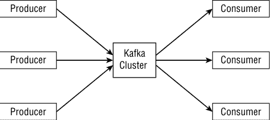

图 12.2：生产者与 Kafka 集群及消费者的关系

主题的大小可以增长，并且可以被拆分为分区（对于生产者和消费者而言，它是一个单一的消息日志，无需担心消息在哪个分区中）。需要记住的重要点是，消息是按照从生产者发送的顺序从消费者处读取的。

| 分区 | 0 | 1 | 2 | 3 | 4 | 5 | 6 | 7 | 8 | 9 | 10 | 11 | 12 |

|---|---|---|---|---|---|---|---|---|---|---|---|---|---|

| 分区 0 | | 1 | 2 | 3 | 4 | 5 | 6 | 7 | 8 | 9 | | | |

| 分区 1 | | 1 | 2 | 3 | 4 | 5 | 6 | 7 | 8 | 9 | 10 | 11 | |

| 分区 2 | | 1 | 2 | 3 | 4 | 5 | 6 | 7 | 8 | 9 | | | |

图 12.3：拆分为分区的主题

## 容错性

分区数据在多个代理上进行复制。如果某个代理挂机了，数据在剩余的代理上仍然可用。一个代理被指定为领导者，它是所有分区数据写入和读取的节点。

如果领导者故障，集群将分配一个新的领导者代理，其他代理将跟随它。代理注册（包括哪个是领导）由 Zookeeper 维护。

## 扩展阅读

关于 Kafka 工作原理的更多信息，我在附录 D “扩展阅读”中包含了一些材料。在本章中，我专注于运行 Kafka 以及使用它进行机器学习的更具实践性的方面。

## 安装 Kafka

有两个版本的 Kafka 可以下载。一个是开源 Apache 版本，另一个 Confluent 社区版本。它们的操作方式相同；主要区别在于我们何时引入 SQL 查询语言 KSQL。

对于本章，我将使用 Apache Kafka 分发版，该版本位于 https://kafka.apache.org。这是我使用的下载链接：

```
https://www.apache.org/dyn/closer.cgi?path=kafka/2.2.0/kafka_2.12-2.0.tgz
```

你需要选择一个镜像网站来下载你的 Kafka 分发版。

下载 TGZ 文件并将其存储在你想安装 Kafka 的目录中。安装 Kafka 非常简单；第一步是将压缩的 TAR 文件解压到目录中。

```
$ tar -zxf kafka_2.12-2.2.0.tgz
$ cd kafka_2.12-2.2.0
```

由于 Kafka 运行在 Zookeeper 上以标识代理，因此在启动 Kafka 之前需要运行 Zookeeper。Kafka 内部使用了许多种配置文件，但我在这里特别关注两个：`zookeeper.properties` 和 `server.properties`。这些文件如何配置取决于你想运行的集群类型。我将在本书中涵盖这一点：单节点集群和运行在同一机器上的多节点集群。

## 作为单节点集群的 Kafka

在 Kafka 的单节点配置上进行练习总是一个好主意。单台机器将同时处理 Zookeeper 和 Kafka。我使用单节点配置来开发和测试生产者、消费者和流应用程序。当我高兴应用程序按预期运行时，我就可以考虑将它们部署在多节点集群上。

第一个启动的是 Zookeeper。Kafka 需要 Zookeeper 来维护代理的状态。如果它没有运行，Kafka 将无法工作。在开发过程中，我有多个终端会话——一个用于 Zookeeper，一个用于 Kafka，另一个用于我正在工作的任何生产者或消费者。

## 启动 Zookeeper

让我们开始单节点 Kafka 安装。首先打开一个窗口并进入你安装 Kafka 的目录。从命令行输入 `zookeeper-server-start.sh zookeeper.properties`。


```
$ zookeeper-server.sh zookeeper.properties
[2019-06-18 07:43:12] INFO Reading configuration from: config/zookeeper.properties
[2019-06-18 07:43:12] INFO autopurge.snapRetentionCount to 3
[2019-06-18 07:43:12] INFO autopurge.purgeInterval set to 0
[2019-06-18 07:43:12] INFO Purge task is not scheduled.
[2019-06-18 07:43:12] INFO Either no config defined in standalone mode
```

## 启动 Kafka

一旦 Zookeeper 运行，你现在就可以启动 Kafka。打开新窗口并进入相同的目录。现在输入 `kafka-server.sh server.properties`。

```
$ kafka-server.sh server.properties
[2019-06-18 07:43:45] INFO Registered kafka:type=Log4j Controller MBean
[2019-06-18 07:43:46] INFO Connecting to zookeeper:2181
[2019-06-18 07:43:46] INFO [ZookeeperClient] Initializing a new session to localhost:2181
[2019-06-18 07:43:46] INFO environment:3.4.3-2d7f1a4bde22557fd47afa99ab30b15a7487f04, built on 06/29/2019 00:39 GMT
[2019-06-18 07:43:46] INFO environment:hostName=192.168.1.102
[2019-06-18 07:43:46] INFO environment:java.version=1.8.0_45
```

Kafka 现在已就绪，尽管它目前还没有执行任何事情；我们会之后讨论。在这个开发设置中，正确的关闭流程是先关闭 Kafka（`Ctrl-C` 会停止应用程序），然后我们对 Zookeeper 执行同样的操作。如果你在 Kafka 运行时连接 Zookeeper，代理将无法连接并开始在控制台中输出错误。

# 第 12 章 使用 Kafka 进行机器学习流处理

## 服务器基础知识

`broker.id=0`

这里的关键字是唯一的，因此我们需要创建另外两个 broker ID（在本例中为 1 和 2）。我们的第一个任务是为其他 broker 创建一个服务器属性文件的副本。

```
$ cp server.properties server1.properties
$ cp server.properties server2.properties
```

这些新配置文件中的每一个都需要编辑。打开你的文本编辑器，编辑 `server1.properties` 文件，使其值与表 12.1 相同，然后在 `server2.properties` 中进行更改。

**表 12.1：服务器 1 和 2 的属性**

| 设置项名称 | SERVER1.PROPERTIES | SERVER2.PROPERTIES |
|---|---|---|
| broker.id | 1 | 2 |
| listeners | PLAINTEXT::9093* | PLAINTEXT::9094* |
| log.dirs | /tmp/kafka-logs1* | /tmp/kafka-logs2* |

* 从属性文件中的 `listeners` 行删除注释字符 (#)。

我们更改了什么？共有三处更改。首先是 broker ID，因为这些必须是唯一的，所以我们现在有了 broker 0、1 和 2。其次，每个 broker 都需要一个与其他 broker 不同的端口地址，因为它们将在同一台机器上运行。最后，日志信息（实际消息）的目录发生了变化，因为每个 broker 都需要为消息和其他关联文件拥有自己的位置。

## 启动多 broker 集群

与独立节点一样，Zookeeper 也需要启动。打开终端窗口并像以前一样运行启动命令：

```
$ bin/zookeeper-server-start.sh config/zookeeper.properties
```

要启动 brokers，打开两个新终端窗口，并确保每个窗口都位于 Kafka 的安装目录下。每个终端窗口启动一个 broker。

启动第一个 broker（broker 0）的方法与之前所示相同。

```
$ bin/kafka-server-start.sh config/server.properties
```

现在可以启动剩余的 broker 了；接下来是 broker 1。

```
$ bin/kafka-server-start.sh config/server1.properties
```

然后是 broker 2（见图 12.4）。

```
$ bin/kafka-server-start.sh config/server2.properties
```

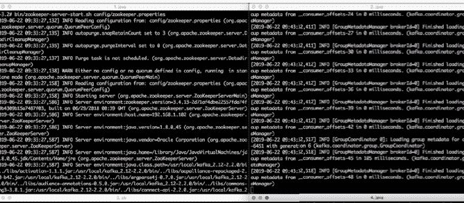

图 12.4：多层集群

在本章的剩余部分，你运行的任何命令或程序将假设你的 Kafka broker 以独立模式运行并使用 `localhost` 作为主机名。

## Topic 管理

你在 Kafka 系统中发送的任何消息都会发送到 topic。你可以自由创建任意数量的 topic。关于集群上最佳 topic 数量，根据你的名称数量有一些通用规则。

在 Kafka 分发版的 `bin` 目录下，有几个用于任务管理的 shell 脚本。需要重点关注的是 `kafka-topics.sh`。

在这个简短介绍中，你将看到如何创建、列出和删除 topic，以及如何向日志发送和接收消息。

### 创建 Topic

Topic 有两种创建方式。一种是使用命令行工具，另一种是在生产者应用程序内部创建（如果 topic 不存在则会创建一个）。

使用命令行是值得的，因为它可以让你理解创建 topic 时所需的内容、副本所需的设置，以及头信息和 Zookeeper 设置是如何处理的。

让我们现在创建一个测试 topic；为了演示，我们将其命名为 `testtopic`。在 Kafka 分发版的二进制文件中，你会看到一个名为 `kafka-topics.sh` 的 shell 脚本，这是处理 topic 活动的主要命令。要创建 topic，请在终端窗口中执行以下命令：

```
$ KAFKA_HOME/bin/kafka-topics.sh --zookeeper localhost:2181 --create --topic testtopic --replication-factor 1 --partitions 1
```

Created topic testtopic

输出的第一行显示 topic 已创建。第二行显示分区的数量和副本因子。第三行显示该 topic 的配置。

命令的输出如下：

```
Topic testtopic
PartitionCount: 1
ReplicationFactor: 1
Configs:
```

输出显示该 topic 已创建，包含一个分区且副本因子为 1。topic 的配置显示了默认设置。

要删除 topic，请使用以下命令：

```
$ KAFKA_HOME/bin/kafka-topics.sh --zookeeper localhost:2181 --delete --topic testtopic
```

topic 将被删除。

### 列出 Topic

要列出集群中的所有 topic，使用以下命令：

```
$ KAFKA_HOME/bin/kafka-topics.sh --zookeeper localhost:2181 --list
```

要查看特定 topic 的详情，使用 `describe` 标志：

```
$ KAFKA_HOME/bin/kafka-topics.sh --zookeeper localhost:2181 --describe --topic testtopic
```

### 删除 Topic

要删除 topic，使用以下命令：

```
$ KAFKA_HOME/bin/kafka-topics.sh --zookeeper localhost:2181 --delete --topic testtopic
```

### 从命令行发送消息

测试集群是否运行的最佳方法是使用命令行工具。`kafka-console-producer` 应用程序允许你从命令行发送消息。

```
$ kafka-console-producer --bootstrap-server localhost:9092 --topic testtopic
```

一旦应用程序启动，你就可以在终端中输入数据。每当你按下回车键，消息就会发送到 broker。如果你想退出应用程序，请按组合键 `Ctrl+C`。

### 从命令行接收消息

作为创建消息并将其推送到日志的命令行应用程序，也有对应的从日志读取消息的应用。

```
$ kafka-console-consumer --bootstrap-server localhost:9092 --topic testtopic --from-beginning
```

`--from-beginning` 标志从日志开始读取消息。如果你省略它，应用程序将从最后一个偏移位置读取。应用程序将持续运行，直到你用 `Ctrl+C` 关闭它。

## Kafka Tool UI

对于不习惯或不喜欢使用命令行的人，有一些可用工具可以让管理 Kafka 集群变得更容易。如果你使用的是 Confluent Kafka 分发版，就可以访问控制中心，这是一个用于可视化集群的 Web 工具（见图 12.5）。要访问它，将你的网络浏览器指向集群的 IP 地址以及端口 9021，例如：

```
http://192.168.1.102:9021
```

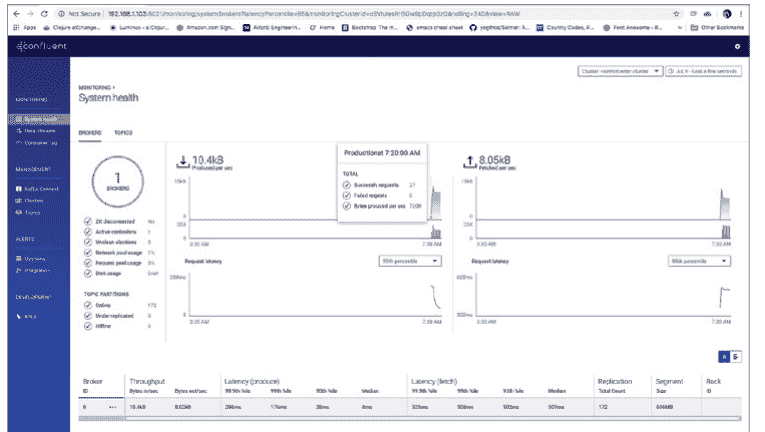

图 12.5：控制中心


由于我无法预知自己将处理什么类型的 Kafka 集群，我使用了一个名为 Kafka Tool 的通用工具（见图 12.6），该工具可以在 `http://www.kafkatool.com` 获取，且个人使用免费。它支持 macOS、Linux 和 Windows。

安装完成后，你就可以查看集群概览，并检查常规信息、获取 Zookeeper 状态、查看你的主题（topic）和消费者组（consumer group）信息。它对于检查消息内容和检查主题的偏移量（offset）信息很有用。有时从命令行读取很困难，而这样的工具可以让生活变得轻松。

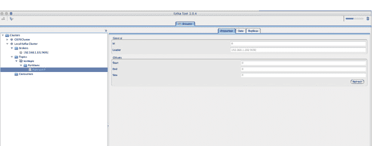

**图 12.6：** Kafka Tool

# 编写自己的生产者和消费者

到为止，重点一直放在 Kafka Broker 以及用于执行基本任务（如创建和管理主题）的命令行工具上。现在是时候编写一些基础应用程序来向 Broker 发送消息并从它们那里读取消息了。

各种客户端库涵盖了大多数语言；有关可用的列表，请查看此处的列表：

```
https://wiki.apache.org/confluence/display/KAFKA/Clients
```

在本章中，提供了 Java 版本的生产者和消费者示例。在章节后半部分，你将看到用 Java 和 Clojure 编写的 Kafka 代码；它们运行在相同的客户端 API 上。

# Java 生产者

正如你在这两个章节中看到的，生产和消费消息的过程非常简单。在开始与 Broker 工作之前，需要进行一些初步设置。我们将先解释应用程序的每个部分，然后你可以看到完整的代码。

## Properties

任何与 Kafka 集群通信的 Java 应用程序都是通过 Java 类进行设置的。Kafka API 需要键值对来向 Broker 发送默认设置和标记。

```
props = new Properties();
props.put("bootstrap.servers", "localhost:9092");
props.put("acks", "all");
props.put("retries", 0);
props.put("key.serializer",
  "org.apache.kafka.common.serialization.StringSerializer");
props.put("value.serializer",
  "org.apache.kafka.common.serialization.StringSerializer");
```

查看此属性设置，我们可以看到本章之前示例中出现过的熟悉设置，也有一些新的设置。

### Bootstrap Servers

`bootstrap.servers` 键告诉应用程序 Broker 所在的位置。在独立开发集群中，这只有一个节点和一个启动服务器。它充当应用程序发现集群中其他 Broker 的起点。如果你有多个 Broker，可以在值中使用用逗号分隔的值。

```
props.put("bootstrap.servers", "server1.localhost:9092, server2.localhost:9093");
```

### Acks

接下来是 `acks`，它是 `acknowledgments`（确认）的缩写。当生产者向 Broker 发送消息时，它可以接收一个 ack，表示 Broker 已经收到了该消息。虽然从应用程序安全的角度来看这是好事，但值得记住这会引入少量的延迟。`acks` 键有三个可用设置。表 12.2 解释了这些设置。

**表 12.2：Kafka 生产者 Acks**

| ACKS 设置 | 含义 |
|---|---|
| acks=0 | 生产者发送消息后不等待任何确认。 |
| acks=1 | 生产者等待 Leader 副本收到消息的确认。 |
| acks=all | 生产者等待所有同步副本都收到消息的确认。 |

### Retries

生产者在发送失败时会尝试重试。

### Serializers

Kafka 消息需要被序列化。

## Producer

通过配置设置，生产者可以发送消息。

## Messages

现在我们处于向生产者发送消息的阶段。

## Final Code

## 代码

### 生产者

生产者 `send()` 方法用于发送消息。

## 消费者

消费者应用程序是消费者组的成员。指定消费者组并不是必须的，但如果没有提供组名，Kafka 将在运行时自动分配一个。为了方便搜索消费者的指标，建议使用您自己的组名。

如之前在生产者应用程序中所示，我们知道消息的键（key）和有效负载（payload）数据是字符串。生产者应用程序通过 `key.serializer` 和 `value.serializer` 设置进行序列化。消费者需要消息的反序列化器（deserializers）。当消息被消费者消费时，它以字节数组的形式到达；它会被反序列化为属性中指定的格式。

```
Properties props = new Properties();
props.put("bootstrap.servers", "localhost:9092");
props.put("group.id", "testcog");
props.put("auto.commit", "true");
props.put("auto.commit.interval.ms", "1000");
props.put("session.timeout.ms", "30000");
props.put("key.deserializer",
  "org.apache.kafka.common.StringDeserializer");
props.put("value.deserializer",
  "org.apache.kafka.common.StringDeserializer");
```

### 获取消费者记录

消费者应用程序从代理服务器（broker）轮询记录。`poll()` 方法接收一个整数值，表示您希望消费者处理的记录数量。根据代理服务器的消息负载，如果拉取的消息过多，可能会导致消费者运行缓慢。花时间对您轮询的记录数量进行测试和实验。

在轮询和处理记录期间，主题（topic）的提交位置（commit position）会被写回日志。如果消费者的属性启用了偏移量的自动提交（auto setting），则该操作将在应用程序运行时执行。每次设置偏移量之间的持续时间由 `auto.commit.interval.ms` 设置的值决定；在本应用程序示例中，它被设置为 1000ms，即 1 秒。

```
KafkaConsumer<String, String> consumer = new KafkaConsumer<String, String>(props);
ConsumerRecords<String, String> records = consumer.poll(100);
```

### 消费者记录

当通过 `ConsumerRecords` 类轮询代理服务器并获取记录进行处理后，最后一步是对消息内容进行操作。`ConsumerRecord` 类是单条记录的表示。

每个消费者记录包含以下信息：

- 主题名称
- 接收记录所在的分区（partition）
- 分区中的偏移量位置（offset）
- 生产者创建的时间戳
- 键值（key value）
- 实际的消息负载（message payload）

您不需要担心设置读取记录的偏移量；这由消费者应用程序本身处理。以下代码段将偏移量、键和消息打印到控制台：

```
for (ConsumerRecord<String, String> record : records) {
    System.out.printf("offset = %d, key = %s, value = %s\n",
        record.offset(), record.key(), record.value());
}
```

### 代码

当所有内容整合在一起时，你就有了一个独立消费者应用程序的基础。主要组件包括设置属性、创建消费者、从代理服务器轮询批量记录进行处理，以及遍历带有每条记录的集合。

```java
import java.util.Properties;
import java.util.Arrays;
import org.apache.kafka.clients.consumer.KafkaConsumer;
import org.apache.kafka.clients.consumer.ConsumerRecords;
import org.apache.kafka.clients.consumer.ConsumerRecord;

public class ExampleConsumer {
    public static void main(String[] args) throws Exception {
        String topicName = "testopic";
        Properties props = new Properties();

        props.put("bootstrap.servers", "localhost:9092");
        props.put("group.id", "testcg");
        props.put("enable.auto.commit", "true");
        props.put("auto.commit.interval.ms", "1000");
        props.put("session.timeout.ms", "30000");
        props.put("key.deserializer", "org.apache.kafka.common.serialization.StringDeserializer");
        props.put("value.deserializer", "org.apache.kafka.common.serialization.StringDeserializer");
        KafkaConsumer<String, String> consumer = new KafkaConsumer<String, String>(props);

        consumer.subscribe(Arrays.asList(topicName));

        System.out.println("Subscribed to topic " + topicName);
        int i = 0;

        while (true) {
            ConsumerRecords<String, String> records = consumer.poll(100);

            for (ConsumerRecord<String, String> record : records) {
                System.out.printf("offset = %d, key = %s, value = %s\n",
                    record.offset(), record.key(), record.value());
            }
        }
    }
}
```

## 构建并运行应用程序

现在你已经看到了应用程序是如何构建的，让我们来构建并运行它们。在命令行中，运行 Maven 来构建包。

```
$ mvn package
```

如果执行成功，你将看到包含所有依赖的完整 JAR 文件路径。

> [INFO] Building jar: /path/to/your/files/target/MLChapter12Kafka/target/ch12kafka-jar-with-dependencies.jar
> [INFO] BUILD SUCCESS
> [INFO] Total time: 47 s

启动您的独立集群。

## 第 12 章 使用 Kafka 进行机器学习流处理

KTable 使用正则表达式将每一行转换为小写单词数组。这些单词将根据单词进行映射和分组。此时，对键（key）不进行处理，因为这不需要；我们稍后计数的只是单词本身。然后对这些组进行计数并发送到输出主题（topic）。

```java
static void createWordCountStream(final StreamsBuilder builder) {
    final KStream<String, String> lines = builder.stream(inputTopic);

    final Pattern pattern = Pattern.compile("\\W+", Pattern.UNICODE_CHARACTER_CLASS);

    final KTable<String, Long> counts = lines
        .flatMapValues(value -> Arrays.asList(pattern.split(value.toLowerCase())))
        .groupBy((keyIgnored, word) -> word)
        .count();

    counts.toStream().to(outputTopic, Produced.with(Serdes.String(), Serdes.Long()));
}
```

```java
import org.apache.kafka.common.serialization.Serdes;
import org.apache.kafka.streams.KafkaStreams;
import org.apache.kafka.streams.StreamsBuilder;
import org.apache.kafka.streams.StreamsConfig;
import org.apache.kafka.streams.kstream.KStream;
import org.apache.kafka.streams.kstream.KTable;
import org.apache.kafka.streams.kstream.Produced;
import java.util.Arrays;
import java.util.Properties;
import java.util.regex.Pattern;

public class ExampleStreamingAPI {
    static final String inputTopic = "winput";
    static final String outputTopic = "woutput";

    static Properties getStreamsConfiguration(final String bootstrapServers) {
        Properties sConfig = new Properties();
        sConfig.put(StreamsConfig.APPLICATION_ID_CONFIG, "streaming-api-example");
        sConfig.put(StreamsConfig.CLIENT_ID_CONFIG, "streaming-api-example-client");
        sConfig.put(StreamsConfig.BOOTSTRAP_SERVERS_CONFIG, bootstrapServers);
        sConfig.put(StreamsConfig.DEFAULT_KEY_SERDE_CLASS_CONFIG, Serdes.String().getClass().getName());
        sConfig.put(StreamsConfig.DEFAULT_VALUE_SERDE_CLASS_CONFIG, Serdes.String().getClass().getName());
        return sConfig;
    }

    static void createWordStream(final StreamsBuilder builder) {
        final KStream<String, String> lines = builder.stream(inputTopic);

        final Pattern pattern = Pattern.compile("\\W+", Pattern.UNICODE_CHARACTER_CLASS);

        final KTable<String, Long> counts = lines
            .flatMapValues(value -> Arrays.asList(pattern.split(value.toLowerCase())))
            .groupBy((keyIgnored, word) -> word)
            .count();

        counts.toStream().to(outputTopic, Produced.with(Serdes.String(), Serdes.Long()));
    }

    public static void main(String[] args) {
        final String bootstrapServers = "localhost:9092";
        final Properties streamsConfiguration = getStreamsConfiguration(bootstrapServers);
        final StreamsBuilder builder = new StreamsBuilder();

        createWordCountStream(builder);
    }
}
```


```java
final KafkaStreams streams = new KafkaStreams(builder.build(), streamsConfiguration);

streams.cleanup();

streams.start();

Runtime.getRuntime().addShutdownHook(new Thread(streams::close));
```

# 流式单词计数

在本章目前为止，你已经学习了 Kafka、消息日志、所需的代码以及如何将它们整合在一起。现在是时候将这些知识转化为概念验证机器学习系统了。

该应用程序是基于 Hadoop 时代的批处理单词计数示例。当时的挑战在于如何在实时（或近实时）环境中进行这种处理。Kafka Streaming API 为你提供了实现这一点的工具。

本章剩余部分将专注于机器学习方面、系统规划以及各个部分的组合。在本章结束时，你将拥有一个构建在 Kafka 之上的自学习机器学习系统。为了说明可能性，我将使用一个简单数据集来实现预测。通过创建不同的机器学习模型（决策树、多层感知器和线性回归），你将拥有一个随时间对所有模型提供预测的系统。从上看，数据看起来很基础，但它将为你提供机器学习所需的框架。

## 规划系统

首先，值得写下获取数据、训练模型和处理预测所需的内容。还要考虑将数据和模型持久化在哪里。它们会存储在 Amazon S3 或 Azure 等存储服务上吗？以下是规划阶段需要考虑的问题快速列表：

- 我们需要哪些主题？
- 数据从哪里来？
- 数据是什么格式？
- 我们将使用哪些算法？
- 将如何触发训练？
- 模型将保存在哪里？
- 我们如何决定使用哪些模型？
- 我们如何进行预测？

图 12.7 显示了一个示例预测 
图 12.7：系统规划

## 我们需要哪些主题？

该系统执行几项功能。首先，有数据进入系统，因此需要一个专门用于事件的主题。这将是我们事件消息的第一部分；不久后，数据以两种形式进入：训练数据和命令，它们将由流 API 处理。如果事件包含命令，则应在应用程序内部执行；否则，事件是训练数据，系统将把它推送到训练数据主题。训练数据主题接受实际内容（即行逗号分隔的变量），并使用 Kafka Connect 将其持久化。预测需要两个主题，一个用于请求，一个用于响应。预测请求将包含一个 JSON 负载，其中包含使用的模型类型和待预测的值。最终的细分见表 12.3。

### 表 12.3：主题细分

| 主题名称 | 描述 |
| :--- | :--- |
| `event_stream` | 包含命令或训练类型的输入事件消息。 |
| `training_data_topic` | 该主题处理原始 CSV 条目。 |
| `prediction_request_topic` | 用户想要通过此主题运行预测时。JSON 消息将包含模型类型和待预测的值。 |
| `prediction_response_topic` | 预测结果发送到此主题。 |

## 数据是什么格式？

该项目的消息格式是 JSON。由于我们在处理每个事件中的不同操作，可能是命令事件或训练数据事件。预测请求也是 JSON 格式。之所以这样做是因为简单的证明问题。

### 事件

事件可以采取两种形式之一：命令事件和训练数据事件。

```json
{"type":"command", "payload":"build_mlp"}
```

命令事件基本上是触发机器学习模型的指令。它们不会同时构建构建，因为那样会拖慢系统并降低性能。想法是我们可以在任何时间触发任何构建。例如，`build_mlp` 将触发我们多层感知器的构建。

```json
{"type":"training", "payload":"3,4,5,6"}
```

训练数据由负载中的 CSV 值组成。

### 预测

通过 Kafka 进行预测的流程是向请求主题发送 JSON 消息。负载包含分数的三个值，模型返回预测值。

```json
{"model":"mlp", "payload":"3,4,5"}
```

模型的响应不是以传统的编程方式返回，但会有某种触发训练命令的机制。一旦 Kafka 事件作为消息发送到预测响应主题，由开发者创建一个消费者应用程序来读取 Kafka 的响应。

### 持续训练

更新训练模型的方法有很多。当数据通过训练主题并通过连接器持久化到磁盘时，需要某种触发训练命令的机制。

一种方法是向主题本身发送事件。一旦 Kafka 流作业解析消息，它将向 API 请求启动所需的模型构建。

发送负载消息的替代方案是在服务器上使用定时 cron 任务。这确实有一个缺点；这意味着有一个命令操作没有在事件流中注册。

```text
# Kafka DL4J MLP 训练的 Crontab 条目
#
# 每天 0100 运行
# 运行决策树构建
0 1 * * * /opt/mlbook/projects/dl4j.mlp/scripts/rundtr.sh > /var/log/kafka-dl4j-training.log 2>&1
# 运行线性回归构建
30 1 * * * /opt/mlbook/projects/dl4j.mlp/scripts/runslr.sh > /var/log/kafka-dl4j-training.log 2>&1
# 运行多层感知器构建。
45 1 * * * /opt/mlbook/projects/dl4j.mlp/scripts/runmlp.sh > /var/log/kafka-dl4j-training.log 2>&1
```

**保存后**，crontab 将按照显示的时间调度模型构建。

### 表 12.4：Crontab 模型构建

| 模型名称 | 构建时间 |
|---|---|
| 决策树 | 01:00am |
| 简单线性回归 | 01:30am |
| 神经网络 | 01:45am |

## 确定使用哪些模型进行预测

我们需要在执行结果时对它们进行持久化。我将使用关系型数据库来保存这些结果，在本演示中，我将使用 MySQL，因为它被常用且安装广泛。如果你熟悉使用其他数据库，可以轻松修改架构。

正如你所看到的，当模型执行训练时，每个算法都会输出训练结果。对于决策树和神经网络，模型的准确性和训练情况会被持久化到名为 `training_log` 的表中。

线性回归的处理方式不同，因为我们没有将训练后的模型保存到文件系统，输出需要持久化到数据库。斜率和截距连同 UUID 和训练时间一起保存在 `linear_model` 表中。

当 Kafka Streaming API 运行时，它们将引用表中的训练信息来选择运行的最佳模型。

## 设置数据库

数据库的架构位于本章的存储库中。要在 MySQL 中创建数据库，请从命令行执行每条指令。

```bash
$ mysqladmin -u root -p<your admin password> create mlchapter12
```

在设置 MySQL 时将 `<your admin password>` 替换为你的管理员密码。如果没有密码，可以移除 `-p` 标志。再次运行 MySQL 客户端并读取 `schema.sql` 文件。

下一步是创建架构文件。打开你选择的编辑器并在此处复制架构：

```sql
DROP TABLE IF EXISTS 'linear_model';

/*!140101 SET @saved_cs_client = @character_set_client */;
/*!140101 SET character_set_client = utf8 */;

CREATE TABLE 'linear_model' (
  'id' int(11) NOT NULL AUTO_INCREMENT,
  'uuid' varchar(255) NOT NULL DEFAULT '',
  'created' datetime DEFAULT NULL,
  'slope' double DEFAULT NULL,
  'intercept' double DEFAULT NULL,
  'rsq' double DEFAULT NULL,
  'logoutput' text,
  PRIMARY KEY ('id')
) ENGINE=InnoDB AUTO_INCREMENT=6 CHARSET=latin1;

/*!140101 SET character_set_client = @saved_cs_client */;
```

```sql
DROP TABLE IF EXISTS 'training_log';

/*!140101 SET @saved_cs_client = @character_set_client */;
/*!140101 SET character_set_client = utf8 */;

CREATE TABLE 'training_log' (
  'id' int(11) NOT NULL AUTO_INCREMENT,
  'uuid' varchar(100) NOT NULL DEFAULT '',
  'training_date' datetime DEFAULT NULL,
  'train_eval_split' double NOT NULL DEFAULT '0.65',
  'execution_time' int(11) NOT NULL DEFAULT '-1',
  'model_accuracy' double NOT NULL DEFAULT '0',
  'training_output' text,
  'model_type' varchar(50) NOT NULL DEFAULT '',
  PRIMARY KEY ('id')
) ENGINE=InnoDB AUTO_INCREMENT=14 CHARSET=latin1;
```

保存后，你现在可以将其安装到 MySQL 中。在保存架构文件的目录下运行以下命令：

```bash
$ mysql -u root -p<your admin password> mlchapter12 < schema.sql
```

## 确定使用哪些算法

到本书为止，我们一直以一种“既然是这样，我们就做这个”的方式，针对单组数据查看单一类型的算法。取决于数据量，某些算法可能比其他算法更合适。由于数据的流特性，某些算法可能比其他算法更有优势。

例如，J48 决策树算法开始时可能比神经网络有效得多，但随着时间的推移，它在处理大量数据训练时的效果可能较差。如果我们想测试不同类型的神经网络会怎样呢？我们将测试：基于 Weka 的决策树、使用 DL4J 的多层感知器，最后使用 Apache Commons Math 的线性回归。

该系统的优势在于你可以在内存中持有不同的模型。如果你决定添加其他模型，如支持向量机，可以这样做，一旦你确定了隐藏节点数量。

## 决策树

Weka 机器学习库已经存在多年了。对于某些项目，它是完美的。让我们看看步骤。

### 创建 J48 实例

基于 Weka 的决策树的主类是 `J48`。一旦加载数据，下一步是定义索引。

```java
J48 cls = new J48();
```

```java
Instances inst = new Instances(new BufferedReader("/opt/mlbook/testdata/alldata.arff"));
```

```java
inst.setClassIndex(inst.numAttributes() - 1);
cls.buildClassifier(inst);
```

### 执行评估

构建分类器后，我们想查看模型的性能。运行评估将产生我们要持久化的数据。

```java
Evaluation evaluation = new Evaluation(inst);
Random rand = new Random(1);
int folds = 10;
evaluation.crossValidateModel(cls, inst, folds, rand);
```

交叉验证方法接受模型、实例、折数随机种子。

### 持久化模型

模型可以序列化并持久化到文件系统以便重用。我正在使用生成的 UUID，该 UUID 也将写入数据库，因为流式 API 任务稍后可以检索模型。

```java
public void persistModel(J48 cls, String uuid) {
  try {
    SerializationHelper.write("/path/to/models/" + uuid + ".model", cls);
  } catch (Exception e) {
    e.printStackTrace();
  }
}
```

### 更新数据库

模型持久化后，评估数据和创建模型所需的时间可以写入数据库。我主要感兴趣的指标是模型的准确率，评估类中的 `pctCorrect()` 方法将产生这些信息。项目中有一个 `DBTools.java` 类，作为辅助类，在构建模型和进行预测时更新并检索模型元数据。

```java
DBTools.writeResultsToDb(-1, (stop - start), evaluation.pctCorrect()/100, evaluation.toSummaryString(), "dtr");
```

### 最终代码

这是 J48 决策树模型生成器的完整代码。本质上，这是一个独立的应用程序，其他模型也是如此。因此，它可以作为决策树应用程序的生成器独立运行。

```java
package mlbook.ch12.kafka.mlp;

import weka.classifiers.Evaluation;
import weka.classifiers.trees.J48;
import weka.core.Instances;
import weka.core.SerializationHelper;
import weka.gui.treevisualizer.PlaceNode2;
import weka.gui.treevisualizer.TreeVisualizer;
import java.awt.*;
import java.io.BufferedReader;
import java.io.FileNotFoundException;
import java.io.FileReader;
import java.util.Random;
import java.util.UUID;

public class DecisionTreeBuilder {

    public DecisionTreeBuilder() {
        String uuid = UUID.randomUUID().toString();
        // 构建分类器
        J48 cls = buildModel(uuid);
        // 将模型持久化到文件系统
        persistModel(cls, uuid);
    }

    public J48 buildModel(String uuid) {
        J48 cls = new J48();
        try {
            Instances inst = new Instances(new BufferedReader(new FileReader("/mlbook/testdata/ldata.arff")));
            inst.setClassIndex(inst.numAttributes() - 1);
            try {
                long start = System.currentTimeMillis();
                cls.buildClassifier(inst);
                Evaluation evaluation = new Evaluation(inst);
                Random rand = new Random(1);
                int folds = 10;
                evaluation.crossValidateModel(cls, inst, folds, rand);
                long stop = System.currentTimeMillis();
                DBTools.writeResultsToDB(uuid, -1, (stop - start),
                evaluation.pctCorrect()/100, evaluation.toString(), "dtr");
            } catch (Exception e) {
                e.printStackTrace();
            }
        } catch (FileNotFoundException e) {
            e.printStackTrace();
        } catch (Exception e) {
            e.printStackTrace();
        }
        return cls;
    }

    public void persistModel(J48 cls, String uuid) {
        try {
```


# 第 12 章 使用 Kafka 进行机器学习流处理

## 简单线性回归

有些时候，线性回归会优于其他所有方法。由于这个概念验证使用的是基础数据，因此将此模型也纳入考虑是有意义的。这部分代码在第 4 章中有所介绍。

### 创建模型

使用 Apache Commons Math 库，我们使用 `SimpleRegression` 类构建了一个线性回归。由于数据文件中的每一行都是字符串，因此每行都需要进行分割（按逗号分割），产生一个数组（`String[]`）类型。我使用 `Double` 类的 `parseDouble()` 函数来解析字符串数组的第一个和第二个元素。

获取这两个 `double` 值后，它们被添加到回归模型中。每添加一行，模型就会返回一次。

```java
SimpleRegression sr = new SimpleRegression();
for (String s : lines) {
  String[] ssplit = s.split(",");
  double x = Double.parseDouble(ssplit[0]);
  double y = Double.parseDouble(ssplit[1]);
  sr.addData(x,y);
}
return sr;
```

### 评估

这里不像神经网络或决策树那样有实际的模型评估。`SimpleRegression` 类提供了关于斜率、截距值、标准误差值以及 $R^2$ 值的输出，以查看回归覆盖的数据方差。调整后的 $R^2$ 值用于模型在数据库中的排名。

作为使模型运行的最后一步，程序将对模型运行一些预测。它显示了输入分数（一个随机数）以及回归模型的预测结果。

所有内容都以字符串的形式返回。

```java
sb.append("Intercept: " + sr.getIntercept());
sb.append("\n");
sb.append("SloComp: " + sr.getSlope());
sb.append("Standard Error: " + sr.getSlopeStdErr());
sb.append("Adjusted R2 value: " + sr.getRSquare());

Random r = new Random();
for (int i = 0; i < runs; i++) {
    int rn = r.nextInt(10);
    sb.append("Input score: " + rn + " prediction: " + Math.round(sr.predict(rn));
    sb.append("\n");
}
```

### 将模型保存到数据库

我们不需要像处理神经网络和决策树那样保存模型。为了以后对我们进行预测，需要斜率和截距。我们还写入了 $R^2$ 值用于我们的准确率排名。创建模型的时间以及我们创建的所有评估也被持久化了。

```java
DBTools.writeLinearResults(uuid, sr.getIntercept(), sr.getSlope(), sr.getRSquare(), time, runPredictions(sr, 20));
```

### 最终代码

代码加载数据、创建模型并将结果持久化到数据库。没有模型需要序列化。它只是一个

```java
package mlbook.ch12.kafka.mlp;

import org.apache.commons.math3.stat.regression.SimpleRegression;

import java.io.*;
import java.util.ArrayList;
import java.util.List;
import java.util.Random;
import java.util.UUID;

class LinearRegressionBuilder {

    private static String path = "/opt/mlbook/testdata/output.csv";

    public LinearRegressionBuilder() {
        String uuid = UUID.randomUUID().toString();
        SimpleRegression sr = new SimpleRegression();
        List<String> lines = loadData(path);

        for (String s : lines) {
            String[] split = s.split(",");
            double x = Double.parseDouble(split[0]);
            double y = Double.parseDouble(split[1]);
            sr.addData(x,y);
        }

        long start = System.currentTimeMillis();
        DBTools.writeLinearResults(uuid, sr.getIntercept(), sr.getSlope(), sr.getRSquare(),
        runPredictions(sr, 20), System.currentTimeMillis() - start);
    }

    private List<String> loadData(String filename) {
        List<String> lines = new ArrayList<String>();
        try {
            FileReader f = new FileReader(filename);
            BufferedReader br = new BufferedReader(f);
            String line = "";
            while ((line = br.readLine()) != null) {
                lines.add(line);
            }
        } catch (FileNotFoundException e) {
            System.out.println("File not found.");
        } catch (IOException e) {
            System.out.println("Error reading file");
        }
        return lines;
    }

    private String runPredictions(SimpleRegression sr, int runs) {
        StringBuilder sb = new StringBuilder();
        sb.append("Intercept: " + sr.getIntercept());
        sb.append("\n");
        sb.append("SloComp: " + sr.getSlope());
        sb.append("\n");
        sb.append("Standard Error: " + sr.getSlopeStdErr());
        sb.append("Adjusted R2 value: " + sr.getRSquare());
        sb.append("\n");
        sb.append("********************");
        sb.append("\n");
        sb.append("Running random predictions......");
        sb.append("\n");
        Random r = new Random();
        for (int i = 0; i < runs; i++) {
            int rn = r.nextInt(10);
            sb.append("Input score: " + rn + " prediction: " + Math.round(sr.predict(rn)));
            sb.append("\n");
        }
        return sb.toString();
    }

    public static void main(String[] args) {
        LinearRegressionBuilder dlr = new LinearRegressionBuilder();
    }
}
```

## 使用 Kafka 进行流式机器学习

由于事物随时间的变化具有很大的变性，这引发了关于如何构建模型的一些有趣问题。对于简单的线性回归和决策树，训练模型不需要任何配置或规划：直接对数据运行训练、创建模型并进行评估。另一方面，神经网络需要更多的打磨才能发挥出最佳性能。

### 数据导入

我正在使用 DeepLearning4J 库来创建这个神经网络应用程序。DL4J 的优点之一在于它加载数据方面投入了大量的心血。

为了导入 CSV 数据，有一个专门的 `RecordReader` 类，它可以根据传入的分隔符导入数据。由于没有表头记录，因此没有需要跳过的行，所以该值被设置为 0。

```java
int numLinesToSkip = 0;
String delimiter = ",";
```

### 隐藏节点

我们在模型中应该使用多少个隐藏节点？考虑到数据量随时间推移会增加，很难确定需要多少个隐藏节点。

训练我们的神经网络有几种场景。我们可以按照固定的间隔对整个数据集进行训练（稍后会详细介绍），或者如果数据量巨大，可以划分出随机数据集并对这些数据进行训练，创建几个候选模型供使用。

由于训练数据有很多组合，很难说神经网络需要多少个隐藏节点。然而，有一种方法可以对使用的隐藏节点数量进行粗略计算（见图 12.8）。

$$S = \frac{samples}{i + o}$$

图 12.8：隐藏节点的计算

```java
private static int getHiddenNodeEstimate(int inputs, int outputs, int samplesize) {
    Random r = new Random();
    double out = (samplesize / (inputs + outputs)) * r.nextInt(9) + 1;
    return Math.round(out);
}
```

之前的代码获取输入节点数、输出节点数和样本大小（例如 CSV 文件中的行数）。为了进行计算，我们需要添加一些随机性，以便在方程中引入一个随机数。该方法的返回值是建议使用的隐藏节点数量。随着时间的推移，通过次数的训练，你将建立起对隐藏节点黄金点的直觉。这不是一门精确的科学，但它是需要重复以获得最准确模型的。

当我们谈论神经网络时，通常是指一组固定的参数。有 x 个输入，y 个输出和 z 个隐藏节点。数据往往是固定的数量，没有预计划和重新运行。然而，数据是不断演化的。

### 模型配置

神经网络的配置是一个简单的多层感知器。我使用了四层：一个输入层、一个输出层和两个隐藏层。决定层中有多少隐藏节点取决于之前讨论的 `getHiddenNodesConfiguration` 估算方法。

```java
MultiLayerConfiguration conf = new NeuralNetConfiguration.Builder()
    .seed(seed)
    .iterations(iterations)
    .activation(Activation.TANH)
    .weightInit(WeightInit.XAVIER)
    .learningRate(0.1)
    .regularization(true).l2(1e-4)
    .list()
    .layer(0, new DenseLayer.Builder().nIn(numInputs).nOut(hiddenNodes).build())
    .layer(1, new DenseLayer.Builder().nIn(hiddenNodes).nOut(hiddenNodes).build())
    .layer(2, new DenseLayer.Builder().nIn(hiddenNodes).nOut(hiddenNodes).build())
    .layer(3, new OutputLayer.Builder(LossFunction.NEGATIVELOGLIKELIHOOD)
    .activation(Activation.SOFTMAX)
    .nIn(hiddenNodes).nOut(outputNum).build())
    .backprop(true).pretrain(false)
    .build();
```

### 模型训练

配置完成后，随后创建模型。训练划分设置为训练数据的 65%，剩余的 35% 用于评估。在模型训练期间，应用程序将每隔 100 次迭代输出一次进度；模型训练在应用程序中设置为 2,000 次迭代。

```java
MultiLayerNetwork model = new MultiLayerNetwork(conf);
model.init();
model.setListeners(new ScoreIterationListener(100));
model.fit(trainingData);
```

### 评估

评估步骤不需要应用程序本身的任何干预；它更像是一项报告工作。在我们 11 个输出节点的情况下，评估类根据测试数据的特征矩阵生成输出。一旦评估完成，结果将输出到控制台。

```java
Evaluation eval = new Evaluation(11);
log.info("Getting evaluation");
INDArray output = model.output(testData.getMatrix());
log.info("Getting evaluation output");
eval.eval(testData.getLabels(), output);
System.out.println(eval.stats());
```

### 将模型结果保存到数据库

与其他模型一样，评估结果存储在数据库中。会获取训练数据划分的图表，以及创建模型的时间和模型的最终 F1 分。当预测事件发生时，模型标准将由 F1 分决定。

```java
// 将输出结果写入数据库
DBTools.writeResultsToDB(uuid, esplit, timetaken, eval.f1(), eval.stats(), "mlp");
```

### 持久化模型

在 DeepLearning4J 中生成的模型以 ZIP 文件格式持久化。`ModelSerializer` 为我们提供了持久化生成模型的简单方法。在我们的演示系统中，不需要更新模型；我们每次运行都会创建新模型，因此我们将 `saveUpdater` 布尔值设置为 `false`。

在示例中，我们将生成的 UUID 作为 ZIP 文件的文件名。此 UUID 将同样持久化在数据库表中。

```java
// 保存模型
File locationToSave = new File("/opt/mlbook/testdata/models/" + uuid + ".zip");
boolean saveUpdater = false;
ModelSerializer.writeModel(model, locationToSave, saveUpdater);
```

### 最终代码

这是神经网络的完整代码。它包含了我们过的过的步骤，并实现了 `CSVRecordReader`，这是一个用于解析 CSV 文件的辅助类。该模型还实现了隐藏节点模式，获取输入节点、输出节点以及数据集中的样本数。

```java
package mlbook.ch12.kafka;

import org.datavec.api.records.reader.RecordReader;
import org.datavec.api.records.reader.impl.csv.CSVRecordReader;
import org.datavec.api.split.FileSplit;
import org.deeplearning4j.datasets.datavec.RecordReaderDataSetIterator;
import org.deeplearning4j.eval.Evaluation;
import org.deeplearning4j.nn.conf.MultiLayerConfiguration;
import org.deeplearning4j.nn.conf.layers.DenseLayer;
```


import org.deeplearning4j.nn.conf.layers.OutputLayer;
import org.deeplearning4j.nn.conf.MultiLayerConfiguration;
import org.deeplearning4j.nn.multilayer.MultiLayerNetwork;
import org.deeplearning4j.nn.weights.WeightInit;
import org.deeplearning4j.optimize.listeners.ScoreIterationListener;
import org.deeplearning4j.util.ModelSerializer;
import org.nd4j.linalg.activations.Activation;
import org.nd4j.linalg.api.ndarray.INDArray;
import org.nd4j.linalg.dataset.DataSet;
import org.nd4j.linalg.dataset.api.SplitTestAndTrain;
import org.nd4j.linalg.dataset.api.iterator.DataSetIterator;
import org.nd4j.linalg.dataset.api.preprocessor.DataNormalization;
import org.nd4j.linalg.dataset.api.preprocessor.NormalizerStandardize;
import org.nd4j.linalg.lossfunctions.LossFunctions;
import org.slf4j.Logger;
import org.slf4j.LoggerFactory;
import java.io.File;
import java.util.Random;
import java.util.UUID;

public class ANNBBuilder {

    private static Logger log = LoggerFactory.getLogger(ANNBBuilder.class);

    private static long getHiddenNodeEstimate(int inputs, int outputs, int sampleSize) {
        Random r = new Random();
        double out = (sampleSize / (inputs + outputs)) * r.nextInt(9) + 1;
        return Math.round(out);
    }

    public static void main(String[] args) throws Exception {
        String uid = UUID.randomUUID().toString();
        long start = System.currentTimeMillis();

        // 使用记录读取获取数据集
        // CSVRecordReader 处理加载/解析
        int numLinesToSkip = 0;
        String delimiter = ",";
        CSVRecordReader recordReader = new CSVRecordReader(numLinesToSkip, delimiter);
        recordReader.initialize(new FileSplit(new File("/mlbook/testdata/")));

        // RecordDataSetIterator 处理转换为 DataSet 对象，供神经网络使用
        int labelIndex = 3; // CSV 每行有 4 个值：3 类索引
        int numClasses = 11; // 11 个类
        int batchSize = 274;
        double equalsplit = 0.65;
        DataSetIterator iterator = new RecordDataSetIterator(recordReader, batchSize, labelIndex, numClasses);
        DataSet allData = iterator.next();
        allData.shuffle();
        SplitTestAndTrain testAndTrain = allData.splitTestAndTrain(equalsplit);
        DataSet trainingData = testAndTrain.getTrain();
        DataSet testData = testAndTrain.getTest();

        // 我们需要对数据进行归一化。我们将使用 NormalizerStandardize (它为我们提供了均值 0，单位方差)
        DataNormalization normalizer = new NormalizerStandardize();
        normalizer.fit(trainingData);
        normalizer.transform(trainingData);
        normalizer.transform(testData);

        final int numInputs = 3;
        int outputNum = 11;
        int iterations = 2000;
        long seed = 6;

        int hiddenNodes = (int) getHiddenNodeEstimate(numInputs, outputNum, batchSize);

        MultiLayerConfiguration conf = new NeuralNetConfiguration.Builder()
                .seed(seed)
                .iterations(iterations)
                .activation(Activation.TANH)
                .weightInit(WeightInit.XAVIER)
                .learningRate(0.1)
                .regularization(true).l2(1e-4)
                .list()
                .layer(0, new DenseLayer.Builder().nIn(numInputs).nOut(hiddenNodes).build())
                .layer(1, new DenseLayer.Builder().nIn(hiddenNodes).nOut(hiddenNodes).build())
                .layer(2, new DenseLayer.Builder().nIn(hiddenNodes).nOut(hiddenNodes).build())
                .layer(3, new OutputLayer.Builder(LossFunctions.LossFunction.NEGATIVELOGLIKELIHOOD)
                        .activation(Activation.SOFTMAX)
                        .nIn(hiddenNodes).nOut(outputNum).build())
                .backprop(true).pretrained(false)
                .build();

        // 运行模型
        MultiLayerNetwork model = new MultiLayerNetwork(conf);
        model.init();
        model.setListeners(new ScoreIterationListener(100));

        model.fit(trainingData);
        log.info("Made it here....");
        long stop = System.currentTimeMillis();
        long timetaken = stop - start;

        System.out.println("Took " + timetaken + " millis");

        // 在测试集上评估模型
        Evaluation eval = new Evaluation(11);
        log.info("Getting evaluation");
        INDArray output = model.output(testData.getFeatureMatrix());
        log.info("Getting output");
        eval.eval(testData.getLabels(), output);
        System.out.println(eval.stats());

        // 将输出写入数据库
        DbTools.writeResultsToDB(uid, equalsplit, timetaken, eval.f1(), eval.stats(), "mlp");

        // 保存模型
        File locationToSave = new File("/opt/mlbook/testdata/models/" + uid + ".zip");
        boolean saveUpdater = false;
        ModelSerializer.writeModel(model, locationToSave, saveUpdater);
    }
}

# 第 12 章 使用 Kafka 进行机器学习流处理

## Kafka 主题

在此应用程序中，共有四个主题。首先是事件流主题；它包含了训练数据的消息，或者对我们拥有的三个模型之一运行构建的命令。如果消息包含数据，流式应用程序会将消息内容（CSV 数据）推送到训练数据主题。

在处理好命令和训练数据后，我们只需要处理预测结果。要进行预测，消息会被发送到预测请求主题。这是另一个 JSON 载荷，包含要运行并进行预测的模型类型。预测响应主题是结果被发送到的主题。处理预测的流式应用程序会向此主题发布响应。对于这个概念验证，我假设有一个消费者在处理它。

## 创建主题

主题的创建是使用在本章之前介绍过的 `kafka-topics` 命令完成的。我创建了一个 shell 脚本来为你创建所有四个主题。主题命令需要三部分信息：Zookeeper 的主机名和端口、复制因子以及分区数量。

为了学习目的，我将复制因子和分区都保持为 1。如果此系统被投入生产环境，我会考虑增加这些数字以提高整个应用程序的韧性。以下是创建主题所需的脚本：

```bash
KAFKA_HOME=/usr/local/kafka
ZK_CONNECT=localhost:2181
REPLICATION_FACTOR=1
PARTITIONS=1

# training_data_topic - 原始数据将传输到这里。使用 Kafka 将数据推送到数据存储。
$KAFKA_HOME/bin/kafka-topics.sh --create --topic training_data --zookeeper $ZK_CONNECT --partitions $PARTITIONS --replication-factor $REPLICATION_FACTOR

# event_stream_topic - 事件发送到 Kafka。
$KAFKA_HOME/bin/kafka-topics.sh --create --topic event_stream --zookeeper $ZK_CONNECT --partitions $PARTITIONS --replication-factor $REPLICATION_FACTOR

# prediction_request_topic - 发送到 Kafka 应用。
$KAFKA_HOME/bin/kafka-topics.sh --create --topic prediction_request --zookeeper $ZK_CONNECT --partitions $PARTITIONS --replication-factor $REPLICATION_FACTOR

# prediction_response_topic - 预测响应来自这里。
$KAFKA_HOME/bin/kafka-topics.sh --create --topic prediction_response --zookeeper $ZK_CONNECT --partitions $PARTITIONS --replication-factor $REPLICATION_FACTOR
```

## 持久化数据

训练数据的工作方式与事件主题相同。更改主题和输出路径是唯一的操作。这将数据写入 CSV 文件。

## 安装连接器配置

Kafka Connect 有两种类型——一种用于独立运行，另一种用于分布式集群。为了在开发集群上启动 Kafka Connect，你需要先传入属性文件。在本示例中，将在命令行中运行内容。Kafka 将加载所需的插件并启动。如果属性文件有问题，Connect 将连接而你会返回命令行。当发生这种情况时，请检查属性文件的错误并重试。当 Connect 启动时，你应该看到类似下面的输出。主要关注的是“Sink finished initialization”等内容，这意味着连接器已安装并正在等待。

```properties
name=dl4j-events-file-sink
connector.class=FileStreamSink
tasks.max=1
file=/opt/ml/testdata/events.json
topic=event_topic
key.converter=org.apache.kafka.connect.serialization.StringConverter
value.converter=org.apache.kafka.connect.serialization.StringConverter
```

```
[2019-08-11 14:36:38,894] INFO [Consumer Client=consumer-1, groupId=d4j-eventsws-file-sink (Re-) joining group (org.apache.kafka.clients.consumer.internals.AbstractCoordinator:491)
[2019-08-11 14:36:38,988] INFO [Consumer Client=consumer-1, groupId=d4j-eventsws-file-sink] Successfully joined group with generation 1 (org.apache.kafka.clients.consumer.internals.AbstractCoordinator:455)
[2019-08-11 14:36:38,991] INFO [Consumer Client=consumer-1, groupId=d4j-eventsws-file-sink] Setting newly assigned partitions: (org.apache.kafka.clients.consumer.internals.AbstractCoordinator:299)
[2019-08-11 14:36:39,024] INFO [Consumer Client=consumer-1, groupId=d4j-eventsws-file-sink] Resetting offset for partition event_topic=0 to offset 0. (org.apache.kafka.clients.consumer.internals.Fetcher:584)
```

# 使用 Kafka 进行机器学习流

## Rest API 微服务

系统的核心是一个预测 HTTP API。它接受来自两个流式应用程序的请求，也可以直接向端点发送请求（例如使用异步 Ajax 调用的网页）。

使用 ComposeAPI 库创建包含 Swagger 前端的 REST 基于 API 是一轻而易举的事，这使得测试变得简单得多。有许多需要实现的处理器、任何所需的数值，以及端点的功能。

### 12.5：端点拆解

| 端点 | 参数 | 功能 |
| --- | --- | --- |
| `/api/build_dtr` | 无 | 触发决策树模型的构建脚本 |
| `/api/build_slr` | 无 | 触发简单线性回归的构建脚本 |
| `/api/build_mlp` | 无 | 触发多层感知器神经网络的构建脚本 |
| `/api/predict/dtr/:d` | 三部分 CSV 行 | 针对决策树模型预测分数 |
| `/api/predict/slr/:d` | 三部分 CSV 行 | 针对简单线性回归模型预测分数 |
| `/api/predict/mlp/:d` | 三部分 CSV 行 | 针对多层感知器神经网络预测分数 |

使用该框架组合 API 几乎不需要写多少代码。每个函数本质上都是 GET 处理器，执行一个函数并返回 JSON 负载作为响应。

```clojure
(GET "/predict/dtr/:d"
  :path-params [d :- String]
  :summary "针对决策树模型运行预测"
  :ok (json/write-str (dtr/predict-decision-tree)))
```

REST API 处理器的完整代码所示：

```clojure
(ns prediction.http.api.handler
  (:require [compojure.api.sweet :refer :all]
           [ring.util.http-response :refer :all]
           [prediction.http.api.linear :as slr]
           [prediction.http.api.decisiontree :as dtr]))
```


# Clojure 预测 API 与 Kafka 流处理实现

## 依赖引入

```clojure
[require [prediction.http.api.mlp :as mlp]
         [clojure.data.json :as json]
         [schema.core :as s]]
```

## HTTP API 定义

一个用于构建和预测模型的非常基础的 API。Swagger 接口也是，因此你可以进行测试。

```clojure
(def app
  (api
    :swagger
    {:spec "swagger.json"
     :data {:info {:title "Strata 2016 - Kafka/DL4J/Weka/Commons Demo"}
            :tags [{:name "api", :description "prediction api"}]}})
    (context "/api" []
      :tags ["api"]
      (GET "/build_dtr" []
        :return {:result String}
        :summary "构建决策树模型"
        :ok {:result (dtr/run-model-build)})
      (GET "/build_mlp" []
        :return {:result String}
        :summary "构建神经网络模型"
        :ok {:result (mlp/run-model-build)})
      (GET "/build_slr" []
        :return {:result String}
        :summary "构建简单线性回归模型"
        :ok {:result (slr/run-model-build)})
      (GET "/predict/mlp/:d" []
        :path-params [d :- String]
        :summary "针对神经网络模型运行预测"
        (ok (json/write-str (mlp/predict-mlp d))))
      (GET "/predict/dtr/:d" []
        :path-params [d :- String]
        :summary "针对决策树模型运行预测"
        (ok (json/write-str (dtr/predict-decision-tree d))))
      (GET "/predict/slr/:d" []
        :path-params [d :- String]
        :summary "针对简单线性回归模型运行预测"
        (ok (json/write-str (slr/predict-simple-linear d)))))))
```

Swagger 接口提供了一个可访问的浏览器页面，你可以在其中测试 API、运行命令并查看 API 响应（见图 12.9）。

### API 参数示例

| 参数 | 值 | 描述 | 参数类型 | 数据类型 |
|---|---|---|---|---|
| d | 3,A5 | | path | string |

| 响应消息 | | | | |
|---|---|---|---|---|
| HTTP 状态码 原因 | 响应模型 | | 头部 | |
| default | 隐藏响应 | | | |

| Curl | | | | |
|---|---|---|---|---|
| `curl -X GET -H "Accept: application/json" "http://localhost:3000/api/predict/mlp/3h2C4c2C5"` | | | | |

| 请求 URL | | | | |
|---|---|---|---|---|
| `http://localhost:3000/api/predict/mlp/3h2C4c2C5` | | | | |

## 命令与事件

系统的核心是一个预测 HTTP API。它接受来自两个流式应用程序的请求，也可以直接向端点发送请求（例如使用异步 Ajax 调用的网页）。

使用 `ComposeAPI` 库创建包含 Swagger 前端的 REST API 是一件轻而易举的事，这使得测试变得简单得多。有许多需要实现的处理器、任何所需的数值，以及端点的功能。

## 命令还是事件？

Swagger 接口提供了一个可访问的浏览器页面，你可以在其中测试 API、运行命令并查看 API 响应（见图 12.9）。

## Kafka 流处理代码示例

### 流拓扑构建

```clojure
(training-topic (.stream builder training-topic))

(log/info partitioned-stream)

(log/info training-topic-stream)

(-> (aget partitioned-stream 0)
    (.mapValues (reify ValueMapper
                  [_ v] (process-command v))))
    (.print))

(-> (aget partitioned-stream 1)
    (.mapValues (reify ValueMapper
                  [_ v] (process-training v))))
    (:to-training-name))
```

### 核心命名空间与依赖

```clojure
(ns kafka.streams.events.core
  (:require [franzamin.zookeeper.defaults :as zk-defaults]
            [franzamin.zookeeper.client :as client]
            [franzamin.cluster :as cluster]
            [clojure.java.io :as io]
            [clojure.string :as cstr]
            [taoensso.timbre :as log]
            [clojure.data.json :as json]
            [aero.core :as aero]
            [environ.core :refer [env]])
  (:import [org.apache.kafka.streams.kstream KStreamBuilder Predicate ValueMapper]
           [org.apache.kafka.streams KafkaStreams StreamsConfig]
           [org.apache.kafka.common.serialization Serdes])
  (:gen-class))
```

### 配置与工具函数

```clojure
(def api-endpoint "http://localhost:3000/api")

(defn config [profile]
  (aero/read-config (io/resource "config.edn") {:profile profile}))

(defn get-broker-list [zk-conf]
  (let [c (merge zk-defaults/zk-client-defaults zk-conf)]
    (with-open [u (client/map-utils c false)]
      (cluster/all-brokers u))))

(defn broker-str [zk-conf]
  (let [zk-brokers (get-broker-list zk-conf)
        bro (map (fn [broker]
                   (str (get-in broker [:endpoints :plaintext :host]) ","
                        (get-in broker [:endpoints :plaintext :port])))
                 zk-brokers)]
    (if (= 1 (count bro))
      (first bro)
      (cstr/join "," bro))))

;; Kafka 消息此时仍然是字节数组。将它们转换为字符串。
(defn deserialize-message [bytes]
  (try (-> bytes
           java.io.ByteArrayInputStream.
           io/reader
           slurp)
       (catch Exception e (log/info (.printStackTrace e)))
       (finally (log/info "*"))))

;; 函数接收字节数组消息并将其转换为 Clojure map。
(defn pre-process-data [data-in]
  (log/info "Pre process data")
  (log/info data-in)
  (let [message (-> data-in deserialize-message)
        json-out (json/read-str message :key-fn keyword)]
    (log/info json-out)
    json-out))

;; 处理任何命令，基本上是将它们发送到 HTTP API。
(defn process-command [data-in]
  (let [jsonom (pre-process-data data-in)]
    (slurp (str api-endpoint :payload jsonom))))

;; 提取 CSV 训练数据并返回。
(defn process-training [data-in]
  (let [jsonom (pre-process-data data-in)]
    (.getBytes (:payload jsonom))))

;; 针对消息检查键，返回 true/false
(defn pre-key-type [key message]
  (log/info "Checking for key %s" message key)
  (let [b (if (= key (:type message)) true false)]
    (log/info "key %s - result is %b" b)
    b))
```

### 流应用程序启动

```clojure
;; 这才是真正的 Kafka 流式应用程序。
;; 所有配置都将被读取，然后应用程序将处理其余部分。
;; 流被分叉以处理事件流（无论是命令还是训练数据）
(defn start-stream []
  (let [{:keys [kafka zookeeper] :as configuration} (config (keyword (env :profile)))]
    (log/info "PROFILE" (env :profile))
    (let [broker-list (broker-str (:servers zookeeper))
          props {StreamsConfig/APPLICATION_ID_CONFIG (:consumer-group kafka)
                 StreamsConfig/BOOTSTRAP_SERVERS_CONFIG broker-list
                 StreamsConfig/ZOOKEEPER_CONNECT_CONFIG zookeeper
                 StreamsConfig/TIMESTAMP_EXTRACTOR_CLASS_CONFIG org.apache.kafka.streams.processor.WallclockTimestampExtractor
                 StreamsConfig/KEY_SERDE_CLASS_CONFIG (.getName (Serdes/String))
                 StreamsConfig/VALUE_SERDE_CLASS_CONFIG (.getName (Serdes/ByteArray))]
          builder (KStreamBuilder.)
          config (StreamsConfig. props)
          input-topic (to-array String [(:topic kafka)])
          training-topic-name (:training-data kafka)
          training-topic (to-array String [training-topic-name])]
      (log/info "Zookeeper Address: %s" zookeeper)
      (log/info "Broker List: %s" broker-list)
      (log/info "Kafka Topic: %s" (:topic kafka))
      (log/info "Consumer Group: %s" (:consumer-group kafka))
      (log/info "Zookeeper: %s" zookeeper)
      (log/info "Bootstrap Servers: %s" broker-list)
      (log/info "Application ID: %s" (:consumer-group kafka))
      (log/info "Key Serde: %s" (.getName (Serdes/String)))
      (log/info "Value Serde: %s" (.getName (Serdes/ByteArray)))
      ;; 此处应继续构建流拓扑并启动 KafkaStreams
      )))
```

### 备选实现：预测流处理

```clojure
;; 函数接收字节数组消息并将其转换为 Clojure 映射。
(defn pre-process-data [data-in]
  (log/info "Pre process data")
  (log/info data-in)
  (let [message (-> data-in deserialize-message)
        json-out (json/read-str message :key-fn keyword)]
    (log/info json-out)
    json-out))

;; 处理任何命令，基本上是将它们发送到 HTTP API。
(defn run-prediction [data-in]
  (let [jsonm (pre-process-data data-in)
        prediction-json (p/make-prediction jsonm)]
    (.getBytes prediction-json)))

;; 这是实际的 Kafka 流式应用程序。
;; 所有配置都将读入，应用程序将处理剩余部分。
(defn start []
  (let [{:keys [kafka zookeeper] :as configuration} (config (keyword (env :profile)))]
    (log/info "PROFILE" (env :profile))
    (let [broker-list (broker-str (:servers zookeeper))
          props {StreamsConfig/APPLICATION_ID_CONFIG (:consumer-group kafka)
                 StreamsConfig/BOOTSTRAP_SERVERS_CONFIG broker-list
                 StreamsConfig/ZOOKEEPER_CONNECT_CONFIG zookeeper
                 StreamsConfig/TIMESTAMP_EXTRACTOR_CLASS_CONFIG org.apache.kafka.streams.processor.WallclockTimestampExtractor
                 StreamsConfig/KEY_SERDE_CLASS_CONFIG (.getName (Serdes/String))
                 StreamsConfig/VALUE_SERDE_CLASS_CONFIG (.getName (Serdes/ByteArray))]
          builder (KStreamBuilder.)
          config (StreamsConfig. props)
          input-topic (into-array String [(:input-topic kafka)])
          response-topic-name (:output-topic kafka)]
      (log/info "Zookeeper Address: %s" zookeeper)
      (log/info "Broker List: %s" broker-list)
      (log/info "Kafka Topic: %s" (:input-topic kafka))
      (log/info "Kafka Consumer Group: %s" (:consumer-group kafka))
      (doto builder
        (.stream input-topic)
        (.mapValues (reify ValueMapper
                      [_ v] (run-prediction v))))
      (.to response-topic-name)
      (KafkaStreams. builder config))))
```

## 预测函数

当流式应用程序调用 `make-prediction` 函数时，它指的是预测命名空间。Clojure 有一种名为多方法（multi-methods）的机制来实现这一点，它允许你创建一个单一函数名，但让不同的函数来完成工作。


多方法非常适合预测机制，因为我们传入了 JSON 负载，并且正在处理两个方面：模型类型和用于对比预测的值。

每个函数都具有相同的结构：

```clojure
(defmethod make-prediction :my-model-type [event]
  (json/write-str (my-model-type-function/predict-model (:payload event))))
```

在整个过程中都是同一个函数；只是模型名称发生了变化。这使得我们的应用程序很容易进行扩展。也许我决定向系统中添加一个支持向量机模型。如果我需要添加一个新的多方法来调用对我编写的支持向量机代码的预测，那么在 `predict` 命名空间中，我会添加以下内容：

```clojure
(defmethod make-prediction :svm [event]
  (json/write-str (svm/predict-model (:payload event))))
```

这样就不需要对流式应用程序进行重构了。目前，项目中有三个模型，对应的代码列表如下：

```clojure
(ns kafka.stream.prediction.predict
  (:require [kafka.stream.prediction.decisiontree :as dt]
            [kafka.stream.prediction.linear :as lr]
            [kafka.stream.prediction.mlp :as mlp]
            [clojure.data.json :as json]))
```

```clojure
(def get-model-type [event]
  (keyword :model event))

(defmulti make-prediction (fn [event] (get-model-type event)))

(defmethod make-prediction :mlp [event]
  (json/write-str (mlp/predict-mlp (:payload event))))

(defmethod make-prediction :lr [event]
  (json/write-str (lr/predict-simple-linear (:payload event))))

(defmethod make-prediction :dt [event]
  (json/write-str (dt/predict-decision-tree (:payload event))))
```

# 第12 章 使用 Kafka 进行机器学习流

最后我们来看三个模型是如何进行预测的；它们使用不同的 Java API，因此方式各异。首先是决策树。

## 使用决策树模型预测

决策树模型使用 Weka，此命名空间同时处理模型构建（一个脚本）和预测。当预测机制调用 `:dtr` 事件时，它执行 `predict-decision-tree` 函数。它执行了以下任务：

- 创建一个 ARFF 格式实例。
- 查询 MySQL 数据库查找最准确的决策树模型，查询返回 UUID。
- 根据 UUID，然后将模型加载到内存中。
- 对模型进行预测。
- 创建 JSON 负载并返回给流式应用程序的调用函数。

```clojure
(ns prediction.http.api
  (:require [prediction.http.decisiontree :as dt]
            [prediction.http.linear :as lr]
            [prediction.http.mlp :as mlp]
            [clojure.data.json :as json]))
```

```clojure
(ns prediction.http.api.db
  (:require prediction.http.api.db :as db)
  [clojure.string :as s]
  [clj-time.core :as t]
  [clj-time.format :as f]
  (:use clojure.shell :only [sh])
  (:import org.deeplearning4j.util ModelSerializer)
  (org.nd4j.linalg.factory Nd4j))
```

```clojure
(def script-path "/mlpbook/work/strata-kafka-2018-dl4j-clojure/projects/dl4j.mlp/scripts/runmlp.sh")
```

```clojure
(def run-model []
  (sh script-path)
  "Neural Network built.")
```

```clojure
(def get-most-accurate-model []
  (first (db/load-accurate-model-by-type {:model-type "mlp"})))
```

```clojure
(def build-file-filepath [uuid]
  (str "/mlpbook/testdata/models/" uuid ".zip"))
```

```clojure
(def load-mlp-model [uuid]
  (ModelSerializer/restoreMultiLayerNetwork (build-file-model uuid)))
```

```clojure
(def split-input [input]
  (double-array
    (map #(Double/parseDouble %)
      (-> input
        (s/split ",")))))
```

```clojure
(def make-prediction [input]
  (let [input-vector (Nd4j/create (split-input input))]
    (.output model input-vector)
    (.argmax (Nd4j/getBlasWrapper prediction))))
```

```clojure
(def predict-mlp [x]
  (let [model-info (get-most-accurate-model)
        model (load-mlp-model {:uuid model-info})
        prediction (make-prediction model x)]
    {:input x
     :result prediction
     :accuracy (:model_accuracy model-info)
     :modelid (:uuid model-info)
     :prediction-date (f/unparse (f/formatters :mysql) (t/now))}))
```

## 运行项目

这是一个包含许多运行服务的项目。以下是关于如何运行它的快速说明。假设你位于项目的根目录。

### 运行 MySQL

假设 MySQL 已经运行，请创建表。

```
$ mysql -u root -p<你的管理员密码> create mlchapter12
$ mysql -u root -p<你的管理员密码> mlchapter12 < schema.sql
```

### 运行 Zookeeper

打开一个新的终端窗口并以 root 用户身份运行以下命令：

```
$ /path/to/kafka/bin/zookeeper-server-start.sh /path/to/kafka/config/zookeeper.properties
```

### 运行 Kafka

打开一个新的终端窗口并以 root 用户身份运行以下命令：

```
$ /path/to/kafka/bin/kafka-server-start.sh /path/to/kafka/config/server.properties
```

### 创建 Topic

在 scripts 目录中创建 topic。

```
$ /path/to/project/scripts/create-topics.sh
```

### 运行 Kafka Connect

以 root 用户身份更改目录名称以反映你的目录名称。

```
$ /path/to/kafka/bin/connect-standalone.sh /path/to/kafka/config/connect-standalone.properties /path/to/project/config/d14j_event_to_sink.properties /path/to/project/config/d14j_to_fs_sink.properties
```

### 模型构建

进入 projects 文件夹下的 dl4j.mlp 项目，并在新的终端窗口中运行以下命令：

```
$ mvn package
```

### 运行事件流应用

进入 projects 文件夹下的 kafka.stream.events 项目并运行以下命令：

```
$ lein uberjar
$ java -jar target/uberjar/kafka-stream-events.jar
```

### 运行预测流应用

进入 projects 文件夹下的 kafka.stream.prediction 项目并运行以下命令：

```
$ lein uberjar
$ java -jar target/uberjar/kafka-stream-prediction.jar
```

### 启动 API

进入 projects 文件夹下的 prediction.http.api 项目并运行以下命令：

```
$ lein uberjar
$ java -jar target/uberjar/server.jar
```

### 发送 JSON 数据

在 Zookeeper、Kafka 和 Kafka Connect 运行时，你现在可以向 event_topic 发送一些数据。以下脚本将遍历 data 目录中 trainingdata.json 的每一行并将其传递 Kafka 生产者：

```
for i in `cat data/trainingdata.json`; do echo $i | /path/to/kafka/bin/kafka-console-producer.sh
```

### 训练模型

在项目的 messages 目录下你会找到三个发送到 event_topic 的负载。要请求构建回归模型，你可以从命令行运行以下命令：

```
cat build_slr.json | /path/to/kafka/bin/kafka-console-producer.sh --broker-list localhost:9092 --topic event_topic
```

### 进行预测

messages 目录中有一个示例预测消息。以同样请求模型的方式将 sample_predict.json 发送到 prediction_request_topic。

```
cat sample_predict.json | /path/to/kafka/bin/kafka-console-producer.sh --broker-list localhost:9092 --topic prediction_request_topic
```

如果你在 prediction_response_topic 上运行消费者，你将看到包含预测结果的 JSON 输出。

```json
{"input": "3,4,5",
"result": 5.27,
"accuracy": 76.876,
"modelid": "32201ab39be3745e5e9a7e576827cc59",
"prediction-date": "2019-08-11 18:58:00"}
```

## 总结

Kafka 为我们提供了一个可靠的实时消息生产消费系统。通过将其与所学的机器学习知识的其他技术相结合，你可以构建一个使用流数据创建模型集进行预测的系统，并随着时间的推移提高准确性。

# 第13 章 Apache Spark

使用 Scala 编写代码可以让你从 REPL 中检查数据，而无需编写代码来完成任务。在这一简短介绍之后，我将介绍如何在 Spark 中构建完整的应用程序。

## 启动 Shell

在安装 Spark 的目录中，输入以下命令启动 shell：

```
./bin/spark-shell
```

在 Spark 启动时，你会看到以下输出：

```
$ bin/spark-shell
19/10 00:09:24:25 WARN NativeClassLoader: Unable to load native-hadoop
library for your platform... using builtin-java classes where
applicable
Using Spark's default log4j profile: org/apache/spark/log4j-
defaults.properties
Setting default log level to "WARN". For SparkR,
use setLogLevel sc.setLevel(newLevel).
Spark context Web UI available at http://192.168.1.102:4040
Spark context available as 'sc' (master = local[*],
 id = local-171559873516)
Spark session available as 'spark'.
```

```
Welcome to

  /  \  /  \  /  \  /  \  /  \ 
 /    /    /    /    /    /        // version 2.4.4
\  /      \  /    \    /      \/
```

使用 Scala 版本 2.11.12 (Java HotSpot (TM) 64-Bit Server VM,

Java 1.8.0_45

输入表达式进行求值。

输入 :help 获取更多信息。

```
scala>
```

我显示了所有消息，是因为等会儿我想向你展示一些有趣的内容。但现在，你应该看到底部的 `scala>` 提示符，说明你已经准备就绪。

## 数据源

Spark 支持 Hadoop 等输入文件系统。如果你的数据存储被 Hadoop 的 `InputFormat` 方法支持，那么你就可以轻松地将其读取到 Spark 中。

显而易见的本地文件系统、Amazon S3 桶、HBase、Cassandra 以及已经存在 Hadoop 分布式文件系统 (HDFS) 中的文件。正如你在下一节看到的，你正在使用 `sc.textFile` 方法来加载数据。这不仅限于特定文件；你可以使用该方法处理带有压缩文件的通配符以及目录。

## 测试 Spark

找到一个文本文件来测试 Spark，并按照本节其余部分操作。在此示例中，我使用了本地文件系统的文件。

## 加载文本文件

首先，加载一个文本文件。在 Scala 命令行中输入以下内容：

```
scala> var textF = sc.textFile("path/to/data/ch13/mobydick.txt")
```

基本上你正在将文本文件的内容存储在一个名为 `textF` 的 Scala 变量中。Spark 的响应将类似于如下所示的输出：

```
textF: org.apache.spark.rdd.RDD[String] =
/path/to/data/ch13/mobydick.txt MapPartitionsRDD[3] at textFile at
<console>:24
```

Spark 使用了弹性分布式数据集 (RDD) 概念，因此在输出中你可以看到现在你有一个包含字符串的 `MappedRDD`。加载文本文件后，你可以开始检查它并获取一些结果。

### 进行一些快速检查

数据加载后，你可以进行一些快速检查。首先，RDD 中有多少个数据元素？

```
scala> textF.count()
```

你得到以下输出：

```
res1: Long = 7182
scala>
```

此计数代表 RDD 中的元素数量，而不是文本文件中的行数。你可以从 RDD 中提取出第一个元素，如下所示：

```
scala> textF.first()
res2: String = CHAPTER 1
scala>
```

正如你从输出中看到的，这些结果返回很快，因为 RDD 是基于内存的。

## 从 RDD 过滤文本

通过 `.filter` 函数，你可以开始检查文本文件中的特定内容。假设你想看某个单词在文档中出现了多少次，可以运行以下命令：

```
scala> textF.filter(line => line.contains("whale")).count()
```

这一行 Scala 代码会遍历 RDD。由于你在末尾添加了计数器 `count()`，你将得到以下结果：

```
res3: Long = 316
```

因此，整个文档中提到了 316 次“whale”。如果需要，你可以将此输出保存到另一个数组中。

```
scala> var filtered = textF.filter(line => line.contains("whale"))
filtered: org.apache.spark.RDD[String] = MapPartitionsRDD[6]
at <console>:25
```

```
scala> filtered.count()
res4: Long = 316
```

借助于 Scala 简洁的命令以及分布式数据集（RDD）的内存处理能力，你拥有了一个整洁的系统来快速完成大量数据计算。


## Spark 监控

早些时候我提到，当你启动 Spark 时，其中一个基于 Web 的监控器。如果你将浏览器指向 `http://192.168.1.102:4040`，你应该就能看到图 13.1 所示的网站。对于 Spark 而言，你运行的每一行都会记录其持续时间和执行输出。如果你的作业出现问题，在这里查看全局视图非常方便。

| Stage ID | Description | Submitted | Tasks: Succeeded/Total | Shuffle Read |
| :--- | :--- | :--- | :--- | :--- |
| 5 | collect | 17 | 14/17 | 54 ms |
| 4 | count | 17 | 14/17 | 0.7 s |
| 3 | count | 14 | 14/17 | 2.6 s |
| 2 | count | 17 | 14/17 | 54 ms |
| 1 | count | 15 | 14/17 | 30 ms |
| 0 | count | 16 | 14/17 | 0.2 s |

图 13.1: Spark Web 控制

## 比较 Hadoop MapReduce 和 Spark

那么，基础 Spark 作业与相同的 Hadoop 作业相比如何？让我们来看一个例子。Hadoop 通常围绕 MapReduce 范式构建，包含并不意外的 map 阶段和 reduce 阶段。基础代码模版通常如下：

```java
public static class Map extends MapReduceBase implements
    Mapper<LongWritable, Text, Text, IntWritable> {
    private final IntWritable one = new IntWritable(1);
    private Text word = new Text();

    public void map(LongWritable key, Text value,
        OutputCollector<Text, IntWritable> output,
        Reporter reporter)
        throws IOException {
            // 通常在这里向 reducer 发送内容...
    }
}

public static class Reduce extends MapReduceBase implements
    Reducer<Text, IntWritable, Text, IntWritable> {
    public void reduce(Text key, Iterator<IntWritable> values,
        OutputCollector<Text, IntWritable> output,
        Reporter reporter)
        throws IOException {
            // 例如，reducer 会对值加 1
        }
}
```

然后通过作业定义使其在 Hadoop 框架内运行；添加额外信息如输入输出格式以及读取数据和写入结果的路径：

```java
public static void main(String[] args) throws IOException {
    JobConf conf = new JobConf(BlankHadoopJob.class);
    conf.setJobName("BlankHadoopJob");

    conf.setOutputKeyClass(Text.class);
    conf.setOutputValueClass(IntWritable.class);

    conf.setMapperClass(Map.class);
    conf.setCombinerClass(Reduce.class);
    conf.setReducerClass(Reduce.class);

    conf.setInputFormat(TextInputFormat.class);
    conf.setOutputFormat(TextOutputFormat.class);

    FileInputFormat.setInputPaths(conf, new Path(args[0]));
    OutputOutputFormat.setOutputPath(conf, new Path(args[1]));

    JobClient.runJob();
}
```

## 第 13 章 Apache Spark

然后输出结果。

```scala
scala> mapred.collect
```

你在 shell 中看到了一段输出：

```
res5= Array((String, Int)) Array((shelf,2), (Ah!,5), (bone,6),
(lug,1), (roses,,1), (dreamiest,,1), (dotings,1), (Fat-Cutter,,1),
(seems-aye,,1), (Boat,1), (countrymen,,1), (consideration,1),
(chapters,3), (sweat,,1), (wasn't,3), (been,116), (they,,2),
(chests,,1), (proceedings,,2), (batching,2), (contemptible,2),
(salt,,2), (known,9), (apple,1), (Nathan,1), (saff,,1),
(ignore,1), (greenness,,1), (smooth,1), (stern,5),
(casket-the,1), (completing,1), (seductive,1), (disdain,1),
(disclosures,,1), (snuffling,1), (southward,1), (Steady,,1),
(erected,3), (Hypocries,1), (dead,20), (savages,,1), (eloquently,1),
(Pots,,1), (the,,6), (regardful,1), (starting,2), (thus,15),
(Huzz,4), (historians,1), (descending,3), (crowned,1), (iron,13),
seve..
```

要保存结果，使用 `.saveAsTextFile` 将 RDD 输出（请更改输出目录以匹配你的主目录，例如）。

```scala
scala> mapred.saveAsTextFile("/path/to/output/mapred_testoutput")
```

Spark 与 Hadoop 一样，将文件保存在目录中（我称之为 output）。在其中你可以看到 part-00000 文件。

```
-rw-r--r-- 1 1234 1234 52961 Jul 8 13:47 part-00000
-rw-r--r-- 1 1234 1234 52861 Jul 8 13:47 part-00001
-rw-r--r-- 1 1234 1234 0 Jul 8 13:47 _SUCCESS
```

这些文件的输出包含了基础单词。

```bash
$ /path/to/output/mapred_testoutput/part-00000
(shelf,,2)
(Ah!,5)
(bone,6)
(lug,1)
(roses,,1)
(dreamiest,,1)
(dotings,1)
(Fat-Cutter,,1)
(seems-aye,,1)
(Boat,1)
(countrymen,,1)
(consideration,,1)
(chapters,3)
(sweat,,1)
(pants,,1)
(wasn't,3)
```

(been,116)

(they,,2)

(chests,,1)

(proceedings,,1)

(battering,2)

(contemptible,2)

在三行代码中，你对某些原始文本执行了一个基础的 MapReduce 程序。注意我没有移除特殊字符也没有将所有内容转换为小写，但本质上它给了我们单词计数的输出。

## 使用 Spark 编写独立程序

虽然可以通过 Spark REPL 对脚本进行一些基础的转换和应用，但真正的力量来自于可用的 API。这意味着可以使用 Java、Python、Scala 或任何其他支持的语言构建数据应用程序。在本章节的持续时间内，我将继续使用 Java。如果你是 Clojure 开发者，那么值得研究一下适用于 Clojure 的 Spark 封装器（`http://gorillalabs.github.io/sparkling/`）。

## Java 版 Spark 程序

在章节的前面部分，我向你展示了如何对 Mobi Duck 文本进行基础的单词计数。在这个示例中，我将介绍如何在 Java 中编写应用程序并在 Spark 中实现相同操作的基础知识。工作流分为三个部分：

- 代码
- Maven 文件 (`pom.xml`)
- 部署到 Spark 以运行基础单词计数

以下 Java 代码是基础单词计数应用：

```java
package mlbook.ch3.spark;

import org.apache.spark.api.java.JavaRDD;
import org.apache.spark.sql.SparkSession;
import scala.Tuple2;
import org.apache.spark.api.java.JavaPairRDD;
import java.util.List;
import java.util.regex.Pattern;
import java.util.Arrays;

public final class BasicSparkWordCount {
    private static final Pattern SPACE = Pattern.compile(" ");

    public static void main(String[] args) throws Exception {
        System.out.println("Starting BasicSparkWordCount...");
        if (args.length < 1) {
            System.err.println("Usage: BasicSparkWordCount <file>");
            System.exit(1);
        }

        SparkSession sparkSession = SparkSession.builder()
                .appName("BasicSparkWordCount")
                .create();

        JavaRDD<String> lineText = sparkSession.read().textFile(args[0]);

        JavaRDD<String> wordsInLine = lineText.flatMap(s -> Arrays.asList(s.split(" ")));

        JavaPairRDD<String, Integer> allOn = wordsInLine.map(word -> new Tuple2<>(word, 1));

        JavaPairRDD<String, Integer> finalCounts = allOn.reduceByKey((i1, i2) -> i1 + i2);

        List<Tuple2<String, Integer>> output = finalCounts.collect();
        for (Tuple2<String, Integer> tuple : output) {
            System.out.println(tuple._1 + " found " + tuple._2 + " times.");
        }

        sparkSession.stop();
    }
}
```

## 第 13 章 Apache Spark 3.17

```
$ ls -l
total 16
-rw-r--r-- 1 jaousel staff 5917 22 Oct 09:49
Chapter13-1.0.0-SNAPSHOT.jar
drwxr-xr-x 3 jaousel staff 96 21 Oct 10:44 generated-sources
drwxr-xr-x 3 jaousel staff 96 21 Oct 10:44 maven-archiver
drwxr-xr-x 3 jaousel staff 96 21 Oct 10:42 maven-status
drwxr-xr-x 3 jaousel staff 96 21 Oct 11:25 scala-2.11
```

要用 Spark 运行它，你需要像在 Scala 示例中那样使用 `spark-submit` 程序（确保它在你的终端中是连续的一行）。

```
/usr/local/spark-2.4.4-bin-hadoop2.7/bin/spark-submit --class \
  .mlbook.ch13.BasicSparkWordCount --master local[4] \
  /path/to/Chapter13/target/Chapter13-1.0.0-SNAPSHOT.jar \
  /path/data/ch13
```

让我们仔细看看 `--class` 标志，这里有五个点需要解释。首先，是要运行的包类；它被包含在引号中。`--master` 标志指定运行作业的 Spark 集群；在此例中，它在本地机器上，并使用四个线程运行作业。最后两个部分是 JAR 文件的位置以及执行应用程序的其他任何参数（在本例中，文本目录的路径）。

Spark 执行 `.jar` 文件，你会在控制台中看到 MapReduce 的输出，如下：

```
StartingBasicSparkWordCount...
Segment Ah! found 5 times.
Segment Let found 11 times.
Segment lug found 1 times.
Segment roses found 1 times.
Segment bone found 6 times.
Segment deadliest, found 1 times.
Segment Fat-Cutter; found 1 times.
Segment seems-aye, found 1 times.
Segment Boat found 1 times.
Segment wasn't found 3 times.
Segment Imperial found 1 times.
Segment been found 116 times.
Segment end found 10 times.
Segment they, found 2 times.
```

虽然 Spark 应用程序已经完全完成了预期的工作，但作为一种练习，在处理之前对数据进行清理是明智的。更多信息请参考第 3 章。

## Spark 程序总结

在我们创建了 Spark 应用程序后，让我们扩展一下知识，查看 Spark 提供的其他 API：SparkSQL、Spark Streaming 和 MLLib。

你可以以相同的方式构建所有应用程序。通过重构 `pom.xml` 文件，你可以快速为你的应用程序扩展 Spark 库。

## Spark SQL

自 Hadoop 鼎盛时期以来，大数据世界已经发生了巨大变化。遗憾的是，现在已经没有人真正谈论 Pig 脚本了。SparkSQL 的引入为我们提供了一个针对大型数据集运行高性能查询的系统。

从本书的第一版开始，Spark SQL 系统经过了重构，引入了数据帧（data frames）和更健壮的查询处理方式。在本节中，你将看到如何构建一个 Java Spark 应用程序来加载 CSV 数据并对其运行查询。

## 基础概念

正如你从之前的 Spark 应用程序示例中所记得，`SparkSession` 创建了将在集群中运行你的应用程序的 Spark 环境。SparkSQL 库以相同的方式工作。

为了说明 SparkSQL 功能的不同层，我将从一个基础 Spark 作业开始，添加 SQL 方法来实现 API 不同的功能。

```java
package mlbook.ch13.spark;

import org.apache.spark.sql.AnalysisException;
import org.apache.spark.sql.Dataset;
import org.apache.spark.sql.Row;
import org.apache.spark.sql.SparkSession;

public class BasicSparkSQL {
    private static String airportDataPath =
        "/path/to/data/ch13/airports.csv";

    public static void main(String[] args) throws AnalysisException {
        SparkSession spark = SparkSession
            .builder()
            .appName("ML Book Spark SQL Example")
            .getOrCreate();
        // 我们很快就会在这里添加更多内容！
        spark.stop();
    }
}
```


我添加了一个包含我将查询的数据路径的字符串。这是一个机场数据的 CSV 文件。从这里开始，我将添加一些方法来完成工作。

让我们开始创建一些输出以确保数据文件被正确加载；如果发生问题，我发现通常是最初没有找到数据。

在你的代码中，创建一个名为 `runShowAirports` 的新方法。

```java
public static void runShowAirports(SparkSession spark)
throws AnalysisException {
    Dataset<Row> df = spark.read().csv(airportDataPath);
    df.show();
}
```

Spark 将 CSV 文件读取到数据帧中；不需要为了进入 RDD 而转换或迭代数据。在创建 SparkAirports 会话后，在你的主方法中添加方法调用。

`runShowAirports(spark);`

下一步是构建并运行应用程序。像之前一样，使用 `mvn package` 创建一个新的 JAR 文件。

```bash
/usr/local/spark-2.4.4-bin-hadoop2.7/bin/spark-submit --class \
  .mlbook.ch13.BasicSparkWordCount --master local[4] \
  target/Chapter13-1.0.0-SNAPSHOT.jar
```

要运行 Spark，你需要使用 `spark-submit` 程序，就像你在 Scala 示例中那样（确保它在你的终端中是连续的一行）。

```
/usr/local/spark-2.4.4-bin-hadoop2.7/bin/spark-submit --class \
  .mlbook.ch13.BasicSparkWordCount --master local[4] \
  /path/to/Chapter13/target/Chapter13-1.0.0-SNAPSHOT.jar \
  /path/data/ch13
```

Spark 执行 `.jar` 文件，你会在控制台中看到 MapReduce 的输出，如下：

```
StartingBasicSparkWordCount...
Segment Ah! found 5 times.
Segment Let found 11 times.
Segment lug found 1 times.
Segment roses found 1 times.
Segment bone found 6 times.
Segment deadliest, found 1 times.
Segment Fat-Cutter; found 1 times.
Segment seems-aye, found 1 times.
Segment Boat found 1 times.
Segment wasn't found 3 times.
Segment Imperial found 1 times.
Segment been found 116 times.
Segment end found 10 times.
Segment they, found 2 times.
```

虽然 Spark 应用程序已经完全完成了预期的工作，但作为一种练习，在处理之前对数据进行清理是明智的。更多信息请参考第 3 章。

## Spark 程序总结

在我们创建了 Spark 应用程序后，让我们扩展一下知识，查看 Spark 提供的其他 API：SparkSQL、Spark Streaming 和 MLLib。

你可以以相同的方式构建所有应用程序。通过重构 `pom.xml` 文件，你可以快速为你的应用程序扩展 Spark 库。

## Spark SQL

自 Hadoop 鼎盛时期以来，大数据世界已经发生了巨大变化。遗憾的是，现在已经没有人真正谈论 Pig 脚本了。SparkSQL 的引入为我们提供了一个针对大型数据集运行高性能查询的系统。

从本书的第一版开始，Spark SQL 系统经过了重构，引入了数据帧（data frames）和更健壮的查询处理方式。在本节中，你将看到如何构建一个 Java Spark 应用程序来加载 CSV 数据并对其运行查询。

## 基础概念

正如你从之前的 Spark 应用程序示例中所记得，`SparkSession` 创建了将在集群中运行你的应用程序的 Spark 环境。`SparkSQL` 库以相同的方式工作。

为了说明 SparkSQL 功能的不同层，我将从一个基础 Spark 作业开始，添加 SQL 方法来实现 API 不同的功能。

```java
package mlbook.ch13.spark;

import org.apache.spark.sql.AnalysisException;
import org.apache.spark.sql.Dataset;
import org.apache.spark.sql.Row;
import org.apache.spark.sql.SparkSession;

public class BasicSparkSQL {
    private static String airportDataPath =
        "/path/to/data/ch13/airports.csv";

    public static void main(String[] args) throws AnalysisException {
        SparkSession spark = SparkSession
            .builder()
            .appName("ML Book Spark SQL Example")
            .getOrCreate();
        // 我们很快就会在这里添加更多内容！
        spark.stop();
    }
}
```

我添加了一个包含我将查询的数据路径的字符串。这是一个机场数据的 CSV 文件。从这里开始，我将添加一些方法来完成工作。

让我们开始创建一些输出以确保数据文件被正确加载；如果发生问题，我发现通常是最初没有找到数据。

在你的代码中，创建一个名为 `runShowAirports` 的新方法。

```java
public static void runShowAirports(SparkSession spark)
throws AnalysisException {
    Dataset<Row> df = spark.read().csv(airportDataPath);
    df.show();
}
```

Spark 将 CSV 文件读取到数据帧中；不需要为了进入 RDD 而转换或迭代数据。在创建 SparkAirports 会话后，在你的主方法中添加方法调用。

`runShowAirports(spark);`

下一步是构建并运行应用程序。像之前一样，使用 `mvn package` 创建一个新的 JAR 文件。

```bash
$ /usr/local/spark-2.4.4-bin-hadoop2.7/bin/spark-submit --class \
  .mlbook.ch13.BasicSparkWordCount --master local[4] \
  target/Chapter13-1.0.0-SNAPSHOT.jar
```

要运行 Spark，你需要使用 `spark-submit` 程序，就像你在 Scala 示例中那样（确保它在你的终端中是连续的一行）。

```
/usr/local/spark-2.4.4-bin-hadoop2.7/bin/spark-submit --class \
  .mlbook.ch13.BasicSparkWordCount --master local[4] \
  /path/to/Chapter13/target/Chapter13-1.0.0-SNAPSHOT.jar \
  /path/data/ch13
```

让我们仔细看看 `--class` 标志，这里有五个点需要解释。首先，是要运行的包类；它被包含在引号中。`--master` 标志指定运行作业的 Spark 集群；在此例中，它在本地机器上，并使用四个线程运行作业。最后两个部分是 JAR 文件的位置以及执行应用程序的其他任何参数（在本例中，文本目录的路径）。

Spark 执行 `.jar` 文件，你会在控制台中看到 MapReduce 的输出，如下：

```
StartingBasicSparkWordCount...
Segment Ah! found 5 times.
Segment Let found 11 times.
Segment lug found 1 times.
Segment roses found 1 times.
Segment bone found 6 times.
Segment deadliest, found 1 times.
Segment Fat-Cutter; found 1 times.
Segment seems-aye, found 1 times.
Segment Boat found 1 times.
Segment wasn't found 3 times.
Segment Imperial found 1 times.
Segment been found 116 times.
Segment end found 10 times.
Segment they, found 2 times.
```

虽然 Spark 应用程序已经完全完成了预期的工作，但作为一种练习，在处理之前对数据进行清理是明智的。更多信息请参考第 3 章。

## Spark 程序总结

在我们创建了 Spark 应用程序后，让我们扩展一下知识，查看 Spark 提供的其他 API：SparkSQL、Spark Streaming 和 MLLib。

你可以以相同的方式构建所有应用程序。通过重构 `pom.xml` 文件，你可以快速为你的应用程序扩展 Spark 库。

## Spark SQL

自 Hadoop 鼎盛时期以来，大数据世界已经发生了巨大变化。遗憾的是，现在已经没有人真正谈论 Pig 脚本了。SparkSQL 的引入为我们提供了一个针对大型数据集运行高性能查询的系统。

从本书的第一版开始，Spark SQL 系统经过了重构，引入了数据帧（data frames）和更健壮的查询处理方式。在本节中，你将看到如何构建一个 Java Spark 应用程序来加载 CSV 数据并对其运行查询。

## 基础概念

正如你从之前的 Spark 应用程序示例中所记得，`SparkSession` 创建了将在集群中运行你的应用程序的 Spark 环境。`SparkSQL` 库以相同的方式工作。

为了说明 SparkSQL 功能的不同层，我将从一个基础 Spark 作业开始，添加 SQL 方法来实现 API 不同的功能。


```java
package mlbook.ch13.spark;

import org.apache.spark.sql.AnalysisException;
import org.apache.spark.sql.Dataset;
import org.apache.spark.sql.Row;
import org.apache.spark.sql.SparkSession;

public class BasicSparkSQL {
    private static String airportDataPath =
        "/path/to/data/ch13/airports.csv";

    public static void main(String[] args) throws AnalysisException {
        SparkSession spark = SparkSession
            .builder()
            .appName("ML Book Spark SQL Example")
            .getOrCreate();
        // 我们很快就会在这里添加更多内容！
        spark.stop();
    }
}
```

我添加了一个包含我将查询的数据路径的字符串。这是一个机场数据的 CSV 文件。从这里开始，我将添加一些方法来完成工作。

让我们开始创建一些输出以确保数据文件被正确加载；如果发生问题，我发现通常是最初没有找到数据。

在你的代码中，创建一个名为 `runShowAirports` 的新方法。

```java
public static void runShowAirports(SparkSession spark)
throws AnalysisException {
    Dataset<Row> df = spark.read().csv(airportDataPath);
    df.show();
}
```

Spark 将 CSV 文件读取到数据帧中；不需要为了进入 RDD 而转换或迭代数据。在创建 `SparkAirports` 会话后，在你的主方法中添加方法调用。

`runShowAirports(spark);`

下一步是构建并运行应用程序。像之前一样，使用 `mvn package` 创建一个新的 JAR 文件。

```bash
$ /usr/local/spark-2.4.4-bin-hadoop2.7/bin/spark-submit --class \
  .mlbook.ch13.BasicSparkWordCount --master local[4] \
  target/Chapter13-1.0.0-SNAPSHOT.jar
```

要运行 Spark，你需要使用 `spark-submit` 程序，就像你在 Scala 示例中那样（确保它在你的终端中是连续的一行）。

```
19/10 22:44 Stage 0 finished in 200ms
19/10 22:44 Stage 1 finished in 1500ms
19/10 22:44 Total time: 2s (wall-clock time)
```

| id | name | country | iata | icao | alt | timezone |
|---|---|---|---|---|---|---|
| 1 | Goroka | Papua Guinea | | GKA | -6.5994 | |
| 2 | Madang | Papua Guinea | MAG | AYMD | -6.2073 | |
| 3 | Mount Hagen | Papua Guinea | HGU | AYMH | -6.2955 | |
| 4 | Nadzab | Papua Guinea | LAE | AYZ | -6.569 | |
| 5 | Port Moresby | Papua Guinea | POM | AYF | -9.438 | |
| 6 | Mewak | Papua Guinea | WAK | AYW | -3.5828 | |
| 7 | Marsarsua | Greenland | UK | BW | 61.1605 | |
| 8 | Nukuk | Greenland | GOH | GOH | 64.1904 | |
| 9 | Sondstrom | Greenland | SPF | - | 67.0196 | |
| 10 | Thule Base | Greenland | THU | BGT | 76.5310 | |
| 11 | Akureyri | Iceland | AEY | BAR | 65.5994 | |
| 12 | Egilsstad | Iceland | EGS | BIG | 65.2833 | |
| 13 | Hornafjord | Iceland | HFN | BIHN | 64.2955 | |
| 14 | Husavik | Iceland | KHZ | BIHU | 65.9523 | |
| 15 | Isafjjord | Iceland | IPJ | BIJS | 66.0851 | |
| 16 | Keflavik | Iceland | KEF | BIKF | 63.985 | |
| 17 | Patreskjord | | PJF | BIPA | 65.5558 | |
| 18 | Reykjavik | Iceland | RKV | BIRK | 64.13 | |
| 19 | Siglufjjord | Iceland | SIJ | BIJ | 66.1333 | |

Now let's add a query: I want to list all the airports in Ireland. Looking at the previous output, we know that the country is the `_c3` column. Create a new function `runIrishAirports`.

```java
public static void runIrishAirports(SparkSession spark) throws AnalysisException {
    Dataset<Row> df = spark.read().csv("airports", header=true);
    Dataset<Row> irishAirports = spark.sql("SELECT c1, c4, c5 FROM airports WHERE c3='Ireland'");
    irishAirports.show();
}
```

# 第 13 章 Apache Spark 321

该函数读取 CSV 文件的方式与之前相同，但这次我们提供了一个名为 `airports` 的临时视图名称，以便 SQL 查询有视图可以引用。该 SQL 是一个简单的 `SELECT` 语句，用于读取机场名称、参考 IATA 编码（三字母代码）和 ICAO 代码。最后调用了 `.show` 方法，因此将前 20 条结果输出到控制台。

像之前一样，在 `main` 方法中添加新的方法名，这将更新 JAR 文件。你可以使用相同的终端执行来运行应用程序。如果成功，你将看到以下内容：

```
19/10/22 14:36:00 INFO TaskSchedulerImpl: Removed TaskSet 3.0,
whose tasks have completed, from pool
19/10/22 14:36:00 INFO DAGScheduler:

ResultStage 3 (show at BasicSparkSQL.java:33) finished in 0.213 s
19/10/22 14:36:00 INFO DAGScheduler: Job 3 finished:

show at BasicSparkSQL.java:33, took 0.222565 s
```

```
+--------------------+----+----+----+
| c1 | c4 | c5 |
| Cork | ORK | EICK |
| Galway | GWI | EICM |
| Dublin | DUB | EIW |
| Ireland West Knock | NOC | EIKN |
| Kerry | KIR | EIKY |
| Casement | null | EIME |
| Shannon | SNN | EINN |
| Sligo | SXL | EISG |
| Waterford | WAT | EIWF |
| Weston Airport | null | EIWT |
| Donegal Airport | CFN | EIDL |
| Inishmore Airport | IOR | EIMN |
| Connemara Regal | NMR | EICH |
| Thurles | null | \N |
| Limerick | null | \N |
| Inisheer | INQ | EIR |
| Cashel | null | \N |
| Inishaan Aerodrome | IIA | EMN |
| Alpha | null | \N |
| Newcastle Airfield | null | EINC |
+--------------------+----+----+----+
only showing top 20 rows
```

与其依赖原始 SQL 查询，你可以通过方法调用进行列查询。考虑以下函数：

```java
public static void runShowIrishAirportsByCols(SparkSession spark)
    throws AnalysisException {
    Dataset<Row> df = spark.read().csv("airportDataPath");
    Dataset<Row> filtered = df.filter(col("c3").contains("Ireland"));
    filtered.show();
}
```

# 第 13 章 Apache Spark

`filter` 方法允许你针对特定列创建条件。`country` 列将返回包含 "Ireland" 单词的行。代码将显示数据集的所有列。执行时，它看起来如下：

```
19/10/22 14:56:58 INFO TaskSchedulerImpl: Removed TaskSet 1.0,
whose tasks have all completed, from pool
19/10/22 14:56:58 INFO DAGScheduler: ResultStage 1
(show at BasicSQL.java:240) finished in 0.290 s
19/10/22 14:56:58 INFO DAGScheduler: Job 1 finished:
show at BasicSQL.java:400, took 0.293577 s
+--------------------------------------------------------------------------------+
| | c0_ | c1_ | c2_ | c3_ | c4_ | c5_ | c6_ | c7_ | c8_ | c9_ |
| c10_ | c11_ | |
+--------------------------------------------------------------------------------+
| 596 | Cork | Ireland | ORK | EICK | 51.841269 | -8.49111 | 502 | 0 | Europe/Dublin | |
| 597 | Galway | Galway | Ireland | GWY | EIIM | 53.300175 | -8.94152 | 81 | 0 | Europe/Dublin | |
| 599 | Dublin | Dublin | Dublin | DUB | EIWD | 53.423133 | -6.27075 | 242 | 0 | Europe/Dublin | |
| 600 | Ireland West | Knock | Ireland | NOC | EIIM | 53.910297 | -8.84242 | 665 | 0 | Europe/Dublin | |
| 601 | Kerry | Kerry | Ireland | KIR | EKIY | 52.18078 | | | | | | |
| 602 | Casement | Casement | Ireland | null | EIME | 53.301667 | -6.45133 | 319 | | | | | |
| 603 | Shannon | Shannon | Ireland | EINN | 52.701958 | -8.24817 | 46 | 0 | Europe/Dublin | |
| 604 | Sligo | Sligo | Ireland | SXL | EISG | 54.28024 | -5.92506 | 11 | 0 | Europe/Dublin | |
| 605 | Waterford | Waterford | Ireland | WAT | EIWI | 52.1872 | -7.08664 | 199 | 0 | Europe/Dublin | |
| 5578 | Weston Airport | Leixlip | Ireland | null | EIWT | 53.35133 | -6.4875 | 150 | 0 | Europe/Dublin | |
| 5577 | Donegal | Donegal | CFN | EIDL | 55.04419 | -8.341 | 30 | 0 | Europe/Dublin | |
| 6421 | Inishmore | Inis | Ireland | IOR | EIIM | 53.10671 | -9.106 | 24 | | | |
| 6442 | Inishmore Region | Inishaven | Ireland | RRR | EICA | 53.230 | -9.57 | | | | |
| 6900 | Thurles | Thurles | Ireland | null | ERRI | 53.999 | -7.18 | | | | | | |
| 6900 | Limerick | Limerick | Ireland | null | EI5 | 52.675 | -8.62 | | | | | | |
| 7030 | Inisheer | Inisheer | Ireland | INQ | EIIR | 53.064 | -9.51 | | | | | | |
| 7034 | Cashel | Cashel | Ireland | null | EI5 | 52.515 | -7.885 | | | | | | |
| 7468 | Inishmore Aerodrome | Inishmore | Ireland | IIA | EIMN | 53.091 | -9.57 | | | | | | |
| 8464 | Alpha | Alpha | Ireland | null | EICK | 51.400 | -7.901 | | | | | | |
| 8683 | Newcastle Airfield | Newcastle | Ireland | null | EINC | 53.070 | -6.039 | | | | | | | |
+--------------------------------------------------------------------------------+
only showing top 20 rows

## WrappingSQL

SparkSQL API 是在开始机器学习之前从数据提取数据的一种良好方法。当你不需要使用所有列来提供价值时，这种查询是完美的。例如，如果你正在从许多销售终端（POS）关联数据，并想对特定的商品类型运行分析，可以使用 Spark 提取 POS 数据、进行查询，然后运行你的机器学习训练。

## Spark Streaming

你可以使用原始 TCP 套字发射数据并让 Spark Streaming 摄入。Spark Streaming 使用 `DStream`（离散流）的概念，它是进入系统处理的连续数据流。

## 创建你的第一个 Spark Streaming

在这个示例中，我们将使用 Linux 的 `nc` 命令产生数据，并让 Spark Streaming 读取它并进行基础词频计数。在应用代码之前，你需要将 Spark 库依赖添加到 Maven 的 `pom.xml` 文件。在你的构建文件中添加以下依赖项：

```xml
<dependencies>
  ...
  <dependency>
    <groupId>org.apache.spark</groupId>
    <artifactId>spark-streaming_2.11</artifactId>
    <version>2.2.0</version>
  </dependency>
</dependencies>
```


# 第 13 章 = Apache Spark

```java
JavaDStream<String> wordsOnEachLine = lines
```


# 第 13 章 = Apache Spark

```java
JavaDStream<String> wordsOnEachLine = lines
  .flatMap(line -> Arrays.asList(line.split(" ")).iterator());

JavaDStream<String, Integer> wordCounts = wordsOnEachLine
  .mapPair(s -> new Tuple2<>(s, 1))
  .reduceByKey((i1, i2) -> i1 + i2);

wordCounts.print();

sc.start();
sc.awaitTermination();
```

应用程序的运行需要几个步骤。`StreamingContext` 使用 Spark 配置设置核心上下文。另一个点是 Spark 处理的批次之间的时间间隔。在这个示例中，我将其设置为了一秒。

下一步是使用上下文设置一个输入流，添加主机名（将其设置为你机器的 IP 地址，并将端口号设置为你运行 `nc` 时使用的任意端口；稍后会提到）。接收器流（receiver stream）将从数据源消费数据，然后像 Spark 核心词频计数应用程序一样，对行进行 `flat map`。分割是基于每个空格字符进行的，并包含在 `DStream` 中。最后一步是 `reduce` 步骤并累加键。

如本章之前所示使用 Maven 构建应用程序。创建 JAR 文件后，你需要启动一个新的终端窗口并启动 `nc`。如果你使用的是 Linux，请使用以下命令：

```bash
nc -lk 9999
```

macOS 中不可用 `-k` 选项，因此你必须省略它。一旦 `nc` 运行，向 `nc` 窗口粘贴一些文本。除了看到你粘贴的文本外，什么都不会发生。在 `nc` 服务器运行时，你可以启动 Spark Streaming 任务。

```bash
$ /usr/local/spark/2.4.4-bin-hadoop2.2/bin/spark-submit \
--class mbook.ch3.BasicSparkStreaming --master local[*] \
target/Chapter13-1.0.0-SNAPSHOT.jar
```

Spark 将生成一份控制台输出的日志，因为它将尝试按照你的指令从数据源检索数据。你将在输出中看到统计的单词。

```
19/10/23 09:24:31 INFO Executor: Finished task 0.0 in stage 10.0 (TID 10). 1517 results sent to driver
19/10/23 09:24:31 INFO TaskSetManager: Finished task 0.0 in stage 10.0 TID 10) in 35 ms on localhost (executor driver) (1/1)
19/10/23 09:24:31 INFO TaskSchedulerImpl: Removed TaskSet 10.0, whose tasks have completed, from pool
19/10/23 09:24:31 INFO DAGScheduler: ResultStage 10 (print at BasicSparkStreaming.java:344) finished in 0.044 s
19/10/23 09:24:31 INFO DAGScheduler: Job 5 finished: print at BasicSparkStreaming.java:34, took 0.259986 s
Time: 1571819071000 ms
+ (interdum,1)
(egestas.,1)
(grat,3)
(gratic,2)
(faucibus,2)
(sapien,2)
(urna,1)
(pretium,,1)
(Suspendisse,1)
(fringilla.,1)
(laoreet.,1)
...
```

随着你向 `nc` 窗口粘贴更多文本，流式作业将更新控制台窗口中的单词计数。

## 来自 Kafka 的 Spark Streams

通过一些小的修改，很容易将流式作业转换为消费 Kafka 消息。设置非常直观，创建一个属性配置，并添加消费者组名称和一个要从其消费的主题（或多个主题）。你还需要向你的 Maven 依赖中添加另一个库。

```xml
<dependency>
  <groupId>org.apache.spark</groupId>
  <artifactId>spark-streaming-kafka-0-10_2.11</artifactId>
  <version>2.2.0</version>
</dependency>
```

与上一章一样，任何从 Kafka 消费的应用程序都需要知道 broker 位置、主题名称和消费者组，以便进行读取。如果没有给出消费者组，Kafka 将分配一个，但最好是创建你自己的，这样你就可以控制它；它也让监控更容易。

```java
String brokers = "localhost:9092";
String topicName = "testtopic";
String groupid = "testtopic-group";
```

接下来是 Spark 上下文和配置；除了分配名称外，没有实际设置要做。`JavaStreamingContext` 获取配置以及时长；对于此示例，我将其设置为五秒。

```java
SparkConf sparkConf = new SparkConf()
  .setAppName("BasicSparkStreamingKafka");

JavaStreamingContext streamingContext = new JavaStreamingContext(sparkConf, Durations.seconds(5));
```

配置参数被放入 Java map 中。

```java
Map<String, Object> params = new HashMap<>();
params.put(ConsumerConfig.BOOTSTRAP_SERVERS_CONFIG, brokers);
params.put(ConsumerConfig.GROUP_ID_CONFIG, groupId);
params.put(ConsumerConfig.KEY_DESERIALIZER_CONFIG, StringDeserializer.class);
params.put(ConsumerConfig.VALUE_DESERIALIZER_CONFIG, StringDeserializer.class);
```


```java
new JavaStreamingContext(sparkConf, Durations.seconds(5));
```

配置参数被放入 Java map 中。

```java
Map<String, Object> params = new HashMap<>();

params.put(ConsumerConfig.BOOTSTRAP_SERVERS_CONFIG, brokers);
params.put(ConsumerConfig.GROUP_ID_CONFIG, groupId);
params.put(ConsumerConfig.KEY_DESERIALIZER_CONFIG, StringDeserializer.class);
params.put(ConsumerConfig.VALUE_DESERIALIZER_CONFIG, StringDeserializer.class);
```

```java
predictionAndLabel.filter(pl -> !pl._1().equals(pl._2))
    .count() / (double) testData.count();
```

```java
System.out.println("Prediction test error value: " + predictionTestValueError());
System.out.println("Output classification tree:\n" + model.toString());
}
```

运行 Maven 来编译并重新打包带有新应用的 JAR 文件。
`mvn package`

使用 `spark-submit`，你可以针对提供的训练数据测试该应用程序。

```bash
$ /usr/local/spark-2.4.4-bin-hadoop2.7/bin/spark-submit \
--class mlbook.ch13.BasicMLibLLIDecisionTree --master local[4] \
target/Chapter13-1.0-SNAPSHOT.jar
```

你会看到一个本地集群处理训练数据。最后，你将看到决策树的输出以及错误值。

```
19/10/24 11:28:54 INFO DAGScheduler: ResultStage 8 (count at BasicMLibDecisionTree.java:42) finished in 0.015 s
19/10/24 11:28:54 INFO DAGScheduler: Job 6 finished: count at BasicMLibDecisionTree.java:42, took 0.017851 s
Prediction test error value: 0.0476190476190476
Output classification tree:
TreeClassifierTree classifier of depth 1 with 3 nodes
If (feature 406 <= 12.0)
Predict: 0.0
Else (feature 406 > 12.0)
Predict: 1.0
```

## 聚类

Spark 包含一个 K-means 聚类实现。同样，重点在于大规模数据。训练期间的这些处理步骤可以在许多机器上进行分区和聚类。对于这个示例，我将保持简单，并在本地集群上运行。

此示例的训练数据是双精度浮点数；这些数据将被读取并聚类为三类。为了清晰地展示聚类结果，数据保持了隔离状态。

```
0.0 0.0 0.0
0.1 0.1 0.1
0.2 0.2 0.2
5.0 5.1 5.1
5.2 5.0 5.2
5.0 5.3 5.4
5.0 5.1 5.3
9.0 9.0 9.0
9.1 9.1 9.1
9.2 9.2 9.2
```

代码由以下步骤组成。首先，加载测试数据并按空格字符分割。然后遍历这些数据并存储在 `Vector` 类中。每个 `Vector` 包含该行中每个值的稠密向量。一旦设置了所需的聚类数量和训练模型的迭代次数，就可以创建模型。这是通过一行代码完成的，传入向量的 RDD、聚类数量和迭代次数。

```java
KMeansModel clusters = KMeans.train(parsedData.rdd(), numberOfClasses, numberOfIterations);
```

应用程序的最后步骤是报告模型训练的结果。计算成本值并输出到控制台；然后显示完整的聚类结果。

```java
package mlbook.ch13.spark;

import org.apache.spark.SparkConf;
import org.apache.spark.api.java.JavaSparkContext;
import org.apache.spark.api.java.JavaRDD;
import org.apache.spark.mllib.clustering.KMeans;
import org.apache.spark.mllib.clustering.KMeansModel;
import org.apache.spark.mllib.linalg.Vector;
import org.apache.spark.mllib.linalg.Vectors;

public class BasicMLKMeans {

    public static void main(String[] args) {
        SparkConf sparkConf = new SparkConf()
            .setAppName("BasicMLKMeans");

        JavaSparkContext sparkContext = new JavaSparkContext(sparkConf);

        JavaRDD<String> data = sparkContext.textFile("/path/to/data/ch13/mllib/kmeans.txt");

        JavaRDD<Vector> parsedData = data.map(s -> {
            String[] array = s.split(" ");
            double[] values = new double[array.length];
            for (int i = 0; i < array.length; i++) {
                values[i] = Double.parseDouble(array[i]);
            }
            return Vectors.dense(values);
        });

        parsedData.cache();

        int numberOfClassClusters = 3;
        int numberOfIterations = 50;

        KMeansModel kMeansClusters = KMeans.train(parsedData.rdd(), numberOfClassClusters, numberOfIterations);

        double cost = kMeansClusters.computeCost(parsedData.rdd());

        System.out.println("computed cost: " + cost);
        System.out.println("Showing cluster centres: ");

        for (Vector center : kMeansClusters.clusterCenters()) {
            System.out.println(center);
        }

        sparkContext.stop();
    }
}
```

再次，编译并重新打包带有新 K-means 代码的 JAR 文件。
`mvn package`

使用 `spark-submit`，你可以针对训练数据测试该应用程序。

```bash
$ /usr/local/spark-2.4.4-bin-hadoop2.7/bin/spark-submit \
--class mlbook.ch13.BasicMLKMeans --master local[4] \
target/Chapter13-1.0-SNAPSHOT.jar
```

Spark 将通过通常的过程，然后输出成本和聚类。

```
19/10/24 11:28:54 INFO DAGScheduler: ResultStage 8 (count at BasicMLibDecisionTree.java:42) finished in 0.015 s
19/10/24 11:28:54 INFO DAGScheduler: Job 6 finished: count at BasicMLibDecisionTree.java:42, took 0.017851 s
Prediction test error value: 0.0476190476190476
Output classification tree:
TreeClassifierTree classifier of depth 1 with 3 nodes
If (feature 406 <= 12.0)
Predict: 0.0
Else (feature 406 > 12.0)
Predict: 1.0
```

## 关联规则

Spark 包含一个 FP-Growth 实现用于关联规则挖掘。同样，重点在于大规模数据。训练期间的这些处理步骤可以在许多机器上进行分区。对于这个示例，我将保持简单，并在本地集群上运行。

### FP-Growth

正如我们之前看到的，FP-Growth 算法可以根据购物篮生成关联规则。首先，我们需要一些购物篮数据：

通过设置一个置信度来生成关联规则。

```java
package mlbook.ch13.spark;

import java.util.Arrays;
import java.util.List;
import org.apache.spark.api.java.JavaRDD;
import org.apache.spark.api.java.JavaSparkContext;
import org.apache.spark.mllib.fpm.AssociationRules;
import org.apache.spark.mllib.fpm.FPGrowth;
import org.apache.spark.mllib.fpm.FPGrowthModel;
import org.apache.spark.SparkConf;

public class BasicMLibGrowth {

    public static void main(String[] args) {
        SparkConf conf = new SparkConf().setAppName("BasicMLibGrowth");
        JavaSparkContext sc = new JavaSparkContext(conf);

        JavaRDD<String> data = sc.textFile("/path/to/data/ch13/mllib/fpgrowth.txt");
        JavaRDD<List<String>> basketItems = data.map(line -> Arrays.asList(line.split(" ")));

        FPGrowth fpg = new FPGrowth()
            .setMinSupport(0.2)
            .setNumPartitions(10);

        FPGrowthModel<String> model = fpg.run(basketItems);

        double minConfidence = 0.7;

        for (AssociationRules.Rule<String> rule : model.generateAssociationRules(minConfidence).toJavaRDD().collect()) {
            System.out.println(rule.javaAntecedent() + " => " + rule.javaConsequent());
        }

        sc.stop();
    }
}
```

最后，运行 Maven 来编译并重新打包带有关联规则代码的 JAR 文件。
`mvn package`

使用 `spark-submit`，你可以针对购物篮数据测试该应用程序。

```bash
$ /usr/local/spark-2.4.4-bin-hadoop2.7/bin/spark-submit \
--class mlbook.ch13.spark.BasicMLibGrowth --master local[4] \
target/Chapter13-1.0-SNAPSHOT.jar
```

Spark 将启动，读取数据并计算关联规则模型。一旦模型计算完成，结果将输出到控制台。

```
19/10/24 11:28:54 INFO DAGScheduler: ResultStage 8 (collect at BasicMLibGrowth.java:32) finished in 0.144 s
19/10/24 11:28:54 INFO DAGScheduler: Job 3 finished: collect at BasicMLibGrowth.java:30, took 0.485325 s
[cake, eggs, coffee] => [biscuits], 1.0
[cake, eggs, coffee] => [tea], 1.0
[paper, eggs, tea] => [cake], 1.0
[paper, eggs, tea] => [biscuits], 1.0
[eggs, coffee, tea] => [biscuits], 1.0
[eggs, coffee, tea] => [cake], 1.0
[eggs, coffee] => [cake], 1.0
[eggs, biscuits] => [tea], 1.0
[eggs, biscuits] => [cake], 1.0
```


## 总结

Spark 框架自本书第一版介绍以来已经发生了很大变化。API 编写起来变得简单得多，特别是对于 Java 而言。如果你使用 Python，那么值得查看 `PySpark REPL` 来进行 Spark 工作。如果你是 Clojure 用户，也有许多 Spark 包装器供你选择。

请记住，这个框架是为大规模数据设计的。如果你处理的是中等或少量数据，请先查看书之前介绍的替代方案。如果这些方案在训练时显得力不从心，那么值得将 Spark 作为你开发流水线的下一个阶段。

# 使用 R 进行机器学习

当你处于一个充满数据科学家、统计学家和数学专业人士的房间时，你会听到一个字母反复出现：字母 R 是一种编程语言，它本质上是由命令行驱动的。除了在命令行 shell 中使用外，R 还可以以代码的形式编写并运行。

我为什么要告诉你这些呢？嗯，除了提到的编程技能外，你可能还会被问到：“你会用 R 吗？”在这一章之后，希望你将有一个起点来回答：“会的！”

## 安装

R 语言已为许多操作系统提供了现即用的版本。`http://www.r-project.org` 的下载页面有多个镜像站点，请选择一个离你最近的镜像。从镜像中，选择适用于你操作系统的下载包。

### macOS

R 的当前版本（编写时为 3.6）将运行在 64 位 Intel 芯片的 Mac 上。下载文件并打开它进行安装。它会将 R 二进制文件安装到 `/Applications` 文件夹中。

### Windows

Windows 的 `.exe` 下载程序提供了在 32 位或 64 位机器上运行的二进制文件。基础包下载将为你提供入门所需的一切。

### Linux

为 Debian、Ubuntu、Red Hat 和 SUSE Linux 发行版提供了二进制下载。如果你想节省一些时间（和精力）并且正在运行 Debian 或 Ubuntu，可以使用 `apt-get` 来安装 `r-base` 和 `r-base-dev` 包。请确保仓库包是最新的。对于 Red Hat 系发行版的用户，请使用命令 `sudo yum install`。

## 首次运行

当你运行 R 时，你会看到基础的 R shell，如图 14.1 所示。这是工作的主要场所。它虽然很简洁，但完全胜任工作。

使用此命令退出 shell：

```
quit()
```


如果你在任何时候了解某个主题，可以使用帮助命令。例如，如果你想知道标准差（Standard Deviation），只需输入 `help(sd)`，R 会打开一个新窗口显示信息（见图 14.2）。


你可以通过点击程序窗口右上角的电源开关（参考图 14.1）或在命令行中输入 `quit()` 来退出。对于基本需求，R shell 足够了且运行良好。对于实际的开发环境，你必须安装更多软件，如 R-Studio。

## 安装 R-Studio

R-Studio 项目（见图 14.3）是 R 的商业集成开发环境（IDE）。它有一个开源社区版可免费使用。要下载 R-Studio，请访问网站并选择你的操作系统：

```
http://www.rstudio.com/products/rstudio/download
```


在下载 R-Studio 之前，确保已按照上一节描述安装了 R 基础二进制文件。

## R 基础

为了运行 R 基础，我使用标准的 R 开发环境。命令行提示符是 `>`。你可以在命令行中执行计算，数字相加是一个微小过程，例如：

```
> 1+2
[1] 3
```

为了正确使用 R，你需要更多地编程思维。

### 变量和向量

R 支持变量，正如你所期望的。要给它们赋值，可以使用等号 `=` 或赋值符号 `<-`：

```
> myage = 21
> myage <- 21
> myage
[1] 21
> myage
[1] 21
```

变量还可以存储字符串和其他数据类型。数据列表在 R 中被称为向量，用 `c()` 函数定义。

```
> nums <- c(2,7,20,35,36,42)
> nums
[1] 2 7 20 35 36 42
```

向量也可以包含字符串。使用 `length()` 函数可以告诉你向量中有多少元素。

```
> kc <- c("Robert", "Tony", "Mel", "Pat", "Jeremy", "Bill")
```

显示向量中的特定值：

```
> kc[5]
[1] "Pat"
```

### 矩阵

现在你已经知道了向量如何工作，就可以将其转换为矩阵。要定义矩阵，你获取数据并定义需要多少行和列。

```
> mymatrix <- matrix(c(1,2,3,4,5,6,7,8,9,10), nrow=2, ncol=5)
> mymatrix
     [,1] [,2] [,3] [,4] [,5]
[1,]    1    2    3    4    5
[2,]    6    7    8    9   10
```

然后根据行列位置检索数据。

```
> mymatrix[2,4]
[1] 9
```

#### 整行

```
> mymatrix[2,]
[1] 6 7 8 9 10
```

#### 整列

```
> mymatrix[,4]
[1] 4 9
```

与其使用数字行列，不如定义文本标签使内容更具可读性。

```
> dimnames(mymatrix) <- list(c("row1","row2"),c("c1","c2","c3","c4","c5"))
> mymatrix
     c1 c2 c3 c4 c5
row1  1  2  3  4  5
row2  6  7  8  9 10
```

你可以使用刚刚定义的行列名通过行和列引用数据。

```
> mymatrix["row2","c5"]
[1] 10
```

### 列表

列表是一个包含其他对象的向量。它可以是对象的混合（例如数值、布尔和字符串）或列表中的其他向量。

```
> nums <- c(1,2,3,4,5)
> strings <- c("hello", "world", "again")
> bools <- c(TRUE, FALSE)
> mylist <- list(bools, strings, nums)
> mylist
[[1]]
[1] TRUE FALSE

[[2]]
[1] "hello" "world" "again"

[[3]]
[1] 1 2 3 4 5
```

为了单独检索字符串，你可以相应地使用 `[]` 表示对列表进行切片。要直接引用列表对象的成员，必须使用双方括号 `[[ ]]`。你也可以修改列表内的成员。

### 数据框

数据框基本上是向量的列表。列数是相同的。R 自带了一些预定义的数据框供你使用。使用 `head()` 函数可以查看数据框的前几行。这避免了在命令行中显示整个帧。

```
> data(USArrests)
> head(USArrests)
           Murder Assault UrbanPop Rape
Alabama      13.2     236       58 21.2
Alaska       10.0     263       48 44.5
Arizona       8.1     294       80 31.0
Arkansas      8.8     190       50 19.5
California    9.0     276       91 40.6
Colorado      7.9     204       78 38.7
```

你可以像处理矩阵时那样通过行列位置引用数据。

```
> USArrests["New York",]
         Murder Assault UrbanPop Rape
New York   11.1     254       86 26.1
> USArrests["New York", "Assault"]
[1] 254
```

## 包管理

已下载的二进制包位于：
`/var/folders/b5/fz_57gk522nd6vgk2pd4lytr0000gn/T//RtmpQHaEV/downloaded_packages`

要使用库，需要先安装，然后用 `library()` 函数调用它。它会初始化并通知它已加载的依赖项。

```
> library(abc)
Loading required package: nnet
Loading required package: quantreg
Loading required package: SparseM

挂载包：'SparseM'
以下对象在 'package:base' 中被掩盖了：
    backsolve

加载所需的包: MASS
加载所需的包: locfit
locfit 1.5-9.1 2013-03-22
```

## 加载数据

在掌握了变量、向量、列表和数据框的基本概念后，是时候将一些数据加载到 R 中了。

### CSV 文件

`read.csv` 函数读取 `.csv` 文件并将其加载为数据框。

```
> trans <- read.csv('vdata.csv', header=TRUE, sep=',')
> head(trans)
  heels chassis pax vtype
1     4       2   4   Car
2     9      20  25   Bus
3     5      14  18   Bus
4     5       2   1   Car
5     9      17  25   Bus
6     1       1   1  Bike
```

如果你的 `.csv` 文件第一行是列名，请使用 `header=TRUE`，否则请将其设置为 `FALSE`。分隔符由 `sep` 关键字定义，你可以定义任何需要的分隔符。如果你有缺失值，使用该标志是明智的，以确保你的数据每行都有正确数量的元素。

### MySQL 查询

安装 `RMySQL` 包后可以访问 MySQL 数据库。你可以将查询提取到 R 中进行处理。

```
> install.packages("RMySQL", dependencies=TRUE)
```

如果你在基于 Windows 的系统上工作，库需要源文件。编译时需要两个环境变量。

```
> Sys.setenv(PKG_CPPFLAGS = "-I/path/to/mysql/include/dir")
> Sys.setenv(PKG_LIBS = "-L/path/to/library/dir -lmysqlclient")
> install.packages("RMySQL", type = "source")
```

和 Java 一样，你需要在查询之前定义与数据库的连接。

```
> con <- dbConnect(MySQL(), user="mysql", password="mypass", dbname="mysqldb", host="localhost")
```

从那里开始，你就有了连接，可以看到数据库中有哪些表。

```
> dbListTables(con)
```

你查询一个表。查询数据以数据框的形式返回。

```
> dt <- dbGetQuery(con, "SELECT * FROM mytable")
```

R 还支持许多其他数据库，包括 SQLite3、PostgreSQL 和 Oracle。

### 创建随机样本数据

也许你没有任何数据要加载，或者你只是想有一组随机数字来玩玩。使用 `sample` 函数，你可以创建一个方便的数字向量。

```
> sam <- sample.int(1000, 20, replace=TRUE)
> sam
[1] 32 192 783 654 250 261 150 687 619 332 549 225 545 175 508 782 237 748 334 804
```

## 绘制数据

R 支持对数据进行基础绘图。在语法方面可能需要一点时间适应，因此后续章节提供了一个简短的入门指南。

### 柱状图

你在学校画过多少图？我画的比比我记得的多得多，但现在 R 让它变得简单了。（见图 14.4）。

```
> sam <- sample.int(1000, 20, replace=TRUE)
> sam
[1] 32 192 783 654 250 261 150 687 619 332 549 225 545 175 508 782 237 748 338 804
> barplot(sam, main="My first plot", horiz=TRUE)
```


如果你移除 `horiz` 选项，柱条将垂直方向排列，如图 14.5 所示。

```
> barplot(sam, main="My first plot")
```


### 饼图

R 中的饼图是基础的（见图 14.6），但它们可以完成任务。这只是给饼图提供值和标签的问题。你可以轻松地扩展。

```
> pie(sam, main="First Pie Chart", labels=sam)
```


### 点图

`dotchart` 函数（见图 14.7）是指定向量的简单绘图。你可以根据需要将点图分组特定部分。

```
> dotchart(sam, main="My Dot Chart", xlab="Frequency")
```


### 折线图

使用两个向量可以创建一个折线图，如图 14.8 所示。

```
> sam1 <- sample.int(1000, 12, replace=TRUE)
> sam1
[1] 5 10 4 8 2 4 5 2 6
> sam2 <- sam1
> plot(sam1, sam2)
> lines(sam2, type="")
```


## 简单统计

R 是为了统计学而构建的。与 Java、Scala 或 Python 不同，R 的语法有些严苛，但在操作几次后就会变得自然。创建一个简单的数字向量，然后运行一些函数。从基础开始。

```
> s <- sample(100, 12, replace=TRUE)
> # 获取向量的基本摘要：最小值、第一分位数、中位数、第三分位数和最大值
> summary(s)
   Min. 1st Qu.  Median    Mean 3rd Qu.    Max.
   1.00    9.25   28.50   37.58   58.25   97.00
> # 获取最小值
> min(s)
[1] 1
> # 获取最大值
> max(s)
[1] 97
> # 获取平均值
> mean(s)
[1] 37.58333
> # 获取中位数
> median(s)
[1] 28.5
> # 获取标准差
> sd(s)
[1] 31.5787
> # 使用 table 函数查看数据的频率
> table(s)
s
 1  5  7 10 22 25 32 55 57 62 78 97
 1  1  1  1  1  1  1  1  1  1  1  1
```

显然，你可以将这些结果重新赋值为变量或向量。这为你提供了工作的概要。

## 简单线性回归

本节提供了 R 中简单线性回归的示例。它让你很好地了解是如何组合的。故事是：根据销售团队通话的秒数获得了利润。如果你知道利润，可以计算通话花了多久吗？

### 创建数据

首先，创建两个独立的向量：一个是通话秒数（`secondsCall`），另一个是利润金额（`dollarProfit`）。

```
## 设置数据
secondsCall <- c(23,28,39,48,64,75,88,96,109,118,149,150,156,165)
dollarProfit <- c(1,2,3,4,5,6,7,8,9,10,10)
```

### 初始图形

你可以使用 `plot` 命令为这些值创建一个简单的图（见图 14.9）。

```
## 创建简单的图
plot(secondsCall, dollarProfit)
```


### 线性模型回归

在 R 中，有一个命令可以定义线性模型：`lm`。你可以定义模型并将其设置为变量。变量的顺序是因变量（`secondsCall`），后面是波浪符号（`~`），最后是自变量（`dollarProfit`）。

```
## 定义线性模型
model <- lm(secondsCall ~ dollarProfit)
```

```
> model

Call:
lm(formula = secondsCall ~ dollarProfit)

Coefficients:
(Intercept)  dollarProfit
     0.6226         16.2286
```

现在你知道了截距 (0.6226) 和 16.22 的利润金额，你可以使用 `summary` 命令扩展模型信息。

```
> # 扩展模型的摘要
> summary(model)

Call:
```


# 线性回归模型示例

```r
lm(formula = secondsCall ~ dollarProfit)
```

Residuals:

| Min | 1Q | Median | 3Q | Max |
|-----|----|--------|----|-----|
| -12.451 | -5.151 | -1.308 | 4.734 | 18.549 |

Coefficients:

| | Estimate | Std. Error | t value | Pr(>|t|) |
|---|----------|------------|---------|----------|
| (Intercept) | 0.6226 | 4.8981 | 0.127 | 0.901 |
| dollarProfit | 16.2286 | 0.7681 | 21.1229 | 1.9e-11 | *** |

Signif. codes: 0 `****` 0.001 `***` 0.01 `**` 0.05 `*` 0.1 ` ` 1

Residual error: 8.306 on 13 degrees of freedom

Multiple R-squared: 0.9717, Adjusted R-squared: 0.9695

F-statistic: 444.6 on 1 and 13 DF, p-value: 1.898e-11

所以，你有了一个基础模型，给出一个回归方程 `secondsCall = 0.6226 + 16.2268 * 利润金额`。要将回归线放在图上，使用 `abline()` 函数。

```r
> abline(model)
```

## 进行预测

假设某人赚了 5 美元的利润，你想根据刚刚创建的模型知道通话的时长。使用 `predict()` 命令，你可以进行预测。

```r
> # 对某人 $5 美元进行基础预测
> predict(model, newdata=data.frame(dollarProfit=5))
```

# 第 14 章 使用 R 进行机器学习

```
1
81.76568
```

> 预测结果为该人员通话了 81 秒。你可以通过添加不同的间隔类型来扩展它，这将根据模型为你提供预测的上限和下限。

```r
> predict(model, newdata=data.frame(dollarProfit=5), interval="pred")
  fit      lwr      upr
1 81.76568 63.19372 100.3376
> predict(model, newdata=data.frame(dollarProfit=5), interval="confidence")
  fit      lwr      upr
1 81.76568 76.97553 86.55503
```

## 基础情感分析

挖掘 Twitter 数据并衡量正面或负面情感可以在 `EasyText` 包中完成。你需要在你的 Twitter 开发者账户上注册一个应用程序。待评分的文本可以是阅读时输入的简单句子，也可以是 Twitter 流或文件。

要学习如何创建一个带有所需令牌和密钥的 Twitter 开发者应用程序，请参考附录 B。那里有关于如何操作的完整教程。一旦你获取了所需的令牌和密钥，就可以继续了。

## 使用函数加载词列表

你需要两组文本文件：一组包含正面词，另一组包含负面词。你可以写两个函数来加载文本文件并将它们保存到两个独立的列表中。

```r
LoadPosWordSet <- function() {
  iu.pos = scan("positive-words.txt", what='character', comment.char=";")
  pos.words = c(iu.pos)
  return(pos.words)
}
```

然后你对负面词列表执行相同的操作：

```r
LoadNegWordSet <- function() {
  iu.neg = scan("negative-words.txt", what='character', comment.char=";")
  neg.words = c(iu.neg)
  return(neg.words)
}
```

## 编写情感评分的函数

你有一个函数，接受一个句子和两个词列表（正面和负面情感词）。现在你可以测试它了。

```r
GetScore <- function(sentence, pos.words, neg.words) {
  sentence = gsub('[[:punct:]]', '', sentence)
  sentence = gsub('[[:cntrl:]]', '', sentence)
  sentence = gsub('\\d', '', sentence)

  sentence = tolower(sentence)

  word.list = str_split(sentence, '\\s+')
  words = unlist(word.list)

  pos.matches = match(words, pos.words)
  neg.matches = match(words, neg.words)

  score = sum(!is.na(pos.matches)) - sum(!is.na(neg.matches))

  return(score)
}
```

首先发生的是清理句子，移除标点符号、控制字符和数字。这应该给你一个只包含单词的句子；然后你将其转换为小写字母。

你将句子分成单词列表，并找出单词在正面词列表中匹配的次数。你对负面词列表也做同样的操作。

得到正面分和负分后，你从正面分减去负分得到最终得分。

你可以将这些函数保存为 R 源文件。你可以在文本编辑器中创建它，也可以使用 R-Studio 编辑器创建。在本示例中，我将它们全部保存在一个名为 `sentiment.r` 的文件中。

## 测试函数

要测试情感代码，你首先需要将代码和所需的库加载到 R 中。

```r
install.packages("stringr")
library(stringr)
source('sentiment.r')
```

```r
pos.words <- LoadPosWordSet()
# Read 2006 items
```

```r
neg.words <- LoadNegWordSet()
# Read 4783 negative words loaded.
```

现在加载了 2,006 个正面词和 4,783 个负面词。通过使用 `GetScore()` 方法，你现在可以对某些文本评分，并且你可以编写一些文本。例如，这里有一个正面的句子：

```r
> testscore <- GetScore("This concert is the best thing I've been to!", pos.words, neg.words)
> testscore
[1] 1
```

你可以看到，情感分析给出了 +1 的分，所以它是正面的。一个负面句子：

```r
> testscore2 <- GetScore("That's bad real bad, horrible,", pos.words, neg.words)
> testscore2
[1] -3
```

对于一个负面字符串，你得到了 -3 的分。通过这个基础函数，你可以处理一个句子列表并创建评分的条形图。

## Apriori 关联规则

对于一组交易，你可以运行基础的 Apriori 算法。R 基础系统在使用之前需要安装一个名为 `arules` 的包。

### 安装 arules 包

在开始之前，你必须安装 `arules` 包。

```r
> install.packages("arules", dependencies=TRUE)
# also installing the dependencies 'colorspace', 'TSP', 'gcluster',
# 'scatterplot3d', 'vcd', 'seriation', 'igraph', 'ppml', 'XML',
# 'arulesViz', 'testthat'
# The downloaded binary packages are in
# /var/folders/b5/f7qk52/
> library(arules)
```

```
Attaching package: 'arules'
```

### 收集数据

```
1001,Fries
1001,Coffee
1001,Milk
1002,Fries
1003,Coffee
1003,Coke
1004,Fries
1004,Cookies
1005,Milk
1006,Milk
1007,Fries
1008,Coke
```

### 读取数据

```r
> transactions <- read.transactions("transactions.csv", format="list", header=FALSE)
# 8 transactions, 6 items
```

### 运行算法

```r
> minedrules <- apriori(transactions, parameter=list(support=0.5, confidence=0.8))
```

### 检查结果

```r
> inspect(minedrules)
#   lhs      rhs      support confidence lift
# 1 {Fries} => {Coffee} 0.5     0.8        1.066667
```

如果有人买薯条，有 80% 的概率也会买咖啡。如果你有成千上万条交易，你会提高置信度水平并看到更多的规则。

## 从 Java 访问 R

就像 Weka 工作台的功能可以从 Java 程序中访问，R 代码也是如此。通过 `rJava` 桥接，你可以在 Java 代码中运行 R，在 R 代码中运行 Java。

### 安装 rJava 包

最初 `rJava` 包和 `JRI` 包分开的；当时安装它们是一个技术性的过程。坦率地说，这已经被一个覆盖两者的单一二进制文件取代了。

```r
> install.packages("rJava")
```

```
# The downloaded binary packages are in
# /var/folders/b5/fz_57qk522nd6vgk2pd4lytr0000gn/TT//Rtmpgp3zNQ/downloaded_packages
```

`rJava` 使用 JNI 与 Java 库通信。从 R 内部操作的角度来看，这些步骤似乎有些繁琐，但它们确实可以工作。

# 在 R 中创建你的第一个 Java 代码

打开你的 R 控制台或 R-Studio。假设你已经在本章之前安装了该包，你可以执行以下操作：

```r
> library(rJava)
> .jinit()
> stringobj <- .jnew("java/lang/String", "This is a string as a Java object, in R")
> stringobj
[1] "Java-Object(This is a string as a Java object, in R)"
```

加载库后，你需要使用 `.jinit()` 方法初始化 `rJava` 系统。然后，你在 R 中创建一个包含 Java 对象字符串的新变量。`.jnew()` 方法会创建一个新的 String 对象并填充内容。注意，你需要使用斜杠表示法输入完整的 Java 包名，而不是使用点号表示法。

如果你想找到字符串中 "Java" 单词的位置，可以使用 Java 的 `indexOf()`。你可以通过执行以下代码来调用它：

```r
> .jcall(stringobj, "I", "indexOf", "Java")
[1] 22
```

该命令看起来很复杂。第一个参数是你之前创建的现有对象。下一个参数是方法的返回类型；因为 `indexOf()` 方法返回一个整数，因此你在调用方法时使用了 `"I"`。接下来是方法名——`"indexOf"`——最后是你要查找的内容 `"Java"`。你可以在下行看到结果。

如需获取 `rJava` 接口的完整包信息，请查看下处的方法列表：

http://rforge.net/doc/packages/rJava/00Index.html

## 在 Java 程序中调用 R

从 Java 调用 R 的接口是 JRI。执行此操作所需的文件都在从 R 安装的库中。你的 Java 项目需要两个组件：jar 文件（称为 `JRI.jar`）和原生库文件（名称取决于你使用的操作系统——在 macOS 上，它被称为 `libjri.jnilib`）。

```bash
Jason-Bells-MacBook-Pro:jri Jason$ pwd
/Library/Frameworks/R.framework/Resources/library/jR/jri
Jason-Bells-MacBook-Pro:jri Jason$ ls -l
total 256
-rw-r--r-- 1 admin 31384 24 Apr 16:02 JRIEngine.jar
-rw-r--r-- 1 admin 10272 24 Apr 16:02 JRIEngine.jar
-rw-r--r-- 1 admin 32354 24 Apr 16:02 REEngine.jar
drwxr-xr-x 8 admin 272 24 Apr 16:02 examples
-rwxr-xr-x 1 admin 47500 24 Apr 16:02 libjri.jnilib
-rwxr-xr-x 1 admin 833 24 Apr 16:02 run
```

你将设置一个基础 Eclipse 项目，然后就可以看到这些部分是如何结合在一起的。我在 macOS 操作系统上开发了示例，其他操作系统（如 Windows 或 Linux）上的变化会有所不同。

### 设置 Eclipse 项目

创建一个 Java 项目并将其命名为 `JRITest`。进入属性，点击 Java 构建路径，并添加一个外部 jar 文件。该文件通常位于 `/Library/Frameworks/R.framework/Resources/library/jR/jri` 文件夹（见图 14.11）。


图 14.11：到项目中的 JRI.jar 文件

为了确保 R 引擎在 Java 中运行，你将创建一个小型测试文件来初始化引擎、加载内置的 iris 数据集并进行评估迭代。

### 创建 Java/R 类

要创建一个新类，选择 文件 -> 新类，并将新文件命名为 `TestR.java`。

```java
import java.util.Enumeration;
import org.rosuda.JRI.REXP;
import org.rosuda.JRI.RVector;
import org.rosuda.JRI.Rengine;

public class TestR {
    public static void main(String[] args) {
        Rengine engine = new Rengine(new String[] { "--vanilla" }, false, null);
        System.out.println("Waiting for R to create the engine.");
        if (!engine.waitForR()) {
            System.out.println("Cannot load R engine.");
            return;
        }
        Rengine.eval("data(iris)", false);
        REXP exp = Rengine.eval("iris");
        RVector vector = exp.asVector();
        System.out.println("Outputting data:");
        for (Enumeration e = vector.getNames().elements(); e.hasMoreElements(); ) {
            System.out.println(e.nextElement());
        }
    }
}
```

方法中发生的第一件事是启动 R 引擎。在完成之前会一直等待。接下来，你通过 `Rengine.eval()` 函数传递 R 命令加载 iris 数据。最后，你在 Java 中初始化一个 R 向量，将 iris 数据转换为向量并迭代。

### 运行示例

如果你尝试运行该类，现在你会收到 Eclipse 的错误，因为 R 运行时库未链接到项目。如果库未链接，将得到以下错误：

```
Cannot find JRI native library!
Please make sure that the JRI native library is in a directory listed
in java.library.path
java.lang.UnsatisfiedLinkError: no jri in java.library.path
```


at java.lang.ClassLoader.loadLibrary(ClassLoader.java:1764)

at java.lang.Runtime.loadLibrary(Runtime.java:823)

at java.lang.System.loadLibrary(System.java:1044)

at org.rosuda.JRI.Rengine.<clinit>(Rengine.java:19)

at TestR.main(TestR.java:10)

要设置该项，你需要查找项目的运行配置。选择运行，然后点击 `TestR` 类。在参数（Arguments）选项卡中，你需要在虚拟机参数中添加一个 `-D` 标志，如图 14.12 所示。


图 14.12：添加 JRI 库路径

如果遇到 `R_HOME` 路径未设置错误，重新打开运行配置并点击环境（Environments）选项卡，如图 14.13 所示。

# 第 14 章 使用 R 进行机器学习


图 14.13：添加 R_HOME 路径

如果遇到 `R_HOME` 路径未设置错误，重新打开运行配置并点击环境（Environments）选项卡，如图 14.13 所示。

正在加载所需的包: rjson
尝试连接 URL `http://curl.haxx.se/cacert.pem`
内容类型 'text/plain' 长度 251338 字节 (245 Kb)
已打开 URL

```
下载 245 Kb
```

要启用连接，请将你的浏览器指向：

```
http://api.twitter.com/oauth/authorize?oauth_token=cv88UGfPrAjnraJPqGdje5GQEUMK185JOUncJhdk
```

完成后，记录你收到的 PIN 并在此处提供：

需要留注意的是带有 `oauth_token` 键的连接 URL。复制整个 URL 并将其粘贴到浏览器中。访问 Twitter 网站，你会被要求授权你的应用程序请求。当你接受此操作时，通常会返回应用程序，但由于你禁用了该功能，你将获得一个个人识别码 (PIN)。

回到 R 命令行，你编写的程序正在等待输入——即 PIN——因此在 R 窗口中输入该代码。

一旦输入了 PIN，你就会返回 R 提示符。你需要使用 `twitterR` 库注册 oauth，你可以通过以下命令完成：

```
> registerTwitterOAuth(cred)
```

当凭据注册成功时，R 命令行会返回 TRUE。
完成后，你可以运行一个快速测试。

```
searchTwitter("#bigdata")
```

你开始看到结果通过命令行输出。

- [1]
[1] eriksmits: #BigData 可以通过财富杂志创造数百万个新工作 http://t.co/WFqdbJx，是一个创造价值的 Java Hadoop 开发者吗
- [2]
[1] "MobileBIAUs: RT @BI_Twitter: RT @DavidAfinkel: 大数据与市场研究碰撞 http://t.co/M36XMWJbg bigdata *analytics*"
- [3]
[1] alibabas_aus: @Practicalcomm 讨论了如何使用 #BigData 来对抗 #ecommerce 欺诈 http://t.co/fmd9m0wWeH"
- [4]
[1] alankayvr: RT @ventanaresearch: 还不晚！加入我们在旧金山参加 2013 技术领导力峰会 - 关于 #BigData #Cloud 及更多会议 http://..."
- [5]
[1] DelrayMom: MT @Loyalty360: 白皮书 6 #将 #BigData 转换为关键 #insights 的技巧，http://t.co/nuNRWxzXf, @SAS, #mktgdata #contentmarketing

保存凭据是值得，这样你就不需要不断通过 Twitter 重新授权访问令牌。你可以将其保存到文件中：

```
> save(cred, file="credentials.RData")
```

下次当你想使用 Twitter 凭据时，只需两行代码：

```
> load("credentials.RData")
> registerTwitterOAuth(cred)
```

## 总结

R 是一个复杂的软件，但它深受数据科学家（无论新老）的喜爱，而且它已经成为开源世代的事实统计软件。

在 CRAN 软件包库中，有数百个开发完善且文档良好的 R 库。

开发确实是有成本的；对于大型和复杂的任务，它可能会非常消耗内存。它处理海量数据并不良好，但通过 Revolution Analytics 和普渡大学将 Hadoop 处理能力引入 R 引擎，这一点得到了改进。

如果你仍然倾向于“普通”编程语言（如 Java）的舒适性，那么可以使用 JRI/RJava 组合；它们运行非常好。对于你的 Java Servlet 考虑实时分析——这确实非常强大。

无论你是在处理社交媒体动态、评估电子商务购物篮，还是读取温度计的数据，请将 R 作为处理数据的替代方案。

# 附录 A
## Kafka 快速上手

关于 Kafka 如何工作以及生产者消费者的详细说明，请查看第 12 章。你可以从此链接下载开源版本的 Kafka：https://www.apache.org/dist/kafka/2.2.0/kafka-2.2.tgz。

## 安装 Kafka

下载的包含了 Zookeeper 和 Kafka，以及附录中解释的所有命令行工具。在使用它之前，创建一个目录并解压发行文件。

```
$ tar -xzf kafka-2.2.tgz
$ cd kafka-2.2.0
```

## 启动 Zookeeper

对于开发，单机集群即可运行，因此不需要对任何配置文件进行更改。要启动的是 Zookeeper。在终端中，以 root 用户身份运行（如果你不是 root 用户，可能会遇到权限问题）：

```
$ bin/zookeeper-server.sh config/zookeeper.properties
[2019-06-18 07:43:12,238] INFO 读取配置: config/zookeeper.properties (org.zookeeper.server.QuorumConfig)
[2019-06-18 07:43:12,241] INFO autopurge.retainCount 设置为 3 (org.zookeeper.server.DatadirManager)
[2019-06-18 07:43:12,241] INFO autopurge.purgeInterval 设置为 0 (org.zookeeper.server.DatadirManager)
[2019-06-18 07:43:12,243] INFO 清理任务已调度。 (org.zookeeper.server.DataServer)
[2019-06-18 07:43:12,243] WARN 配置中未定义 config 或 quorum，以单机模式运行 (org.zookeeper.server.QuorumPeerMain)
[2019-06-18 07:43:12,260] INFO 读取配置: config/zookeeper.properties (org.zookeeper.server.QuorumPeerConfig)
```

## 启动 Kafka

一旦 Zookeeper 运行，打开一个新的终端窗口并以下命令启动 Kafka：

```
$ bin/kafka-server-start.sh config/server.properties
[2019-06-18 07:43:45,792] INFO 注册 kafka.type=kafka.Log4jController (kafka.utils.Log4jRegistration)
[2019-06-18 07:43:46,563] INFO 启动 kafka.server.KafkaServer
[2019-06-18 07:43:46,563] INFO 连接到 localhost:2181 zookeeper (kafka.server.KafkaServer)
[2019-06-18 07:43:46,562] INFO [ZookeeperClient] 初始化到 localhost:2181 的会话。(kafka.zookeeper.ZookeeperClient)
[2019-06-18 07:43:46,568] INFO 客户端: zookeeper.version=3.4.13-d271f4abdde2257da7f863a48770f1 构建于 06/27/2019 00:39:57 GMT (apache.zookeeper.Zookeeper)
[2019-06-18 07:43:46,568] INFO 环境: host.name=192.168.1.102 (org.zookeeper.Zookeeper)
[2019-06-18 07:43:46,568] INFO 客户端: java.version=1.8.0_45 (org.zookeeper.Zookeeper)
```

## 创建主题

要向 Kafka 写入消息，你需要一个主题（topic）。从命令行创建主题，请使用以下命令。注意，最小副本因子和分区数为为 1。如果将来需要，你可以增加它们，但一旦设置就无法减少这些数字；唯一的方法是删除主题并重新开始。

```
$ KAFKA_HOME/bin/kafka-topics.sh --zookeeper localhost:2181 --create --topic testtopic --replication-factor 1 --partitions 1
已创建主题 "testtopic"
```

## 列出主题

要使用列表，使用 kafka-topics 命令的 `--list` 标志。注意，将列出所有主题，包括 Kafka 用于偏移计数和指标的内部主题。

```
bin/kafka-topics --zookeeper localhost:2181 --list
_confluent.support.metrics
_consumer_offsets
_confluent-command
_confluent_metrics
_confluent_monitoring
_schemas
connect-configs
connect-offsets
connect-statuses
testtopic
```

## 描述主题

描述主题标志 `--describe` 将向控制台输出给定主题的一般信息以及任何其他配置设置。

```
$ bin/kafka-topics --zookeeper localhost:2181 --describe --topic testtopic
testtopic PartitionCount:1 ReplicationFactor:1 Configs:
Topic: testtopic Partition: 0 Leader: 0 Replicas: 0
Isr: 0
```

## 删除主题

在同一个 kafka-topics 命令中使用 `--delete` 标志来删除主题。如果你的代理或主题配置包含 `delete.topic.enable-false`，你的请求将被忽略，但不会给出警告。根据主题日志的大小，它可能不会立即删除；值得再次使用 `--list` 标志进行确认。

```
$ bin/kafka-topics --zookeeper localhost:2181 --delete --topic testtopic
主题 有被标记为删除。
注意：如果 delete.topic.enable 未设为 true，这将没有任何影响。
```

# 附录 B
## Twitter API 开发者应用程序配置

在开始将 Twitter 数据导入应用程序中之前，你需要设置一个开发者账户并安装 Twitter 开发者环境。此设置过程使用 Twitter 开发者站点（http://dev.twitter.com），并要求你拥有现有的 Twitter 账户。如果你没有 Twitter 账户，可以在 http://www.twitter.com 注册一个。

开发者网站允许用户为其应用程序创建密钥，以访问 Twitter 的 API。我将逐步进行，假设你以前从未做过这些操作。如果你已经知道如何创建 Twitter 开发者访问和所需的凭据，可以跳过本节的剩余部分。

1. 打开网页浏览器并访问到 http://dev.twitter.com。使用你的 Twitter 凭据登录。
2. 在右上角找到 Twitter 头像。将鼠标指针悬停在它旁边。点击下拉菜单中的“My Applications”（我的应用程序）链接。
3. 点击“Create New Application”（创建新应用程序）按钮，如图 B.1 所示。
4. 填写应用程序名称、描述和网站 URL 的所需字段（见图 B.2）。如果 Twitter 用户决定使用他们的账户登录你的应用程序，则需要这些信息。请留空回调 URL，因为你不会使用它。

你还需要同意 Twitter 的条款和条件并填写验证码。点击“Create Your Twitter Application”（创建你的 Twitter 应用程序）按钮。


图 B.1：创建新的 Twitter 应用程序页面


图 B.2：完成应用程序详情页

假设一切顺利，你将被引导到应用程序的详情配置屏幕。这些设置包括组织、授权、设置、访问密钥以及删除应用程序的选项。

5. 在 Details（详情）选项卡的 OAuth 设置区域，包含了你 Spring XD 系统收集 Twitter 流数据数据所需的信息。记下 `consumer key`（消费者密钥）和 `consumer secret`（消费者密钥）。
6. Twitter 需要一个 `access token`（访问令牌）来配合你的 `consumer key` 和 `secret`。获取它的最简单方法是点击 OAuth 设置下“Create My Access Token”（创建我的访问令牌）按钮。稍等 `access token` 在 Details 页面中出现。如果超过了 30 秒或 `access token` 为空，请刷新浏览器页面，令牌就会出现。


图 B.3：OAuth 详情

进程完成后，你将看到 `access token`、`access token secret key`（访问令牌密钥）和 `access level`（访问级别）。对于你的用途来说，只读令牌足够了，因为你只需要消费数据而不是发布新推文。

# 附录 C
## 有用的 Unix 命令

无论你日常使用哪种操作系统，学习一些实用的 Unix 命令都没有坏处。本节涵盖的命令将帮助你在日常任务中快速测试、解析和搜索文本数据。

如果你是 Windows 用户，仍然可以尝试下载 Cygwin，它是一个 Unix shell 命令解释器。Cygwin 是一个运行在 Windows 命令应用程序之上的 shell，行为就像安装了 Unix 一样。

这些命令中的一些会定期出现在本书的章节中，因此现在复习一下是值得。尝试使用它们并研究输出结果，这样你就会会有预期。

## 使用示例数据

在开始使用工具之前，你需要一些示例数据。使用文本编辑器，使用以下行并用制表符分隔每个值：

| 987 | 1391547880 | hhh bbb |
| 988 | 1391547881 | sda jjj |
| 989 | 1391547882 | asd asd |
| 990 | 1391547883 | gj jkl |
| 991 | 1391547884 | abc |
| 992 | 1391547885 | ghj ghj |
| 993 | 1391547885 | hhh bbb |
| 994 | 1391547885 | sda jjj |
| 995 | 1391547886 | asd asd |
| 996 | 1391547887 | ghj jkl |
| 997 | 1391547887 | abc |
| 998 | 1391547887 | ghj ghj |

将文件命名为 `text.txt`，然后可以使用以下命令查看输出。示例数据基本上由唯一 ID、时间戳和文本组成。这是你在数据库中会看到的内容。此示例使用制表符作为分隔符，但你可能会发现使用逗号、分号等字符作为的情况。

## 显示内容：cat, more 和 less

`cat` 命令合并并将一个或多个文件打印到控制台。

### 示例命令
```
cat text.txt text2.txt text3.txt
```

### 预期输出
```
987 1391547880 hhh bbb
988 1391547881 sda jjj
989 1391547882 asd asd
990 1391547883 gj jkl
991 1391547884 abc
992 1391547885 ghj ghj
993 1391547885 hhh bbb
994 1391547885 sda jjj
995 1391547886 asd asd
996 1391547887 ghj jkl
997 1391547887 abc
```


# 附录 C Useful Unix 命令

在选项中添加 `-b` 可以给你行号。

```
$ cat -b sample.txt
  1 987 1391547880 hhh bbb
  2 988 1391547881 sda jjj
  3 989 1391547882 asd asd
```

如果控制台显示的内容太多导致你跟不上，可以在 `cat` 命令后添加 `more` 命令。

```
$ cat sample | more
```

或者，`less` 命令为你提供了一个受控的环境来查看文件内容，但不允许编辑它们。

## 过滤内容：grep

对于文本中的模式匹配，`grep` 是你的朋友。它是你用之后就会反复使用的工具之一。语法非常简单：`grep [选项] [要查找的模式] [文件名]`。

### 查找文本的示例命令

```
$ grep 'bbb bbb' sample.txt
```

### 示例输出

要反转输出，即找到不匹配模式的行，并在模式之前添加 `-v` 标志。表 C.1 显示了你可以配合 `grep` 使用的其他方便标志。

**表 C.1：grep 选项标志**

| 标志 | 对输出的影响 |
| :--- | :--- |
| `-c` | 输出文件中匹配模式的次数 |
| `-v` | 反转输出，显示不匹配模式的行 |
| `-i` | 忽略输入行的大小写，使 `BBB` 和 `bbb` 匹配 |
| `-n` | 显示模式匹配发生的行号 |
| `-l` | 列出匹配模式的文件名 |

通过使用 `-P` 选项引入 Perl 风格模式可以将模式匹配更进一步。关于 Perl 和正则表达式的主题有许多书籍。

```
$ grep -E '[1-5]' sample.txt
988 1391547881 sda jjj
994 1391547885 sda jjj
```

## 排序：sort

`sort` 命令接收输入文件并按升序或降序排序。默认情况下，`sort` 假设一切都是字符串。

### 示例命令

```
$ sort sample.txt
```

### 预期输出

```
987 1391547880 hhh bbb
988 1391547881 sda jjj
989 1391547882 asd asd
990 1391547883 ghj jkl
991 1391547884 abc
992 1391547885 ghj ghj
993 1391547885 hhh bbb
994 1391547885 sda jjj
995 1391547886 asd asd
996 1391547887 ghj jkl
997 1391547887 abc
998 1391547887 ghj ghj
```

`-r` 标志按降序输出结果。

```
$ sort -r sample.txt
998 1391547887 ghj ghj
997 1391547887 abc
996 1391547887 ghj jkl
995 1391547886 asd asd
994 1391547885 sda jjj
993 1391547885 hhh bbb
992 1391547885 ghj ghj
991 1391547884 abc
990 1391547883 ghj jkl
989 1391547882 asd asd
988 1391547881 sda jjj
987 1391547880 hhh bbb
```

到此为止，示例已经涵盖了字符串排序。考虑以下数字列表：

- 10
- 18
- 1
- 20
- 17
- 15
- 103
- 110
- 12
- 22
- 21
- 201

运行默认排序命令会将数字值作为字符串进行排序，因此输出结果可能是正确的，但可能不是你想要的结果。

```
$ sort sample2.txt
1
10
103
110
12
15
17
18
20
201
21
22
```

`-n` 选项将输入数据视为数值。

```
$ sort -n sample2.txt
1
12
15
17
18
20
21
22
103
110
201
```

最后一个非常有用的选项是 `-k` 标志，它将输入数据拆分为列，并允许你按特定列进行排序。在样本数据中，前三个字母的文本是第三列，通过 `-k3`，你可以对文本列进行排序。

```
$ sort -k3 sample.txt
991 1391548784 abc abc
997 1391548787 abc abc
989 1391548782 asd asd
995 1391548785 asd asd
992 1391548785 ghj ghj
998 1391548787 ghj ghj
990 1391548783 gj jkl
996 1391548787 gjj jkl
987 1391548786 hbb hbb
993 1391548785 hbb hbb
988 1391548781 sda jjj
994 1391548785 sda jjj
```

当组合排序选项时，你可以输出任何想要的内容。例如，你可以使用以下代码将第二列按数值进行反序排序：

```
$ sort -k2nr sample.txt
996 1391548787 ghj jkl
997 1391548787 abc abc
998 1391548787 ghj ghj
995 1391548786 asd asd
992 1391548785 ghj ghj
993 1391548785 hbb hbb
994 1391548785 sda jjj
991 1391548784 abc abc
990 1391548783 gjj jkl
999 1391548782 asd asd
998 1391548781 sda jjj
987 1391548780 hbb hbb
```

`-k`、`-n` 和 `-r` 标志的组合适用于大多数通过基础分隔符数据运行的应用。

## 查找唯一出现项：uniq

有时数据会因为数据输入错误或稍易出错的数据库查询而包含重复行。在拜访数据库管理员（我必须对着镜子和我的 DBA 说话）之前，你可以使用 `uniq` 命令提取所有唯一行。

```
$ uniq sample.txt
987 1391548780 hbb hbb
988 1391548781 sda jjj
989 1391548782 asd asd
990 1391548783 gj jkl
991 1391548784 abc abc
992 1391548785 ghj ghj
993 1391548785 hbb hbb
994 1391548785 sda jjj
995 1391548785 asd asd
996 1391548787 gjj jkl
997 1391548787 abc abc
998 1391548787 ghj ghj
```

将 `uniq` 与 `-c` 标志结合使用，输出将包含文件中发现的重复次数。如果不需要查看计数，可以在命令中使用 `-u` 标志。

## 显示文件头部：head

当你下载了一个 10,000 行的文件并想要快速检查它时，使用 `head` 命令转出整个文件是很方便的。显然，你读完这些行的速度比它快。`head` 命令显示指定行数的输出。

```
$ head -n 5 sample.txt
987 1391548780 hbb hbb
988 1391548781 sda jjj
989 1391548782 asd asd
990 1391548783 gj jkl
991 1391548784 abc abc
```

如果你想显示文件的最后几行，使用 `tail` 命令。

## 统计单词：wc

`wc` 用于统计文本文档的行、单词和字符。

```
$ wc sample.txt
13 48 27 sample.txt
```

如果你只想查看行数，请使用 `-l` 选项，单词使用 `-w`，字符使用 `-m`。

## 定位任意：find

`find` 命令是我喜欢的命令之一。它需要一点时间适应，但一旦学会对你非常有帮助。语法以目录开始（如果你想从当前目录开始请使用 `.`）以及各种文本选项。例如，在你的机器上运行 `find` 命令看起来如下所示：

```
$ find -type f -name '*.txt' -print
./gradle/caches/10/scripts/build-162649/ProjectScript/classes/emptyScript.txt
./gradle/caches/8/scripts/build-4328050/ProjectScript/classes/emptyScript.txt
./config/notes.txt
./ruby-1.9.2-p220/gems/arel-3.0.2/History.txt
./ruby-1.9.2-p220/gems/arel-3.0.2/Manifest.txt
```

使用 `-type` 标志，我正在查找文件 (`f`)。`-name` 给我要查找的文件类型——例如任何 `.txt` 后的文件。我使用 `-print` 标志打印结果。

到此为止，没有几个 Unix 命令做不到的事情。`find` 的强大之处在于你可以在命令内部使用 Unix 命令。想象你正在文本文件中查找包含 "SOFTWARE IS PROVIDED" 短语的文件。

```
$ find -type f -name "*.txt" -exec grep "SOFTWARE IS PROVIDED" {} \;
-print
THE SOFTWARE IS PROVIDED "AS IS", WARRANTY OF ANY KIND,
./ruby-1.9.2-p220/gems/arel-3.0.2/MIT-LICENSE.txt
THE SOFTWARE IS PROVIDED "AS IS", WARRANTY OF ANY KIND,
./ruby-1.9.2-p220/gems/polyglot-0.3/License.txt
THE SOFTWARE IS PROVIDED "AS IS", WARRANTY OF ANY KIND,
./ruby-1.9.2-p220/gems/polyglot-0.3/README.txt
THE SOFTWARE IS PROVIDED "AS IS", WARRANTY OF ANY KIND,
EXPRESS OR
./ruby-1.9.2-p220/gems/rack-test-0.6.1/MIT-LICENSE.txt
THE SOFTWARE IS PROVIDED "AS IS", WARRANTY OF ANY KIND,
EXPRESS OR
./ruby-1.9.2-p220/gems/rack-test-0.6.2/MIT-LICENSE.txt
THE SOFTWARE IS PROVIDED "AS IS", WARRANTY OF ANY KIND,
./ruby-1.9.2-p220/gems/uglier-1.2.6/LICENSE.txt
THE SOFTWARE IS PROVIDED "AS IS", WARRANTY OF ANY KIND,
./ruby-1.9.2-p220/gems/uglier-1.2.6/LICENSE.txt
```


## 附录 D：延伸阅读

机器学习只是故事的一部分；它在于知晓该使用什么工具来获取你所需的洞察力。数据科学领域结合了多个学科，涵盖了编程、数学、领域知识和可视化。很少有一本书能涵盖其所有内容。为此，我包含了一些延伸阅读材料，它们都是大部且深入的著作，可以带你开启机器学习和数据之旅。（我知道你在想什么，是的，我已经买过并读过所有这些书。）

### 机器学习

机器学习领域是一个巨大的领域，大多数编写的书籍都是大部、深入且厚重的著作，需要花费时间来阅读、消化和欣赏。其中两本脱颖而出：

- *Data Mining – Practical Machine Learning Tools and Techniques*，Ian H. Witten, Eibe Frank 和 Mark A. Hall 等（Morgan Kaufmann, 2011, ISBN 9780123748560）
- *Collective Intelligence in Action*，Satnam Alag 等（Manning, 2008, ISBN 9781939388313）

### 统计学

人们正越来越强调统计知识及其应用。有时感觉这很难入门，尤其是对于软件开发人员，因此这些书籍将为你提供帮助：

- *The Art of Statistics*，David Spielhalter 等（Pelican Books, 2019, ISBN 9780241398630）
- *Naked Statistics: Stripping the Dread from the Data*，Charles Whelan 等（Norton, 2013, ISBN 97808039307155）
- *Keeping Up with the Quants: Your Guide to Understanding and Using Analytics*，Thomas H. Davenport 和 Jinho Kim 等（Harvard Business Review Press, 2013, ISBN 9781422182758）

### 大数据与数据科学

无论你是否支持“大数据”这一术语，都无法否认数据对行业的影响。在大数据中，规划是关键，正确理解规划和洞察的含义至关重要。

- *Data Just Right: Introduction to Large-Scale Data & Analytics*，Michael Manochechri 等（Addison-Wesley, 2014, ISBN 9780321898654）
- *Big Data: Understanding How Data Powers Big Data*，Bill Schmarzo 等（Wiley, 2013, ISBN 9781118379570）
- *Big Data @ Work: Dispelling the Myths, Uncovering the Opportunities*，Thomas H. Davenport 等（Harvard Business Review Press, 2014, 9781422168165）
- *Big Data: A Revolution That Will Transform How We Live, Work, and Think*，Viktor Mayer-Schonberger 和 Kenneth Cukier 等（Eamon Dolan/Houghton Harriet, 2013, ISBN 9780544002692）
- *Data Smart: Using Data Science to Transform Information into Insight*，John W. Foreman 等（Wiley, 2013, ISBN 9781118661468）
- *Data Science for Business: What You Need To Know About Data Mining and Data Analytic Thinking*，Foster Provost 和 Tom Fawcett 等（O'Reilly Media, 2013, ISBN 9781449361327）

### 可视化

我的书专注于使用机器学习技术对数据的纯后端处理，但不要低估可视化传播结果的力量。这些书籍将有所帮助：

- *Visualize This: The Flowing Data Guide to Design, Visualization, and Statistics*，Nathan Yau 等（Wiley, 2011, ISBN 9780470944882）
- *Information Is Beautiful*，David McCandless 等（Harper Collins, 2012, ISBN 9780007492893）
- *Acts Are Sacred*，Simon Rogers 等（Faber & Faber, 2013, ISBN 97805771301614）

### 决策

机器学习项目的关键在于做出良好的决策。有了洞察，你就可以制定下一步。这里列出的书籍完全不面向软件，但它们将为你提供关于如何处理你拥有的信息并做出决策的海量思维库。

- *Thinking in Bets*，Annie Duke 等（Portfolio/Penguin, 2018, ISBN 9780735216358）
- *How to Develop Your Thinking Ability*，Kenneth S. Keyes
  > 一本非常棒的书，现在已绝版，可以在互联网上的各种卖家处找到。如果它对 Marilyn Noore 来说足够好，对我来说也足够。
- *Eyes Wide Open*，Noreena Hertz 等（HarperCollins, 2013, ISBN 9780062268617）
- *The Signal and the Noise: Why So Many Predictions Fail—but Some Don't*，Nate Silver 等（Penguin Books, 2012, ISBN 9781594204111）
- *Lean Analytics: Use Data to Build a Better Startup*，Alistair Roll 和 Benjamin Yoskovitz 等（O'Reilly Media, 2013, ISBN 9781449335670）
- *Obviously Awesome*，April Dunford 等（Ambient Press, 2019, ISBN 978199902300）
  严格来说不是一本决策书，但如果你正在开始任何项目，这本书就是你需要的。

### 数据集

有时很难找到可以玩的数据。幸运的是，有一些网站有大量的素材。

- *UCI Machine Learning Repository*: `http://archive.ics.uci.edu/ml/`
  UCI 维护着涵盖不同领域的 290 个数据集。下载最多的数据集是什么？就在那里。
- *Quora*: `http://www.quora.com/Where-can-I-find-large-datasets-open-to-public`
  在这里你可以找到各种主题的 URL 列表。（网站需要登录。）
- *Kaggle*: `https://www.kaggle.com`
  这里有很多数据集、建议、教程和竞赛供你研究。

### 博客

他们曾说 RSS 订阅死掉了。

- *FiveThirty*: `http://www.fivethirty.com`
  Nate Silver 和他的团队每天更新此，涵盖政治。
- *Radar*: `http://radar.com`
  Cathy O'Neill 讨论数据、分析。
- *MathBaby*: `http://mathbaby.org`
  这是定量问题的主要网站。

### 有用的网站

尽管 Google 做得很好，我仍然参考以下网站：

- *Wiley*: `www.wiley.com`
  提供示例代码的开发者社区。
- *Stack Overflow*: `www.stackoverflow.com`
  开发者在代码问题上互相帮助的社区。

### 工具箱

以下是书中使用的工具链接：

- *Apache Spark*: `http://spark.apache.org`
- *Weka*: `http://www.waikato.ac.nz/weka`
- *Kafka*: `http://kafka.apache.org`
- *DeepLearning4J*: `https://deeplearning4j.org`

---

## 索引

### A–C

- 使用, 166–168
- Weka, 175–183
- 关联规则学习, 129–130
- 算法, 135–136
- 前件 (`antecedent`), 132
- 篮子数据, 原始, 136–137
- 啤酒与尿布的使用, 130–131
- 置信度 (`confidence`), 133
- 后件 (`consequent`), 132
- 驱逐 (`eviction`), 134
- 提升度 (`lift`), 134
- 概述, 131–132
- 过程, 134–135
- 结果, 141
- 支持度 (`support`), 133
- 网页日志挖掘, 130
- Weka, 137–140
- AWS (亚马逊云服务), S3 (简单存储系统), 241
- AWS Sagemaker (亚马逊), 240
- 轴突 (`axons`), 166
- Azure 机器学习平台 (Windows), 240
- 分类, 144–147
- 分类器 `Classifier`[4], 11
- CLF (通用日志格式), 130
- Cloj, 130
- 数据集, 加载, 58
- Emacs, 13
- 平均值, 63–64
- 中位数和, 66
- 最小值/最大值和, 60
- 模式和, 65–66
- 蒙特卡洛圆周率, 77–79
- OpenWeather, 50
- 范围和, 67
- 标准差和, 69
- 总和和, 61
- 方差和, 68
- Cloud AI (谷歌), 240
- 云端服务, 22–23
- 云存储, 23
- 聚类, 103
- 业务和零售用途, 104–105
- 计算和, 105
- 数据集, 108–110
- 互联网和, 104
- 执法, 105
- MLib 和, 330–332
- 模型, 105–108
- Weka, k-means, 110–128
- CNNs (卷积神经网络)
- 激活函数, 230
- 分类, 230–231
- 特征提取, 228–230
- 图像, 231–234
- 模型, 234–237
- 池化 (`pooling`), 230
- 设置, 232
- 测试数据, 233
- 训练数据, 233
- 编码聚类方法 (Weka), 120–128

### B

- 反向传播, 人工神经网络, 173–174
- 批处理, 241
- BERT (基于 Transformer 的双向编码表示), 197
- 避免偏置, 20
- 大数据, 8
- 神话, 8
- 资源, 386
- 二分类分类, 144–145
- Bcoin, 5
- 博客, 388
- BMP 图像, 39

### C

- C4.5 算法, 83
- CHAID (卡方) 自动交互（检测）算法, 83
- Chang, Chih-Chung, 151
- 贷款申请, 人工神经网络和, 167
- CRM (客户关系管理), 17
- 交叉验证计算方法, 109
- CSV (逗号分隔值), 34–35
- 转换, 批量转换为 JSON, 55–56
- Excel, 简单线性回归, 70–71

### D

- 数据竞赛和, 17
- 输入数据 CSV, 34–35
- 数据库, 39, JSON, 35–36, 原始文本, 34
- 电子表格, 38–39, XML, 37–38
- YAML, 机器学习过程, 16–18
- 迁移 (参见 迁移数据)
- 输出数据, 39
- 数据中心, 人工神经网络和, 167
- 数据清洗, 31–33
- 数据准备, 人工神经网络, 174
- 数据隐私, 23–26
- 数据处理, 22–23
- 流式, 241
- 数据质量 Britney 困境, 28–31
- 日期/时间, 33
- 格式检查, 28
- 长度检查, 27
- 存在检查, 26–27
- 范围检查, 28
- 数据存储库, 20
- 数据科学家, 20
- 数据抓取, 43–47
- 数据存储 云端, 23
- 物理磁盘, 23
- 数据团队, 20–21
- 数据库, 39
- 迁移到, 53–54
- 数据集, 57
- 聚类计算, 108–110 加载
- Clojure, 58
- Java 和, 59
- 资源, 388
- 日期/时间, 33
- 决策制定, 资源, 387
- 决策树优势, 82
- 算法 C4.5, 83
- CHAID, 83
- ID33, 48
- MARS, 84
- 构建, 85
- 熵, 计算, 86–87
- 示例演练, 85–86
- 信息增, 87
- 局限性, 82
- MLib 和, 328–330
- 用途–81
- Weka 和, 88
- 代码测试, 99–101
- Java 创建, 94
- 训练数据, 89–90
- 树创建, 90–94
- DeepLearningj, 13
- 树突 (`dendrites`), 166
- DL4j, 人工神经网络数据修改, 189–190
- 数据归一, 191–192
- Maven 依赖, 190
- 模型, 192–193
- 模型评估, 193
- 程序构建, 194–195
- 程序执行, 194–195
- 训练数据, 191
- 文档, 197
- DOM (文档对象模型), 38
- Duh, Charles, 25
- Dunnby, 8
- 调和平均值, 62
- 哈希值, 25
- 医疗分析, 6–7
- HDFS (Hadoop 文件系统), 241
- FT (高频交易), 166–169
- Home (Google), 5
- Saber Kit, Emacs, 13
- 人机交互,
- 超平面, 线性分类器, 146–147
- E (经验), 2
- 电子商务, 7–8
- 肘法计算, 109
- Emacs 文本编辑器, 13, 384
- 端点, 285–286
- 方程 (Excel, 线性), 70–73
- 事件, 302
- ID (迭代二分法), 3)
- 算法, 83
- 环境, 13
- 图像分类, 144
- 图像, 39, 225–226
- CNNs, 228–237
- 色彩深度, 224–225
- 神经网络, 226–228
- 像素, 223–244
- 迁移学习, 237–238
- 输入数据, CSV, 34–35
- 数据库, 39
- JSON, 35–36
- 原始文本, 34
- 电子表格, 38–39
- XML, 37–38
- YAML, 37
- Instagram, 24
- Intellij IDEA, 13
- 分位数位距, 67–68
- IoT (物联网), 10, 241
- Facebook, 24
- 容错性, Kafka, 243
- Forgy 方法, 107
- Fortnite, 9
- Forza Motorsport, 9
- FP-Growth 算法, 136
- 游戏, 9
- 几何平均值, 63
- GitHub, 数据下载, 58
- Goldman, Anthony, 17
- Cloud AI, 240
- ML Engine, 240
- 表格, 46–47
- 线性分类, 194
- 算法, 83
- 人工神经网络, 183–189
- 代码, Weka, 94
- 数据集, 58
- MapReduce 和, 311–312
- 平均值, 64–65
- 中位数和, 66–67
- Hadoop, 13, 305
- MapReduce, Spark 比较, 310–313
- Weka 和, 12
- Hadoop 2, 305

### J–M

- 最小值/最大值和, 61
- OpenWeather, 49–50
- 范围和, 67
- Spark 和, 306–317
- 标准差和, 69
- 总和和, 61–62
- 方差和, 68–69
- 版本, 12
- Excel API, 39
- JPEG 图像, 39
- Ruby, 11
- JSON (JavaScript 对象表示), 35–36
- 转换为 CSV, 55–56
- 训练数据, 302
- JVM (Java 虚拟机), 10
- Jython, 10
- 关于, 248–249
- , 369
- 版本, 243
- Zookeeper, 244, 367–368
- Kafka Connect, 301
- 命令, 289–293
- 配置安装, 284–285
- 持久化数据, 283–284
- Kafka Tool, 250–251
- Kagle, 14–18
- Clojure, 10
- Java, 10
- Matlab, 11
- Python, 10
- R, 11
- Ruby, 11
- Scala, 11
- k-means, 106–108
- 聚类, Weka, 110–128
- Kafka, 13, 239, 241
- 应用程序, 258–260
- 代理, 241, 288–289
- 命令行 消息, 249–250
- 控制台消费者, 370
- 控制台生产者, 370
- 消费者, Java, 255–258
- 容错性, 243
- 安装, 243, 367
- 消息, 命令行, 249–250
- 多节点聚类, 245–247
- 生产者, Java, 251–255
- 单节点聚类, 244–245
- 开始, 368
- 流式 API, 260–262
- 线性回归, 293–303
- 流式, Spark 流式, 326–327
- 主题, 242, 247–248
- 创建, 248, 281–282, 368–369
- 删除, 249, 369–370
- 描述, 369
- 学习率, 174
- 库。参见 MLib (机器学习库)
- 分类, 152
- Java 和, 158–163
- Weka 和, 12
- 线性分类, 146–150
- Linux, Weka, 12
- 忠诚卡, 7–8
- LSTM (长短期记忆), 197
- 机器学习 (Mitchell), 2
- 广告和, 7
- 定义, 5
- 电子商务, 7–8
- 肘法计算, 109
- Emacs 文本编辑器, 13, 384
- 端点, 285–286
- 事件, 302
- ID (迭代二分法), 3)
- 算法, 83
- 环境, 13
- 图像分类, 144
- 图像, 39, 225–226
- CNNs, 228–237
- 色彩深度, 224–225
- 神经网络, 226–228
- 像素, 223–244
- 迁移学习, 237–238
- 输入数据, CSV, 34–35
- 数据库, 39
- JSON, 35–36
- 原始文本, 34
- 电子表格, 38–39
- XML, 37–38
- YAML, 37
- Instagram, 24
- Intellij IDEA, 13
- 分位数位距, 67–68
- IoT (物联网), 10, 241
- Facebook, 24
- 容错性, Kafka, 243
- Forgy 方法, 107
- Fortnite, 9
- Forza Motorsport, 9
- FP-Growth 算法, 136
- 游戏, 9
- 几何平均值, 63
- GitHub, 数据下载, 58
- Goldman, Anthony, 17
- Cloud AI, 240
- ML Engine, 240
- 表格, 46–47
- 线性分类, 194
- 算法, 83
- 人工神经网络, 183–189
- 代码, Weka, 94
- 数据集, 58
- MapReduce 和, 311–312
- 平均值, 64–65
- 中位数和, 66–67
- Hadoop, 13, 305
- MapReduce, Spark 比较, 310–313
- Weka 和, 12
- Hadoop 2, 305

### P–S

- 物理磁盘存储, 23
- Pi, 蒙特卡洛方法, 76–79
- PII (个人身份信息), 25
- 像素, 223–224
- 纯文本, 198. *另见文本*
- 规划阶段, 18–19
- 插件, Embulk, 52
- PNG (便携网络图形), 39
- Pole, Andrew, 8
- POS (销售点), 7–8
- 预测流式应用, 302
- 预测 (Excel), 简单线性回归, 72–73
- 生产阶段, 20
- 编程，简单线性回归, 73–75
- pybrain, 10
- PyML, 10
- Python, 10, 306
- 变量, 340–341
- 向量, 340–341
- Windows, 安装, 338
- R-Studio, 安装, 339–340
- R2 值 (Excel), 简单线性回归, 72–73
- RabbitMQ, 24
- 随机数, 75
- Pi, 蒙特卡洛方法, 76–79
- 随机参与法, 107
- 范围, 67
- 范围，四分位数, 67–68
- 原始文本, 334
- 提炼阶段, 19–20
- 报告阶段, 19
- 资源
  - 大数据, 386
  - 博客, 388
  - 数据集, 389
  - 决策制定, 387
  - 机器学习, 385
  - 统计学, 386
  - 工具, 387
  - 可视化, 387
  - 网站, 389
- 基于 REST 的 API, 285–287
- 零售, 7–8
- RJava, 11
- 机器人学, 6
- 人工神经网络和, 167

### R

- R 语言, 11
- arules 包, 355–358
- 柱状图, 347
- 数据框, 347
- 点图, 348–349
- 与 Java, 359–363
- Java 代码创建, 359
- 折线图, 349
- 线性回归, 350–353
- Linux, 安装, 338
- 列表, 342–347
- 载入数据, 345–346
- macOS, 安装, 337
- 矩阵, 341–342
- 包, 安装, 344–345
- 饼图, 347–348
- 绘制数据图, 347
- rjava 包, 358–359
- 运行, 338–339
- 情感分析, 353–355
- 与社交媒体, 364–366
- 统计学, 350
- Ruby, 11
- JRuby, 11
- 经验法则计算法, 108

### S

- S3 (简单存储系统), 241
- 盐值, 25
- Samuel, Arthur, 2
- SAX (XML 可扩展 API), 38
- Scala (可扩展语言), 11
- `Classifier`4, 11
- JAR 文件 (Java), 11
- Mahout, 11
- ScalaNLP, 11
- 与 Spark, 306
- 散点图 (Excel), 简单线性回归, 71–72
- 爬取, 43–47
- 情感分析, 216–220
- shell, R 语言, 338–339
- Sigmoid 函数, 143, 170–171
- 计算方法, 109–110
- 简单回归, 70–75
- SimpleMeans, 110–128
- Siri, 5
- 社交媒体, R 语言, 364–366
- 机器学习用途, 4–5
- 垃圾邮件检测, 6
- SpamAssassin, 5
- Spark, 13, 39, 241
  - 数据源, 307–308
  - 下载, 306
  - 输入文件, 307–308
  - 检查, 308
  - 安装, 306
  - 与 Java, 306, 313–317
  - MapReduce, Hadoop 比较, 310–313
  - 监控, 309–310
  - 与 Python, 306
  - 与 Scala, 306
  - shell, 307
  - 流式, 323–327
  - 流式库, 324
  - 文本文件, 308–309
  - 电子表格, 33–39
- SparkXD, 13, 241
- SQL (结构查询语言), 241, 318–323
- 统计学, 59–60
- 平均值, 62–65
- 中位数, 66–67
- 最小值/最大值, 60–61
- 众数, 65–66
- 范围, 67
- 四分位数, 67–68
- 资源, 386
- 标准差, 69
- 总和, 61–62
- 构建, 20–21
- 比特币, 5
- 股票交易, 5
- Storm, 39, 241
- 流式, 239
- 算法, 决策树, 268–271
- 事件流式应用, 302
- Kafka 节点, 288–289
- Kafka Connect, 289–293
- 神经网络, 274–278
- 预测流式应用, 302
- 预测, 266–268, 293–300
- 项目, 301–303
- 基于 REST 的 API, 285–287
- 简单回归, 271–274
- Spark, 323
- 系统规划, 263–265
- 系统训练, 265–266
- 监督学习, 3–4
- 线性分类, 148–150
- 非线性分类和, 150–151
- 用途, 144
- LibSVM 分类, 152–158
- LibSVM 实现, 158–163
- LibSVM 安装, 151–152
- T (任务), 2
- 目标, 8

### T–W

- Tensorflow, 10
- 特斯拉, 6
- Tesc Clubcard, 7–8
- 测试阶段, 19
- 文本
  - cat, 376–377
  - 合并, 383
  - 数据清洗, 203–205
  - 过滤, 377–378
  - 显示, 376–377
  - 数据排序, 378–380
  - 词干, 206
  - 查找, 382–383
  - 停用词, 205–206
  - grep, 377–378
  - head, 381
  - less, 377
  - 重定向, 383
  - 文本文档, 197
  - 样本数据, 375–376
  - 文本编辑器, 13
    - Emacs, 384
    - Nano, 384
    - Vi, 383–384
    - Vim, 383–384
  - 文件头部, 381
  - uniq, 380–381
  - 唯一出现, 380–381
  - wc, 381
  - 词数, 381
- 情感分析, 216–220
- TF/IDF (词频/逆文档频率), 207–211
- 逆文档频率, 208–209
- 词频计算, 208
- 时间, 33. *另见*
- 可视化, 387
- 趋势线 (Excel), 371–373
- Word2Vec, 197–216
- Unix
  - 命令
    - `>` (大于符号), 383
    - `|` (管道符号), 383
  - 内容
    - N-grams, 206–207
    - 原始文本输入, 39
    - 情感分析, 216–220
- 属性，数据, 90
  - 修改, 182
  - 数据集生成, 175–176
  - 载入数据, 177–178
  - 多层感知器配置, 178–189
  - 神经网络训练, 180–182
  - 测试数据大小, 183
  - 分类按钮, 92
  - 聚类标签, 113
  - 聚类，k-means, 110–128
  - 决策树和, 88
  - 分类器代码测试, 99–101
  - Java 代码创建, 94–99
  - 训练数据, 89–90
  - 树创建, 90–94
  - 管理器, 91
  - Hadoop, 和 12
  - 打开文件属性面板, 92
  - 选择属性机器
支持向量机
  - LibSVM 分类, 152–158
  - LibSVM 实现, 158–163
  - LibSVM 安装, 151–152
- 白板，规划和, 19
- Windows
- Azure 机器学习平台, 240
- Weka 和, 12
- Word2Vec, 197
  - CBOW (连续词袋模型), 211
  - 代码审查, 214–216
  - 模型创建, 212–213
  - 模型评估, 213–214
  - 神经词嵌入, 211
  - 原始文本数据, 212
  - 字符串分词, 212
  - 工作台聚类方法 (Weka), 111–116

### X

- XML (可扩展标记语言), 37–38

### Y

- YAML (YAML 不是标记语言), 37
- YARN (又一种资源调度器), 305
- YouTube, 24

### Z

- Zookeeper, 244, 301
