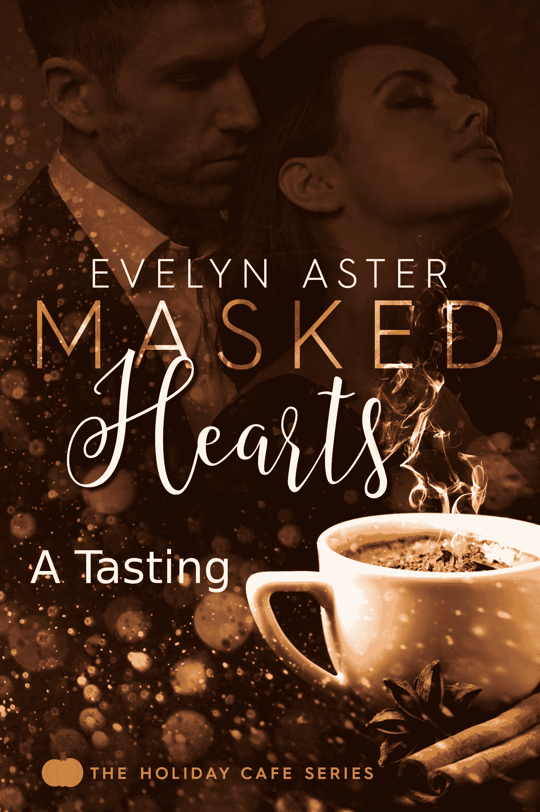

# 掩藏之心：味鉴指南

!(image1.jpg)

## 1 | 苦难与忧虑额外肉桂味

Sienna 驶进停车位，在轮胎碰到人路缘之前刚好停住。她的脑海里像一个旋风，家长、学生和其他老师在周末前争夺着她的注意力。即使是假日咖啡馆遮篷上装饰的可爱南瓜灯散着微弱的光芒，与黄昏搏斗，也没能让她冷静下来。她走下车，关上门。当她的目光落在门上用窗画笔画的巫师和沸腾的大锅时，她脑海中的模糊终于停了下来。旁注写着：“尝尝我们的苦难与忧虑拿铁”。啊。尽管名字听起来很麻烦，但拿铁的想法将她从学校的旋涡中拉了出来，让心情安定了下来。她等了一周就是为了这一时刻。

她推开门，期待咖啡的香气会将她包裹在幸福中，但渴望瞬间贯穿了她。

Mark Townsend 站在柜台前——他是学校里最受追捧的单身爸爸。年初初班级名单出来时，其他幼儿园老师就围着她，一看到她带有他最小的孩子`Tyler`，就飞口而出地报出了他的数据：百万富翁、建筑师、三十八岁、离异、臀部极佳。她并没有太在意其他老师的兴奋。她自己才二十八岁，一直和年龄相近的男性约会，从来没有和职场人士约过。但当他在开学第一天带着对儿子的自豪和随性的自信走进她的教室时，她就知道自己遇到麻烦了。

现在在自己最喜欢的咖啡馆见到他，让她有了一个欣赏他的时刻，而没有小孩子拉着她的手要关注。在阿尔伯基市，商务休闲装意味着干净的牛仔裤和没有脏话的 T 恤，而他每天都穿西装，就像纽约的 CEO 一样。他的短发大部分是黑色，但耳朵上面的灰发与他灰色的眼睛相得益彰。还有他的身材——老师们都说：“等你们看到马拉松日的他吧。”

她摇了摇头：师生家长时间。`Tyler` 那天在学校出了问题，而 Mark 的前妻在和他讨论之前就跑了。

Sienna 深吸了一气，拍了拍周五牛仔裤和橙黑相间的衬衫，希望身上没有掉自己看不见但在别人眼中明显的格汉饼干碎屑。

“噢天呐！”收银台叫`Chloe` 的咖啡师叫道，“缘分终于降了！”

`Chloe` 疯狂地挥手让 Sienna 走到收银台，Mark 也转过身来。他的微笑和犀利的眼睛让 Sienna 忘记了要找他谈论什么。“你好，Townsend 先生，”她到达收银台时说道。学校环境里的嘈杂和蜡蜡味总能帮助抑制她的渴望，但在一个充满热饮和情侣穿梭的咖啡馆里，她对他的存在毫无防御——她的内心收紧了，脑海游到了他的嘴唇触碰在耳垂下方敏感处会是什么感觉。

`Chloe` 在他打招呼之前、以及在她的想法变得露骨之前开口了。“你的意思是你们已经认识了？”她在十月初初把短而刺刺的头发染成了乌黑色，并在大部分手指上都戴着蜘蛛戒指。

他说话时与 Sienna 保持眼神交流。“请，叫我 Mark 就好。”该，他的眼神让专业表现变得不可能。让她松了一口气，他转向了`Chloe`。“她是我儿子的幼儿园老师。”

“真的吗？太酷了，但我打赌你们并不知道我所了解的彼此的真相。”

`Chloe` 说话的方式总是让 Sienna 微笑。半像青少年，半像瑜伽教练。Sienna 猜她大概二十二岁，所以这种风格很合适。Sienna 问：“真相？”

“我非常想知道，”Mark 用手肘撑在柜台上说。

“你们是我两个‘苦难与忧虑额外肉桂味’客户。从去年十月起我就想让你们见面。结果你们竟然已经认识了。”

Sienna 皱了皱眉。

`Chloe` 说话的方式总是让 Sienna 微笑。半像青少年，半像瑜伽教练。Sienna 猜她大概二十二岁，所以这种风格很合适。Sienna 问：“真相？”

“我非常想知道，”Mark 用手肘撑在柜台上说。

“你们是我两个‘苦难与忧虑额外肉桂味’客户。从去年十月起我就想让你们见面。结果你们竟然已经认识了。”

Sienna 皱了皱眉。

`Chloe` 说话的方式总是让 Sienna 微笑。半像青少年，半像瑜伽教练。Sienna 猜她大概二十二岁，所以这种风格很合适。Sienna 问：“真相？”

“我非常想知道，”Mark 用手肘撑在柜台上说。

“你们是我两个‘苦难与忧虑额外肉桂味’客户。从去年十月起我就想让你们见面。结果你们竟然已经认识了。”

Sienna 皱了皱眉。

`Chloe` 说话的方式总是让 Sienna 微笑。半像青少年，半像瑜伽教练。Sienna 猜她大概二十二岁，所以这种风格很合适。Sienna 问：“真相？”

“我非常想知道，”Mark 用手肘撑在柜台上说。

“你们是我两个‘苦难与忧虑额外肉桂味’客户。从去年十月起我就想让你们见面。结果你们竟然已经认识了。”

Sienna 皱了皱眉。

`Chloe` 说话的方式总是让 Sienna 微笑。半像青少年，半像瑜伽教练。Sienna 猜她大概二十二岁，所以这种风格很合适。Sienna 问：“真相？”

“我非常想知道，”Mark 用手肘撑在柜台上说。

“你们是我两个‘苦难与忧虑额外肉桂味’客户。从去年十月起我就想让你们见面。结果你们竟然已经认识了。”

Sienna 皱了皱眉。

`Chloe` 说话的方式总是让 Sienna 微笑。半像青少年，半像瑜伽教练。Sienna 猜她大概二十二岁，所以这种风格很合适。Sienna 问：“真相？”

“我非常想知道，”Mark 用手肘撑在柜台上说。

“你们是我两个‘苦难与忧虑额外肉桂味’客户。从去年十月起我就想让你们见面。结果你们竟然已经认识了。”

Sienna 皱了皱眉。

`Chloe` 说话的方式总是让 Sienna 微笑。半像青少年，半像瑜伽教练。Sienna 猜她大概二十二岁，所以这种风格很合适。Sienna 问：“真相？”

“我非常想知道，”Mark 用手肘撑在柜台上说。

“你们是我两个‘苦难与忧虑额外肉桂味’客户。从去年十月起我就想让你们见面。结果你们竟然已经认识了。”

Sienna 皱了皱眉。

`Chloe` 说话的方式总是让 Sienna 微笑。半像青少年，半像瑜伽教练。Sienna 猜她大概二十二岁，所以这种风格很合适。Sienna 问：“真相？”

“我非常想知道，”Mark 用手肘撑在柜台上说。

“你们是我两个‘苦难与忧虑额外肉桂味’客户。从去年十月起我就想让你们见面。结果你们竟然已经认识了。”

Sienna 皱了皱眉。

`Chloe` 说话的方式总是让 Sienna 微笑。半像青少年，半像瑜伽教练。Sienna 猜她大概二十二岁，所以这种风格很合适。Sienna 问：“真相？”

“我非常想知道，”Mark 用手肘撑在柜台上说。

“你们是我两个‘苦难与忧虑额外肉桂味’客户。从去年十月起我就想让你们见面。结果你们竟然已经认识了。”

Sienna 皱了皱眉。

`Chloe` 说话的方式总是让 Sienna 微笑。半像青少年，半像瑜伽教练。Sienna 猜她大概二十二岁，所以这种风格很合适。Sienna 问：“真相？”

“我非常想知道，”Mark 用手肘撑在柜台上说。

“你们是我两个‘苦难与忧虑额外肉桂味’客户。从去年十月起我就想让你们见面。结果你们竟然已经认识了。”

Sienna 皱了皱眉。

`Chloe` 说话的方式总是让 Sienna 微笑。半像青少年，半像瑜伽教练。Sienna 猜她大概二十二岁，所以这种风格很合适。Sienna 问：“真相？”

“我非常想知道，”Mark 用手肘撑在柜台上说。

“你们是我两个‘苦难与忧虑额外肉桂味’客户。从去年十月起我就想让你们见面。结果你们竟然已经认识了。”

Sienna 皱了皱眉。

`Chloe` 说话的方式总是让 Sienna 微笑。半像青少年，半像瑜伽教练。Sienna 猜她大概二十二岁，所以这种风格很合适。Sienna 问：“真相？”

“我非常想知道，”Mark 用手肘撑在柜台上说。

“你们是我两个‘苦难与忧虑额外肉桂味’客户。从去年十月起我就想让你们见面。结果你们竟然已经认识了。”

Sienna 皱了皱眉。

`Chloe` 说话的方式总是让 Sienna 微笑。半像青少年，半像瑜伽教练。Sienna 猜她大概二十二岁，所以这种风格很合适。Sienna 问：“真相？”

“我非常想知道，”Mark 用手肘撑在柜台上说。

“你们是我两个‘苦难与忧虑额外肉桂味’客户。从去年十月起我就想让你们见面。结果你们竟然已经认识了。”

Sienna 皱了皱眉。

`Chloe` 说话的方式总是让 Sienna 微笑。半像青少年，半像瑜伽教练。Sienna 猜她大概二十二岁，所以这种风格很合适。Sienna 问：“真相？”

“我非常想知道，”Mark 用手肘撑在柜台上说。

“你们是我两个‘苦难与忧虑额外肉桂味’客户。从去年十月起我就想让你们见面。结果你们竟然已经认识了。”

Sienna 皱了皱眉。

`Chloe` 说话的方式总是让 Sienna 微笑。半像青少年，半像瑜伽教练。Sienna 猜她大概二十二岁，所以这种风格很合适。Sienna 问：“真相？”

“我非常想知道，”Mark 用手肘撑在柜台上说。

“你们是我两个‘苦难与忧虑额外肉桂味’客户。从去年十月起我就想让你们见面。结果你们竟然已经认识了。”

Sienna 皱了皱眉。

## 叙事

她低下头，感到一阵热流涌上脸，但当她抬头时，她又恢复了公事公的样子。“谢谢你，马克。今天遇到你真是好了，因为我需要和你谈谈泰勒的事。”

他的神情瞬间变了。他舒展开肩膀，眼神中充满了担忧。“一切还好吗？”

“两杯加了肉桂粉的‘双重麻烦’，”克洛伊说着，一边把饮料放在取餐台面上。

他们接过了饮料，西西娜再次向他表示感谢。上面有一层白色的泡沫，还用肉桂粉画了一个南瓜灯的形状。

“想坐桌子吗？”马克问道。

西西娜点头，走向窗边的一张双人桌。窗外，云层聚拢，让日光比平时更早地暗了下去。隐约可见的桑亚山脉已经呈现出石灰色，而不是通常的褐绿相间的色调。她的情绪平复了，继续履行老师的职责。坦率地说，马克直接回到了儿子身边，询问发生了什么。

她说：“其实没什么大事，但泰勒很尴尬，哈蒙老师今天似乎很匆忙。”

提到他的前妻时，他皱起了眉。“他是不是像昨天一样出事故了？”

“恐怕是这样。而且由于哈蒙老师在我告诉她之前就走了，我担心她不会为他带备额外的衣服换掉今天换上的那件。我不指望他周一会有另一套，但是……”

马克点了点头。“我会处理的。”

西西娜抿了一口饮料，在座位上挪了挪身体。她不想提出下一个建议，但作为老师，她应该这样做。“我想大家都知道，我们很快就会有一位新的幼儿园老师了。如果泰勒在我的班级感到不舒服，你有机会把他调转到新教室。”

“什么？他很喜欢你的课，总是提起你。他妈妈正要搬和他不喜欢的人一起住，我确定那才是问题的根源。”

她如释重负口气，随后抿了抿嘴唇。“听到这个消息我很遗憾。”

“事实上，”马克继续道，“在发生所有这些变化时，对他来说最糟糕的事情可能是让他从你的班级撤出来。”

“等她制定新班名单时，我会告诉校长。”

“谢谢。请务必这样做，”马克一边看向窗外一边说道。他露出一丝微笑，转回看向她。“既然那件事已经解决了，克洛伊提到你从去年起就是这儿的常客，但你对我们学校还是新面，对吧？”

西西娜点了点头。“我的公寓就在高地区（Heights），但我曾在一家低收入社区学校教了五年书。住在教学学校附近还会遇到学生，这种感觉有点奇怪。”

“还有家长了，”他微笑着说。

“如果他们都请我喝拿铁，那我就没意见了。”西西娜喝了一口饮料，肉桂的辛辣让她知道自己不是在做梦。她真的在放学后在和马克聊天。但他的下一个问题像是一记不幸的腹部重击，让她想起自己为什么如此讨厌爱情。

“你为什么要离开以前那所学校？”

出于什么原因——也许是因为他稳定的目光，或是由诚的兴趣——西西娜那句标准的“是时候改变了”从她的脑海中溜而逃。她看到的只有她的未婚夫和同事老师在年中抛下她去阿根廷教学。她结结了一会儿，终于开口道：“情况很困难。我有时觉得在这么好的学校教书很内疚，因为外面还有很多更需要帮助的孩子。”

马克歪着头打量着她。“帮助每一个需要的人是不可能的。每当你对一个正在帮助的孩子产生积极影响，你就是在帮助世界，无论他们的处境如何。”

的话在她脑中回荡，让她感到像喝了咖啡一样快乐，但她保持了言语的理性。“并不是所有人都会认同你的，”她说，想起了那个必须去找照顾最贫困孩子的前夫。

马克用手肘撑在桌子上。“听起来我们需要进一步讨论。你这周末打算做什么？”

话题的突然转换让西西娜有些支支吾吾。“嗯，我明天还会回这儿处理这周的所有文书。我们必须一直衡量每个孩子在标准上的程度，这太荒谬了。我面对公寓里的那堆文件，所以我把它们带到这儿来了。”她停下来，看到马克眼中闪过一丝奇异的光芒，仿佛她让他很有趣。她讨厌沉默，所以即使在应该停下来问他的计划时，她也继续说道。“然后周日我要去教堂在合唱团唱歌。有时我觉得我一天都没有休息。”

马克轻轻地将她的手指从杯子上移，握住了她的手。“你为什么不翘掉明天，跟我一起去山脚徒步呢？”

西西娜呼吸卡在嗓子眼里，话也被堵住了。“嗯，我真的不该去。你是泰勒的爸爸，如果我不完成那些记录，我就会丢工作。”

他的手握紧了她的手。“我永远不想让你丢工作。那些任务真的需要一整天吗？还是说我们可以早起去徒步，留你一天的时间来完成？”

西西娜知道自己应该直接拒绝并离开。她张嘴想说，但说出的却是另一个词。“不如我们一起吃晚饭？”

马克也站了起来道：“不，你留在那儿。我可能因为工作毁了你整个下午。换做任何晚上我都会答应的。今晚玩得开心。”

令西西娜惊讶的是，他手扶住她的腰，俯身吻了她的脸颊。欲望在她内心灼烧。他说：“我明天会过来看看你工作进展得如何。”

西西娜震惊得说不出话，由于拿铁还冒着热，他离开了咖啡馆。

## 2 | 欢乐时段约会

马克停在一个正对着大学土坯房建筑剪影的停车位上。他依然能感觉到西西娜皮肤在唇齿间的温度。她一定觉得他是个疯子。他本该答应和她共晚餐并取消约会的，尽管那是客户女儿安排的。

他漫步在中央大道（Central Avenue），上欣赏着夜晚里闪烁色彩斑斓的霓虹灯牌——这里有一个`Zia`符号，那里有一只狼，还有一个招牌邀请像仙人掌一样穿刺身体。尽管他来自芝加哥，但阿尔伯克基（Albuquerque）正如州格言说的那样迷住了了他。

他整了整领带，为即将到来的夜晚做好了心理准备。约会应该是很有趣的。至少这是一种练习，这样当他再次见到 Sienna 时，在强制自己不约会了两年之后，他可能不会表现得那么像个傻瓜。他走过写着“地窖”的银色霓虹灯，下楼进入了一家到处弥漫着爵士乐的酒吧。

由于时间还早，观众只有空舞台旁的一对夫妇、吧台边的一个男人，以及——他的目光扫向另一侧——坐在角落里对他微笑的沃伦小姐士。他的眼睛瞪大了。他再次检查了手机上的名字，看到是`Mia Warren`。难怪听起来很耳熟。她是他女儿的三年级老师。

现在他觉得自己像个傻瓜。与 Sienna 不同，他从未费心去记她的名字，总是称呼她为`Ms. Warren`。

他再次盯着她。她的笑容消失了，但看起来依然很抱希望。这将是一场灾难。他对她完全没有兴趣。

他抚平领带，露出了职业性的微笑。她绽放了，他不得不承认她很美。她的金发垂过肩膀，刚好停在胸部上方，胸部被蓝色鸡尾酒裙的深 V 领口衬托起，展现出迷人的曲线。但她的魅力让他太想起了他的前妻。Sienna 那种内敛的美和机敏的反应让他感到兴奋得多。

“沃伦小姐，非常抱歉，我没意识到你今晚是我的约会对象。我本该在学校就说出来的。”他坐下，她一直笑着。

“没关系。我也不确定我爸给我安排的对象到底是不是你。我不知道你是阿根廷学校的建筑师。”

她眼神中的某种东西让他有些反感，但他并找不出是什么。“是的，那是我在业务淡季时做的事。幸运的是，它给我带来了几个有偿的工作。”

“你过得似乎不错。”

他看着她的目光在他身上扫过，在座位上不安地挪了挪。“额，我们就喝口酒大笑一下这件事吧，然后散场。既然你教我女儿，我们可能不应该约会。”

“放轻松吧！那是工作，这是玩乐。”

他的手指滑过衬衫领，听着他原本计划如果 Sienna 拒绝约会家长时会对她说的话。这时，一群老师的出现让他免于了作答。

“Mia！”一个年轻女性大叫道，她穿得更像个轻浮的辣妹，而不是他认识的那个三年级老师。他往她身后看，看到`Desert Eagle Elementary` 的半数教职员工正陆续走进来。

想起 Sienna 提到过要参加员工的欢乐聚会（Happy Hour），他转过头瞪着`Mia`。她早就知道自己被安排的对象是谁了，并带他来这里为了在同事面前炫耀。然而，他轻蔑的目光并没有被她注意到到，她向大家介绍他是她班上的一个家长。“我们是相亲约会的。你能相信吗？这是缘分。”

那个俏泼的女孩用双手托住他的脸说：“你简直太美了，我现在就想把你吃掉。”

“我先来，”`Mia` 说，两人都大笑起来。老师松开他的脸，和另一个女人一起坐在他们的桌旁。那三个老师聊天的样子就像在参加某种集体约会。

几个和他年龄相仿的女性和几个他在学校认识的男人坐在附近的长桌旁，一边聊天一边盯着他们小组。他必须在 Sienna 出现之前离开这里。她可能会误解整个情况。尽管服务员很快来点餐并迅速送回饮料，但在`Mark` 看来仿佛过了一个世纪。他一直瞥向门口，希望 Sienna 不要出现。现在他的威士忌到位了，他喝完就走。

`Mia` 握住他的手，将他的注意力从门口引向她身上。“所以，你上一次和这么多美女坐在一起是什么时候？`Shelly` 说你从从不出门。”

“Shelly？”他张掉了嘴巴。

“是，我们经常聊天。她很有趣，对班级万圣节派对非常有想法。”

他完全可以想象`Ms. Warren` 和他的前妻合得很好。`Ms. Warren` 看起来不像那种会在周六记录学生进度的人，而`Shelly` 是个彻头的派对女孩。他想缩回手，但她抓得很紧。他说：“最好小心，别让 Shelly 有太多建议。她可能会预订一个木偶戏、一个故事讲述者和一只马。”

“没错！那会太棒了！”

仿佛排好队，桌旁的三个老师大喊：“噢！”

他必须离开这个糟糕的春假梦。旁边的女人低声说：“看起来有人在嫉妒你，Mia。”

`Mark` 甩开手，转过头看到`Sienna`，她双拳紧握在身体两侧，惊讶地睁大双眼睛。

Sienna 眼睛中的火光点燃了他的激情。她的深色长发落在肩，末梢带着波浪，而不是她平时在学校时扎起来的马尾。她的皮肤透着自然小麦色，显得光滑无暇。那件吊带裙完美地贴合着她纤细的身材，让他想在所有人面前像电影里的情侣一样吻她。

老天，他真是个傻瓜。他确信她再也不会理他了。

当她的水送来时，她注意到马克从三年级的老师中抽出身来。他用手理了理头发，朝她走来。突然，那杯水成了她见过的最有趣的事物。她听到他说：“卡莉小姐，很抱歉打扰了你的晚间，但我想知道能不能和你谈谈昨天关于泰勒的那件事。”

她本想为他给出的台阶而松一口气，但与此同时，她用尽了所有的职业素养才抬抬头看向他，说道：“我正准备离开。我们可以在我去车的路上聊这事——”她向 `Mia` 投了一个轻蔑的眼神，“如果你能离开你的约会会那么久的话。”

他清了清嗓子，脸红了，说道：“我相信她能理解的，毕竟她也是个老师。”

西恩翻了翻白眼，向其他老师告别。他们反对她这么早离开，但她推口拒绝了，说她明天有太多工作，需要早点休息。

当她站起身离开时，马克向后退了一步，让她在狭窄的空间里通过。她的手臂擦过他的胸膛，她听到他的呼吸一滞。仅仅是那瞬间的碰撞，她的身体就因突如其来的欲望而悸动。但她不想让身体主导对话。就算他散发着迷人的魅力、声音如丝般顺滑又怎样？这无法弥补他今晚的行为。

她大步走向楼梯；平底鞋在瓷砖上发出啪啪声。她能感觉到他就在她身后，尽管在爬楼时他没有碰她。直到他们来到外面凉冷的十月夜里，他才开口道：“西恩，我不希望你误解这种状况。”

她转过脚瞪着他。“对我来说一切看起来非常清楚。你今晚在和 `Mia` 约会，明天你想带我出去。这是什么，你们孩子老师之间的竞争吗？”

他抓住她的手臂，恳求道：“不，完全不是那样的。”

她挣脱他的抓握，说道：“你至少可以告诉我你要来 Happy Hour，这样我就能有所准备，或者更好一点，干脆待在家里。”

“我不知道这就是你们 Happy Hour 的地点。我甚至不知道我是去和 `Ms. Warren` 约会。这是一场盲恋，我没认出她的名字。”

“她是你女儿的老师！”

“是的，但我一直直叫她 `Ms. Warren`。我不知道她的名字叫 `Mia`。”

“你认识我的名字。”她的语气模仿了他的声音，“叫我 `Mark`，西恩。”

“那是因为从开学第一天起我就迷恋你了。”

西恩向后退了一步，震惊得无法回答。这时门开了，`Mia` 出现了。一阵微风吹起她的头发，就像在香水广告里一样，让她成了马克身边格外耀眼的衬托。“泰勒还好吗？”她问道，声音里显然是在说：“你为什么要单独和我的男人在一起？”

马克一直盯着西恩，而西恩终于找回了自己的声音。“如果你那么迷恋我，为什么还要去相亲？”

她转过身大步走在人行道上。她听到 `Mia` 恳求马克回来，而马克没有异议。她内心的痛苦比本该的尖锐得多。驶过的汽车大灯似乎像聚光灯一样照在她身上，向世界展示了她再次变得多么脆弱。她松了口气，转过角进入一条更昏暗的街道，找到了她的车。当她解锁门时，听到马克在叫她的名字。

### 

当西恩走向车子时，马克跟在 `Mia` 后面，但在门口停住了。他说：“谢谢你跟我一起喝了，但我觉得你和我约会是个坏主意。”

`Mia` 眯起眼睛说：“但和西恩约会没关系吧？她也是老师。”

“你当老师不是问题。你美丽、爱玩，而且非常像我的前妻。我们离婚是有原因的。你很快就会发现我是个无趣的混蛋。”

“我确定那不是——”

“抱歉了，`Ms. Warren`。”他再次开门，朝着西恩离开的方向在人行道上跑去。在看到她之前，他先听到了汽车遥控器的锁车声，然后向她喊道。有一刻，他们对视着，但随后西恩坐进了车里离开了。

“该死，”他对着上方嗡嗡响的路灯大吼。走回自己的车时，他试图思考如何和西恩恢复好关系。也许明天可以在咖啡馆和她谈谈，那里她看起来要放松得多。

## 3 | 未婚夫

西恩几乎没有去咖啡馆做周六早晨的工作。她把纸张扔在桌上试图翻阅，但脑海里不断转着马克。她本应该留下来听听他想说的。不，去他的吧。她再次让心产生了一点点希望，但他已经把它粉碎了。这段关系会像其他感情一样结束。

她的高中恋人在毕业后离开了，去非洲参加传教活动。她的大学男朋友加入了“无国界医生”并逃到了伊朗。当然，她的未婚夫取消了婚约，去阿根廷教导需要帮助的孩子。她所有的前男友心很大——只是不够爱她。

沙发是空着的，所以西恩在别人进来占座之前，把文件夹堆在咖啡桌上。在拿回拿铁后，她的笔填满了一个又一框百分比和水平。当她写到一半时，听到了一个几个月没听过的声音，尽管那依然让她的心缩成一团。“我就以为你会在这里。”

当她到达咖啡馆时，她立刻注意到到处都挂着蜘蛛网装饰。克洛伊戴着女巫帽跳到收银台前说道：“所以，你什么时候见马克？”

“周一他接儿子放学的时候。”

“噢，得吧。你们在一起看起来很完美。”

他叹了口气，突然显得很悲伤，坐在她旁边的沙发上。由于他宽阔肩膀的身材，即便陷在坐垫里，依然俯视着她。“我妈妈病得很严重，所以我在这里找了份工作，好离她近一点。”

他的靠近让她心里的结越发紧了，她向他挪动了几厘米，朝火炉的方向。“卡罗尔病了？我很抱歉。她怎么了？”

“乳腺癌。她正在从双侧乳腺切除中恢复。全职工作会很辛苦。一周左右，她就要开始化疗了。”

尽管她感觉几乎就像是自己的母亲一样难过，但她想在话出口后就立刻收回：“如果有什么我可以帮上的，请告诉我。”

他把她的手握在手里，她全身都瑟缩了一下。他离开了她。他不应该坐得离她这么近，或者更糟糕，握着她的手。他说：“我知道我可以依靠你。妈妈以为在发生那种事后你不会再跟我说话了，但你和她的关系那么亲密，我想你可以放下那次意外。”

西耶娜抽回自己的手，睁大双眼睛盯着他的措辞。他所说的“意外”是指他在彩排晚宴上站起来为她祝酒，最后说：“我做不到了。你很完美，但我收到了去阿根廷教书的邀请。我觉得我必须接受。”她胃里的结收紧得几乎要断裂了。“别碰我。我会来看你妈妈的。不是来看你。”

他无动无于，把手放在她的膝盖上说：“我不本该就这样离开的。我本该带上你一起的。你会喜欢那些孩子的。”

她缩回膝盖，用力靠在沙发扶手上。尽管火炉火开得很小，但感觉像在熊熊燃烧。她应该站起来，但她担心如果尝试的话腿会发抖。“正如你记得的，我们教了很多需要帮助的孩子。你不只是离开了我，还有整整班一年级的学生，他们一直问我为什么不再喜欢他们了。”

“我知道，我很抱歉。要我请你吃午饭作为补偿，并给你讲讲阿根廷的事？”

“午饭弥补不了这些……”

当她抱怨时，他拿出手机，调出一张他那班乱糟糟、看起来既迷人又被忽视的照片递给她。“我知道你会喜欢听关于那些孩子们的。他们棒极了。”

看着照片，她的胃在咕叫，心也动摇了，正当她准备同意吃午饭时，穿着卡其裤和深蓝色长袖衬衫的马克坐在了他们对面的沙发上，说：“你好，卡莉小姐。”

那个早上，时机决定了一切。如果马克来得太早，看起来就像一个等着西耶娜出现的失败者。如果他来得太晚，她可能已经走了。当然，她可能根本没有出现在咖啡馆。

他决定午餐时间左右过去，希望能得到最好的结果。他在年初她寄家里的一张纸上有她的电话号码，但据他所知，那只是她只给家长的号码，而且周末会关。无论如何，面对面谈总比通过电话好。

他到达咖啡馆，立刻发现她和另一个男人在一起。妈的。她有男朋友吗？西耶娜从那家伙身边躲开。好吧，也许没有。她的头发又扎成了马尾，穿着牛仔裤和一件紧身 T 恤，紧得能看出内衣的轮廓。他想多花时间欣赏她，但那家伙一直朝她靠。克洛伊挥了挥手，马克走向柜台问：“谁和西耶娜？”

“如果你买一张我们万圣节诗之会的票，我就告诉你。钱会捐给慈善，”她用歌唱般的语气，在他面前晃着一张传单。

“敲诈？真的？”但他笑了，付了钱，并在订单里加了一份加了肉桂的“劳顿与麻烦”。

“谢谢，你一定要来。”

“是那个男人。”

“他们去年订婚了。”

该死。“发生什么事了？”

“你应该问她。”

他对克洛伊皱了眉，但知道她不会再说了。当他走向沙发时，直觉让他想把那家伙打晕，尽管那家伙体型高大。他曾说服自己，昨晚只是与西耶娜开启美好关系的一个小插曲，但她和前任的重逢可能是个问题。尽管如此，她靠在扶手上，看起来很开心，尽管电话里的某些事让她软化了。他必须干预。他坐在他们对面的沙发上。“你好，卡莉小姐。”

抬头看向他，显得疲惫，然后是释然，接着又变得焦虑。她坐直身体把手机还给了那个家伙。在她说话之前，那家伙露出僵硬的微笑说：“我们正准备吃午饭。请原谅我们，先生……”

“马克，”西耶娜说道。

马克惊讶地挑起眉，因为她用了他的名字。她在一起的家伙似乎也吃了一惊。

西耶娜继续：“这是格林。他正准备离开。格林，这是我的午餐约，马克。”

“午餐约？但他刚才叫你卡莉小姐。”

## 4 | 邀请

再次见到格林让她比面对一群哥布林更心烦神宁。现在，她必须穿过内心的杂音，与马克清晰地交流。解释意味着她想扩大他们的关系，而现在她比以往任何时候都想把自己封闭起来。她睁开眼睛，决定收拾文件夹，公事公办。“对不起让你卷进这一切。我只是利用你找了逃避的理由。”

她说话时避开目光，直到他的手握住她的手腕，让她停顿了一下。“我很乐意帮忙，但我确实打算请你吃午饭。你在这里喜欢什么？”他的皮肤很暖，她前臂敏感的内侧起了一层鸡皮疙瘩。

“没关系。我需要回家洗衣服。”

“我喜欢哈瓦提芝士菠菜三明治。”

在她听到他深吸一口气后，他用一种如丝般的声音问道：“要再给你来一杯拿铁吗？”

她点了点头，当他起身去点餐时，感觉到坐垫移动了一下。她立刻把所有的文件夹堆在一起，准备快速溜之。和他一起吃午饭比回家里陷入新的愤怒和背叛感中要好。至少马克看起来知道他自己做错了。而格伦则假装他从没有和她分手过。

“在计划你的逃亡呢，”马克再次坐在她身边，在她面前放了一杯新的拿铁。她很喜欢他微笑时眼角眯起的细细纹。

“没没你的意思，但所有男人都是混蛋，正如你昨晚证明的那样。我确保自己随时都能抽身而走。”

“我觉得你确实是故意的（冒犯），但我能忍受。我会确保昨晚是我对你所做的最后一件恶事。”

西恩娜摇了摇头。“你现在是这么说，但迟早会发生的。也许你可以帮我个忙，让它发生得快一点。”

马克皱起眉头，看起来很困惑。“你说话的样子就像男人对你有什么私人恩怨似的。”

“难道不是吗？”西恩娜已经不知道自己在说什么了。再次见到格伦，接着又是和马克约午餐，这让她比一个在跳房子游戏时试图捡起地上石子的幼儿园小孩更不知所措。“好男人抱怨被迫扮演大哥的角色，但好女孩会被一直剥削，直到像用过的避孕套一样被扔进垃圾桶。”

马克退到沙发边缘说：“你用那张嘴教我儿子的吗？”

西恩娜知道自己的脸一定红了。她低声道歉，并很感激克洛伊此时带着三明治和拿铁为他送来。当克洛伊走开时，西恩娜说：“我真的不会在孩子面前那样说话的。”

马克笑了，说：“算了。我只是在开玩笑，好吧，有一点震惊。你看起来确实有那种纯洁如雪的老师长相。”

“噢，我不是。所以你现在可以把这个念头抛脑掉了。”

马克摇摇头：“不。做不到。我喜欢你外表和内在之间的反差。再说句脏话吧。”

“不。”西恩娜咬了一口三明治，发现自己既被迷住又很放松。她咽下后说：“所以你约我去远足。那是你经常做的事吗？”

那之后，对话转向了普通的约会话题。西恩娜不需要推开关于格伦的不愉快念头，因为她的心完全被这一刻占据了。她本以为由于年龄差异，和马克的对话可能会困难，但并没有出现任何尴尬的情况。他热情地谈论他的建筑项目，转而倾听她对教学的热爱。

在三明治吃完被遗忘后的某个时刻，她注意到他们面对面坐着，肩膀靠在沙发背上，身体只隔几英寸。她希望他再次握住她的手，并好奇如果她握住他的会有什么反应。她正让自己的心再次在拿铁铺就的小路上漫游，尽管她之前还争辩过应该坚持纯粹肉体关系。

这时，她的手机在包包里响了。

不幸的是，那不是普通的铃声：那是很久以前为格伦设置的铃声。她忽略了它。

“你需要接一下吗？”马克问。

“不，”西恩娜说。她的心在呼吸间瞬间崩塌又硬化。

手机又响了几声，马克说：“你确定吗？”

“我该走了。”

“嘿，”马克说着，手放在她的肩膀上拦住她。“怎么了？”

“我不能再这样了。我不能让你对我浪漫、爱上你，最后却以一场糟糕的分手结束。我宁愿我们直接做完就完事。”她咬着唇，自责不已。她不敢相信自己竟然对一个孩子的父亲说了那种话。从他的表情来看，她知道他也不敢相信。

当她收拾好文件夹离开时，手机终于停止了响。她预计他会叫住她，但随后想起男人都是混蛋。他当然不会的。

在户外，尴尬之感袭来，仿佛夏日的阳光照射在她身上，而不是清凉的秋光。她跑向她的车，没有听到身后急促的脚步声，因为她的耳朵里充满了自己心跳的声音。

她把文件夹放在车顶上。在她用遥控器按下锁车按键之前，一只手抓住了她的肩膀并将她转过身来。马克盯着她的眼睛一会儿，然后用身体将她抵在车上，身体紧贴着她。他用一种她从未感受过的激情吻了她，即使从格伦那里也没有过，这让她身体颤抖。他的手游过她的手臂到达臀部，她感觉到他的挺起抵在她大腿和小腹之间的缝隙处。她的内心涌动欲望，当他结束接吻说话时，嘴唇掠过她的耳朵，这种欲望变得更加强烈。

马克感觉到她的身体向他靠拢并开始颤抖。老天，他太久没有做爱了。久到克制几乎是不可能的，他完全地贴着她，性器彰显了他的渴望。

他断开接吻，低语了一些他希望在欲望的迷雾中依然听得懂的话。“我很想带你出去约会，在咖啡和玫瑰花丛中慢慢爱上你。但我已经两年没有性交了，如果你想要的只是纯肉体关系，我会接受。”

她的手机响起了短信提示音。她关掉水流，跪着挪向另一盆兰花。当手机再次响起，提醒她她有一条未读消息时，她放下浇水壶，从膝盖站起身。她走向手机并点亮屏幕：正如承诺的那样，马克（Mark）的地址。是时候做决定了。

她放下手机走向浴室，对着镜子看着自己枯燥无味的衣服和平平无奇的外表。即使她去参加电影约会，也得让自己打扮得精致。真很难相信他会放弃米娅而选择她；米娅看起来更符合他的口味，长得漂亮，而且从她的奥迪汽车和设计师服装来看，她很有钱。

但手机里存着马克地址的人是她。她的脑海中浮现出在电影放映时在沙发上依偎在他身上的画面。也许他会准备一些红酒，而且他提到过玫瑰……

洗衣机嗡嗡响起来，洗涤结束，粉碎了她美好的约会幻想。

她转过镜子走向衣帽间。那里也没有什么选择，除非——她拉开角落的几件外套，看到了自己大学毕业后买的那件黑色皮夹克。也许配双高跟鞋……

### 

马克选了一部浪漫喜剧和一部动作片。他完全不确定她是否会出现，但午餐时的谈话非常愉快，直到她的手机响了：可能是那个混蛋。他看着自己选的浪漫喜剧片皱了皱眉：《公主新娘》。该死，那部电影流行时他还只是个孩子。她那时出生了吗？他不想想这些。他拿起遥控去找别的，但门铃响了。他的心跳加速了。她真的来了。他把《公主新娘》放在《复仇者联盟》电影下面，希望她喜欢漫画超级英雄。

他最后环视了一下书房。他试过把孩子的玩具都收起来，但米色的墙壁底部到处是蜡笔涂鸦，那是孩子蹒跚走路时画的。他从未想过把它们刷掉。至少后墙是一扇窗户，可以看到窗外的沙漠和铺开的阿尔伯克基市，灯火到处闪烁。

他穿过厨房，那里有一尘不染的不锈钢电器，中岛上放着几本食谱，以此向她证明自己会做饭。他还在厨房桌上放了一碗水果，向她展示自己知道如何照顾孩子。为了给一个幼儿园老师留下好印象，他必须处理好所有细节。

门铃再次响起。至少他知道自己不是幻听了第一声。他跑过门口回到客厅，客厅由于有皮沙发和玻璃茶几，显然对儿童不友好，但他们不会在那里停留。走两步路就是宽敞的前走廊，一面墙上放着沙发，另一面墙有一面镜子，让走廊看起来更宽大。

镜子旁的小桌上放着花瓶，里面插着十二朵红玫瑰和十二朵白玫瑰。花上插着一张卡片；信封上歪写着西娜（Sienna）的名字。他花了一整个晚上的时间思考在卡片上写什么。现在他犹豫了。不，没事的。但他打算把卡留在桌子上，而不是拿着它去开门——它实在太大了。

他伸手握住门把，开了门。

他惊讶得掉了下巴。

西娜把棕色的头发扎成一个凌乱的马尾，几缕碎发落在脸的一侧。她的红口红为唇部增添了一种丰润感，他以前从未观察过，但在今天早些时候的吻中确实感受过。她穿着一件在腰间束紧的黑色皮夹克。他想象她皮夹克里面什么都没穿，因为她的双腿是裸露的，光滑修长，一直延伸到黑色的尖钉高跟鞋。

# [11 月前在 All Romance 阅读仅需美元！](https://www.allromanceebooks.com/product-maskedhearts-1651466-149.html)

