# 7 天精通 Java：从零构建强大的应用指南

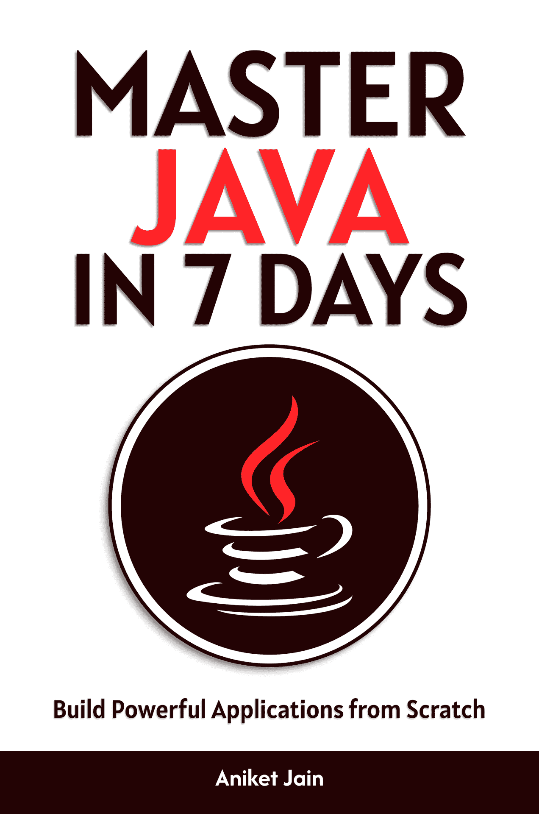

# 引言

## 为什么选择 Java？

Java 是世界上使用广泛的编程语言之一。它以多功能性、高效性和健壮性闻名，驱动着从移动应用到企业级系统的各个程序。该语言“编写一次，处运行”的哲学确保 Java 程序可以运行在任何配备 Java 虚拟机（`JVM`）的平台上。凭借庞大的库、框架生态系统以及活跃的开发者社区，Java 仍然是构建可扩展且可靠应用程序开发者的首选。学习 Java 为软件开发、Web 开发、游戏开发，甚至是人工智能和大数据等新兴领域的众多职业机会打开了大门。

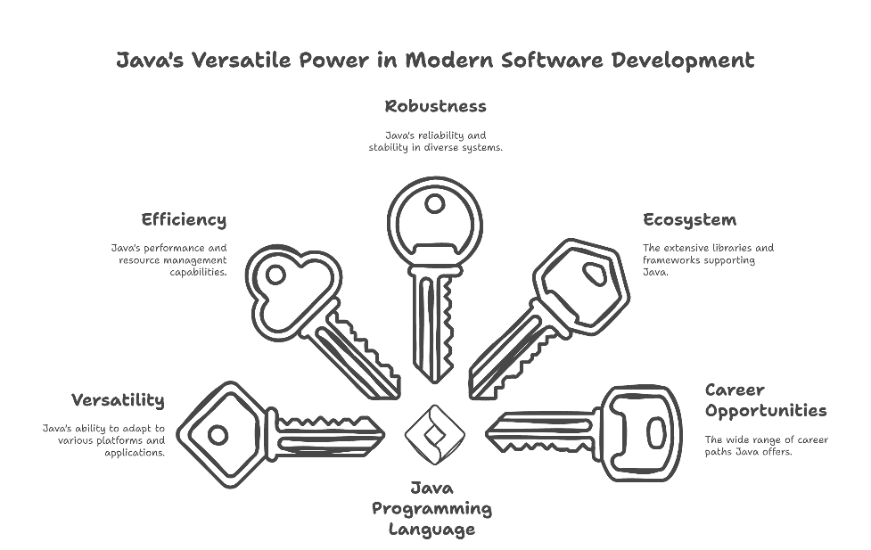

Java 的流行源于它的简单性和易读性，使其成为初者的绝佳语言。同时，它的高级特性（如多线程、健壮的异常处理、安全性和广泛的 API）满足了专业开发者的需求。其跨平台能力和后兼容性使其成为需要可靠、可维护且可扩展解决方案的企业的首选。无论你是在构建 Web 应用、设计 Android 应用、开发后端系统，还是处理云平台，Java 都能为你胜任。本书将引导你一步步地掌握这门语言，从基础开始，在七天后进展到更复杂的话题。

Java 的全球影响力从数百万开发者在使用它以及在各种设备和系统中的集成可见一斑。从驱动企业级后端系统到驱动小型嵌入式设备，Java 的多功能性确保了它在各行业中的地位。作为一种不断演变的语言，Java 的定期更新和增强确保了它在快速变化的技术格局中保持相关性和竞争力。学习 Java 不仅让你具备了解决现实世界问题的技能，还让你在就业市场上占据有利位置，因为市场对 Java 专家通常有极高需求。

## 本书适合人群

本书专为任何兴趣学习 Java 的人设计，无论之前是否有过编程经验。这是一份精心设计的指南，旨在满足不同群体学习者的需求，包括：

* **初学者**：如果你是编程新手，本书将以易于理解的方式向你介绍 Java 的基本概念和语法。不需要先前的编码知识，因为每个概念都经过清晰的解释，并配有示例和实操练习。

* **学生**：希望通过课程作业、项目或竞争性编程加强 Java 技能的计算机科学学生将发现这本书是一份无价的资源。它提供了对概念的清晰解释、实用的代码示例以及高效解决问题的指导。

* **专业人士**：从其他语言转型到 Java 的开发者，或寻求增强编程工具箱的开发者，将从本指南的结构化和实用的方法中受益。无论你的目标是扩展技能集，还是为认证考试和面试做准备，本书都能满足你的需求。

* **爱好者**：将编程作为爱好探索的爱好者会喜欢书中包含的实操练习、清晰的解释和引人入胜的项目。这是一个深入编程世界而不会感到压力巨大的绝佳方式。

* **教师和导师**：寻找全面教学资源的教育工作者可以依靠本书的结构化方法，书中配有示例和练习，使复杂的话题变得更易理解。

无论你的背景如何，本书都旨在让 Java 变得易于上手、实用且有趣。它的设计旨在激发读者的自信和好奇心，使能够轻松应对编码挑战。

## 7 天内你将学到什么

本书的结构是一场为期七天的旅程，每天专注于一组主题。通过每天投入时间，你将从对 Java 的基础理解进展到掌握其核心概念：

1. **Java 入门**：学习配置开发环境，理解 Java 的基础语法并编写你的第一个程序。理解如何编译和执行 Java 代码以及调试常见错误，为你的学习旅程奠定基础。

2. **变量、数据类型与运算符**：深入学习 Java 的基础模块。学习如何声明和初始化变量，探索 Java 广泛的数据类型，并使用算术、比较、逻辑和赋值运算符处理数据。理解类型转换以及如何有效地转换数据类型。

3. **控制流与循环**：掌握 `if`、`else`、`else if` 和 `switch` 等条件语句，为你的程序添加决策能力。学习如何使用循环（包括 `for`、`while` 和 `do-while`）高效地重复任务。理解 `break` 和 `continue` 语句的作用以及如何遵循最佳实践使用嵌套循环。

4. **方法与作用域**：理解通过方法创建重用代码块。学习方法参数、返回值以及静态与非静态方法的区别。掌握变量作用域（全局、局部、块级）的概念，并探索递归作为一种强大的解决问题技术。

## 5. 数组、集合与迭代

探索数组和集合等数据结构，用于存储和操作数据。学习如何执行数组操作、使用 `ArrayLists` 以及利用 Java 丰富的集合框架。掌握迭代技术，以便有效地遍历和修改数据结构。

## 6. 异常处理与文件 I/O

学习使用 `try-catch-finally` 块优雅地处理异常来编写健壮的程序。理解如何抛出和捕获异常，并使用 Java 文件 I/O API 从文件中读写数据。通过 `BufferedReader` 和 `BufferedWriter` 等类获得高效文件操作的实践经验。

## 7. 面向对象 (OOP) 基础

发现 OOP 的核心原则，如封装、继承、多态和抽象。学习如何创建类和对象，定义属性和方法，并使用这些原则构建结构良好且易于维护的代码。

在本周结束时，你将建立起 Java 的坚基础，能够自信地构建自己的应用程序。这种系统的方法确保了你既掌握了理论知识，又具备了实践技能，让你能够有效地应对现实世界的挑战。

## 如何使用本书

本书的设计兼顾了全面性和易读性，为掌握 Java 提供了循序渐进的路线图。以下是一些最大化学习体验的提示：

* **遵循顺序**：每一章都建立在前章的基础上，因此建议顺序阅读书籍。跳过章节可能会导致困惑，因为后面的主题通常依赖于之前的概念。

* **练习代码示例**：编程是一项通过实践学习的最佳技能。每一章都包含了实用示例和练习以强化你的理解。亲自编写并运行代码以获得实践经验。

* **做笔记**：在学习过程中记录关键概念、提示和代码段。这将帮助你记住信息，并在以后作为快速参考。

* **进行实验**：不要害怕修改提供的示例或尝试新想法。实验是加深理解和发现创造性解决方案的好方法。

* **使用附录**：参考附录获取快速 Java 备查表、练习题答案和额外资源。该部分旨在补充你的学习，并对常见问题提供快速解答。

* **保持坚持**：每天花固定时间学习 Java。坚持是建立坚实基础和有效进展的关键。

带着带着开放的心态和学习意愿开启这段旅程。通过每天投入几个小时，你将惊讶于自己在短短一周内能取得多少成就。通过练习、耐心和坚持，你将解锁 Java 的力量，并在编程世界开启一段充满回报的旅程。

# 第 1 天：上手 Java

## 设置开发环境

掌握 Java 之旅的第一步是设置开发环境。配置恰当的环境可以确保你可以无阻碍地编写、编译和执行 Java 程序。通过遵循以下步骤，你将为 Java 编程之旅奠下坚实的基础：

### 1. 下载并安装 JDK (Java Development Kit)

JDK 是编写和运行 Java 程序的内核要求。访问 Oracle 官方网站或使用 `OpenJDK` 等开源替代方案，下载适用于你操作系统的最新版本 `JDK`。确保下载与你系统架构（32 位或 64 位）匹配的正确版本。

#### 安装提示：

* 在安装过程中，记下 `JDK` 安装的目录，因为你将配置系统的 `PATH` 变量。

* 选择一个与你的项目需求匹配并支持你计划使用的特稳定 `JDK` 版本。

### 2. 设置环境变量

将 `JDK` 的 `bin` 目录添加到系统的 `PATH` 变量中。此步骤允许你从终端或命令提示符的任何目录执行 Java 命令。

#### 设置 PATH 变量的步骤：

* **在 Windows 上**：通过系统属性访问环境变量设置，找到 `PATH` 变量并追加 `JDK` 路径（例如 `C:\Program Files\Java\jdk-<version>\bin`）。

* **在 macOS/Linux 上**：编辑你的 shell 配置文件（例如 `.bash_profile`、`.zshrc` 或 `.bashrc`）并添加以下行：

```
export PATH=$PATH:/path/to/jdk/bin
```

* 通过重启终端或使用 `source` 命令（例如 `source ~/.bash_profile`）来应用更改。

### 3. 安装集成开发环境 (IDE)

虽然可以用简单的文本编辑器编写 Java 程序，但使用 IDE 可以显著提高你的工作效率。流行的选择包括：

* **IntelliJ IDEA**：以其强大的功能和用户友好的界面著名。

* **Eclipse**：广泛使用的、适用于大型 Java 项目的 IDE。

* **NetBeans**：一个可靠的选择，对 Java 开发有极的支持。

#### 为什么要使用 IDE？

* 语法高亮和自动补全。

* 内置调试工具。

* 易于项目和文件管理。

* 提高效率的代码重构能力。

### 4. 验证你的设置

一旦完成所有安装和配置，就是时候验证你的设置了。

#### 验证步骤：

1. 打开终端或命令提示符。

2. 输入以下命令：

```
java -version
```

3. 如果设置正确，你将看到已安装的 `JDK` 版本。例如：

```
java version "17.0.2" 2023-01-17 LTS
Java(TM) SE Runtime Environment(build 17.0.2+8-LTS-86)
Java HotSpot(TM) 64-Bit Server VM (build 17.0.2+8-LTS-86)
```

完成这些步骤后，你就准备好编写和执行 Java 程序了。记住，良好的环境对于开发至关重要。

## Java 语法简介

理解 Java 语法对于编写程序至关重要。Java 的语法类似于 C 和 C++。

### 1. 基本结构

Java 程序由类和方法组成。入口是 main 方法：

```java
public class Main {
    public static void main(String[] args) {
        System.out.println("Hello, World!");
    }
}
```

#### 关键组件：

* **类声明**：Java 程序组织成类。使用 `class` 关键字定义类。

* **Main 方法**：这是程序执行的地方。它遵循 `public static void main(String[] args)` 结构。

* **打印语句**：`System.out.println` 用于向控制台输出文本。这是测试程序的简单方法。

#### 注意：

* 每个 Java 程序都从类开始。

* 文件名必须与类名匹配并以 `.java` 结尾。

### 2. 大小敏感

Java 是大小写敏感的。例如：

* `System` 和 `system` 被视为不同的标识符。

* 始终确保方法名、变量名和类的大小写一致。

### 3. 分号

Java 中的语句以分号 (;) 结束。缺少分号会导致编译错误。例如：

```java
System.out.println("Hello, World!"); // 正确
System.out.println("Hello, World!") // 错误
```

### 4. 大括号

大括号 ({}) 用于定义代码块，例如类体和方法实现。正确的缩进有助于识别这些块的开始和结束。

### 5. 注释

Java 支持注释来说明代码：

* **单行注释**：以 `//` 开始。

```java
// 这是一行单行注释
```

* **多行注释**：封装在 `/*` 和 `*/` 之间。

```java
/* 这是一个
多行注释 */
```

### 6. 保留关键字

Java 有一组保留关键字，不能用作标识符。示例包括 `class`、`public`、`static`、`void` 和 `if`。熟悉这些关键字以避免错误。

## 7. 缩进与可读性

虽然 Java 编译器不强制执行缩进，但结构良好且缩进正确的代码更易阅读和调试。请遵循标准规范：

* 每个缩进层级使用四个空格。

* 对齐大括号括号。

## 8. 编译与执行

要运行一个 Java 程序：

1. 以 `.java` 扩展名保存文件。

2. 打开终端或命令提示符。

3. 使用 `javac` 命令编译程序：

```
javac Main.java
```

4. 使用 `java` 命令执行编译后的字节码：

```
java Main
```

#### 示例输出：

当你执行上述代码时，你将看到：

```
Hello, World!
```

通过掌握这些语法规则，你将在编写和调试 Java 程序时变得更有信心。随着你深入学习 Java，这些基础概念将成为你应对复杂挑战的基石。

## 你的第一个 Java 程序

编写你的第一个 Java 程序是一个令人兴奋的里程碑。以下是创建和执行简单程序的方法：

### 1. 创建文件

打开你的 IDE（例如 `IntelliJ IDEA`、`Eclipse` 或 `NetBeans`）或文本编辑器（例如 `Notepad++` 或 `VS Code`），并创建一个名为 `Main.java` 的新文件。文件名必须与类名匹配。

### 2. 编写代码

在文件中输入以下代码：

```
public class Main {
    public static void main(String[] args) {
        System.out.println("Hello, Java World!");
    }
}
```

#### 代码解释：

* 类声明：`public class Main` 定义了一个名为 `Main` 的类。类名应与文件名匹配。

* 主方法：`public static void main(String[] args)` 方法是程序的入口点，执行从这里开始。

* 打印语句：`System.out.println` 方法将文本输出到控制台。

### 3. 编译程序

打开终端或命令提示符，导航到包含 `Main.java` 文件的目录，并输入以下命令：

```
javac Main.java
```

#### 编译期间发生了什么？

* `javac` 命令编译 Java 源代码并生成一个 `Main.class` 文件。

* 该文件包含由 Java 虚拟机 (JVM) 执行的字节码。

### 4. 运行程序

要执行编译后的字节码，请使用 `java` 命令：

```
java Main
```

#### 预期输出：

当你运行程序时，你应该会在控制台中看到以下输出：

```
Hello, Java World!
```

### 5. 故障排除技巧

* 错误：'javac' 识别为内部或外部命令：这意味着 JDK 的 `bin` 目录不在你系统的 `PATH` 变量中。请重新检查设置过程以配置环境变量。

* 文件名不匹配：确保文件名和类名完全匹配，包括大小写。

* 语法错误：双重检查是否漏掉分号或大括号不正确。

通过成功地编写、编译和运行此程序，你已经迈出了进入 Java 编程的第一步。恭喜你！

## 编译与运行 Java 代码

Java 是一种编译语言，这意味着源代码在执行之前必须转换为字节码。通过理解编译和执行过程，你可以高效地运行你的 Java 程序并解决常见问题。

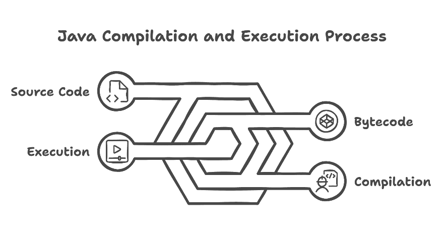

### 1. 编译

`javac` 命令用于将 `.java` 文件编译为 `.class` 文件。这些 `.class` 文件包含 Java 虚拟机 (JVM) 可以执行的字节码。字节码是平台无关的，允许 Java 程序在任何带有 JVM 的系统上运行。

#### 示例：

要编译名为 `MyProgram.java` 的文件，在终端或命令提示符中运行以下命令：

```
javac MyProgram.java
```

#### 编译期间发生了什么？

* Java 编译器检查源代码是否有错误。

* 如果未发现错误，编译器将在同一目录下生成一个 `MyProgram.class` 文件。

#### 成功编译的提示：

* 确保 JDK 已正确安装并配置在你的 `PATH` 变量中。

* 使用描述性且一致的类名以避免混淆。

### 2. 执行

`java` 命令用于执行编译后的 `.class` 文件。运行程序时始终省略 `.class` 扩展名。

#### 示例：

要执行 `MyProgram` 类文件，请使用：

```
java MyProgram
```

#### 预期输出：

如果程序包含 `System.out.println` 语句，输出将显示在控制台中。例如：

```
Hello, Java World!
```

#### 关键点：

* JVM 解释 `.class` 文件中的字节码并在你的机器上执行它。

* 程序必须包含一个 `main` 方法作为入口点。

### 3. 常见错误与解决方案

#### ClassNotFoundException

* 原因：缺少 `.class` 文件或类名错误。

* 解决方案：验证类文件是否存在于指定目录，且类名与文件名匹配。

#### NoClassDefFoundError

* 原因：JVM 找不到类定义。

* 解决方案：检查你的类路径（classpath）配置，并确保它包含 `.class` 文件的目录。

#### 编译时的语法错误

* 原因：缺少分号或大括号错误。

* 解决方案：仔细检查代码并解决语法问题。

### 4. 编译的重要性

* 错误检测：编译有助于识别代码中的错误。

* 优化：编译优化代码性能。

* 平台无关性：生成的字节码确保程序无缝运行。

通过掌握这些步骤和编译执行过程，你能够编写、编译和执行 Java 程序。编码愉快！

## 理解错误与调试

错误是编程中的自然现象。理解并调试它们对于成为熟练的开发者至关重要。


Java 通常分为三类：

### 1. 语法错误

语法错误发生在违反 Java 规则时。这些错误会导致程序无法编译。

#### 原因：

* 缺少分号。
* 大括号或括号不匹配。
* 方法声明错误。

#### 示例：

```java
public class Main {
    public static void main(String[] args) {
        System.out.println("Hello, World!" // 缺少括号
    }
}
```

#### 关键点：

* 编译器提供了指示错误行号和性质的消息。
* 修正语法错误是确保程序成功运行的第一步。

### 2. 运行时错误

运行时错误发生在程序执行期间，通常由无效操作引起。

#### 常见原因：

* 除以零。
* 访问空引用。
* 数组索引越界。

#### 示例：

```java
int result = 10 / 0; // 抛出 ArithmeticException
```

#### 关键点：

* 如果不处理，运行时错误会导致程序终止。
* 使用异常处理机制（例如 `try-catch` 块）有助于管理此类错误。

### 3. 逻辑错误

逻辑错误发生在程序运行未崩溃但由于逻辑缺陷产生了错误的结果。

#### 示例：

```java
int sum = 10 - 5; // 如果意图是加法，则计算错误
```

#### 关键点：

* 逻辑错误最难检测，因为没有错误信息。
* 彻底测试和代码审查有助于识别这些错误。

### 调试技巧

调试是识别并修复代码中错误的过程。以下是一些有效的技术：

#### 1. 阅读错误信息

* 编译器和运行时错误提供了宝贵的线索。
* 仔细分析错误信息以定位问题。

#### 2. 使用调试工具

* 大多数 IDE（例如 `IntelliJ IDEA`、`Eclipse`）都内置了调试器。
* 调试器允许你执行以下操作：
  * 设置断点。
  * 逐行单步执行代码。
  * 检查变量值和程序状态。

#### 3. 添加打印语句

* 插入 `System.out.println()` 语句来跟踪变量值和程序流。
* 示例：

```java
System.out.println("Value of x: " + x);
```

#### 4. 拆解代码

* 单独测试一小段代码以隔离问题。
* 模块化编程实践使得这变得更容易。

#### 5. 查阅文档

* Java 丰富的文档和社区论坛是极好的资源。
* Stack Overflow 等在线平台可以提供见解和解决方案。

#### 6. 使用异常处理

* 结合 `try-catch` 块来优雅地处理异常并提供有意义的错误信息。
* 示例：

```java
try {
    int result = 10 / 0;
} catch (ArithmeticException e) {
    System.out.println("Error: Division by zero is not allowed.");
}
```

通过将调试视为一种学习机会，你将成为一个更有自信、更有能力的程序员。调试不仅有助于修复问题，还能加深你对 Java 和编程概念的理解。

# 第 2 天：变量、数据类型和运算符

## 理解变量 (int, float, char, boolean, String)

变量是任何编程语言的构建块。在 Java 中，变量是存储数据值的容器。每个变量都与特定的数据类型相关，该类型决定了它可以包含的值类型。

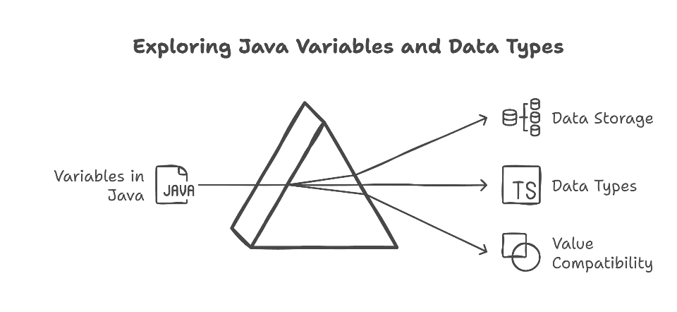

### 声明变量

要声明变量，需要指定其数据类型，后面是名称。可选，你可以在声明时分配一个初始值。

#### 示例：

```java
int number = 10; // 声明一个整数变量并初始化为 10。
float price = 19.99f; // 声明一个 float 变量。
char grade = 'A'; // 声明一个字符变量。
boolean isActive = true; // 声明一个布尔变量。
String name = "Alice"; // 声明一个字符串变量。
```

#### 关键点：

* 数据类型定义了变量可以包含的值类型（例如，`int` 用于整数，`float` 用于小数）。
* Java 是一门强类型语言，这意味着每个变量都必须用特定的数据类型声明。

### 变量的类型

Java 支持三种类型的变量：

#### 1. 局部变量

* 声明在方法或块内部。
* 仅在相应的作用域内访问。
* 使用前必须初始化。

#### 示例：

```java
public void displayNumber() {
    int localNumber = 25; // 局部变量
    System.out.println(localNumber);
}
```

#### 2. 实例变量

* 声明在类内部，但在任何方法之外。
* 类的每个对象都拥有实例变量的副本。
* 如果没有显式赋值，它们将被初始化为默认值。

#### 示例：

```java
public class Person {
    String name; // 实例变量
    int age; // 实例变量
    public void displayInfo() {
        System.out.println("Name: " + name + ", Age: " + age);
    }
}
```

#### 3. 静态变量

* 使用 `static` 关键字声明。
* 类中的所有对象共享。
* 适用于定义常量或共享属性。

#### 示例：

```java
public class Counter {
    static int count = 0; // 静态变量
    public Counter() {
        count++;
    }
    public static void displayCount() {
        System.out.println("Count: " + count);
    }
}
```

### 变量命名规则

为了确保清晰并避免错误，请遵循这些命名规则：

* 必须以字母、下划线 (`_`) 或美元符号 (`$`) 开始。

```java
int _score = 50; // 有效
int $price = 20; // 有效
```

* 不能使用保留关键字：

```java
// 无效：
int class = 10; // 'class' 是保留关键字
```

* 应该具有描述性以提高代码可读性：

```java
int totalMarks = 100; // 描述性强
int tm = 100; // 描述性差
```

通过理解并遵循这些指南，你可以在 Java 程序中有效地使用变量。变量在存储和处理数据方面起着至关重要的作用，是所有开发者的核心概念。

## Java 中的数据类型

Java 是一种静态类型语言，这意味着每个变量都必须有定义的数据类型。这些数据类型分为两大类：

### 1. 基本数据类型

基本数据类型是基础构建块，直接在内存中存储值。Java 有八种基本数据类型：

#### 基本数据类型概述：

* `byte`:
  * 8 位整数。
  * 范围：-128 到 127。
  * 示例：

```java
byte smallNumber = 100;
```

* `short`:
  * 16 位整数。
  * 范围：-32768 到 32767。
  * 示例：

```java
short mediumNumber = 32767;
```

* `int`:
  * 32 位整数。
* `long`:
  * 64 位整数。
* `float`:
  * 32 位浮点数。
* `double`:
  * 64 位浮点数。
* `char`:
  * 16 位字符。
* `boolean`:
  * 表示真或假。

### 2. 非基本数据类型

非基本类型是引用类型，包括类、数组和接口。

#### `String`:

最常用的非基本类型。它表示字符序列。

#### 示例：

```java
String message = "Hello, Java!";
```

#### 非基本类型的特征：

* 可以存储多个值或对象。
* 内置方法。

##### 数组示例：

```java
int[] numbers = {1, 2, 3, 4, 5};
```

通过理解这些数据类型，你可以有效地声明和操作变量，确保类型安全和内存高效。

## 运算符（算术、比较、逻辑、赋值）

Java 提供了一套用于各种操作的丰富运算符。理解这些运算符对于编写高效的 Java 程序至关重要。让我们探索关键类别：

### 1. 算术运算符

算术运算符执行数学计算。它们通常与数值类型一起使用。

#### 运算符：

* `+` 加法
* `-` 减法
* `*` 乘法
* `/` 除法
* `%` 取模（余数）

#### 示例：

```java
int sum = 10 + 5; // 15
int product = 10 * 5; // 50
int quotient = 20 / 4; // 5
int remainder = 22 % 7; // 1
```

### 2. 比较运算符

比较运算符用于比较两个值。结果始终是布尔值(`true` 或 `false`)。

#### 运算符：

* `==` 等于
* `!=` 不等于
* `>` 大于
* `<` 小于
* `>=` 大于等于
* `<=` 小于或等于

#### 示例：

```java
int a = 10, b = 20;
boolean isEqual = (a == b); // false
boolean isGreater = (a > b); // false
boolean isLessOrEqual = (a <= b); // true
```

### 3. 逻辑运算符

逻辑运算符用于组合多个条件并返回布尔值。

#### 运算符：

* `&&` 逻辑与（如果两个条件都为真则真）
* `||` 逻辑或（如果至少有一个条件为真则真）
* `!` 逻辑非（反转布尔值）

#### 示例：

```java
boolean isAdult = true;
boolean hasPermission = false;

boolean canEnter = isAdult && hasPermission;  // false
boolean needsHelp = !hasPermission;           // true
```

### 4. 赋值运算符

赋值运算符用于给变量赋值。它们在赋值值的同时也可以执行算术运算。

#### 运算符：

* `=`: 赋值
* `+=`: 加并赋值
* `-=`: 减法并赋值
* `*=`: 乘法并赋值
* `/=`: 除法并赋值
* `%=`: 取模并赋值

#### 示例：

```java
int x = 10;

x += 5;  // x 变为 15
x -= 3;  // x 变为 12
x *= 2;  // x 变为 24
x /= 4;  // x 变为 6
x %= 5;  // x 变为 1
```

通过掌握这些基础运算符，你将能够有效地执行计算、比较值并控制程序流。运算符是任何 Java 程序中的基础构建块。

## 处理字符串

字符串（`String`）是字符序列，在 Java 编程中广泛使用。Java 中的字符串是 `String` 类的对象，并带有各种用于操作和处理的内置方法。

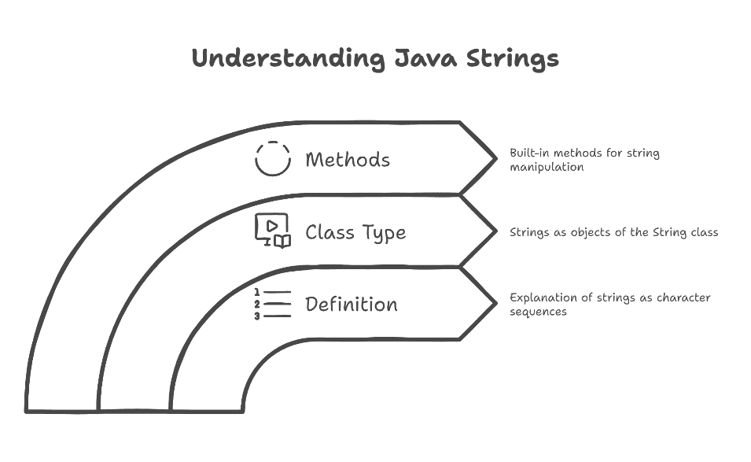

### 创建字符串

字符串可以通过两种方式创建：

#### 1. 使用字符串字面量 (String Literals)

字符串字面量是创建字符串的一种简单且常用的方法。这样创建的字符串存储在字符串池中以提高内存效率。

```java
String greeting = "Hello";
```

#### 2. 使用 `new` 关键字

这种方法显式地在内存中创建一个新的字符串对象。

```java
String greeting = new String("Hello");
```

### 常用字符串方法

Java 提供了许多处理字符串的方法。以下是最常用的方法：

#### 1. `length()`

返回字符串中的字符数。

```java
String name = "Java";
System.out.println(name.length()); // 输出: 4
```

#### 2. `charAt(index)`

返回指定索引（从 0 开始）处的字符。

```java
System.out.println(name.charAt(1)); // 输出: a
```

#### 3. `substring(start, end)`

从字符串中提取子字符串。`start` 索引包含在内，`end` 索引不包含。

```java
System.out.println(name.substring(1, 3)); // 输出: av
```

#### 4. `toUpperCase()` 和 `toLowerCase()`

将字符串转换为大写或小写。

```java
System.out.println(name.toUpperCase()); // 输出: JAVA
System.out.println(name.toLowerCase()); // 输出: java
```

#### 5. `concat()`

拼接（连接）两个字符串。

```java
String welcome = "Hello, ";
System.out.println(welcome.concat(name)); // 输出: Hello, Java
```

### 示例程序

这是一个演示上述某些方法的示例程序：

```java
public class StringExample {
    public static void main(String[] args) {
        String greeting = "Hello";
        String language = "Java";
        // 字符串长度
        System.out.println("Length: " + greeting.length());
        // 索引处的字符
        System.out.println("Character at index 1: " + greeting.charAt(1));
        // 子字符串
        System.out.println("Substring: " + greeting.substring(1, 4));
        // 大小转换
        System.out.println("Uppercase: " + language.toUpperCase());
        System.out.println("Lowercase: " + language.toLowerCase());
        // 字符串拼接
        System.out.println("Greeting: " + greeting.concat(", ").concat(language));
    }
}
```

#### 输出：

```
Length: 5
Character at index 1: e
Substring: ell
Uppercase: JAVA
Lowercase: java
Greeting: Hello, Java
```

通过理解并使用这些字符串方法，你可以高效地在 Java 程序中操作和处理文本数据。

## 类型转换与类型转换

类型转换（Type casting）是指将变量从一种数据类型转换为另一种。这是 Java 中的一个基本概念，可以分为两类：隐式（宽转换）和显式（窄转换）转换。

### 1. 隐式转换（宽转换）

当从较小的数据类型转换为较大的数据类型时，隐式转换会自动发生。由于没有数据丢失的风险，编译器会处理，无需人工干预。

#### 示例：

```java
int num = 10;
double decimal = num; // 隐式转换
System.out.println(decimal); // 输出: 10.0
```

#### 关键点：

* 从小到大的数据类型有效（例如：`byte` -> `short` -> `int` -> `long` -> `float` -> `double`）。
* 没有数据丢失或精度问题。

### 2. 显式转换（窄转换）

当从较大的数据类型转换为较小的数据类型时，需要显式转换。此过程可能会导致数据丢失或精度问题，因此必须使用转换运算符手动执行。

#### 示例：

```java
double decimal = 10.5;
int num = (int) decimal; // 显式转换
System.out.println(num); // 输出: 10
```

#### 关键点：

* 从大到小的数据类型。
* 可能导致精度丢失或截断。

### 3. 使用包装类

Java 提供了包装类来转换原始类型和对象类型。

* `Integer`
* `Double`
* `Boolean`
* `Character`


#### 示例：将字符串转换为原始类型

```java
String str = "123";
int num = Integer.parseInt(str);
```

#### 示例：将原始类型转换为字符串

```java
int num = 10;
String str = Integer.toString(num);
```

通过掌握类型转换，你可以处理变量、数据类型和运算符。

# 控制流与循环

## 条件语句 (`if`, `else`, `switch`)

控制流允许程序做出决策。在 Java 中，条件语句根据条件引导执行流。


让我们探索这些结构：

### 1. `if` 语句

`if` 语句评估条件，如果条件为 `true` 则执行代码块。

#### 示例：

```java
int age = 18;
if (age >= 18) {
    System.out.println("You can vote.");
}
```

#### 关键点：

*   括号内的条件必须求值为布尔值（`true` 或 `false`）。

*   如果条件为 `false`，则跳过该块。

### 2. `if-else` 语句

`if-else` 语句在条件为 `false` 时提供备代码块。

#### 示例：

```java
int age = 16;
if (age >= 18) {
    System.out.println("You can vote.");
} else {
    System.out.println("You are not eligible to vote.");
}
```

#### 关键点：

*   `else` 块是可选的。

*   执行执行一个块：条件为 `true` 时执行 `if` 块，为 `false` 时执行 `else` 块。

### 3. `else if` 阶梯

`else if` 语句允许顺序测试多个条件。程序将执行第一个条件为 `true` 的块。

#### 示例：

```java
int marks = 85;
if (marks >= 90) {
    System.out.println("Grade: A");
} else if (marks >= 75) {
    System.out.println("Grade: B");
} else if (marks >= 50) {
    System.out.println("Grade: C");
} else {
    System.out.println("Grade: F");
}
```

#### 关键点：

*   可以按顺序评估多个条件。

*   即使多个条件为 `true`，也只会执行一个块。

*   如果所有条件都不为 `true`，则执行 `else` 块。

`switch` 语句用于根据表达式的值，从多个代码块中执行一个。

#### 示例：

```java
int day = 3;

switch (day) {
    case 1:
        System.out.println("Monday");
        break;
    case 2:
        System.out.println("Tuesday");
        break;
    case 3:
        System.out.println("Wednesday");
        break;
    default:
        System.out.println("Invalid day");
        break;
}
```

#### 关键点：

* `switch` 表达式必须求值为 `int`、`char`、`String` 或 `enum` 类型的值。

* 使用 `case` 标签来定义表达式的可能值。

* `break` 语句防止执行到后续的 `case`（穿透）。

* 如果没有 `case` 匹配，则执行 `default` 块。

通过掌握这些条件语句，你可以编写出根据输入或条件动态做出决策的程序，从而对程序行为进行更好的控制。

## 逻辑运算符

逻辑运算符用于组合多个条件或反转条件的逻辑。逻辑操作的结果始终是一个布尔值（`true` 或 `false`）。这些运算符对于 Java 程序中的决策至关重要。

### 逻辑运算符类型

#### 1. 与 (`&&`)

当两个条件都为 `true` 时，与运算符返回 `true`。如果任何一个条件为 `false`，结果则为 `false`。

#### 示例：

```java
int age = 25;
boolean isAdult = age >= 18 && age < 60;
System.out.println(isAdult); // 输出: true
```

#### 关键点：

* 两个条件都求值为 `true` 时，结果才为 `true`。

* 常用于检查值是否在范围内。

#### 2. 或 (`||`)

当至少有一个条件为 `true` 时，或运算符返回 `true`。只有当两个条件都为 `false` 时，结果才为 `false`。

#### 示例：

```java
boolean hasPermission = true;
boolean isAdmin = false;
boolean canAccess = hasPermission || isAdmin;
System.out.println(canAccess); // 输出: true
```

#### 关键点：

* 至少有一个条件求值为 `true` 时，结果才为 `true`。

* 有助于根据多个标准授予访问权限。

#### 3. 非 (`!`)

非运算符反反转条件的逻辑。如果条件为 `true`，则结果变为 `false`，反之亦然。

#### 示例：

```java
boolean isActive = false;
System.out.println(!isActive); // 输出: true
```

#### 关键点：

* 用于否定布尔值或条件。

* 常应用于循环和条件语句中，以反转逻辑。

#### 组合逻辑运算符

可以组合逻辑运算符来评估复杂的条件。

#### 示例：

```java
int age = 30;
boolean hasID = true;
boolean canEnter = (age >= 18 && age < 60) && hasID;
System.out.println(canEnter); // 输出: true
```

#### 关键点：

* 使用括号对条件分组并控制评估顺序。

* 在组合多个逻辑运算符时，确保清晰性和可读性。

通过有效理解和使用逻辑运算符，你可以在 Java 程序中构建健壮的条件逻辑，实现动态且智能的决策。

## 循环简介 (`for`, `while`, `do-while`)

循环允许你多次执行代码块，使程序更高效并减少冗余。Java 提供了几种类型的循环以适应不同的用例。

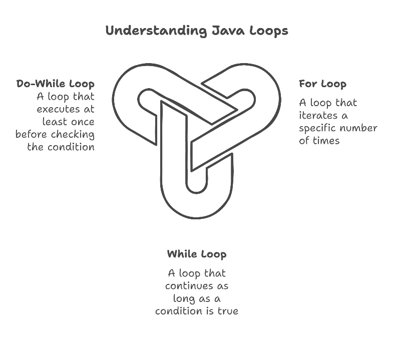

### 1. `for` 循环

当提前已知迭代次数时使用 `for` 循环。它由三部分组成：

* 初始化

* 条件

* 增/减

#### 语法：

```java
for (initialization; condition; increment/decrement) {
    // 要执行的代码
}
```

#### 示例：

```java
for (int i = 1; i <= 5; i++) {
    System.out.println("Iteration: " + i);
}
```

#### 输出：

Iteration: 1

Iteration: 2

Iteration: 3

Iteration: 4

Iteration: 5

#### 关键点：

* 只要条件为 `true`，循环就会运行。

* `increment` 或 `decrement`语句在每次迭代后更新循环变量。

### 2. `while` 循环

当迭代次数不预先且取决于条件时使用 `while` 循环。

#### 语法：

```java
while (condition) {
    // 要执行的代码
}
```

#### 示例：

```java
int i = 1;
while (i <= 5) {
    System.out.println("Iteration: " + i);
    i++;
}
```

#### 输出：

Iteration: 1

Iteration: 2

Iteration: 3

Iteration: 4

Iteration: 5

#### 关键点：

* 在执行代码块之前检查条件。

* 如果初始条件为 `false`，循环体将完全不执行。

### 3. `do-while` 循环

`do-while` 循环与 `while` 循环类似，但它确保无论条件如何，代码块至少执行一次。

#### 语法：

```java
do {
    // 要执行的代码
} while (condition);
```

#### 示例：

```java
int i = 1;
do {
    System.out.println("Iteration: " + i);
    i++;
} while (i <= 5);
```

#### 输出：

Iteration: 1

Iteration: 2

Iteration: 3

Iteration: 4

Iteration: 5

#### 关键点：

* 在代码块之后检查条件。

* 适用于循环需要运行一次的情况。

## `break` 和 `continue` 语句

Java 提供了 `break` 和 `continue` 语句来改变循环的流。


### 1. `break` 语句

`break` 语句用于提前终止循环。执行时，它将控制权转移到循环之后的语句。

#### 语法：

```java
for (initialization; condition; increment/decrement) {
    if (conditionBreak) {
        break;
    }
}
```

#### 示例：

```java
for (int i = 1; i <= 10; i++) {
    if (i == 5) {
        break;
    }
    System.out.println("Iteration: " + i);
}
```

#### 输出：

Iteration: 1

Iteration: 2

Iteration: 3

Iteration: 4

#### 关键点：

* `break` 语句立即终止循环。

* 通常用于根据特定条件终止循环。

### 2. `continue` 语句

`continue` 语句用于跳过循环的当前迭代并进入下一次。与 `break` 不同，它不会终止循环。

#### 语法：

```java
for (initialization; condition; increment/decrement) {
    if (conditionSkip) {
        continue;
    }
}
```

#### 示例：

```java
for (int i = 1; i <= 5; i++) {
    if (i == 3) {
        continue;
    }
    System.out.println("Iteration: " + i);
}
```

#### 输出：

Iteration: 1

Iteration: 2

Iteration: 4

Iteration: 5

#### 关键点：

* `continue` 语句仅跳过当前迭代。

* 适用于循环中需要避免某些条件的情况。

## 嵌套循环与最佳实践

### 嵌套循环

嵌套循环是指一个循环放在另一个循环内部。它们通常用于处理多维数据或执行更的操作。

#### 示例：

```java
for (int i = 1; i <= 3; i++) {
    for (int j = 1; j <= 3; j++) {
        System.out.println("i: " + i + ", j: " + j);
    }
}
```

#### 输出：

i: 1, j: 1

i: 1, j: 2

i: 1, j: 3

i: 2, j: 1

i: 2, j: 2

i: 2, j: 3

i: 3, j: 1

i: 3, j: 2

i: 3, j: 3

#### 关键点：

* 外层循环运行迭代，对于外层循环的每次迭代，内层循环都会完成其所有的迭代。

* 常用于打印矩阵或处理多维数组等场景。

### 1. 避免死循环

当循环条件永远为假时，就会发生死循环，导致程序无限运行。确保循环条件被正确定义。

##### 死循环示例：

```java
while (true) {
    System.out.println("这将永远运行。");
}
```

#### 提示：

* 在需要时使用 `break` 条件退出循环。

* 仔细调试条件判断语句。

### 2. 最小化嵌套循环

过度的嵌套会降低可读性和性能，特别是对于大型数据集。尝试优化或重构逻辑，以避免深层嵌套循环。

#### 示例：

```java
// 尽可能避免过度嵌套
for (int i = 0; i < 100; i++) {
    for (int j = 0; j < 100; j++) {
        for (int k = 0; k < 100; k++) {
            // 高度嵌套的循环
        }
    }
}
```

#### 提示：

* 使用辅助方法简化逻辑。

* 探索替代算法以获得更好的性能。

### 3. 使用描述性变量名

有意义的变量名可以提高代码的可读性，并更容易理解每个循环的。

#### 示例：

```java
for (int row = 1; row <= 5; row++) {
    for (int col = 1; col <= 5; col++) {
        System.out.println("行: " + row + ", 列: " + col);
    }
}
```

### 4. 限制副作用

避免在其他循环或方法内部修改循环变量，因为这可能会引入并导致代码难以调试。

#### 示例：

```java
for (int i = 0; i < 10; i++) {
    someMethod(i); // 避免在 someMethod 内部修改 'i'
}
```

### 5. 优化性能

在处理大型数据集时，考虑使用高效算法以减少迭代次数并增强性能。

#### 示例：

* 使用缓存或记忆化处理重复计算。

* 如果可能，将嵌套循环替换为更高效的算法。

通过掌握控制流和循环，你可以创建动态且灵活的程序，这些程序能够智能地响应各种条件并高效地重复任务。这些概念构成了大多数 Java 应用的框架，对于解决复杂的编程挑战至关重要。

# 第 4 天：方法与作用

## 定义方法 (`void` 和返回类型)

Java 中的方法是执行特定任务的 own 块，可以在程序中多次重用。方法有助于将程序拆分为更小、易于管理且模块化的部分，提高可读性和重用性。

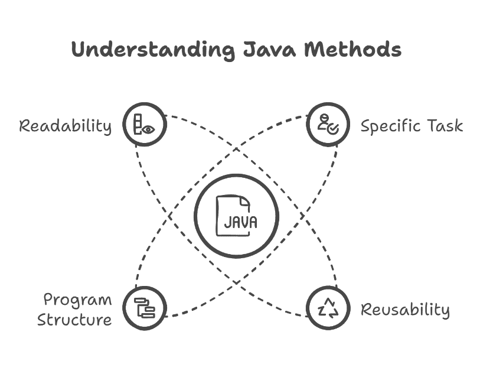

#### `Void` 方法

`Void` 方法不返回任何值。它们执行某些操作（例如打印消息或修改对象），而不提供任何输出。

#### 示例：

```java
public class Greeting {
    // Void 方法
    public static void sayHello() {
        System.out.println("Hello, World!");
    }

    public static void main(String[] args) {
        sayHello(); // 调用方法
    }
}
```

#### 输出：

Hello, World!

#### 关键点：

* `void` 关键字指定该方法不返回任何值。

* 通过方法名后跟括号 `()` 来调用方法。

* 适用于打印、修改对象或记录信息等任务。

### 带返回类型的方法

带返回类型的方法向调用函数返回一个值。返回类型可以是任何有效的数据类型，例如 `int`、`double`、`String` 甚至是自定义对象。

#### 示例：

```java
public class MathOperations {
    // 带返回类型的方法
    public static int addNumbers(int a, int b) {
        return a + b; // 返回 a 和 b 的和
    }

    public static void main(String[] args) {
        int result = addNumbers(5, 10); // 调用方法并存储结果
        System.out.println("The sum is: " + result);
    }
}
```


#### 输出：

```
The sum is: 15
```

#### 关键点：

- 返回类型指定方法将返回值的类型。
- 使用`return`语句从方法返回值。
- 带返回类型的方法对于计算、获取值或返回结果非常有用。

### 使用方法的好处

1. 代码重用性：写一次，用多次。
2. 模块化：将程序拆分为更小的逻辑单元。
3. 提高可读性：方法有助于组织代码，使其更容易阅读和理解。
4. 易于维护：模块化代码中更容易定位和修复错误。

通过理解如何有效地定义和使用方法，你可以创建遵循软件开发最佳实践的清晰、高效且可重用的 Java 程序。

## 方法参数与返回值

### 方法参数

方法参数允许方法接收输入值。这些输入在方法定义的括号内定义，并提供了根据提供的输入执行不同任务的灵活性。

#### 示例：

```java
public class Rectangle {
    // 带参数的方法
    public static int calculateArea(int length, int width) {
        return length * width;
    }

    public static void main(String[] args) {
        int area = calculateArea(5, 7); // 向方法传递值
        System.out.println("Area: " + area);
    }
}
```

#### 输出：

```
Area: 35
```

#### 关键点：

- 参数在方法声明的括号内定义。
- 提供了根据提供的输入执行不同任务的灵活性。

### 返回值

方法可以向调用者返回一个值。返回类型可以是任何有效的数据类型，例如`int`、`double`、`String`甚至是自定义对象。

返回类型在方法声明中定义。方法方法返回值。

#### 示例 1：返回值

```java
public class Greeter {
    public static String greetUser(String name) {
        return "Hello, " + name + "!";
    }

    public static void main(String[] args) {
        String greeting = greetUser("Alice"); // 获取结果
        System.out.println(greeting);
    }
}
```

#### 输出：

```
Hello, Alice!
```

#### 示例 2：带参数的 Void 方法

```java
public class Printer {
    public static void printMessage(String message) {
        System.out.println(message);
    }

    public static void main(String[] args) {
        printMessage("Welcome to Java!");
    }
}
```

#### 输出：

```
Welcome to Java!
```

#### 关键点：

- 使用`return`语句从方法返回值。
- 返回类型指定方法将返回值的类型。
- 带返回类型的方法对于计算、获取值或返回结果非常有用。

## 静态与非静态方法

理解静态和非静态方法的区别对于设计高效且良好的 Java 程序至关重要。让我们探索它们的定义、示例和关键区别。

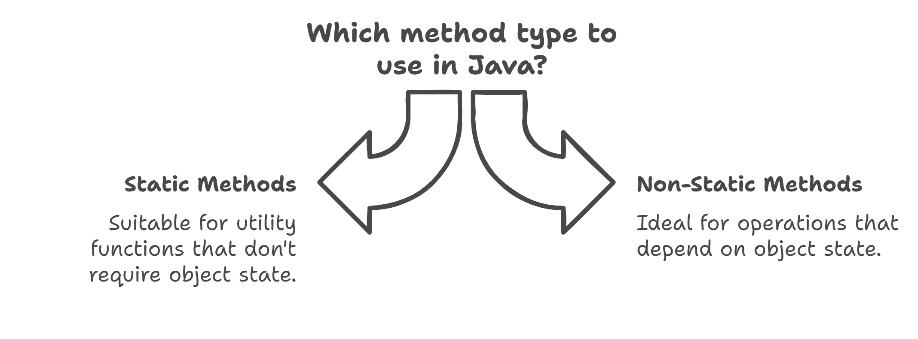

### 静态方法

静态方法属于类本身，可以在不创建类的情况下调用。它们使用`static`关键字。

#### 示例：

```java
public class MathUtils {
    // 静态方法
    public static int square(int number) {
        return number * number;
    }

    public static void main(String[] args) {
        System.out.println("Square: " + square(4)); // 不需要创建对象
    }
}
```

#### 输出：

```
Square: 16
```

#### 关键点：

- 静态方法通过类名或在同一个类中直接访问。
- 常用于工具或辅助方法，例如数学计算。
- 无法直接访问实例变量或方法。

### 非静态方法

非静态方法属于类的实例，并在对象后才能调用。这些方法可以访问实例变量和其他非静态方法。

#### 示例：

```java
public class Person {
    // 非静态方法
    public void introduce(String name) {
        System.out.println("Hi, I am " + name);
    }
}
```

```java
public static void main(String[] args) {
    Person person = new Person(); // 创建一个对象
    person.introduce("Alice");
}
```

#### 输出：

```
Hi, I am Alice
```

#### 关键点：

- 非静态方法通过类的对象来访问。
- 可以访问同一对象内部的实例变量和其他方法。
- 当方法的行为取决于实例的状态时使用。

### 静态方法与非静态方法的主要区别

| 特性 | 静态方法 | 非静态方法 |
| :--- | :--- | :--- |
| 属于 | 类 | 实例 |
| 访问方式 | 直接使用类名访问 | 需要类的对象 |
| 成员访问 | 无法访问实例变量或方法 | 可以同时访问静态和实例成员 |
| 用场景 | 工具类或全局操作 | 特定于实例的行为 |
| 示例语法 | `ClassName.methodName()` | `objectName.methodName()` |

通过理解何时使用静态方法与非静态方法，你可以编写出结构良好且高效的 Java 程序，以满足应用程序的特定需求。

## 作用域（全局、局部、块）

变量的作用域定义了它在程序中可以被访问或修改的地方理解作用域对于防止错误、避免变量冲突以及保持整洁可读的代码至关重要。

### 1. 全局作用域

全局变量定义在类级别，任何方法之外。它们可以被类中的所有方法访问。

#### 示例：

```java
public class Counter {
    static int count = 0; // 全局变量
    public static void increment() {
        count++;
    }
    public static void main(String[] args) {
        increment();
        System.out.println("Count: " + count);
    }
}
```

#### 输出：

```
Count: 1
```

#### 关键点：

- 声明在方法之外但类之内。
- 通常使用`static`定义以实现类范围的可访问。
- 如果管理不当，可能会导致意外的副作用。

### 2. 局部作用域

局部变量声明在方法或块内部，并且仅在该方法或块内可用。这些变量在方法被调用时创建，在方法退出时销毁。

#### 示例：

```java
public class LocalExample {
    public static void printMessage() {
        String message = "Hello from a local variable!"; // 局部变量
        System.out.println(message);
    }
    public static void main(String[] args) {
        printMessage();
    }
}
```

#### 输出：

```
Hello from a local variable!
```

#### 关键点：

- 声明在方法或块内部。
- 在方法或块外部不可访问。
- 防止对程序其他部分的意外干扰。

### 3. 块作用域

声明在块内（用大括号`{}`围围）的变量仅在该块内可用。块作用域通常用于`if`、`for`或`while`循环等控制结构。

#### 示例：

```java
public class BlockScope {
    public static void main(String[] args) {
        if (true) {
            int num = 42; // 块变量
            System.out.println("Number: " + num);
        }
        // System.out.println(num); // 错误：num 在此处超出了作用域
    }
}
```

#### 输出：

```
Number: 42
```

#### 关键点：

- 声明在`{}`中且仅在这些括号内可用。
- 有助于将变量的可见性限制在需要的地方。
- 降低意外修改的风险。

通过理解变量的不同作用域（全局、局部和块），你可以编写更安全、更高效的 Java 程序。合理划分变量的作用域可以增强可读性，避免冲突并确保行为的可预测性。

## Java 中的递归

递归发生在方法通过调用自身来解决问题的较小实例时。递归是解决可以分解为更小、相似的子问题的强大工具，例如计算阶乘、斐波那契数列，或遍历树等数据结构。

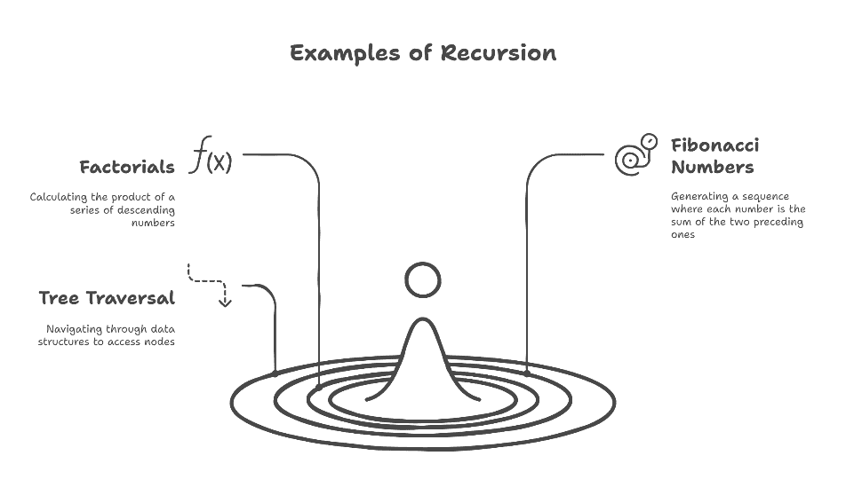

### 示例：计算阶乘

```java
public class RecursionExample {
    public static int factorial(int n) {
        if (n == 0) {
            return 1; // 基准情况
        }
        return n * factorial(n - 1); // 递归调用
    }
    public static void main(String[] args) {
        System.out.println("Factorial of 5: " + factorial(5));
    }
}
```

#### 输出：

```
Factorial of 5: 120
```

### 递归的核心组成部分

1. **基准情况 (Base Case)**：
   - 当满足特定条件时停止递归。
   - 通过定义终止点防止无限递归。

   示例：

```java
if (n == 0) {
    return 1;
}
```

2. **递归情况 (Recursive Case)**：
   - 方法中带有修改后的参数调用自身的部分。
   - 通过将问题分解为更小的子问题来解决问题。

   示例：

```java
return n * factorial(n - 1);
```

### 递归的最佳实践

- **确保定义良好的基准情况**：
  - 通过明确指定方法何时停止来避免无限递归。
- **对具有自然递归结构的问题递归**：
  - 诸如树形遍历、分治算法或数学问题等问题。

`length`属性提供数组的大小，即它能够容纳的元素个数。

#### 示例：

```java
int[] numbers = {10, 20, 30};
System.out.println(numbers.length); // 输出: 3
```

### 2. 遍历数组

你可以使用循环来遍历数组并访问其元素。

#### 示例：

```java
int[] numbers = {10, 20, 30};
for (int i = 0; i < numbers.length; i++) {
    System.out.println(numbers[i]);
}
```

#### 输出：

```
10
20
30
```

### 3. 复制数组

`System.arraycopy`方法允许高效地将元素从一个数组复制到另一个数组。

#### 示例：

```java
int[] source = {1, 2, 3};
int[] destination = new int[3];
System.arraycopy(source, 0, destination, 0, source.length);
for (int num : destination) {
    System.out.println(num);
}
```

#### 输出：

```
1
2
3
```

### 4. 查找元素

要查找一个元素，你可以遍历数组并将每个元素与目标值进行比较。

#### 示例：

```java
int[] numbers = {10, 20, 30};
int target = 20;
boolean found = false;
for (int num : numbers) {
    if (num == target) {
        found = true;
        break;
    }
}
System.out.println(found ? "Element found" : "Element not found");
```

#### 输出：

```
Element found
```

## 数组操作最佳实践

1. **正确初始化数组**：始终分配正确的大小以避免出现`ArrayIndexOutOfBoundsException`。
2. **优化遍历**：在不需要索引时，使用增强型`for`循环（for-each）来提高代码可读性。
3. **验证索引**：在访问数组元素之前，确保索引在范围内。
4. **利用库**：使用 Java 的工具类（如`Arrays`）来处理排序和搜索等常用操作。

通过理解并练习这些数组操作，你可以有效地处理数据集合，并为在 Java 中处理更高级的数据结构打下坚实的基础。

## ArrayList 与集合简介

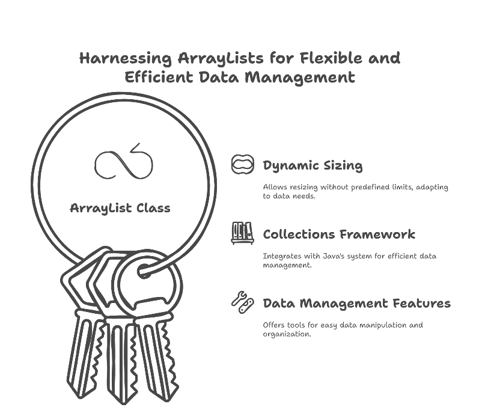

虽然数组非常强大，但它们固定的大小有时是一个限制。Java 中的`ArrayList`类提供了一种动态替代方案，允许你在无需定义大小的情况下存储元素。它是 Java 集合框架（Collections Framework）的一部分，为管理数据集合提供了许多方便的功能。

### 声明 ArrayList

要使用`ArrayList`，你需要导入`java.util.ArrayList`类。

#### 示例：

```java
import java.util.ArrayList; //  ArrayList 类
public class ArrayListExample {
    public static void main(String[] args) {
        // 声明一个整数类型的 ArrayList
        ArrayList<Integer> numbers = new ArrayList<>();
        // 添加元素
        numbers.add(10);
        numbers.add(20);
        numbers.add(30);
        // 打印 ArrayList
        System.out.println("ArrayList: " + numbers);
    }
}
```

#### 输出：

```
ArrayList: [10, 20, 30]
```

### ArrayList 的核心特性

#### 1. 动态大小

与数组不同，`ArrayList`可以随着元素的添加或删除而增大或缩小。你不需要在声明时指定固定的大小。

#### 2. 类型安全

通过泛型，`ArrayList`允许你指定它将存储的元素类型，确保编译时的类型安全。

#### 示例：

```java
ArrayList<String> names = new ArrayList<>();
names.add("Alice");
names.add("Bob");
System.out.println(names); // 输出: [Alice, Bob]
```

#### 3. 内置方法

`ArrayList`类包含了几个用于添加、删除和修改元素的方法：

##### 常用方法：

- `add(element)`：在列表末尾添加一个元素。
- `add(index, element)`：在指定的索引处插入一个元素。
- `remove(index)`：删除指定索引处的元素。
- `get(index)`：获取指定索引处的元素。
- `set(index, element)`：替换指定索引处的元素。
- `size()`：返回列表中的元素个数。

#### 示例：


```java
ArrayList<String> fruits = new ArrayList<>();
fruits.add("Apple");
fruits.add("Banana");
fruits.add("Cherry");
System.out.println("Original List: " + fruits);
// 访问元素
System.out.println("First Element: " + fruits.get(0));
// 修改元素
fruits.set(1, "Blueberry");
System.out.println("After Modification: " + fruits);
// 删除元素
fruits.remove(2);
System.out.println("After Removal: " + fruits);
// 列表的大小
System.out.println("Size: " + fruits.size());
```

#### 输出：

```
Original List: [Apple, Banana, Cherry]
First Element: Apple
After Modification: [Apple, Blueberry, Cherry]
After Removal: [Apple, Banana]
Size: 2
```

通过理解并练习这些数组操作，你可以有效地处理数据集合，并为在 Java 中处理更高级的数据结构打下坚实的基础。

高效迭代对于管理和处理存储在数组和集合中的数据至关重要。Java 提供了多种迭代方法，每种适用于不同的场景。

### 使用 For Loop

传统的 `for` 循环让你对迭代过程有完全的控制，通常用于数组和集合。

#### 示例：

```java
ArrayList<Integer> numbers = new ArrayList<>();
numbers.add(10);
numbers.add(20);
numbers.add(30);

for (int i = 0; i < numbers.size(); i++) {
    System.out.println(numbers.get(i));
}
```

#### 输出：

```
10
20
30
```

#### 关键点：

*   提供了对每个元素索引的访问。
*   当需要修改特定位置的元素时非常有用。

### 使用 For-Each 循环

增强型 `for` 循环（也称为 `for-each` 循环）更简单简洁。它同时适用于数组和集合。

#### 示例：

```java
for (int num : numbers) {
    System.out.println(num);
}
```

#### 输出：

```
10
20
30
```

#### 关键点：

*   与传统的 `for` 循环相比更易读且易写。
*   不提供索引的访问。
*   不能在迭代期间直接修改集合。

### 使用 Iterator

`Iterator` 允许对迭代过程进行更多控制，并在遍历过程中安全地删除元素。

#### 示例：

```java
import java.util.ArrayList;
import java.util.Iterator;

public class IteratorExample {
    public static void main(String[] args) {
        ArrayList<Integer> numbers = new ArrayList<>();
        numbers.add(10);
        numbers.add(20);
        numbers.add(30);

        Iterator<Integer> iterator = numbers.iterator();
        while (iterator.hasNext()) {
            int num = iterator.next();
            if (num == 20) {
                iterator.remove();
            }
        }
        System.out.println(numbers); // 输出: [10, 30]
    }
}
```

#### 输出：

```
[10, 30]
```

#### 关键点：

*   `Iterator` 接口提供了 `hasNext()` 和 `next()` 等方法。
*   安全地移除元素而不引起 `ConcurrentModificationException`。

### 使用 Streams (Java 8+)

`stream()` API 引入了用于迭代集合的函数式编程方法。它支持过滤、映射等操作。

#### 示例：

```java
numbers.stream().forEach(System.out::println);
```

#### 输出：

```
10
20
30
```

#### 关键点：

*   紧凑且函数化的。
*   适用于变换和处理管道。
*   不允许在迭代期间修改原始集合。

通过掌握数组、集合和迭代技术，你可以高效地管理和处理数据。这些工具是构建健壮且可扩展 Java 应用的基础。

# 第 6 天：异常处理与文件 IO

## 异常简介

在 Java 中，异常是中断程序正常流的事件。异常通常由逻辑错误、无效的用户输入或意外情况（如找不到文件或除以零）引起。理解异常以及如何处理它们对于编写健壮且无错误的程序至关重要。

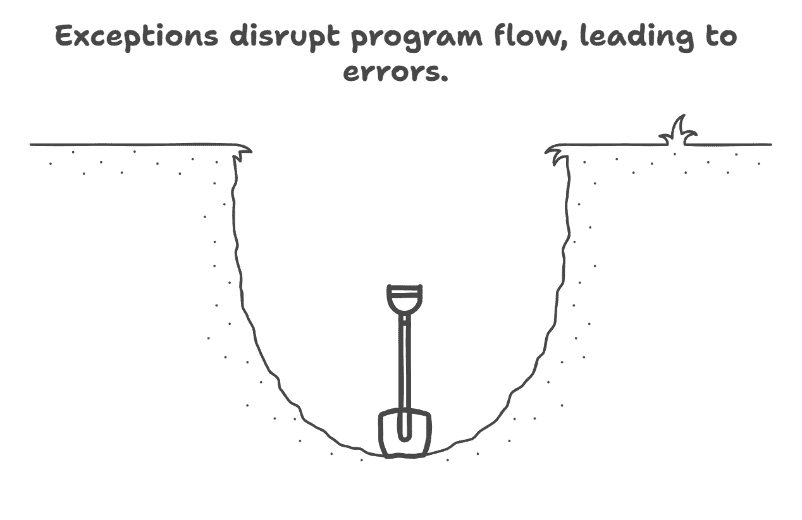

### 异常类型

Java 异常分为两大类：

#### 1. 检查异常 (Checked Exceptions)

*   定义：这些在编译时被检查。除非处理这些异常，否则程序无法编译。
*   示例：
    *   `IOException`：当输入输出操作出现问题时发生。
    *   `SQLException`：在数据库访问错误期间发生。

#### 示例：

```java
import java.io.*;

public class CheckedExceptionExample {
    public static void main(String[] args) {
        try {
            FileReader file = new FileReader("nonexistentfile.txt");
        } catch (IOException e) {
            System.out.println("File not found: " + e.getMessage());
        }
    }
}
```

#### 2. 非检查异常 (Unchecked Exceptions)

*   定义：这些在运行时发生，通常由编程错误引起，如逻辑错误或不正确使用 API。
*   示例：
    *   `ArithmeticException`：在非法算术运算期间（例如除以零）发生。
    *   `NullPointerException`：当尝试访问空引用时抛出。
    *   `ArrayIndexOutOfBoundsException`：当用非法索引访问数组时发生。

#### 示例：

```java
public class UncheckedExceptionExample {
    public static void main(String[] args) {
        try {
            int[] numbers = {1, 2, 3};
            System.out.println(numbers[5]); // 访问无效索引
        } catch (ArrayIndexOutOfBoundsException e) {
            System.out.println("Invalid index: " + e.getMessage());
        }
    }
}
```

### 异常层次结构

Java 中所有的异常类都继承自 `Throwable` 类。层次结构如下：

#### Throwable

*   `Error`：代表应用程序通常无法恢复的严重问题（例如 `OutOfMemoryError`、`StackOverflowError`）。
*   `Exception`：代表应用程序可以处理的条件。
    *   检查异常：应用程序必须处理的。
    *   运行时异常：在运行时发生的。

#### 可视化表示：

```
Throwable
|
+-- Error
|   +-- OutOfMemoryError
|   +-- StackOverflowError
+-- Exception
|   +-- IOException (Checked)
|   +-- SQLException (Checked)
|   +-- RuntimeException (Unchecked)
|       +-- NullPointerException
|       +-- ArithmeticException
```

通过理解异常类型和层次结构，你可以设计能够优雅处理异常的程序。

## Try-Catch-Finally 块

`try-catch-finally` 结构用于处理异常并确保程序继续运行。

### 基础结构

```java
try {
    // 可能抛异常的代码
} catch (ExceptionType) {
    // 处理异常
} finally {
    // 清理代码
}
```

#### 关键点：

*   `try` 块：可能抛异常的代码。
*   `catch` 块：处理异常。
*   `finally` 块：无论是否发生异常都会执行。

### 示例：处理除以零

```java
public class ExceptionExample {
    public static void main(String[] args) {
        try {
            int result = 10 / 0; // 将抛出 ArithmeticException
        } catch (ArithmeticException e) {
            System.out.println("Error: Division by zero.");
        } finally {
            System.out.println("Execution complete.");
        }
    }
}
```

#### 输出：

```
Error: Division by zero.
Execution complete.
```

### finally 块

`finally` 块无论是否发生异常都会执行。它通常用于资源清理，例如关闭文件、释放锁或断开数据库连接。

#### 示例：资源清理

```java
import java.io.*;

public class FileExample {
    public static void main(String[] args) {
        BufferedReader reader = null;
        try {
            reader = new BufferedReader(new FileReader("example.txt"));
            System.out.println(reader.readLine());
        } catch (IOException e) {
            System.out.println("Error reading file: " + e.getMessage());
        } finally {
            try {
                if (reader != null) {
                    reader.close();
                }
            } catch (IOException e) {
                System.out.println("Error closing file: " + e.getMessage());
            }
        }
    }
}
```

#### 输出（示例）：

```
Error reading file: example.txt (No such file or directory)
```

### 多 catch 块

你可以使用多个 `catch` 块来分别处理不同类型的异常。

#### 示例：

```java
public class MultiCatchExample {
    public static void main(String[] args) {
        try {
            int[] numbers = {1, 2, 3};
            System.out.println(numbers[5]); // 抛出 ArrayIndexOutOfBoundsException
        } catch (ArithmeticException e) {
            System.out.println("Arithmetic error occurred.");
        } catch (ArrayIndexOutOfBoundsException e) {
            System.out.println("Index out of bounds.");
        }
    }
}
```

```java
} catch (ArrayIndexOutOfBoundsException e) {
    System.out.println("Array index is out of bounds.");
} finally {
    System.out.println("Cleanup complete.");
}
}
}
```

#### 输出：

```
Array index is out of bounds.
Cleanup complete.
```

通过有效使用 `try-catch-finally` 结构，你可以优雅地处理异常并确保程序中的适当资源管理。这是编写健壮且可维护的 Java 应用程序的基础。

## 抛出和捕获异常

适当处理异常对于构建健壮且可维护的程序至关重要。在 Java 中，你可以手动抛出异常，也可以高效地捕获多个异常。

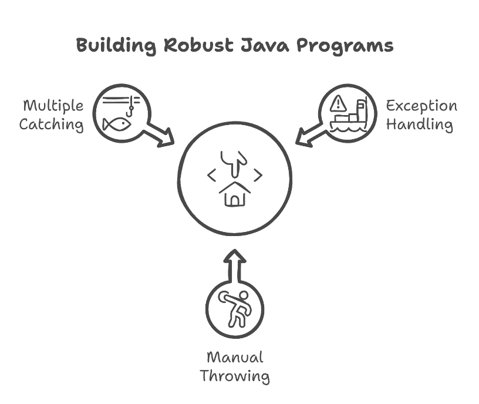

### 抛出异常

你可以使用 `throw` 关键字手动抛出异常。这对于信号程序中的特定错误状况有用。

#### 示例：

```java
public class ThrowExample {
    public static void validateAge(int age) {
        if (age < 18) {
            throw new IllegalArgumentException("Age must be 18 or older.");
        }
        System.out.println("Age is valid.");
    }
    public static void main(String[] args) {
        try {
            validateAge(15);
        } catch (IllegalArgumentException e) {
            System.out.println("Exception: " + e.getMessage());
        }
    }
}
```

#### 输出：

```
Exception: Age must be 18 or older.
```

#### 关键点：

*   使用 `throw` 关键字来抛出异常。
*   始终提供一个有意义的消息来帮助识别异常产生的原因。
*   方法必须使用 `throws` 关键字声明它所抛出的异常（如果适用于受检异常）。

### 捕获多个异常

从 Java 7 开始，你可以在单个 `catch` 块中捕获多个异常。这减少了代码的冗余并提高了代码的可读性。

#### 示例：

```java
public class MultiCatchExample {
    public static void main(String[] args) {
        try {
            int[] numbers = {1, 2};
            System.out.println(numbers[5]); // Throws ArrayIndexOutOfBoundsException
        } catch (ArithmeticException | ArrayIndexOutOfBoundsException e) {
            System.out.println("Error: " + e.getMessage());
        }
    }
}
```

#### 输出：

```
Error: Index 5 out of bounds for length 2
```

#### 关键点：


使用管道符（`|`）运算符在单个`catch`块中指定多个异常。

异常变量（`e`）在所有指定的异常类型之间共享。

这种方法减少了重复代码并确保了更整洁的实现。

通过掌握抛出和捕获异常的概念，你可以在保持代码整洁可维护的同时，有效地处理错误场景。这些实践是构建健壮 Java 应用程序的基础。

## 读取和写入文件

文件 I/O（输入/输出）允许程序与文件交互以读写数据。Java 在`java.io`包中提供了几个类来高效且有效地处理文件操作。

### 读取文件

`FileReader`类用于从文件中读取字符流。它逐字符地读取数据，是处理文本文件的理想选择。

#### 示例：

```java
import java.io.*;

public class FileReadExample {
    public static void main(String[] args) {
        try (FileReader reader = new FileReader("example.txt")) {
            int character;
            while ((character = reader.read()) != -1) {
                System.out.print((char) character);
            }
        } catch (IOException e) {
            System.out.println("Error reading file: " + e.getMessage());
        }
    }
}
```

#### 解释：

* 创建`FileReader`对象时以文件名作为其参数。
* `read()`方法每次读取一个字符，并在到达文件末时返回`-1`。
* `try-with-resources`语句确保`FileReader`在使用后自动关闭。

### 写入文件

`FileWriter`类用于向文件写入字符流。它允许你创建新内容或覆盖现有文件。

#### 示例：

```java
import java.io.*;

public class FileWriteExample {
    public static void main(String[] args) {
        try (FileWriter writer = new FileWriter("output.txt")) {
            writer.write("Hello, File I/O!");
        } catch (IOException e) {
            System.out.println("Error writing to file: " + e.getMessage());
        }
    }
}
```

#### 解释：

* 创建`FileWriter`对象时以目标文件名作为其参数。
* `write()`方法将指定的字符串写入文件。
* `try-with-resources`语句确保`FileWriter`在使用后自动关闭。

#### 关键点：

1. 错误处理：始终使用`try-catch`处理异常，以防止文件操作期间发生崩溃。
2. 资源管理：使用`try-with-resources`确保文件流自动关闭。
3. 字符流与字节流：`FileReader`和`FileWriter`类处理字符数据，而`FileInputStream`和`FileOutputStream`处理原始字节数据。

通过掌握文件读取和写入技术，你可以构建出高效处理数据存储和检索的应用程序。

## 使用 BufferedReader 和 BufferedWriter

缓冲类通过缓冲输入和输出流来提高文件操作的效率。这些类是`java.io`包的一部分，提供了高效的文本读写性能。

### BufferedReader

`BufferedReader`类通过缓冲输入流中的字符来高效读取文本。它显著减少了频繁 I/O 操作的开销。

#### 示例（读取文件）：

```java
import java.io.*;

public class BufferedReaderExample {
    public static void main(String[] args) {
        try (BufferedReader br = new BufferedReader(new FileReader("example.txt"))) {
            String line;
            while ((line = br.readLine()) != null) {
                System.out.println(line);
            }
        } catch (IOException e) {
            System.out.println("Error: " + e.getMessage());
        }
    }
}
```

#### 解释：

* `BufferedReader`对象封装`FileReader`进行缓冲，允许使用`readLine()`方法按行。
* `try-with-resources`语句确保`BufferedReader`自动关闭。

### BufferedWriter

`BufferedWriter`类通过缓冲输出流来高效写入文本。这减少了写入操作的次数，提高了写入大量数据时的性能。

#### 示例（写入文件）：

```java
import java.io.*;

public class BufferedWriterExample {
    public static void main(String[] args) {
        try (BufferedWriter bw = new BufferedWriter(new FileWriter("output.txt"))) {
            bw.write("Writing with BufferedWriter.");
        } catch (IOException e) {
            System.out.println("Error: " + e.getMessage());
        }
    }
}
```

#### 解释：

* `BufferedWriter`对象封装`FileWriter`进行字符缓冲。
* `try-with-resources`语句确保资源在使用后被关闭。

#### 关键点：

1. 性能：缓冲类通过一次处理较大块的数据来减少读写操作的次数。
2. 资源管理：始终使用`try-with-resources`以确保文件流正确关闭。

通过掌握`BufferedReader`和`BufferedWriter`的使用，你可以更高效地处理文件 I/O 操作，并编写能够无缝管理大型文本数据的程序。

# 核心概念

### 1. 类 (Class)

类是创建对象的蓝图。它定义了对象将具有的结构和行为（属性和方法）。

#### 示例：

```java
public class Car {
    // Attributes
    String brand;
    String color;

    // Method
    public void start() {
        System.out.println("Car is starting...");
    }
}
```

### 2. 对象 (Object)

对象是类的实例。对象用于表示和与真实世界的实体交互。

#### 示例：

```java
public class Main {
    public static void main(String[] args) {
        Car myCar = new Car(); // 创建 Car 类的对象
        myCar.brand = "Toyota";
        myCar.color = "Red";
        myCar.start(); // 调用 start 方法
    }
}
```

### 3. 属性 (Attributes)

属性是类中的变量，代表对象的状态或特征。

#### 示例：

```java
myCar.brand = "Toyota"; // 设置品牌属性
myCar.color = "Red";   // 设置颜色属性
```

### 4. 方法 (Methods)

方法是定义在类中的函数，规定了对象可以执行的操作。

#### 示例：

```java
myCar.start(); // 调用 start 方法
```

# 面向对象编程 (OOP) 的优势

### 1. 代码复用性

OOP 通过继承实现了代码复用，允许将通用功能定义一次并供多个类使用。

#### 示例：

```java
public class Vehicle {
    public void move() {
        System.out.println("Vehicle is moving...");
    }
}

public class Car extends Vehicle {
    // 继承了 Vehicle 的 move 方法
}
```

### 2. 模块化

将代码划分为更小、易管理的部分，使其更容易调试、测试和维护。

#### 示例：

OOP 设计中的每个类通常代表一个单一职责，例如`Car`、`Engine`或`Driver`。

### 3. 可维护性

封装确保了代码某部分的更改不会影响其他部分，从而促进更好的组织和更的更新。

#### 示例：

```java
public class Account {
    private double balance; // 封装的属性

    public void deposit(double amount) {
        balance += amount;
    }

    public double getBalance() {
        return balance;
    }
}
```

### 4. 可扩展性

OOP 设计可以通过添加新类或方法轻松扩展，以包含新功能或组件。

#### 示例：

可以通过扩展`Vehicle`类添加新的车辆类型，如`Truck`或`Bike`。

通过掌握 OOP 概念，你可以设计出高效、可扩展且于理解的系统。这些原则构成了现代软件开发的基础，对于构建健壮的应用至关重要。

# 创建类和对象

理解如何定义类和创建对象是面向对象编程 (OOP) 的基础。类定义对象的蓝图，而对象是这些类的实例。这种关系允许开发者以结构化的方式对真实世界的实体及其行为进行建模。

### 定义类

使用`class`关键字定义类，后跟类名和类体。它包含了代表对象状态和行为的属性（变量）和方法（函数）。

#### 示例：定义 Person 类

```java
public class Person {
    String name; // 属性
    int age;     // 属性

    void introduce() { // 方法
        System.out.println("Hi, my name is " + name);
    }
}
```

### 创建对象

使用`new`关键字创建对象，它为对象分配内存并初始化其属性。

#### 示例：

```java
public class Main {
    public static void main(String[] args) {
        Person person = new Person(); // 创建对象
        person.name = "Alice"; // 设置属性
        person.age = 25;
        person.introduce(); // 调用方法
    }
}
```

#### 输出：

Hi, my name is Alice

### 示例：代表汽车的类

#### 代码：

```java
public class Car {
    String brand; // 属性
    int speed;    // 属性

    void accelerate() { // 方法
        speed += 10;
        System.out.println(brand + " is now moving at " + speed + " km/h");
    }

    public static void main(String[] args) {
        Car car = new Car();
        car.brand = "Toyota"; // 设置属性
        car.speed = 50;
        car.accelerate(); // 调用方法
    }
}
```

#### 输出：

Toyota is now moving at 60 km/h

#### 关键点

1. **类与对象的关系：** 类是一个模板，而对象是该模板的特定实例。
2. **属性与方法：** 属性代表对象的状态，方法定义其行为。
3. **初始化：** 在使用属性之前，始终将其初始化为意义的值。
4. **封装：** 使用访问修饰符（如`private`或`public`）控制对属性和方法的访问，确保数据完整性。

通过掌握定义类和创建对象的过程，你获得了设计镜像真实世界系统程序的能力。这些技能是开发模块化、可复用和易维护应用程序的基础。

# 方法和属性

在面向对象编程中，方法和属性定义了类的行为和状态。它们共同提供了功能并代表了类的特征。


### 方法

方法是定义在类中的函数，规定了对象可以执行的操作。它们大致分为两类：

#### 1. 实例方法

实例方法操作特定实例的数据。这些方法在类的实例上调用。

#### 2. 静态方法

静态方法属于类而不是任何对象。它们可以使用类名直接调用，不需要实例。

#### 示例：

```java
public class Calculator {
    // 实例方法
    int add(int a, int b) {
        return a + b;
    }

    // 静态方法
    static void greet() {
        System.out.println("Welcome to the Calculator Program");
    }

    public static void main(String[] args) {
        // 调用实例方法
        Calculator calc = new Calculator();
        int result = calc.add(10, 20);
        System.out.println("Sum: " + result);

        // 调用静态方法
        greet();
    }
}
```

#### 输出：

Welcome to the Calculator Program

Sum: 30

#### 关键点：

* **实例方法：** 操作特定实例的数据，需要对象才能调用。
* **静态方法：** 不依赖于特定实例的数据，可以使用类名直接调用。

### 属性

属性是定义在类中的变量，代表对象的状态或特征。它们通常被称为字段或成员变量。

#### this 关键字

`this`关键字用于引用当前对象的属性，特别是在当局部变量遮蔽了类属性时。

#### 示例：

```java
public class Rectangle {
    int length, width; // 属性

    // 实例方法
    void setDimensions(int length, int width) {
        this.length = length; // 指向类属性
        this.width = width;
    }

    int calculateArea() {
        return length * width; // 使用属性计算面积
    }

    public static void main(String[] args) {
        Rectangle rect = new Rectangle();
        rect.setDimensions(5, 10); // 使用实例方法设置尺寸
        System.out.println("Area: " + rect.calculateArea());
    }
}
```

#### 输出：

Area: 50

通过有效使用方法和属性，你可以设计出既具功能性又有描述性的类，为面向对象编程奠定坚实的基础。

继承允许一个类（`child`）获取另一个类（`parent`）的属性和方法。这促进了代码复用以及类之间的层次关系。

#### 示例：


# Java 面向对象编程

## 继承

继承允许一个类（子类）继承另一个类（父类）的属性和方法。这促进了代码复用并建立了类之间的层次关系。

### 示例

```java
public class Animal {
    void eat() {
        System.out.println("This animal eats food.");
    }
}

public class Dog extends Animal {
    void bark() {
        System.out.println("The dog barks.");
    }

    public static void main(String[] args) {
        Dog dog = new Dog();
        dog.eat(); // 继承的方法
        dog.bark();
    }
}
```

#### 输出

```
This animal eats food.
The dog barks.
```

#### 关键点

- 使用`extends`关键字建立继承。
- 子类可以继承并使用父类的`public`和`protected`方法和属性。
- 子类还可以添加它自己的方法和属性。

## 多态

多态允许方法根据调用它的对象具有不同的实现。这可以通过方法重载和方法重写来实现。

### 1. 方法重载

当同一个类中的多个方法具有相同名称但参数列表不同时，就会发生方法重载。

#### 示例

```java
public class Printer {
    void print(String text) {
        System.out.println(text);
    }
    void print(int number) {
        System.out.println(number);
    }

    public static void main(String[] args) {
        Printer printer = new Printer();
        printer.print("Hello, World!");
        printer.print(42);
    }
}
```

#### 输出

```
Hello, World!
42
```

#### 关键点

- 相同的方法必须具有不同的参数列表（类型、数量或顺序）。
- 重载通过允许方法处理多种数据类型或场景，提高了代码的可读性和易用性。

### 2. 方法重写

方法重写发生在子类为父类中已经定义的方法提供了特定实现时。

#### 示例

```java
public class Parent {
    void display() {
        System.out.println("Parent method");
    }
}

public class Child extends Parent {
    @Override
    void display() {
        System.out.println("Child method");
    }

    public static void main(String[] args) {
        Parent obj = new Child();
        obj.display();
    }
}
```

#### 输出

```
Child method
```

#### 关键点

- 使用`@Override`注解表示该方法正在被重写。
- 子类中的方法签名必须与父类完全匹配。
- 重写实现了动态方法分发，允许运行时对象确定方法的实现。

通过掌握继承和多态，你可以设计健壮且可扩展的系统。这些概念构成了基于 OOP 的复用、灵活和可维护应用程序的基础。

## 封装与抽象

封装和抽象是面向对象编程（OOP）两个核心原则，增强了安全性、模块性和开发便利性。这些概念确保程序更具可维护性、可扩展性和健壮性。

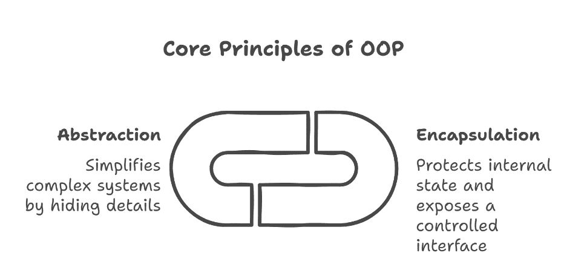

### 封装

封装限制了对对象属性和方法的直接访问。这是通过访问修饰符（`private`、`public`、`protected`）以及通过 getter 和 setter 方法提供控制访问来实现。

#### 示例

```java
public class BankAccount {
    private double balance; // 私有属性

    // Getter 方法
    public double getBalance() {
        return balance;
    }

    // Setter 方法
    public void deposit(double amount) {
        if (amount > 0) {
            balance += amount;
        }
    }

    public static void main(String[] args) {
        BankAccount account = new BankAccount();
        account.deposit(1000);
        System.out.println("Balance: " + account.getBalance());
    }
}
```

#### 输出

```
Balance: 1000.0
```

#### 关键点

- 访问修饰符：使用`private`限制对属性和方法的直接访问。
- Getter/Setter 方法：提供对属性的控制访问，确保数据完整性。
- 益处：提高了安全性，并允许在不影响外部代码的情况下更改实现。

### 抽象

抽象隐藏了实现细节，只显示基本的特征。这可以通过抽象类和接口来实现，允许开发者关注对象“做什么”而不是“如何做”。

### 1. 抽象类

抽象类为派生类定义了蓝图，并可能包含抽象（未实现）和具体（已实现）的方法。

#### 示例

```java
abstract class Shape {
    abstract void draw(); // 抽象方法
}

class Circle extends Shape {
    void draw() {
        System.out.println("Drawing a circle");
    }

    public static void main(String[] args) {
        Shape shape = new Circle();
        shape.draw();
    }
}
```

#### 输出

```
Drawing a circle
```

#### 关键点

- 抽象类包含抽象和具体方法。
- 抽象方法必须由子类实现。
- 无法创建抽象类的实例。

#### 2. 接口

接口定义了必须遵守的约定。它们允许多重继承。

#### 示例

```java
interface Animal {
    void sound(); // 抽象方法
}

class Cat implements Animal {
    public void sound() {
        System.out.println("Meow");
    }

    public static void main(String[] args) {
        Animal animal = new Cat();
        animal.sound();
    }
}
```

#### 输出

```
Meow
```

#### 关键点

- 使用`interface`关键字定义接口。
- 接口中的所有方法隐式为`public`和`abstract`。
- 接口支持多重继承。

通过掌握封装和抽象，你将能够设计可扩展和可维护的应用程序。

# 结语

## 接下来呢？

恭喜你完成了 Java 之旅！现在，你已经对语言、语法、数据类型、控制流、方法、面向对象编程等有了坚实的基础。这一成就值得赞扬，但这仅仅是你作为 Java 程序员兴奋之旅的开始。以下是关于继续成长的建议：

### 1. 深化你的知识

为了精通 Java，请深入研究高级主题并探索语言的全功能：

#### 高级主题

- 多线程与并发：学习编写高效、线程安全的代码。
- 网络：了解如何构建客户端-服务器应用程序。
- JavaFX：创建丰富的图形界面。

#### 函数式编程

- 学习流和 Lambda 表达式来处理数据。

#### 集合框架

- 深入研究`Map`、`Set`和特殊集合（如`TreeMap`和`LinkedHashMap`）以处理复杂数据。

### 2. 练习构建项目

通过项目应用知识是巩固学习的最佳方法之一。从小开始。

#### 小型项目

- 待办事项应用程序：管理添加、编辑和删除任务。
- 简单计算器：实现算术运算和错误处理。
- 命令行游戏：创建井字格或猜单词等有趣的游戏。

#### 大型项目

- 图书管理系统：处理书籍借还和用户记录。
- 电子商务应用程序：开发具有数据库后端支持的产品目录。
- 聊天应用程序：使用 Java 的网络能力构建即时消息系统。

### 3. 学习框架和工具

框架和工具对于构建现代企业级应用程序至关重要。请熟悉以下内容：

- `Spring Framework`：开发健壮的 Web 和后端应用程序。
- `Hibernate`：使用对象关系映射（`ORM`）简化数据库交互。
- `Build Tools`：熟练掌握`Maven`和`Gradle`等工具，用于依赖管理和项目构建。
- `Testing Frameworks`：使用`JUnit`编写单元测试以确保代码的可靠性。

## 4. 贡献开源

向开源项目贡献是提升以下能力的绝佳方式：

- 与丰富的开发者协作。
- 学习最佳编码实践。
- 构建一个专业的作品集。

诸如`GitHub`等平台托管了无数项目，你的贡献可以产生影响。从修复 Bug 或改进文档等小事开始，然后转向更重要的贡献。

## 持续学习的资源

Java 生态系统非常庞大，拥有丰富的资源支持。以下是一些推荐的材料：

### 书籍

- [少儿 Java：有趣且简单的编程学习方法](https://www.amazon.com/dp/B0DRCS945H)
- [24 小时学 Java：初学者终极指南](https://www.amazon.com/dp/B0DS1ZY76T)

### 在线课程

- [Java 面试成功：450+ 必知题](https://www.udemy.com/course/java-interview-success-450-must-know-questions/?referralCode=14DCE1C216766EC285E4)
- [Java 大师班：完整指南](https://www.udemy.com/course/java-masterclass-the-ultimate-beginners-guide/?referralCode=EAF7D7778D7E0E71DE6B)
- [1200+ Java 面试题 - 练习测试](https://www.udemy.com/course/java-interview-questions-practice-tests/?referralCode=4C7BD0FD4AAC5AB08A8B)

### 文档与社区

- `Oracle`官方 Java 文档：Java 特性和 API 的权威性指南。
- 加入如`Stack Overflow`、`Reddit`的`r/Java`以及`Java Discord`服务器等社区，与学习者和专家互动。

### 应用

通过这些应用增强你的 Java 学习和实践：

- [Java Programs](https://play.google.com/store/apps/details?id=com.aniketjain.javaexamples)：探索各种 Java 示例以便快速参考。
- [Java Programs: 500+ Examples](https://play.google.com/store/apps/details?id=com.aniketjain.javaprograms)：访问包含 500 多个 Java 程序的全面集合。

## 最后的鼓励

学习 Java 是对你未来的投资，完成这段基础性旅程是向前的一大步。记住，编程不仅仅是编写代码——它还关乎解决问题、逻辑思考和不断改进。以下是一些需要记在心的指导原则：

- `经常练习`：坚持是精通的关键。每天或每周花时间写代码。
- `需要时寻求帮助`：遇到挑战时，与社区、论坛或同伴交流。
- `构建作品集`：展示你的项目以向潜在雇主证明你的技能。
- `拥抱这段旅程`：编程既需要创造力也需要逻辑。享受构建有意义的事物的过程。

### 前行之路

Java 开发的世界广阔且充满机会。通过奉献、坚持和对学习的热情，你可以取得巨大的成就。无论你的目标是开发应用程序、贡献开源还是追求认证，你所获得的技能都将成为坚实的基础。继续编码，继续探索，永不停成长——你作为 Java 开发者的旅程才刚刚开始！

# 附录

## Java 查表

此快速参考指南涵盖了基本的 Java 概念、语法和命令。使用此查表来复习知识。

### 数据类型和变量

基本类型：

```java
int number = 42;
float price = 19.99f;
char grade = 'A';
boolean isActive = true;
```

非基本类型：

```java
String text = "Hello World!";
int[] numbers = {1, 2, 3};
```

### 控制流

If-Else:

```java
if (condition) {
    // 代码
} else {
    // 代码
}
```

Switch:

```java
switch (value) {
    case 1:
        break;
    default:
        break;
}
```

循环：

```java
for (int i = 0; i < 10; i++) {
    // 代码
}

while (condition) {
    // 代码
}

do {
    // 代码
} while (condition);
```

### 方法

```java
public int add(int a, int b) {
    return a + b;
}
```

### 面向对象编程

类和对象：

```java
public class Person {
    String name;
    int age;
    void introduce() {}
}
```

继承：

```java
public class Animal {
    void eat() {}
}
```

## 练习

### 练习 1：阶乘

编写一个计算给定数字阶乘的程序。

```java
public class Factorial {
    public static int calculate(int n) {
        if (n == 0) {
            return 1;
        }
        return n * calculate(n - 1);
    }

    public static void main(String[] args) {
        int number = 5;
        System.out.println("Factorial of " + number + " is: " + calculate(number));
    }
}
```

### 练习 2：回文

编写一个程序检查字符串是否为回文。

```java
public class Palindrome {
    public static boolean isPalindrome(String str) {
        String reversed = new StringBuilder(str).reverse().toString();
        return str.equalsIgnoreCase(reversed);
    }

    public static void main(String[] args) {
        String word = "madam";
        System.out.println("Is " + word + " palindrome? " + isPalindrome(word));
    }
}
```

### 练习 3：数组中的最大元素

编写一个程序找到数组中最大的数字。

```java
public class LargestElement {
    public static int findLargest(int[] array) {
        int max = array[0];
        for (int num : array) {
            if (num > max) {
                max = num;
            }
        }
        return max;
    }

    public static void main(String[] args) {
        int[] numbers = {1, 3, 7, 2, 5};
        System.out.println("Largest number: " + findLargest(numbers));
    }
}
```


扩展你的 Java 技能需要投入和正确的学习资源。以下是一份精选的高性价比课程列表，旨在针对不同的技能水平，帮助你加深对 Java 的理解。

## 1. 入门级课程

### Java 编程与软件工程基础

- 平台：Coursera
- 提供者：杜克大学 (Duke University)
- 概述：涵盖基础 Java 编程概念、数据结构和算法。
- 亮点：动手实操练习、测验和真实世界的应用。

### 零基础学者的 Java

- 平台：Udemy
- 概述：适合此前没有任何编程经验的人士。
- 亮点：关注`variables`、`loops`和`methods`等基础概念，并配有生动的示例。

## 2. 中级课程

### Java 编程大师课

- 平台：Udemy
- 概述：全面涵盖 Java 核心和高级主题。
- 亮点：包含`JavaFX`、`JDBC`和多线程章节。

### Java 中的面向对象编程

- 平台：edX
- 提供者：加州大学圣地亚哥分校 (UC San Diego)
- 概述：关注`OOP`原则、设计模式和构建模块化应用程序。
- 亮点：基于项目的学习方法。

## 3. 高级课程

### Java 多线程与并发

- 平台：Pluralsight
- 概述：深入研究高级概念，如`thread management`、`synchronization`和`concurrent collections`。
- 亮点：实用示例和性能优化技术。

### Spring 框架大师课

- 平台：Udemy
- 概述：学习如何使用`Spring`框架构建企业级应用程序。
- 亮点：涵盖`Spring Boot`、`REST APIs`和依赖注入。

## 用于练习的实战项目

实践经验对于掌握 Java 至关重要。以下是一些针对不同专业水平定制的项目想法。这些项目将帮助你巩固学习成果并建立个人作品集。

### 入门项目

#### 1. 简单计算器

- 描述：构建一个执行基础算术运算的控制台计算器。
- 使用概念：`methods`、`user input`和`control flow`。

#### 2. 待办事项列表应用

- 描述：创建一个简单的应用来管理任务。
- 使用概念：`Arrays`或`ArrayLists`、`loops`以及用于保存任务的`file I/O`。

#### 3. 数字猜谜游戏

- 描述：用户在一个范围内随机生成的数字。
- 使用概念：`Random number generation`、`loops`和`conditionals`。

### 中级项目

#### 1. 图书管理系统

- 描述：设计一个管理书籍、用户和借阅记录的系统。
- 使用概念：`OOP`原则、`collections`和`file handling`。

#### 2. 天气应用

- 描述：从公共`API`获取并显示天气数据。
- 使用概念：`HTTP requests`、`JSON parsing`和`exception handling`。

#### 3. 银行应用

- 描述：模拟`deposits`、`withdrawals`和余额查询等银行操作。
- 使用概念：`Encapsulation`、`inheritance`和`exception handling`。

### 高级项目

#### 1. 电子商务应用

- 描述：开发一个具有产品列表、购物车和用户验证功能的基础在线商店。
- 使用概念：`Databases`、`REST APIs`和`MVC architecture`。

#### 2. 聊天应用

- 描述：使用`sockets`创建一个实时聊天应用。
- 使用概念：`Networking`、`multithreading`和`event-driven programming`。

#### 3. 任务调度器

- 描述：构建一个允许用户为任务设置提醒的调度器。
- 使用概念：`Threads`、定时器和`file storage`。

## 精通所需的额外资源

除了课程和项目外，还有许多资源可以精炼你的技能并关注 Java 开发的最新趋势。

### 工具与平台

#### LeetCode 和 HackerRank

- 目的：练习基于`Java`的编码题并提高解决问题的能力。

#### GitHub

- 目的：协作开源项目并展示你的工作。

### 社区

#### Stack Overflow

- 目的：故障排除和从其他开发者那里学习的首选平台。

#### Reddit (r/Java)

- 目的：与 Java 爱好者和专业人士互动。

#### Java Discord 频道

- 目的：参与讨论、分享知识并实时提问。

### 认证

#### Oracle Certified Java Programmer (OCP)

- 目的：验证你在 Java 核心方面的技能和知识。

#### Spring 专业认证

- 目的：证明你在`Spring`框架开发方面的专业知识。

### 会议与网络研讨会

- `JavaOne`：Java 开发者建立联系和学习行业趋势的顶级活动。
- `Local Meetups`：加入当地的开发者聚会，与志同道合的人士联系。

通过结合结构化学习、实战练习和对资源的持续探索，你可以成为一名优秀的 Java 开发者。让这些工具和项目成为你旅程的一部分，你将能够很好应对 Java 编程中的高级挑战和职业机会。
