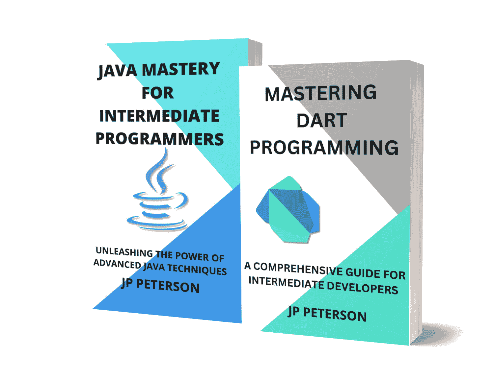

# 掌握 Dart 和 Java 编程：中级开发者全面指南 - 2 本合1



## 引言

欢迎阅读《精通 Dart 编程：面向中级开发者的全面指南》。在书中，我们将带你进入 Dart 编程的世界，为你提供成为精练 Dart 开发者所需的知识和技能。无论你是想扩展编程视野，还是想深入探索使用 Flutter 进行移动应用开发的世界，本书都是你的理想资源。

凭借在软件开发行业超过二十年的经验，我们策划了这份详尽指南，旨在帮助中级开发者释放 Dart 的全部潜力。在接下来的章节中，我们将探索 Dart 的语法、库和工具，并深入研究其实用示例，展示它的多功能性和强大性。

# 第 1 章：Dart 简介

Dart 是一种多功能且强大的编程语言，它在软件开发领域日益受到关注，特别是在近年来。在这份全面指南中，我们将深入研究 Dart，探索它的历史、特征以及它在当今编程格局中的地位。在本章结束时，你将牢固地理解什么是 Dart，以及为什么它是一门值得掌握的语言。

## Dart 的简史

要真正理解 Dart 的意义，了解它的历史以及导致其产生的背景至关重要。Dart 由 Google 开发，并于 2011 年 10 月首次发布。创建 Dart 的初衷是为了解决当时 Web 开发者面临的局限性和挑战，特别是在构建复杂且交互式的 Web 应用时。

### JavaScript 的问题

在 Dart 出现之前，JavaScript 是构建 Web 应用的主导语言。然而，JavaScript 也有其缺点：

1. **可扩展性**：JavaScript 缺乏构建大规模 Web 应用所需的工具和功能。随着应用程序复杂性的增加，维护这些应用变得越来越困难。

2. **性能**：JavaScript 引擎对于资源密集型应用来说速度不够快。这阻碍了高性能 Web 应用的应用。

3. **工具链**：Web 开发者缺乏强有的开发工具，导致高效地编写、调试和维护 JavaScript 代码充满挑战。

4. **可预测性**：JavaScript 的动态类型系统会导致意外之外的运行时错误，难以在开发过程早期发现 bug。

### Dart 的诞生

针对这些挑战，Google 致力于创建一种能够克服这些局限性的语言。结果就是 Dart。Dart 的设计考虑了以下目标：

- **高性能**：Dart 的构建目标是高度性能，具有即时编译（JIT）编译器、专为速度设计的虚拟机（`VM`）以及提前编译（AOT）编译器。

- **可扩展性**：Dart 引入了有助于构建大规模应用的功能，例如强大的类型系统和模块化架构。

- **工具链**：Google 投资创建了一套开发工具，包括 Dart SDK、包管理器、分析器和调试器。

- **可预测性**：Dart 引入了强类型系统在编译时捕捉错误，从而使代码更可靠。

## Dart 的核心特性

现在我们对 Dart 的诞生原因有了基本的了解，让我们来探索一些使其具有竞争力的核心特性：

### 1. 强类型系统

Dart 是一种静态类型语言，这意味着变量类型是在编译时而非运行时指定的。这有助于在开发早期发现错误，减少运行时错误的概率。在 JavaScript 这样的动态类型语言中，你可能会遇到预期存储数字的变量突然变成字符串的情况。Dart 的强类型系统避免了这种情形。

### 2. 面向对象编程 (OOP)

Dart 是一种面向对象的语言，遵循 OOP 原则。这意味着你可以以自然直观的方式对现实世界的实体和概念。你可以定义类和对象，封装数据和行为，并创建可用的模块化代码。OOP 促进了代码的组织和重用，使得应用程序在扩展时更加容易。

### 3. 异步编程

现代 Web 和移动应用通常需要处理异步操作，例如发送网络请求或读取文件。Dart 通过其 `async` 和 `await` 关键字提供了对异步编程内置支持。这使得编写在不阻塞主线程的情况下执行任务的代码变得更加简单，让应用程序更加敏捷高效。

### 4. 针对 Web 和移动端的 Dart

Dart 的独特优势之一是它的多功能性。它可以用于 AngularDart 等框架进行 Web 开发，也是使用 Flutter 框架构建移动应用的首选语言。Flutter 同样由 Google 开发，是一个 UI 工具包，用于从单一代码库为移动、Web 和桌面构建原生编译的应用程序。Dart 与 Flutter 的兼容性使其成为移动应用开发者的一项必备技能。

### 5. 丰富的标准库

Dart 自带了一个全面的标准库，包含了处理集合、文件等许多库。该库简化了常见任务，并减少了对第三方依赖的需要。

## Dart 的演进：Dart 2 及以后

Dart 自最初发布以来已经取得了巨大的进步，经历了重大的更新和改进。2018 年 8 月发布的 Dart 2 引入了更简洁、更易读的语法，使这种语言对开发者来说更加易上手。

通过 Dart 2，该语言得到了强力推动，使 Web 开发者能够构建高效可靠的 Web 应用程序。它巩固了其作为 Flutter 移动应用开发首选语言的地位。

展望未来，Dart 将继续演进，不断提升性能、改进工具并扩展其生态系统。

## 结论

在本介绍性章节中，我们探索了 Dart 在当今编程领域中的历史、关键特性和意义。Dart 的诞生源于对 Web 和移动开发一种现代化、高性能且可扩展语言的需求，它成功地解决了开发者面临的许多挑战。

在你继续阅读此书时，你将深入研究 Dart 的语法、库和工具，并通过实际示例获得实操经验。无论你是寻求提升技能的 Web 开发者，还是深耕 Flutter 的移动应用开发者，Dart 都是一种为你提供构建高质量应用程序所需的强大功能和灵活性的语言。

在接下来的章节中，我们将探索 Dart 的语法、数据类型、控制结构等。在这段旅程结束时，你将拥有掌握 Dart 编程的知识和信心，并释放它的全部潜力。

请关注后续章节对 Dart 实践方面的探讨，届时你将编写代码、构建应用程序，并巩固对这种多功能编程语言的理解。

# 第 2 章：搭建你的开发环境

搭建开发环境是你通通 Dart 编程之程的关键第一步。在本章中，我们将引导你完成安装 Dart SDK 和配置开发工具的过程，确保你拥有开始编写和运行 Dart 代码所需的一切。无论你使用的是 Windows、macOS 还是 Linux，我们都能为你提供支持。

## 为什么良好的开发环境至关重要

在深入设置开发环境的细节之前，让我们花一点时间理解为什么它如此本质。你的开发环境是你整个编程体验的基础，正确配置它可以使你的工作效率和开发愉悦感产生质的差异。

### 1. 效率与生产力

优化的开发环境可以显著提高你的生产力。它为你提供了必要的工具和配置，减少了你在设置和故障排除上花费的时间。这意味着你可以投入更多精力在编写代码上，而不是处理技术问题。

### 2. 一致性

配置良好的开发环境可以确保你和你的团队保持同步。工具和配置的一致性使得协作、代码共享和共同调试问题变得更容易。它消除了“在我的机器上运行”的问题。

### 3. 调试与测试

健壮的开发环境简化了代码调试和测试的过程。你将可以使用强大的调试工具和测试框架，它们可以帮助你快速识别并修复问题。

### 4. 学习与成长

结构良好的环境也有助于你的学习历程。它为尝试新的库、框架和编程概念提供了一个稳定的平台。你可以自由探索，而无必担心破坏现有设置。

## 安装 Dart SDK

Dart 软件开发包（SDK）是你的 Dart 开发环境的基础。它包含了 Dart 编译器、库以及开发 Dart 应用程序的本质工具。按照以下步骤在计算机上安装 Dart SDK。

### 步骤 1：下载 Dart SDK

首先，访问 Dart 官方网站 [dart.dev](https://dart.dev/)。在这里你可以找到可以下载的最新版本 Dart SDK。Dart 支持 Windows、macOS 和 Linux，因此请务必选择与你操作系统匹配的版本。

### 步骤 2：在 Windows 上安装

#### Windows 安装程序

如果你使用 Windows，可以下载 Dart SDK 安装程序，它提供了直观的安装过程。操作如下：

1. 从 Dart 网站下载 Windows 安装程序。

2. 运行安装程序并按照屏幕指令操作。

3. 选择 Dart SDK 的安装目录。默认位置通常是一个良好的选择。

4. 完成安装过程。

#### 手动安装 (Windows)

对于偏好手动安装或有特定要求的的用户，可以选择手动安装：

1. 下载适用于 Windows 的 Dart SDK ZIP 文件。

2. 将 ZIP 文件的内容解压到你选择的目录。

3. 将 Dart SDK 的 `bin` 目录添加到系统的 `PATH` 环境变量中。这一步对于从命令行运行 Dart 命令至关重要。

### 步骤 3：在 macOS 和 Linux 上安装

在 macOS 和 Linux 上安装 Dart SDK 的步骤类似，涉及手动操作：

1. 从 Dart 网站下载 macOS 或 Linux 的 Dart SDK TAR 文件。

2. 将 TAR 文件解压到你选择的目录。

3. 将 Dart SDK 的 `bin` 目录添加到系统的 `PATH` 环境变量中。这一步对于从终端运行 Dart 命令是必要的。

## 验证你的安装

安装 Dart SDK 后，必须验证所有内容都已正确设置。打开你的命令提示符或终端并运行以下命令：

```dart
dart --version
```

此命令将显示 Dart 版本，确认安装成功。如果你遇到任何问题或错误，请双击你的安装步骤，并确保 Dart SDK 的 "bin" 目录已正确添加到系统的 `PATH` 中。

## 安装集成开发环境 (IDE)

虽然你可以使用基础的文本编辑器编写 Dart 代码，但使用集成开发环境（IDE）可以显著提升你的开发体验。IDE 提供了代码补全、调试工具和项目管理能力等功能。

以下是两个支持 Dart 的流行 IDE：

### 1. Visual Studio Code (VS Code)

Visual Studio Code 是由微软开发的一款免费开源代码编辑器。它拥有丰富的扩展生态系统，包括 Dart 和 Flutter 扩展，为 Dart 开发提供了卓越支持。

在 VS Code 中设置 Dart：

1. 从官方网站（https://code.visualstudio.com/）安装 VS Code。

2. 启动 VS Code，点击左侧边栏上的方块图标或使用快捷键 `Ctrl+Shift+X` (Windows/Linux) 或 `Cmd+Shift+X` (macOS) 进入扩展视图。

3. 在扩展视图中搜索 "Dart"，并安装由 Dart Code 提供的官方 Dart 扩展。

4. 此外，你还可以安装 Flutter 提供的 "Flutter" 扩展进行 Flutter 开发。

5. 重启 VS Code 以启用已安装的扩展。

通过这些扩展，你将在 VS Code 中拥有功能丰富的 Dart 开发环境。

### 2. 带有 Dart 插件的 IntelliJ IDEA

IntelliJ IDEA 是由 JetBrains 开发的一款强大的 IDE，以对各种编程语言的良好支持著称。使用 IntelliJ IDEA 进行 Dart 开发：

1. 从 JetBrains 网站（https://www.jetbrains.com/idea/）下载并安装 IntelliJ IDEA。

2. 启动 IntelliJ IDEA 并进入“Configure”（配置）>“Plugins”（插件）。

3. 在 Marketplace 标签中搜索 "Dart" 并安装 Dart 插件。

4. 重启 IntelliJ IDEA 以激活 Dart 插件。

IntelliJ IDEA 配合 Dart 插件为 Dart 编程提供了健壮的环境，包括代码分析、调试和 Flutter 支持。

## 选择文本编辑器

如果你更喜欢轻量级的方式，或者对特定的文本编辑器有偏好，可以使用任何你喜欢的文本编辑器来编写 Dart 代码。一些流行的选项包括：

- **Sublime Text**：一个高度可定制的文本编辑器，拥有活跃的社区和许多适用于 Dart 开发的插件。

- **Atom**：由 GitHub 开发的开源编辑器，有大量适用于 Dart 开发的包。

- **Notepad++**：一个适用于 Windows 的免费开源文本编辑器，支持 Dart 语法高亮。

- **Vim**：一个高度可配置的编辑器，通过插件提供 Dart 语法支持。

- **Emacs**：一个可扩展、可定制的文本编辑器，支持 Dart 开发。

选择符合你偏好和工作流的文本编辑器。虽然这些编辑器可能无法提供全功能 IDE 那样的集成度和功能，但它们仍然是 Dart 编程的强大工具。

## 配置你的开发环境

一旦你安装了 Dart SDK 并选择了你偏好的开发环境（IDE 或文本编辑器），你可以进行一些额外的配置来简化你的 Dart 开发体验：

### 1. 编辑器配置

无论你使用的是 IDE 还是文本编辑器，都要考虑自定义编辑器设置以匹配你的编码风格和偏好。你可以配置如缩进、代码格式化和代码补全选项等设置。

### 2. 版本控制

如果你计划对你的 Dart 项目使用版本控制（你应该这样做），请考虑设置类似 `Git` 的版本控制系统。学习 `Git` 的基础知识，为你的 Dart 项目创建 Git 仓库，并将其与开发环境集成以实现无缝的版本跟踪。

### 3. Dart DevTools（可选）

Dart DevTools 是一套用于 Dart 和 Flutter 的性能和调试工具。它可以帮助你分析和优化 Dart 应用程序。根据开发需求，你可以将 Dart DevTools 作为 Chrome 扩展安装，或者在 IDE 中使用它。

### 4. 扩展与包

探索你所选开发环境中可用的扩展和包。根据项目需求，你可能会发现某些简化管理依赖或构建 Dart 项目等任务的扩展或包。

## 结论

搭建 Dart 开发环境是你成为精通 Dart 程序员之路的基础步骤。在本章中，我们涵盖了 Dart SDK 的安装、集成开发环境 (IDE) 或文本编辑器的选择，以及增强开发体验的额外配置。

一旦你的环境配置妥当，你就准备好开始编写 Dart 代码、探索它的语法并构建真实世界的应用程序了。在接下来的章节中，我们将深入研究 Dart 编程，涵盖变量、数据类型、控制流等主题。请关注将帮助你掌握 Dart 编程的动手示例和实践练习。

现在你的开发环境已经就绪，是时候开启你的 Dart 编程之旅了。编码愉快！

# 第 3 章：理解变量和数据类型

在本章中，我们将深入研究任何编程语言的底层基石：变量和数据类型。理解这些概念至关重要，因为它们构成了在 Dart 中处理数据信息的基础。无论你是编程新手还是从其他语言转型，掌握 Dart 中的变量和数据类型都将使你走上成为精练开发者的道路。

## 变量：存储数据的地方

从本质上，变量是存储数据的容器。把它想象成一个带有标签的盒子，可以在其中存储不同类型的信息，如数字、文本或复杂结构。变量允许你在程序中动态地操作和处理数据。

### 声明变量

在 Dart 中使用变量，必须先声明它。声明涉及指定变量名称，以及可选的初始值和数据类型。这是 Dart 中声明变量的基本语法：

```dart
// 语法：数据类型 变量名 = 初始值;

int age = 25; // 一个名为 "age" 的整数变量，初始值为 25。

String name = "John"; // 一个名为 "name" 的字符串变量，初始值为 "John"。
```

Dart 是一种静态类型语言，这意味着在声明变量时必须指定类型。该类型决定了变量可以持有什么类型的数据。

### 数据类型

Dart 支持多种数据类型，每种都为特定数据设计。让我们探索 Dart 中一些常用的数据类型：

### 1. int

`int` 类型表示整数，即没有分数或小数部分的数字。例如：

```dart
int age = 30; // 一个名为 "age" 的整数变量，存储值为 30。
```

### 2. double

`double` 类型表示带有小数点的数字，也称为浮点数。例如：

```dart
double pi = 3.14159; // 一个存储 Pi 值的双变量。
```

### 3. String

`String` 类型表示文本或字符数据，包含在单引号或双引号内。例如：

```dart
String greeting = "Hello,!";!"; 一个存储问候语的字符串变量。
```

### 4. bool

`bool` 类型表示布尔值，可以是 `true` 或 `false`。例如：

```dart
bool isDartFun = true; // 一个表示 Dart 很有趣的布尔变量。
```

### 5. 列表 (List)

`List` 数据类型表示有序的值集合。列表可以包含相同或不同数据类型的元素。例如：

```dart
List<int> numbers = [1, 2, 3, 4, 5]; // 一个整数列表。
List<String> fruits = ["apple", "banana", "cherry"]; // 一个字符串列表。
```

### 6. 映射 (Map)

`Map` 数据类型表示键值值对的集合，也称为字典或关联数组。每个键都关联着一个值。例如：

```dart
Map<String, int> ages = {"Alice": 25, "Bob": 30, "Carol": 35}; // 一个具有字符串键和整数值的映射。
```

### 变量命名规则

在 Dart 中为变量命名时，你必须遵循某些规则：

- 变量名必须以字母或下划线（`_`）开头。

- 变量名可以包含字母、数字和下划线。

- 变量名是区分大小写的（`age` 和 `Age` 是不同的变量）。

- 变量名不能是 Dart 关键字或保留字（例如：`if`、`else`、`int`）。

选择描述性且有意义的变量名是一个良好的习惯，这可以增强代码的可读性，并让你和其他人更容易理解代码。

## 变量作用域


Dart 中的变量具有作用域，它定义了变量在代码的哪些部分是可以访问的。Dart 主要有两种类型的变量作用域：

### 1. 局部变量

局部变量声明在特定的代码块中，例如在函数内部或由大括号 `{}` 包围的代码块内。它们仅在该代码块内可访问。一旦离开该块，局部变量将不再也不可访问。

```dart
void main() {
  int x = 10; // x 是在 main 函数内访问的局部变量。
  print(x); // 输出: 10
}
```

尝试在 `main` 函数外部访问 `x` 将导致错误，因为 `x` 不在作用域内。

### 2. 全局变量

另一方面，全局变量声明在任何函数或代码块之外，可以在整个 Dart 文件中访问。它们具有更广泛的作用域，并可以在多个函数中使用。

```dart
int globalVar = 5; // globalVar 是一个全局变量。

void main() {
  print(globalVar); // 输出: 5
  updateGlobalVar(); // 调用修改 globalVar 的函数。
  print(globalVar); // 输出: 10
}

void updateGlobalVar() {
  globalVar = 10; // 修改全局变量。
}
```

虽然全局变量提供了灵活性，但谨慎使用它们至关重要，因为它们会导致意外行为并使代码难以维护。在可能的情况下优先使用局部变量，因为它们被封装在特定的函数或代码块中。

## 常量

除了变量，Dart 还支持常量，即一旦赋值就无法更改的值。使用 `final` 或 `const` 关键字声明常量，取决于值是在运行时还是编译时确定的。

### 1. `final` 关键字

`final` 关键字用于将变量声明为运行时常量。这意味着 `final` 变量的值可以在运行时确定，但一旦赋值无法更改。

```dart
final int finalVar = 100; // 一个具有运行时确定值的 final 变量。
```

### 2. `const` 关键字

`const` 关键字用于将变量声明为编译时常量。这意味着 `const` 变量的值在编译时已知且无法更改。

```dart
const double pi = 3.14159; // 一个编译时常量变量。
```

常量用于存储在程序执行期间不应改变，例如数学常量或配置设置。在某些情况下，它们也可以用于优化性能，因为这些值在编译时就已经知道了。

## 类型推断

虽然 Dart 是一种静态类型语言，但它也支持类型推断，允许你在某些情况下省略显式声明变量的数据类型。Dart 编译器可以根据你提供的初始值推断数据类型。

```dart
var age = 25; // Dart 推断 age 的类型为 int。
var name = "John"; // Dart 推断 name 的类型为 String。
```

使用类型推断可以使你的代码更加简洁，同时从强类型的优势。然而，在清晰性和简洁之间取得平衡至关重要。显式指定数据类型可以让你的代码更具自文档性，并让他人理解。

## 总结

在本章中，我们探索了 Dart 中变量和数据类型的基础概念。变量是存储数据的容器，Dart 为不同的信息提供了多种数据类型。我们讨论了变量定义的规则、命名规范以及变量的作用域。此外，我们涵盖了常量以及如何使用它们来存储程序执行期间不应改变的值。

理解变量和数据类型是你 Dart 编程之旅中的关键一步。随着你在接下来的章节继续探索 Dart，你将使用这些基础概念来创建更复杂的程序、处理数据并构建解决现实问题的应用程序。请关注后续的实战示例和练习，它们将巩固你对 Dart 能力的理解。

# 第 4 章：探索控制流与循环

在本章中，我们将进入 Dart 控制流和循环的世界。这些基本概念对于创建动态且响应迅速的程序至关重要。

## 条件语句：做出决策

条件语句允许你的 Dart 程序根据某些条件做出决策。它们使代码采取不同的路径、执行特定的操作或跳过指令。

### `if` 语句

`if` 语句是 Dart 中最基本的条件语句之一。它评估一个条件，如果条件为 `true` 则执行代码块。如果条件为 `false`，则跳过 `if` 块。

`if` 语句的语法：

```dart
if (condition) {
  // 如果条件为真则执行的代码。
}
```

示例：

```dart
int age = 18;
if (age >= 18) {
  print("成年了");
}
```

在示例中，`if` 语句检查 `age` 变量是否大于或等于 18。由于条件成立（`age` 为 18），执行 `if` 块中的代码并打印“成年了”。

### `else` 子句

有时，你希望在 `if` 语句条件为 `false` 时采取另一种路径。这时 `else` 子句就派上用场了。你可以用它指定当条件不满足时应该。

`if-else` 语句的语法：

```dart
if (condition) {
  // 如果条件为真则执行的代码。
} else {
  // 如果条件为假则执行的代码。
}
```

示例：

```dart
int age = 15;
if (age >= 18) {
  print("成年了");
} else {
  print("尚未成年");
}
```

现在，当 `age` 变量为 15 时，`if` 语句条件为 `false`，执行 `else` 块中的代码，结果打印“尚未成年”。

### `else if` 子句

在有多个条件需要检查的情况下，你可以使用 `else if` 子句在初始 `if` 条件之后评估额外的条件。

`if-else if-else` 语句的语法：

```dart
if (condition1) {
  // 如果 condition1 为真则执行的代码。
} else if (condition2) {
  // 如果 condition2 为真则执行的代码。
} else {
  // 如果没有任何条件为真，则执行此代码。
}
```

这是一个演示使用 `else if` 的示例：

```dart
int score = 75;

if (score >= 90) {
  print("A");
} else if (score >= 80) {
  print("B");
} else if (score >= 70) {
  print("C");
} else {
  print("F");
}
```

在这个示例中，程序评估 `score` 并根据分数落入范围分配相应的字母等级。

### 三元运算符

Dart 还提供了一种使用三元运算符（`?` 和 `:`）编写简单条件表达式的简洁方式。它非常适用于根据条件为变量赋值。

三元运算符的语法如下所示：

```dart
condition ? expression_if_true : expression_if_false
```

这是一个示例：

```dart
int x = 10;
int y = 20;
int result = x > y ? x : y;
```

在这个示例中，`result` 的值将被赋值为 `y`，因为条件 `x > y` 为 `false`。

## 循环：重复任务

循环是编程中至关的一部分，允许你重复任务或多次执行代码块。Dart 提供了几种类型的循环，每种循环都有其特定的场景。

### `for` 循环

`for` 循环是 Dart 中一种通用且广泛使用的循环。它允许你遍历值的范围或集合中的元素，并在每次迭代时执行一个代码块。

`for` 循环的基本语法如下：

```dart
for (initialization; condition; update) {
  // 每次迭代执行的代码。
}
```

让我们来看一个使用 `for` 循环打印 1 到 5 数字的示例：

```dart
for (int i = 1; i <= 5; i++) {
  print(i);
}
```

在这个示例中，循环从 `i` 初始化为 1 开始。只要 `i` 小于等于 5，循环就会继续执行。在每次迭代之后，变量 `i` 增加 1（`i++`）。

### `while` 循环

`while` 循环用于在特定条件为真时重复执行代码块。与 `for` 循环不同，`while` 循环在循环头部不需要初始化或更新表达式。

```dart
while (condition) {
  // 只要条件为真就执行代码。
}
```

让我们使用 `while` 循环从 5 倒数到 1：

```dart
int count = 5;

while (count > 0) {
  print(count);
  count--;
}
```

在这个示例中，只要 `count` 大于 0，循环就会运行。在每次迭代之后，`count` 减 1。

### `do-while` 循环

`do-while` 循环与 `while` 循环相似，但它保证在检查条件之前至少执行一次代码块。当你想要在决定是否继续循环之前确保执行某个特定任务时，这非常有用。

```dart
do {
  // 至少执行一次的代码。
} while (condition);
```

让我们使用 `do-while` 循环提示用户输入，直到提供有效值为止：

```dart
String userInput;
bool isValid = false;

do {
  print("Please enter a valid input: ");
  userInput = getUserInput(); // 假设此函数获取用户输入。
  isValid = validateInput(userInput); // 假设此函数验证输入。
} while (!isValid);
```

在这个示例中，循环会持续提示用户输入，直到 `isValid` 变为 `true`。

### 循环控制语句

Dart 提供了允许修改循环行为的循环控制语句：

### 1. `break`

`break` 语句用于提前退出循环，无论循环条件是否仍为 `true`。

```dart
for (int i = 1; i <= 10; i++) {
  if (i == 5) {
    break; // 当 i 为 5 时退出循环。
  }
  print(i);
}
```

在这个示例中，循环会在 `i` 等于 5 时终止。

### 2. `continue`

`continue` 语句用于跳过循环的当前迭代并进入下一次迭代。

```dart
for (int i = 1; i <= 5; i++) {
  if (i == 3) {
    continue; // 当 i 为 3 时跳过迭代。
  }
  print(i);
}
```

在这个示例中，循环跳过了打印数字 3 并继续迭代。

## 结论

控制流和循环是每个 Dart 程序员工具箱中不可缺的工具。条件语句（如 `if`、`else` 和 `else if`）允许你做出决策并选择性地执行代码。循环包括 `for`、`while` 和 `do-while`）让你能够重复任务并迭代执行操作。

在你继续 Dart 编程之旅时，你会经常遇到需要控制代码流和重复操作的场景。掌握这些基础概念至关重要。

在这个示例中，`greet` 函数接受两个参数：`name`（一个字符串）和 `age`（一个整数）。当我们使用 `"Alice"` 和 `25` 调用该函数时，它会返回一个包含所提供值的问候消息。

## 函数返回值

Dart 函数可以有返回值，表示它们在执行时返回的值的类型。如果函数不返回任何值，你可以指定 `void` 返回类型。

以下是 Dart 中不同返回类型的示例：

```dart
// 返回整数的函数。
int multiply(int a, int b) {
  return a * b;
}

// 返回字符串的函数。
String capitalize(String text) {
  return text.toUpperCase();
}

// 无返回值的函数 (void)。
void greetUser(String name) {
  print("Hello, $name!");
}

void main() {
  int product = multiply(4, 3);
  print("Product: $product"); // 输出: Product: 12

  String uppercaseText = capitalize("dart");
  print("Uppercase: $uppercaseText"); // 输出: Uppercase: DART

  greetUser("Bob"); // 输出: Hello, Bob!
}
```

在这些示例中：
- `multiply` 函数返回一个整数。
- `capitalize` 函数返回一个字符串。
- `greetUser` 函数没有返回值（`void`），仅打印一条问候消息。

## 函数作用域

Dart 中的函数有自己的作用域，这意味着在函数内部声明的变量在函数外部是不可见的。这被称为变量作用域，它可以防止命名冲突并保持代码结构整洁。

考虑这个示例：

```dart
void main() {
  int x = 10; // 这个变量在 main 函数的作用域内。

  void innerFunction() {
    int y = 5; // 这个变量在 innerFunction 的作用域内。
    print(x); // 从外部作用域访问变量 x。
  }

  innerFunction();
  print(y); // 错误：变量 y 在此处不在作用域内。
}
```

在这个示例中，变量 `x` 声明在 `main` 函数的作用域内，在 `main` 函数和 `innerFunction` 中都可以访问。然而，变量 `y` 声明在 `innerFunction` 的作用域内，在 `main` 函数中无法访问。

## 函数参数与变量

理解函数参数与函数内部声明的变量之间的区别至关重要。函数参数是调用函数时传递给函数的值的占位符。它们的作用域限于函数体，且仅在函数内部可用。另一方面，在函数内部声明的变量与参数是分开的，并且有自己的作用域。

这是一个说明这种区别的示例：

```dart
void printNumbers(int a, int b) {
  int x = a + b; // 变量 x 在函数内部声明。
  print(a);      // 访问参数 a。
  print(b);      // 访问参数 b。
  print(x);      // 访问变量 x。
}

void main() {
  int a = 3;
  int b = 7;
  printNumbers(a, b); // 使用参数 a 和 b 调用函数。
  print(a);            // 从 main 函数访问变量 a。
  print(b);            // 从 main 函数访问变量 b。
  print(x);            // 错误：变量 x 在此处不在作用域内。
}
```

在这个示例中，`a` 和 `b` 是函数参数，而 `x` 是在 `printNumbers` 函数内部声明的变量。参数 `a` 和 `b` 仅在 `printNumbers` 函数内部有效，在该函数内部声明的变量在 `main` 函数无效。

## Dart 中的方法

### 什么是方法？

在 Dart 中，方法是与对象或类相关的函数。方法定义了对象的行为，并允许你执行特定于对象的操作。方法是面向对象编程 (OOP)的基本概念，并在定义类行为方面起着核心作用。

以下是类方法的基本语法：

```dart
returnType methodName(parameters) {
  // 带有指令的方法体。
  // 可选返回指定 returnType 类型的值。
}
```

### 创建和使用方法

要在 Dart 中创建和使用方法，你通常在类内部定义它们。类是创建对象的蓝图，而方法定义了这些对象做什么。

这是一个带有方法的简单 Dart 类示例：

```dart
class Dog {
  String name;

  // 初始化狗名的构造函数。
  Dog(this.name);

  // 汪叫的方法。
  void bark() {
    print("$name says Woof!");
  }
}

void main() {
  // 创建一个 Dog 对象并调用它的 bark 方法。
  Dog myDog = Dog("Buddy");
  myDog.bark(); // 输出: Buddy says Woof!
}
```

在这个示例中：
- 我们定义了一个 `Dog` 类，它包含一个接受狗的名字作为参数的构造函数。该类还有一个名为 `bark` 的方法，它可以打印信息。
- 在 `main` 函数中，我们创建了一个 `Dog` 对象并调用它的 `bark` 方法。

### 实例方法与静态方法

在 Dart 中，方法有两种类型：实例方法和静态方法。

- **实例方法**：这些方法与实例（对象）相关。它们可以访问和修改实例属性。
- **静态方法**：静态方法不绑定实例，而是与类本身相关。它们无法访问特定的实例属性。

以下是一个演示两者的示例：

```dart
class MathUtils {
  // 添加两个数字的实例方法。
  int add(int a, int b) {
    return a + b;
  }

  // 计算数字平方的静态方法。
  static int square(int x) {
    return x * x;
  }
}

void main() {
  MathUtils math = MathUtils();


`int sum = math.add(3, 5);`

`print("Sum: $sum"); // 输出: 8`

`int squared = MathUtils.square(4);`

`print("Square: $squared"); // 输出: 16`

在这个示例中：
- `MathUtils` 类定义了一个实例方法 `add` 和一个静态方法 `square`。
- 在 `main` 函数中，我们创建了 `MathUtils` 的实例并使用实例方法 `add`。我们还使用了静态方法 `square`。

### `this` 关键字

在 Dart 中，`this` 关键字指向方法或构造函数中的当前实例。它允许访问实例变量并调用实例方法。

这是一个说明 `this` 用法的示例：

```dart
class Circle {
  double radius;

  Circle(this.radius);

  // 计算圆面积的方法。
  double calculateArea() {
    return 3.14 * this.radius * this.radius;
  }
}

void main() {
  Circle myCircle = Circle(5.0);
  double area = myCircle.calculateArea();
  print("The area of the circle is $area square units.");
}
```

在这个示例中：
- 我们定义了一个 `Circle` 类，其构造函数初始化 `radius` 属性。
- `calculateArea` 方法使用 `this` 来访问当前实例的 `radius` 属性以计算圆面积。
- 在 `main` 函数中，我们创建了一个 `Circle` 对象并调用它的 `calculateArea` 方法。

### 方法链

方法链是 Dart（以及许多其他编程语言）中的一种技术，允许你在单行内对对象调用多个方法。这可以使代码更加简洁、易读。

这是一个方法链调用的示例：

```dart
class StringBuilder {
  String _value = "";

  add(String text) {
    _value += text;
    return this; // 返回当前实例以便进行链式调用。
  }
}

@override
String toString() {
  return _value;
}

void main() {
  StringBuilder builder = StringBuilder()
    .add("Hello, ")
    .add("Dart ")
    .add("Programmers!");

  print(builder); // Outputs: Hello, Dart Programmers!
}
```

在这个示例中，`StringBuilder` 类有一个 `add` 方法，该方法将文本追加到内部的 `_value` 字符串，并返回当前实例（`this`）。通过返回 `this`，我们可以链式调用多个 `add` 方法来构建一个字符串。

## 结论

函数和方法是 Dart 编程中必不可少的构建模块。函数允许你将一组指令封装进一个可重用的代码块中，而方法则定义了类中对象的行为。无论你是在创建独立函数还是类中的方法，理解如何声明、调用和使用它们对于编写组织良好且高效的 Dart 代码都至关重要。

在本章中，我们涵盖了以下核心概念：

- Dart 中的函数，包括函数参数、返回类型和变量作用域。
- Dart 中的方法，包括实例方法和静态方法，以及在方法内部对 `this` 关键字的使用。
- 方法链，一种在单行内对对象调用多个方法的技术。

# 第 6 章：Dart 中的面向对象编程

在本章中，我们将深入探索 Dart 中面向对象编程（OOP）的世界。OOP 是一种将代码组织成对象（类的实例）的编程范式。Dart 是一门面向对象的语言，理解如何处理类、对象、继承以及其他 OOP 概念对于构建复杂且组织良好的软件至关重要。

## 理解类和对象

### 什么是类？

在 Dart 中，类是创建对象的蓝图。它通过指定属性（属性）和方法来定义对象的结构和行为。类充当模板，允许你创建具有相似特征和功能的多个实例（对象）。

以下是 Dart 中类的基本语法：

```dart
class ClassName {
  // 类属性（属性）。
  dataType propertyName;

  // 构造函数。
  ClassName(parameters) {
    // 构造函数代码。
  }

  // 方法。
  returnType methodName(parameters) {
    // 方法代码。
  }
}
```

### 创建对象（实例）

要从类创建对象，你可以使用 `new` 关键字，后跟类名和括号，括号中可能包含用于类构造函数的参数。

以下是从类中创建对象的示例：

```dart
// 定义一个简单的类。
class Dog {
  String name;

  Dog(this.name);

  void bark() {
    print("$name says Woof!");
  }
}

void main() {
  // 创建一个 Dog 对象。
  Dog myDog = Dog("Buddy");

  // 在对象上调用方法。
  myDog.bark(); // Outputs: Buddy says Woof!
}
```

在这个示例中，我们定义了一个 `Dog` 类，它包含一个初始化 `name` 属性的构造函数和一个 `bark` 方法。然后我们通过带参数 `"Buddy"` 调用类构造函数来名为 `myDog` 的 `Dog` 对象。最后，我们在 `myDog` 对象上调用了 `bark` 方法。

### 面向对象术语

在深入研究 Dart 的 OOP 概念之前，让我们明确一些关键术语：

- **类 (Class)**：创建对象的蓝图或模板。它定义了该类的对象将拥有的属性（属性）和行为（方法）。
- **对象 (Object/Instance)**：从类创建的单个实体。对象拥有自己的属性集，并可以调用类中定义的方法。
- **构造函数 (Constructor)**：当从类创建对象时被调用的特殊方法。它用于初始化对象的属性。
- **属性/特性 (Attribute/Property)**：属于类的数据成员或变量。属性代表对象的状态或特征。
- **方法 (Method)**：定义在类内部的函数。方法定义了类对象可以执行的行为和动作。

### 构造函数

Dart 中的构造函数是用于在从类创建对象时初始化对象的特殊方法。一个类可以有多个构造函数，每个构造函数都有不同的参数集。如果你没有在类中定义任何构造函数，Dart 会提供一个没有参数的默认构造函数。

以下是一个带有多个构造函数的类示例：

```dart
class Rectangle {
  double width;
  double height;

  // 默认构造函数。
  Rectangle() {
    width = 1.0;
    height = 1.0;
  }

  // 参数构造函数。
  Rectangle.withDimensions(double w, double h) {
    width = w;
    height = h;
  }
}

void main() {
  // 使用不同的构造函数创建对象。
  Rectangle defaultRectangle = Rectangle();
  Rectangle customRectangle = Rectangle.withDimensions(3.0, 4.0);

  print("Default Rectangle: ${defaultRectangle.width}x${defaultRectangle.height}");
  print("Custom Rectangle: ${customRectangle.width}x${customRectangle.height}");
}
```

在这个示例中，`Rectangle` 类有两个构造函数：一个将 `width` 和 `height` 初始化为 `1.0` 的默认构造函数，以及一个接受宽度和高度作为参数的参数构造函数（`Rectangle.withDimensions`）。

### 类方法

在类内部定义的方法被称为类方法。它们定义了从该类创建的对象的行为。类方法可以访问类的属性并修改其值。

以下是一个带有方法的类示例：

```dart
class Counter {
  int value = 0;

  // 增加计数器。
  void increment() {
    value++;
  }

  // 递小计数器。
  void decrement() {
    value--;
  }

  // 将计数器重置。
  void reset() {
    value = 0;
  }
}

void main() {
  // 创建一个 Counter 对象。
  Counter counter = Counter();

  // 在对象上调用方法。
  counter.increment();
  print("Counter value: ${counter.value}"); // Outputs: 1

  counter.decrement();
  counter.reset();
  print("Counter after reset: ${counter.value}"); // Outputs: 0
}
```

在这个示例中，`Counter` 类定义了 `increment`、`decrement` 和 `reset` 方法来修改 `value` 属性。

### 访问对象属性

你可以使用点（`.`）符号访问对象的属性（特性）。这允许你读取和修改对象的状态。

```dart
class Person {
  String name;
  int age;

  Person(this.name, this.age);
}

void main() {
  // 创建一个 Person 对象。
  Person person = Person("Alice", 30);

  // 访问并修改对象属性。
  print("Name: ${person.name}, Age: ${person.age}");

  person.age = 31; // 修改年龄属性。
  print("Updated Age: ${person.age}");
}
```

在这个示例中，我们创建了一个 `Person` 对象并访问了它的 `name` 和 `age` 属性。我们还修改了 `age` 属性来更新年龄。

## 继承

继承是 OOP 中的一个基本概念，允许你基于现有类（父类或基类）创建一个新类（子类或派生类）。子类继承父类的属性和方法，还可以拥有自己的属性和方法。

### 创建子类

在 Dart 中创建子类时，使用 `extends` 关键字后跟类名。子类可以重写（提供自己的实现）从父类继承的方法。

以下是继承的示例：

```dart
// 父类（基类）。
class Animal {
  String name;

  Animal(this.name);

  void speak() {
    print("$name makes a sound");
  }
}

// 子类（派生类）。
class Dog extends Animal {
  Dog(String name) : super(name); // 调用父类构造函数。

  // 重写 speak 方法。
  @override
  void speak() {
    print("$name barks");
  }
}

void main() {
  // 创建类和子类的对象。
  Animal animal = Animal("Generic Animal");
  Dog dog = Dog("Buddy");

  animal.speak(); // Outputs: Generic Animal makes a sound
  dog.speak();    // Outputs: Buddy barks
}
```

在这个示例中，我们有一个名为 `Animal` 的超类，它包含一个 `name` 属性和一个 `speak` 方法。`Dog` 类是 `Animal` 的子类，它重写了 `speak` 方法以提供它自己的实现。当我们创建这两个类的对象并调用 `speak` 方法时，每个对象都会表现出它们自己的行为。

### 子类中的构造函数

子类可以有自己的构造函数，它们还可以使用 `super` 关键字调用超类的构造函数。这允许你同时初始化继承自超类的属性和子类特有的属性。

```dart
class Vehicle {
  String brand;

  Vehicle(this.brand);

  void drive() {
    print("$brand is moving");
  }
}

class Car extends Vehicle {
  int doors;

  Car(String brand, this.doors) : super(brand); // Call the superclass constructor.

  void honk() {
    print("Honk honk!");
  }
}

void main() {
  // Create objects of the superclass and subclass.
  Vehicle vehicle = Vehicle("Generic Vehicle");
  Car car = Car("Toyota", 4);

  // Call methods on both objects.
  vehicle.drive(); // Outputs: Generic Vehicle is moving
  car.drive();    // Outputs: Toyota is moving
  car.honk();      // Outputs: Honk honk!
}
```

### `super` 关键字

Dart 中的 `super` 关键字用于引用超类，或者调用超类中的方法和构造函数。它允许子类访问并利用其超类的属性和行为。

在之前的示例中，我们使用 `super` 来调用超类的构造函数，以确保继承自超类的属性被正确初始化。

### 方法重写

子类可以重写（提供它们自己的实现）继承自超类的方法。要重写一个方法，你需要在子类的方法声明之前使用 `@override` 注解。

```dart
class Shape {
  double area() {
    return 0.0; // 对所有形状的默认实现。
  }
}

class Circle extends Shape {
  double radius;

  Circle(this.radius);

  @override
  double area() {
    return 3.14 * radius * radius;
  }
}

class Square extends Shape {
  double side;

  Square(this.side);

  @override
  double area() {
    return side * side;
  }
}

void main() {
  // 创建不同形状的对象。
  Circle circle = Circle(5.0);
  Square square = Square(4.0);

  // 计算并打印形状的面积。
  print("Circle Area: ${circle.area()}"); // Outputs: Circle Area: 78.5
  print("Square Area: ${square.area()}"); // Outputs: Square Area: 16.0
}
```


在这个示例中，我们有一个`Shape`超类，它包含一个返回`0.0`的默认`area`方法。`Circle`和`Square`子类重写了`area`方法，为计算圆和正方形的面积提供了自己的实现。

### `is`和`as`运算符

Dart提供了两个运算符`is`和`as`用于类操作和类型检查：

- `is`运算符：`is`运算符检查对象是否是特定类的实例，或者是否实现了特定的接口。如果对象是指定类的实例或实现了该接口，则返回`true`；否则返回`false`。

```dart
class Animal {}

class Dog extends Animal {}

void main() {
  Animal animal = Dog();

  if (animal is Dog) {
    print("It's a Dog!");
  } else {
    print("It's not a Dog.");
  }
}
```

在这个示例中，我们使用`is`运算符来检查`animal`对象是否是`Dog`类的实例，它会打印"It's a Dog!"，因为`animal`对象确实是`Dog`的实例。

- `as`运算符：`as`运算符用于类型转换。它允许你将对象视为指定类或接口的实例。如果对象不是指定的类型，它将返回`null`。

```dart
class Animal {}

class Dog extends Animal {
  void bark() {
    print("Woof!");
  }
}

void main() {
  Animal animal = Dog();
  Dog dog = animal as Dog;

  if (dog != null) {
    dog.bark(); // Outputs: Woof!
  }
}
```

在这个示例中，我们使用`as`运算符将`animal`对象强制转换为`Dog`。由于`animal`对象确实是`Dog`的实例，因此转换成功，我们可以在`dog`变量上调用`bark`方法。

---

# 第 7 章：在 Dart 中操作集合

在本章中，我们将探索 Dart 集合的世界。集合是用于存储和操作一组值的重要数据结构，例如列表（lists）、集合（sets）和映射（maps）。

## 列表 (Lists)

列表是有序值的集合。Dart提供了多种方法来操作列表。

### 创建列表

你可以通过列表字面量来创建列表：

```dart
var fruits = ['apple', 'banana', 'cherry'];
```

或者使用构造函数：

```dart
var colors = List<String>.filled(3, 'red');
```

### 访问列表元素

你可以通过索引访问列表中的元素：

```dart
var fruits = ['apple', 'banana', 'cherry'];
print(fruits[0]); // 输出: apple
print(fruits[1]); // 输出: banana
```

### 修改列表

列表是可变的，你可以在创建后更改元素。

```dart
var fruits = ['apple', 'banana', 'cherry'];
fruits[1] = 'orange'; // 将 banana 改为 orange
fruits[2] = 'grape'; // 将 cherry 改为 grape
```

### 添加元素

你可以向列表中添加新元素：

```dart
var fruits = ['apple', 'banana', 'cherry'];
fruits.add('date'); // 在末尾添加元素
fruits.insert(1, 'mango'); // 在索引 1 处插入元素
fruits.addAll(['kiwi', 'pear']); // 在末尾添加一组元素
```

### 移除元素

你可以从列表中移除元素：

```dart
var fruits = ['apple', 'banana', 'cherry'];
fruits.remove('banana'); // 移除指定的元素
fruits.removeAt(0); // 删除索引为 0 的元素
fruits.removeLast(); // 删除并返回最后一个元素
```

```dart
numbers.removeWhere((n) => n % 2 == 0); // 移除偶数。
numbers.clear(); // []
```

在这个示例中，我们演示了向`numbers`列表添加和删除元素的各种方法。

### 遍历列表

你可以使用循环或高阶函数（如`forEach`、`map`和`reduce`）遍历列表的元素。

```dart
var fruits = ['apple', 'banana', 'cherry'];

// 使用 for 循环。
for (var fruit in fruits) {
  print(fruit);
}

// 使用 forEach 方法。
fruits.forEach((fruit) {
  print(fruit);
});

// 使用 map 转换元素。
var uppercased = fruits.map((fruit) => fruit.toUpperCase()).toList();
print(uppercased); // ['APPLE', 'BANANA', 'CHERRY']

// 使用 reduce 计算结果。
var totalLength = fruits.reduce((value, fruit) => value + fruit.length);
print(totalLength); // 17 (所有水果长度之和)
```

此示例演示了遍历`fruits`并对其元素执行操作的不同方法。

### 集合 (Sets)

集合是唯一值的无序集合。Dart的`Set`类提供了处理集合的方法，确保不允许重复元素。

### 创建集合

你可以在Dart中使用`Set`构造函数或使用由大括号`{}`表示的集合字面量来创建集合。

```dart
// 使用集合字面量。
var fruits = {'apple', 'banana', 'cherry'};

// 使用 Set 构造函数。
var colors = Set<String>(['red', 'green', 'blue']);
```

在这个示例中，我们创建两个集合：`fruits`和`colors`。`fruits`集合使用字面量，而`colors`集合使用`Set`构造函数创建，并指定了元素的类型（`String`）。

### 添加和删除元素

Dart中的集合是可变的，允许你添加和删除元素。你可以使用`add`和`remove`方法修改集合。

```dart
var fruits = {'apple', 'banana', 'cherry'};

// 添加元素。
fruits.add('orange');
fruits.addAll(['grape', 'kiwi']);

// 移除元素。
fruits.remove('banana');
fruits.removeAll(['cherry']);
```

在这个示例中，我们通过使用`add`、`addAll`和`removeAll`方法添加和删除元素来修改`fruits`集合。

### 集合操作

Dart集合支持多种操作，例如并集（`union`）、差集（`difference`）和子集检查，可以通过方法和运算符来实现。

```dart
var set1 = {1, 2, 3};
var set2 = {3, 4, 5};

// 集合并集。
var union = set1.union(set2); // {1, 2, 3, 4, 5}

// 集合交集。
var intersection = set1.intersection(set2); // {3}

// 集合差集。
var difference = set1.difference(set2); // {1, 2}

// 子集检查。
var isSubset = set1.isSubset(set2); // false
```

在这个示例中，我们使用`union`、`intersection`、`difference`和`isSubset`方法对`set1`和`set2`执行集合操作。

### 映射 (Maps)

Map是键值对的无序集合，每个键都关联一个值。在Dart中，map用于以字典格式表示数据。

### 创建映射

你可以在Dart中使用map字面量来创建map，map字面量由包含在大括号`{}`中的键值对组成。

```dart
// 使用 map 字面量。
var fruits = {
  'apple': 2.0,
  'banana': 1.5,
  'cherry': 3.0,
};

// 使用 Map 构造函数。
var colors = Map<String, String>();
colors['red'] = 'FF0000';
colors['green'] = '00FF00';
```

在这个示例中，我们创建了两个映射：`fruits`和`colors`。`fruits`映射使用字符串键和双精度值的map字面量，而`colors`映射使用带有键值显式类型注释的`Map`构造函数创建。

### 访问映射条目

你可以通过键访问map中的值。Dart map使用方括号`[]`访问与键关联的值。

```dart
var fruits = {
  'apple': 2.0,
  'banana': 1.5,
  'cherry': 3.0,
};

var applePrice = fruits['apple']; // 2.0
```

在这个示例中，我们访问`fruits`映射中与键`'apple'`关联的值，从而获取苹果的价格。

### 修改映射

Dart中的map是可变的，允许你添加、更新或删除键值对。

```dart
var fruits = {
  'apple': 2.0,
  'banana': 1.5,
  'cherry': 3.0,
};

// 添加新条目。
fruits['orange'] = 2.5;

// 更新现有条目。
fruits['banana'] = 1.2;

// 移除条目。
fruits.remove('cherry');
```

在这个示例中，我们通过为`'orange'`添加新条目、更新`'banana'`的价格以及移除`'cherry'`条目来修改`fruits`映射。

### 遍历映射

你可以使用循环或高阶函数（如`forEach`）遍历map的键值对。

```dart
var fruits = {
  'apple': 2.0,
  'banana': 1.5,
  'cherry': 3.0,
};

// 使用 for-in 循环。
for (var entry in fruits.entries) {
  var key = entry.key;
  var value = entry.value;
  print('$key: $value');
}

// 使用 forEach 方法。
fruits.forEach((key, value) {
  print('$key: $value');
});
```

在本示例中，我们演示了两种遍历`fruits`映射并打印其键值对的方法。

# 第 8 章：Dart 中的错误处理与异常

在本章中，我们将探索Dart中错误处理和异常的世界。错误是软件开发中的常见部分，理解如何优雅地处理它们对于构建健壮可靠的应用程序至关重要。Dart提供了全面的异常处理机制，帮助你有效地识别、处理和从错误中恢复。

## 理解错误与异常

### 什么是错误和异常

在编程中，错误是程序执行过程中发生的中断其正常流程的意外事件或条件。这些错误可能由多种因素引起，例如无效输入、硬件故障或代码本身的问题。处理错误对于防止崩溃并确保程序在出现问题时能够继续运行至关重要。

另一方面，异常是当程序遇到正常流程无法处理的异常情况时发生的特定错误。异常由程序抛出，可以由开发者捕获并处理，以防止程序意外终止。

### Dart 的异常层次

Dart拥有丰富的异常层次结构，根据类型和来源对异常进行分类。层次结构的顶端是`Error`类，它代表最通用形式的运行时错误。在`Error`之下，有几个内置异常类，如`Exception`、`FormatException`和`StateError`，每个类都有特定的用途。

以下是Dart中一些常见的异常类：

- `Exception`: 所有不表示错误的异常的基类。
- `FormatException`: 当字符串无法解析时抛出，例如将字符串转换为数值类型。
- `StateError`: 表示程序中存在无效状态。
- `TypeError`: 当对不兼容类型的对象执行操作时抛出。
- `RangeError`: 表示索引或值超出范围。
- `AssertionError`: 当断言失败时抛出。

通过使用适当的异常类，你可以对错误进行分类并处理它们。

## 处理异常

### `try`、`catch`和`finally`块

Dart提供了一种`try`、`catch`和`finally`块来结构化处理异常。

- `try`块包含可能抛出异常的代码。
- `catch`块用于捕获和处理异常。
- `finally`块无论是否抛出异常都包含将执行的代码。

以下是Dart异常处理的基本语法：

```dart
try {
  // 可能抛出异常的代码。
} catch (exception) {
  // 处理异常的代码。
} finally {
  // 无论是否抛出异常都会运行的代码。
}
```

让我们来看一个示例：

```dart
void main() {
  try {
    var result = 10 / 0; // 尝试除以零。
    print("Result: $result");
  } catch (e) {
    print("Error: $e");
  } finally {
    print("Execution completed.");
  }
}
```

在本示例中，`try`块包含一个将抛出异常的操作，因为除以零是不允许的。`catch`块捕获了该异常，而`finally`块始终执行，确保程序继续运行。

### 捕获特定异常

你可以通过在`catch`块中指定异常类型来捕获特定异常。这允许你以不同的方式处理不同类型的异常。

```dart
void main() {
  try {
    var result = 10 / 0; // 尝试除以零。
    print("Result: $result");
  } on DivisionByZero {
    print("Cannot divide by zero.");
  } catch (e) {
    print("Error: $e");
  } finally {
    print("Execution completed.");
  }
}
```

在修改后的示例中，我们使用`on DivisionByZero`来捕获特定的异常类型。这样，我们可以提供更信息丰富的错误消息。

### 重新抛出异常

有时，你可能想捕获异常，执行某些操作，然后重新抛出该异常以将其进一步传播到调用栈顶部。Dart允许你在`catch`块中使用`rethrow`关键字重新抛出异常。

```dart
void validateAge(int age) {
  try {
    if (age < 0) {
      throw FormatException("年龄不能为负数.");
    }
  } catch (e) {
    print("Validation failed: $e");
    rethrow; // 重新抛出异常。
  }
}

void main() {
  try {
    validateAge(-5); // 调用一个抛出异常的函数。
  } catch (e) {
    print("Error: $e");
  }
}
```

在本示例中，`validateAge`函数检查提供的年龄是否为负数，如果是，则抛出`FormatException`。`catch`块中的`rethrow`语句允许异常传播到调用代码，保留原始异常信息。

### 自定义异常

除了内置异常外，Dart允许你通过扩展`Exception`类或其子类来创建自定义异常。当你需要在应用程序中表示特定的错误条件时，自定义异常是非常有用的。

```dart
class CustomException implements Exception {
  final String message;

  CustomException(this.message);

  @override
  String toString() => message;
}

void main() {
  try {
    throw CustomException("这是一个自定义异常.");
  } catch (e) {
    print("Error: $e");
  }
}
```


`print("Caught custom exception: $e");`

在本示例中，我们定义了一个实现 `Exception` 的 `CustomException` 类。我们提供了一个接受消息的构造函数，并重写了 `toString` 方法以便打印异常时返回消息。自定义异常允许你为应用程序创建有意义且信息丰富的错误消息。

## 异常传播

当 Dart 程序中抛出异常时，它会开始寻找可以处理它的 `catch` 块。如果当前函数没有匹配的异常类型的 `catch` 块，异常将向上调用栈传播，直到找到最近的 `try-catch` 块。如果没有找到合适的 `catch` 块，程序将由于未处理的异常而终止。

```dart
void innerFunction() {
  throw Exception("innerFunction 中发生了错误.");
}

void outerFunction() {
  try {
    innerFunction();
  } catch (e) {
    print("在 outerFunction 中捕获到异常: $e");
  }
}

void main() {
  outerFunction();
}
```

在本示例中，异常在 `innerFunction` 中抛出，但在 `outerFunction` 的 `catch` 块中被捕获处理。这防止了程序因未处理的异常而终止。

## 断言

断言是一种检查程序执行过程中某些条件是否成立的方法。Dart 提供了两种断言：

- `assert` 语句用于断言条件为真。如果条件为假，它将抛出 `AssertionError`。它通常用于调试和开发，在生产代码中会被移除。

```dart
void divide(int a, int b) {
  assert(b != 0, "不允许除以零.");
  print("Result: ${a / b}");
}

void main() {
  divide(10, 0); // 在调试模式下抛出 AssertionError。
}
```

在此示例中，`assert` 语句会在执行除法之前检查除数 `b` 是否为零。如果条件为假，它将抛出一个带有指定消息的 `AssertionError`。

- `assert()` 函数与 `assert` 语句相似，但它允许你指定一个返回消息的函数。该消息仅在条件为假时才会被评估。

```dart
void divide(int a, int b) {
  assert(() {
    if (b == 0) {
      throw AssertionError("Division by zero is not allowed.");
    }
    return true;
  }(), "Assertion failed");
  print("Result: ${a / b}");
}

void main() {
  divide(10, 0); // 在调试模式下抛出 AssertionError。
}
```

在此示例中，我们使用 `assert()` 函数来检查条件并在条件为假时提供自定义错误消息。

## 总结

集合是 Dart 编程中的基础，允许你高效地存储、操作和组织数据。在本章中，我们探索了列表（`List`）、集合（`Set`）和映射（`Map`），这些是 Dart 中主要的集合类型。我们学习了如何在这些集合中创建、修改、访问和遍历元素，以及对集合执行各种操作以及集合集合操作。理解这些集合类型及其操作对于构建复杂的 Dart 应用程序至关重要。

## 结论

错误处理和异常是 Dart 编程中至关重要的方面，它们让你能够编写健壮且可靠的应用程序，优雅地处理意外情况。通过理解异常层次结构、有效使用 `try`、`catch` 和 `finally` 块、捕获特定异常以及使用断言，你可以构建既有韧性又可维护的软件。

# 第 9 章：Dart 异步编程

在本章中，我们将深入探讨 Dart 中的异步编程。异步编程对于构建响应且高效的应用程序至关重要，这些应用程序可以并发执行任务而不会阻塞主线程。Dart 为处理异步代码提供了强大的工具和语言特性，包括同步性、`async` 和 `await`。

## 理解异步编程

### 什么是异步编程？

异步编程是一种编程范式，允许程序并发执行多个任务，而无需等待每个任务完成后再继续执行下一个任务。在处理网络请求、文件 I/O 或不应冻结用户界面的耗时操作时，它特别有用。

在同步程序中，任务按顺序一个执行，在当前任务完成之前会阻塞后续任务的执行。相比之下，异步编程允许任务独立运行，提高了程序的响应能力和效率。

### 为什么使用异步编程？

异步编程在现代软件开发中至关重要，原因如下：

1. **响应性**：它确保应用程序在执行耗时操作时，依然对用户交互保持响应。用户不会遇到界面无响应或冻结的情况。
2. **效率**：异步代码允许并发执行多个任务，从而更好地利用系统资源并缩短整体执行时间。
3. **并发性**：它能够并发处理多个任务（例如同时处理多个用户请求），而不需要专用的线程。
4. **可扩展性**：异步编程对于需要同时处理大量入站请求的可扩展服务器应用程序至关重要。

Dart 提供了一种简单且强大的方式来处理异步代码，使得处理多个任务协作的复杂场景变得更容易。

## Dart 中的 Future

### 什么是 Future？

在 Dart 中，`Future` 代表一个可能还不可用的值或错误。它是未来某个时间点会提供的结果的占位符。`Future` 在异步编程中被广泛用于表示正在并发执行的任务，例如发起网络请求、读取文件或在后台处理数据。

一个 `Future` 处于以下三种状态之一：

- **未完成 (Uncompleted)**：future 的值尚不可。
- **带值已完成 (Completed with a value)**：future 已成功完成并持有结果。
- **带错误已完成 (Completed with an error)**：future 以错误的方式完成。

### 创建 Future

你可以使用 `Future` 类构造函数或使用异步函数在 Dart 中创建 `Future`。

### 使用 `Future` 类构造函数

```dart
Future<int> fetchUserData() {
  return Future<int>(() {
    // 模拟获取用户数据。
    return 42; // 任务完成后返回值。
  });
}
```

在此示例中，我们创建了一个 `Future` 来模拟获取用户数据并最终返回一个整数。

### 使用 Async 函数

Dart 提供了 `async` 和 `await` 关键字来简化 future 操作。你可以使用 `async` 关键字定义异步函数，并使用 `await` 关键字等待 `Future` 完成。

```dart
Future<int> fetchUserData() async {
  // 模拟获取用户数据。
  await Future.delayed(Duration(seconds: 2)); // 模拟 2 秒延迟。
  return 42; // 任务完成后返回值。
}
```

在此示例中，`fetchUserData` 函数使用 `async` 关键字声明为异步函数。它使用 `await` 暂停执行，直到由 `Future.delayed` 创建的 `Future` 在 2 秒延迟后完成。

### 处理 Future

要处理 `Future` 的结果，你可以使用 `then` 方法指定一个回调函数，该函数会在 `Future` 成功完成后被调用。你还可以使用 `catchError` 方法来处理错误。

```dart
void main() {
  fetchUserData()
    .then((value) {
      print("User data: $value");
    })
    .catchError((error) {
      print("Error: $error");
    });
}
```

在此示例中，`then` 方法处理 `Future` 的成功完成，并打印用户数据。如果在 `Future` 执行期间发生错误，`catchError` 方法将处理它并打印错误消息。

### 合并 Future

Dart 提供了多种方法将多个 future 合并为单个 future，例如 `Future.wait`，它允许你等待列表完成。

```dart
Future<void> fetchUserData() async {
  final future1 = fetchFromServer();
  final future2 = fetchFromCache();
  await Future.wait([future1, future2]);
  print("从服务器和缓存获取了用户数据。");
}
```

在此示例中，我们有两个未来（`future1` 和 `future2`），分别从服务器和缓存获取数据。我们使用 `Future.wait` 等待它们完成。

## `async` 和 `await` 关键字

### `async` 关键字

`async` 关键字用于在 Dart 中声明异步函数。当你将函数标记为 `async` 时，意味着它可能包含 `await` 表达式并返回一个 `Future`。这允许函数在遇到 `await` 表达式时暂停执行并将控制权交给事件循环。

```dart
Future<void> fetchData() async {
  // 使用 await 的异步操作。
  final result = await fetchUserData();
  print("Fetched data: $result");
}
```

在此示例中，`fetchData` 函数被标记为 `async`，并使用 `await` 等待 `fetchUserData` 完成。

### `await` 关键字

`await` 关键字用于异步函数内部暂停执行，直到 `Future` 完成。它允许你像处理同步值一样处理 `Future` 的结果。

```dart
Future<void> fetchData() async {
  final result = await fetchUserData();
  print("Fetched data: $result");
}
```

在此示例中，`await` 关键字用于等待 `fetchUserData` 函数完成，然后将其结果赋值给变量 `result` 并进行打印。

## Future 中的异常处理

与同步代码一样，异步代码也会遇到错误。Dart 提供了处理 future 错误的机制。

### 使用 `then` 和 `catchError` 处理错误

你可以使用 `then` 方法指定一个处理 future 结果的回调，并使用 `catchError` 方法处理在执行期间发生的错误。

```dart
void main() {
  fetchUserData()
    .then((value) {
      print("User data: $value");
    })
    .catchError((error) {
      print("Error: $error");
    });
}
```

在这个示例中，`then` 方法处理 future 的成功完成，并打印用户数据。如果在执行 future 的过程中发生错误，`catchError` 方法将处理它并打印错误信息。

### 使用 `async` 和 `await` 进行错误处理

你也可以使用 `async` 和 `await` 在异步函数内部以更简洁的方式处理错误。

```dart
Future<void> fetchData() async {
  try {
    final result = await fetchUserData();
    print("Fetched data: $result");
  } catch (error) {
    print("Error: $error");
  }
}
```

在示例中，`try` 块包含了可能抛出异常的代码。如果发生异常，它将被 `catch` 块捕获，从而让你能够优雅地处理它。

## 结论

异步编程是 Dart 的一个基础方面，它让你能够构建出响应迅速且高效的应用程序，并并发执行任务。通过理解 future、异步函数和异常处理的概念，你可以利用 Dart 强大的异步能力来创建能够优雅处理复杂和耗时操作的应用程序。

# 第 10 章：Dart 库（Libraries）与包（Packages）

在本章，我们将深入研究 Dart 的库和包。Dart 是一种多功能的编程语言，通过使用库和包促进代码的组织和重用。理解如何创建、使用和管理库与包对于构建模块化且可维护的 Dart 应用至关重要。

## Dart 中的库（Libraries）

### 什么是库？

在 Dart 中，库是代码的集合，封装了功能并提供了一种跨多个文件或项目组织和重用代码的方法。库是 Dart 中的一个基本概念，允许开发者对代码库进行模块化、减少代码重复并保持项目整洁有序。

Dart 提供了一套丰富的内置库，例如用于核心语言特性的 `dart:core`、用于输入输出操作的 `dart:io` 以及用于 Web 开发的 `dart:html`。此外，你可以创建自己的库来将相关代码分组，并让应用程序的其他部分或外部项目可以访问。

### 创建和使用库

### 创建 Dart 库

创建一个 Dart 库只需定义一个 Dart 文件并使用 `library` 关键字将其声明为库。然后你可以在库中定义类、函数和变量。

```dart
// my_library.dart
library my_library;

void greet() {
  print("Hello from my library!");
}

class Person {
  String name;
  Person(this.name);
}
```

在这个示例中，我们在名为 `my_library.dart` 的文件中创建了一个名为 `my_library` 的 Dart 库。该库包含一个 `greet` 函数和一个 `Person` 类。

### 导入和使用 Dart 库

要在代码中使用 Dart 库，你需要使用 `import` 语句对其进行导入。一旦导入，你就可以访问它的类、函数和变量。

```dart
import 'my_library.dart';

void main() {
  greet(); // 调用 my_library 中的 greet 函数。
  var person = Person("Alice");
  print("Hello, ${person.name}!");
}
```

在这个示例中，我们使用 `import` 语句导入了 `my_library` 库，然后使用了该库中的 `greet` 函数和 `Person` 类。

### 使用库组织代码

库在组织 Dart 项目中的代码方面起着至关重要的作用。它们允许你将相关代码分组为逻辑单元，使你的代码库更具可维护且易于理解。

### 为工具函数创建库

假设你有一组工具函数，想在项目的不同部分重用它们。你可以为这些函数创建一个独立的库。

```dart
// utils.dart
library my_project.utils;

int add(int a, int b) => a + b;
int subtract(int a, int b) => a - b;
```

在这个示例中，我们在名为 `utils.dart` 的文件中创建了一个名为 `my_project.utils` 的库。该库包含 `add` 和 `subtract` 函数。

### 使用工具库

一旦你为工具函数创建了库，就可以在项目的其他部分轻松地导入并使用它们。

```dart
import 'utils.dart';

void main() {
  final result = add(5, 3); // 使用 utils 库中的 add 函数。
  print("Result: $result");
}
```

通过导入 `utils.dart` 库，你可以在项目的不同部分访问 `add` 和 `subtract` 函数。

## Dart 中的包（Packages）

### 什么是包？

在 Dart 中，包是相关库和资源（如图像、字体和配置文件）的集合，可以轻松地分发和重用。包是在不同的 Dart 项目和更广泛的 Dart 社区之间共享代码和资源的强大方式。

Dart 包通常托管在 Dart 包管理器（Pub）仓库上，使得开发者可以轻松发现并将包整合到他们的项目中。

### 创建和使用包

### 创建 Dart 包

要创建一个 Dart 包，你需要遵循特定的目录结构并包含一个 `pubspec.yaml` 文件，该文件定义了包的元数据和依赖项。

这是一个 Dart 包的示例目录结构：

```
my_package/
lib/
  my_library.dart
pubspec.yaml
```

在这个结构中，`my_package` 目录包含一个 `lib` 目录，其中包的 Dart 库文件（`my_library.dart`），以及一个指定包详情和依赖项的 `pubspec.yaml` 文件。

### `pubspec.yaml` 文件

`pubspec.yaml` 文件是 Dart 包的关键部分。它定义了重要的元数据，如包名、描述、版本和依赖项。

这是一个简易的 `pubspec.yaml` 文件示例：

```yaml
name: my_package
description: A sample Dart package
version: 1.0.0
```


除了包元数据外，你还可以在`pubspec.yaml`的`dependencies`部分指定对其他 Dart 包的依赖。当你的包在其他项目中使用时，这些依赖项将被自动下载并包含在包中。

### 发布包

为了与社区共享你的 Dart 包，你可以将其发布到 Dart 包管理器（Pub）仓库。这让其他开发者能够轻松地发现并在项目中使用你的包。

要发布包，你需要在`pub.dev`上创建一个账户并遵循那里提供的发布说明。

通过运行`pub get`或`dart pub get`，你可以下载并安装指定的包及其依赖项。

## 流行的 Dart 包

Dart 社区开发了广泛的包，涵盖了各个领域，包括 Web 开发、服务端编程、移动应用开发等。

以下是几个流行的 Dart 包：

- `http`：用于发送 HTTP 请求和处理 HTTP 响应的包。
- `dio`：一个为 Dart 设计的强大且灵活的 HTTP 客户端。
- `flutter`：使用 Dart 构建移动应用程序的官方框架，包含一个庞大的包生态系统。
- `intl`：用于 Dart 应用程序国际化和本地化的包。
- `shared_preferences`：用于在设备存储上以键值对形式存储简单数据的包。
- `provider`：用于 Flutter 应用程序中状态管理的包。

这些包以及许多其他包，使得开发者能够更容易地跨不同平台和领域构建 Dart 应用程序。

## 结论

库（Libraries）和包（Packages）是 Dart 中组织、重用和共享代码必不可少的工具。库帮助你在项目内部对代码模块化，而包则允许你在不同项目之间以及与 Dart 社区之间分发和重用代码与资源。

掌握库和包的概念，你可以编写出更具维护性和可扩展性的 Dart 应用程序，并利用社区开发的丰富的 Dart 包生态系统。

# 第 11 章：使用 Flutter 构建用户界面

在本章中，我们将探索使用 Flutter 进行用户界面（UI）开发的世界。Flutter 是由 Google 开发的一个强大开源框架，用于通过单份代码库为移动、Web 和桌面构建原生编译的应用程序。它提供了丰富的组件（widgets）集、响应式框架和高度可定制的设计，使其成为创建美观且响应迅速的用户界面的卓越选择。

## 理解 Flutter

### 什么是 Flutter？

Flutter 是一个开源 UI 框架，用于通过单份代码库为移动、Web 和桌面构建原生编译的应用程序。它最初由 Google 于 2017 年发布，在开发者社区中已广受欢迎。Flutter 的设计目标是轻松创建高质量、高性能的应用程序，并关注表现力且灵活的 UI。

Flutter 的主要特性包括：

1. **丰富的组件库**：Flutter 提供了大量的预设计组件集合，用于创建按钮、文本字段、图像等 UI 元素。这些组件具有高度可定制性，允许开发者创建独特且具有视觉吸引力的界面。

2. **响应式框架**：Flutter 使用响应式框架，使开发者能够构建根据底层数据变化而自动更新的 UI。这使得创建动态且响应迅速的用户界面变得简单。

3. **单份代码库**：通过 Flutter，你可以编写一份运行在包括 Android、iOS、Web 和桌面在内的多个平台上的代码库。这显著减少了开发时间和精力。

4. **热重载（Hot Reload）**：Flutter 的热重载功能允许开发者实时查看代码更改的效果，使开发过程更加高效且富有生产力。

5. **社区与生态系统**：Flutter 拥有充满活力且不断增长的开发者社区，以及丰富的包和插件生态系统，扩展了其功能。

### Flutter 如何工作

Flutter 通过使用其自己的渲染引擎 Skia 渲染 UI 组件来工作。它不依赖底层平台提供的原生 UI 组件，这意味着它可以在不同平台之间提供一致的外观和体验。以下是 Flutter 架构的工作原理：

1. **组件 (Widgets)**：组件是 Flutter 应用程序的构建块。在 Flutter 中，一切皆为组件，从最小的文本元素到整个屏幕都是组件。组件描述了任何时刻的 UI 及其状态。

2. **元素树 (Element Tree)**：组件在称为元素树的层次结构中排列。这棵树代表了 UI 的当前状态。当发生变化时，Flutter 会创建一个新的元素树来反映这些变化。

3. **渲染树 (Render Tree)**：元素树被翻译为渲染树，它负责在屏幕上渲染 UI。渲染树针对性能经过了高度优化。

4. **GPU 渲染**：Flutter 使用 Skia（一个 2D 图形库）将 UI 元素直接渲染到屏幕。这种方法在不同平台之间提供了快速且一致的渲染。

5. **Dart**：Flutter 应用程序使用 Dart 语言编写。Dart 是一种可以编译为原生代码的现代语言，专为高效的 UI 开发设计。

## 使用 Flutter 构建 UI

### Flutter 中的组件

如前所述，组件是 Flutter 应用程序的根本构建块。它们描述了 UI 元素和应用程序的结构。Flutter 提供了两类组件：无状态组件（stateless widgets）和有状态组件（stateful widgets）。

### 无状态组件 (Stateless Widgets)

无状态组件是不可变的，不会随时间而改变。它们被用于没有内部状态的 UI 元素。例如按钮、图标和文本标签。以下是一个无状态组件的示例：

```dart
class MyButton extends StatelessWidget {
  final String text;
  MyButton(this.text);

  @override
  Widget build(BuildContext context) {
    return ElevatedButton(
      onPressed: () {
        // 处理按钮点击。
      },
      child: Text(text),
    );
  }
}
```

在这个示例中，`MyButton`是一个无状态组件，显示一个带有提供文本的按钮。它没有内部状态，可以在整个应用程序中使用。

### 有状态组件 (Stateful Widgets)

相反，有状态组件可以随时间推移改变其内部状态。它们被用于需要动态行为或用户交互的 UI 元素。例如表单、交互式列表和动画。以下是一个有状态组件的示例：

```dart
class Counter extends StatefulWidget {
  @override
  _CounterState createState() => _CounterState();
}

class _CounterState extends State<Counter> {
  int count = 0;
  void increment() {
    setState(() {
      count++;
    });
  }

  @override
  Widget build(BuildContext context) {
    return Column(
      children: <Widget>[
        Text('Count: $count'),
        ElevatedButton(
          onPressed: increment,
          child: Text('Increment'),
        ),
      ],
    );
  }
}
```

在这个示例中，`Counter`是一个有状态组件，显示计数和一个按钮。当点击按钮时，会调用`increment`方法，从而更新组件的内部状态。

### 布局与组合

Flutter 提供了多种布局组件来以结构化的方式排列 UI 元素。这些包括`Container`、`Row`、`Column`、`Stack`、`ListView`等。你可以通过嵌套这些布局组件来创建复杂的 UI。

例如，这里是使用`Row`组件创建一个包含两个按钮的简单布局的方法：

```dart
Row(
  children: <Widget>[
    ElevatedButton(
      onPressed: () {
        // 处理按钮 1 点击。
      },
      child: Text('Button 1'),
    ),
    ElevatedButton(
      onPressed: () {
        // 处理按钮 2 点击。
      },
      child: Text('Button 2'),
    ),
  ],
)
```

在这个示例中，`Row`组件被用于水平排列这两个按钮。

### 样式与主题

Flutter 允许你使用各种样式选项来自定义 UI 外观。你可以为应用程序定义主题，以保持一致的外观和体验。主题可以包括颜色、字体和其他视觉属性。

以下是定义自定义主题的示例：

```dart
final ThemeData myTheme = ThemeData(
  primaryColor: Colors.blue,
  accentColor: Colors.green,
  fontFamily: 'Roboto',
  textTheme: TextTheme(
    headline1: TextStyle(fontSize: 24, fontWeight: FontWeight.bold),
    bodyText1: TextStyle(fontSize: 16),
  ),
);
```

你可以将此主题应用于整个应用程序或特定的组件（widgets）。

### 处理用户输入

用户交互是 UI 开发的一个关键方面。Flutter 提供了各种组件和机制来处理用户输入，例如触摸事件、手势和文本输入。

例如，你可以使用`GestureDetector`部件来检测点击、双击和滑动等手势：

```dart
GestureDetector(
  onTap: () {
    // 处理点击手势。
  },
  child: Container(
    width: 200,
    height: 100,
    color: Colors.blue,
    child: Center(
      child: Text('Tap me'),
    ),
  ),
)
```

在这个示例中，`GestureDetector`部件被用于包裹一个容器，当容器被点击时，会触发`onTap`回调。

### 动画与运动

Flutter 提供了强大的工具来创建动画并为你的 UI 添加动态。你可以使用`Animation`和`Tween`类创建动画，并使用`AnimatedBuilder`和`AnimatedContainer`等组件来控制它们。

```dart
class AnimatedExample extends StatefulWidget {
  @override
  _AnimatedExampleState createState() => _AnimatedExampleState();
}

class _AnimatedExampleState extends State<AnimatedExample> {
  double _width = 100.0;
  void _animateWidth() {
    setState(() {
      _width = _width == 100.0 ? 200.0 : 100.0;
    });
  }
  @override
  Widget build(BuildContext context) {
    return Column(
      children: <Widget>[
        AnimatedContainer(
          duration: Duration(seconds: 1),
          width: _width,
          height: 100,
          color: Colors.blue,
        ),
        ElevatedButton(
          onPressed: _animateWidth,
          child: Text('Animate Width'),
        ),
      ],
    );
  }
}
```

在这个示例中，`_width`变量控制`AnimatedContainer`的宽度，当按钮被按下时会调用`_animateWidth`函数，从而实现容器宽度的动画。

### 响应式设计

Flutter 让创建适应不同屏幕尺寸和方向的响应式用户界面变得更容易。你可以使用媒体查询和如`Expanded`等布局组件来创建灵活的设计。

例如，你可以使用`Expanded`部件来创建一个根据屏幕宽度调整列数量的响应式布局：

```dart
Row(
  children: <Widget>[
    Expanded(
      flex: 1,
      child: Container(color: Colors.red),
    ),
    Expanded(
      flex: 2,
      child: Container(color: Colors.green),
    ),
  ],
)
```

在这个示例中，`Expanded`部件用于根据指定的`flex`值在红色和绿色容器之间分配可用空间。

### 测试与调试

Flutter 提供了稳健的工具来测试和调试你的 UI。你可以使用内置的测试框架为你的应用程序编写单元测试、组件测试和集成测试。Flutter 的 DevTools 套件提供了调试和性能分析工具，帮助识别并解决性能问题。

## 结论

使用 Flutter 构建用户界面是一次非常有收获的体验。它丰富的组件集、布局选项、样式能力以及对动画的支持，使其成为创建视觉吸引人且响应式 UI 的多功能框架。通过掌握 Flutter UI 开发的原理和技术，你可以创建出让跨平台用户感到愉悦的高质量应用程序。

# 第 12 章：与 REST API 交互

在本章中，我们将探索使用 Dart 与 RESTful API（表征状态转移 API）交互的过程。REST API 是现代 Web 和移动应用程序开发的基础部分，它允许应用程序与外部服务通信、检索数据并执行各种操作。我们将涵盖 REST 的核心概念、如何发送 HTTP 请求、处理响应以及如何在你的 Dart 应用程序中管理数据。

## 理解 REST API

### 什么是 REST API？

REST API 是一种用于设计网络应用程序的架构风格。它代表表征状态转移（Representational State Transfer），基于一组原则和约束，这些原则促进了网络服务的简单性、可扩展性和无状态性。

REST API 的核心原则包括：

1. **资源 (Resources)**：万物皆资源，资源通过`URIs`（统一资源标识符）进行唯一标识。

2. **无状态性 (Statelessness)**：从客户端到服务器的每个请求必须包含理解和处理该请求所需的所有信息。服务器不应依赖任何之前的请求。

3. **HTTP 动词 (HTTP Verbs)**：REST API 使用标准的 HTTP 方法（`GET`、`POST`、`PUT`、`DELETE`等）对资源执行操作。每个 HTTP 方法都有特定的含义。

4. **统一接口 (Uniform Interface)**：REST API 具有一致且统一的接口，使其易于理解和使用。

5. **表示 (Representation)**：资源可以有多种表示形式，例如 JSON、`XML`或`HTML`，客户端可以选择它们偏好的表示形式。

### RESTful 端点 (Endpoints)

RESTful API 暴露代表资源的端点，并定义了可以在资源上执行的操作。这些端点通过`URIs`标识并响应 HTTP 方法。

例如，考虑一个用于管理书籍列表的 RESTful API。它可能有以下端点：

- `GET /books`：获取所有书籍列表。
- `GET /books/{id}`：通过 ID 获取特定的书籍。
- `POST /books`：创建新书籍。
- `PUT /books/{id}`：更新现有的书籍。
- `DELETE /books/{id}`：删除书籍。

### API 响应

当你向 REST API 发起请求时，会收到包含以下内容的响应：

1. **状态码 (Status Code)**：指示请求结果的 HTTP 状态码（例如 200 成功、404 未找到、500 服务器错误）。

2. **头部 (Headers)**：关于响应的元数据，包括内容类型和长度。

3. **正文 (Body)**：API 返回的实际数据，通常为 JSON。

许多 REST API 需要身份验证，以确保只有授权用户才能访问资源或执行操作。身份验证机制包括 API 密钥、OAuth 令牌或用户名密码组合。

## 在 Dart 中发送 HTTP 请求

Dart 提供了用于向 RESTful API 发送 HTTP 请求的内置库。最常用的库之一是`http`库，它提供了一套简单且强大的 API 来发送请求并处理响应。

### 安装 HTTP 软件包

要在 Dart 应用程序中使用`http`软件包，你需要将其作为依赖添加到`pubspec.yaml`文件中：

```yaml
dependencies:
  http: ^0.13.3
```

添加依赖后，运行`pub get`或`dart pub get`来下载并安装该软件包。

### 发送 GET 请求

使用`http`软件包向 RESTful API 发送 GET 请求，你可以使用`get`函数。以下是如何从 API 获取书籍列表的示例：


```dart
import 'package:http/http.dart' as http;
import 'dart:convert';

Future<void> fetchBooks() async {
  final response = await http.get(Uri.parse('https://api.example.com/books'));
  if (response.statusCode == 200) {
    // 请求成功，解析响应。
    final data = json.decode(response.body);
    print('Fetched books: $data');
  } else {
    // 请求失败，带有错误码。
    print('Request failed with 状态码：${response.statusCode}');
  }
}
```

在这个示例中，我们使用`http.get`向指定的 URL 发送 GET 请求。我们检查响应状态码以判断请求是否成功。

### 发送 POST 请求

要向 RESTful API 发送带有数据的 POST 请求，你可以使用`http`软件包中的`post`函数。以下是如何使用 POST 请求创建新书籍的示例：

```dart
import 'package:http/http.dart' as http;

Future<void> createBook(String title, String author) async {
  final response = await http.post(
    Uri.parse('https://api.example.com/books'),
    body: {
      'title': title,
      'author': author,
    },
  );
  if (response.statusCode == 201) {
    // 书籍创建成功。
  }
}
```

```dart
final data = json.decode(response.body);

print('Created book: $data');

} else {
  // Request failed with an error code.
  print('Request failed with status code: ${response.statusCode}');
}

}
```

在这个示例中，我们使用`http.post`发送一个 POST 请求，其 JSON 请求体包含书的标题和作者。我们通过检查响应状态码来判断书籍是否成功创建。

### 发送 PUT 和 DELETE 请求

同样，你可以使用`http`包中的`put`和`delete`函数分别发送 PUT 和 DELETE 请求。这些函数的工作方式与`post`和`get`类似。

### 处理身份验证

如果你正在交互的 REST API 需要身份验证，你可以在请求中包含身份验证标头。例如，你可以将 API 密钥作为标头：

```dart
import 'package:http/http.dart' as http;

Future<void> fetchPrivateData(String apiKey) async {
  final headers = {'Authorization': 'Bearer $apiKey'};
  final response = await http.get(
    Uri.parse('https://api.example.com/private-data'),
    headers: headers,
  );
  if (response.statusCode == 200) {
    // Request was successful, parse the response.
    final data = json.decode(response.body);
    print('Fetched private data: $data');
  } else {
    // Request failed with an error code.
    print('Request failed with status code: ${response.statusCode}');
  }
}
```

在这个示例中，我们在 GET 请求中包含了带有 API 密钥的“Authorization”标头，以便访问私数据。

## 错误处理与数据解析

在与 REST API 交互时，优雅地处理错误并正确解析响应数据至关重要。

### 错误处理

错误处理通常涉及检查响应中的 HTTP 状态码，以判断请求成功还是遇到了错误。常见的 HTTP 状态码包括：

- 200: OK（请求成功）
- 201: Created（资源创建成功）
- 204: No Content（请求成功，无响应体）
- 400: Bad Request（客户端错误，例如：无效无效）
- 401: Unauthorized（需要身份验证）
- 403: Forbidden（客户端没有权限）
- 404: Not Found（未找到资源）
- 500: Internal Server Error（服务器错误）

你可以使用 Dart 的`http`包来检查状态码并相应地处理错误，如之前的示例所示。

### 数据解析

API 响应通常是 JSON 格式，需要进行解析才能访问数据。Dart 提供了使用`dart:convert`库处理 JSON 数据的内置支持。

这是一个从 API 响应中解析 JSON 数据的示例：

```dart
import 'dart:convert';

void parseJsonResponse(String responseBody) {
  final parsed = json.decode(responseBody);
  final name = parsed['name'];
  final age = parsed['age'];
  print('Name: $name, Age: $age');
}
```

在这个示例中，我们使用`json.decode`解析 JSON 响应体并访问特定字段。

## 管理 API 请求

在实际应用程序，你可能需要更高效地管理 API 请求。这涉及到处理多个请求、管理 API 端点以及处理身份验证。

### 使用 API 客户端

一种常见方法是创建一个 API 客户端类，封装向特定端点发送请求的逻辑。这是一个简化的示例：

```dart
import 'package:http/http.dart' as http;

class MyApiClient {
  final String baseUrl;
  final String apiKey;
  MyApiClient(this.baseUrl, this.apiKey);

  Future<dynamic> get(String endpoint) async {
    final headers = {'Authorization': 'Bearer $apiKey'};
    final response = await http.get(Uri.parse('$baseUrl/$endpoint'), headers: headers);
    // Handle response and error handling here.
  }

  Future<dynamic> post(String endpoint, Map<String, dynamic> data) async {
    final headers = {'Authorization': 'Bearer $apiKey'};
    final response = await http.post(
      Uri.parse('$baseUrl/$endpoint'),
      headers: headers,
      body: json.encode(data),
    );
    // Handle response and error handling here.
  }
}
```

在这个示例中，我们创建了一个`MyApiClient`类，它接受基础 URL 和 API key 作为参数。它提供了发送 GET 和 POST 请求的方法，并自动添加授权标头（authorization header）。

## API 文档

与外部 REST API 交互时，参考服务提供提供的 API 文档至关重要。文档将指定可用的端点、必需的标头、请求格式和响应格式。遵循文档可以确保你向 API 发送正确有效的请求。

## 结论

与 REST API 交互是构建 Web 和移动应用的 Dart 开发者的项基础技能。RESTful API 作为你的应用程序与外部数据源或服务之间的桥梁，允许你检索数据、发送数据并执行各种操作。通过理解 REST 原则、发送 HTTP 请求、处理响应以及管理数据，你可以将外部功能无缝集成到你的 Dart 应用中。

# 第 13 章：Flutter 中的状态管理

状态管理是 Flutter 应用开发的一个关键方面。随着你的 Flutter 应用复杂性不断增加，高效地管理和共享应用程序的状态变得越来越重要。在本章中，我们将探索 Flutter 中各种状态管理方法，从简单的解决方案到更高级的模式，确保你能够做出明智的决定，选择最适合你项目需求的方法。

## 理解应用程序状态

在深入研究状态管理技术之前，理解什么是应用程序状态以及它为什么在 Flutter 开发中如此重要。

### 什么是应用程序状态？

应用程序状态代表你的应用正确运行所需的数据和配置。这包括用户输入、 UI 状态、从 API 获取的数据以及任何影响你的应用行为的其他信息。

在 Flutter 中，应用程序状态大致分为两类：

1. **本地状态 (Local State)**：本地状态涉及于特定 widget 或应用内一小部分子树的数据。例如，在文本框中输入的文本、标签栏中选中的当前标签或 widget 的可见性。

2. **全局状态 (Global State)**：全局状态（也称为应用级状态）是在多个 widget 之间或整个应用程序共享的数据。这包括用户身份验证状态、从 API 获取的数据或应用的主题。

### 为什么状态管理如此重要

有效的状态管理对于以下原因至关重要：

- **可维护性**：结构良好的状态管理使你的代码库更有组织且易于维护，特别是随着应用的增长。
- **性能**：高效的状态管理确保你的应用在处理大量数据时仍能保持响应并表现良好性能。
- **可测试性**：适当的状态管理有助于单元测试，并确保你的应用在各种场景下的行为都符合预期。
- **开发者体验**：良好的状态管理实践可以带来更好的开发者体验，使得添加功能、修复 bug 以及在 Flutter 项目上他人协作变得更容易。

## 状态管理方法

Flutter 提供了多种管理应用程序状态的方法，从简单到复杂不等。正确的选择取决于应用的需求和复杂性。让我们探索一些最常用的状态管理技术。

### 1. 本地状态管理

本地状态管理是状态管理的简单形式，对于管理单个 widget 或较小 widget 子树内的状态通常足够。你可以使用 Flutter 内置的状态管理功能来处理本地状态。

### `setState` 方法

```dart
class CounterWidget extends StatefulWidget {
  @override
  _CounterWidgetState createState() => _CounterWidgetState();
}

class _CounterWidgetState extends State<CounterWidget> {
  int _counter = 0;
  void _incrementCounter() {
    setState(() {
      _counter++;
    });
  }
  @override
  Widget build(BuildContext context) {
    return Column(
      children: <Widget>[
        Text('Counter: $_counter'),
        ElevatedButton(
          onPressed: _incrementCounter,
          child: Text('Increment'),
        ),
      ],
    );
  }
}
```

在这个示例中，当点击“Increment”按钮时，会调用`_incrementCounter()`方法，该方法更新`_counter`变量并触发 widget 的重新构建。

#### `ValueNotifier` 和 `ChangeNotifier`

对于更高级的本地状态管理，你可以使用`ValueNotifier`或`ChangeNotifier`。这些类允许你创建观察对象，并在值改变时通知监听者。

```dart
class CounterModel extends ValueNotifier<int> {
  CounterModel(int value) : super(value);
  void increment() {
    value++;
    notifyListeners();
  }
}

class CounterWidget extends StatelessWidget {
  final CounterModel counterModel;
  CounterWidget(this.counterModel);
  @override
  Widget build(BuildContext context) {
    return Column(
      children: <Widget>[
        Text('Counter: ${counterModel.value}'),
        ElevatedButton(
          onPressed: counterModel.increment,
          child: Text('Increment'),
        ),
      ],
    );
  }
}
```

在这个示例中，`CounterModel`是一个持有计数器值的`ValueNotifier`。当调用`increment()`方法时，它会更新值并通知监听者，从而触发`CounterWidget`的重新构建。

### 2. `InheritedWidget` 和 `BuildContext`

`InheritedWidget`是 Flutter 内置的一个 widget，允许你向下 widget 树传递数据，而不需要显式地通过构造函数参数传递。它对于共享由子树中多个 widget 访问的数据非常有用。

```dart
class CounterProvider extends InheritedWidget {
  final int counter;
  final Function() increment;
  CounterProvider({
    required this.counter,
    required this.increment,
    required Widget child,
  }) : super(child: child);
  static CounterProvider? of(BuildContext context) {
    return context.dependOnInheritedWidgetOfExactType<CounterProvider>();
  }
  @override
  bool updateShouldNotify(CounterProvider oldWidget) {
    return counter != oldWidget.counter;
  }
}

class CounterWidget extends StatelessWidget {
  @override
  Widget build(BuildContext context) {
    final counterProvider = CounterProvider.of(context);
    return Column(
      children: <Widget>[
        Text('Counter: ${counterProvider?.counter ?? 0}'),
        ElevatedButton(
          onPressed: counterProvider?.increment,
          child: Text('Increment'),
        ),
      ],
    );
  }
}
```

在这个示例中，`CounterProvider`是一个`InheritedWidget`，提供了计数器值和`increment`函数。widget 树中`CounterProvider`下的任何 widget 都可以通过`CounterProvider.of(context)`方法访问这些值。

### 3. Provider 包

`provider`是一个流行的 Flutter 包，它简化了状态管理，特别是在处理全局状态时。它基于`InheritedWidget`构建，但提供了更方便且表达丰富的 API。

#### 使用`provider`的示例：


```dart
class CounterModel extends ChangeNotifier {
  int _counter = 0;
  int get counter => _counter;
  void increment() {
    _counter++;
    notifyListeners();
  }
}

class CounterWidget extends StatelessWidget {
  @override
  Widget build(BuildContext context) {
    final counterModel = Provider.of<CounterModel>(context);
    return Column(
      children: <Widget>[
        Text('Counter: ${counterModel.counter}'),
        ElevatedButton(
          onPressed: counterModel.increment,
          child: Text('Increment'),
        ),
      ],
    );
  }
}
```

在本示例中，使用了`provider`包来创建一个`CounterModel`并将其提供给组件树。任何需要访问计数器的 widget 都可以使用`Provider.of<CounterModel>(context)`来获取它。

## 使用`flutter_bloc`包的 Bloc 模式

BLoC（业务逻辑组件）模式是一种更高级的状态管理模式，它涉及将业务逻辑与表示层分离。`flutter_bloc`包提供了在 Flutter 应用中实现 BLoC 模式的工具。

### BLoC 模式的示例

```dart
class CounterCubit extends Cubit<int> {
  CounterCubit() : super(0);
  void increment() => emit(state + 1);
}

class CounterWidget extends StatelessWidget {
  @override
  Widget build(BuildContext context) {
    final counterCubit = context.read<CounterCubit>();
    return Column(
      children: <Widget>[
        Text('Counter: ${counterCubit.state}'),
        ElevatedButton(
          onPressed: counterCubit.increment,
          child: Text('Increment'),
        ),
      ],
    );
  }
}
```

在此示例中，`CounterCubit`是一个管理计数器状态的组件。它继承自`Cubit<int>`并在计数器变化时发射新状态。使用`context.read`方法访问`CounterCubit`实例。

## Redux 和`flutter_redux`包

Redux 是另一种通过 React Web 开发流行的状态管理模式。在 Flutter 中，你可以使用`flutter_redux`包来实现 Redux 风格的状态管理。

### Redux 和`flutter_redux`的示例

```dart
// Define actions
enum CounterActions { increment }

// Reducer function
int counterReducer(int state, dynamic action) {
  if (action == CounterActions.increment) {
    return state + 1;
  }
  return state;
}

// Create a store
final store = Store<int>(
  counterReducer,
  initialState: 0,
);

class CounterWidget extends StatelessWidget {
  @override
  Widget build(BuildContext context) {
    return Column(
      children: <Widget>[
        StoreConnector<int, int>(
          converter: (store) => store.state,
          builder: (context, counter) {
            return Text('Counter: $counter');
          },
        ),
        ElevatedButton(
          onPressed: () {
            store.dispatch(CounterActions.increment);
          },
          child: Text('Increment'),
        ),
      ],
    );
  }
}
```

在此示例中，我们定义了 actions（动作）、一个 reducer 函数，并使用`flutter_redux`包创建了一个 Redux store。`StoreConnector`小部件用于将 store 连接到 UI 并更新计数器值。

## GetX 包

GetX 是一个强大的 Flutter 包，提供轻量级、响应式且高性能的状态管理解决方案。它在一个包中提供了状态管理、依赖注入和路由功能。

### 使用 GetX 的示例

```dart
class CounterController extends GetxController {
  var counter = 0.obs;
  void increment() {
    counter++;
  }
}

class CounterWidget extends StatelessWidget {
  final CounterController controller = Get.put(CounterController());
  @override
  Widget build(BuildContext context) {
    return Column(
      children: <Widget>[
        Obx(() {
          return Text('Counter: ${controller.counter}');
        }),
        ElevatedButton(
          onPressed: controller.increment,
          child: Text('Increment'),
        ),
      ],
    );
  }
}
```

## 选择合适的状态管理方法

状态管理方法的选择取决于你的应用的复杂性、团队对所选方法的熟悉程度以及你特定的项目需求。在做决定时，需要考虑以下因素：

1. **应用规模和复杂度**：状态有限的小型应用可能不需要复杂的状态管理解决方案。本地状态管理或`InheritedWidget`可能足够了。对于较大且复杂的应用，请考虑使用`provider`、`BLoC`或`Redux`等高级状态管理包。

2. **开发团队**：考虑你的开发团队对不同状态管理方法的经验和熟悉程度。使用团队熟悉的模式或包可以带来更快的开发速度并减少问题。

3. **性能**：评估你应用的性能需求。某些状态管理解决方案可能比其他方案性能更高，特别是在处理海量数据或复杂 UI 时。

4. **代码可维护性**：思考你所选的状态管理方法如何组织和分离你的代码。结构良好的代码库更容易维护和扩展。

5. **社区和生态系统**：检查所选状态管理解决方案的社区支持和生态系统。强大的社区可以提供宝贵的资源和包，以增强你的开发体验。

6. **测试**：考虑在使用特定的状态管理方法时测试你的应用有多容易。某些模式和包比其他的更易于测试。

7. **可扩展性**：思考你所选的状态管理方法随着应用的增长和演变，扩展性如何。确保它能够处理日益增加的复杂度而不会变得不可控。

## 结论

状态管理是 Flutter 应用开发的一个关键方面，选择合适的方法对于构建可维护、高效且健壮的应用至关重要。无论你是选择简单的本地状态管理，还是如`provider`、`BLoC`、`Redux`或`GetX`等更高级的全局状态管理模式，理解每种方法的优缺点都是做出明智决策的关键。

通过为你的项目需求选择合适的状态管理方法，你可以创建出提供流畅响应式用户体验，同时保持代码整洁且可维护的 Flutter 应用。

在这个示例中，我们创建了一个测试用例，用于检查 1 加 1 的结果是否等于 2。`expect`函数用于对被测试的代码进行断言。

## 使用 Dart 测试运行器运行测试

你可以通过在终端中执行以下命令来运行测试：

```bash
dart test test_file.dart
```

测试运行器将执行测试用例并报告结果。

### 测试组与设置

你可以使用`group`函数将测试组织成组。测试组有助于对测试分类并执行常见的设置（setup）和拆卸（teardown）操作。

```dart
void main() {
group('Math operations', () {
test('Test addition', () {
expect(1 + 1, equals(2));
});
test('Test subtraction', () {
expect(3 - 1, equals(2));
});
});
group('String operations', () {
test('Test string length', () {
expect('Dart'.length, equals(4));
});
test('Test string concatenation', () {
expect('Hello, ' + 'World!', equals('Hello, World!'));
});
});
}
```

在这个示例中，我们创建两个测试组，一个用于数学运算，另一个用于字符串操作。测试组允许你在组内测试执行之前之后执行设置或拆卸操作。

### 模拟依赖项

在单元测试中，通常会模拟（mock）或替换外部依赖（例如数据库或网络请求），以隔离被测试的代码。Dart 提供了`mockito`等包用于在测试中创建和使用模拟对象。

```dart
import 'package:test/test.dart';
import 'package:mockito/mockito.dart';
class MockDatabase extends Mock implements Database {
// 在此处定义模拟行为。
}
void main() {
test('Test database interaction', () {
final database = MockDatabase();
when(database.query('SELECT * FROM users')).thenReturn([
{'id': 1, 'name': 'Alice'},
{'id': 2, 'name': 'Bob'},
]);
final result = fetchDataFromDatabase(database);
expect(result, equals(['Alice', 'Bob']));
});
}
```

在这个示例中，我们创建了一个扩展自`mockito`包中`Mock`的`MockDatabase`类。我们为`query`方法定义了模拟行为，并在测试用例中使用它来模拟数据库交互。

## Dart 中的集成测试

集成测试涉及测试应用程序不同部分或单元之间的交互。对于 Flutter，Dart 提供了使用`flutter_test`包编写集成测试的工具。

### 编写集成测试

要为 Flutter 应用创建 Dart 集成测试，请遵循以下步骤：

1. 在你的测试文件中导入`package:flutter_test/flutter_test.dart`包。

```dart
import 'package:flutter_test/flutter_test.dart';
```

2. 使用`testWidgets`函数创建测试用例，它允许你编写与 Flutter 小组件交互的测试。

```dart
void main() {
testWidgets('Widget test example', (WidgetTester tester) async {
// 在此处编写测试代码。
});
}
```

3. 在测试用例内部，使用`tester`对象与小组件交互并模拟用户操作。

```dart
void main() {
testWidgets('Widget test example', (WidgetTester tester) async {
// 构建组件树并进行渲染（pump）。
await tester.pumpWidget(MyApp());
// 通过 key 查找小组件并对其执行操作。
final button = find.byKey(Key('my_button'));
await tester.tap(button);
await tester.pump();
// 验证小组件的状态或行为。
expect(find.text('Button tapped!'), findsOneWidget);
});
}
```

在这个示例中，我们创建了一个简单的组件测试，它构建了组件树，通过 key 找到按钮，点击按钮并验证小组件更新后的状态。

4. 使用 Flutter 测试运行器运行集成测试。你可以在终端中使用以下命令运行测试：

```bash
flutter test test_file.dart
```

测试运行器将在无头模式下启动应用，执行测试用例并报告结果。

### 小组件测试最佳实践

在 Dart 中编写小组件测试时，请考虑以下最佳实践：

- 使用`Key`对象唯一地标识组件树中的小组件。Key 有助于在测试时定位特定的小组件。

- 保持测试的隔离性和独立性。避免在测试之间之间共享状态或依赖项。

- 使用`await tester.pump()`在执行操作后触发小组件的更新和重新构建。这确保了组件树反映了最新的更改。

- 使用`expect`断言来验证小组件的预期行为。你可以使用`find`、`findsOneWidget`和`findsNWidgets`等匹配器来定位树中的小组件。

- 使用`tester`方法（如`tap`、`enterText`和`scrollUntilVisible`）模拟用户与小组件的交互。

## Dart 中的调试

调试是识别并修复代码中问题、错误和意外行为的过程。Dart 提供了一系列调试工具和技术，帮助高效地诊断和解决问题。

### Dart DevTools

[Dart DevTools](https://pub.dev/packages/devtools)是一套基于 Web 的工具，可以在开发期间为你的 Dart 和 Flutter 应用提供洞察。它提供了以下功能：

- **Inspector（检查器）**：可视化并探索你的组件树，检查小组件属性并实时修改小组件状态。

- **Timeline（时间线）**：分析性能并理解应用在渲染和用户交互期间消耗的时间。

- **Logging（日志）**：查看应用程序生成的日志消息和错误。

- **Memory（内存）**：监控内存使用并识别内存泄漏。

要使用 Dart DevTools，请遵循以下步骤：

1. 在`pubspec.yaml`文件中将`devtools`包作为开发依赖：

```yaml
dev_dependencies:
devtools: ^latest_version
```

2. 运行以下命令安装包：

```bash
dart pub get
```

3. 在你的 Dart 或 Flutter 应用中导入并使用`devtools`包：

```dart
import 'package:devtools/devtools.dart';
void main() {
runApp(MyApp());
// 通过调用 enableDevTools() 启用 Dart DevTools。
enableDevTools();
}
```

4. 运行你的应用程序，然后通过浏览器导航到`http://localhost:8181`来启动 Dart DevTools。

Dart DevTools 提供了交互且可视化的调试体验，允许你实时检查和操作应用的行为。

### 日志

日志是一种基础调试技术，有助于你理解程序的流程并识别问题。Dart 提供了一个内置的`print`函数用于向控制台打印日志消息。

```dart
void main() {
print('正在启动应用程序...');
// 在此处编写你的代码。
print('应用程序已结束。');
}
```

你可以使用日志记录来输出变量值、函数调用以及其他帮助你追踪代码执行情况的信息。

### IDE 中的调试工具

集成开发环境（IDEs）如 Visual Studio Code (VS Code) 和 Android Studio 为 Dart 和 Flutter 开发提供了强大的调试工具。这些工具提供了以下功能：

- **断点 (Breakpoints)**：在代码中设置断点以在特定点处暂停执行并检查变量。

- **变量检查 (Variable Inspection)**：在调试期间检查变量和表达式的值。


**逐行执行代码 (Step Through Code)**：逐行执行代码以理解其行为。

**调用栈 (Call Stack)**：查看调用栈，以了解导致代码中当前点的函数调用序列。

**监视表达式 (Watch Expressions)**：在代码运行时监控特定表达式的值。

**条件断点 (Conditional Breakpoints)**：设置仅在满足指定条件时才会触发的断点。

要使用这些调试工具，请在你优的 IDE 中打开 Dart 或 Flutter 项目，在需要的地方设置断点，并使用调试控制控件运行、暂停和逐行执行你的代码。

## 结论

测试和调试是 Dart 开发人员必不可少的技能。通过编写有效的测试，你可以确保代码的正确性和可靠性。调试工具和技术帮助你高效地诊断和修复问题，最终带来更好的开发体验和更高质量的软件。

在本章中，我们探索了 Dart 中的单元测试、集成测试和调试。单元测试允许你验证单个代码单元的正确性，而集成测试侧重于应用程序不同部分之间的交互。Dart DevTools 和日志记录在开发过程中提供了宝贵的洞察和诊断，而 IDE 则提供了强大的调试功能来帮助你识别和解决问题。

通过掌握这些测试和调试技术，你可以编写健壮可靠的 Dart 应用程序，确保你的代码符合最高质量标准。

# 第 15 章：部署你的 Dart 和 Flutter

部署 Dart 和 Flutter 应用程序是开发过程的最后一步，将你的软件带给更广泛的受众。无论你是构建移动应用、Web 应用还是命令行工具，本章都将引导你完成部署过程，并为成功发布提供最佳实践。

## 准备部署

在部署 Dart 或 Flutter 应用程序之前，为发布进行准备和计划至关重要。以下是一些需要考虑的关键步骤：

### 1. 测试与质量保证

彻底测试你的应用程序以确保其按预期运行。这包括单元测试、集成测试和用户测试。解决任何发现的 bug 和可用性问题。

### 2. 优化

针对生产环境优化你的代码、资产和资源。尽量减少不必要的代码，减小图像尺寸，并在适用时启用代码分割。

### 3. 配置管理

确保你的应用程序针对不同的环境（如开发、测试和生产环境）进行了正确配置。使用特定环境的配置文件或变量。

### 4. 安全

实施安全最佳实践以保护用户数据并防止漏洞。保护 API，验证用户输入并在必要时使用加密。

### 5. 性能

针对性能优化你的应用程序。实现懒加载，使用内容分发网络 (CDN) 资产，并尽可能减少 HTTP 请求。

### 6. 文档

为你的应用程序创建清晰、简要的文档。提供安装、配置和使用的说明。

### 7. 许可

验证你是否拥有项目所用第三方库和资产所需的许可。确保符合开源许可。

### 8. 版本控制

使用版本控制管理你的代码库。标记发布版本并保留变更日志（changelog），以记录版本之间的更改。

## 部署 Dart 和 Flutter 应用程序

Dart 和 Flutter 应用程序的部署过程取决于目标平台。我们将涵盖最常见平台的部署：移动端、Web 和桌面端。

### 部署移动应用

### Android (Flutter)

在 Android 上部署 Flutter 应用：

1. **构建 APK 或 Bundle**：使用 `flutter build` 命令生成 APK（Android 软件包）或 Android App Bundle。

2. **签名应用**：使用证书对 APK 签名以证明其真实性。你可以使用 Android Studio 的签名向导或使用命令行。

3. **分发**：通过 Google Play Store、企业分发平台或直接共享 APK 向用户分发 APK 或 App Bundle。

### iOS (Flutter)

使用 Flutter 进行 iOS 部署：

1. **构建 iOS 应用**：使用 `flutter build ios` 命令为 iOS 构建应用。

2. **设置 Xcode**：打开生成的 Xcode 项目 (`Runner.xcworkspace`) 并配置代码签名、应用图标和应用权限。

3. **在模拟器上测试**：在 iOS 模拟器上测试你的应用以确保其运行正常。

4. **描述文件 (Provisioning Profile)**：在 Apple Developer portal 上创建 iOS 描述文件和证书。

5. **App Store Connect**：在 App Store Connect 上为应用创建条目并提交审核。通过后，用户可以从 App Store 下载。

### 部署 Web 应用

#### 托管 (Flutter Web)

部署 Flutter Web 应用：

1. **构建 Web**：使用 `flutter build web` 命令生成生产就绪的 Web 构建。

2. **托管服务**：选择如 Firebase Hosting、Netlify、Vercel 或 GitHub Pages 等托管服务。按照特定平台的部署说明上传你的 Web 文件。

3. **域名配置**：如果你使用自定义域名，请配置 DNS 设置。

4. **HTTPS**：为域名启用 HTTPS 以确保客户端和服务器之间通信的安全。

5. **测试**：在各种浏览器上测试你的 Web 应用以确保兼容性。

### 服务端部署

如果你的 Web 应用需要服务器端代码（例如后端 API），请使用 Node.js、Django、Ruby on Rails 或你选择的任何后端框架将它部署在服务器上。确保你的服务器是安全的、可扩展且维护良好的。

### 部署桌面应用

Flutter 支持 Windows、macOS 和 Linux 的桌面应用开发。部署桌面应用：

1. **构建桌面**：使用 `flutter build` 命令配合 `linux`、`macos` 或 `windows` 目标生成构建。

2. **分发**：通过适当的渠道（如 Windows 商店、包管理器或直接从网站下载）分发你的桌面应用。

3. **代码签名（可选）**：考虑代码签名以建立应用的真实性。

4. **更新**：实施更新机制向用户交付 bug 修复和新功能。

### 持续集成与交付 (CI/CD)

考虑为自动化构建、测试和部署 Dart 或 Flutter 应用程序设置持续集成和交付 (CI/CD)。流行的 CI/CD 服务包括 Travis CI、Jenkins 和 GitHub Actions。

## 部署最佳实践

部署 Dart 或 Flutter 应用程序不仅仅是将代码推送到服务器或应用商店。为了确保部署成功，请遵循以下最佳实践：

1. **备份与回滚计划**：在部署任何更新之前，创建代码库的备份。此外，在部署期间出现问题时要准备好回滚计划。

2. **监控与告警**：实施监控和告警系统以实时跟踪应用的健康。`Prometheus`、`Grafana` 和 `Sentry` 等工具可以帮助你识别并响应问题。

3. **性能优化**：针对性能优化你的应用程序。使用缓存和分发网络确保响应体验。

4. **A/B 测试**：考虑使用 A/B 测试来实验不同的功能，帮助你做出数据驱动的决策并提高参与度。

5. **用户沟通**：通过应用内通知、电子邮件或社交媒体告知用户即将进行的更新。

6. **安全更新**：对安全更新和漏洞保持警惕。

7. **审核权限**：对于移动应用，审核权限以确保它们是必要的。

8. **分析与反馈**：使用分析工具收集用户行为和性能数据。此外，鼓励用户提供反馈。

## 部署后活动

部署 Dart 或 Flutter 应用程序后，工作并没有结束。部署后活动对于确保成功和长期运行同样重要：

1. **监控与维护**：持续监控应用的性能。根据反馈及时处理问题并发布更新。

2. **用户支持**：通过各种渠道（如电子邮件或专用论坛）提供用户支持。响应用户查询并排除故障。

3. **分析与洞察**：使用分析工具分析用户数据以完善功能和营销策略。

4. **营销与推广**：通过营销活动、社交媒体和应用商店优化 (ASO) 推广应用以吸引用户。

5. **Bug 追踪与解决**：使用 `Jira`、`GitHub` 或 `Trello` 等问题跟踪系统管理 bug 修复和请求。

6. **版本控制**：维护应用的版本控制并保留变更日志以记录版本之间的更改。

## 结论

部署 Dart 或 Flutter 应用程序是你作为开发者工作的成果。适当的准备、测试和遵循最佳实践是成功的关键。记住，部署不是结束；它是新阶段的开始，在这个阶段你积极地维护、改进和增长你的应用程序。

通过遵循本章的指南，你将拥有构建从移动到 Web 等各种应用程序的知识和工具。现在你已经完成了这份 Dart 和 Flutter 的全面指南，你的技能将继续增长。

感谢

高级开发人员 Java 精通

释放高级技术的威力

书籍简介：

欢迎阅读《高级开发人员 Java 精通：释放高级技术的威力》。本书专为具有某些 Java 经验并准备好将其提升更高水平的程序员设计。无论你是学生、专业开发人员，还是对扩展编程视野感兴趣的人，这份全面的指南都将赋予掌握 Java 及其力量所需的知识和专业知识。

Java 是一种多功能且广泛使用的语言，以其健壮性、平台独立性和大量的库和框架闻名。在本书中，我们将弥合这两种强大语言之间的差距，探索开发者如何利用高级技术来创建高效、优雅且创新的解决方案。

在整书中，我们将采用易于理解的语言并提供实用示例以确保流畅的学习体验。每一章都经过精心设计，以深入特定主题，在之前的知识的基础上逐步迈向复杂的概念。因此，让我们一起开启这段学习之旅，解锁 Java 的潜力。在本书结束，你将拥有应对现实项目的技能和信心，成为 Java 大师。

# 第 1 章：Java 简介

## 第 1 节：理解 Java

Java 由 James Gosling 及其团队在 Sun Microsystems（现由 Oracle 公司拥有）创建，于 20 世纪 90 年代出现并作为一种多功能且健壮的编程语言迅速流行。Java 最具定义性的特征之一是它的平台独立性，允许开发者编写一次代码并在任何支持 Java 的平台上运行，实现了“一次编写，随运行”(WORA)。这种可移植性通过 Java 虚拟机 (`JVM`) 实现，它将 Java 字节码翻译成特定底层平台的机器码。

### Java 的起源与演变

Java 的开发始于 1991 年，名为“Oak”，最初打算用于消费电子设备。然而，随着世界维网的兴起，重点转向了使用 Java 编写 Web Applet。1995 年，该语言正式发布为 Java 1.0，其跨平台开发的潜力立即显而易见。

年来，Java 每隔几年发布一次重大版本，经历了多次更新。这些更新带来了新功能、性能改进和安全增强，确保了 Java 在快速变化的技术格局中保持活力和可靠。

### Java 的特性与优势

Java 的流行归功于其强大的功能和优势：

1. **面向对象**：Java 遵循面向对象编程 (OOP) 范式，允许开发者创建模块化可复用的代码组件。

2. **简单易于学习**：Java 的语法清晰易于理解，使其成为初学者和经验丰富的开发人员的理想语言。

3. **平台独立**：如前所述，Java 的“一次编写，随运行”能力使其在跨平台开发中非常有吸引。

4. **健壮且安全**：Java 的强内存管理、异常处理和安全机制有助于创建可靠且安全的应用程序。

5. **庞大的标准库**：Java 提供了丰富的标准库，包含用于各种任务的内置类和 API，减少了开发者从零编写代码的需求。

6. **多线程支持**：Java 对多线程有原生支持，允许开发者创建充分利用现代硬件的并发应用程序。

```java
public class Car {
  // 或实例变量
  String make;
  String model;
  int year;

  // 构造函数
  public Car(String make, String model, int year) {
    this.make = make;
    this.model = model;
    this.year = year;
  }

  // 显示信息的方法
  public void displayInfo() {
    System.out.println("Make: " + make);
    System.out.println("Model: " + model);
    System.out.println("Year: " + year);
  }
}
```

### Python 示例：

```python
class Car:
  # 构造函数
  def __init__(self, make, model, year):
    self.make = make
    self.model = model
    self.year = year

  # 显示信息的方法
  def display_info(self):
    print("Make:", self.make)
    print("Model:", self.model)
    print("Year:", self.year)
```

## 对象 (Objects)

对象是类的实例，代表一个特定的实体。它有自己独特的状态（数据）和行为（方法）。在 Java 和 Python 中，我们使用类的构造函数来创建对象。

### Java 示例：

```java
// 创建一个 Car 对象
Car car1 = new Car("Toyota", "Camry", 2022);
```

### Python 示例：

```python
## 创建一个 Car 对象
car1 = Car("Toyota", "Camry", 2022)
```

## 第二 节：继承 (Inheritance)

继承是面向对象编程（OOP）的核心原则，它允许一个类（称为“子类”或“派生类”）继承另一个类（称为“父类”或“基类”）的属性和方法。这促进了代码的重用，并建立了类之间的层次关系。

让我们考虑在 Java 和 Python 中使用基类“Animal”以及两个子类“Dog”和“Cat”的继承示例：

### Java 示例：

```java
class Animal {
  void makeSound() {
    System.out.println("Animal makes a sound");
  }
}

class Dog extends Animal {
  @Override
  void makeSound() {
    System.out.println("Dog barks");
  }
}

class Cat extends Animal {
  @Override
  void makeSound() {
    System.out.println("Cat meows");
  }
}
```

### Python 示例：

```python
class Animal:
  def make_sound(self):
    print("Animal makes a sound")

class Dog(Animal):
  def make_sound(self):
    print("Dog barks")

class Cat(Animal):
  def make_sound(self):
    print("Cat meows")
```

## 第三 节：多态 (Polymorphism)

多态允许不同类的对象被视为同一个公共父类的对象。它使得单个接口可以表示不同类型的实体，为代码提供了灵活性和可扩展性。

在上面的示例中，`Dog` 和 `Cat` 类都继承自 `Animal` 类。这意味着我们可以将 `Dog` 和 `Cat` 的对象视为 `Animal` 类的对象。

### Java 示例：

```java
public class Main {
  public static void main(String[] args) {
    Animal animal1 = new Dog();
    Animal animal2 = new Cat();
    animal1.makeSound(); // 输出: Dog barks
    animal2.makeSound(); // 输出: Cat meows
  }
}
```

### Python 示例：

```python
## Python 中的多态
animals = [Dog(), Cat()]
for animal in animals:
  animal.make_sound()
## 输出:
### Dog barks
### Cat meows
```

## 第四 节：封装 (Encapsulation)

封装是隐藏类内部实现细节并通过方法（getter 和 setter）提供类功能访问的原则。这确保了数据安全，并防止了对类状态的未经授权访问。

在第一节的汽车示例中，我们可以使用 getter 和 setter 方法对字段进行封装。

### Java 示例：

```java
public class Car {
  private String make;
  private String model;
  private int year;

  public String getMake() {
    return make;
  }

  public void setMake(String make) {
    this.make = make;
  }
  // 针对 model 和 year 的类似方法
}
```

### Python 示例：


```python
class Car:
  def __init__(self, make, model, year):
    self._make = make
    self._model = model
    self._year = year

  def get_make(self):
    return self._make

  def set_make(self, make):
    self._make = make
  # 针对 model 和 year 的类似方法
```

---

本章对面向对象编程进行了全面的介绍，涵盖了类、对象、继承、多态和封装的概念。这些原则构成了 OOP 的基础，使开发者能够创建模块化、可维护且可扩展的代码。

# 第 3 章：数据类型与变量

在任何编程语言中，数据类型和变量在定义和处理数据方面起着至关重要的作用。理解数据类型允许程序员高效地处理不同类型的数据，而变量则允许在程序执行期间对数据进行存储和操作。在本章中，我们将探索 Java 和 Python 中的数据类型和变量，并结合实际示例来演示它们的用法。

## 第一节：数据类型

### Java 中的数据类型

Java 是一种静态类型语言，这意味着在使用变量之前必须指定数据类型。Java 提供了多种数据类型来表示各种数据：

1. **原始数据类型**：这些是表示单一值的基本类型。Java 有八种原始数据类型：

- `byte`: 8 位符号整数 (-128 到 127)

- `short`: 16 位符号整数 (-32768 到 32767)

- `int`: 32 位符号整数 (-2³¹ 到 2³¹-1)

- `long`: 64 位符号整数 (-2⁶³ 到 2⁶³-1)

- `float`: 32 位浮点数（约 ±3.40E+38）

- `double`: 64 位浮点数（约 ±1.797E+308）

- `char`: 16 位 Unicode 字符（0 到 65535）

- `boolean`: 表示真或假

2. **引用数据类型**：这些类型指向由类或接口创建的对象。包括字符串、数组。

### Python 中的数据类型

Python 是一种动态类型语言，这意味着数据类型是根据赋值自动确定的。Python 提供了以下内置数据类型：

1. **数值类型**：包括 `int`（无限精度整数）、`float`（浮点数）和 `complex`（复数）。

2. **序列类型**：表示值的序列。主要的序列类型有 `list`（列表）、`tuple`（元组）和 `range`（范围）。

3. **文本类型**：`str` 类型表示字符串。

4. **布尔类型**：`bool` 类型表示真值 `True` 和 `False`。

5. **集合类型**：包括 `set`（无序元素集合）和 `frozenset`（不可变集合）。

6. **映射类型**：`dict` 类型表示键值对。

## 第二节：变量

在 Java 中，变量必须显式声明才能使用。声明变量的语法如下：

```java
<dataType> <variableName>;
```

这里是 Java 中声明和初始化变量的示例：

```java
public class Main {
  public static void main(String[] args) {
    int age;
    double salary;
    char grade;

    age = 30;
    salary = 45000.50;
    grade = 'A';

    System.out.println("Age: " + age);
    System.out.println("Salary: " + salary);
    System.out.println("Grade: " + grade);
  }
}
```

在 Python 中，你可以直接为变量赋值值，而不需要显式声明其数据类型。Python 根据赋值的值推断数据类型。

```python
age = 30
salary = 45000.50
grade = 'A'

print("Age:", age)
print("Salary:", salary)
print("Grade:", grade)
```

### 变量命名规则

Java 和 Python 对变量命名都有特定的规则：

- 变量名可以包含字母（`a-z`, `A-Z`）、数字（`0-9`）和下划线（`_`）。

- 变量名的第一个字符不能是数字。

- 变量区分大小写，这意味着 `age`、`Age` 和 `AGE` 被视为不同的变量。

## 第三部分：类型转换与强制转换

### Java 中的类型转换

Java 为兼容的数据类型提供了自动类型转换，称为宽类型转换。例如，将 `int` 转换为 `double`：

```java
int number = 10;
double result = number; // 从 int 到 double 的自动转换
```

然而，当从较大的数据类型转换为较小的数据类型时，则需要显式的类型转换（即强制转换），以避免数据丢失：

```java
double largeNumber = 1234.56;
int smallNumber = (int) largeNumber; // 从 double 到 int 的强制转换
```

### Python 中的类型转换

Python 也会执行自动类型转换，但被称为“类型强制（type coercion）”。例如，将 `int` 转换为 `float`：

```python
number = 10
result = float(number) # 从 int 到 float 的自动转换
```

同样，在不同数据类型之间转换时会使用显式类型转换：

```python
large_number = 1234.56
small_number = int(large_number) # 从 float 到 int 的强制转换
```

## 第四部分：类型检查与类型转换函数

### Java 中的类型检查

在 Java 中，你可以使用 `instanceof` 运算符检查变量的数据类型。如果变量是指定数据类型的实例，则返回 `true`，否则返回 `false`。

```java
public class Main {
    public static void main(String[] args) {
        int number = 10;
        double salary = 45000.50;
        System.out.println(number instanceof Integer); // 输出: true
        System.out.println(salary instanceof Double); // 输出: true
    }
}
```

### Python 中的类型检查

Python 提供了 `type()` 函数来检查变量的数据类型：

```python
number = 10
salary = 45000.50
print(type(number)) # 输出: <class 'int'>
print(type(salary)) # 输出: <class 'float'>
```

### Python 中的类型转换函数

Python 提供了内置函数来显式地在不同数据类型之间转换变量：

- `int()`：将值转换为整数。

- `float()`：将值转换为浮点数。

- `str()`：将值转换为字符串。

- `bool()`：将值转换为布尔值。

## 第五部分：数据类型与变量示例

### 示例 1：处理数值数据类型

**Java 示例：**

```java
int num1 = 10;
int num2 = 20;
int sum = num1 + num2;
System.out.println("Sum: " + sum);
```

**Python 示例：**

```python
num1 = 10
num2 = 20
sum = num1 + num2
print("Sum:", sum)
```

### 示例 2：操作字符串

**Java 示例：**

```java
String firstName = "John";
String lastName = "Doe";
String fullName = firstName + " " + lastName;
System.out.println("Full Name: " + fullName);
```

**Python 示例：**

```python
first_name = "John"
last_name = "Doe"
full_name = first_name + " " + last_name
print("Full Name:", full_name)
```

### 示例 3：使用布尔变量

**Java 示例：**

```java
boolean isRaining = true;
if (isRaining) {
    System.out.println("Take an umbrella.");
} else {
    System.out.println("Enjoy the sunshine!");
}
```

**Python 示例：**

```python
is_raining = True
if is_raining:
    print("Take an umbrella.")
else:
    print("Enjoy the sunshine!")
```

---

本章涵盖了 Java 和 Python 中数据类型和变量的核心概念。数据类型允许表示不同类型，而变量则作为容器，在程序执行期间存储和操作这些数据。理解数据类型和变量是编写高效且无错误代码的基础。

# 第 4 章：控制流与决策

控制流和决策结构是任何编程语言的要素要素，它们允许以受控和条件的方式执行代码。在本章中，我们将探索 Java 和 Python 中的控制流语句（如条件语句和循环），并结合实际示例演示它们的用法。

## 第一部分：条件语句

### Java 中的 If-Else 语句

`if-else` 语句用于根据条件的评估在 Java 中做出决策。如果条件为真，则执行 `if` 语句内部的代码块；否则，执行 `else` 语句内部的代码块。

**Java 示例：**

```java
int age = 25;
if (age >= 18) {
    System.out.println("You are an adult.");
} else {
    System.out.println("You are a minor.");
}
```

### Python 中的 If-Else 语句

Python 也使用 `if-else` 语句进行决策，但它不使用大括号。相反，它依赖缩进来定义代码块。

**Python 示例：**

```python
age = 25
if age >= 18:
    print("You are an adult.")
else:
    print("You are a minor.")
```

### 嵌套 If-Else 语句

Java 和 Python 都允许嵌套 `if-else` 语句以实现复杂的决策。

**Java 示例：**

```java
int score = 85;
if (score >= 90) {
    System.out.println("Grade A");
} else if (score >= 80) {
    System.out.println("Grade B");
} else {
    System.out.println("Grade C");
}
```

**Python 示例：**

```python
score = 85
if score >= 90:
    print("Grade A")
elif score >= 80:
    print("Grade B")
else:
    print("Grade C")
```

## 第二部分：Switch 语句

Java 包含 `switch` 语句，根据表达式的值进行分支处理。Python 没有内置的 `switch` 语句。

**Java 示例：**

```java
int dayOfWeek = 3;
String dayName;
switch (dayOfWeek) {
    case 1:
        dayName = "Sunday";
        break;
    case 2:
        dayName = "Monday";
        break;
    case 3:
        dayName = "Tuesday";
        break;
    default:
        dayName = "Invalid day";
        break;
}
System.out.println("Day: " + dayName);
```

## 第三部分：循环

### For 循环

**Java 示例：**

```java
for (int i = 1; i <= 5; i++) {
    System.out.println("Iteration: " + i);
}
```

**Python 示例：**

```python
for i in range(1, 6):
    print("Iteration:", i)
```

### While 循环

**Java 示例：**

```java
int i = 1;
while (i <= 5) {
    System.out.println("Iteration: " + i);
    i++;
}
```

**Python 示例：**

```python
i = 1
while i <= 5:
    print("Iteration:", i)
    i += 1
```

## 第四部分：带 Break 和 Continue 的控制流

### Break 语句

**Java 示例：**

```java
for (int i = 1; i <= 10; i++) {
    if (i == 6) {
        break;
    }
    System.out.println("Iteration: " + i);
}
```

**Python 示例：**

```python
for i in range(1, 11):
    if i == 6:
        break
    print("Iteration:", i)
```

### Continue 语句

**Java 示例：**

```java
for (int i = 1; i <= 5; i++) {
    if (i == 3) {
        continue;
    }
    System.out.println("Iteration: " + i);
}
```

**Python 示例：**

```python
for i in range(1, 6):
    if i == 3:
        continue
    print("Iteration:", i)
```

# 本章涵盖了 Java 和 Python 中的控制流和决策结构。条件语句（如 `if-else` 和 `switch`（仅限 Java））允许程序员根据条件的求值结果做出决策。循环（如 `for` 和 `while`）有助于代码块的重复执行。此外，`break` 和 `continue` 语句提供了循环内执行流的控制。

通过掌握这些控制流结构，你将获得创建灵活且高效程序的能力，能够动态地响应不同的场景。

# 第 5 章：函数与方法

函数和方法是编程中的关键构建模块，允许开发者将复杂任务分解为更小、易于管理的代码。它们提高了代码的可重用性、模块化组织性，使开发过程更加高效且易于维护。在本章中，我们将探索 Java 和 Python 中的函数和方法，并结合实际示例说明它们的用法。

## 第一节：Python 中的函数

### 函数的声明与调用

在 Python 中，使用 `def` 关键字定义函数，后跟函数名和包含可选参数的括号。函数体需要缩进，`return` 语句指定了从函数返回的值。

**Python 示例：**

```python
def greet(name):
    return "Hello, " + name + "!"

message = greet("John")
print(message) # Output: Hello, John!
```

### 默认参数

Python 函数可以具有默认参数值，当调用者没有为该参数提供特定参数时，就会使用该值。

**Python 示例：**

```python
def greet(name="Guest"):
    return "Hello, " + name + "!"

message1 = greet("John")
message2 = greet()
print(message1) # Output: Hello, John!
print(message2) # Output: Hello, Guest!
```

### 可变参数

Python 函数可以使用 `*args` 和 `**kwargs` 语法接收数量变化的参数。

**Python 示例：**

```python
def sum_values(*args):
    total = 0
    for num in args:
        total += num
    return total

result = sum_values(1, 2, 3, 4, 5)
print(result) # Output: 15
```

## 第二节：Java 中的函数

### 方法的声明与调用


在 Java 中，函数被称为方法，并定义在类内部。方法声明包括访问修饰符、返回类型、方法名以及包含可选参数的括号。方法体被包裹在大括号中。

**Java 示例：**

```java
public class MathUtils {
    public static int add(int a, int b) {
        return a + b;
    }

    public static void main(String[] args) {
        int result = add(10, 20);
        System.out.println(result); // Output: 30
    }
}
```

### 方法重载

Java 支持方法重载，允许在同一个类中存在多个同名但参数列表不同的方法。

**Java 示例：**

```java
public class MathUtils {
    public static int add(int a, int b) {
        return a + b;
    }
    public static double add(double a, double b) {
        return a + b;
    }

    public static void main(String[] args) {
        int result1 = add(10, 20);
        double result2 = add(2.5, 3.5);
        System.out.println(result1); // Output: 30
        System.out.println(result2); // Output: 6.0
    }
}
```

## 第三节：递归函数

Python 和 Java 都支持递归函数，即函数在执行过程中调用其自身。

**Python 示例：**

```python
def factorial(n):
    if n == 0:
        return 1
    else:
        return n * factorial(n - 1)

result = factorial(5)
print(result) # Output: 120
```

**Java 示例：**

```java
public class MathUtils {
    public static int factorial(int n) {
        if (n == 0) {
            return 1;
        } else {
            return n * factorial(n - 1);
        }
    }

    public static void main(String[] args) {
        int result = factorial(5);
        System.out.println(result); // Output: 120
    }
}
```

## 第四节：Lambda 函数（仅限 Python）

Python 支持 Lambda 函数，即使用`lambda`关键字定义的匿名函数。

**Python 示例：**

```python
add = lambda a, b: a + b
result = add(10, 20)
print(result) # Output: 30
```

## 第五节：方法链

Python 和 Java 均允许方法链调用，即在同一个对象上顺序调用多个方法。

**Python 示例：**

```python
class Calculator:
    def __init__(self):
        self.value = 0
    def add(self, num):
        self.value += num
        return self
    def multiply(self, num):
        self.value *= num
        return self

calc = Calculator()
result = calc.add(10).multiply(5).value
print(result) # Output: 50
```

**Java 示例：**

```java
public class Calculator {
    private int value;
    public Calculator() {
        this.value = 0;
    }
    public Calculator add(int num) {
        this.value += num;
        return this;
    }
    public Calculator multiply(int num) {
        this.value *= num;
        return this;
    }
    public int getValue() {
        return value;
    }
}
```

## 第 4 部分：抛出异常

在 Java 和 Python 中，开发者都可以使用`throw`关键字（Java）或`raise`语句（Python）手动抛出异常。这对于信号代码中的特定错误或情况非常有用。

### Java 示例：

```java
public void processAge(int age) throws InvalidAgeException {
    if (age < 0) {
        throw new InvalidAgeException("年龄不能为负.");
    }
    // 处理年龄的代码
}
```

### Python 示例：

```python
def process_age(age):
    if age < 0:
        raise ValueError("年龄不能为负.")
    # 处理年龄的代码
```

## 第 5 部分：自定义异常

开发者可以创建自定义异常类，以处理内置异常未涵盖特定场景。

### Java 示例：

```java
public class CustomException extends Exception {
    public CustomException(String message) {
        super(message);
    }
}

// 使用方法
try {
    if (someCondition) {
        throw new CustomException("自定义错误消息.");
    }
} catch (CustomException e) {
    // 自定义异常处理代码
}
```

### Python 示例：

```python
class CustomException(Exception):
    def __init__(self, message):
        super().__init__(message)

# 使用方法
try:
    if some_condition:
        raise CustomException("自定义错误消息.")
except CustomException as e:
    # 自定义异常处理代码
```

## 第 6 部分：嵌套异常处理

Java 和 Python 都支持嵌套异常处理，可以在代码的不同层次捕获异常。

### Java 示例：

```java
try {
    try {
        // 可能会抛出异常的代码
    } catch (Exception e) {
        // 内部异常处理
    }
} catch (Exception e) {
    // 外部异常处理
}
```

### Python 示例：

```python
try:
    try:
        # 可能会抛出异常的代码
    except Exception as e:
        # 内部异常处理
except Exception as e:
    # 外部异常处理
```

---

本章探讨了 Java 和 Python 中的异常处理，展示了它们如何帮助管理意外错误并提高代码的健壮性。通过使用`try-catch`（Java）或`try-except`（Python）块，开发者可以优雅地处理异常并防止程序崩溃。

此外，`finally`块的使用确保了无论是否抛出异常，都会执行关键的清理活动。此外，两种语言都允许开发者创建自定义异常类用于特殊的错误处理。

掌握了异常处理技术，你就可以创建更具韧性和可靠性的程序，使其能够从意外情况下优雅地恢复。随着书籍的继续，我们将探索更高级的异常处理策略，并演示它们在现实编程挑战中的应用。

# 第 7 章：文件处理与 I/O 操作

文件处理和输入输出（I/O）操作是编程的基本方面，涉及从文件读取数据、向文件写入数据以及对文件执行各种操作。文件处理使程序能够持久化存储和检索数据，对于数据存储、配置和数据处理等任务至关重要。在本章中，我们将深入研究 Java 和 Python 中的文件处理和 I/O 操作，并通过实际示例演示如何有效地处理文件。

## 第 1 部分：Python 中的文件处理

### 打开与关闭文件

在 Python 中，可以使用`open()`函数打开文件，并在处理后使用`close()`方法进行妥善关闭。

**Python 示例：**

```python
# 以写入模式打开文件
file = open("data.txt", "w")

# 向文件写入数据
file.write("Hello, world!\n")
file.write("This is a sample text.\n")

# 关闭文件
file.close()
```

### 从文件中读取数据

可以使用不同的模式从文件中读取数据：`"r"`（读取）、`"w"`（写入）、`"a"`（追加）、`"r+"`（读写）等。

**Python 示例：**

```python
# 以读取模式打开文件
file = open("data.txt", "r")

# 从文件中读取数据
content = file.read()
print(content)

# 关闭文件
file.close()
```

### 逐行读取

可以使用`readline()`方法逐行读取文件。

**Python 示例：**

```python
# 以读取模式打开文件
file = open("data.txt", "r")

# 逐行读取数据
line1 = file.readline()
line2 = file.readline()
print(line1)
print(line2)

# 关闭文件
file.close()
```

## 第 2 部分：Java 中的文件处理

在 Java 中，文件处理涉及使用`File`、`FileReader`、`FileWriter`、`BufferedReader`和`BufferedWriter`等类执行文件操作。

**Java 示例：**

```java
import java.io.File;
import java.io.FileReader;
import java.io.FileWriter;
import java.io.BufferedReader;
import java.io.BufferedWriter;
import java.io.IOException;

public class FileHandler {
    public static void main(String[] args) {
        try {
            // 向文件写入数据
            FileWriter writer = new FileWriter("data.txt");
            writer.write("Hello, world!\n");
            writer.write("This is a sample text.\n");
            writer.close();

            // 从文件中读取数据
            FileReader reader = new FileReader("data.txt");
            // ... (省略读取逻辑以保持结构)
        } catch (IOException e) {
            e.printStackTrace();
        }
    }
}
```

## 第 3 部分：文件模式与异常处理

### 文件模式

在 Python 中，`open()`函数可以使用不同的模式进行读取、写入和追加。

**Python 示例：**

```python
# 读取模式读取文件
with open("data.txt", "r") as file:
    content = file.read()
    print(content)

# 写入模式写入
with open("data.txt", "w") as file:
    file.write("Hello, world!\n")

# 追加模式写入
with open("data.txt", "a") as file:
    file.write("This is a sample text.\n")
```

### Java 中的异常处理

在 Java 中，文件处理可能会抛出`IOException`等异常，应该通过`try-catch`块进行妥善处理。

**Java 示例：**

```java
import java.io.File;
import java.io.FileReader;
import java.io.FileWriter;
import java.io.BufferedReader;
import java.io.BufferedWriter;
import java.io.IOException;

public class FileHandler {
    public static void main(String[] args) {
        try {
            // 写入数据
            FileWriter writer = new FileWriter("data.txt");
            writer.write("Hello, world!\n");
            writer.write("This is a sample text.\n");
            writer.close();

            // 读取数据
            FileReader reader = new FileReader("data.txt");
            BufferedReader bufferedReader = new BufferedReader(reader);
            String line;
            while ((line = bufferedReader.readLine()) != null) {
                System.out.println(line);
            }
            bufferedReader.close();
            reader.close();
        } catch (IOException e) {
            e.printStackTrace();
        }
    }
}
```

## 第 4 部分：目录操作

Python 和 Java 都提供了处理目录（文件夹）的功能，包括创建、删除和导航目录。

### Python 中的目录操作

**Python 示例：**

```python
import os

# 创建目录
os.mkdir("my_folder")

# 检查目录是否存在
if os.path.exists("my_folder"):
    print("my_folder hơn")

# 切换目录
os.chdir("my_folder")

# 获取当前目录
print("当前目录:", os.getcwd())

# 列出目录下的文件
files = os.listdir()
print("当前目录下的文件:", files)

# 返回父目录
os.chdir("..")

# 删除目录
os.rmdir("my_folder")
```

### Java 中的目录操作

**Java 示例：**

```java
import java.io.File;

public class DirectoryHandler {
    public static void main(String[] args) {
        // 创建目录
        File dir = new File("my_folder");
        if (dir.mkdir()) {
            System.out.println("目录已创建");
        }

        // 检查是否存在
        if (dir.exists()) {
```


```
System.out.println("目录存在");

}

// 删除目录

dir.delete();

}

}
```

```java
System.out.println("my_folder created.");

}

// 检查目录是否存在

if (dir.exists()) {

    System.out.println("my_folder exists.");

}

// 修改当前目录

if (dir.isDirectory()) {

    System.setProperty("user.dir", dir.getAbsolutePath());

}

// 获取当前目录

System.out.println("Current directory: " + System.getProperty("user.dir"));

// 列出当前目录下的文件

File[] files = dir.listFiles();

System.out.println("Files in current directory:");

for (File file : files) {

    System.out.println(file.getName());

}

// 回到父目录

File parentDir = dir.getParentFile();

System.setProperty("user.dir", parentDir.getAbsolutePath());

// 删除目录

if (dir.delete()) {

    System.out.println("my_folder deleted.");

}

}
```

---

本章涵盖了 Java 和 Python 中的文件处理和 I/O 操作，强调了它们在数据存储、检索和处理任务中的重要性。适当的文件处理确保了数据的持久化，并使程序能够通过外部文件进行配置和数据管理。

Python 和 Java 都提供了处理文件和目录的相似功能，例如打开和关闭文件、读写数据以及对目录进行操作。提供的示例演示了常见的文件处理场景，并包含了适当的异常处理，以应对 I/O 操作过程中可能出现的错误。

通过理解文件处理和 I/O 操作，你可以有效地管理数据、处理来自文件的信息并构建健壮可靠的应用程序。随着内容的深入，我们将探索更多与文件处理和 I/O 相关的高级主题，并结合真实世界的案例进一步提升你的编程技能。

# 第 8 章：集合与泛型

集合（Collections）和泛型（Generics）是编程中强大的概念，它们能够高效地存储和操作元素，并为数据结构提供类型安全。集合提供了广泛的数据结构，如列表、集合、映射和队列，以适应不同的数据存储和检索需求。另一方面，泛型通过在类和方法中使用参数化类型确保了类型安全。在本章中，我们将探索 Java 和 Python 中的集合和泛型，并结合实际示例演示它们的用法。

## 第 1 节：Java 中的集合

### ArrayList

`ArrayList` 是 `List` 接口的一种动态数组实现，可以根据元素的添加或删除动态地伸缩小。

**Java 示例：**

```java
import java.util.ArrayList;

public class ArrayListExample {

    public static void main(String[] args) {

        // 创建一个整数类型的 ArrayList

        ArrayList<Integer> numbers = new ArrayList<>();

        // 向 ArrayList 中添加元素

        numbers.add(10);

        numbers.add(20);

        numbers.add(30);

        // 从 ArrayList 中访问元素

        System.out.println("First element: " + numbers.get(0));

        // 从 ArrayList 中移除元素

        numbers.remove(1);

        System.out.println("After removal: " + numbers);

    }

}
```

### HashSet

`HashSet` 是 `Set` 接口的一种实现，它使用哈希表存储唯一元素，确保不允许重复项。

**Java 示例：**

```java
import java.util.HashSet;

public class HashSetExample {

    public static void main(String[] args) {

        // 创建一个字符串类型的 HashSet

        HashSet<String> names = new HashSet<>();

        // 向 HashSet 中添加元素

        names.add("Alice");

        names.add("Bob");

        names.add("Alice"); // 重复，未添加

        // 从 HashSet 中访问元素

        System.out.println("Set size: " + names.size());

        // 从 HashSet 中移除元素

        names.remove("Bob");

        System.out.println("After removal: " + names);

    }

}
```

### HashMap

`HashMap` 是 `Map` 接口的一种实现，用于存储键值对，并允许根据键快速检索值。

**Java 示例：**

```java
import java.util.HashMap;

public class HashMapExample {

    public static void main(String[] args) {

        // 创建一个整数到字符串的 HashMap (ID -> Name)

        HashMap<Integer, String> students = new HashMap<>();

        // 向 HashMap 中添加键值对

        students.put(1, "Alice");

        students.put(2, "Bob");

        students.put(3, "Charlie");

        // 使用键从 HashMap 中获取值

        System.out.println("Name of student with ID 2: " + students.get(2));

        // 从 HashMap 中移除键值对

        students.remove(1);

        System.out.println("After removal: " + students);

    }

}
```

## 第 2 节：Python 中的集合

### List

`List` 是 Python 中一种动态数组数据结构，可以包含不同类型的元素，并可以动态地伸缩小。

**Python 示例：**

```python
# 创建一个整数列表

numbers = [10, 20, 30]

# 从列表中访问元素

print("First element:", numbers[0])

# 向列表中添加元素

numbers.append(40)

numbers.insert(1, 15)

# 从列表中移除元素

numbers.remove(20)

print("After removal:", numbers)
```

### Set

`Set` 是 Python 中一组唯一元素的无序集合。

**Python 示例：**

```python
# 创建一个字符串集合

names = {"Alice", "Bob", "Alice"} # 重复的 Alice 会去重

# 查看集合的大小

print("Set size:", len(names))

# 从集合中移除元素

names.remove("Bob")

print("After removal:", names)
```

### Dictionary

`Dictionary` 是 Python 中的一种关联数据结构，存储键值对，并允许根据键快速检索值。

**Python 示例：**

```python
# 创建一个字典

students = {1: "Alice", 2: "Bob", 3: "Charlie"}

# 使用键从字典的值

print("Name of student with ID 2:", students[2])

# 从字典中移除键值对

del students[1]

print("After removal:", students)
```

## 第 3 节：Java 中的泛型

Java 泛型允许创建参数化的类、接口和方法，在处理不同数据类型的同时确保类型安全。

### 泛型类

**Java 示例：**

```java
public class Box<T> {

    private T content;

    public Box(T content) {

        this.content = content;

    }

    public T getContent() {

        return content;

    }

    public void setContent(T content) {

        this.content = content;

    }

    public static void main(String[] args) {

        Box<Integer> integerBox = new Box<>(10);

        Box<String> stringBox = new Box<>("Hello");

        Integer intValue = integerBox.getContent();

        String stringValue = stringBox.getContent();

        System.out.println("Integer value: " + intValue);

        System.out.println("String value: " + stringValue);

    }

}
```

### 泛型方法

**Java 示例：**

```java
public class ArrayUtil {

    public static <T> void printArray(T[] array) {

        for (T element : array) {

            System.out.print(element + " ");

        }

        System.out.println();

    }

    public static void main(String[] args) {

        Integer[] intArray = {1, 2, 3, 4, 5};

        String[] stringArray = {"A", "B", "C"};

        printArray(intArray); // 输出: 1 2 3 4 5 

        printArray(stringArray); // 输出: A B C

    }

}
```

## 第 4 节：Python 中的泛型

Python 没有像 Java 那样显式的泛型语法，但它支持使用 `typing` 模块通过类型提示提供类似的功能。

**Python 示例：**

```python
from typing import TypeVar, List

T = TypeVar('T')

class Box:

    def __init__(self, content: T):

        self.content = content

    def get_content(self) -> T:

        return self.content

    def set_content(self, content: T):

        self.content = content

integer_box = Box(10)

string_box = Box("Hello")

int_value = integer_box.get_content()

string_value = string_box.get_content()

print("Integer value:", int_value)
```

```java
print("String value:", string_value)
```

## 第 5 节：集合与泛型的优势

### 集合优势
- 集合为不同的存储和检索需求提供了各种数据结构。
- 它们为添加、删除和搜索元素提供了高效的操作。
- 集合有助于更好地对数据的组织和处理。

### 泛型优势
- 泛型通过在类和方法中使用参数化类型来确保类型安全。
- 它们允许开发者创建适用于不同数据类型的可重用且灵活的代码。
- 泛型通过在编译时检测类型不匹配来帮助防止运行时错误。

本章涵盖了 Java 和 Python 中的集合和泛型，强调了它们如何增强数据存储、检索和处理。集合提供了如列表（lists）、集合（sets）和映射（maps）等广泛的数据结构，以适应不同的编程需求。而泛型通过在类和方法中使用参数化类型来促进类型安全。

深入理解集合和泛型，你可以高效地管理数据并编写灵活、类型安全的代码，以适应各种场景。随着内容的深入，我们将探索更多与集合和泛型相关的高级主题，以进一步提升你的编程技能。

# 第 9 章：Java Streams API

Java Streams API 是 Java 8 引入 Java 标准库的一个强大扩展。它提供了一种函数式方法来高效简洁地处理数据集合。Stream 允许开发者以声明式的方式对数据进行操作，使代码更具表达力和可读性。在本章中，我们将探索 Java Streams API 及其特性，并通过实际示例演示如何有效地使用它。

## 第 1 节：Java Streams 简介

### 什么是 Stream？
Java 中的 Stream 是元素的序列，可以以函数和声明式的方式进行处理。它们提供了一种对列表、数组和映射等数据集合执行操作的方法。Stream 支持并行处理，这在多核环境中可以提高性能。

### Stream 特性
Java 中的 Stream 具有以下特性：
1. **函数式方法：** Stream 使用函数式方法进行数据处理，允许以更简洁、易读的方式表达操作。
2. **惰性（Laziness）：** Stream 是惰性的，这意味着在没有调用终端操作之前，中间操作不会执行。这允许更高效的处理，因为只处理所需的数据。
3. **并行处理：** Stream 可以进行并行处理，利用多核处理器，并可能加速对大型数据集的操作。

## 第 2 节：创建 Stream

### 从集合创建 Stream
Stream 可以从各种数据源创建，包括列表和集合等集合。

**示例：**

```java
import java.util.List;

import java.util.stream.Stream;

public class StreamExample {

    public static void main(String[] args) {

        List<String> names = List.of("Alice", "Bob", "Charlie", "David");

        // 从列表创建 stream

        Stream<String> namesStream = names.stream();

        namesStream.forEach(System.out::println);

    }

}
```

### 生成 Stream
可以使用 `Stream.of()` 或 `Stream.iterate()` 等静态方法生成 Stream。

**示例：**

```java
import java.util.stream.Stream;

public class StreamExample {

    public static void main(String[] args) {

        // 使用 Stream.of() 创建 stream

        Stream<Integer> numbersStream = Stream.of(1, 2, 3, 4, 5);

        numbersStream.forEach(System.out::println);

        // 使用 Stream.iterate() 创建 stream

        Stream<Integer> evenNumbersStream = Stream.iterate(0, n -> n + 2).limit(5);

        evenNumbersStream.forEach(System.out::println);

    }

}
```

## 第 3 节：中间操作

### 过滤元素
Stream 支持使用 `filter()` 方法根据指定条件过滤元素。

**示例：**


## 第 3 节：中间操作

### 过滤元素
使用`filter()`方法过滤`Stream`中的元素，只保留满足条件的元素。

**示例：**
```java
import java.util.List;
import java.util.stream.Stream;

public class StreamExample {

    public static void main(String[] args) {

        List<String> names = List.of("Alice", "Bob", "Charlie", "David");

        // 过滤以 'A' 开头的名字

        Stream<String> filteredNames = names.stream().filter(name -> name.startsWith("A"));

        filteredNames.forEach(System.out::println);

    }

}
```

### 映射元素
使用`map()`方法将`Stream`中的每个元素转换为另一个对象。

**示例：**
```java
import java.util.List;
import java.util.stream.Stream;

public class StreamExample {

    public static void main(String[] args) {

        List<String> names = List.of("Alice", "Bob", "Charlie", "David");

        // 将名字映射到它们的长度

        Stream<Integer> nameLengths = names.stream().map(String::length);

        nameLengths.forEach(System.out::println);

    }

}
```

### 排序元素
可以使用`sorted()`方法对`Stream`进行排序。

**示例：**
```java
import java.util.List;
import java.util.stream.Stream;

public class StreamExample {

    public static void main(String[] args) {

        List<String> names = List.of("Alice", "Bob", "Charlie", "David");

        // 按字母顺序排序名字

        Stream<String> sortedNames = names.stream().sorted();

        sortedNames.forEach(System.out::println);

    }

}
```

## 第 4 节：终端操作

### 收集元素
终端操作使用`collect()`方法将`Stream`中的元素收集到集合中。

**示例：**
```java
import java.util.List;
import java.util.stream.Stream;
import java.util.stream.Collectors;

public class StreamExample {

    public static void main(String[] args) {

        List<String> names = List.of("Alice", "Bob", "Charlie", "David");

        // 将以 'A' 开头的名字收集到列表中

        List<String> filteredNames = names.stream()

            .filter(name -> name.startsWith("A"))

            .collect(Collectors.toList());

        System.out.println(filteredNames);

    }

}
```

### 归约元素
`reduce()`方法对`Stream`的元素进行归约。

**示例：**
```java
import java.util.List;
import java.util.Optional;
import java.util.stream.Stream;

public class StreamExample {

    public static void main(String[] args) {

        List<Integer> numbers = List.of(1, 2, 3, 4, 5);

        // 将数字归约为和

        Optional<Integer> sum = numbers.stream().reduce(Integer::sum);

        sum.ifPresent(System.out::println);

    }

}
```

### 计数元素
`count()`方法返回`Stream`中元素的数量。

**示例：**
```java
import java.util.List;
import java.util.stream.Stream;

public class StreamExample {

    public static void main(String[] args) {

        List<String> names = List.of("Alice", "Bob", "Charlie", "David");

        // 统计名字数量

        long count = names.stream().count();

        System.out.println("Number of names: " + count);

    }

}
```

## 第 5 节：并行流

### 使用并行流
`Stream`可以并行处理以利用多核处理器，从而提高大型数据集的性能。

**示例：**
```java
import java.util.List;
import java.util.stream.Stream;

public class StreamExample {

    public static void main(String[] args) {

        List<Integer> numbers = List.of(1, 2, 3, 4, 5, 6, 7, 8, 9, 10);

        // 串行流处理

        long startTime = System.currentTimeMillis();

        numbers.stream().forEach(System.out::println);

        long endTime = System.currentTimeMillis();

        System.out.println("Serial processing time: " + (endTime - startTime) + " ms");

        // 并行流处理

        startTime = System.currentTimeMillis();

        numbers.parallelStream().forEach(System.out::println);

        endTime = System.currentTimeMillis();

        System.out.println("Parallel processing time: " + (endTime - startTime) + " ms");

    }

}
```

## 第 6 节：组合操作

### 操作链式
多个操作可以链式组合以执行复杂的数据处理任务。

**示例：**
```java
import java.util.List;
import java.util.stream.Collectors;
import java.util.stream.Stream;

public class StreamExample {

    public static void main(String[] args) {

        List<String> names = List.of("Alice", "Bob", "Charlie", "David");

        // 链式 filter 和 map 操作

        List<Integer> nameLengths = names.stream()

            .filter(name -> name.startsWith("A"))

            .map(String::length)

            .collect(Collectors.toList());

        System.out.println(nameLengths);

    }

}
```

## 第 7 节：处理无限流

### 创建无限流
可以使用`Stream.iterate()`等方法创建包含无限元素的流。

**示例：**
```java
import java.util.stream.Stream;

public class StreamExample {

    public static void main(String[] args) {

        // 创建一个无限的偶数流

        Stream<Integer> evenNumbers = Stream.iterate(0, n -> n + 2);

        evenNumbers.limit(5).forEach(System.out::println);

    }

}
```

### 短路操作
`limit()`和`findFirst()`等短路操作允许无限流提前终止。

**示例：**
```java
import java.util.stream.Stream;

public class StreamExample {

    public static void main(String[] args) {

        // 创建一个无限的自然数流

        Stream<Integer> naturalNumbers = Stream.iterate(1, n -> n + 1);

        // 使用短路操作限制流

        naturalNumbers.limit(5).forEach(System.out::println);

    }

}
```

## 第 8 节：流性能

### 性能考虑
虽然流提供了简洁且具表现力的代码，但开发者在使用流时应注意性能考虑。

1. **对大型数据集使用并行流：** 对于大型数据集，考虑使用并行流以利用多核处理器并加速处理。
2. **警惕无限流：** 避免在没有适当短路操作的情况下使用无限流，因为它们可能导致过度的内存占用甚至死循环。
3. **选择正确的数据源：** 为流选择合适的数据源，以避免不必要的转换或数据操作。

## 结论

Java Streams API 提供了一种强大且丰富的函数式声明式方式来处理数据集合。通过对中间操作和终端操作的支持，开发者可以高效地过滤、映射和减少数据，以执行复杂的数据处理任务。通过利用并行流，Java 应用程序可以利用多核处理器在大型数据集上获得更好的性能。

在本章中，我们探索了 Java 流的基础知识，包括如何创建流、执行中间和终端操作、处理无限流以及考虑性能因素。掌握了这些知识，你可以有效地使用 Java 流为 Java 应用程序中的数据处理任务编写简洁且高效的代码。

# 第 10 章：Java 并发编程

并发是系统同时执行多个任务的能力，允许程序同时执行多个操作。在 Java 中，并发是通过线程实现的，线程是能够独立运行并共享资源的轻量级子进程。Java 平台提供了强大的 API 和工具来高效地管理并发编程。在本章中，我们将探索 Java 并发的基础，讨论线程管理、同步和并发集合，并提供实际示例来演示如何编写并发程序。

## 第 1 节：并发简介

### 什么是并发？
并发是指程序同时处理多个任务的能力，利用多个线程并发执行不同的操作。

### 线程与多线程
线程是进程中最小的执行单元。多线程允许程序并发运行多个线程，从而更高效地利用 CPU 资源。

### 并发的优势
并发提供了许多优势，包括提高性能、响应能力和资源利用率。它对于涉及 I/O 操作的任务特别有利，因为线程可以执行非阻塞操作，而其他线程继续继续执行。

## 第 2 节：创建线程

### 扩展 Thread 类
可以通过扩展`Thread`类并重写`run()`方法来创建线程。

**示例：**
```java
public class MyThread extends Thread {

    @Override

    public void run() {

        System.out.println("Thread running");

    }

    public static void main(String[] args) {

        MyThread thread = new MyThread();

        thread.start();

    }

}
```

### 实现 Runnable 接口
创建线程的另一种方法是实现`Runnable`接口并将其传递给`Thread`对象。

**示例：**
```java
public class MyRunnable implements Runnable {

    @Override

    public void run() {

        System.out.println("Thread running");

    }

    public static void main(String[] args) {

        MyRunnable myRunnable = new MyRunnable();

        Thread thread = new Thread(myRunnable);

        thread.start();

    }

}
```

## 第 3 节：线程管理

### 线程状态
Java 中的线程根据其执行状态处于不同的状态，例如`NEW`、`RUNNABLE`、`BLOCKED`、`WAITING`、`TIMED_WAITING`和`TERMINATED`。

### 线程优先级
可以使用`setPriority()`方法为线程分配不同的优先级，但这取决于平台，且用法有限。

**示例：**
```java
public class PriorityExample {

    public static void main(String[] args) {

        Thread thread1 = new Thread(() -> {

            for (int i = 0; i < 5; i++) {

                System.out.println("Thread 1 - Priority: " + Thread.currentThread().getPriority());

            }

        });

        Thread thread2 = new Thread(() -> {

            for (int i = 0; i < 5; i++) {

                System.out.println("Thread 2 - Priority: " + Thread.currentThread().getPriority());

            }

        });

        thread1.setPriority(Thread.MAX_PRIORITY);

        thread2.setPriority(Thread.MIN_PRIORITY);

        thread1.start();

        thread2.start();

    }

}
```

### 守护线程
守护线程是在后台运行的线程，当所有非守护线程结束时不会阻止程序退出。

**示例：**
```java
public class DaemonThreadExample {

    public static void main(String[] args) {

        Thread daemonThread = new Thread(() -> {

            while (true) {

                System.out.println("Daemon Thread is running...");

            }

        });

        daemonThread.setDaemon(true);

        daemonThread.start();

        System.out.println("Main thread is exiting...");

    }

}
```

## 第 4 节：线程同步

### 线程干扰
线程干扰发生在多个线程并发访问共享资源时，会导致不可预测的行为。

### 同步方法
同步方法确保一次只有一个线程可以访问该方法，从而防止线程干扰。

**示例：**
```java
public class Counter {

    private int count = 0;

    public synchronized void increment() {
```


```java
        count++;
    }

    public synchronized int getCount() {
        return count;
    }
}
```

### 同步块

同步块允许通过锁定特定对象来实现更精细的同步控制。

**示例：**

```java
public class SynchronizedBlockExample {
    private final Object lock = new Object();
    private int count = 0;

    public void increment() {
        synchronized (lock) {
            count++;
        }
    }

    public int getCount() {
        synchronized (lock) {
            return count;
        }
    }
}
```

## 第 5 部分：并发集合

### `ConcurrentHashMap`

`ConcurrentHashMap` 是 `HashMap` 的线程安全版本，适用于并发访问。

**示例：**

```java
import java.util.concurrent.ConcurrentHashMap;

public class ConcurrentHashMapExample {
    public static void main(String[] args) {
        ConcurrentHashMap<String, Integer> map = new ConcurrentHashMap<>();

        map.put("one", 1);
        map.put("two", 2);
        map.forEach((key, value) -> System.out.println(key + " : " + value));
    }
}
```

### `CopyOnWriteArrayList`

`CopyOnWriteArrayList` 是 `ArrayList` 的线程安全版本，针对读多型工作负载进行了优化。

**示例：**

```java
import java.util.List;
import java.util.concurrent.CopyOnWriteArrayList;

public class CopyOnWriteArrayListExample {
    public static void main(String[] args) {
        List<String> list = new CopyOnWriteArrayList<>();

        list.add("Alice");
        list.add("Bob");
        list.forEach(System.out::println);
    }
}
```

## 第 6 部分：线程通信

### 使用 `wait()` 和 `notify()`

`wait()` 和 `notify()` 方法允许线程进行通信并协调它们的活动。

**示例：**

```java
public class WaitNotifyExample {
    public static void main(String[] args) {
        Object lock = new Object();

        Thread producer = new Thread(() -> {
            synchronized (lock) {
                System.out.println("生产者正在产生数据...");
                lock.notify(); // 通知等待的消费者
            }
        });

        Thread consumer = new Thread(() -> {
            synchronized (lock) {
                try {
                    lock.wait(); // 等待生产者产生数据
                    System.out.println("消费者正在消费数据...");
                } catch (InterruptedException e) {
                    e.printStackTrace();
                }
            }
        });

        producer.start();
        consumer.start();
    }
}
```

## 第 7 部分：线程安全

### Java 中的线程安全

线程安全是指程序在多线程环境中能够正确且安全地执行的能力。

### 不变对象

不可变对象天生是线程安全的，因为它们的状态在创建后无法被修改。

**示例：**

```java
public final class ImmutablePoint {
    private final int x;
    private final int y;

    public ImmutablePoint(int x, int y) {
        this.x = x;
        this.y = y;
    }

    public int getX() {
        return x;
    }

    public int getY() {
        return y;
    }
}
```

## 结论

并发是现代编程的一个关键方面，Java 提供了强大的工具和 API 来有效地管理线程和并发编程。

# 第 11 章：使用 Java 进行网络编程

网络编程是现代应用程序的重要部分，它实现了互联网上不同设备和系统之间的通信。Java 通过其网络 API 提供了强大的网络处理能力，允许开发者创建客户端-服务器应用程序、传输数据并跨网络进行通信。在本章中，我们将探索 Java 网络编程的基础，涵盖套接字编程、URL 处理和 HTTP 通信，并结合实际示例演示如何构建网络化应用程序。

## 第 1 部分：Java 网络编程简介

### 什么是网络编程？

网络编程涉及通过网络（如互联网或局域网）不同设备或系统之间的通信。

### Java 网络 API

Java 在 `java.net` 包中提供了一系列全面的类和接口，以方便网络编程。

### 客户端-服务器模型

客户端-服务器模型是一种常见的网络架构，其中一个设备（客户端）向另一个设备（服务器）请求服务。

## 第 2 部分：套接字编程

### 理解套接字

套接字（Sockets）是网络上两个设备之间通信的端点。在 Java 中，套接字编程实现了客户端和服务器应用程序之间的连接建立和数据传输。

### 套接字类型

Java 支持两种套接字：客户端套接字和服务器套接字。客户端套接字发起服务器连接，而服务器套接字监听传入的客户端连接。

### 客户端套接字示例

**示例：`Client.java`**

```java
import java.io.*;
import java.net.*;

public class Client {
    public static void main(String[] args) {
        try {
            Socket clientSocket = new Socket("localhost", 1234);
            PrintWriter out = new PrintWriter(clientSocket.getOutputStream(), true);
            BufferedReader in = new BufferedReader(
                new InputStreamReader(clientSocket.getInputStream())
            );

            out.println("Hello, server!");

            String response = in.readLine();
            System.out.println("Server response: " + response);

            clientSocket.close();
        } catch (IOException e) {
            e.printStackTrace();
        }
    }
}
```

### 服务器套接字示例

**示例：`Server.java`**

```java
import java.io.*;
import java.net.*;

public class Server {
    public static void main(String[] args) {
        try {
            ServerSocket serverSocket = new ServerSocket(1234);
            System.out.println("Server is listening on port 1234...");

            Socket clientSocket = serverSocket.accept();
            PrintWriter out = new PrintWriter(clientSocket.getOutputStream(), true);
            BufferedReader in = new BufferedReader(
                new InputStreamReader(clientSocket.getInputStream())
            );

            String message = in.readLine();
            System.out.println("Received from client: " + message);

            out.println("Hello, client!");

            clientSocket.close();
            serverSocket.close();
        } catch (IOException e) {
            e.printStackTrace();
        }
    }
}
```

## 第 3 部分：URL 处理

### 操作 URL

URL（统一资源定位符）用于识别互联网或局域网上的资源。

### `URL` 类

Java 在 `java.net` 包中提供了 `URL` 类来处理 URL。

**示例：**

```java
import java.net.*;

public class URLEample {
    public static void main(String[] args) {
        try {
            URL url = new URL("https://www.example.com/index.html");

            System.out.println("Protocol: " + url.getProtocol());
            System.out.println("Host: " + url.getHost());
            System.out.println("Port: " + url.getPort());
            System.out.println("Path: " + url.getPath());
        } catch (MalformedURLException e) {
            e.printStackTrace();
        }
    }
}
```

## 第 4 部分：HTTP 通信

### HTTP 基础

HTTP（超文本传输协议）是互联网数据通信的基础。

### `HttpURLConnection` 类

Java 在 `java.net` 包中提供了 `HttpURLConnection` 类用于发送 HTTP 请求和处理响应。

**示例：**

```java
import java.io.*;
import java.net.*;

public class HTTPExample {
    public static void main(String[] args) {
        try {
            URL url = new URL("https://api.example.com/data");
            HttpURLConnection conn = (HttpURLConnection) url.openConnection();

            conn.setRequestMethod("GET");

            int responseCode = conn.getResponseCode();
            System.out.println("Response Code: " + responseCode);

            BufferedReader in = new BufferedReader(
                new InputStreamReader(conn.getInputStream())
            );

            String inputLine;
            StringBuffer response = new StringBuffer();

            while ((inputLine = in.readLine()) != null) {
                response.append(inputLine);
            }

            in.close();
            System.out.println("Response Data: " + response.toString());
        } catch (IOException e) {
            e.printStackTrace();
        }
    }
}
```

## 第 5 部分：`DatagramSocket` 和 `DatagramPacket`

### UDP 通信

UDP（用户数据协议）是一种用于发送和接收数据包的无连接协议。

### `DatagramSocket` 类

`java.net` 包中的 `DatagramSocket` 类用于 UDP 通信。

### `DatagramPacket` 类

`java.net` 包中的 `DatagramPacket` 类代表用于 UDP 通信的数据包。

**示例：**

```java
import java.io.*;
import java.net.*;
import java.util.Arrays;

public class UDPExample {
    public static void main(String[] args) {
        try {
            DatagramSocket socket = new DatagramSocket();

            byte[] sendData = "Hello, server!".getBytes();
            InetAddress serverAddress = InetAddress.getByName("localhost");
            int serverPort = 1234;

            DatagramPacket sendPacket = new DatagramPacket(
                sendData,
                sendData.length,
                serverAddress,
                serverPort
            );

            socket.send(sendPacket);

            byte[] receiveData = new byte[1024];
            DatagramPacket receivePacket = new DatagramPacket(
                receiveData,
                receiveData.length
            );

            socket.receive(receivePacket);

            String response = new String(
                receivePacket.getData(),
                0,
                receivePacket.getLength()
            );

            System.out.println("Server response: " + response);
        } catch (IOException e) {
            e.printStackTrace();
        }
    }
}
```


## 结论

网络是现代应用程序至关重要的方面，Java 提供了一套强大的 API 来处理网络任务。在本章中，我们涵盖了 Java 网络的基础知识，包括接字编程、URL 处理、HTTP 通信和 UDP 通信。通过所学的知识，你可以使用 Java 构建网络应用程序、客户端-服务器系统，并与网络资源进行交互。

# 第 12 章：使用 Java 进行 GUI 开发

图形用户界面（GUI）在现代软件应用中起着至关重要的作用，为用户与程序的交互提供了一种直观且易于使用的方式。Java 通过 Swing 和 JavaFX 库提供了强大的 GUI 开发能力。在本章中，我们将探索 Java GUI 开发的基础，涵盖 Swing 和 JavaFX，并提供实用示例来演示如何创建交互性且视觉吸引力用户界面。

## 第 1 节：Java GUI 开发简介

### 什么是 GUI 开发？

GUI 开发涉及为软件应用程序创建图形界面，使用户能够通过视觉元素与程序进行交互。

### Java GUI 库

Java 提供了两个主要的 GUI 开发库：Swing 和 JavaFX。Swing 是较旧的库，而 JavaFX 是较新且更现代的。

## 第 2 节：Swing GUI 开发

### Swing 简介

Swing 是 Java 基础类（JFC）的一部分，自 Java 早期以来一直存在。它提供了一系列组件和工具用于构建桌面应用程序。

**示例：HelloWorldSwing.java**

```java
import javax.swing.*;

public class HelloWorldSwing {
    public static void main(String[] args) {
        SwingUtilities.invokeLater(() -> {
            JFrame frame = new JFrame("Hello World Swing");
            frame.setDefaultCloseOperation(JFrame.EXIT_ON_CLOSE);
            frame.setSize(300, 200);
            JLabel label = new JLabel("Hello, World!");
            frame.add(label);
            frame.setVisible(true);
        });
    }
}
```

### Swing 组件

Swing 提供了各种组件，如按钮、标签、文本字段、复选框等，用于构建 GUI。

### Swing 中的事件处理

事件监听器用于处理用户与 Swing 组件的交互。

**示例：ButtonClickExample.java**

```java
import javax.swing.*;
import java.awt.event.ActionEvent;
import java.awt.event.ActionListener;

public class ButtonClickExample {
    public static void main(String[] args) {
        SwingUtilities.invokeLater(() -> {
            JFrame frame = new JFrame("Button Click Example");
            frame.setDefaultCloseOperation(JFrame.EXIT_ON_CLOSE);
            frame.setSize(300, 200);
            JButton button = new JButton("Click Me!");
            frame.add(button);
            button.addActionListener(new ActionListener() {
                @Override
                public void actionPerformed(ActionEvent e) {
                    JOptionPane.showMessageDialog(frame, "Button Clicked!");
                }
            });
            frame.setVisible(true);
        });
    }
}
```

## 第 3 节：JavaFX GUI 开发

### JavaFX 简介

JavaFX 是一个现代 GUI 库，与 Swing 相比，它提供了丰富的视觉组件和更灵活的架构。

### 创建一个简单的 JavaFX 应用程序

**示例：HelloWorldJavaFX.java**

```java
import javafx.application.Application;
import javafx.scene.Scene;
import javafx.scene.control.Label;
import javafx.scene.layout.StackPane;
import javafx.stage.Stage;

public class HelloWorldJavaFX extends Application {
    @Override
    public void start(Stage primaryStage) {
        Label label = new Label("Hello, World!");
        StackPane root = new StackPane(label);
        Scene scene = new Scene(root, 300, 200);
        primaryStage.setTitle("Hello World JavaFX");
        primaryStage.setScene(scene);
        primaryStage.show();
    }

    public static void main(String[] args) {
        launch(args);
    }
}
```

### JavaFX 组件

JavaFX 提供了广泛组件，包括布局、控件、图表、媒体等。

### JavaFX 中的事件处理

JavaFX 使用与 Swing 的事件处理器来处理用户交互。

**示例：ButtonClickExampleJavaFX.java**

```java
import javafx.application.Application;
import javafx.scene.Scene;
import javafx.scene.control.Button;
import javafx.scene.layout.StackPane;
import javafx.stage.Stage;

public class ButtonClickExampleJavaFX extends Application {
    @Override
    public void start(Stage primaryStage) {
        Button button = new Button("Click Me!");
        button.setOnAction(e -> {
            Stage dialog = new Stage();
            dialog.setTitle("Button Click Example");
            dialog.setScene(new Scene(new StackPane(new Button("Button Clicked!")), 200, 100));
            dialog.show();
        });
        StackPane root = new StackPane(button);
        Scene scene = new Scene(root, 300, 200);
        primaryStage.setTitle("Button Click Example");
        primaryStage.setScene(scene);
        primaryStage.show();
    }

    public static void main(String[] args) {
        launch(args);
    }
}
```

## 第 4 节：布局管理

### 布局管理简介

Java 中的布局管理器有助于在容器内排列组件，确保适当调整大小调整和定位。

### Swing 布局管理器

Swing 提供了各种布局管理器，包括 `FlowLayout`、`BorderLayout`、`GridLayout` 等。

### JavaFX 布局管理

JavaFX 提供了布局窗，如 `StackPane`、`HBox`、`VBox`、`BorderPane` 等，用于控制组件排列。

**示例：JavaFXLayoutExample.java**

```java
import javafx.application.Application;
import javafx.scene.Scene;
import javafx.scene.control.Button;
import javafx.scene.layout.VBox;
import javafx.stage.Stage;

public class JavaFXLayoutExample extends Application {
    @Override
    public void start(Stage primaryStage) {
        Button button1 = new Button("Button 1");
        Button button2 = new Button("Button 2");
        Button button3 = new Button("Button 3");
        VBox vbox = new VBox(button1, button2, button3);
        Scene scene = new Scene(vbox, 300, 200);
        primaryStage.setTitle("JavaFX Layout Example");
        primaryStage.setScene(scene);
        primaryStage.show();
    }

    public static void main(String[] args) {
        launch(args);
    }
}
```

## 结论

GUI 开发是现代 Java 应用程序的关键组成部分，Java 提供了 Swing 和 JavaFX 这两个强大的库来构建交互式且视觉良好的用户界面。在本章中，我们探索了 Java GUI 开发的基础知识，包括 Swing 和 JavaFX、如何创建简单的 GUI 应用程序、处理用户事件以及用于排列组件的布局。掌握了这些知识，你就可以为 Java 程序构建复杂且易于使用的 GUI，从而增强用户体验和可用性。

# 第 13 章：使用 JDBC 进行数据库连接

数据库连接是现代软件应用程序的关键方面，它允许程序与关系型数据库进行交互，以存储、检索和操作数据。Java 数据库连接（JDBC）是一种标准的 Java API，允许 Java 应用程序连接并交互各种关系型数据库。在本章中，我们将探索 `JDBC` 的基础知识，包括建立数据库连接、执行查询和执行数据库操作，并通过实际示例演示如何在 Java 应用程序中使用数据库。

## 第 1 节：JDBC 简介

### 什么是 JDBC？

JDBC 是 Java Database Connectivity（Java 数据库连接）的缩写，是一个标准的 Java API，提供了一系列类和接口，用于连接关系型数据库并执行 SQL 查询。

### JDBC 架构

JDBC 遵循分层架构，包括以下组件：

1. `JDBC API`：包含与数据库交互的接口和类。
2. `JDBC Driver Manager`：管理数据库驱动程序并处理连接。
3. `JDBC Driver`：实现与特定数据库的底层通信。

## 第 2 节：连接数据库

### 加载 JDBC 驱动程序

在连接数据库之前，你需要使用 `Class.forName()` 加载相应的 JDBC 驱动程序。

**示例：**

```java
import java.sql.*;

public class DBConnectionExample {
    public static void main(String[] args) {
        try {
            Class.forName("com.mysql.jdbc.Driver");
            System.out.println("JDBC Driver loaded successfully!");
        } catch (ClassNotFoundException e) {
            System.out.println("Failed to load JDBC Driver: " + e.getMessage());
        }
    }
}
```

### 建立数据库连接

加载 JDBC 驱动程序后，你可以使用 `DriverManager.getConnection()` 建立到数据库的连接。

**示例：**

```java
import java.sql.*;

public class DBConnectionExample {
    public static void main(String[] args) {
        String url = "jdbc:mysql://localhost:3306/mydatabase";
        String username = "myusername";
        String password = "mypassword";
        try {
            Connection connection = DriverManager.getConnection(url, username, password);
            System.out.println("Database connection established successfully!");
        } catch (SQLException e) {
            System.out.println("Failed to establish database connection: " + e.getMessage());
        }
    }
}
```

## 第 3 节：执行 SQL 查询

### 执行语句

一旦建立了数据库连接，你就可以创建一个 `Statement` 对象来执行 SQL 查询。

**示例：**

```java
import java.sql.*;

public class SQLQueryExample {
    public static void main(String[] args) {
        String url = "jdbc:mysql://localhost:3306/mydatabase";
        String username = "myusername";
        String password = "mypassword";
        try {
            Connection connection = DriverManager.getConnection(url, username, password);
            Statement statement = connection.createStatement();
            String sql = "SELECT * FROM employees";
            ResultSet resultSet = statement.executeQuery(sql);
            while (resultSet.next()) {
                String name = resultSet.getString("name");
                int age = resultSet.getInt("age");
                System.out.println("Name: " + name + ", Age: " + age);
            }
            statement.close();
            connection.close();
        } catch (SQLException e) {
            System.out.println("Error executing SQL query: " + e.getMessage());
        }
    }
}
```


### 预编译语句（Prepared Statements）

预编译语句是执行 SQL 查询的一种高效方法，特别是对于参数化查询。

**示例：**

```java
import java.sql.*;

public class PreparedStatementExample {

    public static void main(String[] args) {

        String url = "jdbc:mysql://localhost:3306/mydatabase";

        String username = "myusername";

        String password = "mypassword";

        try {

            Connection connection = DriverManager.getConnection(url, username, password);

            String sql = "INSERT INTO employees (name, age) VALUES (?, ?)";

            PreparedStatement statement = connection.prepareStatement(sql);

            statement.setString(1, "John");

            statement.setInt(2, 30);

            statement.executeUpdate();

            statement.setString(1, "Alice");

            statement.setInt(2, 28);

            statement.executeUpdate();

            statement.close();

            connection.close();

        } catch (SQLException e) {

            System.out.println("Error executing prepared statement: " + e.getMessage());

        }

    }

}
```

## 第四节：数据库操作

### 插入数据

要向数据库中插入数据，你可以使用 SQL `INSERT` 语句。

**示例：**

```java
import java.sql.*;

public class InsertDataExample {

    public static void main(String[] args) {

        String url = "jdbc:mysql://localhost:3306/mydatabase";

        String username = "myusername";

        String password = "mypassword";

        try {

            Connection connection = DriverManager.getConnection(url, username, password);

            Statement statement = connection.createStatement();

            String sql = "INSERT INTO employees (name, age) VALUES ('John', 30)";

            int rowsAffected = statement.executeUpdate(sql);

            System.out.println(rowsAffected + " row(s) inserted.");

            statement.close();

            connection.close();

        } catch (SQLException e) {

            System.out.println("Error inserting data: " + e.getMessage());

        }

    }

}
```

### 更新数据

要更新数据库中的现有数据，你可以使用 SQL `UPDATE` 语句。

**示例：**

```java
import java.sql.*;

public class UpdateDataExample {

    public static void main(String[] args) {

        String url = "jdbc:mysql://localhost:3306/mydatabase";

        String username = "myusername";

        String password = "mypassword";

        try {

            Connection connection = DriverManager.getConnection(url, username, password);

            Statement statement = connection.createStatement();

            String sql = "UPDATE employees SET age = 31 WHERE name = 'John'";

            int rowsAffected = statement.executeUpdate(sql);

            System.out.println(rowsAffected + " row(s) updated.");

            statement.close();

            connection.close();

        } catch (SQLException e) {

            System.out.println("Error updating data: " + e.getMessage());

        }

    }

}
```

### 删除数据

要从数据库中删除数据，你可以使用 SQL `DELETE` 语句。

**示例：**

```java
import java.sql.*;

public class DeleteDataExample {

    public static void main(String[] args) {

        String url = "jdbc:mysql://localhost:3306/mydatabase";

        String username = "myusername";

        String password = "mypassword";

        try {

            Connection connection = DriverManager.getConnection(url, username, password);

            Statement statement = connection.createStatement();

            String sql = "DELETE FROM employees WHERE name = 'John'";

            int rowsAffected = statement.executeUpdate(sql);

            System.out.println(rowsAffected + " row(s) deleted.");

            statement.close();

            connection.close();

        } catch (SQLException e) {

            System.out.println("Error deleting data: " + e.getMessage());

        }

    }

}
```

## 结论

JDBC 为 Java 应用提供了一种连接和与关系型数据库交互的强大标准方法。在本章中，我们探索了 JDBC 的基础知识，包括连接数据库、使用语句和预编译语句执行 SQL 查询，以及插入、更新和删除数据等常见数据库操作。掌握了这些知识后，你可以在 Java 应用中高效地与数据库进行工作，并构建健壮且数据驱动的软件系统。

# 第 14 章：使用 Java Servlets 进行 Web 开发

Java Servlets 是使用 Java 进行 Web 开发的重要部分。Servlets 为处理 HTTP 请求和在网页上生成动态内容提供了服务端解决方案。在本章中，我们将探索 Java Servlets 的基础，包括处理 HTTP 方法、操作请求和响应对象、会话管理，以及演示如何使用 Servlets 构建 Web 应用的示例。

## 第一节：Java Servlets 简介

### 什么是 Java Servlets？

Java Servlet 是运行在服务器端的 Java 类，用于处理 HTTP 请求并为 Web 应用生成动态内容。

### Servlet 生命周期

Servlet 遵循特定的生命周期，包含 `init()`、`service()` 和 `destroy()` 等方法。

## 第二节：设置 Servlet

### 在 `web.xml` 中配置 Servlet

Servlet 需要在 `web.xml` 部署描述中进行配置。

**示例：`web.xml`**

```xml
<?xml version="1.0" encoding="UTF-8"?>
<web-app xmlns="http://java.sun.com/xml/ns/javaee"
    xmlns:xsi="http://www.w3.org/2001/XMLSchema-instance"
    xsi:schemaLocation="http://java.sun.com/xml/ns/javaee
    http://java.sun.com/xml/ns/javaee/web-app_3_0.xsd"
    version="3.0">

    <servlet>
        <servlet-name>HelloServlet</servlet-name>
        <servlet-class>com.example.HelloServlet</servlet-class>
    </servlet>

    <servlet-mapping>
        <servlet-name>HelloServlet</servlet-name>
        <url-pattern>/hello</url-pattern>
    </servlet-mapping>
</web-app>
```

### 创建一个简单的 Servlet

**示例：`HelloServlet.java`**

```java
package com.example;

import javax.servlet.*;
import java.io.IOException;

public class HelloServlet implements Servlet {

    @Override
    public void init(ServletConfig config) throws ServletException {
        // 初始化代码
    }

    @Override
    public void service(ServletRequest req, ServletResponse res)
            throws ServletException, IOException {

        res.setContentType("text/html");
        res.getWriter().println("<html><body><h1>Hello, Servlet!</h1></body></html>");
    }

    @Override
    public void destroy() {
        // 清理代码
    }

    @Override
    public ServletConfig getServletConfig() {
        return null;
    }

    @Override
    public String getServletInfo() {
        return null;
    }
}
```

## 第三节：处理 HTTP 方法

### HTTP GET 方法

Servlet 使用 `doGet()` 方法处理 GET 请求。

**示例：`HelloServlet.java`**

```java
package com.example;

import javax.servlet.*;
import javax.servlet.http.*;
import java.io.IOException;

public class HelloServlet extends HttpServlet {

    @Override
    protected void doGet(HttpServletRequest req, HttpServletResponse res)
            throws ServletException, IOException {

        res.setContentType("text/html");
        res.getWriter().println("<html><body><h1>Hello, Servlet!</h1></body></html>");
    }
}
```

### HTTP POST 方法

Servlet 使用 `doPost()` 方法处理 POST 请求。

**示例：`PostServlet.java`**

```java
package com.example;

import javax.servlet.*;
import javax.servlet.http.*;
import java.io.IOException;

public class PostServlet extends HttpServlet {

    @Override
    protected void doPost(HttpServletRequest req, HttpServletResponse res)
            throws ServletException, IOException {

        String name = req.getParameter("name");

        res.setContentType("text/html");
        res.getWriter().println("<html><body><h1>Hello, " + name + "!</h1></body></html>");
    }
}
```

## 第四节：请求与响应对象

### `HttpServletRequest`

`HttpServletRequest` 对象包含了客户端请求的信息。

**示例：`RequestInfoServlet.java`**

```java
package com.example;

import javax.servlet.*;
import javax.servlet.http.*;
import java.io.IOException;

public class RequestInfoServlet extends HttpServlet {

    @Override
    protected void doGet(HttpServletRequest req, HttpServletResponse res)
            throws ServletException, IOException {

        String method = req.getMethod();
        String uri = req.getRequestURI();
        String protocol = req.getProtocol();

        res.setContentType("text/html");

        res.getWriter().println("<html><body>");
        res.getWriter().println("<p>Method: " + method + "</p>");
        res.getWriter().println("<p>URI: " + uri + "</p>");
        res.getWriter().println("<p>Protocol: " + protocol + "</p>");
        res.getWriter().println("</body></html>");
    }
}
```

### `HttpServletResponse`

`HttpServletResponse` 对象用于将响应发送回客户端。

## 第五节：会话管理

Servlet 使用 `HttpSession` 对象管理会话。

**示例：`CounterServlet.java`**

```java
package com.example;

import javax.servlet.*;
import javax.servlet.http.*;
import java.io.IOException;

public class CounterServlet extends HttpServlet {

    @Override
    protected void doGet(HttpServletRequest req, HttpServletResponse res)
            throws ServletException, IOException {

        HttpSession session = req.getSession(true);
```


`Integer count = (Integer) session.getAttribute("count");`

```
if (count == null) {
    count = 1;
} else {
    count++;
}
session.setAttribute("count", count);
res.setContentType("text/html");
res.getWriter().println("<html><body>");
res.getWriter().println("<p>Page visits: " + count + "</p>");
res.getWriter().println("</body></html>");
```

# 控制反转 (IoC)

控制反转（Inversion of Control）是一种设计原则，它将对象实例化和管理的控制权交给容器（如 Spring）。

# Spring Boot

Spring Boot 是 Spring 的子项目，简化了 Spring 应用程序设置和配置的过程。

**示例：**

```java
// A simple Spring Boot application
import org.springframework.boot.SpringApplication;
import org.springframework.boot.autoconfigure.SpringBootApplication;

@SpringBootApplication
public class MyApplication {
    public static void main(String[] args) {
        SpringApplication.run(MyApplication.class, args);
    }
}
```

# 第 3 部分：Hibernate ORM

## Hibernate 简介

Hibernate 是一个对象关系映射（ORM）框架，通过将 Java 对象映射到数据库表来简化了数据库交互。

## 实体类

Hibernate 中的实体类代表数据库表，每个实体的实例代表表中的某行。

**示例：**

```java
import javax.persistence.*;

@Entity
@Table(name = "employees")
public class Employee {
    @Id
    @GeneratedValue(strategy = GenerationType.IDENTITY)
    private Long id;
    private String name;
    private int age;
    // Getters and setters
}
```

## 会话与事务管理

Hibernate 通过会话（sessions）和事务（transactions）管理 Java 对象与数据库之间的交互。

**示例：**

```java
Session session = sessionFactory.openSession();
Transaction tx = session.beginTransaction();
Employee employee = new Employee();
employee.setName("John");
employee.setAge(30);
session.save(employee);
tx.commit();
session.close();
```

# 第 4 部分：Apache Maven

## Apache Maven 简介

Apache Maven 是一个用于 Java 项目的构建自动化和依赖管理工具。

## 项目结构与 pom.xml

Maven 遵循标准的项目结构，所有的项目配置都在`pom.xml`文件中管理。

**示例：pom.xml**

```xml
<project xmlns="http://maven.apache.org/POM/4.0.0"
         xmlns:xsi="http://www.w3.org/2001/XMLSchema-instance"
         xsi:schemaLocation="http://maven.apache.org/POM/4.0.0
         http://maven.apache.org/xsd/maven-4.0.0.xsd">
    <modelVersion>4.0.0</modelVersion>
    <groupId>com.example</groupId>
    <artifactId>my-project</artifactId>
    <version>1.0-SNAPSHOT</version>
    <dependencies>
        <dependency>
            <groupId>org.springframework</groupId>
            <artifactId>spring-core</artifactId>
            <version>5.3.8</version>
        </dependency>
    </dependencies>
</project>
```

## Maven 构建生命周期

Maven 遵循具有预定义阶段的构建生命周期，如`compile`、`test`、`package`、`install`等。

**示例：**

```bash
### To compile the project
mvn compile

### To run tests
mvn test

### To create a JAR file
mvn package

### To install the JAR in the local Maven repository
mvn install
```

# 第 5 部分：高级技术

## 多线程

Java 提供内置的多线程支持，允许任务的并发执行。

**示例：**

```java
public class ThreadExample {
    public static void main(String[] args) {
        Thread thread1 = new Thread(() -> {
            for (int i = 0; i < 5; i++) {
                System.out.println("Thread 1 - Count: " + i);
            }
        });
        Thread thread2 = new Thread(() -> {
            for (int i = 0; i < 5; i++) {
                System.out.println("Thread 2 - Count: " + i);
            }
        });
        thread1.start();
        thread2.start();
    }
}
```

## Java 8 Streams

Java 8 引入了流（streams），允许对集合进行函数式操作。

**示例：**

```java
import java.util.Arrays;
import java.util.List;

public class StreamExample {
    public static void main(String[] args) {
        List<Integer> numbers = Arrays.asList(1, 2, 3, 4, 5);
        // 使用流进行过滤和映射
        numbers.stream()
            .filter(n -> n % 2 == 0)
            .map(n -> n * n)
            .forEach(System.out::println);
    }
}
```

## 注解

注解允许开发者为类、方法和字段添加元数据并应用行为。

**示例：**

```java
@Retention(RetentionPolicy.RUNTIME)
@Target(ElementType.METHOD)
public @interface Loggable {
}
```

## 总结

Java 框架和高级技术提供了强大的工具来增强开发过程、提高代码质量并构建复杂的应用程序。在本章中，我们探索了一些流行的 Java 框架，包括 Spring 和 Hibernate，以及 Apache Maven 等核心工具。此外，我们涵盖了多线程、Java 8 流和注解等高级技术。掌握了这些知识，你可以高效地开发 Java 应用程序，利用现有库并应用最佳实践来创建健壮且可扩展的软件解决方案。

编码愉快

感谢
