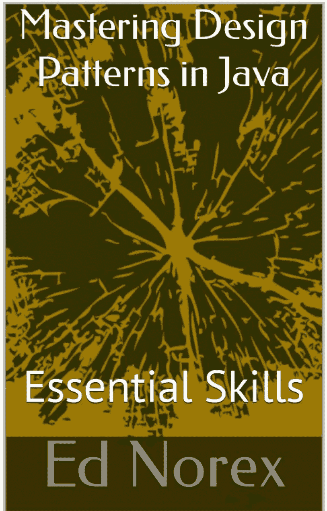
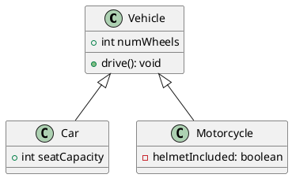
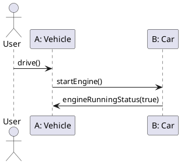

# Java 设计模式精通：核心技能



# 前言

本书《Java 设计模式精通：核心技能》专为开发者、软件架构师以及任何从事 Java 工作并渴望提高对设计模式理解、以构建健壮、可扩展且高效应用程序的人员而编写。本书的目的是为读者提供深层的设计模式知识，专门针对 Java 编程环境定制，使他们能够自信且高效地应对复杂的软件设计挑战。

设计模式为软件设计中遇到的常见问题提供了标准的解决方案。它们代表了通过对面向对象软件系统长期严谨检验演变而来的最佳实践。理解这些模式对于开发具有韧性、可扩展且适应变化的软件至关重要。Java 凭借其丰富的生态系统和多功能特性为有效应用这些设计模式提供了良好的平台。

本书的内容旨在提供设计模式的全面概述，从设计模式在软件开发中的概念和重要性开始。进一步探讨了特定类别，如创建型、结构型、行为型和并发模式，每种模式专门解决对象创建、组织、交互和多线程中的不同问题。书中还详细讨论了对于构建整个应用程序至关重要的架构模式，以及它们在 Java 企业版 (Java EE)、使用模型-视图-控制器 (MVC) 模式的 Web 应用涉及流和 lambda 的现代技术中的实际应用。

书中重点关注这些模式的现实应用。读者将发现示例和代码段，演示如何在 Java 中实现每种模式，比较何时一种模式可能比另一种更合适，并讨论了这些决策对软件应用程序整体架构的影响。这种实践方法确保了读者能够将所学的概念立即应用于当前的项目和工作中。

本书适用于具有 Java 和面向对象编程基础知识的人士，是寻求提升设计技能的软件开发者、旨在构建更具维护性和扩展性系统的软件架构师，以及寻求深化对软件设计原则理解的计算机科学学生的理想读物。本书结束后，读者将在使用设计模式设计软件方面拥有坚实的基础并能够应用它们。

# 第一章 设计模式与 Java 简介

设计模式是创建可扩展应用程序的基础。本章将介绍设计模式在软件开发中的概念和重要性。

## 1.1 设计模式的历史及其在软件开发中的演变

设计模式的起源可以追溯到 20 世纪 70 年代的建筑领域。建筑师克里斯托弗·亚历山大（Christopher Alexander）在其著名的著作中引入了“模式”的概念，作为捕捉被证明有效的设计思想的手段。他强调这些模式可以指导设计。

设计模式从架构到软件开发的转变从 20 世纪 80 年代后期和 90 年代初正式开始。关键时刻出现在 1994 年，当时出版了《设计模式：可重用面向对象软件的要素》一书，作者为 Erich Gamma、Richard Helm、Ralph Johnson 和 John Vlissides，合称为“四人帮”（GoF）。这本书编录了 23 种设计模式，被认为是软件工程领域的基石。它标志着设计模式作为一门学科的正式化，为解决常见问题提供了通用的语言和框架。

此外，设计模式的演变已经超越了最初的 GoF 设计模式，软件开发不断贡献新模式以应对新出现的设计挑战。如用于网络开发的模型-视图-控制器（MVC）以及用于管理组件依赖的依赖注入（Dependency Injection）等模式已获得广泛关注。云计算、微服务以及其他现代架构风格的增长也导致了针对这些环境定制的新模式的涌现。

设计模式的历史和演变反映了人们对捕捉和重用常见软件设计问题解决方案的重要性日益增长的认识。从架构上的起步到在现代软件开发（特别是 Java 编程）中的关键作用，设计模式已成为软件开发者工具箱中不可或缺的工具。随着软件变得日益复杂并与生活和业务的各个方面交织在一起，设计模式的相关性和重要性将不断增加，指导下一代软件的设计与开发。

## 1.2 为什么用 Java 设计设计模式？Java 特性概述

设计模式是软件工程的一个关键方面，为软件开发过程中遇到的常见问题提供了成熟的解决方案。Java 作为最流行的编程语言之一，凭借其多功能的特性集，为这些模式的实现提供了理想的平台。本节将探索 Java 的特性，这些特性使其特别适合采用设计模式，从而增强开发过程和最终软件应用程序的质量。

**面向对象编程 (OOP)：** Java 的核心是一门面向对象的语言，这与设计模式的本质完美契合。大多数设计模式在设计时都考虑了面向对象的原则，强调对象及其之间的交互而非过程。Java 的 OOP 特性（如继承、封装和多态）促进了`Singleton`、`Factory`和`Strategy`等各种设计模式的实现，使开发者能够编写模块化、可重用且更容易理解的代码。

**平台独立性：** 得益于`JVM`（虚拟机），Java 遵循“一次编写，随运行”（WORA）原则。这种平台独立性意味着在 Java 中实现的设计模式可以在不修改的情况下应用于不同的操作系统。这种通用性不仅扩大了模式的适用范围，还增强了它们在多样化环境中的生命力和适应性。

**丰富的 API：** Java 广泛的应用程序接口（API）提供了大量的预写代码，包括许多库和框架，这有助于各种设计模式的实现。例如，Java 的集合框架极大地简化了`Composite`等结构性模式的实现，而 Java Stream API 则通过提供健壮的数据处理能力，完善了`Chain of Responsibility`等行为性模式。

**并发支持：** 现代软件开发需要高性能，这通常通过并发来实现。Java 对多线程内置支持及其并发 API 在有效实现需要并行执行或异步处理的设计模式（例如观察者模式和多线程环境下的单例模式）方面起着重要作用。

**注解和反射：** Java 对注解（Annotations）和反射（Reflection）进一步增强了其实现复杂模式的能力。注解可提供元数据，从而促进依赖注入等模式的实现，而不会用样板代码弄乱代码。同样，反射允许对类和对象进行运行时分析，能够动态应用`Proxy`和`Decorator`等模式。

```java
// Example of Singleton Pattern in Java
public class Singleton {

    private static Singleton instance;

    private Singleton() {}

    public static synchronized Singleton getInstance() {
        if (instance == null) {
            instance = new Singleton();
        }
        return instance;
    }
}
```

// 输出示例不适用，因为单例模式本身不产生输出。

Java 全面的特性集（包括但不限于其面向对象的本质、平台独立性、丰富的 API、并发支持和反射能力）使其成为实现设计模式的极佳选择。这些模式反过来赋予开发者生产健壮、高效且可扩展软件应用程序的能力，强化了 Java 在现代软件开发中的关键作用。

## 1.3 设计模式的类型：创建、结构、行为型

软件工程中的设计模式是一项本质工具，为软件开发过程中遇到的常见问题提供了验证过的解决方案。这些模式根据它们所解决的问题性质分为三大类：创建型（Creational）、结构型（Structural）和行为型（Behavioral）。每个类别都包含几个具有共同目标并解决软件设计和实现特定方面的模式，特别是在 Java 编程环境中。

### 创建型模式

创建型设计模式关注软件开发中的对象创建过程。这些模式旨在抽象实例化过程，使系统对对象的创建、组合和表示方式更具独立性。在 Java 中，直接使用 `new` 运算符创建对象有时会导致代码缺乏活性且紧耦合，创建型模式提供了一种在创建过程中引入灵活性和封装的方法。

一些被广泛使用的创建型模式包括：

- 单例模式 (Singleton Pattern)：确保一个类只有一个实例，并为该实例提供全局访问点。它在 Java 程序的日志记录、驱动对象、缓存、线程池和配置设置中特别有用。

- 构建者模式 (Builder Pattern)：将复杂对象的构建与其表示分离，允许使用相同的构建过程创建不同的表示。这种模式在 Java 中创建具有许多参数（其中一些可能是可选的）的复杂对象时非常有用。

- 工厂方法模式 (Factory Method Pattern)：为创建对象定义接口，但让子类决定将创建的对象类型。这在 Java 框架中特别有用，因为预计客户端开发者将扩展实现细节。


- 抽象工厂模式 (Abstract Factory Pattern)：提供一种接口来创建一组相关或相关的对象族，而不指定它们的具体类。在 Java 中，它促进了所创建产品之间的一致性。

- 原型模式 (Prototype Pattern)：通过复制现有对象（称为原型）来创建新对象。当创建对象的成本比复制现有实例更贵或更复杂时，这种模式被用于 Java。

### 结构型模式

结构型模式关注类和对象如何组合成更大的结构。这些模式通过识别实现实体之间关系的简单方式来简化设计。在 Java 中，结构型模式有助于在抽象和实现之间建立桥梁，使应用程序更容易扩展和维护。

Java 中重要的结构型模式包括：

- 适配器模式 (Adapter Pattern)：允许接口不兼容的对象进行协作。当我们在 Java 中想要使用现有类但其接口不符合我们的需求时，这特别有用。

- 组合模式 (Composite Pattern)：将对象分解为树形结构以表示整体整体的关系。它允许以统一的方式处理单个对象和对象组合。这种模式在 Java 中表示图形用户界面或文件系统等层次结构非常有用。

- 代理模式 (Proxy Pattern)：作为另一个对象的代理或占位符以控制对其的访问。这在 Java 中实现延迟初始化、访问控制、日志记录、监控和安全访问有用。

- 享重量模式 (Flyweight Pattern)：通过共享相似对象的尽可能部分来最小化内存使用或计算开销；它在 Java 中优化大量相似对象的性能和内存使用特别有用。

- 桥接模式 (Bridge Pattern)：将抽象与实现解耦，使两者可以独立变化。这种模式在 Java 中通过将接口与实现分离，允许它们独立进行修改。

### 行为模式

行为模式的核心在于识别对象之间常见的通信模式并实现这些模式。通过这种方式，这些模式增加了系统中对象之间进行通信的灵活性。在 Java 中，行为模式为对象之间的交互模式增添了多样性。

主要的行为模式包括：

- 观察者模式（Observer Pattern）定义了对象之间的依赖关系，当一个对象的状态发生变化时，所有的依赖对象都会收到通知并自动更新。它在 Java 中广泛用于实现分布式事件处理系统。

- 策略模式（Strategy Pattern）定义了一族算法，将每个算法封装并使其可以相互替。策略允许算法从使用它的客户端独立变化。这种模式在 Java 中适用于运行时可能选择多种算法，且算法的选择会改变应用程序行为的场景。

- 命令模式（Command Pattern）将请求转换为独立对象，该对象包含有关请求的所有信息。这种分离允许使用不同的请求对方法进行参数化、延迟或队列请求执行，并支持撤销操作。命令在 Java 中对于创建执行或撤销操作的灵活且复用的类至关重要。

- 状态模式（State Pattern）允许对象在其内部状态改变时改变其行为。对象看起来 own改变了它的类。这在 Java 中对于以清晰且高效的方式实现状态机特别相关。

- 中者模式（Mediator Pattern）通过提供一个让类之间交互的中心位置来减少类之间的耦合性。在 Java 中，中者模式通过集中控制逻辑来简化应用程序的维护。

理解这些模式及其在 Java 中的应用，不仅提升了设计质量，还促进了对 Java 编程语言本身更深层次的理解。通过适当应用设计模式，Java 开发者可以编写更灵活、可复用且易于维护的代码。

## 1.4 设计模式的 Java 基础概念

要真正掌握设计模式在 Java 中的用途和应用，首先巩固对几个基础 Java 概念的理解至关重要。这些知识不仅让你能够理解设计模式如何运作，还能让你在 Java 应用程序中有效地实现这些模式。关键概念包括面向对象编程原则、Java 接口、类、继承和多态等。让我们深入研究这些基础模块，为深入探索设计模式领域奠定基础。

Java 编程的核心是面向对象编程（OOP）原则。这些原则包括封装、继承和多态，它们构成了 Java 中实现设计模式的骨干。

封装确保对象的数据（属性）和代码（方法）封装在一起，允许在必要时将数据对外部世界隐藏。这一概念对于创建一个受控的环境至关重要，在该环境中，对对象数据的访问通过方法进行监管，增强了安全性并减少了意外交互的概率。

继承允许新类从现有类继承属性和行为（方法）。这一概念在促进代码复用和建立类之间的层级关系方面是基础性的。

多态允许不同类的对象被视为同一个公共父类的对象；它对于实现动态且灵活的代码至关重要，在这些情况下，程序在运行时不需要知道对象的精确类型。

### Java 接口和抽象类

Java 接口和抽象类在定义类“可以做什么”方面起着关键作用，而不指定它“如何做”。接口是纯抽象类型，没有没有实现的方法。Java 中的接口充当类的蓝图，通过允许一个类实现多个接口来实现某种多重继承。

```java
public interface Animal {

  void eat();

  void travel();
}
```

另一方面，抽象类可以同时拥有抽象方法和非抽象方法。它们不能被实例化，被设计用于供子类继承，允许它们在许多相关类之间共享通用的实现。

```java
public abstract class AbstractAnimal {

  abstract void eat();

  public void breathe() {
    System.out.println("Breathing");

  }

}
```

### 类和对象

类和对象是面向对象编程的主要实体。类是创建对象（特定数据结构）的蓝图，而对象是类的实例。

### 继承和多态

在 Java 中，继承允许新类从现有类继承属性和行为（方法）。这一概念在促进代码复用和建立类之间的层级关系方面是基础性的。

多态允许不同类的对象被视为同一个公共父类的对象；它对于实现动态且灵活的代码至关重要，在这些情况下，程序在运行时不需要知道对象的精确类型。

```java
public class Animal {
    void sound() {
        System.out.println("Animal makes a sound");
    }
}
```

```java
public class Bird extends Animal {
    @Override
    void sound() {
        System.out.println("Bird makes a sound");
    }
}
```

```java
public class Pig extends Animal {
    @Override
    void sound() {
        System.out.println("Pig makes a sound");
    }
}
```

理解这些模式及其在 Java 中的应用，不仅提升了设计质量，还促进了对 Java 编程语言本身更深层次的理解。

## 1.5 设置你的 Java 开发环境

在深入研究 Java 设计模式之前，对于每个开发者来说，设置正确的开发环境至关重要。本节将引导你设置开发环境，包括安装开发包（JDK）、集成开发环境（IDE）以及设置第一个 Java 项目的概述。

### 安装开发包 (JDK)

开发包（JDK）是用于开发 Java 应用程序和小型程序的软件开发环境。它包含了运行时环境 (JRE)、解释器/加载器 (Java)、编译器 (javac)、存档器 (jar)、文档生成器 (javadoc) 以及 Java 开发所需的其他工具。

要下载 JDK，访问 Oracle 官网或 AdoptJDK 并选择适用于你系统的版本。下载后，运行安装程序并按照屏幕说明安装 JDK。

安装后，设置环境变量非常重要。你需要将 JDK 安装的 bin 目录路径添加到 PATH 变量中。这使得你可以从命令行运行 Java 命令。

在 Windows 上设置 PATH 变量的示例：

```
set PATH=C:\Program Files\Java\jdk-14\bin;%PATH%
```

在 Linux/Mac 上设置 PATH 变量的示例：

```bash
export PATH=/usr/lib/jvm/jdk-14/bin:$PATH
```

### 选择集成开发环境 (IDE)

虽然可以使用文本编辑器和命令行开发 Java 应用程序，但利用集成开发环境（IDE）可以显著提高你的生产力。IDE 提供了语法高亮、代码补全、调试工具和项目管理等众多功能，可以加速开发并减少错误。流行的 Java 开发 IDE 有 IntelliJ IDEA、Eclipse 和 NetBeans。这些 IDE 提供的体验略不同，因此你可能想尝试多个，看看哪种最符合你的喜好。

### 设置你的第一个 Java 项目

一旦安装了 JDK 并选择了 IDE，你就可以开始你的第一个 Java 项目了。虽然具体步骤取决于你选择的 IDE，但通用流程如下：

-   启动你的 IDE 并选择创建新项目的选项。

-   选择 "Java" 作为项目类型。

-   配置项目设置，例如名称和在计算机上的位置。

-   根据提示，选择你之前安装的 JDK 版本作为项目的 SDK。

-   完成设置并创建你的项目。

项目设置完成后，你就可以开始编写第一个 Java 程序了。一个典型的 Java "Hello, World!" 程序看起来如下：

```java
public class HelloWorld {
    public static void main(String[] args) {
        System.out.println("Hello, World!");
    }
}
```

要运行你的程序，你可以使用 IDE 的构建和运行命令。输出应如下：

```
Hello, World!
```


本节引导你完成了设置 Java 开发环境的必要步骤，从安装 JDK 到使用 IDE 创建你的第一个 Java 项目。现在环境已经就绪，你准备好探索 Java 编程的世界以及能够增强开发流程的强大设计模式了。

## 1.6 设计模式至关重要的 Java 语法和结构

理解 Java 的基本语法和结构对于有效掌握设计模式至关重要。Java 作为一种静态类型、面向对象的语言，提供了许多构建这些模式实现基础的特性。本节将深入探讨核心 Java 语法和结构，为这些元素如何与设计模式相互作用奠定基础。

### 类和对象

类和对象是 Java 和面向对象编程（OOP）的核心。类充当蓝图，根据蓝图创建单个对象。每个对象都是类的实例，体现了其类定义的属性和行为。对象之间通过方法进行的交互是许多设计模式的基础概念。

```java
public class Vehicle {
    private String make;
    private String model;

    public Vehicle(String make, String model) {
        this.make = make;
        this.model = model;
    }

    public String getDetails() {
        return make + " " + model;
    }
}
```

### 继承与多态

继承允许新类继承现有类的属性和行为，从而促进代码的重用和扩展。多态是指通过继承相关的不同类对象能够响应同名方法的能力，它在许多设计模式（包括工厂方法和策略模式）中至关重要。

```java
public class ElectricVehicle extends Vehicle {
    private int batteryLevel;

    public ElectricVehicle(String make, String model, int batteryLevel) {
        super(make, model);
        this.batteryLevel = batteryLevel;
    }

    @Override
    public String getDetails() {
        return super.getDetails() + ", Battery Level: " + batteryLevel + "%";
    }
}
```

### 接口与抽象类

接口和抽象类有助于在不实现行为的情况下为子类定义契约。它们在适配器和装饰器等设计模式中至关重要，这些模式在强制某些结构的同时，允许实际实现具有灵活性。

```java
public interface Movable {
    void move();
}

public abstract class Animal implements Movable {
    // 抽象类可以拥有方法的实现。
    public void breathe() {
        System.out.println("Breathing");
    }
}

public class Fish extends Animal {
    @Override
    public void move() {
        System.out.println("Swimming");
    }
}
```

### 封装

封装通过限制对访问器（`accessors`）和修改器（`mutators`）的访问来隐藏数据实现，这是一个基本的 OOP 原则，支持单例模式等其他模式。它确保了对象的内部表示对外部隐藏，仅允许通过定义的接口进行访问。

```java
public class Counter {
    private int count = 0;

    public void increment() {
        count++;
    }

    public int getCount() {
        return count;
    }
}
```

### 泛型

泛型允许类、接口和方法对客户端指定的类型进行操作。这一特性在不需要使用多次类型转换的情况下提供了类型安全，并有助于代码的灵活性和可重用性，如观察者模式和工厂模式所示。

```java
public class Box<T> {
    private T t;

    public void set(T t) {
        this.t = t;
    }

    public T get() {
        return t;
    }
}
```

这些结构中的每一个在 Java 设计模式的实现和理解中都起着重要作用。它们提供了所需的语法和结构基础，以便有效应用这些模式并在软件开发中利用它们的优势。

## 1.7 Java 中的面向对象原则：继承、多态、封装和抽象

理解面向对象编程（OOP）的四个基本原则对于掌握设计模式在 Java 中的意义和适用性至关重要。这些原则——继承、多态、封装和抽象提供了一个有助于开发灵活、模块化和可重用代码的框架。本节将深入每个原则的精髓，并说明它们在 Java 中的实现。

### 继承

继承是一种机制，允许新类（子类）从现有类（父类）继承属性和行为（字段和方法）。这种层次结构促进了代码重用，并在类之间建立了父子关系。

在 Java 中，继承通过使用 `extends` 关键字来实现。考虑以下示例：

```java
class Vehicle {
  String brand = "Ford";

  void honk() {
    System.out.println("Beep, beep!");
  }
}

class Car extends Vehicle {
    String modelName = "Mustang";
    void display() {
        System.out.println("Brand: " + brand + ", Model: " + modelName);
    }
}
```

### 多态

多态允许不同类型的对象被视为公共类型的对象，使得同一个接口可以用于不同的形式（数据类型）。在 Java 中，多态可以通过方法重载和重写来实现。方法重载发生在同一个类中，方法具有相同的名称但不同的参数。而方法重写则允许子类对其父类中定义的方法提供特定的实现。

以下示例演示了方法重写：

```java
class Animal {
  void sound() {
    System.out.println("The animal makes a sound");
  }
}

class Pig extends Animal {
  @Override
  void sound() {
    System.out.println("The pig says: wee wee");
  }
}
```

### 封装

封装是将数据（变量）和操作数据的方法封装单元单元的技术。通过限制对对象某些组件的直接访问，封装保护了对象状态的完整性。

在 Java 中，通常通过使用访问修饰符（`private`、`protected` 和 `public`）来实现。`private` 访问修饰符的限制最大，对封装至关重要。

这是一个封装 `name` 字段的示例：

```java
class Person {

    private String name; // private = 限制访问

    // Setter
    public void setName(String newname) {
        this.name = newname;
    }

    // Getter
    public String getName() {
        return this.name;
    }
}
```

### 抽象

抽象是一个隐藏复杂的实现细节并只显示对象基本特征的过程。换句话说，它关注的是对象做什么，而不是如何做。

在 Java 中，抽象是通过抽象类和接口来实现的。抽象类不能被实例化，并且可能包含抽象方法，即没有方法体的方法。

考虑以下抽象类：

```java
abstract class Animal {
    abstract void sound();
}

class Cat extends Animal {
    void sound() {
        System.out.println("The cat says: meow meow");
    }
}
```

在这个示例中，`Animal` 是一个包含了抽象方法 `sound()` 的抽象类。`Cat` 继承 `Animal` 并为 `sound()` 方法提供了实现。这种建模提供了一个清晰的结构，可以在保持简单性的同时扩展到复杂的应用程序中。

## 1.8 设计模式在现代 Java 应用中的重要性

软件开发的演进表明，复杂性和扩展性问题正呈现出显著趋势。随着应用程序范围和规模的扩大，开发者不可避免地面临跨不同项目和领域反复出现的挑战。这就是设计模式概念（特别是在 Java 编程领域）变得价值无限的地方。在 Java 应用中理解并有效应用设计模式可以显著提高代码的可读性、扩展性和可维护性。在本节中，我们将深入探讨设计模式在现代 Java 应用中具有重要的原因，以及它们如何成为构建卓越软件解决方案的关键。

### 重用性与时间效率

在 Java 中使用设计模式的核心优势之一是促进代码的重用。通过将常见范式抽象为模式，开发者可以在不同的项目之间应用这些解决方案，显著减少开发时间和精力的。例如，单例模式（`Singleton pattern`）确保一个类只有一个实例，并为其提供全局访问点。这种模式经常用于日志记录、驱动对象、缓存、线程池和配置设置，说明了它在各种应用中的通用性。

```java
public class Singleton {
    private static Singleton instance;

    private Singleton() {}

    public static Singleton getInstance() {
        if (instance == null) {
            instance = new Singleton();
        }
        return instance;
    }
}
```

### 增强代码的可维护性

使用设计模式的另一个优势是提高了代码的可维护性。通过采用认可的模式，开发者创建了一种共同语言，增强了代码的可读性和可维护性。例如，在实现事件处理系统中使用观察者模式（`Observer pattern`），让开发者更容易理解事件如何在系统中是如何传播和处理的。

```java
import java.util.Observable;
import java.util.Observer;

public class EventObserver implements Observer {

    @Override
    public void update(Observable obj, Object arg) {
        // Handle the update
    }
}
```

### 扩展性与灵活性

设计模式从其本质上是为了提供不依赖于特定问题的解决方案。这种通用的方法使得 Java 应用程序在规模和复杂性增加时更容易进行扩展和修改。例如，适配器模式（`Adapter pattern`）允许具有不兼容接口的类共同工作，能够在未来进行扩展或修改而无需进行重大重写。

```java
public interface TargetInterface {
    void request();
}

public class Adapter implements TargetInterface {
    private Adaptee adaptee;

    public Adapter(Adaptee adaptee) {
        this.adaptee = adaptee;
    }

    @Override
    public void request() {
        adaptee.specificRequest();
    }
}
```

### 解决问题的效率

通过为常见设计问题提供经过证明的解决方案，设计模式使开发者能够更高效地排除故障和解决问题。这避免了为每个新项目重复造轮子，从而节省了大量的时间和精力。

### 增强通信

当开发者使用著名的设计模式时，他们也增强了彼此之间交流想法和设计的能力。用既定模式来描述系统部分的结构和行为提供了清晰度，并缩短了新团队成员的适应曲线。

设计模式在现代 Java 应用中的重要性怎么强调都不为过。它们为解决反复的设计问题提供了一个经过测试和验证的框架，导致了更快的开发周期、更高效的问题解决，最终产生更健壮、可扩展的 Java 应用程序。随着软件开发的持续演进，设计模式在创建适应、可维护且高效的代码方面的作用只会增加，凸显了它们在开发者工具箱中的价值。

## 1.9 分析现实问题并应用设计模式解决方案

理解现实问题的复杂动态以及如何使用设计模式优雅地解决它们，在 Java 编程领域至关重要。本节深入了识别应用开发中常见问题的实用策略，并系统地应用设计模式解决方案来高效解决这些问题。通过剖析几个示例，我们展示了如何识别与特定问题相关的设计模式，从而提高软件的质量和可维护性。

### 识别软件开发挑战

软件开发（特别是 Java）涵盖了各种挑战，从对象的如何创建到它们如何交互，以及如何让它们以一种灵活且受控的方式协同工作。以下点概述了识别项目中可能受益于应用设计模式的区域的典型流程：

- **扩展性问题**：当你的应用程序无法高效地容纳增长时。
- **重用性考量**：当存在高程度的代码重复时，表明需要抽象常见功能。
- **紧耦合**：当一个模块或类的变化需要另一个类也随之变化时，表明需要更好的关注点分离。
- **添加新功能的复杂性**：如果添加新功能需要大量的改动，则表明系统架构过于复杂或僵化。

### 应用设计模式解决方案

一旦确定了项目中的问题区域，下一步是将其与适当的设计模式相匹配。设计模式的妙之处在于，它们为反复出现的问题提供了经过测试且可靠的解决办法。让我们看看特定的设计模式如何应对上述挑战。

### 用于扩展性的工厂方法模式

工厂方法模式（`Factory Method pattern`）是一种创建型模式（`Creational pattern`），为扩展性问题提供了极佳的解决方案。它允许类将实例化推给子类。因此，可以在不指定要创建的具体对象类的情况下创建对象。考虑 Java 应用中的一个场景，需要创建不同类型的用户配置（例如：管理员、成员、访客）。使用工厂方法模式，我们可以封装配置创建逻辑，使系统能够适应未来用户类型的添加。

```java
public abstract class UserProfile {
    // 工厂方法
    abstract UserProfile createUserProfile();
    // 其他方法
}

public class AdminProfile extends UserProfile {
    @Override
    UserProfile createUserProfile() {
        return new AdminProfile();
    }
    // 特有的 AdminProfile 方法
}

public class MemberProfile extends UserProfile {
    @Override
    UserProfile createUserProfile() {
        return new MemberProfile();
    }
    // 特有的 MemberProfile 方法
}
```

### 用于重用性的适配器模式

为了增强重用性，适配器模式（`Adapter pattern`）是一种结构型模式（`Structural pattern`），允许具有不兼容接口的类共同工作。它充当两个不兼容接口之间的桥梁。这种模式在需要集成第三方库或遗留系统而不修改现有代码的情况下特别有用。

例如，考虑你的应用程序使用的一个日志库，但你希望切换到另一个接口不同的库。适配器模式可以促进这一实现：

```java
// 目标接口
public interface Logger {
    void log(String message);
}

// 被适配器类
public class OldLogger {
    public void logMessage(String message) {
        System.out.println(message);
    }
}

// Adapter类
public class LoggerAdapter implements Logger {
    private OldLogger oldLogger;

    public LoggerAdapter(OldLogger oldLogger) {
        this.oldLogger = oldLogger;
    }

    @Override
    public void log(String message) {
        oldLogger.logMessage(message);
    }
}
```

### 用于松耦合的观察者模式

观察者模式是一种行为模式，它通过定义对象之间的一对多的依赖关系来促进松耦合，使得当一个对象的状态发生时，所有的依赖者都会收到通知并自动更新。这种模式适用于实现分布式事件处理系统（如通知或状态监控）。

考虑一个电子商务应用程序，其中多个组件需要对订单状态更新做出响应：

```java
public interface Observer {
    void update(Object arg);
}
```


```java
public interface Subject {
    void attach(Observer o);
    void detach(Observer o);
    void notifyUpdate(Object arg);
}
```

```java
public class OrderStatus implements Subject {
    private List<Observer> observers = new ArrayList<>();
    private String status;
```

```java
@Override
public void attach(Observer o) {
    observers.add(o);
}
```

```java
@Override
public void detach(Observer o) {
    observers.remove(o);
}

@Override
public void notifyUpdate(Object arg) {
    for (Observer o : observers) {
        o.update(arg);
    }
}
```

```java
public void setStatus(String status) {
    this.status = status;
    notifyUpdate(status);
}
```

实际示例表明，通过策略性地应用适当的设计模式，不仅可以高效地解决常见的软件开发挑战，还能使生成的代码库更具模块化、可扩展性和可维护性。这本质上强调了设计模式在 Java 编程领域中所含的变革潜力。

## 1.10 UML 简介：设计模式的可视化语言

理解 Java 或任何编程语言中的设计模式，不仅涉及掌握理论概念，还需要将它们的结构和关系视觉化。实现这一目标的最有效工具之一就是统一建模语言（UML）。UML 并非 Java 特有；它是一种标准的建模语言，用于软件工程，提供一种视觉化系统设计的方法。在设计模式的背景下，UML 图提供了图形化表示，有助于理解、应用和这些模式。本节将深入探讨 UML 的基础，重点关注其在设计模式视觉化方面的相关性和应用。

UML 包含了一系列图形符号技术，用于创建面向对象的软件密集型系统的视觉模型。为了表示设计模式，UML 使用了多种类型的图，其中类图和时序图尤为重要。

### UML 中的类图

UML 类图通过描绘类、它们的属性、操作（或方法）以及对象之间的关系，提供了系统的静态视图。它在表示设计模式的结构方面极其有用。例如，类图可以说明模式的参与者、它们的角色以及它们如何相互作用。

以下是用 LaTeX 表达式的简单 UML 类图：



在上面的示例中，`Car` 和 `Motorcycle` 类继承自 `Vehicle` 类。符号 `+` 和 `-` 分别代表公共和私有可见性。该图直观地展示了继承关系，这是面向对象设计常见的结构模式。

### UML 中的时序图

虽然类图提供了系统的静态视图，但时序图描述了对象如何在特定的事件序列中相互作用。这种动态方面使得时序图通过视觉化对象随时间的消息流，对于理解行为模式具有无价之。

考虑以下 LaTeX 表达式的 UML 时序图示例：



此图展示了一个简单的交互：用户调用车辆的 `drive()` 操作，车辆随后启动汽车的引擎，然后汽车通知引擎正在运行。它突显了对象在执行行为模式期间是如何通信的。

### UML 在理解设计模式的重要性

使用 UML 图将设计模式视觉化有几个优势：

- **清晰性：** 它提供了模式结构和交互的清晰、简洁的视觉化表示，使其更容易理解复杂的关系和行为。
- **通信：** UML 图可以作为开发者之间的通用语言，在讨论设计解决方案时促进更好的沟通与协作。
- **文档化：** 它们能够对项目中的设计模式进行有效的记录，提高代码的可维护性和知识传递。

UML 是在 Java 和其他编程语言中视觉化、理解和实现设计模式必不可少的工具。通过将 UML 图整合到开发过程中，团队可以增强设计实践和软件解决方案的整体质量。

## 11.1 展望后续：深入研究设计模式

随着我们继续对 Java 设计模式的探索，显而易见，理解这些模式不仅仅是识别编码模板。它关乎掌握指导软件结构化的底层原理，这些原理使软件具有适应性、可维护性和可扩展性。从这里开始的旅程将深入设计模式的细节，重点关注如何巧妙地应用它们来解决开发中常见的挑战问题。

在接下来的章节中，我们将对设计模式的三大类别进行详细探索：创建型、结构型和行为型。每个类别在设计的特定方面都起着关键作用，从对象的创建、组合到对象的动态交互。

创建型模式本质上是关于对象创建的过程。在 Java 中，对象是基石，如何创建它们对代码的灵活性和复杂性有重大影响。创建型模式提供了在保持架构适应性的同时创建对象的解决方案。单例、工厂方法和抽象工厂等模式不仅是机制，而且正确实现时可以显著简化开发的策略。

例如，单例模式确保一个类只有一个实例，并提供该实例的全局访问点。这在多个实例可能导致差异的情况下特别有用。考虑以下代码示例：

```java
public class SingletonExample {
    private static SingletonExample instance;

    private SingletonExample() {}

    public static SingletonExample getInstance() {
        if (instance == null) {
            instance = new SingletonExample();
        }
        return instance;
    }
}
```

另一方面，结构型模式关注类和对象如何组合成更大的结构。它们提供了创建对象的方法，使其能够组合成更大、更复杂的结构，同时保持灵活性和效率。适配器、装饰器和代理模式示例了如何在不根本改变核心代码库的情况下适配或增强对象——这一原则对于维护和演进软件系统尤为重要。

考虑适配器模式如何工作。它允许不兼容对象的接口进行协作。这里是演示其用法的简化代码示例：

```java
public interface TargetInterface {
    void request();
}
```

```java
public class Adaptee {
    public void specificRequest() {
        // Some specific implementation
    }
}
```

```java
public class Adapter implements TargetInterface {
    private Adaptee adaptee;

    public Adapter(Adaptee adaptee) {
        this.adaptee = adaptee;
    }

    @Override
    public void request() {
        adaptee.specificRequest();
    }
}
```

当我们在处理无法直接修改的代码时（例如使用第三方库或 API），这种模式变得尤为有益。

行为模式对于定义对象如何交互至关重要，这种交互方式可以增加对象的相互操作性并减少它们相互依赖。这些模式强调了对象的职责和责任，并阐明了信息如何在系统中传递。观察者模式、策略模式和命令模式等提供了一种框架，能够将复杂的逻辑和决策过程封装起来，从而促进了松耦合和高内聚。

一个常见的例子是观察者模式，它允许对象向其他对象通知其状态的变化。以下展示了一个简单的实现：

```java
import java.util.ArrayList;
import java.util.List;

public interface Observer {
    void update(String message);
}

public class ConcreteObserver implements Observer {
    @Override
    public void update(String message) {
        System.out.println("Received message: " + message);
    }
}

public class Subject {
    private List<Observer> observers = new ArrayList<>();

    public void attach(Observer observer) {
        observers.add(observer);
    }

    public void notifyObservers(String message) {
        for (Observer observer : observers) {
            observer.update(message);
        }
    }
}
```

通过采用这些设计模式，Java 开发者可以构建出不仅能解决当前问题，还能为未来的扩展和修改铺平道路且干扰最小的解决方案。这在于构建一个对变化具有韧性、面对增长的需求具有扩展性、并且适应未来创新的代码库。接下来的章节将不仅深入探讨这些模式，还将提供实际应用和示例，以阐明它们在现实世界中的影响和优势。

# 第 2 章

## 创建模式：在 Java 中构建对象

创建型模式是专门的设计模式，侧重于处理编程中的对象创建机制，使实例化过程更具适应性且不易复杂。在 Java 中，这些模式在以适用于情况的方式管理对象方面起着至关重要的作用，帮助开发者避免与直接实例化相关的陷阱，并为代码提供更大的灵活性。本章将深入介绍关键创建模式，包括单例模式、工厂方法模式、抽象工厂模式、构建器模式和原型模式，通过实际示例和最佳实践说明它们在 Java 中的实现和用途。

## 2.1 创建型设计模式简介：概念与重要性

创建型模式是设计模式领域的基石，为软件工程中的高效对象创建提供了蓝图。在 Java 中，与其他许多面向对象的编程语言一样，对象的创建、组合和操作方式会对代码的灵活性、可扩展性以及最终维护性产生深远影响。本节介绍了创建型设计模式的概念，探索了它们的意义以及它们在软件开发中旨在解决的问题。

创建型模式的主要目标是抽象实例化过程。它们有助于系统独立于对象是如何被创建、组合和表示的。核心在于，这些模式关注处理对象创建机制，使得对象能够以适合当前状况的方式被创建。这种方法提供了两个显著的优势：它在为特定案例决定需要创建哪些对象时引入了灵活性，并封装了关于类如何成为系统部分的知识。

创建型模式解决的常见问题之一是使用 `new` 运算符直接实例化对象。虽然这在小型规模应用程序中看起来简单且无害，但随着应用程序规模和复杂性的增加，可能会导致严重问题。直接实例化会导致代码高度耦合，难以维护、测试和扩展。创建型模式提供了一种将实例化过程与系统解耦的方法，提供了更具模块化、可扩展且易于维护的代码库。

以下展示了 Java 中一些本质的创建型模式：

- **单例模式 (`Singleton Pattern`)**：确保一个类只有一个实例，并提供对该实例的全局访问点。
- **工厂方法模式 (`Factory Method Pattern`)**：为创建对象定义接口，但允许子类更改将创建的对象的类型。
- **抽象工厂模式 (`Abstract Factory Pattern`)**：提供一种接口来创建一组相关或依赖的对象，而无需指定它们的具体类。
- **构建器模式 (`Builder Pattern`)**：将复杂对象的构建与其表示分离，允许使用相同的构建过程创建不同的表示。
- **原型模式 (`Prototype Pattern`)**：通过复制现有对象（称为原型）来创建新对象。

这些每种模式都为对象创建提供了独特的方法，从控制实例化过程到封装复杂的创建逻辑。在 Java 应用中实现这些模式可以显著提高代码质量，使其更具变化适应性、更容易理解且更易测试。

理解并有效应用创建型设计模式，对于任何旨在生产健壮、可扩展且易于维护软件的 Java 开发者都是至关重要的。本章旨在提供这些模式的全面概述，提供对它们在 Java 中实现和实际用途的见解。

## 2.2 单例模式：确保唯一实例

单例模式是最简单的设计模式之一，属于创建模式的范畴。它的主要目的是确保一个类只有一个实例，同时提供对该实例的全局访问点。当恰好需要一个对象来协调系统的操作时，这种模式特别有用。一些常见的例子包括配置、日志、线程池和缓存。

单例模式背后的原理看起来可能很简单，但其实现必须仔细处理，以避免常见的陷阱，例如多线程环境下的同步问题、确保懒加载，以及防止由于序列化或反射引起的问题。

### Java 中的实现

在 Java 中实现单例模式有多种方法，但我们将重点关注两种主要方法：饿汉初始化和懒加载。

#### 饿汉初始化

在饿汉初始化中，单例实例在类加载时被创建。这种方法简单直接，但缺点是即使可能不需要使用也会创建实例，可能会浪费资源。

```java
public class EagerSingleton {
    private static final EagerSingleton instance = new EagerSingleton();

    private EagerSingleton() { }

    public static EagerSingleton getInstance() {
        return instance;
    }
}
```

#### 懒加载

懒加载采取了不同的方法，在第一次请求时才创建单例实例。如果实例永远不需要，这可以节省资源。但是，必须确保这种方法是线程安全的。

```java
public class LazySingleton {
    private static LazySingleton instance;

    private LazySingleton() {}

    public static synchronized LazySingleton getInstance() {
        if (instance == null) {
            instance = new LazySingleton();
        }
        return instance;
    }
}
```

虽然 `synchronized` 关键字确保了线程安全，但每次调用 `getInstance()` 都会引入性能开销。双检查锁定机制可以通过在第一次创建实例时进行同步来缓解这个问题。

```java
public class LazySingleton {
    private static volatile LazySingleton instance;

    private LazySingleton() {}

    public static LazySingleton getInstance() {
        if (instance == null) {
            synchronized (LazySingleton.class) {
                if (instance == null) {
                    instance = new LazySingleton();
                }
            }
        }
        return instance;
    }
}
```

### 注意事项与最佳实践

虽然单例模式是一项强大的工具，但谨慎地使用它至关重要。过度使用会导致代码的可维护性和测试出现问题。单例会向应用程序中引入全局状态，使得调试和测试变得困难，因为状态会跨测试用例持续。

另一个考虑因素是在分布式系统中使用单例。单例模式的传统实现并没有解决跨多台机器创建单一实例的问题。在这种情况下，其他设计模式或架构（如服务）可能更为合适。

单例模式提供了一种简单的方法来确保一个类只有一个实例，并提供对该实例的全局访问点。当谨慎使用时，它可以成为开发者工具箱中一种有效的工具。然而，开发者必须留意其影响，特别是关于可测试性、可维护性和可扩展性。有效使用单例模式体现了对其局限性的理解，以及对应用程序特定需求的考虑。

## 2.3 工厂方法模式：定义对象创建的接口

工厂方法模式是一种创建类设计模式，它在父类中提供一个创建对象的接口，但允许子类更改将创建的对象类型。当一个类无法预见到它需要创建的对象类型时，这种模式特别有用。工厂方法模式不是直接实例化对象，而是使用一个特殊的“工厂”方法来创建对象。如果子类想要创建不同类型的对象，可以对该方法进行重写。

工厂方法模式的核心在于为对象创建提供一个接口，同时将实例化逻辑封装在派生类中。这种方法增强了灵活性和代码重用性，使得在不改变核心逻辑的情况下更容易扩展和修改应用程序。

## 在 Java 中的实现

为了在 Java 中实现工厂方法模式，让我们考虑一个简单的场景：一个可以发送不同类型通知（例如电子邮件、短信、推送通知）的通知服务。


首先，我们定义一个名为 `Notification` 的抽象类或接口。该类声明了工厂方法，在我们的案例中 `createNotification`。该方法是抽象的，并返回 `Notification` 实例。

```java
public abstract class Notification {
    public abstract void notifyUser();
}
```

接下来，我们为每种通知类型创建具体的类，继承自 `Notification` 类并实现 `notifyUser` 方法。

```java
public class EmailNotification extends Notification {
    @Override
    public void notifyUser() {
        System.out.println("正在发送电子邮件通知.");
    }
}
```

```java
public class SMSNotification extends Notification {
    @Override
    public void notifyUser() {
        System.out.println("正在发送短信通知.")
    }
}

public class PushNotification extends Notification {
    @Override
    public void notifyUser() {
        System.out.println("正在发送推送通知.")
    }
}
```

然后，我们创建 `NotificationFactory` 类。该类实际上实现了工厂方法，并根据某些逻辑决定实例化哪种通知类。

```java
public class NotificationFactory {
    public Notification createNotification(String type) {
        if (type == null || type.isEmpty()) {
            return null;
        }
        if ("EMAIL".equals(type.toUpperCase())) {
            return new EmailNotification();
        } else if ("SMS".equals(type.toUpperCase())) {
            return new SMSNotification();
        } else if ("PUSH".equals(type.toUpperCase())) {
            return new PushNotification();
        }
        return null;
    }
}
```

要使用工厂方法模式，客户端代码只需调用 `NotificationFactory` 对象上的工厂方法，并指定所需的通知类型。工厂随后将返回相应子类的实例。

```java
public class NotificationsService {
    public static void main(String[] args) {
        NotificationFactory factory = new NotificationFactory();
        Notification notification = factory.createNotification("email");
        if (notification != null) {
            notification.notifyUser();
        }
    }
}
```

这种方法将实例化过程与客户端代码解耦，转而依赖 `NotificationFactory` 返回适当的对象类型。它展示了工厂方法模式如何封装对象创建逻辑，从而提供了更大的灵活性并遵循了软件开发中的开闭原则。

### 优点与局限性

使用工厂方法模式具有多项益处：

- 它促进了创建对象的代码与使用对象的代码之间的松耦合。
- 它遵循开闭原则，使得系统更容易通过新类型进行扩展。
- 它封装了创建逻辑，使得更简单地控制程序实例化了哪些类。

然而，必须认识到工厂方法模式可能会因为需要额外的类和接口而为设计引入复杂性。此外，如果误用用于简单的对象创建，可能会使代码更难理解和维护。

总结来说，工厂方法模式对于需要对象创建灵活性的场景来说，是一种极具价值的设计工具。通过定义一个创建对象的接口并让子类决定实例化哪个类，它有助于构建一个松耦合且可扩展的系统。

## 2.4 抽象工厂模式：创建相关对象族

抽象工厂模式是一种创建类设计模式，它提供了一个在不指定具体类的情况下创建相关对象族的接口。当系统需要与其对象的如何创建、组合和表示相互独立时，这种模式特别有用。它强调一组设计在一起使用的相关产品，因此确保了所产生产品的一致性。

想象这样一个场景：你正在开发一个 UI 工具包，你的工具包需要无缝切换不同的主题，如深色模式和亮色模式。每个主题有一组相关的组件，按钮、文本框和复选框共享相同的主题样式。每当切换主题时，单独为每个组件设置样式是非常无效且容易出错的。这就是抽象工厂模式的优势，它允许你定义并使用一组产品（在这种情况下是组件），而无需担心它们的具体实现。

该概念可以分解为几个关键部分：

- 抽象工厂：声明一组创建抽象产品的方法的接口。
- 具体工厂：实现抽象工厂以及用于创建具体产品的方法。
- 抽象产品：声明某种类型对象的类型。
- 客户端：使用抽象工厂和抽象产品声明的接口。

### 实现

让我们考虑在 Java 中实现 UI 工具包场景。首先，定义抽象工厂和产品：

```java
interface GUIFactory {
    Button createButton();
    TextField createTextField();
}

interface Button {
    void render();
}
```

```java
interface TextField {
    void render();
}
```

接下来，为深色主题和浅色主题分别实现具体的工厂和产品：

```java
class DarkGUIFactory implements GUIFactory {
    public Button createButton() {
        return new DarkButton();
    }
    public TextField createTextField() {
        return new DarkTextField();
    }
}
```

```java
class LightGUIFactory implements GUIFactory {
    public Button createButton() {
        return new LightButton();
    }
    public TextField createTextField() {
        return new LightTextField();
    }
}
```

```java
class DarkButton implements Button {
    public void render() {
        System.out.println("Rendering dark button");
    }
}

class LightButton implements Button {
    public void render() {
        System.out.println("Rendering light button");
    }
}

class DarkTextField implements TextField {
    public void render() {
        System.out.println("Rendering dark text field");
    }
}

class LightTextField implements TextField {
    public void render() {
        System.out.println("Rendering light text field");
    }
}
```

最后，客户端代码可以使用这些工厂来创建 UI 元素，而无需直接构造实例：

```java
public class Application {
    private Button button;
    private TextField textField;
    public Application(GUIFactory factory) {
        button = factory.createButton();
        textField = factory.createTextField();
    }
    public void render() {
        button.render();
        textField.render();
    }
}
```

为了演示切换主题：

```java
public class Main {
    public static void main(String[] args) {
        Application app = new Application(new DarkGUIFactory());
        app.render();
        app = new Application(new LightGUIFactory());
        app.render();
    }
}
```

## 2.5 构建器模式：逐步构建复杂对象

构建器模式是一种创建性设计模式，为逐步构建复杂对象提供灵活的解决方案。该模式允许对象的创建与它的表示分离，使得相同的构建过程可以创建不同的表示。当对象需要包含许多可选和必需的组件，或者创建过程涉及可以以不同顺序执行的多个步骤时，该模式尤为有用。

### 核心概念

构建器模式的本质是通过将构建过程分解为一系列更简单、单独的步骤来处理复杂对象的构建。这是通过使用指挥者（`Director`）组件和构建器接口实现的。指挥者负责管理构建步骤，而不同的构建器通过实现这些步骤来构建产品的各种表示。构建器模式背后的核心思想包括：

- 构建与表示的分离。
- 构建逻辑的封装。
- 从同一组构建步骤创建不同的表示。

### 构建器模式的组件

构建器模式由以下组件组成：

- **产品 (`Product`)**：要构建的复杂对象。
- **构建器 (`Builder`)**：定义构建产品所需所有步骤的接口。
- **具体构建器 (`ConcreteBuilder`)**：实现构建器接口，通过实现构建器中定义的步骤来构造和组装产品的部分。
- **指挥者 (`Director`)**：负责按特定顺序执行构建步骤。
- **客户端 (`Client`)**：引导指挥者使用特定的构建器创建产品来启动构建过程的实体。

### 在 Java 中实现

在 Java 中实现构建器模式涉及创建产品类、构建器接口、一个或多个具体构建器以及指挥者类。下面是一个如何实现简单汽车构建器的示例性代码。

#### 产品类

产品类代表需要构建的复杂对象。在这种情况下，它是一个具有各种属性的 `Car` 类。

```java
public class Car {
    private String engine;
    private int wheels;
    private int seats;
    private boolean sunroof;

    // 构造函数
    public Car(String engine, int wheels, int seats, boolean sunroof) {
        this.engine = engine;
        this.wheels = wheels;
        this.seats = seats;
        this.sunroof = sunroof;
    }

    // getters and setters
}
```

#### 构建器接口

构建器接口定义了构建产品的所有步骤。每个步骤返回构建器本身以支持流式接口。

```java
public interface CarBuilder {
    CarBuilder setEngine(String engine);
    CarBuilder setWheels(int wheels);
    CarBuilder setSeats(int seats);
    CarBuilder setSunroof(boolean sunroof);
    Car build();
}
```

#### 具体构建器类

该类实现构建器接口，以构造和组装产品的部分。

```java
public class SportCarBuilder implements CarBuilder {
    private String engine;
    private int wheels;
    private int seats;
    private boolean sunroof;

    @Override
    public CarBuilder setEngine(String engine) {
        this.engine = engine;
        return this;
    }

    @Override
    public CarBuilder setWheels(int wheels) {
        this.wheels = wheels;
        return this;
    }

    @Override
    public CarBuilder setSeats(int seats) {
        this.seats = seats;
        return this;
    }

    @Override
    public CarBuilder setSunroof(boolean sunroof) {
        this.sunroof = sunroof;
        return this;
    }

    @Override
    public Car build() {
        return new Car(engine, wheels, seats, sunroof);
    }
}
```

#### 指挥者类

指挥者类控制构建过程并向客户端隐藏细节。

```java
public class CarDirector {
    private CarBuilder builder;

    public CarDirector(CarBuilder builder) {
        this.builder = builder;
    }

    public Car buildCar() {
        return builder.setEngine("V8")
            .setWheels(4)
            .setSeats(2)
            .setSunroof(true)
            .build();
    }
}
```

#### 客户端使用

最后，客户端可以使用指挥者使用特定的构建器构建产品。

```java
public class BuilderPatternDemo {
    public static void main(String[] args) {
        CarBuilder builder = new SportCarBuilder();
        CarDirector director = new CarDirector(builder);
        Car sportsCar = director.buildCar();
        // 现在，sportsCar 对象已经构建完成。
    }
}
```

### 优点与考量

构建器模式提供了许多优点，特别是在处理复杂对象构建时：

- 为表示代码提供了清晰的分离和封装。
- 支持构建具有可选和必需参数的对象。
- 通过避免阶接构造函数反模式，使代码更具可读性。

然而，构建器模式的实现可能会增加代码复杂度，特别是对于较小的对象，这种详细的构建过程可能没有必要。

## 2.6 原型模式：通过克隆创建对象

原型模式是一种创建型设计模式，它允许通过复制现有实例来创建新对象，而无需使代码依赖于这些对象所属的具体类。当对象的初始化开销较大，或者需要创建大量相似对象时，该模式非常有用。

### 实现示例

假设我们有一个 `Car` 类，由于复杂的配置和初始化，实例化该类的开销非常大。我们可以应用原型模式来克隆现有的 `Car` 对象，而不是从头创建一个新对象。

```java
public class Car implements Cloneable {
    private String model;
    private List<String> features;

    // 构造函数和其他方法省略以保持简洁。

    @Override
    public Car clone() {
        try {
            Car clonedCar = (Car) super.clone();
            // 对于深拷贝，手动克隆可变字段。
            clonedCar.features = new ArrayList<>(this.features);
            return clonedCar;
        } catch (CloneNotSupportedException e) {
            throw new AssertionError(); // 不会发生
        }
    }
}
```


在上面的示例中，`Car` 类实现了 `Cloneable` 接口并重写了 `clone()` 方法以实现深克隆，特别是针对 `features` 列表，确保克隆的对象拥有该列表的副本，而不是原始列表的引用。

# 使用原型模式

要使用原型模式，通常会维护一个可用原型的注册表并在需要时对其进行克隆。这种方法将系统与实例化对象所需的具体类解耦。

```java
Car originalCar = new Car("Model S", Arrays.asList("GPS", "Sunroof"));
Car clonedCar = originalCar.clone();
System.out.println(originalCar.getFeatures());
System.out.println(clonedCar.getFeatures());
```

代码段的输出将确认 `originalCar` 和 `clonedCar` 具有相同的特征，但它们确实是相互独立的对象。这演示了原型模式的作用，允许在保持独立对象实例的同时实现高效的对象克隆。

## 应用与考虑因素

原型模式广泛适用于以下场景：

- 创建对象是一项昂贵的操作，克隆对象更高效。
- 系统应该独立于其对象是如何创建、组合和表示的。
- 待实例化的类在运行时指定（例如，通过动态加载）。
- 避免构建一个与产品类层次结构并行的工厂类层次结构。

然而，实现原型模式也带来了考虑因素。值得注意的是，深拷贝在正确实现上可能非常复杂，特别是对于具有循环引用或复杂图结构的对象。此外，Java 中对 `Cloneable` 和 `clone()` 的一直是一直是和困惑的主题，主要因为 `Cloneable` 没有声明 `clone()` 方法，而 `clone()` 本身在 `Object` 中是保护的。

原型模式提供了一种强大的对象创建方法，专注于克隆现有实例而非构造新变体。通过实现这种模式，开发者可以实现更高效、更灵活的对象创建，特别是对于复杂或资源密集型对象。然而，仔细考虑浅拷贝与深拷贝的影响，并准确管理克隆对象的复杂性是非常重要的。

## 2.7 理解每种创建模式的用例

创建性模式为解决面向对象编程中常见的实例化问题提供了蓝图。每个模式都有其最出彩的特定应用场景，提供了让软件设计更灵活、可重用且易于管理的解决方案。让我们探索 Java 中主要创建性模式的用例：单例模式、工厂方法、抽象工厂、构建器和原型模式。

单例模式确保一个类只有一个实例，并提供一个该实例的全局访问点。这在需要单个对象来协调整个系统操作的情况下特别有用。常见用例包括：

- 管理与数据库的连接
- 配置在整个应用程序范围内可访问的应用设置
- 实现日志框架，其中多个消费者写入同一个日志文件

Java 中简单的单例实现可能如下：

```java
public class DatabaseConnector {
    private static DatabaseConnector instance;
    private DatabaseConnector() {
        // 构造函数是私有的
    }
    public static synchronized DatabaseConnector getInstance() {
        if (instance == null) {
            instance = new DatabaseConnector();
        }
        return instance;
    }
}
```

工厂方法模式定义了一个接口来创建对象，让子类决定要创建的类型。这种模式通常在以下情况下使用：

- 类无法预先假设对象的类型。
- 一个类希望通过子类来扩展库。
- 一个类希望通过子类来表示组件。

在 Java 中你可能会这样定义 `Dialogue`：

```java
public abstract class Dialogue {
    public abstract Button createButton();
    public void render();
}
public class WindowsDialogue extends Dialogue {
    @Override
    public Button createButton() {
        return new WindowsButton();
    }
}
```

抽象工厂模式提供了创建相关或依赖对象的接口，而无需指定具体类。使用抽象工厂当：

- 系统应该独立于其对象是如何创建、组合和表示的。
- 系统应该配置一组相关的产品。
- 你需要对这些产品施加某种约束。
- 你希望提供接口而不是具体实现。

例如，创建一个可以在不同样式之间切换的 GUI 工具：

```java
public interface GUIFactory {
    Button createButton();
    Checkbox createCheckbox();
}
public class WinFactory implements GUIFactory {
    public Button createButton() {
        return new WinButton();
    }
    public Checkbox createCheckbox() {
        return new WinCheckbox();
    }
}
public class MacFactory implements GUIFactory {
    public Button createButton() {
        return new MacButton();
    }
    public Checkbox createCheckbox() {
        return new MacCheckbox();
    }
}
```

构建器模式旨在逐步构建复杂对象。当创建复杂对象的算法独立于组成部分及其组装方式时，它是最好的。考虑构建器当：

- 构建过程允许对象有不同的表示。
- 对象的构造与其组成部分解耦。

一个 `Car` 的典型构建器结构如下：

```java
public class CarBuilder {
    private Type type;
    private int seats;
    private Engine engine;
    // 其他部分声明
    public CarBuilder setType(Type type) {
        this.type = type;
        return this;
    }
    public CarBuilder setSeats(int seats) {
        this.seats = seats;
        return this;
    }
    // 其他 setter 方法
    public Car build() {
        return new Car(type, seats, engine);
    }
}
```

原型模式用于创建对象的类型由原型实例确定，通过克隆该实例来产生新对象。这种模式适用于：

- 类的实例可能只有几种状态组合。安装相应数量的原型并使用它们可能比每次都带有适当状态手动实例化类更方便。
- 需要与现有对象相似的对象，状态可能只有细微变化。使用这种模式可以减少子类的数量。

```java
public Rectangle(Rectangle target) {
    super(target);
    if (target != null) {
        this.width = target.width;
        this.height = target.height;
    }
}
```

```java
@Override
public Shape clone() {
    return new Rectangle(this);
}
```

创建型模式通过封装实例化过程，为对象创建提供了一种灵活的方法。正确应用这些模式可以简化代码维护、增强代码可读性并支持代码复用。理解何时以及何地应用每种模式对于 Java 中有效的软件设计和实现至关重要。

## 2.8 在 Java 中实现创建型模式：关键技术与示例

创建型模式是软件设计和架构的基础，特别是对于 Java 这样面向对象的编程语言。这些模式为复杂的对象创建场景提供了解决方案，使得实例化过程更加灵活、高效且易于维护。在本节中，我们将探索 Java 中关键创建模式的实现，包括单例（Singleton）、工厂方法（Factory Method）、抽象工厂（Abstract Factory）、构建器（Builder）和原型（Prototype）。我们将讨论它们的实际应用，用代码示例进行说明，并强调实现这些模式时应遵循的最佳实践。

### 单例模式 (Singleton Pattern)

单例模式确保一个类只有一个实例，并提供该实例的全局访问点。这种模式对于创建代价较高或缓慢的资源（例如数据库连接）特别有用。

以下是 Java 中单例模式的典型实现：

```java
public class Singleton {
    private static Singleton instance;
    private Singleton() { }
    public static synchronized Singleton getInstance() {
        if (instance == null) {
            instance = new Singleton();
        }
        return instance;
    }
}
```

注意 `synchronized` 关键字的使用，它确保了多线程环境下的线程安全。然而，这可能会由于锁定引入性能问题。另一种不带同步性能开销的线程安全实例化替代方法是使用“按需加载的静态内部类变体”（initialization-on-demand holder idiom）。

### 工厂方法模式 (Factory Method Pattern)

工厂方法模式定义了一个创建对象的接口，但让子类决定实例化哪个类。它本质上是将创建过程委托给子类。

Java 中的一个示例实现可能如下：

```java
public abstract class VehicleFactory {
    public abstract Vehicle createVehicle();
    public void someOperation() {
        Vehicle vehicle = createVehicle();
        vehicle.prepare();
    }
}
```

```java
public class CarFactory extends VehicleFactory {
    @Override
    public Vehicle createVehicle() {
        return new Car();
    }
}
```

```java
public class BikeFactory extends VehicleFactory {
    @Override
    public Vehicle createVehicle() {
        return new Bike();
    }
}
```

抽象类 `VehicleFactory` 提供了一个调用 `createVehicle` 抽象方法的模板方法。`VehicleFactory` 的子类通过重写 `createVehicle` 来实例化特定类型的车辆。

### 抽象工厂模式 (Abstract Factory Pattern)

抽象工厂模式提供了一个接口用于创建一组相关或依赖的对象，而无需指定它们的具体类。这种模式对于需要独立于对象创建、组合和表示方式的系统非常有用。

Java 中抽象工厂模式的简单示例如下：

```java
public interface FurnitureFactory {
    Chair createChair();
    Sofa createSofa();
}
```

```java
public class ModernFurnitureFactory implements FurnitureFactory {
    @Override
    public Chair createChair() {
        return new ModernChair();
    }
    @Override
    public Sofa createSofa() {
        return new ModernSofa();
    }
}
public class ClassicFurnitureFactory implements FurnitureFactory {
    @Override
    public Chair createChair() {
        return new ClassicChair();
    }
    @Override
    public Sofa createSofa() {
        return new ClassicSofa();
    }
}
```

`FurnitureFactory` 接口声明了创建形成产品族的产品的方法。具体工厂实现这些方法以创建具体产品。

### 构建器模式 (Builder Pattern)

构建器模式通过将构建过程拆解为更小、更易管理的步骤，并使用不同的构建器来构造对象的不同表示，促进复杂对象的构建。

考虑以下 Java 示例实现：

```java
public class Pizza {
    private String dough;
    private String sauce;
    private List<String> toppings;
    public static class Builder {
        private String dough = "";
        private String sauce = "";
        private List<String> toppings = new ArrayList<>();
        public Builder dough(String dough) {
            this.dough = dough;
            return this;
        }
        public Builder sauce(String sauce) {
            this.sauce = sauce;
            return this;
        }
        public Builder topping(String topping) {
            this.toppings.add(topping);
            return this;
        }
        public Pizza build() {
            return new Pizza(this);
        }
    }
    private Pizza(Builder builder) {
        dough = builder.dough;
        sauce = builder.sauce;
        toppings = builder.toppings;
    }
}
```

`Pizza` 类只有一个私有构造函数，并暴露了一个静态内部类 `Builder`。客户端使用此 `Builder` 指定属性并调用 `build()` 来实例化 `Pizza` 对象。

### 原型模式 (Prototype Pattern)

原型模式旨在通过复制现有对象（原型）来创建新对象。当直接创建对象的效率低下或复杂时，这种模式特别有用。

下面是 Java 中实现原型模式的示例：

```java
public class PrototypeFactory {
    private static Map<String, Prototype> prototypes = new HashMap<>();
    static {
        prototypes.put("alpha", new ConcretePrototype1());
        prototypes.put("beta", new ConcretePrototype2());
    }
    public static Prototype getPrototype(String type) {
        try {
            return prototypes.get(type).clone();
        } catch (NullPointerException e) {
            System.out.println("原型类型: " + type + " 不存在");
            return null;
        }
    }
}
```

```java
public interface Prototype extends Cloneable {
    Prototype clone();
}
```

```java
public class ConcretePrototype1 implements Prototype {
```


```java
public Prototype clone() {
    // 实现代码
}
```

```java
public class ConcretePrototype2 implements Prototype {
    public Prototype clone() {
        // 实现代码
    }
}
```

`PrototypeFactory` 维护一个原型实例注册表。客户端获取这些实例并进行克隆以创建新对象，从而避免了新实例化的开销。

# Java 集合框架中的工厂方法

工厂方法模式定义了一个创建对象的接口，但将对象的类型选择留给子类，并将创建过程委托给子类。Java 集合框架 (JCF) 通过其在创建集合时使用工厂方法应用了这种模式。请考虑以下示例：

```java
List<String> list = Collections.singletonList("example");
```

### JDBC 中的抽象工厂

Java 数据库连接 (JDBC) 是另一个抽象工厂模式大放异彩的典型领域。抽象工厂模式提供了一个接口，用于创建一组相关或依赖的对象族，而无需指定它们的具体类。

在 JDBC 中，`Connection`、`Statement` 和 `ResultSet` 接口构成了一组相关的对象。不同的数据库对这些接口有不同的实现。JDBC 通过 `DriverManager` 类来辅助这些实现的实例化过程，该类充当了抽象工厂的角色，从而抽象了这些实现的实例化过程。

```java
Connection connection = DriverManager.getConnection(
    "jdbc:mysql://localhost:3306/mydb", "user", "password");
```

```java
statement = connection.createStatement();
ResultSet resultSet = statement.executeQuery("SELECT * FROM Users");
```

在此处，创建 `Connection`、`Statement` 和 `ResultSet` 实例的代码从客户端中抽象出来。要实例化的实际类由 JDBC 驱动程序决定，有效地实现了抽象工厂模式。

### Lombok 中的构建器模式

Project Lombok 是一个流行的库，通过注解减少 Java 中的样板代码。它以非常简洁的方式实现了构建器模式。通过 Lombok，你可以为类添加 `@Builder` 注解，它会生成实现构建器模式所需的代码，为构建对象实例提供了清晰且简洁的 API。

```java
@Builder
public class User {
    private String name;
    private int age;
}
```

要创建 `User` 实例，你可以像这样使用生成的构建器：

```java
User user = User.builder()
    .name("John Doe")
    .age(30)
    .build();
```

这段代码片段说明了 Lombok 如何简化了构建器模式的实现，使对象构建变得更具可读性和可维护性。

### Java 克隆中的原型模式

最后，原型模式通过克隆（cloning）机制在 Java 中被使用。当创建对象的成本很高或很复杂时，就会使用这种模式。与其创建一个新实例，不如复制或克隆对象。

Java 提供了 `Cloneable` 接口作为标记接口，用于表示一个类是合法的可克隆。要克隆一个对象，必须实现 `Cloneable` 并重写 `clone()` 方法。

```java
public class Example implements Cloneable {
    private int id;

    @Override
    protected Object clone() throws CloneNotSupportedException {
        return super.clone();
    }
}
```

在此处，`Example` 类的实例可以被克隆，克隆逻辑位于重写的 `clone()` 方法中。这种方法遵循原型模式，允许基于原型实例创建对象。

在既有库和框架中识别创建模式，不仅加深了对这些模式的理解，也启示了在 Java 应用中利用它们的实际方法。这些模式在各种 Java 生态系统中的体现强调了它们在开发灵活、可维护且可扩展的软件方面的重要性。

## 2.10 应用创建模式的最佳实践与反模式

Java 中的创建模式与任何编程语言一样，为对象创建提供了一种结构化的方法。然而，如果应用得不当，它们带来的益处可能会被破坏。本节探讨了优化创建模式益处的最佳实践，以及需要避免的常见反模式。

### 最佳实践

- **知晓何时使用何种模式：** 理解每个创建模式的细微差别和特定用例至关重要。例如，单例模式最适用于整个应用程序中恰好需要一个类实例的情况。相反，原型模式在需要具有潜在变体的原型对象副本的场景中表现优异。

- **封装变化的部分：** 封装是面向对象编程 (OOP) 的核心原则，这对创建模式同样适用。将实例化逻辑抽象到工厂或构建器中有助于限制变化的部分，使你的代码更具可维护性和扩展性。

- **优先组合优于继承：** 在应用创建模式时，优先选择组合而非继承（例如，在组合类中使用工厂方法而不是在继承类中使用），可以增加设计中的模块化和灵活性。

- **为了资源效率采用延迟初始化：** 对于单例模式等模式，采用延迟初始化策略（仅在需要时创建实例）可以提高资源利用率，特别是当实例化是资源密集型时。

- **限制直接构造函数的用法：** 直接调用构造函数会使代码难以管理，且对变化的适应性较差。创建模式充当了缓冲区，提供了一种更灵活的对象创建方法。

### 应当避免的反模式

- **过度使用单例：** 虽然单例模式有其优点，但过度使用会导致隐藏依赖等问题，使单元测试变得困难并阻碍扩展性。

- **过度使用工厂：** 虽然工厂模式具有明显的优势，但在简单的对象创建就足够的地方过度应用它们会不必要地增加代码的复杂性，导致更高的维护成本。

- **忽略最少知识原则：** 创建模式不应暴露比需要更多的内容。例如，工厂应该只暴露与对象创建相关的方法，以保持封装并减少依赖。

- **对可变对象误用原型模式：** 在不考虑对象可变性的情况下使用原型模式会导致共享引用问题，即克隆对象的更改会无意中影响原型。

- **复杂的构建器模式：** 虽然构建器模式对于构建复杂对象有益，但用过多的选项或步骤使构建器过于复杂，会降低对象创建过程的清晰度和效率。

正确地理解和应用创建模式可以极大地增强你的 Java 应用的设计和可维护性。通过遵循上述最佳实践并避免概述的反模式，开发者可以利用创建模式的真正力量，创建更高效、更可扩展的应用程序。

## 2.11 回顾与总结：使用创建模式构建健壮的 Java 应用

`DatabaseConnector` 类使用了延迟实例化，确保数据库连接的全局访问点仅在首次请求时才初始化。

工厂方法模式（Factory Method Pattern）为创建对象定义了一个接口，但允许子类更改将创建的对象类型。这种模式有效地将实例化逻辑委托给子类：

```java
public abstract class VehicleFactory {
    public abstract Vehicle createVehicle();
}

public class CarFactory extends VehicleFactory {
    @Override
    public Vehicle createVehicle() {
        return new Car();
    }
}
```

这种方法使像 `CarFactory` 这样的子类能够决定它们想要创建的具体 `Vehicle` 实例类型，为在不更改客户端代码的情况下扩展产品线提供了灵活的框架。

抽象工厂模式（Abstract Factory Pattern）进一步扩展了工厂方法，提供了一个接口来创建一组相关且依赖的对象族，而无需指定它们的具体类。这种模式在处理一组设计为共同使用的产品时特别有用：

```java
public interface FurnitureFactory {
    Chair createChair();
    Sofa createSofa();
}
```

```java
public class ModernFurnitureFactory implements FurnitureFactory {
    public Chair createChair() {
        return new ModernChair();
    }

    public Sofa createSofa() {
        return new ModernSofa();
    }
}
```

使用 `ModernFurnitureFactory` 可以创建保证能够连贯地符合现代主题的产品，确保了整个产品范围的一致性。

**构建器模式（Builder Pattern）**解决了构建具有许多初始化参数（其中某些参数可能是可选的）的复杂对象的问题。通过将构建过程与其表示分离，它提供了一种更具读性和更易于管理的方法：

```java
public class HouseBuilder {
    private int windows;
    private int doors;
    private int rooms;

    public HouseBuilder setWindows(int windows) {
        this.windows = windows;
        return this;
    }

    public HouseBuilder setDoors(int doors) {
        this.doors = doors;
        return this;
    }

    public HouseBuilder setRooms(int rooms) {
        this.rooms = rooms;
        return this;
    }

    public House build() {
        return new House(windows, doors, rooms);
    }
}
```

通过 `HouseBuilder`，客户端可以逐步构建 `House` 对象，仅指定它们感兴趣的参数，从而产生清晰且直观的对象创建过程。

原型模式（Prototype Pattern）在创建对象的成本高于拷贝现有对象时使用。它涉及通过拷贝原型实例来创建新对象：

```java
public class Tree implements Cloneable {
    private int height;

    public Tree(int height) {
        this.height = height;
    }

    @Override
    public Object clone() throws CloneNotSupportedException {
        return super.clone();
    }
}
```

通过在 `Tree` 实例上调用 `clone()`，可以高效地创建一个浅拷贝，从而跳过重新初始化和可能昂贵的构造过程。

每种创建模式都为对象创建的挑战提供了独特的解决方案，为开发不仅健壮、韧性强，而且具有适应性且面向未来的 Java 应用铺平了道路。通过明智地应用这些模式，开发者可以确保他们的设计选择促进易维护性、可扩展性和灵活性。

创建模式是构建复杂 Java 应用的基石，提供了以与整体架构愿景协调的方式管理对象创建的工具。在我们软件开发的旅程中不断前进时，让这些模式提醒我们在构建持久和演进系统时，基础设计原则的重要性。

# 第3章

# 结构型模式：组织 Java 对象和类

结构型模式在软件设计领域至关重要，它们通过一种组织类和对象来促进更大的灵活性和效率。在 Java 中，使用这些模式可以显著增强管理各种接口和类组合的能力，促进更具可维护性和可扩展性的系统架构。本章探索了关键的结构型模式，如适配器（Adapter）、组合（Composite）、代理（Proxy）、享量（Flyweight）、门面模式（Facade）和桥接（Bridge），提供了关于它们在 Java 中设计原理、应用和实现的见解，以有效地解决常见的设计问题。

## 3.1 结构型设计模式简介：基础与重要性

结构型设计模式是软件架构领域的基础元素，主要关注类和对象如何组合或排列以形成更大的结构。与围绕创建实例或规定对象间交互的模式不同，结构型模式关注的是通过组织系统复杂性部分来促进高效且健壮的设计。在 Java 这种富含对象特征的语言中，理解并应用这些模式可以极大地增强软件工程师开发可扩展、可维护且高效的应用程序的能力。

采用结构型设计模式的关键动机之一是它们能够管理或简化系统内部不同组件之间的交互。例如，考虑一种系统内部存在两个不兼容接口的场景。通常情况下，让这些接口共同工作将需要修改代码，这可能引入错误或不一致性。然而，通过使用适配器模式（Adapter pattern），可以在不更改现有代码库的情况下弥合差异，从而在保持原始设计完整的同时实现互操作性。

此外，结构型模式可以通过对系统组件进行划分和解耦来显著减少代码的复杂性。这种抽象允许开发者修改或扩展系统的部分，而不影响其他部分，遵循了封装原则。例如，门面模式（Facade pattern）为复杂的类、框架或库系统提供了一个简化的接口，使得系统的其他部分或应用程序更容易与之通信。这不仅提高了代码的可读性，还增强了代码的可维护性。

结构型模式大放异彩的另一个方面是处理对象的组合。例如，组合模式（Composite pattern）允许以统一的方式处理单个对象和对象的组合。这种方法在对象层次结构起至关重要作用的场景中是无价的。

为了理解结构型模式的实用性，考虑它们在内存管理方面的作用。享量模式（Flyweight pattern）是这种用法的典型，它通过共享相似对象显著减少了应用程序的内存占用。这在资源受限的环境或高性能系统中尤为关键。

结构型设计模式提供了一组工具，正确应用时可以从根本上改变开发者处理系统架构的方法。它们的优点超越了简单的代码组织，影响了性能、可扩展性和面向未来等方面。

- 适配器（Adapter）在不更改现有代码的情况下使不兼容的接口兼容。
- 组合（Composite）统一处理单个对象和组合。
- 代理（Proxy）作为另一个对象的占位符以控制访问、降低成本或降低复杂度。
- 享量（Flyweight）通过共享高效地支持大量的细粒度对象。
- 门面（Facade）简化系统接口，使客户端应用程序更容易交互。
- 桥接（Bridge）将抽象与其实现解耦，允许两者独立变化。

## 3.2 适配器模式：连接不兼容接口

适配器模式（Adapter Pattern）是一种允许不兼容接口的对象进行协作的结构型模式。该模式通过将一个类的接口转换为客户端期望的另一个接口，充当不兼容接口之间的桥梁。在 Java 上下文中，它是确保由于接口不匹配而无法交互的对象之间进行无缝通信的强大工具。

考虑这样的场景：客户端期望某种格式的数据，但可用的服务提供另一种格式的数据。直接将客户端连接到服务将由于接口不兼容而导致编译或运行时错误。这就是适配器模式发挥作用的地方，它作为一个中介，将服务的接口翻译或适配为客户端期望的形式。

适配器模式可以通过两种主要方法在 Java 中实现：类适配器方法（使用继承）和对象适配器方法（依赖组合）。这两种方法都旨在封装适配过程，但它们遵循的是不同的策略。

### 类适配器模式

类适配器模式通过继承来适配接口。它涉及到创建一个新类（适配器），该类继承自想要适配的类之一，并实现客户端期望的目标接口。当目标是适配单个类时，这种方法最为适用。

```java
public interface TargetInterface {
    void targetMethod();
}
```

```java
public class Adaptee {
    public void incompatibleMethod() {
        System.out.println("Executed incompatibleMethod");
    }
}
```

```java
public class Adapter extends Adaptee implements TargetInterface {
    @Override
    public void targetMethod() {
        incompatibleMethod();
    }
}
```

在这个示例中，`Adaptee` 是一个具有不兼容方法的类，而 `Adapter` 通过继承它并将 `targetMethod` 映射到 `incompatibleMethod`，使得 `Adaptee` 与 `TargetInterface` 兼容。

### 对象适配器模式

对象适配器模式使用组合，使其比类适配器模式更灵活。它涉及到创建一个 `Adapter` 类，该类包含一个 `Adaptee` 类的实例。然后，`Adapter` 实现目标接口并将目标方法的调用重定向到 `Adaptee` 的方法上。

```java
public class Adapter implements TargetInterface {
    private Adaptee adaptee;

    public Adapter(Adaptee adaptee) {
        this.adaptee = adaptee;
    }

    @Override
    public void targetMethod() {
        adaptee.incompatibleMethod();
    }
}
```


这种方法提供了更大的灵活性，允许适配器与 `Adaptee` 的任何子类一起工作，而不需要适配器本身去继承 `Adaptee`。

# 使用场景与优势

适配器模式在以下场景中具有极高价值：

- 在不修改现有基础设施的情况下，将新库或系统集成到现有代码中。
- 在具有不兼容接口的环境中实现可重用的类。
- 将遗留系统逐步迁移到新平台或新接口。

采用适配器模式的主要优势包括：

- 通过允许使用现有类（即使它们的接口不符合应用程序的特定需求），增强了代码的可重用性。
- 改进了代码的可维护性，因为通过适配接口而不是更改现有代码来适应新需求，减少了引入 Bug 的潜在风险。

在 Java 中实现适配器模式非常简单，并且可以显著改进应用程序组件之间的交互方式，从而产生更整洁、更易维护的代码库，能够更容易适应变化的需求。

## 3.3 组合模式：将单个对象和组合统一对待

组合模式是一种关键的结构性设计模式，它将一组对象概念化为与单个对象相同的方式对待。该模式的核心是将对象组合成树形结构，以表示部分与整体的层次结构。这有助于客户端统一地处理单个对象和对象的组合。当客户端需要处理层次结构的数据，且必须统一处理复杂和简单实体时，这种模式特别有益。

### 组合模式的意图与结构

组合模式旨在：

- 允许客户端忽略对象组合与单个对象之间的差异，从而简化客户端代码；
- 提供一种按照组合设计构建对象结构的机制；
- 在处理对象组合时使客户端接口保持简单。

组合模式涉及三个主要组件：

- **组件（`Component`）**：这是一个接口或抽象类，定义了同时适用于单个对象及其组合的公共操作。
- **叶子节点（`Leaf`）**：表示组合中的单个对象。叶子节点没有子节点，并直接实现组件操作。
- **组合类（`Composite`）**：实现组件接口的对象组合。它存储子组件并将请求转发给它们，并可能在转发之前或之后执行额外的操作。

### 在 Java 中应用组合模式

考虑一个示例，我们在其中表示一个图形用户界面（GUI）组件系统的部分-整体层次结构。在这里：

首先，定义 `Component` 接口，包含你希望同时供叶子对象和组合对象使用的操作：

```java
public interface GraphicComponent {

    void draw();

    void add(GraphicComponent component);

    void remove(GraphicComponent component);

    GraphicComponent getChild(int index);

}
```

接下来，实现 `Leaf` 类，代表原始的 GUI 元素：

```java
public class Button implements GraphicComponent {

    @Override
    public void draw() {
        System.out.println("Drawing Button");
    }

    // 叶子节点实际上没有实现这些方法
    @Override
    public void add(GraphicComponent component) { throw new UnsupportedOperationException(); }

    @Override
    public void remove(GraphicComponent component) { throw new UnsupportedOperationException(); }

    @Override
    public GraphicComponent getChild(int index) { throw new UnsupportedOperationException(); }

}
```

之后，实现 `Composite` 类，它可以递归地包含其他按钮甚至更多的面板：

```java
import java.util.ArrayList;
import java.util.List;

public class Panel implements GraphicComponent {

    private List<GraphicComponent> children = new ArrayList<>();

    @Override
    public void draw() {
        System.out.println("Drawing Panel");
        for (GraphicComponent child : children) {
            child.draw();
        }
    }

    @Override
    public void add(GraphicComponent component) { children.add(component); }

    @Override
    public void remove(GraphicComponent component) { children.remove(component); }

    @Override
    public GraphicComponent getChild(int index) { return children.get(index); }

}
```

在应用程序结构被表示为面板和按钮树的场景下，组合模式通过允许在叶子节点和组合类上统一执行操作而脱颖而出。例如，在 `Panel` 对象上调用 `draw()` 方法会触发涵盖所有子节点的递归操作，这展示了组合模式内在的力量和灵活性。

### 组合模式的优缺点

组合模式的优点包括：

- 它简化了客户端代码，因为它不需要区分单个对象和对象的组合。
- 它遵循开闭原则，允许在不修改现有代码的情况下添加新类型的组件。
- 由于组合和叶子都实现了组件接口，为构建结构提供了灵活性。

然而，该模式也有其缺点：

- 由于该模式模糊了叶子和组合对象之间的边界，如果设计不当，可能会影响类型安全。
- 它可能会使系统变得过于通用，在操作之间存在差异时会增加设计的复杂度。

## 3.4 代理模式：控制对对象的访问

代理设计模式在控制对象访问方面起着关键作用。它作为另一个对象的代理或占位符来对其进行控制。这在直接访问对象不受理想或不可行的情况下（例如出于安全考虑、创建完整对象的成本或希望在访问时添加额外行为）非常有用。代理模式在访问对象时引入了间接层，允许在访问目标对象之前或之后执行额外功能，在某些情况下甚至可以避免访问对象。

在 Java 中，代理模式通过创建一个包含其要代理对象引用的代理类来实现。该代理类实现与目标对象相同的接口，确保代理可以代表目标对象。对代理的操作会被解释，从而对目标对象进行修改或产生额外的行为。代理模式有多种变体，每种都有特定的使用场景，包括虚拟代理、保护代理和远程代理等。

### 使用简单示例说明

考虑这样一个场景：我们有一个 `Document` 接口，表示应用程序中的各种文档。我们希望为大型文档实现延迟加载，即只有在真正需要时才创建或加载文档。这可以节省资源并提高应用程序的响应速度。在这里，我们使用虚拟代理。

首先，定义 `Document` 接口：

```java
public interface Document {

    void display();

}
```

接下来，我们创建一个 `RealDocument` 类，它代表 `Document` 接口的具体实现：

```java
public class RealDocument implements Document {

    private String fileName;

    public RealDocument(String fileName) {
        this.fileName = fileName;
        loadFromDisk(fileName); // 模拟耗时操作
    }

    private void loadFromDisk(String fileName) {
        System.out.println("Loading " + fileName);
    }

    @Override
    public void display() {
        System.out.println("Displaying " + fileName);
    }

}
```

接下来，我们引入 `ProxyDocument` 类，作为 `RealDocument` 的代理：

```java
public class ProxyDocument implements Document {

    private RealDocument realDocument;
    private String fileName;

    public ProxyDocument(String fileName) {
        this.fileName = fileName;
    }

    @Override
    public void display() {
        if (realDocument == null) {
            realDocument = new RealDocument(fileName);
        }
        realDocument.display();
    }

}
```

这种设置展示了代理模式的本质。`ProxyDocument` 类包含对 `RealDocument` 对象的引用。它延迟了该对象的创建，直到调用 `display()` 方法为止。这是一个虚拟代理（Virtual Proxy）的范例。

### 使用代理模式的优势

- **访问控制**：代理可以控制对对象的访问，防止未经授权的操作。
- **降低成本**：通过推迟对象创建或仅在需要时执行操作，代理可以显著节省资源。
- **增加灵活性**：代理模式允许在客户端和目标之间引入间接层，在不改变客户端或其交互对象的情况下，增加额外的行为。

### 何时使用代理模式

在以下情况下，代理模式特别有益处：

- 你需要控制对资源的访问。
- 出于性能考虑，你想实现懒性初始化。
- 你希望在对对象执行操作之前添加安全检查。
- 你有抽象复杂网络操作的需求，使远程对象看起来像本地对象一样。

代理模式是一种强大的结构性设计模式，提供控制和管理对象访问的方法。它在 Java 中的实现（如上所示）展示了在为应用添加控制、安全效率方面的用途，使其成为开发者创建可扩展和可维护软件架构的必备工具。

## 3.5 享量模式：通过共享最小化内存占用

享量模式是一种结构性设计模式，旨在通过与相似对象共享尽可能的数据来最小化内存占用并提高性能。当程序必须创建大量相似对象时，该模式特别有用。在 Java 中实现享量模式可以大幅减少应用程序的内存占用，使其更具扩展性和效率。

享量模式的本质是将对象状态分离为内部状态（intrinsic state）和外部状态（extrinsic state）。内部状态是不变的，被多个对象共享，并存储在享量对象本身中。相比之下，外部状态在对象之间变化，并在调用其操作时传递给享量对象。

### 理解享量模式的组件

享量模式由几个关键组件组成：

- **享量对象（`Flyweight`）**：一个接口，享量对象可以通过它接收并处理外部状态。
- **具体享量对象（`ConcreteFlyweight`）**：实现 `Flyweight` 接口并存储内部状态。具体享量对象必须是可以共享的，并能够对外部状态进行操作。
- **享量工厂（`FlyweightFactory`）**：管理享量对象并确保享量对象被正确共享。当客户端请求享量对象时，该工厂提供现有实例，或者如果不存在则创建一个新的。
- **客户端（`Client`）**：维护对享量对象的引用及其外部状态。它负责计算或存储享量对象的外部状态。

### 在 Java 中实现享量模式

考虑 Java 应用中的一种场景：你需要在画布上表示大量的圆对象，每个圆的位置不同，但共享如颜色和半径等公共属性。

首先，定义 `Circle` 接口，在此语境下代表享量对象：

```java
public interface Circle {

    void draw(int x, int y);

}
```

接下来，创建实现 `Circle` 接口的 `ConcreteCircle` 类：

```java
public class ConcreteCircle implements Circle {

    private String color;
    private int radius;

    public ConcreteCircle(String color, int radius) {
        this.color = color;
        this.radius = radius;
    }

    @Override
    public void draw(int x, int y) {
        System.out.println("Drawing circle of color " + color +
            " and radius " + radius +
            " at (" + x + ", " + y + ")");
    }

}
```

`CircleFactory` 类充当 `FlyweightFactory`，确保每种唯一的颜色只有一个 `ConcreteCircle` 实例：

```java
import java.util.HashMap;
import java.util.Map;

public class CircleFactory {

    private static final Map<String, Circle> circleMap = new HashMap<>();

    public static Circle getCircle(String color, int radius) {
        Circle circle = circleMap.get(color);
        if (circle == null) {
            circle = new ConcreteCircle(color, radius);
            circleMap.put(color, circle);
            System.out.println("Creating circle of color " + color);
        }
        return circle;
    }

}
```

```java
public class FlyweightDemo {

    public static void main(String[] args) {
        Circle circle1 = CircleFactory.getCircle("Red", 100);
        circle1.draw(10, 10);

        Circle circle2 = CircleFactory.getCircle("Blue", 100);
        circle2.draw(20, 30);

        Circle circle3 = CircleFactory.getCircle("Red", 100);
        circle3.draw(5, 5);
    }

}
```

```
Creating circle of color Red
Drawing circle of color Red and radius 100 at (10, 10)
Creating circle of color Blue
Drawing circle of color Blue and radius 100 at (20, 30)
Drawing circle of color Red and radius 100 at (5, 5)
```

## 3.6 外观模式：为子系统提供统一接口

### Java 中的实现

考虑一个由音频、视频和数据流等各种子系统组成的假设多媒体系统。由于这些子系统内在的复杂性，直接与它们交互可能会非常费力。通过实现外观模式（Facade），我们可以为这些功能提供一个简化的接口。

下面是一个基础示例，用于说明在 Java 中如何实现外观模式：

```java
class MultimediaFacade {

    private AudioPlayer audioPlayer;
    private VideoPlayer videoPlayer;
    private DataStreamer dataStreamer;

    public MultimediaFacade() {
        audioPlayer = new AudioPlayer();
        videoPlayer = new VideoPlayer();
        dataStreamer = new DataStreamer();
    }

    public void playMultimediaContent(String file) {
        if (file.endsWith(".mp3")) {
            audioPlayer.playAudio(file);
        } else if (file.endsWith(".mp4")) {
            videoPlayer.playVideo(file);
        } else {
            dataStreamer.streamData(file);
        }
    }

}

class AudioPlayer {
```


## 外观模式示例

```java
public void playAudio(String filename) {
    System.out.println("Playing audio file: " + filename);
}
}

class VideoPlayer {
    public void playVideo(String filename) {
        System.out.println("Playing video file: " + filename);
    }
}

class DataStreamer {
    public void streamData(String data) {
        System.out.println("Streaming data: " + data);
    }
}
```

在这个示例中，`MultimediaFacade` 提供了一个简化的接口（`playMultimediaContent`），客户端可以使用该接口，而无需直接与底层的复杂子系统（`AudioPlayer`、`VideoPlayer`、`DataStreamer`）交互。外观根据文件类型决定如何处理请求，有效地封装了子系统的复杂性。

## 外观模式的益处

- **简化客户端接口：** 客户端与单个简化的接口交互，而不是与复杂的子系统交互。
- **减少依赖：** 通过封装复杂的子系统，外观模式减少了客户端需要直接处理的对象数量。
- **提高灵活性：** 通过修改外观类，可以轻松适应子系统的变化，且对客户端的影响降至最低。

外观模式是 Java 中用于简化复杂系统交互的一种重要结构性设计解决方案。它允许开发人员为复杂的子系统提供简单的接口，从而增强了可用性，降低客户端复杂度并提高了系统的可维护性。该模式是开发者工具箱中不可或缺的一部分，为处理大型软件系统的内在复杂提供了有效手段。

## 3.7 桥接模式：抽象与实现的解耦

桥接模式是一种结构性设计模式，在弥接抽象与其实现之间的鸿沟方面起着至关重要的作用，允许它们独立开发。这种模式在抽象可以有多种实现的场景下特别有益，因为这需要一种机制来分离这两个层，以实现它们的独立演进。

### 桥接模式的意图

桥接模式的首要意图是将抽象与实现解耦，以便两者可以独立变化。该模式旨在增强模块化、促进松耦合，并为代码结构提供更细致的粒度控制。

### 桥接模式的组件

桥接模式涉及以下组件：

- **抽象 (`Abstraction`)：** 定义抽象的接口，并保持对实现者（`Implementor`）类型对象的引用。
- **细化抽象 (`RefinedAbstraction`)：** 扩展抽象定义的接口以涵盖更细致的细节。
- **实现者 (`Implementor`)：** 为实现类提供接口。该接口不需要直接对应抽象的接口；相反，它可以提供被抽象调用的不同操作。
- **具体实现者 (`ConcreteImplement`)：** 实现实现者接口并定义其具体的实现。

### 桥接模式如何工作

抽象（通常以接口或抽象类的形式存在）定义了高层控制逻辑，并将实际的实现委托给实现者（同样是接口或抽象类）。这种分离允许对实现的更改独立于抽象进行，反之亦然。

### 桥接模式的用例

桥接模式在以下情况下特别有用：

- 抽象及其实现应该独立地定义和扩展。
- 抽象实现中的更改不应对客户端产生影响；也就是说，它们的代码不需要重新编译。
- 高层结构及其实现都应该能够通过子类化进行扩展。
- 你希望完全从客户端中隐藏抽象的实现（抽象可以扩展到不同的实现）。

### Java 中的实现

考虑一个简单的示例，我们有一个 `Shape` 抽象和几个实现（例如，绘图 API），它们可以以各种方式绘制形状。

```java
// Implementor
interface DrawingAPI {
    void drawCircle(double x, double y, double radius);
}

// ConcreteImplementor 1
class DrawingAPI1 implements DrawingAPI {
    public void drawCircle(double x, double y, double radius) {
        System.out.printf("API1.circle at %f:%f radius %f\n", x, y, radius);
    }
}

// ConcreteImplementor 2
class DrawingAPI2 implements DrawingAPI {
    public void drawCircle(double x, double y, double radius) {
        System.out.printf("API2.circle at %f:%f radius %f\n", x, y, radius);
    }
}

// Abstraction
abstract class Shape {
    protected DrawingAPI drawingAPI;

    protected Shape(DrawingAPI drawingAPI) {
        this.drawingAPI = drawingAPI;
    }

    public abstract void draw();
    public abstract void resizePercentage(double pct);
}

// RefinedAbstraction
class CircleShape extends Shape {
    private double x, y, radius;

    public CircleShape(double x, double y, double radius, DrawingAPI drawingAPI) {
        super(drawingAPI);
        this.x = x;
        this.y = y;
        this.radius = radius;
    }

    @Override
    public void draw() {
        drawingAPI.drawCircle(x, y, radius);
    }

    @Override
    public void resizePercentage(double pct) {
        radius *= pct;
    }
}
```

在这个示例中，`Shape` 是抽象，`DrawingAPI` 是实现者。`CircleShape` 类是细化抽象，它使用具体的实现者（`DrawingAPI1` 或 `DrawingAPI2`）来绘制圆形。通过这种方式，可以在不改变抽象的情况下更改绘制机制，展示了桥接模式在解耦抽象与实现方面的优势。

## 桥接模式的益处

- **提高灵活性：** 将抽象与其分离分离使其独立变化，提高了系统的灵活性。
- **可扩展性：** 可以独立于彼此引入新的抽象和实现。
- **可维护性：** 抽象实现的更改不会影响客户端，使系统更易维护。

桥接模式为系统设计提供了一种结构化的方法，使得功能和实现可以独立演进。在 Java 编程环境中，应用桥接模式通过促进组件之间的松耦合和高内聚，构建更具可维护性和可扩展性的应用程序。

## 3.8 理解每个结构模式的用例

结构性模式在软件设计中是不可或缺的，提供了组织对象和类的系统方法，以创建灵活高效的系统。在 Java 中，了解何时以及如何使用这些模式对于构建健壮的应用程序至关重要。本节详细阐述了每个主要结构模式的用例，强调了它们在解决常见设计挑战中的重要性。

### 适配器模式 (`Adapter Pattern`)

当需要桥接两个不兼容接口之间的兼容性差距时，适配器模式就会出现。它的主要用例是将具有不同接口的新类功能集成到现有系统中，而无需更改系统结构。这种模式在处理遗留代码、第三方库或修改源代码不切实际或不可行的 API 时特别有用。

```java
public class AdapterExample {
    // Adapter implementation here
}
```

### 组合模式 (`Composite Pattern`)

使用组合模式以统一的方式处理单个对象和对象的组合。它最适用于涉及层次级结构的场景，例如图形用户界面或文件系统。该模式通过允许客户端通过相同的接口来操作单个对象和对象组合，简化了流程，提高了代码的可重用性并降低了复杂性。

```java
public class CompositeExample {
    // Composite implementation here
}
```

### 代理模式 (`Proxy Pattern`)

当不希望或无法直接访问对象时，代理模式至关重要。常见场景包括控制对资源的访问、懒性初始化、日志记录或添加安全措施。代理充当中介的角色，客户端与代理交互，并在后台管理对真实对象的访问。

```java
public class ProxyExample {
    // Proxy implementation here
}
```

### 享量模式 (`Flyweight Pattern`)

采用享量模式以最小的内存消耗高效地管理大量相似的对象。它通过在多个对象之间共享对象状态的公共部分来实现，而不是在每个对象中存储相同的数据。这种模式对于对性能敏感的应用特别有用，例如图形编辑工具或需要大量小对象的游戏。

```java
public class FlyweightExample {
    // Flyweight implementation here
}
```

### 外观模式 (`Facade Pattern`)

外观模式用于为复杂的类、库或框架系统提供一个简化的接口。通过减少对底层系统的依赖，它使系统更容易使用和理解。这种模式对于将系统划分为子系统非常有帮助，促进了松耦合并简化了客户端交互。

```java
public class FacadeExample {
    // Facade implementation here
}
```

### 桥接模式 (`Bridge Pattern`)

使用桥接模式将抽象与其实现解耦，允许两者独立地变化。它非常适用于需要在多个维度上扩展功能的系统。一个常见的用例是，当抽象（接口）和具体实现都可能发生变化时，需要一个桥接来协调这些变化，而无需修改客户端。

```java
public class BridgeExample {
    // Bridge implementation here
}
```

结构性模式为 Java 中的管理类和对象提供了一个全面的工具包，解决了各种常见的软件设计问题。通过理解并正确应用这些模式，开发者可以显著增强系统架构，确保代码的可维护性、扩展性和效率。

# 3.9 在 Java 中实现结构性模式：关键技术与示例

结构性模式是软件设计中的技术，旨在简化安排对象和类以形成更大结构的过程，同时保持系统的灵活性和高效。Java 凭借丰富的库和多功能的特性，为实现这些模式提供了肥沃土壤。本节将引导你学习 Java 中实现结构性模式的关键技术和示例，涵盖适配器、组合、代理、享量、外观和桥接模式。

### 适配器模式

适配器模式是一种结构性模式，允许接口不兼容的对象进行协作。它充当两个不兼容接口之间的桥梁，使它们能够共同工作。当你需要在不更改原始代码的情况下向现有系统集成新功能或库时，这种模式特别有用。

#### 实现示例

考虑这样一种场景，你有一个 `AdvancedMediaPlayer` 接口，提供了播放各种文件格式的实现，但你的客户端代码只理解 `MediaPlayer` 接口。为了弥补这一差距，你可以实现一个适配器。

```java
public interface MediaPlayer {
    public void play(String audioType, String fileName);
}
```

```java
public interface AdvancedMediaPlayer {
    public void playVlc(String fileName);
    public void playMp4(String fileName);
}
```

```java
public class VlcPlayer implements AdvancedMediaPlayer {
    @Override
    public void playVlc(String fileName) {
        System.out.println("Playing vlc file. Name: " + fileName);
    }

    @Override
    public void playMp4(String fileName) {
        // do nothing
    }
}

public class Mp4Player implements AdvancedMediaPlayer {
    @Override
    public void playVlc(String fileName) {
        // do nothing
    }

    @Override
    public void playMp4(String fileName) {
        System.out.println("Playing mp4 file. Name: " + fileName);
    }
}
```

```java
public class MediaAdapter implements MediaPlayer {
    AdvancedMediaPlayer advancedMusicPlayer;

    public MediaAdapter(String audioType) {
        if (audioType.equalsIgnoreCase("vlc")) {
            advancedMusicPlayer = new VlcPlayer();
        } else if (audioType.equalsIgnoreCase("mp4")) {
            advancedMusicPlayer = new Mp4Player();
        }
    }

    @Override
    public void play(String audioType, String filename) {
        if (audioType.equalsIgnoreCase("vlc")) {
            advancedMusicPlayer.playVlc(filename);
        } else if (audioType.equalsIgnoreCase("mp4")) {
            advancedMusicPlayer.playMp4(filename);
        }
    }
}
```

```java
public class AudioPlayer implements MediaPlayer {
    MediaAdapter mediaAdapter;

    @Override
    public void play(String audioType, String filename) {
        // 内置支持播放 mp3 音乐文件
        if (audioType.equalsIgnoreCase("mp3")) {
            System.out.println("Playing mp3 file. Name: " + filename);
        }
        // mediaAdapter 提供了播放其他文件格式的支持
        else if (audioType.equalsIgnoreCase("vlc") || audioType.equalsIgnoreCase("mp4")) {
            mediaAdapter = new MediaAdapter(audioType);
            mediaAdapter.play(audioType, filename);
        } else {
            System.out.println("Invalid media. " + audioType + " format not supported");
        }
    }
}
```

在上面的示例中，`MediaAdapter` 类为 `AudioPlayer` 类提供了一种使用 `AdvancedMediaPlayer` 接口方法的方法，使其能够播放更多格式。

### 组合模式

组合模式用于当你想要表示对象的部分-整体层次结构时。它允许以统一的方式处理单个对象和对象的组合。

#### 实现示例

假设你正在构建一个图形应用程序，该程序将单个形状和形状组合视为同一对象。

```java
public interface Graphic {
    void draw();
}
```

```java
public class Circle implements Graphic {
    public void draw() {
        System.out.println("Drawing a circle");
    }
}
```

```java
public class CompositeGraphic implements Graphic {
    private List<Graphic> childGraphics = new ArrayList<Graphic>();

    public void add(Graphic graphic) {
        childGraphics.add(graphic);
    }

    public void remove(Graphic graphic) {
        childGraphics.remove(graphic);
    }

    @Override
    public void draw() {
        for (Graphic graphic : childGraphics) {
            graphic.draw();
        }
    }
}
```


childGraphics.remove(graphic);

}

```

```java
@Override
public void draw() {
    for (Graphic graphic : childGraphics) {
        graphic.draw(); // 将 draw 方法委托给子节点
    }
}
```

在组合模式的实现中，单个形状和形状组合都实现了相同的接口，允许以统一的方式处理它们。`CompositeGraphic` 可以包含其他 `CompositeGraphic` 对象或叶子节点（`Circle`），使得组合和操作图形变得简单。

# 3.10 比较结构性模式：为工作选择正确的模式

在 Java 开发中，为特定场景选择合适的结构性模式就像一位大师匠人从工具箱中选择正确的工具。每种模式都提供独特的方法来结构化组织 Java 对象和类，以解决特定的设计问题。本节提供了六种主要结构模式——适配器模式、组合模式、代理模式、享元模式、外观模式和桥接模式的比较概述，帮助在各种情况下选择最合适的模式。

**适配器模式 (Adapter Pattern)：** 当面临在不修改源码的情况下让两个不兼容的接口协同工作的挑战时，适配器模式提供了稳健的解决方案。它作为两个不相关接口之间的桥梁，允许对象通过共同平台进行相互作用。在集成与现有系统架构不匹配的新功能或库时，这种模式特别有用。

```java
public class AdapterExample {
    // 适配器实现代码在这里
}
```

**组合模式 (Composite Pattern)：** 对于需要统一处理单个对象和对象组合的情况，组合模式是理想的。它允许你构建由简单对象和复合对象组成的树形结构。这种模式简化了客户端代码，因为你可以相同的方式对待复合结构和单个对象。

```java
public class CompositeExample {
    // 组合实现代码在这里
}
```

**代理模式 (Proxy Pattern)：** 当你需要另一个对象的中间人或占位符来控制对其访问时，使用代理模式。这对于懒加载、访问控制或日志记录有用。代理模式在访问对象时增加了一个间接层，可以利用它来减少内存占用或在实际访问对象之前添加安全检查。

```java
public class ProxyExample {
    // 代理实现代码在这里
}
```

**享元模式 (Flyweight Pattern)：** 在处理大量相似对象时，享元模式是您追求效率的首选。它通过与相关对象共享尽可能多的数据来最大限度地减少内存使用；它通常用于性能关键型场景中，例如图形应用程序中的渲染或元数据管理。

```java
public class FlyweightExample {
    // 享元模式实现代码在这里
}
```

**外观模式 (Facade Pattern)：** 当目标是简化复杂的系统交互时，外观模式提供了一个优雅的解决方案。它为子系统中的一组接口提供了一个统一的、更高层次的接口，使子系统更易使用。这种模式有利于将系统划分为不同的层，在系统内部的各种职责之间创建清晰的界限。

```java
public class FacadeExample {
    // 外观实现代码在这里
}
```

**桥接模式 (Bridge Pattern)：** 桥接模式的设计旨在将抽象与其实现分离，允许它们独立地发生变化。当你预见到实现部分会发生大量更改，或者需要在运行时选择或切换实现部分时，这种模式特别有用。与适配器模式（适配器模式旨在让现有类协同工作）不同，桥接模式在设计之初就是为了让抽象和实现能够独立地演进。

```java
public class BridgeExample {
    // 桥接实现代码在这里
}
```

选择正确的结构模式取决于你正尝试解决特定问题。考虑以下方面以做出明智决策：

- **兼容性 (Compatibility)：** 当你需要在不修改代码的情况下让现有类协同工作时，使用适配器模式。
- **结构层次结构 (Structural Hierarchy)：** 应用组合模式将一组具有相似操作的对象视为单一实体进行管理。
- **访问控制 (Controlled Access)：** 当你需要一个中间人来控制对对象的访问时，选择代理模式。
- **内存效率 (Memory Efficiency)：** 享元模式最适合通过在大量对象之间共享数据来优化内存使用。
- **简化 (Simplification)：** 利用外观模式为复杂系统提供简单的接口。
- **抽象与实现的分离 (Abstraction-Implementation Separation)：** 当你需要将抽象与其实现分离并允许它们独立变化时，桥接模式是理想之选。

通过仔细考虑你的系统需求和手头的特定问题，你可以有效地选择并实现最合适的结构模式，在你的 Java 应用中同时实现灵活性和效率。

## 3.11 框架和库中的结构模式：识别现有 Java 应用中的模式

理解现有 Java 框架和库中结构模式的利用，为识别这些设计解决方案的实际应用奠定了坚实的基础。这种探索不仅增强了识别现有代码库中模式的能力，还改进了构建新应用程序时的决策。鉴于 Java 在企业系统、Web 应用程序和其他领域的无处不在，几个关键框架和库已采用这些模式来解决常见的结构性挑战。下面，我们深入结构模式在 Java 流行框架和库中发挥关键作用的实例。

### Apache Commons Collections 中的适配器模式

适配器模式以允许不兼容的接口协作而闻名，它在 Apache Commons Collections 库中大有用武之地。该库通过提供额外的集合类型和工具丰富了 Java 的集合框架。例如，`CollectionUtils` 类充当适配器，提供了操作 Java 原生集合类型的方法，提供了标准 JDK 集合中不具备的扩展功能。

```java
// 使用 CollectionUtils 将 Java Set 适配为 Buffer
Set<String> stringSet = new HashSet<>();
Buffer<String> stringBuffer = CollectionUtils.buffer(stringSet);
```

### Swing 中的组合模式

组合模式允许客户端统一处理单个对象和对象组合，它在 Swing GUI 框架中被广泛应用。一个典型的例子是对 `JButton` 的处理。简单组件（如 `JButton`）和复杂容器（如 `JPanel`）都继承自 `JComponent`，它们能够以类似的方式进行组合和操作。

```java
// 在 Swing 中创建组合 GUI 的示例
JFrame frame = new JFrame();
JPanel panel = new JPanel();
JButton button = new JButton("Click Me");
panel.add(button);
frame.add(panel);
frame.setVisible(true);
```

### Spring Framework 中的代理模式

代理模式为另一个对象提供代理或占位符以控制其访问，它是 Spring 框架 AOP（面向切面编程）能力的基石。Spring 使用动态代理在不修改实际代码的情况下添加横切关注点（如事务管理和安全）。

```java
// Spring 使用代理的示例（简化）
@Transactional
public class AccountService {
    public void deposit(BigDecimal amount) {
        // 方法实现
    }
}
```

### String 中的享元模式

享元模式强调共享以支持大量的细粒度对象。Java 对字符串驻留（interning）的支持是这种模式的典型示例。相同的字符串字面量存储在共享位置（字符串池），确保重用 `String` 实例，从而节省内存。

```java
String hello1 = "Hello";
String hello2 = "Hello";
// hello1 和 hello2 指向字符串池中的同一个实例
System.out.println(hello1 == hello2); // 输出 true
```

### JDBC 中的外观模式

外观模式为复杂的子系统提供简化的接口。JDBC 作为 Java 的数据库访问机制，通过将连接各种数据库的复杂性封装在统一的 API 中实现了外观模式。这种简化允许开发者通过简单的操作与数据库进行交互。

```java
// 使用 JDBC 外观执行查询的示例
Connection connection = DriverManager.getConnection("jdbc:mysql://localhost:3306/mydb", "user", "password");
Statement statement = connection.createStatement();
ResultSet resultSet = statement.executeQuery("SELECT * FROM my_table");
```

### SLF4J 中的桥接模式

桥接模式的设计是将抽象与其实现分离，以便两者可以独立变化。Java 简单日志门面（SLF4J）通过作为应用程序与各种日志框架（如 log4j、JUL）之间的中间桥梁展示了这种模式。这允许应用程序独立于日志框架实现使用 SLF4J API。

```java
// SLF4J 作为桥梁的示例
Logger logger = LoggerFactory.getLogger(MyClass.class);
logger.info("This is a log message");
```

## 3.12 应用结构化模式的最佳实践与陷阱

在 Java 编程中使用结构化模式为处理复杂的对象组合和类层次结构提供了一种巧妙的方法。这些模式不仅简化了软件设计，还增强了灵活性、可维护性和可扩展性。然而，它们的应用需要审慎的方法，以避免常见的陷阱并遵循最佳实践。

### 最佳实践

- **理解问题领域：** 在选择结构化模式之前，彻底理解当前的问题。结构化模式解决与类的组合和继承相关的特定问题。对问题的清晰理解可以确保选择出最合适的模式。
- **强调设计目标：** 始终将设计目标放在首位。无论是增强灵活性、简化复杂性还是促进代码重用，都要确保所选模式与这些目标一致。
- **优先使用组合而非继承：** 许多结构化模式提倡使用组合而非继承，以实现更灵活、更容易修改和扩展的代码结构。在应用组合（Composite）或装饰器（Decorator）模式时，拥抱组合以构建更模块化的系统。
- **封装变化：** 使用结构化模式封装系统中最可能变化的部分。这种方法可以最大限度地减少变化对系统的影响，这一原则在代理（Proxy）和适配器（Adapter）模式中尤为适用。
- **记录模式的使用：** 在代码库中记录模式的应用至关重要。它有助于软件的维护和进一步开发，因为它提供了对设计决策和架构框架的洞察。

### 陷阱

- **过度使用模式：** 一个常见的错误是由于不必要的应用模式而导致解决方案的过度设计。并不是每个设计问题都需要模式。过度使用会导致设计过于复杂，难以理解和维护。
- **在不合适的地方强行使用模式：** 与过度使用一样，在不自然适用的地方强行适配模式也是一个大问题。这种强行应用会掩盖设计的简单和优雅，导致代码变得生硬且复杂。
- **忽视性能影响：** 结构化模式可能会为系统引入额外的抽象层或对象组合。虽然这些变化通常是有益的，但可能会对性能产生影响。始终考虑对性能的影响，特别是对于代理和适配器等模式。
- **忽略未来的变化：** 在实现模式时未能预见到未来的变化可能会导致设计僵化。结构化模式旨在使系统更具适应性和扩展性；因此，在应用过程中要考虑未来的修改和增长。
- **误解模式的用途：** 一个基础性的陷阱是误解结构化模式的意图和目的。这种误解可能导致误用，削弱模式试图提供的真正优势。

在 Java 中实现结构化模式是一项细致的工作，如果操作得当，可以显著提高软件系统的质量和健壮性。上述最佳实践是指导性原则，旨在充分利用这些模式的潜力。同时，对常见陷阱的意识确保了采取审慎的方法，即审慎且有效地应用模式，并使其与软件设计在灵活性、可维护性和可扩展性总体目标保持一致。

## 3.13 回顾与总结：通过结构化模式增强 Java 应用架构

在 Java 编程背景下探索结构化模式的旅程中，我们深入研究了几种策略。这些策略旨在简化和优化应用程序架构，使其更具可维护性、可扩展性并能够适应变化的需求。让我们把学到的关于结构化模式的精髓以及它们如何赋能 Java 应用进行总结。

结构化模式从根本上是通过既高效又优雅的方式来组织类和对象。它们在构建易于理解、扩展和维护的健壮软件架构中起着关键作用。在本章中，我们探索了六种关键的结构化模式：适配器（Adapter）、组合（Composite）、代理（Proxy）、享元（Flyweight）、外观（Facade）和桥接（Bridge）。每种模式都为解决常见的设计挑战提供了独特的方法，为开发者增强其 Java 应用提供了工具包。

### 适配器模式（Adapter Pattern）：此模式允许接口不兼容的对象进行协作。适配器充当两个原本不兼容接口之间的桥梁，使它们能够在不更改现有代码的情况下工作。以下示例演示了适配器如何促进两个不兼容系统之间的通信：

```java
public class AdapterExample {
    // Adapter implementation goes here
}
```

### 组合模式（Composite Pattern）：此模式将对象组合成树结构以表示部分-整体层次。它允许客户端以统一的方式处理单个对象和对象的组合。这种模式对于处理递归组合特别有用，使得对复杂结构的操作变得简单。

### 代理模式（Proxy Pattern）：代理模式作为另一个对象的占位符，控制对原始对象的访问，允许提供额外的功能，如访问控制、懒实例化和日志记录。在不希望或无法直接访问对象的场景下，这种模式是无价的。

### 享元模式（Flyweight Pattern）：此模式通过在多个对象之间共享状态的共同部分强调内存效率，而不是在每个对象中存储相同的数据。它在对象实例众多且几乎无法区分的环境中特别有益。

### 外观模式（Facade Pattern）：外观模式为复杂的子系统提供简化的接口，保护客户端免受子系统组件复杂性的影响。它促进了高级接口的使用，使得子系统更易于使用。

### 桥接模式（Bridge Pattern）：通过将抽象与其实现分离，桥接模式允许两者独立变化。当需要将接口与其实现解耦以便它们能够独立开发、扩展和修改时，这种模式特别有用。

在实践中，这些结构化模式通常在 Java 应用中相互作用，每种模式都有其独特用途，但共同构建了一个凝聚且可扩展的架构。例如，你可能使用外观为复杂系统提供简单接口，该系统内部使用适配器模式确保不同系统组件之间的兼容性，并使用组合模式管理层级结构。模式之间的协同作用可以显著提高应用程序的架构质量。

结构化模式为 Java 编程中的常见架构挑战提供了健壮的解决方案。它们不仅促进了高效的对象和类组织，还培养了适应变化的系统设计。通过审慎地应用这些模式，开发者可以实现更整洁的代码库、更快的开发周期，并获得更成功的软件项目。因此，理解并利用结构化模式是任何旨在构建复杂且健壮应用程序的 Java 开发者的必备技能。

这种对象之间发生的行为，通过在设计中对算法和交互进行封装，以促进低耦合和高内聚。

引导行为模式应用的核心原则包括：

- **行为的封装**：行为模式通常将特定的行为或算法封装到独立的对象中。这种封装允许在运行时进行灵活的行为切换和动态交互变化，从而培养出适应性强的系统架构。
- **委托**：对象不再直接执行行为，而是将任务委托给其他对象。这一原则促进了“组合优于继承”，导致了更灵活的设计结构，能够随时间推移进行演进，而不需要进行大量的重构。
- **通过接口进行通信**：通过为交互对象定义公共接口，行为模式鼓励了解耦。对象之间不需要了解协作者的具体细节，只需要知道它们实现的接口，从而简化了依赖关系并增强了模块化。
- **管理算法和控制流**：行为模式抽象了应用程序内部的控制流和算法执行。这种抽象不仅有助于对象之间的职责分离，还允许在不影响其他组件的情况下修改和扩展核心功能。

在 Java 中应用行为模式的一个典型示例是强调利用封装、多态和继承等面向对象的原则。Java 对接口驱动开发的内置支持以及丰富的集合框架使其成为实现这些模式的理想语言。为了说明这一点，考虑策略模式（Strategy pattern），它涉及定义算法族，封装每种算法并使它们相互替换。在 Java 中，可以使用接口封装算法行为，并使用类来实现这些接口，从而高效实现，允许在运行时动态切换算法。

下面的代码段演示了策略模式在 Java 支付处理系统中的应用：

```java
public interface PaymentStrategy {
    public void pay(int amount);
}
```

```java
public class CreditCardPayment implements PaymentStrategy {
    @Override
    public void pay(int amount) {
        System.out.println("Paid " + amount + " using Credit Card.");
    }
}
```

```java
public class PayPalPayment implements PaymentStrategy {
    @Override
    public void pay(int amount) {
        System.out.println("Paid " + amount + " using PayPal.");
    }
}
```

```java
public class ShoppingCart {
    private PaymentStrategy paymentStrategy;
}
```


// Constructor

public ShoppingCart(PaymentStrategy paymentStrategy) {

    this.paymentStrategy = paymentStrategy;

}

public void checkout(int amount) {

    paymentStrategy.pay(amount);

}

}

```

使用特定支付策略时，对应的输出如下：

Paid 100 using Credit Card.

上面的示例将支付策略封装到独立的对象中，允许灵活地切换支付方式（例如从信用卡切换到 PayPal），而无需更改 `ShoppingCart` 类。这种模块化和灵活性是行为设计模式的标志，证明了它们在创建自适应且易于维护的软件架构方面的威力。

行为模式为管理和组织软件应用程序中的对象交互提供了稳健的框架。通过采用这些模式，Java 开发者可以充分利用面向对象设计的潜力，构建出不仅高效、可扩展而且易于修改和扩展的系统。封装、委托、接口驱动通信和控制流管理的原则形成了这些模式的基石，引导它们应用于广泛的软件设计挑战中。

## 4.2 观察者模式：管理一对多的依赖关系

观察者模式（Observer pattern）是软件工程领域的一种基础设计模式，特别是在行为模式的范围内。当需要在对象之间建立一种一对多的依赖关系时，这种模式是不可或缺的：当一个对象的状态发生变化时，所有依赖者都会自动通知并进行更新。观察者模式的本质在于它能够促进低耦合的设计，增强系统的模块化，并使其更具维护性和可扩展性。

观察者模式的核心参与者是主体（Subject）和观察者（Observers）。主体持有感兴趣的核心状态，而观察者是对主体状态变化感兴趣的实体。当主体发生变化时，它会向所有已注册的观察者广播通知，促使它们做出相应的响应或更新自身。

## Java 中的示例

考虑一个简单的场景：气象站（主体）向多个显示元素（观察者）广播天气更新，例如当前状况显示、统计显示和预报显示。每个显示元素根据从气象站接收到的数据更新其内容。

下面的代码段演示了如何在 Java 中实现观察者模式：

### 列表 4.1：观察者接口

```java
public interface Observer {

    void update(float temperature, float humidity, float pressure);

}
```

### 列表 4.2：主体接口

```java
public interface Subject {

    void registerObserver(Observer o);

    void removeObserver(Observer o);

    void notifyObservers();

}
```

`Subject` 接口声明了注册、移除和通知观察者的方法。`Observer` 接口有一个 `update()` 方法，该方法在主体状态改变时被调用。

### 列表 4.3：具体主体 - WeatherData

```java
import java.util.ArrayList;

public class WeatherData implements Subject {

    private ArrayList<Observer> observers;

    private float temperature;

    private float humidity;

    private float pressure;

    public WeatherData() {

        observers = new ArrayList<>();

    }

    public void registerObserver(Observer o) {

        observers.add(o);

    }

    public void removeObserver(Observer o) {

        int i = observers.indexOf(o);

        if (i >= 0) {

            observers.remove(i);

        }

    }

    public void notifyObservers() {

        for (Observer observer : observers) {

            observer.update(temperature, humidity, pressure);

        }

    }

    public void measurementsChanged() {

        notifyObservers();

    }

    public void setMeasurements(float temperature, float humidity, float pressure) {

        this.temperature = temperature;

        this.humidity = humidity;

        this.pressure = pressure;

    }

}
```

在这个示例中，`WeatherData` 代表主体。它包含一个观察者列表，并实现了注册、移除和通知的方法。这里的关键操作是 `setMeasurements()` 方法，它模拟接收新数据。它更新状态然后调用 `measurementsChanged()`。

### 列表 4.4：具体观察者 - CurrentConditionsDisplay

```java
public class CurrentConditionsDisplay implements Observer {

    private float temperature;

    private float humidity;

    private Subject weatherData;

    public CurrentConditionsDisplay(Subject weatherData) {

        this.weatherData = weatherData;

        weatherData.registerObserver(this);

    }

    public void update(float temperature, float humidity, float pressure) {

        this.temperature = temperature;

        this.humidity = humidity;

        display();

    }

    public void display() {

        System.out.println("Current conditions: " + temperature

        + "F degrees and " + humidity + "% humidity");

    }

}
```

在上面的观察者实现中，`CurrentConditionsDisplay` 订阅了 `WeatherData` 以接收更新。每当 `update()` 方法被调用时，它都会更新本地状态并调用 `display()` 显示当前状况。

## 观察者模式的优势

- 低耦合：主体和观察者之间是低耦合的。除了实现了 `Observer` 接口之外，主体并不了解观察者。
- 可扩展性：可以轻松添加新的观察者，而无需修改主体或其他观察者。
- 灵活性：该模式支持向任意数量的观察者广播更改，从而增强了系统的灵活性。

## 4.3 策略模式：封装算法

策略模式（Strategy pattern）是一种行为设计模式，它允许在运行时选择算法的行为。代码不是直接执行单个算法，而是接收运行时指令，以决定在系列算法中运行哪一个。这种模式对于需要根据用户输入、数据或外部事件动态更改应用程序中所使用的算法的情况特别有用。它减轻了多个条件语句的繁琐性，并增强了应用程序的灵活性和扩展性。

策略模式的核心在于其能够将算法（策略）封装到独立的类中，并使它们相互替换。这是通过为所有策略定义一个通用接口，并让每个具体策略类实现该接口以及其各自版本的算法来实现。使用哪种算法的选择被委托给客户端，由客户端在运行时动态决定。

策略模式的关键组件包括：

- `Strategy`（策略）接口：为所有具体策略定义通用接口。它声明每个策略将实现的方法。
- `ConcreteStrategy`（具体策略）类：实现 `Strategy` 接口，每个提供自己的算法或行为。
- `Context`（上下文）类：持有对 `Strategy` 对象的引用，并使用 `ConcreteStrategy` 对象进行配置。它可能定义一个允许策略访问数据的接口。

实现策略模式涉及创建 `Strategy` 接口，在各种 `ConcreteStrategy` 类中实现它，并配置 `Context` 类以利用这些策略。作为一个实际示例，考虑一个简单的税务计算系统，其中税务算法根据国家而变化。

首先，我们定义了 `TaxStrategy` 接口：

```java
public interface TaxStrategy {

    double calculateTax(double income);

}
```

接下来，我们为不同的国家实现此接口：

```java
public class USTaxStrategy implements TaxStrategy {

    @Override

    public double calculateTax(double income) {

        return income * 0.35;

    }

}
```

```java
public class UKTaxStrategy implements TaxStrategy {

    @Override

    public double calculateTax(double income) {

        return income * 0.2;

    }

}
```

然后，我们创建了 `TaxCalculator`（上下文）类：

```java
public class TaxCalculator {

    private TaxStrategy strategy;

    public TaxCalculator(TaxStrategy strategy) {

        this.strategy = strategy;

    }

    public double executeStrategy(double income) {

        return strategy.calculateTax(income);

    }

}
```

最后，我们可以根据国家动态选择税务计算策略：

```java
public class StrategyPatternDemo {

    public static void main(String[] args) {

        TaxCalculator calculatorUS = new TaxCalculator(new USTaxStrategy());

        System.out.println("US Tax: " + calculatorUS.executeStrategy(50000));

        TaxCalculator calculatorUK = new TaxCalculator(new UKTaxStrategy());

        System.out.println("UK Tax: " + calculatorUK.executeStrategy(50000));

    }

}
```

输出将是：

```
US Tax: 17500.0
UK Tax: 10000.0
```

这个示例演示了策略模式如何促进开闭原则，因为它可以在不改变上下文的情况下引入新策略。该模式封装了算法中变化的部分，使其能够相互替换，并便于在运行时动态选择算法。

对于需要在运行时动态选择和交换算法的情况，策略模式是一种极具价值的设计工具。通过将算法封装在单独策略类中并使其相互替换，该模式提供了一种灵活且可维护的解决方案。在如所示的税务计算系统等应用程序中，策略模式增强了应用程序对不断变化的需求的适应性，成为软件开发者工具箱中的强有力资产。

## 4.4 命令模式：将请求封装为对象

命令模式（Command Pattern）是一种行为设计模式，它将请求转换为独立对象。该对象包含了执行操作所需的所有信息，例如方法名、拥有该方法的对象以及参数。使用命令模式的主要动机是用操作对对象进行参数化。它允许由更简单的操作组合成更复杂的操作，支持可逆操作，并将调用操作的对象与知道如何执行该操作的对象解耦。这增强了代码结构的灵活性和可重用性。

考虑应用程序中的一个场景，例如文本编辑器，其中需要实现复制、粘贴、撤销或重做等用户操作。遵循传统的方法，将这些操作嵌入编辑器的逻辑中，对于小型应用程序可能可行，但随着应用程序的增长，可能会导致代码变得僵化且难以维护。通过应用命令模式，每个操作都可以封装在自己的命令对象中，使系统更具模块化和适应性。

### 命令模式的核心组件

命令模式涉及以下关键参与者：

- `Command`（命令）：这是一个声明执行命令方法的接口。它可以是一个带有单个执行方法的函数接口。
- `ConcreteCommand`（具体命令）：实现 `Command` 接口，并定义接收者（`Receiver`）对象与动作之间的绑定。它在接收者上执行动作。
- `Client`（客户端）：客户端对象创建 `ConcreteCommand` 对象并指定其接收者。
- `Invoker`（调用者）：要求命令执行请求。它知道命令，但不知道实现该命令的具体类，或不知道请求是如何被执行的。
- `Receiver`（接收者）：知道如何执行与执行请求相关的操作。任何类都可以作为接收者。

### 在 Java 中实现

我们通过一个简单的示例说明如何在 Java 中实现命令模式。让我们想象一个遥控器（`Invoker`），设计用于通过按钮（`ConcreteCommands`）控制灯泡（`Receiver`）的开启和关闭。

### Command 接口

```java
public interface Command {

    void execute();

}
```

### ConcreteCommands

```java
public class LightOnCommand implements Command {

    private Light light;

    public LightOnCommand(Light light) {

        this.light = light;

    }

    @Override

    public void execute() {

        light.turnOn();

    }

}

public class LightOffCommand implements Command {

    private Light light;

    public LightOffCommand(Light light) {

        this.light = light;

    }

    @Override

    public void execute() {

        light.turnOff();

    }

}
```

### Receiver

```java
public class Light {

    public void turnOn() {

        System.out.println("Light is ON");

    }

    public void turnOff() {

        System.out.println("Light is OFF");

    }

}
```

### Invoker

```java
public class RemoteControl {

    private Command command;

    public void setCommand(Command command) {

        this.command = command;

    }

    public void pressButton() {

        command.execute();

    }

}
```

### Client

最后，客户端建立了调用者与具体命令之间的关系。

```java
public class Client {

    public static void main(String[] args) {

        Light light = new Light();

        Command turnOn = new LightOnCommand(light);

        Command turnOff = new LightOffCommand(light);

        RemoteControl remote = new RemoteControl();

        remote.setCommand(turnOn);

        remote.pressButton();

        remote.setCommand(turnOff);

        remote.pressButton();

    }

}
```


#### 输出

```
Light is ON
Light is OFF
```

命令模式提供了一种强大的方法，可以将发送请求的对象与接收并执行请求的对象解耦。这使得代码库更加模块化、可扩展且易维护。通过将请求封装为对象，Java 应用程序可以轻松包含撤销/重做机制、日志和事务行为以及动态命令组合等操作。

## 4.5 迭代器模式：顺序访问集合中的元素

在不暴露其底层表示的情况下访问集合。这种模式属于行为模式的范畴，因为它主要处理对象之间的交互和职责。在 Java 中，迭代器模式（Iterator Pattern）特别有价值，因为它能够以统一的方式遍历任何集合，包括列表、集合和映射。

迭代器模式的本质在于它能够将集合与遍历机制解耦。通过这种方式，它允许根据需求以多种方式对集合进行遍历，而无需修改集合的接口或实现。该模式将迭代逻辑封装在一个名为迭代器（iterator）的独立对象中。

### 核心组件

迭代器模式由以下核心组件组成：

- **迭代器 (Iterator)**：定义遍历集合所需方法的接口，例如 `hasNext()`，用于检查集合中是否还有另一个元素；以及 `next()`，用于获取下一个元素。
- **具体迭代器 (ConcreteIterator)**：`Iterator` 接口的具体实现，负责管理其正在遍历的集合的遍历。
- **聚合 (Aggregate)**：定义创建迭代器方法的接口。通常，这包含一个单一方法 `iterator()`，它返回一个 `Iterator` 的实现类的实例。
- **具体聚合 (ConcreteAggregate)**：`Aggregate` 接口的具体实现。该类包含一个集合并实现 `iterator()` 方法，以返回一个相应的 `ConcreteIterator` 实例。

### 在 Java 中应用迭代器模式

让我们考虑一个简单的示例来演示 Java 中的迭代器模式。我们将创建一个集合类 `BookCollection` 及其对应的迭代器。

```java
public interface Iterator {

    boolean hasNext();

    Object next();

}
```

```java
public class BookIterator implements Iterator {

    private List<Book> books;

    private int position = 0;

    public BookIterator(List<Book> books) {

        this.books = books;

    }

    @Override
    public boolean hasNext() {

        return position < books.size();

    }

    @Override
    public Object next() {

        if (this.hasNext()) {

            return books.get(position++);

        }

        return null;

    }

}
```

```java
public class BookCollection implements Iterable<Book> {

    private List<Book> books = new ArrayList<>();

    public void addBook(Book book) {

        books.add(book);

    }

    @Override
    public Iterator iterator() {

        return new BookIterator(books);

    }

}
```

在这个示例中，`BookIterator` 是 `Iterator` 接口的具体实现，可以遍历 `Book` 实例的列表。`BookCollection` 类实现了 `Iterable` 接口，表明它可以通过 `iterator()` 方法返回一个 `Iterator`。这种设置将集合与其遍历机制解耦，使得在 Java 中可以使用 `for-each` 循环。

### 迭代器模式的益处

迭代器模式提供了多项优势：

- **简化客户端代码**：客户端可以遍历集合，而无需理解或与集合的内部结构交互。
- **支持遍历方式的变化**：通过抽象迭代逻辑，只需更改或添加新的迭代器，即可以不同的方式（例如，正向、反向）遍历集合。
- **便于并发修改**：某些迭代器实现通过提供 `remove()` 等方法，允许在迭代期间修改集合。
- **改进封装**：将迭代逻辑封装在迭代器内部，可以保持集合接口的整洁，专注于集合操作而非迭代机制。

总而言之，迭代器模式是 Java 中一种基础的设计模式，通过分离集合数据结构和迭代逻辑的关注点，促进了更清洁、更易维护的代码。它是开发能够在各种场景下无缝处理集合的健壮、灵活且内聚软件的基石。

## 4.6 状态模式：状态改变时改变对象的行为

状态模式（State pattern）是行为设计模式的一个基本方面，是软件开发人员的重要工具，特别是在面向对象编程领域。它提供了一种简洁且高效的方法，在对象内部状态改变时改变其行为。状态模式建议不要使用条件语句根据内部状态执行不同的动作，而是将特定状态的行为封装在单独的类中并将任务委托给相应的状态对象。

为了理解 Java 中状态模式的机制和用途，让我们通过一个实际示例深入研究它的组成和实现。状态模式的核心有三个主要组件：

- **上下文 (Context)**：作为客户端的主要接口。它维护对状态对象的引用，该对象反映了对象的当前状态。
- **状态 (State)**：提供一个封装与 `Context` 特定状态相关行为的接口。
- **具体状态 (Concrete States)**：实现 `State` 接口并提供它们特有的行为。

### 示例：文档状态管理

假设我们正在开发一个文档编辑应用程序，文档可以处于三种状态之一：草稿（Draft）、审核中（Moderation）或已发布（Published）。文档的行为取决于它的状态。例如，只有处于草稿状态的文档可以被编辑。

首先，我们定义 **State** 接口和具体状态。

```java
public interface State {

    void publish();

    void moderate();

    void edit();

}
```

```java
public class Draft implements State {

    @Override
    public void publish() {

        System.out.println("文档已发布。");

    }

    @Override
    public void moderate() {

        System.out.println("文档正在审核中.");

    }

    @Override
    public void edit() {

        System.out.println("文档可以编辑。");

    }

}
```

```java
public class Moderation implements State {

    @Override
    public void publish() {

        System.out.println("审核完成。文档已发布。");

    }

    @Override
    public void moderate() {

        System.out.println("文档正在审核中.");

    }

    @Override
    public void edit() {

        System.out.println("审核期间无法编辑。");

    }

}
```

```java
public class Published implements State {

    @Override
    public void publish() {

        System.out.println("文档已发布。");

    }

    @Override
    public void moderate() {

        System.out.println("已发布的文档无法审核。");

    }

    @Override
    public void edit() {

        System.out.println("已发布的文档无法编辑。");

    }

}
```

```java
public class Document {

    private State state;

    public Document() {

        this.state = new Draft(); // 默认状态

    }

    public void setState(State state) {

        this.state = state;

    }

    public void publish() {

        state.publish();

        if (state instanceof Draft) {

            setState(new Published());

        }

    }

    public void moderate() {

        state.moderate();

        if (state instanceof Draft) {

            setState(new Moderation());

        }

    }

    public void edit() {

        state.edit();

    }

}
```

在上面的示例中，`Document` 类将执行动作的职责委托给当前状态对象。`Document` 类的 `publish()`、`moderate()` 和 `edit()` 方法内部调用状态对应的方法。此外，它根据调用的操作更改自己的状态，展示了状态模式的灵活性和动态性。

在这种情况下使用状态模式的主要优势是消除了原本需要根据对象状态控制行为的大量条件语句。这种方法促进了开闭原则，使得在不修改上下文或其他状态的情况下添加新状态变得更容易。

状态模式是 Java 中一种强大的设计工具，提供了一种结构化的机制来根据内部状态动态管理对象的行为。通过将特定状态的行为封装在单独的类中并在上下文中使用组合，它显著提高了代码的可维护性和可读性。

## 4.7 访问者模式：在不修改对象结构的情况下向其添加操作

访问者模式（Visitor pattern）在不触碰实际结构的情况下扩展功能时，是一种经典的解决方案。该模式将算法与其运行的对象结构分离开来。它通过创建一个访问者类来实现对对象结构中元素执行的一系列操作的封装。这种动态机制允许在不修改所操作对象的情况下轻松地添加新操作。当对象结构包含许多具有不同接口的类，并且你需要跨对象执行依赖于具体类的操作时，这种设计特别有用。

访问者模式（Visitor pattern）的核心在于其利用双重分发（double-dispatch）的能力。基本上，它是一种将函数调用分发到不同具体类的方法。第一次分发确定访问者的类型，第二次分发确定被访问元素的类型。这一过程允许访问者执行针对元素类类的特定操作。

### 理解访问者模式的组件

访问者模式主要涉及两个抽象类或接口以及它们的具体实现：

- **访问者接口 (Visitor Interface)**：为对象结构中的每种具体元素（ConcreteElement）类型定义一个访问操作。每个操作用一个唯一的标识符命名，且方法签名通常包含一个指向被访问元素的参数。
- **具体访问者 (ConcreteVisitor)**：实现访问者接口声明的每个访问操作。每个操作都体现了在元素上执行的算法，该算法根据具体访问者的不同而异。
- **元素接口 (Element Interface)**：声明一个 `accept` 操作的接口，该操作接受访问者作为参数。
- **具体元素 (ConcreteElement)**：实现元素接口声明的 `accept` 操作。此实现通常包含对访问者 `visit` 方法的调用，并将自身作为参数传递。
- **对象结构 (Object Structure)**：元素的集合或组合体，可以遍历其元素并允许访问者访问这些元素。

### 在 Java 中实现访问者模式

为了说明访问者模式的实现，考虑这样一个示例：我们有一个由不同类型文档组成的对象结构，这些文档需要不同的格式样式。我们的目标是创建操作来对这些文档进行不同的格式化，而无需在文档类本身中添加格式化方法。

#### 第一步：定义元素接口和具体元素

首先，我们为文档元素定义一个接口以及具体的文档类。

```java
interface Document {

    void accept(FormatterVisitor visitor);

}

class TextDocument implements Document {

    public void accept(FormatterVisitor visitor) {

        visitor.visit(this);

    }

}

class PdfDocument implements Document {

    public void accept(FormatterVisitor visitor) {

        visitor.visit(this);

    }

}
```

#### 第二步：定义访问者接口和具体访问者

接下来，我们为不同的格式样式定义访问者接口和具体访问者。

```java
interface FormatterVisitor {

    void visit(TextDocument doc);

    void visit(PdfDocument doc);

}

class PlainFormatter implements FormatterVisitor {

    public void visit(TextDocument doc) {

        System.out.println("Formatting TextDocument as Plain Text");

    }

    public void visit(PdfDocument doc) {

        System.out.println("Formatting PdfDocument as Plain Text");

    }

}

class HtmlFormatter implements FormatterVisitor {

    public void visit(TextDocument doc) {

        System.out.println("Formatting TextDocument as HTML");

    }

    public void visit(PdfDocument doc) {

        System.out.println("Formatting PdfDocument as HTML");

    }

}
```

#### 第三步：利用访问者

最后，我们利用访问者的实现为我们的文档应用不同的格式样式。

```java
public class DocumentFormatter {

    public static void main(String[] args) {

        Document[] documents = {new TextDocument(), new PdfDocument()};

        PlainFormatter ptFormatter = new PlainFormatter();

        HtmlFormatter htmlFormatter = new HtmlFormatter();

        for (Document doc : documents) {

            doc.accept(ptFormatter);

            doc.accept(htmlFormatter);

        }

    }

}
```


输出展示了如何在不改变对象类的情况下，将不同的格式化操作应用于同一组对象上。

```
Formatting TextDocument as Plain Text
Formatting TextDocument as HTML
Formatting PdfDocument as Plain Text
Formatting PdfDocument as HTML
```

通过采用访问者模式，我们有效地将操作与对象结构解耦。这不仅通过使代码更具未来适应能力而遵循了开闭原则（Open/Closed Principle），还清晰地分离了关注点，从而增强了代码的可维护性。

### 访问者模式的优缺点

优点：

- 在不修改对象结构的情况下，可以轻松添加新操作。
- 封装相关操作，从而组织并简化代码维护。
- 允许在不改变所操作元素类类的情况下创建新操作。

缺点：

- 可能会导致违反封装原则，因为访问者往往依赖于其所访问元素的内部实现。
- 添加新的具体元素类（`ConcreteElement`）需要扩展访问者接口，这可能导致现有的访问者实现崩溃。

访问者模式是一种强大的设计工具，适用于应用程序需要在一组不同类型的对象上执行操作而不改变对象本身的场景。通过妥妥地使用这种模式，开发者可以增强代码的灵性和维护性。

## 4.8 中介者模式：减少对象之间的混乱依赖

在软件开发中，特别是在面向对象的编程范式中，管理对象之间如何交互和通信至关重要。如果没有结构化的方法，系统可能会退变成一个相互依赖的迷宫，每个对象都直接操作或与多个对象通信。这种复杂性不仅让代码难以理解，还增加了修改或扩展系统的难度。中介者模式（Mediator Pattern）在对象交互的混沌中像是一个简单的灯塔，旨在封装一组对象在“中介者”对象内部交互的方式。

### 中介者模式的概念

中介者模式是一种行为设计模式，它通过让对象通过中介者对象进行间接通信，促进了交互对象之间的松散耦合原则。该模式建立了一个中心实体，用于控制系统内对象如何交互。对象不再是直接相互引用（这会导致系统紧耦合），而是依赖中介者来促进交互。这不仅简化了对象通信，还允许更好的控制和维护。

中介者模式的核心可以提炼为一个简单的指导原则：“将对象之间的直接通信减少至最低，以将依赖关系减少至最低。”通过遵循这一原则，中介者模式提供了多项优势：

- **降低复杂性**：在中介者中集中控制流，减少了对象间的直接通信，降低了系统复杂度。
- **增加灵活性**：系统交互的修改或新对象的添加主要需要在中介者进行，而不是多个对象。
- **鼓励松耦合**：由于对象不需要持有对方的引用，它们变得更加松耦合，增强了模块化。

### 实现细节

在 Java 中实现中介者模式需要理解其核心组件：中介者接口、具体中介者和同事对象（`Colleague`）。同事对象是那些通过中介者交互的对象。为了巩固这一概念，一个代码示例展示了简单聊天室的实现，作为中介者模式的范例。

首先，**Mediator** 接口声明了在对象间发送消息的方法，如下：

```java
public interface Mediator {
    void sendMessage(String message, Colleague sender);
}
```

接下来，中介者的具体实现实际上处理同事对象之间消息传递的逻辑。具体中介者还跟踪同事对象并促进它们的交互。下面的 `ChatRoom` 类示例了一个具体中介者。

```java
public class ChatRoom implements Mediator {
    List<Colleague> participants;
}
```

```java
public ChatRoom() {
    participants = new ArrayList<>();
}

public void addParticipant(Colleague colleague) {
    participants.add(colleague);
}

@Override
public void sendMessage(String message, Colleague sender) {
    for (Colleague participant : participants) {
        // 不要向发送者发送消息
        if (participant != sender) {
            participant.receive(message);
        }
    }
}
```

`Colleague` 类定义了通过中介者相互通信的对象。每个同事对象都需要对中介者的引用来发送消息。

```java
public abstract class Colleague {
    protected Mediator mediator;

    public Colleague(Mediator mediator) {
        this.mediator = mediator;
    }

    public void send(String message) {
        mediator.sendMessage(message, this);
    }
}
```

在这个示例中，`Colleague` 的实例可能代表聊天室中的不同用户。当用户（一个 `Colleague` 对象）想要发送消息时，它会调用自己的 `send` 方法，将消息传递给中介者（`ChatRoom`），然后由中介者将其转发给其他用户。

### 应用中介者模式

中介者模式的实用性不仅限于聊天应用程序。它在以下场景中应用最为优化：

- 一组对象以定义良好但复杂的方式进行通信。中介者可以通过作为中心控制点来简化这些通信。
- 预期会扩展或修改一组对象之间的交互。拥有一个中心控制点可以使这些修改变得更容易且具有局部性。
- 目标是减少许多互连组件之间的耦合，从而增强系统的模块化和灵活性。

总之，中介者模式为管理对象集之间的交互提供了一种结构化的方法，这对于维护系统复杂性、增强灵活性和确保可扩展性至关重要。它的实现鼓励遵循经过验证的软件工程原则，使其成为程序员工具箱中不可或缺的工具。

## 4.9 备忘模式：捕获和恢复对象的内部状态

备忘模式是一种行为设计模式，它允许对象捕获并外部化其内部状态，以便以后能够恢复到该状态。这种模式在需要提供撤销机制，或对对象状态进行快照的场景下特别有用，且可以在不暴露对象内部细节的情况下在以后阶段进行恢复。

备忘模式涉及三个关键参与者：

- **源者 (Originator)**：需要被保存和恢复状态的对象。
- **备忘录 (Memento)**：存储源者内部状态的轻量级对象。备忘录对象是被动的；它只持有状态，没有自己的逻辑。
- **维护者 (Caretaker)**：负责跟踪多个备忘录对象。它决定何时保存和恢复源者的状态。

### 在 Java 中实现备忘模式

备忘模式的典型典型实现涉及创建 `Memento` 和 `Originator` 类。这里是一个简单的示例：

**源者类 (Originator Class)**：源者类拥有内部状态，并具有创建和恢复其状态备忘录的能力。

```java
public class Originator {
    private String state;

    public void setState(String state) {
        this.state = state;
    }

    public String getState() {
        return state;
    }

    public Memento createMemento() {
        return new Memento(state);
    }

    public void restoreFromMemento(Memento memento) {
        state = memento.getState();
    }
}
```

备忘录类 (Memento Class)：备忘录类持有源者的状态。它被设计为源者的窄接口，只暴露源者恢复其之前状态所需的数据。

```java
public class Memento {
    private final String state;

    public Memento(String state) {
        this.state = state;
    }

    public String getState() {
        return state;
    }
}
```

**维护者类 (Caretaker Class)**：维护者的复杂度可以有所不同。在最简单的形式中，它维护一个备忘录列表，并可以添加和检索它们。这允许应用程序在不同点保存状态并根据需要恢复它们。

```java
import java.util.ArrayList;
import java.util.List;

public class Caretaker {
    private List<Memento> mementos = new ArrayList<>();

    public void addMemento(Memento memento) {
        mementos.add(memento);
    }

    public Memento getMemento(int index) {
        return mementos.get(index);
    }
}
```

## 优势与考虑量

利用备忘模式具有若干种优势，包括：

- 它提供了一种清晰的捕获和恢复对象状态的机制，而不会暴露对象的内部实现。
- 它有助于实现撤销或回滚功能。

然而，在使用此模式时应小心，因为如果创建了大量备忘录且没有妥善管理，可能会导致高内存消耗。此外，如果实现不正确，或者源者的内部状态很复杂，可能会给系统引入复杂性。

总结来说，备忘模式是 Java 中用于状态保存和恢复的强大工具。通过理解和正确应用这种模式，开发者可以为应用程序添加显著的灵活性和健壮性，通过撤销功能和状态快照等特性增强用户体验。

## 4.10 责任链模式：沿处理者链传递请求

责任链 (CoR) 模式是一种行为设计模式，它允许对象沿着处理者链传递请求，直到链中的某一个对象处理它为止。该模式通过给多个对象提供处理请求的机会，将请求的发送者与其接收者解耦。它促进了最少知识原则，减少系统间的耦合。

在 Java 语文中，实现责任链模式涉及创建一个带有处理请求的方法以及可能的后继者的基础处理器接口或抽象类。具体的处理器将实现此接口或扩展抽象类，提供处理方法的具体实现。

### 责任链的结构

责任链的关键组件包括：

- **处理器 (Handler)**：定义处理请求方法的接口。它可能包含设置下一个处理者的方法。
- **具体处理器 (ConcreteHandler)**：实现 `Handler` 接口或扩展抽象类，重写处理方法处理请求。如果它们无法处理，则将其传递给链中的下一个处理者。
- **客户端 (Client)**：发起请求的应用部分。客户端不知道链的哪个部分会处理请求。

### 在 Java 中实现责任链模式

为了说明，请考虑这样一个示例：我们有一个日志系统可以记录不同严重级别的日志：INFO、DEBUG 和 ERROR。与其使用单个类来管理日志级别条件，我们应用责任链模式将职责分配不同的处理者。

首先，我们定义 `Handler` 接口：

```java
public interface Logger {
    void setNext(Logger nextLogger);
    void logMessage(LogLevel level, String message);
}
```

在这里，`LogLevel` 是定义不同日志级别的枚举。每个 `ConcreteHandler` 将实现 `Logger` 接口，提供自己的 `logMessage` 方法实现。

接下来，让我们创建具体处理器：

```java
public class InfoLogger implements Logger {
    private Logger nextLogger;

    @Override
    public void setNext(Logger nextLogger) {
        this.nextLogger = nextLogger;
    }

    @Override
    public void logMessage(LogLevel level, String message) {
        if (level == LogLevel.INFO) {
            System.out.println("INFO: " + message);
        } else if (nextLogger != null) {
            nextLogger.logMessage(level, message);
        }
    }
}
```

```java
public class DebugLogger implements Logger {
    private Logger nextLogger;

    @Override
    public void setNext(Logger nextLogger) {
        this.nextLogger = nextLogger;
    }

    @Override
    public void logMessage(LogLevel level, String message) {
        if (level == LogLevel.DEBUG) {
            System.out.println("DEBUG: " + message);
        } else if (nextLogger != null) {
            nextLogger.logMessage(level, message);
        }
    }
}

public class ErrorLogger implements Logger {
    @Override
    public void setNext(Logger nextLogger) {
        // ErrorLogger does not pass the request any further
    }

    @Override
    public void logMessage(LogLevel level, String message) {
        if (level == LogLevel.ERROR) {
            System.out.println("ERROR: " + message);
        }
    }
}
```

在实际应用中，处理程序链是由客户端设置的。这可以在配置类中或应用程序初始化方法中完成。

```java
public class LoggerChainBuilder {
    public static Logger buildLoggerChain() {
        Logger errorLogger = new ErrorLogger();
        Logger debugLogger = new DebugLogger();
        Logger infoLogger = new InfoLogger();

        infoLogger.setNext(debugLogger);
        debugLogger.setNext(errorLogger);

        return infoLogger; // Return the first handler in the chain
    }
}
```

### 使用示例

现在，客户端可以发送日志请求，无需知道链中的哪个部分将处理这些请求。

```java
public class CoRClient {
    public static void main(String[] args) {
        Logger loggerChain = LoggerChainBuilder.buildLoggerChain();

        loggerChain.logMessage(LogLevel.INFO, "This is an informational message.");
        loggerChain.logMessage(LogLevel.DEBUG, "This is a debug message.");
        loggerChain.logMessage(LogLevel.ERROR, "This is an error message.");
    }
}
```


输出将：

```
INFO: This is an informational message.
DEBUG: This is a debug message.
ERROR: This is an error message.
```

通过应用责任链模式，我们展示了 Java 开发者如何有效地在多个处理器之间管理和委托请求，从而增强应用程序的灵活性和扩展性。

# 4.11 在 Java 中实现行为模式：关键技术与示例

行为模式在软件工程中增强对象之间的交互起着至关重要的作用。它们通过封装复杂的通信和控制流机制提供了高效的解决方案，从而促进了应用程序内部的高度灵活性和内聚。在 Java 编程语言中，实现这些模式可以通过确保职责的清晰分离并促进动态对象交互，来显著提高应用程序的设计。本节将深入探讨关键的行为模式——特别是观察者、策略、命令、迭代器、状态、访问者、中介者和备忘录——重点介绍它们的实现技术并提供 Java 的具体示例。

## 观察者模式

观察者模式在对象（称为主体）需要通知一组依赖项（称为观察者）任何状态变化的场景中至关重要。该模式广泛应用于事件处理系统和模型-视图-控制器（MVC）架构。

```java
import java.util.ArrayList;
import java.util.List;

public interface Observer {
    void update(String message);
}
```

```java
public class ConcreteObserver implements Observer {
    @Override
    public void update(String message) {
        System.out.println("Received message: " + message);
    }
}

public class Subject {
    private List<Observer> observers = new ArrayList<>();

    public void attach(Observer observer) {
        observers.add(observer);
    }

    public void detach(Observer observer) {
        observers.remove(observer);
    }

    public void notifyObservers(String message) {
        for (Observer observer : observers) {
            observer.update(message);
        }
    }
}
```

在上述实现中，多个观察者可以订阅以接收主体的更新。这使得主体与其观察者解耦，增强了模块性和灵活性。

## 策略模式

策略模式允许在运行时选择算法。这种将算法封装为可交换对象的方法对于需要动态行为变化的应用程序特别有用。

```java
public interface Strategy {
    void execute();
}

public class ConcreteStrategyA implements Strategy {
    @Override
    public void execute() {
        System.out.println("Executing strategy A");
    }
}

public class Context {
    private Strategy strategy;

    public Context(Strategy strategy) {
        this.strategy = strategy;
    }

    public void executeStrategy() {
        strategy.execute();
    }
}
```

在这个示例中，`Context` 允许策略的动态交换，这是通过将任务委托给其当前的 `Strategy` 对象而不是直接实现任务来实现的。

## 命令模式

命令模式将请求封装为对象，从而允许对客户端的不同请求进行参数化、队列化和记录。

```java
public interface Command {
    void execute();
}
```

```java
public class Light {
    public void turnOn() {
        System.out.println("Light is On");
    }

    public void turnOff() {
        System.out.println("Light is Off");
    }
}
```

```java
public class TurnOnCommand implements Command {
    private Light light;

    public TurnOnCommand(Light light) {
        this.light = light;
    }

    @Override
    public void execute() {
        light.turnOn();
    }
}

public class RemoteControl {
    private Command command;

    public void setCommand(Command command) {
        this.command = command;
    }

    public void pressButton() {
        command.execute();
    }
}
```

## 迭代器模式

迭代器模式提供了一种顺序访问聚合元素的方法，而无需暴露其内部表示。

```java
import java.util.Iterator;
import java.util.NoSuchElementException;

public class ConcreteAggregate implements Iterable<String> {
    private String[] items = {"Item 1", "Item 2", "Item 3"};

    @Override
    public Iterator<String> iterator() {
        return new ConcreteIterator();
    }

    private class ConcreteIterator implements Iterator<String> {
        private int index = 0;

        @Override
        public boolean hasNext() {
            return index < items.length;
        }

        @Override
        public String next() {
            if (!hasNext()) throw new NoSuchElementException();
            return items[index++];
        }
    }
}
```

```java
void update();
```

**策略模式（Strategy Pattern）：** 当你想定义一组算法、将每个算法封装并使它们可以相互替换时，可以使用策略模式。这种模式允许算法从使用它的客户端独立地变化，这对于你预计一个对象可能有多种算法或行为并希望在它们之间动态切换的场景特别有用。

考虑一个需要多种排序算法的应用程序。使用策略模式，你可以在不更改客户端代码的情况下切换不同的排序技术。

```java
interface SortingStrategy {
    void sort(List<Element> elements);
}

class QuickSortStrategy implements SortingStrategy {
    @Override
    public void sort(List<Element> elements) {
        // 快速排序的实现
    }
}
```

```java
class Context {
    private SortingStrategy strategy;

    public Context(SortingStrategy strategy) {
        this.strategy = strategy;
    }
}
```

```java
public void setStrategy(SortingStrategy strategy) {
    this.strategy = strategy;
}
```

```java
public void sortElements(List<Element> elements) {
    strategy.sort(elements);
}
```

**命令模式（Command Pattern）：** 这种模式最适用于需要对象发出请求而无需知道具体动作或请求接收者的场景。命令模式在 UI 应用中被广泛，在这些应用中，用户触发的操作本质上是可以执行的命令。

例如，在一个菜单系统中，每个菜单项代表一个不同的动作，可以使用命令模式将菜单项与其触发的动作解耦。

```java
interface Command {
    void execute();
}
```

```java
class OpenCommand implements Command {
    private Document document;

    public OpenCommand(Document doc) {
        this.document = doc;
    }

    @Override
    public void execute() {
        document.open();
    }
}

class MenuItem {
    private Command command;

    public MenuItem(Command command) {
        this.command = command;
    }

    public void click() {
        command.execute();
    }
}
```

**迭代器模式（Iterator Pattern）：** 当你需要提供一种按顺序访问聚合对象元素的方法而不暴露其底层表示时，迭代器模式是理想的。这种模式在集合框架中被广泛使用。

例如，一个操作对象集合的应用程序无论这些对象内部如何存储，都可以利用迭代器模式透明地遍历这些对象。

```java
interface Iterator {
    boolean hasNext();
    Object next();
}

interface Aggregate {
    Iterator createIterator();
}

class ConcreteAggregate implements Aggregate {
    private List<Object> items = new ArrayList<>();

    @Override
    public Iterator createIterator() {
        return new ConcreteIterator(this);
    }

    // 其他方法
}
```

```java
class ConcreteIterator implements Iterator {
    private ConcreteAggregate aggregate;
    private int index = 0;

    public ConcreteIterator(ConcreteAggregate aggregate) {
        this.aggregate = aggregate;
    }

    @Override
    public boolean hasNext() {
        return index < aggregate.items.size();
    }

    @Override
    public Object next() {
        if (hasNext()) {
            return aggregate.items.get(index++);
        }
        return null;
    }
}
```

**状态模式（State Pattern）：** 当一个对象的行为取决于其状态，并且你需要根据其内部状态在运行时更改其行为时，使用状态模式。这种模式有助于减少控制依赖状态行为的条件语句的复杂性。

考虑一个可能处于不同状态的媒体播放器，如播放、暂停或停止。状态模式允许媒体播放器根据其状态有不同的行为。

```java
interface State {
    void pressPlay(MediaPlayer player);
}

class PlayingState implements State {
    @Override
    public void pressPlay(MediaPlayer player) {
        player.setState(new PausedState());
        System.out.println("Paused");
    }
}

class PausedState implements State {
    @Override
    public void pressPlay(MediaPlayer player) {
        player.setState(new PlayingState());
        System.out.println("Playing");
    }
}
```

```java
class MediaPlayer {
    private State state = new PausedState();

    public void pressPlay() {
        state.pressPlay(this);
    }

    public void setState(State state) {
        this.state = state;
    }
}
```

**访问者模式（Visitor Pattern）：** 当你必须对对象结构中的元素执行操作，而不改变所操作元素的类时，访问者模式效果最好。这对于对象结构包含许多具有不同接口的类，且你需要在不修改这些类源码的情况下跨这些类执行操作的场景特别有用。

例如，一个数字媒体目录应用程序需要在不更改文件类的情况下对各种类型的媒体文件应用导出和渲染等操作，这可以从访问者模式中极大获益。

```java
interface Visitor {
    void visitConcreteElementA(ConcreteA elementA);
    void visitConcreteElementB(ConcreteB elementB);
}

interface Element {
    void accept(Visitor visitor);
}

class ConcreteElementA implements Element {
    public void accept(Visitor visitor) {
        visitor.visitConcreteElementA(this);
    }

    // 具体 ConcreteElementA 的其他方法
}

class ConcreteElementB implements Element {
    public void accept(Visitor visitor) {
        visitor.visitConcreteElementB(this);
    }

    // 具体 ConcreteElementB 的其他方法
}

class ConcreteVisitor implements Visitor {
    @Override
    public void visitConcreteElementA(ConcreteElementA element) {
        // 在 ConcreteElementA 上执行的操作
    }

    @Override
    public void visitConcreteElementB(ConcreteElementB element) {
        // 在 ConcreteElementB 上执行的操作
    }
}
```

**中介者模式（Mediator Pattern）：** 当一组对象以定义良好但复杂的方式通信时，应用中介者模式。该模式集中了对象之间的通信和控制，从而减少对象间的依赖。这种模式常用于协调相关的 GUI 组件。

例如，在一个多个参与者需要互相发送消息的聊天应用程序中，可以使用中介者来促进参与者之间的通信。

```java
interface Mediator {
    void sendMessage(String message, Colleague colleague);
}

class ConcreteMediator implements Mediator {
    private Colleague colleague1;
    private Colleague colleague2;
}
```


// 注册同事的方法

@Override
public void sendMessage(String message, Colleague colleague) {
    if (colleague == colleague1) {
        colleague2.receive(message);
    } else {
        colleague1.receive(message);
    }
}

}

interface Colleague {
    void setMediator(Mediator mediator);
    void send(String message);
    void receive(String message);
}

```java
class Colleague1 implements Colleague {
    private Mediator mediator;

    @Override
    public void setMediator(Mediator mediator) {
        this.mediator = mediator;
    }
}
```

```java
@Override
public void send(String message) {
    mediator.sendMessage(message, this);
}

@Override
public void receive(String message) {
    System.out.println("Colleague1 received: " + message);
}
```

```java
class Colleague2 implements Colleague {
    private Mediator mediator;

    @Override
    public void setMediator(Mediator mediator) {
        this.mediator = mediator;
    }
}
```

```java
@Override
public void send(String message) {
    mediator.sendMessage(message, this);
}

@Override
public void receive(String message) {
    System.out.println("Colleague2 received: " + message);
}
```

**备忘模式（Memento Pattern）：** 当你需要捕获并外部化对象的内部状态，以便稍后恢复到该状态而不违反封装性时，使用备忘模式。这种模式对于在应用程序中实现保存和恢复功能特别有用。

例如，一个允许撤销功能的文本编辑器可以使用备忘模式在不同时间保存文本的状态，并在需要时进行恢复。

```java
class Originator {
    private String state;

    public void setState(String state) {
        this.state = state;
    }

    public Memento saveStateToMemento() {
        return new Memento(state);
    }

    public void getStateFromMemento(Memento memento) {
        state = memento.getState();
    }
}
```

```java
class Memento {
    private String state;

    public Memento(String state) {
        this.state = state;
    }

    public String getState() {
        return state;
    }
}
```

```java
class Caretaker {
    private List<Memento> mementoList = new ArrayList<>();

    public void add(Memento state) {
        mementoList.add(state);
    }

    public Memento get(int index) {
        return mementoList.get(index);
    }
}
```

行为模式为软件设计中与对象交互和行为相关的常见问题提供了稳健的解决方案。通过为你的特定场景仔细选择模式，可以确保你的应用程序组织良好、灵活且具有可扩展性。请记住，这些模式并不是互斥的，并且通常可以结合使用来有效地应对复杂的设计挑战。

## 4.13 现实场景中的行为模式：识别与应用

行为模式是软件开发领域至关重要的工具，处理对象之间动态且复杂的交互。理解如何识别可以应用这些模式的场景并随后应用它们，对于增强应用程序的灵活性、可扩展性和健壮性至关重要。本节将深入探讨现实场景中行为模式的具体示例，重点介绍它们在改进软件系统中对象通信和组织方面所起的关键作用。

### 观察者模式：实时数据同步

观察者模式在一个对象（称为主体）需要自动通知一组依赖对象（称为观察者）任何状态变化的场景中非常有用。这种模式被广泛应用于实现分布式事件处理系统，例如实时数据同步服务。

考虑一个在线拍卖系统，其中需要为所有参与者实时更新出价。拍卖系统可以建模为主体，而观察出价的参与者可以建模为观察者。

```java
public class AuctionBidSubject {
    private List<BidObserver> observers = new ArrayList<>();
    private BigDecimal latestBid;

    public void attach(BidObserver observer) {
        observers.add(observer);
    }

    public void detach(BidObserver observer) {
        observers.remove(observer);
    }

    public void notifyObservers() {
        for (BidObserver observer : observers) {
            observer.update(latestBid);
        }
    }

    public void setLatestBid(BigDecimal bid) {
        latestBid = bid;
        notifyObservers();
    }
}
```

`AuctionBidSubject` 类展示了观察者模式的本质。它维护了一个观察者列表并提供了添加或移除它们的方法。当调用 `setLatestBid()` 方法时（表示出价发生变化），它会自动调用 `notifyObservers()`，从而更新所有注册的观察者该变化。

### 策略模式：算法封装

策略模式在算法或行为可以独立于使用它的客户端变化的场景中最为有效。一个常见的例子是支付处理系统，其中支付策略根据用户的选择（例如信用卡、PayPal 或银行转账）而变化。

```java
public interface PaymentStrategy {
    public void pay(int amount);
}
```

```java
public class CreditCardPayment implements PaymentStrategy {
    @Override
    public void pay(int amount) {
        System.out.println("Paying " + amount + " using Credit Card.");
    }
}
```

```java
public class PaypalPayment implements PaymentStrategy {
    @Override
    public void pay(int amount) {
        System.out.println("Paying " + amount + " using PayPal.");
    }
}
```

```java
public class PaymentContext {
    private PaymentStrategy paymentStrategy;

    public PaymentContext(PaymentStrategy paymentStrategy) {
        this.paymentStrategy = paymentStrategy;
    }

    public void executePayment(int amount) {
        paymentStrategy.pay(amount);
    }
}
```

在上述代码中，`PaymentStrategy` 接口为所有具体策略定义了一个通用接口。`PaymentContext` 类用于在运行时动态与不同的支付策略交互。

### 命令模式：撤销机制

命令模式将请求封装成对象，从而允许客户端对队列、请求和操作进行参数化。它提供了支持撤销操作的灵活性。一个经典的例子是文本编辑器中撤销机制的实现。

```java
public interface Command {
    void execute();
    void undo();
}
```

```java
public class AddTextCommand implements Command {
    private StringBuilder text;
    private String addedText;

    public AddTextCommand(StringBuilder text, String addedText) {
        this.text = text;
        this.addedText = addedText;
    }

    @Override
    public void execute() {
        text.append(addedText);
    }

    @Override
    public void undo() {
        text.setLength(text.length() - addedText.length());
    }
}
```

`AddTextCommand` 类实现了 `Command` 接口，提供了执行和撤销文本添加的机制。这说明了命令模式如何实现可逆操作，增强了用户交互的灵活性。

行为模式提供了一种管理对象交互的高级手段，允许开发者在对象中封装行为、定义通信策略，甚至撤销操作。通过识别从这些模式中受益的场景并有效地应用它们，开发者可以构建出更动态的应用程序。

## 4.14 使用模式的最佳实践与常见陷阱

Java 中的行为模式在管理交互方面起着关键作用。当使用得当时，它们可以显著增强应用程序的模块化、可扩展性和性能。然而，与任何强大的工具一样，模式的误用或过度使用会导致问题。本节介绍了一些在使用模式时的最佳实践和常见陷阱。

### 最佳实践

- **在应用模式之前理解问题**：在急于实现模式之前，必须充分理解需求。并不是所有问题都需要复杂的模式。有时，更简单的方法更有效。
- **将模式作为通信工具**：模式为开发者之间提供了通用语言。当有效使用时，它们通过提供描述复杂行为的清晰方式来显著改进通信。在文档中使用模式名称是有益的。
- **根据需求调整模式**：虽然模式提供了解决问题的模板，但它们并非万能。通常需要调整模式的结构或实现以适应特定需求。
- **封装行为**：行为模式的主要目的之一是将行为封装在对象中，使其更加灵活。这使得在运行时更改行为成为可能。开发者应努力封装动态行为。
- **保持模式轻量化**：引入不必要的复杂性来过度设计可能会抵消使用模式的优势。重要的是以尽可能轻量和简单的方式实现模式，而不牺牲灵活性。

### 常见陷阱

- **过度使用模式**：最常见的错误之一是过度使用模式。在不合适或存在更简单解决方案的情况下应用模式会导致代码库臃肿且难以理解。
- **在不合适的地方强行使用模式**：由于个人喜好或熟悉而强行使用某种特定模式，即使它不符合当前的问题，也会导致设计生硬且低效。
- **忽视简单性**：另一个陷阱是为了复杂的基于模式的设计而忽视简单性原则。始终记住，主要目标是用最高效、最简单的方法解决问题。
- **丢失全局观**：在关注特定模式实现的细节时，开发者有时会忘记整体架构以及应用程序不同部分之间的交互。考虑模式如何融入整体设计是至关重要的。

**重复或冲突的模式：** 在有多个开发人员的复杂项目中，不同的模式可能会以重叠或冲突的方式实现。这会导致代码库出现冗余和不一致。团队内部的协调与沟通是避免此类问题的关键。

总结来说，行为模式是 Java 开发者工具箱中强大的工具。当在应用这些模式时，考虑到应用程序的特定需求并遵循上述最佳实践时，它们可以显著增强软件系统的设计和功能。然而，对常见陷阱的意识以及设计上的严谨性方法，对于充分利用行为模式的优势也同样重要。

## 4.15 复习与总结：通过行为模式掌握对象交互

在本章中，我们开启了一段全面的旅程，探索了 Java 中行为模式的细微差别。这些模式在管理对象交互方面至关重要，是构建灵活、健壮且易于维护的软件应用的基石。通过封装对象之间复杂的控制流和通信策略，行为模式为原本复杂的软件设计挑战提供了优雅的解决方案。

正如我们看到的，行为模式促进了清晰的关注点分离，使开发者能够有效地对代码进行模块化。这种模块化不仅提高了应用程序的可维护性和扩展性，还增强了其对不断变化的需求的适应能力。让我们深入回顾讨论过的关键行为模式，强调它们在 Java 编程中的意义和应用。

- **观察者模式 (Observer Pattern)：** 该模式解决了称为“主题”的对象需要通知其依赖项（称为“观察者”）以感知状态变化的场景。它促进了主题与其观察者之间的低耦合关系，实现了一种动态的发布-订阅交互模型。一个经典的例子是事件处理系统的实现。
- **策略模式 (Strategy Pattern)：** 策略模式有助于将算法封装在类中，从而使其可以替换。当需要算法的多个变体时，这种模式特别有用，允许根据运行时上下文动态选择算法。
- **命令模式 (Command Pattern)：** 通过将请求封装为对象，命令模式允许对请求进行参数化和队列，并提供了记录更改的能力，从而实现了可撤销的操作。它本质上将请求的发送者与其执行者解耦。
- **迭代器模式 (Iterator Pattern)：** 该模式提供了一种顺序访问聚合对象元素的方法，而无需暴露其底层表示。它简化了客户端代码并支持对集合进行多次同时遍历。
- **状态模式 (State Pattern)：** 状态模式允许对象在内部状态改变时改变其行为。这种模式类似于封装在对象中的状态机，使得状态转换显式化并优雅地管理复杂的控制流。
- **访问者模式 (Visitor Pattern)：** 访问者模式旨在在不修改结构本身的情况下向对象结构添加新操作，适用于应用程序必须对一组具有不同接口的类执行操作的场景。
- **中介者模式 (Mediator Pattern)：** 中介者模式通过将系统对象之间复杂的通信和控制逻辑集中到一个中介者对象中，促进了松耦合。这种模式简化了对象交互，并使维护和修改更容易。
- **备忘模式 (Memento Pattern)：** 备忘模式有助于对象内部状态的捕获和外部化，允许对象以后恢复到此状态。它对于实现应用程序中的撤销机制等功能特别有用。

为了具体化对这些模式的理解，让我们考虑在 Java 中实现策略模式和命令模式的简短代码示例。

## 4.5：Java 策略模式示例

```java
interface SortingStrategy {
    public void sort(List<Integer> list);
}
```

```java
class BubbleSortStrategy implements SortingStrategy {
    public void sort(List<Integer> list) {
        // 实现泡沫排序算法
    }
}
```

```java
class QuickSortStrategy implements SortingStrategy {
    public void sort(List<Integer> list) {
        // 实现快速排序算法
    }
}
```

```java
class Context {
    private SortingStrategy strategy;

    public Context(SortingStrategy strategy) {
        this.strategy = strategy;
    }

    public void arrange(List<Integer> list) {
        strategy.sort(list);
    }
}
```

上述示例中的策略模式定义了封装在各自类中的多个排序算法。`Context` 类然后根据运行时需求动态选择合适的排序算法。

## 4.6：Java 命令模式示例

```java
interface Command {
```


## 命令模式示例

```java
interface Command {
    void execute();
}

class Light {
    public void turnOn() {
        System.out.println("Light is on");
    }

    public void turnOff() {
        System.out.println("Light is off");
    }
}

class TurnOnCommand implements Command {
    private Light light;

    public TurnOnCommand(Light light) {
        this.light = light;
    }

    public void execute() {
        light.turnOn();
    }
}

class TurnOffCommand implements Command {
    private Light light;

    public TurnOffCommand(Light light) {
        this.light = light;
    }

    public void execute() {
        light.turnOff();
    }
}

class RemoteControl {
    private Command command;

    public void setCommand(Command command) {
        this.command = command;
    }

    public void pressButton() {
        command.execute();
    }
}
```

在命令模式示例中，开启和关闭灯的命令分别封装在 `TurnOnCommand` 和 `TurnOffCommand` 类中。`RemoteControl` 类充当调用者角色，调用命令对象上的 `execute` 方法。

掌握行为模式使 Java 开发者能够构建出不仅健壮、易于维护，而且灵活应对需求变化的软件架构。通过有效理解和应用这些模式，开发者可以显著提高应用程序的质量和扩展性。

## 并发基础与挑战

在深入研究特定模式之前，理解并发的基础知识至关重要。Java 中的线程是进程内执行的最小单元。然而，手动创建和管理线程既枯燥又容易出错，可能会导致数据竞态、死锁和线程饥饿等问题。

当多个线程访问共享数据，且至少有一个线程对数据进行写操作时，就会发生数据竞态。如果没有适当的同步，这可能会导致不可预测的行为和错误的结果。

死锁是另一个挑战，当两个或多个线程无限期等待对方释放它们所需的资源时，就会产生僵局。

线程饥饿发生在低优先级线程由于高优先级线程的垄占，而永远被拒绝访问共享资源时。

为了应对这些挑战，Java 的并发框架引入了多种同步和线程管理机制。其中一种机制是 `synchronized` 关键字，它可以应用于方法或代码块，以确保同一时间只有一个线程可以访问受保护的区域。对于更高级的控制，Java 在 `java.util.concurrent.locks` 包中提供了各种 `Lock` 实现。

尽管有了这些工具，负责任且有效的并发管理仍需要仔细的设计和模式的应用。并发模式为常见的多线程问题提供了解决方案，增强了代码的可维护性、扩展性和性能。本章将探索 Java 中实现的一些基础并发模式，特别关注 `Lock`、线程池和生产者-消费者模式。

`Lock` 模式提供了一种灵活的机制，用于控制对共享资源的访问，其范围超过了 `synchronized` 块。线程池模式涉及创建有限数量的线程来执行任务，证明了资源管理和系统稳定性的作用。生产者-消费者模式解决了任务由某些线程（生产者）产生并由其他线程（消费者）消耗的场景，有效地将任务提交与执行解耦。

### 线程创建基础示例

为了说明这一点，请考虑以下在 Java 中创建线程的简单示例：

```java
public class HelloThread extends Thread {
    public void run() {
        System.out.println("Hello from a thread!");
    }

    public static void main(String[] args) {
        (new HelloThread()).start();
    }
}
```

执行 `HelloThread` 类的输出非常直观：

```
Hello from a thread!
```

虽然这个示例演示了线程的基本用法，但现实世界的应用需要更复杂的方法来有效管理并发——而这些方法正是模式可以提供的。

总之，Java 中的并发模式是解决常见多线程挑战的蓝图。通过利用这些模式，开发者可以增强 Java 程序的性能、可靠性和扩展性。接下来的章节将深入探讨 `Lock`、线程池和生产者-消费者模式，提供关于其实现和优势的见解。

## 5.2 理解 Java Thread：创建、执行与生命周期

Java 编程语言为多线程编程提供了内置支持，这种能力允许应用程序同时执行多个任务。本节将深入探讨 Java 线程的基础，包括如何创建、执行及其生命周期。理解这些概念对于有效利用并发模式至关重要。

### 什么是 Java Thread？

在 Java 中，线程是进程内执行的最小单元。它是一个轻量级进程，允许应用程序并发执行多个任务。每个线程在自己的堆栈内存中运行，执行特定的任务，但多个线程可以共享进程的资源，例如内存和文件。

### 在 Java 中创建线程

Java 提供了两种创建线程的主要方式：

- 实现 `java.lang.Runnable` 接口。
- 扩展 `java.lang.Thread` 类。

### 使用 Runnable 接口

实现 `Runnable` 接口是创建线程的推荐方法，因为它促进了更好的面向对象设计，并允许类扩展另一个类。以下是通过实现 `Runnable` 接口创建线程的方法：

```java
public class MyRunnable implements Runnable {
    public void run() {
        // 任务代码在这里
    }
}

// 使用 MyRunnable 创建并启动线程
Thread thread = new Thread(new MyRunnable());
thread.start();
```

### 扩展 Thread 类

在 Java 中创建线程的另一种方法是扩展 `Thread` 类并重写 `run()` 方法：

```java
public class MyThread extends Thread {
    public void run() {
        // 任务代码在这里
    }
}

// 使用 MyThread 创建并启动线程
MyThread thread = new MyThread();
thread.start();
```

### 线程执行与 Runnable 状态

线程被创建并使用 `start()` 方法启动后，它会进入 `runnable`（可运行状态）。在此状态下的线程被认为正在执行任务。但重要的是，调用 `start()` 不会立即执行线程的 `run()` 方法。相反，它会通知线程调度器该线程已准备就绪。调度器随后会根据线程优先级和 CPU 可用性决定何时执行该线程。

### Java Thread 的生命周期

Java 线程的生命周期包括几个状态：

- **New（新建）：** 线程已创建但尚未启动。
- **Runnable（可运行）：** 线程正在 Java 虚拟机中执行，但可能等待操作系统提供的其他资源。
- **Blocked（阻塞）：** 线程被阻塞并等待监视器锁以进入 `synchronized` 块/方法。
- **Waiting（等待）：** 线程无限期等待另一个线程执行特定操作。
- **Timed Waiting（计时等待）：** 线程等待另一个线程执行操作的时间最长为指定的等待时间。
- **Terminated（终止）：** 线程已完成执行。

线程在整个生命周期内这些状态之间切换，由线程调度器管理这些切换。

## 5.3 Java 同步：技术与重要性

Java 同步是并发编程的一个关键方面。它提供了一种机制来控制多个线程对共享资源的访问，从而防止数据不一致并确保线程安全。同步的本质是避免不同线程对数据进行并发修改而导致不可预测的结果。在本节中，我们将深入探讨 Java 同步的技术和重要性，提供关于其应用和实现的见解。

### 理解同步

在多线程环境中，线程在共享对象和资源上运行。如果没有适当的管理，并发执行会导致数据竞态，即多个线程尝试读写共享数据，导致不可预测和错误的结果。Java 同步机制在管理共享资源访问方面起着至关重要的作用，确保任何时间只有一个线程可以访问关键区域。

### synchronized 关键字

Java 同步的主要工具之一是 `synchronized` 关键字。它可以应用于方法和方法内部的代码块。当方法声明为 `synchronized` 关键字时，意味着对于该类的任何实例，同一时间只能有一个线程访问该方法。

### 同步方法

同步方法的语法如下：

```java
public synchronized void methodName() {
    // 关键区域代码
}
```

### 同步块

同步块允许开发者同步方法的某部分而不是整个方法，从而缩短线程的等待时间。同步块的语法为：

```java
synchronized (lockObject) {
    // 关键区域代码
}
```

`lockObject` 是指向一个对象的引用，该对象的锁将用于保护临界区。在任何给定时刻，只有一个线程可以拥有该对象的锁。

### 同步的重要性

Java 中同步的根本重要性在于其以下能力：

- 通过对共享资源的访问进行串行化，防止数据竞态条件并确保数据完整性。
- 促进线程之间的通信，通过建立“发生之前”（happens-before）关系来确保内存可见性。
- 通过避免线程干扰和内存一致性错误，增强应用程序的稳定性和可靠性。

然而，同步也带来了一系列挑战。它可能会引入线程竞争，即多个线程等待获取锁，这可能导致无法进展的死锁场景。此外，过度的同步可能导致线程饥饿，即低优先级的线程永恒地等待访问临界区。

### 同步的最佳实践

有效地使用同步需要遵循某些最佳实践：

- 将同步范围缩小到仅限访问共享资源的临界区。
- 避免持有比需要时间更长时间的锁，以减少其他线程的等待时间。
- 考虑使用 `java.util.concurrent` 包中的并发集合，这些集合专为线程安全操作设计，无需显式同步。
- 使用更高级的并发构造结构（如 `ReentrantLock`），对锁的管理进行更灵活、更细粒度的控制。

Java 中的同步对于开发线程安全、可靠且具健性的多线程应用程序是不可或缺的。通过审慎地理解和应用同步技术，开发者可以缓解并发编程的挑战，同时利用多线程的力量来增强应用程序性能和可扩展性。

## 5.4 生产者-消费者问题及其解决方案

生产者-消费者问题是多线程模式的经典示例，对于理解 Java 并发动态机制至关重要。该问题体现了两个进程（或线程）——生产者和消费者共享一个公共固定大小缓冲区的挑战。生产者的角色是生成数据、将其放入缓冲区并重新开始。与此同时，消费者从缓冲区中提取数据。当缓冲区满或为空时，复杂性就随之产生，如果没有妥当的管理，可能会导致潜在的死锁或数据不一致。

理解生产者-消费者问题的核心阐明了同步在并发编程中的重要性。让我们深入探讨 Java 为解决此问题提供的解决方案，强调确保生产者和消费者之间线程安全交互的并发模式。

### 使用同步方法

解决同步问题的简单方法是使用同步方法或同步块。这确保了同一时间只有一个线程可以执行同步方法，提供了基础的线程安全级别。

考虑以下简化的示例：

```java
class Buffer {
    private Queue<Integer> queue = new LinkedList<>();
    private int capacity;

    public Buffer(int capacity) {
        this.capacity = capacity;
    }

    public synchronized void put(int value) throws InterruptedException {
        while (queue.size() == capacity) {
            wait();
        }
        queue.add(value);
        notifyAll();
    }

    public synchronized int get() throws InterruptedException {
        while (queue.isEmpty()) {
            wait();
        }
        int value = queue.remove();
        notifyAll();
        return value;
    }
}
```

在这个示例中，`put` 和 `get` 方法是同步的，这意味着如果一个线程正在执行这些方法之一，任何尝试执行这些方法（或同一对象的任何其他同步方法）的线程都将被阻塞，直到该方法完成。

### 使用锁和条件

Java 的 `java.util.concurrent` 包通过 `Lock` 接口和 `Condition` 对象提供了更灵活的锁机制。这种方法允许对锁的获取和释放进行更细粒度的控制，使其成为更复杂场景的优选。

以下是如何使用 `ReentrantLock` 和 `Condition` 重新实现之前的缓冲区示例：

```java
import java.util.LinkedList;
import java.util.Queue;
import java.util.concurrent.locks.Condition;
import java.util.concurrent.locks.Lock;
import java.util.concurrent.locks.ReentrantLock;

class Buffer {
    private Queue<Integer> queue = new LinkedList<>();
    private final int capacity;
    private final Lock lock = new ReentrantLock();
    private final Condition notFull = lock.newCondition();
    private final Condition notEmpty = lock.newCondition();

    public Buffer(int capacity) {
        this.capacity = capacity;
    }

    public void put(int value) throws InterruptedException {
        lock.lock();
        try {
            while (queue.size() == capacity) {
                notFull.await();
            }
            queue.add(value);
            notEmpty.signal();
        } finally {
            lock.unlock();
        }
    }

    public int get() throws InterruptedException {
        lock.lock();
        try {
            while (queue.isEmpty()) {
                notEmpty.await();
            }
            int value = queue.remove();
            notFull.signal();
            return value;
        } finally {
            lock.unlock();
        }
    }
}
```

此示例演示了使用 `Lock` 和 `Condition` 对线程通信进行更复杂的控制。锁被显式地获取和释放，并使用 `Condition` 来通知线程缓冲区的状态。

### BlockingQueue 解决方案

另一种高级别的替代方案是使用 `java.util.concurrent` 包提供的 `BlockingQueue` 实现。这些类在内部处理所有同步工作，提供了一个简洁直接的解决方案。使用 `ArrayBlockingQueue` 的示例：

```java
import java.util.concurrent.ArrayBlockingQueue;
import java.util.concurrent.BlockingQueue;

public class ProducerConsumerExample {
    private static final BlockingQueue<Integer> queue = new ArrayBlockingQueue<>(10);

    static class Producer implements Runnable {
        public void run() {
            try {
                queue.put(produce());
```


```java
} catch (InterruptedException e) {
    Thread.currentThread().interrupt();
}
}
private int produce() {
    // 模拟生产
    return (int) (Math.random() * 100);
}
}
static class Consumer implements Runnable {
    public void run() {
        try {
            consume(queue.take());
        } catch (InterruptedException e) {
            Thread.currentThread().interrupt();
        }
    }
    private void consume(int data) {
        // 模拟消费
    }
}
public static void main(String[] args) {
    new Thread(new Producer()).start();
    new Thread(new Consumer()).start();
}
}
```

在这种场景下，`BlockingQueue` 处理了生产者和消费者之间交换数据所需的所有同步工作，代码更加简洁易于维护。

生产者-消费者问题是一个基础的多线程模式，展示了 Java 并发中的挑战和解决方案。通过探索从同步方法、锁到高级抽象 `BlockingQueue` 的不同方法，我们深入了 Java 的并发工具，并学会了如何设计线程安全高效的并发应用程序。

# 5.5 Java 中的锁对象和并发工具

Java 并发是开发高效、可扩展且健壮应用程序的复杂但关键方面。Java 提供了丰富的并发工具，简化了并发应用程序的开发。在工具中，锁对象在管理共享资源访问方面起着至关重要的作用，从而防止数据不一致并确保线程安全。本节将探讨锁对象的概念、重要性、Java 中的各种类型，以及它们与传统的同步块或方法的比较。

## ReentrantLock

Java 并发 API 中最常用的锁类之一是 `ReentrantLock`。它是一种重入互斥锁，与使用 `synchronized` 关键字访问的隐式监视器具有相同的行为和语义，但具有扩展的能力。

```java
import java.util.concurrent.locks.ReentrantLock;

public class Counter {
    private final ReentrantLock lock = new ReentrantLock();
    private int count = 0;

    public void increment() {
        lock.lock();
        try {
            count++;
        } finally {
            lock.unlock();
        }
    }

    public int getCount() {
        return count;
    }
}
```

该示例演示了如何使用 `ReentrantLock` 来确保计数器的递增是一个原子操作，从而防止多个线程之间的数据竞态。

## 条件对象 (Condition)

`Condition` 对象是 Java 提供的另一种强大功能。它们提供了一种方法，允许一个线程挂起执行，直到另一个线程通知某些条件状态现在可能为真。与 `synchronized` 关键字的 `wait/notify` 机制不同，`Condition` 对象为每个对象提供了多个等待集，实现了更复杂的并发交互。

```java
import java.util.concurrent.locks.Condition;
import java.util.concurrent.locks.ReentrantLock;

public class SharedResourceAccess {
    private final ReentrantLock lock = new ReentrantLock();
    private final Condition condition = lock.newCondition();

    public void waitForCondition() throws InterruptedException {
        lock.lock();
        try {
            condition.await();
        } finally {
            lock.unlock();
        }
    }

    public void signalCondition() {
        lock.lock();
        try {
            condition.signalAll();
        } finally {
            lock.unlock();
        }
    }
}
```

此示例展示了如何使用与 `ReentrantLock` 关联的 `Condition` 根据某些条件来控制线程执行。

## 读写锁 (ReadWriteLock)

当读取频率高于修改频率时，`ReadWriteLock` 接口提供了一对用于读和写操作的锁。这允许多个线程同时读取数据，同时确保写操作的排他访问。`ReadWriteLock` 通过允许在没有写锁的情况下持有任意数量的读锁，提高了读取吞吐量和并发性。

```java
import java.util.concurrent.locks.ReadWriteLock;
import java.util.concurrent.locks.ReentrantReadWriteLock;

public class CachedData {
    private final ReadWriteLock readWriteLock = new ReentrantReadWriteLock();
    private Object data;
    private boolean cacheValid;

    public void processCachedData() {
        readWriteLock.readLock().lock();
        if (!cacheValid) {
            // 在获取写锁之前必须释放读锁
            readWriteLock.readLock().unlock();
            readWriteLock.writeLock().lock();
            try {
                if (!cacheValid) { // 双重检查
                    data = ... // 实际数据获取
                    cacheValid = true;
                }
                readWriteLock.readLock().lock(); // 在释放写锁之前通过获取读锁来实现降级
            } finally {
                readWriteLock.writeLock().unlock(); // 释放写锁，仍持有读锁
            }
        }
        try {
            use(data);
        } finally {
            readWriteLock.readLock().unlock();
        }
    }
}
```

该示例演示了如何使用 `ReadWriteLock` 管理一个频繁读取但更新较少的缓存。锁的降级（从写锁到读锁）是缓存场景中的常见模式。

## 最佳实践

在 Java 中使用锁对象时，请遵循以下最佳实践，以确保您的并发应用是健壮、线程安全且高效的：

- 始终在 `finally` 块中解锁，以确保即使发生异常，锁也能被释放。
- 如果任务可以跳过或延迟，优先使用 `tryLock()` 而不是 `lock()`，以避免阻塞。
- 当数据读取频率高于写入频率时，使用 `ReadWriteLock` 来提高并发读取性能。
- 尽可能避免嵌套锁，以减少死锁风险。

总结来说，Java 中的锁对象和并发工具为管理并发环境下的共享资源提供了一个强大且灵活的框架。通过正确地理解和应用这些构造，开发者可以构建出高并发、可扩展且健壮的应用程序。

# 执行器框架 (Executor Framework)：在 Java 中管理线程执行

执行器框架是 Java 并发 API 的重要组成部分，于 Java 5 引入，用于简化异步模式的任务执行。该框架抽象了与直接管理线程相关的复杂性，提供了一种执行并发任务的灵活且可扩展的方法。本节将深入探讨执行器框架的组件、优势以及如何利用它创建高效的多线程 Java 应用。

## 理解执行器框架

执行器框架基于几个关键接口：`Executor`、`ExecutorService` 和 `ScheduledExecutorService`。这些接口提供了管理任务和线程生命周期的机制，从任务提交到执行，甚至包括任务的调度。

- `Executor` 接口是基础，只有一个方法 `execute`，它在未来的某个时间执行给定的命令。
- `ExecutorService` 继承自 `Executor`，增加了帮助管理任务和执行器本身生命周期的功能。它提供了提交 `Callable` 任务、关闭执行器以及跟踪任务进度的方法。
- `ScheduledExecutorService` 继承自 `ExecutorService`，增加了调度命令在给定延迟后运行或重复执行的功能。

## 使用执行器框架的优势

与 Java 中传统的线程管理相比，执行器框架提供了许多优势。这些优势包括：

- 简化任务执行和线程管理：通过抽象任务提交的过程，减少了与线程管理相关的样板代码和复杂性。
- 提高应用性能和可扩展性：通过控制活动线程的数量和重用线程，实现了系统资源的有效利用，减少了线程创建和销毁的开销。
- 加强对任务调度和执行的控制：它支持调度任务在特定时间或定期运行，对任务执行提供了细粒度的控制。
- 促进应用程序的安全关闭：它提供了优雅关闭执行器服务的机制，确保所有任务完成。

## 在 Java 中利用执行器框架

为了演示执行器框架的使用，请考虑以下示例，我们向执行器服务提交任务进行异步执行：

```java
import java.util.concurrent.ExecutorService;
import java.util.concurrent.Executors;

public class ExecutorExample {
    public static void main(String[] args) {
        ExecutorService executor = Executors.newFixedThreadPool(2);

        Runnable task1 = () -> {
            System.out.println("Executing Task 1 in " + Thread.currentThread().getName());
        };

        Runnable task2 = () -> {
            System.out.println("Executing Task 2 in " + Thread.currentThread().getName());
        };

        executor.execute(task1);
        executor.execute(task2);

        executor.shutdown();
    }
}
```

在此示例中，我们使用 `Executors.newFixedThreadPool(2)` 创建了一个 `ExecutorService`，这意味着可以并发执行两个任务。然后我们定义了两个任务 `task1` 和 `task2`，每个都通过 Lambda 表达式实现，打印当前线程的名称。通过对执行器调用 `execute` 方法，这些任务被提交执行。最后，我们调用 `executor.shutdown()` 启动执行器服务的有序关闭。

运行上述程序的输出可能如下：

```
Executing Task 1 in pool-1-thread-1
Executing Task 2 in pool-1-thread-2
```

可见，执行器框架极大地简化了管理并发任务的过程，让开发者能够专注于应用程序的核心逻辑，同时高效地利用系统资源。通过遵循本节概述的原则并使用执行器框架，Java 开发者可以提高其多线程应用程序的性能、可扩展性和可靠性。

## 5.7 Future 与 Callable：处理异步计算

随着 Java 应用程序变得日益复杂且响应性要求越高，执行异步计算的能力变得至关重要。传统的并发编程方法（如直接管理 `Thread` 实例）在简单性、可维护性和扩展性方面往往不从心。Java 并发编程工具包中的 `Future` 和 `Callable` 接口提供了重大的范式，使开发者能够编写更高效、可扩展且易读的并发代码。

### Callable 接口

与 `Runnable` 接口不同（后者在运行方法完成后不返回结果），`Callable` 是一个泛型接口，代表一个返回结果的任务。它定义了一个单一方法 `call`，该方法可以抛出异常：

```java
public interface Callable<V> {
    V call() throws Exception;
}
```

`Callable` 接口允许开发者创建可以计算结果的异步任务，对于完成后需要返回内容的任务，它比 `Runnable` 更具通用性。

### Future 接口

当 `Callable` 任务提交给执行服务执行时，会返回一个 `Future` 对象。该 `Future` 代表异步任务的待处理结果。它提供了方法来检查任务是否完成、等待其完成以及获取计算结果。结果只有在计算完成后才能通过 `get` 方法获取，如果必要，将阻塞直到结果就绪。

```java
public interface Future<V> {
    boolean cancel(boolean mayInterruptIfRunning);
    boolean isCancelled();
    boolean isDone();
    V get() throws InterruptedException, ExecutionException;
    V get(long timeout, TimeUnit unit) throws InterruptedException, ExecutionException, TimeoutException;
}
```

该接口对于管理并发任务的生命周期至关重要，特别是当这些任务是耗时操作时。

### 执行任务

为了执行 `Callable` 任务并获取 `Future` 对象，Java 并发 API 提供了 `ExecutorService` 接口，它抽象了线程管理的复杂性。以下是提交 `Callable` 任务执行的方法：

```java
ExecutorService executor = Executors.newCachedThreadPool();
Callable<Integer> task = () -> {
    return computeSomething();
};
Future<Integer> future = executor.submit(task);
```

在这个示例中，`computeSomething` 代表一个返回 `Integer` 结果的方法。`executor.submit` 方法非阻塞地提交 `Callable` 任务进行执行，并立即返回一个代表任务待处理结果的 `Future` 对象。

### 获取任务结果

为了从 `Future` 获取结果，使用了 `get` 方法，它会阻塞直到计算完成：

```java
Integer result = future.get(); // 阻塞直到计算完成
```

或者，可以应用超时机制来避免无限阻塞：

```java
try {
    Integer result = future.get(500, TimeUnit.MILLISECONDS);
} catch (TimeoutException e) {
    // 处理计算未能在时间内完成的情况
}
```


### 优势与注意事项

使用 `Future` 和 `Callable` 简化了并发 Java 应用程序中的错误处理和任务提交。然而，开发者必须注意阻塞操作并妥善管理线程资源，特别是在处理大量异步任务时，以避免线程饥饿或死锁。

总之，`Future` 和 `Callable` 接口极大地增强了 Java 并发模型，为执行异步任务提供了一个健壮的框架，并对其执行和结果进行精粒度的控制。通过抽象复杂的线程管理和执行细节，这些接口允许开发者专注于实现应用程序的业务逻辑，使 Java 并发编程变得更易上手且高效。

## 5.8 Fork/Join 框架：并行任务以提高效率

Fork/Join 框架作为 `java.util.concurrent` 包的一部分在 Java 7 中引入，代表了在简化并行应用开发方面的巨大飞跃。它设计用于高效执行可以拆分为更小单元的任务，遵循分治法算法策略。本节将深入探讨利用 Fork/Join 框架的结构、功能和最佳实践，以增强 Java 应用程序的计算效率和并发性。

### 理解 Fork/Join 框架

Fork/Join 框架的核心原理是递归任务拆分——将一个大任务递归地拆分（fork）为更小、更容易管理的子任务，直到它们简单到可以独立处理。然后，将这些子任务的结果合并（join）在一起产生最终结果。这种模型特别擅长利用多核处理器的计算资源，实现了高度的并行化。

该框架围绕两个关键组件构建：

- **`ForkJoinPool`** - `ExecutorService` 接口的专门实现，它管理工作线程并为 `ForkJoinTask` 提供执行环境。
- **`ForkJoinTask`** - 由 `ForkJoinPool` 执行的任务的基础类。两个常见的子类是用于不返回结果任务的 **`RecursiveAction`**，以及用于返回结果任务的 **`RecursiveTask`**。

### 实现 Fork/Join 任务

为了利用 Fork/Join 框架的力量，必须理解如何结构化和实现任务。这里有一个简单的示例来阐明这一过程：

```java
import java.util.concurrent.RecursiveTask;

public class FibonacciComputation extends RecursiveTask<Integer> {

    private final int n;

    public FibonacciComputation(int n) {
        this.n = n;
    }

    @Override
    protected Integer compute() {
        if (n <= 1) {
            return n;
        }

        FibonacciComputation f1 = new FibonacciComputation(n - 1);
        f1.fork(); // 异步执行 f1

        FibonacciComputation f2 = new FibonacciComputation(n - 2);
        return f2.compute() + f1.join(); // 等待 f1 并加上结果
    }
}
```

在提供的示例中，任务计算第 $n$ 斐波那契数，使用简单的分治策略计算第 $n$ 斐波那契数。任务被 fork 以计算第 $n-1$ 斐波那契数，当前任务继续计算第 $n-2$ 斐波那契数。`join()` 方法等待 fork 的任务完成并合并结果。

要执行 Fork/Join 任务，必须实例化 `ForkJoinPool` 并提交任务给它：

```java
import java.util.concurrent.ForkJoinPool;

public class Main {

    public static void main(String[] args) {
        ForkJoinPool pool = new ForkJoinPool();
        FibonacciComputation computation = new FibonacciComputation(10);
        int result = pool.invoke(computation);
        System.out.println("Fibonacci number: " + result);
    }
}
```

### 最佳实践与性能考虑

尽管 Fork/Join 框架简化了任务执行，但应遵循以下最佳实践：

- 任务应代表足够的工作量以抵消任务管理的开销。过小的任务会导致效率低下。
- 通过减少对共享资源的依赖和减少线程等待时间，有效利用 `ForkJoinPool` 的工作窃取算法。
- 考虑任务不应再拆分的阈值，以避免过度开销。
- 警惕线程竞争、内存问题和任务饥饿等常见陷阱。

Fork/Join 框架是 Java 并行任务的强大工具，特别是对于从递归任务受益的应用程序。通过提供的示例并遵循最佳实践，开发者可以有效利用该框架提升应用程序的性能。

## 5.9 并发模式：单例、不可变对象与锁分段

Java 并发是一把双刃剑。一方面，它允许应用程序同时执行多个任务，充分利用多核处理器。另一方面，它引入了数据竞态、死锁和线程干扰等复杂性，使得代码难以编写、读取和维护。并发模式是这些复杂性的解决方案，旨在利用多线程力量的同时降低其陷阱。在本节中，我们将探讨三个核心并发模式：单例、不可变对象和锁分段。

### 并发世界中的单例模式

单例模式确保一个类只有一个实例，并为该实例提供全局访问点。它看起来简单，但在多线程环境中变得复杂。如果没有适当处理，多个线程可能会为本应为单例的类创建多个实例，违反其基本原则。

在 Java 中使单例模式线程安全的最简单的方法是将实例定义为在类加载时初始化的 `final static` 变量。然而，这种方法有一个缺点：它不提供懒实例化。

```java
public class Singleton {

    private static final Singleton INSTANCE = new Singleton();

    private Singleton() {}

    public static Singleton getInstance() {
        return INSTANCE;
    }
}
```

一种更复杂的方法是使用双重检查锁定（double-checked locking）。这种模式检查实例是否为空，对块进行同步以确保线程安全，并在实例化之前再次检查实例是否为空。这确保了线程安全和懒实例化。

```java
public class Singleton {

    private static volatile Singleton instance = null;

    private Singleton() {}

    public static Singleton getInstance() {
        if (instance == null) {
            synchronized (Singleton.class) {
                if (instance == null) {
                    instance = new Singleton();
                }
            }
        }
        return instance;
    }
}
```

### 并发中的不可变对象模式

不可变对象一旦创建就无法被更改。这一特性从本质上使得它们是线程安全的，因为不需要对不可变对象进行同步访问。

在 Java 中编写一个不可变类：

- 将类声明为 `final` 以使其无法被扩展。
- 将所有字段声明为 `private` 和 `final`。
- 不提供任何 setter 方法。
- 确保对任何可变组件的独占访问。

以不可变的 `RGBColor` 类作为示例：

```java
public final class RGBColor {

    private final int red;
    private final int green;
    private final int blue;

    public RGBColor(int red, int green, int blue) {
        this.red = red;
        this.green = green;
        this.blue = blue;
    }

    public int getRed() {
        return red;
    }

    public int getGreen() {
        return green;
    }

    public int getBlue() {
        return blue;
    }
}
```

### 用于高效同步的锁分段模式

锁分段（Lock striping）是一种用于提高对集合项并发访问性能的技术。该模式不是锁定整个集合，而是分别锁定每个项或一组项，从而减少了竞争并提高了吞吐量。

考虑一个使用 `ConcurrentHashMap` 的场景：

```java
public class LockStripedMap<K, V> {

    private final int numberOfStripes = 16;
    private final Map<K, V>[] stripes;
    private final Object[] locks;

    public LockStripedMap() {
        stripes = new Map[numberOfStripes];
        locks = new Object[numberOfStripes];
        for (int i = 0; i < numberOfStripes; i++) {
            stripes[i] = new HashMap<>();
        }
    }

    private int stripeIndex(Object key) {
        return key.hashCode() % numberOfStripes;
    }

    public V put(K key, V value) {
        int index = stripeIndex(key);
        synchronized (locks[index]) {
            return stripes[index].put(key, value);
        }
    }

    public V get(Object key) {
        int index = stripeIndex(key);
        synchronized (locks[index]) {
            return stripes[index].get(key);
        }
    }
}
```

通过将 map 划分为段并分别锁定每一段，`LockStripedMap` 显著减少了锁竞争，从而增强了并发性和性能，特别在高负载场景下。

理解并恰当地应用这些并发模式可以显著提高多线程环境下 Java 程序的质量、性能和可靠性。每种模式都为解决并发编程挑战提供了独特的策略，从通过单例确保单实例，到通过不可变对象确保无需同步的线程安全，再到通过锁分段实现效率和吞吐量的最大化。

## 5.10 实现生产者-消费者、读写者和哲学家问题

并发模式不仅为多线程编程中固有的复杂性提供了指南，还为多个线程并发操作时遇到的常见问题提供了实用的解决方案。其中，生产者-消费者、读写者问题和哲学家问题是经典案例，突显了线程之间的同步问题和资源共享。本节将阐述这些问题的重要性，提供 Java 实现示例，并讨论缓解潜在并发陷阱的策略。

### 生产者-消费者问题

生产者-消费者问题说明了两种类型的线程：创建数据并将其放入缓冲区的“生产者”，以及从缓冲区移除并处理数据的“消费者”。这里的关键挑战是确保生产者在缓冲区满时不会尝试添加数据，同样地，消费者不会尝试从空缓冲区中移除数据。

#### Java 实现

Java 为生产者-消费者问题提供了多种解决方案，其中 `BlockingQueue` 是最高效且最直接的方法之一。`BlockingQueue` 在内部处理同步问题，允许生产者在队列满时阻塞，允许消费者在队列空时阻塞。

```java
import java.util.concurrent.ArrayBlockingQueue;
import java.util.concurrent.BlockingQueue;

public class ProducerConsumerExample {

    private static BlockingQueue<Integer> queue = new ArrayBlockingQueue<>(10);

    static class Producer extends Thread {
        public void run() {
            for (int i = 0; i < 50; i++) {
                try {
                    queue.put(i);
                    System.out.println("Produced " + i);
                } catch (InterruptedException e) {
                    e.printStackTrace();
                }
            }
        }
    }

    static class Consumer extends Thread {
        public void run() {
            for (int i = 0; i < 50; i++) {
                try {
                    int value = queue.take();
                    System.out.println("Consumed " + value);
                } catch (InterruptedException e) {
                    e.printStackTrace();
                }
            }
        }
    }

    public static void main(String[] args) {
        new Producer().start();
        new Consumer().start();
    }
}
```

### 读写者问题

读写者问题突出了这样一种场景：共享资源被两类线程访问——读取资源的“读者”和写入资源的“写者”。关键要求是在没有写者持有的情况下，任何数量的读者都可以同时访问资源；相反，写者必须具有独占访问。

#### Java 实现

解决读写者问题的一种流行方法是使用 `ReentrantReadWriteLock`。该锁允许在没有写者的情况下多个读者同时获取锁，并确保写者的独占访问。

```java
import java.util.concurrent.locks.ReentrantReadWriteLock;

public class ReadersWritersExample {

    private static final ReentrantReadWriteLock lock = new ReentrantReadWriteLock(true);
    private static String resource = "Initial value";

    static class Reader extends Thread {
        public void run() {
            lock.readLock().lock();
            try {
                System.out.println(Thread.currentThread().getName() + " reads " + resource);
            } finally {
                lock.readLock().unlock();
            }
        }
    }

    static class Writer extends Thread {
        private String value;

        public Writer(String value) {
            this.value = value;
        }

        public void run() {
            lock.writeLock().lock();
            try {
                resource = this.value;
                System.out.println(Thread.currentThread().getName() + " writes " + resource);
            } finally {
                lock.writeLock().unlock();
            }
        }
    }
}
```


## 哲学家问题

哲学家问题说明了五位哲学家除了思考和吃饭之外什么都不做。每两个哲学家之间有一把叉子，但哲学家需要左边和右边的叉子才能吃饭。这个问题带来了死锁和资源饥饿的挑战，因为每个哲学家都在尝试获取两把叉子。

## Java 实现

在 Java 中解决哲学家问题需要仔细处理锁以防止死锁。一种策略是允许哲学家只有在两把叉子都可用时才拿起它们，从而确保至少有一个哲学家可以吃饭。

```java
import java.util.concurrent.locks.Lock;
import java.util.concurrent.locks.ReentrantLock;

public class DiningPhilosophersExample {

    private static final int NUMBER_OF_PHILOSOPHERS = 5;
    private static Lock[] forks = new ReentrantLock[NUMBER_OF_PHILOSOPHERS];

    static {
        for (int i = 0; i < NUMBER_OF_PHILOSOPHERS; i++) {
            forks[i] = new ReentrantLock();
        }
    }

    static class Philosopher extends Thread {
        private int id;

        public Philosopher(int id) {
            this.id = id;
        }

        private void think() {
            System.out.println("Philosopher " + id + " is thinking.");
        }

        private void eat() {
            Lock leftFork = forks[id];
            Lock rightFork = forks[(id + 1) % NUMBER_OF_PHILOSOPHERS];

            leftFork.lock();
            rightFork.lock();

            try {
                System.out.println("Philosopher " + id + " is eating.");
            } finally {
                rightFork.unlock();
                leftFork.unlock();
            }
        }

        public void run() {
            while (true) {
                think();
                eat();
            }
        }
    }

    public static void main(String[] args) {
        for (int i = 0; i < NUMBER_OF_PHILOSOPHERS; i++) {
            new Philosopher(i).start();
        }
    }
}
```

在 Java 中实现这些问题不仅强调了在多线程环境中管理共享资源访问的复杂性，还展示了 Java 并发 API 在缓解死锁、数据竞态和资源饥饿等常见并发问题方面的强大。

## 5.11 处理常见的并发问题：死锁、饥饿和竞态条件

在 Java 中有效管理多线程需要对可能出现的常见问题有深入的理解：死锁、饥饿和竞态条件。如果不能妥善处理这些问题，这些将会严重损害并发应用程序的性能和可靠性。本节阐述了识别、预防和解决这些并发问题的策略和技术。

### 死锁

死锁：当两个或多个线程都在等待对方释放它们所需的资源时，就会形成一个依赖循环，导致任何一个线程都无法继续。请考虑以下场景：

```java
public class DeadlockExample {

    private final Object lock1 = new Object();
    private final Object lock2 = new Object();

    public void thread1Process() {
        synchronized (lock1) {
            System.out.println("Thread 1: Holding lock 1...");
            try {
                Thread.sleep(10);
            } catch (InterruptedException e) {
                Thread.currentThread().interrupt();
            }
            System.out.println("Thread 1: Waiting for lock 2...");
            synchronized (lock2) {
                System.out.println("Thread 1: Holding lock 1 & 2...");
            }
        }
    }

    public void thread2Process() {
        synchronized (lock2) {
            System.out.println("Thread 2: Holding lock 2...");
            try {
                Thread.sleep(10);
            } catch (InterruptedException e) {
                Thread.currentThread().interrupt();
            }
            System.out.println("Thread 2: Waiting for lock 1...");
            synchronized (lock1) {
                System.out.println("Thread 2: Holding lock 1 & 2...");
            }
        }
    }
}
```

在上面的示例中，如果 `thread1Process` 和 `thread2Process` 由两个不同的线程同时执行，当每个线程都持有一个锁并无限期等待另一个时，可能会发生死锁。为了避免死锁：

- 确保所有锁都按照一致的顺序获取和释放。
- 为锁获取设置超时机制。
- 利用 `java.util.concurrent.locks.Lock` 接口，它提供了比 `synchronized` 块更复杂的锁操作。

### 饥饿

饥饿：当一个线程由于其他线程被持续优先而永远无法访问资源或 CPU 时，就会发生饥饿。尽管 Java 的线程调度器通常能确保公平的线程管理，但仍可能出现饥饿，特别是在过度同步或误用线程优先级的情况下。为了缓解饥饿：

- 除非绝对必要，否则避免设置线程优先级。
- 考虑使用支持公平策略的 `java.util.concurrent` 构造，例如将公平性参数设置为 `true` 的 `ReentrantLock`。
- 设计系统以确保线程持有资源的时间不会超过需要。

### 竞态条件

竞态条件：当计算结果取决于两个或多个线程执行的非确定性顺序时，就会产生竞态条件。这可能导致不一致或不可预测的结果。考虑一个两个线程增加共享计数器的例子：

```java
public class RaceConditionExample {

    private int counter = 0;

    public void increment() {
        counter++;
    }
}
```

在这个简单的示例中，如果多个线程并发执行 `increment` 方法，由于增加操作的重叠，`counter` 的最终值可能小于预期。为了防止竞态条件：

- 使用 `synchronized` 块或方法来确保同一时间只有一个线程访问临界区域。
- 利用原子变量（例如 `AtomicInteger`）或来自 `java.util.concurrent.locks` 包的锁来获得更细粒度的控制。

精通识别和解决死锁、饥饿和竞态条件，对于开发健壮高效的多线程 Java 应用程序至关重要。Java 的并发工具以及遵循最佳实践是不可或缺的。

## 5.12 多线程应用程序的测试与调试

在 Java 中测试和调试多线程应用程序面临着与单线程环境显著不同的独特挑战。本节深入探讨了有效测试和调试应用程序的策略。

### 理解挑战

在探索解决方案之前，务必承认多线程应用程序特有的障碍：

- **非确定性**：线程的执行顺序不是确定的，使得问题重现变得困难。
- **数据竞态**：在没有适当同步的情况下并发修改资源会导致不可预测的状态。
- **死锁**：当两个或多个线程无限期等待时，应用程序将失去响应。
- **活锁与饥饿**：线程可能一直在改变状态但没有进展，或者由于其他原因无法获得 CPU 时间。

### 测试策略

有效测试多线程应用程序需要策略方法来识别并发问题：

- **受控并发单元测试**：编写模拟并发场景的单元测试有助于早期检测。JUnit 等库提供了并行执行测试的机制。
- **压力测试**：在长时间负载下运行应用程序可以发现正常情况下可能不可见的细微并发 Bug。
- **自动化并发测试工具**：如 ContiPerf 和 FindBugs 等工具提供了检测潜在同步问题的支持。

### 调试技术

调试多线程应用程序需要一套全面的技术和工具：

- **线程转储分析**：在死锁或高 CPU 期间生成线程转储有助于识别挂起或资源密集型线程。可以使用 `jstack` 工具创建线程转储：

```
jstack -l <PID>
```

- **使用集成开发环境 (IDE) 功能**：现代 IDE（如 IntelliJ IDEA 和 Eclipse）拥有先进的调试功能，允许断点、单步调试以及查看线程状态和锁。
- **Java VisualVM**：一个合一工具，将多个 Java 故障排除工具集成在一个应用程序中。对于监控线程活动、CPU 使用以及实时检测死锁非常有帮助。
- **日志**：策略性地放置日志语句可以揭示导致问题的事件顺序。使用线程安全的日志框架可以确保日志的一致性。

### 最佳实践

为了缓解与测试多线程应用程序相关的挑战，请遵循以下最佳实践：

- **最小化共享状态**：通过减少需要同步的共享状态来降低复杂度。
- **不可变数据结构**：尽可能使用不可变对象和数据结构以避免同步问题。
- **同步机制**：利用 Java 的并发工具（来自 `java.util.concurrent` 包），如 `ReentrantLock`、`Semaphore` 以及高级同步构造如 `CountDownLatch` 和 `CyclicBarrier`。
- **代码审查**：针对同步逻辑进行定期代码审查有助于在早期阶段识别潜在的并发问题。

多线程应用程序的测试和调试需要多管齐下的方法。通过理解挑战、采用策略性的测试方法、有效利用调试工具并遵循最佳实践，开发者可以显著增强多线程 Java 程序的可靠性和性能。

## 5.13 编写高效且安全的并发 Java 代码的最佳实践

编写高效且安全的并发 Java 代码需要对 Java 内存模型（JMM）、同步机制和并发模式有深入理解。并发引入了复杂性和潜在的陷阱，可能导致不可预测的行为、数据竞态、死锁和性能问题。本节概述了最佳实践和指南，帮助开发者编写健壮、高效且线程安全的 Java 代码。

### 理解 Java 内存模型

Java 内存模型（JMM）定义了 Java 应用程序中线程与内存之间的交互，确保内存的可见性和排序。要编写高效的并发代码，开发者必须理解：

- **先发生于（Happens-before）关系**：JMM 中的一个基本概念，保证了跨线程内存操作的可可见性。理解这一概念有助于避免可见性问题。
- **volatile 变量**：使用 `volatile` 变量来确保一个线程的更改对其他线程可见。然而，由于性能开销，应审慎使用。

### 最小化同步开销

过度同步会导致竞争，严重影响性能。最佳实践包括：

- **谨慎使用锁**：虽然锁对于确保线程安全至关重要，但应该谨慎使用。将锁应用于绝对需要同步的临界区域。
- **选择正确的锁**：Java 提供了多种锁定机制，例如 `ReentrantLock`、`ReadWriteLock` 和原子变量。根据用例选择合适的锁类型以优化性能。

### 使用高级并发工具类

Java 的高级并发工具类（如 `java.util.concurrent` 包中的工具）简化了并发编程，同时增强了安全性和性能。推荐的工具包括：

- **Executors**：通过使用 Executor 框架异步执行任务来简化线程管理。
- **并发集合**：利用 `ConcurrentHashMap`、`CopyOnWriteArrayList` 等线程安全的集合来避免手动同步。
- **同步构造**：利用 `CountDownLatch`、`CyclicBarrier` 和 `Semaphore` 等高级同步构造来协调任务。

### 避免并发编程中的常见陷阱

意识到并避免常见的并发陷阱可以大大增强 Java 程序的可靠性和性能：

- **数据竞态**：确保对共享可变变量的访问经过适当同步以防止数据竞态。
- **死锁**：避免嵌套锁，并确保按照一致的顺序获取和释放锁以防止死锁。
- **线程饥饿**：使用公平锁机制和线程优先级，防止高优先级线程饿死低优先级线程。

### 编写可扩展的代码

扩展性对于并发应用程序至关重要，特别是在多核处理器上运行时。编写可扩展 Java 代码的策略包括：

- **划分工作负载**：将任务分解为较小的、可以并行执行的独立任务，充分利用多核环境的潜力。
- **避免全局锁**：设计数据结构和算法以尽量减少对全局锁的需求，采用细粒度锁或无锁技术。

### 性能分析与监控

定期的性能分析和监控可以识别瓶颈和并发问题：

- 使用性能分析工具分析线程行为、锁竞争和内存使用。
- 使用日志和线程转储（thread dumps）诊断并理解与并发相关的问题。

编写高效安全的 Java 代码要求全面掌握 Java 内存模型，审慎使用同步机制并遵循并发最佳实践。通过遵循本节概述的指南，开发者可以大大提升 Java 程序的性能、可靠性和扩展性。

## 5.14 回顾与总结：利用并发模式提升 Java 应用程序

在本章中，我们开启了 Java 并发模式领域的全面之旅。我们的探索为我们理解并发编程的挑战和复杂性提供了宝贵的见解，并提供了克服这些问题的结构化策略。并发模式作为高性能、可扩展且健壮 Java 应用程序的基石，需要深入的理解和熟练的处理。让我们花点时间思考我们涵盖的核心概念和模式，明确它们在提升 Java 应用程序中的应用和意义。

Java 并发引入了额外的复杂性，但对于充分利用现代多核系统的潜力是不可或缺的。我们首先讨论了并发编程固有的基本挑战——数据竞态、死锁、线程饥饿和内存一致性错误。承认这些挑战为理解并发模式提供的价值奠定了基础。

### 锁模式

**锁模式**：我们探索的一种基础模式。它作为管理共享资源访问的复杂机制，确保在给定时间内只有一个线程可以访问资源。锁模式防止了数据竞态并确保了一致性，这对于共享数据的完整性至关重要。我们深入研究了 `java.util.concurrent.locks` 包提供的 Java 显式锁接口，并通过示例演示了它们的用法：

```java
Lock lock = new ReentrantLock();

lock.lock();
try {
    // 临界区域代码在这里
} finally {
    lock.unlock();
}
```

对 `try-finally` 块的仔细使用确保了锁被释放，防止由于未释放锁导致的死锁情况。

### 线程池模式

**线程池模式**：接下来我们研究了线程池模式，它通过重用有限数量的线程执行任务来优化线程生命周期和资源利用。这种模式不仅减少了与线程创建和销毁相关的开销，还通过队列任务并在线程可用时执行来帮助管理工作负载。

我们使用 Executor 框架演示了线程池模式在 Java 应用中的集成。以下创建一个固定线程池并提交任务执行的示例代码：

```java
ExecutorService executor = Executors.newFixedThreadPool(4);

executor.submit(() -> {
    System.out.println("正在线程池中运行任务");
});

executor.shutdown();
```

### 生产者-消费者模式

**生产者-消费者模式**：这是我们最后的焦点，它巧妙地处理了并发运行线程生产和消费资源的场景。该模式对于建立同步机制以确保处理并发操作的健壮性和高效至关重要。

```java
// BlockingQueue<Integer> queue = new ArrayBlockingQueue<>(10);

// 生产者线程
new Thread(() -> {
    try {
        queue.put(produce());
    } catch (InterruptedException e) {
        Thread.currentThread().interrupt();
    }
}).start();

// 消费者线程
new Thread(() -> {
    try {
        Integer value = queue.take();
    } catch (InterruptedException e) {
        Thread.currentThread().interrupt();
    }
}).start();
```


```java
consume(value);

} catch (InterruptedException e) {

    Thread.currentThread().interrupt();

}

}).start();
```

```java
}
)).start();
```

在最后，强调理解并正确应用这些并发模式至关重要。它们不仅仅是增强性能的工具，更是于多线程环境下构建正确、可维护且高效的 Java 应用程序的关键。通过刻意应用这些模式，可以规避并发陷阱，从而开发出既具扩展性又健壮的应用程序。

在 Java 并发模式的之旅丰富了你作为开发者的武器库，使你能够以策略性的方法处理并行和同步问题。拥抱这些模式可以提升你的应用程序，使其能够在确保可靠性和性能的同时，充分利用现代计算架构的所有能力。

本质上说，我们讨论的并发模式对于塑造高质量的 Java 应用程序至关重要。通过勤奋应用这些模式，开发者可以超越并发编程中的常见障碍，实现最佳的性能和可靠性。在我们本章结束之际，我们希望所介绍的见解和示例能够指明掌握 Java 并发所需的道路，为你在开发领域的持续探索和追求卓越奠定基础。

# 第 6 章

# Java 架构模式：应用程序的结构化

架构模式提供了一个高层框架，指导软件应用程序的整体结构和组织。在 Java 中，利用这些模式对于构建健壮、可扩展且可维护的系统至关重要。本章介绍了基础架构模式，包括分层架构、客户端-服务器架构、主从架构和微服务架构等。它讨论了这些模式在 Java 应用程序开发背景下的重要性，展示了如何有效地实现每种模式以解决特定的架构挑战，最终实现更具凝聚力和灵活性的软件设计。

## 6.1 架构模式简介：在应用程序设计中的作用

架构模式在软件应用程序的设计和开发中起着至关重要的作用。它们体现了一套设计原则和策略，引导应用程序的整体结构、行为和组织。通过为解决常见的架构挑战提供蓝图，这些模式使能够能够构建更健壮、可扩展且可维护的系统。

在 Java 应用程序开发领域，理解并有效实施架构模式至关重要。Java 作为一种被广泛使用且多功能的编程语言，提供了丰富的库和框架生态系统，与这些模式相得益，使开发者能够构建复杂的应用程序。随着 Java 应用程序规模和复杂性的增加，利用架构模式对于管理这种复杂性并确保应用程序对变化和增强保持灵活性变得至关重要。

### 架构模式的作用

架构模式在应用程序设计中承担着几个关键功能：

- **提供结构**：它们为软件系统提供高层结构，定义了主要组件及其职责以及它们相互作用的方式。
- **解决重复性问题**：这些模式通过提供经过验证的解决方案，解决软件开发过程中遇到的常见问题，如可扩展性、安全数据管理。
- **促进通信**：通过使用已知模式，开发者可以有效地向利益相关者（包括其他开发者、架构师和非技术人员）说明系统的架构。
- **增强灵活性**：架构模式在设计时考虑了变化。它们有助于在对现有系统结构产生最小影响的情况下，适应未来的变化或增强。
- **提高可重用性**：架构模式的使用可以导致更多可用的代码，因为常见的结构和解决方案被抽象化，并可以应用于应用程序的不同部分，甚至应用于不同的项目。

考虑分层架构模式的示例，应用程序被分为若干层，每层都有特定的职责。一个典型的划分可能包括表现层、业务逻辑层和数据访问层。

```java
public class DataAccessor {

    // 数据访问方法的实现

}

public class BusinessLogicLayer {

    private DataAccessor dataAccessor;

    public BusinessLogicLayer() {

        this.dataAccessLayer = new DataAccessLayer();

    }

    // 使用 DataAccessLayer 方法的业务逻辑

}

public class PresentationLayer {

    private BusinessLogicLayer businessLogicLayer;

    public PresentationLayer() {

        this.businessLogicLayer = new BusinessLogicLayer();

    }

    // 与用户界面交互的方法

}
```

每一层只与其正下方或上方的层交互，促进了关注点分离，并使系统更容易维护和扩展。例如，对业务逻辑的更改对表现层没有直接影响。

架构模式对于结构化 Java 应用程序具有重要作用。它们为解决常见的设计挑战提供了模板，促进了可扩展、可维护和灵活系统的开发。随着 Java 应用程序的不断演进，理解和应用这些模式仍然是有效软件架构的基石。

## 6.2 分层架构：为了可扩展性和可维护性组织代码

分层架构是软件开发中最常见且关键的模式之一，尤其是在 Java 生态系统中。这种设计原则主张将代码组织成不同的层，每层都有特定的角色和职责。这种分离的主要目标是实现高度的可维护性和可扩展性，这是应用程序长寿和成功的两个关键因素。

### 定义与原则

分层架构的核心是将应用程序分为一系列水平层，每层执行一个独特的功能。通常，这些层包括：

- **表现层 (Presentation Layer)**：这是最顶层，负责处理所有用户界面和浏览器通信逻辑。
- **业务逻辑层（或服务层）**：包含应用程序的核心功能，处理命令、做出逻辑决策并执行计算。
- **持久化层 (Persistence Layer)**：管理所有数据持久化机制，例如数据库交互。
- **数据库层 (Database Layer)**：底层，由实际数据库及其直接管理组成。

每一层与其正下方或上方的层交互，创建了一个严格定义的层级结构。这种结构强制了关注点分离，简化了开发、维护和部署过程。

### 优势

#### 增强可维护性

通过将应用程序分离到不同的层，开发者可以确定并隔离问题或修改功能，对系统其他部分的影响最小。对某一层的更改（特别是是在考虑接口稳定的情况下进行的更改）不应不利地影响其他层。

#### 可扩展性

分层架构促进了可扩展性，允许根据需要独立地扩展各个层。例如，可以通过引入数据库的读副本来扩展持久化层，而不影响业务逻辑层或表现层。

#### 灵活性与可重用性

这种架构模式提供了一个灵活的基础，支持在不进行重大重构的情况下更换或替换层。此外，它还允许组件的重用，例如跨层的标准化日志机制，以便于调试和监控。

#### 简化测试

得益于关注点分离，每一层都可以独立进行测试，使用存根（`stubs`）或模拟（`mocks`）来处理下层。这促进了更结构化的测试方法，提高了测试速度和可靠性。

### 在 Java 中实现

在 Java 中实现分层架构需要有效遵循某些实践和原则，特别是使用接口来定义层与层之间的合约。下面是一个简单的示例，展示了如何在 Java 中构建分层应用程序。

#### 定义层

首先，我们为每层定义接口以强制执行合约并促进松耦合。

```java
public interface UserRepository {

    User findUserId(String id);

}

public interface UserService {

    User getUserId(String id);

}
```

```java
public interface UserController {

    User fetchUser(String userId);

}
```

#### 实现层

接下来，我们在具体类中实现这些接口。注意每个层如何仅与其紧下方的层进行交互。

```java
public class UserRepositoryImpl implements UserRepository {

    @Override

    public User findUserById(String id) {

        // 用于检索用户的数据库访问逻辑

    }

}
```

```java
public class UserServiceImpl implements UserService {

    private UserRepository userRepository;

    public UserServiceImpl(UserRepository userRepository) {

        this.userRepository = userRepository;

    }

    @Override

    public User getUserById(String id) {

        return userRepository.findById(id);

    }

}
```

```java
public class UserControllerImpl implements UserController {

    private UserService userService;

    public UserControllerImpl(UserService userService) {

        this.userService = userService;

    }

    @Override

    public User fetchUser(String userId) {

        return userService.getUserById(userId);

    }

}
```

使用依赖注入（`DI`），例如 Spring 框架提供的功能，可以进一步简化这些层之间关系的管理。

Java 中的分层架构为构建可扩展、可维护和灵活的应用程序提供了稳健的框架。通过遵循关注点分离和封装原则，开发者可以高效地处理复杂的应用程序结构，使其成为任何 Java 应用程序开发者工具箱中的核心模式。

## 6.3 客户端-服务器模式：分离客户端与服务器之间的责任

客户端-服务器模式是现代软件架构设计的基石，特别是在网络化应用程序的背景下。该模式的核心是在两个不同类型的实体之间划分责任：请求服务的**客户端**和提供服务的**服务器**。这种关注点分离促进了可扩展性，增强了维护能力，并允许更高效的资源分配。

### 理解客户端-服务器模式

- **可扩展性：** 服务器通常可以并发处理多个客户端请求，使得这种模式具有固有的可扩展性。负载均衡器可以通过将客户端请求分布到多个服务器实例来进一步增强可扩展性。
- **维护性：** 分离客户端和服务器代码库简化了更新和维护。例如，对服务器端应用程序的更改并不一定需要更新客户端，前提是两者之间的接口保持不变。
- **资源分配：** 由于服务器处理大部分数据处理，客户端可以更轻量，所需的计算能力也较低。这种设计对于必须在资源有限设备（如智能手机和平板）上运行的应用程序特别有利。

### 在 Java 中实现客户端-服务器模式

在 Java 中实现客户端-服务器模式通常涉及为服务器和客户端编写单独的程序。Java 丰富的 API（包括 `java.net` 包）极大简化了这项任务。

#### 服务器实现

基础的 Java 服务器实现需要创建一个 `ServerSocket`，它在指定的端口上监听客户端连接。接受连接后，服务器可以从连接的客户端读取请求并写回响应。

```java
import java.net.ServerSocket;
import java.net.Socket;
import java.io.BufferedReader;
import java.io.InputStreamReader;
import java.io.PrintWriter;

public class SimpleServer {

    public static void main(String[] args) throws Exception {

        ServerSocket serverSocket = new ServerSocket(8080);
        System.out.println("Server started. Listening on Port 8080.");

        while (true) {

            try (Socket clientSocket = serverSocket.accept()) {

                BufferedReader in = new BufferedReader(new InputStreamReader(clientSocket.getInputStream()));
                PrintWriter out = new PrintWriter(clientSocket.getOutputStream(), true);

                String request = in.readLine();
                System.out.println("Client says: " + request);

                out.println("Echo: " + request);

            }

        }

    }

}
```

#### 客户端实现

客户端端的实现涉及建立到服务器的连接、发送请求并处理响应。这可以通过使用 `Socket` 连接到服务器的 IP 地址和端口来实现。

```java
import java.net.Socket;
import java.io.BufferedReader;
import java.io.InputStreamReader;
import java.io.PrintWriter;

public class SimpleClient {

    public static void main(String[] args) throws Exception {

        try (Socket socket = new Socket("127.0.0.1", 8080)) {

            PrintWriter out = new PrintWriter(socket.getOutputStream(), true);
            BufferedReader in = new BufferedReader(new InputStreamReader(socket.getInputStream()));
            BufferedReader stdin = new BufferedReader(new InputStreamReader(System.in));

            String userInput;
            while ((userInput = stdin.readLine()) != null) {

                out.println(userInput);
                System.out.println("Server response: " + in.readLine());

            }

        }

    }

}
```

### 优势与挑战

虽然客户端-服务器模式提供了许多优势（包括清晰的关注点分离和可扩展性），但并非没有挑战。网络延迟、安全问题以及有效错误处理的需求是开发者必须解决的关键问题。尽管如此，通过利用 Java 的网络能力并遵循安全稳健的设计最佳实践，开发者可以有效实现这种模式，从而创建高效、可扩展且可维护的客户端-服务器应用程序。

## 6.4 主从模式：工作流管理与任务分配

主从（Master-Slave）架构模式对于在软件应用程序中高效管理工作流和分配任务至关重要。该模式的特点是单一**主（Master）**组件与多个**从（Slave）**组件之间的角色分工。主负责任务分配、协调以及可能的结果合成，而从负责执行分配的任务（通常是并行执行），从而增强性能和可扩展性。

理解主从模式中组件的角色和责任对于其在 Java 应用程序中的有效实现至关重要。

### 主组件

主组件承担着任务委派和结果聚合的责任。其职责包括：

- 将主任务分解为子任务。
- 将子任务分配给从组件。
- 收集从组件的结果。
- 将这些结果合并为最终结果。

主组件有效分解任务和管理从组件的能力对于该模式的效能至关重要。

### 从组件

从组件是这种模式中的执行者。每个从组件：

- 独立执行主组件分配的任务。
- 完成后将结果返回给主组件。

从节点（`Slave`）之间相互隔离运行，这显著降低了任务执行过程的复杂性。

### 在 Java 中实现主从模式

得益于 Java 对多线程和并发的内置支持，它为实现主从模式提供了一个稳健的平台。以下是一个展示该模式实现的简单示例：

```java
public class Master {

    public void distributeTasks() {

        // 假设我们有一有一个待执行的任务列表

        List<Task> tasks = getTasks();

        // 将任务分发给从线程

        for (Task task : tasks) {

            new Thread(new Slave(task)).start();

        }

    }

}

public class Slave implements Runnable {

    private Task task;

    public Slave(Task task) {

        this.task = task;

    }

    @Override

    public void run() {

        // 执行任务并返回结果

        executeTask(task);

    }

}

public class Task {

    // 定义与任务相关的属性和方法

}
```


在上面的示例中，`Master` 类在多个 `Slave` 线程之间分发任务，每个线程封装了一个 `Task` 对象。`Slave` 类实现了 `Runnable` 接口，允许在执行 `Slave` 时，每个任务都在独立的线程中执行。

## 主从模式的优势

- **提高可扩展性**：通过将任务分发到多个从节点，可以实现工作负载的并行化，从而增强应用程序的扩展能力。
- **增强可靠性**：主从节点之间的解耦特性增强了容错能力。一个 `Slave` 的失败不会直接影响 `Master` 其他 `Slave`。
- **资源利用的灵活性**：可以根据工作负载动态添加或删除 `Slave`，从而优化资源利用。

## 主从模式的挑战

尽管具有这些优点，但主从模式也面临挑战，包括 `Master` 组件管理的复杂性、从 `Slave` 同步结果的开销，以及当 `Master` 成为单点故障时可能出现的瓶颈。

## 结论

主从模式为 Java 中的任务分发和并行执行提供了一种引人注目的范式。有效实施时，它可以显著提高可扩展性、可靠性和性能。然而，必须对其设计进行仔细考虑，以减轻潜在的瓶颈和复杂性。

## 6.5 管道-过滤器模式：简化数据处理工作流

管道-过滤器（Pipe-Filter）架构模式是软件工程领域一种非常有影响力的设计，因其在系统架构中处理数据处理任务的优雅方式而受到赞誉。该模式通过一系列处理单元（过滤器）来协调数据流，这些单元通过管道相互连接。它擅长需要顺序数据处理的场景，在这些场景中，输入被逐步转换以获得所需的输出。每个过滤器执行一个不同的操作，处理输入数据并产生输出，这些输出随后成为序列中下一个过滤器的输入。管道充当导道，在过滤器之间引导数据。这使得数据处理逻辑与数据传输分离，简化了修改、维护和可扩展性。

## 主要组件

管道-过滤器模式由两个主要组件组成：

- **过滤器（Filters）**：这些是独立的处理单元，每个实现特定的任务。过滤器的范围从数据格式化的简单操作到数据分析的复杂算法。过滤器从输入管道读取数据，进行处理，并将结果写入输出管道。
- **管道（Pipes）**：管道作为过滤器之间的连接器，在流将数据从一个过滤器传输到下一个。它们解耦了过滤器，确保一个过滤器的变化不会影响其他过滤器，从而增强了模块化。

## 在 Java 中实现管道-过滤器模式

Java 凭借其丰富的库和稳健的 API，是实现管道-过滤器模式的极佳平台。以下示例展示了该模式简单应用，展示了一个数据处理工作流，数据通过三个过滤器后产生最终输出。

```java
import java.util.stream.Stream;

public class PipeFilterExample {

    public static void main(String[] args) {

        Stream<String> dataStream = Stream.of("apple", "banana", "cherry");

        // 过滤器1：转换为大写
        Stream<String> upperCaseStream = dataStream.map(String::toUpperCase);

        // 过滤器2：添加 "FRUIT" 后缀
        Stream<String> appendedStream = upperCaseStream.map(s -> s + " FRUIT");

        // 过滤器3：仅选择长度超过 12 个字符的项目
        Stream<String> selectedStream = appendedStream.filter(s -> s.length() > 12);

        // 输出
        selectedStream.forEach(System.out::println);

    }

}
```

运行这段 Java 代码段将产生以下输出：

```
BANANA FRUIT
```

这种精简的实现强调了该模式在链式转换方面的有效性，这种转换通过流上的 `map` 或 `filter` 操作来表示。操作序列（过滤器）处理数据，对其进行逐步转换，而流则充当了管道。

## 管道-过滤器模式的优势

- **模块化**：每个过滤器都封装了一个特定的处理任务，便于进行修改和重用。
- **灵活性**：该模式允许动态重新配置处理顺序，以适应不断的需求。
- **并行性**：独立的过滤器可以并行处理数据，提高系统吞吐量。

## 局限性

尽管具有优势，但管道-过滤器模式并非没有局限性。数据处理的效率可能会因管道传输数据的开销而受到影响，特别是当涉及大型数据集或过滤过程计算上非常简单时。此外，该模式假设数据通过过滤器的线性进展，这可能不适用于所有的数据处理场景。

管道-过滤器模式为构建数据处理工作流提供了一个稳健的框架。其设计允许关注点的清晰分离，增强了应用程序架构的模块化和灵活性。虽然它在需要顺序数据处理的场景中表现优异，但开发者必须根据项目的特征仔细考虑其适用性。在 Java 中，得益于丰富的库和对函数式范式的支持，实现管道-过滤器模式既简单又高效，使其成为架构师工具箱中不可或缺的工具。

## 6.6 代理人模式：促进分布式通信

代理人（Broker）模式是一种结构性设计模式，它通过一个名为代理人的中央协调实体来组织解耦的分布式组件。在 Java 应用程序中，特别是处理分布式系统时，代理人模式作为关键的架构解决方案，促进了系统部分之间的无缝通信。

代理人模式的核心在于它管理各个组件（在此语境中称为客户端和服务器）之间消息传输的能力。代理人作为中间人，接收应用程序的请求，将这些请求转发给相应的服务器，然后将服务器的响应返回给客户端。这种抽象不仅集中了通信逻辑，还通过隐藏客户端交互的复杂性来简化开发和维护。

## 代理人模式的组件

代理人模式包含几个关键组件：

- **客户端（Client）**：服务的请求者，它与代理人通信而不是直接与服务器通信。
- **代理人（Broker）**：作为客户端和服务器之间中间人的中央组件。它负责路由请求、传输响应，有时还负责服务发现和注册。
- **服务器（Server）**：服务的提供者，接收由代理人转发的请求并通过同一通道返回响应。
- **代理人代理和服务器代理（Broker's Proxy and Server's Proxy）**：分别充当客户端与代理人之间、代理人与服务器之间通信的简化模式。

### 在 Java 中实现代理模式

在 Java 中实现代理模式从定义通用的通信接口开始。这使得组件之间具有可交换性，并增强了系统的灵活性。

```java
interface Service {

    String processRequest(String request);

}
```

`Service` 接口定义了服务器需要实现的基础合约，封装了服务逻辑。系统中的每个服务器都实现此接口，提供处理请求的具体逻辑。

代理本身负责管理客户端和服务器之间的交互。它维护了一个可用服务及其对应代理的注册表。以下是 Java 中代理的简单表示：

```java
class Broker {

    private Map<String, Service> services = new HashMap<>();

    public void registerService(String serviceId, Service service) {
        services.put(serviceId, service);
    }

    public String delegateRequest(String serviceId, String request) {
        Service service = services.get(serviceId);
        if (service != null) {
            return service.processRequest(request);
        }
        return "Service not found";
    }
}
```

客户端使用代理与代理交互，该代理封装了通信的细节，从而将客户端与直接服务器交互的复杂性隔离开。

```java
class ClientProxy {

    private Broker broker;

    public ClientProxy(Broker broker) {
        this.broker = broker;
    }

    public String requestService(String serviceId, String request) {
        return broker.delegateRequest(serviceId, request);
    }
}
```

### 代理的优势

代理模式提供了若干显著优势：

- **解耦**：通过将客户端与服务器分离，减少了通信组件之间的依赖关系，允许系统更容易进行修改和扩展。
- **集中化管理**：将通信逻辑集中在代理中，便于对分布式系统进行管理、监控和扩容。
- **灵活性**：该模式支持动态添加或删除服务，而不会影响整个系统，提高了灵活性和可扩展性。

总之，代理模式是 Java 分布式系统开发中的一种价值架构工具，它简化了通信，并为可扩展和可维护的应用程序提供了稳健的框架。它的实现促进了组件解耦和集中化管理，使其成为复杂的分布式 Java 应用中不可缺的模式。

## 6.7 模型-视图-控制器 (MVC)：分离表示、逻辑与数据

模型-视图-控制器（MVC）架构模式是应用开发中的基本概念，特别是在 Java 生态系统中。它是一种结构化代码的方法，将其主要组件分离开来：数据模型、表示层和控制逻辑。这种分离促进了应用设计的模块化方法，使代码更易于维护、扩展和重用。

### MVC 的核心组件

MVC 模式将应用程序功能分为三个相互关联的组件：

- **模型（Model）**：它代表应用程序的动态数据结构，独立于用户界面。它直接管理应用程序的数据、逻辑和规则。
- **视图（View）**：视图代表模型所包含的数据的可视化呈现。它负责渲染模型数据，并将用户操作发送给控制器。
- **控制器（Controller）**：它充当模型和视图组件之间的接口，处理所有业务逻辑和传入的请求，使用模型组件操作数据，并与视图交互以渲染最终输出。

### MVC 的优势

在 Java 应用中实现 MVC 模式带来了许多益处，包括：

- **关注点分离**：通过分离应用逻辑、数据处理和表示，MVC 使应用程序更有组织且更易于管理。
- **促进并行开发**：分离允许多个开发者独立且同时地在模型、控制器和视图工作。
- **易于修改**：应用程序表示上的变化不会影响数据处理，反之亦然。这使得应用程序对变化更具灵活性。
- **支持多视图**：由于模型与视图解耦，同一个数据模型可以以各种方式呈现，而无需更改模型本身。

### 在 Java 中实现 MVC

为了说明 MVC 模式在 Java 中的实现，考虑一个简单的应用程序，它允许用户添加并显示存储在列表中的名称。后续章节描述了模型、视图和控制器组件的实现。

#### 模型

模型组件负责管理应用程序数据。它提供了访问和操作这些数据的方法。

```java
public class NameModel {

    private List<String> names = new ArrayList<>();

    public void addName(String name) {
        names.add(name);
    }

    public List<String> getNames() {
        return names;
    }
}
```

#### 视图

视图组件负责将模型数据渲染给用户。它监听模型的变化并据此更新用户界面。

```java
public class NameView {

    public void printNameList(List<String> names) {
        System.out.println("Name List:");
        for (String name : names) {
            System.out.println(name);
        }
    }
}
```

#### 控制器

控制器充当模型和视图之间的中介。它从存储库（模型）检索数据，并对其处理后返回视图层。

```java
public class NameController {

    private NameModel model;
    private NameView view;

    public NameController(NameModel model, NameView view) {
        this.model = model;
        this.view = view;
    }

    public void addName(String name) {
        model.addName(name);
    }

    public void updateListView() {
        view.printNameList(model.getNames());
    }
}
```

### 演示

为了演示 MVC 模式的运行，考虑以下主方法，它设置了 MVC 组件并使用了它们：

```java
public class MVCDemo {

    public static void main(String[] args) {
        NameModel model = new NameModel();
        NameView view = new NameView();
        NameController controller = new NameController(model, view);

        controller.addName("John Doe");
        controller.addName("Jane Doe");
        controller.updateListView();
    }
}
```

输出将是：

```
Name List:
John Doe
Jane Doe
```

## 微服务的核心原则

微服务架构基于几个关键原则：

- **单一职责原则**：每个微服务都围绕单一的业务能力设计，只做一件事并将其做好。
- **自治性**：微服务的开发、部署和扩展都是彼此相互独立的。
- **去中心化治理**：团队有权为其服务选择最佳工具和技术，从而带来创新和优化。
- **故障安全性**：微服务的设计旨在能够处理故障，而不损害整个系统的完整性。
- **可观测性**：微服务应该暴露其健康状况，并提供其性能和行为的洞察，以便于监控和调试。

实现这些原则需要对各个方面进行细致的设计和考虑，包括服务粒度、通信机制、数据管理和安全性能。

### 微服务架构的优势

采用微服务架构为 Java 应用带来了许多优势：

- **可扩展性**：服务可以独立扩展，允许更高效地利用资源，并提高对不同负载模式的处理能力。
- **技术灵活性**：团队可以根据特定的服务需求选择最佳的语言、框架或数据库。
- **韧性**：单个服务的失败不会导致整个系统的崩溃。这种特性通过断路器和隔离器等模式得到了增强。
- **提高交付速度**：微服务支持敏捷开发实践，能够更快速地更新和发布功能。
- **增强的可维护性**：较小的代码库随时间推移更容易理解、测试和维护。

然而，过渡到微服务架构并非没有挑战。复杂性的增加、数据一致性问题以及对部署和监控的稳健基础设施的需求，是组织面临的一些挑战。

### 在 Java 中实现微服务

为了在 Java 应用中实现微服务，可以使用几个框架和工具来简化开发、部署和监控。一些流行的框架包括 `Spring Boot`，它简化了独立的、生产级 Spring 应用的创建；以及 `Eclipse MicroProfile`，它为微服务架构优化了企业级 Java。

一个典型的 Java 微服务可能包含以下组件：

```java
import org.springframework.boot.SpringApplication;
import org.springframework.boot.autoconfigure.SpringBootApplication;

@SpringBootApplication
public class ProductServiceApplication {

    public static void main(String[] args) {
        SpringApplication.run(ProductServiceApplication.class, args);
    }
}
```


这个简单的示例展示了一个定义微服务的 Spring Boot 应用。`@SpringBootApplication` 注解封装了组件扫描、自动配置和属性支持，为业务逻辑和 REST 终点的实现奠定了基础。

为了在服务之间通信，可以使用 REST API、消息队列或事件流等机制。跨服务的安全性、事务管理和数据一致性的考量也至关重要。

在 Java 应用中采用微服务架构为构建更具扩展性、可维护性且具韧性的系统提供了途径。然而，它需要文化、实践和架构思维的转变。细致的规划、遵循核心原则以及利用正确的工具和框架对于成功实施至关重要。

## 6.9 事件驱动架构：增强响应能力和灵活性

事件驱动架构 (EDA) 是一种强大的设计范式，特别适用于响应能力和灵活性至上的环境。它的核心在于解耦系统的组件，使它们通过事件的产生、检测和消费来相互通信和协调动作。事件本质上是状态的重大变化或应用程序其他部分需要了解的重要发生事件。

在 Java 中，实现 EDA 涉及创建监听并响应事件的组件。这种方法提供了多处优势，包括提高可扩展性，因为可以添加或删除组件而不影响整个系统。它还通过允许以最小干扰集成新的事件类型和监听器，从而增强了灵活性。

### 事件驱动架构的核心概念

为了在 Java 应用中充分利用 EDA，理解其核心概念至关重要，包括事件、事件生产者、事件消费者和事件总线。

- **事件**：这些是表示某些情况发生的消息或通知。在 Java 中，事件可以表示为包含发生情况相关数据的对象。
- **事件生产者**：这些是产生事件的组件或对象。它们负责检测或创建事件并将其发送到事件总线。
- **事件消费者**：也称为监听器，这些组件设计用于对事件做出反应。它们注册对特定类型事件的兴趣，并在这些事件发布时执行相应的操作。
- **事件总线**：这是处理从生产者到消费者的事件分发的机制。它通过提供一个事件管理的中心点来解耦系统组件。

### 在 Java 中实现 EDA

可以使用多种方法在 Java 中实现事件驱动架构。一种常用方法是使用观察者模式，Java 通过其 `java.util.Observer` 和 `java.util.Observable` 类原生支持该模式。另一种方法是使用事件驱动框架，如 Spring 的 `ApplicationPublisher`。

这是一个使用 Java 原生观察者模式创建简单事件驱动系统的基础示例：

```java
import java.util.Observable;
import java.util.Observer;
```

```java
// Event
class MessageEvent extends Observable {
    private String message;

    public void setMessage(String message) {
        this.message = message;
        setChanged();
        notifyObservers(message);
    }
}
```

```java
// Consumer
class MessageListener implements Observer {
    public void update(Observable obj, Object arg) {
        System.out.println("Received message: " + arg.toString());
    }
}

public class EventDrivenExample {
    public static void main(String[] args) {
        MessageEvent event = new MessageEvent();
        MessageListener listener = new MessageListener();
        event.addObserver(listener);
        event.setMessage("Hello, event-driven world!");
    }
}
```

在这个示例中，`MessageEvent` 是产生消息事件的事件生产者。`MessageListener` 是在收到消息事件后采取行动的消费者。`MessageEvent` 中对 `setMessage` 的调用触发了事件，然后通过 `update` 方法通信给 `MessageListener`。输出将：

```
Received message: Hello, event-driven world!
```

事件驱动架构为 Java 应用提供了一种灵活且可扩展的方式，用于管理不同系统组件之间的交互。通过解耦事件生产者和消费者并利用事件来通信变化，EDA 使系统变得更加动态并适应变化。随着 Java 的持续演进，支持 EDA 的工具和框架也将不断发展，使其成为设计响应式应用程序日益吸引力的选择。

## 6.10 面向服务的架构 (SOA)：连接业务流程

面向服务的架构 (SOA) 是软件开发领域中一种关键架构模式，特别是在 Java 应用开发的背景下。它的核心哲学围绕软件组件的解耦，使它们能够作为独立的服务通过网络进行通信。这种解耦促进了更模块化、更灵活的设计，允许异构系统的无缝集成并敏捷适应业务流程的变化。在本节中，我们将深入探讨 SOA 的复杂性、它在当今软件开发格局中的重要性，以及如何在 Java 中有效地实现它。

### 定义 SOA（面向服务的架构）

SOA 的核心是一种设计原则，它将功能定义为独立的服务，每个服务都旨在执行独特的业务功能。这些服务暴露了定义的接口，可以通过网络调用，使其能够被组合、重用和编排以满足复杂的业务流程。SOA 促进了这些服务之间的松耦合，从而增强了系统的可扩展性、维护性和扩展性。

### SOA 的关键组件

SOA 架构可以分解为几个关键组件，它们协同工作以发挥其全部潜力：

- **服务 (Services)**：功能的原子单元，自包含并执行特定的业务任务。
- **服务消费者 (Service Consumers)**：通过暴露的接口调用服务的客户端或其他服务。
- **服务存储库 (Service Repository)**：中央注册表，服务在此发布，使得潜在消费者可以发现。
- **服务总线 (Service Bus)**：促进服务之间交互的通信层，处理数据转换、消息路由和其他中介功能。

### 在 Java 中实现 SOA

Java 提供了丰富的框架和工具，有助于 SOA 的实现。其中，Java XML Web 服务 API (JAX-WS) 和 Java RESTful Web 服务 API (JAX-RS) 特别值得关注，它们分别基于 SOAP（简单对象访问协议）和 REST（表述状态转移）的服务提供了强有力的支持。以下是一个使用 JAX-RS 在 Java 中创建简单 RESTful 示例。

```java
import javax.ws.rs.GET;
import javax.ws.rs.Path;
import javax.ws.rs.Produces;
import javax.ws.rs.core.MediaType;
```

```java
@Path("/helloWorld")
public class HelloWorldService {
    @GET
    @Produces(MediaType.TEXT_PLAIN)
    public String getHello() {
        return "Hello, World!";
    }
}
```

当部署在合适的 Java EE 服务器上时，上述代码段会在 URI 路径 `/helloWorld` 暴露一个 Web 服务，当通过 GET 请求访问时，它将返回文本“Hello, World!”。

### SOA 的优势

采用 SOA 带来了许多优势，包括：

- 互操作性与集成：SOA 促进了不同系统的集成，无论它们使用什么技术构建，提高了跨业务流程的互操作性。
- 敏捷性与灵活性：通过将应用程序分解为离散的服务，SOA 使企业能够快速适应变化，无论是市场趋势还是技术进步。
- 可扩展性：服务可以根据需求独立进行扩展，从而更高效地利用资源。
- 重用与效率：服务的模块化本质促进了不同应用程序之间的重用，从而节省了成本并缩短了开发周期。

### SOA 的挑战

虽然 SOA 提供了极具吸引力的优势，但它并非没有挑战：

- 复杂性：SOA 的分布式特性会在部署、管理和监控方面引入额外的复杂性。
- 性能开销：网络通信和数据转换（例如 XML 或 JSON 解析）的开销可能会影响性能。
- 安全性：在网络上将业务功能作为服务暴露需要稳健的安全措施来防止未经授权的访问和数据泄露。

面向服务的架构构成了 Java 应用开发领域的基石之一，为开发者提供了构建高度模块化、可扩展和易维护系统所需的原则和范式。通过理解和应用 SOA 原则，并利用基于 Java 的工具和框架的完整生态系统，开发者可以构建不仅在变化面前具有韧性，而且有利于创新和业务增长的系统。

## 6.11 为你的 Java 应用程序选择正确的架构模式

为 Java 应用程序选择最佳架构模式是一个关键步骤，它显著影响项目的可维护性、可扩展性和整体成功。这一决策要求深入理解应用程序需求、团队的专业知识以及你旨在解决的特定挑战。本节将介绍关键考虑因素和指南，帮助你在众多的架构模式中做出明智的选择。

**理解你的应用程序需求：** 选择正确架构模式的第一步是掌握应用程序的功能性和非功能性需求。功能性需求涉及应用程序必须提供的能力，而非功能性需求涉及性能、可扩展性和维护性等方面。例如，如果你的应用程序需要高并发和可扩展性，微服务模式可能是一个合适的选择。相反，对于需要关注点分离且组件易于管理和模块化的应用程序，分层模式可能更合适。

**考虑团队的专业知识：** 开发团队对某些架构模式的熟悉程度和经验在选择过程中起着至关重要的作用。对没有分布式系统经验的团队引入微服务等复杂模式可能会导致重大挑战。因此，评估团队的优势并相应调整架构选择是重要的，以确保开发过程的有效性。

**评估技术环境：** 你技术环境的细节（包括硬件、软件和网络基础设施）也可能影响架构模式的选择。例如，为云环境设计的应用程序可能受益于云原生模式（如微服务），因为这些模式天生是为此类生态系统设计的。

**可扩展性需求：** 为未来的增长进行规划至关重要。微服务等模式由于其分布式特性，天生支持扩展。然而，对于扩展需求可预测且适中的应用程序，分层架构可能就足够了，并且更容易管理。

**可维护性与复杂性：** 必须仔细考虑维护性和复杂性之间的权衡。虽然微服务可以提供高可扩展性和韧性，但它们在部署、监控和服务间通信方面引入了复杂性。相比之下，分层或客户端-服务器等简单模式可能为较小的团队或不复杂的应用程序提供更易于维护性。

```java
// Java 中简单分层架构的示例
public class PresentationLayer {
    ServiceLayer serviceLayer = new ServiceLayer();

    public void present() {
        serviceLayer.serve();
    }
}
```

```java
public class ServiceLayer {
    DataAccessLayer dataAccessException = new DataAccessLayer();

    public void serve() {
        dataAccessException.access();
    }
}
```

```java
public class DataAccessLayer {
    public void access() {
        System.out.println("Accessing Data");
    }
}
```

### 访问数据

在评估了这些考虑因素后，很明显架构模式的选择并非一成不变，而是需要在多个因素之间进行平衡。为了说明，考虑一个首要需求是快速开发和部署的应用程序。在这种情况下，采用微服务架构可能会引入不必要的复杂并阻碍开发过程，使得分层架构成为更谨慎的选择。

- 识别并优先考虑应用程序需求。
- 评估团队对采用某些架构的准备。
- 考虑技术环境对架构选择的影响。
- 平衡扩展需求与架构的复杂性和维护性。
- 做出符合短期和长期项目目标的务实选择。

总之，架构模式的选择是一项需要仔细分析和远见的关键决策。通过考虑应用程序的独特需求、团队的能力以及更广泛的技术背景，你可以选择一种提升你的 Java 应用程序的架构模式，使其变得健壮、可扩展且易于维护。

## 6.12 在 Java 中实现架构模式：关键考虑与示例

架构模式对于 Java 应用开发至关重要，因为它们为解决复杂的设计问题提供了结构化的方法。正确实现这些模式对于构建可扩展、可维护且健壮的系统至关重要。本节将探讨关键考虑因素，并展示 Java 架构模式的实际示例，包括分层模式、客户端-服务器模式、主从模式和微服务模式。

**分层模式（Layered Pattern）：** 分层架构将关注点分离在多个层次，通常包括表示层、应用层、业务层、数据访问层。这种分离增强了可维护性，并允许每一层进行独立的开发和测试。

**关键考虑：** 严格执行分离至关重要，以防止任何层跳过另一层。像 Spring 这样的依赖注入框架对于实现这一点非常有帮助。

示例：这是一个使用 JDBC 在数据层中数据访问对象 (DAO) 的简单实现片段：

```java
import java.sql.Connection;
import java.sql.DriverManager;
import java.sql.PreparedStatement;
import java.sql.ResultSet;
import java.sql.SQLException;

public class UserDao {
    private Connection getConnection() throws SQLException {
        return DriverManager.getConnection("jdbc:h2:~/test", "sa", "");
    }

    public User getUserById(int id) {
        final String query = "SELECT * FROM users WHERE id = ?";
        try (Connection connection = getConnection();
             PreparedStatement preparedStatement = connection.prepareStatement(query)) {
            preparedStatement.setInt(1, id);
            ResultSet resultSet = preparedStatement.executeQuery();
            if (resultSet.next()) {
                return new User(
                    resultSet.getInt("id"),
                    resultSet.getString("name"),
                    resultSet.getString("email")
                );
            }
        } catch (SQLException e) {
            e.printStackTrace();
        }
        return null;
    }
}
```

**客户端-服务器模式（Client-Server Pattern）：** 该模式将系统划分为两个应用程序，客户端向服务器发送请求。在 Java 中，这通常涉及使用 sockets 或更高级的框架如用于 REST API 的 Java RMI 或 Spring Boot。

**关键考虑：** 安全和连接管理至关重要。确保通过 SSL 进行加密通信并高效地管理连接。

示例：一个使用 sockets 接收消息的简单服务器：

```java
import java.io.*;
import java.net.ServerSocket;
import java.net.Socket;

public class SimpleServer {
    public static void main(String[] args) {
        try (ServerSocket serverSocket = new ServerSocket(6666)) {
            System.out.println("Server started.");
            Socket socket = serverSocket.accept();
            BufferedReader input = new BufferedReader(new InputStreamReader(socket.getInputStream()));
            String message = input.readLine();
            System.out.println("Message received: " + message);
            socket.close();
        } catch (IOException e) {
            e.printStackTrace();
        }
    }
}
```


## 主从模式（Master-Slave Pattern）

它涉及一个主组件在多个相同的从组件之间分配工作并汇总结果。这种模式有利于并行处理和容错处理。

### 关键考虑

确保任务的分配考虑了从节点之间的负载均衡。利用 Java 的并发工具可以帮助管理执行。

### 示例

遗憾的是，由于主从架构的复杂性以及需要根据特定用例进行自定义实现，本节范围无法提供详细的代码示例。

## 微服务模式（Microservices Pattern）

这种架构风格将应用程序结构化为一组松耦合的服务，允许独立部署、可扩展性和技术的多样性。

### 关键考虑

虽然微服务提供了可扩展性和灵活性，但它们也引入了分布式系统复杂性、服务间通信和数据一致性的挑战。

### 示例

使用 Spring Boot 实现一个简单的 RESTful 微服务：

```java
import org.springframework.boot.SpringApplication;
import org.springframework.boot.autoconfigure.SpringBootApplication;
import org.springframework.web.bind.annotation.GetMapping;
import org.springframework.web.bind.annotation.RestController;

@SpringBootApplication
@RestController
public class HelloServiceApplication {

    @GetMapping("/hello")
    public String sayHello() {
        return "Hello, World!";
    }

    public static void main(String[] args) {
        SpringApplication.run(HelloServiceApplication.class, args);
    }
}
```

在 Java 应用中实现架构模式需要对每个模式的特定需求和挑战进行仔细考虑。提供的示例提供了基础，但实际应用可能需要考虑到可扩展性、韧性和互操作性等因素，采用更复杂的实现。利用 Java 完善的生态系统采用架构模式可以显著增强软件设计和开发流程，带来更结构化、可维护和可扩展的应用。

## 6.13 架构模式对应用程序性能、可扩展性和可维护性的影响

架构模式在塑造软件应用程序的基础结构方面起着关键作用。这些模式不仅影响设计决策，对应用程序的性能、可扩展性和可维护性也有深远影响。在 Java 中，理解这些模式的影响对于开发高效、健壮且灵活的应用至关重要。本节深入探讨架构模式（包括分层、客户端-服务器、主从和微服务模式）如何影响软件开发的这些关键方面。

### 性能

Java 的性能取决于其处理用户请求和管理资源的效率。架构模式通过定义数据如何在应用程序中流转以及如何执行计算来直接影响这一点。例如，分层模式由于其清晰的关注点分离，可能会由于请求必须经过的额外层而引入开销。然而，它简化了组件的调试和优化，因为对某一层的修改通常不会影响其他层。

相比之下，客户端-服务器模式（特别是在实现瘦客户端时）可以显著减少客户端的负载，从而提高性能。然而，这可能会增加服务器的压力，需要精细的资源管理和扩展策略。

### 可扩展性

可扩展性是指应用程序通过利用额外资源处理不断增长负载的能力。架构模式的选择对垂直扩展和水平扩展都有直接影响。例如，微服务模式在水平扩展方面表现出色，因为它允许根据需求独立扩展组件或服务。这在假设的部署场景所示：

```java
public class ProductService {

    public Product findProductById(String id) {
        // 获取产品详情实现
    }

    // 其他产品相关操作
}
```

如果 `ProductService` 面临高需求，它可以与其他服务进行独立扩展，从而提高应用程序整体的可扩展性。

另一方面，主从模式通过在多个从组件之间分配负载来增强可扩展性，如数据关联场景所示。

### 可维护性

Java 应用程序随时间进行更新和修改的易程度受其架构模式的影响很大。良好的模式有助于更新、调试和添加新功能。例如，分层模式通过将应用程序功能解耦到表示层、业务逻辑和数据访问等不同层来增强可维护性。这允许开发人员在不需要理解或更改其他层内部工作原理的情况下，修改或增强某层。

同样，微服务模式通过将应用程序分解为较小的、松耦合的服务来促进可维护性，这些服务可以独立开发、部署和更新。这对于同时开发多个服务的大型开发团队非常有利。

架构模式的选择对 Java 应用程序的性能、可扩展性和可维护性具有重大影响。通过仔细考虑应用程序的特定需求和权衡与每个模式关联，开发者可以利用这些模式来构建不仅能满足当前需求，还能适应未来需求的软件。

## 6.14 回顾与总结：构建健壮、可扩展且高效的 Java 应用程序

在本章中，我们探索了一系列在 Java 开发中起着至关重要作用的架构模式。这些模式充当蓝图，指导软件项目中的结构组织和决策过程。当我们反思这些见解时，很明显的是，理解并应用这些架构模式对于创建健壮、可扩展且高效的系统是不可或缺的。

首先，分层模式（Layered pattern）作为一种构建应用程序的基本方法脱颖而出。它将系统划分为不同的层，每层负责应用程序功能的某个特定方面。这种关注点分离不仅有助于开发和维护，还增强了系统的灵活性，使其能够轻松适应不断变化的需求或技术。

- **表现层（Presentation Layer）** 处理用户界面，为用户与程序的交互提供易访问的方式。
- **业务逻辑层（Business Logic Layer）** 包含核心功能，处理命令、做出决策并执行计算。
- **持久层（Persistence Layer）** 管理与数据存储的所有交互，确保数据的一致性和完整性。
- **网络层（Networking Layer）** 负责与其他系统或组件的通信，作为数据交换的桥梁。

我们还讨论了客户端-服务器模式（Client-Server pattern），强调了它在促进分布式系统中的作用，其中客户端从中央服务器请求服务。由于其可扩展性和业务逻辑中心化的能力，这种模式构成了从网络浏览器到电子邮件客户端等许多每天使用的应用程序的基础。

```java
public class Server {

    public static void startServer() {
        // Initialize server resources
    }

    public static void stopServer() {
        // Release server resources
    }
}
```

接下来，我们探索了一个对比但同样重要的模式——主从模式（Master-Slave）。它通过在组件的多个实例之间分配任务，为并行计算和容错提供了一种模型。这种模式在需要冗余或任务可以并行执行的场景中特别有用，能够提高性能和可靠性。

随后，微服务架构（Microservices architecture）成为焦点，展示了将应用程序设计为一组松耦合、独立部署服务的集合的转变。这种方法提供了卓越的灵活性，允许团队独立地开发、部署和扩展组件。

```text
Service A -> Calls -> Service B
Service C -> Calls -> Service A and Service B
```

在数学方面，在微服务架构中考虑粒度与开销之间正确平衡的重要性，有时可以通过对服务间通信成本或服务延迟建模的方程来表示。例如：

$$Latency_{total} = Latency_{internal} + \sum Latency_{external\ calls} \quad (6.1)$$

在我们结束本章时，值得强调的是，架构模式的选择应该取决于应用程序的具体需求，并考虑应用程序领域、团队经验以及预期的负载和可扩展性要求等因素。此外，结合模式通常是有益的，借鉴各自的长处来解决系统架构的不同方面。

架构模式是任何 Java 开发者工具库中不可或缺的工具。它们提供了模板，帮助以符合最佳实践的方式组织应用程序，从而提高代码质量、可维护性和可扩展性。随着软件开发格局的不断演进，这些模式也将不断演进，适应新的挑战和技术，同时保持构建有效解决方案的基础。

## 第 7 章

## 模型-视图-控制器 (MVC)：Java Web 中的关注点分离

模型-视图-控制器（MVC）模式是一种备受推崇的设计模式，它实现了 Web 开发中的关注点分离，促进了模块化并简化了维护和扩展。MVC 专为 Java Web 应用程序定制，将应用程序划分为三个相互关联的组件，从而简化了开发流程。本章深入探讨在 Java 中实现 MVC 模式的复杂性，通过充分分离应用程序逻辑（模型）、表现层（视图）和控制层（控制器），为构建高效、可维护且可扩展的 Web 应用程序提供见解。

## 7.1 理解 MVC：组件与工作流

模型-视图-控制器（MVC）设计模式是软件开发领域的支柱，特别是在 Java Web 应用程序背景下。其主要目标是鼓励应用程序不同部分之间关注点分离。这不仅简化了开发过程，还改进了可维护性、扩展性以及隔离测试系统不同部分的能力。在本节中，我们将深入探讨构成 MVC 骨架的三个组件——模型、视图和控制器，并介绍这些组件的工作流。

### 模型组件 (The Model Component)

MVC 范式中的模型代表应用程序的动态数据结构，独立于用户界面。它直接管理应用程序的数据、逻辑和规则。例如，如果你正在开发一个电子商务网站，模型将管理产品列表、描述、价格和库存水平。

在 Java Web 应用程序中，模型通常对应于数据库表。应用程序中的每个模型类通常代表数据库中的一张表，类属性与表列对齐。

Java Web 应用程序中模型类的简单示例如下：

```java
public class Product {

    private String productId;
    private String name;
    private double price;

    // Constructor, getters and setters
}
```

### 视图组件 (The View Component)

视图负责将模型的数据渲染给用户。它是应用程序的用户界面。视图负责向用户展示来自模型的数据，并向控制器发送用户命令。该组件的核心在于应用程序数据如何显示以及用户如何与之交互，其范围从图形用户界面 (GUI) 到命令行输出不等。

Java Web 应用程序通常使用 JSP（服务器页面）文件来定义视图。这些 JSP 整合了标准的 HTML/CSS 代码，并穿插了 Java 代码，以便根据传输给它们的模型数据生成动态内容。

例如，显示产品列表的 JSP 文件可能如下：

```jsp
<%@ page language="java" contentType="text/html; charset=UTF-8" %>
<html>
<head><title>Product List</title></head>
<body>
<ul>
<% for(Product product : productList) { %>
<li><%= product.getName() %>: <%= product.getPrice() %></li>
<% } %>
</ul>
</body>
</html>
```

### 控制器组件 (The Controller Component)

控制器充当模型和视图之间的中介。它监听来自用户的输入，处理这些输入（通常在模型对象的帮助下），并将输出显示返回给视图。本质上，它通过根据用户输入更新模型并选择合适的视图展示，来控制模型与视图之间的交互。

在 Java Web 应用程序中，控制器通常实现为 servlet。servlet 接收 HTTP 请求（GET, POST 等），根据这些请求执行操作，与模型对象交互，将模型数据设置到请求或会话作用域，然后将请求转发到 JSP 视图。

例如，管理产品列表的控制器 servlet 可能实现如下：

```java
@WebServlet("/listProducts")
public class ProductListController extends HttpServlet {

    protected void doGet(HttpServletRequest request, HttpServletResponse response)
        throws ServletException, IOException {

        List<Product> productList = productDAO.findAll();
        request.setAttribute("productList", productList);
        RequestDispatcher dispatcher = request.getRequestDispatcher("product_list.jsp");
        dispatcher.forward(request, response);
    }
}
```

### MVC 工作流

将组件——模型、视图和控制器——集成到无缝的工作流对于 MVC 架构至关重要。以下是典型工作流的简要大纲：

1. 用户操作（点击、输入、页面加载）触发对 Controller（控制器）的请求。
2. Controller 处理请求（例如，从 Model（模型）查询数据）。
3. Controller 指导 Model 更新其状态（根据请求需要）。
4. Model 通知 View（视图）其更新后的状态。
4. View 使用 Model 的数据生成更新的用户界面。
5. 用户在屏幕上看到更新后的 View 作为响应。

值得注意的是，在某些 MVC 实现中（特别是在 Web 应用程序中），模型不会直接向视图通知变化。相反，这种通知循环由控制器显式地控制，从而略微修改了此处描述的工作流模式。

在这种交互中，关注点分离原则是显而易见且关键的。Model 严格专注于应用程序的数据和逻辑，View 关注呈现，而 Controller 则关注输入和控制流。这种分离允许开发者独立地处理各个组件，显著提高了开发效率、应用程序的可扩展性和易于维护性。

## 7.2 在 Web 应用程序中使用 MVC 的优势

在 Web 应用程序开发中采用模型-视图-控制器（MVC）模式，特别是在 Java 生态系统中，提供了许多优势，能够满足模块化、易于维护和可扩展性的需求。对于旨在构建高效、健壮且易于导航 Web 应用程序的开发者来说，理解这些优势至关重要。本节将阐明在 Java Web 开发中使用 MVC 架构带来的主要收益。

### 增强模块化

MVC 模式的主要优势之一是它为 Web 应用程序开发带来的增强模块化。通过将应用程序的职责明确划分为三个相互关联的组件——Model、View 和 Controller，MVC 促进了模块化的开发方法。这种分离确保开发者可以处理应用程序的各个方面，而没有干扰其他组件功能的风险。

例如，考虑需要更改向用户展示数据的方式场景。在 MVC 架构中，此类修改通常仅涉及 View 组件的更改，而保持 Model 和 Controller 组件不受影响。这种关注点的隔离不仅简化了开发过程，还降低了在应用程序无关区域引入 Bug 的可能性。

### 便于维护和可扩展性

MVC 的模块化本质本质上简化了维护并增强了 Web 应用程序的可扩展性。由于每个组件（Model、View 和 Controller）都可以独立地进行开发、测试和维护，因此识别并解决问题或扩展应用程序的某个特定方面变得容易得多。

例如，扩展应用程序以适应增加的负载通常涉及对 Model 的优化或更改（以更高效地处理数据）以及可能的 Controller（以管理增加的交互逻辑）。专注于呈现的 View 可能在大部分不受影响。这种职责的清晰划分有助于确定需要扩展的组件，从而简化了流程。

### 提高用户界面开发的灵活性

MVC 架构天生地促进了用户界面开发中的灵活性。由于 View 组件完全独立于 Model 和 Controller，开发者和设计师可以专注于创建、测试和迭代用户界面，而无需担心底层的业务逻辑或数据管理。这种分离不仅加速了 UI 开发过程，还能够在新的 UI 框架或技术出现时轻松地将其纳入。

此外，这种架构模式有助于为同一个 Model 创建多个 View，允许为不同类型的用户或平台（例如，Web、移动端）开发不同的用户界面，而无需更改底层的应用程序逻辑。

### 便于自动化测试

得益于其组件化的结构，遵循 MVC 模式设计的应用程序在本质上更易于自动化测试。MVC 架构的每个组件都可以独立进行单元测试，从而确保应用程序的部分在集成之前已过充分的隔离测试。

考虑对 Model 组件的自动化测试，它负责应用程序的数据和业务逻辑。测试该组件涉及验证数据操作和业务规则是否按预期执行，且不受用户输入或呈现考虑的影响。列表 7.1 展示了 Java 中用于负责用户管理的 Model 组件单元测试的简化示例：

### 列表 7.1：Java 模型组件的简化单元测试

```java
import static org.junit.Assert.assertEquals;
import org.junit.Test;

public class UserModelTest {

    @Test
    public void testUserName() {
        UserModel user = new UserModel("John Doe");
        assertEquals("John Doe", user.getName());
    }
}
```


相比之下，对 View 的测试可能侧重于确保用户界面在各种条件下正确渲染，而 Controller 测试则确保应用程序对用户输入或交互做出适当响应。

### 促进协作开发

MVC 清晰的关注点分离不仅促进了模块化和易维护，还促进了协作开发环境。开发者、设计师和测试人员可以专注于他们的专业领域，与其他团队成员的依赖性最低。这种独立性提高了生产力，并缩短了 Web 应用程序的上市时间。

将 MVC 模式引入 Java Web 应用程序开发中具有显著优势，包括改进模块化、简化维护和扩展、UI 开发的灵活性以及开发团队之间增强协作。这些优势使得 MVC 对于寻求高质量、可维护且可扩展 Web 应用程序的开发者来说是一种不可或缺的模式。

## 7.3 为 MVC 配置 Java Web 开发环境

在深入研究提升 Web 应用程序结构的架构模式之前，通过建立合适的 Java Web 开发环境来构建坚实的基础是非常关键的。该设置是我们在 Java Web 开发背景下掌握模型-视图-控制器（MVC）设计模式之旅的第一步。MVC 的本质在于其组件化——将应用程序划分为三个核心组件：Model、View 和 Controller。然而，为了有效地开始实现这种模式，需要一个支持 Java 编程细微差别的良好环境。

**Java 开发包 (JDK)**：第一步是确保安装 Java 开发包 (JDK)，它是任何 Java 开发的基石。JDK 包含了 Java 运行环境 (JRE)、一套开发工具以及 Java 应用程序开发所需的库。对于 Web 开发，特别是考虑到 MVC 时，建议使用 JDK 8 或更高版本，以利用最新的语言特性和 API 改进。

安装说明可能因操作系统而异。请参考 Oracle 官方文档以获取针对您操作系统的指南。

**集成开发环境 (IDE)**：虽然使用简单的文本编辑器和命令行工具开发 Java Web 应用程序是完全可能的，但集成开发环境 (IDE) 可以显著提高生产力。如 `IntelliJ IDEA`、`Eclipse` 或 `NetBeans` 等 IDE 提供了 Web 开发的开箱即用支持、框架、服务器和调试工具，这些工具对于有效的 MVC 开发至关重要。这些工具提供了从编写代码到部署和调试 Web 应用的无缝体验。

```text
// Example of creating a simple Java project in Eclipse
File -> New -> Java Project
```

**Apache Tomcat**：作为一个 Web 服务器和 servlet 容器，Apache Tomcat 是运行 Java Web 应用的骨干。Tomcat 充当你的 Java 应用程序与 Web 之间的中间层，解释 HTTP 请求并执行 servlet，这对于 MVC 应用至关重要。设置 Tomcat 需从 Apache 网站下载最新版本并将其与选择的 IDE 集成。

- 从官方网站下载 Apache Tomcat。
- 在你的 IDE 中配置 Tomcat 服务器，提供解压后的 Tomcat 目录路径。
- 为你的项目创建运行配置以启动 Tomcat 服务器。

**Maven 或 Gradle**：依赖管理是现代 Java 开发的一个出色领域。`Maven` 或 `Gradle` 等工具简化了项目依赖的管理，包括对 MVC 模式至关重要的库和框架，例如 `Spring MVC`。这些构建工具还便于为部署打包你的应用程序。将 `Maven` 或 `Gradle` 与你的 IDE 集成可以简化添加依赖和管理项目生命周期的过程。

```xml
<!-- Example Maven dependency for Spring MVC -->
<dependency>
  <groupId>org.springframework</groupId>
  <artifactId>spring-webmvc</artifactId>
  <version>5.3.5</version>
</dependency>
```

**版本控制**：从项目开始就集成诸如 `Git` 等版本控制系统（VCS）是任何开发的最佳实践，包括 Java Web 开发。版本控制不仅允许跟踪更改和进行协作，还能与 IDE 以及 `GitHub` 或 `Bitbucket` 等在线仓库良好集成，为 MVC 开发项目提供流线化的工作流。

```bash
git init
git add .
git commit -m "Initial commit"
```

设置为 MVC 量身定制的 Java Web 开发环境涉及比简单的 Java 代码执行之外的考量。它关乎创建一个生态系统，其中工具和组件——JDK、IDE、Apache Tomcat、Maven/Gradle 和版本控制系统——和谐工作，在从构思到部署的每一步中支持 MVC 范式。有了这个环境，开发者可以充分利用 MVC 模式的优势，构建既健壮又易维护的 Web 应用。

## 7.4 定义模型（Model）：管理数据和业务逻辑

在模型-视图-控制器（MVC）设计模式的范围内，模型（Model）是应用程序架构的核心。它代表了应用程序的数据结构，以及管理数据的业务逻辑或规则。模型的主要职责是管理数据并确保其准确性、一致性和安全性。它作为数据库与应用程序其他部分之间的中间层，提供了一个抽象层，保护应用程序的其他组件免受数据存储和检索操作复杂性的影响。

模型负责：

- 从数据库检索数据。
- 根据业务逻辑中定义的规则对这些数据执行操作。
- 将更新后的数据存回数据库。
- 将数据发送给视图（View），以便向用户显示。

为了在 Java Web 应用中有效地实现模型，开发者必须理解构成该组件的关键方面。

**数据访问对象（DAO）**：与模型配合使用的常用模式是数据访问对象（DAO）模式。DAO 抽象并封装了对数据源的所有访问。它们提供了一个访问数据的统一 API，无论数据存储机制的具体细节如何。

这里是用 Java 实现 DAO 的一个简单示例：

```java
import java.util.List;

public interface PersonDAO {

    Person findById(int id);

    List<Person> findAll();

    void save(Person person);

    void update(Person person);

    void delete(Person person);

}
```

`DAO` 中定义的方法确保了模型可以对数据执行所有必要的操作，而不会绑定到特定的数据库实现。

**业务逻辑层**：虽然 `DAO` 管理数据访问，但业务逻辑层是定义应用程序数据规则的地方。这包括计算、数据转换以及基于应用程序特定逻辑的决策。

例如，考虑一个简单的方法来验证用户的年龄以判断其是否符合某项服务：

```java
public boolean isEligibleForService(User user) {

    int requiredAge = 18;

    return user.getAge() >= requiredAge;

}
```

此方法可能是专注于用户业务逻辑的大型类的一部分，它阐明了模型如何封装与应用程序数据相关的规则和决策。

在设计方面，将业务逻辑与数据访问代码（`DAO`）分离可以确保模型保持可维护性和可扩展性。随着业务规则的演变或数据源的更改，开发者可以在特定区域进行调整，而不影响整个架构。

**模型对象（Model Objects）**：模型的核心是模型对象（有时被称为领域对象或业务对象）。这些对象代表了应用程序操作的数据结构。每个模型对象通常对应数据库中的一张表，并封装了与其代表的数据实体相关的数据属性和行为。

```java
public class User {

    private int id;

    private String name;

    private int age;

    // Constructors, getters, and setters go here

}
```

模型对象作为 `DAO`（或其他数据访问机制）与业务逻辑层之间的数据传输媒介。它们是简单的 Java 对象（POJOs），不包含业务逻辑，确保了关注点的清晰分离。

总结来说，基于 MVC 的 Java Web 应用中的模型是一个宽泛的组件，包含了用于数据访问的 `DAO`、执行规则的业务逻辑层以及代表数据结构模型对象。通过这些元素结构化模型，开发者可以构建出逻辑分离的 Java Web 应用。

## 7.5 创建视图（View）：在 Java 中设计用户界面

在模型-视图-控制器（MVC）模式的背景下，在 Java 中设计用户界面需要一种思考的方法来创建有效且吸引人的界面。MVC 中的视图组件作为表示层，负责向用户显示应用程序的数据并定义用户与应用程序交互的方式。它是应用程序的关键部分，因为它直接影响用户体验，使得视图的设计和实现成为一项至关重要的考虑。本节讨论了在 Java 中设计用户界面的关键策略和最佳实践，重点关注技术、设计原则以及如何将视图与 MVC 其他部分集成。

### 开发视图组件的技术

在 Java 中开发视图组件时，可以使用多种技术和框架来创建健壮且交互的用户界面。

- **JavaServer Pages (JSP)**：JSP 允许开发者根据 HTML、XML 或其他文档类型创建动态网页，并在 HTML 中嵌入 Java 代码。它常用于 MVC 应用的视图组件，因为它在展示动态内容方面简单高效。
- **JavaServer Faces (JSF)**：JSF 是一种用于构建 Web 应用基于组件的用户界面的 Java 规范，为 UI 组件提供了更高层次的抽象。它有助于使用复用组件构建复杂的界面，是 MVC 应用视图的健壮选择。
- **Thymeleaf**：Thymeleaf 是一种用于 Web 和独立环境的现代服务器端 Java 模板引擎。它为应用程序带来了优雅的自然模板，非常适合 HTML5，使代码更具读性和可维护性。

### 设计原则与实践

创建既实用又美观的用户界面需要遵循某些设计原则和实践。

- **响应式设计**：确保应用程序在各种设备和屏幕尺寸上具有响应性和可访问性至关重要。使用 CSS 媒体查询和灵活布局来实现响应式设计。
- **以用户为中心的设计**：关注用户的需求和期望。这涉及到理解用户的上下文、最小化认知负载以及使交互直观。
- **一致性**：在用户界面中保持颜色、字体和布局的一致性。这可以提高可用性并增强用户体验。

### 将 View 与 MVC 集成

在 MVC 架构中，将 View（视图）组件与 Model（模型）和 Controller（控制器）有效集成涉及几个关键考虑因素。

- View 应保持尽可能轻量，仅专注于展示数据。数据处理逻辑和业务规则应该放在 Model 中。
- 当 Model 发生变化时，通过观察者或事件监听器更新 View，确保表现层始终反映应用程序的当前状态。
- Controller 应该协调 Model 和 View 之间的交互。当用户与 View 交互时，Controller 解释输入并相应地操作 Model。

在 MVC 应用中实现 View 不仅仅是布局用户界面。它需要对所使用的技术进行仔细考虑，遵循设计原则，并与其他 MVC 组件进行深思熟虑的集成。通过遵循 View 的最佳实践，开发者可以确保应用程序更加高效、可扩展且易于维护。

## 7.6 实现控制器：处理用户请求和响应

模型-视图-控制器（MVC）架构中的 Controller 充当 View（用户界面）和 Model（应用程序数据）之间的中介。它的主要职责是处理用户请求、相应地操作 Model 并返回适当 View。本节涵盖了在 Java Web 应用中实现控制器的步骤，重点关注请求处理、业务逻辑委托和响应准备。

### 理解控制器的作用

Controller 的主要作用是接收用户输入、对其进行处理（通常借助 Model 对象的帮助），并向用户返回响应。这种响应可以是重定向、填充了数据的视图模板，或者是像 PDF 或图像之类的二进制数据。Controller 根据输入做出决策，为 View 准备 Model，或者根据业务逻辑选择不同的操作。

### 在 Java 中设置基础控制器

在 Java Web 应用中，控制器通常是 Servlet 或带有特定框架注解的类。为了演示，让我们考虑一个使用 Spring MVC 的 Java 应用程序，Spring 是一种广泛使用的 Web 应用框架，简化了 MVC 的实现。

在 Spring MVC 中创建控制器，您可以在类上使用 `@Controller` 注解。类中的每个方法都可以通过使用 `@RequestMapping` 注解来处理请求，并指定的 URL 路径和其响应的 HTTP 方法。

```java
@Controller
public class GreetingController {

    @RequestMapping(value = "greeting", method = RequestMethod.GET)
    public String greet(@RequestParam(value = "name", required = false) String name, Model model) {
        model.addAttribute("name", name);
        return "greeting";
    }
}
```

在此示例中，`greet()` 方法处理对 `/greeting` 路径的 HTTP GET 请求。它使用 `@RequestParam` 从请求中提取查询参数。它向模型中填充数据，然后这些数据被视图用于为用户生成响应。

### 处理用户输入

在处理用户输入时，控制器必须确保数据验证和清理，以防止常见的 Web 漏洞。Java Web 框架通常提供基于注解的验证，这种验证可以无缝集成到控制器中。例如，在 Spring MVC 中验证用户输入，您可以在模型属性上使用 `@Valid` 或 `@Validated` 注解。

```java
@PostMapping("/register")
public String registerUser(@Valid @ModelAttribute("user") User user, BindingResult bindingResult, Model model) {
    if (bindingResult.hasErrors()) {
        return "registrationForm";
    }
    // 继续执行注册过程
    return "registrationSuccess";
}
```

此代码处理用于注册新用户的 POST 请求。如果用户对象验证失败，它将重定向回注册表单。否则，它将继续注册并重定向到成功页面。

### 返回响应

一旦处理业务逻辑，Controller 将决定向用户返回哪个 View。在 Spring MVC 中，这通常是由 `ViewResolver` 处理的模板名称。对于 JSON 响应（Restful API 中常见），可以使用 `@ResponseBody` 注解直接从 Controller 方法将对象序列化为 JSON。

```java
@RequestMapping(value = "/user/{id}", method = RequestMethod.GET)
@ResponseBody
public User getUserById(@PathVariable Integer id) {
    return userService.findById(id);
}
```

在此示例中，`getUserById()` 根据 ID 获取用户，并得益于 `@ResponseBody` 注解直接将其作为 JSON 响应返回。

### 异常处理

控制器在集中异常处理方面也起着至关重要的作用。Spring MVC 等框架允许在 `@ControllerAdvice` 或 `@RestControllerAdvice` 类中声明全局处理异常的方法，避免了在每个控制器方法中重复使用 try-catch 块。

```java
@ControllerAdvice
public class GlobalExceptionHandler {

    @ExceptionHandler(value = Exception.class)
    public ModelAndView handleExceptionHandler(Exception ex) {
        ModelAndView model = new ModelAndView("error");
        model.addObject("message", ex.getMessage());
        return model;
    }
}
```


此通用异常处理器拦截任何控制器方法抛出的异常，向用户展示友好的错误页面。

在利用 Spring MVC 等框架的 Java Web 应用中实现控制器简化了请求响应的处理。通过将业务逻辑委托给 Model 并准备响应或视图，应用程序变得更加模块化、易调试和维护。良好的异常处理和用户输入验证进一步提高了安全性和可用性，使控制器成为 MVC 架构的关键组件。

## 7.7 将 MVC 与 Java 框架集成：Spring MVC、JSF 和 Struts

Java Web 应用模型-视图-控制器（MVC）设计模式由于 Spring MVC、JavaServer Faces (JSF) 和 Struts 等强大框架的出现而大大简化。这些框架通过遵循 MVC 模式为 Web 应用提供了结构化的方法，确保了关注点分离，从根本上促进了更清晰、更模块化的开发过程。

### Spring MVC

Spring MVC 是整个 Spring 框架中一个复杂的模块，以支持开发 Java 程序的全面基础设施而闻名。在 MVC 上下文中，Spring MVC 提供了一个动态 Web 框架，能够开发灵活且松耦合的 Web 应用。

- **DispatcherServlet**：Spring MVC 的核心是 `DispatcherServlet`，它将请求分发给各种处理器，具有可配置的处理器映射、视图解析、区域、时区和主题。
- **Controllers**：Spring MVC 中的类使用 `@Controller` 或 `@RestController` 注解来标明其处理请求的作用。通过注解动态定义请求映射是一项核心功能。
- **Models**：数据封装在模型对象中，控制器填充并将其传递给视图层。Spring 的表单标签库促进了表单元素与模型数据的绑定。
- **Views**：Spring MVC 是视图无关的，允许使用 JSP、Thymeleaf、FreeMarker 等来生成动态内容。

示例：

```java
@Controller
public class GreetingController {

    @RequestMapping("/greet")
    public String greet(Model model) {
        model.addAttribute("message", "Hello, World!");
        return "greeting"; // 指向 "greeting.jsp"
    }
}
```

### JavaServer Faces (JSF)

JSF 是一种用于构建 Web 应用程序基于组件的用户界面的 Java 规范。它简化了基于 Web 的界面的开发集成。

- **托管 Bean (Managed Beans)**：这些 Bean 由 JSF 支持并作为模型组件，处理数据和业务逻辑。
- **Facelets**：作为 JSF 中的视图组件，主要用于定义视图和整合组件。
- **导航处理程序 (Navigation Handlers)**：定义应用程序内部页面或视图之间如何跳转。
- **验证器和转换器 (Validators and Converters)**：在数据被处理或显示之前确保其数据格式和准确性。

示例：

```java
@ManagedBean
@RequestScoped
public class HelloBean {

    private String name;

    public String getName() {
        return name;
    }

    public void setName(String name) {
        this.name = name;
    }
}
```

### Struts

Struts 是另一个用于创建 Java Web 应用的强大框架。它通过将 Servlet、JSP、自定义标签和消息资源集成到统一框架中，遵循 MVC 模式。

- **ActionServlet**：在 Struts 中充当控制器，将用户请求引导到相应的 Action 类。
- **Action 类 (Action Classes)**：处理模型和视图之间的转换，处理用户请求并决定下一步操作。
- **表单 Bean (Form Beans)**：封装并传输用户界面组件与业务逻辑之间的数据。
- **JSP 和标签库**：作为视图组件，使表现层能够与用户请求和模型数据进行动态交互。

示例：

```java
public class HelloAction extends Action {

    public ActionForward execute(ActionMapping mapping, ActionForm form,
        HttpServletRequest request, HttpServletResponse response)
        throws Exception {

        HelloForm helloForm = (HelloForm) form;
        helloForm.setMessage("Hello, World!");
        return mapping.findForward("success");
    }
}
```

这些框架——Spring MVC、JSF 和 Struts——都通过其独特的架构和特性体现了 MVC 设计模式，为 Java 开发者提供了强大的选项，以实现符合 MVC 原则的可扩展和可维护的 Web 应用程序。

## 7.8 使用 MVC 构建简单的 CRUD 应用程序

开发一个简单的 CRUD（增、删、改、查）应用程序可以直观地看到模型-视图-控制器（MVC）设计模式如何在 Java Web 应用程序中实现。这种方法强调关注点分离，便于维护、扩展和模块化。通过本节，我们将系统地探索一个管理用户数据的 CRUD 应用程序的构建，拆解 MVC 模式的每个组件及其交互。

### MVC 组件概览

在深入具体的代码细节之前，理解 MVC 架构中模型、视图和控制器组件的角色至关重要：

- **模型 (Model)**：代表应用程序的动态数据结构，独立于用户界面。它直接管理应用程序的数据、逻辑和规则。
- **视图 (View)**：信息的任何表示形式，例如图表、图解或表格。更广泛地说，视图向用户显示模型数据并将用户命令（例如点击按钮）发送给控制器。
- **控制器 (Controller)**：接受输入并将其转换为模型或视图的命令。在 MVC 中，控制器充当视图和模型之间的中介，通过控制进入模型对象的数据流并在数据变化时进行更新。

### 步骤 1：设置项目

第一步是在您选择的 IDE 中创建一个 Java Web 应用程序项目，确保项目依赖中包含了 Servlet API，以管理 HTTP 请求和响应。

### 步骤 2：设计模型

我们在示例中的模型将是一个代表用户的简单 Java 类，具有 `userId`、`username` 和 `email` 等字段。该类还包含用于获取和设置这些字段的方法。

```java
public class User {

    private String userId;
    private String username;
    private String email;

    // 构造函数、Getters 和 Setters
}
```

### 步骤 3：创建视图

视图将是向用户显示模型数据的 HTML 页面。为了简单起见，我们将为添加新用户、显示用户详情以及更新或删除现有用户设置单独页面。

### 步骤 4：实现控制器

控制器将是一个处理 HTTP 请求和响应的 Servlet。它与模型交互以检索数据，并根据用户的操作或输入决定渲染哪个视图。

```java
@WebServlet("/userController")
public class UserController extends HttpServlet {

    protected void doPost(HttpServletRequest request, HttpServletResponse response) throws ServletException, IOException {
        // 处理 POST 请求
    }

    protected void doGet(HttpServletRequest request, HttpServletResponse response) throws ServletException, IOException {
        // 处理 GET 请求
    }
}
```

### 集成组件

定义好组件后，下一步是集成。从控制器开始，它将处理用户请求，对模型执行操作，并将模型数据发送到视图进行展示。例如，一个添加新用户的用户请求其处理过程如下：

- 用户在“添加用户”页面上填写并提交表单。
- 表单数据通过 POST 请求发送到控制器。
- 控制器提取表单数据，创建新的 `User` 对象并更新模型。
- 控制器决定下一个显示哪个视图——在这种情况下，可能是确认页面或更新后的所有用户列表。

结语：在 CRUD 应用程序中实现 MVC 模式展示了清晰的关注点分离——模型管理数据，视图展示数据，而控制器处理业务逻辑和用户输入。这种架构不仅简化了开发和维护，还增强了 Web 应用程序的可扩展性。随着开发者更精练掌握 MVC，可以将这些原则扩展到更复杂的应用程序，进一步展示其灵活性。

## 7.9 高级技术：AJAX、WebSocket 和 MVC

将 AJAX 和 WebSocket 等高级技术集成到模型-视图-控制器（MVC）模式中可以增强 Web 应用程序的交互性。本节探讨了如何在 MVC 框架内利用 AJAX 和 WebSocket 创建 Web 应用程序。

### AJAX 与 MVC 的集成

AJAX 允许 Web 应用程序在后台异步地从服务器发送和检索数据，而不影响现有页面的显示和行为。在 MVC 背景下，AJAX 可以在无需刷新页面的情况下增强用户体验。

要在基于 MVC 中实现 AJAX，请遵循以下通用步骤：

- **修改视图**：包含用于发送异步请求的 JavaScript。这可以使用 `XMLHttpRequest` 对象或更高级的库来实现。

```javascript
// 使用 AJAX 的示例
$.ajax({
  url: "/your-mvc-controller/action",
  type: "GET",
  success: function(response) {
    // 根据响应更新视图
  },
  error: function(xhr, status, error) {
    // 处理错误
  }
});
```

- **控制器更改**：控制器能够处理 AJAX 请求并返回适当的数据，通常为 JSON 或 XML 格式。

```java
// 处理 AJAX 的 Spring 控制器方法
@RequestMapping(value = "your-mvc-controller/action", method = RequestMethod.GET)
public ResponseEntity<?> yourControllerMethod() {
    // 处理请求的逻辑
    return ResponseEntity.ok(someData); // 此数据将作为 JSON 或 XML 返回
}
```

- **在视图中处理数据**：一旦异步请求成功，利用返回的数据动态更新视图而无需刷新页面。

### 在 MVC 中利用 WebSocket

WebSocket 在单条长连接上提供全双工通信通道，允许客户端和服务器之间进行实时数据交换。WebSocket 对于实时数据更新至关重要的 MVC 应用程序特别有益，例如聊天应用程序或实时数据仪表板。

在 MVC 框架中集成 WebSocket 涉及：通常使用支持 Java WebSocket 通信的库，例如 Spring 框架的 WebSocket 支持。

```java
// 使用 Spring 的 WebSocket 配置
@Configuration
@EnableWebSocket
public class WebSocketConfig implements WebSocketConfigurer {

    public void registerWebSocketHandlers(WebSocketHandlerRegistry registry) {
        registry.addHandler(new MyWebSocketHandler(), "/my-websocket-endpoint");
    }
}
```

### 创建 WebSocket Handler

实现管理 WebSocket 连接、消息和断开连接的逻辑。

```java
// Example WebSocketHandler implementation
public class MyWebSocketHandler extends TextWebSocketHandler {

    @Override
    protected void handleTextMessage(WebSocketSession session, TextMessage message) {
        // 处理传入的消息
    }

    // 用于处理连接和断开的额外方法
}
```

### 从客户端连接

利用浏览器原生的 WebSocket 支持或库建立连接并与服务器进行通信。

```javascript
// 使用 WebSockets 进行连接和通信的 JavaScript 示例
const socket = new WebSocket("ws://yourserver.com/my-websocket-endpoint");

socket.onmessage = function(event) {
    var message = event.data;
    // 处理接收到的消息
};

// 发送消息
socket.send("Hello, server!");
```

当合理整合时，AJAX 和 WebSockets 通过无缝、动态的数据交换和实时通信增强了用户体验，从而补充了 MVC 架构模式。这些技术使得开发高度交互、高效且用户友好的 Java Web 应用成为可能。

## 7.10 Java MVC 应用的安全：最佳实践

安全性是 Java MVC 应用开发中至关重要的问题。确保应用程序的安全涉及在保持功能的同时保护数据的机密性、完整性和可用性。本节概述了开发者应该遵循的增强 Java MVC 应用安全性的最佳实践。

### 输入验证

防御 Java MVC 应用安全漏洞的第一道防线之一是健壮的输入验证。用户的输入可能带有恶意代码，导致如 SQL 注入、跨站脚本 (XSS) 等安全泄露。对所有用户输入进行验证和清理至关重要。

```java
public boolean validateInput(String userInput) {
    String pattern = "^[a-zA-Z0-9]*$";
    return userInput.matches(pattern);
}
```

上面的代码段演示了基本的模式匹配，以确保用户输入仅包含字母数字，有效缓解了注入攻击的风险。

### 身份验证与授权

身份验证和授权是 MVC 应用安全性的关键组件。身份验证验证用户的身份，而授权定义了他们的访问级别。

- 实现强身份验证机制，如双重身份验证 (2FA)。
- 使用基于角色的授权，根据用户的角色限制对敏感信息和功能的访问。

### 模型（Model）安全

模型代表应用程序逻辑和数据访问层，是必须保护的关键组件。

- 使用预编译语句（`PreparedStatement`）或 ORM 框架来防止 SQL 注入攻击。
- 在将敏感数据存储到数据库之前对其加密。
- 在访问数据库时遵循最小权限原则。

```java
PreparedStatement pst = connection.prepareStatement(
  "SELECT * FROM users WHERE username = ? AND password = ?");

pst.setString(1, username);
pst.setString(2, password);
ResultSet rs = pst.executeQuery();
```


上面的代码段演示了使用 `PreparedStatement` 安全地查询数据库，防止 SQL 注入攻击。

### 视图安全

视图是应用程序与用户之间的界面，必须确保安全以防止 XSS 等攻击。

- 在网页中显示用户输入时对其进行编码或转义，以防止 XSS。
- 实现内容安全策略 (CSP) 头部。

### 控制器安全

控制器处理应用程序的请求-响应周期，是实现安全控制的关键区域。

- 验证所有传入的请求以确保它们来自合法源。
- 使用 HTTPS 加密传输中的数据。
- 在表单中实现跨站请求伪造 (CSRF) 令牌。

### 安全配置错误

安全配置错误会导致漏洞。确保应用程序所有级别的配置设置都是安全的。

- 定期将库和依赖项更新到最新的安全版本。
- 移除任何未使用的模块、插件或功能。
- 配置适当的错误处理以防泄敏感信息。

### 监控与日志

持续的监控和记录有助于及时识别和响应安全事件。

- 使用日志框架记录访问、错误和事务。
- 监控日志中的异常活动或错误模式。
- 定期审计和审查日志。

确保 Java MVC 应用的安全是一项系统性工程，需要在 MVC 架构的所有组件中保持严谨。通过遵循这些最佳实践，开发者可以显著降低风险并保护应用程序免受潜在威胁。

## 7.11 测试 MVC 应用：单元测试与集成测试

确保 Web 应用的可靠性和功能是一个多层面的过程，需要细致且全面的测试策略。在 Java 开发的模型-视图-控制器 (MVC) 应用领域，该架构模式固有的关注点分离非常适合系统化的测试方法。本节讨论了 MVC 应用的关键测试方法，特别是单元测试和集成测试，为有效的验证过程提供指导，从而显著提高应用程序的可靠性。

### MVC 应用中的单元测试

单元测试涉及对单个源码单元（通常是方法或类）进行验证，以确保它们在隔离状态下按预期运行。在 MVC 应用中，单元测试对于独立验证模型、视图和控制器组件的行为至关重要。

- **测试模型**：模型代表应用程序的业务逻辑和数据。对模型的单元测试侧重于确保数据操作的准确性和业务规则的执行。例如，如果模型类负责身份验证，单元测试应验证其正确正确。

```java
public class UserModelTest {

  @Test
  public void testUserAuthentication() {
    UserModel userModel = new UserModel();
    boolean result = userModel.authenticate("username", "password");
    assertTrue(result);
  }
}
```

- **测试视图**：由于其图形化特性，测试视图本质上更具挑战性。然而，视图的单元测试通常涉及验证视图是否根据模型数据正确生成输出。利用 `JUnit` 和 `Mockito` 等框架可以通过 Mock 模型数据来简化这一点。

- **测试控制器**：控制器充当模型和视图之间的中介。控制器的单元测试涉及确保它能正确解释用户输入并恰当地调用模型方法，最终渲染或更新正确的视图。

```java
public class LoginControllerTest {

  @Test
  public void testHandleRequest() {
    LoginController controller = new LoginController();
    ModelAndView modelAndView = controller.handleLoginRequest("username", "password");
    assertEquals("home", modelAndView.getViewName());
  }
}
```

### MVC 应用中的集成测试

虽然单元测试关注隔离的组件，但集成测试评估了这些组件之间的交互，以发现它们协作中的缺陷。在 MVC 应用中，这一步是必要的，因为模型、视图和控制器的协调运行对于功能至关重要。

- **模型-控制器集成**：测试模型和控制器之间的集成，验证控制器是否正确利用模型进行应用程序数据处理和逻辑执行。`Spring Test` 或 `JUnit` 等工具可以通过模拟请求并评估模型产生的状态变化来促进此类测试。

- **控制器-视图集成**：这侧重于确保控制器根据模型中执行的操作正确更新视图。例如，验证登录操作后，用户仪表板视图是否正确反映了变化（涉及的控制器和视图之间的集成测试）。

## 7.12 MVC 应用中的性能优化

Web 应用的性能优化至关重要，特别是在 Java 中采用模型-视图-控制器（MVC）等架构模式时。高效的 MVC 应用不仅能提供更好的用户体验，还能减少资源消耗，增强可扩展性。本节将探索优化 Java MVC 应用性能的关键策略，涵盖了优化模型、视图和控制器组件的有效实践。

### 优化模型

模型代表应用的业务逻辑和数据，对性能至关重要。多种策略可以提高其效率：

- **懒性加载**：不再一次性加载所有对象属性，而是根据需要获取数据。这最大限度地缩短了初始加载时间并降低了内存占用。
- **缓存**：为频繁访问的数据实现缓存可以减少数据库访问的次数，显著提高响应速度。
- **数据库优化**：优化查询和索引可以显著加快数据检索操作。使用预编译语句不仅能提高性能，还能增强安全性。
- **批处理**：对于影响多条记录的操作，批处理可以减少与数据库的通信轮数。

### 优化视图

视图负责渲染用户界面。通过以下方式可以最大化该领域的性能：

- **最小化服务端处理**：将尽可能多的处理转移到客户端，可以减轻服务器负载并加速渲染。
- **模板缓存**：对处理过的模板或频繁使用的部分进行缓存，可以减少重复处理 UI 静态部分的需求。
- **异步加载**：利用 AJAX 异步加载页面部分，可以提高响应能力和感知性能。

### 优化控制器

控制器协调模型与视图之间的交互。其优化重点在于简化请求处理：

- **请求节流与防抖**：实施限制处理请求数量的技术，以防止在高峰期间服务器过载。
- **并发处理**：利用 Java 的多线程能力允许同时处理请求，提高吞吐量。
- **有效的重定向和缓存头**：管理客户端缓存并尽量减少重定向，可以显著缩短加载时间。

### 通用性能考虑因素

除了特定组件的优化，还有一些通用策略适用：

- **性能分析与监控**：定期对应用进行性能分析和监控，可以发现性能瓶颈并指导优化工作。
- **负载均衡**：将传入的流量分布到多个服务器上，防止单个服务器成为瓶颈。
- **压缩与精简**：对 CSS、JavaScript 和 HTML 文件等资源进行压缩和精简可以减小其体积，加快传输。

优化 Java MVC 应用需要全面的方法，涵盖模型、视图、控制器以及通用应用配置的改进。通过采用上述策略，开发者可以显著增强应用性能，从而获得更快、响应更强的 Web 应用。与新兴最佳实践保持的持续监控和增量优化对于维持性能收益至关重要。

## 7.13 部署 Java MVC 应用：从开发到生产

部署 Java MVC 应用涉及从开发环境（创建和测试应用组件）到生产环境（应用供目标用户使用）的过渡。这一过程需要周密的规划和执行，以确保应用的性能、安全性和可靠性。Java MVC 应用的部署过程大致分为几个阶段：准备、配置、部署和部署后处理。

### 准备

第一步是为部署准备好应用和环境。这包括：

- **定稿代码**：确保应用代码已经过充分测试且没有已知 Bug。
- **优化应用**：这可能涉及精简视图中的 JavaScript 和 CSS 文件，优化模型中的数据库查询，并确保通过控制器的高效导航流。
- **准备环境**：包括搭建服务器、数据库以及应用依赖的其他基础设施组件。

### 配置

配置涉及设置环境和应用以使其能够有效通信。这包括：

- **配置 Web 服务器**：可以是 `Apache Tomcat`、`Jetty` 或任何其他 Java Web 服务器，用于处理你应用程序的请求。
- **设置数据库**：配置应用与数据库之间的连接，包括设置正确的连接字符串、用户名和密码。
- **调整应用设置**：包括任何需要从开发设置中调整的特定环境配置，例如 API 密钥、第三方服务凭据和应用参数。

### 部署

在此阶段，应用被部署到生产环境。此过程通常涉及：

```bash
mvn clean package
scp target/myapp.war myserver:/path/to/tomcat/webapps/
```


上述命令显示了如何使用 Maven 将 Web 应用打包成 WAR 文件，然后使用 `scp` 将安全地复制到 Web 服务器的部署目录。一旦服务器检测到新的 WAR 文件，它通常会自动部署应用。

## 验证与监控

部署后，执行部署后检查至关重要。这包括：

- **功能验证**：确保应用在生产环境中按预期运行。
- **监控应用**：设置监控工具以持续检查应用的健康状况、性能指标和错误日志。

## 维护

部署不是结束，而是应用的新起点。持续维护对于以下工作至关重要：

- **更新应用**：部署新功能、更新或故障修复。
- **扩展应用**：调整资源以满足需求，这可能涉及增加服务器容量或优化资源。

## 安全考虑

在整个过程中，安全性是重中之重。这涉及：

- **确保安全连接**：利用 HTTPS 确保传输数据的安全。
- **保护敏感数据**：加密存储在数据库中的敏感信息。
- **定期安全审计**：进行漏洞评估和安全审计，以识别并缓解潜在的安全风险。

总结来说，部署 Java MVC 应用是一个多方面的过程，不仅仅是将文件传输到生产服务器。它涉及详细的准备、仔细的配置、部署、至关重要的部署后验证与监控、持续维护以及严格的安全措施。通过有规律地遵循这些步骤，可以确保 Java MVC 应用从开发到生产的部署成功，从而为用户提供稳定、高效且安全的 Web 应用。

## 7.14 真实案例研究：成功的 MVC 实现

模型-视图-控制器（MVC）设计模式显著影响了健壮、可维护和可扩展 Web 应用的开发。通过分析成功实施 MVC 的真实案例，我们可以获得对其实际应用、益处以及克服常见挑战策略的洞见。本节探索了涵盖电子商务、社交媒体和企业解决方案等领域的著名示例。

### 电子商务平台中的 Spring 框架

MVC 应用的一个引人注目的例子是其在 Java 平台框架 Spring 中的使用。Spring 的 MVC 模块为遵循 MVC 模式开发 Web 应用提供了全面的基础设施，强调了灵活性和解耦架构。

考虑一个电商平台迁移到 Spring MVC 的案例。该平台最初面临着挑战：加载速度缓慢、新功能实现困难以及维护繁琐。通过采用 Spring MVC 框架，他们将应用程序划分为清晰且易于维护的组件：

- **Model（模型）**：代表与产品、订单和客户信息相关的数据。
- **View（视图）**：通过 `Thymeleaf` 处理呈现层，`Thymeleaf` 是一种用于 Web 环境的现代服务端 Java 模板引擎。
- **Controller（控制器）**：管理传入的请求以及 Model 与 View 之间的交互。

迁移后，该平台性能得到了提升，开发者生产力提高，维护也更加容易。添加新产品类别或启动促销活动等关键操作变得更加高效，证明了 MVC 在复杂 Web 应用程序中的效能。

### Facebook 在社交网络服务中使用 MVC

Facebook 的架构融合了 MVC 模式的元素，尽管其在复杂的规模系统中对其进行了适配。社交网络服务处理着海量数据和流量，因此需要高度可扩展且可维护的架构。

Facebook 使用 PHP 和 `React`（一个用于构建用户界面的 JavaScript 库）展示了对 MVC 原则的创新适配。后端逻辑由 PHP 处理，充当 Model，而 `React` 组件承担了 View 的角色，提供动态用户界面。通过实现 Controller 来管理用户交互逻辑、数据获取以及相应的 Model 或 View 更新。

受 MVC 启发的架构使 Facebook 能够以最低延迟为数十亿用户提供服务，提供了无缝的用户体验。它体现了 MVC 在处理复杂高流量 Web 应用程序时的可扩展性和适应性。

### 使用 Java Server Faces (JSF) 的企业解决方案

Java Server Faces (JSF) 为 Web 应用程序中实现 MVC 提供了另一种视角，特别在企业环境中受到青睐。JSF 是一项用于构建 Web 应用程序组件用户界面的 Java 规范，并与 MVC 模式良好集成。

一个著名的实现是某跨国公司的企业资源计划（ERP）系统。该项目利用 JSF 构建呈现层，并采用了以下 MVC 结构：

- **Model（模型）**：业务数据封装在企业 Java Bean (EJBs) 中，管理员工、库存和财务记录等实体。
- **View（视图）**：JSF 页面创建用户界面，提供丰富的组件和 AJAX 能力以实现交互式体验。
- **Controller（控制器）**：JSF 中的 `FacesServlet` 充当控制器，将请求路由到相应的 Bean，并管理 Model 与 View 之间的交互。

MVC 方法促进了模块化开发，使不同团队能够并发对 Model、View 和 Controller 组件进行工作。这种模块化也简化了更新和维护，证明这对 ERP 系统的长期可扩展性和可持续性至关重要。

通过这些案例研究，显易看出 MVC 模式在各种领域和规模的 Web 应用程序中具有通用适用性和优势。通过为开发 Web 应用程序提供结构化方法，MVC 提升了性能、可维护性和可扩展性。无论是在紧凑的电商领域、海量的社交网络任务，还是对企业解决方案的严苛需求，MVC 都证明是追求卓越 Web 应用开发的开发者的宝贵资产。

# 第 8 章 Java 企业版 (Java EE) 设计模式

Java 企业版 (Java EE) 为开发大规模、分布式、多层级、可扩展且安全的网络应用程序提供了一个健壮的平台。本章关注 Java EE 生态系统中最为相关且有益的设计模式，旨在增强企业级应用程序的开发。它涵盖了如前端控制器（`Front Controller`）、业务代理（`Business Delegate`）、数据访问对象（`DAO`）和服务定位器（`Service Locator`）等模式。每种模式都将被详细探讨，提供如何应用它们来解决 Java EE 应用设计中常见挑战的见解，从而促进开发更高效、易维护且可扩展的企业应用程序。

## 8.1 Java EE 生态系统：关键组件与框架概述

Java 企业版 (Java EE) 生态系统庞大且多层次，旨在简化企业级应用程序的开发。它为开发可扩展、分布式、安全和多层级的应用程序提供了健壮的平台。理解 Java EE 生态系统的关键组件和框架不仅有助于更流畅的应用程序开发，还能让开发者在项目中充分利用 Java EE 设计模式的潜力。

- **Servlets 和 JavaServer Pages (JSP)**：Java EE Web 应用的核心是 Servlets 和 JSP。Servlets 是 Java 语言类，用于动态处理请求并构建响应。而 JavaServer Pages 是基于文本的文档，它们以 servlet 的形式执行，但允许以更自然的方式创建内容。它们共同构成了 Java EE 开发 Web 应用程序的基础。
- **JavaServer Faces (JSF)**：在 Servlets 和 JSP 基础之上，JavaServer Faces 是一项用于构建 Web 应用程序组件用户界面的 Java 规范。JSF 通过提供可复用 UI 组件的框架以及促进关注点分离的 MVC（模型-视图-控制器）架构，简化了开发过程。
- **Enterprise JavaBeans (EJB)**：对于业务层，EJB 提供了一种服务端组件架构，用于企业应用程序的模块化构建。EJB 通过自动管理事务、安全、并发以及应用程序行为的其他方面，简化了应用程序开发。
- **Java Persistence API (JPA)**：Java Persistence API 定义了对象关系映射（ORM）的标准方法，用于管理 Java EE 和 Java SE 应用程序中的关系型数据。JPA 允许开发者使用 Java 对象与数据库数据进行工作，抽象了 JDBC 代码的复杂性。
- **Java API for RESTful Web Services (JAX-RS)**：JAX-RS 提供了一种在 Java 中创建 RESTful Web 服务的简单有效的方法。它支持使用 HTTP 动词（GET, POST, PUT, DELETE）创建 Web 服务，并简化了 HTTP 响应与 Java 类之间的映射。
- **Java Message Service (JMS)**：JMS 是一个 Java API，允许应用程序创建、发送、接收和读取消息。它在分布式应用程序的不同组件之间实现了松耦合、可靠且异步的通信。
- **Contexts and Dependency Injection (CDI)**：CDI 是一系列服务和 API，允许开发者使用企业 Bean 以及如 Servlets、JAX-RS 等组件。它提供了依赖注入、类型安全交互和生命周期管理的机制，进一步促进了解耦和开发的便利性。

当这些组件和框架结合时，为开发企业级应用程序形成了一个强大的生态系统。理解每个组件的作用和功能对于充分利用 EE 的潜力至关重要。

接下来，我们将深入探讨 Java EE 生态系统中特别实用的设计模式。这些模式解决了企业应用开发中常见的挑战，例如复杂的用户界面组合、业务流程管理、数据访问和服务编排。通过应用这些模式，开发者可以创建更高效、易维护且可扩展的应用程序。

## 8.2 Java EE 中的设计模式：概念与关联

Java 企业版 (Java EE) 设计模式是解决开发大型企业级应用过程中遇到的架构问题的蓝图。通过利用这些模式，开发者可以确保应用程序具有可扩展性、可维护性和健壮性。在此背景下，理解 Java EE 生态系统中设计模式的概念和关联，对于任何旨在充分利用该平台潜力的开发者来说都是基础。

设计模式提供了一套针对这些挑战的经过验证的解决方案，使开发者能够关注应用程序独特的方面，而不是为常见问题重复发明解决方案。

### Java EE 中的设计模式概念

设计模式是针对特定上下文中常见问题的通用、可重用的解决方案。在 Java EE 中，这些模式为了解决开发企业级应用相关的特定挑战而定制。例如，前端控制器（`Front Controller`）模式为管理传入的请求提供了集中入口点，从而简化了导航和视图管理。同样，数据访问对象（`DAO`）模式抽象并封装了所有对数据源的访问，便于数据的访问和操作。

Java EE 中的设计模式可以根据其用途分为几类：

- **表现层模式（Presentation Tier Patterns）**：解决与 Java EE 应用程序表现层相关的挑战。示例包括模型-视图-控制器（MVC）和前端控制器模式。
- **业务层模式（Business Tier Patterns）**：专注于解决与业务逻辑层相关的问题。业务委托器（`Business Delegate`）和服务定位器（`Service Locator`）模式是关键示例。
- **集成层模式（Integration Tier Patterns）**：为集成各种组件和服务提供解决方案。数据访问对象（`DAO`）和服务激活器（`Service Activator`）模式属于这一类。

### Java EE 中设计模式的关联性

设计模式在 Java EE 开发中的重要性不言而喻。以下是这些模式不可或缺的几个原因：

- **增强可扩展性和可维护性**：设计模式促进了模块化、可重用组件的使用，反过来使得应用程序更具扩展性且更容易维护。
- **促进开发过程**：通过提供经过测试的解决方案，设计模式加速了开发过程，允许开发者专注于特定的应用程序需求。
- **提高应用程序性能**：许多设计模式都针对性能进行了优化，确保 Java EE 应用程序能够高效处理高负载。
- **简化复杂性**：使用设计模式可以将复杂问题拆解为可管理的组件，从而简化应用程序的整体架构。

例如，考虑单例模式（`Singleton pattern`）的实现，它确保一个类只有一个实例，并提供该实例的全局访问点。这种模式在需要协调访问共享资源的场景下特别有用。在 Java EE 中，单例会话豆（`Singleton session bean`）是该模式的典型应用。

```java
public class SingletonEJB {

    private static SingletonEJB instance;

    private SingletonEJB() { }

    public static synchronized SingletonEJB getInstance() {

        if (instance == null) {

            instance = new SingletonEJB();

        }

        return instance;

    }

}
```

理解并应用 Java EE 开发中的设计模式对于创建高效、可扩展且可维护的企业级应用程序至关重要。通过利用这些模式，开发者可以解决常见的架构挑战，从而优化开发过程并提高应用程序的整体质量。

## 8.3 前端控制器模式：集中处理请求

前端控制器（`Front Controller`）设计模式作为 Java 企业版（Java EE）应用程序中用于处理所有类型请求的集中入口点。该模式的核心目的是引入单一的处理单元，通常称为“前端控制器”，它拦截指向系统的所有请求，并以统一的方式进行管理。这种集中化的方法确保了每个传入的请求（无论其来源或预期目的地）在到达实际业务逻辑或视图层之前，都会经过一致的初步处理过程，例如身份验证检查、日志和请求路由。

### 为什么要使用前端控制器模式？

在大型企业系统的开发中实现前端控制器模式具有几个优势：

- **集中控制（Centralized Control）**：它将所有请求处理机制汇集到单一控制点下，极大简化了管理和配置。
- **统一请求处理（Uniform Request Processing）**：确保每个请求都以一致的方式进行处理，强制统一的安全、日志和其他预处理步骤。
- **提高可维护性和可扩展性（Improved Maintenance and Scalability）**：通过集中请求处理逻辑，可以更高效地执行系统升级和扩展性调整。

### 它是如何工作的

前端控制器模式通常涉及以下几个关键组件：

- **前端控制器（Front Controller）**：拦截所有请求的中央控制实体。它负责身份验证、授权、日志记录以及将请求路由到相应的处理器。
- **视图（View）**：负责向客户端显示响应的表现层。它可以是 JSP、HTML 页面或任何其他形式的内容交付机制。
- **控制器（Controller）**：在请求被前端控制器处理后，处理与请求相关的业务逻辑。
- **模型（Model）**：代表应用程序的数据和业务逻辑。由控制器操作并由视图显示。

在 Java EE 环境中实现前端控制器模式通常创建一个作为前端控制器的 servlet，该 servlet 配置为拦截所有请求。然后，该 servlet 根据请求路径、参数或其他区分信息将请求委托给适当的处理器。

### 示例实现

让我们考虑 Java EE 应用中前端控制器模式的一个示例实现。

```java
import javax.servlet.*;
import javax.servlet.http.*;
import java.io.IOException;

public class FrontControllerServlet extends HttpServlet {

    protected void doGet(HttpServletRequest request, HttpServletResponse response) throws ServletException, IOException {

        String action = request.getParameter("action");

        if ("login".equals(action)) {

            // 委托给登录处理器

        } else if ("register".equals(action)) {

            // 委托给注册处理器

        } else {

            // 处理未知操作

        }

    }

}
```


在这个简化的示例中，`FrontController` 充当前端控制器，拦截所有的 GET 请求。然后它根据 `action` 参数将这些请求路由到适当的处理器。通过这种方式，所有的请求处理逻辑都集中在一个地方，便于维护和修改。

该模式在 Java EE 中的设置通常需要额外的配置，通常通过 `web.xml` 或注解来指定前端控制器应该拦截哪些 URL 模式。

前端控制器模式通过集中化请求处理，显著增强了 Java EE 应用程序的可维护性、可扩展性和安全性。它为请求处理提供了统一的方法，确保了关注点的清晰分离和更结构的应用程序架构。虽然实现此模式需要周全计划和对特定需求的考虑，但它在大型企业开发中的收益是巨大的。

## 8.4 数据访问对象（DAO）模式：数据持久化的抽象

数据访问对象（DAO）模式是一种结构化设计解决方案，它将对数据源的访问从程序的其他部分抽象并封装起来，从而解耦持久层。这种抽象确保了底层数据访问机制的改变对业务层的影响最小，促进了更具维护性的代码架构。在 Java 企业版（Java EE）中，DAO 模式对于高效管理关系型数据库、NoSQL 数据库或其他任何数据存储机制的数据持久化至关重要。

DAO 模式的核心概念为数据库中的每个实体（或表）创建一个独立的 DAO 类。每个 DAO 类都提供与其实体相关的 CRUD（增删改查）操作。这允许应用程序的不同部分与数据层交互，而无需了解 SQL 查询、连接细节或数据访问的具体机制。

### DAO 模式的组件

DAO 模式通常包含以下组件：

- **DAO 接口（DAO Interface）**：定义了对模型对象执行的标准操作。
- **DAO 实现类（DAO Implementation Class）**：实现 DAO 接口并包含访问数据源的逻辑。
- **模型对象/实体类**：表示数据结构，通常映射数据库中的表。
- **数据源/数据库**：实际的数据存储库（例如关系型数据库），从中获取数据，并将数据持久化到其中。

### 使用 DAO 模式的优势

利用 DAO 模式具有多许多优势：

- **解耦**：将数据持久化逻辑与业务逻辑分离，使代码更加简洁、易于维护。
- **抽象**：隐藏数据访问的复杂性，允许开发人员使用简单清晰的 API 进行工作。
- **灵活性**：更改底层数据源或数据访问机制对整个应用程序的影响降至最低。
- **可重用**：通过在 DAO 类中封装数据访问逻辑，鼓励代码复用。

### 示例：实现一个简单的 DAO

考虑一个需要管理存储在数据库中的用户信息的应用程序。以下是如何使用 模式实现 DAO 的示例代码。

```java
public interface DAO {

    void addUser(User user);

    User getUserById(int id);

    List<User> getAllUsers();

    void updateUser(User user);

    void deleteUser(int id);

}
```

```java
public class UserDAOImpl implements UserDAO {

    // 数据库连接细节已抽象

    @Override
    public void addUser(User user) {
        // 将用户添加到数据库的代码
    }

    @Override
    public User getUserById(int id) {
        // 从数据库通过 ID 检索用户的代码
    }

    @Override
    public List<User> getAllUsers() {
        // 从数据库中检索所有用户的代码
    }

    @Override
    public void updateUser(User user) {
        // 更新数据库中用户详情的代码
    }

    @Override
    public void deleteUser(int id) {
        // 从数据库中删除用户的代码
    }

}
```

在上面的示例中，`UserDAO` 是声明所需操作的 DAO 接口。`UserDaoImpl` 是具体的实现类，封装了从数据库访问用户数据的逻辑。`User` 类（未显示）是映射数据库中用户实体的模型对象。

数据访问对象（DAO）模式提供了一种通用的方法，将应用程序的业务逻辑与其数据访问机制解耦。通过培养更整洁、更易维护的代码库并抽象数据持久化的复杂性，它允许开发人员专注于核心业务功能，而不必被特定的数据库细节所困。对于 Java EE 应用，由于其对强大数据处理能力的需求，DAO 模式是企业级应用开发工具箱中不可缺的策略。

## 8.5 Service to Worker 模式：结合请求处理与视图生成

Service to Worker 设计模式代表了 Web 应用开发中划分职责的全面策略。该模式巧妙地结合了处理请求和生成视图的过程，从而简化了 Java EE 应用程序中的工作流。通过这种模式，开发人员可以实现更高层次的抽象，便于维护、扩展以及关注点分离，而这正是软件工程的一项基本原则。

Service to Worker 模式的核心在于其结构设计，本质上由四个主要组件组成：控制器（Controller）、视图、模型和分发器（Dispatcher）。这种模式通常被视为模型-视图-控制器（MVC）架构的演进或扩展，它更加关注应用程序逻辑与其表现层之间的解耦。

### Service to Worker 模式的关键组件

- **Controller**：作为用户请求的初始接收器。其主要职责是解释用户输入并将业务处理委托给适当的服务处理器。
- **Model**：包含应用程序的业务逻辑和数据访问层。它代表了核心功能和数据交互，处理计算和数据库事务。
- **View**：负责生成呈现给最终用户的用户界面（UI）。视图是根据 Model 处理的数据动态生成的。
- **Dispatcher**：在 Controller 处理请求且 Model 相应更新应用程序状态后，Dispatcher 在将请求分发到适当的 View 组件中起着至关重要的作用。

### Service to Worker 模式的工作流

Service to Worker 模式中的工作流可以总结为一系列顺序步骤，从用户请求开始，以生成动态响应结束。这些步骤描述如下：

1. 用户通过 UI 发起请求，该请求首先被 Controller 组件接收。
2. Controller 分析请求并调用封装在 Model 中的相关服务或业务逻辑。
3. 业务逻辑执行后，Model 根据处理结果更新应用程序的状态。
4. Controller 在完成请求处理后，将其委托给 Dispatcher，指示应使用哪个 View 来生成响应。
5. Dispatcher 选择适当的 View 组件，该组件访问更新后的 Model 以生成动态响应。
6. 最后，View 将生成的响应返回给用户，完成请求处理循环。

### 实现示例

一个说明性示例有助于在实际的 Java EE 环境中巩固对 Service to Worker 模式的理解。让我们考虑一个简单的场景：用户从 Web 应用程序请求某个产品的详情。

```java
public class ProductController {

    private Products productsService;

    private ViewDispatcher dispatcher;

    public void handleRequest(HttpServletRequest request, HttpServletResponse response) {

        String productId = request.getParameter("id");

        Product product = productsService.getProductById(productId);

        request.setAttribute("product", product);

        dispatcher.dispatch("productDetailsView");

    }

}
```

```java
public class ViewDispatcher {

    public void dispatch(String viewName) {
        // 分发到适当视图的逻辑
    }

}
```

### 使用 Service to Worker 模式的优势

Service to Worker 模式提供了多种优势，使其成为 Java EE 应用架构中具吸引力的选择：

- **关注点分离**：通过明确区分请求处理和视图生成，该模式使应用程序更易管理。
- **易于修改**：可以独立修改业务逻辑或表现层，便于更新和增强。
- **可重用性**：模式中的组件（特别是 Model 和 View）可以在应用程序的不同部分复用，促进代码复用。
- **可扩展性**：组件的解耦特性允许应用程序的可扩展开发，适应增长的用户群和需求。

## 8.6 Composite View 模式：从子视图组装视图

Composite View 模式是一种结构性设计模式，对于在 Java 生态系统中工作的开发人员来说非常重要。它关注视图或子视图的管理与组合，以创建一个统一的表现层。该模式的核心在于以统一的方式处理复合视图和单个子视图。复合视图本质上是一个包含其他视图的视图。包含的视图可以是简单视图，也可以其他复合视图，允许通过组合创建复杂的 UI 结构。这种分级组织有助于 UI 组件的管理，允许开发人员在对整体应用程序影响最小的情况下修改或扩展 UI。

### Composite View 模式的关键组件

- **Component**：定义适用于复合节点和叶子节点的操作抽象类或接口。在 UI 框架上下文中，组件可能代表一段 UI 逻辑或 UI 片段。
- **Leaf**：表示组合中的叶子节点。叶子没有子节点，并定义组合中原始对象的行为。例如，在 UI 上下文中，叶子节点可能是一个简单的文本框或按钮元素。
- **Composite**：充当容器。它实现了组件操作并存储子组件。在 UI 术语中，组合可以是一个将多个 UI 元素分组的表单或面板。
- **Client**：通过组件接口对组合中的对象进行操作和交互的实体。

### 在 Java EE 中的应用

Java EE 应用通常需要动态生成复杂的网页，以集成文本、表单和图形等各种元素。组合视图（Composite View）模式通过允许开发者从更小、可复用且易于管理的视图组件来构建这些页面，从而实现了这一点。例如，一个网页布局可以定义为一个组合视图，它包含页眉、页脚、导航面板和内容面板作为其子视图。

### 优势

- **简化设计**：通过统一处理简单视图和组合视图，该模式简化了客户端代码，因为客户端可以统一对待复杂的组合和单个对象。
- **重用**：鼓励现有视图或组件的重用，减少重复并促进 UI 开发的模块化方法。
- **灵活性**：使得在不修改现有代码的情况下添加新组件类型变得更容易，从而增强了应用程序的灵活性和可扩展性。

### 在 Java 中的示例用法

为了说明组合视图模式在 Java EE 环境下的应用，请考虑以下简单示例：

```java
interface ViewComponent {
    void render();
}
```

```java
class LeafView implements ViewComponent {

    private String content;

    public LeafView(String content) {
        this.content = content;
    }

    @Override
    public void render() {
        System.out.println(content);
    }
}

class CompositeView implements ViewComponent {

    private List<ViewComponent> children = new ArrayList<>();

    public void add(ViewComponent component) {
        children.add(component);
    }

    @Override
    public void render() {
        for (ViewComponent child : children) {
            child.render();
        }
    }
}
```

在这个示例中，`LeafView` 和 `CompositeView` 都实现了 `ViewComponent` 接口，允许客户端统一地与它们交互。`LeafView` 代表一个简单的视图组件（例如文本框），而 `CompositeView` 可以聚合其他 `ViewComponent`（包括其他 `CompositeView`），从而创建复杂的 UI 结构。

组合视图模式为管理 Java EE 应用中复杂的 UI 结构提供了一种强大的方法，增强了 UI 组件的模块化、可复用性和维护性。通过采用这种模式，开发者可以从可复用的子组件构建动态网页，简化了 UI 开发并提升了企业级应用的可扩展性。

## 8.7 业务委托模式：业务服务与客户端的解耦

业务委托模式（Business Delegate Pattern）在 Java 企业版（Java EE）应用程序的复杂生态系统中起着至关重要的作用。其主要目标是减少表示层客户端与业务服务之间的紧耦合，从而简化这两个层之间的通信。该模式是开发可扩展、可维护且高效的企业级应用中的关键要素。

### 概念概述

业务委托模式的核心是充当一个中间人，代为代表客户端（如表示层组件）处理与业务服务的通信。这不仅简化了客户端与业务服务的交互，还将客户端从服务的远程通信协议和方法的复杂性中隔离出来。

让我们考虑业务委托模式的要素元素：

- **业务委托（Business Delegate）**：封装了业务服务调用的 Java 类。它向客户端暴露一个简化的接口，并抽象了业务服务通信的复杂性，例如查找和错误处理。
- **客户端（Client）**：需要访问业务服务的表示层代码。客户端不再直接调用业务服务，而是与业务委托交互。
- **业务服务（Business Service）**：正在调用的实际业务逻辑或功能。它可以是一个会话豆、Web 服务或任何其他服务端资源。
- **服务定位器（Service Locator）**（可选）：业务委托用于定位和引用业务服务的辅助类。它封装了 JNDI 查找或其他查找机制的复杂性。

### 实现业务委托模式

为了说明业务委托模式的实现，让我们来看一个简单的示例。假设我们有一个获取用户详情的业务服务。我们的目标是将此服务与表示层解耦，使通信更加容易且维护。

#### 列表 8.1：业务服务接口

```java
public interface UserService {
    UserDetails getUserDetails(String userId);
}
```

#### 列表 8.2：业务委托

```java
public class UserDelegate {

    private UserService userService;

    public UserDelegate() {
        // 使用 Service Locator（可选）进行初始化逻辑
        this.userService = ServiceLocator.lookup("UserService");
    }

    public UserDetails fetchUserDetails(String userId) {
        try {
            return userService.getUserDetails(userId);
        } catch (Exception e) {
            // 处理可能的异常
        }
        return null;
    }
}
```

#### 列表 8.3：客户端代码片段

```java
UserDelegate userDelegate = new UserDelegate();
UserDetails userDetails = userDelegate.fetchUserDetails(userId);
```


## 收益与考虑因素

业务委托模式具有几个优势：

- **表示层与业务层的解耦**：它从客户端中抽象了业务服务交互的复杂性，产生更清洁易于维护的表示层代码。
- **对服务层交互的集中控制**：对业务服务交互的更改（例如切换到不同的服务端点）可以在业务委托内部管理，而不影响客户端代码。
- **改进的错误处理**：业务委托可以封装错误处理和重试，提供更健壮、更有韧性的服务层交互。

然而，也有一些需要注意的考虑：

- 引入业务委托层引入了另一层间接，如果管理不当，可能会增加复杂性。

确保业务委托本身不会成为一个难以维护的单体类是至关重要的。

总之，业务委托模式对于简化表示层客户端与业务服务之间的交互具有重要作用。通过解耦这些层，应用程序变得更具扩展性、可维护性，更能适应业务服务层的变化。

## 8.8 拦截器模式：拦截对业务方法的调用

拦截器模式（Interceptor Pattern）是 Java EE 领域的一项基本设计模式，专门为需要在业务方法执行之前或之后插入额外处理操作的场景设计。该模式提供了一种灵活且非侵入的方法，可以引入日志、安全检查、事务和审计等服务，而无需修改核心业务逻辑。该模式的本质在于其解耦关注点，从而增强应用程序的可维护性、可扩展性和可复用性。

### 理解拦截器模式

拦截器模式的核心涉及一个包含拦截逻辑的拦截器类。该类设计用于拦截对业务方法的调用，可以在原始方法调用周围执行预处理和后处理任务。这是通过定义由 Java EE 框架自动调用的拦截器方法实现的，这些方法与实际的业务方法并列。

该模式利用注解或 XML 配置将拦截器绑定到业务方法，为开发者提供了灵活性，可以指定精确的拦截点以及多个拦截器的执行顺序。

典型的 Java EE 应用中，拦截器模式（Interceptor Pattern）的使用可见于各个层，有助于实现以下任务：

- 在执行敏感操作之前进行身份验证和授权。
- 记录方法调用以用于审计追踪。
- 在处理之前对输入数据进行校验。
- 通过封装提交和回滚逻辑来管理事务。
- 跟踪方法执行情况以进行性能监控。

### 实现拦截器模式

实现拦截器模式涉及创建拦截器方法，这些方法使用 Java EE 提供的特定生命周期回调注解进行标记。以下是一个示例性代码，展示了记录方法进入和退出细节的日志拦截器的实现。

```java
import javax.interceptor.AroundInvoke;
import javax.interceptor.InvocationContext;

public class LoggingInterceptor {

  @AroundInvoke
  public Object logMethodEntryAndExit(InvocationContext context) throws Exception {
    System.out.println("Entering method: " + context.getMethod().getName());
    Object result = context.proceed(); // Proceed to execute the business method
    System.out.println("Exiting method: " + context.getMethod().getName());
    return result;
  }
}
```

此 `LoggingInterceptor` 类定义了一个由 `@AroundInvoke` 标记的拦截器方法 `logMethodEntryAndExit`。该注解表示该方法应该在目标业务方法的调用周围执行，允许其执行预处理和后处理逻辑。

要将此拦截器绑定到特定的业务方法，可以使用注解或 XML 配置。在基于注解的方法中，通过目标类或方法上的 `@Interceptors` 注解来指定拦截器类，如下：

```java
import javax.ejb.Stateless;
import javax.interceptor.Interceptors;

@Stateless
@Interceptors(LoggingInterceptor.class)
public class AccountService {

    public void createAccount(String accountDetails) {
        // Method implementation
    }
}
```

在此示例中，`AccountService` 类的 `createAccount` 方法将被 `LoggingInterceptor` 拦截，从而确保在调用 `createAccount` 方法之前和之后都会执行日志语句。

### 优势与考虑因素

虽然拦截器模式通过启用面向切面编程能力显著增强了模块化，但谨慎地使用此模式至关重要。过度使用或配置不当可能导致等问题，例如由于隐式调用拦截器方法引入的“魔法”行为导致性能下降或复杂性增加。

主要优势包括：

- 改进了关注点分离，业务逻辑代码更简洁。
- 增强了拦截逻辑的灵活性和重用性。
- 简化了跨关注点的维护和修改。

然而，开发者还应考虑以下因素：

- 由于额外的方法调用可能导致应用程序性能的下降。
- 当涉及多个拦截器时，调试和跟踪执行流的复杂性。

Java EE 中的拦截器模式为跨关注点管理提供了一种强大的机制。通过正确利用此模式，开发者可以实现更整洁、更易维护的代码库，遵循关注点分离和模块化的原则。

## 8.9 Java EE 中的依赖注入与控制反转

依赖注入（DI）和控制反转（IoC）是关键的设计模式，构成了 Java 企业版（Java EE）生态系统中开发模块化、可测试和可维护应用的基础。这些模式促进了组件之间的松耦合，从而增强了应用程序的灵活性和扩展性。本节深入探讨了在 Java EE 中实现 DI 和 IoC 的概念和实践方面，提供了示例并强调了它们在企业级应用开发中的重要性。

### 理解依赖注入

依赖注入是一种设计模式，允许组件从外部源接收依赖，而不是在内部创建它们。这个外部源（通常是 IoC 容器）管理依赖的生命周期和配置。在 Java EE 环境中，容器通常处理这些职责，促进了解耦架构的发展。

DI 的优势包括：

- **降低耦合**：组件不需要知道如何实例化它们的依赖项。
- **提高可测试性**：通过注入依赖，在测试期间更容易将组件替换为模拟对象（mock objects）。
- **增强配置性**：可以从外部配置依赖，而无需修改组件代码。

Java EE 中 DI 的示例是使用 `@Inject` 注解将企业 Bean 注入到客户端组件。这里是一个简单的示例：

```java
import javax.inject.Inject;

public class ClientComponent {

  @Inject
  private MyService myService;

  public void performAction() {
    myService.performServiceAction();
  }
}
```

在上述代码中，`MyService` 被注入到 `ClientComponent` 中，因此后者不需要使用 `new` 关键字实例化 `MyService`。

### 探索控制反转

控制反转（IoC）是 DI 所属的一个更广泛的原则。IoC 规定组件不应该控制自己的依赖及其生命周期。相反，外部实体（IoC 容器）应该管理这些关注点。

IoC 背后的核心思想与应用程序控制流的传统编程相比，反转了控制流。在 IoC 中，框架或容器控制流，应用程序代码根据容器预定义的事件或配置进行执行。

IoC 的主要优势之一包括：

- 简化管理：由于容器处理依赖解析、生命周期管理和配置，应用程序变得更易管理。

Java EE 中支持 DI 的 IoC 容器是上下文与依赖注入（CDI）容器。它为跨上下文管理 Bean、处理事务等提供了高级功能。

依赖注入和控制反转对于 Java EE 应用的设计和开发至关重要。通过遵循这些模式，开发者可以创建出不仅模块化且可测试，而且更容易维护和扩展应用程序。有效实现 DI 和 IoC 需要对 Java EE 平台有深入理解，特别是容器管理的细微差别。

## 8.10 实现企业 Java Bean (EJB)：会话 Bean 与消息驱动 Bean

企业 Java Bean（EJB）是一种用于开发和部署组件应用的健壮架构。使用 EJB 开发的应用程序是可扩展、事务式的，并且可以在多个 EJB 容器之间迁移。在 EJB 提供的各种 Bean 中，会话 Bean 和消息驱动 Bean 分别在处理业务逻辑和异步消息方面脱颖而出。本节深入探讨每种 Bean 类型，为它们在 Java EE 应用中的实现提供指导。

### 会话 Bean

会话 Bean 封装了业务逻辑，分为无状态、有状态和单例 Bean，满足不同的应用需求。

- 无状态会话 Bean 在方法调用之间不维护状态。它们通常用于不需要持久特定数据的操作。
- 有状态会话 Bean 为特定客户端维护多次调用的状态。这适用于与单个客户端进行交互的任务。
- 单例会话 Bean 每个应用程序实例，而不是每个客户端。它们提供了所有客户端访问的共享资源。

要实现无状态会话 Bean，您将业务逻辑封装在带有 `@Stateless` 标记的类中。这是一个添加两个数字的简单无状态会话 Bean 示例：

```java
import javax.ejb.Stateless;

@Stateless
public class CalculatorBean {

    public int add(int a, int b) {
        return a + b;
    }
}
```

该 Bean 可以通过其本地或远程接口被客户端调用。

### 消息驱动 Bean

消息驱动 Bean（MDB）主要通过如 JMS（Java 消息服务）等消息协议处理异步通信。它们允许 EJB 容器异步处理消息，使其非常适合需要基于事件的响应式编程的应用程序。

实现 MDB 涉及创建一个实现了 `javax.jms.MessageListener` 接口或带有 `@MessageDriven` 注解的 Bean 类。MDB 监听指定的队列（queue）或主题（topic），并对传入的消息做出响应。

这是一个监听 JMS 队列的消息驱动 Bean（Message-Driven Bean）示例：

```java
import javax.ejb.MessageDriven;
import javax.jms.Message;
import javax.jms.MessageListener;

@MessageDriven(mappedName="jms/ExampleQueue")
public class SimpleMessageBean implements MessageListener {

    public void onMessage(Message message) {
        // 处理消息的逻辑
    }
}
```

此 MDB 对发送到 "ExampleQueue" 的每条消息做出响应。

### 集成 Session Bean 和消息 Bean

将 Session Bean 与消息 Bean 集成可以显著增强 Java EE 应用的功能。例如，应用程序可以使用 MDB 通过队列发送消息来异步处理重型计算或长时间任务，这些消息随后由 MDB 处理。MDB 随后可以与无状态 Session Bean（Stateless Session Beans）交互，根据处理后的数据执行业务逻辑。

以下是一个演示这种集成的假设性场景：

- 客户端应用程序向 JMS 队列发送消息。
- 监听该队列的消息 Bean 接收消息并开始处理。
- 处理完成后，MDB 调用无状态 Session Bean 的方法，以使用处理后的数据进一步处理业务逻辑。

这种集成模式利用了 MDB 和 Session Bean 的优势，能够开发出健壮、可扩展且高效的 Java EE 应用。

Session Bean 和消息 Bean 是 EJB 规范中的关键元素，它们使开发者能够轻松地编写分布式、事务化且可移植的业务组件。正确理解并实现这些 Bean 对企业级 Java EE 应用的成功具有巨大贡献。

## 8.11 Java 持久化 API (JPA)：管理持久化对象

Java 持久化 API（JPA）代表了 Java 开发者与数据库交互方式的重大进步，特别是在 Java 企业版（Java EE）应用程序的背景下。它抽象了将对象持久化到数据库涉及的复杂机制，允许开发者更多地关注业务逻辑，而不是数据库操作的细节。在本节中，我们将深入探讨 JPA 的核心概念、它在 Java EE 中的重要性，以及它如何通过提供更以对象为中心的持久化方法来增强持久化过程。

JPA 基于 ORM（对象关系映射）原理运行，它桥接了面向对象的领域模型与关系型数据库系统之间的差距。这是通过将 Java 对象（实体）映射到数据库表并自动处理 CRUD（增、删、改、查）操作来实现的。JPA 优势之一是能够显著减少与数据库交互所需的样板代码，从而提高了生产力并可维护性。

### JPA 的核心概念

要充分利用 JPA 的威力，理解其基础概念至关重要：

- **EntityManager（实体管理器）**：JPA 的核心是 `EntityManager` 接口，它管理实体的生命周期。它提供了持久化、移除和查询实体的方法，大多数数据库交互都是此接口进行的。
- **Entity（实体）**：实体代表 JPA 中的持久化对象。它是一个轻量级的持久化领域对象，映射到数据库表。一个 Java 类要被视为实体，必须标有 `@Entity` 注解。
- **Persistence Unit（持久化单元）**：定义了由 `EntityManager` 实例管理的所有实体集合。它在 `persistence.xml` 文件中配置，在其中定义数据库细节和实体类列表等属性。
- **JPQL（Java 持久化查询语言）**：JPQL 是 JPA 提供的一种用于从数据库检索实体的查询语言。它是面向对象的，允许与数据库无关的查询。

### 在 Java EE 应用中实现 JPA

在 Java EE 应用中实现 JPA 涉及多个步骤，从定义实体类到执行 CRUD 操作。以下是一个定义简单实体类并使用 `EntityManager` 将其持久化到数据库的示例。

```java
import javax.persistence.Entity;
import javax.persistence.Id;

@Entity
public class User {

    @Id
    private Long id;

    private String name;

    // Getter 和 setters
}
```

此代码段定义了一个简单的实体类 `User`，包含两个属性：id 和 name。`@Entity` 注解指定该类是一个实体，`@Id` 注解指定 `id` 字段为主键。

要将 `User` 实例持久化到数据库，如下所示使用 `EntityManager`：

```java
EntityManager em = emfactory.createEntityManager();
em.getTransaction().begin();

User user = new User();
user.setId(1L);
user.setName("John Doe");
em.persist(user);

em.getTransaction().commit();
em.close();
```


此代码段演示了创建新 `User` 实体、设置其属性并使用 `EntityManager` 将其持久化到数据库的过程。

# 在 Java EE 应用中使用 JPA 的优势

在 Java EE 项目中应用 JPA 有许多优势，包括：

- **简化数据库交互**：通过抽象数据库操作，JPA 减少了对样板 JDBC 代码的需求，使代码库更整洁更易于维护。
- **数据库可移植性**：由于 JPA 实现与数据库无关，因此在不修改应用程序代码的情况下更改底层数据库更容易。
- **提高性能**：JPA 提供了缓存机制，可以通过减少数据库访问次数显著提高应用程序的性能。
- **增强生产力**：样板代码的减少和 ORM 的使用允许开发者更多地关注业务逻辑。

JPA 是 Java EE 生态系统中一个强大的规范，简化了数据库持久化对象的管理。通过利用 ORM 范式，JPA 允许开发者以更直观、更高效的方式与数据库交互，为构建更具维护性、扩展性和性能的 Java EE 应用铺平道路。

## 8.12 在 EE 应用中集成设计模式：最佳实践

将设计模式集成到 Java 企业版（Java EE）应用程序中是实现扩展、可维护和高效架构的关键策略。设计模式为软件设计中常见的问题提供了经过测试的解决方案。本节探讨在 Java EE 应用中集成这些模式的最佳实践，重点关注一致性、性能优化和确保维护性。

### 理解背景和需求

在 Java EE 应用中选择并集成设计模式之前，明确应用程序的需求、扩展性需求、增长潜力以及其面临的特定挑战至关重要。这些背景知识是选择合适设计模式的基础。

### 选择正确的模式

并不是所有的设计模式都适用于所有情况。根据解决的具体问题选择正确的模式至关重要。对于 Java EE 应用，一些常用的模式包括：

- **前端控制器模式（Front Controller Pattern）**：集中处理请求以减少重复并实现集中控制，适用于管理 Web 请求流。
- **业务委托（Business Delegate）**：减少表示层与业务服务之间的耦合，使客户端代码更简单、更具可移植性。
- **数据访问对象（DAO）**：抽象并封装对数据源的所有访问，使数据访问机制对业务逻辑层透明。
- **服务定位器（Service Locator）**：提供一个集中注册表用于定位服务，这增强了模块化并减少了组件之间的直接依赖。

### 结合 Java EE 技术的模式集成

在集成设计模式时，考虑 Java 平台的特定技术和特性至关重要。例如，在使用业务代理（Business Delegate）模式时，利用企业级 Bean（EJB）可以进一步简化业务逻辑的解耦。以下是一个 EJB 如何结合业务代理模式使用的简短示例：

```java
import javax.ejb.Stateless;

@Stateless
public class BusinessServiceEJB implements BusinessServiceInterface {

    public String performService() {
        return "Executing business service logic";
    }
}
```

该 EJB 然后可以由业务代理调用，从而从客户端代码中抽象远程服务调用和事务的复杂性。

# 在过度设计与设计不足之间取得平衡

集成设计模式时的一个常见陷阱是容易对解决方案进行过度设计或设计不足。过度设计（即在简单解决方案就足够的情况下过度使用设计模式）会导致代码库变得不必要的复杂，难以理解和维护。相反，设计不足（即对模式的使用不足）可能导致架构僵化且脆弱，无法良好地适应变化。

为了取得正确的平衡，开发者应该：

- 严谨评估每个设计模式的必要性和影响。
- 考虑应用程序未来的可扩展性和可维护性。
- 寻求同行反馈以验证架构决策。

### 确保模式的平滑集成

确保设计模式的集成不会破坏 Java EE 应用程序现有的功能和结构需要仔细的计划和考虑。开发者应该：

- 增量地集成设计模式，并在每一步进行彻底测试。
- 有规律地重构现有代码库，确保向后兼容。
- 在应用程序中记录每个设计模式的使用和目的，有助于未来的维护和开发工作。

将设计模式策略性地集成到 Java EE 应用程序中可以显著提高扩展性、维护性和整体性能。通过遵循上述最佳实践——理解上下文、选择正确的模式、考虑 Java EE 技术、平衡过度设计与设计不足以及确保平滑集成——开发者可以创建健壮、高效的 Java EE 应用程序，从容应对当前和未来的需求。

## 8.13 回顾与总结：使用设计模式增强企业级 Java 应用程序

在本章中，我们探索了几种在 Java EE 应用程序开发中无价之宝的设计模式。这些模式为企业应用领域中遇到的常见问题提供了健壮的解决方案。通过熟练地应用这些模式，开发者可以创建更具扩展性、可维护性且高效的应用程序。在本节中，我们将回顾关键模式及其对 Java EE 生态系统的贡献。

- **前端控制器模式（Front Controller Pattern）**：通过单个控制器集中处理请求。该模式确保请求以统一的方式处理，从而减少了代码重复并简化了维护。通过使用前端控制器，应用程序可以轻松管理请求流，包括身份验证、日志和路由到适当的处理器。
- **业务代理模式（Business Delegate Pattern）**：将表现层与业务服务解耦。它作为业务服务的客户端抽象，从而减少了表现层客户端与业务服务之间的耦合。该模式有助于显著地减少网络调用，从而提高应用程序性能。
- **数据访问对象模式（DAO Pattern）**：抽象并封装了应用程序的持久化机制。DAO 模式将底层数据访问逻辑与业务逻辑分离，使应用程序更容易维护并适应持久化层的变化。这种方法促进了访问数据源的重用性和灵活性。
- **服务定位器模式（Service Locator Pattern）**：提供服务的集中注册表，允许客户端查找并利用服务，而无需感知它们的实例化和位置细节。该模式显著降低了分布式系统中定位和绑定服务的复杂性。

这些模式在 Java EE 开发中的应用带来了多处益处。让我们说明一些场景来进一步理解它们的影响。

```java
// 使用业务代理模式的示例
public class BusinessDelegate {

    private BusinessServiceLookup lookup = new BusinessServiceLookup();
    private BusinessService businessService;
    private String serviceType;

    public void setServiceType(String serviceType) {
        this.serviceType = serviceType;
    }

    public void doTask() {
        businessService = lookup.getBusinessService(serviceType);
        businessService.doProcessing();
    }
}
```

在上面的示例中，`BusinessDelegate` 简化了客户端代码与业务服务之间的交互。它封装了查找和调用业务服务的逻辑，从而最小化了应用程序不同部分之间的耦合。

# 业务处理成功完成

此处的虚拟输出说明了由业务代理模式促进的成功交互，展示了其在解耦复杂过程和增强可维护性方面的效力。

总之，Java EE 中的设计模式体现了为了解决企业应用开发中反复出现的挑战而演变出来的最佳实践。遵循这些模式不仅可以提高代码质量和应用程序性能，还显著提升了开发过程的效率。通过利用这些成熟的模式，开发者可以预测并减轻潜在的设计和架构问题，从而创建健壮且可扩展的企业级应用程序。

# 第 9 章

# 将设计模式应用于 Java 集合和流

本章探索了设计模式在 Java 集合框架和流（Streams）API 中的应用，展示了这些模式如何优化和增强数据操作与处理。它涵盖了结构模式和行为模式（如迭代器、适配器、装饰器和策略模式）集成到集合和流中，以实现更有效的代码组织、可读性和性能。通过实际示例和详细解释，读者将学习如何应用这些模式以充分利用 Java 强大的集合和流，从而编写更整洁、更高效且更易维护的代码。

## 9.1 Java 集合与流简介：概述与核心概念

在深入研究应用于 Java 集合和流的复杂设计模式之前，对这些框架的核心原理和功能建立良好的理解至关重要。Java 集合框架（JCF）和流 API 成了数据存储和处理的骨干。

### Java 集合框架 (JCF)：核心要素

从核心上讲，Java 集合框架是一套复杂的类和接口，提供了存储和操作对象组的架构。搜索、排序、插入、操作和删除等可以通过这些类高效地执行。

- `Collection`（集合）：层次结构的根。集合表示一组对象，称为元素。该接口是所有集合实现的共同特征。
- `Set`（集合）：不包含重复元素的集合。它模拟了集合抽象。
- `List`（列表）：有序集合（称为序列）。用户可以通过整数索引（列表中的位置）访问元素并在集合中搜索元素。
- `Queue`（队列）：用于在处理前保存多个元素的集合。除了基本的集合操作，队列提供了额外的插入、提取和检查操作。
- `Map`（映射）：将键映射到值的对象。映射不能包含重复键；每个键最多映射到一个值。

这些每个接口都由多个类实现，例如 `ArrayList`、`HashSet`、`LinkedList`、`PriorityQueue` 和 `HashMap`，每个类都提供了适用于特定任务的特定功能。

### 流 API（Streams API）：简化数据操作

流 API 在 Java 8 中引入代表了巨大的飞跃，为 Java 中的数据操作和处理引入了函数式方法。流是元素的序列，支持顺序和并行聚合操作。这些操作可以被过滤、映射或其他方式处理，允许用最少的代码完成复杂的数据处理任务。

流 API 不是数据结构，而是处理元素序列的高级抽象。关键方面包括：

- 流操作（Stream operations）分为中间操作（返回流）和终端操作（返回非流结果）。这允许它们通过链式调用来构建复杂的数据处理查询。
- 流操作不会修改底层的数据源。相反，它们会根据操作执行的处理结果提供结果。
- Streams API 利用了 Java 的 lambda 表达式，使代码更加简洁且易读。

下面展示了如何使用 Streams API 过滤字符串列表并将结果收集到新列表中的示例：

```java
List<String> myList = Arrays.asList("apple", "banana", "cherry", "date");
List<String> filteredList = myList.stream()
    .filter(s -> s.startsWith("a"))
    .collect(Collectors.toList());
```

此示例中的 `filter` 方法是一个中间操作，它根据提供的 lambda 表达式过滤字符串；而 `collect` 是一个终端操作，用于将元素汇聚到列表中。

### JCF 与 Streams API 之间的协同作用

Java 集合（Java Collections）与 Streams API 的结合为管理和处理数据集合提供了一个强大的工具包。Collections 侧重于高效的数据组织和操作，而 Streams 则擅长以简洁的方式表达复杂的数据处理查询。将这两个框架融合，使 Java 开发者能够编写高效且富有表现力的代码来管理数据集合。

本章的剩余部分将深入探讨设计模式如何无缝集成到 Java 集合框架和 Streams API 中，从而增强代码设计、可读性和性能。

## 9.2 集合中的迭代器模式：遍历元素

迭代器模式（Iterator pattern）在 Java 集合框架中起着基础作用，它提供了一种标准方法来顺序访问集合中的元素，而无需暴露其底层表示。这种模式对于将集合的数据结构与操作这些结构算法解耦至关重要，从而增强了灵活性、可维护性和代码可读性。在本节中，我们将深入探讨迭代器模式的细节、它在 Java 集合中的实现，以及如何利用它有效地遍历元素。

迭代器模式的本质在于能够为各种类型的集合对象（如列表、集合和树）提供统一的接口。它封装了迭代逻辑，从而允许客户端无需理解或管理集合数据结构的内部复杂性即可访问和遍历元素。

### 应用迭代器模式

在 Java 中应用迭代器模式，通常使用由 Java 集合框架提供的 `Iterator` 接口。该接口定义了如 `hasNext()`、`next()` 和 `remove()` 等核心方法。这里有一个简单的示例来阐明它的用法：

```java
import java.util.*;

public class IteratorExample {
    public static void main(String[] args) {
        Collection<String> fruitBasket = new ArrayList<>();
        fruitBasket.add("Apple");
        fruitBasket.add("Banana");
        fruitBasket.add("Cherry");
        Iterator<String> iterator = fruitBasket.iterator();
        while (iterator.hasNext()) {
            String fruit = iterator.next();
            System.out.println(fruit);
        }
    }
}
```

在上面的示例中，使用 `ArrayList` 来存储水果集合。通过 `iterator()` 方法获取了 `Iterator` 实例。通过在检查 `iterator.hasNext()` 的 `while` 循环中反复调用 `iterator.next()`，我们可以遍历集合中的每个元素。

### 迭代器模式的优势

使用迭代器模式具有许多优势：

- **抽象与封装**：迭代器模式抽象了顺序遍历的过程，隐藏了集合数据结构的复杂性。这种封装促进了更整洁、更易维护的代码。
- **灵活性**：它提供了以各种方式遍历集合的灵活性，而无需更改其接口或实现。可以为不同的遍历策略定义不同的迭代器。
- **操作性**：它确保集合可以以统一的方式进行迭代，促进了不同集合之间的代码复用和操作性。

### 注意事项与最佳实践

虽然迭代器模式非常强大，但需要仔细考虑如何高效地使用：

- 需要注意当集合在迭代过程中被修改（通过迭代器自身的 `remove()` 方法外），可能会产生 `ConcurrentModificationException` 异常。
- 为了提高可读性和简单性，Java 8 引入了 `forEach()` 方法，允许用更简洁的方式处理迭代器中剩余的元素。

迭代器模式是 Java 集合框架的重要组成部分，在简化元素遍历的同时增强了代码质量和可维护性。有效理解并应用这种模式可以显著改进 Java 应用中处理集合的方式。

## 9.3 集合中的适配器模式：将新接口适配到集合

适配器模式（Adapter Pattern）在软件工程中起着关键作用，特别是在整合不兼容接口时。在 Java 集合的背景下，当需要适配集合以符合新接口而不改变其现有行为时，这种模式变得异常有用。本节将深入探讨在 Java 集合中使用适配器模式的细微差别，强调其重要性、实现和实际应用。

适配器模式本质上是两个不兼容接口之间的桥梁，允许它们无缝工作。它通过用另一个类包装一个类的实例来实现，从而将类的接口转换为客户端期望的接口。这种设计模式属于结构模式，因为它涉及到类和对象的组合。

### 将适配器模式应用于 Java 集合

Java 集合框架是开发者的强大工具，提供了广泛的数据结构来简化数据管理。然而，在某些情况下，现有的集合需要在需要不同接口的上下文中使用。这就是适配器模式大显身手之处，它允许开发者适配集合以满足接口标准，无需修改原始代码库。

考虑一种场景：应用程序使用了 `List` 接口，但当前需求需要 `Queue` 接口。

### 实现适配器

实现适配器涉及将目标（现有的）封装在一个实现了所需接口的适配器类中。下面是一个适配器的简化示例，它允许 `List` 像 `Queue` 一样工作。

```java
import java.util.List;
import java.util.Queue;

public class ListQueueAdapter<T> implements Queue<T> {
    private List<T> backingList;

    public ListQueueAdapter(List<T> backingList) {
        this.backingList = backingList;
    }

    @Override
    public boolean offer(T element) {
        return backingList.add(element);
    }

    @Override
    public T poll() {
        if (backingList.isEmpty()) return null;
        return backingList.remove(0);
    }

    // 其他 Queue 方法将类似地实现
}
```


在上面的代码中，`ListQueueAdapter` 是一个适配器，它允许 `List` 作为 `Queue` 使用。它内部使用 `List` 存储元素，并实现了 `offer` 和 `poll` 方法以遵循 `Queue` 接口，展示了先入先出（FIFO）的行为。

## 优势与实际应用

集合适配器模式具有以下优点：

- **增加灵活性**：它允许将现有类动态适配到新接口，提供了代码利用的高度灵活性。
- **代码复用**：通过适配现有类而不是重写或修改它们，增强了代码复用，促进了更整洁、更易维护的代码。
- **解耦**：该模式有助于将类实现与其使用解耦。适配类的消费者通过新接口与其交互，无需感知底层细节。

在实际应用中，适配器模式用于集成第三方库、遗留系统现代化，以及任何需要在不改变行为的情况下将集合适配到特定接口需求的场景。

通过精通适配器模式及其在 Java 集合框架中的应用，开发者可以显著优化代码的活性和可维护性，这证明了设计模式在现代软件开发中的重要性。

## 9.4 装饰器模式：在不修改结构的情况下增强集合

装饰器设计模式为扩展功能提供了一种比子类更灵活的选择。在 Java 集合框架中，该模式允许开发者在不改变对象本身的情况下，为对象添加新的职责。这种方法在处理集合时特别有用，因为它允许在不改变原始集合结构或实现的情况下，添加如同步访问、不可修改集合和检查（checked）集合等功能。

### 理解装饰器模式

装饰器模式的核心涉及一组装饰器类，这些类包装了原始类对象。每个装饰器类都包含额外的功能，并将调用转发给被包装的对象。这种结构便于在向对象中动态地添加新操作，而不影响其他对象。更重要的是，由于这些操作可以在运行时而不是编译时添加，因此它提供了极大的灵活性。

### 将装饰器模式应用于集合

Java 集合框架在 `java.util.Collections` 类提供的各种实用类中利用装饰器模式。例如，`synchronizedCollection`、`unmodifiableCollection` 和 `checkedCollection` 等方法演示了该模式的应用。这些方法返回一个包装了功能的集合，分别用于强制执行线程安全、不可变性或类型安全，而不会修改底层集合。

让我们探讨一个实际示例，我们为 `List` 增加了同步访问，使其在并发环境中安全使用。

```java
List<String> list = new ArrayList<>();
```

```java
List<String> synchronizedList = Collections.synchronizedList(list);
```

这种增强并没有更改原始列表对象，而是返回一个新的原始列表线程安全的 `List` 实例。在这里，`synchronizedList` 充当装饰器，为底层列表提供同步访问。

### 现实世界的用例

- **同步集合**：如上面的示例所示，可以在不需要更改底层代码库的情况下使集合线程安全。
- **不可修改集合**：强制执行不可变性以确保集合一旦被包装就无法被修改，这对于保持一致性和避免意外更改至关重要。

```java
List<String> unmodifiableList = Collections.unmodifiableList(list);
```

- **检查集合**：通过确保只能添加特定类型的元素来防止无意错误，防止运行时出现 `ClassCastException`。

```java
List<String> checkedList = Collections.checkedList(list, String.class);
```

### 在集合中使用装饰器模式的优势

在 Java 集合中使用装饰器模式带来了许多优势：

- **增强的灵活性**：它允许从对象动态添加或移除职责，而无需子类化或更改原始对象的结构。
- **提高可维护性**：随着职责以模块化的方式添加，代码库的修改被局部化，减少了 Bug 的风险。
- **增加重用性**：装饰器可以以各种组合混合使用，在应用程序的不同部分提供可用的组件。

装饰器模式提供了一种增强和扩展 Java 集合功能的强大方法，同时保持其结构完整。通过理解和应用这种模式，开发者可以编写更灵活、更易维护且高效的代码，充分利用 Java 集合框架的威力。

## 9.5 组合模式：统一处理对象集合

组合模式是一种结构设计模式，允许你将对象组合成树形结构以表示部分与整体的层次结构。该模式提供了一种以统一方式处理对象集合和单个对象的方法。应用于 Java 集合和流（streams）时，组合模式通过统一处理单个对象和对象集合，可以极大提高代码的可读性、可维护性和性能。

组合模式的本质在于创建一个抽象类或接口，用以表示原始类型（单个对象）和它们的容器（对象集合）。这个通用接口确保了客户端不需要担心正在处理的对象的具体类，允许它们统一处理层次结构中的所有对象。

### 在 Java 集合中实现组合模式

考虑一种场景：你有单个项目和项目集合，需要以相同的方式进行处理。例如，在图形应用程序中，你可能既有单个形状也有形状组，它们都可以被移动、缩放或绘制。要应用组合模式，你首先定义一个接口或抽象类来表示单个形状及其分组。

```java
public interface Graphic {

    void draw();

    void move(int x, int y);

}
```

接下来，你创建表示单个形状并实现 `Graphic` 接口的叶子类。

```java
public class Circle implements Graphic {

    private int x, y, radius;

    public Circle(int x, int y, int radius) {

        this.x = x; this.y = y; this.radius = radius;

    }

    @Override

    public void draw() {

        System.out.println("Drawing circle at (" + x + ", " + y + ") with radius " + radius + ")");

    }

    @Override

    public void move(int x, int y) {

        this.x += x; this.y += y;

    }

}
```

接着，创建一个也实现 `Graphic` 接口并用于存储 `Graphic` 对象集合的组合类。该类将拥有从集合中添加或删除 `Graphic` 对象的方法，当调用它的 `draw()` 或 `move()` 方法时，它会将这些调用委托给所有的子 `Graphic` 对象。

```java
import java.util.ArrayList;
import java.util.List;

public class CompositeGraphic implements Graphic {

    private List<Graphic> children = new ArrayList<>();

    public void add(Graphic graphic) {

        children.add(graphic);

    }

    public void remove(Graphic graphic) {

        children.remove(graphic);

    }

    @Override

    public void draw() {

        for (Graphic child : children) {

            child.draw();

        }

    }

    @Override

    public void move(int x, int y) {

        for (Graphic child : children) {

            child.move(x, y);

        }

    }

}
```

通过上述设置，客户端现在可以统一地处理单个对象和组合。`CompositeGraphic` 可以包含 `Circle`、其他 `CompositeGraphic` 或任何实现 `Graphic` 接口的对象，允许构建任意深度和复杂的树形结构，同时保持客户端代码简单。

```text
Drawing circle at (10, 20) with radius 5
```

### 将组合模式应用于 Java 流

组合模式也可以应用于 Java 流以统一处理数据集合。考虑一种场景：你必须使用流操作来处理单个对象和对象集合。通过将每个对象视为流（单个对象可能是单元素流），你可以对单个元素和集合应用相同的操作，使你的处理逻辑更简单、一致。

这种方法可以显著简化需要统一应用于单个数据和集合的操作，例如过滤、映射或归约操作。关键在于对操作进行抽象，使得无论流包含单个元素还是多个元素，都能以统一的方式应用相同的逻辑。

组合模式为处理对象的层次结构提供了一种强大的方法，允许你统一处理单个对象和集合。

## 9.6 集合的策略模式：改变排序和搜索行为

策略模式是一种行为设计模式，允许在运行时选择算法的行为。该模式在 Java 集合和流的上下文中特别有用，当需要根据不同标准动态更改排序和搜索操作的行为时。通过应用策略模式，开发者可以将排序和搜索算法封装在独立的类中，从而提供更大的灵活性，并将算法实现与使用该算法的数据结构解耦。

### 理解策略模式

策略模式的核心包含三个关键组件：

- **策略（Strategy）**：所有支持算法的通用接口。上下文（Context）使用此接口来调用由**具体策略（ConcreteStrategy）**定义的算法。
- **具体策略（ConcreteStrategy）**：使用 Strategy 接口实现算法。
- **上下文（Context）**：配置一个 ConcreteStrategy 对象，并维护对 Strategy 对象的引用。

Strategy 接口为 Context 类提供了执行算法的方法，而 ConcreteStrategy 类实现了该接口，提供了要执行的特定算法。

### 将策略模式应用于 Java 集合

假设有这样一个场景：你有一个对象列表，这些对象可以根据名称、年龄或薪水等各种属性进行排序。通过应用策略模式，你可以创建可以在运行时切换的不同排序行为。

#### 示例：对员工列表

假设我们有一个员工列表，需要以不同的方式对该列表进行排序：按姓名、年龄或薪水。让我们看看如何应用策略模式来实现这一目标。

首先，我们定义策略接口：

```java
public interface SortingStrategy<T> {

  void sort(List<T> items);

}
```

然后，我们实现不同的排序策略：

```java
public class SortByName implements SortingStrategy<Employee> {

  @Override

  public void sort(List<Employee> employees) {

    employees.sort(Comparator.comparing(Employee::getName));

  }

}
```

```java
public class SortByAge implements SortingStrategy<Employee> {

  @Override

  public void sort(List<Employee> employees) {

    employees.sort(Comparator.comparingInt(Employee::getAge));

  }

}
```

```java
public class SortBySalary implements SortingStrategy<Employee> {

  @Override

  public void sort(List<Employee> employees) {

    employees.sort(Comparator.comparingDouble(Employee::getSalary));

  }

}
```

最后，我们的上下文类，它可能是一个利用不同排序策略的员工管理系统：

```java
public class EmployeeManager {

    private SortingStrategy<Employee> strategy;

    public void setSortingStrategy(SortingStrategy<Employee> strategy) {

        this.strategy = strategy;

    }

    public void sortEmployees(List<Employee> employees) {

        strategy.sort(employees);

    }

}
```

要应用特定的排序策略：

```java
public class StrategyDemo {

    public static void main(String[] args) {

        List<Employee> employees = // 获取员工列表

        EmployeeManager manager = new EmployeeManager();

        // 设置并应用排序策略

        manager.setSortingStrategy(new SortByName());

        manager.sortEmployees(employees);

        // 现在，员工已经按姓名排序了。

    }

}
```

在例例中，`EmployeeManager` 充当上下文，它可以在运行时动态地切换不同的排序策略（`SortByName`, `SortByAge`, `SortBySalary`）。这种模式从根本上将排序逻辑与对象集合解耦，符合**开/闭原则**（这是 SOLID 原则之一），该原则规定软件实体应对扩展开放，对修改关闭。

### 应用策略模式的益处

在 Java 集合和流（Streams）中应用策略模式具有若干益处：

- **灵活性**：在不修改使用集合的代码的情况下，轻松更改和扩展集合的行为。
- **可复用性**：通用行为可以封装到策略中，使其在不同的上下文中可复用。
- **解耦**：将算法的实现与使用算法的类分离，减少代码依赖。
- **动态配置**：允许根据特定标准或应用程序状态在运行时动态配置算法。

总而言之，策略模式通过动态更改排序和搜索行为，为操作 Java 中的集合和流提供了一种稳健的解决方案。它允许算法的变化独立于使用它的客户端，从而鼓励更简洁、更易维护的代码。

## 9.7 用于集合的工厂模式：创建集合实例

工厂模式是一种创建模式，它在父类中提供创建对象的接口，但允许子类更改将创建的对象类型。这种模式在应用于 Java 集合的创建时特别强大，因为它封装了实例化逻辑并促进了松散耦合。通过利用工厂模式，可以在不指定将创建对象的精确类的情况下，创建合适的集合实例。

当应用于 Java 集合时，工厂模式可以显著增强代码的可读性、维护性和灵活性。例如，与其直接实例化特定的集合类（如 `ArrayList` 或 `HashSet`），工厂模式允许我们通过工厂方法抽象创建细节。该方法根据提供的标准或配置，动态决定返回合适的集合实例。

### 应用工厂模式的益处

在深入探讨实现示例之前，让我们概述一下在 Java 集合创建中应用工厂模式的关键益处：

- **代码解耦**：通过抽象实例化过程，使用集合的代码与特定的集合类解耦，从而产生更灵活、模块化的代码。
- **增强灵活性**：更改使用的集合类型（例如从 `ArrayList` 更改到 `LinkedList`）只需要修改工厂方法，而不会影响客户端代码。
- **简化代码**：请求创建集合的客户端代码不需要了解各种集合类的不同构造函数和配置选项。

### 示例实现

让我们通过为 Java 集合创建一个简单的工厂来将工厂模式付诸实践。目标是根据运行时需求抽象创建一个列表，将其初始化为 `ArrayList` 或 `LinkedList`。

首先，我们定义一个 `CollectionFactory` 接口，包含一个工厂方法 `createList()`：

```java
public interface CollectionFactory {

    <E> List<E> createList();

}
```

接下来，我们为 `ArrayList` 和 `LinkedList` 实现具体的工厂：

```java
public class ArrayListFactory implements CollectionFactory {

    @Override
    <E> List<E> createList() {

        return new ArrayList<E>();

    }

}
```

```java
public class LinkedListFactory implements CollectionFactory {

    @Override
    <E> List<E> createList() {

        return new LinkedList<E>();

    }

}
```

需要 `List` 实例的客户端代码现在可以使用相应的工厂来创建列表实例，而无需感知被实例化的具体类：

```java
public class Client {

    public static void main(String[] args) {

        CollectionFactory factory = new ArrayListFactory();

        List<String> list = factory.createList();

        list.add("Factory Pattern");
    }

}
```


```java
list.add("Java Collections");

System.out.println(list);

}
}
```

在上面的示例中，`ArrayListFactory` 的选择是硬编码的，但根据应用程序配置或特定标准可以在运行时动态决定。这种灵活性是工厂模式的主要优势之一。

## 9.8 理解流：集合的函数式方法

流（Streams）代表了 Java 程序员处理数据操作和处理方式的根本转变。与传统的集合操作很大程度上围绕显式迭代和元素处理不同，流体现了更声明式的、函数式的编程风格。这种范式的转移允许开发者以更简洁、更易读的方式对数据集合执行复杂操作。本节将深入探讨流的核心概念、优势以及它们如何利用 Java 8 引入的函数式编程能力。

### 什么是流？

从本质上，Java Stream 是一种抽象，允许对元素序列进行顺序和可能的并行操作。理解流的关键在于意识到它们代表了一个数据流过并被处理的管道。该管道由一个源、零或多个中间操作和一个终端操作组成。

- **源**（source）可以是任何集合、数组、生成器函数或 I/O 通道。
- **中间操作**（Intermediate operations）是将流转换为另一个流的操作，例如 `filter`（过滤）、`map`（映射）和 `sorted`（排序）。
- **终端操作**（terminal operation）产生结果或副作用，例如 `forEach`、`collect`（收集）或 `reduce`（归约）。

需要注意的是，流是惰性的；只有在启动终端操作时，才会对元素执行计算。

### 使用流的益处

采用流带来了许多益处，包括：

- **提高可读性和简洁性**：通过抽象迭代机制，流允许以更紧凑、更具表现力的方式对集合进行操作。
- **易于并行化**：只需极少的努力，流操作即可并行化，从而有效利用多核架构。
- **高层次的抽象**：流抽象了迭代和状态管理的低级机制，允许开发者关注数据处理的“做什么”而不是“如何做”。

### 常见的流操作

流操作是流流水线的构建块。在这里，我们探索一些常用的操作：

#### 过滤 (Filtering)

```java
List<String> names = Arrays.asList("Alice");
```

在上面的示例中，`filter` 用于创建一个仅包含满足给定谓词元素的子流。

#### 映射 (Mapping)

```java
List<String> lowercaseNames = names.stream()
    .map(String::toLowerCase)
    .collect(Collectors.toList());
```

`map` 对每个元素应用函数，在将其传递给下游之前对其进行转换。

#### 归约 (Reduction)

```java
int totalLength = names.stream()
    .mapToInt(String::length)
    .sum();
```

这个示例演示了一个归约操作，它对列表中所有名称的长度求和，产生单个的整数结果。

### 将流与设计模式集成

将流集成到你的 Java 应用中不仅简化了代码，还符合多种设计模式，特别是策略模式（Strategy）和装饰器模式（Decorator）。流通过它们的组合操作和抽象数据处理的方式地包含了这些模式。通过在流的上下文中理解并应用这些模式，开发者可以写出更灵活、更易维护的代码。

#### 策略模式示例

将 Lambda 表达式作为流操作参数（例如在 `filter` 和 `map` 中）是策略模式的自然体现。每个 Lambda 表达式封装了处理流中元素的策略。

```java
numbers.stream()
    .filter(n -> n % 2 == 0) // 过滤偶数的策略
    .forEach(System.out::println);
```

#### 装饰器模式示例

中间操作充当装饰器，在不改变流的根本性质的情况下增强或转换流。它们封装了应用到流数据的额外行为。

```java
names.stream()
    .filter(this::isNotEmpty)
    .map(String::toUpperCase)
    .forEach(System.out::println);
```

在这种情况下，流首先被过滤操作“装饰”，然后被映射操作装饰（将每个字符串转换为大写），最后被 `forEach` 终端操作消耗。

流为 Java 中的集合处理提供了一种优雅的、函数式的方法。通过理解和利用流操作中隐式存在的设计模式，开发者可以更有效地组织和组合复杂的数据处理流水线。这不仅提高了代码的可读性和效率，还充分利用了 Java 函数式编程能力的强大力量。

## 9.9 流与观察者模式：响应数据变化

在 Java 中，设计模式与集合及流的集成极大改进了开发者处理数据的方式。在这些模式中，观察者模式应用于流时尤为突出，特别是在需要实时响应数据变化的场景下。本节将深入探讨流与观察者模式之间的协同作用，阐明它们如何结合以促进更具动态性且响应性的数据处理方法。

从根本上说，观察者模式是一种行为设计模式，定义了对象之间的一对多的依赖关系。当一个对象的状态改变时，它所有的依赖者都会收到通知并自动更新。这种模式在实现分布式事件处理系统中特别有用，在这些系统中，主体（被观察的对象）会通知观察者（想要获取信息的对象）其状态的任何变化。

Java 8 引入的 Java 流代表了顺序和并行数据处理的现代方法。它们为元素序列的操作提供了高层次的抽象，例如过滤、映射或汇总。当与观察者模式结合时，流可以转换为数据驱动应用的强大工具，能够响应数据更新。

### 使用流实现观察者模式

为了说明观察者模式与 Java 流的集成，让我们考虑一个简单的场景：一个接收各种来源更新的数据流，以及一组在每次新数据到达时需要通知的观察者。

首先，我们定义观察者接口：

```java
public interface DataObserver {
    void update(String data);
}
```

接下来，我们创建一个观察者可以订阅的主体类。该类维护了一个观察者列表，并在新数据添加时通知它们：

```java
import java.util.ArrayList;
import java.util.List;

public class DataStream {
    private List<DataObserver> observers = new ArrayList<>();

    public void subscribe(DataObserver observer) {
        observers.add(observer);
    }

    public void unsubscribe(DataObserver observer) {
        observers.remove(observer);
    }

    public void addData(String data) {
        notifyObservers(data);
    }

    private void notifyObservers(String data) {
        observers.forEach(observer -> observer.update(data));
    }
}
```

现在，让我们创建一个记录接收数据的具体观察者：

```java
public class LoggerObserver implements DataObserver {
    @Override
    public void update(String data) {
        System.out.println("Data received: " + data);
    }
}
```

使用上述类，我们可以建立一个简单的系统，通过流通知观察者数据变化：

```java
public class ObserverPatternDemo {
    public static void main(String[] args) {
        DataStream dataStream = new DataStream();

        // 将观察者订阅到数据流
        DataObserver loggerObserver = new LoggerObserver();
        dataStream.subscribe(loggerObserver);

        // 模拟数据更新
        dataStream.addData("Hello, Observer Pattern!");
    }
}
```

**代码输出：**

```
Data received: Hello, Observer Pattern!
```

观察者模式与流集成带来了许多优势：

- **解耦**：主体不需要知道具体的观察者，从而促进了松耦合。
- **灵活性**：观察者可以在运行时动态地添加或移除。
- **可扩展性**：系统可以扩展，以处理大量的观察者和高频的数据更新。

然而，开发者也必须考虑潜在的挑战，例如在多线程环境中管理观察者订阅，并确保通知机制不会成为性能瓶颈。

通过将观察者模式应用于 Java 流（Streams），开发者可以创建出响应迅速且以数据为中心的应用程序。这种模式补充了流的能力，允许以更具交互性的方式管理和响应数据变化。

## 9.10 流的应用：对集合进行映射、过滤和归约

Java 流代表了声明式编程的重大进步，允许开发者以函数式风格处理数据集合。这种方法比传统的命令式编程方法具有更高的灵活性和简洁性。流处理的核心是映射（mapping）、过滤（filtering）和归约（reducing）操作，每种操作都对应一种基础的设计模式。本节将探索这些模式如何应用于 Java 流，以便以一种强大且富有表现力的方式转换、选择和压缩集合。

### 使用流进行映射（Mapping）

映射是一个对集合中的每个元素应用函数并以某种方式对其转换的过程。在 Java 流的语境中，这是通过 `map` 操作实现的。它接受一个函数作为参数，该函数应用于流的每个元素，结果产生一个新的流，其中每个元素都是该函数的结果。

考虑我们想要一个整数列表进行平方。命令式方法可能涉及遍历每个元素、对其进行平方，然后将其存储在一个新列表中。然而，使用流，这个过程变得更加直接和优雅：

```java
import java.util.Arrays;
import java.util.List;
import java.util.stream.Collectors;

List<Integer> numbers = Arrays.asList(1, 2, 3, 4, 5);

List<Integer> squaredNumbers = numbers.stream()
    .map(n -> n * n)
    .collect(Collectors.toList());
```

在这个示例中，`map` 接收一个 lambda 表达式 `(n -> n * n)`，它对每个元素进行平方。结果是一个平方数字流，然后它被收集回列表中。

### 使用流进行过滤（Filtering）

过滤涉及根据谓词（一种布尔值函数）从集合中选择元素。Streams API 为此目的提供了 `filter` 操作。不符合谓词的元素会被丢弃，产生一个只包含谓词返回 `true` 的元素的流。

例如，为了过滤字符串列表以只包含非空字符串，可以使用以下代码：

```java
import java.util.Arrays;
import java.util.List;
import java.util.stream.Collectors;

List<String> strings = Arrays.asList("hello", "", "world", "");

List<String> nonEmptyStrings = strings.stream()
    .filter(s -> !s.isEmpty())
    .collect(Collectors.toList());
```

在这里，`filter` 接收一个对非空字符串返回 `true` 的 lambda 表达式。这产生了一个非空字符串流，然后它被收集回列表中。

### 使用流进行归约（Reducing）

归约是一种将集合中的所有元素结合产生单个结果的模式。这可能涉及数字求和、字符串拼接或任何将元素合并在一起的操作。Java 流中的 `reduce` 操作通过接受一个初始值和一个二元运算符（一个接受两个值并返回新值的函数）来促进此过程。

为了说明，考虑对整数列表求和。使用流，求和可以如下计算：

```java
import java.util.Arrays;
import java.util.List;

List<Integer> numbers = Arrays.asList(1, 2, 3, 4, 5);

int sum = numbers.stream()
      .reduce(0, (a, b) -> a + b);
```

在这个示例中，`reduce` 接收一个值为 `0` 的初始值和一个指定如何结合两个元素的 lambda 表达式 `((a, b) -> a + b)`。结果是列表中所有数字之和。

### 总结思考

将流应用于集合的映射、过滤和归约，说明了 Java 中函数式编程的优雅和强大。这些操作在设计模式的支持下允许产生更简洁、易读且易维护的代码，从根本上改变了 Java 开发者处理数据的方式。随着我们继续探索设计模式与 Java 集合及流的集成，显而易见，这些模式不仅是理论构造，而且是可以带来卓越代码质量和性能的实用工具。

## 9.11 使用流的 Facade 模式：简化复杂操作

Facade 模式在掩盖系统复杂性以及为客户端提供简化接口方面至关重要。在 Java 流的语境中，这种模式在通过更直观、直接的 API 隐藏流操作的复杂性方面变得不可或缺。本节深入探讨 Facade 模式的应用，以简化复杂的流操作，增强代码的可读性和维护性。

在 Java 8 中引入的 Java 流代表了集合操作和数据处理方法的重大转变，使函数式编程更接近 Java。尽管流具有强大且灵活性，但在处理嵌套操作、多次转换或合并来自各种来源的结果时，流可能会迅速变得复杂。Facade 模式提供了一种封装复杂度的方法，允许开发者使用更易访问、简洁的 API 与流工作。

### 说明问题

考虑一个我们需要处理 `Employee` 对象集合的场景。该操作涉及根据某些标准过滤员工、转换他们的数据，然后聚合结果。直接使用流可能会导致代码变得有些混乱且难以理解：

```java
List<Employee> employees = Database.getEmployees();

double averageEngineers = employees.stream()
    .filter(e -> "ENGINEER".equals(e.getRole()))
    .mapToInt(Employee::getAge)
    .average()
    .orElse(0.0);
```

为了简化此类操作，我们可以设计一个隐藏流细节的 Facade。让我们创建一个 `EmployeeStatistics` 类：

```java
public class EmployeeStatistics {
    private List<Employee> employees;

    public EmployeeStatistics(List<Employee> employees) {
        this.employees = employees;
    }

    public double averageByRole(String role) {
        return employees.stream()
            .filter(e -> role.equals(e.getRole()))
            .mapToInt(Employee::getAge)
            .average()
            .orElse(0.0);
    }
}
```

有了这个 Facade，客户端代码变得更加干净：

```java
EmployeeStatistics statistics = new EmployeeStatistics(Database.getEmployees());
double averageEngineers = statistics.averageByRole("ENGINEER");
```


### 优势与考虑

在 Java 流中使用 Facade 模式具有许多优势：

- 简化接口：客户端与不复杂的 API 交互，提高了代码的可读性和维护性。
- 代码复用：在 Facade 中封装流操作促进了代码复用。
- 降低复杂度：通过隐藏流处理的细节，开发者可以更多地关注业务逻辑，而不是 Streams API 的细节。

然而，审慎使用 Facade 模式至关重要。对于简单的操作，过度使用可能会导致不必要的抽象层，如果实现不当，可能会影响应用程序的性能。

Facade 模式提供了一种优雅的解决方案，用于简化与 Java 流的交互，使复杂操作更易于访问和管理。

## 9.12 使用流的构建器模式（Builder Pattern）：逐步构建流

在现代 Java 开发中，流已成为函数式风格处理数据集合的基石。然而，构建流（特别是复杂的或需要条件逻辑的流）有时会变得繁琐或可读性差。这就是构建器模式（一种创建型设计模式）变得价值可贵的地方。它允许逐步构建复杂对象，并可以优雅地应用于流的构建。在本节中，我们将深入探讨如何利用构建器模式增量构建流，从而增强代码的可读性和维护性。

构建器模式的本质是将复杂对象的构建与其表示分离，使得相同的构建过程可以创建不同的表示。应用于流时，该模式可以帮助逐步组装流流水线，特别是当该流水线涉及到条件逻辑时。

## 基本概念

考虑一种流流水线的组合取决于各种运行时条件的场景。如果不使用构建器模式，代码可能会充斥着条件语句，导致难以阅读和维护。通过使用流构建器，我们可以封装构建逻辑，从而提供一种更简洁、更模块化的方法。

## 实现流构建器

我们首先创建一个 `StreamBuilder` 类，它封装了构建流流水线所需的步骤。目标是允许动态向流流水线添加操作，并在需要时构建最终的 `Stream`。

```java
public class StreamBuilder<T> {

    private Stream<T> stream;

    public StreamBuilder(Stream<T> initialStream) {
        this.stream = initialStream;
    }

    public StreamBuilder<T> filter(Predicate<T> predicate) {
        stream = stream.filter(predicate);
        return this;
    }

    public StreamBuilder<T> map(Function<T, T> mapper) {
        stream = stream.map(mapper);
        return this;
    }

    public Stream<T> build() {
        return stream;
    }
}
```

### 使用示例

为了演示我们的 `StreamBuilder` 的用处，假设我们需要处理一个整数列表，并根据条件应用各种变换。

```java
List<Integer> numbers = Arrays.asList(1, 2, 3, 4, 5);

StreamBuilder<Integer> builder = new StreamBuilder<>(numbers.stream());

boolean applyFilter = true;
boolean applyMapping = true;

if (applyFilter) {
    builder.filter(n -> n % 2 == 0); // 条件应用过滤
}

if (applyMapping) {
    builder.map(n -> n * 2); // 条件应用映射
}

Stream<Integer> resultStream = builder.build();
```

最后，处理构建的流：

```java
resultStream.forEach(System.out::println);
```

根据条件，这可能会输出列表中的偶数，且每个数都乘以二。

## 在流中使用构建器模式的优势

- **提高可读性**：通过构建器构建流使得代码更具可读性，特别是在处理条件逻辑时。
- **增强可维护性**：对流流水线构建的更改可以在一个位置进行，减少错误风险。
- **灵活性**：构建器模式为构建流提供了灵活的解决方案，这些流根据运行时条件可能不同的操作。

将构建器模式应用于简化构建，可以从可读性、可维护性和灵活性方面提高代码质量。通过将构建过程抽象到专用的构建器类中，开发者可以创建清晰、模块化且适应各种需求的流。

## 9.13 并行流中的设计模式：管理并发操作

Java 的并行流代表了我们并发处理集合方式的范式转变。通过利用 Java 7 引入的 Fork/Join Framework 等底层框架，并行流有助于将任务分解为更小的组件，然后并行处理这些组件，从而可能显著提高应用程序的性能。然而，在并行流中有效管理并发操作需要审慎地应用设计模式。本节将深入探讨如 Fork/Join Framework 和 Spliterator 等策略，以高效管理并发操作。

## Fork/Join 框架与并行流

Fork/Join Framework 是并行流操作的基础，提供了一种递归将任务分解为较小部分、并行处理它们然后合并结果的机制。它利用了工作窃取算法，工作线程可以从其他线程的队列中“窃取”任务，旨在实现最大线程利用率和最小延迟。

### 应用 Fork/Join 框架

要在并行流中有效利用 Fork/Join Framework，请考虑以下策略：

- 识别可以分解为独立较小任务的任务。
- 确保每个任务都足够大，以证明并行化开销的价值。
- 对于返回值的任务使用 `RecursiveTask<V>`，不返回值的任务使用 `RecursiveAction`。

考虑一个简单的示例，使用 Fork/Join Framework 并行计算数字的阶乘：

```java
import java.util.concurrent.RecursiveTask;

public class FactorialTask extends RecursiveTask<Long> {

    private final long number;

    public FactorialTask(long number) {
        this.number = number;
    }

    @Override
    protected Long compute() {
        if (number <= 1) {
            return 1L;
        }

        FactorialTask smallerTask = new FactorialTask(number - 1);
        smallerTask.fork(); // Fork 任务
        return number * smallerTask.join(); // Join 结果
    }
}
```

## 优化与考虑

在使用 Fork/Join Framework 和并行流时，请考虑以下因素以优化性能和可维护性：

- 谨慎使用并行流；并非所有任务都能受益于并行化。
- 注意任务不再应继续分解的阈值，以避免过度开销。
- 小心处理异常；并行流中的异常调试可能不那么直观。

## Spliterator：定制数据分区

Java 中的 `Spliterator` 接口提供了一种定义如何划分源元素以进行处理的方法（可能是并行的）。它在自定义并行流行为方面起着关键作用，特别是在处理非标准数据结构或默认分区策略并非优时。

### 创建自定义 Spliterator

创建自定义 `Spliterator` 涉及实现几个关键方法，包括 `tryAdvance()`、`trySplit()` 和 `estimateSize()`。这里是一个用于链表的自定义 `Spliterator` 简要示例：

```java
import java.util.Spliterator;
import java.util.function.Consumer;

public class LinkedListSpliterator<T> implements Spliterator<T> {

    private Node<T> current;

    public LinkedListSpliterator(Node<T> startNode) {
        this.current = startNode;
    }

    @Override
    public boolean tryAdvance(Consumer<? super T> action) {
        if (current == null) return false;
        action.accept(current.value);
        current = current.next;
        return true;
    }

    @Override
    public Spliterator<T> trySplit() {
        // 用于并行处理的拆分链表的自定义逻辑
    }

    @Override
    public long estimateSize() {
        // 估计剩余元素大小的自定义逻辑
    }

    @Override
    public int characteristics() {
        return ORDERED | SIZED | SUBSIZED;
    }
}
```

## 使用自定义 Spliterator 的考虑

在并行流中使用自定义 `Spliterator` 时，请记住以下点：

- 妥善估计 `Spliterator` 的大小和属性，以帮助 Fork/Join Framework 优化任务分解和执行。
- 实现 `trySplit()` 方法以确保任务被高效拆分为并行执行。
- 警惕自定义 `Spliterator` 引入的复杂性并彻底测试，特别是在并发上下文中。

通过审慎地应用这些模式和策略，开发者可以充分利用 Java 并行流的威力，不仅获得更整洁、更易维护的代码，还能在数据密集型应用程序中显著提升性能。

# 9.14 复习与总结：在 Java 集合和流中利用设计模式

在本章中，我们的目的是巩固如何有效地将设计模式应用于 Java 集合和流的理解。通过整合这些模式，我们可以显著增强代码的组织结构、可读性和性能，确保软件开发过程更加高效且易于维护。

设计模式本质上是软件设计中常见问题的可重用解决方案。当应用适当时，它们提供了一个框架，允许解决不同场景下的问题。我们的关注重点是 Java 集合框架和流 API 中结构性模式和行为模式的核心整合。

- 迭代器模式：迭代器模式是 Java 集合的基础，它允许一种在不暴露底层表示的情况下遍历集合元素的标准化方式。`Iterator` 接口包含 `next()` 和 `hasNext()` 等方法，提供了一种以统一方式遍历 List、Set 和 Map 等集合的方法。

- 适配器模式：在对不兼容的集合进行接口交互时，适配器模式特别有用。它通过将不兼容的对象封装在适配器中来提供兼容的接口来工作。例如，`Arrays` 类中的 `asList()` 方法将数组适配为 `List` 接口，使数组能够被视为集合。

- 装饰器模式：装饰器模式允许动态添加对象的职责。Java 集合框架广泛利用装饰器，实现了诸如同步集合（`Collections.synchronizedList(list)`）和不可修改集合（`Collections.unmodifiableList(list)`）等等功能，从而在不改变底层结构的情况下增强了多样性。

- 策略模式：策略模式在用于集合排序的 `Comparator` 接口中可见。它定义了一族算法，封装了每个算法，并使它们可以相互替换。通过向 `sort` 方法传递不同的 `Comparator`，客户端可以轻松更改集合的排序行为。

为了更好地理解这些概念，让我们考虑一个在 Java 集合和流 API 中使用这些模式的实际示例：

```java
import java.util.*;
import java.util.stream.Collectors;

public class DesignPatternsInJavaCollections {

    public static void main(String[] args) {
        List<String> names = Arrays.asList("Alice", "Bob", "Charlie");

        // 适配器模式：将数组适配为 List
        System.out.println("Adapted list from array: " + names);

        // 装饰器模式：创建一个不可修改的列表
        List<String> unmodifiableNames = Collections.unmodifiableList(names);
        System.out.println("Unmodifiable list: " + unmodifiableNames);

        // 策略模式：使用自定义 Comparator 排序
        List<String> sortedNames = names.stream()
            .sorted(Comparator.comparingInt(String::length))
            .collect(Collectors.toList());
        System.out.println("Sorted by length: " + sortedNames);

        // 迭代器模式：遍历集合
        Iterator<String> iterator = names.iterator();
        while (iterator.hasNext()) {
            System.out.println("Iterating: " + iterator.next());
        }
    }
}
```

```
Adapted list from array: [Alice, Bob, Charlie]
Unmodifiable list: [Alice, Bob, Charlie]
Sorted by length: [Bob, Alice, Charlie]
Iterating: Alice
Iterating: Bob
Iterating: Charlie
```

上述代码演示了在处理 Java 集合和流的日常场景中，这些设计模式是如何应用的。总结来说，将设计模式应用于 Java 集合和流 API 不仅提高了代码的可维护性和可读性，还确保开发者在应对常见编程挑战时能够实现健壮且高效的解决方案。拥抱这些模式通向更具适应性、可维护且优雅的 Java 应用。

# 第 10 章

# 设计模式与 Java Lambda：函数式编程技术

本章深入探讨设计模式与 Java Lambda 表达式之间的协同作用，展示了 Java 函数式编程技术的出现如何改变了传统的设计模式实现。它研究了 Lambda 和函数式接口如何提供更简洁、灵活且富有表达力的方式来实现如策略、命令、观察者和工厂等模式。通过实际示例，读者将获得如何利用 Lambda 简化并增强 Java 中设计模式应用的见解，从而有助于开发出既更具可读性又更高效的代码。

## 10.1 Java Lambda 与函数式编程简介

Java 在版本 8 中引入 Lambda 表达式标志着该语言演进的一个重要里程碑，在其传统的面向对象生态系统中拥抱了函数式编程的范式。这种范式的融合不仅精炼了 Java 的语法，还扩展了它的功能，使开发者能够更简洁、清晰地表达复杂问题的解决方案。在本节中，我们将探索 Java 中的 Lambda 表达式和函数式编程概念，为理解它们对设计模式的影响奠基础。

Lambda 表达式（或 Lambda）代表了 Java 向函数式编程的一步。它们提供了一种清晰简洁的方式，使用表达式表示单方法接口（也称为函数式接口）。与传统的 Java 方法不同，Lambda 通过允许方法被视为一等公民，从而实现了更清晰、灵活的代码。在深入特定细节之前，让我们了解函数式编程的基础以及 Lambda 如何融入这一范式。

函数式编程是一种编程范式，它将计算视为数学函数的求值，并避免状态改变和可变数据。它强调函数的应用，这与强调状态变化的命令式编程范式形成对比。函数式编程促进更安全、易于测试和并行化的代码，这在当今的多核和分布式计算环境中特别有益。

为了说明 Lambda 的基本语法和用法，考虑以下使用 `Runnable` 接口的示例：

```java
Runnable runnable = () -> System.out.println("Hello, World!");
runnable.run();
```


在这个示例中，Lambda 表达式 `() -> System.out.println("Hello, World!")` 实现了 `Runnable` 接口的 `run` 方法，而无需创建匿名内部类所需的冗余代码。结果不仅减少了代码行数，还提高了可读性和表达力。

Lambda 表达式可以接受零、一个或多个参数，这些参数可以在 Lambda 主体中使用。例如，考虑一个接受两个整数并返回一个整数的函数式接口：

```java
@FunctionalInterface
interface MathOperation {
    int operation(int a, int b);
}
```

```java
MathOperation addition = (a, b) -> a + b;
int result = addition.operation(5, 3);
```

程序的输出将是：

```
5 + 3 = 8
```

在上面的示例中，Lambda 表达式 `(a, b) -> a + b` 简洁地定义了 `MathOperation` 接口 `operation` 方法的实现。这消除了对显式类定义的需求，展示了 Lambda 带来的强大和简洁。

Java 中的 Lambda 表达式和函数式编程技术不仅支持更简洁的语法，还引入了一种声明式的编程风格。这种风格允许开发者表达“应该做什么”，而不是详细说明“如何做”。反过来，这使得代码更易理解、维护和修改。在接下来的章节中深入研究设计模式时，我们将看到利用 Lambda 以更简洁灵活的方式来实现这些模式。

## 10.2 理解 Lambda 表达式：语法与函数式接口

在 Lambda 表达式出现之前，实现需要传递行为的功能（例如，为排序指定比较器）通常涉及创建匿名类，这既繁琐又笨重。Lambda 表达式提供了一种更简洁且具表现力的方式来实现相同目标，从而简化了代码并增强了其可读性和可维护性。本节将深入探讨 Java Lambda 表达式的语法，并探索函数式接口这一关键概念，它是 Lambda 应用的基础。

### Lambda 表达式的语法

Java 中的 Lambda 表达式具有以下语法特征：

```
(parameters) -> { body }
```

参数部分代表传递给 Lambda 的参数。箭头标记 `->` 将参数列表与 Lambda 正体隔离开。正体包含要执行的表达式或语句。

Lambda 表达式可以有零、一个或多个参数：

- 无参数：`() -> System.out.println("Hello World")`
- 单参数：`x -> x * x`
- 多个参数：`(x, y) -> x + y`

值得注意的是，如果单个参数没有类型声明，可以省略括号。此外，如果正体只包含单个表达式，也可以省略大括号。

### 函数式接口

为了在 Java 中使用 Lambda 表达式，其应用上下文必须是一个函数式接口。Java 中的函数式接口是恰好有一个抽象方法的接口，尽管它可能有多个默认方法或静态方法。这些接口通过 `@FunctionalInterface` 注解进行标记，该注解不是强制的，但有助于在编译时确保接口符合函数式接口的约束。

Java 8 及更高版本中的 `java.util.function` 包提供了一系列函数式接口，旨在涵盖 Lambda 表达式和方法引用的常见场景。其中一些接口包括：

- `Predicate<T>`：代表带有一个参数的谓词（布尔值函数）。
- `Consumer<T>`：代表一个接受单个输入参数且无返回结果的操作。
- `Function<T, R>`：代表一个接受一个参数并产生结果的函数。
- `Supplier<T>`：代表结果的提供者。

使用函数式接口配合 Lambda 表达式的示例如所示：

```java
@FunctionalInterface
interface Transformer {
    String transform(String input);
}
```

```java
public class LambdaDemo {
    public static void main(String[] args) {
        Transformer uppercaseTransformer = (String s) -> s.toUpperCase();
        String result = uppercaseTransformer.transform("hello");
        System.out.println(result); // 输出 "HELLO"
    }
}
```

`Transformer` 接口是一个函数式接口，因为它恰好包含一个抽象方法 `transform`。Lambda 表达式 `(String s) -> s.toUpperCase()` 为该接口提供了直接、简洁的实现，展示了 Java Lambda 表达式的力量和表现力。

总之，理解 Lambda 表达式语法和函数式接口概念是充分利用 Java Lambda 表达式潜力的基础。这些构造不仅为 Java 中更偏函数的编程风格铺平了道路，还增强了代码的表现力，使其更加易读简洁。

## 10.3 Java 中使用 Lambda 的策略：何时以及为何

Lambda 表达式显著改变了 Java 开发者编写代码的方式，为这种本质面向对象的语言引入了函数式编程方法。理解何时以及为何使用 Lambda 可以显著提高代码的可读性、可维护性和灵活性。在本节中，我们将深入探讨在 Java 应用中有效使用 Lambda 的实用策略。

### 何时使用 Lambda

Lambda 最适用于需要向方法传递代码块，或者当你期望用一个简短清晰的表达式来工作的场景。以下是具体情况：

- **实现函数式接口**：Java 的函数式接口是仅包含单个抽象方法的接口。Lambda 提供了一种简洁的方式来实例化此类接口，而无需匿名类所需的样板代码。
- **用于简洁的事件处理器**：GUI 应用程序通常需要处理用户事件，如点击或按键。使用 Lambda 有助于编写更易读、简洁的事件处理。
- **对集合进行操作**：Java 8 引入了 Stream API，它能以函数式风格在集合上执行 `map`、`reduce`、`filter` 和 `collect` 等操作。Lambda 简洁地表达了这些操作的逻辑。

### 为何使用 Lambda

在代码中采用 Lambda 带来许多好处，凸显了它们在现代 Java 开发中的重要性：

- **代码简洁性**：Lambda 减少了代码的冗余，使其更加易读简洁。通过消除匿名类的样板代码，代码的意图变得更加清晰。
- **函数式编程**：它们为 Java 引入了函数式编程风格，使得代码更容易推理、测试和复用。
- **并行处理**：Lambda 与 Stream API 无缝衔接，实现了对数据集合的高效并行处理和操作。
- **改进的抽象**：使用 Lambda 促进了更高层次的抽象，允许开发者关注代码逻辑的“做什么”而不是“如何做”。

### 实际示例

为了说明 Lambda 的威力，让我们看几个例子。

#### 使用 Lambda 作为比较器

假设我们需要按长度对字符串列表进行排序。传统上，我们会实现一个 `Comparator` 类。使用 Lambda，我们可以在一行代码中实现：

```java
List<String> strings = Arrays.asList("Java", "Lambda", "Expression");
strings.sort((s1, s2) -> Integer.compare(s1.length(), s2.length()));
```

#### 利用 Stream API

Stream API 和 Lambda 是相辅相成的。以下代码过滤了一个整数列表，只保留偶数，然后打印每个剩余项：

```java
List<Integer> numbers = Arrays.asList(1, 2, 3, 4, 5, 6);
numbers.stream()
    .filter(n -> n % 2 == 0)
    .forEach(System.out::println);
```

#### GUI 应用中的事件处理

使用 Lambda，我们可以简化 GUI 中处理点击的代码：

```java
JButton button = new JButton("Click me!");
button.addActionListener(e -> System.out.println("Button clicked!"));
```

Java 中的 Lambda 提供了一种强大、灵活且简洁的方式来表达单方法接口、操作集合和处理事件。理解何时为何使用它们可以丰富你的 Java 应用开发，使代码更易读、更简洁且接近函数式编程范式。

## 10.4 用 Lambda 重构命令模式：实现更松的耦合

命令模式是软件工程领域一种关键的设计模式，因为它在一个对象中封装所有操作细节而备受青睐。这种模式传统上涉及定义一个带有 `execute` 方法的命令接口，并对该接口的具体实现。然而，随着 Java 8 引入 Lambda，可以重新审视命令模式以增强灵活性并减少冗余。本节探讨如何利用 Lambda 表达式实现组件间更松的耦合，在命令模式的结构中利用函数式编程技术。

### 传统的命令模式结构

传统的命令模式涉及以下几个关键组件：`Command` 接口、一个或多个实现 `Command` 接口的具体命令类、执行命令的调用者（Invoker）以及知道如何执行关联操作的接收者（Receiver）。该模式的 UML 图和简单的代码示例说明了这种结构。

```java
interface Command {
    void execute();
}

class Light {
    public void turnOn() {
        System.out.println("Light is on");
    }
    public void turnOff() {
        System.out.println("Light is off");
    }
}

class TurnOnCommand implements Command {
    private Light light;
    public TurnOnCommand(Light light) {
        this.light = light;
    }
    @Override
    public void execute() {
        light.turnOn();
    }
}
```

这种结构虽然健壮，但会导致大量的样板代码。每个新命令都需要创建一个实现 `Command` 接口的新类，这导致了类的数量激增和代码复杂性的增加。

### 使用 Lambda 表达式重塑命令模式

Java 8 引入的 Lambda 表达式提供了一种以表达式形式表示具有单个方法的接口的方法。这些表达式可以极大地减少实现命令模式时的冗余代码，从而使代码更加紧凑、更易读。

以下示例展示了利用 Lambda 表达式的改进型命令模式：

```java
interface Command {
    void execute();
}

class Light {
    private boolean on;
    public void toggle() {
        on = !on;
        System.out.println("Light switched " + (on ? "on" : "off"));
    }
}

public class CommandWithLambdas {
    public static void main(String[] args) {
        Light light = new Light();
        Command toggleCommand = light::toggle;
        toggleCommand.execute();
        toggleCommand.execute();
    }
}
```

通过直接将方法引用 `light::toggle` 作为命令，我们消除了创建独立具体命令类的需求。这对于代码的可维护性和简洁性是一个巨大的助力。此外，由于被调用的动作定义（Lambda 表达式或方法引用）可以在运行时注入，动作的调用者与接收者之间的耦合性被降到了最低。

### 优势与影响

这种使用 Lambda 表达式实现命令模式的精简方法带来了以下几个关键优势：

- **减少样板代码**：消除了为每个命令创建独立类的需求，大幅减少了样板代码的量。
- **增强灵活性**：可以使用 Lambda 表达式内联定义动作，在定义命令时提供了更大的灵活性。
- **更松的耦合**：执行的具体动作可以在运行时确定，增强了命令发送者与接收者之间的解耦。

此外，这种方法利用 Lambda 引入的函数式编程范式，为动态组合和链式命令开启了新的可能性。

通过 Java Lambda 表达式重构命令模式，促进了更加简洁、灵活且松耦合的实现策略。这种现代化的方法与函数式编程原则完美契合，为基于命令的系统的设计与实现提供了强大的工具集。

## 10.5 结合 Lambda 的策略模式：简化各种算法的代码

策略模式是一种行为设计模式，允许在运行时选择算法的策略。它将算法封装在独立的类中，允许客户端代码在不修改客户端的情况下互换这些算法。传统上，在 Java 中实现策略模式需要创建多个类或接口来将各种算法封装为策略。然而，随着 Java 8 Lambda 表达式的引入，已经可以用更加简洁且具表现力的方式来实现这种模式，增强了代码的灵活性可读性。

### 策略模式的传统实现

在传统方法中，策略模式要求定义一个策略接口并为每个具体策略实现类。让我们考虑一个简单的例子：应用程序需要使用不同的算法进行排序。传统上，我们会定义一个 `SortStrategy` 接口和几个实现该接口的具体类，每个类代表一种不同的排序算法。

```java
interface SortStrategy {
    <T> void sort(List<T> items);
}

class QuickSortStrategy implements SortStrategy {
    public <T> void sort(List<T> items) {
        // 快速排序算法实现
    }
}

class MergeSortStrategy implements SortStrategy {
    public <T> void sort(List<T> items) {
        // 合并排序算法实现
    }
}
```

客户端代码随后根据需要选择并使用排序策略：

```java
class Sorter {
    private SortStrategy strategy;
    public Sorter(SortStrategy strategy) {
        this.strategy = strategy;
    }
    public <T> void sort(List<T> items) {
        strategy.sort(items);
    }
}
```

### 使用 Lambda 简化策略模式

在 Java 中，Lambda 表达式提供了一种更简洁的方式来表达单方法接口（函数式接口）。由于不再为每个策略创建具体类，我们可以利用 Lambda 表达式来处理不同的算法。

```java
SortStrategy quickSort = (List<T> items) -> {
    // 快速排序算法实现
};

SortStrategy mergeSort = (List<T> items) -> {
    // 合并排序算法实现
};
```

客户端代码仍然使用 `SortStrategy`，但实现方式变得更加灵活：

```java
Sorter sorter = new Sorter((List<T> items) -> {
    // 内联算法
});
```

### 结合 Lambda 使用策略模式的优势

在 Java 中使用 Lambda 表达式实现策略模式具有以下几个关键优势：

- **简洁性**：消除了为每个策略封装为独立类的样板代码。
- **灵活性**：允许动态创建策略。
- **可读性**：通过强调动作（算法）而非样板代码，使代码更具表现力。

Java Lambda 表达式改变了策略模式的实现方式。通过将冗长的类实现替换为简洁的 Lambda 表达式，开发者可以获得更高效的代码。这代表了设计模式应用的一次重大进步。

## 10.6 结合 Lambda 的观察者模式：简化事件处理

观察者模式是软件开发领域的一种基础设计模式，对于事件处理和通知机制非常有价值。其核心是观察者模式允许一个称为主体（Subject）的对象维护一组称为观察者（Observer）的依赖，并在状态变化时通知它们，通常通过调用它们的方法来实现。这种机制在分布式事件处理系统、模型-视图-控制器（MVC）架构以及各种需要对其他对象的状态的变化响应的应用中广泛使用。

传统上，在 Java 中实现观察者模式涉及为主体和观察者创建接口，并由具体类实现这些接口。这种方法有效，但会导致代码冗余且样板过多。然而，Java Lambda 表达式的出现深刻改变了观察者模式的实现方式，提供了更加简洁的函数式方法。

### 传统的观察者模式

在深入 Lambda 方法之前，让我们回顾 Java 中实现观察者模式的传统方法。典型实现涉及以下步骤：

- 定义观察者接口，包含一个如 `update()` 方法，该方法会在主体状态变化时被调用。
- 实现具体的观察者类，定义 `update()` 方法的行为。
- 定义主体接口或类，带有添加、移除和通知观察者的方法。
- 实现具体的主体类，维护一个观察者列表并遍历该列表以通知它们变化。

以下是说明这些步骤的示例：

```java
interface Observer {
```


# 观察者模式

## 传统实现

```java
interface Observer {
    void update(String message);
}

class ConcreteObserver implements Observer {
    @Override
    public void update(String message) {
        System.out.println("Received message: " + message);
    }
}

class Subject {
    private List<Observer> observers = new ArrayList<>();

    public void attach(Observer observer) {
        observers.add(observer);
    }

    public void detach(Observer observer) {
        observers.remove(observer);
    }

    public void notifyObservers(String message) {
        for (Observer observer : observers) {
            observer.update(message);
        }
    }
}
```

## 使用 Lambda 表达式简化模式

Java 中的 Lambda 表达式允许开发者将功能视为方法的参数，或将代码视为数据。这一特性在应用于观察者模式时特别强大，因为它允许直接传递行为（观察者的反应），而无需与显式接口和类相关的样板代码。

在观察者模式中应用 lambda 的关键在于 Java 的 `java.util.function` 包，它提供了如 `Consumer<T>` 这样的函数式接口。这些接口可以用来表示观察者的操作，从而显著简化了实现。

以下是使用 lambda 表达式简化观察者模式的方法：

```java
import java.util.ArrayList;
import java.util.List;
import java.util.function.Consumer;

class SubjectLambda {
    private List<Consumer<String>> observers = new ArrayList<>();

    public void attach(Consumer<String> observer) {
        observers.add(observer);
    }

    public void notifyObservers(String message) {
        observers.forEach(observer -> observer.accept(message));
    }
}
```

通过这种设置，添加观察者和通知变得简单直观，并且消除了对显式观察者接口和类的需求。可以使用 lambda 表达式如下所示添加观察者：

```java
SubjectLambda subject = new SubjectLambda();
subject.attach(message -> System.out.println("Observer 1: " + message));
subject.attach(message -> System.out.println("Observer 2: " + message));
subject.notifyObservers("Hello, Observers!");
```

输出将是：

- Observer 1: Hello, Observers!
- Observer 2: Hello, Observers!

这种方法不仅减少了所需的代码量，还增强了定义观察者如何响应通知的可读性和灵活性。

在 Java 中采用 lambda 表达式实现观察者模式代表了向更加函数式的编程风格的范式转变。这种方法符合 Java 鼓励更简洁、可读且具表达力的代码演进趋势。通过利用 lambda，开发者可以简化事件处理机制，减少样板代码，并更多地关注业务逻辑而非模式实现的复杂细节。

# 10.7 结合 Lambda 的工厂模式：动态对象创建

传统的工厂模式是一种创建设计模式，它在父类中为创建对象提供接口，但允许子类更改将创建的对象类型。传统上，实现工厂模式涉及指定一个接口或抽象类，并创建实现或扩展这些类的具体类。然而，随着 Java 8 引入了 lambda 表达式，工厂模式可以用更简洁、灵活且强大的方式来实现，从而增强了动态对象创建过程。

## 传统工厂模式

在深入探讨基于 lambda 的方法之前，让我们回顾一下工厂模式的传统实现。通常，工厂接口声明了一个用于创建对象的方法，多个具体类实现该接口，每个类都为创建方法提供不同的实现。

```java
interface Product {
    void use();
}

class ConcreteProductA implements Product {
    @Override
    public void use() {
        System.out.println("Using ConcreteProductA");
    }
}

class ConcreteProductB implements Product {
    @Override
    public void use() {
        System.out.println("Using ConcreteProductB");
    }
}

interface ProductFactory {
    Product createProduct();
}

class ConcreteProductAFactory implements ProductFactory {
    @Override
    public Product createProduct() {
        return new ConcreteProductA();
    }
}

class ConcreteProductBFactory implements ProductFactory {
    @Override
    public Product createProduct() {
        return new ConcreteProductB();
    }
}
```

## 结合 Lambda 的工厂模式

Java 8 引入了 lambda 表达式，这一特性允许将功能视为方法的参数或将代码视为数据。lambda 表达式的语法如下：

```
(argumentList) -> { body }
```

Lambda 可以以更简洁的方式实现函数式接口——即具有单个抽象方法（SAM）的接口。这一属性使得 lambda 非常适合用于实现工厂方法，而不需要具体的工厂类。

考虑之前提到的 `ProductFactory` 接口。由于它是函数式接口，我们可以像这样使用 lambda 表达式来实现它：

```java
ProductFactory productAF = () -> new ConcreteProductA();
ProductFactory productBF = () -> new ConcreteProductB();
```

这种方法显著减少了与传统工厂模式相关的样板代码。此外，它提供了动态对象创建的能力，因为工厂的行为可以在运行时定义。

例如，我们可以根据某些条件轻松地切换工厂：

```java
ProductFactory factory;
if (someCondition) {
    factory = () -> new ConcreteProductA();
} else {
    factory = () -> new ConcreteProductB();
}

Product product = factory.createProduct();
product.use();
```

## 使用 Lambda 实现工厂的优势

使用 lambda 实现工厂模式有多个益处：

- **简洁性**：lambda 表达式减少了实现工厂方法所需的样板代码量，使代码更加简洁。
- **灵活性**：工厂可以在使用的地方进行内联定义，从而为动态对象创建提供了更大的灵活性。
- **清晰性**：使用 lambda 可以更清楚地表明工厂方法仅仅是在产生实例，强调了工厂的角色。

在 Java 中利用 lambda 表达式实现工厂模式，通过提供更简洁、灵活且清晰的方法，增强了模式的实现。这种设计模式与现代 Java 特性之间的协同作用为设计健壮且可维护的软件开启了新途径。

# 10.8 结合 Lambda 的装饰器模式：动态增强行为

装饰器模式是一种结构设计模式，允许静态或动态地为单个对象添加行为，而不影响同类中其他对象的行为。这种模式对于遵循开闭原则（面向对象设计的 SOLID 原则之一）特别有用，该原则规定软件实体应该对扩展开放，但对修改关闭。

在 Java 引入 lambda 之前，实现装饰器模式涉及创建许多接口类和具体类。这个过程虽然简单，但会导致类的泛滥，使代码更难阅读和维护。随着 Java 8 lambda 的出现，装饰器模式可以用更简洁、灵活的方式来实现。

## 传统装饰器模式的实现

传统上，为了应用装饰器模式，您会定义一个表示要装饰的对象类型的接口，并创建一系列装饰器，每个装饰器实现该接口并包含一个对相同接口对象的引用。这种方法既冗长又笨拙，特别是对于简单的装饰任务。

考虑 `Coffee` 接口，它有一个 `cost()` 方法来确定咖啡的价格。您可能有一个实现该接口的 `SimpleCoffee` 类以及各种如 `WithMilk` 和 `WithSugar` 的装饰器，每个装饰器为基础咖啡对象添加特定的功能（和成本）。

## 使用 Lambda 提供更优雅的解决方案

Java 中的 lambda 表达式为传统装饰器模式冗长问题提供了一个优雅的解决方案。lambda 可以用来表示一段功能或行为，而不需要整个类。这种函数式方法为添加装饰提供了更灵活、简洁的方式。

考虑之前 `Coffee` 接口的示例。与其使用独立的装饰器类，我们可以使用函数式接口和 lambda 表达式来添加装饰：

```java
@FunctionalInterface
public interface Coffee {
    double cost();
}

public class CoffeeUtil {
    public static Coffee withMilk(Coffee coffee) {
        return () -> coffee.cost() + 0.5;
    }

    public static Coffee withSugar(Coffee coffee) {
        return () -> coffee.cost() + 0.2;
    }
}
```

通过这种方法，装饰咖啡对象变成了调用这些静态方法的方法：

```java
myCoffee = new SimpleCoffee();
myCoffee = CoffeeUtil.withMilk(myCoffee);
myCoffee = CoffeeUtil.withSugar(myCoffee);
```

要查看添加牛奶和糖后的成本：

```java
System.out.println(myCoffee.cost());
```

这种对 lambda 的简单使用显著降低了与传统装饰器模式相关的复杂性和冗长性。lambda 表达式不需要为每个装饰创建新类。相反，它们以一种非常具可读性且简洁的方式封装了装饰逻辑。

### 使用 Lambda 的优势

在装饰器模式中使用 lambda 具有若干优势：

- **更少的样板代码**：lambda 表达式有助于消除对多个具体装饰器类的需求，减少了样板代码。
- **提高可读性**：装饰逻辑非常简洁，可以在其使用的上下文中轻松阅读，使代码更易理解。
- **增强灵活性**：更容易在不修改现有代码结构的情况下添加新装饰或修改现有装饰，从而遵循开/闭原则。

lambda 为传统的装饰器模式注入了新的生命，使其更加强大、灵活和简洁。这种函数式方法与现代软件开发趋势高度契合，在遵循稳健设计原则的同时强调了可读性和可维护性。

# 10.9 将 Lambda 结合集合和流编写更整洁的代码

Java 8 中 lambda 和 Stream API 的集成标志着向函数编程范式的重大转变，开启了代码简洁性和可读性的新时代。在 Java 8 之前，对集合的操作通常是冗长的，对于过滤、排序或映射数据等任务需要大量的样板代码。随着 lambda 和流的出现，这些任务现在可以以更声明式的方式完成，允许开发者更清晰地表达其意图并减少代码量。

## Lambda 与集合

让我们先探索如何将 lambda 用于传统的集合类，以简化常用操作。在 Java 8 之前，遍历集合以对每个元素执行操作通常需要显式迭代，使用 `for` 循环或 `iterator`。有了 lambda，这些操作可以用更简洁的方式表达。

例如，考虑过滤一个字符串列表的任务，使其仅包含以特定字母开头的字符串。在 Java 8 之前，这可能看起来像这样：

```java
List<String> filteredList = new ArrayList<>();
for (String s : listOfStrings) {
    if (s.startsWith("J")) {
        filteredList.add(s);
    }
}
```

使用 lambda 表达式，可以用更少的代码实现相同的操作：

```java
List<String> filteredList = listOfStrings.stream()
    .filter(s -> s.startsWith("J"))
    .collect(Collectors.toList());
```

在这里，`filter` 方法接收一个 lambda 表达式，该表达式指定了每个元素进入结果列表中必须满足的条件。这是一种更声明式的方法，关注“做什么”而不是“怎么做”。

## 用于复杂操作的 Stream API

除了基础过滤外，Stream API 还提供了大量操作，以函数式风格处理和操作集合。这包括转换、排序和聚合函数，如 `map`、`sorted` 和 `reduce`。

考虑将名称列表转换为大写然后按字母顺序排序的任务。使用流和 lambda，可以这样完成：

```java
List<String> sortedUppercaseNames = listOfNames.stream()
    .map(name -> name.toUpperCase())
    .sorted()
    .collect(Collectors.toList());
```

在这里，`map` 方法应用 lambda 表达式来转换流中的每个元素，`sorted` 方法按照自然顺序对流中的元素进行排序。生成的流随后收集回列表中。

## 归约操作

归约操作是 Stream API 的另一个强大功能，允许根据指定的操作对集合中的元素进行求和、乘、拼接或聚合。`reduce` 方法体现了这种能力，它接受一个二元操作作为参数并累积应用于流中的元素。

例如，要对整数列表求和，可以写道：

```java
int sum = listOfIntegers.stream()
    .reduce(0, (a, b) -> a + b);
```

此示例展示了如何使用 lambda 表达式指定加法操作，初始值设置为 0。`reduce` 方法迭代应用此操作并累积结果。

Java 8 中 lambda 和 Stream API 的引入显著增强了语言处理函数编程的能力，特别是在集合背景下。本节提供的示例说明了使代码更加简洁、丰富且易于读的的一些方法。拥抱这些特性可以带来更整洁、更高效的 Java 代码，以便以最少的精力实现复杂的数据处理任务。

# 10.10 结合 Lambda 的责任链：责任的流水线

责任链模式是一种设计模式，由一个命令对象源和系列处理对象组成。系列中的每个处理对象以某种方式处理命令对象，然后将其传递给链中的下一个。该模式的一个非常常见的示例是事件处理系统，其中事件通过处理器链进行传递，允许每个处理器在传递之前有机会处理事件。

在传统上，在 Java 中实现责任链模式涉及创建一系列处理器类，每个类都实现处理器接口或扩展基类。处理器被连接在一起形成链，每个处理器都持有指向序列中下一个处理器的引用。

随着 Java 8 引入 lambda，可以用更简洁、更丰富的方式实现责任链模式。通过利用 lambda 和函数式接口，我们可以创建一个无缝的责任流水线，而无需传统实现相关的样板代码。这种方法不仅简化了代码，还增强了其可读性和可维护性。

为了演示如何利用 lambda 实现责任链模式，让我们考虑这样一个示例：我们有一系列需要应用于 String 对象的操作。每个操作都可能修改 String 然后将其传递给链中的下一个操作。

首先，我们定义一个代表链中单个操作的函数式接口：

```java
@FunctionalInterface
public interface StringProcessor {
    String process(String input);
}
```

现在，使用 lambda，我们可以轻松地定义并连接多个操作。例如：

```java
StringProcessor headerProcessor = (String input) -> "Header: " + input;
StringProcessor footerProcessor = (String input) -> input + " :Footer";
StringProcessor tagProcessor = (String input) -> "<tag>" + input + "</tag>";
```


为了将这些处理器连接起来，我们定义了一个将它们合并为单个 `StringProcessor` 的方法：

```java
public static StringProcessor chain(StringProcessor... processors) {
  return Arrays.stream(processors)
      .reduce((processor1, processor2) ->
          (input) -> processor2.process(processor1.process(input)))
      .orElse(s -> s);
}
```

通过链式方法，我们可以创建一个责任链流水线，将我们所有的处理器组合起来：

```java
StringProcessor pipeline = chain(headerProcessor, tagProcessor, footerProcessor);
```

当我们将此流水线应用到 String 时，每个处理器将按顺序修改该 String：

```java
String processed = pipeline.process("Content");
System.out.println(processed);
```

上述代码的输出将是：

Header: <tag>Content</tag> :Footer

这个示例展示了使用 lambda 实现责任链模式的力量和灵活性。通过使用函数编程技术，我们能够以更直观、声明式的方式构建操作流水线。这种方法不仅让代码更具表现力，还显著减少了所需的样板代码，使我们的应用程序更易阅读、编写和维护。

## 10.11 使用 Lambdas 和 Streams 优化 Java 代码

Java 在版本 8 中引入 lambda 表达式和 Stream API，标志着向函数式编程的重大转变。这种方法鼓励开发者编写更简洁、可读且高效的代码，特别是在实现设计模式时。本节将探索 lambdas 和 streams 如何优化 Java 代码，将传统的命令式编程模式转变为优雅的函数式解决方案。

Lambda 表达式本质上是匿名函数，为表示单方法接口（称为函数式接口）的实例提供了紧凑的语法。它们允许开发者将功能视为方法参数，或将代码视为数据。而 Stream API 则引入了用于处理元素序列的高级抽象，同时支持顺序执行和并行执行。结合起来，这些特性为优化 Java 代码提供了强大的工具。

### 从匿名类到 Lambdas

在 Java 8 之前，实现设计模式通常需要繁琐的匿名类。让我们考虑策略模式，它涉及定义一组算法，封装每一个算法，并使它们可以互换。由于需要多个匿名类，传统上实现这种模式需要编写大量的样板代码。

例如，考虑一个根据各种标准从列表中过滤元素的简单任务。传统上，这可能是这样实现的：

```java
interface Criteria {
    boolean meetsCriteria(String element);
}
```

```java
List<String> filter(List<String> list, Criteria criteria) {
    List<String> filteredList = new ArrayList<>();
    for (String element : list) {
        if (criteria.meetsCriteria(element)) {
            filteredList.add(element);
        }
    }
    return filteredList;
}
```

实现不同的标准需要创建许多匿名类，导致代码冗长。然而，使用 lambdas，可以用更简洁的方式实现相同的功能：

```java
List<String> filteredList = filter(list, element -> element.startsWith("J"));
```

这单行代码替换了整个匿名类，展示了 lambdas 如何减少实现设计模式的冗余性。

### 使用 Streams 简化流程

Streams 进一步增强了以函数式风格操作集合的能力。使用 Stream API，传统通过循环和条件语句实现的操作现在可以使用 `filter`、`map`、`reduce` 和 `collect` 等具有表现力的高级函数来执行。

考虑处理交易列表以计算超过特定阈值的所有交易总和的任务。传统上，这可能涉及几行包含循环和条件判断的代码：

```java
double total = 0;
for (Transaction transaction : transactions) {
  if (transaction.getAmount() > threshold) {
    total += transaction.getAmount();
  }
}
```

使用 streams，相同的操作可以简洁地表示为：

```java
double total = transactions.stream()
  .filter(t -> t.getAmount() > threshold)
  .mapToDouble(Transaction::getAmount)
  .sum();
```

这个示例不仅说明了代码量的减少，还说明了 streams 如何通过描述“做什么”而不是“如何做”来引导更具可读性和声明式的编程。

Lambda 表达式和 Stream API 集成 Java 为代码优化开启了新范式，特别是在实现设计模式的背景下。通过从命令式转向函数式编程风格，开发者可以实现更高的代码简洁性、可读性和效率。策略模式和命令模式等可以从这种方法中极大受益，产生更优雅且易于维护的代码。随着我们继续采用这些特性，显而易见，Java 中的函数式编程不仅是一种趋势，更是编码方法论的一种实用演进。

## 10.12 Java 中 Lambda 表达式的有效实践

随着 lambda 的加入，开发者发现了更具表现力和更简洁的方式来实现具有单个抽象方法的接口（通常称为函数式接口）。本节将探索在 Java 中有效使用 lambda 表达式的最佳实践，以增强代码的可读性、可维护性和效率。

### 明智选择函数式接口

Java Lambda 表达式的基础是函数式接口。函数式接口是一个仅包含一个抽象方法的接口，lambda 表达式实现了该方法。Java 在 `java.util.function` 包中提供了丰富的内置函数式接口库，旨在涵盖许多常见场景：

- `Predicate<T>`: 接收一个类型 T 对象并返回一个布尔值。
- `Function<T, R>`: 接收一个类型 T 对象并返回一个类型 R 的对象。
- `Consumer<T>`: 接受一个类型 T 对象且不返回结果（void）。
- `Supplier<T>`: 不需要输入并返回一个类型 T 对象。

选择正确的函数式接口至关重要，因为它决定了 lambda 表达式的签名。通常建议尽可能使用这些内置接口，因为它们对其他 Java 开发者来说是熟悉的，可以提高代码的可读性。

### 利用方法引用

方法引用可以被视为调用单个方法的 lambda 表达式的简写。它们对于创建更可读、更简洁的代码特别有用。考虑以下使用方法引用对 lambda 表达式进行的转换：

```java
// 使用 lambda 表达式
list.forEach(element -> System.out.println(element));

// 使用方法引用
list.forEach(System.out::println);
```

方法引用有四种类型：

- 对静态方法的引用：`ContainingClass::staticMethodName`
- 对特定对象的实例方法的引用：`containingObject::instanceMethodName`
- 对特定类型的任意对象的实例方法的引用：`ContainingType::methodName`
- 对构造函数的引用：`ClassName::new`

在可行的情况下使用方法引用可以让 lambda 表达式更加清晰、易于理解。

### 无状态性与副作用

在使用 lambda 表达式时，避免维护状态或产生副作用很重要。Lambda 表达式理想情况下应该是无状态的——它们不应该修改作用域之外的状态，以确保可预测性和线程安全。以下示例展示了带有副作用的 lambda 表达式不良用法：

```java
int sum = 0;
List<Integer> numbers = Arrays.asList(1, 2, 3, 4);
numbers.forEach(n -> sum += n); // 错误：变量必须是 final 或有效 final
```

更好的方法是使用 Stream API 提供的 reduce 操作：

```java
List<Integer> numbers = Arrays.asList(1, 2, 3, 4);
int sum = numbers.stream().reduce(0, (a, b) -> a + b);
```

这消除了副作用，使得操作在并行流中使用是安全的，并且更易推理。

### 利用并行流提升性能

Java 8 与 lambda 表达式一同引入的 Stream API 支持对集合进行函数式操作。其强大特性之一是可以轻松地并行化操作，以利用多核处理器提高性能。要有效使用并行流，了解它们何时有利至关重要：

- 处理大型数据集时。
- 当处理元素的成本大于并行化引入的开销时。
- 当操作是无状态且独立的，避免线程干扰或内存一致性错误的风险。

然而，并行流并不总是能带来性能提升，如果使用不当可能会引入复杂性。理解数据集和操作的特性是关键。

```java
// 顺序流
int sum = myList.stream().reduce(0, Integer::sum);
```

```java
// Parallel stream
int parallelSum = myList.parallelStream().reduce(0, Integer::sum);
```

Lambda 表达式为增强 Java 代码的表达性和简洁性提供了一种强大的语法。通过明智地选择函数式接口、利用方法引用、避免状态和副作用，并谨慎地使用并行流，开发者可以在 Java 应用程序中充分发挥 Lambda 表达式的潜力。

## 10.13 Lambda 与设计模式：旧概念与新范式的融合

设计模式长期以来一直作为解决软件工程中重复性设计问题的模板。这些模式源自 Gamma 等人写的开创性著作《设计模式：可重用面向对象的设计元素》，它们提供了一套通用的词汇和一套可以应用于各种编程挑战的最佳实践。然而，这些模式的传统实现通常涉及冗长的样板代码，这可能会掩盖底层的意图。随着 Java Lambda 表达式的出现，开发者现在拥有了强大的工具来简化这些实现，使其更具可读性、简洁且富有表现力。

### Lambda 简化策略模式

策略模式是一种行为模式，允许在运行时选择算法。传统上，这涉及定义一个算法族、封装每个算法并使它们可以互换。考虑一个简单的例子，我们有不同的策略来问候用户。

```java
interface GreetingStrategy {
    String greet(String name);
}
```

```java
class FormalGreeting implements GreetingStrategy {
    public String greet(String name) {
        return "Good morning, " + name;
    }
}
```

```java
class InformalGreeting implements GreetingStrategy {
    public String greet(String name) {
        return "Hey, " + name;
    }
}
```

要使用特定的 `GreetingStrategy`，通常需要实例化所需的实现并将其传递给上下文。
使用 Lambda 后，整个模式可以被大大简化。

```java
GreetingStrategy formal = name -> "Good morning, " + name;
GreetingStrategy informal = name -> "Hey, " + name;
```

这种简洁的方法不仅减少了样板代码量，还通过关注策略的本质——算法本身增强了可读性。

### 使用 Lambda 重新审视命令模式

命令模式是另一种行为设计模式，它将请求转换为包含所有请求信息的独立对象。这种模式传统上用于用操作参数化对象、队列或记录操作，并支持可撤销的操作。考虑以下开启灯的传统实现：

```java
interface Command {
    void execute();
}

class Light {
    public void turnOn() {
        System.out.println("The light is on");
    }
}

class TurnOnLightCommand implements Command {
    private Light light;

    public TurnOnLightCommand(Light light) {
        this.light = light;
    }

    @Override
    public void execute() {
        light.turnOn();
    }
}
```

虽然这种方法有效，但它涉及为不同的操作创建多个命令类。使用 Lambda 表达式，我们可以显著简化这一点：

```java
Light light = new Light();
Command turnOn = light::turnOn;
```

通过利用方法引用和 Lambda，我们完全消除了对 `TurnOnLightCommand` 类的需要，代码不仅简洁而且更容易维护。

### Lambda 增强观察者模式

观察者模式是一种设计模式，其中一个对象（称为主题）维护一个它的依赖者列表（称为观察者），并通知它们任何状态变化。传统上，这涉及为每个观察者创建一个具体的观察者类。使用 Lambda，实现可以变得更加直接。

假设我们有一个 `NewsAgency` 负责向 `NewsChannels` 通知最新新闻。传统上，每个 `NewsChannel` 都需要实现 `Observer` 接口。使用 Lambda，我们可以简洁地订阅更新：

```java
public class NewsAgency {
    private List<Consumer<String>> channels = new ArrayList<>();

    public void addObserver(Consumer<String> channel) {
        channels.add(channel);
    }

    public void notifyObservers(String news) {
        channels.forEach(channel -> channel.accept(news));
    }
}
```

```java
// Usage
NewsAgency agency = new NewsAgency();
agency.addObserver(news -> System.out.println("Breaking news! " + news));
```

这种方法不仅减少了所需的代码量，还为添加和管理观察者提供了一个更灵活的接口。

### Lambda 的工厂模式

工厂模式是一种用于创建对象的创建性模式。传统上，这可能涉及使用 switch 或 if-else 块来确定实例化哪个子类。使用 Lambda，我们可以简化这一点：假设我们有一个 `ShapeFactory` 负责创建形状。

```java
Map<String, Supplier<Shape>> shapeFactories = new HashMap<>();
shapeFactories.put("circle", Circle::new);
shapeFactories.put("rectangle", Rectangle::new);

// Usage
Shape circle = shapeFactories.get("circle").get();
Shape rectangle = shapeFactories.get("rectangle").get();
```

通过这种方式利用 Lambda 表达式和方法引用，我们可以。

## 10.14 复习与总结：掌握 Lambda 与函数式编程

在掌握 Java 编程的道路上，理解 Lambda 和函数式编程原理是一个重要的里程碑。本章探讨了设计模式与 Java 引入 Lambda 表达式之间的汇合，说明了实现非传统解决方案的转型方法。当我们回顾所学到的课程时，重申 Lambda 表达式的核心概念及其在采用函数式编程技术中的重要性至关重要。

Lambda 表达式的核心是匿名函数；它们提供了一种清晰简洁的方式来表示一个方法接口。它们的特点是以下语法：

```
(parameters) -> expression
```

或者，对于复杂操作：

```
(parameters) -> { statements; }
```

理解 Lambda 表达式的一个基本方面是函数式接口。Java 中的函数式接口是指只有一个抽象方法的接口（SAM），它可以包含多个默认或静态方法。Lambda 利用这些接口来实现代码的简洁性和灵活性。例如，`java.util.function` 包定义了几个函数式接口，如 `Predicate<T>`、`Function<T,R>` 和 `Consumer<T>`，以方便各种常见的函数操作。


让我们回顾一个示例以巩固对 Lambda 表达式的理解。考虑根据某些标准过滤字符串列表的简单任务：

```java
List<String> filtered = strings.stream()
    .filter(s -> s.startsWith("J"))
    .collect(Collectors.toList());
```

转向设计模式与 Lambda 之间的协同作用，我们已经看到 Lambda 如何增强并简化某些设计模式的实现。例如，策略模式（Strategy pattern）可以利用 Lambda 内联定义各种策略，从而消除了传统实现相关的样板代码。这里有一个简单的示例：

```java
interface Strategy {
  double execute(double a, double b);
}

public class StrategyPatternWithLambda {
  public static void main(String[] args) {
    Strategy addition = (a, b) -> a + b;
    Strategy subtraction = (a, b) -> a - b;

    System.out.println("5 + 3 = " + addition.execute(5, 3));
    System.out.println("5 - 3 = " + subtraction.execute(5, 3));
  }
}
```

在探讨了 Lambda 表达式及其在设计模式中的应用之后，我们介绍了 Java 函数式编程的基础。函数式编程强调无副作用函数和不可变数据，旨在实现代码的简单性和表现力。通过示例，我们强调了流（streams）及其操作（如 `map`、`filter` 和 `reduce`）的使用，以便以声明式的方式处理集合。

掌握 Java 中的 Lambda 和函数式编程不仅能增强你的编程工具箱，还为使用优雅高效的代码来解决问题铺平了道路。这些知识不仅让你能够充分利用 Java 函数式编程的能力，还赋予了你熟练地重构和创新传统设计模式实现的能力，使其变得更好。
