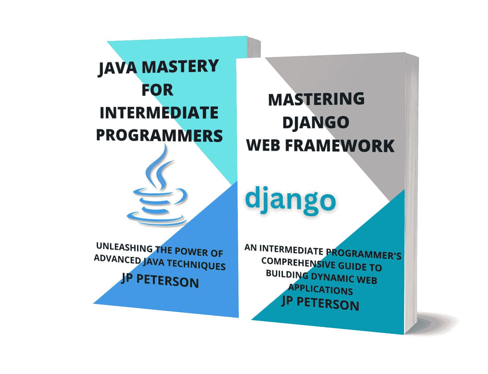

# 中级程序员精通 Django Web 框架与 Java：中级程序员构建动态 Web 应用综合指南 - 2 本合1



## 引言

欢迎阅读《精通 Django Web 框架：中级程序员构建动态 Web 应用全面指南》。在书中，我们将深入 Django 框架，探索如何构建健壮且动态的 Web 应用。无论你是想要提升技能的开发者，还是对 Django 基础熟悉的人，本书都旨在将你的专业水平提升到新的高度。

Django 是一个高级 Python Web 框架，它在遵循最佳实践的同时提供了创建复杂 Web 应用的高效方法。在本书中，我们将涵盖 Django 的各个方面，从搭建开发环境到将应用部署在生产服务器上。每一章都将提供深入的知识和实践示例，确保你不仅理解概念，还能有效地应用它们。

# 第 1 章：Django 简介

Django 是一个健壮且多功能的 Web 框架，因其简化 Web 应用开发流程的能力而广受喜爱。在本章中，我们将深入 Django 的世界，探索它的起源、核心概念和架构。在本章结束时，你将牢固掌握 Django 的基本原理以及它们如何帮助你构建动态且功能丰富的 Web 应用。

### 什么是 Django？为什么要用它？

Django 是一个高级 Python Web 框架，让开发者能够高效、轻松地创建 Web 应用。它消除了许多与 Web 开发相关的大量模板代码和重复任务，让开发者能够专注于为自己的应用程序打造独特且创新的功能。

该框架的核心格言是“为有截止日期的完美主义者设计的 Web 框架”，这概括了它的哲学：为开发者提供创建所需的工具，以便他们能够在有限的时间内创建出高质量的应用程序。无论你是资深开发者，还是编程领域的新手，Django 直观的设计和完善的文档都使其成为构建 Web 应用的理想选择。

### 模型-视图-控制器 (MVC) 架构

Django 架构的核心是模型-视图-控制器（MVC）模式，在 Django 的语境下，它通常被称为模型-视图-模板（MVT）模式。这种架构模式是构建 Web 应用的一种强大方式，因为它分离了不同的组件和职责，使得代码库更有组织且易于维护。

**Models (模型)**：Django 中的“模型”代表你的应用程序的数据结构。它定义了你的应用程序将处理的实体和关系。Django 的对象关系映射（ORM）系统允许你使用 Python 类来定义模型，并自动处理将这些模型转换为数据库表的操作。

**Views (视图)**：“视图”负责向用户展示数据。在 Django 中，视图是一个 Python 函数，它接收来自用户的请求，处理必要的数据并返回适当的响应。视图是用户体验的核心，因为决定了数据如何呈现以及如何与其进行交互。

**Templates (模板)**：“模板”层负责生成用户看到的 HTML。Django 中的模板是动态的，允许你嵌入 Python 代码来生成内容。逻辑与呈现的分离确保了你的代码保持整洁且易于维护。

### 创建一个新的 Django 项目

要开启你的 Django 之之旅，你需要创建一个新项目。Django 项目是设置、URL 配置和应用程序的集合，构成了你 Web 应用的基础。项目作为构成你应用的所有组件的容器。

当你使用 `django-admin` 命令行工具创建新项目时，Django 会生成一组结构化你项目的目录和文件。一些核心文件和目录包括：

- `settings.py`：此文件包含你项目的设置和配置。它包含了有关数据库连接、已安装应用、中间件等信息。

- `urls.py`：项目的 URL 配置在此文件中定义。它将 URL 映射到视图，确保传入的请求被引导到正确的代码。

- `wsgi.py` 和 `asgi.py`：这些文件用于将你的 Django 应用部署到不同的服务器环境，例如传统的 WSGI 服务器和现代的 ASGI 服务器。

### 理解项目结构：文件与目录

Django 的项目结构遵循一种能够促进一致性和易于导航的约定。让我们详细查看关键目录及其作用：

- `manage.py`：该脚本是一个命令行实用程序，用于简化各种任务，例如创建新应用、运行开发服务器和应用数据库迁移。

- `apps/`：你在这个目录下创建各个应用程序，这些程序构成了项目的不同功能。每个应用程序都可以有自己的模型、视图、模板和静态文件。

- `static/`：静态文件（如 CSS、JavaScript 和图像）存储在此目录中。它们直接提供给用户的浏览器，而不是由应用程序动态生成的。

- `templates/`: Django 模板存储在此目录中。模板用于动态生成 HTML，并允许你将 Python 代码无缝集成到 HTML 标记中。

### 与 Django Shell 交互

Django shell 是一个强大的工具，允许你使用 Python 代码与应用程序的数据库和模型进行交互。它是测试、调试和探索应用程序组件行为的必用工具。

要启动 Django shell，你可以使用 `python manage.py shell` 命令。进入 shell 之后，你就可以访问在项目中定义的模型和数据库操作。这使你能够执行诸如创建新数据库条目、查询现有数据以及测试模型方法等操作。

Django shell 的交互特性使其成为实验应用程序逻辑的绝佳环境，而无需创建完整的用户界面。在开发阶段，当你想要快速验证想法或排排除错时，它显得尤为有用。

### 结语

在本章中，我们开启了进入 Django 世界的旅程。我们探索了 Django 是什么、为什么它是 Web 开发的高选择，以及支持它的基础模型-视图-控制器（MVC）架构。我们学习了如何创建一个新的 Django 项目，并对项目的结构有了了解，同时也学会了如何利用 Django shell 进行测试和实验。

有了这个坚实的基础，你现在准备好进入第 2 章了，在这一章中，我们将引导你完成开发环境的搭建。这一步对于上手 Django 并释放其高效构建动态 Web 应用的潜力至关重要。

# 第 2 章：设置开发环境

在第 1 章中，我们深入了 Django 的基础概念，并对其架构有了全面的理解。在掌握了 Django 的核心原理后，是时候迈下一步了：设置你的开发环境。在本章中，我们将引导你完成配置系统以与 Django 无缝衔接的过程，确保你拥有所有所需的工具来开启精通这一强大 Web 框架的旅程。

### 安装 Python 和虚拟环境

在开始使用 Django 之前，你需要在系统中安装 Python。Django 是一个 Python Web 框架，拥有正确的 Python 版本对于确保兼容性至关重要。根据我 2021 年 9 月的知识截止，Django 兼容 Python 3.6 及更高版本。

建议使用虚拟环境来管理项目的依赖项。虚拟环境为你的 Python 项目创建隔离的运行，允许你安装特定的包和版本，而不影响系统的全局 Python 安装。这有助于防止不同项目依赖项之间的冲突。

以下是创建和激活虚拟环境的方法：

1. 打开终端或命令提示符。

2. 导航到你的项目目录。

3. 运行以下命令创建一个名为 `venv` 的虚拟环境：

```
python3 -m venv venv
```

（如有需要，将 `python3` 替换为适用于你系统的命令。）

4. 激活虚拟环境：

- 在 macOS 和 Linux 上：

```
source venv/bin/activate
```

- 在 Windows 上：

```
venv\Scripts\activate
```

### 安装 Django

设置好虚拟环境后，就可以安装 Django 了。在虚拟环境中安装 Django 可以确保框架及其依赖项与其他项目隔离开来。

要安装 Django，请遵循以下步骤：

1. 确保你的虚拟环境已激活。

2. 运行以下命令：

```
pip install django
```

此命令将从 Python 包索引 (PyPI) 下载并安装最新版本的 Django。

### 创建新的 Django 项目

现在你已经安装了 Django，是时候创建你的第一个 Django 项目了了。Django 提供了一个命令行工具 `django-admin` 来帮助你设置项目并管理开发的各个方面。

以下是创建新项目的方法：

1. 导航到你想要创建项目的目录。

2. 运行以下命令：

```
django-admin startproject projectname
```

将 `projectname` 替换为你项目所需的名称。

此命令将生成一个与项目同名的新目录，并填充必要的文件和目录。

### 运行开发服务器

Django 自带了一个开发服务器，允许你在开发过程中在本地预览应用程序。要启动开发服务器，请遵循以下步骤：

1. 导航到你的项目根目录（包含 `manage.py` 的目录）。

2. 运行以下命令：

```
python manage.py runserver
```

此命令将启动开发服务器，你将看到服务器正在运行的输出。

默认情况下，服务器监听端口 `8000`。你可以通过打开浏览器并导航到 `http://127.0.0.1:8000/` 来访问你的应用程序。

### 管理面板

Django 提供了一个强大且可自定义的管理面板，允许你管理应用程序的数据并执行各种管理任务。要访问管理面板，你需要创建一个超级用户（superuser）账号。

按照以下步骤创建超级用户：

1. 在终端中，导航到你的项目根目录。

2. 运行以下命令：

```
python manage.py createsuperuser
```

按照提示输入超级用户账号的用户名、邮箱和密码。

创建超级用户后，你可以运行开发服务器并导航到 `http://127.0.0.1:8000/admin/` 来访问管理面板。使用你为超级用户提供的凭据登录。

### 结论

在本章中，你学习了如何为使用 Django 设置开发环境。你安装了 Python、创建了虚拟环境、安装了 Django 并创建了第一个 Django 项目。此外，你还探索了内置开发服务器和强大的管理面板。

环境就绪后，你现在准备好开始构建动态应用程序了。在第 3 章中，我们将深入探讨 Django 的核心组件并探索模型和数据库的概念。

# 第 3 章：理解模型和数据库

在之前的章节中，我们为精通 Django Web 框架的旅程奠定了基础。我们探索了 Django 的概念并学习了如何设置开发环境。现在，在第 3 章中，我们将深入探讨 Django 最关键的方面之一：模型和数据库。模型是应用程序的骨干，定义了数据的结构以及与数据库的交互。在本章结束时，你将理解模型、数据库以及它们如何协作创建动态 Web 应用。

### 什么是模型？

在 Django 中，模型是定义应用程序数据结构的 Python 类。每个模型类对应数据库中的一张表，而模型的实例代表表中的行。模型定义了数据的字段或属性，还可以包含执行数据操作的方法。

让我们通过一个实际的例子来说说明模型的概念。假设你正在构建一个博客应用程序。每篇博客文章都有标题、内容、发布日期和作者。在 Django 中，你会定义一个名为 `Post` 的模型来表示博客文章：

```python
from django.db import models

class Post(models.Model):
    title = models.CharField(max_length=200)
    content = models.TextField()
    pub_date = models.DateTimeField('date published')
    author = models.CharField(max_length=100)

    def __str__(self):
        return self.title
```

在这个示例中，`Post` 模型包含标题、内容、发布日期和作者的字段。`models.CharField` 和 `models.TextField` 是定义每个字段可以包含的数据类型的字段类型。`models.DateTimeField` 代表一个日期和时间字段。

### 定义模型和字段

Django 提供了各种字段类型以适应不同类型的数据。一些常见的字段类型包括：

- `CharField`: 用于标题和名称等短文本字段。

- `TextField`: 适用于博客内容等较长文本字段的理想选择。

- `DateField` 和 `DateTimeField`: 用于日期和日期时间。

- `IntegerField` 和 `FloatField`: 用于数值。

- `BooleanField`: 表示真（True）或假（False）值。

- `ForeignKey` 和 `ManyToManyField`: 用于定义模型之间的关系。

让我们扩展示例来演示这些字段类型的使用。假设每篇博客文章可以有多个标签。我们可以为标签创建一个单独的模型，并与 `Post` 模型建立多多的关系：

```python
class Tag(models.Model):
    name = models.CharField(max_length=50)

    def __str__(self):
        return self.name

class Post(models.Model):
    title = models.CharField(max_length=200)
    content = models.TextField()
    pub_date = models.DateTimeField('date published')
    author = models.CharField(max_length=100)
    tags = models.ManyToManyField(Tag)

    def __str__(self):
        return self.title
```

在这个示例中，`Tag` 模型有一个字段 `name`，它代表标签的名称。`Post` 模型现在包含一个 `tags` 字段，定义为 `ManyToManyField`，它建立了文章和标签之间的多多的关系。

### 数据库迁移

定义好模型后，下一步是根据这些模型创建数据库表。这个过程被称为数据库迁移。Django 提供了一个命令行工具 `manage.py` 来管理数据库迁移。

要为你的模型创建初始迁移，请运行以下命令：

```
python manage.py makemigrations
```

此命令生成迁移文件，其中包含必要的 SQL 语句，根据你的模型创建或修改数据库表。

要应用这些迁移并更新你的数据库架构，请运行：

```
python manage.py migrate
```

### 执行数据库操作

一旦定义了模型并应用了迁移，就可以使用 Django 强大的对象关系映射（ORM）系统来执行各种数据库操作，而无需编写原始 SQL 查询。让我们使用我们的 `Post` 和 `Tag` 模型探索一些常见的数据库操作。

1. **创建对象**：

```python
## 创建新标签
new_tag = Tag.objects.create(name='Technology')
## 创建一个带有标签的新文章
new_post = Post.objects.create(
    title='Django Rocks',
    content='An introduction to Django web framework.',
    pub_date='2023-08-01',
    author='John Doe'
)
new_post.tags.add(new_tag)
```

2. **查询对象**：

```python
### 获取所有文章
all_posts = Post.objects.all()
## 按特定作者获取文章
author_posts = Post.objects.filter(author='John Doe')
## 获取特定日期之后发布的文章
recent_posts = Post.objects.filter(pub_date__gt='2023-07-01')
```

3. **更新对象**：

```python
## 更新文章的标题
post = Post.objects.get(pk=1)
post.title = 'New Title'
post.save()
```

4. **删除对象**：

```python
## 删除标签
tag_to_delete = Tag.objects.get(name='Technology')
tag_to_delete.delete()
## 删除文章
post_to_delete = Post.objects.get(pk=1)
post_to_delete.delete()
```

### 结论

在本章中，我们探索了 Django 中模型和数据库的基础概念。我们学习了模型如何定义你的数据结构，以及如何使用不同的字段类型来表示各种数据类型。你已经看到了如何建立模型之间的关系，并如何使用 Django 的 ORM 系统执行基本的数据库操作。

通过对模型和数据库的深入理解，你已经准备好设计并创建驱动你的动态 Web 应用的数据结构。在第 4 章中，我们将重点转向处理视图（Views）和模板（Templates），继续我们通精 Django Web 框架的之旅。

# 第 4 章：使用视图和模板

在之前的章节中，我们探索了 Django 的基础方面，包括设置开发环境以及理解模型和数据库。现在，在我们继续通精 Django Web 框架的过程中，我们将深入研究两个核心组件：视图（Views）和模板（Templates）。视图处理应用程序的逻辑，而模板定义了表示层。到本章结束，你将清晰地理解如何使用视图和模板创建动态网页，并看到一些实践示例。

### 理解视图

Django 中的视图负责处理传入的请求、执行任何必要的逻辑并返回适当的响应。将视图视为用户交互与数据之间的桥梁。视图以函数或类的形式实现，它们可以与模型、数据库和其他组件进行交互。让我们从一个简单的示例开始。假设你想创建一个显示文章列表的视图：


```python
from django.shortcuts import render
from .models import Post

def post_list(request):
    posts = Post.objects.all()
    return render(request, 'blog/post_list.html', {'posts': posts})
```

## 使用模板

Django 中的模板定义了你 HTML 页面的结构和布局。它们允许你将表示层与应用程序逻辑分离，从而保持代码库的整洁有序。Django 使用它自己的模板语言，包括标签（tags）、过滤器（filters）和变量（variables），来动态生成 HTML 内容。

让我们创建一个简单的模板来显示文章列表：

```html
<!-- blog/post_list.html -->
<!DOCTYPE html>
<html>
<head>
    <title>Blog Posts</title>
</head>
<body>
    <h1>Blog Posts</h1>
    <ul>
    
    <li><a href="#">{{ post.title }}</a></li>
    
    </ul>
</body>
</html>
```

在这些模板中，我们使用 `` 模板标签来遍历文章列表。`{{ post.title }}` 语法用于插入每篇文章的 `title` 字段的值。

## 将 URL 映射到视图

为了让你的视图可以访问，你需要将它们映射到特定的 URL。这是通过在应用程序的 `urls.py` 文件中定义 URL 模式来实现的。让我们创建一个映射 `post_list` 视图的 URL 模式：

```python
# blog/urls.py
from django.urls import path
from . import views

urlpatterns = [
    path('posts/', views.post_list, name='post_list'),
]
```

在这个示例中，URL 模式 `'posts/'` 映射到 `post_list` 视图。现在，当用户在浏览器访问 `/posts/` 时，将执行 `post_list` 视图并渲染相应的模板。

## 为视图添加上下文

视图还可以向模板传递上下文数据。上下文数据包括模板显示动态内容的变量。让我们增强 `post_list` 视图以包含额外的上下文，例如每篇文章的评论数：

```python
def post_list(request):
    posts = Post.objects.all()
    return render(request, 'blog/post_list.html', {'posts': posts})
```

在模板中，你可以使用 `{{ variable_name }}` 语法来访问上下文变量：

```html
<!-- blog/post_list.html -->
<!-- ... -->

<li>
<a href="#">{{ post.title }}</a>
<span>({{ post.comments.count }} comments)</span>
</li>

<!-- ... -->
```

## 处理动态 URL

Django 允许你从 URL 中捕获动态值并将其传递给视图（views）。这通常用于为单个项目创建详情视图。假设你想创建一个视图来显示特定博客文章的详情：

```python
# blog/urls.py
urlpatterns = [
    path('posts/', views.post_list, name='post_list'),
    path('posts/<int:post_id>/', views.post_detail, name='post_detail'),
]
```

在这个示例中，URL 模式 `'posts/<int:post_id>/'` 会从 URL 中捕获一个整数值，并将其传递给 `post_detail` 视图。

## 结论

在本章中，我们探索了 Django 中处理视图和模板的关键概念。视图充当应用程序逻辑控制器，负责处理请求和处理数据，而模板则定义了网页的呈现方式。我们学习了如何创建与模型和数据库交互的视图，以及如何使用 Django 的模板语言创建模板。

掌握了这些知识，你已经准备好在 Django 中构建动态且交互式的网页了。在第 5 章，我们将更深入地探索 Web 开发的世界，研究 URL 路由和导航，允许你为 Web 应用程序创建一个连贯且用户友好的浏览体验。

# 第 5 章：管理 URL 和路由

在我们继续 Django 之之旅时，我们来了 Web 开发的一个关键方面：URL 的管理和路由。在本章中，我们将探索 URL 是如何映射到视图的，以及如何为你的 Web 创建一个连贯且组织良好的导航结构。通过理解 URL 模式和路由机制，你将能够为用户创建友好且直观的网页体验。

## 理解 URL 模式

Django 中的 URL 模式在将 URL 映射到视图方面起着至关重要的作用。URL 模式是一个正则表达式，定义了特定的 URL 结构并与视图关联。Django 的 URL 路由系统允许你从 URL 中捕获值并将其作为参数传递给视图。

让我们考虑一个示例，即我们为单个博客文章创建 URL。在你的 `urls.py` 文件中，你可以定义这样的 URL 模式：

```python
# blog/urls.py
from django.urls import path
from . import views

urlpatterns = [
    path('posts/', views.post_list, name='post_list'),
    path('posts/<int:post_id>/', views.post_detail, name='post_detail'),
]
```

在这个示例中，URL 模式 `'posts/<int:post_id>/'` 从 URL 中捕获一个整数值，并将其作为 `post_id` 参数传递给 `post_detail` 视图。

## 使用链接导航

定义 URL 模式后，你可以在模板中创建链接以便在不同视图之间导航。`` 模板标签允许你使用 URL 模式的名称生成 URL。

```html
<!-- blog/post_list.html -->
<!-- ... -->
<a href="">阅读更多</a>
<!-- ... -->
```

在这个示例中，由 `` 标签生成的链接将用户引导至 `post_detail` 视图，并传递相应的 `post_id` 作为参数。

## 使用命名空间组织 URL

随着项目的增长，你可能会有多个应用程序，每个应用都有自己的套 URL 模式。为了避免命名冲突，Django 允许你定义 URL 命名空间（namespaces）。命名空间是将相关的 URL 模式分组到公共前缀下的方法。

假设你的项目同时包含一个博客应用程序和一个新闻应用程序。你可以为这些应用定义命名空间，以保持它们的 URL 模式分离：

```python
# blog/urls.py
app_name = 'blog'
urlpatterns = [
    path('posts/', views.post_list, name='post_list'),
    path('posts/<int:post_id>/', views.post_detail, name='post_detail'),
]
```

```python
# news/urls.py
app_name = 'news'
urlpatterns = [
    path('articles/', views.article_list, name='article_list'),
    path('articles/<int:article_id>/', views.article_detail, name='article_detail'),
]
```

定义命名空间后，你可以通过指定命名空间和视图名来使用 `` 模板标签：

```html
<!-- blog/post_list.html -->
<a href="">阅读更多</a>
```

## 添加默认 URL

在 Django 中，你可以设置一个默认 URL 来处理用户访问应用程序基础 URL 的情况。这通常被称为应用的的“首页”。要实现这一点，创建一个捕获空字符串的 URL 模式：

```python
# blog/urls.py
urlpatterns = [
    path('', views.home, name='home'),
    path('posts/', views.post_list, name='post_list'),
    path('posts/<int:post_id>/', views.post_detail, name='post_detail'),
]
```

现在，当用户访问应用程序的基础 URL 时，`home` 视图将执行。

## 处理查询参数

查询参数（Query parameters）是一种向视图 传递额外信息的方式。它们附加在 URL 的问号 `?` 之后，并以 `key=value` 键对的形式格式化，通过 `符号 分隔。

例如，假设你想为博客创建一个搜索功能。你可以将搜索传递给 `post_list` 视图：

```html
<!-- home.html -->
<form action="" method="get">
    <input type="text" name="search" placeholder="搜索...">
    <button type="submit">搜索</button>
</form>
```

在 `post_list` 视图中，你可以通过 `request.GET` 字典访问查询参数：

```python
def post_list(request):
    search_query = request.GET.get('search', '')
    # ... 执行搜索 ...
    return render(request, 'post_list.html', {'posts': posts})
```

## 结论

在本章中，我们深入了 Django 中 URL 管理和路由的世界。我们探索了如何使用 URL 模式映射 URL 到视图，如何在模板中创建动态链接，以及如何使用命名空间组织 URL。我们还学习如何设置默认 URL 以及处理查询参数以增强用户体验。

# 第 6 章：构建用户认证系统

在我们继续探索 Django 框架的过程中，我们到达了一个至关重要的主题：构建用户认证系统。用户认证对于保护 Web 应用程序以及为用户提供个性化体验至关重要。在本章中，我们将深入研究 Django 用户认证，涵盖注册、登录、注销等。通过本章，你将全面了解如何在 Django 应用程序中实现安全的用户认证。

## 理解用户认证

用户认证是验证用户身份并授予访问应用程序特定部分的权限。在 Django 中，用户认证是通过内置的 `User` 模型和 `auth` 模块实现的。

开始之前，请确保在 `settings.py` 文件的 `INSTALLED_APPS` 列表中包含了 `django.contrib.auth`：

```python
# settings.py
INSTALLED_APPS = [
    # ...
    'django.contrib.auth',
    # ...
]
```

## 用户注册

为了允许用户注册你的应用程序，你可以创建一个注册表单来收集他们所需的用户名、电子邮件和密码。Django 提供了 `UserCreationForm`，它可以开箱即用处理用户注册。

让我们创建一个注册视图和模板：

```python
# accounts/views.py

from django.contrib.auth.forms import UserCreationForm
from django.contrib.auth import login
from django.shortcuts import render, redirect

def register(request):
    if request.method == 'POST':
        form = UserCreationForm(request.POST)
        if form.is_valid():
            user = form.save()
            login(request, user)
            return redirect('home')  # 重定向到首页
    else:
        form = UserCreationForm()
    return render(request, 'registration/register.html', {'form': form})
```

```html
<!-- registration/register.html -->
<h2>Register</h2>
<form method="post">
    
    {{ form.as_p }}
    <button type="submit">Register</button>
</form>
```

在本例中，`register` 视图使用 `UserCreationForm` 处理用户注册。如果表单有效，用户将登录并被重定向到首页。

## 用户登录

用户登录是用户认证的另一个关键方面。Django 通过内置的 `LoginView` 简化了这一过程：

```python
# accounts/urls.py
from django.contrib.auth.views import LoginView
urlpatterns = [
    path('login/', LoginView.as_view(), name='login'),
    # ...
]
```

在你的模板中，你可以使用 `` 模板标签创建一个登录链接：

```html
<!-- base.html -->

    <a href="">Logout</a>

    <a href="">Login</a>

```

## 用户注销

为了让用户从你的应用程序登录，Django 提供了 `LogoutView`：

```python
# accounts/urls.py
from django.contrib.auth.views import LogoutView
urlpatterns = [
    # ...
    path('logout/', LogoutView.as_view(), name='logout'),
]
```

同样，你也可以使用 `` 模板标签创建一个注销链接：

```html
<!-- base.html -->

    <a href="">Logout</a>

    <a href="">Login</a>

```

## 视图保护

为了根据用户是否通过来限制某些视图的访问，你可以使用 `@login_required` 装饰器：

```python
# accounts/views.py
from django.contrib.auth.decorators import login_required

@login_required
def profile(request):
    # ... 视图逻辑 ...
```

通过此装饰器，只有经过认证的用户才能访问 `profile` 视图。

## 用户配置

用户配置通常包含关于用户的额外信息。为了实现这一点，你可以创建一个 `Profile` 模型，它与内置的 `User` 模型具有一对一的关系：

```python
# accounts/models.py
from django.db import models
from django.contrib.auth.models import User

class Profile(models.Model):
    user = models.OneToOneField(User, on_delete=models.CASCADE)
    # ... 额外字段 ...
    def __str__(self):
        return self.user.username
```

## 自定义认证

Django 的认证系统是高度可定制的。你可以扩展内置的 `User` 模型，或者为独特的需求创建你自己的认证后端。此外，你还可以使用如 `django-allauth` 或 `django-registration` 等第三方包来简化用户认证工作流。

## 总结

在本章中，我们探索了 Django 中用户认证的世界。我们涵盖了用户注册、登录、注销、视图保护以及创建用户配置。你现在拥有了在 Django 应用中实现安全用户认证的知识，确保用户数据受到保护并且用户体验得到个性化。


对用户认证有了坚实的理解后，你完全能够创建以用户为中心的 Web 应用程序。在第 7 章中，我们将深入 Web 开发的另一个关键方面：处理表单和用户输入。请关注如何在你的 Django 应用中有效地创建和处理表单。

# 第 7 章：处理表单和用户输入

当我们继续 Django 之旅时，我们进入了 Web 开发的一个关键方面：处理表单和用户输入。表单在从用户收集数据方面起着核心作用，例如用户注册、搜索查询、反馈提交等。在本章中，我们将探索如何在你的 Django 应用中有效地创建、验证和处理表单。在本章结束时，你将具备构建交互式且用户友好表单的知识，从而增强用户体验。

## 了解 Django 表单

Django 提供了一个强大的表单处理框架，简化了创建和处理表单的过程。Django 中的表单由 Python 类表示，该类定义了表单的字段和验证规则。此类类可以生成用于模板显示的 HTML 表单，并处理数据验证和提交。

要开始使用表单，你需要从 `django` 导入 `forms` 模块：

```python
from django import forms
```

## 创建简单表单

让我们从为用户反馈创建一个简单的表单开始。假设我们希望用户提供姓名、电子邮件和反馈信息。这里是你可以如何使用 `forms` 模块来定义表单的：

```python
class FeedbackForm(forms.Form):
    name = forms.CharField(label='Your Name', max_length=100)
    email = forms.EmailField(label='Your Email')
    message = forms.CharField(label='Feedback', widget=forms.Textarea)
```

在本例中，`FeedbackForm` 类定义了字段：`name`、`email` 和 `message`。每个字段对应特定的表单类型，如 `CharField` 和 `EmailField`。`widget=Textarea` 参数用于指定 `message` 字段应以文本区域显示。

## 在模板中显示表单

要在模板中显示表单，你可以使用 `` 模板标签包含跨站请求伪造（CSRF）令牌，并使用 `{{ form }}` 模板变量渲染字段：

```html
<!-- feedback.html -->
<h2>Provide Feedback</h2>
<form method="post">
    
    {{ form.as_p }}
    <button type="submit">Submit</button>
</form>
```

在本例中，`{{ form.as_p }}` 标签将段落形式渲染表单字段。

## 验证表单数据

Django 会自动处理数据。当用户提交表单时，Django 的表单系统会根据定义的字段和验证规则对数据进行验证。

在视图中，你可以创建一个表单实例并将请求数据传递给它进行验证：

```python
def feedback(request):
    if request.method == 'POST':
        form = FeedbackForm(request.POST)
        if form.is_valid():
            # 处理有效数据
    else:
        form = FeedbackForm()
    return render(request, 'feedback.html', {'form': form})
```

如果表单数据有效，`form.is_valid()` 方法返回 `True`，你可以继续处理。

## 自定义表单验证

你可以通过定义以 `clean_` 开头的方法为你的表单类添加自定义验证方法。这些方法可以执行特定字段验证或跨字段验证：

```python
class FeedbackForm(forms.Form):
    # ...
    def clean_email(self):
        email = self.cleaned_data.get('email')
        if not email.endswith('@example.com'):
            raise forms.ValidationError('仅允许使用 example.com 的邮箱地址。')
        return email

    def clean(self):
        cleaned_data = super().clean()
        name = cleaned_data.get('name')
        message = cleaned_data.get('message')
        if name and message and name.lower() in message.lower():
            raise forms.ValidationError("姓名不应出现在反馈信息中。")
```

## 使用模型表单

Django 提供了一种名为 `ModelForm` 的特殊表单类型，它可以根据模型的字段自动生成表单字段。模型表单简化了模型实例（如用户配置或博客文章）创建表单的过程。

假设你有一个 `Profile` 模型：

```python
class Profile(models.Model):
    user = models.OneToOneField(User, on_delete=models.CASCADE)
    bio = models.TextField()
    # ...
```

你可以使用 `ModelForm` 来创建一个 `ProfileForm`：

```python
class ProfileForm(forms.ModelForm):
    class Meta:
        model = Profile
        fields = ['bio']
```

## 结论

在本章中，我们探索了 Django 中处理表单和用户输入的世界。我们学习了如何使用 `forms` 模块创建表单、如何在模板中显示表单以及如何验证表单数据。此外，我们还学习了如何添加自定义验证方法，并使用模型表单来简化模型实例创建表单的过程。

凭借本章学到的知识，你现在已经完全准备好构建交互式且用户友好的表单，从而增强你 Django 应用程序中的用户体验。

# 第 8 章：利用 Django 内置管理面板

在 Web 开发世界中，管理应用程序的后端与创建前端同样重要。Django 作为一个强大且全面的 Web 框架，提供了一个内置的管理面板（admin panel），简化了应用程序数据和后端操作的管理。在本章中，我们将探索 Django 的管理面板，学习如何设置它、自定义它以及如何使用它高效地管理你的应用程序数据。在本章结束时，你将能够利用 Django 管理面板的能力来简化你的管理任务。

## 了解 Django 管理面板

Django 管理面板是一个功能丰富的界面，允许授权用户在无需编写自定义视图（views）或模板的情况下管理应用程序数据。它提供了一个易于使用的界面，用于在你的应用程序数据库中执行添加、编辑和删除记录等常用操作。

## 设置管理面板

要开始使用 Django 管理面板，你需要为你的应用程序启用它。这是通过将你的模型注册到管理面板来实现的。假设你的博客应用程序中有一个 `Post` 模型。要为它启用管理面板，请在你的应用程序目录中创建一个 `admin.py` 文件并注册该模型：

```python
# blog/admin.py
from django.contrib import admin
from .models import Post

admin.site.register(Post)
```

一旦注册了模型，你就可以通过在应用程序 URL 末尾添加 `/admin/` 来访问管理面板。

## 登录管理面板

要访问管理面板，你需要以超级用户（superuser）身份登录。超级用户是具有管理员权限的用户。你可以使用 `createsuperuser` 命令创建超级用户：

```bash
python manage.py createsuperuser
```

系统将提示你输入超级用户的用户名、电子邮件和密码。

## 自定义管理面板

Django 管理面板具有高度的可定制性，允许你对其进行定制以匹配应用程序的需求。你可以自定义管理面板内的外观、行为和可用操作。

### 自定义显示

你可以通过定义模型管理类（model admin class）来自定义模型在管理面板中的显示方式。该类继承自 `admin.ModelAdmin`，并包含各种选项：

```python
# blog/admin.py
from django.contrib import admin
from .models import Post

class PostAdmin(admin.ModelAdmin):
    list_display = ('title', 'pub_date', 'author')
    list_filter = ('pub_date', 'author')
    search_fields = ('title', 'content')
    admin.site.register(Post, PostAdmin)
```

在这个示例中，`PostAdmin` 类自定义了 `Post` 模型在管理面板中的显示。`list_display` 选项决定在列表视图显示的字段，`list_filter` 选项为指定字段添加过滤器，而 `search_fields` 选项为这些字段启用搜索栏。

### 添加关系和内联编辑

如果你的模型具有某种关系（例如 `ForeignKey` 或 `ManyToManyField`），你可以使用内联编辑（inline editing）直接在父记录的编辑页面中管理相关记录。例如，如果一个 `Post` 有多条 `Comment` 记录，你可以为注释开启内联编辑：

```python
# blog/admin.py
class CommentInline(admin.TabularInline):
    model = Comment

class PostAdmin(admin.ModelAdmin):
    inlines = [CommentInline]
```

通过此配置，你可以在管理面板中编辑帖子时直接内联编辑注释。

### 覆盖管理模板

你还可以通过覆盖其模板来自定义管理面板的外观。通过在应用程序的 `templates/admin` 目录中创建同名的模板，你可以完全改变管理界面的外观和感受。

## 结论

在本章中，我们探索了 Django 内置管理面板的强大功能。我们学习了如何设置管理面板、创建超级用户以及自定义其行为和外观。管理面板是管理应用程序后端操作的宝贵工具，使得处理数据和执行管理任务变得更加容易。

通过对 Django 管理面板的深入理解，你现在已经具备了高效管理和维护应用程序数据的能力。在下一章中，我们将深入探讨将第三方库和 API 集成到 Django 项目中的主题，允许你扩展应用程序的功能并利用外部服务。

# 第 9 章：为你的 Web 应用实现 API

在当今互联的数字环境中，Web 应用通常需要与其他服务交互、共享数据并为其功能提供编程访问。这就是应用程序编程接口（API）发挥作用的地方。API 允许你的 Web 应用与外部服务、其他应用程序或应用程序的不同部分进行通信。在本章中，我们将深入 API 的世界，学习如何在 Django 项目中实现它们，并探索创建和消费 API 的实际示例。在本章结束时，你将准备好构建并集成扩展 Web 应用能力的 API。

## 了解 API

API 是一套规则和协议，允许不同的软件应用程序之间进行通信。API 定义了请求和响应的结构以及可以交换的数据。API 允许开发者在现有系统之上构建新功能、创建集成并对其特定功能提供访问。

## 使用 Django REST Framework 构建 API

Django 提供了一个用于构建 API 的强大框架称为 Django REST Framework (DRF)。DRF 通过提供序列化、身份验证、权限等工具简化了创建 API 的过程。要开始使用 DRF，你需要通过 pip 安装：

```bash
pip install djangorestframework
```

## 创建简单的 API

让我们开始为博客应用程序中的 `Post` 模型创建一个简单的 API。首先，你需要定义一个序列化器（serializer），它决定了如何将你的模型数据转换为 API 响应的 JSON 格式：

```python
# blog/serializers.py
from rest_framework import serializers
from .models import Post

class PostSerializer(serializers.ModelSerializer):
    class Meta:
        model = Post
        fields = ['title', 'content', 'pub_date']
```

接下来，你将创建一个序列化器为 API 提供数据的视图（view）：

```python
# blog/views.py

from rest_framework import generics
from .models import Post
from .serializers import PostSerializer

class PostList(generics.ListCreateAPIView):
    queryset = Post.objects.all()
    serializer_class = PostSerializer

class PostDetail(generics.RetrieveUpdateDestroyAPIView):
    queryset = Post.objects.all()
    serializer_class = PostSerializer
```

在这个示例中，`PostList` 视图提供文章列表，而 `PostDetail` 视图提供特定文章的详情。

## 配置 API URL

为了让 API 端点可以被访问，你需要配置 URL。在你的应用程序目录下创建一个 `urls.py` 文件：

```python
# blog/urls.py

from django.urls import path
from .views import PostList, PostDetail
urlpatterns = [
    path('api/posts/', PostList.as_view(), name='post-list'),
    path('api/posts/<int:pk>/', PostDetail.as_view(), name='post-detail'),
]
```

在这个示例中，URL `'api/posts/'` 和 `'api/posts/<int:pk>/'` 分别映射到 `PostList` 和 `PostDetail` 视图。

## 调用 API

要调用你构建的 API，你可以使用如 `curl`、Postman 等工具，甚至构建客户端应用程序。让我们看看如何使用 `curl` 与 API 交互：

```bash
### 获取所有文章
curl http://localhost:8000/api/posts/

### 获取特定文章（将 <post_id> 替换为实际的 ID）
curl http://localhost:8000/api/posts/<post_id>/
```

## API 认证与授权

DRF 提供了认证和授权选项来保护你的 API。你可以限制仅允许经过身份验证的用户访问，提供基于令牌的认证，并实现更复杂的授权规则。

## API 版本控制

随着你的应用程序的演进，你可能需要在不破坏现有客户端的情况下更改你的 API。DRF 允许你通过在 URL 中添加版本号来对 API 进行版本管理。

## 总结

在本章中，我们深入研究了 API 的世界，并探索了如何在 Django 项目中使用 Django REST Framework 实现它们。我们学习了如何创建序列化器、构建视图、配置 URL 以及调用 API。此外，我们还接触了认证、授权和版本控制。

通过本章获得的知识，你已经完全有能力创建扩展你的应用程序功能的 API，允许与外部服务集成，并促进应用程序不同部分之间的通信。API 是一个强大的工具，可以将你的 Web 应用程序的交互性和操作性提升到新的水平。

# 第 10 章：使用 JavaScript 和前端框架增强用户体验

在快速发展的 Web 开发领域，提供无缝且交互式的用户体验已变得至关重要。虽然 Django 擅长处理后端逻辑，但集成 JavaScript 和前端框架可以显著提升用户界面和整体满意度。在本章中，我们将探索 JavaScript 与 Django 的集成，并深入研究使用前端框架创建动态且吸引人的 Web 应用程序。在本章结束，你将能够利用 JavaScript 和现代前端框架的力量来增强用户体验。

## 在 Django 中集成 JavaScript

JavaScript 是一种运行在浏览器中的编程语言，能够在网页上实现动态交互和实时更新。Django 提供了灵活性，可以将 JavaScript 无缝地集成到你的应用程序中。

### 在模板中添加 JavaScript


你可以使用`<script>`标签直接在 HTML 模板中包含 JavaScript 代码。例如，假设你想在点击按钮时显示一个警框：

```html
<!-- templates/my_template.html -->
<button id="my-button">点击我</button>
<script>
document.getElementById('my-button').addEventListener('click', function() {
    alert('按钮被点击了!');
});
</script>
```

在这个示例中，JavaScript 代码监听按钮点击事件并显示警框。

## 使用 AJAX 进行异步请求

AJAX（异步 JavaScript 和 XML）允许你向服务器发送异步请求，而无需刷新页面。这对于在不中断用户体验的情况下获取数据或执行操作特别有用。

要发送 AJAX 请求，你可以使用`XMLHttpRequest`对象或更现代的方法，如`fetch` API。例如，让我们创建一个简单的 AJAX 请求来从服务器获取数据：

```javascript
// templates/my_template.html
<button id="fetch-button">获取数据</button>
<div id="data-container"></div>
<script>
document.getElementById('fetch-button').addEventListener('click', function() {
    fetch('/api/data/')
    .then(response => response.json())
    .then(data => {
        document.getElementById('data-container').innerText = data.message;
    });
});
</script>
```

在这个示例中，JavaScript 代码从`/api/data/` URL 获取数据并显示在`data-container`中。

## 使用前端框架

前端框架提供了工具和库来构建动态且响应式的用户界面。两个流行的前端框架是 React 和 Vue.js。让我们探索如何将这些框架集成到你的 Django 应用程序中。

### 集成 React

React 是用于构建用户界面的 JavaScript 库。要将 React 与 Django 集成，你可以使用`django-react`库或直接在模板中包含 React 组件。

1. 安装`django-react`：

```bash
pip install django-react
```

2. 在你的前端目录下创建一个 React 组件：

```jsx
// frontend/src/components/Greeting.js
import React from 'react';
const Greeting = () => {
    return <h1>来自 React 的问候！</h1>;
};
export default Greeting;
```

3. 在你的 Django 模板中包含 React 组件：

```html
<!-- templates/my_template.html -->
<div id="react-root"></div>


<script>
import React from 'react';
import ReactDOM from 'react-dom';
import Greeting from '../../frontend/src/components/Greeting';
ReactDOM.render(<Greeting />, document.getElementById('react-root'));
</script>
```

### 集成 Vue.js

Vue.js 是另一个以简单易于集成而闻名的前端框架。

1. 在 Django 模板中包含 Vue.js：

```html
<!-- templates/my_template.html -->
<div id="vue-root">
    {{ message }}
</div>
<script src="https://cdn.jsdelivr.net/npm/vue@2.6.14/dist/vue.min.js"></script>
<script>
new Vue({
    el: '#vue-root',
    data: {
        message: '来自 Vue 的问候!'
    }
});
</script>
```

## 使用框架增强用户体验

前端框架提供了多种功能来增强用户体验，包括组件化架构、状态管理、路由等。这些功能允许你构建复杂的交互式界面。

例如，使用 React，你可以创建可复用的组件并管理组件状态以创建动态 UI 元素。Vue.js 提供了类似的组件化方法，且语法简单直观。

## 总结

在本章中，我们探索了 JavaScript 和前端框架与 Django 的集成以增强用户体验。我们涵盖了如何在模板中添加 JavaScript、使用 AJAX 进行异步请求以及集成 React 和 Vue.js 等前端框架。这些技术允许你创建动态、响应且交互式的 Web 应用程序，为用户提供无缝且迷人的体验。

通过将后端的 Django 与前端的 JavaScript 框架相结合，你将有能力创建满足现代用户需求的 Web 应用程序。

构建健壮且可靠的 Web 应用程序需要彻底的测试和有效的调试。Django 提供了一个全面的测试框架，允许你为应用程序的功能编写测试，并确保它们按预期运行。在本章中，我们将探索 Django 中测试和调试的重要性，学习如何编写测试，并发现用于有效调试的工具和技术。在本章结束时，你将有能力创建可靠且无差错的 Django 应用程序。

## 测试的重要性

测试是软件开发过程中至关重要的一步，它有助于识别并防止错误，确保功能正确，并随着时间的推移维护代码质量。Django 的测试框架让为应用程序的功能编写测试变得更加容易，确保它们按预期工作。

## 编写单元测试

Django 的测试框架支持多种类型的测试，包括单元测试、功能测试和集成测试。单元测试侧重于隔离测试单个组件或函数。让我们创建一个简单的单元测试来测试模型的行为：

```python
# blog/tests.py

from django.test import TestCase

from .models import Post

class PostModelTest(TestCase):

    def test_create_post(self):
        post = Post.objects.create(title='Test Post', content='This is a test post.')
        self.assertEqual(post.title, 'Test Post')
        self.assertEqual(post.content, 'This is a test post.')
```

在这个示例中，`PostModelTest`类继承自`TestCase`并定义了一个测试方法，创建一个`Post`实例并断言其标题和内容与预期值匹配。

### 运行测试

要运行测试，请使用`python manage.py test`命令：

```bash
python manage.py test
```

Django 的测试框架将发现并运行应用程序中所有的测试。

## 编写功能测试

功能测试模拟用户交互并测试应用程序的整体行为。可以使用`LiveServerTestCase`类编写它们。让我们创建一个功能测试来检查首页是否显示正确：

```python
# blog/tests.py

from django.test import LiveServerTestCase
from selenium import webdriver

class HomePageTest(LiveServerTestCase):

    def setUp(self):
        self.browser = webdriver.Chrome()

    def tearDown(self):
        self.browser.quit()

    def test_homepage_displays_correctly(self):
        self.browser.get(self.live_server_url)
        self.assertIn('Welcome to My Blog', self.browser.title)
```

在这个示例中，`HomePageTest`类继承自`LiveServerTestCase`并使用 Selenium 与浏览器进行交互，检查首页标题是否包含预期文本。

## 调试技术

尽管经过了仔细的测试，错误仍然可能进入你的代码中。有效的调试对于识别和修复这些问题至关重要。

### 打印语句

最简单的调试技术之一是使用打印语句来显示代码中特定点的变量值。这可以帮助你理解程序的流程，并识别可能出现问题的地方。

### 使用 Django Debug Toolbar

Django Debug Toolbar 是一个强大的工具，用于开发期间检查应用程序的性能和行为。它提供了有关 SQL 查询、模板渲染、缓存使用等更多信息。要使用 Debug Toolbar，你需要安装它并将其包含在`INSTALLED_APPS`中：

```bash
pip install django-debug-toolbar
```

```python
# settings.py

INSTALLED_APPS = [
    # ...
    'debug_toolbar',
    # ...
]
```

### 使用断点

现代 IDE 和代码编辑器允许你在代码中设置断点。当代码执行到达断点时，它会暂停，你可以检查变量、逐步执行代码并分析程序的状态。

### 结论

在本章中，我们探索了 Django 应用程序中测试和调试的重要性。我们学习了如何使用 Django 的测试框架编写单元测试和功能测试。此外，我们讨论了调试技术，如打印语句、Django Debug Toolbar 和断点。

通过将测试整合到你的工作流中并使用有效的调试技术，你将能够创建健壮且可靠的 Django 应用程序，提供流畅的用户体验并减少错误的发生。测试和调试是每个开发者都应该掌握的必备技能，以确保项目的成功。在你的工具箱中拥有这些技能，你已经准备好应对软件开发的挑战并构建高质量的 Web 应用程序。

# 第 12 章：优化性能与扩展性

随着你的 Django 应用程序的增长，优化性能和确保可扩展性对于提供流畅的用户体验和适应增加的流量至关重要。在本章中，我们将探索优化 Django 应用程序性能并确保它们能够处理增长的需求的策略和技术。在本章结束时，你将能够创建高效且可扩展的 Web 应用程序，它们可以在真实的数字领域中蓬勃发展。

## 理解性能优化

性能优化涉及提高应用程序的速度、响应和效率。优化性能可以带来更快的加载时间、减少服务器负载以及提高用户满意度。

## 数据库优化

数据库通常是 Web 应用程序中的常见瓶颈。Django 提供了工具来优化数据库查询并减少它们对性能的影响。

### 使用`select_related`和`prefetch_related`

在查询相关对象时，使用`select_related`和`prefetch_related`方法来减少数据库查询次数。这些方法在单个查询中获取相关数据，而不是为每个相关对象执行单独查询。

```python
# 优化前
posts = Post.objects.all()
for post in posts:
    comments = post.comments.all()
```

```python
# 优化后
posts = Post.objects.select_related('comments').all()
for post in posts:
    comments = post.comments.all()
```

### 使用索引

索引通过允许数据库快速定位数据来帮助数据库查询。识别经常用于过滤或连接的字段并为这些字段添加索引。

```python
# models.py
class Post(models.Model):
    title = models.CharField(max_length=200, db_index=True)
```

## 缓存

缓存涉及将频繁使用的数据存储在内存中，以减少对昂贵计算或数据库查询的需求。

### 对昂贵操作使用缓存

缓存昂贵操作的结果，例如复杂的计算或 API 调用。Django 提供了一个支持多种缓存后端的缓存框架。

```python
from django.core.cache import cache

def get_expensive_data():
    data = cache.get('expensive_data')
    if data is None:
        data = perform_expensive_operation()
        cache.set('expensive_data', data, timeout=3600)
    return data
```

## 负载均衡与扩展性

随着你的应用程序流行，你需要确保它可以处理增加的流量。负载均衡和扩展性策略对于分配负载和防止瓶颈至关重要。

### 使用负载均衡器

负载均衡器将传入流量分配到多个服务器，防止单个服务器过载。流行的负载均衡解决方案包括`Nginx`和`HAProxy`。

### 水平扩展

水平扩展涉及增加更多服务器来处理增加的流量。现代云提供者提供了工具，可以根据需要轻松地水平扩展你的应用程序。

### 垂直扩展

垂直扩展涉及升级你的现有服务器以处理更多流量。这可能意味着增加单个服务器的 CPU、内存或存储资源。

性能分析和监控工具可以帮助你识别性能瓶颈、跟踪资源使用情况并做出明智的优化决策。

## Django Debug Toolbar

我们之前提到的`Debug Toolbar`还可以提供开发期间关于数据库查询、模板渲染和缓存使用的深层洞察。

## 使用性能分析工具

Python 提供了多种性能分析工具，如`cProfile`和`line_profiler`，它们允许你测量函数的执行时间并识别出需要优化的代码区域。

### 结论

在本章中，我们探索了优化 Django 应用性能和可扩展性的策略。我们学习了数据库优化技术、缓存、负载均衡、扩展性策略以及性能分析工具。

通过实施这些策略和技术，你将能够创建出高性能、响应迅速且可扩展的 Django 应用，以应对日益增长的用户需求。性能优化和扩展性是一个持续的过程，需要不断的监控、测试和改进。凭借对这些原则的坚实基础，你将准备好构建提供卓越用户体验的 Web 应用程序，即使在它们不断增长和演进也是如此。

# 第 13 章：部署 Django 应用

部署 Django 应用意味着让互联网上的用户能够访问。这是开发过程中的关键一步，因为它允许你的应用程序接触目标受众并提供真实世界的价值。在本章中，我们将引导你完成部署 Django 应用的过程，涵盖各种部署选项、最佳实践和注意事项。在本章结束时，你将拥有所需的知识和信心成功地将你的 Django 应用部署到生产环境。

## 选择部署平台

在深入部署流程之前，你需要选择一个适合你的应用需求和你的专业水平的部署平台。以下是一些常见选项：

### 自托管服务器

这种方法涉及自己设置和配置服务器。虽然它提供了最大的控制权，但要求你对服务器管理、安全和维护有良好的理解。

### 平台服务 (PaaS)

如`Heroku`、`Google App Engine`和`Microsoft Azure`等 PaaS 供应商通过为你管理基础设施和扩展性来简化部署。如果你希望专注于应用程序代码而不是服务器管理，它们是理想的选择。

### 虚拟专用服务器 (VPS)

如`DigitalOcean`和`Linode`等 VPS 供应商提供的虚拟服务器提供了比`PaaS`更多的控制，但需要你自己管理服务器的配置和维护。

## 准备部署

在部署应用之前，有几个重要的步骤应该采取，以确保部署过程顺利：

### 1. 更新依赖项

确保你的应用依赖项是最新的。更新你的`requirements.txt`文件以包含包的最新版本。

### 2. 配置设置

更新你的 Django 设置以使用生产就绪配置。将`DEBUG`标记设置为`False`，配置你的数据库设置，并安全地设置应用程序的密钥（secret key）。

### 3. 收集静态文件

运行`collectstatic`命令将所有静态文件收集到一个目录中。对于在生产环境中提供 CSS 和 JavaScript 文件等静态资源至关重要。

```bash
python manage.py collectstatic
```

### 4. 设置数据库

配置生产数据库。根据你的部署平台，你可能需要配置数据库服务器并更新你的`settings.py`以使用相应的数据库设置。

## 使用 Heroku 部署

作为一个示例，让我们探索如何使用流行的`PaaS`供应商`Heroku`部署 Django 应用。

### 1. 安装 Heroku CLI


安装 Heroku 命令行界面（CLI）来管理你的 Heroku 应用：

```bash
npm install -g heroku
```

## 2. 创建 Heroku 应用

创建一个新的 Heroku 应用：

```bash
heroku create your-app-name
```

## 3. 配置 Git

将 Heroku 添加为应用的远程仓库：

```bash
heroku git:remote -a your-app-name
```

## 4. 部署你的应用

将你的应用部署到 Heroku：

```bash
git push heroku master
```

## 5. 扩展你的应用

扩展你的应用以确保它能够处理流量：

```bash
heroku ps:scale web=1
```

## 6. 迁移数据库

在 Heroku 服务器上运行迁移以设置你的数据库：

```bash
heroku run python manage.py migrate
```

你的 Django 应用现在应该已经在 Heroku 上启动运行了！

## 处理静态文件和媒体文件

在部署 Django 应用时，你需要考虑如何提供静态文件和媒体文件。

### 提供静态文件

对于提供静态文件，你可以使用 `Amazon S3` 服务或 `Cloudflare` 等 CDN。更新 `settings.py` 以配置静态文件存储：

```python
# settings.py
STATIC_URL = '/static/'
STATICFILES_STORAGE = 'storages.backends.s3boto3.S3Boto3Storage'
AWS_STORAGE_BUCKET_NAME = 'your-bucket-name'
```

### 处理媒体文件

对于媒体文件（用户上传的文件），你可以遵循类似的方法。更新 `settings.py` 以配置媒体文件存储：

```python
# settings.py
MEDIA_URL = '/media/'
DEFAULT_FILE_STORAGE = 'storages.backends.s3boto3.S3Boto3Storage'
AWS_STORAGE_BUCKET_NAME = 'your-bucket-name'
```

## 安全你的部署

在部署 Web 应用时，安全是重中之重。你可以采取以下步骤来保护你的 Django 部署：

### 使用 HTTPS

启用 HTTPS 以加密用户与你的应用程序之间传输的数据。许多部署平台提供了设置 SSL 证书的简单方法。

### 设置防火墙

配置防火墙仅允许信任的 IP 地址访问你的服务器。

### 保持依赖项更新

定期更新应用的依赖项以修复安全漏洞。

### 实现安全头部

在应用程序的响应中添加安全头部，以防止常见的漏洞。

### 结论

部署 Django 应用是让你的 Web 应用被用户访问的关键步骤。通过选择合适的部署平台、为部署应用做好准备并遵循最佳实践，你可以确保成功且安全的部署过程。无论你选择像 `Heroku` 这样的 PaaS 供应商还是管理自己的服务器，从本章获得的知识将使你能够充满心地将你的 Django 应用部署到生产环境。

# 第 14 章：Django 安全最佳实践

安全在 Web 开发中是至关重要的，Django 提供了一个带有内置安全功能的健壮框架。在本章中，我们将探索 Django 中的基本安全最佳实践，以保护你的应用程序免受漏洞和攻击。我们将涵盖身份验证、授权、输入验证、针对常见攻击的防护等。通过实施这些实践，你将创建一个优先考虑用户数据安全并对安全威胁保持强大防御的 Web 应用。

## 身份验证与授权

### 使用强密码策略

Django 提供了内置的身份验证机制，包括强制强密码策略的能力。配置密码最小长度、要求的字符类型和密码过期。

```python
# settings.py
AUTH_PASSWORD_VALIDATORS = [
    {'NAME': 'django.contrib.auth.password_validation.MinimumLengthValidator'},
    {'NAME': 'django.contrib.auth.password_validation.CommonPasswordValidator'},
    {'NAME': 'django.contrib.auth.password_validation.NumericPasswordValidator'},
]
```

### 实现双重身份验证（2FA）

为了增加额外的安全性，请考虑实现双因素身份验证（2FA）。Django 提供了如 `django-two-factor-auth` 等第三方包，可以轻松地为应用程序添加 2FA。

### 输入验证与数据清洗

#### 验证用户输入

始终对用户输入进行验证和清洗，以防止 SQL 注入和跨站脚本（XSS）攻击。使用 Django 的表单验证，并考虑使用 `django-crispy-forms` 等包来创建更符合用户的表单。

#### 使用 Django 的 ORM 进行查询

Django 的对象关系映射（ORM）在构建查询时会自动转义用户提供的数据，有助于防止 SQL 注入。

```python
# 有漏洞的代码
raw_query = "SELECT * FROM users WHERE username = '%s'" % (username)
users = User.objects.raw(raw_query)
```

```python
# 使用 Django ORM 的安全代码
users = User.objects.filter(username=username)
```

### 防止常见攻击

#### 跨站脚本（XSS）保护

Django 通过转义模板中的变量提供自动的 XSS 保护。要禁用转义，请使用 `safe` 过滤器：

```html
{{ user_input|safe }}
```

#### 跨站请求伪造（CSRF）保护

Django 默认包含 CSRF 保护。确保在表单中使用 `` 来包含 CSRF 令牌。

#### 点击劫持保护

通过 `X-Frame-Options` 标头防止点击劫持攻击。Django 提供了一个设置来设置标头值：

```python
# settings.py
X_FRAME_OPTIONS = 'DENY'
```

### 安全文件上传

当允许用户上传文件时，要采取措施防止恶意文件被上传和执行。

#### 使用白名单限制允许的文件类型

使用白名单指定允许上传的文件类型。避免使用黑名单，因为它们可能会漏掉新的或冷门的类型。

```python
# settings.py
ALLOWED_UPLOAD_EXTENSIONS = ['.jpg', '.png']
```

### 保持密钥安全

#### 使用环境变量

敏感信息（如 API 密钥、密码和密钥）应该存储在环境变量中，而不是硬编码在设置文件中。使用如 `python-decouple` 等工具管理环境变量。

```python
# settings.py
from decouple import config
SECRET_KEY = config('SECRET_KEY')
```

#### 保护密钥

切勿在公共仓库中共享您的密钥。使用 `.gitignore` 将敏感文件和密钥排除在版本控制之外。

### 定期安全更新

保持您的 Django 版本和包更新到最新，以确保您正在使用最新的安全补丁和修复。定期查看安全公告并据此更新您的应用程序。

### 结论

安全性是 Web 应用程序开发的关键方面，Django 为开发者提供了一系列工具和最佳实践来构建安全的应用程序。通过遵循这些安全实践（包括强身份验证和授权机制、输入验证、防止常见攻击的保护、安全文件上传以及密钥的正确处理），您将创建一个优先考虑用户数据安全并对安全威胁保持强大防御的 Web 应用程序。请记住，安全性是一个持续的过程，了解最新的安全实践和漏洞对于随着推推保持应用程序安全至关重要。

# 第 15 章：构建一个真实的 Django Web 应用程序

在最后一章中，我们将通过从头到尾构建一个真实的 Django Web 应用程序，将所学知识付诸实践。我们将创建一个简化版的博客平台，允许用户编写、发布和管理自己的博客文章。在整个章节中，我们将演示如何应用之前章节中涵盖的概念来创建一个功能完整的 Web 应用程序。

## 项目设置

### 创建 Django 项目

首先创建一个新的 Django 项目，并在项目内创建一个新的应用：

```bash
django-admin startproject blog_platform
cd blog_platform
python manage.py startapp blog
```

### 定义模型

为我们的博客应用定义模型，表示博客文章及其作者：

```python
# blog/models.py
from django.db import models

class Author(models.Model):
    name = models.CharField(max_length=100)
    bio = models.TextField()

class Post(models.Model):
    title = models.CharField(max_length=200)
    content = models.TextField()
    pub_date = models.DateTimeField(auto_now_add=True)
    author = models.ForeignKey(Author, on_delete=models.CASCADE)
```

### 设置数据库

创建并应用迁移以设置数据库架构：

```bash
python manage.py makemigrations
python manage.py migrate
```

## 创建视图和模板

### 编写视图

定义视图以显示博客文章列表和单个文章详情：

```python
# blog/views.py
from django.shortcuts import render, get_object_or_404
from .models import Post

def post_list(request):
    posts = Post.objects.all()
    return render(request, 'blog/post_list.html', {'posts': posts})

def post_detail(request, post_id):
    post = get_object_or_404(Post, pk=post_id)
    return render(request, 'blog/post_detail.html', {'post': post})
```

### 创建模板

创建 HTML 模板来渲染文章列表和单个文章详情：

```html
<!-- blog/templates/blog/post_list.html -->


<h1>博客文章</h1>
<ul>

<li><a href="">{{ post.title }}</a></li>

</ul>

```

```html
<!-- blog/templates/blog/post_detail.html -->


<h1>{{ post.title }}</h1>
<p>{{ post.content }}</p>
<p>发布日期：{{ post.pub_date }}</p>
<p>作者：{{ post.author.name }}</p>

```

## 实现用户认证

### 用户注册与登录

集成 Django 内置的身份验证系统用于注册和登录：

```python
# blog/views.py
from django.auth.forms import UserCreationForm
from django.auth import login
from django.shortcuts import render, redirect

def register(request):
    if request.method == 'POST':
        form = UserCreationForm(request.POST)
        if form.is_valid():
            user = form.save()
            login(request, user)
            return redirect('post_list')
    else:
        form = UserCreationForm()
    return render(request, 'registration/register.html', {'form': form})
```

### 创建注册模板

创建一个注册模板来显示注册表单：

```html
<!-- registration/register.html -->


<h1>注册</h1>
<form method="post">

{{ form.as_p }}
<button type="submit">注册</button>
</form>

```

## 最后完善

### 创建 URL

在 `urls.py` 文件中定义视图的 URL：

```python
# blog/urls.py
from django.urls import path
from . import views

urlpatterns = [
    path('', views.post_list, name='post_list'),
    path('post/<int:post_id>/', views.post_detail, name='post_detail'),
    path('register/', views.register, name='register'),
]
```

### 将 URL 加入项目

在项目的 `urls.py` 中包含应用的 URL：

```python
# blog_platform/urls.py
from django.contrib import admin
from django.urls import include, path

urlpatterns = [
    path('admin/', admin.site.urls),
    path('', include('blog.urls')),
]
```

## 运行开发服务器

启动开发服务器：

```bash
python manage.py runserver
```

在浏览器中访问 `http://127.0.0.1:8000/` 查看博客文章列表。您可以通过访问 `http://127.0.0.1:8000/register/` 注册新用户，然后登录以创建、查看和管理您的博客文章。

恭喜！你已经成功构建了一个真实的 Django Web 应用程序，允许用户编写和管理他们的博客文章。通过遵循本章概述的步骤，你应用了之前章节中学到的知识来创建一个功能完备且交互式的 Web 应用程序。

请记住，这只是你通过 Django 所能成就的开始。扩展和增强你的应用程序有无数种可能，例如添加注释、改进用户界面、实现用户配置文件以及集成第三方 API。随着你继续你的 Django 之旅，你将拥有坚实的基础来创建更复杂、功能更丰富的 Web 应用程序。

## 感谢

《面向中级程序员的 Java 精通》

释放高级 Java 技术的威力

JP PETERSON

## 书籍简介

欢迎阅读《面向中级程序员的 Java 精通：释放高级 Python 技术的威力》。这本书专为具有一定 Java 经验并准备好将其技能提升到新水平的程序员量身定制。无论你是学生、专业开发人员，还是对扩展编程视野感兴趣的人，这本全面的指南都将赋予你所需的知识和专业技能，帮助掌握 Java 并利用高级 Python 技术的威力。

Java 是一种多功能且广泛使用的编程语言，以其健壮性、平台无关性以及大量的库和框架而闻名。同时，Python 以其简单易用而闻名，使其成为开发人员的流行选择。在本书中，我们将弥越这两种强大语言之间的差距，探索 Java 开发人员如何利用 Python 中使用的高级技术来创建高效、优雅且创新的解决方案。

在整本书中，我们将采用易于理解的语言并提供实践示例，以确保良好的学习体验。每一章都经过精心设计，以深入探讨特定主题，在之前知识的基础上逐步向复杂的概念迈进。

因此，让我们一起开启这段学习之旅吧，释放 Java 的潜力并拥抱 Python 的精华。读完本书后，你将拥有应对现实项目的技能和信心，成为一名 Java 大师。

# 第 1 章：Java 和 Python 简介

## 第 1：了解 Java


# Java 与 Python 概述

Java 由 James Gosling 及其在 Sun Microsystems 的团队（现由 Oracle 公司所有）创建，于 20 世纪 90 年代中期出现并作为一种多功能且健壮的编程语言迅速流行。Java 最定义性的特征之一是它的平台无关性，允许开发者编写一次代码并在任何支持 Java 的平台上运行，实现了“编写一次，随处运行”（WORA）。这种可移植性通过 Java 虚拟机（`JVM`）实现，它将 Java 字节码翻译成特定底层平台的机器码。

## Java 的起源与演变

Java 的开发始于 1991 年，当时命名为“Oak”，旨在用于消费电子设备。然而，随着世界维网的兴起，重点转向了使用 Java 开发 Web Applet。1995 年，该语言作为 Java 1.0 正式发布，其跨平台开发的潜力显而易见。

多年来，Java 经历了多次更新，每隔几年发布一次大版本。这些更新带来了新功能、性能改进和安全增强，确保了 Java 在快速演进的技术格局中保持相关性和可靠性。

## Java 的特性与优势

Java 的流行归功于其强大的特性和优势：

1. **面向对象：**Java 遵循面向对象编程（`OOP`）范式，允许开发者创建模块化和可重用的代码组件。
2. **简单易学：**Java 的语法简洁易于理解，使其成为初学者和经验丰富的开发人员都极佳的语言。
3. **平台无关性：**如前所述，Java 的“编写一次，随处运行”能力使其在跨平台开发中极具吸引力。
4. **健壮且安全：**Java 强大的内存管理、异常处理和安全机制有助于创建可靠安全的应用程序。
5. **庞大的标准库：**Java 提供了广泛的标准库，包含用于各种任务的内置类和 API，减少了开发者从零开始编写代码的需求。
6. **多线程支持：**Java 对多线程有原生支持，允许开发者创建充分利用现代硬件全部潜力的并发应用程序。
7. **开源生态系统：**Java 拥有蓬勃发展的开源社区，贡献了庞大的库、框架和工具生态系统。

# 第 2 节：介绍 Python

Python 由 Guido van Rossum 开发并于 1991 年首次发布，是一种解释型高级编程语言，以其简单性和可读性著称。Python 的设计哲学强调代码的可读性和生产力，这导致它在 Web 开发、数据科学、人工智能和自动化等多个领域被广泛采用。

## Python 之禅

Python 的设计原则封装在“Python 之禅”中，这是一组指导 Python 开发人员的格言。一些关键原则包括：可读性很重要、简单优于复杂，以及应该只有一种——最好是唯一一种——明显的方法来处理事情。

## Python 的特性与优势

Python 的流行因其卓越的特性和优势而飞速增长：

1. **可读性与表达力：**Python 的语法简洁且类似于自然语言，易于快速阅读和编写代码。
2. **动态类型：**Python 是动态类型的，允许变量持有任何数据类型的值，这使得代码更加灵活和简洁。
3. **丰富的标准库：**Python 的标准库非常详尽，提供了广泛的模块和包来执行各种任务，而无需外部依赖。
4. **广泛的库和框架：**可用的大量第三方库和框架进一步增强了 Python 的多功能性，满足了不同的应用需求。
5. **集成与扩展性：**Python 可以与 `C` 和 `C++` 等其他语言无缝集成，允许开发者利用现有代码和库。
6. **社区与支持：**Python 拥有充满活力的社区，该社区积极为开发做出贡献，确保了持续的改进和支持。

# 第 3 节：桥接 Java 和 Python

现在我们已经对 Java 和 Python 有了简要概述，你可能会想这些看似不同的语言如何相互补充。事实是，Java 和 Python 都有它们自己的优缺点，使得它们适用于特定的用例。Java 的性能和平台无关性在构建健壮的后端系统和企业级应用程序方面非常有价值，而 Python 的易用性和广泛的库则受到快速原型、数据分析和脚本任务的青睐。

在书中，我们将探索如何利用高级 Python 技术的威力并将其应用于 Java 编程世界中。这种融合不仅将增强你对这两种语言的理解，还将扩展你应对更广泛项目和挑战的能力。

在随后的章节中，我们将深入探讨特定的 Java 主题，并探索如何使用 Python 优雅且简洁的代码来实现类似的功能。我们将涵盖面向对象编程、数据处理、并发编程、Web 开发等许多领域。在这段旅程结束时，你将拥有一个结合了 Java 和 Python 优点的全面工具包，使你成为一个更熟练、多才的程序员。

# 第 2 章：理解面向对象编程

面向对象编程（`OOP`）是一种以“对象”为核心的编程范式——对象是封装了数据和行为的自包含单元。OOP 允许开发者对现实世界的实体和关系进行建模，使其成为现代软件开发中强大且应用广泛的方法在本章中，我们将探索 OOP 的基本原理，包括类、对象、继承、多态和封装，并结合 Java 和 Python 的实际示例进行说明。

## 第 1 节：类与对象

### 类

类是创建对象的蓝图或模板。它定义了从其实例化的对象的结构和行为。在 Java 中，使用 `class` 关键字定义类，而在 Python 中，也使用 `class` 关键字。让我们考虑一个在 Java 和 Python 中表示 `Car` 的类的简单示例：

#### Java 示例

```java
public class Car {
    // 字段或实例变量
    String make;
    String model;
    int year;

    // 构造函数
    public Car(String make, String model, int year) {
        this.make = make;
        this.model = model;
        this.year = year;
    }

    // 显示汽车信息的方法
    public void displayInfo() {
        System.out.println("Make: " + make);
        System.out.println("Model: " + model);
        System.out.println("Year: " + year);
    }
}
```

#### Python 示例

```python
class Car:
    # 构造函数
    def __init__(self, make, model, year):
        self.make = make
        self.model = model
        self.year = year

    # 显示汽车信息的方法
    def display_info(self):
        print("Make:", self.make)
        print("Model:", self.model)
        print("Year:", self.year)
```

### 对象

对象是类的实例，代表一个特定的实体。它有自己的状态（数据）和行为（方法）。在 Java 和 Python 中创建对象都使用构造函数。

#### Java 示例

```java
Car car1 = new Car("Toyota", "Camry", 2022);
```

#### Python 示例

```python
car1 = Car("Toyota", "Camry", 2022)
```

## 第 2 节：继承

继承是 OOP 的核心原则，允许一个类（称为 `subclass` 或派生类）从另一个类（称为 `superclass` 或基类）继承属性和方法。这促进了代码的重用并加强了类之间的层次关系。让我们考虑在 Java 和 Python 中使用基类 `Animal` 以及两个子类 `Dog` 和 `Cat` 继承的示例：

#### Java 示例

```java
class Animal {
    void makeSound() {
        System.out.println("Animal makes a sound");
    }
}

class Dog extends Animal {
    @Override
    void makeSound() {
        System.out.println("Dog barks");
    }
}

class Cat extends Animal {
    @Override
    void makeSound() {
        System.out.println("Cat meows");
    }
}
```

#### Python 示例

```python
class Animal:
    def make_sound(self):
        print("Animal makes a sound")

class Dog(Animal):
    def make_sound(self):
        print("Dog barks")

class Cat(Animal):
    def make_sound(self):
        print("Cat meows")
```

## 第 3 节：多态

多态允许不同类的对象被视为共同超类的对象。它使得一个接口可以表示不同类型的实体，为代码提供了灵活性和可扩展性。在上面的示例中，`Dog` 和 `Cat` 类都继承自 `Animal` 类。这意味着我们可以将 `Dog` 和 `Cat` 的对象视为 `Animal` 类的对象。

#### Java 示例

```java
public class Main {
    public static void main(String[] args) {
        Animal animal1 = new Dog();
        Animal animal2 = new Cat();
        animal1.makeSound(); // 输出: Dog barks
        animal2.makeSound(); // 输出: Cat meows
    }
}
```

#### Python 示例

```python
# Python 中的多态
animals = [Dog(), Cat()]
for animal in animals:
    animal.make_sound()
# 输出:
# Dog barks
# Cat meows
```

## 第 4 节：封装

封装是隐藏类的内部实现细节并通过方法（getter 和 setter）提供类功能访问权限的原则。这确保了数据安全，并防止了对类状态的未经授权访问。在第一节的汽车示例中，我们可以使用 getter 和 setter 方法封装字段。

#### Java 示例

```java
public class Car {
    private String make;
    private String model;
    private int year;

    public String getMake() {
        return make;
    }

    public void setMake(String make) {
        this.make = make;
    }

    // 其他方法
}
```

#### Python 示例

```python
class Car:
    def __init__(self, make, model, year):
        self._make = make
        self._model = model
        self._year = year

    @property
    def make(self):
        return self._make

    @make.setter
    def make(self, value):
        self._make = value

    # 其他方法
```

---

本章提供了面向对象编程中类、对象、继承、多态和封装的全面介绍。

# 第 3 章：数据类型与变量

在任何编程语言中，数据类型和变量都至关重要。在本章中，我们将探索 Java 和 Python 中的数据类型和变量。

## 第 1 节：数据类型

### Java 中的数据类型

Java 是一种静态类型语言，这意味着在使用变量之前必须显式声明其数据类型。Java 提供了多种内置数据类型来表示各种数据：

1. **基本数据类型：**这些是单个值的基本数据类型。Java 有八种基本类型：
   - `byte`：8 位符号整数（-128 到 127）
   - `short`：16 位符号整数（-32768 到 32767）
   - `int`：32 位符号整数（-2³¹ 到 2³¹-1）
   - `long`：64 位符号整数（-2⁶³ 到 2⁶³-1）
   - `float`：32 位浮点数（约 3.4028237E+38）
   - `double`：64 位浮点数（约 1.7976931348623157E+308）
   - `char`：16 位 Unicode 字符（0 到 65535）
   - `boolean`：表示真假
2. **引用数据类型：**这些数据类型引用类或接口的对象。示例包括字符串、数组和自定义类。

### Python 中的数据类型

Python 是一种动态类型语言，这意味着变量的数据类型根据赋值的值自动确定。Python 提供了以下内置类型：

1. **数值类型：**包括 `int`（无限精度的整数）、`float`（浮点数）和 `complex`（复数）。
2. **序列类型：**表示值的序列。主要的序列类型有 `list`（列表）、`tuple`（元组）和 `range`（范围）。
3. **文本类型：**`str` 数据类型表示字符串。
4. **布尔类型：**`bool` 数据类型表示真值 `True` 和 `False`。
5. **集合类型：**包括 `set`（无序元素集合）和 `frozenset`（不可变集合）。
6. **映射类型：**`dict` 数据类型表示键值对。

## 第 2 部分：变量

### 在 Java 中声明变量

在 Java 中，变量在使用之前必须显式地声明数据类型。声明变量的语法如下：

```java
<dataType> <variableName>;
```

以下是在 Java 中声明和初始化变量的示例：

```java
public class Main {
    public static void main(String[] args) {
        int age;
        double salary;
        char grade;
        age = 30;
        salary = 45000.50;
        grade = 'A';
        System.out.println("Age: " + age);
        System.out.println("Salary: " + salary);
        System.out.println("Grade: " + grade);
    }
}
```

### 在 Python 中声明变量

在 Python 中，你可以直接给变量赋值，而无需显式地声明其数据类型。Python 会根据赋值的值推断数据类型。以下是在 Python 中声明和初始化变量的示例：

```python
age = 30
salary = 45000.50
grade = 'A'
print("Age:", age)
print("Salary:", salary)
print("Grade:", grade)
```

### 变量命名规则

Java 和 Python 对变量命名都有特定的规则：

- 变量名可以包含字母（a-z, A-Z）、数字（0-9）和下划线（`_`）。
- 变量名的第一个字符不能是数字。
- 变量名是大小写敏感的，这意味着 `age`、`Age` 和 `AGE` 被视为不同的变量。

## 第 3 部分：类型转换与强制类型转换

### Java 中的类型转换

Java 为兼容的数据类型提供了自动类型转换，这被称为宽转换。例如，将 `int` 转换为 `double`：

```java
int number = 10;
double result = number; // 从 int 到 double 的自动转换
```

然而，当从较大的数据类型转换为较小的数据类型时，需要显式的类型转换（即强制类型转换），以避免数据丢失：

```java
double largeNumber = 1234.56;
int smallNumber = (int) largeNumber; // 从 double 到 int 的强制转换
```

### Python 中的类型转换

Python 也执行自动类型转换，但它被称为“类型强制转换（type coercion）”。例如，将 `int` 转换为 `float`：

```python
number = 10
result = float(number) # 从 int 到 float 的自动转换
```

同样，在不同数据类型之间转换时会使用显式的类型转换：

```python
large_number = 1234.56
small_number = int(large_number) # 从 float 到 int 的强制转换
```

## 第 4 部分：类型检查与类型转换函数

### Java 中的类型检查

在 Java 中，你可以使用 `instanceof` 运算符检查变量的数据类型。如果变量是指定数据类型的实例，则返回 `true`，否则返回 `false`。


```java
public class Main {
    public static void main(String[] args) {
        int number = 10;
        double salary = 45000.50;
        System.out.println(number instanceof Integer); // 输出: true
        System.out.println(salary instanceof Double); // 输出: true
    }
}
```

### Python 中的类型检查

Python 提供 `type()` 函数来检查变量的数据类型：

```python
number = 10
salary = 45000.50
print(type(number)) # 输出: <class 'int'>
print(type(salary)) # 输出: <class 'float'>
```

### Python 中的类型转换函数

Python 提供了内置函数用于在不同数据类型之间显式转换变量：

- `int()`：将值转换为整数。
- `float()`：将值转换为浮点数。
- `str()`：将值转换为字符串。
- `bool()`：将值转换为布尔。

## 第 5 部分：数据类型与变量示例

### 示例 1：处理数值数据类型

**Java 示例：**

```java
int num1 = 10;
int num2 = 20;
int sum = num1 + num2;
System.out.println("Sum: " + sum);
```

**Python 示例：**

```python
num1 = 10
num2 = 20
sum = num1 + num2
print("Sum:", sum)
```

### 示例 2：处理字符串

**Java 示例：**

```java
String firstName = "John";
String lastName = "Doe";
String fullName = firstName + " " + lastName;
System.out.println("Full Name: " + fullName);
```

**Python 示例：**

```python
first_name = "John"
last_name = "Doe"
full_name = first_name + " " + last_name
print("Full Name:", full_name)
```

### 示例 3：使用布尔变量

**Java 示例：**

```java
boolean isRaining = true;
if (isRaining) {
    System.out.println("Take an umbrella.");
} else {
    System.out.println("Enjoy the sunshine!");
}
```

**Python 示例：**

```python
is_raining = True
if is_raining:
    print("Take an umbrella.")
else:
    print("Enjoy the sunshine!")
```

---

本章涵盖了 Java 和 Python 中数据类型和变量的核心概念。数据类型能够表示各种数据。

# 第 4 部分：控制流

## 1 节：条件语句

### if-else 语句

Java 使用 `if-else` 语句进行分支。如果条件为真，则执行第一个代码块，否则执行 `else` 块。

**Java 示例：**

```java
int age = 20;
if (age >= 18) {
    System.out.println("Adult");
} else {
    System.out.println("Minor");
}
```

**Python 示例：**

```python
age = 20
if age >= 18:
    print("Adult")
else:
    print("Minor")
```

### else if 语句

当有多个条件需要检查时，Java 和 Python 都使用 `else if`。

**Java 示例：**

```java
int score = 85;
if (score >= 90) {
    System.out.println("A");
} else if (score >= 80) {
    System.out.println("B");
} else {
    System.out.println("C");
}
```

**Python 示例：**

```python
score = 85
if score >= 90:
    print("A")
elif score >= 80:
    print("B")
else:
    print("C")
```

## 2 节：switch 语句（仅限 Java）

Java 提供了 `switch` 语句，根据表达式的值执行多个分支。

**Java 示例：**

```java
int day = 2;
String dayName;
switch (day) {
    case 1:
        dayName = "Sunday";
        break;
    case 2:
        dayName = "Monday";
        break;
    default:
        dayName = "Unknown";
        break;
}
System.out.println("Day: " + dayName);
```

## 3 节：循环

### for 循环

**Java 示例：**

```java
for (int i = 1; i <= 5; i++) {
    System.out.println("Iteration: " + i);
}
```

**Python 示例：**

```python
for i in range(1, 6):
    print("Iteration:", i)
```

### while 循环

**Java 示例：**

```java
int i = 1;
while (i <= 5) {
    System.out.println("Iteration: " + i);
    i++;
}
```

**Python 示例：**

```python
i = 1
while i <= 5:
    print("Iteration:", i)
    i += 1
```

## 第 4 节：带有 break 和 continue 的控制流

### break 语句

**Java 示例：**

```java
for (int i = 1; i <= 10; i++) {
    if (i == 6) {
        break;
    }
    System.out.println("Iteration: " + i);
}
```

**Python 示例：**

```python
for i in range(1, 11):
    if i == 6:
        break
    print("Iteration:", i)
```

### Continue Statement

**Java 示例：**

```java
for (int i = 1; i <= 5; i++) {
    if (i == 3) {
        continue;
    }
    System.out.println("Iteration: " + i);
}
```

**Python 示例：**

```python
for i in range(1, 6):
    if i == 3:
        continue
    print("Iteration:", i)
```

---

本章涵盖了 Java 和 Python 中的控制流和决策结构。条件语句（如 `if-else` 和 `switch`（仅限 Java））允许程序员根据根据条件的求值结果做出决策。循环（如 `for` 和 `while`）促进了代码块的重复。此外，`break` 和 `continue` 语句对循环内的执行流提供了控制。

通过掌握这些控制流构建结构，你将获得创建灵活且高效程序的能力，能够动态地响应不同的场景。

# 第 5 章：函数与方法

函数和方法是编程中至重要的构建组件，允许开发者将复杂任务分解为更小、易于管理的代码。它们促进了代码的可重用性、模块化和组织，使开发过程更加高效且可维护。在本章中，我们将探索 Java 和 Python 中的函数和方法，并结合实际示例来说它们的用法。

## 第 1 节：Python 中的函数

### 函数声明与调用

在 Python 中，函数使用 `def` 关键字定义，后紧跟函数名和一对包含可选参数的括号。函数块是缩进的，`return` 语句指定了从函数返回的值。

**Python 示例：**

```python
def greet(name):
    return "Hello, " + name + "!"

message = greet("John")
print(message) # 输出: Hello, John!
```

### 默认参数

Python 函数可以有默认参数值，当调用者没有为该参数提供特定参数时，就会使用这些值。

**Python 示例：**

```python
def greet(name="Guest"):
    return "Hello, " + name + "!"

message1 = greet("John")
message2 = greet()
print(message1) # 输出: Hello, John!
print(message2) # 输出: Hello, Guest!
```

### 可变参数

Python 函数可以使用 `*args` 和 `**kwargs` 语法接受可数量的参数。

**Python 示例：**

```python
def sum_values(*args):
    total = 0
    for num in args:
        total += num
    return total

result = sum_values(1, 2, 3, 4, 5)
print(result) # 输出: 15
```

## 第 2 节：Java 中的函数

### 方法声明与调用

在 Java 中，函数被称为方法，并定义在类内部。方法声明包括访问修饰符、返回类型、方法名和一对包含可选参数的括号。方法块被包含在大括号中。

**Java 示例：**

```java
public class MathUtils {
    public static int add(int a, int b) {
        return a + b;
    }
    public static void main(String[] args) {
        int result = add(10, 20);
        System.out.println(result); // 输出: 30
    }
}
```

### 方法重载

Java 支持方法重载，允许在同一个类中存在方法相同但参数列表不同的方法。

**Java 示例：**

```java
public class MathUtils {
    public static int add(int a, int b) {
        return a + b;
    }
    public static double add(double a, double b) {
        return a + b;
    }
    public static void main(String[] args) {
        int result1 = add(10, 20);
        double result2 = add(2.5, 3.5);
        System.out.println(result1); // 输出: 30
        System.out.println(result2); // 输出: 6.0
    }
}
```

## 第 3 节：递归函数

Python 和 Java 都支持递归函数，即函数在执行过程中调用其自己。

**Python 示例：**

```python
def factorial(n):
    if n == 0:
        return 1
    else:
        return n * factorial(n - 1)

result = factorial(5)
print(result) # 输出: 120
```

**Java 示例：**

```java
public class MathUtils {
    public static int factorial(int n) {
        if (n == 0) {
            return 1;
        } else {
            return n * factorial(n - 1);
        }
    }
    public static void main(String[] args) {
        int result = factorial(5);
        System.out.println(result); // 输出: 120
    }
}
```

## 第 4 节：Lambda 函数（仅限 Python）

Python 支持 lambda 函数，即使用 `lambda` 关键字定义的匿名函数。

**Python 示例：**

```python
add = lambda a, b: a + b
result = add(10, 20)
print(result) # 输出: 30
```

## 第 5 节：方法链式

Python 和 Java 都允许方法链式，即在同一个对象上顺序调用多个方法。

**Python 示例：**

```python
class Calculator:
    def __init__(self):
        self.value = 0
    def add(self, num):
        self.value += num
        return self
    def multiply(self, num):
        self.value *= num
        return self

calc = Calculator()
result = calc.add(10).multiply(5).value
print(result) # 输出: 50
```

**Java 示例：**

```java
class Calculator {
    private int value;
    public Calculator() {
        this.value = 0;
    }
    public Calculator add(int num) {
        this.value += num;
        return this;
    }
    public Calculator multiply(int num) {
        this.value *= num;
        return this;
    }
    public int getValue() {
        return value;
    }
    public static void main(String[] args) {
        Calculator calc = new Calculator();
        int result = calc.add(10).multiply(5).getValue();
        System.out.println(result); // 输出: 50
    }
}
```

---

# 第 6 章：异常处理

异常处理是编程中至关重要的方面，允许开发者优雅地处理意外或错误情况。当程序执行期间出错时会产生异常，适当这些异常可以防止程序崩溃并为开发者提供有用信息。在本章中，我们将探索 Java 和 Python 中的异常处理，并结合实际示例说明如何处理各种异常。

## 第 1 节：异常处理基础

### 异常类层次

在 Java 和 Python 中，异常都组织成层次结构。基类通常命名为 `Exception`，各种特定异常派自它。这种层次结构允许开发者根据类型更有效地处理异常。

**Java 示例：**

```java
try {
    // 可能抛出异常的代码
} catch (Exception e) {
    // 异常处理代码
}
```

**Python 示例：**

```python
try:
    # 可能抛出异常的代码
except Exception as e:
    # 异常处理代码
```

## 第 2 节：处理特定异常

Java 和 Python 都允许开发者单独或分组处理特定异常。

**Java 示例：**

```java
try {
    int result = divide(10, 0);
    System.out.println("Result: " + result);
} catch (ArithmeticException e) {
    System.out.println("不能除以零");
} catch (Exception e) {
    System.out.println("发生了意外错误");
}
```

**Python 示例：**


```python
try:
    result = divide(10, 0)
    print("Result:", result)
except ZeroDivisionError:
    print("不能除以零")
except Exception as e:
    print("发生了意外错误")
```

## 第 3 节：finally 块

Java 和 Python 都提供了 `finally` 块，无论是否抛出异常它都会执行。此块用于清理工作，例如关闭文件或释放资源。

### Java 示例：

```java
try {
    // 可能会抛出异常的代码
} catch (Exception e) {
    // 异常处理代码
} finally {
    // 清理代码（始终执行）
}
```

### Python 示例：

```python
try:
    # 可能会抛出异常的代码
except Exception as e:
    # 异常处理代码
finally:
    # 清理代码（始终执行）
```

## 第 4 节：抛出异常

在 Java 和 Python 中，开发者都可以使用 `throw` 关键字（Java）或 `raise` 语句（Python）手动抛出异常。这对于信号代码中的特定错误或情况非常有用。

### Java 示例：

```java
public void processAge(int age) throws InvalidAgeException {
    if (age < 0) {
        throw new InvalidAgeException("年龄不能为负数。");
    }
    // 处理年龄的代码
}
```

### Python 示例：

```python
def process_age(age):
    if age < 0:
        raise ValueError("年龄不能为负数。")
    # 处理年龄的代码
```

## 第 5 节：自定义异常

开发者可以创建自定义异常类，以处理内置异常未涵盖特定场景。

### Java 示例：

```java
public class CustomException extends Exception {
    public CustomException(String message) {
        super(message);
    }
}

// 使用
try {
    if (someCondition) {
        throw new CustomException("自定义错误消息。");
    }
} catch (CustomException e) {
    // 自定义异常处理代码
}
```

### Python 示例：

```python
class CustomException(Exception):
    def __init__(self, message):
        super().__init__(message)

# 使用
try:
    if some_condition:
        raise CustomException("自定义错误消息。")
except CustomException as e:
    # 自定义异常处理代码
```

## 第 6 节：嵌套异常处理

Java 和 Python 都支持嵌套异常处理，即可以在代码的不同级别捕获异常。

### Java 示例：

```java
try {
    try {
        // 可能会抛出异常的代码
    } catch (Exception e) {
        // 内部异常处理
    }
} catch (Exception e) {
    // 外部异常处理
}
```

### Python 示例：

```python
try:
    try:
        # 可能会抛出异常的代码
    except Exception as e:
        # 内部异常处理
except Exception as e:
    # 外部异常处理
```

---

本章探讨了 Java 和 Python 中的异常处理，展示了它们如何帮助管理意外错误并提高代码的健壮可靠。通过使用 `try-catch`（Java）或 `try-except`（Python）块，开发者可以优雅地处理异常并防止程序崩溃。

此外，`finally` 块的使用确保了无论是否抛出异常，关键的清理工作都会执行。此外，两种语言都允许开发者创建自定义异常类以进行专门的错误处理。

掌握了异常处理技术后，你就可以创建更具韧性且更可靠的程序，这些程序能够从意外场景中优雅地恢复。随着书籍的继续，我们将探索更高级的异常处理策略，并演示它们在现实编程挑战中的应用。

# 第 7 章：文件处理与 I/O 操作

文件处理和输入输出（I/O）操作是编程中的重要方面，涉及从文件读取数据、向文件写入数据以及对文件执行各种操作。文件处理允许程序持久地存储和检索数据，对于数据存储、配置和数据处理等任务至关重要。在本章中，我们将深入研究 Java 和 Python 中的文件处理和 I/O 操作，并通过实际示例演示如何有效地处理文件。

## 第 1 节：Python 中的文件处理

### 打开和关闭文件

在 Python 中，可以使用 `open()` 函数打开文件，并在处理后使用 `close()` 方法妥善关闭关闭。

**Python 示例：**

```python
# 以写入模式打开文件
file = open("data.txt", "w")
# 向文件写入数据
file.write("Hello, world!\n")
file.write("This is a sample text.\n")
# 关闭文件
file.close()
```

### 从文件中读取数据

可以使用不同的模式从文件中读取数据：`"r"`（读取）、`"w"`（写入）、`"a"`（追加）、`"r+"`（读写）等。

**Python 示例：**

```python
# 以读取模式打开文件
file = open("data.txt", "r")
# 从文件中读取数据
content = file.read()
print(content)
# 关闭文件
file.close()
```

### 逐行读取

可以使用 `readline()` 方法逐行读取文件。

**Python 示例：**

```python
# 以读取模式打开文件
file = open("data.txt", "r")
# 逐行读取数据
line1 = file.readline()
line2 = file.readline()
print(line1)
print(line2)
# 关闭文件
file.close()
```

## 第 2 节：Java 中的文件处理

### 读取和写入文件

在 Java 中，文件处理涉及使用 `File`、`FileReader`、`FileWriter`、`BufferedReader` 和 `BufferedWriter` 等类来执行文件操作。

**Java 示例：**

```java
import java.io.File;
import java.io.FileReader;
import java.io.FileWriter;
import java.io.BufferedReader;
import java.io.BufferedWriter;
import java.io.IOException;

public class FileHandler {
    public static void main(String[] args) {
        try {
            // 向文件写入数据
            FileWriter writer = new FileWriter("data.txt");
            writer.write("Hello, world!\n");
            writer.write("This is a sample text.\n");
            writer.close();

            // 从文件中读取数据
            FileReader reader = new FileReader("data.txt");
            BufferedReader bufferedReader = new BufferedReader(reader);
            String line;
            while ((line = bufferedReader.readLine()) != null) {
                System.out.println(line);
            }
            bufferedReader.close();
            reader.close();
        } catch (IOException e) {
            e.printStackTrace();
        }
    }
}
```

## 第 3 节：文件模式与异常处理

### Python 中的文件模式

在 Python 中，`open()` 函数可以使用不同的模式进行读取、写入和追加操作。

**Python 示例：**

```python
# 从文件读取
with open("data.txt", "r") as file:
    content = file.read()
    print(content)

# 向文件写入（覆盖原有内容）
with open("data.txt", "w") as file:
    file.write("Hello, world!\n")

# 向文件追加（数据将将到末尾）
with open("data.txt", "a") as file:
    file.write("This is a sample text.\n")
```

### Java 中的文件异常处理

在 Java 中，文件处理可能会抛出 `IOException` 等异常，应该使用 `try-catch` 块进行妥善处理。

**Java 示例：**（此处代码已在第 2 节中完整展示）

## 第 4 节：目录操作

Python 和 Java 都提供了处理目录（文件夹）的功能，包括创建、删除和导航目录。

### Python 中的目录操作

**Python 示例：**

```python
import os

# 创建一个目录
os.mkdir("my_folder")

# 检查目录是否存在
if os.path.exists("my_folder"):
    print("my_folder exists.")

# 修改当前目录
os.chdir("my_folder")

# 获取当前目录
print("Current directory:", os.getcwd())

# 列出目录下的文件
files = os.listdir()
print("Files in current directory:", files)

# 回到父目录
os.chdir("..")

# 删除目录
os.rmdir("my_folder")
```

## Java 中的目录操作

**Java 示例：**

```java
import java.io.File;

public class DirectoryHandler {

    public static void main(String[] args) {
        // 创建一个目录
        File dir = new File("my_folder");
        if (dir.mkdir()) {
            System.out.println("my_folder created.");
        }

        // 检查目录是否存在
        if (dir.exists()) {
            System.out.println("my_folder exists.");
        }

        // 修改当前目录
        if (dir.isDirectory()) {
            System.setProperty("user.dir", dir.getAbsolutePath());
        }

        // 获取当前目录
        System.out.println("Current directory: " + System.getProperty("user.dir"));

        // 列出当前目录下的文件
        File[] files = dir.listFiles();
        System.out.println("Files in current directory:");
        for (File file : files) {
            System.out.println(file.getName());
        }

        // 回到父目录
        File parentDir = dir.getParentFile();
        System.setProperty("user.dir", parentDir.getAbsolutePath());

        // 删除目录
        if (dir.delete()) {
            System.out.println("my_folder deleted.");
        }
    }
}
```

---

本章涵盖了 Java 和 Python 中的文件处理和 I/O 操作，强调了它们在数据存储、检索和处理任务中的重要性。适当的文件处理可以确保数据持久化，并使程序能够通过外部文件进行配置和数据管理。

Python 和 Java 均提供了相似的文件和目录操作功能，例如打开和关闭文件、读取和写入数据以及对目录进行操作。提供的示例演示了常见的文件处理场景，并包含了适当的异常处理以应对 I/O 操作过程中可能出现的错误。

通过理解文件处理和 I/O 操作，你可以有效地管理数据、处理来自文件的信息并构建健壮可靠的应用程序。随着课程的深入，我们将探索更多与文件处理和 I/O 相关的高级主题，并结合真实案例来进一步提升你的编程技能。

# 第 8 章：集合与泛型

集合和泛型是编程中强大的概念，它们能够高效地存储和操作元素组，并为数据结构提供类型安全。集合提供了多种数据结构，如列表、集合、映射和队列，以适应不同的数据存储和检索需求。另一方面，泛型通过允许在类和方法中使用参数化类型来确保类型安全。在本章中，我们将探索 Java 和 Python 中的集合和泛型，并结合实际示例来演示它们的用法。

## 第 1 节：Java 中的集合

### ArrayList

`ArrayList` 是 `List` 接口的一种基于动态数组的实现，可以根据元素的添加或删除动态地收缩。

**Java 示例：**

```java
import java.util.ArrayList;

public class ArrayListExample {
    public static void main(String[] args) {
        // 创建一个整数类型的 ArrayList
        ArrayList<Integer> numbers = new ArrayList<>();
        // 向 ArrayList 中添加元素
        numbers.add(10);
        numbers.add(20);
        numbers.add(30);
        // 从 ArrayList 中访问元素
        System.out.println("First element: " + numbers.get(0));
        // 从 ArrayList 中移除元素
        numbers.remove(1);
        System.out.println("After removal: " + numbers);
    }
}
```

### HashSet

`HashSet` 是 `Set` 接口的一种实现，它使用哈希表存储唯一元素，确保不允许重复项。

**Java 示例：**

```java
import java.util.HashSet;

public class HashSetExample {
    public static void main(String[] args) {
        // 创建一个字符串类型的 HashSet
        HashSet<String> names = new HashSet<>();
        // 向 HashSet 中添加元素
        names.add("Alice");
        names.add("Bob");
        names.add("Alice"); // 重复，未添加
        // 从 HashSet 中访问元素
        System.out.println("Set size: " + names.size());
        // 从 HashSet 中移除元素
        names.remove("Bob");
        System.out.println("After removal: " + names);
    }
}
```

### HashMap

`HashMap` 是 `Map` 接口的一种实现，它存储键值对，并允许根据键快速检索值。

**Java 示例：**


```java
import java.util.HashMap;

public class HashMapExample {
    public static void main(String[] args) {
        // 创建一个整数到字符串的 HashMap (ID -> Name)
        HashMap<Integer, String> students = new HashMap<>();
        // 向 HashMap 添加键值对
        students.put(1, "Alice");
        students.put(2, "Bob");
        students.put(3, "Charlie");
        // 使用键从 HashMap 中访问值
        System.out.println("Name of student with ID 2: " + students.get(2));
    }
}
```

---

## 第 2 节：Python 中的集合

### List

`List` 是 Python 中基于动态数组的数据结构，可以包含不同类型并动态增长或收缩。

**Python 示例：**

```python
# 创建一个整数列表
numbers = [10, 20, 30]
# 从列表中访问元素
print("First element:", numbers[0])
# 向列表添加元素
numbers.append(40)
numbers.insert(1, 15)
# 从列表中移除元素
numbers.remove(20)
print("After removal:", numbers)
```

### Set

`Set` 是 Python 中的无序元素集合，特别适用于处理重复项。

**Python 示例：**

```python
# 创建一个字符串集合
names = {"Alice", "Bob", "Alice"} # 重复，未添加
# 集合的长度
print("Set size:", len(names))
# 向集合添加元素
names.add("Charlie")
# 从集合中移除元素
names.remove("Bob")
print("After removal:", names)
```

### Dictionary

`Dictionary` 是 Python 中一种存储键值对的关联数据结构，允许根据键高效检索值。

**Python 示例：**

```python
# 创建一个整数到字符串的字典 (ID -> Name)
students = {1: "Alice", 2: "Bob", 3: "Charlie"}
# 使用键从字典访问值
print("Name of student with ID 2:", students.get(2))
# 向字典添加键值对
students[4] = "Dave"
# 从字典中删除键值对
del students[1]
print("After removal:", students)
```

## 第 3 节：Java 中的泛型

Java 中的泛型允许创建参数化的类、接口和方法，在处理不同数据类型的同时确保类型安全。

### 泛型类

**Java 示例：**

```java
public class Box<T> {
    private T content;

    public Box(T content) {
        this.content = content;
    }

    public T getContent() {
        return content;
    }

    public void setContent(T content) {
        this.content = content;
    }

    public static void main(String[] args) {
        Box<Integer> integerBox = new Box<>(10);
        Box<String> stringBox = new Box<>("Hello");
        int intValue = integerBox.getContent();
        String stringValue = stringBox.getContent();
        System.out.println("Integer value: " + intValue);
        System.out.println("String value: " + stringValue);
    }
}
```

### 泛型方法

**Java 示例：**

```java
public class ArrayUtil {
    public static <T> void printArray(T[] array) {
        for (T element : array) {
            System.out.print(element + " ");
        }
        System.out.println();
    }

    public static void main(String[] args) {
        Integer[] intArray = {1, 2, 3, 4, 5};
        String[] stringArray = {"A", "B", "C"};
        printArray(intArray); // Output: 1 2 3 4 5
        printArray(stringArray); // Output: A B C
    }
}
```

## 第 4 节：Python 中的泛型

Python 并没有像 Java 那样显式的泛型语法，但它支持使用 `typing` 模块通过类型提示（type hints）来实现类似的功能。

**Python 示例：**

```python
from typing import TypeVar, List

T = TypeVar('T')

class Box:
    def __init__(self, content: T):
        self.content = content

    def get_content(self) -> T:
        return self.content

    def set_content(self, content: T):
        self.content = content

integer_box = Box(10)
string_box = Box("Hello")
int_value = integer_box.get_content()
string_value = string_box.get_content()
print("Integer value:", int_value)
print("String value:", string_value)
```

## 第 5 节：集合与泛型的优势

### 集合的优势

- 集合为不同的存储和检索需求提供了各种数据结构。
- 它们为添加、删除和搜索元素提供了高效的操作。
- 集合有助于更好地组织和操纵数据。

### 泛型的优势

- 泛型通过在类和方法中使用参数化类型确保了类型安全。
- 它们允许开发者创建适用于不同数据类型的可重用且灵活的代码。
- 泛型通过在编译时检测类型不匹配，帮助防止运行时错误。

---

本章涵盖了 Java 和 Python 中的集合和泛型，强调了它们如何增强数据存储、检索和处理。集合提供了广泛的数据结构，如列表、集合和映射，以适应不同的编程需求。而泛型通过在类和方法中启用参数化类型来提升类型安全。

通过对集合和泛型的深入理解，你可以高效地管理数据，并编写灵活、类型安全的代码以适应各种场景。随着书籍的进展，我们将探索更多与集合和泛型相关的高级主题，以进一步提升你的编程技能。

# 第 9 章：Java Streams API

Java Streams API 是 Java 8 引入 Java 标准库的一项强大扩展。它提供了一种函数式方法，可以高效且简洁地处理数据集合。Stream 允许开发者以声明式的方式对数据进行操作，使代码更具表现力和可读性。在本章中，我们将探索 Java Streams API 及其关键特性，并通过实际示例演示如何有效地使用它。

## 第 1 节：Java Streams 简介

### 什么是 Stream？

Java 中的 Stream 是元素的序列，可以以函数且声明式的方式进行处理。它们提供了一种对列表、数组和映射等数据集合执行操作的方法。Stream 支持并行处理，这在多核环境中可以提高性能。

### Stream 特性

Java 中的 Stream 具有以下特性：

1. **函数式方法**：Stream 使用函数式方法进行处理，允许用简洁的方式表达操作。
2. **惰性计算**：Stream 是懒惰的，意味着在调用终端操作（terminal operation）之前，中间操作不会执行。
3. **并行处理**：Stream 可以进行并行处理，利用多核处理器的优势。

## 第 2 节：创建 Stream

### 从集合创建 Stream

Stream 可以从列表和集合等各种源创建。

**示例：**

```java
import java.util.List;
import java.util.stream.Stream;

public class StreamExample {
    public static void main(String[] args) {
        List<String> names = List.of("Alice", "Bob", "Charlie", "David");
        names.stream().forEach(System.out::println);
    }
}
```

### 生成 Stream

可以使用 `of()` 或 `iterate()` 等方法生成 Stream。

**示例：**

```java
import java.util.List;
import java.util.stream.Stream;

public class StreamExample {
    public static void main(String[] args) {
        List<Integer> numbers = List.of(1, 2, 3, 4, 5);
        numbers.stream().forEach(System.out::println);
    }
}
```

## 第 3 节：中间操作

### 过滤元素

Stream 支持使用 `filter()` 方法根据条件过滤元素。

**示例：**

```java
import java.util.List;
import java.util.stream.Stream;

public class StreamExample {
    public static void main(String[] args) {
        List<String> names = List.of("Alice", "Bob", "Charlie", "David");
        names.stream().filter(name -> name.startsWith("A")).forEach(System.out::println);
    }
}
```

### 映射元素

映射使用 `map()` 方法将 Stream 中的每个元素转换为另一个元素。

**示例：**

```java
import java.util.List;
import java.util.stream.Stream;

public class StreamExample {
    public static void main(String[] args) {
        List<String> names = List.of("Alice", "Bob", "Charlie", "David");
        names.stream().map(String::length).forEach(System.out::println);
    }
}
```

### 排序元素

Stream 使用 `sorted()` 方法进行排序。

**示例：**

```java
import java.util.List;
import java.util.stream.Stream;

public class StreamExample {
    public static void main(String[] args) {
        List<String> names = List.of("Alice", "Bob", "Charlie", "David");
        names.stream().sorted().forEach(System.out::println);
    }
}
```

## 第 4 节：终端操作

### 收集元素

终端操作使用 `collect()` 方法将 Stream 的元素收集到集合中。

**示例：**

```java
import java.util.List;
import java.util.stream.Collectors;
import java.util.stream.Stream;

public class StreamExample {
    public static void main(String[] args) {
        List<String> names = List.of("Alice", "Bob", "Charlie", "David");
        List<String> filteredNames = names.stream()
            .filter(name -> name.startsWith("A"))
            .collect(Collectors.toList());
        System.out.println(filteredNames);
    }
}
```

### 还原元素

`reduce()` 方法对 Stream 的元素进行规约。

**示例：**

```java
import java.util.List;
import java.util.Optional;
import java.util.stream.Stream;

public class StreamExample {
    public static void main(String[] args) {
        List<Integer> numbers = List.of(1, 2, 3, 4, 5);
        Optional<Integer> sum = numbers.stream().reduce(Integer::sum);
        sum.ifPresent(System.out::println);
    }
}
```

### 计数元素

`count()` 方法返回 Stream 中元素的数量。

**示例：**

```java
import java.util.List;
import java.util.stream.Stream;

public class StreamExample {
    public static void main(String[] args) {
        List<String> names = List.of("Alice", "Bob", "Charlie", "David");
        long count = names.stream().count();
        System.out.println("Number of names: " + count);
    }
}
```

## 第 5 节：并行 Stream

### 使用并行流

流可以进行并行处理以利用多核处理器的优势，从而提高大型数据集的性能。

**示例：**


```java
import java.util.List;
import java.util.stream.Stream;

public class StreamExample {
    public static void main(String[] args) {
        List<Integer> numbers = List.of(1, 2, 3, 4, 5, 6, 7, 8, 9, 10);
        // Serial stream processing
        long startTime = System.currentTimeMillis();
        numbers.stream().forEach(System.out::println);
        long endTime = System.currentTimeMillis();
        System.out.println("Serial processing time: " + (endTime - startTime) + " ms");
        // Parallel stream processing
        startTime = System.currentTimeMillis();
        numbers.parallelStream().forEach(System.out::println);
        endTime = System.currentTimeMillis();
        System.out.println("Parallel processing time: " + (endTime - startTime) + " ms");
    }
}
```

# 第 6 节：组合操作

## 链式操作

可以将多个操作链在一起以执行复杂的数据处理任务。

**示例：**

```java
import java.util.List;
import java.util.stream.Collectors;
import java.util.stream.Stream;

public class StreamExample {
    public static void main(String[] args) {
        List<String> names = List.of("Alice", "Bob", "Charlie", "David");
        // Chaining
        // filter and map operations
        List<Integer> nameLengths = names.stream()
            .filter(name -> name.startsWith("A"))
            .map(String::length)
            .collect(Collectors.toList());
        System.out.println(nameLengths);
    }
}
```

# 第 7 节：处理无限流

## 创建无限流

可以使用`Stream.iterate()`等方法创建包含无限元素的流。

**示例：**

```java
import java.util.stream.Stream;

public class StreamExample {
    public static void main(String[] args) {
        // Creating an infinite stream of even numbers
        Stream<Integer> evenNumbers = Stream.iterate(0, n -> n + 2);
        evenNumbers.limit(5).forEach(System.out::println);
    }
}
```

## 短路操作

像`limit()`和`findFirst()`这样的短路操作允许无限流提前终止。

**示例：**

```java
import java.util.stream.Stream;

public class StreamExample {
    public static void main(String[] args) {
        // Creating an infinite stream of natural numbers
        Stream<Integer> naturalNumbers = Stream.iterate(1, n -> n + 1);
        // Using short-circuiting to limit the stream
        naturalNumbers.limit(5).forEach(System.out::println);
    }
}
```

# 第 8 节：流性能

## 性能考虑

虽然流提供了简洁且表现力的代码，但开发者在使用流时应注意性能考虑。

1. **针对大型数据集使用并行流：** 对于大型数据集，考虑使用并行流以利用多核处理器的优势并加速处理。
2. **警惕无限流：** 避免在没有适当短路操作的情况下使用无限流，因为它们可能会导致资源耗尽。

## 结论

在本章中，我们探索了 Java 流的威力，包括并行处理、链式操作和处理无限流。通过利用这些特性，开发者可以编写更高效、更易读的代码。

```java
public class Counter {
    private int count = 0;

    public synchronized void increment() {
        count++;
    }

    public synchronized int getCount() {
        return count;
    }
}
```

## 同步块（Synchronized Blocks）

同步块允许通过锁定特定对象来对更细粒度的同步控制。

**示例：**

```java
public class SynchronizedBlockExample {
    private final Object lock = new Object();
    private int count = 0;

    public void increment() {
        synchronized (lock) {
            count++;
        }
    }

    public int getCount() {
        synchronized (lock) {
            return count;
        }
    }
}
```

# 第 5 节：并发集合

## ConcurrentHashMap

`ConcurrentHashMap`是`HashMap`的线程安全版本，适用于并发访问。

**示例：**

```java
import java.util.concurrent.ConcurrentHashMap;
public class ConcurrentHashMapExample {
    public static void main(String[] args) {
        ConcurrentHashMap<String, Integer> map = new ConcurrentHashMap<>();
        map.put("one", 1);
        map.put("two", 2);
        map.forEach((key, value) -> System.out.println(key + " : " + value));
    }
}
```

## CopyOnWriteArrayList

`CopyOnWriteArrayList`是`ArrayList`的线程安全版本，针对读多写负载进行了优化。

**示例：**

```java
import java.util.List;
import java.util.concurrent.CopyOnWriteArrayList;
public class CopyOnWriteArrayListExample {
    public static void main(String[] args) {
        List<String> list = new CopyOnWriteArrayList<>();
        list.add("Alice");
        list.add("Bob");
        list.forEach(System.out::println);
    }
}
```

# 第 6 节：线程通信

## 使用`wait()`和`notify()`

`wait()`和`notify()`方法允许线程之间通信并协调它们的活动。

**示例：**

```java
public class WaitNotifyExample {
    public static void main(String[] args) {
        Object lock = new Object();
        Thread producer = new Thread(() -> {
            synchronized (lock) {
                System.out.println("生产者正在产生数据...");
                lock.notify(); // 通知等待的消费者
            }
        });
        Thread consumer = new Thread(() -> {
            synchronized (lock) {
                try {
                    lock.wait(); // 等待生产者产生数据
                    System.out.println("消费者正在消费数据...");
                } catch (InterruptedException e) {
                    e.printStackTrace();
                }
            }
        });
        producer.start();
        consumer.start();
    }
}
```

# 第 7 节：线程安全

## Java 中的线程安全

线程安全指的是程序在多线程环境中正确且安全运行的能力。

## 不变对象

不可变对象本质上是线程安全的，因为它们的状态在创建后无法被修改。

**示例：**

```java
public final class ImmutablePoint {
    private final int x;
    private final int y;

    public ImmutablePoint(int x, int y) {
        this.x = x;
        this.y = y;
    }
    public int getX() {
        return x;
    }

    public int getY() {
        return y;
    }
}
```

## 结论

并发是现代编程的一个关键方面。

# 第 1 节：Java 简介

并发是现代编程的一个关键方面。Java 提供了强大的工具和 API 来管理线程和应用程序。

# 第 2 节：网络编程

并发是现代编程的一个关键方面。Java 提供了强大的工具和 API 来管理线程和应用程序。

# 第 3 节：线程安全

## Java 中的线程安全

线程安全指的是程序在多线程环境中正确且安全运行的能力。

## 不可变对象

不可变对象本质上是线程安全的，因为它们的状态在创建后无法被修改。

**示例：**

```java
public final class ImmutablePoint {
    private final int x;
    private final int y;

    public ImmutablePoint(int x, int y) {
        this.x = x;
        this.y = y;
    }

    public int getX() {
        return x;
    }

    public int getY() {
        return y;
    }
}
```

# 11：Socket 编程

并发是现代编程的一个关键方面。Java 提供了强大的工具和 API 来管理线程和应用程序。

# 第 4 节：HTTP 通信

并发是现代编程的一个关键方面。Java 提供了强大的工具和 API 来管理线程和应用程序。

# 第 5 节：并发集合

并发是现代编程的一个关键方面。Java 提供了强大的工具和 API 来管理线程和应用程序。

# 第 6 节：线程通信

并发是现代编程的一个关键方面。Java 提供了强大的工具和 API 来管理线程和应用程序。

# 第 7 节：线程安全

`java.net`包中的`DatagramPacket`类表示用于 UDP 通信的数据包。

**示例：**

```java
import java.net.*;
import java.util.Arrays;

public class UDPExample {
    public static void main(String[] args) {
        try {
            DatagramSocket socket = new DatagramSocket();
            byte[] sendData = "Hello, server!".getBytes();
            InetAddress serverAddress = InetAddress.getByName("localhost");
            int serverPort = 1234;
            DatagramPacket sendPacket = new DatagramPacket(sendData, sendData.length, serverAddress, serverPort);
            socket.send(sendPacket);
            byte[] receiveData = new byte[1024];
            DatagramPacket receivePacket = new DatagramPacket(receiveData, receiveData.length);
            socket.receive(receivePacket);
            String response = new String(receivePacket.getData(), 0, receivePacket.getLength());
            System.out.println("Server response: " + response);
            socket.close();
        } catch (IOException e) {
            e.printStackTrace();
        }
    }
}
```

## 结论

网络连接是现代应用程序的一个重要方面，Java 提供了一套强大的 API 来处理网络任务。在本章中，我们涵盖了 Java 网络的基础知识，包括接字编程、URL 处理、HTTP 通信和 UDP 通信。通过所学知识，你可以使用 Java 构建网络应用程序、客户端服务器系统，并跨网络与资源交互。

# 第 12 章：使用 Java 进行 GUI 开发

图形界面（GUI）在现代软件应用中起着至关重要的作用，为用户与程序的交互提供了直观且友好的方式。Java 通过 Swing 和 JavaFX 库提供了强大的 GUI 开发能力。在本章中，我们将探索 Java GUI 开发的基础，涵盖 Swing 和 JavaFX，并提供实际示例来演示如何创建交互且具有视觉吸引力的用户界面。

# 第 1 节：Java GUI 开发简介

## 什么是 GUI 开发？

GUI 开发涉及为软件应用程序创建图形界面，使用户可以使用视觉元素与程序进行交互。

## Java GUI 库

Java 提供了两个用于 GUI 开发的主要库：Swing 和 JavaFX。Swing 是较旧库，而 JavaFX 是更新且更现代的。

# 第 2 节：Swing GUI 开发

## Swing 简介

Swing 是 Java 基础类（JFC）的一部分，自 Java 早期一直存在。它提供了一 set 用于构建桌面程序的组件和工具。

## 创建简单的 Swing 应用程序

**示例：HelloWorldSwing.java**


```java
import javax.swing.*;

public class HelloWorldSwing {
    public static void main(String[] args) {
        SwingUtilities.invokeLater(() -> {
            JFrame frame = new JFrame("Hello World Swing");
            frame.setDefaultCloseOperation(JFrame.EXIT_ON_CLOSE);
            frame.setSize(300, 200);
            JLabel label = new JLabel("Hello, World!");
            frame.add(label);
            frame.setVisible(true);
        });
    }
}
```

## Swing 组件

Swing 提供了各种组件，如按钮、标签、文本框、复选框等，用于构建 GUI。

## Swing 中的事件处理

事件监听器用于处理用户与 Swing 组件的交互。

**示例：`ButtonClickExample.java`**

```java
import javax.swing.*;
import java.awt.event.ActionEvent;
import java.awt.event.ActionListener;

public class ButtonClickExample {
    public static void main(String[] args) {
        SwingUtilities.invokeLater(() -> {
            JFrame frame = new JFrame("Button Click Example");
            frame.setDefaultCloseOperation(JFrame.EXIT_ON_CLOSE);
            frame.setSize(300, 200);
            JButton button = new JButton("Click Me!");
            frame.add(button);
            button.addActionListener(new ActionListener() {
                @Override
                public void actionPerformed(ActionEvent e) {
                    JOptionPane.showMessageDialog(frame, "Button Clicked!");
                }
            });
            frame.setVisible(true);
        });
    }
}
```

# 第 3 节：JavaFX GUI 开发

## JavaFX 简介

JavaFX 是一个现代 GUI 库，与 Swing 相比，它提供了丰富的视觉组件和更灵活的架构。

## 创建简单的 JavaFX 应用程序

**示例：`HelloWorldJavaFX.java`**

```java
import javafx.application.Application;
import javafx.scene.Scene;
import javafx.scene.control.Label;
import javafx.scene.layout.StackPane;
import javafx.stage.Stage;

public class HelloWorldJavaFX extends Application {
    @Override
    public void start(Stage primaryStage) {
        Label label = new Label("Hello, World!");
        StackPane root = new StackPane(label);
        Scene scene = new Scene(root, 300, 200);
        primaryStage.setTitle("Hello World JavaFX");
        primaryStage.setScene(scene);
        primaryStage.show();
    }
    public static void main(String[] args) {
        launch(args);
    }
}
```

## JavaFX 组件

JavaFX 提供了广泛的组件，包括布局、控件、图表、媒体等。

## JavaFX 中的事件处理

JavaFX 使用事件处理器（类似于 Swing）来处理用户交互。

**示例：`ButtonClickExampleJavaFX.java`**

```java
import javafx.application.Application;
import javafx.scene.Scene;
import javafx.scene.control.Button;
import javafx.scene.layout.StackPane;
import javafx.stage.Stage;

public class ButtonClickExampleJavaFX extends Application {
    @Override
    public void start(Stage primaryStage) {
        Button button = new Button("Click Me!");
        button.setOnAction(e -> {
            Stage dialog = new Stage();
            dialog.setTitle("Button Click Example");
            dialog.setScene(new Scene(new StackPane(new Button("Button Clicked!")), 200, 100));
            dialog.show();
        });
        StackPane root = new StackPane(button);
        Scene scene = new Scene(root, 300, 200);
        primaryStage.setTitle("Button Click Example");
        primaryStage.setScene(scene);
        primaryStage.show();
    }
    public static void main(String[] args) {
        launch(args);
    }
}
```

# 第 4 节：布局管理

## 布局管理简介

布局管理器帮助在容器内排列组件，确保正确的大小调整和定位。

## Swing 布局管理器

Swing 提供了各种布局管理器，包括`FlowLayout`、`BorderLayout`、`GridLayout`等。

## JavaFX 布局管理

JavaFX 提供了布局窗，如`StackPane`、`HBox`、`VBox`、`BorderPane`等，用于控制组件的排列。

**示例：`JavaFXLayoutExample.java`**

```java
import javafx.application.Application;
import javafx.scene.Scene;
import javafx.scene.control.Button;
import javafx.scene.layout.VBox;
import javafx.stage.Stage;

public class JavaFXLayoutExample extends Application {
    @Override
    public void start(Stage primaryStage) {
        Button button1 = new Button("Button 1");
        Button button2 = new Button("Button 2");
        Button button3 = new Button("Button 3");
        VBox vbox = new VBox(button1, button2, button3);
        Scene scene = new Scene(vbox, 300, 200);
        primaryStage.setTitle("JavaFX Layout Example");
        primaryStage.setScene(scene);
        primaryStage.show();
    }
    public static void main(String[] args) {
        launch(args);
    }
}
```

数据库连接是现代软件应用程序的一个关键方面，它允许程序与关系型数据库交互，以存储、检索和操作数据。Java 数据库连接 (JDBC) 是一种标准的 Java API，允许 Java 应用程序连接到并与各种关系型数据库交互。在本章中，我们将探索 JDBC 的基础知识，包括建立数据库连接、执行查询以及执行数据库操作，并结合实际示例演示如何在 Java 应用程序中使用数据库。

# 第 1 部分：JDBC 简介

## 什么是 JDBC？

JDBC 代表`Java Database Connectivity`（Java 数据库连接），是一个标准的 Java API，提供了一系列类和接口用于连接关系型数据库并执行 SQL 查询。

## JDBC 架构

JDBC 遵循分层架构，包括以下组件：

1. `JDBC API`：包含用于交互的接口和类。
2. `JDBC Driver Manager`：管理数据库驱动程序并处理连接。
3. `JDBC Driver`：实现与特定数据库的低级通信。

# 第 2 部分：连接数据库

## 加载 JDBC 驱动程序

在连接到数据库之前，你需要使用`Class.forName()`加载适当的 JDBC 驱动程序。

**示例：**

```java
import java.sql.*;

public class DBConnectionExample {
    public static void main(String[] args) {
        try {
            Class.forName("com.mysql.jdbc.Driver");
            System.out.println("JDBC Driver loaded successfully!");
        } catch (ClassNotFoundException e) {
            System.out.println("Failed to load JDBC Driver: " + e.getMessage());
        }
    }
}
```

## 建立数据库连接

加载 JDBC 驱动程序后，你可以使用`DriverManager.getConnection()`建立到数据库的连接。

**示例：**

```java
import java.sql.*;

public class DBConnectionExample {
    public static void main(String[] args) {
        String url = "jdbc:mysql://localhost:3306/mydatabase";
        String username = "myusername";
        String password = "mypassword";
        try {
            Connection connection = DriverManager.getConnection(url, username, password);
            System.out.println("Database connection established successfully!");
        } catch (SQLException e) {
            System.out.println("Failed to establish database connection: " + e.getMessage());
        }
    }
}
```

# 第 3 部分：执行 SQL 查询

## 执行语句

一旦建立了数据库连接，你就可以创建一个`Statement`对象来执行 SQL 查询。

**示例：**

```java
import java.sql.*;

public class SQLQueryExample {
    public static void main(String[] args) {
        String url = "jdbc:mysql://localhost:3306/mydatabase";
        String username = "myusername";
        String password = "mypassword";
        try {
            Connection connection = DriverManager.getConnection(url, username, password);
            Statement statement = connection.createStatement();
            String sql = "SELECT * FROM employees";
            ResultSet resultSet = statement.executeQuery(sql);
            while (resultSet.next()) {
                String name = resultSet.getString("name");
                int age = resultSet.getInt("age");
                System.out.println("Name: " + name + ", Age: " + age);
            }
            statement.close();
            connection.close();
        } catch (SQLException e) {
            System.out.println("Error executing SQL query: " + e.getMessage());
        }
    }
}
```

## 预编译语句

预编译语句是执行 SQL 查询更高效的方法，特别是对于参数化查询。

**示例：**

```java
import java.sql.*;

public class PreparedStatementExample {
    public static void main(String[] args) {
        String url = "jdbc:mysql://localhost:3306/mydatabase";
        String username = "myusername";
        String password = "mypassword";
        try {
            Connection connection = DriverManager.getConnection(url, username, password);
            String sql = "INSERT INTO employees (name, age) VALUES (?, ?)";
            PreparedStatement statement = connection.prepareStatement(sql);
            statement.setString(1, "John");
            statement.setInt(2, 30);
            statement.executeUpdate();
            statement.setString(1, "Alice");
            statement.setInt(2, 28);
            statement.executeUpdate();
            statement.close();
            connection.close();
        } catch (SQLException e) {
            System.out.println("Error executing prepared statement: " + e.getMessage());
        }
    }
}
```

# 第 4 部分：数据库操作

## 插入数据

要向数据库插入数据，你可以使用 SQL`INSERT`语句。

**示例：**


```java
import java.sql.*;

public class InsertDataExample {
    public static void main(String[] args) {
        String url = "jdbc:mysql://localhost:3306/mydatabase";
        String username = "myusername";
        String password = "mypassword";
        try {
            Connection connection = DriverManager.getConnection(url, username, password);
            Statement statement = connection.createStatement();
            String sql = "INSERT INTO employees (name, age) VALUES ('John', 30)";
            int rowsAffected = statement.executeUpdate(sql);
            System.out.println(rowsAffected + " row(s) inserted.");
            statement.close();
            connection.close();
        } catch (SQLException e) {
            System.out.println("Error inserting data: " + e.getMessage());
        }
    }
}
```

### 更新数据

要更新数据库中的现有数据，你可以使用 SQL `UPDATE` 语句。

**示例：**

```java
import java.sql.*;

public class UpdateDataExample {
    public static void main(String[] args) {
        String url = "jdbc:mysql://localhost:3306/mydatabase";
        String username = "myusername";
        String password = "mypassword";
        try {
            Connection connection = DriverManager.getConnection(url, username, password);
            Statement statement = connection.createStatement();
            String sql = "UPDATE employees SET age = 31 WHERE name = 'John'";
            int rowsAffected = statement.executeUpdate(sql);
            System.out.println(rowsAffected + " row(s) updated.");
            statement.close();
            connection.close();
        } catch (SQLException e) {
            System.out.println("Error updating data: " + e.getMessage());
        }
    }
}
```

### 删除数据

要从数据库中删除数据，你可以使用 SQL `DELETE` 语句。

**示例：**

```java
import java.sql.*;

public class DeleteDataExample {
    public static void main(String[] args) {
        String url = "jdbc:mysql://localhost:3306/mydatabase";
        String username = "myusername";
        String password = "mypassword";
        try {
            Connection connection = DriverManager.getConnection(url, username, password);
            Statement statement = connection.createStatement();
            String sql = "DELETE FROM employees WHERE name = 'John'";
            int rowsAffected = statement.executeUpdate(sql);
            System.out.println(rowsAffected + " row(s) deleted.");
            statement.close();
            connection.close();
        } catch (SQLException e) {
            System.out.println("Error deleting data: " + e.getMessage());
        }
    }
}
```

### 结语

JDBC 为 Java 应用程序连接和交互关系型数据库提供了一种强大且标准的方法。在本章中，我们探索了 JDBC 的基础知识，包括连接数据库、使用语句和预编译语句执行查询，以及执行常见的数据库操作（如插入、更新和删除数据）。掌握了这些知识，你就可以在 Java 应用程序中高效处理数据库并构建健壮且数据驱动的软件系统。

# 第 14 章：使用 Java Servlet 进行 Web 开发

Java Servlet 是使用 Java 进行 Web 开发的重要部分。Servlet 提供了一种服务器端的解决方案，用于处理 HTTP 请求并在 Web 上生成动态内容。在本章中，我们将探索 Java Servlet 的基础知识，包括处理 HTTP 方法、处理请求和响应对象、会话管理，以及实际示例演示如何使用 Servlet 构建 Web。

## 第 1 部分：Servlet 简介

### 什么是 Java Servlet？

Java Servlet 是运行在服务器端的 Java 类，用于处理 HTTP 请求并为 Web 生成动态内容。

### Servlet 生命周期

Servlet 遵循生命周期，包含 `init()`、`service()` 和 `destroy()` 方法。

## 第 2 部分：设置 Servlet

### 在 web.xml 中配置 Servlet

Servlet 需要 `web.xml` 部署描述符进行配置。

示例：`web.xml`

```xml
<?xml version="1.0" encoding="UTF-8"?>
<web-app xmlns="http://java.sun.com/xml/ns/javaee"
xmlns:xsi="http://www.w3.org/2001/XMLSchema-instance"
xsi:schemaLocation="http://java.sun.com/xml/ns/javaee
http://java.sun.com/xml/ns/javaee/web-app_3_0.xsd"
version="3.0">
<servlet>
<servlet-name>HelloServlet</servlet-name>
<servlet-class>com.example.HelloServlet</servlet-class>
</servlet>
<servlet-mapping>
<servlet-name>HelloServlet</servlet-name>
<url-pattern>/hello</url-pattern>
</servlet-mapping>
</web-app>
```

### 创建一个简单的 Servlet

示例：`HelloServlet.java`

```java
package com.example;
import javax.servlet.*;
import java.io.IOException;

public class HelloServlet implements Servlet {
@Override
public void init(ServletConfig config) throws ServletException {
// 初始化代码
}
@Override
public void service(ServletRequest req, ServletResponse res) throws ServletException, IOException {
res.setContentType("text/html");
res.getWriter().println("<html><body><h1>Hello, Servlet!</h1></body></html>");
}
@Override
public void destroy() {
// 清理代码
}
@Override
public ServletConfig getServletConfig() {
return null;
}
@Override
public String getServletInfo() {
return null;
}
}
```

## 第 3 部分：处理 HTTP 方法

### HTTP GET 方法

Servlet 使用 `doGet()` 方法处理 GET 请求。

示例：`HelloServlet.java`

```java
package com.example;
import javax.servlet.*;
import javax.servlet.http.*;
import java.io.IOException;

public class HelloServlet extends HttpServlet {
@Override
protected void doGet(HttpServletRequest req, HttpServletResponse res) throws ServletException, IOException {
res.setContentType("text/html");
res.getWriter().println("<html><body><h1>Hello, Servlet!</h1></body></html>");
}
}
```

### HTTP POST 方法

Servlet 使用 `doPost()` 方法处理 POST 请求。

示例：`PostServlet.java`

```java
package com.example;
import javax.servlet.*;
import javax.servlet.http.*;
import java.io.IOException;

public class PostServlet extends HttpServlet {
@Override
protected void doPost(HttpServletRequest req, HttpServletResponse res) throws ServletException, IOException {
String name = req.getParameter("name");
res.setContentType("text/html");
res.getWriter().println("<html><body><h1>Hello, " + name + "!</h1></body></html>");
}
}
```

## 第 4 部分：请求与响应对象

### HttpServletRequest

`HttpServletRequest` 对象包含了关于客户端请求的信息。

示例：`RequestInfoServlet.java`

```java
package com.example;
import javax.servlet.*;
import javax.servlet.http.*;
import java.io.IOException;

public class RequestInfoServlet extends HttpServlet {
@Override
protected void doGet(HttpServletRequest req, HttpServletResponse res) throws ServletException, IOException {
String method = req.getMethod();
String uri = req.getRequestURI();
String protocol = req.getProtocol();
res.setContentType("text/html");
res.getWriter().println("<html><body>");
res.getWriter().println("<p>Method: " + method + "</p>");
res.getWriter().println("<p>URI: " + uri + "</p>");
res.getWriter().println("<p>Protocol: " + protocol + "</p>");
res.getWriter().println("</body></html>");
}
}
```

### HttpServletResponse

`HttpServletResponse` 对象用于向客户端发送响应。

## 第 5 部分：会话管理

### HttpSession

Servlet 使用 `HttpSession` 对象管理会话。

示例：`CounterServlet.java`

```java
package com.example;
import javax.servlet.*;
import javax.servlet.http.*;
import java.io.IOException;

public class CounterServlet extends HttpServlet {
@Override
protected void doGet(HttpServletRequest req, HttpServletResponse res)
throws ServletException, IOException {
HttpSession session = req.getSession(true);
Integer count = (Integer) session.getAttribute("count");
if (count == null) {
count = 1;
} else {
count++;
}
session.setAttribute("count", count);
res.setContentType("text/html");
res.getWriter().println("<html><body>");
res.getWriter().println("<p>Page visits: " + count + "</p>");
res.getWriter().println("</body></html>");
}
}
```

### 总结

Java Servlets 是 Java Web 开发的基础部分，为处理 HTTP 请求和生成动态内容提供了服务器端解决方案。在本章中，我们探索了 Java Servlets 的基础知识，包括设置 Servlet、处理 HTTP 方法、操作请求和响应对象以及会话管理。掌握了这些知识，你可以使用 Java Servlets 构建健壮且动态的 Web 应用，为用户提供无缝且交互式的网络体验。

# 第 15 章：Java 框架与高级技术

Java 提供了丰富的框架和高级技术生态系统，可以显著提升开发效率。在本章中，我们将探索一些流行的 Java 框架和高级技术，并结合实际示例演示其功能。

## 第一节：Java 框架简介

### 什么是 Java 框架？

Java 框架是预定义的、可重用的代码库，用于解决常见的软件开发问题，简化了开发流程。

### Java 框架的优势

- **代码重用**：框架提供了跨项目复用的组件。
- **生产力**：框架减少了样板代码，让开发者专注于业务逻辑。
- **一致性**：框架强制执行最佳实践，确保代码质量。

## 第二节：Spring 框架

Spring 框架是最流行且广泛使用的 Java 框架之一，为构建企业级应用提供了全面的支持。

### 依赖注入 (DI)

依赖注入是 Spring 的核心特性，对象被注入到类中，而不是由类自己实例化。

示例：

```java
// 无依赖注入
public class WithoutDI {
private Dependency dependency;
public WithoutDI() {
this.dependency = new Dependency();
}
}

// 使用依赖注入
public class WithDI {
private Dependency dependency;
public WithDI(Dependency dependency) {
this.dependency = dependency;
}
}
```

### 控制反转 (IoC)

控制反转是一种设计原则，将对象实例化和管理的控制权移交给容器（如 Spring）。

### Spring Boot


Spring Boot 是 Spring 的子项目，简化了设置和配置 Spring 应用的过程。

示例：

```java
// 一个简单的 Spring Boot 应用
import org.springframework.boot.SpringApplication;
import org.springframework.boot.autoconfigure.SpringBootApplication;

@SpringBootApplication
public class MyApplication {
    public static void main(String[] args) {
        SpringApplication.run(MyApplication.class, args);
    }
}
```

# 第三节：Hibernate ORM

## Hibernate 简介

Hibernate 是一个对象关系映射（ORM）框架，通过将 Java 对象映射到数据库表来简化数据库交互。

## 实体类

Hibernate 中的实体类代表数据库表，每个实体实例都代表表中的一行。

示例：

```java
import javax.persistence.*;

@Entity
@Table(name = "employees")
public class Employee {
    @Id
    @GeneratedValue(strategy = GenerationType.IDENTITY)
    private Long id;
    private String name;
    private int age;

    // Getter 和 setter
}
```

## 会话与事务管理

Hibernate 通过 `session` 和事务管理 Java 对象与数据库之间的交互。

示例：

```java
Session session = sessionFactory.openSession();
Transaction tx = session.beginTransaction();
Employee employee = new Employee();
employee.setName("John");
employee.setAge(30);
session.save(employee);
tx.commit();
session.close();
```

# 第 4 部分：Apache Maven

## Apache Maven 简介

Apache Maven 是一个用于 Java 项目的构建自动化和依赖管理工具。

## 项目结构与 `pom.xml`

Maven 遵循标准的项目结构，所有的项目配置都通过 `pom.xml` 文件进行。

示例：`pom.xml`

```xml
<project xmlns="http://maven.apache.org/POM/4.0.0"
         xmlns:xsi="http://www.w3.org/2001/XMLSchema-instance"
         xsi:schemaLocation="http://maven.apache.org/POM/4.0.0
         http://maven.apache.org/xsd/maven-4.0.0.xsd">
    <modelVersion>4.0.0</modelVersion>
    <groupId>com.example</groupId>
    <artifactId>my-project</artifactId>
    <version>1.0-SNAPSHOT</version>
    <dependencies>
        <dependency>
            <groupId>org.springframework</groupId>
            <artifactId>spring-core</artifactId>
            <version>5.3.8</version>
        </dependency>
    </dependencies>
</project>
```

## Maven 构建周期

Maven 遵循构建周期，包含预定义的阶段，如 `compile`、`test`、`package`、`install` 等。

示例：

```bash
# 编译项目
mvn compile
# 测试
mvn test
# 创建 JAR 文件
mvn package
# 将 JAR 文件安装到本地 Maven 仓库
mvn install
```

# 第 5 部分：高级技巧

## 多线程

Java 提供了内置的多线程支持，允许任务并发执行。

示例：

```java
public class ThreadExample {
    public static void main(String[] args) {
        Thread thread1 = new Thread(() -> {
            for (int i = 0; i < 5; i++) {
                System.out.println("Thread 1 - Count: " + i);
            }
        });
        Thread thread2 = new Thread(() -> {
            for (int i = 0; i < 5; i++) {
                System.out.println("Thread 2 - Count: " + i);
            }
        });
        thread1.start();
        thread2.start();
    }
}
```

## Java 8 Streams

Java 8 引入了流（Streams），允许对集合进行函数式操作。

示例：

```java
import java.util.Arrays;
import java.util.List;

public class StreamExample {
    public static void main(String[] args) {
        List<Integer> numbers = Arrays.asList(1, 2, 3, 4, 5);
        // 使用流进行过滤和映射
        numbers.stream()
            .filter(n -> n % 2 == 0)
            .map(n -> n * n)
            .forEach(System.out::println);
    }
}
```

## 注解

注解允许开发者为类、方法和字段添加元数据并应用行为。

示例：

```java
@Retention(RetentionPolicy.RUNTIME)
@Target(ElementType.METHOD)
public @interface Loggable {
}
```

## 总结

Java 框架和高级技巧提供了强大的工具，以增强开发流程、提高代码质量并构建复杂的应用程序。在本章中，我们探索了一些最流行的 Java 框架，包括 Spring 和 Hibernate，以及像 Apache Maven 等核心工具。此外，我们涵盖了多线程、Java 8 流和注解等高级技巧。掌握了这些知识，你可以高效地开发 Java 应用程序，利用现有库，并应用最佳实践来创建健壮且可扩展的软件解决方案。

编码愉快。

感谢阅读。
