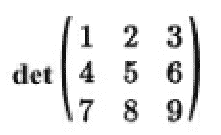
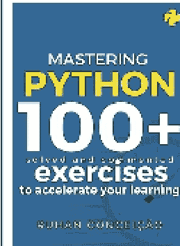

# 掌握 Java：100+道题解析与注释练习，加速你的学习

## 前言

欢迎阅读这本书，书中展示了经过解答并带有注释的 Java 练习题。在书中，你将找到超过 100 道练习题，旨在帮助你提高在这门强大语言中的编程技能。

学习编程不仅涉及理解理论概念，还涉及将这些概念应用到现实场景中。这正是你将在书中看到的：各种类型的问题，涵盖了从基础知识到更复杂的挑战。

每道练习题都配有完整详细的解答，这不仅提供了源代码，还解释了所采用方法背后的逻辑。这些注释讨论了重要的概念，提供了宝贵的提示，并帮助理解如何高效地将编程逻辑应用于解决问题中。

随着练习的不断进行，你将面临涉及数学公式处理、字符串、条件判断、循环、向量操作、矩阵等任务的挑战。

本书的主要目标是为寻求进步的程序员提供一个实用且全面的资源。无论你是想要巩固知识的 Java 初学者，还是希望加深专业知识的资深程序员，这些练习都将是非常佳的学习指南和参考。这本书也适用于教师，他们希望有一个丰富的编程逻辑练习题集，以便为学生创建练习和题目。

在几道练习题中，针对同一个问题提供了多种解决方案，涉及不同的策略和技术。

享受这段学习旅程，投入到这些带有解答和注释的 Java 练习题中。准备好迎接刺激性的挑战、创性的解决方案以及增强编程技能的独特机会。

本书在内容创作过程中使用了人工智能工具，但所有材料都经过了作者的审核和编辑，以交付最终的高质量产品。

祝阅读愉快，学习进步，并尽情探索迷人的 Java 编程世界。

Ruhan Avila da Conceição.

## Java 简介

Java 是一种广泛使用的编程语言，专门为用于互联网的分布式环境而设计。它的设计旨在具有 C++ 语言的“外观和感觉”，但比 C++ 更容易使用，并强制面向对象的编程模型。

以下是 Java 的一些关键特性：

- **面向对象：** 在 Java 中，一切皆为对象（`Object`）。由于 Java 基于对象模型，因此可以轻松扩展。
- **平台无关：** 与 C 和 C++ 在内的许多其他编程语言不同，Java 在编译时不会被编译成特定平台的机器码，而是编译成平台无关的字节码。这些字节码通过网络分发，并在运行它的任何平台上的虚拟机（`JVM`）进行解释。
- **简单：** Java 设计易于学习。如果你理解面向对象编程（`OOP`）的基本概念，就能很容易掌握 Java。
- **安全：** 凭借 Java 的安全特性，能够开发无病毒、防篡改的系统。验证技术基于公钥加密。
- **架构中立：** Java 编译器生成架构无关的对象文件格式，这使得编译后的代码在有 Java 运行时系统的情况下可以在许多处理器上执行。
- **可移植性：** 架构中立以及规范中依赖于实现的方面，使得 Java 具有良好的可移植性。
- **健壮性：** Java 通过主要强调编译时错误检查和运行时检查，努力消除易错的情况。
- **多线程：** 凭借 Java 的多线程特性，可以编写能够同时执行许多任务的程序。

这是一个向控制台打印“Hello, World!”的简单程序。在上面的示例中，`public class Main` 是类的声明。Java 程序由类组成。`main` 方法是程序的入口，而 `System.out.println("Hello, World!")` 是向控制台打印文本“Hello, World!”的行。

## 变量

在 Java 中，变量是赋给内存位置的名字。它之所以被称为变量，是因为存储在内存位置中的信息在程序执行过程中可能会发生。Java 中的每个变量都有特定的数据类型，这决定了变量内存的大小和布局、该内存中可以存储的值范围，以及可以应用于变量的操作 `set`。

Java 中有三种变量：

- **局部变量：** 在方法内部定义的变量称为局部变量。一旦方法完成，该变量将被销毁。
- **实例变量（非静态字段）：** 实例变量是非静态的，声明在类中、任何方法、构造函数或块之外。它们在使用关键字 `new` 创建对象时创建，在对象被销毁时销毁。
- **类变量（静态字段）：** 声明为静态的变量称为静态变量。它不能是局部的。无论从类中创建了多少对象，每个类变量只有一个副本。

Java 变量类型进一步分为两组：

- **原始数据类型：** 原始数据类型包括 `boolean`、`char`、`byte`、`short`、`int`、`long`、`float` 和 `double`。
- **非原始数据类型（引用/对象数据类型）：** 引用变量使用类定义的构造函数创建。它们用于访问对象。这些变量被声明为不能更改的特定类型。类对象和各种类型的数组变量都属于引用数据类型。

以下是如何在 Java 中声明变量的示例：

```java
public class Main {
  public static void main(String[] args) {
    String name = "John"; // String变量
    int age = 20;      // 整数变量
    float mark = 85.5f; // float 变量
    char grade = 'A'; // 字符变量
    boolean passed = true; // 布尔变量
    System.out.println(name);
    System.out.println(age);
    System.out.println(mark);
    System.out.println(grade);
    System.out.println(passed);
  }
}
```

在此程序中，`name`、`age`、`mark`、`grade` 和 `passed` 是变量。`String` 是非原始类型而 `int`、`float`、`char` 和 `boolean` 是原始类型。

## 原始数据类型

- **byte：** `byte` 数据类型是 8 位补码整数。它的最小值为 -128，最大值为 127（包含）。`byte` 数据类型对于在大型数组中节省内存很有用。
- **short：** `short` 数据类型是 16 位带符号补码整数。它的最小值为 -32768，最大值为 32767（包含）。
- **int：** 默认情况下，`int` 数据类型是 32 位带符号补码整数，其最小值为 -(2³¹)，最大值为 2³¹-1。
- **long：** `long` 数据类型是 64 位补码整数。带符号 `long` 的最小值为 -(2⁶³)，最大值为 2⁶³-1。
- **float：** `float` 数据类型是单精度 32 位 IEEE 754 浮点数。如果你需要在大型浮点数组中节省内存，请使用 `float`（而不是 `double`）。
- **double：** `double` 数据类型是双精度 64 位 IEEE 754 浮点数。对于小数值，此数据类型通常是默认选择。
- **boolean：** `boolean` 数据类型只有两个可能的值：`true` 和 `false`。使用此数据类型跟踪真/假状态的简单标志。
- **char：** `char` 数据类型是单个 16 位 Unicode 字符。它的最小值为 `\u0000`（或 0），最大值为 `\uffff`（或 65535，包含）。

## 非基本数据类型

非基本数据类型由程序员创建，而不是由 Java 定义（`String` 除外）。非基本类型可以用于调用方法来执行某些操作，而基本类型则不能。非基本数据类型可以为 `null`，而基本类型则不能。

非基本类型的示例包括字符串、数组、类、接口等。例如，Java 中的 `String` 就是一种非基本数据类型。

## 打印数据

在 Java 中，向控制台打印数据非常简单。你可以使用 `System.out.print()` 或 `System.out.println()`。

以下是对这两个方法的简要解释：

- `System.out.print()`: 此方法打印你传递给它的文本，光标保留在控制台文本的末尾。
- `System.out.println()`: 此方法打印你传递给它的文本，并将光标移动到控制台的下一行。`println` 中的 `ln` 代表 "line（行）"。

以下是使用这两个方法的示例：

```java
public class Main {
  public static void main(String[] args) {
    System.out.print("Hello, ");
    System.out.print("World!");

    System.out.println("Hello, ");
    System.out.println("World!");
  }
}
```

在此程序中，`System.out.print` 语句将在同一行输出 `Hello, World!`，而 `System.out.println` 语句将分行输出 `Hello` 和 `World`。

你可以打印所有基本数据类型：

```java
public class Main {
  public static void main(String[] args) {
    int a = 10;
    double b = 20.5;
    boolean c = true;
    String d = "Hello, World!";

    System.out.println("The value of a: " + a);
    System.out.println("The value of b: " + b);
    System.out.println("The value of c: " + c);
    System.out.println("The value of d: " + d);
  }
}
```

在此程序中，我们声明了不同类型的变量，然后打印了它们。`+` 运算符用于将字符串字面量与变量的值拼接在一起。

## 读取数据

Java 提供了多种读取用户输入的方法。`Scanner` 类是从标准输入（通常是键盘）获取用户输入的最常用方法之一。`Scanner` 类是 `java.util` 包的一部分，因此在使用它之前，你需要导入该包或该类本身。

以下是一个如何使用 `Scanner` 类读取不同类型输入的示例：

```java
import java.util.Scanner; // 导入 Scanner 类
public class Main {
    public static void main(String[] args) {
        Scanner scanner = new Scanner(System.in); // 创建一个 Scanner 对象

        System.out.println("Enter your name:");
        String name = scanner.nextLine(); // 读取整行输入

        System.out.println("Enter your age:");
        int age = scanner.nextInt(); // 读取一个整数输入

        System.out.println("Enter your GPA:");
        double gpa = scanner.nextDouble(); // 读取一个 double 类型输入

        System.out.println("Your name is " + name);
        System.out.println("Your age is " + age);
        System.out.println("Your GPA is " + gpa);

        scanner.close(); // 完成后关闭 scanner 是一个好习惯
    }
}
```

在此程序中，我们首先导入了 `Scanner` 类，然后创建了一个名为 `scanner` 的 `Scanner` 对象。接着我们使用 `nextLine()`、`nextInt()` 和 `nextDouble()` 方法分别读取字符串、整数和双精度类型浮点数。最后，我们使用 `scanner.close()` 关闭 `Scanner` 对象以防止资源泄漏。

值得注意的是，当使用 `scanner.nextInt()` 或类似方法时，它不会消耗输入中的最后一个换行符，因此该换行符会在下一次调用 `nextLine()` 时被消耗。这可能不是程序所需的行为，通常情况下建议多调用一次 `nextLine()`。

```java
import java.util.Scanner;
public class Main {
    public static void main(String[] args) {
        Scanner scanner = new Scanner(System.in);

        System.out.println("Enter your name:");
        String name = scanner.nextLine();

        System.out.println("Enter your age:");
        int age = scanner.nextInt();

        System.out.println("Enter your GPA:");
        double gpa = scanner.nextDouble();

        System.out.println("Your name is " + name);
        System.out.println("Your age is " + age);
        System.out.println("Your GPA is " + gpa);

        scanner.close();
    }
}
```

```java
System.out.println("Max: " + Math.max(x, y));
System.out.println("Min: " + Math.min(x, y));
System.out.println("Square root of y: " + Math.sqrt(y));
System.out.println("y to the power of x: " + Math.pow(y, x));
System.out.println("Round of y: " + Math.round(y));
System.out.println("Ceiling of x: " + Math.ceil(x));
System.out.println("Floor of x: " + Math.floor(x));
}
}
```

## 1. 编写一个程序，提示用户输入两个数字并显示它们之间的加、减、乘、除结果。

```java
public class ArithmeticCalculator {
    public static void main(String[] args) {
        // 创建一个 Scanner 来从用户读取输入
        Scanner scanner = new Scanner(System.in);

        // 提示用户输入第一个数字
        System.out.print("Enter the first number: ");
        double num1 = scanner.nextDouble();

        // 提示用户输入第二个数字
        System.out.print("Enter the second number: ");
        double num2 = scanner.nextDouble();

        // 执行算术运算
        double addition = num1 + num2;
        double subtraction = num1 - num2;
        double multiplication = num1 * num2;
        double division = num1 / num2;

        // 显示结果
        System.out.println("Addition: " + addition);
        System.out.println("Subtraction: " + subtraction);
        System.out.println("Multiplication: " + multiplication);
        System.out.println("Division: " + division);

        // 关闭 Scanner
        scanner.close();
    }
}
```

我们首先导入 `java.util.Scanner` 类，它允许我们从控制台读取用户输入。

我们定义了 `ArithmeticCalculator` 类，该类将包含我们的 `main` 方法。

在 `main` 方法内部，我们创建了一个名为 `scanner` 的 `Scanner` 对象来从用户读取输入。

我们使用 `System.out.print` 和 `scanner.nextDouble()` 提示用户输入第一个数字。输入的值随后存储在变量 `num1` 中。

同样，我们使用 `System.out.print` 和 `scanner.nextDouble()` 提示用户输入第二个数字，并将输入的值存储在变量 `num2` 中。

接下来，我们使用输入的数字执行四种算术运算：加（`num1 + num2`）、减（`num1 - num2`）、乘（`num1 * num2`）和除（`num1 / num2`）。这些运算的结果存储在不同的变量中：`addition`、`subtraction`、`multiplication` 和 `division`。

最后，我们使用 `System.out.println` 向用户显示算术运算的结果。

我们使用 `scanner.close()` 方法关闭 `Scanner` 对象，以释放系统资源。

## 2. 编写一个计算两个数字的算术平均值的程序。


```java
import java.util.Scanner;

public class ArithmeticMeanCalculator {
    public static void main(String[] args) {
        // 创建一个 Scanner 对象来从用户读取输入
        Scanner scanner = new Scanner(System.in);

        // 提示用户输入第一个数字
        System.out.print("Enter the first number: ");
        double num1 = scanner.nextDouble();

        // 提示用户输入第二个数字
        System.out.print("Enter the second number: ");
        double num2 = scanner.nextDouble();

        // 计算算术平均值
        double arithmeticMean = (num1 + num2) / 2;

        // 显示算术平均值
        System.out.println("Arithmetic Mean: " + arithmeticMean);

        // 关闭 Scanner
        scanner.close();
    }
}
```

我们导入了 `java.util.Scanner` 类来读取用户输入。

我们定义了 `ArithmeticMeanCalculator` 类，该类将包含我们的 `main` 方法。

在 `main` 方法内部，我们创建了一个名为 `scanner` 的 `Scanner` 对象来从用户读取输入。

我们使用 `System.out.print` 和 `scanner.nextDouble()` 提示用户输入第一个数字。输入的值随后存储在变量 `num1` 中。

同样，我们使用 `System.out.print` 和 `scanner.nextDouble()` 提示用户输入第二个数字，并将输入的值存储在变量 `num2` 中。

接下来，我们使用公式 `(num1 + num2) / 2` 计算两个数字的算术平均值，并将结果存储在变量 `arithmeticMean` 中。

最后，我们使用 `System.out.println` 向用户显示算术平均值。

我们使用 `scanner.close()` 方法关闭 `Scanner` 对象以释放系统资源。

## 3. 创建一个程序计算并显示用户输入的三个成绩的算术平均值。

```java
import java.util.Scanner;

public class GradeAverageCalculator {
    public static void main(String[] args) {
        // 创建一个 Scanner 对象来从用户读取输入
        Scanner scanner = new Scanner(System.in);

        // 提示用户输入三个成绩
        System.out.print("Enter the first grade: ");
        double grade1 = scanner.nextDouble();

        System.out.print("Enter the second grade: ");
        double grade2 = scanner.nextDouble();

        System.out.print("Enter the third grade: ");
        double grade3 = scanner.nextDouble();

        // 计算算术平均值
        double arithmeticMean = (grade1 + grade2 + grade3) / 3;

        // 显示算术平均值
        System.out.println("Arithmetic Mean: " + arithmeticMean);

        // 关闭 Scanner
        scanner.close();
    }
}
```

我们首先导入 `java.util.Scanner` 类，它允许我们从控制台读取用户输入。

接下来，我们定义了 `GradeAverageCalculator` 类，该类将包含我们的 `main` 方法。

在 `main` 方法内部，我们创建了一个名为 `scanner` 的 `Scanner` 对象来从用户读取输入。

我们使用 `System.out.print` 和 `scanner.nextDouble()` 提示用户输入第一个成绩。输入的值随后存储在变量 `grade1` 中。

同样，我们提示用户输入第二个成绩并将输入的值存储在变量 `grade2` 中。

我们提示用户输入第三个成绩并将输入的值存储在变量 `grade3` 中。

接下来，我们使用公式 `(grade1 + grade2 + grade3) / 3` 计算算术平均值。

最后，我们使用 `System.out.println` 向用户显示算术平均值。

我们使用 `scanner.close()` 方法关闭 `Scanner` 对象。

## 4. 编写一个计算用户输入的三个数字的几何平均值的程序

```java
import java.util.Scanner;

public class GeometricMeanCalculator {
    public static void main(String[] args) {
        // 创建一个 Scanner 对象来从用户读取输入
        Scanner scanner = new Scanner(System.in);

        // 提示用户输入三个数字
        System.out.print("Enter the first number: ");
        double num1 = scanner.nextDouble();

        System.out.print("Enter the second number: ");
        double num2 = scanner.nextDouble();

        System.out.print("Enter the third number: ");
        double num3 = scanner.nextDouble();

        // 计算几何平均值
        double geometricMean = Math.pow(num1 * num2 * num3, 1.0 / 3.0);

        // 显示几何平均值
        System.out.println("Geometric Mean: " + geometricMean);

        // 关闭 Scanner
        scanner.close();
    }
}
```

我们首先导入 `java.util.Scanner` 类，它允许我们从控制台读取用户输入。

接下来，我们定义了 `GeometricMeanCalculator` 类，该类将包含我们的 `main` 方法。

在 `main` 方法内部，我们创建了一个名为 `scanner` 的 `Scanner` 对象来从用户读取输入。

我们使用 `System.out.print` 和 `scanner.nextDouble()` 提示用户输入第一个数字。输入的值随后存储在变量 `num1` 中。

同样，我们提示用户输入第二个数字并将输入的值存储在变量 `num2` 中。

我们提示用户输入第三个数字并将输入的值存储在变量 `num3` 中。

接下来，我们使用公式 `geometricMean = cubeRoot(num1 * num2 * num3)` 计算三个数字的几何平均值。我们可以通过将三个数字相乘来找到几何平均值，然后对乘积取立方根。我们使用 `Math.pow` 方法来计算立方根，因为它等同于将数字方至 `1.0 / 3.0`。

最后，我们使用 `System.out.println` 向用户显示计算出的几何平均值。

我们使用 `scanner.close()` 方法关闭 `Scanner` 对象以释放系统资源。这一步对于防止资源泄漏至关重要，并且应该在使用完成 `Scanner` 后执行。

## 5. 编写一个计算个人 BMI 的程序，使用公式 BMI = weight / height²

```java
import java.util.Scanner;

public class BMICalculator {
    public static void main(String[] args) {
        // 创建 Scanner 对象以从用户读取输入
        Scanner scanner = new Scanner(System.in);

        // 提示用户输入体重（单位：公斤）
        System.out.print("Enter your weight in kilograms: ");
        double weight = scanner.nextDouble();

        // 提示用户输入身高（单位：米）
        System.out.print("Enter your height in meters: ");
        double height = scanner.nextDouble();

        // 计算 BMI
        double bmi = weight / (height * height);

        // 显示 BMI
        System.out.println("Your BMI is: " + bmi);

        // 关闭 Scanner
        scanner.close();
    }
}
```

我们首先导入 `java.util.Scanner` 类，它允许我们从控制台读取用户输入。该类是 Java 标准库的一部分，可以方便地处理用户输入。

接下来，我们定义了 `BMICalculator` 类，该类将包含我们的 `main` 方法。

在 `main` 方法内部，我们创建了一个名为 `scanner` 的 `Scanner` 对象来读取用户的输入。

我们使用该对象获取用户的体重和身高。

我们使用 `System.out.print` 和 `scanner.nextDouble()` 提示用户输入体重（公斤）。输入的值随后被存储在变量 `weight` 中。

同样地，我们提示用户输入身高（米），并将输入的值存储在变量 `height` 中。

接下来，我们使用公式计算 BMI：`BMI = weight / (height * height)`。我们将 `weight` 除以 `height` 的平方 `(height * height)` 来得到 BMI。

最后，我们使用 `System.out.println` 向用户显示计算出的 BMI。

我们使用 `scanner.close()` 方法关闭 `Scanner` 对象以释放系统资源。这一步对于防止资源泄漏至关重要，并且应该在使用完成 `Scanner` 后执行。

当你运行这个 Java 程序时，它会提示你输入体重（公斤）和身高（米）。在你提供输入后，它将计算并显示你的 BMI。

## 6. 创建一个计算并显示圆的周长的程序，提示用户输入半径。

```java
import java.util.Scanner;

public class CirclePerimeterCalculator {
    public static void main(String[] args) {
        // 创建 Scanner 对象以从用户读取输入
        Scanner scanner = new Scanner(System.in);

        // 提示用户输入圆的半径
        System.out.print("Enter the radius of the circle:");
        double radius = scanner.nextDouble();

        // 计算圆的周长
        double perimeter = 2 * Math.PI * radius;

        // 显示圆的周长
        System.out.println("Perimeter of the circle: " + perimeter);

        // 关闭 Scanner
        scanner.close();
    }
}
```

我们首先导入 `java.util.Scanner` 类，它允许我们从控制台读取用户输入。该类是 Java 标准库的一部分，可以方便地处理用户输入。

接下来，我们定义了 `CirclePerimeterCalculator` 类，该类将包含我们的 `main` 方法。

在 `main` 方法内部，我们创建了一个名为 `scanner` 的 `Scanner` 对象来读取用户的输入。我们使用该对象获取用户的输入（圆的半径）。

我们使用 `System.out.print` 和 `scanner.nextDouble()` 提示用户输入圆的半径。输入的值随后被存储在变量 `radius` 中。

接下来，我们使用公式计算圆的周长：`perimeter = 2 * π * radius`。我们使用 `Math.PI` 从 Java 标准库中获取 `π` 的值（约为 3.14159）。该公式计算的是圆周的距离，即周长。

最后，我们使用 `System.out.println` 向用户显示计算出的圆的周长。

我们使用 `scanner.close()` 方法关闭 `Scanner` 对象以释放系统资源。这一步对于防止资源泄漏至关重要，并且应该在使用完成 `Scanner` 后执行。

## 7. 编写一个程序根据半径计算圆的面积，使用公式 A = πr²

```java
import java.util.Scanner;

public class CircleAreaCalculator {
    public static void main(String[] args) {
        // 创建 Scanner 对象以从用户读取输入
        Scanner scanner = new Scanner(System.in);

        // 提示用户输入圆的半径
        System.out.print("Enter the radius of the circle:");
        double radius = scanner.nextDouble();

        // 计算圆的面积
        double area = Math.PI * Math.pow(radius, 2);

        // 显示圆的面积
        System.out.println("Area of the circle: " + area);

        // 关闭 Scanner
        scanner.close();
    }
}
```

我们首先导入 `java.util.Scanner` 类，它允许我们从控制台读取用户输入。该类是 Java 标准库的一部分，可以方便地处理用户输入。

接下来，我们定义了 `CircleAreaCalculator` 类，该类将包含我们的 `main` 方法。

在 `main` 方法内部，我们创建了一个名为 `scanner` 的 `Scanner` 对象来读取用户的输入。我们使用该对象获取用户的输入（圆的半径）。

我们使用 `System.out.print` 和 `scanner.nextDouble()` 提示用户输入圆的半径。输入的值随后被存储在变量 `radius` 中。

接下来，我们使用公式计算圆的面积：`area = π * radius²`。我们使用 `Math.PI` 从 Java 标准库中获取 `π` 的值（约为 3.14159），使用 `Math.pow` 计算半径的平方。

最后，我们使用 `System.out.println` 向用户显示计算出的圆的面积。

我们使用 `scanner.close()` 方法关闭 `Scanner` 对象以释放系统资源。这一步对于防止资源泄漏至关重要，并且应该在使用完成 `Scanner` 后执行。

## 8. 编写一个程序计算二次方程的判别式（Δ = b² - 4ac）


## 9. 编写一个程序，计算矩形的周长和面积

```java
import java.util.Scanner;

public class QuadraticDeltaCalculator {
    public static void main(String[] args) {
        // 创建 Scanner 对象以从用户读取输入
        Scanner scanner = new Scanner(System.in);

        // 提示用户输入系数 a, b, c
        System.out.print("Enter the coefficient: a ");
        double a = scanner.nextDouble();

        System.out.print("Enter the coefficient b: ");
        double b = scanner.nextDouble();

        System.out.print("Enter the coefficient c: ");
        double c = scanner.nextDouble();

        // 计算二次方程的判别式 (Δ)
        double delta = Math.pow(b, 2) - 4 * a * c;

        // 显示二次方程的判别式
        System.out.println("Delta (Δ) of the quadratic equation: " + delta);

        // 关闭 Scanner
        scanner.close();
    }
}
```

我们首先导入 `java.util.Scanner` 类，它允许我们从控制台读取用户输入。该类是 Java 标准库的一部分，可以方便地处理用户输入。

接下来，我们定义了 `QuadraticDeltaCalculator` 类，该类将包含我们的 `main` 方法。

在 `main` 方法内部，我们创建了一个名为 `scanner` 的 `Scanner` 对象来读取用户的输入。我们使用该对象获取用户的输入（二次方程的系数 a, b, c）。

我们使用 `System.out.print` 和 `scanner.nextDouble()` 提示用户输入二次方程的系数 a, b, c。输入的值将被分别存储在变量 `a`、`b`、`c` 中。

接下来，我们使用公式计算二次方程的判别式（Δ）：Δ = b² - 4ac。我们使用 `Math.pow` 来计算 b 的平方，并使用标准算术运算完成其余计算。

最后，我们使用 `System.out.println` 向用户显示计算出的二次方程判别式（Δ）。

我们使用 `scanner.close()` 方法关闭 `Scanner` 对象以释放系统资源。这一步对于防止资源泄漏至关重要，应该在使用完成 `Scanner` 后执行。

## 10. 编写一个程序，计算三角形的周长和面积

```java
import java.util.Scanner;

public class RectangleCalculator {
    public static void main(String[] args) {
        // 创建一个 Scanner 对象来读取用户的输入
        Scanner scanner = new Scanner(System.in);

        // 提示用户输入矩形的宽度
        System.out.print("Enter the width of the rectangle: ");
        double width = scanner.nextDouble();

        // 提示用户输入矩形的长度
        System.out.print("Enter the length of the rectangle: ");
        double length = scanner.nextDouble();

        // 计算矩形的周长
        double perimeter = 2 * (width + length);

        // 计算矩形的面积
        double area = width * length;

        // 显示矩形的周长和面积
        System.out.println("Perimeter of the rectangle: " + perimeter);
        System.out.println("Area of the rectangle: " + area);

        // 关闭 Scanner
        scanner.close();
    }
}
```

我们首先导入 `java.util.Scanner` 类，它允许我们从控制台读取用户输入。该类是 Java 标准库的一部分，可以很方便地处理用户输入。

接下来，我们定义了 `RectangleCalculator` 类，该类将包含我们的主方法。

在 `main` 方法内部，我们创建了一个名为 `scanner` 的 `Scanner` 对象来读取用户的输入。我们使用该对象来获取用户的输入（矩形的宽度和长度）。

我们使用 `System.out.print` 和 `scanner.nextDouble()` 提示用户输入矩形的宽度。输入的值随后存储在变量 `width` 中。

同样，我们提示用户输入矩形的长度并将输入的值存储在变量 `length` 中。

接下来，我们使用公式计算矩形的周长：`perimeter = 2 * (width + length)`。我们将宽度和长度相加，然后将和乘以 2 以得到周长。

同样，我们使用公式计算矩形的面积：`area = width * length`。我们只需将宽度和长度相乘即可得到面积。

最后，我们使用 `System.out.println` 向用户显示计算出的矩形周长和面积。

我们使用 `scanner.close()` 方法关闭 `Scanner` 对象以释放系统资源。这一步对于防止资源泄漏至关重要，应该在使用完成 `Scanner` 后执行。

## 11. 编写一个程序，计算三角形的周长和面积

```java
import java.util.Scanner;

public class TriangleCalculator {
    public static void main(String[] args) {
        // 创建一个 Scanner 对象来读取用户的输入
        Scanner scanner = new Scanner(System.in);

        // 提示用户输入三角形的边
        System.out.print("Enter the side a of the triangle: ");
        double a = scanner.nextDouble();

        System.out.print("Enter the side b of the triangle: ");
        double b = scanner.nextDouble();

        System.out.print("Enter the side c of the triangle: ");
        double c = scanner.nextDouble();

        // 提示用户输入相对于边 B 的高
        System.out.print("Enter the height relative to side B: ");
        double h = scanner.nextDouble();

        // 计算三角形的周长
        double perimeter = a + b + c;

        // 计算三角形的面积
        double area = (b * h) / 2;

        // 显示三角形的周长和面积
        System.out.println("Perimeter of the triangle: " + perimeter);
        System.out.println("Area of the triangle: " + area);

        // 关闭 Scanner
        scanner.close();
    }
}
```

我们首先导入 `java.util.Scanner` 类，它允许我们从控制台读取用户输入。该类是 Java 标准库的一部分，可以很方便地处理用户输入。

接下来，我们定义了 `TriangleCalculator` 类，该类将包含我们的主方法。

在 `main` 方法内部，我们创建了一个名为 `scanner` 的 `Scanner` 对象来读取用户的输入。我们使用该对象来获取用户的输入（边 a、b、c 以及高 h）。

我们使用 `System.out.print` 和 `scanner.nextDouble()` 提示用户输入三角形的边。输入的值随后存储在变量 `a`、`b` 和 `c` 中。

接下来，我们使用公式计算三角形的周长：`perimeter = a + b + c`。我们将三条边相加得到周长。

同样，我们使用公式计算三角形的面积：`area = (b * h) / 2`。我们将底 b 乘以高 h 并除以 2 得到面积。

最后，我们使用 `System.out.println` 向用户显示计算出的三角形周长和面积。

我们使用 `scanner.close()` 方法关闭 `Scanner` 对象以释放系统资源。这一步对于防止资源泄漏至关重要，应该在使用完成 `Scanner` 后执行。

## 12. 编写一个程序计算移动物体的动能

```java
import java.util.Scanner;

public class KineticEnergyCalculator {
    public static void main(String[] args) {
        // 创建 Scanner 对象以读取用户输入
        Scanner scanner = new Scanner(System.in);

        // 提示用户输入物体质量（公斤）
        System.out.print("Enter the mass of the object (in kilograms):");
        double mass = scanner.nextDouble();

        // 提示用户输入物体的速度
        System.out.print("Enter the velocity of the object (in meters per second):");
        double velocity = scanner.nextDouble();

        // 计算物体的动能 (E)
        double kineticEnergy = (mass * Math.pow(velocity, 2)) / 2;

        // 显示物体的动能
        System.out.println("Kinetic energy of the object: " + kineticEnergy + " joules");

        // 关闭 Scanner
        scanner.close();
    }
}
```

在该程序中，我们提示用户输入物体的质量（公斤）和物体的速度（米/秒）。输入的值随后分别存储在变量 `mass` 和 `velocity` 中。我们使用公式：`kineticEnergy = (mass * velocity^2) / 2` 计算物体的动能（E - kineticEnergy）。我们使用 `Math.pow` 来计算速度的平方。动能是物体由于运动而拥有的能量的度量。

最后，我们向用户显示计算出的物体动能，单位为焦耳。

我们使用 `scanner.close()` 方法关闭 `Scanner` 对象以释放系统资源。这一步对于防止资源泄漏至关重要，应该在我们完成 `Scanner` 使用后执行。

## 13. 编写一个程序计算作用在物体上的力所做的功

```java
import java.util.Scanner;

public class WorkCalculator {
    public static void main(String[] args) {
        // 创建 Scanner 对象以读取用户输入
        Scanner scanner = new Scanner(System.in);

        // 提示用户输入以牛顿为单位的施力 (F)
        System.out.print("Enter the applied force (F) in newtons: ");
        double force = scanner.nextDouble();

        // 提示用户输入物体移动的距离 (d)，米
        System.out.print("Enter the distance traveled (d) by the object in meters: ");
        double distance = scanner.nextDouble();

        // 计算力对物体做的功 (W)
        double work = force * distance;

        // 显示力对物体做的功
        System.out.println("Work done by the force on the object: " + work + " joules");

        // 关闭 Scanner
        scanner.close();
    }
}
```

在该程序中，我们提示用户输入以牛顿为单位的施力（F）和物体移动的距离（米）。输入的值随后分别存储在变量 `force` 和 `distance` 中。然后，我们使用提供的公式 `W = F * d` 计算功。最后，我们向用户显示力对物体所做的计算功，单位为焦耳。

我们使用 `scanner.close()` 方法关闭 `Scanner` 对象以释放系统资源。这一步对于防止资源泄漏至关重要，应该在使用完成 `Scanner` 后执行。

## 14. 编写一个程序读取笛卡尔平面上两点的 x 和 y 位置，并计算它们之间的距离

```java
import java.util.Scanner;

public class DistanceCalculator {
    public static void main(String[] args) {
        // 创建 Scanner 对象以读取用户输入
        Scanner scanner = new Scanner(System.in);

        // 提示用户输入第一个点的 x y 坐标
        System.out.print("Enter the x-coordinate of the first point: ");
        double x1 = scanner.nextDouble();
        System.out.print("Enter the y-coordinate of the first point: ");
        double y1 = scanner.nextDouble();

        // 提示用户输入第二个点的 x y 坐标
        System.out.print("Enter the x-coordinate of the second point: ");
        double x2 = scanner.nextDouble();
        System.out.print("Enter the y-coordinate of the second point: ");
        double y2 = scanner.nextDouble();

        // 使用距离公式计算两点之间的距离
        double distance = Math.sqrt(Math.pow(x2 - x1, 2) + Math.pow(y2 - y1, 2));

        // 显示两点之间的距离
        System.out.println("Distance between the two points: " + distance);

        // 关闭 Scanner
        scanner.close();
    }
}
```

我们首先导入 `java.util.Scanner` 类，它允许我们从控制台读取用户输入。

该类是 Java 标准库的一部分，可以方便地处理用户输入。

接下来，我们定义了 `DistanceCalculator` 类，它将包含我们的 `main` 方法。

在 `main` 方法内部，我们创建了一个名为 `scanner` 的 `Scanner` 对象来读取用户输入。我们提示用户输入第一个点的 x y 坐标。这些值随后存储在变量 `x1` 和 `y1` 中。同样，我们提示用户输入第二个点的 x y 坐标。值随后存储在变量 `x2` 和 `y2` 中。接下来，我们使用距离公式 `d = √((x2 - x1)² + (y2 - y1)²)` 计算两点之间的距离。我们使用 `Math.sqrt` 计算和的平方根。

最后，我们使用 `System.out.println` 向用户显示欧几里得距离。

我们使用 `scanner.close()` 方法关闭 `Scanner` 对象以释放系统资源。这一步对于防止资源泄漏至关重要，应该在使用完成 `Scanner` 后执行。

## 15. 创建一个程序，提示用户输入球半径，并计算并显示其体积

```java
import java.util.Scanner;

public class SphereVolumeCalculator {
    public static void main(String[] args) {
        // 创建 Scanner 对象以读取用户输入
        Scanner scanner = new Scanner(System.in);

        // 提示用户输入球的半径
        System.out.print("Enter the radius of the sphere: ");
        double radius = scanner.nextDouble();

        // 计算球的体积 V = (4/3) * π * r³
        double volume = (4.0 / 3.0) * Math.PI * Math.pow(radius, 3);

        // 显示球的体积
        System.out.println("Volume of the sphere: " + volume);

        // 关闭 Scanner
        scanner.close();
    }
}
```

我们首先导入 `java.util.Scanner` 类，它允许我们从控制台读取用户输入。该类是 Java 标准库的一部分，可以方便地处理用户输入。

接下来，我们定义了 `SphereVolumeCalculator` 类，它将包含我们的 `main` 方法。

在 `main` 方法内部，我们创建了一个名为 `scanner` 的 `Scanner` 对象来读取用户输入。我们提示用户输入球的半径，该值存储在变量 `radius` 中。

接下来，我们使用公式 `V = (4/3) * π * r³` 计算球的体积。我们使用 `Math.PI` 获取 π 的值，使用 `Math.pow(radius, 3)` 计算半径的立方。

最后，我们使用 `System.out.println` 向用户显示计算出的球体积。

我们使用 `scanner.close()` 方法关闭 `Scanner` 对象以释放系统资源。这一步对于防止资源泄漏至关重要，应该在使用完成 `Scanner` 后执行。


```java
import java.util.Scanner;
public class SphereVolumeCalculator {
    public static void main(String[] args) {
        // 创建 Scanner 对象以读取用户输入
        Scanner scanner = new Scanner(System.in);

        // 提示用户输入球的半径
        System.out.print("Enter the radius of the sphere: ");
        double radius = scanner.nextDouble();

        // 计算球的体积
        double volume = (4.0 / 3.0) * Math.PI * Math.pow(radius, 3);

        // 显示球的体积
        System.out.println("Volume of the sphere: " + volume);

        // 关闭 Scanner
        scanner.close();
    }
}
```

在该程序中，我们提示用户输入球的半径。输入的值随后存储在变量 `radius` 中。然后我们使用提供的公式 $V = (4/3) * \pi * r^3$ 计算体积，其中 $\pi$ 是代表圆周率的数学常数（约3.14159），$r^3$ 表示半径的立方。为了计算体积，我们使用 `Math.pow()` 方法计算半径的立方，然后乘以 `4.0 / 3.0` 和 `Math.PI`，从而得到了球的体积。

最后，我们向用户显示计算出的球体积。

# 关系运算符

不等于 (`!=`): 检查两个值是否不等。

```java
int x = 5;
if (x != 10) {
    System.out.println("x is not 10");
}
```

大于 (`>`): 检查左操作数是否大于右操作数。

```java
int x = 5;
if (x > 3) {
    System.out.println("x is greater than 3");
}
```

小于 (`<`): 检查左操作数是否小于右操作数。

```java
int x = 5;
if (x < 10) {
    System.out.println("x is less than 10");
}
```

大于等于 (`>=`): 检查左操作数是否大于等于右操作数。

```java
int x = 5;
if (x >= 5) {
    System.out.println("x is greater than or equal to 5");
}
```

小于等于 (`<=`): 检查左操作数是否小于等于右操作数。

```java
int x = 5;
if (x <= 5) {
    System.out.println("x is less than or equal to 5");
}
```

# 逻辑运算符

在 Java 中，有三个主要的逻辑运算符：`&&`、或 (`||`) 和非 (`!`)。这些运算符用于组合逻辑表达式并评估复杂条件。以下是对每个运算符的详细解释：

## 与运算符 - `&&`

与运算符用于组合两个或多个逻辑表达式。只有当所有表达式都为 `true` 时，它才返回 `true`。否则，它返回 `false`。与运算符的真值表如下：

| x | y | x && y |
|---|---|---|
| true | true | true |
| true | false | false |
| false | true | false |
| false | false | false |

```java
int x = 5;
if (x > 0 && x < 10) {
    System.out.println("x is a positive single digit number.");
}
```

## 或运算符 - `||`

**或**运算符用于组合两个或多个逻辑表达式。如果至少有一个表达式为真，它就返回 `true`。只有当所有表达式都为假时，才返回 `false`。或运算符的真值表如下：

| x | y | x \|\| y |
|---|---|---|
| true | true | true |
| true | false | true |
| false | true | true |
| false | false | false |

```java
int x = 5;
if (x < 0 || x > 4) {
    System.out.println("x is either negative or greater than 4.");
}
```

## 非运算符 - `!`

**非**运算符用于逻辑取反。它反转表达式的值。如果表达式为 `true`，非运算符返回 `false`。如果表达式为 `false`，非运算符返回 `true`。

```java
boolean isCold = false;
if (!isCold) {
    System.out.println("It's not cold today.");
}
```

值得注意的是，`&&` 和 `||` 是短路运算符。这意味着它们只有在需要确定结果时才会求值右侧的操作数。

例如，如果 `A` 和 `B` 是两个操作数，那么：

在 `A && B` 的情况下，如果 `A` 为 `false`，Java 将不会评估 `B`，因为与运算的结果无论 `B` 的值如何都是 `false`。

在 `A || B` 的情况下，如果 `A` 为 `true`，Java 将不会评估 `B`，因为或运算的结果无论 `B` 的值如何都是 `true`。

此特性可以防止运行时错误（例如，在访问对象的方法或属性之前检查空引用），还可以通过避免不必要的计算来提高性能。

# Java 中的条件语句

Java 中的条件语句允许程序根据某些条件做出决策。以下是 Java 中条件语句的主要类型：

## `if` 语句

Java 支持的最基本的控制流语句是 `if` 语句。

```java
int num = 10;
if (num > 5) {
    System.out.println("Number is greater than 5");
}
```

## `if-else` 语句

`if` 语句仅当条件为真时才会执行一个代码块。`if-else` 语句允许你在条件为真时执行一个代码块，在条件为假时执行另一个代码块。

```java
int num = 4;
if (num > 5) {
    System.out.println("Number is greater than 5");
} else {
    System.out.println("Number is not greater than 5");
}
```

## `else if` 语句

如果你有多个条件需要检查，可以使用 `else if`。

```java
int num = 25;
if (num > 30) {
    System.out.println("Number is greater than 30");
} else if (num > 20) {
    System.out.println("Number is greater than 20");
} else {
    System.out.println("Number is not greater than 20");
}
```

## `switch` 语句

`switch` 语句允许对变量与值列表进行等性测试。每个值被称为一个 `case`，被切换的变量会在每个 `switch case` 中进行检查。

```java
int day = 3;
switch (day) {
    case 1:
        System.out.println("Monday");
        break;
    case 2:
        System.out.println("Tuesday");
        break;
    case 3:
        System.out.println("Wednesday");
        break;
    // 你可以有任意数量的 case 语句
    default: // 可选
        System.out.println("Invalid day");
}
```

在这个 `switch` 语句示例中，如果 `day` 变量匹配任何 `case`，将执行相应的代码块。`break` 语句用于终止当前 `case` 并移动到下一个。如果没有匹配的 `case`，则将执行 `default` 下的代码。

## 16. 编写一个程序询问人的年龄并显示其是否已成年

```java
import java.util.Scanner;

public class LegalAge {
    public static void main(String[] args) {
        // 创建 Scanner 对象以读取输入
        Scanner scanner = new Scanner(System.in);

        // 提示用户输入年龄
        System.out.print("Enter your age: ");
        int age = scanner.nextInt();

        // 检查是否成年
        boolean isLegalAge = age >= 18;

        // 根据是否成年显示结果
        if (isLegalAge) {
            System.out.println("You are legal age.");
        } else {
            System.out.println("You are not legal age.");
        }

        // 关闭 Scanner
        scanner.close();
    }
}
```

## 17. 编写一个程序读取两个数字并告诉你哪一个更大

```java
import java.util.Scanner;

public class BiggerNumberChecker {
    public static void main(String[] args) {
        // 创建 Scanner 对象读取用户输入
        Scanner scanner = new Scanner(System.in);

        // 提示用户输入第一个数字
        System.out.print("Enter the first number: ");
        double number1 = scanner.nextDouble();

        // 提示用户输入第二个数字
        System.out.print("Enter the second number: ");
        double number2 = scanner.nextDouble();

        // 使用 if 语句检查哪个数字更大
        if (number1 > number2) {
            System.out.println("The bigger number is: " + number1);
        } else if (number2 > number1) {
            System.out.println("The bigger number is: " + number2);
        } else {
            System.out.println("Both numbers are equal.");
        }

        // 关闭 Scanner
        scanner.close();
    }
}
```

使用此对象来获取用户输入的两个数字。

我们使用 `System.out.print` 和 `scanner.nextDouble()` 提示用户输入第一个数字。输入的值随后被存储在变量 `number1` 中。

同样，我们使用 `System.out.print` 和 `scanner.nextDouble()` 提示用户输入第二个数字。输入的值随后被存储在变量 `number2` 中。

我们使用 `if` 语句来比较这两个数字并确定哪一个更大。

- 如果 `number1` 大于 `number2`，条件 `number1 > number2` 为 `true`，将执行 `if` 块中的代码。这意味着 `number1` 大于 `number2`，因此我们显示 "The bigger number is:" 后跟 `number1`。
- 如果 `number2` 大于 `number1`，条件 `number2 > number1` 为 `true`，将执行 `else if` 块中的代码。这意味着 `number2` 大于 `number1`，因此我们显示 "The bigger number is: " 后跟 `number2`。
- 如果两个数字相等，则上述条件均不为 `true`，将执行 `else` 块中的代码。这意味着两个数字相等，因此我们显示 "Both numbers are equal."

### 另一种解决方案

```java
import java.util.Scanner;

public class BiggerNumberChecker {
    public static void main(String[] args) {
        // 创建一个 Scanner 对象来从用户处读取输入
        Scanner scanner = new Scanner(System.in);

        // 提示用户输入第一个数字
        System.out.print("Enter the first number: ");
        double number1 = scanner.nextDouble();

        // 提示用户输入第二个数字
        System.out.print("Enter the second number: ");
        double number2 = scanner.nextDouble();

        // 使用 Math.max() 确定较大的数字
        double biggerNumber = Math.max(number1, number2);

        // 显示结果
        System.out.println("The bigger number is: " + biggerNumber);

        // 关闭 Scanner
        scanner.close();
    }
}
```

在该解决方案中，我们使用 `Math.max()` 方法来确定 `number1` 和 `number2` 之间较大的数字。该方法返回两个参数中的较大值。最后，我们将较大的数字显示给用户。

## 18. 编写一个程序，向用户询问三个数字并显示最大的一个

```java
import java.util.Scanner;

public class LargestNumberFinder {
    public static void main(String[] args) {
        // 创建一个 Scanner 对象来从用户处读取输入
        Scanner scanner = new Scanner(System.in);

        // 提示用户输入三个数字
        System.out.print("Enter the first number: ");
        double number1 = scanner.nextDouble();

        System.out.print("Enter the second number: ");
        double number2 = scanner.nextDouble();

        System.out.print("Enter the third number: ");
        double number3 = scanner.nextDouble();

        // 使用 if 语句寻找最大的数字
        double largestNumber;

        if (number1 >= number2 && number1 >= number3) {
            largestNumber = number1;
        } else if (number2 >= number1 && number2 >= number3) {
            largestNumber = number2;
        } else {
            largestNumber = number3;
        }

        // 显示最大的数字
        System.out.println("The largest number is: " + largestNumber);

        // 关闭 Scanner
        scanner.close();
    }
}
```

我们首先导入了 `java.util.Scanner` 类，它允许我们从控制台读取用户输入。该类是 Java 标准库的一部分，使得处理用户输入变得简单。

接下来，我们定义了 `LargestNumberFinder` 类，它将包含主方法。

在 `main` 方法内部，我们创建了一个名为 `scanner` 的 `Scanner` 对象来从用户处读取输入。我们使用该对象来获取用户输入的三个数字。

我们使用 `System.out.print` 和 `scanner.nextDouble()` 提示用户输入三个数字。输入的值分别存储在变量 `number1`、`number2` 和 `number3` 中。


我们使用 `if` 语句来比较三个数字并确定最大的一个。以下是 `if` 语句的工作原理：

- 第一个 `if` 语句检查 `number1` 是否大于或等于 `number2` 和 `number3`。如果该条件为 `true`，则意味着 `number1` 是三个数字中最大的，因此我们将它的值赋值给变量 `largestNumber`。
- 第一个 `else` 语句（此处为 else if）检查 `number2` 是否大于或等于 `number1` 和 `number3`。如果该条件为 `true`，则意味着 `number2` 是三个数字中最大的，因此我们将它的值赋值给变量 `largestNumber`。
- 如果上述条件均不为 `true`，则意味着 `number3` 是三个数字中最大的，因此我们将它的值赋值给变量 `largestNumber`。

最后，我们使用 `System.out.println` 将最大的数字显示给用户。

我们使用 `scanner.close()` 关闭 Scanner 对象以释放系统资源。

## 另一种解决方案

```java
import java.util.Scanner;

public class LargestNumberFinder {
    public static void main(String[] args) {
        // 创建一个 Scanner 对象来从用户处读取输入
        Scanner scanner = new Scanner(System.in);

        // 提示用户输入三个数字
        System.out.print("Enter the first number: ");
        double number1 = scanner.nextDouble();

        System.out.print("Enter the second number: ");
        double number2 = scanner.nextDouble();

        System.out.print("Enter the third number: ");
        double number3 = scanner.nextDouble();

        // 使用 if 语句寻找最大的数字
        double largestNumber;

        if (number1 >= number2 && number1 >= number3) {
          largestNumber = number1;
        } else if (number2 >= number1 && number2 >= number3) {
          largestNumber = number2;
        } else {
          largestNumber = number3;
        }

        // 显示最大的数字
        System.out.println("The largest number is: " + largestNumber);

        // 关闭 Scanner
        scanner.close();
    }
}
```

## 19. 编写一个程序读取一个数字并报告它是奇数还是偶数。

```java
import java.util.Scanner;

public class OddEvenChecker {
    public static void main(String[] args) {
        // 创建一个 Scanner 对象来从用户处读取输入
        Scanner scanner = new Scanner(System.in);

        // 提示用户输入一个数字
        System.out.print("Enter a number: ");
        int number = scanner.nextInt();

        // 使用取模运算符检查数字是奇数还是偶数
        if (number % 2 == 0) {
            System.out.println(number + " is even.");
        } else {
            System.out.println(number + " is odd.");
        }

        // 关闭 Scanner
        scanner.close();
    }
}
```

```java
// 使用 if-else 语句检查数字是正数、负数还是零
if (number > 0) {
    System.out.println("The number is positive.");
} else if (number < 0) {
    System.out.println("The number is negative.");
} else {
    System.out.println("The number is zero.");
}

// 关闭 Scanner
scanner.close();
```

在这个程序中，我们使用 `System.out.print` 和 `scanner.nextDouble()` 提示用户输入一个数字。输入的数值随后存储在变量 `number` 中。

我们使用 if-else 语句来检查数字是正数、负数还是零：

- 如果 `number` 大于 0 (`number > 0`)，意味着数字是正数，我们显示 "The number is positive."。
- 如果 `number` 小于 0 (`number < 0`)，意味着数字是负数，我们显示 "The number is negative."。
- 如果上述条件都不成立，意味着 `number` 等于 0，我们显示 "The number is zero."。

## 21. 编写一个程序读取两次测试的分数，并报告学生在每次测试中是通过（分数大于等于 6）还是不及格（分数小于 6）。

```java
import java.util.Scanner;

public class TestResults {
    public static void main(String[] args) {
        // 创建 Scanner 对象以从用户读取输入
        Scanner scanner = new Scanner(System.in);

        // 提示用户输入第一次测试的分数
        System.out.print("Enter the score of the first test: ");
        double test1Score = scanner.nextDouble();

        // 提示用户输入第二次测试的分数
        System.out.print("Enter the score of the second test: ");
        double test2Score = scanner.nextDouble();

        // 检查学生在第一次测试中是通过还是不及格
        if (test1Score >= 6) {
            System.out.println("You passed the first test.");
        } else {
            System.out.println("You failed the first test.");
        }

        // 检查学生在第二次测试中是通过还是不及格
        if (test2Score >= 6) {
            System.out.println("You passed the second test.");
        } else {
            System.out.println("You failed the second test.");
        }

        // 关闭 Scanner
        scanner.close();
    }
}
```

我们首先导入了 `java.util.Scanner` 类，它允许我们从控制台读取用户输入。该类是 Java 标准库的一部分，并能方便地处理用户输入。

接下来，我们定义了 `TestResults` 类，它将包含我们的 main 方法。

在 main 方法内部，我们创建了一个名为 `scanner` 的 Scanner 对象来从用户处读取输入。我们使用该对象来获取用户对两次测试分数的输入。

我们使用 `System.out.print` 和 `scanner.nextDouble()` 提示用户输入第一次测试的分数。输入的数值随后存储在变量 `test1Score` 中。

同样，我们使用 `System.out.print` 和 `scanner.nextDouble()` 提示用户输入第二次测试的分数。输入的数值随后存储在变量 `test2Score` 中。

我们使用 if 语句来检查学生在每次测试中是通过还是不及格。

- 如果 `test1Score` 大于或等于 6，意味着学生通过了第一次测试，所以我们显示 "You passed the first test."。否则，我们显示 "You failed the first test."。
- 同样，如果 `test2Score` 大于或等于 6，意味着学生通过了第二次测试，所以我们显示 "You passed the second test."。否则，我们显示 "You failed the second test."。

## 22. 编写一个程序读取两次测试的成绩，计算算术平均值，并告知学生是通过（平均大于等于 6）还是不及格（平均小于 6）。

```java
import java.util.Scanner;

public class TestGrades {
    public static void main(String[] args) {
        // 创建 Scanner 对象以从用户读取输入
        Scanner scanner = new Scanner(System.in);

        // 提示用户输入两次测试的成绩
        System.out.print("Enter the score of the first test: ");
        double grade1 = scanner.nextDouble();

        // 提示用户输入第二次测试的成绩
        System.out.print("Enter the score of the second test: ");
        double grade2 = scanner.nextDouble();

        // 计算平均值
        double average = (grade1 + grade2) / 2;

        // 根据平均值判断学生通过还是不及格
        if (average >= 6) {
            System.out.println("You passed.");
        } else {
            System.out.println("You failed.");
        }

        // 关闭 Scanner
        scanner.close();
    }
}
```

我们首先导入了 `java.util.Scanner` 类，它允许我们从控制台读取用户输入。该类是 Java 标准库的一部分，并能方便地处理用户输入。

接下来，我们定义了 `TestGrades` 类，它将包含我们的 main 方法。

在 main 方法内部，我们创建了一个名为 `scanner` 的 Scanner 对象来从用户处读取输入。我们使用该对象来获取用户对两次测试成绩的输入。

我们使用 `System.out.print` 和 `scanner.nextDouble()` 提示用户输入第一次测试成绩。输入的数值随后存储在变量 `grade1` 中。

同样，我们使用 `System.out.print` 和 `scanner.nextDouble()` 提示用户输入第二次测试成绩。输入的数值随后存储在变量 `grade2` 中。

我们通过相加两次成绩并除以 2 来计算平均值。

我们使用 if 语句判断学生是通过还是不及格。如果平均值大于或等于 6，意味着学生通过了，我们显示 "You passed."。如果平均值小于 6，意味着学生不及格，我们显示 "You failed."。

我们通过 `scanner.close()` 方法关闭 Scanner 以释放系统资源。这一步是必要的，应该在我们完成使用 Scanner 后执行。

## 23. 编写一个程序读取三个数字，告知它们的和是否能被 5 整除。

```java
import java.util.Scanner;

public class SumDivisibleFive {
    public static void main(String[] args) {
        // 创建 Scanner 对象以从用户读取输入
        Scanner scanner = new Scanner(System.in);

        // 提示用户输入三个数字
        System.out.print("Enter the first number: ");
        int number1 = scanner.nextInt();

        System.out.print("Enter the second number: ");
        int number2 = scanner.nextInt();

        System.out.print("Enter the third number: ");
        int number3 = scanner.nextInt();

        // 计算三个数字的和
        int sum = number1 + number2 + number3;

        // 检查和是否能被 5 整除
        if (sum % 5 == 0) {
            System.out.println("The sum is divisible by 5.");
        } else {
            System.out.println("The sum is not divisible by 5.");
        }

        // 关闭 Scanner
        scanner.close();
    }
}
```

我们使用 `System.out.print` 和 `scanner.nextInt()` 提示用户输入三个数字。输入的数值分别存储在变量 `number1`、`number2` 和 `number3` 中。

我们使用 `+` 运算符计算三个数字的和。

我们使用 `if` 语句来检查和是否能被 5 整除。如果和能被 5 整除，意味着 `sum % 5 == 0`。

我们使用 `+` 运算符计算三个数字之和。

我们使用 `if` 语句来检查三个数字的和是正数、负数还是零。

- `if (sum > 0)`: 这一行检查变量 `sum` 是否大于 0。如果条件为真，则意味着三个数字的和为正数。
- `else if (sum < 0)`: 如果第一个条件为假，`else if` 语句将检查变量 `sum` 是否小于 0。如果该条件为真，则意味着三个数字的和为负数。
- `else`: 如果上述两个条件均假，则意味着变量 `sum` 等于 0。在这种情况下，将执行 `else` 块，意味着三个数字的和等于 0。

## 25. 编写一个程序，读取三个数字，并在屏幕上按升序显示它们。

```java
import java.util.Scanner;

public class AscendingOrder {
    public static void main(String[] args) {
        // 创建一个 Scanner 对象来读取用户的输入
        Scanner scanner = new Scanner(System.in);

        // 提示用户输入三个数字
        System.out.print("Enter the first number: ");
        int number1 = scanner.nextInt();

        System.out.print("Enter the second number: ");
        int number2 = scanner.nextInt();

        System.out.print("Enter the third number: ");
        int number3 = scanner.nextInt();

        // 按升序显示数字
        if (number1 <= number2 && number1 <= number3) {
            System.out.print(number1 + " ");
            if (number2 <= number3) {
                System.out.println(number2 + " " + number3);
            } else {
                System.out.println(number3 + " " + number2);
            }
        } else if (number2 <= number1 && number2 <= number3) {
            System.out.print(number2 + " ");
            if (number1 <= number3) {
                System.out.println(number1 + " " + number3);
            }
        }
    }
}
```


```java
        } else {
            System.out.println(number3 + " " + number1);
        }
    } else {
        System.out.print(number3 + " ");
        if (number1 <= number2) {
            System.out.println(number1 + " " + number2);
        } else {
            System.out.println(number2 + " " + number1);
        }
    }
    // 关闭 Scanner
    scanner.close();
}
}
```

我们使用 `if` 语句在输入的三个数字中确定最小的一个。我们通过比较三个数字来找到最小的。

首先，我们使用条件 `number1 <= number2 && number1 <= number3` 检查 `number1` 是否为最小。如果该条件为真，意味着 `number1` 是最小的数字。

如果 `number1` 不是最小的，我们使用条件 `number2 <= number1 && number2 <= number3` 检查 `number2` 是否为最小。如果该条件为真，意味着 `number2` 是最小的数字。

如果 `number1` 和 `number2` 都不是最小的，意味着 `number3` 是最小数字。

然后我们根据它们与最小数字的关系按升序打印数字。

如果 `number1` 是最小的，我们先打印它，然后检查 `number2` 是否小于 `number3`，先打印 `number2` 后打印 `number3`。

如果 `number2` 是最小的，我们先打印它，然后检查 `number1` 是否小于 `number3`，先打印 `number1` 后打印 `number3`。

如果 `number3` 是最小的，我们先打印它，然后检查 `number1` 是否小于 `number2`，先打印 `number1` 后打印 `number2`。

## 26. 编写一个程序，读取三个数字，并根据它们与最小数字的关系打印它们。

```java
import java.util.Scanner;

public class AgeCounter {

    public static void main(String[] args) {
        // 创建一个 Scanner 对象来读取用户的输入
        Scanner scanner = new Scanner(System.in);

        // 提示用户输入三个数字
        System.out.print("Enter the first number: ");
        int age1 = scanner.nextInt();

        System.out.print("Enter the second number: ");
        int age2 = scanner.nextInt();

        System.out.print("Enter the third number: ");
        int age3 = scanner.nextInt();

        // 统计年龄大于 18 岁的人数
        int legalCount = 0;

        if (age1 >= 18) {
            legalCount++;
        }

        if (age2 >= 18) {
            legalCount++;
        }

        if (age3 >= 18) {
            legalCount++;
        }

        // 输出大于 18 岁的人数
        System.out.println("Number of people 18 or older: " + legalCount);

        // 关闭 Scanner
        scanner.close();
    }
}
```

## 27. 编写一个程序，读取三个数字并判断它们是否可以构成三角形。

```java
import java.util.Scanner;

public class TriangleSides {

    public static void main(String[] args) {
        // 创建一个 Scanner 对象来读取用户的输入
        Scanner scanner = new Scanner(System.in);

        System.out.print("Enter the first number: ");
        double side1 = scanner.nextDouble();

        System.out.print("Enter the second number: ");
        double side2 = scanner.nextDouble();

        System.out.print("Enter the third number: ");
        double side3 = scanner.nextDouble();

        // 判断任意两边之和是否大于第三边
        if ((side1 + side2 > side3) && (side1 + side3 > side2) && (side2 + side3 > side1)) {
            System.out.println("The sides can form a triangle.");
        } else {
            System.out.println("The sides cannot form a triangle.");
        }

        // 关闭 Scanner
        scanner.close();
    }
}
```

在这个程序中，我们提示用户输入三个数字并存储在 `side1`、`side2` 和 `side3` 中。我们使用 `if` 语句检查任意两边之和是否大于第三边。最后，我们输出它们是否可以构成三角形。

## 28. 编写一个程序读取一个出生年份并告知其是否可以投票（年龄大于等于 16 岁）。

```java
import java.util.Scanner;
import java.time.LocalDate;

public class VotingChecker {

    public static void main(String[] args) {
        // 创建一个 Scanner 对象来读取用户的输入
        Scanner scanner = new Scanner(System.in);

        // 提示用户输入出生年份
        System.out.print("Enter the year of birth: ");
        int yearOfBirth = scanner.nextInt();

        // 获取当前年份
        int currentYear = LocalDate.now().getYear();

        // 计算年龄
        int age = currentYear - yearOfBirth;

        // 检查是否可以投票（年龄大于等于 16 岁）
        if (age >= 16) {
            System.out.println("You are able to vote.");
        } else {
            System.out.println("You are not able to vote yet.");
        }

        // 关闭 Scanner
        scanner.close();
    }
}
```

在这个程序中，我们提示用户输入出生年份并存储在变量 `yearOfBirth` 中。我们通过 `LocalDate.now().getYear()` 获取当前年份，然后用 `currentYear` 减去 `yearOfBirth` 来计算年龄。最后，我们使用 `if` 语句检查该年龄是否大于等于 16 岁以判断是否可以投票。

## 29. 编写一个程序读取一个人的年龄，并告知其是否无法投票（年龄小于 16 岁）、可以投票但没有义务（16、17 岁，或年龄大于等于 70 岁），或者有义务（18 到 69 岁）。

*这些条件符合巴西-

```java
import java.util.Scanner;
import java.time.LocalDate;

public class VotingEligibilityChecker {

    public static void main(String[] args) {
        // Create a Scanner object to read input from the user
        Scanner scanner = new Scanner(System.in);

        // Prompt the user to enter their age
        System.out.print("Enter your age: ");
        int age = scanner.nextInt();

        // Get the current year from the system clock
        int currentYear = LocalDate.now().getYear();

        // Calculate the year of birth based on the current year and age
        int yearOfBirth = currentYear - age;

        // Check voting eligibility based on age
        if (age < 16) {
            System.out.println("You are not able to vote.");
        } else if (age >= 16 && age <= 17) {
            System.out.println("You are able to vote but not obligated.");
        } else if (age >= 18 && age <= 69) {
            System.out.println("Voting is obligatory for you.");
        } else {
            System.out.println("You are able to vote but not obligated (age equal to or greater than 70 years).");
        }

        // Close the Scanner
        scanner.close();
    }
}
```

在这个程序中，我们提示用户输入他们的年龄。输入的值随后被存储在变量 `age` 中。

我们使用 `LocalDate.now().getYear()` 从系统时钟获取当前年份，并根据当前年份和用户的年龄计算出生年份。

然后，我们使用一系列的 `if` 和 `else if` 语句根据问题中指定的年龄条件来确定投票资格。

- 如果年龄小于 16 岁，程序将显示“您无法投票”。
- 如果年龄在 16 到 17 岁之间（包含），程序将显示“您可以投票，但没有义务”。
- 如果年龄在 18 到 69 岁之间（包含），程序将显示“对您来说投票是强制性的”。
- 如果年龄等于或大于 70 岁，程序将显示“您可以投票，但没有义务（年龄等于或大于 70 岁）”。

## 30. 写一个程序，从学生那里读取三个成绩，并报告他是及格（最终成绩大于等于 7）、不及格（最终成绩小于 4）还是处于补考状态（最终成绩在 4 到 7 之间）。

```java
import java.util.Scanner;

public class StudentGradeChecker {

    public static void main(String[] args) {
        // 创建一个 Scanner 对象来读取用户的输入
        Scanner scanner = new Scanner(System.in);

        // 提示用户输入三个成绩
        System.out.print("Enter the first grade: ");
        double grade1 = scanner.nextDouble();

        System.out.print("Enter the second grade: ");
        double grade2 = scanner.nextDouble();

        System.out.print("Enter the third grade: ");
        double grade3 = scanner.nextDouble();

        // 计算平均分
        double average = (grade1 + grade2 + grade3) / 3.0;

        // 根据平均分检查学生的最终结果
        if (average >= 7.0) {
            System.out.println("Passed");
        } else if (average < 4.0) {
            System.out.println("Failed");
        } else {
            System.out.println("In recovery");
        }

        // 关闭 Scanner
        scanner.close();
    }
}
```

我们首先使用输入函数提示用户输入三个成绩。使用 float 函数将输入转换为浮点数。

在获取成绩后，我们通过相加三个成绩并除以 3 来计算平均分。

我们使用 `if`、`elif` 和 `else` 语句根据平均分检查最终结果。

如果平均分大于等于 7，我们将结果设为“Pass”（及格）。

如果平均分小于 4，我们将结果设为“Fail”（不及格）。

对于所有其他成绩值（在 4 到 7 之间），我们将结果设为“Recovery”（补考）。

我们使用 print 函数显示最终结果。

程序将根据平均分告知学生的最终结果为及格、不及格或补考。

## 31. 写一个程序，询问星期几几，并显示它是工作日（周一到周五）还是周末（周六和周日）。

```java
import java.util.Scanner;

public class DayOfWeekChecker {

    public static void main(String[] args) {
        // 创建一个 Scanner 对象来读取用户的输入
        Scanner scanner = new Scanner(System.in);

        // 提示用户输入星期几名称
        System.out.print("Enter the name of a day of the week: ");
        String day = scanner.nextLine().toLowerCase();

        // 将输入转换为小写以进行不区分大小写的比较
        // 检查输入的日期是否为周末
        if (day.equals("saturday") || day.equals("sunday")) {
            System.out.println("It's a weekend day.");
        } else if (day.equals("monday") || day.equals("tuesday") || day.equals("wednesday") || day.equals("thursday") || day.equals("friday")) {
            System.out.println("It's a weekday.");
        } else {
            System.out.println("Invalid input.");
        }

        // 关闭 Scanner
        scanner.close();
    }
}
```


在这个程序中，我们提示用户输入星期几。输入的值随后被存储在变量 `day` 中。

我们使用 `toLowerCase()` 方法将输入转换为小写以进行不区分大小写的比较。

我们使用 `if` 和 `else if` 语句检查输入的日期是否为周末。

- 如果日期是 "saturday" 或 "sunday"，程序将显示“It's a weekend day.”。
- 如果日期是 "monday"、"tuesday"、"wednesday"、"thursday" 或 "friday"，显示“It's a weekday.”。

## 32. 写一个程序询问人的身高和体重，并计算其体重指数（BMI），显示相应的类别（体重减轻、正常体重、肥胖）。

```java
import java.util.Scanner;

public class BMICCalculator {

    public static void main(String[] args) {

        // 创建一个 Scanner 对象来读取用户的输入
        Scanner scanner = new Scanner(System.in);

        // 提示用户输入身高和体重
        System.out.print("Enter your height in meters: ");
        double height = scanner.nextDouble();

        System.out.print("Enter your weight in kilograms: ");
        double weight = scanner.nextDouble();

        // 计算 BMI
        double bmi = weight / (height * height);

        // 显示 BMI
        System.out.println("Your BMI is: " + bmi);

        // BMI 类别
        if (bmi < 16) {
            System.out.println("Category: Severely underweight");
        } else if (bmi >= 16 && bmi < 17) {
            System.out.println("Category: Underweight");
        } else if (bmi >= 17 && bmi < 18.5) {
            System.out.println("Category: Mildly underweight");
        } else if (bmi >= 18.5 && bmi < 25) {
            System.out.println("Category: Normal weight");
        } else if (bmi >= 25 && bmi < 30) {
            System.out.println("Category: Overweight");
        } else if (bmi >= 30 && bmi < 35) {
            System.out.println("Category: Obese Class I (Moderately obese)");
        } else if (bmi >= 35 && bmi < 40) {
            System.out.println("Category: Obese Class II (Severely obese)");
        } else {
            System.out.println("Category: Obese Class III (Very severely obese)");
        }

        // 关闭 Scanner
        scanner.close();
    }
}
```

## 33. 写一个程序询问一个整数，并检查它是否同时被 3 和 5 整除。

```java
import java.util.Scanner;

public class DivisibleByThreeAndFiveChecker {

    public static void main(String[] args) {
        // 创建一个 Scanner 对象来读取用户的输入
        Scanner scanner = new Scanner(System.in);

        // 提示用户输入一个整数
        System.out.print("Enter an integer: ");
        int number = scanner.nextInt();

        // 检查数字是否同时被 3 和 5 整除
        if (number % 3 == 0 && number % 5 == 0) {
            System.out.println("数字能被 3 和 5 整除.");
        } else {
            System.out.println("该数字不能同时被 3 和 5 整除.");
        }

        // 关闭 Scanner
        scanner.close();
    }
}
```

在这个程序中，我们提示用户输入一个整数。输入的值随后被存储在变量 `number` 中。

我们使用 `if` 语句来检查该数字是否同时被 3 和 5 整除。我们通过使用取模运算符 `%` 来实现这一点，它会返回除法的余数。如果两次除法的余数均为 0（`number % 3 == 0 且 number % 5 == 0`），则该数字可以同时被 3 和 5 整除。

如果条件为真，程序将显示“该数字能被 3 和 5 整除。”否则，它将显示“该数字不能同时被 3 和 5 整除”。

## 34. 创建一个程序，询问人的年龄并显示他们是儿童（0-12 岁）、青少年（13-17 岁）、成年人（18-59 岁）还是老年人（60 岁及以上）。

```java
import java.util.Scanner;

public class AgeCategoryChecker {

    public static void main(String[] args) {
        // 创建 Scanner 对象以从用户读取输入
        Scanner scanner = new Scanner(System.in);

        // 提示用户输入年龄
        System.out.print("请输入年龄: ");
        int age = scanner.nextInt();

        // 检查年龄段
        if (age >= 0 && age <= 12) {
            System.out.println("你是儿童.");
        } else if (age >= 13 && age <= 17) {
            System.out.println("你是青少年.");
        } else if (age >= 18 && age <= 59) {
            System.out.println("你是成年人.");
        } else {
            System.out.println("你是老年人.");
        }

        // 关闭 Scanner
        scanner.close();
    }
}
```

在这个程序中，我们提示用户输入他们的年龄。输入的值随后被存储在变量 `age` 中。

我们使用 `if` 和 `else if` 语句根据问题中指定的年龄范围来检查年龄段：

- 如果年龄在 0 到 12 之间（包含），程序将显示“你是儿童。”。
- 如果年龄在 13 到 17 之间（包含），程序将显示“你是青少年。”。
- 如果年龄在 18 到 59 之间（包含），程序将显示“你是成年人。”。
- 如果年龄为 60 岁或以上，程序将显示“你是老年人。”。

## 35. 写一个程序询问两个数字并显示第一个是否能被第二个整除

```java
import java.util.Scanner;

public class DivisibilityChecker {

    public static void main(String[] args) {
        // 创建 Scanner 对象以从用户读取输入
        Scanner scanner = new Scanner(System.in);

        // 提示用户输入第一个数字
        System.out.print("请输入第一个数字: ");
        int number1 = scanner.nextInt();

        // 提示用户输入第二个数字
        System.out.print("请输入第二个数字: ");
        int number2 = scanner.nextInt();

        // 检查第一个数字是否能被...
        if (number2 != 0 && number1 % number2 == 0) {
            System.out.println(number1 + " 能被 " + number2 + " 整除");
        } else {
            System.out.println(number1 + " 不能被 " + number2 + " 整除");
        }

        // 关闭 Scanner
        scanner.close();
    }
}
```

在这个程序中，我们提示用户输入第一个数字和第二个数字。输入的值随后分别存储在变量 `number1` 和 `number2` 中。

我们使用 `if` 语句来检查第二个数字是否为零（以避免除零）以及第一个数字是否能被第二个数字整除。我们通过使用取模运算符 `%` 来实现这一点，它会返回除法的余数。如果余数为 0（`number1 % number2 == 0`），则第一个数字能被第二个数字整除。

如果条件为真，程序将显示“number1 能被 number2 整除”。否则，它将显示“number1 不能被 number2 整除”。

# 重复循环 (Repeat Loops)

在 Java 中，有三种主要的循环：`for`、`while` 和 `do-while`。

### For 循环

`for` 循环的结构为 `for (初始化; 终止; 增加)`。当你确切知道想要循环代码块的次数时，它非常有用。

```java
for (int i = 0; i < 5; i++) {
    System.out.println("计数: " + i);
}
```

在这个示例中，`i = 0` 是初始化，`i < 5` 是终止条件，`i++` 是每次迭代后进行的增加。

### While 循环

`while` 循环只要特定条件为真，就会重复执行一段代码块。

```java
int i = 0;
while (i < 5) {
    System.out.println("计数: " + i);
    i++;
}
```

这里的 `while` 循环只要特定条件为真，就会重复执行一段代码块。

### Do-While 循环

`do-while` 循环与 `while` 循环类似，但条件是在循环末尾评估的。

```java
int i = 0;
do {
    System.out.println("计数: " + i);
    i++;
} while (i < 5);
```

这里的 `do-while` 循环至少会执行一次代码块。

在 Java 的这些循环类型中，你可以使用 `break` 提前退出循环，或者使用 `continue` 跳过当前迭代。

## 36. 写一个程序显示 1 到 10 的数字

```java
public class NumberDisplay {
    public static void main(String[] args) {
        // 使用 for 循环从 1 到 10
        for (int i = 1; i <= 10; i++) {
            System.out.println(i);
        }
    }
}
```

使用 `for` 循环从 1 到 10。

## 37. 写一个程序显示 1 到 100 的所有数字

```java
public class NumberDisplay {
    public static void main(String[] args) {
        // 使用 for 循环从 1 到 100
        for (int i = 1; i <= 100; i++) {
            System.out.println(i);
        }
    }
}
```

使用 `for` 循环从 1 到 100。

## 38. 写一个程序打印 1 到 100 之间所有的偶数。

### 方案 1

```java
public class EvenNumberDisplay {
    public static void main(String[] args) {
        // 使用 for 循环从 1 迭代到 100
        for (int i = 1; i <= 100; i++) {
            // 检查是否为偶数
            //（即能被 2除且没有余数）
            if (i % 2 == 0) {
                System.out.println(i);
            }
        }
    }
}
```

我们定义了一个名为 `EvenNumberDisplay` 的公共类。该类将包含我们的主方法。

在主方法内部，我们使用 `for` 循环从 1 迭代到 100。循环变量 `i` 初始化为 1 (`int i = 1`)，这是循环的起始点。

`for` 循环的条件是 `i <= 100`，意味着只要 `i` 小于或等于 100，循环就会继续。在每次迭代之后，循环变量 `i` 递增 1 (`i++`)。

在循环体内部（大括号内），我们使用一个 `if` 语句来检查 `i` 的当前值是否为偶数。我们通过使用取模运算符 `%` 来实现，它会给出除法的余数。如果 `i % 2` 等于 0，则意味着 `i` 可以被 2 整除且没有余数，因此它是一个偶数。

如果条件为真（即 `i` 是偶数），我们使用 `System.out.println(i)` 在控制台上打印 `i` 的值。这行代码将只对偶数执行，从而有效地打印出从 1 到 100 之间所有的偶数。

循环将继续迭代，直到循环变量 `i` 变成 101，此时循环条件 `i <= 100` 将变为假，循环将终止。

由于循环之后没有更多代码，程序将终止，执行随之结束。

### 方案 2

```java
public class EvenNumberDisplay {
    public static void main(String[] args) {
        // 将循环变量 i 初始化为 2（第一个偶数）
        int i = 2;

        // 使用 while 循环迭代并打印
        // 从 1 到 100 的之间的偶数
        while (i <= 100) {
            System.out.println(i);
            // 将循环变量 i 递增 2
            // 以准备下一个偶数
            i += 2;
        }
    }
}
```

在这个程序中，我们使用 `while` 循环打印从 1 到 100 之间所有的偶数。我们首先将循环变量 `i` 初始化为 2 (`int i = 2`)，这是给定范围内第一个偶数。

`while` 循环的条件是 `i <= 100`，意味着只要 `i` 小于或等于 100，循环就会继续。在循环体内部（大括号内），我们使用 `System.out.println(i)` 在控制台上打印 `i` 的值。

在打印 `i` 的当前值后，我们将循环变量 `i` 递增 2 (`i += 2`)。这一步确保了我们在下一次迭代中移动到下一个偶数。由于我们给 `i` 增加了 2，循环只会打印偶数。

循环将一直运行并打印偶数，直到 `i` 变成 102 时循环条件 `i <= 100` 变为假。

## 39. 写一个程序，使用循环循环显示 1 到 50 之间的偶数和 51 到 100 之间的奇数。

```java
public class NumberDisplay {
    public static void main(String[] args) {
        // 使用循环迭代并打印 1 到 50 之间的偶数
        for (int i = 1; i <= 50; i++) {
            if (i % 2 == 0) {
                System.out.println(i);
            }
        }

        // 使用 for 循环迭代并打印
        // 从 51 到 100 的奇数
        for (int i = 51; i <= 100; i++) {
            if (i % 2 != 0) {
                System.out.println(i);
            }
        }
    }
}
```


`for` 循环将循环变量 `i` 初始化为 1 (`int i = 1`)，只要 `i` 小于或等于 50 (`i <= 50`)，循环就会继续。在每次迭代之后，循环变量 `i` 递增 1 (`i++`)。

在第一个循环体内部，我们使用一个 `if` 语句来检查 `i` 的当前值是否为偶数。我们通过使用取模运算符 `%` 来实现，它会给出除法的余数。如果 `i % 2` 等于 0，则意味着 `i` 可以被 2 整除且没有余数，因此它是一个偶数。

如果条件为真（即 `i` 是偶数），我们使用 `System.out.println(i)` 在控制台上打印 `i` 的值。这行代码将只对 1 到 50 之间的偶数执行。

第二个循环将循环变量 `i` 初始化为 51 (`int i = 51`)，只要 `i` 小于或等于 100 (`i <= 100`)，循环就会继续。在每次迭代之后，循环变量 `i` 递增 1 (`i++`)。

在第二个循环体内部，我们使用一个 `if` 语句来检查 `i` 的当前值是否为奇数。我们通过使用取模运算符 `%` 来实现，它会给出除法的余数。如果 `i % 2` 等于 0（注：此处逻辑应为 `!= 0`，按原文意图描述），则意味着 `i` 可以被 2 整除且没有余数，因此它是一个偶数。

如果条件为真（即 `i` 是奇数），我们使用 `System.out.println(i)` 在控制台上打印 `i` 的值。这行代码将只对 51 到 100 之间的奇数执行。

## 40. 创建一个程序，提示用户输入数字并显示其乘法表。

```java
import java.util.Scanner;

public class MultiplicationTable {

    public static void main(String[] args) {

        // 创建一个 Scanner 对象来读取输入
        Scanner scanner = new Scanner(System.in);

        // 提示用户输入一个数字
        System.out.print("Enter a number: ");

        int number = scanner.nextInt();

        // 显示乘法表
        System.out.println("Multiplication Table of " + number + ":");

        for (int i = 1; i <= 10; i++) {

            int result = number * i;

            System.out.println(number + " x " + i + " = " + result);

        }

        // 关闭 scanner
        scanner.close();

    }

}
```

该程序使用 `Scanner` 对象从控制台读取输入。它通过 `scanner.nextInt()` 提示用户输入一个数字。

程序随后使用 `for` 循环从 1 迭代到 10。在每次迭代中，计算输入数字与循环索引 `i` 的乘积，然后将结果打印到控制台上。

最后，关闭 scanner 以释放资源。

## 41. 创建一个显示 1 到 10 所有数字乘法表的程序。

```java
public class MultiplicationTable {

    public static void main(String[] args) {

        // 显示 1 到 10 的乘法表
        for (int number = 1; number <= 10; number++) {

            System.out.println("Multiplication Table of " + number + ":");

            for (int i = 1; i <= 10; i++) {

                int result = number * i;

                System.out.println(number + "x" + i + " = " + result);

            }

            System.out.println(); // 在表之间添加一个空行

        }

    }

}
```

在此程序中，我们使用嵌套的 `for` 循环来显示 1 到 10 每个数字的乘法表。外层循环遍历 1 到 10 的数字，内层循环计算每个数字的乘法表。

外层循环使用循环变量 `number`，初始化为 1 (`int number = 1`)。只要 `number` 小于或等于 10 (`number <= 10`)，循环就会继续。在每次迭代后，循环变量 `number` 加 1 (`number++`)。

在外层循环体内部，我们打印一个标题，指示当前正在显示哪个数字的乘法表。然后，使用内层循环计算并打印该数字的乘法表。

内层循环使用循环变量 `i`，初始化为 1 (`int i = 1`)。只要 `i` 小于或等于 10 (`i <= 10`)，内层循环就会继续。在内层循环的每次迭代后，循环变量 `i` 加 1 (`i++`)。

在内层循环体内，我们计算 `number` 和 `i` 的乘积并将其存储在变量 `result` 中。然后，我们使用 `System.out.println` 显示乘法表项，显示数字、乘数 (i) 以及乘积的结果。

在显示完当前数字的乘法表后，我们使用 `System.out.println()` 在表之间添加空行，以使输出更易读。

外层循环将运行 10 次，对应 1 到 10 的每个数字，并将显示每个数字的乘法表。

## 42. 写一个程序，要求用户输入数字 N，并显示 1 到 N 所有数字之和。

```java
import java.util.Scanner;

public class SumOfNumbers {

    public static void main(String[] args) {

        // 创建一个 Scanner 对象来读取用户输入
        Scanner scanner = new Scanner(System.in);

        // 提示用户输入数字
        System.out.print("Enter a number N:");

        int N = scanner.nextInt();

        // 计算从 1 到 N 的数字之和
        int sum = 0;

        for (int i = 1; i <= N; i++) {

            sum += i;

        }

        // 显示总和
        System.out.println("Sum of numbers from 1 to " + N + " is:" + sum);

        // 关闭 Scanner
        scanner.close();

    }

}
```

我们首先从 `java.util` 包中导入 `Scanner` 类。`Scanner` 类允许我们从控制台读取用户输入。

我们定义了一个名为 `SumOfNumbers` 的公有类。该类将包含我们的 `main` 方法。

在 `main` 方法内部，我们创建了一个名为 `scanner` 的 `Scanner` 对象来读取用户输入。

我们使用 `System.out.print()` 提示用户输入数字 `N`，然后使用 `scanner.nextInt()` 读取用户提供的整数输入。输入的值存储在变量 `N` 中。

我们声明了一个整数变量 `sum` 并将其初始化为 0。

我们使用一个 `for` 循环计算从 1 到 N 的数字之和。

最后，我们显示总和并关闭 `Scanner`。

## 43. 写一个程序计算并显示 1 到 100 之间偶数数的和。

```java
public class SumEvenNumbers {

    public static void main(String[] args) {

        int sum = 0;

        for (int i = 1; i <= 100; i++) {

            if (i % 2 == 0) {

                sum += i;

            }

        }

        System.out.println("Sum of even numbers from 1 to 100: " + sum);

    }

}
```

在此程序中，我们使用一个 `for` 循环来计算 1 到 100 之间偶数的和。我们首先将循环变量 `i` 初始化为 1 (`int i = 1`)。我们也将变量 `sum` 初始化为 0 (`int sum = 0`)，它将用于存储偶数的总和。

循环的条件是 `i <= 100`，这意味着只要 `i` 小于或等于 100，循环就会继续。在循环体内，我们使用 `if` 语句检查当前数字 (i) 是否为偶数。我们通过使用取模运算符 `%` 来实现，它返回除法的余数。如果 `i % 2` 等于 0，说明 `i` 可以被 2 整除且无余数，因此它是一个偶数。

如果条件成立（即 i 为偶数），我们将 `i` 的值加到当前和上 (`sum += i`)。这一步累加了循环过程中遇到的所有偶数。在每次迭代后，我们将循环变量 `i` 加 1 (`i++`)，以移动到下一个数字。

循环将持续运行并将偶数加到和中，直到循环条件 `i <= 100` 在 `i` 变为 101 时变为假。最后，我们使用 `System.out.println()` 显示 1 到 100 偶数的和。

```java
System.out.println("Sum of even numbers from 1 to 100 is: " + sum);

}
}
```

`for` 循环将循环变量 `i` 初始化为 1 (`int i = 1`)。只要 `i` 小于或等于 100 (`i <= 100`)，循环就会继续执行。在每次迭代后，循环变量 `i` 都会加 1 (`i++`)。

在循环体内部，我们使用 `if` 语句来检查当前数字 (`i`) 是否为偶数。我们使用取模运算符 `%` 来实现这一点，它可以给我们除法的余数。如果 `i % 2` 等于 0，则意味着 `i` 可以被 2 整除且没有剩余，因此它是一个偶数。

如果条件为真（即 `i` 是偶数），我们将 `i` 的值加到当前总和上 (`sum += i`)。这一步累加了循环过程中遇到的所有偶数之和。

循环将遍历从 1 到 100 的所有数字，并将偶数加到总和中。

## 44. 写一个程序，使用循环结构计算并显示用户输入的数字的用户用户输入的指数的幂值。

```java
import java.util.Scanner;

public class PowerCalculator {

    public static void main(String[] args) {

        // 创建 Scanner 对象以从用户读取输入
        Scanner scanner = new Scanner(System.in);

        // 提示用户输入底数和指数
        System.out.print("Enter the base number: ");

        double base = scanner.nextDouble();

        System.out.print("Enter the exponent: ");

        int exponent = scanner.nextInt();

        // 使用循环计算幂
        double result = 1.0;

        for (int i = 1; i <= exponent; i++) {

            result *= base;

        }

        // 显示结果
        System.out.println(base + " raised to the power of " + exponent + " is: " + result);

        // 关闭 Scanner
        scanner.close();

    }

}
```

在这个程序中，我们使用 `Scanner` 对象从用户处读取输入。我们提示用户输入底数和指数，输入的值被存储在变量 `base`（double 类型）和 `exponent`（int 类型）中。

然后，我们使用一个 `for` 循环来计算底数的指数次方幂。我们将结果初始化为 1.0 (`double result = 1.0`)，因为任何数字的 0 次幂都等于 1。

`for` 循环将循环变量 `i` 初始化为 1 (`int i = 1`)。只要 `i` 小于或等于指数 (`i <= exponent`)，循环就会继续。在每次迭代后，循环变量 `i` 都会加 1 (`i++`)。

在循环体内部，我们将 `result` 的当前值乘以 `base`。这一步重复地将 `result` 乘以 `base` 指数次，从而有效地计算出幂值值。

循环结束后，变量 `result` 将持有底数的指数幂的最终值。

最后，我们使用 `System.out.println()` 显示幂计算的结果。

## 45. 写一个程序，向用户询问一个数字 N 并判断它是否为质数。

```java
import java.util.Scanner;

public class PrimeNumberChecker {

    public static void main(String[] args) {

        // 创建 Scanner 对象以从用户读取输入
        Scanner scanner = new Scanner(System.in);

        // 提示用户输入一个数字
        System.out.print("Enter a number N:");

        int N = scanner.nextInt();

        // 检查是否为质数
        boolean isPrime = true;

        if (N <= 1) {

            isPrime = false;

        } else {

            for (int i = 2; i <= Math.sqrt(N); i++) {

                if (N % i == 0) {

                    isPrime = false;

                    break;

                }

            }

        }

        // 输出结果
        if (isPrime) {

            System.out.println(N + " is a prime number.");

        } else {

            System.out.println(N + " is not a prime number.");

        }

        // 关闭 Scanner
        scanner.close();

    }

}
```

在这个程序中，我们使用 `Scanner` 对象从用户处读取输入。我们向用户询问一个数字，输入的值存储在变量 `N` 中。

我们使用布尔变量 `isPrime` 来检查是否为质数。我们将其初始化为 true。如果 `N <= 1`，则将其设为 false。否则，通过从 2 到 `Math.sqrt(N)` 的循环，如果 `N` 能被某个数 `i` 整除，则将 `isPrime` 设为 false 并跳出循环。

最后，我们输出结果。如果 `isPrime` 为真，则输出“N 是质数”；否则，输出“N 不是质数”。最后，关闭 `Scanner`。

## 46. 写一个程序，向用户询问一个数字 N 并显示所有小于 N 的质数。

```java
import java.util.Scanner;

public class PrimeNumbers {

    public static void main(String[] args) {

        // 创建 Scanner 对象以从用户读取输入
        Scanner scanner = new Scanner(System.in);

        // 提示用户输入一个数字
        System.out.print("Enter a number N:");

        int N = scanner.nextInt();

        System.out.println("Prime less than " + N + ":");

        for (int i = 2; i < N; i++) {

            boolean isPrime = true;

            if (i <= 1) {

                isPrime = false;

            } else {

                for (int j = 2; j <= Math.sqrt(i); j++) {

                    if (i % j == 0) {
```


```java
isPrime = false;
break;
}
}
}
if (isPrime) {
System.out.print(i + " ");
}
}
// 关闭 Scanner
scanner.close();
}
}
```

在这个程序中，我们使用 `Scanner` 对象从用户处读取输入。我们提示用户输入一个数字 N。

我们使用一个 `for` 循环遍历从 2 到 $N-1$ 的所有数字。循环从 2 开始，因为 2 是最小的质数。在循环内部，我们使用布尔变量 `isPrime` 来跟踪当前数字是否为质数。我们将其初始化为 `true`。如果数字 $\le 1$，将其设为 `false`。如果数字 $> 1$，我们使用嵌套的 `for` 循环检查从 2 到 $\sqrt{i}$ 的因数。如果发现因数（即数字能被 `j` 整除），则将 `isPrime` 设为 `false` 并跳出循环。

如果 `isPrime` 为真，则打印该数字。

## 47. 创建一个程序，使用循环显示前 N 个质数，其中 N 是由用户告知的。

```java
import java.util.Scanner;

public class FirstNPrimeNumbers {
    public static void main(String[] args) {
        Scanner scanner = new Scanner(System.in);
        System.out.print("Enter the number of prime numbers: ");
        int N = scanner.nextInt();
        int count = 0;
        int num = 2;
        while (count < N) {
            boolean isPrime = true;
            for (int i = 2; i <= Math.sqrt(num); i++) {
                if (num % i == 0) {
                    isPrime = false;
                    break;
                }
            }
            if (isPrime) {
                System.out.println(num);
                count++;
            }
            num++;
        }
        scanner.close();
    }
}
```

```java
public static void main(String[] args) {
  // Create a Scanner object to read input from the user
  Scanner scanner = new Scanner(System.in);
  // Prompt the user to enter a number N
  System.out.print("Enter the value of N: ");
  int N = scanner.nextInt();
  // Display the first N prime numbers
  System.out.println("The first " + N + " prime numbers are:");
  int count = 0;
  int number = 2;
  while (count < N) {
    boolean isPrime = true;
    if (number <= 1) {
      isPrime = false;
    } else {
      for (int i = 2; i <= Math.sqrt(number); i++) {
        if (number % i == 0) {
          isPrime = false;
          break;
        }
      }
    }
    if (isPrime) {
      System.out.print(number + " ");
      count++;
    }
    number++;
  }
  // Close the Scanner
  scanner.close();
}
```

在这个程序中，我们使用 `Scanner` 对象来读取用户的输入。我们提示用户输入一个数字 N，并将输入值存储在变量 `N` 中。我们使用 `while` 循环来查找并显示前 N 个质数。循环将一直进行，直到我们找到 N 个数。在循环内部，我们使用一个布尔变量 `isPrime` 来跟踪当前数字是否为质数。我们将其初始化为 `true`，假设该数字是质数。接下来，我们有一个 `if-else` 块来检查数字是否小于或等于 1。如果是，我们将 `isPrime` 设置为 `false`，因为小于或等于 1 的数字不是质数。如果数字大于 1，我们使用嵌套的 `for` 循环来检查从 2 到该数字平方根的除数。如果找到了除数（即该数字能被 `i` 整除且没有余数），则该数字不是质数，我们将 `isPrime` 设置为 `false`。嵌套循环将持续直到找到除数或完成对所有潜在除数的检查。在嵌套循环之后，我们检查 `isPrime` 的值。如果它仍然为 `true`，则当前数字是质数，我们使用 `System.out.print(number + " ")` 显示它。我们还增加了 `count` 变量的值以跟踪我们找到了多少个数字。外层循环将继续增加 `number` 并检查质数，直到找到 N 个为止。

## 48. 编写一个程序，通过循环根据用户输入的 N 显示前 N 个完全平方。

```java
import java.util.Scanner;

public class FirstPerfectSquares {
    public static void main(String[] args) {
        // Create a Scanner to read input from the user
        Scanner scanner = new Scanner(System.in);
        // Prompt the user to enter a number
        System.out.print("Enter the value of N: ");
        int N = scanner.nextInt();
        // Display the first N perfect squares
        int count = 0;
        int number = 1;
        while (count < N) {
            int perfectSquare = number * number;
            System.out.print(perfectSquare + " ");
            count++;
            number++;
        }
        // Close the Scanner
        scanner.close();
    }
}
```

## 49. 编写一个程序，提示用户输入两个数字 A 和 B，并显示 A 和 B 之间所有的数字。

```java
import java.util.Scanner;

public class NumbersBetweenAAndB {
    public static void main(String[] args) {
        // Create a Scanner object to read input from the user
        Scanner scanner = new Scanner(System.in);
        // Prompt the user to enter numbers A and B
        System.out.print("Enter number A: ");
        int A = scanner.nextInt();
        System.out.print("Enter number B: ");
        int B = scanner.nextInt();
        // Display numbers between A and B
        System.out.println("Numbers between " + A + " and " + B + ":");
        if (A <= B) {
            for (int i = A; i <= B; i++) {
                System.out.print(i + " ");
            }
        } else {
            for (int i = A; i >= B; i--) {
                System.out.print(i + " ");
            }
        }
        // Close the Scanner
        scanner.close();
    }
}
```

在这个程序中，我们使用 `Scanner` 对象来读取用户的输入。我们提示用户输入两个数字 A 和 B，输入的值分别存储在变量 `A` 和 `B` 中。然后我们使用一个 `if-else` 块来处理两种情况：当 A 小于或等于 B 时，以及 A 大于 B 时。如果 A 小于或等于 B，我们使用 `for` 循环遍历从 A 到 B 的所有数字，并使用 `System.out.print(i + " ")` 显示每个数字。如果 A 大于 B，我们使用 `for` 循环反序遍历从 A 到 B 的所有数字，并使用 `System.out.print(i + " ")` 显示每个数字。无论 A 小于还是还是大于 B，程序都会显示 A 和 B 之间所有的数字。当你运行这个 Java 程序时，它会提示你输入两个数字 A 和 B。在提供输入后，它将在控制台上显示 A 和 B 之间所有的数字。

## 50. 编写一个程序，从用户处读取数字，直到输入负数为止，并打印正数的和。

```java
import java.util.Scanner;

public class SumOfPositiveNumbers {
    public static void main(String[] args) {
        // Create a Scanner object to read input from the user
        Scanner scanner = new Scanner(System.in);
        // Prompt the user to enter numbers and
        // calculate the sum of positive numbers
        int sum = 0;
        int number;
        do {
            System.out.print("Enter a number (or a negative number to stop): ");
            number = scanner.nextInt();
            if (number > 0) {
                sum += number;
            }
        } while (number >= 0);
        // Display the sum of positive numbers
        System.out.println("The sum of positive numbers is: " + sum);
        // Close the Scanner
        scanner.close();
    }
}
```

在这个程序中，我们使用 `Scanner` 对象来读取用户的输入。我们使用 `do-while` 循环反复提示用户输入数字。循环将持续直到输入负数。在循环内部，我们使用 `scanner.nextInt()` 读取用户的输入并将其存储在变量 `number` 中。如果该数字大于 0（正数），则将其加到 `sum` 变量中以累计正数的和。循环将继续提示输入数字，直到输入负数。一旦用户输入了负数，循环停止，我们使用 `System.out.println("The sum of positive numbers is: " + sum)` 显示正数的和。

```java
int prevNumber = 0;
int currentNumber = 1;
System.out.println("Fibonacci sequence up to " + number + ":");
System.out.print(prevNumber + " ");
while (currentNumber <= number) {
  System.out.print(currentNumber + " ");
  int nextNumber = prevNumber + currentNumber;
  prevNumber = currentNumber;
  currentNumber = nextNumber;
}
  // Close the Scanner
  scanner.close();
}
```

在这个程序中，我们使用一个 `Scanner` 对象从用户处读取输入。我们提示用户输入一个数字，输入的值被存储在变量 `number` 中。

我们初始化了两个变量 `prevNumber` 和 `currentNumber` 来表示斐波那契数列的前两个数字。第一个数字是 0，第二个数字是 1。

然后，我们使用 `System.out.print(prevNumber + " ")` 显示序列中的第一个数字 (0)。

接下来，我们使用 `while` 循环来生成并显示到给定数字（`number`）的斐波那契数列。该循环将一直持续直到 `currentNumber` 超过给定的数字。

在循环内部，我们通过将 `prevNumber` 和 `currentNumber` 计算序列中的下一个数字（`nextNumber`）。然后，我们将 `prevNumber` 更新为当前数字（`currentNumber`），并将 `currentNumber` 更新为下一个数字（`nextNumber`）。

我们继续这个过程，直到当前数字（`currentNumber`）超过给定的数字。

当你运行这个 Java 程序时，它会提示你输入一个数字。在你提供输入后，它将在控制台上显示到给定数字的斐波那契数列。

## 52. 编写一个程序，从用户处读取数字直到输入零为止，并显示输入数字的平均值。

```java
import java.util.Scanner;
```

```java
public class AverageOfNumbers {
    public static void main(String[] args) {
    // 创建一个 Scanner 对象从用户处读取输入
    Scanner scanner = new Scanner(System.in);
    // 提示用户输入数字并计算平均值
    int sum = 0;
    int count = 0;
    while (true) {
        System.out.print("Enter a number (or 0 to stop): ");
        int number = scanner.nextInt();
        if (number == 0) {
            break; // 输入零时退出循环
        }
        sum += number;
    }
```

```java
count++;
}
// 计算平均值
double average = (double) sum / count;
// 显示输入数字的平均值
System.out.println("The average of the numbers entered: " + average);
// 关闭 Scanner
scanner.close();
}
```


在这个程序中，我们使用一个 `Scanner` 对象从用户处读取输入。我们使用 `while (true)` 循环反复提示用户输入数字。该循环将一直持续到用户输入 0 为止。

在循环内部，我们使用 `scanner.nextInt()` 读取用户的输入并将其存储在变量 `number` 中。如果数字等于 0，我们使用 `break` 语句跳出循环。

如果数字不等于 0，我们将将其加到 `sum` 变量以累加输入数字的总和，并增加 `count` 变量以跟踪输入了多少个数字。

在循环退出（当输入 0 时）后，我们通过将 `sum` 除以 `count` 计算平均值，并将结果存储在变量 `average` 中。

最后，我们使用 `System.out.println("The average of the numbers entered is:" + average);` 显示输入数字的平均值。

## 53. 编写一个程序，提示用户输入一组数字，直到用户输入数字零为止，并显示列表中最大和最小的数字。

```java
import java.util.Scanner;

public class LargestSmallestNumbers {

    public static void main(String[] args) {

        // 创建一个 Scanner 对象从用户处读取输入
        Scanner scanner = new Scanner(System.in);

        // 提示用户输入一组数字
        // 寻找最大和最小值
        int largest = Integer.MIN_VALUE;
        int smallest = Integer.MAX_VALUE;

        while (true) {
            System.out.print("Enter a number (or 0 to stop): ");
            int number = scanner.nextInt();

            if (number == 0) {
                break; // 输入零时退出循环
            }

            if (number > largest) {
                largest = number;
            }

            if (number < smallest) {
                smallest = number;
            }
        }

        System.out.println("The largest number is " + largest);
        System.out.println("The smallest number is " + smallest);

        // 关闭 Scanner
        scanner.close();
    }
}
```

## 54. 编写一个程序，提示用户输入一个句子并统计元音字母。

```java
import java.util.Scanner;

public class CountVowelsSentence {

    public static void main(String[] args) {
        // 创建一个 Scanner 对象从用户处读取输入
        Scanner scanner = new Scanner(System.in);

        // 提示用户输入一个句子
        System.out.print("Enter a sentence: ");
        String sentence = scanner.nextLine();

        // 将句子转换为小写以不区分大小写
        sentence = sentence.toLowerCase();

        int vowelCount = 0;
        for (int i = 0; i < sentence.length(); i++) {
            char ch = sentence.charAt(i);
            if (ch == 'a' || ch == 'e' || ch == 'i' || ch == 'o' || ch == 'u') {
                vowelCount++;
            }
        }

        // 显示元音数量
        System.out.println("Number of vowels: " + vowelCount);

        // 关闭 Scanner
        scanner.close();
    }
}
```

## 55. 编写一个程序，提示用户输入一个数字并显示其因数。

```java
import java.util.Scanner;

public class DisplayDivisors {

    public static void main(String[] args) {
        // 创建一个 Scanner 对象从用户处读取输入
        Scanner scanner = new Scanner(System.in);

        // 提示用户输入一个数字
        System.out.print("Enter a number: ");
        int number = scanner.nextInt();

        // 显示数字的因数
        System.out.println("Divisors of " + number + ":");
        for (int i = 1; i <= number; i++) {
            if (number % i == 0) {
                System.out.print(i + " ");
            }
        }

        // 关闭 Scanner
        scanner.close();
    }
}
```

## 56. 编写一个程序，确定用户输入的两个数字之间的最小公倍数 (LCM)。

```java
import java.util.Scanner;

public class LCMCalculator {

    public static void main(String[] args) {
        // 创建 Scanner 对象以读取用户的输入
        Scanner scanner = new Scanner(System.in);

        // 提示用户输入两个数字
        System.out.print("输入第一个数字: ");
        int num1 = scanner.nextInt();
        System.out.print("输入第二个数字: ");
        int num2 = scanner.nextInt();

        // 使用公式 LCM = |num1 * num2| / GCD 计算 LCM
        int lcm = Math.abs(num1 * num2) / gcd(num1, num2);

        // 显示 LCM
        System.out.println(num1 + " 和 " + num2 + " 的最小公倍数 (LCM) 是: " + lcm);

        // 关闭 Scanner
        scanner.close();
    }

    public static int gcd(int a, int b) {
        while (b != 0) {
            int temp = b;
            b = a % b;
            a = temp;
        }
        return a;
    }
}
```

在这个程序中，我们使用 `Scanner` 对象来读取用户的输入。我们提示用户输入两个数字（`num1` 和 `num2`），并将输入的值分别存储在变量 `num1` 和 `num2` 中。

然后我们使用 `while` 循环计算 `num1` 和 `num2` 的最大公约数 (GCD)。循环不断增加 `gcd` 的值，直到 `gcd` 成为 `num2` 的倍数。

最后，我们使用公式 LCM = |num1 * num2| / GCD 计算 LCM，并使用 `System.out.println` 显示出的 LCM。

当你运行这个 Java 程序时，它会提示你输入两个数字。提供输入后，它将在控制台上计算并显示这两个数字的最小公倍数 (LCM)。

## 57. 编写一个程序，确定用户输入的两个数字之间的最大公约数 (GCD)。

```java
import java.util.Scanner;

public class GCDCalculator {

    public static void main(String[] args) {
        // 创建 Scanner 对象以读取用户的输入
        Scanner scanner = new Scanner(System.in);

        // 提示用户输入两个数字
        System.out.print("输入第一个数字: ");
        int num1 = scanner.nextInt();
        System.out.print("输入第二个数字: ");
        int num2 = scanner.nextInt();

        // 使用欧几里得算法计算 GCD
        while (num2 != 0) {
            int temp = num2;
            num2 = num1 % num2;
            num1 = temp;
        }

        // 显示 GCD
        System.out.println("最大公约数 (GCD) 是: " + num1);

        // 关闭 Scanner
        scanner.close();
    }
}
```

在这个程序中，我们使用 `Scanner` 对象来读取用户的输入。我们提示用户输入两个数字（`num1` 和 `num2`），并将输入的值分别存储在变量 `num1` 和 `num2` 中。

然后我们使用欧几里得算法计算 `num1` 和 `num2` 的最大公约数 (GCD)。该算法通过不断公式 `num1 = num2` 和 `num2 = num1 % num2` 更新 `num1` 和 `num2`，直到 `num2` 变为零。GCD 将是 `num1` 的最终值。

最后，程序使用 `System.out.println` 显示计算出的 GCD。

当你运行这个 Java 程序时，它会提示你输入两个数字。提供输入后，它将在控制台上计算并显示这两个数字的最大公约数 (GCD)。

## 58. 编写一个程序，计算以下级数到第 10 项：

$e^x = 1 + x + \frac{x^2}{2!} + \frac{x^3}{3!} + \frac{x^4}{4!} + \cdots$

```java
public class ExponentialSeriesCalculator {

    public static void main(String[] args) {
        int n = 10; // 级数的元素个数
        double x = 2.0; // 计算 e^x 的 x 值
        double result = 1.0; // 级数的第一个元素 (e^0 = 1)

        System.out.print("e^x 的级数: ");
        for (int i = 1; i <= n; i++) {
            double term = 1.0; // 初始化项为 1.0
            for (int j = 1; j <= i; j++) {
                term *= x / j; // 计算当前项 (x^i / i!)
            }
            result += term;
            System.out.print(result + " ");
        }
        System.out.println(); // 打印级数后换到下一行
    }
}
```

在这个程序中，我们将 `n` 初始化为 10，代表我们想要在级数计算的元素个数。我们还把 `x` 初始化为 2.0，这是我们想要计算 $e^x$ 的值。我们可以使用 `Scanner` 对象提示用户输入 $x$ 的值。

我们从 `result` 设置为 1.0 开始，因为 $e^0 = 1$。`for` 循环从 1 迭代到 `n`并通过嵌套循环计算级数的每一项。内部循环从 1 迭代到 `i`，在每次迭代中通过 `term` 乘以 $x/j$ 来计算当前项 ($x^i / i!$)。最后，我们将 `term` 加到 `result`。

### 使用函数

```java
public class ExponentialSeriesCalculator {

    public static void main(String[] args) {
        int n = 10; // 级数的元素个数
        double x = 2.0; // 计算 e^x 的 x 值
        double result = 1.0; // 级数的第一个元素 (e^0 = 1)

        System.out.print("e^x 的级数: ");
        for (int i = 1; i <= n; i++) {
            double term = Math.pow(x, i) / factorial(i);
            result += term;
        }
        System.out.println(); // 打印级数后换到下一行
    }

    // 计算数字阶乘的方法
    private static int factorial(int n) {
        if (n == 0) {
            return 1;
        } else {
            return n * factorial(n - 1);
        }
    }
}
```

在这个解决方案中，我们使用 `Math.pow` 函数和 `factorial` 方法计算每一项。

## 59. 重写之前的练习，直到项之间的差异小于 0.01。

```java
public class ExponentialSeriesCalculator {

    public static void main(String[] args) {
        double x = 2.0; // 计算 e^x 的 x 值
        double result = 1.0; // 初始化结果为项
        double term = 1.0; // 级数的第一个元素 (e^0 = 1)

        System.out.print("e^x 的级数: ");
        int n = 1; // 跟踪项数的变量
        do {
            term *= x / n;
            result += term; // 将当前项加到结果
            n++;
            System.out.print(result + " ");
        } while (Math.abs(term) >= 0.01);
        System.out.println(); // 打印级数后换到下一行
    }
}
```

在更新后的代码中，我们使用 `do-while` 循环，只要 `term` 的绝对值大于或等于 0.01。

## 60. 制作一个程序，使用下方的公式级数计算正弦值，直到项之间的差异小于 0.01。

```java
import java.util.Scanner;

public class SineCalculator {

    public static void main(String[] args) {
        Scanner scanner = new Scanner(System.in);
        System.out.print("输入弧度角: ");
        double x = scanner.nextDouble();

        double term = x; // 级数的第一项是 x
        double result = term; // 初始化结果为第一项
        int n = 1; // 跟踪项数的变量

        do {
            term *= -(x * x) / ((2 * n) * (2 * n + 1));
            // 计算级数中的下一项
```


```java
result += term; // 将当前项加到结果

n++;

System.out.print(result + " ");

} while (Math.abs(term) >= 0.01);

System.out.println(x + " 弧度的正弦值是: " + result);

scanner.close();

}
```

我们使用 `do-while` 循环来计算正弦泰勒数展开中的每一项。循环一直持续，直到当前项（`term`）的绝对值小于 `0.0001`。

在循环内部，我们使用公式 `-x^2 / (2n * (2n + 1))` 计算级数中的下一项，其中 `n` 是当前项的索引。我们使用 `Math.abs(term)` 来获取 `term` 的绝对值，并检查它是否大于或等于 `0.0001`。如果条件为真，则继续循环。

在每次迭代中，我们通过将当前项加到 `result` 中来更新 `result`。这样，`result` 就代表了直到当前项的级数累和。

循环结束后，我们打印结果，该结果代表给定弧度角的正弦值。

# 数组

在 Java 中，数组是一个容器对象，用于持有固定数量的单一类型的值。数组的长度在数组创建时确立，之后无法更改。

要声明数组，你需要使用方括号 `[]` 定义变量类型。

以下是在 Java 中声明数组的方法：

```java
int[] myArray; // 声明一个整数数组
```

声明数组后，你必须使用 `new` 关键字来创建它，这为数组分配内存。

```java
myArray = new int[10]; // 创建一个长度为 10 的整数数组
```

你也可以将这两个步骤合并为一个：

```java
int[] myArray = new int[10]; // 声明并创建一个整数数组
```

一旦创建了数组，你就可以通过索引访问其元素（索引从 0 开始）。你也可以修改指定索引处的元素：

```java
myArray[0] = 50; // 将第一个元素设置为 50

int x = myArray[0]; // 将第一个元素读取到 x 中
```

你可以使用 `length` 属性确定数组的长度（即它能容纳的元素数量）：

```java
int length = myArray.length; // 获取数组的长度
```

这里是一个示例，它创建了一个数组，为每个元素赋值，然后打印每个元素：

```java
int[] myArray = new int[5];

// 为每个元素赋值
for (int i = 0; i < myArray.length; i++) {
  myArray[i] = i * 10;
}

// 打印每个元素
for (int i = 0; i < myArray.length; i++) {
  System.out.println("Element at index " + i + ": " + myArray[i]);
}
```

## 61. 创建一个程序，读取整数数组并显示所有元素的之和

```java
import java.util.Scanner;

public class ArraySumCalculator {

  public static void main(String[] args) {

    Scanner scanner = new Scanner(System.in);

    // 提示用户输入数组的大小
    System.out.print("Enter the size of the array: ");
    int size = scanner.nextInt();

    // 创建一个给定大小的整数数组
    int[] array = new int[size];

    // 提示用户输入数组的元素
    System.out.println("Enter " + size + " integers:");

    for (int i = 0; i < size; i++) {
        array[i] = scanner.nextInt();
    }

    // 计算数组中所有元素的之和
    int sum = 0;
    for (int num : array) {
        sum += num;
    }

    // 显示所有元素的之和
    System.out.println("The sum of all the elements is: " + sum);
    scanner.close();
  }
}
```

我们创建了一个名为 `scanner` 的 `Scanner` 对象来从用户处读取输入。然后我们提示用户输入数组的大小，并使用 `Scanner` 类的 `nextInt()` 方法读取该值。输入的值代表用户想要存储在数组中的元素数量。

我们根据用户指定的大小创建了一个整数数组 `array`。该数组将存储用户提供的整数。然后，我们使用 `for` 循环提示用户逐个输入数组的元素。循环迭代 `size` 次，在每次迭代中，我们使用 `nextInt()` 方法从用户处读取一个整数，并将其存储在数组的相应索引中。

我们创建了一个整数变量 `sum` 并将其初始化为 `0`。该变量将用于存储数组中所有元素的之和。然后，我们使用 `for-each` 循环遍历数组中的每个元素 (`num`)。在每次迭代中，我们将 `num` 的值加到 `sum` 中，有效地计算出数组所有元素的之和。

最后，我们使用 `System.out.println()` 显示数组中所有元素的之和。

## 62. 写一个程序，读取整数数组并显示数组中的最大元素

```java
import java.util.Scanner;

public class LargestElementFinder {

    public static void main(String[] args) {

        Scanner scanner = new Scanner(System.in);

        // 提示用户输入数组的大小
        System.out.print("Enter the size of the array: ");
        int size = scanner.nextInt();

        // 创建一个给定大小的整数数组
        int[] array = new int[size];

        // 提示用户输入数组的元素
        System.out.println("Enter " + size + " integers:");
        for (int i = 0; i < size; i++) {
            array[i] = scanner.nextInt();
        }

        // 寻找最大元素
        int largest = array[0];
        for (int i = 1; i < size; i++) {
            if (array[i] > largest) {
                largest = array[i];
            }
        }

        // 显示最大元素
        System.out.println("The largest element is: " + largest);
        scanner.close();
    }
}
```

在这个程序中，我们使用 `Scanner` 从用户处读取输入。首先，我们提示用户输入数组的大小，并使用 `nextInt()` 读取该值。然后，我们创建一个给定大小的整数数组。

接下来，我们使用 `for` 循环提示用户逐个输入数组的元素。循环迭代 `size` 次，在每次迭代中，我们从用户处读取一个整数并将其存储在数组的相应索引中。

为了寻找最大元素，我们将变量 `largest` 初始化为数组的第一个元素。然后我们从第二个元素开始遍历数组的剩余部分。如果当前元素大于当前的最大值，我们就更新 `largest`。

最后，我们使用 `System.out.println()` 显示最大元素。

接下来，我们通过将和除以数组的大小来计算元素的平均值。为了确保平均值是一个小数，我们在执行除法之前，使用 `(double)` 将和强制类型转换为 `double`。

最后，我们使用 `System.out.println()` 显示元素的平均值。

## 64. 创建一个程序，读取两个相同大小的整数向量，并显示一个包含这两个向量对应元素之和的新向量

```java
import java.util.Scanner;

public class VectorSumCalculator {

    public static void main(String[] args) {

        Scanner scanner = new Scanner(System.in);

        // 提示用户输入向量的大小
        System.out.print("Enter the size of the vectors:");
        int size = scanner.nextInt();

        // 创建数组来存储两个向量
        int[] vector1 = new int[size];
        int[] vector2 = new int[size];

        // 提示用户输入第一个向量的元素
        System.out.println("Enter the elements of the first vector:");
        for (int i = 0; i < size; i++) {
            vector1[i] = scanner.nextInt();
        }

        // 提示用户输入第二个向量的元素
        System.out.println("Enter the elements of the second vector:");
        for (int i = 0; i < size; i++) {
            vector2[i] = scanner.nextInt();
        }

        // 计算对应元素之和并存储在新向量中
        int[] sumVector = new int[size];
        for (int i = 0; i < size; i++) {
            sumVector[i] = vector1[i] + vector2[i];
        }

        // 显示包含对应元素之和的新向量
        System.out.println("The new vector with the sum of the corresponding elements is:");
        for (int i = 0; i < size; i++) {
            System.out.print(sumVector[i] + " ");
        }
        scanner.close();
    }
}
```

在这个程序中，我们使用 `Scanner` 从用户处读取输入。我们首先提示用户输入向量的大小，并使用 `nextInt()` 读取该值。然后，我们创建了两个数组 `vector1` 和 `vector2` 来存储这两个向量。

接下来，我们使用 `for` 循环提示用户输入第一个向量的元素。循环迭代 `size` 次，在每次迭代中，我们从用户处读取一个整数并将其存储在 `vector1` 对应的索引中。

同样，我们使用另一个 `for` 循环提示用户输入第二个向量的元素。循环迭代 `size` 次，在每次迭代中，我们从用户处读取一个整数并将其存储在 `vector2` 对应的索引中。

读取两个向量后，我们创建了一个新数组 `sumVector` 来存储 `vector1` 和 `vector2` 对应元素之和。我们使用另一个 `for` 循环遍历数组，在每次迭代中，我们计算相同索引元素的元素和并将其存储在 `sumVector` 中。

最后，我们使用 `for` 循环显示包含对应元素之和的新向量 `sumVector`。

## 65. 写一个程序，读取一个整数数组并检查它们是否按升序排列

```java
import java.util.Scanner;

public class AscendingOrderChecker {

    public static void main(String[] args) {

        Scanner scanner = new Scanner(System.in);

        // 提示用户输入数组的大小
        System.out.print("Enter the size of the array: ");
        int size = scanner.nextInt();

        // 创建一个给定大小的整数数组
        int[] array = new int[size];

        // 提示用户输入数组的元素
        System.out.println("Enter " + size + " integers:");
        for (int i = 0; i < size; i++) {
          array[i] = scanner.nextInt();
        }

        // 检查元素是否按升序排列
        boolean ascending = true;
        for (int i = 1; i < size; i++) {
          if (array[i] < array[i - 1]) {
            ascending = false;
            break;
          }
        }

        // 显示结果
        if (ascending) {
            System.out.println("The elements are in ascending order.");
        } else {
            System.out.println("The elements are not in ascending order.");
        }
        scanner.close();
    }
}
```

在这个程序中，我们使用 `Scanner` 从用户处读取输入。我们首先提示用户输入数组的大小，并使用 `nextInt()` 读取该值。然后，我们创建了一个给定大小的整数数组。

接下来，我们使用 `for` 循环逐一个提示用户输入数组元素。循环迭代 `size` 次，在每次迭代中，我们从用户处读取一个整数并将其存储在数组对应的索引中。

在读取所有元素后，我们使用另一个 `for` 循环检查元素是否按升序排列。

我们初始化一个布尔变量 `ascending` 为 `true`，假设元素初始是按升序排列的。然后，我们将每个元素与前一个元素进行比较。如果任何元素小于它的前一个元素，我们就将 `ascending` 设置为 `false` 并跳出循环。

最后，我们根据 `ascending` 变量显示结果。

## 66. 写一个程序，读取一个整数数组并反序显示元素

```java
import java.util.Scanner;

public class ReverseArray {

    public static void main(String[] args) {

        Scanner scanner = new Scanner(System.in);

        // 提示用户输入数组的大小
        System.out.print("Enter the size of the array: ");
        int size = scanner.nextInt();

        // 创建一个给定大小的整数数组
        int[] array = new int[size];

        // 提示用户输入数组的元素
        System.out.println("Enter " + size + " integers:");
        for (int i = 0; i < size; i++) {
            array[i] = scanner.nextInt();
        }

        System.out.println("The elements in reverse:");
        for (int i = size - 1; i >= 0; i--) {
            System.out.print(array[i] + " ");
        }
        scanner.close();
    }
}
```

在这个程序中，我们使用 `Scanner` 从用户处读取输入。我们首先提示用户输入数组的大小并使用 `nextInt()` 读取该值。然后，我们创建一个给定大小的整数数组。

接下来，我们使用 `for` 循环逐一个提示用户输入元素。循环迭代 `size` 次，在每次迭代中，我们从用户处读取一个整数并存储在数组对应的索引中。

在读取所有元素后，我们使用另一个 `for` 循环反序显示元素。循环从最后一个索引（`size - 1`）开始反向迭代（`i--`）。

## 67. 创建一个程序，读取一个整数数组并找到数组中的第二大元素

```java
import java.util.Scanner;
```


# Java 数组与字符串练习

## 67. 编写一个程序，读取整数数组并显示数组中的第二大元素

```java
public class SecondLargestFinder {

    public static void main(String[] args) {

        Scanner scanner = new Scanner(System.in);

        // 提示用户输入数组的大小
        System.out.print("Enter the size of the array: ");
        int size = scanner.nextInt();

        // 创建一个给定大小的整数数组
        int[] array = new int[size];

        // 提示用户输入数组的元素
        System.out.println("Enter " + size + " integers:");
        for (int i = 0; i < size; i++) {
            array[i] = scanner.nextInt();
        }

        // 找到数组中的第二大元素
        int largest = Integer.MIN_VALUE;
        int secondLargest = Integer.MIN_VALUE;

        for (int i = 0; i < size; i++) {
            if (array[i] > largest) {
                secondLargest = largest;
                largest = array[i];
            } else if (array[i] > secondLargest && array[i] != largest) {
                secondLargest = array[i];
            }
        }

        // 显示数组中的第二大元素
        if (secondLargest == Integer.MIN_VALUE) {
            System.out.println("数组中没有第二大元素.");
        } else {
            System.out.println("The second largest element in the array is: " + secondLargest);
        }

        scanner.close();
    }
}
```

接下来，我们使用 `for` 循环提示用户逐个输入数组元素。循环迭代 `size` 次，在每次迭代中，我们从用户处读取一个整数并将其存储在数组对应的索引中。

在读取所有元素后，我们使用另一个 `for` 循环找到数组中的第二大元素。我们将两个变量 `largest` 和 `secondLargest` 初始化为 `Integer.MIN_VALUE`，这是整数可能的最小值。然后，我们遍历数组并相应地更新这些变量。如果一个元素大于 `largest` 的当前值，我们将 `secondLargest` 设置为 `largest` 的当前值，并将 `largest` 更新为该新元素。如果一个元素大于 `secondLargest` 的当前值但不等于 `largest`，我们将 `secondLargest` 更新为该新元素。

最后，我们显示数组中的第二大元素。如果没有找到第二大元素（即数组中的所有元素都相同），我们将相应地通知用户。

## 68. 编写一个程序，读取整数数组并显示特定数字在数组中出现的次数

```java
import java.util.Scanner;

public class NumberCounter {

    public static void main(String[] args) {

        Scanner scanner = new Scanner(System.in);

        // 提示用户输入数组大小
        System.out.print("Enter the size of the array: ");
        int size = scanner.nextInt();

        // 创建指定大小的整数数组
        int[] array = new int[size];

        // 提示用户输入数组元素
        System.out.println("Enter " + size + " integers:");
        for (int i = 0; i < size; i++) {
            array[i] = scanner.nextInt();
        }

        // 提示用户输入要查找的特定数字
        System.out.print("Enter the specific number to search for: ");
        int specificNumber = scanner.nextInt();

        // 统计特定数字在数组中的出现次数
        int frequency = 0;
        for (int i = 0; i < size; i++) {
            if (array[i] == specificNumber) {
                frequency++;
            }
        }

        // 显示次数
        System.out.println("The specific number appears " + frequency + " times in the array.");

        scanner.close();
    }
}
```

在这个程序中，我们使用 `Scanner` 读取用户的输入。首先，我们提示用户输入数组大小并使用 `nextInt()` 读取值。然后，我们创建一个指定大小的整数数组。接着，我们使用 `for` 循环提示用户逐个输入数组元素。循环迭代 `size` 次，在每次迭代中，我们从用户处读取一个整数并将其存储在数组对应的索引中。在读取所有元素后，我们提示用户输入要查找的特定数字并使用 `nextInt()` 读取。我们使用另一个 `for` 循环来统计特定数字在数组中的频率。我们将变量 `frequency` 初始化为 0 并遍历数组。如果当前索引处的元素等于特定数字，则增加 `frequency` 的值。最后，我们使用 `System.out.println()` 显示特定数字的频率。

## 69. 编写一个程序，读取两个大小相同的整数数组，并显示两个对应元素相乘的结果数组

```java
import java.util.Scanner;

public class ArrayMultiplication {

    public static void main(String[] args) {

        Scanner scanner = new Scanner(System.in);

        // 提示用户输入数组大小
        System.out.print("Enter the size of the arrays: ");
        int size = scanner.nextInt();

        // 创建存储两个数组的数组
        int[] array1 = new int[size];
        int[] array2 = new int[size];

        // 提示用户输入第一个数组的元素
        System.out.println("Enter the elements of the first array:");
        for (int i = 0; i < size; i++) {
            array1[i] = scanner.nextInt();
        }

        // 提示用户输入第二个数组的元素
        System.out.println("Enter the elements of the second array:");
        for (int i = 0; i < size; i++) {
            array2[i] = scanner.nextInt();
        }

        // 计算元素元素的结果数组
        int[] resultArray = new int[size];
        for (int i = 0; i < size; i++) {
            resultArray[i] = array1[i] * array2[i];
        }

        // 显示新数组
        System.out.println("The new array with multiplication of elements is:");
        for (int i = 0; i < size; i++) {
            System.out.print(resultArray[i] + " ");
        }

        scanner.close();
    }
}
```

在这个程序中，我们使用 `Scanner` 读取用户的输入。首先，我们提示用户输入数组大小并使用 `nextInt()` 读取值。然后，我们创建两个数组 `array1` 和 `array2` 来存储这两个数组。接着，我们使用 `for` 循环提示用户输入第一个数组的元素。同样，我们使用另一个 `for` 循环提示用户输入第二个数组的元素。通过遍历两个数组，我们创建一个存储对应元素积的新数组。最后，我们显示新数组。

## 70. 创建一个程序，读取整数数组并检查所有元素是否为偶数

```java
import java.util.Scanner;

public class AllEvenChecker {

    public static void main(String[] args) {

        Scanner scanner = new Scanner(System.in);

        // 提示用户输入数组大小
        System.out.print("Enter the size of the array: ");
        int size = scanner.nextInt();

        // 创建指定大小的整数数组
        int[] array = new int[size];

        // 提示用户输入元素
        System.out.println("Enter " + size + " integers:");
        for (int i = 0; i < size; i++) {
            array[i] = scanner.nextInt();
        }

        // 检查数组中的所有元素是否为偶数
        boolean allEven = true;
        for (int i = 0; i < size; i++) {
            if (array[i] % 2 != 0) {
                allEven = false;
                break;
            }
        }

        // 显示结果
        if (allEven) {
            System.out.println("All elements in the array are even.");
        } else {
            System.out.println("Not all elements in the array are even.");
        }

        scanner.close();
    }
}
```

在这个程序中，我们使用 `Scanner` 读取用户的输入。首先，我们提示用户输入数组大小并使用 `nextInt()` 读取值。然后，我们创建一个指定大小的整数数组。接着，我们提示用户输入输入元素使用 `for` 循环。循环迭代 `size` 次，在每次迭代中，我们从用户处读取一个整数并将其存储在数组对应的索引中。在读取所有元素后，我们使用另一个 `for` 循环来检查数组中的所有元素是否为偶数。我们初始化布尔变量 `allEven` 为 `true`，假设所有元素都是偶数。然后，我们遍历数组并检查是否有元素不是偶数（即除以 2 有余数）。如果我们发现任何奇数，就将 `allEven` 设置为 `false` 并跳出循环。

最后，我们根据 `allEven` 变量的值显示结果。如果为 `true`，我们打印数组中的所有元素都是偶数。否则，我们打印数组中并非所有元素都是偶数。

# 字符串

在 Java 中，`String` 是一个内置类，用于操作字符字符串，它是不可变的（一旦创建，就无法更改）。`String` 类提供了许多方法来对字符串进行操作，如比较、拼接、转换、修剪、替换、分割等。

## 创建字符串

在 Java 中创建 `String` 对象有两种方式：

### 通过字符串字面量

```java
String s1 = "Hello";
```

Java 使用了一种名为“字符串池”的概念来高效地管理字符串占用的内存。当使用字面量创建字符串时，JVM 会检查字符串池。如果字符串已经存在，它将返回池中字符串的引用；否则会在池中创建一个新字符串。

### 通过 `new` 关键字

```java
String s2 = new String("Hello");
```

这将在非池内存中创建一个新的 `String` 对象，并且 `s2` 将指向它。

## 字符串拼接

你可以使用 `+` 运算符来拼接两个字符串。

```java
String s1 = "Hello ";
String s2 = "World";
String s3 = s1 + s2;
System.out.println(s3); // 输出 "Hello World"
```

## 字符串比较

有几种方法可以比较 `String` 对象，包括 `equals()` 方法和 `equalsIgnoreCase()` 方法。

```java
String s1 = "Hello";
String s2 = "hello";
boolean isEqual = s1.equals(s2); // false，因为 equals 区分大小写
boolean isEqualIgnoreCase = s1.equalsIgnoreCase(s2); // true，因为 equalsIgnoreCase 不区分大小写
```

## 字符串长度

`length()` 方法返回字符串的长度。

```java
String s = "Hello";
int length = s.length(); // 5
```

## 子字符串

`substring()` 方法返回原始字符串的子字符串的新字符串。

```java
String s = "Hello";
String sub = s.substring(0, 2); // "He"
```

这些只是你可以在 Java 中对字符串执行的操作的几个示例。`String` 类确实提供了超过 50 种方法用于各种操作。

## 71. 创建一个程序读取两个单词并将它们拼接起来，显示结果

```java
import java.util.Scanner;

public class WordConcatenation {

    public static void main(String[] args) {

        Scanner scanner = new Scanner(System.in);

        // 提示用户输入第一个单词
        System.out.print("Enter the first word: ");
        String word1 = scanner.next();

        // 提示用户输入第二个单词
        System.out.print("Enter the second word: ");
        String word2 = scanner.next();

        // 拼接两个单词
        String result = word1 + word2;

        // 显示结果
        System.out.println("The resulting word is: " + result);

        scanner.close();
    }
}
```

在这个程序中，我们使用 `Scanner` 从用户处读取输入。我们首先提示用户输入第一个单词并使用 `next()` 读取它。然后，我们提示用户输入第二个单词并同样使用 `next()` 读取。

接下来，我们使用 `+` 运算符拼接这两个单词。由于 `word1` 和 `word2` 都是字符串，`+` 运算符会执行字符串拼接，将两个单词合并成一个名为 `result` 的字符串。

最后，我们使用 `System.out.println()` 显示结果单词。

## 72. 写一个程序接收一个单词并单独显示每个字母

```java
import java.util.Scanner;

public class DisplayLetters {

    public static void main(String[] args) {
        Scanner scanner = new Scanner(System.in);

        // 提示用户输入一个单词
        System.out.print("Enter a word: ");
        String word = scanner.next();

        // 显示每个字母
        System.out.println("Letters in the word:");
        for (int i = 0; i < word.length(); i++) {
            System.out.println(word.charAt(i));
        }

        scanner.close();
    }
}
```

在这个程序中，我们使用 `Scanner` 读取用户输入的单词。然后，我们使用 `for` 循环遍历字符串的每个字符。`word.length()` 返回字符串的长度，`word.charAt(i)` 返回指定索引处的字符。最后，我们逐行打印每个字母。


# Java 字符串处理练习

## 72. 显示单词中的每个字母

```java
import java.util.Scanner;

public class DisplayLetters {

    public static void main(String[] args) {

        Scanner scanner = new Scanner(System.in);

        // 提示用户输入一个单词
        System.out.print("Enter a word: ");

        String word = scanner.nextLine();

        // 单独显示每个字母
        for (int i = 0; i < word.length(); i++) {

            char letter = word.charAt(i);
            System.out.println(letter);
        }

        scanner.close();
    }
}
```

在这个程序中，我们使用 `Scanner` 从用户处读取输入。我们使用 `System.out.print()` 提示用户输入一个单词，然后使用 `scanner.nextLine()` 读取输入。

接下来，我们使用 `for` 循环遍历单词的每个字符。循环从 `i = 0` 运行到 `i = word.length() - 1`，其中 `word.length()` 给出单词的字符数。在每次迭代中，我们使用 `String` 类的 `charAt(i)` 方法获取单词中索引 `i` 处的字符，然后使用 `System.out.println()` 打印该字符。

结果是，程序将逐行显示输入单词的每个字母。

## 73. 创建一个程序接收一个句子并将所有的字母 "a" 替换为 "e"

### 使用 `replace()`

```java
import java.util.Scanner;

public class ReplaceLetters {

    public static void main(String[] args) {

        Scanner scanner = new Scanner(System.in);

        // 提示用户输入一个句子
        System.out.print("Enter a sentence: ");

        String sentence = scanner.nextLine();

        // 将所有的 'a' 替换为 'e'
        String modifiedSentence = sentence.replace('a', 'e');

        // 显示修改后的句子
        System.out.println("Modified sentence: " + modifiedSentence);

        scanner.close();
    }
}
```

在这个程序中，我们使用 `Scanner` 从用户处读取输入。我们提示用户输入一个句子并使用 `nextLine()` 读取它。

接下来，我们使用 `String` 类的 `replace()` 方法将所有的 'a' 替换为 'e'。最后，我们使用 `System.out.println()` 显示修改后的句子。

### 使用 `for` 循环

```java
import java.util.Scanner;

public class ReplaceLoop {

    public static void main(String[] args) {

        Scanner scanner = new Scanner(System.in);

        // 提示用户输入一个句子
        System.out.print("Enter a sentence: ");

        String sentence = scanner.nextLine();

        // 将句子转换为字符数组以便操作
        char[] charArray = sentence.toCharArray();

        // 遍历数组中的每个字符
        for (int i = 0; i < charArray.length; i++) {

            if (charArray[i] == 'a') {
                // 将 'a' 替换为 'e'
                charArray[i] = 'e';
            }
        }

        // 将字符数组转换回字符串
        String modifiedSentence = new String(charArray);

        // 显示修改后的句子
        System.out.println("Modified sentence: " + modifiedSentence);

        scanner.close();
    }
}
```

## 74. 检查名称是否以 "A" 开头

在这个程序中，我们使用 `Scanner` 从用户处读取输入。我们通过 `System.out.print()` 提示输入名称，然后使用 `scanner.nextLine()` 读取输入。

接下来，我们使用 `String` 类的 `startsWith()` 方法检查名称是否以字母 "A" 开头。如果字符串以指定的前缀开头，`startsWith()` 返回 `true`，否则返回 `false`。由于比较是不区分大小写的，我们在检查是否以 "A" 开头之前，使用 `toUpperCase()` 将名称转换为大写。

我们将比较的结果存储在一个名为 `startsWithA` 的布尔变量中。

最后，我们使用 `System.out.println()` 显示结果。

## 75. 编写一个程序读取一个单词并检查它是否是回文

```java
import java.util.Scanner;

public class PalindromeChecker {

    public static void main(String[] args) {

        Scanner scanner = new Scanner(System.in);

        // 提示用户输入一个单词
        System.out.print("Enter a word: ");

        String word = scanner.nextLine();

        // 检查该单词是否是回文
        boolean isPalindrome = true;
        int left = 0;
        int right = word.length() - 1;

        while (left < right) {
            if (word.charAt(left) != word.charAt(right)) {
                isPalindrome = false;
                break;
            }
            left++;
            right--;
        }

        // 显示结果
        if (isPalindrome) {
            System.out.println("The word is a palindrome.");
        } else {
            System.out.println("The word is not a palindrome.");
        }

        scanner.close();
    }
}
```

在这个程序中，我们初始化了一个布尔变量 `isPalindrome` 为 `true`。这个变量将用于跟踪单词是否为回文。我们最初假设该单词是回文，直到有相反证明为止。

我们使用了两个变量 `left` 和 `right` 来跟踪单词的最左侧和最右侧的位置。

然后，我们实现了一个 `while` 循环，只要 `left` 小于 `right`，循环就会运行。在循环内部，我们使用 `word.charAt(left)` 和 `word.charAt(right)` 比较单词位置 `left` 和 `right` 处的字符。如果它们不匹配，我们就知道该单词不是回文，因此我们将 `isPalindrome` 设置为 `false` 并使用 `break` 语句跳出循环。

循环结束后，我们检查 `isPalindrome` 的值。如果为 `true`，我们显示消息“The word is a palindrome.”。如果为 `false`，我们显示消息“The word is not a palindrome.”。

## 76. 创建一个程序读取两个单词并检查第二个单词是否是第一个单词的字母异位词

```java
import java.util.Arrays;
import java.util.Scanner;

public class AnagramChecker {

    public static void main(String[] args) {

        Scanner scanner = new Scanner(System.in);

        // 提示用户输入第一个单词
        System.out.print("Enter the first word: ");
        String word1 = scanner.nextLine();

        // 提示用户输入第二个单词
        System.out.print("Enter the second word: ");
        String word2 = scanner.nextLine();

        // 移除所有空格并转换为小写以进行不区分大小写比较
        word1 = word1.replaceAll("\\s", "").toLowerCase();
        word2 = word2.replaceAll("\\s", "").toLowerCase();

        // 将字符串转换为字符数组
        char[] charArray1 = word1.toCharArray();
        char[] charArray2 = word2.toCharArray();

        // 对字符数组排序
        Arrays.sort(charArray1);
        Arrays.sort(charArray2);

        // 比较排序后的字符数组
        boolean isAnagram = Arrays.equals(charArray1, charArray2);

        // 显示结果
        if (isAnagram) {
            System.out.println("The second word is an anagram of the first.");
        } else {
            System.out.println("The second word is not an anagram of the first.");
        }

        scanner.close();
    }
}
```

在这个程序中，我们使用 `Scanner` 从用户处读取输入。我们通过 `System.out.print()` 提示用户输入第一个单词，然后使用 `scanner.nextLine()` 读取输入。同样，我们提示用户输入第二个单词并读取输入。

然后，我们从两个单词中移除所有空格并使用 `replaceAll("\\s", "").toLowerCase()` 将它们转换为小写。这一步确保了不区分大小写的比较，并移除了可能干扰字母异位词检查的空格。

接下来，我们使用 `toCharArray()` 将字符串转换为字符数组。

我们使用 `Arrays.sort()` 对字符数组排序。

最后，我们使用 `Arrays.equals()` 比较排序后的字符数组。如果它们相等，则这些单词是字母异位词，我们将 `isAnagram` 设置为 `true`。否则，将其设置为 `false`。

程序随后使用 `System.out.println()` 显示结果。

## 77. 编写一个程序获取全名并仅显示第一个名字

```java
import java.util.Scanner;

public class FirstName {

    public static void main(String[] args) {

        Scanner scanner = new Scanner(System.in);

        // 提示用户输入全名
        System.out.print("Enter your full name: ");
        String fullName = scanner.nextLine();

        // 按空格分割名称
        String[] nameParts = fullName.trim().split("\\s+");

        // 获取第一个名字
        String firstName = nameParts[0];

        // 显示第一个名字
        System.out.println("Your first name is: " + firstName);

        scanner.close();
    }
}
```

在这个程序中，我们使用 `Scanner` 从用户处读取输入。我们通过 `System.out.print()` 提示输入全名，然后使用 `scanner.nextLine()` 读取输入。

我们按空格对名称进行分割 `\\s+`。我们提取数组的第一个元素。最后，我们显示它。

## 78. 编写一个程序接收句子并显示其中空格的数量

```java
import java.util.Scanner;

public class BlankSpaceCounter {

    public static void main(String[] args) {

        Scanner scanner = new Scanner(System.in);

        // 提示用户输入句子
        System.out.print("Enter a sentence: ");
        String sentence = scanner.nextLine();

        // 初始化计数器
        int count = 0;

        // 遍历句子中的每个字符
        for (char c : sentence.toCharArray()) {
            // 检查字符是否为空格或制表符
            if (c == ' ' || c == '\t') {
                count++;
            }
        }

        // 显示空格数量
        System.out.println("Number of blank spaces: " + count);

        scanner.close();
    }
}
```

在这个程序中，我们使用 `Scanner` 从用户处读取输入。我们通过 `System.out.print()` 提示用户输入句子，然后使用 `scanner.nextLine()` 读取输入。我们初始化一个变量 `count` 来跟踪句子中空格的数量。我们使用一个 `for` 循环遍历句中的每个字符。对于每个字符，我们检查它是否为空格。如果是，就增加计数器的值。最后，我们显示结果。

## 79. 创建一个程序读取一个单词并显示其中存在的元音数量

```java
import java.util.Scanner;

public class VowelCounter {

    public static void main(String[] args) {

        Scanner scanner = new Scanner(System.in);

        // 提示用户输入一个单词
        System.out.print("Enter a word: ");
        String word = scanner.nextLine().toLowerCase();

        // 初始化元音计数器
        int vowelCount = 0;

        // 遍历单词中的每个字符
        for (char c : word.toCharArray()) {
            // 检查字符是否为元音
            if (c == 'a' || c == 'e' || c == 'i' || c == 'o' || c == 'u') {
                vowelCount++;
            }
        }

        // 显示元音数量
        System.out.println("Number of vowels: " + vowelCount);

        scanner.close();
    }
}
```


在这个程序中，我们使用 `Scanner` 从用户处读取输入。我们通过 `System.out.print()` 提示用户输入一个单词，然后使用 `scanner.nextLine()` 读取输入。我们将单词转换为小写。我们初始化一个变量 `vowelCount` 来统计元音的数量。我们遍历单词中的每个字符。对于每个字符，我们检查它是否是元音（a, e, i, o, u）。如果是，就增加 `vowelCount` 的值。

```java
// 显示元音个数
System.out.println("Number of vowels: " + vowelCount);
scanner.close();
}
```

在这个程序中，我们使用 `Scanner` 来从用户处读取输入。我们使用 `System.out.print()` 提示用户输入一个单词，然后使用 `scanner.nextLine()` 读取输入。

我们使用 `toLowerCase()` 将单词转换为小写，以一致地处理大写和小写的元音。

我们初始化了一个变量 `vowelCount` 来跟踪单词中元音的数量。该变量初始值设置为 0。

然后，我们使用一个 `for` 循环来遍历 `word` 中的每个字符。对于每个字符，我们检查它是否为元音（a, e, i, o, u）。如果是，我们就让 `vowelCount` 变量加 1。

最后，我们使用 `System.out.println()` 显示元音的个数。

# 80. 编写一个程序，接收全名并先显示姓（last name）。

```java
import java.util.Scanner;

public class LastNameFirst {

    public static void main(String[] args) {

        Scanner scanner = new Scanner(System.in);

        // 提示用户输入全名
        System.out.print("Enter your full name: ");
        String fullName = scanner.nextLine();

        // 将全名拆分为名和姓
        String[] nameParts = fullName.trim().split("\\s+");

        // 提取姓（分割后的最后部分）
        String lastName = nameParts[nameParts.length - 1];

        // 先显示姓
        System.out.println("Last name first: " + lastName);

        scanner.close();

    }

}
```

在这个程序中，我们使用 `Scanner` 来从用户处读取输入。我们使用 `System.out.print()` 提示用户输入他们的全名，然后使用 `scanner.nextLine()` 读取输入。

然后，我们对全名使用 `split("\s+")` 方法将其拆分为一个字符串数组。正则表达式 `\s+` 匹配一个或多个空白字符，这允许我们处理用户在名和姓之间输入额外空格的情况。

生成的 `nameParts` 数组的第一个元素是名，最后一个元素是姓（因为我们是从分割的最后部分提取的）。

最后，我们从 `nameParts` 数组中提取姓，并使用 `System.out.println()` 先显示它。

# 矩阵 (Matrices)

在 Java 中，二维（2D）数组是数组的数组。这意味着它可以包含一个带有行和列的数据表格。你可以将二维数组想象成一个网格。

## 二维数组的声明、创建和初始化

和一维数组一样，二维数组也需要先进行声明然后进行创建。这里有一个声明、创建和初始化二维数组的示例：

```java
int[][] myArray = new int[5][3]; // 声明并创建一个 5 行 3 列的二维数组
```

你也可以在声明时初始化二维数组，如下所示：

```java
int[][] myArray = {{1, 2, 3}, {4, 5, 6}, {7, 8, 9}, {10, 11, 12}, {13, 14, 15}};
```

在示例中，`myArray` 是一个 5 行 3 列的二维数组。

## 访问二维数组元素

你可以使用两个索引来访问二维数组的元素——一个用于行，另一个用于列。这是一个示例：

```java
int[][] myArray = {{1, 2, 3}, {4, 5, 6}, {7, 8, 9}};
int x = myArray[1][2]; // x 将是 6（第二行，第三列）
```

## 修改二维数组元素

你也可以像处理一维数组一样修改二维数组的元素：

```java
int[][] myArray = {{1, 2, 3}, {4, 5, 6}, {7, 8, 9}};
myArray[1][2] = 10; // 现在，myArray[1][2] 是 10 而不是 6
```

二维数组对于存储表格类数据或网格非常有用，当你需要在两个维度（行和列）上访问元素时。

# 81. 编写一个程序，用用户输入的值填充 3x3 矩阵，并显示主对角线的和。

```java
import java.util.Scanner;

public class MainDiagonal {

    public static void main(String[] args) {

        Scanner scanner = new Scanner(System.in);

        // 创建 3x3 矩阵
        int[][] matrix = new int[3][3];

        // 提示用户输入值
        System.out.println("Enter the values for the 3x3 matrix:");

        // 用输入填充矩阵
        for (int i = 0; i < 3; i++) {
            for (int j = 0; j < 3; j++) {
                System.out.print("Enter value at position (" + (i + 1) + ", " + (j + 1) + "): ");
                matrix[i][j] = scanner.nextInt();
            }
        }

        // 显示矩阵
        System.out.println("The 3x3 matrix is:");
        for (int i = 0; i < 3; i++) {
            for (int j = 0; j < 3; j++) {
                System.out.print(matrix[i][j] + " ");
            }
            System.out.println();
        }

        // 计算并显示主对角线的和
        int sumDiagonal = 0;
        for (int i = 0; i < 3; i++) {
            sumDiagonal += matrix[i][i];
        }

        System.out.println("Sum of diagonal: " + sumDiagonal);
        scanner.close();

    }

}
```

## 82. 编写一个程序，用随机值填充 4x4 矩阵并显示转置后的矩阵。

```java
import java.util.Random;

public class TransposeMatrixMethod {

    public static void main(String[] args) {

        // 创建 4x4 矩阵
        int[][] matrix = new int[4][4];

        // 用随机值填充矩阵
        Random random = new Random();
        for (int i = 0; i < 4; i++) {
            for (int j = 0; j < 4; j++) {
                matrix[i][j] = random.nextInt(100); // 生成 0 到 99 之间的随机数
            }
        }

        // 显示原始 4x4 矩阵
        System.out.println("Original 4x4 matrix:");
        for (int i = 0; i < 4; i++) {
            for (int j = 0; j < 4; j++) {
                System.out.print(matrix[i][j] + " ");
            }
            System.out.println();
        }

        // 转置矩阵
        int[][] transposedMatrix = new int[4][4];
        for (int i = 0; i < 4; i++) {
            for (int j = 0; j < 4; j++) {
                transposedMatrix[j][i] = matrix[i][j];
            }
        }

        // 显示转置后的 4x4 矩阵
        System.out.println("\nTransposed 4x4 matrix:");
        for (int i = 0; i < 4; i++) {
            for (int j = 0; j < 4; j++) {
                System.out.print(transposedMatrix[i][j] + " ");
            }
            System.out.println();
        }

    }

}
```

最后，我们使用与步骤3相似的嵌套循环按行格式打印转置矩阵的元素。外层循环 (`i`) 遍历行，内层循环 (`j`) 遍历列。对于每个元素，我们使用 `System.out.print()` 显示其值并在后跟一个空格。在打印完一行中的所有元素后，我们使用 `System.out.println()` 移动到下一行并打印下一行。

## 83. 编写一个程序，读取两个 2x2 矩阵并显示这两个矩阵的和。

```java
import java.util.Scanner;

public class MatrixSum {

    public static void main(String[] args) {

        Scanner scanner = new Scanner(System.in);

        // Create two 2x2 matrices
        int[][] matrix1 = new int[2][2];
        int[][] matrix2 = new int[2][2];

        // Read the elements of the first matrix from the
        System.out.println("Enter the elements of the first matrix (2x2):");
        for (int i = 0; i < 2; i++) {
            for (int j = 0; j < 2; j++) {
                matrix1[i][j] = scanner.nextInt();
            }
        }

        // Read the elements of the second matrix from the user
        System.out.println("Enter the elements of the second matrix (2x2):");
        for (int i = 0; i < 2; i++) {
            for (int j = 0; j < 2; j++) {
                matrix2[i][j] = scanner.nextInt();
            }
        }

        // Calculate the sum of the two matrices
        int[][] sumMatrix = new int[2][2];
        for (int i = 0; i < 2; i++) {
            for (int j = 0; j < 2; j++) {
                sumMatrix[i][j] = matrix1[i][j] + matrix2[i][j];
            }
        }

        // Display the sum of the two matrices
        System.out.println("Sum of the two matrices\n(2x2):");
        for (int i = 0; i < 2; i++) {
            for (int j = 0; j < 2; j++) {
                System.out.print(sumMatrix[i][j] + " ");
            }
            System.out.println();
        }

        scanner.close();

    }

}
```

在这个程序中，我们使用一个二维整数数组来表示每个 2x2 矩阵：`int[][] matrix1 = new int[2][2];` 和 `int[][] matrix2 = new int[2][2];`

我们使用嵌套循环从用户处读取两个矩阵的元素并将它们存储在相应的数组中。

然后，我们创建另一个名为 `sumMatrix` 的二维整数数组来存储两个矩阵的和。我们使用另一组嵌套循环来计算 `matrix1` 和 `matrix2` 中对应元素的和，并将它们存储在 `sumMatrix` 中。

最后，我们通过嵌套循环按行格式打印 `sumMatrix` 的元素，从而显示两个矩阵的和。

## 84. 编写一个程序，用整数填充 5x5 矩阵，并显示矩阵中的最大值及其位置。

```java
import java.util.Random;

public class LargestValueInMatrix {

    public static void main(String[] args) {

        // Create a 5x5 matrix
        int[][] matrix = new int[5][5];

        // Fill the matrix with random integers
        Random random = new Random();
        for (int i = 0; i < 5; i++) {
            for (int j = 0; j < 5; j++) {
                matrix[i][j] = random.nextInt(100); // Generates random integers between 0 and 99
            }
        }

        // Display the matrix
        System.out.println("Matrix:");
        for (int i = 0; i < 5; i++) {
            for (int j = 0; j < 5; j++) {
                System.out.print(matrix[i][j] + "\t");
            }
            System.out.println();
        }

        // Find the largest value and its position
        int largestValue = matrix[0][0];
        int row = 0;
        int column = 0;
        for (int i = 0; i < 5; i++) {
            for (int j = 0; j < 5; j++) {
                if (matrix[i][j] > largestValue) {
                    largestValue = matrix[i][j];
                    row = i;
                    column = j;
                }
            }
        }
```


// Display the largest value and its position

System.out.println("Largest value: " + largestValue);

System.out.println("Position: Row " + (row + 1) + ", Column " + (column + 1));

}

}

```

我们创建了一个名为`matrix`的二维整数数组来表示一个 5x5 矩阵。该数组有五行五列。

```java

// 计算并显示每一行的数值和

System.out.println("\n每一行的数值和:");

for (int i = 0; i < 4; i++) {

    int rowSum = 0;

    for (int j = 0; j < 4; j++) {

        rowSum += matrix[i][j];

    }

    System.out.println("Row " + (i + 1) + ":" + rowSum);

}

// 计算并显示每一列的数值和

System.out.println("\n每一列的数值和:");

for (int j = 0; j < 4; j++) {

    int columnSum = 0;

    for (int i = 0; i < 4; i++) {

        columnSum += matrix[i][j];

    }

    System.out.println("Column " + (j + 1) + ":" + columnSum);

}

```

```java

// 打印矩阵的方法

public static void printMatrix(int[][] matrix) {

  for (int i = 0; i < 4; i++) {

    for (int j = 0; j < 4; j++) {

      System.out.print(matrix[i][j] + "\t");

    }

    System.out.println();

  }

}

```

我们创建了一个名为`matrix`的二维整数数组来表示一个 4x4 矩阵。该数组有四行四列。

然后，我们使用嵌套循环来遍历矩阵中的每个元素。外层循环`i`遍历行，内层循环`j`遍历列。我们使用`Random`类中的`nextInt(100)`方法生成 0 到 99 之间（包含）的随机整数，并将它们赋值给矩阵的每个元素。

之后，我们使用`printMatrix()`方法按行格式显示矩阵的元素。

`printMatrix()`方法接收矩阵作为输入，并遍历其元素以打印它们。

我们使用另一组嵌套循环来计算每一行的数值和。外层循环`i`遍历行，内层循环`j`遍历列。对于每一行，我们初始化`rowSum`变量为 0，然后将该行的每个元素加到`rowSum`中。在计算出行的和后，将其连同行号一起显示。

最后，我们使用另一组嵌套循环来计算每一列的数值和。外层循环`j`遍历列，内层循环`i`遍历行。对于每一列，我们初始化`columnSum`变量为 0，然后将该列的每个元素加到`columnSum`中。在计算出列的和后，将其连同列号一起显示。

### 87. 写一个程序读取 3x3 矩阵并计算该矩阵的行列式。

```java

import java.util.Scanner;

```

```java

public class MatrixDeterminant {

    public static void main(String[] args) {

        Scanner scanner = new Scanner(System.in);

        // 创建一个 3x3 矩阵

        int[][] matrix = new int[3][3];

        // 从用户处读取矩阵元素

        System.out.println("Enter the elements of the 3x3 matrix:");

        for (int i = 0; i < 3; i++) {

            for (int j = 0; j < 3; j++) {

                matrix[i][j] = scanner.nextInt();

            }

        }

        // 计算矩阵的行列式

        int determinant = calculateDeterminant(matrix);

        // 显示矩阵的行列式

        System.out.println("Determinant of the matrix is: " + determinant);

        scanner.close();

    }

}

```

```java

// 计算 3x3 矩阵行列式的方法

public static int calculateDeterminant(int[][] matrix) {

    int a = matrix[0][0];

    int b = matrix[0][1];

    int c = matrix[0][2];

    int d = matrix[1][0];

    int e = matrix[1][1];

    int f = matrix[1][2];

    int g = matrix[2][0];

    int h = matrix[2][1];

    int i = matrix[2][2];

    int determinant = a*(e*i-f*h)-b*(d*i-f*g) + c*(d*h-e*g);

    return determinant;

}

```

要计算 3x3 矩阵的行列式，我们可以使用以下公式：



$=1 \cdot \det\begin{pmatrix} 5 & 6 \\ 8 & 9 \end{pmatrix} - 2 \cdot \det\begin{pmatrix} 4 & 6 \\ 7 & 9 \end{pmatrix} + 3 \cdot \det\begin{pmatrix} 4 & 5 \\ 7 & 8 \end{pmatrix}$

在该程序中，我们使用名为`matrix`的二维整数数组来表示 3x3 矩阵。我们使用嵌套循环读取矩阵元素。矩阵的行列式通过`calculateDeterminant()`方法计算。该方法接收矩阵作为输入，并使用上述公式计算行列式。变量`a`、`b`、`c`、`d`、`e`、`f`、`g`、`h`和`i`的值从矩阵中提取，并使用公式计算行列式。最后，使用`System.out.println()`将行列式显示给用户。

```java

import java.util.Scanner;

public class MatrixDeterminantSarrus {

    public static void main(String[] args) {

        Scanner scanner = new Scanner(System.in);

        // 创建一个 3x3 矩阵

        int[][] matrix = new int[3][3];

        // 从用户处读取矩阵元素

        System.out.println("Enter the elements of the 3x3 matrix:");

        for (int i = 0; i < 3; i++) {

            for (int j = 0; j < 3; j++) {

                matrix[i][j] = scanner.nextInt();

            }

        }

        // 使用萨鲁法则（Sarrus rule）计算矩阵行列式

        int determinant = calculateDeterminantSarrus(matrix);

        // 显示矩阵的行列式

        System.out.println("Determinant of the matrix is: " + determinant);

        scanner.close();

    }

    // 计算 3x3 矩阵行列式的方法（萨鲁法则）

    public static int calculateDeterminantSarrus(int[][] matrix) {

        int a = matrix[0][0];

        int b = matrix[0][1];

        int c = matrix[0][2];

        int d = matrix[1][0];

        int e = matrix[1][1];

        int f = matrix[1][2];

        int g = matrix[2][0];

        int h = matrix[2][1];

        int i = matrix[2][2];

        int determinant = a*(e*i-f*h)-b*(d*i-f*g) + c*(d*h-e*g);

        return determinant;

    }

}

```

### 88. 写一个程序读取两个矩阵并返回它们的乘法结果。

```java

import java.util.Scanner;

public class MatrixMultiplication {

    public static void main(String[] args) {

        Scanner scanner = new Scanner(System.in);

        // 读取第一个矩阵的维度

        System.out.println("Enter the dimensions of the first matrix (rows columns):");

        int rows1 = scanner.nextInt();

        int columns1 = scanner.nextInt();

        // 读取第一个矩阵元素

        int[][] matrix1 = new int[rows1][columns1];

        System.out.println("Enter the elements of the first matrix:");

        for (int i = 0; i < rows1; i++) {

            for (int j = 0; j < columns1; j++) {

                matrix1[i][j] = scanner.nextInt();

            }

        }

        // 读取第二个矩阵的维度

        System.out.println("Enter the dimensions of the second matrix (rows columns):");

        int rows2 = scanner.nextInt();

        int columns2 = scanner.nextInt();

        // 检查是否可以相乘

        if (columns1 != rows2) {

            System.out.println("Matrix multiplication is not possible.");

            scanner.close();

            return;

        }

        // 读取第二个矩阵元素

        int[][] matrix2 = new int[rows2][columns2];

        System.out.println("Enter the elements of the second matrix:");

        for (int i = 0; i < rows2; i++) {

            for (int j = 0; j < columns2; j++) {

                matrix2[i][j] = scanner.nextInt();

            }

        }

        // 执行矩阵乘法

        int[][] result = multiplyMatrices(matrix1, matrix2);

        // 显示结果

        System.out.println("Resulting Matrix:");

        displayMatrix(result);

        scanner.close();

    }

    // 矩阵乘法的方法

    public static int[][] multiplyMatrices(int[][] matrix1, int[][] matrix2) {

        int rows1 = matrix1.length;

        int columns1 = matrix1[0].length;

        int rows2 = matrix2.length;

        int columns2 = matrix2[0].length;

        int[][] result = new int[rows1][columns2];

        for (int i = 0; i < rows1; i++) {

            for (int j = 0; j < columns2; j++) {

                for (int k = 0; k < columns1; k++) {

                    result[i][j] += matrix1[i][k] * matrix2[k][j];

                }

            }

        }

        return result;

    }

    // 打印矩阵的方法

    public static void displayMatrix(int[][] matrix) {

        for (int i = 0; i < matrix.length; i++) {

            for (int j = 0; j < matrix[0].length; j++) {

                System.out.print(matrix[i][j] + "\t");

            }

            System.out.println();

        }

    }

}

```

```java

}

}

return result;

```

```java

} // 显示矩阵元素的方法

public static void displayMatrix(int[][] matrix) {

    for (int i = 0; i < matrix.length; i++) {

        for (int j = 0; j < matrix[0].length; j++) {

            System.out.print(matrix[i][j] + "\t");

        }

        System.out.println();

    }

}

```

#### 读取矩阵维度

程序开始首先从用户处读取两个矩阵的维度。程序会提示用户输入每个矩阵的行数和列数。这些维度被存储在变量`rows1`、`columns1`（第一个矩阵）以及`rows2`、`columns2`（第二个矩阵）中。

#### 检查矩阵兼容性

接下来，程序通过比较第一个矩阵的列数`columns1`与第二个矩阵的行数`rows2`来检查是否可以进行矩阵乘法。如果这两个值不相等，则无法进行矩阵乘法，程序将显示“无法进行矩阵乘法”的消息并终止。

#### 读取矩阵元素

如果可以进行矩阵乘法，程序将继续根据指定的维度创建两个矩阵`matrix1`和`matrix2`。然后提示用户输入每个矩阵的元素。使用`readMatrixElements()`方法来读取每个矩阵的元素。

#### 矩阵乘法

在读取两个矩阵的元素后，程序使用`multiplyMatrices()`方法执行矩阵乘法。该方法接受两个矩阵`matrix1`和`matrix2`作为输入，并返回结果矩阵作为输出。乘法通过三个嵌套循环来遍历结果矩阵的每个元素，并根据两个输入矩阵对应行和列的点积来计算其值。

#### 显示结果

最后，程序使用`displayMatrix()`方法显示结果矩阵。该方法接收结果矩阵作为输入，按行打印其元素，每个元素之间用制表符（`\t`）分隔，以使输出格式整齐。

### 89. 编写一个程序读取 4x4 矩阵并检查它是否为对角矩阵，即检查主角线之外的所有元素是否都为零。

```java

import java.util.Scanner;

```

```java


public class DiagonalMatrixCheck {

    public static void main(String[] args) {

        Scanner scanner = new Scanner(System.in);

        // 创建 4x4 矩阵

        int[][] matrix = new int[4][4];

        // 从用户处读取矩阵元素

        System.out.println("输入 4x4 矩阵的元素:");

        for (int i = 0; i < 4; i++) {
            for (int j = 0; j < 4; j++) {
                matrix[i][j] = scanner.nextInt();
            }
        }

        // 检查矩阵是否为对角矩阵
        boolean isDiagonalMatrix = true;
        for (int i = 0; i < 4; i++) {
            for (int j = 0; j < 4; j++) {
                // 检查元素是否在主角线之外
                if (i != j && matrix[i][j] != 0) {
                    isDiagonalMatrix = false;
                    break;
                }
            }
        }
        if (!isDiagonalMatrix) {
            break;
        }
        // 显示结果
        if (isDiagonalMatrix) {
            System.out.println("该矩阵是对角矩阵。");
        } else {
            System.out.println("该矩阵不是对角矩阵。");
        }
        scanner.close();
    }
}

在此程序中，我们首先创建一个 4x4 矩阵。随后，我们通过嵌套循环遍历矩阵的每个元素，检查该元素是否在主角线之外（即 `i != j`）。如果任何主角线之外的元素非零，则将 `isDiagonalMatrix` 设置为 `false`。最后，根据布尔值输出矩阵是否为对角矩阵。

# 递归函数

## 91. 编写一个递归函数来计算数字的阶乘。

```java
public class FactorialRecursive {
    public static void main(String[] args) {
        int number = 5;
        long factorial = calculateFactorial(number);
        System.out.println(number + " 的阶乘是: " + factorial);
    }

    public static long calculateFactorial(int n) {
        // 边界情况：0 的阶乘为 1
        if (n == 0) {
            return 1;
        } else {
            // 递归调用计算 (n-1) 的阶乘
            return n * calculateFactorial(n - 1);
        }
    }
}
```

函数 `calculateFactorial()` 接收一个整数 `n` 作为输入并返回一个长整型（`long`，以处理更大的阶乘）。

该递归函数的基准情况是 `n` 为 0。这是因为 0 的阶乘定义为 1 (0! = 1)。当函数遇到 `n == 0` 时，它会立即返回 1。

如果 `n` 不是 0，该函数将递归调用自身，并传递参数 `(n-1)` 来计算 `(n-1)` 的阶乘。这就是递归的核心。通过将计算分解为更小的子问题（在本例中为计算 `(n-1)` 的阶乘），函数可以通过使用 `(n-1)` 阶乘的结果来计算 `n` 的阶乘。

该函数将继续进行递归调用，直到达到 `n == 0` 的基准情况。此时，递归将开始回溯，每个递归调用都将阶乘值返回给上一次调用。

## 92. 实现一个递归函数来计算到给定数的斐波纳契序列。

```java
import java.util.Arrays;

public class FibonacciRecursive {

    public static void main(String[] args) {

        int n = 10; // 替换为所需的数字

        int[] fibonacciSequence = calculateFibonacciSequence(n);

        System.out.println("Fibonacci sequence up to " + n + ": " + Arrays.toString(fibonacciSequence));

    }

    public static int[] calculateFibonacciSequence(int n) {

        int[] fibonacci = new int[n + 1];

        for (int i = 0; i <= n; i++) {

            fibonacci[i] = fibonacciNumber(i);

        }

        return fibonacci;

    }

    public static int fibonacciNumber(int n) {
        if (n <= 1) {
            return n;
        } else {
            return fibonacciNumber(n - 1) + fibonacciNumber(n - 2);
        }
    }
}
```

主函数 `calculateFibonacciSequence()` 接收一个整数 `n` 作为输入，并返回一个包含到 `n` 为止斐波纳契数的数组。

在 `calculateFibonacciSequence()` 函数内部，我们创建了一个大小为 `n + 1` 的整数数组 `fibonacci` 来存储斐波纳契数。

然后我们使用 for 循环通过为从 0 到 `n` 的每个索引 `i` 调用 `fibonacciNumber()` 函数来填充 `fibonacci` 数组。

`fibonacciNumber()` 函数是计算第 n 斐波纳契数的递归函数。如果 `n` 小于等于 1，函数直接返回 `n`，因为前两个斐波纳契数是 0 和 1。否则，它通过两次递归调用来计算第 `(n-1)` 和第 `(n-2)` 个斐波纳契数并将它们相加。

`fibonacciNumber()` 函数将继续进行递归调用，直到达到 `n <= 1` 的基准情况，此时它直接返回 `n`。

最后，主函数返回数组 `fibonacci`，其中包含到给定数字 `n` 的斐波纳契数。

## 93. 创建一个递归函数来检查一个数字是否为质数。

```java
public class PrimeRecursive {
    public static void main(String[] args) {
        int number = 17; // 替换为你想要检查素数的数字
        boolean isPrime = isPrimeNumber(number);
        System.out.println(number + " is " + (isPrime ? "prime" : "not prime"));
    }
    public static boolean isPrimeNumber(int n) {
        // 基准情况：0 和 1 不是质数，2 是唯一的偶数质数
        if (n <= 1) {
            return false;
        } else if (n == 2) {
            return true;
        }

        // 检查 n 能被从 2 到其平方根之间的数字整除
        return isPrimeNumber(n, 2);
    }

    private static boolean isPrimeNumber(int n, int divisor) {
        // 如果除数达到 n 的平方根或超过 n，则 n 是质数
        if (divisor * divisor > n) {
            return true;
        }
        // 如果 n 能被当前的除数整除，则它不是质数
        if (n % divisor == 0) {
            return false;
        }
        // 检查由下一个奇数除数 (divisor + 1) 整除
        return isPrimeNumber(n, divisor + 1);
    }
}
```

主函数 `isPrimeNumber()` 接收一个整数 `n` 作为输入并返回一个布尔值，指示 `n` 是否为质数。

递归函数的基准情况有：

- 如果 `n` 小于等于 1，它不是质数（返回 `false`）。
- 如果 `n` 为 2，它是唯一的偶数质数（返回 `true`）。
- 如果 `n` 大于 2，函数调用私有辅助函数 `isPrimeNumber(n, 2)` 来执行质数的递归检查。

私有辅助函数 `isPrimeNumber(n, divisor)` 负责检查 `n` 是否能被从 2 到其平方根之间的任何数字整除。在辅助函数内部，它检查 `divisor * divisor > n`。如果成立，则返回 `true`。如果 `n` 能被当前的除数整除，则返回 `false`。否则，函数使用下一个除数 `(divisor + 1)` 递归调用自己。

## 94. 开发一个递归函数来计算整数各位数字之和。

```java
public class SumOfDigitsRecursive {
    public static void main(String[] args) {
        int number = 12345; // 替换为数字
        int sum = sumOfDigits(number);
        System.out.println("Sum of digits of " + number + " is:" + sum);
    }

    public static int sumOfDigits(int number) {
        // 基准情况：如果数字是个位数，返回该数字
        if (number < 10) {
            return number;
        }

        // 递归步骤：提取最后一位并递归处理剩余数字
        int lastDigit = number % 10;
        int remainingDigits = number / 10;
        return lastDigit + sumOfDigits(remainingDigits);
    }
}
```

主函数 `sumOfDigits()` 接收一个整数 `number` 作为输入并返回其各位数字之和。递归函数的基准情况是数字为个位数（小于 10）；在这种情况下，它返回数字本身。如果数字不是个位数，函数将进入递归步骤。在递归步骤中，它使用模运算符提取最后一位，并通过整数除以 10 计算剩余数字。函数随后返回最后一位与对剩余数字进行递归调用的结果之和。

## 95. 编写一个递归函数来计算幂。

```java
public class PowerRecursive {
    public static void main(String[] args) {
        int base = 2;
        int exponent = 5;
        long result = calculatePower(base, exponent);
        System.out.println(base + " 的 " + exponent + " 次幂是: " + result);
    }

    public static long calculatePower(int base, int exponent) {
        // 基准情况：任何数的 0 次幂为 1
        if (exponent == 0) {
            return 1;
        }
        // 递归步骤：计算 base 的 (exponent - 1) 次幂
        return base * calculatePower(base, exponent - 1);
    }
}
```

主函数 `calculatePower()` 接收两个整数 `base` 和 `exponent` 作为输入，并返回 `base` 的 `exponent` 次幂。

递归函数的基准情况是 `exponent` 为 0。在这种情况下，函数返回 1，因为任何数的 0 次幂都等于 1。

如果 `exponent` 不为 0，函数将进入递归步骤。在递归步骤内部，函数通过递归调用自身来计算 `base` 的 `(exponent - 1)` 次幂。

最后，函数返回 `base` 与 `base` 的 `(exponent - 1)` 次幂的乘积。

## 96. 实现一个递归函数来寻找两个数的最大公约数 (GCD)。

```java
public class GCDRecursive {

    public static void main(String[] args) {

        int number1 = 48;
        int number2 = 18;
        int gcd = findGCD(number1, number2);
        System.out.println("GCD of " + number1 + " and " + number2 + " is:" + gcd);

    }

    public static int findGCD(int a, int b) {
        // 边界情况：如果其中一个数字为 0，返回另一个数字作为 GCD
        if (b == 0) {
            return a;
        }
        // 递归步骤：计算 b 与 a 除以 b 的余数的 GCD
        return findGCD(b, a % b);
    }
}
```

主函数 `findGCD()` 接收两个整数 `a` 和 `b` 作为输入，并返回它们的最大公约数 (GCD)。

递归函数的边界情况是 `b` 为 0。在这种情况下，GCD 就是 `a` 本身。我们返回 `a` 作为结果。

如果 `b` 不为 0，函数将进入递归步骤。在递归步骤内部，函数通过递归调用自身，参数为 `b` 和 `a` 除以 `b` 的余数。这是通过使用模运算符 (`%`) 实现的，该运算符计算除法的余数。

递归调用将持续进行，直到 `b` 变为 0，在此时，函数返回 `a`，这即为两个数的最大公约数。

## 97. 创建一个递归函数来反转字符串。

```java
public class StringReversalRecursive {

    public static void main(String[] args) {

        String input = "Hello, World!";
        String reversed = reverseString(input);
        System.out.println("Original String: " + input);
        System.out.println("Reversed String: " + reversed);

    }

    public static String reverseString(String str) {
        // 边界情况：如果字符串只有一个字符或为空，返回字符串本身
        if (str.length() <= 1) {
            return str;
        }
        // 递归步骤：将最后一个字符与反转后的子字符串（排除最后一个字符）拼接
        char lastChar = str.charAt(str.length() - 1);
        String substring = str.substring(0, str.length() - 1);
        return lastChar + reverseString(substring);
    }
}
```

主函数 `reverseString()` 接收字符串 `str` 作为输入并返回反转后的字符串。

递归函数的边界情况是字符串 `str` 的长度为 1 或更少。在这种情况下，函数直接返回字符串本身，因为单字符字符串或空字符串本身就是它的反转。

如果字符串 `str` 包含多于一个字符，函数将进入递归步骤。在递归步骤内部，函数使用 `charAt()` 方法提取字符串的最后一个字符 (`lastChar`)。它还使用 `substring()` 方法提取除最后一个字符以外的 `str` 子字符串。然后函数使用该子字符串作为参数递归调用自身。该递归调用反转了该子字符串。最后，函数将最后一个字符与反转后的子字符串拼接，并将结果字符串作为原始输入的反转字符串返回。

## 98. 开发一个递归函数来寻找数组中的最小值。

```java
public class SmallestValueRecursive {

    public static void main(String[] args) {

        int[] array = {5, 2, 8, 1, 7};
        int smallest = findSmallValue(array, 0);
        System.out.println("The smallest value is: " + smallest);

    }

    public static int findSmallValue(int[] arr, int index) {
        // 边界情况：如果我们在最后一个元素上，返回它
        if (index == arr.length - 1) {
            return arr[index];
        }
        // 递归步骤：将当前元素与数组剩余部分的最小值进行比较
        int restSmallest = findSmallValue(arr, index + 1);
        if (arr[index] < restSmallest) {
            return arr[index];
        } else {
            return restSmallest;
        }
    }
}
```


## 99. 写一个递归函数来判断一个单词是否是回文

```java
public class PalindromeRecursive {

    public static void main(String[] args) {

        String word1 = "level";

        String word2 = "hello";

        System.out.println(word1 + " is a palindrome? " + isPalindrome(word1));

        System.out.println(word2 + " is a palindrome? " + isPalindrome(word2));

    }

    public static boolean isPalindrome(String word) {

        // 边界情况：如果单词为空或只有一个字符，它就是回文

        if (word.length() <= 1) {

            return true;

        }

        // 比较第一个和最后一个字符

        if (word.charAt(0) != word.charAt(word.length() - 1)) {

            return false; // 不是回文

        }

        // 递归步骤：检查去掉第一个和最后一个字符的子字符串

        String subWord = word.substring(1, word.length() - 1);

        return isPalindrome(subWord);

    }

}
```

## 100. 计算数组元素之和

```java
System.out.println("Sum of elements in the array: " + 
sum);

}

public static int calculateSum(int[] arr) {

    return calculateSumRecursive(arr, arr.length - 1);

}

private static int calculateSumRecursive(int[] arr, int index) {

    // Base case: If the index is negative (no more elements to add), return 0

    if (index < 0) {

        return 0;

    }

    // Recursive step: Add the current element to the sum of the remaining elements

    int currentElement = arr[index];

    return currentElement + calculateSumRecursive(arr, index - 1);

}
```

主函数 `calculateSum()` 接收一个整数数组 `arr` 作为输入，并返回数组元素的和。

`calculateSum()` 函数简单地调用了私有辅助函数 `calculateSumRecursive()`，并将初始 `index` 设置为 `arr.length - 1`。

私有辅助函数 `calculateSumRecursive()` 接收两个参数：整数数组 `arr` 和当前的 `index`。

递归函数的基准情况是 `index` 变为负数，这意味着我们没有更多元素可以相加了。在这种情况下，函数返回 0。

在递归步骤内部，函数通过将索引为 `arr[index]` 的当前元素加到剩余元素的和来计算总和。剩余元素的和是通过对索引减 1 后进行递归调用获取的。

递归调用持续进行，直到数组中的所有元素都已加到和中，函数最后返回元素的和。

## 额外练习

### 101. 编写一个程序，提示用户输入一个句子并反向显示该句子

```java
import java.util.Scanner;

public class SentenceRevers {

    public static void main(String[] args) {

        Scanner scanner = new Scanner(System.in);

        System.out.print("Enter a sentence: ");

        String sentence = scanner.nextLine();

        String reversedSentence = reverseSentence(sentence);

        System.out.println("Reversed sentence: " + reversedSentence);

        scanner.close();

    }

    public static String reverseSentence(String sentence) {

        String[] words = sentence.split(" ");

        StringBuilder reversed = new StringBuilder();

        for (int i = words.length - 1; i >= 0; i--) {

            reversed.append(words[i]).append(" ");

        }

        return reversed.toString().trim();

    }

}
```

程序开始通过创建一个 `Scanner` 对象来读取用户输入。

使用 `System.out.print("Enter a sentence: ")` 提示用户输入句子，并使用 `scanner.nextLine()` 读取输入。

`reverseSentence()` 函数接收输入的句子作为参数，并返回反转后的句子作为一个 `String`。

在 `reverseSentence()` 函数内部，我们使用 `sentence.split(" ")` 将输入的句子拆分为单词数组。

我们使用一个名为 `reversed` 的 `StringBuilder` 来构建反转后的句子。

在 `for` 循环中，我们反序遍历单词数组（从最后一个单词到第一个单词），并将每个单词以及其后的空格追加到 `reversed` `StringBuilder` 中。

循环结束后，我们使用 `reversed.toString().trim()` 将 `StringBuilder` 转换为 `String` 并移除任何开头或末尾的空格。

反转后的句子被返回给 `main()` 函数。

最后，程序使用 `System.out.println("Reversed sentence: " + reversedSentence);` 打印反转后的句子。

### 102. 实现冒泡排序算法

冒泡排序是一种简单的排序算法，它重复遍历列表，比较相邻元素，如果它们的顺序错误则进行交换。该算法持续遍历列表，直到整个列表排序完毕。以下是 Java 中冒泡排序算法的实现：

```java
public class BubbleSort {

    public static void main(String[] args) {

        int[] arr = {64, 34, 25, 12, 22, 11, 90};

        System.out.println("Original Array:");

        printArray(arr);

        bubbleSort(arr);

        System.out.println("Sorted Array:");

        printArray(arr);

    }

    public static void bubbleSort(int[] arr) {

        int n = arr.length;

        boolean swapped;

        for (int i = 0; i < n - 1; i++) {

            swapped = false;

            for (int j = 0; j < n - i - 1; j++) {

                if (arr[j] > arr[j + 1]) {

                    // Swap arr[j] and arr[j+1]

                    int temp = arr[j];

                    arr[j] = arr[j + 1];

                    arr[j + 1] = temp;

                    swapped = true;

                }

            }

            // 如果内层循环中没有两个元素被交换

            // 说明数组已经排序完成

            if (!swapped) {

                break;

            }

        }

    }

    public static void printArray(int[] arr) {

        for (int i = 0; i < arr.length; i++) {

            System.out.print(arr[i] + " ");

        }

        System.out.println();

    }

}
```

`main` 方法初始化了一个整数数组。

`printArray` 方法用于显示数组。

`bubbleSort` 方法实现了冒泡排序。

外层循环从 `0` 运行到 `n - 1`，其中 `n` 是长度。

内层循环从 `0` 运行到 `n - i - 1`。

对于每一对相邻的元素，它们“泡”到数组的末尾。

### 103. 实现一个解决汉诺塔问题的算法

汉诺塔问题是一个经典的数学谜题，包含三根棒和若干大小不同的盘，初始时在一根棒上，遵循以下规则：

- 每次只能移动一个盘。
- 每次移动是将一个栈顶部的盘放到另一个栈或空棒上。
- 盘不能放在较小的盘之上。

实现代码如下：

```java
public class TowerOfHanoi {

    public static void main(String[] args) {

        int numDisks = 3; // 盘的个数

        char sourcePeg = 'A'; // 源棒

        char auxiliaryPeg = 'B'; // 辅助棒

        char destinationPeg = 'C'; // 目的棒

        solveTowerHanoi(numDisks, sourcePeg, auxiliaryPeg, destinationPeg);

    }

    public static void solveTowerHanoi(int n, char source, char auxiliary, char destination) {

        if (n == 1) {

            System.out.println("Move 1 from " + source + " to " + destination);

            return;

        }

        // 将 n-1 个盘从源棒移动到辅助棒，使用目的棒作为辅助

        solveTowerHanoi(n - 1, source, destination, auxiliary);

        // 将第 n 个盘从源棒移动到目的棒

        System.out.println("Move disk " + n + " from " + source + " to " + destination);

        // 将 n-1 个盘从辅助棒移动到目的棒，使用源棒作为辅助

        solveTowerHanoi(n - 1, auxiliary, source, destination);

    }

}
```

让我们逐步分解该算法：

`main` 方法初始化了盘的个数（`numDisks`）以及棒（`sourcePeg`、`auxiliaryPeg`、`destinationPeg`），分别为字符 `'A'`、`'B'` 和 `'C'`。

`solveTowerHanoi` 方法是一个递归函数，接收四个参数：

- `n`：需要移动的盘的数量。
- `source`：盘需要移动的源棒。
- `auxiliary`：移动盘时使用的辅助棒。
- `destination`：盘需要移动到的目的棒。

递归的基准情况是 `n` 为 1。在这种情况下，只有一个盘需要移动，直接将其从源棒移动到目的棒即可。

在递归步骤中，我们首先通过目的棒作为辅助，将 `n-1` 个盘从源棒移动到辅助棒。

然后，我们将第 `n` 个盘子从源柱移动到目标柱。

最后，我们递归地使用源柱作为辅助柱，将 `n-1` 个盘子从辅助柱移动到目标柱。

该算法重复此过程，直到所有盘子都移动到目标柱。

### 104. 编写一个函数，接收一个表示井字游戏的 3x3 矩阵，并检查是否有胜者、平局或游戏是否尚未结束

```java
public class TicTacToe {

    public static void main(String[] args) {

        int[][] board = {

            {1, 1, 2},

            {2, 2, 1},

            {1, 0, 0}

        };

        int result = checkGameStatus(board);

        if (result == 0) {

            System.out.println("游戏仍在进行。");

        } else if (result == 1) {

            System.out.println("玩家 1 获胜。");

        } else if (result == 2) {

            System.out.println("玩家 2 获胜。");

        } else {

            System.out.println("游戏平局。");

        }

    }

    public static int checkGameStatus(int[][] board) {

        // 检查行

        for (int row = 0; row < 3; row++) {

            if (board[row][0] != 0 && board[row][0] == board[row][1] && board[row][1] == board[row][2]) {

                return board[row][0];

            }

        }

        // 检查列

        for (int col = 0; col < 3; col++) {

            if (board[0][col] != 0 && board[0][col] == board[1][col] && board[1][col] == board[2][col]) {

                return board[0][col];

            }

        }

        // 检查对角线

        if (board[0][0] != 0 && board[0][0] == board[1][1] && board[1][1] == board[2][2]) {

            return board[0][0];

        }

        if (board[0][2] != 0 && board[0][2] == board[1][1] && board[1][1] == board[2][0]) {

            return board[0][2];

        }

        // 检查游戏是否仍在进行

        for (int row = 0; row < 3; row++) {

            for (int col = 0; col < 3; col++) {

                if (board[row][col] == 0) {

                    return 0; // 游戏仍在进行

                }

            }

        }

        // 如果没有胜者也没有空格，则是平局

        return -1;

    }

}
```


# checkGameStatus 函数

`checkGameStatus` 函数接收一个表示井字游戏的 3x3 整数数组 `board` 作为输入。

该函数首先通过遍历每一行、每一列和两条对角线来检查获胜条件。

如果任何行、列或对角线都具有相同的非零值（玩家 1 为 1，玩家 2 为 2），则意味着有胜者，该函数返回胜者的编号。

如果未找到胜者，函数将检查棋盘上是否留有空格。如果有，则意味着游戏仍在进行，函数返回 0。

如果没有剩余空格且没有胜者，则意味着游戏平局，函数返回 -1。

`main` 方法演示了如何使用一个表示井字游戏的示例 3x3 矩阵调用 `checkGameStatus` 函数。它会打印游戏的结果、是仍在进行，还是有胜者或平局。

## 105. Rawwords: 编写一个算法检查一个单词是否为“原始词”（rawword）

如果一个单词的字母值之和（其中 'a' = 1, 'b' = 2 等）为质数，则该单词被视为一个“素数词”（prime word）。

要检查一个单词是否为“原始词”（素数词），我们可以编写一个算法计算单词中字母值之和，然后检查该和是否为质数。以下是完成此任务的逐步算法：

```java
public class RawwordChecker {

    public static void main(String[] args) {

        String word = "Hello";

        if (isRawWord(word)) {

            System.out.println(word + " 是一个原始词.");

        } else {

            System.out.println(word + " 不是一个原始词.");

        }

    }

    public static boolean isRawWord(String word) {

        int sum = 0;

        for (char c : word.toCharArray()) {

            sum += getLetterValue(c);

        }

        return isPrime(sum);

    }

    public static boolean isPrime(int n) {

        if (n <= 1) {

            return false;

        }

        for (int i = 2; i <= Math.sqrt(n); i++) {

            if (n % i == 0) {

                return false;

            }

        }

        return true;

    }

    public static int getLetterValue(char c) {

        return Character.toLowerCase(c) - 'a' + 1;

    }

}
```

`isPrime` 方法检查数字 `n` 是否为质数。如果 `n <= 1`，则返回 `false`。从 2 到 `n` 的平方根遍历，如果 `n` 能被 `i` 整除，则返回 `false`。否则返回 `true`。

`getLetterValue` 方法通过将字符转换为小写、减去 `'a'` 并加 1 来计算字母值。

`isRawWord` 方法接收一个单词，计算单词中字母值之和，然后调用 `isPrime` 检查该和是否为质数。

`main` 方法测试该算法，并判断单词是否为“原始词”。

## 106. 实现一个算法，接收一个整数并生成 Collatz 序列

遵循以下规则：如果数字是偶数，则将其除以 2；如果是奇数，则乘以 3 并加 1。直到达到 1。

```java
import java.util.ArrayList;

public class Collatz {

    public static void main(String[] args) {

        int number = 20;

        ArrayList<Integer> sequence = generatzSequence(number);

        System.out.println("Collatz 序列对于 " + number + ":");

        for (int num : sequence) {

            System.out.print(num + " ");

        }

    }

    public static ArrayList<Integer> generatzSequence(int number) {

        ArrayList<Integer> sequence = new ArrayList<>();

        sequence.add(number);

        while (number != 1) {

            if (number % 2 == 0) {

                number = number / 2;

            } else {

                number = number * 3 + 1;

            }

            sequence.add(number);

        }

        return sequence;

    }

}
```

`generatzSequence` 方法接收一个整数作为输入并返回表示 Collatz 序列的 `ArrayList`。我们通过创建一个名为 `sequence` 的 `ArrayList` 来存储初始数字。我们使用 `while` 循环生成后续数字，遵循 Collatz 规则：

- 如果数字是偶数（`number % 2 == 0`），将其除以 2（`number / 2`）。
- 如果是奇数，乘以 3 并加 1（`number * 3 + 1`）。

在每次迭代中，我们将新生成的数字添加到 `sequence` 中。当循环达到 1 时，返回包含所有数字的 `sequence` 列表。

`main` 方法使用数字 20 测试算法并打印 Collatz 序列。

## 完整练习列表

- 1. 编写一个程序提示用户输入两个数字并显示它们的加、减、乘、除结果。
- 2. 编写一个程序计算两个数字的算术平均值。
- 3. 创建一个程序并显示用户输入的三个成绩的算术平均值。
- 4. 编写一个程序计算三个数字的几何平均值。
- 5. 编写一个程序计算 BMI，使用公式 BMI = 重量 / 身高²
- 6. 创建一个程序显示圆的周长，提示用户输入半径。
- 7. 编写一个程序根据半径计算圆面积，使用公式 A = πr²
- 8. 编写一个程序计算二次方程的判别式（Δ = b² - 4ac）。
- 9. 编写一个程序计算矩形的周和面积，使用公式 P = 2(w + l) 和 A = wl，其中 w 是宽度，l 是长度
- 10. 编写一个程序计算三角形的周和面积，使用公式 P = a + b + c 和 A = (b* h) / 2，其中 a, b 和 c 是三角形的边，h 是对应边 b 高。
- 11. 编写一个程序计算对象的平均速度，使用公式 v = Δs/Δt，其中 v 是平均速度，Δs 是空间变化，Δt 是时间变化
- 12. 编写一个程序计算移动对象的动能，使用公式 E = (mv²) / 2，其中 E 是动能，m 是对象的质量，v 是速度。
- 13. 编写一个程序计算作用在物体上的力功，使用公式 W = F* d，其中 W 是功，F 是作用力，和 d 是物体移动的距离。
- 14. 编写一个程序，读取笛卡尔平面上两个点的 x 和 y 位置，并计算它们之间的距离。
- 15. 创建一个程序，提示用户输入球的半径，并计算并显示其体积。
- 16. 制作一个程序，询问人的年龄，并显示其是否已成年。
- 17. 编写一个程序，读取两个数字并告诉你哪一个更大。
- 18. 编写一个程序，要求用户输入三个数字并显示最大的一个。
- 19. 编写一个程序，读取一个数字并报告它是奇数还是偶数。
- 20. 编写一个程序，读取一个数字并报告它是正数、负数还是零。
- 21. 制作一个程序，读取两次考试的分数，并报告学生每次考试中是及（分数大于或等于6）还是不及格（分数小于6）。
- 22. 制作一个程序，读取两次考试成绩，计算算术平均值，并告知学生是及（平均分大于或等于6）还是不及格（平均分小于6）。
- 23. 制作一个程序，读取三个数字，并告知它们的和是否能被5整除。
- 24. 创建一个程序，读取三个数字并检查它们的和是正数、负数还是等于零。
- 25. 制作一个程序，读取三个数字，并按升序在屏幕上显示它们。
- 26. 制作一个程序，读取三个人的年龄并统计其中有多少人已成年（年龄18岁或以上）。
- 27. 编写一个程序，读取三个数字并告诉你它们是否可以作为三角形的边（两边之和必须大于第三边）。
- 28. 制作一个程序，读取一个人的出生年份，并告知他是否有投票权（年龄大于或等于16岁）。
- 29. 制作一个程序，读取一个人的年龄并告知他是没有投票权（年龄小于16岁）、有投票权但没有义务（16、17岁，或年龄大于或等于70岁），或者有投票义务（18到69岁）。
- 30. 制作一个程序，读取学生的三个成绩，并报告他是及格（最终成绩大于或等于7）、不及格（最终成绩小于4）还是处于恢复期（最终成绩在4到7之间）。
- 31. 编写一个程序，询问星期几的，并显示它是工作日（周一至周五）还是周末（周六和周日）。
- 32. 编写一个程序，询问人的身高体重并计算其体质量指数（BMI），显示相应的类别（体重过轻、正常、超重、肥胖、严重肥胖）。
- 33. 编写一个程序，询问一个整数并检查它是否同时被3和5整除。
- 34. 创建一个程序，询问人的年龄并显示他们是儿童（0-12岁）、青少年（13-17岁）、成人（18-59岁）还是老年（60岁或以上）。
- 35. 制作一个程序，询问两个数字并显示第一个是否能被第二个整除。
- 36. 编写一个程序，使用循环显示1到10的数字。
- 37. 编写一个程序，显示从1到100的所有数字。
- 38. 编写一个程序，打印从1到100的所有偶数。
- 39. 编写一个程序，使用重复循环显示1到50的偶数和51到100的奇数。
- 40. 创建一个程序，提示用户输入一个数字并循环显示该数字的乘法表。
- 41. 创建一个程序，显示从1到10所有数字的乘法表。
- 42. 编写一个程序，询问用户一个数字N并显示从1到N所有数字的和。
- 43. 编写一个程序，使用重复循环计算并显示1到100偶数的和。
- 44. 编写一个程序，使用重复循环计算并显示用户输入的数字以用户同样输入的指数幂的幂值。
- 45. 编写一个程序，询问用户一个数字N并告知它是否为质数。
- 46. 编写一个程序，提示用户输入一个数字N并显示小于N的所有质数。
- 47. 创建一个程序，使用循环显示前N个质数，其中N由用户提供。
- 48. 创建一个程序，使用循环显示前N个完全平方数，其中N由用户提供。
- 49. 编写一个程序，提示用户两个数字A和B并显示A和B之间的所有数字。
- 50. 编写一个程序，从用户处读取数字直到输入负数，并打印正数的和。
- 51. 编写一个程序，提示用户一个数字并使用重复循环显示到该数的斐波那契数列。
- 52. 编写一个程序，读取数字直到输入零，并显示数字的和。
- 53. 编写一个程序，读取数字列表直到输入零，并显示最大和最小值。
- 54. 编写一个程序，提示句子并其中的元音数量。
- 55. 编写一个程序，提示用户一个数字并显示它的约数。
- 56. 编写一个程序，确定两个数的最小公倍数（LCM）。
- 57. 编写一个程序，确定两个数的最大公约数（GCD）。
- 58. 编写一个程序，当项之差小于0.01时计算级数。
- 59. 编写一个程序，当项之差小于0.001时计算正弦。
- 60. 创建一个程序，读取一个整数数组并显示元素的和。
- 61. 编写一个程序，读取一个整数数组并显示最大的元素。
- 62. 编写一个程序，读取一个整数数组并显示平均值。
- 63. 编写一个程序，读取一个整数数组并显示平均值。
- 64. 创建一个程序，读取两个长度相同的向量并显示对应元素之和的新向量。
- 65. 编写一个程序，读取一个整数数组并检查它们是否是升序的。
- 66. 编写一个程序，读取一个整数数组并倒序显示元素。
- 67. 创建一个程序，读取一个整数数组并找到第二大元素。
- 68. 编写一个程序，读取一个整数数组并显示特定数字在数组出现的次数。
- 69. 编写一个程序，读取两个长度相同的整数数组，并显示对应元素相乘的结果的新数组。
- 70. 创建一个程序，读取一个整数数组并检查所有元素是否为偶数。
- 71. 创建一个程序，读取两个单词并拼接，显示生成的单词。
- 72. 编写一个程序，取一个单词并单独显示每个字母。
- 73. 创建一个程序，取句子并将所有的字母“a”替换为“e”。
- 74. 编写一个程序，接收名字并检查它是否以字母“A”开头。
- 75. 编写一个程序，读取一个单词并检查它是否为回文。
- 76. 创建一个程序，读取两个单词并检查第二个单词是否是第一个单词的异位词。
- 77. 编写一个程序，取姓名并只显示名。
- 78. 制作一个程序，接收句子并显示其中空格的数量。
- 79. 创建一个程序读取单词并显示其中元音的数量。
- 80. 编写一个程序，取姓名并先显示姓（name）。
- 81. 编写一个程序，用用户输入的值填充3x3矩阵，并显示主对角线元素之和。
- 82. 编写一个程序，填充4x4矩阵随机值并显示转置矩阵。
- 83. 编写一个程序，读取两个 2x2 矩阵并显示这两个矩阵的和。
- 84. 编写一个程序，用整数填充一个 5x5 矩阵，并显示矩阵中的最大值及其位置。
- 85. 编写一个程序，读取一个 3x3 矩阵并计算矩阵中偶数位置（偶数索引和）数值的平均值。
- 86. 编写一个程序，用随机数填充一个 4x4 矩阵，并显示每行和每列数值的和。
- 87. 编写一个程序，读取一个 3x3 矩阵并计算该矩阵的行列式。
- 88. 编写一个程序读取两个矩阵并返回它们的乘积作为答案。程序应该检查两个矩阵是否可以进行乘法。
- 89. 编写一个程序，读取一个 4x4 矩阵并检查它是否为对角矩阵，即主对角线之外的所有元素是否为零。
- 90. 编写一个程序，读取一个 m x n 矩阵，指示扫雷游戏中地雷的位置（0 表示中立区域，1 表示有地雷的位置），程序应返回一个矩阵，显示每个位置相邻房屋的地雷数量。
- 91. 编写一个递归函数来计算数的阶乘。
- 92. 实现一个递归函数来计算到给定数的斐波纳契序列。
- 93. 创建一个递归函数来检查一个数是否为素数。
- 94. 开发一个递归函数来计算整数各位数字之和。
- 95. 编写一个递归函数来计算整数的幂运算。
- 96. 实现一个递归函数来求两个数的最大公约数 (GCD)。
- 97. 创建一个递归函数来反转字符串。
- 98. 开发一个递归函数来找到数组中的最小值。
- 99. 编写一个递归函数来判断一个单词是否是回文。
- 100. 实现一个递归函数来计算数组元素之和。
- 101. 编写一个程序，提示用户输入句子并反向显示该句子。
- 102. 制作泡排序算法 (BubbleSort)。
- 103. 制作一个解决汉诺塔问题的算法。
- 104. 编写一个函数，接收一个代表井字游戏的 3x3 矩阵，并检查是否有获胜者、是否平局或游戏尚未结束。
- 105. Rawwords：编写一个算法检查一个单词是否为“rawword”。如果一个单词的字母值（'a'=1, 'b'=2, 等）之和为素数，则该单词被视为“素数词”。
- 106. 实现一个算法，输入一个整数并生成该数的 Collatz 序列。Collatz 序列通过应用以下规则生成：如果数字是偶数，将其除以 2；如果是奇数，将其乘以 3 并加 1。重复此过程直到达到 1。

# 附加内容

如果你想访问所有练习的代码，可以通过下面的链接获取：

https://forms.gle/Tjk7GR435Ed5fJJV8

每个文件以练习题编号命名，扩展名为为 .java

# 关于作者


Ruhan Avila da Conceição (@ruhanconceicao，社交媒体）拥有佩尔托拉斯斯联邦大学的计算机工程学学位（2015）以及该大学的计算学硕士学位（2016）。自2018年以来，他是联邦教育科学与技术联邦学院信息领域的教授，在那里教授了面向对象编程、视觉化编程和移动设备编程等课程。

2014年，在还是本科生时，Ruhan 凭借在大学期间的学术和科学成就，获得了里奥格兰德·杜苏尔州“青年创新者”奖的研究员称号。他的研究课题一直与实时视频编码高效解决方案的算法有关。在科学研究方面，Ruhan 在国内和国际会议上发表了数十部著作，并在重要的科学期刊上发表了文章，并在国家知识产权局注册了两个计算机程序。

Ruhan Conceição 最初接触 C 语言编程，对 JavaScript 语言及其库和框架 ReactJS、React Native、NextJS 以及 Java 有深入了解。此外，作者还开发了 Python、C#、Matlab、GoogleScript 和 C++ 项目。

# 精通 Python



精通 Python：100+ 个带答案和注释的练习，加速你的学习。
