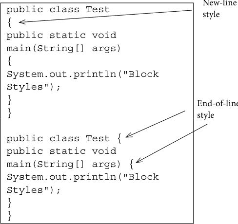
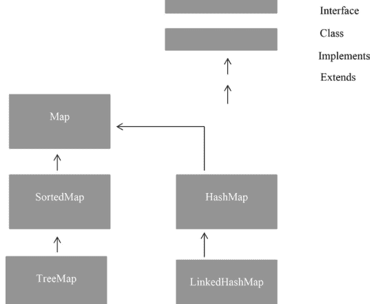
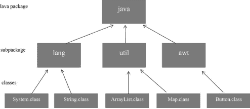
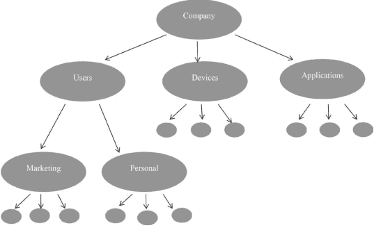

# Java 精通：初学者指南 (计算机科学精通)

“精通计算机科学”系列书籍由 Sufyan bin Uzayr 领导的 Zeba Academy 团队编写。

Zeba Academy 是一家教育科技企业，主要为 STEM 领域的学习者开发课程和内容，并为全球的大学和机构提供教育咨询。欲更多信息，请访问 https://zeba.academy

## 第 2 章 上手 Java

## 第 3 章 面向对象编程

## 第 4 章 创建和使用 Java 流

## 我们如何创建一个不可变类？

# 第 5 节 集合、列表与 Java 内置 API

## 什么是 Java 数组？

- Java 数组类的名称是什么？

- 创建 Java 数组拷贝

## JAVA SET

## Java 中的 LIST

## Java 中的 MAP 接口

## 在 Java 中遍历集合

# 第 6 节 库、包与模块

## 什么是 Java 库？

## 什么是 Java 中的包？

## JAVA 访问修饰符

## 封装

- 对象克隆的益处

- 对象拷贝有以下缺点

- 命名 Java 模块

- 模块根目录

- 模块系统

## 什么是 MAVEN？

## 什么是 GRADLE？

# 第 7 节 Java 数据库连接

## Java 中的什么是 JDBC？

## JDBC 驱动

- Statement 接口

## 数据库管理系统

## 数据库

## 数据库演进

## NoSQL 数据库

## 面向对象数据库

## 到底什么是关系型数据库管理？

## DBMS 体系

## 数据模型

# 第 8 节 Java I/O

- InputStream 类

- Java 中的 FileOutputStream 类

- FileOutputStream 类声明

- Java FileInputStream 类声明

# 第 9 节 Java 流

## Java 8 中的流式处理

- 确定最高和最低价格的 Java 流示例

## JAVA 收集器

# 第 10 章 使用 Lambda 表达式函数式编程

## 评价

## 索引

## 关于编辑

Sufyan bin Uzayr 是一位作家、编码员和企业家，在行业内拥有十多年的经验。他过去曾写过几本书，涵盖了从历史到计算机/IT 的各种主题。

Sufyan 是 Parakozm 的董事，这是一家专注于教育技术（EdTech）解决方案的跨国 IT 公司。他还运营 Zeba Academy，这是一个专注于 STEM 领域的在线学习与教学平台。

Sufyan 擅长多种技术，如 JavaScript、Dart、WordPress、Drupal、Linux 和 Python。他拥有多个学位，包括管理学、IT、文学和政治科学学位。

Sufyan 是一个数字游民，在四个国家之间生活。他曾在全球各地的大学和教育机构生活并任教。Sufyan 对技术、政治、文学、历史和体育有着浓厚的兴趣，在空余时间，他喜欢向青少年教授编程和英语。

访问 sufyanism.com 了解更多信息。

# Java 简介

## 本章内容

Java 是当今最广泛使用的编程语言之一。这一切始于 1990 年，当时一家处于计算机革命前沿的美国公司决定集合其顶尖工程师，设计并创建一个将成为新互联网世界重要参与者的产品。本书将介绍 Java 概念，包括它们的用法、关键特性以及基础语法。

# 第 2 章 精通 Java

## 什么是 JAVA？

Java 是一种面向对象编程 (OOP) 语言和软件平台，应用于数以亿计的设备，包括笔记本电脑、移动设备、游戏机、医疗设备等。Java 的原理和语法基于 C 和 C++ 编程语言。

Java 的移动性是一个巨大的优势。Java 在 1991 年由 Sun Microsystems（后被 Oracle 收购）创建时，其首要目标是“编写一次，到处运行”。至关重要的一点是，Java 和 JavaScript 不是一个东西。此外，Java 不仅用于网络浏览器，还广泛用于游戏和企业级软件。

## Java 是如何工作的？

在讨论 Java 持续流行的原因之前，让我们仔细观察 Java 是什么以及它是如何工作的。

Java 是一种面向对象编程 (OOP) 语言和软件平台的结合体。开发 Java 需要 Java 开发包 (JDK)，它支持 Windows、macOS 和 Linux。运行时环境 (JRE) 是 Java 虚拟机 (JVM) 的一部分，允许我们运行 Java 字节码。

JVM 在任何支持 JVM 的系统上解析并解释 Java 字节码。Java API 和 Java 软件平台组成了环境。Java API 包含许多库，包括网络、安全、可扩展标记语言 (XML) 创建和 Web 服务。特别是 Java 技术为创建 Web 应用提供了极佳的平台，而这是每个数字组织的基石。Java 应用服务器与数据库交互并提供动态 Web 内容。

## 为什么 Java 很重要？

假设我们担任企业级应用开发人员。在这种情况下，我们可能已经熟悉 Java，而且公司可能有成百上千万行代码。我们几乎需要某些 Java 知识来调试、维护和升级现有的代码库。

然而，仅仅从旧程序的角度来考虑 Java 是错误的。Java 编程语言是 Android 操作系统的核心，Android 运行在全球大多数智能手机上。Java 也是机器学习和数据研究领域广泛使用的编程语言之一。由于其健壮性、易用性、跨平台能力和安全性，Java 是许多企业公司互联网解决方案的首选语言。

## Java 的技术优势包括

在为下一个企业应用选择编程语言和环境时，选择 Java 的几个关键技术理由包括互操作性、可扩展性和适应性。

## Java 简介

Java 对新用例的适应性也让战略策略者印象深刻。例如，Java 通常被认为是物联网（IoT）的优秀平台。典型的 IoT 应用连接了许多不同的设备；由于 Java 安装在数十亿个设备上，这一过程变得简单得多。此外，Java 庞大的开发者社区不断创建并共享新的库，这些库具有为创建 IoT 应用而定制的功能。

## Java 在工作中的优势

Java 拥有坚实的技术理由和商业依据：庞大的人才储备、低的学习曲线以及广泛的集成开发环境（IDE）选择。

随着越来越多的公司采用联动设备、机器学习算法和云解决方案，对优秀开发者的需求正在不断增长。许多观察者认为，不久后高级程序员将出现短缺，这为新的软件初创企业提供人才带来了挑战。在不久的将来，对移动应用开发者的需求可能会迅速超出供应。

在 Java 上投入大量软件工作的一个非常有力的理由是 Java 工程师庞大的技能池。当招聘经理为 Java 开发者发布职位空缺时，他们可能预期收到许多合格的申请者并迅速填补这些职位。经理还可以雇用合同资源来补充内部人员进行某些活动，而无需雇用更多人。

大型软件项目除了经验丰富的工程师外，还需要大量的初级贡献者。虽然 Java 仍然是大学计算机科学课程中常见的编程语言，但许多毕业生缺乏立即发挥作用的必要技能。Java 比许多其他编程语言更容易学习和精通，导致了更短的学习曲线和更快的生产力提升。Java 庞大的在线开发者论坛、教程和用户组社区帮助新程序员跟上进度，同时也为经验丰富的程序员提供了实用的、经过测试的解决方案。

经验丰富的 Java 开发者可以快速学习新环境，这允许开发经理选择最适合项目类型、预算、开发流程和程序员技能水平的 IDE。对许多经验丰富的 Java 程序员来说，`NetBeans`、`Eclipse` 和 `IntelliJ IDEA` 是企业级应用开发的三个最佳 IDE。然而，在某些情况下，轻量级 IDE（如 `DrJava`、`BlueJ`、`JCreator` 或 `Eclipse Che`）是更好的选择。

## JAVA 编程语言具有以下特征

Java 的创建考虑了通用性，允许程序员构建可以在任何系统或设备上运行的代码，无论架构或平台如何。¹ 它是地球上使用最广泛的编程语言之一，被设计为在每个平台上都能可靠地运行。Java 术语（Java BuzzWords）是一组 Java 特性²

¹ https://techvidvan.com/tutorials/features-of-java-programming-language/ Tech Vidaan

² https://www.tutorialspoint.com/What-are-the-major-features-of-Java-programming, tutorialspoint

Sun MicroSystems 官方描述 Java 具有以下特征：

- 简单且众所周知
- 对数据进行编译和解释
- 平台无关
- 可移植
- 架构中立
- 面向对象
- 健壮
- 安全
- 分布式
- 交互式和多线程
- 性能卓越
- 可扩展和动态

### 简单且众所周知

Java 之所以简单是因为：

- 它有非常清晰且易于理解的代码风格。通过排除 C 和 C++ 等其他语言中常见的复杂且具有挑战性的方面来降低复杂性：
  - 显式指针概念
  - 用于存储数据的类
  - 头文件和预处理器
  - 多重继承
  - 运算符重载
  - Goto 语句

除了消除这些令人困惑和不明确的概念外，还有一种“自动垃圾回收”功能，消除了显式删除未引用对象的需求。

Java 之所以众所周知是因为：

- 它建立在 C 和 C++ 等知名语言之上，并整合了它们的许多功能。
- 它消除了 C/C++ 的缺点、复杂性和困惑的方面。如果你熟悉 C/C++，你会发现 Java 非常友好且容易学习。

### 对数据进行编译和解释

计算机语言通常被编译或解释。Java 将编译语言的优势与解释型语言的灵活性结合在一起。

Java 编译器将源码转换为字节码。

Java 解释字节码。

以下图显示了过程：

### 平台无关

Java 最重要的特性是平台无关，这允许程序员构建可以在任何系统或设备上运行的代码，无论架构或平台如何。它是地球上使用最广泛的编程语言之一，被设计为在每个平台上都能可靠地运行。Java 术语是一组 Java 特性。

### 分布式

由于 Java 允许用户开发分布式应用程序，因此 Java 是分布式的。我们可以在 Java 中将程序拆分为许多部分并保存到不同的机器上。坐在一台设备上的 Java 程序员可以连接到另一台机器的软件。这种 Java 特性允许分布式编程，这在处理大型项目时特别有用。Java 中的 RMI（远程方法调用）和 EJB（企业级 JavaBeans）概念使我们能够做到这一点。Java 拥有大量的类，可以通过 TCP/IP 协议（如超文本传输协议 HTTP 和文件传输协议 FTP）进行连接，这使得网络交互比 C/C++ 更加简单。它还允许来自不同地区的程序员在同一个项目上协作。


### 交互式与多线程

线程是程序中同时运行的独立执行路径。多线程指的是同时处理任务或并行运行程序的不同部分。Java 代码被拆分成更小的块，由 Java 在逻辑上且及时地运行这些块。

优势：

- 多线程的主要优势是它允许对资源利用利用。
- 每个线程不占用内存。它有一个共享的内存空间。
- 不需要等待应用程序完成一项工作再进行下一个工作。
- 维护成本已经降低。它还节省时间。
- 它提高了复杂应用程序的效率。

Java 是交互式的，因为它的代码允许出色的字符用户界面（CUI）和图形用户界面（GUI）。它极大地提高了图形程序的交互性能。

## 卓越的性能

由于采用了中间字节码，Java 的速度对于解释型语言来说是卓越的。Java 中的即时编译（Just In Time）编译器通过按需编译代码（仅编译正在调用的方法）来提供卓越的速度。这节省了时间并提高了效率。Java 的架构设计也降低了运行时开销。在 Java 程序中加入多线程提高了整体执行速度。由于 Java 编译器生成了高度高效的字节码，JVM 可以快得多地处理它们。

## 可扩展性与动态性

Java 是动态且可扩展的，这意味着我们可以使用面向对象编程（OOP）向类添加类和新方法，并使用子类创建新类。这使得我们能够扩展甚至更改类。Java 允许你动态地链接新的类库、方法和对象。它是极其动态的，因为它可以适应变化的环境。Java 允许在 Java 项目中使用用其他语言（如 C 和 C++）编写的函数。这些被称为“原生技术”。在运行时，这些方法是动态连接的。

## 基础语法

每种编程语言都有自己的语法。在学习和熟悉它们之前，我们将回顾 Java 中你应该知道的所有语法。

语法指的是 Java 程序编写的格式，以及用于编译和运行它所使用的命令。如果程序员或学习者缺乏适当的语法知识，很难从程序中获得所需的输出。

### 什么是 Java 语法？

决定如何构建和理解 Java 程序的规则称为 Java 语法。Java 的语法源于 C 和 C++。然而，存在许多差异，例如与 C++ 相比，Java 缺乏全局变量。

在 Java 中，代码属于对象和类。为了避免编程错误，Java 不包含某些功能，如运算符重载和显式指针的使用。

所以让我们从 Java 的基本语法开始。标识符（Identifiers）是 Java 程序的根本组成部分。标识符用于给程序的不同部分命名，例如变量、对象、类、方法和数组。

> [https://www.baeldung.com/java-syntax](https://www.baeldung.com/java-syntax) Baeldung

- 对象：对象由状态和动作组成。例如，一只狗有颜色、品种等状态，以及摇尾巴、吠叫和进食等动作。类的实例就是一个对象。
- 类：类是一种模式，描述了该类别的对象可能支持的状态。
- 方法：“方法”一词指的是一种行为类型。在单个类中可以找到许多方法。方法是表达逻辑、处理数据和执行所有操作的地方。
- 实例变量：每个对象都有一组其唯一的实例变量。提供给这些实例变量的值决定了对象的状态。

#### 第一个 Java 程序

考虑以下代码，它会打印单词 Hello。

示例如下：

```java
public class FirstJavaProgram {
    /* 这是我的第一个 java  程序。
     * 这将打印 'Hello Everyone' 
     */
    public static void main(String[] args) {
        System.out.println("Hello Everyone");
    }
}
```

让我们看看如何保存文件、编译并运行它。请按照以下步骤操作：

- 打开记事本并按上述方式添加代码。
- 将文件保存为：`FirstJavaProgram.java`。
- 打开命令提示符窗口并进入保存该类的目录。假设路径是 `C:\`。
- 输入 `javac FirstJavaProgram.java` 并回车以编译你的代码。如果代码没有错误，命令提示符将带你进入以下行（假设）。
- 输入 `java FirstJavaProgram` 运行你的代码。

### 初学者语法

记住以下内容至关重要，这在处理 Java 时意味着以下几点：

- Java 是区分大小写的，这意味着大写和小写有不同的含义。
- 类名的首字母应该大写。如果类名由单词组成，每个单词的首字母都应该大写。
- 示例：`FirstJavaClass` 是类的示例。
- 方法名应全部以小写开头。
- `main()` 方法是任何 Java 程序的必要部分，它启动处理过程。
- **Catch**：Java 中的 `catch` 关键字用于捕获由 `try` 语句抛出的异常。它只能在 `try` 块之后使用。
- **Char**：Java 中的 `char` 关键字用于创建一个包含无符号 16 位 Unicode 字符的变量。
- **Class**：在 Java 中声明一个类，使用 `class` 关键字。
- **Continue**：Java 中的 `continue` 关键字用于保持循环继续。它在特定情况下跳过剩余代码，同时继续程序的当前执行流。
- **Default**：`switch` 语句中的 `default` 代码块由 Java 的 `default` 关键字指定。
- **Do**：Java 中的 `do` 关键字用于在控制语句中标识循环。它可以重复执行程序的某部分内容。
- **Double**：Java 中的 `double` 关键字用于创建一个包含 64 位浮点值的变量。
- **Else**：在 `if` 语句中，Java 的 `else` 关键字用于表示备选分支。
- **Enum**：Java 中的 `enum` 关键字用于指定一组固定常量。枚举构造函数始终使用私有或默认构造函数。
- **Extends**：Java 中的 `extends` 关键字用于表示类继承自另一个类或接口。
- **Final**：Java 中的 `final` 关键字用于表示变量具有常量值。它与变量结合使用，防止用户更改变量的值。
- **Finally**：Java 中的 `finally` 关键字表示 `try-catch` 结构中的一个代码块。无论是否处理了异常，该块始终会被执行。
- **Float**：Java 中的 `float` 关键字用于创建一个包含 32 位浮点数的变量。
- **For**：Java 中的 `for` 关键字用于开始 `for` 循环。当满足条件时，它用于重复执行一组指令/函数。如果迭代次数是固定，则优选 `for` 循环。
- **If**：Java 中的 `if` 关键字用于测试条件。如果条件为真，则执行该块。
- **Implements**：`implements` 关键字在 Java 中实现接口。
- **Import**：Java 中的 `import` 关键字使类和接口对当前源代码可用。
- **Instanceof**：Java 中的 `instanceof` 关键字用于判断对象是否是特定类的实例或是否实现了某个接口。
- **Int**：Java 中的 `int` 关键字用于声明可以存储有符号 32 位整数的变量。
- **Interface**：Java 中的 `interface` 关键字用于声明接口。它局限于抽象技术。
- **Long**：Java 中的 `long` 关键字用于指定可能存储 64 位整数的变量。
- **Native**：Java `native` 关键字表示该方法是使用 JNI（Java 原生接口）在原生代码中实现的。
- **New**：Java 中的 `new` 关键字用于创建新对象。
- **Null**：Java 中的 `null` 关键字用于表示引用不指向任何对象。它消除了垃圾值。
- **Package**：Java 中的 `package` 关键字用于声明包含这些类的包。
- **Private**：Java 中的 `private` 关键字是一种访问修饰符。它表示方法或变量仅可以在声明它的类中被访问。
- **Protected**：Java 中的 `protected` 关键字是一种访问修饰符。可以在包内和包外访问，但只能通过继承访问。无法直接与类配合使用。
- **Public**：Java 中的 `public` 关键字是一种访问修饰符。这个短语意味着可以在任何地方找到任何内容。在所有修饰符中，它的用途最广。
- **Return**：当方法的执行完成时，Java 的 `return` 关键字用于退出方法。
- **Short**：Java `short` 关键字用于声明具有 16 位整数容量的变量。
- **Static**：Java 中的 `static` 关键字表示变量或函数属于一个类。在 Java 中，`static` 关键字主要用于控制内存。
- **Strictfp**：为了保证移植性，Java `strictfp` 用于限制浮点计算。
- **Super**：Java 中的 `super` 关键字是一个指向父类对象的引用变量。它可以调用直接父类的方法。
- **Switch**：Java 中的 `switch` 关键字包含一个 `switch` 语句，根据测试值执行代码。`switch` 语句比较多个值以查看它们相等。
- **Synchronized**：在多线程编程中，`synchronized` 关键字用于标识关键部分或函数。
- **This**：在 Java 方法中，`this` 关键字可以引用当前对象。
- **Throw**：Java 中的 `throw` 关键字用于显式抛出异常。抛出自定义异常是 `throw` 关键字最常用的用法。之后是一个示例。
- **Throws**：Java 中的 `throws` 关键字用于声明异常。`throws` 可用于传播检查异常。
- **Transient**：在序列化中使用了 Java 的 `transient` 关键字。任何标记为 `transient` 的数据成员都不会被序列化。
- **Try**：Java 中的 `try` 关键字用于开始一个将被检查的代码块。`try` 块之后必须跟随 `catch` 或 `finally` 块。
- **Void**：Java 中的 `void` 关键字用于表示方法没有返回值。
- **Volatile**：在多线程编程中，`volatile` 关键字表示变量可能会改变。
- **While**：Java 中的 `while` 关键字用于开始循环。

## Java 修饰符

Java 中的修饰符用于定义变量和方法的行为。它们分为两类：

- 访问修饰符：`public`、`protected`、`private`、`default`。
- 非访问修饰符：`final`、`static`、`transient`、`volatile`。

## Java 变量

Java 变量用于存储数据。变量有：

- 局部变量：声明在方法内部。
- 静态变量：属于类。
- 实例变量：属于类的对象。

## Java 枚举

枚举是在 Java 5.0 中引入的，有助于定义一组常量。

## Java 字面量

字面量是赋值给变量的固定值。在 Java 中有几种：

- 数字：
    - 整数字面量：没有小数部分的整数（例如 `10`）。
    - 二进制字面量：以 `0b` 开头数字（例如 `0b11`）。
    - 八进制字面量：以 `0` 开头数字（例如 `056`）。
    - 十六进制字面量：以 `0x` 开头数字（例如 `0x246`）。
    - 浮点数：带有小数点的实数（例如 `-15.6`、`1.876`）。
- 字符：用单引号括起的单个字符（例如 `'b'`）。
    - 转义序列：反斜杠后的字符（例如 `'\n'`、`'\t'`）。
    - Unicode 表示：使用 `'\u'` 表示的字符（例如 `'\u0057'`）。
- 布尔值：两个可能的值：`true` 或 `false`。
- 字符串：用双引号括起来的多字符常量（例如 `"java-class"`）。

## 注释

以下是不同类型的注释：

- Java 单行注释：这些单行注释由在代码行之后添加的单行文本组成，用于阐明其含义。我们可以用两个正斜线（`//`）来指定单行注释，当在编辑器中引入新行时，它会立即结束。

示例：

```java
int num = 4;
// 定义值
System.out.println("The value is: " + num);
// 打印
```

- Java 多行注释：在整个程序中，多行注释可以跨许多行。为了详细阐述算法，我们可以在程序的开始编写它们。开发者还使用它们在调试时注释掉某些代码段。我们可以通过在代码前放置一个起始标记（`/*`）和结束标记（`*/`）来使用它们。

示例：

```java
int num = 4;
System.out.println("The value is: " + num);
/* 编译器将不会执行它。
定义数字的值并打印该值。这是一个多行注释。 */
```

## 空行

空行是指仅包含空白字符的行，可能带有备注，Java 会完全忽略它。

## 继承

在 Java 中，类可以派生自其他类。本质上，如果你需要构建一个新类，并且你的代码需要某个现有类的一部分，你可以从当前代码派生你的新类。

这个想法允许你重用现有的类字段和函数，而无需在新类中重新创建代码。在这种情况下，当前类被称为超类，派生类被称为子类。

## 接口

在 Java 编程语言中，接口是对象之间的一种契约，规定了它们通信的方式。涉及到继承时，接口非常重要。接口规定了派生类（子类）应该使用哪些方法。然而，实现这些方法完全取决于子类。

在本章中，我们讨论了 Java 是什么以及它是如何工作的、为什么它是本质的以及它的优势。我们还学习了 Java 编程语言的许多特性。我们还学习了 Java 语法的基础。


# Java 入门

- 本章内容
- 如何安装和运行 Java
- Java 原始类型和运算符
- 控制结构
- Java 循环指南
- Java 包指南

在上一章中，我们讨论了 Java 是什么、为什么使用它、它的特征是什么以及 Java 的核心功能。在本章中，我们将介绍如何在个人电脑（PC）上安装和运行 Java。不同的运算符和控制结构有哪些，以及整个包是什么？

DOI: 10.1201/9781003229063-2

## 如何在 Windows 计算机上设置 Java

我们可以使用此 Java 开发工具包（JDK）来编写和运行 Java 程序。在同一台计算机上安装多个版本的 JDK 是可行的。但建议我们在 Windows 10 上安装最新版本的 Java。在 Windows 10 中安装 JDK 8（32 位免费下载或 Windows 64 位 JDK 8 免费下载）的安装步骤如下：

- 步骤 1：点击链接 https://www.oracle.com/java/technologies/downloads/ 获取 Java，进入 JDK 并下载 JDK 8。
- 步骤 2：接受许可协议。下载适用于 32 位或 64 位操作系统的 Java 8。
- 步骤 3：点击安装链接时会弹出窗口。点击它后，检查并接受 Java 标准版 (SE) 开发工具包的 Oracle 许可协议；我们将被重定向到安装界面。
- 步骤 4：点击安装链接后弹出窗口。（原文此处存在重复乱码，已清理）


# 26 精通 Java

以下是不同类型的注释：

- **Java 单行注释**：这些单行注释由在代码行之后添加的单行文本组成，用于阐明其含义。我们可以用两个正斜线（`//`）来指定单行注释，当在编辑器中引入新行时，它会立即结束。

示例：

```java
int num = 4;
//定义值
System.out.println("The value is: " + number);
//打印
```

- **Java 多行注释**：在整个程序中，多行注释可以跨许多行。为了详细阐述算法，我们可以在程序的开始编写它们。开发者还使用它们在调试时注释掉某些代码段。我们可以通过在代码前放置一个起始标记（`/*`）和结束标记（`*/`）来使用它们。

示例：

```java
int num = 4;
System.out.println("The value is: " + number);
/* 编译器将不会执行它。
定义数字的值并打印该值。这是一个多行注释。 */
```

## 空行

空行是指仅包含空白字符的行，可能带有备注，Java 会完全忽略它。

## 继承

在 Java 中，类可以派自其他类。本质上，如果你需要构建一个新类，并且你的代码需要某个现有类的一部分，你可以从当前代码派生你的新类。

这个想法允许你重用现有的类字段和函数，而无需在新类中重新创建代码。在这种情况下，当前类被称为超类，派生类被称为子类。

## 接口

在 Java 编程语言中，接口是对象之间的一种约定，规定了它们通信的方式。涉及到继承时，接口非常重要。接口规定了派生类（子类）应该使用哪些方法。然而，实现这些方法完全取决于子类。

在本章，我们讨论了 Java 是什么以及它是如何工作的、为什么它是本质的以及它的优势。我们还学习了 Java 编程语言的许多特性。我们还学习了 Java 语法的基础。


# 27 Java 入门

## 本章内容

- 如何安装和运行 Java
- Java 原始类型和运算符
- 控制结构
- Java 循环指南
- Java 包指南

在上一章中，我们讨论了 Java 是什么、为什么使用它、它的特征是什么以及 Java 的核心功能。在本章中，我们将介绍如何在个人电脑（PC）上安装和运行 Java。不同的运算符和控制结构有哪些，以及整个包是什么？

DOI: 10.1201/9781003229063-2

# 30 精通 Java

## 如何在 Windows 计算机上设置 Java

我们可以使用此 Java 开发工具包（`JDK`）来编写和运行 Java 程序。在同一台计算机上安装多个版本的 `JDK` 是可行的。但建议我们在 Windows 10 上安装最新版本的 Java。在 Windows 10 中安装 `JDK 8`（32 位免费下载或 Windows 64 位 `JDK 8` 免费下载）的安装步骤如下：

- 步骤 1：点击链接 `https://www.oracle.com/java/technologies/downloads/` 获取 Java，进入 `JDK` 并下载 `JDK 8`。
- 步骤 2：接受许可协议。下载适用于 32 位或 64 位操作系统的 Java 8。
- 步骤 3：点击安装链接时会弹出窗口。点击它后，检查并接受 Java 标准版 (`SE`) 开发工具包的 Oracle 许可协议；我们将被重定向到安装界面。

## Java 原始数据类型

- 整数、浮点数、字符和布尔类型在 Java 中都由数据类型表示。它们被称为原始数据类型。

## 示例程序

- 当我们编写代码时，我们将算法转换为计算机可以理解的编程语言。
- 以下是程序的总结：

```java
// Area.Java: calculate the area
public class Area {
    public static void main(String[] args) {
        double radius; // 变量和数据类型
        double area;

        // radius 赋值
        radius = 20;

        // 计算面积
        area = radius * radius * 3.14159;

        // 显示结果
        System.out.println("The area for the \ncircle: " + radius + " is " + area);
    }
}
```

- 半径必须由变量符号表示，且该符号必须在程序中声明。在软件中，变量用于存储数据和计算结果。
- 不要使用 `a` 和 `b`，而要使用描述性的标签。使用 `radius` 和 `area` 来表示面积。指定它们的数据类型是整数、浮点数还是其他，以告诉编译器 `radius` 和 `area` 是什么。
- `radius` 和 `area` 在程序中被声明为双精度变量。关键字 `double` 表示 `radius` 和 `area` 在计算机中被存储为双精度浮点数。

## 标识符

- 在编程语言中，变量、常量、方法、类和包使用称为“标识符”的特殊符号命名。
- 标识符的命名准则如下：
  - 标识符是由字母、下划线（`_`）、数字和美元符号（`$`）组成的字符串。
  - 标识符必须以字母、下划线（`_`）或美元符号（`$`）开头。不能以数字开头。
  - 不能使用保留字作为标识符。（保留字列表请参见附录 A，“Java 关键字”）。
  - 标识符不能同时为 `true`、`false` 或 `null`。
  - 标识符的长度无限制。
- 合法 ID 的示例包括 `$4`、`ComputeArea`、`radius` 和 `showMessageDialog`。
- 非法 ID 的示例为 `4A` 和 `d+8`。
- 因为 Java 是区分大小写的，字母 `A` 和 `a` 是不同的标识符。

## 变量

- 变量用于在程序中存储数据。
- 我们可以使用以下代码来计算不同半径的面积：

示例：

```java
// 计算第一个半径的面积
area = radius * radius * 3.14159;
System.out.println("Area " + area + " for radius " + radius);
```

```java
// 计算第二个半径的面积
area = radius * radius * 3.14159;
System.out.println("Area " + area + " for radius " + radius);
```

## 变量声明

- 变量用于表示特定类型的数据。
- 要使用变量，我们必须通过告诉编译器它的名称和它代表的数据类型来首先定义它。这种行为称为变量声明。
- 声明变量指示编译器根据其数据类型为变量分配内存。变量声明见以下示例：

```java
int a;
char c;
double r;
```

- 如果两个变量是同一种类型，可以使用简写形式定义为单个变量：`datatype var1, var2, ..., varn`。

## 赋值表达式和赋值语句

- 我们可以在变量声明后使用赋值语句为变量赋值。赋值语句具有以下语法：

```java
variable = expr;
x = 3; // 将 3 赋值给 x;
radius = 2.0; // 将 2.0 赋值给 radius;
d = 'D'; // 将 'D' 赋值给 d;
```

- 我们也可以在表达式中使用变量。

```java
y = y + 3; // 将 y + 3 的结果赋值给 y;
```

- 变量名必须位于赋值运算符的左侧以便为其赋值。

```java
4 = y; // 错误
```

- Java 中的赋值语句也可以被视为赋值给赋值运算符左侧变量的表达式。赋值运算符是 `=`。

```java
System.out.println(y = 6); // 等同于 y = 6; System.out.println(y);
// 以下语句也是正确的：a = b = c = 2; 等同于 c = 2; b = 2; a = 2;
```

## 在单步中声明和初始化变量

```java
int y;
y = 1; // 声明和初始化变量的简写形式
int a = 1, b = 2;
```

## 常量

- 变量的值在程序执行过程中可能会变化，而常量代表永远不变的数据。
- 以下是声明常量的语法：

```java
final CONSTANTNAME = VALUE;
```

示例：

```java
final double PI = 3.14;
final int SIZE = 6;
```

- 在使用常量之前，必须对其进行声明和初始化。声明后不能修改常量的值。按照习惯，常量使用大写字母。

示例：

```java
// Area.Java: calculate the area
public class Area // 类名
{
    public static void main(String[] args) // 方法签名
    {
        final double PI = 3.14; // 声明常量
        double radius = 10; // 赋值
        double area = radius * radius * PI; // 计算面积
        // 结果
        System.out.println("Area for the circle " + radius + " is " + area);
    }
}
```

# 数字数据类型

- 每个数据类型都有其可以包含的值。根据每个变量或常量的数据类型，编译器分配内存空间。Java 中提供了六种数字类型：四个整数和两个浮点值。

| 名称 | 存储大小 | 范围 |
| :--- | :--- | :--- |
| `byte` | 8 比特 | -128 to 127 |
| `short` | 16 比特 | -32768 to 32767 |
| `int` | 32 比特 | -2147483648 to 2147483647 |
| `long` | 64 比特 | -2^63 to 2^63-1 |
| `float` | 32 比特 | 7 位精度 |
| `double` | 64 比特 | 14-15 位精度 |

## 数字运算符 `+`, `-`, `*`, `/`, `%`

| 表达式 | 说明 | 结果 |
| :--- | :--- | :--- |
| `5/2` | 产生整数 | `2` |
| `5.0/2` | 产生双精度值 | `2.5` |
| `-5/2` | 产生整数值 | `-2` |
| `-5.0/2` | 产生双精度值 | `-2.5` |
| `-7 % 3` | 产生 | `-1` |
| `-12 % 4` | 产生 | `0` |
| `-26 % -8` | 产生 | `-2` |
| `20 % -13` | 产生 | `7` |

## 数字字面量

- 字面量是独立出现在程序中的常量值¹。在以下语句中，`64` 和 `2.0` 是字面量：

```java
int a = 64;
double d = 2.0;
```

¹ https://www.geeksforgeeks.org/literals-in-java/, GeeksforGeeks

## 整数字面量

- 只要整数字面量符合变量，就可以赋值给它。如果字面量太大变量无法包含，会导致编译错误。例如，表达式 `byte a = 10000` 将导致编译错误，因为 `10000` 无法存储在字节类型变量中。
- 整数字面量的值假设范围是 `-2^31` (-2147483648) 到 `2^31-1` (2147483647)。
- 在 `long` 类型的整数字面量后面附加字母 `L` 表示它（建议使用大写 `L`）。例如，以下代码显示十六进制整数 `FFFF` 的十进制值 `65535`。

示例：

```java
System.out.println(0xFFFF);
```

## 浮点字面量

- 浮点字面量中使用小数点。浮点字面量默认解释为 `double` 类型值。例如，`2.0` 是双精度值而不是浮点数。
- `float` 通过在数字后面附加字母 `f` 或 `F` 创建，而 `double` 通过在数字后面附加字母 `d` 或 `D` 创建。对于浮点数，使用 `201.2f` 或 `201.2F`；对于双精度数，使用 `201.2d` 或 `201.2D`。
- `double` 类型的值比 `float` 类型的值更精确。

示例：

```java
System.out.println("value is " + 2.0 / 5.0);
// Output will be value is 0.4
```

## 科学计数法

- 科学计数法可指定浮点字面量；例如，`1.23456e+2` 等同于 `123.456`，而 `1.23456e-2` 等于 `0.0123456`。

## 算术表达式

- 考虑算术表达式 `(5 + 4 * x)/4 – 10 * (y - 4)*(a + b + c)/x + 8 *(5/x + (8 + x)/y)`。
- 括号内的运算符先求值。
- 括号可以嵌套，在这种情况下，先对内括号的表达式求值。
- 之后，使用乘法、除法和取余运算符。按照从左到右的操作顺序。
- 减法和加法最后执行。

## 快捷运算符

| 运算符 | 示例 | 等效于 |
| :--- | :--- | :--- |
| `+=` | `i += 8` | `i = i + 8` |
| `-=` | `f -= 8.0` | `f = f - 8.0` |
| `*=` | `i *= 8` | `i = i * 8` |
| `/=` | `i /= 8` | `i = i / 8` |
| `%=` | `i %= 8` | `i = i % 8` |

- 对于变量的加 1 和减 1，还有两个快捷运算符。`++` 和 `--` 是这两个运算符。它们可以作为前缀或后缀形式编写。

| 形式 | 示例 | 说明 |
| :--- | :--- | :--- |
| 后缀 | `x++;` | 等效于 `x = x + 1` |
| 前缀 | `++x;` | 等效于 `x = x + 1` |
| 后缀 | `x--;` | 等效于 `x = x - 1` |
| 前缀 | `--x;` | 等效于 `x = x - 1` |

## 增量和递减运算符

- **`++var` (前增量)**：在 `var` 加 1 之后，表达式 (`++var`) 评估 `var` 中的新值。
- **`var++` (后增量)**：表达式 (`var++`) 返回 `var` 的原始值并将其增加 1。
- **`--var` (前递减)**：在 `var` 减 1 之后，表达式 (`--var`) 评估 `var` 中的新值。
- **`var--` (后递减)**：表达式 (`var--`) 评估 `var` 中的原始值并将 `var` 减 1。

示例：

```java
double a = 2.0; double b = 7.0;
double d = a-- + (++b);
```

- 使用增量和递减运算符简化表达式会让它们变得更加复杂且难以解释。避免在像 `int h = ++i + i` 这样的表达式中使用这些运算符，因为会多次修改同一个变量。

## 数值类型转换

- 请看以下语句：

```java
byte i = 300; // 编译错误：300 超出 byte 范围
long k = i * 4 + 5;
double d = i * 4.1 + k / 3;
```

- 当执行两个不同类型的二元运算时，Java 会根据以下规则自动转换操作数：
  1. 如果其中一个操作数是 `double`，另一个也转换为 `double`。
  2. 如果其中一个操作数是 `float`，另一个也转换为 `float`。
  3. 如果其中一个操作数是 `long`，另一个也转换为 `long`。
  4. 如果两个操作数都不是 `int`、`long`、`float`、`double`，则两个操作数都将转换为 `int`。
- 结果是，`1/2` 的结果是 `0`，`1.0/2` 的结果是 `0.5`。
- 类型强制转换是将一种数据类型的值转换为另一种数据类型的值的过程。
- 将范围有限的变量转换为范围更宽的变量称为无显式强制转换的扩大；类型可以自动拓宽。


- 将具有广泛范围类型的变量转换为范围较小的变量称为收窄。类型收窄的过程必须显式地进行。

- 注意：如果我们给范围较窄的类型的变量赋值，则需要进行强制转换。如果在这些实例中未使用强制转换，将导致编译错误。数据丢失可能会导致结果不准确。

```
float f = (float) 1.1;
int i = (int) f;
```

```
double c = 3.5;
int i = (int) c;
System.out.println("c " + c + " " + i);
```

隐式转换

```
double c = 4; // 类型拓宽
```

显式转换

```
int i = (int) 4.0; // 类型收窄
```

哪里错了？

```
int i = 1;
byte b = i; // 错误，因为需要显式强制转换
```

# 字符数据类型和操作

- 数据类型表示单个字符。

- 单引号字面量

```
char letter = 'D'; // 将字母赋予 char 变量 (ASCII)
char numChar = '6'; // 将数字字符赋值给 numChar
```

- 使用字面量时要小心，因为它必须包含在引号中。包含单引号中的单个字符被称为字符。因此 `'D'` 是一个字符，而 `"D"` 是一个字符串。

## Unicode 和 ASCII 码

- Unicode 是由 Unicode 组织开发的 16 位编码方法，旨在促进世界各种语言文字文本的交换、处理和显示。

- Unicode 需要两个字节，用十六进制表示，范围从 `0000` 到 `FFFF`。单词 "coffee" 使用两个字符翻译成 Unicode；例如：

```
char letter = '\u0041'; // (Unicode)
char numChar = '\u0034'; // (Unicode)
```

- 因为 `FFFF` 在十六进制中是 65535，Unicode 可以表示 65536 个字符。

- 美国标准交换码表示所有大小写字母、标点符号和控制字符。ASCII 码范围从 `0000` 到 `007F`，等于 128 个字符。

- 注意：要获取下一个或上一个字符，请在 `char` 变量上使用加和递减运算符。

- 以下语句示例了字符 `c`：

```
char ch = 'c';
System.out.println(++ch);
```

## 特殊字符转义序列

| 说明 | 转义序列 | Unicode |
| :--- | :--- | :--- |
| 退格 | `\b` | `\u0008` |
| 制表符 | `\t` | `\u0009` |
| 换行 | `\n` | `\u000A` |
| 回车 | `\r` | `\u000D` |
| 反斜杠 | `\\` | `\u005C` |
| 单引号 | `\'` | `\u0027` |
| 双引号 | `\"` | `\u0022` |

## 字符与数值之间的转换

- 如果我们给范围较窄的类型的变量赋值，则需要强制转换。如果在此类实例中未使用强制转换，将导致编译错误。数据丢失可能会导致结果不准确。

- 字符可以与数值之间转换。

- 如果一个操作数是数字，它就会转换为数字。

- 字符可以与字符串转换。

- 如果一个操作数是字符串，它就会转换为字符串。

- 字符的加增和递减。是 字符 97。

```
int i = 'a'; // 强制转换所需的
```

- 字符的拓宽是 99。

```
char c = 99;
```

## 字符串类型

- 字符串类型表示字符序列。

**示例：**

```
String message = "Welcome to";
```

- 就像 `System` 类和 `JOptionPane` 类，`String` 类型是预定义的类型。

- 字符串可以作为变量使用。

- 字符串的加增和递减是。

## 字符串拼接

- 如果一个操作数是字符串，加号 (`+`) 是拼接运算符。

- 如果一个操作数是非字符串（例如数字），它会被转换为字符串。

示例：

```
String message = "Welcome" + "to " + "MyJava";
```

## 字符串转换为数字

### 字符串转整数

- 输入对话框返回的是字符串。如果我们输入数值值如 123，它返回 `"123"`。为了获取输入的数字，我们必须将字符串转换为数字。

- 要将字符串转换为 `int` 值，可以使用 `Integer` 类的静态 `parseInt` 方法，如下：

```
int val = Integer.parseInt(intString);
```

其中 `intString` 是数值字符串 `"132"`。

### 字符串转双精度

- 我们可以使用静态 `parseDouble` 函数将字符串转换为 `double` 值，如下：

```
double val = Double.parseDouble(doubleString);
```

其中 `doubleString` 是数值字符串 `"132.42"`。

## 开始 Java

### 使用控制台输入

### 使用 Scanner 获取信息

- 创建 `Scanner` 对象

```
Scanner scan = new Scanner(System.in);
```

- 要获取字符串、`byte`、`short`、`int`、`long`、`float`、`double` 或布尔值，请使用 `next()`、`nextShort()`、`nextInt()`、`nextLong()`、`nextFloat()`、`nextDouble()`、`nextBoolean()` 方法。例如，

```
System.out.print("Enter double value: ");
Scanner scan = new Scanner(System.in);
double db = scan.nextDouble();
```

源代码：

```java
import java.util.Scanner;

public class testscan {
    public static void main(String args[]) {
        Scanner scanner = new Scanner(System.in);
        // 创建一个 Scanner
        System.out.print("Enter an integer: ");
        int value = scanner.nextInt();
        System.out.println("Entered the integer " + value);

        // 用户输入双精度值
        System.out.print("Enter double value: ");
        double dvalue = scanner.nextDouble();
        System.out.println("Entered the double value " + dvalue);
    }
}
```

# 54 精通 Java

```java
// 用户输入字符串
System.out.print("输入不带空格的字符串:");
String str = scanner.next();
System.out.println("你输入的字符串是 " + str);
```

## 文档与编程风格

- 编程风格关注程序的外观。

- 程序的文档是解释性说明和注释的集合。

- 编程风格和文档与代码一样同样重要。它们使得程序变得易于遵循。

## 合适当的注释与注释风格

- 在程序开始处，提供一段描述，说明程序的功能、其显著特征、支持的数据结构以及所采用的独特方法。

- 包含引入每个关键步骤的注释，并阐明大型程序中任何难以阅读的内容。

- 保持注释简短，以免阻塞显示或增加跟进的难度。

- 程序的开头应包含你的姓名、班级编号、日期、讲师以及一段简短的描述。

## 命名规范

- 对于变量和方法，使用小写字母。如果一个名称由多个单词组成，将它们全部合并成一个，并将第一个单词小写，然后将后续每个单词的首字母大写。例如：`showDialog`。

- 选择具有意义且具描述性的名称。变量 `radius` 和 `area`，以及过程 `computeArea` 都是示例。

- 在类名中，每个单词的首字母大写。例如，`ComputeArea` 类。

- 在常量中，所有字母大写。考虑常量 `PI`。

- 不要使用 Java 库中已有的名称命名类。例如常量 `PI` 和 `MAX_VALUE`。

## 空格行与正确的缩进

- 缩进用于显示程序的组件或语句在结构上是连接的。

- 每个子组件比其嵌套的结构多缩进两个空格。

- 在二进制运算符的两侧都使用一个空格。

```java
boolean bn = 4 + 3 * 3 > 5 * (3 + 4)
```

- 使用空行划分代码部分。

## 块样式

- 块是由花括号包围的语句集合。对于花括号，使用行尾样式或换行样式。

```java
public class Test {
    public static void main(String[] args) {
        System.out.println("Block Styles");
    }
}

public class Test {
    public static void main(String[] args) {
        System.out.println("Block Styles");
    }
}
```



## 编程中的错误

### 语法问题“编译错误”

- 语法错误或编译错误是在编译期间发生的错误。语法错误是由代码位置的错误引起的，例如术语输入错误、删除了必要的标点符号或使用了左括号但没有对应的右括号。

- 这些错误很容易发现，因为编译器会通知你它们的位置和产生原因。

#### 示例：

```java
public class ShowErrors {
    public static void main(String[] args) {
        int i = 20;
        System.out.println(i + 5);
    }
}
```

### 运行时错误

- 运行时错误是导致程序意外崩溃的错误。

- 运行时错误发生在执行程序时环境识别出无法完成的操作。

- 例如，输入错误发生在用户输入了软件无法处理的意外输入值时。应用程序应该提醒用户输入正确类型的数据以避免输入错误。

- 除以零是运行时错误的另一个示例。

```java
public class ShowErrors {
    public static void main(String[] args) {
        int i = 1 / 0;
    }
}
```

58 精通 Java

### 逻辑错误

- 当程序没有按照预期工作时，就发生了逻辑错误。

- 例如，当用户输入软件无法处理的意外输入值时，就会发生输入错误。应用程序应该提醒用户输入正确类型的数据以避免输入错误。

- 除以零是运行时错误的另一个示例。

```java
public class ShowErrors {
    public static void main(String[] args) {
        int i = 1 / 0;
    }
}
```

### 调试

- 调试是定位并解决程序中错误（bug）的过程。

- 调试是当程序不符合预期工作时，这被称为逻辑错误。

- 调试是发现逻辑错误符合预期结果。

```java
import javax.swing.*;

public class ShowErrors {
    public static void main(String[] args) {
        int x = 13;
        int y = 11;
        System.out.println("x " + y);
    }
}
```

## 控制结构

控制语句用于根据情况分支执行。控制语句是根据情况执行的。

1. 选择语句
   - `if` 语句
   - `if-else` 语句
   - `if-else-if` 语句
   - `switch`

2. 循环语句
   - `do-while` 循环
   - `while` 循环
   - `for` 循环
   - `for-each` 循环

3. 跳转语句
   - `break` 语句
   - `continue` 语句

60 精通 Java

## if 语句

- `if` 语句是简单的选择方式。

### 语法：

```java
if (condition) {
    statement; // 条件为真时执行
}
```

### 示例：

```java
public class stud {
    public static void main(String[] args) {
        int x = 13;
        int y = 11;
        if (x + y > 15) {
            System.out.println("x + y 大于 15");
        }
    }
}
```

**输出：**

```
x + y 大于 15
```

## if-else 语句

`if-else` 语句是 `if` 语句的扩展，如果 `if` 条件为假，则执行 `else` 块。

### 语法：

```java
if (condition) {
    statement one; // 条件为真时执行
} else {
    statement two; // 条件为假时执行
}
```

### 示例：

```java
public class Stud {
    public static void main(String[] args) {
        int x = 13;
        int y = 11;
        if (x + y < 12) {
            System.out.println("x + y 小于 12");
        } else {
            System.out.println("x + y 大于 17");
        }
    }
}
```

**输出：**

```
x + y 大于 17
```

## if-else-if 梯形

`if-else-if` 语句是由一个 `if` 语句和多个 `else-if` 语句组成的。换句话说，通过一系列 `if-else` 语句创建一个决策树，当条件满足时可以进入代码块。在链的末尾，我们也可以定义一个 `else` 语句。

### 语法：

```java
if (condition) {
    statement 1; // 条件 1 为真时执行
} else if (condition 2) {
    statement 2; // 条件 2 为真时执行
} else {
    statement 3; // 当所有条件为假时执行
}
```

### 示例：

```java
public class main {
    public static void main(String[] args) {
        int num = 0;

        // 检查
        if (num > 0) {
            System.out.println(" 正数 ");
        }
        // 检查
        else if (num < 0) {
            System.out.println(" 负数 ");
        }
        // 如果两个条件都为假
        else {
            System.out.println("Number is 0 ");
        }
    }
}
```

**输出：**

```
Number is 0
```

## 嵌套 if 语句

`if` 语句可以在另一个 `if` 或 `if-else` 语句内部包含 `if` 或 `if-else` 语句，这就是嵌套 `if` 语句。

### 语法：

```java
if (condition 1) {
    statement 1; // 当 condition 1 为真时执行
    if (condition 2) {
        statement 2; // 当 condition 2 为真时执行
    } else {
        statement 2; // 当 condition 2 为假时执行
    }
}
```

### 示例：

```java
public class main {
    public static void main(String[] args) {
        // 声明 double 类型的变量
        double d1 = -2.0, d2 = 5.5, d3 = 6.3, large;

        // 检查 d1 是否大于等于 d2
        if (d1 >= d2) {
            // if 块内部的 if...else 语句
            if (d1 >= d3) {
                large = d1;
            } else {
                large = d3;
            }
        } else {
            // else 块内部的 if..else 语句
            // 检查 d2 是否大于等于 d3
            if (d2 >= d3) {
                large = d2;
            } else {
                large = d3;
            }
        }
        System.out.println("Largest Number: " + large);
    }
}
```

# 66 精通 Java

**输出：**

```
Largest Number: 5.5
```

## Switch 语句

Java 中的 `switch` 语句类似于 `if-else-if` 语句。它根据 `switch` 语句中进行切换的变量来执行单个 `case`。该语句由许多称为 `case` 的代码块组成。你可以使用 `switch` 语句来代替 `if-else-if` 语句。它还提高了程序的可读性。

在使用 `switch` 语句时，有几点需要注意：

- 整数（`Integer`）、短整数（`short`）、`byte`、字符（`char`）和枚举都可以作为 `case` 变量。从 Java 7 版本开始，也支持字符串类型。

- `case` 是唯一的，不能重复。

- 当表达式的值不符合任何情况时，将使用 `default` 语句。这是一个决策。

- 当条件满足时，`break` 语句结束 `switch` 块。


- 如果没有使用 `break`，将执行下一个 `case`。

我们必须记住，在使用 `switch` 语句时，`case` 表达式的类型将与变量相同。然而，它是一个常量值。

# 语法

```java
switch (expression)
{
    case val1:
        statement1;
        break;
    .
    .
    case valN:
        statementN;
        break;
    default:
        default statement;
}
```

# 示例

```java
public class Main {
    public static void main(String[] args) {
        int day = 5;
        switch (day) {
            case 1:
                System.out.println("monday");
                break;
            case 2:
                System.out.println("tuesday");
                break;
            case 3:
                System.out.println("wednesday");
                break;
            case 4:
                System.out.println("thursday");
                break;
            case 5:
                System.out.println("friday");
                break;
            case 6:
                System.out.println("saturday");
                break;
            case 7:
                System.out.println("sunday");
                break;
        }
    }
}
```

输出：

friday

我们必须记住，在使用 `switch` 语句时，`case` 表达式的类型将与变量相同。然而，它是一个常量值。只有 `int`、`string` 和 `enum` 类型的变量允许用于此选项。

## 循环语句

在编程中，我们可能需要在条件求值为真时多次运行某些代码。相反，循环语句用于重复执行一组指令。指令集的执行取决于特定的情况。

> https://www.sitesbay.com/java/java-looping-statement, Sitesbay.com

在 Java 中，有三种不同形式的循环，它们的工作相同。然而，它们在语法和检查条件的时间上存在差异。

1. `for` 循环和 `for-each` 循环
2. `while` 循环
3. `do-while` 循环

让我们单独查看每个循环语句。

### 1. for 循环

在 Java 中，`for` 循环类似于 C 和 C++。在单行代码中，我们可以初始化循环变量、验证条件并进行增/递减。只有当我们确切知道要运行代码块的次数时，才使用 `for` 循环。

**语法：**

```java
for(initialization; condition; increment/decrement)
{
  // 语句块
}
```

**示例：**

```java
public class Cal
{
    public static void main(String[] args)
    {
        int sum = 0;
        for(int c = 1; c <= 10; c++) {
            sum = sum + c;
        }
        System.out.println("sum of 10 natural numbers: " + sum);
    }
}
```

输出：

前10个自然数的和为 55

### 2. for-each 循环

Java 提供增强型 `for` 循环来遍历数组或集合。不需要更新索引。

**语法：**

```java
for(data_type var : array) {
    statement
}
```

**示例：**

```java
public class Cal {
    public static void main(String[] args) {
        String[] names = {"C","C++","Java","JavaScript"};
        System.out.println("the content:");
        for(String name : names) {
            System.out.println(name);
        }
    }
}
```

输出：

the content:

C

C++

Java

JavaScript

### 3. while 循环

`while` 循环也用于重复执行一组指令。当我们不知道迭代次数时，应该使用 `while` 循环。与 `for` 循环不同，`while` 循环在开始时验证条件，因此被称为进入控制循环。

**语法：**

```java
while(condition) {
    // 语句
}
```

**示例：**

```java
public class Cal {
    public static void main(String[] args) {
        int c = 0;
        System.out.println("list of 10 numbers \n");
        while(c <= 10) {
            System.out.println(c);
            c = c + 2;
        }
    }
}
```

输出：

list of 10 numbers 

0

2

4

6

8

10

### 4. do-while 循环

`do-while` 循环在循环结束时验证条件。当迭代次数未知且我们需要至少运行一次循环时，可以使用 `do-while` 循环。因为它不提前验证条件，因此被称为退出控制循环。

**语法：**

```java
do
{
  // 语句
} while (condition);
```

**示例：**

```java
public class Cal
{
    public static void main(String[] args)
    {
        int c = 0;
        System.out.println("list of 10 even numbers ");
        do {
            System.out.println(c);
            c = c + 2;
        } while(c <= 10);
    }
}
```

输出：

list of 10 numbers

0

## 跳转语句

跳转语句用于将程序的控制移动到特定的语句。换句话说，跳转语句将执行控制转移到程序的其他部分。Java 中有两种跳转语句：

1. `break`
2. `continue`

### 1. break 语句

正如其名，`break` 语句用于中断程序的当前流，并将控制转移到循环或 `switch` 语句之后的状态。在嵌套循环的情况下，它只跳出内部循环。在 Java 程序中，`break` 语句不能单独使用；它必须放在循环或 `switch` 语句内部。

**示例：**

```java
public class BreakExample
{
    public static void main(String[] args)
    {
        for(int c = 0; c <= 10; c++)
        {
            System.out.println(c);
            if (c == 8)
            {
                break;
            }
        }
    }
}
```

输出：

0

1

2

3

4

5

6

7

8

### 2. continue 语句

与 `break` 语句相比，`continue` 语句不会中断循环；它会跳过循环的指定部分并立即进入循环的下一次迭代。

**示例：**

```java
public class ContinueEx {
    public static void main(String[] args) {
        for (int c = 0; c <= 3; c++) {
            for (int d = c; d <= 6; d++) {
                if (d == 5) {
                    continue;
                }
                System.out.println(d);
            }
        }
    }
}
```

输出：

0

1

2

3

4

6

1

2

3

4

6

2

3

4

6

3

4

6

## Java 包指南

如名所示，包（`package`）是类、接口和其他包的集合。在 Java 中，包被用于组织类和接口。在 Java 中，有内置包和我们可以自己构建的包（也称为用户自定义包）。

Java 中有许多内置包；例如，当我们需要用户输入时，会导入以下包：

### 语法

```java
import java.util.Scanner;
```

- `java` 是顶级包，而 `util` 是一个子包。
- `Scanner` 是包含在 `util` 包中的一个类。

在学习如何在 Java 中创建包之前，让我们先来看看使用包的益处。

以下是在 Java 中使用包的一些用处：

- **可重用性**：在开发 Java 项目时，我们经常会注意到一些在代码中重复出现的内容。你可以在包内的类中构建这些内容，然后在任何需要执行相同操作时导入该包并使用该类。
- **更好的组织**：在拥有数百个类的大型 Java 项目中，通常必要将相似类型的类排列到有意义的包中，以便更好地组织项目并快速找到和利用所需内容，从而提高效率。
- **命名冲突**：我们可以在不同的包中创建同名的类；因此，我们可以利用包来避免命名冲突。

## Java 中的包类型

Java 中有两种类型的包。

- **用户自定义包**：我们创建的包被称为“用户自定义包”。
- **内置包**：内置包是预定义的包，如 `java.io.*`、`java.lang.*` 等。

## 示例 1：Java 包

在 `letcalculate` 包中，我们构建了一个名为 `Calculator` 的类。在程序的第一行声明包名，以便在包内部创建一个类。每个类只能有一个包声明。

```java
package letcalculate;

public class Calculator {
    public int add(int x, int y){
        return x + y;
    }
    public static void main(String args[]){
        Calculator obj = new Calculator();
        System.out.println(obj.add(20, 30));
    }
}
```

## 让我们看看如何在另一个程序中使用这个包。

```java
import letcalculate.Calculator;

public class Demo {
    public static void main(String args[]){
        Calculator obj = new Calculator();
        System.out.println(obj.add(200, 300));
    }
}
```

我们导入了 `letcalculate` 包来使用 `Calculator` 类。在上面的应用程序中，我们将包命名为 `letcalculate`。该导入仅包含了一个类。然而，如果 `letcalculate` 包有许多类，我们可以导入它来使用该包中的所有类。

## 示例 2：在导入另一个包时，在包内创建一个类。

正如我们看到的，包声明和包导入都应该是 Java 应用程序中的初始语句。让我们看看在导入另一个包时，在包内创建类的顺序。

```java
// 声明包
package anotherpackage;
// 导入包
import letcalculate.Calculator;

public class Example {
    public static void main(String args[]){
        Calculator obj = new Calculator();
        System.out.println(obj.add(200, 300));
    }
}
```

## 示例 3：导入类时，使用完全限定名。

为了省略 `import` 语句，我们可以使用完全限定名。

示例：

```java
// Calc.java
package letcalculate;

public class Calc {
    public int add(int x, int y){
        return x + y;
    }
    public static void main(String args[]){
        Calc obj = new Calc();
        System.out.println(obj.add(20, 30));
    }
}
```

```java
package anotherpackage;

public class Example {
    public static void main(String args[]){
        letcalculate.Calc obj = new letcalculate.Calc();
        System.out.println(obj.add(200, 300));
    }
}
```

# 面向对象编程

--- 彼此的存在。当一个类拥有另一个类的详细信息时，就存在强耦合。在 Java 中，为了显示类、方法或字段的可见性级别，我们利用 `private`、`protected` 和 `public` 修饰符。由于没有真实的实现，你可以使用接口来实现低耦合。

## 内聚性

执行单一且定义职责的组件的程度被称为内聚性。高内聚技术被用于完成单一且定义的任务。而工作将使用低内聚的方法被划分为不同的部分。由于 `java.io` 包包含了 I/O 相关的类和接口，因此它的内聚性较高。相反，`java.util` 包是类和接口的离散集合。

## 关联

项之间的链接通过关联来表示。在这种情况下，一个项可以链接到一个或多个对象。有四种不同的对象关联：

1. 一对一
2. 一对多
3. 多对一以及
4. 多对多

## 聚合

聚合是实现关联的一种技术。聚合指的是一个对象的状态包含了其他东西的连接。它象征着项之间一种弱的连接。在 Java 中，它被称为 `has-a`（拥有）连接。例如，`is-a`（是）连接通过继承表示。这是回收项的另一种方式。

## 组合

关联也可以通过组合实现。组合表示一个项包含其他对象作为其状态的一部分连接。包含项和依赖对象之间存在强连接。即构成容器的项没有独立存在的状态。如果你删除了父对象，所有的子对象也将随之删除。

### 在 Java 中，对象和类有什么区别？

在 OOP（面向对象编程）中，类（`Class`）是一个蓝图或原型，规定了特定类型 Java 对象共享的变量和方法（函数）¹。

在 OOP 中，对象是类的实例。软件对象经常被用于模拟生活中看到的现实世界事物。

### 面向对象编程优于过程化编程语言的优势

- OOP 让开发和维护更容易进行，但随着项目规模的扩大，过程化编程语言会变得难以处理。
- OOP 提供了数据隐藏，而在过程化编程语言中，全局数据可以从任何地方访问。
- OOP 显著提高了复制现实世界事件的能力。如果我们使用 OOP 语言，我们可以为现实世界的问题提供解决方案。

> ¹ https://www.guru99.com/java-oops-class-objects.html, Guru99

# Java 命名规范

Java 中的命名规范是在为命名标识符（如类、包、变量、常量、方法等）时需要遵循的一套规则。

然而，遵循这些规则并不是强制性的。因此，它被称为“规范”而非“规定”。包括 Sun Microsystems 和 Netscape 在内的多个 Java 组织都推荐了这些标准。

根据 Java 命名规范，Java 编程语言的类、接口、包、方法和字段都有了命名。如果你不遵守这些规则，可能会导致一些歧义或错误的代码。

## Java 命名规范的好处

使用标准的 Java 命名规范可以让你的代码对你和其他程序员来说都更易读。Java 程序的可读性至关重要。这意味着花费在理解代码功能上的精力会更少。

以下是任何标识符必须遵循的基本规则：

- 名称中不能有空格。
- 名称中不应使用特殊字符，如 `&`（安培符）、`$`（美元符号）和 `_`（下划线）。

## 类

- 类应该以大写字母开头。
- `Color`、`Button`、`System`、`Thread` 等都是名词的示例。
- 使用相关的单词而不是缩写。

示例：

```java
public class Emp
{
  // code
}
```

## 接口

- 接口应该以大写字母开头。


- 应使用像 `Runnable`、`Remote` 或 `ActionListener` 这样的形容词。
- 使用相关的单词而不是缩写。

示例：

```java
interface Print {
  // code
}
```

## 方法

- 它应该以小写字母开头。
- 它必须是 `main()`、`print()` 或 `println()` 这样的动词。
- 如果名称有多个单词，以小写字母开头，然后是大写字母，例如 `actionPerformed()`。

示例：

```java
class Emp {
  // method
  void draw() {
    // code
  }
}
```

## 变量

- 它应该以小写字母开头，例如 `id` 或 `name`。
- 它不应以特殊字符开头，如 `&`（安培符）、`$`（美元符号）和 `_`（下划线）。
- 如果名称有多个单词，以小写字母开头，然后是大写字母，例如 `firstName` 和 `lastName`。
- 避免使用单字符变量，如 `a`、`b` 和 `c`。

示例：

```java
class Emp {
  // variable
  int name;
  // code
}
```

## 包

- 它应该以小写字母开头，如 `java` 或 `lang`。
- 如果名称包含多个术语，如 `java.util` 或 `java.lang`，应使用点 (`.`) 来分隔它们。

示例：

```java
package java.util;

class Emp {
    // code
}
```

## 常量

- 它应该用大写字母写，例如 `RED`。
- 如果名称包含几个单词，用下划线 (`_`) 分隔它们。

示例：

```java
class Emp {
    static final int MAX_AGE = 13;
    // code
}
```

### Java 对象与类

我们利用对象和类创建程序。

### 在 Java 中，什么是对象？

对象是一个具有状态和活动的物理项，例如椅子、自行车、标记、笔、桌子、汽车等。它可能是物理的也可能是逻辑的。金融系统就是一个无形示例。

对象有三个特征：

- **状态**：对象的数据（值）由其状态表示。
- **行为**：对象的功能（如存款、取款等）通过行为描述。
- **标识**：通常使用唯一的 ID 来表示对象。ID 的值对外部用户隐藏。相反，Java 虚拟机（JVM）内部使用它来唯一标识每个对象。

例如，笔是一个对象。它的名字是 Reynolds，颜色是白色。它习惯于写作，这就是它的功能。

类的实例是对象。类是用于构建物品的蓝图和模板。因此，对象是类的实例。

### 在 Java 中，什么是类？

类是具有相似特征的对象集合。它是用于制造物品的蓝图或模板。它是一个逻辑实体。它可以不是物理问题。

在 Java 中，类可以包含以下元素：

- 字段
- 方法
- 构造函数
- 块
- 嵌套类和接口

语法：

```java
class <classname> {
  field;
  method;
}
```

### Java 中的实例变量

在 Java 中，实例变量是在类内部、方法外部生成的变量。在编译时，不会为实例变量分配内存。当形成或实例化时，它会在运行时获取内存。因此，它被称为实例变量。

### Java 中的方法

Java 中的方法与函数相似，用于暴露对象的行为。

方法具有优势：

- 代码可复用
- 代码优化

## Java 中：new 关键字

在运行时，`new` 关键字用于分配内存。在堆内存区域中，所有内容都会接收内存。

### 对象与类的示例：类内部的 Main

我们在示例中构建了一个 `Student` 类，它有两个数据成员：`id` 和 `name`。使用 `new` 关键字创建 `Student` 类的对象，并打印该对象的值。在类内部，我们将创建一个 `main()` 函数。

#### 源代码：

```java
// Class Declaration
class Dog {
    String breed;
    int age;
    String color;

    // method 1
    public String getInfo() {
        return ("Breed: " + breed + " Age:" + age + " color: " + color);
    }
}

public class Exec {
    public static void main(String[] args) {
        Dog bulldog = new Dog();
        bulldog.breed = "bulldog";
        bulldog.age = 3;
        bulldog.color = "brown";
        System.out.println(bulldog.getInfo());
    }
}
```

#### 输出：

```
Breed: bulldog Age:3 color: brown
```

在 Java 中初始化对象有三种方法：

1. 通过引用变量
2. 通过方法
3. 通过构造函数

#### 1. 通过引用变量

当我们构建一个类对象（实例）时，会预留堆内存空间。让我们来看一个示例来帮助理解。

语法：

```java
Demo d1 = new Demo();
```

我们构建了一个指向元素的引用变量，它仅指示对象所在的位置。

##### 识别引用变量

- 引用变量是一种用于指向对象或一组数据的变量类型。
- 在 Java 中，引用类型包括类、接口、数组、枚举和注解。在 Java 中，引用变量用于存储引用类型的对象/值。
- 引用变量可以存储 `null` 值。如果没有给引用变量提供对象，它将默认存储一个 `null` 值。
- 使用点符号语法，你可以通过引用变量访问对象的成员。

语法：

```java
<referenceVariableName>.<instanceVariableName / methodName>
```

##### 示例：

```java
// Java program to explain reference variable in java
import java.io.*;

class Demo {
    int y = 20;
    int display() {
        System.out.println("y = " + y);
        return 0;
    }
}

class Main {
    public static void main(String[] args) {
        Demo dm1 = new Demo();
        System.out.println(dm1);
        System.out.println(dm1.display());
    }
}
```

##### 输出：

```
demo@6a6824be
y = 20
0
```

#### 2. 通过方法初始化

在这个示例中，我们创建了两个 `Student` 对象并使用 `insertRecord` 方法设置它们的值。通过使用 `displayInformation()` 函数，我们可以看到对象的状态（数据）。

##### 示例：

```java
class Student {
    int rollNum;
    String name;

    void insertRecord(int rn, String num) {
        rollNum = rn;
        name = num;
    }

    void displayInformation() {
        System.out.println(rollNum + " " + name);
    }
}

public class Test {
    public static void main(String args[]) {
        Student s1 = new Student();
        Student s2 = new Student();
        s1.insertRecord(11, "Kirti");
        s2.insertRecord(22, "Adii");
        s1.displayInformation();
        s2.displayInformation();
    }
}
```

##### 输出：

```
11 Kirti
22 Adii
```

#### 3. 通过构造函数初始化

##### 示例：

```java
class Emp {
    int id;
    String name;
    float salary;

    void insert(int d, String nm, float sr) {
        id = d;
        name = nm;
        salary = sr;
    }

    void display() {
        System.out.println(id + " " + name + " " + salary);
    }
}

public class Test {
    public static void main(String[] args) {
        Emp e1 = new Emp();
        Emp e2 = new Emp();
        Emp e3 = new Emp();
        e1.insert(11, "aman", 65000);
        e2.insert(12, "isha", 35000);
        e3.insert(13, "nitin", 25000);
        e1.display();
        e2.display();
        e3.display();
    }
}
```

##### 输出：

```
11 aman 65000.0
12 isha 35000.0
13 nitin 25000.0
```

### Java 中创建对象的多种方法有哪些？

在 Java 中，有几种方法创建对象。它们如下：

- 通过 `new` 关键字
- 通过实例方法
- 通过构造函数

## 匿名对象

“匿名”一词意味着“没有名字”。当你只需要使用一次时可以使用匿名对象。

### 示例：

```java
class Calc {
    void fact(int n) {
        int fact = 1;
        for (int c = 2; c <= n; c++) {
            fact = fact * c;
        }
        System.out.println(fact);
    }
}

public class Main {
    public static void main(String[] args) {
        new Calc().fact(5); // 匿名对象调用方法
    }
}
```

##### 输出：

```
120
```

## 构造函数

编写构造函数的规则：

- 构造函数的名称必须与类名匹配。
- 构造函数不能有显式的返回类型。
- Java 不允许抽象、final 或同步的构造函数。

Java 中的构造函数分为两种：

- 默认构造函数（无参构造函数）
- 参数构造函数

### 默认构造函数

当构造函数没有任何参数时，被分类为“默认构造函数”。

语法：

```java
<classname>() {
}
```

##### 示例：

```java
// Program to create & call default constructor
class Bike {
    // default constructor
    Bike() {
        System.out.println("created bike ");
    }

    // main method
    public static void main(String args[]) {
        // calling a default constructor
        new Bike();
    }
}
```

##### 输出：

```
created bike
```

#### 默认构造函数的目的是什么？

默认构造函数根据类型赋予对象类似 `0`、`null` 等类的默认值。

##### 示例：

```java
public class Student {
    int id;
    String name;

    // display the value
    void display() {
        System.out.println(id + " " + name);
    }

    public static void main(String args[]) {
        // create objects
        Student st1 = new Student();
        Student st2 = new Student();
        // displaying values
        st1.display();
        st2.display();
    }
}
```

##### 输出：

```
0 null
0 null
```

### 参数化构造函数

在这个模型中，我们为 `Student` 类创建了一个具有两个参数的构造函数。

##### 示例：

```java
public class Student {
    int id;
    String name;

    // 参数化构造函数
    Student(int c, String nm) {
        id = c;
        name = nm;
    }

    // 显示值
    void display() {
        System.out.println(id + " " + name);
    }

    public static void main(String args[]) {
        // 对象创建和传值
        Student st1 = new Student(11, "Kiran");
        Student st2 = new Student(22, "Arav");
        // 调用方法
        st1.display();
        st2.display();
    }
}
```

##### 输出：

```
11 Kiran
22 Arav
```

### 构造函数重载

构造函数类似于 Java 中的方法，区别在于它没有返回值。像 Java 方法一样，它也可以被重载。

在 Java 中，构造函数重载是指拥有多个不同参数列表的构造函数的做法。它们的组织方式使得每个构造函数都执行不同的操作。编译器根据参数列表中参数的数量和类型来区分它们。

##### 示例：

```java
// 重载构造函数的程序
public class Student {
    int id;
    String name;
    int age;

    // 创建两个参数的构造函数
    Student(int c, String nm) {
        id = c;
        name = nm;
    }

    // 创建三个参数的构造函数
    Student(int c, String nm, int ag) {
        id = c;
        name = nm;
        age = ag;
    }

    void display() {
        System.out.println(id + " " + name + " " + age);
    }

    public static void main(String args[]) {
        Student st1 = new Student(11, "Kiran");
        Student st2 = new Student(22, "Arav", 25);
        st1.display();
        st2.display();
    }
}
```

##### 输出：

```
11 Kiran 0
22 Arav 25
```

### 在 Java 中，构造函数和方法有什么区别？

构造函数和方法之间有很多区别。下面是它们的列表。

| Java 构造函数 | Java 方法 |
| :--- | :--- |
| 使用构造函数初始化对象的状态。 | 方法用于展示对象的行为。 |
| 构造函数不能有返回值。 | 方法需要一个返回值。 |
| 构造函数是隐式调用的。 | 方法是显式调用的。 |
| 如果类缺少构造函数，Java 编译器会提供默认构造函数。 | 在任何实例中，编译器都不会提供方法。 |
| 构造函数的名称必须与类名相同。 | 方法名与类名可能相同也可能不同。 |

### Java 中的拷贝构造函数

Java 没有拷贝构造函数。然而，使用 C++ 中的拷贝构造函数，我们可以将数据从一个对象复制到另一个对象。

在 Java 中，有几种方法可以将对象的值复制到另一个对象。它们如下：

- 通过构造函数
- 通过将一个项目的值赋值给另一个项目
- 使用 `Object` 类的 `clone()` 函数

##### 示例：

```java
public class Student {
    int id;
    String name;

    // 初始化整数和字符串的构造函数
    Student(int c, String nm) {
        id = c;
        name = nm;
    }

    // 初始化对象的构造函数（拷贝构造函数模拟）
    Student(Student st) {
        id = st.id;
        name = st.name;
    }

    void display() {
        System.out.println(id + " " + name);
    }
}
```


```java
public static void main(String args[]) {
    student st1 = new student(11, "Kiran");
    student st2 = new student(st1);
    st1.display();
    st2.display();
}
```

# 输出

11 Kiran

11 Kiran

# 不使用构造函数复制值

我们可以通过将对象的值赋值给另一个对象，在不使用构造函数的情况下将一个对象的值复制到另一个对象。在这种情况下不需要构建构造函数。

# 示例

```java
public class student {
    int id;
    String name;
    student(int c, String nm) {
        id = c;
        name = nm;
    }
    student() {}
    void display() {
        System.out.println(id + " " + name);
    }
}
```

```java
public static void main(String args[]) {
    student st1 = new student(11, "Kiran");
    student st2 = new student();
    st2.id = st1.id;
    st2.name = st1.name;
    st1.display();
    st2.display();
}
```

# 输出

11 Kiran

11 Kiran

## STATIC 关键字

在 Java 中，`static` 关键字主要用于内存管理。对于变量、方法、块和嵌套类，我们可以使用 `static` 关键字。`static` 关键字指的是一个类。

- 变量
- 方法
- 块
- 嵌套类

```java
public static void main(String args[]) {
    student.change(); // change 方法
    // 创建对象
    student st1 = new student(11, "Kiran");
    student st2 = new student(22, "Arav");
    student st3 = new student(33, "Sonali");
    // 显示方法
    st1.display();
    st2.display();
    st3.display();
}
```

输出：

11 Kiran TTDIT

22 Arav TTDIT

33 Sonali TTDIT

### 静态方法的限制

静态方法有两个主要的限制，规定如下：

- 静态方法无法使用非静态数据成员也无法直接调用非静态方法。
- 在静态环境中，不允许使用 `this` 和 `super`。

## 示例

```java
class B {
    int x = 30; // 非静态

    public static void main(String args[]) {
        System.out.println(x);
    }
}
```

## 输出

编译时错误

### 3. Java 中的静态块

- 静态数据成员使用 Java 静态块进行初始化。
- 它在类加载时于 `main` 函数之前被调用。

## 示例

```java
public class B2 {
    static {
        System.out.println("invoked static block");
    }

    public static void main(String args[]) {
        System.out.println("Hello");
    }
}
```

输出：

```
invoked static block
Hello
```

## JAVA 中的 "THIS" 关键字

Java 中的 `this` 关键字可以有多种用法。它是 Java 中的一个引用变量，指向当前对象。

以下是使用 Java 关键字的示例：

`this` 关键字在 Java 中有六种不同的用法：

1. `this` 可以用于引用类的当前实例变量。
2. `this` 可以用于调用当前类的方法。
3. `this()` 可以用于调用当前类的构造方法。
4. 在方法调用中，`this` 可以作为参数。
5. `this` 可以作为参数传递给构造方法调用。
6. `this` 可以从方法中获取类的当前实例。

### 1. this: 引用类的当前实例变量

`this` 关键字可以引用类已有的实例变量。如果实例变量之间存在任何歧义，`this` 关键字可以解决这个问题。没有这个术语，将无法理解这种情况。

让我们看一个示例，看看如果不使用关键字会发生什么：

## 示例

```java
class student {
    int roll_no;
    String name;
    float fees;
    student(int roll_no, String name, float fees) {
        roll_no = roll_no;
        name = name;
        fees = fees;
    }
    void display() {
        System.out.println(roll_no + " " + name + " " + fees);
    }
}

public class Test {
    public static void main(String args[]) {
        student st1 = new student(11, "ankita", 4000);
        student st2 = new student(12, "sunita", 5000);
        st1.display();
        st2.display();
    }
}
```

输出：

```
null 0.0
null 0.0
```

在上面的示例中，参数和实例变量是相同的。结果是，我们需要这个术语来区分局部变量和实例变量。这个关键字可以解决上述问题：

```java
class student {
    int roll_no;
    String name;
    float fees;
    student(int roll_no, String name, float fees) {
        this.roll_no = roll_no;
        this.name = name;
        this.fees = fees;
    }
    void display() {
        System.out.println(roll_no + " " + name + " " + fees);
    }
}

public class Test {
    public static void main(String args[]) {
        student st1 = new student(11, "ankita", 4000);
        student st2 = new student(12, "sunita", 5000);
        st1.display();
        st2.display();
    }
}
```

输出：

```
11 ankita 4000.0
12 sunita 5000.0
```

如果局部变量和实例变量是不同的，则不需要使用 `this` 关键字。在下面的程序中，`this` 关键字是必要的：

```java
class student {
    int roll_no;
    String name;
    float fees;
    student(int rn, String nm, float fs) {
        roll_no = rn;
        name = nm;
        fees = fs;
    }
    void display() {
        System.out.println(roll_no + " " + name + " " + fees);
    }
}

public class Test {
    public static void main(String args[]) {
        student st1 = new student(11, "ankita", 4000);
        student st2 = new student(12, "sunita", 5000);
        st1.display();
        st2.display();
    }
}
```

输出：

11 ankita 4000.0
12 sunita 5000.0

### 2. this: 调用当前类方法

`this` 关键字可以调用当前类中的方法。调用方法时不使用 `this` 关键字，编译器会自动为你添加。让我们看一个示例。

## 示例

```java
class B {
    void x() {
        System.out.println("hello x");
    }

    void y() {
        System.out.println("hello y");
        x(); // 等同于 this.x()
    }
}

public class Test {
    public static void main(String args[]) {
        B b = new B();
        b.y();
    }
}
```

输出：

hello y
hello x

### 3. this(): 调用类的构造方法

可以使用 `this()` 调用来调用构造方法。它的目的是允许构造方法被重用。换句话说，它被用于链接构造方法。

#### 使用参数构造方法调用默认构造方法

**示例：**

```java
class B {
    B() {
        System.out.println("hello b");
    }
    B(int y) {
        this();
        System.out.println(y);
    }
}

public class Test {
    public static void main(String args[]) {
        B b = new B(20);
    }
}
```

输出：

hello b
20

#### 使用默认构造方法调用参数构造方法

**示例：**

```java
class B {
    B() {
        this(10);
        System.out.println("hello b");
    }
    B(int y) {
        System.out.println(y);
    }
}

public class Test {
    public static void main(String args[]) {
        B b = new B();
    }
}
```

输出：

10
hello b

### 4. this() 构造方法调用：为了重用构造方法，使用 this() 调用。它维护了构造方法之间的链。

## 示例

```java
class student {
    int roll_no;
    String name;
    float fees;
    student(int roll_no, String name, float fees) {
        this.roll_no = roll_no;
        this.name = name;
        this.fees = fees;
    }
    void display() {
        System.out.println(roll_no + " " + name + " " + fees);
    }
}

public class Test {
    public static void main(String args[]) {
        student st1 = new student(11, "ankita", 4000);
        student st2 = new student(12, "sunita", 5000);
        st1.display();
        st2.display();
    }
}
```

输出：

11 ankita 4000.0
12 sunita 5000.0

### 5. this: 作为参数传递给方法

`this` 关键字也可以作为参数使用。它主要用于事件管理。让我们看一个示例：

**示例：**

```java
public class D2 {
    void b(D2 obj) {
        System.out.println("method invoked");
    }

    void c() {
        b(this);
    }

    public static void main(String args[]) {
        D2 d = new D2();
        d.c();
    }
}
```

输出：

method invoked

### 6. this: 在构造方法调用中作为参数使用

`this` 关键字也可以被发送到构造方法。当我们需要在多个类中使用同一个对象时，它非常有用。让我们看一个示例：

**示例：**

```java
class C {
    D4 obj;
    C(D4 obj) {
        this.obj = obj;
    }
    void display() {
        System.out.println(obj.data); // 使用 D4 类数据成员
    }
}

public class D4 {
    int data = 20;
    D4() {
        C c = new C(this);
        c.display();
    }
    public static void main(String args[]) {
        D4 a = new D4();
    }
}
```

输出：

20

### 7. this: 获取类的当前实例

`this` 关键字可以作为方法的返回语句。在这种情况下，方法的返回类型必须是类类型（非基本类型）。让我们看一个示例：

## 语法

```java
returnType methodName() {
    return this;
}
```

## 示例

```java
class B {
    B getB() {
        return this;
    }
    void msg() {
        System.out.println("Hello");
    }
}

public class Test {
    public static void main(String args[]) {
        new B().getB().msg();
    }
}
```

# 输出

Hello

# JAVA 枚举（ENUM）

在编程语言中，枚举用于表示一组命名的常量。例如，扑克牌中的四种花色可能是名为 `Club`（梅花）、`Diamond`（方块）、`Heart`（红心）和 `Spade`（黑桃）的四个枚举器，它们都属于 `Suit`（花色）枚举类型。自然枚举类型是另一个例子（例如行星、星期、颜色、方向等）。

当所有潜在值在编译时均已知时，就会使用枚举，例如菜单选项、舍入模式、命令行设置等。枚举类型中的常量集合并不总是固定的。在 Java 中通过 `enum` 数据类型表示枚举。Java 中的枚举比 C/C++ 中的枚举更强大。我们还可以在 Java 枚举中包含变量、方法和构造函数。枚举的主要目标允许我们设计自己的数据类型。

## 在 Java 中，枚举的声明如下

- 枚举既可以在类外部声明，也可以在类内部声明，但不能在方法内部声明。

## 示例 1

```java
// 类外部声明枚举示例
enum colors {
    BLUE, YELLOW, ORANGE;
}

public class test1 {
    // 驱动方法
    public static void main(String[] args) {
        colors crl = colors.ORANGE;
        System.out.println(crl);
    }
}
```

# 输出

ORANGE

## 示例 2

```java
// 类内部声明枚举
public class test1 {
    enum colors {
        BLUE, YELLOW, ORANGE;
    }

    // 驱动方法
    public static void main(String[] args) {
        colors cr1 = colors.ORANGE;
        System.out.println(cr1);
    }
}
```

# 输出

ORANGE

- 第一行应该是常量列表，随后是枚举内部的方法、变量和构造函数。
- 根据 Java 命名标准，常量应使用大写字母命名。

## 示例

```java
// 展示枚举运行的 Java 程序
import java.util.Scanner;
```


```java
// 枚举类
enum Days
{
    MONDAY, TUESDAY, WEDNESDAY,
    THURSDAY, FRIDAY, SATURDAY, SUNDAY;
}

public class test1
{
    Days days;

    // 构造函数
    public test1(Days days)
    {
        this.days = days;
    }

    // 打印
    public void dayIsLike()
    {
        switch (days)
        {
            case TUESDAY:
                System.out.println("Tuesday is bad.");
                break;
            case THURSDAY:
                System.out.println("Thursday are better.");
                break;
            case FRIDAY:
            case SUNDAY:
                System.out.println("Weekends best.");
                break;
            default:
                System.out.println("Midweekso-so.");
                break;
        }
    }

    // 驱动方法
    public static void main(String[] args) {
        String st = "TUESDAY";
        test1 tsl = new test1(Days.valueOf(st));
        tsl.dayIsLike();
    }
}
```

# 输出:

```
Tuesday is bad.
```

- 每一个枚举常量默认都是 `public static final`。我们可以使用枚举名称来访问它，因为它是静态的。由于它是 `final` 的，所以我们无法创建子枚举。

- `main()` 函数可以在枚举内部声明。因此，我们可以使用命令行调用枚举。

## 继承与枚举化

- `java.lang.Enum` 被所有枚举隐式扩展。

- 枚举类。在 Java 中，类只能继承一个父类，枚举不能继承其他类。

- 在 `java.lang.Enum` 中，`toString()` 方法被重写了。

- 枚举类返回枚举常量的名称。

- 许多接口可以通过枚举实现。

### 方法 `values()`, `ordinal()`, 和函数 `valueOf()`

- 这些方法可以在 `java.lang.Enum` 中找到。 枚举的 `values()` 函数用于返回枚举中的所有值。

- 在枚举中，顺序至关重要。每个枚举索引可以通过 `ordinal()` 函数确定，就像数组索引一样。

- 如果提供的字符串存在对应的枚举常量，`valueOf()` 函数将返回该常量。

## 示例:

```java
// 展示 values(), ordinal() and valueOf() 的运行
enum colors
{
    BLUE, YELLOW, ORANGE;
}

public class test1
{
    public static void main(String[] args)
    {
        // values() 调用
        colors arr[] = colors.values();

        // 循环
        for (colors col : arr)
        {
            System.out.println(col + " at index " + col.ordinal());
        }

        // 使用 valueOf()
        colors c = colors.valueOf("ORANGE");
        System.out.println(c);
    }
}
```

# 输出:

```
BLUE at index 0
YELLOW at index 1
ORANGE at index 2
ORANGE
```

## 字符串

每当你构造一个字符串面字量时，Java 虚拟机 (JVM) 都会首先检查“字符串常量池”。如果该字符串已经存在于池中，则返回池中实例的引用。如果字符串不存在，则会产生一个新的字符串实例并将其放入池中。考虑以下场景：

```java
String s1 = "Welcome Everyone";
String s2 = "Welcome Everyone"; // 不会创建新实例
```

在上述情况下，只会生成一个对象。首先，JVM 会生成一个新对象，因为它无法在字符串常量池中找到值为“Welcome Everyone”的字符串对象。之后，它会在集合中搜索字符串“Welcome Everyone”，并返回该同一实例的引用，而不是创建一个新对象。

为什么 Java 利用了字符串面字量概念？

为了提高 Java 的内存效率（因为如果它已经存在于字符串常量池中，则不会创建新对象）。

### 2. 通过使用 `new` 关键字

```java
String s = new String("Welcome Everyone"); // 一个引用变量，创建了两个对象
```

面字量“Welcome”将被存储在字符串常量池中，而 JVM 将在普通（非池）堆内存中构造一个新的字符串对象。变量 `s` 将用于引用该堆对象（非池）。

## 字符串示例：

```java
public class StringEx
{
    public static void main(String args[])
    {
        String st1 = "java program"; // 通过 Java 字符串面字量创建字符串
        char chr[] = {'s','t','r','i','n','g'};
        String st2 = new String(chr); // 字符数组到字符串的转换
        String st3 = new String("eg"); // Java 通过 new 关键字创建
        System.out.println(st1);
        System.out.println(st2);
        System.out.println(st3);
    }
}
```

## 输出:

```
java program
string
eg
```

上面的代码从 char 数组创建了一个 String 对象。`println()` 函数在控制台上显示字符串对象 `st1`、`st2` 和 `st3`。

## Java 中 String 类的方法

`java.lang.String` 类提供了许多用于对一系列 char 值进行操作的有用方法。

| 编号 | 方法 | 说明 |
| --- | --- | --- |
| 1 | `charAt(int index)` | 对于每个索引，它返回一个 char 值。 |
| 2 | `int length()` | 返回字符串的长度。 |
| 3 | `static String format(String format, Object... args)` | 返回一个格式化后的字符串。 |
| 4 | `static String format(Locale l, String format, Object... args)` | 返回指定区域设置的格式化字符串。 |
| 5 | `String substring(int beginIndex)` | 对于指定的起始索引，返回一个子字符串。 |
| 6 | `String substring(int begin, int endIndex)` | 返回指定的起始和结束索引的子字符串。 |
| 7 | `boolean contains(CharSequence sequences)` | 在匹配字符值序列后，返回 true 或 false。 |
| 8 | `String join(CharSequence delimiter, CharSequence... elements)` | 返回一个连接后的字符串作为结果。 |
| 9 | `static String join(CharSequence delimiter, Iterable<? extends CharSequence> elements)` | 返回一个连接后的字符串作为结果。 |
| 10 | `boolean equals(Object another)` | 将字符串与提供的对象进行比较，查看它们是否相等。 |
| 11 | `boolean isEmpty()` | 判断字符串是否为空。 |
| 12 | `String concat(String str)` | 拼接提供的字符串。 |
| 13 | `String replace(char old, char new)` | 替换所有出现的 char 值出现的位置。 |
| 14 | `String replace(CharSequence old, CharSequence new)` | 替换所有提供的 CharSequence 出现的位置。 |
| 15 | `boolean equalsIgnoreCase(String another)` | 与另一个字符串进行比较。它不检查大小写。 |
| 16 | `String[] split(String regex)` | 返回一个匹配正则模式的分割字符串。 |
| 17 | `String[] split(String regex, int limit)` | 返回一个匹配正则和限制数量的分割字符串。 |
| 18 | `String intern()` | 返回一个已池化的字符串。 |
| 19 | `int indexOf(int ch)` | 返回指定的 char 值的索引。 |
| 20 | `int indexOf(int ch, int fromIndex)` | 从提供的索引开始，返回指定的 char 值的索引。 |
| 21 | `int indexOf(String substring)` | 返回给定的子字符串索引。 |
| 22 | `int indexOf(String substring, int fromIndex)` | 从索引开始，返回提供的子字符串索引。 |
| 23 | `String toLowerCase()` | 返回一个小写字符串。 |
| 24 | `String toLowerCase(Locale l)` | 返回指定区域设置的小写字符串。 |
| 25 | `String toUpperCase()` | 返回一个大写字符串。 |
| 26 | `String toUpperCase(Locale l)` | 返回指定区域设置的大写字符串。 |
| 27 | `String trim()` | 返回一个去除首尾空白的字符串。 |
| 28 | `static String valueOf(int value)` | 将任何值转换为字符串。 |

## 示例：

```java
public class stringcomparisonTest {
    public static void main(String args[]) {
        String st1 = "Sunita";
        String st2 = "Sunita";
        String st3 = new String("Sunita");
        String st4 = "Saurabh";
        System.out.println(st1.equals(st2)); // true
        System.out.println(st1.equals(st3)); // true
        System.out.println(st1.equals(st4)); // false
    }
}
```

# 输出：

```
true
true
false
```

### 2. 通过使用 `==` 运算符：`==` 运算符比较的是引用而不是值。

## 示例：

```java
public class stringcomparisonTest {
    public static void main(String args[]) {
        String st1 = "Sunita";
        String st2 = "Sunita";
        String st3 = new String("Sunita");
        System.out.println(st1 == st2); // true
        System.out.println(st1 == st3); // false
    }
}
```

# 输出：

```
true
false
```

### 3. 使用 `compareTo()` 方法：`String` 类的 `compareTo()` 函数按字典顺序比较数据，并返回一个整数值，用于指示第一个字符串是小于、等于还是大于第二个字符串。

假设 `s1` 和 `s2` 是两个不同的 `String` 对象。

如果：

* 如果 `s1 == s2`，函数返回 0
* 如果 `s1 > s2`，函数返回正结果
* 如果 `s1 < s2`，方法返回负数。

## 示例：

```java
public class stringcomparisonTest
{
    public static void main(String args[])
    {
        String st1 = "Sunita";
        String st2 = "Sunita";
        String st3 = "Rita";
        System.out.println(st1.compareTo(st2));
        System.out.println(st1.compareTo(st3));
        System.out.println(st3.compareTo(st1));
    }
}
```

# 输出：

```
0
1
-1
```

## 字符串拼接

Java 中的字符串拼接会创建一个结合了多个字符串的新 `String`。在 Java 中，有两种拼接字符串的技术：

- 通过 `+`（字符串拼接）运算符将两个字符串连接在一起。
- 通过使用 `concat()` 函数。

### 1. 使用 `(+)` 字符串拼接运算符

## 示例：

```java
public class StringConcatenationTest
{
    public static void main(String args[])
    {
        String st = "Sunita" + " Palkar";
        System.out.println(st);
    }
}
```

# 输出：

```
Sunita Palkar
```

上述代码被 Java 编译器转换为了如下形式：

```java
String st = (new StringBuilder()).append("Sunita").append(" Palkar").toString();
```

`StringBuilder`（或 `StringBuffer`）类及其 `append` 函数被用于在 Java 中拼接字符串。通过在第一个操作数的末尾添加第二个参数，字符串拼接运算符会创建一个新的 `String`。不仅是 `String`，基本类型项目也可以使用字符串拼接运算符进行拼接。

## 示例：

```java
public class StringConcatenationTest {
    public static void main(String args[]) {
        String st = 40 + 60 + "Sunita" + 30 + 20;
        System.out.println(st);
    }
}
```

# 输出：

```
100Sunita3020
```

### 2. 使用 `concat()` 方法进行字符串拼接：

使用 `String concat()` 函数将提供的文本连接到当前字符串的末尾。

语法：

`public String concat(String anotherString)`

示例：

```java
public class StringConcatenationTest {
    public static void main(String args[]) {
        String st1 = "Sunita ";
        String st2 = "Palkar";
        String st3 = st1.concat(st2);
        System.out.println(st3);
    }
}
```

# 输出：

```
Sunita Palkar
```

在 Java 中，拼接字符串还有其他几种选项：

#### 1. 使用 `StringBuilder` 类进行字符串拼接：`StringBuilder` 类的 `append()` 函数用于执行拼接操作。`append` 函数接收对象、`StringBuilder`、`int`、`char`、`CharSequence`、`boolean`、`float` 和 `double` 输入。在 Java 中，`StringBuilder` 是拼接字符串最常用且快速的方法。因为它是一个可变类，存储在 `StringBuilder` 实例中的值可以修改或更改。

## 示例：


```java
public class Strbuild {
    /* Code */
    public static void main(String args[]) {
        StringBuilder st1 = new StringBuilder("Hello");
        StringBuilder st2 = new StringBuilder(" Everyone");
        StringBuilder st = st1.append(st2);
        System.out.println(st.toString()); //result display
    }
}
```

# 输出

Hello Everyone

## 2. 使用 `format()` 方法进行字符串拼接

`String.format()` 函数使用格式说明符如 `%` 以及字符串值或对象来拼接多个字符串。

### 示例

```java
public class format {
    /* Code */
    public static void main(String args[]) {
        String st1 = "Hello";
        String st2 = "Everyone";
        String st = String.format("%s%s", st1, st2);
        System.out.println(st);
    }
}
```

# 输出

HelloEveryone

## 3. 使用 `join()` 方法进行字符串拼接

`String.join()` 方法使用指定的分隔符拼接多个字符串元素。

### 示例

```java
public class Join {
    /* Code */
    public static void main(String args[]) {
        List<String> list = Arrays.asList("A", "B", "C");
        String st = String.join(", ", list);
        System.out.println(st);
    }
}
```

# 输出

A, B, C

## 子字符串

子字符串简单来说是另一个字符串的子集。`String` 类的内置 `substring()` 方法从指定的索引提取子字符串。在使用 `substring()` 方法时，起始索引是包含的，而结束索引是不包含的。当索引大于字符串长度或小于0时，程序将抛出 `IndexOutOfBoundsException`。

- `public String substring(int startIndex, int endIndex)`：该方法返回从 `startIndex` 到 `endIndex` 的提供子字符串的新 `String` 对象。
- `public String substring(int startIndex)`：该函数返回从指定的 `startIndex` 开始的给定字符串的新 `String` 对象。当 `startIndex` 大于字符串长度或小于0时，程序将抛出 `IndexOutOfBoundsException`。

让我们通过下面的代码看看 `startIndex` 和 `endIndex` 如何工作：

```java
String st="hello everyone";
System.out.println(st.substring(1,3));
```

# 输出

el

```java
String st="SunitaPalkar";
System.out.println("OriginalString: " + st);
System.out.println("Substringstarting from index 5: "+st.substring(5));
System.out.println("Substringstarting from index 0 to 7: "+st.substring(0,7));
```

# 输出

OriginalString: SunitaPalkar

Substringstarting from index 5: aPalkar

Substringstarting from index 0 to 7: SunitaP

### 示例

```java
public class Stringop
{
  public static void main(String ar[])
  {
    String st="Sunita";
    System.out.println(st.toUpperCase());
    System.out.println(st.toLowerCase());
    System.out.println(st);
  }
}
```

# 输出

```
SUNITA
sunita
Sunita
```

## Java String `trim()` 方法

String 类的 `trim()` 函数会移除字符串前后两端的空白字符。

### 示例

```java
public class Stringop
{
  public static void main(String ar[])
  {
    String st=" Sunita ";
    System.out.println(st);
    System.out.println(st.trim());
  }
}
```

# 输出

Sunita

Sunita

## Java String 中的 `startsWith()` 和 `endsWith()` 方法

`startsWith()` 方法判断字符串是否以作为参数提供的字母开头，而 `endsWith()` 方法判断字符串是否以作为参数传递的字母结尾。

### 示例

```java
public class Stringop
{
    public static void main(String ar[])
    {
        String st="Sunita";
        System.out.println(st.startsWith("Su"));
        System.out.println(st.endsWith("a"));
    }
}
```

# 输出

true

true

## Java String `charAt()` 方法

Java 中 String 类的 `charAt()` 函数返回指定索引处的字符。

### 示例

```java
public class Stringop
{
    public static void main(String ar[])
    {
        String st="Sunita";
        System.out.println(st.charAt(0));
        System.out.println(st.charAt(3));
    }
}
```

# 输出

S

i

## Java String `length()` 方法

String 类的 `length()` 函数返回 Java 中提供的字符串的长度。

### 示例

```java
public class Stringop
{
    public static void main(String ar[])
    {
        String st="Sunita";
        System.out.println(st.length());
    }
}
```

# 输出

6

## Java String `intern()` 方法

String 类维护一个私有的字符串池，该池初始为空。

当使用 `intern` 方法时，如果池中已经存在通过 `equals(Object)` 函数确定的与此 String 对象相等的字符串，则返回池中的该字符串。否则，返回此 String 对象的引用，并将其添加到池中。

### 示例

```java
public class Stringop {
    public static void main(String ar[]) {
        String st1=new String("Sunita");
        String st2=st1.intern();
        System.out.println(st2);
    }
}
```

# 输出

Sunita

## Java String `valueOf()` 方法

String 类的 `valueOf()` 函数将任何类型转换为 String，包括 int、long、float、double、boolean、char 和数组。

### 示例

```java
public class Stringop {
    public static void main(String ar[]) {
        int b=20;
        String st=String.valueOf(b);
        System.out.println(st+20);
    }
}
```

# 输出

2020

## Java String `replace()` 方法

String 类的 `replace()` 函数将第一个字符序列的所有出现位置替换为第二个字符序列。

### 示例

```java
public class Stringop
{
  public static void main(String ar[]) {
    String st1="Java programming language and Java is a platform.";
    String replaceString=st1.replace("Java","Hello");
    System.out.println(replaceString);
  }
}
```

# 输出

Hello programming language and Hello is a platform.

## JAVA 中的 STRING 类

`StringBuffer` 类用于在 Java 中构建可变的（可修改的）String 对象。在 Java 中，`StringBuffer` 类与 `String` 类相似，不同之处在于它是可变的，意味着它可以被修改。

### StringBuffer 类的重要构造函数

- `StringBuffer()`：它默认产生一个大小为 16 的空字符串缓冲区。
- `StringBuffer(String str)`：它创建一个包含给定字符串的字符串缓冲区。
- `StringBuffer(int capacity)`：它生成长度等于提供的容量的空字符串缓冲区。

### StringBuffer 最重要的方法

| 类型 | 方法 | 描述 |
| --- | --- | --- |
| public synchronized StringBuffer | `append(String st)` | 用于将此字符串添加到提供的字符串中。`append(char)`, `append(boolean)`, `append(int)`, `append(float)`, `append(double)` 等都是 `append()` 函数的重载版本。 |
| public synchronized StringBuffer | `insert(int offsets, String st)` | 它的目的是在定义的位置插入提供的字符串。`insert(int, char)`, `insert(int, boolean)`, `insert(int, int)`, `insert(int, float)`, `insert(int, double)` 等都是 `insert()` 函数的重载版本。 |

## 1. StringBuilder `append()` 方法

`append()` 函数将此字符串与提供的输入连接。

### 示例

```java
public class ExampleStringBuilder
{
    public static void main(String args[])
    {
        StringBuilder stb=new StringBuilder("Hello Everyone ");
        stb.append("Javapro"); // 
        System.out.println(stb);
    }
}
```

# 输出

Hello Everyone Javapro

## 2. StringBuilder `insert()` 方法

`insert()` 方法在指定位置插入提供的字符串。

### 示例

```java
public class ExampleStringBuilder
{
    public static void main(String args[])
    {
        StringBuilder stb=new StringBuilder("Hello Everyone ");
        stb.insert(6, "Javapro"); // 
        System.out.println(stb);
    }
}
```

# 输出

Hello Javapro Everyone

## 3. StringBuilder `replace()` 方法

`replace()` 方法将指定范围内的字符串替换为提供的字符串。

### 示例

```java
public class Stringop
{
    public static void main(String args[])
    {
        StringBuilder stb=new StringBuilder("Hello Everyone ");
        stb.replace(0, 5, "Hi");
        System.out.println(stb); // Hi Everyone // 
    }
}
```

# 输出

Hi Everyone

## 4. StringBuilder `delete()` 方法

`delete()` 方法删除从指定索引到结束的字符串。

### 示例

```java
public class Stringop
{
    public static void main(String args[])
    {
        StringBuilder stb=new StringBuilder("Hello Everyone ");
        stb.delete(0, 5);
        System.out.println(stb); // Everyone // 
    }
}
```

# 输出

Everyone

## 5. StringBuilder `reverse()` 方法

StringBuilder 类的 `reverse()` 方法反转当前字符串。

### 示例

```java
public class Stringop
{
    public static void main(String args[])
    {
        StringBuilder stb=new StringBuilder("Hello Everyone ");
        stb.reverse();
        System.out.println(stb);
    }
}
```

# 输出

enoyrevE olleH

## 6. StringBuilder `capacity()` 方法

`capacity()` 函数返回缓冲区当前的容量。

### 示例

```java
public class Stringop
{
    public static void main(String args[])
    {
        StringBuilder stb=new StringBuilder("Hello Everyone ");
        System.out.println(stb.capacity());
    }
}
```

# 输出

16

## 7. StringBuilder `ensureCapacity()` 方法

StringBuilder 类的 `ensureCapacity()` 函数确保指定的容量小于或等于现有容量。如果大于现有容量，它将容量增加为 `(oldcapacity*2)+2`。如果你的当前容量是 16，例如 `(16*2)+2=34`。

### 示例


```java
public class ExampleStringBuffer {
    public static void main(String args[]) {
        StringBuilder stb = new StringBuilder();
        System.out.println(stb.capacity());
        stb.append("Hello Everyone");
        System.out.println(stb.capacity());
        stb.append("java high language");
        System.out.println(stb.capacity());
        stb.ensureCapacity(20);
        System.out.println(stb.capacity());
        stb.ensureCapacity(40);
        System.out.println(stb.capacity());
    }
}
```

输出：

```
16
16
38
38
78
```

# 精通 Java

## JAVA 中的 StringBuilder 类

`StringBuilder` 类用于在 Java 中构建可变的（可修改的）`String` 对象。在 Java 中，`StringBuilder` 类与 `StringBuffer` 类相似；不同之处在于它是非同步的。自 Java 开发工具包 (JDK) 1.5 以来，它可用。

> ² https://www.geeksforgeeks.org/stringbuilder-class-in-java-with-examples/, geeksforgeeks

## StringBuilder 最重要的构造函数

| 构造函数 | 描述 |
| --- | --- |
| `StringBuilder()` | 它生成一个默认容量为 16 的空 String Builder。 |
| `StringBuilder(String st)` | 使用提供的字符串产生一个 String Builder。 |
| `StringBuilder(int len)` | 生成一个空 Builder，并将提供的长度作为容量。 |

## StringBuilder 最核心的方法

| 方法 | 描述 |
| --- | --- |
| `public StringBuilder append(String st)` | 用于将此字符串添加到提供的字符串中。`append(char)`、`append(boolean)`、`append(int)`、`append(float)`、`append(double)` 等都是 `append()` 函数的重载版本。 |
| `public StringBuilder insert(int offsets, String st)` | 它的目的是在指定的位置插入提供的字符串。`insert(int, char)`、`insert(int, boolean)`、`insert(int, float)`、`insert(int, double)` 等都是 `insert()` 函数的重载版本。 |
| `public StringBuilder replace(int startIndex, int endindex, String st)` | 用于替换从 `startIndex` 开始到 `endindex` 结束的字符串。 |
| `public StringBuilder delete(int startIndex, int endindex)` | 用于删除从给定的 `startIndex` 到 `endIndex` 的字符串。 |
| `public StringBuilder reverse()` | 用于反转字符串。 |
| `public int capacity()` | 用于获取系统的当前容量。 |
| `public void ensureCapacity(int mincapacity)` | 用于确保容量至少等于指定的最小容量。 |
| `public char charAt(int Index)` | 用于获取指定位置的字符。 |
| `public int length()` | 用于获取字符串的长度或字符总数。 |
| `public String substring(int beginindex)` | 用于获取从提供的 `beginindex` 开始的子字符串。 |
| `public String substring(int beginindex, int endindex)` | 用于根据 `beginindex` 和 `endindex` 参数获取子字符串。 |

## StringBuilder 示例

### 1. 方法 `StringBuilder append()`

`StringBuilder` 的 `append` 方法将提供的参数与此字符串拼接。

示例：

```java
public class ExampleStringBuilder {
    public static void main(String args[]) {
        StringBuilder stb = new StringBuilder("Hello Everyone ");
        stb.append("Javapro");
        System.out.println(stb);
    }
}
```

输出：

```
Hello Everyone Javapro
```

### 2. 方法 `StringBuilder insert()`

`StringBuilder` 的 `insert()` 方法将指定位置的提供的字符串替换为此字符串。

示例：

```java
public class ExampleStringBuilder {
    public static void main(String args[]) {
        StringBuilder stb = new StringBuilder("Hello Everyone");
        stb.insert(1, "Javapro");
        System.out.println(stb);
    }
}
```

输出：

```
HJavaproello Everyone
```

### 3. 方法 `StringBuilder replace()`

`StringBuilder` 的 `replace()` 方法根据定义的 `beginIndex` 和 `endIndex` 替换提供的字符串。

示例：

```java
public class ExampleStringBuilder {
    public static void main(String args[]) {
        StringBuilder stb = new StringBuilder("Hello Everyone");
        stb.replace(1, 3, "Javapro");
        System.out.println(stb);
    }
}
```

输出：

```
HJavaprolo Everyone
```

### 4. 方法 `StringBuilder delete()`

`StringBuilder` 类的 `delete()` 方法删除从提供的 `beginIndex` 到 `endIndex` 的字符串。

示例：

```java
public class ExampleStringBuilder {
    public static void main(String args[]) {
        StringBuilder stb = new StringBuilder("Hello Everyone");
        stb.delete(1, 3);
        System.out.println(stb);
    }
}
```

输出：

```
Hlo Everyone
```

### 5. 方法 `StringBuilder reverse()`

`StringBuilder` 类的 `reverse()` 方法反转当前字符串。

示例：

```java
public class ExampleStringBuilder {
    public static void main(String args[]) {
        StringBuilder stb = new StringBuilder("Hello Everyone");
        stb.reverse();
        System.out.println(stb);
    }
}
```

输出：

```
enoyrevE olleH
```

### 6. 方法 `StringBuilder capacity()`

`StringBuilder` 类的 `capacity()` 函数返回 Builder 的当前处理能力。Builder 的默认容量为 16。如果字符数量超过现有限制，容量将增加为 `(oldcapacity * 2) + 2`。例如，如果你的当前容量是 16，那么 `(16 * 2) + 2 = 34`。

示例：

```java
public class ExampleStringBuilder {
    public static void main(String args[]) {
        StringBuilder stb = new StringBuilder();
        System.out.println(stb.capacity());
        stb.append("Hello Everyone");
        System.out.println(stb.capacity());
        stb.append("Java high programming language");
        System.out.println(stb.capacity());
    }
}
```

输出：

```
16
16
44
```

### 7. 方法 `StringBuilder ensureCapacity()`

`StringBuilder` 类的 `ensureCapacity()` 函数保证提供的容量小于或等于现有容量。如果大于现有容量，且你的当前容量是 16，它将容量增加为 `(oldcapacity * 2) + 2`，例如 `(16 * 2) + 2 = 34`。

示例：

```java
public class ExampleStringBuilder {
    public static void main(String args[]) {
        StringBuilder stb = new StringBuilder();
        System.out.println(stb.capacity());
        stb.append("Hello Everyone");
        System.out.println(stb.capacity());
        stb.append("Java high programming language");
        System.out.println(stb.capacity());
        stb.ensureCapacity(94);
        System.out.println(stb.capacity());
    }
}
```

输出：

```
16
16
44
94
```

## STRING 与 StringBuilder 的差异

`String` 和 `StringBuilder` 是两种字符串类型。以下是 `String` 和 `StringBuilder` 的差异：

| 序号 | String | StringBuilder |
| --- | --- | --- |
| (1) | 不变性是 `String` 类的属性。 | `StringBuilder` 是可变的类。 |
| (2) | 拼接字符串时，由于每次产生新实例，速度慢且消耗更多内存。 | 拼接字符串时更快且节省内存。 |
| (3) | `String` 类重写了 `Object` 类的 `equals` 方法。 | `StringBuilder` 类没有重写 `equals` 方法。 |
| (4) | 执行拼接操作时，`String` 类较慢。 | 执行拼接操作时，`StringBuilder` 类更快。 |
| (5) | `String` 使用常量池。 | `StringBuilder` 使用堆内存。 |

### String 和 StringBuilder 性能测试

示例：

```java
public class TestConcat {
    public static String concatWithString() {
        String st = "Javapro";
        for (int c = 0; c < 10000; c++) {
            st = st + "Tpoint";
        }
        return st;
    }

    public static String concatWithStringBuilder() {
        StringBuilder stb = new StringBuilder("Javapro");
        for (int c = 0; c < 10000; c++) {
            stb.append("Tpoint");
        }
        return stb.toString();
    }

    public static void main(String[] args) {
        long starttime = System.currentTimeMillis();
        concatWithString();
        System.out.println("Concating with String takes time: " + (System.currentTimeMillis() - starttime) + "ms");
        starttime = System.currentTimeMillis();
        concatWithStringBuilder();
        System.out.println("Concating using StringBuilder takes time: " + (System.currentTimeMillis() - starttime) + "ms");
    }
}
```

输出：

```
Concating with String takes time: 192ms
Concating using StringBuilder takes time: 2ms
```

### String 和 StringBuilder 的 HashCode 测试

如下例所示，`String` 进行拼接时会返回一个新的哈希值，而 `StringBuilder` 类则返回相同的哈希值。

示例：

```java
public class TestInstance {
    public static void main(String args[]) {
        System.out.println("Test of Hashcode String:");
        String sr = "java";
        sr = sr + "tpoint";
        System.out.println(sr.hashCode());

        System.out.println("StringBuilder test:");
        StringBuilder sb = new StringBuilder("javapro");
        System.out.println(sb.hashCode());
        sb.append("tpoint");
        System.out.println(sb.hashCode());
    }
}
```

输出：

```
Test of Hashcode String:
3254818
229541438
StringBuilder Hashcode test:
88579647
885796475
```

## StringBuilder 和 StringBuffer 的区别？

为了表示一组字符，Java 提供了三个类：`String`、`StringBuffer` 和 `StringBuilder`。`String` 是一个不可变类，`StringBuffer` 和 `StringBuilder` 是可变类。`StringBuilder` 和 `StringBuffer` 之间存在几处区别。自 JDK 1.5 开始，有了 `StringBuilder` 类。

以下是 `StringBuilder` 和 `StringBuffer` 之间的区别：

| 序号 | StringBuffer | StringBuilder |
| --- | --- | --- |
| 1. | `StringBuffer` 是线程安全的，因为它是同步的。这意味着两个线程不能同时调用 `StringBuffer` 方法。 | `StringBuilder` 是非同步的，这意味着它不是线程安全的。这意味着两个线程可以同时调用 `StringBuilder` 方法。 |
| 2. | 与 `StringBuilder` 相比，`StringBuffer` 的效率较低。 | `StringBuilder` 在效率方面优于 `StringBuffer`。 |
| 3. | `StringBuffer` 首次出现在 Java 1.0 中。 | `StringBuilder` 首次出现在 Java 1.5 中。 |

## StringBuffer 示例

```java
public class TestBuffer {
    public static void main(String[] args) {
        StringBuffer buf = new StringBuffer("hello everyone");
        buf.append("javapro");
        System.out.println(buf);
    }
}
```

输出：

```
hello everyonejavapro
```

## StringBuilder 示例

```java
public class TestBuilder {
    public static void main(String[] args) {
        StringBuilder buf = new StringBuilder("hello everyone");
        buf.append("javapro");
        System.out.println(buf);
    }
}
```

输出：

```
hello everyonejavapro
```


```java
public class TestBuilder {
    public static void main(String[] args) {
        StringBuilder build = new StringBuilder("hello everyone");
        build.append("javapro");
        System.out.println(build);
    }
}
```

# 输出

hello everyonejavapro

## 我们如何创建一个不可变类？

存在 `String`、`Boolean`、`Byte`、`Short`、`Integer`、`Long`、`Float`、`Double` 以及其他不可变类。总而言之，所有的包装类（包括 `String` 类）都是不可变的。我们也可以通过定义带有 `final` 数据成员的 `final` 类来构建不可变类，如下例所示：

示例：

```java
final class Emp {
    final String pancardnumb;

    public Emp(String pancardnumb) {
        this.pancardnumb = pancardnumb;
    }

    public String getPancardNumber() {
        return pancardnumb;
    }
}

public class Immutabledemo {
    public static void main(String ar[]) {
        Emp ep = new Emp("CDE1231");
        String st1 = ep.getPancardNumber();
        System.out.println("Pancard number: " + st1);
    }
}
```

输出：

Pancard number: CDE1231

上述类是不可变的，因为：

- 类的实例变量是 `final` 的，因此在创建对象后无法更改它的值。
- 因为该类是 `final` 的，所以我们无法构建子类。
- 没有 setter 方法；因此，我们无法更改实例变量的值。

## Java 中的 `toString()` 方法

如果我们希望将任何对象表示为字符串，就可以使用 `toString()` 函数。

`toString()` 函数返回对象的字符串表示。

当我们打印一个对象时，Java 编译器会调用 `toString()` 方法。重写 `toString()` 函数可以返回预期的输出，可以是对象的状态或取决于我们实现的其他任何内容。

### 益处

我们可以通过重写 `Object` 类的 `toString()` 函数从对象返回值，因此我们不需要编写任何代码。

### 理解在没有 `toString()` 函数时的情况：

```java
public class students {
    int roll_no;
    String names;
    String city;

    students(int roll_no, String names, String city) {
        this.roll_no = roll_no;
        this.names = names;
        this.city = city;
    }

    public static void main(String args[]) {
        students st1 = new students(11, "Rajiv", "london");
        students st2 = new students(12, "Vicky", "delhi");

        System.out.println(st1);
        System.out.println(st2);
    }
}
```

输出：

students@7960847b

students@6a6824be

打印 `st1` 和 `st2` 输出的是对象的 hashcode，如前面的示例所示，但我们想要这些对象的值。因为 Java 编译器内部调用了 `toString()` 方法，重写此方法可以返回提供的值。让我们来看一个例子来帮助理解：

## Java 函数 `toString()` 方法示例：

```java
public class students {
    int roll_no;
    String names;
    String city;

    students(int roll_no, String names, String city) {
        this.roll_no = roll_no;
        this.names = names;
        this.city = city;
    }

    public String toString() {
        return roll_no + " " + names + " " + city;
    }

    public static void main(String args[]) {
        students st1 = new students(11, "Rajiv", "ludhiana");
        students st2 = new students(12, "Vicky", "noida");
        System.out.println(st1);
        System.out.println(st2);
    }
}
```

# 输出

11 Rajiv ludhiana

12 Vicky noida

在上面的示例中，`toString()` 方法返回了 `st1` 和 `st2` 类的提供值。

## Java 函数 `StringTokenizer`

`java.util.StringTokenizer` 类允许你拆分字符串。它是一个处理字符串的简单方法。它不支持区分整数、引用字符串、标识符等，就像 `StreamTokenizer` 类那样。在第 3 章中，我们将学习 `StreamTokenizer` 类。


### `StringTokenizer` 构造函数

`StringTokenizer` 定义了三个构造函数。

| 构造函数 | 说明 |
|---|---|
| `StringTokenizer(st)` | 从提供的字符串生成 `StringTokenizer`。 |
| `StringTokenizer(st, deli)` | 使用提供的字符串和分隔符创建 `StringTokenizer`。 |
| `StringTokenizer(st, deli, returnVal)` | 使用提供的字符串、分隔符和返回值创建 `StringTokenizer`。如果返回值为 `true`，则使用分隔符作为标记。 |

### `StringTokenizer` 类方法

`StringTokenizer` 类有六个有用方法，如下：


## 示例：

```java
import java.util.StringTokenizer;

public class simplest {
    public static void main(String args[]) {
        StringTokenizer str = new StringTokenizer("Java programs , ");
        while (str.hasMoreTokens()) {
            System.out.println(str.nextToken());
        }
    }
}
```

# 输出

Java

programs

## `nextToken()` 方法示例：

```java
import java.util.*;

public class testing {
    public static void main(String[] args) {
        StringTokenizer str = new StringTokenizer("Java pro is important");

        // 打印下一个标记
        System.out.println("Next token: " + str.nextToken());
    }
}
```

# 输出

Next token: Java

## String 与 StringBuffer，以及 StringBuffer 和 StringBuilder 区别

本章将介绍 Java 中的数组（arrays）、集合（sets）、列表（lists）和映射（maps），以及对集合进行迭代。

# 什么是 Java 数组？

数组通常是具有连续内存位置的可比较类型项的集合。

Java 数组是一个包含相同数据类型项的对象。此外，数组项被存储在连续的内存区域中。它是一种用于存储相关组件的数据结构。Java 数组只能包含固定数量的项。

在 Java 中，数组是基于索引的；数组的第一个成员存储在索引 `0`，第二个元素存储在索引 `1`，以此类推。

在 Java 中，数组是一个动态创建的类对象。Java 数组继承了 `Object` 类，并实现了 `Serializable` 和 `Cloneable` 接口。在 Java 中，我们可以在数组中存储原始值或对象。在 Java 中，我们可以像在 C/C++ 中一样构建一维数组或多维数组。

此外，Java 具有无名数组的特性，这是 C/C++ 不具备的。

## 优点

- **代码优化**：它优化了代码，使我们能够更高效地获取或排序数据。¹
- **随机访问**：我们可以通过随机访问获取位于任何索引点的任何数据。

## 缺点

- **大小限制**：我们只能在数组中存储固定大小的元素。它在运行时不会扩大大小。在 Java 中，利用了集合框架来解决这个问题。

> ¹ https://www.dummies.com/programming/java/what-are-java-arrays/, dummies.

# Java 中的数组类型

数组有两种类型：

1. 多维数组
2. 单维数组

# Java 单维数组

## 语法

`dataType arr[];`

在 Java 中，你可以通过实例化来创建数组。

`arrayRefVar = new datatype[size];`

## 示例：

```java
public class arrayTest {
    public static void main(String args[]) {
        int b[] = new int[5];
        b[0] = 20;
        b[1] = 40;
        b[2] = 50;
        b[3] = 70;
        b[4] = 10;
        // 数组遍历
        for (int c = 0; c < b.length; c++) {
            System.out.println(b[c]);
        }
    }
}
```

# 输出

20

40

50

70

10

# Java 数组的声明、实例化和初始化

我们可以通过执行以下操作来声明、实例化和初始化 Java 数组：

## 语法

```java
int b[] = {43, 5, 41, 52}; // 声明、实例化和初始化
```

## 示例：

```java
public class arrayTest {
    public static void main(String args[]) {
        int b[] = {43, 5, 41, 52}; // 声明、实例化和初始化
        // 数组打印
        for (int c = 0; c < b.length; c++) { // length 是数组的属性
            System.out.println(b[c]);
        }
    }
}
```

# 输出

43

5

41

52

# Java for-each 循环

我们可以使用 for 循环来显示 Java 数组。数组元素使用 Java for-each 循环逐个打印。它在执行循环体之前会将一个数组元素存储在变量中。

## 语法

```java
for (datatype variable : array) {
    // 循环体
}
```

## 示例：

```java
public class arrayTest {
    public static void main(String args[]) {
        int arr[] = {43, 5, 41, 52};
        // 打印
        for (int c : arr) {
            System.out.println(c);
        }
    }
}
```

# 输出

43

5

41

52

# 将数组传递给方法

为方法提供 Java 数组以便在任何数组上重用相同的逻辑。

让我们来看一个利用方法检索数组中最小整数的示例。

## 示例：

```java
public class arrayTest {
    // 创建方法
    static void min(int arr[]) {
        int mini = arr[0];
        for (int c = 1; c < arr.length; c++) {
            if (mini > arr[c]) {
                mini = arr[c];
            }
        }
        System.out.println(mini);
    }

    public static void main(String args[]) {
        int b[] = {43, 5, 41, 52}; // 数组声明和初始化
        min(b);
    }
}
```

# 输出

5

在 Java 中，匿名数组定义如下：

由于 Java 提供了匿名数组功能，当将数组传递给函数时，不需要声明数组。

## 示例：

```java
public class AnonymousArrayTest {
    // 接收数组作为参数创建该方法
    static void printArray(int arr[]) {
        for (int c = 0; c < arr.length; c++) {
            System.out.println(arr[c]);
        }
    }

    public static void main(String args[]) {
        printArray(new int[]{12, 20, 54, 67}); // 传递匿名数组
    }
}
```

# 输出

12

20

54

67

# 方法返回数组

在 Java 中，我们可以从方法返回一个数组。

## 示例：

```java
public class ReturnArrayTest {
    // 创建该方法
    static int[] get() {
        return new int[]{20, 40, 80, 30};
    }

    public static void main(String args[]) {
        int arr[] = get();
        // 打印
        for (int c = 0; c < arr.length; c++) {
            System.out.println(arr[c]);
        }
    }
}
```

# 输出

20

40

80

30

## 数组复制示例

```java
public class ArrayCopyTest {
    public static void main(String args[]) {
        // 源数组声明
        char[] copyFrom = {'e', 'd', 'c', 'a', 'f', 'f', 'e', 'i', 'n', 'b', 'c', 'a', 't'};
        // 目标数组声明
        char[] copyTo = new char[7];
        // 复制数组
        System.arraycopy(copyFrom, 2, copyTo, 0, 7);
        // 打印
        System.out.println(String.valueOf(copyTo));
    }
}
```

# 输出

caffeine

## Java 中克隆数组

我们可以构建 Java 数组的克隆，因为它实现了 `Cloneable` 接口。当我们克隆一个一维数组时，我们得到 Java 数组的深拷贝。也就是说，它将复制实际的值。然而，克隆多维数组会产生 Java 数组的浅拷贝，这意味着它复制的是引用。

# 示例:

```java
public class arrayTest {
    public static void main(String args[]) {
        int arra[] = {23, 33, 41, 59};
        System.out.println("Printing array original:");
        for (int c : arra) {
            System.out.println(c);
        }

        System.out.println("Printing clone array:");
        int carra[] = arra.clone();
        for (int c : carra) {
            System.out.println(c);
        }

        System.out.println("Are both equal??");
        System.out.println(arra == carra);
    }
}
```

# 输出

Printing array original:

23

33

41

59

Printing clone array:

23

33

41

59

Are both equal??

false

# Java 中，两个矩阵相加

示例:


```java
public class arrayTest
{
    public static void main(String args[])
    {
        // 创建两个矩阵
        int x[][] = {{10,42},{13,34,55}};
        int y[][] = {{11,32,49},{23,74,65}};

        // 存储两个矩阵之和
        创建另一个矩阵
        int a[][][]=new int[2][3];

        // 相加并打印两个矩阵的加结果
        for(int c=0;c<2;c++){
            for(int d=0;d<3;d++){
                a[c][d]=x[c][d]+y[c][d];
                System.out.print(a[c][d]+" ");
            }
        }
        System.out.println();//换行
    }
}
```

输出:

```
21 67 91
36 108 120
```

## Java 中两个矩阵相乘

矩阵乘法涉及将第一个矩阵的第一行元素与第二个矩阵的所有列相乘。

### 示例

```java
public class ExampleMatrixMultiplication
{
    public static void main(String args[])
    {
        // 创建两个矩阵
        int x[][]={{11,11,11},{22,22,22},{33,33,33}};
        int y[][]={{11,11,11},{22,22,22},{33,33,33}};

        // 创建另一个矩阵
        int a[][]=new int[3][3]; // 3 行 列

        // 相乘
        for(int c=0;c<3;c++)
        {
            for(int d=0;d<3;d++)
            {
                a[c][d]=0;
                for(int e=0;e<3;e++)
                {
                    a[c][d]+=x[c][e]*y[e][d];
                }
            }//e 循环结束
            System.out.print(a[c][d]+" "); // 打印
        }//j 循环结束
        System.out.println(); //换行
    }
}
```

### 输出

```
7726 726 726
1452 1452 1452
2178 2178 2178
```

## Java 集合

`Set` 接口包含在 `java.util` 包中。`Set` 接口是 `Collection` 接口的扩展。集合接口是一个不允许出现重复元素的无序集合或列表。为了构建数学上的集合，可以使用 `Set` 接口。为了避免插入相同的组件，`Set` 接口利用了 `Collection` 接口的方法。`SortedSet` 和 `NavigableSet` 接口增强了集合的实现。

### 示例

```java
import java.util.*;
public class Exampleset
{
    public static void main(String[] args)
    {
        // 使用 Set 创建
        LinkedHashSet<String> datas = new LinkedHashSet<String>();

        datas.add("JavaPro");
        datas.add("Set");
        datas.add("Example");
        datas.add("Check");

        System.out.println(datas);
    }
}
```

### 输出

```
[JavaPro, Set, Example, Check]
```

## Set 接口的操作

我们可以在 `Set` 上执行所有的数学运算，例如交集、并集和差集。考虑以下集合：`set1 = [77, 45, 33, 22, 66, 55, 34]` 和 `set2 = [83, 33, 12, 45]`。在 `Set` 上，我们可以执行以下操作：

- **交集 (Intersection)**：交集操作返回两个集合共同拥有的元素。
- **并集 (Union)**：并集操作返回集合 1 和 2 的所有元素，可能是 `[2, 22, 33, 45, 55, 66, 77, 83]`。
- **差集 (Difference)**：差集操作从集合中移除另一个集合中存在的值。集合 1 和 2 之间的差集是 `[66, 34]`。

在集合中，我们使用 `addAll()` 方法执行并集，使用 `retainAll()` 方法执行交集，使用 `removeAll()` 方法执行差集。示例展示了这些技术如何执行交集、并集和差集。

```java
import java.util.*;
public class OperationSet
{
    public static void main(String args[])
    {
        Integer[] X = {33, 55, 38, 86, 22, 72};
        Integer[] Y = {55, 24, 83, 51, 63, 12};
        Set<Integer> set1 = new HashSet<Integer>();
        set1.addAll(Arrays.asList(X));
        Set<Integer> set2 = new HashSet<Integer>();
        set2.addAll(Arrays.asList(Y));

        // set1 和 set2 的并集
        Set<Integer> union_datas = new HashSet<Integer>(set1);
        union_datas.addAll(set2);
        System.out.print("Union is:");
        System.out.println(union_datas);

        // set1 和 set2 的交集
        Set<Integer> intersection_datas = new HashSet<Integer>(set1);
        intersection_datas.retainAll(set2);
        System.out.print("Intersection is:");
        System.out.println(intersection_datas);

        // set1 和 set2 的差集
        Set<Integer> difference_datas = new HashSet<Integer>(set1);
        difference_datas.removeAll(set2);
        System.out.print("Difference is:");
        System.out.println(difference_datas);
    }
}
```

### 输出

```
Union is: [33, 83, 51, 38, 86, 22, 55, 72, 24, 12, 63]
Difference is: [38, 86, 22, 72]
Intersection is: [55]
```

## Set 方法

接口中有很多方法可以让我们在我们的集合上执行特定的操作。这些技术如下：

### 1. add()

`add` 方法向集合添加新值。根据插入元素是否存在，方法返回 `true` 或 `false`。如果元素已存在于集合中，则返回 `false`；否则返回 `true`。

#### 语法

```java
boolean add(type_element)
```

#### 示例

```java
import java.io.*;
import java.util.*;
public class Methodadd
{
    public static void main(String args[])
    {
        Set<Integer> datas = new LinkedHashSet<Integer>();
        datas.add(33);
        datas.add(25);
        datas.add(47);
        datas.add(11);
        datas.add(63);
        datas.add(58);
        System.out.println("data: " + datas);
    }
}
```

#### 输出

```
data: [33, 25, 47, 11, 63, 58]
```

### 2. addAll()

`addAll` 方法将给定集合的所有元素追加到集合中。

#### 语法

```java
boolean addAll(Collection_data)
```

#### 示例

```java
import java.io.*;
import java.util.*;
public class MethodaddAll
{
    public static void main(String args[])
    {
        Set<Integer> datas = new LinkedHashSet<Integer>();
        datas.add(31);
        datas.add(21);
        datas.add(41);
        System.out.println("Set: " + datas);
        ArrayList<Integer> newData = new ArrayList<Integer>();
        newData.add(99);
        newData.add(17);
        newData.add(89);
        datas.addAll(newData);
        System.out.println("Set: " + datas);
    }
}
```

#### 输出

```
Set: [31, 21, 41]
Set: [31, 21, 41, 99, 17, 89]
```

### 3. clear()

该方法丢弃集合中的所有元素。它不会移除集合的引用。它只是删除集合中的项。

#### 语法

```java
void clear()
```

#### 示例

```java
import java.io.*;
import java.util.*;
public class Methodclear
{
    public static void main(String args[]) {
        Set<Integer> datas = new LinkedHashSet<Integer>();

        datas.add(34);
        datas.add(22);
        datas.add(40);
        System.out.println("Set: " + datas);

        datas.clear();
        System.out.println("The final set: " + datas);
    }
}
```

#### 输出

```
Set: [34, 22, 40]
The final set: []
```

### 4. contains()

`contains()` 函数确定元素是否存在于集合中。其返回值为 `true` 或 `false`，取决于该组件是否存在。

#### 语法

```java
boolean contains(Object_element)
```

#### 示例

```java
import java.io.*;
import java.util.*;
public class Methodcontains
{
    public static void main(String args[]) {
        Set<Integer> datas = new LinkedHashSet<Integer>();
        datas.add(38);
        datas.add(29);
        datas.add(34);
        datas.add(57);
        datas.add(19);
        datas.add(82);
        System.out.println("Set: " + datas);
        System.out.println("Does the Set contains 93?" + datas.contains(93));
        System.out.println("Does the Set contains javaTpoint?" + datas.contains("44"));
        System.out.println("Does the Set contains 15?" + datas.contains(15));
    }
}
```

#### 输出

```
Set: [38, 29, 34, 57, 19, 82]
Does the Set contains 93?false
Does the Set contains javaTpoint?false
Does the Set contains 15?false
```

### 5. containsAll()

该技术用于确定集合中的所有组件是否存在于现有集合中。如果集合中的所有项存在，则返回 `true`；如果当前集合中缺少某个元素，则返回 `false`。

#### 语法

```java
public boolean containsAll(Collection_data)
```

#### 示例

```java
import java.io.*;
import java.util.*;
public class MethodcontainsAll
{
    public static void main(String args[])
    {
        Set<Integer> datas = new LinkedHashSet<Integer>();
        datas.add(31);
        datas.add(21);
        datas.add(41);
        datas.add(51);
        datas.add(11);
        datas.add(81);
        System.out.println("data: " + datas);
        Set<Integer> newData = new LinkedHashSet<Integer>();
        newData.add(37);
        newData.add(29);
        newData.add(42);
        System.out.println("Does data contains newdata?:" + datas.containsAll(newData));
    }
}
```

#### 输出

```
data: [31, 21, 41, 51, 11, 81]
Does data contains newdata?: false
```

### 6. hashCode()

该方法返回集合当前实例的哈希值。它返回一个整数哈希码值。

#### 语法

```java
public int hashCode()
```

#### 示例

```java
import java.io.*;
import java.util.*;
class MethodhashCode
{
    public static void main(String args[])
    {
        Set<Integer> datas = new LinkedHashSet<Integer>();
        datas.add(31);
        datas.add(21);
        datas.add(41);
        datas.add(51);
        datas.add(11);
        datas.add(81);
        System.out.println("data: " + datas);
        System.out.println("\nHash code value of set:"+ datas.hashCode());
    }
}
```

#### 输出

```
data: [31, 21, 41, 51, 11, 81]
Hash code value of set: 236
```

### 7. isEmpty()

`isEmpty()` 函数用于确定集合是否为空。如果集合为空，则返回 `true`；否则返回 `false`。

#### 语法

```java
boolean isEmpty()
```


```java
import java.io.*;
import java.util.*;
public class MethodisEmpty
{
    public static void main(String args[])
    {
        Set<Integer> datas = new LinkedHashSet<Integer>();
        datas.add(31);
        datas.add(21);
        datas.add(41);
        datas.add(51);
        datas.add(11);
        datas.add(81);
        System.out.println("data: " + datas);
        System.out.println("Is empty: "+ datas.isEmpty());
    }
}
```

# 输出

data: [31, 21, 41, 51, 11, 81]

Is empty: false

- 8. `iterator()`: `iterator()` 函数用于定位集合的迭代器。`iterator` 用于逐个获取元素。

## 语法

```
Iterator iterator = set.iterator();
```

示例:

```java
import java.io.*;
import java.util.*;
public class Methoditerator
{
    public static void main(String args[])
    {
        Set<Integer> datas = new LinkedHashSet<Integer>();
        datas.add(38);
        datas.add(12);
        datas.add(48);
        datas.add(55);
        datas.add(31);
        datas.add(89);
        System.out.println("data: " + datas);
        Iterator newData = datas.iterator();
        System.out.println("newData values: ");
        while (newData.hasNext()) {
            System.out.println(newData.next());
        }
    }
}
```

# 输出

data: [38, 12, 48, 55, 31, 89]

newData values:

38

12

48

55

31

89

- 9. `remove()`: 该技术用于从集合中删除元素。元素的可用性决定其返回值。如果组件在集合中，则返回 `true`；否则返回 `false`。

## 语法

```
boolean remove(Object O)
```

示例:

```java
import java.io.*;
import java.util.*;
public class Methodremove
{
    public static void main(String[] args)
    {
        Set<Integer> datas = new LinkedHashSet<Integer>();
        datas.add(38);
        datas.add(23);
        datas.add(49);
        datas.add(53);
        datas.add(21);
        datas.add(89);
        System.out.println("data: " + datas);
        datas.remove(89);
        datas.remove(21);
        datas.remove(38);
        System.out.println("data after removing elements: " + datas);
    }
}
```

# 输出

data: [38, 23, 49, 53, 21, 89]

data after removing elements: [23, 49, 53]

- 10. `removeAll()`: 该方法从提供的集合中移除现有集合的所有元素。

## 语法

```
public boolean removeAll(Collection_data)
```

## 示例

```java
import java.io.*;
import java.util.*;
public class MethodremoveAll
{
    public static void main(String args[])
    {
        Set<Integer> datas = new HashSet<Integer>();
        datas.add(31);
        datas.add(21);
        datas.add(41);
        datas.add(91);
        datas.add(71);
        datas.add(81);
        System.out.println("data: " + datas);

        ArrayList<Integer> newDatas = new ArrayList<Integer>();
        newDatas.add(99);
        newDatas.add(72);
        newDatas.add(83);
        System.out.println("New: " + newDatas);

        datas.removeAll(newDatas);
        System.out.println("after removing Newdata element : " + datas);
    }
}
```

# 输出

data: [31, 21, 41, 91, 71, 81]

NewData: [99, 72, 83]

after removing Newdata element: [31, 21, 41, 91, 71, 81]

## 228 进阶 Java

## 示例

```java
import java.io.*;
import java.util.*;
public class Methodsize
{
    public static void main(String args[])
    {
        Set<Integer> datas = new LinkedHashSet<Integer>(31);
        datas.add(31);
        datas.add(29);
        datas.add(40);
        datas.add(92);
        datas.add(72);
        datas.add(83);
        System.out.println("data: " + datas);
        System.out.println("size is " + datas.size());
    }
}
```

# 输出

data is: [31, 29, 40, 92, 72, 83]

size is: 6

- 13. `toArray()`: 该技术用于生成一个与集合包含相同元素的数组。

## 语法

```
Object[] toArray()
```

```java
import java.io.*;
import java.util.*;
public class MethodtoArray {
    public static void main(String args[]) {
        Set<Integer> datas = new LinkedHashSet<Integer>();
        datas.add(31);
        datas.add(21);
        datas.add(41);
        datas.add(91);
        datas.add(71);
        datas.add(81);
        System.out.println("data is: " + datas);
        Object[] array_datas = datas.toArray();
        System.out.println("Array:");
        for (int c = 0; c < array_datas.length; c++) {
            System.out.println(array_datas[c]);
        }
    }
}
```

# 输出

data is: [31, 21, 41, 91, 71, 81]

Array:

31

21

41

（续）

# 集合、列表与 Java 内置 API ■ 231

（续）Java 中的 List 方法

| 方法 | 描述 |
| --- | --- |
| `void clear()` | 用于删除此列表中的每个项目。 |
| `boolean equals(Object o)` | 将提供的项目与列表中的元素进行比较。 |
| `int hashCode()` | 用于返回列表的哈希码。 |
| `E get(int index)` | 用于从列表的特定位置检索元素。 |
| `boolean isEmpty()` | 如果列表为空，则返回 `true`；否则返回 `false`。 |
| `int lastIndexOf(Object o)` | 返回提供的元素在列表中最后一次出现的索引，如果未找到则返回 -1。 |
| `Object[] toArray()` | 用于返回一个按正确顺序包含列表中所有条目的数组。 |
| `<T> T[] toArray(T[])` | 返回一个按正确顺序包含列表中所有元素的数组。 |
| `boolean contains(Object o)` | 如果列表包含提供的元素，则返回 `true`。 |
| `boolean containsAll(Collection<?> c)` | 如果列表包含所有提供的元素，则返回 `true`。 |
| `int indexOf(Object o)` | 返回提供的元素在列表中第一次出现的索引，如果 List 不包含此元素，则返回 -1。 |
| `E remove(int index)` | 用于删除列表中指定位置的条目。 |
| `boolean remove(Object o)` | 用于移除提供的元素的第一个实例。 |
| `boolean removeAll(Collection<?> c)` | 用于删除列表中的所有项。 |
| `void replaceAll(UnaryOperator<E> operator)` | 用于用提供的元素替换列表的所有元素。 |

（续）

# 232 ■ 进阶 Java

（续）Java 中的 List 方法

| 方法 | 描述 |
| --- | --- |
| `void retainAll(Collection<?> c)` | 用于保留列表中所有存在给定集合中的元素。 |
| `E set(int index, E element)` | 替换列表中当前位于指定位置的元素。 |
| `void sort(Comparator<? super E> c)` | 用于根据给定的比较器对列表元素排序。 |
| `Spliterator<E> spliterator()` | 用于根据列表元素创建一个拆分器。 |
| `List<E> subList(int fromIndex, int toIndex)` | 用于获取指定范围内的所有项目。 |
| `size()` | 其目的是返回列表中的元素数量。 |

# ArrayList 与 Java List

`List` 是一个接口，`ArrayList` 是它的实现类。

## 如何创建 List

`List` 接口由 `ArrayList` 和 `LinkedList` 类实现。让我们来看几个如何创建 `List` 的实例：

```java
// 使用 ArrayList 创建 String 列表。
List<String> lists = new ArrayList<String>();
```

```java
// 使用 ArrayList 创建 Integer 列表
List<Integer> lists = new ArrayList<Integer>();
```

```java
// 使用 ArrayList 创建类型为 Books 的列表
List<Book> lists = new ArrayList<Book>();
```

```java
// 使用 LinkedList 创建 String 列表。
List<String> lists = new LinkedList<>();
```

## 示例

```java
import java.util.*;
public class ListsExample
{
    public static void main(String args[])
    {
        // 创建列表
        List<String> lists = new ArrayList<String>();
        // 添加元素
        lists.add("Kiwi ");
        lists.add("Banana");
        lists.add("Apple");
        lists.add("Oranges");
        // 使用 for-each 循环遍历列表
        for (String fruit : lists) {
            System.out.println(fruit);
        }
    }
}
```

# 输出

Kiwi

Banana

Apple

Oranges

# 将数组转换为列表

我们可以通过遍历数组并逐个使用 `list.add()` 方法将数组转换为列表。

# 234 ■ 进阶 Java

## 示例

```java
import java.util.*;
public class ExampleArray {
    public static void main(String args[]) {
        // 数组
        String[] arra = {"C#","Python","C++"};
        // 数组到列表
        List<String> lists = new ArrayList<>();
        for (String lang : arra) {
            lists.add(lang);
        }
        System.out.println("Printing List: " + lists);
    }
}
```

# 输出

Printing List: [C#, Python, C++]

## 235 集合、列表与 Java 内置 API

## 示例

```java
import java.util.*;
public class ExampleToArray {
    public static void main(String args[]) {
        // 创建 ArrayList
        List<String> fruitLists = new ArrayList<>();
        fruitLists.add("Kiwi");
        fruitLists.add("Grapes");
        fruitLists.add("Oranges");
        fruitLists.add("Strawberry");
        // 将 ArrayList 转换为数组
        String[] array = fruitLists.toArray(new String[fruitLists.size()]);
        System.out.println("Printing Array: " + Arrays.toString(array));
        System.out.println("Printing List: " + fruitLists);
    }
}
```

# 输出

Printing Array: [Kiwi, Grapes, Oranges, Strawberry]

Printing List: [Kiwi, Grapes, Oranges, Strawberry]

# 237 ■ 进阶 Java

## 排序列表

还有其他方法，在这种情况下，我们利用 `Collections.sort()` 函数对列表元素排序。`Collections` 是 `java.util` 包中的一个工具类，具有静态 `sort` 方法。我们可以简单地使用 `Collections.sort()` 函数对任何 `List` 进行排序。

## 示例


```java
import java.util.*;
public class ListSortArray {
    public static void main(String args[]) {
        // 创建列表
        List<String> list1 = new ArrayList<String>();
        list1.add("Kiwi ");
        list1.add("Mango ");
        list1.add("Oranges");
        list1.add("Grapes");

        // 排序列表
        Collections.sort(list1);

        // 遍历列表
        for (String fruit : list1) {
            System.out.println(fruit);
            System.out.println("Sorting numbers");
        }

        // 创建一个列表
        List<Integer> list2 = new ArrayList<Integer>();
    }
}
```

# 238 ■ 精通 Java

```java
list2.add(24);
list2.add(17);
list2.add(58);
list2.add(10);
// 对列表排序
Collections.sort(list2);
// 通过 for 循环遍历列表
for (Integer number : list2)
    System.out.println(number);
```

# 输出:

Grapes

Kiwi

Mango

Oranges

排序数字

10

17

24

58

## Java ListIterator 接口

为了正向和反向遍历元素，使用了 `ListIterator` 接口。

## 语法：

```java
public interface ListIterator<E> extends Iterator<E>
```

## Collections, Lists 和 Java 内置 API ■ 239

### Java ListIterator 接口方法

| 方法 | 说明 |
|---|---|
| `void add(E e)` | 此函数将提供的项添加到列表中。 |
| `boolean hasNext()` | 在以正向模式遍历列表时，如果列表迭代器还有更多条目，则返回 `true`。 |
| `E next()` | 此函数返回列表中的下一个元素，并将光标移动到列表的下一个位置。 |
| `int nextIndex()` | 此函数返回后续调用 `next()` 方法将返回的元素索引。 |
| `boolean hasPrevious()` | 如果此列表迭代器在反向遍历列表时包含更多元素，则此函数返回 `true`。 |
| `E previous()` | 此函数返回列表中的上一个项并将光标后移。 |
| `int previousIndex()` | 此函数返回前一次调用 `previous()` 返回的元素索引。 |
| `void remove()` | 此函数删除由 `next()` 或 `previous()` 方法返回的列表最后一个成员。 |
| `void set(E e)` | 此函数用提供的元素替换由 `next()` 或 `previous()` 方法返回的最新元素。 |

## 示例：

```java
import java.util.*;
public class ExampleListIterator {
    public static void main(String args[]) {
        List<String> adl = new ArrayList<String>();
        adl.add("Anita");
        adl.add("Vicky");
        adl.add("Karan");
        adl.add(1, "Sneha");
        ListIterator<String> itrr = adl.listIterator();
        System.out.println("正向遍历元素:");
        while (itrr.hasNext()) {
            System.out.println("index:" + itrr.nextIndex() + " value:" + itrr.next());
        }
        System.out.println("反向遍历元素");
        while (itrr.hasPrevious()) {
            System.out.println("index:" + itrr.previousIndex() + " value:" + itrr.previous());
        }
    }
}
```

# 输出:

正向遍历元素:

index:0 value:Anita

index:1 value:Sneha

index:2 value:Vicky

index:3 value:Karan

反向遍历元素

index:3 value:Karan

index:2 value:Vicky

index:1 value:Sneha

index:0 value:Anita

## Java 中的 Map 接口

Map 包含基于键的值，即键值对。每个键值对被称为一个条目（entry）。Map 具有独特的键。

在根据键搜索、更新或删除项时，Map 是不可或缺的。

## Java Map 的层级结构

Java Map 有两个接口：`Map` 和 `SortedMap`，以及三个类：`HashMap`、`LinkedHashMap` 和 `TreeMap`。Java Map 的层级结构如下：



> 3 https://docs.oracle.com/javase/tutorial/collections/interfaces/map.html, Oracle

## 242 精通 Java

Map 中不允许出现重复的键，但允许重复的值。`TreeMap` 不支持 `null` 键或值，`HashMap` 和 `LinkedHashMap` 支持。由于 Map 不能被直接遍历，你必须使用 `keySet()` 或 `entrySet()` 方法将其转换为 `Set`。

| 类 | 说明 |
| --- | --- |
| `HashMap` | `HashMap` 是 `Map` 的一种实现；但它不跟踪顺序。 |
| `LinkedHashMap` | `LinkedHashMap` 是 `Map` 的实现。它继承 `HashMap` 类。它维护插入顺序。 |
| `TreeMap` | `TreeMap` 是 `Map` 和 `SortedMap` 的实现。它保持升序排列。 |

## 有用的 Map 接口技术

| 方法 | 说明 |
| --- | --- |
| `V put(Object key, Object value)` | 用于向 map 中添加新条目。 |
| `void putAll(Map map)` | 将提供的 map 插入到 map 中。 |
| `V putIfAbsent(K key, V value)` | 如果提供的值在 map 中不存在，则用指定的键插入。 |
| `V remove(Object key)` | 用于移除给定键的条目。 |
| `boolean remove(Object key, Object value)` | 与相关的键一起从 map 中移除提供的值。 |
| `Set<K> keySet()` | 返回包含所有键的 `Set` 视图。 |
| `Set<Map.Entry<K,V>> entrySet()` | 返回包含所有键值对的 `Set` 视图。 |
| `void clear()` | 移除 map 中的所有映射。 |
| `V compute(K key, BiFunction<? super K, ? extends V> remappingFunction)` | 根据键计算并映射值。 |
| `V computeIfAbsent(K key, Function<? super K, ? extends V> mappingFunction)` | 如果键不存在，则计算并映射值。 |
| `V computeIfPresent(K key, BiFunction<? super K, ? extends V> remappingFunction)` | 如果键存在，则计算并映射值。 |
| `V merge(K key, V value, BiFunction<? super V, ? extends V> remappingFunction)` | 如果键不存在，则插入值；否则合并值。 |

## Collections, Lists 和 Java 内置 API ■ 239

### Map 接口技术

| 方法 | 说明 |
| --- | --- |
| `V get(Object key)` | 根据键获取值。 |
| `V getOrDefault(Object key, V defaultValue)` | 如果键不存在，则返回默认值。 |
| `boolean containsKey(Object key)` | 检查 map 是否包含指定的键。 |
| `boolean containsValue(Object value)` | 检查 map 是否包含指定的值。 |
| `int size()` | 返回 map 中映射的数量。 |
| `boolean isEmpty()` | 如果 map 为空则返回 `true`。 |
| `void forEach(BiConsumer<? super K, ? super V> action)` | 对每个条目执行指定的操作。 |

## Collections, Lists 和 Java 内置 API ■ 240

### Map 接口技术

| 方法 | 说明 |
| --- | --- |
| `V replace(K key, V value)` | 如果键存在，则替换值。 |
| `boolean replace(K key, V oldValue, V newValue)` | 如果键存在且映射为旧值，则替换值。 |
| `void putAll(Map<? extends K, ? extends V> m)` | 将指定 map 中的所有映射复制到当前 map。 |

```java
System.out.println(entr.getKey() + " " + entr.getValue());
}
}
```

# 输出:

- 1 Jatin
- 3 Alex
- 4 Ridhi
- 11 Anita

# 示例2：泛型方法

```java
import java.util.*;
public class ExampleMap {
    public static void main(String args[]) {
        Map<Integer, String> maps = new HashMap<Integer, String>();
        maps.put(101, "Anita");
        maps.put(103, "Vicky");
        maps.put(108, "Riti");
        // 元素可以任意顺序遍历
        for (Map.Entry mp : maps.entrySet()) {
            System.out.println(mp.getKey() + " " + mp.getValue());
        }
    }
}
```

# 输出:

- 101 Anita
- 103 Vicky
- 108 Riti

# 示例：comparingBy()

```java
import java.util.*;
public class ExampleMap {
    public static void main(String args[]) {
        Map<Integer, String> maps = new HashMap<Integer, String>();
        maps.put(100, "Amit");
        maps.put(101, "Vijay");
        maps.put(102, "Rahul");
        // 返回包含此映射的 Set 形式。
        maps.entrySet()
            // 此集合被用作顺序流的源
            .stream()
            // 根据提供的比较器进行排序
            .sorted(Map.Entry.comparingByValue())
            // 此过程在流的每个元素上执行
            .forEach(System.out::println);
    }
}
```

# 输出:

```
100=Amit
102=Rahul
101=Vijay
```

# 在 Java 中遍历集合

## 四种 Java 集合遍历方法

遍历是在集合上执行的最基础的操作之一。遍历本质上是从集合中从第一个元素到最后一个元素一个接一个地提取组件。

例如，你可能想要浏览班中的所有学生以打印他们的名字，或者查看谁在最近的考试中获得了高分。或者，你可能会遍历一个整数列表以计算总和和平均值。此类程序在编程中非常普遍。⁴

`for` 循环、`iterator` 和 `foreach` 是 Java 编程语言提供的遍历集合的四种方法。

**在进行每种类型的遍历之前，假设我们有以下 List 集合：**

```java
List<String> listname = new ArrayList<>();
listname.add("Tomi");
listname.add("Mari");
listname.add("Peti");
listname.add("Johi");
listname.add("Kimi");
```

> ⁴ https://www.codejava.net/java-core/collections/the-4-methods-for-iterating-collections-in-java, CodeJava

此列表包含了班级中所有学生的名字。请注意赋值右侧使用的菱形运算符 `<>`：

```java
ArrayList<>();
```

从 Java 7 开始，我们可以使用这种语法更紧凑地声明泛型集合，因为编译器可以从左侧推断右侧的参数类型。

### 1. 经典的 for 循环

这种遍历方法在编程中广为人知，它涉及让计数变量从集合的第一个条目运行到最后一个。这里是遍历 `listNames` 集合的代码：

```java
for (int c = 0; c < listNames.size(); c++) {
    String nName = listNames.get(c);
    System.out.println(nName);
}
```

### 2. Iterator 方法

由于标准 `for` 循环的限制，`Iterator` 函数的设计是为了允许我们遍历任何类型的集合。`Collection` 接口要求实现 `iterator()` 函数。以下示例演示了迭代器概念：

```java
Iterator<String> iterators = listNames.iterator();
while (iterators.hasNext()) {
    String nName = iterators.next();
    System.out.println(nName);
}
```

### 3. 增强型 for 循环

从 Java 5 开始，程序员可以使用更简洁的语法遍历集合。例如，以下代码使用扩展循环遍历 `listNames`：

```java
for (String nName : listNames) {
    System.out.println(nName);
}
```

### 4. 带 Lambda 表达式的 forEach 方法

在 Java 8 中引入的 `forEach` 方法是遍历集合的新方法。`forEach` 技术与之前方法的主要区别是什么？

在主要方式中，程序员控制如何遍历集合（传统的 `for` 循环、`iterator` 和增强型 `for` 循环）。遍历代码包含在集合内部，消除了对外部代码的需求！结果，“内部遍历”一词被创造了：以下示例将帮助你理解：

```java
listNames.forEach(names -> System.out.println(names));
```

## Collection iterator() 方法

Java `Collection` 接口的 `iterator()` 函数遍历成员。

### 语法:

```java
public Iterator<E> iterator()
```

### 参数:

无

### 返回:

一个遍历集合的 `Iterator`。

### 示例 1:


```java
import java.util.Collection;
import java.util.Iterator;
import java.util.concurrent.ConcurrentLinkedQueue;

public class ExampleCollectionIterator
{
    static int c = 1;
    public static void main(String[] args)
    {
        Collection<String> collections = new ConcurrentLinkedQueue<String>();
        collections.add("Raman");
        collections.add("Shiv");
        collections.add("Murat");
        collections.add("Rakesh");
        Iterator<String> iterators = collections.iterator();
        while (iterators.hasNext()) {
            System.out.println(c++ + "." + iterators.next());
        }
    }
}
```

# 输出

- 1. Raman
- 2. Shiv
- 3. Murat
- 4. Rakesh

# 示例 2

```java
import java.util.Collection;
import java.util.Collections;
import java.util.Iterator;
import java.util.concurrent.ConcurrentLinkedQueue;

public class ExampleCollectionIterator
{
    public static void main(String[] args)
    {
        Integer[] vals = new Integer[2];
        Collection<Integer> collections = new ConcurrentLinkedQueue<Integer>();
        collections.add(7198);
        collections.add(8090);
        collections.add(1278);
        collections.add(1490);
        Iterator<Integer> iterators = collections.iterator();
        while (iterators.hasNext()) {
            System.out.println(iterators.next());
            vals[0] = Collections.max(collections);
            vals[1] = Collections.min(collections);
            System.out.println("Maxi number = " + vals[0]);
            System.out.println("Mini number = " + vals[1]);
        }
    }
}
```

# 输出

7198
8090
1278
1490
Maxi number = 7198
Mini number = 1278

# 库、包和模块

## 本章

- 引言
- 将代码组织成包
- Maven 和 Gradle
- 访问修饰符
- 封装
- 对象克隆

在前一章中，我们涵盖了数组及其不同类型。我们还学习了 Java 中的 `Set`。此外，我们学习了 `List` 和 `Map` 以及集合遍历。本章将学习库、包和模块的介绍，以及将代码组织成包的 `Maven` 和 `Gradle`。

## 什么是 Java 库？

到为止，我们一直依赖 Java 的标准类，我们可以在 Java 应用程序接口（API）中学习这些类。这些类是由制作 Java 的人创建的，可以在任何安装了 Java 的机器上使用¹。然而，我们并不限于使用这些类。你之前已经见过如何创建相互作用的类。我们也可以使用他人创建的类。

Java 库是由他人开发的类集合。你下载这些类，告知你的计算机关于它们，然后在代码中使用。这允许你扩展 Java 可以实现的功能，并依赖他人测试过的代码，而不是自己完成一切。

## 定位库

在使用库之前，我们必须首先选择想要使用的库。当有许多可用库时，我们如何知道使用哪一个呢？

答案和编程中的其他事情一样，是 Google。搜索“Java ABC library”，其中 ABC 是我们想要的操作，通常会提供大量的结果。假设我们想要编写 Java 软件显示图表。我们首先会在 Google 上搜索“Java graph library”，这产生了大量的选项。

接下来，我们将浏览结果，直到发现一个可以帮助我们实现目标的库。在决定使用哪个库时，不要害怕尝试所有的库！为每个库创建基础程序，看看哪一个适合我们。

在课程剩余，我们将使用 `JFreeChart` 库，它允许我们在 Swing 应用中添加交互式图表和图形。

## 下载 .jar 文件

我们可能遇到过 `.zip` 文件，它是归档文件或包含其他文件的文件。同样，`jar` 文件也是一种归档文件，通常包含 `.class` 文件。Java 库通常封装在 `.jar` 文件中。（实际上，它们通常封装在包含 `.class` 文件的 `.zip` 文件中）

无论如何，既然我们已经确定了一个库，下一步就是获取它。可以在库的网站上找到 `JFreeChart` 的下载页面：https://www.jfree.org/jfreechart/download.html

下载 zip 文件并在您需要时随时进行解压。这将产生一个包含大量 `.jar` 文件的目录。

## 库中的文档

到目前，我们应该已经熟练掌握查看 Java API、教程以及进行 Google 搜索了。使用库也无何不同：浏览其文档以理解它能完成什么是使用它的首要阶段之一。

`JFreeChart` API 文档可以在 https://www.jfree.org/jfreechart/api/javadoc/index.html 找到。它包含了库中所有类以及它们包含的变量和函数的列表。这看起来可能很多，但我们的目标不是读完它。只需浏览这些类以对你的可能性有一个大致的了解，然后开始关注任何听起来可能是我们寻找的内容。

### 类路径 (Classpath)

当我们编译并运行 Java 文件时，Java 默认会在当前目录中查找它们。

例如：

```
javac MyProgram.java
```

当我们运行此命令时，Java 编译器会在当前目录中搜索类。因此，如果 `MyProgram.java` 引用了另一个名为 `MyDependency` 的类，它会在当前目录中搜索 `MyDependency.class` 或 `MyDependency.java`。这就是如何使用主文件构建多个类。

然而，我们的库文件包含在 jar 文件中，而不是在当前目录中！如果我们想使用库类，就必须告诉 Java 去哪里寻找它们。

换句话说，我们必须指定类路径（classpath），它是 Java 查找类文件的位置列表。我们通过向 Java 命令提供一个路径列表作为 `-cp` 选项来实现此。

例如：

```
javac -cp .;path/to/first/jarFile.jar;path/to/second/jarFile.jar 
MyProgram.java
```

此命令启动 Java 编译器并将其发送到包含三个条目的 `-cp` 参数中：

1. `.` 将当前目录添加到类路径中，因为我们可能希望 Java 继续在该位置查找。
2. `path/to/first/jarFile.jar` 结果是该 jar 文件被添加到了类路径中。现在该 jar 文件中包含的任何 `.class` 文件都可以在我们的软件中使用。
3. `path/to/second/jarFile.jar` 结果是第二个 jar 文件也被添加到了类路径中。

## 到底什么是 Java 类库？

由于 Java 不依赖于任何特定的操作系统，因此 Java 程序不能依赖于特定平台的原生库；相反，Java 提供了一组适用于当前操作系统的通用动态加载库。这些库提供了：

- 正则表达式和容器类
- 用于依赖操作系统（OS）硬件（如网络和文件访问）的活动接口
- 如果底层平台不支持特定的 Java 特性，这些库将在必要时覆盖该特性。

Java 库类是包中预定义类的集合，作为 Java 安装过程的一部分提供给程序员。库类通过为普通和非平凡的活动（如接受用户输入、向用户显示输出等）提供内置方法，使程序员更容易完成工作。例如，`System` 类在 Java 库类的 `java.lang` 包中提供了 `print()` 和 `println()` 方法，用于向向用户展示输出。

## Java 中的类类

本节将介绍 `java.lang` 包，它包含对 Java 编程语言设计至关重要的类。最关键的类是 `Object`（类层次结构的基类）和 `Class`（在运行时表示类）。

以下是 `java.lang` 包中的类列表。这些类对于任何 Java 程序员的理解都是至关重要的。要了解更多关于特定类的信息，请点击其链接。我们可以查阅标准 Java 手册进行更多练习。

| 序号 | 带有说明的方法 |
|---|---|
| 1 | `Boolean` <br> `Boolean` |
| 2 | `Byte` <br> `Byte` 类创建原始类型字节值的对象 |
| 3 | `Character` <br> 原始类型 `char` 的值由 `Character` 类封装在对象中 |
| 4 | `Class` <br> 在运行的 Java 应用中，该类的实例。该类表示类和接口 |
| 5 | `ClassLoader` <br> 类加载器是一个负责类加载的实体 |
| 6 | `Compiler` <br> 提供 `Compiler` 类以辅助开发 Java 到原生的编译器及相关服务。 |
| 7 | `Double` <br> `Double` 类是一个封装原始类型 `double` 值的对象 |
| 8 | `Float` <br> `Float` 类是一个包含 `float` 类型值的对象 |
| 9 | `Integer` <br> `Integer` 类是一个封装 `int` 类型值的对象 |
| 10 | `Long` <br> 原始类型的值由 `Long` 类封装在对象中。 |
| 11 | `Math` <br> `Math` 类包含了基础的数学运算，如三角函数、平方根、对数函数和指数函数。 |
| 12 | `Number` <br> `Number` 是 `BigDecimal`、`BigInteger`、`Byte`、`Float`、`Integer`、`Long` 和 `Short` 的抽象父类。 |
| 13 | `Object` <br> 类层次结构的根是 `Object`。 |
| 14 | `Package` <br> `Package` 对象包含有关包的实现和规范的信息。 |
| 15 | `Process` <br> `Runtime.exec` 技术产生原生进程并返回 `Process` 子类的实例，该实例可用于控制进程。 |
| 16 | `Runtime` <br> 每个 Java 程序都有一个 `Runtime` 类的实例，允许应用程序与执行环境进行通信。 |
| 17 | `RuntimePermission` <br> 此类用于管理运行时权限。 |
| 18 | `SecurityManager` <br> 安全管理器是一个允许应用安全策略的类。 |
| 19 | `Short` <br> `Short` 类对原始类型的值进行封装。 |
| 20 | `StackTraceElement` <br> 堆栈轨迹中的元素，由 `Throwable.getStackTrace()` 返回。 |
| 21 | `StrictMath` <br> `StrictMath` 类中的方法执行基础的数学运算，如基本的指数、三角、对数和平方根函数。 |
| 22 | `String` <br> `String` 类表示字符字符串。 |
| 23 | `StringBuilder` <br> 字符串缓冲区是一个可以更改的字符序列。 |
| 24 | `System` <br> `System` 类有几个关键的类字段和方法。 |
| 25 | `Thread` <br> 线程是程序中的执行线程。 |
| 26 | `ThreadGroup` <br> 线程组是线程的组。 |
| 27 | `ThreadLocal` <br> 此类提供了线程本地变量。 |
| 28 | `Throwable` <br> 它是所有 Java 错误和异常的父类。 |
| 29 | `Void` <br> `Void` 类是一个不可实例化的占位符类，引用 Java 关键字 `void` 的类对象。 |

## 使用 Java 库

虽然仍然有一些基本的编程编程原则需要学习，但我们想使用现有的库来尽快使用 Java 软件开发包 (SDK)。为此，本大纲将提供“足够”的信息，以演示当前 Java 类库的实际用法。

## 用户 vs 构建者 (User vs Builder)

在开发任何可重用的编程结构时，应该始终考虑两个观点：

1. 构建者（builder）负责声明和定义某些模块的工作原理。
2. 调用者（即：某些代码，通常是另一个模块）使用现有的模块来执行任务。

至关重要的是，在本节（使用 Java 库）中，我们是从用户的角度来看问题的。换句话说，为了使用 SDK 中现有的 Java 库及其许多预定义功能，我们需要了解什么。

## Java SDK 中包含什么？

有若干种类型的库构造结构需要检查，例如：

- 带有泛型类型参数的类和接口被封装为类和接口。
- 包（Packages）是类和接口的组。
- 点运算符 `.` 用于将包划分为类别和子类别。包包括 `java.lang`、`java.util`、`java.util.concurrent` 和方法。
- 如果一个类包含在包内，我们可以通过包名、点运算符和类名来引用其完整名称。

示例：`java.lang.String`、`java.util.Scanner`。

- 字段可以包含在类和接口中，技术。

## Java 中的包是什么？

Java 包是可比较的类、接口和子包的集合。

Java 中的包可以分为两种结构：固有包和客户端特征化包。有许多固有包，如 `java.lang`、`awt`、`javax`、`swing`、`net`、`io`、`util`、`sql` 等。在这里，我们将详细学习如何创建和使用客户端特征化包。

## Java 包的益处

1. Java 包用于组织类和接口，以便方便地维护。
2. Java 包提供了访问保护。
3. Java 包消除了命名冲突。



## 示例

```java
package pack;
public class simplepack
{
    public static void main(String args[]) {
        System.out.println("package welcome");
    }
}
```

### 编译 Java 包，请遵循以下步骤

如果我们没有使用 IDE，则必须使用以下语法：

```
javac -d directory namejavavafile
```

## 示例

```
javac -d. Simplepro.java
```

- `-d` 参数指定生成的类文件的位置。你可以使用任何目录名称，例如 Linux 下的 `/home`，Windows 下的 `d:/abc` 等。如果你希望将包保留在相同目录（点 `.`），则可以使用它。

### 启动 Java 包应用程序，请遵循以下步骤

我们必须使用完全限定名，例如 `mypack.Simplepro`。要执行该类，请使用 `simple` 等。

## 如何从另一个包进入包？

有三种方法从包外部进入包内部。

1. `import package.*;`
2. `import package.class_name;`
3. 完全限定名 (qualified name)

*使用 Packagename.**： 如果使用 `package.*`，该包的所有类和接口都将可用，但不包括子包。

`import` 关键字用于让另一个包的类和接口对当前包可用。

示例：

```java
//save by X.java
package packg;
public class X
{
    public void msg()
    {
        System.out.println("Hello Everyone");
    }
}
```

```java
//save by Y.java
package mypackg;
import packg.*;

class Y
{
    public static void main(String args[])
    {
        X objt = new X();
        objt.msg();
    }
}
```

## 示例

```java
//save by X.java
package pkgg;
public class X
{
    public void msg()
    {
        System.out.println("Hello Everyone");
    }
}
```


```java
//save by Y.java
```

```java
package mypackg;
import pkgg.X;

class Y
{
    public static void main(String args[])
}
```

```java
{
  X objt = new X();
  objt.msg();
}
```

- **使用完全限定名 (The Fully Qualified Name):** 仅指定的

如果你使用适当的限定名，此包中指定的类将可用。不再需要导入（import）。但是，在访问类或接口时，必须始终使用完全限定名。

这通常用于两个包包含相同类名的情况，例如 `java.util` 和 `java.sql` 包都包含 `Date` 类时。

## 示例：

```java
//save by X.java

package packg;
public class x
{
  public void msg()
  {
    System.out.println("Hello everyone");
  }
}
```

```java
//save by Y.java

package mypackg;
class Y
```

```java
{
  X objt = new X();
  objt.msg();
}
```

### 子包 (SUBPACKAGE)

如果你使用适当的限定名，此包中指定的类将可用。不再需要导入。但是，在访问类或接口时，必须始终使用完全限定名。

这通常用于两个包包含相同类名的情况，例如 `java.util` 和 `java.sql` 包都包含 `Date` 类时。

## 示例：

```java
//save by X.java

package packg;
public class x
{
  public void msg()
  {
    System.out.println("Hello everyone");
  }
}
```

```java
//save by Y.java

package mypackg;
class Y
```

```java
{
  X objt = new X();
  objt.msg();
}
```

# 库、包和模块

4. Public：`public` 修饰符的访问级别在任何地方都有效。它可以从类内部、类外部、包内部以及包外部进行访问。

非访问修饰符包括 `static`、`abstract`、`synchronized`、`native`、`volatile`、`transient` 等。在本节中，我们将介绍访问修饰符。

通过一个基础表格，让我们来看看 Java 中访问修饰符是如何工作的。

## Java 访问修饰符详解

| 访问修饰符 | 类内部 | 包内 | 仅限包外子类 | 包外 |
| --- | --- | --- | --- | --- |
| Private | 是 | 否 | 否 | 否 |
| Default | 是 | 是 | 否 | 否 |
| Protected | 是 | 是 | 是 | 否 |
| Public | 是 | 是 | 是 | 是 |

- **Private:** 私有修饰符仅在类内部可用。

私有访问修饰符的简单示例：在这个示例中，我们生成了两个类：A 和 Simple。类中都包含一个私有数据成员和一个私有方法。由于我们从类外部访问这些秘密成员，将会产生编译问题。

## 示例：

```java
class X
{
  private int data=30;
  private void msg() {
    System.out.println("Hello java program");
  }
}

public class Simple
{
    public static void main(String args[])
    {
        X obj=new X();
        System.out.println(obj.data); // 编译错误
        obj.msg(); // 编译错误
    }
}
```

## 私有构造函数的作用

如果你将类的构造函数设置为私有，将无法在类外部创建类对象。例如：

```java
class X
{
    private X(){} // 私有构造函数
    void msg()
    {
        System.out.println("Hello java program");
    }
}
public class Simplepro
{
    public static void main(String args[])
    {
        X obj=new X(); // 编译错误
    }
}
```

- **Default:** 如果不使用修饰符，默认被视为默认。默认修饰符仅在包内可见。它无法从包外部获取。它的访问权限比私有高，但比受保护（`protected`）和公开（`public`）限制。

作为默认访问修饰符的示例，考虑以下内容：

在示例中，我们构建了两个包：`pack` 和 `mypack`。我们从包外部访问 A 类，因为它不是公开的，因此无法从包外部访问。

## 示例：

```java
// 保存为 X.java
package pack;
class X
{
    void msg()
    {
    System.out.println("Hello Java program");
    }
}
```

```java
// 保存为 Y.java
package mypack;
import pack.*;
class Y
{
    public static void main(String args[]) {
        Y objt = new Y(); // 编译错误
        objt.msg(); // 编译错误
    }
}
```

- **Protected:** 受保护修饰符在包内和包外都可以访问，但仅通过继承。

受保护修饰符适用于数据成员、方法和构造函数。它不能直接在类（`class`）中使用。

它比默认修饰符访问权限更高。

## 示例：

在这个示例中，我们创建了两个包：`packg` 和 `mypackg`。因为 `pack` 包中的 A 类是公开的，它可以从包外部访问。但是此包的 `msg` 方法被标记为受保护（`protected`）；因此，通过继承从类外部访问。

```java
// 保存为 X.java
package packg;
public class X {
    protected void msg() {
        System.out.println("Hello Java");
    }
}
```

```java
// 保存为 Y.java
package mypack;
import packg.*;

class Y extends X
{
    public static void main(String args[]) {
        Y objt = new Y();
        objt.msg();
    }
}
```

- **Public:** 公开修饰符可以从任何地方访问。它在所有修饰符中范围最广。

## 示例：

```java
// 保存为 X.java
package packg;
public class X
{
    public void msg()
    {
        System.out.println("Hello java");
    }
}
```

```java
// 保存为 Y.java
package mypack;
import packg.*;

class Y
{
    public static void main(String args[]) {
        X objt = new X();
        objt.msg();
    }
}
```

## Java 中带有方法重写的访问修饰符

如果我们重写了一个方法，被重写的方法（在子类中定义）不能具有更严格的限制。

## 示例：

```java
class X
{
    protected void msg()
    {
        System.out.println("Hello java program");
    }
}

public class Simplepro extends X
{
    void msg()
    {
        System.out.println("Hello java program");
    }
    // 编译错误：访问权限降低
    public static void main(String args[]) {
        Simplepro obj = new Simplepro();
        obj.msg();
    }
}
```

## 封装


# 封装

封装是将数据（变量）和代码（方法）封装成一个单一单元的技术。它用于限制对对象某些组件的访问，这被称为数据隐藏。

## 封装的优势

- 数据隐藏
- 灵活性
- 可维护性
- 安全性

## 访问修饰符

访问修饰符用于定义对类、方法和变量的访问级别。

- **Private**：限制性最大的访问修饰符。仅在同一类内部可见。
- **Default**：如果不使用修饰符，默认被视为默认。仅在同一包内可见。
- **Protected**：在同一包内以及其他包的子类中可见。
- **Public**：限制最少的访问修饰符。可以从任何地方访问。

## 封装示例

```java
class Student {
    private String name;

    public void setName(String name) {
        this.name = name;
    }

    public String getName() {
        return name;
    }
}

public class Main {
    public static void main(String[] args) {
        Student s = new Student();
        s.setName("John");
        System.out.println(s.getName());
    }
}
```

# 为什么你应该使用 `Clone()` 方法？

`Clone()` 方法避免了为了生成对象的副本而进行后续处理的需要。如果我们使用 `new` 关键字来实现，将花费很长时间来处理，因此我们利用了克隆。

## 对象克隆的优势

尽管 `Object.clone()` 具有几个设计缺陷，但它是复制对象的标准且直接的方法。使用 `clone()` 函数的一些优势如下：

- 无需创建冗长且重复的代码。只需使用一个只有 4 或 5 行 `clone()` 函数的抽象类即可。
- 它是复制项目最简单且高效的方法，特别是当应用于已建立或旧项目时。只需构建一个父类，实现 `Cloneable` 接口，然后定义 `clone()` 函数并完成工作。
- 克隆是复制数组的最快方法。

## 对象复制的缺点

以下是 `clone()` 方法的一些缺点：

- 若要使用 `Object.clone()` 方法，我们必须修改代码中的几处语法，例如实现 `Cloneable` 接口、定义 `clone()` 函数、处理 `CloneNotSupportedException`，并最终使用 `Object.clone()` 等。
- 即使该接口没有方法，我们也必须实现一个 `Cloneable` 接口。我们只是利用它来通知 JVM 我们可能在对象上执行 `clone()`。
- 因为 `Object.clone()` 是受保护的，我们必须提供自己的 `clone()` 方法并在其中间接调用 `Object.clone()`。
- 因为 `Object.clone()` 不执行任何函数，所以我们无法影响对象的形成。
- 如果你想在子类中写一个 `clone` 方法，所有父类都必须声明它或从另一个父类继承它。否则 `super.clone()` 链将失败。
- `Object.clone()` 仅允许浅拷贝；如果我们需要深拷贝，则必须重写它。

## 示例

```java
class Students18 implements Cloneable {
    int roll_no;
    String names;

    Students18(int roll_no, String names) {
        this.roll_no = roll_no;
        this.names = names;
    }

    public Object clone() throws CloneNotSupportedException {
        return super.clone();
    }

    public static void main(String args[]) {
        try {
            Students18 st1 = new Students18(101, "anita");
            Students18 st2 = (Students18) st1.clone();

            System.out.println(st1.roll_no + " " + st1.names);
            System.out.println(st2.roll_no + " " + st2.names);
        } catch (CloneNotSupportedException c) {
        }
    }
}
```

# JAVA 中的模块

Java 模块是一种将 Java 或 Java API 封装为独立 Java 模块的技术。模块化的 JAR 文件包含一个 Java 模块。Java 模块可以定义它包含哪些包，以及哪些包应对使用它的 Java 模块可见。此外，Java 模块必须描述完成其任务需要哪些其他 Java 模块。

Java 模块是 Java 9 通过 Java 平台模块系统（JPMS）引入的新功能。根据阅读来源的不同，Java 平台模块系统有时被称为 Java Jigsaw 或 Project Jigsaw。在开发期间，其内部项目名称是 Jigsaw。后来 Jigsaw 被更名为 Java 平台模块系统。

## Java 模块的优势

Java 平台模块系统为 Java 开发者提供了许多优势。我们将在下方介绍核心优势。

### 适用于小型应用程序分发的模块化 Java 平台

作为 Project Jigsaw 的一部分，所有的 Java 平台 API 都已拆分为不同的模块。将所有 Java API 拆分为模块的优势在于，你现在可以定义应用程序需要 Java 平台的哪些模块。通过获知应用程序所需的哪些 Java 平台模块，Java 可以封装你的程序，使其仅包含应用程序所利用的 Java 平台模块。

在 Java 9 和 Java 平台模块系统出现之前，没有官方手段可以准确验证你的 Java 程序使用了哪些类，因此必须将所有的 Java 平台 API 绑定到你的 Java 程序中。由于多年来 Java 平台 API 已经变得非常庞大，你的应用程序在部署时会收到许多 Java 类，其中许多我们可能不需要。

由于存在不需要的类，我们的应用程序分发包比所需的要大。这对于手机、树莓派等微型设备来说可能是一个问题。得益于 Java 平台模块系统，你现在可以只使用应用程序使用的 Java 平台 API 模块来打包你的应用程序。结果是应用程序分发包将变得更小。

### 内部包封装

Java 模块必须指定模块内的哪些 Java 包要导出到使用该模块的其他模块。Java 模块可以包含未导出的 Java 包。未导出包中的类对其他 Java 模块是不可访问的。此类包仅包含它们的 Java 模块内部可用。

未导出的包通常被称为隐藏包或封装包。

### 开始检测缺失的模块

从 Java 9 开始，Java 程序也必须封装为 Java 模块。因此，应用程序模块定义了它所使用的其他模块（Java API 模块或第三方模块）。结果是当 JVM 启动时，它可能会从应用程序模块开始检查整个模块依赖链。如果 JVM 启动时没有发现任何所需的模块，它将报告错误。

## Java 模块基础

现在你已经了解什么是模块以及 Java 模块的优点，让我们来看 Java 模块的基础知识。

- 模块由一个或多个包组成：Java 模块收集了一个或多个 Java 包。一个模块可以是整个 Java 程序、Java API 或第三方 API。

### 为 Java 模块命名

Java 模块必须有不同的名称，例如：

```
com.jenkov.mymodules
```

Java 模块的命名遵循与 Java 包相同的命名规范。然而，从 Java 9 及以后，你不应该在模块名称（或包名、类名、方法名、变量名等）中使用下划线，因为 Java 打算将来将下划线作为保留标识。

如果可行，建议将 Java 模块与根包命名。

### 模块根目录

在 Java 9 之前，应用程序或 API 的所有 Java 类都直接嵌套在根目录（添加到类路径）中或直接位于 JAR 文件内部。例如，`com.jenkov.mymodules` 构建的目录结构可能如下：

```
com/jenkov/mymodules
```

- 对于模块、类和资源的命名，Java 引入了一套新的统一资源标识符 (URI) 系统。

## 模块化的 Java 9 JDK

### 模块名称

此模块应该遵循我们命名包时使用的反向域名模式（reverse-domain-pattern），例如 `com.javapoint`。

## 如何创建 Java 模块

创建 Java 模块需要以下步骤：

- 构建目录结构
- 创建模块声明器
- Java 源代码

### 构建目录结构

建议使用给定的目录结构来构建模块，这类似于我们在 Java 中利用反向域名模式创建包和项目结构的方式。

创建一个名为 `module-info.java` 的文件，并使用模块标识符在其中声明模块，同时提供与包含它的目录相同的名称。在我们的示例中，该目录名为 `com.javapoint`。

```java
module com.javapoint {}
```

如果模块没有模块依赖，请保持模块体为空。将此文件保存为 `module-info.java` 并放在 `src/com.javapoint` 下。

### Java 源代码

创建一个 Java 文件来编译和运行该模块。在我们的案例中，有一个 `Helloeveryone.java` 文件，其代码如下：

```java
class Helloeveryone {
    public static void main(String[] args) {
        System.out.println("Hello from the everyone");
    }
}
```

### 编译 Java 模块

使用以下命令编译该模块：

```bash
javac -d mods --module-source-path src/ --module com.javapoint
```

构建完成后，它将生成一个具有以下结构的新目录。

现在我们有了一个可以直接执行的已构建模块。

## 模块执行

使用以下命令运行已构建模块：

```bash
java --module-path mods/ --module com.javapoint/com.javapoint.Hello
```

# MAVEN 到底？

Maven 是一种基于 POM 范式（项目对象模型）的复杂项目管理工具。它用于项目开发、依赖管理和文档编制。它像 ANT 一样简化了构建过程。然而，它比 ANT 要复杂得多。

简单来说，Maven 是一个用于创建和管理任何基于 Java 项目的工具。Maven 简化了 Java 开发者的日常工作，并有助于理解任何基于 Java 项目。

Maven 执行多种有用任务，例如：

- 我们可以使用 maven 轻松创建项目。
- 借助 maven，我们可以简单地添加 jars 包和其他项目依赖。
- Maven 提供项目详情（日志文档、依赖列表、单元测试结果等）。
- 在升级中央仓库的 JAR 和其他依赖时，Maven 对项目非常有帮助。
- 我们可以使用 Maven 将任意项目构建为 JAR、Web 应用程序资源 (WAR) 等输出格式，而无需进行任何编程。
- 我们可以使用 Maven 将项目与源码控制器连接起来。

## Maven 的核心思想

- **项目对象模型文件**：POM 文件是 XML 文件，包含了项目和配置信息，如依赖项、源代码目录、插件、目标等。Maven 利用它们来创建项目。当你想要运行 maven 命令时，你为它提供一个 POM 文件进行操作。Maven 读取 `pom.xml` 文件来配置和运行其活动。
- **依赖和仓库**：依赖是项目所需的外部 Java 库，而仓库是包含捆绑 JAR 包的文件夹。本地仓库只是你计算机硬盘上的一个目录。如果你的本地 Maven 仓库中没有发现依赖，Maven 将从中央 Maven 仓库获取它们并存储在你的本地仓库中。
- **构建生命周期、阶段和目标**：构建生命周期由系列构建阶段组成，每个构建阶段由一系列目标组成。Maven 命令的名称指的是一个构建生命周期、阶段或目标。当使用 maven 命令运行某个生命周期时，该生命周期中的所有构建步骤都会同样执行。当请求执行某个构建阶段时，也会按顺序执行给定的构建阶段。
- **构建配置**：构建配置是配置设置的集合，允许你使用各种配置构建项目。你可能需要为本地计算机上的开发和测试编译项目。为了允许多次构建，请使用 POM 文件中的 profile 组件来添加通过多种方式触发的不同构建配置。
- **构建插件**：构建插件用于执行特定任务。插件可以被添加到 POM 文件中。你可以使用 Maven 的标准插件，也可以用 Java 编写自己的插件。

## Maven 安装步骤

- 检查你的机器是否安装了 Java。如果没有，请下载并安装 Java。
- 检查环境变量 `java` 是否设置。如果不是，请设置 `java` 环境变量。
- 安装 Maven (https://maven.apache.org/)。

## 缺点

- Maven 要求系统中安装了 Maven，并且 IDE 需要 Maven 插件才能运行。
- 如果无法访问现有依赖的 Maven 代码，则无法使用 Maven 添加该依赖。

## 何时应该使用 Maven？

- 当项目有许多依赖项时，使用 Maven 可以轻松地管理这些依赖项。
- 当依赖版本经常更新时，只需更新 pom 文件中的版本 ID 即可更新依赖。
- Maven 使处理持续构建、集成和测试变得简单。
- 当需要一种简单的方法来从源代码生成文档、编译源代码并将其打包成 JAR 或 ZIP 文件时。

## Maven 在实际应用中的情况

在处理具有大量依赖、构建和要求的 Java 项目时，手动处理所有这些事情非常枯燥且单调。因此，拥有一个可以执行这些任务的工具是非常有利的。

它是一个构建管理工具，可以处理从添加依赖到管理项目类路径，以及自动创建 war 和 jar 文件的所有工作。

## Maven 仓库

Maven 仓库是包含封装的 JAR 文件以及一些信息的文件夹。元数据是 POM 文件，它们提供了有关每个封装 JAR 文件所属的项目信息，以及每个封装 JAR 文件具有哪些外部依赖的信息。

这些信息指导 Maven 递归下载你依赖的依赖，直到所有依赖都下载并安装到你的本地计算机上。

Maven 提供了三种不同的仓库：

1. 本地仓库
2. 中央仓库
3. 远程仓库

# Gradle 到底是什么？

Gradle 是一个开源构建自动化平台，旨在具有足够的通用性，以创建几乎任何类型的软件。以下是它的某些特性：

## 高性能

Gradle 通过仅执行运行所需的任务（因为它们的输入或输出发生了变化）来消除冗余工作。还可以使用构建缓存来重用之前运行甚至来自另一台计算机的任务结果。

Gradle 还整合了更多改进，开发团队一直在努力提高 Gradle 的速度。

## JVM 基础

Gradle 运行在 JVM 上，你必须安装 Java 开发工具包 (JDK) 才能使用它。这对于 Java 平台用户是有利的，因为你可以在自己的构建逻辑中使用标准的 Java API，例如自定义任务类型和插件。它也让在许多平台上运行 Gradle 变得简单。

值得注意的是，Gradle 不仅用于生成 JVM 应用；它还支持构建原生项目。

## 约定

Gradle 借鉴了 Maven 的做法，并实现了标准，使常见的项目（如 Java 项目）更容易创建。通过适当的插件，你可以快速为各种项目创建紧凑的构建脚本。然而，这些约定并没有限制你：Gradle 允许你覆盖它们、添加你的任务并以各种方式自定义你基于约定的构建。

## 灵活性

Gradle 的灵活性允许你轻松添加自己的任务类型甚至构建模型。例如，考虑 Android 构建支持，引入了许多额外的构建概念，如变体（flavors）和构建类型。

## Gradle：你应该知道五件事

Gradle 是一个多功能且强大的构建工具，刚开始使用它时可能会令人敬畏。另一方面，理解以下基本概念会让 Gradle 变得更容易上手，你会在意识到之前就已经成为该工具的专家了。

- Gradle 是可以用于各种用途的构建工具
- 基础模型是基于任务的
- Gradle 具有几个固定的构建阶段
- Gradle 可以通过多种方式扩展
- 构建脚本与 API 交互

## Gradle 和 Maven 有什么区别？

包含交付预期功能指令的程序和程序组被称为软件。工程是创建和生产适用于特定功能的任何东西，同时为问题寻找成本效益的解决方案的过程。Gradle 和 Maven 是两种软件开发技术。以下解释了这两个工具之间的对比。

- **Gradle**：Gradle 是一种开源技术，允许我们自动化软件的创建。由于其卓越的性能，该工具被广泛用于开发各种类型的软件。它使用 Java 和基于 Groovy 的领域特定语言 (DSL) 创建项目结构。Gradle 促进了移动和在线应用程序的开发，以及它们在许多平台上的测试和部署。由于它的功能，它被认为是创建 Android 应用的官方工具。


- **Maven:** Maven 是一个开源程序管理工具，帮助我们在该工具的整个生命周期内创建各种应用程序。该工具侧重于标准化（即在短时间内按照标准布局开发软件）。我们可以用它来构建 Java 项目，但它也可以用于其他语言。Maven 使用可扩展标记语言（XML）结构化应用程序。

| | Gradle | Maven |
|---|---|---|
| 基于 | Gradle 是一个用于创建领域特定语言应用的框架。 | Maven 是一个用于创建纯 Java 语言应用的的框架。 |
| 配置 | 它使用基于 Groovy 的领域特定语言创建项目结构。 | 它使用可扩展标记语言创建项目结构。 |
| 关注点 | 为现有应用添加额外功能使其变得有用。 | 在特定时间范围内创建应用程序。 |
| 性能 | 它优于 Maven，因为它设计目标是仅跟踪当前执行的任务。 | 因为它在软件创建期间不创建本地临时文件夹，所以需要很长时间。 |
| Java 编译 | 它不需要编译。 | 需要编译。 |
| 可用性 | 这是一个新工具，人们需要时间来适应。 | 该工具在许多用户中很有名且易于访问。 |
| 定制化 | 因为它支持多个 IDE，此应用程序非常可配置。 | 该程序仅支持少数开发者，配置性不高。 |
| 支持的语言 | 它支持 Java、C、C++ 和 Groovy 开发。 | 它支持 Scala、C# 和 Ruby 开发。 |

## Java 数据库连接

### 本章

- 什么是 JDBC？
- 关系型数据库
- 关系型数据库管理系统
- 学习 SQL

我们在上一章中讨论了库、包和模块以及如何组织包。我们还讨论了访问修饰符、封装和克隆。在 Java 中，我们还讨论了 Maven 和 Gradle。我们将学习 Java 数据库连接 (JDBC)，以及关系型数据库和结构化查询语言 (SQL)。

### 标准 JDBC API 接口

以下是标准的 JDBC API 接口列表：

- `Driver`
- `Connection`
- `Statement`
- `PreparedStatement`
- `CallableStatement`
- `ResultSet`
- `ResultSetMetaData`
- `DatabaseMetaData`
- `RowSet`

### 常用 JDBC API 类

以下是常用的 JDBC API 类集合：

- `DriverManager`
- `Blob`
- `Clob`
- `Types`

## 使用 JDBC 有什么好处？

在 JDBC 出现之前，连接数据库并运行查询的数据库 API 是 ODBC API。然而，ODBC API 使用 C 语言编写的 ODBC 驱动程序（即：依赖平台且不安全）。因此，Java 创建了自身的 API（JDBC API），该 API 使用 JDBC 驱动程序。

我们可以使用 JDBC API 在 Java 程序中管理数据库并执行以下任务：

- 连接到数据库。
- 对数据库运行查询语句和更新语句。
- 获取数据库查询的结果。

## 到底什么是 API？

API（应用程序接口）是一个描述产品或软件所有特性的文档。它描述了软件应用程序可以用于相互交互的类和接口。API 可以为程序、库、操作系统等编写。

## JDBC 驱动程序

JDBC 驱动程序是一种允许 Java 程序连接到数据库的软件。JDBC 驱动程序分为四类：

1. JDBC-ODBC 桥接驱动
2. 原生 API 驱动
3. 网络协议驱动
4. 线程型驱动程序（Thin driver）

### JDBC-ODBC 桥接驱动

JDBC-ODBC 桥接驱动使用 ODBC 驱动程序连接到数据库。JDBC-ODBC 桥接驱动将 JDBC 方法调用转换为 ODBC 函数调用。由于线程型驱动的存在，现在已不再建议使用。

Oracle 不再支持 Java 8 JDBC-ODBC 桥接。Oracle 建议你利用数据库厂商提供的 JDBC 驱动，而不是使用 JDBC-ODBC 桥接。

**优点：**

- 使用简单。
- 连接任何数据库都很简单。

**缺点：**

- 性能受影响，因为 JDBC 方法调用会被转换为 ODBC 函数调用。
- 客户端机器必须安装 ODBC 驱动程序。

### 原生 API 驱动

原生 API 驱动利用数据库提供的客户端库。驱动程序将 JDBC 方法调用转换为数据库 API 原生调用。它不是完全用 Java 的。

**优点：**

- 性能优于 JDBC-ODBC 桥接驱动。

**缺点：**

- 每个客户端系统必须安装原生驱动程序。
- 在客户端系统上必须安装厂商客户端库。

### 网络协议驱动

网络协议驱动使用中间件（应用服务器）主动或被动地将 JDBC 调用转换为供应商的数据库协议。它完全是用 Java 编写的。

**优点：**

- 不需要客户端库，因为应用程序服务器可以执行审计、负载均衡、日志等各种活动。

**缺点：**

- 客户端机器必须具备网络能力。
- 必须在中间层进行特定数据库的代码编写。
- 服务 Internet 协议驱动成本很高，因为需要在中间层进行数据系统编码。

### 线程型驱动程序（Thin Driver）

线程型驱动程序直接将 JDBC 调用转换为厂商特定的数据库协议。这就是为什么被称为线程型驱动。它完全是用 Java 编写的。

**优点：**

- 性能优于所有其他驱动程序。
- 客户端或服务器端都不需要软件。

**缺点：**

- 驱动依赖于数据库。

## 连接 Java 数据库的 5 步骤

要使用 JDBC 将任何 Java 程序连接到数据库，请遵循以下五个步骤：

1. 注册驱动程序类
2. 建立连接
3. 创建语句
4. 执行查询
5. 关闭连接

### 1. 注册驱动程序类

使用类的 `forName()` 函数来注册驱动程序类。这种技术用于动态加载驱动程序类。

`forName()` 方法语法：

```java
public static void forName(String class_Name) throws ClassNotFoundException
```

以下是如何注册 `OracleDriver` 类的示例：

在这种情况下，Java 程序正在加载 Oracle 驱动程序以建立数据库连接。

```java
Class.forName("oracle.jdbc.driver.OracleDriver");
```

### 2. 建立连接

`DriverManager` 类的 `getConnection()` 函数用于连接数据库。

`getConnection()` 方法语法：

```java
public static Connection getConnection (String url) throws SQLException
public static Connection getConnection (String url, String name, String password) throws SQLException
```

示例：

```java
Connection con=DriverManager.getConnection("jdbc:oracle:thin:@localhost:1521:xe", "root1","passwords");
```

### 3. 创建语句

要构造语句，请利用 `Connection` 接口的 `createStatement()` 函数。语句对象负责对数据库进行查询。

`createStatement()` 方法语法：

```java
public Statement createStatement () throws SQLException
```

示例：

```java
Statement stmt=con.createStatement();
```

### 4. 执行查询

使用 `Statement` 接口的 `executeQuery()` 函数执行查询。该函数提供一个 `ResultSet`，可能可以检索表中的所有记录。

`executeQuery()` 方法语法：

```java
public ResultSet executeQuery(String sql) throws SQLException
```

示例：

```java
ResultSet rts=stmt.executeQuery("select * from empy");
while (rts.next()) {
  System.out.println(rts.getInt(1)+" "+rts.getString(2));
}
```

### 5. 关闭连接

通过关闭连接对象，`ResultSet` 将立即关闭。使用 `Connection` 接口的 `close()` 函数结束连接。

`close()` 方法语法：

```java
public void close() throws SQLException
```

示例：

```java
con.close();
```

## Java 连接 Oracle 数据库

要将 Java 程序连接到 Oracle 数据库，我们必须先完成列出的过程。示例中使用的数据库是 Oracle 10g。因此，Oracle 连接需要以下信息：

- 驱动类：`Oracle.jdbc.driver.OracleDriver` 是 Oracle 数据库的驱动类。
- 连接 URL：Oracle 的连接 URL 为 `jdbc:oracle:thin:@localhost:1521:xe`，其中 `jdbc` 是 API，`oracle` 是数据库，`thin` 是驱动，`localhost` 是服务器名称（或 IP 地址），`1521` 是端口号，`xe` 是 Oracle 服务名。这些可以在 `tnsnames.ora` 文件中找到信息。
- 用户名：System 是 Oracle 数据库的默认用户名。
- 密码：这是用户在安装 Oracle 数据库时输入的密码。

### 创建表

在连接之前，让我们先在 Oracle 数据库创建一个表。创建表的 SQL 语句所示：

```sql
create table empy(id number(20),name varchar2(30),age number(5));
```

## 示例

在此实例中，我们连接到 Oracle 数据库并从 emp 表检索数据。这里，system 和 oracle 是 Oracle 数据库的登录名和密码。

```java
import java.sql.*;
class OracleConnc
{
    public static void main(String args[]) {
        try {
            // 步骤1 加载驱动类
            Class.forName("oracle.jdbc.driver.OracleDriver");

            // 步骤2 创建连接对象
            Connection connc=DriverManager.getConnection("jdbc:oracle:thin:@localhost:1521:xe","root","password");

            // 步骤3 创建语句对象
            Statement stmt=connc.createStatement();

            // 步骤4 执行查询
            ResultSet rs=stmt.executeQuery("select * from empy");
            while(rs.next())
                System.out.println(rs.getInt(1)+" "+rs.getString(2)+" "+rs.getString(3));
        } catch (Exception e) {
            e.printStackTrace();
        }
    }
}
```

```java
// 关闭连接对象步骤5
conn.close();

catch(Exception e)
{
    System.out.println(e);
}
```

加载 jar 文件有两种方法：

1. **将 ojdbc14.jar 文件粘贴到 jre/lib/ext 文件夹中：**

   首先，寻找 ojdbc14.jar 文件，然后导航到 JRE/lib/ext 文件夹并将 jar 文件粘贴到该处。

2. **设置类路径（Classpath）：** 类路径可以通过两种方式建立：临时和永久。

### 如何配置临时类路径

首先，寻找 ojdbc14.jar 文件，然后打开命令行窗口并输入：

```
C:>set class-path=c:\folder\ojdbc14.jar;;
```

### 如何配置永久类路径

导航到环境变量，然后新建一个标签页。在变量名中写入 `classpath`，在变量值中，将 ojdbc14.jar 附加到 ojdbc14.jar 的路径上；例如 `C:\oracleapp\oracle\product\10.2.0\server\jdbc\lib\ojdbc14.jar;`

## Java 中的 MySQL 数据库连接

要将 Java 程序连接到 MySQL 数据库，我们必须通过以下五个步骤。

在本示例中，使用 MySQL 作为数据库。因此，我们必须了解这些关于 mysql 数据库的事实：

`com.mysql.jdbc.Driver` 是 mysql 驱动类。

连接 URL：mysql数据库的连接 URL 为 `jdbc:mysql://localhost:3306/root`，其中 jdbc 是 API，mysql 是数据库，localhost 是服务器名称，3306 是端口号，root 是数据库名。我们可以使用任何数据库；在这种情况下，我们必须将 root 更改为数据库名称。

- 用户名：mysql 数据库的默认用户名是 root。
- 密码：这是用户在安装 mysql 数据库时输入的密码。在本示例中，我们将使用 root 作为密码。

让我们从在 mysql 数据库中创建一个表开始，但在此之前，我们必须建立数据库：

```sql
create database example;
use example;
create table empty(id int(20),name varchar(50),age int(4));
```

示例：

```java
import java.sql.*;
class MysqlConn {
  public static void main(String args[]) {
    try{
      Class.forName("com.mysql.jdbc.Driver");
      Connection conn=DriverManager.getConnection("jdbc:mysql://localhost:3306/example", "root", "ABC");
      //这里 example 是数据库名，root 是用户名和密码
      Statement stmt=conn.createStatement();
      ResultSet rts=stmt.executeQuery("select * from empty");
      while (rts.next()) {
        System.out.println(rts.getInt(1)+" "+rts.getString(2)+" "+rts.getString(3));
      }
      conn.close();
    } catch (Exception e) {
      System.out.println(e);
    }
  }
}
```

## 无需数据源名称 (DSN) 的 Access 连接

将 Java 程序连接到 Access 数据库有两种方法。

1. 不使用数据源名称
2. 使用数据源名称

### 无需 DSN 连接 Java 应用程序的示例

在本示例中，我们将 Java 程序链接到 Access 数据库。在本示例中，我们在 Access 数据库中设置了登录表（login）。在表中，只有一个名为 `name` 的列。让我们检索登录表的全名。

```java
import java.sql.*;
class Test1
{
    try{
        String database="student.mdb"; // 在这种情况下，数据库存在于当前目录。

        String url="jdbc:odbc:Driver={Microsoft Access Driver (*.mdb)}DBQ=" + database + ";DriverID=22;READONLY=true";

        Class.forName("sun.jdbc.odbc.JdbcOdbcDriver");
        Connection c1=DriverManager.getConnection(url);
        Statement sts=c1.createStatement();
        ResultSet rs=sts.executeQuery("select * from login");

        while(rs.next()) {
            System.out.println(rs.getString(1));
        }
    }}catch(Exception ee){
        System.out.println(ee);
    }
}
```

使用 1 型驱动通过 DSN 连接 Java 应用程序被认为是糟糕的。要将 Java 应用程序连接到 1 型驱动，首先构造一个 DSN；在本示例中，我们假设你的 DSN 名称为 `mysdn`。


```java
import java.sql.*;
class Test1{
    public static void main(String ar[]) {
        try{
            String url="jdbc:odbc:mysdn";
            Class.forName("sun.jdbc.odbc.JdbcOdbcDriver");
            Connection c1=DriverManager.getConnection(url);
            Statement sts=c1.createStatement();
            ResultSet rts=sts.executeQuery("select * from login");
            while(rts.next()) {
                System.out.println(rts.getString(1));
            }
        } catch(Exception ee){
            System.out.println(ee);
        }
    }
}
```

# Java 数据库连接

## 驱动

### 驱动类

`DriverManager` 类作为用户与数据库之间的桥梁。它维护可用驱动。

| 方法 | 描述 |
| --- | --- |
| `static void registerDriver(Driver)` | 将指定的驱动添加到 `DriverManager`。 |
| `static void deregisterDriver(Driver)` | 将指定的驱动从 `DriverManager` 中移除。 |
| `static Connection getConnection(String url)` | 连接到提供的 URL。 |
| `static Connection getConnection(String url, String username, String password)` | 使用提供的 URL、用户名和密码连接。 |

## 连接

`Connection` 是 Java 程序和数据库之间的会话。`Connection` 接口提供了事务管理方法如 `commit()`、`rollback()`。

### 常用的 Connection 方法：

- `public Statement createStatement()`: 该函数生成语句。
- `public Statement createStatement(int resultSetType, int concurrency)`: 该方法创建指定类型和并发的语句。
- `public void setAutoCommit(boolean status)`: 该函数用于设置提交状态。默认为 true。
- `public void commit()`: 永久保存自上次 commit 以来的所有修改。
- `public void rollback()`: 移除自上次 rollback 以来的所有修改。
- `public void close()`: 立即结束连接并释放任何资源。

## Statement 接口

`Statement` 接口提供了查询数据库的方法。`Statement` 接口是一个 `ResultSet` 工厂，这意味着它提供了获取 对象的工厂。

- `public ResultSet executeQuery(String sql)`: 该方法用于运行 SELECT 查询。它返回 `ResultSet` 对象。
- `public int executeUpdate(String sql)`: 用于执行提供的查询，可能是创建、删除、插入、更新等。
- `public boolean execute(String sql)`: 该方法用于运行产生大量结果的搜索。
- `public int[] executeBatch()`: 用于逐行执行一系列指令。

### 示例：

```java
import java.sql.*;
class FetchRecords
{
    public static void main(String args[])
    throws Exception
    {
        Class.forName("oracle.jdbc.driver.OracleDriver");
        Connection conn=DriverManager.getConnection("jdbc:oracle:thin:@localhost:1521");
        // ... code
        System.out.println(result+" records affected");
        conn.close();
    }
}
```

# DBMS 概述

DBMS 提供了一个接口用于执行不同的活动，例如数据库创建、数据存储、数据更新、在数据库中创建表等。

它确保了数据库的安全性和可靠性。在多用户的情况下，它还确保了数据的一致性。

## DBMS 允许用户执行以下任务：

- **数据定义**：用于创建、修改和删除描述数据库中数据安排方式的定义。
- **数据更新**：用于从数据库中插入、修改和删除实际数据。
- **数据检索**：用于从数据库中检索数据，以便程序出于各种原因使用这些数据。
- **用户管理**：用于注册和监控用户、维护数据完整性、执行数据安全策略、处理并发控制、监控性能以及恢复因意外故障而损坏的信息。

## DBMS 特性

- 它可以为数据操作过程提供清晰且符合逻辑的视角。
- DBMS 内置了自动备份和恢复过程。
- 它具有 ACID 特性，在发生故障时能保持数据处于健康状态。
- 它具有简化数据之间复杂连接的潜力。
- 它用于帮助数据操作和处理。
- 它用于确保数据安全。
- 它可以根据用户的需求从多个角度查看数据库。

## DBMS 的优点

- **控制数据库冗余**：它可以管理数据冗余，因为它将所有数据都保存在单个数据库文件中，且所记录的数据被存储在数据库中。
- **数据共享**：在 DBMS 中，组织的授权用户可以在众多用户之间交换数据。
- **易于维护**：由于数据库系统的中心化结构，它变得非常易于维护。
- **减少开发和维护时间**：它缩短了开发和维护时间。
- **备份**：它包括备份和恢复子系统，在硬件或软件故障时生成数据的自动备份，并在必要时恢复数据。
- **多用户界面**：它提供了多种用户界面，包括图形化用户界面和应用程序编程接口。

## DBMS 的缺点

- **硬件和软件成本**：执行 DBMS 软件需要高速数据处理器和大容量内存。
- **尺寸大小**：为了高效地运行这些系统，需要大量的存储空间和 RAM。
- **复杂性**：数据库系统增加了复杂性和需求。
- **故障影响更大**：故障对数据库的影响更为显著，因为在大多数组织中，所有数据都保存在单一数据库中，如果因为电源故障或数据库损坏导致数据库破坏，数据可能会永久丢失。

# 数据库

## 什么是数据？

一组独特的微小信息单元被称为数据。它可以以多种形式存在，包括文本、数字、媒体、字节等。例如，它可以保存在纸质上或电子内存中。

“data（数据）”一词源于拉丁语“datum”，意思是“单条信息项目”。它是单词 data 的复数形式。

数据是计算中的信息，可以转换为允许高效传输和处理的形式。数据是可以互换的。

## 什么是数据库？

数据库是一个结构化的数据集合，可以简单地访问和处理。

为了更方便地发现重要信息，你可以将数据排列成表、行和列，并对其进行索引。

数据库处理程序设计数据库，使得一组软件程序就能为所有用户提供数据访问。

数据库的主要功能是运行一个模型，通过存储、检索和管理数据来提供海量信息。

如今，万维网上有许多由数据库管理的动态网站。例如，考虑一个检查酒店房间可用性的模型。它就是一个数据库驱动的动态网页的示例。

目前有 MySQL、Sybase、Oracle、MongoDB、Informix、PostgreSQL、SQL Server 等数据库可用。

DBMS 管理现代数据库。

结构化查询语言（SQL）是一种用于操作数据库包含数据的编程语言。SQL（结构化查询语言）基于关系代数和元组关系演算。

数据库的图像使用圆形表示。

## 数据库的演变

数据库演变了 50 多年，从平文件系统演变为关系系统和对象关系系统。它已经传承了太多的代。

### 基于文件

基于文件的数据库最早出现在 1968 年。数据以平文件的形式存储在基于文件的数据库中。虽然文件提供了许多优点，但它们确实存在某些局限性。

其中一个显著优点是文件系统支持多种访问技术，如顺序访问、索引和随机访问。

它需要在 COBOL 或 BASIC 等第三代语言中进行大量的编程。

### 分级数据模型

分级数据库从 1968 年到 1980 年一直占据统治地位。IBM 的早期 DBMS 使用了这种著名的分级数据库模型，被称为 IMS（信息管理系统）。

在这种范式中，文件以父/子关系连接。

下图描绘了一个分级数据模型。对象用小圆表示。



与文件系统一样，这种架构也有一些缺点，例如实现复杂、缺乏结构独立性、无法管理多对多连接等。

### 网络模型

在霍尼韦（Honeywell），Charles Bachman 创建了第一个 DBMS——名为 Integrated Data Store（集成数据存储）。它构建于 20 世纪 60 年代初，但 CODASYL 组在 1971 年将其标准化。

这种架构中的文件以所有者和成员的形式连接，类似于网络模型。

使用网络模型发现了以下组件：

- 网络模式
- 子模式
- 数据管理语言

这种范式也有某些缺点，例如系统复杂和维护困难。

### 关系数据库

从 1970 年直到现在，我们一直处于关系数据库和数据库管理的时代。E.F. Codd 在 1970 年提出了关系模型。

在关系数据库中，有两个主要的术语：实例和模式。带有行和列的表就是一个示例。

模式定义了结构，例如关系的名称、每列的类型和名称。

这种方法使用一些数学概念，如集合论和谓词逻辑。

1995 年，第一个在线数据库应用程序被开发。

在关系数据库时代引入了许多其他模型，例如对象模型、对象关系模型等。

## 云数据库

云数据库允许你在云平台上存储、管理和检索结构化和非结构化数据。这些信息通过互联网可用。由于它们是作为托管服务提供的，云数据库也被称为数据库即服务。

以下是一些主要的云选项：

- 亚马逊云 (AWS)
- Snowflake Computing
- Oracle 数据库云服务
- Microsoft SQL Server
- Google Cloud Spanner

### 云数据库的优点

- **降低成本**：通常情况下，公司不需要投资数据库。它可以运行并支持一个或多个数据中心。
- **自动化**：云数据库增加了系列自动过程，如恢复、故障转移和自动伸缩。
- **提高可访问性**：你可以随时随地访问你的云数据库。你只需要连接互联网。

## NoSQL 数据库

NoSQL 数据库是一种支持广泛数据结构的数据架构方法。NoSQL 是“not only SQL”（不仅是 SQL）的缩写。它是传统关系型数据库的替代方案，关系型数据库中数据存储在表中，并且构建数据库之前需要仔细开发数据结构。

NoSQL 数据库对于海量的分散数据非常有益。

以下是 NoSQL 数据库系统的示例及其分类：

- MongoDB, CouchDB, Cloudant
- Memcached, Redis, Coherence
- HBase, Big Table, Accumulo

### NoSQL 的优点

- **卓越的可扩展性**：由于其可扩展性，NoSQL 可以管理大量数据。如果数据量增加，NoSQL 数据库会进行扩展以高效管理这些数据。
- **高可用性**：NoSQL 支持自动复制。因为在发生故障时，数据会自动复制到之前的内容状态，因此具有很高的访问性。

### NoSQL 的缺点

- **开源**：因为 NoSQL 是一种开源数据库，目前尚没有公认的 NoSQL 标准。
- **管理困难**：NoSQL 中的数据管理比传统数据库困难得多。它并不容易安装，而且定期处理更具挑战性。
- **无图形用户界面**：市场上用于 NoSQL 数据库的工具并不多。
- **备份**：备份是 NoSQL 数据库的一个重大弱点。某些数据库（如 MongoDB）缺乏稳健的数据备份解决方案。

## 对象数据库

对象数据库（OODs）将数据存储为对象和类。实体是现实实体，而类型是对象的组。OOD 结合了关系模型的方面与面向对象的原则。它是与关系模型不同的实现方式。

OOD 遵循面向对象编程原则。混合应用程序是面向对象的数据库管理系统。OOD 模型具有以下特征：

- 面向对象编程 (OOP) 特性
- 对象
- 类
- 继承
- 多态
- 封装

### 关系型数据库的属性

- 原子性
- 一致性
- 完整性
- 持久性
- 并发
- 查询处理

# 什么是关系型数据库管理？

RDBMS 是关系型数据库管理系统的缩写。

RDBMS 是所有当前 DBMS（如 SQL、MS SQL Server、IBM DB2、ORACLE、MySQL 和 Microsoft Access）的基础。²

因为它基于 E.F. Codd 的关系范式，因此被称为 RDBMS。

## 它是如何工作的？

在 RDBMS 中，数据以元组（行）的形式表示。

最受欢迎的数据库类型是关系型数据库。它由许多表组成，每个表都有自己的主键。

RDBMS 中的数据可以简单地通过结构化表的集合进行检索。

> ² https://www.javatpoint.com/what-is-rdbms, javaTPoint

## RDBMS 历史

从 1970 年到 1972 年，E.F. Codd 发布了一项建议使用关系型数据库模型的研究。

RDBMS 基于 E.F. Codd 对关系模型的开发。

## 到底什么是表？

表用于在 RDBMS 数据库中存储数据。表是连接数据项的集合，使用行和列来存储信息。

表是 RDBMS 中最基本的数据存储类型。让我们来看一个学生表的示例。

| ID | Name | AGE | COURSE |
| :--- | :--- | :--- | :--- |
| 1 | Anita | 23 | MSC |
| 2 | Arnav | 20 | Commerce |
| 3 | Mayank | 22 | B-Tech |
| 4 | Rita | 21 | Maths |
| 5 | Vicky | 22 | IT |

## 到底什么是字段？

字段是表的子集，提供有关表中每条条目的特定信息。示例中学生表中的字段是 id、name、age 和 course。

## 什么是行或记录？

行（row）也被称为记录（record）。它提供了有关表中每个单独条目的目的信息。在表中，它是一个水平对象。例如：上面的表中有五条记录。

让我们看看表中的一条记录/行。

| 1 | Anita | 23 | MSC |

## 基本上什么是列？

列（column）是表中的一个垂直对象，包含所有与给定字段相关的信息。例如，在下面的表中，“name”是一个列，它提供了关于学生姓名的所有信息。

| Anita |
| :--- |
| Arnav |
| Mayank |
| Rita |
| Vicky |

- **NULL 值**：表中的 NULL 值表示在创建记录时留下了空白字段。它与零值或包含空格的字段不同。
- **数据完整性**：每个 RDBMS 都有具有以下类别的数据完整性：
    - **实体完整性**：实体完整性要求表中没有重复行。
    - **域完整性**：它通过限制值的类型、格式或范围，确保为特定列输入了有效条目。
    - **引用完整性**：这表明被其他部分使用的行已得到维护。
- **用户定义完整性**：它强制执行用户设置的某些业务规则。

## DBMS 和 RDBMS 之间的区别是什么？

虽然 DBMS 和 RDBMS 都存储数据，但它们之间存在显著差异。

| 编号 | DBMS | RDBMS |
| :--- | :--- | :--- |
| 1 | 数据存储为文件。 | RDBMS 应用程序使用表格化数据。 |
| 2 | 数据存储在层次结构或导航格式中。 | RDBMS 包含一个称为主键的唯一标识符。 |
| 3 | DBMS 不支持规范化。 | RDBMS 支持规范化。 |
| 4 | DBMS 在数据操作方面不应用任何安全措施。 | RDBMS 定义了 ACID（原子性、一致性、隔离性和持久性）特性。 |
| 5 | DBMS 使用文件系统存储数据，因此表与表之间没有关系。 | 因为 RDBMS 中的数据值以表的形式保留，因此它们之间的连接也被记录下来。 |
| 6 | DBMS 必须提供一些统一的方法来访问存储的信息。 | RDBMS 系统提供了一个用于检索存储信息的链接。 |
| 7 | DBMS 不支持分布式数据库。 | RDBMS 允许分布式数据库。 |
| 8 | DBMS 设计用于处理少量数据。它只支持单用户。 | RDBMS 构建用于用于管理海量数据。它允许多用户使用。 |
| 9 | 文件系统、XML 和其他 DBMS 是示例。 | RDBMS 示例包括 mysql、postgres、sql server 和 oracle。 |

在检查 DBMS 和 RDBMS 的区别后，你可以得出 RDBMS 是 DBMS 的子集。目前市场上有许多兼容 DBMS 和 RDBMS 的软件解决方案。这意味着 RDBMS 应用程序现在既是 DBMS 应用程序，反之亦然。


### 文件系统 vs. DBMS

| DBMS | 文件系统 |
| :--- | :--- |
| DBMS 是数据的集合。用户不需要在 DBMS 中编写程序。 | 文件系统是数据的集合，用户必须为在该系统中维护数据库创建方法。 |
| 数据库管理系统提供数据的抽象表示并隐藏了细节。 | 文件系统指定了数据表示和存储的细节。 |
| DBMS 提供崩溃恢复机制，在系统故障时保护用户。 | 文件系统缺乏崩溃机制，这意味着如果机器在输入数据时故障，文件信息将丢失。 |
| DBMS 提供保护方法。DBMS 包含了多种用于存储和检索数据的先进技术。 | 在文件系统中保护文件极其困难。文件系统无法有效地存储和检索数据。 |
| DBMS 通过某种类型的锁定处理并发数据访问。 | 并发访问在文件系统中面临许多困难，例如在另一个人删除或更新数据时转发文件。 |

# DBMS 架构

DBMS 的架构对其设计有影响。主要的客户端/服务器设计被用于处理大量连接到网络的 PC、Web 服务器、数据库服务器以及其他组件。

客户端/服务器架构由许多通过网络连接在一起的 PC 和一个工作站组成。DBMS 的设计取决于用户如何连接到数据库以完成其请求。

## DBMS 架构类型

数据库架构可以是单层或多层的。然而，从概念上讲，数据库架构分为两种类型：2 层架构和 3 层架构。

## 一层架构

在这种架构下，用户可以直接访问数据库。这意味着用户可以直接运行在 DBMS 上并使用它。

在此处进行的任何修改都将对数据库产生立即影响。它没有为用户提供实用的工具。

1 层设计用于本地应用程序开发，程序员可能直接连接到数据库以获得快速响应。

## 二层架构

2 层架构与基本的客户端/服务器设计相同。在二层设计中，客户端应用直接连接到服务器端的数据库。这种交互使用了 `ODBC` 和 `JDBC` 等 API。

## 三层架构

在客户端，执行用户界面和应用程序。

服务器端负责提供查询处理和事务管理等功能。

为了与 DBMS 通信，客户端应用连接到服务器端。

在三层架构中客户端和服务器之间存在另一层。在这种设计下，客户端无法直接连接到服务器。

客户端应用与应用程序通信，然后由应用程序与数据库系统通信。

除了应用程序之外，终端用户感知不到数据库的存在。除了程序之外，数据库不知道任何其他用户。

在广泛的在线应用中，会采用 3 层设计。

## 架构由三个模式组成

三模式架构有时被称为 ANSI/SPARC 架构或三级体系。

该框架描述了特定数据库系统的结构。

三模式架构通常用于区分用户应用程序和实际数据库。

三模式架构有三个层次。它将数据库分为三个不同的部分。

- **1. 内部级（Internal Level）**：内部级有一个内部模式，规定了数据库的实际存储结构。内部模式有时被称为物理模式。它利用了物理数据模型。它用于指定数据将如何存储在块中。物理层用于解释完全复杂的低级数据结构。
- **2. 概念级（Conceptual Level）**：在概念级，概念模式解释了数据库的架构。概念级有时被称为逻辑级。概念模式定义了数据库的整体组织。概念级规定了数据库将保留哪些数据以及这些数据之间存在的关系。内部细节（如数据结构的实现）被埋在概念级。在这一层级，程序员和数据库管理员进行工作。
- **3. 外部级（External Level）**：数据库在外部级有很多模式，通常被称为子模式（`subschema`）。子模式用于指定许多数据库视图。外部模式有时被称为视图模式（`view schema`）。每个视图模式定义了特定用户组感兴趣的数据库组件，同时向该用户组隐藏数据库的其余部分。视图模式规定了数据库系统如何与终端用户交互。

## 数据模型

对数据语义、数据描述和一致性要求的建模被称为数据模型。它为在数据抽象的每个层级上指定数据库设计提供了概念性工具。因此，使用以下四种数据模型来解释数据库的结构：

- **1. 关系数据模型（Relational Data Model）**：该模型将数据组织在表中的行和列中。因此，关系模型使用表来描述数据以及它们之间的连接。表有时被称为关系（`relations`）。Edgar F. Codd 在 1969 年首次描述了这一概念。关系数据模型是最常用的模型，商业数据处理系统主要使用它。
- **2. 实体关系数据模型（ER 模型）**：ER 模型是将数据表示为具有相互关系的对象的逻辑表示。这些东西被称为实体（`entities`），而关系是它们之间的连接。陈登（Peter Chen）创建了这种模型，并发表于 1976 年的出版物中。它被广泛用于数据库设计。一组特征描述了实体。例如，“学生”对象由学生姓名和学生 ID 表示。“实体集”（`entity set`）是同类实体的集合，而“关系集”（`relationship set`）是同种类型关系的集合。
- **3. 基于对象的数据模型（Object-Based Data Model）**：ER 模型的扩展，包含了函数、封装和对象标识等概念。该模型提供了一个具有结构化类型和集合类型的全面类型系统。因此，20 世纪 80 年代建立了许多基于对象范式的数据库系统。在此背景下，对象无非带有属性的数据。

- 数据库的实例（`instance`）是在特定时间点保存在数据库中的数据。
- 模式（`Schema`）指的是数据库总体的设计。
- 数据库模式（`database schema`）是数据库的骨架结构。它反映了数据库的逻辑结构。
- 模式包含模式对象，如表、外键、主键、视图、列、数据类型、存储过程等。
- 模式图（`schema diagram`）可以用于描述数据库模式。该图描绘了数据库项及其关系。
- 数据库设计人员创建数据库模式，以协助软件将与数据库建立接口的程序员。构建数据库的过程被称为建模。

模式图可以显示某些模式特征，例如记录类型、数据类型和约束。例如，图中没有显示每个数据项的数据类型或多个文件之间的链接。

## 数据独立性

- 三模式架构可以用于解释数据独立性。
- 数据独立性是指改变数据库系统某一层级的模式而不影响更高一级的模式。

数据独立性分为两类：

### 1. 逻辑数据独立性

- 逻辑独立性是指改变概念模式而不影响外部模式的能力。
- 为了分离外部级和概念视角，使用了逻辑独立性。
- 如果我们修改数据的概念视角，将不会影响对数据的视图。
- 在用户界面层级，产生了逻辑独立性。

### 2. 物理数据独立性

- 改变内部模式而不影响概念模式被称为物理数据独立性。
- 如果我们更改数据库服务器的存储量，数据库的概念结构将保持不变。
- 为了区分概念级和内部级，采用了物理独立性。
- 逻辑接口层是物理独立性发生的地方。

## 1. DDL (数据定义语言)

DDL 是 `Data Definition Language`（数据定义语言）的缩写。它用于定义数据库的结构或模式。

它用于在数据库中构建模式（`schema`）、表、索引、约束等。

数据库的主干可以使用 DDL 语句创建。

数据定义语言用于记录元数据，例如表和模式的数量、每个表中的名称、索引、列、约束等。

DDL 包含以下任务：

- `Create`（创建）：用于创建数据库对象。
- `Alter`（修改）：用于更改数据库的结构。
- `Drop`（删除）：此方法用于从数据库中移除对象。
- `Truncate`（截空）：此函数用于删除表中的所有记录。
- `Rename`（重命名）：此命令用于重命名项目。
- `Comments`（注释）：用于在数据字典上添加注释。

## 2. DML (数据操作语言)

DML 是 `Data Manipulation Language`（数据操作语言）的缩写。它用于检索和操作存储在数据库中的数据。它响应用户的查询。

DML 包含以下任务：

- `Select` 查询：用于从数据库中获取信息。
- `Insert` 插入：此函数用于向表中插入数据。
- `Update` 更新：此函数用于更新表中的现有数据。
- `Delete` 删除：此命令用于从表中删除所有记录。
- `Merge` 合并：执行 UPSERT 操作，例如插入或更新操作。
- `Call` 调用：用于调用结构化查询语言或 Java 子程序。
- `Explain Plan` 解释计划：它有一个用于描述数据的参数。
- `Lock Table` 锁表：通过表管理并发。

## 3. DCL (数据控制语言)

- DCL 是 `Data Control Language`（数据控制语言）的缩写。它用于检索已保存或存储的数据。
- DCL 的执行是事务性的。它还提供了回滚选项。
- （然而，在 Oracle 数据库中，数据控制语言的执行不支持回滚。）

以下是 DCL 任务的一些示例：

- `Grant`（授权）：用于授予用户访问数据库的权限。
- `Revoke`（撤销）：此命令用于撤销用户的权限。

针对以下操作授予撤销权限：

- `CONNECT`、`INSERT`、`USAGE`、`EXECUTE`、`DELETE`、`UPDATE` 和 `SELECT` 都是命令。

## 4. TCL (事务控制语言)

TCL 用于执行 DML 语句的修改。TCL 可以组合形成一个逻辑事务。

TCL 包含以下任务：

- `Commit`（提交）：此命令用于将事务提交到数据库。
- `Rollback`（回滚）：将数据库恢复到最近一次提交的状态。

在本章中，我们讨论了 Java 数据库连接及其优势以及 JDBC 驱动程序。涵盖了将 Java 数据库连接到不同服务器的步骤。我们学习了 DBMS、RDBMS 和 NoSQL 数据库及其优缺点。我们还讨论了 DBMS 架构和数据库语言。

# Java I/O

本章内容

- Java 中的控制台 I/O
- 从文件读取
- 创建并写入文件
- 读取属性文件

在上一节中，我们讨论了 Java 数据库连接性 (JDBC)、关系型数据库和结构化查询语言 (SQL)，以及与不同服务器的各种 JDBC。在本章中，我们将涵盖 Java 中的输入输出控制台、如何在 Java 中读取、写入和创建文件，以及它们的许多属性。

Java 中的输入/输出是指什么？

Java I/O 用于处理输入和输出结果。Java 采用了流（`stream`）的概念来加速 I/O 操作。

所有输入输出操作所需的类都包含在 `java.io` 包中。`java.io` 包提供了 Java 中输入输出所需的几乎每一个类。这些流中的每一个都是输入源也是输出目标。`java.io` 包中的流支持广泛的数据类型，包括原始类型、对象和本地化字符。

Java I/O API 允许我们在 Java 中进行文件处理。

### 流 (Stream)

流是一个数据序列。Java 中的流由字节组成。它被称为流是因为它看起来像流动的水流。Java 中自动为我们建立了三个流。所有流都连接到控制台。

- `System.out` 是一个通用的输出流。
- `System.in` 是标准输入流。
- `System.err` 是标准错误流。

让我们看看向控制台打印输出和错误消息的代码：

```java
System.out.println("simple -message in java");
System.err.println("error-message in java");
```

让我们看看从控制台获取输入的代码：

```java
int a = System.in.read(); // 返回第一个字符的 ASCII 码
System.out.println((char)a); // 打印字符
```

## OutputStream (输出流) 与 InputStream (输入流)

以下是 `OutputStream` 和 `InputStream` 类的描述：

### OutputStream

Java 程序使用输出流将数据发布到目的地，目的地可能是文件、数组、外围设备或套接字。

### InputStream

Java 程序使用输入流从源读取数据，源可能是文件、数组、外围设备或套接字。

### OutputStream 类

`OutputStream` 类是抽象类。它是所有表示字节流的类的超类。

### 有用的 OutputStream 方法

| 方法 | 描述 |
| :--- | :--- |
| `public write(int)` | 向输出流添加字节。 |
| `public write(byte[])` | 将字节数组写入输出流。 |
| `public flush()` | 刷新输出流。 |
| `public close()` | 关闭输出流。 |

### InputStream 类

`InputStream` 类是抽象类。它是所有表示字节流的类的超类。

### 有用的 InputStream 方法

| 方法 | 描述 |
| :--- | :--- |
| `public abstract int read()` | 从输入流读取后续字节。文件末尾返回 -1。 |
| `public int available()` | 提供当前输入流中可读字节的估计值。 |
| `public void close()` | 关闭输入流。 |

## FileOutputStream 类

`FileOutputStream` 是一种向文件写入数据的输出流。

使用 `FileOutputStream` 类向文件写入基本值。`FileOutputStream` 类允许你写入字节面向和字符面向的数据。然而，对于字符面向的数据，`FileWriter` 比 `FileOutputStream` 更好。

### FileOutputStream 类声明

```java
public class FileOutputStream extends OutputStream
```

### FileOutputStream 方法

| 方法 | 描述 |
| :--- | :--- |
| `protected finalize()` | 其目的是关闭与文件输出流的连接。 |
| `void write(byte[] ary)` | 将字节数组长度的字节写入输出流。 |
| `void write(byte[] ary, int off, int len)` | 从偏移量 `off` 开始向输出流写入 `len` 个字节。 |
| `void write(int b)` | 将提供的字节写入输出流。 |
| `FileChannel getChannel()` | 用于获取与文件输出流连接的文件通道对象。 |
| `FileDescriptor getFD()` | 用于返回流的文件描述符。 |
| `void close()` | 其目的是关闭文件输出流。 |

### 示例：写入字节

```java
import java.io.FileOutputStream;

public class FileOutputStreamExample1 {
    public static void main(String args[]) {
        try {
            FileOutputStream fouts = new FileOutputStream("D:\\testout.txt");
            fouts.write(85);
            fouts.close();
            System.out.println("success is here ");
        } catch (Exception e) {
            System.out.println(e);
        }
    }
}
```

### 示例：写入字符串

```java
import java.io.FileOutputStream;

public class FileOutputStream1 {
    public static void main(String args[]) {
        try {
            FileOutputStream fouts = new FileOutputStream("D:\\testout.txt");
            String st = "Welcome to javaTpoint";
            byte b[] = st.getBytes(); // 将字符串转换为字节数组
            fouts.write(b);
            fouts.close();
            System.out.println("success is here");
        } catch (Exception e) {
            System.out.println(e);
        }
    }
}
```

## FileInputStream 类

`FileInputStream` 类用于从文件中读取字节。它被用于读取字节定向型的数据（原始字节），例如图片数据、音频、视频等。然而，在读取字符流时，使用 `FileReader` 类更好。

### FileInputStream 类的声明

```java
public class FileInputStream extends InputStream
```

### FileInputStream 方法

| 方法 | 说明 |
| :--- | :--- |
| `int available()` | 用于返回从输入流中可以读取多少字节的近似值。 |
| `int read()` | 用于从输入流中读取单个字节。 |
| `int read(byte[] b)` | 用于从输入流中读取数据直到达到 `b.length` 个字节。 |
| `int read(byte[] b, int off, int len)` | 从输入流中读取最多 `len` 字节的数据。 |
| `long skip(long xx)` | 跳过并丢弃输入流中的 `xx` 字节数据。 |
| `FileChannel getChannel()` | 用于返回与文件连接的 `FileChannel` 对象。 |
| `FileDescriptor getFD()` | 返回 `FileDescriptor` 对象。 |
| `protected void finalize()` | 当输入流不再被引用时，调用 `close` 方法。 |
| `void close()` | 用于关闭流。 |

### 示例：读取单个字符


```java
import java.io.FileInputStream;
public class FileInputStreamExample {
    public static void main(String args[]) {
        try{
            FileInputStream fis=new FileInputStream("D:\\testout.txt");
            int i=fis.read();
            System.out.print((char)i);
            fis.close();
        } catch(Exception e) {
            System.out.println(e);
        }
    }
}
```

### 示例：读取所有字符

```java
package com.javatpoint;
import java.io.FileInputStream;
public class FileInputStreamExample2 {
    public static void main(String args[]) {
        try{
            FileInputStream fis=new FileInputStream("D:\\testout.txt");
            int i;
            while((i=fis.read())!=1) {
                System.out.print((char)i);
            }
            fis.close();
        } catch(Exception e){
            System.out.println(e);
        }
    }
}
```

## Java 中的 BufferedOutputStream 类

Java 中的 `BufferedOutputStream` 类用于缓冲输出流。它将数据存储在缓冲区中。这比直接将数据写入流更高效。结果是性能更快。

使用 `BufferedOutputStream` 类为 `OutputStream` 添加缓冲区。让我们向 `OutputStream` 插入缓冲器的语法：

```java
OutputStream ots= new BufferedOutputStream(new FileOutputStream("D\\testout.txt"));
```

### BufferedOutputStream 类的声明

```java
public class BufferedOutputStream extends FilterOutputStream
```

### BufferedOutputStream 构造函数

| 构造函数 | 说明 |
| --- | --- |
| `BufferedOutputStream(OutputStream os)` | 为指定的输出流生成一个新的缓冲输出流。 |
| `BufferedOutputStream(OutputStream os, int size)` | 为指定的输出流生成具有指定缓冲区的新缓冲输出流。 |

### BufferedOutputStream 类的方法

| 方法 | 说明 |
| --- | --- |
| `void write(int b)` | 将提供的字节插入缓冲输出流。 |
| `void write(byte[] b, int off, int len)` | 将字节字节流写入指定的字节数组，从指定的偏移量开始。 |
| `void flush()` | 刷新缓冲输出流。 |

### BufferedOutputStream 示例

在此示例中，我们将文本写入与 `FileOutputStream` 对象连接的 `BufferedOutputStream` 对象中。`flush()` 方法将数据从一个流刷新到另一个。如果你将一个流连接到另一个流，那么这是必要的。

```java
package com.javatpoint;
import java.io.*;
public class BufferedOutputStreamExample {
    public static void main(String args[]) throws Exception {
        FileOutputStream fouts=new FileOutputStream("D\\testout.txt");
        BufferedOutputStream bouts=new BufferedOutputStream(fouts);
        String st="Welcome to javaTpoint.";
        byte bt[]=st.getBytes();
        bouts.write(bt);
        bouts.flush();
        bouts.close();
        fouts.close();
        System.out.println("success is here");
    }
}
```

## SequenceInputStream 类构造函数

| 构造函数 | 描述 |
| --- | --- |
| `SequenceInputStream(InputStream s1, InputStream s2)` | 它通过按顺序从两个输入流 s1 和 s2 中读取数据来生成一个新的输入流。 |
| `SequenceInputStream(Enumeration e)` | 它读取一个类型为 `InputStream` 的枚举的内容，以构建一个新的输入流。 |

## 方法描述

| 方法 | 描述 |
| --- | --- |
| `int read()` | 它从输入流中获取并读取下一个字节数据。 |
| `int read(byte[] ary, int off, int len)` | 它从输入流中读取 `len` 个字节的数据到字节数组中。 |
| `int available()` | 用于返回从输入流中可以读取的最大字节数。 |
| `void close()` | 它的目的是关闭输入流。 |

## SequenceInputStream 类方法示例

示例：

```java
package com.javapoint;
import java.io.*;
class InputStreamExamplel {
    public static void main(String args[]) throws Exception {
        FileInputStream inputs1=new FileInputStream("D:\\testin.txt");
        FileInputStream inputs2=new FileInputStream("D:\\testout.txt");
        SequenceInputStream insta=new SequenceInputStream(inputs1, inputs2);
        int k;
        while ((k=insta.read())!=-1) {
            System.out.print((char)k);
        }
        insta.close();
        inputs1.close();
        inputs2.close();
    }
}
```

## 一个从两个文件读取数据并将其写入另一个文件的程序示例

```java
package com.javapoint;
import java.io.*;
class Inputs1 {
    public static void main(String args[]) throws Exception {
        FileInputStream fins1=new FileInputStream("D:\\test1.txt");
        FileInputStream fins2=new FileInputStream("D:\\test2.txt");
        FileOutputStream fouts=new FileOutputStream("D:\\testout.txt");
        SequenceInputStream sist=new SequenceInputStream(fins1, fins2);
        int c;
        while((c=sist.read())!=-1) {
            fouts.write(c);
        }
        sist.close();
        fouts.close();
        fins1.close();
        fins2.close();
        System.out.println("Success is here");
    }
}
```

## 一个通过枚举读取数据的 SequenceInputStream 示例

如果我们需要从两个以上文件读取数据，则需要枚举。`Vector` 类的 `elements()` 方法可以用于获取枚举对象。让我们来看一个基础示例，其中我们从四个文件 `d.txt`, `e.txt`, `f.txt` 和 `g.txt` 中读取数据：

```java
package com.javatpoint;
import java.io.*;
import java.util.*;
class Inputs2 {
    public static void main(String args[]) throws IOException {
        // 为所有文件创建 FileInputStream 对象
        FileInputStream fins1=new FileInputStream("D:\\d.txt");
        FileInputStream fins2=new FileInputStream("D:\\e.txt");
        FileInputStream fins3=new FileInputStream("D:\\f.txt");
        FileInputStream fins4=new FileInputStream("D:\\g.txt");
        // 为所有流创建 Vector 对象
        Vector v1=new Vector();
        v1.add(fins1);
        v1.add(fins2);
        v1.add(fins3);
        v1.add(fins4);
        // 使用 elements 方法创建一个枚举对象
        Enumeration e=v1.elements();
        // 在构造函数中传递枚举对象
        SequenceInputStream bin=new SequenceInputStream(e);
        int c=0;
        while ((c=bin.read())!=-1) { 
            System.out.print((char)c);
        }
        bin.close();
        fins1.close();
        fins2.close();
        fins3.close();
        fins4.close();
    }
}
```

## Java ByteArrayOutputStream 类

Java `ByteArrayOutputStream` 类用于一次性将数据写入许多文件。此流中的数据存储在字节数组中，稍后可以发送其他流。`ByteArrayOutputStream` 保留数据的副本并将其发送到各种流。`ByteArrayOutputStream` 的缓冲区会根据数据自动扩展。

### Java ByteArrayOutputStream 类的声明

```java
public class ByteArrayOutputStream extends OutputStream
```

### Java ByteArrayOutputStream 的构造函数

| 构造函数 | 描述 |
| --- | --- |
| `ByteArrayOutputStream()` | 它创建一个默认大小为 32 字节的新字节数组输出流，如果需要，可以扩展。 |
| `ByteArrayOutputStream(int size)` | 它创建一个具有指定字节缓冲区容量的新字节数组输出流。 |

### Java ByteArrayOutputStream 的类方法

| 方法 | 描述 |
| --- | --- |
| `int size()` | 用于返回当前的缓冲区大小。 |
| `byte[] toByteArray()` | 用于分配一个新的字节数组。 |
| `String toString()` | 它将内容转换为字符串，使用平台的默认字符集解码字节。 |
| `String toString(String charsetName)` | 用于使用提供的 `charsetName` 解码字节将内容转换为字符串。 |
| `void write(int b)` | 用于将给定的字节写入字节数组输出流。 |
| `void write(byte[] b, int off, int len)` | 它从提供的字节数组中写入 `len` 个字节。 |
| `void writeTo(OutputStream out)` | 将字节数组写入输出流。 |
| `void reset()` | 用于重置字节数组。 |
| `void close()` | 用于关闭。 |

### 示例

```java
package com.javapoint;
import java.io.*;
class DataStream {
    public static void main(String args[]) throws Exception {
        FileOutputStream f1=new FileOutputStream("D:\\1.txt");
        FileOutputStream f2=new FileOutputStream("D:\\2.txt");
        ByteArrayOutputStream bouts=new ByteArrayOutputStream();
        bouts.write(85);
        bouts.writeTo(f1);
        bouts.writeTo(f2);
        bouts.flush();
        bouts.close();
        System.out.println("Success is here");
    }
}
```

## ByteArrayInputStream 类

Java `ByteArrayInputStream` 类由字节数组组成。它的缓冲区根据数据自动扩展。

### ByteArrayInputStream 类的声明

```java
public class ByteArrayInputStream extends InputStream
```

### 构造函数

| 构造函数 | 描述 |
| --- | --- |
| `ByteArrayInputStream(byte[] buf)` | 使用 `buf` 创建 `ByteArrayInputStream`。 |
| `ByteArrayInputStream(byte[] buf, int off)` | 使用 `buf` 创建 `ByteArrayInputStream`。 |

### ByteArrayInputStream 的类方法

| 方法 | 描述 |
| --- | --- |
| `int available()` | 返回从输入流中可以读取的最大字节数。 |
| `int read()` | 从输入流中获取并读取下一个字节。 |
| `int read(byte[] b, int off, int len)` | 从输入流中读取 `len` 个字节的数据到字节数组中。 |

### 示例

```java
package com.javatpoint;
import java.io.*;
public class ReadExample {
    public static void main(String[] args) throws IOException {
        byte[] bufs = {72, 101, 108, 108, 111}; // Hello
        ByteArrayInputStream bis = new ByteArrayInputStream(bufs);
        int i;
        while ((i = bis.read()) != -1) {
            System.out.print((char)i);
        }
        bis.close();
    }
}
```

## DataOutputStream 类

Java `DataOutputStream` 类允许应用程序向输出流写入机器无关的原数据类型。输出流通常用于 Java 应用程序写入数据，随后数据输入流可以读取这些数据。

### DataOutputStream 类的声明

```java
public class DataOutputStream extends FilterOutputStream implements DataOutput
```

### DataOutputStream 的类方法

| 方法 | 描述 |
| --- | --- |
| `int size()` | 返回写入数据流的字节数。 |
| `void write(byte[] b)` | 将字节写入底层输出流。 |


# Java I/O

## DataOutputStream 类的方法

| 方法 | 描述 |
| --- | --- |
| `void write(byte[] b, int off, int len)` | 向输出流写入 `len` 个字节数据。 |
| `void writeBoolean(boolean v)` | 用于向输出流写入 1 字节的布尔值。 |
| `void writeChar(int v)` | 用于将字符作为 2 字节的值写入输出流。 |
| `void writeChars(String s)` | 用于将字符串作为字符序列写入输出流。 |
| `void writeByte(int v)` | 用于将字节作为 1 字节的值写入输出流。 |
| `void writeBytes(String s)` | 用于将字符串作为字节序列写入输出流。 |
| `void writeDouble(double v)` | 用于将双精度浮点数作为 8 字节的值写入输出流。 |
| `void writeInt(int v)` | 用于将整数作为 4 字节的值写入输出流。 |
| `void writeLong(long v)` | 用于将长整数作为 8 字节的值写入输出流。 |
| `void writeFloat(float v)` | 用于将单精度浮点数作为 4 字节的值写入输出流。 |

（续）Java DataOutputStream 类的方法

| 方法 | 描述 |
| --- | --- |
| `void writeInt(int v)` | 它的目的是向输出流写入一个整数。 |
| `void writeShort(int v)` | 它向输出流写入一个短型数据（short）。 |
| `void writeLong(long v)` | 它的目的是向输出流写入一个长型数据（long）。 |
| `void writeUTF(String str)` | 它使用 UTF-8 编码以可移植的方式向输出流写入一个字符串。 |
| `void flush()` | 它的目的是刷新数据输出流。 |

## 示例

```java
package com.javapoint;

import java.io.*;

public class OutputExample1 {
    public static void main(String[] args) throws IOException {
        FileOutputStream file1 = new FileOutputStream("D:\\testsout.txt");
        DataOutputStream data1 = new DataOutputStream(file1);
        data1.writeInt(85);
        data1.flush();
        data1.close();
        System.out.println("Succcess here");
    }
}
```

## DataInputStream 类

Java `DataInputStream` 类允许应用程序以与机器无关的方式从输入流中读取原始数据。数据输出流通常被 Java 应用程序用于写入数据，数据输入流随后可能会读取这些数据。

### 类声明

```java
public class DataInputStream extends FilterInputStream implements DataInput
```

### 类的方法

| 方法 | 描述 |
| --- | --- |
| `int read(byte[] b)` | 它从输入流中读取字节数。 |
| `int read(byte[] b, int off, int len)` | 它从输入流中读取 `len` 字节的数据。 |
| `int readInt()` | 它读取输入字节并返回一个 `int` 值。 |
| `byte readByte()` | 它读取并返回单个输入字节。 |
| `char readChar()` | 它读取两个字节作为输入并返回一个 `char` 值。 |
| `double readDouble()` | 它读取八个输入字节并返回一个 `double` 值。 |
| `boolean readBoolean()` | 它读取一个输入字节，如果字节不为零则返回 `true`，如果为零则返回 `false`。 |
| `int skipBytes(int x)` | 它跳过输入流中的 `x` 字节数据。 |
| `String readUTF()` | 它用于读取用 UTF-8 编码的字符串。 |

（续）Java DataInputStream 类的方法

| 方法 | 描述 |
| --- | --- |
| `void readFully(byte[] b)` | 它负责从输入流中读取字节并将它们存储在缓冲区数组中。 |
| `void readFully(byte[] b, int off, int len)` | 它从输入流中读取 `len` 字节。 |

## 示例

```java
package com.javatpoint;
import java.io.*;

public class DataStreamExample1 {
    public static void main(String[] args) throws IOException {
        InputStream input1 = new FileInputStream("D:\\testsout.txt");
        DataInputStream inst1 = new DataInputStream(input1);
        int counts = input1.available();
        byte[] array = new byte[counts];
        inst1.read(array);
        for (byte bt : array) {
            char c = (char) bt;
            System.out.print(c + "-");
        }
    }
}
```

## FilterOutputStream 类

Java `FilterOutputStream` 类实现了 `OutputStream` 类。为了提供额外的功能，它支持像 `BufferedOutputStream` 和 `DataOutputStream` 这样的子类。因此，它单独被使用的频率相对较低。

### 类声明

```java
public class FilterOutputStream extends OutputStream
```

### 类的方法

| 方法 | 描述 |
| --- | --- |
| `void write(int b)` | 它将提供的字节写入输出流。 |
| `void write(byte[] ary)` | 它将长度为 `ary.length` 的字节写入输出流。 |
| `void write(byte[] b, int off, int len)` | 它从偏移量 `off` 开始向输出流写入 `len` 字节。 |
| `void flush()` | 它的目的是刷新输出流。 |
| `void close()` | 它的目的是关闭输出流。 |

## 示例

```java
import java.io.*;

public class FilterExample {
    public static void main(String[] args) throws IOException {
        File datal = new File("D:\\testsout.txt");
        FileOutputStream file1 = new FileOutputStream(datal);
        FilterOutputStream filter1 = new FilterOutputStream(file1);
        String s1 = "Welcome to javaTpoint.";
        byte b1[] = s1.getBytes();
        filter1.write(b1);
        filter1.flush();
        filter1.close();
        file1.close();
        System.out.println("Success is here");
    }
}
```

## FilterInputStream 类

Java `FilterInputStream` 类实现了 `InputStream`。它还有其他子类，例如 `BufferedInputStream` 和 `DataInputStream`，它们提供了额外的功能。因此，它单独被使用的频率相对较低。

### 类声明

```java
public class FilterInputStream extends InputStream
```

### 类的方法

| 方法 | 描述 |
| --- | --- |
| `int available()` | 它提供了输入流中可以读取的字节估计值。 |
| `int read()` | 它从输入流中读取一个字节。 |
| `int read(byte[] b)` | 它从输入流中读取字节。 |
| `int skip(int n)` | 它跳过输入流中的 `n` 字节。 |
| `boolean markSupported()` | 它指示输入流是否支持标记。 |
| `void mark(int read)` | 它标记输入流的当前位置。 |
| `void reset()` | 它重置输入流。 |
| `void close()` | 它关闭输入流。 |

## 示例

```java
import java.io.*;

public class FilterExample1 {
    public static void main(String[] args) throws IOException {
        File datal = new File("D:\\testsout.txt");
        FileInputStream file1 = new FileInputStream(datal);
        FilterInputStream filter1 = new FilterInputStream(file1);
        int c = 0;
        while ((c = filter1.read()) != -1) {
            System.out.print((char) c);
        }
        filter1.close();
        file1.close();
    }
}
```

## Console 类

为了从控制台接收输入，使用了 `Console` 类。它包含了读取文本和密码的方法。如果你使用 `Console` 类读取密码，它将不会显示在屏幕上。内部，`java.io.Console` 类链接到系统控制台。从 1.5 版本开始，`Console` 类可用。

### 从控制台读取文本的示例

```java
String text1 = System.console().readLine();
System.out.println("Text is: " + text1);
```

### 类声明

```java
public final class Console extends Object implements Flushable
```

### 类的方法

| 方法 | 描述 |
| --- | --- |
| `Reader reader()` | 它用于获取连接控制台的 `reader` 对象。 |
| `String readLine()` | 它从控制台读取单行文本。 |
| `String readLine(String fmt, Object... args)` | 它在读取单行文本之前显示提示。 |
| `char[] readPassword()` | 它用于读取终端上不可见的密码。 |
| `char[] readPassword(String fmt, Object... args)` | 它在读取不可见的密码之前显示格式化的提示。 |
| `Console format(String fmt, Object... args)` | 它将准备好的字符串写入控制台输出流。 |
| `Console printf(String format, Object... args)` | 它用于向控制台输出流写入字符串。 |
| `PrintWriter writer()` | 它用于获取连接控制台的 `PrintWriter` 对象。 |
| `void flush()` | 它用于清除控制台。 |

### 如何获取 Console 对象

`System` 类有一个静态函数 `console()`，它返回 `Console` 类的单例实例：

```java
public static Console console() {}
```

让我们来看下获取 `Console` 类实例的代码：

```java
Console cl1 = System.console();
```

## 示例

```java
import java.io.Console;

class ReadStringTest1 {
    public static void main(String args[]) {
        Console cl1 = System.console();
        System.out.println("Enter name: ");
        String n1 = cl1.readLine();
        System.out.println("Welcome " + n1);
    }
}
```

## 读取密码的 Java Console 命令示例

```java
import java.io.Console;

class ReadPasswordTest1 {
    public static void main(String args[]) {
        Console cl1 = System.console();
        System.out.println("Enter password ");
        char[] ch1 = cl1.readPassword();
        String passw = String.valueOf(ch1);
        // 将字符数组转换为字符串
        System.out.println("Password is: " + passw);
    }
}
```

## FilePermission 类

`FilePermission` 类持有目录或文件的权限。所有权限都与一个路径相关。路径分为两种：

- `D:\\IO\\-`：表示权限以递归的方式与所有子目录和文件相关。
- `D:\\IO\\*`：指定权限适用于此目录下的所有目录和文件，但不包括子目录。

### 类声明

```java
public final class FilePermission extends Permission implements Serializable
```

### 构造方法

| 方法 | 描述 |
| --- | --- |
| `FilePermission(String path, String actions)` | 创建具有指定路径和操作的新 `FilePermission` 对象。 |

### 类的方法

| 方法 | 描述 |
| --- | --- |
| `int hashCode()` | 用于返回对象的哈希码值。 |
| `String getActions()` | 用于返回操作的“规范字符串表示”。 |
| `boolean equals(Object obj)` | 用于比较两个 `FilePermission` 对象的等效性。 |
| `boolean implies(Permission p)` | 用于在 `FilePermission` 对象中查找提供的权限。 |
| `PermissionCollection newPermissionCollection()` | 用于返回一个新的 `PermissionCollection` 对象，将用于存储 `FilePermission` 对象。 |


```java
package com.javatpoint;

import java.io.*;
import java.security.*;
public class FilePermissionExample1 {
    public static void main(String[] args)
    throws IOException {
        String srrg = "D:\\IO Package\\java.txt";
        FilePermission files1 = new FilePermission("D:\\IO Package\\-", "read");
        PermissionCollection permission = files1.newPermissionCollection();
        permission.add(files1);
        FilePermission files2 = new FilePermission(srrg, "write");
        permission.add(files2);
        if(permission.implies(new FilePermission(srrg, "read,write"))) {
            System.out.println("Read, Write permission is granted for the path "+srrg);
        } else {
            System.out.println("No Read, Write permission is granted for the path "+srrg);
        }
    }
}
```

## Java 中的 Writer

这是一个用于向字符流写入数据的通用类。子类必须实现以下方法：`write(char[], int, int)`、`flush()` 和 `close()`。大多数子类将重写此处指定的某些方法以提高效率、功能或两者兼顾。

## 字段

| 修饰符和类型 | 字段 | 描述 |
|---|---|---|
| protected Object | lock | 这是用于对此流上操作同步的对象。 |

## 构造函数

| 修饰符 | 构造函数 | 描述 |
|---|---|---|
| Protected | `Writer()` | 生成一个新的字符流写入器，其关键部分将与该写入器同步。 |
| Protected | `Writer(Object lock)` | 生成一个新的字符流写入器，其关键部分将与提供的对象进行同步。 |

## 方法

| 类型 | 方法 | 描述 |
| --- | --- | --- |
| Writer | `append(char c)` | 将指定的字符添加到写入器的名称中。 |
| Writer | `append(CharSequence csq)` | 此写入器追加了给定的字符序列。 |
| Writer | `append(CharSequence csq, int start, int end)` | 向此写入器追加所提供字符序列的子序列。 |
| abstract void | `close()` | 在关闭流之前冲刷流。 |
| abstract void | `flush()` | 清理流。 |
| Void | `write(char[] cbuf)` | 写入一个字符数组。 |
| abstract void | `write(char[] cbuf, int off, int len)` | 写入字符数组的子集。 |
| Void | `write(int c)` | 仅写入一个字符。 |
| Void | `write(String str)` | 生成一个字符串。 |

## 示例:

```java
import java.io.*;
public class ReaderExample {
    public static void main(String[] args) {
        try {
            Reader reader1 = new FileReader("file.txt");
            int datal = reader1.read();
            while (datal != -1) {
                System.out.print((char) datal);
                datal = reader1.read();
            }
            reader1.close();
        } catch (Exception ex) {
            System.out.println(ex.getMessage());
        }
    }
}
```

## Java 中的 FileWriter 类

Java 中的 `FileWriter` 类用于将字符定向数据保存到文件中。它是一个用于 Java 文件管理的字符定向类。

与 `FileOutputStream` 类不同，它不需要将字符串转换为字节数组，因为它包含一个直接写入字符串的方法。

```java
public class FileWriter extends OutputStreamWriter
```

## FileWriter 构造函数

| 构造函数 | 描述 |
| --- | --- |
| `FileWriter(String file)` | 创建新文件。它接收字符串形式的文件名。 |
| `FileWriter(File file)` | 创建新文件。从 `File` 对象中获取文件名。 |

## 示例：

```java
package com.javatpoint;
import java.io.FileWriter;
public class FileWriterExample1
{
    public static void main(String args[]) {
        try{
            FileWriter fwr=new
            FileWriter("D:\\testout.txt");
            fwr.write("Welcome to java");
            fwr.close();
        }catch(Exception e) {
            System.out.println(e);
        }
        System.out.println("Success is here");
    }
}
```

## Java 中的 FileReader 类

为了从文件中读取数据，使用了 Java 的 `FileReader` 类。类似于 `FileInputStream` 类，它以字节格式返回数据。

在 Java 中，它是一个面向字符的类，用于文件管理。

## Java FileReader 类的声明

```java
public class FileReader1 extends InputStreamReader
```

## FileReader 类构造函数

| 构造函数 | 描述 |
| --- | --- |
| `FileReader(String file)` | 以字符串形式获取文件名。它以只读模式打开指定的文件。如果文件不存在，则抛出 `FileNotFoundException`。 |
| `FileReader(File file)` | 从文件实例中获取文件名。它以只读模式打开指定的文件。如果文件不存在，则抛出 `FileNotFoundException`。 |

## FileReader 类方法

| 方法 | 描述 |
| --- | --- |
| `int read()` | 用于返回一个 ASCII 字符。在文件末尾，它返回 -1。 |
| `void close()` | 用于关闭 `FileReader` 类。 |

## 示例：

```java
package com.javatpoint;

import java.io.FileReader;
public class FileReaderExample1 {
    public static void main(String args[]) throws Exception{
        FileReader frr=new
        FileReader("D:\\testout.txt");
        int c;
        while ((c=frr.read())!=-1) {
            System.out.print((char)c);
        }
        frr.close();
    }
}
```

## Java 的 Properties 类

`Properties` 对象包含键值对，且两者均为字符串类型。`java.util.Properties` 类是 `Hashtable` 的子类。

它可以用于根据键来确定属性的值。`Properties` 类提供了从属性文件读取数据和写入属性数据的方法。它还可以用于获取系统的特性。

## properties 文件具有以下优势：

properties 文件的一个优势是，如果更改了文件中的信息，则不需要重新编译：如果更新了 properties 文件中的任何信息，你都不需要重新编译 Java 类。它被用于存储经常更新的信息。

## Properties 类构造函数

| 方法 | 描述 |
| --- | --- |
| `Properties()` | 创建一个空且没有默认值的属性列表。 |
| `Properties(Properties defaults)` | 创建一个带有给定的默认值的空属性列表。 |

## Properties 类方法

| 方法 | 描述 |
| --- | --- |
| `public void load(Reader r)` | 从 `Reader` 对象读取数据。 |
| `public void load(InputStream is)` | 从 `InputStream` 对象读取数据。 |
| `public void loadFromXML(InputStream in)` | 用于将给定输入流上的 XML 文档提供的所有属性加载到此属性表中。 |
| `public String getProperty(String key)` | 根据键返回一个值。 |
| `public String getProperty(String key, String defaultValue)` | 搜索给定键的属性。 |
| `public void setProperty(String key, String value)` | 调用 `Hashtable` 的 `insert` 函数。 |
| `public void list(PrintStream out)` | 将属性列表打印到指定的输出流。 |
| `public void list(PrintWriter out)` | 用于将属性列表打印到选定的输出流。 |
| `public Enumeration<?> propertyNames()` | 提供属性列表中所有键的枚举。 |
| `public Set<String> stringPropertyNames()` | 返回属性列表中的键的集合，其中键及其关联的值均为字符串。 |
| `public void store(Writer w, String comment)` | 保存 writer 对象的属性。 |
| `public void store(OutputStream os, String comment)` | 将属性写入 `OutputStream` 对象。 |
| `public void storeToXML(OutputStream os, String comment)` | 写入 writer 对象的属性以生成 XML 文档。 |
| `public void storeToXML(Writer w, String comment, String encoding)` | 写入 writer 对象的属性以生成给定编码的 XML 文档。 |

## 示例：

一个从 properties 文件检索信息的 `Properties` 类示例：

要从 properties 文件获取信息，你必须先创建它。

### dtb.properties

```
user = systems
password = root
```

现在让我们来创建一个从 properties 文件读取数据的 Java 类。

```java
import java.util.*;
import java.io.*;
public class Test1 {
    public static void main(String[] args)
    throws Exception{
        FileReader reader1=new FileReader("dtb.properties");
        Properties p=new Properties();
        p.load(reader1);

        System.out.println(p.getProperty("user"));
        System.out.println(p.getProperty("password"));
    }
}
```

以下是一个使用 `Properties` 类创建属性文件的示例：

```java
import java.util.*;
import java.io.*;
public class Test1 {
  public static void main(String[] args) throws Exception {
    Properties p=new Properties();
    p.setProperty("Name","Simran Jaitin");
    p.setProperty("e-mail","simran@java.com");
    
    p.store(new FileWriter("properties"),"Java Properties");
  }
}
```

## Java 中的流管道 (STREAM PIPELINE)

流管道由三部分组成：源、中间操作和终端操作。由于中间操作会产生一个新的修改后的流，因此可以将多个中间操作链在一起。另一方面，终端操作返回一个值或空（void）。在终端过程之后，无法再对流进行操作。当终端操作发生短路时，流可能会在所有值都被处理之前就结束。如果流是无限制的，这将是有益的。

中间过程是耗时的。在终端操作完成之前，它们不会被调用。这在处理更重要的数据流时提高了性能。

## Java Stream 接口的方法

| 方法 | 说明 |
| --- | --- |
| `boolean allMatch(Predicate<? super T> predicate)` | 它返回此流中满足给定标准的所有组件。如果流为空，则不评估谓词，并返回 true。 |
| `boolean anyMatch(Predicate<? super T> predicate)` | 它返回此流中匹配提供标准的任意组件。如果流为空，则不评估谓词并返回 false。 |
| `static <T> Stream.Builder<T> builder()` | 它返回一个流构建器。 |
| `<D,A> D collect(Collector<? super T,A,D> collector)` | 使用 Collector，它对此流的元素执行可变归约操作。Collector 封装了用作收集输入的函数（Supplier, BiConsumer, BiConsumer），允许收集策略的复用以及将收集操作组合为多层级分组或拆分。 |
| `<D> D collect(Supplier<D> supplier, BiConsumer<D, ? super T> accumulator, BiConsumer<D, D> combiner)` | 在此流的元素上执行可变归约操作。可变归约是指归约值是可变的结果容器（例如 ArrayList），通过更改结果的状态来整合项目而不是替换它们。 |
| `static <C> Stream<C> concat(Stream<? extends C> a, Stream<? extends C> b)` | 它创建了一个延迟连接的流，以第一个流的所有元素和第二个流的所有元素作为其元素。如果两个输入流都是有序的，则输出流也是有序的；如果任何一个输入流是并行的，结果流将是并行的。当结果流关闭时，会调用两个输入流的控制器。 |
| `long count()` | 它返回指定流中的项目总数。这是归约的一个示例。 |
| `Stream<D> distinct()` | 它返回由指定流的不同元素组成的流。 |
| `static <D> Stream<D> empty()` | 它返回一个空的顺序流。 |
| `Stream<D> filter(Predicate<? super D> predicate)` | 它返回一个包含满足提供的谓词的流项目的流。 |
| `Optional<D> findAny()` | 如果流为空，它返回一个描述流某些元素的 Optional；否则，它返回一个空的 Optional。 |
| `Optional<T> findFirst()` | 如果流为空，它产生一个描述流第一个元素的 Optional；否则，它返回一个空的 Optional。如果流中没有遇到顺序，可能会返回任意元素。 |


# Java Streams

## 方法

| 方法 | 描述 |
| --- | --- |
| `<D> Stream<D> flatMap(Function<? super T, ? extends Stream<? extends D>> mapper)` | 它产生一个流，该流的结果是将此流的每个元素替换为通过将提供的映射函数应用于每个元素而创建的映射流的内容。在这些内容被放入此流之后，每个映射流都会关闭。（如果映射流为空，则使用空流代替。） |
| `DoubleStream mapToDouble(Function<? super C, ? extends DoubleStream> mapper)` | 它产生一个 `DoubleStream`，该流的结果是将此流的每个元素替换为通过将提供的映射函数应用于每个元素而创建的映射流的内容。在这些内容被放入此流之后，每个映射流都会关闭。（如果映射流为空，则使用空流代替。） |
| `IntStream flatMapToInt(Function<? super C, ? extends IntStream> mapper)` | 它产生一个 `IntStream`，该流的结果是将此流的每个元素替换为通过将提供的映射函数应用于每个元素而生成的映射流的内容。在这些内容被放入此流之后，每个流都会关闭。（如果映射流为空，则使用空流） |
| `LongStream flatMapToLong(Function<? super C, ? extends LongStream> mapper)` | 它产生一个 `LongStream`，该流的结果是将此流的每个元素替换为通过将提供的映射函数应用于每个元素而创建的映射流的内容。在这些内容被放入此流之后，每个映射流都会关闭。（如果映射流为空，则使用空流代替。） |
| `void forEach(Consumer<? super T> action)` | 对此流的每个元素执行操作。 |
| `void forEachOrdered(Consumer<? super T> action)` | 如果流有一组遇到顺序，它将按照流的遇到顺序对每个元素执行操作。 |
| `static <C> Stream<C> generate(Supplier<C> s)` | 它返回一个无尽的顺序无序流，每个元素都由提供的 `Supplier` 创建。这对于产生连续流、随机流等是理想的。 |
| `static <C> Stream<C> iterate(T seed, UnaryOperator<C> f)` | 通过对初始元素 `seed` 迭代应用 `f` 返回一个无限顺序流。 |
| `Stream<C> limit(long maxSize)` | 它返回此流的项，限制为 `maxSize`。 |
| `<D> Stream<D> map(Function<? super C, ? extends D> mapper)` | 它产生一个流，该流的结果是将此流的每个元素替换为通过将提供的映射函数应用于每个元素而创建的映射流的内容。 |
| `DoubleStream mapToDouble(ToDoubleFunction<? super T> mapper)` | 它产生一个 `DoubleStream`，其结果是对流的项应用指定函数的结果。 |
| `IntStream mapToInt(ToIntFunction<? super C> mapper)` | 它产生一个 `IntStream`，其结果是对流的项应用指定函数的结果。 |
| `LongStream mapToLong(ToLongFunction<? super C> mapper)` | 它产生一个 `LongStream`，其结果是对流的项应用指定函数的结果。 |
| `Optional<T> max(Comparator<? super T> comparator)` | 根据 `Comparator` 返回流中最大的元素。这是归约的一个示例。 |
| `Optional<T> min(Comparator<? super T> comparator)` | 根据 `Comparator` 返回流的最小元素。这是归约的一个特定实例。 |
| `boolean noneMatch(Predicate<? super T> predicate)` | 它返回此流中不满足给定标准的项。如果流为空，则不评估谓词，并返回 `true`。 |
| `@SafeVarargs static <C> Stream<C> of(C... values)` | 返回一个以提供的值作为元素的顺序流。 |
| `static <C> Stream<C> of(C c)` | 返回一个包含单个元素的顺序流。 |
| `Stream<C> peek(Consumer<? super C> action)` | 它返回一个包含此流元素的流，并在从结果流消费项时，对每个元素执行指定的操作。 |
| `Optional<C> reduce(BinaryOperator<C> accumulator)` | 它对此流的项应用结合性归约函数，如果有则返回归约值。 |
| `T reduce(T identity, BinaryOperator<T> accumulator)` | 它利用给定的恒等值和结合性归约函数归约此流的组件并返回归约值。 |
| `<K> K reduce(K identity, BiFunction<? super U, ? super T, U> accumulator, BinaryOperator<K> combiner)` | 它使用提供的恒等值、累加函数和组合函数归约此流的项。 |
| `Stream<C> skip(long n)` | 跳过流的前 `n` 项后，返回一个包含流剩余元素的流。如果此流的项少于 `n`，则返回空流。 |
| `Stream<C> sorted()` | 它返回一个按自然顺序排序的包含此流元素的流。如果此流的组件没有实现 `Comparable`，在执行终端操作时可能会抛出 `ClassCastException`。 |
| `Stream<T> sorted(Comparator<? super T> comparator)` | 返回一个按照提供的 `Comparator` 对流中的元素进行排序的流。 |
| `Object[] toArray()` | 返回一个持有流中项的数组。 |
| `<B> B[] toArray(IntFunction<B[]> generator)` | 返回一个包含此流项的数组，使用给定的生成器函数分配返回的数组以及在分区执行或调整大小时可能需要的任何额外数组。 |

## 示例

### 传统集合过滤示例

```java
import java.util.*;

class Product1 {
    int Id;
    String names;
    float prices;

    public Product1(int Id, String names, float prices) {
        this.Id = Id;
        this.names = names;
        this.prices = prices;
    }
}

public class JavaStreamExample1 {
    public static void main(String[] args) {
        List<Product1> productsList1 = new ArrayList<Product1>();
        // 添加产品
        productsList1.add(new Product1(1, "Apple Laptop", 52000f));
        productsList1.add(new Product1(2, "HP Laptop", 33000f));
        productsList1.add(new Product1(3, "Dell Laptop", 32000f));
        productsList1.add(new Product1(4, "Sony Laptop", 27000f));
        productsList1.add(new Product1(5, "Lenovo Laptop", 30000f));

        List<Float> productPriceList = new ArrayList<Float>();
        for (Product1 product : productsList1) {
            // 过滤列表数据
            if (product.prices < 30000) {
                productPriceList.add(product.prices); // 将价格添加到 productPriceList
            }
        }
        System.out.println(productPriceList); // 显示数据
    }
}
```

**输出：**

```
[27000.0]
```

### 使用 Stream 过滤集合

```java
import java.util.*;
import java.util.stream.Collectors;

class Product1 {
    int Id;
    String names;
    float prices;

    public Product1(int Id, String names, float prices) {
        this.Id = Id;
        this.names = names;
        this.prices = prices;
    }
}

public class JavaStreamExample {
    public static void main(String[] args) {
        List<Product1> productsList = new ArrayList<Product1>();
        // 添加产品
        productsList.add(new Product1(1, "Dell Laptop", 28000f));
        productsList.add(new Product1(2, "Lenovo Laptop", 303000f));
        productsList.add(new Product1(3, "HP Laptop", 38000f));
        productsList.add(new Product1(4, "Apple Laptop", 82000f));
        productsList.add(new Product1(5, "Sony Laptop", 300000f));

        List<Float> productPriceList = productsList.stream()
            .filter(p -> p.prices > 30000) // 过滤数据
            .map(p -> p.prices) // 获取价格
            .collect(Collectors.toList()); // 收集为列表
        System.out.println(productPriceList);
    }
}
```

**输出：**

```
[303000.0, 38000.0, 82000.0]
```

### 遍历 Java Stream 示例

我们可以使用 stream 进行任意次数的迭代。为了处理你构建的逻辑，Stream 提供了预设方法。在下面的示例中，我们正在进行迭代、过滤并传递一个限制来修正循环。

```java
import java.util.stream.*;

public class JavaStreamExample1 {
    public static void main(String[] args) {
        Stream.iterate(1, element -> element + 1)
            .filter(element -> element % 5 == 0)
            .limit(4)
            .forEach(System.out::println);
    }
}
```

**输出：**

```
5
10
15
20
```

### 在 Java Stream 中过滤和遍历集合

```java
import java.util.*;
import java.util.stream.Collectors;

class Product1 {
    int Id;
    String names;
    float prices;

    public Product1(int Id, String names, float prices) {
        this.Id = Id;
        this.names = names;
        this.prices = prices;
    }
}

public class JavaStreamExample1 {
    public static void main(String[] args) {
        List<Product1> productsList1 = new ArrayList<Product1>();
        // 添加产品
        productsList1.add(new Product1(1, "HP Laptop", 29000f));
        productsList1.add(new Product1(2, "Sony Laptop", 31000f));
        productsList1.add(new Product1(3, "Lenovo Laptop", 28500f));
        productsList1.add(new Product1(4, "Dell Laptop", 33000f));
        productsList1.add(new Product1(5, "Apple Laptop", 92000f));

        List<Float> productPriceList = productsList1.stream()
            .filter(p -> p.prices < 30000) // 过滤数据
            .map(p -> p.prices) // 获取价格
            .collect(Collectors.toList()); // 收集为列表
        System.out.println(productPriceList);
    }
}
```

### Java Stream 中 reduce 方法的集合示例

```java
import java.util.*;

class Product1 {
    int Id;
    String names;
    float prices;

    public Product1(int Id, String names, float prices) {
        this.Id = Id;
        this.names = names;
        this.prices = prices;
    }
}

public class JavaStreamExample {
    public static void main(String[] args) {
        List<Product1> productsList1 = new ArrayList<Product1>();
        // 添加产品
        productsList1.add(new Product1(1, "HP Laptop", 29000f));
        productsList1.add(new Product1(2, "Sony Laptop", 31000f));
        productsList1.add(new Product1(3, "Lenovo Laptop", 28500f));
        productsList1.add(new Product1(4, "Dell Laptop", 33000f));
        productsList1.add(new Product1(5, "Apple Laptop", 92000f));

        Float total = productsList1.stream()
            .map(p -> p.prices)
            .reduce(0.0f, (a, b) -> a + b);
        System.out.println(total);
    }
}
```

**输出：**

```
213500.0
```

### 使用 Collector 的 Java Stream 求和示例


# Java Stream 示例：计算产品价格总和

```java
import java.util.*;
import java.util.stream.Collectors;

class Product1 {
    int Id;
    String names;
    float prices;

    public Product1(int Id, String names, float prices) {
        this.Id = Id;
        this.names = names;
        this.prices = prices;
    }
}

public class JavaStreamExample {
    public static void main(String[] args) {
        List<Product1> productsList1 = new ArrayList<Product1>();
        // 添加产品
        productsList1.add(new Product1(1, "Dell Laptop", 25000f));
        productsList1.add(new Product1(2, "HP Laptop", 30000f));
        productsList1.add(new Product1(3, "Lenovo Laptop", 28000f));
        productsList1.add(new Product1(4, "Sony Laptop", 29000f));
        productsList1.add(new Product1(5, "Apple Laptop", 92000f));

        Double sum = productsList1.stream()
            .mapToDouble(p -> p.prices)
            .collect(Collectors.summingDouble(Double::doubleValue));
        System.out.println(sum);
    }
}
```

# 输出

```
204000.0
```

# Java Stream 示例：确定产品的最大和最小价格

```java
import java.util.*;

class Product1 {
    int Id;
    String names;
    float prices;

    public Product1(int Id, String names, float prices) {
        this.Id = Id;
        this.names = names;
        this.prices = prices;
    }
}

public class JavaStreamExample1 {
    public static void main(String[] args) {
        List<Product1> productsList1 = new ArrayList<Product1>();
        // 添加产品
        productsList1.add(new Product1(1, "HP Laptop", 29000f));
        productsList1.add(new Product1(2, "Dell Laptop", 32000f));
        productsList1.add(new Product1(3, "Lenovo Laptop", 23000f));
        productsList1.add(new Product1(4, "Sony Laptop", 29000f));
        productsList1.add(new Product1(5, "Apple Laptop", 91000f));

        // 使用 max() 方法获取最大的 Product1
        Product1 maxProduct = productsList1.stream()
            .max((p1, p2) -> p1.prices > p2.prices ? 1 : -1).get();
        System.out.println("Max Price: " + maxProduct.prices);

        // 使用 min() 方法获取最小的 Product1
        Product1 minProduct = productsList1.stream()
            .min((p1, p2) -> p1.prices > p2.prices ? 1 : -1).get();
        System.out.println("Min Price: " + minProduct.prices);
    }
}
```

# 410 精通 Java

```java
public static void main(String[] args) {
    List<Product1> productsList1 = new ArrayList<Product1>();
    // 添加产品
    productsList1.add(new Product1(1, "HP Laptop", 27000));
    productsList1.add(new Product1(2, "Dell Laptop", 35000));
    productsList1.add(new Product1(3, "Lenovo Laptop", 23000));
    productsList1.add(new Product1(4, "Sony Laptop", 26000));
    productsList1.add(new Product1(5, "Apple Laptop", 94000));
    // 计数
    long counts = productsList1.stream()
        .filter(product -> product.prices < 30000)
        .count();
    System.out.println(counts);
}
```

# 输出

```
3
```

# 使用 Java Streams 将 List 转换为 Set 的示例

```java
import java.util.*;
import java.util.stream.Collectors;

class Product1 {
    int Id;
    String names;
    float prices;

    public Product1(int Id, String names, float prices) {
        this.Id = Id;
        this.names = names;
        this.prices = prices;
    }
}

public class JavaStreamExample1 {
    public static void main(String[] args) {
        List<Product1> productsList1 = new ArrayList<Product1>();

        // 添加产品
        productsList1.add(new Product1(1, "Dell Laptop", 26000f));
        productsList1.add(new Product1(2, "HP Laptop", 31000f));
        productsList1.add(new Product1(3, "Sony Laptop", 27000f));
        productsList1.add(new Product1(4, "Lenovo Laptop", 29000f));
        productsList1.add(new Product1(5, "Apple Laptop", 93000f));

        // 将产品列表转换为 Set
        Set<Float> productPriceList = productsList1.stream()
            .filter(product -> product.prices < 30000) // 根据价格过滤
            .map(product -> product.prices)
            .collect(Collectors.toSet());
        // 收集为 Set（去除重复元素）
        System.out.println(productPriceList);
    }
}
```

# 输出

```
[27000.0, 29000.0, 26000.0]
```

# 使用 Java Streams 将 List 转换为 Map 的示例

```java
import java.util.*;
import java.util.stream.Collectors;

class Product1 {
    int Id;
    String names;
    float prices;

    public Product1(int Id, String names, float prices) {
        this.Id = Id;
        this.names = names;
        this.prices = prices;
    }
}

public class JavaStreamExample1 {
    public static void main(String[] args) {
        List<Product1> productsList1 = new ArrayList<Product1>();

        // 添加产品
        productsList1.add(new Product1(1, "HP Laptop", 29000f));
        productsList1.add(new Product1(2, "Dell Laptop", 32000f));
        productsList1.add(new Product1(3, "Lenovo Laptop", 27000f));
        productsList1.add(new Product1(4, "Sony Laptop", 23000f));
        productsList1.add(new Product1(5, "Apple Laptop", 92000f));

        // 将产品列表转换为 Map
        Map<Integer, String> productPriceMap = productsList1.stream()
            .collect(Collectors.toMap(p -> p.Id, p -> p.names));

        System.out.println(productPriceMap);
    }
}
```

# 输出

```
{1=HP Laptop, 2=Dell Laptop, 3=Lenovo Laptop, 4=Sony Laptop, 5=Apple Laptop}
```

# Stream 方法引用

```java
import java.util.*;
import java.util.stream.Collectors;

class Product1 {
    int Id;
    String names;
    float prices;

    public Product1(int Id, String names, float prices) {
        this.Id = Id;
        this.names = names;
        this.prices = prices;
    }

    public int getId() {
        return Id;
    }

    public String getName() {
        return names;
    }

    public float getPrice() {
        return prices;
    }
}

public class JavaStreamExample1 {
    public static void main(String[] args) {
        List<Product1> productsList1 = new ArrayList<Product1>();

        // 添加产品
        productsList1.add(new Product1(1, "HP Laptop", 22000f));
        productsList1.add(new Product1(2, "Dell Laptop", 31000f));
        productsList1.add(new Product1(3, "Lenovo Laptop", 29000f));
        productsList1.add(new Product1(4, "Sony Laptop", 26000f));
        productsList1.add(new Product1(5, "Apple Laptop", 94000f));

        List<Float> productPriceList = productsList1.stream()
            .filter(product -> product.prices > 30000)
            .map(Product1::getPrice)
            .collect(Collectors.toList());
        System.out.println(productPriceList);
    }
}
```

# 420 精通 Java

## 多用途互联网邮件扩展标准 (MIME)

对于编码和解码，它采用了 RFC 2045 定义的 Base64 字母表。编码后的输出必须以每行不超过 76 个字符的行表示。行分隔符是回车符 `\r` 后紧跟换行符 `\n`。编码输出的后没有行分隔符。在整个解码过程中，所有的行分隔符以及不在 base64 字母表中的字符都会被忽略。

## Base64 嵌套类

| 类 | 详情 |
| :--- | :--- |
| `Base64.Decoder` | 类实现了一个解码器，使用 RFC 4648 和 RFC 2045 编码方案解码字节数据。 |
| `Base64.Encoder` | 类实现了一个编码器，使用 RFC 4648 和 RFC 2045 编码方案对字节数据进行编码。 |

## 使用 Base64 的方法

| 方法 | 说明 |
| :--- | :--- |
| `public static Base64.Decoder getDecoder()` | 返回一个使用 base64 类型编码方案进行解码的 `Base64.Decoder`。 |
| `public static Base64.Encoder getEncoder()` | 返回一个使用 Basic 类型 base64 编码方法编码数据的 `Base64.Encoder`。 |
| `public static Base64.Decoder getUrlDecoder()` | 返回一个使用 URL 和文件名安全类型 base64 编码方案进行解码的 `Base64.Decoder`。 |
| `public static Base64.Decoder getMimeDecoder()` | 返回一个使用 MIME 类型 base64 解码技术解码的 `Base64.Decoder`。 |

# Java Streams ■ 421

## 使用 Base64 的方法（续）

| 方法 | 说明 |
| :--- | :--- |
| `public static Base64.Encoder getMimeEncoder()` | 返回一个使用 MIME 类型 base64 编码技术编码的 `Base64.Encoder`。 |
| `public static Base64.Encoder getMimeEncoder(int length, byte[] lineSeparator)` | 返回一个使用给定行长度和分隔符的 MIME 类型 base64 编码方法的 `Base64.Encoder`。 |
| `public static Base64.Encoder getUrlEncoder()` | 返回一个使用 URL 和文件名安全类型 base64 编码方法进行的 `Base64.Encoder`。 |

## Base64.Decoder 的方法

| 方法 | 说明 |
| :--- | :--- |
| `public byte[] decode(byte[] src)` | 使用 Base64 编码方法解码输入数组中的所有字节，并将结果写入新创建的输出数组。返回的字节数组的长度是生成的字节的长度。 |
| `public byte[] decode(String src)` | 使用 Base64 编码策略将 Base64 编码字符串解码为新分配的字节数组。 |
| `public int decode(byte[] src, byte[] dst)` | 使用 Base64 编码技术解码输入数组中的所有字节，然后将结果写入指定的输出字节数组，从偏移量 0 开始。 |
| `public ByteBuffer decode(ByteBuffer buffer)` | 使用 Base64 编码方法解码输入缓冲区中的所有字节，并将结果写入新分配的 `ByteBuffer`。 |
| `public InputStream wrap(InputStream is)` | 返回一个输入流，该流可解码 Base64 编码的字节流。 |

# 422 ■ 精通 Java

## Base64.Encoder 的方法

| 方法 | 说明 |
| :--- | :--- |


## Base64 编码器方法

| 方法签名 | 描述 |
| :--- | :--- |
| `public byte[] encode(byte[] src)` | 使用 Base64 编码方法将给定字节数组中的所有字节编码到新分配的字节数组。返回的字节数组的长度是生成的字节的长度。 |
| `public int encode(byte[] src, byte[] dst)` | 使用 Base64 编码技术编码提供的字节数组中的所有字节，并将结果字节写入所选的输出字节数组，从偏移量 0 开始。 |
| `public String encodeToString(byte[] src)` | 使用 Base64 编码技术将提供的字节数组转换为字符串。 |
| `public ByteBuffer encode(ByteBuffer buffer)` | 使用 Base64 编码方法将源缓冲区中剩余的所有字节编码到新分配的 `ByteBuffer`。返回时，源的位置将更新为其限制（limit）；但限制不会改变。返回的输出缓冲区的位置将为零，其限制将是返回的编码字节数。 |
| `public OutputStream wrap(OutputStream os)`<br>`public Base64.Encoder withoutPadding()` | 包装一个输出流以使用 Base64 编码技术编码字节数据。它返回一个编码器实例，其编码方式与此实例相同，但在编码的字节数据末尾没有填充字符。 |

## Java 中的默认方法

Java 允许你在接口中建立默认方法。在接口内部创建并标记为 `default` 的方法被称为默认方法。这些是非抽象的技术。

### Java 默认方法示例

在下面的示例中，`Sayable` 是一个函数接口，包含一个默认方法和一个抽象方法。“默认方法”是指具有默认实现的方法。你也可以通过重写默认方法为该函数提供更自定义的实现。

```java
interface Sayable {
    // 默认方法
    default void say() {
        System.out.println("Hello, this is default");
    }
    // 抽象方法
    void sayMore(String msg);
}

public class DefaultMethods1 implements Sayable {
    public void sayMore(String msg) {
        // 抽象方法的实现
        System.out.println(msg);
    }
}
```

**输出：**

```text
Hello, this is default
```

### Java 8 静态方法

静态方法也可以在接口内部定义。示例展示了如何在接口中实现静态方法。

```java
interface Sayable {
    // 默认方法
    default void say() {
        System.out.println("Hello, this is default");
    }
    // 抽象方法
    void sayMore(String msg);
}

public class DefaultMethods1 implements Sayable {
    public void sayMore(String msg) {
        // 抽象方法的实现
        System.out.println(msg);
    }

    public static void main(String[] args) {
        Sayable dm = new DefaultMethods1();
        dm.say(); // 方法调用
        dm.sayMore("Work is"); // 抽象方法调用
    }
}
```

**输出：**

```text
Hello, this is default
Work is
```

### Java 8 接口 vs. 抽象类

在接口中拥有默认和静态方法后，我们考虑对抽象类的需求。接口和抽象类几乎相同，区别在于抽象类可以创建构造函数，而接口中不能。

```java
abstract class AbstractClass1 {
    public AbstractClass1() { // 构造函数
        System.out.println("You can create constructor in abstract class");
    }
    abstract int add(int x, int y); // 抽象方法
    int sub(int x, int y) { // 非抽象方法
        return x - y;
    }
    static int multiply(int x, int y) { // 静态方法
        return x * y;
    }
}

public class AbstractTest extends AbstractClass1 {
    public int add(int x, int y) { // 实现抽象方法
        return x + y;
    }

    public static void main(String[] args) {
        AbstractTest x = new AbstractTest();
        int result1 = x.add(20, 10); // 调用抽象方法
        int result2 = x.sub(20, 10); // 调用非抽象方法
        int result3 = AbstractClass1.multiply(30, 20); // 调用静态方法
        System.out.println("Addition: " + result1);
        System.out.println("Subtraction: " + result2);
        System.out.println("Multiplication: " + result3);
    }
}
```

**输出：**

```text
You can create constructor in abstract class
Addition: 30
Subtraction: 10
Multiplication: 600
```

## Java 中的 forEach 循环

为了遍历项，Java 提供了一个新方法 `forEach()`。它由 `Iterable` 和 `Stream` 接口定义。它是 `Iterable` 接口中的一个内置方法。为了遍历元素，扩展 `Iterable` 接口的集合类可以使用 for 循环。

该方法接受一个参数，该参数是一个函数式接口。因此，可以将 lambda 表达式作为参数传递。

### Iterable 接口 forEach() 签名

```java
default void forEach(Consumer<? super T> action)
```

### Java 8 forEach() 示例 1

```java
import java.util.ArrayList;
import java.util.List;

public class ForEachExample1 {
    public static void main(String[] args) {
        List<String> gamesList1 = new ArrayList<String>();
        gamesList1.add("Batball");
        gamesList1.add("Basketball");
        gamesList1.add("Chess");
        gamesList1.add("Football ");
        System.out.println("--Iterating lambda expression--");
        gamesList1.forEach(games -> System.out.println(games));
    }
}
```

**输出：**

```text
--Iterating lambda expression--
Batball
Basketball
Chess
Football
```

### Java 8 forEach() 示例 2

```java
import java.util.ArrayList;
import java.util.List;

public class ForEachExample {
    public static void main(String[] args) {
        List<String> gamesList1 = new ArrayList<String>();
        gamesList1.add("Basketball");
        gamesList1.add("Football ");
        gamesList1.add("Cricket");
        gamesList1.add("Hocky");
        System.out.println("--Iterating passing method reference--");
        gamesList1.forEach(System.out::println);
    }
}
```

**输出：**

```text
--Iterating passing method reference--
Basketball
Football
Cricket
Hocky
```

### Java Stream 中的 forEach() 方法

除了 `forEach()` 函数外，Java 还包含了 `forEachOrdered()` 方法。它用于按照流给定的顺序遍历元素。

#### 签名

```java
void forEachOrdered(Consumer<? super T> action)
```

#### Java Stream forEachOrdered() 方法示例

```java
import java.util.ArrayList;
import java.util.List;

public class ForEachOrderedExample {
    public static void main(String[] args) {
        List<String> gamesList1 = new ArrayList<String>();
        gamesList1.add("Basketball");
        gamesList1.add("Football");
        gamesList1.add("Cricket");
        gamesList1.add("Hockey");
        System.out.println("--Iterating passing lambda expression---");
        gamesList1.stream()
            .forEachOrdered(games -> System.out.println(games));
        System.out.println("--Iterating passing method reference---");
        gamesList1.stream()
            .forEachOrdered(System.out::println);
    }
}
```

**输出：**

```text
--Iterating passing lambda expression--
Basketball
Football
Cricket
Hockey
--Iterating by passing method reference--
Basketball
Football
Cricket
Hockey
```

## Java Collectors

`Collectors` 是 `Object` 类的子类。它支持归约操作，例如将组件分组到集合中、根据各种标准对元素进行总结等。

`Collectors` 类包含了几个用于处理项的方法。

| 方法 | 描述 |
| :--- | :--- |
| `public static <T> Collector<T, ?, Double> averagingDouble(ToDoubleFunction<? super T> mapper)` | 它返回一个 `Collector`，计算输入项上双精度值函数的算术平均值。如果没有项，则结果为 0。 |
| `public static <T> Collector<T, ?, Double> averagingInt(ToIntFunction<? super T> mapper)` | 它返回一个 `Collector`，计算输入项上整数值函数的算术平均值。如果没有项，则结果为 0。 |
| `public static <T> Collector<T, ?, Double> averagingLong(ToLongFunction<? super T> mapper)` | 它返回一个 `Collector`，计算输入项上长整数值函数的算术平均值。如果没有项，则结果为 0。 |
| `public static <T, A, R> Collector<T, A, R> collectingAndThen(Collector<T, A, R> downstream, Function<R, RR> finisher)` | 它返回一个 `Collector`，执行另一个收集器并将结果转换为最终结果。 |
| `public static <T> Collector<T, ?, Long> counting()` | 它返回一个 `Collector`，计算输入元素的数量。 |
| `public static <T, K> Collector<T, ?, Map<K, List<T>>> groupingBy(Function<? super T, ? extends K> classifier)` | 它返回一个 `Collector`，根据分类函数对输入元素进行分组。 |
| `public static <T, K, A, D> Collector<T, ?, Map<K, D>> groupingBy(Function<? super T, ? extends K> classifier, Collector<T, A, D> downstream)` | 它返回一个 `Collector`，根据分类函数对输入元素进行分组，并使用下游收集器进行归约。 |
| `public static <T, K, D, A, M extends Map<K, D>> Collector<T, ?, M> groupingBy(Function<? super T, ? extends K> classifier, Supplier<M> mapFactory, Collector<T, A, D> downstream)` | 它返回一个 `Collector`，根据分类函数对输入元素进行分组，使用提供的 Map 工厂和下游收集器。 |
| `public static <T> Collector<T, ?, List<T>> toList()` | 它返回一个 `Collector`，将输入元素累积到一个新的 `List` 中。 |
| `public static <T> Collector<T, ?, Set<T>> toSet()` | 它返回一个 `Collector`，将输入元素累积到一个新的 `Set` 中。 |
| `public static <T, K, U> Collector<T, ?, Map<K, U>> toMap(Function<? super T, ? extends K> keyMapper, Function<? super T, ? extends U> valueMapper)` | 它返回一个 `Collector`，将输入元素累积到一个 `Map` 中，键和值由提供的映射函数生成。 |
| `public static <T, K, U> Collector<T, ?, Map<K, U>> toMap(Function<? super T, ? extends K> keyMapper, Function<? super T, ? extends U> valueMapper, BinaryOperator<U> mergeFunction)` | 它返回一个 `Collector`，将输入元素累积到一个 `Map` 中，当键冲突时使用合并函数。 |
| `public static <T, K, U, M extends Map<K, U>> Collector<T, ?, M> toMap(Function<? super T, ? extends K> keyMapper, Function<? super T, ? extends U> valueMapper, BinaryOperator<U> mergeFunction, Supplier<M> mapSupplier)` | 它返回一个 `Collector`，将输入元素累积到一个由提供的 Supplier 创建的 `Map` 中。 |
| `public static <T, K, U> Collector<T, ?, ConcurrentMap<K, U>> toConcurrentMap(Function<? super T, ? extends K> keyMapper, Function<? super T, ? extends U> valueMapper)` | 它返回一个并发 `Collector`，将元素收集到一个 `ConcurrentMap` 中。 |
| `public static <T, K, U> Collector<T, ?, ConcurrentMap<K, U>> toConcurrentMap(Function<? super T, ? extends K> keyMapper, Function<? super T, ? extends U> valueMapper, BinaryOperator<U> mergeFunction)` | 它返回一个并发 `Collector`，将元素收集到一个 `ConcurrentMap` 中，当键冲突时使用合并函数。 |
| `public static <T, K, U, M extends ConcurrentMap<K, U>> Collector<T, ?, M> toConcurrentMap(Function<? super T, ? extends K> keyMapper, Function<? super T, ? extends U> valueMapper, BinaryOperator<U> mergeFunction, Supplier<M> mapSupplier)` | 它返回一个并发 `Collector`，将元素收集到一个由提供的 Supplier 创建的 `ConcurrentMap` 中。 |
| `public static <T> Collector<T, ?, IntSummaryStatistics> summarizingInt(ToIntFunction<? super T> mapper)` | 它返回一个 `Collector`，对每个输入元素应用产生 int 的映射函数，并返回结果的统计信息。 |
| `public static <T> Collector<T, ?, LongSummaryStatistics> summarizingLong(ToLongFunction<? super T> mapper)` | 它返回一个 `Collector`，对每个输入元素执行产生 long 的映射函数，并返回结果的统计信息。 |
| `public static <T> Collector<T, ?, DoubleSummaryStatistics> summarizingDouble(ToDoubleFunction<? super T> mapper)` | 它提供一个 `Collector`，对每个输入元素执行产生 double 的映射函数，并返回结果的统计信息。 |
| `public static <T> Collector<T, ?, Optional<T>> reducing(BinaryOperator<T> op)` | 它返回一个 `Collector`，使用提供的 `BinaryOperator` 归约其输入元素。最终结果称为 `Optional<T>`。 |
| `public static <T> Collector<T, ?, T> reducing(T identity, BinaryOperator<T> op)` | 它返回一个 `Collector`，使用提供的恒等值和一个定义的 `BinaryOperator` 归约其输入元素。 |
| `public static <T, U> Collector<T, ?, U> reducing(U identity, Function<? super T, ? extends U> mapper, BinaryOperator<U> op)` | 它返回一个 `Collector`，使用提供的恒等值、映射函数和 `BinaryOperator` 归约其输入元素。 |

### Java Collector 示例：获取 List 形式的数据


```java
import java.util.stream.Collectors;
import java.util.List;
import java.util.ArrayList;
class Product1
{
    int Id;
    String names;
    float prices;

    public Product1(int Id, String names, float prices)
    {
        this.Id = Id;
        this.names = names;
        this.prices = prices;
    }
}
public class CollectorsExample
{
    public static void main(String[] args)
{
        List<Product1> productsList = new ArrayList<Product1>();
        // 添加产品
        productsList.add(new Product1(1,"Dell Laptop",26000f));
        productsList.add(new Product1(2,"Hp Laptop",31000f));
        productsList.add(new Product1(3,"Lenevo Laptop",28000f));
        productsList.add(new Product1(4,"Apple Laptop",91000f));
        productsList.add(new Product1(5,"Song Laptop",34000f));
        List<Float> priceList = productsList.stream()
// 获取价格
        map(x->x.prices)
        collect(Collectors.toList()); // 收集为列表
        System.out.println(productPriceList);
    }
}
```

# 输出：

[26000.0, 31000.0, 28000.0, 91000.0, 34000.0]

# 在 Java Collectors 中使用求和函数示例

```java
import java.util.stream.Collectors;
import java.util.List;
import java.util.ArrayList;
class Product1 {
    int Id;
    String names;
    float prices;
    public Product1(int Id, String names, float prices) {
        this.Id = Id;
        this.names = names;
        this.prices = prices;
    }
}
public class CollectorsExample1 {
    public static void main(String[] args) {
        List<Product1> productsList1 = new ArrayList<Product1>();
        // 添加产品
        productsList1.add(new Product1(1,"Dell Laptop",28000f));
        productsList1.add(new Product1(2,"HP Laptop",31000f));
        productsList1.add(new Product1(3,"Lenevo Laptop",29000f));
        productsList1.add(new Product1(4,"Apple Laptop",89000f));
        productsList1.add(new Product1(5,"Sony Laptop",30000f));
        Double sumPrices = productsList1.stream().collect(Collectors.summingDouble(x->x.prices)); // 收集为列表
        System.out.println("Sum of prices: "+sumPrices);
        Integer sumId = productsList1.stream().collect(Collectors.summingInt(x->x.id));
        System.out.println("Sum of id's: "+sumId);
    }
}
```

# 输出：

Sum of prices: 207000.0

Sum of id's: 15

# Java Collectors 示例：获取产品平均价格

```java
import java.util.stream.Collectors;
import java.util.List;
import java.util.ArrayList;
class Product1
{
    int Id;
    String names;
    float prices;

    public Product1(int Id, String names, float prices)
    {
        this.Id = Id;
        this.names = names;
        this.prices = prices;
    }
}
public class CollectorsExample {
    public static void main(String[] args) {
        List<Product1> productsList1 = new ArrayList<Product1>();
        // 添加产品
        productsList1.add(new Product1(1,"Dell Laptop",28000f));
        productsList1.add(new Product1(2,"HP Laptop",31000f));
        productsList1.add(new Product1(3,"Lenevo Laptop",29000f));
        productsList1.add(new Product1(4,"Apple Laptop",89000f));
        productsList1.add(new Product1(5,"Sony Laptop",30000f));
        Double averages = productsList1.stream().collect(Collectors.averagingDouble(p->p.prices));
        System.out.println("Average price: "+averages);
    }
}
```

# 输出：

Average price: 27400.0

# 使用 Lambda 表达式的函数式编程

## 组合由于 Lambda 演算侧重于函数组合。

## 编程范式分类

事实上，函数式编程并不是现实世界中唯一的编程风格。编程技术广泛分为命令式编程范式和声明式编程范式：

根据命令式方法，程序被定义为一系列改变程序状态的语句，直到达到最终状态。过程化编程是命令式编程的一种，程序是使用过程或子程序构建的。面向对象的编程（OOP）作为一种流行的编程范式，它扩展了过程化编程的思想。

另一方面，声明式方法通过一组断言来通信计算，而不是定义其控制流。简单来说，声明式方法关注定义程序必须完成**什么**，而不是应该**如何**完成。函数式编程语言是声明式编程语言的子集。这些组被进一步细分，其分类法变得非常复杂。

## 编程语言分类

如今，任何对编程语言进行官方分类尝试都是一项学术活动！但是，为了我们的目的，我们将尝试根据编程语言对函数式编程的支持来对其进行分类。

纯函数式语言（如 Haskell）仅支持纯函数式编程。

另一方面，其他语言同时支持函数式和过程化编程，被视为非纯函数式语言。Scala、Kotlin 和 Java 是属于这一类的许多语言之一。至关重要的一点是，今天大多数流行的编程语言都是通用语言，这意味着它们接受许多编程范式。

## 基本概念与原理

这部分将介绍函数式编程的一些基本思想以及如何在 Java 中使用它们。请记住，我们将要使用的许多特性并非一直都是 Java 的一部分，建议您使用 Java 8 或更高版本来成功地实践函数式编程。

### 1. 一阶函数和高阶函数

如果一种编程语言将函数视为一等公民，则称其具有一等函数。本质上，这意味着函数被允许支持其他实体通用的所有活动。将函数赋值给变量、将它们作为参数传递给其他函数以及将其作为值从其他函数返回都是这些例子。

这一特性允许在函数式编程中定义高阶函数。高阶函数可以接受函数作为输入并返回函数作为结果。这支持了其他函数式编程方法，如函数组合和偏应用。

传统上，Java 中的函数只能通过函数接口或匿名内部类等结构传递。函数接口（通常称为单抽象方法 SAM 接口）恰好有一个抽象方法。

假设我们需要为 `Collections.sort` 方法提供一个自定义的比较器：

```java
Collections.sort(number, new Comparator<Integer>() {
    @Override
    public int compare(Integer c1, Integer c2) {
        return c1.compareTo(c2);
    });
});
```

正如我们所见，这是一个耗时且冗长的方法，不太可能激励开发者选择函数式编程。幸运的是，Java 8 引入了许多新工具来帮助解决这个问题，包括 Lambda 表达式、方法引用和指定的函数接口。

让我们看看 Lambda 表达式如何帮助我们完成同一项任务：

```java
Collections.sort(numbers, (c1, c2) -> c1.compareTo(c2));
```

这更加简洁且易于理解。请记住，虽然这可能会产生 Java 中的函数是一等公民的错觉，但事实并非如此。

Java 仍然在语法糖底层将 Lambda 表达式封装在函数接口中。因此，Java 将 Lambda 表达式视为对象，而对象才是 Java 中真正的一等公民。

### 2. 纯函数

纯函数的定义是它应该仅根据其参数返回结果，并且没有副作用。这看起来似乎与 Java 的所有最佳实践相矛盾。

封装是 Java 这种面向对象语言中的一种入门编程方法。它提倡隐藏对象的内部状态，并只暴露访问和更改状态的方法。因此，某些技术并不是严格的纯函数。

当然，在 Java 中，封装和其他面向对象的概念仅仅是建议，而不是要求。

事实上，开发者们最近才开始意识到设计不可变状态和无副作用函数的重要性。

假设我们想要获取排序后的整数之和：

```java
Integer sum(List<Integer> number) {
    return number.stream().collect(Collectors.summingInt(Integer::intValue));
}
```

这种技术是确定性的，因为它仅基于它获取的参数。此外，它没有负面副作用。

副作用可以是方法的预期行为之外的任何内容。例如，副作用可能仅仅是改变局部或全局状态，或者在返回响应之前存储到数据库中。纯主义者将日志记录视为副作用，但我们都有可以建立的界限。

然而，我们可以推理如何处理副作用。例如，出于合法原因，我们可能需要在数据库中保留结果。在函数式编程中，存在保持纯函数的同时处理副作用的方法。

### 3. 不可变性

不可变性是函数式编程的基本概念，指的是实体在创建后不能被更改。这现在由函数式编程语言的设计支持。然而，在 Java 中，我们必须自己决定构建不可变数据结构。

请记住，Java 默认有许多不可变类型，例如 `String`。这主要是出于安全考虑，因为我们在类加载和基于哈希的数据结构的键中广泛使用 `String`。其他内置的不可变类型包括基本包装器类型和数学类型。那么我们在 Java 中构建的数据模型呢？它们默认不是不可变的，我们必须进行一些调整以实现不可变性。这需要使用 `final` 关键字，但并不止于此：

```java
public class ImmutableData
{
    private final String someData;
    private final AnotherImmutableData anotherImmutableData;
    public ImmutableData(final String someData, final AnotherImmutableData anotherImmutableData) {
        this.someData = someData;
        this.anotherImmutableData = anotherImmutableData;
    }
    public String getSomeData() {
        return someData;
    }
    public AnotherImmutableData getAnotherImmutableData() {
        return anotherImmutableData;
    }
}

public class AnotherImmutableData {
    private final Integer someOtherData;
    public AnotherImmutableData(final Integer someData) {
        this.someOtherData = someData;
    }
    public Integer getSomeOtherData() {
        return someOtherData;
    }
}
```

重要的是我们要严格遵守以下规则：

- 不可变数据结构的每个字段必须是不可变的。
- 这包括嵌套类型和集合。
- 根据需要，应提供一个或多个构造函数进行初始化。
- 尽可能只有访问函数，没有副作用。

### 4. 引用透明性

引用透明性是函数式编程中最难理解的之一。另一方面，这个概念相对直观。如果将一个表达式替换为其值不会影响程序的行为，我们就称其为引用透明。

这使得特定的强函数式编程方法如高阶函数和惰性求值成为可能。这里有一个示例帮助你理解：

```java
public class SimpleData
{
    private Logger logger1 = Logger.getGlobal();
    private String data;
    public String getData() {
        logger1.log(Level.INFO, "Get the data called for SimpleData");
        return data;
    }
    public SimpleData setData(String data) {
        logger1.log(Level.INFO, "Set the data for SimpleData.");
        this.data = data;
        return this;
    }
}
```

这是一个标准的 Java POJO 类，但我们想看看它是否支持引用透明性：请考虑以下语句：

这三个 logger 调用在语义上是相似的，但它们并不是引用透明的。由于它具有副作用，初始调用不是引用透明的。如果我们像在第三次调用那样将此调用替换为它的值，我们将会丢失这些日志。

由于 `SimpleData` 是可变的，第二次调用同样不是引用透明的。只要程序中任何地方存在对 `setData` 的数据请求，我们就无法将其替换为它的值。

因此，为了实现引用透明性，我们的函数必须是纯的且不可变的。这些是我们之前讨论过的两个前提条件。作为引用透明性的一个有趣结果，我们生成无上下文的代码。换句话说，我们可以在任何序列和环境中执行它们，这为优化开辟了新的机会。

## 函数式编程技术

我们之前提到的函数式编程原则允许我们通过各种方法从函数式编程中受益。这部分将介绍一些最流行的方法，并查看它们如何在 Java 中实现。

### 函数组合

通过组合基础的函数来创建复杂的函数的过程被称为函数组合。在 Java 中，这主要通过使用函数式接口来实现，函数式接口是 lambda 表达式和方法引用的目标类型。

任何带有单个抽象方法的接口都可以作为函数式接口。因此，我们可以简单地创建一个函数式接口。然而，在 `java.util.function` 包下，Java 8 默认提供了许多用于各种使用场景的函数式接口。

许多函数式接口允许通过默认和静态方法实现函数组合。为了进一步理解这一点，让我们看看 `Function` 接口。`Function` 是一个简单通用的函数式接口，它接收一个输入并返回一个结果。

它还有两个默认方法 `compose` 和 `andThen`，帮助我们进行函数组合：


```java
Function<Double, Double> log = (val) ->
Math.log(val);
Function<Double, Double> sqrt = (val) ->
Math.sqrt(val);
Function<Double, Double> logThenSqrt =
sqrt.compose(log);
logger1.log(Level.INFO, String.valueOf(logThenSqrt.apply(3.14)));
// 输出 : 1.06
Function<Double, Double> sqrtThenLog =
sqrt.andThen(log);
logger1.log(Level.INFO, String.valueOf(sqrtThenLog.apply(3.14)));
// 输出是: 0.57
```

这两种方法允许我们将多个函数组合成一个函数，但它们有不同的含义。`compose` 先应用参数中提供的函数，然后应用执行于其上的函数，即反转了该过程。

几个额外的函数式接口包含了用于函数组合的有趣方法，例如 `Predicate` 接口的默认方法 `and`、`or` 和 `negate`。虽然函数式接口只接受一个参数，但存在如 `BiFunction` 和 `BiPredicate` 这样的二参数特化版本。

### 2. Monad（单子）

许多函数式编程概念源自范畴论，这是数学中关于函数的广泛理论。它引入了各种范畴概念，如函子和自然变换。唯一重要的是，这是在函数式编程中使用 monad 的基础。

Monad 是一个允许程序通用结构的正式概念。所以，本质上，monad 允许我们封装一个值，执行一系列转换，然后返回应用了所有转换的值。当然，每个 monad 必须遵守三个定律：左等律、右等律和结合律，但我们现在不讨论这些。

在 Java 中，有几个我们经常使用的 monad，例如 `Optional` 和 `Stream`：

```java
Optional.of(2).flatMap(f -> Optional.of(3)).flatMap(t -> Optional.of(f + t))
```

为什么 `Optional` 被称为 monad？这个示例可选地允许我们用这种方法封装一个值，并应用一系列更改。使用 `flatMap` 方法，我们正在执行添加另一个包装项的转换。如果我们这样做，就可以证明 `Optional` 遵循 monad 的三个规则。然而，反对者会指出，在某些情况下 `Optional` 违反了 monad 规则。但是，对于大多数实际目的，它应该足够了。

如果我们掌握了 monad 的基础，会在 Java 中注意到许多其他实例，例如 `Stream` 和 `CompletableFuture`。

它们帮助我们实现各种目标，但它们都有共同的组合结构，其中处理了上下文的修改或转换。

当然，我们可以在 Java 中创建自己的 monad 类型来满足特定目标，例如日志 monad、报告 monad 或审计 monad。还记得我们讨论过在函数式编程中如何处理副作用吗？事实证明，monad 是实现这一点的函数式编程方法之一。

### 3. 柯里化（Currying）

柯里化是一种数学技术，将具有多个参数的函数转换为一系列只有一个参数的函数。但为什么在函数式编程中需要它们呢？它提供了一种强大的组合方法，消除了用所有参数调用函数的需求。此外，柯里化函数的影响在获取所有参数之前是不会实现的。

柯里化在 Haskell 等函数式编程语言中得到了广泛支持。事实上，默认情况下，所有函数都是这样创建的。然而在 Java 中，这并不简单：

```java
Function<Double, Function<Double, Double>> weight = mass -> gravity -> mass * gravity;
Function<Double, Double> weightOnEarth = weight.apply(7.81);
logger1.log(Level.INFO, "Weight on Earth: " + weightOnEarth.apply(50.0));
Function<Double, Double> weightOnMars = weight.apply(4.75);
logger1.log(Level.INFO, "Weight on Mars: " + weightOnMars.apply(50.0));
```

在这一节中，我们开发了一个确定行星体重的函数。虽然质量保持不变，但重力取决于我们所在的任何行星。我们可以通过提供重力来部分使用该函数以构造单个行星的函数。此外，我们可以在任何组合中使用此部分应用的函数作为输入或返回值。

柯里化依赖于语言提供两个核心特性：lambda 表达式和闭包。lambda 表达式允许我们像处理数据一样处理代码。我们已经见过如何使用函数式接口来构建它们。

lambda 表达式现在可以捕获其词法作用域，我们称之为闭包。这是一个例子：

```java
private static Function<Double, Double>
weightOnEarth() {
    final double gravity = 7.81;
    return mass -> mass * gravity;
}
```

注意我们在上面的方法中返回的 lambda 依赖于闭包变量，我们将其称为闭包。与其他函数式编程语言不同，Java 要求闭包作用域是 final 的或接近 final 的。

作为一种有趣的副作用，柯里化允许我们在 Java 中构建任意参数数的函数式接口。

### 递归（Recursion）

函数式编程中的另一种有用方法是递归，它允许我们将问题分解为更小的部分。递归的显著优势是它将使我们能够避免命令式循环中常见的副作用。

让我们看看如何使用递归来计算阶乘：

```java
Integer factorial (Integer number)
{ return (number == 2) ? 2 : number * factorial(number - 2); }
```

我们递归地调用同一个过程，直到达到基准情况并开始计算结果。值得注意的是，我们在每一步计算结果之前或计算开始时都执行了递归调用。因此，这种递归有时被称为**头递归**（head recursion）。

这种递归的缺点是每一步都保留之前所有阶段的状态，直到我们到达基准情况。对于小组来说这不是大问题，但对于大型组保留状态可能会浪费资源。

一种方法是使用尾递归，这是一种稍微不同的递归版本。在这里，我们确保递归调用是函数的最后一个调用。让我们看看如何修改前面的函数以利用尾递归：

```java
Integer factorial(Integer number, Integer result)
{ return (number == 2) ? result : factorial(number - 2, result * number); }
```

该函数使用了累加器，这消除了在递归每个阶段保留状态的需要。这种方法的实际益处是它允许你利用编译器的优化，例如**尾调用消除**，这允许编译器决定是否释放当前函数的堆栈帧。

尽管包括 Scala 在内的几种语言提供了尾调用消除，但 Java 并没有。这已经在 Java 的规划中，并可能作为 Project Loom 建议的重大改进的某种形式出现。

## 为什么函数式编程很重要？

在过完这些之后，我们必须问为什么投入这么多精力。对于具有 Java 背景的人来说，过渡到函数式编程并不容易。因此，在 Java 中使用函数式编程应该有一些非常有前景的优势。

在任何语言（包括 Java）中，函数式编程最大的益处是**纯函数**和**不可变状态**。回溯来说，大多数编程困难在某种程度上基于副作用和可变状态。简单地移除它们可以简化我们程序的读取、推理、测试和维护。

因此，声明式编程产生的程序非常短且易于理解。作为声明式编程的子集，函数式编程包含了高阶函数、函数组合和函数链等特性。考虑 Stream API 为 Java 8 引入的处理数据操作的优势。

但在完全准备好之前，请不要受诱惑。请记住，函数式编程并不是一种我们可以立即使用并从中获益的简单设计模式。函数式编程更多的是我们思考问题及其解决方案的方式以及我们组织算法方式的转变。

## Java 是合适的选择吗？

虽然无法否认函数式编程的益处，但我们不禁在想 Java 是否适合它。Java 在历史上演变成为一种通用编程语言，更适合面向对象编程。即使在 Java 8 之前考虑使用函数式编程也是非常耗时的！然而，它们在 Java 8 之后发生了显著变化。

Java 中没有真正的函数类型，这一事实与函数式编程的基本理念相矛盾。伪装成 lambda 表达式的函数式接口弥补了这一点，至少在语法上是。Java 中的类型本质上是可变的，而且我们必须编写大量的样板代码来构建不可变类型，这也没有帮助。

Java 缺失或难以实现函数式编程语言的其他特征是在预期中的。例如在 Java 中，参数的默认求值技术是**急切求值**（eager）。但在函数式编程中，**惰性求值**（lazy evaluation）是一种更高效且更优的方法。

我们仍然可以通过结合运算符短路和函数式接口在 Java 中实现惰性求值，但这要复杂一些。

这个列表绝不是详尽的，可能包括带有类型擦除的泛型支持、缺乏对尾调用优化支持等方面问题。然而，我们获得了一个通用的概念。Java 不适合从零开始构建函数式编程应用程序。

但如果我们已经有一个 Java 应用程序，很可能是面向对象编程的呢？没有什么能阻止我们获得函数式编程的益处，特别是现在 Java 8 已经可用了。

对于 Java 开发者来说，这里是函数式编程的大部分益处所在。面向对象编程与函数式编程优势的结合可能非常有益处。

## Java 的纯函数

当且仅当满足以下条件时，函数才是纯函数：

- 函数的执行没有副作用。
- 函数的返回值完全取决于提供的输入参数。

这里有一个 Java 纯函数（方法）的示例：

```java
public class ObjectWithPureFunction {
    public int sum(int x, int y) {
        return x + y;
    }
}
```

注意输入参数如何完全决定 `sum()` 函数的返回值。值得注意的是，`sum()` 没有副作用，这意味着它没有以任何方式改变方法外部的任何状态（变量）。

相反，考虑以下非纯函数：

```java
public class ObjectWithNonPureFunction {
    private int val = 0;

    public int add(int nextVal) {
        this.val += nextVal;
        return this.val;
    }
}
```

注意该方法是如何改变状态的。

## Java 中的 Lambda

lambda 表达式用于提供实现。它节省了大量的代码。在 lambda 表达式的情况下，我们不需要再次声明方法。我们只需要在这里编写实现。

由于 lambda 表达式被视为函数，编译器不会生成 .class 文件。

## 什么是函数式接口？

lambda 表达式实现了函数式接口。可用接口只有一个抽象方法。Java 中的 `@FunctionalInterface` 注解用于标记接口为函数式接口。

为什么你应该使用 lambda 表达式？

- 提供函数式接口实现。
- 代码更少。

## 语法

```
(argumentlist) -> {body}
```

## Java lambda 表达式由三部分组成

- 参数列表：可以是空的或非空的。
- 箭头标记：用于连接参数列表与表达式体。
- 主体：包括 lambda 表达式和语句。

## 无参数的语法

```
() -> {
// 无参数 lambda 体
}
```

## 单参数的语法

```
(k1) -> {
// 单参数 lambda 体
}
```

## 双参数的语法

```
(k1,k2) -> {
// 多参数 lambda 体
}
```

## Java Lambda 表达式示例

要打印列表中的每个项目，请在 ArrayList 的 `forEach()` 方法中使用 lambda 表达式：

```java
import java.util.ArrayList;

public class Main {
    public static void main(String[] args) {
        ArrayList<Integer> number = new
        ArrayList<Integer>();
        number.add(51);
        number.add(19);
        number.add(28);
        number.add(11);
        number.forEach((n1) -> { System.out.println(n1); } );
    }
}
```

# 输出

```
51
19
28
11
```

在本章中，我们学习了 Java 中的函数式编程和纯函数。此外，我们学习了 Lambda 表达式。这标志着我们 Java 之旅的终结。


# 评价

Java 是使用最广泛、广为人知的面向对象编程 (OOP) 语言。Java 的安全性使其广受欢迎并广泛使用。许多 Java 爱好者将其用于广泛的应用程序。我们可以使用 Java 来开发各种程序，包括业务应用程序、网络应用程序、桌面应用程序、互联网应用程序、游戏、Android 应用等。

Java 提供了一套宽泛且多样化的应用程序编程接口 (APIs)，帮助开发者开发应用程序。出于多种原因，我们可以使用 Java 创建各种应用。

大多数公司，包括 Uber、Pinterest、Google、Instagram、Spotify、Netflix 和 Airbnb，在它们的软件堆栈中使用了 Java。我们列出了一些企业或组织及其计划。这将帮助你决定下一个项目应该使用哪种编程语言。Java 之所以简单，是因为它的语法直观且易懂。Java 移除了 C++ 中许多复杂且令人混乱的概念。例如，Java 不提供显式指针或运算符重载。

DOI: 10.1201/9781003229063-11

467

在 Java 中，一切都以对象的形式存在。也就是说，它包含某些数据以及活动。Java 程序中至少存在一个类和一个对象。Java 总是尝试在运行时和编译期间检测问题。为了提供健壮的内存管理机制，Java 使用垃圾回收器。由于异常处理和垃圾回收等特性，Java 非常强大。由于 Java 不使用显式指针，因此是一种安全的语言。虚拟机是所有 Java 应用程序运行的地方。此外，Java 还有一个安全管理器，用于指定 Java 类的访问级别。

Java 保证你可以编写一次代码并在任何地方（任何平台）运行。生成的字节码与平台无关，无论操作系统如何都可以在任何机器上执行。Java 允许你根据各种业务需求创建健壮、可扩展和多层的程序；许多定制软件开发公司提供流畅的定制化开发服务。Java 允许你创建从简单应用程序到巨型端到端企业系统的一切内容。

Java 开发人员需要具备以下能力：

- 理解并排查他人代码
- 部署到内部或外部服务器
- 如何使用 Java 虚拟机
- Java 与当前在线及业务应用的集成

然而，由于 Java 是许多行业的主导语言，每份 Java 工作的就业机会都需要独特的技能组合。

# Java 职业机会

- 初级程序员
- 高级程序员
- Java Web 开发人员
- Java 架构师
- Java Android 开发人员
- Java EE 程序员

Java 是一门古老的编程语言，在跟上市场变化方面表现良好。根据 newrelic.com 的数据，Java 8 是市场上使用最广泛的 Java 版本，自2010年收购 Sun Microsystems以来，Oracle 一直是 Java 语言和 Java 虚拟机 (JVM) 的主要销售和维护者。

尽管被誉为 2019 年最受欢迎的编程语言，但其他人认为 Java 正在失去对 Python 等新兴语言的青睐。然而，即使来自可靠来源的最矛盾论点也得出了相同的结果。

# 为什么你今天应该学习 Java？

- 在大多数情况下，代码是用人类可读的编程语言编写的，然后通过编译器转换为你的系统执行的机器语言，以运行预期的程序。

如果你接触过 Java，你可能听过“一次编写，随处运行”的说法。因为 Java 被设计成一种平台无关的语言，这一事实与 Java 编程密切相关。如果你想执行 Java，必须在你的计算机上安装虚拟机。JVM 可以安装在任何系统上，无论其操作系统如何。因此，任何支持 JVM 的机器、操作系统或架构都可以运行 Java 应用程序。

- Covid-19 的发展、其对全球经济的影响以及对抗电子商务兴起的斗争。全球电子商务的激增对各种角色的 Java 开发人员创造了特定需求，包括 Android、Web 和企业级应用。

在过去的几年里，Android 应用的发展和消费经历了一场明确的风暴。根据 Sensor Tower（移动应用商店营销情报），这一数字预计在不久的将来将增加到 1840 亿。大多数 Android 应用使用 Java 作为其主要的后端语言。随着这一预测的增长，这些数字说明了为什么你应该在 2021 年学习 Java。

- 许多初学者在决定从哪种编程语言开始时感到困惑。如果你正从零开始在线学习 Java，你很可能从各种渠道获得建议，学习 Java 作为你的第一语言。


这是因为 Java 是面向对象的、健壮且易于理解的，并且它可以处理存储空间、释放和重新分配。尽管 Java 有商业客户，但它仍然为任何人提供免费的支持、无尽的库和免费的高级 API。如果你是一个大一新生并想开始一个真实项目，Java 是你的选择。Java 创建于 1995 年，当你读到这里时，它已经 27 岁了。招聘人员在过去两年中将其列入前三，有 60,000 个职位可用。自 2019 年以来，我们见证了居家办公文化的兴起。由于这种迫性，许多工作场所无法为员工配备设备。

- Java 社区非常活跃且乐于帮助，你在学习过程中永远不会感到孤单。我们不断建议新手，无论他们在学习什么语言，都加入一个活跃的社区，以保持联系并从他人的错误中学习。

# 472 评价

- 每个人都曾是新手或业余，因此不要对你不理解的问题提问。然而，我们建议你在报告错误之前完成学习。对于你大多数时间面临的问题，已经有很多答案了。

如果你想学习如何编码，这本教材是一个很好的开始。我们认为 Android 将由于各种原因继续主导全球市场。我们在本书中涵盖了广泛的 Java 话题。现在让我们回顾本书的内容，以巩固加强我们获取的 Java 事实和信息。我们从第一章开始，介绍了 Java 的关键特性和语法。第二章，我们学习了如何在计算机上安装 Java，以及 Java 原型、控制结构、循环和包。我们在第三章中学习了 OOP，讨论了访问修饰符、继承和 Java 枚举。第四章我们讨论了什么是字符串、如何比较字符串以及转换字符串。此外，第五章涵盖了数组、列表、集合和映射。此外，第六章我们学习了库、包和模块。我们涵盖了 Java 基础连接和关系型数据库。

# 索引

- A 缺失模块的检测, 287
- 抽象 (Abstraction), 86
- Java 中的 `Abstract` 关键字, 18
- 访问修饰符, 272
  - 在 Java 中配合方法重写时, 278–279
  - 私有构造函数的作用, 274–278
- `add()` 函数, 214
- `addAll()`, 211, 213, 215
- 聚合 (Aggregation), 87–88
- 匿名对象, 101–103
- API, 参见 应用程序接口 (Application Programming Interface)
- `append()` 函数, 155, 175
- 应用程序接口 (API), 256, 286–287, 304, 306, 467
- 架构的中立性, 10
- 算术表达式, 44–45
- `ArrayIndexOutOfBoundsException`, 201
- Java 中的数组, 194
  - 相加两个矩阵, 208
  - 优点, 194–195
  - 克隆数组, 206–207
  - 声明、实例化、Java 数组复制、创建, 196–197
  - 缺点, 195
  - `for each` 循环, 197–200
  - 锯齿数组 (jagged array), 203–204
  - 创建 Java 数组复制, 205–206
  - 返回数组的方法, 200
  - 多维数组, 201–203
  - 两个矩阵的乘乘法, 208–210
  - `Array` 类的名称, 204–205
  - 单维数组, 195–196
    - 类型, 195
- `ArrayList`, 230
  - 对比 Java List, 232–233
- ASCII 码, 48–49
- 赋值表达式和赋值语句, 39–40
- 关联 (Association), 87
- 自动垃圾收集特性, 8
- Java 中的 `Case` 关键字, 18
- Java 中的 `Catch` 关键字, 19
- 字符数据类型和操作, 48
- 字符字面量, 25
- 字符用户界面 (CUI), 13
- `char` 和数值类型之间的强制转换, 50–51
- `charAt()` 函数, 163–164
- Java 中的 `Char` 关键字, 19
- `CharSequence` 接口, 142–143
- 类 (Class), 19, 85, 90, 92–94
- 类文件/JAR 文件的加载方法, 271
- 加载器 (Loader), 35, 149
- 类路径 (Classpath), 258–259
- B Java 基础 Base64 编码与解码, 419, 369
- 多用途互联网邮件扩展名 (MIME) 的 URL 和文件名, 419
- 二进制字面量, 24
- 空行, 27
- 继承 (inheritance), 27
- 接口 (interfaces), 27
- 块样式, 56
- Java 中的 `Boolean` 关键字, 18
- Java 中的 `Break` 关键字, 74
- `Break` 语句, 357
- `BufferedInputStream` 类, 357
  - 构造函数, 358–359
- `BufferedOutputStream` 类, 355–357
- 用户构建者 (Builder), 263
- 内置包, 77
- `ByteArrayInputStream` 类, 366
  - 声明, 366–367
- `ByteArrayOutputStream` 类, 363
  - 声明, 364–365
- 字节码 (Bytecode), 3, 10, 35
- Java 中的 `Byte` 关键字, 18
- `CLASPATH`, 31–32
- 只读类, 281
- 只写类, 281–282
- `clone()` 函数, 216, 282, 283
  - 缺点、用处, 283
  - 对象克隆、对象复制的缺点, 283–285
- 云数据库, 329
  - 优点, 329
- 内聚 (Cohesion), 87
- 集合接口 (Collection interface), 210, 230
- `Collections.sort()` 函数, 237
- 使用 Collector 方法的 Java 流示例示例求和, 406–407
- 注释, 25, 54
- `compareTo()` 函数, 152
- Java 作为编译和解释型, 8
- CUI, 参见 字符用户界面
- 柯里化 (Currying), 456–457
- 组合 (Composition), 88
- `concat()` 函数, 155
- `Console` 类, 374–375
- 获取 `Console` 对象, 375–376
- 常量, 40–42, 92
- 构造函数, 103
- 数据, 325
- 数据库 (Database), 322, 325–326
  - 数据库演变, 343–346
  - 基于文件的, 326–327
  - 分层数据模型, 327
  - 网络数据模型, 327
  - 关系型数据库, 228–329
    - Java 中的构造函数, 110–111
    - 复制值, 112
    - 默认构造函数, 104–05–106
    - 参数化构造函数, 106–107
    - 数据库管理系统 (DBMS), 322–323
      - 架构, 338–339
      - 文件系统, 336
      - 模式, 334
    - 云数据库, 329
      - 优点, 329
    - 数据定义语言 (DDL), 344–346
    - 数据控制语言 (DCL), 347–348
    - 数据操作语言 (DML), 349–350
    - 数据模型, 339
      - 实体关系模型 (ER model), 362
      - 枚举, 135–137
      - 实例, 139
    - 数据源 (DSN), 317–318
      - 连接到 Java 应用, 318
    - 调试 (Debugging), 58
      - 编译错误, 56
      - 逻辑错误, 58
      - 运行时错误, 57
      - 语法问题, 56
    - 字段 (Field), 333
    - 基于文件的数据库, 326–327
    - `FileInputStream` 类, 353
      - 声明, 353–355
    - `FileOutputStream` 类, 350
      - 声明, 350–351
    - `FilterInputStream` 类, 373
      - 声明, 373–374
    - `FileReader` 类, 384
      - 声明, 384–385
    - `FileWriter` 类, 383
      - 声明, 383–384
    - 文件传输协议 (FTP), 120
    - Java 编程特性, 6
      - 编译和解释型, 8
      - 分布式应用, 开发, 12
      - 可扩展和动态, 13–14
      - 交互式和多线程, 12–13
      - 面向对象语言, Java as 10
      - 平台, 10
- Java 中的 `Final` 关键字, 19–20
- 浮点字面量, 24–25
- `flush()` 方法, 356
- `for each` 循环, 70–71
- Java 中的 `ForEach` 循环, 427
- Java 中的 `for` 关键字, 20
- `for` 循环, 69–70
- 泛型接口 (Functional interface), 463
- 函数式编程, 444–461, 459
- 函数 `value()`, 136–137
- `get()` 函数, 235
- `getClass().getName()` 方法, 204
- Gosling, James, 299
- 惯例, 300
- 灵活性, 300
- 基础概念, 300–301
- 高性能, 299
- JVM 语言, 299–302
- 基于 Groovy 的领域特定语言 (DSL), 301
- GUI, 参见 图形用户界面
- Java 包指南, 39
- Java 中的标识符, 17–18, 37–38
- Java 中的 `if` 关键字, 20–61
- `if-else-self`, 62–84
- `el-语句`, 61–62
- 循环语句, 68–73
- 嵌套 `if` 语句, 64–66
- `switch` 语句, 66–68
- 不变性 (Immutability), 449
- 不变类 (Immutable class), 185
- Java 中的 `implements`, 20
- Java 的重要性, 3–4
- Java 中的 `import` 关键字, 20
- 缩进, 55
- 越界异常, 160
- 继承 (inheritance), 27, 86
- Java 中的输入输出, 347

# 索引 ■ 479

- `InputStream` 类, 357–359
- 安装 JAVA IDE, 32–35
- `BufferedOutputStream` 类, 355–357
- Java 中的 `instanceof` 关键字, 20
- 实例变量, 94
- `Integer` 字面量, 24, 43
- `ByteArrayInputStream` 类, 366–367
- 集成数据存储 (IDS), 328
- 集成开发环境 (IDE), 5, 32–35
- `ByteArrayOutputStream` 类, 363–365
- IntelliJ IDEA, 6
- Java 的交互式与多线程, 12–13
- `console` 类，获取, 374–375
- `console` 对象, 375–376
- 接口 (Interface), 27, 90
- `DataInputStream` 类, 370–371
- Java 中的 `Interface` 关键字, 20
- `DataOutputStream` 类, 368–369
- `intern(method)`, 165
- 内部包封装, 287
- `FileInputStream` 类, 353–355
- `OutputStream` 类, 350
- `FilePermissions` 类, 377–379
- Java 中的 `Int` 关键字, 20
- `isEmpty(function`, 221)
- `FileReader` 类, 384–385
- `FileWriter` 类, 383–384
- 迭代集合, 248
- 四种 Java 集合迭代方法, 248–251
- `FilterInputStream` 类, 373–374
- Java 集合 `iterator()` 方法, 251–254
- `iterator()` 函数, 222, 251–254
- `FilterOutputStream` 类, 371–373
- `InputStream` 类, 349
- `OutputStream` 类, 349
- `OutputStream` 类, 349
- Java 的属性, 386–390
- Java 中的 reader, 381–383
- 锯规则数组 (Jagged array), 203
- JAR 文件, 见 Java Archive file
- Java 8 接口
- `SequenceInputStream` 类, 359–363
- 静态方法, 424–425
- 与抽象类对比, 425–426
- stream, 348
- Java 中的 writer, 379–391
- Java ABC 库, 256
- Java Archive (JAR) 文件, 257, 277
- Java BuzzWords, 6
- `InputStream` 类, 349, 350
- `insert()` 函数, 169, 175
- Java 类库, 259–260

# 480 ■ 索引

- Java-classpath 切换，使用, 270–271, Java Collectors, 430
- 获取平均产品价格, 438–439
- 在示例中元素计数, 439–441
- 以列表形式获取数据, 434–436
- 在其中使用某些函数, 436–437
- Java 编译器, 34
- Java 数据库连接 (JDBC), 303
- 应用程序编程接口 (API), 306
- DBMS 架构, 337
- DBMS 架构类型, 337–339
- 树形模式, 338–339
- 使用的优点, 305–306
- 数据库演变, 326
- 云数据库, 329
- 基于文件的, 326–327
- 分层数据模型, 327
- 网络数据模型, 328
- 关系数据库, 328–329, 332
- 数据库管理系统 (DBMS), 322–323
  - 优点, 324
  - 缺点, 325
  - 与文件系统对比, 336
- 数据独立性, 342
- 数据库语言, 343–346
- 数据模型, 339
- 模式和实例, 341–342
- 数据源名称 (DSN), 316
- 连接 Java 应用到, 318
- 不带驱动连接 Java 应用, 317–318
- 驱动程序, 306–311
- `DriverManager` 类, 319
- 接口连接, 319–320
- `statement` 接口, 320–322
- NoSQL 数据库, 330
  - 优点, 330
  - 缺点, 330–331
- 面向对象数据库 (OODs), 331–332
- Java Oracle 数据库连接, 312
  - 创建表, 312
  - 示例, 313–314
- Java MySQL 数据库连接, 315–316
- 永久 classpath，配置, 314–315
- 临时 classpath，配置, 314
- 关系数据库管理系统 (RDBMS), 332
- 列 (column), 334
- 与 DBMS 对比, 334–336
- 字段 (field), 333
- 历史, 333

# 索引 ■ 481

- 行/记录, 333
- 表, 333
- 工作, 332
- Java 开发包 (JDK), 2, 30, 299
- Java Jigsaw, 285
- Java 原生 (native), 21
- Java 包 (Package), 264
  - 优点, 264
  - 编译, 265
  - 从另一个包跳转到包, 266–269
  - 启动, 265
- Java 模块系统 (JPMS), 285
- Java 运行时环境 (JRE), 2, 9, 11, 93, 134, 201, 299–300, 300, 469
- Java 虚拟机 (JVM), 3, 9, 11, 93, 134, 201, 299–300, 300, 469
- JDBC, 见 Java Database
- JDBC-ODBC 驱动, 306–307
- FreeChart API 文, 257
- 机会, 469
- `joining()` 方法, 159
- 跳转语句, 73–386
- Java 中的即时编译器, 13
- JPMS, 见 Java 模块系统
- JRE, 见 Java 运行时环境
- JVM, 见 Java 虚拟机
- Java 中的关键字, 18–23
- L
- Lambda 演算术, 444–445
- Lambda 表达式, 462, 472
- 函数式接口, 463
- 利用需要, 463–465
- Java 中的类, 260–262
- Java 库, 256
- Java 文档, 257–258
- Java 类, 259–260
- jar 文件, 257
- 定位, 256
- 软件开发包 (SDK), 263–264
- 用户 vs. 构建者, 263
- `LinkedList`, 230
- `list.add()` 函数, 233
- Java 中的 List, 230
- `ArrayList` vs. Java List, 232–233
- 将数组转换为列表, 235–236
- 获取列表中的元素, 237–238
- 如何将列表转换为数组, 234–235
- 迭代器 接口, 238–240
- 排序列表, 238–240
- Java 中的字面量, 24–25
- `Long` 关键字, 20
- 循环语句, 68–77
- 基于 Java 的应用程序移动性, 2
- 模块化 Java 9
- JDK, 290
- 模块名称, 290
- Java 中的模块, 285
- 缺失模块检测, 287
- Java 中的 `Map` 接口, 241


# Java map 的层次结构, 241–244

# Map.Entry 接口, 244–248

# 两个两个矩阵, 208

# 两个两个矩阵, 208–210

# Maven, 292–293

## 使用的优点, 297

## 核心思想, 293–294

## 使用的缺点, 198

# Gradle, 301–302

## 安装步骤, 294–295

## 编译, 291–292

## 目录结构, 290–292

## 内部包封装, 287

## Java 模块基础, 288

## 命名 Java, 288

## 根目录, 288

## 模块化 Java 平台用于, 286–287

## pom.xml 文件元素, 297

## pom.xml Maven 文件, 295–296

## 创建, 296

## 在实际应用中, 298

## 存储库, 298–299

## Java 源码, 291

## 模块系统, 289–290

# Monads, 454–455

# 多维数组, 201

# Java 中的多行注释, 26

# 乘法类, 81

# 多媒体互联网扩展 (MIME), 420

# 确定最大和最小价格, 407–409

# Java 中的方法, 90–91, 94

# values() 方法, 136–137

# MIME, 见多媒体互联网扩展

# 多线程, 12–137

# 可变字符串, 168–257

# MyDependency, 258

# Java MySQL 数据库连接, 315–316

# N

## 命名规范, 55

## 命名 Java 模块, 288

## Java 命名规范, 89

### 优点, 89

### 类, 90–94

### 常量, 92

### 接口, 92

### Java 对象和类, 92–93

### 方法, 90–91

### 对象, 93

### 包, 91

### 变量, 95

## Native API, 307

## 原生技术, 14

## 嵌套 if 语句, 64–66

## NetBeans, 6

## 网络数据模型, 328

## 网络协议, 308

## Java 中的 New 关键字, 21

## 非访问修饰符, 273

## NoSQL 数据库, 330

### 优点, 330

### 缺点, 330–331

## Java 中的 Null 关键字, 21

## NULL 值, 334

## 数字, 24

### 将字符串转换为 double, 52

### 字符串转换为整数, 52

## 数值数据类型和操作, 42

## 数值运算符, 42

### Integer 字面量, 43

### 浮点字面量, 44

## Java 中的 Unicode 编码, 44

## 字符数据类型和操作, 48

# Object, 85, 92–93

# Object.clone() 方法, 283–284

# Object 和类之间, 88

# 基于对象的数据模型, 340

# Object 克隆，的, 283–285

# Java 中创建对象, 100

# 面向对象数据库 (OODs), 331–332

# 面向对象语言，如, 10–11

# 面向对象编程 (OOP), 2, 13, 331, 445

## 抽象, 86

## 聚合, 87

## 关联, 87

## 类, 85

## 组合, 88

## 构造函数, 103

## 构造函数重载, 108–109

## 默认构造函数, 104–106

## 参数化构造函数, 106–107

## 耦合性, 86

## 封装, 枚举, 131

## 构造函数和, 137

## 枚举和方法, 138–139

## 与过程化编程语言对比, 88–89

## 静态关键字, 112

## 无静态变量的程序, 115

## 带静态变量的程序, 116–120

## 继承和枚举, 135–137

## 继承, 86

## 实例变量, 94

## Java OOP 概念, 84

## 方法, 94

## 命名规范, Java, 89

## new 关键字，匿名对象, 101–103

## 八进制字面量, 24

# OODs, 见面向对象数据库

# OOP, 见面向对象编程

## 操作系统 (OS), 9

## Java Oracle 数据库连接, 312

### 创建表, 312

### 示例, 313–314

## Java MySQL 数据库连接, 315–316

## 永久 classpath，配置, 314–315

## 临时 classpath，配置, 314

## Object 在 Java 中创建, 100

## Object 对象数据模型, 340

## Object 克隆，的, 283–285

## Object 和类之间, 88

## 基于对象的数据模型, 340

## 多态性, 86

# OS, 见操作系统

# OutputStream 流, 349

# Java 的卓越性能, 13

# 重写方法, 278

# P

## 包的种类, 77–81

## 包名，使用, 266–267

# 索引 ■ 485

- `packename.classname`, using, 267–268

- Java 中的包, 21, 92, 264

- 优势, 264

- 编译, 265

- 从另一个包访问包, 266–269

- 启动, 265

- 参数 (Parameter), 416

- 参数化构造函数, 106–107

- 字符串到整数的转换, 52

- 文档与编程风格, 54

- 编程中的错误, 56

- 调试, 58

- 逻辑错误, 58

- 运行时错误, 57

- 语法问题“编译错误,” 56–57

- 标识符, 37–38

- 数值型数据类型和操作, 42

- 数值运算符, 42

- 数值字面量, 43

- `PATH` 变量, 31–32

- 永久类路径 (Permanent classpath)

- 平台配置, 314–345

- 平台自由, 9

- 多态, 86

- POM, 见 Project Object Model (项目对象模型)

- pom.xml 文件元素, 297

- pom.xml Maven 文件, 295–296

- 创建时使用的元素, 296

- Java 的可移植性, 10

- 基本数据类型, 35

- 适当的注释和注释风格, 54

- 算术表达式, 44–45

- 赋值表达式和赋值语句, 39–40

- 块级风格, 56

- char 与数值类型之间的强制转换, 50–51

- 常量, 40–42

- 命名规范, 55

- 将字符串转换为数字

- 字符串到 double 的转换, 52

- 浮点数字面量, 44

- 整数字面量, 43

- 科学计数法, 84

- 数值类型转换, 46

- 字符数据类型和操作, 48

- unicode 和 ASCII 码, 48–49

- 快捷运算符, 45–46

- 编写简单程序，单步声明并初始化变量, 40

- 行间距与和正确的缩进, 55

- 特殊字符转义序列, 50

- 字符串类型, 51

- 字符串拼接, 51–52

- 使用控制台输入

- 使用 scanner 获取信息, 53–54

# 486 ■ 索引

- 变量声明, 38–39

- 变量, 38

- `print()` 方法, 260

- `println()` 方法, 260

- 私有访问修饰符 (Private access modifier), 273

- 私有构造函数的作用, 274–278

- Java 中的 `private` 关键字, 21

- 私有修饰符 (Private modifier), 272

- 面过程的编程语言 vs. 面对象编程 (OOPs), 88–89

- Java 中的 Reader, 381–383

- 递归 (Recursion), 457–458

- `reduce()` 方法, 404–406

- 引用完整性 (Referential integrity), 334

- 引用透明性 (Referential transparency), 451

- 控制语句 (Regulate statements), 60

- 关系型数据库, 328–329, 332

- 关系数据库管理系统 (RDBMS), 332

- 数据库管理系统 (DBMS), 334–336

- 字段 (field), 333

- 文件系统 vs. DBMS, 336

- 历史, 333

- 行/记录 (row/record), 333

- 表 (table), 333

- 工作, 332

- 关系数据模型, 340

- 远程方法调用 (RMI), 12

- `remove()`, 223

- `removeAll()` 方法, 211, 225, 228

- `replace()` 函数, 166, 170, 176

- `retainAll()` 方法, 211, 213, 216

- 返回 (Return), 416

- Java 中的 `return` 关键字, 21

- `reverse()` 函数, 171, 177

- RMI, 见 Remote Method Invocation (远程方法调用)

- 健壮性 (Robust Java), 11

- 模块根目录, 228

- 编程语言分类, 445

- 编程范式分类, 445

- Project Jigsaw, 285

- 项目对象模型 (POM), 292, 293, 295

- Java 的 Properties 类, 386–390

- 受保护访问修饰符 (Protected access modifier), 275

- Java 中的 `protected` 关键字, 21

- 受保护修饰符 (Protected modifier), 272

- 代理类 (Proxy class), 204

- 公有访问修饰符 (Public access modifier), 277

- Java 中的 `public` 关键字, 21

- 公有修饰符 (Public modifier), 273

- 纯函数 (Pure functions), 448, 461–462

# Q

- 限定名 (Qualified name), using, 268–269

# R

- RDBMS, 见 Relational Database Management Systems (关系数据库管理系统)

- 行/记录 (Row/record), 333

- 运行时错误, 57

# 索引 ■ 487

# S

- SAM 接口, 见 Single Abstract interfaces (单抽象接口)

- 沙箱 (Sandbox), 11

- Sayable, 235

- Scanner, 见 53–54

- SDK, 见 Software Development Kit (软件开发包)

- Java SE (标准版) 版本, 10

- 安装 (Security), 11–12

- 结构化数据模型, 341

- 输入 类, 359

- 构造函数, 360

- 声明, 359

- 方法, 360–367

- set 接口, 210

- 方法, 214–230

- 操作, 211–214

- 快捷运算符, 45–46

- Java 中的 `short` 关键字, 21

- 签名 (Signature), 416

- Java 的简单性, 7–8

- 单抽象方法 (SAM) 接口, 447

- 单行注释, 266

- 模块化应用, 286–287

- 软件开发包 (SDK), 263–264

- Java 源代码, 291

- 行间距与正确的缩进, 55

- 特殊字符转义序列, 50

- SQL, 见 Structured Query Language (结构化查询语言)

- 索引, 160

- `startsWith()` 函数, 163

- Java 中的静态块, 119–120

- `static` 关键字, 21

- 静态变量, 115–120

- Java 中的静态方法, 116–119

- Java 中的静态变量, 113

- 流 (Stream), 348

- Java 中的流, 415

- Stream `filter()`, 示例, 416–419

- 参数, 416

- 签名 (signature), 416

- Java 中的流, 8, 392

- Java 流流水线 (Stream pipeline), 393

- 使用 streams 将列表转换为 map, 312–313

- 使用 Java 将列表转换为 set, 410–412

- 集合中的 `count()` 方法, 409–410

- 确定最大和最小值, 407–409

- 集合中的 `reduce()` 方法, 404–406

- Java 流示例, 401–402

- Java 流示例中的过滤和迭代, 403–404

- Java 流接口的方法, 393–400

- Java 流收集器器方法, 306–407

- Java 收集器 (Collectors), 430

- 示例中的元素计数, 439–441

- 获取列表, 334–336

- 在 中求和, 336–337

- `Strictfp`, 22

- `String.format()` 函数, 156

- `String.join()` 函数, 157

- String 和 StringBuffer 性能测试, 180–182

- Java 中的 Base64 编码与解码, 419

- 编码与解码基础, 419

- URL 和文件名的编码与解码, 419

- 多用途扩展 (MIME), 420

- Java 中的默认方法, 422

- 默认方法示例, 423–424

- Java 8 接口静态方法, 424–425

- Java 8 接口 vs. 抽象类, 425–426

- Java 中的 foreach 循环, 427

- 流中的 `forEachOrdered()`, 429

- `forEachOrdered()` 方法示例, 429–430

- StringBuffer 示例, 184

- Strings 和 StringBuffers 的 HashCode 测试, 182–183

- StringBuilder 示例, 184

- StringBuilder 类, 167

- 重要的构造函数, 167–168

- 可变字符串 (Mutable String), 168–173

- StringBuilder 类, 154, 173

- 示例, 175–179, 184

- 与 StringBuffer 类, 183

- Java 中的 String 类, 145–147, 150

- 字符串比较, 150–159

- 字符串拼接, 153–159

- Java 中的 String, 141, 143

- 初学者指南, 142

- CharSequence 接口, 142–143

- Java 中 String 类的方法, 145–147

- 字符串对象的创建, 143–145

- 不变 (immutable), 185–191

- Java 中的不可变 String, 147

- String 类, 150

- String 对象, 149

- 方法, 161

- `charAt()` 函数, 163–164

- `intern()` 方法, 165

- `length()` 函数, 164

- `replace()` 函数, 166

- `startsWith()` 和 `endsWith()`, 163

- `toUpperCase()` 和 `toLowerCase()` 方法, 161–162

- `trim()` 函数, 162–163

- `valueOf()` 函数, 165–166

- StringBuilder 和 String 的差异, 180

- 示例, 184

- Builder 和 StringBuilder 的差异, 183

- StringBuilder 类, 167

- 重要的构造函数, 167–168

- 可变字符串, 168–173

- StringBuilder 类, 154, 173

- 示例, 175–179, 184

- 与 StringBuffer 类, 183

- Java 中的 String 类, 145–147, 150

- 字符串比较, 150–159

- 字符串拼接, 153–159

- Java 中的 String, 141, 143

- 初学者指南, 142

- CharSequence 接口, 142–143

- Java 中 String 类的方法, 145–147

- 字符串对象的创建, 143–145

- 不变 (immutable), 185–191

- Java 中的不可变 String, 147

- String 类, 150

- String 对象, 149

- 方法, 161

- `charAt()` 函数, 163–164

- `intern()` 方法, 165

- `length()` 函数, 164

- `replace()` 函数, 166

- `startsWith()` 和 `endsWith()`, 163

- `toUpperCase()` 和 `toLowerCase()` 方法, 161–162

- `trim()` 函数, 162–163

- `valueOf()` 函数, 165–166

- StringBuilder 和 String 的差异, 180

- 示例, 184

- Builder 和 StringBuilder 的差异, 183

- StringBuilder 类, 167

- 重要的构造函数, 167–168

- 可变字符串, 168–173

- StringBuilder 类, 154, 173

- 示例, 175–179, 184

- 与 StringBuffer 类, 183

- Java 中的 String 类, 145–147, 150

- 字符串比较, 150–159

- 字符串拼接, 153–159

- Java 中的 String, 141, 143

- 初学者指南, 142

- CharSequence 接口, 142–143

- Java 中 String 类的方法, 145–147

- 字符串对象的创建, 143–145

- 不变 (immutable), 185–191

- Java 中的不可变 String, 147

- String 类, 150

- String 对象, 149

- 方法, 161

- `charAt()` 函数, 163–164

- `intern()` 方法, 165

- `length()` 函数, 164


# 索引

## 字符串处理

- `replace()` 函数, 166
- `startsWith()` 和 `endsWith()`, 163
- `toUpperCase()` 和 `toLowerCase()` 方法, 161–162
- `trim()` 函数, 162–163
- `valueOf()` 函数, 165–166
- `StringBuilder` 和 `String` 的差异, 180
- 示例, 184
- `Builder` 和 `StringBuilder` 的差异, 183
- `StringBuilder` 类, 167
- 重要的构造函数, 167–168
- 可变字符串, 168–173
- `StringBuilder` 类, 154, 173
- 示例, 175–179, 184
- 与 `StringBuffer` 类, 183
- Java 中的 `String` 类, 145–147, 150
- 字符串比较, 150–159
- 字符串拼接, 153–159
- Java 中的 `String`, 141, 143
- 初学者指南, 142

## Web 与平台

- Web 应用程序资源 (WAR), 293
- Windows 计算机上的 JAVA, 30
- 环境变量, 31–32

## Java 语言基础

- Java 语言, 8
- Java 中的 `While` 关键字, 23
- `While` 循环, 71–72
- Java 的工作优势, 5–6
- Java 中的 `Writer`, 379–381

## X

- XML，见 扩展性标记语言 (Extensible Markup Language)
