# 掌握 Java：开发工具与技术全面指南

## 引言

Java 是一种广泛使用的编程语言，适用于网络和计算应用。它是一个免费的下载解决方案，允许用户访问最新版本并实施更新。这种特定的编程语言存在于当今大多数应用程序和计算技术中。Java 的可扩展特性使其适用于广泛的领域，包括用于手机等小型电子设备的应用程序，以及数据中心等大规模运营的软件解决方案。对部署 Java 日益增长的偏归功于其健壮的功能特性和可靠的安全机制。

Java 是由 Sun Microsystems 公司构建的编程语言，后来被 Oracle 公司收购。它被设计为运行在任何支持 Java 的操作系统上。这使得该语言如此受欢迎，因为开发者只需要编写一次程序，该程序就可以在任何操作系统上运行，而无需程序员更改代码。

全球构建的大多数现代应用程序都是用 Java 编程语言的。大多数应用程序的服务器端和业务逻辑组件都是基于 Java 编程语言构建的。

在本书的整个过程中，你将学习如何编写像上面那程序，还将学习使你能够编写完整应用程序的高级概念。

以下提到了 Java 的某些设计目标：

- 该语言旨在编写一次并具有在任何操作系统上运行的能力。
- 该语言应该提供对许多软件工程原则的支持。可移植性是一个重要因素。这就是为什么 Java 能够在 Windows 和 Mac 系统上运行的原因。
- 对国际化的支持非常重要。Java 旨在适用于为嵌入式系统编写应用程序。

接下来将讨论其他设计目标。

### 强类型检查

Java 是一种强类型语言。每个定义的变量都需要关联到一个类型。你现在不需要理解整个程序，但让我们快速看下 2 行代码。

```java
int i = 5;
```

在这里，我们定义了一个变量，用于存储一个值。可以存储的值取决于数据类型。在这个示例中，我们说 `i` 的类型是 `int`，这是一个数值类型。

### 数组边界检查

在运行时，Java 将检查数组是否定义了所需数量。如果尝试访问数组边界之外的值，将抛出异常。你现在不需要理解整个程序，但让我们快速查看以下几行代码。

```java
int[] array1 = new int[2];
```

在这里，我们声明了一个数组，它是一组整数值。值 2 意味着我们可以在数组中存储两个值。

```java
array1[0] = 1;
array1[1] = 2;
array1[2] = 3;
```

通过这段代码，我们可以看到我们正在给数组分配 3 个值。当你运行这个程序时，你会得到一个错误，因为程序会发现数组已经超出了其两个允许的最大边界。你将在运行时得到下面的错误。

```text
Exception in thread "main" java.lang.ArrayIndexOutOfBoundsException: 2
At helloworld.main(helloworld.java:8)
```

### 为什么 Java 重要？

此外，Java 的语法和特征类似于 C 和 C++ 等其他编程语言。如果你有任何之前的编程经验，你会发现学习 Java 易而易举。即使你是编程的新手，也可以放心，Java 被设计为一种相对容易学习的语言。大多数程序员发现学习 Java 比学习 C 或 C++ 更容易。

Java 还被设计为与平台无关。正如前面提到的，Java 代码被编译成字节码，可以在任何带有 Java 虚拟机的机器上运行。因此，使用 Java 你可以编写一次代码并在任何你想运行运行它。

### 为什么选择 Java？

当然，使用 Java 的主要原因之一是它关注面向对象编程。面向对象编程或“OOP”是一种编程语言模型，它允许程序代码围绕数据而不是函数和逻辑（后者被称为过程化编程）。这些“数据簇”被组织成被称为“对象”的东西，在这里按照类的传统意义来理解：即对象的类型，允许程序员根据两个主要标准对其进行分类：属性和方法。

类的属性是创建对象的原始数据：这些是它的描述符，例如它所拥有的值以及构成对象的其他相关数据。第二个标准是对象的“方法”。

这种“方法”是类中包含的行为或逻辑序列，描述了它如何原生地进行交互，或者如何被原生地交互。

## 第 1 章：Java 基础

当然，使用 Java 的关键原因之一是它对面向对象编程的关注。面向对象编程（或“oop”）是一种编程语言模型，它允许程序代码围绕数据而非函数和逻辑进行组织，而这种方式被称为过程化编程。

这些对象是通过被称为“类”的东西创建的，在这里，“类”从传统意义上理解，即类是对象的类型，允许程序员根据两个主要标准对它们进行“分类”：属性和方法。

类的属性是创建对象的原始数据：这些是它的描述符，例如它所拥有的值以及构成对象的其他相关数据。

第二个标准是对象的“方法”。

为了让这一点更清楚，假设有一个类叫做“人类（human）”。这个“类”将拥有身高、体重、性别和种族等属性。“人类”类还可以拥有如“跑步（run）”、“行走（walk）”、“说话（talk）”等方法。这些理论组件构成了“人类”类，它是一个对象的蓝图。

既然类已经定义好了，程序员如果他们愿意，可以使用“人类”类作为蓝图创建一个对象。

他们可以调用“人类”类并“填充（populate）”它的属性，赋予它特定的身高、体重、性别和种族。此外，对象已经具有内置的函数，如“跑步”、“行走”和“说话”，因此当从“人类”类创建一个名为“迈克（mike）”的对象时，它已经包含了跑步、行走和说话的功能，不需要程序员再次编写这些特定函数，因为它们已经“继承（inherit）”到所创建的对象中了。

简而言之，这就是面向对象编程的意图：一种编程方式，允许程序员利用预定义的类，以便更容易地描述它们，并使用它们的内部或内置函数来操作。

假设读者并不是编程的完全新手，并且已经通过另一种过程化语言接触过编程世界，那么下一个逻辑问题将：为什么要用面向对象编程呢？

嗯，它的主要优势之一是从长远来看可以节省时间。在简单的算法和程序中，过程化编程通常更快、更直接；程序员不需要构造和定义一个类并基于此创建对象，他们实际上只需要声明必要的变量、编写函数并创建算法来解决他们需要代码的问题。然而，当涉及到需要更多解决方案的复杂程序时，面向对象编程开始大放异彩，这也是它开始展现实力的地方。在很多程序中，某些时候对象或数据簇必须分组在一起，并且程序员将以特定的方式处理它们。这就是“类”想要增加的。他们不需要为每个簇声明一组新变量，只需要利用预先制作的“类”并创建一个新的“对象”。让我们看看这在实践中是如何运作的。

如果一个程序员用过程化的方式编写象棋游戏，那么他们就必须手动描述每一个棋子：所有的 16 个兵兵、4 个主教、4 个骑士、4 个车、两个皇后和两个国王。此外，他们还必须编写允许每个棋子以自己的方式移动的函数。

然而，如果程序员利用面向对象编程，而不是编写 16 个兵兵、4 个主教、4 个骑士、4 个车、两个皇后和两个国王，他们只需要编写六个类：每个类描述棋盘上的一个棋子。程序员现在可以简单地在每个类中包含移动函数，并让属性描述它们的位置：它们是白王的兵，还是黑皇的兵，这些都可以通过“兵（pawn）”类的“属性”部分插入。程序员不需要做 32 组代码，只需要做 6 组。

现在这变得简单得多并且更

### Java 标记（Tokens）

标记是 Java 程序的最小单元。编译器将源代码拆分为标记。Java 中有六种标记：关键字、标识符、字面量、操作符和分隔符。

关键字是在 Java 编译器中具有特殊含义的保留字。它们不能被用作标识符。示例包括 `public`、`private`、`class`、`if`、`else`、`while`、`for`、`return`。

标识符是赋给变量、方法和类的名称。标识符必须以字母、下划线或美元符号开头，可以包含字母、数字、下划线和美元符号。

字面量是常量值。例如，`10` 是整数字面量，`10.5` 是浮点字面量。

操作符是用于对变量和值执行操作的符号。示例包括 `+`、`-`、`*`、`/`、`=`、`==`、`<`、`>` 等。

分隔符是用于组织代码的符号。示例包括 `;`、`,`、`{`、`}`、`(`、`)`、`[`、`]`。

### 变量

变量是存储数据的容器。要声明变量，必须指定它的类型和名称。例如：`int age = 25;`

变量的类型决定了它可以持有什么类型的数据。常见类型包括用于整数的 `int`、用于浮点数的 `double`、用于真假的 `boolean` 以及用于单个字符的 `char`。

一旦声明变量，它的值在程序执行期间可以改变。例如：`age = 30;`

### 方法（Methods）

方法是执行特定任务的代码块。方法的定义包含名称、返回类型以及可能的参数。例如：

```java
public int add(int a, int b) {
    return a + b;
}
```

在这个示例中，`add` 是方法名，`int` 是返回类型，`a` 和 `b` 是参数。

### 类与对象（Classes and Objects）

类是创建对象的蓝图。它定义了对象将拥有的属性（数据）和方法（行为）。

```java
public class Car {
    String color;
    int year;

    void drive() {
        System.out.println("The car is driving");
    }
}
```

对象是类的实例。你可以使用 `new` 关键字创建一个对象：

```java
Car myCar = new Car();
myCar.color = "red";
myCar.year = 2022;
myCar.drive();
```

### 控制流（Control Flow）

控制流语句允许你控制代码的执行。最常见的控制流结构是 `if` 语句、`switch` 语句和循环。

```java
if (age >= 18) {
    System.out.println("Adult");
} else {
    System.out.println("Minor");
}
```

循环用于重复代码块。常见的循环有 `for` 循环和 `while` 循环。

```java
for (int i = 0; i < 5; i++) {
    System.out.println("Iteration: " + i);
}
```

### 异常处理（Exception Handling）

Java 使用异常来处理程序执行期间发生的错误。这是通过 `try-catch-finally` 块来实现的。

```java
try {
    int result = 10 / 0;
} catch (ArithmeticException e) {
    System.out.println("Cannot divide by zero!");
} finally {
    System.out.println("This code always executes");
}
```

这一顶层是你赋予类的名称。该名称应该能够具体地识别并描述用户所看到或体验到的对象类型。

简单来说，名称或标识符应该标识该类。

### 运算符

Java 拥有广泛的运算符环境。

如果你在想什么是运算符，可以将其看作一种符号，它向编译器传递特定的信息，以执行逻辑操作或数学运算。在 Java 中，你将与四类运算符进行交互。

这四类运算符包括：


逻辑运算符、位运算符、关系运算符、算术运算符。

和其他计算语言一样，Java 拥有一列表定义的额外运算符，用于处理某些特定场景。

在学习 Java 编程语言或任何编程语言时，在开始之前，你必须理解五个基本概念。


这五个基本概念包括：变量。


数据结构、控制结构、语法。


工具。

每一个概念都将从初学者水平进行彻底解释，以确保它们被理解。

### 分隔符

它们不适用于高层抽象：注意，许多程序使用了底层的构建，而这些构建主要用于底层抽象。

这些编程语言的常用方法是关注机器——如何让计算机做某些事情，而不是这些功能如何帮助解决用户的问题。

这些语言处理的是微小的细节，这已经超出了高层抽象的范围，而高层是我们今天看到的更常见的方法。

在底层抽象中，数据结构和算法是分开的，而在高层抽象中，它们被视为一个整体。

### 字面量

提到 Java 中的字面量时，我们指的是以人类可读的形式出现的固定值。我们可以说数字 `200` 是字面量。大多数时候，字面量可以是常量。

字面量在程序中非常重要。事实上，大多数 Java 程序都使用字面量。我们在书中讨论的一些程序也使用了字面量。

Java 中的字面量可以属于各种数据类型。

每个字面量的显示方式由其类型决定。正如之前提到的，将常量用单引号括起来，例如 `'c'` 和 `''`。

我们定义的整数字面量不带小数部分。例如，`12` 和 `-30` 是整数字面量。浮点字面量应该包含整数部分和小数部分。`12.389` 就是字面量。Java 进一步允许对浮点使用科学计数法。整数字面量包含值，任何人都可以用 `short` 变量来初始化它们。

### 注释

当这种情况发生时，我们称之为注释。在程序的运行阶段，注释是无意义的。这意味着你可以使用注释功能来说明或解释你创建的代码想要实现的目标。你可以通过输入两个斜杠和注释来实现这一点。这里是一个示例：

```java
// 单行注释
```

你可以通过以下任一方式拥有多行注释：

```java
// 我们将
// 把注释分成两行

/* 这条注释跨越了两行 */
```

如果你查看上面的注释，你会发现它以 `/*` 开始，但以 `*/` 结束。此外，如果你看之前的图片（图 8），你会注意到有些注释以单个正斜杠和两个星号（`/**`）开始，但以一个星号和一个斜杠结束；这被称为 javadoc 注释。

## 第 2 章：变量

### 什么是变量？

另一方面，变量是一个包含特定数据类型的“对象”，并被赋值或接收值。它被称为变量，是因为其中包含的值可以根据它在代码中的用法、程序员声明其值的方式，甚至是程序用户选择如何与其交互而发生改变。简而言之，变量是数据类型的存储单元。访问变量允许程序员方便地标记和调用手头的存储值。

### Java 中的变量类型

Java 要求程序员使用声明语句——用于声明变量并通过指定特定数据类型和名称来定义它们的代码行。Java 有有处理变量的特殊方式，将变量定义为包含特定类型和信息值的容器，不像 Python 等某些语言只需要声明变量，且变量可以动态更改类型；Java 变量一旦声明，类型就是静态的。

`int number = 20;`

`boolean completed = true;`

`String hello = "world!"`

声明的语法在之前的示例中可见，即类型、变量名、值。同样注意，声明语句可以由多个声明组成，如下例所示：

`int number = 20, boolean completed = true, String hello = "world!"`

Java 变量可以在开始时不赋任何值；在这些情况下，Java 会选择为这些变量指定一个特定的默认值，例如：

```java
byte a;
short num;
boolean answer;
```

将分别产生值 0、0 和 false。默认值的完整列表如下：`byte`、`short`、`int` 和 `long` 数据类型都将产生默认值 默认值，而 `float` 和 `double` 数据类型将具有默认值 0.0，`char` 数据类型将产生 `'\u0000'` 值，`String` 或任何其他对象将具有 `null` 默认值，所有的 `boolean` 都将从 `false` 默认值开始。

在 Java 中，变量在声明时是静态的，这意味着程序员必须定义变量将包含的数据类型。为了来说说明，如果我们想使用变量 `num` 来存储一个数字，我们必须首先声明变量：`int num`，然后才能给它赋值，例如 `num = 10`。

上述过程通常被已知并称为“赋值语句”，其中值被按照程序员声明的方式被分配给变量。然而，Java（实际上是大多数编程语言）工作方式中一个显著的特点是：在赋值语句中（例如我们示例中的 `num = 10`），实际存储的值是等号右侧的值，即 `10` 的值，而 `num` 只是用于调用该存储值的“标记”。这就是为什么许多 Java 程序员倾向于使用“获取（getting）”一个值的这一行专业术语，而不是“赋值（assigning）”，尽管在大多数情况下，这两个词可以互换使用，且在某些少数场景之外，它们的功能也基本相同。

但请注意，一旦值被赋值给变量，就需要执行函数才能更改该变量内部数据的数据类型。

### 变量命名

创建变量是一项简单的任务，特别是考虑到 Java 程序员倾向于根据数据类型或变量将存储的内容来创建和命名它们。然而，在命名这些变量时有几个规则，否则 Java 将无法识别它并导致错误信息。变量名的主要限制是它不应以特殊字符开头，例如下划线或数字。但是，变量名可以由字母、数字甚至下划线等字符组成，只要下划线不在开头即可。

不能使用其他字符，例如 `#` 甚至其他符号，因为这些特殊字符在 Java 中有不同的用途，因此在变量名中不会被识别。

虽然这些是主要规则，但在变量命名方面有一些提示。变量名应该具有描述性，因为在较长的代码中，可能很难想起 `x` 是做什么的。使用像 `count` 或 `output` 这样的变量名比通用的 `x` 或 `y` 更容易记忆，并有助于避免混淆。除了描述性之外，如果变量名保持较短，变量也将更易于使用。虽然像 `information records` 这样的变量名非常有描述性，但在程序中根据需要重复输入它会非常累，而且较长的名称会增加拼写错误的概率，从而导致代码出现 Bug，导致运行时错误或代码无法运行但在过程中引入了 Bug。注意，Java 变量的习惯做法一直是使用全小写字母，虽然对大小写没有限制，但保持小写可以简化问题，因为漏掉的大写可能会导致变量无法被识别为大写字母。

### 方法命名规范


我们将重新回顾 Java 中的命名规范，因为你将要使用方法。Java 中的方法执行操作，它们还会接收调用者提供的任何参数，并且还可以向调用者返回操作的结果。以下是声明方法的语法结构：

```
access modifier return type methodName([set of parameters]) {
// body of the method
}
```

在你为要编写的方法命名时，有几条规则需要记住。方法名始终是动词，更具体地说是动词短语（这意味着你可以使用多个单词来命名它们）。方法名的第一个单词应该是全小写字母，而其他单词应该遵循驼峰命名法（camel case）格式。这里有一个例子：

`writeMethodNameThisWay()`

现在，你应该记住，动词用于方法名，它们表示动作；而名词用于变量名，它们表示特定的属性。

遵循方法的声明语法并遵循此 Java 构造的命名规范，这里有一段可以计算圆面积的示例代码。

```java
public double computeCircleArea() {
    return radius * radius * math.pi;
}
```

## 在代码中使用构造函数

我们只需介绍一些细节，构造函数看起来像一个方法，但在几个方面与方法不同。构造函数的名称与类名相同。使用运算符 `new` 来创建构造函数的新实例并同时对其进行初始化。这里有一个使用 `Employee` 类并在代码中初始化它的多种方式示例：

```
Employee emp1 = new Employee();
Employee emp2 = new Employee(2);
Employee emp3 = new Employee(3, "regular");
```

构造函数还会隐式返回 `void`，这意味着它没有返回类型。你不能在构造函数的体内部放置返回语句，因为编译器会将其视为错误。调用构造函数的唯一方法是通过使用 `new` 语句。

最后一个区别是构造函数是不能被继承的。让我们回到提供的示例——第一行包含了 `Employee()`——这被称为默认构造函数。正如你所看到的，它没有参数。默认构造函数的作用是将成员变量初始化为特定的默认值。在上面的示例中，成员变量 `payrate1` 被初始化为它的默认薪率，`employee` 状态也是如此初始化。

构造函数也可以重载吗？是的，可以。构造函数也可以像方法一样，这意味着你可以像重载方法一样重载构造函数。以下是几个如何重载构造函数的示例。我们使用 `Employee` 类并使用不同的参数对其进行重载。

```
Employee()
Employee(int r)
Employee(int r, string b)
```

## 如何初始化变量

现在我们已经知道了如何声明变量，也知道了我们可以使用的各种变量类型，接下来的任务是学习如何在所谓的“表达式”中使用这些变量。表达式是 Java 程序中最常用的构建块，通常用于产生一个新值作为结果，尽管在某些情况下，表达式也用于给变量分配一个新值。通常，表达式由值、变量、操作符和方法调用等内容组成。还有一些表达式并不产生结果，而是影响另一个变量。一个例子是根据操作更改变量值的表达式：它没有输出新值，也没有对新值进行真正的“赋值”，而是产生了一种所谓的“副作用”，导致变量值发生变化。

在打印“hello world”的程序中，我们在打印函数中引入了原始值，这也称为对输出进行“硬编码”。然而，此时此刻我们应该尝试结合所学过的变量知识。变量的操作方式与原始值非常相似，它们仅仅是引用计算机之前存储的值，因此程序员只需使用变量名代替值。为了演示这一点，让我们回想之前的“hello world”程序：

```
Print ("hello world");
Input("\n\n please the return key to close this window.");
```

现在，我们不再硬编码 "hello world" 字符串，而是简单将其声明为一个变量并让程序输出该变量。结果看起来应该是像这样：

```
String = "hello world"; print(string);
Input("\n\n please the return key to close this window.");
```

它的输出结果与之前的程序相同，看起来类似于：

Hello world

Please press the return key to close this window.

# 第 3 章：Java 基础

## Java 开发工具包 (JDK)

`jdk` 提供了构建健壮的 Java 应用程序所需的工具。它允许开发者在 Java 编程期间访问软件组件并编译应用程序。例如，开发者需要 `jdk` 环境才能编写应用方法。

由于 `jdk` 执行的是软件开发工具包 (`sdk`) 的操作，人们很容易混淆这两项的范围和操作。虽然 `jdk` 特指 Java 语言，但 `sdk` 具有更广泛的性。不过 `jdk` 仍然作为环境的一个组件运行。这意味着开发者仍然需要 `sdk` 来提供某些 `jdk` 领域内不可用的工具。开发者文档和调试工具也是 `sdk` 为 Java 环境提供的一些关键工具。

`jdk` 的部署范围取决于当前任务的性质、支持的版本以及正在使用的 Java 版本。例如，Java 平台标准版 (`se`) 开发工具包是为 Java 版设计的。Java 平台企业版 (`ee`) 和 Java 平台微型版 (`me`) 是 `jdk` 的其他主要子集。这些 Java 版本的详细细节将在下方的子主题中进行描述。自 2007 年上传到 OpenJDK 门户以来，`jdk` 一直是一个免费平台。它的开源状态促进了协作，并允许软件开发者社区进行克隆、修改或为改进和升级贡献想法。

## Java SE

`java se` 驱动了各种桌面应用和服务器应用程序。它支持在这些应用程序的开发环境中对 Java 编程语言进行测试和部署。与最近的 Java SE 发布相关的某些文档包括高级管理控制台功能和一套全新的 Java 部署规则。在本书编写时，`java se, 13.0.1` 是 `java se` 平台的最新 `jdk` 版本。

`java se sdk` 配备了核心运行时能力，以及的一系列设计用于应用程序开发的工具和库。这些工具从简单的对象和类型到具有网络能力和安全特性的高级类不等。开发者还可以应用此 JDK 开发来访问数据库。

## Java EE

Java 平台是一个开源产品，通过全球 Java 社区成员的共同努力开发。

Java ee 与 Java se 紧密相关，因为前者构建在后者之上。这种特定的软件整合了用于企业解决方案的变革性创新。新版本发布中引入的功能和进展通常反映了 Java 社区成员的投入和需求。`java ee sdk` 用于构建大规模化运行的应用程序。`jdk` 为开发者构建具有扩展性和安全特性的应用程序提供了强大的 API 和运行时属性。

Java EE 8 是本书编写时的最新版本。Java EE 修订后的设计为企业解决方案提供了更强大的技术，并为安全和管理目的提供了现代化的应用程序。该版本的特点包括多项进展，涵盖了通过客户端提供的更强大的 REST API 能力、JSON 绑定以及安全 API。根据 Oracle 官方网站 2019 年 12 月发布的信息，此版本还包含日期和时间 API 以及流 API。

## Java ME

Java ME 平台强调简单性、可移植性和动态性，为为微型设备和设备构建应用程序提供了一个多功能环境。Java ME 以其卓越的应用开发环境而闻名，这归功于其交互且用户友导航界面，以及实现网络概念的内置能力。它与物联网（IoT）密切相关，在构建用于内置技术或连接设备的应用程序时非常有用，这些设备可用于发明或实现未来的概念。Java ME 的可移植性和运行时属性使其适用于可穿戴设备、手机手机、摄像头、传感器和打印机等物品和设备的软件应用。

Java ME SDK 配备了必要的工具，用于在独立环境中开发软件应用程序、测试功能以及实现设备仿真。根据 Oracle 网站 2019 年发布的信息，此 JDK 非常适合适应“连接受限设备配置 (CLDC)”技术以及“连接设备配置 (CDC)”功能。这为开发应用程序提供了一个单一且多功能的环境。

还有其他几种 Java ME 解决方案支持在应用程序中部署 Java 语言。Java embedded 提供了一个在设备中集成物联网运行的运行时环境，而 Java embedded 客户端有助于构建运行和优化内置程序功能的软件解决方案。Java for mobile 则利用 CLDC 和 Java 开发者工具栈来为移动设备创建创新功能。

## Java 运行时环境 (JRE)

请记住，Java 应用程序要高效运行必须满足某些条件。JRE 包含了负责创建这些条件的要素，包括 JVM 及其相应的文件。尽管 JRE 是 JDK 的一个组件，但如果任务仅限于运行而非构建指令，它是能够独立运行的。JRE 为 Java 生态系统中的不同程序赋予了重要属性。例如，如果一个程序在其内部运行 JRE，那么它就是自包含的。这意味着程序不依赖于其他程序来访问 JRE。这种独立性使得程序能够与不同的操作系统实现兼容。

## Java 虚拟机 (JVM)

JVM 作为计算机程序中实现 Java 的规范。它是 Java 语言平台无关特性背后的推动力。JVM 作为由其他程序执行的程序，这一地位更加凸显。编写用于与 JVM 交互并执行它的程序，使得每一个 JVM 实现都对应特定的操作系统。这便于了将 Java 程序翻译或解释为本地操作系统的运行时指令，并消除了 Java 编程中对平台依赖的需求。

作为开发者，你必须警惕你的开发环境和应用程序对于网络攻击和其他威胁的脆弱性。JVM 提供了增强的安全功能，保护你免受此类威胁。这种稳固的安全基础归功于其类文件操作码中内置的语法和结构限制，但这并不意味着 JVM 能够容纳的类文件范围受到限制。JVM 实际上接受各种类文件，只要这些文件可以被验证是安全的。因此，JVM 是使用其他编程语言开发软件时可行的补充替代方案。

JVM 经常作为移植功能包含在各种软件应用程序和硬件安装中。它是通过 Oracle 或任何其他提供者确定的算法实现的。因此，JVM 提供了一个开放的实现平台。JVM 实际上包含运行时实例作为锚定它的核心属性。例如，创建一个 JVM 实例涉及编写一条运行 Java 类属性的指令。

一个 Java 程序需要熟悉 JVM 的关键部分，例如加载器和运行时数据段，以及负责在那里执行程序的引擎。还有与性能相关的组件，如垃圾回收器和堆维度工具，它们对 JVM 的部署同样重要。JVM 与字节码之间存在着紧密的联系。

## 字节码 (bytecode)

字节码本质上是包含在类文件中、与符号表等其他信息的 JVM 命令。它们作为背景语言运行，负责促进 JVM 操作的解释和执行。字节码实际上是原生代码的替代品，因为 Java 不提供后者。JVM 寄存器的结构使得它包含方法，而方法反过来容纳字节码流——即 JVM 的指令集。换句话说，每个 Java 类内部都有方法，并且类文件加载过程为任何给定的方法执行单个字节码流。当程序开始运行的瞬间，方法的激活会自动触发字节码。

字节码的另一个重要特性是即时（jit）编译器，它在运行时操作期间运行，用于编译可执行的代码。该功能实际上以热点 jit 编译器的形式存在于 `jvm` 生态系统中。它与 Java 运行时操作并发执行代码，因为它具备在优化水平上执行的能力，并具有扩展和适应不断增长指令流量的灵活性。

在此之前，jit 编译器需要频繁进行调优以消除冗余程序并刷新内存。调优是确保 jit 编译器提供最佳性能的必要程序。然而，Java 新版本的频繁更新逐渐引入了自动内存刷新机制，消除了对定期调优的需求。

字节码可以是原始类型、灵活类型或基于栈的。根据 Vennes (1996)，原始数据有七个参数，包括 `byte`、`char`、`double`、`float`、`int`、`long` 和 `short`。boolean 参数也是一种广泛使用的原始类型，总共八个。

这八个参数中的每一个都旨在帮助开发者部署可以被字节码处理的变量。字节码流实际上以操作数的形式表示这些原始类型的参数。这导致较大、更强大的参数被分配到字节层次结构的高层，而较小的参数按降序占据层次结构的低层。

Java 操作码（opcodes）同样是原始类型的关键组成部分，得益于它们分类操作数的作用。这种作用确保了操作数保持其状态，从而消除了在 `jvm` 中需要操作数识别接口。`jvm` 能够加速进程，因为它能够在处理多任务的同时，适应多个将局部变量交付到栈中的操作码。操作码对于处理和定义基于栈字节码的值参数也很有用。根据 Vennes (1996)，这可以是一个隐式常量值、操作数值，或源自常量池的值。

# 第 4 章：Java 环境

## 在编辑器中编写程序

要编写程序，您可以使用如记事本之类的简单编辑器，也可以使用完全集成的开发环境（ide）。以下是一些适用于 Java 的最流行的 ide 及其功能列表：

### Eclipse

这个 ide 已经存在了很长时间，在 Java 社区中非常受欢迎并广泛使用。该 ide 的一些核心功能是：它是免费开源的；有许多开发者在为该 ide 贡献；它可以用于开发其他语言（如 c++、ruby、html5 和 php）的应用；它拥有丰富的客户端平台；image 它提供了重构代码的能力；它帮助补全；它有各种扩展和插件；它还支持大多数源码控制系统。

### IntelliJ ide

这是另一个被 Java 开发社区使用的流行的 ide。此 ide 的一些核心功能是：社区版是免费开源的；付费版提供了更多功能，并允许开发者使用 Java 企业版构建企业应用；image 它提供了重构代码的能力；它帮助补全；它有各种扩展和插件；它还支持大多数源码控制系统。

### NetBeans

NetBeans 是非常推荐 Java 语言初者的 ide。它是一个强大且快速的 ide，支持所有 Java 平台以及移动应用程序。它运行在 windows、linux、mac os 和 solaris 等多种平台上。它还支持 html5、c/c++ 和 php 等语言。

## Java 的优点

Java 体现了编程的简单性，得益于其在学习、编写、部署和实现方面的友好界面。Java 的核心架构设计旨在便于开发环境中的集成便利性和使用方便。imageimageJava 是平台无关且易于移植的，使其适用于跨环境的多任务处理。Java 的核心特性使开发者更容易创建其他语言的软件解决方案。Java 的垃圾回收是一项管理内存效率的特性，它在作为后台程序运行时，可能会干扰速度和性能。

Java 在编写代码时消除了安全漏洞。

Java 的架构对于多线程程序的实现非常灵活。得益于使用接口或继承特性部署类的能力，Java 很容易复用。

# 第 5 章：对象与类

最后，我们将查看类和对象；

Java 中的对象必须有状态，状态将存储在字段中，行为则由方法指示。

类就像一种地图，或者说你也可以称之为蓝图，根据它创建对象。这是一个类的外观所示：

```java
Public class dog {
  string breed;

  Int age,c;

  String color;

  Void barking() {

  }

  Void whining() {

  }

  Void sleeping() {

  }
}
```

类可以具有以下任何一种变量类型：

局部-定义在构造函数、块或方法内部。变量在方法内部声明并初始化，并在方法结束时被销毁。

实例变量-定义在类中但在方法之外。在类实例化时初始化，并可以从类的任何构造函数、块或方法内部进行访问。

类变量-声明在类内部，使用 `static` 关键字且在任何方法之外。

类可以拥有任意数量的方法，以访问方法中所有不同类型的值。在我们上面的示例中，我们有三个方法：`barking()`、`whining()` 和 `sleeping()`。

## 构造函数

每个类都会有一个构造函数；如果你省略了它，编译器将构建一个默认构造函数。当你创建一个新对象时，必须至少调用一个构造函数。根据规则，构造函数的名称必须与类名相同，并且可以根据需要拥有任意数量的构造函数。

这是一个构造函数的示例：

```java
public class puppy {
  Public puppy() {

  }

  Public puppy(string name,) {
// 此构造函数有一个单个参数 name,.

}
}
```

## 创建对象

我们已经知道类是用于创建对象的某种蓝图，因此不言而明对象是从类中创建的。要创建一个新对象，我们需要 `new` 关键字。

从类中创建对象需要以下三个步骤：声明——必须声明一个带有名称和对象类型的变量；实例化——使用 `new` 关键字来创建对象；初始化——调用构造函数，这会初始化对象。

下一个示例展示了如何创建对象：


```java
public class puppy {
  Public puppy(string name,) {
// 此构造函数包含一个名为 name 的单个参数.. system.out.println("passed name is :" + name, );

  }

  Public static void main(string [] args) {
// 下一语句将创建一个名为 puppy 的对象 puppy = new puppy( "fluffy" );

  }
}
```

运行此并观察发生了什么。

### 访问实例变量和方法

当我们想要访问实例变量和方法时可以使用对象；此示例展示了如何访问一个实例：

```java
/* 先创建对象 */ `reference = new();` /* 现在调用我们的变量 */ `reference.variable;` /* 现在这样调用类方法 */ `reference.method();`
```

接下来我们看到如何访问类中的实例变量和方法：

```java
public class puppy {
  Int puppyage;

  Public puppy(string name,) {
// 此构造函数包含一个名为 name 的单个参数.. system.out.println("name is :" + name, );

  }

  Public void settage(int age,) {puppyage = age; }

  Public int gettage() {
  System.out.println("puppy's age is :" + puppyage); return puppyage;

  }

  Public static void main(string[] args) {
// 对象创建
  Puppy puppy = new puppy( "fluffy" ); /* 现在调用类方法来设置小狗的年龄 */ puppy.sette(2); /* 接下来调用另一个类方法来获取小狗的年龄 */ puppy.gettage(); /* 以这种方式访问实例变量 */ system.out.println("variable value :" + puppy.puppyage, );

  }
}
```

### 导入语句

需要记住的一点是路径必须是完全限定的，这包含了类名和包名。如果不是，编译器将难以加载源码和类。为了限定路径，我们需要使用 `import` 语句，在这个示例中，我们看到编译器如何将请求的类加载到我们指定的目录：

```java
import java.io.*;
```

接下来我们需要创建两个类，一个称为 `employee`，另一个称为 `employeetest`。我们使用以下代码来实现——记住 `employee` 是类名，且它是一个公共类。执行此操作并保存文件，命名为 `employee.java`。

另外注意，这里有四个实例变量——`age`、`name`、`designation` 和 `salary`，以及一个显式定义并带有参数的构造函数：

```java
public class employee {
  string name,

  Int age;

  String designation; double salary;

// 是 employee 的构造函数
  Public employee(string name,) {
name = name;

}

// 设置员工的年龄
  Public void settage(int age,) {age = age; }

// 设置员工的职位
  Public void setdesignation(string designation,) {
designation = designation;
}

// 设置员工的工资
  Public void setsalary(double salary,) {
Salary = salary;
}

// 打印员工详情
  Public void printemployee() {
  System.out.println("name:" + name, );
  System.out.println("age:" + age, );
  System.out.println("designation:" + designation, );
  System.out.println("salary:" + salary, );

}
```

代码处理从 `main` 方法开始，因此你需要确保你的代码有一个创建对象的 `main` 方法。将此代码保存在 `employeetest` 中：

```java
public class employeetest {

Public static void main(string[] args) {
// 使用构造函数创建两个对象
  employee employeeone = new employee( "bobby bucket" ); employee employeetwo = new employee( "shelly mary");

// 为创建的每个对象调用方法
employeeone.setteage(28);
employeeone.setdesignation("senior software developer");
employeeone.setsalary(1500);

employeeone.printemployee();

employeetwo.setteage(22);
employeetwo.setdesignation("software developer");
employeetwo.setsalary(850);

employeetwo.printemployee();

}

}
```

现在需要编译这些类，并运行 `employeetest`；执行此操作并看你得到什么。

你应该看到：

输出

```
C:\> javac e,mploye,e,.java
c:\> javac e,mploye,e,te,st.java
c:\> java e,mploye,e,te,st name,: bobby buck,t

Age,:28

Designation: senior software developer salary:1850.000

Name,: shelley mary

Age,:22

Designation: software developer salary:850.00
```

# 第 6 章：规范的工作代码示例

传统上，每个人的第一个程序都是打印“hello world”。这个第一个程序演示了如何创建、保存和运行程序。它还展示了所有 Java 程序使用的基本结构。

这是由 hello worldz 创建的窗口截图 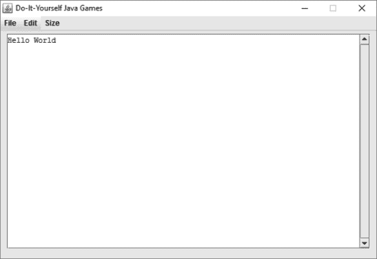程序：

### 第 1 节–Java 项目和包

程序首先通过 Java 项目进行组织，然后在 Java 项目内部通过包（packages）进行组织。你将为书中的每个程序创建一个 Java 项目。

包包含了通常一起使用的程序文件。由于书中的程序很小，你创建的大多数 Java 项目将只包含一个包。

在本节中，你将为你的第一个程序创建一个 Java 项目和一个包。

### 试一试

创建一个名为 hello world 的第一个 Java 项目：

1. 如果 eclipse 尚未打开：

1. 双击你在桌面上创建的 eclipse 快捷方式。
2. 点击 ok 使用你的 Java 工作文件夹作为你的工作空间。

1. 在包管理器（package explorer）面板中右键点击，并选择 new/java project。
2. 将 Java 项目命名为 hello world，并选择使用默认 jre，如果它是 1.7 或更高版本，则点击 next，如下图所示。如果默认 jre 低于 1.7，选择使用 1.7 或更高执行环境 jre 的选项。

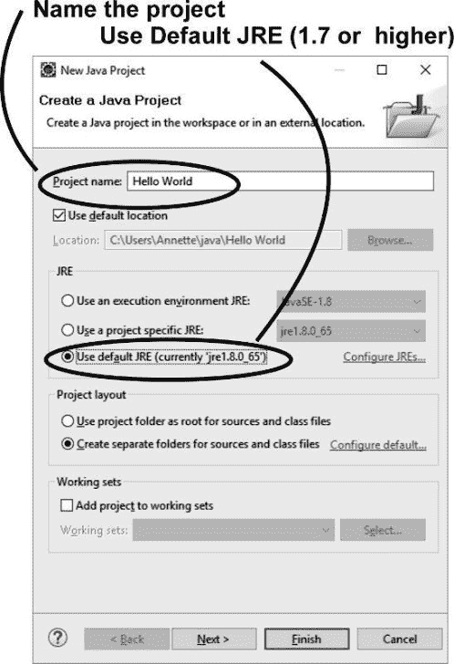

1. 点击 libraries（库），然后点击 add external jars...（添加外部 jar...），如下图所示。

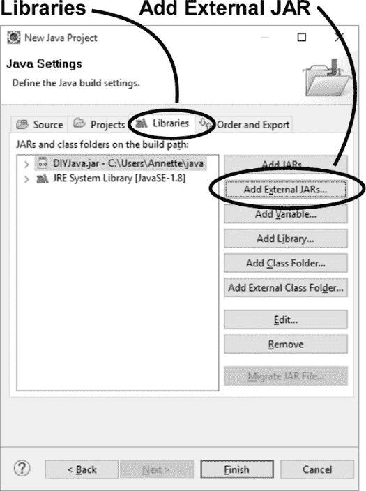

1. 浏览并选择 `diyjava.jar`，这是你在 Java 工作文件夹中安装的，点击 open（打开）。
2. 点击 finish（完成）。

包管理器面板现在列出了一个项目（hello world）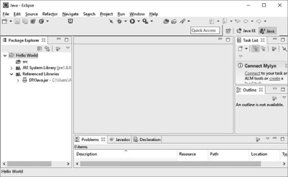以及添加的 jar 文件（`diyjava.jar`），如下所示：

在 hello world 项目中为你的 hello world 程序创建一个包：

1. 右键点击 hello world 项目并选择 new/package（新建包）。
2. 将包命名为................helloworld，

如下所示。使用你自己的名字作为包名的一部分。我使用的包名是 `anne.godtland.helloworld`。

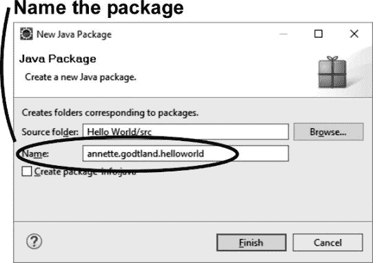

1. 点击 finish（完成）。

包管理器面板现在显示在你的 hello world 项目中创建的包 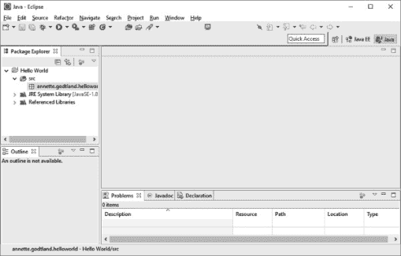，如下所示：

### 关键点及更多内容

在包管理器面板中右键点击以创建 Java 项目和包。
为每个程序创建一个不同的 Java 项目。
eclipse 会在你的电脑上创建一个与 Java 项目同名的文件夹。为你的 Java 项目指定一个你希望在电脑文件夹中使用的名称。
你现在在 Java 文件夹中有一个名为 hello world 的文件夹。
例如，每个单词的首字母大写，并在每个单词之间加上空格，就像 hello world 项目一样。
在本书的帮助下向你创建的 Java 项目添加 `diyjava.jar`。
`diyjava.jar` 是一个外部 jar 文件。
`diyjava.jar` 使编写向窗口打印文本的程序变得易许多。
将你的程序文件组织到 Java 项目中的包中。
将通常在一起的程序文件放在一个包中。
因为你的程序很小，你的大多数程序将只有一个包。

### 包的命名规则：

让你的包名与其他人的包名不同。程序员传统上使用他们的名字或业务名称作为包名的第一部分。
使用全小写字母且不带空格。
在包名的不同类别之间使用点。例如，如果包名标识了是谁创建了包以及该包将用于什么，在创建者和用途之间加上点。
确保在创建书中创建 Java 项目时，你选择了使用 `javase-1.7` 或更高执行环境 jre 的选项。一旦你在创建项目时选择了此选项，eclipse 将对以后所有的 Java 项目默认使用该选项。

Java 项目是为了 eclipse 的；包是为了 Java 的。因为你正在使用 eclipse，所以你会同时使用 Java 项目和包。如果你不使用 eclipse 创建程序，你可能只会使用包。

### 第 2 节–类和程序

Java 程序由一个或多个类组成。类包含实际的代码：运行指令。

每个类必须命名为某些，例如与 Java 项目相同的名称

在本节中，你将创建你的第一个类：一个在窗口中运行的程序。

### 试一试

使用 window 类作为父类创建你的第一个类：

1. 在包管理器上右键点击，并选择 new/class。
2. 将类命名为 helloworld（提示：“hello”和“world”之间没有空格”）。
3. 浏览父类。
1. 为类型输入 `diy`，如下所示选择 window，然后点击 ok。
1. 你想创建哪些方法存根（stubs）？选择所示选项：

1. Public static void main(string[] args)。
2. 来自父类的构造函数。
3. 是否选择第三个选项继承抽象方法并不重要。

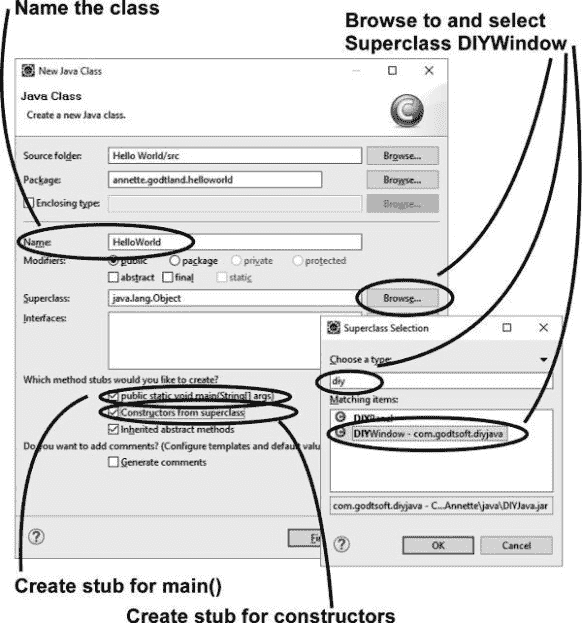

1. 点击 finish 创建类。

Eclipse 将为 helloworld 类创建代码，如下列表所示。

如果你将你的阅读器字体调小以减少换行，你可能会更容易阅读书中的代码列表。

列表 1-1，来自 helloworld.java 

```java
package anne.godtland.helloworld;

import com.godtsoft.diyjava.diywindow;

public class helloworld extends window {

    public helloworld() {

        // todo 自动生成的构造函数存根

    }

}
```

```java
public static void main(string[] args) {

    // todo auto-ge,ne,rate,d me,thod stub

}
```

Eclipse 会添加注释代码，但你并不需要它们。注释是以 `//` 开头的行，或者是以 `/*` 开头并以 `*/` 结束的多行组合。

1. 请从该类中删除自动生成的注释行，在下方的列表中，这些行显示为 `(code was removed from here.)`。

列表 1-2，来自 `helloworld.java`:
```java
package annette.godtland.helloworld;

import com.godtsoft.diyjava.diywindow;

public class helloworld extends diywindow {

    public helloworld() {

        (code was removed from here.)

    }

    public static void main(string[] args) {

        (code was removed from here.)

    }

}
```

为你书中创建的每个类都从程序代码中删除自动生成的注释。你将在后面的课程中添加你自己的注释。

点击任何已完成的列表链接以查看如何完成代码。但是，在你查看答案之前，尝试自己完成代码会学到更多。

 以 `public static void main` 开头的代码块被称为 `main()` 方法。以 `public helloworld()` 开头的代码块被称为构造函数。

现在，添加你的第一行代码：

1. 完全按照此处所示的内容向构造函数和 `main()` 方法中添加代码。代码的更改在列表中始终以**粗体**形式显示。

列表 1-3，来自 `helloworld.java`:
```java
package annette.godtland.helloworld;

import com.godtsoft.diyjava.diywindow;

public class helloworld extends diywindow {

    public helloworld() {

        print("hello world");

    }

    public static void main(string[] args) {

        new helloworld();

    }

}
```

1. 按 `ctrl-s` 保存程序。
2. 点击运行按钮（如图片所示）来运行 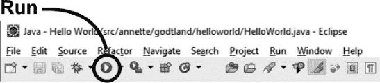程序：

发生了什么？

应该会打开一个窗口显示“hello world”，如图所示：

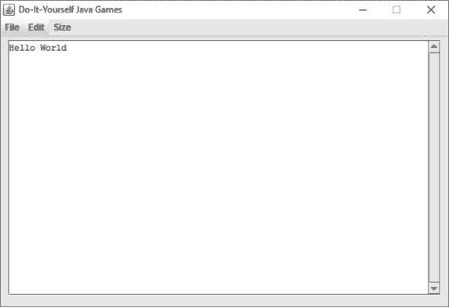

1. 你需要在你的类中进行哪些更改才能让它向你你好？

列表 1-4，来自 `helloworld.java`:
```java
...

public helloworld() {

print("hello


");

}

...
```

1. 保存程序并运行它。

如果你犯错了会发生什么？

1. 错误地输入单词“print”并保存程序。列表 1-5，来自 `helloworld.java`:
```java
...

public helloworld() {

print("");

}
```

发生了什么？

出现了许多错误指示，如图所示：

1. 点击问题面板中的错误计数查看错误列表。
2. 点击问题面板中的错误描述将光标移动到错误所在行。
3.  Eclipse 会列出修复方案（如上图  {

    print("");

    print("");

}
```


在课程期间，除非有语法错误，否则保存更改并运行程序。它打印了正确的行吗？如果没有，请修复代码并重试。你好。

列表 1-7，来自 `helloworld.java`:

```java
...

public helloworld() {

    print("hello thing.");

    print("");

    print("take to.");

}
```

### 要点及更多

 Java 程序由类组成。每个程序中的一个类都需要一个 `main()` 方法。

 `main()` 方法必须写为 `public static void main(string[] args)`。后面的课程将解释这些词的意思。

 一个程序通常由多个类创建。然而，书中的大多数程序只由一个类组成。

 每个类都必须有一个超类。任何类都可以作为超类。你将在后面的课程中创建自己的超类。

 具有相同超类的类被认为是相同类型。例如，你为书中每个程序创建的主类都使用 `diywindow` 类作为其超类。因此，书中的每个程序都是 `diywindow` 的类型。

 每个 `print()` 语句都会在一个新行打印。

 要打印空行，请使用带有空括号的 `print()`。

 `print()` 方法是 `diywindow` 的一部分，它位于 `diyjava.jar` 中。这就是为什么你将外部 jar 文件 `diyjava.jar` 添加到项目中，以及为什么你选择 `diywindow` 作为 `helloworld` 类的父类。

 注释是以 `//` 开头的行，或者是以 `/*` 开头并以 `*/` 结尾的一组行。

# 第 7 章：面向对象编程

你之前已经学过 Java 是一种面向对象的编程语言。因此，它支持这种编程范式的基本原理。

对象指的是真实的实体，如包、汽车、椅子或笔。面向对象的编程语言允许程序员设计使用对象和类的程序。它们提供了并支持了可以简化软件开发和维护的功能。这种编程范式最核心的概念如下：

 对象、类、方法、实例、继承、抽象、多态

 消息、解析、封装

## 对象

在现实世界中，你会遇到人类、狗、汽车和猫等对象。这些对象拥有状态和行为。例如，当你想到一只猫时，它的状态可以包括它的品种、颜色或名称。它的行为可能包括跑步、跳跃或摇尾巴。

软件对象在这些特性与真实对象相似。它的状态保存在字段中，它的行为通过方法表现出来。

在开发过程中，方法在对象的内部状态上执行，并且方法促进了对象之间的通信。

## 类

类用于设定对象的定义。这些规范作为创建对象的蓝图。虽然它们在类创建时并不会立即应用，但这些定义在实例化类对象时是可用的。一个对象或类在程序中可以有多个拷贝或 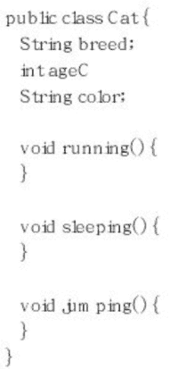 实例。

以下是一个名为 `cat` 的类的定义示例：

一个类可以具有以下类型的变量：

### 类变量

类变量是在类内部使用 `static` 修饰符声明且在任何方法之外的变量。

### 局部变量

局部变量是定义在方法或构造函数内部的变量。这些变量在方法内部声明并实例化，并在方法执行完毕后被销毁。

### 实例变量

实例变量是在类内部但在方法之外的变量。它们在类创建的同时进行初始化。可以通过该特定类的方法或构造函数访问它们。一个类可以包含必要的方法来获取它所需的值。例如，`cat` 类有三个方法：`running()`、`sleeping()` 和 `jumping()`。

## 构造函数

构造函数用于初始化对象的方法。类必须至少包含一个构造函数。以下是构造函数的重要规则：构造函数的名称应与它所属的类匹配，且不应该有显式类型。

### 构造函数的类型

 默认或无参参数构造函数 默认构造函数。没有参数的构造函数称为默认构造函数。 这里是语法：

### 带参数构造函数

带参数构造函数是带有参数的构造函数。它用于为特定对象提供值。下面的示例展示了两种类型的构造函数。第一个是默认构造函数，它没有任何 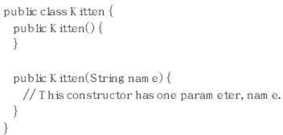 参数。第二个构造函数有一个参数，即，

## 创建对象

类为对象提供了模板。对象基本上是从类创建的。要创建新对象，你将使用 `new` 关键字。从类创建新对象通常会采取以下步骤：

声明——这指的是变量声明，你将在其中编写变量名和它的对象类型。

实例化——为了创建一个新对象，你将使用 `new` 关键字。

初始化——在 `new` 关键字之后调用构造函数并初始化新对象。

以下示例展示了从 Class 创建 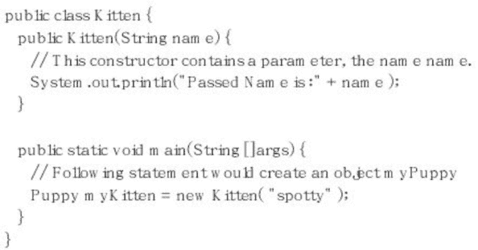 新对象的不同步骤。这里是输出：传递的名称是：spotty

### 如何访问方法和实例变量

创建的对象用于访问方法和实例变量。要访问实例变量，你将使用以下步骤：首先，你必须创建一个对象：`object = new constructor();` 接下来调用变量如：`object.variable` 调用方法：`object.method()`

### Java 包

包仅仅是接口和类分组的一种方式。Java 包是类的容器。分组的通常依据是功能。包的使用促进了可重用性。当接口和类被分类到包中时，你可以轻松地访问它们并在其他程序中使用。包的使用还防止了类和接口之间的命名冲突。要创建一个包，在包名之前使用 `package` 语句作为第一条语句。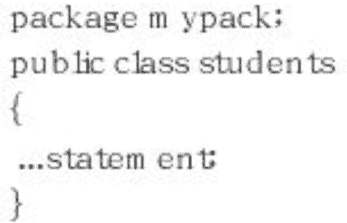 这里有一个示例：

### 导入语句

你可以使用 `import` 关键字将包导入到你的源文件中。导入语句使编译器能够找到类或源代码的位置。你可能只想从一个包中导入一个类。你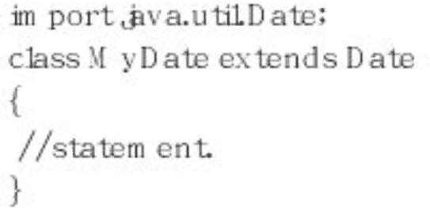 可以使用点操作符来指示包和类。例如：要从一个包中导入所有类，可以使用通配符 `*`

### 修饰符

修饰符是改变代码中定义含义的关键字。Java 提供了几种修饰符。

### 访问修饰符

访问修饰符用于定义方法、变量、类和构造函数的访问级别。

### Private–仅在类内部访问

当一个方法、变量、类或构造函数被声明为 `private` 时，意味着它仅在类内部可用。然而，如果该类具有公有的 getter 方法，你可能可以在类外部访问私有变量。`private` 关键字表示最高的访问限制。请注意，你不能将接口和类声明为 `private`。

### Public–对所有人可见

定义为 `public` 的方法、接口、构造函数、类等可以从其他类访问。同样地，在公有类内部定义的块、方法或字段也可以从 Java 类访问。只要它们在同一个包中，这一点就成立。如果你想从另一个包访问公共类，则必须导入该公共类。在类继承概念下，子类继承类所有的公共变量和方法。

请注意，应用程序的 `main()` 方法必须声明为 `public`，Java 解释器才能调用它来运行该类。

### Protected–对所有子类和包可见

在父类中将方法、变量或构造函数声明为 `protected`，使其仅对该包内的类或另一个包中的子类可见。如果你想允许子类使用变量或辅助方法，并防止无关类使用它们，则使用这种访问类型。接口及其字段、方法不应声明为 `protected`，但接口外部的字段和方法可以声明为 `protected`。类不应被声明为 `protected`。

### Default：未提供修饰符时适用–对包可见

未声明修饰符的方法或变量可以被包内的其他类访问。

下表总结了不同的访问修饰符及其影响：

| 修饰符 | 类内部 | 包内 | 包外（通过子类） | 包外 |
| :--- | :--- | :--- | :--- | :--- |
| Private | Y | N | N | N |
| Public | Y | Y | Y | Y |
| Protected | Y | Y | Y | N |
| Default | Y | Y | N | N |

### 非访问修饰符

非访问修饰符可用于访问 Java 中的各种功能。

### Final–用于确定变量、方法和类的实现

#### Final 变量

你只能显式地初始化 `final` 变量，一旦你将变量声明为 `final`，你将永远无法将其赋值给另一个对象。但注意，你仍然可以更改存储在对象内部的数据。这意味着你可能更改对象的状态，但无法更改引用。`final` 修饰符通常与 `static` 配合使用，以创建一个常量值的类变量。

#### Final 方法

`final` 关键字用于防止方法被子类修改。

#### Final 类

`final` 修饰符用于防止其他类继承声明为 `final` 的类的任何特性。

### Static–用于创建类方法或变量

你可以使用此关键字创建一个唯一的变量（称为静态变量），它将独立于该类的其他实例而存在。你不能将局部变量声明为 `static`。还可以使用 `static` 关键字创建一个方法（称为静态方法或类方法），它将独立于该类的其他实例而存在。静态方法仅识别并处理来自给定参数的数据，而不依赖变量。你可以通过在类名后加点（`.`）编写变量或方法名访问类方法和类变量。

### Abstract–用于创建抽象方法或类

#### 抽象类

当类被声明为 `abstract` 时，意味着你永远无法实例化该类。将类声明为抽象类的唯一理由是为了扩展该类。你不能将一个类同时声明为 `final` 和 `abstract`，因为你无法扩展一个 `final` 类。使用抽象方法的类必须声明为 `abstract`。这样做会导致编译错误。

#### 抽象方法

由于抽象方法声明时没有实现，它的方法体从子类中派生。抽象方法不能声明为 `strict` 或 `final`。除非它本身也是一个抽象类，否则扩展抽象类的类必须采用父类的抽象方法。包含至少一个抽象方法的类应该声明为抽象类。另一方面，抽象类并不一定需要抽象方法。

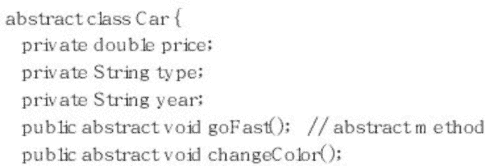 示例：

### Synchronized（同步）

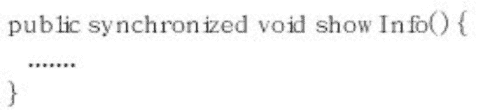 `synchronized` 修饰符用于指示任何时间只有一个线程可以访问方法。

### Volatile（volatile）

`volatile` 关键字用于指示访问变量的线程应该看到存储在内存中的副本。它同步变量的所有副本。

### Transient（瞬态）

`transient` 关键字用于在序列化包含标记变量的对象时跳过该实例。

 示例：

# 第 8 章：决策与循环控制

决策结构用于以下情况：当条件为真时，必须执行一组指令；当条件被确定为假时，必须执行另一组指令。Java 中提供了几种结构用于此类场景的编程。这些结构包括：

### If 语句

该语句用于需要测试条件的情况，如果发现条件为真，则需要执行该语句后续的代码块。

该语句用于需要测试条件的情况，如果发现条件为真，则需要执行该语句之后的代码块；否则，执行 `else` 语句之后的代码块。该构造的语法为––

```java
If(condition){

    /*body*/

}

Else(

    /*body*/

}
```

以下是该结构的示例实现––

```java
public class ifelsedemo {

    Public static void main(string args[]) {

        Int i = 1; int j = 0; if(i>j){

            System.out.print(i);

        }

        Else{ sytem.out.print(j);

        }

    }

}
```

### 嵌套 if 语句

该语句用于需要测试条件的情况，如果发现条件为真，则需要执行该语句之后的代码块；否则，测试下一个条件。如果发现此条件为真，则执行与该条件对应的 `if` 语句代码块。如果没有任何条件为真，则执行 `else` 语句之后的代码块。可以使用嵌套的 `if` 语句测试多个条件。该构造的语法为––

```java
If(condition1) {

    /*body*/

}

Else, if (condition2) (

    /*body*/

}

Else, {

    /*body*/

}
```

以下是该结构的示例实现––

```java
public class ne,difdemo {

    Public static void main(string args[]) { int i = 0;

    Int j = 0; if(i>j){

        System.out.print(i);

    }

    Else, if(j>i) { sytem.out.print(j);

    }

    Else, { sytem.out.print("e,qual");

    }

}
```

### Switch

如果你有一个变量，并且需要根据该变量的不同值执行不同的代码块，那么理想的构造是 `switch` 语句。该构造的语法为––

```java
Switch(variable,){ 

    case, <value,1>:

        /*body*/ break;

    Case, <value,2>:

        /*body*/ break;

    Case, <value,3>:

        /*body*/ break;

    default:

        /*body*/ break;

}
```

以下是该结构的示例实现––

```java
public class switchdemmo {

    Public static void main(string args[]) { int i = 5;

    Switch (i) {

        Case, 0: sytem.out.print(0); break;

        Case, 2: sytem.out.print(2); break;

        Case, 5: sytem.out.print(5); break;

        Default: sytem.out.print(999); break;

    }

}
```

### 三元运算符

Java 还支持条件运算符，也称为 `?:` 运算符。该运算符用于替换 `if else` 构造。其语法如下

`expression1?expression2:expression3`

在这里，`expression1` 是要测试的条件。如果条件为真，则执行 `expression2`，否则执行 `expression3`。

### 循环控制

有几种情况需要你重复执行同一组指令。例如，如果你需要对一组数字进行排序，你将需要多次扫描并安排该集合以获得所需的顺序。这种执行流被称为循环。循环简单是一种允许多次执行代码块的构造。Java 支持几种可以用于实现的构造。这些包括 `while` 循环和 `for` 循环。

`while` 循环反复执行代码块，直到为 `while` 指定的条件为真。一旦该条件失败，`while` 就会停止。

`for` 循环允许程序员在同一个构造中操纵条件和循环变量。在这里，你可以初始化循环、递增它并运行循环，直到该变量的条件为真为止。

`do while` 循环与 `while` 循环相似。然而，在 `while` 循环中是在执行代码块之前检查条件。另一方面，先执行代码块，然后检查条件。如果满足条件，则重新启动循环执行，否则终止循环。可以说，`do while` 循环一旦实现，将至少执行一次。

### 循环语句

有两个关键字专门与循环相关联，也被称为控制语句，因为它们允许将控制权从代码的一个部分转移到另一个部分。这些关键字是，––

### Break

该关键字用于循环内部，在你希望执行流终止循环并直接从循环之后的的第一条指令开始执行的地方。

### Continue

该关键字用于循环内部，在程序员希望电脑忽略循环的其余部分并将控制移动循环的第一条语句的地方。

为了帮助你理解循环如何执行，让我们来看一个例子，并使用所有类型的循环来实现它。

### For 循环实现

```java
public class fordemo {

    Public static void main(string args[]) {

        Int numbe,rarray = {100, 300, 500, 700, 900}; for(int i=0; i<5; i++) {

            System.out.print(numbe,rarray[i]); sytem.out.print(",");

        }

        Sytem.out.print("\n");

    }

}
```

### While 循环实现

```java
public class whledemo {
```


`Public static void main(string args[])` {

    `Int [] numbe,rarray = {100, 300, 500, 700, 900}; int i = 0; while(i<5)` {

        `System.out.print(numbe,rarray[i]); sytem.out.print(",");`

        `i++;`

    }

    `Sytem.out.print("\n");`

}

}

### Do while 循环实现

```java
public class dowhiledemo {

    Public static void main(string args[]) {

        Int [] numbe,rarray = {100, 300, 500, 700, 900}; int i = 0; Do {

            System.out.print(numbe,rarray[i]); sytem.out.print(",");

            i++;

        } while (i<5);

        Sytem.out.print("\n");

    }

}
```

### 增强型 for 循环

Java 还支持增强型 for 循环，它可以用于数组元素。该循环的语法为`For(declaration:expression)`。

```java
public class enhancedfordemo {

    Public static void main(string args[]) {

        Int [] numbe,rarray = {100, 300, 500, 700, 900}; for(int i : numbe,rarray) {

            System.out.print(i); sytem.out.print(",");

        }

        Sytem.out.print("\n");

    }

}
```

Java 有一个内置类名`java.lang.Exception`，所有的异常都属于这个类。所有的异常类都是该类的子类。此外，`throwable`类是`exception`类的父类。

`throwable`类的另一个子类是`Error`类。所有如上述`stack overflow`（栈溢出）等错误都属于这个`error`类。

`exception`类有两个子类，分别是`RuntimeException`类和`IOException`类。以下是 Java 中作为`throwable`类一部分可用定义的方法列表。

```
Public string getMessage()
```

当调用此方法时，该消息将返回所遇异常的详细描述。

```
Public throwable getCause()
```

此方法在被调用时会返回一个包含异常原因的消息。

```
Public string toString()
```

该方法返回异常的详细描述与类名拼接后的结果。

```
Public void printStackTrace()
```

`toString()`的结果同堆栈跟踪可以打印到标准错误流`system.err`。这可以通过调用此方法来实现。

```
Public stackTraceElement[] getStackTrace()
```

在某些场景下，你可能需要访问堆栈跟踪的不同元素。此方法返回一个数组，堆栈跟踪的每个元素保存到数组的不同元素中。数组的第一个元素包含堆栈跟踪的顶部元素，而堆栈跟踪的底部保存在数组的最后一个元素中。

```
Public throwable fillStackTrace()
```

将之前的堆栈跟踪信息与当前堆栈跟踪的内容合并并返回相同的数组。

### 捕获异常

捕获异常的标准方法是使用`try`和`catch`关键字以及它们的代码实现。这个`try`和`catch`块需要以这种方式实现：封装可能会抛出异常的代码。这里同样重要的是需要说明，可能会抛出异常的代码被称为受保护代码（protected code）。`try`和`catch`块实现的语法如下——

```
Try {

    /*protected code*/

}catch(exceptionname, exc1) {

    /*catch code*/

}
```

可能会抛出异常的代码放置在`try`块中。如果抛出了异常，则相应的异常处理操作将在`catch`块中实现。每个`try`块都必须有一个`catch`块或一个`final`块。

作为`catch`状态的一部分，需要声明预期抛出的异常。在发生异常时，执行流将转移到`catch`块。如果抛出的异常与`catch`块中定义的异常匹配，则执行该`catch`块。下面提供了一个`try`和`catch`块的示例实现。该代码实现了一个具有 2 个元素的数组。然而，代码尝试访问并不存在的第三个元素。结果是抛出了异常。

```
import java.io.*;

public class demo {

    public static void main(string args[]) {

        Try {

            Int arr[] = new int[2];

            System.out.println("accessing the3rd element of the array:" + arr[3]);

        }catch(ArrayIndexOutOfBoundsException xp) {

            System.out.println("catching exception:" + xp);

        }

        System.out.println("outside catch block");

    }

}
```

### 实现多个 catch 块

一段代码可能会导致多个异常。为了满足这一需求，允许实现多个`catch`块。此类实现的语法如下所示。

```
Try {

    /*protected code*/

}catch(exception1, xp1) {

    /*catch block 1*/

}catch(exception2, xp2) {

    /*catch block 2*/

}catch(exception3, xp3) {

    /*catch block 3*/

}
```

上述语法说明了三个`catch`块的实现。然而，你可以实现任意数量的`catch`块。当执行此代码时，会执行受保护代码。如果发生异常，异常类型将与第一个`catch`块的异常进行匹配。然而，如果异常类型不匹配，则忽略`catch` block 1，并尝试与第二个`catch`块的异常类型进行匹配。哪个`catch`块与抛出的异常具有相同的类型，就执行相应的`catch`块。

# 第 9 章：adt、数据结构与 Java 集合

### 抽象数据类型 (adt)

抽象数据类型 (adt) 是数据及其允许在其进行的操作的逻辑描述。adt 关注数据的可能值。例如，用户想要存储数据并找到它。adt 将支持两个函数：一个用于添加，另一个用于获取值。adt 不谈论具体如何实现。

2. 由于集合框架（collections framework）中实现了基础数据结构和算法，开发成本得以降低。

3. 于审查和理解其他开发者编写的代码，因为大多数 Java 开发者都使用集合框架。此外，集合框架有完善的文档。

### 数组 (Array)

数组表示相同数据类型的多个元素的集合。

### 数组 ADT 操作

以下是数组的 API：

1. 在第 k 个位置添加一个元素。值可以在`o(1)`常数时间内存储在数组的第 k 个位置，我们只需要在`arr[k]`存储该值即可。

2. 读取存储在第 k 个位置的值。访问数组中某个索引处存储的值也是`o(1)`常数时间，我们只需要读取存储在`arr[k]`的值即可。

3. 用新值替换第 k 个位置存储的值，时间复杂度：`o(1)`常数时间。

示例：

```java
Public class arraydemo {

  Public static void main(string[] args) { int[] arr = new int[10];

  For (int i = 0; i < 10; i++) {

    Arr[i] = i;

  }

}

}
```

Java 标准数组是固定长度的。有时我们不知道需要多少内存，因此我们创建一个更大的数组，从而浪费了空间；如果数组已经满满且我们想向其添加更多值，就需要创建一个空间足够的新数组，然后将旧数组复制到新数组中。为了避免这种手动重新分配和复制，我们可以使用 Java 集合框架中的`ArrayList`或链表来存储数据。

### Java 集合中的 ArrayList 实现

Java 集合中的`ArrayList<e>`是一种数据结构，它实现了`list<e>`接口，这意味着它内部包含重复元素。数组是动态数组的实现，可以根据需要增长或缩小（内部使用数组，当它满时，会分配更大的数组，并将旧数组的值复制过去）。

示例：

```java
Import java.util.arraylist;

public class arraylistdemo {

  Public static void main(string[] args) {

    ArrayList<integer> al = new arraylist<integer>();

    al.add(1);  // 在列表末尾添加 1

    Al.add(2);  // 在列表末尾添加 2

    system.out.println("contents of array: " + al);

    system.out.println("array size,: " + al.size());

    system.out.println("array empty: " + al.isEmpty());

    al.remove(al.size() - 1); // 移除数组的最后一个元素

    al.remove(al); // 移除数组的所有元素

    system.out.println("array empty: " + al.isEmpty());

  }

}
```

输出：
`Contents of array: [1, 2]`
`Array size,: 2`
`Array empty: false` `array empty: true`

### 链表 (Linked list)

链表是一种动态数据结构，内存是在运行时分配的。链表的概念不是连续存储数据。列表的节点包含一个指向列表中下一个元素的链接。从性能上来说，链表比数组慢，因为无法直接访问列表元素。当我们提前不知道要存储的元素数量时，链表是一种非常有用的结构。链表有许多类型：线性、环形、双向等。

### 链表操作

以下是链表的 API。`insert(k)`：在列表开头添加 k。在列表开头插入一个元素。只需创建一个新元素并移动指针，使新元素成为列表的第一个元素。此操作将花费`o(1)`常数时间。`delete()`：删除列表开头的元素。在列表开头删除一个元素。我们只需要移动一个指针。此操作也将花费`o(1)`常数时间。`Printlist()`：显示列表的所有元素。从第一个元素开始并遵循指针。此操作将花费`o(n)`时间。`Find(k)`：查找值为 k 的元素的位置。从第一个元素开始并遵循指针，直到找到我们正在寻找的值或到达列表末尾。此操作将花费`o(n)`时间。注意：二分查找不适用于链表。`Findkth(k)`：查找位置在 k 的元素。从第一个元素开始并遵循链接，直到到达第 k 个元素。此操作将花费`o(n)`时间。`IsEmpty()`：检查列表中的元素数量是否为零。只需检查列表的头节点指针，如果它为空，则列表为空，否则不为空。此操作将花费`o(1)`时间。

### Java 集合中的 LinkedList 实现

Java 集合中的`LinkedList<e>`是一种数据结构，示例：

```java
Import java.util.linkedlist;

public class linkedlistdemo {

  Public static void main(string[] args) {

    linkedlist<integer> ll = new linkedlist<integer>();

    ll.add(2);  // 向列表添加 2

    ll.add(10); // 向列表添加 10

    ll.add(1);  // 向列表添加 1

    ll.add(11); // 向列表添加 11

    system.out.println("contents of array: " + ll);

    ll.removeFirst();

    system.out.println("contents of array: " + ll);

  }

}
```

输出：
`Contents of array: [2, 10, 1, 11]`
`Contents of array: [10, 1, 11]`

### 栈 (Stack)


栈是一种特殊的数据结构，遵循后进先出（LIFO）策略。这意味着最后添加的元素最先被移除。栈的各种应用包括：递归：递归调用是通过栈实现的。1. 后缀表达式的求值。2. 使用栈实现的回溯。3. 树和图的深度优先搜索。4. 将十进制数转换为二进制数。

### 栈操作

`Push(k)`：将值 k 添加到栈顶。`Pop()`：从栈顶移除元素并返回其值。`top()`：返回栈顶元素的值。`Size()`：返回栈中元素的数量。`IsEmpty()`：检查栈是否为空。如果栈为空，则返回 true，否则返回 false。注意：上述所有栈操作的实现复杂度均为`o(1)`。

### Java 集合中的栈实现

通过调用`stack<t>`类的`push`和`pop`方法来实现栈。

示例：

```java
Public class stackdemo {

  Public static void main(string[] args) { stack<integer> stack = new stack<integer>(); int temp;

}
```

```java
Stack.push(1); stack.push(2); stack.push(3);

System.out.println("stack  :  "+stack);

System.out.println("stack size, :  "+stack.size());

System.out.println("stack pop  :  "+stack.pop());

System.out.println("stack top  :  "+stack.peek());

System.out.println("stack empty  :  "+stack.isEmpty());
```

Output:
`Stack : [1, 2, 3] stack size, : 3 stack pop : 3`
`Stack top : 2`
`Stack empty : false,`

Stack 也通过调用`Deque<T>`类的`push`和`pop`方法来实现。JDK 同时提供了`Deque<T>`和`Stack<T>`。我们可以使用这两个类，但`Deque<T>`具有一些优势。

1. 第一个原因是`Stack<T>`没有继承自`Collection`接口。
2. 第二，`Stack<T>`继承自`Vector<T>`，因此可以进行随机访问，这破坏了栈的抽象性。
3. 第三，`Deque`相比`Stack<T>`更高效。

### 队列 (Queue)

队列是一种先进先出（fifo）的数据结构，先添加到队列的元素先被移除，依此类推。

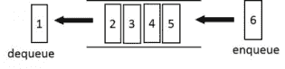

队列有以下应用场景：
1. 访问共享资源（例如打印机）
2. 多程序设计
3. 消息队列
4. 图或树的广度优先遍历（bfs）是使用队列实现的。

队列操作：
- `Add(k)`：将新元素`k`添加到队列末尾。
- `Remove()`：从队列头部移除一个元素并返回其值。
- `Front()`：返回队列头部元素的值。
- `size()`：返回队列内部的元素数量。
- `isEmpty()`：如果队列为空则返回 1，否则返回 0。

注意：上述所有队列操作都在`o(1)`时间复杂度内实现。

### Java 集合中的队列实现

`Deque<T>`是双端队列的类实现。如果我们使用`add()`、`remove()`和`peek()`，它的行为就像一个队列。（此外，如果我们使用`push()`、`pop()`和`peekLast()`，它的行为就像一个栈。）

示例：

```java
import java.util.ArrayDeque;

public class queuedemo {

    public static void main(string[] args) {

        ArrayDeque<Integer> queue = new ArrayDeque<Integer>();

        queue.add(1);

        queue.add(2);

        queue.add(3);
```


```
System.out.println("queue  :  "+queue);

System.out.println("queue size, :  "+queue.size());

System.out.println("queue peek:  "+queue.peek());

System.out.println("queue remove:  "+queue.remove());

System.out.println("queue empty:  "+queue.isEmpty());

}
```

```
Output:
queue : [1, 2, 3] queue size : 3 queue peek : 1 queue remove : 1 queue empty : false
```

# 第 10 章：文件处理

本章讨论了读取、创建和打开文件的细节。有很多文件类可供选择。

## 读取文本文件

读取文本文件是 Java 中的一项关键能力，并有许多实际应用。`FileReader` 和 `Scanner` 是 Java 中读取纯文本文件的有用类，它们中的每一个都具有使其独特标识的特定属性。

### BufferedReader

这种技术从字符流中读取。它缓冲了字符和行以高效地读取。你可以指定缓冲区类型或使用标准类型，对于大多数情况，默认类型已经足够大。特别是从读取器产生的每个操作都会影响基础性能。因此，建议在任何读取器上包装一个缓冲区，像文件读取器这样的操作可能是昂贵的。

例如：`BufferedReader in = new BufferedReader(reader in)`

### FileReader

读取字符文档的便利类。该类的构造函数假设默认字符格式和默认缓冲区大小。

### Scanner

一种简单的文本扫描器，使用正则表达式来解析原始类型和字符串。`Scanner` 使用分隔符模型将其输入拆分为符合定义中空白符的标记（tokens）。通过不同的技术，生成的标记随后可以转换为不同类型的值。

```java
import java.io.File;
import java.util.Scanner;

public class readfileusingscanner {
    public static void main(string[] args) throws Exception {
        // 文件路径现在被设为参数以便进行扫描
        File example = new File("c:\\users\\username\\desktop\\example.txt");
        Scanner example1 = new Scanner(file);
        while (example1.hasNextLine()) System.out.println(example1.nextLine());
    }
}
```

不使用循环使用 `Scanner`：

```java
import java.io.File;
import java.util.Scanner;

public class example {
    public static void main(string[] args) throws Exception {
        File example = new File("c:\\users\\username\\desktop\\example.txt");
        Scanner example1 = new Scanner(file);
        System.out.println(example1.next());
    }
}
```

在 Java 包中将文件读取为字符串：

```java
import java.nio.file.*;

public class example {
    static String example1 = "";
    static String example(String fileName) throws Exception {
        example1 = new String(Files.readAllBytes(Paths.get(fileName)));
        return example1;
    }
    public static void main(string[] args) {
        String example1 = example("c:\\users\\username\\desktop\\example.java");
        System.out.println(example1);
    }
}
```

写入文件：

```java
import java.nio.file.*;

public class example {
    public static void main(string[] args) {
        String example1 = "c:\\users\\username\\desktop\\example.java";
        System.out.println(example1);
    }
}
```

在任何非复杂的软件项目中，bug 都是生活中的常态。细致的规划、编程和测试可能有助于减少它们的无处不在，但它们总会找到某种方式进入你的系统的某个处。随着新功能的引入以及代码库规模和复杂性的增加，这一点会变得尤为明显。

幸运的是，某些 bug 比其他 bug 更容易检测。例如，编译时错误可以很快被识别；你可以使用编译器的错误代码来确定问题所在并立即解决它。然而，运行时错误可能要困难得多；它们并不总是立即发生，当发生时，可能位于程序中距离问题真相很远的地方。泛型（Generics）通过使得在编译时识别更多的 bug 可行，从而帮助稳定你的软件。

简而言之，泛型允许在定义类和技术时为“种类”（类和对象）提供参数。就像方法声明中使用的更熟悉的形式参数一样，类型参数为你提供了独特的输出，以便重用相同的代码。区别在于，值是形式参数的输入，而种类是类型参数的答案。使用泛型的代码比非泛型代码具有许多优势。通过使用泛型，程序员可以引入操作不同种类集合的泛型算法，这些算法是可以定制的，并且安全且易于阅读。

## 泛型类型

泛型形式是一个类型参数化的泛型类别或接口。可以通过修改一个简单的箱类来展示这一思想。考虑一个适用于任何类型对象的非泛型箱类。它只需要提供两个技术：`set()`（向箱子添加项）和 `get()`（检索项）。由于它们的方法接受或返回对象，你可以自由传递任何想要的内容，只要它不是原始类型即可。在编译时无办法检查该类的使用情况。软件的一个部分可能向箱中放入一个整数并期望从中取出整数，而软件的另一部分可能会错误地处理一个字符串，导致运行时错误。

由角括号 `<>` 分隔的类型参数部分显示了类别的标题。它指示了形式的参数（也称为排序 `t1`, `t2` 的因子）。你通过将文件 "generic box" 修改为 "generic box <t>" 来更新箱以使用泛型从而创建一个泛型类型。这引入了类型变量 `t`，它可以在类内部使用。这会将所有对象替换为 `t`。你指定的任何非原始类型可以是类类型、数组类型或其他类型变量。这种方法同样可以应用于泛型接口。按照约定，类型标识为单个大写字母。这与你已经理解的变量命名规范形成鲜明对比：如果没有这种约定，很难区分类型变量和普通的类或对象名称。最常用的类型参数名称是：

- `element`（被 Java 集合框架广泛使用）
- `key`
- `number-type`
- `value`
- `suv` 等 – 第 2、3、4 类类型

你将在整个 JDK 和 API 中看到这些名称。

## 调用和实例化泛型类型

要在你的系统内部提到泛型箱类别，必须执行泛型类型调用，将 `t` 带入某个具体值，例如整数：

```java
Box<integer> integerbox;
```

你可能认为泛型排序的调用与普通的过程调用相当，但并不是在过程中添加断言，而是将类型参数（在本例中为整数）传递到箱类别本身。

许多设计者交替使用“类型参数”和“类型语句”这两个词，但定义并不相同。在编写以生成参数化类型的代码时，提供的是排序参数。因此，`foo <t>` 中的 `t` 是类型参数，而 `foo <string>` 中的 `string` 是类型内容。在使用这些词时，本类遵循这一概念。

与任何其他类一样，本类并不生成一个类型的项。泛型类型调用通常是一个具有某种类型的箱项。要实例化此类，请使用 `new` 关键字、类名和类型：

```java
Box<integer> integerbox = new Box<>();
```

## 菱

在 Java 的最新版本中，只要编译器可以从上下文中确定类型，你就可以将构造函数的类型参数替换为空集。这个角括号 `<>` 被称为“菱”。例如，你可以使用之前的声明：

```java
Box<integer> integerbox = new Box<>();
```

## 泛型方法

泛型方法是实现自身排序参数的技术。这类似于泛型类型声明，但类型的范围限于声明它的方法。除了泛型构造函数外，还允许静态和非静态泛型方法。泛型方法的语法涉及在过程返回类型之前的一个位于角括号内的类型参数列表。类型参数部分必须出现在方法名之前：

```java
public <T> T methodName(T parameter) { }
```

有时，你想要限制参数化类型中可以作为形式化语句使用的种类。例如，一种作用于图形的技术可能只能识别数字情况或其子类。这就是限制排序参数（parameters of the sort）的作用。

列出类型参数的名称以表示定义的类型参数，并配以扩展的关键字，随后跟上上界（在本例中上界是 `number`）。请注意，`extends` 在此语境下通常表示“继承”（如课程）或“实现”（如接口）。

## 多重边界

类型参数可以有多个边界。具有多个边界的类型变量是边界中列出的所有类型的子类型。如果其中一个边界是一个类，则必须将其指定在第一个。例如：

```java
Class x { /* ... */ }
interface y { /* ... */ }
interface z { /* ... */ }
Class r <extends x & y & z> { /* ... */ }
```

如果没有将边界 `x` 指定在第一个，你将得到编译时错误：

```java
class r <extends y & x & z> { /* ... */ // 编译时错误
```


# 第 11 章：集合

## 集合函数化

当我们外部化代码时，我们会暴露每一个步骤。这是命令式编程的标志。然而，函数式编程的一个反复出现的主题是其完全相反的想法：代码内部化。代码内部化的行为是将细节隐藏在函数内部。但函数式编程进一步推行了这一理念，将日常编程中的微模式转换为函数。例如，遍历数据（无论是通过迭代器、`for` 循环还是 `while` 循环）就是这些微模式中的一种。函数式编程改变了我们思考这些问题的方式。

Java 的函数化工作如果没有对其集合库（即 `map`、`list` 和 `set` 接口）进行改造，将是不完整的。这是因为迭代通常在集合上进行，而集合是 Java 程序的基石。这是函数化工作发生的自然场所。但进行任何种重大更改（例如向 `collection` 接口添加新方法）都会破坏所有在 Java 8 之前编写程序的向后兼容性。这不仅包括 JDK 自身扩展 `collection` 接口的层次结构，还包括任何开放或封闭的第三方库以及内部类。Java 的设计者从未、也不会采用这种策略。然而，改变是必要的；该库于工业标准的 1998 年引入，已经显得有些过时了。

引入默认方法（default methods）的动机是为了使集合库现代化和函数化。默认方法是恰当的药剂，允许在层次结构的根部添加方法而不干扰现有类。子类可以继承或覆盖这些行为。与添加新的接口方法不同，子类可以在无需重新编译的情况下接受默认方法。实现了即时兼容。默认方法证明其本身是有用的，但是……

函数式编程的第二个反复出现的主题是并行化。简单来说，函数式编程为并行处理提供了更好的工具。结果是集合库得到了增强，以便在处理集合时受益于多核 CPU。与流一起，集合库是将函数式风格并行处理引入 Java 的核心。

现在我们已经学习了 Java 的标准函数式接口，可以开始将知识应用于集合了。让我们看看 Java 8 中的集合库变成了什么样。

## Collection 接口

我们首先查看 `collection` 接口中一个供列表和集合可用的全新默认方法。这就是 `forEach()` 方法：

该方法遍历整个集合，让消费者决定对每个元素做什么。这是内部迭代（internal iteration）的概念，声明式编程的体现。如何遍历的细节并未指定。这与外部迭代相反，在外部迭代中，如何遍历的细节以及对每个元素做什么都是代码中指定的。

我们将使用好莱坞黄金时代的喜剧三人组——三傻星的 Larry、Moe 和 Curly 来展示这些函数化集合方法的示例。首先，让我们打印集合的内容：

`forEach()` 方法有广泛的适用性。它是遍历集合的一种更方便的方式，而且应该是这样的。然而，由于是声明式的，有些事情是你无法做的。最显著的是，你不能像在 `while` 循环中那样改变局部变量的状态。算法必须是函数式的。

我们现在查看集合中可用的另一个新方法：

`removeIf()` 方法将迭代、测试和移动的整个过程内部化。它只需要告知移除条件是什么。使用现在熟悉的 `predicate` 函数式接口，我们可以轻松地确定应该使用哪种 lambda。

要替换列表的所有内容，我们可以使用 `replaceAll()`：

`replaceAll` 使用 `unaryoperator` 作为其函数式接口，这是一种函数接口。

`removeIf()` 和 `replaceAll()` 适用于所有子类，但有一个限制：底层类必须支持移除，否则将抛出异常。

在 map 中使用列表（list）作为值，最令人烦恼的问题之一是在添加元素、更新或删除元素之前，需要不断检查 map 是否存在。首先，你必须尝试提取列表，如果没有找到则创建它。例如，假设我们有一个实现为 map 的电影数据库更新方法。map 的键（key）是电影年份，值是该年份的电影列表。在 Java 8 之前，代码看起来如下：

Java 8 通过这些默认方法提供了一种更好的替代方案：

让我们先从 `compute` 方法开始。每个变体都允许通过映射函数生成 map 的值。对于 `computeIfPresent()` 和 `computeIfAbsent()`，映射是根据条件条件执行的。因此，通过这些方法，我们可以重构之前的代码示例：

请注意，列表的创建是由 `computeIfAbsent()` lambda 表达式处理的。当需要通过 `compute()` 方法将电影添加到列表时，`add()` 永远不会抛出 `NullPointerException`，因为列表保证已经被创建。

在这种情况下，使用 `computeIfAbsent()` 方法就有些过度了，我们使用 `putIfAbsent()` 会更好：

此方法不需要 lambda，并且期望给定一个值——而不是计算出的值。尽管没有使用 lambda，这仍然是一个函数式风格的方法。它证明了你可以用函数的方式表示代码，而不一定非要使用 lambda。

如果你仍然需要提取数据，可以使用 `getOrDefault()` 方法使用更具函数式的方法：

你也可以使用 `merge()` 方法作为替代方案。它方便了对列表存在性的检查。在下面的示例中，如果键（年份）在 map 中不存在，它将把值（标题）放入 map 中。如果它已存在，它允许通过 `BiFunction` 决定如何处理这两个列表：

并且可以像这样书写：

`BiFunction` 也可以返回 null，这会告诉 `merge()` 删除该键。

结论是，我们删除了检查元素存在性的开销代码，现在可以关注更重要的事情：定义如何创建列表以及如何向列表中添加元素。

`Map` 接口已经丰富了其他函数式方法，如 `forEach()`、`replace()`，并使用了相同的内部化（internalization）原则。

## Iterator（迭代器）

集合库在并发访问方面受到相同的限制。一如既常，你必须选择符合线程安全要求的集合类。这是因为上面显示的新方法并不特别适用于函数式编程的并行处理，因为它们仍然基于多个线程变异集合并同步对底层数据访问的概念。然而，Java 8 存在一种兼容的新抽象，它是为了并行迭代数据而设计的。该接口的前提是对数据进行分区并将数据块交给不同的线程。迭代器可以从集合接口获取，包括 `list` 和 `set` 接口。

`iterator` 接口的核心是这三个方法：

`split()` 方法将底层数据一一分为二。它创建一个包含半部分数据的新迭代器，并将另一部分保留在原始实例中。每个部分都可以交给一个线程，该线程反过来使用 `forEachRemaining()` 迭代分区数据。`advance()` 方法是一个一次一次的变体，返回下一个元素，如果列表已耗尽则返回 null。

迭代器本身不处理并行处理，但提供了执行该操作的抽象。这里是该概念的演示：

给定一个标题和一个电影列表，`isInList()` 方法并行化搜索以确定其是否包含在列表中。如果找到，它会将 `booleanHolder` 中的标志位置为 true。它从列表中获取迭代器实例，将其一分为两半，并将每一半交给每个线程。如果有更多可用线程，可以重复拆分过程。

迭代器也可以从其他集合类型以及 JDK 中的其他库获取。有许多针对不同数据特征设计的实现。

## 总结

到此为止，我们完成了对新的且改进的集合以及标准接口的审查。标准 API 发生了许多变化，但最大的变化尚在后面。

## 关键点

新包 `java.util.function` 包含一组函数式接口。这些接口被分为四类，每类由其类型表示：`Consumer`、`Function`、`Predicate` 和 `Supplier`。

每个函数式接口族都定义了专门针对类型和元数（arity）的变体。

函数式接口还定义了实现函数组合的方法。多个不同的 lambda 可以被融合形成看起来像一个的超函数（super functions）。

集合库已经了重构和函数化处理。这是通过在顶层使用默认方法实现的。

内部迭代是一种声明式编程的形式，它是函数式编程的基础。它让开发者无需描述“如何”做，而是专注于要做“什么”。

分片器（Splitators）专为集合的并行迭代而设计。数据被分区，每个数据块被分配到不同的线程进行并行处理。

大于 1 且非质数的数（即合数）。

# 结论

`jdk` 是 Java 开发工具包，它是编译、文档化和打包 Java 程序所必需的工具。与 `jre` 一起，`jdk` 构建了解释器或加载器、一个名为 `javac` 的编译器、一个归文件（`jar`）、`javadoc` 文档生成器，以及成功 Java 开发所需的许多其他工具。

`jre` 是 Java 运行环境。它是执行 Java 字节码的环境，用于实现 Java 虚拟机。`jre` 还为我们提供了 `jvm` 在运行时所需的所有类库和许多其他支持文件。简单来说，它是一个提供运行 Java 程序所需一切要素的软件软件包，是 Java 虚拟机的物理实现。

`Jvm` 代表 Java 虚拟机。`jvm` 是一个抽象机器，是一个规范，为我们提供了执行字节码的 `jre`。`jvm` 必须遵循这些记法——规范（描述 `jvm` 如何实现的文档）、实现（符合 `jvm` 规范要求的程序）以及运行时实例（每当使用命令行编写 Java 命令并运行类时都会创建的 `jvm` 实例）。

这三者紧密不可分，每一者都依赖对方才能正常工作。

在此，我感谢你选择我的 Java 编程指南。如你所见，这是一门简单又复杂的语言，有许多不同的维度需要学习。到目前，你应该对 Java 编程的核心概念以及如何使用它有了良好的理解。

你的下一步非常简单：练习，并坚持练习。你不可能只读一遍指南就认为自己无所不知。我敦促你花时间仔细阅读；仔细遵循教程，在完全理解某个章节及其含义之前，不要跳到下一个章节。

为了帮助你，网上可以找到许多有用资源，那里有很多准备好帮助你并指引正确方向的人。还有许多在线课程，有些免费的，有些需要付费，但它们都是有用的，可以帮助你将学习提升到新的水平。

你喜欢这些内容吗？我希望它包含了你所需要的甚至更多，并让你走上了获得梦想工作的正确道路。

感谢下载我的书；如果你觉得它有帮助，请考虑在 amazon.com 上给我留评价。
