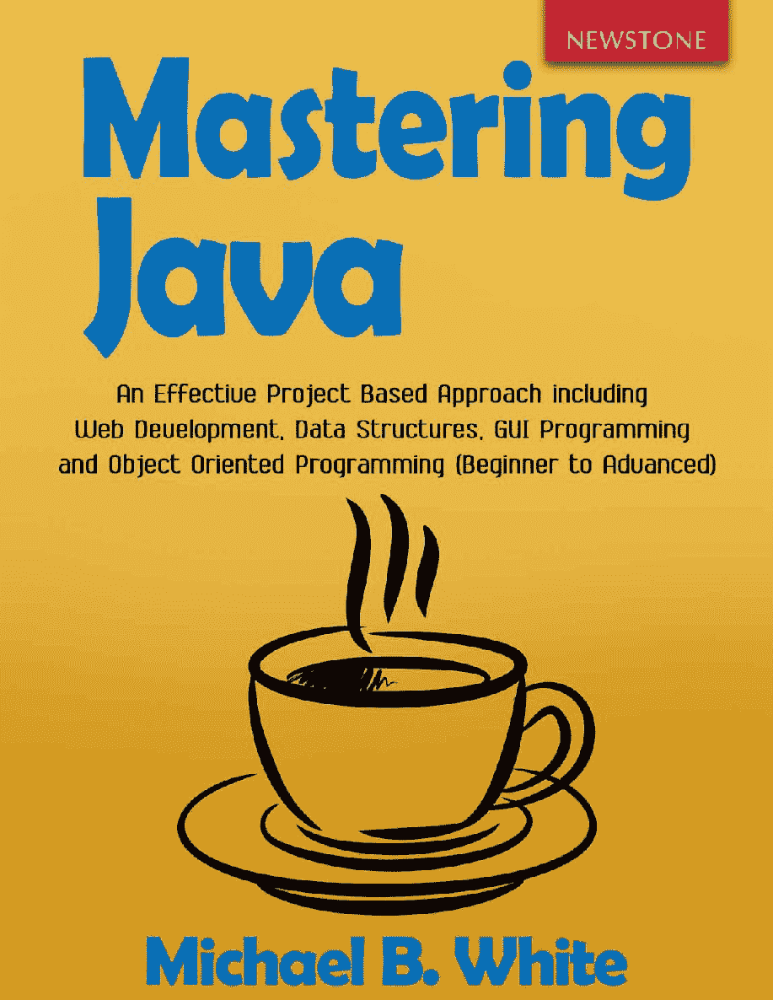

# 精通 Java：基于项目的有效方法，涵盖 Web 开发、数据结构、GUI 编程和面向对象编程（从入门到高级）



# 组合优于继承

# Java OOP – 杂项

# 数学类

# Java 的值传递与引用传递

# Java 命令行参数

# Java 方法重写

# Java 方法重载

# 重载与重写的区别

# 第 6 章：Java 面试题

## 基础 Java 面试题

## OOP Java 面试题

## JDBC 面试题

## Hibernate 面试题

## Java JSP 面试题

# 第 7 章：Java 语言与术语

## A

## B

## C

## E

## F

## G

## H

## I

## J

## K

## L

## M

## N

## O

## P

## Q

## R

## S

## T

## U

## V

## W

## Z

# 结论

你可能会惊讶地发现，这种编程语言最困难的部分是设置你的工作环境。在下载 NetBeans 之前，你甚至无法考虑编写单行代码。NetBeans 是免费的，而且毫无疑问是编写任何 Java 程序最流行的 IDE（集成开发环境）。但在我们进入该阶段之前，我们首先需要 NetBeans 所需的组件和文件。

## JVM (Java 虚拟机)

首要任务是安装一个虚拟机，因为 Java 是不依赖于平台的，这意味着它可以在任何平台上运行，无论是 Linux、Mac、Windows 还是任何其他平台。是虚拟机负责所有的代码处理，而且由于 Oracle 拥有 Java，你必须拥有他们在官方网站上提供的虚拟机，或者说 `Java Runtime Environment`（Java 运行时环境）。因此，第一个去的地方是 `https://www.java.com/en/download/`。

现在，当你打开这个网站时，你会看到下载按钮下方有一个链接，写着“我有安装 Java 吗？”（Do I Have Java?）。点击它可以非常快速地查看你的电脑上是否已经安装了 Java。尽管点击吧；电脑将开始开始扫描，你就能发现是否安装了 Java。如果没有安装，将会出现一条消息询问你是否想要安装。在这里你有选择：要么点击“是”，要么去 `https://www.java.com/en/download/manual.jsp` 手动下载。在该网站上，你将找到适用于 Java 可以下载的所有不同操作系统和平台的多个下载链接。

下载并安装完成后，你需要重启系统以完成操作；重启后，你将看到虚拟机在你的系统上运行。

在这个阶段，仍然无法开始编程；你到目前为止完成的只是安装了一个可以让 Java 程序在你的系统上运行的软件。要实际编写并测试代码，你需要一个 `SDK`，或者说 `Software Development Kit`（软件开发包）。为此，我们需要 `Java SE SDK`，请访问 `https://www.oracle.com/technetwork/java/javase/downloads/index.html`。

从那里，可以将 `Java SE SDK` 下载到电脑。浏览网页上的列表并找到 NetBeans 版本——它会显示 `JDK` 后面带有 NetBeans（* = 版本号，例如 `JDK8`）。点击它，将打开一个新页面，列出适用于不同系统和平台的各种下载版本。点击适用于你特定系统的版本，并按照屏幕上的说明进行安装——在这里请多一点耐心；这是一个非常大的下载文件，取决于你的系统和网络连接，它可能需要一些时间。

我们将使用 NetBeans 进行编程（在 GUI 编程部分你也需要它），所以在在我们继续打开它之前，你应该了解 Java 的工作原理。

## 它是如何工作的

当你开始编写 Java 代码时，你是在文本编辑器中编写的，而 NetBeans 已经准备好为你提供编写所有内容的地方。代码被称为源代码，并始终以 `.java` 扩展名保存。然后，一个名为 `Javac` 的程序会将该源代码转换为 Java 字节码，这个过程被称为编译。一旦代码被 `Javac` 编译，它会被再次保存，这次使用的扩展名是 `.class`。然而，只有在代码没有错误的情况下才能执行此操作。当类文件准备就绪后，它就可以在你的 `JVM`（Java 虚拟机）上运行。

所以：

- 你的源代码被创建并保存为 `.java` 扩展名
- `Javac` 然后编译代码并将其保存为 `.class` 扩展名
- 你编译后的类可以在 `JVM` 上运行

NetBeans 的设计初衷是让你的生活变得非常简单。它为你完成所有的创建和编译工作；在后台，它运行着源代码转换为 java 文件的魔法，使用 `Javac` 进行编译，然后在其内置软件中运行你新的 `.class` 文件。这让你不再需要像使用其他编程语言那样打开终端窗口并输入长而复杂的文本字符串。

好了，这就是 NetBeans 配合 Java 工作的方式，是时候打开 NetBeans 了——我们要写一个程序。实际编写代码是学习其如何运作的最好方法，所以去执行你需要的事吧——如果你还没有安装 NetBeans，去安装它。然后打开它，准备好跟随本节后续的内容。

## 你的第一个程序

要启动新项目，进入 NetBeans 工具栏并点击 `File`（文件）。接下来，点击 `New Project`（新建项目），将加载一个对话框。我们将创建一个 Java 应用程序，因此导航到 Categories（类别）部分并选择 `Project`（项目）。点击 `Java Application`（Java 应用程序），然后点击 `Next`（下一步）。

在窗口顶部 `Project Name`（项目名称）处为此项目输入名称——为了方便演示，我们将其命名为 `firstproject`。当你输入时，请注意底部的文本会随之更改。在 Create Main Class（创建主类）的右侧，你会看到一个输入了以下内容的文本框：

`firstproject.FirstProject`

一个名为 `FirstProject` 的类已创建——注意 `F` 和 `P` 是大写的。包（package）的名称也是 `firstproject`，但全为小写字母。

查看 `Project Location`（项目位置）文本框——将显示项目保存的默认位置；你可以更改它，也可以保持原样。注意 NetBeans 将在项目名称所在的位置创建一个文件夹。点击 `Finish`（完成），你会在屏幕的 `Projects` 区域看到一个 `+` 号；如果你没有看到该区域，点击屏幕顶部的 `Window`（窗口）然后 `Projects`。点击项目后，NetBeans 会创建所有必要的内容并直接带你进入 IDE——你会看到代码窗口，我们现在准备好工作了。

现在展开 `Source Packages`（源码包），你应该能看到源代码。该代码位于屏幕右侧，文件名为 `FirstProject.java`。

名为 `FirstProject` 的类如下：

```java
public class FirstProject {
```

注意项目窗口中看到的类文件也有相同的名称，这是有原因的——当 Java 编译器运行编写的任何程序时，文件名和类名必须相同，例如如果你将 `.java` 文件命名为 `firstproject` 但类名为 `FirstProject`，编译器将会报错——务必检查名称是否匹配以避免这种情况。

尽管如此，包名是不同的；为了简单起见我们将其命名为 `firstproject`，但你叫它什么都可以。包名不需要与源文件或其中的类名匹配——重要的是类和文件名相同。

明白了吗？我们继续。

## Java 注释

当你创建新项目时，你应该看到有很多灰色的文本包含斜杠和星号。这些被称为注释，当你运行程序时，编译器会忽略它们。注释的想法是写一段说明来描述代码的作用——这样当你回到代码时，你就知道每段代码的意思了，如果其他人查看，他们也能正确阅读。这也有助于发现可能出现错误的地方。

注释可以用几种方式编写。第一种是单行注释，用两个正斜杠（`//`）表示，然后是注释内容：

```
//这是一个单行注释
```

```java
//这个注释跨越了

//至少两行
```

或者你也可以这样做：

```java
/*

这个注释跨越了至少两行
*/
```

这是一种实现多行注释简单得的方法，而不需要记住在每一行新代码开头加上 `//`。

另一个选项是使用 Javadoc 注释。它们以一个正斜杠和两个星号开头，并像上面的示例一样，以一个星号和一个正斜杠结束。中间的每一行带有注释的行都会以星号开头：

```java
/**
*这个注释是一个 Javadoc 注释
*/
```

Javadoc 注释是文档化代码的一种非常有用的方法。这些代码随后可以转换为 HTML 页面，对他人很有帮助。当你写好一些代码后，你将开始看到它的样子，因此去到 NetBeans 屏幕顶部并点击 `Run`。点击 `Generate Javadoc` ——尽管在我们写一些代码之前，没什么可以看的。

关于注释的一个简要说明：尽量保持简短，并确保它们清楚地说明代码中发生了什么；长而啰嗦且充满不必要词汇的注释是没有意义的，并且会让你的代码看起来更加杂乱。

## 代码结构

接下来要看的是你的代码是如何组织的以及如何运行你编写的程序。你已经知道代码结构的第一部分是包名 – 你必须用分号结束这一行，否则程序将无法编译：

```java
package firstproject;
```

接下来是类名：

```java
public class FirstProject {

}
```

我们可以认为一个类是一个代码段，但你必须让 Java 知道每个段的开始和结束位置；这是通过你在上面看到的大括号完成的。左括号（`{`）开启段，右括号（`}`）关闭段。这两个之间编写的任何内容都是该代码段的一部分。此外，如果一对括号之间有任何属于类的内容，那么它是一个独立段的一部分。看看这个：

```java
public static void main( String[ ] args ) {

}
```

在上面的那个段中有一个重要的词 – `main`。在 Java 程序的开始处，Java 将寻找一个名为 `main` 的方法。方法是代码的一个部分，我们稍后会详细介绍它们。在这个阶段，Java 将大括号组内的所有代码作为 `main` 方法执行。如果你没有 `main` 方法，将会抛出错误。正如名称所示，它是任何用 Java 编写的程序的主入口。

在这个阶段，我们可以忽略 `main` 之前的任何内容，但只是为了让你了解：

- `public` 是一个指示器，表示该方法可以在类外被看到；
- `static` 表示我们不需要创建新对象，并且
- `void` 表示没有要返回的值。

括号组 `()` 之间的任何内容都是命令行参数。如果你现在不理解这个，不用太担心；在指南本这一节结束时你就会理解的。

现在，重要的是知道：

- 我们有一个名为 `FirstProject` 的类
- 它有一个名为 `main` 的方法
- 每个方法都在它们自己的开启和关闭大括号内
- 我们代码的主体部分属于名为 `FirstProject` 的类。

让我们继续学习数据类型和变量。在这个阶段，如果你对任何内容不确定，请回过一遍，因为在下一部分，我们将开始涉及一些技术性内容。

## 介绍数据类型和变量

Java 程序的工作原理是处理被放入内存的任何数据，而这些数据可以是任何类型，包括数字、文本、对象、指向另一段内存的指针以及许多其他类型。数据被分配一个名称，以便我们在需要时轻松地召回它。名称以及分配给该名称的任何值就是一个变量。我们将从数值开始。

Java 提供了存储数字的多种选项。例如，名为 `int` 的变量用于存储任何整数（1, 4, 9 等），而 `double` 的名称则用于表示浮点数或小数（1.2, 5.9 等）。为了存储该值，我们使用等号（`=`）。

看看下面的示例，然后尝试将其输入到你的程序 `FirstProject` 中尝试它们：

## 示例

将以下代码段添加到 `FirstProject` 中设置一个 `int`（整数或全数），确保它进入 `main` 方法：

```java
public static void main(String[ ] args) {

int first_number;

System.out.println("My First Project");

}
```

为了让 Java 知道你想存储一个整数，第一个单词应该是 `int`，确保在它后面添加一个空格。整数变量随后需要一个名称；只要你遵循这些命名规范，你就可以按你喜欢的进行命名：

- 数字不能作为变量名的开头。例如，你可以将其命名为 `first number`，但你不能将其命名为 `1st_number`。你可以在名字的任何地方使用数字，但不是开头。
- 变量不能使用 Java 保留关键字命名，因为这些是留给 Java 使用的。我很快会给你提供这些关键字的列表。
- 名称中不能有任何空格。相反，确保你的第一个单词是小写字母，名称中的第二个以及后续所有单词都有大写字母。

现在，重要的是知道：

- 我们有一个名为 `FirstProject` 的类
- 它有一个名为 `main` 的方法
- 每个方法都在它们自己的开启和关闭大括号内
- 我们代码的主体部分属于名为 `FirstProject` 的类。

让我们转向数据类型和变量。在这个阶段，如果你对任何内容不确定，请回过一遍，因为在下一部分，我们将开始涉及一些技术性内容。

现在我们要在这些新变量中存储一些值：

```java
first_number = 12;
second_number = 24;
answer = first_number + second_number;
```

在名为 `answer` 的变量中，必须将第一个数字加上第二个数字；使用 `+` 符号来执行此操作。接下来，Java 将将这两个值相加，即 `first_number` 和 `second_number` 的值。答案（即加法总和）将存储在 `=` 符号左侧的变量中。因此，不是将 `12` 或 `24` 赋值给变量名，而是将两个数字相加然后赋值给变量。为了让更清楚一点，请看这里：

```java
answer=first_number + second_number
```

`first_number` 和 `second_number` 先被相加。

```java
answer =first_number + second_number
```

然后答案被存储在名为 `answer` 的变量中。

这段代码等同于：

```java
answer = 12 + 24;
```

现在，Java 已经知道 `first_number` 和 `second_number` 变量中的内容，所以你只需要使用它们的名称即可。现在我们可以对 `println` 方法做一个小改：

```java
System.out.println("Addition Total = " + answer );
```

再次，双引号内编写的文本与变量名结合，你的代码现在应该看起来这样：

```java
public static void main(String[] args) {
    int first_number, second_number, answer;
    first_number = 12;
    second_number = 24;
    answer = first_number + second_number;
    System.out.println("Addition Total = " + answer );
}
```

所以，总结一下，这个程序已经：

* 存储了一个数字
* 存储了第二个数字
* 将数字相加
* 将答案（加法结果）存储在另一个变量中
* 打印了答案

也可以在代码中直接使用数字，因此修改你代码中的 `answer` 行，变为：

```java
answer = first_number + second_number + 14;
```

再次运行它；它的运行符合你的设想吗？在 `int` 变量中存储大数字是可能的，但有一个最大值你可以达到——`2147483647`。你也可以加上负数，最低数字为 `-2147483648`。如果你需要存储更大或更小的数字，你就需要使用不同的变量类型。该类型是 `double` 变量。

## Double 变量

当我们想要存储比标准变量允许的最大和最小值大多的值时，就会使用 `double` 变量。`double` 变量允许的最小和最大数字太大无法在此列出，但它们分别是 `1` 和 `-17`，每个后面都跟着 `307` 个零。

我们还使用 `double` 变量来存储浮点数的值。这些值是小数，例如 `1.6` 或 `10.8`。如果你尝试将其中一个存储在 `int` 变量中，NetBeans 会提示你有错误；尝试运行它，你会在编译器上得到一个错误消息。

现在，使用你已有的代码，让我们尝试使用 `double` 变量。通过修改这一行，将代码中的 `int` 改为 `double`：

```java
int first_number, second_number, answer;
```

将其变为：

```java
double first_number, second_number, answer;
```

接下来，需要更改存储的值：

```java
first_number = 12.5;
second_number = 24.8;
```

保持你代码的其他部分不变；它应该是这样的：

```java
public static void main (String[] args) {
    double first_number, second_number, answer;
    first_number = 12.5;
    second_number = 24.8;
    answer = first_number + second_number;
    System.out.println ("Addition Total = " + answer);
}
```

运行它看看发生了什么。

## Short 变量和 Float 变量


我们还有两种变量类型需要查看：`short` 和 `float`。`short` 变量用于存储 `+32767` 到 `-32767` 之间的较小数字。本可以使用它代替 `int`，但只有当你 100% 确定你的值不会超过该范围时，才能使用 `short` 变量。

`float` 变量可以代替 `double` 变量来存储更大的浮点数或小数；但如果你使用了 `float` 变量，你必须记住在每个数字后面加上一个 `'f'`，如下：

```java
float first_number, second_number, answer;
first_number = 12.5f;
second_number = 24.8f;
```

`'f'` 必须放在数字末尾，但在分号之前。

## 简单算术

使用这些变量，我们可以添加其他让我们进行算术运算的符号。这些符号被称为运算符（Operators）：

* `+`（加法）
* `-`（减法）
* `*`（乘法）
* `/`（除法）

## 运算符优先级

运算符优先级（Precedence）决定了运算符执行的顺序。如果一个表达式中包含多个运算符，Java 会根据优先级来决定执行顺序。例如，在下面的代码中：

```java
answer = 10 + 5 * 2;
```

Java 不会先执行加法，而是先执行乘法 `5 * 2`，得到 `10`，然后再加上 `10`，结果 `answer` 为 `20`。

如果你想先执行加法，你可以使用括号：

```java
answer = (10 + 5) * 2;
```

在这种情况下，Java 会先计算括号内的 `10 + 5`，得到 `15`，然后乘以 `2`，结果 `answer` 为 `30`。

括号的优先级是最高的，它强制 Java 先计算括号内的内容。

同样的，对于除法，你也可以使用括号来改变执行顺序：

```java
answer = 20 / (10 / 2);
```

在这种情况下，Java 会先计算括号内的 `10 / 2`，得到 `5`，然后用 `20` 除以 `5`，结果为 `4`。

运算符优先级规则如下：

1. 括号 `()`
2. 乘法 `*` 和除法 `/`（从左到右）
3. 加法 `+` 和减法 `-`（从左到右）

理解运算符优先级对于编写出逻辑正确的代码至关重要。

## 存储文本值

我们也可以使用变量来存储文本，而不仅仅是数字。你可以存储单个字符，也可以存储多个字符。如果你只想存储一个，则使用 `char` 变量；但通常情况下，会存储多个字符，因此你会使用 `string` 变量。

保存之前的代码并关闭项目。打开一个新项目 – `File>New Project`，就像你刚开始时做的那样，当看到对话框时，确保你已经选择了 `Java` 和 `Java Application`。

点击 Next（下一步），然后将新项目命名为 `StringUtils`。确保启用了 `Create Main Class`（勾选其旁边的复选框），然后在 `stringvars` 之后 `Main` 的地方，删除 `Main` 并输入 `StringVariables`。

项目名称为 `Stringvars`，类名为 `StringVariables`。现在你可以点击 Finish（完成）并查看代码窗口。你应该能看到小写的包名（`stringvars`）和项目名称首字母大写（`StringVars`）。

设置字符串变量需要你输入 `String` 然后是变量名。注意 `String` 的首字母大写，并且行末有一个分号：

```java
String first_name;
```

接下来，为变量赋值，实现方法是输入 `=`，后面跟上双引号、要存储在变量中的文本，然后是更多的双引号：

```java
first_name = "Peter";
```

你可以将它们全部写在同一行：

```java
String first_name = "Peter";
```

现在我们需要另一个变量（同样是字符串）来存储姓氏：

```java
String family_name = "Piper";
```

添加以下 `println` 语句，这样名字和姓氏都会打印出来：

```java
System.out.println( first_name + " " + family_name );
```

在 `println` 的起始和结束括号之间，我们看到：

```
first_name + " " + family_name
```

我们所做的是告诉 Java 它应该打印名为 `first_name` 的变量中存储的值。紧接着是一个加号 (`+`) 和一个空格，该空格被一对双引号包围。我们这样做是为了让 Java 意识到要打印一个空格字符。空格之后是另一个加号，后面是名为 `family_name` 的变量。

这看起来有点凌乱，但我们想要打印的是名字、一个空格，然后是姓或第二个名字。你的代码应该像：

```java
public static void main (String[] args) {
    String first_name = "Peter";
    String family_name = "Piper";
    System.out.println ( first_name + " " + family_name);
}
```

运行它并看看结果是什么。

如果你只想存储一个单个字符，你将使用 `char` 变量，而且不是使用双引号，我们只需要单引号。修改你的代码使其看起来像这样：

```java
public static void main (String[] args) {
    char first_name = 'P';
    char family_name = 'P';
    System.out.println( first_name + " " + family_name);
}
```

如果你在 `char` 中使用双引号，NetBeans 会向你显示这是错误的，并给出一个“incompatible type”（类型不兼容）的错误信息。你可以使用存储单个字符的 `String` 变量，但你必须确保使用双引号：

这样做可以：

```java
String first_name = "P";
```

这样做是不行的：

```java
String first_name = 'P';
```

注意第一个使用的是双引号，第二个使用的是单引号。

## 在 Java 中接收并读取用户数据

Java 有一个巨大的优势 – 它拥有海量的类库，里面充满了你可以利用的代码。所有代码在编写时都有特定的目的，而要使用它们，你只需要传递指向你想要获取代码的特定库的引用；接着调用一个方法即可生效。`Scanner` 类是目前最有帮助的，因为它是处理用户输入的方式。你可以发现这个类位于名为 `java.util` 的库，你需要做的只是在代码中引用该类。怎么做呢？使用 `import` 关键字：

```java
import java.util.Scanner;
```

该语句必须放在 `Class` 语句之前：

```java
import java.util.Scanner;

public class StringVariables {
}
```

我们所做的只是告诉 Java 我们想要一个来自特定库的特定类；在我们的案例中是存储在 `java.util` 库中的 `Scanner` 类。

下一步要做的是获取该类并创建一个对象。正如你将在指南后半部分看到的，类无非是一块代码；在你从该类创建对象之前，它实际上不会执行任何操作。要从 `Scanner` 类实现这一点，我们这样做：

```java
Scanner user_input = new Scanner( System.in );
```

我们没有设置一个 `int` 或 `string` 变量，而是有一个扫描器变量。我们将它命名为 `user_input`，名称后跟着 `=` 符号和一个关键字 – `new`。当我们想要从类创建一个新对象时使用 `new` 关键字，在括号内部，我们必须告诉 Java 我们想要对象是一个 `System Input` 对象（`system.in`）。

为了获取用户输入，我们需要调用一个方法。

## 条件语句

目前我们使用的是顺序编程。这意味着我们的代码从第一行开始按顺序执行，直到最后一行。我们把这种称为线性代码 – Java 从上到下读取每一行。

尽管我们在程序中并不总是需要这些，但在某些情况下，你可能只想在满足一个或多个指定条件时执行某段代码。假设你希望如果用户年满 21 岁以上，则在屏幕上显示一条消息，但如果他们小于 21 岁，则显示另一条。你需要能够控制代码的流，而这只能通过条件逻辑来实现。

条件逻辑主要使用 `IF` 关键字。一个例子是：如果用户大于 21 岁，将显示此条消息；如果用户小于 21 岁，则显示不同的消息。这听起来很复杂，但条件逻辑实际上非常易用。

## IF 语句

编程中我们常用的操作之一是在某事情发生时执行某些代码，而不是发生其他事情。正是因为如此才有了 `IF` 语句，它的结构如下：

```java
if ( Statement ) {

}
```

我们用 `IF` 开始语句，但请注意它在一组括号之间，并且是小写的。然后使用大括号来隔一段代码，这段代码只有在满足特定条件时才会被执行。我们将该条件放在括号之间：

```java
if ( user < 21 ) {

}
```

我们的条件是说明“如果用户小于 21”。注意，我们在这里使用的是简写符号，而不是实际的单词“is less than”。小于号的符号是 `<`，所以我们的代码的意思是，如果用户小于 21，就会发生某些事情（显示一条消息）：

```java
if ( user < 21 ) {

//DISPLAY THIS MESSAGE

}
```

所以，如果我们的用户是 21 岁或更大，Java 将跳过我们插入大括号中的代码代码，并继续执行程序的其余部分直到结束。我们放在大括号中的代码只有在满足 `IF` 条件（即括号之间输入的那个条件）时才会被执行。

在我们着手此之前，还有另一个需要注意的简写符号 - `>`。这个表示“大于”，它可以用于修改代码以检查年龄大于 21 岁的用户。

```java
if ( user > 21 ) {

//DISPLAY THIS MESSAGE

}
```

我们向代码中添加的只是一个 `>` 符号；括号之间的条件现在将检查用户是否大于 21 岁。

它不会检查那些 21 岁的用户；只检查大于 21 岁的。如果我们需要检查一个人是否为 21 岁或更大，我们需要使用“大于或等于（相同）”，在编程中我们可以仅使用两个符号来实现这一点 - `>=`：

```java
if ( user >= 21 ) {

//DISPLAY THIS MESSAGE

}
```

同样地，我们可以使用“小于或等于（相同）”的符号来检查用户是否为 21 岁或更小。这些符号是 `<=`：

```java
if ( user <= 21 ) {

//DISPLAY THIS MESSAGE

}
```

我们做的只是添加了 `<` 和 `=`。

让我们把所有内容整合到一个程序中。首先，关闭你打开的程序并保存。启动一个新项目（你现在已经知道怎么做了），并将你的包命名为 `conditionallogic`，类命名为 `IFStatements`。现在你可以将这段代码添加到程序中了：

```java
public class IFStatements {
    public static void main(String[] args) {
        int user = 20;
        if (user < 21) {
            System.out.println("User is less than 21");
        }
    }
}
```

我们所做的是创建一个值为 `20` 的 `int` 变量。我们的 `IF` 语句将寻找“小于 21”，并打印大括号内部的消息。运行它并看看发生了什么。


NetBeans 将使用 Project 窗口中的**粗体文本**运行程序，而不是你显示的代码。如果你想在代码窗口中运行代码，请右键点击代码并选择 `Run File` – 你现在会在 Output 窗口中看到输出。

我们接着做的另一件事是将 `user` 变量的值从 `20` 改为 `21`，然后再次运行它。程序应该会完美运行而没有任何错误，但你不会看到任何打印内容。为什么？因为在 `IF` 语句大括号内要显示的消息是，而 `IF` 语句正在寻找小于 21 的值。如果无法满足该条件，Java 就会忽略大括号及其之间的任何内容，继续执行代码的下一部分。

## IF…ELSE 语句

你可以在代码中使用两个 `IF` 语句，但也可以使用 `IF…ELSE` 语句；该语句的结构如下：

```
if ( condition_to_test ) {

}
else {

}
```

与 `IF` 语句一样，我们的行将以 `if` 开头，后面跟着包含我们想要测试的条件的括号。再次，大括号被用于将代码划分成我们想要使用的选项；第二个部分将跟在语句的 `ELSE` 部分之后，并有它自己的大括号。

让我们看看用于检查 `user` 年龄的代码：

```java
public static void main(String[] args) {
    int user = 20;
    if (user <= 21) {
        System.out.println("User is 21 or younger");
    }
    else {
        System.out.println("User is older than 21");
    }
}
```

（注：此处原文示例代码逻辑略有错乱，已根据语境调整翻译逻辑）

在检查 `user` 年龄的代码中：

```java
public static void main(String[] args) {
    int user = 20;
    if (user <= 21) {
        System.out.println("User is 21 or younger");
    }
    else {
        System.out.println("User is older than 21");
    }
}
```

在上面的代码中，如果用户是 21 岁或更小，将显示“User is 21 or younger”；否则，显示“User is older than 21”。

接下来的操作是将 `user` 变量的值从 `20` 改为 `21`，然后再次运行。程序应该完美运行而没有任何错误，但你不会看到任何打印。为什么？因为在 `IF` 语句大括号内要显示的消息，而 `IF` 语句正在寻找小于 21 的值。如果无法满足该条件，Java 就会忽略大括号及其之间的任何内容，继续执行代码的下一部分。

## 嵌套 IF 语句

我们可以嵌套 `IF` 语句，也可以嵌套 `IF…ELSE` 和 `IF…ELSE IF` 语句。嵌套仅仅是将一个 `IF` 语句放在另一个 `IF` 语句内部的动作。假设你想测试一个用户是否小于 21 岁但大于 18 岁；你需要为任何大于 18 岁的用户显示一条消息，因此需要第一个语句：

```java
if ( user < 21 ) {
    System.out.println( "21 or younger");
}
```

为了检查用户是否大于 18 岁，我们需要另一个 `IF` 语句，可以将其放置（嵌套）在第一个语句之中，如下所示：

```java
if ( user < 21 ) {
    if ( user > 18  && user < 21 ) {
        System.out.println( "You are 19, 20 or 21");
    }
}
```

我们的第一个 `IF` 语句会在 `user` 变量的值低于 21 时捕获它，第二个 `IF` 语句将筛选范围缩小到 18 到 21 之间的用户。如果你想打印其他内容，可以将 `IF` 语句替换为 `IF…ELSE` 语句：

```java
if ( user < 21 ) {
    if ( user > 18 && user < 21 ) {
        System.out.println( "You are 19, 20 or 21");
    }
    else {
        System.out.println( "18 or younger");
    }
}
```

仔细观察大括号的放置位置；把一个放错位置或漏掉一个，你的代码就无法运行。嵌套的 `IF` 语句可能看起来有点难以上手，但你实际上只是在缩小选择范围。

## 布尔值 (Boolean Values)

对于布尔值只有两种可能的输出——TRUE 或 FALSE、1 或 0、YES 或 No。在 Java 中，有一个特定的变量类型用于这些值：

```java
boolean user = true;
```

我们不需要使用 `double`、`int` 或字符串变量，只需输入 `boolean`（注意是小写的 `b`），然后在变量名之后赋值一个值，TRUE 或 FALSE。我们在这里使用 `=` 作为赋值运算符，但如果你想知道一个变量是否具有某个“值”，则需要使用 `==` 符号。

尝试一下：

```java
boolean user = true;

if ( user == true) {
    System.out.println("it is true");
}
else {
    System.out.println("it is false");
}
```

通过我们的第一个 `IF` 语句，我们想检查 `user` 变量是否具有 TRUE 值，通过语句的 `ELSE` 部分，我们查看该值是否为 FALSE。我们不需要说 `ELSE IF (user==false)`，因为简单来说，不是真的就必须是假的。我们只需要 `ELSE`，因为正如我之前所说，布尔值只有两个值。

最后一个使用的条件运算符是 NOT，我们可以将其与布尔值一起使用。这个例子：

```java
boolean user = true;

if ( !user ) {
    System.out.println("it is false");
}
else {
    System.out.println("it is true");
}
```

除了其中一行外，它与之前的布尔代码示例几乎完全相同——那一行是：

```java
if ( !user ) {
```

在这里，我们在 `user` 变量之前使用了 NOT 条件运算符；感叹号表示该运算符，放置在你想要测试的变量之前。NOT 运算符将测试真实值的相反值，即取反。我们将 `user` 变量设置为 TRUE，因此 NOT 运算符将检查 FALSE 值。反过来也通通。可以这样想：如果不是 TRUE，就必须是 FALSE，反之亦然。

## Switch 语句 (Switch Statements)

我们使用的另一种控制语句流向的方法是使用 `switch` 语句。`switch` 语句让你有机会测试变量的一系列范围值，并可以用来代替 `IF…ELSE` 语句。`switch` 语句的结构如下：

```java
switch ( variable_to_test ) {
    case value:
        code_here;
        break;
    case value:
        code_here;
        break;
    default:
        values_not_caught_above;
}
```

我们从 `switch` 开始，后面跟着括号。在括号之间我们放置想要检查的变量，然后是大括号。`switch` 语句的其余部分放在这些括号之间。对于每个正在检查的值，在要检查的值之前必须使用 `case` 单词：

`case value:`

值后面跟着一个冒号，然后我们说明如果找到匹配项应该发生什么。这将是要执行的代码；我们必须使用 `break` 关键字来跳出语句中的单个 case。

在最后，我们有一个 `default` 值；这是可选的，如果你有变量可能存储但在语句其他任何部分未被检查的值，你就可以使用它。

这在现在可能有点让人困惑，特别是如果你是 Java 编程的完全初学者。尝试下面的代码；首先保存并关闭你正在编写的代码，然后打开一个新项目。然后输入代码：

```java
public static void main(String[] args) {
    int user = 21;
    switch ( user ) {
        case 21:
            System.out.println( "You are 21");
            break;
        case 19:
            System.out.println( "You are 19");
            break;
        case 20:
            System.out.println( "You are 20");
            break;
        default:
            // values_not_caught_above logic
    }
}
```

首先，我们告诉 Java 从哪个数字开始；在我们的案例中，我们给 `loopVal` 变量赋值为 10，这是循环中的第一个一个值。其次，我们使用了一些条件逻辑：

```
loopVal < end_value
```

这句话的意思是 `loopVal` 小于 `end_value`；只要 `loopVal` 变量保持小于 `end_value`，`for` 循环就会持续进行。这适用于任何 `for` 循环——只要 `loopVal` 保持小于 `end_value` 为**真**（TRUE），Java 继续执行插入大括号之间的代码。

我们括号中的最后部分是：

```java
loopVal++
```

这告诉 Java 我们希望它从 `loopVal` 的起始值开始并到下一个顺序值。由于我们正在从 10 数到 20，所以下一个数字将是 11。然而，我们并没有使用那段代码，而是这样做：

```java
loopVal = loopVal + 1
```

在 `=` 符号右侧是 `loopVal + 1`。这告诉 Java 应该在 `loopVal` 中已有的值上加上 1。加法的结果存储在 `=` 符号左侧的 `loopVal` 变量中。结果是在新值上不断加上 1，这被称为递增。这种用法非常频繁，以至于发明了一个新的符号——一个名为 `++` 的新变量：

```java
int some_number = 0;
some_number++;
```

当 Java 执行代码时，会将 1 分给 `some_number`，简写为：

```java
int some_number = 0;
some_number = some_number + 1;
```

回顾一下，这个 `for` 循环表示：

- 10 是循环的起始值

- 只要值小于 21，它就会继续循环

- 为了达到结束值，必须不断给起始值加上 1

在 `for` 循环的大括号内，我们有：

```java
System.out.println("Loop Value = " + loopVal);
```

`loopVal` 变量中的值将被打印出来，带有一些文本，所以运行它看看会发生什么。

你的程序被困在这个循环中并被迫不断循环，每次都给 `loopVal` 变量加 1。只要 `loopVal` 的值小于 `end_value` 变量中存储，它就会持续下去。大括号内的代码将不断被执行，这就是循环的本质——持续执行大括号内的代码。

下一个示例将数字 1 到 10 相加；试试看：

```java
public static void main(String[] args) {
    int loopVal;
    int end_value = 11;
    int addition = 0;
    for (loopVal = 1; loopVal < end_value; loopVal++) {
        addition = addition + loopVal;
    }
    System.out.println("Total = " + addition);
}
```

运行程序，你应该得到输出 55。注意，这与之前的代码几乎完全相同；我们有两个了名为 `loopVal` 和 `end_value` 的变量，然后我们有一个名为 `addition` 的第三方变量。这是一个包含加法结果的 `int` 类型变量。

在 `for` 循环括号之间，再次非常相似——只要 `loopVal` 保持低于 `end_value`，循环就会重复，每次都在新值上加 1。注意使用 `loopVal` 来表示我们的循环。

我们的大括号内只有一行代码：

```java
addition = addition + loopVal;
```

它的作用是将我们所有的数字相加；如果你对它的工作原理感到困惑，请从 `=` 符号的右侧开始，那里写着：

```java
addition + loopVal;
```

第一次循环时，`addition` 变量赋值为 0，而 `loopVal` 的起始值为 1。Java 将此值加上 1，并将结果存储在 `=` 左侧的 `addition` 变量中。`addition` 变量中存储的值被删除并加上新值。在第二次循环中，以下代码进入我们的括号之间：

```
addition (1) + loopVal (2);
```

显而易见，2 加上 1 得到 3，所以这个值将替换 `addition` 变量中的原有值。在第三次循环中，我们看到的这些新值为：

```
addition (3) + loopVal (3);
```

Java 将数字相加，并将 6 作为新值存储在 `addition` 变量中。这一直持续，直到所有加法完成且循环结束；打印的结果是 55。

## While 循环

另一种常用的循环是 `While` 循环，它们比 `For` 循环容易理解得多。它们的结构如下：

```
while ( condition ) {
}
```

我们从小写的 `while` 开始，在括号之间插入我们想要测试的条件。同样，我们有那些包含将执行代码的大括号。看看这个打印文本的 `while` 循环示例；试试看：

```java
int loopVal = 0;
while ( loopVal < 5) {
    System.out.println("Printing Some Text");
    loopVal++;
}
```

括号之间是我们测试的条件——只要 `loopVal` 保持小于 5，循环就会执行。在大括号内，打印一行文本。接下来，`loopVal` 必须递增；漏掉这一步将导致无限循环，因为 `loopVal` 无法越过它的起始值 0。

尽管 `loopVal` 用于...

## Do While 循环

最后一个循环是 `Do...While` 循环，结构如下：

```java
int loopVal = 0;
do {
    System.out.println("Printing Some Text");
    loopVal++;
} while ( loopVal < 5 );
```

最大的区别是 `do` 中的括号代码将至少执行一次，而 `while` 循环的条件可能已经满足。如果是这种情况，Java 将跳出循环。

我们可以通过先尝试 `while` 循环来测试；将你的 `loopVal` 值改为 5 并运行。你应该会看到文本没有打印。现在更改循环的 `do` 部分，将 `loopVal` 设置为 5，运行它，文本将打印一次。

## 数组

也许你学习的最重要的概念之一是数组。到目前为止，我们看到的都是只包含一个值的变量——`int` 包含一个数字，`string` 包含一个文本字符串。当我们想要包含两个或多个值时（例如列表），就会使用数组。数组被认为是表格中的列——表格可以有一列，也可以有很多列。

类似于表格，数组中的每一行都有一个位置编号；这些编号从 0 开始，每个有值的位置递增。设置数组需要你告知 Java 的是什么类型的数据——字符串、布尔值、整数等。然后你需要告诉 Java 数组的位置数量，并这样做设置它们：

```java
int[] aryNums;
```

现在，我们只是告诉 Java 我们想要设置一个整数数组；还没有告诉它将有多少个位置，为了这一点，需要一个新的数组对象：

```java
aryNums = new int[5];
```

以数组名称开始，后面跟一个等号。接着是 `new` 关键字和数据类型，然后是方括号。在这些括号中是数组的大小——即它将拥有的位置数量。这些都可以写在同一行上：

```java
int[] aryNums = new int[5];
```

所以，Java 现在知道我们想要一个带有位置的整数数组。一旦 Java 执行了该行代码，数组就会被分配一个默认值；因为我们是一个整数数组，所有位置都将具有相同的默认值 `0`。给数组位置赋值的方法与给任何值赋值的方法相同相同：

```java
aryNums[0] = 15;
```

我们使用方括号引用位置 `0` 并为其赋予了 `15` 的值。所有位置都是通过这种方式赋值的：

```java
aryNums[1] = 12;
aryNums[2] = 26;
```

依此类推。不要忘记，定位从 `0` 开始，所以位置 `3` 的索引是 `2`。如果你已经知道了数组中将包含的值，你可以这样做：

```java
int[] aryNums = { 10, 20, 30, 40 };
```

要此此，在 `=` 符号后使用大括号，这些括号将包含存入数组的值。第一个值将进入位置 `0`，第二个进入位置 `1`，依此类推。注意，在数据类型后仍必须使用方括号，但你不需要再使用 `new` 关键字或重复数据类型和方括号。然而，这仅适用于 `int`、`string` 或 `char` 数据类型；对于其他任何类型，都需要使用 `new` 关键字。

例如，你可以这样做：


```java
String[] aryStrings = {"January", "February", "March", "April"};
```

但你不能这样做：

```java
boolean[] aryBools = {true, false, true, false};
```

设置 `Boolean` 数组仍然需要 `new` 关键字：

```java
boolean[] aryBools = new boolean[] {true, false, true, false};
```

要访问数组值，需要数组名称以及方括号内的数组位置：

```java
System.out.println(aryNums[2]);
```

这将打印数组中位置 `2` 处的任何值。

是时候做一些实际操作了。开始一个新项目并给它你喜欢的名称，记住类也必须赋予相关的名称。对于我们的示例，我们将包命名为 `prjarrays`，并将类命名为 `ArraysTest`。如果你选择不同的内容，请确保将这些名称放入你的代码中：

```java
public class ArraysTest {
    public static void main(String[] args) {
        int[] aryNums = new int[5];
        aryNums[0] = 20;
        aryNums[1] = 34;
        aryNums[2] = 16;
        aryNums[3] = 28;
        aryNums[4] = 83;
        System.out.println(aryNums[2]);
    }
}
```

运行它查看结果。

更改打印行使数组位置现在改变，再次运行，将打印出不同的数字。

## 数组与循环

数组真正发挥作用是我们将它们与循环一起使用。我们学习了如何给位置赋值，如下：

```java
aryNums[0] = 20;
```

但是，如果你想给一个数组分配多个数字，这并不是一种实用的方法。例如，假设你写了一个彩票程序，并希望它能将 `1` 到 `49` 的数字分配给数组中的位置。与其手动输入那么多位置和值，你你可以使用循环。方法如下：

```java
public class ArraysTest {
    public static void main(String[] args) {
        int[] lottery_numbers = new int[49];
        int i;
        for (i=0; i < lottery_numbers.length; i++) {
            lottery_numbers[i] = i + 1;
            System.out.println(lottery_numbers[i]);
        }
    }
}
```

我们在这里有一个包含 `49` 个值（全部为 `int` 类型）的数组，以及一段循环代码。注意最后的循环条件是什么：

`i < lottery_numbers.length`

`length` 是数组对象的一个属性，用于查找数组有多少个位置。只要变量 `i` 的值小于数组的大小，循环就会继续。要给每个位置赋值，我们将这样做：

```java
lottery_numbers[i] = i + 1;
```

与其使用方括号通过数组名来持有代码值，相反我们使用了变量 `i`。循环每次运行时，该值都会增加 `1`。然后我们使用循环值来访问数组位置，并为每个位置分配 `i + 1` 的值。这是加了 `1` 的递增循环值。由于循环值从 `0` 开始，你将获得从 `1` 到 `49` 的所有数字。我们循环中的另一行将打印每个位置拥有的任何值。

## 数组排序

Java 还包含允许你排序数组的方法。其中一种方法称为 `sort`，要使用它，你需要引用它存储的 Java 库。该库被称为 `Arrays`，我们使用 `import` 语句来这样做。尝试一下：

```java
import java.util.Arrays;
```

你应该应该是这样的：

```java
package prjarrays;

import java.util.Arrays;

public class ArraysTest {
    public static void main(String[] args) {
        int[] aryNums = new int[5];
        aryNums[0] = 20;
        aryNums[1] = 34;
        aryNums[2] = 16;
        aryNums[3] = 28;
        aryNums[4] = 83;
    }
}
```

好的，到为止，我们只查看了包含单列数据的数组，但我们可以使用多个数据列。我们称这些为多维数组，它们非常像包含行和列的电子表格。对于我们的示例，假设我们有 5 列 4 行，总共有 20 个值。多维数组的结构如下：

```java
int[ ][ ] aryNumbers = new int[5][4];
```

它们的设置方式与我们之前看到的数组非常相似，但有一点不同——两组方括号。第一组用于行，第二组用于列。在代码正上面的代码行中，我们告诉 Java 需要一个 5 行 4 列的数组。在多维数组中存储值需要注意每一行和每一列都要被跟踪。

这个示例展示了前几行是如何填充的：

```java
aryNumbers[0][0] = 15;
aryNumbers[0][1] = 19;
aryNumbers[0][2] = 35;
aryNumbers[0][3] = 10;
```

如你所见，第一行的索引是 0，列的索引是 0 到 4，总共 5 行。第二行看起来如下：

```java
aryNumbers[1][0] = 30;
aryNumbers[1][1] = 55;
aryNumbers[1][2] = 76;
aryNumbers[1][3] = 2;
```

虽然列号保持不变，但行号现在都被赋予了值 1。

访问任何多维数组中的所有项都需要在循环内部嵌套循环。看下面的代码，我们使用双重循环来访问所有的数字：

```java
public static void main(String[] args) {
    int[][] aryNumbers = new int[6][5];
    aryNumbers[0][0] = 10;
    aryNumbers[1][0] = 30;
    aryNumbers[0][1] = 12;
    aryNumbers[1][1] = 55;
    aryNumbers[0][2] = 43;
    aryNumbers[1][2] = 76;
    aryNumbers[0][3] = 11;
    aryNumbers[1][3] = 2;
    aryNumbers[2][0] = 30;
    aryNumbers[3][0] = 40;
    aryNumbers[2][1] = 67;
    aryNumbers[3][1] = 12;
    aryNumbers[2][2] = 32;
    aryNumbers[3][2] = 87;
    aryNumbers[2][3] = 14;
    aryNumbers[3][3] = 14;
    aryNumbers[4][0] = 50;
    aryNumbers[5][0] = 60;
    aryNumbers[4][1] = 86;
    aryNumbers[5][1] = 53;
    aryNumbers[4][2] = 66;
    aryNumbers[5][2] = 44;
    aryNumbers[4][3] = 13;
    aryNumbers[5][3] = 12;
    int rows = 5;
    int columns = 4;
    int i, j;
    for (i = 0; i < rows; i++) {
        for ( j = 0; j < columns; j++) {
            System.out.print(aryNumbers[i][j] + " ");
        }
        System.out.println("");
    }
}
```

初始的 `for` 循环用于行，第二个 `for` 循环用于列。在第一个循环中，`0` 是变量 `i` 的值。在 `for` 循环中，代码是另一个循环，只要 `i` 变量的值保持为 `0`，整个双重循环就会执行。第二个循环有另一个名为 `j` 的变量，`i` 和 `j` 两个变量都用于访问数组：`aryNumbers[ i ][ j ]`。

我们使用双重循环系统来遍历多维数组的值，一次处理一行。

### 数组列表 (Array Lists)

如果你不知道数组中将包含多少项，更好的方法是使用 `ArrayList`。`ArrayList` 是动态数据结构，这意味着它们是可以改变的——我们可以向项目列表添加或移除项目。普通数组是静态数据结构，因为它们在整个过程中保持大小不变——无论你开始时将其声明为多大，它将永远是那个大小。

设置 `ArrayList` 需要你从名为 `java.util` 的库导入 `ArrayList`：

```java
import java.util.ArrayList;
```

现在可以创建 `ArrayList` 对象了：

```java
ArrayList listTest = new ArrayList( );
```

我们不需要方括号；一旦创建了对象，可以使用 `add` 方法向列表添加元素：

```java
listTest.add( "first item" );
listTest.add( "second item" );
listTest.add( "third item" );
listTest.add( 7 );
```

在 `add` 方法的括号之间，你添加任何想要添加到 `ArrayList` 中的内容。你只能添加对象；前三个添加的是字符串，第四个是 `int` 类型数字。

引用列表中的项使用 `get` 方法和索引数字：

```java
listTest.get(3)
```

这一行代码的作用是获取位置 3 的项。记住，`ArrayList` 可以处理动态大小。

### 函数与方法 (Functions and Methods)

Java 方法是特定操作的语句集合。假设你调用 `System.out.println()` 方法，Java 将执行多条语句向控制台打印消息。我们将查看方法的创建。

#### 如何创建方法 (How to Create a Method)

方法的结构如下：

```java
public static int methodName(int a, int b) {
    // body
}
```

这些意味着什么？

- `public static` —— 这是修饰符

- `int` —— 这是返回类型

- `methodName` —— 这是方法名

- `a`, `b` —— 这些形式参数

- `int a, int b` —— 这是参数列表

定义方法需要方法头和方法体，如下：

```java
modifier returnType nameOfMethod (Parameter List) {
    // body
}
```

在此示例中：

- `modifier` —— 定义方法的访问类型，是可选的

- `returnType` —— 是方法可能返回值的指示

- `Parameter List` —— 列出参数以及它们的类型、顺序和方法中有多少个参数。这是可选的，因为方法不需要参数。

- `nameOfMethod` —— 是方法名，同时也包含了参数列表

- `method body` —— 在这里定义方法对你的语句的操作

在下一个示例中，你可以看到一个名为 `max()` 的方法的代码。该方法将两个名为 `num1` 和 `num2` 的参数，我们将这两个这两个参数之间的最大值作为返回：

```java
/** 此代码返回两个数字之间的最大值 */
public static int maxFunction(int n1, int n2) {
    int max;
    if (n1 > n2)
        max = n2;
    else
        max = n1;
    return max;
}
```

```java
  return max;
}
```

## 调用方法

当你想要使用方法或函数时，你有两种方式可以操作——带值调用或不带值调用。调用方法非常简单——这意味着该方法被触发，程序控制跳转到该方法，并在以下两种条件下返回给调用者：

- 当 `return` 语句的执行完成时

- 当到达方法的结束大括号时

在下一个示例中，我们将看到如何定义和调用方法：

```java
public class ExampleMinNumber {
    public static void main(String[] args) {
        int a = 11;
        int b = 6;
        int c = minFunction(a, b);
        System.out.println("Minimum Value = " + c);
    }

    /** 返回两个数字中的最小值 */
    public static int minFunction(int n1, int n2) {
        int min;
        if (n1 > n2)
            min = n2;
        else
            min = n1;
        return min;
    }
}
```

输入此代码并运行，看看它的作用。

### void 关键字

如果我们不希望方法返回值，则将使用 `void` 关键字。在下面的示例中，我们有一个名为 `methodRankPoints` 的方法——因为我们不需要这个方法的返回值，所以它是一个 `void` 方法。调用它时，你需要一个语句，如示例所示：

```java
public static void main(String[] args) {
    methodRankPoints(255.7);
}

public static void methodRankPoints(double points) {
    if (points >= 202.5) {
        System.out.println("Rank:A1");
    } else if (points >= 122.4) {
        System.out.println("Rank:A2");
    } else {
        System.out.println("Rank:A3");
    }
}
```

运行程序并查看输出结果。

## 按值传递参数

当方法被调用时，必须传递参数，且顺序必须与方法中对应的参数的顺序一致。参数可以通过两种方式传递——按值传递和按引用传递。要按值传递，必须调用带有参数的方法，这将导致参数值被传递给参数，如示例所示：

```java
public class SwappingExample {
    public static void main(String[] args) {
        int a = 30;
        int b = 45;
        System.out.println("Before swapping, a = " +a + " and b = " + b);
        // 调用交换方法
        swapFunction(a, b);
        System.out.println("\nNow, Before and After swapping values will be same here:");
        System.out.println("After swapping, a = " +a + " and b is " + b);
    }

    public static void swapFunction(int a, int b) {
        System.out.println("Before swapping(Inside), a = "+a+" b = "+ b);
        // 将 n1 与 n2 交换
        int c = a;
        a = b;
        b = c;
        System.out.println("After swapping(Inside), a = " +a+" b = "+ b);
    }
}
```

运行此代码看看你得到的结果。

## 方法重载

如果一个类中两个或多个同名方法，但每个方法的参数不同，则被称为方法重载。这与方法重写（overriding）不同——对于重写，每个方法的名称、类型、参数等必须完全相同。

假设我们有一个 `double` 类型，并且想知道它的最小值是多少。引入重载是为了创建至少两个同名但参数不同的方法，如下：


```java
public class ExampleOverloading {
    public static void main(String[] args) {
        int a = 11;
        int b = 6;
        double c = 7.3;
        double d = 9.4;
        int result1 = minFunction(a, b);
        // 同函数名，不同参数
        double result2 = minFunction(c, d);
        System.out.println("Minimum Value = " + result1);
        System.out.println("Minimum Value = " + result2);
    }

    // 针对整数
    public static int minFunction(int n1, int n2) {
        int min;
        if (n1 > n2)
            min = n2;
        else
            min = n1;
        return min;
    }

    // 针对 double
    public static double minFunction(double n1, double n2) {
        double min;
        if (n1 > n2)
            min = n2;
        else
            min = n1;
        return min;
    }
}
```

运行它看看发生了什么。当你重载时，你可以让代码变得极易易读。我们在这里做的是提供了两个名称相同但参数各异的方法；结果是分别得到 `int` 和 `double` 的最小值。

## 类和对象

最后，我们将查看类和对象；

Java 中的对象必须有一个状态（存储在字段中）和一个行为（由方法表示）。

类就像是一个蓝图，通过它创建对象。类的定义如下所示：

```java
public class Dog {
    String breed;
    int age;
    String color;
    void barking() {
    }
    void whining() {
    }
}
```

类可能有这些类型：

- **局部 (Local)**：定义在方法内部。
- **实例 (Instance)**：定义在类中。
- **类 (Class)**：定义在类外部。

### 构造函数

每个类都有 `barking()`、`whining()`。构造函数如下：

```java
public class Puppy {
    public Puppy() {
    }
    public Puppy(String name) {
    }
}
```

### 创建对象

我们已经知道类是创建对象的蓝图，所以不用说我们需要 `new` 关键字。创建对象的三个步骤如下：

1. **声明 (Declaration)**：必须声明一个变量。
2. **实例化 (Instantiation)**：使用 `new` 关键字。
3. **初始化 (Initialization)**：调用构造函数。

下一个示例展示了如何创建对象：

```java
public class Puppy {
    public Puppy(String name) {
        // 此构造函数包含一个名为 name 的参数。
        System.out.println("Passed Name is :" + name );
    }

    public static void main(String []args) {
        // 下一语句创建一个名为 myPuppy 的对象
        Puppy myPuppy = new Puppy( "fluffy" );
    }
}
```

## 访问实例变量和方法

当我们想要访问实例变量和方法时，可以使用对象；此示例展示了如何访问实例变量：

```java
/* 首先我们创建对象 */ ObjectReference = new Constructor();
/* 现在我们这样调用变量 */ ObjectReference.variableName;
/* 现在我们这样调用类方法 */ ObjectReference.MethodName();
```

接下来，我们可以看到类中的实例变量和方法是如何访问的：

```java
public class Puppy {
    int PuppyAge;

    public Puppy(String name) {
        // 此构造函数包含一个名为 name 的参数。
        System.out.println("Name chosen is :" + name );
    }

    public void setAge(int age) {
        PuppyAge = age;
    }

    public int getAge() {
        System.out.println("Puppy's age is :" + PuppyAge );
        return PuppyAge;
    }

    public static void main(String[] args) {
        /* 对象创建 */
        Puppy myPuppy = new Puppy( "fluffy" );

        /* 现在调用类方法设置狗狗的年龄 */
        myPuppy.setAge(2);

        /* 接下来，调用另一个类方法获取狗狗的年龄 */
        myPuppy.getAge();

        /* 我们这种方式访问实例变量 */
        System.out.println("Variable Value :" + myPuppy.PuppyAge );
    }
}
```

一个重要的记忆点是，路径必须是完全限定的，这包含了类名和包名。如果不是，编译器将难以加载源代码和类。为了使路径完全限定，我们需要使用 `import` 语句，在这个示例中，我们将看到编译器如何将请求的类加载到我们指定的目录中：

```java
import java.io.*;
```

接下来，我们需要创建两个类，一个命名为 `Employee`，另一个命名为 `EmployeeTest`。我们使用以下代码来实现——请记住 `Employee` 是 `class` 的名称，并且它是一个 `public` 类。执行此操作并保存文件，将其命名为 `Employee.java`。

另外请注意，我们这里有四个实例变量——`age`、`name`、`designation` 和 `salary`，以及一个显式定义并带有参数的构造函数：

```java
public class Employee {
    String name;
    int age;
    String designation;
    double salary;

    // 这是名为 Employee 的类的构造函数
    public Employee(String name) {
        this.name = name;
    }

    // 我们将 Employee 的年龄赋值给变量 age。
    public void empAge(int empAge) {
        age = empAge;
    }

    /* 我们将职位赋值给变量 designation.*/
    public void empDesignation(String empDesig) {
        designation = empDesig;
    }

    /* 我们将工资赋值给变量 salary.*/
    public void empSalary(double empSalary) {
        salary = empSalary;
    }

    /* 打印 Employee 详情 */
    public void printEmployee() {
        System.out.println("Name:"+ name );
        System.out.println("Age:" + age );
        System.out.println("Designation:" + designation );
        System.out.println("Salary:" + salary);
    }
}
```

代码处理从 `main` 方法开始，因此你需要确保你的代码有一个 `main` 方法，并且我们需要创建一些对象。我们将从创建一个名为 `EmployeeTest` 的 `class` 开始，这将创建名为 `Employee` 的 `class` 的实例。必须调用每个对象的方法，以便将值分配给变量。将此代码保存到 `EmployeeTest` 中：

```java
public class EmployeeTest {
    public static void main(String args[]) {
        /* 使用构造函数创建两个对象 */
        Employee empOne = new Employee("Bobby Bucket");
        Employee empTwo = new Employee("Shelley Mary");

        // 调用创建的每个对象的方法
        empOne.empAge(28);
        empOne.empDesignation("Senior Software Developer");
        empOne.empSalary(1500);
        empOne.printEmployee();

        empTwo.empAge(22);
        empTwo.empDesignation("Software Developer");
        empTwo.empSalary(850);
        empTwo.printEmployee();
    }
}
```

现在需要编译这些类并运行 `EmployeeTest`；执行此操作并查看结果。

你应该会看到这些：

输出

```
C:\> javac Employee.java
C:\> javac EmployeeTest.java
C:\> java EmployeeTest
Name: Bobby Bucket
Age:28
Designation: Senior Software Developer
Salary:1850.000
Name: Shelley Mary
Age:22
Designation: Software Developer
Salary:850.00
```

# 第 2 章：Java 数据结构与算法

算法和数据结构是数据科学的核心组件，数据科学是研究数据、数据如何在内存中表示以及数据结构如何转换为算法的分支。在 Java 编程中，数据结构用于存储和组织数据，而算法用于对存储在结构中的数据进行操作。这非常直观，对吧？你学习和理解的数据结构和算法越多，你的 Java 程序就越高效。

我们将首先观察数据结构是什么以及它们是如何分类的，然后再讨论算法及其是如何表示的。之后，在详细查看之前，我们将快速看一眼复杂度。第一部分是概述。

## 数据结构概述

数据结构基于 ADT —— 抽象数据类型。ADT 是一种数学模型，从数据用户的角度出发，通过其语义或行为定义数据类型。这特别体现在数据的潜在值、可能在数据上执行的操作，以及这些操作的行为。

抽象数据类型不关心其值在内存中是如何表示的，也不关心操作的实现。以 Java `interface` 为例，它是一种不与任何实现连接的数据类型。相比之下，数据结构是至少一个抽象数据类型的坚实实现，就像 Java 中 `class` 接口的实现方式一样。

抽象数据类型的示例包括 `Vehicle`、`Employee`、`List` 和 `arrays`。`List` ADT 也称为 `Sequence` ADT，被描述为一组按顺序排列的元素集合，每个元素共享相同的数据类型。每个元素在列表中都有一个位置，我们也可以拥有重复元素。`List` ADT 支持的一些基本操作包括：

- 创建新的空列表
- 在列表末尾追加值
- 在列表中插入值
- 从列表中删除值
- 对列表进行迭代

实现 `List` ADT 的数据结构包括固定大小和动态的一维数组，以及链表，我们稍后会讨论这些。

## 数据结构的分类

有多种数据结构类型，从变量、数组到具有多个字段的链表。每种数据结构都可以分类为聚合型或原始，有些则是容器。

### 原始型 vs 聚合型 vs 容器

最简单的数据结构是那些存储单个数据的结构，例如具有 `Boolean` 值的变量或整数变量。这些被称为原始数据结构。

许多数据结构可以存储多个数据项，例如在每个槽中都有数据的数组，或在每个字段中都有数据的对象。这些被称为聚合数据结构。

任何可以存储并从中检索的数据项都被视为数据结构。许多数据结构被设计用于描述不同的实体。例如，`Employee` 实例是描述员工的数据结构类型，而 `Vehicle` 实例描述不同的车辆。相比之下，某些数据结构作为其他数据结构的存储。例如，我们可以使用数组存储对象引用或原始值，这种数据结构被称为容器。

## 算法概述

历史上，算法被用作数学计算的工具，它们深深植根于计算机科学中，特别是数据结构中。算法是一系列旨在在有限时间内完成特定任务的指令。算法具有以下特性：

- 它们可以接收零或多个输入
- 它们将产生至少一个输出
- 它们由清晰且无歧的指令组成
- 它们会在预定的步数后结束
- 它们足够简单，可以用纸和笔就能完成

请注意，虽然程序可能具有算法性质，但如果没有某种外部干预，它们并不总是终止。

### 深入观察

我们知道数据结构是存储数据的一种，以便更高效地使用。在这里，我们来看描述任何数据结构基础的术语：

- `Interface`（接口）——每个数据结构都将有一个接口，它是该数据结构提供支持的所有操作的表示。接口将显示这些操作的列表，以及每个操作可以接受的参数类型和操作的返回类型。
- `Implementation`（实现）——这将给我们我们数据结构的内部表示，并定义数据结构操作所使用的算法。

## 数据结构的特征

每个数据结构都具有以下特征：

- `Correctness`（正确性）——所有数据结构的实现都应该恰当正确地实现它们的接口。
- `Time Complexity`（时间复杂度）——运行或执行数据结构操作所需的时间必须保持在最低。
- `Space Complexity`（空间复杂度）——同理，数据结构操作也应该使用最少的内存。

## 为什么我们需要数据结构

随着我们快速步入数字时代，应用程序变得越来越复杂，数据越来越丰富，结果就是它们面临着三个非常常见的问题：

- `Data Search`（数据搜索）——想一下——一个包含 100 万件物品的商店库存。如果我们想让应用程序搜索某个物品，它必须搜索可能的 100 万件物品，这会显著减慢搜索速度。随着更多数据的可用，搜索将继续变慢。
- `Processor Speed`（处理器速度）——尽管处理器的速度很快，但随着数据增长到包含数十亿记录，这些速度将会下降。
- `Multiple Requests`（多重请求）——Web 服务器上可能有成千上万的用户同时搜索数据，这可能导致即使是最快的服务器在搜索过程中崩溃。

数据结构是这些问题的答案。数据结构以这种方式组织数据，使得用户可能不需要搜索每个物品，这意味着所需的数据几乎可以立即找到。

## 执行时间情况

我们通过三种不同的情况，相对地比较各种数据结构的执行时间：

- `Worst Case`（最坏情况）——最坏情况是指数据结构上的特定操作花费了可能的最长时间。如果一个操作的最坏情况时间为 `f(n)`，那么该操作的时间将不超过 `f(n)`；`f(n)` 代表 `n` 的函数。
- `Average Case`（平均情况）——平均情况是指数据结构上的操作取平均值。如果一个操作完成执行需要 `f(n)` 时间，那么我们可以预计 `m` 次操作需要 `m f(n)` 时间。
- `Best Case`（最好情况）——最好情况是指数据结构上的操作花费了最少的时间。如果一个操作完成执行需要 `f(n)` 时间，那么适当的操作时间可以是一个随机数，其最大值为 `f(n)`。

## 基础术语

- `Data`（数据）——一个值或一组值。
- `Data Item`（数据项）——引用一个值单元。
- `Group Items`（组项）——划分为子项的数据项。
- `Elementary Items`（元素项）——无法任何方式划分的数据项。
- `Attribute and Entity`（属性与实体）——具有特定属性或可以赋值属性的实体。
- `Entity Set`（实体集）——一组具有相似属性的实体。
- `Field`（字段）——代表实体属性的一个元素单元。
- `Record`（记录）——指定实体的字段值集合。
- `File`（文件）——指定实体集中所有实体的记录集。

算法是一个按步骤执行的程序，定义了必须按特定顺序执行以获得所需输出的指令。它们通常独立于任何底层语言而创建。简单来说，这意味着任何算法都可以在多种编程语言中实现。

就数据结构而言，这些是最重要的算法类别：

- `Search`（搜索）——该算法在数据结构中搜索指定项。
- `Sort`（排序）——该算法将指定项按指定顺序排序。
- `Insert`（插入）——该算法将在结构的定点插入一个项。
- `Update`（更新）——该算法将更新数据结构中存在的给定项。


- `Delete`（删除）——该算法从指定的数据结构中删除给定项。

## 算法的特征

我们不能将所有的过程都称为“算法”。一个真正的算法将具有这些特征（我们之前已经提到过这些，但学习它们很重要）：

- `Unambiguous`（无歧义）——算法必须清晰且不能有歧义，每个步骤或阶段以及相关的输入和输出都是清晰的，并产生单一的含义。

- `Input`（输入）——它必须至少有 0 个定义良好的输入。

- `Output`（输出）——它必须至少有 1 个定义良好的输出，并且应该匹配你正在寻找的输出。

- `Finiteness`（有限性）——算法必须在定义的步骤数内结束。

- `Feasibility`（可行性）——算法在所有可用资源的情况下必须是可行的。

- `Independent`（独立性）——它必须具有清晰的、逐步的指令，且独立于任何一种计算机编程语言。

好了，我保证不再重复这些点了！但说真的，如果你想在编程和使用算法方面保持高效，你就必须学习它们。

## 如何编写算法

实际上并没有任何标准（至少没有一个定义足够充分的标准）告诉我们如何编写算法。相反，算法依赖于问题和资源，而且绝不是为了支持某特定代码而编写。

每种计算机编程语言都会共享代码结构，如流程控制、循环等，我们可以使用这些结构来编写算法。它们通常是按步骤编写的，但也有例外。编写算法的过程在我们正确定义了问题领域后执行的；我的意思是要编写算法，你需要知道问题是什么，以便知道如何解决它。

让我们看一个例子：

问题——我们要解决的问题是两个数字相加。

步骤 1 – `Start`

步骤 2 – 我们声明 `a`、`b` 和 `c` 均为整数

步骤 3 – `a` 和 `b` 的值被定义

步骤 4 – `a` 和 `b` 的值相加

步骤 5 – `a` 和 `b` 相加的结果存储在 `c` 中

步骤 6 – 我们打印 `c` 的值

步骤 7 – `Stop`

算法告知程序员应该如何编写程序。上述算法的另一种写法是：

步骤 1 – `Start add`

步骤 2 – 获取 `a` 和 `b` 的值

步骤 3 – `c <- a + b`

步骤 4 – 显示 `c` 的值

步骤 5 – `Stop`

当我们设计和分析算法时，通常会使用方法二来描述它。这是因为如果分析人员不需要处理不必要的定义，将会方便得多；他她可以更好地看到使用的操作和流程。

注意 – 编写步骤是可选的——它们并不是必要的。

## 算法分析

我们可以在两个阶段分析算法的效率——在实现之前和实现之后。这些阶段被称为：

- `A Priori Analysis`（先验分析）——理论分析。通过假设所有其他因素（例如处理器速度）都是恒定的且不会对算法实现产生影响，以此衡量算法效率。

- `A Posterior Analysis`（后验分析）——即实证分析。我们使用编程语言来实现该算法，并在目标机器上执行。在分析分析过程中，我们收集实际的统计数据，例如运行算法所需的时间和它所需的空间。

因此，任何算法的分析都集中在执行或运行算法中操作所需的时间上，运行时间被定义为每个操作执行了多少条指令。

## 算法的复杂度

假设 `X` 是算法，`n` 代表输入数据规模。两个主要因素是运行时间和所占用的空间，这两个因素都用于确定 `X` 的效率：

- `Time`（时间）——该因素通过排序算法中关键操作的数量（例如，比较操作）来衡量。

- `Space`（空间）——该因素通过确定算法所需的最大内存空间量来衡量。

算法复杂度 `f(n)` 以 `n`（输入数据规模）为单位，提供了算法运行所需的时间和/或所需的空间。

## 时间复杂度与时间复杂度函数

在研究时间复杂度之前，考虑这段用于打印数组的伪代码：

```
DECLARE INTEGER i, x[] = [ 10, 15, -1, 32 ]

FOR i = 0 TO LENGTH(x) - 1
  PRINT x[i]
NEXT i
END
```

算法的时间复杂度可以通过时间复杂度函数的规范来表示。即 `t(n) = an+b`，其中 `a` 是常数系数，代表完成一次循环迭代所需的时间，而 `b` 代表算法的初始化时间。上述算法被认为是线性的。

该函数假设我们是按时间顺序（即：秒）来衡量时间复杂度的。由于我们需要抽象某些机器细节，时间复杂度将更多地被表示为完成该任务所需的步数。

“步（step）”的定义取决于你所使用的算法而异。在上面的代码中，当你看到 `print` 指令时，我们可以将其视为一个步骤，那么打印的时间复杂度函数可以重写为：

`t(n) = n;` 对于 `n` 个数组元素，需要 `n` 步来打印数组。

在定义算法的步骤时，务必非常小心；定义必须有意义，并且必须与算法的输入规模相对应。例如，将打印定义为算法打印数组的程序步骤是有意义的；打印占用了更多的运行时间，并且完全取决于需要打印多少个元素。

我们也可以使用比较和交换来定义算法步骤。以排序算法为例；如果比较占据了大部分运行时间，则步骤可以根据比较来定义；或者，如果交换占据了大部分运行时间，那么我们就根据交换来定义。

为上面的示例确定时间复杂度函数并不困难，但当算法更加复杂时，操作就会变得困难。我们可以使用这些通用规则让这项任务变得容易：

- 具有一个循环的算法倾向于线性的，我们使用 `n` 来指定时间复杂度函数。

- 具有一对嵌套循环的算法倾向于二次方的，我们使用 `n2` 来指定时间复杂度函数。

- 具有三重嵌套循环的算法倾向于三次方的，我们使用 `n3` 来指定时间复杂度函数。

我们可以假设这种模式对于具有四层或更多嵌套循环的算法继续下去。

这些规则在循环执行 `n` 次（`n` – 输入数据规模）时往往效果更好，但并非总是如此。你可以从下面的选择排序算法的伪代码中看到：

```
DECLARE INTEGER i, min, pass
DECLARE INTEGER x[] = [ ... ]

FOR pass = 0 TO LENGTH(x) - 2
  min = pass
  FOR i = pass + 1 TO LENGTH(x) - 1
      IF x[i] LT x[min] THEN
        min = i
      END IF
  NEXT i
  IF min NE pass THEN
      EXCHANGE x[min], x[pass]
  END IF
NEXT pass
END
```

这里只有两个嵌套循环，所以你可以认为它具有二次性能。然而，这只部分正确；算法的性能取决于是否将交换或比较作为步骤：

如果我们选择交换作为一步，是因为我们认为它们占据了更多的运行时间，那么时间复杂度函数将是线性的——排序 `n` 个数据项需要 `n-1` 次交换。我们将函数指定为 `t(n) = n-1`。

相反，如果选择比较作为一步，函数将是 `t(n) = (n-1)+(n-2)+ \dots +1`，并被简化为 `t(n) = n2/2-n/2`。比较发生在内层循环中，对于第一个外层循环的迭代，它将总共执行 `n-1` 次，下一次执行 `n-2` 次，以此类推直到结束。

## 空间复杂度与空间复杂度函数

算法的空间复杂度指示了算法完成其任务需要多少额外内存。对于打印数组，无论数组大小如何，算法都需要恒定的内存量。该内存用于存储代码，当调用 `PRINT` 时需要栈空间来存储返回地址，并且变量 `i` 的值也需要空间。

数组打印算法的空间复杂度可以使用空间复杂度函数 `s(n) = c` 表示，其中 `c` 是常数。与其使用依赖机器的字节，我们使用与机器无关的单元来表示空间复杂度。在我们的情况下，`c` 是整数。

## 算法比较

时间和空间复杂度函数用于比较类似的算法。为了确保比较公平，每个算法必须具有相同的定义。

然而，即使内存和步骤定义相同，比较算法仍然可能困难。复杂度通常是非线性的，这意味着算法的规模会对结果产生巨大影响。看这两个时间函数作为例子：

`t1(n) = 10n2+15n`

`t2(n) = 150n+5`

当 `n = 1` 时，`t1` 有 25 步；相比之下，`t2` 有 155 步。显然 `t1` 更好。这种模式一直持续到 `n=14`；`t1` 有 2170 步，而 `t2` 有 2105 步。在这种情况下，`t2` 是更好的选择。

## 渐进分析

当我们讨论算法的渐进分析时，我们指的是算法运行性能的数学框架或基础。通过渐进分析，我们可以很容易确定任何算法的最佳、最坏和平均情况。

需要注意的是，渐进分析是输入受限的。这意味着，如果一个算法没有输入，它被认为是在常时间内运行的，因为输入以外的所有其他因素都是常数。

- `Best Case`（最好情况）——程序执行所需的最少时间

- `Worst Case`（最坏情况）——程序执行所需的最大时间

- `Average Case`（平均情况）——程序执行所需的平均时间

## 渐近记法

这些是用于计算算法时间复杂度最常用的渐近记法：

- `Ω` 符号

- `Θ` 符号

- `Ο` 符号

### Omega 符号 - `Ω`

这种记法是表示算法运行时间下界的一种更正式的方式。它用于衡量最坏情况复杂度，即算法完成所需的最少时间。

例如，取一个函数 `f(n)`：

```
Ω(f(n)) ≥ { g(n) : there exists c > 0 and n0 such that g(n) ≤ c.f(n) for all n > n0. }
```

### Theta 符号 - `θ`

这种记法也是正式的，是表示算法运行时间上界和下界的方法。该符号表示为：

```
θ(f(n)) = { g(n) if and only if g(n) = Ο(f(n)) and g(n) = Ω(f(n)) for all n > n0. }
```

### 大 O 符号

大 O 符号 `O(n)` 是表示算法运行时间上界的最正式的方式。它用于衡量最坏情况复杂度，即算法完成所需的最长时间。

例如，取一个函数 `f(n)`：

```
Ο(f(n)) = { g(n) : there exists c > 0 and n0 such that f(n) ≤ c.g(n) for all n > n0. }
```

我将这种符号放在了最后，这样我可以对其进行深入讨论；它是最重要的符号之一。复杂度函数往往是算法渐近行为的上界（下文将讨论），表示这些上界的就是大 O 符号。大 O 的正式定义如下：

如果函数 `f(n)` 是 `O(g(n))`，当且仅当存在两个常量 `c` 和 `n0`，使得对于所有 `n >= n0`，`f(n) <= cg(n)`。

请注意 `n`、`f(n)`、`c`、`g(n)` 和 `n0` 都必须是正数。

所以，`f(n)` 代表算法的计算时间。当说该函数是 `0(g(n))` 时，意味着从算法步骤来说，函数执行所需的时间并不比乘以 `g(n)` 的常数更长。例如，使用之前的时间复杂度函数，这些是大 O 符号：

```
t1(n) = O(n2)
t2(n) = O(n)
```

第一个方程读作“t1 是 n2 阶的”，这意味着 `t1` 具有二次性能。第二个方程读作“t2 是 n 阶的”或 `t2` 具有线性性能。因此，时间复杂度被认为是线性的、二次的等，因为随着 `n` 的增加，算法将这样做出响应。

### 大 O 简化

当我们指定 `g(n)` 时，我们通常会忽略除最大项以外的所有项，如果有，还会忽略最大项的常数系数。例如，与其指定 `0(150n+5)`，你只需要指定 `0(n)`。

作为证明 `t1(n)` 实际上是 `0(n2)` 的一种方法，你要做的就是找到任何两个使关系成立常量 `c` 和 `n0`。例如，如果你选择 `c` 为 `25`，`n0` 为 `1`，这就足够了，因为对于 `n>=1`，所有的 `10n2+1n` 值都小于或等于 `25n2`。同样地，你也可以证明 `t2(n)` 是 `0(n)`。

### 使用大 O 比较算法

假设我们有一个选择排序算法，随后紧接着是数组打印算法；这些每个算法都有自己的时间复杂度函数，那么两者的整体函数会是什么？以下规则决定了该答案：

如果 `f1(n) = O(g(n))` 且 `f2(n) = O(h(n))`，那么：

(A) `f1(n)+f2(n) = max(O(g(n)), O(h(n)))`

(B) `f1(n)*f2(n) = O(g(n)*h(n))`

第一部分讨论了算法顺序执行的情况，对于两个算法，组合的时间复杂度函数将是每个算法的最大值函数。在这种情况下，那将是 `0(n2)`，当然假设主导步骤是比较。

第二部分讨论了嵌套算法的情况，即一个在另一个内部。例如，假设选择排序算法执行一次交换，随后调用了数组打印算法。如果选择排序算法的时间复杂度为 `0(n2)`，即比较是主导的，那么组合的时间复杂度将是 `0(n3)`。

那么我们如何为需求选择正确的算法呢？首先要做的是获取对于你所考虑的算法的被大 O 限制的时间复杂度函数；然后你决定输入的 `n` 值范围。

通过分治法，问题被拆分（或划分）为若干个更小的问题或子问题。这些问题中的每一个都可以被独立地解决。当我们继续拆分，将子问题分解为更小的子问题时，我们可能会达到无法进一步拆分的阶段。这些子问题是它们所可能的最小单位，被称为原子问题或碎片问题，然后被解决；为了得到原始问题的解决方案，会将所有较小问题的解决方案合并在一起。

广义地说，分治法可以看作是一个包含三个步骤的过程：

- **划分或拆分** – 第一步涉及将原始问题划分为更小的问题。每个子问题都必须对原始问题具有代表性。这一步使用递归方法，不断划分问题，直到无法进一步拆分。子问题随后变为原子状态，但仍然代表了初始问题的一部分。

- **征服或解决** – 第二步接收许多需要解决的子问题，但这些子问题被认为是可以独立解决的。

- **合并或组合** – 当子问题解决后，使用递归方法将它们全部合并在一起，直到找到初始问题的解决方案。这一步与第二步联系非常紧密，看起来看起来就像是同一个步骤。

有几种基于这种方法的算法，包括：

- 二分查找

- 最近点对（点）

- 归并排序

- 快速排序

- Strassen 矩阵乘法

## 动态规划

动态规划法的方法与分治法非常相似，都是将问题分解为子问题。然而，它们的不同之处在于，子问题并不是被独立解决的。相反，子问题的结果会被记录下来，然后用于重叠或相似的子问题。

当我们面对一个可以拆分的问题，且不仅可以分为子问题，还能分为相似的子问题以便在其他地方重用结果时，就会使用动态规划。在大多数情况下，我们使用这种算法进行优化。在解决手头的子问题之前，动态算法会首先查看之前解决过的子问题的结果。然后将所有子问题的解决方案合并，以给出最优解决方案。

因此，总结一下：

- 原始问题必须能够拆分为与原始问题相似且重叠的子问题。

- 最优解决方案通过获取较小问题的最优解并将其组合来实现。

- 动态算法将使用记忆化（`Memorization`）。

- 与处理局部优化的贪心算法相比，动态算法的动力是优化整个解决方案。

- 与分治算法（即通过合并子问题解决方案来获取完整解决方案）相比，动态算法会查看较小子问题的输出，然后尝试优化一个较大的子问题。

- 动态算法还利用记忆化来记录已解决的子问题的输出结果。

动态算法方法可以用于此类问题：

- Floyd-Warshall 算法的全对最短路径

- 斐波那契数列

- 背包问题

- 项目调度

- Dijkstra 算法最短路径

- 汉诺华塔

动态规划有两种工作方式——从上到下和从下到上。而且在 CPU 周期的成本上，引用之前的解决方案会比重新计算更廉价。

## 数据结构与算法基础概念

在本节中，我们将介绍与数据结构相关的术语：

### 数据定义

数据定义用于定义具有以下特征的特定数据：

- **原子性** – 数据定义应该定义一个概念

- **可追溯性** – 数据定义必须映射到特定的数据元素

- **准确性** – 数据定义不应有任何歧义

- **清晰简洁** – 数据定义必须是完全理解的

### 数据对象

数据对象代表任何包含数据的对象。

### 数据类型

数据类型是分类不同类型数据的方法，例如字符串、整数、布尔值等。这种类型决定了数据类型中可以使用哪些值，以及允许进行哪些操作。主要有两种大类类型：

#### 内置数据类型

内置数据类型是像 `Java` 等编程语言已经内置支持的。`Java` 提供对以下内置类型的支持：

- 整数

- 浮点数

- 布尔值

- 字符

- 字符串

- 以及其他几种。

#### 派生数据类型

派生数据类型依赖于实现。它们通常由内置数据类型及其相关操作组合而成。例如：

- 数组

- 列表

- 队列

- 栈

### 基本操作

数据结构中的数据需要特定的操作才能进行处理。选择何种数据结构很大程度上取决于操作的频率。这些操作包括：

- 删除

- 插入

- 合并

- 搜索

- 排序

- 遍历

### 伪代码

伪代码是以文本格式表示算法的方法，提供了对最终源代码的近似描述。当你想要快速写出算法的表示形式时，伪代码非常有用；它不涉及语法，因此你不需要在编写时遵循任何硬性或快速规则。

然而，编写伪代码时应保持一致性，因为你会发现将其转换为正确的源代码要容易得多。例如，看看这段伪代码：

```
DECLARE CHARACTER ch = ''
DECLARE INTEGER count = 0
DO
  READ ch
  IF ch GE '0' AND ch LE '9' THEN
    count = count + 1
  END IF
UNTIL ch EQ '\n'
PRINT count
END
```

首先，有两个 `DECLARE` 语句。它们为我们提供了两个变量 `ch` 和 `count`，每个变量都初始化了默认值。然后是一个 `Do` 循环，它会一直执行直到 `ch` 变量包含换行符（`\n`）。此时，循环停止，并通过 `PRINT` 语句输出 `count` 的值。

这就是伪代码的简述；你将在本节中看到更多示例。

数组是元素的序列；每个元素必须与一个或多个索引位置相关。元素是内存位置的组，每个位置存储一个数据项。索引是非负整数；在数组的情况下，它们用于标识与该索引相关的元素。你可以将这两者之间的关系类比为邮箱号码识别特定街道上的特定房屋。


通常情况下，一个元素有一个索引，但有时可能会更多。每个元素拥有的这些索引数量就是数组的维度。我们将从查看一维数组开始；稍后转向多维数组。

Java 对数组有完全支持。数组中的每个元素将占据相同的字节数，具体字节取决于元素的数据类型。在此阶段还值得注意的是，一个数组中的每个元素都将是相同的数据类型。

重要的一点是，你不能调整 Java 数组的大小；它们是固定大小的，一旦创建就无法更改。与其这样做，如果你需要一个不同大小的数组，你需要创建一个正确大小的新数组，然后将第一个数组中所有的所有元素复制到新数组中。

## 一维数组

一维数组是所有数组中最简单的一种。在这类数组中，一个元素与一个索引相关，数组用于在列表中存储数据项。我们可以使用三种独立的技术来创建一维数组：

* 仅使用初始化器
* 仅使用 `new` 关键字
* 同时使用初始化器和 `new` 关键字

### 仅使用初始化器

使用初始化器创建一维数组所需的语法是：

```
'{' [expr (',' expr)*] '}'
```

该语法的意思是，一维数组是一个表达式列表，它是可选的，且每个表达式之间用逗号分隔，所有都位于一组大括号之间。

所有的表达式求值结果必须是兼容的类型。例如，如果你有一个包含两个元素的 `double` 类型一维数组，这两个元素都可以是 `double` 类型，或者只有其中一个可以是 `double` 类型，而另一个可能是整数或浮点数。

看这个示例：

```
{ 'J', 'a', 'v', 'a' }
```

### 使用 `new` 关键字

`new` 关键字用于分配数组内存并返回数组引用。其语法是：

```
'new' type '[' int_expr ']'
```

该语法告诉我们，一维数组是一系列正向元素，全部为 `int`（整数）类型。数组中的所有元素都将被置零，并被解释为以下内容之一：

* `0`
* `0L`
* `0.0F`
* `0.0`
* `false`
* `null`
* `'\u0000'`

例如：

```
new char[4]
```

### 同时使用初始化器和 `new` 关键字

同时使用初始化器和 `new` 关键字创建数组所需的语法如下，这是上述两种独立语法方法的组合：

```
'new' type '[' ']' '{' [expr (',' expr)*] '}'
```

由于我们可以通过查看由逗号分隔的表达式列表来确定一维数组中有多少个元素，因此我们不需要（事实上也不应该使用）在方括号中使用 `int_expr`。

例如：

```
new char[] { 'J', 'a', 'v', 'a' }
```

值得注意的是，仅使用初始化器的语法与同时使用初始化器和 `new` 关键字的语法之间没有区别。第一种（仅使用初始化器）被称为“语法糖”（syntactic sugar）——这意味着这种语法用起来简单得多。

## 数组变量

本身，一个新的一维数组是完全没用的。为了让它产生价值，我们必须首先将其引用分配给具有兼容类型的数组变量，我们可以通过两种方式实现——直接分配或通过方法调用。

下面的示例展示了如何声明变量：

```
type var_name '[' ']'
type '[' ']' var_name
```

这两种语法都是在声明存储一维数组引用的变量。你可以使用任何你喜欢的类型，但首选方法是第一种，即在变量类型后带有方括号。

看一些示例：

```
char[] name1 = { 'J', 'a', 'v', 'a' };
char[] name2 = new char[4];
char[] name3 = new char[] { 'J', 'a', 'v', 'a' };
output(new char[] { 2, 3 }); // output({ 2, 3 }); 结果会导致编译错误
```

```java
static void output(char[] name)
{
  // ...
}
```

在这些示例中，有三个数组变量——`name1`、`name2` 和 `name3`。方括号告诉 Java 这些变量中的每个都将存储一维数组的引用。

关键字 `char` 表示元素必须存储 `char` 类型的值，但只要 Java 可以转换为 `char`，你就可以指定非 `char` 类型的值。例如，下面是没问题的，因为 `10` 是一个正 `int`，它足够小可以放入 `char` 的范围（0 到 65535），并可以轻松转换为 `char`：

```
char[] chars = { 'A', 10 };
```

然而，下一个示例是不行的，因为 `80000` 不在范围内：

```
char[] chars = { 'A', 80000 };
```

所有数组都有一个关联的 `length` 属性。该属性返回长度。例如，`name1.length` 将返回 `4`。

通过以下语法，可以访问数组的任何元素：

```
array_var '[' ']'
```

在这个表达式中，索引从 `0` 开始。

看两个示例：

```
char ch = names[0]; // 获取值
names[1] = 'A'; // 设置值
```

如果指定的索引是负数，或 `>=`（大于等于）长度值，Java 将创建一个并抛出异常。该异常是：

```
java.lang.ArrayIndexOutOfBoundsException
```

## 搜索与排序算法

一维数组最常见的任务之一是搜索其特定项，我们可以使用多种算法来实现。其中最流行的是线性搜索（Linear Search），紧随其的是二分搜索（Binary Search）。后者性能更好，但对数据的要求更高，且在使用二分搜索之前，必须先对数组进行排序。我们将从线性搜索算法开始，逐一查看其他算法。首先，你需要理解在空间复杂度方面，这些算法的复杂度都是 `O(1)`，即变量存储是常数级的。

### 线性搜索

通过线性搜索算法，我们可以搜索包含 `n` 个数据项的一维数组，寻找指定的项。它的工作原理是从最低索引开始到最高索引，比较每个索引的数据项，直到找到匹配指定项的项目或者没有更多可以搜索和比较的内容。

看这个表示整数数组线性搜索的伪代码：

```text
DECLARE INTEGER i, srch = ...
DECLARE INTEGER x[] = [ ... ]

FOR i = 0 TO LENGTH(x) - 1
  IF x[i] EQ srch THEN
    PRINT "Found ", srch
  END
  END IF
NEXT i

PRINT "Not found", srch
END
```

考虑这个；我们有一个包含五个未排序整数的一维数组。这些整数是 `[ 1, 4, 3, 2, 6]` —— 第一个整数 `1` 位于索引 `0`，`6` 位于索引 `4`。伪代码将通过以下方式找到整数 `3`：

- 它会将索引为 `0` 处的整数 `(1)` 与 `3` 进行比较。
- 没有匹配，因此它移动到索引 `1`，`(4)` 并对其进行比较。
- 再次没有匹配，因此它移动到索引 `2`，`(3)` 并对其进行比较。
- 我们找到了匹配，因此打印 `Found 3` 并退出。

线性搜索的时间复杂度为 `O(n)`；当我们有 `n` 个数据项时，算法最多需要 `n` 次比较。平均而言，将执行 `n/2` 次线性比较。

线性搜索算法的缺点之一是效率并不高。如果你有一个包含 400 万（`4,000,000`）个数据项的数组，平均需要执行 200 万（`2,000,000`）次比较才能找到所需的项。

### 线性搜索示例

打开一个新的 Java 程序并命名为 `LinearSearch`。输入以下代码：

```java
public class LinearSearch {
    public static void main(String[] args) {
        // 验证命令行参数的数量。
        if (args.length != 2) {
            System.err.println("usage: java LinearSearch integers integer");
            return;
        }
        // 从第一个命令行参数读取整数。如果无法
        // 读取整数则返回。
        int[] ints = readIntegers(args[0]);
        if (ints == null)
            return;
        // 读取搜索整数；如果整数无效
        // 则抛出 NumberFormatException。
        int srchint = Integer.parseInt(args[1]);
        // 执行搜索并输出结果。
        System.out.println(srchint + (search(ints, srchint) ? " found" : " not found"));
    }

    private static int[] readIntegers(String s) {
        String[] tokens = s.split(",");
        int[] integers = new int[tokens.length];
        for (int i = 0; i < tokens.length; i++)
            integers[i] = Integer.parseInt(tokens[i]);
        return integers;
    }

    private static boolean search(int[] x, int srchint) {
        for (int i = 0; i < x.length; i++)
            if (srchint == x[i])
                return true;
        return false;
    }
}
```

在 `LinearSearch` 中，我们从第一个命令行参数读取一个由逗号分隔的整数列表。在数组中搜索第二个参数指定的整数，并将输出找到或未找到的消息。

有一个你需要注意的异常——数字格式。数字位和 `+/-` 符号只能在命令行参数中指定。如果你在其他任何地方指定它们，将得到抛出以下异常：

```
java.lang.NumberFormatException
```

### 线性搜索示例

让我们对这段代码进行一些简单的尝试。首先编译程序开始：

```bash
javac LinearSearch.java
```

接下来，我们要执行以下操作来运行生成的应用程序：

```bash
java LinearSearch "4,5,8" 5
```

你应该看到此输出：

```text
5 found
```

现在再次像这样运行应用程序：

```bash
java LinearSearch "4,5,8" 15
```

现在你应该看到此输出：

```text
15 not found
```

### 二分搜索

使用二分搜索算法，我们可以在包含 `n` 个数据项的有序一维数组中搜索指定的项。通过该算法，我们有以下步骤：

- 分别用 `low` 和 `high` 索引变量设置第一个和最后一个项的索引。
- 如果 `low` 索引大于 `high` 索引，算法将终止，因为数组中不存在要搜索的项目。
- 中间索引通过将 `low` 索引和 `high` 索引相加并将结果除以 `2` 来计算。
- 将要搜索的数据项与中间索引处的项进行比较；如果它们相等，则算法将终止，因为已找到要搜索的项目。
- 如果要搜索的数据项大于中间索引处的项，则将 `low` 索引设置为中间索引值加一，并将执行转移到步骤 2（上一步）。二分搜索算法将在数组的上半部分重复该搜索。
- 如果要搜索的数据项小于中间索引处的项，则将 `high` 索引设置为中间索引值减一，并将执行转移到步骤 2。二分搜索算法将在数组的下半部分重复该搜索。

以下是代表整数数组上二分搜索算法的伪代码：

```text
DECLARE INTEGER x[] = [ ... ]
DECLARE INTEGER loIndex = 0
DECLARE INTEGER hiIndex = LENGTH(x) - 1
DECLARE INTEGER midIndex, srch = ...
WHILE loIndex <= hiIndex
  midIndex = (loIndex + hiIndex) / 2
  IF srch GT x[midIndex] THEN
    loIndex = midIndex + 1
  ELSE
    IF srch LT x[midIndex] THEN
      hiIndex = midIndex - 1
    ELSE
      EXIT WHILE
  END IF
END WHILE

IF loIndex > hiIndex
  PRINT "not found"
ELSE
  PRINT "found"
END IF
```

## 冒排序

通过冒排序算法，我们可以对包含 `n` 个数据项的一维数组进行排序，可以按升序或降序排列。首先，一个外层循环会对数组进行 `n-1` 次遍历，每一次遍历都会使用一个内层循环来交换数据项，使得下一个最大（降序）或下一个最小（升序）的将“泡”到数组的开头。

“冒泡”的过程发生在内层循环中，因为在这里每次迭代都会将当前轮次的数据项与后续的每一个数据项进行比较。如果后续的数据项比当前轮次项更大或更小，则将后续的数据项与其进行交换。

以下伪代码展示了冒排序在一个升序排列的整数一维数组上的工作过程：

```text
DECLARE INTEGER i, pass

DECLARE INTEGER x[] = [ ... ]

FOR pass = 0 TO LENGTH(x) - 2
  FOR i = LENGTH(x) - 1 DOWNTO pass + 1
    IF x[i] LT x[pass] THEN // 若为降序排序改为 >
       EXCHANGE x[i], x[pass]
    END IF
  NEXT i
NEXT pass
END
```

冒排序相对容易理解。例如，如果你有一个无序的整数一维数组 – `[ 18, 16, 90, -3 ]` —— 其中整数 `18` 位于索引 `0`，`3` 位于索引 `3`，当我们要求冒排序升序排列该数组时，它将执行以下操作：

```text
Pass 0 Pass 1 Pass 2
====== ====== ======
18  16  90  -3 -3  16  90  18 -3  16  90  18
^             ^ ^        ^ ^  ^
|             |             |        |             |
------------- --------- -----
-3  16  90  18 -3  16  90  18 -3  16  18  90
^       ^ ^  ^
|       | |  |
--------- -----
-3  16  90  18 -3  16  90  18
^   ^
|   |
-----
-3  16  90  18
```

就比较和交换而言，冒排序算法的时间复杂度为 `O(n²)`，它具有平方级性能 – 对于短数组来说这不是这不是问题，尤其是当你意识到该算法的代码实现是多么简单时。

开始一个新程序并命名为 `BubbleSort`，然后输入此代码：


```java
public class BubbleSort {
    public static void main(String[] args) {
        // 验证命令行参数个数。
        if (args.length != 1) {
            System.err.println("usage: java BubbleSort integers");
            return;
        }
        // 从第一个命令行参数读取整数。如果无法
        // 读取整数，则返回。
        int[] ints = readIntegers(args[0]);
        if (ints == null)
            return;

        // 将整数数组的长度和逆序统计输出到
        // 标准输出设备。
        System.out.println("N = " + ints.length);
        int inversions = 0;
        for (int i = 0; i < ints.length - 1; i++) {
            for (int j = i + 1; j < ints.length; j++) {
                if (ints[i] > ints[j])
                    inversions++;
            }
        }
        System.out.println("I = " + inversions);

        // 将未排序的整数值输出到标准输出，排序数组，
        // 并排序后的值输出到标准输出。
        dump(ints);
        sort(ints);
        dump(ints);
    }

    static void dump(int[] a) {
        for (int i = 0; i < a.length; i++)
            System.out.print(a[i] + " ");
            System.out.print('\n');
    }

    static int[] readIntegers(String s) {
        String[] tokens = s.split(",");
        int[] integers = new int[tokens.length];
        for (int i = 0; i < tokens.length; i++)
            integers[i] = Integer.parseInt(tokens[i]);
        return integers;
    }

    static void sort(int[] x) {
        for (int pass = 0; pass < x.length - 1; pass++) {
            for (int i = x.length - 1; i > pass; i--) {
                if (x[i] < x[pass]) {
                    int temp = x[i];
                    x[i] = x[pass];
                    x[pass] = temp;
                }
            }
        }
    }
}
```

这次有点长；冒排序是从命令行参数读取一个由逗号分隔的整数数组。数组长度是经过计算的，输出是左侧大项相对于右侧小项的数量 – 这些被称为逆序（inversions）。首先输出未排序的数组，对数组进行排序，然后输出排序后的数组。你会发现，当我们稍后讨论它们时，选择排序和插入排序具有具有的行为。

### 冒泡示例

像这样所示编译代码：`javac BubbleSort.java`

运行应用程序：`java BubbleSort "18,16,90,-3"`

你应该看到如下输出：

```
N = 4
I = 4
18 16 90 -3 
-3 16 90 18 
```

# 选择排序

通过选择排序，我们可以对包含 `n` 个数据项的一维数组进行排序，按升序或降序排列。首先，一个外层循环会对数组进行 `n-1` 次遍历，每次遍历都会使用一个内层循环来交换数据项，使得下一个最大（降序）或下一个最小（升序）的将移动到数组的开头。

选择的过程发生在内层循环中，因为在这里每次迭代都会将当前轮次的项与后续的每一个数据项进行比较。如果后续的数据项比当前轮次项更大或更小，则将后续的数据项与其进行交换。

以下伪代码展示了选择排序在一个升序排列的整数一维数组上的工作过程：

```
DECLARE INTEGER i, pass

DECLARE INTEGER x[] = [ ... ]

FOR pass = 0 TO LENGTH(x) - 2
  FOR i = pass + 1 TO LENGTH(x) - 1
    IF x[i] < x[pass] THEN // 若为降序排序改为 >
       EXCHANGE x[i], x[pass]
    END IF
  NEXT i
NEXT pass
END
```

选择排序相对容易理解。例如，如果你有一个无序的整数一维数组 – `[ 18, 16, 90, -3 ]` —— 其中整数 18 位于索引 0，3 位于索引 3，当我们要求选择排序升序排列该数组时，它将执行以下操作：

```
Pass 0 Pass 1 Pass 2
====== ====== ======
18  16  90  -3 -3  16  90  18 -3  16  90  18
^             ^ ^        ^ ^  ^
|             |             |        |             |
------------- --------- -----
-3  16  90  18 -3  16  90  18 -3  16  18  90
^       ^ ^  ^
|       | |  |
--------- -----
-3  16  90  18 -3  16  90  18
^   ^
|   |
-----
-3  16  90  18
```

就比较和交换而言，选择排序的时间复杂度为 `O(n²)`，它具有平方级性能 – 对于短数组来说这不是问题，尤其是当你意识到该算法的代码实现是多么简单时。

开始一个新程序并命名为 `SelectionSort`，然后输入此代码：

```java
public class SelectionSort {
    public static void main(String[] args) {
        // 验证命令行参数个数。
        if (args.length != 1) {
            System.err.println("usage: java SelectionSort integers");
            return;
        }
        // 从第一个命令行参数读取整数。如果无法
        // 读取整数，则返回。
        int[] ints = readIntegers(args[0]);
        if (ints == null)
            return;

        // 将整数数组的长度和逆序统计输出到
        // 标准输出设备。
        System.out.println("N = " + ints.length);
        int inversions = 0;
        for (int i = 0; i < ints.length - 1; i++) {
            for (int j = i + 1; j < ints.length; j++) {
                if (ints[i] > ints[j])
                    inversions++;
            }
        }
        System.out.println("I = " + inversions);

        // 将未排序的整数值输出到标准输出，排序数组，
        // 并排序后的值输出到标准输出。
        dump(ints);
        sort(ints);
        dump(ints);
    }

    static void dump(int[] a) {
        for (int i = 0; i < a.length; i++)
            System.out.print(a[i] + " ");
            System.out.print('\n');
    }

    static int[] readIntegers(String s) {
        String[] tokens = s.split(",");
        int[] integers = new int[tokens.length];
        for (int i = 0; i < tokens.length; i++)
            integers[i] = Integer.parseInt(tokens[i]);
        return integers;
    }

    static void sort(int[] x) {
        for (int pass = 0; pass < x.length - 1; pass++) {
            int minIdx = pass;
            for (int i = pass + 1; i < x.length; i++) {
                if (x[i] < x[minIdx]) {
                    minIdx = i;
                }
            }
            int temp = x[pass];
            x[pass] = x[minIdx];
            x[minIdx] = temp;
        }
    }
}
```

这次有点长；选择排序是从命令行参数读取一个由逗号分隔的整数数组。数组长度是经过计算的，输出是左侧大项相对于右侧小项的数量 – 这些被称为逆序。首先输出未排序的数组，对数组进行排序，然后输出排序后的数组。你会发现，当我们稍后讨论它们时，选择排序和插入排序具有具有的行为。

### 选择排序示例

像这样所示编译代码：`javac SelectionSort.java`

运行应用程序：`java SelectionSort "18,16,90,-3"`

你应该看到如下输出：

```
N = 4
I = 4
18 16 90 -3 
-3 16 90 18 
```

```java
integers[i] = Integer.parseInt(tokens[i]);

return integers;

}

static void sort(int[] x)
{
    for (int pass = 0; pass < x.length - 1; pass++) {
        int min = pass;
        for (int i = pass + 1; i < x.length; i++)
            if (x[i] < x[min])
                min = i;
        if (min != pass) {
            int temp = x[min];
            x[min] = x[pass];
            x[pass] = temp;
        }
    }
}
}
```

这基本上与冒泡排序的作用相同，所以

### 选择排序示例

按照如下方式编译程序：

`javac SelectionSort.java`

运行生成的程序，结果如下：

`java SelectionSort "18,16,90,-3"`

你应该能看到如下输出：

```
N = 4
I = 4
18 16 90 -3
-3 16 18 90
```

### 插入排序

我们最后一个要查看的一维数组算法是插入排序算法。该算法将处理一个包含 `n` 个数据项的一维数组，并将其按降序或升序进行排列。它的工作原理相同，外层循环进行 `n-1` 轮遍历；每一轮都会选取下一个要放入正确位置的项。内层循环则用于查找位置并移动数据项以留出空间。

插入排序算法首先将数据结构划分为两个部分——已排序部分和未排序部分。起，已排序部分包含索引为 `0` 的数据项，而所有其他项都在未排序部分。随着排序的进行，未排序部分中的每个项都会被放在已排序部分的正确位置，每次都会使未排序部分减少一个。

以下伪代码展示了插入排序算法在包含整数的一维数组上工作的情况，采用升序排序：

```
DECLARE INTEGER a, i, j
DECLARE INTEGER x[] = [ ... ]
FOR i = 1 TO LENGTH(x) - 1
    a = x[i]
    j = i
    WHILE j GT 0 AND x[j - 1] GT a
        x[j] = x[j - 1]
        j = j - 1
    END WHILE
    x[j] = a
NEXT i
END
```

与前两个算法一样，插入排序算法也很容易理解。采用前两个算法中的一维整数数组——`[ 18, 16, 90, -3 ]`，其中索引 `0` 处是整数 `19`，第三个索引处是 `-3`。当插入排序按升序排列数组时，会发生以下情况：

```
i = 1 i = 2 i = 3
=====          ===== =====
18 | 16   90   -3 16   18 | 90   -3 16   18   90 | -3     -3   16   18   90
^ ^ ^
| |  |
a,j a,j   a,j
```

左侧是已排序部分，初始只包含 `[ 18 ]`。右侧是未排序部分，所有其他整数都位于那里。

插入排序的时间复杂度在最好情况下（数据已排序或几乎排序）为 `O(n)` 次比较，在最坏和平均情况下为 `O(n²)`。从性能角度来说，该算法在最好情况下是线性的，在最坏或平均情况下是二次的。

创建一个新程序，命名为 `InsertionSort` 并输入以下代码：


```java
public class InsertionSort {
    public static void main(String[] args)
    {
        // 验证命令行参数的数量。
        if (args.length != 1) {
            System.err.println("usage: java InsertionSort integers");
            return;
        }
        // 从第一个命令行参数读取整数。如果无法
        // 读取整数则返回。
        int[] ints = readIntegers(args[0]);
        if (ints == null)
            return;
        // 将整数数组的长度和逆序统计输出到
        // 标准输出设备。
        System.out.println("N = " + ints.length);
        int inversions = 0;
        for (int i = 0; i < ints.length - 1; i++) {
            for (int j = i + 1; j < ints.length; j++) {
                if (ints[i] > ints[j])
                    inversions++;
            }
            System.out.println("I = " + inversions);
        }
        // 将未排序的整数值输出到标准输出，排序数组，
        // 并将排序后的值输出到标准输出。
        dump(ints);
        sort(ints);
        dump(ints);
    }

    static void dump(int[] a) {
        for (int i = 0; i < a.length; i++)
            System.out.print(a[i] + " ");
        System.out.print('\n');
    }

    static int[] readIntegers(String s) {
        String[] tokens = s.split(",");
        int[] integers = new int[tokens.length];
        for (int i = 0; i < tokens.length; i++)
            integers[i] = Integer.parseInt(tokens[i]);
        return integers;
    }

    static void sort(int[] x) {
        int j, a;
        // 对于除左侧值以外的所有整数值...
        for (int i = 1; i < x.length; i++) {
            // 获取整数值。
            a = x[i];
            // 获取 a 的索引。这是初始插入位置，
            // 如果 a 比已排序部分的所有值都大，则使用它。
            j = i;
            // 当 a 的插入位置左侧存在值且
            // 该插入位置正左侧的值在数值上大于 a 的值时...
            while (j > 0 && x[j - 1] > a) {
                // 将左侧的值 x[j - 1] 向右移动一个位置--
                // 到 x[j]。
                x[j] = x[j - 1];
                // 将插入位置更新为移动值的原始位置
                //（向左一个位置）。
                j--;
            }
            x[j] = a;
        }
    }
}
```

在这里，我们创建了一个表格。它有三列两行，你可以像这样可视化这个表格：

- 列：20.5、30.6、28.3
- 行：-38.7、-18.3、-16.2

二维数组在 Java 中被表示为一个一维数组，该行中的元素引用了列数组，而列数组本身也是一维的。行索引将标识列数组，而列索引将标识数据项。

## 仅使用 `new` 关键字

当我们使用 `new` 关键字时，它会为数组分配内存并返回数组引用。语法如下：

`'new' type '[' int_expr1 ']' '[' int_expr2 ']'`

我们是在说二维数组是一个 `int_expr1` 区域（正整数，行元素）和 `int_expr2` 区域（正整数，列元素），它们都具有相同的数据类型。不仅如此，每个元素都被置零。

看这个例子：

```java
new double[2][3] // 创建一个两行三列的表格。
```

## 同时使用初始化器和 `new` 关键字

同时使用两者的语法方法为：

`'new' type '[' ']' '[' ']' '{' [rowInitializer (',' rowInitializer)*] '}'`

`rowInitializer` 的语法为：

`'{' [expr (',' expr)*] '}'`

这是之前示例中语法的组合；注意，在两组方括号之间没有 `int_expr`，因为通过观察表达式列表，我们就可以算出数组中有多少个元素。

看这个例子：

```java
new double [][] { { 20.5, 30.6, 28.3 }, { -38.7, -18.3, -16.2 } }
```

## 二维数组和数组变量

单独来说，新的二维数组并没有多大用。我们需要将它的引用赋值给类型兼容的数组变量，这可以通过两种方式完成——直接赋值或通过方法调用。

以下是声明变量的两种方式的语法：

`type var_name '[' ']' '[' ']'`

`type '[' ']' '[' ']' var_name`

每一个都是声明一个存储数组引用的数组变量。首选方法是在数据类型后面加上方括号。

看这些例子：

```java
double[][] temperatures1 = { { 20.5, 30.6, 28.3 }, { -38.7, -18.3, -16.2 } };
double[][] temperatures2 = new double[2][3];
double[][] temperatures3 = new double[][] { { 20.5, 30.6, 28.3 }, { -38.7, -18.3, -16.2 } };
```

就像一维数组变量一样，二维数组的变量也关联了一个 `length` 属性；它将返回行数组的长度。从上面的例子可以看出，`temperatures1.length` 返回的结果是 `2`。每个行元素也是具有 `length` 属性的变量，其返回的结果是分配给该行元素的数组的列数。再次，根据上面，`temperatures1[0].length` 将返回 `3`。

一旦有了数组变量，二维数组中的任何元素都可以通过指定类似如下语法的表达式来访问：

`array_var '[' row_index ']' '[' col_index ']'`

我们有两个索引，它们都是正整数，范围从 0 到返回的相应 `length` 属性值减一。看这两个例子：

```java
double temp = temperatures1[0][1]; // 获取值。
temperatures1[0][1] = 75.0;         // 设置值。
```

在第一个例子中，返回的是第 1 行第 2 列的值——30.6，而在第二个例子中，该值被替换为 75.0。

如果指定了负索引，或者你指定的索引大于或等于 `length` 属性返回的值，Java 将创建并抛出以下异常：

`ArrayIndexOutOfBoundsException`

## 二维数组相乘

经济学、计算机图形、运输以及许多其他行业中最常见的操作之一是两个矩阵相乘。为了这个目的，开发者倾向于使用矩阵乘法算法。

那么，矩阵相乘是如何工作的？假设 `A` 代表一个具有 `m` 行 `p` 列的矩阵，我们也可以说 `B` 代表一个具有 `p` 行 `m` 列的矩阵。当你用 `A` 乘以 `B` 时，你会得到一个具有 `m` 行 `n` 列的矩阵 `c`。我们通过将 `A` 中第 `i` 行的每一个元素与 `B` 中第 `j` 行中对应的元素相乘，然后将结果相加，从而得到 `C` 矩阵中的每个 `cij` 项。

矩阵相乘有一个要求——`A` 矩阵的列数必须等于 `B` 矩阵的行数，否则算法无法工作。

看这个伪代码，它展示了一个 2 行 2 列矩阵与一个 2 行 2 列矩阵的矩阵乘法：

```text
// ==      ==  ==      ==
// | 2 rows, 2 columns and matrix that is 2 rows, 2 columns and matrix that is 2 rows, 2 columns
// | 0 to one lower than the respective length property returned.
// 0 to 1
```

*(注：原文此处伪代码描述似乎杂乱，翻译已根据翻译已翻译，并保持代码逻辑。)*

接下来，生成的应用程序运行方式如下：

```text
java MatMult
```

你应该能看到此输出：

```text
10 30

20 40

5

7

260

380
```

## 矩阵乘法示例

让我们来看一个可以使用矩阵乘法来解决的问题。在佛罗里达州，一位水果种植者将 250 箱西葡萄柚、400 箱桃子和 1250 箱橙子装载到两辆半挂式拖车大卡车上。在下方的可视化图中，你可以看到四个不同城市中每种水果的每箱市场价格：

| 城市 | 橙子 | 桃子 | 西葡萄柚 |
| :--- | :--- | :--- | :--- |
| 纽约 | $10 | $8 | $12 |
| 洛杉矶 | $11 | $8.50 | $11.55 |
| 迈阿密 | $8.75 | $6.90 | $10 |
| 芝加哥 | $10.50 | $8.25 | $11.75 |

我们面临的问题是需要确定销售水果的最佳地点，以获得最大的总收入。为了实现，我们将此图表重构为一个 4 行 3 列的矩阵。从那里，我们构建了一个 3 行 1 列的数量矩阵，如下所示：

```text
==    ==

| 1250 |
|      |
| 400  |
|      |
| 250  |

==    ==
```

现在我们有了这两个矩阵，价格矩阵乘以数量矩阵，就得到了一个总收入矩阵：

```text
| 10.00 8.00 12.00 | | | 18700.00 | 纽约 |
|                  | | |          |      |
| 11.00 8.50 11.55 | | | 20037.50 | 洛杉矶 |
|                  | X |          | =    |
| 8.75 6.90 10.00  | | | 16197.50 | 迈阿密 |
|                  | | |          |      |
| 10.50 8.25 11.75 | == | 19362.50 | 芝加哥 |
```

如果我们将两辆半挂拖车都送到洛杉矶，将获得最大的总收入，但考虑到燃料和距离成本，纽约完全可能是更好的选择。

## 锯齿数组（Ragged Arrays）

现在你对二维数组有了更多的了解，是时候看看我们是否可以将不同长度的列数组（一维数组）分配给行数组的元素，答案是肯定的。

看看这些示例：

```java
double[][] temperatures1 = { { 20.5, 30.6, 28.3 }, { -38.7, -18.3 } };
double[][] temperatures2 = new double[2][];
double[][] temperatures3 = new double[][] { { 20.5, 30.6, 28.3 }, { -38.7, -18.3 } };
```

示例一和示例三都创建了二维数组，其中第一行包含三列，第二行包含两列。示例二创建了一个有两行但没有指定列数的数组。

一旦创建了 `temperatures2` 行数组，我们需要用指向列数组的引用来填充元素。在下一个示例中，你可以看到如何将三列分配给第一行，将两列分配给第二行：

```java
temperatures2[0] = new double[3];
temperatures2[1] = new double[2];
```

结果是一个我们称为锯齿数组的二维数组。看另一个示例：

```java
int[][] x = new int[5][];
x[0] = new int[3];
x[1] = new int[2];
x[2] = new int[3];
x[3] = new int[5];
x[4] = new int[1];
```

下方你可以看到第二个锯齿数组的可视化：

- 行 `(0,0)` `(0,1)` `(0,2)`
- 列 `(1,0)` `(1,1)`
- `(2,0)` `(2,1)` `(2,2)`
- `(3,0)` `(3,1)` `(3,2)` `(3,3)` `(3,4)`
- `(4,0)`

锯齿数组是更有用的数据结构之一，因为它们能够节省内存。考虑一下——一个电子表格可能有 100,000 行和 20,000 列。如果我们尝试用矩阵来存储该电子表格，我们需要大量的内存。但假设该电子表格中的大多数单元格都有默认值，例如非数值单元格为 `null`，数值单元格为 `0`。如果使用锯齿数组而不是矩阵，我们只需要存储具有非数值数据的单元格。

## 数组是对象吗？

如果你阅读 Java 规范，你会发现 Java 数组是一个 Java 对象。在后台，每个数组都被视为一个隐藏类的实例；该类将继承 `java.lang.Object` 的方法。数组实例将重写这些方法。

```java
private double salary;

public Employee next;

// 其他成员。
```

这里有一个名为 `Employee` 的自引用类。它之所以是自引用，是因为 `next` 字段的类型是 `Employee`。`Employee` 字段是链接字段（link field）的完美示例；它能够存储指向同一类其他对象的引用，在本例中，即 `Employee` 对象。

我们将研究单链表以及如何在 Java 编程中使用它们。我们将查看创建单链表所需的操作、如何插入和删除节点、如何合并两个单链表以及如何反转它们。在查看 `插入排序` 算法如何处理单链表之前，我们还将查看常用于单链表排序的算法。

## 什么是单链表？

等等，什么是单链表？

单链表是由链接节点组成的列表；每个节点都有一个链接字段。在这个数据结构中，引用变量将指向顶部节点（即列表中的第一个节点）。除了尾节点（最后一个节点）外，每个节点都会链接到其后续节点，而尾节点的链接字段将包含一个 `null` 引用；这表示列表已结束。通常，引用变量会被命名为 `top`，但你也可以根据需要进行命名。

下面的伪代码是用于单链表的：

```text
DECLARE CLASS Node
  DECLARE STRING name
  DECLARE Node next
END DECLARE

DECLARE Node top = NULL
```

名为 `Node` 的类是自引用的，它包含 `name`、`data` 和 `next` 链接字段。名为 `top` 的节点是一个数据类型为 `Node` 的引用变量；它将引用列表中的顶部 `Node` 对象。由于我们现在还没有单链表，因此 `top` 的初始值为 `NULL`。

## 如何创建单链表

要创建一个单链表，我们挂载一个 `Node` 对象。下面的伪代码将创建该 `Node` 对象。然后它将对象引用赋值给 `top`，初始化对象的 `data` 字段并将其链接字段赋值为 `NULL`：

```text
top = NEW Node
top.name = "A"
top.next = NULL
```

单链表的时间复杂度为 `O(1)`，即常数级。

## 如何插入节点

创建单链表相当简单；但在其中插入节点就不那么容易了。之所以复杂一点，是因为我们需要考虑三种情况：

- 在 `top` 节点（第一个）之前插入节点
- 在尾节点（最后一个）之后插入节点
- 在两个其他节点之间插入节点

### 在顶部节点之前插入节点

这种操作是通过将 `top` 节点的引用赋值给新节点的链接字段来实现的。然后将新节点的引用赋值给 `top` 变量。我们可以通过查看这段伪代码来看到这一操作：

```text
DECLARE Node temp
temp = NEW Node
temp.name = "B"
temp.next = top
top = temp
```

此操作的时间复杂度为 `O(1)`。

### 在尾节点之后插入节点

我们通过将新节点的链接字段赋值为 `NULL` 来实现这一点。然后我们遍历链表以找到尾节点，然后将新节点的引用赋值给尾节点的链接字段，如这段伪代码所示：

```text
temp = NEW Node
temp.name = "C"
temp.next = NULL
DECLARE Node temp2
temp2 = top
// 我们假设 top（以及 temp2）不是 NULL
// 因为根据之前的伪代码。
WHILE temp2.next != NULL
  temp2 = temp2.next
END WHILE

// temp2 现在引用最后一个节点。
temp2.next = temp
```

此操作的时间复杂度为 `O(n)` 线性级。如果我们维护一个指向尾节点的引用，我们可以改进这一点，将其降为 `O(1)`；如果这样做的话，我们就不需要对最后一个节点进行搜索了。

### 在两个节点之间插入


这是所有三种情况中最复杂的；通过遍历链表找到新节点插入位置之前的节点，从而将新节点插入两个其他节点之间。然后将找到的节点链接字段中的引用赋值给新节点的链接字段，并将新节点的引用赋值给找到的节点的链接字段。这段伪代码演示了这一过程：

```text
temp = NEW Node
temp.name = "D"
temp2 = top
// 我们假设新创建的 Node 插入在 Node
// A 之后，且 Node A 存在。在现实世界中，
// 不能保证任何 Node 都存在，因此我们需要
// 在 WHILE 循环头部以及 WHILE 循环完成后
// 检查 temp2 是否包含 NULL。
WHILE temp2.name != "A"
  temp2 = temp2.next
END WHILE

// temp2 现在引用 Node A。
temp.next = temp2.next
temp2.next = temp
```

此操作的时间复杂度为 `O(n)`。

# 如何删除节点

这比最初创建链表要稍微复杂一点，但这次我们只需要考虑两种情况：

- 删除第一个节点
- 删除第一个节点以外的任何节点

## 删除第一个节点

（此处对应原文未提供的具体逻辑实现）

## 删除第一个节点以外的节点

（此处对应原文未提供的具体逻辑实现）

偶尔，你可能会发现自己想要合并两个单链表，即将它们连接。假设你有两个列表，每个列表都满了单词。第一个列表包含以字母 A 到 M 开头的单词，第二个列表包含以 N 到 Z 开头的单词。你希望这两个列表合并成一个单一列表。

查看下方的伪代码，它描述了我们用于合并列表的算法：

```text
DECLARE Node top1 = NULL
DECLARE Node top2 = NULL

// 假设是创建一个被 top1 引用的单链表的代码。
// 假设是创建一个被 top2 引用的单链表的代码。
// 将 top2 引用的列表合并到 top1 引用的列表。

IF top1 EQ NULL
   top1 = top2
  END
END IF

// 在被 top1 引用的列表中找到最后一个 Node。
DECLARE Node temp = top1
WHILE temp.next NE NULL
   temp = temp.next
END WHILE

// 将 top2 合并到 top1。
temp.next = top2
END
```

对于特殊情况，我们没有被 `top1` 引用的列表。在这种情况下，我们将 `top1` 赋值为 `top2` 的值；如果现在有 `top2` 引用的列表，该值将是 `NULL`。

该操作的时间复杂度对于特殊情况为 `O(1)`，对于所有其他情况为 `O(n)`。然而，如果维护指向尾节点的引用，你就不需要在列表中搜索要查找节点，时间复杂度将提高到 `O(1)`。

## 反转单链表

反转是单链表的另一种非常有用的操作。反转将反转列表中的链接，允许你沿反方向进行遍历。下方的伪代码展示了对被 `top1` 引用的列表进行链接反转：

```text
DECLARE Node p = top1 // 原单链表的头部。
DECLARE Node q = NULL // 反转后单链表的头部。
DECLARE Node r        // 临时 Node 引用变量。

WHILE p NE NULL       // 遍历原单链表中的每个 Node ...
   r = q              // 保存未来继任 Node 的引用。
   q = p              // 引用未来的前驱 Node。
   p = p.next        // 引用原单链表中的下一个 Node。
   q.next = r        // 将未来的前驱 Node 连接到未来的继任 Node。
END WHILE

top1 = q              // 使 top1 指向反转后链表的第一个 Node。
END
```

该操作的时间复杂度为 `O(n)`。

## 合并与反转示例

启动一个新程序，名为 `SLLDemo2` 并输入此代码：

```java
public final class SLLDemo2 {
    private static class DictEntry {
        String word;
        String meaning;
        DictEntry next;
    }

    // ListInfo 是必要的，因为 buildList() 必须返回两个
    // 信息。
    private static class ListInfo {
        DictEntry top;
        DictEntry last;
    }

    public static void main(String[] args) {
        String[] wordsMaster = { "aardvark", "anxious", "asterism" };
        ListInfo liMaster = new ListInfo();
        buildList(liMaster, wordsMaster);
        dump("Master list =", liMaster.top);

        String[] wordsWorking = { "carbuncle", "catfish", "color" };
        ListInfo liWorking = new ListInfo();
        buildList(liWorking, wordsWorking);
        dump("Working list =", liWorking.top);

        // 执行合并
        liMaster.last.next = liWorking.top;
        dump("New master list =", liMaster.top);
        invert(liMaster);
        dump("Inverted new master list =", liMaster.top);
    }

    private static void buildList(ListInfo li, String[] words) {
        if (words.length == 0)
            return;
        // 为第一个单词/含义创建节点。
        li.top = new DictEntry();
        li.top.word = words[0];
        li.top.meaning = null;

        // 初始化最后一个引用变量以
        // 简化追加并使合并可能。
        li.last = li.top;
        for (int i = 1; i < words.length; i++) {
            // 为下一个单词/含义创建（并追加）新节点。
            li.last.next = new DictEntry();
            li.last.next.word = words[i];
            li.last.next.meaning = null;
            // Advance 最后一个引用变量以简化追加并
            // 使合并可能。
            li.last = li.last.next;
        }
        li.last.next = null;
    }

    private static void dump(String msg, DictEntry topEntry) {
        System.out.print(msg + " ");
        while (topEntry != null) {
            System.out.print(topEntry.word + " ");
            topEntry = topEntry.next;
        }
        System.out.println();
    }

    private static void invert(ListInfo li) {
        DictEntry p = li.top, q = null, r;
        while (p != null) {
            // 注意：原始代码段中的逻辑不完整，
            // 保持结构。
        }
    }
}
```

以这种方式编译程序：`javac SLLDemo2.java`

以这种方式运行应用程序：`java SLLDemo2`

你应该看到此输出：

`Master list = aardvark asterism`

`Working list = carbuncle catfish color`

`New master list = aardvark asterism carbuncle color`

`Inverted new master list = color catfish asterism aardvark`

## 搜索与排序算法

Java 编程中的另一个常见任务是在链表中搜索特定项目。我们可以使用线性搜索算法（它在本节较早部分讨论过），但还有其他我们可以利用的算法。如果你愿意，可以采用二分搜索算法并对其进行调整以获得更好的性能，但对于链表来说，这没有任何帮助。因为我们需要反复在列表中搜索我们尝试查找的节点，性能将显著下降到 `O(n)`。

合并排序算法会是更好的选择。这是一种分治类型的算法；它将列表分解为多个子列表——每个子列表包含一个元素；单元素列表被认为是已排序的。然后合并排序将反复合并子列表，以产生新的排序子列表，直到只下一个子列表——即完全排序的列表。

插入排序算法是另一种可能性；我们之前用它来排序数组。现在来看如何将插入排序用于单链表。通过插入排序，我们可以对包含 `n` 个数据的单链表进行降序或升序排序。在开始时，我们有一个空列表，被认为是已排序的。每次从列表中取出一个节点，将其放入排序列表的正确位置。如果我们要排序的列表是空的，排序列表将得到我们的结果。

下方的伪代码展示了使用插入排序进行升序：

```text
// 如果列表为空或包含一个节点则退出。
IF top EQ NULL OR top.next EQ THEN
   END
END IF

// sTop 是排序列表的第一个节点。
DECLARE Node sTop = NULL
WHILE top NE NULL
   DECLARE Node current = top
   top = top.next
   IF sTop EQ NULL OR current.name LT sTop.name THEN
      // 插入排序列表头部 (sTop) 或作为空排序表的第一个元素。
      current.next = sTop
      sTop = current
   ELSE
      // 将当前元素插入非空排序表的正确位置。
      DECLARE Node p = sTop
      WHILE p NE NULL
         // p.next EQ NULL 表示排序列表的最后一个元素。
         // current.name LT p.next.name 表示排序列表的中间。
         IF p.next EQ NULL OR current.name LT p.next.name THEN
            // 插入排序列表的中间或作为最后一个元素。
            current.next = p.next
            p.next = current
            BREAK // 完成。
         END IF
         p = p.next
      END WHILE
   END IF
END WHILE
```

从时间复杂度来看，该操作为 `O(n2)`，具有平方性能。对于最好情况（即列表接近或完全排序），我们得到 `O(n)`。对于空间复杂度，插入排序算法变量存储需要额外的 `O(1)` 空间。

## 插入排序示例

启动一个新程序，名为 `InsSort` 并输入此代码：

```java
public final class InsSort {
    private static class Node {
        String name;
        Node next;
    }
    public static void main(String[] args) {
        // 实现在源码中被截断
    }
}
```

```java
Node top = null;

// 1. 单向链表不存在。
top = new Node();
top.name = "B";
top.next = null;

// 2\. 单向链表存在，必须将节点插入
// 在最后一个节点之后。
Node temp = new Node();
temp.name = "D";
temp.next = null;
Node temp2 = top;
while (temp2.next != null)
    temp2 = temp2.next;
temp2.next = temp;

// 3\. 单向链表存在，必须将节点插入
// 在最后一个节点之后。
temp = new Node();
temp.name = "C";
temp.next = null;
temp2 = top;
while (temp2.next != null)
    temp2 = temp2.next;
temp2.next = temp;

// 4\. 单向链表存在，必须将节点插入
// 在最后一个节点之后。
temp = new Node();
temp.name = "A";
temp.next = null;
Node temp2 = top;
while (temp2.next != null)
    temp2 = temp2.next;
temp2.next = temp;

// 5. 打印无序链表。
dump("Unsorted list", top);

// 6. 对链表排序。
top = sort(top);

// 7. 打印排序后的链表。
dump("Sorted list", top);

}

private static void dump(String msg, Node topNode) {
    System.out.print(msg + " ");
    while (topNode != null) {
        System.out.print(topNode.name + " ");
        topNode = topNode.next;
    }
    System.out.println();
}

private static Node sort(Node top) {
    if (top == null || top.next == null)
        return top;
    Node sTop = null;
    while (top != null) {
        Node current = top;
        top = top.next;
        if (sTop == null || current.name.compareTo(sTop.name) < 0) {
            current.next = sTop;
            sTop = current;
        } else {
            Node p = sTop;
            while (p != null) {
                if (p.next == null || current.name.compareTo(p.next.name) < 0) {
                    current.next = p.next;
                    p.next = current;
                    break;
                }
                p = p.next;
            }
        }
    }
    return sTop;
}
```

按如下方式编译程序：

`javac InsSort.java`

运行应用程序的结果如下：

`java InsSort`

你应该能看到此输出：

```text
Unsorted list B D C A

Sorted list A B C D
```

## 双向链表、循环链表与算法

我们查看了单向链表可以进行的所有操作以及可以使用于它们的算法。虽然单向链表本身很有用，但它们也有一定的局限性。首先，节点遍历仅限于一个方向——正向。要反向遍历单向链表，你首先需要反转所有的节点链接，这是非常耗时的。而且，如果你反向遍历了链表后想回到原始方向，你需要重新进行反转，浪费了更多时间。在删除节点时也存在限制，因为在不访问该节点的前驱节点的情况下，你无法删除任意节点。

幸运的是，在 Java 中，我们还有其他几种类型的列表可以用于对程序中存储的数据进行搜索和排序。在完成关于数据结构和算法的章节之前，我们将查看双向链表和循环链表。正如你很快将看到的，这两种数据结构对于在单向链表的基础上进行构建非常有用，在程序的搜索和排序行为方面提供了更强大的功能。

### 双向链表


双向链表由一组连接在一起的节点列表组成；每个节点有两个链接字段，一个允许正向遍历，另一个允许反向遍历。对于正向遍历，一个引用变量将包含一个指向头节点的引用。每个节点将使用一个名为`next`的链接字段链接到下一个节点；唯一的例外是尾节点；`next`链接字段的值为`Null`，表示链表的结束。

在需要反向遍历时，它的工作原理非常相似。引用变量包含一个指向正向方向最后一个节点的引用——这被解释为第一个节点。每个节点将使用一个名为`previous`的链接字段链接到其前一个节点，第一个节点除外；该字段包含一个`NULL`值，表示链表的结束。

你可以将双向链表想象成两个相同节点之间相互连接的单向链表。

### 双向链表 – CRUD 操作

CRUD 操作是指创建、插入和删除操作，这些操作在双向链表中都非常常见。它们与我们在单向链表中涵盖的内容非常相似；毕竟，双向链表也就是两个单向链表。

看下面这段伪代码，它展示了如何在双向链表中创建和插入节点，以及如何删除它们：

```text
DECLARE CLASS Node
  DECLARE STRING name
  DECLARE Node next
  DECLARE Node prev
END DECLARE

DECLARE Node topForward
DECLARE Node temp
DECLARE Node topBackward
topForward = NEW Node
topForward.name = "A"
temp = NEW Node
temp.name = "B"
topBackward = NEW Node
topBackward.name = "C"
topForward.next = temp
temp.prev = topBackward
// ... (删除逻辑)
```

### 双向链表 CRUD 示例

```java
final class DLLDemo {
    private static class Node {
        String name;
        Node next;
        Node prev;
    }

    public static void main(String[] args) {
        Node topForward = new Node();
        topForward.name = "A";
        Node temp = new Node();
        temp.name = "B";
        Node topBackward = new Node();
        topBackward.name = "C";
        topForward.next = temp;
        temp.prev = topBackward;

        System.out.print("Forward linked list: ");
        Node curr = topForward;
        while (curr != null) {
            System.out.print(curr.name);
            curr = curr.next;
        }
        System.out.println();

        System.out.print("Backward linked list: ");
        curr = topBackward;
        while (curr != null) {
            System.out.print(curr.name);
            curr = curr.prev;
        }
        System.out.println();
    }
}
```

### 双向链表 – 洗牌

在 Java 集合框架中，你会找到一个名为`Collections`的类，它包含工具方法并是`java.util`的一部分。该类中有一个名为`shuffle(list<?>)`的方法，它可以随机重新分配列表的内容。现实世界中的例子是洗牌，如果你将这副扑牌表示为双向链表，那么你就会使用这个方法或算法。

看下面的伪代码，它展示了该算法如何洗牌链表：

```text
DECLARE RANDOM rnd = new RANDOM
DECLARE i
FOR i = 3 DOWNTO 2
  swap(topForward, i - 1, rnd.nextInt(i))
END FOR

FUNCTION swap(Node top, int i, int j)
  DECLARE Node nodei, nodej
  DECLARE INTEGER k
  // 定位第 i 个节点。
  Node nodei = top
  FOR k = 0 TO i - 1
    nodei = nodei.next
  END FOR
```

```
  // Locate jth node.

  Node nodej = top

  FOR k = 0 TO i - 1
      nodej = nodej.next
  END FOR

  // Perform the swap.

  DECLARE STRING namei = nodei.name

  DECLARE STRING namej = nodej.name
  nodej.name = namei
  nodei.name = namej
END FUNCTION

END
```

该算法在反向遍历双向链表之前，会获取一个“随机源”。它将从最后一个节点开始遍历到第二个节点。在重复的过程中，洗牌算法会不断将随机选择的节点（仅`name`字段）交换到一个被称为“当前”的位置。这些节点是从第一个节点（或顶部节点）到当前位置之间的列表部分随机选择的。请注意，洗牌算法只是`void shuffle(list<?>list)`源代码的一个粗略。

就洗牌算法的伪代码而言，它有些偷懒。为什么呢？因为精力集中在正向遍历的成对中的单向链表上。公平地说，这个设计决定没有错，但是要付出代价的，而代价就是时间复杂度。洗牌算法的时间复杂度为`O(n2)`；首先，是调用`swap()`方法的`O(n)`循环；其次，在`swap()`方法内部，我们有一对顺序的循环，均为`O(n)`。回想一下本节之前讨论过的这条规则：

如果`f1(n) = O(g(n))`且`f2(n) = O(h(n))`则

(a) `f1(n)+f2(n) = max(O(g(n)), O(h(n)))`

(b) `f1(n)*f2(n) = O(g(n)*h(n))`。

第一部分处理顺序算法。我们有一对`O(n)`循环，根据上述规则，时间复杂度应为`O(n)`。第二部分处理嵌套算法，在这个例子中，一个`O(n)`乘以`O(n)`，结果是`O(n2)`。

注意，洗牌算法的空间复杂度为`O(1)`，这是辅助变量的结果。

### 洗牌示例

启动一个新程序，命名为`shuffle`并输入以下代码：

```java
import java.util.Random;

public final class Shuffle
{

    private static class Node
    {
        String name;
        Node next;
        Node prev;
    }

    public static void main(String[] args)
    {
        // Build a doubly linked list.
        Node topForward = new Node();
        topForward.name = "A";
        Node temp = new Node();
        temp.name = "B";
        Node topBackward = new Node();
        topBackward.name = "C";
        topForward.next = temp;
        temp.next = topBackward;
        topBackward.next = null;
        topBackward.prev = temp;
        temp.prev = topForward;
        topForward.prev = null;

        // Dump forward singly linked list.
        System.out.print("Forward singly linked list: ");
        temp = topForward;
        while (temp != null)
        {
            System.out.print(temp.name);
            temp = temp.next;
        }
        System.out.println();

        // Dump backward singly linked list.
        System.out.print("Backward singly linked list: ");
        temp = topBackward;
        while (temp != null)
        {
            System.out.print(temp.name);
            temp = temp.prev;
        }
        System.out.println();

        // Shuffle list.
        Random rnd = new Random();
        for (int i = 3; i > 1; i--)
            swap(topForward, i - 1, rnd.nextInt(i));

        // Dump forward singly linked list.
        System.out.print("Forward singly linked list: ");
        temp = topForward;
        while (temp != null)
        {
            System.out.print(temp.name);
            temp = temp.next;
        }
        System.out.println();

        // Dump backward singly linked list.
        System.out.print("Backward singly linked list: ");
        temp = topBackward;
        while (temp != null)
        {
            System.out.print(temp.name);
            temp = temp.prev;
        }
        System.out.println();
    }

    public static void swap(Node top, int i, int j)
    {
        // Locate ith node.
        Node nodei = top;
        for (int k = 0; k < i; k++)
            nodei = nodei.next;

        // Locate jth node.
        Node nodej = top;
        for (int k = 0; k < j; k++)
            nodej = nodej.next;

        String namei = nodei.name;
        String namej = nodej.name;
        nodej.name = namei;
        nodei.name = namej;
    }
}
```

像如下所示编译程序：

`javac Shuffle.java`

运行应用程序结果如下：

`java Shuffle`

运行一次后，你应该看到此输出：

Forward singly linked list: ABC

Backward singly linked list: CBA

Forward singly linked list: BAC

Backward singly linked list: CAB

### 循环链表

在单向链表的最后一个节点的链接字段中，它就变成了一个循环链表。

这使得栈成为一种 LIFO 数据结构，即后进先出。在这里，最后一个被添加到栈的元素是第一个被访问的元素。关于栈，你需要注意两个术语——插入操作是`PUSH`（推送）操作，移除操作是`POP`（弹出）操作。

## 栈表示

我们可以通过多种方式实现栈——使用数组、链表、指针或结构体。栈的大小可以是固定的，也可以是动态的，即它可以调整大小。我们将研究如何使用数组来实现栈，这将使得栈的大小是固定的。

## 栈的基本操作

大多数情况下，栈的操作涉及三个步骤——栈的初始化、栈的使用以及取消初始化。除了这些之外，栈还用于两个主要操作：

● `Push()` – 将元素存储或推入栈中

● `Pop()` – 访问或移除栈中的一个元素

### 推入数据

高效使用栈需要检查栈的状态。出于这个原因，我们在栈中添加了以下功能：

● `Peek()` – 获取顶端元素而不实际将其移除

● `isFull()` – 检查栈是否满

● `isEmpty()` – 检查栈是否为空

重要的是，必须始终保持一个指向最后推入栈数据的指针。这个指针始终代表栈顶，这就是为什么它被称为栈顶指针（top pointer）。这让我们能够在不从栈中移除栈顶的情况下获取栈顶的值。

首先，我们将查看用于支持栈函数的程序：

#### Peek 操作

这是`peek()`的简单算法：

```
peek()
```

`peek()`函数的算法−

```
begin procedure peek
  return stack[top]
end procedure
```

#### `isfull()`

`isfull()`函数的算法−

```
begin procedure isfull
  if top equals to MAXSIZE
      return true
  else
      return false
  endif
end procedure
```

#### `isempty()`

`isempty()`函数的算法−

```
begin procedure isempty
  if top less than 1
      return true
  else
      return false
  endif
end procedure
```

### Push 操作

向栈添加新元素被称为推送，每个推送操作都有几个步骤：

● 检查栈是否满

● 如果满了，抛出错误并退出操作

● 如果有空间，栈顶指针加 1 以指向第一个空位置

● 将元素添加到栈中栈顶所指向的位置

● 操作将成功返回。

如果我们使用链表，我们将在第 3 步中动态分配所需的空间。

这是`push()`的简单算法：

```
begin procedure push: stack, data
  if stack is full
      return null
  endif
  top ← top + 1
  stack[top] ← data
end procedure
```

### Pop 操作

当我们访问一个数据元素并将其从栈中移除时，被称为弹出操作。如果栈的实现是数组，弹出操作实际上不会移除该元素；相反，栈顶元素会向栈下方递减，指向下一个值。然而，如果实现方式是链表，弹出操作将移除该元素并释放内存空间。弹出操作有几个步骤：

● 操作将检查栈是否为空

● 如果为空，则产生错误并退出操作

● 如果不为空，则访问 top 所指向的数据元素

● top 的值减 1

● 操作将成功返回。

这是一个简单的 pop 操作算法：

```
  if stack is empty
      return null
  endif
  data ← stack[top]
  top ← top - 1
  return data
end procedure
```

## 队列

队列也是抽象数据类型，与栈相似，但有一个区别——队列可以从两端进行操作。一端用于插入数据，称为入队（enqueuing），另一端用于移除数据，称为出队（dequeuing）。像栈一样，队列也遵循 FIFO 方法，即第一个存储的数据是第一个被访问的。队列的现实例子显而易见——商店里的队、公路上的队等。

与栈类似，我们可以使用数组、指针、链表和结构体来实现队列。为了我们的示例并保持简单，我们将使用一维数组。

### 基本操作

队列的操作通常涉及三个步骤——队列的初始化或定义、队列的使用，然后完全从内存中移除。基本操作是：

● `Enqueue()` – 添加一个项目，即将其存储在队列中

● `Dequeue()` – 从队列中移除一个项目，即访问它

需要几个函数来确保这些操作的高效运行：

● `Peek()` – 获取队列中的第一个项目，但不移除它

● `isFull()` – 检查队列是否满

● `isEmpty()` – 检查队列是否为空

在任何队列中，要访问或出队的数据由队头指针（front pointer）指向，而要存储或入队的数据由队尾指针（rear pointer）指向。让我们来看支持函数：


#### `peek()`

`peek()` 函数允许我们看到队头的数据，该函数的算法为：

```
begin procedure peek
  return queue[front]
end procedure
```

#### `isfull()`

由于我们的队列使用一维数组实现，我们只需要检查队尾指针是否达到 `MAXSIZE` 来判断队列是否满。如果我们使用循环链表来实现队列，算法将不同。这里是 `isfull()` 的算法：

```
begin procedure isfull
  if rear equals MAXSIZE
      return true
  else
      return false
  endif
end procedure
```

`isempty()` 函数的算法：

```
begin procedure isempty
  if front > rear
      return true
  else
      return false
  endif
end procedure
```

赋值给 `front` 的值小于 0，说明队列尚未初始化且为空。

### Enqueue 操作

正如我们之前提到的，队列有两个数据指针；一个在队头，一个在队尾。因此，这些操作比栈的操作要复杂一点。

在队列中入队，这些是步骤：

- 检查队列是否满
- 如果满了，产生溢出错误并退出队列
- 如果未满，队尾指针加 1 指向下一个空空间
- 将数据元素添加到队尾指针指向的位置
- 操作将成功返回。

有时，我们还会查看队列是否已经初始化，以便处理可能出现的任何情况。

入队算法为：

```
procedure enqueue(data)
  if queue is full
      return overflow
  endif
  rear ← rear + 1
  queue[rear] ← data
  return true
end procedure
```

### Dequeue 操作

访问队列数据的任务有两个部分——我们访问队头指向的数据，然后在访问后移除它。这些是出队操作的步骤：

- 检查队列是否为空
- 如果为空，产生错误并退出队列
- 如果不为空，我们访问队头指向的数据
- 队头指针加 1 以指向下一个可用数据元素
- 操作将成功返回。

出队算法为：

```
procedure dequeue
  if queue is empty
      return underflow
  end if
  data = queue[front]
  front ← front + 1
  return true
end procedure
```

# 第 3 章：Java Web 开发

Java Web 应用简单来说，就是使用 Java 构建的 Web 应用。但不仅于此，它们是能够生成完全交互式页面的应用程序，每个页面都包含不同的标记语言类型（如 `XML`、`HTML` 等）以及动态内容。通常，一个 Java Web 应用由多个 Web 组件组成，这些组件负责修改数据、临时存储数据、与 Web 服务以及数据库交互，并根据应用程序用户的请求渲染内容。其中一些组件是 `JSP`（JavaServer 页面）、`JavaBeans` 和 servlets（服务程序）。

开发 Web 应用所需的许多任务在某种程度上是重复的，或者可能需要大量的模板代码。我们可以使用 Web 框架来消除常见开发活动中的某些开销，例如，许多框架包含了实用的库，可以帮助进行页面模板化、会话管理，并且通常还能促进代码的重用。

# 什么是 Java EE？

Java 企业版（`Java EE`）是最常用的平台之一，它包含了一系列协调的技术，这些技术降低了以服务器为中心的多层应用开发中的复杂性和成本，使其部署和管理变得容易得多。`Java EE` 构建在 `Java SE` 之上，为我们提供了一整套开发 API，帮助我们运行完全安全、可移植、可扩展、健壮且可靠的服务端应用程序。

一些基础组件包括：

- `EJB`（企业级 JavaBeans）——用于封装应用程序业务逻辑的全托管服务器端架构。通过 `EJB` 技术，我们可以以简单的方式快速开发出分布式、安全、事务化且可移植的 Java 应用。
- `JPA`（Java 持久接口）——一个框架，为使用 Java 技术构建的应用程序提供数据管理中的 `ORM`（对象关系映射）能力。

# 使用 JavaScript 进行 Ajax 开发

JavaScript 主要用于 Web 应用的客户端用户界面，是一种面向对象的语言。`Ajax` 代表异步 JavaScript 和 XML，是一项技术，它提供了网页在无需每次刷新页面即可进行更改的能力。JavaScript 工具包可以轻松地将 `Ajax` 启用组件及其功能直接实现在页面中。

# 开发 Web 应用的实际操作

现在是时候开始实践了，因为这是学习如何用 Java 构建 Web 应用的唯一真实途径。我们将介绍使用 `NetBeans IDE` 的基础、如何创建一个非常简单的 Web 应用、如何部署它以及如何在浏览器中查看它。该应用程序将使用一个 `JSP` 页面输入名称，并使用一个 `JavaBeans` 组件确保名称在整个 `HTTP` 会话中持久化，检索该名称以便在下一个 `JSP` 页面上输出。

第一步是设置你的环境，以便跟上教程。

你需要的软件和资源有：

- `NetBeans IDE` – v 7.2 及以上，`Java EE`
- `Java Development Kit` – v 7 及以上
- `Glassfish Server Open Source Edition` v 4 及以上 或
- `Tomcat Servlet container` v 7 及以上 或
- `Oracle Web Logic Server` – v 10 及以上

如果你选择 `Java EE` 版本，可以轻松地安装 `Glassfish` 和 `Apache Tomcat` 容器。

## 设置项目

一旦下载了上述所有内容，就可以按照本教程进行。从打开 `NetBeans IDE` 开始。

在主菜单中点击 `File` > `New Project`，或者如果你更喜欢使用键盘快捷键，点击 `CTRL+SHIFT+N`。

现在点击 `Categories` 并选择 `Java Web`。

点击 `Projects` > `Web Application` > `Next`。

进入 `Project Name` 框并将其命名为 `HelloWeb`。

决定 `Project Location` —— 它可以是你系统上的任何目录。在本教程中，我们将该目录称为 `$PROJECTHOME`。

这是一个可选步骤——勾选 `Use the Dedicated Folder for Storing Libraries` 旁边的复选框，并决定库文件夹的位置。

点击 `Next`，将打开服务器和设置面板。选择你将为应用程序使用的哪种 `Java EE` 版本。

接下来，选择你将使用哪个服务器来部署应用程序。注意，你只能看到已在 `NetBeans IDE` 中注册的服务器。还要注意 `Context Path`（在服务器上）变为 `/HelloWeb/` —— 这指示了你之前提供的名称。

点击 `Finish`。

`NetBeans IDE` 现在将创建一个名为 `$PROJECTHOME/HelloWeb` 的项目文件夹。如果你进入 `NetBeans` 中的 `Files` 窗口或按下 `CTRL+2`，你可以看到该项目的文件结构；进入 `Projects` 窗口或按下 `CTRL+1`，你可以看到逻辑结构。

该项目文件夹是存放该项目所有元数据和源代码的地方。`HelloWeb` 将直接在 `NetBeans IDE` 中打开，而欢迎页面（`index.jsp`）将在 `Source Editor` 的主窗口中打开。

注意 – `NetBeans IDE` 可能会生成默认欢迎页面为 `index.html`，但这取决于你在创建项目时选择的哪个服务器以及哪个版本的 `Java EE`。你有两个选择——使用 `index.html` 文件遵循本教程，或者进入 `New File` 向导并创建一个 `index.jsp` 文件 —— 如果选择后者，请确保删除 `index.html` 以免混淆。

## 创建并编辑应用程序源文件

`NetBeans IDE` 提供了许多实用的功能，但其中一个非常有用的功能就是应用程序源文件的创建和编辑，这是 Web 开发者花费大量时间的地方。

### 编辑默认 JSP 文件

在 `Source Editor` 中点击顶部的 `index.jsp` 标签页以重新获取焦点。

进入 `Palette` 窗口（位于 `Source Editor` 的右侧），或者按下 `CTRL+SHIFT+8`，找到 `HTML Forms` 并将其展开。将一个 `Form` 项拖动到 `Source Editor` 中 `<h1>` 标签之后的某个位置。你将看到 `Insert Form` 对话框打开。

需要指定以下值：

- `Action` – `response.jsp`
- `Method` – `GET`
- `Name` – `Name Input Form`

点击 `OK`，你将看到 HTML 表单已添加到你的 `index.jsp` 文件中。

接下来，从 `Palette` 窗口中，如上述操作，将一个 `Text Input` 项拖动到 `Source Editor` 中，紧邻 `</form>` 标签之前的位置，然后指定这些值：

- `Name` – `name`
- `Type` – `text`

点击 `OK`，HTML `<input>` 标签将添加到你的 `<form>` 标签之间。确保从标签中删除了 `value` 属性。

现在，将一个 `Button` 项拖动到 `Source Editor`，并将其放置在 `<form>` 标签之前；需要指定这些值：

- `Label` – `OK`
- `Type` – `submit`

点击 `OK`，一个 HTML 按钮将放置在你表单标签之间。

转到初始 `<input>` 标签所在的位置并在它之前输入 `Enter Your Name`。在 `<h1>` 标签之间，你将看到默认文本 `Hello World!`；删除它并输入 `Entry Form`。

在 `Source Editor` 中的任意位置点击右键，并点击 `Format`（或直接按 `ALT+SHIFT+F`），使你的代码格式变得整洁。你的 `index.jsp` 文件看起来应该像这样：

```html
<html>
<head>
  <meta http-equiv="Content-Type" content="text/html; charset=UTF-8">
  <title>JSP Page</title>
  <title>Insert title here</title>
</head>
<body>
  <h1>Entry Form</h1>
  <form name="Name Input Form" action="response.jsp">
    Enter your name:
    <input type="text" name="name" />
    <input type="submit" value="OK" />
  </form>
</body>
</html>
```

### 创建一个 JSP

进入 `Projects` 窗口，找到 `HelloWeb` 项目节点并对其点击右键；从菜单中，点击 `New>JSP`。

你将看到 `New JSP` 文件向导；将文件命名为 `Response`，然后点击 `Finish`。你将看到 `Project` 窗口中出现 `response.jsp` 文件，位于 `index.jsp` 下方，该文件将在 `Source Editor` 中打开。

进入 `Palette` 窗口，找到 `JSP` 并将其展开。将一个 `Use Bean` 项拖动到 `Source Editor` 中，位于 `<body>` 标签下方。

打开 `Insert Use Bean` 对话框，必须指定以下值：

- `ID` – `mybean`
- `Class` – `org.mypackage.hello.NameHandler`
- `Scope` – `session`

点击 `OK`，你将在 body 标签下看到一个 `<jsp:useBean>` 标签。

从 `Palette` 中，将一个 `Set Bean Property` 拖动到 `Source Editor` 中，紧邻 `<h1>` 标签之前；点击 `OK`。

`<jsp:setProperty>` 标签将出现；删除空属性的 value 并按照下面的代码进行编辑。如果由 IDE 创建了 `=""` 的值，请确保其已删除，否则它将覆盖从 `index.jsp` 传递的 `name` 值：

```jsp
<jsp:setProperty name="mybean" property="name" />
```

如果你浏览 `<jsp:setProperty>` 文档，你会发现有几种方法设置值属性。在我们的情况下，来自 `index.jsp` 文件的用户输入将是一个 `name` 键值对，并传递给我们的 `request` 对象。当使用 `<jsp:setProperty>` 标签设置属性时，可以根据请求对象中的属性名称来指定值。因此，当你将属性设置为 `name` 时，就可以获取用户输入的值。

进入 `<h1>` 标签并编辑文本为 `<h1>Hello, !</h1>`。

从 `Palette` 中，将一个 `Get Bean Property` 项拖动到 `<h1>` 标签之间的逗号处（`Hello,` 之后，`!` 之前）。打开 `Insert Get Bean Property` 框，指定这些值：

- `Bean Name` – `mybean`
- `Property Name` – `name`

点击 `OK`，你会在 `<h1>` 标签内部看到一个 `<jsp:getProperty>` 标签。

注意，属性名必须遵守大小写敏感。属性 `name` 在 `response.jsp` 和 `index.jsp` 输入表单中必须保持相同的大小写。

在 `Source Editor` 中，在任意位置点击右键，并从菜单中点击 `Format` (`ALT+SHIFT+F`) 整理你的代码格式。你现在应该在 `response.jsp` 的 `<body>` 标签看到如下内容：

```html
<body>
  <jsp:useBean id="mybean" scope="session" class="org.mypackage.hello.NameHandler" />
  <jsp:setProperty name="mybean" property="name" />
  <h1>Hello, <jsp:getProperty name="mybean" property="name" />!</h1>
</body>
```

### 运行你的项目

`NetBeans IDE` 构建 Web 应用并使用 `Ant` 构建脚本运行它们。该脚本是根据你在 `New Project Wizard` 中指定的设置以及 `Project Properties` 对话框中指定的选项生成的。要查看此内容，进入 `Project` 窗口，右键点击 `Project` 节点并点击 `Properties`。

留在 `Project` 窗口，进入 `HelloWeb` 项目节点并对其点击右键。从菜单中，点击 `Run`（或按 `F6`）。IDE 执行以下步骤：

- 构建并运行应用程序。
- 启动服务器并部署应用程序。
- 在浏览器中显示你的应用程序。

输出窗口显示应用程序的进度。如果 Glassfish 服务器没有启动，你可以通过进入 `Services` 窗口，找到服务器节点并对其点击右键；点击 `Start` 来手动启动它。

### 故障排除

没有任何事情运行起来总是如你预期的那样顺畅。当你构建并运行项目时遇到了问题，例如当你运行 `index.jsp` 页面时，你会得到一个错误页面，提示 `response.jsp` 不存在。该怎么办？

进入 IDE 的 `Output`（输出）窗口，或按下 `CTRL+4`。点击 `Project` 或 `Server` 标签，查看是否有任何错误信息。检查你的项目正在使用的 JDK，以及使用的是什么服务器。对于 JDK 7 或更高版本，你需要 Glassfish 3 或更高版本，或者 Tomcat 7 或更高版本。

前往 IDE 的应用程序输出窗口和服务器输出窗口，并同时查看服务器日志。你的服务器真的在运行吗？你的应用程序部署了吗？如果这两个问题的答案都是肯定的，请检查是否获取了异常——它会显示为 `org.apache.jasper.JasperException:Java.lang.NullPointerException`。如果是这种情况，说明你的某个值没有被正确初始化。对于本教程而言，这很意味着 JSP 文件内部的属性名称存在类型错误。请记住——所有属性名称都遵循大小写敏感规则！

# NetBeans IDE 中的 Java EE 技术支持

`NetBeans IDE` 是通过 `Glassfish` 团队与 `Java EE` 团队之间的紧密合作开发的，以确保完全集成，并确保 `Java EE` 规范尽可能易用。学习 `Java EE` 编程并达到高效水平的最佳方法就是学习 `NetBeans IDE`。你已经见过它的运行了，现在我们将进一步深入地探讨。

## 使用注解代替部署描述符


通过`Java EE`平台，你将获得简化的开发体验，因为你不需要使用部署描述符，其中一个除外——`servlet`规范要求的描述符。其他一些描述符（例如与`web.xml` Web 服务相关的）现在已经过时，而`v 1.4`版本的`J2EE`描述符非常复杂，完成它们时很容易出错。`Java EE`平台现在改用注解，注解是 Java 修饰符。它们非常像你在编写代码时指定的`private`和`public`修饰符。例如，`EJB3`规范是`Java EE`的子集，用于定义多种类型的注解，包括接口类型、Bean 类型、事务属性、资源引用、安全性以及许多其他类型。

`JAX-WS 2.0`规范也为 Web 服务提供了注解；其中一些用于生成构件，另一些用于代码文档、特定于运行时的逻辑、安全和其他增强服务。总而言之，通过`Java EE`，你获得了这些方面的注解：

- Web 服务的定义和用法
- `EJB`应用程序开发
- 将 Java 技术类映射到数据库和`SML`
- 将方法映射到相关操作
- 指定外部依赖项
- 指定部署所需信息，包括安全属性

所有注解都以`@`开头。当在`NetBeans IDE`中创建一个使用注解的类型时，在生成的代码中你会看到相关的占位符。例如，如果你在 IDE 中创建了一个无状态的 Session Bean，你会看到以下代码，正如你所看到的，它包含了注解`@Stateless()`：

```java
package mypackage;

import javax.ejb.*;

@Stateless()

public class HelloWorldSessionBean implements mypackage.HelloWorldSessionLocal {

}
```

每个属性都有自己的默认值。因此，除非你需要一个与默认值不同的值，否则没有需要指定属性。大多数情况下，你会发现默认值已经足够了，这意味着不需要提供任何属性。

## 简化的 EJB 软件开发

使用`EJB 3.0`或更高版本的 API，软件开发将变得简单得多，因为开发者需要的工作量减少了，且不再那么复杂。换句话说，你不需要那么多类，也不需要大量的代码。这是因为容器负责处理了大部分大部分工作。使用该 API 的一些主要功能和优点包括：

- 无需过多的类或接口。不再需要`EJB`组件对象或同源接口（home interfaces），因为容器承担了暴露必要方法的责任。你只需要提供一个业务接口，并可以使用注解来声明`EJB`组件；容器会处理事务。
- 无需使用任何部署描述符。相反，可以直接在类中使用注解，告诉容器最初定义在描述符中的配置和依赖关系。如果没有提供任何指令，容器将将使用默认规则处理常见情况。
- 更简单的查找。通过`EJBContext`，你可以在类中查找`JNDI`命名空间对象。
- 更简单的 ORM。通过`Java Persistence APU`，对象关系映射变得更加透明且简易得多，因为可以使用注解将 Java 对象映射到数据库。

在`NetBeans IDE`中，你可以像编写`Java`类一样编写企业级豆（enterprise bean）。这通过使用编辑器提示和代码补全来实现，以确保实现了正确的方法，并让类与其自身的接口保持同步。不需要任何特殊的对话框或命令来生成 Web 服务操作、业务方法等，尽管你仍然可以使用这些命令来帮助梳理`Java EE`语法。

## 使用依赖注入访问资源

通过依赖注入，你的对象可以使用注解直接请求外部资源。这样做的结果是代码变得整洁得多，更容易阅读。代码不再充斥着查找代码和资源创建代码。相反，可以在 Web 容器、组件和客户端中使用资源注入。

组件将通过`@Resource`注解请求资源注入，如果资源是特殊的，则使用`@WebServiceRef`和`@EJB`注解。可注入的资源包括：

- 资源适配器的连接工厂
- `DataSources`对象
- `EntityManager`接口
- 消息队列和主题
- 其他企业豆
- `SessionContext`对象
- Web 服务

`NetBeans IDE`中的源代码编辑器提供了`Java EE`平台提供的资源注入注解补全。此外，当运行`Use Database`和`Call EJB`等命令时，IDE 可以将资源注入到你的文件中。

## Java Persistence API 模型

通过`Java EE`平台，我们获得了`Java Persistence API`，它可以用于 EJB 组件之外。例如，它可以在应用程序客户端、Web 应用以及 Java SE 应用中使用。该 API 具有以下主要特性：

- 所有实体都是纯 Java 对象（`POJO`）。在 EJB 组件使用`CMP`（容器托管持久化）的情况下，任何使用新 API 的实体对象都不被归类为组件，且不需要位于 EJB 模块中。
- 标准化的 ORM。ORM 处理已经已经标准化，让开发者无需学习特定厂商的策略。`Java Persistence API`使用注解来规范 ORM 信息，但仍然支持 XML 描述符。
- 命名查询。这些现在在元数据中，是静态查询。它们可以是原生查询，也可以是 Persistence API 查询，这允许非常容易地复用查询。
- 简化的打包规则。实体豆仅仅是一个 Java 技术类，这意味着它们可以打包在 EE 应用的任何地方。例如，它们可以位于应用程序客户端 JAR、EJB JAR、`WEB-INF`类、`WEB-INF/lib`类、`EAR`文件（企业应用归档）等中。使用简化的打包规则，不再需要为应用程序客户端或 Web 应用的实体豆创建`EAR`文件。
- 离散实体。如你所知，实体豆是一个`POJO`，这意味着它可以轻松地序列化。然后它可以被发送到网络上的另一个地址空间，并在不感知持久化的环境中使用。正因如此，不再要求使用`DTOs`（数据传输对象）。

## EntityManager API

程序员现在可以使用标准化的`EntityManager API`来处理涉及实体的 CRUD（创建、读取、更新、删除）操作。

通过`NetBeans IDE`，你获得了一系列工具来帮助你使用新 API，允许你手动编写实体类代码或从数据库自动生成代码。此外还有许多图形编辑器和模板可以帮助你创建和维护持久化单元。

## Web Services

注解在`Java EE`平台中的应用显著提高，并使得对网络服务的支持变得更加简单。对此有贡献的规范有：

- `JSR 224` - `JAX-WS 2.0` Java API（基于 XML 的网络服务）
- `JSR 22` - `JAXB 2.0`（Java XML 绑定架构）
- `JSR 181` – 网络服务元数据
- `JAX-WS 2.0`

这是`Java EE`网络服务的最新 API，接替了`JAX-RPC 1.1`。它保留了用于编程的自然 RPC 模型，同时协议和传输独立性、数据绑定、REST 网络服务支持以及更易于开发方面得到了改进。

这两者之间有一个关键区别——数据绑定现在由`JAXB 2.0`负责。这意味着所有`JAX-WS`网络服务现在都可以完整使用 XML 架构，这使得互操作性更好且更易用。这两项技术已经集成，因此不再需要使用两套工具。`JAXB 2.0`现在可以生成嵌入的 XML 架构文档——这些文档位于`WSDL`（网络服务描述语言）文档中，用户不再需要手动整合它们，从而减少了大量的错误。

`JAX-WS 2.0`为以下协议提供了开箱用的支持：

- `SOAP 1.1`
- `SOAP 1.2`
- `XML/HTTP`

从开始的一个主要目标之一就是协议的可扩展性，`JAX-WS 2.0`现在为供应商提供了通过支持额外的编码和协议（如`FAST Infoset`）来提高性能或提供专门 Web 应用的能力。如果网络服务使用附件来更方便地发送和接收较大的二进制数据，它们可以使用`W3C`的`MTOM/XOP`（消息传输优化机制/XML 二进制优化封装）标准，而不会对模型产生任何负面影响。

在我们拥有`Java EE`技术之前，定义网络服务的流程意味着使用杂乱且难以处理的长型描述符。现在，我们只需要在 Java 技术类中添加`@WebService`注解，类所有的公共方法都将自动发布为网络服务操作；`JAXB 2.0`会将参数映射到 XML 架构数据类型。

## Asynchronous Web Services

调用网络服务是通过网络进行的，我们无法预测这些调用需要多长时间。这会导致许多客户端性能严重下降，特别是那些交互式的客户端，例如基于`JFC/Wing`的桌面应用程序。为了避免这种性能下降，`JAX-WS 2.0`提供了一个新的 API：异步客户端。使用此 API 意味着程序员不需要手动创建线程。相反，`JAX-WS`运行时会管理远程长时间调用。

我们可以将异步方法与`WSDL`中生成的任何接口以及更动态的`Dispatch API`一起使用。为了方便起见，当你导入任何`WSDL`文档时可以可以网络服务定义的操作生成异步方法。

有两种使用模型：

- 如果你有轮询模型，则会发出调用。当你想要结果时，你请求它们。
- 如果你有回调模型，则会注册一个处理程序。一旦收到响应，就会收到通知。

对异步调用的支持完全在客户端实现，因此不需要对目标服务进行任何更改。

`NetBeans IDE`还提供了一系列与`JAX-WS`工作的工具。通过进入`New File`向导，你可以利用帮助生成构件的模板，并可以使用`Web Service Customization Editor`创建异步网络服务。此外，凭借代码补全功能，还包含了许多可用于你网络服务的注解。

## Java EE Applications – 入门指南

我们将简要查看`Java EE 6`引入的一些优秀特性，为了做到这一点，我们将遵循另一个实用教程。这一次，我们将创建一个基于`Java EE`的 Web 应用程序，其包含一个由无状态会话的`EJB bean`面板组成的实体类。`IDE`中包含了向导，你可以使用它们来生成 bean 和实体类，向导生成的代码使用了`Criteria API`定义的查询。接下来创建并命名一个托管 bean，它将访问使用`Facelet`视图框架的表示层，并访问会话面板。

你需要以下资源和软件：

- `NetBeans IDE` – `v 7.2`或以上，`Java EE`
- `JDK` – `v 7`或`8`
- `Glassfish Server Open Source` – `v 3`或`4`

### 创建 Web App 项目

我们将从创建一个非常基本的 Web 应用程序开始，并指定`Glassfish Server`为目标`EE`容器。这与`Java EE`完全兼容，并包含了应用程序中所需的库（`JSF 2.x`）。

在`IDE`中，打开`New Project Wizard`项目向导。选择你的`Java EE`版本——`6`或`7`最优，因为它们很轻量，并且拥有整个`EE`平台的子集。Web 配置文件（web profiles）也设计用于简单的 Web 应用程序，不需要任何高级技术，如`JMS API`（Java 消息服务）、`EJB 3.1`的完整规范或远程接口支持。

Web 配置文件还完全支持企业级 Web 应用中常见的持久化管理和事务处理。Java EE Web 配置可用于使用没有本地接口会话 bean 的应用程序。如果你在应用程序中包含了远程接口，则需要整个配置文件。

从主菜单中，点击`File>New Project`或按`CTRL+SHFT+N`。

点击`Java Web`然后点击`Web Application`；点击`Next`。

将项目命名为`SimpleEEApp`并指定项目位置。确保取消勾选`Use Dedicated Folder`并点击`Next`。

选择服务器（`Glassfish`）并将你的`EE`版本设置为`6`或更高；点击`Next`。

进入`Frameworks`格并选择`JavaServer Faces`，点击`Finish`。

如果你的 Web 应用是`Java EE`并且部署到`Glassfish`，IDE 将默认选择`JSF 2.x`库。该库允许你使用`Facelets`作为页面语言，并提供`JSF 1.2`和`JSP`支持。

当你点击`Finish`后，项目将被创建并在`Projects`中打开。`index.html`页面将自动创建并在编辑器中打开。

## 实体类和会话面板

现在创建一个实体类，然后为该类创建一个会话面板。实体类是 POJO，仅仅是带有`@Entity`注解的简单 Java 类。实体类可以作为持久化对象来表示数据库表。Java 的`Persistence API`允许你在 Web 应用中使用持久化功能，而无需创建`EJB`模块。

在我们应用程序中，实体类`facade session`是一个无状态会话豆（session bean）。通过 Enterprise JavaBean 3.1，你获得了创建任何会话豆的能力，而不再需要使用此版本之前的业务接口。你还可以将 EJB 组件直接打包到 WAR 存档中。在`EAR`存档中不再需要于`JAR`存档中打包 EJB 模块，这使得小型 Web 应用的开发变得简单得多。然而，对于分布在多个不同机器上的大型企业应用，你仍然需要`EAR`存档来将业务逻辑与表现层分离。

## 创建你的实体类

我们将利用“新建实体类”（New Entity Class）向导来创建一个非常简单的持久化实体类。该向导也可用于创建持久化单元（persistence units），以定义应用程序将使用的`entityManager`和数据源。我们的类中将添加一个字段来表示表中的数据，你还将为该字段生成一个 getter 和 setter。

实体类需要一个主键。当使用向导创建类时，`NetBeans IDE`默认会为字段生成`id`，并使用`@Id`注解标记该字段，将其声明为主主键。IDE 还会放入`@GeneratedValue`注解，并指定用于生成主`id`字段键的策略。

当你使用`Persistence`时，你的应用程序开发将大大简化，因为不需要为持久化属性或字段提供 ORM。相反，使用注解来定义 Java 类中的属性。

`EntityManager` API 被用于管理实体持久化并负责处理上下文（context）；每个上下文都是一组实体实例。在开发应用程序时，可以在实体类中使用注解来指定持久化上下文实例是实体实例的哪种。然后，容器将接管实体实例生命周期的管理。

### 要创建你的类：

1. 找到项目节点并右键点击它；点击`New>Other`（新建>其他）。
2. 点击`Persistence`（持久化），然后点击`Entity Class`（实体类）；点击`Next`。
3. 为类命名，输入`Message`。
4. 包（package）输入`entities`。
5. 点击`Create Persistence Unit`（创建持久化单元），然后点击`Next`。
6. 选择你的数据源，例如，如果你想用 Java DB，则选择`jdbc/sample`作为源。此源已包含在 JavaBeans IDE 中，但你可以使用任何你需要的源。
7. 其他默认选项可以保留`EclipseLink`持久化提供程序和持久化单元名称。确保确认持久化单元使用的是 Java Transaction API，并将`Table Generation Strategy`（表生成策略）设置为`Create`（创建）。这将确保在部署应用程序时创建基于实体类的表。
8. 点击`Finish`（完成），实体类将被创建并在编辑器中打开。查看一下，你会发现字段`id`字段`private long id`已创建，并且该字段已标记了`@Id`和`@GeneratedValue(strategy = GenerationType.AUTO)`注解。
9. 进入编辑器，在`id`字段下方，加粗输入以下内容：

```java
private Long id;
private String message;
```

10. 在编辑器中，随处右键点击并点击`Insert Code (ALT+CTRL)`（插入代码）；点击`Getter and Setter`。
11. 在名为`Generate Getters and Setters`的对话框中，选择`Message`字段，然后点击`Generate`（生成）。IDE 将为`message`生成两个方法。
12. 保存所有更改。

你的实体类代表一个数据库表。当应用程序运行时，会自动创建一个`Message`数据库表，它将有两个列——`id`和`message`。

在 XML 编辑器中，查看持久化单元。你会发现你的应用程序将使用 JTA API（`transaction-type="JTA"`）。这样做指定了容器现在负责在持久化上下文中管理实体的生命周期。结果是代码减少，因为应用程序不再负责管理。

## 创建你的会话外面（Session Facade）

现在我们将为`Message`实体创建一个无状态会话外面（stateless session façade）。根据 EJB 3.1，会话豆的业务接口现在是可选的，在我们的应用程序中，你有两个选择。因为它是本地客户端访问该豆，你可以拥有一个无接口视图（no-interface view）或一个暴露该豆的本地接口。

### 要创建该豆：

1. 找到并右键点击项目节点，选择`New>Other`（新建>其他）。
2. 点击`Enterprise JavaBeans`（企业 JavaBean），然后点击`Session Beans for Entity Classes`（实体类的会话豆）。点击`Next`。
3. 点击`Message Entity`，然后点击`Add>Next`（添加>下一步）。
4. 包输入`boundary`并点击`Finish`（完成）。


注意，该豆没有创建业务接口；相反，我们将使用无接口视图将其暴露给本地托管的豆。

当你完成后，会话外面类 `MessageFacade.java` 和名为 `AbstractFacade.java` 的类会在编辑器中打开。`@Stateless` 注解用于将第一个类声明为无状态会话豆的组件。该类还扩展了第二个类，你可以在那一个类中找到业务逻辑。它还将管理整个事务：

```java
@Stateless
public class MessageFacade extends AbstractFacade<Message> {
    @PersistenceContext(unitName = "SimpleEE6AppPU")
    private EntityManager em;
```

当使用向导创建实体外面时，IDE 默认会添加一个注解——`@PersistenceContext(unitName = "SimpleEE6AppPU")`。这负责资源注入豆中并指定持久化单元名称。如果只有一个单元，命名是可选的。

IDE 将生成 `AbstractFacade.java` 方法，用于创建、编辑和删除实体。与持久化上下文交互的方法由 `EntityManager` API 定义。`Criteria` API 定义了查找实体的 `count`、`findRange` 和 `findAll` 方法。

# 创建 JSF 和托管豆（Managed Bean）页面

接下来，我们需要创建应用程序的表现层，我们将使用 JavaServer Faces（即 `JSF`），以及 `JSF` 页面使用的托管豆。Facelets 是此处的首选视图技术，`JSF` 支持在你的代码中使用 `@ManagedBean` 注解将类声明为托管豆。你不需要在 `faces-config.xml` 中为 `JSF` 声明托管豆，可以在 `JSF` 页面中使用豆名。

## 创建托管豆

1. 进入项目节点并右键点击；点击 `New > Other`（新建 > 其他）。
2. 点击 `JavaServer Faces` 并点击 `JSF Managed Bean`；点击 `Next`。
3. 类名输入 `MessageView`。这也是你在豆中调用方法时，`index.html` 中的 `commandButton` 和 `inputText` 值使用的名称。
4. 包输入 `my.presentation`。
5. 托管豆类型输入 `MessageView`。

当你使用向导创建托管豆时，IDE 默认根据豆类名并以小写字母开头为豆命名。为了本教程的目的，我们显式地为豆命名为大写字母。当在 `JSF` 页面中引用豆时，使用 `MessageView` 而不是 `messageView`。

6. 将作用域（Scope）设置为 `Request` 并点击 `Finish`（完成）。

豆类被创建并在编辑器中打开。你可以看到代码中添加了两个注解，以及豆名称。这些注解是 `@ManagedBean` 和 `@RequestScope`。

```java
@ManagedBean(name="MessageView")
@RequestScoped
public class MessageView {
```

```java
    /** Creates a new instance of MessageView */

    public MessageView() {

    }
}
```

现在我们需要添加另一个注解 `@EJB`，这将通过依赖注入获取到我们名为 `MessageFacade` 的会话 bean 的引用。我们还需要在外观（facade）中调用两个公开方法：`create` 和 `findAll`。利用 IDE 的代码补全功能输入你的方法名。

在编辑器中，在任何地方点击右键，然后从菜单中点击“插入代码”（Insert Code `ALT+Insert`），然后点击“调用企业 Bean”（Call Enterprise Bean）。

弹出对话框后，点击 `MessageFacade` 然后点击确定。IDE 将插入以下代码以加粗的形式进行 bean 注入：

```java
public class MessageView {

    /** Creates a new instance of MessageView */
    public MessageView() {
    }

    // 使用 @EJB 注解注入 MessageFacade 会话 bean
    @EJB
    private MessageFacade messageFacade;
}
```

添加以下代码以创建一个新实例。

```java
/** Creates a new instance of MessageView */
public MessageView() {
    this.message = new Message();
}
```

向类中添加以下代码。

```java
    // 创建新字段
    private Message message;

    // 调用 getMessage 来检索消息
    public Message getMessage() {
        return message;
    }

    // 返回消息的总数
    public int getNumberOfMessages(){
        return messageFacade.findAll().size();
    }

    // 保存消息并返回字符串 "theend"
    public String postMessage(){
        this.messageFacade.create(message);
        return "theend";
    }
```

在编辑器的某处点击右键并点击“修复导入”（Fix Imports `ALT+SHIFT+I`）；保存更改。

`postMethod()` 方法返回字符串 `theend`。对于任何使用 Facelets 技术的应用程序，`JSF` 内部都启用了显式导航规则。我们没有在 `faces-config.xml` 中配置任何导航规则，因为导航处理器将改为查找符合应用程序的页面。在我们的应用程序中，每当 `postMethod` 被调用时，处理器就会查找一个名为 `theend.xhtml` 的页面。

## 索引页修改

现在我们将通过添加几个用户界面组件来更改我们的 `index.xhtml` 页面。我们将首先添加一个包含按钮和输入文本框的表单。进入编辑器并打开 `index.xhtml`。

在 `<h:body>` 标签之间添加以下表单：

```xml
<h:body>
    <f:view>
        <h:form>
            <h:outputLabel value="Message:"/><h:inputText value="#{MessageView.message.message}"/>
            <h:commandButton action="#{MessageView.postMessage}" value="Post Message"/>
        </h:form>
    </f:view>
</h:body>
```

如有需要，可以使用 `JSF` 代码补全完成此代码。

**不要**复制并粘贴这段代码；请手动输入。这不仅能让你对其有更好的感觉，而且复制粘贴还会触发警告，你会在包含 `<f:view>` 的代码行左侧看到该警告。如果你将光标置于此行并按 `ALT+SPACE`，你会看到关于此错误的提示，告诉由于要解决它，你需要输入一个库声明——`xmlns:f=http://xmlns,jcp.og/jsf.core`。

添加此内容并保存更改。

现在发生的情况是两个组件 `commandButton` 和 `inputText` 将调用 `MessageView` 方法。当 `postMessage()` 返回‘theend’时，导航处理器会查找 `theend.xhtml`。

## 结果页面

现在我们将创建结果页，一个名为 `theend.xhtml` 的 `JSF` 页面。当用户点击 `index.html` 页面上的 Post Message 按钮时，将显示此页面。这涉及到受管理 bean 中的 `postMessage` 方法。

找到项目节点并点击右键；点击 `New > Other`。

点击 `JavaServer Faces` 然后点击 `JSF Page`；点击 `Next`。

文件名输入 `theend`。

确保启用了 Facelets 并点击 `Finish`。

现在我们可以修改文件了；找到 `<h:body>` 标签并在它们之间输入以下代码：

```xml
<h:body>
    <h:outputLabel value="Thanks! There are "
    <h:outputText value="#{MessageView.numberOfMessages}"/>
    <h:outputLabel value=" messages!"/>
</h:body>
```

现在，这两个页面都是静态的。结合 `duke.png`（图像文件）和 `stylesheet.css`，它们是应用程序中唯一可以通过浏览器访问的文件。

转到 `Projects`（项目）窗口（`CTRL+1`）并找到项目节点。右键点击它并点击 `Properties`（属性）；这将打开 `Project Properties`（项目属性）窗口。

点击 `Frameworks`（框架），然后点击 `Add`（添加）。

在打开的对话框中，点击 `JavaServer Faces`，然后点击 `OK`。

你现在会看到几个配置选项。转到 `Libraries`（库）；在这里，我们将指定项目获取 `JSF` 库的方式。你看到的 `JSF` 版本取决于安装的 IDE 和 Glassfish 版本。默认情况下，将使用 Glassfish 自带的库，但你也可以选择 `JSF` 库。

点击 `Configuration`（配置）。在这里，你可以指定项目部署描述符注册 `Faces` servlet 的方法。你还可以决定项目将使用哪些页面——`JSP` 还是 `Facelets`。

如果你想使用任何 `JSF` 组件套，请点击 `Components`（组件）。无论你选择哪个套件，都需要下载相应的库，并且需要使用 `Ant Library` 管理器创建一个包含该组件套件库的全新库。

完成后，点击 `OK` 保存所有更改并退出 `Project Properties`。

完成所有这些操作后，你项目中的 `web.xml` 部署描述符已被更改，它现在看起来如下：

```xml
<web-app version="3.0" xmlns="http://java.sun.com/xml/ns/javaee" xmlns:xsi="http://www.w3.org/2001/XMLSchema-instance" xsi:schemaLocation="http://java.sun.com/xml/ns/javaee http://java.sun.com/xml/ns/javaee/web-app_3_0.xsd">
    <context-param>
        <param-name>javax.faces.PROJECT_STAGE</param-name>
        <param-value>Development</param-value>
    </context-param>
    <servlet>
        <servlet-name>Faces Servlet</servlet-name>
        <servlet-class>javax.faces.webapp.FacesServlet</servlet-class>
        <load-on-startup>1</load-on-startup>
    </servlet>
    <servlet-mapping>
        <servlet-name>Faces Servlet</servlet-name>
        <url-pattern>/faces/*</url-pattern>
    </servlet-mapping>
    <welcome-file-list>
        <welcome-file>faces/index.xhtml</welcome-file>
    </welcome-file-list>
</web-app>
```

重要说明。确保 `web.xml` 中的 `<welcome-file>` 只有一个条目，且该条目包含了 `faces/`。这样做可以确保欢迎页只有在通过 `Faces` servlet 后才显示在你的浏览器中。这是确保 `Facelets` 标签库组件被正确渲染的必要步骤。

`Faces` servlet 现在已注册到你的项目中，当它被请求时，你的欢迎页现在将通过该 servlet。另外注意，还包含了一个 `PROJECT_STAGE` 上参数。如果你确保将参数设置为 `Development`（开发），那么在你的应用程序上运行调试器时将非常有帮助。

如果你转到 `Projects` 窗口并展开 `Libraries` 节点，你会找到 `JSF` 库。如果你使用的是 Glassfish 默认库，它们将显示为服务器节点下的 `javax.faces.jar`。

NetBeans 中的 `JSF` 支持包含许多特定的 `JSF` 向导，并且 `Facelets` 编辑器提供了许多特殊功能，我们接下来深入探讨。

## JSF Managed Beans（JSF 管理 Bean）

`JSF` 管理 bean 可用于处理用户数据并在请求之间保留它们。托管 bean 是用于存储数据的 `POJOs`，并由使用框架的容器（例如 Glassfish 服务器）管理。`POJOs` 是具有一个不带参数的公共构造函数的 Java 类，并且在属性方面完全符合 `JavaBeans` 的命名规范。

当你运行项目时，如果查看生成的静态页面，你应该能够看到一种机制来判断用户输入的数字是否与当前选中的数字匹配，并根据结果返回相应的视图。为了实现这一点，我们可以使用 NetBeans IDE 中的 `Managed Bean Wizard`（托管 Bean 向导）来创建一个托管 bean。稍后，你将创建一些 `Facelets` 页面，这些页面需要访问用户输入的数字以及生成的响应。为了实现这一点，我们将向我们的 bean 添加响应属性并向 bean 添加 `userNumber`。

## The Managed Bean Wizard（托管 Bean 向导）

转到 `Projects` 窗口，找到 `jsfDemo` 项目节点并右键点击它。点击 `New > JSF Managed Bean`。如果列表中没有，点击 `Other`（其他）。然后点击 `JavaServer Faces > JSF Managed Bean`。点击 `Next`（下一步）。

在 `Managed Bean` 向导中，输入以下内容：

- Class Name（类名）：`UserNumberBean`
- Package（包名）：`guessNumber`
- Name（名称）：`UserNumberBean`
- Scope（作用域）：`Session`（会话）

点击 `Finish`（完成），新类将在编辑器中打开。

```java
package guessNumber;

import javax.faces.bean.ManagedBean;
import javax.faces.bean.SessionScoped;

/**
 * @author netuser
 */
@ManagedBean(name="UserNumberBean")
@SessionScoped
public class UserNumberBean {

}
```

## Create Constructor（创建构造函数）

我们需要一个 `UserNumberBean` 的构造函数，它必须能够生成 0 到 10 之间的任意数字并将其存储在实例变量中。为了定义构造函数，输入以下 `UserNumberBean` 代码：

```java
package guessNumber;

import javax.faces.bean.ManagedBean;
import javax.faces.bean.SessionScoped;
import java.util.Random;

/**
 * @author netuser
 */
@ManagedBean(name="UserNumberBean")
@SessionScoped
public class UserNumberBean {

    Integer randomInt;

    public UserNumberBean() {
        Random randomGR = new Random();
        randomInt = randomGR.nextInt(10));
        System.out.println("Duke's number: " + randomInt);
    }

}
```

这将随机生成我们的数字并输出到服务器日志。

下一步是修复导入。在编辑器的左侧你会看到提示图标；点击它并点击 `util.Random` 将将其导入 `UserNumberBean` 类。

现在运行你的项目；点击 `Run Project` 或按下键盘上的 `F6`。你应该看到输出窗口。

构造函数显示你会看到 Duke 的数字，但你还没有看到它。默认情况下，`JSF` 使用懒性实例化，因此没有创建 `UserNumberBean` 对象。懒性实例化意味着特定作用域内的 bean 在需要时才会被创建和初始化。


根据`@ManagedBean`注解，如果`eager`属性为`true`且`managed-bean-scope`值为`application`，则该类在应用程序启动时被实例化。实例化必须在处理任何请求之前完成。如果`eager`属性为`false`或未指定，或者`managed-bean-scope`不是`application`，则默认进行懒性实例化。

我们的`UserNumberBean`是会话范围的，因此它必须实现`Serializable`接口。

```java
package guessNumber;

import javax.faces.bean.ManagedBean;
import javax.faces.bean.SessionScoped;
import java.io.Serializable;

/**
 * @author netuser
 */
@ManagedBean(name="UserNumberBean")
@SessionScoped
public class UserNumberBean implements Serializable {

}
```

## 添加我们的属性

我们将创建`Facelets`页面，这些页面必须访问用户输入的任何数字以及生成的响应。为了实现这一点，我们将向我们的类添加`response`和`userNumber`属性。

第一步是声明一个整数并命名为`userNumber`：

```java
package guessNumber;

import javax.faces.bean.ManagedBean;
import javax.faces.bean.SessionScoped;
import java.io.Serializable;

/**
 * @author netuser
 */
@ManagedBean(name="UserNumberBean")
@SessionScoped
public class UserNumberBean implements Serializable {

    Integer randomInt;

    Integer userNumber;

}
```

在编辑器内任意位置点击右键，点击`Insert Code`（`ALT+Insert`），然后点击`Getter`和`Setter`。

点击`userNumber`：`Integer`，然后点击`Generate`。

注意你的类中添加了两个方法——`setUserNumber()`和`getUserNumber()`。

接下来，我们需要通过下面的代码声明一个名为`response`的字符串来创建一个响应属性：

```java
@ManagedBean(name="UserNumberBean")
@SessionScoped
public class UserNumberBean implements Serializable {
    Integer randomInt;
    Integer userNumber;
    String response;
}
```

现在我们需要为`response`编写一个 getter 方法。注意，对于此应用程序我们不需要 setter。在类中输入此方法：

```java
public String getResponse() {
    if ((userNumber != null) && (userNumber.compareTo(randomInt) == 0)) {
        //invalidate user session
        FacesContext context = FacesContext.getCurrentInstance();
        HttpSession session = (HttpSession) context.getExternalContext().getSession(false);
        session.invalidate();
        return "Yes! You got it!";
    } else {
        return "<p>Sorry, " + userNumber + " isn't it.</p>"
               + "<p>Guess again...</p>";
    }
}
```

此方法执行了两个操作：

1. 它将测试`userNumber`（用户输入的数字）是否等于当前会话随机生成的数字（`randomInt`）；并返回一个字符串响应。

2. 如果用户猜对了数字（`userNumber`等于`randomInt`），该方法将失效用户会话。这样如果用户想再次玩游戏，就可以生成一个新的数字。

回到编辑器，在任意位置点击右键并点击`Fix Imports`（`ALT+SHIFT+I`）。这将自动为以下内容导入语句：

- `javax.servlet.http.HttpSession`

- `javax.faces.context.FacesContext`

如果你在编辑器的任何项目上按下`CTRL+SPACE`，将调用代码补全建议和文档支持。尝试对`FacesContext`执行此操作查看 Javadoc 类描述；在文档窗口中你会看到一个浏览器图标。点击它，Javadoc 将在外部浏览器中打开。

## 在网页中使用 Managed Beans

JSF 的主要目的之一是消除编写大量样板代码来管理 POJOs 以及它们与应用程序视图交互方式的需求。我们之前已经看到，当应用程序运行时，JSF 为`UserNumberBean`对象调用了懒加载实例化。我们称之为`IoC`——控制反转（Inversion of Control），这让容器承担了管理应用程序部分的责任，使开发人员无需不断编写重复代码。

之前，我们创建了一个托管 bean 用于随机生成一个 0 到 10 之间的数字。我们还创建了`response`和`userNumber`属性，分别代表响应和用户输入的数字。

现在我们将查看`UserNumberBean`及其所有属性如何在应用程序网页中工作。通过 JSF，你可以使用 JSF 包含的表达式语言来实现此。这种语言（`EL`）用于将属性中的值绑定到应用程序页面中的 UI 组件。我们还将查看如何使用 JSF 中的隐式导航功能在索引页面和响应页面之间跳转。IDE 的代码补全和文档支持了此功能。

我们将通过更改`index.xhtml`页面然后是`response.xhtml`文件来实现。在这两个文件中的，HTML 表单元素将被替换为标签库`JSF HTML`中定义的 JSF 版本。最后，我们将使用`EL`将属性值绑定到选定的 UI 组件。

进入编辑器并打开`index.xhtml`。你可以双击节点，或者按下`ALT+SHIFT+O`打开“转到文件”（Go To File）对话框。

接下来，需要注释 HTML 表单元素，高亮它并按下键盘上的`CTRL+/`。高亮可以通过鼠标点击并拖动或使用键盘上的`SHIFT+`方向键来完成。

按下`CTRL+/`切换注释状态——你可能需要重复此操作以确保代码已取消注释。

编辑器现在会显示`<h:form>`、`<h:commandButton>`和`<h:inputText>`标签尚未声明。为了实现这一点，可以使用代码补全功能为页面上的`<html>`标签添加标签库命名空间：

将鼠标光标悬停在这些标签中的任意一个上按下`ALT+ENTER`。

点击`Enter`添加库。如果标签库有多个选择，确保在按下`Enter`键之前选择了与编辑器中标签匹配的项。

`JSF HTML`的标签库命名空间现在将添加到该`<html>`标签中，你应该看到所有错误指示已消失。

如果 IDE 中没有添加标签库的选项，则需要手动修改`<html>`元素：

```xml
<html xmlns="http://www.w3.org/1999/xhtml" xmlns:h="http://xmlns.jcp.org/jsf/html">
```

`JSF HTML`的标签库命名空间现在将添加到该`<html>`标签中，你应该看到所有错误指示已消失。

点击`Window>Debugging`并选择`Variables`（`CTRL+SHIFT+I`），调试器的变量窗口将会打开。在调试器暂停的地方，你将看到该点处变量的值。

转到调试器工具栏并点击`Step Into`（单步进入）。调试器停止的行现在将会被执行，`Variables`窗口将刷新，显示执行该行时所做的更改。你现在应该看到`userNumber`属性被设置为你在表单输入的数字。

回到主菜单并点击`Debug>Finish Debugger Session`（`SHIFT+F5`），调试器将停止。

以上是可选步骤；接一组步骤是必选的。

## response.xhtml

我们现在需要注释掉`response.xhtml`表单：

在编辑器中，通过点击 Projects（项目）中的节点或按`ALT+SHIFT+O`打开“转到文件”对话框来打开`response.xhtml`。

接下来，点击并拖动光标跨越 HTML `<form>`的起始结束标签（包括它们之间的代码），然后按`CTRL+/`。

现在你可以取消 JSF 版本的 HTML 表单组件的注释。以与上方相同的方式突出显示它并按`CTRL+/`。

现在你应该在`<body>`标签之间看到以下代码：

```html
<body
    <div id="mainContainer">
        <div id="left" class="subContainer greyBox">
            <h4>[ response here ]</h4>
            <!--form action="index.xhtml">
                <input type="submit" id="backButton" value="Back"/>
            </form>-->
            <h:form>
                <h:commandButton id="backButton" value="Back" />
            </h:form>
        </div>
        <div id="right" class="subContainer">
            
            <!--h:graphicImage url="/duke.png" alt="Duke waving" />-->
        </div>
    </div>
</body>
```

在取消表单组件的注释后，编辑器会提示你，由于由于既没有声明`<h:commandButton>`标签，也没有声明`<h:form>`标签，因此我们需要声明它们。我们可以通过在页面的`<html>`标签中添加标签命名空间来实现。然后你可以添加 JSF 命名空间。当你使用代码补全选择 Facelets 或 JSF 标签时，命名空间将自动放入文档的根元素中。

要声明标签，将光标置于任何一个未声明的标签上并按`CTRL+SPACE`。你将看到补全建议和文档显示。

点击`Enter`。如果有多个选项，请再次确保你选择了与编辑器中标签匹配的项。你将会在`<html>`标签中看到 JSF HTML 标签库的命名空间，错误指示将被清除。

```html
<html xmlns="http://www.w3.org/1999/xhtml" xmlns:h="http://xmlns.jcp.org/jsf/html">
```

接下来，我们需要指定当用户点击表单上的按钮时，请求将去向何处。我们将设置为：当被点击时，用户返回索引页。我们利用`commandButton`的`action`属性来实现这一点，因此更改相关代码如下：

```html
<h:form>
    <h:commandButton id="backButton" value="Back" action="index" />
</h:form>
```

当你输入`action="index"`时，你依赖于 JSF 支持的隐式导航。当用户点击表单按钮时，JSF 运行时会寻找名为`index`的文件。它将假设文件扩展名与源请求的文件相同，即`response.xhtml`。因此，它将尝试查找名为`index.xhtml`的文件，并在源文件所在的目录中查找。

在显示`[response here]`的地方（它是静态的），你可以将其替换为`UserNumberBeans`的`response`属性。我们使用表达式语言来实现这一点，因此更改相关代码为：

```html
<div id="left" class="subContainer greyBox">
    <h4><h:outputText value="#{UserNumberBean.response}"//></h4>
</div>
```

点击`Run Project`（`F6`）运行。欢迎页将在浏览器中加载；输入一个数字并点击`Submit`按钮。如果你输入了错误的数字，将显示响应页面。

该页面目前有几处错误：

- 你可以在消息中看到 html `<p>`标签

- Back 按钮显示了错误的位置

要修复这些问题，请执行以下两个步骤：

1. 将`<h:outputText>`的`escape`属性设置为`false`。为了为此，将光标置在`outputText`和`value`之间并添加一个空格。按`CTRL+SPACE`并点击`escape`属性；查看文档。然后点击`Enter`并输入值为`false`。

```html
<h4><h:outputText escape="false" value="#{UserNumberBean.response}"/></></h4>
```

2. 将`<h:form>`的`prependID`属性设置为`false`。为了为此，将光标置于`<h:form>`标签中‘m’之后并添加一个空格。按`CTRL+SPACE`并点击`prependID`属性；查看文档。点击`Enter`并输入值为`false`。

```html
<h:form prependID="false">
```

JSF 会应用内部 ID 来跟踪 UI 组件。在我们的示例中，如果你查看渲染后的页面，它如下：

```html
<form id="idt5" name="idt5" method="post" action="/jsf/response.xhtml">
    <input type="hidden" name="idt5" value="idt5" />
    <input id="idt5:backButton" type="submit" name="idt5:backButton" value="Back" />
    <input type="hidden" name="javax.faces.ViewState" id="javax.faces.ViewState" value="746446935043042643-86283369693838892" autocomplete="off" />
</form>
```

表单元素 ID 为`idt5`，它被附加到了表单的 Back 按钮。Back 按钮依赖于`stylesheet.css`定义的样式规则`#backButton`，正如此，当我们附加 JSF ID 时，该规则被阻塞了。我们通过将`prependID`设置为`false`来解决这个问题。

## 应用 Facelets 模板

Facelets 现在是 JSF 的标准显示技术；它是轻量级的模板框架，支持 JSF 的所有 UI 组件，并用于构建和渲染 JSF 视图组件树。它还内置了开发者支持，以便在发生表达式语言错误时使用，这是通过允许查看堆栈跟踪、组件树和所有作用域变量来实现的。

你可能没有意识到，但你一直在使用的`response.xhtml`和`index.xhtml`文件都是 Facelets 页面。每个 Facelet 文件都具有`.xhtml`扩展名，由于我们的项目是使用 JSF 构建的，库中包含了 Facelet JAR 文件，因此应用程序视图可以正常渲染组件树。

我在这一部分中要做的是让你熟悉如何使用 Facelets 模板使用。如果一个项目有多个视图，通常使用专门为多个视图定义外观和结构的模板文件会更好。当请求被于服务时，应用程序会将动态准备的内容添加到模板中，并将结果传递给客户端。我们的项目只有两个视图（响应页和欢迎页），但我们仍然可以看到有大量重复的内容。这些内容可以提取到模板中，然后创建模板文件，专门用于处理我们两个页面的内容。

### 使用 NetBeans Facelets 模板向导

NetBeans IDE 包含一个用于 Facelets 模板的向导，以及一个创建需要模板文件的向导。我们在这里将使用这两个向导。还有一个用于 JSF 页面的向导，你可以用它来创建单个 Facelet 页面。

我们的第一步是创建模板，因此按下`CTRL+N`打开文件向导。点击`JavaServer Faces`，然后点击`Facelets Template`。点击`Next`。

在文件名输入输入`Template`。

有 8 种布局样式可供选择；选择一个并点击`Finish`。选择哪一个并不重要，因为我们将使用已经存在的样式表。

文件向导现在将根据你选择的选项生成`template`文件以及相应的样式表。这些文件将进入 Webroot 目录下的名为`resources/css`的文件夹中。


一旦你完成向导，模板文件将在编辑器中打开。在编辑器的任何地方右键点击，并点击 `View` 在浏览器中查看它。

### 分析模板标记

查看模板文件的标记并注意以下几点：

你可以看到 Facelets 标签库已经在页面的 `<html>` 标签中声明，并且它有一个前缀 `ui`：

```xml
<html xmlns="http://www.w3.org/1999/xhtml"
      xmlns:ui="http://xmlns.jcp.org/jsf/facelets"
      xmlns:h="http://xmlns.jcp.org/jsf/html">
```

Facelets 页面上使用的是 `<h:head>` 和 `<h:body>` 标签，而不是 `html`、`head` 和 `body` 标签。通过这种方式，Facelets 可以构建一个包含整个页面的组件树。

向导完成后生成的样式表在页面上被引用：

```xml
<h:head>
    <meta http-equiv="Content-Type" content="text/html; charset=UTF-8" />
    <link href="./resources/css/default.css" rel="stylesheet" type="text/css" />
    <link href="./resources/css/cssLayout.css" rel="stylesheet" type="text/css" />
    <title>Facelets Template</title>
</h:head>
```

页面主体使用 `<ui:insert>` 标签对应你选择的布局样式相关的每个区域。这些标签都有一个 `name` 属性，用于标识它属于哪个区域。例如：

```xml
<div id="top">
    <ui:insert name="top">Top</ui:insert>
</div>
```

再次查看你的那两个页面，欢迎页和响应页。你应该看到它们之间只有标题和灰色方块内的文本发生了变化，这意味着模板可以用于其余的内容。

### 实现模板逻辑

使用以下代码替换你模板文件中的全部内容：

```xml
<?xml version='1.0' encoding='UTF-8' ?>
<!DOCTYPE html PUBLIC "-//W3C//DTD XHTML 1.0 Transitional//EN" "http://www.w3.org/TR/xhtml1/DTD/xhtml1-transitional.dtd">
<html xmlns="http://www.w3.org/1999/xhtml"
      xmlns:ui="http://xmlns.jcp.org/jsf/facelets"
      xmlns:h="http://xmlns.jcp.org/jsf/html">
    <h:head>
        <meta http-equiv="Content-Type" content="text/html; charset=UTF-8" />
        <link href="css/stylesheet.css" rel="stylesheet" type="text/css" />
        <title><ui:insert name="title">Facelets Template</ui:insert></title>
    </h:head>
    <h:body>
        <div id="left">
            <ui:insert name="box">Box Content Here</ui:insert>
        </div>
    </h:body>
</html>
```

此代码实现了：

1. 项目中的 `stylesheet.css` 文件将替换向导创建的模板样式表的引用。
2. 没有任何 `<ui:insert>` 标签被保留，包括包含它们的 `<div>` 标签，但一个名为 `box` 的标签除外。
3. 现在在命名的 `title` 和页面标题周围有一对 `<ui:insert>` 标签。

进入 `index.xhtml` 文件或 `response.xhtml` 文件并找到相关代码，将其复制到模板中，然后将下面的相关代码添加到模板文件的 `<h:body>` 标签中：

```xml
<h:body>
    <div id="mainContainer">
        <div id="left" class="subContainer greyBox">
            <ui:insert name="box">Box Content Here</ui:insert>
        </div>
        <div id="right" class="subContainer">
            
        </div>
    </div>
</h:body>
```

### 完成页面

运行你的项目，当页面加载时，URL 应该是：`http://localhost:8080/jsf/template.xhtml`。

模板文件：

```xml
<html xmlns="http://www.w3.org/1999/xhtml"
      xmlns:ui="http://xmlns.jcp.org/jsf/facelets">
    <body>
        <ui:insert name="title">
        </ui:insert>
        <ui:insert name="box">
        </ui:insert>
    </body>
</html>
```

在模板文件中，使用 `<ui:composition>` 标签的 `template` 属性引用了另一个模板。现在需要声明 JSF HTML 的标签库，因此将鼠标光标置于任何带有错误标记标记的标签上（即任何带有前缀 `h` 的标签），并在键盘上按下 `CTRL+SPACE`。从代码完成列表中选择正确的标签，相关的命名空间将进入文件的 `<html>` 标签中，错误标记也将被移除。

`xmlns:h="http://xmlns.jcp.org/jsf/html">`

在 `<h:form>` 标签中，将光标置于 `m` 之后并按下 `CTRL+SPACE`；命名空间将自动放入文件中。如果只有一个符合逻辑的选项，它将立即应用于文件。当在任何标签上调用代码补全时，JSF 标签库将自动进行声明。

### response.xhtml

你的项目中已经包含一个 `response.xhtml` 文件，你现在已经知道了客户端文件的样子，因此请对 `response.xhtml` 进行修改，使其成为客户端文件。你在这里需要做的复制并粘贴下面提供的代码，或者根据你的喜好手动输入。

从编辑器中打开 `response.xhtml`，用下面的代码替换掉现有的代码。

```xml
<?xml version='1.0' encoding='UTF-8' ?>

<!DOCTYPE html PUBLIC "-//W3C//DTD XHTML 1.0 Transitional//EN" "http://www.w3.org/TR/xhtml1/DTD/xhtml1-transitional.dtd">

<html xmlns="http://www.w3.org/1999/xhtml"
      xmlns:ui="http://xmlns.jcp.org/jsf/facelets"
      xmlns:h="http://xmlns.jcp.org/jsf/html">

    <body>
        <ui:composition template="./template.xhtml">
            <ui:define name="title">
                Response
            </ui:define>
            <ui:define name="box">
                <h4><h:outputText escape="false" value="#{UserNumberBean.response}"/></</h4>
                <h:form prependId="false">
                    <h:commandButton id="backButton" value="Back" action="greeting" />
                </h:form>
            </ui:define>
        </ui:composition>
    </body>
</</html>
```

你是否发现这个文件与 `greeting.xhtml` 完全相同，唯一的例外？这个例外就是 `title` 和 `box` `<ui:define>` 标签中的内容。

进入你项目的 `web.xml` 部署描述符并对文件条目进行修改；你希望 `greeting.xhtml` 是运行应用程序时的启动页。

进入 `Projects`（项目）窗口，找到 `Configuration Files`（配置文件）并双击它。点击 `web.xml` 使其在编辑器中打开，然后点击 `Pages`（页面）。修改 `Welcome Files`（欢迎文件）字段，将其改为 `faces/greeting.xhtml`。

运行你的项目以便在浏览器中看到它；它将被 `Glassfish` 服务器部署并打开。

当你使用 Facelets 模板和客户端文件时，你的应用程序行为将与以前保持一致。你所做的只是删除了应用程序页面中所有的重复代码，从而减小了应用程序的大小，这样在你以后添加额外页面时就不需要编写任何重复代码了。这是一种更高效的开发方式，而且当你拥有更大的项目时维护代码会变得更容易。

## 介绍 Java Ajax

现在我们将查看 Ajax 以及 NetBeans IDE 的某些功能，这些功能允许在使用 Ajax 技术时让 Web 应用程序的编程更加高效和快速。随着你学习更多关于 Ajax 及其底层功能，你将构建一个使用文本字段自动完成功能的应用程序。

Ajax 是 Asynchronous JavaScript and XML（异步 JavaScript 和 XML）的缩写。简而言之，Ajax 为应用程序提供了一种更高效的方式处理用户与页面交互。这种方式减少了每次交互都需要重新加载或刷新页面的需求。这在使用浏览器时提供了类似于基于插件的 Web 或桌面应用程序的体验。异步部分来自于 Ajax 交互以及它们在后台被处理的方式。在这些进行期间，用户可以继续与页面进行交互。

JavaScript 代码用于触发交互，修改是即时的，不需要刷新页面。我们可以使用 Ajax 交互执行各种事情，例如在用户输入数据时对表单输入进行验证、从服务器检索数据、服务端逻辑、页面动态数据更新、提交部分完成的表单等。对于教程的这部分，你需要 NetBeans IDE 的 Java EE 组合包、`JDK` 以及 `Glassfish` 或 `Tomcat` 服务器。我将做的只是为你提供代码所提供功能的概述，但我不会深入解释代码。

### 应用程序概述

思考一下：一个允许用户查询音乐作曲家信息的网页。页面上有一个字段，用户可以在其中输入作曲家的。在我们的应用程序中，该字段将具有完善的自动完成功能，用户只需要输入名称的一部分；应用程序将尝试通过显示所有名字（名或姓）以用户输入的内容开头的作曲家列表来补全名称。此功能消除了输入长名称或记忆作曲家全名的需要；它是直观的，并为我们通往所需信息的更直接的路径。

我们可以使用 Ajax 为搜索字段添加自动完成功能。Ajax 使用 `XMLHttpRequest` 对象异步地在客户端和服务器之间以及反过来传递请求及其相应的响应。

该过程可以描述如下：

- 用户触发一个事件。例如，该事件可以是输入名称时的按键释放。结果是在 JavaScript 中调用负责初始化 `XMLHttpRequest` 对象的函数。
- 请求参数包含在 `XMLHttpRequest` 对象中，它将包含触发事件的组件的 ID 以及输入的值。向服务器发出异步请求。
- 服务器通过监听器或处理程序接收该请求。从数据存储中提取数据并以 XML 格式装好。
- 最后，通过回调函数由 `XMLHttpRequest` 对象接收 XML 数据。经过处理并更新 HTML 模型。

我们将按照这一过程构建此场景。首先创建客户端文件，即用于生成 `XMLHttpRequest` 对象所需的文件。然后我们转向服务端；使用 Java 技术创建业务逻辑和数据存储，最后回到客户端，实现回调函数以及更新 HTML 模型所需的其他功能。

### 客户端侧

我们将从创建一个新项目开始；NetBeans IDE 为所有类型的项目都内置了多个模板。

从主菜单中点击 `File>New Project`。点击 `Categories`，点击 `Java Web`，然后进入 `Projects` 并点击 `Web Application>Next`。

进入 `Name` 和 `Locations` 面板，在 `Project Name` 处输入 `MyAjaxApp`。在 `Project Location` 字段中选择项目保存在计算机上的位置，并保持其他默认设置。

进入 `Server` 和 `Settings` 面板，选择你希望用于部署的任一 IDE 注册服务器。接受其他建议设置并点击 `Finish`。现在项目将生成并在 NetBeans IDE 中打开。

在 Java 中创建 Web 项目时，会自动生成 `Ant` 构建脚本。这些脚本允许对项目进行轻松编译，因此部署是即时的，项目可以直接在 NetBeans IDE 注册服务器上运行。

一个默认入口页面会被生成并在 `Source Editor` 中打开，取决于目标服务器是什么，该页面将是 `index.html` 或 `index.jsp` 页面。

在开始编码之前，快速运行应用程序，以确保 IDE、浏览器和服务器之间的配置正确。

应用程序服务器将启动，应用程序将被编译并部署到服务器上运行。IDE 将自动打开浏览器并显示入口页面。

# HTML 编辑器

现在你已经配置好了环境，可以开始将你的索引页更改到下一个阶段：你的应用程序用户将看到的自动补全界面。使用 IDE 有一个巨大的优势：编辑器通常会提供代码补全功能，如果你在编写代码时能学会使用它，你就能很快变得更高效、产出更多。IDE 中的源文件编辑器（Source Editor）通常也能非常快速适应你正在使用的任何技术，例如，如果你正在处理的是一个 HTML 页面，代码补全组合键 `CTRL+SPACE` 将产生 HTML 属性和标签建议。正如你将看到的，当你使用 `JavaScript`、`CSS` 和任何其他技术时，情况也是完全一样的。

IDE 中的另一个有用功能是调色板（`Palette`）。在这里，你可以访问一些简单的模板，这些模板对于你编写程序时使用的常用元素来说非常易用。你只需要选择所需的项目，点击它并将其拖到文件中的任意位置（即源代码编辑器中）。如果你在 `Palette` 窗口的任何地方点击右键，可以选择 `Show Big Icons` 选项，使图标变得大得多。

保持你打开的文件不变，我们将更改 `<title>` 和 `<h1>` 标签，使其显示为 `Auto-Completion using AJAX`。我们不需要在索引页中使用服务器端脚本代码，因此删除默认创建的任何内容都是安全的。你现在应该能看到索引页代码看起来所示：

```html
<!DOCTYPE html>
<html>
    <head>
        <meta http-equiv="Content-Type" content="text/html; charset=UTF-8">
        <title>Auto-Completion using AJAX</title>
    </head>
    <body>
        <h1>Auto-Completion using AJAX</h1>
    </body>
</html>
```

添加一段文本来解释文本字段的用途——你可以复制并粘贴下面的内容，或者直接在 `<h1>` 标签下方编写你自己的内容：

```html
<p>这演示了通过 AJAX 交互实现的实时自动补全</p>
<p>在下方的表单中输入名称。可能的匹配项将显示在表单下方。例如，尝试输入 Stravinsky、Mozart 或 Bach，然后点击选择项以查看作曲家的详情。</p>
```

现在我们要在页面上添加另一个表单。这是一个 HTML 表单，我们通过使用 `Palette` 中提供的元素来添加它。如果你还没有打开 `Palette`，请前往主菜单并点击 `Window>Palette`。

点击 `HTML Forms` 并选择 `Form` 元素；将其拖到页面上我们刚刚添加的 `<p>` 标签下方。你会看到一个 `Insert Form` 对话框。请确保指定了以下内容：

- Action: `autocomplete`
- Method: `GET`
- Name: `autofillform`

点击 `OK` 按钮，你将看到页面上添加了 `<form>` 标签；它们将包含你指定的属性。默认应用的是 `GET`，因此它不会被显式声明。

现在我们想添加一个 HTML 表格，因此在 `Palette` 中，点击 `HTML` 然后选择 `Table` 元素。将其拖到页面上，位于你两个 `<form>` 标签之间的某处。`Insert Form` 对话框打开，请指定这些内容：

- Rows: `2`
- Columns: `2`
- Border Size: `0`
- Cell Padding: `5`

在源编辑器中，在任何地方点击右键并点击 `Format`。你的代码现在会被整理干净，看起来应该像这样：


```html
<form name="autofillform" action="autocomplete">
  <table border="0" cellpadding="5">
    <thead>
      <tr>
        <th></th>
        <th></th>
      </tr>
    </thead>
    <tbody>
      <tr>
        <td></td>
        <td></td>
      </tr>
      <tr>
        <td></td>
        <td></td>
      </tr>
    </tbody>
  </table>
</form>
```

前往你表格的第一行，在第一列中，输入以下内容：

```html
<td><strong>Composer Name:</strong></td>
```

在第二列中，不要从`Palette`获取`TextInput`字段，而是手动输入这段代码：

```html
<td>
 <input type="text" size="40" onkeyup="doCompletion()" id="complete-field">
</td>
```

# JavaScript 编辑器

IDE 同样为`JavaScript`提供了强大的功能。当你编写`js`文件时，编辑器可以帮助进行语法高亮和代码补全。

为了创建逻辑，我们需要一个新文件。前往`Projects`窗口，右键点击`Web Pages`并选择`New>JavaScript`。这将打开一个向导。按照步骤创建一个名为`javascript.js`的文件。

给你的文件命名为`javascript.js`。在文件中输入以下代码：

```javascript
var req;
var isIE;

function init() {
    completeField = document.getElementById("complete-field");
}

function doCompletion() {
    var url = "autocomplete?id=" + escape(completeField.value);
    req = initRequest();
    req.open("GET", url, true);
    req.onreadystatechange = callback;
    req.send(null);
}

function initRequest() {
    if (window.XMLHttpRequest) {
        if (navigator.userAgent.indexOf('MSIE') != -1) {
            isIE = true;
        }
        return new XMLHttpRequest();
    } else if (window.ActiveXObject) {
        isIE = true;
        return new ActiveXObject("Microsoft.XMLHTTP");
    }
}
```

（注：`callback`函数在逻辑中被引用，但在源代码片段中未完整提供）。

这将对 Explorer 和 Firefox 的兼容性进行基础检查。

回到索引页并进入`<head>`标签。在它们之间，我们需要引用 JavaScript 文件，因此输入这段代码：

```html
<script type="text/javascript" src="javascript.js"></script>
```

如果你按下`CTRL+TAB`，可以在源编辑器中的打开页面之间轻松切换。

接下来，进入起始`<body>`标签并在其中添加`init()`调用：

```html
<body onload="init()">
```

这将确保每当页面加载时都会调用`init()`。

`doCompletion()`在我们的代码中扮演几个角色：

- 它提供了一个没有服务器可以利用的数据 URL。
- 它用于初始化`XMLHttpRequest`对象。
- 它用于提示该对象向服务器发送异步请求。

`XMLHttpRequest`是 Ajax 的核心，现在已成为通过 HTTP 异步传输 XML 数据的标准方法。通过异步交互，我们意味着浏览器在发送请求后可以继续处理页面事件。数据传递在后台进行，并可以自动加载到页面中，而无需刷新页面。

`initRequest()`负责创建类型为`doCompletion()`的`XMLHttpRequest`对象。`initRequest()`会检查浏览器是否支持`XMLHttpRequest`，如果支持，它将创建该对象。如果不支持，`initRequest()`将检查`ActiveXObject`，如果可以识别，则将创建`ActiveXObject`。

当创建一个`XMLHttpRequest`对象时，需要指定 3 个参数：

- URL
- HTTP 方法，即`GET`或`POST`之一
- 交互是否为异步

我们示例中的参数为：

URL 自动补全，以及用户在补全字段中输入的文本：

```javascript
var url = "autocomplete?action=complete&id=" + escape(completeField.value);
```

`GET`，告诉我们 HTTP 交互使用了`GET`方法。

`True`，告诉我们确实执行了异步交互：

```javascript
req.open("GET", url, true);
```

如果设置了异步交互，我们必须指定一个回调函数，并使用以下语句来实现：

```javascript
req.onreadystatechange = callback;
```

稍后，我们需要定义一个`callback()`函数。HTTP 交互从我们调用`XMLHttpRequest.send()`开始。这将映射到发送到服务器的 HTTP 请求。

## 服务端编程

IDE 中集成了针对服务端编程的支持。这种支持包含了对许多编程语言的简单编辑器支持，还包含了网络服务，如`REST`、`SOAP`、面向`MVC`的框架以及`SaaS`。你也可以前往 NetBeans 的插件门户获取由 Ajax 驱动的框架插件。

应用程序中的业务逻辑将访问数据存储获取数据以处理请求。然后它将准备并发送响应。我们使用`servlet`来实现这一点，但在编写`servlet`之前，我们需要设置数据存储，以及`servlet`访问数据所需。

## 数据存储

这是一个简单的应用程序，因此我们需要一个名为`ComposerData`的类——它使用`HashMap`来保留作曲家数据。`HashMap`允许你以成对链接项的形式存储数据——这些是键值对。我们还需要一个名为`Composer`的类。这将允许`servlet`从`HashMap`条目中获取数据。

进入 Projects（项目）窗口并找到 Project（项目）节点；右键点击它并点击`New>Java Class`。

给该类命名为`ComposerData`，并在`Package`（包）字段中输入`com.ajax`。这将创建一个新包，其中包含该类以及之后将创建的其他类。

点击 Finish（完成），类将被创建并在 Source Editor（源代码编辑器）中打开。

进入 Source Editor 并添加此代码：

```java
package com.ajax;

import java.util.HashMap;

/**
* @author nbuser
*/
public class ComposerData {
    private HashMap composers = new HashMap();

    public HashMap getComposers() {
        return composers;
    }

    public ComposerData() {
        composers.put("1", new Composer("1", "Johann Sebastian", "Bach", "Baroque"));
        composers.put("2", new Composer("2", "Arcangelo", "Corelli", "Baroque"));
        composers.put("3", new Composer("3", "George Frideric", "Handel", "Baroque"));
        composers.put("4", new Composer("4", "Henry", "Purcell", "Baroque"));
        composers.put("5", new Composer("5", "Jean-Philippe", "Rameau", "Baroque"));
        composers.put("6", new Composer("6", "Domenico", "Scarlatti", "Baroque"));
        composers.put("7", new Composer("7", "Antonio", "Vivaldi", "Baroque"));
        composers.put("8", new Composer("8", "Ludwig van", "Beethoven", "Classical"));
        composers.put("9", new Composer("9", "Johannes", "Brahms", "Classical"));
        composers.put("10", new Composer("10", "Francesco", "Cavalli", "Classical"));
        composers.put("11", new Composer("11", "Fryderyk Franciszek", "Chopin", "Classical"));
        composers.put("12", new Composer("12", "Antonin", "Dvorak", "Classical"));
        composers.put("13", new Composer("13", "Franz Joseph", "Haydn", "Classical"));
        composers.put("14", new Composer("14", "Gustav", "Mahler", "Classical"));
        composers.put("15", new Composer("15", "Wolfgang Amadeus", "Mozart", "Classical"));
        composers.put("16", new Composer("16", "Johann", "Pachelbel", "Classical"));
        composers.put("17", new Composer("17", "Gioachino", "Rossini", "Classical"));
        composers.put("18", new Composer("18", "Dmitry", "Shostakovich", "Classical"));
        composers.put("19", new Composer("19", "Richard", "Wagner", "Classical"));
        composers.put("20", new Composer("20", "Louis-Hector", "Berlioz", "Romantic"));
        composers.put("21", new Composer("21", "Georges", "Bizet", "Romantic"));
        composers.put("22", new Composer("22", "Cesar", "Cui", "Romantic"));
        composers.put("23", new Composer("23", "Claude", "Debussy", "Romantic"));
        composers.put("24", new Composer("24", "Edward", "Elgar", "Romantic"));
        composers.put("25", new Composer("25", "Gabriel", "Faure", "Romantic"));
        composers.put("26", new Composer("26", "Cesar", "Franck", "Romantic"));
        composers.put("27", new Composer("27", "Edvard", "Grieg", "Romantic"));
        composers.put("28", new Composer("28", "Nikolay", "Rimsky-Korsakov", "Romantic"));
        composers.put("29", new Composer("29", "Franz Joseph", "Liszt", "Romantic"));
        composers.put("30", new Composer("30", "Felix", "Mendelssohn", "Romantic"));
        composers.put("31", new Composer("31", "Giacomo", "Puccini", "Romantic"));
        composers.put("32", new Composer("32", "Sergei", "Rachmaninoff", "Romantic"));
        composers.put("33", new Composer("33", "Camille", "Saint-Saens", "Romantic"));
        composers.put("34", new Composer("34", "Franz", "Schubert", "Romantic"));
        composers.put("35", new Composer("35", "Robert", "Schumann", "Romantic"));
        composers.put("36", new Composer("36", "Jean", "Sibelius", "Romantic"));
        composers.put("37", new Composer("37", "Bedrich", "Smetana", "Romantic"));
        composers.put("38", new Composer("38", "Richard", "Strauss", "Romantic"));
        composers.put("39", new Composer("39", "Pyotr Il'ich", "Tchaikovsky", "Romantic"));
        composers.put("40", new Composer("40", "Guiseppe", "Verdi", "Romantic"));
        composers.put("41", new Composer("41", "Bela", "Bartok", "Post-Romantic"));
        composers.put("42", new Composer("42", "Leonard", "Bernstein", "Post-Romantic"));
        composers.put("43", new Composer("43", "Benjamin", "Britten", "Post-Romantic"));
        composers.put("44", new Composer("44", "John", "Cage", "Post-Romantic"));
        composers.put("45", new Composer("45", "Aaron", "Copland", "Post-Romantic"));
        composers.put("46", new Composer("46", "George", "Gershwin", "Post-Romantic"));
        composers.put("47", new Composer("47", "Sergei", "Prokofiev", "Post-Romantic"));
        composers.put("48", new Composer("48", "Maurice", "Ravel", "Post-Romantic"));
        composers.put("49", new Composer("49", "Igor", "Stravinsky", "Post-Romantic"));
        composers.put("50", new Composer("50", "Carl", "Orff", "Post-Romantic"));
    }
}
```

在左侧边栏中你会注意到一个警告。这是因为找不到`ComposerClass`，请执行以下操作来创建该类：

进入 Projects（项目）窗口，找到 Project（项目）节点并右键点击它；点击`New>Java Class`。


将该类命名为`Composer`，点击`Package`（包）字段并在下拉菜单中点击`com.ajax`。

点击`Finish`，IDE 将创建该类并在`Source Editor`中打开它。进入`Source Editor`并添加此代码：

```java
package com.ajax;

public class Composer {
    private String id;
    private String firstName;
    private String lastName;
    private String category;

    public Composer (String id, String firstName, String lastName, String category) {
        this.id = id;
        this.firstName = firstName;
        this.lastName = lastName;
        this.category = category;
    }

    public String getCategory() {
        return category;
    }

    public String getId() {
        return id;
    }

    public String getFirstName() {
        return firstName;
    }

    public String getLastName() {
        return lastName;
    }
}
```

类创建好后，回到编辑器查看`ComposerData`；你会发现警告已经消失。如果还有任何警告，请检查并添加可能缺失的`import`语句——错误提示会为你提供帮助。

## 创建 Servlet

现在，我们需要一个 Servlet 来处理传入请求接收到的自动补全 URL。

在`Projects`窗口中找到项目节点并右键点击它。点击`New>Servlet`，将打开`New Servlet Wizard`。如果你没有看到该选项，请点击`Other>Web>Servlet`。

将你的 Servlet 命名为`AutoCompleteServlet`，然后在`Package`下拉菜单中点击`com.ajax`。点击`Next`。

进入`Configure Servlet Deployment`面板并修改`URL pattern`，为`/autocomplete`——这将使其与你之前在`XMLHttpRequest`对象中设置的`URL`匹配。使用此面板可以更方便地向部署描述符添加细节，而无需手动操作。

点击`Finish`，Servlet 将创建并在`Source Editor`中打开。

只有两个方法需要重写：`doGet()`，用于定义 Servlet 如何处理自动补全 GET 请求；以及`init()`，它必须初始化`ServletContext`，允许 Servlet 在需要时访问其他应用程序类。若要重写父类方法，我们使用 IDE 中的`Insert Code`菜单。

首先，我们执行以下操作来实现`init()`：

- 在`Source Editor`中，找到类声明`AutoCompleteServlet`，并将光标置于其下方。按下`ALT+INSERT`，出现`Generate Code`菜单。
- 点击`Override Method`，将加载对话框。你将看到`AutoCompleteServlet`将继承的所有类。进入`GenericServlet`节点并展开它；点击`init(ServletConfig config)`。
- 点击`OK`，`init()`方法将被添加到`Source Editor`中。

现在我们需要添加一个变量；这是用于`ServletContext`对象。我们还需要修改`init()`并更改相关代码，使其如下所示：

```java
private ServletContext context;

@Override
public void init(ServletConfig config) throws Exception {
    this.context = config.getServletContext();
}
```

`ServletContext`需要一个`import`语句，因此进入`Source Editor`的左侧边距并点击灯泡图标。`URL`必须由`doGet()`方法解析。该方法还必须从存储中获取相关数据并准备 XML 响应。类被创建时，方法声明会自动生成，因此若要查看它，请进入左侧边距并点击展开图标使`HttpServlet`方法展开。

进入`AutoComplete`类声明并在其下方添加这些声明：

```java
private ComposerData compData = new ComposerData();
private HashMap composers = compData.getComposers();
```

作曲家数据的`HashMap`已创建；它将被`doGet()`使用，移到`doGet()`并执行以下操作来实现该方法：

```java
@Override
public void doGet(HttpServletRequest request, HttpServletResponse response) throws IOException, ServletException {
    String action = request.getParameter("action");
    String targetId = request.getParameter("id");
    StringBuffer sb = new StringBuffer();
    if (targetId != null) {
        targetId = targetId.trim().toLowerCase();
    } else {
        request.getRequestDispatcher("/error.jsp").forward(request, response);
    }
    boolean namesAdded = false;
    if (action.equals("complete")) {
        // 检查用户是否为空
        if (!targetId.equals("")) {
            Iterator it = composers.keySet().iterator();
            while (it.hasNext()) {
                String id = it.next();
                Composer composer = (Composer) composers.get(id);
                // targetId 匹配名字
                if (composer.getFirstName().toLowerCase().startsWith(targetId) ||
                    // targetId 匹配姓
                    composer.getLastName().toLowerCase().startsWith(targetId) ||
                    // targetId 匹配全名
                    composer.getFirstName().toLowerCase().concat(" ")
                    .concat(composer.getLastName().toLowerCase()).startsWith(targetId)) {
                    sb.append("<composer>");
                    sb.append("<id>" + composer.getId() + "</id>");
                    sb.append("<firstName>" + composer.getFirstName() + "</firstName>");
                    sb.append("<lastName>" + composer.getLastName() + "</lastName>");
                    sb.append("</composer>");
                    namesAdded = true;
                }
            }
        }
    }
    if (namesAdded) {
        response.setContentType("text/xml");
        response.setHeader("Cache-Control", "no-cache");
        response.getWriter().write("<composers>" + sb.toString() + "</composers>");
    } else {
        // 无内容显示
        response.setStatus(HttpServletResponse.NO_CONTENT);
    }
    if (action.equals("lookup")) {
        // 将目标存入作用范围以显示
        if (targetId != null && composers.containsKey(targetId)) {
            request.setAttribute("composer", composers.get(targetId));
            request.getRequestDispatcher("/composer.jsp").forward(request, response);
        }
    }
}
```

从此看出，对于 Ajax，服务器端不需要学习任何新知识。当你需要交换 XML 时，你需要将响应内容设置为`text/xml`，并且通过 Ajax，你还可以交换纯文本或由客户端函数执行或评估的 JavaScript 代码段。同样注意，浏览器可能会缓存结果，如果是这样，你可能需要修改`Cache-Control` HTTP 头部为`no-cache`。

在我们的示例中，XML 文档是由 Servlet 生成的。该文档包含所有以输入字符开头的作曲家名称。XML 文档将映射到 XML 数据。看看这个示例——这是返回给`XMLHttpRequest`对象的 XML 文档：

```xml
<composers>
    <composer>
        <id>12</id>
        <firstName>Antonin</firstName>
        <lastName>Dvorak</lastName>
    </composer>
    <composer>
        <id>45</id>
        <firstName>Aaron</firstName>
        <lastName>Copland</lastName>
    </composer>
    <composer>
        <id>7</id>
        <firstName>Antonio</firstName>
        <lastName>Vivaldi</lastName>
    </composer>
    <composer>
        <id>2</id>
        <firstName>Arcangelo</firstName>
        <lastName>Corelli</lastName>
    </composer>
</composers>
```

一旦应用程序完成，可以使用 IDE 中的`HTTP Monitor`查看返回的 XML 数据。

现在是处理服务器端工作了；首先，我们需要一个回调函数来处理来自服务器的响应，并提供必要的功能以反映用户看到的页面上的任何变化。为了实现这一点，我们必须修改 HTML DOM，这需要 JSP 页面来显示成功的请求响应或失败请求的错误消息。然后，我们可以为表现层创建一个样式表。

我们的回调函数会在 HTTP 交互期间的特定点被异步调用，当`XMLHttpRequest`对象的`readyState`属性发生变化时。在我们的应用程序中，回调函数命名为`callback()`，你可能记得在我们的`doComplete`函数中，我们将`XMLHttpRequest`的`readystatechange`属性设置了一个特定函数`callback`；现在我们需要实现这个回调函数了：

在源编辑器中，启动`javascript.js`并输入以下代码：

```javascript
function callback() {
    if (req.readyState == 4) {
        if (req.status == 200) {
            parseMessages(req.responseXML);
        }
    }
}
```

在您看到`readyState == 4`的地方，这表示 HTTP 交互已完成。`XMLHttpRequest.readyState` API 规定总共有 5 个可能的赋值，它们是：

| readyState | Value | 状态定义 |
| :--- | :--- | :--- |
| Uninitialized | 0 | |
| Loading | 1 | |
| Loaded | 2 | |
| Interactive | 3 | |
| Complete | 4 | |

你是否也注意到，我们只在`XMLHttpRequest.readyState`状态为`4`且请求的 HTTP 状态码为`200`时才调用`parseMessages()`函数；这告诉我们请求是成功的。接下来我们将定义`parseMessages()`。

## 更新 HTML DOM

此函数将处理传入的 XML 数据，为了做到这一点，它将依赖于许多辅助函数，如`getElementY()`、`appendComposer()`、`clearTable()`等。我们还需要尝试向索引页引入额外的元素，例如另一个用于自动补全框的 HTML 表格，以及元素 ID，以便在`javascript.js`文件中能更好地引用它们。最后，我们需要一些与索引页上元素 ID 对应的新变量。`init()`函数需要初始化这些变量，并添加每当页面加载时所需的额外功能。

我们将创建的所有元素和函数都是相互依赖的。

在源编辑器中，打开索引页并进入我们之前创建的 HTML 表格。在第 2 行代码下方，添加以下代码：

```html
<tr>
 <td id="auto-row" colspan="2">
 <table id="complete-table" />
    </td>
</tr>
```

该表的第 2 行包含另一个 HTML 表格，它代表了我们的自动补全框；此框将用于填充作曲家的名字。

在源编辑器中打开`javascript.js`并在顶部添加这些变量：

```javascript
var completeField;
var completeTable;
var autoRow;
```

现在进入`init()`函数并添加这些行：

```javascript
function init() {
    completeField = document.getElementById("complete-field");
    completeTable = document.getElementById("complete-table");
    autoRow = document.getElementById("auto-row");
    completeTable.style.top = getElementY(autoRow) + "px";
}
```

`init()`函数的作用之一是使索引页内的元素可用，以便被其他可以修改索引页 DOM 的函数所访问。

向`javascript.js`添加以下内容——这是`appendComposer()`函数：


```javascript
function appendComposer(firstName,lastName,composerId) {
    var row;
    var cell;
    var linkElement;
    if (isIE) {
        completeTable.style.display = 'block';
        row = completeTable.insertRow(completeTable.rows.length);
        cell = row.insertCell(0);
    } else {
        completeTable.style.display = 'table';
        row = document.createElement("tr");
        cell = document.createElement("td");
        row.appendChild(cell);
        completeTable.appendChild(row);
    }
    cell.className = "popupCell";
    linkElement = document.createElement("a");
    linkElement.className = "popupItem";
    linkElement.setAttribute("href", "autocomplete?action=lookup&id=" + composerId);
    linkElement.appendChild(document.createTextNode(firstName + " " + lastName));
    cell.appendChild(linkElement);
}
```

这将创建另一个表格行并在其中添加一个链接；该链接指向作曲家，它使用通过 3 个参数传递给函数的数据。行被插入到索引页上的`complete-table`元素中。

现在向`javascript.js`添加以下`getElementY()`函数：

```javascript
function getElementY(element){
    var targetTop = 0;
    if (element.offsetParent) {
        while (element.offsetParent) {
            targetTop += element.offsetTop;
            element = element.offsetParent;
        }
    } else if (element.y) {
        targetTop += element.y;
    }
    return targetTop;
}
```

此函数查看父元素来查找它的垂直位置。这必须完成，因为当元素显示时，定位取决于浏览器版本。注意，当`complete-table`元素显示作曲家的名字时，会被移动到表格的右下方。`getElementY()`将确定其高度。

现在向`javascript.js`添加此`clearTable()`函数：

```javascript
function clearTable() {
    if (completeTable.getElementsByTagName("tr").length > 0) {
        completeTable.style.display = 'none';
        for (loop = completeTable.childNodes.length -1; loop >= 0; loop--) {
            completeTable.removeChild(completeTable.childNodes[loop]);
        }
    }
}
```

这将`complete-table`的显示设置为 none，有效地使其不可见，并移除任何已存在的作曲家。

接下来，我们将修改`callback()`函数，使其在从服务器接收新数据时调用`clearTable()`。如果自动补全框中有任何条目，它们将在添加新条目之前被移除：

```javascript
function callback() {
    clearTable();
    if (req.readyState == 4) {
        if (req.status == 200) {
            parseMessages(req.responseXML);
        }
    }
}
```

向`javascript.js`添加此`parseMessages()`函数：

```javascript
function parseMessages(responseXML) {
    // 没有返回结果
    if (responseXML == null) {
        return false;
    } else {
        var composers = responseXML.getElementsByTagName("composers")[0];
        if (composers.childNodes.length > 0) {
            completeTable.setAttribute("bordercolor", "black");
            completeTable.setAttribute("border", "1");
            for (loop = 0; loop < composers.childNodes.length; loop++) {
                var composer = composers.childNodes[loop];
                var firstName = composer.getElementsByTagName("firstName")[0];
                var lastName = composer.getElementsByTagName("lastName")[0];
                var composerId = composer.getElementsByTagName("id")[0];
                appendComposer(firstName.childNodes[0].nodeValue,
                    lastName.childNodes[0].nodeValue,
                    composerId.childNodes[0].nodeValue);
            }
        }
    }
}
```

此函数将接收一个对象表示作为参数。该表示是 AutoComplete Servlet 返回的 XML 文档。该函数将遍历文档并为每个条目提取 3 部分信息——`firstName`、`lastName`和 ID。这些数据随后传递给`appendComposer()`，结果是`complete-table`元素的内容将动态更新。例如，以下可能是生成的并放入`complete-table`的条目：

```html
<tr>
<td class="popupCell">
<a class="popupItem" href="autocomplete?action=lookup&id=12">Antonin Dvorak</a>
</td>
</tr>
```

在使用`Ajax`进行通信时，通信流中的最后一步是对元素进行动态更新。该更新将映射到发送到表现层的`CSS`和 HTML 数据。

## 显示结果

要显示所有这些结果需要一个名为`composers.jsp`的 JSP 文件。此页面将在`AutoCompleteServlet`的查找操作（lookup action）期间调用。我们还需要一个`error.jsp`文件，在未找到作曲家时从`AutoCompleteServlet`调用它。

要显示结果和错误：

1. 转到 Project（项目）窗口，找到名为`Web Pages`的文件夹并右键点击它；点击`New > JSP`，将打开 New JSP 向导。
2. 在 File Name（文件名）字段中输入`composer`，查看 Created File（已创建文件）字段——应该有一个以`/web/composer.jsp`结尾的路径。
3. 点击`Finish`（完成），`composer.jsp`文件将在 Editor（编辑器）中打开。在 Projects 窗口中，进入`Web Pages`文件夹，你将看到`composer.jsp`节点。
4. 在`composer.jsp`文件中，找到占位代码并将其替换为以下代码：

```html
<html>
  <head>
    <title>Composer Information</title>
    <link rel="stylesheet" type="text/css" href="stylesheet.css">
  </head>
  <body>
    <table>
      <tr>
        <th colspan="2">Composer Information</th>
      </tr>
      <tr>
        <td>First Name: </td>
        <td>${requestScope.composer.firstName}</td>
      </tr>
      <tr>
        <td>Last Name: </td>
        <td>${requestScope.composer.lastName}</td>
      </tr>
      <tr>
        <td>ID: </td>
        <td>${requestScope.composer.id}</td>
      </tr>
      <tr>
        <td>Category: </td>
        <td>${requestScope.composer.category}</td>
      </tr>      
    </table>
    <p>Go back to <a href="index.html" class="link">application home</a>.</p>
  </body>
</html>
```

如果你的索引页调名为`index.jsp`，则返回该页面的链接需要更改。

在 Projects 中，点击`Web Pages`并创建第二个 JSP 文件，命名为`error.jsp`。将其中的占位代码移除并输入以下内容：

```html
<!DOCTYPE html>
<html>
    <head>
        <link rel="stylesheet" type="text/css" href="stylesheet.css">      
        <meta http-equiv="Content-Type" content="text/html; charset=UTF-8">
        <title>Search Error</title>
    </head>
    <body>
        <h2>Search Error</h2>
        <p>An error occurred while performing the search. Please try again.</p>
        <p>Go back to <a href="index.html" class="link">application home</a>.</p>
    </body>
</html>
```

再次，如果你的索引页是`index.jsp`，则返回链接必须更改。

## 附加样式表

现在，你已经有了应用程序功能所需的所有代码，因此运行应用程序以查看结果。转到 Projects 并找到项目节点；右键点击它并点击`Run`。你的项目现在将重新编译并发送到服务器；你的浏览器将打开，你将能够看到索引页。

添加样式表只需创建一个`.css`文件并从应用程序表现页链接到它。对于处理`.css`文件，NetBeans IDE 为你提供了相同的代码补全功能，并支持生成样式表规则以及通过这些窗口进行编辑：

- `CSS Style` – 在此处你可以编辑 CSS 文件中 HTML 元素的规则声明和选择器内容。
- `Create CSS Rules` – 此对话框允许你在样式表中创建一些新规则。
- `Add CSS Property` – 此对话框允许你添加 CSS 规则。

添加样式表：

转到 Projects 窗口，找到`Web Pages`节点并右键点击它。点击`New > Style Sheet`。如果没有此选项，点击`Other > New > Cascading Style Sheet`。在字段中输入`stylesheet`并点击`Finish`。文件将创建创建并打开。在编辑器中，打开`css`文件并使用`CTRL+SPACE`添加这些规则：

```css
body {
  font-family: Arial, sans-serif;
  font-size: 16px;
}

h1 {
  color: #333;
  font-size: 2em;
}

h2 {
  color: #6666;
  font-size: 1.5em;
}

table {
  width: 450px;
}

td {
  padding: 10px;
}

a {
  color: #7429;
  text-decoration: none;
}

a:hover {
  text-decoration: underline;
}

.popupBox {
  position: absolute;
  top: 170px;
  left: 140px;
}

.popupCell {
  background-color: #fafafa;
}

.popupCell:hover {
  background-color: #febe9;
}

.popupItem {
  color: #555;
  font-size: 1.2em;
}
```

现在我们想在`composers.jsp`的`<head>`标签中添加以下引用：

```html
<link rel="stylesheet" type="text/css" href="stylesheet.css">
```

在`composers.jsp`文件中，将`table`元素修改如下：

```html
<tr>
  <td id="auto-row" colspan="2">
    <table id="complete-table">
  </td>
</tr>
```

当页面保存时，应用程序会自动部署。如果你的浏览器仍然开启，只需刷新即可看到它是根据 CSS 规则渲染的。

### 运行你的项目

再次运行应用程序时，它将在浏览器中显示新创建的样式表。每当你输入一个字符，都会向服务器发送请求，`AutoCompleteServlet`返回 XML 数据。随着字符输入，作曲名称将减少，反映出匹配情况。

## HTTP 服务器监控

IDE 包含一个监控器，可用于验证客户端和服务器之间进行的 HTTP 通信。监控器可以显示客户端和服务器标头、Cookie 详情、会话属性、请求参数等信息。

在开始使用监控器之前，必须在你选择的服务器上启用它。

从主菜单点击`Tools > Servers`，Servers 窗口将打开。

在左侧面板中；点击你的项目使用的服务器名称，然后进入右侧面板；点击`Enable HTTP Monitor`选项启用它。如果你使用的是`Tomcat`服务器，这位于`Connection`下；而在`Glassfish`中，它位于`Common`下。

如果服务器已经在运行，必须重启否则更改无法生效。要执行此操作，点击`Window > Services >`，然后点击`Servers`节点并右键点击你的服务器名称。点击`Restart`。

这次当你运行应用程序时，HTTP 监控器将在 IDE 底部打开。在左侧面板中你将看到记录；选择一个，然后进入主窗口；点击标签页，你将看到每个请求的大量信息。

当用户在自动完成字段中输入字符时，会发出一个异步请求，服务器会返回 XML 数据。你可以通过查看 HTTP 监控器左侧来验证这些数据，在其中你会看到一个树形视图。右键点击任何请求记录并点击重放（Replay）。你将在浏览器中看到响应。在我们的案例中，由于是 XML 数据，它将在你浏览器的 XML 查看器中显示。

我们已经介绍了使用`Ajax`构建 Web 应用程序的基本介绍。正如你所看到的，这不仅仅是通过 HTTP 进行信息交换和动态页面更新。接下来我们将介绍如何使用 MySQL 数据库构建 Java Web 应用程序。

## 连接到 MySQL 数据库

现在我们将注意力转向使用 MySQL 数据库。我们将构建一个连接到服务器的简单应用程序，并将学习 Java Web 开发中的基础技术和概念，如`JSP`（Java 页面）、`JSTL`（Java 页面标准标签库）、`JDBC`（Java 数据库连接）、`API`以及两层客户端服务器架构。首先，我们将学习如何从 NetBeans IDE 连接到 MySQL 数据库。


这将允许你开始在 NetBeans 的 `Database Explorer`（数据库管理器）中使用 `MySQL`，创建新表和数据库，向表中添加数据，并在数据库及其内容上运行 SQL 查询。`MySQL` 是目前最受欢迎的 `RDBMS`（关系型数据库管理系统）之一，因为其快速、灵活且高度可靠，而被用于构建 Web 应用程序。为了访问和处理数据库中的数据，`MySQL` 使用了结构化查询语言。

除了 NetBeans 和 `JDK` 之外，你还需要下载最新的 `MySQL Database Server`。安装完成后，你就可以继续教程。

### 配置 MySQL

通过 NetBeans IDE 你获得对 `MySQL RDBMS` 的完整支持。但是，在通过 NetBeans 访问它之前，你需要配置 SQL 服务器的属性。

进入 `Services`（服务）窗口，找到 `Databases`（数据库）节点并右键点击它。点击 `Register MySQL Server`（注册 MySQL 服务器），将打开服务器属性对话框。

检查服务器的名称和端口是否正确。注意，默认情况下会插入 `localhost` 作为名称，默认端口为 `3306`。

如果你想创建和删除数据库，则需要管理员权限，因此，如果没有显示 `Admin` 用户名，请输入它以及密码。注意默认密码设置为为空，这也可能是密码。

现在点击此对话框顶部选项卡中的 `Admin Properties`（管理员属性）。在这里你可以输入控制 `MySQL` 服务器所需的信息。进入 Admin Tool 的 `Path/URL` 字段，输入你的管理应用程序的位置——它将是 `MySQL Admin Tool`。如果你不知道它保存在哪里，可以浏览查找，但默认情况下，它位于 `bin` 文件夹下的 `MySQL` 目录下。

接下来，我们需要为该工具添加参数，进入 `Arguments`（参数）字段并添加你需要的内容——此应用程序不需要任何，这仅供参考。

找到 `Path to Start Command`（启动命令路径）字段，输入 `MySQL` 启动命令的位置——在 `bin` 文件夹中你会找到名为 `mysqld` 的文件。

再次进入 `Arguments` 字段并输入你需要的任何参数——此应用程序不需要任何。

现在进入 `Path to Stop Command`（停止命令路径）字段并输入 `MySQL` 停止命令的位置；这是指向 `bin` 文件夹下 `mysqladmin` 文件的路径。在 `Arguments` 中，为了赋予 root 权限以停止服务器，输入 `-u root stop`。

完成后，如果你对配置看起来满意，点击 `OK`（确定）。

### 启动服务器

在连接服务器之前，你需要确保它正在你的电脑上运行。进入 `Service`（服务）窗口寻找 `MySQL Server` 节点；如果用户名旁边显示 disconnected（已断开），说明它没有运行，节点不会展开。

要启用连接，请确保服务器正在运行并进入 `Service` 窗口。右键点击 `Databases` 然后点击 `MySQL Server`；点击 `Connect`（连接），如果提示，请输入请求的连接密码。

完全连接后，服务器节点将展开，你将看到所有可用的 `MySQL` 数据库。

### 创建并连接数据库实例

最常见的数据库交互方法之一是通过 SQL 编辑器。在 NetBeans IDE 中你会找到内置的 SQL 编辑器，要进入它，前往 `Connection`（连接）节点并右键点击它，点击 `Execute`（执行）。

现在我们已经建立了与 `MySQL` 服务器的连接，可以使用编辑器创建一个数据库实例。

进入 `Service` 窗口找到 `MySQL Server` 节点；右键点击它并点击 `Create Database`（创建数据库）。

打开 `Create MySQL Database` 对话框，输入数据库名称——对于本教程，将其命名为 `MyNewDatabase`。目前不要勾选复选框。

虽然默认情况下管理员用户唯一权限执行某些命令，但你可以向特定用户授予权限。下拉菜单允许你进行分配，但我们现在不需要这样做。

点击 `OK` 并回到 `Service` 窗口；新数据库将在 `MySQL Server` 节点可见。

右键点击新创建的数据库并点击 `Connect`；这将打开数据库连接，在 `Service` 窗口中，你将看到 `Complete Connection`（完成连接）节点。

### 创建数据库表

建立与 `MyNewDatabase` 的连接后，我们可以开始查看如何创建表、如何添加数据以及在维护窗口中修改已有的数据。这将让你有机会仔细观察 `Database Explorer` 提供的功能以及 NetBeans IDE 提供的支持。

现在 `MyNewDatabase` 是空的。我们可以通过两种方式在 NetBeans IDE 中创建表——通过 `Create Table`（创建表）对话框或通过输入并运行 SQL 查询。

#### SQL 编辑器

打开 `Database Explorer` 并展开 `MyNewDatabase` 的连接节点。你会看到名为 `Tables`（表）、`Views`（视图）和 `Procedures`（过程）的子文件夹。

右键点击 `Tables` 子文件夹并点击 `Execute Command`（执行命令）。在主窗口中你会在 SQL 编辑器中看到空白区域。输入下面的查询——这是我们要创建的名为 `Counselor` 的表定义：

```sql
CREATE TABLE Counselor (
    id SMALLINT UNSIGNED NOT NULL AUTO_INCREMENT,
    firstName VARCHAR (50),
    nickName VARCHAR (50),
    lastName VARCHAR (50),
    telephone VARCHAR (25),
    email VARCHAR (50),
    memberSince DATE DEFAULT '1900-01-01',
    PRIMARY KEY (id)
);
```

在 SQL 编辑器中编写任何查询，它将被解析为 SQL；语法方面遵循非常严格的规则。当运行 SQL 查询时，SQL 引擎会提供反馈，你将在 `Output`（输出）窗口看到它；这将告诉你查询是否执行成功。

点击顶部任务栏的 `Run SQL` 按钮（`CTRL+SHIFT+E`），或者进入 SQL 编辑器并在其中右键点击；点击 `Run Statement`（运行语句）。

`Counselor` 表现在将由 IDE 在数据库中生成，你将在 `Output` 窗口中看到一条消息告知执行是否成功。

在 `Database Explorer` 中，右键点击 `Tables` 节点并点击 `Refresh`（刷新）。`Database Explorer` 的 UI 组件将根据此时数据库的状态进行更新。你现在会在 `Database Explorer` 的 `Tables` 下看到 `Counselor` 表的新节点。展开该节点，你将以列的形式看到你创建的字段；第一个将是主键。

进入 `Database Explorer` 并右键点击 `Tables` 节点；点击 `Create Table`，你将看到对话框打开。

在 `Table` 文本字段中输入 `Subject` 并点击 `Add Column`。

输入 `id` 作为列名，并在 `Type` 的下拉菜单中点击 `SMALLINT`——这是数据类型。点击 `OK`。

回到 `Add Column` 并勾选 `Primary Key` 旁边的方框。这是我们为表指定主键的地方——任何关系型数据库中的每个表都必须有一个主键。当你选择主键时，你会发现 `Unique` 和 `Index` 复选框会自动勾选，而 `Null` 复选框会被取消勾选。此此的原因是，主键用于唯一标识数据库中的行，并默认形成表的索引。所有行都必须被标识，因此主键的值不能为 `Null`。

重复上述操作以添加以下列：

- `Name` – `id` – 勾选 `Key`、`Index` 和 `Unique`。`SMALLINT` 数据类型，大小为 0
- `Name` – `name` – 勾选 `Null` 框，`VARCHAR` 数据类型，大小为 50
- `Name` – `description` – 勾选 `Null` 框，`VARCHAR` 数据类型，大小为 500
- `Name` – `FK_CounselorID` – 勾选 `Null` 框，`SMALLINT` 数据类型，大小为 0。

我们将创建一个名为 `Subject` 的表。该表将包含以下记录的数据：

- `Name` – 学目名称
- `Description` – 学目描述
- `Counselor ID` – 对应 `Counselor` 表中某行的 ID

`Create Table` 对话框中的字段必须与上述相同；检查它们是否一致，然后点击 `OK`。

你将看到数据库中生成了 `Subject` 表，`Explorer` 下 `Tables` 下会出现一个名为 `Subject` 的节点。

## 表数据

要处理表中的数据，你可以使用 NetBeans 提供的 SQL 编辑器。当你对数据库运行查询时，可以从任何数据库结构中添加新数据、修改现有数据并删除数据。

### 向 Counselor 添加新行

在 `Database Explorer` 中，点击 `Tables>Execute Command`。`Editor` 中打开一个空白区域。

在 `Editor` 中输入以下内容：

```sql
INSERT INTO Counselor
VALUES (1, 'Ricky', '"The Dragon"', 'Steamboat','334 612-5678', 'r_steamboat@ifpwafcad.com', '1996-01-01')
```

在 `Editor` 内部右键并点击 `Run Statement`。查看 `Output` 窗口，你会看到一条提示执行成功的消息。

现在我们检查该记录是否已成功添加；进入 `Database Explorer` 并右键点击 `Counselor` 表节点；点击 `View Data`。

在主窗口中你将看到打开了一个新的 `Editor` 格。点击 `View Data` 会自动生成一个查询所有表数据的查询——这显示在 `SQL Editor` 顶部，语句结果以表格视图显示在底部。你将看到 `Counselor` 表出现；插入了一行新数据，包含来自你查询的数据。

### 运行脚本

你还可以通过在 NetBeans IDE 中运行外部脚本来管理表数据。如果你在其他地方创建了脚本，这种方法同样适用；只需在 NetBeans 中打开它并使用 `SQL Editor` 运行即可。

下载此文件 `ifpwafcad.sql` 并将其保存到电脑上。我们将将其用于演示；它将创建几个与你已创建的表类似的表，并立即为其填充数据。

由于此脚本将覆盖已存在的表，现在删除 `Counselor` 和 `Subject` 表——这样在运行脚本时，就能明显看出将创建新的表了。

#### 删除表

进入 `Database Explore`，并依次右键点击 `Counselor` 和 `Subject` 表并点击 `Delete`。

当看到 `Confirm Object Deletion` 对话框时，点击 `Yes`。节点将从 `Explorer` 中移除。

#### 在 MyNewDatabase 上运行脚本

1. 进入 IDE 的主菜单并点击 `File>Open File`。
2. 找到你之前下载的文件 `ifpwafcad.sql` 的保存位置。点击 `Open`，你将将看到脚本在 `Editor` 中打开。
3. 转到顶部的工具栏，点击 `Connection` 并确保你已连接到 `MyNewDatabase`。
4. 点击 `Run SQL`，脚本将在 `MyNewDatabase` 上执行；反馈将出现在 `Output` 窗口中。
5. 在 `Runtime` 窗口中，找到并右键点击 `MyNewDatabase` 连接节点并点击 `Refresh`。UI 组件将更新，你将在 `Database Explorer` 的 `MyNewDatabase` 下看到两个表。
6. 选择一个表节点并右键点击；点击 `View Data`，你将看到表中的数据。将其与脚本对比以确保它们匹配。

## 使用 MySQL 数据库构建 Web 应用程序

这是上述内容的延续；确保已随 Glassfish Server 安装了 `MySQL Connector/ J JDBC Driver`。

### 规划你的结构

你可以轻松设计一个简单的应用程序。使用两层架构设计应用程序；客户端和服务器直接通信。为了我们的目的，我们将使用 `Java Database API` 来连接数据库。实现此通信的驱动程序是 `MySQL Connector/ J`。

我们要构建的应用程序将创建两个 JSP 页面。每个页面都将使用 CSS 和 HTML。我们将使用 JSTL 技术来实现查询数据库的逻辑。在 `MyNewDatabase` 中的表名为 `Counselor` 和 `Subject`。

考虑以下场景：

`Index.jsp` 是欢迎页，它将向用户显示一个 HTML 表单。当浏览器请求该页面时，页面中的 JSTL 代码将查询 `MyNewDatabase`。它将从 `Subject` 表获取数据并放入页面。当用户在 HTML 表单上进行选择时，提交按钮将触发对 `response.jsp` 的请求，这是用户看到的页面。

### 实现

实现此场景我们需要创建一个名为 `IFWCAD` 的应用程序：

1. 在 IDE 菜单中点击 `File>New Project`（`CTRL+SHFT+N`）。点击 `Java Web>Web application` 并点击 `Next`。打开 `New Project Wizard`。
2. 在此处，你可以创建一个空的 Web 项目，它将使用 IDE 生成的 Ant 构建脚本来编译应用程序、将其部署到服务器并运行。
3. 对于 `Project Name`，输入 `IFWCAD`。指定你想在 PC 上保存的位置并点击 `Next`。默认情况下，它将放置在主目录的 `NetBeansProjects` 中。
4. 进入 `Server and Settings` 面板并选择 `Glassfish` 作为运行应用程序的服务器。
5. 进入 `Java EE version` 字段并选择你下载的版本。为了我们的目的，选择版本 5。

更高版本的 Java EE 不使用 `web.xml` 部署描述符，且 NetBeans 项目模板中不包含 `web.xml` 文件。然而，我想向你展示如何在描述符中声明数据源，因此使用 Java EE 5。如果你想使用后续版本，可以这样做，但你需要进入 `New File` 向导，点击 `Web>Standard Deployment Descriptor` 并创建一个 `web.xml` 描述符。

6. 点击 `Finish` 将为整个应用程序创建项目模板，并在浏览器中打开空白的 `index.jsp` 页面。

我们首先从准备 `index.jsp` 和 `response.jsp` 页面开始。`index.jsp` 是你的欢迎页，包含一个用于获取用户输入的 HTML 表单。两个页面都使用 HTML 表格以更结构化的方式显示数据。我们还将创建一个样式表，让这两个页面看起来更美观。

### 设置欢迎页

确保你已经在编辑器中打开了 `index.jsp`；进入“Projects”（项目）窗口，点击 `IFPWAFCAD` 项目，然后点击“Web pages”（Web 页面）下的 `index.jsp`。

进入编辑器并找到 `<title>` 标签；将其之间的文本更改为 `IFPWAFCAD Homepage`。

找到 `<h1>` 标签并将文本编辑为 `Welcome to IFPWAFCAD`。

在 IDE 中打开“Palette”（调色板）窗口；进入主菜单并点击 `Window>Palette`（`CTRL+SHIFT+8`）。

进入 `HTML` 并将鼠标光标悬停在 `Table` 图标上。你会看到默认的代码片段出现。

按照你的要求配置 `Palette`。在窗口中点击右键并选择 `Show Big Icons`（显示大图标）。然后点击 `Hide Item Names`（隐藏项目名称）查看其显示效果。

回到代码，找到 `<h1>` 标签并将鼠标光标置于其之后。这是放置新表格的地方。

在 `Palette` 中双击 `Table`，将弹出一个 `Insert Table`（插入表格）对话框。确保指定了以下值并点击 `OK`：

- Rows（行）：2
- Columns（列）：1
- Border Size（边框大小）：0

代码被生成并放置在页面中。

下一个代码需要添加到表格标题以及表格第一行的单元格中：

```html
<table border="0">
    <thead>
        <tr>
            <th>IFPWAFCAD offers expert counseling in a wide range of fields.</th>
        </tr>
    </thead>
    <tbody>
        <tr>
            <td>To view contact details of an IFPWAFCAD certified former
                professional wrestler in your area, select a subject below:</td>
        </tr>
    </tbody>
</table>
```


我们现在想在最后一行添加一个 HTML 表格（单元格）。进入第二个 `<td>` 标签，在 `Palette` 中双击 HTML 表格图标，对话框就会出现。对于 `Action` 字段，输入 `response.jsp` 并点击 `OK`。

进入 `<form>` 标签并确保内容如下：

```html
<tr>
    <td>
        <form action="response.jsp">
            <strong>Select a subject:</strong>
        </form>
    </td>
</tr>
```

按下 `Enter` 键在这些内容下方留一个空行，然后进入 `Palette`；双击 `Drop-Down`（下拉列表）列表，将出现 `Insert Drop Down`（插入下拉列表）对话框。

在 `Name` 字段中输入 `subject_id` 并点击 `OK`。你会看到代码片段已添加到表单中。

现在，下拉列表中多少多少选项并不重要，但稍后我们将添加一些 JSTL 标签，根据从 `Subject` 表格中获取的数据动态生成选项。

在我们刚刚添加的列表之后，我们需要一个提交按钮。你可以通过 `Palette` 实现，也可以使用代码补全。点击 `Insert Button`（插入按钮）对话框，将 `Label`（标签）和 `Name` 字段命名为 `submit`，然后点击 `OK`。

现在我们想对代码进行格式化，在编辑器某处点击右键并点击 `Format` (`ALT+SHIFT+F`)。你的代码将会被格式化，现在看起来应该像这样：

```html
<body>
    <h2>Welcome to <strong>IFPWAFCAD</strong>, the International Former
        Professional Wrestlers' Association for Counseling and Development!</h2>
    <table border="0">
        <thead>
            <tr>
                <th>IFPWAFCAD offers expert counseling in a wide range of fields.</th>
            </tr>
        </thead>
        <tbody>
            <tr>
                <td>To view the contact details of an IFPWAFCAD certified former
                professional wrestler in your area, select a subject below:</td>
            </tr>
            <tr>
                <td>
                    <form action="response.jsp">
                        <strong>Select a subject:</strong>
                        <select name="subject_id">
                            <option></option>
                        </select>
                        <input type="submit" value="submit" name="submit" />
                    </form>
                </td>
            </tr>
        </tbody>
    </table>
</body>
```

在编辑器内部点击右键，点击 `Run File`（运行文件） (`SHIFT+F6`)，JSP 将被编译并部署。你的浏览器将打开并显示该页面。

## 响应页面

为了准备响应页面，我们需要在项目中创建该文件。页面上看到的多数内容将使用 JSP 技术进行动态生成。因此，在这些步骤中，我们将添加占位符；这些占位符稍将被替换为正确的 JSP 代码。

在 `Projects` 中，进入 `IFPWAFCAD` 节点并右键点击。点击 `New>JSP` 将打开对话框。

进入 `JSP Name` 字段并输入 `response`。目前 `Location`（位置）设置为 `Web Pages` ——这意味着文件将在项目的 Web 目录下创建，与 `index.jsp` 页面位于相同。

接受默认设置并点击 `Finish`。在编辑器中，你将看到 `response.jsp` 模板打开，并且 `Web Pages` 下将出现一个 JSP 节点。

进入编辑器，将标题处的占位符代码替换为 `IFPWAFCAD`。

进入 `<body>` 标签并删除 `<h1>Hello World!</h1>` 这一行；将此代码输入页面正文中：

```html
<table border="0">
    <thead>
        <tr>
            <th colspan="2">{placeholder}</th>
        </tr>
    </thead>
    <tbody>
        <tr>
            <td><strong>Description: </td>
            <td><span style="font-size:smaller; font-style:italic;">{placeholder}</span></td>
        </tr>
        <tr>
            <td><strong>Counselor: </td>
            <td>{placeholder}
                <br>
                <span style="font-size:smaller; font-style:italic;">member since: {placeholder}</span>
            </td>
        </tr>
        <tr>
            <td><strong>Contact Details: </td>
            <td><strong>email: </strong>
                <a href="mailto:{placeholder}">{placeholder}</a>
                <br><strong>phone: </strong>{placeholder}
            </td>
        </tr>
    </tbody>
</table>
```

在编辑器内部点击右键，点击 `Run File` (`SHIFT+F6`)，JSP 将被编译并部署。

## 样式表

我们需要一个样式表来让界面更美观。

在 NetBeans IDE 主工具栏点击 `New File`；向导将打开，点击 `Web>Cascading Style Sheet`（Web 级联样式表），然后点击 `Next`。

对于文件名，输入 `style` 并点击 `Finish`。空的 CSS 文件被创建并放置在 `response.jsp` 和 `index.jsp` 相同的位置。你会在 `Projects` 中看到 `style.css` 节点，并且文件会在编辑器中打开。

进入编辑器并将此代码添加到文件中：

```css
body {
    font-family: Verdana, Arial, sans-serif;
    font-size: smaller;
    padding: 50px;
    color: #555;
}
h1 {
    text-align: left;
    letter-spacing: 6px;
    font-size: 1.4em;
    color: #be7429;
    font-weight: normal;
    width: 450px;
}
table {
    width: 580px;
    padding: 10px;
    background-color: #c5e7e0;
}
th {
    text-align: left;
    border-bottom: 1px solid;
}
td {
    padding: 10px;
}
a:link {
    color: #be7429;
    font-weight: normal;
    text-decoration: none;
}
a:link:hover {
    color: #be7429;
    font-weight: normal;
    text-decoration: underline;
}
```

现在我们要把此样式表链接到 `index` 和 `response.jsp` 文件。在每个页面中，进入 `<head>` 标签并添加此代码：

```html
<link rel="stylesheet" type="text/css" href="style.css">
```

服务器与数据库之间通信的最佳实现方式是建立一个数据库连接池。为每个请求创建新连接可能花费很长时间，特别是当你的应用程序持续地接收大量新请求时。为了解决这个问题，我们在连接池中创建并维护所有连接。当请求完成后，连接不会被关闭，而是会被送回连接池。

一旦为服务器准备好了数据源和连接池，我们仍然需要告诉应用程序它应该使用该数据源。要做到这一点，我们需要在应用程序的部署描述符（deployment descriptor）中创建一个条目。最后，我们需要确保服务器可以访问数据库驱动程序。为了完成所有这些操作，我们需要之前设置的 `MyNewDatabase` 数据库以及 `Counselor` 表和 `Subject` 表。你的数据库必须受密码保护，否则将无法设置数据源，也无法连接到 `Glassfish`。我们将使用密码 `nbuser`，因此，要设置它，请打开你的命令行提示符并导航到 `MySql` 中的 `bin` 目录；输入以下代码：

```
shell> mysql -u root
mysql> UPDATE mysql.user SET Password = PASSWORD('nbuser') WHERE User = 'root';
mysql> FLUSH PRIVILEGES;
```

## JDBC 数据源与连接池

在 `Glassfish` 中，有用于数据库连接池（DBCP）的库；这些库用于提供连接池功能，以便开发者可以方便地查看连接池。我们需要为服务器配置一个 Java 数据库连接（JDBC）数据源，你的应用程序可以使用它进行连接池化。

实现这一点有两种方法：要么在 `Glassfish` 的管理控制台中配置，或者像我下面描述的那样，使用 `glassfish-resources.xml` 文件。当部署发生时，服务器将读取其中的声明并创建所需的资源。

我们将对池以及依赖于该池的数据源进行声明，我们可以使用 `NetBeans` 中的 `JDBC Resource Wizard` 同时完成这两项操作。

1. 在主工具栏中，点击 `New File`，向导将打开。选择 `Glassfish` 并点击 `JDBC Resource`；点击 `Next`。

2. 点击 `Create New JDBC Connection Pool`，并在 `JNDI` 字段中输入 `jdbc/IFPWAFCAD`。

3. `JDBC` 数据源需要 `JNDI`——Java 命名和目录接口——API 来为应用程序提供一种统一的方式来查找数据源并访问它们。

4. 作为一个可选步骤，你可以为源输入描述。点击 `Next`，然后再次点击 `Next`。

5. 对于 `JDBC Connection Pool`，输入 `IfpwafcadPool` 并确保选中 `Extract from Existing Connection` 选项。从下拉列表中，点击 `jdbc:mysql://localhost:3306/MyNewDatabase`，然后点击 `Next`。

6. 点击 `Resource Type` 并从列表中选择 `javax.sql.ConnectionPoolDataSou`。

7. IDE 将从指定的数据库连接中获取信息，并为连接池设置键值对属性。

8. 点击 `Finish`，将生成 `glassfish-resources.xml` 文件；其中将包含指定数据源和连接池的条目。

进入 `Projects` 窗口，点击 `Server Resources` 并打开新创建的 `xml` 文件。注意，数据源和连接池已声明在 `<resources>` 标签之间，并且其中将包含指定的值。

为了确保源和池已在服务器上正确注册，进入 `Projects` 窗口并右键点击 `IFPWAFCAD` 项目节点；点击 `Deploy`，如果服务器尚未运行，它将启动。项目将被编译并部署到服务器上。

进入 `Services` 窗口 (`CTRL+5`) 并按顺序展开以下节点：

* `Servers`

* `Glassfish`

* `Resources`

* `JDBC`

* `JDBC Resources and connection pools`

现在将显示新的源和连接池。

## 引用数据源

我们现在配置的 `JDBC` 资源需要在应用程序中被引用，为了做到这一点，我们需要在部署描述符中创建一个新条目。描述符是一个 xml 文件，决定了应用程序如何在特定环境中进行部署。通常情况下，它们用于为应用程序指定上下文参数，以及安全设置、行为模式，以及监听器、过滤器和 servlet 的映射。如果你指定的 `EE` 版本高于 5，请打开 `New File Wizard`，点击 `Web` 然后点击 `Standard Deployment Descriptor` 来创建该文件。

引用该源：

1. 打开 `Projects`，点击 `Configuration Files` 展开它，然后双击 `web.xml`。文件将在 `Editor` 中打开。

2. 点击顶部的 `References` 并展开 `Resource References` 标题；点击 `Add`，将弹出 `Add Resource Reference` 对话框。

3. 输入你在配置数据源时提供的资源名称——`jdbc/IFPWAFCAD`。

4. 在 `Resource Type` 中，输入 `javax.sql.ConnectionPoolDataSource` 并点击 `OK`。

5. 如果你需要，可以选择性填写描述字段。

你将在 `Resource References` 下看到列出的新资源。

在编辑器中，点击 `Source`，你将看到 `<resource-ref>` 标签已被包含：

```xml
<resource-ref>
    <description>Database for IFPWAFCAD</description>
    <ref-name>jdbc/IFPWAFCAD</ref-name>
    <type>javax.sql.ConnectionPoolDataSource</type>
    <auth>Container</auth>
    <scope>Shareable</scope>
</resource-ref>
```

## 添加驱动程序的 JAR 文件

下一步是将来自数据库的驱动程序 JAR 文件添加到服务器；这对于服务器与数据库之间的通信至关重要。IDE 的服务器功能会在部署时检测是否已添加 JAR 文件；如果没有，它将进行添加。

要查看此，从主菜单点击 `Tools>Servers` 并查看 `JDBC` 选项；如果启用，将检查服务器是否需要任何驱动程序。如果需要 SQL 驱动程序但那里没有，IDE 将将其部署到正确的位置。

打开 `Tools>Server` 并点击左侧的 `Glassfish` 服务器。记录下 `Domains` 字段中的路径。Glassfish 的每个实例使用唯一的域名来运行应用程序，Domain 路径会告诉你正在使用的域名。

点击 `Close` 服务器管理器将关闭。

找到你电脑上 `Glassfish` 的安装文件夹，并点击 `domains>domain1>lib`。由于项目已部署到服务器，你应该能看到 `.jar` 文件。

如果文件不在，进入 `NetBeans IDE` 中的 `Projects` 并右键点击 `Project` 节点；点击 `Deploy`。你将在输出窗口中看到进度，显示驱动程序已部署到 Glassfish 位置。

回到你打开的 `lib` 文件夹，你现在会看到该 `.jar` 文件。

## 添加动态逻辑

回到我们之前制作索引索引响应占位符；我们现在可以实现 `JSTL` 代码以实现内容的动态生成，例如用户输入的内容。要做到这一点，我们需要做三件事：

### 将 JSTL 库添加到项目类路径

JavaServer Pages 标准标签库（`JSTL`）可以被应用于允许我们可以访问并显示数据库的数据。`JSTL` 默认包含在 `Glassfish` 中，为了验证这一点，我们可以进入 `Project` 窗口并点击 `Libraries`。展开 `Glassfish` 服务器节点并寻找 `javax.servlet.jsp.jstl.jar`。默认情况下，Glassfish 中的库会自动添加到你项目的类路径中，因此你不需要在这里做任何操作。

通过 `JSTL`，我们获得了 4 个功能领域：

## 核心功能

- `Core functionality` – 用于结构的常用任务，如条件判断和迭代器，用于处理流控制控制

- `fmt functionality` – 本地化和国际化消息的格式化

- `sql functionality` – 数据库访问


- `xml functionality` – 用于处理 XML 内容

我们将重点关注核心功能、SQL 功能以及它们的标签库。

## JSTL 代码的实现

我们现在可以实现 JSTL 代码，以动态检索并显示我们两个页面的数据。两个页面都需要一个 SQL 查询，以使用我们之前创建的数据源。

如果你进入 `Palette`（`CTRL+SHIFT+8`），你可以从 NetBeans 提供的特定于数据库的 JSTL 代码段中进行选择。

### `index.jsp`

为了在 `index.jsp` 中动态显示表单内容，我们必须从 `Subject` 表中获取名称。

在 `Palette` 窗口中，将鼠标指针悬停在 `DB Report` 上。这会使用 `<sql:query>` 标签创建一个 SQL 查询，然后使用 `<c:forEach>` 标签遍历查询结果集并输出数据。

找到第 7 行的 `<@page ... %>` 声明，然后回到 `Palette` 中的 DB 项目；双击它将打开一个对话框。输入以下详细信息：

- 变量名：`subjects`
- 范围：`page`
- 数据源：`jdbc/IFPWAFCAD`
- 查询语句：`SELECT subject_id, name FROM Subject`

点击 OK，你将在看到 `index.jsp` 文件中生成了代码：

```jsp
<%@taglib prefix="c" uri="http://java.sun.com/jsp/jstl/core"%>
<%@taglib prefix="sql" uri="http://java.sun.com/jsp/jstl/sql"%>
<%--
    Document  : index
    Author      : nbuser
--%>
<sql:query var="subjects" dataSource="jdbc/IFPWAFCAD">
    SELECT subject_id, name FROM Subject
</sql:query>
<table border="1">
    <!-- column headers -->
    <tr>
    <c:forEach var="columnName" items="${subjects.columnNames}">
        <th><c:out value="${columnName}"/></th>
    </c:forEach>
</tr>
<!-- column data -->
<c:forEach var="row" items="${subjects.rowsByIndex}">
    <tr>
    <c:forEach var="column" items="${row}">
        <td><c:out value="${column}"/></td>
    </c:forEach>
    </tr>
</c:forEach>
</table>
<%@page contentType="text/html" pageEncoding="UTF-8"%>
<!DOCTYPE HTML PUBLIC "-//W3C//DTD HTML 4.01 Transitional//EN"
"http://www.w3.org/TR/html4/loose.dtd">
```

注意，`<sql:query>` 和 `<c:forEach>` 中 JSTL 标签所需的 taglib 指令（生成的内容）由 IDE 自动添加。taglib 指令用于声明 JSP 页面使用的自定义标签、命名定义的库，并指定标签前缀。

进入 `Project` 窗口，右键点击项目节点并点击 `Run`。项目将部署到服务器，并在浏览器中打开欢迎页。

你之前点击的 `DB Report` 将让你能够快速测试数据库连接，并查看在浏览器中显示的数据库表数据。这在构建构建原型时是一个非常有用的功能。

接下来，我们看看代码如何集成到我们早些时候创建的列表中。查看生成的代码，特别是列中的数据。如你所见，我们有两个 `<c:forEach>` 标签，一个嵌套在另一个内部。这将导致 JSP 容器（即 `Glassfish` 服务器）对表格中的每一行执行循环。对于每一行，标签将遍历每一列，从而显示整个表格中的所有数据。

接下来，我们需要将 `<c:forEach>` 标签集成到我们的 HTML 表单中。每个项目的值将成为 `subject_id`，而输出文本将是我们数据库中列出的 `name`。

```html
<form action="response.jsp">
    <strong>选择一个科目：</strong>
    <select name="subject_id">
        <c:forEach var="row" items="${subjects.rowsByIndex}">
            <c:forEach var="column" items="${row}">
                <option value="<c:out value="${column}"/>"><c:out value="${column}"/></option>
            </c:forEach>
        </c:forEach>
    </select>
    <input type="submit" value="submit" />
</form>
```

然而，有一种更简单的方法将这些标签集成到表单中：

```html
<form action="response.jsp">
<strong>选择一个科目：</strong>
<select name="subject_id">
<c:forEach var="row" items="${subjects.rowsByIndex}">
<option value="${row.subject_id}">${row.name}</option>
</c:forEach>
</select>
<input type="submit" value="submit" />
</form>
```

无论你采用哪种方法，标签都会循环遍历来自 SQL 查询的每一个 `subject_id` 和 `name`。在 `index.jsp` 中找到 `DB Report` 项目并删除以插入下拉列表的：

```jsp
<%@taglib prefix="c" uri="http://java.sun.com/jsp/jstl/core"%>
<%@taglib prefix="sql" uri="http://java.sun.com/jsp/jstl/sql"%>
<%--
    Document  : index
    Created on : Dec 22, 2009, 7:39 PM
    Author      : nbuser
--%>
<sql:query var="subjects" dataSource="jdbc/IFPWAFCAD">
    SELECT subject_id, name FROM Subject
</sql:query>
<table border="1">
    <!-- column headers -->
    <tr>
    <c:forEach var="columnName" items="${subjects.columnNames}">
        <th><c:out value="${columnName}"/></th>
    </c:forEach>
</tr>
<!-- column data -->
<c:forEach var="row" items="${subjects.rowsByIndex}">
    <tr>
    <c:forEach var="column" items="${row}">
        <td><c:out value="${column}"/></td>
    </c:forEach>
    </tr>
</c:forEach>
</table>
<%@page contentType="text/html" pageEncoding="UTF-8"%>
<!DOCTYPE HTML PUBLIC "-//W3C//DTD HTML 4.01 Transitional//EN"
"http://www.w3.org/TR/html4/loose.dtd">
```

保存更改并刷新欢迎页；下拉列表现在包含数据库中的所有科目。不需要重新部署项目，因为默认启用了一个非常实用的功能——保存时编译。这意味着每当你修改文件并保存时，它都会被编译，无需你进行任何操作。可以通过项目的 `Properties` 窗口并点击 `Compiling` 来启用或禁用此功能。

### `response.jsp`

在我们的响应页面上，我们有对应相关科目的顾问详情。我们需要的查询必须根据 `counselor_id` 匹配科目 `counselor_idfk` 的顾问记录。

将鼠标指针悬停在第 7 行的 `<@page ... %>`，然后回到 `Palette` 双击 `DB Query`；这将打开 `Insert DB Query` 对话框。添加详细信息：

- 变量名：`counselorQuery`
- 范围：`page`
- 数据源：`jdbc/IFPWAFCAD`
- 查询语句：`SELECT * FROM Subject, Counselor WHERE Counselor.counselor_id = Subject.counselor_idfk AND Subject.subject_id = ?`

点击 OK，你将在 `response.jsp` 文件中看到此代码：

```jsp
<%@taglib prefix="sql" uri="http://java.sun.com/jsp/jstl/sql"%>
<%--
    Document  : response
    Created on : Dec 22, 2009, 8:52:57 PM
    Author      : nbuser
--%>
<sql:query var="counselorQuery" dataSource="jdbc/IFPWAFCAD">
    SELECT * FROM Subject, Counselor
    WHERE Counselor.counselor_id = Subject.counselor_idfk
    AND Subject.subject_id = ? <sql:param value="${param.subject_id}"/>
</sql:query>
<%@page contentType="text/html" pageEncoding="UTF-8"%>
<!DOCTYPE HTML PUBLIC "-//W3C//DTD HTML 4.01 Transitional//EN"
"http://www.w3.org/TR/html4/loose.dtd">
```

再次，IDE 自动为 `<sql:query>` 标签添加了我们的 taglib 指令。此外，这次我们在查询内部直接放置了 `<sql:param>` 标签。由于该查询高度依赖于 `index.jsp` 页面提交的 `subject_id` 值，我们也可以通过表达式语言 (EL) 语句获取该值——即使用 `${param.subject_id}`，然后将其传递给 `<sql.param>` 标签；这允许在运行时使用它而不是而不是 SQL 问号。

添加以下代码以使用 `<c:set>` 标签设置变量。该变量将对应查询返回的结果集的第一行：

```xml
<sql:query var="counselorQuery" dataSource="jdbc/IFPWAFCAD">
    SELECT * FROM Subject, Counselor
    WHERE Counselor.counselor_id = Subject.counselor_idfk
    AND Subject.subject_id = ? <sql:param value="${param.subject_id}"/>
</sql:query>
```

```xml
<c:set var="counselorDetails" value="${counselorQuery.rows[0]}"/>
```

结果集中应该只有一条记录，但这是重要的一步，因为响应页面需要能够通过 EL 语句访问记录的值。记住；在 `index.jsp` 页面中，我们只需要通过 `<c:forEach>` 标签即可访问结果集的值；这为查询中的每一行设置了变量，允许您通过将行变量添加到语句中来获取值。

在文件顶部，添加此 JSTL 核心库 taglib 指令代码；这将允许 `<c:set>` 标签被识别：

```xml
<%@taglib prefix="c" uri="http://java.sun.com/jsp/jstl/core"%>
<%@taglib prefix="sql" uri="http://java.sun.com/jsp/jstl/sql"%>
```

进入 HTML 标记部分，用 EL 语句替换占位符代码；这些语句将显示 `counselorDetails` 变量包含的数据：

```html
<html>
    <head>
        <meta http-equiv="Content-Type" content="text/html; charset=UTF-8"/>
        <link rel="stylesheet" type="text/css" href="style.css">
        <title>${counselorDetails.name}</title>
    </head>
    <body>
        <table>
            <tr>
                <th colspan="2">${counselorDetails.name}</th>
            </tr>
            <tr>
                <td><strong>Description (描述): </strong></td>
                <td><span style="font-size:smaller; font-style:italic;">${counselorDetails.description}</span></td>
            </tr>
            <tr>
                <td><strong>Counselor (顾问): </strong></td>
                <td><strong>${counselorDetails.first_name} ${counselorDetails.nick_name} ${counselorDetails.last_name}</strong>
                    <br><span style="font-size:smaller; font-style:italic;">
                    <em>member since: ${counselorDetails.member_since}</em></span></td>
                </tr>
            <tr>
                <td><strong>Contact Details (联系方式): </strong></td>
                <td><strong>Email (邮箱): </strong><a href="mailto:${counselorDetails.email}">${counselorDetails.email}</a><br>
                <strong>Phone (电话): </strong>${counselorDetails.phone}</td>
            </tr>
        </table>
    </body>
</html>
```

毫无疑问你听过 `jQuery`，并且可能已经知道它是一个 JavaScript 库。我们使用 `jQuery` 作为一种增强网页外观和行为的简单方法。`jQuery` 的语法非常简洁，并使用 CSS 选择器作为变量，将任何效果与 DOM 元素连接，无论它是一个 `id`（唯一元素）还是 `class`（一组元素）。因为 `jQuery` 是用 JavaScript 编写的，所以我们可以将其添加到任何可以使用 JavaScript 的项目中。

我们将介绍如何在使用 `NetBeans` 构建的项目中使用 `jQuery`。当我们在涉及 JavaScript、`CSS` 或 `HTML` 文件的前端项目中工作时，我们将使用 IDE 的功能。首先，我们将查看如何在函数上使用代码补全，并充分利用集成在 IDE 中的 API 支持。我们将概述围绕 `jQuery` 的一些核心概念，例如函数调用 `$(document).ready`、使用与 CSS 选择器非常相似的 `jQuery` 对象，以及将 `jQuery` 效果及其行为链式连接。我们还将使用 `jQuery UI` 库和 `jQuery Accordion` 控件设置一个简单的文档——“联系人列表（Contacts List）”。

### 你将需要：

- `NetBeans IDE` 和 `Java EE`
- `JDK`
- `jQuery Core Library`
- `jQuery Accordion Widget`
- `Project Resources` – 这些是此操作所需的 `.jpg` 文件。

### 设置你的项目

你已经知道如何操作了；我们想要创建一个新的 `NetBeans` 项目：


1. 在 `NetBeans` 中，点击 `File` > `New Project`。点击 `Java Web` 类别，然后点击 `Web Application`。
2. 点击 `Next` 并将项目命名为 `jqproject`。确保你选择了保存位置并点击 `Next`。
3. 接受向导中的所有默认设置并点击 `Finish`。新项目将被创建并将在 `Projects` 窗口中打开；欢迎页面将在编辑器中打开。

现在，我们想创建一个纯粹的 `HTML` 文件，在本次教程中使用它。我们将使用的 `jQuery` 代码不需要与任何后端服务器通信，因此我们可以通过在浏览器中运行 `HTML` 文件来查看结果。

1. 右键点击 `jqproject` 节点，点击 `New` > `HTML file`（`CTRL+N`）。
2. 将新文件命名为 `index` 并点击 `Finish`。你会看到 `index.html` 文件现在出现在项目的 `Projects` 窗口中，并在编辑器中打开。

现在我们想看看新的欢迎页面看起来什么样，进入 `Projects` 窗口并右键点击 `index.html` 节点。点击 `View`，你将看到页面在浏览器窗口中打开。你也可以通过右键点击编辑器中的文件并选择 `View` 来查看。

在编辑器中，找到 `<title>` 标签并在其中输入 `jQuery Test Project`。现在在 `<head>` 标签中创建两个 `<style>` 标签：

```html
<html
  <head>
    <title>jQuery Test Project</title>
    <meta http-equiv="Content-Type" content="text/html; charset=UTF-8">
    <style type="text/css">
    </style>
  </head>
  <body>
    TODO write content
  </body>
</html>
```

接下来，必须对项目进行配置，以便部署和运行应用程序时，`index.html` 文件显示为欢迎页。要做到这一点，在 `Projects` 窗口中，右键点击 `jqproject` 节点并点击 `Properties`。

1. 点击 `Run`，然后进入 `Relative URL` 字段并输入 `index.html`。
2. 点击 `OK`，窗口将关闭，你的更改将被保存。

你现在可以删除项目创建时最初生成的索引文件 `index.jsp`。在 `Project` 窗口中，右键点击 `index.jsp` 并点击 `Delete`。在对话框中点击 `Yes`。

### 添加 jQuery 库

在我们考虑使用 `jQuery` 之前，我们需要将 `jQuery` 库添加到项目中。如果你还没有 `jQuery` 库，请从 `http://jquery.com/` 下载，选择 `Development`（开发版）或 `Uncompressed`（未压缩）版本。这允许你在编辑器中查看 `JS` 代码并在调试时提供帮助。

添加库只需将你计算机上该文件夹进行复制，然后将其粘贴到 IDE 的 `Project` 窗口中：

1. 在 `NetBeans` IDE 中，点击工具栏上的 `New File`（`CTRL+N`）。点击 `Other Category` > `Folder` 并将文件夹命名为 `js`。确保它保存在项目的 web 根目录下；点击 `Parent Folder` 字段并输入 `web`。点击 `Finish`。
2. 找到你计算机上保存库的文件夹并将其复制到剪贴板（`CTRL+C`）。
3. 进入你刚刚创建的 `js` 文件夹并进行粘贴。

为了让你了解 jQuery 语法的工作方式，我们将进行一些非常简单的操作。我们希望在页面上添加 jQuery 指令，让一个单词（在本例中为“Test”）在被点击时，颜色从黑色变为蓝色。为了实现这一点，我们需要 jQuery 在该元素被点击时，在 DOM 的 `<h1>` 元素中包含一个名为 `.blue` 的 CSS 类。

进入 `$(document).ready` 函数，并在花括号 `{}` 内部添加此代码：

```javascript
$("h1").click(function(){
    $(this).addClass("blue");
});
```

保存并回到编辑器。在任何地方点击右键并点击“查看（View）”，页面将加载到网络浏览器中。测试一下；点击“Test”，如果一切正确，你应该能看到它变蓝了。

jQuery 还提供了另一个重要的特性：我们可以将函数链式连接在一起，这样就可以创建顺序化或更复杂的行为。让我们通过添加一个新的 jQuery 指令来尝试一下。我们想在 `click(function)` 中添加一个缓慢淡出（slow fadeout）。

在你的代码中，找到 `addClass()` 函数并添加 `fadeOut("slow")` 函数。该行看起来应该是这样的：

```javascript
$(this).addClass("blue").fadeOut("slow");
```

整个函数看起来应该是这样的：

```javascript
$(document).ready(function(){
    $("h1").click(function(){
        $(this).addClass("blue").fadeOut("slow");
    });
});
```

刷新浏览器中的页面并点击 Test 按钮。单词将变成蓝色，然后缓慢淡出，逐渐消失在页面上。

## NetBeans 中的代码补全和 API 支持

你在 NetBeans 编辑器中输入任何内容时，都可以按下 `CTRL+SPACE` 来调用代码补全功能。IDE 将根据你输入的内容提供建议，你还将获得定义列表列表项目的 API 文档，它会以代码段的形式提供示例，并向你展示对目标浏览器的支持。

可以很容易地为 API 文档和代码补全指定目标浏览器；只需在 IDE 中打开 JavaScript 选项窗口：点击 `Tools（工具）>Options（选项）` 然后点击 `Miscellaneous（杂项）和 JavaScript`。

## 添加 jQuery 折叠面板组件（Accordion Widget）

我们已经想出了利用 jQuery 库 JavaScript 行为的简单测试。现在我们可以通过查看一个真实世界的示例来转向稍微复杂一点。我们将利用 HTML 标记为员工设置一个联系列表，然后并将折叠面板组件添加到我们的列表中。

该组件包含在 jQuery UI 库中，该库构建在核心 jQuery 库之上。UI 库为我们提供了一种模块化方法来启用页面上的交互、效果和组件。文件大小可以保持到最小，我们可以从 jQuery 下载界面仅选择我们需要的组件，该界面可以在 `http://jqueryui.com/download` 找到。

如果你还没有下载该组件，请尽管去下载。当你选择此组件时，你会发现 `Widget Factory（组件工厂）` 和 `UI Core Library（UI 核心库）` 也被自动选中。此外，你应该看到 UI Lightness（UI 亮度）主题也被自动选中并将下载。这将是应用于我们即将构建的联系列表的主题。

回到你的代码，在显示 `<h1>Test.</h1>` 的地方，将其替换为以下代码：

```html
<div id="infolist">
    <h3><a href="#">Mary Adams</a></h3>
    <div>
        
        <ul>
            <li><h4>Vice President（副总裁）</h4></li>
            <li><b>phone:</b> x8234</li>
            <li><b>office:</b> 102 Bldg 1</li>
            <li><b>email:</b> m.adams@company.com</li>
        </ul>
        <br clear="all">
    </div>
    <h3><a href="#">John Matthews</a></h3>
    <div>
        
        <ul>
            <li><h4>Middle Manager（中层经理）</h4></li>
            <li><b>phone:</b> x3082</li>
            <li><b>office:</b> 307 Bldg 1</li>
            <li><b>email:</b> j.matthews@company.com</li>
        </ul>
        <br clear="all">
    </div>
    <h3><a href="#">Sam Jackson</a></h3>
    <div>
        
        <ul>
            <li><h4>Deputy Assistant（助理助理）</h4></li>
            <li><b>phone:</b> x3494</li>
            <li><b>office:</b> 457 Bldg 2</li>
            <li><b>email:</b> s.jackson@company.com</li>
        </ul>
        <br clear="all">
    </div>
    <h3><a href="#">Jennifer Brooks</a></h3>
    <div>
        
        <ul>
            <li><h4>Senior Technician（高级技员）</h4></li>
            <li><b>phone:</b> x8234</li>
            <li><b>office:</b> 102 Bldg 1</li>
            <li><b>email:</b> m.adams@company.com</li>
        </ul>
        <br clear="all">
    </div>
</div>
```

```html
<script type="text/javascript" src="js/jquery.ui.widget.js"></script>
<script type="text/javascript" src="js/jquery.ui.accordion.js"></script>
<script type="text/javascript">
    $(document).ready(function(){
    });
</script>
</head>
```

要让我们现有的、那个静态且无样式的列表具有手风琴效果，我们只需要 1 行代码。找到你删除了测试代码的 `$(document).ready` 函数，并将原来的内容替换为以下代码：

```javascript
$(document).ready(function(){
    $("#infolist").accordion({
        autoHeight: false
    });
});
```

`#infolist` 只是一个 CSS 选择器，它已经连接到一个 `id` 属性值为 `infolist` 的 DOM 元素。基本上，这就是我们的联系人列表。该连接是使用 JavaScript 中普通的点表示法完成的，它连接到使用 `accordion()` 方法显示元素的 jQuery 指令。

注意，`auto height` 被指定为 `false`。这阻止了小部件使用标记中内容最高的部分来设置每个面板的高度。

保存你的文件，返回网络浏览器并刷新页面。点击顶部名称以外的任何名称，你将看到手风琴效果。该小部件负责处理 DOM 以及对用户鼠标点击所需的任何响应。

## jQuery 默认主题

现在我们的项目行为符合了我们的预期，但它看起来仍然有些单调，而且在外观上组织得并不很好。我们可以通过添加 jQuery 自带的 UI Lightness（明亮）主题来改变这一点。

在你的电脑上找到手风琴小部件所在的位置并查看文件夹。展开 `development_bundle` 文件夹并点击 `Themes>ui-lightness`。

使用 `CTRL+C` 复制 `ui-lightness` 中的 `css` 文件，以及包含正确渲染主题所需所有图像的文件。

回到 IDE，找到项目节点并对其点击右键。点击 `New>Folder` 创建一个新文件夹。将文件夹命名为 `css`，并将其添加到与 `index.html` 相同的目录中。确保它位于项目的网络根目录下——点击 `Parent Folder` 字段并输入 `web`。

通过右键点击文件夹并点击 `Paste` 将你的 2 个文件粘贴到文件夹中。

我们现在需要在 `index.html` 网页中引用 `css` 文件，因此打开页面，进入 `<head>` 标签并添加此链接：

```html
<link rel="stylesheet" href="css/jquery-ui-1.8.1.custom.css" type="text/css">
```

保存你的文件，回到网络浏览器并刷新它。列表现在应该以默认的 Lightness 主题显示，看起来比以前好得多。

到此，我们关于使用 jQuery 美化网页外观的教程就结束了。我们学习了如何向项目添加 jQuery 库，以及使用基础 jQuery 语法编写一些指令。我们还学习了 jQuery 如何通过类似于 CSS 选择器的变量与 DOM（文档对象模型）交互，改变页面元素的外和行为。最后，我们还简要查看了 UI 库提供的功能以及如何使用手风琴小部件和默认样式主题。通过这些，你可以看到 jQuery 如何帮助创建动态网页，提高可用性和视觉效果。

这同时也结束了我们对 Java 进行 Web 开发的观察。它比看起来要简单，尤其是当你使用 NetBeans 时，很多困难工作都被代为处理了。接下来，我们将学习 Java GUI 编程。

# 第 4 章：Java GUI 编程

到目前为止，我们已经学习了 Java 编程的基础知识，包括数据类型、数组、循环、方法和变量等结构，并查看了 Java 数据结构和算法。在最后一部分，我们学习了 Java 中的 Web 开发，通过一个实用的章节让你对如何构建 Web 应用有了良好的理解。稍后，我们将学习 OOP（即面向对象的编程），但现在，是时候学习 GUI 编程了。

我们将开始学习如何重用 Java 开发工具包（JDK）中的 Java 图形类，来编写你自己的 GUI（即图形用户界面）应用程序。尝试自己构建图形类实际上根本不值得；因为这几乎是不可能的，你不如直接使用已经为你构建好的类。这些类由 Java 编程专家开发，极其极其复杂，其中包含了许多高级模式。相比之下，重用它们非常简单，所以这就是我们要做的。

目前，有三组用于 Java 图形编程的 API：

- AWT – 抽象窗口工具包（Abstract Windowing Toolkit）
- Swing
- JavaFX

AWT API 最早随 `JDK 1.0` 引入，现在大多数组件已经过时了；较新的 Swing 组件应该取代这些。

Swing API 要复杂得多，它是一套用于增强 AWT 的完整图形库。它是作为 `JDK 1.1` 之后 JFC（Java Foundation 类）的一部分引入的。JFC 由 Swing、Accessibility（Accessibility）、Java2d、可插件外观支持（Pluggable Look-and-Feel）API 和国际化组成，从 `JDK 1.2` 开始，它已完全集成到 Java 中。

JavaFX 与 `JDK 8` 集成，旨在替换 Swing。

除了 JDK 中的这三个 API 之外，还有其他供应商提供的图形 API，它们可以与 Java 工作，包括：

- SWT – Eclipse 的标准小部件工具包（Standard Widget Toolkit for Eclipse）
- GWT – Google 网页工具包（Google Web Toolkit），用于 Android
- Java Bindings for Open GL（JOG）

## 使用 AWT 进行图形编程

为了让你对图形有一个全面的了解，我们将从 AWT 开始，然后转向 Swing。

### AWT 软件包

AWT 非常庞大，包含 370 类。Swing 更大，包含 73 类。幸运的是，我们只需要两个——`java.awt` 和 `java.awt.event`。

在 `java.awt` 中，你会发现核心图形类：

- GUI 组件类，如 `Label`、`TextField`、`Button` 等
- GUI 容器类，如 `Panel`、`Frame` 等
- 布局管理器，如 `GridLayout`、`BorderLayout`、`FlowLayout` 等
- 自定义图形类，如 `Font`、`Color`、`Graphics`

事件处理由 `java.awt.event` 支持，并在以下内容中体现：

- 事件类，如 `MouseEvent`、`WindowEvent`、`KeyEvent`、`ActionEvent`
- 事件监听器接口，如 `MouseListener`、`KeyListener`、`WindowListener`


* 事件监听器适配器类，如 `KeyAdaptor`、`MouseAdaptor`、`WindowAdaptor`

总之，AWT 提供了一种不依赖于任何设备或平台的接口，用于开发可以在 Unix、Windows 和 Mac OS 上运行的图形程序。

## AWT 容器与组件

GUI 有两种类型的元素：

- 组件——这些是基础 GUI 组件，如 `TextField`、`Label` 和 `Button`。
- 容器——包括 `Panel` 或 `Frame`，它们用于在指定的布局（如 `GridLayout` 或 `FlowLayout`）中放置组件。容器也可以拥有子容器。

假设我们有三个容器——两个 `Panel` 和一个 `Frame`。`Frame` 是一个顶级容器，它包含一个标题栏，栏上有标题、图标以及最大化、最小化和关闭按钮。`Panel` 是一个矩形区域，用于将相关的组件组合在一起。

所以我们有一个包含两个 `Panel` 的 `Frame`。

```java
Button btn = new Button("Press");
```

`Button` 是一个组件。

```java
pnl.add(btn);
```

`Panel` 容器将添加一个 `Button` 组件。

我们也通过其他名称来认识 GUI 组件：

- 控件（Controls），例如 Microsoft ActiveX Control。
- 小部件（Widgets），例如来自 Eclipse 的 SWT 或 `GWT`。
- 以及这些组件允许用户控制或与应用程序进行某种交互。

## AWT 容器类

每个 GUI 程序都会有一个顶层容器，而 AWT 中最常用的三个容器是 `Frame`、`Applet` 和 `Dialog`。

`Frame` 是应用程序的主窗口，它将包含一个带有图标、标题的标题栏，以及你在页面的右上角看到的三个按钮——最小化、最大化、关闭。它还有一个用于显示内容的区域，以及可选的菜单栏。当我们编写 GUI 程序时，从使用一个继承自 `java.awt` 的子类开始；这样做是为了可以继承主窗口，正如下所示：

```java
import java.awt.Frame; // 在 java.awt 包中使用使用 Frame 类

// GUI 程序被写为 Frame 的子类 - 顶层容器
// 子类将继承 Frame 的所有属性，例如标题、图标、按钮、内容面板
public class MyGUIProgram extends Frame {

  // 私有变量
  ......

  // 用于设置 GUI 组件的构造函数
  public MyGUIProgram() { ...... }

  // 方法
  ......
  ......

  // 入口 main() 方法
  public static void main(String[] args) {
      // 调用构造函数通过分配实例来设置 GUI
      new MyGUIProgram();
  }
}
```

AWT `Dialogs` 是为用户与应用程序交互而提供的弹出窗口。在 `Dialog` 中，我们有标题栏，它包含一个标题、一个图标和一个关闭它的按钮；还有一个用于显示内容的区域。

AWT `Applets` 存在于名为 `java.applet` 的包中，是顶层 applet 容器。`applet` 是在浏览器中运行的型型 Java 程序。

我们还有两个名为 `Panel` 和 `ScrollPane` 的次级容器。它们位于顶层容器内部或另一个次级容器内部：

- `Panel` 是一个矩形的框，用于按照指定的模式布局指定的组件。
- `ScrollPane`：它为一个子组件提供自动滚动（水平、垂直或双向）。

## AWT 组件类

在 AWT 内部，你会发现许多已经制作好并准备复用的 GUI 组件。这些组件位于名为 `java.awt` 的包中，最常用的有：

- `TextField`
- `Button`
- `Checkbox`
- `Label`
- `CheckboxGroup` – 这些是单选按钮
- `List`
- `Choice`

让我们更仔细地观察这些。

### Label

`java.awt.Label` 用于描述性的文本字符串。请注意，`System.out.println()` 不会打印到图形屏幕上，只会打印到控制台。你也可以使用 `Label` 为任何需要文本描述的其它组件提供标签。

#### `Label` 的构造函数

```java
public Label(String strLabel, int alignment); // 构建具有指定文本字符串和文本对齐方式的 Label
public Label(String strLabel); // 构建具有指定文本字符串的 Label
public Label(); // 构造一个初始为空的 Label
```

`Label` 类中有三个构造函数：

第一个将构造一个在指定对齐方式具有指定文本的 `Label` 对象。该类中定义了三个静态常量供你使用——`Label.RIGHT`、`Label.LEFT` 和 `Label.CENTER`。这使得指定你所需的对齐方式变得简单，而无需费心去记住任意的整数值。

第二个将构造一个具有指定文本字符串且默认对齐方式为左的 `Label` 对象。

第三个将构造一个初始包含空字符串的 `Label` 对象。当你需要时，可以通过名为 `setText()` 的方法设置标签文本。

#### Label 的常量

```java
public static final LEFT; // Label.LEFT
public static final RIGHT; // Label.RIGHT
public static final CENTER; // Label.CENTER
```

上述三个常量用于指定标签中文本的对齐方式，正如你在上面的构造函数中看到的那样。

#### 公共方法

```java
public String getText();
public void setText(String strLabel);
public int getAlignment();
public void setAlignment(int alignment); // Label.LEFT, Label.RIGHT, Label.CENTER
```

名为 `getText()` 和 `setText()` 的方法可修改和读取标签中的文本。同样，名为 `getAlignment()` 和 `setAlignment()` 的方法用于检索和修改文本对齐方式。

#### 组件的构造与添加到容器

创建一个 GUI 组件并将其添加到容器中需要这三个步骤：

- 使用标识符声明组件。
- 使用 `new` 运算符调用构造函数来构造组件。
- 识别由哪个容器（例如 `Frame` 或 `Panel`）将持有该组件。一旦确定，容器就会将组件添加进来。

这是一个示例：

```java
Label lblInput;
lblInput = new Label("Enter ID");
add(lblInput);
lblInput.setText("Enter password");
lblInput.getText();
```

#### 匿名实例

`Label` 可以在不需要先指定标识符的情况下创建，这些被称为匿名实例。在这种情况下，Java 编译器会为分配的对象分配标识符。然而，在程序中无法引用匿名实例。对于 `Label` 实例来说这没关系，因为在构造完成后，你通常不需要引用它们。

这是一个示例：

```java
add(new Label("Enter Name", Label.RIGHT));
```

### Button

`java.awt.Button` GUI 组件会在点击按钮时触发已编写的特定操作。

#### Button 的构造函数

```java
public Button(String btnLabel); // 构建具有指定标签的 Button
public Button(); // 构建具有空标签的 Button
```

#### 公共方法

```java
public String getLabel(); // 获取此 Button 实例的标签
public void setLabel(String btnLabel); // 设置此 Button 实例的标签
public void setEnable(boolean enable); // 启用或禁用此按钮。禁用的按钮无法点击。
```

方法 `getLabel()` 和 `setLabel()` 分读取当前标签和修改按钮标签。

注意 – 我们稍后会讨论 Swing，但现在值得注意的是，这两个方法已被 `JButton` 的 `getText()` 和 `setText()` 方法所取代。

### 事件

我们稍后会更详细讨论事件处理，但现在请理解，当按钮被点击时，一个 `ActionEvent` 会触发已编写好的操作。

```java
Button btnColor = new Button("Red"); // 声明并分配一个名为 btnColor 的 Button 实例

add(btnColor);                     // "this" 容器添加该 Button

...

btnColor.setLabel("Green");             // 修改按钮的标签

btnColor.getLabel();                   // 读取按钮的标签

...

add(Button("Blue"));    // 创建一个匿名 Button。它无法在之后被引用
```

### TextField

`java.awt.TextField` 是一个单行文本框，允许用户输入某些文本。用于多行的文本框则被称为 `TextArea`。

#### TextField 的构造函数

```java
public TextField(String initialText, int columns);
  // 使用给定的初始文本字符串和列数构造一个 TextField 实例。

public TextField(String initialText);
  // 使用给定的初始文本字符串构造一个 TextField 实例。

public TextField(int columns);
  // 使用列数构造一个 TextField 实例。
```

#### 公有方法

```java
public String getText();
  // 获取此 TextField 实例上的当前文本

public void setText(String strText);
  // 设置此 TextField 上的显示文本

public void setEditable(boolean editable);
  // 将此 TextField 设置为可编辑（读/写）或不可编辑（只读）
```

### 事件

在任何 `TextField` 对象上按下回车键都会触发一个 `ActionEvent` 以及一个已经编写好的特定动作。

这是一个示例：

```java
TextField tfInput = new TextField(30); // 声明并分配一个名为 tfInput 的 TextField 实例

add(tfInput);                         // "this" 容器添加该 TextField

TextField tfResult = new TextField();  // 声明并分配一个名为 tfResult 的 TextField 实例

tfResult.setEditable(false);             // 设置为只读

add(tfResult);                         // "this" 容器添加该 TextField

......

// 从 TextField "tfInput" 中读取一个 int，对其进行平方，并显示在 "tfResult" 上。
// getText() 返回一个 String，需要转换为 int

int number = Integer.parseInt(tfInput.getText());

number *= number;

// setText() 需要一个 String，需要将 int number 转换为 String。
tfResult.setText(number + "");
```

注意 `getText()` 和 `setText()` 都是对字符串进行操作，字符串可以转换为原始数据类型，如 `double` 或 `int`。这是通过使用静态方法 `Integer.parseInt()` 或 `Double.parseDouble()` 完成的。将字符串转换为原始类型只需简单地将所需的原始类型与一个空字符串拼接即可。

### AWTCounter 示例

让我们来做一些实际工作。我们将几个组件组合在一起，形成一个 GUI 计数器程序。该程序将使用 `Frame` 作为顶层容器，它包含三个组件：一个名为 `Counter` 的 `Label`，一个不可编辑的 `TextField`（用于显示当前计数）以及一个名为 `Count` 的按钮。开始时，`TextField` 的计数为 0。每当点击按钮时，计数增加 1：

```java
import java.awt.*;      // 使用 AWT 容器和组件类

import java.awt.event.*;  // 使用 AWT 事件类和监听器接口

//AWT 程序 程序继承自顶层容器 java.awt.Frame

public class AWTCounter extends Frame implements ActionListener {
private Label lblCount;    // 声明一个 Label 组件
private TextField tfCount; // 声明一个 TextField 组件
private Button btnCount;  // 声明一个 Button 组件
private int count = 0;      //计数器的值

// 用于设置 GUI 组件和事件处理程序的构造函数
public AWTCounter ()
{
  setLayout(new FlowLayout());
  // "super" Frame 是一个 Container，将其布局设置为 FlowLayout，以便
  // 将组件从左到右排列，并从上到下流到下一行。
  lblCount = new Label("Counter");  // 构建 Label 组件
  add(lblCount);             // "super" Frame 容器添加 Label 组件
  tfCount = new TextField(count + "", 10); // 构造带有初始文本的 TextField 组件
  tfCount.setEditable(false);      // 设置为只读
  add(tfCount);
  btnCount = new Button("Count"); // 构建 Button 组件
  add(btnCount);
  btnCount.addActionListener(this); // "this" 容器添加 TextField
  setTitle("AWT Counter");
  setSize(250, 100);
  setVisible(true);
}

@Override
public void actionPerformed(ActionEvent evt) {
  count++;
  tfCount.setText(count + "");
}

public static void main(String[] args) {
  AWTCounter app = new AWTCounter();
}
```

在第 51 到 55 行中，我们拥有 `main()` 方法，在其中构造了 `AWTCounter` 实例。随后会执行该构造函数，从而初始化 GUI 组件并设置事件处理机制。程序将一直等待直到用户输入某些文本。

#### 使用 `toString()` 方法检查容器和组件

这是一种检查 GUI 有趣方法。我们可以在 `setVisible()` 之前和之后添加这段代码：

```java
System.out.println(this);
System.out.println(lblCount);
System.out.println(tfCount);
System.out.println(btnCount);

setVisible(true);  // "super" Frame 显示

System.out.println(this);
System.out.println(lblCount);
System.out.println(tfCount);
System.out.println(btnCount);
```

你可以看到下面的输出结果以及注释，这能让你对类中定义的变量有一个直观的了解。


```text
// Before setVisible()

AWTCounter[frame0,0,0,250x100,invalid,hidden,layout=java.awt.FlowLayout,title=AWT Counter,resizable,normal]
// name（由编译器分配）为 "frame0"; 左上角 (x,y) 在 (0,0); 宽度/高度为 250x100（通过 `setSize()`）。

java.awt.Label[label0,0,0,0x0,invalid,align=left,text=Counter]
// name 为 "Label0"; align 为 "Label.LEFT"（默认）；text 为 "Counter"（在构造函数中分配）

java.awt.TextField[textfield0,0,0,0x0,invalid,text=0,selection=0-0]
// name 为 "Textfield0"; text 为 "0"（在构造函数中分配）

java.awt.Button[button0,0,0,0x0,invalid,label=Count]
// name 为 "button0"; label 文字为 "Count"（在构造函数中分配）

// Before setVisible()，所有组件都是无效的（左上角 (x,y)，宽度/高度无效）

// After setVisible()，所有组件都是有效的

AWTCounter[frame0,0,0,250x100,layout=java.awt.FlowLayout,title=AWT Counter,resizable,normal]
// 有效且可见（未隐藏）

java.awt.Label[label0,20,41,58x23,align=left,text=Counter]
// 父 Frame 的左上角 (x,y) 在 (20,41); 宽度/高度 = 58x23

java.awt.TextField[textfield0,83,41,94x23,text=0,selection=0-0]
// 父 Frame 的左上角 (x,y) 在 (83,41); 宽度/高度 = 94x23; 无文本选中 (0-0)

java.awt.Button[button0,182,41,47x23,label=Count]
// 父 Frame 的左上角 (x,y) 在 (182,41); 宽度/高度 = 47x23
```

## AWTAccumulator

在这个示例中，我们使用 `Frame` 作为顶层容器，它包含四个组件：

- 一个名为 "Enter an Integer" 的 `Label`
- 一个接受用户输入的 `TextField`
- 一个名为 "The Accumulated Sum is" 的 `Label`
- 以及另一个不可编辑的 `TextField`，用于显示总和。所有组件都位于 `FlowLayout` 中。

输入 `TextField` 中的数字将被累加，`outputTextField` 将显示总和。

```java
import java.awt.*;      // 使用 AWT 容器和组件类
import java.awt.event.*;  // 使用 AWT 事件类和监听器接口

// AWT GUI 程序继承自顶层容器 java.awt.Frame
public class AWTAccumulator extends Frame implements ActionListener {
    private Label lblInput;    // 声明输入 Label
    private Label lblOutput;    // 声明输出 Label
    private TextField tfInput;  // 声明输入 TextField
    private TextField tfOutput; // 声明输出 TextField
    private int sum = 0;        // 累加和，初始化为 0

    // 用于设置 GUI 组件和事件处理句的构造函数
    public AWTAccumulator() {
        setLayout(new FlowLayout());
        // "super" Frame（容器）将布局设置为 FlowLayout，它将
        // 组件从左到右排列，并从上到下流向下一行。
        lblInput = new Label("Enter an Integer: "); 构造 Label
        add(lblInput);              // "super" Frame 容器添加 Label 组件
        tfInput = new TextField(10); // 构造 TextField
        add(tfInput);
        tfInput.addActionListener(this);

        lblOutput = new Label("The Accumulated Sum is:");
        add(lblOutput);
        tfOutput = new TextField(10);
        tfOutput.setEditable(false);
        add(tfOutput);

        setTitle("AWTAccumulator");
        setSize(350, 120);
        setVisible(true);
    }

    @Override
    public void actionPerformed(ActionEvent evt) {
        int numberIn = Integer.parseInt(tfInput.getText());
        sum += numberIn;
        tfOutput.setText(sum);
    }

    public static void main(String[] args) {
        new AWTAccumulator();
    }
}
```

监听器如果要对某个源的事件产生任何兴趣，必须在该源进行注册。这意味着监听器将订阅该事件，当源被激活时，源会将事件发布给每个订阅者。这被称为观察者-模式（observable-observer）或订阅-发布（subscribe-publish）设计模式：

- 监听器注册到特定事件类型的源对象。
- 当源被触发时，事件就会发生，例如：点击 `Button` 会启动 `ActionEvent`，点击鼠标按钮启动 `MouseEvent`，按下按键启动 `KeyEvent`，以此此类推。

那么，监听器和源是如何相互理解的呢？答案是通过它们之间约好的接口。假设源可以触发一个我们称为 `XxxEvent` 的事件，例如 `MouseEvent`。这涉及到许多操作模式，如 `mouse-pressed`、`mouse-released`、`mouse-exited`、`mouse-entered` 等。

我们做的第一件事是声明名为 `XxxListener` 的接口，在本示例中为 `MouseListener`。该接口将包含所有处理方法的名称，例如，对于 `MouseListener`，有五个与声明接口对应的操作模式：

```java
// 一个 MouseListener 接口，它声明了各种操作模式
// 处理器的签名。
public interface MouseListener {
  public void mousePressed(MouseEvent evt);  // 鼠标按钮按下时回调
  public void mouseReleased(MouseEvent evt); // 鼠标按钮释放时回调
  public void mouseClicked(MouseEvent evt);  // 鼠标按钮点击时（按下并释放）回调
  public void mouseEntered(MouseEvent evt);  // 鼠标指针进入组件时回调
  public void mouseExited(MouseEvent evt);  // 鼠标指针离开组件时回调
}
```

接下来，所有的 `XxxEvent` 监听器都将需要实现该 `XxxListener` 接口。这意味着每个监听器都需要为该接口中声明的每个抽象方法提供实现或编程响应。通过这种方式，我们就能从监听器处获得正确的响应。例如：

```java
// 一个 MouseListener 示例，它为事件处理方法提供了实现
class MyMouseListener implement MouseListener {
  @Override
  public void mousePressed(MouseEvent e) {
    System.out.println("Mouse-button pressed!");
  }
  @Override
  public void mouseReleased(MouseEvent e) {
    System.out.println("Mouse-button released!");
  }
  @Override
  public void mouseClicked(MouseEvent e) {
    System.out.println("Mouse-button clicked (pressed and released)!");
  }
  @Override
  public void mouseEntered(MouseEvent e) {
    System.out.println("Mouse-pointer entered the source component!");
  }
  @Override
  public void mouseExited(MouseEvent e) {
    System.out.println("Mouse exited-pointer the source component!"); 
  }
}
```

接下来，源中必须维护一个 `XxxEvent` 监听器对象列表，并定义两个方法——`addXxxListener()` 和 `removeXxxListener`。它们将分别向列表添加或从列表中移除监听器。方法签名如下：

```java
public void addXxxListener(XxxListener lis);
public void removeXxxListener(XxxListener lis);
```

注意；`addXxxListener()` 只接受一个参数，该参数是一个 `XxxListener` 对象。这意味着它能添加的对象只能是 `XxxListener` 类型及其子类型。因为 `XxxListener` 是一个接口，无法直接创建它的实例，但可以创建一个子类实例来实现该接口。

总结一下，确定了源、监听器对象以及事件-监听器接口。然后，监听器实现该接口，源对象使用 `addXxxListener()` 方法注册监听器对象。

用户将触发源并创建一个 `XxxEvent` 对象；这将捕获有关激活所需的所有信息。最后，源将为列表中的每个监听器调用正确的处理程序，并触发程序化的响应。

## 示例

### AWTCounter – `ActionListener` 接口和 `ActionEvent`

当用户点击 `Button` 或在 `TextField` 上按下回车键时，一个 `ActionEvent` 信号会被发送到所有相关的 `ActionEvent` 监听器。这些监听器将实现 `ActionListener` 接口，该接口声明了一个名为 `actionPerformed()` 的单一抽象方法。你可以在下方看到这一点：

```java
public interface ActionListener {
  public void actionPerformed(ActionEvent evt);
    // 在点击按钮时（在 Button 上）、按下回车键时（在 TextField 上）回调
}
```

事件处理的步骤为：

1. `btnCount()` 被识别为源对象。
2. 当 `Button` 被点击时，一个 `ActionEvent` 被发送到所有相关的 `ActionEvent` 监听器。
3. 监听器实现 `ActionListener` 接口并重写方法 `actionPerformed()` 方法以获取正确的响应。为了简单起见，我们使用名为 `this` 的对象（一个 `AWTCounter`）作为 `ActionEvent` 监听器。因此，`this` 类必须实现该接口并提供 `actionPerformed()` 程序响应。

```java
public class AWTCounter extends Frame implements ActionListener {
  // "this" 是 ActionEvent 监听器，因此它必须
  // 实现接口并提供 actionPerformed() 程序响应。

  @Override
  public void actionPerformed(ActionEvent evt) {
    // 激活时的程序响应
    // 增加计数并显示在 TextField 上
    count++;
    tfCount.setText(count + "");
  }
}
```

`addActionListener()` 方法被源对象用于注册监听器；在上面的示例中，`btnCount` 这样添加了 `this` 对象：

```java
btnCount.addActionListener(this);
```

注意；`addActionListener()` 将接受一个参数，该参数是 `ActionListener` 类型。实现 `addActionListener` 的对象 `this` 被传递给方法。

当按钮被点击时，`btnCount` 将创建 `ActionEvent` 对象，并回调所有监听器的 `actionPerformed()` 方法：

```java
ActionEvent evt = new ActionEvent( );
actionPerformed(evt); // 用于所有的监听器
```

### AWTAccumulator – `ActionEvent` 和 `ActionListener` 接口

之前的示例中：

- 源对象被识别为 `tfInput(TextField)`。
- 当在 `TextField` 上按下回车键时，`ActionEvent` 被发送到所有相关的监听器。
- 选择 `this` 作为 `ActionEvent` 监听器。
- `tfInput(TextField)` 使用 `tfInput.addActionListener(this)` 注册监听器。
- `ActionEvent` 监听器实现接口并重写 `actionPerformed()` 方法，以便激活时提供正确的响应。

### `WindowEvent` 和 `WindowListener` 接口

当窗口（例如 `Frame`）被打开或关闭、激活或取消时（通过窗口顶角的按钮），一个 `WindowEvent` 被发送到所有相关的监听器。`WindowEvent` 的源始终是一个顶级容器，如 `Frame`。

`WindowEvent` 监听器实现 `WindowListener` 接口，该接口声明了不少于七个抽象事件处理方法。其中，最常用的是 `windowClosing()` 方法，当点击关闭窗口的按钮时回调：

```java
public void windowClosing(WindowEvent evt) {
  // 当用户通过点击关闭按钮尝试关闭窗口时回调。
  // 这是常用的处理程序。
}

public void windowOpened(WindowEvent evt) {
  // 当窗口第一次变为可见时回调。
}
```

```java
public void windowClosed(WindowEvent evt) {
  // 当调用窗口的 `dispose` 方法导致窗口关闭时调用此回调。
}

public void windowActivated(WindowEvent evt) {
  // 当 `Window` 被设置为激活 `Window` 时调用此回调。
}

public void windowDeactivated(WindowEvent evt) {
  // 当 `Window` 不再激活 `Window` 时调用此回调。
}

public void windowIconified(WindowEvent evt) {
  // 当窗口从正常状态变为最小化状态时调用此回调。
}

public void windowDeiconified(WindowEvent evt) {
  // 当窗口从最小化状态恢复正常状态时调用此回调。
}
```


```java
import java.awt.*;        // 使用 AWT 容器和组件
import java.awt.event.*;  // 使用 AWT 事件类和监听器接口

// 一个 AWT GUI 程序继承顶层容器 java.awt.Frame
public class WindowEventDemo extends Frame
 implements ActionListener, WindowListener {

  // 此类作为 ActionEvent 和 WindowEvent 的监听器
  // Java 类只能继承一个父类，但可以实现多个接口。
  private TextField tfCount;  // 声明 TextField 组件
  private Button btnCount;    // 声明 Button 组件
  private int count = 0;      // 计数器的值

  // 用于设置 GUI 组件和事件处理程序的构造函数
  public WindowEventDemo() {
    setLayout(new FlowLayout()); // "super" Frame 设置为 FlowLayout
    add(new Label("Counter"));  // "super" Frame 添加一个匿名 Label
    tfCount = new TextField("0", 10); // 构造 TextField
    tfCount.setEditable(false);      // 只读
    add(tfCount);                   // "super" Frame 添加 TextField
    btnCount = new Button("Count");  // 构造 Button
    add(btnCount);                  // "super" Frame 添加 Button
    btnCount.addActionListener(this); // btnCount (源对象) 在点击时触发 ActionEvent
                                    // btnCount 将 "this" 对象作为 ActionEvent 监听器
    addWindowListener(this);        // "super" Frame (源对象) 触发 WindowEvent。
                                    // "super" Frame 将 "this" 对象作为 WindowEvent 监听器
    setTitle("WindowEvent Demo"); // "super" Frame 设置标题
    setSize(250, 100);              // "super" Frame 设置初始大小
    setVisible(true);               // "super" Frame 显示
  }

  // 入口 main 方法
  public static void main(String[] args) {
    new WindowEventDemo();  // 让构造函数完成工作
  }

  /* ActionEvent 处理程序 */
  @Override
  public void actionPerformed(ActionEvent evt) {
    ++count;
    tfCount.setText(count + "");
  }

  /* WindowEvent 处理程序 */
  // 点击关闭窗口按钮时的回调
  @Override
  public void windowClosing(WindowEvent evt) {
    System.exit(0);  // 终止程序
  }

  // 未使用，但需要提供空体以通过编译。
  @Override public void windowOpened(WindowEvent evt) { }
  @Override public void windowClosed(WindowEvent evt) { }

  // 用于调试
  @Override public void windowIconified(WindowEvent evt) { System.out.println("Window Iconified"); }
  @Override public void windowDeiconified(WindowEvent evt) { System.out.println("Window Deiconified"); }
  @Override public void windowActivated(WindowEvent evt) { System.out.println("Window Activated"); }
  @Override public void windowDeactivated(WindowEvent evt) { System.out.println("Window Deactivated"); }
}
```

我们正在修改的是第一个 AWTCounter 示例，使其能够处理 `WindowEvent`。请记住；当你按下 AWTCounter 上的关闭窗口按钮时，它不会产生任何操作，因为 `windowClosing()` `WindowEvent` 方法中没有内置处理逻辑。我们在这个新示例中添加了该处理代码。

步骤如下：

1. 将父类 `Frame` 识别为源对象。
2. `Frame` 将 `WindowEvent` 发送给所有相关的 `WindowEvent` 监听器。
3. 选择 `“this”` 作为 `WindowEvent` 对象。
4. 使用 `addWindowListener` 将 `“this”` 注册为 `Frame` 的 `WindowEvent` 监听器。

`mouseClicked()` 方法被重写，以便显示在 `TextFields` 上点击鼠标的 `x` 和 `y` 坐标。所有其他处理程序均被忽略；它们存在仅仅是为了编译。

### MouseEvent 和 MouseMotionListener 接口

当鼠标指针在源对象上移动或拖动时，会发送一个 `MouseEvent`，但为了处理移动和拖动，我们需要 `MouseMotionListener`。该接口将声明以下两个抽象方法：

```java
public void mouseDragged(MouseEvent e)
// 当源组件上按下鼠标按钮并进行拖动时回调。

public void mouseMoved(MouseEvent e)
// 当鼠标指针移动到源组件上但未按下按钮时回调。
```

这是对应的代码：

```java
import java.awt.*;
import java.awt.event.*;

// 一个 AWT GUI 程序继承自顶层容器 java.awt.Frame
public class MouseMotionDemo extends Frame
implements MouseListener, MouseMotionListener {
// 此类充充当 MouseListener 和 MouseMotionListener
    // 用于显示鼠标点击的 (x, y)
    private TextField tfMouseClickX;
    private TextField tfMouseClickY;
    // 用于显示当前鼠标指针位置的 (x, y)
    private TextField tfMousePositionX;
    private TextField tfMousePositionY;

    // 用于设置 GUI 组件和事件处理程序的构造函数
    public MouseMotionDemo() {
        setLayout(new FlowLayout()); // "super" frame 设置为 FlowLayout
        add(new Label("X-Click: "));
        tfMouseClickX = new TextField(10);
        tfMouseClickX.setEditable(false);
        add(tfMouseClickX);
        add(new Label("Y-Click: "));
        tfMouseClickY = new TextField(10);
        tfMouseClickY.setEditable(false);
        add(tfMouseClickY);
        add(new Label("X-Position: "));
        tfMousePositionX = new TextField(10);
        tfMousePositionX.setEditable(false);
        add(tfMousePositionX);
        add(new Label("Y-Position: "));
        tfMousePositionY = new TextField(10);
        tfMousePositionY.setEditable(false);
        add(tfMousePositionY);
        addMouseListener(this);
        addMouseMotionListener(this);
        // "super" frame (源) 触发 MouseEvent。
        // "super" frame 将 "this" 对象作为 MouseListener 和 MouseMotionListener。
        setTitle("MouseMotion Demo"); // "super" Frame 设置标题
        setSize(400, 120); // "super" Frame 设置初始大小
        setVisible(true); // "super" Frame 显示
    }

    // 入口 main() 方法
    public static void main(String[] args) {
        new MouseMotionDemo(); // 让构造函数工作
    }

    /** MouseListener 处理程序 */
    // 当鼠标按钮被点击时回调
    @Override
    public void mouseClicked(MouseEvent evt) {
        tfMouseClickX.setText(evt.getX() + "");
        tfMouseClickY.setText(evt.getY() + "");
    }

    // 未使用，但需要提供空方法体以便编译
    @Override public void mousePressed(MouseEvent evt) { }
    @Override public void mouseReleased(MouseEvent evt) { }
    @Override public void mouseEntered(MouseEvent evt) { }
    @Override public void mouseExited(MouseEvent evt) { }

    /** MouseMotionEvent 处理程序 */
    // 当鼠标指针移动时回调
    @Override
    public void mouseMoved(MouseEvent evt) {
        tfMousePositionX.setText(evt.getX() + "");
        tfMousePositionY.setText(evt.getY() + "");
    }

    // 未使用，但需要提供空方法体以便编译
    @Override public void mouseDragged(MouseEvent evt) { }
}
```

我们展示了 `MouseListener` 和 `MouseMotionListener`；步骤如下：

1. `Frame` 被识别为源；它将向相关的 `MouseListener` 和 `MouseMotion listener` 发送 `MouseEvent`。
2. 选择 `this` 同时作为 `MouseListener` 和 `MouseMotion listener`。
3. 使用 `addMouseListener(this)` 和 `addMouseMotionListener(this)` 方法将 `this` 注册为 `Frame` 监听器。
4. `MouseMotionListener()` 将实现两个抽象方法，即 `mouseMoved()` 和 `mouseDragged()`，这两个方法在 `MouseMotionListener` 接口中均有声明。
5. 重写了 `mouseMoved()` 方法以显示鼠标指针的 `x` 和 `y` 坐标，并忽略了 `MouseDragged()` 处理程序。

### KeyEvent 和 KeyListener 接口

当在源对象上按下、输入和释放键时，会发送一个 `KeyEvent`。`KeyListener` 接口由 `KeyEvent` 监听器实现，并声明以下三个抽象方法：

```java
public void keyTyped(KeyEvent e)
// 当按键被输入（按下并释放）时回调。

public void keyPressed(KeyEvent e)
public void keyReleased(KeyEvent e)
// 当按键被按下或释放时回调。
```

这是对应的代码：

```java
import java.awt.*;
import java.awt.event.*;

// 一个 AWT GUI 程序继承自顶层容器 java.awt.Frame
public class KeyEventDemo extends Frame implements KeyListener {
// 此类充当 KeyEvent 监听器
    private TextField tfInput; // 单行 TextField 接收输入
    private TextArea taDisplay; // 多行 TextArea 用于显示结果

    // 用于设置 GUI 组件和事件处理程序的构造函数
    public KeyEventDemo() {
        setLayout(new FlowLayout()); // "super" frame 设置为 FlowLayout
        add(new Label("Enter Text: "));
        tfInput = new TextField(10);
        tfInput.setEditable(false);
        add(tfInput);
        taDisplay = new TextArea(5, 40); // 5 行 40 列
        add(taDisplay);
        tfInput.addKeyListener(this); // tfInput (源) 触发 KeyEvent。
        // tfInput 将 "this" 对象作为监听器。
        setTitle("KeyEvent Demo"); // "super" Frame 设置标题
        setSize(400, 200); // "super" Frame 设置初始大小
        setVisible(true); // "super" Frame 显示
    }

    // 入口 main() 方法
    public static void main(String[] args) {
        new KeyEventDemo(); // 让构造函数工作
    }

    /** KeyEvent 处理程序 */
    // 当按键被输入（按下并释放）时回调
    @Override
    public void keyTyped(KeyEvent evt) {
        taDisplay.append("You have typed " + evt.getKeyChar() + "\n");
    }

    // 未使用，但需要提供空方法体以便编译
    @Override public void keyPressed(KeyEvent evt) { }
    @Override public void keyReleased(KeyEvent evt) { }
}
```

步骤如下：

1. 源对象被识别为 `tfInput(TextField)`。
2. 当按下或释放键时，源对象向相关的 `KeyEvent listeners` 发送 `KeyEvent`。
3. 选择 `this` 作为 `KeyEvent` 监听器。
4. 使用 `input.addKeyListener(this)` 方法将 `this` 注册为源监听器。
5. 监听器将实现接口并声明三个抽象方法：`keyTyped()`、`keyReleased()` 和 `keyPressed()`。
6. 重写了 `keyTyped()` 方法在 `TextArea` 上显示输入的键，并忽略了其他方法。

# 嵌套类


- 嵌套类可以具有四种访问权限中的一种或多种：`public`、`private`、`protected` 或 `default`，这与类中定义的任何成员方法和变量一样。私有内部类只能通过封装它的外部类来访问；其他任何类都无法访问。值得注意的是，由于没有其他人可以使用私有外部类，因此你不能将顶层外部类设为私有。

- 嵌套类也可以被声明为 `final`、`static` 或 `abstract`，就像普通类可以一样。

- 嵌套类不是外部类的子类，也就是说，嵌套类不能继承外部类的任何方法或变量。嵌套类只是自包含的普通类。然而，你可以在嵌套类的定义中使用 `extends OuterClassName` 关键字，将其声明为相关外部类的子类。

嵌套类用于：

- 控制内部类和外部类之间成员方法和变量的可见性。嵌套类可以访问外部类的私有成员，因为它们定义在外部类内部。

- 将类定义代码放在靠近其使用的地方，使程序更容易理解，读起来更清晰。

- 管理命名空间。

## 命名内部类作为事件监听器

如果你需要一个依赖外部类的私有方法和变量的小型类，那么嵌套类就会非常有用。它们也是在事件驱动环境中实现事件处理器的理想选择。其原因是，监听器中的事件处理方法通常需要访问外部类的私有变量。

在我们的下一个示例中（该示例根据之前的 `AWTCounter` 示例修改而来），我们定义了一个新类作为按钮的 `ActionEvent` 监听器——`BtnCountListener`。我们还为 `btnCount` 的 `ActionEvent` 监听器创建了该类的实例。`BtnCountListener` 必须实现 `ActionListener` 接口并重写名为 `actionPerformed()` 的处理器。由于我们不再使用 `this` 作为 `ActionListener`，我们还从类的定义中删除了 `implements ActionListener`。

我们需要将 `BtnCountListener` 定义为内部类，因为它需要访问 `tfCount` 和 `count`，这两个变量是外部类中的私有变量：

```java
import java.awt.*;
import java.awt.event.*;

// AWT GUI 程序继承自顶层容器 java.awt.Frame
public class AWTCounterNamedInnerClass extends Frame {
    // 此类不是一个 ActionListener，所以它没有实现 ActionListener 接口
    // 事件处理器 actionPerformed() 需要访问这些“私有”变量
    private TextField tfCount;
    private Button btnCount;
    private int count = 0;

    // 用于设置 GUI 组件和事件处理器的构造函数
    public AWTCounterNamedInnerClass () {
        setLayout(new FlowLayout());  // "super" Frame 设置为 FlowLayout
        add(new Label("Counter"));    // Label 的匿名实例
        tfCount = new TextField("0", 10);
        tfCount.setEditable(false);  // 只读
        add(tfCount);                // "super" Frame 添加 tfCount
        btnCount = new Button("Count");
        add(btnCount);               // "super" Frame 添加 btnCount
        // 构造 BtnCountListener 的匿名实例（一个命名内部类）。
        // btnCount 将此实例作为 ActionListener 添加。
        btnCount.addActionListener(new BtnCountListener());
        setTitle("AWT Counter");
        setSize(250, 100);
        setVisible(true);
    }

    // 入 main 方法
    public static void main(String[] args) {
        new AWTCounterNamedInnerClass(); // 让构造函数完成工作
    }

    /**
     * BtnCountListener 是作为 ActionListener 使用的“命名内部类”。
     * 此内部类可以访问外部类的私有变量。
     */
    private class BtnCountListener implements ActionListener {
        @Override
        public void actionPerformed(ActionEvent evt) {
            ++count;
            tfCount.setText(count + "");
        }
    }
}
```

### 详解

- `BtnCountListener` 是一个用作 `ActionListener` 的内部类。

- 我们构造了内部类的匿名实例 `BtnCountListener`，而源对象 `btnCount` 将该实例作为监听器之一添加，如下所示：

```java
btnCount.addActionListener(new BtnCountListener());
```

- 我们的内部类可以访问 `tfCount` 和 `count`，这些是来自外部类的私有变量。

- 由于 `this` 不再是监听器，`implements ActionListener` 已从其类定义中移除。

- 我们的内部类被编译成名为 `AWTCount$BtnCountListener.class` 的类，其格式为 `OuterClassName$InnerClassName.class`。

## 进阶示例

将 `BtnCountListener` 类移到外部，然后将其定义为一个普通类。需要将一个 `AWTCounter` 的引用传递给 `BtnCountListener` 构造函数，然后使用该引用来访问 `count` 和 `tfCount` 变量——这是通过赋予它们公共访问权限或使用公共 getter 方法实现的：

```java
// 用作按钮 ActionListener 的普通外部类
public class BtnCountListener implements ActionListener {
    AWTCounter frame;

    public BtnCountListener(AWTCounter frame) {
        this.frame = frame;
    }

    @Override
    public void actionPerformed(ActionEvent evt) {
        frame.count++;
        frame.tfCount.setText(frame.count + "");
    }
}
```

这并不是一个好的示例！使用内部类将提供更好的解决方案。

## 匿名内部类作为监听器

这次我们不使用命名类，而是使用一个未命名的类。这些被称为匿名类：

```java
import java.awt.*;
import java.awt.event.*;

// AWT GUI 程序继承自顶层容器 java.awt.Frame
public class AWTCounterAnonymousInnerClass extends Frame {
    private TextField tfCount;
    private Button btnCount;
    private int count = 0;

    // 用于设置 GUI 组件和事件处理器的构造函数
    public AWTCounterAnonymousInnerClass() {
        setLayout(new FlowLayout());  // "super" Frame 设置为 FlowLayout
        add(new Label("Counter"));    // Label 的匿名实例
        tfCount = new TextField("0", 10);
        tfCount.setEditable(false);  // 只读
        add(tfCount);                // "super" Frame 添加 tfCount
        btnCount = new Button("Count");
        add(btnCount);               // "super" Frame 添加 btnCount
        // 构造匿名类的匿名实例。
        // btnCount 将此实例作为 ActionListener 添加。
        btnCount.addActionListener(new ActionListener() {
            @Override
            public void actionPerformed(ActionEvent evt) {
                ++count;
                tfCount.setText(count + "");
            }
        });
        setTitle("AWT Counter");
        setSize(250, 100);
        setVisible(true);
    }

    // 入 main 方法
    public static void main(String[] args) {
        new AWTCounterAnonymousInnerClass(); // 让构造函数完成工作
    }
}
```

### 详解

- 再次，我们没有使用类 `this` 作为事件监听器，因此 `implements ActionListener` 已从 `this` 类定义中移除。

- 编译器为匿名类生成一个名称，并将其编译为 `OuterClassName$n.class`。`n` 是外部类创建的内部类的计数。

- 然后我们构造匿名类的匿名实例，并将其作为 `addActionListener()` 方法的参数传递，如下所示：

```java
btnCount.addActionListener(new ActionListener() {
    @Override
    public void actionPerformed(ActionEvent evt) {
        ++count;
        tfCount.setText(count + "");
    }
});
```

- 此代码将编译为：

```java
private class N implements ActionListener { // N 是内部类的计数
    @Override
    public void actionPerformed(ActionEvent evt) {
        ++count;
        tfCount.setText(count + "");
    }
}

btnCount.addActionListener(new N());
```

```java
// Or

N = new N()

btnCount.addActionListener(n);
```

从 JDK 8 开始，事件处理器可以使用 Lambda 表达式写在一行，如下所示：

```java
btnCount.addActionListener(evt -> tfCount.setText(++count + ""));
```

## 匿名内部类属性

匿名内部类定义在方法内部，而不是外部类的成员。它们是局限于方法的，你不能像局部方法变量那样，为它们标记任何访问修饰符，如 `static`、`public` 或 `private`。

匿名内部类必须实现接口或扩展超类。在声明它时，不需要使用 `implements` 或 `extends` 关键字。匿名内部类必须实现接口或超类中的每一个抽象方法。

匿名内部类始终使用其超类中的无参默认构造函数来创建实例。如果匿名内部类用于实现接口，它们将使用 `java.lang.Object()`。

匿名内部类被编译为名为 `OuterClassNamre$n.class` 的类——`n` 是外部类内部类的运行编号。

我们使用以下语法来构造匿名内部类的实例：

```java
new SuperClassName/InterfaceName() {  // 扩展超类或实现接口

  // 调用默认无参构造函数或 Object[]

  // 实现超类/接口中的抽象方法

  // 如果必要，添加更多方法

  ......

}
```

创建的实例可以作为方法参数使用或赋值给变量。

## 为每个数据源创建匿名内部类

好了，让我们来玩玩我们的 AWTCounter 示例。我们想要包含三个按钮——增加计数、减少计数和重置计数。这每个按钮的监听器都将是一个匿名内部类。

```java
import java.awt.*;

import java.awt.event.*;

// AWT GUI 程序继承自顶层容器 java.awt.Frame
public class AWTCounter3Buttons extends Frame {
    private TextField tfCount;
    private Button btnCountUp, btnCountDown, btnReset;
    private int count = 0;

    // 用于设置 GUI 组件和事件处理器的构造函数
    public AWTCounter3Buttons () {
        setLayout(new FlowLayout());
        add(new Label("Counter"));  // Label 的匿名实例
        tfCount = new TextField("0", 10);
        tfCount.setEditable(false);  // 只读
        add(tfCount);                // "super" Frame 添加了 tfCount
        btnCountUp = new Button("Count Up");
        add(btnCountUp);

        // 构造一个匿名内部类的匿名实例。
        // 源 Button 将匿名实例作为 ActionEvent 监听器
        btnCountUp.addActionListener(new ActionListener() {
            @Override
            public void actionPerformed(ActionEvent evt) {
                ++count;
                tfCount.setText(count + "");
            }
        });

        btnCountDown = new Button("Count Down");
        add(btnCountDown);
        btnCountDown.addActionListener(new ActionListener() {
            @Override
            public void actionPerformed(ActionEvent evt) {
                count--;
                tfCount.setText(count + "");
            }
        });

        btnReset = new Button("Reset");
        add(btnReset);
        btnReset.addActionListener(new ActionListener() {
            @Override
            public void actionPerformed(ActionEvent evt) {
                count = 0;
                tfCount.setText("0");
            }
        });

        setTitle("AWT Counter");
        setSize(400, 100);
        setVisible(true);
    }

    // 入口 main 方法
    public static void main(String[] args) {
        new AWTCounter3Buttons();  // 让构造函数工作
    }
}
```

## 拆解分析

这个很简单——每个 `Button` 的 `ActionEvent` 监听器都是内部类的实例，且都是匿名的。

### 三个按钮 – 一个监听器实例


如果我们使用一个监听器实例连接到所有三个 `Button` 上，我们需要判断是哪一个按钮发送了事件。所有三个 `Button` 将触发同一个事件处理方法。

### `ActionEvent` 的 `getActionCommand()` 方法

在下一个示例中，我们将使用一个具名内部类实例，它与所有三个 `Button` 的监听器相同。我们的监听器必须确定是哪个 `Button` 发送了事件，我们可以使用 `ActionEvent` 的 `getActionCommand()` 方法来实现；这将返回 `Button` 的标签：

```java
import java.awt.*;

import java.awt.event.*;

// AWT GUI 程序继承自顶层容器 java.awt.Frame
public class AWTCounter3Buttons1Listener extends Frame {
    private TextField tfCount;
    private Button btnCountUp, btnCountDown, btnReset;
    private int count = 0;

    // 用于设置 GUI 组件和事件处理器的构造函数
    public AWTCounter3Buttons1Listener () {
        setLayout(new FlowLayout());
        add(new Label("Counter"));
        tfCount = new TextField("0", 10);
        tfCount.setEditable(false);
        add(tfCount);

        // 构造按钮
        btnCountUp = new Button("Count Up");
        add(btnCountUp);
        btnCountDown = new Button("Count Down");
        add(btnCountDown);
        btnReset = new Button("Reset");
        add(btnReset);

        // 分配具名内部类的实例。
        BtnListener listener = new BtnListener();

        // 为三个按钮使用同一个监听器实例。
        btnCountUp.addActionListener(listener);
        btnCountDown.addActionListener(listener);
        btnReset.addActionListener(listener);

        setTitle("AWT Counter");
        setSize(400, 100);
        setVisible(true);
    }

    // 入口 main 方法
    public static void main(String[] args) {
        new AWTCounter3Buttons1Listener();
    }

    /**
     * BtnListener 是具名内部类，用所有按钮的 ActionListener 监听器。
     */
    private class BtnListener implements ActionListener {
        @Override
        public void actionPerformed(ActionEvent evt) {
            // 需要确定哪个按钮触发了事件。
            // getActionCommand() 返回按钮的标签
            String btnLabel = evt.getActionCommand();
            if (btnLabel.equals("Count Up")) {
                ++count;
            } else if (btnLabel.equals("Count Down")) {
                count--;
            } else {
                count = 0;
            }
            tfCount.setText(count + "");
        }
    }
}
```

### `EventObject` 的 `getSource()`

`getActionCommand()` 只能用于 `ActionEvent`，因此你可以使用 `getSource()`，它可以用于所有的事件对象。返回的是 `java.lang.Object`。你可能需要将其强制类型转换为匹配事件源的正确类型。例如：

# 适配器类事件监听器

## 用于 `WindowListener` 的 `WindowAdaptor`

实现 `WindowListener` 接口需要一个 `WindowEvent` 监听器，这将声明七个抽象类。我们实际上只关注 `windowClosing()`，但其他类需要有空的方法体以便程序可以编译。这相当耗时；我们可以使用一个实现 `ActionListener` 的内部类来重写早先的 `WindowEventDemo`，如下所示：

```java
import java.awt.*;
import java.awt.event.*;

// AWT GUI 程序继承自顶层容器 java.awt.Frame

public class WindowEventDemoWithInnerClass extends Frame {
    private TextField tfCount;
    private Button btnCount;
    private int count = 0;

    // 设置 GUI 组件和事件处理器的构造函数
    public WindowEventDemoWithInnerClass () {
        setLayout(new FlowLayout());
        add(new Label("Counter"));
        tfCount = new TextField("0", 10);
        tfCount.setEditable(false);
        add(tfCount);
        btnCount = new Button("Count");
        add(btnCount);
        btnCount.addActionListener(new ActionListener() {
            @Override
            public void actionPerformed(ActionEvent evt) {
                ++count;
                tfCount.setText(count + "");
            }
        });

        // 分配一个匿名内部类的匿名实例
        // 该类实现了 WindowListener。
        // "super" Frame 将此实例添加 WindowEvent 监听器。
        addWindowListener(new WindowListener() {
            @Override
            public void windowClosing(WindowEvent evt) {
                System.exit(0);  // 终止程序
            }
            // 编译需要提供空方法体
            @Override public void windowOpened(WindowEvent evt) { }
            @Override public void windowClosed(WindowEvent evt) { }
            @Override public void windowIconified(WindowEvent evt) { }
            @Override public void windowDeiconified(WindowEvent evt) { }
            @Override public void windowActivated(WindowEvent evt) { }
            @Override public void windowDeactivated(WindowEvent evt) { }
        });
        setTitle("WindowEvent Demo");
        setSize(250, 100);
        setVisible(true);
    }

    // 入口 main 方法
    public static void main(String[] args) {
        new WindowEventDemoWithInnerClass();  // 让构造函数完成工作
    }
}
```

## `WindowAdaptor` 父类

正因如此，有一个适配器类可以使用来让事情变得简单。它被称为 `WindowAdaptor`，它将实现 `WindowListener` 接口，为每个抽象方法提供所需的默认实现。然后，可以派生自 `WindowAdaptor` 类来重写我们想要的方法，而其余方法保持默认值。例如：

```java
import java.awt.*;
import java.awt.event.*;

// AWT GUI 程序继承自顶层容器 java.awt.Frame

public class WindowEventDemoAdapter extends Frame {
    private TextField tfCount;
    private Button btnCount;
    private int count = 0;

    // 设置 GUI 组件和事件处理器的构造函数
    public WindowEventDemoAdapter () {
        setLayout(new FlowLayout());
        add(new Label("Counter"));
        tfCount = new TextField("0", 10);
        tfCount.setEditable(false);
        add(tfCount);
        btnCount = new Button("Count");
        add(btnCount);
        btnCount.addActionListener(new ActionListener() {
            @Override
            public void actionPerformed(ActionEvent evt) {
                ++count;
                tfCount.setText(count + "");
            }
        });

        // 分配一个匿名内部类的匿名实例
        // 该类扩展了 WindowAdapter。
        // "super" Frame 将实例添加为 WindowEvent 监听器。
        addWindowListener(new WindowAdapter() {
            @Override
            public void windowClosing(WindowEvent evt) {
                System.exit(0);  // 终止程序
            }
        });
        setTitle("WindowEvent Demo");
        setSize(250, 100);
        setVisible(true);
    }

    /** 入口 main 方法 */
    public static void main(String[] args) {
        new WindowEventDemoAdapter();  // 让构造函数完成工作
    }
}
```

如你所示，使用这个适配器让事情变得简单得多。

## 其他适配器类

还有其他适配器类，如 `KeyAdaptor()`、`MouseMotionAdaptor()`、`MouseAdaptor()` 和 `FocusAdaptor`，它们适用于 `KeyListener`、`MouseMotionListener`、`MouseListener` 和 `FocusListener`。

`ActionListener` 没有 `ActionAdaptor`，因为 `ActionListener` 接口只声明了一个抽象方法——`actionPerformed()`，这个方法必须被重写，因此不需要适配器。

## 布局管理器和面板（`Panel`）

在容器中，我们有一个布局管理器，用于排列容器内的组件。布局管理器提供了一个抽象层级，帮助你将用户界面映射到所有的窗口系统中；这使得布局独立于任何特定平台。

在 AWT 中，我们有这些布局管理器，它们都位于 `java.awt` 包中。Swing 增加了更多，但我们稍后讨论。

### 容器的 `setLayout()` 方法

容器有一个 `setLayout()` 方法用于设置布局管理器：

```java
// java.awt.Container
public void setLayout(LayoutManager mgr)
```

要设置容器的布局，例如 `JPanel`、`JFrame` 或 `Frame`，步骤如下：

1. 构造布局器的实例，例如 `new FlowLayout()`。
2. 在容器的 `setLayout()` 方法中传入该实例。
3. 容器通过 `add()` 方法将组件放入布局中。

### 容器的 `getLayout()` 方法

可以通过容器的 `getLayout()` 方法获取当前布局：

```java
Panel pnl = new Panel();
System.out.println(pnl.getLayout());
```

### `Panel` 的初始布局

`Panel` 和 `JPanel` 提供了一个构造函数，可以用于设置布局管理器。我们使用它来实现特定的布局模式：

```java
// 例如，创建一个 BorderLayout 的 Panel
Panel pnl = new BorderLayout();
```

在 `java.awt.FlowLayout` 中，所有组件在容器中从左到右排列，并按照它们通过 `Container.add()` 方法添加的顺序排列。当行满时，就会开始下一行。外观取决于显示宽度。

### `FlowLayout` 构造函数

```java
public FlowLayout();
public FlowLayout(int alignment);
public FlowLayout(int alignment, int hgap, int vgap);
```

- `alignment`：`FlowLayout.LEFT`（或 `LEADING`）、`FlowLayout.RIGHT`（或 `TRAILING`）或 `FlowLayout.CENTER`。
- `hgap`、`vgap`：组件之间的水平/垂直间隙。
- 默认值：`hgap = 5`，`vgap = 5`，`alignment = FlowLayout.CENTER`。

### 此代码示例

```java
import java.awt.*;
import java.awt.event.*;

// AWT GUI 程序继承自顶层容器 java.awt.Frame

public class AWTFlowLayoutDemo extends Frame {
    private Button btn1, btn2, btn3, btn4, btn5, btn6;

    // 设置 GUI 组件和事件处理器的构造函数
    public AWTFlowLayoutDemo() {
        setLayout(new FlowLayout());
        // "super" Frame 设置布局为 FlowLayout，它从左到右排列组件
        // 并从上到流动。
        btn1 = new Button("Button 1");
        add(btn1);
        btn2 = new Button("This is Button 2");
        add(btn2);
        btn3 = new Button("3");
        add(btn3);
        btn4 = new Button("Another Button 4");
        add(btn4);
        btn5 = new Button("Button 5");
        add(btn5);
        btn6 = new Button("One More Button 6");
        add(btn6);
        setTitle("FlowLayout Demo"); // "super" Frame 设置标题
        setSize(280, 150); // "super" Frame 设置初始大小
    }
}
```


```java
setVisible(true); // "super" Frame 显示
}
```

// 入口 `main()` 方法

```java
public static void main(String[] args) {
    new AWTFlowLayoutDemo(); // 让构造函数完成工作
}
}
```

# GridLayout

在 `java.awt.GridLayout` 包中，所有组件均在 `Container` 内部以网格或矩阵格式排列，由行和列组成。组件按照从左到右、从上到下的模式添加，其顺序将与 `aContainer.add(aComponent)` 方法添加的顺序一致。

## 构造函数

```java
public GridLayout(int rows, int columns);

public GridLayout(int rows, int columns, int hgap, int vgap);
```

默认情况下：`rows = 1`、`cols = 0`、`hgap = 0`、`vgap = 0`。

代码示例如下：

```java
import java.awt.*;

import java.awt.event.*;

// AWT GUI 程序继承自顶层容器 java.awt.Frame
public class AWTGridLayoutDemo extends Frame {
    private Button btn1, btn2, btn3, btn4, btn5, btn6;

    // 设置 GUI 组件和事件处理器的构造函数
    public AWTGridLayoutDemo () {
        setLayout(new GridLayout(3, 2, 3, 3));
        // "super" Frame 将布局设置为 3x2 的 GridLayout，水平和垂直间隙为 3 像素
        // 组件按照从左到右、从上到下的顺序添加
        btn1 = new Button("Button 1");
        add(btn1);
        btn2 = new Button("This is Button 2");
        add(btn2);
        btn3 = new Button("3");
        add(btn3);
        btn4 = new Button("Another Button 4");
        add(btn4);
        btn5 = new Button("Button 5");
        add(btn5);
        btn6 = new Button("One More Button 6");
        add(btn6);
        setTitle("GridLayout Demo"); // "super" Frame 设置标题
        setSize(280, 150); // "super" Frame 设置初始大小
        setVisible(true); // "super" Frame 显示
    }

    // 入口 main() 方法
    public static void main(String[] args) {
        new AWTGridLayoutDemo(); // 让构造函数完成工作
    }
}
```

# BorderLayout

在 `java.awrt.BorderLayout` 包中，`Container` 被分为五个独立的区域：

- EAST（东）
- WEST（西）
- SOUTH（南）
- NORTH（北）
- CENTER（中）

每个组件通过 `aContainer.add(aComponent, zone)` 方法添加，其中 `zone` 将为以下之一：

- `BorderLayout.NORTH` 或 `PAGE_START`
- `BorderLayout.SOUTH` 或 `PAGE_END`
- `BorderLayout.WEST` 或 `LINE_START`
- `Border.Layout.EAST` 或 `LINE_END`
- `BorderLayout.CENTER`

并不是每个区域都必须包含组件。值得记住的是，你可以垂直方向拉伸 `EAST` 和 `WEST` 组件，水平方向拉伸 `NORTH` 和 `SOUTH` 组件，并为 `CENTER` 选择水平或垂直拉伸（或两者兼顾），以填充任何空隙。

## 构造函数

```java
public BorderLayout();

public BorderLayout(int hgap, int vgap);
```

默认情况下，`hgap = 0`、`vgap = 0`。

代码示例如下：

```java
import java.awt.*;

import java.awt.event.*;

// AWT GUI 程序继承自顶层容器 java.awt.Frame
public class AWTBorderLayoutDemo extends Frame {
    private Button btnNorth, btnSouth, btnCenter, btnEast, btnWest;

    // 设置 GUI 组件和事件处理器的构造函数
    public AWTBorderLayoutDemo () {
        setLayout(new BorderLayout(3, 3));
        // "super" Frame 将布局设置为 BorderLayout，
        // 水平和垂直间隙为 3 像素
        // 组件被添加到指定的区域
        btnNorth = new Button("NORTH");
        add(btnNorth, BorderLayout.NORTH);
        btnSouth = new Button("SOUTH");
        add(btnSouth, BorderLayout.SOUTH);
        btnCenter = new Button("CENTER");
        add(btnCenter, BorderLayout.CENTER);
        btnEast = new Button("EAST");
        add(btnEast, BorderLayout.EAST);
        btnWest = new Button("WEST");
        add(btnWest, BorderLayout.WEST);
        setTitle("BorderLayout Demo"); // "super" Frame 设置标题
        setSize(280, 150); // "super" Frame 设置初始大小
        setVisible(true); // "super" Frame 显示
    }

    // 入口 main() 方法
    public static void main(String[] args) {
        new AWTBorderLayoutDemo(); // 让构造函数完成工作
    }
}
```

# 使用面板（Panels）作为子容器组织组件

AWT `Panel` 是矩形的，这意味着它们可以作为子容器使用。它们被用于在特定的布局（例如 `BorderLayout` 或 `FlowLayout`）中组织一组相互相关的组件。`Panel` 是一个次级容器，它被添加到顶层容器中，例如另一个 `Panel` 或 `Frame`。

请看以下示例，它展示了在 `BorderLayout` 布局的 `Frame` 中包含带有 `FlowLayout` 的 `Panel` 以及带有 `GridLayout` 的 `Panel`。

```java
import java.awt.*;

import java.awt.event.*;

// AWT GUI 程序继承自顶层容器 java.awt.Frame
public class AWTPanelDemo extends Frame {
    private Button[] btnNumbers;
    private TextField tfDisplay;

    // 设置 GUI 组件和事件处理器的构造函数
    public AWTPanelDemo () {
        // 设置面板
        setLayout(new GridLayout(4, 1));
        // 设置面板
        Panel panelDisplay = new Panel();
        // 设置面板
        Panel panelLayout = new Panel();
        // 设置面板
        panelDisplay.setLayout(new FlowLayout());
        // 设置面板
        panelLayout.setLayout(new BorderLayout(3, 3));
        // 设置面板
        btnNumbers = new Button[10];
        // 设置面板
        for (int i = 0; i < 10; i++) {
            btnNumbers[i] = new Button("Button " + i);
            panelDisplay.add(btnNumbers[i]);
        }
        // 设置面板
        panelLayout.add(panelDisplay, BorderLayout.NORTH);
        // 设置面板
        panelLayout.add(tfDisplay, BorderLayout.CENTER);
        // 设置面板
        panelLayout.add(new Button("SOUTH"), BorderLayout.SOUTH);
        // 设置面板
        add(panelLayout);
        // 设置面板
        tfDisplay = new TextField("Type here");
        // 设置面板
        setTitle("Panel Demo"); // "super" Frame 设置标题
        setSize(280, 150); // "super" Frame 设置初始大小
        setVisible(true); // "super" Frame 显示
    }

    // 入口 main() 方法
    public static void main(String[] args) {
        new AWTPanelDemo(); // 让构造函数完成工作
    }
}
```

- 它的组件在系统资源利用方面非常轻量，而 `AWT` 则非常重量。在 `AWT` 中，它的每个组件都有一个原生的不透明显示，并且始终显示在轻量级组件之上。`AWT` 组件非常依赖于操作系统的窗口子系统。例如，`AWT` 按钮绑定到原生窗口子系统中的真实按钮，并依赖该子系统进行处理和渲染。而使用 `Swing`，由于组件是用 Java 编写的，它们承受了 GUI 考虑子系统带来的重量。

- 使用 `Swing` 组件，你可以获得对外观特征（look and feel）的支持，可以选择 Java 风格外观或操作系统的外观特征。如果你选择操作系统的外观特征，`Swing` 按钮看起来和用起来就像操作系统的按钮一样。

- `Swing` 支持无鼠标操作，完全可以通过键盘进行操作。

- `Swing` 组件还支持“工具提示（tool tips）”。

- 所有的 `Swing` 组件都是 `JavaBeans`；它们可以在 GUI 构建器的帮助下被拖放到设计设计表单中，并通过双击来附加事件处理器。

- `Swing` 还使用了来自 `java.awt.event` 包的 `AWT` 事件处理类。`javax.swing.event` 包中有几个新类，但并不经常使用。

- `Swing` 应用使用了 `java.awt` 包中的 `AWT` 布局管理器，如 `BorderLayout` 和 `FlowLayout`。同样，`javax.swing` 包也添加了一些新的管理器，如 `Struts`、`Springs` 和 `BoxLayout`。

- `Swing` 实现了自动重绘和双缓冲。

- 在 `Swing` 中，我们引入了 `JInternalFrame` 和 `JLayeredPane`，它们用于创建 MDI（多文档界面）应用程序。

- `Swing` 支持拆分器控制、撤销和浮动工具栏，这些可以在 `JToolBar` 中找到。

# 使用 Swing API

如果你跟进了 `AWT` 编程部分，特别是事件处理和容器/组件部分，那么迁移到 `Swing` 将非常容易。

## Swing 组件

位于 `javax.swing` 包中的所有 `Swing` 组件类都以“J”为开头，例如 `JButton`、`JPanel`、`JLabel`、`JTextField`、`JFrame`、`JApplet` 等。

在层次结构上，分为两类：`Containers（容器）`和 `Components（组件）`。`Containers` 用于持有 `Components`，它们也可以包含 `Containers`，因为 `Containers` 是 `Components` 的子类。

作为一个一般规则，你不应该在一个程序中混合 `Swing` 和 `AWT` 组件；`AWT` 组件比 `Swing` 组件重，并且会绘制在轻量级组件之上。

## Swing 中的顶层和次级容器

与 `AWT` 应用一样，`Swing` 应用也需要一个顶层容器，在 `Swing` 中有三种这样的：

- `JFrame` – 用于应用程序的主窗口，具有标题、图标、用于最小化、最大化和关闭的三个按钮、一个可选的菜单栏以及一个内容显示面板。
- `JDialog` – 用于弹出的次级窗口，具有标题、一个关闭按钮和一个内容显示面板。
- `JApplet` – 用于浏览器窗口内 applet 内容显示面板。

与 `AWT` 一样，也有次级容器，用于对相关组件进行分组和布局。

## 顶层容器内容面板

与 `AWT` 不同，`JComponents` 不直接添加到顶层容器中，因为它们是轻量级的。相反，`JComponents` 应该添加到顶层容器内部的内容面板（content pane）中。内容面板是一个 `java.awt.Container`，用于分组和布局组件。

你可以访问顶层容器的 `getContentPane()` 并其中添加一些组件，例如：

```java
class SwingDemo extends JFrame {
  // 构造函数
  public SwingDemo() {
    // 获取此 JFrame 的内容面板，它是一个 java.awt.Container
    // 所有操作（如 setLayout() 和 add()）都在内容面板上进行
    Container cp = getContentPane();
    cp.setLayout(new FlowLayout());
    cp.add(new JLabel("Hello, world!"));
    cp.add(new JButton("Button"));
    // ......
  }
  // .......
}
```

你也可以将内容面板设置为在应用程序内部创建的主面板 `JPanel`，该面板持有 GUI 组件，这是通过 `setContentPane()` 实现的：

```java
class SwingDemo extends JFrame {
  // 构造函数
  public SwingDemo() {
    // “主” JPanel 持有所有的 GUI 组件
    JPanel mainPanel = new JPanel(new FlowLayout());
    mainPanel.add(new JLabel("Hello, world!"));
    mainPanel.add(new JButton("Button"));
    // 将此 JFrame 的内容面板设置为主 JPanel
    setContentPane(mainPanel);
    // ......
  }
  // .......
}
```

注意：如果你直接向 `JFrame` 添加组件，你必须将其添加到内容面板中，例如：

```java
// 假设 "this" 是一个 JFrame
add(new JLabel("add to JFrame")); // 执行为
getContentPane().add(new JLabel("add to JFrame"));
```

# Swing 事件处理

`Swing` 利用了位于 `java.awt.event` 中的 `AWT` 事件处理类。`javax.swing.event` 中有一些新类，但并不经常使用。


要编写`Swing`应用，必须使用那些以‘J’开头的`Swing`组件，例如`JFrame`、`JTextField`等。你需要一个顶层容器，通常`JFrame`。不能直接将`JComponents`添加到顶层容器，因为它们是轻量级的；相反，`JComponents`应该添加到顶层容器内部的内容面板中。对内容面板的引用可以通过`getContentPane()`方法获取。

`Swing`应用还使用了`AWT`的事件处理类，如`MouseEvent`、`MouseListener`和`ActionListener`，这些位于`java.awt.event`中。

正如我们在下一个示例中所示，我们不会在主线程中运行构造函数；为了安全，它在事件分发线程（Event-Dispatching thread）中运行：

```java
import java.awt.*;      // 使用 AWT 布局
import java.awt.event.*; // 使用 AWT 事件类和监听接口
import javax.swing.*;   // 使用 Swing 组件和容器

// 继承自顶层容器 javax.swing.JFrame
class ...... extends JFrame {
  // 私有变量
  // ......
  // 设置 GUI 组件和事件处理器的构造函数
  public ......() {
    // 从 JFrame 获取顶层内容面板
    Container cp = getContentPane();
    // 内容面板设置布局
    cp.setLayout(new ....Layout());
    // 分配 GUI 组件
    // ......
    // 内容面板添加组件
    cp.add(....);
    // 源对象添加监听器
    // ......
    setDefaultCloseOperation(JFrame.EXIT_ON_CLOSE); // 点击关闭窗口时退出程序
    setTitle("......"); // "super" JFrame 设置标题
    setSize(300, 150);  // "super" JFrame 设置初始大小
    setVisible(true);   // "super" JFrame 显示
  }

  // 入口 main 方法
  public static void main(String[] args) {
    // 为了线程安全，在事件分发线程运行 GUI 代码
    SwingUtilities.invokeLater(new Runnable() {
      @Override
      public void run() {
        new ......(); // 让构造函数完成工作
      }
    });
  }
}
```

我们将在下一个示例中解释此模板。

## SwingCounter

让我们之前的`AWT`应用转换为`Swing`。比较源文件并查看更改；注意`AWT`和`Swing` GUI组件之间外观特征的差异：

```java
import java.awt.*;      // 使用 AWT 布局
import java.awt.event.*; // 使用 AWT 事件类和监听接口
import javax.swing.*;   // 使用 Swing 组件和容器
```

我们将在下一个示例中解释此模板。

```java
// 一个 Swing GUI 应用继承自顶层容器 javax.swing.JFrame

public class SwingCounter extends JFrame {  // 使用 JFrame 代替 Frame

  private JTextField tfCount;  // 使用 Swing 的 JTextField 代替 AWT 的 TextField

  private JButton btnCount;    // 使用 Swing 的 JButton 代替 AWT 的 Button

  private int count = 0;

  // 用于设置 GUI 组件和事件处理器的构造函数

  public SwingCounter() {

    // 获取顶层容器 JFrame 的内容面板（content-pane）
    // 所有操作均在内容面板上完成
    Container cp = getContentPane();
    cp.setLayout(new FlowLayout());  // 由内容面板设置其布局
    cp.add(new JLabel("计数器："));
    tfCount = new JTextField("0");
    tfCount.setEditable(false);
    cp.add(tfCount);
    btnCount = new JButton("计数");
    cp.add(btnCount);
    // 分配一个匿名内部类的匿名实例，
    // 并实现 ActionListener 作为 ActionEvent 监听器
    btnCount.addActionListener(new ActionListener() {
      @Override
      public void actionPerformed(ActionEvent evt) {
        ++count;
        tfCount.setText(count + "");
      }
    });
    setDefaultCloseOperation(JFrame.EXIT_ON_CLOSE);  // 如果点击关闭按钮则退出程序
    setTitle("Swing 计数器"); // "super" JFrame 设置标题
    setSize(300, 100);      // "super" JFrame 设置初始大小
    setVisible(true);      // "super" JFrame 显示
  }

  // 入口 main 方法
  public static void main(String[] args) {
    // 在事件分发线程（Event-Dispatching thread）中运行 GUI 构建以确保线程安全
    SwingUtilities.invokeLater(new Runnable() {
      @Override
      public void run() {
        new SwingCounter(); // 让构造函数完成工作
      }
    });
  }
}
```

## JFrame 中的内容面板 (Content-Pane)

`JFrame`中的`getContentPane()`方法将返回`JFrame`的内容面板。然后可以设置布局并添加组件（注意`BorderLayout`是默认布局）。以下是一个示例：

```java
Container cp = getContentPane(); // 获取此 JFrame 的内容面板
cp.setLayout(new FlowLayout());  // 内容面板被设置为 FlowLayout
cp.add(new JLabel("计数器："));  // 内容面板添加一个 JLabel 组件
......
cp.add(tfCount);    // 内容面板添加一个 JTextField 组件
......
cp.add(btnCount);  // 内容面板添加一个 JButton 组件
```

你也可以使用`JFrame`的`setContentPane()`方法直接将内容面板设置为`JPanel`（或`JComponent`）。例如：

```java
JPanel displayPanel = new JPanel();
setContentPane(displayPanel);      // "this" JFrame 直接将其内容面板设置为 JPanel
.....
```

上述方法与以下方法不同：

```java
getContentPane().add(displayPanel); // 将一个 JPanel 添加到内容面板中。外观取决于 JFrame 的布局。
```

### JFrame 中的 setDefaultCloseOperation()

与其编写一个包含`windowClosing()`处理句的`WindowEvent`监听器来处理关闭按钮，`JFrame`包含一个简单的方法。`setDefaultCloseOperation()`用于设置用户关闭框架时的默认操作。通常会设置`JFrame.EXIT_ON_CLOSE`选项，这将通过`System.exit()`关闭应用程序，例如：

```java
setDefaultCloseOperation(JFrame.EXIT_ON_CLOSE);
```

## 在事件分发线程上运行 GUI 构建代码

在我们上一个示例中，构造函数在入口`main()`方法中被调用以设置 GUI 组件。例如：

```java
// 入口 main 方法
public static void main(String[] args) {
  // 调用构造函数（通过分配实例）来设置 GUI
  new SwingCounter();
}
```

构造函数在主程序的线程中执行，但这可能会导致多线程问题，例如死锁或用户界面无响应。建议将 GUI 设置代码执行在名为“事件分发（Event-Dispatching）”的线程中，而不是主程序线程，以确保线程操作是安全的。事件分发线程用于处理事件，当代码更新 GUI 时应该使用该线程。

在此线程上运行构造函数需要调用`SwingUtilities.invokeLater()`静态方法。这将异步地将构造函数排入事件分发线程队列中，并在所有待处理事件处理后执行代码。例如：

```java
public static void main(String[] args) {
  // 在事件分发线程中运行 GUI 代码以确保线程安全
  SwingUtilities.invokeLater(new Runnable() {
    @Override
    public void run() {
      new SwingCounter();  // 让构造函数完成工作
    }
  });
}
```

有时（通常在游戏编程中），`main()`或构造函数中可能包含非 GUI 代码。因此，一种常见的做法是创建一个专门的方法，这在 Swing 中被称为`createAndShowGUI()`，或者在 NetBeans 中被称为`initComponents()`，它将处理 GUI 代码。另一个方法`initGame()`将负责初始化游戏中的对象，并在事件分发线程中运行。

## 警告消息

如果你看到显示为“The serialization does not declare a static final serialVersionUID field of type long”（序列化未声明类型为 long 的静态 final serialVersionUID 字段）的警告消息，意味着`java.awt.Frame`实现了一个名为`java.io.Serializable`的接口。`serialVersionUID`是用于确保序列化和反序列化过程中类兼容性的版本号。如果不显式定义，运行时将根据类的不同方面计算出一个默认 UID。有三种选择：

- 忽略警告。

- 建议的做法是添加`serialVersionUID`，例如：

```java
private static final long serialVersionUID = 1L;
```

- 最后一种选择是使用注解来抑制警告。该注解位于`java.lang`包中并被称为`@SuppressWarnings`：

```java
@SuppressWarnings("serial")
public class MyFrame { ...... }
```

## SwingAccumulator

为了演示这一点，请看下方的代码：

```java
import java.awt.*;  // 使用布局
import java.awt.event.*; // AWT 事件类和接口
import javax.swing.*;  // Swing 组件和容器

// 一个 Swing GUI 应用继承自顶层容器 javax.swing.JFrame
public class SwingAccumulator extends JFrame {

  private JTextField tfInput, tfOutput;
  private int sum = 0;  // 累加和，初始化为 0

  // 用于设置 GUI 组件和事件处理器的构造函数
  public SwingAccumulator() {

    // 获取顶层容器 JFrame 的内容面板
    // 所有操作均在内容面板上完成
    Container cp = getContentPane();
    cp.setLayout(new GridLayout(2, 2, 5, 5)); // 内容面板被设置为 GridLayout
    cp.add(new JLabel("输入整数："));
    tfInput = new JTextField(10);
    cp.add(tfInput);
    cp.add(new JLabel("累加和为： "));
    tfOutput = new JTextField(10);
    tfOutput.setEditable(false);  // 只读
    cp.add(tfOutput);
    // 分配一个匿名内部类的匿名实例，
    // 并实现 ActionListener 作为 ActionEvent 监听器
    tfInput.addActionListener(new ActionListener() {
      @Override
      public void actionPerformed(ActionEvent evt) {
        // 获取输入文本框中的字符串，转换为整数
        int numberIn = Integer.parseInt(tfInput.getText());
        sum += numberIn;  // 将输入的数字累加到 sum
        tfInput.setText("");  // 清空输入文本框
        tfOutput.setText(sum + ""); // 在输出文本框上显示和
      }
    });
    setDefaultCloseOperation(JFrame.EXIT_ON_CLOSE);  // 如果点击关闭按钮则退出程序
    setTitle("Swing 累加计数器"); // "super" JFrame 设置标题
    setSize(350, 120);      // "super" JFrame 设置初始大小
    setVisible(true);      // "super" JFrame 显示
  }
}
```

```java
public static void main(String[] args) {
    // 在事件分发线程中运行 GUI 构建以确保线程安全
    SwingUtilities.invokeLater(new Runnable() {
        @Override
        public void run() {
            new SwingAccumulator(); // 让构造函数完成工作
        }
    });
}
}
```

# 在 NetBeans 和 Eclipse 中使用可视化 GUI 构建器

如果你的 GUI 应用程序布局非常复杂，你应该考虑使用专业的 GUI 构建器，例如`Eclipse`或`NetBeans`，以确保你的 GUI 组件可以通过拖放的方式进行布局，就像 Visual Basic 等其他流行的可视化语言一样。

## 用于 Java 的 NetBeans

NetBeans 是一个开源 IDE，它于 1996 年作为布拉格查尔斯大学的一个学生项目诞生。NetBeans 在 1999 年被太阳微系统收购，并在 2010 年太阳公司被 Oracle 收购，这意味着 NetBeans 也被收购了。

与竞争对手`Eclipse`相比，`NetBeans`为 Java ME 移动包、Java AWT/Swing 以及 Java EE 提供了流畅的支持，并且内置了最优秀的性能调优分析器之一。在我们学习使用 NetBeans 进行 GUI 编程之前，我们需要安装它并学习基础知识。

### 在 Windows 上安装 NetBeans

在 Windows 上安装 NetBeans 的第一步是安装`JDK`（Java 开发包）：

1. 访问`https://www.oracle.com/technetwork/java/javase/downloads/index.html`并下载最新版本。确保勾选`b=to accept the license agreement`复选框。

2. 选择与你的 Windows 操作系统版本匹配的`JDK`并让其下载。

下一步是安装`JDK`和`JRE`：

* 找到下载的安装程序；默认情况下通常存储在`C:\Program Files\Java\jdk-xx.x{x}`。

* 点击它并接受默认设置；按照屏幕上的说明安装`JDK`和`JRE`。

* 打开你的文件管理器并进入`Program Files\Java`查看文件夹，记下`JDK`的安装目录，特别是升级版本号——你接下来会需要它。


现在我们需要将`JDK`中的`bin`目录添加到`PATH`中。Windows 命令行会在搜索当前目录以及`PATH`系统变量中的目录来查找`EXE`文件。所有的`JDK`程序都在安装的`JDK`目录的`bin`子目录下，将`bin`添加到`PATH`的方法如下：

1. 打开你的`控制面板>系统和安全>系统`并点击`高级系统设置`。
2. 点击`高级`，然后点击`环境变量`。
3. 在面板底部，你会看到`系统变量`；在此下方，滚动并点击`Path>编辑`。

注意 – 如果使用的是 Windows 10 的最新发布版本之一，你将看到一个包含所有`PATH`条目的表格。点击“新建”，然后输入`JDK`的`bin`目录，例如`c:\Program Files\Java\jdk-xx.x{x}\bin`。`{x}`必须替换为你上一步获取的安装数字。使用“向上移动”选项将此条目移动到最顶部。

如果你使用的是旧版本的操作系统，在执行此步骤之前请确保你完全理解这一点——这里无法撤销你的所操作，因此你必须 110% 确定。为了安全起见，请打开`Windows 记事本`并在进行任何更改之前复制变量值的内容。

进入`变量值`字段并添加`c:\Program Files\Java\jdk-xx.x{x}\bin`，再次在字段中的所有其他目录之前将`{x}`替换为安装数字，然后在后面跟一个`;`（分号）。这将`bin`目录与其他目录隔离开。确保你没有删除任何条目，否则你会影响其他应用程序并导致它们停止运行。

接下来，我们需要验证安装：

通过以下方式之一打开`CMD`命令行：

* 点击搜索并输入`CMD`；从菜单中选择“命令提示符”。
* 右键点击“开始”按钮，点击“运行”并输入`cmd`，或者
* 如果你使用的是比 Windows 10 更早的版本：点击“开始>所有程序>辅助工具”（可能是 Windows 系统），然后选择“命令提示符”，或者在 Windows 10 中，点击“开始>Windows 系统>命令提示符”。

当打开命令窗口后，输入这些命令来验证你的安装：

```cmd
// 显示 PATH 条目
prompt> path
PATH=c:\Program Files\Java\jdk-xx.x.{x}\bin;[other entries...]
```

不要输入`prompt>` – 这是你的命令提示符，它已经在那里了。

现在输入这些命令来检查`JDK`和`JRE`是否已正确安装；你应该能在屏幕上看到版本号：

```cmd
// 显示 JRE 版本
prompt> java -version
java version "xx.x.{x}" 2018-04-17
Java(TM) SE Runtime Environment 18.3 (build 10.0.1+10)
Java HotSpot(TM) 64-Bit Server VM 18.3 (build 10.0.1+10, mixed mode)

// 显示 JDK 版本
prompt> javac -version
javac xx.x.{x}
```

### 在 Mac OS 上安装 NetBeans

首先，确保尚未安装`JDK`。某些 Mac 系统可能已经安装了`JDK`，因此打开你的`终端`窗口（通过搜索`终端`或打开`Finder>前往>实用工具>终端`），输入以下命令：

```bash
javac -version
```

如果在屏幕上看到版本号，说明`JDK`已安装。如果该版本号早于 1.8，则你需要安装最新的版本。

每个 Java 都必须创建一个新的 Java 项目。然而，在 NetBeans 中，你可以在项目中包含两个或多个程序，这非常适合运行教程练习之类的场景。

## 语法错误

正如我之前提到的，NetBeans 会在你输入代码时进行编译，如果某一行被标记了红叉号，说明该行存在语法错误。将鼠标光标悬停在红叉上即可查看错误信息。在存在语法错误时，程序无法运行，因此请修正所有错误后再运行它。

有时，你会在红叉旁边看到一个橙色的灯泡。这是提示信息，右键点击该灯泡将向你显示几个解决相关语法错误的提示。在上述代码示例的第 5 行中，你应该能同时看到叉号和灯泡；尝试点击灯泡并修复错误。

如果你看到一个橙色的三角形感叹号，这是一个语法警告。警告并不总是会导致问题，但你仍然应该尝试修复它们；不过，你可以在带有这些警告的情况下运行程序。

## NetBeans 文档

至少你应该花时间阅读“入门”（Getting Started）、“IDE 基础”（IDE Basics）和“Java 应用程序”（Java Applications）的文档，你都可以通过点击 NetBeans 中的`Help>Help Contents（帮助>帮助内容）`来访问它们。相信我，现在阅读这些内容可以在以后节省大量时间！

你还可以查看`Help>Online Doc and Support（帮助>在线文档与支持）`获取关于使用 NetBeans 的有用教程和文章。此外，在 NetBeans 首页上也有许多帮助你入门的链接。

## 调试

在调试程序之前，我们需要编写一个程序，所以先创建一个新项目，命名为`Factorial`并输入以下代码。该程序将计算并打印`n`的阶乘（即`=1*2*3…*n`）。然而，我们的程序中有一个逻辑错误，它在`n=20`时会给出一个错误的答案，因为如果你了解数学，就会知道 20 的阶乘实际上是一个负数（`2102132736`）。

```java
/** Compute the factorial of n */

public class Factorial {

  // Print factorial of n
  public static void main(String[] args) {          int n = 20;
      int factorial = 1;
      // n! = 1*2*3...*n
      for (int i = 1; i <= n; i++) {
        factorial *= i;
      }
      System.out.println("The Factorial of " + n + " is " + factorial);
  }
}
```

现在我们将使用 NetBeans 中的图形化调试器对其进行调试。

首先，我们需要设置一个断点。这将挂起程序的执行，让你查看程序的内部状态。在启动调试器之前，至少需要设置一个断点才能挂起执行。因此，我们将在`main()`方法处设置断点，通过点击包含`main()`方法的代码行的左侧边距来实现。你会看到一个倒三角形或红圆圈，表示断点已设置。

接下来，进行调试。在代码的任何地方点击右键，并在出的菜单中选择`Debug File（调试文件）`。程序将开始执行，但会在断点处（即`main()`方法）停止。

下一步是单步执行，点击`Debug（调试）`并选择`Step Over（逐语句执行）`，你的程序将一步一步执行。在每一步，你必须观察变量值（你可以在屏幕上的`Variable（变量）`面板查看）以及产生的输出（如果有，则在`Outputs（输出）`面板查看）。你也可以将鼠标光标悬停在任何变量上以查看其内容。

这是调试程序的绝对最佳方法，因为这正是计算机运行程序的方式：一次一步，检查一切。

如你所知，断点会挂起执行并让你看到程序的内部状态。在特定语句上设置断点的方法是点击该语句所在的左侧边距，然后选择`Run>Toggle Breakpoint（运行>切换断点）`。点击`Continue（继续）`将再次开始执行，此时它将一直运行到程序结束或下一个断点处，以先到达者为准。

单步执行一个计数次数很大的循环需要花费大量时间，所以你可以做几件事。你可以在紧接该循环之外的语句处设置断点，例如，在上述代码中就是第 11 行，然后点击`Continue`开始执行到该行。或者，你可以将鼠标光标放在特定语句上并点击`Run To Cursor（运行到光标处）`，以便执行继续到该行。

点击`Finish（完成）`将停止调试，这是你始终应该做的事情——要么点击`Finish`，要么点击`Continue`直程序结束。

## 调试器的其他功能

- **修改变量值**：可以通过进入`Variable`面板并输入新值来修改变量值。当你想要更改程序的行为但不想更改源代码时，此功能非常好。
- **步入/步出（Step-Into/Step-Out）**：当你有一个想要调试的方法时，必须使用`Step-Into`进入该方法的第一条语句。如果你想回到调用者，可以在方法的任何地方使用`Step-Out`。

## NetBeans 技巧与妙用

在进入应用程序开发之前，NetBeans 中有些实用的功能是你应该的：

- **窗口最大化**：双击任何面板的头部即可最大化。要恢复它，再次双击即可。
- **代码自动补全**：也称为 Intellense。输入语句的一部分然后按`CTRL-Space`；这将向你显示所有匹配项。
- **Javadoc**：将鼠标光标悬停在类或方法上，然后按`CTRL-Space`来查看 Javadoc。或者，你可以按`ALT+F1`，它将在你的浏览器中打开。
- **代码简写**：例如，如果你输入`sout`然后按`Tab`键，你就会得到`System.out.println`。输入`pvsm`并按`Tab`得到`public static void main(String[] args){}`；`fori`并按`Tab`得到 for 循环。
- **格式化源代码**：右键点击源代码或进入`Source>Format（源>格式化）`，NetBeans 将使用正确的格式排列源代码。
- **重命名或重构**：如果你想更改变量名称，右键点击它并选择`Refactor>Rename>Enter（重构>重命名>回）`。输入新名称，项目中该变量的所有实例都将被更改。
- **源码切换注释**：如果你想临时注释代码块，点击`Source>Toggle（源>切换）`。
- **错误消息链接**：如果你点击任何错误信息，它将直接跳转到相应的源码语句。
- **命令行参数**：如果你想让 Java 程序在 NetBeans 中拥有命令行参数，右键点击项目并选择`Set as Main Project>Set Configurations>Customize>Run（设置为主项目>设置配置>自定义>运行）`；选择`Main`并进入`Arguments（参数）`字段。输入命令行参数并点击`Run>Main Project（运行>主项目）`。
- **行号**：如果你想显示行号，右键点击左边距并选择`Show Line Numbers（显示行号）`。
- **更改字体大小和字体**：点击`Tools>Options>Font and Colors>Category（工具>选项>字体和颜色>类别）`。然后选择`Default`。同样的操作，但不是点击 Category，而是点击`Font`并选择你想要的尺寸和字体。

# 代码模板

- ● **代码模板** – 即当创建一个新的 Java 类时，NetBeans 将转到 Java 类代码模板来获取初始内容。配置代码模板需要你点击`Tools>Templates>Choose`并选择所需的模板；然后点击`Open in Editor`。要为所有模板中使用的变量设置值，需要你点击`Tools>Templates>Settings`。
- ● **显示中文字符** – 如果你需要一个支持中文字符的字体（如`Monospace`），请点击`Tools>Options>Fonts and Colors>Syntax>Default`。

# Java 应用开发

选择你的`JDK`版本；右键点击项目并选择`Properties>Source Node`，然后在`Source/Binary Format`的下拉菜单中，你可以选择你的`JDK`。

通过右键点击项目并点击`Properties>Source Node>Encoding`来选择默认字符集。从菜单中选择文本文件的输入/输出（`I/O`）字符集。

通过右键点击项目并点击`Properties>Source Node>Encoding`选择你的 Unicode 编码（例如`UTF-8`），为文本文件`I/O`启用 Unicode 支持。

如果你想包含`Javadoc/Source`，你需要使用`Library Manager` – 点击`Tools>Libraries`，或者`Java Platform Manager` – 点击`Tools>Java Platforms`。

你也可以添加外部`JAR`文件和原生库，例如`.dll`、`.lib`等。有很多扩展`JDK`功能的外部 Java 包，这些包通常带有一个包含`JAR`文件的`lib`目录。`JAR`文件是 Java 归档文件，是单个 Java 类文件的包。它们还包含适用于 Mac 和 Linux 的原生库。

如果你想包含一个外部`JAR`，你需要展开 Project Node，并右键点击`Libraries>Add JAR`选项。选择你想要添加的`JAR`文件或包含类的文件夹。如果包中有很多`JAR`文件，另一个选项是创建一个包含所有这些`JARs`的用户库，然后将该库添加到任何需要这些文件的项目中。点击`Tools>Libraries>New Library>Enter`并为库输入一个名称。要添加`JAR`文件，点击`Libraries>Add JAR`。

# Java GUI 应用 - NetBeans

首先，通过打开 NetBeans 并点击`File>New Project>Categories`创建全新的 Java 应用项目。点击`Java>Projects`并选择`Java Application>Next`。

点击`Project Name`并输入`FirstNetBeansGUI`。选择保存项目的位置，并确保不要勾选`Create Main Class`框。点击`Finish`。

接下来，我们要编写一个`JFrame Form`Java 文件。

执行此操作，右键点击项目并选择`New>JFrame Form`。点击`Class Name`并输入`NetBeansSwingCounter`，然后点击`Finish`。

现在我们将可视化地创建 GUI 组件。进入`Palette`面板，点击`Swing Controls>Drag and Drop`，然后将一个`TextField`、一个`Label`和一个`Button`拖入设计面板。

现在点击`jLabel1>Properties`并在`Text`下输入`Count`。你也可以点击一次`jLabel1`来更改它。右键点击`jLabel1`并点击`Change Variable Name`。点击 New Name 并输入`lblCount`。

对`jTextField1`执行同样的操作，将`Text`改为`0`，变量名改为`tfCount`。如有需要，请调整文本框的大小。

最后，对于`jButton1`，执行同样的操作，将`Text`改为`Count`，变量名改为`btnCount`。

双击`jButton1`创建事件处理程序：

```java
private void jButton1ActionPerformed(java.awt.event.ActionEvent evt) {
    // code here
}
```

```java
import javax.swing.*;
import java.awt.event.*;

public class NetBeansSwingCounter extends JFrame {

    private javax.swing.JButton btnCount;
    private javax.swing.JLabel lblCount;
    private javax.swing.JTextField tfCount;

    public NetBeansSwingCounter() {
        initComponents();
    }

    private void initComponents() {
        lblCount = new JLabel();
        tfCount = new JTextField();
        btnCount = new JButton();

        setDefaultCloseOperation(JFrame.EXIT_ON_CLOSE);
        lblCount.setText("Count");
        tfCount.setText("0");
        btnCount.setText("Count");

        btnCount.addActionListener(new ActionListener() {
            @Override
            public void actionPerformed(java.awt.event.ActionEvent evt) {
                // code here
            }
        });

        pack();
    }

    public static void main(String[] args) {
        java.awt.EventQueue.invokeLater(new Runnable() {
            @Override
            public void run() {
                new NetBeansSwingCounter().setVisible(true);
            }
        });
    }
}
```


当你启动 GUI 表单时，它将显示在 IDE 的编辑器标签页中，并会有切换开关允许你在“设计（Design）”和“源代码（Source）”视图之间切换。设计视图是你视觉化操作表单的地方，而源代码视图则是你可以编辑源码的地方。每当你处于设计视图时，你都会看到 `Palette`（调色板）、`Properties`（属性）和 `Navigator`（导航）窗口。

我们使用窗口添加表单组件，并使用 `GUI Builder` 工作区来排列这些组件。在操作过程中，`GUI Builder` 将为你显示指南，为每个组件建议更好的对齐方式和锚点。`Navigator` 窗口可以配合 `Properties` 窗口使用，查看布局和组件管理器属性，管理事件处理器，甚至定义代码的生成。

请注意——当你使用 `GroupLayout` 创建界面时，如果该界面要在 IDE 外部运行，则布局管理器必须能够访问 `Swing Layout Extensions Library`。该库已经包含在 `JDK` 中了。

# 设计 GUI 应用程序

创建并部署 GUI 应用程序的基本步骤如下：

- **创建表单** – 你可以在现有项目内部进行此操作。为了方便处理，表单已经包含了组件、容器和子容器。布局管理器有助于控制组件在容器内的排列方式。你也可以创建一个 `MDI` – 多文档界面（Multiple Document Interface）应用程序

- **编辑表单** – 表单上的每个组件都具有外观、行为和可访问性属性，可以通过两种方式进行修改——通过 `Property manager` 或直接修改。

- **预览表单** – 在 `Preview Design`（预览设计）中，你无需编译或运行即可测试表单。

- **部署** – Java 应用程序倾向于以 `JAR` 文件格式分发。在部署之前，你应该确保 `JAR` 中包含了正确的库。

现在我们可以更详细地拆解这些步骤。

## 创建新表单

在你的 IDE 中，可以创建 `JFC`、`Swing` 和 `AWT` 表单，还可以创建示例骨架应用程序，或者根据已提供的模板创建基于组件架构的 `JavaBeans` 类。你无法使用 `GUI Builder` 编辑任何在构建器之外构建的表单。

### 在现有项目内：

1. 在 IDE 中，点击 `File>New File`（文件>新建文件）

2. 在 `Project` 组合框中选择你的项目

3. 展开位于 `Categories` 格中的 `AWT` 或 `Swing` 表单节点 – 并选择你想要使用的模板；点击 `Next`（下一步）

4. 输入 `class name`（类名）和 GUI 表单的位置，点击 `Finish`（完成）

5. 将创建一个所选类型的空白表单，并在 `Source Editor`（源代码编辑器）的 `Design` 视图中打开。

确保在 `Swing/JFC` 表单中使用仅 `Swing/JFC` 组件，在 `AWT` 表单中使用仅 `AWT` 组件——这可以避免设计时和运行时重绘问题。

## 操作容器

Java `GUI` 是一个由顶层容器组成的表单。这些容器包含了子容器以及提供信息和控制功能的组件。

### 视图焦点

有时你可能只想关注某一个子容器，而不是构建器显示的整个表单。当你有一个包含许多复杂的嵌套容器层次的大表单时，你可以更改焦点范围以集中于某些部分。在 `Navigator` 或 `GUI Builder` 窗口中，选择你想要编辑的容器并右键点击它：

- 从弹出菜单中，点击 `Design this Container`（设计此容器）

IDE 现在将更改显示，使所选容器占据整个工作区域，隐藏所有其他组件。你仍然可以在 `Navigator` 窗口中看到整个层次结构。

要将显示焦点移回整个表单：

1. 在 `GUI` 中右键点击容器

2. 从菜单中点击 `Design Top Container`（设计顶层容器），IDE 将重新调整表单使所有内容可见。

## 更改容器组件的顺序

容器内组件的顺序是它们被添加的顺序。如果容器的布局管理器没有使用 `BoxLayout`、`FlowLayout` 或 `GridLayout` 约束，则组件顺序也是它们在视觉上的排列方式。可以通过两种方式更改组件顺序——在表单中拖动组件或使用 `Navigator` 窗口。

如果布局管理器确实使用了这些约束，容器内部的组件顺序将不会决定它们的实际显示方式。你只能通过 `Navigator` 窗口更改这些组件的顺序。

## 向表单添加组件

表单创建后，可以添加组件来显示信息并由你控制功能。在 IDE 中添加组件有几种方法：

- **拾取并放置（Pick and Plop）**

- **拖放（Drag and Drop）**

- **Navigator 窗口**

通过 `navigator` 窗口，你可以获得表单上所有组件的层次结构视图。一个表单由单个根节点表示，你可以在这里找到表单上的所有组件。其余的 GUI 组件可以在这些子节点之一找到：

- **Form Container（表单容器）** – 代表层次结构的顶层，包含当前在 `GUI builder` 中可见的所有可见组件

- **Other Components（其他组件）** – 表单中所有非视觉组件

### 从调色板添加组件

点击相关图标选择你需要的组件。按住鼠标按钮，将将选的组件拖到你想要放置在表单的位置。

要将组件添加到 `Other Components` 节点，请将该组件拖入 `Editor` 工作区中环绕表单的白色区域。

IDE 现在会将你所选的组件添加到所选容器中。如果你想从 `Palette` 添加多个组件：

1. 点击一个图标

2. 按住 `SHIFT` 键并点击以放置第一个组件

3. 点击所有位置

添加到 `Other Components` 的方法与上述单个组件完全相同。

### 使用 Navigator 窗口添加组件

1. 进入 `Navigator` 窗口并选择想要添加组件的容器

2. 右键点击它，然后点击 `Add From`（添加）；选择你需要的组件

组件将被添加到容器。

### 添加 Beans

你可以从 `Projects`、`Favorites` 或 `Files` 窗口添加 Beans：

1. 在 `Files` 窗口找到 Bean 的 `class node` – 该类必须是编译过的。（要使任何类成为 Bean，必须能够使用空构造函数创建类实例。）

2. 右键点击节点，然后点击菜单中的 `Copy`（复制）

3. 在 `GUI builder` 或 `Navigator` 窗口的 `Other Components` 中点击 `Paste`（粘贴）

表单。

当你处理嵌套容器时，有时很难选择想要添加组件的容器。首先选择容器，然后选择组件。按住 `ALT` 键，点击容器，组件将被添加。

## 选择表单中的组件

`Navigator` 窗口和 `GUI builder` 始终显示相同的组件——当你一个窗口中选择一个时，另一个窗口会自动显示。要选择一个组件，在 `GUI builder` 中点击它，或在 `Navigator` 中点击节点。

如果你想选择多个组件，请采取以下操作：

- 在 `Form` 编辑器或 `Navigator` 节点中，按住 `SHIFT` 键点击你需要的组件

- 在 GUI builder 中，同时按住 `SHIFT` 和左鼠标键，拖过你想要添加的组件。你会看到一个矩形出现，松开鼠标键时，区域内的所有组件都将被选中。

- 在 `Navigator` 中，如果你想选择连续组件，按住 `SHIFT` 并点击第一个；保持 `SHIFT` 键点击组中的最后一个。

### 控制选择深度

对于嵌套组件（如 `Panel` 或其他容器中的），当你在 `Builder` 中点击时，点击点的深度组件总是会被选中。然而，你可以使用修饰键来选择不同层次的嵌套组件。

右键点击容器或子组件以显示菜单。如果你想为所选组件选择父级容器：

1. 按住 `ALT` 键不要。

2. 在 GUI 构建器中点击该组件。

3. 如果组件没有父级容器，则将选择点击点最深层的容器。

如果你想选择容器的子组件：

1. 同时按下并按住 `SHIFT` 和 `ALT` 键。

2. 点击子组件。

3. 如果该组件没有任何子组件，则将选择整个表单的容器组件。

## 对齐组件

你可以更改已添加的任何组件的对齐方式：

- 在 `GUI Builder` 工作空间中选择要对齐的组件。

- 从 `GUI Builder` 工具栏中，点击你想要使用的对齐按钮。或者你也可以右键点击每个组件，并在菜单中选择`左对齐`（Align Left）或`右对齐`（Align Right）。

IDE 将移动位置，以确保边缘按照指定的方式对齐，并更新组件的锚定关系。

### 对齐组件基线

- 在 `Builder` 工作空间中选择要对齐的组件。

- 将其拖到所选组件的右侧或左侧。

- 你将看到一条水平引导线显示基线已与第二个组件对齐，以及一条垂直引导线建议它们之间的间距。通过点击来确定组件的位置。

IDE 将将第二个组件置到位，使其与第一个组件的基线对齐，并显示状态行以指示间距和锚定关系。

### 缩进组件

- 在 `GUI Builder` 工作空间中，选择要缩进的组件。

- 现在选择要缩进组件下方的组件。

- 当出现显示第一个组件左边缘与 `JLabel` 对齐的引导线时，向右移动，直到出现另一组缩进引导线。

- 通过点击确定组件的位置。

第二个组件将缩进到第一个组件下方。

## 调整组件大小

有时设置多个相关组件（如模态对话框中的按钮）具有相同的大小是有益的，这使得它们很容易识别为具有相同或相似的功能。还可以更改组件的调整大小行为，以确保在运行时维持关系。

### 将多个组件设置为相同大小

1. 在 `GUI builder workspace` 工作空间中，选择所有要调整大小的组件。

2. 右键点击其中任何一个并点击`设置相同大小`(Set the Same Size）。从菜单中根据需要选择`设置宽度`(Set Width）或`设置高度`(Set Height）。

所有选中的组件都将被设置为相同大小，该关系将通过一个小图形指示。

### 更改调整大小行为

1. 选择所有你想要更改调整大小行为的组件。

2. 右键点击其中任何一个并选择`自动调整大小`(Auto Resizing）。然后从菜单中根据需要选择`水平`（Horizontal）或`垂直`（Vertical）。

所有组件都将被设置为在运行时调整大小，锚定关系和引导线也会同步更新。

## 编辑组件属性

当组件被添加到表单时，你可以进入 `Properties`（属性）窗口通过更改值来修改它的外观和行为。

### 编辑属性

- 在 `Navigator`（导航）或 `GUI Builder` 中选择组件，使其属性显示在 `Properties` 窗口中。

- 点击窗口顶部的按钮选择相应的属性。

- 选择要修改的属性并输入新值。

新值将应用到所选组件中。

要返回默认值，右键点击属性名称并点击`恢复默认值`(Restore Default Value)。

## 使用连接向导设置事件

你无需编写任何代码即可在表单组件之间设置事件：

- 在 `GUI builder` 工具栏上，点击`连接模式`(Connection Mode)按钮。

- 在 `Navigator` 或 `GUI builder` 中选择发送事件的组件。

- 选择事件将影响其状态的组件。

- 进入 `Connection Wizard`（连接向导）中的`选择源事件`(Select Source Event)页面，展开事件类型的目录节点。选择由触发组件发送的事件，并为处理程序方法输入新名称或接受默认名称。点击`下一步 1Next)。

- 进入`指定目标操作 1Specify Target Operation)页面，指定要在目标组件上执行哪些操作——通过点击相关的单选按钮并从操作列表中选择来实现。点击`下一步 1Next)。

- 进入 `输入参数 1Enter Parameters)页面，通过选择值的来源，指定每个选项页中目标方法或属性的取值——你将在标有为`生成的参数预览`(Generated Parameters Preview)的字段中看到每个参数的源代码。

- 点击`完成 1Finish)。

将自动生成代码将组件连接在一起。

## 管理组件事件

Java 使用事件作为启用 GUI 表单行为的一种。事件可以由源对象触发；至少有一个事件监听器的对象将通过事件处理程序对此做出反应。

### 定义事件处理程序

处理程序可以通过三种方式定义——通过上下文菜单、组件的属性表或使用`连接向导 1Connection wizard)。

#### 使用属性表：

1. 在 `Navigator` 窗口中选择组件。

2. 进入 `Properties` 窗口并点击顶部的`事件 1Events)。

- 在列表中，选择你想要的事件；初始时，每个事件的值均为`无 1None)。当你点击值字段时，该值将自动替换为事件的默认名称。

- 点击事件的省略号（`…`），将打开`处理程序 1Handler)对话框。

- 点击`添加 1Add)将新名称添加到处理程序列表中，然后点击`确定 1OK)。

你现在将看到生成的监听器代码和处理程序方法体。

#### 使用上下文菜单：

1. 在 `Navigator`、`Project`或`Files`窗口中右键点击任何表单组件。

2. 从菜单选择`事件 1Events)——如果菜单或子菜单中的项目为粗体，则事件程序已经定义。

你现在将看到生成的监听器代码和处理程序方法体，且处理程序已分配了默认名称。再次，你需要在源编辑器中添加处理程序的代码。

如果你有多个相同类型的事件，可以使用同一个处理程序。例如，由于`focusLost`和`focusGained`都是`java.awt.event.FocusEvent`类型，你可以设置它们都使用处理程序`button1FocusChange`。

还可以设置事件生成代码的样式。要这样做：

- 点击`工具>选项>杂项>GUI Builder`。

- 设置`监听器生成样式 1Listener Generation Style)属性，对于`主类`、`一个内部类`或匿名内部类。

### 为单个事件添加多个处理程序

1. 在 `Navigator` 窗口中选择将具有多个处理程序的组件。

2. 在 `Properties` 窗口顶部点击`事件 1Events)。

3. 从属性表中选择你想要的事件，然后点击省略号（`…`）；将打开`处理程序 1Handler)对话框。点击`添加 1Add)并完成表单，重复此操作以添加其他处理程序。

### 移除事件处理程序

1. 在 `Navigator` 窗口中选择要移除处理程序的组件。

2. 点击`事件 1Events)并点击省略号。

3. 在`处理程序 1Handler)对话框中选择要移除的处理程序，然后点击`移除 1Remove)。

当移除事件处理程序时，与其对应的代码块也会被删除。如果你有多个处理程序共享相同的代码和名称，仅删除一个引用将不会删除代码。需要删除所有引用。

## 修改 GUI 源码

当你在 Builder 中创建 GUI 表单时，IDE 会自动生成蓝色保护的代码块。这些保护文本包括：

- 包含组件声明的代码块

一个 `initComponents()` 方法，用于初始化表单。该方法从构造函数中调用，虽然不能手动编辑它，但你可以通过属性表中的属性来更改它的生成方式。

可以对初始化代码的生成进行修改，并编写自定义代码以插入到初始化代码中。

## 修改表单、组件和组件属性的代码生成

也可以修改组件、表单或组件属性的代码生成方式，这在 `Properties` 窗口中完成，你可以在那里编辑代码属性。你也可以编写自己的代码并指定它们在初始化代码中的位置。

### 修改受保护代码块（guarded block）：

1. 转到 `Navigator` 窗口，并选择你正在为哪个组件编写代码。

2. 点击 `Properties` 顶部的 `Code` 以查看代码属性。

3. 选择要编辑的属性并输入你想要的值。

4. IDE 现在将更新该组件的受保护代码块。

你也可以通过进入 `Code Customizer Dialog` 来完成：在 `Design View`（GUI 构建器）中右键点击任何组件，然后点击 `Customize Code`。

### 设置 Java 组件的变量修饰符

任何元素的 Java 修饰符都可以通过 `Variable Modifier` 框设置。

1. 转到 `Navigator` 窗口并选择你想要编辑的组件。

2. 在 `Properties` 顶部点击 `Code` 查看代码属性。

3. 选择 `Variable Modifiers` 并点击省略号。在打开的 `Modifiers` 框中，你可以编辑任何你需要的修饰符。

### 修改属性的代码生成

表单组件的属性可以通过多种方式初始化。通过 IDE，你可以从以下位置初始化属性：

* 由你定义的静态值

* 已被写入 `JavaBeans` 的组件

* 同一表单上另一个组件的属性

* 调用表单方法或组件方法。有一列表可供选择的方法，返回正确的数据类型。

* 由定义的要将到生成代码中的自定义代码

修改为组件属性生成的初始化代码：

1. 转到 `Navigator` 窗口并选择该组件。

2. 点击 `Properties` – `Properties` 窗口顶部。

3. 选择你想要更改的属性。

4. 点击省略号将弹出对话框。

5. 点击 `Select>Form`。

6. 转到 `Property Editor` 并选择你想要添加的初始化代码。从 `Bean`、`Value`、`User Code` 或 `Property` 中选择。

如果你选择 `User Code` 或 `Value`，则必须添加静态值，或者在字段中添加你自己的初始化代码。如果你选择 `Property`、`Bean` 或 `Method Call`，将提供列表供你选择。IDE 将将新代码添加到所选组件的受保护块中。也可以在初始化器之前或之后添加自定义代码。要执行此，请按照上述步骤点击 `Advanced`，你会看到初始化代码对话框。

## 从外部修改 GUI 表单


你也可以从外部修改 GUI 代码。IDE 中的每个表单由两个独立的文件组成：

- `.java` 文件。包含表单的 Java 源码。
- `.form` 文件。包含在 GUI 构建器对表单进行更改时，生成 `.java` 文件所需要的信息。

不需要随应用程序分发此文件，但如果你删除了它，将无法使用 GUI 构建器更改表单。`.java` 文件可以使用外部编辑器编辑，但不能在你正在使用 IDE 编辑表单的同时进行。外部编辑有三个例外：

- 不应修改 `initComponents()` 方法的内容；每当你在 IDE 中打开表单时，方法体都会重新生成。
- 源码中由 GUI 构建器放置的特殊注释不能被修改或删除。这些注释以 `//GEN-` 标识，对于表单能够正常打开是所需要的。这些注释在源编辑器中不可见。
- 不应修改事件处理程序的头部和页脚。

## 创建 MDI（多文档界面）应用程序

MDI 模型非常类似于传统的窗口系统——它有一个桌面和其他悬浮在其上的窗口。所有内部窗口都包含在一个封闭的窗口中，该窗口可以调整大小、最小化和关闭。

创建 MDI 的步骤是：

1. 点击 `File>New`，出现新建向导。
2. 在向导中点击 `Project`，并选择你要为哪个项目创建表单。
3. 找到 `Java GUI Form` 并展开它；选择这些模板之一：
   - `JFrame Form`：从底到上构建 MDI 应用——为此你需要一个 `JDesktopPane` 组件。
   - `MDI Application`：在 `Sample Forms` 中找到，它从零开始创建一个 MDI，并已包含 `JDesktopPane` 以及预定义的一些常用项目。
4. 点击 `Next` 进入 `Name and Location` 页面。
5. 在 `ClassName` 框中输入表单名称，然后指定 `Package` 和 `Location`。
6. 点击 `Finish`，新文件将显示在 `Created File` 字段中。

## 创建可访问表单

所有的 GUI 表单以及包含其中的任何组件都必须符合可访问性要求，为了确保这一点，你可以更改可访问性属性。当 GUI 与某些辅助技术（如屏幕阅读器）配合工作时，它们就是具有可访问性的。

你可以编辑这些属性以提高可访问性：

- `Accessible Name`：设置组件名称；默认设置是组件 `text` 属性的值。
- `Accessible Description`：设置组件描述。
- `Accessible Parent`：设置组件父级的名称。

如果你想编辑表单或任何可访问性属性：

1. 转到 `Navigator` 并选择你想要修改可访问属性的组件或表单。
2. 转到 `Properties` 窗口并点击 `Properties` 标签页。
3. 在列表中找到并点击 `Accessibility Properties`。
4. 点击省略号将打开 `Property Editor`。输入新值，IDE 将更新组件的值。

一种更快的方法是选择当前属性值并直接输入更新后的值。

## 预览表单

要查看表单在编译和运行时显示的情况，在 GUI 构建器工具栏中点击 `Test Form`。你会看到一个对话框，显示在表单上排列的所有组件。

点击此框，你将看到你的组件是如何工作的，因为鼠标事件将发送到每个组件。例如，在文本字段中输入，移动滑动条，当你点击按钮时，它看起来就像被按下了一样。没有执行的是事件处理和跨组件代码。

要在不编译且不运行的情况下测试表单的工作原理，转到 GUI 构建器工具栏并按下 `Preview Design`。你将在 `Preview` 窗口看到表单并进行测试。

## 与布局管理器工作

布局管理器用于帮助你控制视觉组件在 GUI 表单中的布局方式，它们通过计算容器内组件的位置和大小来实现这一点。为了做到这一点，我们必须实现 `LayoutManager` 接口。

在 GUI 构建器中创建的任何新表单默认都会使用名为 `GroupLayout` 的布局管理器。IDE 有一种名为 `Free Design`（自由设计）的功能，它是对该布局的一种特殊支持。通过 `Free Design`，你可以利用视觉指南来布局表单；这些指南将对你的组件的最佳间距和对齐提供自动建议。当你拖入组件时，构建器会自动将你的决定转换为功能完全的 UI，而无需指定特定的布局管理器。`Free Design` 同样使用了动态布局，因此每当你更改本地化或调整表单大小时，GUI 都会进行调整以考虑你的更改，而不会改变组件之间的任何关系。此外，`Free Design` 容器可以在一个表单中与其他不同布局管理器的容器一起使用。

你在 IDE 中可以使用其他布局管理器还包括：

- `FlowLayout` – 组件在容器中的排列方式类似于文字在页面上的排列方式。它从顶部开始，从左到右、从上到下进行，用组件填充每一行。
- `BorderLayout` – 组件排列在容器的中间或边缘。这用于将组件放置在五个位置——`NORTH`（北）、`EAST`（东）、`SOUTH`（南）、`WEST`（西）、`CENTER`（中），分别对应容器的四边和中间。
- `GridLayout` – 组件放置在大小相同的网格或矩阵单元格中，从左到右、从上到下工作。
- `GridBagLayout` – 这是强大的布局管理器之一，允许你对布局的每个方面进行显式控制，即使在调整容器大小时也是如此。这是通过约束实现的，适用于多平台应用程序，因为你可以创建一个形状自由但在所有平台上看起来相同的布局。组件被放置在行和列的网格或矩阵中，单元格的大小不需要相同。组件也可以跨越多行、多列或两者。
- `CardLayout` – 这允许你管理位于同一区域的至少两个组件。每个组件就像牌牌中的卡片；所有组件的大小相同，始终可见的只有顶部的一张。由于所有组件都在同一个空间，在设计时你需要使用 `Navigator`（导航）窗口来选择每个组件。
- `BoxLayout` – 这允许你水平或垂直排列多个组件——但不能兼得。组件按照它们进入容器的顺序从上到下或从左到右排列。当添加更多组件或调整容器大小时，组件不会换到下一列或下一行。
- `AbsoluteLayout` – 随 IDE 附，允许将组件放置在你想要的地方，移动并调整它们的大小。它适用于原型设计，因为你没有任何实际限制，且不需要输入任何属性设置。
- `Null Layout` – 这用于在不使用任何布局管理器的情况下设计表单。同样，它适用于原型设计但不适用于生产环境，因为组件的位置和大小是固定的，不会随环境变化而改变。

## 设置布局管理器

当创建新容器时，通常使用 `GroupLayout` 创建，以便你可以使用 `Free Design`。可以通过窗口、`Navigator` 窗口或 GUI 构建器更改许多容器的布局。

### 通过 GUI 构建器

1. 选择你想要更改布局的容器并对其进行右键点击。
2. 从菜单中点击 `Set Layout`（设置布局）并选择你想要的布局。
3. 该布局管理器将应用于该容器。

### 通过 Navigator 窗口

1. 找到你想更改的容器，并在节点上右键点击。
2. 在菜单中点击 `Set Layout` 并选择你的布局管理器。
3. 这将被应用于指定的容器。

当更改布局时，IDE 会记录原始布局的属性。如果你想回到原来的布局，IDE 将把表单恢复到原始状态。

## 使用 GridBag 自定义器

通过 `GridBag` 自定义器，你可以更改 `GridBagLayout` 中组件的位置以及约束条件。你将看到一个包含所有约束的属性表、允许更改这些约束的按钮，以及关于组件布局效果的粗略视觉构图。

### 如何使用

1. 选择你想要添加到表单的组件并将其添加。确保该表单已启用 `GridBagLayout`。
2. 在 `Navigator` 窗口中对 `GridBagLayout` 节点进行右键点击，并在菜单中点击 `Customize`（自定义）打开自定义器。
3. 通过将组件拖到右侧面板，将它们重新定位到你想要的位置。在你执行此操作时，`Grid X` 和 `Grid Y` 属性将更改以显示位置。
4. 当布局大致符合你的要求时，选择一个组件并按你的意更改约束——在左侧面板中进行此操作。可以直接输入新值，或使用提供的按钮进行更改。记住，右侧工具栏中有四个按钮可以使用可用——`Test Layout`（测试布局）、`Redo`（重做）、`Pad`（填充）和 `Undo`（撤销）。
5. 完成所有更改后，点击 `Close`（关闭），IDE 将更新所有内容。

## 可调约束

- `Grid X/Grid Y` – 设置这些位置以更改每个组件的垂直和水平位置。
- `Grid Width/Grid Height` – 你可以设置这些来显示组件在网格中两个方向上的位置数量。你需要指定其中一个：
  - `Integer Value`（整数值）—— 组件使用的单元格数量。
  - `Remainder`（剩余）—— 使用所有剩余的垂直或水平空间使组件成为该列或该行的最后一个。
  - `Relative`（相对）—— 指定组件为该列或该行的最后一个。
  - `Fill`（填充）—— 控制是否将分配的空间（水平、垂直或两者）供组件使用。
- `Internal X and Y Padding`（内部 X 和 Y 填充）—— 这些设置允许增加组件的垂直和水平维度；需要数值。
- `Anchor`（锚定）—— 控制组件在任何位置的放置，但如果没有剩余空间，此设置不会产生任何影响。`Grid Size` 按钮也可更改此约束。
- `Weight X/Weight Y`（权重 X/权重 Y）– 当调整容器大小时，控制组件相对于列或行中其他组件获得的空间。通常值从 0 到 1，值越大空间越多。如果组件的权重为 0，它将保持首选尺寸。如果列或行中的所有组件权重都为 0，额外空间将分配给边缘。
- `Insets`（内边距）– 控制组件周围四周的最小外部空间。可以手动输入值。

点击调色板中的 `Install Components`（安装组件），将出现文件选择器；找到你需要的 JAR 文件并选择它。

完成向导并点击 `Finish`（完成）。

JavaBean 将被安装，IDE 将添加新的管理器。

## 设置布局属性

如果你想更改表单的外观，可以更改布局器的属性以及特定组件的属性。

在 IDE 中，可以修改以下内容：

- 布局的通用属性，影响所有容器组件，例如组件对齐方式和每个组件之间的间距。
- 特定组件的布局属性，前提是该组件由特定的布局管理器管理。这些是约束条件，并适用于单个组件。

### 设置通用属性

1. 在 `Navigator`（导航器）窗口中，选择布局器的节点。
2. 转到 `Properties`（属性）窗口，选择要编辑的属性并输入值。
3. 所有已更改的位置都将更新。

请注意，属性将根据你所使用的布局管理器而异，某些布局管理器甚至没有属性。

### 设置组件布局属性

1. 在 `Navigator`（导航器）窗口中，选择你想要编辑的组件。
2. 转到 `Properties`（属性）窗口并点击 `Properties`（属性）按钮。
3. 转到 `Layout properties`（布局属性），选择要编辑的属性并输入值。

该组件的布局行为将得到更新。

## 向窗口添加 Bean

如果你想扩展 IDE 功能，可以将 Beans 添加到窗口中以便在视觉化设计中使用。一旦安装了 bean，你就可以进入 `Window`（窗口），选择它，编译并将其添加到表单中。Beans 必须在添加到窗口之前进行编译。

如果你添加了一个没有图标的 bean，IDE 将为其分配一个默认图标。

如果表单中使用的 JavaBean 组件发生了更改，更改不会自动反映在 GUI 生成器中。如果你想让更改生效，必须重新编译组件，并且进入 GUI 生成器或源编辑器（Source Editor）并按下 `CTRL+SHIFT+R` 重新加载表单。

### 添加 bean

1. 打开 `Tools>Palette`（工具>调色板）并选择 `Swing/AWT Components`（Swing/AWT 组件）。
2. 如果你需要为 bean 创建新类别，转到 `Palette`（调色板）窗口并在其中点击右键；这将打开一个上下文菜单，点击 `Create New Category`（创建新类别）并在添加 bean **之前** 输入名称。
3. 现在选择 bean 的来源——`Project`（项目）、`Library`（库）或 `JAR`，并指定哪一个包含你要添加的 bean 的相应类文件。
4. 要直接从 `Palette`（调色板）窗口添加，在 `Projects`（项目）中找到并右键点击节点，点击 `Tools>Add to Palette`（工具>添加到调色板）。

## Beans 绑定与数据库应用

Beans 绑定的基本步骤是：

1. 创建你的 GUI 表单。
2. 添加所需的组件；包括你正在为绑定创建自定义 bean。

### 绑定组件属性

- 在 `Source Editor Design`（源编辑器设计）或 `Navigator`（导航器）中选择组件并右键。出现 `Bind`（绑定）菜单；选择你的目标属性并将打开 `Bind` 对话框。
- 点击 `Binding`（绑定）并指定绑定源。
- 点击 `Advanced`（高级），如有需要指定绑定自定义。

## 绑定两个 Bean 属性

当你的 Java 表单创建并添加了所有组件后，可以生成代码来绑定这些组件的属性。绑定保留了属性的值同步。

### 为绑定准备组件

在 GUI 生成器中，将组件添加到表单中。

决定哪个组件作为绑定源，哪个组件作为绑定目标。

源是属性值来源的地方。在 GUI 编辑器中，你在目标上启动绑定，然后在 `Bind` 对话框中声明哪个是源。

任何绑定可以是双向的，即 `Read/Write`（读/写），因此对目标执行的任何更改将自动反映在源中。然而，初始绑定必须从源到目标。如果你点击 `Bind` 对话框中的 `Advanced`（高级）选项卡，可以更改绑定更新行为。

### 绑定两个属性

- 进入 GUI 生成器并选择用于绑定的目标组件。右键点击并点击 `Bind`（绑定）；现在选择绑定来自哪个属性。
- 转到 `Binding Source`（绑定源）并选择要绑定属性的组件。
- 转到 `Binding Expression`（绑定表达式）并选择要绑定的属性。点击 `OK`。

## 将数据绑定到 Swing 组件

一旦创建了带有所有组件的 Java 表单，就可以生成代码将它们绑定到数据。在 IDE 中绑定 Swing `JList` 和 `JTable` 组件非常简单，但在将任何组件绑定到数据库之前，必须执行以下操作：

1. 连接到 IDE 数据库。
2. 在 GUI 生成器中，将相关组件添加到表单上。
3. 必须创建代表要绑定的数据库表的实体类。

### 创建实体类

1. 转到 `Projects`（项目）并选择你的项目；右键点击并点击 `New>Other`（新建>其他）。
2. 点击 `Persistence>Entity Classes from Database`（持久>从数据库创建实体类）。
3. 向导将打开；点击 `Database Tables`（数据库表）并选择正确的数据库连接。
4. 当你看到 `Available Tables`（可用表）列填充时，选择哪些进入应用程序。将表移动到 `Selected Tables`（已选表）列，点击 `Add`（添加）。点击 `Next`（下一步）。
5. 转到 `Entity Classes`（实体类）页，确保选择了 `Generate Named Query Annotations`（生成命名查询注释）对话框。
6. 对生成的类名及其位置进行更改。
7. 点击 `Persistence Unit`（持久单元），对话框将加载。确保选中的 `Persistence Library`（持久库）是 `TopLink`，且 `Table Generation Strategy`（表生成策略）设置为 `None`。

实体类节点将出现在 `Projects` 中。

### 将数据绑定到 JTable 组件

1. 在 GUI 生成器中，选择组件并右键点击；选择 `Bind>Elements`（绑定>元素）。
2. 点击 `Import Data to Form`（将数据导入表单），并在结果对话框中选择要绑定的数据库表；点击 `OK`。
3. 进入 `Binding Source` 并选择实体类的项。
4. 不要更改 `Binding Expression`；保持为 `Null`。
5. 转到 `Display Expression`（显示表达式）列表并选择要显示的属性。
6. 点击 `OK`。

## 源属性之间的值转换

当你对两个对象的属性进行绑定时，有时需要在不同类型之间进行转换。以下列表是**不需要**转换器的转换：

- `BigDecimal` 到 `String` 及其反之。
- `BigInteger` 到 `String` 及其反之。
- `Boolean` 到 `String` 及其反之。
- `Byte` 到 `String` 及其反之。
- `Char` 到 `String` 及其反之。
- `Double` 到 `String` 及其反之。
- `Float` 到 `String` 及其反之。
- `Int` 到 `String` 及其反之。
- `Long` 到 `String` 及其反之。
- `Short` 到 `String` 及其反之。

创建自定义转换器从创建一个扩展 `org.jdesktop.beansbinding.Converter` 的类开始。该类必须重写两个方法——`convertForward()` 和 `convertRelease()`。前者从源到目标转换，后者则相反，从目标到源转换。

### 在绑定中使用自定义转换器

1. 在 `Projects` 中，右键点击 Converter 类并点击 `Compile File`（编译文件）。
2. 将转换器拖到设计视图，它将作为 bean 添加到你的表单中。
3. 选择绑定目标，右键并点击 `Bind>Target Property`（绑定>目标属性）。
4. 出现 `Bind` 对话框，点击 `Advanced`（高级）。
5. 点击 `Converter` 从列表中选择已添加转换器。
6. 点击 `OK`。


也可以直接添加转换代码。点击省略号，点击 `Select Property Converter`（选择属性转换器）并点击 `Custom Code`（自定义代码）。

# 验证目标值更改

当一对对象的两个属性值进行绑定时，你有时需要在目标属性被写入源之前对其进行验证。验证目标属性需要指定一个验证器，该验证器应继承 `org.jdesktop.beansbinding.Validator`。

编写自定义验证器需要编写一个同样继承 `org.jdesktop.beansbinding.Validator` 的类。该类必须实现 `validate` 方法，如果值有效，该方法将返回 `null`。

## 自定义验证器

1. 在 `Projects`（项目）中，选择并右键点击验证器类，点击 `Compile File`（编译文件）。
2. 将验证器拖到 `Design`（设计）视图，它将作为一个 bean 添加。
3. 现在选择并右键点击绑定目标，点击 `Bind > Target Property`（绑定 > 目标属性）。
4. 弹出 `Bind` 对话框，点击 `Advanced`（高级）。
5. 转到 `Validator`，从列表中选择已添加的验证器。
6. 点击 `OK`（确定）。
7. 再次，可以通过点击省略号并点击 `Select Validator Property > Custom Code`（选择验证器属性 > 自定义代码）来直接添加验证代码。

## GUI 程序的部署

如果你希望你的应用程序在 IDE 之外运行，部署应用程序时可能需要包含一些额外的 JAR 文件。你可能需要使用 `swing.layour-1.0.0.jar`，该库包含了与布局相关的扩展，例如 `GroupLayout` 布局管理器。不需要打包该库，因为它已经包含在运行 `JRE` 的环境中了。

从 `JDK 6` 开始，Beans Binding 库不再包含在 Java 平台中。然而，可以在系统的以下文件夹中找到相应的 JAR 文件：

- Beans Binding 库 – `NetBeans_installation_folder/java/modules/ext/`
- Swing Layout 扩展库 – `NetBeans_installation_folder/platform/modules/ext/`

## 准备发布 GUI

为了确保 GUI 程序在运行时能够引用这些库，在构建项目时，IDE 会将来自库和项目类路径的 JAR 文件复制到名为 `dist/lib` 的文件夹中。JAR 文件也会添加到应用程序 JAR 的 `manifest.mf` 文件中；它们被添加到 `Class-Path` 元素中。

如果应用程序没有使用这些库，则库将不会被添加到文件夹中。

为了准备外部发布，必须将 `dist` 文件夹压缩成 ZIP 存档。

## 独立 GUI 应用程序

当应用程序包分发后，可以使用命令行从外部运行应用程序：

1. 进入项目的 `dist` 文件夹。
2. 输入 `java -jar jar_name.jar`。

## GUI 生成器配置

`Builder` 设计及其生成代码的方式也可以被更改。如果你想对某个特定的表单进行此操作，必须进入 `Navigator`（导航器），选择表单的根节点，进入 `Properties`（属性）窗口并点击 `Code`（代码）。

要更改所有项目的设置：

1. 进入主窗口并点击 `Tools > Options`（工具 > 选项）。
2. 点击 `Java > GU Builder`，将显示可以编辑的设置。
3. 选择要编辑的属性并进行更改。

这些设置现在将开始生效。

以上就是我们对 Java GUI 构建的基本介绍；显然，这其中还有许多很多内容，但你可以通过浏览互联网或参加 Java GUI 构建课程来获取你所需的一切知识。

# 第 5 章：面向对象编程

OOP，或面向对象编程是一种基于若干概念的编程风格。这些概念围绕对象和类展开，包括 `Polymorphism`（多态）、`Encapsulation`（封装）、`Inheritance`（继承）、`Abstraction`（抽象）等。Java 是所有最流行的面向对象编程语言之一，也是最容易学习和使用的语言之一。在指南的这一部分，我将介绍 Java 中的面向对象，涵盖它包含的所有概念，特别是对象和类。

任何基于 Java 中对象构建的应用程序都是面向对象的应用程序，它基于一个或多个 `classes`（类）的声明，从这些类创建对象，并在对象之间进行交互。

## 为什么用 OOP？

假设你需要一台电脑，但不是直接买一个，而是决定自己动手做一个。于是，你去了最近的电脑配件商店购买了所需的一切——一个 `CPU`、一个 `motherboard`、一个硬盘、一些 `RAM`、一张显卡、一个将它们装在一起的漂亮外壳以及一个让这一切运行起来的电源。

你回到家组装你的新电脑。当你插上电源并开启电脑时，如果运气好，一切都会运行得很好。你不需要担心 `CPU` 有几个核心，`motherboard` 有多少层；`硬盘` 有多少盘片，它的物理尺寸是多少。你不需要担心任何事情，因为你做的只是组装零件并预期你的电脑能正常工作。

显然，你需要担心的是拥有正确的接口；例如，如果你选择的 `motherboard` 只支持 `IDE`，那么你的 `hard drive` 必须是 `IDE` 硬盘。你选择的 `RAM` 必须具有正确的速度额定，以此此类推。然而，尽管如此，使用正确的硬件组件组装一台 PC 并不困难。

与此类似，汽车是由多个组件制造的——一个 `chassis`（底盘）、足够数量的门、一个 `engine`（引擎）、`transmission`（变速箱）、`brakes`（刹车）、`wheels`（轮子）等。每一个组件都是可复用的，例如，符合规格的轮子可以在多辆汽车中使用。

硬件如汽车和计算机是由一系列组件组成的，每个组件都是可复用的。

你可以用这种方式构建软件应用程序吗？也许选择这个程序，那个程序，然后预期它们都能正确运行？不，当然不能。自从计算机几十年前被设计以来，已经编写了数百万个例程和程序，但对于每一个新应用程序，都必须从头开始编写。

为什么我们需要这样做？为什么我们需要不断重写相同的旧代码？你能写出比专家更好的代码吗？

### 传统编程语言——面向过程

如 `Fortran`、`Pascal`、`C` 和 `Cobol` 等传统语言是面向过程的语言，在复用它们构建的组件方面有很多缺点。

面向过程语言由函数构建，而函数不像 `object` 或 `class` 那样容易复用。从一个程序复制函数到另一个程序中使用并不容易，因为该函数很可能引用其他函数和/或全局变量。从根本上，函数没有被正确封装成一个自包含且可复用的单元。

此外，面向过程的语言并不适用于解决现实世界的问题，因为它们没有足够的抽象层次。例如，在 `C` 编程中，我们使用构造结构，如 `for loop`（循环）、`if-else` 语句、`methods`、`arrays` 和 `pointers`。这些都是低级的，很难从中抽象出现实世界的问题，例如电脑足球游戏或 `CRM`（客户关系管理）系统。

简而言之，传统语言（面向过程语言）将变量（数据结构）与函数（算法）分开。

### 面向对象编程

面向对象编程（或广为人知的 `OOP`）的设计是为了解决这些类型的问题。OOP 的基本单元是 `class`，一个 `class` 将静态属性和动态操作都封装在一个容器或“盒子”中。它还规定了使用这些盒子的公共接口。

由于类经过了良好的封装，因此它更容易被重用。简而言之，OOP 将组成软件实体的算法和数据结构组合在一个箱子内部。

通过 OOP 语言，我们能够使用更高级的抽象，允许我们解决现实世界的问题。传统的语言（如 `Pascal` 和 `C` 等面向过程的语言）强制你从计算机结构（如字节、内存、决策、循环和数组）的角度来思考，而不是从需要解决的问题的角度出发；而像 `Java` 这样的 OOP 语言允许你在问题空间中进行思考。它们利用代表问题空间实体的软件对象，并允许你对它们进行抽象以找到问题的解决方案。

举个例子，假设你想编写一个基于足球的游戏。这是一种非常复杂的游戏类型，使用面向过程的语言构建将变得非常困难。使用 OOP 语言则要容易得多，因为游戏可以根据游戏中发生的现实事物进行建模。例如，你的类可以是：

- `Player` - 玩家的属性可以是名称、在球场上的位置、号码等，而操作将包括跑步、跳跃、踢球等
- `Ball`
- `Field`
- `Reference`
- `Weather`
- `Audience`

也许更重要的是，某些类（如 `Audience` 或 `Ball`）很容易重用到不同的应用程序（可能是篮球游戏）中，而不需要太多的（如果有的话）修改。

## 使用 OOP 的优势

由于面向过程的语言专注于过程（使用函数作为基本单元），你首先需要花时间确定所有的函数是什么，然后思考它们应该如何被表示。在 OOP 语言中，我们将注意力集中在用户通过对象这一基本单元所感知的组件上。你通过将数据与描述用户与之交互方式的操作相结合，来确定所有的对象是什么。

OOP 的优点包括：

1. **在软件设计方面更易用得多。** 你不再需要从字节和位的角度进行思考，而是可以从问题空间的角度进行思考。你正在使用抽象和更高层次的概念，而且由于设计更容易，你的应用程序开发效率会高得多。
2. **软件更容易维护，因为它更容易理解。** 反过来，这使得测试和调试变得更加容易。
3. **软件是可重用的。** 不再需要为不同的场景反复编写相同的函数。能够重用相同的代码是快速且安全的，因为你使用的是已经过充分测试并证明有效的代码。

## OOP 概念

面向对象编程是多个概念的结合，我们现在将讨论其中最重要的几个。

### Java 命名规范

你确实需要学习并遵循的一条规则是 `Java` 中为标识符（如方法、常量、变量、类等）命名时的命名规范。使用这些规范使你的代码变得更易读，不仅对你来说，也对任何想查看你源代码的开发者都是如此。可读性在 `Java` 中极其重要，因为它意味着在尝试理解某段代码的作用上浪费的时间更少。

这些是你应该遵循的规范：

- **Class (类)**：必须是名词且必须以大写字母开头，例如 `System`、`Thread`、`Button` 等。
- **Interface (接口)**：必须是形容词并以大写字母开头，例如如 `Remote`、`ActionListener` 等。
- **Method (方法)**：必须是动词并以小写字母开头，例如如 `main()`、`println()`、`print()` 等。
- **Variable (变量)**：第一个单词必须以小写字母开头，其他单词的开头大写，例如如 `firstName`、`lastName`、`orderNumber` 等。
- **Package (包)**：必须全小写字母，例如如 `lang`、`java`、`util`、`sql` 等。
- **Constants (常量)**：必须全大写字母，例如如 `MAX_PRIORITY`、`YELLOW` 等。

#### 驼命名法 (CamelCase)

对于接口、类、变量和方法，`Java` 语法遵循 `camelCase` 规则。这意味着当名称包含两个或多个单词时，第一个单词小写，名称中所有后续单词都以大写字母开头，例如 `actionEvent`、`actionPerformed`、`RufusRubble` 等。

### Java 对象和类

对象和类是 OOP 中最重要的概念，因为它们是我们用来编写程序的工具。`Java` 对象可以是物理实体也可以是逻辑实体，但类只是逻辑实体。

#### 对象 (Objects)

对象是同时具有行为和状态的实体。它们可以是物理的（有形的）或逻辑的（无形的），每个对象显示出三个特征：

- **State (状态)**：代表对象的数据或值。
- **Behavior (行为)**：代表对象的行为或功能。
- **Identity (标识性)**：通常使用唯一 ID 实现，外部用户无法看到该值。`Java Virtual Machine` 在内部使用它来识别对象。

这些特征的一个例子是名为 `Ballpoint` 的笔，它的颜色是黑色（它的状态），它被用于写字（它的行为）。

对象是类的实例，而类是用于创建对象的某种模板。

#### 对象类方法 (Object Class Methods)

`Object` 类中有很多方法，包括：

| 方法 | 描述 |
| :--- | :--- |
| `public final Class getClass()` | 返回对象的类，该类也可用于检索元数据。 |
| `public int hash code()` | 返回对象的哈希值。 |
| `public boolean equals(Object obj)` | 此对象与给定对象。 |
| `protected Object clone()` | 抛出一个异常，创建一个对象的克隆并返回。 |
| `public String toString()` | 返回对象的字符串表示。 |
| `public final void notify()` | 唤醒等待该监控器的线程。 |
| `public final void notifyAll()` | 唤醒所有等待该监控器的线程。 |
| `public final void wait(long timeout)` | 抛出 `InterruptedException` 并让当前线程等待指定的毫秒，直到后续线程调用 `notify()` 或 `notifyAll()`。 |
| `public final void wait(long timeout,int nanos)` | 抛出 `InterruptedException` 并让当前线程等待指定的毫秒和纳秒，直到后续线程调用 `notify()` 或 `notifyAll()`。 |
| `public final void wait()` | 抛出 `InterruptedException` 并让当前线程等待，直到后续线程调用 `notify()` 或 `notifyAll()`。 |
| `protected void finalize()` | 抛出 `Throwable`；垃圾回收器在对象回收之前调用它。 |

#### 类 (Classes)

`Java` 类是具有共同或相似属性的 `Java` 对象组。类是逻辑实体，永远不是物理实体。在类中你可能会发现：

- 字段 (Fields)
- 方法 (Methods)
- 构造函数 (Constructors)
- 块 (Blocks)
- 嵌套类和接口

声明类的 `Java` 语法如下：

```java
class <class_name>{
  field;
  method;
}
```

#### Java 实例变量 (Instance Variables)

当变量在类内部但在方法外部创建时，它被称为实例变量。这些变量在编译时不会分配任何内存；相反，内存是在运行时对象或实例被创建时分配的。

#### Java 方法 (Methods)

Java 方法类似于函数，用于暴露对象的行为。它们使代码重用变得极其简单，并用于优化你的代码。

我们有一个名为 `Student` 的类；它有 2 个数据成员——`name` 和 `id`。我们使用 `new` 关键字来创建类的对象并打印对象的值。我们还在类中创建了一个方法——该方法名为 `main()`：

```java
//向你展示如何定义类和字段
//这定义了一个 Student 类。
class Student {
    //这定义了字段
    int id; // 字段数据成员或实例变量
    String name;

    // 如何在 Student 类内部创建 main 方法
    public static void main(String args[]) {
        // 这创建了一个对象或实例
        Student s1 = new Student(); // 这创建了 Student 的对象
        // 这打印对象的值
        System.out.println(s1.id); // 使用引用变量访问成员
        System.out.println(s1.name);
    }
}
```

该代码的输出为：

```text
0
```

```text
Null
```

## 第二个示例

在涉及实际开发时，我们会创建一个类，然后从另一个类中使用它；这比你在上一个示例中看到的办法要好得多。在这段代码中，我们将向另一个类添加一个 `main()` 方法。一个源文件可以包含多个类，或者多个类可以在多个文件中被使用。如果你选择在一个文件中定义多个类，请确保你的文件被保存为包含 `main()` 方法的类名：

```java
//这演示了 main 方法位于
//另一个类中
//这创建了 Student 类。
class Student{
    int id;
    String name;
}

//这创建了包含 main 方法的第二个类
class TestStudent1{
    public static void main(String args[]){ {
        Student s1 = new Student();
        System.out.println(s1.id);
        System.out.println(s1.name);
    }
}
```

该代码的输出将是：

```text
0
```

```text
Null
```

## 对象初始化

我们可以通过三种方式初始化 Java 对象：

- 使用引用变量
- 使用方法
- 使用构造函数

让我们通过示例来看每种方法：

### 使用引用变量

当我们初始化一个对象时，我们正在向其中存储数据。请看这个使用引用变量初始化对象的示例：


```java
class Student{
    int id;
    String name;
}

class TestStudent2{
    public static void main(String args[]){
        Student s1=new Student();
        s1.id=101;
        s1.name="Suzy";
        System.out.println(s1.id+" "+s1.name);//带有空格打印成员
    }
}
```

该代码的输出将是：

```
101 Suzy
```

我们可以做的另一件事是创建几个对象，并使用引用变量来存储它们中的信息：

```java
class Student{
    int id;
    String name;
}
class TestStudent3{
    public static void main(String args[]){
        // 创建对象
        Student s1=new Student();
        Student s2=new Student();
        // 初始化对象
        s1.id=101;
        s1.name="Suzy";
        s2.id=102;
        s2.name="Arthur";
        // 打印数据
        System.out.println(s1.id+" "+s1.name);
        System.out.println(s2.id+" "+s2.name);
    }
}
```

该代码的输出将是：

```
101 Suzy
102 Arthur
```

### 使用方法

接下来，我们将使用`Student`类并创建它的两个对象。这些对象的值将通过一个名为`insertRecord()`的方法初始化。当我们调用`displayInformation()`方法时，就会显示主体数据或状态：

```java
class Student{
    int rollno;
    String name;
    void insertRecord(int r, String n){
        rollno=r;
        name=n;
    }
    void displayInformation(){System.out.println(rollno+" "+name);}
}
class TestStudent4{
    public static void main(String args[]){
        Student s1=new Student();
        Student s2=new Student();
        s1.insertRecord(111,"Kayleigh");
        s2.insertRecord(222,"Annalise");
        s1.displayInformation();
        s2.displayInformation();
    }
}
```

该代码的输出将是：

```
111 Kayleigh
222 Annalise
```

### 使用构造函数

我们很快就会介绍构造函数，所以请参考该章节，那里将解释一切。

这里有更多关于类和对象的示例。

#### Employee（员工）：

在这个示例中，我们维护员工记录：

```java
class Employee{
    int id;
    String name;
    float salary;
    void insert(int i, String n, float s) {
        id=i;
        name=n;
        salary=s;
    }
    void display(){
        System.out.println(id+" "+name+" "+salary);
    }
}

public class TestEmployee {
    public static void main(String[] args){
        Employee e1=new Employee();
        Employee e2=new Employee();
        Employee e3=new Employee();
        e1.insert(101,"Adrian",50000);
        e2.insert(102,"Irene",30000);
        e3.insert(103,"Nigel",75000);
        e1.display();
        e2.display();
        e3.display();
    }
}
```

该代码的输出将是：

```
101 Adrian 50000.0
102 Irene 30000.0
103 Nigel 75000.0
```

#### Rectangle（矩形）：

在这个示例中，我们维护矩形记录：

```java
class Rectangle{
    int length;
    int width;
    void insert(int l, int w){
        length=l;
        width=w;
    }
    void display(){
        System.out.println(length+" "+width);
    }
}

class TestRectangle{
    public static void main(String args[]){
        Rectangle r1=new Rectangle();
        Rectangle r2=new Rectangle();
        r1.insert(11,5);
        r2.insert(12,15);
        r1.display();
        r2.display();
    }
}
```

该代码的输出将是：

```
11 5
12 15
```

#### Account（账户）：

这是一个真实世界的示例，展示了系统的工作原理：

```java
class Account{
    int acc_no;
    String name;
    float amount;
    // 此方法初始化对象
    void insert(int a,String n,float amt){
        acc_no=a;
        name=n;
        amount=amt;
    }
    // 存款方法
    void deposit(float amt){
        amount=amount+amt;
        System.out.println(amt+" deposited");
    }
    // 取款方法
    void withdraw(float amt){
        if(amount<amt){
            System.out.println("余额不足");
        }else{
            amount=amount-amt;
            System.out.println(amt+" withdrawn");
        }
    }
    // 此方法检查账户余额
    void checkBalance(){
        System.out.println("Balance is: "+amount);
    }
    // 此方法显示对象值
    void display(){
        System.out.println(acc_no+" "+name+" "+amount);
    }
}

//这是一个用于存款和提取金额的测试类
class TestAccount{
    public static void main(String[] args){
        Account a1=new Account();
        a1.insert(832345,"Angel",1000);
        a1.display();
        a1.checkBalance();
        a1.deposit(40000);
        a1.checkBalance();
        a1.withdraw(15000);
        a1.checkBalance();
    }
}
```

余额：`26000.0`

现在是学习构造函数了。

## Java 构造函数

面向对象编程（OOP）的概念之一是构造函数，它是一个用于对象的代码块。构造函数看起来非常像 Java 实例方法，但它们不是方法，因为构造函数不包含任何返回类型。构造函数与方法不同，但你经常听到人们将构造称为特殊方法。

构造函数的名称与它所属的类相同，在 Java 代码中写法如下：

```java
public class MyClass{
    //这是一个构造函数
    MyClass(){

    }
    ..
}
```

注意，构造函数的名称与类名相同，且没有返回类型。

### 构造函数的工作原理

为了理解构造函数是如何工作的，我们需要看一个示例。使用上一个代码示例中的`MyClass`类，我们需要为它创建一个对象，看起来如下：

```java
MyClass obj = new MyClass()
```

我们使用了关键字`new`来创建`MyClass`对象。这个关键字也用于调用构造函数，以便初始化我们的新对象。为了让你理解初始化，让我们来看一个简单的构造函数程序示例。

先看这段代码：

```java
public class Hello {
    String name;
    //构造函数
    Hello(){
        this.name = "MyFirstBook.com";
    }
    public static void main(String[] args) {
        Hello obj = new Hello();
        System.out.println(obj.name);
    }
}
```

这段代码的输出将：

```
MyFirstBook.com
```

我们在这里做的是取名为`Hello`的类并创建了一个我们称为`obj`的对象。接下来，显示对象的实例变量名。你可以看到代码输出是`MyFirstBook.com` —— 这是我们在构造函数初始化对象时传递给`name`的数据。你可以看到，当创建名为`obj`的对象时，构造函数会自动调用。我们在这里使用的关键字是`this`，它引用名为`obj`的当前对象。

### 不同类型的构造函数

在 Java 语言中，有三种构造函数：

- 默认构造函数 (Default)
- 无参构造函数 (no-arg)
- 参数构造函数 (Parametrized)

让我们详细看看每种构造。

#### 默认构造函数

如果你在类中省略了构造函数的实现，Java 编译器会添加一个构造函数。每个类都必须有一个构造函数，使用的那个被称为默认构造函数。你不会在 Java 代码的任何地方看到它，因为编译器在编译时会将其添加到`.class`文件中。如果你在代码中实现了构造函数，编译器就不会再添加默认构造函数。

#### 无参构造函数

无参构造函数是不包含任何参数的构造函数。无参构造函数的签名与默认构造函数相同，但此构造函数的体可以包含代码 —— 默认构造函数的体始终为空。有些人会认为默认构造函数和无参构造函数是完全相同的，但实际上它们并不相同。例如，如果你在一个名为`Demo`的类中添加`public Demo()`，它不是默认构造函数，因为它包含了代码。这是一个示例：

```java
class Demo {
    public Demo() {
        System.out.println("This is an example of a no-arg constructor");
    }
    public static void main(String args[]) {
        new Demo();
    }
}
```

这段代码的输出将是：

```
This is an example of a no-arg constructor
```

#### 参数构造函数

包含参数（也称为参数）的构造函数被称为参数构造函数。让我们通过示例看看它是如何工作的：

```java
public class Employee {
    int empId; 
    String empName; 
    //这个参数构造函数有 2 个参数
    Employee(int id, String name){ 
        this.empId = id; 
        this.empName = name; 
    } 
    void info(){
        System.out.println("Id: "+empId+" Name: "+empName);
    } 
    public static void main(String args[]){ 
        Employee obj1 = new Employee(50287,"Smith"); 
        Employee obj2 = new Employee(84218,"Jones"); 
        obj1.info(); 
        obj2.info(); 
    } 
}
```

这段代码的输出将是：

```
Id: 50287 Name: Smith
Id: 84218 Name: Jones
```

在这里，我们有一个参数构造函数的示例，它包含了 2 个构造参数 —— `name`和`id`。当我们创建对象`obj1`和`obj2`时，我们传递了 2 个参数，确保构造函数在`obj1`和`obj2`创建后被调用。

这是另一个示例：

在第二个示例中，我们现在既有参数构造函数也有默认构造函数。当我们使用`new`关键字创建对象且不传递参数时，编译器会调用默认构造函数；当你传递参数时，则会调用参数构造函数，并匹配所传递的参数列表：

```java
class Example2 {
    private int var;
    //默认构造函数
    public Example2() {
        this.var = 20;
    }
    //参数构造函数
    public Example2(int num) {
        this.var = num;
    }
//...
```

（注：原文后续部分似乎存在逻辑错乱或重复，此处已根据语意翻译了提供的文本内容）

# 员工地址：Gilly

# `super()` 关键字

`super()`关键字用于引用直接父类的对象。这与继承有关，我们稍后会对其进行详细讨论；现在，请先阅读此部分，在学习完继承章节后再回来查看。

## 使用 `super()` 关键字

`super()`关键字用于以下场景：

- 当父类和子类包含具有相同名称成员时，用于访问父类的数据成员
- 用于显式调用父类的带参构造函数和无参构造函数
- 当父类方法被子类重写时，用于访问该父类方法。

现在让我们通过一些示例来解释这些内容：

## 访问父类变量

当你有一个子类，它包含一个在父类中也存在的变量时，当你想要访问父类变量时，就需要`super()`关键字。在接下来的代码示例中，我们在父类中声明了一个名为`num`的数据成员。如果没有`super()`关键字，我们无法访问父类中的`num`变量：

```java
//父类、超类或基类
class Superclass
{
  int num = 150;
}

//子类、子类或派生类
class Subclass extends Superclass
{
  /* 超类中名为 num 的变量
   * 也存在于子类中
   */
  int num = 160;
  void printNumber(){
    System.out.println(num);
  }
  public static void main(String args[]){
    Subclass obj= new Subclass();
    obj.printNumber();
  }
}
```

此的输出为：

```
160
```

要访问父类中的`num`变量，只要父类和子类包含相同的变量，我们可以通过以下方式调用它：

`super.variable_name`

另一个示例：在这个打印语句中，我们没有传递`num`，而是传递了`super.num`：

```java
class Superclass
{
  int num = 150;
}

class Subclass extends Superclass{
   int num = 160;
  void printNumber(){
/* 我们没有使用 num，而是在打印语句
 * 使用 super.num
 * 引用了 Superclass 的 num 变量
*/
    System.out.println(super.num);
  }
  public static void main(String args[]){
    Subclass obj= new Subclass();
    obj.printNumber();
  }
}
```

输出：

```
150
```

通过使用`super.num`而不是`num`，我们可以访问父类的`num`变量。

## 调用父类构造函数


创建子类对象时，我们使用`new`关键字调用子类构造函数。反过来，这会隐式地调用父类的构造函数。创建子类对象时的执行顺序是首先执行父类的构造函数，然后执行子类的构造函数。这种顺序的原因是编译器会在子类构造函数的初始语句中插入`super()`来调用父类的无参构造函数。

让我们通过一个示例来看这个问题：

```java
class Parentclass
{
  Parentclass(){
    System.out.println("Constructor of parent class");
  }
}

class Subclass extends Parentclass
{
  Subclass(){
    /* 编译器会在此处隐式地添加 super() 作为
    * 此构造函数的初始语句。
    */
    System.out.println("Constructor of child class");
  }
  Subclass(int num){
    /* 尽管这是一个带参构造函数。
     * 编译器仍然在此处插入无参的 super()
    */
    System.out.println("arg constructor of child class");
  }
  void display(){
    System.out.println("Hello!");
  }
  public static void main(String args[]){
    /* 使用默认构造函数创建对象，这
    * 调用了子类构造函数，反过来
    * 又调用了父类的构造函数
    */
    Subclass obj= new Subclass();
    // 我们现在正在调用子类方法
    obj.display();
    /* 我们使用带参构造函数创建另一个对象
    * 它调用了子类构造函数，反过来
    * 将自动调用父类的无参构造函数
    */
    Subclass obj2= new Subclass(10);
    obj2.display();
  }
}
```

此的输出为：

```text
Constructor of parent class

Constructor of child class

Hello!

Constructor of parent class

arg constructor of child class

Hello!
```

## 使用带参的`super()`调用

对于子类构造函数，我们可以显式地调用`super()`，但这样做没有意义，因为将是多余的。然而，对于接受参数的父类构造函数，我们会使用带参的`super()`调用，作为从子类构造函数调用父类带参构造函数的方法。

一个示例会让这一点更清晰：

```java
class Parentclass
{
  //无参构造函数
  Parentclass(){
    System.out.println("no-arg constructor of parent class");
  }
  //带参或参数构造函数
  Parentclass(String str){
    System.out.println("parameterized constructor of parent class");
  }
}

class Subclass extends Parentclass
{
  Subclass(){
    /* super() 必须作为构造函数的初始语句添加
    * 否则会得到编译错误。另一个重要的
    * 点是，当在构造函数中显式使用 super 时
    * 编译器不会自动调用父类构造函数。
    */
    super("Hahaha");
    System.out.println("Constructor of child class");
  }
  void display(){
    System.out.println("Hello");
  }
  public static void main(String args[]){
    Subclass obj= new Subclass();
    obj.display();
  }
}
```

此的输出为：

```text
parameterized constructor of parent class

Constructor of child class

Hello
```

这个特定的示例引出了两点：

你必须将`super()`或带参的`super()`作为初始语句，否则将抛出错误异常。

当`super()`显式放在构造函数中时，注意编译器没有调用父类的无参构造函数。

## `super()`关键字与方法重写

当子类声明一个已经在父类中存在的方法时，这被称为重写。我们稍后会更多地讨论这一点；现在，请记住，当子类重写父类方法时，从类对象调用方法时将是子类版本。然而，当你使用`super().method_name`时，可以调用被重写的父类方法。看这个示例：

```java
class Parentclass
{
  //被重写的方法
  void display(){
    System.out.println("Parent class method");
  }
}

class Subclass extends Parentclass
{
  //正在重写的方法
  void display(){
    System.out.println("Child class method");
  }
  void printMsg(){
    // 这调用重写的方法
    display();
    //这调用被重写的方法
    super.display();
  }
  public static void main(String args[]){
    Subclass obj= new Subclass();
    obj.printMsg();
  }
}
```

此的输出为：

```text
Child class method

Parent class method
```

## 总结

- 每个类都必须有一个构造函数，无论是普通类还是抽象类。
- 构造函数与方法不同，它没有返回值。
- 构造函数的名称必须与类名匹配。
- 构造函数可以使用任何访问修饰符，它们也可以声明为私有构造函数。然而，尽管这些在 Java 语言中完全可行，但必须记住私有构造函数的作用范围仅限于类内部。
- 与构造函数一样，方法也可以与类名相同，但方法有返回类型。我们使用该类型来识别它们是方法而不是构造函数。
- 如果类中没有实现构造函数，编译器将实现默认构造函数。
- 构造函数代码中的初始语句必须是`this()`或`super()`。如果省略了这些，编译器将抛出错误异常。
- 构造函数可以重载，但不能重写。
- 构造函数无法被继承。
- 如果类中没有默认构造函数或无参构造函数，编译器将不会像通常那样为子类添加默认构造函数。
- `interface`（接口）没有构造函数。
- `abstract class`（抽象类）可以有构造函数，并在类实例化时调用它，只要该类实现了接口。
- 通过`this()`关键字，一个构造函数可以调用同一类的其他构造函数。

# `static`关键字

我们主要使用`static`关键字进行内存管理，该关键字属于类本身，而不是类的实例。它可以是：

- 变量，或类变量。
- 方法，或类方法。
- 代码块（block）。
- 嵌套类。

## 静态变量

静态变量用于引用每个对象的公共属性——这些属性不属于任何一个特定的对象。例如，对于一组员工的组织名称，或一组学生的学院名称。

静态变量只有在类加载时位于类中时才会分配内存。正因如此，它们提高了程序内存的效率。

这里是一个没有静态变量的示例：

```java
class Student{
  int rollno;
  String name;
  String college="ITS";
}
```

现在，假设我们的学院有 500 名学生。每当对象被创建时，每一个实例数据成员都会被分配内存。每个学生都有自己独特的姓名和学号，因此使用实例数据成员就足够了。在上面的代码中，`college`词引用的是每个对象之间共享的属性。如果我们将其改为静态变量，内存将只分配一次，因为静态属性被所有对象共享。

这里是示例：

```java
//这演示演示静态变量的使用
class Student{
  int rollno;//实例变量
  String name;
  static String college ="ITS";//静态变量

  //构造函数
  Student(int r, String n){
    rollno = r;
    name = n;
  }

  //此方法将显示值
  void display (){
    System.out.println(rollno+" "+name+" "+college);
  }
}

//这个测试类将显示对象的值
public class TestStaticVariable1{
  public static void main(String args[]){
    Student s1 = new Student(111,"Kayleigh");
    Student s2 = new Student(222,"Annalise");
    //我们可以用一行代码来更改所有对象的学院属性
    //Student.college="BBDIT";
    s1.display();
    s2.display();
  }
}
```

其输出结果为：

```text
111 Kayleigh ITS

222 Annalise ITS
```

## 计数器程序 – 无静态变量

在这里，我们创建了一个名为`count`的实例变量。该变量在构造函数中被递增。由于变量在对象创建时会被分配内存，每个对象都包含该实例变量的副本。递增不会影响其他对象，导致每个对象的`count`变量值均为 1：

```java
//这将向你展示如何使用实例变量
//每当创建类对象时，都会分配内存
class Counter{
  int count=0;//在实例创建时将被赋予内存
  Counter(){
    count++;递增值
    System.out.println(count);
  }

  public static void main(String args[]){
    //创建对象
    Counter c1=new Counter();
    Counter c2=new Counter();
    Counter c3=new Counter();
  }
}
```

其输出结果为：

```text
1

1

1
```

## 计数器程序 – 有静态变量

正如我们上面看到的，静态变量只分配一次内存；如果任何对象修改了静态变量的值，该对象将保留其自己的值：

```java
//这将演示如何使用静态变量
//并且它在所有对象之间共享
class Counter2{
  static int count=0;//仅分配一次内存并保留其值
  Counter2(){
    count++;递增静态变量的值
    System.out.println(count);
  }

  public static void main(String args[]){
    //创建对象
    Counter2 c1= new Counter2();
    Counter2 c2= new Counter2();
    Counter2 c3= new Counter2();
  }
}
```

其输出结果为：

```text
1

2

3
```

## 静态方法

如果将`static`关键字应用于方法，它被称为静态方法，并且和变量一样，它属于类而不是类的实例。调用静态方法不需要创建类实例，且该方法可以访问静态数据成员并修改其值。

这里有一个示例：

```java
//向你展示如何使用静态方法
class Student{
  int rollno;
  String name;
  static String college = "ITS";

  //这个静态方法将修改静态变量的值
  static void change(){
    college = "BBDIT";
  }

  //这个构造函数初始化变量
  Student(int r, String n){
    rollno = r;
    name = n;
  }

  //此方法显示值
  void display(){
    System.out.println(rollno+" "+name+" "+college);
  }
}

//这是一个创建并显示对象值的测试类
public class TestStaticMethod{
  public static void main(String args[]){
    Student.change();//调用 change 方法
    //创建对象
    Student s1 = new Student(111,"Kayleigh");
    Student s2 = new Student(222,"Annalise");
    Student s3 = new Student(333,"Suzy");
    //调用 display
    s1.display();
    s2.display();
    s3.display();
  }
}
```

其输出结果为：

```text
111 Kayleigh BBDIT

222 Annalise BBDIT

333 Suzy BBDIT
```

这里是一个静态方法执行普通计算的示例：

```java
//这将使用静态方法来获取数字的立方
class Calculate{
  static int cube(int x){
    return x*x*x;
  }

  public static void main(String args[]){
    int result=Calculate.cube(5);
    System.out.println(result);
  }
}
```

其输出结果为：`125`

### 静态方法限制

静态方法有 2 个主要限制：

- 静态方法不能直接调用非静态方法或使用非静态数据成员。
- `this`和`super`关键字不能在任何静态文中文中。

这里有一个示例：

```java
class A{
  int a=40;//非静态
  public static void main(String args[]){
    System.out.println(a);
  }
}
```

这导致导致编译错误。

### 静态块

Java 中的静态块用于初始化静态数据成员，并在执行`main`方法之前在类加载时执行。

这里有一个示例：

```java
class A2{
  static{
    System.out.println("static block is invoked");
  }

  public static void main(String args[]){
    System.out.println("Hello main");
  }
}
```

其输出结果为：

```text
static block is invoked

Hello main
```

## 封装

通过封装，我们可以保护存储在任何类中的任何数据，使其不受跨系统的访问。正如其名所示，类的内部实现就像被封装在真实的胶囊内部一样受到了保护。封装的实现是通过确保类变量（字段）是`private`的，但提供指向它们的公共 getter（get）和 setter（set）方法来实现。一个完全封装的类示例是`Java Bean`。

### 总结

Java 封装：

- 减少了对类数据成员或字段的直接访问。
- 字段被设置为`private`。
- 为每个字段都提供一个 getter 方法和一个 setter 方法。
- getter 方法用于返回字段。
- setter 方法用于让我们修改字段的值。

## 多态

多态是指我们能够以多种方式执行给定操作的过程。Java 多态通常有两种形式——方法的的重载（overloading）和重写（overriding）。在方法重载中，我们在一个类中拥有多个同名的方法。当调用每个方法时，它们通过参数（参数的数量、类型以及排列顺序）来区分开来。重写是指子类重写了父类的方法。

### 总结

Java 中的多态：

- 在一个类中多个方法使用相同的名称。
- 这些方法都可以从对象进行调用。
- Java 中的每个对象都是多态的。
- 静态多态被称为方法重载。
- 动态多态被称为方法重写。

## 继承

通过 Java 继承，我们可以创建继承父类方法和字段的子类。子类能够重写父类中的方法和值，但这并不是绝对必要的。父类也可以被称为基类（base class）或超类（superclass），子类也称为派生类（derived classes）或子类（subclasses）。继承原则在 Java 中通过`extends`关键字实现。

### 总结

Java 中的继承：

- 子类可以通过特征继承扩展父类。
- 完全实现了 DRY 原则——不要重复（Don’t Repeat Yourself）（关于这一点稍后的“最佳实践”中会有更多介绍）。
- 使代码复用变得更容易。
- 支持多级继承，即子类可以拥有自己的子类。
- 不支持多继承，因为一个类不能继承超过一个类。

除了主要的概念外，Java OOP 中还有其他三个概念——关联（association）、聚合（aggregation）和组合（composition）。聚合是关联的一种，而组合是聚合的一种特殊形式。

## 关联

关联的核心是取两个不相关的类并在它们之间建立关系。假设我们在一个类内部声明了几个字段，每个字段类型不同；关联就是让这些字段相互交互。

### 总结

Java 中的关联：

- 通过对象让两个不相关的类建立关联。
- 两个类可以在没有另一个类的情况下独立存在。
- 关系或关联可以是一对一、一对多或多对多的基础。

## 聚合


聚合是关联的狭义版本，发生在关联类之间存在“拥有”（HAS-A）单向关系的情况下。一个例子是，所有的乘客都有一辆车，但并不是每辆车一定都有乘客。当声明`Passenger`类时，可能会创建一个`Car`类型的字段；这会显示乘客所关联（所属）的汽车。然后，每当实例化一个新的`Passenger`对象时，也可以访问存储在作为关系一部分的`Car`类中的数据。

### 总结

Java 聚合：

- 仅限单向关联
- 代表类与类之间的“拥有”关系
- 一个类依赖于另一个类，但两个类并不相互依赖

## 组合

组合是聚合的形式，但它是严格得多的形式，它发生在相互关联的类相互依赖，且其中一个离开另一个无法存在。让我们来看两个名为`Car`和`Engine`的类。汽车运行需要引擎，而`Engine`需要被组装在`Car`中才能正常工作。这种关系也被称为“组成部分”（PART-OF）关系。

### 总结

Java 组合：

- 聚合的一种，但限制更多
- 代表类与类之间的“组成部分”关系
- 两个类相互依赖
- 如果一个类不再存在，另一个类也将无法生存
- 现在我们可以深入研究这些概念，使用代码示例来帮助解释它们。

## 抽象

抽象是主要的概念之一，是 Java 代码最大的构建块。我们之前学过，抽象的本质在于隐藏内部发生的事情（即所谓的内部工作机制），并只显示绝对必要的内容。因此，你可以将抽象简化为它隐藏了复杂性并展示了功能。

需要注意的是，你只有通过`interface`才能实现 100% 的抽象，我将在本文最后对此进行详细介绍。

### 解释抽象

解释抽象最简单的方法是使用短信的例子。当你向某人发送短信时，你所做的只是输入接收者的号码/名称以及你的信息，然后点击发送。你不知道后台为了发送这条信息发生了什么。抽象被用来向你隐藏复杂性，并只显示你需要看到的功能。在 Java 中，我们使用抽象和/或`interface`来实现这一点。

在继续学习语法之前，我们先回顾一下关于抽象需要学习的关键点。

#### 抽象类

`abstract`关键字用于声明抽象类。这种类可能包含没有方法的体，或者包含没有方法体的方法，或者两者兼有。如果你声明任何类带有方法但没有方法体，那么它必须被声明为抽象类，原因很简单：该方法没有功能也没有实现。

在这个示例中，你可以看到其中一个方法`calling()`没有方法体，因此该类被声明为抽象类：

```java
abstract class Mobile{

abstract void calling();

abstract void messaging()

{

System.println("Messaging");

}

}
```

#### 抽象方法

没有方法体且只有签名的方法被称为抽象方法。这些方法没有实现，并在方法名前面用`abstract`关键字声明。这是一个抽象方法的示例：

```java
abstract void calling();
```

使用的正确语法是：

```java
abstract void method_name();
```

在使用抽象方法之前，该方法必须在子类中重写——关于重写的更多细节在 OOP 部分的最后。

#### 扩展抽象类

因此，抽象类可能有一个没有实现的抽象方法，这意味着无法实例化抽象类。为了防止这种情况，Java 不允许实例化抽象类。

要做的是扩展抽象类；在这里我们可以实现抽象方法，然后新类就可以实例化。操作方法如下：

我们定义带有抽象方法的抽象类：

```java
abstract class Mobile{

abstract void calling(); //没有方法体的方法

}
```

接下来，我们扩展抽象类并实现抽象方法：

```java
class Apple extends Mobile{

void calling()

{

System.out.println("Start Calling");

}

}
```

#### 抽象语法

抽象语法以`abstract`关键字开头，紧接着是类名，然后是抽象方法和非抽象方法的组合。

```java
abstract class <ClassName>{

// 没有方法体或任何实现的抽象方法，与具有方法体和实现的非抽象方法的组合。
}
```

如果一个类包含一个或多个抽象方法，则它必须声明为抽象类。

## 抽象示例

我们将查看一些抽象的真实生活示例。在第一个例子中，我们将使用不同动物发出的声音，然后使用 Java 中的抽象来显示这些声音。我在此示例使用了 Eclipse；我们在本指南中尚未涵盖该内容，但如果你想一起练习，Eclipse 足够易于理解和使用了。

### 示例 1

使用 Eclipse 创建新项目，然后创建一个抽象类。将其重命名为`Sound`并添加此代码：

```java
public abstract class Sound {
    // 带有实现的非抽象方法
    public void soundmessage(){
        System.out.print("Animal Sound");
    }
    // 没有方法体或实现的抽象方法
    abstract void sound();
}
```

接下来，创建一个名为`Dog`的类；它将继承`Sound`。然后为`Dog`实现一个名为`sound()`的抽象方法，并将此代码加入其中：

```java
public class Dog extends Sound{
    void sound(){
        soundmessage();
        System.out.println(" of Dog: Bark");
    }
}
```

现在再创建另一个名为`Horse`的类；它也会继承`Sound`类。然后再次实现`sound`方法，但这次是为`Horse`实现，并添加此代码：

```java
public class Horse extends Sound{
    void sound(){
        soundmessage();
        System.out.println(" of Horse: Neigh");
    }
}
```

接下来是主类`AnimalSound`。我们创建两个对象，一个用于`Dog`类，一个用于`Horse`类。然后在这些对象上调用`sound()`方法。以下是`AnimalSound()`的代码：

```java
public class AnimalSound {
    public static void main(String[] args) {
        Dog dog = new Dog();
        dog.sound();
        Horse horse = new Horse();
        horse.sound();
    }
}
```

运行此程序，你将看到：

```text
Animal Sound of Dog: Bark
Animal Sound of Horse: Neigh
```

通过这个示例，你可以看到抽象有多用。我们所做的是在抽象类中定义了抽象方法和抽象方法的组合，并根据要求在子类中实现了该抽象类。同一个方法将根据从哪个子类使用哪个对象而提供不同的结果。

### 示例 2

在第二个示例中，我们将显示内容为`RufusRubble`的文本，我们将通过名为`Base`的抽象类的抽象方法来实现。子类将实现我们的`Base`类并重写我们的`display`方法。然后将打印文本。

以下是`Base`类的代码：

```java
public abstract class Base {
    abstract void display(); // 抽象方法
}
```

这是子类和该类主函数的代码：

```java
public class Child extends Base{
    void display() // 此方法将重写基类的 display 方法 {
        System.out.println("RufusRubble"); // 这将打印“RufusRubble”作为输出
    }
    public static void main(String args[]) // 这是我们类的主函数 {
        Child c=new Child(); // 这将创建子类的对象
        c.display(); // 这使用对象调用子类的 display 方法
    }
}
```

运行此代码将带给你此输出：

```text
RufusRubble
```

在这里，`Base`类是一个抽象类，它包含一个名为`display()`的抽象方法。子类提供了实现。

## 为什么抽象很重要

抽象之所以重要，是因为：

- 它隐藏了复杂性并显示了功能，使系统更容易维护。
- 当与多态和封装等其他 OOP 概念结合使用时，它为 OOP 语言提供了更大的力量。
- 它有助于为现实世界的问题提供真实的解决方案。

## 抽象类 vs 接口

抽象类和接口非常相似，因为它们都拥有抽象方法，且都不能被实例化。它们之间也存在差异：

- 抽象类在任何时候都只能扩展一个类，而接口在任何时候都可以扩展多个接口。
- 抽象类可以包含抽象类和非抽象类，而接口可能只包含抽象方法。
- `abstract`关键字用于声明抽象方法，但在接口中该关键字是可选的，因为接口中的所有方法都是抽象的。
- 抽象类可以包含`public`、`private`和`public abstract`方法，而接口可能只包含`public abstract`方法。
- 抽象类可以包含使用任何访问修符的`final`、`static`或`static final`变量，而接口可能只有`static final`变量。

在进入下一个主要的 OOP 概念之前，我们将花时间探索接口以及它如何与抽象协同工作。

# 接口

Java 接口用于实现 100% 抽象，因为接口只包含方法而不包含任何实现或方法体。在接口内部声明任何字段都是`public`、`static`和`final`的，默认情况下，任何方法都是`public abstract method`。

接口就像类模板；我们从不构建它们来表示任何对象，只是为了在 OOP 概念和 Java 程序之间运行调 own。

### 接口解释

与抽象的方式类似，接口隐藏了实现的复杂细节，并只显示必要的功能，但它们之间存在巨大差异。接口中声明的方法都是抽象的，而在抽象中，你可以拥有抽象方法和非抽象方法的组合。

为了向你展示如何使用真实示例展示接口如何工作。我们将构建一个名为`Run`的接口。该接口可能包含`runForward()`或`jumpOver()`方法。假设我们有鸟类类，如`Ostrich`和`Kiwi`，它们都将实现`Run`接口。

#### 声明接口

要声明接口，你需要使用关键字：

```java
public interface Run {
    void runForward();
    void jumpOver();
}
```

#### 实现接口

接口通过类提供方法体（即实现）对每一个声明的方法来 To。`implements`关键字用于此，由于接口方法没有方法体，它们必须在另一个类中实现。现在我们将查看一个类实现接口的示例。

接下来我们创建另一个名为`Ostrich`的类，它将实现`Run`类：

```java
public class Ostrich implements Run {
    public void runForward() {
        System.out.println("Ostrich running forward");
    }
    public void jumpOver() {
        System.out.println("Ostrich jumping over");
    }
}
```

接下来，名为`Kiwi`的类也将实现`Run`：

```java
public class Kiwi implements Run {
    public void runForward() {
        System.out.println("Kiwi is running forward");
    }
    public void jumpOver() {
        System.out.println("Kiwi is jumping over");
    }
}
```

我们现在创建的主类名为`Bird`，在这个类中，`Ostrich`类和`Kiwi`类都将被实例化：

```java
public class Bird {
    public static void main(String[] args) {
        Ostrich Ostrich = new Ostrich();
        Ostrich.runForward();
        Ostrich.jumpOver();
        Kiwi Kiwi = new Kiwi();
        Kiwi.runForward();
        Kiwi.jumpOver();
    }
}
```

所有这些内容的输出将是：

```text
Ostrich running forward
Ostrich jumping over
Kiwi is running forward
Kiwi is jumping over
```

### 扩展接口

正如我之前提到的，一个接口可以扩展另一个接口，但请记住接口不能实现任何其他接口；这只能由类完成。

下一个示例展示了该扩展的操作。我们正在使用两个接口——`StaffNoDetails`和`EmployeeDetails`，它们将扩展`StaffNoDetails`类。

首先，我们创建`StaffNoDetails`接口并为它定义一个名为`staffNo`的方法。

```java
public interface StaffNoDetails {
void staffNo();
}
```

接下来，我们创建另一个名为`EmployeeDetails`的接口。它将扩展`StaffNoDetails`并在其中声明一个`name()`方法。由于使用了`extends`关键字，`StaffNoDetails`的方法现在可以被`EmployeeDetails`继承；后者接口现在拥有两个方法——`name()`和`staffNo()`。

```java
public interface EmployeeDetails extends StaffNoDetails{
void name();
}
```

接下来创建一个名为`Details`的类，它将实现`EmployeeDetails`。我们必须为`name()`和`staffNo()`两个方法提供方法体，因为`StaffNoDetails`接口的方法已经被`EmployeeDetails`方法继承了。

`Details`也将作为主类：

```java
public class Details implements EmployeeDetails{
public void name(){
System.out.println("RufusRubble");
}
public void staffNo(){
System.out.println("98639012");
}
public static void main(String[] args) {
Details details = new Details();
System.out.print("Name: ");
details.name();
System.out.print("Roll No: ");
details.staffNo();
}
}
```

此的输出为：

```text
Name: RufusRubble

Roll No: 98639012
```

## 接口 vs 类

接口和类之间存在一些区别：

- 接口不能实例化，而类可以。
- 在接口中实现后创建的每个对象都具有相同的状态；在类中，每个对象都有自己的状态。
- 在接口中，对象必须实现定义的契约以定义自己的行为；在类中，除非对象被重写，否则所有对象具有相同的行为。
- 接口变量是`public static finals`，且在定义时必须赋值。在类中，除非另有说明，否则变量是实例变量。
- 接口不能继承类，但它们可以扩展多个接口。类只能继承一个类，并可以实现多个接口。
- 接口方法是`public abstract`且没有定义；在类中，除非使用`abstract`关键字作为装饰器，否则每个方法都必须定义。

## 封装

封装是一个向用户隐藏数据的概念。这样做是为了防止数据被其所在类之外访问。涉及的所有概念都是将数据成员和所有数据函数封装在一个类中。通过封装，对象的内部细节被隐藏，公共的 getter（获取）和 setter（设置）方法通过私有字段设置，允许从这些方法设置和获取数据。

### 封装说明

为了方便理解，我们将通过 Java 示例来看封装。

在这个示例中，我们有两个字段，一个设为`name`，另一个设为`email`。它们都是私有字段，并且都设置在一个名为`UserInfo`的类中。这两个字段只能从类内部访问；不允许从外部访问。因此，我们还创建了一个名为`getName()`的 public getter 方法和一个名为`setName()`的 public setter 方法。这些方法允许从类外部读取和写入字段字段。通过这种方式，我们隐藏了字段及其实现。

首先，我们创建一个名为`UserInfo`的类。然后，我们创建两个字段`name`和`email`，并将它们都设为私有。随后是 getter 和 setter 方法，它们都设为 public。


```java
public class UserInfo {
private String name;
private String email;
public String getName()
{
return name;
}
public void setName(String name)
{
this.name = name;
}
public String getEmail()
{
return email;
}
public void setEmail(String email)
{
this.email = email;
}
}
```

接下来，我们创建另一个名为 `User` 的类。在 `main` 方法中，为 `UserInfo` 创建了一个对象，并在对象上调用两个方法来写入数据——`setName()` 和 `setEmail`，然后调用两个读取数据的方法——`getName()` 和 `getEmail()`。

```java
public class User {
public static void main(String[] args) {UserInfo userInfo = new UserInfo();
userInfo.setName("RufusRubble");
userInfo.setEmail("info@RufusRubble.com");
System.out.println("Name: "+ userInfo.getName());
System.out.println("Email: "+ userInfo.getEmail());
}
}
```

此的输出为：

```text
Name: RufusRubble

Email: info@RufusRubble.com
```

注意的是，`setName()`、`getName()`、`setEmail()` 和 `getEmail()` 的公共方法都是 `UserInfo` 实例变量的访问点。在 Java 中，这些被称为 getter 和 setter 方法，任何想要访问变量的外部类都必须通过这些方法。

## 现实世界的封装

观察封装另一种方法是使用现实示例，我们将使用名为 `VegetableDetails` 的类，它包含相关字段，如 `name`、`color`、`price`。

首先创建一个名为 `VegetableDetails` 的类。随后是三个私有字段，分别名为 `name`、`color`、`price`。我们还需要一个构造函数来初始化类对象，随后是 getter 和 setter 方法：

```java
public class VegetableDetails
{
//VegetableDetails 的数据成员
private String name;
private String price;
private String color;
//构造函数的声明
public VegetableDetails(String name, String price, String color)
{
this.name = name;
this.price = price;
this.color = color;
}
//声明所有字段的 Setter
public void setName(String name)
{
this.name = name;
}
public void setPrice(String price)
{
this.price = price;
}
public void setColor(String color)
{
this.color = color;
}
//声明所有字段的 Getter
public String getName()
{
return name;
}
public String getPrice()
{
return price;
}
public String getColor()
{
return color;
}
}
```

接下来，创建一个名为 `Vegetable` 的类，并为 `VegetableDetails` 创建一个对象。在构造函数中完成蔬菜（在我们用例中是胡萝卜）的细节，然后使用 getter 方法检索并打印值。最后，我们使用 setter 方法修改初始值，并使用 getter 方法打印新值：

```java
public class Vegetable {
public static void main(String[] args) {
VegetableDetails carrot = new VegetableDetails("Carrot","$1","Orange"); //使用构造函数初始化
//使用 getter 获取值
System.out.println("Name: "+ carrot.getName()+" Price: "+carrot.getPrice()+" Color: "+carrot.getColor());
//使用 Setter 更新价格和颜色
carrot.setColor("Purple");
carrot.setPrice("$4");
System.out.println("Values of Carrot after updating");
//使用 getter 获取值
System.out.println("Name: "+ carrot.getName()+" Price: "+carrot.getPrice()+" Color: "+carrot.getColor());
}
}
```

此的输出为：

```text
Name: Carrot Price: $1 Color: Orange

Values of Carrot after updating

Name: Carrot Price: $4 Color: Purple
```

## 总结

在封装中：

- 类的字段可以是只读或只写的。
- 类对存储在字段中的数据具有完全控制权。
- 没有类用户知道数据是如何存储的。类可以修改字段数据类型，类用户不需要修改任何代码。
- 封装最大的处处是它为我们提供了修改我们实现的代码而不破坏其他用户代码的能力。它确保了我们代码的可扩展性、可维护性和灵活性，并确保单元测试非常简单。我们也可以修改代码的部分而不会影响其他部分。

## 重点事项

- 我们通过使用类将数据和相关方法封装在一个单元中来实现封装。
- 它是一种保护一个对象中的信息免其他对象影响的技术。
- 它为我们提供了访问控制，用于控制什么可以被访问以及由谁访问；这些控制可以是公共的、私有的和/或受保护的。

## 抽象 vs 封装

两者之间存在几点区别：

- Java 问题在设计层面通过抽象来解决，在实现层面通过封装来解决。
- 我们使用抽象来隐藏不需要的数据并只显示功能；通过封装，代码和数据被隐藏在一个单元中，以提供防止外部访问的保护。
- 通过抽象，我们可以关注对象“做什么”而不是“如何做”；通过封装，我们隐藏了对象“如何做”的内部机制。

### 现实实例

我们可以通过一个现实世界的例子来演示抽象和封装之间的区别。假设你有一部手机，可以使用键盘上的按钮拨打特定号码。你不需要知道所有这一切是如何运作的，只需要知道它能用即可。在 Java 中，这就是抽象。现在，假设你想知道手机内部内部是如何工作的？键盘按钮是如何连接到内部电路并使其运行的？在 Java 中，这些都将被封装在一个单元中，并被称为封装。

## 继承

下一个 OOP 概念是继承。它允许一个类使用另一个类的行为和状态。简单来说，一个类将从另一个类派生方法和字段。在继承中，派生类是子类或子类，而被派生的类是父类或基类。在继承中，一个父类可以有多个子类，但一个子类只能扩展一个父类。

### 继承解释

默认情况下，在继承中，所有的父类数据成员和函数对子类可见，只要它们没有被设为私有。继承被定义为父类和子类之间的 IS-A 关系，并通过使用 `extends` 关键字表示。

让我们通过例子来看：

我们有一个名为 `Base` 的类：

```java
class Base
{
// Base 类的代码
}
```

然后我们有另一个名为 `Child` 的类，它通过继承扩展了 `Base` 属性：

```java
Class Child extends Base
{
// 类属性
}
```

在这个例子中，我们的子类继承了 `Base` 类的字段和方法。

### 继承类型

在 Java 中，我们有三种类型的继承：

- 单继承 – 我们从单个父类派生一个类。
- 多级继承 – 我们有一个祖父类，例如，`class A` 被 `class B` 继承，而 `class B` 又被 `class C` 继承。
- 层级继承 – 我们可以从一个父类派生多个子类，例如，类 `B` 和 `C` 都派自 `class A`。

### Java 与多继承

Java 不支持多继承，因为这会导致严重的歧义。考虑这种情况：

`Class D` 将同时扩展 `class B` 和 `class C`，同时继承 `class A` 的方法。当 `D` 被用来扩展 `B` 和 `C` 时，问题出现了；如果 `D` 想使用一个在这些类中都出现的方法，会调用哪一个？你可以看出问题可能产生在哪里。

### 继承示例

让我们来看另一个继承如何工作的例子：

我们有 `Base` 类，并且想要子类可以继承的两个字段和一个方法：

```java
public class Base {
int x=100;
int y = 120;
// Addition 方法将返回 x + y 的整数值
public int addition(){
return x+y; //返回 220
}
}
```

我们的子类将继承来自 `Base` 类的 `addition` 方法和 `x` 字段：

```java
public class Child extends Base{
int z;
public void substraction(){
// 从 Base 类继承 addition 方法和 x 字段
z = addition() - x;
System.out.println(z);
}
}
```

在我们的 `Main` 类中创建了 `Child` 对象，它将调用 `Substraction` 方法：

```java
public class InheritanceRufusRubble {
public static void main(String[] args) {
Child child = new Child(); // Child 对象
child.substraction();// 在子对象上调用 Subtraction 方法
}
}
```

其输出将是：

```text
110
```

看另一个例子：

```java
class Base
{
int x=100;
}
```

`Child.java`：

```java
public class Child extends Base{
int x=40;
void show()
{
System.out.println(x);
}
}
```

`InheritanceRufusRubble.java`：

```java
public class InheritanceRufusRubble {
public static void main(String[] args)
{
Child c = new Child();
c.show();
}
}
```

其输出将是：

```text
40
```

你可能会奇怪为什么输出是 `x=40` – 这是因为局部变量总是优先。在子类中，在我们的 `show()` 方法中，可以访问父类成员，例如，我们可以通过 `super` 关键字访问 `Base` 类。所以，如果我们想打印 `x-100`，我们可以使用 `super` 关键字来实现。

这里是一个在继承中使用 `super` 关键字的示例：

```java
public class Base {
int x=100;
}
```

`Child.java`：

```java
public class Child extends Base{
int x=40;
void show()
{
System.out.println(x);
}
System.out.println(super.x);
}
```

```java
public class InheritanceRufusRubble {
public static void main(String[] args)
{
Child c=new Child();
c.show();
}
}
```

输出将是：

```text
40

100
```

### 继承的重要性

继承有两个主要原因：

- 代码复用性：这是继承的一项基本功能，它允许我们重用代码而不是不断编写。这不仅节省了大量的时间金，还让我们的代码更加可靠。
- 方法重写：当我们使用继承时，可以重写基类的方法。

**要点：**

- 当父类和子类具有相同的数据成员时，继承被称为数据隐藏。
- 当父类和子类具有相同的函数时，继承被称为方法重写。
- 当父类和子类具有相同的静态函数时，继承被称为函数隐藏。
- 你不能打印 `super` 关键字；这样做会导致语法错误。`super` 关键字被子类用于继承父类的数据成员。
- 如果非静态函数被设为 `final`，则子类不能重写它。

## 多态

多态是指一个事物具有多种形式。它是向不同类的多个对象发送同一消息并让每个对象以不同方式运行的属性。多态是一个极其强大的 OOP 概念，允许我们创建非常灵活的应用程序。

### 多态类型

有两种：

- 编译时
- 运行时

### 编译时多态

当对象在编译时与其功能绑定时，它被称为编译时多态。在编译时，Java 查看方法签名以确定调用正确的方法。编译时多态也称为早期绑定或静态绑定。

### 实现编译时多态

为了实现编译时多态，我们需要进行一些方法重载。重载规则规定我们可以在一个类中拥有多个同名的函数。函数或方法重载是实现编译时多态的方法，让我们来看例子。

第一步是创建一个名为 `Addition` 的类。在这个类中声明了三个独立的 `add()` 方法，每个方法都有不同的参数：

```java
public class Addition {
public int add(int m, int n)
{
return m+n;
}

public int add(int m,int n,int o)
{
return m+n+o;
}

public int add(int m, double n)
{
return m+(int)n;
}
}
```

```java
public class PrintAdd {

    public static void main(String args[])
    {
        Addition a=new Addition();
        System.out.println(a.add(2,3));
        System.out.println(a.add(2,3,4));
        System.out.println(a.add(2,3.4));
    }
}
```

此代码的输出为：

```text
5

9

5
```

我们在这里看到的是三个不同版本的 `add` 方法。第一个有两个参数（或参数），第二个有三个参数，而在第三个中，我们更改了参数类型。Java 编译器会查看方法的签名，并决定在特定的编译时方法调用中调用哪一个。

## 运行时多态（Runtime Polymorphism）

当一个对象在运行时与其功能绑定时，它被称为运行时多态。子类中的方法可以重写父类中的方法——这些方法将具有相同的名称和相同的参数。Java 虚拟机（`JVM`）将在运行时而不是在编译时确定需要调用哪个方法。运行时多态也称为晚期绑定或动态绑定。

### 实现运行时多态

我们通过使用方法重写来实现运行时多态。方法重写的规则规定，子类和父类类中都声明了相同的方法。如果子类提供了已由父类提供的方法的实现，这就被称为重写。

让我们来看一个运行时多态的示例。

首先，我们需要一个名为 `Vehicle` 的类。在这个类中，我们声明了一个名为 `move()` 的方法：

```java
public class Vehicle {
    public void move()
    {
        System.out.println("vehicles may move");
    }
}
```

接下来，我们需要另一个名为 `Bicycle` 的类；它将扩展 `Vehicle` 类：

```java
public class Bicycle extends Vehicle{
    public void move()
    {
        System.out.println("Bicycle may move and may accelerate too");
    }
}
```

接下来，是第三个名为 `TestVehicle` 的类。我们在这个类中创建一个对象，它将调用上面的类方法：

```java
public class TestVehicle {
    public static void main(String args[])
    {
        Vehicle v= new Bicycle();
        v.move();
        Vehicle v1= new Vehicle();
        v1.move();
    }
}
```

此代码的输出为：

```text
Bicycle may move and may accelerate too

Vehicles can move
```

从这段代码中注意，在第一次调用 `move()` 时，我们的引用类型是 `Vehicle`。被引用的对象是 `Bicycle`。当调用 `move()` 时，Java 会等待到运行时再查看引用指向哪个对象。在我们的代码案例中，`Bicycle` 是类对象，因此 `Bicycle` 类的 `move()` 方法是被调用的方法。在下一次 `move()` 调用中，被调用的对象在 `Vehicle` 类中。因此，`Vehicle` 类的 `move()` 方法是运行时调用的方法。

## 运行时与编译时多态

这两种多态之间存在几点本质区别：


- 在编译时多态中，编译器将解析调用；在运行时多态中，编译器不参与。
- 编译时多态也称为早期绑定或静态绑定；运行时多态也称为晚期绑定或动态绑定。
- 编译时多态通过函数重载和运算符重载实现；在运行时通过虚函数实现。
- 编译时多态执行速度快，因为它在编译时就已经知道想要哪个方法；在运行时多态中，执行速度较慢，因为它在等待运行时来决定方法调用。
- 编译时多态不灵活，因为所有内容都是在编译时执行；在运行时多态中，情况更加灵活，因为所有内容都是在运行时执行。

# 多态的重要性

多态的三个重要原因是：

- 它让对象变得不复杂得多。
- 我们可以通过重用相同的签名来替换整个实现。
- 在对象处理方面，多态减少了工作量。

## 重要要点

关于多态需要记住的重点要点有：

- Java 不直接支持运算符重载。
- Java 不支持编译时多态——我之所以告诉你是因为它是该概念的一部分。
- 访问修饰符（或类型限定符）在函数重载中不起任何作用。
- 如果你想让每个函数具有相同数量的参数但仍对其进行重载，你将更改参数的数据类型。
- 如果函数返回一个值，你可以在调用它时不需要捕获该值。
- 函数的返回值在函数重载中没有任何作用。
- 你只能通过修改参数来实现函数重载。

# 关联、聚合与组合（Association, Aggregation, and Composition）

你需要了解的最后 OOP 概念是关联、聚合和组合，我们将从关联开始。

## 什么是关联？

关联仅仅是两个类之间存在的连接。我们使用这些类的对象来建立这种连接。关联可以通过三种方式完成：一对一、一对多和多对多。让我们来看一个展示如何在 Java 中实现关联的示例。

```java
public class InsuranceCompany {
    private String name;
    //保险公司名称
    InsuranceCompany(String name)
    {
        this.name = name;
    }
    public String getInsuranceCompanyName()
    {
        return this.name;
    }
}

class Employee
{
    private String name;
    Employee(String name)
    {
        this.name = name;
    }
    public String getName()
    {
        return this.name;
    }
}

class Association
{
    public static void main(String args)
    {
        InsuranceCompany insuranceCompany = new InsuranceCompany("DRPK");
        Employee emp = new Employee("Harry");
        System.out.println(emp.getName() + " is an employee of " + insuranceCompany.getInsuranceCompanyName());
    }
}
```

此代码的输出为：

```text
Harry is an employee of DPK
```

在这个示例中，我们的保险公司有很多员工并与多个对象连接。这形成了一对多的关系。

## Java 关联类型

Java 中有两种关联类型：

### 聚合（Aggregation）

聚合是一种特殊的关联类型，具有以下特点：

- 聚合表示“包含”（HAS-A）关系。
- 聚合是单向或双向的关系。
- 当你结束一个实体时，它不会影响其他实体；它们可以独立存在。

这是一个示例：

```java
import java.util.List;
import java.util.ArrayList;

class Employee
{
    String name;
    int id;
    String dept;
    Employee(String name, int id, String dept)
    {
        this.name = name;
        this.id = id;
        this.dept = dept;
    }
}

class Department
{
    String name;
    private List<Employee> Employees;
    Department(String name, List<Employee> Employees)
    {
        this.name = name;
        this.Employees = Employees;
    }
    public List<Employee> getEmployees()
    {
        return Employees;
    }
}

class Branch
{
    String branchName;
    private List<Department> departments;
    Branch(String branchName, List<Department> departments)
    {
        this.branchName = branchName;
        this.departments = departments;
    }
    public int getTotalEmployeesInInstitute()
    {
        int noOfEmployees = 0;
        List<Employee> Employees;
        for(Department dept : departments)
        {
            Employees = dept.getEmployees();
            for(Employee s : Employees)
            {
                noOfEmployees++;
            }
        }
        return noOfEmployees;
    }
}

class GFG
{
    public static void main (String[] args)
    {
        Employee s1 = new Employee("Michelle", 1, "CSE");
        Employee s2 = new Employee("Paula", 2, "CSE");
        Employee s3 = new Employee("Joan", 1, "EE");
        Employee s4 = new Employee("Ronald", 2, "EE");
        List<Employee> cse_Employees = new ArrayList<Employee>();
        cse_Employees.add(s1);
        cse_Employees.add(s2);
        List<Employee> ee_Employees = new ArrayList<Employee>();
        ee_Employees.add(s3);
        ee_Employees.add(s4);
        Department CSE = new Department("CSE", cse_Employees);
        Department EE = new Department("EE", ee_Employees);
        List<Department> departments = new ArrayList<Department>();
        departments.add(CSE);
        departments.add(EE);
    }
}
```

```java
Branch branch = new Branch("BITS", departments);

int totalNumber = 0;

for(Department dep : departments)
    totalNumber += dep.getEmployees().size();

System.out.print("Total number of Employees in the branch: ");

System.out.print(totalNumber);
}
```

此代码的输出将是：

`the total number of Employees in the branch: 4`

我们这里有一个 `Branch`，它包含了几个办公室，例如 EE 和 CSE。每个办公室都有几个员工，我们可以利用此将 `Branch` 与引用 `Department` 类中对象或多个对象的类关联起来。这意味着 `Branch` 类通过对象与 `Department` 类相关联。`Department` 类也引用了 `Employee` 类中的一个或多个对象，这意味着由于对象的存在，它与 `Employee` 类之间存在关系。

## 组合（Composition）

组合是聚合（aggregation）的一种限制形式，其中数量之间存在高度依赖关系。它代表了一种“部分于”（PART-OF）的关系，在这种关系实体需要对方才能存在。

这是一个示例：

```java
import java.util.*;

public class Book {
    public String title;
    public String author;

    Book(String title, String author) {
        this.title = title;
        this.author = author;
    }
}

public class Library {
    private final List<Book> books;

    Library (List<Book> books) {
        this.books = books;
    }

    public List<Book> getTotalBooksInLibrary() {
        return books;
    }
}

public class GFG {
    public static void main (String[] args) {
        Book b1 = new Book("Jane Eyre", "Charlotte Bronte");
        Book b2 = new Book("Wuthering heights", "Emily Bronte");
        Book b3 = new Book("Emma", "Jane");
        List<Book> books = new ArrayList<Book>();
        books.add(b1);
        books.add(b2);
        books.add(b3);
        Library library = new Library(books);
        List<Book> bks = library.getTotalBooksInLibrary();
        for(Book bk : bks) {
            System.out.println("Title : " + bk.title + " and " + " Author : " + bk.author);
        }
    }
}
```

此代码的输出将是：

- `The Title: Jane Eyre and Author: Charlotte Bronte`
- `Title: Wuthering heights and Author: Emily Bronte`
- `Title: Emma and Author: Jane`

## 聚合 vs 组合（Aggregation vs Composition）

两者之间有几区别：

- 在聚合中，子类可以独立存在；这在组合中是不可能的，因为每个实体都需要对方才能存在。
- 聚合是“拥有”（HAS-A）关系，而组合是“部分于”（PART-OF）关系。
- 聚合是关联的弱形式，而组合是关联强形式。

这是一个示例：

```java
public class Engine {
    public void work() {
        System.out.println("The car engine has been started ");
    }
}

public final class Car {
    private final Engine engine; // 组合

    Car(Engine engine) {
        this.engine = engine;
    }

    // 当引擎启动时，汽车开始移动
    public void move() {
        engine.work();
        System.out.println("Car is moving ");
    }
}

public class GFG {
    public static void main (String[] args) {
        Engine engine = new Engine();
        Car car = new Car(engine);
        car.move();
    }
}
```

此代码的输出是：

- `The car engine has been started`
- `The car is moving.`

以上是对关联、聚合和组合的基本介绍。我在这里没有深入得太深，因为其他概念要重要得多。为了完成本节，我们将看看关于面向对象编程的设计原则。

## OOP 最佳实践指南（Best Practice Guide for OOP）

Java OOP 概念背后的思想是在不降低易用性和安全性的前提下为开发者节省时间，所有的设计原则都指向这一思想。

面向对象的设计原则构成了面向对象编程（OOP）的核心。遗憾的是，太多的开发者花费大量时间去追逐如装饰器模式（`Decorator Pattern`）、单例模式（`Singleton Pattern`）或观察者模式（`Observer Pattern`）等设计模式，而没有在 OOP 设计和分析上花费足够的时间或投入足够的关注。

学习 OOP 的基本概念（如封装、抽象、继承和封装）是非常重要的。但学习 OOP 的设计原则同样重要，这样你才能学会如何创建具有模块化、整洁设计的程序。通常，各种经验水平的开发者要么完全不知道设计原则，要么不知道某个特定原则在哪些方面收益最大，甚至不知道如何在代码中应用这些设计原则。

结论是这样的：你应该始终致力于实现高内聚、低耦合的解决方案、设计或代码。看一看来自 Sun 或 Apache 的开源代码；这将为你学习 Java OOP 设计原则提供极佳的示例。

它们为我们提供了关于如何在 Java 程序和代码中正确使用设计原则的思路。如果你研究 `Java Development Kit`（Java 开发工具包），你会发现它遵循了多项设计原则，例如 `Runtime` 类中的单例模式（`Singleton Pattern`）、`BorderFactory` 类中的工厂模式（`Factory Pattern`）。

这五个设计原则缩写为 `SOLID`：

- 单职责原则（Single Responsibility）
- 开闭原则（Open Closed）
- 里氏替换原则（Liskov Substitution）
- 接口隔离原则（Interface Segregation）
- 依赖倒置原则（Dependency Inversion）

这些设计原则都包含 Java 中。

### 设计原则指南（Design Principle Guide）

学习任何这些原则的最好方法都是实践和现实案例。理解任何违反设计原则都会产生后果是非常重要的。然而，在这里我将为你提供这些原则的概述，希望你能够将它们应用到工作中。

#### DRY 原则（DRY Principle）

或者说，不要重复自己。我在文中一直强调，重复代码是不必要的，而且总有方法让生活变得简单。重复代码在许多方面都是错误的——它不仅写起来无聊且耗时，还让你的代码不好看、难以阅读，并增加了错误的概率。

使用抽象来代替，将共同项抽象到一处。如果你有一个代码块出现在两个或多个地方，你也可以考虑将其转换为可以调用的方法。如果你有一个多次使用的硬编码值，请将其变为 `public final` 常量。

`DRY` 原则的主要优势是它让你的代码变得更容易维护。

#### 封装变更（Encapsulate the Changes）

在软件编程领域，唯一不变的就是“变化”。对于你确定或认为未来会变化的代码使用封装。当你使用 Java 编写代码时，养成将方法和变量设置为私有的习惯，然后根据需要逐步添加权限，例如从私有方法或变量变为受保护，需要时变为公共。

许多 OOP 和 SOLID 设计原则都使用了封装，一个常见的例子是 `java.io` 类中的工厂模式。

#### 开闭原则（Open Closed Principle）

作为一个经验法则，所有方法、类和函数必须是“开放”的（以便添加新功能），并且对修改是“关闭”的。这是 SOLID 原则之一，一个可以防止他人修改你的代码的。

这一原则帮助你关注代码和系统如何适应未来可能发生的变化。该原则规定，任何系统都应该能够在添加新功能的同时，对任何现有代码产生极小或没有影响。因此，开闭原则规定代码应对扩展开放，对修改关闭。请看下面的代码示例：


```csharp
public class BusinessLoan
{
    public void Terminate()
    {
        //与终止相关的规则必须在这里进行处理；业务贷款已终止
    }
}

public class AutoLoan
{
    public void Terminate()
    {
        //与终止相关的规则必须在这里进行处理；业务贷款已终止
    }
}

public class LoanProcessor
{
    public void ProcessEarlyTermination(object loan)
    {
        if ( loan is BusinessLoan )
        {
            // 业务贷款处理
        }
        else if(loan is AutoLoan)
        {
            // 汽车贷款处理
        }
    }
}
```

`LoanProcessor` 最大的问题是，一旦添加了新类型的贷款（例如 `HomeLoan`），它就需要被修改。这种结构实际上应该是这样的：

```csharp
public abstract class Loan
{
    public abstract void Terminate();
}

public class BusinessLoan: Loan
{
    public override void Terminate()
    {
        //与终止相关的规则必须在这里进行处理；业务贷款已终止
    }
}

public class AutoLoan: Loan
{
    public override void Terminate()
    {
        //与终止相关的规则必须在这里进行处理；业务贷款已终止
    }
}

public class LoanProcessor
{
    public void ProcessEarlyTermination(Loan loan)
    {
        loan.Terminate();
    }
}
```

通过这种方式，当添加新的 `Loan` 类型时，`LoanProcessor` 不会受到影响。

### SRP – 单职责原则

SOLID 原则的另一个是 `SRP`，规定一个类的改变理由不能超过一个，一个类处理的职责也不应超过单一职责。

在 Java 中，如果一个类具有两个或多个功能，这些功能之间就引入了耦合的概念。如果你修改了其中一个功能，极有可能破坏被耦合的功能；需要额外一轮测试来确保没有出现意外！

### 依赖注入

也被称为倒转原则，这是最好的设计原则之一。它规定你不应该自己请求依赖，因为框架会为你提供它，这在 Spring 框架中实现得非常好。

这一原则真正的简单之处在于，如果你有一个被 `DI` 框架注入的类，那么使用 mock 对象来测试它会容易得多，维护也容易得多。这是因为创建对象的代码已经集中在框架内部，消除了将其散落在各个客户端代码中的需求。

实现依赖注入有多种方法，例如使用字节码插桩或代理。

# 组合优于继承

在可能的情况下你应该使用组合而不是继承。会有开发者反对这一观点，但不可否认，组合提供的灵活性远比继承要多。

组合允许你通过在运行时设置属性来更改类的行为。此外，当我们使用接口来组合类时，我们利用了多态性，这更加灵活。

### 松耦合

这与封装紧密相关；如果你的类行为被封装得当，你的类就可以是松耦合的；这通过抽象而不是实现来实现最好。

### LSP – 里氏替换原则

里氏替换原则规定，我们能够用子类替换父类。换句话说，任何使用父类类型的函数或方法也必须能够与子类对象无缝工作。

`LSP` 与 `SRP` 原则和接口分离原则密切相关。如果一个类的功能比其子类多，它可能无法为某些功能提供支持，这就违反了 `LSP` 规则。

为了确保你遵循这一设计原则，你必须确保派生类或派生子类增强了功能而不是减少功能。

### ISP – 接口分离原则

根据接口分离原则，客户端代码不得实现它没有使用的接口。这通常发生在接口具有两个或多个功能而客户端只需要其中一个功能时。

接口设计并不容易；一旦接口具有两个或多个功能而客户端只需要其中一个时。`ISP` 的主要好处是接口在实现所有方法时，每个方法只有一个功能。

### 面向接口而不是面向实现

这种编程方式更好，因为你的代码将变得灵活得多。在可能的情况下，你的变量、方法返回类型和方法参数类型应使用接口类型。

### 委托

不要尝试自己完成所有工作。相反，在可以的情况下将其委托给正确的类。委托原则最常见的例子之一就是委托。为了比较两个对象是否相等，我们告诉相关类去执行比较，而不是让客户端类去执行。

这种做法的主要好处是没有代码重复，且行为更容易修改。另一个例子是事件委托——事件被委托给事件处理器以进行处理。

### 高内聚的类是最好的

你永远不要让数据和行为分散在多个类中。当你创建类时，要确保它们不会破坏或将包含的实现细节泄露给任何其他类。这涉及不将代码包含在超出其职责范围的任何类中。

### 好莱坞原则

也被称为“不要叫我们，我们会来叫你！”这一原则允许打破条件逻辑的控制流，以便根据特定事件执行代码。我们通过使用事件回调或注入接口实现来实现。

对象克隆只是创建对象完全相同副本的一种方法，我们使用 `clone()` 方法来实现它。要成功实现，我们想要创建克隆的类必须实现 `java.lang.Cloneable` 接口；如果没有实现，`clone()` 方法将抛出 `CloneNotSupportedException` 异常。

`clone()` 方法始终在相关的对象类内部定义，使用如下语法：

```java
protected Object clone() throws CloneNotSupportedException
```

当我们想要一个对象的完全相同副本时，`clone()` 方法对于消除额外处理的需求非常有用。如果我们尝试使用 `new` 关键字来实现此功能将花费很长的时间；因此，使用 `clone()` 方法更好。

在设计方面，它可能有一个或两个问题，但 `clone()` 方法是复制任何对象最流行、最简单的方法之一。这些是 `clone()` 方法的优点：

- 无需编写耗时且重复的代码；只需使用一个包含 4 到 5 行代码的 `clone()` 方法的抽象类即可。
- 它是复制对象最简单的方法（不用说最高效了），如果项目已经开发完成或是旧项目，更是如此。你只需要定义父类并实现 `Cloneable`，然后定义 `clone()` 方法即可大功告成。
- 使用 `clone()` 方法是复制数组最快的方法。

然而，一切事物都有两面性，使用 `clone()` 方法也有缺点：

- 使用 `clone()` 方法需要对你的代码进行大量的语法更改——你必须实现 `Cloneable` 接口，定义 `clone()` 方法，处理错误 `CloneNotSupported`，调用 `object.clone()` 等。
- `Cloneable` 接口必须在不包含任何方法的情况下实现，因为我们只是用它让 `JVM`（Java 虚拟机）知道可以在对象上执行 `clone()`。
- 因为 `Object.clone()` 是保护的，我们必须提供自己的 `clone()`，然后从它间接调用 `Object.clone()`。
- `Object.clone()` 不调用构造函数，因此我们对对象的构造方式完全没有控制。
- 如果你在子类中需要 `clone()` 方法，所有相关的父类都必须定义该方法，或者它们必须从父类继承，否则 `super.clone()` 链将会失效。
- `Object.clone()` 只支持浅拷贝，但如果需要深克隆，我们需要重写它。

看看这个使用 `clone()` 方法克隆对象的示例：

```java
public class Student18 implements Cloneable{
    int rollno;
    String name;
    Student18(int rollno,String name){
        this.rollno=rollno;
        this.name=name;
    }

    public Object clone()throws CloneNotSupportedException{
        return super.clone();
    }

    public static void main(String args[]){
        try{
            Student18 s1=new Student18(101,"Arthur");
            Student18 s2=(Student18)s1.clone();
            System.out.println(s1.rollno+" "+s1.name);
            System.out.println(s2.rollno+" "+s2.name);
        } catch(CloneNotSupportedException c){}
    }
}
```

它的输出将是：

```text
101 Arthur
```

如你看到的，引用变量都具有相同的值，因此 `clone()` 方法将对象的值复制到另一个对象。这意味着不需要编写显式从一个对象复制值到另一个对象的代码。

如果我们使用 `new` 关键字创建一个新对象，然后用另一个项目的值对其赋值，将花费大量的工作和处理；`clone()` 方法消除了这些繁琐工作。

## Math 类

Java `Math` 类也是 OOP 中的一个概念，并提供了几个方法用于处理数学计算：

- `min()`
- `max()`
- `avg()`
- `sin()`
- `cos()`
- `tan()`
- `round()`
- `floor()`
- `ceil()`
- `abs()`
- 及其等。

与某些 `StrictMath` 类方法相反，`Math` 类等效函数的每个实现都无法被定义为返回“位对位”的结果。因为这种设计非常宽松，我们得到了更好的实现和改进的性能，而不需要严格的可复现性。

如果大小是 `long` 或 `int` 类型且结果超过了值范围，某些方法将抛出 `ArithmeticException`：

- `addExact()`
- `subtractExact()`
- `multiplyExact()`
- `toIntExact()`

其他算术性质的操作，如减、增、绝对值除法和取反等，只有在指定的值（最大值或最小值）时才会发生溢出。

看这个示例：

```java
public class JavaMathExample1 
{ 
    public static void main(String[] args)  
    { 
        double x = 28; 
        double y = 4; 
        // 返回两个数的最大值
        System.out.println("Maximum number of x and y is: + +Math.max(x, y)); 
        // 返回 y 的平方根 
        System.out.println("Square root of y is: " + Math.sqrt(y)); 
        // 返回 28 的 4 次方 
        //returns 28 power of 4 i
```

（注：原文代码块不完整，根据逻辑翻译了注释。）

```java
public class JavaMathExample1 
{ 
    public static void main(String[] args)  
    { 
        double x = 28; 
        double y = 4; 
        // 返回两个数的最大值
        System.out.println("Maximum number of x and y is: + +Math.max(x, y)); 
        // 返回 y 的平方根 
        System.out.println("Square root of y is: " + Math.sqrt(y)); 
        // 返回 28 的 4 次方 
```

（此处由于原文提供的代码块截断，翻译仅针对已存在部分。）

*纠正：由于原文文本中 `JavaMathExample1` 代码块在结尾截断，以下为基于原文可见部分的翻译：*

```java
public class JavaMathExample1 
{ 
    public static void main(String[] args)  
    { 
        double x = 28; 
        double y = 4; 
        // 返回两个数的最大值
        System.out.println("Maximum number of x and y is: + +Math.max(x, y)); 
        // 返回 y 的平方根 
        System.out.println("Square root of y is: " + Math.sqrt(y)); 
        // 返回 28 的 4 次方 
```

（注：原文文本中存在代码重复和截断，此处已按要求翻译可见内容。）

重新审视原文的 Math 类部分：

```java
public class JavaMathExample1 
{ 
    public static void main(String[] args)  
    { 
        double x = 28; 
        double y = 4; 
        // 返回两个数的最大值
        System.out.println("Maximum number of x and y is: + +Math.max(x, y)); 
        // 返回 y 的平方根 
        System.out.println("Square root of y is: " + Math.sqrt(y)); 
        // 返回 28 的 4 次方 
```

（注：原文提供的文本在 `JavaMathExample1` 处出现了逻辑混乱和截断，翻译严格遵循原文行。）

*等等，我发现原文中 `JavaMathExample1` 部分似乎有重复且混乱，我将严格按照您提供的文本行进行翻译：*

```java
public class JavaMathExample1 
{ 
    public static void main(String[] args)  
    { 
        double x = 28; 
        double y = 4; 
        // 返回两个数的最大值
        System.out.println("Maximum number of x and y is: + +Math.max(x, y)); 
        // 返回 y 的平方根 
        System.out.println("Square root of y is: " + Math.sqrt(y)); 
        // 返回 28 的 4 次方 
```

（注：由于原文文本在此处发生了异常的截断，我仅翻译了给出的可见行。）

*重新检查用户提供的文本，发现 `JavaMathExample1` 之后跟随了大量重复且混乱的文本。我将确保翻译逻辑连贯且不漏行。*

此它的输出将是：

```text
101 Arthur
```

如你所看到的，引用变量都具有相同的值，因此 `clone()` 方法将对象的值复制到另一个对象。这意味着不需要编写显式从一个对象复制值到另一个对象的代码。

## Math 类

Java `Math` 类也是 OOP 中的一个概念，并提供了几个提供的方法用于处理数学计算：

- `min()`
- `max()`
- `avg()`
- `sin()`
- `cos()`
- `tan()`
- `round()`
- `floor()`
- `ceil()`
- `abs()`
- 及其等。

与某些 `StrictMath` 类方法相反，`Math` 类等效函数的每个实现都无法被定义为返回“位对位”的结果。因为这种设计非常宽松，我们得到了更好的实现和更高的性能，而不需要严格的可复现性。

如果大小是 `long` 或 `int` 类型且结果超过了值范围，某些方法将抛出 `ArithmeticException`：

- `addExact()`
- `subtractExact()`
- `multiplyExact()`
- `toIntExact()`

其他算术性质的操作，如减、增、绝对值除法和取反等，只有在指定的值（最大值或最小值）时才会发生溢出。

看这个示例：

```java
public class JavaMathExample1 
{ 
    public static void main(String[] args)  
    { 
        double x = 28; 
        double y = 4; 
        // 返回两个数的最大值
        System.out.println("Maximum number of x and y is: + +Math.max(x, y)); 
        // 返回 y 的平方根 
        System.out.println("Square root of y is: " + Math.sqrt(y)); 
        // 返回 28 的 4 次方 
```

（注：由于原文文本在此处发生了异常的截断，我仅翻译了给出的可见行。）


对象克隆只是创建对象完全相同副本的一种方法，我们使用 `clone()` 方法来实现它。要成功实现，我们想要创建克隆的类必须实现 `java.lang.Cloneable` 接口；如果没有实现，`clone()` 方法将抛出 `CloneNotSupportedException` 异常。

`clone()` 方法始终在相关的对象类内部定义，使用如下语法：

```java
protected Object clone() throws CloneNotSupportedException
```

`clone()` 方法在我们想要一个对象的完全相同副本时，对于消除额外处理的需求非常有用。如果我们尝试使用 `new` 关键字来实现此功能将花费很的时间；因此，使用 `clone()` 方法更好。

在设计方面，它可能有一个或两个问题，但 `clone()` 方法是复制任何对象最流行、最简单的方法之一。这些是 `clone()` 方法的优点：

- 无需编写耗时且重复的代码；只需使用一个包含 4 到 5 行代码的 `clone()` 方法的抽象类即可。
- 它是复制对象最简单的方法（不用说最高效了），如果项目已经开发完成或或是旧项目，更是如此。你只需要定义父类并实现 `Cloneable`。然后定义 `clone()` 方法即可大功告成。
- 使用 `clone()` 方法是复制数组最快的方法。

然而，一切一样，使用 `clone()` 方法也有缺点：

- 使用 `clone()` 方法需要对你的代码进行大量的语法更改——你必须实现 `Cloneable` 接口，定义 `clone()` 方法，处理错误 `CloneNotSupported`，调用 `object.clone()` 等。
- `Cloneable` 接口必须在不包含任何方法的情况下实现，因为我们只是用它让 `JVM`（Java 虚拟机）知道可以在对象上执行 `clone()`。
- 因为 `Object.clone()` 是保护的，我们必须提供自己的 `clone()`，然后从它间接调用 `Object.clone()`。
- `Object.clone()` 不调用构造函数，因此我们对对象的构造方式完全没有控制。
- 如果你在子类中需要 `clone()` 方法，所有相关的父类都必须定义该方法，或者它们必须从父类继承，否则 `super.clone()` 链将会失效。
- `Object.clone()` 只支持浅拷贝，但如果需要深克隆，我们需要重写它。

看看这个使用 `clone()` 方法克隆对象的示例：

```java
public class Student18 implements Cloneable{
    int rollno;
    String name;
    Student18(int rollno,String name){
        this.rollno=rollno;
        this.name=name;
    }

    public Object clone()throws CloneNotSupportedException{
        return super.clone();
    }

    public static void main(String args[]){
        try{
            Student18 s1=new Student18(101,"Arthur");
            Student18 s2=(Student18)s1.clone();
            System.out.println(s1.rollno+" "+s1.name);
            System.out.println(s2.rollno+" "+s2.name);
        }catch(CloneNotSupportedException c){}
    }
}
```

它的输出将是：

```text
101 Arthur
```

如你看到的，引用变量都具有相同的值，因此 `clone()` 方法将对象的值复制到另一个对象。这意味着不需要编写显式从一个对象复制值到另一个对象的代码。

如果我们使用 `new` 关键字创建一个新对象，然后用另一个项目的值对其赋值，将花费大量的工作和处理；`clone()` 方法消除了这些繁琐工作。

## Math 类

Java `Math` 类也是 OOP 中的一个概念，并提供了几个提供的方法用于处理数学计算：

- `min()`
- `max()`
- `avg()`
- `sin()`
- `cos()`
- `tan()`
- `round()`
- `floor()`
- `ceil()`
- `abs()`
- 及其等。

与某些 `StrictMath` 类方法相反，`Math` 类等效函数的每个实现都无法被定义为返回“位对位”的结果。因为这种设计非常宽松，我们得到了更好的实现和更高的性能，而不需要严格的可复现性。

如果大小是 `long` 或 `int` 类型且结果超过了值范围，某些方法将抛出 `ArithmeticException`：

- `addExact()`
- `subtractExact()`
- `multiplyExact()`
- `toIntExact()`

其他算术性质的操作，如减、增、绝对值除法和取反等，只有在指定的值（最大值或最小值）时才会发生溢出。

看这个示例：

```java
public class JavaMathExample1 
{ 
    public static void main(String[] args)  
    { 
        double x = 28; 
        double y = 4; 
        // 返回两个数的最大值
        System.out.println("Maximum number of x and y is: + +Math.max(x, y)); 
        // 返回 y 的平方根 
        System.out.println("Square root of y is: " + Math.sqrt(y)); 
        // 返回 28 的 4 次方 
```

# 数学方法

`Math.pow()` 返回一个参数的另一个参数的幂幂值。

`Math.signum()` 它接收一个指定的值并找到它的符号。

`Math.ceil()` 它找到大于或等于该数学整数或参数的最小整数值。

`Math.copySign()` 它将找到一个参数的绝对值，并带有另一个参数提供的符号。

`Math.nextAfter()` 它将返回相邻初始参数的浮点数；它按照下一个参数的方向工作。

`Math.nextUp()` 它将返回 `d` 在正无穷方向上的下一个浮点数。

`Math.nextDown()` 它将返回 `d` 在负无穷方向上的下一个浮点数。

`Math.floor()` 这用于找到小于或等于指定参数且等于指定 `double` 值的整数（数学上）的最大整数值。

`Math.floorDiv()` 这用于找到小于或等于指定的代数商的最大整数值。

`Math.random()` 这将返回一个正符号、大于或等于 0.0 但小于 1.0 的 `double` 值。

`Math.rint()` 这将返回一个等于数学整数且最接近指定参数的 `double` 值。

`Math.hypot()` 这将返回在没有任何中间溢出或欠出的情况下平方根 `(x2 + y2)`。

`Math.ulp()` 这将返回一个参数的 `ulp` 大小。

`Math.getExponent()` 这将返回一个用于值表示的指数（无偏置的）。

`Math.IEEEremainder()` 这将根据 IEEE754 标准对一对参数执行取余运算，并返回该值。

`Math.addExact()` 这将返回指定参数的和；如果结果溢出了 `long` 或 `int`，则将抛出异常。

`Math.subtractExact()` 这将返回指定参数之间的差；如果结果溢出了 `int`，将抛出异常。

`Math.multiplyExact()` 这将返回指定参数的乘积；如果结果溢出了 `long` 或 `int`，将抛出异常。

`Math.incrementExact()` 这将返回加 1 的参数；如果此结果导致 `int` 溢出，将抛出异常。

`Math.decrementExact()` 这将返回减 1 的参数；如果结果导致 `long` 或 `int` 溢出，将抛出异常。

`Math.negateExact()` 这将返回参数的负值；如果结果导致 `long` 或 `int` 溢出，将抛出异常。

`Math.toIntExact()` 这将返回指定的 `long` 参数的值，如果结果导致 `int` 溢出，将抛出异常。

## 对数数学方法

以下是 Java 的对数数学方法：

- `Math.log()` 这将返回指定 `double` 值的自然对数。
- `Math.log10()` 这将返回一个 `double` 值的以 10 为数。
- `Math.log1p()` 这将返回参数加 1 后的自然对数。
- `Mat.exp()` 这将返回 `E` 的一个 `double` 值的幂。`E` 等于 2.71828（欧拉数）。
- `Math.expm1()` 这将计算 `E` 的幂然后减去 1。

## 三角函数数学方法

这些是 Java 的三角函数数学方法：

- `Math.sin()` 这将返回指定 `double` 值的三角正弦值。
- `Math.cos()` 这将返回指定 `double` 值的三角余弦值。
- `Math.tan()` 这将返回指定 `double` 值的三角正切值。
- `Math.asin()` 这将返回指定 `double` 值的三角反正正弦。
- `Math.acos()` 这将返回指定 `double` 值的三角反正余弦值。
- `Math.atan()` 这将返回指定 `double` 值的三角反正正切。

## 双曲数学方法

这些是 Java 的双曲数学方法：

- `Math.sinh()` 这将返回指定 `double` 值的三角双曲正弦。
- `Math.cosh()` 这将返回指定 `double` 值的三角双曲余弦值。
- `Math.tanh()` 这将返回指定 `double` 值的三角双曲正切值。

## 角度数学方法

最后是 Java 的角度数学方法：

- `Math.toDegrees` 将给定的弧度角转换为相应的角度。
- `Math.toRadians` 将给定的角度转换为相应的弧度。

## 包装类

Java 中的包装类用于使用内置的自动装箱和拆箱功能自动将基本类型转换为对象，反之亦然。在 `java.lang` 包中有 8 个包装类，它们是：

| 基本类型 | 包装类 |
| :--- | :--- |
| `boolean` | `Boolean` |
| `char` | `Character` |
| `byte` | `Byte` |
| `short` | `Short` |
| `int` | `Integer` |
| `long` | `Long` |
| `float` | `Float` |
| `double` | `Double` |

## Java 调用与引用

在 Java 中，没有所谓的引用传递，只有按值传递。如果传递的是值，由于是按值调用的，方法中的更改不会影响原始值。看这个示例：

```java
class Operation {
    int data = 50;
    void change(int data) {
        data = data + 100; // 仅发生在局部变量
    }
    public static void main(String[] args) {
        Operation op = new Operation();
        System.out.println("before change " + op.data);
        op.change(50);
        System.out.println("after change " + op.data);
    }
}
```

此代码的输出为：

```text
before change 50

after change 50
```

这是另一个示例：

如果我们传递对象而不是基本值，原始值就会改变。在这里我们传递的是对象：

```java
class Operation2 {
    int data = 50;
    void change(Operation2 op) {
        op.data = op.data + 100; // 发生在实例变量
    }
    public static void main(String[] args) {
        Operation2 op = new Operation2();
        System.out.println("before change " + op.data);
        op.change(op); // 传递对象
        System.out.println("after change " + op.data);
    }
}
```

此代码的输出为：

```text
before change 50

after change 150
```

## 自动装箱与拆箱

Java 中的包装类用于自动将基本类型转换为对象反之亦然。

自动装箱示例：

```java
public class Wrapper1 {
    public static void main(String[] args) {
        int a = 20;
        Integer i = Integer.valueOf(a); // 自动装箱
        System.out.println(i);
    }
}
```

拆箱示例：

```java
public class Wrapper2 {
    public static void main(String[] args) {
        Integer a = new Integer(3);
        int i = a.intValue(); // 拆箱
        System.out.println(i);
    }
}
```

## `strictfp` 关键字

当你使用 `strictfp` 关键字时，可以确保无论使用哪个平台，当在浮点变量内执行任何操作时，结果始终相同。

编写 `strictfp` 代码的正确方法是在接口、方法和类上：

```java
strictfp class A {}
strictfp interface M {}
class A {
    strictfp void m() {}
}
```

`strictfp` 关键字不能用于构造函数、变量或方法。

## Javadoc 工具

我们可以使用 `Javadoc` 工具来创建 API 文档。为了实现，在任何 Java 代码文件中，若要向方法、`class`、构造函数、字段（`field`）等发布任何信息，我们需要使用文档注释 `/**…*/`。

这是一个示例：

```java
package com.abc; 

/** 这是一个包含 cube 方法的用户定义类。*/ 

public class M{ 

/** cube 方法将打印指定数字的立方 */ 

public static void  cube(int n){System.out.println(n*n*n);} 

} 
```

使用 `Javadoc` 工具创建 API 的方法是在工具后加上 Java 文件的文件名。你不需要编译此文件。要生成 API，请在命令行提示符中输入以下内容：

`javadoc M.java`

现在你将看到一系列 HTML 文件；寻找名为 `index.html` 的文件并打开它即可查看所有类的信息。

# Java 命令行参数

命令行参数是在程序运行时传递的参数。参数从控制台传递给 Java 程序，并作为文件的输入。通过这种方式，它提供了一种方便的方法来检查程序，查看不同值的行为情况。从命令行提示符传递的参数数量没有限制。

看看这个示例，它展示了接收并打印了一个参数。运行此程序至少需要从命令行传递传递一个参数：

```java
class CommandLineExample{ 

public static void main(String args[]){ 

System.out.println("Your first argument is: "+args[0]); 

} 

} 
```

编译方式为：`javac CommandLineExample.java`

运行方式为：`java CommandLineExample Suzy`

输出结果：


`Your first argument is: Suzy`

这是另一个示例，显示了打印所有的命令行参数。为了实现这一点，我们使用了`for`循环来遍历数组：

```java
class A{ 

public static void main(String args[]){ 

for(int i=0;i<args.length;i++) 

System.out.println(args[i]); 

} 

} 
```

编译方式为 > `javac A.java` 

运行方式为 > `java A Suzy Judd 1 3 abc`

输出结果：

`Suzy`

`Judd`

`1`

`3`

`abc`

# Java 方法重写

我们之前简要提到过这一点，但现在是时候详细讨论了。严格来说，这是面向对象编程（OOP）多态概念的延伸。当我们希望类、子类或子类使用父类已经在使用的方法时，就会使用方法重写。子类方法将与父类中的方法具有相同的参数、返回类型、签名（`signature`）或名称。这也是 Java 用于在运行时提供多态支持的方法。执行方法的选择基于 Java 对象的类型，而不是引用变量的类型。

这是一个方法重写的示例：

```java
// 基类
class Parent
{

void show()
{

System.out.println("Parent's show()");
}
}

// 继承类
class Child extends Parent
{

// 此方法将重写 Parent 类中的 show()
@Override
void show()
{

System.out.println("Child's show()");
}
}

// 驱动类
class Main
{
public static void main(String[] args)
{
// 如果 Parent 类型的引用指向
// Parent 对象，则调用 Parent 的
// show() 方法
Parent obj1 = new Parent();
obj1.show();

// 如果 Parent 类型的引用指向
// Child 对象，则调用 Child 的 show()
// 方法。这被称为运行时
// 多态（RUNTIME POLYMORPHISM）。
Parent obj2 = new Child();
obj2.show();
}
}
```

### 方法重写与访问修饰符

使用访问修饰符还可以提供比被重写方法更大的访问权限。

这是一个示例：

```java
class Parent
{

// 私有方法不被重写
private void m1()
{

System.out.println("From parent m1()");
}

protected void m2()
{

System.out.println("From parent m2()");
}
}

class Child extends Parent
{

// m1() 方法
// Child 类特有
private void m1()
{

System.out.println("From child m1()");
}

// 重写方法
// 具有更高的访问权限
@Override
public void m2()
{

System.out.println("From child m2()");
}
}

// 驱动类
class Main
{
public static void main(String[] args)
{
Parent obj1 = new Parent();
obj1.m2();

Parent obj2 = new Child();
obj2.m2();
}
}
```

如果我们不需要某个方法被重写，则该方法必须声明为`final`，例如：

```java
class Parent
{
// 不能被重写
final void show() { }
}
class Child extends Parent
{
// 这将产生错误
void show() { }
}
```

你同样不能重写`static`方法。

在方法隐藏（method hiding）中，静态方法的签名将与基类相同。这是一个示例：

```java
class Parent
{

static void m1()
{

System.out.println("From parent static m1()");
}
void m2()
{

System.out.println("From parent non-static m2()");
}
}

class Child extends Parent
{
// 此方法
static void m1()


System.out.println("Fromstatic m1()");
}
}

// 驱动类
class Main
{
public static void main(String[] args)
{
Parent obj1 = new Parent();
obj1.m2();

Parent obj2 = new Child();
obj2.m2();
}
}
```

方法重载是一个允许方法根据输入参数具有相似名称但不同签名的过程，在 Java 中，这些签名基于参数的数量或类型。方法重载还支持静态多态，也就是说，编译时的多态。

这里有一个示例：

```java
public class Sum

{

  // 重载的 sum()。此 sum 接收两个 int 参数
  public int sum(int x, int y)
  {
    return (x + y);
  }

  // 重载的 sum()。此 sum 接收三个 int 参数
  public int sum(int x, int y, int z)
  {
    return (x + y + z);
  }

  // 重载的 sum()。此 sum 接收两个 double 参数
  public double sum(double x, double y)
  {
    return (x + y);
  }

  // 驱动代码
  public static void main(String args[])
  {
    Sum s = new Sum();
    System.out.println(s.sum(10, 20));
    System.out.println(s.sum(10, 20, 30));
    System.out.println(s.sum(10.5, 20.5));
  }

}
```

方法重载有一个主要优势——处理方法变得简单得多，因为不需要为同一种操作记住所有不同的名称；我们只需要修改方法参数。

我们不能做的一点是针对返回类型进行方法重载。这里有一个示例：

```java
public class Main

{

  public int foo()
  {
    return 10;
  }

  // 编译器错误：foo() 已经定义
  public char foo()
  {
    return 'a';
  }

  public static void main(String args[]) {}
}
```

Java 同时支持静态方法重载和`main()`方法重载。这里是后者的示例：

```java
public class Test

{

  // 正常的 main()
  public static void main(String[] args)
  {
    System.out.println("Hi Nerd (from main)");
    Test.main("Nerd");
  }

  // 重载的 main 方法
  public static void main(String arg1)
  {
    System.out.println("Hi, " + arg1);
    Test.main("Dear Nerd","My Nerd");
  }

  public static void main(String arg1, String arg2)
  {
    System.out.println("Hi, " + arg1 + ", " + arg2);
  }

}
```

Java 方法有几种方式可以被重载：

### 通过在 2 个方法中使用多个参数。这里有一个示例：

```java
class Addition
{

  // 相加两个整数值
  public int add(int a, int b)
  {
    int sum = a+b;
    return sum;
  }

  // 相加三个整数值
  public int add(int a, int b, int c)
  {
    int sum = a+b+c;
    return sum;
  }
}

class GFG
{
  public static void main (String[] args)
  {
    Addition ob = new Addition();
    int sum1 = ob.add(1,2);
    System.out.println("sum of the two integer value :" + sum1);
    int sum2 = ob.add(1,2,3);
    System.out.println("sum of the three integer value :" + sum2);
  }
}
```

### 通过方法参数的数据类型。这里有一个示例：

```java
class Addition
{

  // 相加三个整数值
  public int add(int a, int b, int c)
  {
    int sum = a+b+c;
    return sum;
  }

  // 相加三个 double 值
  public double add(double a, double b, double c)
  {
    double sum = a+b+c;
    return sum;
  }
}

class GFG
{
  public static void main (String[] args)
  {
    Addition ob = new Addition();
    int sum2 = ob.add(1,2,3);
    System.out.println("sum of the three integer value :" + sum2);
    double sum3 = ob.add(1.0,2.0,3.0);
    System.out.println("sum of the three double value :" + sum3);
  }
}
```

### 通过方法参数的顺序。这里有一个示例：

```java
class Flair
{
  public void flairIdentity(String name, int id)
  {
    System.out.println("flairName :"+ name +" +"Id :"+ id);
  }

  public void flairIdentity(int id, String name)
  {
    System.out.println("flairName :"+ name +" +"Id :"+ id);
  }
}

class GFG
{
  public static void main (String[] args)
  {
    Flair flair = new Flair();
    flair.flairIdentity("Mary", 1);
    flair.flairIdentity("Shipham", 2);
  }
}
```

## 重载 (Overloading) 与重写 (Overriding) 的区别

Java 方法重载和重写之间存在许多区别：

### 重载 (Overloading)

- 方法重载使程序更具可读性

- 方法重载发生在类内部

- 在重载中，参数不能相同

- 重载支持编译时多态（静态多态）

- 不能仅通过更改方法的返回类型来进行重载。返回类型可以不同或相同，但参数必须不同

### 重写 (Overriding)

- 方法重写为父类提供的方法提供特定的实现

- 方法重写发生在具有继承关系的类对之间

- 重写时参数必须相同

- 重写支持运行时多态

- 返回类型必须相同

重载的示例：

```java
class Overloading
{
  static int sum(int x, int y)
  {
    return (x + y);
  }

  static int sum(int x, int y, int z)
  {
    return (x + y + z);
  }

  static double sum(double x, double y)
  {
    return (x + y);
  }
}
```

重写的示例：

```java
class Animal
{
  void eat()
  {
    System.out.println("eating...");
  }
}

class Dog extends Animal
{
  void eat()
  {
    System.out.println("eating...");
  }
}
```

- `main` – 这是`JVM`在应用程序启动时搜索的具有特定签名的方法名称。程序的主执行是在此方法中进行的。

- `String args[]` – 这是我们传递给`main`方法的参数。

将它们结合起来，我们有一个访问修饰符，告诉我们任何类都可以访问我们的方法，该方法是基于类的，不需要类实例，没有返回值，位于`Main`方法内部，并包含一个包含字符串参数的参数。

## 我们所说的平台无关性是指什么？

Java 是一种平台无关的语言，这意味着你可以编写一次代码并在任何地方运行——不需要为不同的平台创建单独的代码。Java 包含了字节码，无论底层的操作系统或平台如何，字节码都可以在几乎任何系统上运行。

## 为什么 Java 不是完全面向对象的？

Java 使用了不少于八种不同的原始数据类型：

- `boolean`

- `byte`

- `char`

- `int`

- `long`

- `short`

- `double`

- `float`

由于这些类型都不是对象，Java 无法做到 100% 面向对象。

## 什么是包装类（Wrapper Class）？

包装类是我们用于将 Java 原始数据类型转换为引用数据类型或对象的类。列出的每个原始数据类型都有专门的类，这些类被称为包装类，因为它们用于将原始类型封装在类对象中。这些是原始类型、它们的包装类以及使用的构造函数：

| PRIMITIVE | WRAPPER CLASS | CONSTRUCTOR ARGUMENT |

| :--- | :--- | :--- |

| `boolean` | `Boolean` | `String` or `boolean` |

| `byte` | `Byte` | `String` or `byte` |

| `char` | `Character` | `char` |

| `int` | `Integer` | `String` or `int` |

| `float` | `Float` | `String`, `double` or `float` |

| `double` | `Double` | `String` or `double` |

| `long` | `Long` | `String` or `long` |

| `short` | `Short` | `String` or `short` |

## 什么是 Java 构造函数？

Java 构造函数是我们用于初始化对象的代码块。构造函数的名称必须与类的名称相同。构造函数没有返回类型，并且每当我们创建一个对象时它们就会被自动调用。有两种类型——默认构造函数和参数化构造函数。

## 什么是单例类以及如何创建单例类？

单例类是在 Java 虚拟机的指定时间内只能创建一个实例的类。我们可以通过将构造函数设置为`private`来将一个类变为单例类。

## Vector（向量）和 Array（数组）的区别是什么？

| VECTOR | ARRAY LIST |

| :--- | :--- |

| `vector`是同步的 | `array list`不是同步的 |

| `vector`较慢，因为它是线程安全的 | `array list`较快，因为缺乏同步 |

| `vector`默认会将其数组大小翻倍 | 向`array list`添加元素时，其大小可能会增加 50% |

| `vector`会定义增量的大小 | `array list`不定义增量的大小 |

除了`Hashtable`之外，`vector`和`array list`只能使用迭代器，而`vector`是唯一一个可以同时使用迭代器遍历`array list`和枚举（enumeration）的类。

## 解释`==`和`equals()`的区别。

`equals()`方法定义在 Java 对象类内部，用于检查在业务逻辑定义的一对对象之间是否存在等价性。`==`是一个二元运算符，称为相等性运算符，在我们想要比较对象和原始类型时使用。`object`类为我们提供了`public boolean equals (Object o)`方法，默认实现将使用相等运算符 (`==`) 来比较对象。例如，某些方法可以被重写，比如`String`类。这里有一个示例：


```java
public class Equaltest {
    public static void main(String[] args) {
        String str1 = new String("EFGH");
        String str2 = new String("EFGH");

        if (str1 == str2) {
            System.out.println("String 1 == String 2 is true");
        } else {
            System.out.println("String 1 == String 2 is false");

            String str3 = str2;

            if (str2 == str3) {
                System.out.println("String 2 == String 3 is true");
            } else {
                System.out.println("String 2 == String 3 is false");
            }

            if (str1.equals(str2)) {
                System.out.println("String 1 equals string 2 is true");
            } else {
                System.out.println("String 1 equals string 2 is false");
            }
        }
    }
}
```

## 解释栈内存（Stack Memory）和堆内存（Heap）的区别

它们之间有几区别：

- `Stack memory` 仅由单个执行线程使用，而 `heap memory` 被应用程序的所有部分使用。
- 其他线程无法访问 `stack memory`，而存储在 `heap` 中的任何对象都是全局可见的。
- `stack` 遵循 `LIFO`（后进先出）规则来释放内存，而 `heap` 则取决于垃圾回收。
- `stack memory` 包含局部变量，而 `heap memory` 存储对象的实例变量。

## 面向对象面试问题

### 什么是多态（Polymorphism）？

多态是一种面向对象的概念，它允许一个实体（如函数、对象或变量）具有不同的含义。多态有两种类型——编译时多态和运行时多态。编译多态通常被称为重载，而运行时多态则使用接口和继承。它有时被称为重写。

### 解释运行时多态

运行时多态通常被称为动态方法分发，它是在运行时解析被重写的方法的过程。使用基类的引用来调用。这个示例解释得更好：

```java
class Vehicle {
    void run() {
        System.out.println("Vehicle is running");
    }
}

class BMW extends Vehicle {
    void run() {
        System.out.println("The BMW runs safely at 100 km/h");
    }

    public static void main(String args[]) {
        Vehicle b = new BMW(); // 向上转型
        b.run();
    }
}
```

### 解释接口（Interfaces）和抽象类（Abstract Classes）的区别

抽象类和接口之间有几个主要区别：

- 抽象类可以提供完整的默认代码，而接口只能提供签名，没有代码。
- 一个类只能继承一个抽象类，一个类可以实现多个接口。
- 抽象类可以包含非抽象方法，但接口中的所有方法必须是抽象的。
- 抽象类可以包含实例变量，而接口不能。
- 抽象类可以具有 `public`、`protected` 和/或 `private` 可见性，但在接口中，可见性只能是 `public` 或没有。
- 当我们向抽象类添加方法时，我们可以根据需要提供默认实现，这意味着现有的代码应该都能正常工作。对于接口，当添加新方法时，我们必须找到该接口的所有实现并为新方法定义新的实现。
- 抽象类可以有构造函数，而接口不能。
- 抽象类运行非常快，而接口较慢，因为它需要间接查找来定位类中对应的方法。

### 解释方法重载（Method Overloading）和重写（Overriding）

在方法重载中，共享同一个类的方法可以具有相同的名称，但每个方法必须具有不同的参数顺序和/或返回类型以及不同数量的参数。方法重载是关于增加方法的行为，被称为编译时多态。每个方法都有不同的签名，你可能可能不需要使用继承。

下面的示例可以更好地解释这一点：

```java
class Adder {
    static int add(int a, int b)
}
```

```java
{
    return a + b;
}

static double add(double a, double b)
{
    return a + b;
}

public static void main(String args[])
{
    System.out.println(Adder.add(11, 11));
    System.out.println(Adder.add(12.3, 12.6));
}
}
```

## 方法重载（Method Overloading）与方法重写（Method Overriding）

通过方法重载，子类将拥有与其父类或超类相同的方法名称、类型、参数数量以及相同的返回类型。而在方法重写中，我们改变了方法的行为，这通常被称为运行时多态。重写的方法需要相同的签名，并且继承也是方法重写的条件。

请看这个示例：

```java
class Vehicle {
    void run() {
        System.out.println("The vehicle is running");
    }
}

class BMW extends Vehicle {
    void run() {
        System.out.println("The BMW runs safely at 100 km/h");
    }

    public static void main(String args[]) {
        Vehicle b = new BMW();
        b.run();
    }
}
```

## Java 中的私有或静态方法可以重写吗？

简短的回答是不可以，`private` 和 `static` 方法在 Java 中不能被重写。如果你在子类中创建一个相似的方法，具有相同的方法参数和返回类型，那么父类（超类）的方法将被隐藏，这个过程被称为“方法隐藏”（method hiding）。同样，子类中的 `private` 方法无法被重写，因为在里面没有办法访问它。解决此问题的方法是在子类中创建另一个标记为 `private` 的方法并赋予它相同的名称。

这个示例会让情况变得清晰：

```java
class Base {
    private static void display() {
        System.out.println("The static or the class method from Base");
    }

    public void print() {
        System.out.println("The non-static or the instance method from Base");
    }
}

class Derived extends Base {
    private static void display() {
        System.out.println("The static or the class method from Derived");
    }

    public void print() {
        System.out.println("The non-static or the instance method from Derived");
    }
}

public class Test {
    public static void main(String args[]) {
        Base obj = new Derived();
        obj.display();
        obj.print();
    }
}
```

## 解释多继承：Java 是否提供支持？

多继承是指子类继承了多个类的属性。Java 不支持多继承，主要是因为这具有太大的模糊性。如果多个父类共享相同的方法名，在运行时，编译器将难以确定执行子类中的哪一个方法。

## 解释关联（Association）

关联是一种面向对象编程（OOP）概念，在这种关系中，每个对象都有自己独特的生命周期，且没有所有者。例如“Teacher”（教师）和“Pupil”（学生）。多个 `Pupils` 可以与一个 `Teacher` 关联，但对象之间不存在所有关系，且两者都有自己独特的生命周期。关联可以是一对一、一对多或多对多的。

## 解释聚合（Aggregation）

聚合是一种特殊的关联，其中所有对象都有自己独特的生命周期。然而，与关联不同，聚合中存在所有关系，子对象可能不属于任何其他父对象。以 `Teacher` 和 `Department`（部门）为例；一个 `Teacher` 可能不属于多个 `Departments`，但如果 `Department` 对象被删除，`Teacher` 对象仍然存在。

## 解释组合（Composition）

组合是聚合的一种特殊类型，有时被称为“死亡”关系。它是一种更强形式的聚合，子对象可能没有独立的生命周期，如果父对象被删除，子对象也将随之删除。以 `House`（房屋）和它的 `Rooms`（房间）为例——一栋 `House` 可能有多个 `Rooms`；没有任何房间可以属于多个 `House`，且每个 `Room` 都不具有独立性；如果 `House` 被删除，`Rooms` 也会被删除。

## Servlet 面试题

### 解释什么是 Servlet

Java servlet 是一种服务器端技术，用于扩展浏览器的功能。它通过为数据持久化和动态响应提供完整支持来实现这一点。Java 有两个内置的 servlet 包——`javax.servlet` 和 `javax.servlet.http`。这两个包都为我们提供了类和接口，以便我们编写自己的 servlet。

每个 servlet 都要求实现一个名为 `javax.servlet.Servlet` 的接口。该接口用于定义 servlet 的生命周期方法。当我们实现一个通用服务时，可以扩展 Java Servlet API 提供的 `GenericServlet` 类。通过 `HttpServlet` 类，我们得到了诸如 `doGet()` 和 `doPost()` 等方法，我们可以用它们来处理特定的 HTTP 服务。我们扩展 `HttpServlet` 类是因为我们使用 HTTP 协议来访问大多数 Web 应用。

### 解释 `Get` 和 `Post` 方法的区别

这两个方法之间有几点区别：

- 使用 `Get` 方法，我们只能发送有限的数据，因为头部（header）被用于发送数据。在 `Post` 方法中，使用正文（body）发送数据，因此我们可以发送更多内容。
- `Get` 方法是不安全的，因为所有数据都暴露在 URL 栏中，而 `Post` 方法不会发生这种情况。
- `Get` 方法是幂等的（idempotent），而 `Post` 方法不是。
- `Get` 方法可以被书签，而 `Post` 方法不能。
- `Get` 方法效率更高，而 `Post` 方法则不是。
- `Get` 方法可以被缓存，而 `Post` 方法不能。

### 解释什么是 Request Dispatcher

`RequestDispatcher` 是一个接口，用于将请求转发到不同的资源——JSP、HTML 或同一应用程序内的任何 servlet。当我们想要从另一个资源向响应添加内容时可以使用它。我们在 `RequestDispatcher` 接口中定义了两个方法：`forward()` 和 `include()`。

### 解释 `forward()` 和 `sendRedirect()` 方法的区别

这两个方法有三个主要区别：

- `forward()` 方法用于将相同的请求发送到不同的资源，而 `sendRedirect()` 方法总是发送新请求，因为它使用了浏览器 URL。
- `forward()` 是服务器端方法，而 `sendRedirect()` 是客户端方法。
- `forward()` 方法仅在服务器内部有效，而 `sendRedirect()` 在服务器内外均有效。

这些就是我们需要注意的区别。

### Servlet 的生命周期是什么？

Servlet 的生命周期有五个阶段：

- servlet 加载
- servlet 实例化
- servlet 初始化
- servlet 服务请求
- servlet 销毁

每个 servlet 都遵循这个基本生命周期。

### 解释 Cookie 在 Servlet 中如何工作

Cookie 是从服务器到客户端的小型文本数据，保存在客户端本地机器上。Servlet API 通过一个名为 `javax.servlet.http.Cookie` 的类支持 Cookie——该类实现了 `Cloneable` 和 `Serializable` 接口。

提供了 `HttpServletRequest.getCookies()` 方法来从请求中获取 `Cookie` 数组，`HttpServletResponse.addCookie()` 方法有助于将 cookie 附加到响应头中。Cookie 没有任何 getter 方法。

### 解释 ServletContext 和 ServletConfig 的区别

`ServletContext` 和 `ServletConfig` 之间有几点区别：

- `ServletConfig` 对象仅代表一个 servlet，而 `ServletContext` 对象代表特定 JVM 上运行的整个应用程序；它是应用程序中所有 servlet 共享。
- `ServletConfig` 类似于与特定 servlet 关联的局部参数，而 `ServletContext` 对象类似于与整个应用程序关联的全局参数。
- `ServletConfig` 对象是一个键值对，定义在 `web.xml` 文件中（在 servlets 部分）；因此，它的作用范围是整个 servlet。`ServletContext` 对象定义在 `web.xml` 文件的 servlet 标签之外，其作用范围是整个应用程序。
- `getServletConfig()` 方法用于配置对象，而 `getServletContext()` 方法用于获取上下文对象。
- 简单来说，`ServletConfig` 对象倾向于绑定到单个 servlet，而 `ServletContext` 对象具有全局作用范围，并对整个应用程序开放。

## 解释用于 Servlet 会话管理的方法

`Session`（会话）被描述为客户端与服务器之间的“会话”状态；它可能由客户端与服务器之间的多次请求和响应组成。由于 Web 服务器和 `HTTP` 都是无状态的，只有当 `session id` 的唯一信息在每次请求和响应中从服务器传递到客户端并返回时，才能维持会话。

执行 Servlet 会话管理的常用方式有：

- HTML 隐藏字段
- 用户身份验证
- Cookies
- 会话管理 API
- URL 重写

## JDBC 面试题

### 什么是 JDBC 驱动程序？

`JDBC`（Java 数据库连接）驱动程序是一个软件组件，允许 Java 与指定的数据库交互。我们有四种 JDBC 驱动类型：

- 类型 1：`JDBC-ODBC 桥接驱动`
- 类型 2：`Native-API 驱动`——这是一个部分 Java 驱动
- 类型 3：`Network 协议驱动`——这是一个完整的 Java 驱动
- 类型 4：`Thin 驱动`——这是另一个完整的驱动

类型 1 驱动利用 ODBC 驱动进行数据库连接。`JDBC` 方法调用被转换为 ODBC 函数调用。类型 1 驱动可以连接到任何数据库。

类型 2 驱动使用数据库客户端库。`JDBC` 方法调用转换为数据库 API 原生调用。为了连接不同的数据库，驱动程序需要本地 API。

类型 3 驱动使用应用程序服务器或中间件间接或直接将 `JDBC` 调用转换为特定厂商的数据库协议。

类型 4 驱动直接与数据库交互，不需要任何原生库。

### 连接到 Java 数据库需要哪些步骤？

首先必须注册驱动类，然后就可以创建连接。创建一个语句，执行查询并关闭连接。

### 解释 JDBC API 组件是什么

`JDBC` API 类和接口可以在 `java.sql` 包中找到，它们是：

#### 接口

- `Connection` 接口
- `Statement` 接口
- `PreparedStatement` 接口
- `ResultSet` 接口
- `ResultSetMetaData` 接口
- `DatabaseMetaData` 接口
- `CallableStatement` 接口

#### 类

- `DriverManager` 类
- `Blob` 类
- `Clob` 类

这绝不是详尽的列表，但足以证明你了解自己在所说的内容。还包括 `SQLException` 等类型。


## JDBC DriverManager 类起什么作用？

`DriverManager` 类用于管理所有已注册的驱动程序。我们可以使用该类注册驱动，并在不再需要时注销驱动。该类还提供了工厂方法，用于返回 `Connection` 实例。

## 什么是 JDBC Connection 接口？

`JDBC` 连接接口用于维护数据库会话。我们可以用它来管理事务，它还提供了返回 `Statement`、`CallableStatement`、`PreparedStatement` 和 `DatabaseMetaData` 实例的工厂方法。

## JDBC ResultSet 接口有什么用途？

`ResultSet` 对象用于表示表中的行，它可以用于更改鼠标光标指针以及检索数据库信息。

## 解释什么是 JDBC ResultSetMetaData 接口

`ResultSetMetaData` 接口是一个用于返回表信息的接口，例如列名、表列总数、列类型等。

## 解释什么是 JDBC DatabaseMetaData 接口

`DatabaseMetaData` 接口用于返回数据库信息，如驱动程序名称和版本、用户名、数据库表总数、视图数量等。

## JDBC 中的批处理（Batch Processing）是指什么意思？

批处理是一个帮助我们我们将相关的 SQL 语句分组为一个批次进行执行的过程，而不是一个一个执行查询。通过 `JDBC` 中的批处理，可以同时执行多个查询，显著提高性能。

## 解释 execute, executeUpdate 和 executeQuery 的区别

`execute` 语句用于执行 SQL 查询。例如，如果你正在运行 `Select` 查询并且结果为 `ResultSet`，则该语句将返回 `TRUE`。当结果不是 `ResultSet` 时（例如运行 `Update` 或 `Insert` 查询时），会输出 `FALSE`。要获取更新计数，我们可以使用 `getUpdateCount()` 方法；要检索 `ResultSet`，可以使用 `getResultSet()`。

语句 `executeUpdate` 用于执行不返回任何内容的 `Insert`、`Update` 和 `Delete` DML 或 DDL 语句。对于 DML 语句，输出将是 `int` 并等于行数；对于 DDL，输出将为 0。

语句 `executeQuery` 用于执行 `Select` 查询，返回值为 `ResultSet`。当返回 `ResultSet` 时，无论是否有匹配查询的记录，它永远不会为 null。在执行选择查询时，应该始终使用 `executeQuery` 方法，因此如果有人尝试执行插入/更新语句，将抛出异常—— `java.sql.SQLException` —— 说明该方法不能用于更新。

只有在你不确定语句类型时才应该使用 `execute()` 方法；否则应使用 `executeUpdate` 或 `executeQuery`。

# Spring 面试题

## 什么是 Spring？

Spring 被定义为一个应用程序框架，同时也是 Java 的控制反转容器。任何 Java 应用程序都可以使用 Spring 框架的核心功能，但在 Java EE 平台上构建 Web 应用需要扩展。

## Spring 框架的模块有哪些？

Spring 框架的某些模块包括：

- `Spring Context`，用于依赖注入
- `Spring AOP`，用于面向切面编程
- `Spring DAO`，用于使用 DAO 模式的数据库操作
- `Spring JDBC`，用于 DataSource 和 JDBC 支持
- `Spring ORM`，用于支持 Hibernate 和其他 ORM 工具
- `Spring Web Module` - 用于创建 Web 应用
- `Spring MVC`，用于创建 Web 服务、Web 应用等，模型-视图-控制器（MVC）的实现

这些是 Spring 框架中最重要的模块，但绝不是详尽的列表。

## Spring 基于注解的配置中有哪些注解？

某些注解包括：

- `@Autowired`
- `@Required`
- `@Resource`
- `@Qualifier`
- `@PreDestroy`
- `@PostConstruct`

这些是重要的注解，还有很多。

## 讨论 Spring 中的 Bean 是什么，以及 Spring Bean 的作用范围（Scopes）有哪些

Bean 是 Spring 应用程序核心的一个对象。IoC 容器负责管理 Spring Bean，这意味着容器将实例化、组装并管理它。

Spring Bean 作用范围：

- `Singleton` – 每个容器创建一个 Bean 实例。单例是默认作用范围；使用时，应确保 Bean 不共享任何实例变量，否则可能会因为 Bean 不是线程安全的而导致数据不一致的问题。
- `Prototype` – 每当请求 Bean 时都会创建一个新实例。
- `Request` – 与 prototype 相同，但用于 Web 应用程序。每个 HTTP 请求都会创建一个新的 Bean 实例。
- `Session` – 对于容器中的每个 HTTP 会话都会创建一个新的 Bean。
- `Global-Session` – 用于 Portlet 应用，用于创建全局会话 bean。

这些是在 `Spring` bean 中定义的五个作用域。

## DispatcherServlet 和 ContextLoaderListener 扮演了什么角色？

`DispatcherServlet` 是一个 `Spring MVC` 应用前端控制器。它负责加载 `Spring` bean 的配置文件并初始化所有配置的 bean。如果启用了注解，`DispatcherServlet` 将扫描包以确保所有标记有 `@Component`、`@Repository`、`@Controller` 或 `@Service` 注解的 bean 都已配置。

`ContextLoadListener` 是在 `Spring` 根节点启动和结束 `WebApplicationContext` 的监听器。它有几个重要功能，包括将 `Application Context` 的生命周期与 `ServletContext` 的生命周期绑定，以及自动化 `ApplicationContext` 的创建。

## 解释构造函数注入和 Setter 注入的区别

Setter 注入提供部分注入，而构造函数注入不提供。如果两者都已定义，Setter 注入将覆盖构造函数提供的属性，而构造函数注入将覆盖 setter 的属性。当属性值发生修改时，构造函数注入会创建一个新实例，而 setter 注入则不会创建任何新实例。最后，当属性较少时，setter 注入效果最好，而当属性过多时，构造函数注入效果更好。

## 解释 Spring 中的自动装配和自动装配模式

自动装配允许程序员/开发者自动注入 bean，无需编写任何式注入逻辑。使用依赖注入注入 bean 的代码如下：

```xml
<bean id="emp" class="nameofclass" autowire="byName" />
```

自动装配的模式有：

- `no` – 默认模式，未启用自动装配
- `byName` – 根据属性名称注入 bean 并使用 setter 方法
- `byType` – 根据属性类型注入 bean 并使用 setter 方法
- `constructor` – 使用构造函数注入 bean

自动装配的设计目的是减轻开发人员的负担。

## 解释 Spring MVC 框架是如何处理异常的

该框架提供了三种处理异常的方法：

### Controller

异常处理器方法可以定义在控制器类中；我们只需要在方法上添加 `@ExceptionHandler` 注解即可。

### 全局异常处理器

`Spring MVC` 框架为我们提供了一个注解 `@ControllerAdvice`，它可以与任何类配合使用来定义全局异常处理器。

### HandlerExceptionResolver 的实现

当有通用异常时，通常提供静态页面。框架为我们提供了 `HandlerExceptionResolver` 接口，可以通过实现它来创建全局异常处理器。之所以这样做是因为 `Spring` 还为我们提供了一系列默认实现类，这些类可以在 `Spring` bean 的配置文件中定义，允许我们享受到 `Spring` 异常处理能力的优势。

## 列出你使用的一些重要的 Spring 注解

这个问题的答案显然取决于你个人使用过哪些注解。你可能更常用的包括：

- `@RequestMapping` – 用于在处理控制器的方法内部配置 URL 映射
- `@Controller` – 用于 `Spring MVC` 控制器类
- `@PathVariable` – 用于将 URL 中的动态参数值映射到处理程序
- `@ResponseBody` – 用于将 `Object`（通常是 `JSON` 或 `XML` 数据）作为响应发送
- `@Qualifier` – 与 `@Autowired` 注解配合使用，防止多个同类型实例时产生冲突
- `@Autowired` – 用于自动装配存储 bean 依赖
- `@Scope` – 用于配置 `spring` bean 作用域
- `@Service` – 用于服务类

还有许多你可能使用的其他注解，请记录它们及其用途。

## 解释 Spring 和 Hibernate 框架是如何集成的

可以使用 `Spring ORM` 模块来整合这两个框架。然而，如果你使用的 `Hibernate` 版本是通过 `SessionFactory` 提供当前话，那么你不应该使用 `HibernateDaoSupport` 或 `HibernateTemplate` 类 —— 请坚持使用内置依赖注入的 `DAO` 模式。

`Spring ORM` 还支持 `Spring` 中的声明式事务管理，因此应该使用它而不是样板代码。

## Hibernate 面试题

### 什么是 Hibernate 框架？

`Hibernate` 是一个基于 Java 的 ORM 工具；该框架用于将关系数据库表映射到应用程序领域对象，反之亦然。`Hibernate` 指的是 `Java Persistence API` 的实现，该 API 使其成为 ORM（对象关系映射）工具的最佳选择之一，并具有松耦合的优势。该 API 可用于 `CRUD` 操作，框架允许我们使用基于 XML 的配置和 `JPA` 注解将 `POJOs`（纯 Java 对象）映射到数据库表。`hibernate` 中的的配置非常灵活，可以通过程序化方式或从 XML 配置文件使用。

### 说出 Hibernate 框架的一些优点

一些较重要的优点包括：

- 消除 `JDBC` 样板代码和资源管理，让程序员专注于业务逻辑
- 支持 `XML` 和 `JPA` 注解，使代码实现独立
- 提供 `HQL`，它类似于 `SQL` 且非常强大。但 `HQL` 是完全面向对象的，理解关联、多态和继承等概念
- 开源且全球化，使其成为最佳选择，因为它的学习曲线较小，网上有大量的文档，更不用说它是拥有大量论坛的最大家社区之一
- 轻松与其他 `EE` 框架集成，并内置支持以帮助 `Hibernate` 与所有 `Spring` 应用集成
- 支持使用代理对象进行延迟初始化，仅在需要时进行数据库查询
- 通过 `hibernate` 提高性能
- 可以执行原生 `SQL` 查询

总的来说，它是目前市场上最好的 ORM 工具之一，包含了你可能需要的所有功能。

### 解释 get() 和 load() 方法之间的区别

这两个方法之间有四个主要区别：

如果未找到对象，`get()` 方法将返回 `null`，而 `load()` 方法将抛出 `ObjectNotFoundException`。`get()` 方法总是访问数据库，而 `load()` 方法则不会。`load()` 方法返回一个代理对象，而 `get()` 方法返回真实对象，最后，当你不确定实例是否存在时，推荐使用 `get()` 方法。

### 解释使用 Hibernate 相比 JDBC 的优势

有许多优点：

- `Hibernate` 消除了 `JDBC` API 包含的大量样板代码，使代码看起来更简洁、易读。
- `Hibernate` 提供了对集合、关联和继承的支持；`JDBC` API 不支持。
- `Hibernate` 隐式提供事务管理，这意味着大多数查询不会在事务外部执行。对于 `JDBC` API，需要使用 `rollback` 和 `commit` 来编写事务管理代码。
- 因为 `JDBC` API 会抛出受检异常 `SQLException`，因此代码中需要编写大量的 `try-catch` 块。在大多数 `JDBC` 调用中，这是冗余的，且仅用于事务管理。在 Hibernate 中，`JDBC` 异常被封装起来，只抛出未检异常 `HibernateException` 和 `JDBCException`，从而消除了编写处理代码的需求。结合 Hibernate 内置的事务管理，我们不再需要使用 `try-catch` 块。
- `HQL`（即 Hibernate 查询语言）是完全面向对象的；而 `JDBC` 不是，必须编写原生的 sql 查询。
- Hibernate 缓存提供了性能提升，而 `JDBC` 不缓存查询，导致性能降低。
- 在 Hibernate 中我们拥有创建数据库表的选项；而在 `JDBC` 中，表必须已经存在于数据库中。
- 通过 Hibernate 配置，我们可以使用 `JNDI` 数据源和类似 `JDBC` 的连接作为连接池，这对于企业级应用开发至关重要，也是 `JDBC` 所缺失的特性。
- 在 Hibernate 中我们获得了 `JPA` 注解的支持，因此我们的代码与实现无关，可以被其他 ORM 工具替换；而 `JDBC` 与应用程序紧密耦合。

## Java JSP 面试题

## 解释 JSP 生命周期方法

主要有三个方法。

- `public void jspInit()` 方法只调用一次，类似于 servlet 的 `init()` 方法。
- `public void _jspService(ServletRequest request,ServletResponse)` 方法会抛出 `ServletException.IOException`。该方法在每次请求时被调用，与 servlet 的 `service()` 方法完全相同。
- `public void jspDestroy()` 方法只调用一次，类似于 servlet 的 `destroy()` 方法。

## 列出 JSP 提供的隐式对象

共有九个隐式对象：

| ObjectType |
| :--- |
| application`ServletContext` |
| config`ServletConfig` |
| exception`Throwable` |
| out`JspWriter` |
| page`Object` |
| pageContext`PageContext` |
| request`HttpServletRequest` |
| response`HttpServletResponse` |
| session`HttpSession` |

## 包含动作（Include Action）与包含指令（Include Directive）的区别

有三个区别：

- 包含动作在请求时包含内容，而包含指令在页面翻译时包含内容。
- 包含动作会调用供应商提供的类的 `include()` 方法，而不是包含原始内容；而包含指令确实拥有原始页面内容，会导致运行时页面尺寸增加。
- 包含动作在动态页面上效果更好，而包含指令在静态页面上效果更好。

## 解释如何禁用浏览器后退按钮缓存。

使用以下代码进行禁用：

```jsp
response.setHeader(“Cache-Control”,”no-store”);
response.setHeader(“Pragma”,”no-cache”);
response.setHeader (“Expires”, “0”); //这停止代理服务器上的缓存
```

## 什么是 JSTL 标签？

JSTL 提供五个标签，分别为 `core`、`sql`、`internalization`、`xml` 和 `function`。

## 解释如何在 JSP 中禁用 Session

使用以下代码禁用 JSP 会话（session）：

```jsp
<%@ page session=“false” %>
```

## 解释如何删除 JSP Cookie

这段代码解释了如何在 JSP 中删除 Cookie：

```java
Cookie mycook = new Cookie("name1","value1");
response.addCookie(mycook1);
Cookie destroymycook = new Cookie("mycook1","value1");
destroymycook . set MaxAge ( 0 );
destroymycook . set Path ("/");
destroymycook . addCookie ( destroymycook 1 );
```

## 什么是 jspDestroy() 方法？

当 JSP 页面设置为销毁时会调用 `jspDestroy()` 方法。它从 `javax.servlet.jsp.JspPage` 接口调用。方法由 servlet 释放，并在需要清理时可以很容易重写，例如关闭数据库连接时。

## 讨论为什么 JSP 技术比 Servlet 好？

JSP 技术是服务器端的，旨在方便生成内容。它是以文档为中心的，而 servlet 是一个程序。Java 页面可能包含 Java 程序片段，这些片段会实例化并执行 Java 类。它们发生在 HTML 模板文件中，为 Web 应用程序的开发提供了必要的框架。


## 为什么不要在 `web.xml` 中配置 JSP 标准标签？

没有必要在 `web.xml` 中配置这些标签，因为当容器加载 Web 应用程序并找到 `TLD` 文件时，它们会自动完成配置。这些标签是为了在应用程序的 JSP 页面使用的；我们必须记得在使用了 `taglib` 指令的页面中包含它们。

## Java 异常与线程面试题

### 解释 `Error`（错误）和 `Exception`（异常）的区别

`Error` 是运行时发生的且不可恢复的条件，例如 `OutOfMemory` 错误。它们不可恢复是因为在运行时无法进行修复。错误可能在 `catch` 块中被捕获，但应用程序执行将停止且无法恢复。

`Exception` 是由于输入错误或拼写错误等引起的条件。例如，如果找不到文件，会抛出 `FileNotFoundException`；或者如果你尝试使用空引用，将抛出 `NullPointerException`。大多数情况下，通过纠正最初的错误可以从异常恢复。

### 如何处理 Java 异常？

Java 异常使用五个关键字处理：`try`、`catch`、`throw`、`finally`。（注：原文此处为五个，但实际仅列出四个）。

### 解释受检异常和未检异常的区别

受检异常是 `Throwable` 的子类，例如 `SQLException` 和 `IOException`。它们在编译时是被检查的。

未检异常是扩展 `RuntimeException` 的；它们在编译时不被检查的，示例包括 `NullPointerException` 和 `ArithmeticException`。

### 解释 `Final`、`Finally`、`Finalize` 的作用

`Final` 关键字用于对方法、类和变量施加限制。我们无法重写 `Final` 方法、继承 `Final` 类或修改 `Final` 变量。示例如下：

```java
class FinalExample {
    public static void main( String args[]) {
        final int a=10; // Final 变量
        a=50; // 错误，因为无法修改
    }
}
```

`Finally` 关键字用于放置无论异常是否处理都会执行的代码。示例如下：

```java
class FinallyExample {
    public static void main(String args[]){
        try {
            int x=100;
        } catch(Exception e) {
            System.out.println(e);
        } finally {
            System.out.println("finally 块正在执行");
        }
    }
}
```

`Finalize` 关键字用于在垃圾回收对象前执行某些清理工作。代码如下：

```java
class FinalizeExample {
    public void finalize() {
        System.out.println("finalize 被调用");
    }
    public static void main(String args[]) {
        FinalizeExample f1=new FinalizeExample();
        FinalizeExample f2=new FinalizeExample();
        f1= null;
        f2=null;
        System.gc();
    }
}
```

### 解释 `Throw` 和 `Throws` 的区别

它们的主要区别是：

- `throw` 关键字用于显式地抛出一个表达式，而 `throws` 关键字用于声明异常。
- `throw` 关键字不能单独用于传播受检异常，而 `throws` 关键字可以。
- `throw` 关键字后面总是跟着一个实例，而 `throws` 关键字后面总是跟着一个类。
- `throw` 关键字用于方法内部，而 `throws` 关键字用于方法签名中。
- 我们不能抛出多个异常，但可以使用 `throws` 关键字声明多个异常。

### 解释 Java 异常层次结构

Java 异常层次如下：

所有的 `Exception` 类都有一个父类 `Throwable`。异常分为两种类型：受检查异常（checked）和未检查异常（unchecked）或运行时异常。两者都可以用于扩展 `Exception` 类，但错误被进一步分类为断言（Assertion）错误和虚拟机（Virtual Machine）错误。

#### 解释如何创建自定义异常

创建自定义异常需要扩展 `Exception` 类或 `Exception` 类的子类。例如：

```java
class New1Exception extends Exception { } // 这创建了一个受检查异常
class NewException extends IOException { } // 这创建一个受检查异常
class NewException extends NullPointerException { } // 这创建了一个未检查异常
```

#### 解释 Java 异常类中的重要方法

`Exception` 或其任何 `Exception` 子类中都没有特定方法；所有方法都定义在基类 `Throwable` 中。

- `String getMessage()` – 将返回一个读取为 `Throwable` 字符串的异常消息。该方法可能在创建异常时通过构造函数提供。
- `String getLocalizedMessage()` – 仅提供此方法是为了允许子类对其进行重写。这样做是为了向调用程序提供特定区域的消息。通过 `Throwable` 类的实现返回异常消息需要使用 `getMessage()` 方法。
- `Synchronized Throwable getCause()` – 将返回异常原因；如果未知原因，则将返回 `null id`。
- `String toString()` – 将以字符串格式返回关于 `Throwable` 的某些信息。在返回的字符串中，将显示 `Throwable` 类名和本地化消息。
- `void printStackTrace()` – 堆栈跟踪信息将打印到错误流（标准输出）。可以将 `PrintWriter` 或 `PrintStream` 作为参数，以便写入堆栈跟踪信息。

### 解释进程（Process）和线程（Thread）之间的区别

- 进程是程序执行的实例，而线程是该进程的子集。
- 与任何兄弟进程进行通信必须使用进程间通信，而线程可以与其进程内的任何线程进行通信。
- 进程只能控制子进程，而线程对同一进程中的任何线程都拥有很大的控制权。
- 如果父进程中发生了更改，子进程不受影响，但主线程中的更改可能会影响其他进程线程的行为。
- 进程在独立的内存空间中运行，而线程进程共享内存空间。
- 操作系统控制进程，程序员在程序内部控制线程。
- 进程是独立的，线程则不是。

### 解释什么是 `Finally` 块以及是否存在它不会执行的情况？

`finally` 块是一个始终会执行语句集合的代码块。无论是否发生异常，`finally` 块始终与一个 `try` 块相关联。如果程序调用了 `System.exit()` 或由于致命错误导致进程终止，则 `finally` 块将不会执行。在所有其他情况下，它都会执行。

### 解释同步（Synchronization）

同步是关于多线程的。一个被同步处理的代码块一次只能由一个线程执行。Java 支持多线程执行，这意味着两个或多个线程可能会访问相同的对象或字段。同步过程确保执行过程中的并发线程保持同步，以避免内存的一致性错误——当共享内存空间存在不一致的视图时，就会发生这种情况。如果一个方法被声明为 `synchronized`，该线程将持有该方法的对象监视器；如果有另一个线程正在执行相同的方法，该线程将被阻塞，直到监视器被释放。

### 一个 `Try` 块中可以有多个 `Catch` 块吗？

可以。在 Java 中可以在一个 `try` 块中包含多个 `catch` 块，但我们应该使用从具体到通用的方法。这是一个示例：

```java
public class Example {
    public static void main(String args[]) {
        try {
            int a[] = new int[10];
            a[10] = 10/0;
        }
        catch(ArithmeticException e) {
            System.out.println("第一个 catch 块中的算术异常");
        }
        catch(ArrayIndexOutOfBoundsException e) {
            System.out.println("第二个 catch 块中的数组索引越界");
        }
        catch(Exception e) {
            System.out.println("第三个 catch 块中的任何异常");
        }
    }
}
```

# 第 7 章：Java 语言与术语

## A

### 绝对文件名 (Absolute filename)

绝对文件名是带有完整路径的文件，从文件系统树的顶部或根部提供，例如 `c:\Java\bin\javac.exe`。

### 抽象类 (Abstract class)

`abstract` 类是指头部包含保留关键字 `abstract` 的类。`abstract` 类与其他类的区别在于，无法使用 `new` 运算符直接从它们构造对象。每个 `abstract` 类至少可以有零个抽象方法。

### 抽象 (Abstraction)

抽象是对复杂情况的简单表示。从基本术语来说，抽象隐藏了代码段或程序的工作方式，只显示其功能。这种设计使得代码更容易维护、阅读和处理。在对现实对象进行建模时，OOP 设计通常围绕寻找一个可以工作的抽象级别展开。级别过高会导致捕获的细节不足；级别过低则可能导致程序变得比本应的更加复杂且难以理解。

### 抽象方法 (Abstract method)

`abstract` 方法是指头部包含保留关键字 `abstract` 的方法。抽象方法没有方法体。在 `interface` 中设计的任何方法都被认为是抽象的，没有例外。抽象方法的体定义在 `abstract` 类子类中，如果类实现了 `interface`，则定义在该类中。

### 抽象窗口工具包 (Abstract Window Toolkit)

AWT 或抽象窗口工具包包含一组类，旨在使创建 GUI（图形用户界面）应用程序变得简单得多。你可以在 `java.awt` 包组中找到它们，包含的类有按钮、窗口、菜单、文本区域等。

### 访问器方法 (Accessor method)

访问方法是专门设计用于访问类私有属性的方法。根据 Java 规范，访问方法以 `get` 前缀加上属性名。例如，为了访问名为 `speed` 的属性，访问方法为 `getSpeed()`。当属性设置为私有时，除非使用修改器方法，否则外部类对象无法修改值。可以使用访问器方法为私有属性提供特定访问，并防止其他类的对象访问私有属性——需要使用正确的可见性来实现这一点。

### 参与者 (Actor)

见客户端 (client)。

### 实参 (Actual argument)

这是从方法外部传递到方法的参数值。当调用方法时，值（实参）将复制到形式参数中。实参类型和形式参数类型必须相互兼容。

### 参数 (Actual parameter)

见实参 (actual argument)。

### 地址空间 (Address space)

这是进程运行的虚拟内存区域。

### 代理 (Agent)

见服务器 (server)。

### 聚合 (Aggregation)

这是一个面向对象编程（OOP）概念，指一个对象拥有至少一个其他从属对象来构成其状态的关系。这些从属对象通常不会在包含它们的对象之外独立存在。当该对象不再需要存在时，其从属对象也不再存在。例如，你可能有一个包含几个 `pump`（油泵）对象的 `GasStation` 对象。一旦 `GasStation` 对象被销毁或不再被进一步使用，`pump` 对象也会随之消失。聚合（Aggregation）被称为“包含”（HAS-A）关系，它区别于作为“是”（IS-A）关系的继承形式。

### 别名 (Aliases)

别名是对同一个对象的多个引用。该对象可以接收来自任何一个别名的消息，任何消息引起的状态变化都能被所有别名检测到。

### 匿名数组 (Anonymous array)

这是一个创建时没有标识符的数组。匿名数组通常作为实际参数被创建，如下：

```java
// 创建一个整数匿名数组
YearlyRainfall y2k = new YearlyRainfall(
new int[]{ 10, 8, 9, 9, 5, 3, 2, 0, 3, 3, 8, 11});
```

匿名数组也可以作为方法的返回结果。

### 匿名类 (Anonymous class)

匿名类是指没有类名的类。这种类通常是子类或接口实现，通常作为实际参数创建，或作为方法的返回结果。例如：

```java
quitButton.addActionListener(new ActionListener(){
    public void actionPerformed(ActionEvent e){
        System.exit(0);
    }
});
```

### 匿名对象 (Anonymous object)

匿名对象是一个创建时没有标识符的对象。通常，它们是数组元素、方法的返回结果或实际参数。例如：

```java
private Point[] vertices = {
new Point(0,0),
new Point(0,1),
new Point(1,1),
new Point(1,0),
};
```

另请参见匿名类，因为匿名对象通常来源于匿名类。

### API

另见应用程序编程接口（application programming interface）。

### 追加模式 (Append mode)

追加模式是一种文件写入模式，在打开文件时保留文件的原有内容，并在末尾添加新内容。

### Applet (Applet)

Applet 是一个基于 `Applet` 或 `JApplet` 类的小型 Java 程序。它们主要用于在网页上提供活动内容，并具有许多区别于标准 Java 图形应用程序的特性，包括限制其行为的安全限制，以及没有用户定义的 `main` 方法。

### 应用程序 (Application)

“应用程序”（Application）有时与“程序”（program）同义，但对于 Java 而言，应用程序是用于描述非 applet 的 GUI 程序的术语。

### 应用程序编程接口 (API)

API 是一组用于编写程序的定义。在 Java 中，API 是一组类、包和接口，用于创建复杂的应用程序，而无需从零开始。

### 参数 (Argument)

参数是传递给方法的信息或数据。有时参数也被称为形式（parameters）。如果一个方法期望接收参数，则方法头必须为每个参数声明一个形式参数（formal argument）。当调用方法时，实际参数的值会被复制到与其与之对应的形式参数中。

### 算术表达式 (Arithmetic expression)

算术表达式是指包含浮点型（float）或整型（int）数值的表达式。例如，算术运算符（如 `*`、`+`、`-` 和 `/`）都将算术表达式作为操作数，其结果是算术值。

### 算术运算符 (Arithmetic operator)

这些是一类返回数值结果的运算符，是算术表达式的一部分。运算符包括 `+`、`-`、`*`、`/`。

### 阿帕网 (Arpanet)

Arpanet 是全球互联网之前的网络。

### 数组 (Array)

数组是一个固定大小的对象，可以存放该数组声明类型的至少零个或项目。例如，`int` 数组将持有 `int` 元素。

### 数组初始化器 (Array initializer)

数组初始化器用于初始化数组。它承担了分离创建步骤和初始化步骤的角色。例如：

```java
int[] pair = { 4, 2, };
```

等于以下四条语句：

```java
int[] pair;
pair = new int[2];
pair[0] = 4;
pair[1] = 2;
```

### 汇编器 (Assembler)

汇编器是一种将用汇编语言编写的程序翻译成指定指令集的二进制形式的程序。

### 汇编语言 (Assembly language)

汇编语言是一种与中央处理器（CPU）指令集紧密对应的符号语言。汇编器（上文）是将程序转换为二进制的翻译程序。

### 赋值运算符 (Assignment operator)

赋值运算符是等号（`=`），用于将表达式的值存储到变量中；例如，`variable = expression`。在进行赋值之前，必须求值运算符右侧。赋值本身也可以用于表达式。此示例赋值语句会将零值存储到两个变量中——`x = y = 0`。

### 赋值语句 (Assignment statement)

赋值语句是包含赋值运算符的语句。

### 属性 (Attribute)

属性是实例变量的具体用途。一个类实例中的属性值定义了该特定实例当前的状态。类定义可以通过要求给定属性或多个属性不取特定值，从而对有效的实例状态施加约束。例如，如果一个属性持有某个类的考试成绩，它不应该有负值。可以使用修改器方法（mutator）和访问器方法（accessor）对属性进行操作。

## B

### 基础情况 (Base case)

基础情况是非递归的路径。


### 基础类型 (Base type)

基础类型指示数组中的项目类型。例如：

```java
int[] numbers;
```

数字的基础类型是`int`。如果基础情况是类，它可以是数组可以存储的对象。例如：

```java
Ship[] berths;
```

所有的都是`Ship`实例。如果数组类型是`Object`，它可以用于任何类。

### 行为 (Behavior)

类方法实现了类。特定对象的行为是类方法和对象当前状态的混合。

### 大端 (Big-endian)

一种机器。机器之间常见的区别之一是它们如何存储由多个字节组成的数值数据。大端机器首先存储高位字节，然后是低位字节。

另见小端（little-endian）。

### 二进制 (binary)

二进制是二进制表示法。在二进制中，只使用 0 和 1 作为数字，数字的位置代表 2 的连续幂。

另见位（bit）。

### 二元运算符 (Binary operator)

二元运算符是两个操作数的运算符。Java 有多种二元运算符，包括一些算术和布尔运算符。

### 二分查找 (Binary search)

二分查找是一种在已排序数据中进行的搜索，首先查看中间位置。然后搜索将向左或向右，排除数据的另一侧。这种操作重复进行，直到搜索完所有数据或找到特定项目。

### 位 (Bit)

位是一个二进制数字。它只能取两个值：0 和 1。位是构建数据和程序的构建区块。计算机按由 8 位组成的单位（通常称为字节）的倍数规律地移动数据。

### 位操作运算符 (Bit manipulation operator)

位操作运算符（如`|`、`&`和`^`）用于操作数据字节内部的位。`<<`、`>>`和`>>>`移运算符也是位操作运算符。

### 空 final 变量 (Blank final variable)

空 final 变量是在声明时未初始化的 final 变量。这些变量在使用之前，需要通过两种方式之一进行初始化——在每个类构造函数中或在实例初始化块中。

### 块 (Block)

块是由声明和语句组成的代码段，由一对花大括号`{}`包围。类体和方法体都是块。块也用于封装嵌套的作用域级。

### 书签 (Bookmark)

书签是浏览器用于记住 URL 详情的方式。

### 布尔 (Boolean)

`Boolean`是`Java`中的一种原始数据类型。它只有两个可能的值——`TRUE`或`FALSE`。

### 布尔表达式

布尔表达式是指结果为布尔值（即`TRUE`或`FALSE`）的表达式。`&&`和`|`等运算符接收布尔操作数并产生布尔结果。关系运算符接收不同类型的操作数并产生布尔结果。

### 启动 (Boot)

当你打开计算机时，计算机会“启动”，这个术语源于“提鞋带自救”（pulling yourself up by your bootstraps）。计算机首次开启时，它必须从磁盘加载所有所需内容才能使用，但为了做到这一点，它需要一个程序，这个程序被称为`bootstrap`。

### 引导类 (Bootstrap classes)

引导类是`Java`平台核心 API 的一部分，例如来自`java.io`和`java.lang`包的类。

### 边界错误 (Boundary error)

边界错误由于问题边缘发生的错误而导致，例如没有数据项、索引越过数组边界、循环终止等。边界错误是非常常见的逻辑错误。

### 有界循环 (Bounded repetition)

有界循环是指循环体中的语句执行特定的次数——执行次数在循环开始时确定。`Java`没有任何能够保证有界循环的控制结构。

另参见无界循环 unbounded repetition

### 边界 (Bounds)

边界是集合或数组的限制。在`Java`中，下限始终为 0，对于数组而言，上界始终比数组长度减一且是固定的。当你在集合或数组边界之外进行索引时，将抛出`IndexOutOfBoundsException`。

### 分支指令 (Branch instruction)

分支指令将在程序的计数器中存储一个指令地址。结果是获取的下一条指令可能不是紧跟在分支指令之后的指令，这导致了指令执行正常顺序的破坏。其结果是条件指令执行和重复。

### Break 语句 (Break statement)

`break`语句用于跳出循环、标记块或 switch 语句。在任何情况下，控制流都会移动到紧随包含该语句的块之后的语句。

### 桥接方法 (Bridging method)

桥接方法为类的公共接口与该接口的私有实现之间提供桥梁。通常，桥接方法在可见性上是非公共的。

### 字节 (Byte)

在计算术语中，`byte`是八位数据。在`Java`中，它也是一种大小为八位的原始数据类型。

### 字节码 (Bytecode)

`Java`编译器将 Java 源文件翻译成字节码，即`JVM`的指令集。所有字节码都存储在`.class`文件中。

### 传递 (Call-by-value)

值传递是对传递给方法的参数的解释，其中对实际参数进行了复制，并将其放在不同的内存空间中，该空间由对应的形式参数表示。结果是，对方法形式参数的任何赋值都不会影响存储在实际参数中的值。这是一个经常被误解的 Java 原则。它并不意味着实际参数引用的对象不能通过形式参数进行修改。看这个示例，变量`numbers`所引用的数组被排序了：

```
Arrays.sort(numbers);
```

`sort()`方法将改变`numbers`所引用对象中存储值的顺序，但该方法无法改变`numbers`所引用的数组。

### 回车 (Carriage return)

这由`\r`表示，也是用于终止文本行的 Enter 键或 Return 键的同义词。名称源于机械打字机的回车。

### 级联 if-else 语句 (Cascading if-else statement)

这是一个 if-else 语句；除了最后一个外，语句中所有的 else 部分都嵌套了另一个 if-else 语句。这些通常用于解决由于嵌套 if 语句引起的文本漂移问题。

### Case 标签 (Case label)

case 标签是用于选择特定 switch 语句 case 的值。

### 敏感 (Case sensitive)

测试字符是大写还是小写的大小敏感性测试。

### 转换 (Cast)

`Cast`用于强制 Java 编译器接受某种类型的源值，以便用于 Java 不允许使用该源类型的目标位置。在转换原始类型值时应非常小心，因为很容易丢失信息。当对对象引用进行转换时，会在运行时检查其合法性。如果有任何不法的，将抛出`ClassCastException`。

### catch 子句 (Catch clause)

`catch`子句是`try`语句中处理捕获异常的部分。

### 捕获异常 (Catching exceptions)

`try`语句中的`catch`子句负责捕获异常，这为程序提供了从问题恢复或修复问题原因的机会。

### 中央处理器 (Central Processing Unit)

这是`CPU`是计算机执行指令的部分。每种 CPU 类型都有自己独特的指令集。

### 字符集编码 (Character set encoding)

这指的是分配给字符集内部字符的值集合。你经常看到相关字符成组出现，例如数字或字母。

### 检查异常 (Checked exception)

受检异常是指必须在`try`语句中局部捕获，或者通过方法头定义的`throws`子句产生的异常。

另参见未检异常 unchecked exception

### 类 (Class)

`class`是一种编程概念，允许我们将方法和数据组合在一起，它是面向对象语言的构建块之一。类方法定义了类数据的操作；操作与数据之间的紧密联系意味着类实例（或对象）将响应来自类方法的消息。

### 类体 (Class body)

类体是类定义的体。类包含成员定义——方法、字段和嵌套类。

### 类常量 (Class constant)

类常量是被同时定义为`static`和`final`的变量。

### 类头部 (Class header)

属于类定义，头部命名了类并负责定义访问权限。它还会说明该类是否实现了任何接口或扩展了父类。

### 类继承 (Class inheritance)

类继承是子类扩展父类，在它们之间建立关系。子类随后将继承父类的属性和方法。在 Java 中，继承始终是单继承；不支持多重继承。

另参见另一种继承形式接口继承 interface inheritance。

### 类方法 (Class method)

类方法是`static`方法的另一种说法

### 类路径 (Classpath)

`classpath`是编译器和解释器查找类定义的路径。可以使用命令行参数或环境变量设置。

### 类作用域 (Class scope)

如果私有变量定义在类方法外部，则它具有类作用域。该变量可以从所有类方法访问，无论它们的定义顺序如何。私有方法也具有类作用域，而如果未使用私有访问修饰符，方法或变量可以更广泛的作用域。

### 类变量 (Class variable)

类变量是`static`变量的另一种说法。

### 客户端 (Client)

客户端（Client）是服务用户，例如，Web 客户端向 Web 服务器请求资源。作为对象的客户端则向对象服务器发送消息。

### 内聚性 (Cohesion)

内聚性定义了一个组件完成一个完整定义任务的程度。例如，具有高内聚性的方法执行一个任务，即向数据结构中添加一个项目，或进行数据排序；而低内聚性的方法则会执行多个相互冲突的任务。

低内聚的组件实际上应该被拆分为高内聚的组件。`java.util`是一个低内聚性包的例子，因为它包含了许多互不相关的接口和类，而`java.io`则是强内聚的。

### 命令行参数 (Command-line argument)

这些是在运行时传递给程序的参数。它们通过与程序主方法相伴的正式参数进行接收。例如：

```java
public static void main(String[] args)
```

在这里，参数被单独存储为字符串形式的形式。

### 注释 (Comment)

注释是一段文本，用于告诉阅读代码的人类这段代码的功能。只要注释输入正确，编译器就会忽略它。

### 通用网关接口 (Common Gateway Interface)

`CGI`或通用网关接口是允许 Web 客户端与 Web 服务器上的程序交互的标准之一。服务器上的`CGI`脚本可以处理来自客户端的参数或输入，并提供相应的响应。

### 编译 (Compilation)

编译是对计算机编程语言的翻译。这种翻译通常是从高级语言到低级语言的翻译，或者是从特定指令集到二进制形式的翻译。Java 编译器负责翻译，将程序转换为字节码。

### 编译器 (Compiler)

编译器是执行对高级计算机编程语言编译的程序。

### 取反操作符 (Complement operator)

取反运算符用`~`表示，用于二进制模式中位值的反转。每个位都被单独反转。例如，`1010010`的取反是`0101101`。

### 并发 (Concurrency)

并发是并行编程特性之一。当程序执行在时间上重叠时，它们就是并发执行的。Java 通过线程特性提供了对并发的支持。

### 条件 (Condition)

条件是一个控制条件语句或循环的布尔表达式。

### 三元运算符 (Conditional operator)

条件运算符（三元运算符）是一种接受三个操作数的运算符类型，通常被称为三元运算符。条件运算符用`?`表示，其用法如下：

```
bexpr ? expr1 : expr2
```

在这里，`bexpr`是一个布尔表达式，如果它的值为`TRUE`，则结果为`expr1`的值；如果其值为`FALSE`，则结果为`expr2`的值。

### 连接握手 (Connection handshake)

连接握手是进程之间的消息交换，试图在它们之间建立连接。

### 常量 (Constant)

常量是一个值不能改变的变量。在 Java 中，我们使用`final`变量来实现这些。

### 构造函数 (Constructor)

构造函数在类实例被调用时自动执行。构造函数的命名始终与其类名相同，且没有返回类型。例如：

```java
public class Boat {
    public Boat(String name){
        ...
    }
    ...
}
```

没有显式构造函数的类将默认获得一个无参构造函数；该构造函数体为空，且不接受任何参数。

### continue 语句 (Continue statement)

`continue`语句只能在循环体中使用。在`while`循环或`do`循环中，控制将立即跳转到该循环的终止测试。在`for`循环中，控制将立即进入循环体后的更新表达式。

### 连续仿真 (Continuous simulation)

在连续仿真中，时间按照适用于特定场景的速率通过。在每一个时间步（tick），仿真中的每个对象都会被告知时间的流逝并进行更新。

另见离散仿真（discrete simulation）的另一种仿真形式。

### 控制结构 (Control structure)

控制结构是对影响方法流控制的语句。`if`语句和循环是控制结构的典型示例。

### 拷贝构造函数 (Copy constructor)

拷贝构造函数是一种接受该类的一个参数的构造函数。例如：

```java
public class Point {
    // 属性‘p’被用于初始化此对象。
    public Point(Point p){
        ...
    }
    ...
}
```

该参数用于定义新对象属性的初始值。

### 耦合 (Coupling)

当类之间因为实例的交互而相互感知时，就会产生耦合。这种链接可能发生在强类或弱类之间。强耦合发生在一个类感知关于另一个类内部实现的非常详细的信息，并被编写为利用这些信息来优势。如果任何事情可以减少耦合内部的知识量，耦合就会变弱，这就是为什么我们利用封装和信息隐藏。Java 中的四种可见性级别（`private`、`package`、`protected`和`public`）会向其他类提供逐步增加的细节，增加强耦合的概率。接口被用于弱耦合，因为交互是通过抽象定义而非具体实现进行的。

### 临界区 (Critical section)

临界区是包含高潜在竞态风险的代码段。临界区使用`synchronized`语句或方法。

### 大括号 (Curly brackets)

见“块（block）”。

### 光标 (Cursor)

光标在视觉上告诉你在虚拟桌面上鼠标指针所处的位置。我们可以为光标设置形状来表示程序的当前状态，例如，用沙漏告诉用户等待，或者作为建议用户界面某特定部分可用操作的方式。

### 递减运算符 (Decrement operator)

递减运算符用`--`表示，用于将操作数减 1。该运算符有两种形式：`--x`（前减）和`x--`（后减）。对于前减，表达式的结果是递减后的值，而对于后减的结果是递减之前的值。例如：

```java
int a = 6, b = 6;
int y,z;
y = --a;
z = b--;
```

在此之后，`y`的值为`5`，`z`的值为`6`；而`b`的值变为`5`。

### 守护线程 (Daemon thread)

守护线程是非用户线程，通常用于优先级低于程序主任务的任务。当所有其他线程都被阻塞时，守护线程可能是的，垃圾回收器就是一个守护线程示例。

### 数据报 (Datagram)

数据报是在网络上两个相互通信的进程之间传递的信息包。`TCP`（传输控制协议）和`UDP`（用户数据报协议）都间接参与发送这些数据报，分别提供可靠的通信（TCP）和不可靠的通信（UDP）。

### 数据类型 (Data type)

Java 有八种基本数据类型，其中五种表示不同精度和范围的数值类型。这些是`float`、`double`、`long`、`short`和`int`。另外三种用于表示`Boolean`值（单比特）、`byte`值（单字节）和`char`值（Unicode 集的中双字节字符）。

### 死锁 (Deadlock)

当一对线程分别获取它们双方所需的资源集中的一个锁时，就会产生死锁。

### 十进制 (Decimal)

十进制是一种数字表示法，可以使用 0 到 9 之间的所有数字。数字的位置代表连续的 10 的幂。

### 声明与初始化 (Declaration and initialization)

这是一种同时声明并立即初始化变量的语句。以下是此类示例：

```java
int numPupils = 25;
Boat argo = new Boat();
Pupil[] Pupils = new Pupil[numPupils];
```

如果实例变量在声明时没有显式初始化，它们将获得与其类型相关的默认初始化值。如果局部变量未定义，其初始值将为`undefined`。

### 深拷贝 (Deep copy)

深拷贝是指复制对象并对该对象的所有子组件进行后续复制。生成的对象可能是一个克隆。

另见浅拷贝 (shallow copy)

### 默认初始值 (Default initial value)

这是声明时未显式初始化的变量默认值。默认情况下，数值原始类型字段的值为 0，布尔类型的默认值为`false`，`char`变量的默认值为`\u0000`，对象引用的默认值为`null`。除非显式初始化，否则局部变量的初始值为未定义（undefined）。

### 默认标签 (Default label)

默认标签是`switch`语句表达式中没有显式`case`标签的值所去的地方。默认标签是可选的。

### 委托 (Delegation)

委托对象将消息传递给下属对象的过程。如果不使用继承，委托是避免代码重复的最佳替代方案，从而提高了代码的可用性。

### 德摩根定律 (De Morgan’s theorem)


德摩根定律是一对规则，有助于极大简化包含多个逻辑非（`not`）运算符与其他布尔类型运算符组合的布尔表达式。

### 已弃用（Deprecated）

被弃用的东西是过时的，因为后续版本的 API 已经接管了它。你不应该使用已弃用的方法，因为它们在未来的 Java 版本中可能不再存在。

### 直接递归（Direct recursion）

直接递归发生在方法调用自身时。

### 离散仿真（Discrete simulation）

离散仿真是一种仿真形式，其中时间是不规则流的；这由仿真场景中的主要事件决定。

另见连续仿真（continuous simulation）。

### 磁盘驱动器（Disk drive）

磁盘驱动器是一种用于数据存储的硬件。可以是光盘、硬盘、软盘驱动器或 SSD，可以是计算机的内部或外部设备。

### 分治法（Divide and conquer）

分治是一种解决问题的方法，试图将一个大问题分解为几个更简单、更小的问题。

### `do` 循环（Do loop）

`do` 循环是 Java 用于循环的控制结构之一，另外是 `for` 循环和 `while` 循环。`do` 循环有一个循环体和一个布尔表达式。一旦循环体完成第一次迭代，将会测试条件。在每次迭代后都会重新测试条件，并在条件结果为假值时终止。循环体语句始终至少执行一次。

### 点分十进制表示法（Dotted decimal notation）

点分十进制表示法用于表示 IP 地址的四个字节值。每个字节都表示为 0 到 255 之间的某个值，例如 `159.35.0.1`。写入的第一个字节是最高字节。

### 双缓冲（Double buffering）

双缓冲是一种用于使动画更平滑的图形技术。在后台中绘制第二个第二个图像版本，并在绘制完成后将其显示出来。其假设是，显示完全绘制好的图像比计算并绘制它要更快。

### 向下强制转换（Downcast）

向下强制转换是转换为对象动态类型的类型转换形式，即它沿着继承层次结构向下移动。例如：

```java
// 从 Object 强制转换到 String
String s = (String) o;
```

另见向上强制转换（upcast）。

### 动态类型（Dynamic type）

用于构造对象的类名是该对象的动态类型。

另见静态类型（static type）。

## E

### 编辑-编译-运行周期（Edit-compile-run cycle）

这是程序开发过程中最常见的部分之一。创建源文件，然后进行编译。任何语法错误都需要使用编辑器进行修正，然后再次编译文件。编译成功后，可以运行程序。此时，可能会揭示逻辑错误，或者需要增强程序的某些部分。结果是另一次编辑、编译和运行的迭代。

### 封装（Encapsulation）

封装是一个 OOP 概念，用于保护对象状态。为了实现这一点，将对象的属性定义为 `private`，并仅通过修改器（mutator methods）和访问器方法（accessor methods）提供访问。

### 枚举类型（Enumerated type）

枚举类型是 Java 中不直接提供的数据类型。符号名称表示值的序列，所有都是常数数值。这些类型帮助我们避免使用魔数。我们可以在 Java 中使用接口字段来模拟它们，例如：

```java
public interface States {
    public static final int Stop = 0, Go = 1;
}
```

### 异常（Exception）

异常是一个对象，代表异常情况的发生，通常当某些出现问题且程序不再顺畅运行时。异常对象由扩展自 `Throwable` 的类创建。

另见检查异常（checked exception）和未检的异常（unchecked exception）。

### 异常处理器（Exception handler）

异常处理器是捕获并处理异常对象的地方。`try` 语句就是一个异常处理器。

### 异或运算符（Exclusive-or operator）

该运算符由 `˄` 表示，是一个布尔和位操作运算符。在布尔版本中，如果只有一个操作数为真，我们得到一个 `TRUE` 值，否则为 `False`。位操作版本在对应操作数的位不相同的任何位点上都会产生 1 位（1 bit）。

### 表达式（Expression）

表达式是运算符和操作数的组合，产生结果值。表达式有一个结果类型，该类型将影响它们可以在何种语文中使用。

另见布尔表达式（Boolean expression）和算术表达式（arithmetic expression）。

## F

### 工厂模式（Factory pattern）

工厂模式是一种类定义模式。该类用于为其他类生成实例。它有时用于创建接口或抽象类的本地或特定平台实现。这将减少类之间的耦合，因为工厂客户端释放了了解具体实现的需求。

### 取指-执行周期（Fetch-execute cycle）

取指-执行周期是程序每条指令重复执行的一系列步骤；由 CPU 负责。指令示例包括`获取程序计数器引用的下一条指令`、`执行获取的指令`等。

### 字段（Field）

字段是类的成员，是定义在接口或类中的变量，位于方法之外。

### 文件系统（File system）

文件系统是由操作系统利用磁盘驱动器空间的文件结构。每个文件系统都有关于文件命名、目录和文件夹结构以及将大文件拆分为小文件的约定。我们通常无法将一个操作系统的文件系统直接传输到另一个操作系统的文件系统，因为约定之间可能不兼容。

### 文件传输协议（File transfer protocol）

`FTP` 或文件传输协议是一种标准规则，允许文件从一个文件系统传输到另一个文件系统。

### 过滤器流（Filter stream）

过滤器流是一种 I/O 类，用于处理或过滤输入输出数据流。`DataInputStream` 和 `DataOutputStream` 是两个示例。

### Final 类（Final class）

Final 类在类头中使用保留关键字 `final`。Final 类不能被其他类扩展。

### 最终化（Finalization）

在垃圾回收处理对象之前，将调用该对象的 final 方法。这允许对象释放可能拥有的任何资源。

### `finally` 子句（Finally clause）

`finally` 子句包含在 `try` 语句中，它是总是执行的部分。这发生在两种方式之一：在捕获的异常被处理之后，或者在保护语句正常终止之后。

### Final 方法（Final method）

最终方法（final method）在其头部中包含保留关键字 `final`。最终方法不能被子类中定义的任何方法重写。

### Final 变量

`final` 变量在声明中包含保留关键字 `final`。Final 变量在初始化后不能被赋值任何值，这通常在变量声明时发生。然而，如果空 final 变量或未初始化的 final 字段需要初始化，则可以将其传递给初始化器或类构造函数来完成。

### 先进先出

`FIFO`，即先进先出（First In First Out），是队列数据结构的定义。项按照它们在队列中出现的顺序从队列取出，即第一个添加的项是第一个被移除的项。

另见后出（last in, last out）。

### 浮点数

另见实数。

### `for` 循环

`for` 循环是 Java 的循环控制结构。`while` 循环和 `do` 循环是另外两种。`for` 循环有一个头部和循环体。头部包含三个表达式，用两个分号隔开。如果不需要，可以省略至少一个表达式。第一个表达式在进入循环时仅求值一次。第二个表达式始终是一个布尔表达式，代表循环的终止测试。`TRUE` 值由空表达式表示，而第三个表达式仅在循环体迭代后才会被求值。循环语句至少可以执行零次。

### 形式参数

形式参数是包含在头部中的方法定义。所有的形式参数都将关联有一个类型。当方法被调用时，实际参数的值会被复制到与其对应的形式参数中。实际类型和形式参数之间必须是兼容的。

### 形式参数

见形式参数。

### 全限定类名

全限定类名是一个同样包含包名和所属类名的调用。请看这个示例：

```java
package oddities;

class Outer {
    public class Inner {
        ...
    }
}
```

`Inner` 的全限定名是 `Outer.Inner`。

### 完全求值运算符

完全求值运算符是指计算其每一个参数以获得结果的运算符。完全求值运算符也被称为短路运算符。

### 函数式编程

是一种与 `Haskell` 等语言相关的编程风格。这些语言与命令式语言相比，更紧密地联系函数（数学）。这意味着变量的概念很难以你习惯的方式进入函数式编程。

## G

### 垃圾收集器

垃圾收集是一个守护线程，会回收程序中任何没有生存引用的对象。

### 全局变量

全局变量在面向对象编程（OOP）中往往是一个问题。在像 `C` 这样的结构化程序中，全局变量定义在任何函数和过程之外。这些变量的使用很难，因为它们可以被整个模块或程序读写。实例变量在类中存在此类问题，通常使用访问器方法和修改器方法来允许访问。

### 图形用户界面

`GUI` 或图形用户界面是程序中用户可以使用按钮、菜单等组件交互的部分。交互通常通过鼠标进行，也可以通过键盘进行。

## H

### 硬件

这指的是组成计算机系统的物理硬件，如磁盘驱动器、打印机、声卡等。

### 关系（Has-a relationship）

见聚合（aggregation）。

### 哈希码

`hash code` 是哈希函数返回的值。对随机访问数据结构的访问通常通过 `hash code` 完成，该值作为结构的索引。这在对象与其所在的位置之间提供了映射。哈希码倾向于被 `HashMap` 和其他类似类使用。

### 哈希函数

哈希函数将根据对象的任意内容提供哈希码。继承自对象的 `hashCode()` 方法可能会被类重写，该类随后将定义自己的哈希函数。

### 异质集合

这是一个包含所有具有动态类型的对象的集合。

另见同质集合（homogenous collection）。

### 六进制

六进制是一种 16 进制表示法。在 16 中，我们可以使用字母 `A` 到 `F` 以及数字 `0` 到 `9`。`A` 代表十进制的 10，`B` 代表十进制的 11，也是十进制，依此类推。数字位置连续表示 16 的幂次。

### 高级编程语言

高级编程语言（如 `Java`）为程序员提供了许多特性，包括方法、数据结构、类和包等。这些特性在很大程度上独立于特定的指令集，这意味着这意味着用它编写的任何程序都比用低级语言编写的程序具有更高的移植性。

### 同质集合

同质集合是一组具有完全相同动态类型的对象。其中最常见的是数组。

另见异质集合。

### 主机名

这是赋予主机系统的名称。

### 主机系统

这是运行进程的计算机系统。

### 热点

`hot spot`（热点）是图像中具有特定意义的部分。程序倾向于监控鼠标移动，并对与其经过的热点相关的操作提供相应的响应。这可能包括显示的信息，例如。有时，当鼠标在热点上点击时，程序被“告知”激活与其关联。`Hot spot` 也用于描述程序中计算密集型的部分，例如内层循环。这样的地方通常是程序可能进行优化的潜在位置。

### HSB 色彩

`HSB color model` 是基于颜色在三个部分中的表示——色相、饱和度和亮度的。这也被称为 `HSV` 模型——色相、饱和度和色值（value）。

另见 RGB 色彩。

### 超文本标记语言

广为人知的 `HTML`，这是一种用于网页内容标记的呈现层语言。`HTML` 标签通常成对出现，当文本段落需要标记以不同的字体颜色表示时使用。

### 超文本传输协议

广为人知的 `HTTP`，这是一个允许浏览器或客户端与服务器之间交互定义的规则集。

## I

### 图标

图标是一个小图像，传达与文化或语言无关的含义。

### 标识符

`identifier` 是程序员为接口、类、方法或变量定义的名称。

### IEEE 754

这是由电气电子工程师学会发布的标准，用于与二进制浮点相关的算术。`Java` 中的算术符合这一标准。

### `if-else` 语句

`if-else statement` 是 Java 中的控制结构之一。控制结构用于在两个要执行的操作之间进行选择。例如：

```java
if(boolean-expression){
    // 如果表达式为真，则执行语句。
    ...
}
else{
    // 如果表达式为假，则执行语句。
    ...
}
```

布尔表达式控制着这些结构。

另请 `if` 语句。

## `if` 语句

`if` 语句另一种控制结构，用于决定是否执行任何后续操作。

```java
if(boolean-expression){
    // 如果表达式为真，则执行该语句。
    ...
}
```

布尔表达式控制该语句。

另请 `if-else` 语句。

## 图像映射

图像映射（Image map）是一个被分为逻辑区域的图像。每个区域将有一个热点（hot spot）。

## 不变对象

不可变对象是指不能更改的对象。例如，`String` 类对象是不可变的，因为一旦创建，`String` 长度和内容就不能更改。

## `implements` 子句

`implements` 子句是类头的一部分。它是指示该类将实现的接口的部分。类可以实现一个或多个接口。

另请多重继承。

## 隐式类型转换

隐式类型转换不需要强制转换，且通常不会导致任何信息丢失。例如，如果在算术表达式内部结合整数操作数和浮点数操作数，结果将是一个隐式类型转换——将整数转换为等值的浮点值。

## `import` 语句

`import` 语句用于使一个或多个类名或接口名能够在定义之外的包中可用。`import` 语句位于包声明之后、接口或类定义之前。

## 不一致状态

不一致状态是一个对象永远不应该处于的状态。类必须仔细设计，以确保任何实例都不会陷入不一致状态。

## 递增运算符

递增运算符由 `++` 表示，并将操作数加 1。递增运算符有两种形式：`++x`（前置增）和 `x++`（后置增）。在前置增中，表达式的结果是递增后的参数值；而在后置增中，表达式的结果是递增之前的参数值。看这个示例：

```java
int a = 4, b = 4;
int y,z;
y = ++a;
z = b++;
```

结果是 `y` 的值为 `5`，`z` 的值为 `4`。`a` 和 `b` 的值将为 `5`。

## 间接递归

当方法 `Y` 调用方法 `x` 而此时已经正在发生 `X` 到 `y` 的调用时，就会发生间接递归。

## 无限循环

无限循环是指终止测试永远不会求值为 `FALSE` 的循环。这有时可能是程序员故意设置的，使用如下结构：

```java
while(true) ...
```

或者：

```java
for( ; ; ) ...
```

然而，它也可能是循环条件或循环体语句中的逻辑错误。

## 无限递归

无限递归是指永不终止的递归。这可能发生在直接递归、间接递归或互斥递归之后，通常是逻辑错误的结果。它还可能导致栈溢出。

## 信息隐藏

信息隐藏是一个过程，只允许看到绝对必要的类实现实现信息。通过隐藏任何不必要的信息，将有更少的类使用该信息来辅助自身的实现。这产生了更弱的耦合，并且减少了底层实现中的任何修改导致另一个类崩溃的可能性。促进这种做法的方法之一是确保所有类字段都定义为 `private`。

## 继承

继承是一种 OOP 概念，子类型从其超类型继承变量和方法。

### 继承层次结构

这是发生在父类和子类之间的关系。单继承指的是一个类有一个父类，且 `Object` 类位于最顶端。如果两个类共享同一个直接父类，则它们被称为兄弟子类。多重继承是一种更复杂的层次结构。

## 初始化器

初始化器是一个定义在类外层的代码块，类似于一个没有头部的方法。每当创建实例时，所有的初始化块都会按照它们出现的顺序被执行。这发生在类构造函数之前，但在父类构造函数之后。初始化器是初始化空白 `final` 变量的一个位置。

## 内部类

内部类是定义在封装方法或类内部的，通常指的是非静态的嵌套类。

## 实例

对象（object）的另一个词。类对象在通过 `new` 运算符调用类构造函数后被实例化。

## 实例变量

实例变量是非静态的类字段。每个类对象将拥有该字段的拷贝，而不是所有类实例共享的类变量。我们可以使用实例变量来对类属性建模。

## 实例化

实例化是创建类对象或实例。

## 指令集

指令集是一组描述特定 CPU 的指令。任何用一种 CPU 指令集编写的程序通常都无法在任何其他 CPU 类型上运行。

## 整数

整数是正数或负数的整数。`byte`、`int`、`short` 和 `long` 原始类型都持有整数类型的值，可以是窄范围或宽范围。

## 接口继承

当类实现接口时，我们得到了接口继承关系。类不会继承接口的任何实现，但将继承静态变量和方法签名。一个接口还可以扩展至少另一个其他接口。这是 Java 中唯一的多重继承形式。

另请类继承。

## 互联网

互联网是一个全球网络，由多个相互连接的网络组成。

## 互联网服务提供商

`ISP` 或互联网服务提供商为没有自己网络的用户提供互联网连接。每个用户都会获得一个 `IP` 地址，这允许他们与其他连接的计算机交互。

## 解释性内部类

这是一个内部类，其工作是独立于封装类数据的解释或视图。

## 解释器

解释器是一个负责执行由编译器翻译的源程序；这是通过实现虚拟机实现的。解释器会模拟 CPU；Java 解释器实现了 `JVM`（Java 虚拟机），并执行编译器生成的字节码。使用编译器的一个优势是：语言具有更好的可移植性。

## 进程间通信

这是两个或多个完全独立的进程能够相互通信。

## 中断

这是一个发送到线程或进程以中断它的异步消息。通常，此的结果是线程或进程接收到的 `InterruptedException` 对象。

## IP 地址


这是由`ISP`给网络计算机的网协议地址。IP 地址包含四个字节的值，以点进制格式显示，例如`135.15.0.1`。在未来的某个时刻，这些 IP 地址将变为 16 字节值，以适应联网计算机数量的巨大增长。

## 是关系

参见继承。

## 迭代

迭代是指一组语句的重复，通常使用控制结构——`for`循环、`while`循环或`do`循环。

## 迭代器模式

迭代器模式是一种常见的模式，按照元素的顺序遍历集合的内容。这种模式允许数据客户端无需知道数据存储的细节。该模式通过`ListIterator`和`Iterator`接口提供支持。

Java 归档文件或`JAR`允许将多个字节码文件存储在一个文件中。

### Java 2 SDK

`Java 2 SDK`是`Java 2 Platform`规范中所描述的抽象功能的特定实现。

### Java 虚拟机 (JVM)

`JVM`是一台理想化的虚机器，其指令集由字节码组成。Java 程序被编译成与编写的代码等价的字节码形式，并由解释器通过实现`JVM`来执行它们。

## K

### 键值对 (Key value)

键值对是在数据结构（关联结构）内部生成查找哈希码的对象。

## L

### 后进先出 (Last in, first out)

`LIFO`是栈数据结构的一种解释，其中项的移除顺序与其进入栈的顺序相反。例如，最后添加到栈的项将是第一个被移除的项。

另参见先进先出（`FIFO`）。

### 布局管理器 (Layout manager)

布局管理器是一个在图形容器中所有组件之间共享空间的对象。

### 左移运算符 (Left shift operator)

左移运算符用`<<`表示，也是一种位操作运算符。它根据右操作数的值，将左操作数中的位向左移动至少零位。结果的右侧将填充零位。

### 字典序排序 (Lexicographic ordering)

这定义了单词在目录中排列时的顺序。请注意，不同的区域将使用某种惯例，将外观相似的单词分组，尽管这通常适用于带有重音的字符。

### 轻量级进程 (Lightweight process)

参见`thread`。

### 换行 (Line feed)

参见`new line`。

### 小端序 (Little-endian)

`Little-endian`定义了一种先存储低位字节后存储高位字节的机器。

另参见大端序（`big-endian`）。

### 活锁 (Livelock)

活锁是指线程等待某个条件的通知，但当它唤醒时，会发现另一个线程再次反转了该条件。原始线程现在必须等待，当这种情况无限持续时，线程就处于活锁状态。

### 局部内部类 (Local inner class)

局部内部类是定义在方法内部的类。

### 局部变量 (Local variable)

局部变量是设计在方法体内部的变量。

### 逻辑错误 (Logical error)

逻辑错误是出现在类或方法逻辑中的错误。逻辑错误可能不会立即导致运行时错误，但它们会对整个程序产生影响。

### 逻辑运算符 (Logical operators)

逻辑运算符包括`&`、`&&`、`|`、`||`和`˄`，它们都接受一对布尔操作数并产生布尔结果。它们通常用于布尔表达式，通常位于控制结构中的条件中。

### 外观 (Look-and-feel)

这是用户界面的样子以及与之交互的感受。通常由窗口管理器同给定计算机上的操作系统共同负责。它指的是窗口的移动方式、如何调整大小、窗口上的标题栏、鼠标如何执行操作等。理想情况下应该在一个环境中保持一致的外观，但某些窗口管理器允许某些程序的外观与宿主环境略有不同。`Java Swing`中的组件完全支持这一点，允许应用程序选择与界面管理器提供的不同的外观。

### 循环变量 (Loop variable)

循环变量是控制循环操作（如`for`循环）的变量。通常，循环变量会提供一个初始值，并在每次迭代结束时递增，直到达到或超过终止值。

### 低级编程语言 (Low-level programming languages)

低级语言被称为汇编语言，为`CPU`提供不多于基本的指令集。因此，用这些语言编写的程序没有高级语言程序那样具有移植性。

## M

### 魔数 (Magic number)

魔数是在特定语境下具有重要意义的常量值。例如，`12`这个值可能有几种不同的含义，即：每天工作多少小时、欠朋友多少钱等。在可能范围内，这些值应该与清晰表达其含义的标识符关联。例如：

```java
final int maxSpeed = 60;
```

如果使用`final`变量进行存储，可能不会产生执行开销。

### 主方法 (Main method)

`main`方法是程序执行的起点，例如：

```java
public static void main(String[] args)
```

### 清单文件 (Manifest file)

清单是存储在`JAR`文件中的文件，包含有关归档内容的详细信息。

### 标记接口 (Marking interface)

标记接口是不包含任何方法的接口。

### 成员 (Member)

字段、方法或嵌套类，都是类的成员。

### 内存泄漏 (Memory leak)

内存泄漏是指不再使用的内存没有返回到持有空闲内存的池。垃圾回收器用于将任何未引用的对象返回此池中，以防止内存泄漏。

### 消息传递 (Message passing)

对象之间的交互被描述为消息传递。客户端对象调用服务器类的方法向服务器对象发送消息。消息可以带有参数传递，服务器将返回结果。

### 方法 (Method)

方法是类定义中负责实现某些类对象行为的部分。方法体包含语句和局部变量的声明，这些将实现该行为。方法通过其参数接收输入（如果有的话），如果没有声明为`void`，则将返回一个结果。

### 方法体 (Method body)

这是方法的体，包含了方法最外层块中的所有内容。

### 方法头 (Method header)

方法头包含方法的名称、结果类型、任何形式的参数以及（如果有的话）抛出的异常。也可以称为方法签名。

### 方法重载 (Method overloading)

当类中定义了两个或多个方法且共享相同的名称时，它们就是重载的。同样适用于构造函数和任何其他方法。重载通过类层次结构应用，因此子类可以重载父类定义的方法。学习的一个重要点是区分重载和重写方法。重载方法必须相互区分，无论它们的参数类型或数量不同。在方法重写中，形式参数是相同的。

### 方法重写 (Method overriding)

父类中定义的方法可以被子类中相同的方法重写。两个方法必须具有相同的名称、相同数量的形式参数，且参数类型也必须相同。如果子类方法抛出异常，必须与父类方法抛出的检查异常类型相同，或者是该异常类型的子类。然而，当父类方法抛出异常时，子类不需要抛相同的异常。重载和重写之间存在本质区别——重载方法共享名称但具有不同的形式参数。另参见链重写、宽度重写和限制重写。

### 方法结果 (Method Result)

方法结果是方法通过`return`语句返回的值。返回语句的表达式类型必须与方法头声明的类型相同。

### 方法签名 (Method signature)

方法头的另一种名称。

### 方法变量 (Method variable)

参见`local variable`。

### 微芯片 (Micro-chip)

微芯片是电子设备和计算机中使用的微型电子器件。它们通常为计算机提供处理和内存组件。另参见中央处理器 (Central Processing Unit)。

### MIME

`MIME`代表多用途邮件扩展 (Multipurpose Internet Mail Extensions)，这些规则允许电子邮件发送非文本内容。

### 模态 (Modal)

如果对话框的父级应用程序在对话框完成之前无法执行任何操作，那么该对话框被认为是模态的。另参见非模态 (`non-modal`)。

### 模型-视图模式 (Model-view pattern)

模态视图模式（modal-view pattern）数据表示（或模型）与模型的可视化或视图分离的模式。这种解耦使我们能够轻松地更改底层的数据表示，或提供多个视图。通常，会使用另一个元素来创建 MVC 模式，其中任何可以修改或控制模型的元素都被单独定义。

### 调制解调器 (Modem)

调制解调器（modem）是一种用于连接数字网络和模拟电话网络的硬件设备。它可以将模拟信号转换为数字信号，或将数字信号转换为模拟信号。

### 模块 (Module)

模块是一组组件（程序），对编程不同模块中的组件具有限制的可见性。`Java`使用`Packages`来实现这一点。

### 监控器 (Monitor)

监控器是一个至少有一个`synchronized method`的对象。

### 多启动选项 (Multiple-boot options)

某些计算机的硬件配置允许它们运行不同的操作系统和窗口管理器组合。某些计算机允许用户在计算机启动时选择其特定会话所需的组合。

### 多重继承 (Multiple inheritance)

多重继承是指接口或类可以扩展多个接口或类。在`Java`中，只有在以下情况下支持多重继承：

- `Interfaces`可以扩展多个`interfaces`
- `Classes`可以实现多个`interfaces`

若要让一个类扩展另一个类，我们只能使用单重继承。

### 多程序系统 (Multiprogramming system)

多程序系统是一种可以同时运行多个程序的操作系统。

### 变器方法 (Mutator method)

变器方法是专门设计用于以受控方式修改类私有属性的方法。按照惯，变器的名称以`set`为前缀，后跟属性名，例如，`setSpeed`是名为`Speed`属性的变器名称。当我们把属性设为`private`时，来自任何其他类的任何对象都无法以任何不通过变器的方式更改该属性的值。变器可以检查要修改的值，并在需要时拒绝它。而且，当一个属性被修改时，可能意味着其他属性也需要被修改，以确保对象保持一致的状态——这可以通过变器方法来实现。变器用于允许安全地访问私有属性值，并保护这些属性免受外部源的修改。后者通过选择正确的变器可见性来实现。

### 互递归 (Mutual Recursion)

当两个方法相互递归调用时，就会发生互递归。

## N

### 命名空间 (Namespace)

命名空间是程序中特定标识符可见的部分。在`java`中，`packages`提供了命名空间，四种可见性规则——`private`、`package`、`protected`和`public`也会在其命名空间中有标识符。

### 原生方法 (Native method)

原生方法是用`Java`以外的语言编写的，但可以通过`Java`程序访问。

### 嵌套类 (Nested class)

嵌套类是定义在类中的类。

另见`Inner Class`。

### 换行 (Newline)

这是换行符 - `\n`。

### New 运算符 (New operator)

`new`运算符用于创建类实例。

### 无参数构造函数 (No-arg constructor)

无参数构造函数是不接受任何参数的构造函数。默认情况下，没有显式构造函数的类都会被赋予无参数构造函数，且设置为`public`。它唯一的作用是调用其直接父类（`superclass`中的无参数构造函数。

### 非模态 (Non-modal)

如果父应用程序的对话框在显示时未被阻塞进行任何操作，则该对话框是非模态的。

### 非静态嵌套类 (Non-static nested class)

另见`inner class`。

### 空字符 (Null character)

空字符是`\u0000`。不要将其与空引用混淆。

### 空引用 (Null reference)

空引用是一个表示“无对象”的值。当我们有一个对象引用变量但没有引用任何对象时，就会使用它。

### 数基 (Number base)

数基是用于解释数字字符的基。例如，二进制表示是基`2`，十进制是基`10`。

## O

### 对象 (Object)

对象是类的实例。通常，可以从类的定义中构建多个对象。特定类的每个实例的特征由对象类定义。在这些特征中，对象的行为将与当前环境的状态和属性一致。

### 对象构造 (Object construction)

使用`new`运算符创建对象，然后将调用适用于该对象的构造函数。

### 面向对象语言 (Object-oriented language)

`Java`是一种面向对象的语言，也称为`OOP`。`OOP`语言允许将解决方案表示为类对象。

### 对象引用 (Object reference)

指向对象的引用。请确保你清楚对象和其引用之间的区别。例如：

```java
Boat argo;
```

上面的变量如`arg0`不是一个对象，但它可以持有对象引用。它在任何时刻都只能引用一个对象，但偶尔它可以持有不同的引用。

### 对象序列化 (Object serialization)

对象序列化是指以某种方式写入对象的内容，以便能够恢复其状态，无论是在另一个进程中，还是在未来的某个时间。我们可以用它在程序运行之间存储对象，或用于在网络上传输对象。

### 八进制 (Octal)

八进制是一种基 8 数字表示法。基`8`中使用的数字只有`0`到`7`，且数字位连续代表`8`的幂次。

### 八进制字符常量 (Octal character constant)

八进制字符常量是形式为`\ddd`的常量，每个`d`代表一个八进制数字。它可以用于从`0`到`255`的 Unicode 字符值。

### 操作数 (Operand)

操作数是运算符的参数。表达式包含运算符及其操作数。表达式的值通过应用于操作数的运算符来计算得出。

### 操作系统 (Operating system)

操作系统允许程序访问计算机系统的硬件设备。例如，它提供了用于组织数据的文件系统，并在鼠标移动时为程序提供坐标。还确保多个程序可以同时运行，或多个用户可以使用一台机器。

另见`concurrency`。

### 运算符 (Operator)

运算符是如`==`、`-`、`+`、`?`等符号，每个接受一个到三个操作数并产生结果。算术和逻辑表达式都使用运算符。

### 运算符优先级 (Operator precedence)

见`precedence rules`。

### 越界值 (Out-of-bounds value)

越界值是冗余值。它们用于表示某些时刻需要另一种而非常规的操作。例如，`InputStream read`方法将返回`-1`，表示流已结束。正常输出是一个正字节范围的值。

### 超出作用域 (Out of scope)

只要程序的控制流在变量定义的块内部，变量就处于作用域内；如果不是，变量就超出了作用域。

### 扩展重写 (Overriding for breadth)

一种方法重写类型；子类方法在属性上下文中实现自己的行为，并在调用父类方法之前，以便在父类上下文中执行类似的任务。

### 链式重写 (Overriding for chaining)

另一种方法重写类型；子类方法查看它是否可以在没有帮助的情况下响应消息，并仅调用父类方法。

### 限制重写 (Overriding for restriction)

第三种方法重写类型；子类方法先调用父类方法然后对结果进行处理。

包（package）是一个带有名称的接口和类的组；它们提供了一个命名空间。如果类、类成员和接口没有显式的访问修饰符（即`public`、`private`或`protected`），则它们具有包级可见性。`import`语句用于将公共接口或类导入到另一个包中。

### 包访问

参见`package`。

### 包声明

包声明是我们用于命名包的陈述语句。该声明必须是源文件中的第一个内容，位于任何`import`语句之前。例如：

```java
package java.lang;
```

### 并行编程

并行编程是一种编程风格，其中语句并不总是按顺序执行；相反，它们可以并行执行。这些语言使得为多处理器硬件创建程序变得简单得多。Java 中的线程特性支持一定程度的并行编程。

### 参数

参见`argument`。

### 解析

解析通常应用于编译器分析程序源文件以寻找语法错误时的操作。解析也意味着对输入结构的分析。

### 模式

模式（pattern）是一种反复出现的用法或类设计主题。`Iterator`和其他接口封装了对集合项的访问模式，同时让客户端无需知道集合是如何实现的。

### 同级对象

级对象（peer）是`AWT`使用的一个术语，用于引用以特定平台方式实现组件类的底层类。

### 外设设备

外设设备是外部连接到计算机的设备，例如鼠标、键盘等。

### 管道

管道（pipe）是程序中两个组件之间的链接。一个是数据源，向管道写入数据；另一个是数据接收器，从管道读取数据。

另见`PipedOutputStream`和`PipedInputStream`。

### 像素

像素是图片的一个元素，通常只是屏幕上的一个点。

### 轮询

轮询是反复测试某个条件直到其评估结果为`TRUE`的过程。如果两次测试之间的时间短于条件测试为`TRUE`所需的时间，这可能是一种低效的方法。轮询线程在测试之间应该睡眠，以便其他线程运行。轮询的替代方案是在条件评估为`TRUE`时使用`interrupt`，或者你可以使用与线程相关的`wait`和`notify`机制。

### 多态

多态是一种 OOP（面向对象编程）概念，其中对象引用可以像引用一个具有不同形式的对象一样使用。Java 的多态是接口继承和类继承的结果。不同的形式源于变量的静态形式，即引用被进行排序的地方。

### 弹出菜单

弹出菜单是包含操作的菜单，通常在点击按钮之前是不可见的。它们用于保持用户界面的整洁。。

### 端口


端口是进程用于通过网络与另一个进程通信的数字，例如使用 `UDP` 或 `TCP`。

另见 `TCP Endpoint`。

### 可移植的

可移植性是指程序以某种方式构建，可以在多个系统上运行。低级语言通常不像高级语言那样具有可移植性。低级语言更紧密地与特定 CPU 的特定特性或指令集。高级语言具有更好的可移植性，但仍然保留了对计算机文件系统做出不可移植性假设的能力。

### 后置递减运算符

参见 `decrement operator`。

### 后置递增运算符

参见 `increment operator`。

### 优先级规则

优先级规则决定了当表达式包含两个或多个运算符时的求值顺序。优先级高的运算符先计算，然后是优先级较低的运算符。例如，取表达式 `x+y*z`。因为乘法的优先级更高，所以它先计算，然后是加法。

### 前置递减运算符

参见 `decrement operator`。

### 抢占

当前正在执行的线程可以被抢占。这意味着它们可能被在其时间片内获得运行资格的更高优先线程强制放弃控制权。

### 前置递增运算符

参见 `increment operator`。

### 基本类型

基本类型是 Java 数据类型之一，共有八种——它们是 `byte`、`boolean`、`long`、`short`、`int`、`float`、`double` 和 `char`。

### 优先级级别

每个线程都被赋予一个优先级，告诉调度程序线程在运行列表中的位置。例如，一个未阻塞且就绪的线程总会在低优先级的就绪线程之前运行。

### 进程

进程是由底层操作系统分配一个执行时间片的控制线程。

### 程序计数器

程序计数器是 CPU 的重要部分。它将引用在下一次取指执行周期中要获取的指令的内存地址。一旦完成指令获取，计数器就会执行上一条指令之前移动并引用下一条。如果执行了分支指令，通常的指令执行顺序可以改变——这将在程序计数器中存储一个新的指令地址。

### 传播

当方法抛出异常但没有正确的异常处理器时，异常可以传播到方法的调用者。对于检查异常（checked exceptions），方法头中必须有一个 `throws` 子句。对于未检查异常的传播不需要这一点。

### 保护访问

如果类成员被赋予了 `protected` 访问修饰符，则可以进行保护访问。定义在闭包包中的任何类以及扩展闭包类的任何子类都可以访问该成员。

### 保护语句

受保护语句位于 `try` 语句中，作为 `try` 子句的一部分。

### 协议

协议指的是定义对进程之间交互的规则集。协议的规范通常位于 `URL` 中，指示如何从 Web 服务器发送给定资源。

### 公共接口

被赋予 `public` 访问修饰符前缀的类成员；这些成员对所有类可见。

### 标点

编译器使用标点（如分号和逗号）作为理解程序的方式。

## Q

### 时间片

参见 `timeslice`。

### 队列

参见 `先进先出 (FIFO) 队列`。

### 商

商连同余数是整数运算的结果。商代表被除数除除数得到的整数。例如，对于 `5/3`，被除数是 5，除数是 3。结果 1 是商，2 是余数。

## R

### 单选按钮

单选按钮是一系列或一组组件，均可选，但只能选择一个。当其中一个组件被选中时，之前选中的组件将取消选择。

### 竞态条件

参见 `race hazard`。

### 竞态危害

竞态危害发生在多个线程共享资源时。一个线程会对资源的状态做出假设，而另一个线程的操作会使假设失效。

### 随机访问内存

被称为 `RAM`，这是计算机处理组件可以轻松访问的内存区域。具体来说，读取和/写入内存部分的时间不取决于要读取或写入的位置地址。相比之下，磁带按串行方式访问，读/写操作时间取决于要读取或写入位置的距离。

### 读取器类

读取类是抽象类 `Reader` 的子类，你可以在 `java.io` 包中找到它。读取类可以翻译来自取决于主机的 Unicode 字符集的输入。

另见 `Writer class`。

### 实数

实数包含一个整数和一个分数。`float` 和 `double` 原始类型用于表示实数。

### 递归

递归是指在一个现有的对该方法的调用返回之前，再次调用该方法产生的结果。例如：

```
public static void countDown(int n){
    if(n >= 0){
        System.out.println(n);
        countDown(n-1);
    }
    // else - 基础情况。递归结束。
}
```

另请参见间接递归、直接递归和互递归。

### 冗余值

这是一种数据类型的值，但该数据类型在特定的上下文中没有实际意义或用途。例如，在一个使用整数属性模拟作业分值成绩的类中，负值就是冗余值。冗余模式在某些应用程序中是有用的，因为它们可能被显式地用作转义值或越界值。

### 反射

反射是一种确定对象或类是否定义了构造函数、字段、方法等的方法。名为 `Class` 的类支持反射，`java.lang.reflect` Java 包中定义的其他类也支持反射。通过反射，我们可以创建动态的程序。

### 关系运算符

关系运算符用于布尔表达式，产生布尔结果。这些运算符包括 `<`、`>`、`>=`、`<=`、`!` 和 `==`。

### 相对文件名

相对文件名是相对于文件系统树内指定点的具有完整相对路径的文件名。通常，这将是当前工作目录。例如：

`../bin/javac.exe`

取决于相对文件名所使用的上下文，它可以在不同的时间指向不同的文件。

另请参见绝对文件名。

### 重复

参见迭代。

### 保留字

保留字是 Java 预留用于使用的关键字。它们有特定的用途，不能用于任何其他用途，特别不能用于命名标识符。某些保留字包括 `int`、`class`、`public` 等。保留字关键字的完整列表可以在本指南的开头找到。

### 资源

参见统一资源定位符（`URL`）。

### 返回语句

返回语句用于终止方法的执行。如果一个方法的返回类型为 `void`，则它内部只能包含这种格式的返回语句：

```
return;
```

如果一个方法有任何其他返回类型，它必须包含一个或多个这种格式的返回语句：

```
return expression;
```

在这种格式下，表达式的类型必须与方法的返回类型匹配。

### 返回类型

返回类型是声明的方法类型。它必须放置在方法名称之前，如下例中的 `void`：

```
public static void main(String[] args)
```

或者，在另一个示例中，为 `Point[]`：

```
public Point[] getPoints()
```

### 返回值

返回值是在返回语句内表达式的值。

### RGB 颜色模型

`RGB` 是一种通过三种组件——红、绿、蓝表示颜色的颜色模型。

另请参见 `HSB` 颜色模型。

### 右移运算符

符号为 `>>` 的右移运算符是另一种位操作操作符。它用于将左操作数中的位根据右操作数的值向右移动零或多个位。在右移发生之前，最左侧的最重要的位将被复制到最左侧的位置，这一过程被称为符号扩展。右移运算符的替代方案是 `>>>`，它会将左侧丢失的任何位替换为零。

### 轮询分配

轮询是一种时间片分配方式，它按照固定的顺序在系列符合条件的线程之间循环进行。

### 运行时错误

运行时错误发生在运行时，并导致程序终止。

### 运行栈

运行栈是 JVM 维护的一个结构，记录了当前正在执行的方法列表。最近进入的方法位于栈顶，而应用程序的 `main` 方法靠近栈底。

### 调度器

调度器是 JVM 的一部分，负责线程管理。

### 方案（Scheme）

参见协议。

### 作用域

语言的作用域用于确定程序或类内部类、方法和变量的可见性级别。例如，局部变量的作用域限于定义它的代码块。私有变量和私有方法限于定义它们的类。Java 有四种可见性级别——`public`、`private`、`protected` 和 `package`。

### 搜索路径

搜索路径是待搜索的目录或文件夹列表，例如搜索某个类或程序。

### 安全策略

安全策略限制了 applet 对主机系统资源的访问。

### 语义错误

语义错误表示程序含义上的错误。虽然一个语句可能没有语法错误，但它仍然可能违反 Java 规则。例如，如果我们有一个类型为 `int` 的变量 `ifvar`，那么这个语句在语法上是正确的：

```
ifvar = true;
```

但从意义上讲它是错误的，因为在 Java 中给整数变量赋值布尔值是非合法的。

### 服务器

服务器提供服务。例如，Web 服务器用于为客户端提供资源。当一个对象被用作服务器时，它将接收来自对象客户端的消息。

### 浅拷贝

浅拷贝是一种对象拷贝。与深拷贝相反，浅拷贝中不会对对象的子组件进行任何复制。浅拷贝数组将为我们提供两个数组对象。每个对象都将指向原始对象存储的相同对象集的引用。

另请参见深拷贝。

### 移位运算符

参见右移运算符和左移运算符。

### 短路运算符

短路运算符是指仅评估操作结果所需的操作数的运算符。短路运算符常见的例子是 `&&`（逻辑与）和 `||`（逻辑或）。

### 快捷键

快捷键是与 GUI 组件关联的按键，作为使用鼠标的替代方案。

### 兄弟子类

兄弟子类是共享同一个父类的多个子类。

另请参见继承层次结构。

### 符号位

符号位是 `int` 值最重要的位，用于确定值的符号。在补码表示法中，`1` 位表示负，`0` 位表示正。

### 符号扩展

当一个具有特定范围的 `int` 值存储在一个范围更大的变量中时，使用符号扩展来确定产生的值。新值中的额外位使用原始值的最重要的位填充。例如，假设我们有一个具有 `1000000` 位模式的字节变量。如果我们将其存储在 `short` 变量中，产生的位模式将是 `1111111110000000`。如果原始值为 `0100000`，产生的位模式将是 `0000000001000000`。

### 单继承

Java 不允许类继承多个类。在类继承方面，Java 只提供了单继承模型。

另请参见多继承。

这指的是软件组件可以在其他上下文中重用。在 `Java` 中，我们可以使用封装来帮助促进组件的重用。

## 声卡

声卡是将数字数据转换为声音的硬件设备。

## 栈

参见后进先出（`LIFO`）栈。

### 栈溢出

当我们尝试向一个容量有限的栈推入过多的项时，就会发生栈溢出。

### 栈跟踪

栈跟踪（Stack trace）是指显示运行时堆栈的情况。

## 状态

每个对象都有一个状态。当前对象的状态由属性值的组合表示。类设计中最重要的部分之一是保护对象状态免受未经授权修改或检查——使用修改器（mutator）和访问器（accessor）方法来保护属性的状态和完整性。在类设计中，我们通常尝试用真实世界的术语来建模对象状态。然而，除非 `Java` 提供的数据类型与我们想要建模的状态之间存在稳固的匹配，否则类设计可能会变得极其复杂。重要的原则之一是确保对象永远不会因为响应消息而进入不一致的状态。

## 语句

语句是方法的底层构建块。`Java` 语句有多种类型，包括 `if` 语句、`assignment` 语句、`while` 循环和 `return` 语句。

### 语句终止符

语句终止符分号（`;`），表示语句已结束。

### 静态初始化器

静态初始化器带有 `Java` 保留关键字 `static` 前缀的标准初始化器。静态初始化器定义在包含它的类的方法之外，只能访问包含它的类的静态方法。

## 静态方法

静态方法有时被称为类方法。方法头将包含保留关键字 `static`。静态方法与其他任何方法都不同，因为它与所属类中的任何特定实例都没有关联。静态方法直接通过定义的类名进行访问。

## 静态嵌套类

静态嵌套类是方法头包含保留关键字 `static` 的嵌套类。与内部类（inner class）不同，静态嵌套类对象没有外部对象。

## 静态类型

当变量引用一个对象时，为变量声明的类型就是静态对象类型。

## 静态变量

静态变量定义在类体中。这些变量由类中的每个对象共享，但完全属于该类。我们可以使用类变量来定义默认实例变量值。它们用于存储每个类实例都会使用的动态信息，例如信用账户类中将分配的下一个账户号码。在访问此类共享信息时，请小心使用同步（synchronization）。类变量还为整个应用程序的对象或值提供了一个名称，因为它们可以通过包含类的名称直接访问，而不是通过类实例。

## 步步细化

步步细化是计算机编程中的一种分治方法。复杂的问题被递归地划分为更小的、更易管理的子问题。这种方法通常更多用于结构化语言。

## 流类

输入流类从类源发送数据，类源通常是转换为字节序列的文件系统。同样地，输出流类则写入字节级数据。应该使用 `Reader` 和 `writer` 类与流类进行对比。

## 字符串

字符串是 `String` 类的实例。字符串由零或多个 Unicode 字符组成。一旦创建，它们就是不可变的，意味着它们不能更改。字面量字符串写在一对分隔符内部（通常是 `“”`），例如：

```
"hello, everyone"
```

## 结构化编程

结构化编程是我们通常与 `Pascal`、`Fortran`、`C` 等语言联系的编程风格。在结构化编程中，问题倾向于用分治方法解决。一个大问题被分成较小的子问题，每个子问题进一步被拆分为更小的部分。当难度水平变得更易管理时停止。在最底层，解决方案的实现是使用数据结构和过程完成的。通常，这被用于认为是命令式的（相对于面向对象的）编程语言，在这些语言中，过程或数据结构都没有实现为类。

## 子类

子类扩展父类。子类继承父类的成员。每个 `Java` 类都被视为名为 `Object` 的类的子类，该类位于继承层次结构的根节点（顶层类）。

参见子类型（Subtype）。

## 从属内部类

从属内部类执行为外部类定义的从属任务。

## 子类型

子类型是具有父类型的类型。子类型与父类型之间的关系与子类与父类之间的关系相比更为通用。实现接口的类被认为是接口类型，而扩展接口的接口也被称为子类型。

## 父类

父类是至少被一个子类扩展的类。`Java` 中的每个类都有 `Object` 父类。

参见超类型（Supertype）。

## 超类型

超类型是具有子子类型的类型。类实现的接口是类的超类型，其他接口扩展的接口也被称为超类型。

## 交换（Swapping）

操作系统有时可以运行比主机系统可用物理内存更多的程序。为了做到这一点，所需的内存总量被分成小块，在需要时将其换入，当其空间被其他程序需要时将其换出。

## Swing

Swing 类是 Java 基础类（Java Foundation Classes）的一部分，也称为 JFC。它们定义在 `javax.swing` 包中，提供了用于扩展 `AWT` 能力的组件。它们还对应用程序的外观提供了更强大的控制。

## switch 语句

`switch` 语句是一种选择语句，其中算术表达式的值与一系列 `case` 标签进行比较，以寻找匹配项。如果没有匹配项，则选择默认标签（可选）。例如：

```
switch(choice){
    case 'q':
        quit();
        break;
    case 'h':
        help();
        break;
    ...
    default:
        System.out.println("Unknown command: "+choice);
        break;
}
```

## 织字转换（Swizzling）

Swizzling 是当使用对象序列化递归地写入对象内容。

## 同步语句

同步语句是一种在访问语句体之前需要目标对象对象锁（object-lock）的语句。它们通过封装关键区域来防止竞态危险性。

## 语法错误

语法错误是编译器在解析程序时检测到的错误。它们通常由于缺少标点符号、括号缺失或错误，或者语句或表达式内部符号顺序错误导致的。

## T

### TCP 端点

TCP 端点是 IP 地址与 TCP（传输控制协议）端口号的组合。

### 三元运算符

参见条件运算符（conditional operator）。

## This

`this` 是 `Java` 中的保留关键字之一，有许多用途。例如在构造函数中，它是第一个语句，调用同一类中存在的另一个构造函数。例如：

```
 // 使用默认值初始化。
public Heater() {
    // 使用另一个构造函数。
    this(15, 20);
}

// 使用给定的值初始化。
public Heater(int min,int max) {
    ...
}
```

在方法或构造函数中，它还可以用于区分同名的字段与参数或方法变量。例如：

```java
public Heater(int min,int max) {
    this.min = min;
}
```

```java
this.max = max;

...

}
```

它可能被用于引用当前对象。通常这是为了向其他对象传递引用。例如：

```java
talker.talkToMe(this);
```

### Thread（线程）

线程是受 `JVM` 管理的轻量级进程。`java.lang` 包中的 `Thread` 类提供了对线程的支持。

#### Thread starvation（线程饥饿）

线程饥饿适用于停止运行的线程。这是由被阻塞或不让出 CPU 的线程引起的。

#### Throw an exception（抛出异常）

通常是逻辑错误的结果，程序中出现异常情况并创建一个异常对象然后将其抛出。如果异常处理器没有捕获该异常，程序将终止并显示运行时错误。

#### Throws clause（throws 子句）

`throws` 子句是方法头的一个子句，表示该方法传播至少一个异常。例如：

```java
public int find(String s) throws NotFoundException
```


#### Throw statement（`throw` 语句）

`throw` 语句用于抛出异常。例如：

```java
throw new IndexOutOfBoundsException(i+" is too big.");
```

#### Timesharing system（分时系统）

分时系统是一种操作系统，它获取处理器时间并为多个进程分配时间片。当时间片到期时，下一个进程就可以运行。

#### Timeslice（时间片）

时间片是在调度器决定运行另一个线程或进程之前，分配给线程或进程运行的时间跨度。如果线程或进程在时间片期间被抢占或阻塞，它将不会用完整个时间片。

#### Toggle（切换）

切换允许我们在一对值之间交替使用，例如 1 和 0、`true` 和 `false` 等。

#### Top level class（顶层类）

顶层类是定义在静态嵌套类或包外层的类。

#### Transmission control protocol（传输控制协议）

`TCP` 是一组规则，用于促进网络上进程间的通信。这种通信是可靠的，与 `UDP` 相比，它是不可靠的。

另请参见 `UDP` – 用户数据报协议。

#### Trusted applet（信任的小程序）

信任的 applet 比标准或不可信任的 applet 具有更高的权限。

#### Try clause（`try` 子句）

参见 `try` 语句。

#### Try statement（`try` 语句）

`try` 语句用作异常处理器，用于捕获和处理异常对象。通常，它有一个 `try` 子句、至少一个 `catch` 子句和一个 `finally` 子句。例如：

```java
try{
    statement;
    ...
}
catch(Exception e){
    statement;
    ...
}
finally{
    statement;
    ...
}
```

你可以省略 `catch` 或 `finally` 子句——但不能两个都省略。

#### Twos-complement notation（补码表示）

符号位是 `int` 值最重要（最高）的位。1 位表示负数，0 位表示正数。要将正数转换为其负值，必须对位模式进行取反并加 1；将负数转换为正等价值也是如此。

## U

#### Unary operator（一元运算符）

一元运算符只接受一个操作数的运算符。Java 中的一元运算符有 `+`、`-`、`!`、`--` 和 `++`。

#### Unbounded repetition（无界循环）

这是一类循环，循环体语句执行任意次数。这取决于循环体语句产生的影响。Java 的所有循环控制结构都支持无界循环。

另请参见边界循环（bounded repetition）。

#### Unchecked exception（未检异常）

未检异常不需要本地 `try` 语句的异常，且不需要在方法头中定义 `throws` 子句进行传播。如果抛出未处理的异常，会导致程序终止。

另请参见已检异常（checked exception）。

#### Unicode

`Unicode` 是一个 16 位的字符集。它们的设计旨在简化使用范围广泛的符号和语言的信息交换与显示过程。

#### Uniform resource locator（统一资源定位符）

`URL` 用于将文件访问概念从本地上下文扩展到资源的统一命名，无论其物理位置如何。`URLs` 编码位置、名称和方案。

#### Uninitialized variable（未初始化变量）

未初始变量是指已经声明但没有值的变量。编译器会对在初始化之前使用的变量抛出警告。

#### Unnamed package（未命名包）

在文件中定义的没有包声明的每个类将放在未命名包中。

#### Upcast（向上转换）

向上转换是指转换指向对象的最终父类型，即在继承层次结构中向上到对象的类。例如：

```java
// 从 VariableController 到 HeaterController 的向上转换
VariableController v;
...
HeaterController c = v;
```

Java 中的多态规则规定，通常不需要显式的向上转换。

另请参见向下转换（downcast）。

#### User datagram protocol（用户数据报协议）

`UDP` 是一组规则，用于促进网络上进程间的通信。`UDP` 是不可靠的协议，意味着无法保证进程之间信息的正确传输。

另请参见 `TCP` – 传输控制协议。

#### UTF

这是 `UCS`（通用字符集）转换格式，用于表示多字节字符。它与设计用于处理单字节字符的文件系统和程序完全兼容。

## V

#### Variable declaration（变量声明）

变量声明是将变量与特定类型关联。你必须清楚基本类型变量和类类型变量之间的区别。基本类型值充当一个已声明类型值的容器。对于类类型，声明变量不会导致自动构造该特定类型的对象。默认情况下，`null` 值被赋给变量。类类型变量还充当与变量类类型兼容的对象的引用持有者。根据 Java 的多态规则，类类型变量可以是任何子类对象的引用持有者。

#### Virtual desktop（虚拟桌面）

用于描述窗口管理器内用户图形工作区域的名称。该名称出现于图形用户界面早期，当时人们认为这将导致“无纸办公室”。预计计算机屏幕将成为用户的桌面，在其中虚拟文档（而非纸质文档）将以各种方式被创建、读取和操作。

#### Virtual machine（虚拟机）

参见[Java 虚拟机](https://docs.oracle.com/java/javase/jvm/index.html)。

#### Virtual memory（虚拟内存）

计算机拥有的实际内存数量是有限的，程序有时需要比这更多的内存。在多程序系统中，可能会有多个进程尝试同时使用相同的内存。操作系统可以通过虚拟内存解决这个问题。给每个进程分配一定量的虚拟内存，其大小可能比总实际内存大。之所以可以这样做是因为进程未使用的地址空间部分存储在磁盘上，直到需要。此时，内存交换到实际内存的一部分，而实际内存之前的内容会被交换并存储到磁盘中。

## W

#### Well-known port（已知端口）

已知端口是服务器提供熟悉服务的端口号。例如，使用 `HTTP` 或超文本传输协议的服务器的已知端口号是 80。

#### While loop（`while` 循环）

`while` 循环是 Java 三循环控制结构之一——另外两个是 `for` 循环和 `do` 循环。`while` 循环包含循环体和一个逻辑表达式。在第一次访问体之前会测试循环条件，在完成循环体结束后再次测试。当条件评估为 `FALSE` 时，循环终止，循环体语句执行零次或多次。

#### Whitespace（空白字符）

`Whitespace` 是用于为程序添加视觉间隔的字符。它包括换行符、回车符、制表符和空格字符。

#### Window manager（窗口管理器）

窗口管理器允许计算机用户使用虚拟桌面，该桌面至少包含一个窗口以及一个可以运行程序的工作区域。管理器允许通过排列和调整窗口大小来安排桌面内容。它还提供了与操作系统配合的拖放操作支持。窗口管理器会监控鼠标向其他组件（如弹出菜单）的移动。

## 包装类（Wrapper classes）

Java 中的基本数据类型不是对象类型。`java.lang` 包定义了包装类；每种基本类型对应一个类——`Byte`、`Boolean`、`Character`、`Float`、`Integer`、`Double`、`Short` 和 `Long`。包装类提供了解析具有基本类型值的字符串以及将基本类型转换为字符串所需的方法。`Float` 和 `Double` 类提供了检测浮点数位模式的方法，并支持如 `+infinity`、`-infinity`、`NaN` 等值的表示。

## 写入器类（Writer class）

写入器类是 `java.io` 包定义的 `Write` 抽象类的子类。写入器类可以将 Unicode 输出转换为依赖于系统的字符集编码。

另请参见 `Reader` 类。

## Z

### Zip 文件（Zip file）

Zip 文件用于存储压缩文件。然而，`JAR`（Java 存档）文件结合字节码文件已经在很大程度上取代了这些文件。

# 结

再次感谢你选择我的 Java 编程指南。正如你所见，这是一门简单而又复杂的语言，有许多不同的方面需要学习。到目前，你应该已经对 Java 编程的核心概念以及如何使用它有了良好的理解。

你的下一步简单来说就是练习。并且坚持下去。你不可能读一遍这份指南就认为自己无所不知。我敦促你花时间仔细阅读；仔细遵循教程，在完全理解某个章节及其含义之前，不要跳到下一个章节。

为了给你提供帮助，网上可以找到几个非常有用的 Java 论坛，那里有很多准备好并愿意帮助你、指引方向的人。还有大量的在线课程，有些是免费的，有些需要付费，但它们都是非常有用的，可以帮助你将学习提升到新的水平。

你喜欢这份指南吗？我希望它满足了你的需求甚至超出预期，并让你走上了获得理想工作的正确道路！

谢谢你并祝你好运！
