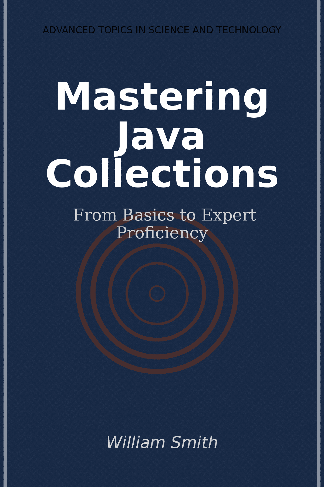

# 精通 Java 集合：从基础到精通



```java
for (String fruit : vector) {
    System.out.println(fruit);
}

vector.remove("Banana");

System.out.println("Vector after removal:");
System.out.println(vector);
```

上述代码的输出：

```text
Vector elements:

Apple

Banana

Orange

Vector after removal:

[Apple, Orange]
```

关于 `Vector` 需要注意的关键点：

- `Vector` 是同步的。
- 它实现了 `List` 接口，因此它提供了用于索引集合的所有方法。
- 在添加元素时会自动增长，在删除元素时会自动缩小。
- 尽管提供了线程安全，但同步开销使其性能上逊于 `ArrayList`。

### Hashtable 类

`Hashtable` 类是原始集合框架的一部分，提供了一种存储键值对的数据结构。它是同步的，意味着它是线程安全的，在并发应用程序中有用。然而，与 `Vector` 类似，同步开销会影响性能。

创建和操作 `Hashtable` 的示例：

```java
import java.util.Hashtable;

public class HashtableExample {
    public static void main(String[] args) {
        Hashtable<Integer, String> hashtable = new Hashtable<>();

        hashtable.put(1, "Apple");
        hashtable.put(2, "Banana");
        hashtable.put(3, "Orange");

        System.out.println("Hashtable elements:");

        for (Integer key : hashtable.keySet()) {
            System.out.println("Key: " + key + ", Value: " + hashtable.get(key));
        }

        hashtable.remove(2);

        System.out.println("Hashtable after removal:");
        System.out.println(hashtable);
    }
}
```

上述代码的输出：

```text
Hashtable elements:

Key: 1, Value: Apple

Key: 2, Value: Banana

Key: 3, Value: Orange

Hashtable after removal:

{1=Apple, 3=Orange}
```

关于 `Hashtable` 需要注意的关键点：

- `Hashtable` 是同步的。
- 它不允许 null 键或值。
- 它提供了线程安全，但带有性能代价。
- 它实现了 `Map` 接口，提供了存储和检索键值对的方法。

尽管具有这些功能，但 `Vector` 和 `Hashtable` 在很大程度上已被更高效的新类（如 `ArrayList` 和 `HashMap`）取代。维护旧代码库对于了解 Java 管理集合的历史背景和演变至关重要。

## 1.10 Java 集合框架改进（Java 8 及以后）

Java 8 及更高版本对 Java 集合框架（JCF）引入了显著改进，主要旨在提高性能、增加功能并支持新的编程范式。特别是 Java 8 引入了 Lambda 表达式和 Stream API，为处理集合带来了函数式方法。

### 使用 Lambda 表达式函数式编程

Lambda 表达式是 Java 8 最值得关注的之一。它们提供了一种简洁的方式来表示函数接口（只有一个抽象方法的接口）的实例。Lambda 表达式主要用于定义集合的行为。例如，Java 8 允许使用 Lambda 表达式定义的谓词过滤集合。

```java
List<String> names = Arrays.asList("Alice", "Bob", "Charlie");

List<String> filteredNames = names.stream()
    .filter(name -> name.startsWith("A"))
    .collect(Collectors.toList());
```

输出：

```text
Alice
```

在此示例中，Lambda 表达式 `name -> name.startsWith("A")` 高效地过滤了列表 `names`，只保留以 `"A"` 开头的字符串。

### Stream API

Stream API 补充了 Lambda 表达式的引入，允许对元素序列进行处理。它为序列的操作提供了高层抽象，例如转换和聚合。Stream API 支持顺序执行和并行执行，适用于广泛的应用程序，从简单的数据处理到复杂的聚合。

```java
List<Integer> numbers = Arrays.asList(1, 2, 3, 4, 5);

List<Integer> squaredNumbers = numbers.stream()
    .map(n -> n * n)
    .collect(Collectors.toList());
```

输出：

```text
1 4 9 16 25
```

在这里，`stream` 是从列表 `numbers` 创建的。`map` 操作对每个元素应用 lambda 表达式以将其值平方，而 `collect` 则将结果收集到一个新的列表中。

### forEach 方法

由 `Iterable` 接口提供的 `forEach` 方法允许将 lambda 表达式应用于集合中的每个元素上。该方法提供了一种遍历集合的简单方式，可以增强可读性并降低错误风险。

```java
List<String> names = Arrays.asList("Alice", "Bob", "Charlie");

names.forEach(name -> System.out.println(name));
```

输出：

```text
Alice
Bob
Charlie
```

`forEach` 方法简化了迭代，类似于增强型 `for` 循环，但与 lambda 表达式和流具有更好的兼容性。

### Optional 类

Java 8 还引入了 `Optional` 类，它不直接属于 JCF 的一部分，但通常与集合一起使用，用于处理值的存在或缺失，而无需诉 null 检查。

```java
List<String> names = Arrays.asList("Alice", "Bob", "Charlie");

Optional<String> firstNameWithA = names.stream()
    .filter(name -> name.startsWith("A"))
    .findFirst();

firstNameWithA.ifPresent(name -> System.out.println("Found: " + name));
```

输出：

```text
Found: Alice
```

`Optional` 类提供了一种更具且类型安全的方式来处理可能的 null 值。

### 集合类中的新方法

许多集合类都增加了新方法，以支持 lambda 表达式和 Streams API 带来的功能。一些关键改进包括：

- `removeIf(Predicate<? super E> filter)`：从集合中删除所有满足给定谓条件的元素。
- `replaceAll(UnaryOperator<E> operator)`：将列表中的每个元素替换为将运算符应用于该元素的结果。
- `sort(Comparator<? super E> c)`：根据指定比较器引导的顺序对列表排序。

```java
List<String> names = new ArrayList<>(Arrays.asList("Alice", "Bob", "Charlie", "David"));

names.removeIf(name -> name.length() == 3);
names.replaceAll(String::toUpperCase);
names.sort(Comparator.naturalOrder());
```

输出：

```text
ALICE
CHARLIE
DAVID
```

在此代码中，`removeIf` 删长度为 3 的元素，`replaceAll` 将所有字符串转换为大写，`sort` 则按字母顺序进行排列。

### 并发新增

Java 8 引入了如 `ConcurrentHashMap` 和 `CompletableFuture` 等新类。`ConcurrentHashMap` 类提供了高效且线程安全的哈希表实现，支持基于计数的操作，而 `CompletableFuture` 实现了复杂的异步编程。

```java
ConcurrentHashMap<String, Integer> map = new ConcurrentHashMap<>();

map.put("Alice", 1);
map.put("Bob", 2);

map.forEach(1, (key, value) -> System.out.println(key + " : " + value));
```

输出：

```text
Alice : 1
Bob : 2
```

`forEach` 方法支持并发处理，使其适用于高性能应用。

Java 8 及此后的增强显著提升了 Java 集合框架的灵活性、效率和表达能力，使其成为现代 Java 开发者的强大工具。

# 第 2 章

## 理解集合接口

本章深入探讨了 Java 集合框架中的各种集合接口。它研究了 `iterable` 和 `collection` 接口的基本概念，深入了 `list`、`set`、`queue`、`deque` 和 `map` 接口的特定特性和用途，并强调了它们之间的关系和层次结构。本章还讨论了接口中默认方法的重要性，有助于清晰理解这些接口如何定义和塑造 Java 集合。

## 2.1 集合接口简介

Java 集合框架（JCF）是 Java 编程语言的基础，它提供了用于表示和操作集合的统一架构。JCF 的核心是集合接口，它们定义了各种类型的集合及其标准行为。这些接口构成了 Java 中使用和操作数据结构的骨干。

Java 集合设计用于处理对象组（或“集合”），这些组作为单个单元进行处理。JCF 中的主要接口包括 `Iterable`、`Collection`、`List`、`Set`、`Queue`、`Deque` 和 `Map`。每个接口都有特定的用途，并提供了保证标准管理集合的方法。让我们深入这些集合接口的基础概念。

### 核心接口：Iterable

最通用的接口是 `Iterable`，它是所有集合类的根接口。它提供了 `iterator()` 方法，返回一个遍历元素的 `Iterator`。`Iterable` 接口允许使用增强 `for` 循环（也称为 “for-each”）来遍历集合：

```java
Iterator<E> iterator();
```

### Collection 接口

`Collection` 接口扩展了 `Iterable`，代表一组称为元素的对象。它声明了更多集合类型的父类，如 `List`、`Set` 和 `Queue`。`Collection` 接口包含了 `add`、`remove`、`size` 和 `contains` 等基本方法，确保了操作的基本合约：

```java
boolean add(E e);
boolean remove(Object o);
int size();
boolean contains(Object o);
Iterator<E> iterator();
```

### List 接口：有序集合

`List` 接口扩展了 `Collection`，引入了一种维护元素有序序列的集合。列表允许位置访问、元素搜索和范围视图操作。`List` 特有的方法包括 `get`、`set`、带索引的 `add` 和带索引的 `remove`：

```java
E get(int index);
E set(int index, E element);
void add(int index, E element);
E remove(int index);
```

### Set 接口：唯一集合

`Set` 接口也扩展了 `Collection`。它代表一个不允许重复元素的唯一元素集合。集合通常用于建模数学集合抽象。`Set` 继承了 `Collection` 的所有方法，并通过哈希表等底层机制确保没有重复元素。

### Queue 接口：有序处理

`Queue` 接口继承自 `Collection`，代表为了处理而排列的元素集合。它引入了元素插入、提取和检查的方法。功能性方法包括 `offer`、`poll`、`peek` 及其变体：

```java
boolean offer(E e);
E poll();
E peek();
```

### Deque 接口：双端队列

`Deque` 接口扩展了 `Queue`，提供了双端队列功能，支持在两端进行元素插入、删除和检查。`addFirst`、`addLast` 和 `removeFirst` 等方法是双端操作特有的：

```java
void addFirst(E e);
void addLast(E e);
E removeFirst();
```

### Map 接口：键值关联

`Map` 接口不同于 `Collection`，代表键值对的集合。Map 对于关联数组至关重要，每个键都映射到一个特定的值。`Map` 的基本方法包括 `put`、`get`、`remove` 和 `entrySet`：

```java
V put(K key, V value);
V get(Object key);
V remove(Object key);
Set<Map.Entry<K, V>> entrySet();
```

集合接口（collection interfaces）涵盖了各种专用和通用操作，为集合的结构和行为建立了骨架框架。通过深入研究每个接口的细节，我们可以更深入地理解 Java 集合框架（Java Collections Framework）提供的灵活性和能力。

### 2.2 Iterable 接口

`Iterable` 接口是 Java 集合框架（JCF）中的一个基础性组件。它位于 `java.lang` 包中，旨在供任何可以逐个遍历元素的集合类实现。`Iterable` 接口的主要目的是为对对象集合的迭代提供一种抽象。

`Iterable` 是一个泛型接口，其定义如下：

```java
public interface Iterable<T> {
    Iterator<T> iterator();
}
```

在此定义中，`T` 代表迭代器返回的元素类型。`Iterable` 接口中的关键方法是 `iterator()`，它返回一个用于类型为 `T` 的元素的 `Iterator`。

理解 `Iterable` 的重要性需要检查 `Iterator` 接口，该接口提供了遍历集合的方法。

```java
public interface Iterator<E> {
    boolean hasNext();

    E next();

    default void remove() {
        throw new UnsupportedOperationException("remove");
    }
}
```

`hasNext()` 方法在迭代还有更多元素时返回 `true`。`next()` 方法返回迭代中的下一个元素。`remove()` 方法可以从底层集合中删除一个元素；然而，并不是所有的集合类型都实现了此操作，因此其默认实现会抛出 `UnsupportedOperationException`。

在实践中，实现 `Iterable` 接口允许对象成为“增强 `for` 循环”（foreach loop）的目标。这种循环是一种语法糖，简化了迭代过程。例如，考虑一个实现 `Iterable` 的简单 `CustomList`：

```java
import java.util.Iterator;

public class CustomList<T> implements Iterable<T> {
    private T[] items;
    private int size;

    @SuppressWarnings("unchecked")
    public CustomList(int capacity) {
        items = (T[]) new Object[capacity];
        size = 0;
    }

    public void add(T item) {
        if (size == items.length) {
            throw new IllegalStateException("List is full");
        }

        items[size++] = item;
    }

    @Override
    public Iterator<T> iterator() {
        return new Iterator<T>() {
```


`private int index = 0;`

`@Override`

`public boolean hasNext() {`

`return index < size;`

`}`

`@Override`

`public T next() {`

`if (!hasNext()) {`

`throw new NoSuchElementException();`

`}`

`return items[index++];`

`}`

`};`

`}`

`}`

在这个示例中，`CustomList` 类实现了 `Iterable` 并为 `iterator()` 方法提供了实现。这种实现使得 `CustomList` 能够在 foreach 循环中使用：

```java
CustomList<String> list = new CustomList<>(10);
list.add("Hello");
list.add("World");
for (String item : list) {
    System.out.println(item);
}
```

此迭代输出为：

```
Hello
World
```

实现 `Iterable` 确保应用程序可以使用增强 for 循环来编写更具读性和可维护的代码。这种优势不仅限于自定义类；所有标准的 Java 集合（包括 `ArrayList`、`HashSet` 和 `HashMap` 的值）都实现了 `Iterable`。

此外，实现 `Iterable` 增强了与操作集合的 API 的互操作性。例如，`java.util.Collections` 工具类中的方法接受 `Iterable<T>` 类型，进一步将自定义集合与 Java 的标准库设施集成。

在迭代模式复杂或需要外部管理的应用程序中，自定义的 `Iterator` 实现可以利用其他模式（如状态模式）来全面控制迭代。此外，如果考虑线程安全，`Iterator` 实现必须小心处理并发修改，可以使用如快速失败迭代器（fail-fast iterators）的技术，它们会立即抛出 `ConcurrentModificationException`。最终，`Iterable` 接口的强大之处在于它可以顺序定义元素。

## 2.3 理解 Collection 接口

`Collection` 接口是 Java 集合框架（JCF）中最基础且核心的组件之一。它扩展了 `Iterable`，为 `List`、`Set` 和 `Queue` 等各种集合提供了基本结构。

```java
public interface Collection<E> {
    int size();
    boolean isEmpty();
    boolean contains(Object o);
    Iterator<E> iterator();
    Object[] toArray();
    <T> T[] toArray(T[] a);
    boolean add(E e);
    boolean remove(Object o);
    boolean containsAll(Collection<?> c);
    boolean addAll(Collection<? extends E> c);
    boolean removeAll(Collection<?> c);
    boolean retainAll(Collection<?> c);
    void clear();
    boolean equals(Object o);
    int hashCode();
}
```

`Collection` 接口定义了所有集合必须实现的几个操作：

*   `size()`：返回集合中元素的数量。如果集合元素超过 `Integer.MAX_VALUE`，则结果为 `Integer.MAX_VALUE`。
*   `isEmpty()`：如果集合不包含元素，返回 `true`。
*   `contains(Object o)`：如果集合包含指定元素，返回 `true`。
*   `iterator()`：返回一个用于集合元素的迭代器。除非集合是提供特定迭代顺序的类的实例，否则返回的顺序没有固定。
*   `toArray()`：返回包含集合中所有元素的数组。返回数组的运行时类型为 `Object[]`。
*   `<T> T[] toArray(T[] a)`：返回包含集合中所有元素的数组。如果指定的数组足够容纳集合，则存其中；否则，将根据指定数组的运行时类型和集合的大小分配新数组。
*   `add(E e)`：确保集合包含指定元素。如果集合因调用发生变化，返回 `true`。
*   `remove(Object o)`：从集合中移除指定元素的实例（如果存在）。如果集合因调用发生变化，返回 `true`。
*   `containsAll(Collection<?> c)`：如果集合包含指定集合中的所有元素，返回 `true`。
*   `addAll(Collection<? extends E> c)`：将指定集合的所有元素添加到集合中。如果在操作过程中修改了指定集合，则该操作的行为未定义。
*   `removeAll(Collection<?> c)`：从此集合中移除与指定集合包含的所有元素。调用返回后，此集合将与指定集合没有交集元素。
*   `retainAll(Collection<?> c)`：保留此集合中包含在指定集合中的元素。换句话说，从此集合中移除所有不包含指定集合中的元素。
*   `clear()`：移除此集合中的所有元素。方法返回后，集合将为空。
*   `equals(Object o)`：将集合与指定对象进行比较。
*   `hashCode()`：返回集合的哈希值。

-   `equals(Object o)`: 将指定的对象与此集合进行相等性比较。虽然等等的精确定义在不同实现之间可能不同，但通常，如果两个集合包含相同的元素，则它们是等的。
-   `hashCode()`: 返回此集合的哈希值。

实现 `Collection` 接口为开发者提供了极大的灵活性。特定的集合如 `ArrayList`、`HashSet`、`LinkedList` 等可以以优化各自使用场景的方式提供这些方法的具体实现。然而，理解 `Collection` 接口的底层约定对于高效的使用和实现至关重要。

实现 `Collection` 接口的具体类可能会施加额外的限制或修改这些方法的行为。例如，`ArrayList` 允许重复并维护插入顺序，而 `HashSet` 不允许重复且也不维护任何顺序。尽管存在这些差异，它们都遵循 `Collection` 接口的基本约定。这种多态性允许 Java 开发者编写更通用、更可重用的代码。

考虑以下示例，通过 `Collection` 接口交替使用 `ArrayList` 和 `HashSet`：

```java
Collection<String> list = new ArrayList<>();
list.add("Apple");
list.add("Banana");
list.add("Orange");

Collection<String> set = new HashSet<>(list);
set.add("Banana");

System.out.println(list); // 输出: [Apple, Banana, Orange]
System.out.println(set); // 输出: [Apple, Banana, Orange]
```

```
[Apple, Banana, Orange]
[Apple, Orange, Banana]
```

此示例表明，尽管 `ArrayList` 和 `HashSet` 的行为不同，但可以使用 `Collection` 接口定义的通用方法对这两个集合进行操作。理解这些细微差别有助于为特定场景选择合适的具体实现。`Collection` 接口的抽象性质促进了一个框架，在该框架中，可以基于统一的操作集交替使用各种数据结构，产生了一种灵活且强大的设计。

## 2.4 List 接口：有序集合

Java 集合框架中的 `List` 接口表示一个有序集合，也称为序列。它提供了一种以线性、索引顺序存储和访问元素的方法，允许根据元素在列表中的位置进行元素的插入、删除和访问。`List` 接口是 `Collection` 接口的子接口，并定义了额外的方法来处理元素的定位访问。

### List 接口的关键特征：

- **有序集合：** `List` 中的元素按照特定的顺序维护。元素的插入顺序被保留。
- **基于索引的访问：** `List` 接口提供了访问特定索引元素的方法。这允许对元素进行高效的随机访问和修改。
- **允许重复：** 与 `Set` 接口不同，`List` 可以包含重复元素。
- **空元素：** 如果特定实现允许，`List` 可以包含 `null` 元素。

### List 接口的核心方法：

以下是 `List` 接口提供的一些核心方法的概述：

```java
// 在指定位置向列表添加元素
void add(int index, E element);

// 将元素添加到列表末尾
boolean add(E e);

// 在指定位置添加指定集合中的所有元素
boolean addAll(int index, Collection<? extends E> c);

// 获取指定位置的元素
E get(int index);

// 用新值替换指定位置的元素
E set(int index, E element);

// 指定位置的元素
E remove(int index);

// 返回指定元素首次出现的的索引
int indexOf(Object o);

// 返回指定元素最后一次出现的索引
int lastIndexOf(Object o);

// 返回从指定起始索引到结束索引（不包含）的子列表
List<E> subList(int fromIndex, int toIndex);
```

### List 接口的使用示例：

考虑一个演示对 `List` 进行常用操作的示例：

```java
import java.util.List;
import java.util.ArrayList;

public class ListExample {
    public static void main(String[] args) {
        // 使用 ArrayList 创建 List
        List<String> fruits = new ArrayList<>();

        //向 List 添加元素
        fruits.add("Apple");
        fruits.add("Banana");
        fruits.add("Cherry");

        // 在特定位置插入元素
        fruits.add(1, "Blueberry");

        // 根据索引获取元素
        String fruit = fruits.get(2);

        // 修改特定索引处的元素
        fruits.set(3, "Date");

        // 根据索引删除元素
        fruits.remove(1);

        // 打印所有元素
        for (String f : fruits) {
            System.out.println(f);
        }
    }
}
```

输出：

```
Apple
Cherry
Date
```

### 线程安全与 List 实现：

`List` 接口的常见实现包括 `ArrayList`、`LinkedList` 和 `Vector`。只有 `Vector` 是同步的。为了在使用非同步实现实现线程安全，请使用 `Collections.synchronizedList`：

```java
import java.util.List;
import java.util.ArrayList;
import java.util.Collections;

public class SynchronizedListExample {
    public static void main(String[] args) {
        List<String> syncList = Collections.synchronizedList(new ArrayList<>());

        //向同步 List 添加元素
        syncList.add("Apple");
        syncList.add("Banana");
        syncList.add("Cherry");

        // 同步块进行迭代
        synchronized(syncList) {
            for (String fruit : syncList) {
                System.out.println(fruit);
            }
        }
    }
}
```

在上面的示例中，通过 `Collections.synchronizedList` 创建了一个同步列表。为了执行迭代，同步块确保了线程安全。

### List 接口中的默认方法：

Java 8 引入了接口的默认方法，`List` 接口利用这一特性提供了带有默认实现的方法。这些方法可以在需要由实现类重写。

例如，`List` 接口包含一个默认的 `replaceAll` 方法，可以使用指定的操作替换列表中的所有元素：

```java
default void replaceAll(UnaryOperator<E> operator) {
    Objects.requireNonNull(operator);
    final ListIterator<E> li = this.listIterator();
    while (li.hasNext()) {
        li.set(operator.apply(li.next()));
    }
}
```

该方法接收一个 `UnaryOperator` 作为参数并将其应用于每个元素，用转换后的值替换元素。使用默认方法可以使代码更加简洁易读。

总之，这些属性和方法使得 `List` 接口成为管理有序集合的灵活且强大的工具。理解并应用其方法和实现对于有效的 Java 编程至关重要。

## 2.5 Set 接口：唯一集合

`Set` 接口表示不包含重复元素的集合。作为 Java 集合框架的一部分，它继承自 `Collection` 接口，这允许它利用 `Collection` 接口中定义的方法。`Set` 的独特特征是允许唯一性——集合中没有两个元素是相同的。这通过使用 `equals(Object o)` 方法进行比较来强制执行。

当主要需求是一个包含唯一元素且无特定顺序的集合时，`Set`（集合）是最合适的。`Set` 接口有几个著名的实现，例如 `HashSet`、`LinkedHashSet` 和 `TreeSet`，它们在性能、排序和特定用例方面具有独特的行为。

*   `HashSet`：在复杂度方面提供最佳性能，通常添加、删除和查找操作的时间复杂度为 `O(1)`。它使用哈希表进行存储，并且不保证元素的任何顺序。
*   `LinkedHashSet`：维护集合中条目的链表列表，保留了插入顺序。它兼具了哈希表的性能优势和链表可预测的迭代顺序。
*   `TreeSet`：实现了 `NavigableSet` 接口并使用红黑树结构。这意味着它保持元素按自然顺序或指定的比较器（comparator）进行排序。所有基本操作的时间复杂度均为对数级（`O(log n)`）。

`Set` 接口中定义的核心方法源自其父接口 `Collection`。然而，这些方法的行为维护了集合元素的唯一性约束。下面的示例说明了 `Set` 接口的用法：

```java
import java.util.*;

public class SetExample {
    public static void main(String[] args) {
        Set<String> hashSet = new HashSet<>();
        hashSet.add("Apple");
        hashSet.add("Banana");
        hashSet.add("Cherry");

        // 尝试添加重复元素
        hashSet.add("Apple");
        hashSet.add("Banana");

        // 显示元素
        for (String fruit : hashSet) {
            System.out.println(fruit);
        }
    }
}
```

预期输出：

```
Banana
Apple
Cherry
```


在这个示例中，尝试向`hashSet`添加重复元素 "Apple" 和 "Banana" 并不会改变集合，这证明了元素的唯一性约束。

通过算法分析和实际用例，可以更好地理解每个`Set`实现的行为和用途。

### 算法分析

- `HashSet`：`HashSet`使用哈希来实现`add`、`remove`和`contains`方法的常数复杂度，前提是哈希函数将元素均匀地分散在桶中。
- `LinkedHashSet`：`LinkedHashSet`通过维护双向链表来提供插入顺序迭代，这意味着与`HashSet`相比它会产生额外的开销，但由于哈希的存在，基本操作仍提供`O(1)`复杂度。
- `TreeSet`：`TreeSet`使用红黑树（一种自平衡二叉搜索树），`add`、`remove`和`contains`操作产生`O(log n)`复杂度。它适用于需要元素排序的场景。

`Set`接口通过`equals`方法强制元素的唯一性。因此，当使用自定义对象作为`Set`元素时，恰当地重写`equals`和`hashCode`方法是至关重要的。未这样做会导致意外行为，例如允许重复或阻碍元素检索。

```java
import java.util.*;

class CustomObject {
    private String name;
    private int id;

    public CustomObject(String name, int id) {
        this.name = name;
        this.id = id;
    }

    @Override
    public boolean equals(Object o) {
        if (this == o) return true;
        if (o == null || getClass() != o.getClass()) return false;

        CustomObject that = (CustomObject) o;
        return id == that.id && Objects.equals(name, that.name);
    }

    @Override
    public int hashCode() {
        return Objects.hash(name, id);
    }
}

public class CustomSetExample {
    public static void main(String[] args) {
        Set<CustomObject> customSet = new HashSet<>();

        customSet.add(new CustomObject("Obj1", 1));
        customSet.add(new CustomObject("Obj2", 2));
        customSet.add(new CustomObject("Obj1", 1)); // 重复

        for (CustomObject obj : customSet) {
            System.out.println("Object: " + obj.name + ", ID: " + obj.id);
        }
    }
}
```

预期输出：

```text
Object: Obj1, ID: 1
Object: Obj2, ID: 2
```

在这里，正确重写`equals`和`hashCode`方法确保了 id 为 1 的 "Obj1" 仅被添加到`customSet`中，尽管尝试过添加它。`Sets`在需要去重的场景中是基础性的。

### 2.6 NavigableSet 和 SortedSet 接口

`SortedSet`和`NavigableSet`接口是`Set`接口的高级扩展，提供了排序集合的功能。

#### SortedSet 接口

`SortedSet<E>`扩展了`Set`接口，表示一个元素按顺序的集合。这种顺序可以是自然顺序，也可以是创建时提供的`Comparator`。在下面提供一个`SortedSet`的示例：

```java
import java.util.SortedSet;
import java.util.TreeSet;

public class SortedSetExample {
    public static void main(String[] args) {
        SortedSet<String> sortedSet = new TreeSet<>();

        sortedSet.add("Banana");
        sortedSet.add("Apple");
        sortedSet.add("Mango");
        sortedSet.add("Peach");

        // 按升序显示元素
        for (String fruit : sortedSet) {
            System.out.println(fruit);
        }

        // 检查第一个和最后一个
        System.out.println("First: " + sortedSet.first());
        System.out.println("Last: " + sortedSet.last());
    }
}
```

输出将是：

```text
Apple
Banana
Mango
Peach
First: Apple
Last: Peach
```

`SortedSet`接口声明了一些关键方法，允许查询和操作元素的顺序：

- `comparator()`：返回排序元素的比较器，如果使用自然排序则返回`null`。
- `first()`：返回第一个（最小）元素。
- `last()`：返回最后一个（最大）元素。
- `headSet(E toElement)`：返回小于`toElement`的集合视图。
- `subSet(E fromElement, E toElement)`：返回元素范围从`fromElement`（包含）到`toElement`（不包含）的集合视图。
- `tailSet(E fromElement)`：返回大于或等于`fromElement`的集合视图。

#### NavigableSet 接口

`NavigableSet<E>`接口扩展了`SortedSet<E>`接口，提供了额外的导航方法，根据其排序检索元素。该接口对于多向导航和基于范围的查询特别有用。考虑以下示例以演示`NavigableSet`接口的关键功能：

```java
import java.util.NavigableSet;
import java.util.TreeSet;

public class NavigableSetExample {
    public static void main(String[] args) {
        NavigableSet<Integer> navigableSet = new TreeSet<>();

        navigableSet.add(1);
        navigableSet.add(3);
        navigableSet.add(5);
        navigableSet.add(7);

        // 降序排序
        NavigableSet<Integer> descendingSet = navigableSet.descendingSet();

        for (Integer number : descendingSet) {
            System.out.println(number);
        }
    }
}
```

```java
// 轮出第一个和最后一个元素
System.out.println("Polling first: " + navigableSet.pollFirst());
System.out.println("Polling last: " + navigableSet.pollLast());

// 范围视图
System.out.println("HeadSet (less than 5): " + navigableSet.headSet(5));
System.out.println("SubSet (3 to 7): " + navigableSet.subSet(3, true, 7, true));
System.out.println("TailSet (greater than or equal to 3): " + navigableSet.tailSet(3));
}
}
```

输出结果为：

```text
7
5
3
1
Polling first: 1
Polling last: 7
HeadSet (less than 5): [3]
SubSet (3 to 7): [3, 5]
TailSet (greater than or equal to 3): [3, 5]
```

`NavigableSet`接口中的重要方法有：

- `E lower(E e)`：返回小于`e`的最大元素，如果不存在此类元素，则返回`null`。
- `E floor(E e)`：返回小于或等于`e`的最大元素，如果不存在此类元素，则返回`null`。
- `E ceiling(E e)`：返回大于或等于`e`的最小元素，如果不存在此类元素，则返回`null`。
- `E higher(E e)`：返回大于`e`的最小元素，如果不存在此类元素，则返回`null`。
- `E pollFirst()`：获取并移除第一个（最小）元素，如果集合为空，则返回`null`。
- `E pollLast()`：获取并移除最后一个（最大）元素，如果集合为空，则返回`null`。
- `NavigableSet<E> descendingSet()`：返回此集合中包含的元素的逆序视图。
- `NavigableSet<E> headSet(E toElement, boolean inclusive)`：返回此集合部分的视图，该部分的元素严格小于`toElement`，可选包含该边界。
- `NavigableSet<E> subSet(E fromElement, boolean fromInclusive, E toElement, boolean toInclusive)`：返回此集合部分的视图，该部分的元素范围从`fromElement`到`toElement`，两端均可选包含。
- `NavigableSet<E> tailSet(E fromElement, boolean inclusive)`：返回此集合部分的视图，该部分的元素大于或等于`fromElement`，可选包含该边界。

`TreeSet`类是`SortedSet`和`NavigableSet`接口的主要实现类。它提供了一个平衡树表示，确保了如`add`、`remove`和`contains`检查等常用操作的对数时间复杂度。理解`SortedSet`和`NavigableSet`接口的复杂之处，使开发者能够利用它们的专门方法在 Java 应用程序中进行有效的集合操作和范围查询。

### 2.7 Queue 接口：有序处理

Java 集合框架中的`Queue`接口表示了一种用于在处理元素之前持有这些元素的集合。它是`java.util`包的一部分，并扩展了`Collection`接口。队列通常（但不一定）以先进先出（FIFO）的方式对元素排序。然而，也可能有其他排序方式，例如后进先出（LIFO）或基于优先级的排序。

#### Queue 接口的核心方法

`Queue`接口定义了几个对操作队列至关重要的方法。这些方法根据特定策略促进元素的插入、移除和检查。以下是关键方法的详细介绍：

- `boolean add(E e)`：如果可以立即执行且不违反容量限制，则将指定元素插入队列。成功后，返回`true`。如果队列已满，则抛出`IllegalStateException`。
- `boolean offer(E e)`：将指定元素插入队列。如果成功，返回`true`。如果队列已满，则返回`false`。
- `E remove()`：获取并移除队列头元素。如果队列为空，则抛出`NoSuchElementException`。
- `E poll()`：获取并移除队列头元素。如果队列为空，则返回`null`。
- `E element()`：获取但不移除队列头元素。如果队列为空，则抛出`NoSuchElementException`。
- `E peek()`：获取但不移除队列头元素。如果队列为空，则返回`null`。

`Queue`接口的操作可以分为三类：抛出异常、返回特殊值以及阻塞。

| 操作类型 | 抛出异常 | 返回特殊值 | 阻塞 |
| :--- | :--- | :--- | :--- |
| 插入 | `add(e)` | `offer(e)` | `put(e)` |
| 移除 | `remove()` | `poll()` | `take()` |
| 检查 | `element()` | `peek()` | 不适用 |

#### LinkedList 示例

以下是使用`LinkedList`实现队列的示例：

```java
import java.util.LinkedList;

public class QueueExample {
    public static void main(String[] args) {
        LinkedList<String> queue = new LinkedList<>();

        queue.add("First");
        queue.add("Second");
        queue.add("Third");

        System.out.println("队列内容: " + queue);
        System.out.println("移除头元素: " + queue.remove());
        System.out.println("轮出头元素: " + queue.poll());
        System.out.println("剩余队列: " + queue);
    }
}
```

运行此示例将输出：

```text
队列内容: [First, Second, Third]
移除头元素: First
轮出头元素: Second
剩余队列: [Third]
```

#### ArrayDeque 示例

`ArrayDeque`也实现了`Queue`接口，但它不支持`null`元素，并且作为队列使用时通常比`LinkedList`更快。

以下是使用`ArrayDeque`实现队列的示例：

```java
import java.util.ArrayDeque;
import java.util.Queue;

public class ArrayDequeExample {
    public static void main(String[] args) {
        Queue<String> queue = new ArrayDeque<>();

        queue.add("First");
        queue.add("Second");
        queue.add("Third");

        System.out.println("队列内容: " + queue);
        System.out.println("移除头元素: " + queue.remove());
        System.out.println("轮出头元素: " + queue.poll());
        System.out.println("剩余队列: " + queue);
    }
}
```

运行此示例将输出：

```text
队列内容: [First, Second, Third]
移除头元素: First
轮出头元素: Second
剩余队列: [Third]
```

#### 阻塞队列

Java 还提供了几种队列实现，通过提供线程安全的访问和阻塞操作特别适用于并发编程。这些阻塞队列属于`java.util.concurrent`包，包括`ArrayBlockingQueue`、`LinkedBlockingQueue`、`PriorityBlockingQueue`和`DelayQueue`。

`BlockingQueue`接口扩展了`Queue`，增加了额外的方法，在检索元素时等待队列非空，在存储元素时等待队列非满，例如`put`和`take`。

以下是使用`ArrayBlockingQueue`的示例：

```java
import java.util.concurrent.ArrayBlockingQueue;
import java.util.concurrent.BlockingQueue;

public class BlockingQueueExample {
    public static void main(String[] args) {


```java
BlockingQueue<String> blockingQueue = new ArrayBlockingQueue<>(2);

try {
    blockingQueue.put("One");
    blockingQueue.put("Two");

    System.out.println("正在尝试向满队列添加第三个元素...");

    blockingQueue.put("Three"); // 等待直到空间可用
} catch (InterruptedException e) {
    Thread.currentThread().interrupt();
}

System.out.println("阻塞队列元素: " + blockingQueue);
```

此示例突出了当 `put` 操作尝试向满队列插入元素时会发生阻塞。

理解这些不同的队列实现及其相应的用场景，允许开发者根据应用的特定需求选择最合适的有序处理形式。

### 2.8 `Deque` 接口：双端队列

`Deque` 接口是 double-ended queue（双端队列）的缩写，它扩展了 `Queue` 接口，并提供了额外的方法从集合的两端插入、移除和检查元素。这种双端功能使得 `deque`（读作 "decks"）成为一种多用途且灵活的数据结构，适用于需要按照 FIFO（先进先出）和 LIFO（后进先出）顺序处理元素的各种场景。

#### `Deque` 接口的方法

`Deque` 接口包含若干方法，根据其功能分为以下几类：

- **插入方法：**
  - `addFirst(E e)`：将指定的元素插入双端队列的头部。
  - `addLast(E e)`：将指定的元素插入双端队列的尾部。
  - `offerFirst(E e)`：将指定的元素插入双端队列的头部，如果成功则返回 `true`，如果当前没有可用空间则返回 `false`。
  - `offerLast(E e)`：将指定的元素插入双端队列的尾部，如果成功则返回 `true`，如果当前没有可用空间则返回 `false`。
- **移除方法：**
  - `removeFirst()`：获取并移除双端队列的第一个元素。
  - `removeLast()`：获取并移除双端队列的最后一个元素。
  - `pollFirst()`：获取并移除双端队列的第一个元素，如果双端队列为空则返回 `null`。
  - `pollLast()`：获取并移除双端队列的最后一个元素，如果双端队列为空则返回 `null`。
- **检查方法：**
  - `getFirst()`：获取但不移除双端队列的第一个元素。
  - `getLast()`：获取但不移除双端队列的最后一个元素。
  - `peekFirst()`：获取但不移除双端队列的第一个元素，如果双端队列为空则返回 `null`。
  - `peekLast()`：获取但不移除双端队列的最后一个元素，如果双端队列为空则返回 `null`。

#### 额外方法

除了上述列出的方法，`Deque` 接口还包含以下允许对元素进行操作和检查的方法：

- `boolean removeFirstOccurrence(Object o)`：从双端队列中移除第一次出现的指定元素。
- `boolean removeLastOccurrence(Object o)`：从双端队列中移除最后一次出现的指定元素。
- `Iterator<E> descendingIterator()`：返回按双端队列元素反向顺序遍历的迭代器。

这里是一个简单的示例，展示了如何在 Java 中使用 `LinkedList` 实现 `Deque`。该示例演示了从双端队列的两端插入和移除元素：

```java
import java.util.Deque;
import java.util.LinkedList;

public class DequeExample {
    public static void main(String[] args) {
        // 使用 LinkedList 初始化 Deque
        Deque<String> deque = new LinkedList<>();

        // 向双端队列中添加元素
        deque.addFirst("Element 1 (First)");
        deque.addLast("Element 2 (Last)");
        deque.addFirst("Element 3 (First)");

        // 显示双端队列的元素
        System.out.println("Deque: " + deque);

        // 从双端队列中移除元素
        String firstElement = deque.removeFirst();
        String lastElement = deque.removeLast();

        System.out.println("Removed First Element: " + firstElement);
        System.out.println("Removed Last Element: " + lastElement);

        // 最终的双端队列状态
        System.out.println("Final Deque: " + deque);
    }
}
```

执行上述程序时，输出将是：

```text
Deque: [Element 3 (First), Element 1 (First), Element 2 (Last)]
Removed First Element: Element 3 (First)
Removed Last Element: Element 2 (Last)
Final Deque: [Element 1 (First)]
```

#### 使用场景

`Deque` 接口在许多场景下非常有用，例如：

- **作为栈（Stack）：** 通过使用 `addFirst(E e)` 和 `removeFirst()` 或 `push(E e)` 和 `pop()`，双端队列可以当作栈使用。这允许元素按照 LIFO 顺序进行处理。
- **作为队列（Queue）：** 使用 `addLast(E e)` 和 `removeFirst()`，双端队列可以作为标准队列工作，按照 FIFO 顺序处理元素。
- **双端功能：** 需要对数据结构两端都可访问的操作可以使用双端队列来插入和移除元素。

`Deque` 接口的不同实现（如 `ArrayDeque` 和 `LinkedList`）具有各自的性能。`ArrayDeque` 对于不需要调整大小的操作更快，而 `LinkedList` 在插入和删除方面提供了一致的 O(1) 时间性能。理解 `Deque` 接口及其方法提供了极大的灵活性。双端队列提供的双端访问实现了栈和队列操作的高效实现，使其成为 Java 框架中非常有价值的工具。

### 2.9 `Map` 接口：键值对

`Map` 接口是 Java 框架中的核心组件，允许对键值对进行存储和操作。与处理元素集合的 `Collection` 层次不同，`Map` 基于将键映射到值的原理工作。每个键最多映射到一个值，确保了映射内部键的唯一性。`Map` 的特点是它在键和值之间建立的关联。`Map` 不继承 `Collection` 接口，标志着它与集合的本质不同。要理解 `Map` 的特性，考虑它声明的核心方法：

- `V put(K key, V value)`：将指定的值与指定的键关联。如果映射之前包含该键，则旧值将被替换。
- `V get(Object key)`：返回指定键的映射值，如果映射不包含该键则返回 `null`。
- `boolean containsKey(Object key)`：如果映射包含指定的键，则返回 `true`。
- `boolean containsValue(Object value)`：如果映射将一个或多个键到指定的值，则返回 `true`。
- `V remove(Object key)`：如果存在，移除该映射。
- `void putAll(Map<? extends K, extends V> m)`：将指定映射的所有映射到此映射中。
- `void clear()`：移除映射中的所有映射。
- `Set<K> keySet()`：返回映射中包含的键集合。
- `Collection<V> values()`：返回映射中包含的值集合。
- `Set<Map.Entry<K, V>> entrySet()`：返回映射中包含的映射集。

这些方法构成了与 `map` 中的键值对交互的基础。考虑一个实现示例来演示这些操作：

```java
import java.util.HashMap;
import java.util.Map;

public class MapExample {
    public static void main(String[] args) {
        Map<String, Integer> map = new HashMap<>();

        // 向 map 中添加键值对
        map.put("One", 1);
        map.put("Two", 2);
        map.put("Three", 3);

        // 获取值
        System.out.println("Value for key 'Two': " + map.get("Two"));

        // 检查是否存在键
        System.out.println("Map contains key 'One': " + map.containsKey("One"));

        // 移除键值对
        map.remove("One");

        // 显示所有的键值对
        System.out.println("Key-Value pairs in the map: " + map.entrySet());

        // 清空所有映射
        map.clear();
    }
}
```

输出：

```text
Value for key ’Two’: 2
Map contains key ’One’: true
Key-Value pairs in the map: [Two=2, Three=3]
```

此示例演示了与 `Map` 的典型交互。`HashMap` 实现的使用值得注意的是，它对于基本操作（`put`、`get`、`remove`）具有常数时间复杂度。

不同的 `Map` 实现提供了不同的行为和性能特征。`Map` 接口的注记实现包括：

- `HashMap<K, V>`：为基本操作提供常数时间复杂度。它允许一个 `null` 值和一个 `null` 键。不保证迭代顺序的一致性。
- `LinkedHashMap<K, V>`：扩展了 `HashMap`，但维护了一个贯穿所有条目的双向链表，提供了可预测的迭代顺序（插入顺序）。
- `TreeMap<K, V>`：实现了 `SortedMap` 接口，并确保键按照自然顺序或在创建 `map` 时指定的 `Comparator` 进行排序。该实现保证了操作的时间复杂度为对数级。
- `Hashtable<K, V>`：与 `HashMap` 类似，但它是同步的且不允许 `null` 键或值。

`map` 实现的选择取决于对排序、性能和 `null` 处理的应用需求。对于需要键的自然顺序或自定义顺序的场景，`TreeMap` 是合适的。对于大多数不关心顺序的通用应用，`HashMap` 因其效率通常是首选。

可以使用键集、值集合或条目集对 `map` 进行迭代。例如，要遍历键和值：

```java
Map<String, Integer> map = new HashMap<>();

map.put("One", 1);
map.put("Two", 2);
map.put("Three", 3);

for (Map.Entry<String, Integer> entry : map.entrySet()) {
    System.out.println("Key: " + entry.getKey() + ", Value: " + entry.getValue());
}
```

输出：

```text
Key: One, Value: 1
Key: Two, Value: 2
Key: Three, Value: 3
```

`for-each` 结构配合 `entrySet()` 方法，可以对 `map` 内容进行简洁的迭代。

为了进一步了解 `map` 的内部机制以及与其他集合类型的互操作性，可以考虑 `java.util.stream` 包。它提供了流式能力，可以结合 `map` 用于各种转换和操作。以下是一个过滤 `map` 的示例：

```java
Map<String, Integer> map = new HashMap<>();

map.put("One", 1);
map.put("Two", 2);
map.put("Three", 3);

Map<String, Integer> filteredMap = map.entrySet()
    .stream()
    .filter(entry -> entry.getValue() > 1)
    .collect(Collectors.toMap(Map.Entry::getKey, Map.Entry::getValue));

System.out.println("Filtered Map: " + filteredMap);
```

输出：

```text
Filtered Map: {Two=2, Three=3}
```

流为操作 `map` 提供了一种强大且富有表现力的方式，能够简洁高效地执行复杂操作。

最后，理解 `Map` 实现及其适当的用例可以简化数据结构选择的决策，确保在任何 Java 应用中获得最佳性能和正确的行为。

### 2.10 `NavigableMap` 和 `SortedMap` 接口

Java 集合框架中的 `SortedMap` 和 `NavigableMap` 接口为 `map` 提供了专门的功能，`map` 是映射键到值的集合。这两个接口都扩展了 `Map` 接口，增加了维护键的顺序的方法。

`SortedMap` 接口是 `Map` 接口的子类型。它确保条目按键的升序顺序存储，这种顺序由键的自然排序或在创建 `map` 时提供的 `Comparator` 决定。`SortedMap` 特有的方法包括：

- `comparator()`：返回用于键排序的比较器，如果 `map` 使用自然排序，则返回 `null`。
- `subMap(K fromKey, K toKey)`：返回 `map` 的部分视图，其键的范围从 `fromKey`（包含）到 `toKey`（不包含）。
- `headMap(K toKey)`：返回 `map` 的部分视图，其键严格小于 `toKey`。
- `tailMap(K fromKey)`：返回 `map` 的部分视图，其键大于或等于 `fromKey`。
- `firstKey()`：返回当前 `map` 中第一个（最小的）键。
- `lastKey()`：返回当前 `map` 中最后一个（最大的）键。

`SortedMap` 的示例用法：

```java
import java.util.SortedMap;
import java.util.TreeMap;

public class SortedMapExample {
    public static void main(String[] args) {
        SortedMap<String, Integer> sortedMap = new TreeMap<>();

        sortedMap.put("apple", 10);
        sortedMap.put("banana", 20);
        sortedMap.put("cherry", 30);

        // 获取第一个和最后一个键
        System.out.println("First Key: " + sortedMap.firstKey());
        System.out.println("Last Key: " + sortedMap.lastKey());

        // 获取 headMap, subMap 和 tailMap
        System.out.println("Head Map: " + sortedMap.headMap("banana"));
        System.out.println("Tail Map: " + sortedMap.tailMap("banana"));
        System.out.println("Sub Map: " + sortedMap.subMap("apple", "cherry"));
    }
}
```


`NavigableMap` 接口通过对映射接近性进行导航的方法，扩展了 `SortedMap` 提供的功能。该接口提供了查找给定目标最匹配项的方法。特定方法包括：

- `lowerEntry(K key)`：返回与小于 `key` 的最大键关联的键值映射，如果不存在此类键则返回 `null`。
- `floorEntry(K key)`：返回与小于或等于 `key` 的最大键关联的键值映射，如果不存在此类键则返回 `null`。
- `ceilingEntry(K key)`：返回与大于或等于 `key` 的最小键关联的键值映射，如果不存在此类键则返回 `null`。
- `higherEntry(K key)`：返回与大于 `key` 的最小键关联的键值映射，如果不存在此类键则返回 `null`。
- `pollFirstEntry()`：移除并返回 `map` 中第一个条目的关联键值映射。
- `pollLastEntry()`：移除并返回 `map` 中最后一个条目的关联键值映射。
- `descendingMap()`：返回此 `map` 包含映射的反序视图。

`NavigableMap` 的示例用法：

```java
import java.util.NavigableMap;
import java.util.TreeMap;

public class NavigableMapExample {
    public static void main(String[] args) {
        NavigableMap<String, Integer> navigableMap = new TreeMap<>();

        navigableMap.put("apple", 10);
        navigableMap.put("banana", 20);
        navigableMap.put("cherry", 30);

        // 根据接近性获取条目
        System.out.println("Lower Entry (banana): " + navigableMap.lowerEntry("banana"));
        System.out.println("Floor Entry (banana): " + navigableMap.floorEntry("banana"));
        System.out.println("Ceiling Entry (banana): " + navigableMap.ceilingEntry("banana"));
        System.out.println("Higher Entry (banana): " + navigableMap.higherEntry("banana"));

        // 轮询条目
        System.out.println("Poll First Entry: " + navigableMap.pollFirstEntry());
        System.out.println("Poll Last Entry: " + navigableMap.pollLastEntry());

        // 获取降序 map
        System.out.println("Descending Map: " + navigableMap.descendingMap());
    }
}
```

使用 `NavigableMap` 的一个关键优势是能够以各种方式导航 `map`，增强了访问和处理存储的键值对的灵活性。通过提供双向导航能力，`NavigableMap` 满足了更复杂的搜索和检索需求。

总而言，当需要键排序以及在键空间进行导航能力时，使用 `SortedMap` 和 `NavigableMap` 接口具有显著优势。这些接口利用了自然排序和自定义排序的力量，优化了映射中的存储和检索操作。额外的功能在保持逻辑一致性和性能效率的同时，方便了广泛的操作。

### 2.11 集合接口之间的关系

理解 Java 集合框架（JCF）中各种集合接口之间的关系，对于掌握它们的用法和实现至关重要。本节对这些接口及其相互连接进行了详细分析，为深入理解其设计和功能奠定了基础。

JCF 结构化为接口层次结构，以 `Collection` 接口为根。`Collection` 接口继承自 `Iterable`，是大多数其他集合类型的基础接口。主要的派生接口是 `List`、`Set` 和 `Queue`，它们分别满足不同的数据存储和检索需求。


`List` 接口表示允许重复元素的有序集合。`List` 接口的实现（如 `ArrayList` 和 `LinkedList`）维护元素插入的顺序。它们提供了对元素的索引访问，使能够对元素位置进行精确控制。

```java
List<String> list = new ArrayList<>();

list.add("Element 1");
list.add("Element 2");
list.add("Element 3");

System.out.println(list.get(0)); // Output: Element 1
```

`Set` 接口定义不允许重复元素的集合。常见的实现包括 `HashSet`、`LinkedHashSet` 和 `TreeSet`。`Set` 的主要目的是提供高效成员检查并确保元素的唯一性。

```java
Set<String> set = new HashSet<>();

set.add("Element 1");
set.add("Element 2");
set.add("Element 1");

System.out.println(set.size()); // Output: 2
```

`Queue` 接口旨在用于处理之前持有元素，遵循先进先出（FIFO）顺序。`PriorityQueue` 是一个显著的实现，根据元素的自然顺序或提供的比较器对元素进行排序。

```java
Queue<String> queue = new PriorityQueue<>();

queue.add("Element 1");
queue.add("Element 2");

System.out.println(queue.poll()); // Output: Element 1
```

`Queue` 扩展为 `Deque`，这是一个双端队列，支持在两端插入和移除元素。`ArrayDeque` 和 `LinkedList` 是标准实现。

```java
Deque<String> deque = new ArrayDeque<>();

deque.addFirst("Front");
deque.addLast("End");

System.out.println(deque.getFirst()); // Output: Front
System.out.println(deque.getLast()); // Output: End
```

`Map` 接口表示将键关联到值的集合，`HashMap` 和 `TreeMap` 是常见的实现。严格来说，`Map` 不是集合，但由于其键值对的存储机制，它们是 JCF 中不可缺的一部分。

```java
Map<String, Integer> map = new HashMap<>();

map.put("Key1", 1);
map.put("Key2", 2);

System.out.println(map.get("Key1")); // Output: 1
```

`SortedSet` 和 `NavigableSet` 扩展了 `Set` 接口以提供额外的排序语义。`SortedSet` 按自然顺序或指定的比较器维护元素，`TreeSet` 是主要的实现。

```java
SortedSet<String> sortedSet = new TreeSet<>();

sortedSet.add("Element 2");
sortedSet.add("Element 1");

System.out.println(sortedSet.first()); // Output: Element 1
```

`NavigableSet` 扩展 `SortedSet`，引入了导航方法，如 `lower`、`floor`、`ceiling` 和 `higher`。

```java
NavigableSet<String> navigableSet = new TreeSet<>();

navigableSet.add("Element 2");
navigableSet.add("Element 1");

System.out.println(navigableSet.lower("Element 2")); // Output: Element 1
```

`SortedMap` 接口扩展了 `Map` 以提供排序键的映射。实现 `SortedMap` 的 `TreeMap` 按键的升序或通过比较器维护键值对。

```java
SortedMap<String, Integer> sortedMap = new TreeMap<>();

sortedMap.put("Key2", 2);
sortedMap.put("Key1", 1);

System.out.println(sortedMap.firstKey()); // Output: Key1
```

`NavigableMap` 扩展 `SortedMap`，引入了与 `NavigableSet` 类似的导航方法。

```java
NavigableMap<String, Integer> navigableMap = new TreeMap<>();

navigableMap.put("Key2", 2);
navigableMap.put("Key1", 1);

System.out.println(navigableMap.lower("Key2")); // Output: Key1
```

这些集合接口之间的关系说明了功能性框架。理解这些关联是利用它们的基础。

### 2.12 在接口中使用默认方法

默认方法是在 Java 8 中引入的，允许接口拥有具体方法。这为接口设计增加了灵活性。

默认方法：接口中的默认方法使用 `default` 关键字后跟方法来定义。考虑以下示例：

```java
interface MyInterface {
    default void defaultMethod() {
        System.out.println("This is a default method.");
    }
}
```

在此示例中，`MyInterface` 包含一个 `defaultMethod`。实现 `MyInterface` 的类继承该默认方法，而不需要提供自己的。

在集合中的重要：默认方法在 Java 集合框架中起着关重要的作用。它们允许在不破坏向下兼容的情况下增强接口。例如，自 Java 8 以来，`Collection` 接口通过默认方法增加了多个方法。

示例方法是 `forEach`，它在 `Iterable` 接口中实现：

```java
default void forEach(Consumer<? super T> action) {
    Objects.requireNonNull(action);

    for (T t : this) {
        action.accept(t);
    }
}
```

`forEach` 方法接受 `Consumer` 函数式接口作为参数，并将给的操作应用于集合中的每个元素。这提供了具体的实现。

```java
interface EnhancedInterface extends Collection<String> {
    default void printAll() {
        for (String s : this) {
            System.out.println(s);
        }
    }
}
```

`EnhancedInterface` 接口扩展了 `Collection` 并引入了新的默认方法 `printAll`，它可以打印集合中的所有元素。这种改进不需要对实现 `Collection` 的现有类进行更改。

重写默认方法：实现带有默认方法的类可以重写这些方法。此功能允许根据需要进行特定的行为调整：

```java
class MyClass implements MyInterface {
    @Override
    public void defaultMethod() {
        System.out.println("Overridden default method.");
    }
}
```

在这种情况下，`MyClass` 为 `defaultMethod` 提供了自己的实现，从而覆盖了在 `MyInterface` 中定义的默认行为。

- **增强 API 功能**：默认方法允许向接口中添加新功能，而不会破坏现有的实现。一个显著的示例是为集合添加 `Stream` 能力。
- **减少样板代码**：多个实现中的共同行为可以抽象到接口本身，减少冗余。
- **可升级接口**：接口可以随着时间的推移而演进，支持更具迭代性和灵活性的开发方法。

默认方法凭借其功能增强了 Java 集合接口的可用性和扩展性。它们代表了 Java 内部向更加声明性和简洁的编码实践的转变。通过策略性地使用默认方法，开发者可以构建出健壮且向后兼容的集合接口，这些接口在后期更容易维护和扩展。

# 第 3 章：列表操作

本章深入探讨了 Java 集合框架（Java Collections Framework）中列表的概念和利用。它涵盖了各种实现，包括 `ArrayList`、`LinkedList`、`CopyOnWriteArrayList`、`Vector` 和 `Stack`。章节概述了列表常用的操作、性能考虑因素以及迭代技术。此外，它还讨论了高级主题，如处理子列表、排序、搜索以及创建自定义列表实现，为如何在 Java 中高效地处理列表提供了全面的理解。

### 3.1 列表简介

在 Java 集合框架（JCF）中，`List` 接口代表元素的有序集合。与 `Set` 不同，`List` 可以包含重复元素。此外，`List` 中的每个元素都有一个唯一的索引，允许根据元素在列表中的位置对元素的访问、插入和删除进行精确控制。

`List` 接口扩展了 `Collection` 接口，并引入了根据索引操作元素的方法。以下是 `List` 接口中定义的一些关键方法：

```java
// 元素插入
void add(int index, E element); // 在指定位置添加元素
boolean addAll(int index, Collection<? extends E> c); // 在指定位置添加集合所有元素

// 元素检索
E get(int index); // 获取指定位置的元素

// 元素删除
E remove(int index); // 删除指定索引处的元素

// 元素搜索
int indexOf(Object o); // 返回指定元素首次出现的索引
int lastIndexOf(Object o); // 返回指定元素最后一次出现的索引

// 子列表提取
List<E> subList(int fromIndex, int toIndex); // 返回指定索引之间列表部分的视图
```


`List` 接口的一个基本特性是它能够保持元素的稳定序列，允许在任何给定位置进行插入和删除。这一属性将 `List` 与其他集合类型（如 `Set` 和 `Queue`）区分开来，在后者中顺序可能无法保留，或者插入/删除能力受到限制。

为了理解 `List` 实现的用途和性能特征，检查该接口的特定类至关重要。最常见的实现包括：

*   `ArrayList`
*   `LinkedList`
*   `CopyOnWriteArrayList`
*   `Vector`
*   `Stack`

`ArrayList` 和 `LinkedList` 是最常用的实现。`ArrayList` 由动态调整大小的数组支持，而 `LinkedList` 是双向链表。这些实现各有其独特的性能权衡。

当我们进一步研究每个 `List` 实现的细节时，底层数据结构突显了不同的性能特性，特别是关于不同操作的时间复杂度：

*   `ArrayList`
    *   检索元素：O(1)
    *   在末尾添加元素：O(1) 均摊
    *   插入/删除元素：O(n)
*   `LinkedList`
    *   检索元素：O(n)
    *   在末尾添加元素：O(1)
    *   在开头或末尾插入/删除元素时：为 O(1)
*   `CopyOnWriteArrayList`
    *   检索元素：O(1)
    *   插入/删除元素：O(n)
*   `Vector`
    *   检索元素：O(1)
    *   在末尾添加元素：O(1) 均摊
    *   插入/删除元素：O(n)
*   `Stack`
    *   压栈（添加）元素：O(1)
    *   出栈（删除）元素：O(1)

数组是驱动 `ArrayList` 和 `Vector` 类的基础数据结构，使得它们成为需要频繁随机访问或常数时间位置插入和追加的场景的优选方案。然而，当需要调整大小操作或频繁从任意位置删除元素时，它们的性能会下降。

`LinkedList` 本身是双向链表，在涉及大量插入和删除的场景（尤其是从列表的开头或末尾）表现出色。然而，与基于数组的列表相比，由于需要存储额外的指针信息，它的内存开销更高，且随机访问效率较低。

`CopyOnWriteArrayList` 是一种线程安全的变体，专为迭代操作远多于修改操作的并发应用程序设计。`Vector` 是 Java 早期版本的遗留类；它提供了同步方法，导致性能低于非同步集合。`Stack` 是 `Vector` 的子类，实现了后进先出（LIFO）数据结构，扩展了向量的功能。

对各种 `List` 实现的理解有助于选择合适的数据结构。在我们探索这些实现中的每一个时，我们将深入研究它们的特性。

## 3.2 ArrayList：动态数组

`ArrayList` 是 Java 集合框架中的一种可调整大小的数组实现。与固定大小的传统数组不同，`ArrayList` 可以增长和缩小。这种灵活性使得 `ArrayList` 成为无法预知元素数量或预期会有频繁插入和删除的场景的流行选择。

`ArrayList` 类是 `java.util` 包的一部分，并实现了 `List` 接口，这意味着除了用于管理动态数组自己的方法外，它还提供了 `List` 接口指定的所有方法。

```java
import java.util.ArrayList;

public class Main {

    public static void main(String[] args) {

        ArrayList<String> colors = new ArrayList<>();

        // 向 ArrayList 中添加元素

        colors.add("Red");

        colors.add("Green");

        colors.add("Blue");

        // 访问元素

        String firstColor = colors.get(0);

        System.out.println("First Color: " + firstColor);

        // 删除元素

        colors.remove("Green");

    }

}
```

在上面的代码中，实例化了一个名为 `colors` 的 `ArrayList<String>`。使用 `add()` 方法添加元素。可以使用 `get()` 方法检索元素，索引从 0 开始。使用 `remove()` 方法从 `ArrayList` 中删除元素。

### 容量与大小

`ArrayList` 维护了两个参数：大小（size）和容量（capacity）。大小是列表中当前存储的元素数量，而容量是列表在调整大小之前可以容纳的元素数量。

默认情况下，`ArrayList` 的初始容量为 10。当元素数量超过当前容量时，将分配一个容量更大的新数组（通常是当前容量的 1.5 倍），并将现有元素复制到此新数组中。

```java
import java.util.ArrayList; 

public class Main { 

    public static void main(String[] args) { 

      ArrayList<Integer> numbers = new ArrayList<>(5); 

      System.out.println("Initial Capacity: " + numbers.size()); 

      // Adding elements 

      for (int i = 1; i <= 10; i++) { 

        numbers.add(i); 

      } 

      System.out.println("Size after adding elements: " + numbers.size()); 

    } 

}
```

在这个示例中，`ArrayList` `numbers` 的初始容量被设置为 5。当添加的元素超过初始容量时，内部数组会自动增长。`size()` 方法用于检查 `ArrayList` 中当前的元素数量。

```
Initial Capacity: 0 

Size after adding elements: 10
```

## 操作 ArrayList

以下是一些用于操作 `ArrayList` 的常用方法：

* `add(E e)`: 将指定的元素添加到列表的末尾。
* `add(int index, E element)`: 在列表的指定位置插入指定的元素。
* `clear()`: 移除列表中的所有元素。
* `contains(Object o)`: 如果列表包含指定的元素，则返回 true。
* `get(int index)`: 返回列表中指定位置的元素。
* `indexOf(Object o)`: 返回指定元素首次位置的索引，如果列表不包含该元素，则返回 -1。
* `remove(int index)`: 移除列表中指定位置的元素。
* `remove(Object o)`: 如果列表中存在指定的元素，则从列表中移除该元素的首次出现。
* `set(int index, E element)`: 用指定的元素替换列表中指定位置的元素。
* `size()`: 返回列表中的元素数量。
* `toArray()`: 返回一个包含列表中所有元素的正确顺序数组。

```java
import java.util.ArrayList; 

public class Main { 

    public static void main(String[] args) { 

      ArrayList<String> fruits = new ArrayList<>(); 

      // Adding elements 

      fruits.add("Apple"); 

      fruits.add("Banana"); 

      fruits.add("Cherry"); 

      // Inserting an element 

      fruits.add(1, "Blueberry"); 

      // Accessing elements 

      String fruit = fruits.get(2); 

      System.out.println("Fruit at index 2: " + fruit); 

      // Removing an element 

      fruits.remove("Banana"); 

      // Checking for containment 

      boolean hasApple = fruits.contains("Apple"); 

      System.out.println("Contains 'Apple': " + hasApple); 

      // Replacing an element 

      fruits.set(0, "Apricot"); 

      // Clearing the list 

      fruits.clear(); 

    } 

}
```

```
Fruit at index 2: Cherry 

Contains 'Apple': true
```

## 遍历 ArrayList

有多种遍历 `ArrayList` 元素的方法。常见方法包括 for-each 循环、带索引的 for 循环或 `Iterator`。

```java
import java.util.ArrayList; 

import java.util.Iterator;

public class Main { 

    public static void main(String[] args) { 

      ArrayList<String> countries = new ArrayList<>(); 

      countries.add("USA"); 

      countries.add("Canada"); 

      countries.add("Mexico"); 

      // Using for-each loop 

      for (String country : countries) { 

        System.out.println(country); 

      } 

      // Using for loop with index 

      for (int i = 0; i < countries.size(); i++) { 

        System.out.println(countries.get(i)); 

      } 

      // Using Iterator 

      Iterator<String> iterator = countries.iterator(); 

      while (iterator.hasNext()) { 

        System.out.println(iterator.next()); 

      } 

    } 

}
```

```
USA

Canada

Mexico

USA

Canada

Mexico
```

理解 `ArrayList` 的内部机制及其方法可以实现高效编程和优化资源利用。

## 3.3 LinkedList: 双向链表

Java 中的 `LinkedList` 类实现了双向链表，这是链表的一种，其中每个节点都包含指向下一个节点和上一个节点的引用。这种结构允许高效的插入和删除操作，特别是在频繁从列表中间添加或删除元素的情况下。本节将探索 Java 集合框架 (JCF) 中与 `LinkedList` 相关的基本属性和操作。

### LinkedList 的特性

`LinkedList` 具有以下关键特性：

* **动态调整大小**: `LinkedList` 不需要预定义的大小；它可以随着元素的添加或删除而增长或缩小。
* **节点结构**: 列表中的每个元素存储在节点中，节点包含：
    * **数据**: 存储的实际值或对象。
    * **下一个引用**: 指向列表中下一个节点的引用。
    * **上一个引用**: 指向列表中上一个节点的引用。
* **遍历效率**: 从列表两端进行遍历是高效的。
* **在队列中的用法**: `LinkedList` 可以用作双端队列（`Deque`）。

### 创建 LinkedList

要创建一个 `LinkedList` 实例，可以使用以下代码：

```java
LinkedList<String> linkedList = new LinkedList<>();
```

### 基础操作

`LinkedList` 的操作包括添加、移除和访问元素。以下是示例：

1. **添加元素**: 使用 `add()`、`addFirst()` 和 `addLast()` 向 `LinkedList` 添加元素。

```java
linkedList.add("First"); 

linkedList.addFirst("Second"); 

linkedList.addLast("Third");
```

现在列表为：Second -> First -> Third

2. **移除元素**: 可以通过值或索引使用 `remove()`、`removeFirst()` 和 `removeLast()` 移除元素。

```java
linkedList.remove("First"); // First

linkedList.removeFirst(); // Second
```

3. **访问元素**: `LinkedList` 中的元素可以通过 `get()` 访问。

```java
String firstElement = linkedList.get(0); // First

String lastElement = linkedList.get(linkedList.size() - 1); // Third
```

### 遍历 LinkedList

有多种方法可以遍历 `LinkedList`，例如使用 for 循环、增强型 for 循环或迭代器：

```java
// 使用 for 循环

for (int i = 0; i < linkedList.size(); i++) { 

  System.out.println(linkedList.get(i)); 

} 

// 使用增强型 for 循环

for (String element : linkedList) { 

  System.out.println(element); 

} 

// 使用迭代器

Iterator<String> iterator = linkedList.iterator(); 

while (iterator.hasNext()) { 

  System.out.println(iterator.next()); 

}
```

### 性能考虑

虽然 `LinkedList` 提供了高效的插入和删除操作（特别是在列表中间），但基于索引的访问和搜索操作是有成本的。

复杂度性能特性：

* 两端插入/删除: O(1)
* 中间插入/删除: O(1)（已知节点的情况下）
* 访问/搜索: O(n)

### 使用场景

`LinkedList` 在以下场景特别有用：

* 需要频繁对列表进行插入和删除。
* 需要顺序遍历元素而不是通过索引访问。
* 顺序很重要且必须维护。

### 示例

这是一个说明 `LinkedList` 典型用例的示例：

```java
public class TaskManager { 

    private LinkedList<String> tasks = new LinkedList<>(); 

    // 在列表末尾添加新任务 

    public void addTask(String task) { 

      tasks.addLast(task); 

    } 

    // 将第一个任务标记为已完成并移除 

    public void completeTask() { 

      if (!tasks.isEmpty()) { 

        tasks.removeFirst(); 

      } 

   } 

   // Print all tasks 

   public void printTasks() { 

      for (String task : tasks) { 

          System.out.println(task); 

      } 

   } 

   public static void main(String[] args) { 

      TaskManager tm = new TaskManager(); 

      tm.addTask("Write report"); 

      tm.addTask("Attend meeting"); 

      tm.addTask("Refactor code"); 

      tm.printTasks(); 

      tm.completeTask(); 

      tm.printTasks(); 

   } 

}
```

Output:

```
Write report
Attend meeting
Refactor code
Attend meeting
Refactor code
```

此示例展示了一个使用 `LinkedList` 动态管理任务的简单管理器，演示了高效的任务添加和完成操作。

理解 `LinkedList` 的细微差别对于在动态数据结构有利的应用中做出明智决策至关重要。


### 3.4 `CopyOnWriteArrayList`：线程安全的列表

`CopyOnWriteArrayList` 是 `List` 接口的一种实现，它引入了实现线程安全的独特方法。与其它线程安全的集合（如 `Vector` 或 `Collections.synchronizedList`）不同，`CopyOnWriteArrayList` 类在变变操作上使用了“写时复制”策略。这种策略使其特别适用于读操作远多于写操作的场景，确保迭代器在不需要显式同步的情况下也能避免 `ConcurrentModificationException`。

`CopyOnWriteArrayList` 的主要机制从其名称中可易见：当执行写操作（`add`、`set` 或 `remove`）时，整个数组会被复制并更新。这允许读操作在不需要锁或同步的情况下继续进行，因为它们可以在创建新实例的同时继续在旧数组实例上操作。这种复制过程的性能代价被并发读操作安全性和简单性的显著提升所抵消。

```java
import java.util.concurrent.CopyOnWriteArrayList; 

public class CopyOnWriteArrayListExample { 

   public static void main(String[] args) { 
      CopyOnWriteArrayList<Integer> cowal = new CopyOnWriteArrayList<>(); 
      cowal.add(1); 
      cowal.add(2); 
      cowal.add(3); 
      System.out.println("Original List: " + cowal); 
      // 创建一个迭代器 
      Iterator<Integer> iterator = cowal.iterator(); 
      // 在迭代时修改列表 
      cowal.add(4); 
      // 迭代器不会看到新元素 
      while (iterator.hasNext()) { 
          System.out.println(iterator.next()); 
      } 
      System.out.println("Updated List: " + cowal); 
   } 
}
```

上述程序的输出：

```text
Original List: [1, 2, 3]
1
2
3
Updated List: [1, 2, 3, 4]
```

示例演示了 `CopyOnWriteArrayList` 如何处理并发修改。当在迭代器创建后向列表添加新元素时，迭代器将看不到修改，确保不会抛出 `ConcurrentModificationException`。这是因为迭代器操作的是其创建时数组内容的快照。

理解 `CopyOnWriteArrayList` 的一个重要方面是它在变变期间的行为。虽然它提供了线程安全性，但每次写操作都复制整个数组的代价可能是巨大的。因此，它最适合用于读频繁且写稀少的场景。

### 3.5 `Vector`：遗留的可缩容数组

`Vector` 类是 Java 集合框架的一部分，表示一个可缩容数组。它实现了 `List` 接口，并具有同步方法，使其线程安全。由于 `Vector` 是遗留集合的一部分，它经常被 `ArrayList` 等更现代的结构所掩盖。尽管如此，理解 `Vector` 对于维护旧代码以及识别需要线程安全列表实现的场景至关重要。

`Vector` 的声明非常简单。

```java
Vector<Integer> vector = new Vector<>();
Vector<String> vectorWithCapacity = new Vector<>(20);
```

在上面的示例中，`vector` 使用默认容量初始化（初始为 10，随着元素的添加而增长），而 `vectorWithCapacity` 使用指定的 20 容量进行初始化。

当元素数量超过其当前容量时，`Vector` 会动态调整自身的大小。它们会增加一倍容量以容纳额外的元素，进一步确保缓解性能下降。

#### 同步方法

`Vector` 的一个重要方面是它的方法是同步的。这在需要线程安全的场景下是有益的。让我们通过检查常用方法的源码来查看同步如何影响方法：

```java
public synchronized boolean add(E e) { 
    modCount++;
```

```java
ensureCapacityHelper(elementCount + 1); 

elementData[elementCount++] = e; 

return true; 

} 

public synchronized E get(int index) { 

  if (index >= elementCount) 
    throw new ArrayIndexOutOfBoundsException(index); 

  return (E) elementData[index]; 
} 

public synchronized int size() { 

  return elementCount; 
}
```

在上述代码列表中，`add`、`get` 和 `size` 方法前面都带有 `synchronized` 关键字。这保证了对于给定的 `Vector` 实例，同一时刻只有一个线程执行这些方法，从而防止并发修改。

#### 优点与缺点

`Vector` 具有几个优势：

- **线程安全**：由于使用了同步方法，它们可以在多线程环境中安全地使用。
- **动态尺寸**：自动调整大小有助于避免手动内存管理。

然而，`Vector` 也存在一些缺点：

- **性能开销**：同步机制增加了性能开销，与 `ArrayList` 等非同步集合相比，它们的速度较慢。
- **遗留设计**：作为遗留集合的一部分，它缺乏在 `ArrayList` 等其他集合中看到的一些更新、更高效的方法和惯用法。

#### 使用示例

下面是一个以线程安全方式使用 `Vector` 的实际示例：

```java
public class VectorExample { 
  public static void main(String[] args) { 
      Vector<Integer> vector = new Vector<>(); 
      // 添加元素 
      vector.add(1); 
      vector.add(2); 
      vector.add(3); 
      // 访问元素 
      System.out.println("First element: " + vector.get(0)); 
      System.out.println("Second element: " + vector.get(1)); 
      // 使用 for-each 循环迭代 
      for (Integer num : vector) { 
          System.out.println("Number: " + num); 
      } 
      // 移除元素 
      vector.remove((Integer) 2); 
      System.out.println("After removal: " + vector); 
  } 
}
```

上述程序的输出将是：

```text
First element: 1 
Second element: 2 
Number: 1 
Number: 2 
Number: 3 
After removal: [1, 3]
```

鉴于其同步特性，`Vector` 确保了所有包含的方法默认都是线程安全的。这一特性使其成为多线程编程中非常有用的工具，但与非同步替代方案相比，也引入了性能开销。

理解 `Vector` 的优点和局限性，有助于在需要同步访问同时保持与遗留系统兼容的场景中有效应用它。

### 3.6 栈（`Stack`）：后进先出列表

`Stack` 是一种设计按后进先出（LIFO）方式操作的集合。最近添加到栈中的元素将是第一个被移除的元素，就像一叠盘子，你只能从栈顶取走盘子。在 Java 中，`Stack` 类继承自 `Vector`，并提供了五个操作，允许将 vector 视为栈来使用。

基本操作如下：

- `push(E item)`：向栈顶添加元素。
- `pop()`：移除并返回栈顶的元素。
- `peek()`：返回栈顶的元素但不将其移除。
- `isEmpty()`：检查栈是否为空。
- `search(Object o)`：返回对象所在的从栈顶开始的位置（从 1 开始计数）。

#### 创建和使用栈

要创建一个栈，你需要实例化 `Stack` 类：

```java
import java.util.Stack; 

public class StackExample { 
  public static void main(String[] args) { 
      Stack<Integer> stack = new Stack<>(); 
      stack.push(10); //
      stack.push(20); 
      stack.push(30); 
      System.out.println("Top element: " + stack.peek()); 
      System.out.println("Stack size: " + stack.size()); 
      while (!stack.isEmpty()) { 
          System.out.println("Popped element: " + stack.pop()); 
      } 
  } 
}
```

```text
Top element: 30 
Stack size: 3 
Popped element: 30 
Popped element: 20 
Popped element: 10
```

`Stack` 为栈操作提供了直接的访问。当调用 `push()` 时，元素被添加到集合中。当调用 `pop()` 时，最后添加的元素将是第一个被访问的。

#### 栈的使用场景

栈对于某些类型的问题特别有用，例如：

- **表达式求值和语法解析**：栈用于将中缀表达式转换为后缀表达式或前缀表达式，并评估后缀/前缀表达式。
- **回溯算法**：当算法需要回溯到之前的状态时，栈会存储需要回溯的状态。
- **应用程序中的撤销机制**：对于提供撤销功能的软件，操作被推入栈中，当用户想要撤销更改时从栈中弹出。

#### 栈内部原理与性能

`Stack` 类本身依赖于 `Vector` 类，这意味着它的内部存储是一个动态调整大小的数组。这提供了随机访问的优势，对于 `push()` 和 `pop()` 操作，平均时间复杂度为 O(1)。然而，像任何数组的结构一样，在扩容操作期间可能需要将数组复制到数组。

#### 线程安全考量

`Stack` 类继承了 `Vector` 类的线程安全特性。`Vector` 的方法是同步的，这意味着同一时刻只有一个线程可以调用它们。这在多线程程序中有益，但由于竞争会导致性能下降。在单线程场景下，`ArrayDeque` 等其他实现可能更高效。

#### `Stack` 与 `Deque` 实现的比较

对于大多数新应用程序，应该优先使用 `Deque` 而不是 `Stack`，因为 `Deque` 提供了更完整、一致的 LIFO 栈和 FIFO 队列操作。`Deque` 接口增加了栈和队列操作，增加了灵活性。`ArrayDeque` 类是 `Deque` 接口的一种高效实现。下面是使用 `ArrayDeque` 的比较：

```java
import java.util.ArrayDeque; 

public class ArrayDequeExample { 
  public static void main(String[] args) { 
      ArrayDeque<Integer> stack = new ArrayDeque<>(); 
      stack.push(10); // 添加元素 
      stack.push(20); 
      stack.push(30); 
      System.out.println("Top element: " + stack.peek()); 
      System.out.println("Stack size: " + stack.size()); 
      while (!stack.isEmpty()) { 
          System.out.println("Popped element: " + stack.pop()); 
      } 
  } 
}
```

`list.add(1, "Element3");` // 在索引 1 插入 "Element3"

#### 删除元素

可以使用多种方法从列表中删除元素。`remove()` 方法可以通过索引或对象引用来删除元素。例如：

```java
// 按索引删除元素 
list.remove(1); // 删除索引为 1 的元素 

// 按值删除元素 
list.remove("Element1"); // 删除 "Element1" 的第一次出现项
```

若要移除列表中的所有元素，请使用 `clear()` 方法：

```java
// 清空列表 
list.clear(); // 列表中的所有元素
```

### 访问元素

可以使用 `get()` 方法通过指定元素的索引来访问列表中的元素：

```java
// 访问元素 
String element = list.get(0); // 获取索引为 0 的元素
```

此外，可以使用 `set()` 方法更新特定索引处的元素：

```java
// 设置元素 
list.set(0, "NewElement1"); // 用 "NewElement1" 替换索引为 0 的元素
```

### 检查元素

列表提供了检查元素是否存在的方法。`contains()` 方法检查列表是否包含特定元素：

```java
// 检查元素是否存在 
boolean containsElement = list.contains("Element1"); // 如果 "Element1" 在列表中则返回 true
```

`indexOf()` 方法返回元素首次出现的索引，如果未找到该元素则返回 -1：

```java
// 查找元素的索引 
int index = list.indexOf("Element2"); // 返回 "Element2" 的索引，若未找到则返回 -1
```

### 列表大小

可以使用 `size()` 方法获取列表中的元素数量：

```java
// 获取列表大小 
int size = list.size(); // 返回列表中的元素数量
```

### 遍历列表

可以通过多种方式遍历列表。`for-each` 循环提供了一种遍历所有元素的方便方法：

```java
// 使用 for-each 循环遍历 
for (String element : list) { 
    System.out.println(element); 
}
```

也可以使用传统的 `for` 循环，特别是当需要元素的索引时：

```java
// 使用传统的 for 循环遍历 
for (int i = 0; i < list.size(); i++) { 
    System.out.println(list.get(i)); 
}
```

为了获得更大的控制，可以使用 `Iterator`，它允许在迭代期间删除元素：

```java
// 使用 Iterator 遍历 
Iterator<String> iterator = list.iterator(); 
while (iterator.hasNext()) { 
    String element = iterator.next(); 
    if (element.equals("Element2")) { 
        iterator.remove(); // 在遍历期间删除 "Element2" 
    } 
}
```

### 子列表操作

创建子列表提供了操作列表特定部分的方法。`subList()` 方法返回列表中指定范围的视图：

```java
// 创建子列表 
List<String> sublist = list.subList(1, 3); // 创建从索引 1 到 3（不包含 3）的子列表
```

对子列表的修改会反映在原始列表中，反之亦然。

这些常见的列表操作为在 Java 集合框架的各种场景下有效操作列表提供了基础工具。利用这些操作可以对有序元素集合进行高效且灵活的管理。

### 3.8 列表的性能考虑

理解 Java 集合框架中不同列表实现的性能特性对于根据特定需求选择正确的数据结构至关重要。我们将检查 `ArrayList`、`LinkedList`、`CopyOnWriteArrayList`、`Vector` 和 `Stack` 的性能影响。

`ArrayList` 和 `Vector` 都基于动态数组，而 `LinkedList` 是双链表。`CopyOnWriteArrayList` 是线程安全的变体，而 `Stack` 是 `Vector` 的子类。

- **`ArrayList`**：提供 O(1) 位置访问。由于元素移动，插入和删除的复杂度为 O(n)。
- **`Vector`**：与 `ArrayList` 类似但它是同步的，这在单线程环境中增加了开销。
- **`LinkedList`**：在末端插入和删除的复杂度为 O(1)，但通过索引访问元素需要遍历，复杂度为 O(n)。
- **`CopyOnWriteArrayList`**：写入操作（`add`、`set`）的复杂度为 O(n)，因为它创建了数组的新副本。


- `Stack`：扩展自 `Vector`，提供 `push` 和 `pop` 等 LIFO（后进先出）操作，对顶端元素的复杂度为 O(1)。

```
apple
banana
cherry
```

这种方法适用于不需要修改列表或通过特定索引访问的场景。它简化了迭代过程并降低了出错的风险。

## 2. 经典的 `for` 循环

在某些情况下，特别是当需要索引访问时，经典的 `for` 循环更为合适。它对迭代过程提供了完全控制：

```java
List<String> list = Arrays.asList("apple", "banana", "cherry");

for (int i = 0; i < list.size(); i++) {
    System.out.println(list.get(i));
}
```

输出：

```
apple
banana
cherry
```

虽然比 `for-each` 循环更显繁琐，但当迭代过程依赖于索引，或者需要根据位置访问或修改元素时，经典的 `for` 循环是必不可少的。

## 3. `Iterator` 接口

`Iterator` 接口提供了遍历列表的另一种方式，提供了在迭代期间安全删除元素的方法：

```java
List<String> list = Arrays.asList("apple", "banana", "cherry");

Iterator<String> iterator = list.iterator();

while (iterator.hasNext()) {
    String fruit = iterator.next();
    System.out.println(fruit);
}
```

输出：

```
apple
banana
cherry
```

`Iterator` 接口包含三个主要方法：`hasNext()`、`next()` 和 `remove()`。`remove()` 方法允许安全地删除元素，而不会产生 `ConcurrentModificationException` 异常，这种异常在使用 `for-each` 或经典 `for` 循环直接修改列表时可能会发生：

```java
Iterator<String> iterator = list.iterator();

while (iterator.hasNext()) {
    String fruit = iterator.next();
    if (fruit.equals("banana")) {
        iterator.remove();
    }
}
```

输出：

```
apple
cherry
```

## 4. `ListIterator` 接口

`ListIterator` 接口扩展了 `Iterator`，增加了额外的功能，如双向遍历和索引操作：

```java
List<String> list = Arrays.asList("apple", "banana", "cherry");

ListIterator<String> listIterator = list.listIterator();

while (listIterator.hasNext()) {
    String fruit = listIterator.next();
    System.out.println(fruit);
    if (fruit.equals("banana")) {
        listIterator.add("date");
    }
}
```

输出：

```
apple
banana
date
cherry
```

使用 `ListIterator` 还可以反向遍历列表：

```java
while (listIterator.hasPrevious()) {
    String fruit = listIterator.previous();
    System.out.println(fruit);
}
```

输出：

```
cherry
date
banana
apple
```

当在迭代期间需要双向遍历或复杂修改时，`ListIterator` 特别有用。

## 5. `Stream API`

`Stream` API 引入自 Java 8，为遍历列表提供了一种强大且表达力方式。`forEach()` 方法通常配合 Lambda 表达式使用：

```java
list.stream().forEach(fruit -> System.out.println(fruit));
```

输出：

```
apple
banana
cherry
```

`Stream` API 提供了各种操作，如 `filter()`、`map()` 和 `collect()`，实现了函数式风格的处理：

```java
list.stream()
    .filter(fruit -> fruit.startsWith("b"))
    .forEach(fruit -> System.out.println(fruit));
```

输出：

```
banana
```

`Streams` 是复杂数据处理任务的理想选择，提供了并行执行等性能优势。

应用适当迭代方法会显著影响代码的可读性、性能和可维护性。理解每种技术的优点和局限性，可以确保为特定的上下文选择最佳方法。

### 3.10 操作子列表（SubLists）

创建和操作子列表是 Java 集合框架提供的一项强大功能。子列表是列表部分内容的“视图”，这意味着对子列表进行的更改会反映在原始列表中，反之亦然。本节将详细检查 Java 中 `subList` 操作的创建、使用以及相关的细微差别。

要创建子列表，可以使用 `subList` 方法。该方法返回列表从指定的 `fromIndex`（包含）到 `toIndex`（不包含）之间的部分的视图。

```java
List<Integer> originalList = Arrays.asList(1, 2, 3, 4, 5, 6, 7, 8, 9, 10);
List<Integer> sublist = originalList.subList(3, 7);
System.out.println(sublist); // [4, 5, 6, 7]
```

在上面的示例中，`subList` 方法创建包含 `originalList` 从索引 3 到 6 元素的子列表。索引 7 的元素未包含在子列表中。`sublist` 由原始列表支持。如果原始列表或子列表发生了任何结构性修改（添加、删除），这些更改将反映在两个视图中：

```java
sublist.set(1, 999); // 修改子列表内索引 1 的值
System.out.println(sublist); // [4, 999, 6, 7]
System.out.println(originalList); // [1, 2, 3, 4, 999, 6, 7, 8, 9, 10]
```

```java
originalList.set(5, 888); // 修改原始列表内索引 5 的值
System.out.println(sublist); // [4, 999, 888, 7]
System.out.println(originalList); // [1, 2, 3, 4, 999, 888, 7, 8, 9, 10]
```

视图是动态的；它们反映底层列表的当前状态。然而，对原始列表进行影响子列表大小的结构性修改可能会导致未定义行为：

```java
originalList.add(2, 999); // 在位置 2 插入新元素
// 这将影响子列表的索引，导致后续访问是不安全的
try {
    System.out.println(sublist.get(0)); // 这可能会抛出 IndexOutOfBoundsException
} catch (Exception e) {
    // 异常处理逻辑
}
```

为了避免此类问题，在对原始列表进行结构性修改时，请谨慎操作子列表，或者可以为子列表创建一个独立的副本：

```java
List<Integer> copiedSublist = new ArrayList<>(sublist);
```

上述代码按升序对整数列表排序。`Collections.sort` 方法是一个泛型方法，可以排序任何元素实现了 `Comparable` 接口的列表。

对于自定义排序，可以使用 `Collections.sort(List<T> list, Comparator<? super T> c)` 方法。该方法允许开发者为自定义排序逻辑定义一个 `Comparator`。例如，按字符串的长度对字符串列表进行排序：

```java
List<String> words = new ArrayList<>();

words.add("apple");
words.add("banana");
words.add("cherry");
words.add("date");

Collections.sort(words, new Comparator<String>() {
    @Override
    public int compare(String s1, String s2) {
        return Integer.compare(s1.length(), s2.length());
    }
});
```

Java 8 引入了 `List.sort` 方法，它可以直接在列表上进行原地排序，可以使用自然排序或自定义比较器：

```java
words.sort((s1, s2) -> Integer.compare(s1.length(), s2.length()));
```

此 lambda 表达式提供了一种实现 `Comparator` 接口的简洁方式，便于在内联中定义排序逻辑。

## 搜索列表

Java 集合框架提供了在列表中进行高效搜索的机制。`Collections.binarySearch` 方法就是这种机制之一，它在指定的列表上执行二分查找。需要注意的是，在调用 `binarySearch` 之前，必须对列表进行排序：

```java
int index = Collections.binarySearch(numbers, 3);
System.out.println("Index of 3: " + index);
```

如果在列表中找到了指定的元素，`binarySearch` 方法将返回该元素的索引。如果未找到元素，则返回 −1。

对于没有实现 `Comparable` 接口的自定义对象类型，或者当需要不同的标准进行搜索时，可以将自定义的 `Comparator` 传递给 `binarySearch`：

```java
class Product {
    String name;
    double price;

    Product(String name, double price) {
        this.name = name;
        this.price = price;
    }
}

List<Product> products = new ArrayList<>();
products.add(new Product("Laptop", 999.99));
products.add(new Product("Smartphone", 699.99));
products.add(new Product("Tablet", 299.99));

Collections.sort(products, Comparator.comparing(product -> product.price));
int index = Collections.binarySearch(
    products,
    new Product("", 699.99),
    Comparator.comparing(product -> product.price)
);
System.out.println("Index of product with price 699.99: " + index);
```

此示例演示了根据价格对 `Product` 对象列表进行排序，然后使用相同的 `Comparator` 进行二分查找。

## 性能考量

`Collections.sort` 方法经过了高度优化，通常使用改进后的归并排序算法实现，时间复杂度为 O(nlog n)。相比之下，二分查找的时间复杂度为 O(log n)，对于大型数据集来说非常高效。然而，这些操作要求在执行搜索之前，必须对列表进行正确的排序管理，以确保正确性和效率。

追求效率意味着在利用这些操作的同时，理解它们的时间复杂度保证以及它们与内存中数据结构之间的相互作用。列表数据结构的选择（例如，`ArrayList` 与 `LinkedList`）由于其底层实现的差异，会显著影响排序和搜索操作的性能。

最后，利用 Java 8 引入的并行流（parallel stream）操作也可以增强性能，特别是对于大型数据集：

```java
numbers.parallelStream().sorted().collect(Collectors.toList());
```

并行流利用 Fork/Join 框架来实现并行化，可能在多核系统上缩短排序时间。然而，对于小型数据集，必须确保并行开销不会超过其带来的收益。

这些排序和搜索技术的整合巩固了它们在处理 Java 基于列表的数据结构中的效用，提供了稳健、灵活且高效的方法来管理和利用集合。

### 3.12 自定义列表实现

在 Java 中开发自定义列表实现可以定制标准库列表可能提供的特定行为和性能特性。当现有的 `ArrayList`、`LinkedList` 或其他列表实现无法满足应用程序独特需求时，这种方法是不可少的。

要创建一个自定义列表，必须实现 `java.util.List` 接口。该接口包含了许多方法，其中许多方法需要重写才能使自定义列表正常工作。以下是 `List` 接口指定的的最关键方法：

```java
public interface List<E> extends Collection<E> {
    void add(int index, E element);
    boolean add(E);
    E get(int index);
    E set(int index, E element);
    E remove(int index);
    boolean remove(Object o);
    int size();
    boolean isEmpty();
    Iterator<E> iterator();
    ListIterator<E> listIterator();
    void clear();
    // 为了简起省略了其他方法
}
```

通过扩展 `AbstractList` 可以实现符合 `List` 接口的骨架实现。该类为某些方法提供了基本实现，减少了样板代码量。

```java
class CustomList<E> extends AbstractList {
    private final List<E> internalList;

    public CustomList() {
        this.internalList = new ArrayList<>();
    }

    @Override
    public get(int index) {
        return internalList.get(index);
    }

    @Override
    public int size() {
        return internalList.size();
    }

    @Override
    public set(int index, E element) {
        return internalList.set(index, element);
    }

    @Override
    public add(int index, E element) {
        internalList.add(index, element);
    }

    @Override
    public E remove(int index) {
        return internalList.remove(index);
    }
}
```

上述示例采用了委托模式，将自定义列表的操作委托给内部的 `ArrayList`。这种策略简化了开发，但在需要自定义行为的情况下可能并不适用。

实现自定义列表时，重要的考虑因素是确保对边界情况进行适当处理，并遵循 `List` 接口定义的规范。例如，如果提供的集合为空，`addAll(Collection<? extends E> c)` 方法应抛出 `NullPointerException`。实现 `add` 和 `remove` 等方法时也应考虑性能影响。

这是一个简单的固定大小列表实现，其大小在初始化时确定，不能在此固定大小之外添加元素。


```java
class FixedSizeList<E> extends AbstractList { 
    private final Object[] elements; 
    private int size = 0; 
    public FixedSizeList(int capacity) { 
      if (capacity < 0) { 
        throw new IllegalArgumentException("Capacity cannot be negative"); 
      } 
      this.elements = new Object[capacity]; 
    } 
    @Override 
    public E get(int index) { 
      checkIndex(index);
      return (E) elements[index]; 
    } 
    @Override 
    public int size() { 
      return size; 
    } 
    @Override 
    public void add(int index, E element) { 
      if (size >= elements.length) { 
        throw new IllegalStateException("List is full"); 
      } 
      if (index > size || index < 0) { 
        throw new IndexOutOfBoundsException("Index: " + index + ", Size: " + size); 
      } 
      System.arraycopy(elements, index, elements, index + 1, size - index); 
      elements[index] = element; 
      size++; 
    } 
    @Override 
    public E set(int index, E element) { 
      checkIndex(index);
    } 
}
```

```java
      oldElement = (E) elements[index];

      elements[index] = element;

      return oldElement;

   }

   @Override
   public E remove(int index) {
      checkIndex(index);
      E oldElement = (E) elements[index];
      int numMoved = size - index - 1;
      if (numMoved > 0) {
          System.arraycopy(elements, index + 1, elements, index, numMoved);
      }
      elements[--size] = null; // 清空以便 GC 执行工作
      return oldElement;
   }

   private void checkIndex(int index) {
      if (index >= size || index < 0) {
         throw new IndexOutOfBoundsException("Index: " + index + ", Size: " + size);
      }
   }
}
```

该类展示了一个受最大限制限制简单有效自定义列表。元素存储利用数组，由于容量是确定的，`add`、`set`、`get` 和 `remove` 等方法直接实现。

如果自定义列表打算在多线程环境中使用，必须确保同步性。使用 `Collections.synchronizedList()` 包装器可以简化此任务，尽管应该详细检查性能考虑，以确保其适用于特定用例。

`List<E> synchronizedCustomList = Collections.synchronizedList(new FixedSizeList<>(10));`

开发自定义列表实现允许在管理和操作列表数据结构方面具有高度灵活性，最终在特定应用程序中获得更好的性能和可用性。正确理解并实现 `List` 接口约是确保自定义列表在更广泛的 Java 集合框架内按预期运行的基础。

# 第 4 章

## 使用 Set 处理唯一集合

本章探索了 Java 集合框架中集合（Sets）的使用，重点是确保集合的唯一性。它引入了关键实现，如 `HashSet`、`LinkedHashSet`、`TreeSet`、`ConcurrentSkipListSet` 和 `EnumSet`。本章详细介绍了集合的常用操作、性能考虑和迭代技术。此外，它涵盖了并集、交集和差集等集合操作，并讨论了自定义集合实现的场景，旨在对在 Java 中操作集合提供深入理解。

### 4.1 Set 简介

Set 是 Java 集合框架中的一种集合数据类型，用于存储唯一元素。与允许重复条目的列表（Lists）不同，Set 根据定义防止存储重复元素。这一属性使得 Set 成为唯一性性场景的理想选择，例如维护唯一用户 ID 集合、在网络爬虫中跟踪已访问的 URL 或确保序列中没有重复值。

**Set 的主要特性：**

*   **唯一性：** Set 的首要特性是它不允许重复元素。Set 的内部存储机制（无论是哈希表、链表还是树）始终确保每个元素都是是的。

*   **无特定顺序：** Set 不保证按特定顺序维护元素。虽然某些如 `HashSet` 这样的实现不维护任何顺序，但其他如 `LinkedHashSet` 和 `TreeSet` 类的实现则提供了可预测的排序。

*   **不支持基于索引的访问：** Set 中的元素不能通过索引访问。与列表不同，你无法通过位置检索项。相反，你可以遍历集合或使用方法检查元素是否存在。

**常见的 Set 实现：**

`java.util` 包中的几个类实现了 `Set` 接口。以下是主要的实现：

* `HashSet`

* `LinkedHashSet`

* `TreeSet`

* `ConcurrentSkipListSet`

* `EnumSet`

每个实现都有其独特的属性和性能特性。

`Set<String> hashSet = new HashSet<>();`

`hashSet.add("apple");`

`hashSet.add("banana");`

`hashSet.add("cherry");`

`hashSet.add("apple"); // 重复元素`

for (String item : hashSet) {

   System.out.println(item);

}

```
apple
banana
cherry
```

在上面的示例中，`HashSet` 会自动忽略第二个 "apple"，因为它是重复的。`HashSet` 不维护任何顺序。

**唯一性的内部机制：**

Set 依赖 `hashCode()` 和 `equals()` 方法来确保唯一性。当一个对象被添加到集合中时，集合计算该对象的哈希值并将其存储。如果存在具有相同哈希值的对象，则使用 `equals()` 方法来确定对象是否确实是相同的。考虑一个自定义对象：

```java
public class Person {
   private String name;
   private int id;
   public Person(String name, int id) {
      this.name = name;
      this.id = id;
   }

   @Override
   public int hashCode() {
      return id;
   }

   @Override
   public boolean equals(Object obj) {
      if (this == obj) return true;
      if (obj == null || getClass() != obj.getClass()) return false;
      Person person = (Person) obj;
      return id == person.id;
   }
}
```

`Set<Person> personSet = new HashSet<>();`

`personSet.add(new Person("Alice", 1));`

`personSet.add(new Person("Bob", 2));`

`personSet.add(new Person("Alice", 1)); // 重复的 id`

for (Person p : personSet) {

   System.out.println(p.getName());

}

```
Alice
Bob
```

在这种情况下，与第一个具有相同 `id` 的第二个 `Person` 对象将被视为重复且不会被添加到集合中。`hashCode()` 和 `equals()` 方法对于维护这种行为至关重要。

**效率考虑：**

各种集合操作如 `add`、`remove` 和 `contains` 的效率根据集合的实现而显著不同。例如，`HashSet` 为基本操作提供常数时间性能，假设哈希函数分散在桶中。相比之下，`TreeSet` 操作具有对数时间复杂度，因为其底层是红黑树。

* `HashSet` 对于 `add`、`remove` 和 `contains` 提供平均常复杂度 O(1)。

* `LinkedHashSet` 维护插入顺序并具有与 `HashSet` 相似的性能，但增加了维护链表的开销。

* `TreeSet` 保证集合按自然顺序或提供的自定义比较器排序。`add`、`remove` 和 `contains` 的复杂度为 O(log n)。

* `ConcurrentSkipListSet` 提供并发访问并以对数时间维护排序。

* `EnumSet` 对枚举类型集合进行了高度优化，提供了极高性能的操作。

选择哪种集合实现需要分析应用程序在排序、性能和并发方面的需求。后续章节将深入探讨这些实现的细节，探索它们的内部机制和用例。

### 4.2 HashSet：无序集合

`HashSet` 是 Java 集合框架中 `Set` 接口的一个基础实现。作为无序集合，它不保证元素的顺序，也不保证任何特定排序随时间的持久性。`HashSet` 由哈希表支持（实际上是一个 `HashMap` 实例），并允许 `add`、`remove` 和 `contains` 操作在平均常常数时间内运行。

```java
import java.util.HashSet;

public class HashSetExample {
   public static void main(String[] args) {
      HashSet<String> set = new HashSet<>();
      // 将元素添加到 HashSet
      set.add("Element1");
      set.add("Element2");
      set.add("Element3");
      // 检查元素是否存在
      boolean contains = set.contains("Element2");
      // 移除元素
      set.remove("Element2");
      // HashSet 的大小
      int size = set.size();
   }
}
```

```java
// Iterating over the elements 

for (String element : set) { 
    System.out.println(element); 
} 

} }
```

`HashSet` 的实现提供了若干优势和考虑因素：

**唯一性**：`HashSet` 自动管理其元素的唯一性。如果尝试添加重复元素，现有元素将保持不变，新元素将被忽略。

**Null 元素**：`HashSet` 允许包含单个 `null` 元素。如果添加多个 `null` 元素，集合中只保留一个。

**元素顺序**：`HashSet` 中的元素是没有序的，且顺序可能会随着时间而改变。因此，在遍历 `HashSet` 时，元素的序列在不同迭代之间可能会有所不同。

`HashSet` 通常通过封装一个 `HashMap` 实例来实现。`HashSet` 中的每个元素对应底层 `HashMap` 中的一个键（key），每个键关联一个常量虚拟占位值。

让我们执行提供的代码来查看输出：

```
Element3 
Element1
```

这个示例演示了 `HashSet` 的基本用法。它展示了如何添加元素、检查元素是否存在、删除元素以及遍历集合元素。请观察输出没有保持任何特定的顺序，这强调了 `HashSet` 的无序性。

**时间复杂度**：`add`、`remove` 和 `contains` 等基本操作的平均时间复杂度为 `O(1)`。这种效率源于底层的哈希表结构，它允许直接计算索引并访问元素。然而，在哈希冲突极端过多的最坏情况下，时间复杂度可能会退化到 `O(n)`。

**容量与负载因子**：`HashSet` 的容量是指在需要调整大小之前它可以容的元素数量。负载因子衡量了集合在容量自动增加之前的填充程度。默认负载因子为 `0.75`，这意味着当 `HashSet` 达到容量的 75% 时将调整大小。这种自动调整有助于在平衡高效内存使用的同时维持平均时间复杂度。

```
HashSet<String> customSet = new HashSet<>(initialCapacity, loadFactor);
```

这允许开发者根据特定需求调整初始容量和负载因子，实现性能优化的微调。

**哈希函数与冲突处理**：`HashSet` 的有效性很大程度上取决于 `hashCode()` 和 `equals()` 方法的正确性和效率。设计良好的 `hashCode()` 函数可以尽可能的减少冲突，从而维持集合的性能。当发生哈希冲突时，`HashSet` 会内部处理它们，通常根据 `HashMap` 的实现通过链地址法或开放地址法进行。

```java
import java.util.HashSet; 

public class CustomObject { 

    private int id; 
    private String name; 

    public CustomObject(int id, String name) { 
        this.id = id; 
        this.name = name; 
    } 

    @Override 
    public int hashCode() { 
        return id; 
    } 

    @Override 
    public boolean equals(Object obj) { 
        if (this == obj) return true; 
        if (obj == null || getClass() != obj.getClass()) return false; 
        CustomObject that = (CustomObject) obj; 
        return id == that.id && name.equals(that.name); 
    } 

    public static void main(String[] args) { 
        HashSet<CustomObject> set = new HashSet<>(); 
        set.add(new CustomObject(1, "Object1")); 
        set.add(new CustomObject(2, "Object2")); 
    } 
}
```

此示例演示了 `HashSet` 中的自定义对象。`CustomObject` 类重写了 `hashCode()` 和 `equals()` 方法，以确保相同 `id` 和 `name` 的对象被认为是相等的，并哈希到同一个桶。

**权衡**：虽然 `HashSet` 提供了 `O(1)` 的平均时间复杂度，但它不支持插入顺序。

### 3. LinkedHashSet

`LinkedHashSet` 维护一个贯穿所有条目的双向链表，定义了元素的插入顺序。这使得 `LinkedHashSet` 与不保证任何顺序的 `HashSet` 来。

#### 属性与行为

*   **顺序维护**：`LinkedHashSet` 维护一个贯穿所有条目的双向链表，定义了元素的插入顺序。

*   **性能**：由于维护链表的开销，`LinkedHashSet` 略比 `HashSet` 慢。

*   **Null 元素**：与 `HashSet` 类似，`LinkedHashSet` 允许包含 `null` 元素。

#### 构造函数

`LinkedHashSet` 提供了多个构造函数以适应不同的需求：

*   `LinkedHashSet()`：构建一个新的空集合。

*   `LinkedHashSet(int initialCapacity)`：构建具有指定初始容量的集合。

*   `LinkedHashSet(int initialCapacity, float loadFactor)`：构建具有指定容量和负载因子的集合。

*   `LinkedHashSet(Collection<? extends E> c)`：构建一个包含指定元素的集合。

#### 用法与示例


为了说明 `LinkedHashSet` 的用法，请考虑以下示例：

```java
import java.util.LinkedHashSet;

public class LinkedHashSetDemo {
    public static void main(String[] args) {
        LinkedHashSet<String> linkedHashSet = new LinkedHashSet<>();
        
        // 向 LinkedHashSet 添加元素
        linkedHashSet.add("Element1");
        linkedHashSet.add("Element2");
        linkedHashSet.add("Element3");
        linkedHashSet.add("Element4");

        // 遍历 LinkedHashSet
        for (String element : linkedHashSet) {
            System.out.println(element);
        }
    }
}
```

鉴于上述代码，输出将保持插入顺序：

```
Element1
Element2
Element3
Element4
```

在必须按照插入顺序访问元素且不允许重复的场景中，`LinkedHashSet` 提供了一个健壮的解决方案，其功能扩展了 `HashSet` 的基本能力。提供的示例和注意事项有助于界定其适用场景。

### 4.4 `TreeSet`：排序集合

Java 集合框架中的 `TreeSet` 类是 `Set` 接口的一种实现，它使用树结构进行存储。`TreeSet` 中的对象按照其自然排序（natural ordering）或在创建集合时提供的自定义 `Comparator` 定义的升序顺序存储。这使得 `TreeSet` 成为需要元素排序场景的必备工具，例如在优先级队列中，它在确保唯一性的同时，能够自动维护顺序。

#### 创建 `TreeSet`

`TreeSet` 可以通过不同的方式实例化以满足各种需求。通常，它要么使用元素的默认自然排序进行初始化，要么使用提供的 `Comparator` 初始化。以下示例说明了这些方法：

```java
import java.util.TreeSet;
import java.util.Comparator;

public class Main {
    public static void main(String[] args) {
        // 默认自然排序
        TreeSet<Integer> naturalOrderingSet = new TreeSet<>();
        naturalOrderingSet.add(5);
        naturalOrderingSet.add(1);
        naturalOrderingSet.add(3);
        System.out.println(naturalOrderingSet); // 输出: [1, 3, 5]

        // 用于降序的自定义比较器
        Comparator<Integer> descendingOrder = (i1, i2) -> i2 - i1;
        TreeSet<Integer> customOrderingSet = new TreeSet<>(descendingOrder);
        customOrderingSet.add(5);
        customOrderingSet.add(1);
        customOrderingSet.add(3);
        System.out.println(customOrderingSet); // 输出: [5, 3, 1]
    }
}
```

```
Output:
[1, 3, 5]
[5, 3, 1]
```

#### 行为与特性

`TreeSet` 实现了 `SortedSet` 接口，因此它提供了几个该接口特有的方法，如 `first()`、`last()`、`headSet()`、`tailSet()` 和 `subSet()`。

```java
import java.util.TreeSet;

public class TreeSetExample {
    public static void main(String[] args) {
        TreeSet<String> treeSet = new TreeSet<>();
        treeSet.add("Apple");
        treeSet.add("Banana");
        treeSet.add("Mango");
        treeSet.add("Peach");

        // 访问第一个和最后一个元素
        System.out.println("First: " + treeSet.first()); // 输出: Apple
        System.out.println("Last: " + treeSet.last()); // 输出: Peach

        // 从 TreeSet 中获取子集
        System.out.println("HeadSet: " + treeSet.headSet("Mango")); // 输出: [Apple, Banana]
        System.out.println("TailSet: " + treeSet.tailSet("Mango")); // 输出: [Mango, Peach]
        System.out.println("SubSet: " + treeSet.subSet("Banana", "Peach")); // 输出: [Banana, Mango]
    }
}
```

```
Output:
First: Apple
Last: Peach
HeadSet: [Apple, Banana]
TailSet: [Mango, Peach]
SubSet: [Banana, Mango]
```

#### `NavigableSet` 接口

`TreeSet` 类还实现了 `NavigableSet` 接口，该接口提供了额外的导航功能。这些包括 `lower()`、`floor()` 和 `higher()`。

```java
import java.util.TreeSet;

public class NavigableSetExample {
    public static void main(String[] args) {
        TreeSet<Integer> treeSet = new TreeSet<>();
        treeSet.add(10);
        treeSet.add(20);
        treeSet.add(30);
        treeSet.add(40);

        System.out.println("Lower than 30: " + treeSet.lower(30)); // 输出: 20
        System.out.println("Floor of 30: " + treeSet.floor(30)); // 输出: 30
        System.out.println("Ceiling of 25: " + treeSet.ceiling(25)); // 输出: 30
        System.out.println("Higher than 30: " + treeSet.higher(30)); // 输出: 40
    }
}
```

```
Output:
Lower than 30: 20
Floor of 30: 30
Ceiling of 25: 30
Higher than 30: 40
```

### 性能考虑

由 `TreeMap` 支持的 `TreeSet` 为基本操作（`add`、`remove` 和 `contains`）提供了保证的 log(n) 时间代价。这种性能特性使得 `TreeSet` 适用于需要快速检索和维护排序的用例。元素之间必须互可比较的，这意味着元素需要实现 `Comparable` 接口或提供适当的 `Comparator`。

```java
import java.util.TreeSet;

public class PerformanceExample {
    public static void main(String[] args) {
        TreeSet<Integer> treeSet = new TreeSet<>();

        for (int i = 0; i < 100; i++) {
            treeSet.add((int) (Math.random() * 100));
        }

        System.out.println("Set size: " + treeSet.size());
        System.out.println("Contains 50: " + treeSet.contains(50));
    }
}
```

#### 自定义比较器示例

当自然排序不适用时，使用自定义 `Comparator` 是必要的。此示例展示了一个根据自定义比较器排序的 `TreeSet`。

```java
import java.util.Comparator;
import java.util.TreeSet;

class Person {
    String name;
    int age;

    Person(String name, int age) {
        this.name = name;
        this.age = age;
    }

    @Override
    public String toString() {
        return name + ": " + age;
    }
}

public class CustomComparatorExample {
    public static void main(String[] args) {
        Comparator<Person> personComparator = Comparator.comparingInt(p -> p.age);
        TreeSet<Person> personSet = new TreeSet<>(personComparator);

        personSet.add(new Person("Alice", 30));
        personSet.add(new Person("Bob", 25));
        personSet.add(new Person("Charlie", 35));

        for (Person person : personSet) {
            System.out.println(person);
        }
    }
}
```

```
Output:
Bob: 25
Alice: 30
Charlie: 35
```

`TreeSet` 类是 Java 集合框架中一个强大的工具，为维护全排序集合提供了有效手段。自然排序或比较器的灵活性确保了 `TreeSet` 可以适应许多不同的情况。

`ConcurrentSkipListSet` 以排序的顺序维护所有元素，这使其能够高效地实现 `NavigableSet` 接口。该接口提供了非常有用的方法，用于遍历集合、查找与给定键相关的条目以及检索集合的子集。示例包括 `headSet(E toElement)`、`tailSet(E fromElement)` 和 `subSet(E fromElement, E toElement)` 等方法。

```java
import java.util.concurrent.ConcurrentSkipListSet;

public class NavigableSetExample {
    public static void main(String[] args) {
        ConcurrentSkipListSet<Integer> set = new ConcurrentSkipListSet<>();
        set.add(1);
        set.add(3);
        set.add(5);
        set.add(7);

        System.out.println("HeadSet (less than 5): " + set.headSet(5));
        System.out.println("TailSet (greater than or equal to 5): " + set.tailSet(5));
        System.out.println("SubSet (3 to 7): " + set.subSet(3, 7));
    }
}
```

Output:

```
HeadSet (less than 5): [1, 3]
TailSet (greater than or equal to 5): [5, 7]
SubSet (3 to 7): [3, 5]
```

由于其并发性质，`ConcurrentSkipListSet` 在多线程环境中特别有用，在这些环境中，读写操作需要并发执行而无需显式锁。例如，实时分析平台等高吞吐系统可以从 `ConcurrentSkipListSet` 的并发能力中极大受益。

在设计利用 `ConcurrentSkipListSet` 的算法时，理解其性能特性和潜在局限性至关重要。在通常情况下，预期的 `log(n)` 时间复杂度成立，但在最坏情况下会退化为线性时间。然而，由于跳表的概率性平衡机制，这种情况极少发生。

此外，`ConcurrentSkipListSet` 不支持 `null` 元素。尝试添加 `null` 将导致 `NullPointerException`。这种设计选择确保了跨并发操作的行为是可靠且可预测的。

为了说明 `ConcurrentSkipListSet` 的并发性质，考虑多个线程同时向集合插入元素的场景。以下示例展示了一个简单的多线程插入过程。


```java
import java.util.concurrent.ConcurrentSkipListSet;

public class ConcurrentInsertionExample {

    public static void main(String[] args) throws InterruptedException {
        ConcurrentSkipListSet<Integer> set = new ConcurrentSkipListSet<>();
        Runnable inserter = () -> {
            for (int i = 0; i < 5; i++) {
                set.add(i);
                System.out.println(Thread.currentThread().getName() + " added: " + i);
            }
        };
        Thread t1 = new Thread(inserter);
        Thread t2 = new Thread(inserter);
        t1.start();
        t2.start();
        t1.join();
        t2.join();
        System.out.println("Final set: " + set);
    }
}
```

Output:

```
Thread-0 added: 0
Thread-1 added: 0
Thread-0 added: 1
Thread-1 added: 1
Thread-0 added: 2
Thread-1 added: 2
Thread-0 added: 3
Thread-1 added: 4
Final set: [0, 1, 2, 3, 4]
```

上述示例证明 `ConcurrentSkipListSet` 可以处理并发插入，同时维护集合的线程安全排序属性。每个线程的输出都指示了它添加的元素，而最终集合反映了一个合并后的排序集合。诸如 `ConcurrentSkipListSet` 这样的线程安全集合对于设计多线程应用程序是不可或缺的。它们抽象了同步的复杂性，允许开发人员关注更高层次的问题。跳表结构提供了一个高效且可扩展的基础，确保了集合上的操作在并发访问下依然保持高性能。

### 4.6 EnumSet: 针对枚举的特殊集合

`EnumSet` 是一个专门为枚举类型（enum types）设计的特殊 `Set` 实现。它提供了一种高效且紧凑的表示方式，利用了枚举的独特属性。与 `HashSet` 或 `TreeSet` 等其他集合实现不同，`EnumSet` 要求所有元素必须是相同枚举类型，这使其既是类型安全的又经过了高度优化。本节将深入探讨 `EnumSet` 的细节、用法及其提供的优势。

`EnumSet` 是 `java.util` 包的一部分，并实现了 `Set` 接口。它是一个抽象类，有两个具体的实现类：`RegularEnumSet` 和 `JumboEnumSet`。这些实现之间的选择根据枚举类型的大小自动决定。

```java
import java.util.EnumSet;

enum Day {
    MONDAY, TUESDAY, WEDNESDAY, THURSDAY, FRIDAY, SATURDAY, SUNDAY
}

public class EnumSetExample {

    public static void main(String[] args) {
        EnumSet<Day> weekend = EnumSet.of(Day.SATURDAY, Day.SUNDAY);
        System.out.println("Weekend days: " + weekend);

        EnumSet<Day> workdays = EnumSet.range(Day.MONDAY, Day.FRIDAY);
        System.out.println("Workdays: " + workdays);

        EnumSet<Day> allDays = EnumSet.allOf(Day.class);
        System.out.println("All days: " + allDays);

        EnumSet<Day> noDays = EnumSet.noneOf(Day.class);
        System.out.println("No days: " + noDays);
    }
}
```

Output:

```
Weekend days: [SATURDAY, SUNDAY]
Workdays: [MONDAY, TUESDAY, WEDNESDAY, THURSDAY, FRIDAY]
All days: [MONDAY, TUESDAY, WEDNESDAY, THURSDAY, FRIDAY, SATURDAY, SUNDAY]
No days: []
```

#### 创建 EnumSet

有多种创建 `EnumSet` 的方法，以满足不同的需求：

* `EnumSet.of(E first, E... rest)`: 创建指定元素的 `EnumSet`。

* `EnumSet.noneOf(Class<E> elementType)`: 创建空的 `EnumSet`。

* `EnumSet.allOf(Class<E> elementType)`: 创建包含枚举类型所有元素的 `EnumSet`。

* `EnumSet.range(E from, E to)`: 创建包含范围内所有元素的 `EnumSet`。

* `EnumSet.copyOf(Collection<E> c)`: 创建与指定集合元素相同的 `EnumSet`。

#### EnumSet 的优势

`EnumSet` 提供了许多优势：

* **紧凑表示**：由于 `EnumSet` 内部使用位向量，与其它 `Set` 实现相比，它非常节省内存。

* **高性能**：`EnumSet` 上的操作（如 `add`, `remove`, `contains`）是常数时间 `O(1)`，且通常比 `HashSet` 快。

* **类型安全**：`EnumSet` 确保所有元素属于同一枚举类型，在编译时即可类型错误。

#### EnumSet 使用场景

由于其特殊性，`EnumSet` 特适用于涉及枚举类型的场景，例如：

* **状态管理**：在有限状态机或 UI 组件中表示并管理状态。

* **功能标记**：在软件应用程序中启用或禁用功能。

* **权限与角色**：在安全/认证模块中表示用户权限或角色。

#### EnumSet 中的常用操作

`EnumSet` 中的枚举操作与其他集合相似。以下是说明性示例：

```java
import java.util.EnumSet;
import java.util.Arrays;

enum Feature {
    LOGIN, REGISTER, SEARCH, EDIT, DELETE
}

public class FeatureFlags {

    public static void main(String[] args) {
        EnumSet<Feature> enabledFeatures = EnumSet.of(Feature.LOGIN, Feature.SEARCH);
        // 添加功能
        enabledFeatures.add(Feature.REGISTER);
        System.out.println("Enabled features: " + enabledFeatures);

        // 功能
        enabledFeatures.remove(Feature.LOGIN);
        System.out.println("Enabled features after removal: " + enabledFeatures);

        // 检查某功能是否启用
        boolean isSearchEnabled = enabledFeatures.contains(Feature.SEARCH);
        System.out.println("Is SEARCH enabled? " + isSearchEnabled);

        // 遍历功能
        for (Feature feature : enabledFeatures) {
            System.out.println("Enabled feature: " + feature);
        }
    }
}
```

```java
Enabled features: [LOGIN, SEARCH, REGISTER] 
Enabled features after removal: [SEARCH, REGISTER] 
Is SEARCH enabled? true 
Enabled feature: SEARCH 
Enabled feature: REGISTER
```

这些示例强调了 `EnumSet` 在管理枚举类型集合方面的多功能性和高效性。它专门适用于这一用途而脱颖而出，提供了其他 `Set` 实现所无法比拟的性能增强和类型安全保障。

理解 `EnumSet` 的底层机制和适当的使用场景，可以使人们掌握充分利用其全部潜能所需的细致技能，使其成为 Java 集合框架中不可或缺的工具。这种知识超出了基本用法，能够支持开发出复杂、优化且易于维护的代码。

### 4.7 常用集合操作

`Java Collections Framework` 中的集合提供了多种操作，允许对唯一元素进行高效的操控和查询。理解这些常用的集合操作对于有效使用集合至关重要。本节将涵盖集合可用的基本方法，并结合详细的 Java 代码示例进行说明。

**添加元素：** 要向集合中添加元素，使用 `add` 方法。该操作返回一个布尔值，表示集合之前是否包含指定的元素。

```java
// 创建一个 `HashSet` 来存储 `Integer` 值 
Set<Integer> integerSet = new HashSet<>(); 

// 向集合添加一个元素 
boolean isAdded = integerSet.add(10); // 返回 true, 10 已添加 
boolean isAddedAgain = integerSet.add(10); // 返回 false, 10 已经存在
```

**移除元素：** 要移除元素，使用 `remove` 方法。它也返回一个布尔值，表示移除操作是否成功。

```java
// 从集合中移除一个元素
boolean isRemoved = integerSet.remove(10); // 返回 true, 10 已移除 
boolean isRemovedAgain = integerSet.remove(10); // 返回 false, 10 不再存在
```

**检查包含性：** `contains` 方法检查集合中是否存在某个元素，并返回布尔结果。

```java
// 检查元素是否在集合中 
boolean containsElement = integerSet.contains(10); // 返回 false, 因为 10 已被移除
```

**大小与空性：** 要获取集合中的元素数量，使用 `size` 方法；要检查集合是否为空，可以使用 `isEmpty` 方法。

```java
// 检查集合的大小 
int setSize = integerSet.size(); // 返回 0, 因为集合是空的 
// 检查集合是否为空 
boolean isSetEmpty = integerSet.isEmpty(); // 返回 true
```

**清空集合：** `clear` 方法移除集合中的所有元素。

```java
// 向集合添加元素 
integerSet.add(20); 
integerSet.add(30); 

// 清空集合 
integerSet.clear(); // 移除所有元素 
int clearedSetSize = integerSet.size(); // 返回 0, 因为集合现在为空
```

**批量操作：** 集合支持批量操作以同时对多个元素执行任务。这些包括 `addAll`、`retainAll` 和 `removeAll` 方法。

```java
// 向集合批量添加元素 
Set<Integer> anotherSet = new HashSet<>(); 
anotherSet.add(40); 
anotherSet.add(50); 
integerSet.addAll(anotherSet); // 将 anotherSet 中的所有元素添加到 integerSet 
boolean containsAll = integerSet.containsAll(anotherSet); // 返回 true 

// 从集合中批量移除元素 
integerSet.removeAll(anotherSet); // 从 integerSet 中移除存在于 anotherSet 的元素 
boolean containsAfterRemoval = integerSet.containsAll(anotherSet); // 返回 false 

// 保留共同元素 
Set<Integer> anotherSet = new HashSet<>(); 
anotherSet.add(60); 
anotherSet.add(70); 
integerSet.retainAll(anotherSet); // 只保留共同元素
```

**比较与子集：** `equals` 和 `containsAll` 方法有助于比较集合。

```java
Set<Integer> set1 = new HashSet<>();
set1.add(1);
set1.add(2);

Set<Integer> set2 = new HashSet<>();
set2.add(1);
set2.add(2);

boolean isEqual = set1.equals(set2); // 返回 true
boolean isSubset = set1.containsAll(set2); // 返回 true
```

**遍历元素：** 集合可以使用增强型 for 循环或 `iterators`（迭代器）进行遍历。

```java
// 使用增强 for 循环遍历 
for (Integer element : integerSet) {
    System.out.println(element);
} 

// 使用迭代器遍历 
Iterator<Integer> iterator = integerSet.iterator();
while (iterator.hasNext()) {
    Integer element = iterator.next();
    System.out.println(element);
}
```

### 4.8 性能考虑

理解不同 `Set` 实现的性能影响对于优化 Java 至关重要。`Java Collections Framework` 中的每个实现都具有不同的特性。

**HashSet：** 由于底层的哈希表，该实现为 `add`、`remove` 和 `contains` 操作提供了最佳性能。在假设有良好的哈希函数可以将对象分布到桶中的情况下，这些操作的时间复杂度通常为 O(1)。但在最坏情况下（即所有元素都哈希到同一个桶），时间复杂度可能会退化为 O(n)。对 `HashSet` 的遍历取决于哈希表的容量而非实际集合的大小。

```java
HashSet<Integer> hashSet = new HashSet<>(); 
hashSet.add(1); 
hashSet.add(2); 
hashSet.add(3); 
System.out.println(hashSet.contains(2)); // 返回 true 
hashSet.remove(3);
```

**LinkedHashSet：** 该实现扩展了 `HashSet`，并在所有条目维护了一个双向链表以保留插入顺序。`add`、`remove` 和 `contains` 操作的时间复杂度与 `HashSet` 相同均为 O(1)，因为它也使用了哈希表。然而，维护链表的额外开销可能会导致性能略低于 `HashSet`。

```java
LinkedHashSet<Integer> linkedHashSet = new LinkedHashSet<Integer>(); 
linkedHashSet.add(1); 
linkedHashSet.add(2); 
linkedHashSet.add(3); 
System.out.println(linkedHashSet.contains(2)); // 返回 true 
linkedHashSet.remove(3);
```

**TreeSet：** `TreeSet` 采用红黑树存储其元素，确保集合保持排序状态。这使得 `add`、`remove` 和 `contains` 操作的时间复杂度为 O(log n)。`TreeSet` 的排序特性使其成为对顺序要求场景的理想选择。虽然 `TreeSet` 提供了对数性能，但与常数时间复杂度集合相比引入了更多的开销。


```java
TreeSet<Integer> treeSet = new TreeSet<>();
treeSet.add(1);
treeSet.add(2);
treeSet.add(3);
System.out.println(treeSet.contains(2)); // 返回 true
treeSet.remove(3);
```

`ConcurrentSkipListSet`：该实现专为并发环境设计，提供了线程安全的访问，无需外部同步。内部，`ConcurrentSkipListSet` 采用跳表实现，为 `add`、`remove` 和 `contains` 操作提供 `O(log n)` 的时间复杂度，与 `TreeSet` 类似，但针对并发修改进行了优化。这使得它适用于高并发级别的应用，多个线程可以在集合上操作而不会产生性能下降。

```java
ConcurrentSkipListSet<Integer> concurrentSet = new ConcurrentSkipListSet<>();
concurrentSet.add(1);
concurrentSet.add(2);
concurrentSet.add(3);
System.out.println(concurrentSet.contains(2)); // true
concurrentSet.remove(3);
```

```text
true
```

`EnumSet`：专门为枚举（enums）设计，`EnumSet` 提供了极高性能的实现。`EnumSet` 在底层使用位向量（bit vector），这使其能够对所有基本操作提供接近常数时间的性能。`EnumSet` 的性能通常优于其他集合实现，在处理枚举类型时是最佳选择。

```java
enum Days { MONDAY, TUESDAY, WEDNESDAY, THURSDAY, FRIDAY }
EnumSet<Days> enumSet = EnumSet.of(Days.MONDAY, Days.FRIDAY);
System.out.println(enumSet.contains(Days.FRIDAY)); // true
enumSet.remove(Days.MONDAY);
```

```text
true
```

选择合适的集合实现取决于具体的应用需求和限制，例如顺序保持、并发性以及存储元素的性质。对于无序集合，`HashSet` 提供了良好的性能。如果插入顺序很重要，则优先选择 `LinkedHashSet`。当需要排序时，`TreeSet` 很有帮助，而对于高并发需求，`ConcurrentSkipListSet` 是理想选择。对于枚举类型，`EnumSet` 是最高效的选择。

### 4.9 遍历集合

在 Java 中处理集合时，遍历集合中的元素是一项基础操作。Java 提供了几种遍历集合的方法，每种方法都有特定的使用场景和优势。理解这些方法对于执行高效的数据处理任务至关重要。

遍历集合的主要方法有：

- `Iterator`
- 增强型 `for` 循环（Enhanced for loop）
- 使用 Lambda 表达式的 `forEach` 方法

#### 使用 `Iterator`

`Iterator` 接口提供了一种遍历集合的标准方式。`iterator()` 方法返回一个 `Iterator` 实例，允许你使用 `hasNext()` 和 `next()` 方法遍历集合。下面的示例演示了这种方法。

```java
import java.util.HashSet;
import java.util.Iterator;
import java.util.Set;

public class SetIterationExample {
    public static void main(String[] args) {
        Set<String> set = new HashSet<>();
        set.add("Element1");
        set.add("Element2");
        Iterator<String> iterator = set.iterator();
        while (iterator.hasNext()) {
            String element = iterator.next();
            System.out.println(element);
        }
    }
}
```

```text
Element1
Element2
```

使用 `Iterator` 的主要优势是它允许你在遍历过程中使用 `remove` 方法安全地从集合中删除元素。这在其他遍历方法中是无法实现的，可能会导致 `ConcurrentModificationException`。

#### 使用增强型 `for` 循环

增强型 `for` 循环（也称为 "foreach" 循环）是遍历集合的一种更简单、更易读的方法。这种循环是 `Iterator` 方法的语法糖，适用于大多数遍历期间不需要修改集合的场景。

```java
import java.util.HashSet;
import java.util.Set;

public class SetIterationExample {
    public static void main(String[] args) {
        Set<String> set = new HashSet<>();
        set.add("Element1");
        set.add("Element2");
        for (String element : set) {
            System.out.println(element);
        }
    }
}
```

```text
Element1
Element2
```

这种方法简洁且具有表现力，使得代码更容易读取和维护。然而，增强型 `for` 循环没有提供在遍历期间删除元素的直接方法，因为它缺乏对 `Iterator` 实例的直接访问。

#### 使用 Lambda 表达式的 `forEach` 方法

Java 8 在 `Iterable` 接口中引入了 `forEach` 方法，允许使用 Lambda 表达式或方法引用进行更多函数风格的操作。该方法接受一个 `Consumer` 函数式接口作为参数。

```java
import java.util.HashSet;
import java.util.Set;

public class SetIterationExample {
    public static void main(String[] args) {
        Set<String> set = new HashSet<>();
        set.add("Element1");
        set.add("Element2");
        set.forEach(element -> System.out.println(element));
    }
}
```

```text
Element1
Element2
```

#### 在遍历期间删除元素

如前所述，`Iterator` 方法是遍历期间删除元素的安全方式。接下来的示例说明了这一点：

```java
import java.util.HashSet;
import java.util.Iterator;
import java.util.Set;

public class SetIterationExample {
    public static void main(String[] args) {
        Set<String> set = new HashSet<>();
        set.add("Element1");
        set.add("Element2");
        set.add("RemoveMe");
        Iterator<String> iterator = set.iterator();
        while (iterator.hasNext()) {
            String element = iterator.next();
            if (element.equals("RemoveMe")) {
                iterator.remove();
            }
        }
    }
}
```

```text
Element1
Element2
```

#### 遍历排序集合

对于 `TreeSet` 或 `ConcurrentSkipListSet` 这样的排序集合实现，遍历顺序由元素的自然排序或自定义比较器保证。遍历技术保持不变，但顺序的可预测性对某些应用很有用。

```java
import java.util.Set;
import java.util.TreeSet;

public class SortedIterationExample {
    public static void main(String[] args) {
        Set<String> sortedSet = new TreeSet<>();
        sortedSet.add("Banana");
        sortedSet.add("Apple");
        sortedSet.add("Cherry");
        for (String element : sortedSet) {
            System.out.println(element);
        }
    }
}
```

```text
Apple
Banana
Cherry
```

## 差集

两个集合之间的差集是一个包含第一个集合中但不在第二个集合中的元素的集合。与并集和交集不同，差运算不满足交换律也不满足结合律。

以下是 Java 代码示例，展示了如何使用 `HashSet` 类（最常用的集合实现之一）执行这些操作。

```java
import java.util.HashSet;
import java.util.Set;

public class SetOperations {
    public static void main(String[] args) {
        Set<Integer> setA = new HashSet<>();
        Set<Integer> setB = new HashSet<>();
        setA.add(1);
        setA.add(2);
        setA.add(3);
        setB.add(3);
        setB.add(4);
        setB.add(5);

        // 并集
        Set<Integer> union = new HashSet<>(setA);
        union.addAll(setB);
        System.out.println("Union: " + union);

        // 交集
        Set<Integer> intersection = new HashSet<>(setA);
        intersection.retainAll(setB);
        System.out.println("Intersection: " + intersection);

        // 差集
        Set<Integer> difference = new HashSet<>(setA);
        difference.removeAll(setB);
        System.out.println("Difference (setA - setB): " + difference);
    }
}
```

```text
Union: [1, 2, 3, 4, 5]
Intersection: [3]
Difference (setA - setB): [1, 2]
```

### 并集运算

要执行并集运算，使用了 `addAll` 方法。在这里，`union.addAll(setB);` 将 `setA` 和 `setB` 的元素合并。此操作产生一个包含两个集合中所有唯一元素的集合。

### 交集运算

对于交集运算，应用 `retainAll` 方法。行 `intersection.retainAll(setB);` 修改 `intersection` 集合，使其仅包含同时存在 `setA` 和 `setB` 中的元素。

### 差集运算

差集运算利用 `removeAll` 方法。在 `difference.removeAll(setB);` 中，`difference` 集合被更新以排除任何也存在 `setB` 中的元素。

### 算法实现

虽然 Java 的内置方法高效地执行这些操作，但理解它们的底层机制是有益的。以下是这些操作的简化算法方法，使用伪代码以便更好地理解：

**算法 2：并集、交集和差集算法**

**输入：** 两个集合 `A` 和 `B`

**输出：** 并集集合 `U`、交集集合 `I`、差集集合 `D`

1. `U ← new set;`
2. `I ← new set;`
3. `D ← new set;`
4. `foreach element e in A`
5. `do`
6. `U.add(e);`
7. `D.add(e);`
8. `end`
9. `foreach element e in B`
10. `do`
11. `U.add(e);`
12. `end`
13. `foreach element e in A`
14. `do`
15. `if B.contains(e) then`
16. `I.add(e);`
17. `end`
18. `end`
19. `foreach element e in B`
20. `do`
21. `D.remove(e);`
22. `end`
23. `return U, I, D`

此伪代码演示了前述的步骤——通过遍历集合来手动构建并集、交集和差集。

### 特殊情况与注意事项

- 空集合：与空集合进行的任何操作都会产生可预测的结果，例如，一个集合与空集合的并集返回该集合本身。
- 重复项：由于集合本质上不允许重复，并集运算通过包含每个元素一次来处理多重性。
- 性能：这些操作的时间复杂度很大程度上取决于集合的大小和底层实现的效率（对于基于哈希的集合通常为 `O(1)`）。

读者应该练习实现和测试这些操作以理解它们的行为。这些基础集合操作构成了复杂数据处理任务的骨干，并广泛应用于各种问题。高效且正确地使用它们对于健壮的 Java 应用至关重要。

### 4.1 自定义实现

当 Java 框架（JCF）提供的标准实现无法满足特定的性能或功能需求时，创建一个自定义集合可能会很有帮助。本节介绍了如何通过扩展 `AbstractSet` 类并遵循 `Set` 接口来设计和实现自定义集合。深入理解 `equals(Object o)` 和 `hashCode()` 方法也至关重要，因为这些方法确保了集合操作的完整性，特别是对于唯一性。

为了说明这一过程，我们将实现一个使用简单数组的自定义集合。这个示例虽然对于实际应用并非最优，但它突显了创建自定义集合的基本原理。

```java
import java.util.AbstractSet;
import java.util.Iterator;
import java.util.NoSuchElementException;

public class ArraySet<E> extends AbstractSet<E> {
    private Object[] elements;
    private int size;

    public ArraySet() {
        elements = new Object[10];
        size = 0;
    }

    public boolean add(E e) {
        if (contains(e)) {
            return false;
        }

        if (size == elements.length) {
            Object[] newElements = new Object[size * 2];
            System.arraycopy(elements, 0, newElements, 0, size);
            elements = newElements;
        }

        elements[size] = e;
        size++;
        return true;
    }

    // 其他方法省略
}
```

在上面的初始实现中，`ArraySet` 类扩展了 `AbstractSet` 并提供了添加元素的基本支持。支撑集合的数组 `elements` 长度为 10，满时会自动扩展。这种扩展对于处理任意数量的元素至关重要。

为了确保只添加唯一元素，`add` 方法首先使用 `contains` 方法检查元素是否已在集合中。接下来需要实现 `contains` 方法。

```java
@Override
public boolean contains(Object o) {
    for (int i = 0; i < size; i++) {
        if (elements[i].equals(o)) {
            return true;
        }
    }
    return false;
}
```

`contains` 方法遍历当前元素以检查对象 `o` 是否。这种简单的遍历适用于小集合，但对于大数据集，建议使用更高效的搜索机制来优化性能。

接下来，我们将实现 `iterator` 方法以遍历集合中的元素。


```java
@Override
public Iterator<E> iterator() { 
  return new Iterator<E>() { 
    private int index = 0; 
    @Override
    public boolean hasNext() { 
      return index < size; 
    }
    @Override 
    public E next() { 
      if (!hasNext()) { 
          throw new NoSuchElementException(); 
      }
      return (E) elements[index++]; 
    }
  }; 
}
```

`ArraySet` 类提供的迭代器实现了 `Iterator` 接口，提供了正确迭代所需的 `hasNext` 和 `next` 方法。它简单地遍历数组，按照添加顺序返回元素。

最后，`size` 方法返回集合中的元素数量，确保了符合 `Set` 接口。

```java
@Override
public int size() { 
  return size; 
}
```

完整的自定义集合实现必须处理许多其他细节，例如删除元素、确保线程安全以及提供高效的存储和检索机制。提供的 `ArraySet` 类是一个演示基本原理的简化示例。更高级的实现（如基于哈希表或平衡树的实现）具有更好的性能特性，应该在更具要求的应用中进行探索。

在设计自定义集合实现时，考虑元素顺序、线程安全和内存开销的影响至关重要。使用 `HashMap` 等数据结构或 `java.util.concurrent` 中提供的并发结构可以缓解许多与手动管理相关的挑战。

以下是一个基于哈表的集合实现的高级骨架，它展示了从概念设计到在性能和可扩展性关键的环境中实际应用的跨越。

```java
public class HashTableSet<E> extends AbstractSet<E> { 

    private static final int DEFAULT_CAPACITY = 16; 

    private LinkedList<E>[] table; 

    private int size; 

    public HashTableSet() { 
      table = new LinkedList[DEFAULT_CAPACITY]; 
      size = 0; 
    } 

    private int hash(Object o) { 
      return (o == null) ? 0 : Math.abs(o.hashCode() % table.length); 
    } 

    @Override 
    public boolean add(E e) { 
      int index = hash(e); 
      if (table[index] == null) { 
        table[index] = new LinkedList<E>(); 
      } else if (table[index].contains(e)) { 
        return false; 
      } 
      table[index].add(e); 
      size++; 
      return true; 
    } 

    @Override 
    public boolean contains(Object o) { 
      int index = hash(o); 
      return table[index] != null && table[index].contains(o); 
    } 

    @Override 
    public Iterator<E> iterator() { 
      return new HashTableIterator(); 
    } 

    @Override 
    public int size() { 
      return size; 
    } 

    private class HashTableIterator implements Iterator<E> { 
      private int index = 0; 
      private Iterator<E> current; 

      @Override 
      public boolean hasNext() { 
          if (current != null && current.hasNext()) { 
            return true; 
          } 
          while (index < table.length && (table[index] == null || !table[index].iterator().hasNext())) { 
            index++; 
          } 
          if (index < table.length) { 
            current = table[index].iterator(); 
            return current.hasNext(); 
          } 
          return false; 
      } 

      @Override 
      public E next() { 
          if (!hasNext()) { 
            throw new NoSuchElementException(); 
          } 
          return current.next(); 
      } 
    }
}
```

开发自定义集合实现允许针对特定需求进行定制处理，并在默认 Java 框架无法满足需求时优化性能。理解并应用这些概念对于高级开发至关重要，特别是在高性能领域。

# 第 5 章：探索 Map：键值对

本章深入介绍了 Java 框架中的 `Map`，它用于处理键值对的关联。内容涵盖了 `HashMap`、`LinkedHashMap`、`ConcurrentHashMap`、`WeakHashMap` 和 `EnumMap`。本章概述了常见的 `Map` 操作、性能考量和迭代技术。它还讨论了实际用例和自定义 `Map` 实现，为如何在 Java 中有效利用不同类型的 `Map` 提供了全面的理解。

## 5.1 Map 简介

`Map` 是 Java 框架 (JCF) 中的核心组件，旨在处理唯一键与其对应值之间的关联。`Map` 的概念允许高效的检索、插入和删除，使其与列表和集合等集合类型区分开来。理解 `Map` 的基础对于利用其能力解决各种挑战至关重要。

Java 中的 `Map` 是一个接口，表示键值对集合，其中每个键恰好对应一个值。键在 `Map` 中必须是唯一的，但值可以重复。`Map` 的主要目标是提供一种根据其键高效查找值的机制。

Java 框架提供了 `Map` 接口的多种实现，每种实现都有独特的特征和用场景。最常用的包括 `HashMap`、`LinkedHashMap`、`ConcurrentHashMap`、`WeakHashMap` 和 `EnumMap`。这些实现中的都提供了不同的权衡和内存占用。

`Map` 接口支持的基本操作包括：

*   `put(K key, V value)`：将指定的值与 `Map` 中的指定键关联。如果键已存在，则旧值将被新值替换。

*   `get(Object key)`：返回指定键映射到的值；如果 `Map` 不包含该键的映射，则返回 `null`。

*   `remove(Object key)`：如果存在，则从 `Map` 中移除指定键的映射。

*   `containsKey(Object key)`：如果 `Map` 包含指定键的映射，则返回 `true`。

*   `containsValue(Object value)`：如果此 `Map` 将一个或多个键映射到指定的值，则返回 `true`。

*   `keySet()`：返回 `Map` 中包含的键的 `Set` 视图。

*   `values()`：返回 `Map` 中包含的值的 `Collection` 视图。

*   `entrySet()`：返回 `Map` 中包含的映射的 `Set` 视图。

这里是一个演示 `HashMap` 类使用的示例，`Map` 接口的一个广泛使用的实现。

```java
import java.util.HashMap;
import java.util.Map;

public class MapExample { 
  public static void main(String[] args) { 
    // 创建一个 HashMap
    Map<String, Integer> map = new HashMap<>(); 
      // 向 map 中添加键值对
    map.put("Alice", 30); 
    map.put("Bob", 25); 
    map.put("Carol", 35); 
      // 根据键检索值
    Integer age = map.get("Alice"); 
    System.out.println("Alice 的年龄: " + age); 
      // 检查键是否存在于 map 中
      boolean hasKey = map.containsKey("Dave");
      System.out.println("Dave 在 map 中吗? " + hasKey);
      // 从 map 中移除一个键值对
      map.remove("Bob");
      // 遍历节点
      for (Map.Entry<String, Integer> entry : map.entrySet()) {
        System.out.println(entry.getKey() + ": " + entry.getValue());
      }
  }
}
```

当执行此代码时，输出将是：

```
Alice 的年龄: 30 
Dave 在 map 中吗? false 
Alice: 30 
Carol: 35
```

### 5.2 HashMap: 无序的键值对

在 Java Collections 中，`HashMap` 类是管理键值对的关键数据结构。`HashMap` 在 Java 1.2 中引入，提供了 `Map` 接口的非同步、高效且基于哈希表的实现。它方便了快速的插入、删除和查找，使其成为许多应用程序的流行选择。

`HashMap` 根据键的哈希值（hash code）来组织条目。尽管 `HashMap` 中键的顺序是不保证的，但它利用哈希值来优化性能，通常在基本操作上可以达到常数时间复杂度。理解 `HashMap` 的内部机制和细微差别对于有效使用它至关重要。

```java
import java.util.HashMap; 

import java.util.Map; 

public class HashMapExample { 

    public static void main(String[] args) { 
      // 创建 HashMap 实例 
      Map<Integer, String> map = new HashMap<>(); 
      // 向 HashMap 添加键值对 
      map.put(1, "Value1"); 
      map.put(2, "Value2"); 
      map.put(3, "Value3"); 
      // 通过键检索值 
      String value = map.get(1); 
      System.out.println("Key 1: " + value); 
      // 检查键是否存在 
      boolean containsKey = map.containsKey(2); 
      System.out.println("Contains key 2: " + containsKey); 
      // 一个键值对 
      String removedValue = map.remove(3); 
      System.out.println("Removed key 3 with value: " + removedValue); 
      // 遍历 HashMap 的条目 
      for (Map.Entry<Integer, String> entry : map.entrySet()) { 
          System.out.println("Key: " + entry.getKey() + ", Value: " + entry.getValue()); 
      } 
    } 
}
```

在这个示例中，我们实例化了一个带有 `Integer` 键和 `String` 值的 `HashMap`。`put` 方法用于插入条目，`get` 通过键检索值，而 `remove` 根据键删除条目。`containsKey` 方法检查特定键是否存在，`entrySet` 方法允许对映射条目进行遍历。

`HashMap` 操作的一个关键方面是处理哈希冲突（hash collisions）。当两个键产生相同的哈希值时，`HashMap` 使用链表来管理同一个桶（bucket）中的条目。Java 8 及更高版本进一步优化了这一点，当一个桶中的条目数量超过某个阈值时，会将这些链表转换为平衡树，将最坏情况性能从 `O(n)` 提高到 `O(log n)`。

```java
import java.util.HashMap; 

import java.util.Map; 

class Key { 
    private int id; 
    public Key(int id) { 
      this.id = id; 
    } 

    @Override 
    public int hashCode() { 
      // 自定义的哈希值实现导致冲突 
      return id % 10; 
    } 

    @Override 
    public boolean equals(Object obj) { 
      if (this == obj) return true; 
      if (obj == null || getClass() != obj.getClass()) return false; 
      Key key = (Key) obj; 
      return id == key.id; 
    } 
}

public class HashCollisionExample {
    public static void main(String[] args) { 
      Map<Key, String> map = new HashMap<>(); 
      map.put(new Key(1), "Value1"); 
      map.put(new Key(1), "Value1"); 
      map.put(new Key(2), "Value2"); 
      System.out.println("Entries in HashMap:"); 
      for (Map.Entry<Key, String> entry : map.entrySet()) { 
          System.out.println("Key: " + entry.getKey() + ", Value: " + entry.getValue()); 
      } 
    } 
}
```

这段代码演示了 `HashMap` 发生哈希冲突的可能。自定义的 `Key` 类通过返回 `id % 10` 强制产生冲突，说明了多个键如何落入同一个桶中。

在使用 `HashMap` 时，理解它的容量（capacity）和负载因子（load factor）同样重要。容量是哈希表中桶的数量，而负载因子是决定何时调整大小的指标。当条目数量超过容量与负载因子的积时，`HashMap` 会自动调整大小。默认情况下，初始容量为 `16`，负载因子为 `0.75`。可以通过以下方式优化调整：

```java
import java.util.HashMap; 

import java.util.Map; 

public class CustomHashMap { 
    public static void main(String[] args) { 
      // 自定义初始容量和负载因子 
      Map<String, String> map = new HashMap<>(32, 0.5f); 
      map.put("Key1", "Value1"); 
      map.put("Key2", "Value2"); 
      System.out.println("Map: " + map); 
    } 
}
```

将初始容量设置为 `32` 负载因子设置为 `0.5`，可以确保 `HashMap` 调整大小的频率比默认设置更低。

最后，意识到 `HashMap` 的非线程安全是非常重要的。多线程同时修改 `HashMap` 可能会导致问题。对于并发操作，使用 `ConcurrentHashMap` 或进行同步是必要的。


```java
import java.util.Collections;

import java.util.HashMap;

import java.util.Map;

public class SynchronizedHashMap {
    public static void main(String[] args) {
        // 使用 Collections 工具类的同步 HashMap
        Map<String, String> map = Collections.synchronizedMap(new HashMap<>());
        map.put("Key1", "Value1");
        map.put("Key2", "Value2");

        synchronized (map) {
            for (Map.Entry<String, String> entry : map.entrySet()) {
                System.out.println("Key: " + entry.getKey() + ", Value: " + entry.getValue());
            }
        }
    }
}
```

### 5.3 `LinkedHashMap`：有序的键值对

`LinkedHashMap` 是 `Map` 接口的一种实现，它扩展了 `HashMap` 并增加了可预测的顺序。这种特性在需要插入顺序或维护最近未使用（`LRU`）顺序时，`LinkedHashMap` 特别有用。以下是 `LinkedHashMap` 创建和使用的示例：

```java
import java.util.LinkedHashMap;

import java.util.Map;

public class LinkedHashMapExample {
    public static void main(String[] args) {
        Map<Integer, String> linkedHashMap = new LinkedHashMap<>();
        // 向 LinkedHashMap 添加元素
        linkedHashMap.put(1, "One");
        linkedHashMap.put(2, "Two");
        linkedHashMap.put(3, "Three");
        // 打印元素观察顺序
        System.out.println(linkedHashMap);
        // 访问元素观察顺序保持情况
        linkedHashMap.get(2); // 在插入顺序 LinkedHashMap 中，访问不会改变顺序
        System.out.println(linkedHashMap);
    }
}
```

```
输出：
{1=One, 2=Two, 3=Three}
{1=One, 2=Two, 3=Three}
```

#### 可预测的顺序

`LinkedHashMap` 的定义特征之一是它确保了对键、值或条目的迭代顺序是可预测的。默认情况下，`LinkedHashMap` 维护插入顺序迭代，这意味着条目是按照它们被插入的顺序进行迭代的。

此外，`LinkedHashMap` 可以配置为维护访问顺序（access-order）迭代，这意味着项按照它们最后被访问的顺序进行迭代，从最久未访问到最近访问。这对于缓存机制特别有用，可以使用访问顺序模式来实现 `LRU`（最近最少使用）缓存。以下是一个演示访问顺序 `LinkedHashMap` 的示例：

```java
import java.util.LinkedHashMap;

import java.util.Map;

public class LRUCacheExample {
    public static void main(String[] args) {
        // 设置 accessOrder=true 以实现 LRU 访问顺序
        LinkedHashMap<Integer, String> lruCache = new LinkedHashMap<>(16, 0.75f, true);
        // 向 LinkedHashMap 添加元素
        lruCache.put(1, "One");
        lruCache.put(2, "Two");
        lruCache.put(3, "Three");
        System.out.println(lruCache);
        // 访问元素
        lruCache.get(2);
        lruCache.get(1);
        System.out.println(lruCache);
        // 添加另一个元素
        lruCache.put(4, "Four");
        System.out.println(lruCache);
    }
}
```

输出：

```
{1=One, 2=Two, 3=Three}
{3=Three, 2=Two, 1=One}
{3=Three, 2=Two, 1=One, 4=Four}
```

访问元素 `get(2)` 和 `get(1)` 会移动它们在迭代顺序中的位置，展示了 `LRU` 的特性。

## 移除旧节点

`LinkedHashMap` 类还提供了一种移除“最旧”项的机制。可以通过重写 `removeEldestEntry` 方法来实施移除旧项的策略。该方法会在 `put` 和 `putAll` 操作在插入新项后被调用。

以下是一个演示如何通过自定义缓存大小限制来扩展 `LinkedHashMap` 的示例：

```java
import java.util.LinkedHashMap;

import java.util.Map;

public class LRUCacheWithSizeLimit<K, V> extends LinkedHashMap<K, V> {
    private final int maxSize;

    public LRUCacheWithSizeLimit(int maxSize) {
        super(16, 0.75f, true);
        this.maxSize = maxSize;
    }

    @Override
    protected boolean removeEldestEntry(Map.Entry<K, V> eldest) {
        return size() > maxSize;
    }

    public static void main(String[] args) {
        LRUCacheWithSizeLimit<Integer, String> cache = new LRUCacheWithSizeLimit<>(3);
        cache.put(1, "One");
        cache.put(2, "Two");
        cache.put(3, "Three");
        System.out.println(cache);
        cache.get(1);
        cache.get(2);
        cache.put(4, "Four");
        System.out.println(cache);
        cache.put(5, "Five");
        System.out.println(cache);
    }
}
```

输出：

```
{1=One, 2=Two, 3=Three}
{3=Three, 1=One, 2=Two, 4=Four}
{2=Two, 4=Four, 5=Five}
```

在此实现中，缓存的最大最大限制为 3。当添加第四个项时，根据 `LRU` 策略，最旧的项会被移除。

### 性能考虑

由于增加了维护双向链表的额外开销，`LinkedHashMap` 的性能略逊于 `HashMap`。然而，对于许多应用程序来说，这种性能差异是可以忽略不计的。迭代顺序的高预测性提供了显著优势，这些优势超过了这种开销。在实践中，`LinkedHashMap` 对于许多需要迭代顺序的场景非常有用，例如创建对顺序有要求的缓存或序列。

## 5.4 `TreeMap`：排序的键值对

`TreeMap` 是 Java 框架的一部分，实现了 `Map` 接口。与以无序方式存储键值对的 `HashMap` 不同，`TreeMap` 保持其键的排序状态。内部，`TreeMap` 使用`红黑树`（一种自平衡二叉树）来存储数据。这确保了 map 保持排序状态，并允许插入、删除和查找操作的时间复杂度达到 `log(n)`。

为了说明 `TreeMap` 的基本用法，请考虑以下示例：

```java
import java.util.TreeMap;

public class TreeMapExample {
    public static void main(String[] args) {
        TreeMap<String, Integer> map = new TreeMap<>();
        // 向 TreeMap 添加元素
        map.put("Apple", 5);
        map.put("Orange", 7);
        map.put("Banana", 3);
        map.put("Pineapple", 8);
        // 显示 TreeMap 中的元素
        for (Map.Entry<String, Integer> entry : map.entrySet()) {
            System.out.println("Key: " + entry.getKey() + ", Value: " + entry.getValue());
        }
    }
}
```

在示例中，`"Apple", "Orange", "Banana", "Pineapple"` 键按自然顺序排序。该程序的输出如下：

```
Key: Apple, Value: 5
Key: Banana, Value: 3
Key: Orange, Value: 7
Key: Pineapple, Value: 8
```

```java
// 向 TreeMap 中添加元素
map.put("A", 1);
map.put("B", 2);
map.put("C", 3);
map.put("D", 4);

// 使用导航方法查找元素
Map.Entry<String, Integer> lowerEntry = map.lowerEntry("C"); // key < "C" 的 Entry
Map.Entry<String, Integer> floorEntry = map.floorEntry("C"); // key <= "C" 的 Entry
Map.Entry<String, Integer> ceilingEntry = map.ceilingEntry("C"); // key >= "C" 的 Entry
Map.Entry<String, Integer> higherEntry = map.higherEntry("C"); // key > "C" 的 Entry

// 显示导航结果
System.out.println("Lower Entry: " + lowerEntry);
System.out.println("Floor Entry: " + floorEntry);
System.out.println("Ceiling Entry: " + ceilingEntry);
System.out.println("Higher Entry: " + higherEntry);
}
}
```

该程序的输出将是：

```
Lower Entry: A=1
Floor Entry: C=3
Ceiling Entry: C=3
Higher Entry: D=4
```

根据其特性，当排序迭代顺序或需要对键进行范围查询时，应该使用 `TreeMap`。然而，需要考虑到由于其排序属性，`TreeMap` 的开销比 `HashMap` 高。因此，如果不需要特定的顺序或范围查询，其他 map 实现可能更高效。

### 5.5 `ConcurrentHashMap`：线程安全的 Map

并发编程涉及多个线程同时操作共享数据的场景，这需要使用能够处理并发访问的数据结构以确保数据完整性。`ConcurrentHashMap` 是 `java.util.concurrent` 包的一部分，提供了一个 `HashMap` 的线程安全替代方案，且不需要显式同步。

`ConcurrentHashMap` 通过将 map 分为多个部分（或段）来实现高并发性，每个部分由自己的锁控制。这种分段机制允许多个线程并发地读写 map 的不同部分，显著提高了多线程应用程序中的吞吐量。

```java
import java.util.concurrent.ConcurrentHashMap;
import java.util.concurrent.ExecutorService;
import java.util.concurrent.Executors;

public class ConcurrentHashMapExample {
    public static void main(String[] args) {
        ConcurrentHashMap<Integer, String> map = new ConcurrentHashMap<>();
        ExecutorService executor = Executors.newFixedThreadPool(2);

        Runnable task1 = () -> {
            for (int i = 0; i < 50; i++) {
                map.put(i, "Value" + i);
            }
        };

        Runnable task2 = () -> {
            for (int i = 50; i < 100; i++) {
                map.put(i, "Value" + i);
            }
        };

        executor.submit(task1);
        executor.submit(task2);
        executor.shutdown();

        while (!executor.isTerminated()) {
            // 等待两个任务完成
        }

        System.out.println(map);
    }
}
```

上面的示例演示了在多个线程向 map 写入时使用 `ConcurrentHashMap`。map 的内部结构允许这些操作在不产生竞争的情况下进行，导致 map 中填充了来自两个任务的键值对，而无需额外的锁或同步。

`ConcurrentHashMap` 的关键属性确保了线程安全和性能：

- **强一致性**：每个单独原子操作（如 `put()`、`get()` 和 `replace()`）都保证了一致性。
- **无锁读取**：多个线程可以并发地从 map 中读取而无需锁定。对 map 内容的迭代使用“快照”方法，它反映的是迭代过程中某个时刻的状态。
- **高并发性**：内部分段锁（通常称为分段锁/striping）通过允许并发修改来最小化竞争。
- **不允许空（null）**：`ConcurrentHashMap` 不允许 null 键或 null 值。尝试插入 null 键或 null 值将导致 `NullPointerException`。

分段机制对于 `ConcurrentHashMap` 的设计至关重要。它通过隔离单个段有效地减少了竞争。每个段包含哈希桶的子集并拥有自己的锁，允许线程独立地在不同部分进行操作。以下是关于其实现的更深入的见解：

#### 算法：`ConcurrentHashMap` 中的基本操作

- **输入**：键值对 `(K, V)`
- **输出**：线程安全的 `ConcurrentHashMap`

1. `put(K, V)`：
   - 定位合适的段
   - 获取段锁
   - 计算 `K` 的哈希值
   - 索引段的桶数组
   - 插入新的 `K, V` 键对
   - 释放段锁

2. `get(K)`：
   - 定位合适的段
   - 计算 `K` 的哈希值
   - 索引段的桶数组
   - 返回与 `K` 关联的值

3. `remove(K)`：
   - 定位合适的段
   - 获取段锁
   - 计算 `K` 的哈希值
   - 索引段的桶数组
   - 移除 `K` 及关联的值
   - 释放段锁

4. `replace(K, V)`：
   - 定位合适的段
   - 获取段锁
   - 计算 `K` 的哈希值
   - 索引段的桶数组
   - 替换现有的值 `V`
   - 释放段锁

Java 8 的语法改进是引入了利用 lambda 表达式更具表达力的方法。这些方法包括 `computeIfAbsent`、`merge` 等，促进了在 map 内部进行线程安全的计算。


```java
public class ConcurrentHashMapLambda { 
    public static void main(String[] args) { 
        ConcurrentHashMap<String, Integer> map = new ConcurrentHashMap<>(); 
        map.put("a", 1); 
        map.put("b", 2); 
        // computeIfAbsent 
        map.computeIfAbsent("c", key -> 3); 
        // merge 
        map.merge("b", 2, (existingVal, newVal) -> existingVal + newVal); 
        // forEach 
        map.forEach((key, value) -> System.out.println(key + ": " + value)); 
    }
}
```

`ConcurrentHashMap` 的用例常见的需要高吞吐量和低延迟的场景。例如，设计一个多个线程采集数据并更新共享数据结构的实时分析仪表盘，将受益于 `ConcurrentHashMap` 保证的高并发性。

### 5.6 WeakHashMap: 弱引用键的 Map

Java 中的 `WeakHashMap` 是 `Map` 接口的一种实现，它使用 `java.lang.ref.WeakReference` 保存键。这允许在键不再被使用时由垃圾回收器移除，使得 `WeakHashMap` 对于内存敏感的应用（如缓存）特别有用。

在 `HashMap` 中，键是强引用的，这意味着只要 map 持有键，该键就无法被垃圾回收。如果 map 持有了应用程序其他部分不再需要的键，会导致内存泄漏。相反，`WeakHashMap` 允许在键没有其他引用时对其进行垃圾回收。当垃圾回收器回收键时，`WeakHashMap` 中对应的条目也会从 map 中移除。

```java
import java.util.Map; 
import java.util.WeakHashMap; 

public class WeakHashMapExample { 
    public static void main(String[] args) { 
        Map<Object, String> weakHashMap = new WeakHashMap<>(); 
        Object key1 = new Object(); 
        Object key2 = new Object(); 
        weakHashMap.put(key1, "value1"); 
        weakHashMap.put(key2, "value2"); 
        System.out.println("置空引用前: " + weakHashMap); // {key1=value1, key2=value2} 
        key1 = null; // 可被 GC 
        System.gc(); 
    } 
}
```

```java
System.out.println("After nulling key1 reference and GC: " + weakHashMap); // {key2=value2} or {key1=value1, key2=value2} 

key2 = null; // Eligible for GC 

System.gc(); 

System.out.println("After nulling key2 reference and GC: " + weakHashMap); // {} 

} 
}
```

上面的示例演示了 `WeakHashMap` 的简单用法。映射中添加了两个键（`key1` 和 `key2`）。在将 `key1` 设为空并请求垃圾回收后，`key1` 及其关联的值可以从映射中移除。同样，将 `key2` 设为空并强制进行垃圾回收可以确保 `key2` 及其关联的值也会被移除。

`WeakHashMap` 特别适用于规范化映射（canonicalizing mappings）等场景，在这些场景中，只要应用程序还能访问到键，值就会被存储。规范化映射对于那些即当键不再被任何线程可访问时，就没有必要在映射中保留条目的情况非常有用。

`WeakHashMap` 的一个独特属性是它处理键被垃圾回收条目时的行为。这些条目会自动从映射中移除，无需手动清理。然而，这意味着 `WeakHashMap` 不提供可预测的迭代行为，因为条目可能会由于垃圾回收而被异步移除。

```java
import java.util.Iterator; 
import java.util.Map; 
import java.util.WeakHashMap; 

public class WeakHashMapIterationExample { 
    public static void main(String[] args) { 
        Map<Object, String> weakHashMap = new WeakHashMap<>(); 
        Object key1 = new Object(); 
        Object key2 = new Object(); 
        weakHashMap.put(key1, "value1"); 
        weakHashMap.put(key2, "value2"); 
        key1 = null; // Eligible for GC 
        System.gc(); 
        Iterator<Map.Entry<Object, String>> iterator = weakHashMap.entrySet().iterator(); 
        while(iterator.hasNext()) { 
            Map.Entry<Object, String> entry = iterator.next(); 
            if (entry.getValue().equals("value2")) { 
                iterator.remove(); 
            } 
        } 
        System.out.println("After iteration and removal: " + weakHashMap); // (May vary depending on GC timing) 
    } 
}
```

在上面的示例中，在垃圾回收可能异步发生的同时对 `WeakHashMap` 进行迭代会导致非确定性行为。注意的是，条目可以在迭代期间被移除，导致在任何时间点正在迭代的元素集产生潜在的不一致性。

对于对可预测行为至关重要的用例，特别是在迭代期间或必须维护特定映射状态保证时，`WeakHashMap` 可能不是最佳选择。可能更倾向于使用 `ConcurrentHashMap` 或带有手动清理机制的传统 `HashMap` 作为替代。

与其他映射类型一样，`WeakHashMap` 的键必须具有正确的 `equals()` 和 `hashCode()` 实现。然而，由于弱引用的性质，键必须考虑自然标识性（natural identity），以避免意外的垃圾回收或过早移除条目。

正确使用 `WeakHashMap` 可以实现高效的内存管理，而不会牺牲特定工作负载的性能。理解其优点和固有的缺陷，可以确保开发者在为应用程序需求选择合适的映射类型时做出明智的决策。

### 5.7 IdentityHashMap：通过引用比较键

`IdentityHashMap` 是 Java 集合框架中 `Map` 接口的一种特殊实现。与更常用的 `HashMap` 不同，`HashMap` 使用 `equals()` 方法来比较键，而 `IdentityHashMap` 依赖引用相等性（`==`）来进行比较。这种独特的方法在引用至关重要的某些特殊场景下可能特别有益。

`IdentityHashMap` 定义在 `java.util` 包中，并继承自 `AbstractMap`。

```java
import java.util.IdentityHashMap;

public class IdentityHashMapExample { 
    public static void main(String[] args) { 
        IdentityHashMap<String, String> identityMap = new IdentityHashMap<>(); 
        String key1 = new String("key"); 
        String key2 = new String("key"); 
        identityMap.put(key1, "value1"); 
        identityMap.put(key2, "value2"); 
        System.out.println(identityMap.containsKey(key1)); // true
        System.out.println(identityMap.containsKey(key2)); // false
        System.out.println(identityMap.size()); // 1
    } 
}
```

#### 实现细节

`IdentityHashMap` 使用基于数组的结构来存储键值对。它随着条目的添加而增长。以下是其内部表示的简化视图：

```java
Object[] table = new Object[32]; 
table[0] = key1; 
table[1] = value1; 
table[2] = key2; 
table[3] = value2; 
```

#### IdentityHashMap 与 HashMap

`IdentityHashMap` 和 `HashMap` 之间的主要区别在于它们的键比较策略：

*   `HashMap` 使用 `equals()` 和 `hashCode()` 进行比较，适用于通用用途。
*   `IdentityHashMap` 使用引用相等性（`==`）和系统标识哈码（`System.identityHashCode()`），适用于需要引用比较的情况。

## 用例

*   在需要缓存键的精确引用时实现备化（memoization）。
*   在需要保留符号标识性的语言中的符号表。
*   在 JVM 操作期间（如垃圾回收或序列化/反序列化过程）唯一地跟踪对象引用。

### 5.8 EnumMap：针对枚举的特殊映射

`EnumMap` 是用于枚举类型键的特殊实现。作为 `java.util` 包的一部分，当键为枚举类型时，`EnumMap` 提供了一种高性能的通用映射替代方案。`EnumMap` 内部表示为数组，确保了高效的存储和快速的访问速度。

```java
EnumMap<DayOfWeek, String> dayPlan = new EnumMap<>(DayOfWeek.class);
```

在这里，`dayPlan` 是一个 `EnumMap`，其中类型为 `DayOfWeek` 的枚举是键，值类型是 `String`。

## 基本操作

与其他 map 一样，`EnumMap` 支持所有基本操作，如 `put`、`get` 和 `remove`。

```java
dayPlan.put(DayOfWeek.MONDAY, "Go to the gym"); 
System.out.println(dayPlan.get(DayOfWeek.MONDAY)); // Output: Go to the gym 
dayPlan.remove(DayOfWeek.MONDAY); 
System.out.println(dayPlan.get(DayOfWeek.MONDAY)); // Output: null
```

## 迭代

`EnumMap` 中的迭代可以使用键集或项集（entry sets）进行，类似于其他 map。然而，需要注意的是，`EnumMap` 中的迭代遵循枚举常量的自然顺序，即它们声明的顺序。

```java
for (DayOfWeek day : dayPlan.keySet()) { 
    System.out.println(day + ": " + dayPlan.get(day)); 
}
```

## 效率考虑

由于其可预测的键集和基于数组的实现，对于枚举键，`EnumMap` 比 `HashMap` 更高效。主要的性能优势包括：

*   **速度：** `EnumMap` 为 `put`、`get` 和 `remove` 操作提供常数级性能。
*   **内存效率：** 它使用非常紧凑的表示方法，仅为实际用键的枚举常量分配空间。
*   **无需哈希：** 键在内部表示为枚举常量的序值（ordinal values），消除了对昂贵的哈希计算的需求。

## 限制与特性

尽管 `EnumMap` 具有显著优势，但开发者应该注意某些局限性：

*   `EnumMap` 的键必须是单一枚举类型。
*   不支持 `Null` 键，尝试使用 `null` 作为键将导致 `NullPointerException`。
*   `EnumMap` 不是同步的，这意味着在没有外部同步的情况下，不应由多个线程并发访问。

## 用例

`EnumMap` 非常适用于枚举常量自然映射到值的场景。常见用例包括查找按类型枚举的配置或设置。

```java
public enum ConfigOption { 
    MAX_THREADS, CONNECTION_TIMEOUT, ENABLE_LOGGING 
} 

EnumMap<ConfigOption, Object> configurations = new EnumMap<>(ConfigOption.class); 
configurations.put(ConfigOption.MAX_THREADS, 10); 
configurations.put(ConfigOption.CONNECTION_TIMEOUT, 5000); 
configurations.put(ConfigOption.ENABLE_LOGGING, true); 
System.out.println(configurations.get(ConfigOption.MAX_THREADS)); // Output: 10 
System.out.println(configurations.get(ConfigOption.CONNECTION_TIMEOUT)); // Output: 5000 
System.out.println(configurations.get(ConfigOption.ENABLE_LOGGING)); // Output: true
```

## 与其他 Map 类型对比

与 `HashMap`、`TreeMap` 和其他 map 实现相比：

*   `EnumMap` 在处理枚举键时内存开销较低。
*   `TreeMap` 提供了排序 map 功能，但是以增加复杂性和内存占用为代价的。
*   `HashMap` 更通用，但对于枚举键，`EnumMap` 更快且更节省空间。

`EnumMap` 针对枚举的专门设计确保了当键的领域为枚举类型时，它仍然是最优且推荐的选择。

## 5.9 常见 Map 操作

在 Java 中，map 是强大且多功能的数据结构，允许键和值之间建立关联。它们支持许多操作，便于处理和使用键值对。本节将阐明最常用的 map 操作，并对每个操作及其典型用例提供基础性理解。我们将通过详细示例探索 `put`、`get`、`remove`、`containsKey`、`containsValue`、`size`、`isEmpty` 和 `clear` 函数。

### 1. 添加键值对：put

`put` 方法用于向 map 中添加或更新键值对。如果指定的键已存在，则对应的值用传递给方法的新值更新。

```java
import java.util.HashMap; 
import java.util.Map; 

public class MapPutExample { 
    public static void main(String[] args) { 
        Map<String, Integer> map = new HashMap<>(); 
        map.put("apple", 1); // 添加键 ‘apple’ 值为 1 
        map.put("banana", 2); // 添加键 ‘banana’ 值为 2 
        map.put("apple", 3); // 更新 ‘apple’ 的值为 3 
        System.out.println(map); 
    }
}
```

输出：`{banana=2, apple=3}`

### 2. 获取值：get

`get` 方法检索与指定键关联的值。如果 map 中不存在该键，则该方法返回 `null`。

```java
import java.util.HashMap; 
import java.util.Map; 

public class MapExample { 
    public static void main(String[] args) { 
        Map<String, Integer> map = new HashMap<>(); 
```


### 3. 删除键值对：`remove`

`remove` 方法删除 map 中的指定键值对。它返回与键关联的值，如果键不存在则返回 `null`。

```java
import java.util.HashMap;
import java.util.Map;

public class MapRemoveExample {
    public static void main(String[] args) {
        Map<String, Integer> map = new HashMap<>();
        map.put("apple", 1);
        map.put("banana", 2);
        Integer removedValue = map.remove("apple"); // 删除 'apple'
        System.out.println("Removed: " + removedValue);
    }
}
```

### 4. 检查键是否存在：`containsKey`

`containsKey` 方法检查 map 是否包含特定键。如果包含则返回 `true`，否则返回 `false`。

```java
import java.util.HashMap;
import java.util.Map;

public class MapKeyExample {
    public static void main(String[] args) {
        Map<String, Integer> map = new HashMap<>();
        map.put("apple", 1);
        System.out.println("contains apple: " + map.containsKey("apple"));
        System.out.println("contains banana: " + map.containsKey("banana"));
    }
}
```

### 5. 检查值是否存在：`containsValue`

`containsValue` 方法确定 map 中是否包含指定值。如果存在则返回 `true`，否则返回 `false`。

```java
import java.util.HashMap;
import java.util.Map;

public class MapValueExample {
    public static void main(String[] args) {
        Map<String, Integer> map = new HashMap<>();
        map.put("apple", 1);
        System.out.println("contains 1: " + map.containsValue(1));
        System.out.println("contains 3: " + map.containsValue(3));
    }
}
```

### 6. 获取 map 大小：`size`

`size` 方法返回 map 中键值对的数量。

```java
import java.util.HashMap;
import java.util.Map;

public class MapSizeExample {
    public static void main(String[] args) {
        Map<String, Integer> map = new HashMap<>();
        map.put("apple", 1);
        map.put("banana", 2);
        System.out.println("size: " + map.size());
    }
}
```

### 7. 检查 map 是否为空：`isEmpty`

`isEmpty` 方法检查 map 是否包含任何键值对。如果 map 为空则返回 `true`，否则返回 `false`。

```java
import java.util.HashMap;
import java.util.Map;

public class MapIsEmptyExample {
    public static void main(String[] args) {
        Map<String, Integer> map = new HashMap<>();
        System.out.println("is empty: " + map.isEmpty());
        map.put("apple", 1);
        System.out.println("is empty: " + map.isEmpty());
    }
}
```

### 8. 清空 map：`clear`

`clear` 方法从 map 中移除所有键值对。

```java
import java.util.HashMap;
import java.util.Map;

public class MapClearExample {
    public static void main(String[] args) {
        Map<String, Integer> map = new HashMap<>();
        map.put("apple", 1);
        map.put("banana", 2);
        map.clear();
        System.out.println("size after clear: " + map.size());
    }
}
```

```java
public static void main(String[] args) {
    Map<String, Integer> map = new HashMap<>();
    System.out.println("Is map empty? " + map.isEmpty());
    map.put("apple", 1);
    System.out.println("Is map empty? " + map.isEmpty());
}
```

Output:

```
Is map empty? true
Is map empty? false
```

## 8. 清空 Map：`clear`

`clear` 方法会移除 map 中所有的键值对。

```java
import java.util.HashMap;
import java.util.Map;

public class MapClearExample {
    public static void main(String[] args) {
        Map<String, Integer> map = new HashMap<>();
        map.put("apple", 1);
        map.put("banana", 2);
        map.clear();
        System.out.println("Map after clear operation: " + map);
    }
}
```

Output:

```
Map after clear operation: {}
```

理解这些常见的 map 操作为有效操作 map 提供了基础知识。每个方法都具有特定的功能，能够对键值关联中存储的数据进行精确控制。掌握这些操作对于充分利用 Java 应用中 map 的所有功能至关重要。

### 5.10 Map 的性能考虑

理解不同 map 实现的性能特征对于为特定应用选择合适的 map 至关重要。Java 集合框架中 map 的性能取决于底层数据结构和所执行操作的性质。本节探讨了在处理 map 时需要考虑的关键性能方面，包括时间复杂度、空间复杂度和并发影响。

#### 时间复杂度

不同的 map 实现为插入、删除和检索等基本操作提供了不同的时间复杂度。

- **HashMap**: 在假设哈希函数能够均匀分布键的情况下，`HashMap` 为 `get`、`put` 和 `remove` 操作提供了平均为 O(1) 的时间复杂度。然而，在最坏情况下，如果许多键哈希到同一个桶，时间复杂度可能会退化为 O(n)。
- **LinkedHashMap**: `LinkedHashMap` 维护一个贯穿其条目的双向链表，这为操作增加了微小的开销。尽管如此，`get`、`put` 和 `remove` 的平均时间复杂度仍为 O(1)。
- **TreeMap**: `TreeMap` 被实现为红黑树，保证了 `get`、`put` 和 `remove` 操作具有 O(log n) 的时间复杂度，提供了可预测的性能。
- **ConcurrentHashMap**: `ConcurrentHashMap` 旨在为并发访问提供具有高吞吐量的线程安全操作。其性能通常与 `HashMap` 相当，平均时间复杂度为 O(1)。
- **WeakHashMap**: `WeakHashMap` 上的操作性能与 `HashMap` 相似，平均时间复杂度为 O(1)。然而，垃圾回收的开销可能会轻微影响性能。
- **IdentityHashMap**: `IdentityHashMap` 的性能与 `HashMap` 相似，平均时间复杂度为 O(1)，但它使用的是引用相等性而非对象相等性。
- **EnumMap**: `EnumMap` 专门为枚举类型设计，提供了非常高效的常数时间操作。

#### 空间复杂度

不同 map 实现消耗的内存量也是一个关键因素。

- **HashMap 和 LinkedHashMap**: 两者都实现了基于哈希表的结构。`HashMap` 需要额外的空间来存储桶数组和条目。`LinkedHashMap` 额外维护了用于保持顺序的指针，导致略高的空间复杂度。
- **TreeMap**: `TreeMap` 的红黑树结构由于需要为每个节点存储额外的指针和平衡信息，具有更高的开销。
- **ConcurrentHashMap**: `ConcurrentHashMap` 具有大量的开销，因为它维护了多个段或更复杂的数据结构来管理并发写入。
- **WeakHashMap**: `WeakHashMap` 对于在未引用时可以被垃圾回收的条目可能会使用较少内存。这在键集很大的场景下是有益的。
- **IdentityHashMap**: `IdentityHashMap` 通常是空间高效的，因为它避免了对象检查，只需要更精简的哈希表结构。
- **EnumMap**: `EnumMap` 内部使用数组将常量映射到其值，这对于预期用途来说是空间高效的。

#### 并发与同步

如果应用涉及对 map 的并发访问，考虑线程安全和同步是至关重要的。

- **HashMap**: 不是线程安全的。在多线程环境中使用没有外部同步的 `HashMap` 可能会导致数据损坏。

```java
Map<String, Integer> map = Collections.synchronizedMap(new HashMap<>());
```

- **LinkedHashMap, TreeMap, WeakHashMap 和 IdentityHashMap**: 与 `HashMap` 类似，这些不是线程安全的，并发访问需要外部同步。
- **ConcurrentHashMap**: 为并发使用设计，它采用了一种复杂的锁机制，允许并发读取和高水平的并发写入，从而实现高吞吐量。
- **EnumMap**: 不是线程安全的。如果在并发设置中使用，需要外部同步。

```java
ConcurrentHashMap<String, Integer> concurrentMap = new ConcurrentHashMap<>();
```

#### Map 选择的实际指南

选择合适的 map 实现取决于你应用的具体需求：

- 对于通用用途，且不考虑线程安全时，`HashMap` 通常是性能更好的选择。
- 如果保持插入顺序至关重要，应该考虑 `LinkedHashMap`。
- 当需要维护键的排序顺序时，尽管其时间复杂度较高，但 `TreeMap` 是恰当的。
- 在涉及并发访问且需要高吞吐量的应用中，`ConcurrentHashMap` 是推荐的选择。
- 对于出现键的垃圾回收问题的场景，`WeakHashMap` 可能会很有益。
- 对于需要按引用比较键的情况，`IdentityHashMap` 提供了最高效的解决方案。
- 使用枚举作为键时，`EnumMap` 提供了无与伦比的效率和性能。

考虑这些因素可以确保 map 操作的最优性能和资源。

### 5.11 遍历 Map

为了在 Java 集合框架中熟练地操作和遍历 map，理解遍历 map 条目、键和值的各种技术是重要的。

**使用 Entry Set**: 人可以使用 map 的 entry set 遍历键值对。`entrySet` 提供了 map 的 `Set<Map.Entry<K, V>>` 视图，可以使用增强 for 循环或 `iterator` 进行遍历。这种方法是高效的，适用于大多数用例。

```java
Map<String, Integer> map = new HashMap<>();
map.put("One", 1);
map.put("Two", 2);
map.put("Three", 3);

for (Map.Entry<String, Integer> entry : map.entrySet()) {
    System.out.println("Key: " + entry.getKey() + ", Value: " + entry.getValue());
}
```

**使用 Key Set**: 方法是遍历键集，然后获取这些键对应的值。这种方法通过键访问每个值，比使用 entry set 效率略低，因为需要额外的查找。

```java
Map<String, Integer> map = new HashMap<>();
map.put("One", 1);
map.put("Two", 2);
map.put("Three", 3);

for (String key : map.keySet()) {
    System.out.println("Key: " + key + ", Value: " + map.get(key));
}
```

## 使用值

可以通过 `values()` 方法实现对 map 中包含的值迭代。该方法提供了一个包含 map 中所有值的 `Collection<V>`。然而，该方法具有局限性，因为它不提供对键的访问。

```java
Map<String, Integer> map = new HashMap<>();
map.put("One", 1);
map.put("Two", 2);
map.put("Three", 3);

for (Integer value : map.values()) {
    System.out.println("Value: " + value);
}
```

## 使用 Java 8 的 `forEach`

Java 8 引入了 `forEach` 方法，允许使用 lambda 表达式进行更加函数式的编程。

```java
Map<String, Integer> map = new HashMap<>();
map.put("One", 1);
map.put("Two", 2);
map.put("Three", 3);

map.forEach((key, value) -> System.out.println("Key: " + key + ", Value: " + value));
```

## 使用 Stream API

Java 8 中的 Stream API 也可以用于迭代 map 以执行各种任务，包括过滤（filtering）、映射（mapping）和规约（reducing）。

```java
Map<String, Integer> map = new HashMap<>();
map.put("One", 1);
map.put("Two", 2);
map.put("Three", 3);

map.entrySet().stream()
    .forEach(entry -> System.out.println("Key: " + entry.getKey() + ", Value: " + entry.getValue()));
```

## 并发迭代

在处理并发 map（如 `ConcurrentHashMap`）时，可以在没有外部同步的情况下安全地执行迭代。`ConcurrentHashMap` 的 `keySet`、`entrySet` 和 `values` 视图返回的迭代器设计用于处理并发修改。

```java
import java.util.concurrent.ConcurrentHashMap;
import java.util.Map;

ConcurrentHashMap<String, Integer> map = new ConcurrentHashMap<>();
map.put("One", 1);
```


`map.put("Two", 2);`

`map.put("Three", 3);`

```
for (Map.Entry<String, Integer> entry : map.entrySet()) {
    System.out.println("Key: " + entry.getKey() + ", Value: " + entry.getValue());
}
```

## 在迭代期间删除项

在迭代过程中修改 `map` 时必须小心。使用 `iterator` 可以安全地删除条目；例如通过使用 `iterator.remove()` 方法。

```java
Map<String, Integer> map = new HashMap<>();
map.put("One", 1);
map.put("Two", 2);
map.put("Three", 3);

Iterator<Map.Entry<String, Integer>> iterator = map.entrySet().iterator();
while (iterator.hasNext()) {
    Map.Entry<String, Integer> entry = iterator.next();
    if (entry.getValue() == 2) {
        iterator.remove();
    }
}
```

`ConcurrentHashMap` 允许并发修改（包括删除），而不会抛出 `ConcurrentModificationException`。

通过采用这些技术，开发者可以高效地遍历和操作 `map`，并选择最适合其上下文需求的方法。所选择的方法通常取决于所执行操作的具体需求以及所用 `map` 实现的特性。

### 5.12 自定义 Map 实现

扩展 Java `Map` 接口的基本功能以适应特定需求涉及创建自定义的 `map` 实现。虽然标准库 `map`（如 `HashMap`、`LinkedHashMap` 和 `TreeMap`）涵盖了大部分需求，但在某些场景下需要对键值对进行独特的处理。创建自定义 `map` 可能涉及对现有 `map` 的简单扩展，也可能对 `Map` 接口进行从零实现。

在以下情况下通常优选自定义 `map`：

* 对于不寻的键访问模式需要特定的性能特性。
* 需要自定义的键比较逻辑。
* 需要增强 `map` 行为，例如在插入或删除时触发事件的操作。

为了说明这一过程，我们将创建一个记录每个键值对插入操作的自定义 `map`。这个 `map` `LoggingHashMap` 是 `HashMap` 的扩展，展示了直接的继承和方法重写。

```java
import java.util.HashMap;
import java.util.Map;

public class LoggingHashMap<K, V> extends HashMap<K, V> {
    @Override
    public V put(K key, V value) {
        System.out.println("key: " + key + ", value: " + value);
        return super.put(key, value);
    }
}
```

在 `LoggingHashMap` 中，我们重写了 `put` 方法来插入键值对并记录操作。对 `super.put(key, value)` 的调用确保了插入操作遵循 `HashMap` 的标准行为。扩展现有 `map` 时，理解基类的行为至关重要。调用 `super` 方法可以确保在添加额外行为的同时维护 `map` 的完整性。

### 从零实现

从头实现自定义 `map` 需要遵循 `Map` 接口。新类必须实现的基本方法有：

* `put(K key, V value)`：插入键值对。
* `get(Object key)`：返回与键关联的值。
* `remove(Object key)`：移除该键的映射关系。
* `size()`：返回 `map` 中键值对的数量。
* `clear()`：移除所有映射。
* `containsKey(Object key)`：判断 `map` 是否包含该键的映射。
* `containsValue(Object value)`：判断 `map` 是否包含映射到指定值的一个或多个键。

我们将创建一个使用内部列表存储条目的最小化自定义 `map` 示例。该实现仅用于教学目的，对于大数据集无法提供最优性能。

```java
import java.util.ArrayList;
import java.util.List;
import java.util.Map;
import java.util.Set;

class SimpleListMap<K, V> implements Map<K, V> {
    private List<Entry<K, V>> entries = new ArrayList<>();

    @Override
    public V put(K key, V value) {
        for (Entry<K, V> entry : entries) {
            if (entry.getKey().equals(key)) {
                V oldValue = entry.getValue();
                entry.setValue(value);
                return oldValue;
            }
        }
        entries.add(new SimpleEntry<>(key, value));
        return null;
    }

    @Override
    public V get(Object key) {
        for (Entry<K, V> entry : entries) {
            if (entry.getKey().equals(key)) {
                return entry.getValue();
            }
        }
        return null;
    }

    @Override
    public V remove(Object key) {
        for (Entry<K, V> entry : entries) {
            if (entry.getKey().equals(key)) {
                V value = entry.getValue();
                entries.remove(entry);
                return value;
            }
        }
        return null;
    }

    @Override
    public int size() {
        return entries.size();
    }

    @Override
    public void clear() {
        entries.clear();
    }

    @Override
    public boolean containsKey(Object key) {
        for (Entry<K, V> entry : entries) {
            if (entry.getKey().equals(key)) {
                return true;
            }
        }
        return false;
    }

    @Override
    public boolean containsValue(Object value) {
        for (Entry<K, V> entry : entries) {
            if (entry.getValue().equals(value)) {
                return true;
            }
        }
        return false;
    }

    @Override
    public Set<Entry<K, V>> entrySet() {
        // 方法实现省略以保持简洁
        return null;
    }

    // Map 接口的其他其他要求的方法将在此实现
}
```

从零开始实现一个 `map`（映射）时，有几个考虑因素至关重要，包括在需要并发访问时确保线程安全、通过适当的数据结构对性能进行优化，以及遵守 `Map` 接口文档定义的契约。

自定义 `map` 实现可以显著增强标准 `map` 提供的功能，允许对它们的行为进行精确控制。通过理解底层原理并仔细规划实现，可以为特殊用例定制 `map` 行为。

# 第 6 章 队列与双端队列：处理有序集合

本章探讨了 Java 集合框架中用于处理有序集合的队列（`Queue`）和双端队列（`Deque`）。解释了 `Queue` 和 `Deque` 接口的基本操作，并探索了各种实现，例如 `PriorityQueue`、`ArrayBlockingQueue`、`LinkedBlockingQueue`、`PriorityBlockingQueue`、`ArrayDeque`、作为双端队列的 `LinkedList` 以及 `ConcurrentLinkedDeque`。本章还涵盖了这些数据结构的常见操作、性能考虑和现实应用场景，为 Java 编程中的应用提供全面的理解。

## 6.1 队列与双端队列简介

队列和双端队列是 Java 集合框架中的核心组件，有助于有序集合的管理和操作。理解这些结构背后的基本概念，为利用其强大功能并优化它们在 Java 编程应用中的用法提供了基础。

`Queue`（队列）是一种用于在处理前持有元素的集合。队列中的元素通常按照先进先出（FIFO）的方式排序。这意味着先添加的元素将是被移除的元素。`Queue` 接口扩展了 `Collection` 接口，包含了若干适用于队列典型操作的方法，如插入、提取和检查元素。

`Deque`（读作 "deck"，代表 Double-Ended Queue 双端队列）通过允许从两端添加或移除元素来扩展了队列的功能。因此，双端队列既可以作为 FIFO 队列工作，也可以作为后进先出（LIFO）栈，在元素处理和操纵方面提供了更大的灵活性。`Deque` 接口扩展了 `Queue` 接口，并包含了一更广泛的方法来支持这种双向操作。

以下概述了队列和双端队列的核心操作和特征：

* **入队操作（Enqueue Operation）**：向队列添加元素。这通常在队列的末尾（尾）完成。在双端队列的上下文中，此操作也可以在前端（头）发生。
* **出队操作（Dequeue Operation）**：从队列中移除元素。这通常是队列前端（头）的元素。对于双端队列，元素可以从头和尾被移除。
* **查看操作（Peek Operation）**：检索但不移除队列前端（头）的元素。双端队列支持对两端进行查看操作。
* **元素排序（Element Ordering）**：队列通常遵循 FIFO 排序，而双端队列则同时支持 FIFO 和 LIFO 排序。

Java 集合框架提供了 `Queue` 和 `Deque` 接口的多种实现，每种都对应不同的场景和性能需求。以下是一些常见的实现：

* `PriorityQueue`：该类实现了优先级队列，根据元素的自然顺序或自定义的比较器对元素进行排序。它不允许包含空元素。
* `ArrayBlockingQueue`：一种基于数组的健壮实现，其容量在创建队列时即固定。它支持线程安全的操作。
* `LinkedBlockingQueue`：提供一个由链式节点支持的潜在无限容量队列（受 `Integer.MAX_VALUE` 限制），提供线程安全的操作。
* `ArrayDeque`：实现了一个可调整大小的数组双端队列，提供了 FIFO 和 LIFO 操作但不保证线程安全。
* `LinkedList`：实现双向链表，可以同时作为队列和双端队列。它提供了 `Deque` 和 `List` 接口的所有方法。
* `ConcurrentLinkedDeque`：提供由链节点实现支持的线程安全的双端队列，支持高性能并发访问。

通过理解这些基本概念并识别不同的实现，开发者可以更有效地设计和优化他们的 Java 程序，选择最符合特定需求和性能要求的数据结构。

在随后的章节中，我们将深入探讨这些接口的操作和特殊之处，详细探索它们各自的类，以精练掌握 Java 中的队列和双端队列主题。

### 6.2 Queue 接口：基本操作

Java 集合框架中的 `Queue` 接口定义了一个用于在处理前持有元素的集合。队列通常（但并不一定）按照 FIFO（先进先出）的方式对元素排序。然而，存在例外，例如 `PriorityQueue`，它根据元素的自然顺序或指定的比较器对元素排序。

```
public interface Queue<E> extends Collection<E> { 
    boolean add(E e);
    boolean offer(E e);
    E remove();
    E poll();
    E element();
    E peek();
}
```

`Queue` 接口的基本操作包括：

* `add(E e)`：如果可以在不违反容量限制的情况下立即执行，则将指定的元素插入此队列中。
* `offer(E e)`：如果可以在不违反容量限制的情况下立即执行，则将指定的元素插入此队列中。在使用受容量限制的队列时，此方法通常优于 `add` 方法。
* `remove()`：检索并移除此队列的头。
* `poll()`：检索并移除此队列的头，如果此队列为空则返回 `null`。
* `element()`：检索但不移除此队列的头。
* `peek()`：检索但不移除此队列的头，如果此队列为空则返回 `null`。

让我们详细探索这些操作。

`add(E e)` 和 `offer(E e)`：`add` 是 `Collection` 接口中熟悉方法，而 `offer` 专门设计用于受容量限制的队列。如果超过容量，`add` 方法将抛出 `IllegalStateException`，而 `offer` 返回 `false`。

```
Queue<String> queue = new LinkedList<>();
queue.add("Element1"); // 溢时抛出 IllegalStateException
boolean wasAdded = queue.offer("Element2"); // 溢时返回 false
```

`remove()` 和 `poll()`：这两个方法都会检索并移除队列头。如果队列为空，`remove` 方法将抛出 `NoSuchElementException`，而 `poll` 方法返回 `null`。

```
Queue<String> queue = new LinkedList<>();
queue.add("Element1");
String head = queue.remove(); // 空时抛出 NoSuchElementException
String headOrNull = queue.poll(); // 空时返回 null
```

`element()` 和 `peek()`：`element` 方法检索但不移除队列头。与 `remove` 一，如果队列为空会抛出 `NoSuchElementException`。相反，`peek` 检索头，如果队列为空则返回 `null`。

```
Queue<String> queue = new LinkedList<>();
queue.add("Element1");
String head = queue.element(); // 空时抛出 NoSuchElementException
String headOrNull = queue.peek(); // 空时返回 null
```

为了理解队列及其接口操作的行为，请考虑以下示例：

```
Queue<Integer> queue = new LinkedList<>();

// 向队列添加元素
queue.offer(10);
queue.offer(20);
queue.offer(30);

// 查看头元素
System.out.println("Head element: " + queue.peek()); // 输出: Head element: 10
```

```java
// 从队列中移除元素
System.out.println("Removed element: " + queue.poll()); // 输出: Removed element: 10 
System.out.println("Removed element: " + queue.poll()); // 输出: Removed element: 20 

// 队列的最终状态
System.out.println("Queue after removals: " + queue); // 输出: Queue after removals: [30]
```


该示例演示了如何使用 `offer`、`peek` 和 `poll` 方法来管理队列操作，并理解以先进先出（FIFO）方式处理元素的序列顺序。

对这些基础操作的认知和合理利用，为实现依赖队列的复杂数据结构和算法奠定了坚实的基础。理解抛异常的方法与返回特殊值的方法之间的细微差别，允许开发者编写更健壮、可预测的代码。

## 6.3 PriorityQueue：自然排序队列

Java 中的 `PriorityQueue` 类是 `Queue` 接口的一个具体实现，设计用于根据元素的自然顺序或指定的 `Comparator` 来处理元素。本节将深入探讨 `PriorityQueue` 的结构、操作和实际应用。

要实例化一个 `PriorityQueue`，可以使用以下语法：

```java
// 创建一个自然排序的 PriorityQueue
PriorityQueue<Integer> pq = new PriorityQueue<>();

// 创建一个带有自定义 Comparator 的 PriorityQueue
Comparator<String> stringLengthComparator = Comparator.comparingInt(String::length);

PriorityQueue<String> pqWithComparator = new PriorityQueue<>(stringLengthComparator);
```

`PriorityQueue` 依赖于堆数据结构（通常是二叉堆），这使其能够高效地支持优先级排序的操作。如果没有提供比较器，`PriorityQueue` 中的元素将根据其自然顺序（即 `Comparable` 中的 `compareTo` 方法）进行排序。否则，元素将根据所提供的 `Comparator` 进行排序。

### PriorityQueue 上的操作

与 `PriorityQueue` 相关的常见操作包括添加、移除和检查元素。以下是重要操作及其影响的描述：

1. `add(E e)`：将指定的元素插入此优先级队列。如果指定的元素无法与队列中当前的元素进行比较，则抛出 `ClassCastException`。
2. `offer(E e)`：将指定的元素插入此优先级队列，如果成功则返回 `true`，如果队列已满则返回 `false`。
3. `peek()`：获取但不移除此队列的头部元素，如果队列为空，则返回 `null`。
4. `poll()`：获取并移除此队列的头部元素，如果队列为空，则返回 `null`。
5. `remove()`：获取并移除此队列的头部元素。如果队列为空，则抛出 `NoSuchElementException`。

以下代码演示了 `PriorityQueue` 的基本操作：

```java
PriorityQueue<Integer> pq = new PriorityQueue<>();

pq.add(10);
pq.offer(20);
pq.add(15);

// 检查队列头部
System.out.println("Head of the queue: " + pq.peek());

// 移除元素
System.out.println("Removed: " + pq.poll()); // 10
System.out.println("Removed: " + pq.poll()); // 15

// 添加另一个元素
pq.add(5);
System.out.println("Head of the queue: " + pq.peek()); // 5
```

```text
Head of the queue: 10
Removed: 10
Removed: 15
Head of the queue: 5
```

### 内部结构与性能

`PriorityQueue` 内部使用最小堆实现，其中最小元素存储在堆的根部。这确保了获取最小元素（通过 `peek()` 或 `poll()`）在时间上是高效的，在逻辑上也是简单的。从 `PriorityQueue` 中添加和移除元素的操作复杂度为 `O(log(n))`，其中 `n` 是队列中的元素数量。

以下是元素在 `PriorityQueue` 内部组织的示例：

- 假设 `PriorityQueue` 持有元素：`[20, 15, 10, 30, 50]`。内部，二叉堆确保最小元素（`10`）始终位于根部，使其可以在常数 `O(1)` 内访问。

### Comparator 示例

使用 `Comparator` 允许对元素进行自定义排序。当需要根据自然顺序以外的标准来优先考虑元素时，这特别有用。考虑按长度对字符串进行优先级排序的自定义比较器：

```java
Comparator<String> stringLengthComparator = Comparator.comparingInt(String::length);

PriorityQueue<String> pqWithComparator = new PriorityQueue<>(stringLengthComparator);

pqWithComparator.add("apple");
pqWithComparator.add("banana");
pqWithComparator.add("cherry");

System.out.println("Head of the queue: " + pqWithComparator.peek());
```

### 潜在用例

`PriorityQueue` 应用于需要优先级的应用程序：

- **任务调度**：管理任务执行。
- **Dijkstra 算法**：用于在图中寻找最短路径。
- **事件模拟**：按时间处理事件。

理解并利用 `PriorityQueue` 允许开发者管理复杂的数据结构。

## 6.4 BlockingQueue：线程队列

`BlockingQueue` 接口扩展了 `Queue` 接口，支持在检索元素时等待队列变为非空，在存储时等待空间。它是 `java.util.concurrent` 包的一部分，并被设计为线程安全的，适用于并发编程。`BlockingQueue` 不允许 `null` 元素。

- `put(E e)`：将元素插入此队列，必要时会等待。
- `take()`：获取并移除此队列的头部元素，必要时会等待。
- `offer(E e, long timeout, TimeUnit unit)`：将元素插入此队列，必要时等待指定的时间。
- `poll(long timeout, TimeUnit unit)`：获取并移除此队列的头部元素，必要时等待指定的时间。
- `remainingCapacity()`：返回在阻塞之前可接受的额外元素数量。

### 示例：在多线程中使用 BlockingQueue

`BlockingQueue` 的常见用例是管理在多线程场景下生产或消费线程池。

```java
import java.util.concurrent.BlockingQueue;
import java.util.concurrent.LinkedBlockingQueue;

class Producer implements Runnable {
    private final BlockingQueue<Integer> queue;

    Producer(BlockingQueue<Integer> queue) {
        this.queue = queue;
    }

    @Override
    public void run() {
        try {
            for (int i = 0; i < 10; i++) {
                queue.put(i);
                System.out.println("Produced: " + i);
            }

            queue.put(-1); // 表示生产结束的哨兵值
        } catch (InterruptedException e) {
            Thread.currentThread().interrupt();
        }
    }
}

class Consumer implements Runnable {
    private final BlockingQueue<Integer> queue;

    Consumer(BlockingQueue<Integer> queue) {
        this.queue = queue;
    }

    @Override
    public void run() {
        try {
            int value;

            while ((value = queue.take()) != -1) {
                System.out.println("Consumed: " + value);
            }
        } catch (InterruptedException e) {
            Thread.currentThread().interrupt();
        }
    }
}

public class ProducerConsumerExample {
    public static void main(String[] args) {
        BlockingQueue<Integer> queue = new LinkedBlockingQueue<>();
        Thread producerThread = new Thread(new Producer(queue));
        Thread consumerThread = new Thread(new Consumer(queue));

        producerThread.start();
        consumerThread.start();
    }
}
```

```text
Produced: 0
Produced: 1
Produced: 2
Produced: 3
Produced: 4
Produced: 5
Produced: 6
Produced: 7
Produced: 8
Produced: 9
Produced: -1
Consumed: 0
Consumed: 1
Consumed: 2
Consumed: 3
Consumed: 4
Consumed: 5
Consumed: 6
Consumed: 7
Consumed: 8
Consumed: 9
```

`BlockingQueue` 的实现类如 `ArrayBlockingQueue`、`LinkedBlockingQueue` 和 `PriorityBlockingQueue` 各具有不同的特性和性能影响。实现的选择取决于应用程序的具体需求。

### ArrayBlockingQueue

`ArrayBlockingQueue` 是一个由数组支持的有界、固定大小队列。它在创建时需要指定队列的初始容量。当队列的最大尺寸已知且固定时，这种实现非常合适：

```java
import java.util.concurrent.ArrayBlockingQueue;
import java.util.concurrent.BlockingQueue;

BlockingQueue<Integer> queue = new ArrayBlockingQueue<>(10);

// 生产者线程
new Thread(() -> {
    try {
        for (int i = 0; i < 10; i++) {
            queue.put(i);
            System.out.println("Produced: " + i);
        }
    } catch (InterruptedException e) {
        Thread.currentThread().interrupt();
    }
}).start();

// 消费者线程
new Thread(() -> {
    try {
        while (true) {
            Integer value = queue.take();
            System.out.println("Consumed: " + value);
        }
    } catch (InterruptedException e) {
        Thread.currentThread().interrupt();
    }
}).start();
```

### LinkedBlockingQueue

`LinkedBlockingQueue` 是一个基于链节点的可选有界队列。它可以使用定义的容量创建，也可以不指定界限，在这种情况下，它仅受可用内存的限制。与 `ArrayBlockingQueue` 相比，这种实现在竞争较小时提供了更高的吞吐量：

```java
import java.util.concurrent.BlockingQueue;
import java.util.concurrent.LinkedBlockingQueue;

BlockingQueue<Integer> queue = new LinkedBlockingQueue<>(10);

// 生产者线程
new Thread(() -> {
    try {
        for (int i = 0; i < 10; i++) {
            queue.put(i);
            System.out.println("Produced: " + i);
        }
    } catch (InterruptedException e) {
        Thread.currentThread().interrupt();
    }
}).start();

// 消费者线程
new Thread(() -> {
    try {
        while (true) {
            Integer value = queue.take();
            System.out.println("Consumed: " + value);
        }
    } catch (InterruptedException e) {
        Thread.currentThread().interrupt();
    }
}).start();
```

### PriorityBlockingQueue

`PriorityBlockingQueue` 是一个无界队列，根据元素的自然顺序或比较器进行排序。与 `PriorityQueue` 不同，`PriorityBlockingQueue` 不允许 `null` 元素：

```java
import java.util.concurrent.BlockingQueue;
import java.util.concurrent.PriorityBlockingQueue;

BlockingQueue<Integer> queue = new PriorityBlockingQueue<>();

// 生产者线程
new Thread(() -> {
    try {
        for (int i = 10; i > 0; i--) {
            queue.put(i);
            System.out.println("Produced: " + i);
        }
    } catch (InterruptedException e) {
        Thread.currentThread().interrupt();
    }
}).start();

// 消费者线程
new Thread(() -> {
    try {
        while (true) {
            Integer value = queue.take();
            System.out.println("Consumed: " + value);
        }
    } catch (InterruptedException e) {
        Thread.currentThread().interrupt();
    }
}).start();
```


`BlockingQueue` 接口及其实现类是构建健壮且高效应用程序的关键工具。正确理解和使用这些队列可以显著提升多线程程序的性能和可靠性。

## 6.6 `ArrayBlockingQueue`：固定大小队列

`ArrayBlockingQueue` 类是 `java.util.concurrent` 包的一部分，是 `BlockingQueue` 接口的实现。正如其名，`ArrayBlockingQueue` 是一个由数组支持的阻塞队列。这种实现允许一个固定尺寸的队列，意味着它具有特定的容量来存储元素，超过该容量后无法插入。在并发编程中，当需要管理线程时它非常有用。

### 构造函数

`ArrayBlockingQueue` 支持多种控制其行为的构造函数。主要的有：

- `ArrayBlockingQueue(int capacity)`：创建一个具有指定容量的非公平策略 `ArrayBlockingQueue`。
- `ArrayBlockingQueue(int capacity, boolean fair)`：创建一个具有指定容量的公平策略 `ArrayBlockingQueue`。如果 `fair` 为 `true`，等待线程将按照它们来的顺序授予访问；否则顺序不指定。
- `ArrayBlockingQueue(int capacity, boolean fair, Collection<? extends E> c)`：创建一个具有指定容量、公平策略并从集合 `c` 初始化元素的 `ArrayBlockingQueue`。

### 重要方法

理解 `ArrayBlockingQueue` 的方法对于有效利用该数据结构至关重要。这些方法大致分为插入、移除和检查操作，每种操作都有不同的形式可用：

- `boolean add(E e)`：如果可以立即不超出队列容量，则将元素插入队列，成功时返回 `true`。如果队列已满，抛出 `IllegalStateException`。
- `boolean offer(E e)`：如果可以立即不超出队列容量，则将元素插入队列。当队列已满时，返回 `false`。
- `void put(E e)`：将元素插入队列，如果队列已满，则等待空间可用。
- `boolean offer(E e, long timeout, TimeUnit unit)`：将元素插入队列，如果队列已满，则在指定的时间等待内等待空间可用。
- `E take()`：获取并移除队列头部元素，如果必要，则等待直到元素可用。
- `E poll()`：获取并移除队列头部元素，如果队列为空，则返回 `null`。
- `E poll(long timeout, TimeUnit unit)`：获取并移除队列头部元素，如果必要，则在指定的时间等待内等待元素可用。
- `E peek()`：获取但不移除队列头部元素，如果队列为空，则返回 `null`。

### 示例用法

考虑以下示例以说明 `ArrayBlockingQueue` 的基本操作：

```java
import java.util.concurrent.ArrayBlockingQueue;
import java.util.concurrent.TimeUnit;

public class ArrayBlockingQueueExample {
    public static void main(String[] args) {
        ArrayBlockingQueue<Integer> queue = new ArrayBlockingQueue<>(3);

        try {
            // 插入元素
            queue.put(1);
            queue.put(2);
            queue.put(3);
            System.out.println("放入 3 个元素后的队列: " + queue);

            // 尝试带超时提供元素
            if (!queue.offer(4, 2, TimeUnit.SECONDS)) {
                System.out.println("Unable to add element, the queue is full.");
            }

            // Polling elements
            System.out.println("Removed element: " + queue.poll());
            System.out.println("Queue after polling: " + queue);
        } catch (InterruptedException e) {
            e.printStackTrace();
        }
    }
}
```

上述程序的输出结果如下：

```text
Queue after putting 3 elements: [1, 2, 3]
Unable to add element, the queue is full.
Removed element: 1
Queue after polling: [2, 3]
```

## 公平性策略

`ArrayBlockingQueue` 中的公平性策略由构造函数中的 `fair` 参数控制。当实例化时将 `fair` 设置为 `true`，队列将遵循先来后得顺序，确保等待时间最长的线程获得优先访问权。这有助于防止线程饥饿，但与非公平策略相比，可能会以降低吞吐量为代价；非公平策略下，线程访问的可预测性较低，但效率可能更高。

## 性能考量

`ArrayBlockingQueue` 设计旨在实现高效，且与基于链式节点的阻塞队列（如 `LinkedBlockingQueue`）相比，它的内存占用更低。然而，在高并发下，访问共享数组的竞争可能会产生性能瓶颈，因为所有线程必须通过单一固定大小的结构进行协调。该实现使用锁来确保线程安全，这在竞争激烈的环境中会影响性能。调整队列的大小以及考虑公平性策略是优化特定用例场景性能的关键因素。

### 实际应用

在需要有边界队列以防止资源耗尽的场景中，`ArrayBlockingQueue` 别有用处。常见应用包括：

- **生产者-消费者模式**：生产者和消费者共享一个边界缓冲区。
- **限流**：控制资源处理或任务执行的速率。
- **流水线任务**：在多线程应用程序中管理流水线不同阶段之间的任务。

在适当的地方使用 `ArrayBlockingQueue` 可以确保并发应用程序中具有健壮、可管理且一致的行为，为规范化任务处理提供可预测的固定大小缓冲区。

## 6.6 `LinkedBlockingQueue`：链表队列

`LinkedBlockingQueue` 是一种基于链式节点的线程安全阻塞队列实现。与具有固定容量的 `ArrayBlockingQueue` 不同，`LinkedBlockingQueue` 可以可选地设置边界，提供了更高的灵活性和扩展性。本节将探讨 `LinkedBlockingQueue` 在 Java 集合框架中的特性、操作和用途，对其底层机制和在并发编程中的优势提供详细见解。

`LinkedBlockingQueue` 实现了 `BlockingQueue` 和 `Queue` 接口，使其成为更广泛的支持等待空间可用或元素存在的队列类别的一部分。

要初始化一个 `LinkedBlockingQueue`，你可以设置一个容量限制，也可以允许它是无界的：

```java
// 创建一个无界的 LinkedBlockingQueue
LinkedBlockingQueue<Integer> unboundedQueue = new LinkedBlockingQueue<>();

// 创建一个容量为 100 的边界 LinkedBlockingQueue
LinkedBlockingQueue<Integer> boundedQueue = new LinkedBlockingQueue<>(100);
```

该设计利用了链式结构在动态内存使用方面的优势。当队列有边界时，它会保持指定的上限，确保尝试超过此限制的操作（如 `put`）将被阻塞直到空间可用。

构成 `LinkedBlockingQueue` 操作核心的主要方法及其阻塞/非阻塞变体包括：

- `add(E e)`：如果可以立即插入且不违反容量限制，则插入指定的元素，成功返回 `true`。如果队列已满则抛出 `IllegalStateException`。
- `offer(E e)`：如果可以立即插入且不违反容量限制，则插入指定的元素。成功返回 `true`，否则返回 `false`。
- `put(E e)`：插入指定的元素，如有必要则等待空间可用。
- `poll()`：获取并移除队列头，如果队列为空则返回 `null`。
- `take()`：获取并移除队列头，如有必要则等待直到元素可用。
- `peek()`：获取但不移除队列头，如果队列为空则返回 `null`。
- `size()`：返回队列中的元素数量。
- `remainingCapacity()`：返回队列在理想情况下（在没有内存或资源限制）还能接受的额外元素数量。

阻塞方法（如 `put(E e)` 和 `take()`）使得 `LinkedBlockingQueue` 能够在生产者-消费者构造结构中有效工作。例如：

```java
class Producer implements Runnable {
    private final LinkedBlockingQueue<Integer> queue;

    Producer(LinkedBlockingQueue<Integer> queue) {
        this.queue = queue;
    }

    @Override
    public void run() {
        try {
            for (int i = 0; i < 50; i++) {
                queue.put(i);
                System.out.println("Produced: " + i);
            }
        } catch (InterruptedException e) {
            Thread.currentThread().interrupt();
        }
    }
}

class Consumer implements Runnable {
    private final LinkedBlockingQueue<Integer> queue;

    Consumer(LinkedBlockingQueue<Integer> queue) {
        this.queue = queue;
    }

    @Override
    public void run() {
        try {
            while (true) {
                Integer item = queue.take();
                System.out.println("Consumed: " + item);
            }
        } catch (InterruptedException e) {
            Thread.currentThread().interrupt();
        }
    }
}
```

此处所示的用法模式准确地描述了 `LinkedBlockingQueue` 如何能够实现健壮且高效的管理。深入检查 `LinkedBlockingQueue` 的实现揭示了关于其构造和行为的关键细节。在内部，它使用链表结构，其中节点包含元素。节点由嵌套静态类 `Node<E>` 的实例表示。每个节点包含一个指向元素的引用和一个指向下一个节点的引用，为其出队操作奠定了基础。

## 6.7 `PriorityBlockingQueue`：线程安全优先级队列

`PriorityBlockingQueue` 是 `java.util.concurrent` 包的一部分，提供了一种线程安全的优先级队列实现。正如之前讨论的，优先级队列根据元素的自然排序或在构建队列时通过指定的 `Comparator` 对元素进行排序。`PriorityBlockingQueue` 通过确保线程安全性增强了这一概念，使其成为并发应用程序的理想选择。

要实例化 `PriorityBlockingQueue`，可以使用它的一个构造函数之一。默认构造函数会创建一个初始容量为 11 的优先级队列，并根据元素的自然排序进行排序。或者，也可以使用允许指定初始容量和定义自定义比较器的构造函数。

```java
// Default constructor with natural ordering
PriorityBlockingQueue<Integer> pbq1 = new PriorityBlockingQueue<>();

// Initial capacity of 20
PriorityBlockingQueue<Integer> pbq2 = new PriorityBlockingQueue<>(20);

// Custom comparator
PriorityBlockingQueue<String> pbq3 =
    new PriorityBlockingQueue<>(20, Comparator.reverseOrder());
```

`PriorityBlockingQueue` 支持 `Queue` 接口定义的所有标准操作。注意的是，它不允许 `null` 元素，并且不保证具有相同优先级的元素将以一致的方式排序。对于并发处理中的边缘情况，这是一个重要的考虑因素，因为对象的相等性可能会影响结果的可预测性。

```java
// Adding elements to the PriorityBlockingQueue
pbq1.add(10);
pbq1.add(30);
pbq1.add(20);

// Polling items based on their natural order
Integer head = pbq1.poll(); // returns 10
```

`PriorityBlockingQueue` 的核心利用基于数组的二叉堆来实现维护顺序。这种内部结构有助于高效的优先级访问。然而，它不强制限制容量，因为队列会动态增长以容纳额外的元素。尽管没有容量限制，用户在工作负载不受控的环境中应注意潜在的内存溢出错误。

`PriorityBlockingQueue` 中的线程安全性是通过内部锁定机制实现的。这些机制为 `put`、`take` 和 `offer` 等方法提供了原子性，这对于多线程生产者-消费者场景至关重要。以下是一个使用多线程操作 `PriorityBlockingQueue` 的示例：

```java
PriorityBlockingQueue<Integer> queue = new PriorityBlockingQueue<>();

Runnable producer = () -> {
    for (int i = 0; i < 100; i++) {
        queue.put(i);
    }
};

Runnable consumer = () -> {
    try {
        while (true) {
            Integer item = queue.take();
            System.out.println("Consumed: " + item);
        }
    } catch (InterruptedException e) {
        Thread.currentThread().interrupt();
    }
};

Thread producerThread = new Thread(producer);
Thread consumerThread = new Thread(consumer);

producerThread.start();
consumerThread.start();
```

`put` 方法特别重要，因为它在队列满满时会阻塞生产者，直到有可用空间，从而确保适当的流量控制。同时，`take` 方法在队列为空时会阻塞消费者，直到有元素可用。

对于更细致的用例，可以考虑使用自定义比较器来定义自然排序之外的优先级标准。以下任务调度器的实现就说明了这一点，其中不同类型的任务根据其优先级级别进行排序。

```java
class Task implements Comparable<Task> {
    private final String name;
    private final int priority;

    public Task(String name, int priority) {
        this.name = name;
        this.priority = priority;
    }

    @Override
    public int compareTo(Task other) {
        return Integer.compare(this.priority, other.priority);
    }

    @Override
    public String toString() {
        return "Task{name=" + name + ", priority=" + priority + "}";
    }
}
```

```java
public void addTaskLast(Runnable task) {
    taskQueue.addLast(task);
}

public Runnable getNextTask() {
```


```java
return taskQueue.pollFirst();

}

public Runnable getLastTask() {

    return taskQueue.pollLast();

}

```

在此示例中，任务可以被添加到队列的头部或尾部，从而实现灵活的优先级管理。调度器可以从头部或尾部获取任务，这对于平衡即时执行和延迟任务执行非常有用。

#### 实现考虑因素

在选择 `Deque` 接口的实现时，请考虑以下几点：

* `ArrayDeque`：提供了 `Deque` 接口方法的高效实现，且没有同步的开销。
* `LinkedList`：提供了一个简单的实现，同时也实现了 `List` 等其他接口。
* `ConcurrentLinkedDeque`：提供了线程安全的变体，适用于并发访问场景。

理解 `Deque` 的正确应用并选择合适的实现，对于 Java 应用中高效的资源管理和性能优化至关重要。

### 6.9 ArrayDeque：可收缩数组实现

Java 中的 `ArrayDeque` 类是 `Deque` 接口的一种可收缩数组实现。它提供了一个极其高效的双端队列实现，允许从两端添加或删除元素。

`ArrayDeque` 是 `java.util` 包的一部分，其定义如下所示：

```java
public class ArrayDeque<E> extends AbstractCollection<E>
        implements Deque<E>, Cloneable, Serializable {

    // 类实现

}
```

`ArrayDeque` 没有容量限制；它会根据需要动态增长以容纳元素。这种可收缩的特性使其比传统的固定大小数组实现具有更具灵活性。

`ArrayDeque` 提供的关键特性和操作包括：

1. **容量处理**：`ArrayDeque` 在需要时会使用 `System.arraycopy` 方法进行高效的数据拷贝，从而动态地调整大小。初始默认容量为 16，在需要时会翻倍增长。

```java
private void ensureCapacity(int newSize) {

    int oldCapacity = elements.length;

    if (newSize > oldCapacity) {

        int newCapacity = oldCapacity * 2;

        if (newCapacity < newSize) {

            newCapacity = newSize;

        }

        elements = Arrays.copyOf(elements, newCapacity);

    }

}
```

2. **添加元素**：如 `addFirst(E e)`、`addLast(E e)`、`offerFirst(E e)` 和 `offerLast(E e)` 等方法允许在双端队列的两端插入。对于可能失败的插入，`offerFirst` 和 `offerLast` 更优，因为它们在操作失败时会返回 `false`，而 `addFirst` 和 `addLast` 在此类会抛出异常。

```java
public void addFirst(E e) {

    if (e == null) throw new NullPointerException();

    elements[head = (head - 1) & (elements.length - 1)] = e;

    if (head == tail) ensureCapacity(elements.length + 1);

}

public boolean offerFirst(E e) {

    if (e == null) return false;

    addFirst(e);

    return true;

}
```

3. **移除元素**：如 `removeFirst()`、`removeLast()`、`pollFirst()` 和 `pollLast()` 等方法方便了从两端移除元素。`pollFirst()` 和 `pollLast()` 是更安全的替代方案，当双端队列为空时会返回 `null` 而不是抛出异常。

```java
public E pollFirst() {

    E x = elements[head];

    if (x == null)

        return null;

    elements[head] = null;

    head = (head + 1) & (elements.length - 1);

    return x;

}

public E removeFirst() {

    E x = pollFirst();

    if (x == null)

        throw new NoSuchElementException();

    return x;

}
```

4. **访问元素**：如 `getFirst()` 和 `getLast()` 等方法可以在不移除元素的情况下访问它们，提供了更快的洞察。

```java
public E getFirst() {

    E x = elements[head];

    if (x == null)

        throw new NoSuchElementException();

    return x;

}
```

5. **迭代**：`ArrayDeque` 实现了 `Iterable` 接口，允许使用 `iterator` 进行遍历。由此类的 `iterator()` 方法返回的 `iterator` 按照元素被添加的顺序遍历元素。

```java
public Iterator<E> iterator() {

    return new DeqIterator();

}

private class DeqIterator implements Iterator<E> {

    private int cursor = head;

    public boolean hasNext() {

        return cursor != tail;

    }

    public E next() {

        if (cursor == tail)

            throw new NoSuchElementException();

        E result = elements[cursor];

        cursor = (cursor + 1) & (elements.length - 1);

        return result;

    }

}
```

6. **线程安全**：`ArrayDeque` 不是同步的。如果多个线程并发访问 `ArrayDeque`，且至少有一个线程修改了双端队列结构，必须在外部进行同步。

```java
Deque<Integer> deque = new ArrayDeque<>();

Collections.synchronizedCollection(deque);
```

7. **性能**：`ArrayDeque` 在头部和尾部的操作均表现出常数级性能，使其成为实现双端队列的健壮选择。

```text
add, remove, get 操作的执行时间: O(1)

内存占用: 动态，基于元素数量。
```

8. **内存管理**：从双端队列中移除元素有助于辅助垃圾回收。

```java
public E pollFirst() {

    E x = elements[head];

    if (x == null)

        return null;

    elements[head] = null;

    head = (head + 1) & (elements.length - 1);

    return x;

}
```

`ArrayDeque` 类提供了一种高效且可收缩的双端队列实现，适用于需要在两端进行频繁插入和删除的场景。其性能使其非常受欢迎。

### 6.10 作为 Deque 的 LinkedList

Java Framework 中的 `LinkedList` 实现是一种多功能数据结构，既可以作为列表也可以作为双端队列。在本节中，我们将专门关注它作为双端队列的角色，深入探讨其操作、性能特性和典型用例。

`LinkedList` 实现了 `Deque` 接口，这意味着它提供了双端队列的所有功能，允许从列表的两端高效地添加或移除元素。

## 基本操作

当 `LinkedList` 作为双端队列使用时，基本操作围绕着元素的插入、删除和访问。这些操作与 `Deque` 接口中定义的对应。

* `addFirst(E e)`：将指定的元素添加到双端队列的头部。
* `addLast(E e)`：将指定的元素添加到双端队列的尾部。
* `offerFirst(E e)`：将指定的元素添加到双端队列的头部，如果双端队列已满则返回 `false`。
* `offerLast(E e)`：将指定的元素添加到双端队列的尾部，如果双端队列已满则返回 `false`。
* `removeFirst()`：获取并移除双端队列的头部元素。
* `removeLast()`：获取并移除双端队列的尾部元素。
* `pollFirst()`：获取并移除双端队列的头部元素，如果双端队列为空则返回 `null`。
* `pollLast()`：获取并移除双端队列的尾部元素，如果双端队列为空则返回 `null`。
* `getFirst()`：获取但不移除双端队列的头部元素。
* `getLast()`：获取但不移除双端队列的尾部元素。
* `peekFirst()`：获取但不移除双端队列的头部元素，如果双端队列为空则返回 `null`。
* `peekLast()`：获取但不移除双端队列的尾部元素，如果双端队列为空则返回 `null`。

#### 代码示例

以下是一个展示如何将 `LinkedList` 作为双端队列使用的示例。该示例演示了在双端队列的两端进行添加、移除和访问元素的基本操作。

```java
import java.util.LinkedList;

import java.util.Deque;

public class LinkedListDequeExample {

  public static void main(String[] args) {

      Deque<String> deque = new LinkedList<String 

      // 向 deque 中添加元素

      deque.addFirst("Element 1 (First)");

      deque.addLast("Element 2 (Last)");

      // 输出元素

      System.out.println("Initial Deque: " + deque);

      // 访问元素

      String firstElement = deque.peekFirst();

      System.out.println("First Element: " + firstElement);

      String lastElement = deque.peekLast();

      System.out.println("Last Element: " + lastElement);

      // 元素

      deque.removeFirst();

      deque.removeLast();

      // deque 的最终状态

      System.out.println("Final Deque: " + deque);

  }

}
```

该程序的输出结果如下：

```text
Initial Deque: [Element 1 (First), Element 2 (Last)]

First Element: Element 1 (First)

Last Element: Element 2 (Last)

Final Deque: []
```

## 性能考量

`LinkedList` 在 deque 的头部和尾部的插入和删除操作具有常数时间复杂度。这是因为 `LinkedList` 节点是双向链的，允许直接访问列表的末端。因此，无论列表大小如何，`addFirst(E e)`、`addLast(E e)`、`removeFirst()` 和 `removeLast()` 等操作都能保持最优性能。

然而，重要的是，访问随机位置的元素效率并不高。由于 `LinkedList` 不提供索引顺序访问，诸如 `get(int index)` 或 `set(int index, E element)` 等操作会导致线性时间复杂度，这需要从已知的一端开始遍历列表。

与 `ArrayDeque` 等其他 deque 实现相比，`LinkedList` 由于在存储实际数据的同时还需存储节点指针，可能会产生更高的内存开销。根据应用程序的内存限制和性能需求，这一点是值得考虑的。

### 使用场景

`LinkedList` 特别适用于需要在 deque 的两端频繁添加和删除元素的应用程序。常见场景包括：

* **缓冲区实现**：`LinkedList` 可以用作缓冲区，数据从两端写入和读取。它高效的插入和删除能力使其成为此类场景的理想选择。
* **撤销/重做功能**：在需要撤销/重做功能的应用程序中，可以将操作存储在 `LinkedList` 中，允许从任一端进行高效检索和执行。
* **任务调度**：deque 可以管理按照到达顺序（FIFO）或反序（LIFO）处理的任务，使得 `LinkedList` 适用于此类任务调度系统。

在决定是否使用 `LinkedList` 作为 deque 时，权衡其操作优势与内存开销及访问时间复杂度是至关重要的。这种考虑可以确保所选的数据结构最符合应用程序的特定需求，有效平衡性能和资源消耗。

### 6.11 ConcurrentLinkedDeque：线程安全的双端队列

`ConcurrentLinkedDeque` 是 Java 集合框架的成员，提供了一种可扩展的、线程安全的双端队列（deque）实现。它是 `java.util.concurrent` 包的一部分，该包提供了高性能的并发数据结构。

`ConcurrentLinkedDeque` 是需要高吞吐量和可靠并发行为场景的合适选择。作为一种无锁的、线程安全的实现，它支持在两端进行非阻塞的插入和删除，使其特别适用于生产者-消费者模式和其他并发工作流。`ConcurrentLinkedDeque` 的实现细节基于 Michael-Scott 无锁队列算法的变体，并扩展到支持两端操作。

`ConcurrentLinkedDeque` 没有容量限制，当应用程序不需要显式的阻塞能力时，它的性能通常优于 `BlockingDeque` 等替代方案。

要使用 `ConcurrentLinkedDeque`，必须导入必要的包并实例化 deque 对象。这里我们通过实际代码示例演示主要的操作。

```java
import java.util.concurrent.ConcurrentLinkedDeque;

public class ConcurrentLinkedDequeExample {

  public static void main(String[] args) {

      ConcurrentLinkedDeque<Integer> deque = new ConcurrentLinkedDeque<>();

      //       添加元素 (offer and add)

      deque.offerFirst(1);

      deque.offerLast(2);

      deque.addFirst(0);

      deque.addLast(3);

      // 移除元素 (poll and remove)

      int first = deque.pollFirst();

      int last = deque.pollLast();

      System.out.println("First element removed: " + first);

      System.out.println("Last element removed: " + last);

      // 不移除元素的检索 (peek and get)

      int peekFirst = deque.peekFirst();

      int peekLast = deque.peekLast();

      System.out.println("First element: " + peekFirst);

      System.out.println("Last element: " + peekLast);

  }

}
```

```text
First element removed: 0

Last element removed: 3

First element: 1

Last element: 2
```


在上面的示例中，我们演示了标准的 deque 操作，如`offer`、`add`、`poll`和`peek`。这些操作是原子且线程安全的，确保了并发访问的一致性和可靠性。

`ConcurrentLinkedDeque`采用了多种方法来适应 deque 的两端：

- `offerFirst(E e)`：将指定的元素插入到 deque 的头部。
- `offerLast(E e)`：将指定的元素插入到 deque 的尾部。
- `addFirst(E e)`：将指定的元素插入到 deque 的头部。
- `addLast(E e)`：将指定的元素插入到 deque 的尾部。
- `pollFirst()`：获取并移除 deque 的头部元素，如果 deque 为空则返回 null。
- `pollLast()`：获取并移除 deque 的尾部元素，如果 deque 为空则返回 null。
- `peekFirst()`：获取但不移除 deque 的头部元素，如果 deque 为空则返回 null。
- `peekLast()`：获取但不移除 deque 的尾部元素，如果 deque 为空则返回 null。

接下来，考虑一个真实世界的用例：一个多线程应用程序，任务需要按照添加的顺序处理，但允许灵活地将紧急任务插入队列前端。

```java
import java.util.concurrent.ConcurrentLinkedDeque;

public class TaskProcessor {

  private final ConcurrentLinkedDeque<Runnable> taskQueue = new ConcurrentLinkedDeque<>();

  public void addTask(Runnable task) {

    taskQueue.addLast(task);

  }

  public void addUrgentTask(Runnable task) {

    taskQueue.addFirst(task);

  }

  public void processTasks() {

    while (!taskQueue.isEmpty()) {

      Runnable task = taskQueue.pollFirst();

      if (task != null) {

        task.run();

      }

    }

  }

  public static void main(String[] args) {

    TaskProcessor processor = new TaskProcessor();

    processor.addTask(() -> System.out.println("Regular Task 1"));

    processor.addUrgentTask(() -> System.out.println("Urgent Task 1"));

    processor.addTask(() -> System.out.println("Regular Task 2"));

    Thread workerThread = new Thread(processor::processTasks);

    workerThread.start();

  }

}
```

输出结果：

```
Urgent Task 1
Regular Task 1
Regular Task 2
```

此示例说明了如何使用`ConcurrentLinkedDeque`构建任务调度系统。普通任务被添加到`ConcurrentLinkedDeque`的末尾，而紧急任务可以添加到头部，以确保它们优先被处理。`processTasks`方法不断地从队列头部获取并执行任务，直到队列为空。

使用`ConcurrentLinkedDeque`时的关键性能特性和考虑因素包括：

- **无锁和无等待操作（Lock-Free and Wait-Free Operations）**：该实现确保操作不会阻塞并可以并发进行，在高竞争下提供高吞吐量。
- **内存开销**：虽然提供了优秀的并发特性，但`ConcurrentLinkedDeque`可能因为底层链式节点结构而产生额外的内存开销。
- **公平性**：`ConcurrentLinkedDeque`上的操作不保证严格的公平性，这意味着在高竞争下，某些线程可能持续在访问队列的竞争中胜出。
- **垃圾回收**：悬挂节点（从队列中移除的节点）可能会一直存在直到垃圾回收发生，这在某些工作负载下可能会引入内存回收的延迟。

并发应用程序的设计者必须权衡这些特性，以确定`ConcurrentLinkedDeque`是否适用于其特定需求。正确理解并仔细应用这些概念可以构建出高效且健壮的并发系统。

## 6.12 队列和双端队列操作

在 Java 中，`Queue`和`Deque`接口提供了多种方法来操作这些有序集合中的元素。理解这些操作对于在应用程序中充分利用这些数据结构至关重要。虽然`Queue`主要支持处理单端集合的操作，但`Deque`接口扩展了这些功能以支持双端操作。本节深入探讨这些接口提供的最常用且实用的操作，对其行为和用法提供详细见解。

### 队列操作（Queue Operations）

`Queue`接口规定了允许插入、移除和检查元素的基本操作。

- `add(E e)`：如果在不违反容量限制的情况下立即插入指定元素，则将其插入。成功返回`true`，如果当前没有可用空间则抛出`IllegalStateException`。
- `offer(E e)`：将指定元素插入队列，成功返回`true`，如果当前没有可用空间则返回`false`。
- `remove()`：检索并移除队列头部。如果队列为空则抛出`NoSuchElementException`。
- `poll()`：检索并移除队列头部，如果队列为空则返回`null`。
- `element()`：检索但不移除队列头部。如果队列为空则抛出`NoSuchElementException`。
- `peek()`：检索但不移除队列头部，如果队列为空则返回`null`。

下面是演示这些操作的 Java 示例代码：

```java
// 使用 LinkedList 创建 Queue 实例
Queue<Integer> queue = new LinkedList<>(); 

// 向队列中添加元素
queue.add(1); 
queue.offer(2); 

// 检索并移除队列头部
int removedElement = queue.remove(); // 返回 1 

// 获取头部但不移除它
int headElement = queue.element(); // 返回 2 
headElement = queue.peek(); // 返回 2

// 移除头部
queue.poll(); // 队列为空 

// 尝试从空队列中移除元素
try { 
    queue.remove(); // 抛出 NoSuchElementException 
} catch (NoSuchElementException e) { 
    // 处理异常 
}
```

### 双端队列操作（Deque Operations）

`Deque`接口将`Queue`操作扩展到集合的两端，允许从双端队列的头部（或前端）和尾部（或后端）插入、移除和检查。

- `addFirst(E e)`：将指定元素插入双端队列的头部。
- `addLast(E e)`：将指定元素插入双端队列的末尾。
- `offerFirst(E e)`：将指定元素插入双端队列的头部，成功返回`true`，如果没有可用空间则返回`false`。
- `offerLast(E e)`：将指定元素插入双端队列的末尾，成功返回`true`，如果没有可用空间则返回`false`。
- `removeFirst()`：检索并移除双端队列的第一个元素。如果双端队列为空则抛出`NoSuchElementException`。
- `removeLast()`：检索并移除双端队列的最后一个元素。如果双端队列为空则抛出`NoSuchElementException`。
- `pollFirst()`：检索并移除双端队列的第一个元素，如果双端队列为空则返回`null`。
- `pollLast()`：检索并移除双端队列的最后一个元素，如果双端队列为空则返回`null`。
- `getFirst()`：检索但不移除双端队列的第一个元素。如果双端队列为空则抛出`NoSuchElementException`。
- `getLast()`：检索但不移除双端队列的最后一个元素。如果双端队列为空则抛出`NoSuchElementException`。
- `peekFirst()`：检索但不移除双端队列的第一个元素，如果双端队列为空则返回`null`。
- `peekLast()`：检索但不移除双端队列的最后一个元素，如果双端队列为空则返回`null`。

下面是演示这些操作的 Java 示例代码：

```java
// 使用 LinkedList 创建 Deque 实例
Deque<Integer> deque = new LinkedList<>(); 

// 向两端添加元素
deque.addFirst(1); 
deque.addLast(2); 

// 从两端检索并移除元素
int firstElement = deque.removeFirst(); 
int lastElement = deque.removeLast(); 

// 查看元素但不移除
int peekFirst = deque.peekFirst(); 
int peekLast = deque.peekLast();

// 从两端 poll 元素
deque.pollFirst(); 
deque.pollLast(); 

// 尝试从空双端队列移除元素
try { 
    deque.removeFirst(); 
} catch (NoSuchElementException e) { 
    // 处理异常 
}
```

## 6.13 队列和双端队列的应用场景

由于其处理有序集合的固有特性，队列和双端队列在许多场景中都是关键的数据结构。它们的应用范围从简单的缓冲机制到复杂的任务调度系统不等。以下详细分析提供了它们在各种现实上下文中的用示例和理由。

### 1. 任务调度与处理

队列是按先进先出（FIFO）方式管理任务的任务调度系统的核心。这对于任务按顺序到达并需要按相同顺序处理的环境特别有用。Java 的`java.util.concurrent`包提供了如`LinkedBlockingQueue`和`ArrayBlockingQueue`等健壮实现来实现此类用途。

```java
import java.util.concurrent.LinkedBlockingQueue; 

public class TaskScheduler { 

    private LinkedBlockingQueue<Runnable> taskQueue = new LinkedBlockingQueue<>(); 

    public void addTask(Runnable task) { 

        taskQueue.add(task); 

    } 

    public void executeTasks() throws InterruptedException { 

        while (!taskQueue.isEmpty()) { 

            Runnable task = taskQueue.take();

            new Thread(task).start(); 

        } 

    } 

}
```

在此示例中，任务被添加到`taskQueue`中，并按照它们接收到的顺序执行。这确保了任务的同步和有序处理。

### 2. 订单处理系统

在线零售平台通常使用队列来管理订单处理。客户生成的订单被放入队列中，并由系统逐个进行处理。通过使用`PriorityQueue`，优先级更高的订单可以更快处理。例如，VIP 客户的订单可能会被赋予更高的优先级。

```java
import java.util.PriorityQueue; 

public class OrderProcessor { 

   private PriorityQueue<Order> orderQueue = new PriorityQueue<>(); 

   public void addOrder(Order order) { 

      orderQueue.add(order); 

   } 

   public void processOrders() { 

      while (!orderQueue.isEmpty()) { 

         Order order = orderQueue.poll(); 

         processOrder(order); 

      } 

   } 

   private void processOrder(Order order) { 

      // 这里是订单处理逻辑 

   } 

}
```

在这里，`Order`对象存储在`PriorityQueue`中，该队列根据它们的优先级处理订单。

### 3. 图中的广度优先搜索

队列在广度优先搜索（BFS）等图遍历算法中也起着关键作用。在 BFS 中，节点按层探索；在移动到下一个深度层级之前，会处理特定深度的所有顶点。

```java
import java.util.LinkedList; 
import java.util.Queue; 

public class Graph { 

   private int numVertices; 

   private LinkedList<Integer> adjList[]; 

   public Graph(int vertices) { 

      numVertices = vertices; 

      adjList = new LinkedList[vertices]; 

      for (int i = 0; i < vertices; ++i) 

          adjList[i] = new LinkedList<>(); 

   } 

   public void addEdge(int src, int dest) { 

      adjList[src].add(dest); 

   } 

   public void BFS(int start) { 

      boolean visited[] = new boolean[numVertices]; 

      Queue<Integer> queue = new LinkedList<>(); 

      visited[start] = true; 

      queue.add(start); 

      while (!queue.isEmpty()) { 

         int vertex = queue.poll(); 

         System.out.print(vertex + " "); 

         for (int next : adjList[vertex]) { 

            if (!visited[next]) { 

               visited[next] = true; 

               queue.add(next); 

            } 

         } 

      } 

   } 

}
```

在这种情况下，采用`LinkedList`来存储需要访问的节点。

### 4. 消息系统

在消息系统中，队列被用于处理生产者和消费者之间的消息流量。`BlockingQueue`接口通过提供线程间通信的线程安全操作来支持这一用例。

```java
import java.util.concurrent.ArrayBlockingQueue; 
import java.util.concurrent.BlockingQueue; 

public class MessageQueue { 

   private BlockingQueue<String> queue = new ArrayBlockingQueue<>(10); 

   public void sendMessage(String message) throws InterruptedException { 

      queue.put(message); 

   } 

   public String receiveMessage() throws InterruptedException { 

      return queue.take(); 

   } 

}
```

此实现确保了`sendMessage`和`receiveMessage`在多线程环境中被安全处理。

### 5. 文本编辑器中的撤销机制

双端队列（Deques）有助于实现撤销功能。通过维护一个动作`Deque`，可以使用`push`和`pop`高效地管理撤销和重做。

```java
import java.util.ArrayDeque; 
import java.util.Deque; 

public class TextEditor { 

   private Deque<String> undoStack = new ArrayDeque<>(); 
```


```java
private Deque<String> redoStack = new ArrayDeque<>();

public void type(String text) {
    undoStack.push(text);
    redoStack.clear();
}

public void undo() {
    if (!undoStack.isEmpty()) {
        String lastAction = undoStack.pop();
        redoStack.push(lastAction);
    }
}

public void redo() {
    if (!redoStack.isEmpty()) {
        String lastUndo = redoStack.pop();
        undoStack.push(lastUndo);
    }
}
```

这段代码演示了文本编辑器如何维护动作历史以进行撤销和重做操作。

## 6. 回文检查

双端队列通过允许从序列的两端进行比较，方便了回文检查。利用 `addFirst`、`addLast`、`removeFirst` 和 `removeLast` 等方法，可以对单词或短语的回文属性进行检查。

```java
import java.util.ArrayDeque;
import java.util.Deque;

public class PalindromeChecker {
    public boolean isPalindrome(String s) {
        Deque<Character> deque = new ArrayDeque<>();

        for (char c : s.toCharArray()) {
            if (Character.isLetterOrDigit(c)) {
                deque.addLast(Character.toLowerCase(c));
            }
        }

        while (deque.size() > 1) {
            if (deque.removeFirst() != deque.removeLast()) {
                return false;
            }
        }

        return true;
    }
}
```

在此实现中，字符串的字符被添加到 `Deque` 中并从两端进行比较。

```java
people.add(new Person("Charlie", 35));

for (Person person : people) {
    System.out.println(person);
}
```

执行上述代码将产生以下输出：

```text
Bob (25)
Alice (30)
Charlie (35)
```

需要识别的一点是，自然排序并不总是足够的。当需要自定义排序时，可以使用 `Comparator` 接口。该接口允许定义多种排序策略，且独立于被排序实例所属的类。

```java
import java.util.*;

class Person {
    private String name;
    private int age;

    public Person(String name, int age) {
        this.name = name;
        this.age = age;
    }

    public String getName() {
        return name;
    }

    public int getAge() {
        return age;
    }

    @Override
    public String toString() {
        return name + " (" + age + ")";
    }
}

public class CustomOrderingExample {
    public static void main(String[] args) {
        Set<Person> peopleByName =
            new TreeSet<>(Comparator.comparing(Person::getName));
        Set<Person> peopleByAge =
            new TreeSet<>(Comparator.comparingInt(Person::getAge));

        List<Person> persons = Arrays.asList(
            new Person("Alice", 30),
            new Person("Bob", 25),
            new Person("Charlie", 35)
        );

        peopleByName.addAll(persons);
        peopleByAge.addAll(persons);

        System.out.println("Sorted by name:");

        for (Person person : peopleByName) {
            System.out.println(person);
        }

        System.out.println("Sorted by age:");

        for (Person person : peopleByAge) {
            System.out.println(person);
        }
    }
}
```

该代码的执行结果为：

```text
Sorted by name:
Alice (30)
Bob (25)
Charlie (35)

Sorted by age:
Bob (25)
Alice (30)
Charlie (35)
```

## 排序集合的关键实现

`TreeSet` 和 `TreeMap` 是排序集合的主要实现类。它们都是 `java.util` 包的一部分，并在内部使用红黑树来维护元素的排序顺序。

### TreeSet

`TreeSet` 实现了 `NavigableSet` 接口，该接口扩展了 `SortedSet`。这种结构在已排序的序列中存储元素，并提供了以下操作方法：

- `first()`：返回第一个（最小的）元素。
- `last()`：返回最后一个（最高的）元素。
- `ceiling()`：返回大于或等于给定元素的最小元素。
- `floor()`：返回小于或等于给定元素的最大元素。
- `higher()`：返回严格大于给定元素的最小元素。
- `lower()`：返回严格小于给定元素的最大元素。

```java
import java.util.*;

class TreeSetExample {
    public static void main(String[] args) {
        TreeSet<String> treeSet = new TreeSet<>();

        treeSet.add("Banana");
        treeSet.add("Apple");
        treeSet.add("pineapple");

        System.out.println("First element: " + treeSet.first());
        System.out.println("Last element: " + treeSet.last());
        System.out.println(
            "Element greater than Banana: " + treeSet.higher("Banana")
        );
    }
}
```

预期输出：

```text
First element: Apple
Last element: pineapple
Element greater than Banana: pineapple
```

### TreeMap

`TreeMap` 实现了 `NavigableMap` 接口，该接口扩展了 `SortedMap`。这种结构将键映射到值，并保持键的排序顺序。关键操作包括：

- `firstKey()`：返回第一个（最小的）键。
- `lastKey()`：返回最后一个（最高的）键。
- `ceilingKey()`：返回大于或等于给定键的最小键。
- `floorKey()`：返回小于或等于给定键的最大键。
- `higherKey()`：返回严格大于给定键的最小键。
- `lowerKey()`：返回严格小于给定键的最大键。

```java
import java.util.*;

class TreeMapExample {
    public static void main(String[] args) {
        TreeMap<Integer, String> treeMap = new TreeMap<>();

        treeMap.put(3, "Three");
        treeMap.put(1, "One");
        treeMap.put(2, "Two");

        System.out.println("First key: " + treeMap.firstKey());
        System.out.println("Last key: " + treeMap.lastKey());
        System.out.println("Key greater than 1: " + treeMap.higherKey(1));
    }
}
```

预期输出：

```text
First key: 1
Last key: 3
Key greater than 1: 2
```

理解排序集合的核心概念和基本操作至关重要。

## 7. 自然排序

自然排序是指 Java 中元素的一种内在或默认顺序。对于 `TreeSet` 和 `TreeMap` 等排序集合，元素必须实现 `Comparable` 接口以便按照自然顺序进行排序。为了说明自然排序如何工作，请考虑以下示例，其中 `Person` 类实现了 `Comparable` 接口：

```java
public class Person implements Comparable<Person> {
    private String name;
    private int age;

    public Person(String name, int age) {
        this.name = name;
        this.age = age;
    }

    public String getName() {
        return name;
    }

    public int getAge() {
        return age;
    }

    @Override
    public int compareTo(Person other) {
        return this.name.compareTo(other.name);
    }

    @Override
    public String toString() {
        return name + " (" + age + ")";
    }
}
```

在此代码中，`compareTo` 方法根据名称属性来比较 `Person` 对象。这确保了如果 `Person` 对象的集合被排序，它们将按字母顺序排列。以下是一个如何在 `TreeSet` 类中使用自然排序的示例：

```java
import java.util.TreeSet;

public class NaturalOrderingExample {
    public static void main(String[] args) {
        TreeSet<Person> people = new TreeSet<>();

        people.add(new Person("Alice", 30));
        people.add(new Person("Bob", 25));
        people.add(new Person("Charlie", 35));

        for (Person person : people) {
            System.out.println(person);
        }
    }
}
```

执行该代码将产生以下输出：

```text
Person{name='Alice', age=30}
Person{name='Bob', age=25}
Person{name='Charlie', age=35}
```

此输出证明了 `TreeSet` 使用 `Person` 类中通过 `compareTo` 方法定义的自然排序对其元素进行排序。自然排序不仅限于自定义类，也适用于 Java 的内置类，如 `String`、`Integer`、`Double` 等。这些类类都实现了 `Comparable` 接口以提供自然排序。例如，`Integer` 和 `Double` 的自然排序是数值上的，而 `String` 是按字典顺序排序的。

`compareTo` 方法与 `equals` 保持一致性至关重要。也就是说，当且仅当同一对对象的通过 `equals` 返回 `true` 时，`compareTo` 应该返回 `zero`。未能遵循这种一致性可能会导致依赖自然排序的集合出现错误行为。

以下示例演示了 `compareTo` 和 `equals` 之间一致性的重要性：

```java
public class InconsistentPerson
        implements Comparable<InconsistentPerson> {

    private String name;
    private int age;

    public InconsistentPerson(String name, int age) {
        this.name = name;
        this.age = age;
    }

    public String getName() {
        return name;
    }

    public int getAge() {
        return age;
    }

    @Override
    public int compareTo(InconsistentPerson other) {
        return this.name.compareTo(other.name);
    }

    @Override
    public boolean equals(Object obj) {
        if (this == obj) {
            return true;
        }

        if (obj == null || getClass() != obj.getClass()) {
            return false;
        }

        InconsistentPerson that = (InconsistentPerson) obj;
        return age == that.age && name.equals(that.name);
    }

    @Override
    public int hashCode() {
        return Objects.hash(name, age);
    }

    @Override
    public String toString() {
        return "InconsistentPerson{name='" + name + "', age=" + age + '}';
    }
}
```

尽管 `compareTo` 只考虑了 `name` 属性，但 `equals` 方法同时比较了 `name` 和 `age` 属性，这在集合中使用时会导致潜在的不一致性。总结这些核心原则，请记住：

1. 通过重写 `compareTo` 实现 `Comparable`。
2. 确保 `compareTo` 与 `equals` 一致。
3. 对内置类使用自然排序，并确保像 `Person` 的自定义类是自然排序的。

理解这些基础知识可以更有效地利用 Java 框架中的 `TreeSet` 和 `TreeMap` 等排序集合，确保元素排序准确且可预测。

### 7.3 Comparator 接口：自定义排序

Java 中的 `Comparator` 接口提供了一种强大的机制，用于定义对象的自定义排序，除了由 `Comparable` 定义的自然排序之外。实现 `Comparator` 的类必须重写 `compare` 方法，使其能够以任何所需的方式对该类的实例进行排序。

#### Comparator 的签名

`Comparator` 接口是一个定义如下的泛型接口：

```java
public interface Comparator<T> {
```


```java
int compare(T o1, T o2);

boolean equals(Object obj);
```

主方法是`compare(T o1, T o2)`，它比较两个参数并返回：

- 如果第一个参数小于第二个参数，返回一个负整数；
- 如果第一个参数等于第二个参数，返回`zero`；
- 如果第一个参数大于第二个参数，返回一个正整数。

`equals(Object obj)`方法用于将`Comparator`自身与另一个对象进行比较，该方法通常会被重写。

#### 实现 Comparator

以下示例演示了使用`Comparator`按长度长度对字符串进行排序，而不是按字典序：

```java
import java.util.Comparator;

public class LengthComparator implements Comparator<String> {
    @Override
    public int compare(String str1, String str2) {
        return Integer.compare(str1.length(), str2.length());
    }
}
```

在此实例中，`compare`方法使用`Integer.compare(int x, int y)`比较两个字符串的长度，确保：

- 如果`str1.length()`小于`str2.length()`，则返回负整数。
- 如果`str1.length()`等于`str2.length()`，则返回`zero`。
- 如果`str1.length()`大于`str2.length()`，则返回正整数。

#### 使用 Comparator

要使用`Comparator`，可以将其传递给任何支持自定义排序的排序集合或算法。例如，在`TreeSet`中应用`LengthComparator`：

```java
import java.util.TreeSet;

public class ComparatorExample {
    public static void main(String[] args) {
        Comparator<String> comparator = new LengthComparator();
        TreeSet<String> treeSet = new TreeSet<>(comparator);

        treeSet.add("banana");
        treeSet.add("apple");
        treeSet.add("kiwi");
        treeSet.add("strawberry");

        for (String fruit : treeSet) {
            System.out.println(fruit);
        }
    }
}
```

控制台输出将是：

```text
kiwi
apple
banana
strawberry
```

此输出表明`TreeSet`中的字符串是按长度排序的，而不是默认的字典序。

#### 使用 Lambda 表达式 Comparator

在 Java 8 及更高版本中，可以使用 Lambda 表达式方便地实现`Comparator`接口。下面是一个使用 Lambda 表达式的等的`LengthComparator`：

```java
import java.util.TreeSet;

public class LambdaComparatorExample {
    public static void main(String[] args) {
        Comparator<String> lengthComparator =
                (str1, str2) -> Integer.compare(str1.length(), str2.length());

        TreeSet<String> treeSet = new TreeSet<>(lengthComparator);

        treeSet.add("banana");
        treeSet.add("apple");
        treeSet.add("kiwi");
        treeSet.add("strawberry");

        for (String fruit : treeSet) {
            System.out.println(fruit);
        }
    }
}
```

#### 组合 Comparator

`Comparator`可以通过组合多个实例来复合。例如，为了先按年龄对`Person`对象排序，在相等时按名称排序，可以这样使用`Comparator`：

```java
import java.util.Comparator;

public class Person {
    private String name;
    private int age;

    public Person(String name, int age) {
        this.name = name;
        this.age = age;
    }

    public String getName() {
        return name;
    }

    public int getAge() {
        return age;
    }
}
```

```java
Comparator<Person> ageComparator = Comparator.comparingInt(Person::age);
Comparator<Person> nameComparator = Comparator.comparing(Person::name);
Comparator<Person> compoundComparator = ageComparator.thenComparing(nameComparator);
```

在此代码中，`Comparator.comparingInt(Person::age)`创建了一个按年龄排序`Person`的比较器，而`Comparator.comparing(Person::name)`按名称排序。`thenComparing`方法链了这些比较器，允许以年龄进行主排序，以名称进行次要排序。这种方法确保开发人员可以通过`Comparator`提供的简洁接口创建适用于特定需求的复杂排序逻辑。

### 7.4 TreeSet：自然排序集合

Java 中的`TreeSet`类实现了`NavigableSet`接口，并了一个确保元素按自然顺序或在实例化时通过指定的`comparator`排序的集合。自然排序由`Comparable`接口定义，这意味着元素根据其`compareTo`方法进行排序。为了进行实践，请考虑`TreeSet`的以下关键点。

#### 创建 TreeSet

`TreeSet`有多种方式初始化。以下是利用自然排序的基本实例：

```java
import java.util.TreeSet;

public class TreeSetExample {
    public static void main(String[] args) {
        TreeSet<Integer> numbers = new TreeSet<>();

        numbers.add(5);
        numbers.add(1);
        numbers.add(3);
        numbers.add(9);
        numbers.add(7);

        System.out.println("TreeSet: " + numbers);
    }
}
```

预期的输出显示了`Integer`对象的自然排序（升序）：

```text
TreeSet: [1, 3, 5, 7, 9]
```

#### 使用比较器自定义排序

`TreeSet`也可以通过自定义的`comparator`（比较器）初始化以定义不同的排序方式。考虑我们需要自然整数反序的场景：

```java
import java.util.TreeSet;
import java.util.Comparator;

public class TreeSetCustomOrder {
    public static void main(String[] args) {
        Comparator<Integer> reverseOrder = (a, b) -> b - a;
        TreeSet<Integer> numbers = new TreeSet<>(reverseOrder);

        numbers.add(5);
        numbers.add(1);
        numbers.add(3);
        numbers.add(9);
        numbers.add(7);

        System.out.println("TreeSet with custom comparator: " + numbers);
    }
}
```

该程序的输出将是：

```text
TreeSet with custom comparator: [9, 7, 5, 3, 1]
```

## 核心操作与性能

添加、删除和搜索元素的操作是任何集合中的基础。在`TreeSet`中，由于底层的红黑树结构，这些操作具有对数时间复杂度，`O(log n)`。以下是核心操作及其相应代码示例的总结：

- `add(E e)`：如果指定的元素不存在，则向该元素。
- `remove(Object o)`：如果指定的元素存在，则将其删除。
- `contains(Object o)`：如果此集合包含指定的元素，则返回`true`。
- `isEmpty()`：检查集合是否为空。
- `size()`：返回集合中元素的数量。

```java
public class TreeSetOperations {
    public static void main(String[] args) {
        TreeSet<String> set = new TreeSet<>();

        // 添加元素
        set.add("apple");
        set.add("banana");
        set.add("cherry");

        // 检查元素是否存在
        System.out.println("Contains ’apple’: " + set.contains("apple"));

        // 显示元素数量
        System.out.println("Size of TreeSet: " + set.size());

        // 删除元素
        set.remove("banana");
        System.out.println("After removal of ’banana’: " + set);

        // 检查集合是否为空
        System.out.println("Is the TreeSet?: " + set.isEmpty());
    }
}
```

预期输出：

```text
Contains ’apple’: true
Size of TreeSet: 3
After removal of ’banana’: [apple, cherry]
Is the TreeSet?: false
```

## 可导航接口

`TreeSet`类额外实现了`Navigable`接口，该接口提供了在集合中导航的方法。其中一些方法包括：

- `lower(E e)`：返回小于给定元素的最大元素，如果不存在此类元素则返回`null`。
- `floor(E e)`：返回小于或等于给定元素的最大元素，如果不存在此类元素则返回`null`。
- `ceiling(E e)`：返回大于或等于给定元素的最小元素，如果不存在此类元素则返回`null`。
- `higher(E e)`：返回大于给定元素的最小元素，如果不存在此类元素则返回`null`。

```java
public class TreeSetNavigable {
    public static void main(String[] args) {
        TreeSet<Integer> numbers = new TreeSet<>();

        numbers.add(1);
        numbers.add(2);
        numbers.add(3);
        numbers.add(4);
        numbers.add(5);

        System.out.println("Lower than 3: " + numbers.lower(3));
        System.out.println("Floor of 3: " + numbers.floor(3));
        System.out.println("Ceiling of 3: " + numbers.ceiling(3));
        System.out.println("Higher than 3: " + numbers.higher(3));
    }
}
```

预期输出：

```text
Lower than 3: 2
Floor of 3: 3
Ceiling of 3: 3
Higher than 3: 4
```

这些方法对数据结构提供了更精细的控制，允许程序员根据特定需求查询集合并确保数据检索。

## 迭代

遍历`TreeSet`是非常简单的，可以使用增强型 for 循环或迭代器完成：

```java
public class TreeSetIteration {
    public static void main(String[] args) {
        TreeSet<String> fruits = new TreeSet<>();

        fruits.add("apple");
        fruits.add("banana");
        fruits.add("cherry");

        // 增强型 for 循环
        for (String fruit : fruits) {
            System.out.println(fruit);
        }

        // 迭代器
        Iterator<String> iterator = fruits.iterator();
        while (iterator.hasNext()) {
            System.out.println(iterator.next());
        }
    }
}
```

预期输出：

```text
apple
banana
cherry
```

理解`TreeSet`对于掌握 Java 中的排序集合至关重要。从利用自然排序到使用比较器自定义，以及使用导航方法，`TreeSet`为排序数据管理提供了强大且灵活的功能。

### 7.5 TreeMap：自然排序 Map

`TreeMap`类是 Java 框架中一个按自然顺序排序的映射。它实现了`NavigableMap`接口，该接口提供了对映射进行导航的方法。`TreeMap`也是`SortedMap`接口的子接口，它允许键按顺序排序。

在`TreeMap`中，键根据其自然顺序或在构造时提供的`Comparator`进行排序。如果未提供`Comparator`，键必须实现`Comparable`接口，否则会抛出`ClassCastException`。对于`get`、`put`、`remove`和`containsKey`等操作，复杂度为`O(log n)`。

以下是关于创建`TreeMap`的示例：

```java
import java.util.TreeMap;
import java.util.Comparator;

// 自然排序
TreeMap<Integer, String> naturalOrderMap = new TreeMap<>();

// 自定义排序
Comparator<String> customComparator = (s1, s2) -> s1.length() - s2.length();
TreeMap<String, String> customOrderMap = new TreeMap<>(customComparator);
```

### TreeMap 的方法

以下是演示这些方法的示例：

```java
import java.util.TreeMap;

class TreeMapExample {
    public static void main(String[] args) {
        TreeMap<Integer, String> treeMap = new TreeMap<>();

        // 添加元素
        treeMap.put(1, "one");
        treeMap.put(3, "three");
        treeMap.put(2, "two");

        // 获取第一个和最后一个键
```


```java
System.out.println("First Key: " + treeMap.firstKey()); // 输出: 1

System.out.println("Last Key: " + treeMap.lastKey()); // 输出: 3

// 获取更高和更低的键

System.out.println("Higher Key than 2: " + treeMap.higherKey(2)); // 输出: 3

System.out.println("Lower Key than 2: " + treeMap.lowerKey(2)); // 输出: 1

// 获取上界和地板键

System.out.println("Ceiling Key for 2: " + treeMap.ceilingKey(2)); // 输出: 2

System.out.println("Floor Key for 2: " + treeMap.floorKey(2)); // 输出: 2

// 使用 putIfAbsent

treeMap.putIfAbsent(2, "two-two");

System.out.println("Value for key 2: " + treeMap.get(2)); // 输出: two

}
}
```

`TreeMap` 的另一个重要特性是 `subMap` 方法，它允许创建映射部分的视图。该视图由键的范围定义，为执行范围查询提供了一种方便的方法。该范围可以指定为开区间、闭区间或两者的混合。

以下示例演示了如何使用 `subMap`：

```java
import java.util.SortedMap;
import java.util.TreeMap;

public class TreeMapSubMapExample {
    public static void main(String[] args) {
        TreeMap<Integer, String> treeMap = new TreeMap<>();

        treeMap.put(1, "one");
        treeMap.put(3, "three");
        treeMap.put(2, "two");
        treeMap.put(5, "five");
        treeMap.put(4, "four");

        // subMap from key 2 (inclusive) to key 4 (exclusive)
        SortedMap<Integer, String> subMap = treeMap.subMap(2, 4);

        System.out.println("SubMap: " + subMap);
        // Output: {2=two, 3=three}
    }
}
```

`TreeMap` 的一个关键特性是它遵循严格的自然排序或提供的 `Comparator`。这确保了所有键都以允许快速访问和操作的方式存储。这种属性在需要排序和范围查询的场景中特别具有优势。

理解 `TreeMap` 的高效使用（包括其方法和属性），可以增强有效管理和操作排序后的键值对的能力。该类的应用涵盖多个领域，例如需要一致排序、自然键演进和基于范围查询的任务。

### 7.6 NavigableSet 接口：增强的 TreeSet 操作

`java.util` 包中的 `NavigableSet` 接口扩展了 `SortedSet` 的功能。通过实现 `NavigableSet` 接口，`TreeSet` 获得了一系列全面的方法，这些方法对集合的导航、检索和操作提供了更高级的控制，从而提供了基础有序集合功能之外的增强操作。

`NavigableSet` 接口的关键方法包括 `lower`、`floor`、`ceiling`、`higher`、`pollFirst`、`pollLast` 以及如 `descendingSet` 等子集视图。这些方法便于对 `TreeSet` 中的元素进行复杂的操作，使 `TreeSet` 成为管理排序数据的强大工具。

#### 关键方法概览

* `lower(E e)`：返回此集合中严格小于给定元素的最大元素，如果不存在此类元素则返回 `null`。
* `floor(E e)`：返回此集合中小于或等于给定元素的最大元素，如果不存在此类元素则返回 `null`。
* `ceiling(E e)`：返回此集合中大于或等于给定元素的最小元素，如果不存在此类元素则返回 `null`。
* `higher(E e)`：返回此集合中严格大于给定元素的最小元素，如果不存在此类元素则返回 `null`。
* `pollFirst()`：获取并移除第一个（最低的）元素，如果此集合为空则返回 `null`。
* `pollLast()`：获取并移除最后一个（最高的）元素，如果此集合为空则返回 `null`。
* `descendingSet()`：返回此集合所包含的元素的反序视图。

#### 使用 NavigableSet 遍历 TreeSet 的示例实现

```java
import java.util.NavigableSet;
import java.util.TreeSet;

public class NavigableSetExample {
    public static void main(String[] args) {
        NavigableSet<Integer> navigableSet = new TreeSet<>();

        // Adding elements
        navigableSet.add(15);
        navigableSet.add(10);
        navigableSet.add(20);
        navigableSet.add(25);
        navigableSet.add(5);

        // Using lower() method
        System.out.println("Element lower than 15: " + navigableSet.lower(15)); // Output: 10

        // Using floor() method
        System.out.println("Element floor 15: " + navigableSet.floor(15)); // Output: 15

        // Using ceiling() method
        System.out.println("Element ceiling 15: " + navigableSet.ceiling(15)); // Output: 15

        // Using higher() method
        System.out.println("Element higher than 15: " + navigableSet.higher(15)); // Output: 20

        // Polling first and last elements
        System.out.println("First element: " + navigableSet.pollFirst()); // Output: 5
        System.out.println("Last element: " + navigableSet.pollLast()); // Output: 5

        // Iterating over the remaining elements in descending order
        NavigableSet<Integer> descendingSet = navigableSet.descendingSet();

        System.out.println("Elements in descending order:");

        for (Integer elem : descendingSet) {
            System.out.println(elem);
        }
    }
}
```

`NavigableSet` 接口为传统的 `TreeSet` 增加了专门为导航设计的方法：

* `lower(E e)` 和 `higher(E e)` 方法有效地回答了关于元素邻居的问题。
* `floor(E e)` 和 `ceiling(E e)` 函数扩展了边界匹配。
* `pollFirst()` 和 `pollLast()` 方法允许对元素进行提取。
* `descendingSet()` 方法有利于反向遍历的场景。

熟练使用这些 `NavigableSet` 方法可以对排序集合进行精细控制。

这些方法有助于处理复杂的任务。

### 7.7 NavigableMap 接口：增强的 TreeMap

`NavigableMap` 接口扩展了 `SortedMap` 接口，引入了导航方法。它是 `java.util` 包的一部分。

为了更好地理解 `NavigableMap` 接口的功能，有必要分析其常用方法：

* `ceilingEntry(K key)`：返回大于或等于给定键的映射，如果不存在此类键则返回 `null`。
* `floorEntry(K key)`：返回小于或等于给定键的映射，如果不存在此类键则返回 `null`。
* `higherEntry(K key)`：返回严格大于给定键的映射，如果不存在此类键则返回 `null`。
* `lowerEntry(K key)`：返回严格小于给定键的映射，如果不存在此类键则返回 `null`。
* `pollFirstEntry()`：获取并移除第一个（最小）键值对，如果映射为空则返回 `null`。
* `pollLastEntry()`：获取并移除最后一个（最大）键值对，如果映射为空则返回 `null`。

```java
import java.util.NavigableMap;
import java.util.TreeMap;

public class NavigableMapExample {
    public static void main(String[] args) {
        NavigableMap<Integer, String> navMap = new TreeMap<>();

        navMap.put(1, "one");
        navMap.put(3, "three");
        navMap.put(5, "five");
        navMap.put(7, "seven");

        // Finding entries on the key
        System.out.println("Ceiling Entry for 4: " + navMap.ceilingEntry(4));
        System.out.println("Floor Entry for 4: " + navMap.floorEntry(4));
        System.out.println("Higher Entry for 4: " + navMap.higherEntry(4));
        System.out.println("Lower Entry for 4: " + navMap.lowerEntry(4));

        // Polling entries
        System.out.println("Poll First Entry: " + navMap.pollFirstEntry());
        System.out.println("Poll Last Entry: " + navMap.pollLastEntry());

        // Demonstrating remaining map entries
        System.out.println("Remaining Map: " + navMap);
    }
}
```

```text
Ceiling Entry for 4: 5=five
Floor Entry for 4: 3=three
Higher Entry for 4: 5=five
Lower Entry for 4: 3=three
Poll First Entry: 1=one
Poll Last Entry: 7=seven
Remaining Map: {3=three, 5=five}
```

`NavigableMap` 同时也允许在反序视图中进行检索操作。利用 `descendingMap()`，可以获取该映射中包含的按键反序排列的视图：

```java
NavigableMap<Integer, String> descendingMap = navMap.descendingMap();

System.out.println("Descending Map: " + descendingMap);
```

```text
Descending Map: {5=five, 3=three}
```

`NavigableMap` 接口的子映射视图，例如 `headMap(K toKey, boolean inclusive)` 和 `tailMap(K fromKey, boolean inclusive)`，允许根据指定的键范围对映射进行切片，为开发者提供了对视图子集的更强控制：

```java
NavigableMap<Integer, String> headMap = navMap.headMap(5, true);

System.out.println("Head Map (inclusive): " + headMap);

NavigableMap<Integer, String> tailMap = navMap.tailMap(3, false);

System.out.println("Tail Map (exclusive): " + tailMap);
```

```text
Head Map (inclusive): {3=three, 5=five}
Tail Map (exclusive): {5=five}
```

`NavigableMap` 接口通过细粒度的导航能力增强了基本的 `SortedMap` 操作。在使用这些方法时，处理 `null` 响应以避免 `NullPointerException` 至关重要，因为当指定的键没有合适的条目时，这些方法会返回 `null`。利用 `NavigableMap` 提供的扩展功能，在需要对 Java 中排序数据结构进行精确控制的场景是有优势的。合理利用这些方法可以为复杂的数据处理任务带来更好的性能和更具读性的代码。

### 7.8 ConcurrentSkipListSet：线程安全的有序集合

`ConcurrentSkipListSet` 是 Java 6 引入的 Java 集合框架的成员，提供了 `NavigableSet` 的高性能、可扩展且线程安全的实现。本节将深入探讨 `ConcurrentSkipListSet` 的原理、特性和应用，增强你对如何在多线程环境中利用这种有序集合的理解。

`ConcurrentSkipListSet` 类是 `java.util.concurrent` 包的一部分。它实现了 `NavigableSet` 接口，并由 `ConcurrentSkipListMap` 支持。`ConcurrentSkipListMap` 提供了并发访问，并按照自然顺序或指定的 `Comparator` 维护元素。

```java
import java.util.concurrent.ConcurrentSkipListSet;

public class Example {
    public static void main(String[] args) {
        ConcurrentSkipListSet<Integer> skipListSet = new ConcurrentSkipListSet<>();

        skipListSet.add(3);
        skipListSet.add(1);
        skipListSet.add(2);

        System.out.println(skipListSet);
    }
}
```

输出：

```text
[1, 2, 3]
```


## `ConcurrentSkipListSet` 的特性

- **线程安全**：`ConcurrentSkipListSet` 设计用于供多个线程安全地使用，而无需显式同步。它采用细粒度锁来确保线程安全并提高并发性。
- **非阻塞算法**：与依赖锁机制的阻塞算法不同，`ConcurrentSkipListSet` 利用非阻塞算法，确保在并发应用中具有更好的性能和响应能力。
- **有序顺序**：`ConcurrentSkipListSet` 中的元素按其自然顺序或在集合创建时提供的自定义 `Comparator` 排序。
- **`NavigableSet` 特性**：由于它实现了 `NavigableSet`，它包含了诸如 `lower()`、`floor()`、`ceiling()` 和 `higher()` 等方法用于遍历集合。
- **边界集合**：`subSet()`、`headSet()` 和 `tailSet()` 等方法允许创建代表原始集合子集的视图。

## 创建和使用 `ConcurrentSkipListSet`

在下面的示例中，我们展示了如何使用 `Comparator` 创建一个具有自定义排序的 `ConcurrentSkipListSet`：

```java
import java.util.Comparator;
import java.util.concurrent.ConcurrentSkipListSet;

public class CustomComparatorExample {
    public static void main(String[] args) {
        Comparator<String> comparator = (s1, s2) -> s2.compareTo(s1);
        ConcurrentSkipListSet<String> reverseOrderSet = new ConcurrentSkipListSet<>(comparator);
        reverseOrderSet.add("apple");
        reverseOrderSet.add("banana");
        reverseOrderSet.add("cherry");
        System.out.println(reverseOrderSet);
    }
}
```

输出：

```
[cherry, banana, apple]
```

## 处理并发访问

`ConcurrentSkipListSet` 的非阻塞特性使其非常适合用于性能和响应至关重要的并发应用。下面的示例演示了它在多线程场景下的用法，此时多个线程正在向集合添加元素：

```java
import java.util.concurrent.ConcurrentSkipListSet;

public class MultiThreadedExample {
    public static void main(String[] args) throws InterruptedException {
        ConcurrentSkipListSet<Integer> skipListSet = new ConcurrentSkipListSet<>();
        Runnable task = () -> {
            for (int i = 0; i < 10; i++) {
                skipListSet.add(i);
            }
        };
        Thread thread1 = new Thread(task);
        Thread thread2 = new Thread(task);
        thread1.start();
        thread2.start();
        thread1.join();
        thread2.join();
        System.out.println(skipListSet);
    }
}
```

输出：

```
[0, 1, 2, 3, 4, 5, 6, 7, 8, 9]
```

## 性能与用例

`ConcurrentSkipListSet` 在需要排序和并发访问的场景中非常有益。它通常用于：

- **实时数据处理**：适用于实时处理数据并需要一致导航的应用。
- **事件驱动系统**：对于需要按顺序管理事件并需要并发处理的系统。
- **缓存实现**：适用于需要根据时间或访问模式淘汰元素的缓存。

考虑到这些特性，`ConcurrentSkipListSet` 对于那些需要在并发修改下高效运行的有序集合的开发者来说是一个强大的工具。它平衡了复杂性和性能，是构建可扩展多线程应用的极佳选择。

## 7.9 `ConcurrentSkipListMap`: 线程安全的有序映射

`ConcurrentSkipListMap` 是 Java 集合框架的成员，属于并发集合类。它设计用于在多线程环境中管理大量数据，同时确保数据保持有序状态。`ConcurrentSkipListMap` 实现了 `NavigableMap` 和 `ConcurrentNavigableMap` 接口，结合了导航性和并发安全性。

`ConcurrentSkipListMap` 的底层利用了跳表数据结构，使得插入、删除和查找等大多数常见操作具有 `log(n)` 的时间复杂度。与依赖平衡树结构的 `TreeMap` 不同，跳表使用多层链表来维护顺序并允许高效导航。

`ConcurrentSkipListMap` 对于需要多线程同步访问的有序映射的应用至关重要。该集合通常用于诸如维护实时排行榜、管理时间序列数据，以及从排序检索中受益的缓存实现。

```java
import java.util.concurrent.ConcurrentSkipListMap;

public class ConcurrentSkipListMapExample {
    public static void main(String[] args) {
        ConcurrentSkipListMap<Integer, String> map = new ConcurrentSkipListMap<>();
        map.put(3, "three");
        map.put(1, "one");
        map.put(2, "two");
    }
}
```

```java
map.forEach((key, value) -> System.out.println(key + " => " + value));
System.out.println("First Key: " + map.firstKey());
System.out.println("Last Key: " + map.lastKey());
System.out.println("Head Map: " + map.headMap(2));
System.out.println("Tail Map: " + map.tailMap(2));
System.out.println("Sub Map: " + map.subMap(1, 3));
```

输出：

```
1 => one
2 => two
3 => three
First Key: 1
Last Key: 3
Head Map: {1=one}
Tail Map: {2=two, 3=three}
Sub Map: {1=one, 2=two}
```

该示例演示了如何实例化 `ConcurrentSkipListMap` 并执行基础操作。`put` 方法在保持排序顺序的同时高效地插入条目。如所示，对 map 条目进行迭代会产生基于键的自然排序输出。诸如 `firstKey()`、`lastKey()`、`headMap()`、`tailMap()` 和 `subMap()` 等方法展示了键导航能力。

`ConcurrentSkipListMap` 提供的显著优势之一是无需封装在同步块中即可实现线程安全。它采用细粒度锁机制来实现并发，与全局锁策略相比，这在高竞争场景下具有更好的吞吐量。

以下算法强调了由 `ConcurrentSkipListMap` 管理的并发插入和检索过程：

**算法 4：`ConcurrentSkipListMap` 中的并发操作**
**数据：** `ConcurrentSkipListMap` map
**结果：** 插入和检索的线程安全操作

```
while true do
    if 有要插入的新条目 then
        map.put(entryKey, entryValue);
    end
    if 有要检索的条目 then
        result = map.get(entryKey);
        if result == null then
            处理条目缺失;
        end
    end
    if 有要删除的条目 then
        map.remove(entryKey);
    end
end
```

该算法确保并发线程可以安全地执行插入、检索和删除操作。底层机制内部处理同步，使开发人员无需自行管理线程协调。

基于其设计，`ConcurrentSkipListMap` 特别适用于读写操作频繁且并发发生的场景。它的跳表结构非常适合需要快速、有序访问的应用程序，并带有线程安全的额外优势。

性能考虑也是 `ConcurrentSkipListMap` 值得关注的。虽然它通常提供高效的性能，但由于维护线程安全的开销，某些操作的成本比非并发集合高。然而，在必须保持一致性、顺序和并发访问的多线程环境中，这种权衡是合理的。

使用 `ConcurrentSkipListMap` 时需要记住的一个关键点是其并发性的细微差别。`ConcurrentSkipListMap` 的迭代器是弱一致的，这意味着它们反映的是迭代器创建时 map 的某种状态，可能不会显示迭代期间发生的变化，但迭代器创建后反映的结构性修改（插入/删除）结果除外。

通过掌握 `ConcurrentSkipListMap`，开发者可以利用其健壮的框架，构建在高并发语境下需要有序数据管理的高可靠、线程安全的应用程序。

## 7.10 排序集合的常用操作

Java 中的排序集合确保元素按特定顺序维护。本节详细阐述适用于这些集合的常用操作，重点关注 `TreeSet`、`TreeMap`、`NavigableSet` 和 `NavigableMap`。

### 添加元素

向 `TreeSet` 或 `TreeMap` 等排序集合添加元素是一项基础操作。在 `TreeSet` 中，`add` 方法插入指定的元素，确保集合保持排序。

```java
TreeSet<String> treeSet = new TreeSet<>();
treeSet.add("banana");
treeSet.add("apple");
treeSet.add("cherry");
```

对于 `TreeMap`，使用 `put` 方法添加元素，通过键值对确保 map 按按键排序。

```java
TreeMap<Integer, String> treeMap = new TreeMap<>();
treeMap.put(3, "three");
treeMap.put(1, "one");
treeMap.put(2, "two");
```

### 删除元素

使用 `remove` 方法从 `TreeSet` 或 `TreeMap` 中删除元素。对于 `TreeSet`，该方法删除指定的元素。

```java
treeSet.remove("banana");
```

在 `TreeMap` 中，`remove` 方法可以删除一个键。

```java
treeMap.remove(2);
```

### 检索元素

可以使用 `first`、`last`、`ceiling`、`floor`、`higher` 和 `lower` 等方法在排序集合中检索元素。

```java
String firstElement = treeSet.first();
String lastElement = treeSet.last();
Integer ceilingElement = treeMap.ceiling(2);
Integer floorElement = treeMap.floor(2);
Integer higherElement = treeMap.higher(1);
Integer lowerElement = treeMap.lower(3);
```

### 导航与子集

`Navigable` 集合提供了创建子集的方法，这些方法对于操作非常有用。`TreeSet` 提供了 `subSet`、`headSet` 和 `tailSet`。

```java
NavigableSet<String> subSet = treeSet.subSet("apple", "cherry", true);
NavigableSet<String> headSet = treeSet.headSet("cherry");
NavigableSet<String> tailSet = treeSet.tailSet("banana");
```

同样，`TreeMap` 提供了 `subMap`、`headMap` 和 `tailMap` 视图。

```java
NavigableMap<Integer, String> subMap = treeMap.subMap(1, 3, true);
NavigableMap<Integer, String> headMap = treeMap.headMap(3);
NavigableMap<Integer, String> tailMap = treeMap.tailMap(2);
```

### 遍历元素

可以使用迭代器以自然顺序对排序集合进行迭代。

```java
Iterator<String> iterator = treeSet.iterator();
while (iterator.hasNext()) {
    String element = iterator.next();
    System.out.println(element);
}
```

使用降序迭代器可以反向遍历。

```java
Iterator<String> descIterator = treeSet.descendingIterator();
while (descIterator.hasNext()) {
    String element = descIterator.next();
    System.out.println(element);
}
```

`TreeMap` 中的迭代器可以用于遍历键值对。

```java
Iterator<Map.Entry<Integer, String>> mapIterator = treeMap.entrySet().iterator();
while (mapIterator.hasNext()) {
    Map.Entry<Integer, String> entry = mapIterator.next();
    System.out.println(entry.getKey() + " => " + entry.getValue());
}
```

### 批量操作

排序集合提供了批量操作来添加或删除多个元素。例如，`addAll` 和 `removeAll` 方法可以实现此类操作。

```java
TreeSet<String> newSet = new TreeSet<>();
newSet.add("date");
newSet.add("elderberry");
treeSet.addAll(newSet);
treeSet.removeAll(newSet);
```

同样，`TreeMap` 支持 `putAll` 来添加另一个 map 的所有映射。

```java
TreeMap<Integer, String> newMap = new TreeMap<>();
newMap.put(4, "four");
newMap.put(5, "five");
treeMap.putAll(newMap);
```

### 比较与检查元素

基础操作如验证元素存在的 `contains` 方法和确定元素数量的 `size` 方法对于许多算法至关重要。

```java
boolean containsApple = treeSet.contains("apple");
int setSize = treeSet.size();
```

同样，对于 `TreeMap`：

```java
boolean containsKey2 = treeMap.containsKey(2);
boolean containsValueTwo = treeMap.containsValue("two");
int mapSize = treeMap.size();
```

每个操作都确保集合遵循其排序属性，同时保持高效性。对排序集合的大小和成员进行高效控制，通常对于需要组织化数据管理的应用至关重要。

## 合并排序集合

在保持排序的同时合并两个排序集合是一项频繁所需的操作。使用 `TreeSet` 中的 `addAll` 方法可以合并两个集合。

```java
TreeSet<String> anotherSet = new TreeSet<>(Arrays.asList("fig", "grape"));
treeSet.addAll(anotherSet);
```


对于 `TreeMap`，`putAll` 方法可以为映射实现类似的结果。

```java
TreeMap<Integer, String> anotherMap = new TreeMap<>();

anotherMap.put(6, "six");

anotherMap.put(7, "seven");

treeMap.putAll(anotherMap);
```

理解并掌握这些操作使开发者能够高效地利用排序集合，确保数据处理任务中的最佳性能和正确性。

### 7.11 排序集合的用例

Java 集合框架中的排序集合在多个领域提供了各种用例。它们能够按照指定的顺序（无论是自然顺序还是自定义顺序）维护元素，这使得它们对于许多算法和现实世界问题至关重要。本节概述了 `TreeSet`、`TreeMap`、`NavigableSet`、`NavigableMap`、`ConcurrentSkipListSet` 和 `ConcurrentSkipListMap` 等排序集合可以有效利用的详细场景和应用领域。

1. **管理有序数据：** 排序集合是维护有序数据集的理想选择。例如，在需要按时间顺序排序事件的应用中，可以使用 `TreeMap`。假设有一个日志服务需要按时间戳排序日志记录：

   ```java
   TreeMap<Long, String> logEntries = new TreeMap<>();

   logEntries.put(1627815623L, "User A logged in");

   logEntries.put(1627815723L, "User B logged in");

   logEntries.put(1627815823L, "User A logged out");
   ```

   在此示例中，日志记录根据时间戳（键）自动排序，便于高效的检索、插入和删除操作。

2. **实现优先级队列：** 虽然经常使用 `PriorityQueue`，但 `TreeSet` 可以作为替代方案，确保根据优先级或自定义顺序处理元素。例如，在作业调度系统中，可以对任务进行优先级排序：

   ```java
   TreeSet<Job> jobQueue = new TreeSet<>(Comparator.comparingInt(Job::getPriority));

   jobQueue.add(new Job("Job1", 2));

   jobQueue.add(new Job("Job2", 1));

   jobQueue.add(new Job("Job3", 3));
   ```

   在这里，`TreeSet` 确保根据优先级值先处理优先级较高的作业。

3. **金融应用：** 在金融系统中，排序集合被广泛用于管理市场数据、跟踪订单和处理交易。`NavigableMap` 可以帮助维护值的范围，例如股票市场应用中的价格带：

   ```java
   NavigableMap<Double, Order> orderBook = new TreeMap<>();

   orderBook.put(100.50, new Order("Buy", 100));

   orderBook.put(101.00, new Order("Sell", 50));

   orderBook.put(99.75, new Order("Buy", 150));
   ```

   金融操作通常需要查询价格范围或在其中进行导航，`NavigableMap` 可以有效处理这些操作，支持 `subMap`、`headMap` 和 `tailMap` 操作。

4. **地理信息系统（GIS）：** 对于 GIS 应用，按坐标或其他属性对空间数据进行排序至关重要。`TreeMap` 和 `TreeSet` 可以高效地存储和查询地理位置：

   ```java
   TreeMap<Coordinate, LocationData> locationMap = new TreeMap<>();

   locationMap.put(new Coordinate(40.7128, -74.0060), new LocationData("New York"));

   locationMap.put(new Coordinate(34.0522, -118.2437), new LocationData("Los Angeles"));
   ```

   这些排序数据实现了高效查找，并且对于基于地理区域的最近邻搜索或范围查询特别有用。

5. **自动补全系统：** 自动补全和输入建议通常依赖排序集合来快速管理和检索可能的匹配项。使用 `TreeSet` 可以高效管理前缀搜索：

   ```java
   NavigableSet<String> dictionary = new TreeSet<>();

   dictionary.add("apple");

   dictionary.add("application");

   dictionary.add("banana");
   ```

   用户可以使用 `tailSet` 等方法根据输入的前缀快速找到并检索自动补全建议。

6. **会话和令牌管理：** 在 Web 应用中，管理用户会话或令牌通常需要排序地跟踪过期时间。使用 `ConcurrentSkipListMap` 可以在线程环境中维护会话过期：

   ```java
   ConcurrentSkipListMap<Long, Session> sessionExpiryMap = new ConcurrentSkipListMap<>();

   sessionExpiryMap.put(System.currentTimeMillis() + 300000, new Session());
   ```

   这确保了过期的会话被高效移除。

7. **数据去重：** 排序集合可以在维护顺序的同时消除重复。例如，在重复常见的情况下：

   ```java
   SortedSet<Event> uniqueEvents = new TreeSet<>();

   uniqueEvents.addAll(eventList);
   ```

   采用 `TreeSet` 确保唯一元素的维护。

8. **范围查询和子集合：** 处理基于范围的查询是另一个显著用例。在教育系统中，可以使用 `NavigableMap` 管理分数的存储和查询：

   ```java
   NavigableMap<Integer, String> studentScores = new TreeMap<>();

   studentScores.put(85, "Alice");

   studentScores.put(90, "Bob");

   studentScores.put(78, "Charlie");
   ```

   像 `headMap(90)` 或 `subMap(80, 95)` 等方法使得提取区间内的分数变得简单。

### 7.12 排序集合的性能考虑

Java 中排序集合的性能特性对于根据特定需求选择合适的集合类型至关重要。分析关键操作（如插入、删除和查找）的时间和空间复杂度可以指导决策过程并优化 Java 应用的效率。

#### 时间复杂度分析

- **`TreeSet` 和 `TreeMap`：** `TreeSet` 和 `TreeMap` 通常使用红黑树实现，红黑树是自平衡二叉搜索树的一种类型。主要操作（插入、删除和查找）的最坏情况时间复杂度为 `O(log n)`，其中 `n` 是集合中元素的数量。红黑树在每次修改后都会进行平衡，确保树的高度相对于元素数量保持在对数级。
- **`ConcurrentSkipListSet` 和 `ConcurrentSkipListMap`：** 这些集合利用跳表，跳表提供了维护元素顺序的平衡树的替代方案。在跳表的概率平衡机制有效的情况下，插入、删除和查找操作的预期时间复杂度为 `O(log n)`。

#### 空间复杂度分析

- **`TreeSet` 和 `TreeMap`：** `TreeSet` 和 `TreeMap` 的内存占用主要取决于红黑树节点所需的存储。每个节点存储了指向父节点、左子节点、右子节点的引用以及键值对（对于 `TreeMap`）。因此，这些集合的空间复杂度为 `O(n)`。
- **`ConcurrentSkipListSet` 和 `ConcurrentSkipListMap`：** 跳表通过管理多个层级的链表来方便对数时间级的操作。跳表中的每个元素都可能参与多个列表，这会增加空间开销。尽管如此，由于概率性的层级选择，平均空间复杂度保持为 `O(n)`。

### 线程安全与并发性

1. **非线程安全的集合：** `TreeSet` 和 `TreeMap` 不是线程安全的，这意味着在没有外部同步的情况下，多个线程无法安全地访问或修改它们。使用 `synchronized` 同步块或锁可以确保线程安全性，但由于上下文切换和竞争，会引入额外的计算开销。
2. **线程安全的集合：** `ConcurrentSkipListSet` 和 `ConcurrentSkipListMap` 专为并发访问和修改设计。这些集合在不需要外部同步的情况下提供线程安全性。内部算法负责管理并发修改，最大限度地减少了竞争并利用了细粒度的无锁技术。然而，这种复杂性的增加在单线程场景下可能会导致轻微的性能损耗。

### 垃圾回收与内存管理

1. **基于树的集合：** 红黑树这种密集的节点型结构意味着垃圾回收必须管理大量的短命节点对象，特别是当频繁插入和删除大量元素时。在插入和删除频率较高的应用程序中，高效的垃圾回收至关重要，以防止内存相关的瓶颈。
2. **基于跳表的集合：** 跳表对多个链表的依赖意味着元素会连接到多个节点。因此，垃圾回收必须处理可能大量的此类连接。节点频繁的分配和释放会产生内存抖动，需要高性能的垃圾回收器来避免延迟峰值。

### 性能优化

1. **批量操作：** `NavigableSet` 和 `NavigableMap` 等接口提供了如 `bulk remove`（批量删除）和 `headSet` 等方法，可以通过处理数据的部分区域来优化操作。这些操作通过减少单独管理每个元素的开销，可以提供性能提升。

   ```java
   // 在 NavigableSet 上进行批量操作的示例

   NavigableSet<Integer> set = new TreeSet<>();

   set.addAll(Arrays.asList(1, 2, 3, 4, 5, 6, 7));

   // 删除范围内的元素

   set.subSet(3, true, 6, true).clear();
   ```

   输出：`[1, 2, 7]`

2. **负载因子与重哈：** 虽然重哈与基于哈希的集合更为相关，但理解负载因子调整的底层机制，有助于管理扩展，以及当使用辅助结构（如跳表内部的哈希表）时排序集合中随之而来的性能峰值。

### 现实世界应用场景

1. **低延迟应用：** 在需要低延迟操作系统中（如高频交易平台），红黑树和跳表之间的选择受操作可预测性的影响。`TreeSet` 和 `TreeMap` 稳定的 `O(log n)` 性能可能更优。
2. **并发环境：** 需要并发访问排序集合的应用程序（例如管理会话数据的 Web 服务器）将从 `ConcurrentSkipListSet` 和 `ConcurrentSkipListMap` 的非阻塞特性中获益。

选择合适的排序集合需要对理论性能指标和对系统行为的实际影响有细致的理解。

---

# 第 8 章：使用比较器和排序自定义集合

**本章重点介绍如何通过使用 Java 中的比较器（Comparator）和排序技术来自定义集合。内容涵盖了 `Comparator` 接口的实现、利用 Lambda 表达式和方法引用，并讨论了按键和值对列表、集合和映射进行排序。本章还探索了比较器的链式调用、反序排序，并区分了 `Comparator` 和 `Comparable`。书中还分析了用于自定义排序的实际用例，以深入理解如何根据特定需求定制集合的顺序。**

### 8.1 比较器与排序简介

在 Java 编程语言中，有效管理集合至关重要。实现这一点的主要机制之一就是排序。排序涉及根据特定顺序对集合中的项进行排列。通过排序来管理集合是实现这一目标的主要机制之一。理解 `Comparator` 接口及其在排序中的作用，对于掌握 Java 集合的操作至关重要。

`Comparator` 接口是一个核心对象，可以传递给排序方法（如 `Collections.sort` 或 `Arrays.sort`），以精确控制集合的顺序。`Comparator` 接口定义了一个单一方法：

```java
int compare(o1, o2);
```

该方法比较两个参数。

```java
int compare(o1, o2);
```

该方法在第一个参数小于第二个参数时返回负整数，相等时返回零，大于第二个参数时返回正整数。

Java 的内置实现提供了一个健壮的排序框架，但不适用于所有用例。使用 `Comparator` 自定义排序顺序可以处理复杂的需求。`Comparator` 在 Java 中对集合施加总序。这与 `Comparable` 接口形成对比，后者对象只能与另一个对象进行比较。使用 `Comparator` 自定义集合的顺序是可能的。

### 使用比较器

要利用 `Comparator`，必须实现 `compare` 方法。这可以通过传统的匿名内部类或现代的 Lambda 表达式来实现。例如，这是一个使用匿名内部类按字符串长度进行排序的示例：

```java
List<String> words = Arrays.asList("apple", "banana", "cherry");

Collections.sort(words, new Comparator<String>() {

    @Override

    public int compare(String s1, String s2) {

        return Integer.compare(s1.length(), s2.length());

    }

});
```

在此示例中，根据长度实现了 `compare` 方法。`Collections.sort` 方法接收列表和 `Comparator`。

### Lambda 表达式与方法引用

Java 8 引入了 Lambda 表达式，创建 `Comparator` 实例的一种更简洁、更易读的方法。之前的示例可以使用 Lambda 表达式重写：

```java
Collections.sort(words, (s1, s2) -> Integer.compare(s1.length(), s2.length()));
```

Lambda 可以进一步简化代码，提高可读性。方法引用作为 Java 8 的另一个特性，在某些场景下使代码更加简洁。例如：

```java
Collections.sort(words, Comparator.comparingInt(String::length));
```

此方法引用 `String::length` 指向获取字符串长度的方法，传递给 `Comparator.comparingInt`，创建一个基于字符串长度的 `Comparator`。

理解 Java 提供的用于比较器（comparators）和排序的核心机制与工具，是学习更高级主题的基础。通过同时利用传统语法和现代语法，开发者可以实现高效且定制的集合排序。`Comparator` 与不同 Java 集合之间的集成使得实现复杂且高度特定的排序成为可能。不仅对列表进行排序，还能根据任意复杂的标准对集合和映射进行排序，这极大地增强了 Java 编程在集合上下文中的灵活性和威力。

### 8.2 实现 `Comparator` 接口

Java 中的 `Comparator` 接口用于对用户定义类中的对象进行排序。该接口位于 `java.util` 包中，包含两个方法：`compare(T o1, T o2)` 和 `equals(Object obj)`。然而，需要注意的是，在大多数情况下，我们只需要实现 `compare` 方法来建立自定义排序。

`Comparator` 是一个函数式接口，这意味着你可以使用 Lambda 表达式或方法引用来实现它，从而使代码更加简洁、易读。尽管如此，理解直接实现 `Comparator` 接口的基本方法，对于掌握自定义排序机制在内部是如何工作的至关重要。

一个典型的实现包括创建一个实现 `Comparator` 接口的自定义类，并重写 `compare` 方法来定义排序逻辑。该方法接收两个相同类型的对象，如果第一个参数分别小于、等于或大于第二个参数，则返回一个负整数、零或正整数。

让我们考虑一个具有 `name` 和 `age` 属性的 `Person` 类：

```java
public class Person {

    private String name;

    private int age;

    public Person(String name, int age) {

      this.name = name;

      this.age = age;

    }

    public String getName() {

      return name;

    }

    public int getAge() {

      return age;

    }

}
```

为了根据年龄为 `Person` 对象实现 `Comparator`，我们如下所示地创建一个 `PersonAgeComparator` 类：

```java
import java.util.Comparator;

public class PersonAgeComparator implements Comparator<Person> {

    @Override

    public int compare(Person p1, Person p2) {

      return Integer.compare(p1.getAge(), p2.getAge());

    }

}
```


在这个示例中，`compare` 方法比较了两个 `Person` 对象的年龄。使用 `Integer.compare` 方法来处理比较，确保结果能够被正确解释（如果第一个年龄小于第二个则返回 `-1`，如果相等则返回 `0`，如果第一个大则返回 `1`）。

我们现在可以使用此 `Comparator` 对 `Person` 对象集合进行排序。考虑下面的代码片段，它演示了如何使用 `PersonAgeComparator` 对列表进行排序：

```java
import java.util.ArrayList;
import java.util.Collections;
import java.util.List;

public class Main {
    public static void main(String[] args) {
        List<Person> people = new ArrayList<>();
        people.add(new Person("Alice", 30));
        people.add(new Person("Bob", 25));
        people.add(new Person("Charlie", 35));

        Collections.sort(people, new PersonAgeComparator());

        for (Person person : people) {
            System.out.println(person.getName() + ": " + person.getAge());
        }
    }
}
```

上述代码的输出将是：

```text
Bob: 25
Alice: 30
Charlie: 35
```

这演示了使用我们自定义的 `Comparator` 按年龄升序对 `Person` 对象进行排序。

此外，我们可能为不同的排序标准实现多个比较器。例如，为了按字典顺序对姓名进行排序，我们定义了另一个 `Comparator`：

```java
public class PersonNameComparator implements Comparator<Person> {
    @Override
    public int compare(Person p1, Person p2) {
        return p1.getName().compareTo(p2.getName());
    }
}
```

此 `Comparator` 可以以类似的方式对 `Person` 对象列表按名称排序：

```java
Collections.sort(people, new PersonNameComparator());
```

理解为单个类实现多个 `Comparator` 的方法，以及在不同策略之间切换的能力，为集合的排序提供了灵活性。这对于在各种应用程序中管理和显示数据至关重要。

### 8.3 结合集合使用 Comparator

`Comparator` 接口在 Java 集合框架中起着不可整合的作用，方便了元素的自定义排序。当在 Java 的 `java.util.Collections` 类中使用时，可以利用 `Comparator` 为 `List`、`Set` 和 `Map` 等不同类型的集合定义并应用特定顺序。

#### 排序 List

使用 `Comparator` 对 `List` 可以通过 `Collections.sort()` 方法实现，该方法接受 `List` 和 `Comparator` 作为参数。考虑下面的示例，我们根据年龄对 `Person` 对象列表进行排序。

首先，定义 `Person` 类：

```java
public class Person {
    private String name;
    private int age;

    public Person(String name, int age) {
        this.name = name;
        this.age = age;
    }

    public String getName() {
        return name;
    }

    public int getAge() {
        return age;
    }
}
```

接下来，为年龄定义一个 `Person` 的 `Comparator`：

```java
import java.util.Comparator;

public class AgeComparator implements Comparator<Person> {
    @Override
    public int compare(Person p1, Person p2) {
        return Integer.compare(p1.getAge(), p2.getAge());
    }
}
```

现在，我们使用此 `Comparator` 对 `Person` 对象集合进行排序：

```java
import java.util.ArrayList;
import java.util.Collections;
import java.util.List;

public class Main {
    public static void main(String[] args) {
        List<Person> people = new ArrayList<>();
        people.add(new Person("Alice", 30));
        people.add(new Person("Bob", 25));
        people.add(new Person("Charlie", 35));

        Collections.sort(people, new AgeComparator());

        for (Person person : people) {
            System.out.println(person.getName() + ": " + person.getAge());
        }
    }
}
```

```text
Bob: 25
Alice: 30
Charlie: 35
```

#### 排序 Set

对于 `Set` 的排序，通常会使用 `SortedSet`（如 `TreeSet`），它在构造时接受一个 `Comparator`。考虑以下按年龄对 `Person` 对象集合排序的示例：

```java
import java.util.*;

public class Main {
    public static void main(String[] args) {
        Set<Person> people = new TreeSet<>(new AgeComparator());

        people.add(new Person("Alice", 30));
        people.add(new Person("Bob", 25));
        people.add(new Person("Charlie", 35);

        for (Person person : people) {
            System.out.println(person.getName() + ": " + person.getAge());
        }
    }
}
```

```text
Bob: 25
Alice: 30
Charlie: 35
```

`TreeSet` 维护构造时提供的 `Comparator` 定义的顺序，确保集合元素按年龄排序。

#### 按值排序 Map

在排序 `Map` 时，需要注意的是 map 本身不支持直接按值排序。然而，你可以将条目提取到 `List` 中，使用 `Comparator` 列表，然后根据排序后的条目构建新 map。以下是一个示例：考虑一个键为 `String` 姓名、值为 `Integer` 年龄的 map：

```java
import java.util.*;

public class Main {
    public static void main(String[] args) {
        Map<String, Integer> nameToAge = new HashMap<>();
        nameToAge.put("Alice", 28);
        nameToAge.put("Bob", 22);
        nameToAge.put("Charlie", 33);

        List<Map.Entry<String, Integer>> entryList =
                new ArrayList<>(nameToAge.entrySet());

        Collections.sort(entryList, new Comparator<Map.Entry<String, Integer>>() {
            @Override
            public int compare(
                    Map.Entry<String, Integer> e1,
                    Map.Entry<String, Integer> e2) {
                return e1.getValue().compareTo(e2.getValue());
            }
        });

        for (Map.Entry<String, Integer> entry : entryList) {
            System.out.println(entry.getKey() + ": " + entry.getValue());
        }
    }
}
```

```text
Bob: 22
Alice: 28
Charlie: 33
```

这种方法利用一个列表来持有 map 条目。`ComparatorComparator` 根据值进行排序，通过遍历排序后的条目，以所需的顺序显示它们。

所展示的每个示例都演示了 `Comparator` 如何为 Java 中的集合建立自定义排序提供一种灵活的机制。理解并恰当地使用 `Comparator` 可以确保能够根据任何指定的标准对集合进行排序。

### 8.4 Lambda 表达式与比较器

Lambda 表达式在 Java 8 中引入，提供了一种清晰简洁的方式来表示函数式接口，包括 `Comparator` 接口（该接口表示一个接收两个参数并对它们进行比较的函数）。与匿名内部类相比，利用 Lambda 表达式可以显著简化创建比较器的语法。

使用 Lambda 表达式实现的比较器可以通过指定参数、箭头（`->`）和定义比较逻辑的表达式体来简洁地编写。考虑一个基础示例，我们有一个 `String` 对象的 `List`，我们按其长度对其排序：

```java
List<String> strings = Arrays.asList("apple", "banana", "cherry", "date");

Collections.sort(
    strings,
    (s1, s2) -> Integer.compare(s1.length(), s2.length())
);
```

在这个示例中，`(s1, s2) -> Integer.compare(s1.length(), s2.length())` 是一个 Lambda 表达式，它通过比较两个字符串的长度实现了 `Comparator<String>` 接口。

在比较器中使用 Lambda 表达式有几个优势：

- **简洁性：** 与匿名内部类的实现相比，语法更加紧凑且易读。
- **清晰性：** 比较逻辑的意图更加直观。
- **高阶函数：** Lambda 表达式可以更容易地与其他函数式编程结构结合，例如方法引用和接口上的默认方法。

### 示例：按多标准排序

在实践中，排序通常涉及多个标准。例如，考虑一种场景：我们有一个 `Person` 对象列表，每个对象都有名称和年龄，我们想先按名称排序，再按年龄排序：

```java
List<Person> people = Arrays.asList(
    new Person("Alice", 30),
    new Person("Bob", 25),
    new Person("Alice", 25),
    new Person("Charlie", 30)
);

Collections.sort(
    people,
    (p1, p2) -> {
        int nameCompare = p1.getName().compareTo(p2.getName());
        if (nameCompare != 0) {
            return nameCompare;
        } else {
            return Integer.compare(p1.getAge(), p2.getAge());
        }
    }
);
```

在这个示例中，`Collections.sort` 内部的 Lambda 表达式实现了一个首先比较字段的比较器。如果名称不同（`nameCompare != 0`），它返回名称比较的结果。如果名称相同，则退回到比较年龄字段。

### 使用比较器组合器简化

Java 通过 `Comparator` 接口的默认方法（如 `thenComparing`）为多标准比较提供了一种更高效的方法。上面的示例可以重写如下：

```java
Collections.sort(
    people,
    Comparator.comparing(Person::getName)
        .thenComparing(Person::getAge)
);
```

这种方法利用了方法引用（`Person::getName` 和 `Person::getAge`）和 `Comparator` 工具方法来生成更具可读性和可维护性的比较链。

### 实际考虑

在使用比较器配合 Lambda 表达式时，请考虑以下实用建议：

- 如果集合中可能存在空值，确保你的比较逻辑能够恰当处理空值。
- 使用 `Comparator.nullsFirst` 或 `Comparator.nullsLast` 来指定如何处理空值，例如：

```java
Comparator<String> comparator = Comparator.nullsFirst(
```

通过将它们放在其他值之前来处理空值。

### 8.5 比较器中的方法引用

方法引用提供了一种调用方法的符号。方法引用有四类型：

- 静态引用：`ClassName::methodName`
- 特定对象的实例引用：`instance::methodName`
- 任意对象的实例引用：`ClassName::methodName`
- 构造器引用：`ClassName::new`

这些每一个都可以在不同的上下文中使用。

#### 静态引用

当你有一个静态方法时，静态引用是合适的。假设我们有如下所示 `Person` 类：

```java
public class Person {
    private String name;
    private int age;

    // 为了简洁，省略了 getter

    public static int compareByAge(Person p1, Person p2) {
        return Integer.compare(p1.getAge(), p2.getAge());
    }
}
```

使用静态方法引用创建比较器，可以使用以下语法：

```java
Comparator<Person> ageComparator = Person::compareByAge;
```

在按年龄对 `Person` 对象列表进行排序时，静态方法引用的使用如下：

```java
people.sort(Person::compareByAge);
```

#### 特定对象的实例引用

考虑某个特定对象的实例方法与比较相关的场景。例如，如果我们有一个基于字符串长度的比较器，以及一个 `Comparator` 类的实例：

```java
Comparator<String> lengthComparator =
    (s1, s2) -> Integer.compare(s1.length(), s2.length());
```

可以使用实例方法引用将其简化：

```java
import java.util.Comparator;

public class StringLengthComparator {
    public int compare(String s1, String s2) {
        return Integer.compare(s1.length(), s2.length());
    }
}

StringLengthComparator comp = new StringLengthComparator();
Comparator<String> lengthComparator = comp::compare;
```

#### 特定类型任意对象的实例引用

当我们需要对正在比较的每个元素调用实例方法时，这种形式非常实用。例如，按长度比较字符串：


`Comparator<String> lengthComparator = Comparator.comparingInt(String::length);`

此方法引用表示可以使用任何 `String` 实例的 `length()` 方法来执行比较。

#### 构造器引用

构造器引用允许创建用于比较目的实例化实例化比较器。然而，它们在比较器的语文中并不常见。它们更多地被用于在流和收集器配置中创建工厂方法。

对于一个实际示例，考虑以下内容：

```java
import java.util.function.Supplier;

Supplier<Person> personSupplier = Person::new;
```

虽然这与比较器没有直接关系，但它说明了 Java 中构造器引用的用法。

总的来说，在比较器中无缝集成方法引用可以使代码更加清晰并减少冗余，从而使代码更易维护且易于理解。

### 8.6 使用 `Comparator` 排序列表

列表排序是软件开发中的一项基础操作。Java 提供了强大的机制，使用 `Comparator` 接口对列表进行排序。理解如何有效利用这些机制是掌握自定义排序的关键。

`Comparator` 接口包含一个单一方法 `compare`，可以通过实现该方法来定义自定义排序逻辑。这里是一个简单的示例，展示了如何根据长度对 `String` 对象的列表进行升序排序：

```java
import java.util.*;

public class SortStringsByLength {

    public static void main(String[] args) {
        List<String> strings = Arrays.asList("banana", "apple", "pear", "grape");

        Comparator<String> lengthComparator = new Comparator<String>() {
            @Override
            public int compare(String s1, String s2) {
                return Integer.compare(s1.length(), s2.length());
            }
        };

        Collections.sort(strings, lengthComparator);

        for (String string : strings) {
            System.out.println(string);
        }
    }
}
```

上述程序的输出将是：

```text
pear
apple
grape
banana
```

在这个示例中，`compare` 方法使用 `Integer.compare` 比较两个 `String` 对象的长度，根据第一个参数小于、等于或大于第二个参数，该方法返回返回负整数、零或正整数。

Java 8 引入了 Lambda 表达式，提供了一种更简洁的方式来表达相同的逻辑：

```java
import java.util.*;

public class SortStringsByLengthLambda {

    public static void main(String[] args) {
        List<String> strings = Arrays.asList("banana", "apple", "pear", "grape");

        Comparator<String> lengthComparator =
                (s1, s2) -> Integer.compare(s1.length(), s2.length());

        Collections.sort(strings, lengthComparator);
        strings.forEach(System.out::println);
    }
}
```

使用 Lambda 表达式后，语法更加清晰且易于阅读。

Java 还提供了 `Comparator.comparing` 方法，它对于使用方法引用创建比较器非常有用。例如，之前的比较器可以使用 `Comparator.comparing` 进一步简化：

```java
import java.util.*;

public class SortStringsByLengthComparing {

    public static void main(String[] args) {
        List<String> strings = Arrays.asList("banana", "apple", "pear", "grape");

        Collections.sort(strings, Comparator.comparing(String::length));
        strings.forEach(System.out::println);
    }
}
```

使用 `Comparator.comparing`，代码变得更加简洁直观。

有时，你可能需要降序排序。`Comparator` 接口提供了一个 `reversed` 方法来反转顺序。下面是一个演示如何对整数列表进行降序排序的示例：

```java
import java.util.*;

public class SortIntegersDescending {

    public static void main(String[] args) {
        List<Integer> numbers = Arrays.asList(4, 1, 3, 6, 2, 5);

        Collections.sort(numbers, Comparator.naturalOrder().reversed());
        numbers.forEach(System.out::println);
    }
}
```

输出结果将是：

```text
6
5
4
2
1
```

`Comparator.naturalOrder()` 返回一个按自然顺序比较 `Comparable` 对象的比较器。`reversed` 方法用于按反向顺序排序列表。

`Comparator` 接口的一个强大特性是其链式调用比较器的能力。考虑一种场景：你有一个 `Person` 对象列表，并想先按姓排序，再按名排序。这可以通过组合多个比较器来实现。

```java
import java.util.*;

public class SortPersons {

    static class Person {
        String firstName;
        String lastName;

        public Person(String firstName, String lastName) {
            this.firstName = firstName;
            this.lastName = lastName;
        }

        @Override
        public String toString() {
            return firstName + " " + lastName;
        }
    }

    public static void main(String[] args) {
        List<Person> people = Arrays.asList(
            new Person("John", "Doe"),
            new Person("Jane", "Doe"),
            new Person("Alice", "Smith"),
            new Person("Bob", "Smith")
        );

        Comparator<Person> lastNameComparator =
                Comparator.comparing(person -> person.lastName);
        Comparator<Person> firstNameComparator =
                Comparator.comparing(person -> person.firstName);

        Collections.sort(
                people,
                lastNameComparator.thenComparing(firstNameComparator)
        );

        people.forEach(System.out::println);
    }
}
```

输出将是：

```text
John Doe
Jane Doe
Alice Smith
Bob Smith
```

首先，列表按姓排序。当姓相同时，使用 `thenComparing` 方法按名排序。

正确应用比较器可以确保列表的排序符合特定需求。

### 8.7 使用 `Comparator` 排序集合

与列表不同，集合在 Java 中不保持元素的顺序。然而，`TreeSet` 类可以通过提供 `Comparator` 来实现元素的排序。`Comparator` 接口是一个函数式接口，定义了一个单一方法 `compare(T o1, T o2)`。在本节中，我们将探讨如何使用比较器对集合：

```java
import java.util.Comparator;
import java.util.SortedSet;
import java.util.TreeSet;

public class CustomSetSorting {

    public static void main(String[] args) {
        Comparator<String> lengthComparator = new Comparator<String>() {
            @Override
            public int compare(String s1, String s2) {
                return Integer.compare(s1.length(), s2.length());
            }
        };

        SortedSet<String> sortedSet = new TreeSet<>(lengthComparator);
        sortedSet.add("pear");
        sortedSet.add("banana");
        sortedSet.add("apple");
        sortedSet.add("cherry");

        for (String element : sortedSet) {
            System.out.println(element);
        }
    }
}
```

执行上述代码，输出将是：

```text
pear
apple
banana
cherry
```

### 通过 Lambda 实现灵活性

Lambda 表达式可以使比较器的创建更加简洁易读。相同的示例可以使用 Lambda 表达式进行重构如下：

```java
import java.util.Comparator;
import java.util.SortedSet;
import java.util.TreeSet;

public class CustomSetWithLambda {

    public static void main(String[] args) {
        Comparator<String> lengthComparator =
                (s1, s2) -> Integer.compare(s1.length(), s2.length());

        SortedSet<String> sortedSet = new TreeSet<>(lengthComparator);
        sortedSet.add("pear");
        sortedSet.add("banana");
        sortedSet.add("apple");
        sortedSet.add("cherry");

        for (String element : sortedSet) {
            System.out.println(element);
        }
    }
}
```

```java
System.out.println(element);
}
}
```

`comparator` 使用 lambda 表达式定义，使得代码更加简洁，同时保持了相同的功能。

### 使用方法引用

如果现有方法与函数式接口的方法匹配，则可以使用方法引用。对于数值比较，可以直接引用 `Integer.compare`：

```java
import java.util.Comparator;
import java.util.SortedSet;
import java.util.TreeSet;

public class CustomTreeSetSortingWithMethodReference {

    public static void main(String[] args) {
        Comparator<String> lengthComparator =
                Comparator.comparingInt(String::length);

        SortedSet<String> sortedSet = new TreeSet<>(lengthComparator);
        sortedSet.add("pear");
        sortedSet.add("banana");
        sortedSet.add("apple");
        sortedSet.add("cherry");

        for (String element : sortedSet) {
            System.out.println(element);
        }
    }
}
```

这利用了 `Comparator.comparingInt` 方法，这是一种方便的方法，用于创建根据字符串长度比较整数值的比较器。

### 实际应用

使用自定义比较器对集合（sets）进行排序，在需要根据自然排序以外的标准评估元素的场景中特别有用。例如，排序复杂对象：

```java
import java.util.Comparator;
import java.util.SortedSet;
import java.util.TreeSet;

class Person {

    private String name;
    private int age;

    public Person(String name, int age) {
        this.name = name;
        this.age = age;
    }

    public String getName() {
        return name;
    }

    public int getAge() {
        return age;
    }

    @Override
    public String toString() {
        return name + " : " + age;
    }
}

public class PersonTreeSetSorting {

    public static void main(String[] args) {
        Comparator<Person> ageComparator =
                Comparator.comparingInt(Person::getAge);

        SortedSet<Person> sortedSet = new TreeSet<>(ageComparator);
        sortedSet.add(new Person("John", 25));
        sortedSet.add(new Person("Alice", 30));
        sortedSet.add(new Person("Bob", 20));
        sortedSet.add(new Person("Diana", 35));

        for (Person person : sortedSet) {
            System.out.println(person);
        }
    }
}
```

输出：

```text
Bob : 20
John : 25
Alice : 30
Diana : 35
```


在这个实际示例中，一组 `Person` 对象使用 `Comparator` 按年龄进行了排序。通过利用 `Comparator`、`TreeSet`、lambda 表达式和方法引用，Java 开发者可以根据复杂的、动态的标准有效地控制集合中元素的顺序。

## 8. 按键和值排序 Map

在 Java 中，`Map` 接口（如 `HashMap`、`LinkedHashMap` 和 `TreeMap`）在需要键值关联的应用中被广泛使用。然而，根据键和值对这些 map 进行排序有时并不简单。虽然 `TreeMap` 维护了键的排序顺序，但 `HashMap` 等其他实现并不维护任何顺序。本节将深入探讨使用 `Comparator` 接口按键或值排序 map 方法。为了排序 map，我们将同时使用 `HashMap` 和 `TreeMap`，并演示按键和按值的排序。

### 按键排序

按键排序 map 最简单的方法是使用 `TreeMap`。`TreeMap` 在创建 map 时会自动按照其自然顺序或指定的 `Comparator` 对键进行排序。然而，为了教学目的，我们将创建一个示例，说明如何使用 `Comparator` 按键对 `HashMap` 进行排序。让我们考虑以下 `HashMap`：

```java
import java.util.*;

class MapSorting {

    public static void main(String[] args) {

        Map<String, Integer> map = new HashMap<>();

        map.put("apple", 3);

        map.put("banana", 2);

        map.put("cherry", 1);

        System.out.println("Original HashMap: " + map);

        Map<String, Integer> sortedMap = new TreeMap<>(map);

        System.out.println("Sorted by Keys (TreeMap): " + sortedMap);

        // 使用 Comparator 按键排序 HashMap

        List<Map.Entry<String, Integer>> entryList = new ArrayList<>(map.entrySet());

        entryList.sort(Map.Entry.comparingByKey());

        System.out.println("Sorted by Keys (HashMap): " + entryList);

    }

}
```

输出：

```text
Original HashMap: {banana=2, apple=3, cherry=1}

Sorted by Keys (TreeMap): {apple=3, banana=2, cherry=1}

Sorted by Keys (HashMap): [apple=3, banana=2, cherry=1]
```

在这个示例中，`TreeMap` 构造函数使用 `HashMap` 的条目初始化，本质上对键进行了排序。对于 `HashMap`，我们将 map 条目转换为列表，使用 `Map.Entry.comparingByKey()` 对列表进行排序，随后显示排序后的条目。

### 按值排序

按值排序 map 稍微复杂一些，因为 `Map` 没有直接提供此类方法。我们需要提取条目、对其进行排序，并构建一个新的 map 或直接显示排序后的条目。使用之前相同的 `HashMap`，我们将按值排序：

```java
import java.util.*;

class MapSortingByValue {

    public static void main(String[] args) {

        Map<String, Integer> map = new HashMap<>();

        map.put("apple", 3);

        map.put("banana", 2);

        map.put("cherry", 1);

        // 使用 Comparator 按值排序 HashMap

        List<Map.Entry<String, Integer>> entryList = new ArrayList<>(map.entrySet());

        entryList.sort(Map.Entry.comparingByValue());

        System.out.println("Sorted by Values: " + entryList);

        // 将排序后的条目转换回 LinkedHashMap 以保持顺序

        Map<String, Integer> sortedByValueMap = new LinkedHashMap<>();

        for (Map.Entry<String, Integer> entry : entryList) {

            sortedByValueMap.put(entry.getKey(), entry.getValue());

        }

        System.out.println("Sorted by Values (HashMap form): " + sortedByValueMap);

    }

}
```

输出：

```text
Sorted by Values: [cherry=1, banana=2, apple=3]

Sorted by Values (HashMap form): {cherry=1, banana=2, apple=3}
```

### 方法引用和 Lambda

Java 8 引入了方法引用和 lambda 表达式，显著简化了比较器的创建。例如：

```java
import java.util.*;

class MapSortWithLambda {

    public static void main(String[] args) {

        Map<String, Integer> map = new HashMap<>();

        map.put("apple", 3);

        map.put("banana", 2);

        map.put("cherry", 1);

        // 使用 lambda 表达式按键排序

        List<Map.Entry<String, Integer>> entryListByKey = new ArrayList<>(map.entrySet());

        entryListByKey.sort((e1, e2) -> e1.getKey().compareTo(e2.getKey()));

        System.out.println("Sorted by Keys with Lambda: " + entryListByKey);

        // 使用 lambda 表达式按值排序

        List<Map.Entry<String, Integer>> entryListByValue = new ArrayList<>(map.entrySet());

        entryListByValue.sort((e1, e2) -> e1.getValue().compareTo(e2.getValue()));

        System.out.println("Sorted by Values with Lambda: " + entryListByValue);

    }

}
```

输出：

```text
Sorted by Keys with Lambda: [apple=3, banana=2, cherry=1]

Sorted by Values with Lambda: [cherry=1, banana=2, apple=3]
```

这些示例使用 lambda 表达式简洁地表达了排序机制。与显式的 `Comparator` 实现相比，lambda 提供了一种更具可读且易于维护的方法。

通过理解和利用这些方法，可以高效地管理和排序 Map，在各种 Java 应用程序中实现定制的数据处理和表示。这种通过键和值对 Map 进行排序的灵活性对于需要有序数据的场景至关重要。

## 8.9 比较器链（Chaining Comparators）

比较器链是一种强大的技术，允许按顺序应用多个比较标准。当对象需要根据多个属性进行排序时，这种技术特别有用，可以确保细粒度且灵活的排序机制。其原理非常简单：如果第一次比较的结果为相等，则调用第二个比较器，此过程一直持续直到产生非零结果或耗尽所有的比较器。

在 Java 中，可以通过使用 `Comparator` 接口中的 `thenComparing` 方法组合多个比较器来实现链式调用。该方法用于指定一个按顺序执行的比较器序列。

```java
import java.util.Comparator; 
import java.util.List; 
import java.util.ArrayList; 
import java.util.Collections; 

class Student { 

    String firstName; 

    String lastName; 

    double grade; 

    Student(String firstName, String lastName, double grade) { 

        this.firstName = firstName; 

        this.lastName = lastName; 

        this.grade = grade; 

    } 

    @Override 

    public String toString() { 

        return firstName + " " + lastName + ": " + grade; 

    } 

} 

public class ComparatorChainingExample { 

    public static void main(String[] args) { 

        List<Student> students = new ArrayList<>(); 

        students.add(new Student("John", "Doe", 88.5)); 

        students.add(new Student("Jane", "Smith", 92.3)); 

        students.add(new Student("John", "Smith", 85.9)); 

        students.add(new Student("Jane", "Doe", 90.1)); 

        Comparator<Student> byFirstName = Comparator.comparing(student -> student.firstName); 

        Comparator<Student> byLastName = Comparator.comparing(student -> student.lastName); 

        Comparator<Student> byGrade = Comparator.comparingDouble(student -> student.grade); 

        Comparator<Student> chainedComparator = byFirstName 

                                                .thenComparing(byLastName) 

                                                .thenComparing(byGrade); 

        Collections.sort(students, chainedComparator); 

        for (Student student : students) { 

            System.out.println(student); 

        } 

    } 

}
```

```text
Jane Doe: 90.1 
Jane Smith: 92.3 
John Doe: 88.5 
John Smith: 85.9
```

在这个示例中，使用了 `comparing` 和 `thenComparing` 方法来创建一个比较器链：

- `byFirstName`：根据 `firstName` 比较 `Student` 对象。
- `byLastName`：根据 `lastName` 比较 `Student` 对象。
- `byGrade`：根据 `grade` 比较 `Student` 对象。

这些比较器在 `chainedComparator` 中链在一起。首先，根据名字对学生进行比较。如果两个学生名字相同，则再根据姓进行比较。如果两个名字都相同，则根据成绩对学生进行比较。这产生了一个全面的排序机制，确保学生按照指定的标准进行排序。

## 使用 Lambda 表达式的高级链式

Lambda 表达式可以简化链式过程，提供简洁且可读的语法。考虑以下代码：

```java
Comparator<Student> chainedComparatorLambda = Comparator

    .comparing((Student) student -> student.firstName)

    .thenComparing(student -> student.lastName)

    .thenComparing(student -> student.grade);

Collections.sort(students, chainedComparatorLambda);

students.forEach(System.out::println);
```

在改进改进的方法中，Lambda 表达式直接嵌入在 `comparing` 和 `thenComparing` 方法中。这避免了定义独立比较器（`byFirstName`、`byLastName`、`byGrade`）的需求。

## 一致性与自然排序

在链式比较器时，确保组合后的比较器与自然排序保持一致的。例如，如果被排序的对象实现了 `Comparable`，则比较器序列必须遵循这种排序以避免不可预测的行为。假设 `Student` 实现了 `Comparable` 并根据成绩定义了自然排序：

```java
class Student implements Comparable<Student> { 

    // 现有的字段和方法

    @Override 

    public int compareTo(Student other) { 

        return Double.compare(this.grade, other.grade); 

    } 

} 

Comparator<Student> chainedComparatorWithNaturalOrder = Comparator

    .comparing((Student) student -> student.firstName)

    .thenComparing(student -> student.lastName)

    .thenComparingDouble(Student::getGrade);
```

在这种方法中，链中的最后一个比较器显式地尊重了 `Student` 的自然排序，该排序是根据 `compareTo` 方法基于成绩的。

## 实际考虑因素

设计链式比较器时，某些实际方面值得考虑：

- **比较器的重用性**：将比较器设计为独立的、可重用的组件。虽然 Lambda 表达式提供了紧凑的链，但命名的比较器可以提高模块化。
- **空处理**：如果属性可能为空，请包含空检查，以确保比较逻辑的健壮性。静态方法 `Comparator.nullsFirst` 和 `Comparator.nullsLast` 有助于此。
- **性能**：分析性能影响，特别是对于大型数据集。遍历多个属性的链式比较器可能会影响排序效率。

通过仔细处理这些细节，可以构建有效且高效的链式比较器，增强自定义排序操作并产生精确的、感知上下文的排序。

## 8.10 使用 Comparator 进行反序排序

在某些场景下，可能需要以降序排列集合，而不是默认的升序。Java 中的 `Comparator` 接口提供了实现反序排序的简单方法，为开发者定制集合排序行为提供了更大的灵活性。

使用 `Comparator` 反转元素顺序，Java 提供了 `reversed()` 方法。当已经定义了一个现有比较器且你需要完全相反的顺序时，该方法特别有用。让我们详细检查 `Comparator.reversed()` 的功能和用法。

考虑一个想要降序排序的整数列表。我们可以使用先对整数按自然顺序排序的比较器，然后应用 `reversed()` 方法来实现。

```java
import java.util.*; 

public class ReverseOrderExample { 

    public static void main(String[] args) { 

        List<Integer> numbers = Arrays.asList(5, 3, 8, 1, 9);
```


// 自然排序的比较器

`Comparator<Integer> comparator = Comparator.naturalOrder();`

// 反转顺序

`numbers.sort(comparator.reversed());`

// 打印排序后的列表

`System.out.println(numbers);`

```
[9, 8, 5, 3, 1]
```

在此代码中，使用`Comparator.naturalOrder()`方法获取一个按自然（升序）排序整数的比较器。然后对该比较器调用`reversed()`方法来反转排序顺序。因此，`numbers`列表降序排序并显示结果。

反序同样适用于复杂对象的自定义排序。例如，假设有一个`Person`对象列表，每个`Person`都有`name`和`age`属性。如果我们想根据年龄降序对此列表进行排序，可以使用自定义比较器。

```java
import java.util.*;

class Person {
    String name;
    int age;

    Person(String name, int age) {
        this.name = name;
    }
}
```

```java
        this.name = name;
        this.age = age;
    }

    @Override
    public String toString() {
        return name + ": " + age;
    }
}

public class ReverseOrderCustomObjects {
    public static void main(String[] args) {
        List<Person> people = Arrays.asList(
            new Person("Alice", 30),
            new Person("Bob", 25),
            new Person("Charlie", 35)
        );

        // 用于按年龄升序排序的 Comparator
        Comparator<Person> ageComparator = Comparator.comparingInt(person -> person.age);

        // 反转比较器
        people.sort(ageComparator.reversed());

        // 打印排序后的列表
        people.forEach(System.out::println);
    }
}
```

```
Charlie: 35
Alice: 30
Bob: 25
```

在这里，创建了一个`Comparator`来根据`Person`对象的年龄属性进行升序比较。然后使用`ageComparator.reversed()`方法将排序反转为降序。最后打印排序后的列表，对象按年龄降序排列。

`reversed()`方法还可以与更复杂的比较器链结合，以实现细粒度的排序顺序。例如，考虑对一个`Person`对象列表进行排序：首先按年龄降序排序，然后按名称升序排序作为平等时的依据。

```java
import java.util.*;

class Person {
    String name;
    int age;

    Person(String name, int age) {
        this.name = name;
        this.age = age;
    }

    @Override
    public String toString() {
        return name + ": " + age;
    }
}

public class CombinedReverseOrder {
    public static void main(String[] args) {
        List<Person> people = Arrays.asList(
            new Person("Alice", 30),
            new Person("Bob", 25),
            new Person("Charlie", 35),
            new Person("Alice", 35)
        );

        // 复合比较器：先按年龄（降序），再按名称（升序）
        Comparator<Person> compositeComparator =
            Comparator.comparingInt((Person person) -> person.age).reversed()
                      .thenComparing(person -> person.name);

        people.sort(compositeComparator);

        // 打印排序后的列表
        people.forEach(System.out::println);
    }
}
```

```
Alice: 35
Charlie: 35
Alice: 30
Bob: 25
```

此示例说明了如何通过使用`thenComparing()`链式比较器来创建一个复合比较器。`compositeComparator`按年龄降序排序，对于年龄相同的对象，则按名称升序排序。这种强大的机制允许对排序逻辑进行精细细的控制。使用比较器进行反转排序增强了 Java 集合排序的灵活性，能够以最小的努力满足广泛的自定义需求。在多阶段的比较器中引入反转排序对于复杂排序特别有用。

## 8.1 Comparator vs Comparable

Java 提供了`Comparator`和`Comparable`两个接口用于对对象集合进行排序。虽然这两个接口都服务于这一基本目的，但它们的机制不同，并提供了不同的灵活性和约束。理解这些差异对于在自定义排序中有效利用它们的能力至关重要。

`Comparable`接口通常用于定义类的自然排序。例如，`Integer`或`Double`等数值类实现了`Comparable`，以提供基于值的排序。同样，`String`也实现了`Comparable`以提供字典序排序。当一个类实现了`Comparable`接口时，它必须重写`compareTo`方法。`compareTo`方法规定：

- 如果当前对象小于指定的对象，则应返回一个负整数。
- 如果当前对象等于指定的对象，则应返回零。
- 如果当前对象大于指定的对象，则应返回一个正整数。

这是一个实现`Comparable`的类示例：

```java
class Student implements Comparable<Student> {
    String name;
    int rollNumber;

    Student(String name, int rollNumber) {
        this.name = name;
        this.rollNumber = rollNumber;
    }

    @Override
    public int compareTo(Student other) {
        return Integer.compare(this.rollNumber, other.rollNumber);
    }
}
```

此`Student`类根据`rollNumber`字段对实例进行排序。`Comparable`的主要优势是其简单性以及与类的直观集成。然而，一个显著的缺点是它限制了类只能有一种排序顺序，限制了灵活性。

`Comparator`接口提供了外部比较逻辑，通过允许为单个类实现多个不同的比较，提供了更大的灵活性。`Comparator`接口还要求实现单一方法`compare`。该方法与`compareTo`具有相似的契约：

- 如果第一个参数小于第二个参数，则应返回一个负整数。
- 如果第一个参数大于第二个参数，则应返回一个正整数。
- 如果第一个参数等于第二个参数，则应返回零。

以下是用于`Student`类的`Comparator`示例：

```java
import java.util.Comparator;

class StudentNameComparator implements Comparator<Student> {
    @Override
    public int compare(Student s1, Student s2) {
        return s1.getName().compareTo(s2.getName());
    }
}
```

在此实例中，`StudentNameComparator`类允许根据`name`属性对`Student`对象进行排序。使用`Comparator`的关键优势是可以在不修改类定义的情况下为不同的排序标准定义多个比较器。这避免了类定义变得臃肿，并保持了关注点分离。实际的实现通常结合使用`Comparable`和`Comparator`：

```java
class Student implements Comparable<Student> {
    String name;
    int rollNumber;

    // 构造函数、getter 和 setter

    @Override
    public int compareTo(Student other) {
        return Integer.compare(this.rollNumber, other.rollNumber);
    }

    public static final Comparator<Student> BY_NAME = new Comparator<Student>() {
        @Override
        public int compare(Student s1, Student s2) {
            return s1.getName().compareTo(s2.getName());
        }
    };
}
```

在上面的示例中，`Student`实现了基于学号排序，并提供了一个基于名称的静态`Comparator`。这种混合方法利用了`Comparable`处理主排序的简单性以及`Comparator`处理可选排序的灵活性。为了演示用法，请考虑以下对`Student`对象列表排序的代码：

```java
import java.util.ArrayList;
import java.util.Collections;
import java.util.List;

class Main {
    public static void main(String[] args) {
        List<Student> students = new ArrayList<>();
        students.add(new Student("Alice", 3));
        students.add(new Student("Bob", 1));
        students.add(new Student("Charlie", 2));

        // 按学号排序 (Comparable)
        Collections.sort(students);
        for (Student s : students) {
            System.out.println(s.getName() + " " + s.getRollNumber());
        }

        // 按名称排序 (Comparator)
        students.sort(Student.BY_NAME);
        for (Student s : students) {
            System.out.println(s.getName() + " " + s.getRollNumber());
        }
    }
}
```

第一次排序操作根据`Comparable`接口定义的学号对学生进行排序，而随后的排序操作则使用`Comparator`按姓名进行排序。

决定何时使用`Comparable`还是`Comparator`取决于具体的应用需求。如果一个类有一个主要的、很少变化的自然排序顺序，那么实现`Comparable`是合适的。然而，对于需要多种不同排序的复杂排序场景，`Comparator`提供了一种更灵活、模块化的方法。

## 8.12 自定义排序用例

了解如何自定义不同 Java 集合的排序是开发高效实用 Java 应用的一项基本技能。自定义排序允许开发者根据各种属性控制元素的顺序，提供了根据特定需求定制集合行为的能力。本节阐述了自定义排序具有优势的实际用例，突出了真实世界的场景，并演示了`comparators`在这些语境下的应用。

自定义排序的一个常见用例是根据属性对员工对象列表进行排序。假设有一个具有`name`、`age`和`salary`属性的`Employee`类。可以使用自定义比较器按`salary`对员工进行排序。以下是一个示例实现：

```java
import java.util.*;

class Employee {
    String name;
    int age;
    double salary;

    Employee(String name, int age, double salary) {
        this.name = name;
        this.age = age;
        this.salary = salary;
    }

    // Getters and toString method omitted for brevity
}

class SalaryComparator implements Comparator<Employee> {
    public int compare(Employee e1, Employee e2) {
        return Double.compare(e1.salary, e2.salary);
    }
}
```

应用`SalaryComparator`并对员工列表进行排序：

```java
public class CustomSortingExample {
    public static void main(String[] args) {
        List<Employee> employees = new ArrayList<>();
        employees.add(new Employee("Alice", 30, 70000.00));
        employees.add(new Employee("Bob", 25, 50000.00));
        employees.add(new Employee("Charlie", 28, 60000.00));

        Collections.sort(employees, new SalaryComparator());

        for (Employee employee : employees) {
            System.out.println(employee);
        }
    }
}
```

```
Employee{name='Bob', age=25, salary=50000.0}
Employee{name='Charlie', age=28, salary=60000.0}
Employee{name='Alice', age=30, salary=70000.0}
```

另一个显著的用例是在复杂的配置中对数据结构进行排序。例如，在一个在线商店跟踪产品并希望按多个字段对产品进行排序（例如先按类别排序，然后在每个类别内按价格排序）的场景中，链式比较器变得非常有益。假设`Product`类具有`category`和`price`属性：

```java
class Product {
    String category;
    double price;

    Product(String category, double price) {
        this.category = category;
        this.price = price;
    }

    // Getters and toString method omitted for brevity
}

class CategoryComparator implements Comparator<Product> {
    public int compare(Product p1, Product p2) {
        return p1.category.compareTo(p2.category);
    }
}
```


```java
class PriceComparator implements Comparator<Product> {
    public int compare(Product p1, Product p2) {
        return Double.compare(p1.price, p2.price);
    }
}
```

在这个示例中，产品首先按 `category` 排序，在每个类别内随后按 `price` 排序：

```java
public class CustomChainingExample {
    public static void main(String[] args) {
        List<Product> products = new ArrayList<>();
        products.add(new Product("Electronics", 99.99));
        products.add(new Product("Groceries", 2.99));
        products.add(new Product("Electronics", 19.99));
        products.add(new Product("Groceries", 4.99));

        Comparator<Product> chainedComparator =
            new CategoryComparator().thenComparing(new PriceComparator());

        Collections.sort(products, chainedComparator);

        for (Product product : products) {
            System.out.println(product);
        }
    }
}
```

```text
Product{category='Electronics', price=19.99}
Product{category='Electronics', price=99.99}
Product{category='Groceries', price=2.99}
Product{category='Groceries', price=4.99}
```

自定义排序在增强用户界面中的数据检索和显示操作方面也起着重要作用。例如，联系人管理应用可能按姓或最后交互日期对联系人进行排序。在这里，`lambda` 表达式和方法引用可以简化比较器的实现。

使用 `LocalDate` 属性 `lastInteraction` 按最后交互日期对联系人排序：

```java
import java.time.LocalDate;

class Contact {
    String lastName;
    LocalDate lastInteraction;

    Contact(String lastName, LocalDate lastInteraction) {
        this.lastName = lastName;
        this.lastInteraction = lastInteraction;
    }

    // Getters and toString method omitted for brevity
}

public class CustomSortingLambda {
    public static void main(String[] args) {
        List<Contact> contacts = new ArrayList<>();
        contacts.add(new Contact("Smith", LocalDate.of(2023, 1, 1)));
        contacts.add(new Contact("Doe", LocalDate.of(2022, 6, 15)));
        contacts.add(new Contact("Brown", LocalDate.of(2023, 3, 10)));

        contacts.sort(Comparator.comparing(Contact::getLastInteraction));

        for (Contact contact : contacts) {
            System.out.println(contact);
        }
    }
}
```

```text
Contact{lastName='Doe', lastInteraction=2022-06-15}
Contact{lastName='Smith', lastInteraction=2023-01-01}
Contact{lastName='Brown', lastInteraction=2023-03-10}
```

此外，可能某些场景需要逆序。例如，使用 `Comparator.reverseOrder` 可以按降序对学生成绩进行排序。

```java
class Student {
    String name;
    double grade;

    Student(String name, double grade) {
        this.name = name;
        this.grade = grade;
    }
}

public class CustomReverseOrder {
    public static void main(String[] args) {
        List<Student> students = new ArrayList<>();
        students.add(new Student("Alice", 85.0));
        students.add(new Student("Bob", 92.5));
        students.add(new Student("Charlie", 78.0));

        students.sort(Comparator.comparing(Student::getGrade).reversed());

        for (Student student : students) {
            System.out.println(student);
        }
    }
}
```

```text
Student{name='Bob', grade=92.5}
Student{name='Alice', grade=85.0}
Student{name='Charlie', grade=78.0}
```

## 9.1 并发集合简介

Java 中的并发集合提供了一组用于多线程环境的线程安全数据结构。在并发程序中实现集合的线程安全对于防止并发修改异常、竞态条件和内存一致性错误至关重要。`java.util.concurrent` 包中的标准实现专门为处理内部同步而设计，允许多个线程并发操作集合而不会损坏数据。

历史上的集合同步方法涉及使用 `synchronized` 关键字手动对标准集合进行同步封装，或者使用 `Collections.synchronizedMap()` 和 `Collections.synchronizedList()`。由于高程度的竞争和有限的并发可扩展性，这种方法往往会导致性能瓶颈。并发集合通过使用高级的同步模式、无锁算法和细粒度锁机制解决了这些问题。

为了说明并发集合的优势，考虑更新共享 map 的任务。在多线程上下文中，使用普通的 `HashMap` 将需要如下所示的手动同步：

```java
Map<String, Integer> map = Collections.synchronizedMap(new HashMap<>());

synchronized (map) {
    map.put("key", 1);

    // Additional operations
}
```

虽然这种方法确保了线程安全，但它对整个 map 的访问序列化，导致在高竞争下性能较差。相比之下，`ConcurrentHashMap` 通过允许并发读取和写入的细粒度锁来提高性能。

```java
ConcurrentHashMap<String, Integer> concurrentMap = new ConcurrentHashMap<>();

concurrentMap.put("key", 1);

// Additional operations without external synchronization
```

`java.util.concurrent` 包提供的各种并发集合实现针对不同的用例进行了优化。一些显著的实现包括：

- `ConcurrentHashMap`
- `CopyOnWriteArrayList`
- `CopyOnWriteArraySet`
- `BlockingQueue` 实现类，如 `LinkedBlockingQueue`、`ArrayBlockingQueue` 和 `PriorityBlockingQueue`
- `ConcurrentLinkedQueue`
- `ConcurrentSkipListSet`
- `ConcurrentSkipListMap`

这些数据结构中的都采用了不同的策略来确保线程安全和性能。例如，`ConcurrentHashMap` 使用了分段锁机制，而 `CopyOnWriteArrayList` 和 `CopyOnWriteArraySet` 使用写时复制策略来处理并发。

理解这些集合的行为和内部工作原理对于有效使用它们至关重要。例如，`CopyOnWriteArrayList` 适用于读取操作远多于修改的场景，因为修改涉及创建底层数组的副本。这会导致相当的内存开销，但提供了无锁的读取操作。

```java
CopyOnWriteArrayList<String> cowList = new CopyOnWriteArrayList<>();

cowList.add("element");

// Read operations are lock-free
for (String element : cowList) {
    System.out.println(element);
}
```

另一方面，`LinkedBlockingQueue` 和 `ArrayBlockingQueue` 等 `BlockingQueue` 实现对于生产者-消费者场景至关重要，它们提供了方便的阻塞操作，如 `put()` 和 `take()`。

```java
BlockingQueue<String> queue = new LinkedBlockingQueue<>();

// Producer
new Thread(() -> {
    try {
        queue.put("element");
    } catch (InterruptedException e) {
        Thread.currentThread().interrupt();
    }
}).start();

// Consumer
new Thread(() -> {
    try {
        String element = queue.take();
        System.out.println(element);
    } catch (InterruptedException e) {
        Thread.currentThread().interrupt();
    }
}).start();
```

`ConcurrentLinkedQueue` 等非阻塞数据结构允许极高效且可扩展的队列，但不支持阻塞操作，使它们适用于不同的用例。

```java
ConcurrentLinkedQueue<String> nonBlockingQueue = new ConcurrentLinkedQueue<>();

nonBlockingQueue.offer("element");
String element = nonBlockingQueue.poll();
```

理解何时以及如何使用每个并发集合对于创建高性能且正确的多线程应用至关重要。后续章节将深入探讨这些实现，讨论它们的机制、用例和性能。

## 9.2 理解线程安全

线程安全是并发编程中的一个关键概念，确保共享资源以受控且可预测的方式被多个线程访问和修改。在 Java 中，在多线程环境下处理集合时，线程安全上。线程安全的集合保证当多个线程访问或更改集合时，不会产生损坏的数据状态。

在 Java 集合框架中，线程安全的集合通过内部机制来处理并发访问。本节旨在澄清线程安全的概念，介绍实现它所面临的挑战，并说明 Java 中用于确保集合在多线程环境中正确运行的技术。

线程安全通常可以通过同步来实现，这涉及到控制对共享资源的访问，以便一次只有一个线程可以访问资源。以下是 Java 中用于线程安全的一些基本策略和机制：

- **互斥**：这确保了当一个线程访问资源时，其他线程被阻塞，直到第一个线程完成。Java 通过 `synchronized` 关键字和 `Lock` 类提供了这种机制。
- **原子操作**：这些操作完全执行，没有任何被中断的可能性。在 Java 中，基本类型通过 `java.util.concurrent.atomic` 包中的类来确保，例如 `AtomicInteger` 和 `AtomicReference`。
- **线程协调**：这涉及 `Object` 类方法 `wait()` 和 `notify()` 提供的等待-通知机制。
- **volatile 变量**：Java 中的 `volatile` 关键字确保变量的值始终从主内存读取而不是从线程的本地缓存，从而维持跨线程的可见性。

考虑以下使用同步实现的线程安全增加操作示例：

```java
class Counter {
    private int count = 0;

    public synchronized void increment() {
        count++;
    }

    public synchronized int getCount() {
        return count;
    }
}
```

在上述示例中，`Counter` 类使用 `synchronized` 关键字来确保 `increment()` 和 `getCount()` 方法一次只有一个线程访问。这防止了多个线程同时更新 `count` 导致状态不一致的竞态条件。

然而，使用 `synchronized` 块或方法会导致性能瓶颈，因为它们强制线程顺序执行临界区。为了缓解这些限制，Java 的 `java.util.concurrent` 包提供了更复杂的构造体，如重入锁（Reentrant Locks）和并发集合。

例如，与 `synchronized` 关键字相比，`ReentrantLock` 提供了更灵活的线程同步：

```java
import java.util.concurrent.locks.ReentrantLock;

class Counter {
    private int count = 0;
    private final ReentrantLock lock = new ReentrantLock();

    public void increment() {
        lock.lock();
        try {
            count++;
        } finally {
            lock.unlock();
        }
    }

    public int getCount() {
        lock.lock();
        try {
            return count;
        } finally {
            lock.unlock();
        }
    }
}
```

在上面的示例中，`ReentrantLock` 被显式地锁定和解锁，以增加和检索计数。使用 `try-finally` 确保了即使在临界区域内发生异常，锁也能被释放。

除了锁之外，Java 还提供了原子变量来执行无锁的线程安全操作。原子变量利用了底层的原子 CPU 指令，提供了非常细粒度的“比较并交换”（CAS）操作，这些操作比传统的锁更快且阻塞性更低。

下面的示例演示了如何使用 `AtomicInteger` 实现线程安全的增加：

```java
import java.util.concurrent.atomic.AtomicInteger;

class Counter {
    private final AtomicInteger count = new AtomicInteger(0);

    public void increment() {
        count.incrementAndGet();
    }

    public int getCount() {
        return count.get();
    }
}
```


在这里，`incrementAndGet()` 和 `get()` 方法是原子的，在不需要显式同步的情况下确保了线程安全。`AtomicInteger` 内部使用 `CAS` 来实现高性能的并发更新。

Java 的并发集合如 `ConcurrentHashMap`、`CopyOnWriteArrayList` 和 `BlockingQueue` 结合了同步和原子性原理，允许在多线程环境中进行安全的修改和迭代。

#### `ConcurrentHashMap`

- 使用分段锁（segment locks）将映射划分为多个区域，允许多个线程并发读写而无需锁定整个映射。
- 提供了如 `computeIfAbsent` 和 `forEach` 等原子操作方法。

#### `CopyOnWriteArrayList` 和 `CopyOnWriteArraySet`

- 在每次修改时都会创建一个底层数组的新副本，确保读取操作永远不会阻塞。
- 考虑到拷贝的成本，它们适用于读操作多于写操作的场景。

#### 线程安全的队列实现

如 `ArrayBlockingQueue` 和 `LinkedBlockingQueue` 等线程安全的队列实现：

- 提供阻塞操作 `put` 和 `take`，这些操作会等待队列处于可以执行操作的状态。
- 使用内部条件变量来管理阻塞行为，确保高效的线程协调。

理解这些机制并正确应用它们对于掌握 Java 集合的并发能力至关重要。通过采用适当线程安全技术，开发者可以避免并发问题，即使在多线程操作的复杂性下也能保持应用程序健壮且高效。

### 9.3 `ConcurrentHashMap`：线程安全的映射

`ConcurrentHashMap` 是一种高效的线程安全映射数据结构实现，引入于 `java.util.concurrent` 包中。它专门用于处理多个线程的并发访问，并提供高度的线程安全性，而不会像传统同步技术那样产生严重的性能损失。

#### 内部结构与并发控制

`ConcurrentHashMap` 设计为将其数据分区在多个分段（segments）中，允许不同的线程并发操作不同的分段。每个分段本质上是一个微型哈希映射，并在执行更新时对分段进行锁定。通过减少 `Hashtable` 和 `synchronized HashMap` 中常见的单锁竞争，`ConcurrentHashMap` 实现了更高的并发性。

```java
import java.util.concurrent.ConcurrentHashMap;

ConcurrentHashMap<String, Integer> map = new ConcurrentHashMap<>();

map.put("key1", 1);
map.put("key2", 2);
```

在上面的示例中，创建了一个 `ConcurrentHashMap` 实例并插入两个键值对。多个线程可以安全地对映射执行 `put`、`get`、`remove` 和其他操作，而无需显式同步。

#### 用于原子操作的特殊方法

与其他映射的实现不同，`ConcurrentHashMap` 提供了用于处理特殊情况原子操作的方法。这些包括但不限于 `putIfAbsent`、`remove` 和 `replace`。

```java
map.putIfAbsent("key3", 3);

Integer val = map.get("key3");

if (val != null) {
    System.out.println("Value for key3: " + val);
}

map.replace("key3", 3, 4);

System.out.println("Updated value for key3: " + map.get("key3"));

map.remove("key3", 4);

System.out.println("Removed key3 successfully.");
```

在上面的代码中：

- `putIfAbsent` 方法仅在键不存在时才添加键值对。
- `replace` 方法仅在键当前映射到指定值时，才替换该键的值。
- `remove` 方法仅在键当前映射到指定值时，才移除该条目。

此类方法使得 `ConcurrentHashMap` 在无需额外同步的情况下执行复杂的原子操作变得极其有用。

#### 迭代器与批量操作

`ConcurrentHashMap` 支持高性能的迭代器和批量操作，如 `forEach`、`search` 和 `reduce`。这些操作设计用于并发编程环境，并且不会抛出 `ConcurrentModificationException`。

```java
map.forEach(1, (k, v) -> {
    System.out.println(k + " : " + v);
});

Integer result = map.search(1, (k, v) -> {
    if ("someKey".equals(k)) {
        return v;
    }
    return null;
});

Integer sum = map.reduce(1, (k, v) -> v, Integer::sum);

System.out.println("Sum of values: " + sum);
```

#### 动态调整大小与空间效率

`ConcurrentHashMap` 采用复杂的调整大小机制，允许其动态调整大小。此调整大小的过程是以无锁的方式的，确保对并发操作的影响降至最低。映射还确保了空间效率，消除了许多同步映射实现中的局限性。

```java
map.put("key4", 4);
map.put("key5", 5);
map.put("key6", 6);

System.out.println("Size of map: " + map.size());
```

#### 性能考量

`ConcurrentHashMap` 的性能通常优于其他同步映射实现，因为它使用了锁分段（lock stripping）机制来减少竞争。性能随着线程数量的增加良好良好扩展。若干性能基准和研究表明，虽然 `ConcurrentHashMap` 与非线程安全的 `HashMap` 相比有一些开销，但这种开销远低于在 `Hashtable` 或 `synchronized HashMap` 中观察到的。建议在多线程环境中使用 `ConcurrentHashMap` 以大幅提高吞吐量并降低映射操作相关的延迟。

### 9.4 `CopyOnWriteArrayList`：线程安全的列表

`CopyOnWriteArrayList` 是 `List` 接口的实现，通过写复制（copy-on-write）机制提供线程安全操作。这种独特的设计确保了 `add`、`remove` 或 `set` 等修改会创建一个底层数组的新副本。因此，任何与写操作并发发生的读取操作都不会相互干扰，从而在无需大量同步的情况下实现了线程安全。

#### 实例化

要实例化 `CopyOnWriteArrayList`，可以使用其默认构造函数，或使用指定的集合进行初始化：

```java
CopyOnWriteArrayList<E> list = new CopyOnWriteArrayList<>();

CopyOnWriteArrayList<E> listFromCollection =
    new CopyOnWriteArrayList<>(existingCollection);
```

`CopyOnWriteArrayList` 在读操作远多写操作的场景下表现出色。这是因为读取操作的开销极小——它们仅仅访问数组，而数组在这些操作期间是不可变的。然而，权衡是每次写操作（插入、删除、更新）都会产生创建新数组并复制现有数组元素的代价。

#### 线程安全

`CopyOnWriteArrayList` 的线程安全性依赖于其在读取操作期间的不可变快照。每次读取操作都在数组的一个一致且不变的状态上进行，从而消除了看到部分更新状态的可能性，这是传统同步列表中的常见问题。

考虑以下示例，多个线程对一个 `CopyOnWriteArrayList` 进行读写操作：

```java
// 创建一个 Integer 类型的 CopyOnWriteArrayList
CopyOnWriteArrayList<Integer> cowList = new CopyOnWriteArrayList<>();

// 添加元素的线程
Runnable writer = () -> {
    for (int i = 0; i < 10; i++) {
        cowList.add(i);

        try {
            Thread.sleep(50); // 模拟一些延迟
        } catch (InterruptedException e) {
            Thread.currentThread().interrupt();
        }
    }
};

// 读取元素的线程
Runnable reader = () -> {
    for (int i = 0; i < 10; i++) {
        System.out.println(cowList);

        try {
            Thread.sleep(100); // 模拟一些延迟
        } catch (InterruptedException e) {
            Thread.currentThread().interrupt();
        }
    }
};

// 线程
new Thread(writer).start();
new Thread(reader).start();
```

此示例中的读取操作将始终看到读取开始时列表的一致视图。尽管列表被写入线程更新了，但读取线程的视图在执行下一次读取之前保持不受影响。

#### 性能考量

虽然 `CopyOnWriteArrayList` 对于高读低写场景是有益的，但由于复制数组的代价，其性能在频繁的写操作下会恶化。评估应用程序的读写比例以确定 `CopyOnWriteArrayList` 是否适用至关重要。

以下基准测试代码比较了 `CopyOnWriteArrayList` 与同步 `ArrayList` 的性能：

```java
import java.util.ArrayList;
import java.util.Collections;
import java.util.List;
import java.util.concurrent.CopyOnWriteArrayList;

public class CopyOnWriteArrayListBenchmark {
    public static void main(String[] args) {
        int size = 1000;
        int iterations = 100000;

        List<Integer> syncList =
            Collections.synchronizedList(new ArrayList<>());

        CopyOnWriteArrayList<Integer> cowList =
            new CopyOnWriteArrayList<>();

        // 为两个列表填充初始值
        for (int i = 0; i < size; i++) {
            syncList.add(i);
            cowList.add(i);
        }

        // 基测试同步 List
        long start = System.nanoTime();

        for (int i = 0; i < iterations; i++) {
            synchronized (syncList) {
                syncList.add(i);
                syncList.remove(0);
            }
        }

        long end = System.nanoTime();

        System.out.println(
            "SynchronizedList time: " + (end - start) + "ns"
        );

        // 基测试 CopyOnWriteArrayList
        start = System.nanoTime();

        for (int i = 0; i < iterations; i++) {
            cowList.add(i);
            cowList.remove(0);
        }

        end = System.nanoTime();

        System.out.println(
            "CopyOnWriteArrayList time: " + (end - start) + "ns"
        );
    }
}
```

```text
SynchronizedList time: 34567810 ns
CopyOnWriteArrayList time: 56789023 ns
```

此基准测试说明了 `CopyOnWriteArrayList` 因为每次写操作都要复制数组而导致的潜在性能代价。

#### 用场景

根据其特性，`CopyOnWriteArrayList` 适用于以下场景：

- 列表以读为主且较少修改。
- 要求迭代器是安全的（fail-safe），这意味着它们在创建时的集合快照上操作，且不会抛出 `ConcurrentModificationException`。
- 同步方法的开销不可接受的，但必须保证线程安全。

示例包括：

- 管理监听器或观察者列表，其更新频率低于通知频率。
- 缓存频繁访问且定期更新的不可变数据集。
- 涉及读多场景的用例，在迭代过程中出现过时数据是可以接受的。

通过仔细考虑权衡，`CopyOnWriteArrayList` 为 Java 应用中特定的并发需求提供了一个稳健的解决方案。它的不可变快照方法提供了线程安全性，尽管对于写密集型任务这付出了性能代价。

### 9.5 `CopyOnWriteArraySet`：线程安全的集合

`CopyOnWriteArraySet` 是 Java 集合框架的成员，专门为提供线程安全的集合操作而设计。与在并发环境下安全使用可能需要外部同步的传统集合不同，`CopyOnWriteArraySet` 在内部处理同步，从而减轻了程序员管理它的负担。本节将深入探讨其内部工作机制、用场景和性能影响，以提供全面的理解。

`CopyOnWriteArraySet` 由 `CopyOnWriteArrayList` 支撑，这意味着所有的集合操作都是在列表的基础上实现的。因此，`CopyOnWriteArrayList` 的属性和行为被 `CopyOnWriteArraySet` 继承。该集合的底层原理是复制写（copy-on-write），任何修改操作（例如 `add`、`remove`、`clear`）都会导致创建数组的副本。以下是一个演示如何设置和使用 `CopyOnWriteArraySet` 的示例：

```java
import java.util.concurrent.CopyOnWriteArraySet;

public class CopyOnWriteArraySetExample {
    public static void main(String[] args) {
        CopyOnWriteArraySet<String> set =
            new CopyOnWriteArraySet<>();

        set.add("Element1");
        set.add("Element2");
        set.add("Element3");

        // 遍历 CopyOnWriteArraySet
        for (String element : set) {
            System.out.println(element);
        }

        // 移除一个元素
        set.remove("Element2");

        // 检查集合是否包含特定元素
        boolean containsElement3 = set.contains("Element3");

        System.out.println(
            "Set contains ‘Element3’: " + containsElement3
        );
    }
}
```

此代码的输出将是：

```text
Element1
Element2
Element3
Set contains ‘Element3’: true
```

在选择使用 `CopyOnWriteArraySet` 时，必须考虑性能因素。每次写操作都会创建新数组，这可能会导致巨大的开销，特别是在写密集型的工作负载中。相反，它在读密集型场景中表现出色，由于不存在锁竞争，其迭代和获取操作性能优于其他线程安全的替代方案。

以下是对 `CopyOnWriteArraySet` 提供的 `add` 方法实现的深入剖析：

```java
public boolean add(E e) {
    return al.addIfAbsent(e);
}
```


`add` 方法委托给底层 `CopyOnWriteArrayList` 的 `addIfAbsent` 方法，确保不会添加重复元素：

```java
public boolean addIfAbsent(E e) { 
    final ReentrantLock lock = this.lock; 
    lock.lock(); 
    try { 
        Object[] elements = getArray(); 
        int len = elements.length; 
        for (int i = 0; i < len; i++) { 
            if (eq(e, elements[i])) { 
                return false; 
            } 
        } 
        Object[] newElements = Arrays.copyOf(elements, len + 1); 
        newElements[len] = e; 
        setArray(newElements); 
        return true; 
    } finally { 
        lock.unlock(); 
    } 
}
```

在此实现中，使用了 `ReentrantLock` 来确保 `add` 操作的原子性。`getArray()` 方法获取当前数组，遍历它以检查是否存在现有元素，如果元素不存在，则创建一个包含新元素的新数组。该修改后的数组将成为后续操作的当前数组。

读操作的非阻塞性质以及受管理的同步确保了 `CopyOnWriteArraySet` 仍然是并发应用程序的可选项，特别是在读操作频率远大于写操作频率的场景。迭代期间的不可变快照对于确保视图一致性至关重要，且不需要显式的外部锁或额外的同步机制。

## 9.6 BlockingQueue: 线程安全的队列

Java 集合框架中的 `BlockingQueue` 接口表示一种队列，它支持以下操作：在获取元素时等待队列变为非空，在存储元素时等待队列空间可用。这使得 `BlockingQueue` 在生产者-消费者场景中特别有用，其中一组线程（生产者）向队列添加元素，另一组线程（消费者）从中移除元素。

`BlockingQueue` 扩展了 `Queue` 接口，并增加了处理线程安全和阻塞行为的方法，例如 `put()` 和 `take()`。这些方法通过在队列满或空时等待或超时来实现线程协调并避免并发问题。`BlockingQueue` 不接受 `null` 元素，如果提供了 `null`，方法通常会抛出 `NullPointerException`。

`BlockingQueue` 的常见实现包括：

*   `ArrayBlockingQueue`
*   `LinkedBlockingQueue`
*   `PriorityBlockingQueue`
*   `DelayQueue`

`ArrayBlockingQueue` 是由数组支持的有界 `BlockingQueue` 实现。这意味着队列具有固定容量，必须在创建时指定。内部，`ArrayBlockingQueue` 使用单个锁来防止多个线程同时进入 `put()` 或 `take()` 方法。

```java
import java.util.concurrent.ArrayBlockingQueue; 

public class ArrayBlockingQueueExample { 
    public static void main(String[] args) { 
        ArrayBlockingQueue<Integer> queue = new ArrayBlockingQueue<>(10); 
        try { 
            queue.put(1); 
            queue.put(2); 
            System.out.println(queue.take()); 
            System.out.println(queue.take()); 
        } catch (InterruptedException e) { 
            e.printStackTrace(); 
        } 
    } 
}
```

在此示例中，`queue.put(1)` 向队列添加一个元素，如果队列满了则等待。同样，`queue.take()` 从队列头部获取并移除元素，如果不存在元素则等待。

`LinkedBlockingQueue` 可以是有界的也可以是无界的，并由链式节点支持。由于它能够使用不同的锁分别处理并发生产者和消费者，其吞吐量通常高于 `ArrayBlockingQueue`（`ArrayBlockingQueue` 使用的是单个锁）。

```java
import java.util.concurrent.LinkedBlockingQueue; 

public class LinkedBlockingQueueExample { 
    public static void main(String[] args) { 
        LinkedBlockingQueue<Integer> queue = new LinkedBlockingQueue<>(10); 
        try { 
            queue.put(1); 
            queue.put(2); 
            System.out.println(queue.take()); 
            System.out.println(queue.take()); 
        } catch (InterruptedException e) { 
            e.printStackTrace(); 
        } 
    } 
}
```

`PriorityBlockingQueue` 是一个无界的阻塞队列，使用与 `PriorityQueue` 相同的排序规则。这意味着元素根据它们的自然顺序或在构造时提供的 `Comparator` 进行排序。然而，`PriorityBlockingQueue` 不允许 `null` 元素。

```java
import java.util.concurrent.PriorityBlockingQueue; 

class PriorityBlockingQueueExample { 
    public static void main(String[] args) { 
        PriorityBlockingQueue<Integer> queue = new PriorityBlockingQueue<>(); 
        queue.offer(3); 
        queue.offer(1); 
        System.out.println(queue.poll()); 
        System.out.println(queue.poll()); 
        System.out.println(queue.poll()); 
    }
}
```

`PriorityBlockingQueueExample` 演示了即使插入顺序不同，元素也会按排序顺序获取。

`DelayQueue` 是 `BlockingQueue` 的特殊实现，元素只有在经过特定延迟后才能被获取。该队列通常用于需要在未来执行任务或消息的场景。

```java
import java.util.concurrent.DelayQueue; 
import java.util.concurrent.Delayed; 
import java.util.concurrent.TimeUnit; 

class DelayedElement implements Delayed { 
    private final long delay; 
    private final long expire; 
    private final String data; 

    public DelayedElement(long delay, String data) { 
        this.delay = delay; 
        this.data = data; 
        this.expire = System.currentTimeMillis() + delay; 
    } 

    @Override 
    public long getDelay(TimeUnit unit) { 
        long diff = expire - System.currentTimeMillis(); 
        return unit.convert(diff, TimeUnit.MILLISECONDS); 
    } 

    @Override 
    public int compareTo(Delayed o) { 
        if (this.expire < ((DelayedElement)o).expire) { 
            return -1; 
        } 
        if (this.expire > ((DelayedElement)o).expire) { 
            return 1; 
        } 
        return 0; 
    } 

    public String getData() { 
        return data; 
    } 
} 

public class DelayQueueExample { 
    public static void main(String[] args) { 
        DelayQueue<DelayedElement> queue = new DelayQueue<>(); 
        queue.offer(new DelayedElement(5000, "Delayed element 1")); 
        queue.offer(new DelayedElement(10000, "Delayed element 2")); 
        try { 
            System.out.println(queue.take().getData()); 
            System.out.println(queue.take().getData()); 
        } catch (InterruptedException e) { 
            e.printStackTrace(); 
        } 
    } 
}
```

在给定的示例中，`DelayedElement` 是 `Delayed` 接口的实现，放入 `DelayQueue` 的元素只有在指定的延迟通过后才可用。

`ConcurrentLinkedQueue` 类是一个基于非阻塞算法原理的非阻塞队列实现，它特别利用了比较并交换（CAS）机制。因此，它是 `java.util.concurrent` 包的一部分，适用于需要高吞吐量、线程安全的插入和删除操作的场景，且避免了锁机制带来的开销。

`ConcurrentLinkedQueue` 内部采用链式节点结构，其中每个节点都持有指向下一个节点的引用，确保操作达到 O(1) 时间复杂度。该队列支持的基本操作包括 `offer`、`poll` 和 `peek`。这些操作中的每一个都利用了 CAS 操作的原子性来维护线程安全。

以下是一个简单的 `ConcurrentLinkedQueue` 实例化和用法示例：

```java
import java.util.concurrent.ConcurrentLinkedQueue; 

public class ConcurrentLinkedQueueExample { 
    public static void main(String[] args) { 
        ConcurrentLinkedQueue<Integer> queue = new ConcurrentLinkedQueue<>(); 
        // 向队列添加元素 
        queue.offer(1); 
        queue.offer(2); 
        queue.offer(3); 
        // 访问队列中的元素 
        System.out.println("Queue elements: " + queue); 
        System.out.println("Head of the queue: " + queue.peek()); 
        // 从队列中移除元素 
        int removed = queue.poll(); 
        System.out.println("Removed element: " + removed); 
        System.out.println("Queue after removal: " + queue); 
    } 
}
```

执行上述代码将得到以下输出：

```
Queue elements: [1, 2, 3]
Head of the queue: 1
Removed element: 1
Queue after removal: [2, 3]
```

`offer` 方法用于将元素插入队列。它将新元素放在队列尾部，成功插入后返回 `true`。该方法是非阻塞的，确保了队列即使在高竞争下也保持非阻塞状态。

`poll` 方法移除并返回队列的头部元素，如果队列为空则返回 `null`。此操作会修改队列的状态，使用 CAS 原子地更新头部引用，从而在不锁的情况下确保线程安全。

`peek` 方法提供了一种访问队列头部的非修改手段，返回头部元素或在队列为空时返回 `null`。它是一个常数操作，维护了队列的不变性。

从算法角度总结 `ConcurrentLinkedQueue` 中的操作更新如下：

**算法 5：ConcurrentLinkedQueue 中的 Offer 操作**
**输入：** 元素 `e`
**结果：** 表示操作成功的布尔值
1 `node ← new Node(e);`
2 `tail ← tailNode.get();`
3 `while` true **do**
6 `next ← tail.next;`
7 `if` next == null **then**
9 `if` CAS(tail.next, next, node) **then**
13 `CAS(tail, tail, node);`
14 `return` true;
15 `else`
18 `CAS(tail, tail, next);`

该算法捕捉了非阻塞插入的本质，通过采用 CAS 操作确保原子性。如果检测到竞争（另一个线程修改了状态），算法将重试直到实现成功插入。

同样，`poll` 操作也可以描述为：

**算法 6：ConcurrentLinkedQueue 中的 Poll 操作**
**结果：** 头部元素或如果队列为空则返回 `null`
1 `while` true **do**
4 `head ← headNode.get();`
5 `first ← head.next;`
6 `if` first == null **then**
9 `return` null;
10 `if` CAS(head, head, first) **then**
13 `value ← first.value;`
14 `return` value;

再次，该操作利用 CAS 来维护原子性。它设计为通过重试来处理竞争，确保移除正确的节点。

`ConcurrentLinkedQueue` 在涉及多个生产者和消费者线程的场景中特别具有优势，原因在于：

*   **无锁设计：** 通过避免锁来最大化吞吐量，减少竞争并利用硬件层面的原子操作。
*   **线程安全：** 确保线程安全的修改，无需同步块。
*   **可扩展性：** 适用于高并发环境，与传统的同步集合相比，在负载下提供更好的性能。

例如，`ConcurrentLinkedQueue` 的非阻塞特性使其成为实现任务调度系统的理想选择，在系统中多个线程可以并发地入队和出队任务。这确保了任务的快速分配和执行，而没有瓶颈延迟。

### 9.8 ConcurrentSkipListSet：线程安全的有序集合

Java 中的 `ConcurrentSkipListSet<E>` 类提供了一个基于并发跳表数据结构的可扩展且线程安全的导航集合实现。它确保集合按升序排列其元素，允许多个线程对其进行并发访问和修改，而不会损害线程安全。

`ConcurrentSkipListSet` 是 `java.util.concurrent` 包的一部分，非常适用于需要高并发和快速读写访问的应用。

```java
import java.util.concurrent.ConcurrentSkipListSet; 
import java.util.Iterator; 

// 创建 ConcurrentSkipListSet 实例
ConcurrentSkipListSet<Integer> skipListSet = new ConcurrentSkipListSet<>(); 
// 向集合添加元素 
skipListSet.add(5); 
skipListSet.add(1); 
skipListSet.add(3); 
// 遍历集合元素 
Iterator<Integer> iterator = skipListSet.iterator(); 
while (iterator.hasNext()) { 
    System.out.println(iterator.next()); 
}
```


`ConcurrentSkipListSet` 继承自 `AbstractSet` 并实现了 `NavigableSet<E>`，这意味着它提供了以导航方式遍历集合的功能。支持的主要操作包括：

- `add(E e)`：如果元素不存在，则插入指定的元素。
- `remove(Object o)`：如果存在，则从集合中移除指定的元素。
- `contains(Object o)`：检查集合是否包含指定的元素。
- `iterator()`：返回一个按升序遍历元素的迭代器。
- `pollFirst()`：获取并移除第一个（最小）元素，如果集合为空则返回 `null`。
- `pollLast()`：获取并移除最后一个（最大）元素，如果集合为空则返回 `null`。

这些操作被设计为线程安全的，依赖于底层跳表结构，允许多个线程并发修改集合而无需显式同步。

## 并发性与性能

`ConcurrentSkipListSet` 采用非阻塞算法来管理并发。这主要通过跳表数据结构实现，该结构允许多个线程同时读取和修改列表，竞争极少。特别是，它的操作通常不会阻塞，这使得 `ConcurrentSkipListSet` 适用于高并发应用。

`ConcurrentSkipListSet` 的性能特性与跳表相似：

- 大多数基本操作（`add`、`remove` 和 `contains`）的时间复杂度为 `O(log n)`。
- 跳跃表的概率平衡机制确保了操作在平均情况下执行高效，即使最坏情况的时间复杂度可能会退化到 `O(n)`。然而，这种场景极少发生。

## 实际应用

`ConcurrentSkipListSet` 可用于多种场景：

- 实时监控系统：需要高效地按顺序处理时间戳或事件的并发插入和删除。
- 金融系统：维护有序的记录（例如股票价格或交易历史），并供多个线程访问。
- 多线程排序：作为 `TreeSet` 等其他排序集合的并发替代方案，但额外增加了线程安全性。

## 示例：线程安全的访问

为了演示线程安全的访问，请考虑以下示例，多个线程修改一个共享的 `ConcurrentSkipListSet`：

```java
import java.util.concurrent.ConcurrentSkipListSet;

public class ConcurrentSkipListSetExample {

    public static void main(String[] args) {

        ConcurrentSkipListSet<Integer> skipListSet = new ConcurrentSkipListSet<>();

        // Thread 1 adds elements
        Thread thread1 = new Thread(() -> {
            for (int i = 0; i < 100; i++) {
                skipListSet.add(i);
            }
        });

        // Thread 2 removes some elements
        Thread thread2 = new Thread(() -> {
            for (int i = 50; i < 100; i++) {
                skipListSet.remove(i);
            }
        });

        thread1.start();
        thread2.start();

        try {
            thread1.join();
            thread2.join();
        } catch (InterruptedException e) {
            Thread.currentThread().interrupt();
        }

        // Print remaining elements
        skipListSet.forEach(System.out::println);
    }
}
```

在这个示例中，两个线程与 `ConcurrentSkipListSet` 实例交互。`Thread 1` 顺序添加从 `0` 到 `99` 的整数，而 `Thread 2` 并发删除从 `50` 到 `99` 的整数。该示例展示了 `ConcurrentSkipListSet` 如何在没有任何显式同步的情况下管理并发访问。

`ConcurrentSkipListSet` 是实现有序集合线程安全操作的健壮选择。通过利用并发跳跃表作为内部表示，它高效地支持多个线程的并发读写操作。这种线程安全性、性能和易用性的结合使得 `ConcurrentSkipListSet` 成为 Java 并发工具包中有价值的工具。

## 9.9 ConcurrentSkipListMap：线程安全的排序映射

`ConcurrentSkipListMap` 是 Java 集合框架的成员，具体位于 `java.util.concurrent` 包中。它提供了一个线程安全、可扩展且高效的并发映射，根据条目的自然顺序或指定的比较器将这些条目维护在有序状态。这使其成为需要对排序映射进行并发访问的应用的理想选择。

`ConcurrentSkipListMap` 是 `TreeMap` 等其他排序映射实现的非阻塞替代方案。它采用了跳跃表数据结构，这使得它在插入、删除和访问等大多数常见操作上能够达到 `O(log n)` 的平均时间复杂度。这与平衡二叉搜索树（如 `TreeMap` 中使用的树）的性能特征相当，但 `ConcurrentSkipListMap` 增加了原生线程安全的优势。

这是一个使用 `ConcurrentSkipListMap` 的简单示例：

```java
import java.util.concurrent.ConcurrentSkipListMap;

public class SkipListMapExample {

    public static void main(String[] args) {

        ConcurrentSkipListMap<String, Integer> map = new ConcurrentSkipListMap<>();

        // Adding elements to the map
        map.put("one", 1);
        map.put("two", 2);
        map.put("three", 3);

        // Accessing elements
        System.out.println("Value for key 'one': " + map.get("one"));

        // Iterating over the map
        for (String key : map.keySet()) {
            System.out.println(key + " => " + map.get(key));
        }
    }
}
```

`ConcurrentSkipListMap` 的并发属性允许多个线程执行读取、更新和迭代等操作而无需显式同步，从而增强了在多核系统上的性能。

`ConcurrentSkipListMap` 所使用的跳跃表的“跳跃”特性在其效率中起着关键作用。它维护了多个层链表，每层通过跳过节点允许更快的遍历，减少了遍历层数。这种架构确保了典型操作的对数复杂度。以下是跳跃表的描述：

```
Level 3: -Inf -> ----- -> ----- -> --- -> Inf
Level 2: -Inf -> ----- -> --- -> Inf
Level 1: -Inf -> --- -> --- -> Inf
Level 0: -Inf -> --* -- -> Inf
```

星号（`*`）代表映射中的实际条目。高层包含较少的条目，允许通过跳跃层进行快速遍历。

考虑 `ConcurrentSkipListMap` 中跳跃表插入的实现：

### 算法 7：ConcurrentSkipListMap 中的插入程序

**数据：** `ConcurrentSkipListMap map`、`key k`、`value v`
**结果：** 在映射中插入 `key k` 和 `value v`

1. `initial level = map current highest level;`
2. `update = array of size (level + 1);`
3. `node = map's header node;`
4. `for level from highest to lowest do`
5. `while node.next[level] != null and node.next[level].key < key do`
6. `node = node.next[level];`
7. `end`
8. `update[level] = node;`
9. `end`
10. `level = random level;`
11. `if level > map's current highest level then`
12. `for i from (map's current highest level + 1) to level do`
13. `update[i] = map's header node;`
14. `end`
15. `map's current highest level = level;`
16. `end`
17. `node = new node with key k and value v;`
18. `for i from 0 to level do`
19. `node.next[i] = update[i].next[i];`
20. `update[i].next[i] = node;`
21. `end`

理解 `ConcurrentSkipListMap` 如何维护线程安全性至关重要。它通过诸如比较交换（CAS）的技术在许多操作中避免了锁。这些操作在内部使用了 `Unsafe` 类，通过操作底层内存来确保原子性，而不阻塞线程。

`ConcurrentSkipListMap` 还支持高级功能，例如：

- 使用 `subMap`、`headMap` 和 `tailMap` 方法子映射，允许以线程安全的方式处理映射的一部分。
- 导航方法，包括 `ceilingEntry`、`floorEntry`、`higherEntry` 和 `lowerEntry`，提供了遍历映射条目的能力。
- 并发迭代，迭代器是弱一致的，这意味着它们反映了创建时的状态，并可以与映射的更新并发进行。

此外，在 `ConcurrentSkipListMap` 中结合原子变量可以增强特定的用例。例如：

```java
import java.util.concurrent.ConcurrentSkipListMap;
import java.util.concurrent.atomic.AtomicInteger;

public class AtomicSkipListMapExample {

    public static void main(String[] args) {

        ConcurrentSkipListMap<String, AtomicInteger> atomicMap = new ConcurrentSkipListMap<>();

        atomicMap.put("one", new AtomicInteger(1));
        atomicMap.put("two", new AtomicInteger(2));

        atomicMap.get("one").incrementAndGet();

        System.out.println("Updated value for key 'one': " + atomicMap.get("one"));
    }
}
```

理解并利用 `ConcurrentSkipListMap` 为在并发环境下处理排序映射提供了一种稳健的方法，确保了性能和线程安全。

## 9.10 并发集合中的原子变量

在 Java 中处理并发集合工作时，原子变量是一个至关重要的组件。它们提供了一种执行原子操作的方法，在避免产生竞态条件陷阱的同时，无需承担同步机制带来的开销。`java.util.concurrent.atomic` 包包含了若干个类，支持在单个变量上进行无锁、线程安全的编程。

`AtomicInteger`、`AtomicLong`、`AtomicBoolean` 和 `AtomicReference` 是该包提供的某些核心类。这些类扩展了 `volatile` 变量的概念，提供了如 `compareAndSet`、`getAndIncrement`、`getAndSet` 等关键操作，且这些操作都是原子执行的。

`AtomicInteger` 是一个多功能类，支持对整数值进行原子操作：

```java
AtomicInteger atomicInt = new AtomicInteger(0);

// 递增并获取新值
int newValue = atomicInt.incrementAndGet();
System.out.println("New Value: " + newValue);
```

```
New Value: 1
```

上面的代码段演示了 `incrementAndGet` 方法的使用，该方法会原子地将当前值加 1 并返回新值。

同样，用于长整型的 `AtomicLong` 和用于布尔值的 `AtomicBoolean` 也提供了简单而强大的原子操作。这些类利用了硬件级支持和低级原语的组合，确保了所有更新在线程间都是瞬时可见的。

`AtomicReference` 允许对对象引用进行原子更新。这在多个线程需要安全地更新共享对象的并发算法中特别有用。

```java
AtomicReference<String> atomicString = new AtomicReference<>("initial");

boolean updated = atomicString.compareAndSet("initial", "updated");
System.out.println("Updated: " + updated + ", Current Value: " + atomicString.get());
```

```
Updated: true, Current Value: updated
```

在上面的示例中，`compareAndSet` 仅在当前值等于 `"initial"` 时才会原子地将值设置为 `"updated"`，这阐述了一个典型的比较并交换（CAS）模式。

将原子变量集成到并发集合中可以增强它们的功能和效率。例如，将 `AtomicInteger` 与 `ConcurrentHashMap` 以维护线程安全的计数器是一个常见的用例。

```java
ConcurrentHashMap<String, AtomicInteger> map = new ConcurrentHashMap<>();

// 为一个键初始化计数器
map.putIfAbsent("key1", new AtomicInteger(0));

// 原子地递增计数器
map.get("key1").incrementAndGet();
```

在这种场景下，向 `ConcurrentHashMap` 插入 `AtomicInteger` 使得能够按键执行原子递增操作，从而在无需显式同步的情况下确保了线程安全。

在考虑原子变量时，注意它们与 `volatile` 字段的协调非常重要。通常，原子变量构建在 `volatile` 语义之上，但通过原子方法提供了扩展的功能，从而确保了可见性和排序保证。

此外，原子变量是高级并发算法（如非阻塞数据结构）的基石。它们在创建无锁算法方面起着关键作用，能够显著提高系统吞吐量并降低延迟。这些实现通常使用原子变量来维护状态，例如 `ConcurrentLinkedQueue` 中的头指针和尾指针。

`AtomicStampedReference` 和 `AtomicMarkableReference` 是两个解决引用更新时 ABA 问题的特殊类。它们不仅能原子地更新引用，还维护了一个版本号或标记以检测变化。

```java
AtomicStampedReference<Integer> stampedRef = new AtomicStampedReference<>(1, 0);

int[] stamp = new int[1];
Integer currentValue = stampedRef.get(stamp);

// 尝试原子更新
boolean success = stampedRef.compareAndSet(currentValue, 2, stamp[0], stamp[0] + 1);
System.out.println("Updated successfully: " + success);
```

```
Updated successfully: true
```


在这里，`AtomicStampedReference` 原子地更新了整数引用及其时间戳（stamp），提供了一种防御并发修改的稳健机制。

理解并正确利用原子变量，是开发并发集合中高效且线程安全操作的基础。合理的实现允许以最小的同步开销，安全地协调多个线程间对共享状态的修改。

### 9.11 并发集合的性能考量

评估并发集合的性能对于开发高效的多线程应用程序至关重要。在选择特定的并发集合时，考虑因素需要涵盖底层实现和预期的负载。本节阐明了影响并发集合性能的关键因素，并提供了优化利用的指南。

#### 1. 竞争（Contention）

当多个线程尝试同时访问同一资源时就会发生竞争，这会导致性能下降。基于锁的集合（如使用 `synchronized` 块的）通常面临高竞争。并发集合通过高效的同步机制，通过锁分（lock striping）和非阻塞算法等技术减少了竞争。

```java
ConcurrentHashMap<Integer, String> map = new ConcurrentHashMap<>();

IntStream.range(0, 1000).parallel().forEach(i -> map.put(i, "Value" + i));
```

`ConcurrentHashMap` 中的锁分通过分布锁提高了并发访问。

#### 2. 吞吐量（Throughput）

吞吐量是指并发集合在单位时间内处理的操作数量。虽然基于锁的集合可以串行访问，但并发集合采用细粒度锁或无锁技术来提高吞吐量。

```java
ConcurrentLinkedQueue<Integer> queue = new ConcurrentLinkedQueue<>();

IntStream.range(0, 1000).parallel().forEach(queue::offer);
```

在上面的示例中，`ConcurrentLinkedQueue` 使用无锁算法来维持高吞吐量。

#### 3. 延迟（Latency）

延迟衡量完成单个操作所需的时间。在并发集合中，延迟受所选同步机制的影响。非阻塞集合通常比基于锁的集合具有低的延迟。

```java
ConcurrentSkipListSet<Integer> skipListSet = new ConcurrentSkipListSet<>();

IntStream.range(0, 1000).parallel().forEach(skipListSet::add);
```

`ConcurrentSkipListSet` 利用跳表结构，允许快速插入和查询，从而最小化延迟。

#### 4. 可扩展性（Scalability）

可扩展性是指并发集合在线程增加时保持性能的能力。许多并发集合通过减少竞争和采用高效算法设计实现了良好的扩展。

```java
CopyOnWriteArrayList<Integer> copyOnWriteArrayList = new CopyOnWriteArrayList<>();

IntStream.range(0, 1000).parallel().forEach(copyOnWriteArrayList::add);
```

虽然 `CopyOnWriteArrayList` 由于其高效的快照策略在读密集型负载中表现良好，但对于写密集型应用程序它可能无法线性扩展。

#### 5. 内存开销（Memory Overhead）

并发机制可能会引入内存开销。例如，`ConcurrentHashMap` 需要额外的内存来存储段锁，而 `CopyOnWriteArrayList` 在修改时会因为复制整个列表产生开销。

#### 6. 算法与数据结构

算法和数据结构的选择对性能有很大影响。并发集合利用了高级算法——非阻塞 CAS（比较并交换）、无锁和无等待技术以及细粒度锁。

```java
ConcurrentLinkedQueue<Integer> concurrentLinkedQueue = new ConcurrentLinkedQueue<>();

IntStream.range(0, 1000).parallel().forEach(concurrentLinkedQueue::offer);
```

`ConcurrentLinkedQueue` 的非阻塞操作基于类似于 Michael-Scott 队列的非阻塞算法，最大限度地减少了等待时间并增强了高并发下的性能。

### 9.12 示例：并发集合的基准测试

考虑对不同的并发集合进行基准测试，以比较它们在各种负载下的性能特征。使用 `JMH`（Java Microbenchmark Harness）等框架可以提供实验数据。

```java
@State(Scope.Benchmark)
public class ConcurrentCollectionBenchmark {
    private ConcurrentHashMap<Integer, String> concurrentHashMap;
    private ConcurrentLinkedQueue<Integer> concurrentLinkedQueue;

    @Setup
    public void setUp() {
        concurrentHashMap = new ConcurrentHashMap<>();
        concurrentLinkedQueue = new ConcurrentLinkedQueue<>();
    }

    @Benchmark
    public void testConcurrentHashMap() {
        IntStream.range(0, 1000).parallel().forEach(i -> concurrentHashMap.put(i, "Value " + i));
    }

    @Benchmark
    public void testConcurrentLinkedQueue() {
        IntStream.range(0, 1000).parallel().forEach(concurrentLinkedQueue::offer);
    }
}
```

此 `JMH` 基准测试测量并比较了 `ConcurrentHashMap` 和 `ConcurrentLinkedQueue` 的插入操作，提供了它们在并发访问下性能的见解。

通过全面评估这些性能因素，开发者可以在选择和使用 Java 并发集合时做出明智决策。这确保了所选的数据结构符合多线程应用的特定需求，从而优化性能。

### 9.13 并发集合的使用场景

在多线程应用程序中，并发集合对于维护数据完整性和防止竞态条件是不可缺的。它们的线程安全性确保了即使在多个线程并发访问和修改数据时行为保持一致。本节探讨了并发集合可以显著提高性能和可靠性的实际场景。

分布式缓存系统是一个很好的例子。考虑一种场景：你有多个服务器节点访问共享缓存。`ConcurrentHashMap` 在这里特别有用，因为它对并发读写操作的处理得非常高效。

```java
import java.util.concurrent.ConcurrentHashMap;

public class DistributedCache {
    private static final ConcurrentHashMap<String, String> cache = new ConcurrentHashMap<>();

    public static void addToCache(String key, String value) {
        cache.put(key, value);
    }

    public static String getFromCache(String key) {
        return cache.get(key);
    }
}
```

在此示例中，`ConcurrentHashMap` 确保多个线程可以读写缓存而不会遇到同步问题，从而维持了高吞吐量。

对于不可变列表，`CopyOnWriteArrayList` 在涉及频繁读取和少量写入的用例中表现出色。这在事件监听器注册中很常见，因为添加和删除的数量少于读取次数。

```java
import java.util.concurrent.CopyOnWriteArrayList;

public class EventListenerRegistry {
    private final CopyOnWriteArrayList<EventListener> listeners = new CopyOnWriteArrayList<>();

    public void addListener(EventListener listener) {
        listeners.add(listener);
    }

    public void removeListener(EventListener listener) {
        listeners.remove(listener);
    }

    public void notifyListeners(Event event) {
        for (EventListener listener : listeners) {
            listener.handleEvent(event);
        }
    }
}
```

在此代码段中，`CopyOnWriteArrayList` 允许在不锁的情况下对列表进行安全迭代，这在通知过程中有利。

在生产者-消费者场景中，经常需要阻塞操作。`BlockingQueue` 实现（如 `ArrayBlockingQueue`）提供了实现线程安全的生产者-消费者关系的方法，线程可以在其中交换数据。

```java
import java.util.concurrent.ArrayBlockingQueue;
import java.util.concurrent.BlockingQueue;

public class ProducerConsumer {
    private static final BlockingQueue<Integer> queue = new ArrayBlockingQueue<>(10);

    public static void main(String[] args) {
        Producer producer = new Producer(queue);
        Consumer consumer = new Consumer(queue);

        new Thread(producer).start();
        new Thread(consumer).start();
    }
}

class Producer implements Runnable {
    private final BlockingQueue<Integer> queue;

    Producer(BlockingQueue<Integer> queue) {
        this.queue = queue;
    }

    @Override
    public void run() {
        try {
            for (int i = 0; i < 50; i++) {
                queue.put(i);
                System.out.println("Produced: " + i);
            }
        } catch (InterruptedException e) {
            Thread.currentThread().interrupt();
        }
    }
}

class Consumer implements Runnable {
    private final BlockingQueue<Integer> queue;

    Consumer(BlockingQueue<Integer> queue) {
        this.queue = queue;
    }

    @Override
    public void run() {
        try {
            while (true) {
                Integer item = queue.take();
                System.out.println("Consumed: " + item);
            }
        } catch (InterruptedException e) {
            Thread.currentThread().interrupt();
        }
    }
}
```

在此代码中，`ArrayBlockingQueue` 确保了生产者和消费者之间线程安全的交接，有效地管理了竞争和同步。

非阻塞算法通常倾向于使用如 `ConcurrentLinkedQueue` 等结构，它支持线程间传递传递等高吞吐量非阻塞场景。

```java
import java.util.concurrent.ConcurrentLinkedQueue;

public class MessageBroker {
    private final ConcurrentLinkedQueue<String> messageQueue = new ConcurrentLinkedQueue<>();

    public void publish(String message) {
        messageQueue.offer(message);
    }

    public String consume() {
        return messageQueue.poll();
    }
}
```

在上述示例中，`ConcurrentLinkedQueue` 允许多个线程在不锁的情况下发布和消费。

排序数据访问模式受益于 `ConcurrentSkipListSet` 和 `ConcurrentSkipListMap`。这些集合为有序集合和映射提供了线程安全和高效并发访问。此类结构在实时事件系统中非常有优势，因为维护排序状态至关重要。

```java
import java.util.concurrent.ConcurrentSkipListSet;

public class RealTimeEventProcessor {
    private final ConcurrentSkipListSet<Event> eventSet = new ConcurrentSkipListSet<>();

    public void addEvent(Event event) {
        eventSet.add(event);
    }

    public Event getFirstEvent() {
        return eventSet.first();
    }
}
```

在此处，`ConcurrentSkipListSet` 确保即使在并发修改时，事件也保持排序顺序。

在需要对基本类型进行原子操作的场景中，原子类（如 `AtomicInteger`）经常与并发集合配合使用。这些原子变量提供了无锁线程安全操作，与其他并发结构结合执行复杂并发任务时非常有益。

```java
import java.util.concurrent.ConcurrentHashMap;
import java.util.concurrent.atomic.AtomicInteger;

public class ConcurrentCounterMap {
    private final ConcurrentHashMap<String, AtomicInteger> counterMap = new ConcurrentHashMap<>();

    public void incrementCounter(String key) {
        counterMap.computeIfAbsent(key, k -> new AtomicInteger(0)).incrementAndGet();
    }

    public int getCounterValue(String key) {
        AtomicInteger counter = counterMap.get(key);
        return (counter != null) ? counter.get() : 0;
    }
}
```


这段代码演示了在 `ConcurrentHashMap` 中使用 `AtomicInteger`，提供了一种线程安全的方式来并发管理不同键的计数。

在这些示例中，显而易见，并发集合提供了高效处理复杂并发需求所需的工具，确保了在各种多线程场景下的数据完整性和高性能。

# 第 10 章 Java 集合的最佳实践与常见陷阱

本章探讨了在使用 Java 集合时的最佳实践和常见陷阱。内容涵盖了如选择合适的集合类型、泛型的高效使用以及处理空值等主题。本章还涉及了避免 `ConcurrentModificationException`、优化性能以及利用集合工具方法等问题。此外，还讨论了内存管理、调试技术，并提供了案例研究来说明真实场景中的最佳实践，引导开发者更有效、无误地使用 Java 集合。

## 10.1 最佳实践与常见陷阱简介

Java 集合框架（`JCF`）是一套强大且灵活的类和接口，允许开发者高效地处理对象组。虽然该框架提供了许多优势，但误用可能会导致软件应用程序出现严重问题。理解最佳实践和常见陷阱对于以健壮、优化的方式充分利用 Java 集合的潜力至关重要。

选择合适的集合类型是最重要的。例如，`ArrayList` 和 `LinkedList` 具有不同的性能特性。`ArrayList` 提供常数时间的位置访问，因此适用于频繁读取操作的场景。相反，`LinkedList` 在需要频繁插入和删除的场景中表现出色，因为这些可以在常数时间内完成。因此，理解其操作复杂度是至关重要的：

```text
ArrayList Complexity:

- Access (get): O(1)
- Add/Remove: O(n)

LinkedList Complexity:

- Access (get): O(n)
- Add/Remove: O(1)
```

一个常见的陷阱是泛型的低效使用。泛型允许在不需要显式转换的情况下创建类型安全的集合，减少运行时错误。考虑以下定义：

```java
// 未使用泛型
List nonGenericList = new ArrayList();
nonGenericList.add("String Element");
String element = (String) nonGenericList.get(0);

// 使用泛型
List<String> genericList = new ArrayList<>();
genericList.add("String Element");
String element = genericList.get(0); // 类型安全，无需转换
```

利用泛型不仅增强了代码的可读性，还确保类型检查错误在编译时被捕获。误用泛型（如使用原始类型或未检查转换）会导致运行时 `ClassCastException`，从而影响代码的可维护性和可靠性。

在 Java 集合中适当处理空值是另一个关键考虑。虽然集合可以包含空值，但如果管理不当，会导致 `NullPointerException`。建议避免在集合内部使用空值，并改用可选值或自定义标记。

为了避免 `ConcurrentModificationException`，理解在遍历集合时的可修改行为至关重要。例如，以下代码段演示了错误的修改：

```java
List<String> list = new ArrayList<>();

list.add("A");
list.add("B");

for (String s : list) {
    if (s.equals("A")) list.remove(s); // 抛出 ConcurrentModificationException
}
```

正确的方法是显式使用迭代器：

```java
Iterator<String> iterator = list.iterator();

while (iterator.hasNext()) {
    String s = iterator.next();

    if (s.equals("A")) iterator.remove(); // 安全删除
}
```

性能优化涉及根据访问模式在框架内的不同集合类之间进行选择。例如，`HashSet` 为基本操作（`add`、`remove` 和 `contains`）提供平均常数时间性能，使其成员检查操作非常有效。然而，对于排序数据需求，`TreeSet` 在红黑树中平衡元素，确保了对数时间的效率，尽管是以更高开销为代价的。

`Collections` 工具类提供了各种处理集合的有用方法。例如，`unmodifiableList` 方法返回一个不可变列表，在尝试修改时会抛出异常：

```java
List<String> modifiableList = new ArrayList<>();

modifiableList.add("A");

List<String> unmodifiableList = Collections.unmodifiableList(modifiableList);

unmodifiableList.add("B"); // 抛出 UnsupportedOperationException
```

在处理大型集合时，内存管理考虑至关重要。避免持有对未使用对象的引用很重要，这会导致内存泄漏。当集合不再被使用时，将其设置为 `null` 并调用垃圾回收有助于高效释放内存。

调试集合通常涉及追踪如意外的空值、离散元素和元素顺序错误等问题。利用调试工具和实践（如在关键点记录集合状态）有助于有效识别并纠正此类问题。

理解 Java 集合的复杂之处和细节可以带来更好的软件设计、提升的性能和更健壮的应用。对集合选择、泛型高效使用、空值正确处理、并发考虑以及内存管理的细致关注可以防止常见错误并优化应用程序性能。

## 10.2 选择正确的集合

选择合适的集合类型对于确保代码的最佳性能和可维护性至关重要。Java 提供了多种集合，每种都适用于不同的场景。理解每种集合类型的特性、优势和权衡将帮助你做出明智的选择。

从高层次来说，Java 集合可以分为三个主要接口：`List`、`Set` 和 `Map`。这些接口都有多个实现，提供了不同的性能特性和功能。

- `List`：表示一个有序集合（也称为序列）。列表可以包含重复元素。
- `Set`：表示一个不允许重复元素的集合。
- `Map`：表示一个键值对集合，具有唯一的键（`keys`）。

在选择正确的集合时，请考虑以下标准。

### 评估需求

在选择特定的集合实现之前，评估你的具体需求。考虑以下因素：

- **顺序保留**：你是否需要保持元素添加的顺序？
- **重复处理**：是否允许重复元素，或者是否应该自动消除它们？
- **键值关联**：你是否需要一个将唯一键与特定值关联的集合？
- **线程安全**：集合是否会被多个线程并发访问？
- **性能特性**：典型的操作（插入、删除、检索）是什么，每个操作的性能要求又是什么？

### `List` 实现

`List` 是一个允许重复元素的有序集合。常见的实现包括 `ArrayList`、`LinkedList` 和 `CopyOnWriteArrayList`。

#### `ArrayList`

通过可伸缩数组实现，`ArrayList` 提供了快速的随机访问，平均时间复杂度为 `O(1)`。然而，插入和删除操作（特别是在列表中间）的时间复杂度为 `O(n)`。

```java
List<String> arrayList = new ArrayList<>();
```

#### `LinkedList`

`LinkedList` 以双向列表的形式实现，提供了快速的插入和删除操作，涉及列表末端的操作时间复杂度为 `O(1)`。然而，随机访问的速度较慢，时间复杂度为 `O(n)`。

```java
List<String> linkedList = new LinkedList<>();
```

#### `CopyOnWriteArrayList`

这是 `ArrayList` 的线程安全变体，所有变异操作（`add`、`set` 等）都通过创建底层数组的全新副本来实现。适用于读操作远多于写操作的场景。

```java
List<String> cowArrayList = new CopyOnWriteArrayList<>();
```

### `Set` 实现

`Set` 是一个不允许重复元素的集合。常见的实现包括 `HashSet`、`LinkedHashSet` 和 `TreeSet`。

#### `HashSet`

使用哈希表存储，并提供基本操作（`add`、`remove`、`contains`）常数级性能。它不保证任何特定的顺序。

```java
Set<String> hashSet = new HashSet<>();
```

#### `LinkedHashSet`

维护一个穿过所有条目的双向链表以保持插入顺序。与 `HashSet` 相比，这会带来额外的性能开销，但保证按插入顺序检索。

```java
Set<String> linkedHashSet = new LinkedHashSet<>();
```

#### `TreeSet`

实现平衡二叉树（具体为 `红黑树`），提供排序顺序。与 `HashSet` 相比，基本操作平均时间复杂度更长，为 `O(log n)`。

```java
Set<String> treeSet = new TreeSet<>();
```

### `Map` 实现

`Map` 是一个将唯一键映射到值的集合。常见的实现包括 `HashMap`、`LinkedHashMap` 和 `TreeMap`。

#### `HashMap`

为基本操作（`get` 和 `put`）提供常数级性能 `O(1)`，但不保证任何顺序。

```java
Map<String, Integer> hashMap = new HashMap<>();
```

#### `LinkedHashMap`

通过维护 `Map` 中条目的线性链表（按插入顺序或访问顺序）来扩展 `HashMap`。这略微增加了开销，但保证了顺序。

```java
Map<String, Integer> linkedHashMap = new LinkedHashMap<>();
```

#### `TreeMap`

实现 `红黑树` 并提供键的自然排序或由自定义 `Comparator` 指定顺序。操作的时间复杂度为 `O(log n)`。

```java
Map<String, Integer> treeMap = new TreeMap<>();
```

### 特殊集合

在某些情况下，`java.util.concurrent` 包或其他库中的特殊集合可能更为合适。例如，`ConcurrentHashMap` 提供了最小锁的线程安全性能，而 `PriorityQueue` 提供了基于堆的优先级队列实现。

选择正确的集合类型需要同时理解集合的操作特性以及你特定应用程序的需求。通过将选择与需求对齐，你可以提高代码库的性能和可维护性。

## 10.3 泛型的高效使用

Java 集合中的泛型增强了类型安全，并消除了检索操作期间的类型转换。通过对类型进行参数化，泛型允许我们在创建类、接口和方法时为其操作的数据类型提供占位符。本节深入探讨 Java 集合中泛型的高效用法，重点关注防止常见陷阱并提高代码可读性和维护性的技术。

泛型是在 Java 5 中引入的，主要用于解决类型安全相关的问题，并减少由 `ClassCastException` 引起的运行时错误。下面，我们将探索泛型在不同上下文下的正确且高效的使用。

### 定义和使用泛型类

在定义泛型类时，我们使用角括号 `<>` 指定类型参数。考虑以下这个简单泛型类的示例：

```java
public class Box<T> {
    private T content;

    public void setContent(T content) {
        this.content = content;
    }

    public T getContent() {
        return content;
    }
}
```

在这里，`T` 代表类型参数，在实例化 `Box` 类时，它可以替换为任何引用类型。为 `String` 项实例化 `Box` 对象：

```java
Box<String> stringBox = new Box<>();

stringBox.setContent("Hello World");

String content = stringBox.getContent();
```

### 使用边界类型参数

泛型提供了边界类型参数，限制了可以作为类型参数使用的类型。可以使用 `extends` 关键字指定边界类型参数，这表示类型参数必须是特定类的子类：

```java
public class NumberBox<T extends Number> {
    private T number;

    public void setNumber(T number) {
        this.number = number;
    }

    public T getNumber() {
        return number;
    }
}
```

`NumberBox` 的实例可以接受 `Integer`、`Double` 或任何扩展 `Number` 的类型：

```java
NumberBox<Integer> integerBox = new NumberBox<>();
integerBox.setNumber(10);

NumberBox<Double> doubleBox = new NumberBox<>();
doubleBox.setNumber(2.5);
```

### 泛型方法

除了泛型类外，方法也可以是泛型的。这允许对方法进行参数化。

```java
public class Utility {
    public static <T> void printArray(T[] array) {
        for (T element : array) {
            System.out.println(element);
        }
    }
}
```

该方法可以被任何类型调用：

```java
String[] stringArray = {"Hello", "World"};

Utility.printArray(stringArray);

Integer[] intArray = {1, 2, 3, 4, 5};

Utility.printArray(intArray);
```

### 使用菱形操作符类型推断

在 Java 7 及更高版本中，菱形操作符 `<>` 允许编译器推断类型，减少冗余：

```java
List<String> stringList = new ArrayList<>();
```

编译器推断 `stringList` 是 `String` 列表。

### 避免原始类型

应避免使用原始类型（没有泛型参数的），因为它们绕过了类型检查机制，会导致潜在的运行时异常：

```java
List rawList = new ArrayList();

rawList.add("Hello");

String s = (String) rawList.get(0); // 需要转换
```

相反，指定类型：

```java
List<String> typedList = new ArrayList<>();

typedList.add("Hello");

String str = typedList.get(0); // 不需要转换
```

### 通配符的使用

通配符在处理参数化类型时提供了灵活性。通配符有以下形式：

1. **无界通配符（`?`）**：当代码不依赖类型时使用。

   ```java
   public void printList(List<?> list) {
       for (Object obj : list) {
           System.out.println(obj);
       }
   }
   ```

2. **上边界通配符（`? extends T`）**：允许接受任何 `T` 的子类类型。

   ```java
   public void processList(List<? extends Number> list) {
       for (Number number : list) {
           System.out.println(number);
       }
   }
   ```

3. **下边界通配符（`? super T`）**：允许接受任何 `T` 的超类的类型。

   ```java
   public void addToList(List<? super Integer> list) {
       list.add(new Integer(1));
   }
   ```


不可变集合在 Java 编程中至关重要，它可以增强应用程序的安全性、线程安全性和维护性。不可变集合是指在创建后其元素就无法被修改的集合。本节将深入探讨使用不可变集合的优势、如何创建它们、其有益的实际场景，以及在并发编程中使用它们的注意事项。

## 不可变集合的优势

- **线程安全：** 不变对象本质上是线程安全的，因为它们的状态在构造后无法改变，从而消除了并发环境中的同步问题。
- **简单性：** 不可变集合更容易理解、推理和调试，因为它们的状态不会改变，减少了潜在的副作用。
- **安全性：** 不可变集合可以防止数据被未经授权的修改，增强了应用程序的完整性和安全性。
- **缓存：** 不变对象可以自由地重用和共享。它们非常适合缓存，因为它们保证了数据一致性。

## 创建不可变集合

Java 提供了几种创建不可变集合的方法。`Collections` 工具类包含了创建不可变集合、列表和映射的方法。以下是使用 `Collections.unmodifiableList`、`Collections.unmodifiableSet` 和 `Collections.unmodifiableMap` 的示例：

```java
import java.util.*;

public class ImmutableCollectionsExample {
    public static void main(String[] args) {
        List<String> mutableList = new ArrayList<>(Arrays.asList("A", "B", "C"));
        List<String> immutableList = Collections.unmodifiableList(mutableList);

        Set<String> mutableSet = new HashSet<>(Arrays.asList("X", "Y", "Z"));
        Set<String> immutableSet = Collections.unmodifiableSet(mutableSet);

        Map<String, Integer> mutableMap = new HashMap<>();
        mutableMap.put("One", 1);
        mutableMap.put("Two", 2);
        mutableMap.put("Three", 3);

        Map<String, Integer> immutableMap = Collections.unmodifiableMap(mutableMap);
    }
}
```

另一种方法是利用 Java 9 及更高版本中 `List`、`Set` 和 `Map` 接口提供的 `of` 方法：

```java
import java.util.*;

public class ImmutableCollectionsExampleJava9 {
    public static void main(String[] args) {
        List<String> immutableList = List.of("A", "B", "C");
        Set<String> immutableSet = Set.of("X", "Y", "Z");
        Map<String, Integer> immutableMap = Map.of("One", 1, "Two", 2, "Three", 3);
    }
}
```

## 在并发编程中的用法

不可变集合在并发编程中特别有用。由于不可变集合的状态一旦创建就无法更改，多个线程可以读取该集合而不需要同步。

考虑以下在多线程环境中使用不可变列表的示例：

```java
import java.util.*;
import java.util.concurrent.*;

public class ImmutableCollectionsConcurrency {
    public static void main(String[] args) {
        List<String> immutableList = List.of("A", "B", "C");
        ExecutorService executor = Executors.newFixedThreadPool(2);

        Runnable task = () -> {
            for (String s : immutableList) {
                System.out.println(Thread.currentThread().getName() + ": " + s);
            }
        };

        executor.submit(task);
        executor.submit(task);
        executor.shutdown();
    }
}
```

```text
Output:

pool-1-thread-1: A
pool-1-thread-1: B
pool-1-thread-1: C
pool-1-thread-2: A
pool-1-thread-2: B
pool-1-thread-2: C
```

在这个示例中，两个线程都从同一个不可变列表中读取数据，没有任何损坏风险，也不需要像 `synchronized` 块或 `locks` 那样的同步。

## 注意事项

虽然不可变集合提供了许多好处，但也有某些需要注意的地方：

- **性能开销：** 创建带有修改更改的不可变集合副本可能会引入开销，特别是当频繁操作时。
- **内存消耗：** 如果原始版本和不可变版本都被保留，可能会导致内存消耗。开发者应该留意应用程序的内存占用。
- **灵活性有限：** 不可变集合并不适用于所有场景。当修改操作是应用程序逻辑的重要部分时，可变集合可能更为合适。

使用不可变集合是 Java 中一种广泛接受的最佳实践。它们的应用增强了安全性，减少了并发问题并简化了调试，使其成为现代高质量软件开发中不可或缺的工具。

## 10.5 处理空值

处理集合中的空值是开发者必须理解的关键方面，以确保应用程序的健壮性和可靠性。对空值处理不当可能导致 `NullExceptions`，这是 Java 程序中常见的错误源。本节详细说明了在不同类型的集合中处理空值的最佳实践，强调了潜在的陷阱，并说明了有效管理条目的技术。

首先，必须意识到大多数 Java 集合可以存储空值，但某些类型（如 `Hashtable`）禁止这样做。例如：

```java
// Hashtable 中处理空值的示例，其中不允许 null

Hashtable<Integer, String> hashtable = new Hashtable<>();

hashtable.put(1, "Value1");
hashtable.put(2, null); // 这将抛出 NullPointerException
```

在示例中，尝试向 `Hashtable` 插入空值会导致 `NullPointerException`。相反，大多数其他集合类型（如 `ArrayList`、`HashMap` 和 `HashSet`）允许空值：

```java
// HashMap 中处理空值的示例，其中允许 null

HashMap<Integer, String> hashMap = new HashMap<>();

hashMap.put(1, "Value1");
hashMap.put(2, null);
```

在处理集合中的空值时，一种最佳实践是尽可能避免 `null`。使用 `Optional` 可以比 `null` 更显式地表示值的缺失：

```java
// 使用 Optional 避免空值示例

Map<Integer, Optional<String>> map = new HashMap<>();

map.put(1, Optional.of("Value1"));
map.put(2, Optional.empty());
```

这种方法明确地指示了键 2 没有关联的值。

在检查集合中的空值时，应优先使用 Java 标准库提供的工具方法。例如，`Objects.isNull()` 和 `Objects.nonNull()` 为空检查提供了更显式的替代方案：

```java
// 使用 Objects 工具方法进行空检查

if (Objects.nonNull(hashMap.get(2))) {
    System.out.println("值存在");
} else {
    System.out.println("值为空或键不存在");
}
```

对于 `Set` 和 `List` 集合中的空值需要特殊考虑。在 `Set` 中存储 `null` 只会影响集合的行为，只要该条目符合集合的唯一性属性：

```java
// HashSet 处理空值

HashSet<String> set = new HashSet<>();

set.add(null); // 允许 null
set.add(null); // 由于唯一性属性，只有一个空条目
```

对于 `List` 集合，空条目可能出现在任何位置，因此需要仔细的遍历和空检查：

```java
// ArrayList 在遍历期间处理空值示例

ArrayList<String> list = new ArrayList<>();

list.add("Value1");
list.add(null);
list.add("Value3");

for (String item : list) {
    if (item != null) {
        System.out.println(item);
    } else {
        System.out.println("发现空值");
    }
}
```

```java
// 用于防止添加空值的验证逻辑

public void addNonNullValue(Map<Integer, String> map, Integer key, String value) {
    if (key != null && value != null) {
        map.put(key, value);
    } else {
        throw new IllegalArgumentException("Neither key nor value can be null");
    }
}
```

在集合操作中管理空值时，利用 `Collections` 工具类也非常有用。例如，`Collections.emptyList()` 提供了一个不可变列表，确保其中没有空元素：

```java
// 使用 Collections 工具方法防止空条目进入

List<String> nonNullList = Collections.emptyList();
// nonNullList.add(null); // 这将抛出 UnsupportedOperationException
```

通过这些实践和对空值的细致管理，开发者可以增强代码的稳定性、可读性和可维护性，同时避免可能为 Java 应用引入细微且难以调试的 bug 的常见陷阱。

## 10.6 避免 `ConcurrentModificationException`

`ConcurrentModificationException` 是一种运行时异常，发生在遍历集合的同时对集合进行修改时。在 Java 中，这通常发生在使用 `iterator` 遍历集合的过程中进行删除或添加元素的情况下。理解如何避免这种异常，对于在多线程环境下处理集合时确保线程安全和数据一致性至关重要。

### 理解问题

`ConcurrentModificationException` 通常由于集合的结构性修改引起的。结构性修改是指任何向集合中添加或删除元素的操作，从而改变了其结构。例如：

```java
import java.util.ArrayList;
import java.util.Iterator;
import java.util.List;

public class ConcurrentModificationExample {
    public static void main(String[] args) {
        List<String> list = new ArrayList<>();

        list.add("A");
        list.add("B");
        list.add("C");

        Iterator<String> iterator = list.iterator();

        while (iterator.hasNext()) {
            String value = iterator.next();
            if (value.equals("B")) {
                list.remove(value); // 这将抛出 ConcurrentModificationException
            }
        }
    }
}
```

在上面的示例中，集合在迭代期间被修改，触发了 `ConcurrentModificationException`。

### 避免 `ConcurrentModificationException` 的最佳实践

- **使用并发集合：** `java.util.concurrent` 包提供了线程安全的集合，如 `CopyOnWriteArrayList`、`ConcurrentHashMap` 和 `ConcurrentSkipListSet`。这些集合的设计旨在处理并发修改，而不抛出 `ConcurrentModificationException`。

```java
import java.util.List;
import java.util.concurrent.CopyOnWriteArrayList;

public class CopyOnWriteArrayListExample {
    public static void main(String[] args) {
        List<String> list = new CopyOnWriteArrayList<>();

        list.add("A");
        list.add("B");
        list.add("C");

        for (String value : list) {
            if (value.equals("B")) {
                list.remove(value); // 使用 CopyOnWriteArrayList 进行安全删除
            }
        }
    }
}
```

- **使用 `Iterator` 的 `remove` 方法：** 在遍历集合时，`Iterator` 提供了一个 `remove` 方法，允许安全删除元素而不引起 `ConcurrentModificationException`。

```java
import java.util.ArrayList;
import java.util.Iterator;
import java.util.List;

public class IteratorRemove {
    public static void main(String[] args) {
        List<String> list = new ArrayList<>();

        list.add("A");
        list.add("B");
        list.add("C");

        Iterator<String> iterator = list.iterator();

        while (iterator.hasNext()) {
            String value = iterator.next();
            if (value.equals("B")) {
                iterator.remove(); // 使用 Iterator 的 remove 方法进行安全删除
            }
        }
    }
}
```

- **使用同步集合：** `Collections.synchronizedList` 和 `Collections.synchronizedMap` 方法返回同步（线程安全）集合。然而，在遍历集合时，手动对集合进行同步是非常重要的。

```java
import java.util.ArrayList;
import java.util.Collections;
import java.util.Iterator;
import java.util.List;

public class SynchronizedCollectionsExample {
    public static void main(String[] args) {
```


`List<String> list = Collections.synchronizedList(new ArrayList<>());`

`list.add("A");`

`list.add("B");`

`list.add("C");`

```
synchronized(list) {
    Iterator<String> iterator = list.iterator();
    while (iterator.hasNext()) {
        String value = iterator.next();
        if (value.equals("B")) {
            // 删除逻辑
        }
    }
}
```

**结合 `CopyOnWriteArrayList` 使用 For-循环：** 使用增强型 for 循环配合 `CopyOnWriteArrayList` 进行迭代可以确保修改的安全，因为它创建了数组的快照。

```
import java.util.List;
import java.util.concurrent.CopyOnWriteArrayList;

public class EnhancedForExample {
    public static void main(String[] args) {
        List<String> list = new CopyOnWriteArrayList<>();
        list.add("A");
        list.add("B");
        list.add("C");

        for (String value : list) {
            if (value.equals("B")) {
                list.remove(value);
            }
        }
    }
}
```

在并发环境下处理集合时，采用这些技术将增强你的代码的健壮性。确保线程安全和防止修改异常是开发多线程应用程序的关键。

## 10.7 优化性能

在 Java 集合中优化性能需要对集合类型及其底层机制有细致的理解。通过为特定情况选择合适的集合、最小化开销以及利用 Java 的并发工具类和方法，可以提高性能。我们将探索各种优化性能的多样化策略，以及如何在实际场景中应用这些策略。

选择合适的集合至关重要。例如，`ArrayList` 提供了常数级的位置访问，但对于列表中间的插入和删除效率较低。相反，`LinkedList` 提供了常数级的插入和删除，但在随机访问方面的性能并不理想。根据对排序的要求和访问模式的频率，在 `HashMap`、`TreeMap` 和 `LinkedHashMap` 之间进行选择会显著影响性能。

高效迭代另一个关键因素。通常情况下，增强型 for 循环比显式的迭代器模式更优，如下所示：

```
for (String element : list) {
    // 处理元素
}
```

这种语法更简洁，并且避免了潜在的迭代器陷阱。然而，当迭代期间需要删除元素时，必须使用 `Iterator`：

```
Iterator<String> iterator = list.iterator();
while (iterator.hasNext()) {
    String element = iterator.next();
    // 删除条件
    if (element meetsCondition) {
        iterator.remove();
    }
}
```

并行性和并发性可以带来显著的性能提升，特别是在多核处理环境中。利用 `java.util.concurrent` 集合（如 `ConcurrentHashMap` 和 `CopyOnWriteArrayList`）可以减少同步开销和竞争问题。这些集合的设计允许并发的读写操作，而无需锁定整个集合。

考虑以下使用 `ConcurrentHashMap` 的示例：

```
ConcurrentHashMap<String, Integer> map = new ConcurrentHashMap<>();
map.put("key1", 1);
map.put("key2", 2);
map.replace("key1", 1, 3);
Integer value = map.get("key1");
```

`ConcurrentHashMap` 为线程安全操作提供了可扩展的性能，因为它的操作涉及更细粒度的锁，从而减少了线程之间的竞争。

集合的最优初始化和大小调整可以防止性能下降。例如，如果预先知道列表的近似大小，用特定容量初始化 `ArrayList` 可以最小化重调整大小的代价：

```
ArrayList<String> list = new ArrayList<>(initialCapacity);
```

对于 `HashMap`，指定初始容量和负载因子可以帮助平衡内存使用和访问速度。默认情况下，`HashMap` 使用 `0.75` 的负载因子，这在空间和时间复杂度之间提供了很好的平衡。然而，如果应用程序需要更高的空间利用率，调整负载因子可能会有所益：

```
HashMap<String, Integer> map = new HashMap<>(initialCapacity, loadFactor);
```

性能调优还涉及在处理原始类型集合时避免过度的装箱（boxing）和拆箱（unboxing）。与其使用 `ArrayList<Integer>`，不如采用 `fastutil` 等库中的 `IntArrayList`：

```
it.unimi.dsi.fastutil.ints.IntArrayList intList = new IntArrayList();
```

利用批量操作以及如 `Collections.sort`、`removeAll`、`retainAll` 和 `addAll` 等方法，而不是手动迭代，可以利用 Java 集合框架内的优化：

```
Collections.sort(list);
```

最后但同样重要的是，使用性能分析工具识别瓶颈和内存使用模式对于性能调优至关重要。诸如 Java Flight Recorder (JFR)、`VisualVM` 和 `YourKit` 等工具允许开发者分析堆使用情况、CPU 时间分布、垃圾回收指标等。这些见解可以指导有针对性的优化，确保更改能够产生实际的性能改进。

应用这些策略可以显著增强性能，缓解常见的瓶颈，并提高高度依赖 Java 集合的应用程序的响应和可扩展性。

## 10.8 使用集合工具方法 (Collections)

在处理 Java 集合时，`java.util.Collections` 类提供了一系列静态工具方法，旨在使操作集合变得更容易。这些方法可以帮助你执行排序、搜索和修改集合等各种操作，而无需编写复杂的自定义代码。本节探讨了 `Collections` 类提供的某些最有用的方法，并通过详细示例演示了它们的实际应用。

`java.util.Collections` 类是 Java 集合框架的成员，完全由操作集合或返回集合的静态方法组成。需要注意的是，`Collections` 类中的所有方法都是多态的，可以适用于任何遵循 `Collection` 接口的集合类型。

```
import java.util.List;
import java.util.ArrayList;
import java.util.Collections;
```

### 排序集合

排序是对集合执行的最常见操作之一。`Collections` 类提供了几个方法来方便排序。最常用的方法是 `Collections.sort(List<T> list)`，它根据元素的自然顺序对指定的列表进行升序排序。

```
// 示例：排序整数列表
List<Integer> numbers = new ArrayList<>();
numbers.add(3);
numbers.add(1);
numbers.add(4);
numbers.add(1);
numbers.add(5);

Collections.sort(numbers);

// 输出
numbers.forEach(System.out::println); // 1, 1, 3, 4, 5
```

如果你需要根据自定义标准对列表进行排序，可以使用重载方法 `Collections.sort(List<T> list, Comparator<? super T> c)`。该方法允许你提供自定义的比较器。

```
// 示例：按长度对字符串列表排序
List<String> words = new ArrayList<>();
words.add("apple");
words.add("banana");
words.add("cherry");

Collections.sort(words, (s1, s2) -> s1.length() - s2.length());

// 输出
words.forEach(System.out::println); // apple, cherry, banana
```

### 在集合中搜索

要在集合中搜索特定元素，可以使用 `binarySearch` 方法。注意，在执行二分查找之前必须先对列表进行排序。

```
// 示例：在排序后的列表中搜索特定元素
int index = Collections.binarySearch(numbers, 4);
System.out.println("Index of element 4: " + index); // Index of element 4: 3
```

如果搜索键包含在列表中，`binarySearch` 方法返回其索引；否则，它返回 `-(插入点) - 1`。插入点定义为为了保持列表的排序顺序而应插入键的位置。

### 打乱集合

打乱集合是另一个有用的操作，特别是在处理测试集或实现随机算法时。`Collections.shuffle(List<?> list)` 方法使用默认随机源随机置换指定的列表。

```
// 示例：打乱列表
Collections.shuffle(numbers);

// 输出
numbers.forEach(System.out::println); // 打乱的结果，例如 3, 1, 5, 4, 1
```

### 查找最小值和最大值

`Collections` 类提供了 `min` 和 `max` 方法分别查找最小和最大的元素。与排序类似，这些方法取决于自然顺序或自定义比较器。

```
// 示例：查找最小值和最大值
int min = Collections.min(numbers);
int max = Collections.max(numbers);
System.out.printf("Min: %d, Max: %d%n", min, max); // Min: 1, Max: 5
```

### 反转集合

使用 `Collections.reverse(List<?> list)` 方法可以简单地反转元素顺序。

```
// 示例：反转列表
Collections.reverse(numbers);

// 输出
numbers.forEach(System.out::println); // 反转后的顺序
```

### 同步包装

为了使集合线程安全，`Collections` 提供了同步包装。`synchronizedList`、`synchronizedSet` 和 `synchronizedMap` 等方法会将指定的集合封装为由该集合支持的同步安全集合。

```
// 示例：创建线程安全的列表
List<Integer> synchronizedNumbers = Collections.synchronizedList(numbers);
```

在使用同步集合时，必须记住对这些集合进行迭代必须手动同步。

```
// 示例：对同步列表进行迭代
synchronized (synchronizedNumbers) {
    synchronizedNumbers.forEach(System.out::println);
}
```

### 不可修改的集合

为了创建集合的只读视图，可以使用 `Collections.unmodifiableList`、`unmodifiableSet`、`unmodifiableMap` 等方法。这些方法返回一个不可修改的集合。

```
// 示例：创建不可修改的列表
List<Integer> unmodifiableNumbers = Collections.unmodifiableList(numbers);

try {
    unmodifiableNumbers.add(6); // 将抛出 UnsupportedOperationException
} catch (UnsupportedOperationException e) {
    System.out.println("Can’t modify unmodifiable list");
}
```

`Collections` 类提供的工具方法是处理 Java 集合的开发者至关重要的工具。通过掌握这些方法，可以用高效的方式和最少的代码执行复杂的集合操作。

## 10.9 集合中的内存管理

在处理 Java 集合时，有效的内存管理至关重要，这可以确保应用程序的高效性能并防止内存泄漏。了解集合内部如何管理内存以及不同操作对内存使用的影响是至关重要的。

Java 集合框架 (JCF) 提供了如 `ArrayList`、`HashMap`、`LinkedList` 等动态数据结构，它们会自动管理底层的存储。然而，不当的使用会导致过度的内存消耗和次优的性能。本节将探讨集合中内存管理的几个方面。

### 1. 初始容量与负载因子

在初始化 `ArrayList` 或 `HashMap` 等集合时，指定初始容量会显著影响内存利用率和性能。

```
List<String> list = new ArrayList<>(100);
Map<String, Integer> map = new HashMap<>(200, 0.75f);
```

对于 `ArrayList`，初始容量决定了底层数组的大小。如果初始容量太小，随着列表的增长，会频繁发生重新分配和元素复制，从而产生开销。相反，如果初始容量过大，而集合从未增长到该大小，则会浪费内存。

对于 `HashMap`，初始容量和负载因子控制着其容量和调整大小的行为。负载因子表示调整大小之前的满载度阈值，直接影响内存使用和访问时间。指定较低的负载因子可以降低碰撞率，以更高的内存占用为代价提高访问速度。

### 2. 收缩集合

Java 集合（如 `ArrayList`）在删除元素后不会自动收缩。因此，手动修剪容量以适应当前存储的元素是至关重要的：

```
list.trimToSize();
```

该方法将 `ArrayList` 使用的内存减少到最少，恰好匹配其当前大小。对于 `HashMap` 等集合，确保移除并对不必要的键值对置空处理是至关重要的。

```
map.clear();
map = new HashMap<>();
```

`clear()` 方法会移除所有映射，但不会减少内部容量。要释放未使用的内存，请创建一个新实例。

### 3. 弱引用

为了更有效地管理内存，特别是在处理大型或频繁更新的集合时，可以使用 `WeakHashMap` 和其他引用类型。`WeakHashMap` 使用 `WeakReference` 对象作为键，允许在当这些键不再被其他地方引用时自动进行垃圾回收：

```
Map<Object, String> weakMap = new WeakHashMap<>();
Object key = new Object();
weakMap.put(key, "value");
key = null;
// 如果 'key' 不在其他地方被引用，则该条目可能会被垃圾回收。
```

当你不希望防止键被垃圾回收时，`WeakHashMap` 非常有用。

### 4. 对象池

对象池是一种重用对象而不是重复创建和销毁对象的技术。对于频繁使用的对象集合，实现对象池可以显著减少内存抖动。

使用 `StringBuilder` 对象池示例：

```
public class StringBuilderPool {
    private final Queue<StringBuilder> pool = new LinkedList<>();

    public StringBuilder acquire() {
        return Optional.ofNullable(pool.poll()).orElse(new StringBuilder());
    }

    public void release(StringBuilder sb) {
        sb.setLength(0); // 清空器
        pool.offer(sb); // 将其返回池中
    }
}
```


### 5. 定期清理与内存分析

定期清理集合并分析内存使用对于避免内存泄漏至关重要。`VisualVM`、`JProfiler` 和 `YourKit` 等工具可以识别内存泄漏并评估集合的内存占用情况。

执行定期清理的代码：

```java
ScheduledExecutorService cleaner = Executors.newScheduledThreadPool(1);

cleaner.scheduleAtFixedRate(() -> {
    map.entrySet().removeIf(entry -> shouldRemove(entry.getKey()));
}, 0, 1, TimeUnit.HOURS);
```

这种定期清理操作对于需要严格控制内存使用的长时间运行应用程序是至关重要的。

### 常见陷阱

避免在没有明确理由的情况下过度使用大初始容量，因为这可能导致内存利用不足。此外，未能移除或置空未使用的引用会导致内存泄漏。确保持有不再需要的数据的集合得到适当清理或重新初始化。

Java 集合中有效的内存管理需要对初始化参数的密切关注、对集合大小和清理操作的主动管理，以及对弱引用和对象池等适当数据结构的利用。定期的分析和定期清理是优化 Java 应用程序内存使用的全面策略的补充。

## 10.10 常见错误及如何避免它们

在处理 Java 集合时，开发者经常遇到各种可能导致性能次优、意外之外的行为或运行时异常的陷阱。理解这些错误并学习避免它们是至关重要的。

一个频繁的错误是为特定目的使用了错误的集合类型。例如，开发者在需要频繁插入或删除时可能选择 `ArrayList`。在这种情况下，`LinkedList` 由于其效率更高而更为合适。为了说明选择不当导致的低效，请考虑以下情况：

```java
// 低效地使用 ArrayList 进行频繁插入
List<Integer> arrayList = new ArrayList<>();

for (int i = 0; i < 1000; i++) {
    arrayList.add(0, i); // 每次插入都是 O(n) 操作
}

// 高效使用 LinkedList 进行频繁插入
List<Integer> linkedList = new LinkedList<>();

for (int i = 0; i < 1000; i++) {
    linkedList.add(0, i); // 每次插入都是 O(1)
}
```

另一个常见错误是忽略指定泛型类型，这会导致运行时出现 `ClassCastException`。利用泛型提供了编译时的类型检查，增强了可读性并消除了转换的需求：

```java
// 未使用泛型：ClassCastException 风险
List rawList = new ArrayList();

rawList.add("String");

Integer number = (Integer) rawList.get(0); // 抛出 ClassCastException

// 使用泛型：类型安全
List<Integer> typedList = new ArrayList<>();

typedList.add(42);

Integer number = typedList.get(0); // 不需要转换
```

此外，不当处理 `NullPointerException` 是常见问题。最佳实践包括在访问集合元素之前进行空检查。这种方法可以防止运行时异常并提高代码的健壮性：

```java
// NullPointerException 风险
List<Integer> list = null;

if (list.size() > 0) { // 抛出 NullPointerException
    // ...
}

// 使用 Optional 的更好处理方式
List<Integer> list = null;

Optional.ofNullable(list).ifPresent(l -> {
    if (l.size() > 0) {
        // ...
    }
});
```

一个经常让开发者措手不及的陷阱是 `ConcurrentModificationException`。当在遍历集合时使用迭代器 `remove()` 方法以外的方法修改集合，就会发生此异常。为了避免这种情况，请使用迭代器的 `remove()` 方法或专为并发修改设计的 `java.util.concurrent` 集合：

```java
// ConcurrentModificationException 风险
List<Integer> list = new ArrayList<>(Arrays.asList(1, 2, 3));

for (Integer number : list) {
    if (number % 2 == 0) {
        list.remove(number); // 抛出 ConcurrentModificationException
    }
}
```

```java
// 使用迭代器 remove 的正确方法
List<Integer> list = new ArrayList<>(Arrays.asList(1, 2, 3));

Iterator<Integer> iterator = list.iterator();

while (iterator.hasNext()) {
    if (iterator.next() % 2 == 0) {
        iterator.remove(); // 安全删除，无异常
    }
}
```

错误地同步集合是另一个会导致数据不一致或性能瓶颈的错误。正确使用线程安全的集合（如 `CopyOnWriteArrayList`、`ConcurrentHashMap` 或 `synchronized` 代码块）至关重要：

```java
// 低效的同步
List<Integer> synchronizedList = Collections.synchronizedList(new ArrayList<>());

synchronized (synchronizedList) {
    for (Integer number : synchronizedList) {
        // ...
    }
}

// 使用线程安全的集合
List<Integer> threadSafeList = new CopyOnWriteArrayList<>();

for (Integer number : threadSafeList) {
    // 线程迭代，不需要外部同步
}
```

由于不当使用集合导致的内存泄漏（例如在长生命集合中保留引用）会严重影响应用程序性能。弱引用或类似 `WeakHashMap` 的缓存是有效的解决方案：

```java
// 潜在的内存泄漏
List<Object> longLivedList = new ArrayList<>();

while (true) {
    longLivedList.add(new Object()); // 对象永远不会被 GC
}

// 使用 WeakHashMap 避免内存泄漏
Map<Object, Object> cache = new WeakHashMap<>();

while (true) {
    Object key = new Object();

    cache.put(key, new Object()); // 键引用对象可以被垃圾回收
}
```

不当的集合拷贝（特别是在处理可变对象时）会导致意外的副作用。应该采用深拷贝机制或不可变对象来维持逻辑隔离：

```java
// 浅拷贝导致共享引用
List<StringBuilder> originalList = new ArrayList<>();

originalList.add(new StringBuilder("Mutable"));

List<StringBuilder> shallowCopy = new ArrayList<>(originalList);

shallowCopy.get(0).append("Object"); // 会影响两个列表

// 正确的深拷贝
List<StringBuilder> deepCopy = new ArrayList<>();

for (StringBuilder sb : originalList) {
    deepCopy.add(new StringBuilder(sb.toString())); // 独立拷贝
}
```

最后，忽视利用 `Collections` 提供的集合工具方法会导致代码冗长且易错。如 `sort`、`binarySearch` 和 `unmodifiableList` 等方法可以简化常用操作并提高代码清晰度：

```java
// 冗长的手动排序
List<Integer> numbers = new ArrayList<>(Arrays.asList(5, 3, 1, 4, 2));

Collections.sort(numbers); // 简化排序

// 使用工具方法
List<Integer> unmodifiable = Collections.unmodifiableList(numbers);

int index = Collections.binarySearch(numbers, 3); // 高效的二分查找
```

理解这些常见错误并掌握相应的解决方案，为开发可靠且高性能的 Java 应用程序提供了坚实的基础。通过遵循最佳实践，开发者可以避免陷阱并有效利用集合。

### 10.11 调试集合

在 Java 中调试集合是一项关键技能，有助于快速高效地识别和纠正问题。是一些可以用于有效调试集合的技巧和工具。

#### 1. 利用增强型 for 循环

增强型 for 循环提供了遍历集合的直接方法。它自动处理迭代器，减少了常见错误的风险。

```java
for (String item : stringList) {
    System.out.println(item);
}
```

#### 2. 使用 Iterator 接口

当需要对迭代过程进行更细控制时，`Iterator` 接口可以发挥关键作用。这在迭代期间修改集合时特别有用。

```java
Iterator<String> iterator = stringList.iterator();

while (iterator.hasNext()) {
    String item = iterator.next();

    if (item.isEmpty()) {
        iterator.remove();
    }
}
```

#### 3. 利用 toString 方法

大多数集合类都重写了 `toString` 方法，这提供了打印和检查集合中元素的方便方法。

```java
System.out.println(stringList.toString());
```

输出将显示为 `[Item1, Item2, Item3]`。

#### 4. 断言语句（Assert）

使用 `assert` 语句可以确保集合在开发期间符合预期条件。

```java
assert stringList.size() == expectedSize: "Unexpected size!";
```

#### 5. 日志框架

Java 提供了多个日志框架，如 `java.util.logging`、`Log4j` 和 `SLF4J`，可以集成到应用程序中调试。

```java
import java.util.logging.Logger;

class DebuggingExample {
    private static final Logger logger =
        Logger.getLogger(DebuggingExample.class.getName());

    public static void main(String[] args) {
        List<String> stringList =
            Arrays.asList("Item1", "Item2", "Item3");

        logger.info("Current List: " + stringList);
    }
}
```

示例日志输出可能是：

`INFO: Current List: [Item1, Item2, Item3]`

#### 6. 使用断点和 IDE 调试工具

集成开发环境（IDE）如 `IntelliJ IDEA`、`Eclipse` 和 `NetBeans` 提供了强大的调试工具。通过设置断点，开发者可以暂停程序执行并检查集合的状态。

#### 7. 处理 ConcurrentModificationException

在处理并发修改时，理解 `ConcurrentModificationException` 的产生至关重要。这通常发生在使用增强型 for 循环或迭代器遍历时修改集合。为了避免这种情况，可以考虑 `CopyOnWriteArrayList` 或 `synchronized` 块。

```java
List<String> syncList =
    Collections.synchronizedList(new ArrayList<>());

synchronized (syncList) {
    Iterator<String> iterator = syncList.iterator();

    while (iterator.hasNext()) {
        System.out.println(iterator.next());
    }
}
```

#### 8. 使用 MAT 进行高级调试

对于涉及集合的内存泄漏，Eclipse 内存分析工具（MAT）可以大有帮助。它分析堆转储以识别内存保留模式，帮助发现意外的引用。

#### 9. 采用单元测试

单元测试框架如 `JUnit` 和 `TestNG` 可用于编写验证集合操作正确性的测试。

```java
import static org.junit.Assert.assertEquals;

import org.junit.Test;

class CollectionTest {
    @Test
    public void testListSize() {
        List<String> list = new ArrayList<>();

        list.add("Item1");
        list.add("Item2");

        assertEquals(2, list.size());
    }
}
```

#### 10. 分析堆栈跟踪（Stack Traces）

调试通常涉及分析堆栈跟踪以确定错误源。当发生异常时，堆栈跟踪提供了异常抛出的代码精确位置，有助于快速调试。

```java
try {
    List<String> list = null;
    list.add("Item1");
} catch (NullPointerException e) {
    e.printStackTrace();
}
```

示例堆栈跟踪：

```text
java.lang.NullPointerException
    at DebuggingExample.main(DebuggingExample.java:5)
```

#### 11. 性能分析（Profiling）

`VisualVM`、`JProfiler` 和 `YourKit` 等工具可以对应用程序进行分析，监控性能指标和内存使用，识别与集合相关的瓶颈。

结合这些技术为开发者提供了一个全面的集合调试工具箱。

### 10.12 项目中的最佳实践案例

#### 案例 1：电子商务库存管理系统

在电子商务平台中，管理库存数据至关重要。该设计涉及处理代表不同状态产品的各种集合，例如有货、缺货和待处理订单。选择合适的集合并结合恰当的最佳实践，会显著影响性能和可扩展性。

一个关键需求是维护一个支持频繁插入和删除的库存产品列表。鉴于对高效添加和删除操作的需求，我们选择了 `LinkedList` 实现而非 `ArrayList`。其原因是 `ArrayList` 在插入和删除期间需要进行昂贵的数组扩容操作。

```java
// 使用 LinkedList 存储有货产品集合
List<Product> inStockProducts = new LinkedList<>();
```

为了管理产品的唯一标识符，使用了 `HashSet`。这一选择对于确保每个产品 ID 的唯一性至关重要，并为 `add`、`remove` 和 `contains` 操作提供了常数复杂度。

```java
// 使用 HashSet 存储唯一产品 ID
Set<String> productIDs = new HashSet<>();
```

#### 案例研究 2：实时分析服务

在实时分析服务中，高效地处理和分析数据流对于提供及时洞察至关重要。最佳实践的一个示例是使用滑动窗口技术实现移动平均计算。

为了实现这一目标，使用了 `Deque`（双端队列）。使用 `ArrayDeque` 类是因为它在队列操作上比 `LinkedList` 具有更的性能，受益于更好的缓存局部性且没有节点开销。

```java
// 在移动平均计算中使用 ArrayDeque 实现滑动窗口
Deque<Integer> slidingWindow = new ArrayDeque<>();

int windowSize = 100; // 窗口大小示例
int sum = 0;

public void addDataPoint(int dataPoint) {
```


```java
slidingWindow.addLast(dataPoint);

sum += dataPoint;

if (slidingWindow.size() > windowSize) {
  sum -= slidingWindow.removeFirst();
}

double average = (double) sum / slidingWindow.size();

System.out.println("Current moving average: " + average);
```

## 案例研究 3：社交媒体平台

社交媒体平台中的用户数据处理涉及使用集合存储用户元数据、帖子以及点赞和评论等交互。需要特别关注并发集合的高效且安全使用，以管理高量的数据交互场景。

```java
// 使用 ConcurrentHashMap 进行线程安全的用户元数据管理

ConcurrentMap<String, UserMetadata> userMetadataMap = new ConcurrentHashMap<>();

public void updateUserMetadata(String userId, UserMetadata metadata) {
    userMetadataMap.put(userId, metadata);
}
```

```java
// 使用线程安全的 List 处理帖子

List<Post> posts = Collections.synchronizedList(new ArrayList<>());

public void addPost(Post post) {
    synchronized (posts) {
        posts.add(post);
    }
}
```

```java
// 使用 ConcurrentLinkedQueue 处理点赞

Queue<Like> likesQueue = new ConcurrentLinkedQueue<>();

public void addLike(Like like) {
    likesQueue.offer(like);
}
```

## 案例研究 4：金融交易系统

在金融交易系统中，管理订单簿并高效处理交易订单至关重要。应用程序需要高频更新，并快速访问订单簿中的最高和最低价格。

使用`TreeMap`（根据价格的自然顺序维护订单）可以实现高效的范围查询和临近搜索。

```java
// 使用 TreeMap 管理订单簿

NavigableMap<Double, List<Order>> buyOrders = new TreeMap<>(Collections.reverseOrder());

NavigableMap<Double, List<Order>> sellOrders = new TreeMap<>();

public void addBuyOrder(Order order) {
    buyOrders.computeIfAbsent(order.price, k -> new ArrayList<>()).add(order);
}

public void addSellOrder(Order order) {
    sellOrders.computeIfAbsent(order.price, k -> new ArrayList<>()).add(order);
}

// 寻找最优（最高）买价

Double bestBuyPrice = buyOrders.firstKey();

// 寻找最优（最低）卖价

Double bestSellPrice = sellOrders.firstKey();
```

## 案例研究 5：内容分发网络（CDN）

管理缓存内容以便向用户快速交付是 CDN 的重大挑战。确保频繁访问的内容保持可用涉及采用结合`TreeMap`的一致性哈希机制，以均匀分布缓存节点。

```java
// 使用 TreeMap 实现缓存节点的一致性哈希

NavigableMap<Integer, String> cacheNodes = new TreeMap<>();

// 添加缓存节点的函数

public void addCacheNode(String node) {
    int hash = node.hashCode();
    cacheNodes.put(hash, node);
}

// 根据内容键获取缓存节点

public String getCacheNode(String key) {
    int hash = key.hashCode();

    if (cacheNodes.containsKey(hash)) {
        return cacheNodes.get(hash);
    }

    return cacheNodes.ceilingEntry(hash).getValue();
}
```
