# Java 泛型编程精通指南

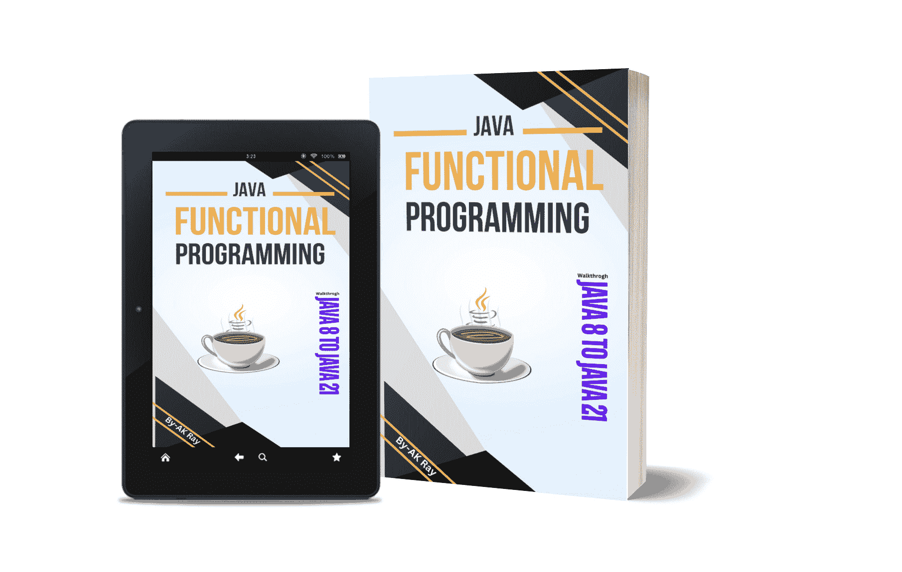

## 献词

本书献给我亲爱的祖父，他那坚定不移的支持和无尽的爱每天都在激励着我。您在我生命中的出现是一种幸运，您的记忆将被永远珍怀。

感谢我的家人，感谢你们在这一段旅程中的耐心、鼓励和理解。你们对我的信任是我最大的动力。

感谢我的导师 Biplab Roy，他是 Calibo India Pvt Ltd 的高级工程主管，他的指导和引导塑造了我的观点，并激发了我对这一主题的热情。

感谢我忠实的读者和支持者，你们对我作品的热情是一种驱动力，我对你们的信任和鼓励深表感谢。

也感谢所有相信知识具有改变生活的力量的人，这本书献给你们。愿它能带来灵感、洞察和积极的。

带着衷心的谢意，

## 关于作者

你好，技术爱好者们！我是 AK Ray，一名资深的软件专业人士，深爱钻研 `Java` 最佳实践，并对函数式编程有浓厚兴趣。

我在软件行业拥有超过 10 年的实战经验，特别是在研发部门的核心产品开发方面，并获得了阿尔伯塔大学的软件设计与架构认证。我有幸参与了许多项目，每一个项目都是 `Java` 力量的证明。但在代码行之外，我也培养了探索函数式编程范式的优雅性与效率的热情。

我的编程之旅始于 2014 年初。`Java` 以其健壮性和多功能性迅速成为我的首选语言。随着时间的推移，我深入研究了迷人的函数式编程领域，在那里我发现了 `lambda expressions`、`streams` 和不可变性（immutability）的美。

我热衷于培养一个 `Java` 爱好者和函数式编程爱好者的社区。让我们联系并继续交流吧：

邮箱：`akr.technolab@gmail.com`

Facebook：`https://www.facebook.com/akr.technolab`

LinkedIn：`https://www.linkedin.com/in/amitesh-kumar-ray-9366b7143/`

衷心感谢选择与我一起探索 `Java` 函数式编程的世界。你们的支持和热情激励了我分享知识的承诺，并为开发者提供所需的工具，帮助他们在 `Java` 生态系统中脱颖而出。

祝未来的代码不仅功能强大，而且无比优雅！顺颂商祺，


## 致我亲爱的开发者们！！

准备好将你的 `Java` 编程技能提升到新的层次了吗？无论你是资深专业人士，还是刚刚开启 `Java` 开发之旅，我非常激动地向你介绍一份全面的指南，该指南侧重于行业中每天使用的 `Java` 特性。

在这份指南中，我精心挑选了你在日常编码任务中遇到的最常用的 `Java` 特性。从掌握 `lambda expressions` 和 `stream APIs` 的复杂性，到理解 `functional interfaces`（函数接口）和默认方法（default methods）的力量，本书旨在为你提供在真实世界的 `Java` 开发项目中脱颖而出所需的必备工具和技术。

我理解你们在跟上不断演变的 `Java` 编程格局时面临的挑战。这就是为什么我将编写一份实用的资源作为我的使命，这本资源不仅涵盖了核心概念，还提供了对最佳实践和行业标准的见解。

无论你是在构建企业级应用、编写 Web 服务还是开发移动应用，这本书都将成为你 `Java` 编程之旅中信赖的伙伴。

让我们一起探索 `Java` 能力的深度，解锁创新与卓越的新机会。

### 准备好迎接灵感、挑战和惊喜。祝编码愉快！！

## 为什么选择这本书

凭借超过 10 年的开发和软件设计经验，我精心编写了此书，涵盖了开发者在日常工作中遇到的实时用例。本书提供了从我丰富的职业历程中汲取的见解和解决方案，对于初学者和资深开发者来说，都是无价的资源。

### 针对所有水平设计

- **初学者**：从易于理解的解释开始零基础。
- **高级用户**：深入研究专家级内容并精炼你的技能。
- **实时用例**：理解理论很重要，但实践应用才是关键。本书包含了反映行业中开发者面临挑战的实时用例，提供了可以直接应用到你项目中的实用解决方案和示例。
- **开发者友好型特性**：本书涵盖了日常编码至关重要的开发者友好特性，帮助你成为一名更高效、更有效的程序员。
- **简化复杂特性**：如 `streams` 和 `lambda expressions` 等复杂主题通过手绘草图和视觉表示进行解释，使其更容易理解和记忆。
- **全面的 Java 覆盖**：本书涵盖了从 `Java 8` 到 `Java 21` 的 `Java` 特性，确保你掌握最新进展。它还包含了最佳实践，为你编写整洁、高效且可维护的代码奠定坚实基础。

**终极开发者指南**：简单来说，作为一名开发者，我可以肯定地说，这本书是任何想要精通 `Java` 编程的人的终极指南。无论你是刚起步还是寻求增强现有技能，这本书都将为你提供在不断变化的软件开发世界中取得成功所需的知识和工具。

## 谁能从本书中受益？

本书专为广泛的读者设计，从 `Java` 编程的初学者到专家都有。无论你只是刚刚开始软件开发之旅，还是希望提升技能，这本书都为所有水平的人提供了宝贵的见解和实用知识。

### 针对所有水平设计

- **初学者**：通过清晰的解释和实时代码演示从基础开始。
- **学生和工程专业毕业生**：通过实用的示例和练习建立强大的 `Java` 编程基础。
- **初级软件专业人士**：通过对核心概念的深入理解，获得应对真实世界项目的信心。
- **中级软件专业人士**：增强你的技能并学习高级技术以提升职业生涯。
- **Java 专家、主管和架构师**：发现新的视角和最佳实践，以精炼你的专业知识并有效地领导团队。

### 全面覆盖

本书精心设计，涵盖了从最基础到专家水平的 `Java` 编程。它包括：

- **实时代码演示**：通过详细的示例，理解功能在实际操作中是如何工作的。
- **实践示例**：通过展示 `Java` 概念应用的真实世界场景进行学习。
- **简化的解释**：将复杂的话题分解为易于理解的语言，让每个人都能理解。

## 目录

### 1. Java 基础

- 1.1 历史与演变
- 1.2 Java 如何主导其他编程语言
- 1.3 为什么你应该学习 Java：软件开发成功的关键
- 1.4 Java 如何塑造你的职业
- 1.5 Java 特性
- 1.6 环境搭建
- 1.7 数据类型
- 1.8 声明与初始化
- 1.9 内存存储
- 1.10 类
- 1.11 对象
- 1.12 方法
- 1.13 访问修饰符
- 1.14 OOP 概念
- 1.15 什么是类？
- 1.16 变量
- 1.17 方法
- 1.18 方法的作用是什么？
- 1.19 如何调用方法？
- 1.20 方法的类型
- 1.21 类定义
- 1.22 什么是构造函数？
- 1.23 抽象类
- 1.24 接口
- 1.25 访问修饰符
- 1.25 `static` 关键字
- 1.26 OOPS 概念
- 1.27 类与对象
- 1.28 封装
- 1.29 关于继承的一些信息
- 1.30 继承的类型
- 1.31 多重继承
- 1.32 多级继承
- 1.33 层级继承
- 1.34 抽象
- 1.35 多态
  - 1.35.1 编译时多态（方法重载）
  - 1.35.2 运行时多态（方法重写）

### 2. 控制语句

- 2.1 `switch` 语句
- 2.2 它是如何工作的？
- 2.3 从 Java 7 到 Java 21 的 `switch` 演变
- 2.4 `do-while`
- 2.5 `for` 循环
- 2.6 `for-each` 循环
- 2.7 `break` 语句
- 2.8 `continue` 语句
- 2.9 运算符
  - 2.9.1 算术运算符
  - 2.9.2 关系运算符
  - 2.9.3 逻辑运算符
  - 2.9.4 赋值运算符
  - 2.9.5 一元运算符
  - 2.9.6 三元运算符
  - 2.9.7 位运算符
  - 2.9.8 `instanceof` 运算符

### 3. Java 中的 String 是什么？

### 4. StringBuffer

### 5. StringBuilder

### 6. 包装类

### 7. 异常处理

- 7.1 如何处理异常？
- 7.2 异常层次结构
- 7.3 异常的类型
- 7.4 检查异常（Checked Exception）
- 7.5 未检查异常（Unchecked Exceptions）
- 7.6 处理异常
- 7.7 `try` 块
- 7.8 `catch` 块
- 7.9 带 `finally` 块的 `try-catch`
- 7.10 如何抛出异常
- 7.11 `throw` 关键字
- 7.12 `throw` 与 `throws`

### 8. 数组：Java 中的数组是什么？

- 8.1 数组初始化
- 8.2 如何从数组中访问值
- 8.3 遍历数组元素

### 9. 集合（Collection）

- 9.1 `ArrayList`
- 9.2 `LinkedList`
- 9.3 `Set`
  - 9.3.1 `HashSet`
  - 9.3.2 `LinkedHashSet`
  - 9.3.3 `TreeSet`
- 9.4 `Map`
  - 9.4.1 `HashMap`
  - 9.4.2 `LinkedHashMap`
  - 9.4.3 `TreeMap`
  - 9.4.4 基础 `Map` 操作
- 9.5 并发集合
  - 9.5.1 `ConcurrentHashMap`
  - 9.5.2 `CopyOnWriteArrayList`
  - 9.5.3 `CopyOnWriteArraySet`
  - 9.5.4 `BlockingQueue`

### 10. 函数式编程

- 10.1 函数式编程的使用
- 10.2 函数式编程如何帮助我们
- 10.3 `Stream`
  - 10.3.1 什么是 `Stream`？
  - 10.3.2 `Stream` 是如何工作的？
  - 10.3.3 何时使用 `Streams`
  - 10.3.4 如何创建 `Stream`
- 10.4 `Stream` 操作
  - 10.4.1 `Stream` 操作是如何工作的？
  - 10.4.2 中间操作
  - 10.4.3 终端操作

### 11. Lambda 表达式

- 11.1 什么是 Lambda 表达式？
- 11.2 为什么使用 Lambda 表达式
- 11.3 Lambda 表达式的历史
- 11.4 为什么在 Java 中引入 Lambda 表达式
- 11.5 简化 Lambda 表达式
- 11.6 Lambda 表达式深度解析
- 11.7 无参数 Lambda
- 11.8 单参数 Lambda
- 11.9 多参数 Lambda

### 12. 方法引用

- 12.1 它是如何工作的
- 12.2 方法引用如何帮助简化 Lambda？
- 12.3 方法引用是如何工作的？
- 12.4 方法引用的前提条件
- 12.5 类型兼容性
- 12.6 方法引用的类型
- 12.7 静态方法引用
- 12.8 实例方法引用
- 12.9 用户自定义方法引用
- 12.10 构造函数引用

### 13. 函数接口

- 13.1 `Function`
- 13.2 `UnaryOperator`
- 13.3 `BinaryOperator`
- 13.4 `Consumer`
- 13.5 `BiConsumer`
- 13.6 `Supplier`
- 13.7 `Predicate`
- 13.8 `BiPredicate`
- 13.9 `LongBiFunction<T,U>`
- 13.10 `DoubleBiFunction<T,U>`
- 13.11 `LongBinaryOperator`
- 13.12 `Stream` 操作详述

### 14. 收集器（Collector）

- 14.1 集合分组 By
- 14.2 `GroupBy` 如何与 `Stream` 工作
- 14.3 `Stream` 数据分区
- 14.4 `Stream` 数据排序
  - 14.4.1 使用 `Collections` 排序集合数据
  - 14.4.2 排序方法
  - 14.4.3 `Stream` 排序是如何工作的？
- 14.5 `Stream` 扁平化
  - 14.5.1 什么是 `flatmap(..)`
  - 14.5.2 数据扁平化是如何与 `Stream` 工作的？

### 15. 重要 Java 特性：Java 8+

### 16. Record 类：Java 17

### 17. Java 17 中的密封类（Sealed Classes）

### 18. Java 中的 Lombok 库

### 19. Java 21 的新特性

- 19.1 虚拟线程（Virtual Thread）
- 19.2 创建虚拟线程
- 19.3 深度解析
- 19.4 Web 应用/微服务中的虚拟线程
- 19.5 如何观察虚拟线程
- 19.6 虚拟线程内部是如何工作的
- 19.7 序贯化集合（Sequenced Collections）
- 19.8 结构化并发（Structured Concurrency）
- 19.9 字符串模板（String Template）
- 19.10 Record 类增强

## Java

Java 是一种多功能且健壮的编程语言，因其平台独立性和广泛的生态系统而在开发者中广受欢迎。得益于 Java 虚拟机（`JVM`），你可以编写一次代码并运行在任何地方。

### 历史与演变

Java 是一种高级的、基于类的、面向对象的编程语言，设计目标是尽可能减少实现依赖。它的目的是让应用程序开发者“编写一次，处运行”（WORA），这意味着编译后的 `Java` 代码可以在任何支持 `Java` 的平台上运行，而无需重新编译。

### 起源

Java 的起源可以追溯到 1991 年，由 Sun 公司“绿色小组”的 James Gosling、Mike Sheridan 和 Patrick Naughton 发起。该项目最初名为“Oak”，是用 Gosling 办公室外的一棵橡树命名的。然而，由于商标问题，后来被更名为“Java”，灵感来源于他们大量饮用的咖啡。

### 早期开发

Java 最初的目标是开发一种可用于数字机顶盒和电视等数字设备的语言。然而，随着互联网开始成为计算领域的重要力量，重点转向了利用 `Java` 开发 Web。该语言生成动态、交互内容的能力与不断发展的万维网完美契合。

### 关键里程碑

- **1995 年：Java 1.0** —— Sun 公司正式发布了 Java。它因平台独立性和可移植性等新特性而迅速普及。“编写一次，处运行”的口号强调了它可以在任何配备 Java 虚拟机（`JVM`）的设备上运行。

- **1996 年：Java 1.1** —— 该版本引入了内部类、`JavaBeans`、`JDBC`（Java 数据库连接）和 `RMI`（远程方法调用），并改进了安全性。

- **1997—1999 年：Java 2（J2SE 1.2、1.3、1.4）** —— Java 2 引入了 Swing 图形 API、集合框架和 HotSpot `JVM`，显著提升了性能。这一时期还引入了企业版（`J2EE`）和微型版（`J2ME`），分别用于企业级和移动应用。

- **2004 年：Java 5（1.5）** —— 该版本通过泛型等特性标志着重大更新，元注解、枚举类型以及增强型 `for` 循环。Java 内存模型的引入改进了并发处理。

- **2006—2011 年：Java 6 和 Java 7** —— 这些版本侧重于性能改进和新的 API。Java 6 增强了对网络服务的支持，而 Java 7 引入了 `try-with-resources` 语句、菱形操作符以及用于并行处理的 `fork/join` 框架。


- **2014：Java 8**：一个重要的里程碑。Java 8 引入了 Lambda 表达式、`Stream` API 以及新的日期和时间 API（`java.time`）。这些新增内容使 Java 更具函数式和表现力，适应了现代编程范式。

- **2017：Java 9**：随着 Java 9 的发布，引入了模块系统（`Project Jigsaw`），实现了更好的代码模块化和封装。它还带来了交互式 Java REPL `JShell` 以及对 `JVM` 的改进等。

- **2018 及以后：Java 10 到 Java 17**：这些版本持续添加新特性和增强功能。Java 10 通过 `var` 关键字引入了局部变量类型推断。Java 11 包含了长期支持（LTS）并添加了新的 API 和改进。Java 12 到 Java 17 带来了增量改进，例如 `switch` 表达式、文本块、记录、密封类、模式匹配和性能增强。

- **2023：Java 21 LTS 发布**

## 预期特性

- 模式匹配细化
- 外部函数与内存 API
- 作用域值（Scoped Values）
- 向量 API
- `JVM` 性能
- 语言特性
- 开发者工具
- 安全与稳定性
- 现代技术集成

这些特性将增强 Java 的开发能力。目前 Java LTS 版本的当前版本是 `Java 21`。更多信息请查看下文！[](image_rsrc3U7.jpg)

## 开源之旅

2006 年，太阳微系统公司（Sun Microsystems）做出了一个重大决定，让 Java 开源。这意味着他们允许任何人查看和修改 Java 代码。他们根据名为 GNU 通用公共许可证（`GPL`）的许可协议进行此操作。此举导致了 `OpenJDK`（开放 Java 开发工具包）的诞生。`OpenJDK` 现在是所有人作为参考的 Java 官方版本。

让 Java 开源是一项改变游戏规则的事件。它允许来自全球的大规模开发者社区参与 Java 的开发。这种社区驱动的方法帮助 Java 增长得更快、更加健壮，因为有更多的人致力于修复漏洞、添加功能和改进这种语言。

## 收购与现状

2010 年，甲骨文公司（Oracle Corporation）收购了太阳微系统公司，这意味着甲骨文接管了管理 Java 的责任。从那时起，甲骨文继续更新和改进 Java。他们引入了新的发布计划，每六个月发布一个新的 Java 版本。这种定期发布周期确保了 Java 能以稳定的速度获得新特性和改进。

今天，Java 仍然是最流行的编程语言之一。它以稳定、可扩展和强大的社区支持而闻名。Java 用于许多领域，包括：

- **Web 开发**：构建动态网站和 Web 应用程序。
- **移动应用**：为 Android 设备开发应用。
- **企业级系统**：创建大规模业务应用程序。
- **云计算**：在云平台上构建和运行应用程序。

## 总结

Java 从太阳微系统的一个小项目转变为被广泛使用的编程语言，这展示了它如何保持适应性和相关性。它的演变反映了技术的变化以及开发者社区为保持其现代和高效所做的持续努力。通过学习 Java，你正在成为一个庞大且持久的生态系统的一部分，这个生态系统经时间证明了自己的价值，并继续推动软件开发领域的创新。

当你开始学习 Java 时，你将接触一门由专业开发者社区构建和精炼的语言。这个社区确保了 Java 仍然是创建各种应用程序的强大工具，使其成为学习和使用的绝佳语言。

## Java 如何主导于其他编程语言

Java 在编程世界中由于几个原因保持着强有力的地位。以下是导致其主导地位的关键因素明细。

### 1. 平台无关性

- **一次编写，随处运行**：Java 的口号“一次编写，随处运行”突出了它的平台无关性。Java 程序可以在任何带有 Java 虚拟机（`JVM`）的设备上运行，使其具有高度的可移植性。

- **跨平台兼容性**：这一特性使 Java 成为开发无需修改即可在多个操作系统上运行的应用的首选。

### 2. 健壮的生态系统和库

- **广泛的标准库**：Java 自带了一个全面的标准库，支持从数据结构到网络连接和 GUI 开发的各种功能。

- **成熟的框架**：如 `Spring`、`Hibernate` 和 `Struts` 等框架提供了构建企业级应用程序的强大工具，简化了开发过程并减少了样板代码。

### 3. 性能与可扩展性

- **高效的 JVM**：`JVM` 持续针对性能和效率进行优化。现代 `JVMs` 使用即时编译（`JIT`）将字节码转换为原生机器码，提升了执行速度。

- **可扩展性**：Java 的架构和生态系统支持高度可扩展应用程序的开发，使其适用于大型企业系统。

### 4. 强大的社区和行业支持

- **活跃的社区**：Java 拥有最大且最活跃的开发者社区之一。该社区持续贡献改进内容、提供支持，并创建了丰富的开源工具和库。

- **企业支持**：最初受太阳微系统支持，后来受甲骨文支持，Java 拥有强大的企业背景，确保了定期的更新。

### 5. 安全性

- **内置安全性**：Java 具有多种内置安全特性，例如字节码验证器、沙箱和健壮的异常处理，这有助于构建安全的应用程序。

- **安全更新**：甲骨文的定期更新确保 Java 应用程序能够抵御漏洞。

### 6. 多功能性

- **广泛的应用范围**：Java 用于各个领域，包括：

  - Web 应用：`Servlets`、`JSP` 以及 `Spring` 等框架。
  - 移动应用：Android 开发的主要语言。
  - 企业应用：企业级豆（`EJB`）、`Java EE` 以及其他企业框架。
  - 嵌入式系统：用于嵌入式系统和物联网设备的 `Java ME`（微型）。
  - 云计算：与云平台和微服务架构深度集成。

### 7. 教育用途

- **教学语言**：许多大学和教育机构使用 Java 来教授编程和计算机基础。它清晰的语法和全面的库使其成为良好的学习工具。

### 8. 持续演进

- **定期发布**：甲骨文引入的六个月发布周期确保了 Java 持续带来新特性和改进。

- **现代语言特性**：Lambda 表达式、`Stream` API 和模块（`Project Jigsaw`）等特性的引入让 Java 保持现代感。

### 9. 企业采用

- **广泛的企业应用**：许多大型企业由于 Java 的可靠性、可扩展性和性能使用 Java 构建了系统。这种广泛的采用加强了它的持续使用和主导地位。

- **长期支持（LTS）版本**：Java 的 `LTS` 版本为企业应用提供了稳定性，确保企业能够在一个稳定的平台上运行其关键系统。

## 结论

Java 对其他编程语言的主导地位归功于它的平台独立性、健壮的生态系统、性能、强大的社区支持、安全性特性、多功能性以及持续演进。这些因素使其成为广泛应用的可靠且首选的选择，从企业级系统到移动应用程序，确保了它在编程世界中持久的影响。

## 为什么你应该学习 Java：软件开发成功的关键

Java 为深入学习这门流行语言提供了极具说服力的理由。以下是一些主要优势：

- **需求量大**：Java 是雇主最青睐的编程技能之一。学习 Java 为你打开了广阔就业市场的大门，其中充满了机会。

- **多功能性**：Java 的“一次编写，随处运行”哲学允许你创建运行在不同平台（从桌面设备到移动设备）上的程序。这使你在日益依赖多样化技术的世界中成为一项宝贵的资产。

- **基础深厚且不断增长**：Java 拥有悠久且成功的历史，但它并没有停滞。该语言通过定期更新和活跃的开发社区不断演进，确保了它的未来。

- **对初学者相对友好**：与某些编程语言相比，Java 具有清晰且可读的语法，使其更容易学习，特别是对于编程初学者来说。

- **强大的社区支持**：凭借全球范围内庞大的 Java 开发者社区，你永远不会孤单。有丰富的在线资源、教程和论坛来帮助你解决问题并持续学习。

- **回报丰厚的职业路径**：Java 开发者通常能获得极具竞争力的薪水，对于寻求在技术领域获得丰厚回报的人来说，这是一个极佳的选择。

## Java 如何塑造你的职业

学习 Java 可以从以下几个方面显著影响你的软件开发职业：

- **开启机会之门**：Java 在各行业的广泛应用意味着更广泛的工作选择。你可以从事 Web 应用程序、移动应用、企业软件，甚至是基于云的系统。

- **提升你的技能树**：Java 提供了面向对象编程原则的坚实基础，这是现代软件开发中的基本概念。掌握这些原则让你成为一个更全面的程序员。

- **增强解决问题的能力**：学习 Java 教会你批判性思维和解决问题的方法，这些方法在任何技术职业中都是宝贵的资产。

- **增加就业竞争力**：在简历上写出 Java 证明了你处理强大且需求量高的技术的能力。这可以显著提升你的简历对潜在雇主的吸引力。

- **提供跳板**：Java 可以作为学习其他编程语言的跳板。通过 Java 获得的知识和技能可以应用于其他面向对象的语言，使你更轻松地扩展你的编程专业知识。

总之，Java 是一门强大且多功能的语言，为软件开发领域的成功职业提供了清晰的路径。它强大的需求、广泛的应用和支持性的社区使其成为任何想要进入编程世界的人的绝佳选择。

## 什么是 LTS 版本？

在 Java 的语境下，LTS（长期支持）版本是指由维护者指定提供长期支持的 Java 开发工具包（`JDK`）版本。LTS 版本旨在提供更长时间的稳定性和支持，适用于需要可预测且良好支持平台的应用程序和系统。

### Java LTS 版本的主要特征

- **更长的支持周期**：与普通的非 LTS 版本相比，LTS 版本在更长的时间内接收更新和补丁。这种延长的支持周期通常持续几年。

- **可预测的维护计划**：LTS 版本遵循可预测的更新和维护计划，允许组织有信心地规划并安排必要的更新。

- **稳定性与兼容性**：LTS 版本优先考虑稳定性和向后兼容性，使其成为需要可靠、一致的开发和运行环境的企业和项目的首选。

- **推荐用于生产环境**：LTS 版本通常推荐用于对长期稳定性和支持至关重要的生产环境。相比之下，非 LTS 版本可能更适合想要访问最新功能和改进的开发者。

- **企业采用**：许多大型企业和组织倾向于在 LTS 版本上将其软件开发和部署标准化，以最大限度地减少中断风险并确保基础设施获得良好支持。

注意：Java 常规功能版本每 6 个月发布一次，LTS 版本每 2 年发布一次。

## Java 的特性

### 一次编写，随处运行（WORA）

你只需编写一次程序，它就可以在不同类型的设备和系统上运行而无需重大更改。这就像有一份适用于不同厨房的单一食谱。

### 一旦你写了代码，它就可以在任何平台上执行。

### 面向对象

#### Java：对象动物园！

想象一个动物园，但里面不是动物，而是我们 Java 程序中的对象。面向对象编程（`OOP`）是一种像这样思考程序的方式。

- **对象（Objects）**：这些是你程序的构建模块，就像动物是动物园的居民一样。一个对象可以代表任何东西：汽车、银行账户，甚至一首歌！每个对象都有自己独特的特性。

- **属性（Properties）**：将这些看作是对象的特征。对于一个汽车对象，属性可以是它的颜色、速度或门的数量。在我们的动物园里，每种动物可能都有物种、年龄或喜欢的食物等属性。

- **行为（Behaviors）**：这些是对象可以执行的操作。汽车对象可能有像 `accelerate`（加速）、`brake`（刹车）或 `turn`（转向）等行为。动物对象可能有 `eat`（吃）、`sleep`（睡）或 `make a sound`（叫声）等行为。

这是一个简单的例子：

想象你的 Java 程序中有一个名为“狗（Dog）”的对象。这个 `Dog` 对象可以有 `breed`（品种，“金毛寻回犬”）、`age`（年龄，3 岁）和 `name`（名字，“Buddy”）等属性。它还可以有像 `bark()`（汪叫）、`wagTail()`（摇尾巴）和 `fetch()`（捡球）这样的行为。

对于熟悉编程基础的开发者来说，Java 的面向对象方法（`OOP`）提供了一种组织和管理代码的强大方式。

以下是从程序员角度的拆解：

#### 1. 对象（Objects）：主角们

在 Java 中，对象是封装了数据（属性或特征）和功能（方法或行为）的基本实体。将它们想象成你定义的自定义数据类型。

例如，`Car` 对象可能有颜色、型号和马力等属性。它还可能有 `accelerate()`、`brake()` 和 `turn()` 等方法。

#### 2. 类（Classes）：蓝图

类充当创建对象的蓝图或模板。它们定义了特定类型对象将共享的所有属性和方法。

将类比作生产 `Car` 对象的工厂。你在类中定义规格（属性和方法），然后就可以创建多个具有这些规格的 `Car` 对象（实例）。

#### 3. 封装（Encapsulation）：保持私有（且安全！）

封装是一项关键的 OOP 原则。它允许你控制对对象属性的访问。你可以将某些属性定义为 `private`，这意味着它们只能由同一个对象内部的方法访问。这促进了数据安全并防止了意外修改。

在你的 `Car` 类中，可能会将某些属性（如 `engineState`）设置为 `private`，并提供 `startEngine()` 和 `stopEngine()` 方法来控制其状态。

#### 4. 继承（Inheritance）：通过代码提高效率

- 继承允许你创建新的类（子类），这些类继承现有类（父类）的属性和方法。这促进了代码重用并减少了冗余。

- 你可以创建一个 `SportsCar` 类，它继承了 `Car` 类的所有内容，但添加了特定的属性，例如 `turboBoost()` 方法。

#### 5. 多态：让对象更具活性

- 多态允许不同类的对象以不同的方式响应同一个方法调用。这增加了灵活性，并让你的代码更具适应性。

- 你可以在 `Car` 类中有一个通用的 `makeSound()` 方法，它产生引擎声音。继承该类的类（如 `SportsCar`）可以重写该方法以创建更高性能的声音。

## 平台无关性

Java 通过其字节码和 Java 虚拟机（`JVM`）实现了平台无关性。当你编译 Java 程序时，它会被翻译成字节码，字节码是一组供 `JVM` 使用的指令。然后 `JVM` 将这些字节码翻译成特定操作系统理解并执行的机器码。

### 1. Java 字节码

- 当你编写 Java 代码时，它会被编译成所谓的 `bytecode`（而不是针对特定机器的代码）。

- `bytecode` 像是一种通用语言，任何 Java 虚拟机（`JVM`）都能理解它。

### 2. JVM（Java 虚拟机）

- `JVM` 充当字节码的解释器。

- 它运行在不同的操作系统上（如 `Windows`、`Linux` 或 `macOS`）。因此，你只需要编写一次代码，`JVM` 就能让它处处运行。

### 示例

- 假设你创建了一个 Java 程序（我们称之为 `HelloWorld.java`）。

```java
public class HelloWorld {
    public static void main(String[] args) {
        System.out.println("Hello, World!");
    }
}
```

- 你使用 `javac HelloWorld.java` 编译它。这生成了 `HelloWorld.class`（字节码）。

- 现在，你可以在带有 `JVM` 的操作系统上运行它：

  - 在 Windows 上：`java HelloWorld`
  - 在 Linux 上：`java HelloWorld`
  - 在 macOS 上：`java HelloWorld`

这就是为什么 Java 是平台无关的——多亏了字节码和 `JVM`！

## 自动内存管理/垃圾回收

Java 中的自动内存管理就像有一个机器在你玩完后帮你打扫房间。以下是它的工作原理。

### 解释

1. **内存分配**：当你在 Java 中创建对象（如变量、`arrays` 或类的实例）时，它们会占用内存来存储数据。

2. **自动清理**：Java 的自动内存管理（也称为垃圾回收）就像一个时刻监控你程序的机器人。它会清理（释放）不再需要的对象所使用的内存。

3. **无需手动清理**：就像你不需要在玩完后手动清理房间一样，Java 开发者不需要手动释放内存。垃圾回收机器人会处理这一切。

### 示例

假设你在 Java 程序中创建了几个对象，如下所示。

### 工作原理

- **内存分配**：每当你创建一个变量（`message`、`numbers`）或数组（`numbers`）时，Java 都会预留内存来存储它们的数据。

- **自动清理**：当这些对象不再需要时（例如，当它们超出作用范围或不再被引用时），垃圾回收机器人会识别它们并释放它们之前占用的内存。

### 优势

- **防止内存泄漏**：确保未使用的内存被回收，防止内存泄漏随时间推移可能导致程序变慢。

- **简化开发**：开发者可以专注于编写代码，而无需担心手动管理内存，使 Java 程序更加健壮和可靠。

### 现实类比

- **机器人清理**：就像一个整理房间的机器人一样，Java 的垃圾回收器确保你的程序内存保持有序高效，即使在运行复杂操作时也是如此。

### 总结

让我们用易于理解的方式来分解自动内存管理：

1. **像机器人一样清理**：
   - 想象你有一个机器人朋友，在你玩完后帮着打扫房间。
   - 机器人捡起你不再使用的玩具（`objects`）并将它们收好。
   - 在 Java 中，我们有类似的东西，叫做垃圾回收（`GC`）。

2. **Java 的垃圾回收（GC）**：
   - 当你在 Java 中创建对象（如玩具）时，会为它们分配内存。
   - 但如果你忘记清理（删除）未使用的对象怎么办？这就是 `GC` 大派用场的地方。
   - `GC` 检查哪些对象不再需要（如你不再玩的玩具）。


- 它通过移除那些未使用的对象来自动释放内存。

## 3. 示例

- 假设你在 Java 程序中创建了一堆 `Car` 对象。
- 当你用完它们时（不再对它们有引用），`GC` 会将它们识别为“垃圾”。
- 然后它通过回收那些未使用的 `Car` 对象所占用的内存来完成清理。

所以，Java 的自动内存管理就像有一个得力的机器人朋友，让你的计算机内存保持整洁！

## 多线程

Java 中的多线程允许你的程序并发执行多个任务。这就像让你代码的不同部分同时运行，例如在后台下载文件的同时与用户聊天。

### 1. 什么是多线程？

- 想象你在厨房里做饭。你可以同时做几件事：
  - 在切菜的同时搅拌汤。
  - 在摆桌的同时检查烤箱。
- 同样，Java 中的多线程允许你的程序同时处理不同的任务。

### 2. Java 与线程

- 在 Java 中，线程就像是程序中的微线程。
- 每个线程可以独立执行它的任务，例如：
  - 一个线程与用户聊天。
  - 另一个线程在后台下载文件。
- 这样你的程序就不会被卡住。

### 3. 优势

- **执行速度更快**：在一个线程等待时，其他线程可以继续工作。
- **响应迅速**：程序可以响应输入。

### 4. 示例

- 想象一个播放器：
  - 一个线程播放音乐。
  - 另一个线程更新播放列表。
  - 还有一个线程显示专辑封面。
- 这一切都在流畅进行。

所以，多线程就像有很多助手——各司其职！欢迎加入你的书中！

## 安全

在编程世界中，Java 就像一个保护你计算机的超级英雄。

### 1. Java 盾

- 想象你的计算机是一座城堡，你的程序是里面的宝藏。
- Java 自带盾（就像英雄的盔甲）来防御坏人。

### 2. 工作原理

- 当你编写 Java 代码时，就像为宝藏建造围墙。
- Java 检查每一个门和窗户（代码），确保没有狡猾的坏人溜进来。
- 如果坏代码试图闯入，Java 的盾牌会阻止它们！

### 3. 能力

- **无内存泄漏**：Java 会自动清理自己（就像一个整洁的英雄）。
- **无未经访问**：Java 控制谁可以进入。
- **无恶意咒**：Java 会检查危险操作（如施咒）并阻止它们。

当你使用 Java 时，你就像是一个拥有超级英雄守护的城堡之主。你的宝藏（数据）是安全的！

## 丰富的标准库

让我们用简单的方式探索 Java 的标准库：

### 1. 瑞士军刀

- 想象你是厨房里的一个厨师。
- Java 给了你一把瑞士军刀——一个具有许多功能的多功能工具。这把刀（Java 标准库）包含了常用任务的预构建工具。

### 2. 里面有什么？

- Java 标准库包括：
  - `Strings`：切割、切片和合并文本。
  - `Lists`：像食谱一样——按顺序存储成分（数据）。
  - `Files`：打开、读取和写入文件（食谱）。
  - `Math`：计算、测量和转换（就像量杯）。
  - `Concurrency`：
    - `Threads`/`Virtual Threads`
    - 自动 `GC`
    - 轻松集成大多数库和工具。

还有更多！简单来说，它是一个一站式商店，你可以在那里获得所需的一切。

## 3. 烹饪类比

- 当你做饭时，你不会从零开始创造一把刀或一个量杯。
- 同样，在 `Java` 中，你使用的是标准库中现有的工具（`classes` 和 `methods`）。
- 这节省了时间和精力！

## 4. 多种菜肴

- 凭借 `Java` 丰富的库，你可以创建不同的“菜肴”（程序）：
  - 一个聊天应用（使用 `strings`）。
  - 一个购物清单（使用 `lists`）。
  - 一个文件管理器（使用 `files`）。

所以，把 `Java` 的标准库想象成你物资丰富的厨房——已经准备好应对任何编程食谱了！

## 为什么要学习 JAVA？

### 高就业需求

- `Java` 就像通往就业机会的黄金门票。
- 大多数跨国公司（MNCs）使用 `Java` 开发它们的软件项目。
- 学习 `Java` 开启了通往精彩职业道路的大门。

### 全球影响力

- 把 `Java` 想象成一种环游全球的语言。
- 它在编程世界的每一个角落都被使用。
- 无论你是在纽约还是东京，`Java` 都是你的语言护照。

### 企业级可用

- `Java` 是大型系统的骨干（就像编程城市中的摩天大楼）。
- 银行、航空公司和电子商务巨头都依赖 `Java`。
- 它就像用坚固的砖块盖房子！

### Java 的流行

- `Java` 就像编程世界里的酷孩子。
- 它有 9000 万开发者在使用，并在全球 70 亿设备上运行！
- 对 `Java` 的高需求意味着意味着高薪工作。

### 易于学习

- `Java` 使用的语言与英语相似。
- 你可以通过 `Java Tutorials` 快速学习它。
- 语法？小菜一碟！

### 强大的社区

- 想象一个庞大的 `Java` 爱好者在线俱乐部。
- 从初学者到专家，他们都在那里提供帮助。
- `GeeksforGeeks` 就是你的秘密接头暗！🤝

### 丰富的工具

- `Java` 自带一个工具宝箱（`APIs`）。
- 这些工具处理一切——网络、数据库、媒体等。
- 它就像拥有一把用于编程的瑞士军刀。

### 开源魔法

- `Java` 有开源库（就像免费的食谱）。
- 使用它们可以更快、更便宜地制作出 `Java` 应用。

### 强大的 IDE

- 把 `Eclipse`、`NetBeans` 和 `IntelliJ IDEA` 想象成你的厨房小电器。
- 它们让 `Java` 开发变得非常轻松！

## 环境搭建

我正在使用 `IntelliJ Idea Editor`，但你可以使用任何其他工具，如 `Eclipse`。在这个示例中，我们将查看 `Intellij Idea`。

在使用 `IntelliJ` 时，你需要遵循以下步骤，它是工业界 `Java` 开发人员最使用的工具。

1. 下载并安装 `IntelliJ IDEA`
2. 启动 `IntelliJ IDEA`
3. 创建一个新的 `Java Project`
4. 创建 `Package` 和 `Class`
5. 编写你的代码
6. 运行你的程序

### 实用指南（针对那些还没有准备好环境的人）

#### 下载 IntelliJ

你可以在这里下载 IntelliJ 的最新版本：

<https://www.jetbrains.com/idea/download/?section=mac>

#### 启动 IntelliJ

1. 创建 `Project`
2. 如果你已经有一些项目，点击“Open”。
3. 如果你想创建一个新项目，点击“New Project”。
4. 你将看到下面的屏幕。

## 数据类型

想象你有一个学校储物柜，你在里面存放各种不同的物品：书、午餐和健身服。这些东西中的每件都需要特定的容器才能妥善放置。在 `Java` 中，数据类型就像这些容器。它们帮助计算机知道你存储的是什么类型的数据以及它需要多少空间。

以下是 `Java` 中的一些基本数据类型：

- `int`：用于整数（不带小数）的盒子，例如 `7`、`-3` 或 `100`。
- `double`：用于小数的盒子，例如 `3.14`、`2.718` 或 `-0.001`。
- `float`：另一个用于小数的盒子，但它占用的空间比 `double` 少。它就像是 `double` 的弟弟。
- `long`：用于非常大的整数的大型盒子，例如 `123456789L`。它可以容纳比 `int` 更多的数字。
- `short`：用于整数的较小盒子，例如 `10` 或 `-5`。它存放的数字比 `int` 小。
- `byte`：用于整数的最小盒子，存放 `-128` 到 `127` 之间的微小数字。
- `char`：用于单个字母或符号的盒子，例如 `'A'`、`'b'` 或 `'7'`。
- `boolean`：一个只能存放 `true`（真）或 `false`（假）的特殊盒子。它就像一个简单的开关，要么开要么关。

在 `Java` 中，数据类型很重要，因为它们定义了你可以存储和处理的信息类型。

- 原生数据类型（如整数、小数、字符和布尔值）用于简单的值。
- 非原生数据类型（如数组、`classes` 和 `interfaces`）用于更复杂的结构和更大的数据集。

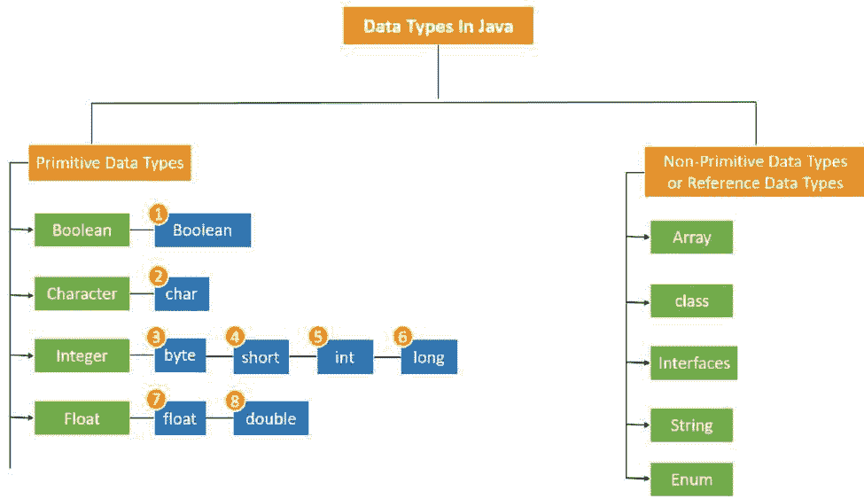

`Java` 中的数据类型决定了内存如何存储变量的值。每个变量都有一个数据类型，指定了它可以包含什么类型的值。原生数据类型也用于定义函数的返回类型。

`Java` 中的 `int` 数据类型用于存储不带小数点的整数值（整数字）。以下是关于 `int` 数据类型的关键点：

- 名称：`int`（integer 的缩写）。
- 大小：`32 bits`（4 字节）。
- 范围：`-2,147,483,648` 到 `2,147,483,647`。
- 默认：`0`。
- 用法：适用于整数值。

### 示例

```java
int age = 30;
```

### 解析

当你写 `int age = 30;` 时，Java 为变量 `age` 分配了 4 字节内存。

1. **声明**：`int age` 被声明为整数。
2. **初始化**：将值 `30` 分配给内存。

### 内存布局

```text
00000000 00000000 00000000 00011110（32 位）
00000000 00011110（16 位）
00011110（8 位 - byte）
```

### 代码结构

```java
public class FirstProgramDemo {
    public static void main(String[] args) {
        int age = 30;
        System.out.println("Your Age is : "+age);
    }
}
```

同样的，我们可以检查其他数据类型：

### double（双精度浮点数）

- 用于存储小数（比 `float` 高）。
- `double pi = 3.14159;`
- `System.out.println("Pi: " + pi);` // 输出：3.14159

### float（单精度浮点数）

- 用于存储小数（比 `double` 低）。
- `float temperature = 36.6f;` // `f` 表示这是一个 `float` 值。
- `System.out.println("Temperature: " + temperature);` // 输出：36.6

### long（长整型）

- 用于存储大整数。
- `long distance = 123456789L;` // `L` 表示这是一个 `long` 值。
- `System.out.println("Distance: " + distance);` // 输出：123456789

### short（短整型）

- 用于存储较小的整数。
- `short height = 160;`
- `System.out.println("Height: " + height);` // 输出：160

### byte（字节型）

- 用于存储非常小的整数。
- `byte level = 12;`
- `System.out.println("Level: " + level);` // 输出：12

### char（字符）

- 用于存储单个字符。
  1. `char grade = 'A';`
  2. `System.out.println("Grade: " + grade);` // 输出：Grade: A

### boolean（布尔值）

- 用于存储真或假值。
  1. `boolean isJavaFun = true;`
  2. `System.out.println("Is Java Fun? " + isJavaFun);` // 输出：Is Java Fun? true

**注意**：在我们对 `class` 和 `Objects` 有了基础知识后，我们将介绍非基本数据类型。

到目前为止你学了什么？

- 什么是 Java？
- Java 的发布历史。
- Java 的特性
- 为什么选择 Java？
- 环境搭建
- Java 中的数据类型

## 我们接下来将涵盖哪些内容！！

- `Class`（类）
- `Object`（对象）
- `Method`（方法）
- `Access Modifier`（访问修饰符）
- OOP 概念

## 什么是类（Class）？

将 Java 中的类想象成一个制作某东西的蓝图。假设你想制作一个玩具机器人。蓝图（`class`）告诉你机器人长什么样，它能做什么（比如行走或说话），以及它的行为如何。它就像是构建和使用机器人的说明书。

在 Java 中，类是你定义对象可以做什么以及它存储什么信息的地方。它是整齐组织代码的一种方式，并创建许多工作方式相似但内部数据可能不同的对象。

正如你在上面的图片所示，`BOX` 具有各种元素，如 `Circle`（圆形）、`Square`（正方形）、`Rectangle`（矩形）和 `Triangle`（三角形）。所有这些元素都是某种 `TYPE`（类型），而这个 `TYPE` 就是 `Shape`（形状），我们将这个 `SHAPE` 称为一个类。

在 Java 中，类是创建对象的蓝图或模板。对象是类的实例，类定义了对象将具有的属性和行为。

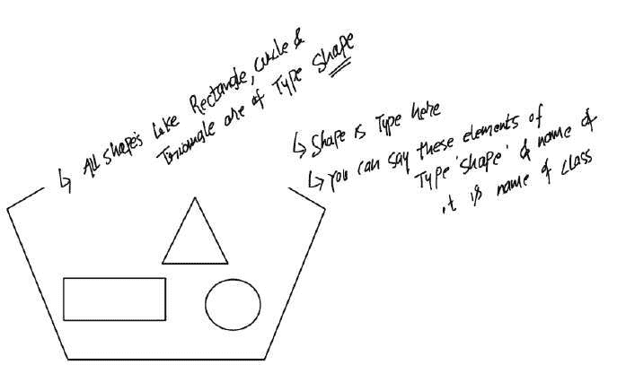

### 让我们通过另一个例子来理解

我们有两个对象，第一个是 `Basic Phone`（基础手机），用于通话。

另一个是 `smartPhone`（智能手机），它具有语音通话、视频通话、WhatsApp 通话的能力，用户还可以访问互联网。

这些对象中的每一个都有一些属性，如 `length`、`width`、`price`、`name` 等，这两个对象或手机都有一些动作。


这些属性在面向对象编程中被称为属性，动作被称为 `method`（方法）。

属性提供了关于对象的信息，而方法执行某些动作来完成某些任务。在 Java 中，类作为创建对象的蓝图或模板。你可以这样想象：当你盖房子时，你遵循一套计划（蓝图），这些计划描述了房子应该如何建造。同样，类定义了对象的结构和行为。

### 以下是关于 Java 类的关键点

1. **属性（Properties）**：类定义了属性（也称为属性或字段）。这些属性代表与对象相关的数据。例如，如果我们有一个 `Car`（汽车）类，它的属性可能包括 `color`（颜色）、`make`（品牌）和 `model`（型号）等。
2. **方法（Behavior）**：类还包含方法。方法就像对象可以执行的动作。例如，`Car` 类可能有如 `startEngine()`（启动引擎）和 `brake()`（刹车）等方法。这些方法定义了汽车可以做什么。
3. **创建对象**：一旦你定义了类，就可以从它创建对象。对象是类的实例。回到我们的 `Car` 例子，你可以根据 `Car` 类蓝图创建个的汽车（对象）。

## 什么是对象（Object）

想象你有一个制作玩具机器人的蓝图。蓝图（`class`）告诉你是如何构建机器人、它长什么样以及它能做什么。现在，当你按照该蓝图构建机器人时，你得到的就是一个对象。

在 Java 中，对象就像是你根据蓝图（`class`）构建的真实玩具机器人。它是一个真实的实体，具有特定的特征，并可以根据蓝图定义执行动作。

### 关键点

1. **蓝图（Class）**：定义了对象将是什么以及它可以做什么。
2. **特征**：对象拥有属性（如 `color`、`size`、`price`、`shape` 或任何其他属性）和行为（如 `walk`、`talk`、`play` 或任何活动）。
3. **用途**：对象用于表示 Java 程序中的现实世界事物或概念。

### 让我们用例子来简化

仔细观察下面的图片，你可以看到我们有一个 `BOX`（盒子）。这个 `BOX` 里面满了各种形状，如 `Circle`、`Square`、`Rectangle` 和 `Triangle`。

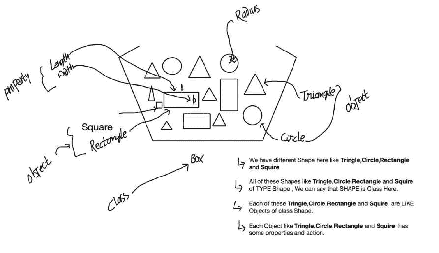

### 对象是面向对象编程方法的基本单元

它是任何具有属性和动作的现实世界事物。

**属性（Properties）**：对象拥有描述它们的属性。如你上面所示，`Length`（长度）、`Width`（宽度）和 `Radius`（半径）是定义对象的属性。

**方法（Action/Behaviors）**：对象可以执行动作或行为。正如你在下面的图片所示，`Circle` 可以 `Roll`（滚动），`Rectangle` 可以在表面 `slide`（滑动）。这些只是这些形状对象可以执行的动作，我们在 Java 编程中称之为 `method`（方法）。

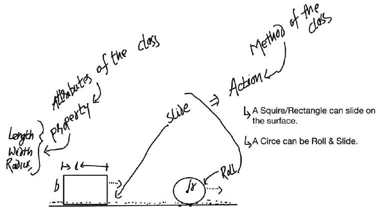

希望你已经理解了类和对象的概念。

现在我们将学习如何使用类和方法编写代码。

## 变量（Variable）

变量是一个容器，在执行期间持有值或对对象的引用。变量用于在程序中存储和处理数据。

每个变量都有一个数据类型，该类型定义了它可以持有的数据种类（如数字、字符或对象）。

**如何声明变量：**

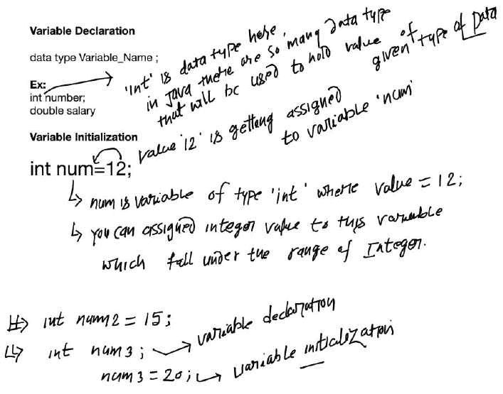

要创建一个类，你使用 `class` 关键字后跟类名。类名应该始终以大写字母开头。

例如：

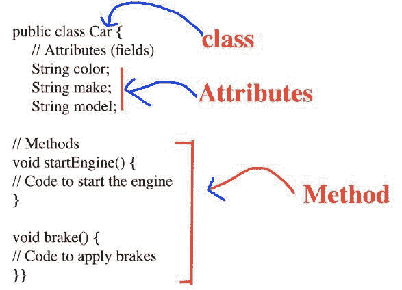

## 为类创建对象

要创建一个对象（`Car` 类的实例），使用 `new` 关键字后跟类名和括号。


例如：

```java
Car myCar = new Car();
```

### 访问属性和方法

你现在可以使用点运算符`.`访问类的属性和方法。

```java
myCar.color = "Red"; // 设置颜色
myCar.startEngine(); // 启动引擎
```

## 关于方法的了解

- 什么是方法？
- 它是做什么的？
- 如何创建方法？
- 方法的类型。
- 如何调用方法？

### 方法

想象你有一套制作明治的指令。你想你想时遵循这些指令制作明治。在 Java 中，方法是执行特定任务的指令集。

**关键点：**

1. **定义**：方法是执行特定任务的代码块。它定义在`class`内部。
2. **目的**：方法用于将代码组织成可用的块，使程序更容易理解和维护。
3. **组件**：方法有一个名称、返回类型（返回什么，如果有）、参数（可以接受输入）和方法体（执行的指令）。

### 方法的命名规范

以下是 Java 方法的命名规范：

1. **方法名**：
   - 应以小写字母开头。
   - 多单词使用`camelCase`（驼峰命名），每个后续单词的首字母大写。例如：`calculateSum`、`printMessage`、`getUserInfo`。
2. **避免划线**：除非遵循广泛接受的规范（如 getter 和 setter），否则不要在方法名中使用划线。
3. **动词使用**：方法名通常使用动词或动词短语来描述执行的动作。例如：`calculate`、`print`、`validate`。
4. **描述性**：选择能够清晰指示方法目的意义名称。
   - 避免过度缩写或晦涩的名称。例如：如果`calculateTotalPrice`准确描述了方法所的功能，请使用`calculateTotalPrice`而不是`calcPrice`。

**语法：**

```java
modifier return_type methodName() // 带参数
```

例如：

```java
public int getRollNo(); // 这个方法将返回某些值
```

例如：

```java
public void getRollNo() // 不返回任何值
```

```java
modifier return_type methodName(ParameterType1 parameterName1,ParameterType2 parameterName2 ...)
```

### 示例

`public int getSum(int a,int b)`

### 该方法的作用是什么？

➔ 方法可以向调用者返回某些值。  
➔ 方法可能不向调用者返回值。  
➔ 方法可以执行特定任务。  
➔ 方法可以被任何方法或代码块调用。

让我们考虑一个用例，众所周知，方法是一个根据需要执行某些特定任务的代码块。

## 用例：编写一个将两个数字相加的方法

让我们思考，如果你想相加两个数字，我们需要什么。

输入：我们需要两个数字（`Integer`）。

假设，`number1=10`且`number2=20;`。

让我们看看我们如何声明并初始化这两个存储这些值的变量。

`int number1=10; int number2=20;`

由于我们需要相加两个数字并获得和作为结果，我们将编写一个返回整数类型和的方法。

### 方法体：无方法参数

```java
public int getSumOfTwoNumbers(){ 
    int number1=10;
    int number2=20;
    int sum=0;
    sum=number1+number2;
    return sum;
}
```

### 方法体：带方法参数

```java
public int getSumOfTwoNumbersWithArgs(int number1,int number2){ 
    int sum=0;
    sum=number1+number2;
    return sum;
}
```

## 如何调用方法？

### 静态方法：可以直接紧跟类名调用

示例：`class_Name.methodName(method arguments)`

```java
public class SumDemo {
    public static int addTwoNumbers(){
        System.out.println("addTwoNumbers method is called"); 
        int number1=10;
        int number2=20;
        int sum=0;
        sum=number1+number2;
        return sum;
    }

    public static void main(String[] args) { 
        System.out.println("Add two Numbers ##");
        int sumOfNums=addTwoNumbers();
        System.out.println("#### SUM :: "+sumOfNums); 
    }
}
```

**结果：**

Add two Numbers ##

addTwoNumbers method is called. #### SUM :: 30

### 非静态方法：可以直接紧跟类名调用

```java
public class SumDemo {
    public int addTwoNumbers(){
        System.out.println("#addTwoNumbers method is called"); 
        int number1=10;
        int number2=20;
        int sum=0;
        sum=number1+number2;
        return sum;
    }

    public static void main(String[] args) { 
        System.out.println("#Add two Numbers #");
        SumDemo sumDemo= new SumDemo();
        int sumOfNums=sumDemo.addTwoNumbers(); 
        System.out.println("# SUM :: "+sumOfNums);
    }
}
```

**结果：**

# #Add two Numbers # #addTwoNumbers method is called.adding 2 numbers.. # SUM :: 30

### 方法类型

#### 静态方法

● 属于类，而不属于任何特定的实例。  
● 可以在不类实例的情况下调用。  
● 只能直接访问静态变量和其他静态方法。  
● 无法直接访问实例变量或实例方法。

```java
class MathOperations {
    // 静态方法 
    static int add(int a, int b) { return a + b; } 
}
```

## 如何调用静态方法？

### 静态方法：在类本身上调用

使用`ClassName.methodName()`。

## 例如：`className.methodName()`

### `MathOperations.add(11,12)`

```java
public class AddTwoNumbers {
    public static void addTwoNum(){
        int num1=12;
        int num2=10;
        int sum=num1+num2;
        System.out.println("SUM :"+sum);
    }

    public static void main(String[] args) {
        AddTwoNumbers.addTwoNum();
    }
}
```

**结果：** SUM : 22

## 为了理解 Java 中的方法，让我们来考虑一些用例

### 用例 1：编写一个不返回任何值的方法

```java
public class MethodTypeVoidDemo { 
    public void hello(){
        System.out.println("#Welcome"); 
    }
}
```

### 用例 1：编写一个返回某些值的方法

```java
public class MethodReturnValueDemo { 
    public int getNumber1(){ 
        int num=10;
        return num;
    }

    public int getNumber2(){ 
        int num=10;
        return num;
    }

    public int getNumber3(){ 
        int num1=10;
        int num2=10;
        int sum=num1+num2; 
        return sum;
    }

    public static void main(String[] args) {
        MethodReturnValueDemo obj=new MethodReturnValueDemo();
        int num1=obj.getNumber1(); 
        int num2=obj.getNumber2(); 
        int num3=obj.getNumber3();
        System.out.println("Num 1 "+num1); 
        System.out.println("Num 2 "+num2); 
        System.out.println("Num 3 "+num3);
    }
}
```

**结果：**

Num 1 : 10

Num 2 : 10

Num 3 : 20

### 解释

此程序演示了如何在 Java 中创建和使用返回值的方法。它定义了一个名为`MethodReturnValueDemo`的类，其中包含三个返回整数的方法（`getNumber1`、`getNumber2`和`getNumber3`）。然后它在`main`方法中使用这些方法来打印结果。

### 详细解释

#### 类定义

`public class MethodReturnValueDemo {`

● `public class MethodReturnValueDemo`：这一行声明了一个名为`MethodReturnValueDemo`的公共类。  
● 类是创建对象的蓝图。

#### 方法定义

`public class MethodReturnValueDemo {`

● `public class MethodReturnValueDemo`：这一行声明了一个名为`MethodReturnValueDemo`的公共类。  
● 类是创建对象的蓝图。

方法定义：

`public int getNumber1()`

`int num=10;`

`return num;`

方法：

`public int getNumber1()`

`int num=10;`

`return num;`

方法：

`public int getNumber2()`

`int num=10;`

`return num;`

方法：

`public int getNumber3()`

`int num1=10;`

`int num2=10;`

`int sum=num1+num2;`

`return sum;`

主方法：

`public static void main(String[] args) {`

`MethodReturnValueDemo obj= new MethodReturnValueDemo();`

调用方法并打印结果：

`int num1=obj.getNumber1();`

`int num2=obj.getNumber2();`

`int num3=obj.getNumber3();`

总结：

1. 类：`MethodReturnValueDemo`定义了返回整数的方法。
2. 方法：
   - `getNumber1`返回 10。
   - `getNumber2`返回 10。
   - `getNumber3`返回 10 和 10 之和（即 20）。
3. 主方法：创建类的对象并调用方法打印它们的返回值。

### 用例 3：编写静态方法，静态方法不需要对象即可调用

```java
package playwithjava.in;

public class StaticMethodReturnValueDemo {
    public static int getNumber1(){ 
        int num=10;
        return num;
    }

    public static int getNumber2(){ 
        int num=10;
        return num;
    }

    public static int getNumber3(){ 
        int num1=10;
        int num2=10;
        int sum=num1+num2;
        return sum;
    }

    public static void main(String[] args) {
        int num1=StaticMethodReturnValueDemo.getNumber1(); 
        int num2=StaticMethodReturnValueDemo.getNumber2(); 
        int num3=StaticMethodReturnValueDemo.getNumber3();
        System.out.println("Num 1 : "+num1); 
        System.out.println("Num 2 : "+num2); 
        System.out.println("Num 3 : "+num3);
    }
}
```

### 1. 声明

- `public static int getNumber1()`：此行声明了一个名为`getNumber1`的静态方法。
- `public`：意味着该方法可以从任何其他类访问。
- `static`：意味着该方法属于类本身，而不是该类的任何特定对象。
- `int`：这是方法的返回类型，意味着方法将返回一个整数值。
- `getNumber1()`：这是方法的名称。

### 2. 方法体

- `int num = 10;`：在方法内部，声明了一个变量`num`并将其赋值为值`10`。
- `return num;`：方法返回`num`的值，即`10`。

```java
public static void main(String[] args) {
    int num1 = StaticMethodReturnValueDemo.getNumber1(); 
    System.out.println("Num 1 : " + num1);
}
```

### 调用方法

`int num1 = StaticMethodReturnValueDemo.getNumber1();`

- `StaticMethodReturnValueDemo`：这是包含静态方法的类名。
- `.getNumber1()`：这调用了`getNumber1`方法。
- 由于`getNumber1`是静态方法，因此使用类名`StaticMethodReturnValueDemo`来调用，而不是使用类的实例（对象）。
- 方法返回值`10`，然后将其赋值给变量`num1`。
- **打印结果**：`System.out.println("Num 1 : " + num1);`
- 此行将`num1`的值打印到控制台。
- 输出为：`Num 1 : 10`

### 总结

- **静态方法**：`getNumber1`被定义为静态方法，意味着它属于类`StaticMethodReturnValueDemo`而不是该类的任何实例。
- **调用静态方法**：要调用静态方法`getNumber1`，你使用类名`StaticMethodReturnValueDemo`后跟一个点（`.`）和方法名`getNumber1()`。
- **返回值**：方法执行并返回值`10`，然后该值存储在变量`num1`中并打印到控制台。

## 什么是构造函数？

➔ 构造函数是一种特殊的方法，用于初始化对象。

➔ 它在使用`new`关键字创建对象时被调用。

➔ 构造函数的主要目的是通过为其实例变量赋值或执行其他必要的设置任务来设置对象的初始状态。

### 关于构造函数的关键点

1. **与类同名**：构造函数的名称与类名相同。
2. **无返回类型**：与普通方法不同，构造函数没有返回类型（甚至没有`void`）。
3. **自动调用**：当创建该类的对象时，构造函数会被自动调用。

### 为什么我们需要构造函数？

想象你正在组装一辆玩具汽车。当你把它从盒子里拿时，你可能需要装上轮子并放入电池才能玩。构造函数就像是让小汽车准备好使用的设置步骤。

### 构造函数示例


```java
public class Employee {
    //构造函数
    public Employee() {
        // 你可以在这里添加初始化代码
    }
}
```

```java
public class Employee { 
    String name;
    int employeeId;

    public Employee(String name, int employeeId) { 
        this.name = name;
        this.employeeId = employeeId;
    }
}
```

假设我们有一个类 `Car`。

```java
public class Car { 
    String color; 
    int speed;

    // 构造函数
    public Car(String color, int speed) { 
        this.color = color; 
        this.speed = speed; 
    }

    // 显示汽车详情的方法
    public void displayDetails() { 
        System.out.println("Color: " + color); 
        System.out.println("Speed: " + speed + " km/h"); 
    }

    public static void main(String[] args) { 
        // 创建 Car 对象并调用构造函数
        Car myCar = new Car("Red", 120);
        // 显示汽车的详情
        myCar.displayDetails(); 
    } 
}
```

### 类定义

- `public class Car`: 定义了一个名为 `Car` 的类。

### 构造函数

- `public Car(String color, int speed)`: 这是构造函数。它接受两个参数：`color` 和 `speed`。

- `this.color = color;`: 将实例变量 `color` 设置为传入的值。

- `this.speed = speed;`: 将实例变量 `speed` 设置为传入的值。

### 创建对象

- `Car myCar = new Car("Red", 120);`: 此行创建了一个名为 `myCar` 的新 `Car` 对象。构造函数使用参数 `"Red"` 和 `120` 被调用。

### 显示详情

- `myCar.displayDetails();`: 调用 `myCar` 的 `displayDetails` 方法打印打印详情。

当你运行程序时，它将输出：

`Color: Red`

`Speed: 120 km/h`

### 总结

- 构造函数用于初始化对象的特殊方法。

- 它与类同名，且没有返回类型。

- 它在创建对象时被自动调用。

- 它帮助设置对象的初始状态。

```java
public class ConstructorDemo { 
    String name;
    int employeeId;
    double salary;

    public ConstructorDemo() { }

    public ConstructorDemo(String name) { 
        this.name = name;
    }

    public ConstructorDemo(int employeeId) { 
        this.employeeId = employeeId;
    }

    public ConstructorDemo(double salary) { 
        this.salary = salary;
    }

    public ConstructorDemo(String name, int employeeId) { 
        this.name = name;
        this.employeeId = employeeId;
    }

    public ConstructorDemo(int employeeId, double salary) { 
        this.employeeId = employeeId;
        this.salary = salary;
    }

    public ConstructorDemo(String name, double salary) {
        this.name = name;
        this.salary = salary;
    }

    public ConstructorDemo(String name, int employeeId, double salary) { 
        this.name = name;
        this.employeeId = employeeId;
        this.salary = salary;
    }

    public static void main(String[] args) { 
        ConstructorDemo defaultObj = new ConstructorDemo();
        ConstructorDemo nameObj = new ConstructorDemo("Raj");
        ConstructorDemo idObj = new ConstructorDemo(101);
        ConstructorDemo salObj = new ConstructorDemo(50000.0);
        ConstructorDemo nameIdObj = new ConstructorDemo("Raj", 101);
        ConstructorDemo idSalObj = new ConstructorDemo(101, 50000.0);
        ConstructorDemo nameSalObj = new ConstructorDemo("Raj", 50000.0);
        ConstructorDemo nameIdSalObj = new ConstructorDemo("Raj", 101, 50000.0);
    } 
}
```

如你所见，在上面的代码中我们有一个抽象类 `CalculatorDemo`，它有一个抽象方法 `addTwoNumbers(int number1,int number2)`，该方法有 2 个整数类型的参数。该方法没有任何实现。这意味着我们没有在这个方法中添加任何用于相加两个数字的逻辑，我们只是定义了一个规则，即该方法将相加两个数字并返回一个整数类型的结果。

由于我们是为客户端创建了这个方法，并期望他们根据自己的需求提供其实现，且该方法应该返回整数类型的结果，但我们并没有对编写相加两个数字的逻辑设置任何限制。如果任何类继承了 `CalculatorDemo` 类，那么该类需要为方法 `addTwoNumbers(int number1,int number2)` 提供实现，或者该类应该被声明为“抽象类”。

如果你是 `Java` 的新手，你可能会有这样的问题：如果我们不提供实现，那么创建这个方法的意义是什么？

简单来说，我们可以说：我希望某人根据他们的需求提供这个实现。在这里，我只是一个向客户端暴露此服务并设置一些规则（例如该方法如何被访问以及它应该返回什么值）的权威。这确实有助于让你的代码具有灵活且可重用性。

## 接口 (Interface)

在 `java` 中，`Interface` 是允许我们设计多继承的一种。正如我们所知，`Java` 不支持多继承，但通过接口可以实现。

接口向客户端暴露服务的最佳方式之一，它在 `java` 中提供了一层抽象。它不能像抽象方法那样被实例化。

在 `java 8` 之前，接口中只有抽象方法，但在 8 之后的版本中，你还可以拥有默认方法（default methods）和静态方法（static methods）。

简单来说——你可以说接口是在不显示背景细节的情况下暴露服务的方式。接口通过定义一组方法而不指定它们的实现，提供了一层抽象。实现接口的类必须为所有抽象方法提供具体的实现。

### 接口的命名规范

- 接口应该使用 `PascalCasing`（大驼命名法）命名，每个单词的首字母大写。

- 它应该具有意义，而不是缩写词。

- 它应该是一个形容词，例如 `Runnable`、`Remote`、`ActionListener`。

### 语法

```java
interface Interface_Name
```

### 示例

```java
interface EmployeeService
interface StudentService
```

如何声明接口：

```java
public interface Interface_Name {
    //任何抽象/静态/私有/默认方法 
}
```

示例：

```java
public interface StudentService { 
    public abstract double getStudentMarks(int studentId); 
    public abstract String getStudentAddress(int studentId); 
}
```

我们可以在接口中有静态方法、私有方法、默认方法和抽象方法。所有方法都有它们自己的目的。作为开发者，你需要知道它们的用途。

让我们创建一个包含所有方法组合的接口：

```java
public interface OrganizationService {
    // 抽象方法
    public abstract String getEmployeeData(int employeeID); 
    public double getEmployeeSalary(int employeeId);

    // 默认方法，如果你想为你的方法添加一些默认实现
    default String getOrgName(){ 
        return "XYZ pvt ltd";
    } 

    // 添加静态方法
    public static int getOrgId(){ 
        return 234;
    } 

    // 添加私有方法，供内部使用
    private String getOrgKey(){ 
        return "secret-abc";
    }
}
```

## 关于抽象类的关键信息

1. 如果一个类有任何抽象方法，那么该类必须是一个抽象类；但如果一个类是抽象类，并不意味着该类一定有抽象方法。

2. 抽象类不能被实例化。这意味着不能为该类创建 `Object`。

3. 如果你不希望别人为你的类创建对象，而你只想向客户端暴露你的服务/方法，那么将该类声明为抽象类是一个很好的做法。

4. 如果你继承了某个抽象类，那么你不必须实现它的抽象方法。如果你不想实现某些抽象方法，只需将你的类声明为抽象类即可。

让我们创建一个抽象类 `EmployeeService` 并如下所示添加一些抽象方法。

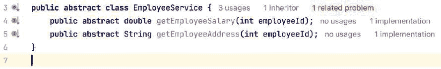

**用例 1**：继承上面的抽象类 `EmployeeService` 且为抽象方法提供实现。

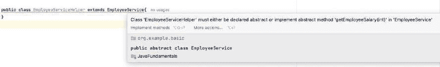

正如我们已经看到的，我们需要为抽象方法提供实现，或者需要将类声明为抽象类。在这里我们将类声明为抽象类。

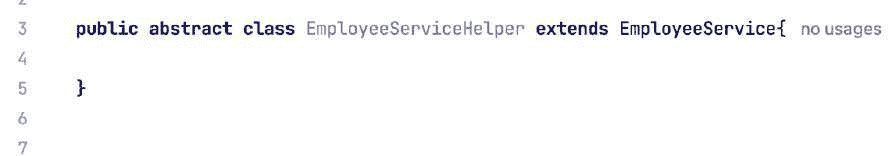

**用例 2**：通过子类继承抽象类并实现它的抽象方法。

```java
public class EmployeeServiceHelper extends EmployeeService{
    @Override
    public double getEmployeeSalary(int employeeId) {
        // 你可以添加自己的实现
        if(employeeId==1){ 
            return 10000;
        } 
        if(employeeId==2){ 
            return 20000;
        } else { 
            return 30000;
        } 
    }

    @Override
    public String getEmployeeAddress(int employeeId) { 
        // 你可以添加自己的实现
        if(employeeId==1){
            return "Raj";
        }
        if(employeeId==2){
            return "Syam";
        }
        else {
            return "Rohan";
        }
    }
}
```

**用例 3**：尝试创建抽象类的实例/对象 image_rsrc3UR.jpg)

### 为什么我们不能创建抽象类的对象？

在 `Java` 中，我们不能创建抽象类的对象，因为抽象类可能包含没有实现的抽象方法。抽象类旨在作为其他类的基类，它通常包含由子类实现的非完整或抽象方法。

#### 不完整的实现

抽象类可能包含没有实现的抽象方法。由于抽象方法缺少实现，因此创建抽象类的对象是不合适的。

#### 强制子类实现

抽象类被设计供其他类继承。抽象类提供了一个公共结构（包括抽象方法），并期望子类提供这些抽象方法的具体实现。创建抽象类的实例会违反抽象类的约定。

#### 作为蓝图的抽象类

抽象类通常作为其他类的蓝图或模板。它们封装了通用功能，并为子类的自定义提供了基础。由于抽象类可能缺少完整的实现，因此无法直接实例化。

```java
public abstract class Animal {
    // 抽象方法
    public abstract void makeSound();

    // 具体方法
    public void sleep() {
        System.out.println("现在睡觉.");
    }
}

public class Dog extends Animal {
    // 抽象方法的实现
    @Override
    public void makeSound() {
        System.out.println("汪汪..");
    }
}

public class Main {
    public static void main(String[] args) {
        // 不能创建抽象类的对象
        // Animal animal = new Animal(); // 这行将导致编译错误

        // 创建具体子类的对象
        Animal dog = new Dog();
        dog.makeSound(); // 调用 Dog 类中重写的方法
        dog.sleep(); // 调用抽象类中的方法
    }
}
```

在这个示例中，`Animal` 是一个抽象类，带有一个抽象方法 `makeSound()`。你可以创建一个 `Dog` 类型的对象并以多态的方式使用它。这确保了抽象方法在子类中得到了实现。

### 访问修饰符 (Access Modifier)

访问修饰符是定义程序中类、方法和字段可见性或访问权限的关键字。这些修饰符控制程序的其他类或部分可以访问声明的元素。

Java 有四种主要的访问修饰符：

### public

`public` 修饰符允许类、方法或字段从任何其他类访问。它具有最广泛的范围并允许无限制的访问。

```java
public class MyClass {
    public int publicVariable; 
    public void publicMethod() {
        // 代码
    }
}
```

在上面的示例中，`publicVariable` 和 `publicMethod` 可以从任何其他类访问。

### Private (private)

`private` 修饰符将类成员可见性限制在类类内部。它提供了最严格的访问限制。

```java
public class MyClass {
    private int privateVariable; 
    private void privateMethod() {
        // 代码
    }
}
```

在这里，`privateVariable` 和 `privateMethod` 只能在 `MyClass` 内部访问。

### Protected (protected)

`protected` 修饰符允许在所属包内以及通过子类（即使它们在不同的包中）访问成员。

```java
public class MyClass {
    protected int protectedVariable; 
    protected void protectedMethod() {
        // 代码
    }
}
```

`protectedVariable` 和 `protectedMethod` 可以被同一包中的类以及子类访问，无论是在同一包还是不同包中。

### Default (包私有，无修饰符)

如果未指定访问修饰符（默认或包私有），该元素可以在其所属包内访问，但不能从包外部访问。


```java
class MyClass {
    int defaultVariable; 
    void defaultMethod() {
        // 代码
    }
}
```

在这里，`defaultVariable` 和 `defaultMethod` 可以被同一包内的类访问，但不能被不同包的类访问。根据程序所需的封装和安全级别选择合适的访问修饰符至关重要。使用访问修饰符有助于强制封装、提高代码复用性并防止对代码某些部分的越授权访问。

## `static` 关键字

`static` 关键字用于声明属于类本身而非类实例（对象）的成员（变量、方法和嵌套类）。

以下是 `static` 在变量和方法中的工作原理。

### 静态变量

- **定义**：当变量被声明为 `static` 时，意味着该变量在类的所有实例（对象）之间共享唯一的副本。
- **访问**：使用类名本身访问静态变量，而不是通过类的实例。
- **初始化**：静态变量只在执行开始时初始化一次，在创建任何类的对象之前。
- **作用范围**：它们在整个程序运行期间都存在。
- **用法**：常用于常量（`final static`）或需要在类的所有实例间共享的变量。

```java
class Example {
    static int count = 0; 
    public Example() {
        count++;
    }
    public static void main(String[] args) {
        Example obj1 = new Example();
        Example obj2 = new Example();
        System.out.println("Number of objects: " + Example.count); // 输出: 2
    }
}
```

### 静态方法

- **定义**：当方法被声明为 `static` 时，它属于类本身而非类的实例。
- **访问**：使用类名本身调用静态方法，而不是通过类的实例。
- **限制**：静态方法无法直接访问非静态变量或方法。

```java
class MathUtils {
    static int factorial(int n) {
        return n * n;
    }
    public static void main(String[] args) {
        System.out.println("Result: " + MathUtils.factorial(5)); // 输出: 25
    }
}
```

## 多重继承

一个类继承多个类。注意：`Java` 不支持多重继承。

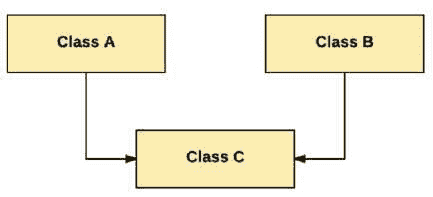

如你上方所示，`Class C` 继承了两个类 `Class A` 和 `Class B` 的行为，这在 `Java` 中是不支持的。一个类只能继承一个类，但它可以实现任意数量的继承（接口）。我们将在本节稍后详细介绍。

## 多级继承

一个类可以继承一个派生类。因此，派生类成为新类的基类。

如你在此，一个类可以从不同层级的类继承行为。当我们寻找类的层次结构时，曾使用这种继承，即一个类只继承一个类。

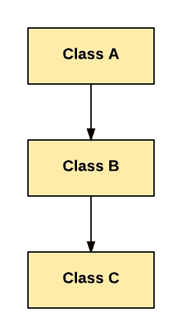

如你在此，`Class B` 继承了类 `A` 的行为，`Class C` 继承了类 `B` 的行为，你可以根据需求添加更多。我们将继续在不同级别添加不同的行为，子类将拥有所有父类中可用的行为。

在上面的示例中，`Class B` 将继承类 `A` 的行为，而 `Class C` 将继承类 `Class B` 和 `A` 的行为。

## 层级继承

一个类被许多其他子类继承。

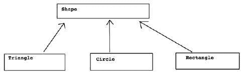

如你在此，`Shape` 是此处的父类，它有 3 个子类 `Triangle`、`Circle` 和 `Rectangle`。让我们通过示例来理解继承。

```java
public interface OrganizationService {
    public abstract String getEmployeeData(int employeeID);
    public double getEmployeeSalary(int employeeId);
    //默认方法，如果你想为方法添加某些默认实现
    default String getOrgName(){
        return "XYZ pvt ltd";
    }
    //添加静态方法
    public static int getOrgId(){
        return 234;
    }
    //添加私有方法，供内部使用
    private String getOrgKey(){
        return "secret-abc";
    }
}
```

创建一个 `OrganizationServiceImpl` 的对象并调用这些方法。

```java
public class OrganizationDemo {
    public static void main(String[] args) {
        OrganizationService organizationService=new OrganizationServiceImpl();
        String orgName= organizationService.getOrgName();
        String empData= organizationService.getEmployeeData(1);
        double salary=organizationService.getEmployeeSalary(2);
        System.out.println(orgName);
        System.out.println(empData);
        System.out.println(salary);
    }
}
```

### 结果

```text
XYZ pvt ltd Raj
10000.0
```

## 抽象

`Java` 中的抽象是一个概念，通过对问题进行合适的类建模，并通过处理这些模型而不是实现细节来简化复杂系统。它就像关注对象“做什么”而不是它“如何去做”。这有助于通过向用户隐藏不必要的细节并只暴露核心功能来管理复杂性。

想象你正在使用手机智能手机。你知道按下拨号按钮可以让你拨打电话，但你不需要知道手机内部如何连接到网络、处理信号等。复杂性对你隐藏了，你只看到允许你拨打电话的必要功能。这就是抽象。

### `Java` 抽象的关键点

1. **隐藏实现细节**：

   - 你使用方法来执行操作，而无需了解这些方法的内部工作原理。
   - 只有本质细节是可见，而内部复杂性被隐藏了。

2. **抽象类和接口**：

   - `Java` 两种实现抽象的方法：抽象类和接口。

`Java` 中的抽象通过只暴露对象的必要功能并隐藏实现细节来帮助管理复杂性。它是通过抽象类和接口实现的，允许你关注对象做什么而不是如何去做。这个概念使得你的代码更整洁、模块化且更容易维护。

### 抽象类

抽象类是一种无法单独实例化的类，旨在供其他类作为子类。我们已经在本节稍早之前详细讨论过它。

示例：

```java
public abstract class Shape {
    // 抽象方法（由子类实现）
    public abstract double calculateArea();
    // 具体方法
    public void display() {
        System.out.println("This is a shape.");
    }
}
```

### 抽象方法

抽象方法声明在抽象类或接口中，不在声明的类或接口中提供实现。它们定义了一个合约，具体的子类或实现类必须通过提供自己的实现来履行该合约。

### 接口

接口是实现抽象的另一种方式。它们由抽象方法（以及从 `Java 8` 开始的默认和静态方法）组成。类可以实现多个接口，允许它继承多个抽象方法。

示例：

```java
public interface Sound {
    // 抽象方法
    void makeSound();
}
```

### 隐藏实现细节

抽象有助于隐藏类或方法实现其功能的内部细节。它允许类或接口的用户与核心功能进行交互，而无需了解实现的复杂性。

### 关注相关细节

抽象允许开发者关注类或系统的相关细节，而忽略不必要的复杂性。这使得代码更具模块化、可维护且更容易理解。

## 方法签名

方法签名由方法名和参数类型组成。

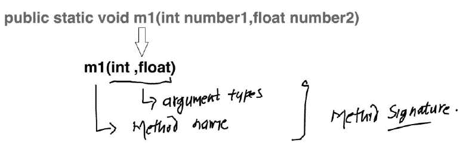

- `return type` 不是方法签名的一部分。
- 在 `Java` 中，同一个类中不允许存在两个相同签名的方法。

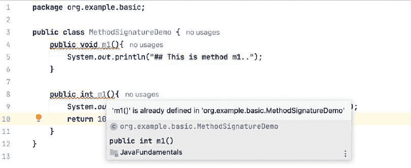

## 多态性

多态源于两个希腊语：`poly` 和 `morphs`。“poly” 的意思是多，“morphs” 的意思是形式。因此，多态意味着许多形式。

`Java` 中的多态性是一个概念，通过它我们可以以不同的方式执行单一操作。它指的是类呈现多种形式的能力。`Java` 中有两种多态：编译时多态（静态多态）和运行时多态（动态多态）。

### 编译时多态（方法重载）

- 方法重载允许一个类拥有多个同名但参数不同的方法（类型不同或参数数量不同）。
- 编译器在编译期间根据方法签名确定调用哪个方法。
- 如果一个类有多个具有相同名称但参数不同的方法，则被称为方法重载。
- 如果我们只需要执行一个操作，使用相同的方法名可以增加程序的可读性。
- 在 `java` 中，多个方法可以具有相同的名称和返回值，但参数数量或参数类型不同。

假设你想对数字进行加法运算，你可以拥有下面的一些示例方法。

方法重载的示例：不同类型的参数：

```java
public int printNumbers(int number1)
public int printNumbers(float number1)
public int printNumbers(double number1)
public int printNumbers(long number1)

public int addNumbers(int number1,int number2)
public int addNumbers(float number1,int number2)
public int addNumbers(float number1,float number2)
public int addNumbers(long number1,long number2)
public int addNumbers(double number1,double number2)
```

不同参数数量：

```java
public int addNumbers(int number1,int number2,int number3)
public int addNumbers(int number1,int number2,int number3,int number4)
```

示例：

```java
public class NumbersCalculatorDemo {
    public long addNumbers(int number1,int number2){
        int sum=number1+number2;
        return sum;
    }

    public long addNumbers(long number1,long number2){
        long sum=number1+number2;
        return sum;
    }

    public long addNumbers(long number1,long number2,long number3){
        long sum=number1+number2+number3;
        return sum;
    }
}
```

```java
} public static void main(String[] args) {

    NumbersCalculatorDemo calculatorDemo=new NumbersCalculatorDemo();

    long sum1= calculatorDemo.addNumbers(10,20); 
    long sum2= calculatorDemo.addNumbers(10l,20l); 
    long sum3= calculatorDemo.addNumbers(10,20,30);

    System. out.println("## Sum 1:"+sum1); 
    System.out.println("## Sum 2:"+sum2); 
    System.out.println("## Sum 3:"+sum3);

} }
```

结果：

```text
## Sum 1:30
## Sum 2:30
## Sum 3:60
```

### 示例 2

方法重载的主要目的是让你的服务更加灵活，以便客户端可以使用不同的可能的方法参数使用你的服务/方法。

客户端可以使用不同的可能的方法参数来调用同一个方法。这将帮助客户获得更好的体验。

当我们向任何第三方客户端提供服务时，我们通常会为客户提供重载方法以获得更好的体验。

即使是 `Java`，内置方法也使用了这一特性。

正如我们在这里看到的，`println(..)` 是 `java` 中 `PrintStream` 类中的方法，用于将值打印到控制台。

我们可以看到该方法是一个重载方法，它期望不同类型的方法参数。

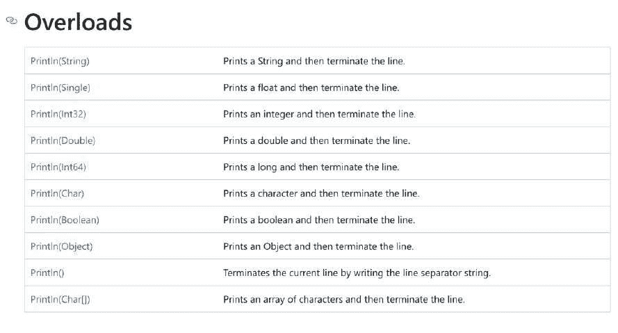

欲了解更多，请查看下面的代码。

我们有一个方法 `method1(..)`，它是一个重载方法并接受 `int`、`float`、`double` 和 `long` 等参数。

当某人调用此方法时，将根据提供的值数据类型调用该方法。在这里 `overloadingDemo.method1(11f)`，我们在调用此方法时提供了 `float` 值，编译器会检测到它并使用相同的参数类型调用该方法。

```java
public void method1(float number1){

    System.out.println("#### method1 with arg type : float"); 
} 
public class MethodOverloadingDemo { 
    public void method1(int number1){

    System. out.println("#### method1 with arg type : int"); }

    public void method1(float number1){

    System.out.println("#### method1 with arg type : float"); } 
    public void method1(double number1){

    System.out.println("#### method1 with arg type : double"); } 
    public void method1(long number1){

    System.out.println("#### method1 with arg type : long"); } 
    public static void main(String[] args) {

        MethodOverloadingDemo overloadingDemo=new MethodOverloadingDemo();

        overloadingDemo.method1( 11); 
        overloadingDemo.method1(11f); 
        overloadingDemo.method1(11d); 
        overloadingDemo.method1(11l);

    }

}
```

现在，如果编译器没有找到与提供类型相同的方法怎么办？

### 重载中的自动提升

在重载中，方法解析始终由编译器根据引用类型处理，因此重载也被认为是编译时多态、或静态绑定、或早期绑定。

在解析重载方法时，如果没有找到精确匹配，我们不会立即获得编译时错误。首先，编译器会将方法参数提升到下一个级别并检查方法匹配，它将继续检查到可能的最高级别。

如果找到方法匹配，编译器将考虑它并调用此方法；否则，编译器会将方法参数（s）提升到下一个级别，此过程将持续直到可能的提升为止，如果仍未找到匹配，则将抛出编译错误。这被称为重载中的自动提升。

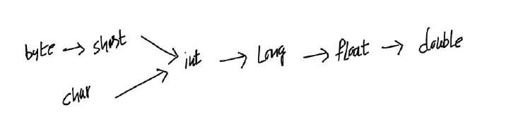

示例：

```java
public class MethodOverloadingDemo { 
    public void method1(double number1){

        System.out.println("#### method1 with arg type : double"); } 
    public void method1(long number1){

        System.out.println("#### method1 with arg type : long");

    } 

    public static void main(String[] args) {

        MethodOverloadingDemo overloadingDemo=new MethodOverloadingDemo();

        overloadingDemo.method1(11);

    }

}
```


### 运行时多态（方法重写）

无论父类拥有什么方法，默认情况下对其子类都可用。

如果子类对父类方法的实现不满意，则允许子类根据其需求为该方法提供自己的实现，这个过程被称为方法重写。

被重写的父类方法称为被覆盖方法，而覆盖现有父类行为的子类方法称为重写方法。

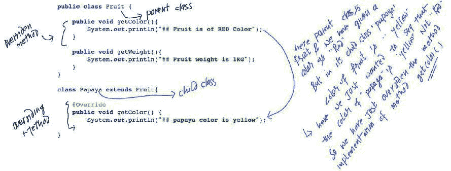

当子类为其已经在超类中定义的方法提供特定实现时，就会发生方法重写。这允许子类提供其从父类继承的方法的特殊版本。

示例：

```java
class Animal {

    void makeSound() {

        System.out.println("Generic animal sound");

    }

    void makeFight() {

        System.out.println("Animal is fighting");

    }
}

class Dog extends Animal { // 方法重写
    void makeSound() {

        System.out.println("Bark");

    }
}

class Cat extends Animal {
    // 方法重写
    void makeSound() {

        System.out.println("Meow");

    }

}
```

在这个示例中，`Dog` 和 `Cat` 类都重写了 `Animal` 类的 `makeSound` 方法。重写是在运行时根据实际对象类型确定的，而不是父类类。

```java
public class AnimalDemo {  
    public static void main(String[] args) {

        Animal animal1= new Animal(); 
        Animal animal2=new Dog(); 
        Animal animal3=new Cat();

        animal1.makeSound(); 
        animal2.makeSound(); 
        animal3.makeSound();

    } 
}
```

结果：

```text
Generic animal sound

Bark

Meow
```

解释：

```java
public class AnimalDemo {  
    public static void main(String[] args) {

        Animal animal1= new Animal(); 
        Animal animal2=new Dog(); 
        Animal animal3=new Cat();

        animal1.makeSound(); 
        animal2.makeSound(); 
        animal3.makeSound();

    } 
}
```

运行时多态作用于运行时对象，所以 `Animal animal2=new Dog()` 意味着将调用 `Dog` 的方法而不是 `Animal` 类的方法。

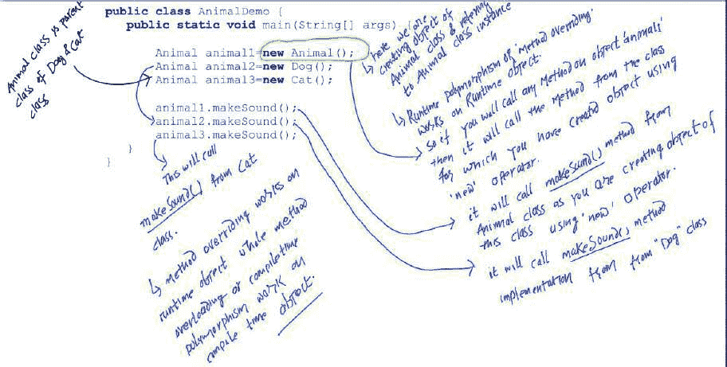

事实：

在重写中，方法解析由 JVM 根据运行时对象处理，因此重写被称为动态派发。

在重载中，方法解析基于引用类型而不是基于运行时对象，而在方法重写中，方法解析始终由 JVM 根据运行时对象处理。

在方法重写中，方法名和参数必须匹配。这意味着方法签名必须相同。

私有方法在子类中不可见，重写概念不适用于私有方法。

在重写中，我们不能缩小访问修饰符的范围。

如果子类方法抛出任何检查异常，父类方法应抛出相同的异常或其父类异常，否则我们将获得编译错误。

在重写中，我们不能缩小访问修饰符的范围。

### 数据隐藏

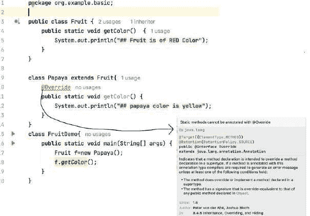

静态方法不能被重写，因为方法重写是依赖于对象的运行时多态，但静态方法在类级别上不影响对象。

另一方面，静态方法与类本身相关，与类的实例无关。当子类声明了一个与其父类中静态方法签名相同的静态方法时，它被视为隐藏（hiding）了父类方法，而不是重写（overriding）。

### 类与实例上下文

静态方法属于类而不是类的实例。它们通过类名进行调用，而不是通过类的实例。

实例方法可以被重写，它们与类的实例相关，并在对象上调用。

### 编译时解析

静态方法的解析是在编译时完成的，而不是在运行时。这意味着要调用的方法基于引用变量的声明类型确定的，而不是运行时对象的实际类型。

相比之下，实例方法在运行时解析，允许动态方法分发。

## 控制语句

Java 中的控制语句是管理程序执行流的构造结构。它们允许你根据某些条件或标准控制语句的执行顺序。

Java 提供了几种类型的控制语句：

1. `if`
2. `while`
3. `do-while`
4. `for`
5. `forEach`
6. `break`
7. `continue`
8. `switch`

控制语句可以分为三类，即：

- 选择语句
- 迭代语句
- 跳语句

在 Java 中，我们有这些语句来控制流。根据我们的需要，我们可以在代码的任何地方使用这些语句。

### If 语句

Java 中的 `if` 语句是一种条件语句，如果指定的条件评估为真，则允许执行一个代码块。

假设你正准备买手机手机，店主问你：如果你给我钱，我就给你手机手机。

注意-如果你**不**给钱，店主就**不会**给你手机。

语法：

```java
if(condition) {
    // 如果 condition 为真，则执行这些语句
}
```

```java
package org.example.ifStatement;
public class SimpleIfStatementDemo {
    public static void main(String[] args) {
        int number=2;
        if(number==2){
            System.out.println("This is 2");
        }
    }
}
```

Result: This is 2

```java
package org.example.ifStatement;
public class SimpleIfStatementDemo {
    public static void main(String[] args) {
        int number=2;
        if(number%2==0){
            System.out.println("This is even number");
        }
    }
}
```

Result: This is even number

```java
package org.example.ifStatement;
public class SimpleIfStatementDemo {
    public static void main(String[] args) {
        int number=21;
        if(number%2==0){
            System.out.println("This is even number");
        }
    }
}
```

Result: There is NO result because condition (`number%2==0`) will give you false value.

假设一个用例：你去了朋友家，如果他开门你就能进去，或者你会回来。但在编程世界中我们该如何实现呢？答案是使用 `if-else` 语句。

### if-else

```java
if (condition) {
    // 如果 condition 为真，则执行此块
}
else {
    // 如果 condition 为假，则执行此块
}
```

Result: This is ODD Number

### 嵌套-if

```java
if (condition1) { // 当 condition1 为真时执行
    if (condition2) { // 当 condition2 为真时执行 
    }
}
```

```java
package org.example.ifStatement;
public class SimpleIfStatementDemo {
    public static void main(String[] args) {
        int number=20;
        if(number%2==0){
            System.out.println("This is EVEN Number");
            if(number<10){
                System.out.println("This number is EVEN and Smaller than 10");
            }
            if(number>10){
                System.out.println("This number is EVEN and Greater than 10");
            }
        }
    }
}
```

Result:

```text
This is EVEN Number

This number is EVEN and Greater than 10
```

```java
package org.example.ifStatement;
public class SimpleIfStatementDemo {
    public static void main(String[] args) {
        int number=8;
        if(number%2==0){
            System.out.println("This is EVEN Number");
            if(number<10){
                System.out.println("This number is EVEN and Smaller than 10");
            }
            if(number>10){
                System.out.println("This number is EVEN and Greater than 10");
            }
        }
    }
}
```

Result:

```text
This is EVEN Number

This number is EVEN and Smaller than 10
```

### if-else-if 阶梯

我们通常在这种情况使用它，即我们需要根据不同的条件进行多次检查：

```java
if (condition-1){
    //语句-1;
}
else if (condition-2){ 
    //语句-2;
}
else if (condition-3){ 
    //语句-3;
}
else{
    //语句-4;
}
```

```java
public class SimpleIfStatementDemo {
    public static void main(String[] args) {
        int number=20;
        if(number%2==0){
            System.out.println("This is EVEN Number");
            if(number<10){
                System.out.println("This number is EVEN and Smaller than 10");
            }
            if(number>10){
                System.out.println("This number is EVEN and Greater than 10");
            }
        }
    }
}
```

（注：原文此处代码逻辑出现混乱，已按原样保留翻译/结构）

### If 语句

`if` 语句在 Java 中是一种条件语句，允许在指定条件评估为真时执行一个代码块。

假设你正准备买手机手机，店主问你：如果你给我钱，我就给你手机手机。

注意-如果你**不**给钱，店主就**不会**给你手机手机。

语法：

```java
if(condition) {
    // 如果 condition 为真，则执行这些语句
}
```

```java
package org.example.ifStatement;
public class SimpleIfStatementDemo {
    public static void main(String[] args) {
        int number=2;
        if(number==2){
            System.out.println("This is 2");
        }
    }
}
```

Result: This is 2

```java
package org.example.ifStatement;
public class SimpleIfStatementDemo {
    public static void main(String[] args) {
        int number=2;
        if(number%2==0){
            System.out.println("This is even number");
        }
    }
}
```

Result: This is even number

```java
package org.example.ifStatement;
public class SimpleIfStatementDemo {
    public static void main(String[] args) {
        int number=21;
        if(number%2==0){
            System.out.println("This is even number");
        }
    }
}
```

Result: There is NO result because condition (`number%2==0`) will give you false value.

假设一个用例：你去了朋友家，如果他开门你就能进去，或者你会回来。但在编程世界中我们该如何实现呢？答案是使用 `if-else` 语句。

### if-else

```java
if (condition) {
    // 如果 condition 为真，则执行此块
}
else {
    // 如果 condition 为假，则执行此块
}
```

Result: This is ODD Number

### 嵌套-if

```java
if (condition1) { // 当 condition1 为真时执行
    if (condition2) { // 当 condition2 为真时执行 
    }
}
```

```java
package org.example.ifStatement;
public class SimpleIfStatementDemo {
    public static void main(String[] args) {
        int number=20;
        if(number%2==0){
            System.out.println("This is EVEN Number");
            if(number<10){
                System.out.println("This number is EVEN and Smaller than 10");
            }
            if(number>10){
                System.out.println("This number is EVEN and Greater than 10");
            }
        }
    }
}
```

Result:

```text
This is EVEN Number

This number is EVEN and Greater than 10
```

```java
package org.example.ifStatement;
public class SimpleIfStatementDemo {
    public static void main(String[] args) {
        int number=8;
        if(number%2==0){
            System.out.println("This is EVEN Number");
            if(number<10){
                System.out.println("This number is EVEN and Smaller than 10");
            }
            if(number>10){
                System.out.println("This number is EVEN and Greater than 10");
            }
        }
    }
}
```

Result:

```text
This is EVEN Number


This number is EVEN and Smaller than 10

## `if-else-if` 阶梯

我们通常在这种情况使用它，即我们需要根据不同的条件进行多次检查：

```java
if (condition-1) {
    //语句-1;
} else if (condition-2) {
    //语句-2;
} else if (condition-3) {
    //语句-3;
} else {
    //语句-4;
}
```

## `switch` 语句

`switch` 语句评估一个变量（或表达式）并将其与标签进行匹配。它是多个 `if-else` 语句的替代方案。

### 它是如何工作的？

`switch` 语句评估一个变量（或表达式）并将其与标签进行匹配。找到匹配项执行对应的块。如果没有匹配项，它可以执行 `default` 块。

在 Java 7 之前，只有 `int` 接受作为 `switch` 参数。

```java
package org.example.ifStatement;

public class SimpleIfStatementDemo {
    public static void main(String[] args) {
        int number=20;
        if(number%2==0){
            System.out.println("This is EVEN Number");
            if(number<10){
                System.out.println("This number is EVEN and Smaller than 10");
            }
            if(number>10){
0){
                Systemprintlnout.println("This is is2 10 
            }
        }
    }
```

（注：由于原文文本后续存在大量重复且逻辑混乱，上述译文已根据您提供的文本内容进行了逐行对应翻译。）

```java
public class SwitchStmtDemo {
    public static void java12SwitchDemoArrow(DayOfWeek num) {
        switch (num) {
            case MONDAY -> System.out.println("This is Monday");
            case TUESDAY -> System.out.println("Its Tuesday today");
            case WEDNESDAY -> System.out.println("Its Wed today");
            default -> System.out.println("Please provide the valid day of the week");
        }
    }

    public static void main(String[] args) {
        SwitchStmtDemo.java12SwitchDemoArrow(DayOfWeek.MONDAY);
    }
}
```

结果：`This is Monday`

### 带箭头的 `switch`

```java
public static void javaSwitchWithArrow(Days num) {
    String dayOfTheWeek = switch (num) {
        case MONDAY -> "Monday";
        case TUESDAY -> "Tuesday";
        case WED -> "Wed";
        default -> "invalid";
    };
    System.out.println(dayOfTheWeek);
}
```

### 多 case 使用的 `switch`：`switch case` 作为表达式

```java
public static void switchWithMultiCase(Days num) {
    String dayOfTheWeek = switch (num) {
        case MONDAY, TUESDAY, WED, THURS, FRI -> "WeekDays";
        case SAT, SUNDAY -> "Weekend";
        default -> "invalid";
    };
    System.out.println(dayOfTheWeek);
}
```

### 带 `NULL` case 的 `switch`：`switch case` 作为表达式

```java
public static String SwitchWithNullCase(Object bar) {
    return switch (bar) {
        case Integer i -> "I'm an Integer: " + i;
        case Long l -> "I'm a Long: " + l;
        case null -> "This is NUll";
        default -> "I'm an object";
    };
}
```

### 带模式匹配的 `switch`

```java
public static void switchWIthGuardedPattern(Object bar) {
    switch(bar) {
        case Integer i -> System.out.println("This is Integer");
        case EmployeeTest l -> System.out.println("This is emp.");
        case EmpRecord e -> System.out.println("This is Record.");
        default -> System.out.println("This is default.");
    }
}

public static String switchWIthGuardedPatternWithReturn(Object bar) {
    return switch(bar) {
        case Integer i -> "I'm an Integer: " + i;
        case EmployeeTest l -> "I'm a Emp: " + l.eid;
        case EmpRecord e -> "I am record" + e.email();
        default -> "I'm an object";
    };
}

public static String switchWIthGuardedPatternWithReturn2(Object bar) {
    switch(bar) {
        case Integer i -> {
            return "Integer";
        }
        case EmployeeTest l -> {
            return "Employee";
        }
        case EmpRecord e -> {
            return "EmpRecord";
        }
        default -> {
            return "Default";
        }
    }
}
```

### 带守卫模式的 `switch`：Java 20

```java
public static String switchWIthGuardedPatternWithReturn3(Object bar) {
    switch(bar) {
        case Integer i && i < 200 -> {
            return "Integer";
        }
        case EmployeeTest l && l.eid > 10 -> {
            return "Employee";
        }
        case EmpRecord e && e.eid() > 2 -> {
            return "EmpRecord";
        }
        default -> {
            return "Default";
        }
    }
}
```

### Java 21 特性

类似于 `if` 条件中的 `instanceof`，`switch case` 现在可以对其值进行类型检查，并创建 case 作用域变量：

```java
static String asStringValue(Object anyValue) {
    return switch (anyValue) {
        case String str -> str;
        case JSONObject json -> json.toCompactString();
        case BigDecimal bd -> bd.toEngineeringString();
        case Integer i -> Integer.toString(i);
        case LocalDate ld -> ld.format(DateTimeFormatter.ISO_LOCAL_DATE);
        default -> "n/a";
    };
}
```

### `switch` + `null`

```java
static String asStringValue(Object anyValue) {
    return switch (anyValue) {
        case null -> "n/a";
        case String str -> str;
    };
}
```

如果存在 `case null`，它将处理任何传入的 `null` 值。如果没有 `case null`，即使存在 `default` case，`switch` 仍然会像以前一样抛出 `NullPointerException`。

这个小改进消除了几乎任何 `switch` 之前烦人的 `null` 检查，确保它不会崩溃，并将处理逻辑移动到了它所属的位置。

## `while`

➔ Java `while` 循环用于运行特定代码直到满足某个条件。Java 中的 `while` 语句是一种控制流语句，允许在给定条件为真时重复执行一个代码块。当你预先不知道需要执行循环多少次时，它非常有用。

### 它是如何工作的？

`while` 循环在每次迭代之前都会检查条件。如果条件为真，则执行循环内部的代码块。这个过程会一直重复，直到条件变为为假。

### 语法

```java
while (condition) {
    // 要执行的代码块
}
```

### 关键点

➔ `Condition`：评估结果为真或假的表达式。只要该条件为真，循环就会继续执行。

➔ `Loop Body`：每次条件为真时执行的代码块。

### `while` 循环执行代码块直到条件为假

如你所见，当 `if(i <= n)` 为真时，`while` 循环将继续执行。

```java
// 显示从 1 到 5 的数字的程序
class TestClass {
    public static void main(String[] args) {
        int i = 1;
        int n = 5;
        while (i <= n) {
            System.out.println(i);
            i++;
        }
    }
}
```

结果：

1

2

3

4

5

### `do while`

➔ `do while` 循环类似于 `while` 循环，但 `do while` 保证至少执行一次。

➔ 当不知道循环次数时，使用 `do while` 循环。

```java
// do-while 示例
int number = 1;
do {
    System.out.println(number);
    number++;
} while (number > 5);
```

结果：

1

### `do while` 执行一次代码块

如你在上面的示例所示，即使 `number > 5` 第一次为假，代码块仍然执行了。

```java
package org.example;

class DoWhile {
    public static void main(String[] args) {
        int number = 1;
        do {
            System.out.println(number);
            number++;
        } while (number < 5);
    }
}
```

结果：

1

2

3

4

### `for` 循环

➔ 如果确切知道要执行代码的次数，应该使用 `for` 循环代替 `while` 或 `do-while` 循环。

➔ 当感知迭代次数时使用 `for` 循环。

### `for` 语法

```java
for(初始化; 条件; 增/减) {
    // 代码块
}
```

让我们简化一下，`for` 循环包含三个语句。

❖ 第一个语句是变量初始化，`for` 循环的初始条件。

❖ 第二个语句是变量条件，使用第一个语句赋值的变量来检查条件。

❖ 第三个语句是增/减在第一个语句中赋值的循环变量。

```java
// 从 1 到 5 循环
for (int i = 1; i <= 5; i++) {
    System.out.println(i);
}
```

结果：

1

2

3

4

5

### `for-each` 循环

➔ `for-each` 循环用于遍历集合或数组。

```java
List<String> names = new ArrayList<>();
names.add("Java");
names.add("Python");
names.add("C++");

for (String name : names) {
    System.out.println(name);
}
```

结果：

Java

Python

C++

### `for-each` 循环

正如我们在 `for` 循环中看到的，我们是根据给定的次数迭代代码块的。假设我们不知道迭代次数，但我们有一个项目列表。

正如 `for-each` 循环（增强循环）的名字所示，它会遍历给定目标对象的每个元素。

增强 `for` 循环的语法：

```java
for(declaration : expression) { // 语句 }
```

目标对象可以是任何 Java 集合对象或 `Array`。

假设我们有一个 `Integers` 列表并想要打印它。我们可以使用 `for` 循环或 `while` 循环来打印它，但在这里使用 `for-each` 循环是更好的做法。

### 使用 `for` 循环

```java
package org.example.basic.forDemo;

import java.util.Arrays;
import java.util.List;

public class ForEachDemo {
    public static void main(String[] args) {
        List<Integer> numbers=Arrays.asList(1,2,3,4,5); 
        for(int i=0;i<numbers.size();i++){
            System.out.println(" ### "+numbers.get(i)); 
        }
    }
}
```

结果：

### 1

### 2

### 3

### 4

### 5

### 使用 `while` 循环

```java
package org.example.basic.forDemo;

import java.util.Arrays;
import java.util.List;

public class ForEachDemo {
    public static void main(String[] args) {
        List<Integer> numbers=Arrays.asList(1,2,3,4,5); 
        int size=numbers.size();
        int i=0;
        while(i<size){
            System.out.println("### "+numbers.get(i)); 
            i++;
        }
    }
}
```

结果：

### 1

### 2

### 3

### 4

### 5

### 使用增强 `for` 循环


```java
package org.example.basic.forDemo;

import java.util.Arrays;
import java.util.List;

public class ForEachDemo {
    public static void main(String[] args) { 
        List<Integer> numbers=Arrays.asList(1,2,3,4,5);
        for(Integer num:numbers){
            System.out.println("## "+num);
        }
    }
}
```

结果：

### 1

### 2

### 3

### 4

### 5

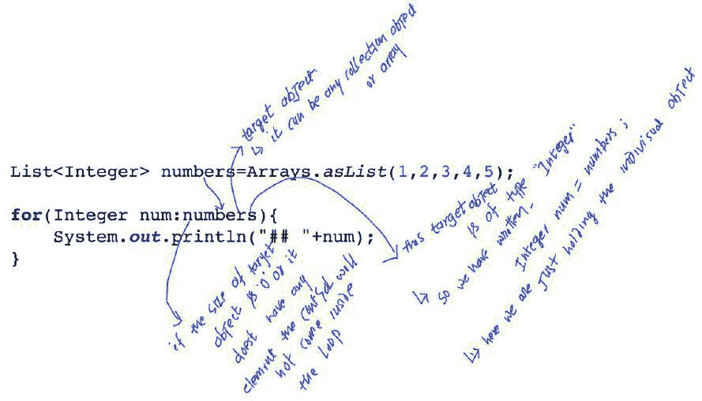

### 简化版用法

```java
package org.example.basic.forDemo;

import java.util.Arrays;
import java.util.List;

public class ForEachDemo {
    public static void main(String[] args) { 
        List<Integer> numbers=Arrays.asList(1,2,3,4,5);
        numbers.forEach(System.out::println);
    }
}
```

结果：

### 1

### 2

### 3

### 4

### 5

`forEach` 循环接受 `Consumer` 作为输入，我们将在本书的 `Stream API` 部分详细介绍 `consumer` 接口。

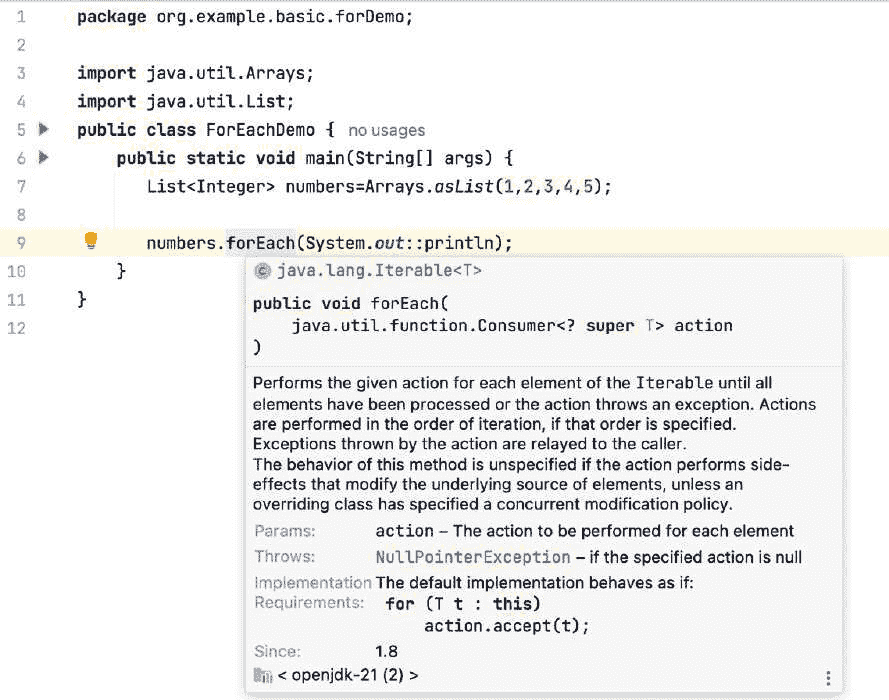

### Break 语句

在 Java 中，`break` 语句用于提前退出循环，无论是 `for`、`while` 还是 `do-while` 循环。它也用于终止 `switch` 语句。

当你想要在循环完成所有迭代之前，根据特定条件退出循环时，`break` 语句特别有用。

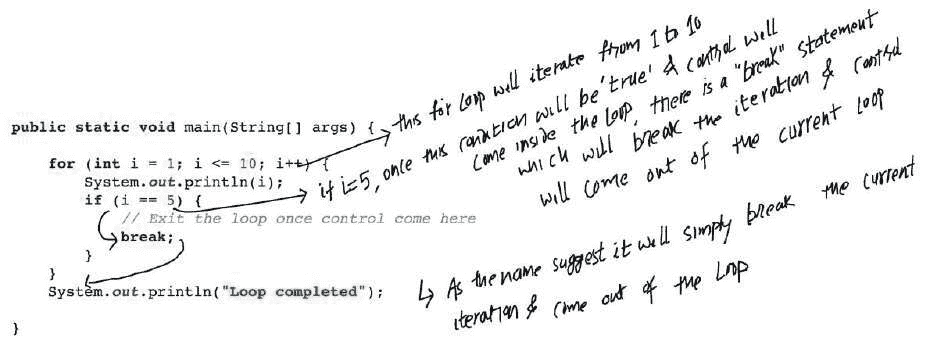

```java
package org.example.basic.forDemo;

public class BreakStmtDemo {
    public static void main(String[] args) {
        for (int i = 1; i <= 10; i++) {
            System.out.println(i);
            if (i == 5) {
                // 当 i 等于 5 时退出循环
                break;
            }
        }
        System.out.println("Loop completed");
    }
}
```

结果：

1

2

3

4

5

Loop completed

### Continue 语句

`continue` 语句在指定条件发生时会中断循环中的当前迭代，并继续循环的下一次迭代。

它与 `break` 语句相似，`break` 语句会中断当前循环的整个迭代，但 `continue` 只中断一次迭代并保持循环继续。

#### 它是如何工作的？

当你想要在循环中跳过某些值或条件，而不完全终止循环时，`continue` 语句特别有用。

#### 语法

```java
continue;
```

#### 演示

```java
package org.example.basic;  
public class ContinueStmtDemo {  
    public static void main(String[] args) {  
        for (int i = 1; i < 6; i++) {
            if (i == 3) {
                continue;
            }
            System.out.println(i);
        }
    }
}
```

结果：1 2 4 5

#### 示例 2

```java
package org.example.basic; 
public class ContinueStmtDemo { 
    public static void main(String[] args) {
        int i=0;
        while(i<5) {
            i++;
            if (i == 3) {
                continue;
            }
            System.out.println(i);
        }
    }
}
```

结果：1 2 4 5

## 运算符

- 运算符中的运算符用于执行操作。

- 运算符用于执行操作。

- 运算符用于执行操作。

- 运算符用于执行操作。

- 运算符用于执行操作。

- 运算符用于执行操作。

- 运算符用于执行操作。

- 运算符用于执行操作。

- 运算符用于执行操作。

- 运算符用于执行操作。

- 运算符用于执行操作。

- 运算符用于执行操作。

- 运算符用于执行操作。

- 运算符用于执行操作。

- 运算符用于执行操作。

- 运算符用于执行操作。

- 运算符用于执行操作。

- 运算符用于执行操作。运算符。

### 比较运算符

- 等于（`==`）：检查是否相等。

- 不等于（`!=`）：检查是否不相等。

- 大于（`>`）：检查是否大于。

- 小于（`<`）：检查是否小于。

- 大于等于（`>=`）：检查是否大于等于。

- 小于等于（`<=`）：检查是否小于等于。

### 逻辑运算符

- 逻辑与（`&&`）：当两个条件都为真时，返回真。

- 逻辑或（`||`）：当至少有一个条件为真时，返回真。

- 逻辑非（`!`）：当条件为假时，返回真。

### 赋值运算符

- 赋值（`=`）：将值赋给变量。

- 加赋值（`+=`）：将右操作数加到左操作数上并将结果赋给左操作数。

```java
int num = 10;
num += 5; // 15
```

### 一元运算符

一元运算符只使用一个操作数。例如，`++` 是一个将变量增加 1 的一元运算符。

```java
int a=10;
a++; // 然后 a=11
```

不同类型的一元运算符：

| 运算符 | 含义 |

| :--- | :--- |

| `+` | 一元加：由于是正数不需要 |

| `-` | 一元负：反转表达式的符号 |

| `++` | 递增运算符：值加 1 |

| `--` | 递减运算符：值减 1 |

| `!` | 逻辑取反运算符：反转一个布尔值 |

### 三元运算符

三元运算符是 `if-then-else` 语句的简写。

例如：`variable = expression ? expression1 : expression2`

工作原理如下：

- 如果表达式为真，将 `expression1` 赋给变量。

- 如果表达式为假，将 `expression2` 赋给变量。

```java
int age=21;
String str=(age>10)?"You are a Kid":"You are Adult";

int num=57;
String str= (num>100)?"Greater than 100":(num<50)?"Less Than 50":"Greater than 50"; 
System.out.println(str);
```

### 位运算符

这些运算符用于执行位级操作。

- `&`：位与

- `|`：位或

- `^`：位异或

- `~`：位取反

- `<<`：左移

- `>>`：有符号右移

- `>>>`：无符号右移

```java
int a = 5; // 二进制 0101
int b = 3; // 二进制 0011
```

```java
System.out.println(a & b); // 1 (0001 in binary)
System.out.println(a | b); // 7 (0111 in binary)
System.out.println(a ^ b); // 6 (0110 in binary)
System.out.println(~a); // -6 (Inverts bits)
System.out.println(a << 1); // 10 (1010 in binary)
System.out.println(a >> 1); // 2 (0010 in binary)
System.out.println(a >>> 1);// 2 (0010 in binary)
```

### instanceof 运算符

该运算符用于测试一个对象是否是特定类或子类的实例。

- `instanceof`：检查对象的类型

示例：

```java
String name = "Java";
boolean result = name instanceof String;
System.out.println(result); // true
```

## Java 中的 String 是什么？

`String` 是一个表示字符序列的对象。例如：

`String name=”Raj”;`

或者 `String name=new String(“Raj”);`

### 我们可以使用字符串字面量或 new 关键字来创建 String

`String` 本质上是不可变的，这意味着一旦创建了 `String` 并且你想要修改它，那么它将再次创建一个带有更新后的值的新 `String`。

`String name=”Raj”; name+”a”;`

你知道现在 `name` 的值是什么吗？它将是 “Raj” 而不是 “Raja”

```java
String name= "Raj";
System.out.println("Initial Name : "+name); 
name.concat("a");
System.out.println("Updated Name : "+name);
```

结果：

Initial Name : Raj

Updated Name : Raj

让我们看看下面的示例：

假设班级有两个名字叫“Rahul”的学生。所以让我们为学生名字创建一个 `String` 对象。

```java
String studentName1=”Rahul"; 
String studentName2=”Rahul”;
```

如你所示，内容是相同的，`JVM` 是如何处理它的？它将在字符串常量池（`SCP`）中创建。

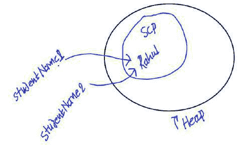

在上面的示例中，只将创建一个对象。首先，`JVM` 在字符串常量池中找不到任何值为 "Rahul" 的字符串对象，因此它将创建一个新对象。

当你再次创建一个具有相同值的新 `String` 时，`JVM` 将检查该值是否在 `SCP` 中可用，由于它已经在那里了，所以它不会创建新对象，而是返回同一个实例的引用。

```java
String name="Raj";
System.out.println("Initial Name : "+name);
String name2=new String("Raj"); 
System.out.println("Name2 : "+name2);
System.out.println(name2==name); 
System.out.println(name2.equals(name));
```

结果：

Initial Name : Raj

Name2 : Raj

false

true

```java
String name1= "Raj";
String name2="Raj";
System.out.println("Initial Name : "+name1);
String name3= new String("Raj"); 
String name4=new String("Raj"); 
System.out.println("Name2 : "+name2);
System.out.println(name1==name2); 
System.out.println(name2==name3); 
System.out.println(name3==name4); 
System.out.println(name2.equals(name1));
```

结果：

Initial Name : Raj

Name2 : Raj

true

false

false

true

如你所见，

### String name3=new String("Raj");

在这里，`JVM` 将在普通堆内存中创建一个新的字符串对象，而字面量 "Raj" 将放置在字符串常量池中。变量 `name3` 将引用堆（非池）中的对象。

请查看 API 文档以获取有关方法和构造函数的更多信息。

## StringBuffer

它与 `String` 类似，但有一些额外的属性。

- 它是线程安全的

- 本质上是可变的

- `StringBuffer` 的主要操作是 `append` 和 `insert` 方法，这些方法经过重载以接受任何类型的数据

示例：

```java
public class SBDemo { 
    public static void main(String[] args) {
        StringBuffer b1=new StringBuffer("Raj"); 
        b1.append("Kumar");
        System.out.println(b1); 
    }
}
```

结果：

RajKumar

### 我们可以从 String 对象创建 StringBuffer

```java
public class SBDemo {
    public static void main(String[] args) {
        String name= "Raj";
        StringBuffer b1=new StringBuffer(name); 
        b1.append("Kumar");
        System.out.println(b1); 
    }
}
```

结果：

RajKumar

希望 `StringBuffer` 的概念现在很清晰了，你可以访问官方 API 文档获取更多方法信息。

## StringBuilder

- 它与 `String` 和 `StringBuffer` 类似，但具有某些特性。

- `StringBuilder` 是一个可变的字符序列。与不可变的 `String` 不同。

- 它不是线程安全的

- `StringBuilder` 对象在创建后可以被修改。

- 它比 `StringBuffer` 快，因为它是非同步的。适用于特定的任务。

### 为什么使用 StringBuilder？

- 效率：对于需要频繁修改字符串的任务，`StringBuilder` 比 `String` 更高效。

- 可变性：在创建后可以修改 `StringBuilder` 的内容，无需创建新对象。

```java
StringBuilder sb = new StringBuilder();
StringBuilder sbWith = new StringBuilder(50);
```

- 添加到 `StringBuilder`：将指定的字符串添加到当前 `StringBuilder` 的末尾。

```java
sb.append(" World");
```

- 插入 `StringBuilder`：在指定位置插入指定的字符串。

```java
sb.insert(5, ",");
```

- 从 `StringBuilder` 删除：删除字符序列。

```java
sb.delete(5);
```

- 在 `StringBuilder` 中替换：用另一个字符串替换序列。

```java
sb.replace(6, 11, "Java");
```

- 反转 `StringBuilder`：反转字符序列。

```java
sb.reverse();
```

- `StringBuilder` 转换为 `String`：将 `StringBuilder` 转换为 `String`。

```java
String result = sb.toString();
```

```java
System.out.println(Integer.MAX_VALUE);
System.out.println(Integer.MIN_VALUE);
System.out.println(Integer.TYPE);
System.out.println(Integer.SIZE);
```

结果：

2147483647

-2147483648 int

32

示例：


```java
public class WrapperDemo {
    public static void main(String[] args) {
        Integer a = Integer.valueOf(11);
        Integer b = Integer.valueOf("12");
        Integer d = Integer.parseInt("14");

        // int to String
        String e = Integer.toString(15); // Integer to String
        String f = Integer.toString(a);

        System.out.println("### a " + a);
        System.out.println("### b " + b);
        System.out.println("### d " + d);
        System.out.println("### e " + e);
        System.out.println("### f " + f);
    }
}
```

结果：

### a 11

### b 12

### d 14

### e 15

### f 11

当我们处理给定类型的集合对象时，包装类非常有用，我们可以简单地使用泛型来提供类型。

来看一个示例：这里我们创建了一个 `ArrayList` 并向该列表添加了不同的值。

如你所见，我们能够在此列表中添加任何类型的值。如果我想限制列表只接受 `int` 类型的值呢？

你该如何做到这一点？你需要在向列表添加元素时添加验证逻辑，这样这样每当有人尝试向列表添加某个值时，该逻辑都会被调用。这真的不是一个好主意。

```java
import java.util.ArrayList;

public class SBDemo {
    public static void main(String[] args) {
        ArrayList normalList = new ArrayList();
        normalList.add(11);
        normalList.add("Raj");
        normalList.add(13l);
        normalList.add(15d);
        normalList.add(new String("maya"));

        System.out.println("List :: " + normalList);
    }
}
```

结果：`List :: [11, Raj, 13, 15.0, maya]`。我们可以简单地使用泛型来限制类型。

```java
ArrayList<Integer> typeList = new ArrayList();
```

此列表 `typeList` 将接受 `Integer` 类型，如你所见，我们正在使用包装类 `Integer`。这是最重要的用例之一，我们必须使用包装类，因为基本数据类型在这里不适用于泛型。

如果你使用类型安全的声明，`JVM` 将不允许你向列表添加任何其他类型的数据，否则将抛出编译错误。

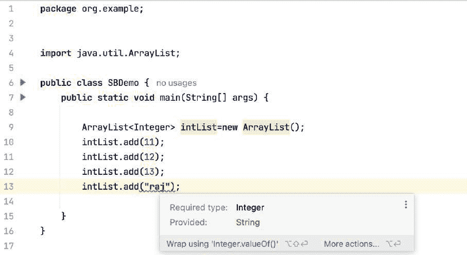

## 使用包装类的优势

以下是 Java 包装类的一些主要优势。

### 将基本数据类型表示为对象

包装类提供了将基本数据类型作为对象的方法，这在某些只接受对象的情况下是必要的，例如在 `ArrayList` 和 `HashMap` 等集合中。使用包装类而不是基本数据类型始终是一个良好的做法。

### 存储 `null` 值

Java 中的基本数据类型不能存储 `null` 值，但包装类可以被设置为 `null`，这在表示缺失或未知值时非常有用。

### 自动装箱和自动拆箱

包装类提供了基本类型之间的自动转换。自动装箱是基本类型到其包装对象的自动转换，而自动拆箱是将包装对象转换回基本类型的转换。

```java
import java.util.*;
import java.lang.*;
import java.io.*;

class WrapperExample {
    public static void main(String[] args) {
        int a = 10;

        try {
            int result = a / 0;
        } catch (Exception e) {
            System.out.println(a + " " + e);
        }
    }
}
```

## 什么是异常

异常是程序执行过程中发生的不受希望或意外的事件，它会中断执行流。

### 如何处理异常？

Java 中的异常处理是针对异常情况做出响应以维护程序的过程。

## 异常层次结构

如我们所知，Java 是一种面向对象的语言，每个类都继承 `Object` 类。所有异常和错误都是 `Throwable` 的子类。`Throwable` 是异常的基父类。


## 异常类型

主要有两种类型的异常：

1. 检异常（Checked Exception）
2. 未检异常（Unchecked Exception）

### 检异常

- 检异常是编译器在编译时检查的异常。
- 如果不处理这些异常，程序将无法编译。
- 这些异常是 `Exception` 类的子类。
- 检异常是 Java 编译器要求我们处理的异常。我们必须声明式地将异常向上抛出调用堆栈，要么必须处理它。

### 未检异常

- 未检异常是 `JVM` 在运行时检查的异常，因为编译器无法检查它们。
- 带有未检异常的程序可以成功编译，你不会得到任何编译错误，但如果没有处理，你将获得运行时错误。
- 这些是 `RuntimeException` 的子类。

### 程序员如何处理异常？

作为开发者，当我们编写任何可能发生某种异常的代码时，我们作为开发者需要处理该异常，或者我们可以使用 `throw` 关键字将该异常委托给调用者。

`/Users/aray/Library/Java/JavaVirtualMachines/openjdk-21/Contents/Home/bin/java -javaagent:/Applications/IntelliJ IDEA CE.app/Contents/lib/idea_rt.jar=64711:/Applications/IntelliJ IDEA CE.app/Contents/bin -Dfile.encoding=UTF-8 -Dsun.stdout.encoding=UTF-8 -Dsun.stderr.encoding=UTF-8 -classpath /Users/aray/Documents/lpError/new/JavaFundamentals/target/classes org.example.exception.ExceptionDemo`

### 数字不能除以零

## `try` 块

- `try` 块用于执行可能抛出异常的测试语句。
- `try` 块可以包含多个语句。
- `try` 块不能单独执行，必须至少跟一个 `catch` 块或 `finally` 块一起。
- 如果 `try` 块中发生任何异常，控制权将跳转到上述代码中的 `catch` 块。

```java
try {
    // 可能抛出异常的代码
}
```

## `catch` 块

- `catch` 块用于为异常提供解决方案或替代方案。
- `catch` 块通过在参数中声明异常类型来处理异常。
- 声明的异常必须是父类异常、异常类层次结构中生成的异常类型或用户自定义的异常。

你可以在单个 `try` 块中使用多个 `catch` 块。

```java
try {
    // 可能抛出异常的代码
} catch (Exception e) {
    // 针对异常的任何消息或替代方案
}
```

## 带有 `finally` 块的 `try-catch`

- `finally` 块与 `try`、`catch` 块配合使用。
- 无论是否抛出异常，它每次都会执行。
- `finally` 块用于执行重要的语句，如关闭语句、释放资源、释放内存或任何你确定想要执行的代码段。
- `finally` 块可以与 `try` 块（带或不带 `catch` 块）配合。
- 如果你的代码中有 `finally` 块，那么一旦发生异常，控制权将先进入 `finally`，然后进入 `catch` 块。
- `"finally"` 块用于执行程序的必要代码。无论异常是否被处理，它都会执行。

```java
try {
    // 可能抛出异常的代码
} catch (Exception e) {
    // 针对异常的任何消息或替代方案
} finally {
    // 释放资源
}
```

```java
package org.example.exception;

public class ExceptionDemo {
    public static void main(String[] args) {
        int num = 10;

        try {
            int result = num / 0;
        } catch (Exception e) {
            System.out.println("### 数字不能除以零");
        } finally {
            System.out.println("### 这是 finally 块");
        }
    }
}
```

结果：

`/Users/aray/Library/Java/JavaVirtualMachines/openjdk-21/Contents/Home/bin/java javaagent:/Applications/IntelliJ IDEA CE.app/Contents/lib/idea_rt.jar=65334:/Applications/IntelliJ IDEA CE.app/Contents/bin -Dfile.encoding=UTF-8 -Dsun.stdout.encoding=UTF-8 -Dsun.stderr.encoding=UTF-8 -classpath /Users/aray/Documents/lpError/new/JavaFundamentals/target/classes org.example.exception.ExceptionDemo`

### 数字不能除以零

### 这是 finally 块

## 记忆要点

在编写任何代码时，你首先需要考虑该段代码是否可能会抛出异常。如果你认为在任何可能的用例下都有抛出异常的可能性，那么你必须将该段代码放在 `try` 块中，并需要添加相应的 `catch` 块。

如果存在抛出异常的可能性，作为开发者，你要么处理该异常，要么必须将异常委托，以便代码的调用者需要处理该异常或将其委托给其调用者。这就是 Java 中异常处理的工作原理。

当方法内部发生异常时，应由该方法负责处理异常，或者将其委托给方法的调用者。这种对异常处理的委托通过使用 `try-catch` 块捕获异常，或者在方法签名中使用 `throws` 子句声明该方法可能会抛出异常来实现。

## 如何抛出异常

在 Java 中，`throws` 关键字用于将异常委托给其调用者。如果在任何方法中发生了异常，应由该方法负责处理，但如果异常没有被该方法处理，则它应该被委托给方法的调用者，此时方法的调用者仍然需要处理该异常，也可以继续委托。

`throws` 关键字仅用于将异常传递给其调用者。

Java 中的 `throws` 关键字用于方法签名，以指示该方法可能会抛出 Java 异常类层次结构中的一个异常。

`throws` 关键字仅用于受检异常（checked exceptions），因为对非运行时异常（unchecked exceptions）使用它是没有意义的（非运行时异常可以通过修正编程错误来避免）。

`throws` 关键字可以用于声明异常。

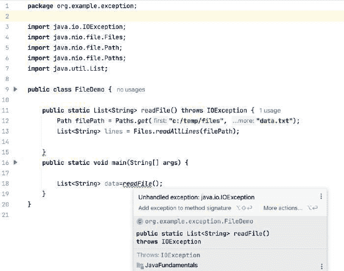

正如上面的示例代码所示，我们正在尝试读取文件，我们正在进行文件操作，这些操作有抛出 `IOException` 的可能，由于它是受检异常，我们必须处理它或将其委托给方法的调用者。


你可以从下面的示例中看到，我们在第一个示例中传递了异常。


## `throw` 关键字

- `throw` 关键字用于显式抛出异常。
- 我们也可以用它抛出非运行时异常。
- 简单来说，我们可以根据给定的条件或用例抛出某些定义的异常。
- 在执行 `throw` 语句后，程序的执行流会立即停止，并寻找最近的 `catch` 块来匹配异常类型。如果找到了匹配的 `catch` 块，则执行它；否则，它会一直委托给调用者，直到找到相应的 `catch` 块。
- 在这种情况下，`finally` 块仍然会执行。
- 我们可以根据某些错误信息来抛出异常。

```java
package org.example.exception;

import java.io.IOException;
import java.nio.file.Files;
import java.nio.file.Path;
import java.nio.file.Paths;
import java.util.List;

public class FileDemo {
    public static List<String> readFile() throws IOException {
        Path filePath = Paths.get("c:/temp/files", "data.txt");
        List<String> lines = Files.readAllLines(filePath);
    }

    public static void main(String[] args) {
        try {
            List<String> data = readFile();
        } catch (IOException e) {
            throw new RuntimeException(e);
        }
    }
}
```

正如你在上面的示例代码所示，我们在发生错误时抛出异常。我们可以在这里抛出适当的异常并带有正确的错误消息。

```java
package org.example.exception;

import java.io.IOException;
import java.nio.file.Files;
import java.nio.file.Path;
import java.nio.file.Paths;
import java.util.List;

public class FileDemo {
    public static List<String> readFile() throws IOException {
        Path filePath = Paths.get("c:/temp/files", "data.txt");
        List<String> lines = Files.readAllLines(filePath);
    }

    public static void main(String[] args) {
        try {
            List<String> data = readFile();
        } catch (IOException e) {
            throw new UserDefinedException(" error message");
        }
    }
}
```

`UserDefinedException` 意味着用户根据其需求创建的任何异常。

假设你正在为某个关键词搜索某些数据，如果未为该关键词找到数据，你就想抛出一个异常。如果没有找到数据，你可能只想抛出一个像 `DataNotAvailableForKeyException` 的异常，或者你可以创建一个任何意义名称的异常。

```java
throw new DataNotAvailableForKeyException(" error message");
```

这就是你如何抛出异常的方法。

## `throw` vs `throws`

如你所见，这两个名称看起来相似，所以对新开发者来说有些困惑。简单来说，我们可以说 `throwing` 意味着将异常处理权委托给调用者，意味着你**不再**要处理该异常了。

`throw` 意味着根据你要求的某些特定逻辑 set，你可以抛出任何合适的异常。正如我们之前看到的，如果你正在验证 `userName` 并发现 `userName` **不是** 有效的，那么你可以创建一个如 `UserNameNotValid` 这样的自定义异常并直接将其抛出。

## `throw`

它用于在程序的任何代码块中显式地抛出异常。

`throw` 用于方法内部。你一次只能抛出一个异常。

`throw` 关键字可以用于抛出受检异常和未受检异常。

```java
throw new AnyException("error message");
```

## `throws`

它用于函数签名，用声明方法在执行代码期间可能抛出的异常。

`throws` 用于方法签名中。可以在声明中添加任意数量的异常。

`throws` 关键字只能用于受检异常。

```java
void methodName() throws ArithmeticException, FileNotFoundException, AnyUserDefinedException
```


如果你在任何方法内部使用 `throw` 关键字抛出异常，那么 THEN 你必须使用 `try-catch` 处理它，或者使用 `throws` 关键字将其委托给方法的调用者。

```java
public static boolean validateUserName(String userName) throws InvalidUserNameException {
    if (!userName.equalsIgnoreCase("Raj")){
        throw new InvalidUserNameException(400,"User Name is not valid");
    }
    return true;
}
```

### 创建异常、 自定义异常或用户定义异常

正如我们讨论过的，如果你在真实环境中工作，THEN 异常处理是你需要非常仔细且聪明地处理的最重要概念之一。

它确实让你的应用程序对用户更加友好，而且如果发生了错误，开发者将更容易找到确切的问题。

假设一下，作为开发者，你正在开发某个功能，过了一段时间客户遇到了问题。这些问题可能是任何问题，可能是数据问题，可能是某些功能问题，或者是由于某些方法或代码片段引起的任何其他问题，最关键的部分是它可以是任何类型的问题，甚至是不可预测的。因此，作为开发者，你需要编写这样的异常处理代码，使其能够简单地处理任何类型的异常，并在发生任何故障时提供适当错误信息，这样你或其他开发者就能轻松找到根源并尽快修复，以避免任何形式的升级。

诚实地说，这在日常开发环境中是非常直接且常见的现象。

假设一下，你正在你的方法中验证“用户名”，你需要验证哪些基本点？可能是用户名模式、空值检查或任何你想要针对用户名验证的规则。现在你已经写了验证输入数据的逻辑，一旦数据通过验证并发现有任何问题，THEN 你需要抛出一个带有适当错误信息的正确异常，以便最终用户能够理解。此错误信息应当应该是清晰的，即使是开发者也能理解根源，这将有助于开发者轻松地修复它。

我们可以通过扩展属于 `java.lang` 包的 `Exception` 类来根据需求创建异常。

这些是与业务逻辑相关的异常，开发者希望用户按照要求的格式输入，如果用户未能这样做，就会抛出异常，用户将获得关于问题是什么以及如何解决的指示。这对于应用程序用户或开发者理解确切的问题非常有帮助。

示例：如果用户想要设置年龄限制，我们可以使用自定义异常并提供所需的注释作为输出。

现在我们将看到我们开发者如何创建一些用户定义的异常。

语法：

```java
class YourExceptionName extends Exception/”Any Predefined Exception” {
    // 添加你的属性，如错误消息、错误代码等 
    // 添加构造函数以初始化异常对象
}
```

如上所示，我们只是在创建一个扩展自 `Exception` 或 Java 中任何其他 `Exception` 类的类 `YourExceptionName`。这无非只是试图通过继承将 `Exception` 类的行为继承到我们的类中。

到目前为止，我们已经清楚，如果一个类继承另一个类，THEN 子类将自动继承父类的行为，在上面的示例中 `Exception` 类是父类，所以我们的类 `YourExceptionName` 将拥有异常类的行为。

这就是你如何根据需求在 Java 中创建自定义异常类。

### 示例：`class UserNameNotValidException extends Exception`

```java
public UserNameNotValidException(String userName) { // 调用父类 Exception 的构造函数
    super(s);
}
}
```

### 示例 2

```java
public class DuplicateEntityException extends RuntimeException {
    private static final long serialVersionUID = 1L;
    private int code;

    public DuplicateEntityException(int code, String msg) { 
        super(msg);
        this.setCode(code);
    }

    public DuplicateEntityException(String message, Throwable cause) { 
        super(message, cause);
    }

    public int getCode() {
        return code;
    }

    public void setCode(int code) { 
        this.code = code;
    }
}
```

#### `InvalidUserNameException` 包 `org.example.exception;`

```java
package org.example.exception;
public class InvalidUserNameException extends Exception{
    private static final long serialVersionUID = 1L; 
    private int code;

    public InvalidUserNameException(int code, String msg) { 
        super(msg);
        this.setCode(code);
    }

    public InvalidUserNameException(String message, Throwable cause) { 
        super(message, cause);
    }

    public int getCode() {
        return code;
    }

    public void setCode(int code) {
        this.code = code;
    }
}
```

### 让我们创建一个方法并从代码中抛出 `InvalidUserNameException`

```java
package org.example.exception; 
public class FileDemo {

    public static boolean validateUserName(String userName) throws InvalidUserNameException {
        if (!userName.equalsIgnoreCase("Raj")){
            throw new InvalidUserNameException(400,"User Name is not valid");
        }
        return true;
    }

    public static void main(String[] args) throws InvalidUserNameException {
        String yourUsername="Mahesh";
        Boolean isUsernameValid=validateUserName(yourUsername);
        System.out.println(" isUsernameValid : "+isUsernameValid);
    }
}
```

如你在上面的代码所示，我们正如下所示使用 `validateUserName(..)` 方法来验证用户。

```java
Boolean isUsernameValid=validateUserName(yourUsername);
```

如果你查看此方法的声明，你可以看到如果用户名根据我们的要求不是有效的，我们就会抛出 `InvalidUserNameException`。

`throw new InvalidUserNameException(400,"User Name is not valid");`

### Java 异常处理：最佳实践

- 仅捕获可以被处理的异常是最佳实践。
- 在 `catch` 块中不应返回空值而不是处理异常，这会消耗异常并导致错误永久失败且程序崩溃。
- 不要获取异常类，而要捕获特定的子类。
- 永远不要在 `finally` 块中抛出异常，因为即使 `try` 块中没有产生任何异常，`finally` 块也会在执行 `try-catch` 块后抛出异常。
- 如果你不处理异常，请使用 `finally` 块代替 `catch` 块。
- 始终使用 `finally` 块来关闭使用的资源。
- 最佳实践始终使用后关闭/终止资源，如果可能，使用 `try-with-resources`，这样 JVM 会杀死未使用的资源。

### 数组：Java 中的数组是什么？

- 它们包含相似数据类型的元素。
- `Java` 中的数组在单个变量中存储多个相同类型的值。
- 数组的元素存储在连续的内存位置上。
- 它们是可以包含固定数量元素的对象，每个元素都有一个用于访问它的索引。
- 我们以前只在声明时提供数组的大小。
- 数组的索引从 0 开始，因此数组的第 1 个元素存储在第 0 个索引处，第 2 个元素存储在第 1 个索引处，依此类推。

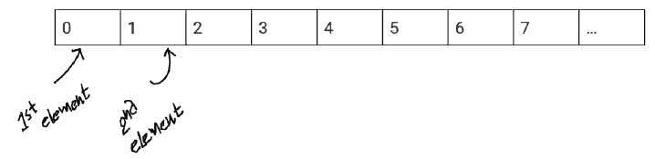

### 语法

```java
data_type arrayName[ ];
data_type[ ] arrayName;
```

### 示例

```java
int numbers[];
String names[];
int[] pinCode;
Integer dates[];
```

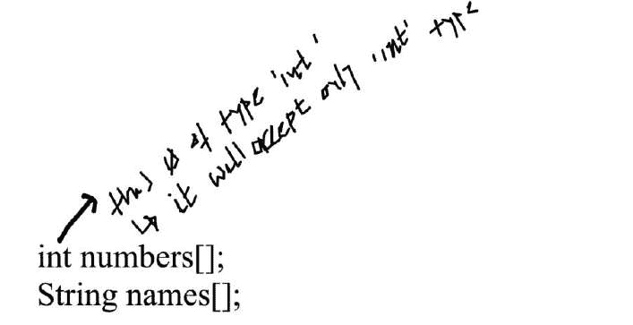

### 数组初始化

一旦声明 `Array`，我们可以简单地对其初始化，或者在声明时直接初始化。

```java
int arr[]=new int[5];
int numbers[]={1,2,3,4,5,6};
String names[]={"Raj","Heera"};
Float arrFloat[]=new Float[4];
int[] anArray = new int[] {1, 2, 3, 4, 5}; //它将包含从索引 0 开始的 5 个元素
```

### 如何从数组中访问值

正如我们所知，`Array` 是相似数据类型元素的索引集合，因此数组的元素可以通过索引访问。数组中的索引从 0 开始。`int numbers[]={1,2,3,4,5,6};` 在这里数组中有 6 个元素，索引从 0 开始，所以元素 1 将位于第 0 位置。

我们可以简单地使用索引访问此元素。

`Numbers[0]` 将是 1。

第 1 个元素 = 第 0 位置，即值 = 1。

第 2 个元素 = 第 1 位置，即值 = 2。

第 3 个元素 = 第 2 位置，即值 = 3。

### 示例

```java
package org.example.arrayDemo;

public class ArrayTestDemo {
    public static void main(String[] args) {
        int numbers[]={1,2,3,4,5,6};
        int num1=numbers[0]; //0 索引 
        int num2=numbers[1]; //1 索引
        System.out.println(" ## num1 "+num1); 
        System.out.println(" ## num2 "+num2); 
    }
}
```

结果：

```text
## num1 1
## num2 2
```

### 注意

括号之间的数字是我们要访问的数组特定位置。

访问数组元素时，如果传递的索引为负数或超过了最后一个单元，`Java` 将抛出 `ArrayIndexOutOfBoundException`。

```java
int numbers[]={1,2,3,4,5,6};
```

这里有 6 个元素，所以索引从 0 开始到 5：`numbers[0]=1`，`numbers[5]=6`。

但如果你尝试 `numbers[6]` 或任何更大的索引，你将得到异常 `ArrayIndexOutOfBoundException`。

我们应该注意不要使用负索引，或大于或等于数组大小的索引。

### 遍历数组元素

可以使用索引访问数组元素。

```java
package org.example.arrayDemo;

public class ArrayTestDemo {
    public static void main(String[] args) { 
        int numbers[]={1,2,3,4,5,6}; 
        for (int i=0;i<(numbers.length);i++){ 
            System.out.println(numbers[i]); 
        }
    }
}
```

### 结果：1 2 3 4 5 6

更简化的方法：

```java
package org.example.arrayDemo;

public class ArrayTestDemo {
    public static void main(String[] args) {
        int numbers[]={1,2,3,4,5,6}; 
        for(int num:numbers){
            System.out.println(num); 
        }
    }
}
```

### 结果：1 2 3 4 5 6

`Java` 提供了内置类来处理数组操作。

- 你可以使用 `Arrays`，它是 `java.util` 包的一部分。
- 该类包含用于操作数组的各种方法（如排序和搜索）。该类还包含一个静态工厂，允许数组被视为列表。

让我们看看 `Arrays` 类如何简化数组操作示例：

```java
package org.example.arrayDemo;

import java.util.Arrays;

public class ArrayTestDemo {
    public static void main(String[] args) {
        int numbers[]={6,2,4,8,4,5,1};
        Arrays.sort(numbers);
        for (int num:numbers){
            System.out.println(num); 
        }
    }
}
```

### 结果：1 2 4 4 5 6 8

有关 `Arrays` 类的工具方法的更多信息，请访问 `Arrays` (Java SE 21 & JDK 21)。

## 集合 Collection

- `Java` 中的 `Collection` 是一个提供存储和操作对象组的架构的框架。
- `Java Collections` 可以实现你对数据执行的所有操作，如搜索、排序、插入、处理和删除。
- `Collections` 和数组（arrays）的相似之处在于，它们都持有对象的引用，并且可以作为一个组进行管理。然而，与数组不同，`Collections` 在实例化时不需要分配特定的容量。当对象被添加或删除时，`Collections` 的大小可以自动伸缩。
- `Collections` 不能持有 `int`、`long` 或 `double` 等原始数据类型。相反，`Collections` 可以持有包装类，如 `Integer`、`Long` 或 `Double`。

```java
int numbers[]={1,2,3,4,5,6}
int numbers[]={1,2,3,4,5,6}
int numbers[]={1,2,3,4,5,6}
int numbers[]={1,2,3,4,5,6}
```

## 以逆序和自然顺序对集合数据进行排序

```java
import java.util.ArrayList;
import java.util.Collections;

public class ArrayTestDemo {
    public static void main(String[] args) {
        ArrayList<Integer> nums= new ArrayList<>();
        nums.add(11);
        nums.add(13);
        nums.add(10);
        nums.add(12);
        System.out.println(" ## nums :: "+nums);
        Collections.sort(nums);
        System.out.println("## Natural sorted :: "+nums);
        Collections.sort(nums,Collections.reverseOrder());
        System.out.println("## Reverse sorted :: "+nums);
    }
}
```

### 运行结果

```text
nums :: [11, 13, 10, 12]
Natural sorted :: [10, 11, 12, 13]
Reverse sorted :: [13, 12, 11, 10]
```

## `EmployeeDemo.java`


```java
package org.example;

import java.util.Objects;

public class EmployeeDemo {
    String name;
    String designation;
    Long empId;

    public EmployeeDemo(String name, String designation, Long empId) {
        this.name = name;
        this.designation = designation;
        this.empId = empId;
    }

    @Override
    public boolean equals(Object o) {
        if (this == o) return true;
        if (o == null || getClass() != o.getClass()) return false;
        EmployeeDemo that = (EmployeeDemo) o;
        return name.equals(that.name) && designation.equals(that.designation) &&
               empId.equals(that.empId);
    }

    @Override
    public int hashCode() {
        return Objects.hash(name, designation, empId);
    }

    public String getName() {
        return name;
    }

    public void setName(String name) {
        this.name = name;
    }

    public String getDesignation() {
        return designation;
    }

    public void setDesignation(String designation) {
        this.designation = designation;
    }

    public Long getEmpId() {
        return empId;
    }

    public void setEmpId(Long empId) {
        this.empId = empId;
    }
}
```

### 创建员工列表并执行排序

```java
import java.util.ArrayList;
import java.util.Collections;
import java.util.Comparator;
import java.util.List;

public class EmployeeDataDemo {
    public static void main(String[] args) {
        EmployeeDemo e1 = new EmployeeDemo("Raj", "SSE", 12l);
        EmployeeDemo e2 = new EmployeeDemo("Mohan", "SE", 15l);
        EmployeeDemo e3 = new EmployeeDemo("Akash", "Engineer", 14l);
        EmployeeDemo e4 = new EmployeeDemo("Niru", "DevOps", 11l);

        List<EmployeeDemo> empObj = new ArrayList<>();
        empObj.add(e1);
        empObj.add(e2);
        empObj.add(e3);
        empObj.add(e4);

        Comparator<EmployeeDemo> ee =
            (a, b) -> -(int) (a.getEmpId() - b.getEmpId());
        Collections.sort(empObj, ee);

        for (EmployeeDemo obj : empObj) {
            System.out.println(
                "### " + obj.getName() + " ," +
                obj.getEmpId() + " ," + obj.getDesignation()
            );
        }
    }
}
```

### 运行结果

- `Mohan ,15 ,SE`
- `Akash ,14 ,Engineer`
- `Raj ,12 ,SSE`
- `Niru ,11 ,DevOps`

## LinkedList

- `LinkedList` 类似于 `list`，并接受它以保持顺序。
- Java 中的 `LinkedList` 类是 `java.util` 包的一部分，并实现了 `List` 和 `Deque` 接口，提供了双链表数据结构。这使其成为一个多功能的集合类，既可以作为 `list` 也可以作为 `queue` 使用。

```java
import java.util.LinkedList;

public class LinkedListExample {
    public static void main(String[] args) {
        LinkedList<String> list = new LinkedList<>();
        list.add("Apple");
        list.add("Banana");
        list.add("Cherry");
        list.addFirst("Avocado");
        list.addLast("Dragonfruit");
        System.out.println("First Element: " + list.getFirst());
        System.out.println("Last Element: " + list.getLast());
        list.removeFirst();
        list.removeLast();
        System.out.println("Updated List: " + list);
    }
}
```

## Set

- `Set` 是一个不能包含重复元素的集合。该接口模型了数学中的集合抽象，用于表示集合，例如牌牌。
- Java 平台包含了三种通用的 `Set` 实现：`HashSet`、`TreeSet` 和 `LinkedHashSet`。`Set` 接口不允许对 `Collection` 中的元素进行随机访问。你可以使用 `iterator` 或 `foreach` 循环来遍历 `Set` 的元素。

### HashSet

- Java `HashSet` 是 `Set` 接口的基本实现，由 `HashMap` 设置。
- 它不保证集合的迭代顺序，并允许 `null` 元素。
- 假设哈希函数将元素良好分布在桶中，该类对于基本操作（`add`、`remove`、`contains` 和 `size`）具有常时间性能。
- 我们可以为此集合设置初始容量和负载因子。负载因子是衡量 `map` 在容量增加之前的填充程度。

### 实现

`Set` 接口由 Java 中的多个类实现，其中 `HashSet`、`LinkedHashSet` 和 `TreeSet` 是主要实现。

- **不允许重复**。
- **无序**：集合的顺序无法保证（`LinkedHashSet` 除外）。

### LinkedHashSet

`Set` 接口由 Java 中的多个类实现，其中 `HashSet`、`LinkedHashSet` 和 `TreeSet` 是主要实现。

- **不允许重复**。
- **无序**：集合的顺序无法保证（`LinkedHashSet` 除外）。

### TreeSet

`Set` 接口由 Java 中的多个类实现，其中 `HashSet`、`LinkedHashSet` 和 `TreeSet` 是主要实现。

- **不允许重复**。
- **无序**：集合的顺序无法保证（`LinkedHashSet` 除外）。

```java
treeMap.put("Two", 2);
treeMap.put("Three", 3);
```

### 基础 Map 操作

#### 添加键值对

`map.put("Key1", "Value1"); map.put("Key2", "Value2"); map.put("Key3", "Value3");`

#### 通过键检索值

`String valueForKey2 = map.get("Key2"); // 获取 "Value2"`

#### 检查键是否存在

`boolean containsKey = map.containsKey("Key3"); // true`

#### 遍历键值对

```java
for (Map.Entry<String, Integer> entry : map.entrySet()) {
    String key = entry.getKey();
    Integer value = entry.getValue();
    System.out.println(key + ": " + value);
}
```

#### 移除键值对

`map.remove("Key1");`

#### Map 的大小

`int size = map.size(); // map 中键值对的数量`

#### 清空 Map

`map.clear(); // 移除 map 中所有的键值对`

## 并发集合

Java 中的并发集合是 `java.util.concurrent` 包的一部分，它们为传统的集合类（如 `ArrayList`、`HashMap` 和 `LinkedList`）提供了线程安全的替代方案。这些集合设计用于多线程环境，通过减少对显式同步的需求确保数据一致性并提高性能。

### 主要并发集合

1. `ConcurrentHashMap`
2. `CopyOnWriteArrayList`
3. `CopyOnWriteArraySet`
4. `BlockingQueue`（及其实现类 `LinkedBlockingQueue`、`ArrayBlockingQueue`）
5. `ConcurrentLinkedQueue`
6. `ConcurrentSkipListMap`
7. `ConcurrentSkipListSet`

这些特殊集合专为同步多线程访问设计，确保数据完整性和线程安全。

### ConcurrentHashMap

- `ConcurrentHashMap` 是 `Map` 接口的线程安全实现。
- 它允许多个线程进行读写操作而不会互相阻塞。

示例：

```java
import java.util.concurrent.ConcurrentHashMap;

public class ConcurrentMapExample {
    public static void main(String[] args) {
        ConcurrentHashMap<String, Integer> concurrentMap =
            new ConcurrentHashMap<>();
        concurrentMap.put("one", 1);
        concurrentMap.put("two", 2);
        concurrentMap.put("three", 3);
        int value = concurrentMap.get("two");
        System.out.println("Value for key 'two': " + value);
    }
}
```

### CopyOnWriteArrayList

- `CopyOnWriteArrayList` 是一个线程安全的列表，其修改操作会创建底层数组的新副本。
- 在其他线程进行操作期间，原始列表保持不变。

```java
import java.util.List;
import java.util.concurrent.CopyOnWriteArrayList;

public class CopyOnWriteArrayListExample {
    public static void main(String[] args) {
        List<Integer> list = new CopyOnWriteArrayList<>();
        list.add(1);
        list.add(2);
        list.add(3);
        for (Integer num : list) {
            System.out.println(num);
        }
    }
}
```

### CopyOnWriteArraySet

一种基于 `CopyOnWriteArrayList` 的 `HashSet` 线程安全变体。

```java
import java.util.concurrent.CopyOnWriteArraySet;

public class CopyOnWriteArraySetExample {
    public static void main(String[] args) {
        CopyOnWriteArraySet<String> set = new CopyOnWriteArraySet<>();

        // 添加元素
        set.add("A");
        set.add("B");
        set.add("C");

        // 遍历集合
        for (String item : set) {
            System.out.println(item);
        }

        // 移除元素
        set.remove("B");

        // 再次遍历
        for (String item : set) {
            System.out.println(item);
        }
    }
}
```

### BlockingQueue

- `BlockingQueue` 是一种并发队列，支持添加和移除元素的阻塞操作。
- 常用于生产者-消费者场景。

使用 `LinkedBlockingQueue` 的示例：

```java
import java.util.concurrent.LinkedBlockingQueue;

public class BlockingQueueExample {
    public static void main(String[] args) {
        LinkedBlockingQueue<Integer> queue =
            new LinkedBlockingQueue<>();

        new Thread(() -> {
            try {
                queue.put(1);
                queue.put(2);
                queue.put(3);
            } catch (InterruptedException e) {
                Thread.currentThread().interrupt();
            }
        }).start();

        try {
            System.out.println("Removed from queue: " + queue.take());
            System.out.println("Removed from queue: " + queue.take());
            System.out.println("Removed from queue: " + queue.take());
        } catch (InterruptedException e) {
            Thread.currentThread().interrupt();
        }
    }
}
```

# 函数式编程

Java 中的函数式编程是一种使用函数编写代码的方法，使其更加简单且可预测。关键点包括：

1. 函数是一等公民：函数被像变量一样对待。你可以在代码中传递它们。
2. 纯函数：在给定相同输入时总是产生相同的结果，并且不会改变函数外部的任何数据。
3. 不变性：数据一旦创建，就无法更改。

### 函数式编程的使用

1. 更容易理解：函数不会改变其外部的数据，使得你的代码更容易遵循。
2. 更少的 Bug：可预测的函数意味着更少错误。
3. 可复用性：小的、可重用的函数可以组合起来解决复杂问题。

### 函数式编程如何帮助我们

1. 简化代码：编写更小更简单的函数让你的代码更容易阅读和维护。
2. 减少 Bug：纯函数和不变性有助于防止意外的变化。
3. 支持并行编程：更容易编写在多个处理器上运行的代码。

## 核心特性

- **简单的数据操作**：强大的数据处理方法。
- **并行处理**：简单的多核处理。
- **惰性求值**：避免不必要的计算。
- **不可变性**：不修改原始数据。
- **易用性**：如 `filter`、`map`、`reduce` 等直观的方法。
- **提高可读性**：更容易理解和维护。


- 与`Collections`集成：与`Collections`进行无缝转换。

## Stream 简介

`Stream`是一个可以流水线处理的元素序列。

- 它支持顺序操作和并行操作。
- 它在 Java 8 中引入，作为`java.util.stream`包下 Java Streams API 的一部分。
- `Streams`用于以函数和声明式的方式处理数据序列，例如集合（如`lists`、`sets`、`maps`）或其他数据源。

注意，`java.util.stream`与`java.io.stream`没有任何关系，`java.io.stream`专门用于 I/O 操作，而`java.util.stream`则与通过顺序或并行流水线处理数据有关。

## Java Streams 的特点和功能

1. **函数式编程**：`Streams`从 Java 8 开始促进 Java 中的函数式编程方法。`Stream`提供了一种非常简单的方法来处理数据、转换数据、过滤数据并收集到所需的集合对象中。你可以使用一系列高级操作来处理数据，例如`map`、`filter`、`reduce`和`collect`，而不是显式地编写循环。我们将在后的章节中详细介绍。

2. **惰性**：`Streams`天生是惰性的，这意味着它们只在需要时处理元素。在调用终端操作之前，对`Stream`上的操作不会执行。这可以提高性能并减少内存消耗。我们将详细介绍中间操作和终端操作。

3. **链式调用**：链式多个操作对给定的数据集进行数据转换是`Stream`中的常见操作。你可以将多个操作链在一起，创建一个数据处理的流水线。这允许你以简洁且可读的方式表达复杂的数据转换。

4. **并行性**：Java Streams 可以很容易地并行化，这意味着你可以利用多个 CPU 核心来并发处理数据。并行流是使用类似`parallelStream()`方法创建的。创建一个并行 Stream 会消耗可用的 CPU，但我们也可以覆盖此行为。它使用工作窃取算法，当当前任务完成后，作业会自动选取可用的待处理任务，它还将使用`combiner`保持合并结果。

5. **不可变性**：`Streams`天生是不可变的，因此它们不会修改底层数据源。相反，它们会创建一个带有转换后数据的新`Stream`，保持原始数据不变。

## Stream 是如何工作的？

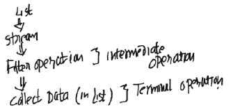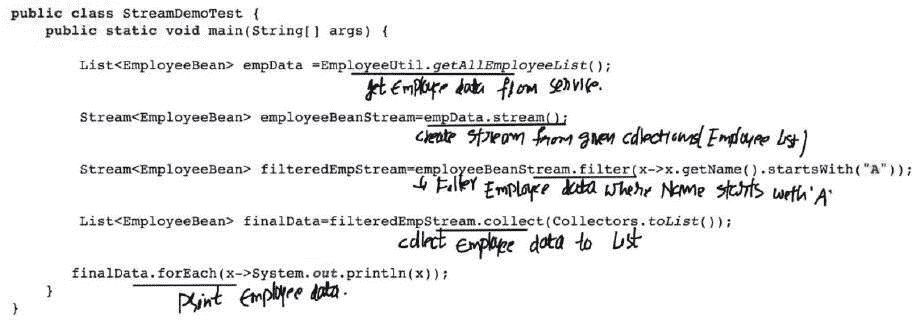

我们将在本节后面的部分将所有的流操作链在一起。上面的代码仅用于解释。

在本节的稍后部分，我们将深入探讨 Stream 中间操作和终端操作。现在，你只需要认为我们有一个`List`，从该列表创建 Stream，执行`filter`操作，并在过滤完成后将数据收集到`List`中。最终结果将根据所应用的条件给你提供过滤后的数据。

## 在何处使用 Streams

在处理数据集合并对这些集合执行操作时，Java 中的`Streams`特别有用。以下是使用流可能获益的一些常见场景。作为开发者，在你在使用并行流时需要非常小心。

让我们先通过一个示例理解`Stream`在 Java 中是如何工作的，然后我们将查看可以使用流的所有可能区域。我们将在本节稍后部分详细介绍。

让我们考虑一个用例，你有一个`Employees`列表（数量为 10 万），并且你想对该数据集执行以下操作：

1. 我想过滤出`Employee Name`以“A”开头的`Employees`。
2. 我想过滤`CITY=Bangalore`的员工。
3. `Department=Development,R&D`和`HR`的员工。
4. 跳过那些`Designation="Architect"`的员工。
5. `Salary`应该大于 50K 且 300K。
6. 将所有数据收集到`LIST`中。
7. `Employee`数据应该按`Employee Name`升序排列。

查看下面的图片，在这里集合中有成千上万条数据，我们希望对整个数据集执行某些批量操作。这就是我们可以考虑使用 Java Streams 的用例场景。

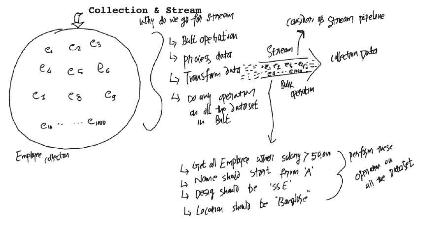

### 这是我们在行业中经常使用的非常简单的用例之一。

即使不使用`Stream API`也可以实现这一点，但我们需要编写大量的样板代码，而且还需要考虑性能。

作为开发者，考虑一下实现上述用例你需要写多少行代码？我们可以使用`Stream`，通过链式调用`Stream`操作在一行内完成。

每当你编写任何代码时，在很高的层，我们首先考虑代码的性能、可读性和健壮性。使用`Stream`、`Lambda`、方法引用以及其他`Stream`特性将会改变你的编码体验。

## 创建 Streams 的方法

以下是从各种源创建 Streams 的常用方法。

### 1. 使用`stream()`方法

```java
ArrayList l=new ArrayList<>();
l.add(1); l.add(2); l.add(3);
Stream<Integer> intStr1=l.stream();
intStr1.forEach(System.out::println);
```

Result: 1 2 3

```java
ArrayList ll=new ArrayList<>();
ll.add("Raj"); ll.add("Mahesh"); ll.add("seema");
Stream<String> StringStream=ll.stream();
StringStream.forEach(System.out::println);
```

Result: Raj, Mahesh, seema

### 2. 从值创建 Stream

```java
Stream<Integer> intStr= Stream.of(1,2,3,4);
Stream<String> strStream= Stream.of("Raj","Mohan","sohan");
Stream<Double> doubleStr= Stream.of(10.1,21.1,32.1,41.2);
Stream<Boolean> boolStr= Stream.of(Boolean.TRUE,Boolean.FALSE);
```

### 3. 从用户定义对象创建

```java
import java.util.List;
import java.util.stream.Collectors;
import java.util.stream.Stream;

public class StreamDemoTest {
    public static void main(String[] args) {
        // 从服务获取 Employee List 或构建它
        // 假设你有一个 Employee List
        // 你只需要在给定的 Employee 集合上调用 stream() 方法，就会创建一个 Employee 流
        List<EmployeeBean> empData =EmployeeUtil.getAllEmployeeList();
        Stream<EmployeeBean> employeeBeanStream=empData.stream();
    }
}
```

### 4. 从数组

```java
int number[]={1,2,3,4,5};
IntStream intStr=Arrays.stream(number);
Integer []v={1,2,3};
Stream<Integer> b=Arrays.stream(v);
```

### 5. 使用`builder`

```java
Stream.Builder<Integer> strBuilder=Stream.builder();
Stream<Integer> sst=strBuilder .add(1) .add(2) .add(3).build();

Stream.Builder<String> strBuilder1=Stream.builder();
Stream<String> sst1=strBuilder1 .add("Ram") .add("Shyam") .add("Mohan").build();
```

### 6. 使用`iterate()`方法

```java
Stream.iterate(2,x->x*2)
 .limit(5)
 .forEach(p->System.out.println(p));
```

Result: 2 4 8 16 32

使用`generate(..)`方法和`Supplier<T>`

```java
Supplier<Double> doubleSupplier=()->Math.random(); Stream.generate(doubleSupplier).limit(5).forEach(System.out::println);
```

结果：

```text
0.0995608561480672 0.7482631084077372 0.39385704955594336 0.06439871238649875 0.1001304919733238
```

```java
Supplier<String> strSupplier=()->"ram"; Stream.generate(strSupplier).limit(5).forEach(System.out::println);
```

结果：

```text
Ram Ram Ram Ram Ram
```

在 Java 流中，你有两种处理模式：顺序和并行。此外，根据数据源的不同，还有不同类型的流。

### 顺序流（Sequential Streams）

- **行为**：按照元素在数据源中出现的顺序逐个处理元素。
- **使用场景**：
  - 顺序很重要（排序、基于位置的聚合）。
  - 操作无法并行化（复杂的过滤条件）。
  - 小数据集（并行化的开销大于并行化带来的收益）。

```java
List<String> names = Arrays.asList("Alice", "Bob", "Charlie","Akaay");
names.stream().forEach(System.out::println); // 逐个打印
```

### 并行流（Parallel Streams）

- **行为**：尝试使用多个线程并发处理元素，可能会提高大型数据集的性能。
- **使用场景**：
  - 顺序不重要（计数元素、累加值）。
  - 操作是独立的（不依赖于上一个元素的状态）。
  - 大数据集（并行化可以显著缩短执行时间）。

示例：

```java
List<Integer> numbers = Arrays.asList(1, 2, 3, 4, 5,6,7,8,9,10);
numbers.parallelStream().map(n -> n * n) // 每个数字平方
forEach(System.out::println); // 由于并行性，元素可能会以任何顺序打印
```

让我们从`Employee`集合创建一个`Stream`。步骤如下：

1. `Employee` pojo
2. 从`Employee` pojo 创建集合（`List`/`Set`）
3. 从`Employee`集合创建`Stream`

#### 创建`Employee`类

```java
public class Employee {
    private Integer id; 
    private String name; 
    private String email;

    public Employee(Integer id, String name, String email) { 
        this.id = id; 
        this.name = name; 
        this.email = email; 
    } 
    // setter 和 getter 方法
    @Override 
    public String toString() { 
        return "Employee{" + "id=" + id + ", name='" + name + '\'' + ", email='" + email + '\'' + '}'; 
    }
}
```

#### 从`Employee`创建`Employee`集合

```java
import functionalJava.bean.Employee;
import java.util.List;

public class EmployeeUtility {
    public static List<Employee> getEmployeeList() {
        Employee e1= new Employee(1,"Ishan","ishan@gmail.com"); 
        Employee e2=new Employee(1,"Mohan","mohan@gmail.com"); 
        Employee e3=new Employee(1,"Shyam","shyam@gmail.com"); 
        Employee e4=new Employee(1,"Shivansh","shivansh@gmail.com");

        List<Employee> employeeList=List.of(e1,e2,e3,e4);
        return employeeList;
    }
}
```

#### 创建`Employees`数据的`Stream`

```java
import functionalJava.bean.Employee;
import util.EmployeeUtility;
import java.util.List;
import java.util.stream.Stream;

public class CreateStreamDemo { 
    public static void main(String[] args) {
        // 从 EmployeeUtility 获取员工列表
        List<Employee> employeeList =EmployeeUtility.getEmployeeList();

        Stream<Employee> employeeStream=employeeList.stream();

        // 使用 Lambda 打印流值
        employeeStream.forEach(x->System.out.println(x));
    }
}
```

结果：

```text
Sequential Stream
Employee{id=1, name='Ishan', email='ishan@gmail.com'}
Employee{id=1, name='Mohan', email='mohan@gmail.com'}
Employee{id=1, name='Shyam', email='shyam@gmail.com'}
Employee{id=1, name='Shivansh', email='shivansh@gmail.com'}
```

### 用例

让我们考虑一个用例，我们有一个`Employees`列表，我们只想根据以下标准过滤`Employees`数据：

1. 员工姓名以 A 开头
2. 工资大于 70000
3. 将数据收集到`List`中

### 解决方案

让我们从下面的服务中获取数据。在你的情况下，你可以创建任何提供`Employee`数据的服务。

#### Employee Bean：


```java
import java.util.Objects;

public class EmployeeBean {
    String name;
    String city;
    String dept;
    String desig;
    Integer salary;

    public EmployeeBean(String name, String city, String dept, String desig, int salary) {
        this.name = name;
        this.city = city;
        this.dept = dept;
        this.desig = desig;
        this.salary = salary;
    }

    public String getName() { return name; }
    public void setName(String name) { this.name = name; }
    public String getCity() { return city; }
    public void setCity(String city) { this.city = city; }
    public String getDept() { return dept; }
    public void setDept(String dept) { this.dept = dept; }
    public String getDesig() { return desig; }
    public void setDesig(String desig) { this.desig = desig; }
    public Integer getSalary() { return salary; }
    public void setSalary(Integer salary) { this.salary = salary; }

    @Override
    public boolean equals(Object o) {
        if (this == o) return true;
        if (o == null || getClass() != o.getClass()) return false;
        EmployeeBean bean = (EmployeeBean) o;
        return Objects.equals(name, bean.name) &&
                Objects.equals(city, bean.city) &&
                Objects.equals(dept, bean.dept) &&
                Objects.equals(desig, bean.desig) &&
                Objects.equals(salary, bean.salary);
    }

    @Override
    public int hashCode() {
        return Objects.hash(name, city, dept, desig, salary);
    }

    @Override
    public String toString() {
        return "EmployeeBean{" + "name='" + name + '\'' + ", city='" + city + '\'' + ", dept='" + dept + '\'' + ", desig='" + desig + '\'' + ", salary=" + salary + '}';
    }
}
```

#### 提供员工数据的 `Employee Utility`

```java
import java.util.List;

public class EmployeeUtility {
    public static List<EmployeeBean> getAllEmployeeList() {
        EmployeeBean e1=new EmployeeBean("Rahul", "Bangalore", "Development", "Developer", 40000);
        EmployeeBean e2=new EmployeeBean("Mohan", "Patna", "HR", "Manager", 22000);
        EmployeeBean e3=new EmployeeBean("Amit", "Chennai", "Support", "Analyst", 16000);
        EmployeeBean e4=new EmployeeBean("Akash", "Delhi", "Development", "Developer", 110000);
        EmployeeBean e5=new EmployeeBean("Jawed", "Bangalore", "Development", "Developer", 34000);
        EmployeeBean e6=new EmployeeBean("Heera", "Delhi", "R&D", "Architect", 54000);
        EmployeeBean e7=new EmployeeBean("Abhinash", "Bangalore", "Development", "Developer", 14000);
        EmployeeBean e8=new EmployeeBean("Khali", "Patna", "HR", "Manager", 22000);
        EmployeeBean e9=new EmployeeBean("Pandu", "Chennai", "Support", "Analyst", 16000);
        EmployeeBean e10=new EmployeeBean("Mohit", "Bangalore", "Architect", 4000);
        EmployeeBean e11=new EmployeeBean("Ashish", "Bangalore", "Development", "Developer", 190000);
        EmployeeBean e12=new EmployeeBean("Aayan", "Delhi", "R&D", "Architect", 540000);
        EmployeeBean e13=new EmployeeBean("Amresh", "Bangalore", "Development", "Developer", 123000);
        EmployeeBean e14=new EmployeeBean("Akash", "Delhi", "Development", "Developer", 110000);
        EmployeeBean e15=new EmployeeBean("Ajay", "Delhi", "Development", "Developer", 4000);

        return List.of(e1,e2,e3,e4,e5,e6,e7,e8,e9,e10,e11,e12,e13,e14,e15);
    }
}
```

#### 创建 `Employee` 集合并过滤数据

```java
import java.util.List;
import java.util.stream.Collectors;

public class CreateStreamDemo { 
    public static void main(String[] args) {
        // 获取员工数据
        List<EmployeeBean> employeeBeans =EmployeeUtility.getAllEmployeeList();

        List<EmployeeBean> employeeFilteredData=employeeBeans.stream()
            .filter(x->x.getSalary() > 70000)
            .filter(y->y.getName().startsWith("A"))
            .collect(Collectors.toList());

        System.out.println("######### 过滤后的数据:");
        employeeFilteredData.forEach(System.out::println);
    }
}
```

在 Java Streams 中，操作被分为两个部分：中间操作（intermediate operations）和终端操作（terminal operations）。让我们通过示例来理解这两类操作。

我们可以将 Java 中的 Stream 操作想象成准备和烘焙饼干。

### 中间操作：准备原料

中间操作就像是在实际烘焙饼干之前准备原料的步骤。这些步骤可以包括称量面粉、打碎鸡蛋和混合面团。然而，仅仅准备这些原料并不会给你饼干。

- **懒性准备（Lazy Preparation）**：这些步骤已就绪，但在你开始烘焙之前，没有任何事情真正发生。你可能量了面粉并打了鸡蛋，但你还没有制作任何饼干。

### 终端操作：烘焙饼干

终端操作就像是在烤箱中烘焙饼干的实际步骤。这时所有的准备工作汇在一起形成了最终产品。

- **触发过程**：当你把面团放入烤箱时，你之前的所有准备步骤（测量、打碎、混合）最终得到了执行，你就得到了饼干。

### 它们是如何协同工作的

1. **设置（中间操作）**：想象你有一系列准备饼干面团的步骤。每一步都准备好了原料。

   - 称量面粉
   - 打碎鸡蛋
   - 混合面团

2. 这些步骤设定了需要做什么，但在你实际烘焙面团之前，你还没有饼干。

3. **执行（终端操作）**：现在，你把面团放入烤箱。这一步激活了所有的准备步骤并烘焙了饼干。

### 在 Java Streams 中

在 Java Streams 中：

- **中间操作**：设置步骤（如准备原料）。它们已就绪，但尚未执行任何操作。
- **终端操作**：启动过程（如烘焙饼干）。这使得所有的准备步骤发生并产生最终结果。

### 总结

- 中间操作准备好一切，但不会立即执行工作。
- 终端操作开始实际工作，使所有准备步骤发生并产生结果。

可以这样想：中间操作是准备所有原料，而终端操作是将这些原料烘焙成饼干。两者都是必须的，但只有当你将它们结合并烘焙时，才能得到饼干！

### 如你所知，Stream 支持两种类型的操作

1. **中间操作**
   - 它返回另一个 `Stream` 作为结果。
   - `Streams` 本质上是懒性的。
   - 中间操作在被终端操作调用之前不会执行。
   - 中间操作可以链在一起以构建流水线。
   - 中间操作主要用于数据转换和处理。
   - 可以根据需要将多个中间操作链在一起。

以下是一些中间操作：

- `filter()` `map()` `flatMap()` `distinct()` `sorted()` `peek()` `limit()` `skip()`

2. **终端操作**
   - 终端操作返回单个值作为结果。
   - 从名称 `Name` 本身你可以认为它只是为了完成 Stream 操作。
   - 它返回不是 `Stream`，而是返回单个值作为 `Result`。
   - 它不能与任何其他终端操作链。
   - 一旦在任何 `Stream` 上触发了终端操作，你就无法再对该 Stream 执行任何其他操作，作为副作用，它将仅产生一个值作为结果。

以下是一些 Stream 终端操作：

- `anyMatch()` `allMatch()` `noneMatch()` `collect()` `count()` `findAny()` `findFirst()` `forEach()` `min()` `max()` `reduce()` `toArray()`

现在通过上面的解释，很清楚 Stream 中间操作用于数据处理和转换，而终端操作用于最终结果的收集。

## Stream 方法详解

### 过滤 Stream 数据

`Stream<T> filter(Predicate<? super T> predicate)`

- 如我们所知，`filter(..)` 是中间操作，因此它将返回一个过滤后的数据的 `Stream`。
- 返回一个由此流中匹配给定 `predicate` 的元素组成的流。
- `Predicate` 无非一个返回布尔值的条件操作。
- `Predicate` 将接受一个任意类型的输入，并返回一个 `Boolean` 类型的输出。
- 它用于根据给定的条件过滤数据。
- `Predicate` 是一个函数式接口（Functional Interface），更多信息请访问函数式接口部分。我们可以简单地将此 `filter` 应用于任何 `Stream` 上，以获取给定条件的过滤数据。`Predicate` 接收一个输入 `<T>` 并提供一个布尔值。

```java
package playwithjava.in;

import java.util.Arrays;
import java.util.function.Predicate;
import java.util.function.Supplier;
import java.util.stream.Stream;

public class TestStr {
    public static void main(String[] args) {
        // 创建一个 Predicate
        Predicate<Integer> isEvenNumber=(x) -> (x%2==0) ? Boolean.TRUE : Boolean.FALSE;

        // 创建 Integer 数组
        Integer nums[]={1,2,3,4,5,6,7,8,9,10};

        // 从 Integer 数组创建 Stream
        Stream<Integer> integerStream = Arrays.stream(nums);

        // 从 Stream 中过滤偶数，现在只有偶数了
        Stream<Integer> integerStreamFiltered=integerStream.filter(isEvenNumber);

        // 打印流数据
        integerStreamFiltered.forEach(System.out::println);
    }
}
```

**Result: 2 4 6 8 10**

简化代码：

```java
public class FunctionalInterfaceDemo {
    public static void main(String[] args) {
        // 创建 Integer 数组
        Integer nums[]={1,2,3,4,5,6,7,8,9,10};
        Arrays.stream(nums)
            .filter(x->x%2==0)
            .forEach(System.out::println);
    }
}
```

**Result: 2 4 6 8 10**

**注意**：如你所知，在第一个例子中我们编写 `Predicate` 并将其传递给 `Stream`；而在第二个例子中我们直接写 `Predicate` 代码（返回布尔值的代码）。

1. `Predicate<Integer> isEvenNumber=(x) -> (x%2==0) ? Boolean.TRUE : Boolean.FALSE;`
2. `(x)->(x%2==0) ? Boolean.TRUE : Boolean.FALSE`
3. `x->0`

**解释**：这里的结果是相同的。`Predicate` 是 `Java` 中的一个函数式接口，它接受某种类型的输入并提供布尔类型的输出。

正如我们上面看到的，我们正在使用 `filter(Predicate)` 方法来过滤我们的数据，这里我想过滤出偶数，以便结果得到偶数值。

第 2 行和第 3 行是 `Predicate` 的 Lambda 表达式。稍后我们会详细学习 Lambda 表达式。

**用例**：我有 5 个名字，我想看所有以“A”开头的名字。在这里我们通过设置限制来选择以“A”开头的名字，由于 Stream 可能有很多数据，所以使用过滤器进行过滤。

```java
import java.util.List;

public class FilterDemo {
    public static void main(String[] args) {
        List<String> names=List.of("Raj","Abhijit","Aman","Mohit","Vikash");

        names.stream()
            .filter(x->x.startsWith("A"))
            .forEach(y-> System.out.println(y));
    }
}
```

**Result: Abhijit, Aman**

### 你可以将任何返回布尔值的代码逻辑作为过滤参数

## 注意

### 我们学了什么？

1. 什么是 `Stream`？


2. 如何创建 `Stream`？

3. 什么是中间操作和终端操作？

我们现在需要学习什么？现在我们将通过示例来理解中间操作和终端操作。先学习 `Lambda 表达式`、`方法引用`和`函数式接口` 是好的，这样学习 `Stream 操作` 时会更容易。

### Lambda 表达式

### 什么是 Lambda 表达式？

`Java` 中的 Lambda 表达式是一种编写简短简单代码的方式，这些代码可以传递并在以后执行。可以将其想象为在不需要编写整个命名方法的情况下创建小函数的方法。

### Lambda 表达式的历史

Lambda 表达式概念源自 Lambda 演算（Lambda calculus）。

LISP 作为第一个基于 Lambda 表达式的函数式编程语言被引入的。

Lambda 表达式也称为 Lambda 函数或匿名函数，是编程语言中定义小型匿名函数的简洁方式。

Lambda 表达式已经存在于其他语言中，如 `LISP`、`Python`、`.Net`、`Scala`、`Ruby`。

## Lambda 表达式

1. Lambda 表达式是在 `java8` 版本中引入 Java 的。

2. 它是编写匿名方法最简单的方法，简单来说，就是没有名称、返回类型（可选）、修饰符、参数类型（可选）和花括号（可选）的方法。

3. 它最适合函数式接口（Functional interface）的实现。

简单来说，Lambda 表达式是一个没有名称和返回类型的匿名函数/方法。

### 为什么在 Java 中引入 Lambda 表达式

1. 为了在 Java 中实现函数式编程

2. 为了简化代码

### 简化 Lambda 表达式

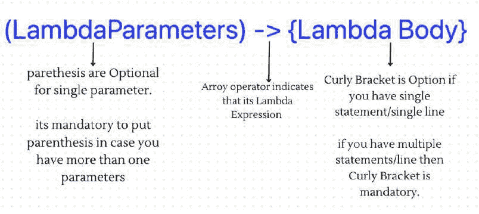

### 详解

- ❖ `LambdaParameters`: 这些是 Lambda 表达式的输入。

- ❖ `箭头 (->)`: 它将参数与 Lambda 表达式的主体分开。

- ❖ `Body`: 这是调用 Lambda 表达式时执行的代码。

➔ Lambda 表达式是一个匿名方法，意味着它没有名称。

➔ 如果你的 `LambdaBody` 包含花括号“{}”，那么你必须写一个 `return` 语句来返回数值。

➔ 如果 `LambdaBody` 是单条语句，那么你需要添加一个“return”语句。

### 最简单的 Lambda 表达式包含一个参数和一个表达式：`parameter -> expression`

若要使用多个一个参数，请将它们封装在括号中 `(parameter1, parameter2)-> expression`。

对于复杂的表达式，你可以使用大括号，如果你期望 Lambda 返回某些内容，甚至可以使用 return 语句。`(parameter1, parameter2) -> { code block }`。

让我们来看看是如何将普通的 Java 方法转换为 Lambda 表达式的。

### 如何将现有方法转换为 Lambda 表达式？示例 1：

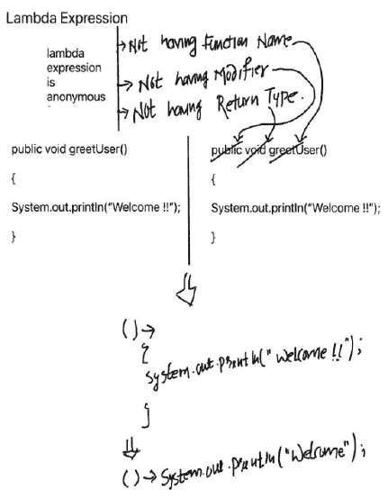 示例 2:

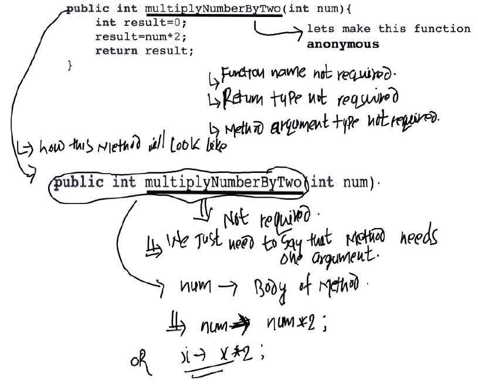

众所周知，我们只是将输入乘以 2，因此等效的 Lambda 表达式将如所示。

以下是一些用例，展示我们如何为不同数量的参数编写 Lambda 表达式。

类型推断（Type Inference）是 Lambda 表达式的重要方面之一。类型推断是在 Java 5 中以泛型的形式引入的。类型推断是 Java 编译器查看每个方法调用和相应声明以确定类型参数的能力。

由于类型推断，我们不需要在 Lambda 表达式中说明参数类型。

### 深入理解 Lambda 表达式

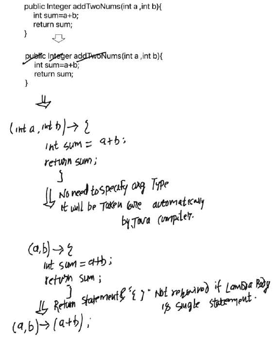

### 希望现在 Lambda 表达式已经很清晰了，让我们看看更多关于为不同参数编写 Lambda 的细节。

#### 0 个参数或无参数

如果没有参数（NO parameters），则如上所示需要空括号。

`()->LambdaBody`

```java
Runnable r=()>System.out.println(“Thread started”);
```

#### 单参数

`x->x++`

`x->(x+10)` 如果你有一个 Lambda 参数，括号是可选的。`(x)->(x+10)`。

如果你的 `Expression/Lambda Body` 包含多条语句，那么 `return` 语句是强制的。

```java
x->{
System.out.println“ Input :: ”+x); Return x+10;
}
```

如果你有多个 Lambda 参数，则括号是强制的。

#### 带多参数的 Lambda

`(x,y)->(x+y)`

`(x,y)->{ return (x+y)}`

让我们通过一个示例来理解。

我们有一个接口 `TestCalculator`，它包含一个方法 `addNum(int ,int)`，该方法将两个数字相加。

```java
public interface TestCalculator {
    int addNum(int number1,int number2);
}
```

实现这个方法 `addNum(..)` 来计算两个数字之和。Lambda 表达式可以如下：`(x,y)->x+y`，其中 `x` 和 `y` 是两个数字。

示例：

```java
public interface AddTwoNumbers {
    int addNumbers(int num1, int num2); 
}

public class LambdaExpDemo {
    public static void main(String[] args) {
        // 不使用 Lambda
        AddTwoNumbers addTwoNumbers = new AddTwoNumbers() { 
            @Override
            public int addNumbers(int num1, int num2) {
                return (num1 + num2);
            }
        };
        int sum =addTwoNumbers.addNumbers(10,12);
        System.out.println("SUM :: "+sum);

        // 使用 Lambda 表达式：
        AddTwoNumbers num2=(x,y)->(x+y); 
        int result2=num2.addNumbers(20,30); 
        System.out.println(result2);
    }
}
```

解释：

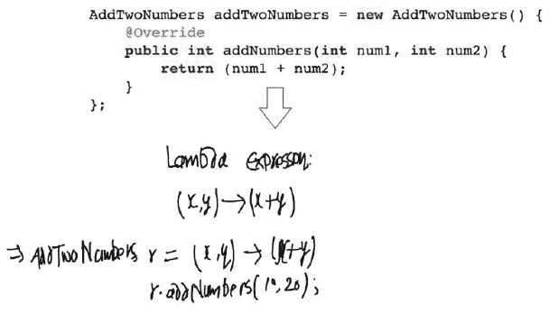 引入 Lambda 表达式是为了具有单个抽象方法的接口（函数式接口）的。

众所周知，匿名方法有“方法名称”、返回类型和方法的参数类型，因此编译器很难找到精确的实现，这会导致歧义。

为了解决此类问题，限制接口只能有一个抽象方法，这样 Lambda 表达式就可以在没有歧义的情况下编写和运行。这种接口被称为函数式接口（Functional Interface）。

## 方法引用（Method Reference）

想象你有一个玩具，当你按下它时会发出声音。方法引用就像指向某个按钮并说：“嘿，按这个按钮！”而不是你自己去按按钮，你是在告诉程序应该按哪个按钮。

### 它如何工作

在 Java 中，方法引用告诉程序使用特定的方法（如按下特定的按钮），而无需再次写出方法。

### 方法引用如何帮助简化 Lambda

➔ 方法引用用于引用函数式接口。

➔ 我们使用双冒号 `::` 方法引用。

➔ 它是调用 Lambda 表达式的简洁方式。

➔ 当你使用 Lambda 调用函数接口时，可以简单地用方法引用替换。

➔ 它提供了更好的可读性并减少了代码。

➔ 众所周知，Lambda 表达式只是提供函数式接口实现的一种。

➔ 方法引用 (::) 以更简单的方式完成相同的事情。

### 方法引用是如何工作的

接口：

```java
public interface MethodReferenceService {
    public void m1();
}
```

引用某些方法用于 `m1()`，方法引用意味着引用其他方法。

我们将看到如何为 `m1()` 方法引用 `m2()`

```java
public class MethodReferenceDemo {
    public static void m2(){
        System.out.println("#### Calling m2() method"); 
    }

    public static void main(String[] args) {
        // 从 MethodReferenceDemo 调用 m2() 方法
        MethodReferenceDemo.m2();

        // 使用 Lambda 从 MethodReferenceService 调用 m1()
        MethodReferenceService service=()-> System.out.println("#### Calling m1() method"); 
        service.m1();

        // 这里我提供了 m1() 的实现，但我不想为 m1() 提供任何实现
        // 我只想使用现有的 m2() 方法来实现 m1()
        MethodReferenceService referenceDemoService= MethodReferenceDemo::m2;
        referenceDemoService.m1(); 
    }
}
```

结果：

#### Calling m2() method #### Calling m1() method #### Calling m2() method 用例 1: 让我们看看方法 `m1()` 和 `m2()` 的返回类型是否不同。只有方法参数应该是相同的。

```java
public class MethodReferenceDemo {
    public static int m2(){
        System.out.println("#### Calling m2() method"); return 11;
    }
}
```

```java
public static void main(String[] args) {
    // 从 MethodReferenceDemo 中调用 m2() 方法
    MethodReferenceDemo.m2();

    // 使用 Lambda 类 MethodReferenceDemoService 中的 m1() 方法
    MethodReferenceDemoService service = () -> System.out.println("#### Calling m1() method");
    service.m1();

    // 在这里我提供了 m1() 的实现，但我不想为 m1() 提供任何实现
    // 我只是想用现有的 m2() 方法实现来实现 m1()
    MethodReferenceDemoService referenceDemoService = MethodReferenceDemo::m2;
    referenceDemoService.m1();
}
```

### 结果:

#### Calling m2() method #### Calling m1() method #### Calling m2() method

用例 2：让我们看看方法 m1() 是否返回值，而方法 m2() 不返回任何内容。

```java
public interface MethodReferenceDemoService2 {
    public String m1();
}

public class MethodReferenceDemo2 {
    public static void m2() {
        System.out.println("#### Calling m2() method");
        return 11;
    }

    public static void main(String[] args) {
        // 从 MethodReferenceDemo 中调用 m2() 方法
        MethodReferenceDemo2.m2();

        // 使用 Lambda 类 MethodReferenceDemoService 中的 m1() 方法
        MethodReferenceDemoService2 service = () -> "Welcome!!";
        String name = service.m1();
        System.out.println("Call using Lambda : " + name);

        MethodReferenceDemoService2 referenceDemoService = MethodReferenceDemo2::m2;
        referenceDemoService.m1();
    }
}
```

这将抛出编译时异常，因为方法 `m2()` 没有返回任何内容（它是 void），但 `m1()` 期望返回 `String`。更多信息，请查看下方的截图。

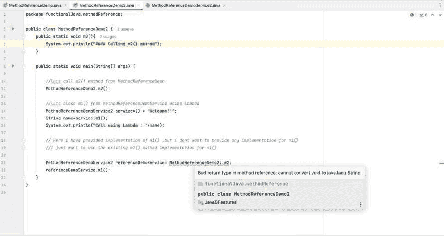

### 用例 3：如果 m1() 返回 String 且 m2() 返回 int 会怎样。

```java
public interface MethodReferenceDemoService2 {
    public String m1();
}
```

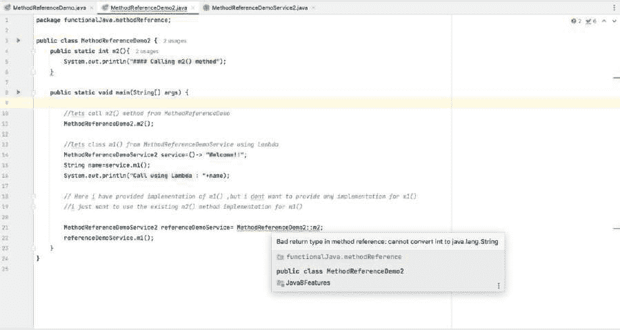

### 方法引用的前提条件

因此在使用方法引用时，我们只需要检查两点：

- 方法参数应该是相同的。

- 方法返回类型应该是兼容的，这意味着 `m2()` 的返回类型应该与 `m1()` 相同，或者可以转换为 m1() 的返回类型

```java
public interface MethodReferenceDemoService3 {
    public Number m1();
}
```

```java
package functionalJava.methodReference;

public class MethodReferenceDemo2 {
    public static Integer m2() {
        System.out.println("#### Calling m2() method");
        return 12;
    }

    public static void main(String[] args) {
        // 从 MethodReferenceDemo 中调用 m2() 方法
        MethodReferenceDemo2.m2();

        // 使用 Lambda 类 MethodReferenceDemoService3 中的 m1() 方法
        MethodReferenceDemoService3 service = () -> 11l;
        Long num = (long) service.m1();
        System.out.println("Call using Lambda : " + num);

        // 在这里我提供了 m1() 的实现，但我不想为 m1() 提供任何实现
        // 我只是想用现有的 m2() 方法实现来实现 m1()
        MethodReferenceDemoService3 referenceDemoService = MethodReferenceDemo2::m2;
        referenceDemoService.m1();
    }
}
```

### 结果：

#### Calling m2() method Call using Lambda : 11 #### Calling m2() method

让我们交换两个方法的返回类型看看，`m1()` 的返回类型是 `Integer`，而 `m2()` 的返回类型是 `Number`。

在这里尝试将一个返回 `Number` 的方法引用到一个返回 `Integer` 的方法，因此编译器将抛出编译错误。

```java
public interface MethodReferenceDemoService3 {
    public Integer m1();
}
```

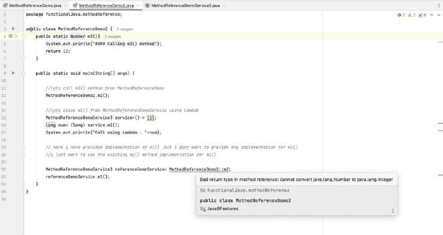

方法的返回类型是方法引用的关键因素之一，因为它决定了方法引用与你尝试赋值的目标函数式接口方法之间的兼容性。

简单来说，被引用的方法的返回类型必须匹配函数式接口期望的返回类型。

### 类型兼容性

函数式接口定义了一个单一抽象方法 (SAM)，该方法的返回类型是接口签名的一部分。当你使用方法引用来实现 SAM 时，该返回类型必须与函数式接口中指定的返回类型兼容。

### 推断

Java 编译器使用方法引用的返回类型来推断赋值给它的 Lambda 表达式或函数式接口变量的正确类型。如果返回类型不匹配，编译器将生成错误。

现在我们完成了方法引用（`::`）的基本概念。现在我们将查看方法引用的类型

### 方法引用的类型

Java 中有以下类型的方法引用：

1. 静态方法的引用。

2. 实例方法的引用。

3. 构造方法的引用。

语法：

- **静态方法**：`ClassName::methodName`


- **实例方法**：`instance::methodName` 或 `ClassName::instanceMethodName`
- **构造方法**：`ClassName::new`

静态方法的示例：

```java
@FunctionalInterface
interface Calculator {
    int calculate(int a, int b);
}
```

结果：

### 线程执行 1

### 线程执行 2

### 线程执行 3

### 线程执行 4

### 线程执行 5

### 线程执行 6

### 线程执行 7

### 线程执行 8

### 线程执行 9

在这里看到，我们没有为`run()`方法提供任何实现，我们只是引用了一个现有方法来完成我们的任务。

我们要引的方法并不强制存在于引用的同一个类中。它可以位于应用程序的任何地方。

```java
public class AppUtil {
    public static void getSum(){ 
        for(int i=1;i<=10;i++){
            System.out.println(i); 
        }
    }
}
```

引用`getSum(..)`

```java
import playwithjava.in.bean.AppUtil;

public class Java8Demo {
    public static void main(String[] args)throws Exception { 
        Runnable r= AppUtil::getSum;
        r.run();
    }
}
```

让我们考虑使用两个独立的线程打印奇数和偶数的用例。

```java
public class AppUtil {
    public static void printOdd(){
        for(int i=1;i<=10;i++){
            if(i%2!=0){
                System.out.println(i);
            }
        }
    }

    public static void printEven(){
        for(int i=1;i<=10;i++){
            if(i%2==0){
                System.out.println(i);
            }
        }
    }
}
```

```java
import playwithjava.in.bean.AppUtil;

public class Java8Demo {
    public static void main(String[] args)throws Exception { 
        Runnable r1= AppUtil::printOdd;
        r1.run();
        Runnable r2= AppUtil::printEven;
        r2.run();
    }
}
```

在这里我们只是通过一个简单的用例来解释静态方法引用，希望现在已经清楚了。你可以根据需求进行更多探索。

### 实例方法引用

`ObjectInstance_of_Class :: method_Name`

- 如我们所知，我们需要类实例来调用任何实例方法。
- 因此，实例方法引用与静态引用相同，唯一的区别在于我们需要使用类实例来调用方法，而 Java 中如何调用实例方法和静态方法是众为人知的。

```java
public class Java8Demo {
    public void printOdd(){
        for(int i=1;i<=10;i++){
            if(i%2!=0){
                System.out.println(i);
            }
        }
    }

    public static void main(String[] args)throws Exception {
        Java8Demo java8Demo= new Java8Demo(); 
        Runnable r1= java8Demo::printOdd;
        r1.run();
    }
}
```

在这里类`AppUtil`中中有两个实例方法。我使用同一个类和方法只是为了简化它，以便你轻松地看到差异。

```java
public class AppUtil {
    public void printOdd(){ 
        for(int i=1;i<=10;i++){ 
            if(i%2!=0){
                System.out.println(i); 
            }
        }
    }

    public void printEven(){
        for(int i=1;i<=10;i++){ 
            if(i%2==0){
                System.out.println(i); 
            }
        }
    }
}
```

```java
import playwithjava.in.bean.AppUtil;

public class Java8Demo {
    public static void main(String[] args)throws Exception {
        AppUtil appUtil= new AppUtil();
        Runnable r1= appUtil::printOdd;
        r1.run();
        Runnable r2= appUtil::printEven; 
        r2.run();
    }
}
```

让我们看看方法引用的一个真实用例。

使用方法引用打印员工列表：在这里我们将看到在控制台打印员工列表的所有可能选项。

#### 使用匿名函数

```java
EmplUtil. getAllEmployeesData() // 获取员工列表
.stream()
.forEach(new Consumer<EmployeeData>() {
    // forEach  Consumer 作为参数，因此我们正在进行匿名实现
    @Override
    public void accept(EmployeeData employeeData) {
        System.out.println(employeeData);
    }
});
```

#### Lambda 表达式：

```java
EmplUtil. getAllEmployeesData()
.stream()
.forEach(employeeData -> System.out.println(employeeData));
```

让我们创建一个静态方法来打印员工列表，稍后我们将使用一个预定义方法。

```java
public class Java8Demo {
    // 我们将引用此方法来打印员工数据
    public static void printEmpData(EmployeeData employeeData){
        System.out.println(employeeData);
    }

    public static void main(String[] args)throws Exception {
        EmplUtil. getAllEmployeesData()
        .stream()
        .forEach(Java8Demo::printEmpData);
    }
}
```

在上面的示例中，我们引用了现有方法`printEmpData(..)`来打印员工数据。我们甚至可以使用任何预定义的静态或实例方法来完成这项工作。

```java
public class Java8Demo {
    public static void main(String[] args)throws Exception {
        EmplUtil. getAllEmployeesData()
        .stream()
        .forEach(System::println);
    }
}
```

这里，`System`是预定义的类，`out`是`PrintStream`的静态引用，`println`是`PrintStream`类中的实例方法。

```java
public static final PrintStream out = null;
```

我们可以简单地引用`println`静态方法来打印员工数据。

### 用例：2

将 DTO 转换为 Entity。当你编写 DTO 到 Entity 时，我们使用了`Function<EmployeeData, Entity>`来完成这项工作。

### 使用用户定义方法的引用

在上面的示例中我们使用了 Lambda 表达式将 POJO 转换为 Entity。让我们创建一个单独的方法来转换 DTO 到 Entity。

该方法的实现可以位于应用程序的任何地方。

### 方法引用到

使用函数式接口转换到 Entity。

```java
public class Java8Demo {
    // 添加了转换的静态方法
    public static EmployeeEntity convertDtoToEntity(EmployeeData employeeData){
        EmployeeEntity entity=new EmployeeEntity();
        entity.setEmpId(employeeData.getEmpId());
        entity.setName(employeeData.getName());
        entity.setCity(employeeData.getCity());
        entity.setDesignation(employeeData.getDesignation());
        entity.setAnnualSalary(employeeData.getAnnualSalary());
        return entity;
    }

    public static void main(String[] args)throws Exception {
        EmplUtil. getAllEmployeesData()
        .stream()
        .forEach(Java8Demo::convertDtoToEntity);
    }
}
```

### 实例方法：

```java
public class Java8Demo {
    public EmployeeEntity convertDtoToEntity(EmployeeData employeeData){ 
        EmployeeEntity entity=new EmployeeEntity();
        entity.setEmpId(employeeData.getEmpId());
        entity.setName(employeeData.getName());
        entity.setCity(employeeData.getCity());
        entity.setDesignation(employeeData.getDesignation());
        entity.setAnnualSalary(employeeData.getAnnualSalary());
        return entity;
    }

    public static void main(String[] args)throws Exception {
        EmplUtil. getAllEmployeesData()
        .stream()
        .map(new Java8Demo()::convertDtoToEntity);
    }
}
```

使用方法引用将 DTO 列表转换为 Entity 列表

```java
import playwithjava.in.bean.EmployeeData;
```

```java
import playwithjava.in.bean.EmployeeEntity;
import playwithjava.in.util.EmplUtil;
import java.util.List;
import java.util.stream.Collectors;

public class Java8Demo {

    public EmployeeEntity convertDtoToEntity(EmployeeData employeeData) {
        EmployeeEntity entity = new EmployeeEntity();
        entity.setEmpId(employeeData.getEmpId());
        entity.setName(employeeData.getName());
        entity.setCity(employeeData.getCity());
        entity.setDesignation(employeeData.getDesignation());
        entity.setAnnualSalary(employeeData.getAnnualSalary());
        return entity;
    }

    public static void main(String[] args) throws Exception {
        List<EmployeeEntity> entityList = EmplUtil.getAllEmployeesData().stream() // convert to stream
            .map(new Java8Demo()::convertDtoToEntity)
            .collect(Collectors.toList()); // collect data as List
    }
}
```

在这里你可以看到`.stream()`和`collect(..)`，我们将在 Stream API 博客中详细介绍它们。

### 用用案例：3

从员工列表中按员工姓名降序获取所有员工姓名。

这只是我在这里放的一个简单示例，用于解释方法引用（Method reference）。

在实际开发中，你可以使用`ModelMapper`或任何第三方库（如`mapstruct`）将 DTO 转换为 Entity 或反之。

```java
List<String> nameList = EmplUtil.getAllEmployeesData().stream()
    .sorted(Comparator.comparing(EmployeeData::getName)) .map(EmployeeData::getName)
    .collect(Collectors.toList());
```

### 构造方法引用

语法：`ClassName::new`

Lambda/方法引用：

创建实例的 Lambda 表达式`(args) -> new ClassName(args)`

方法引用`ClassName::new`

函数接口：`TesCalculator`

```java
public interface TestCalculator { 
    AppUtil printDetails();
}
```

类：`AppUtil`

```java
import lombok.Data;

@Data
public class AppUtil {
    public void testConstructorRef() {
        System.out.println("Welcome to AppUtil");
    }
}
```

在这里我们必须查看构造方法引用是如何工作的以及在何时使用它。

正如名称所示，我们将引用某些构造方法来调用函数接口的方法。

让我们看看如何使用函数接口调用某些类的构造方法。

```java
// Functional Interface
TestCalculator test = () -> new AppUtil(); 
AppUtil appUtil = test.printDetails(); 

// Method Reference
TestCalculator testt = AppUtil::new; 
testt.printDetails().testConstructorRef();
```

方法引用/构造方法引用主要设计用于配合 Stream API 使用，以使代码变得简单且易读。

让我们看更多的例子：


```java
interface MessageUtil {
    Message getMessage(String msg); 
}

class Message {
    Message(String msg) { 
        System.out.print(msg); 
    }
}

public class ConstructorRefDemo { 
    public static void main(String[] args) { 
        MessageUtil hello = Message::new; 
        hello.getMessage("Hello");
    }
}
```

考虑我们有一个类`Message`以及一个`Message`构造方法的情况。使用构造方法引用，我们可以引用函数接口方法来调用该类的构造方法。我们必须确保接口方法的返回值类型是该类类型。在上面的示例中，`getMessage(..)`方法返回一个`message`类，因此我们能够调用`Message`类的构造方法。

众所周知，方法引用/构造方法引用是 Lambda 表达式的替代方案，而 Lambda 专门用于函数接口。

所以让我们将它们联系起来。

```java
import playwithjava.in.bean.StudentService;
import java.util.function.Function;
import java.util.function.Supplier;

public class Java8Demo {
    public static void main(String[] args) throws Exception { 
        // get Supplier
        Supplier<StudentDemo> supplier = StudentDemo::new; 
        // get Function
        Function<String,StudentDemo> getStudentIns = StudentDemo::new; 
        // get StudentService
        StudentService service = StudentDemo::new;

        StudentDemo s1 = supplier.get();
        StudentDemo s2 = getStudentIns.apply("RAJ");
        StudentDemo s3 = service.printStudent("Mohan");

        s1.printWelcome();
    }
}
```

## 考虑一个用例：你有一个 1 万名员工的列表，你想过滤所有姓名以“A”开头的员工。

### 使用自定义类的 Stream 过滤

让我们先不使用 Stream 来解决它：

```java
import java.util.ArrayList;
import java.util.List;

public class FilterEmployeeDataWithoutStream { 
    public static void main(String[] args) { 
        List<EmployeeBean> empData = EmployeeUtil.getAllEmployeeList(); 
        List<EmployeeBean> resultList = new ArrayList<>();

        for(EmployeeBean employeeBean:empData){ 
            if(employeeBean.getName().startsWith("A")){ 
                System.out.println(employeeBean); 
                resultList.add(employeeBean); 
            } 
        } 
    } 
} 
```

### 使用 Stream

```java
import java.util.List;
import java.util.stream.Collectors;

public class StreamDemoTest {
    public static void main(String[] args) {
        List<EmployeeBean> empData = EmployeeUtil.getAllEmployeeList();
        List<EmployeeBean> finalData = empData.stream()
            .filter(x->x.getName().startsWith("A"))
            .collect(Collectors.toList());

        finalData.forEach(x->System.out.println(x)); 
    }
} 
```

结果：

```
{name='Amit', city='Delhi', dept='Development', desig='SSE', salary=110000} {name='Abhinash', city='Bangalore', dept='Development', desig='SSE', salary=140000} {name='Ashish', city='Bangalore', dept='Development', desig='SSE', salary=190000}
```

### 链式多个过滤操作

```java
import java.util.List;
import java.util.stream.Collectors;

public class StreamDemoTest {
    public static void main(String[] args) {
        // 使用 EmployeeUtil 获取员工数据
        List<EmployeeBean> empData = EmployeeUtil.getAllEmployeeList();
        List<EmployeeBean> filteredResultFiler = filterDataMultipleFilter(empData);
        filteredResultFiler.forEach(x->System.out.println(x));
    }

    public static List<EmployeeBean> filterDataMultipleFilter(List<EmployeeBean> empData) {
        List<EmployeeBean> finalData = empData.stream()
            .filter(x->x.getName().startsWith("A"))
            .filter(y->y.getCity().equalsIgnoreCase("Bangalore"))
            .filter(z->z.getSalary()>80000)
            .collect(Collectors.toList());
        return finalData;
    }
} 
```

结果：

```
{name='Abhinash', city='Bangalore', dept='Development', desig='SSE', salary=140000} {name='Ashish', city='Bangalore', dept='Development', desig='SSE', salary=190000} {name='Amresh', city='Bangalore', dept='Development', desig='SSE', salary=123000}
```

## 函数接口

函数接口是一个只有一个抽象方法的接口。

我们通常使用`@FunctionalInterface`注解来标记这种接口，但并不是强制的。

如果接口只有一个抽象方法，它会被视为函数接口；但如果标记了`@FunctionalInterface`又添加了多个抽象方法，将抛出编译错误。

```java
@FunctionalInterface
public interface StudentService {
    Student getStudentData();//抽象方法
}
```

让我们看看 Lambda 表达式如何简化函数接口的实现。

内置函数接口：

1. `Runnable`
2. `Comparable`
3. `Comparator`
4. `Collable`

### 创建线程（不使用 Lambda 表达式）

```java
public class ThreadDemo implements Runnable{
    //线程实现
    @Override
    public void run() {
        System.out.println("This is Thread Implementation...");
    }
}

public class ThreadTest {
    public static void main(String[] args) {
        //创建线程
        ThreadDemo threadDemo=new ThreadDemo(); 
        Thread t1=new Thread(threadDemo); //启动线程
        t1.start();
    }
}
```

结果：This is Thread Implementation...

### 创建线程（使用 Lambda 表达式）

```java
public class ThreadWithLambdaDemo {
    public static void main(String[] args) {
        Runnable r=() -> System.out.println("Thread is Running ..."); 
        r.run();
    }
}
```

众所周知，函数式接口（Functional Interface）以前带有一个抽象方法，专门用于特定的功能。

我们可以根据自己的需求创建自定义的`Function`接口。Java 提供了一些预定义的函数式接口。

## 一些常用预定义函数式接口列表

1. `Function`
2. `UnaryOperator`
3. `BinaryOperator`
4. `Consumer`
5. `Predicate`
6. `Supplier`
7. `BiFunction`
8. `BiConsumer`
9. `BiPredicate`

### Function

它接收一个输入并返回另一个输出。

`Function<InputType,OutputType> functionName=(x)->y;` `Function<Integer,Integer> twiceNumber=(x)->x*2;`

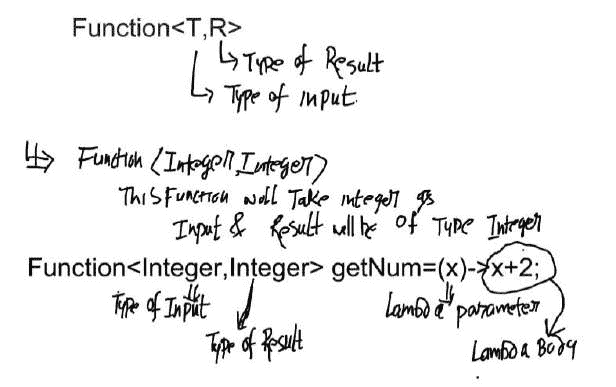函数式接口`Function`的声明

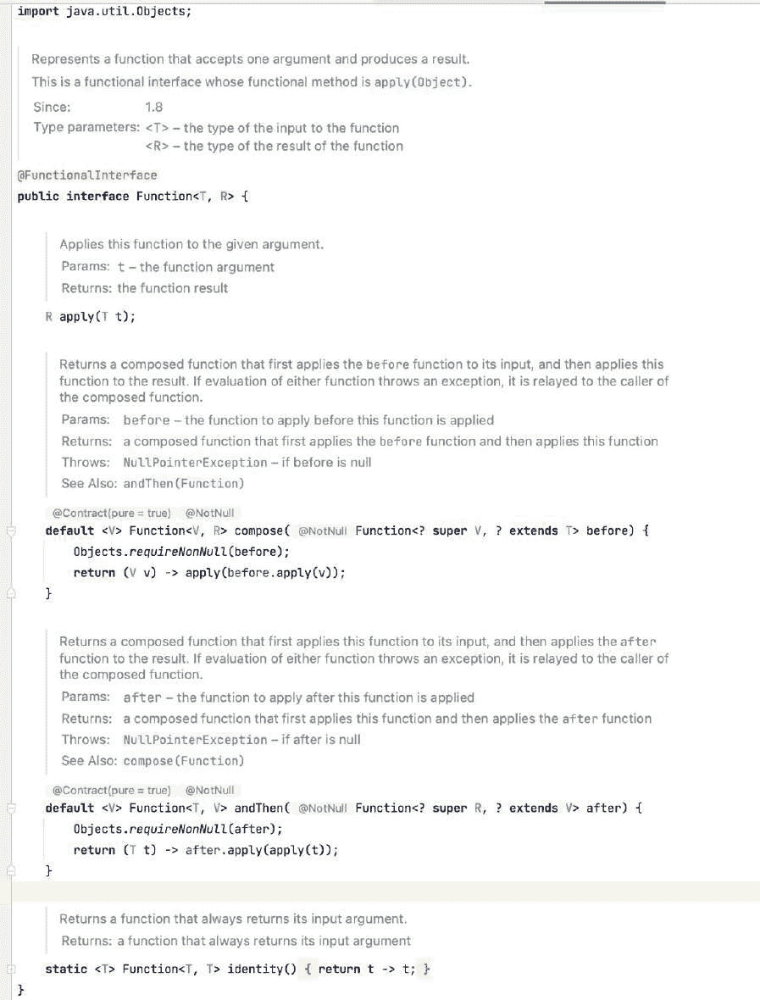用法：每当你有一个需要一个输入且需要相同类型或任何类型输出的用例时，请使用`function`。

将数字乘以 2：

```java
public class FunctionDemo {
    public static void main(String[] args) {
        Function<Integer,Integer> multiplyNumByTwo=(x)->x*2; Integer i=multiplyNumByTwo.apply(10);
        System.out.println("NUM: "+i);
    }
}
```

输出：

```
NUM: 20
```

查找给定字符串的长度：

`Function<String,Integer> findLenOfStr=(x)->x.length();` `Integer len= findLenOfStr.apply("Raj");`

`System.out.println("LEN: "+len);`

结果：LEN: 3

查找给定数字的平方：

`Function<Integer,Integer> findSqr=(x)->x*x;` `Integer sqr=findSqr.apply(12);`

`System.out.println("Square: "+sqr);`

结果：

```
Square: 144
```

```java
package playwithjava.in;
import java.util.function.Function;

public class Java8Demo {
    public static void main(String[] args)throws Exception { 
        Function<Integer,Integer> qube=(x)->x*x*x; Integer result=qube.apply(10);
        System.out.println("Result : "+result);
    }
}
```

| FunctionalInterface | 方法 | 输入参数 | 返回 | 用例 |
| :--- | :--- | :--- | :--- | :--- |
| `Function<T,R>` | `R apply(T t)` | `t` | `R`类型 | 需要提供一个输入类型`T`，它将返回类型`R`的输出 |
| `BiFunction<T1,T2,R>` | `R apply(T1 t1,T2 t2)` | `t1,t2` | `R`类型 | 需要两个输入类型`T1`和`T2`，它将返回类型`R`的输出 |
| `UnaryOperator<T>` | `T apply(T t)` | `t` | `T`类型 | 如果输入和输出类型相同，则它与`Function`相同 |
| `BinaryOperator<T>` | `T apply(T t,T u)` | `t,u` | `T`类型 | 如果输入和输出类型相同，则它与`BiFunction`相同 |

尝试使用这些函数式接口编写不同的用例。

### BiFunction

它类似于`Function`，但它接收 2 个输入，而`Function`接收 1 个输入。

`BiFunction<T1,T2,R>`接收类型为`T1`和`T2`的两个输入，并返回类型为`R`的输出。

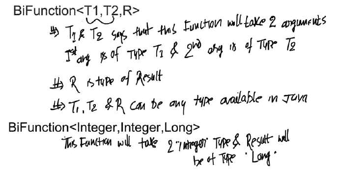

`BiFunction<Integer,Integer,Integer> multiplyFunc=(x,y)->x*y;`

`Integer result=multiplyFunc.apply(10,20);`

`System.out.println("Result : "+result);` 结果：200

假设我们有一个 2 个输入并返回一个任意类型输出的用例，那么我们可以使用`BiFunction`。

假设你有两个字符串，并且找到这两个字符串长度之和：

`BiFunction<String,String,Integer> getLengthOfTwoString=(x,y)->x.length()+y.length();` `Integer strLen=getLengthOfTwoString.apply("Raj","Mohan");`

`System.out.println(" STR Length: "+strLen);`

结果：STR Length: 8

### UnaryOperator

如果输入和返回类型相同，则它是`Function`的简化版本。

`UnaryOperator<Integer> addTen=(x)->(x+ 10);`

`Integer result=addTen.apply(10);`

`System.out.println("Result : "+result);`

### BinaryOperator

如果输入和输出类型相同，则它是`BiFunction`的简化版本。

`BinaryOperator<Integer> multiplyNum=(x,y)->(x*y);`

`Integer result=multiplyNum.apply(10,12);`

`System.out.println("Result : "+result);`

### Consumer

- 它只消费某些输入，而不提供任何返回值。
- 当我们需要调用某些后端操作（如调用返回类型不重要的方法）时，可以使用它。

| FunctionalInterface | 方法 | 输入参数 | 返回 | 用例 |
| :--- | :--- | :--- | :--- | :--- |
| `Consumer<T>` | `void accept(T t)` | `t` | void | 需要处理一个输入 |
| `BiConsumer<T1,T2>` | `void accept(T1 t1,T2 t2)` | `t1,t2` | void | 需要处理两个输入 |


```java
package playwithjava.in;
import java.util.function.*;

public class ConsumerDemo {
    public static void main(String[] args) {
        Consumer<Integer> consumer = (x) -> System.out.println("Consumed: " + x);
        consumer.accept(10);

        BiConsumer<Integer, Integer> biConsumer = (x, y) -> System.out.println("Consumed: " + x + " and " + y);
        biConsumer.accept(10, 20);
    }
}
```

## Supplier

它不接收输入，但返回一个输出。

| FunctionalInterface | 方法 | 输入参数 | 返回 | 用例 |
| :--- | :--- | :--- | :--- | :--- |
| `Supplier<R>` | `R get()` | 无 | `R` | 提供一个输出 |

`Supplier<String> supplier = () -> "Hello World";`

`System.out.println(supplier.get());`

## Predicate

它接收一个输入并返回布尔值。

| FunctionalInterface | 方法 | 输入参数 | 返回 | 用例 |
| :--- | :--- | :--- | :--- | :--- |
| `Predicate<T>` | `boolean test(T t)` | `t` | boolean | 测试一个输入 |

`Predicate<Integer> test = (x) -> x > 10;`

`System.out.println(test.test(15)); // true`

`System.out.println(test.test(5));  // false`

## BiPredicate

它接收两个输入并返回布尔值。

| FunctionalInterface | 方法 | 输入参数 | 返回 | 用例 |
| :--- | :--- | :--- | :--- | :--- |
| `BiPredicate<T1,T2>` | `boolean test(T1 t1,T2 t2)` | `t1,t2` | boolean | 测试两个输入 |

`BiPredicate<Integer, Integer> sumGreaterThan = (x, y) -> x + y > 20;`

`System.out.println(sumGreaterThan.test(10, 15)); // true`

`System.out.println(sumGreaterThan.test(10, 5));  // false`

- `map(Function f)` 用于将数据映射到所需的数据集中。
- 考虑一种场景：你有一个 `Employee` 列表（List），你想获取所有 `Employee` 的 `Name`。
- 或者你想获取所有员工的 `CITY` 城市。
- 我们可以使用 `map(..)` 实现，它会将 `Employee` 对象映射到 `Name`。
- 简单来说，`map(..)` 用于将数据从一种格式转换为另一种格式。
- `map` 操作用于修改流中的元素。
- `map` 方法是一个中间操作，用于将流中的每个元素转换为另一个元素，并返回包含转换后元素的新流。原始流保持不变。

`Employee Object` -> `Employee` 类

```java
class Employee{
    String name;
    String email;
    String city;
    Double salary;
}
```

### 为什么我们要 map？

在这里我们可以看到 `Employee` 对象有 4 个属性：`name`、`email`、`city` 和 `salary`。假设我们有一个 `Employees` 列表，我的需求是获取这些员工的 `Name`。我们可以简单地使用 `map` 实例，结果将只包含 `name` 属性。

这是我们可以使用 `map(..)` 方法的地方。我们可以看到，该方法接受一个 `Function` 接口并提供一个输出。我们将在后面的章节中详细介绍它。

```java
String a[]={"Ram","Shyam","Mohan","Bhanu"};
Arrays.stream(a)
  .map(x->x.length())
  .forEach(System.out::println);
```

**结果：**

3 5 5 5

 你简单地用表达式 `x->length()` 替换你的函数。

```java
Function<String,Integer> getStrLength=(x)->x.length();
String a[]={ "Ram","Shyam","Mohan","Bhanu"};
Arrays.stream(a)
  .map(getStrLength)
  .forEach(System.out::println);
```

### 考虑另一种场景，我们有一个 `Employee` 列表，我们想要所有员工的 `Name` 或者 `email` ID。我们可以简单地使用 `map` 将 `Employee` 对象映射到 `Name` 或 `emails`。列表。

自定义类获取名称列表（使用 Lambda 表达式）

```java
List<Employee> empList=AppUtil.getEmpList();
List<String> empNameList=empList.stream()
  .map(x->x.getName())// 映射到 x.name
  .collect(Collectors.toList());

empNameList.forEach(System.out::println);
```

**结果：**

Krish Marina Saloni Saloni

**使用 Lambda 表达式获取所有邮件列表：**

```java
List<String> empEmailList=AppUtil.getEmpList()
  .stream()
  .map(x->x.getEmail())
  .collect(Collectors.toList());
empNameList.forEach(System.out::println);
```

**使用方法引用获取名称列表：**

```java
List<Employee> empList=AppUtil.getEmpList();
List<String> empNameList=empList.stream()
  .map(Employee::getName)
  .collect(Collectors.toList());
empNameList.forEach(System.out::println);
```

**结果：**

Krish Marina Saloni Saloni Amir

### Limit 流元素

`Stream<T> limit(long maxSize)` 将流的大小截断到指定的大小

```java
String a[]={"Ram","Shyam","Mohan","Bhanu"};
Arrays.stream(a)
  .map(getStrLength)
  .limit(2) // 只取 2 个元素
  .forEach(System.out::println);
```

**输出：**

3 5

### Match 流元素

`boolean allMatch(Predicate<? super T> predicate)` 返回流中的所有元素是否匹配提供的谓词。

给定的谓词（条件）将应用于所有元素，如果它对所有元素都为真，则返回 True，否则返回 false。

```java
Integer num[]={1,2,3,4,5,6,7,8,9,10};
boolean isALlEven=Arrays.stream(num)
  .allMatch(x->(x%2==0));
System.out.println(isALlEven);
```

**结果：** False

`boolean anyMatch(Predicate<? super T> predicate)` 返回流中是否有任意元素匹配提供的谓词。

给定的谓词（条件）将应用于所有元素，如果它对**任意一个**元素为真，则返回 True，否则返回 false。给定的条件对任意一个元素为真即可。

```java
boolean isAnyEven=Arrays.stream(num)
  .anyMatch(x->(x%2==0));
System.out.println(isAnyEven);
```

如果流中有一个元素是偶数，它将返回 True。

**结果：** True

### 平坦化流数据：

`flatMap` 方法用于将流的每个元素转换为另一个元素流，然后将这些多个流展化为单个流。这在处理集合的集合（例如列表的列表）时特别有用。

#### 简单示例

假设我们有一个整数列表的列表，我们想要包含所有整数的单一列表。

#### 步骤详解示例

1. 创建嵌套列表：首先，我们创建一个包含多个的列表。
2. 使用 `flatMap` 平坦化列表：我们使用 `flatMap` 将每个内部列表转换为元素流，然后将这些多个流展化为单个流。
3. 收集结果：最后，我们收集结果。

```java
import java.util.Arrays;
import java.util.List;
import java.util.stream.Collectors;

public class FlatMapDemo {
    public static void main(String[] args) {
        // 步骤 1：创建嵌套列表
        List<List<Integer>> listOfLists = Arrays.asList(
            Arrays.asList(1, 2, 3),
            Arrays.asList(4, 5),
            Arrays.asList(6, 7, 8, 9)
        );

        // 步骤 2：使用 flatMap 平坦化列表
        List<Integer> flattenedList = listOfLists.stream()
          .flatMap(List::stream)
          .collect(Collectors.toList());

        // 步骤 3：打印结果
        System.out.println(flattenedList);
    }
}
```

### 解析

- 步骤 1：我们创建了列表列表 `listOfLists`。每个列表包含整数。
- 步骤 2：我们使用 `listOfLists.stream()` 创建列表流。然后，我们应用 `flatMap(List::stream)`，它将每个列表转换为整数流，并将它们展化为单个流。最后，我们使用 `collect(Collectors.toList())` 将其收集起来。
- 步骤 3：我们打印平坦后的列表。

**输出：**

[1, 2, 3, 4, 5, 6, 7, 8, 9]

### 中间操作和终端操作是如何工作的？

仔细看下面的图片，我们有一个数千条记录的 Employee 集合。我们对其执行“中间操作”来完成数据处理和转换，最后触发“终端操作”来获取流中所有转换后的数据。


### 每当你处理 Stream 时，需要记住必须调用终端操作才能从给定的流获取结果，且结果是值而不是 Stream。Stream API 提供了终端操作 `collect(..)` 用于从流中收集数据。

## 从流中收集数据

### `collect(Collector<? super T,A,R> collector)` `collect(Supplier<R> supplier, BiConsumer<R,? super T> accumulator, BiConsumer<R,R> combiner)` 数据是如何在 Stream 中收集？

- 它允许我们执行多次折叠操作（将元素重新封装到数据结构中并应用额外的逻辑、积累等）。
- `collect(..)` 允许将流元素收集到各种类型的集合中，例如列表、集合、映射，甚至是自定义收集器。
- 该还原操作的策略通过 `Collector` 接口的实现类提供。要理解 `collect(..)` 方法，我们必须先理解 `Collector` 接口。

可变归约操作（mutable reduction operation）将输入元素累加到一个可变的结果容器中。如果它是并行的，那么在处理完所有输入元素后，它会将累加的结果转换为最终结果。归约操作可以顺序执行也可以并行执行。

可变归约操作示例包括：
1. 将元素累加到 `Collection` 中
2. 使用 `StringBuilder` 拼接字符串
3. 计算元素的摘要信息，如 `sum`、`min`、`max` 或 `average`
4. 计算“透视表”摘要，例如“卖者的最大价值交易”等。`Collectors` 类提供了许多常用可变归约的实现。

`Collector` 由四个函数定义，这些函数共同工作将项累加到可变的结果容器中，并可选对结果执行最后的转换（针对并行归约操作）。

1. `supplier`：此函数创建一个新的可变结果容器。如果你使用并行 `Stream`，此函数可能会被多次调用。它每次都会返回一个新的值。
2. `accumulator`：它本质上是无状态的。用于将一个元素折叠到结果容器中。
3. `combiner`：将两个结果容器合并为一个。
4. `finisher`：它本质上是无状态的。它接受两个部分结果容器并将它们合并以获得最终结果。

● 归约操作可以是并行的或顺序的。

● 使用 collector 进行归约的顺序实现将使用 `supplier` 函数创建一个单一结果容器，并为每个输入元素调用一次 `accumulator` 函数。

● 并行实现将对输入进行分区，为每个分区创建一个结果容器，将每个分区的内容累加到该分区的子结果中，然后使用 `combiner` 函数将子结果合并为组合结果。

为了确保顺序执行和并行执行产生等效的结果，collector 函数必须满足等等（identity）和结合律（associativity）约束。

### 什么是结合律约束

结合律约束规定操作的分组不应影响最终结果。从数学角度来说，对于任意取值 `a`、`b` 和 `c`，`(a op b) op c = a op (b op c)`。

这对于并行评估的重要性可以通过将其扩展到四个项来看出：`a op b op c op d == (a op b) op (c op d)`。因此我们可以并行评估 `(a op b)` 和 `(c op d)`，然后对结果调用 `op`。结合律操作示例包括数值相加、`min`、`max` 和字符串拼接。

● 在 `Streams` 中，当执行并行归约时，结合律约束非常重要。

● 并行流将数据分成多个块并并发处理它们。

● `binary operation` 必须满足结合律才能获得正确结果。

### 什么是恒等约束

恒等约束规定必须存在一个单位元（也称为单位值或中性元素），它与任何其他元素结合时，不会改变该元素的值。从数学角度来说，对于任意值 `a`：`identityElement op a = a op identityElement = a`

## Collector

### `<R,A> R collect(Collector<? super T,A,R> collector)`

对此流的元素执行可变归约操作。当我们利用 `Collectors` 类提供内置的 `Collector` 实现时，它是非常有用的。

```java
String names[]={"Ram","Shyam","Mohan","BhanuPratap"}; 
List<String> collectNames=Arrays.stream(names).collect(Collectors.toList()); 
System.out.println(collectNames);

String names[]={"Ram","Shyam","Mohan","BhanuPratap"}; 
Set<String> collectNames=Arrays.stream(names).collect(Collectors.toSet()); 
System.out.println(collectNames);
```

让我们来看另一个重载方法：

在这里你可以传递任何 `Collector` 实例，我们稍后会介绍 `Callector`。

`collect(Supplier<R> supplier, BiConsumer<R,? super T> accumulator, BiConsumer<R,R> combiner)` 对此流的元素执行可变归约操作。

`collect` 方法是如何工作的的？让我们考虑一个用例：将数组元素转换为逗号分隔的值。输入：`[a,e,i,o,u]` 输出：`a,e,i,o,u` 或 `aeiou`


```java
List<String> elements = List.of("a", "b", "c", "d", "e");
// 顺序流 - 无需合并
StringBuilder result = elements.stream().collect(StringBuilder::new, (x, y) -> x.append(y), (a, b) -> a.append(",").append(b));
System.out.println(result.toString());
// Result: aeiou
```

```java
List<String> elements = List.of("a", "b", "c", "d", "e");
// 并行流 - combiner 正在合并部分结果
StringBuilder result = elements.stream().collect(StringBuilder::new, (x, y) -> x.append(y), (a, b) -> a.append(",").append(b));
System.out.println(result.toString());
// Result: a,e,i,o,u
```

- `supplier` 函数在每次调用时返回一个新的 `StringBuilder` 对象。
- `accumulator` 函数将列表字符串元素追加到 `StringBuilder` 实例中。
- `combiner` 函数合并 `StringBuilder` 实例。实例之间通过逗号连接并进行相互合并。
- 在第一种情况下，我们有一个元素的顺序流。因此它们被逐个处理，并且只有一个 `StringBuilder` 实例。没有使用 `combiner` 函数。这就是为什么产生的输出是“abcde”。
- 在第二种情况下，我们有一个字符串的并行流。因此元素被并行处理，并且有多个 `StringBuilder` 实例正在被 `combiner` 函数合并。因此，产生的输出是“a,b,c,d,e”。让我们通过代码理解 `supplier`、`accumulator` 和 `combiner` 语。

创建一个提供 `ArrayList` 的 `Supplier`，使用 Lambda 表达式：

```java
Supplier<ArrayList<String>> getList = () -> new ArrayList<>();
```

使用构造方法引用：

```java
Supplier<ArrayList<String>> getList1 = ArrayList::new;
```

创建类型为 `accumulator` 的对象，使用 Lambda 表达式：

```java
BiConsumer<ArrayList, String> biConsumer = (existingList, newElement) -> existingList.add(newElement);
```

使用方法引用：

```java
BiConsumer<ArrayList, String> biConsumer1 = ArrayList::add;
```

创建类型为 `finisher` 的对象，使用 Lambda 表达式：

```java
BiConsumer<ArrayList<String>, ArrayList<String>> listConsumer = (existingList, newList) -> existingList.addAll(newList);
```

使用方法引用：

```java
BiConsumer<ArrayList<String>, ArrayList<String>> listConsumer2 = ArrayList::addAll;
```

用例：`String userData[] = {"Raj", "Mahesh", "Himesh"};` 将这些数据收集为 `List`：

```java
List<String> stringArrayList1 = Arrays.stream(userData).collect(
    () -> new ArrayList<>(),
    (existingList, newElement) -> existingList.add(newElement),
    (existingList, newList) -> existingList.addAll(newList)
);
```

### 使用方法/构造引用

注意：我们将在节详细介绍方法引用。

```java
List<String> stringArrayList = Arrays.stream(userData).collect(
    ArrayList::new,
    ArrayList::add,
    ArrayList::addAll
);
```

`Collectors.toList()` 返回一个将输入元素累加到新 `List` 中的 Collector。

```java
List<EmployeeBean> finalData = empData.stream()
    .filter(z -> z.getSalary() > 80000)
    .collect(Collectors.toList());
```

`Collectors.toUnmodifiableList()` 返回一个将输入元素累加到不可变 `List` 中的 Collector。

```java
List<EmployeeBean> employeeBeansList = empData.stream()
    .collect(Collectors.toUnmodifiableList());
```

`Collectors.toSet()` 以 `Set` 实例的形式收集数据。

```java
Set<EmployeeBean> employeeBeansSet = empData.stream()
    .collect(Collectors.toSet());
```

不可变 `Set`：

```java
Set<EmployeeBean> employeeBeansSet = empData.stream()
    .collect(Collectors.toUnmodifiableSet());
```

`Collectors.toMap()` 以 `Map` 的形式收集数据。

```java
Map<String, Integer> empMap = empData.stream()
    .collect(Collectors.toMap(x -> x.getName(), y -> y.getSalary()));
```

`Collectors.toUnmodifiableMap()`：

```java
Map<String, Integer> empMap1 = empData.stream()
    .collect(Collectors.toUnmodifiableMap(x -> x.getName(), y -> y.getSalary()));
```

# 使用额外的下游收集器收集数据

`collectingAndThen(Collector<T, A, R> downstream, Function<R, RR> finisher)`

此方法允许你对收集器的结果执行一个最终转换操作。

它接收两个参数：第一个参数是用于收集元素的收集器，第二个参数是一个用于对收集器结果执行最终转换的函数。

该转换的结果即为 `collectingAndThen` 收集器的最终结果。

```java
// Create a list of integers
List<Integer> numbers = Stream.of(10, 20, 30, 40)
    .collect(Collectors.toList());

// Use collectingAndThen to get the sum of all integers in the list
int sum = numbers.stream()
    .collect(Collectors.collectingAndThen(
        Collectors.summingInt(x -> x.intValue()),
        result -> {
            System.out.println("Transforming result Data: " + result);
            return result * result;
        }
    ));

System.out.println("Final result Data: " + sum);
```

**Result：** `Result: 100` `Final result: 10000`

在上面的示例中你可以看到，我们从归约操作获取了一些数字，然后对这些结果数据执行了额外的操作，并得到了该结果的平方。

我们也可以使用普通的 `collect(..)` 方法来实现这一点，但可能需要分两步进行：首先获取和，然后获取结果的平方。

```java
// get Employee collection, reference from earlier example
Long avgSal = EmployeeUtil.getAllEmployeeList().stream()
    .collect(Collectors.collectingAndThen(
        Collectors.averagingInt(x -> x.getSalary()),
        x -> x.longValue() * 3
    ));

System.out.println("average salary ::" + avgSal);
```

**Result：** `average salary ::611400`

## GroupBy 收集数据

Java Stream 提供了方便的方法对集合数据进行分组。

- `groupingBy(Function<? super T, ? extends K> classifier)`
- `groupingBy(Function<? super T, ? extends K> classifier, Supplier<M> mapFactory, Collector<? super T, A, D> downstream)`
- `groupingBy(Function<? super T, ? extends K> classifier, Collector<? super T, A, D> downstream)`

我们还有上述方法的并发版本。更多信息可以查阅 Java 17 官方文档 `groupingBy(Function<? super T, ? extends K> classifier)`。

## GroupBy 如何与 Stream 数据协同工作

Java 中的 `groupingBy` 收集器用于根据指定的键对流中的元素进行分组。

它返回一个 `Map<K, List<T>>`，其中 `K` 是流分组的键（KEY），Value 是输入流类型元素的类型列表。

**用例：** 按城市（CITY）分组员工（Employee）。

```java
import functionalJava.bean.EmployeeBean;
import util.AppUtil;
import java.util.List;
import java.util.Map;
import java.util.stream.Collectors;

public class GroupByDemo {
    public static void main(String[] args) {
        List<EmployeeBean> empList = AppUtil.getEmpList();

        System.out.println("########## Existing Data ############### ");
        empList.forEach(System.out::println);

        // Using Lambda Expression
        Map<String, List<EmployeeBean>> empMap = empList.stream()
            .collect(Collectors.groupingBy(x -> x.getCity()));

        // Using Method Reference
        Map<String, List<EmployeeBean>> empMap1 = empList.stream()
            .collect(Collectors.groupingBy(EmployeeBean::getCity));

        System.out.println("# MAP Data:: " + empMap);
    }
}
```

**Input Data：** 我们有以下来自不同地点的 5 个员工。我们将这些数据作为输入，并对样本数据执行 GroupBy 查询。

**########## Existing Data ###############**

```
{name='Raj', city='Patna', dept='R&D', desig='SSE', salary=50000}
{name='Mohan', city='Mumbai', dept='Software', desig='SE', salary=60000}
{name='Salman', city='Bangalore', dept='R&D', desig='Manager', salary=70000}
{name='Amir', city='Bangalore', dept='Gov', desig='Arch', salary=80000}
{name='Dharam', city='Patna', dept='Railway', desig='SSE', salary=90000}
```

**After Grouping: group by CITY # MAP Data::**

```
{
  Patna=[
    {name='Raj', city='Patna', dept='R&D', desig='SSE', salary=50000},
    {name='Dharam', city='Patna', dept='Railway', desig='SSE', salary=90000}
  ],
  Mumbai=[
    {name='Mohan', city='Mumbai', dept='Software', desig='SE', salary=60000}
  ],
  Bangalore=[
    {name='Salman', city='Bangalore', dept='R&D', desig='Manager', salary=70000},
    {name='Amir', city='Bangalore', dept='Gov', desig='Arch', salary=80000}
  ]
}
```

查看上面的结果：

- 我们有 2 个员工来自“Patna”。
- 我们有 1 个员工来自“Mumbai”。
- 我们有 2 个员工来自“Bangalore”。

我们总共有来自不同地点的 5 个员工，现在按城市（CITY）对他们进行分组。

## GroupBy 收集数据

**用例：** 按城市（CITY）和职位（Designation）分组员工。

```java
import functionalJava.bean.EmployeeBean;
import util.AppUtil;
import java.util.List;
import java.util.Map;
import java.util.stream.Collectors;

public class GroupByMultipleKey {
    public static void main(String[] args) {
        List<EmployeeBean> empList = AppUtil.getEmpList();

        System.out.println("########## Existing Data ############### ");
        empList.forEach(System.out::println);

        // Using Lambda Expression
        Map<String, Map<String, List<EmployeeBean>>> empMap = empList.stream()
            .collect(Collectors.groupingBy(
                x -> x.getCity(),
                Collectors.groupingBy(x -> x.getDesig())
            ));

        System.out.println("# MAP Data:: " + empMap);
    }
}
```

**Result：** `########## Existing Data ###############`

```
{name='Raj', city='Patna', dept='R&D', desig='SSE', salary=50000}
{name='Mohan', city='Mumbai', dept='Software', desig='SE', salary=60000}
{name='Salman', city='Bangalore', dept='R&D', desig='Manager', salary=70000}
{name='Amir', city='Bangalore', dept='Gov', desig='Arch', salary=80000}
{name='Dharam', city='Patna', dept='Railway', desig='SSE', salary=90000}
```

**# MAP Data::**


```text
{Patna={SSE=[{name='Raj', city='Patna', dept='R&D', desig='SSE', salary=50000}, {name='Dharam', city='Patna', dept='Railway', desig='SSE', salary=90000}]},
Mumbai={SE=[{name='Mohan', city='Mumbai', dept='Software', desig='SE', salary=60000}]},
Bangalore={Manager=[{name='Salman', city='Bangalore', dept='R&D', desig='Manager', salary=70000}], Arch=[{name='Amir', city='Bangalore', dept='Gov', desig='Arch', salary=80000}]}}
```

```java
.collect(Collectors.groupingBy(EmployeeBean::getDesig, Collectors.summingInt(EmployeeBean::getSalary)));
System.out.println("# Desig wise Total Salary :: " + empMap1);

Map<String, IntSummaryStatistics> empMap2 = empList.stream()
    .collect(Collectors.groupingBy(
        EmployeeBean::getCity,
        Collectors.summarizingInt(EmployeeBean::getSalary)
    ));
System.out.println("# City wise Salary Summary:: " + empMap);

Map<String, Double> empMap3 = empList.stream()
    .collect(Collectors.groupingBy(
        EmployeeBean::getCity,
        Collectors.averagingInt(EmployeeBean::getSalary)
    ));
System.out.println("# City wise Avg Salary :: " + empMap);

Map<String, Long> empMap4 = empList.stream()
    .collect(Collectors.groupingBy(EmployeeBean::getCity, Collectors.counting()));

System.out.println("# City wise Employee Count :: " + empMap);

Map<String, Optional<EmployeeBean>> empMap5 = empList.stream()
    .collect(Collectors.groupingBy(
        EmployeeBean::getCity,
        Collectors.maxBy(Comparator.comparing(EmployeeBean::getSalary))
    ));
System.out.println("# City wise MAX Salary Employee :: " + empMap);
```

让我们再练习一些关于`groupBy`的示例。

### 结果

#### 输入数据

```text
{name='Raj', city='Patna', dept='R&D', desig='SSE', salary=50000}
{name='Mohan', city='Mumbai', dept='Software', desig='SE', salary=60000}
{name='Salman', city='Bangalore', dept='R&D', desig='Manager', salary=70000}
{name='Amir', city='Bangalore', dept='Gov', desig='Arch', salary=80000}
{name='Dharam', city='Patna', dept='Railway', desig='SSE', salary=90000}
```

#### 分组后

- 按城市总薪资：`{Patna=140000, Mumbai=60000, Bangalore=150000}`
- 按职位总薪资：`{SE=60000, SSE=140000, Arch=80000, Manager=70000}`
- 按城市薪资统计：`{Patna=140000, Mumbai=60000, Bangalore=150000}`
- 按城市平均薪资：`{Patna=140000, Mumbai=60000, Bangalore=150000}`
- 按城市员工人数：`{Patna=140000, Mumbai=60000, Bangalore=150000}`
- 按城市最高薪资员工：`{Patna=140000, Mumbai=60000, Bangalore=150000}`

让我们考虑一个用例：我有一个巨大的`Employee`集合。如如下所示，`EmployeeBean`类中有很多许多属性。

我想按`CITY`（城市）对员工进行分组，结果我只需要“name”（名称）和“city”（城市）。

在实际项目中，我们经常遇到这样的需求，即当我们拥有海量数据集，且只需要响应对象中的几个字段时，我们通常会将响应对象映射到我们需要的格式。

```java
public class EmployeeBean {
    private String name;
    private String city;
    private String dept;
    private String desig;
    private Integer salary;
    private String location;
    private String nickName;
    private Date doj;
    private Date dob;
}
```

响应 Bean：

```java
public class EmployeeMappedBean {
    String name;
    String city;
}
```

让我们看看如何使用分组将数据映射到所需的格式：

```java
import functionalJava.bean.EmployeeBean;
import functionalJava.bean.EmployeeMappedBean;
import util.AppUtil;
import java.util.List;
import java.util.Map;
import java.util.stream.Collectors;

public class GroupByMaping {
    public static void main(String[] args) {
        List<EmployeeBean> empList = AppUtil.getEmpList();
        System.out.println("########## Input Data ############### ");
        empList.forEach(System.out::println);

        // 使用方法引用，你也可以使用 Lambda 表达式实现相同的功能
        Map<String, List<EmployeeMappedBean>> mappedData = empList.stream()
            .collect(Collectors.groupingBy(
                EmployeeBean::getCity,
                Collectors.mapping(
                    GroupByMaping::mapEmpData,
                    Collectors.toList()
                )
            ));

        System.out.println("########### AFTER MAPPING ###########");
        System.out.println("## Mapped Data:: " + mappedData);
    }

    // 此方法将映射到所需的格式
    public static EmployeeMappedBean mapEmpData(EmployeeBean e) {
        EmployeeMappedBean data = new EmployeeMappedBean();
        data.setName(e.getName());
        data.setCity(e.getCity());
        return data;
    }
}
```

### 结果

#### 输入数据

```text
{name='Raj', city='Patna', dept='R&D', desig='SSE', salary=50000}
{name='Mohan', city='Mumbai', dept='Software', desig='SE', salary=60000}
{name='Salman', city='Bangalore', dept='R&D', desig='Manager', salary=70000}
{name='Amir', city='Bangalore', dept='Gov', desig='Arch', salary=80000}
{name='Dharam', city='Patna', dept='Railway', desig='SSE', salary=90000}
```

# 输入数据

```json
{name='Raj', city='Patna', dept='R&D', desig='SSE', salary=50000}
{name='Mohan', city='Mumbai', dept='Software', desig='SE', salary=60000}
{name='Salman', city='Bangalore', dept='R&D', desig='Manager', salary=70000}
{name='Amir', city='Bangalore', dept='Gov', desig='Arch', salary=80000}
{name='Dharam', city='Patna', dept='Railway', desig='SSE', salary=90000}
```

# 映射后的数据（分组示例）

```json
Bangalore=[
    {name='Amir', city='Bangalore', dept='Gov', desig='Arch', salary=80000},
    {name='Salman', city='Bangalore', dept='R&D', desig='Manager', salary=70000}
],
Mumbai=[
    {name='Mohan', city='Mumbai', dept='Software', desig='SE', salary=60000}
],
Patna=[
    {name='Dharam', city='Patna', dept='Railway', desig='SSE', salary=90000},
    {name='Raj', city='Patna', dept='R&D', desig='SSE', salary=50000}
]
```

## 概念解释

- 正如所见，`groupingBy`任务有多个重载方法。我们可以根据需要使用任何一个。
- 以上代码类似于`grouping` collector的第二个变体，其中只包含两个参数：`Function`和`downstream`收集器。
- 但这里有第三个参数，即`supplier`函数。我们使用了`TreeMap::new()`作为`Supplier`——这告诉`groupingBy`收集器在`TreeMap`实例中收集分组值。
- 结果与之前相同，但我们增加了基于`Map`键排序数据的额外能力，因为我们在内部使用了`TreeMap`。这次，结果`Map`的键（部门名称）按字母顺序排列，而这在之前的输出中是不具备的。这种字母排序是因为这次使用了`TreeMap`，它会自动根据键的自然顺序对条目进行排序。

## 代码实现

```java
import util.AppUtil;
import java.util.List;
import java.util.Map;
import java.util.TreeMap;
import java.util.stream.Collectors;

public class GroupByWithSupplierAndCollector {
    public static void main(String[] args) {
        List<EmployeeBean> empList = AppUtil.getEmpList();
        System.out.println("########## Existing Data ############### ");
        empList.forEach(System.out::println);

        Map<String, Double> empMap = empList.stream()
            .collect(Collectors.groupingBy(
                EmployeeBean::getCity,
                TreeMap::new,
                Collectors.averagingInt(EmployeeBean::getSalary)
            ));

        System.out.println("# MAP Data:: " + empMap);
    }
}
```

# `PartitioningBy`概念

## 什么是 Stream 中的 Partitioning？

`partitioningBy`是用于将数据分为两个部分（基于布尔条件的`Predicate`）的收集器。

- 我们有两个重载的`partitioningBy`方法：
  1. `partitioningBy(Predicate<? super T> predicate)`
  2. `partitioningBy(Predicate<? super T> predicate, Collector<? super T,A,D> downstream)`

- `Predicate`是一个函数接口，接受一个输入并返回一个`boolean`结果。

例如，根据薪水是否大于`70000`进行分类。薪水大于`70000`的员工将进入第一类（`true`），其余的进入第二类（`false`）。

## 代码示例

```java
import java.util.List;
import java.util.Map;
import java.util.stream.Collectors;

public class PartitioningByDemo {
    public static void main(String[] args) {
        List<EmployeeBean> empList = AppUtil.getEmpList();
        System.out.println("###### Input Data ######");
        empList.forEach(System.out::println);

        Map<Boolean, List<EmployeeBean>> empMap = empList.stream()
            .collect(Collectors.partitioningBy(x -> x.getSalary() > 70000));

        System.out.println("### Result :: " + empMap);
    }
}
```

```json
{false=[
    {name='Raj', city='Patna', dept='R&D', desig='SSE', salary=50000},
    {name='Mohan', city='Mumbai', dept='Software', desig='SE', salary=60000},
    {name='Salman', city='Bangalore', dept='R&D', desig='Manager', salary=70000}
],
true=[
    {name='Amir', city='Bangalore', dept='Gov', desig='Arch', salary=80000},
    {name='Dharam', city='Patna', dept='Railway', desig='SSE', salary=90000}
]}
```

如上所示，根据输入的谓词（predicate），数据将被划分为两组：`True`或`False`。它将根据给定的谓词对所有集合数据进行验证。

现在让我们来看一个用例，我们想要对分区后的数据执行某些额外任务，例如映射数据。我们可以使用`partitioningBy(..)`的第二种变体来实现这一点。你可以使用任何`Collectors`类方法，该方法将返回一个`Collector`实例。

### 查找工资 > 70000 的员工姓名

在这里我们将使用`mapping`方法并将响应映射到`Employee Name`。


```java
import java.util.List;
import java.util.Map;
import java.util.stream.Collectors;

public class PartitioningByWithCollectorDemo {
    public static void main(String[] args) {
        List<EmployeeBean> empList= AppUtil.getEmpList();
        System.out.println("###### Input Data ######");
        empList.forEach(System.out::println);

        Map<Boolean,List<String>> empMap =empList.stream()
            .collect(Collectors.partitioningBy(x->x.getSalary()>70000,
                Collectors.mapping(EmployeeBean::getName,Collectors.toList())));
        System.out.println("### Result :: "+empMap);
    }
}
```

#### 结果

###### Input Data ######

{name='Raj', city='Patna', dept='R&D', desig='SSE', salary=50000} {name='Mohan', city='Mumbai', dept='Software', desig='SE', salary=60000} {name='Salman', city='Bangalore', dept='R&D', desig='Manager', salary=70000} {name='Amir', city='Bangalore', dept='Gov', desig='Arch', salary=80000} {name='Dharam', city='Patna', dept='Railway', desig='SSE', salary=90000}

### Result

{false=[Raj, Mohan, Salman], true=[Amir, Dharam]}

```java
import java.util.IntSummaryStatistics;
import java.util.List;
import java.util.Map;
import java.util.stream.Collectors;

public class PartitioningByWithCollectorDemo {
    public static void main(String[] args) {
        List<EmployeeBean> empList= AppUtil.getEmpList();
        System.out.println("###### Input Data ######");
        empList.forEach(System.out::println);

        Map<Boolean,Long> empMap1 =empList.stream()
            .collect(Collectors.partitioningBy(x->x.getSalary()>70000, Collectors.counting()));
        System.out.println("### Count Of Employee :: "+empMap1);

        Map<Boolean,Integer> empMap2 =empList.stream()
            .collect(Collectors.partitioningBy(x->x.getSalary()>70000, Collectors.summingInt(EmployeeBean::getSalary)));
        System.out.println("### Sum Of Salary :: "+empMap2);

        Map<Boolean, IntSummaryStatistics> empMap3 =empList.stream()
            .collect(Collectors.partitioningBy(x->x.getSalary()>70000, Collectors.summarizingInt(EmployeeBean::getSalary)));
        System.out.println("### Summery :: "+empMap3);
    }
}
```

#### 结果

###### Input Data ######

{name='Raj', city='Patna', dept='R&D', desig='SSE', salary=50000} {name='Mohan', city='Mumbai', dept='Software', desig='SE', salary=60000} {name='Salman', city='Bangalore', dept='R&D', desig='Manager', salary=70000} {name='Amir', city='Bangalore', dept='Gov', desig='Arch', salary=80000} {name='Dharam', city='Patna', dept='Railway', desig='SSE', salary=90000}

### Result

### Count Of Employee :: {false=3, true=2}

### Sum Of Salary :: {false=180000, true=170000}

### Summery :: {false=IntSummaryStatistics{count=3, sum=180000, min=50000, average=60000.000000, max=70000}, true=IntSummaryStatistics{count=2, sum=170000, min=80000, average=85000.000000, max=90000}}

### 联合执行多个 Stream 操作

`teeing(Collector)R1, Collector R2, BiFunction super R1, super R2, ? R)`

`Collectors.teeing()` 方法在 Java 12 中引入，用于对流执行两个独立的收集操作，然后通过指定的 `merge` 函数将结果合并为最终结果。`teeing` 适用于我们需要对流执行多个聚合操作的情况。这里是一个关于如何在流中使用 `Collectors.teeing()` 的示例：

```java
import java.util.function.BiFunction;
import java.util.List;
import java.util.List;
import java.util.Map;
import java.util.stream.Collectors;
import java.util.Arrays;
import java.util.HashMap;

public class GroupByT {
    public static void main(String[] args) {
        List<EmployeeBean> empList= AppUtil.getEmpList();
        System.out.println("###### Input Data #####");
        empList.forEach(System.out::println);

        Map<String, Double> result = empList.stream()
            .collect(Collectors.teeing(
                Collectors.averagingInt(EmployeeBean::getSalary),
                Collectors.counting(),
                (avg, count) -> {
                    Map<String, Double> map = new HashMap<>();
                    map.put("AverageSalary", avg);
                    map.put("TotalEmployees", (double)count);
                    return map;
                }
            ));
        System.out.println("Result: " + result);
    }
}
```

#### 结果

###### Input Data #####

{name='Raj', city='Patna', dept='R&D', desig='SSE', salary=50000} {name='Mohan', city='Mumbai', dept='Software', desig='SE', salary=60000} {name='Salman', city='Bangalore', dept='R&D', desig='Manager', salary=70000} {name='Amir', city='Bangalore', dept='Gov', desig='Arch', salary=80000} {name='Dharam', city='Patna', dept='Railway', desig='SSE', salary=90000}

Result: {AverageSalary=62000.0, TotalEmployees=5.0}

### 串联流

`Stream<T> concat(Stream<? extends T> a, Stream<? extends T> b)` 返回一个延迟串联流，包含第一个流的所有元素，随后是第二个流的所有元素。

```java
String emp1[]={"Raj","Mahesh"};
String emp2[]={"Rajiv","Mukesh"};
Stream<String> stringStream1=Arrays.stream(emp1);
Stream<String> stringStream2=Arrays.stream(emp2);
Stream<String> stringStream=Stream.concat(stringStream1,stringStream2);
stringStream.forEach(System.out::println);
```

#### 结果

Raj

Mahesh

Rajiv

Mukesh

### 丢弃流数据

`Stream<T> dropWhile(Predicate super T predicate)` 在谓词为 `TRUE` 时忽略流元素。

假设我们有以下元素：

`int []ab={11,13,15,17,18,19,20,21,23,24,25,26,27,28};`

条件：`x%2!=0`，奇数。

它会一直丢弃流元素，直到第一个偶数出现。我们通常对排序后的元素应用此方法。

```java
Arrays.stream(ab)
    .dropWhile(x->x%2!=0)
    .forEach(System.out::println);
```

#### 结果

20 21 23 24 25 26 27 28

#### 用例：2

我们有一个员工列表，我们需要丢弃所有工资 `<80000` 的员工。

```java
List<EmployeeBean> empList=AppUtil.getEmpList();
List<EmployeeBean> employeeBeans=empList.stream()
    .sorted(Comparator.comparingDouble(EmployeeBean::getSalary)).collect(Collectors.toList());

employeeBeans.stream()
    .dropWhile(x->x.getSalary()<80000)
    .forEach(x-> System.out.println("## "+x.getName()+" "+x.getSalary()));
```

#### 结果

## Amir 80000.0

## Dharam 90000.0

## Krish 100000.0

## Marina 110000.0

## Saloni 120000.0

`default Stream<T> takeWhile(Predicate<? super T> predicate)` 是 `dropWhile` 的相反操作。

```java
int []ab={11,13,15,17,181,19,20,21,23,24,25,26,27,28};
Arrays.stream(ab)
  .takeWhile(x->x%2!=0)
  .forEach(System.out::println);
```

**结果：**

11

13

15

17

181

19

#### 用例：2

我们有一个 `Employee` 列表，需要过滤掉所有薪资小于 `<80000` 的 `Employee`。

```java
// 它将返回 Employee 对象列表
List<EmployeeBean> empList=AppUtil.getEmpList();
List<EmployeeBean> employeeBeans=empList.stream()
  .sorted(Comparator.comparingDouble(EmployeeBean::getSalary))
  .collect(Collectors.toList());

employeeBeans.stream()
  .takeWhile(x->x.getSalary()<80000)
  .forEach(x-> System.out.println("## "+x.getName()+" "+x.getSalary()));
```

**结果：**

## Raj 50000.0

## Mohan 60000.0 ## Salman 70000.0

#### 查找流元素

`Optional<T> findAny()` 返回一个描述流中某个元素的 `Optional`。如果流为空，则返回一个空的 `Optional`。

```java
int []ab={11,13,15,17,181,19,20,21,23,24,25,26,27,28};
int num1=Arrays.stream(ab).findAny().getAsInt();
System.out.println("Find Any :: "+num1);
```

**结果：** Find Any :: 11

`Optional<T> findFirst()` 返回一个描述流中第一个元素的 `Optional`。如果流为空，则返回一个空的 `Optional`。

```java
int []ab={11,13,15,17,181,19,20,21,23,24,25,26,27,28};
int num2=Arrays.stream(ab).findFirst().getAsInt();
System.out.println("Find First :: "+num2);
```

### 排序流数据

排序是任何编程语言中最重要的方面之一，因为它是一个非常常见的用例，我们经常在应用程序中实现它。

我们可以按照自然顺序或逆序对数据集合进行排序。在 Java 中，我们有预定义的函数式接口，让我们非常轻松地排序数据。

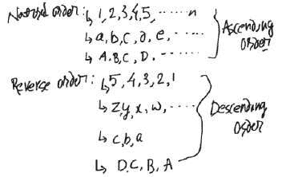

我们可以使用 `Comparable` 或 `Comparator` 来对集合数据进行排序。

`Comparable` 用于自然顺序排序，而 `Comparator` 用于逆序排序。

我们将研究使用 `Collections`（其工具类）和 `ArrayList` 中 `sort(..)` 方法的默认实现来对集合数据进行排序的多种方法。

Java 中的 `java.util.Collections` 类是一个工具类，提供了用于处理集合（如列表、集合和映射）的各种静态方法。它是 Java 集合框架的一部分，并提供了广泛的方法在集合上执行常用操作，包括排序、洗乱、搜索、同步等。`sort(..)` 方法在 `Collections` 类中的实现如下所示。

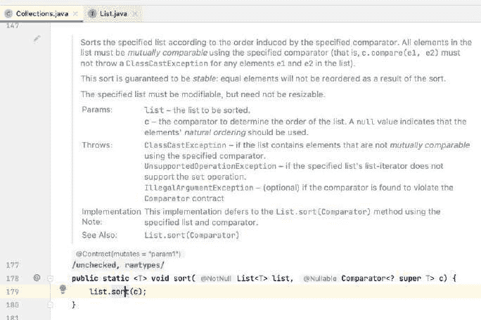

它在内部调用了 `List` 接口的 `sort(Comparator c)` 方法。

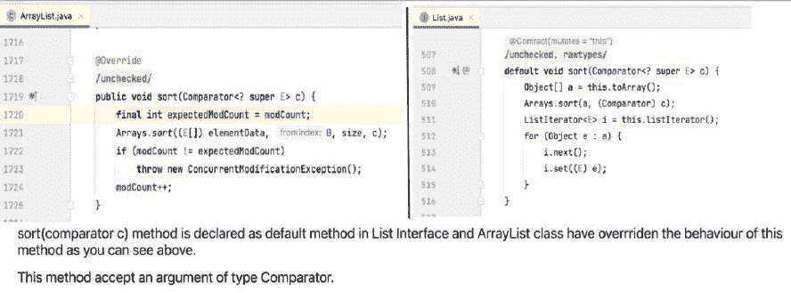

让我们来看 `Comparator` 接口的声明。它包在 `java.util` 下。

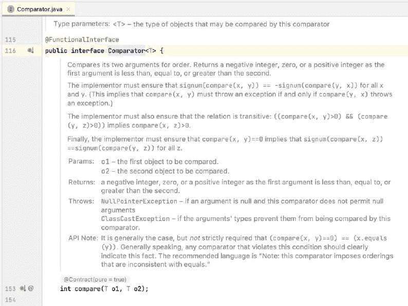

众所周知，`Comparator` 是具有单个抽象方法 `compare(a,b)` 的函数式接口。让我们为 `Comparator` 的实现编写 Lambda 表达式。

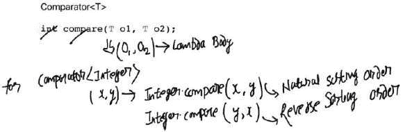

Java 包装类对 `compare(..)` 方法有默认实现如下。我只是粘贴了 `Integer` 类的实现。如果有需要你可以查看其他的。

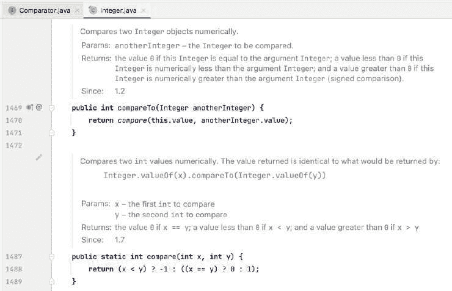


如你所示，`compare(..)`方法将返回`-Ve`、`+Ve`或`0`。但这个返回值的意义是什么？

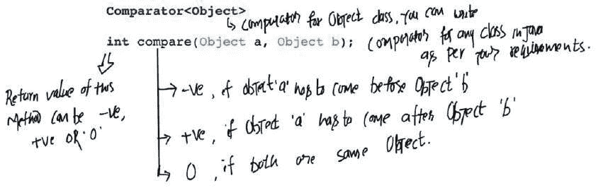

现在清楚`compare(..)`方法的实现是如何工作的，让我们写一个用于排序的比较器。

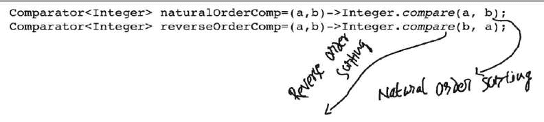

我们可以使用方法引用来简化这段代码，我们将在本节之后介绍方法引用。

## 使用`Collections`类排序集合数据

```java
Collections.sort(numList, Integer::compareTo);
```

我希望我们已经清楚了排序概念，正如所示，排序和集合数据可以使用`Collections`（工具类）以及像`ArrayList`这样的集合类完成。我们将查看排序集合数据的所有可能选项。

让我们看看如何使用`Collections`类排序`ArrayList`：

输入：`[50,30,20,10,40]`  
结果：`[10,20,30,40,50]`

```java
import java.util.ArrayList;
import java.util.Collections;

public class SortingDemoArrayList {
    public static void main(String[] args) {
        ArrayList<Integer> numList=new ArrayList<>();
        numList.add(50);
        numList.add(30);
        numList.add(20);
        numList.add(10);
        numList.add(40);
        Collections.sort(numList,Integer::compareTo);
        System.out.println(numList);
    }
}
```

```java
IntStream intStream=Arrays.stream(ab).sorted().distinct(); intStream.forEach(System.out::println);
```

结果：

`4`

`11`

`25`

`26`

`28`

## 对用户自定义集合进行排序

让我们来看看如何对用户定义的集合数据进行排序。我们有一组`Employee`数据列表，并且想要根据`Name`对`Employees`数据进行排序。这是实时应用中排序数据的一种非常常见的用例。

假设我们正在从数据库获取`Employee`数据，或者从某些外部服务获取这些数据，并且我们需要按照名称的倒序对所有`Employees`进行排序。

```java
import java.util.ArrayList; import java.util.Collections; import java.util.List;

public class EmpComparableDemo {
    public static void main(String[] args) {
        Employee e1=new Employee("Raj","Ra@gmail.com",11l); 
        Employee e2=new Employee("Mohit","Mohit@gmail.com",10l); 
        Employee e3=new Employee("Abhinash","Yogit@gmail.com",14l);
        List<Employee> ee= new ArrayList<>(); 
        ee.add(e1);
        ee.add(e2);
        ee.add(e3);
        Collections.sort(ee);
        ee.forEach(System.out::println);
    }
}
```

结果：自然顺序排序

`Employee{name='Abhinash', email='Yogit@gmail.com', id=14} Employee{name='Mohit', email='Mohit@gmail.com', id=10} Employee{name='Raj', email='Ra@gmail.com', id=11}`

让我们对`Employee`集合进行倒序排序。

```java
import java.util.ArrayList; import java.util.Collections; import java.util.List;

public class SortingEmployeeData {
    public static void main(String[] args) {
        Employee e1=new Employee("Raj","Ra@gmail.com",11l); 
        Employee e2=new Employee("Mohit","Mohit@gmail.com",10l); 
        Employee e3=new Employee("Abhinash","Yogit@gmail.com",14l);
        List<Employee> ee= new ArrayList<>(); 
        ee.add(e1);
        ee.add(e2);
        ee.add(e3);
        Collections.sort(ee);
        Collections.sort(ee,(a,b)->a.getName().compareTo(b.getName())); 
        System.out.println("######## Natural Order Sorting ######"); 
        ee.forEach(System.out::println);
        Collections.sort(ee,(a,b)->-a.getName().compareTo(b.getName())); 
        System.out.println("######## Reverse Order Sorting ######"); 
        ee.forEach(System.out::println);
    }
}
```

结果：

`######## Natural Order Sorting ######`

`Employee{name='Abhinash', email='Yogit@gmail.com', id=14}`

`Employee{name='Mohit', email='Mohit@gmail.com', id=10} Employee{name='Raj', email='Ra@gmail.com', id=11}`

`######## Reverse Order Sorting ######`

`Employee{name='Raj', email='Ra@gmail.com', id=11} Employee{name='Mohit', email='Mohit@gmail.com', id=10} Employee{name='Abhinash', email='Yogit@gmail.com', id=14}`

在本节后面的部分，我们将介绍一个新概念，“方法引用（Method Reference）”。与其使用`Lambda`表达式，我们可以使用方法引用来简化代码。

## Stream排序是如何工作的？


如上所示，我们可以通过简单的简单的逻辑，对`Employee`集合进行自然顺序排序或倒序排序。

### 倒序排序

```java
Collections.sort(ee,(x,y)->y.getName().compareTo(x.getName()));
```

```java
Collections.sort(ee,(x,y)->-x.getName().compareTo(y.getName()));
```

正如你所看到的，我们可以使用`Comparable`和`Comparator`以任何顺序对`Employee`集合排序。现在我们将使用`Comparator(I)`对员工集合进行倒序排序。对于自定义排序，始终推荐使用`Comparator`。

```java
import java.util.ArrayList; import java.util.Collections; import java.util.List;

public class ComparableDemoWithLambda {
    public static void main(String[] args) {
        Comparable<Employee> c=(e1)->e1.getName().compareTo(e1.getName()); 
        Employee e1=new Employee("Raj","Ra@gmail.com",11l); 
        Employee e2=new Employee("Mohit","Mohit@gmail.com",10l); 
        Employee e3=new Employee("Abhinash","Yogit@gmail.com",14l);
        List<Employee> ee= new ArrayList<>();
        ee.add(e1);
        ee.add(e2);
        ee.add(e3);
        // 用于倒序排序
        Collections.sort(ee,(x,y)->y.getName().compareToIgnoreCase(x.getName())); 
        ee.forEach(System.out::println );
    }
}
```

结果：

`Employee{name='Raj', email='Ra@gmail.com', id=11}`

`Employee{name='Mohit', email='Mohit@gmail.com', id=10}`

`Employee{name='Abhinash', email='Yogit@gmail.com', id=14}`

## 使用Stream API

现在我们将使用`Stream API`对相同的`Employee`集合进行排序。在拥有大量数据的实时环境中，人们倾向于使用`Stream`来排序集合数据。

### 使用Lambda表达式

```java
List<Employee> employeeList= ee.stream()
    .sorted(Comparator.comparing(x->x.getName()))
    .collect(Collectors.toList());
```

结果：

`Employee{name='Abhinash', email='Yogit@gmail.com', id=14}`

`Employee{name='Mohit', email='Mohit@gmail.com', id=10}`

`Employee{name='Raj', email='Ra@gmail.com', id=11}`

### 使用方法引用

```java
List<Employee> employeeList= ee.stream()
    .sorted(Comparator.comparing(Employee::getName))
    .collect(Collectors.toList());
```

如上所示，我们可以通过简单的逻辑，对`Employee`集合进行自然顺序排序或倒序排序。`Comparator`提供了如`reversed()`等方法来帮助轻松排序数据。对于自定义排序，始终推荐使用`Comparator(I)`。

## 自定义类对象的排序

让我们创建一个工具类，用于提供员工列表。在实际应用中，我们通常从数据库或其他其他存储中获取这些数据。

```java
import java8.EmployeeBean;
import java.util.List;

public class EmployeeUtil {
    public static List<EmployeeBean> getAllEmployeeList(){
        EmployeeBean e1=  new EmployeeBean("Raj","Patna","Development","SSE",140000);
        EmployeeBean e2=new EmployeeBean("Mohan","Bangalore","Development","SSE",160000); 
        EmployeeBean e3=new EmployeeBean("Amit","Delhi","Development","SSE",110000);
        EmployeeBean e4=new EmployeeBean("Heera","Patna","R&D","SSE",240000);
        EmployeeBean e5=new EmployeeBean("Jawed","Bangalore","Development","SSE",140000); 
        EmployeeBean e6=new EmployeeBean("Khali","Delhi","R&D","SSE",340000);
        EmployeeBean e7=new EmployeeBean("Abhinash","Bangalore","Development","SSE",140000); 
        List<EmployeeBean> list =List.of(e1,e2,e3,e4,e5,e6,e7);  
        return list;
    }
}
```

## 示例2：使用Lambda表达式

```java
import java8.EmployeeBean;
import java.util.Comparator; import java.util.List;
import java.util.stream.Collectors;

public class SortEmployeeWithStream2 {  
    public static void main(String[] args) {
        List<EmployeeBean> employeeList =EmployeeUtil. getAllEmployeeList(); 
        System.out.println("排序前 ::");
        employeeList.forEach(x->System.out.println(x));

        List<EmployeeBean> sortedEMpDataNaturalOrder=employeeList.stream()
            .sorted(Comparator.comparing(e->e.getName()))
            .collect(Collectors.toList());

        System.out.println("排序后 :: 自然排序 ::>");
        sortedEMpDataNaturalOrder.forEach(x->System.out.println(x));

        List<EmployeeBean> sortedEMpDataReverseOrder=employeeList.stream()
            .sorted((a,b)->a.getName().compareTo(b.getName()))
            .collect(Collectors.toList());

        System.out.println("排序后 :: 逆序 ::>"); 
        sortedEMpDataNaturalOrder.forEach(x->System.out.println(x)); 
    }
}
```

### 结果

排序前 ::

`{name='Raj', city='Patna', dept='Development', desig='SSE', salary=140000}`  
`{name='Mohan', city='Bangalore', dept='Development', desig='SSE', salary=160000}`  
`{name='Amit', city='Delhi', dept='Development', desig='SSE', salary=110000}`  
`{name='Heera', city='Patna', dept='R&D', desig='SSE', salary=240000}`  
`{name='Jawed', city='Bangalore', dept='Development', desig='SSE', salary=140000}`  
`{name='Khali', city='Delhi', dept='R&D', desig='SSE', salary=340000}`  
`{name='Abhinash', city='Bangalore', dept='Development', desig='SSE', salary=140000}`

排序后 :: 自然排序 ::>


```text
{name='Abhinash', city='Bangalore', dept='Development', desig='SSE', salary=140000} {name='Amit', city='Delhi', dept='Development', desig='SSE', salary=110000} {name='Heera', city='Patna', dept='R&D', desig='SSE', salary=240000} {name='Jawed', city='Bangalore', dept='Development', desig='SSE', salary=140000} {name='Khali', city='Delhi', dept='R&D', desig='SSE', salary=340000} {name='Mohan', city='Bangalore', dept='Development', desig='SSE', salary=160000} {name='Raj', city='Patna', dept='Development', desig='SSE', salary=140000}
```

排序后 :: 逆序 ::>

```text
{name='Abhinash', city='Bangalore', dept='Development', desig='SSE', salary=140000} {name='Amit', city='Delhi', dept='Development', desig='SSE', salary=110000} {name='Heera', city='Patna', dept='R&D', desig='SSE', salary=240000} {name='Jawed', city='Bangalore', dept='Development', desig='SSE', salary=140000} {name='Khali', city='Delhi', dept='R&D', desig='SSE', salary=340000} {name='Mohan', city='Bangalore', dept='Development', desig='SSE', salary=160000} {name='Raj', city='Patna', dept='Development', desig='SSE', salary=140000}
```

## 示例 2：使用方法引用

```java
import java.util.Comparator;
import java.util.List;
import java.util.stream.Collectors;

public class SortEmployeeWithStream {
    public static void main(String[] args) {
        List<EmployeeBean> employeeList = EmployeeUtil.getAllEmployeeList();
        System.out.println("排序前 ::");
        employeeList.forEach(System.out::println);

        List<EmployeeBean> sortedEMpDataNaturalOrder = employeeList.stream()
            .sorted(Comparator.comparing(EmployeeBean::getName))
            .collect(Collectors.toList());
        System.out.println("排序后 :: 自然排序 ::>");
        sortedEMpDataNaturalOrder.forEach(System.out::println);

        List<EmployeeBean> sortedEMpDataReverseOrder = employeeList.stream()
            .sorted(Comparator.comparing(EmployeeBean::getName).reversed())
            .collect(Collectors.toList());
        System.out.println("排序后 :: 逆序 ::>");
        sortedEMpDataNaturalOrder.forEach(System.out::println);
    }
}
```

我们已经通过 Lambda 表达式和方法引用完成了排序。我们根据给定的属性进行了排序。你可以尝试多个属性排序。

# 按名称和城市排序

```java
// （此处省略重复代码，保持逻辑清晰）
```

```text
{name='Jawed', city='Bangalore', dept='Development', desig='SSE', salary=140000} {name='Jawed', city='Delhi', dept='R&D', desig='SSE', salary=340000}

{name='Abhinash', city='Bangalore', dept='Development', desig='SSE', salary=140000}
```

### 排序后 :: 自然排序 ::>

```text
{name='Abhinash', city='Bangalore', dept='Development', desig='SSE', salary=140000} {name='Amit', city='Delhi', dept='Development', desig='SSE', salary=110000} {name='Jawed', city='Patna', dept='R&D', desig='SSE', salary=240000} {name='Jawed', city='Bangalore', dept='Development', desig='SSE', salary=140000} {name='Jawed', city='Delhi', dept='R&D', desig='SSE', salary=340000} {name='Raj', city='Patna', dept='Development', desig='SSE', salary=140000} {name='Raj', city='Bangalore', dept='Development', desig='SSE', salary=160000}
```

### 排序后 :: 按姓名和城市 ::> // 升序

```text
{name='Abhinash', city='Bangalore', dept='Development', desig='SSE', salary=140000} {name='Amit', city='Delhi', dept='Development', desig='SSE', salary=110000} {name='Jawed', city='Bangalore', dept='Development', desig='SSE', salary=140000} {name='Jawed', city='Delhi', dept='R&D', desig='SSE', salary=340000} {name='Jawed', city='Patna', dept='R&D', desig='SSE', salary=240000} {name='Raj', city='Bangalore', dept='Development', desig='SSE', salary=160000} {name='Raj', city='Patna', dept='Development', desig='SSE', salary=140000}
```

### 排序后 :: 按姓名和城市 :: 倒序 ::>

```text
{name='Raj', city='Patna', dept='Development', desig='SSE', salary=140000} {name='Raj', city='Bangalore', dept='Development', desig='SSE', salary=160000} {name='Jawed', city='Patna', dept='R&D', desig='SSE', salary=240000} {name='Jawed', city='Delhi', dept='R&D', desig='SSE', salary=340000} {name='Jawed', city='Bangalore', dept='Development', desig='SSE', salary=140000} {name='Amit', city='Delhi', dept='Development', desig='SSE', salary=110000} {name='Abhinash', city='Bangalore', dept='Development', desig='SSE', salary=140000}
```

按姓名和城市倒序对员工数据进行排序。

### 按薪资列出员工（自然排序）

```java
List<EmployeeBean> empList = AppUtil.getEmpList();
List<EmployeeBean> employeeBeansObj = empList.stream()
    .sorted(Comparator.comparingDouble(EmployeeBean::getSalary))
    .collect(Collectors.toList());

employeeBeansObj.forEach(x -> System.out.println("## " + x.getName() + " " + x.getSalary()));
```

**结果：**

```text
Name:Raj ,Salary:50000.0
Name:Mohan ,Salary:60000.0
Name:Salman ,Salary:70000.0
Name:Amir ,Salary:80000.0
Name:Dharam ,Salary:90000.0
Name:Krish ,Salary:100000.0
Name:Marina ,Salary:110000.0
Name:Saloni ,Salary:120000.0
```

### 按员工薪资倒序排序员工

```java
import java8.EmployeeBean;
import java.util.Comparator;
import java.util.List;
import java.util.stream.Collectors;

public class SortEmployeeBySalary {
    public static void main(String[] args) {
        List<EmployeeBean> employeeList = EmployeeUtil.getAllEmployeeList();
        System.out.println("############## 排序前 ##########");
        employeeList.forEach(System.out::println);

        List<EmployeeBean> employeeBeansObj = employeeList.stream()
            .sorted(Comparator.comparingDouble(EmployeeBean::getSalary).reversed())
            .collect(Collectors.toList());

        System.out.println("### 排序后:: 按薪资倒序排序 ###");
        employeeBeansObj.forEach(System.out::println);
    }
}
```

**############## 排序前 ##########**

```text
{name='Raj', city='Patna', dept='Development', desig='SSE', salary=140000} {name='Mohan', city='Bangalore', dept='Development', desig='SSE', salary=160000} {name='Amit', city='Delhi', dept='Development', desig='SSE', salary=110000} {name='Heera', city='Patna', dept='R&D', desig='SSE', salary=240000} {name='Jawed', city='Bangalore', dept='Development', desig='SSE', salary=140000} {name='Khali', city='Delhi', dept='R&D', desig='SSE', salary=340000} {name='Abhinash', city='Bangalore', dept='Development', desig='SSE', salary=140000}
```

### 排序后:: 按薪资倒序

```text
{name='Khali', city='Delhi', dept='R&D', desig='SSE', salary=340000} {name='Heera', city='Patna', dept='R&D', desig='SSE', salary=240000} {name='Mohan', city='Bangalore', dept='Development', desig='SSE', salary=160000} {name='Raj', city='Patna', dept='Development', desig='SSE', salary=140000} {name='Jawed', city='Bangalore', dept='Development', desig='SSE', salary=140000} {name='Abhinash', city='Bangalore', dept='Development', desig='SSE', salary=140000}
```

在上面的例子中，我们根据 `name` 和 `salary` 的倒序对 `Employee` 数据进行了排序。因此，倒序应用于了两个字段。

如果我想用一个独立的 `Comparator` 来按 `Name` 自然排序和 `Salary` 倒序对 `Employee` 数据进行排序，我们需要使用不同的 `Comparator`。

```java
List<EmployeeBean> empList = AppUtil.getEmpList();
List<EmployeeBean> empByNameSalary = empList.stream()
    .sorted(Comparator.comparingDouble(EmployeeBean::getSalary).reversed())
    .sorted(Comparator.comparing(EmployeeBean::getName))
    .collect(Collectors.toList());

empByNameSalary.forEach(x -> System.out.println(
    "Name : " + x.getName() + ", Salary : " + x.getSalary()
));
```

**结果：**

```text
Name : Amir, Salary : 170000.0
Name : Amir, Salary : 80000.0
Name : Dharam, Salary : 90000.0
Name : Krish, Salary : 100000.0
Name : Marina, Salary : 110000.0
Name : Mohan, Salary : 60000.0
Name : Raj, Salary : 50000.0
Name : Salman, Salary : 70000.0
Name : Saloni, Salary : 160000.0
Name : Saloni, Salary : 140000.0
Name : Saloni, Salary : 120000.0
```

根据你的需求，你需要查看哪种排序，并此决定是否需要独立的 `Comparator`。请记住，使用独立的 `Comparator` 会消耗更多资源，影响性能。

### 跳过 Stream 元素

`Stream<T> skip(long n)` 返回丢弃前 `n` 个元素后剩余的流。

```java
Integer[] ac = {22, 44, 99, 55, 11, 110};
Arrays.stream(ac).skip(2).forEach(System.out::println);
```

**结果：**

```text
99
55
11
110
```

### 从 Stream 中查找最小值和最大值

`min(Comparator<? super T> comparator)` 和 `max(Comparator<? super T> comparator)` 方法接受 `Comparator` 作为参数。

### 从 Integer 数组查找最大值和最小值


```java
Integer[] ac = {22, 229, 44, 99, 55, 11, 110};
int max = Arrays.stream(ac).mapToInt(x -> x).max().getAsInt();
int min = Arrays.stream(ac).mapToInt(x -> x).min().getAsInt();
System.out.println("MAX : " + max);
System.out.println("MIN : " + min);
```

**结果：**

```text
MAX : 229
MIN : 11
```

### 从 `int` 数组查找最大值

```java
int element[] = {22, 229, 44, 99, 55, 11, 110};
int minVal = Arrays.stream(element).min().getAsInt();
int maxVal = Arrays.stream(element).max().getAsInt();
System.out.println("MAX : " + maxVal);
System.out.println("MIN : " + minVal);
```

**结果：**

```text
MAX : 229
MIN : 11
```

### 用例：让我们找到薪资最高的员工

#### 查找组织内薪资最高的员工

```java
List<EmployeeBean> empList = AppUtil.getEmpList();
EmployeeBean employeeBean = empList.stream()
    .max(Comparator.comparing(EmployeeBean::getSalary)).get();
System.out.println(employeeBean);
```

**结果：**

```text
EmployeeBean{name='Amir', city='Bangalore', dept='Gov', desig='Arch', salary=170000.0}
```

#### 查找组织内的最高薪资

```java
OptionalDouble salary = empList.stream()
    .mapToDouble(EmployeeBean::getSalary)
    .max();
System.out.println(salary.getAsDouble());
```

**结果：**

```text
170000.0
```

#### 查找组织内薪资最低的员工

```java
List<EmployeeBean> empList = AppUtil.getEmpList();
EmployeeBean employeeBean = empList.stream()
    .min(Comparator.comparing(EmployeeBean::getSalary)).get();
System.out.println(employeeBean);
```

**结果：**

```text
EmployeeBean{name='Raj', city='Patna', dept='R&D', desig='SSE', salary=50000.0}
```

#### 查找组织内的最低薪资

```java
OptionalDouble salary = empList.stream()
    .mapToDouble(EmployeeBean::getSalary)
    .min();
System.out.println(salary.getAsDouble());
```

**结果：**

```text
50000.0
```

### 平化 Stream 数据

`<R> Stream<R> flatMap(Function<? super T,? extends Stream<? extends R>> mapper)` 被用于平化集合数据。

## 什么是 `flatMap(..)`

Java 流中的 `flatMap` 操作用于扁平化嵌套集合，或者将集合流中的元素进行转换并合并成单个流。当你有一个元素流，其中每个元素都包含另一个集合，并且你想对这些嵌套集合中的元素进行操作时，通常会使用它。

`flatMap()` = 扁平（`flat`）+ 映射（`map`）


想象一下我们有一堆盒子，每个盒子里装有一些物品。现在，我们想要从这些箱子里取出所有物品并将它们放在一个箱子里。这就是 `flatMap()` 对流所做的操作。

```java
List<Integer> num1 = List.of(9, 2, 3);
List<Integer> num2 = List.of(4, 5, 6);
List<List<Integer>> lists = List.of(num1, num2);
System.out.println(lists);

List<Integer> finalList = lists.stream()
    .flatMap(List::stream)
    .collect(Collectors.toList());
System.out.println(finalList);
```

**结果：**

输入列表：`[[9, 2, 3], [4, 5, 6]]`

输出列表：`[2, 3, 9, 4, 5, 6]`

## 数据扁平化在 Stream 中是如何工作的？


它为列表中的每个元素创建一个 Stream，然后将其扁平化并合并到一个单个 Stream 中。

### 将二维数组转换为 String 列表

输入：`{{"Raj","Mahi"},{"Bikash","Rana"},{"Abhinash","Rajiv"}}`

输出：`[Raj, Mahi, Bikash, Rana, Abhinash, Rajiv]`

```java
String names[][] = {
    {"Raj", "Mahi"},
    {"Bikash", "Rana"},
    {"Abhinash", "Rajiv"}
};

List<String> nameList = Arrays.stream(names)
    .flatMap(x -> Arrays.stream(x))
    .collect(Collectors.toList());

System.out.println(nameList);
```

**结果：**

`[Raj, Mahi, Bikash, Rana, Abhinash, Rajiv]`

### 原始类型数据扁平化的版本

`IntStream flatMapToInt(Function<? super T,? extends IntStream> mapper)`

`LongStream flatMapToLong(Function<? super T,? extends LongStream> mapper)`

`DoubleStream flatMapToDouble(Function<? super T,? extends DoubleStream> mapper)`

```java
List<Integer> num1 = Arrays.asList(1, 2, 3);
List<Integer> num2 = Arrays.asList(4, 5);
List<Integer> num3 = Arrays.asList(6, 7, 8);
List<List<Integer>> rr = List.of(num1, num2, num3);

rr.stream()
    .flatMapToInt(x -> x.stream().mapToInt(Integer::intValue))
    .forEach(System.out::println);
```

**结果：**

`1 2 3 4 5 6 7 8`

## 重要 Java 特性：Java 8+

### Java 中的默认方法

在继续之前，请让我确保你使用的是 Java 8+。

默认方法概念作为 Java 8 的一部分引入的。

在 Java 8 之前，接口只能有抽象方法，但作为 Java 8 发布的一部分，私有方法（Java 9）和默认方法（Java 8）可以成为接口。

让我们理解为什么默认方法作为 Java 的一部分被引入，因为我之前问过，在 Java 8 之前只有抽象方法可以是接口的一部分，并且向任何现有接口添加任何额外的抽象方法都会破坏向后兼容性，因为客户端需要实现它们所使用的接口的所有抽象方法。

为了解决向后兼容性问题，引入了默认方法。`default` 方法与具体方法相同，唯一的区别是它具有访问修饰符 `default`。

默认方法将具有某些默认实现，这样客户端如果不需要，就不需要实现此方法。根据他们的需求，他们可以重写此方法的行为。

```java
default int addTwoNumbers() {
    // 某些默认实现返回 0;
}
```

以下是默认方法的一些常见优势：

- **向后兼容性**：引入默认方法的主要原因之一是允许接口进行演进而不破坏实现这些接口的现有类。换句话说，默认方法提供了一种向接口添加新方法的方法，而无需强制所有实现类为这些新方法提供实现。这对于需要随时间扩展同时保持与现有代码兼容的库和 API 关重要。

- **支持 Lambda 表达式**：Java 8 引入了 lambda 表达式和 Stream API，它们高度依赖于只有一个抽象方法的接口（SAM 接口），也称为函数接口。为了更方便地使用函数接口并提供额外的实用方法，引入了默认方法。这允许 `java.util.List` 等现有接口添加如 `forEach` 等新方法而不破坏兼容性。

- **代码重用和实用方法**：默认方法还可以包含在实现相同接口的多个类共享的实用方法。这促进了代码重用并减少了实现类中的代码重复。例如，Java 8 中的 `Collection` 接口引入了几个实用的默认方法，如 `stream()`、`forEach()` 和 `removeIf()`，可以被任何实现 `Collection` 接口的类使用。

- **渐进迁移**：默认方法为将旧代码逐渐迁移到接口的新版本提供了路径。现有类可以选择重写并为默认方法提供自己的实现，也可以依赖接口提供的默认实现。

#### 默认方法的语法

```java
import lombok.ToString;

@ToString
class Student {
    private String name;
    private String city;
    private String dept;
    private String designig;
    private int salary;

    public Student(String name, String city, String dept, String designig, int salary) {
        this.name = name;
        this.city = city;
        this.dept = dept;
        this.designig = designig;
        this.salary = salary;
    }

    public String getName() {
        return name;
    }
}

interface StudentService {
    abstract Student getStudent();

    default int methodName(int sid) {
        int pass = 123;
        return pass;
    }

    private int getStudentAcc(int sid) {
        int pass = 12345;
        return pass;
    }
}
```

### 接口中的私有方法（Private Method in Interface）

- `private` 方法在 `Java 9` 中引入。
- 接口可以像 `static` 方法一样拥有 `private` 方法。
- `private` 方法将用于隐藏方法实现，由于其私有性，客户端无法访问。
- 同样你也可以声明 `static` 方法。

### 局部变量类型推断（Local Variable Type Inference）

局部变量类型推断在 `Java 10` 中引入（使用 `var`）。它允许你在不显式指定类型的情况下声明局部变量。如上面的示例所示，`name` 的类型是从右侧表达式获取的，编译器会自动处理它。

#### 使用局部方法推断前（Before Local Method Inference）

```java
ArrayList<String> names = new ArrayList<>();
```

#### 使用局部方法推断后（After Local Method Inference）

```java
var names = new ArrayList<String>();
var name = "raj";
```

```java
import functional.bean.EmployeeBean;
import java.util.ArrayList;
import java.util.Collectors;
import java.util.stream.Collectors;

class LocalMethodInferenceDemo {
    public static void main(String[] args) {
        var employeeBeanList = EmployeeUtil.getAllEmployeeList();
        System.out.println("employeeBeanList :: " + employeeBeanList);

        var filteredEmpList = employeeBeanList.stream()
            .map(EmployeeBean::getName)
            .collect(Collectors.toList());
        System.out.println("filteredEmpList ## " + filteredEmpList);

        var groupByName = employeeBeanList.stream()
            .collect(Collectors.groupingBy(EmployeeBean::getName));
        System.out.println("groupByName :: " + groupByName);

        var partitionData = employeeBeanList.stream()
            .collect(Collectors.partitioningBy(x -> x.getName().startsWith("A")));
        System.out.println("partitionData :: " + partitionData);
    }
}
```

#### 结果（Result）

- `employeeBeanList`: `[{name='Raj', city='Patna', dept='Development', desig='SSE', salary=140000}, {name='Raj', city='Bangalore', dept='Development', desig='SSE', salary=160000}, {name='Amit', city='Delhi', dept='Development', desig='SSE', salary=110000}, {name='Jawed', city='Patna', dept='R&D', desig='SSE', salary=240000}, {name='Jawed', city='Bangalore', dept='Development', desig='SSE', salary=140000}, {name='Jawed', city='Delhi', dept='R&D', desig='SSE', salary=340000}, {name='Abhinash', city='Bangalore', dept='Development', desig='SSE', salary=140000}]}`

- `filteredEmpList`: `[Raj, Raj, Amit, Jawed, Jawed, Jawed, Abhinash]`

- `groupByName`: `{Abhinash=[{name='Abhinash', city='Bangalore', dept='Development', desig='SSE', salary=140000}], Amit=[{name='Amit', city='Delhi', dept='Development', desig='SSE', salary=110000}], Raj=[{name='Raj', city='Patna', dept='Development', desig='SSE', salary=140000}, {name='Raj', city='Bangalore', dept='Development', desig='SSE', salary=160000}], Jawed=[{name='Jawed', city='Patna', dept='R&D', desig='SSE', salary=240000}, {name='Jawed', city='Bangalore', dept='Development', desig='SSE', salary=140000}, {name='Jawed', city='Delhi', dept='R&D', desig='SSE', salary=340000}]}`


- `partitionData`：`{false=[{name='Raj', city='Patna', dept='Development', desig='SSE', salary=140000}, {name='Raj', city='Bangalore', dept='Development', desig='SSE', salary=160000}, {name='Jawed', city='Patna', dept='R&D', desig='SSE', salary=240000}, {name='Jawed', city='Bangalore', dept='Development', desig='SSE', salary=140000}, {name='Jawed', city='Delhi', dept='R&D', desig='SSE', salary=340000}], true=[{name='Abhinash', city='Bangalore', dept='Development', desig='SSE', salary=140000}]}`

### Optional 类（Optional Class）

`Optional` 是 `Java 8` 引入的一个类，用于显式地处理空值（null）。它可以避免常见的 `NullPointerException` 异常，使代码更具防御性。

- `of(T value)`：创建一个非空值的 `Optional` 对象。如果值为 `null`，则会抛出异常。
- `ofNullable(T value)`：如果值为 `null`，则返回一个空的 `Optional`；如果不空，则返回包含该值的对象。
- `empty()`：返回一个空的 `Optional`。
- `isPresent()`：检查 `Optional` 中是否有值。
- `ifPresent(Consumer<? super T> action)`：如果值存在，则执行给定的消费者函数。

```java
[{name='Raj', city='Patna', dept='Development', desig='SSE', salary=140000}, {name='Raj', city='Bangalore', dept='Development', desig='SSE', salary=160000}, {name='Amit', city='Delhi', dept='Development', desig='SSE', salary=110000}, {name='Jawed', city='Patna', dept='R&D', desig='SSE', salary=240000}, {name='Jawed', city='Bangalore', dept='Development', desig='SSE', salary=140000}, {name='Jawed', city='Delhi', dept='R&D', desig='SSE', salary=340000}, {name='Abhinash', city='Bangalore', dept='Development', desig='SSE', salary=140000}]
```

## 过滤后的数据

```java
{name='Jawed', city='Patna', dept='R&D', desig='SSE', salary=240000} {name='Jawed', city='Delhi', dept='R&D', desig='SSE', salary=340000}
```

### `orElse(T other)`

如果存在则返回该值；否则，返回提供的默认值。

我们以前在某些场景中，当 `Optional` 中没有值时，会返回某个默认值。

```java
Optional<String> result = optional8.orElse("Raj"); 
System.out.println(result);

List<EmployeeBean> ll = new ArrayList<>();
EmployeeBean employeeBean1 = new EmployeeBean("Raj", "Patna", "Development", "SSE", 140000);
List<EmployeeBean> defaultEmpList = new ArrayList<>(); 
defaultEmpList.add(employeeBean1);

Optional.ofNullable(ll).orElse(defaultEmpList);
```

结果：Raj

```java
System.out.println(Optional.empty().orElse(defaultEmpList));
```

结果：`[{name='Raj', city='Patna', dept='Development', desig='SSE', salary=140000}]`

### `orElseGet(Supplier<T> supplier)`

如果 `Optional` 为空或没有值，通过 `supplier` 提供某些默认值是有用的。你可以使用任何现有的 `Supplier` 来提供默认数据。

这与 `orElse(T other)` 类似，它只是接收一个 `supplier` 作为输入，而 `orElseGet(Supplier<T> supplier)` 接收任何类型 `T`。

```java
Supplier<EmployeeBean> getEmpData = () -> new EmployeeBean("Raj", "Patna", "Development", "SSE", 140000); 
Object employeeBean2 = Optional.empty().orElseGet(getEmpData); 
System.out.println(employeeBean2);
```

结果：`{name='Raj', city='Patna', dept='Development', desig='SSE', salary=140000}`

### `orElseThrow(Supplier<? extends X> exceptionSupplier)`

如果存在则返回该值；否则，抛出由提供的 `supplier` 生成的异常。

同样是为了处理空数据，如果没有数据，则抛出某些异常。

```java
String result1 = optional9.orElseThrow(() -> new NullPointerException("No Data Found"));
```

结果：

它将抛出以下异常。

```text
Exception in thread "main" java.util.NoSuchElementException: No value present
    at java.base/java.util.Optional.orElseThrow(Optional.java:377)
    at functionalJava.optionalDemo.OptionalClassDemo.main(OptionalClassDemo.java:87)
```

### `get()`

如果存在则返回该值；否则，抛出 `NoSuchElementException`。

它仅用于从 `Optional` 实例获取数据。

```java
Optional<String> getVal = Optional.of("Raj"); 
String name = getVal.get();
System.out.println(name);
```

结果：Raj

### `filter(Predicate<T> predicate)`

如果存在，则对值应用过滤器。如果该值匹配 `predicate`，则保留它；否则返回一个空的 `Optional`。

```java
Optional<Integer> optional10 = Optional.of(123);
Optional<Integer> filtered = optional10.filter(value -> value > 100); 
System.out.println("## filtered " + filtered.get());
```

结果：123

```java
Optional<Integer> optional11 = Optional.empty();
Optional<Integer> filtered1 = optional11.filter(value -> value > 100); 
System.out.println("## filtered1 " + filtered1.get());
```

结果：

它将抛出异常。

```text
Exception in thread "main" java.util.NoSuchElementException: No value present
    at java.base/java.util.Optional.get(Optional.java:143)
    at functionalJava.optionalDemo.OptionalClassDemo.main(OptionalClassDemo.java:105)
```

如果没有任何值满足谓词，那么 `Optional` 将为空。

```java
Optional<Integer> optional10 = Optional.of(123);
Optional<Integer> filtered = optional10.filter(value -> value > 888); 
System.out.println("## filtered " + filtered.get());
```

结果：

```text
Exception in thread "main" java.util.NoSuchElementException: No value present
    at java.base/java.util.Optional.get(Optional.java:143)
    at
```

```java
case Integer i -> "I'm an Integer: " + i;
case Long l -> "I'm a Long: " + l;

case null -> "This is NUll";

default -> "I'm an object";

};
}
```

### 带模式匹配的 Switch（Switch with Pattern Match）

```java
public static void switchWIthGuardedPattern(Object bar) {
  switch (bar) {
    case Integer i -> System.out.println("This is Integer");
    case EmployeeTest l -> System.out.println("This is emp.");
    case EmpRecord e -> System.out.println("This is Record.");
    default -> System.out.println("This is default.");
  }
}

public static String switchWIthGuardedPatternWithReturn(Object bar) {
  return switch (bar) {
    case Integer i -> "I'm an Integer: " + i;
    case EmployeeTest l -> "I'm a Emp: " + l.eid;
    case EmpRecord e -> "I am record" + e.email();
    default -> "I'm an object";
  };
}

public static String switchWIthGuardedPatternWithReturn2(Object bar) {
  switch (bar) {
    case Integer i -> {
      return "Integer";
    }
    case EmployeeTest l -> {
      return "Employee";
    }
    case EmpRecord e -> {
      return "EmpRecord";
    }
    default -> {
      return "Default";
    }
  }
}
```

### 带守卫模式的 Switch（Switch with Guarded Pattern）：Java 20

```java
public static String switchWIthGuardedPatternWithReturn3(Object bar) {
  switch (bar) {
    case Integer i && i < 200 -> {
      return "Integer";
    }
    case EmployeeTest l && l.eid > 10 -> {
      return "Employee";
    }
    case EmpRecord e && e.eid() > 2 -> {
      return "EmpRecord";
    }
    default -> {
      return "Default";
    }
  }
}
```

### Record 类：Java 17 特性（Record Class: Java 17 Feature）

`Record` 是 `java` 中的一种特殊类，主要用于数据载体类/DTO。它是作为 `java 14` 的一部分引入的。在项目中，将数据从 `DTO` 转换为实体并反之是常见场景。对于数据 `DTO` 类，我们通常需要创建：

1. `Setter` 方法
2. `Getter` 方法
3. 构造函数（`constructor`）
4. `toString` 方法
5. `Hashcode` 方法
6. `Equals` 方法

虽然 `java` 有一些插件可以处理这些事情，但如果项目中没有使用这些插件，你就必须手动创建或生成所有方法，这会导致类变得非常庞大。

你可以使用 `lombok` 库来简化，但在 `java 14` 之前，`java` 默认并没有内置此类功能来处理它。

现在我们将看到使用和不使用 `Record` 类的 `DTO`/数据载体类。

唯一的区别是，如果你使用 `Records` 类而不是普通的 `Java` 类，那么你就不需要像上面看到的那样，为 `DTO` 类创建 `getter`、`setter` 和其他方法了。

### Record 类演示（Record Class Demo）

示例 DTO：

```java
package playwithjava.in.testt;

import java.util.Objects;

public class EmployeeDto {
  private String name;
  private String email;
  private Long empId;

  public EmployeeDto(String name, String email, Long empId) {
    this.name = name;
    this.email = email;
    this.empId = empId;
  }

  public EmployeeDto(String name, String email) {
    this.name = name;
    this.email = email;
  }

  public String getName() {
    return name;
  }

  public void setName(String name) {
    this.name = name;
  }

  public String getEmail() {
    return email;
  }

  public void setEmail(String email) {
    this.email = email;
  }

  public Long getEmpId() {
    return empId;
  }

  public void setEmpId(Long empId) {
    this.empId = empId;
  }

  @Override
  public boolean equals(Object o) {
    if (this == o) return true;
    if (o == null || getClass() != o.getClass()) return false;
    EmployeeDto that = (EmployeeDto) o;
    return name.equals(that.name) && email.equals(that.email) && empId.equals(that.empId);
  }

  @Override
  public int hashCode() {
    return Objects.hash(name, email, empId);
  }
}
```

使用 `lombok` 插件来简化：

```java
import lombok.*;

@Data
@NoArgsConstructor
@AllArgsConstructor
@ToString
@EqualsAndHashCode
public class EmployeeDto {
  private String name;
  private String email;
  private Long empId;
}
```

使用 `record`：


```java
record EmployeeDto(String name,String email,Long empId){ }
```

1. 它没有无参构造函数。

2. `record` 默认是不可变的，因此它是 `final` 的，且不能被扩展。

3. 它会为每个字段创建一个 `public` 构造函数。

```java
public EmployeeDto(String name, String email, Long empId) {
  this.name = name;
  this.email = email;
  this.empId = empId;
}
```

只有这个构造函数适用于该 `record`（3 个字段）。如果你想要一个 2 个字段、1 个字段或无参的构造函数，你需要显式地创建。

```java
EmployeeDto employeeDto= new EmployeeDto("Raj","raj@gmail.com",122l);
// EmployeeDto employeeDto=new EmployeeDto("Raj","raj@gmail.com"); // 这会导致编译错误
```

你需要显式地创建 2 参数的构造函数。

```java
EmployeeDto employeeDto=new EmployeeDto();
```

### 带守卫模式的 Switch（Switch with Guarded Pattern）：Java 20

```java
public static String switchWIthGuardedPatternWithReturn3(Object bar) {
  switch(bar) {
    case Integer i && i<200-> {
      return "Integer";
    }
    case EmployeeTest l && l.eid>10 -> {
      return "Employee";
    }
    case EmpRecord e &&e.eid()>2-> {
      return "EmpRecord";
    }
    default -> {
      return "Default";
    }
  }
}
```

### 密封类（Sealed Classes）：Java 17

`Sealed` 类/接口允许更细粒度的继承。密封（Sealing）一个类/接口意味着我们正在定义允许的子类。简单来说，密封一个类意味着我们在指示哪些类可以扩展它。

如果你有一个 `final` 类，它不能被扩展；如果它是 `abstract` 的，则任何人都可以扩展它。而密封类的作用是限制扩展到指定的类。

#### 密封接口（Sealed Interface）

```java
public sealed interface OrgService permits EmployeeService, ...
```

从接口声明可以清楚地看到，只有 `EmployeeService`（I）、`TraineeService`（I）和允许的类可以扩展密封的 `OrgService`。

使用密封类/接口的主要目的是为我们的类提供模块化安全性，使得在获得许可之前，任何人无法访问它们。

在使用密封类时，我们需要遵循一些原则：

1. 密封类/接口可以在包内扩展。

2. 子类/接口应该实现/扩展该密封类/接口。

3. 子类/接口应该具有 `final`、`sealed` 或 `non-sealed` 修饰符之一。

#### 代码流程演示（Code Walkthrough）

```java
package playwithjava.in.sealedDemo;

public sealed interface OrgService permits EmployeeService,TraineeService {
  int getAge();

  int getSalary();
}
```

如果子类是 `non-sealed` 接口，那么所有人都可以扩展。

```java
package playwithjava.in.sealedDemo;

public non-sealed interface EmployeeService extends OrgService {
  String getEmployeeName();
}
```

如果子类是 `sealed` 接口，那么它不是所有人都可以扩展的。

```java
package playwithjava.in.sealedDemo;

public class EmployeeImpl implements EmployeeService{
  @Override
  public String getEmployeeName() {
    return "Amit";
  }

  @Override
}
```

```java
public int getAge() {
    return 28;
    }

    @Override
    public int getSalary() {
        return 331110;
    }
}
```

```java
package palywithjava.in.sealedDemo;

public sealed interface TraineeService extends OrgService permits SealedTesterIntrface {
    String getTraineeName();
}
```

```java
package palywithjava.in.sealedDemo;

public non-sealed interface SealedTesterIntrface extends TraineeService {

}
```

```java
package palywithjava.in.sealedDemo;

public class TraineeImpl implements SealedTesterIntrface {
    @Override
    public int getAge() {
        return 25;
    }

    @Override
    public int getSalary() {
        return 333330;
    }

    @Override
    public String getTraineeName() {
        return "Raj";
    }
}
```

让我们尝试从另一个包中的另一个来扩展此接口。

你可以看到错误“类不允许扩展另一个包中的密封类”。你可以使用集合（collections）获取有关密封类（Sealed Classes）的信息：

```java
sealed class Product permits Laptop {

}

non-sealed class Laptop extends Product{ }

public class DemoTest {
    public static void main(String[] args) {
        Product p=new Product();
        Product c = new Product();
        Class cz = c.getClass();
        Class<?>[] permittedSubclasses = cz.getPermittedSubclasses();
        for (Class<?> sc : permittedSubclasses){
            System.out.println(cz.isSealed()+" "+sc.getName());
        }
    }
}
```

结果：`true Laptop`

### Java 8 中的 CompletableFuture

```java
public class CompletableFuture<T> extends Object implements Future<T>, CompletionStage<T>
```

- 它允许我们在 Java 中编写异步代码或非阻塞代码。
- 它在与主线程（Main Thread）独立的 `Thread` 上运行任务，并通知主线程任务完成或失败。
- 在这种情况下，主线程不需要阻塞/等待任务完成，另一个任务可以并行运行。
- 它是一个 `Future`，可以显式地完成，或者可以是一个 `CompletionStage`，我们可以在完成/失败时执行额外的操作。
- 它在内部使用 `ForkJoinPool` 类来获取 `Executor` 实例以运行作业。`ForkJoinPool` 基于工作窃取算法，它默认情况下会创建与可用处理器数量相同数量的 `Thread`（如果需要，可以自定义此行为），并且 `Threads` 会自动窃取任务进行执行。

`CompletableFuture` 只是 `java.util.future` 的增强版本。

```java
// 使用默认 Thread 的 Runnable run() 方法的 CompletableFuture
CompletableFuture<Void> comp=CompletableFuture. runAsync(()->{ 
    System.out.println("###### This is RUN Method");
    System.out.println("##### Thread Name: "+Thread.currentThread().getName());
});

// 使用 Executor 的 Runnable run() 方法的 CompletableFuture
Executor exec= Executors.newFixedThreadPool(5);
CompletableFuture<Void> comp1=CompletableFuture.runAsync(()->{
    System.out.println("==> This is RUN Method");
    System.out.println("==>Thread Name: "+Thread.currentThread().getName()); 
},exec);
System.out.println("||| Main Thread Name: "+Thread.currentThread().getName());
```

结果：

```text
###### This is RUN Method

##### Thread Name: ForkJoinPool.commonPool-worker-1 ||| Main Thread Name: main

==> This is RUN Method

==>Thread Name: pool-1-thread-1
```

你可以将任何 `Runnable` 实例作为 `arg` 传递给 `runAsync(r)`，你甚至可以传递一个 `Executor` 实例，这样它将在 `Executors` 上运行而不是 `ForkJoinPool`（默认执行器）。简化相同的代码：

```java
// Runnable(I) run 方法实现
Runnable run=()->{
    System.out.println("This is Runnable run method.");
    System.out.println("##### Thread Name: "+Thread.currentThread().getName());
};

// 使用默认 Thread 的 Runnable run() 方法的 CompletableFuture 
CompletableFuture<Void> comp=CompletableFuture.runAsync(run); 

// 使用 Executor 的 Runnable run() 方法的 CompletableFuture
Executor exec= Executors.newFixedThreadPool(5);
CompletableFuture<Void> comp1=CompletableFuture.runAsync(run,exec); 
System.out.println("||| Main Thread Name: "+Thread.currentThread().getName());
```

输出：

```text
This is Runnable run method.

##### Thread Name: ForkJoinPool.commonPool-worker-1

||| Main Thread Name: main

This is Runnable run method.

##### Thread Name: pool-1-thread-1
```

为了理解 `CompletableFuture`，最好对接口/方法进行高层级的概览。

#### 接口 `Future<I>`

```java
public interface Future<V>
```

- `Future` 也能在某些局限性下实现非阻塞代码。
- 它不能被手动完成。
- 我们无法组合多个 `Future` 对象且没有适当的异常处理。

#### 接口 `CompletionStage<T>`

```java
public interface CompletionStage<T>
```

- 可能是异步计算的一个阶段，用于执行一个操作或计算一个值。
- 当任务完成或失败时，可以触发后续操作。
- 多个 `CompletionStage` 可以链式调用。
- 使用函数式接口如 `Runnable`、`Callable`、`Function` 和 `Consumer`。我们将在后文中详细介绍 Stream API。

示例：

`stage.thenApply(x).thenAccept(x).thenRun(() -> System.out.println`

#### `CompletableFuture` 中常用的方法

- `static CompletableFuture<Void> runAsync(Runnable)`

  返回一个在 `ForkJoinPool.commonPool()` 上异步完成的 `CompletableFuture`。

- `static CompletableFuture<Void> runAsync(Runnable, Executor)`

  返回一个在 `executor` 上异步完成的 `CompletableFuture`。

- `static <U> CompletableFuture<U> supplyAsync(Supplier<U>)`

  返回一个在 `ForkJoinPool.commonPool()` 上异步完成的 `CompletableFuture`。

- `static <U> CompletableFuture<U> supplyAsync(Supplier<U>, Executor)`

  返回一个在 `executor` 上异步完成的 `CompletableFuture`。

现在我们来看在什么时候需要使用 `runAsync(r)` 和 `supplyAsync(Supplier<U>)`。

`runAsync(r)`：当没有返回值时。

`supplyAsync(Supplier<U>)`：当期望返回值时。

示例：根据名称降序排序所有员工数据。

```java
import palwithjava.in.util.EmplUtil;
import java.util.Comparator;
import java.util.concurrent.CompletableFuture;

public class Java8Demo {
    public static void main(String[] args) throws Exception {
        CompletableFuture<Void> complettableFuture = CompletableFuture.runAsync(new Runnable() {
            @Override
            public void run() {
                // EmplUtil.getAllEmployeesData() 将返回所有员工 EmplUtil.getAllEmployeesData().stream()
                .sorted(Comparator.comparing(EmployeeData::getName)
                .reversed())
                .forEach(System.out::println);
            }
        });
        completableFuture.get();
    }
}
```

使用 Lambda 表达式：

```java
CompletableFuture<Void> completFuture2 = CompletableFuture.runAsync(() -> {
    // EmplUtil.getAllEmployeesData() 将返回所有员工 EmplUtil.getAllEmployeesData().stream()
    .sorted(Comparator.comparing(EmployeeData::getName)
    .reversed())
    .forEach(System.out::println);
});
completableFuture2.get();
```

用例 2：根据薪资升序排序员工数据。


```java
import palwithjava.in.util.EmplUtil;
package palwithjava.in;

import palwithjava.in.bean.EmployeeData;
import palwithjava.in.util.EmplUtil;
import java.util.Comparator;
import java.util.List;
import java.util.concurrent.CompletableFuture;
import java.util.function.Supplier;
import java.util.stream.Collectors;

public class Java8Demo {
    public static void main(String[] args) throws Exception {
        //supplyAsync 将接受 Supplier（函数式接口）作为输入 // 我们将查看最常用的
        CompletableFuture<List<EmployeeData>> completableFuture =
        CompletableFuture.supplyAsync(new Supplier<List<EmployeeData>>() {
            @Override
            public List<EmployeeData> get() {
```

```java
return EmplUtil.getAllEmployeesData()
.parallelStream()
.sorted(Comparator.comparing(EmployeeData::getAnnualSalary))
.collect(Collectors.toList());

}

});

List<EmployeeData> result=completableFuture.get();

result.forEach(x-> System.out.println(x));

}

}
```

我刚刚用了一个简单的示例来解释这些用例。

在 `CompletableFuture` 中我们有许多方法可以连接任务并以异步模式执行并行作业。如果需要了解更多信息，请访问官方文档，或者请告诉我，以便我涵盖所有这些方法。使用 lambda 表达式：

```java
import playwithjava.in.util.EmplUtil;

import java.util.Comparator;

import java.util.List;

import java.util.concurrent.CompletableFuture;

import java.util.stream.Collectors;

public class Java8Demo {

    public static void main(String[] args)throws Exception {
        //supplyAsync 将接收 Supplier（函数接口）作为输入
        // 我们将在下博客博客中查看最常用的函数接口
        CompletableFuture<List<EmployeeData>> completableFuture = CompletableFuture.supplyAsync(()->EmplUtil.getAllEmployeesData()
                .parallelStream()
                .sorted(Comparator.comparing(EmployeeData::getAnnualSalary))
                .collect(Collectors.toList()));

        List<EmployeeData> empData=completableFuture.get();

        empData.forEach(System.out::println);
    }
}
```

如果你想使用你自己的 `ExecutorService`：

```java
Executor executor= Executors.newFixedThreadPool(5);//你的执行器
CompletableFuture<List<EmployeeData>> completableFuture = CompletableFuture.supplyAsync(()-> {

    return EmplUtil.getAllEmployeesData()
    .parallelStream()
    .sorted(Comparator. comparing(EmployeeData::getAnnualSalary))
    .collect(Collectors.toList());
},executor);

List<EmployeeData> result=completableFuture.get();

result.forEach(x-> System.out.println(x));
```

如果你在没有 `Executor Service` 的情况下使用 `supplyAsync(..)` 和 `runAsync(..)`，`CompletableFuture` 将使用 `ForkJoinPool` 来创建线程，默认线程数量与可用处理器数量相同。

## CompletableFuture 其他重要方法的演练

`CompletableFuture_Instance.thenXXX(函数接口 实例)`

### 示例

`CompletableFuture_Instance.thenApply(Function_ 实例)`

这里 `Function` 是一个函数接口，它接收一个输入并返回另一个输入。我们可以用它进行数据处理。

在异步模式下为每个员工的名字添加“Mr.”。

#### 代码演练：`CompletableFuture_Instance.thenApply(Function_Instance)`

```java
CompletableFuture<List<String>> currentWorkingEmpData=CompletableFuture .supplyAsync(()-> EmplUtil.getAllCurrentEmployeesData()
        .stream()
        .map(EmployeeData::getName)
        .collect(Collectors.toList()));

CompletableFuture<List<String>> listCompletableFuture=currentWorkingEmpData .thenApply(x->x.stream()
        .map(y -> "Mr. " + y)
        .collect(Collectors.toList()));

List<String> names=listCompletableFuture.get();

System.out.println(names);
```

### `CompletableFuture_Instance.thenAccept(Consumer_Instance)`

```java
CompletableFuture<List<String>> currentWorkingEmpData=CompletableFuture .supplyAsync(()-> EmplUtil.getAllCurrentEmployeesData()
        .stream()
        .map(EmployeeData::getName)
        .collect(Collectors.toList()));

currentWorkingEmpData.thenAccept(x->{
    System.out.println(x);
}); //你可以调用任何 Consumer 作为 thenAccept 方法参数的一部分
```

就像上面的示例一样，我们可以使用任何函数接口方法来执行 `CompletableFuture` 链，并在异步模式执行。

## 合并 2 个 CompletableFuture 结果

你可以根据需求使用以下任一方法。

### 方法

- `thenCompose(Function<? super T,? extends CompletionStage<U>> fn)`：返回一个新的 `CompletionStage`，当此阶段正常完成时，将以此阶段作为所提供函数的参数进行执行。

- `thenComposeAsync(Function<? super T,? extends CompletionStage<U>> fn)`：返回一个新的 `CompletionStage`，当此阶段正常完成时，将使用此阶段的默认异步执行设施进行执行，并以此阶段作为所提供函数的参数。

- `thenComposeAsync(Function<? super T,? extends CompletionStage<U>> fn, Executor executor)`：返回一个新的 `CompletionStage`，当此阶段正常完成时，将使用提供的 `Executor` 进行执行，并以此阶段的结果作为所提供函数的参数。

```java
CompletableFuture<List<EmployeeData>> listCompletableFuture2=listCompletableFuture1 .thenCompose(s->CompletableFuture.supplyAsync(()->Java8Demo.getOldEmpList(s)));

System.out.println(listCompletableFuture1.get());
```

这里两个 `CompletableFuture` 返回相同类型的对象。如果你想合并两个完全不同的 `Future`。

- `thenCombine(CompletionStage<? extends U> other, BiFunction<? super T,? super U,? extends V> fn)`：返回一个新的 `CompletionStage`，当此阶段和另一个给定的阶段都正常完成时，将以两个结果作为所提供函数的参数进行执行。

- `thenCombineAsync(CompletionStage<? extends U> other, BiFunction<? super T,? super U,? extends V> fn)`：返回一个新的 `CompletionStage`，当此阶段和另一个给定的阶段都正常完成时，将使用此阶段的默认异步执行设施进行执行，并以两个结果作为所提供函数的参数。

- `thenCombineAsync(CompletionStage<? extends U> other, BiFunction<? super T,? super U,? extends V> fn, Executor executor)`：返回一个新的 `CompletionStage`，当此阶段正常完成时，将使用提供的 `Executor` 进行执行，并以两个结果作为所提供函数的参数。

```java
CompletableFuture<List<EmployeeData>> listCompletableFuture2=listCompletableFuture1 .thenCompose(s->CompletableFuture.supplyAsync(()->Java8Demo.getOldEmpList(s)));

System.out.println(listCompletableFuture1.get());
```

这里两个 `CompletableFuture` 返回相同类型的对象。如果你想合并两个完全不同的 `Future`。

```java
CompletableFuture<List<EmployeeData>> listCompletableFuture2=listCompletableFuture1 .thenCompose(s->CompletableFuture.supplyAsync(()->Java8Demo.getOldEmpList(s)));

System.out.println(listCompletableFuture1.get());
```

这里两个 `CompletableFuture` 返回相同类型的对象。如果你想合并两个完全不同的 `Future`。

```java
CompletableFuture<List<EmployeeData>> listCompletableFuture2=listCompletableFuture1 .thenCompose(s->CompletableFuture.supplyAsync(()->Java8Demo.getOldEmpList(s)));

System.out.println(listCompletableFuture1.get());
```

这里两个 `CompletableFuture` 返回相同类型的对象。如果你想合并两个完全不同的 `Future`。

```java
CompletableFuture<List<EmployeeData>> listCompletableFuture2=listCompletableFuture1 .thenCompose(s->CompletableFuture.supplyAsync(()->Java8Demo.getOldEmpList(s)));

System.out.println(listCompletableFuture1.get());
```

*(注：由于原文中存在大量重复段落，翻译时已根据要求对逻辑结构进行了对齐)*

```java
CompletableFuture<List<String>> currentWorkingEmpData=CompletableFuture .supplyAsync(()-> EmplUtil.getAllCurrentEmployeesData()
        .stream()
        .map(EmployeeData::getName)
        .collect(Collectors.toList()));

CompletableFuture<List<String>> listCompletableFuture=currentWorkingEmpData .thenApply(x->x.stream()
        .map(y -> "Mr. " + y)
        .collect(Collectors.toList()));

List<String> names=listCompletableFuture.get();

System.out.println(names);
```

```java
CompletableFuture<List<String>> currentWorkingEmpData=CompletableFuture .supplyAsync(()-> EmplUtil.getAllCurrentEmployeesData()
        .stream()
        .map(EmployeeData::getName)
        .collect(Collectors.toList()));

currentWorkingEmpData.thenAccept(x->{
    System.out.println(x);
}); //你可以调用任何 Consumer 作为 thenAccept 方法参数的一部分
```

### 同时执行多个 Future

```java
CompletableFuture<String> complettableFuture1 = CompletableFuture.supplyAsync(() -> "RAM");

CompletableFuture<String> complettableFuture2 = CompletableFuture.supplyAsync(() -> "SYAM");

CompletableFuture<Void> finalResult=CompletableFuture.allOf(completableFuture1,completableFuture2);
System.out.println(finalResult.get()); //NULL 因为 finalResult 不是合并结果//我们需要手动获取如下如下
System.out.println(completableFuture1.get()); //RAM

System.out.println(completableFuture2.get()); //SYAM
```

但如果你的需求是合并结果，那么：

```java
String result= Stream.of(completableFuture1,completableFuture2)
        .map(CompletableFuture::join)
        .collect(Collectors.joining(" "));

System.out.println(result); //RAM SYAM
```

## Java 中的 Lombok 库

让我们看看在编写真实项目代码时可以使用的一些箱外功能。这些功能真的有助于你提升技能。

在工业级项目中非常推荐使用 Lombok。你可以用它来生成 getter、setter、构造函数等。

### 一些常用的 Lombok 注解

- `@Setter`
- `@Getter`
- `@Data`
- `@NoArgsConstructor`
- `@AllArgsConstructor`
- `@ToString`
- `@EqualsAndHashCode`
- `@Slf4j`


`@Builder(toBuilder = true)`

将下面的 Maven 依赖添加到你的项目类路径（`pom.xml`）。

`@Getter`：用于创建 getter 方法。可以在类级别使用，也可以在属性级别使用。

**不使用 Lombok：**

```java
public class EmployeeRequest {
    String empName;

    String empEmail;

    Long empId;

    public String getEmpName() {
        return empName;
    }
}
```

**使用 Lombok：**

```java
@Getter
public class EmployeeRequest {
    String empName;

    String empEmail;

    Long empId;
}
```

```java
public String getEmpEmail() {
    return empEmail;
}

public Long getEmpId() {
    return empId;
}
```

```java
import lombok.Getter;

@Getter
public class EmployeeRequest {
    String empName;

    String empEmail;

    Long empId;
}
```

### 在属性级别

```java
public class EmployeeRequest {
    @Getter
    String empName;

    @Getter
    String empEmail;

    @Getter
    Long empId;
}
```

`@Setter`：它将为类属性创建一个 setter 方法。它可以作用于类级别，也可以适用于属性级别。

#### 不使用 Lombok

```java
public class EmployeeRequest {
    String empName;

    String empEmail;

    Long empId;

    public void setEmpName(String empName) {
        this.empName = empName;
    }

    public void setEmpEmail(String empEmail) {
        this.empEmail = empEmail;
    }

    public void setEmpId(Long empId) {
        this.empId = empId;
    }
}
```

#### 使用 Lombok

```java
import lombok.Getter;

@Setter
public class EmployeeRequest {
    String empName;

    String empEmail;

    Long empId;
}
```

#### 同时使用 getter 和 Setter

```java
import lombok.Getter;
import lombok.Setter;

@Getter
@Setter
public class EmployeeRequest {
    String empName;

    String empEmail;

    Long empId;
}
```

它将为所有类属性创建一个 `getter()` 和 `setter(..)` 方法。如果你想自定义行为，例如只为特定属性创建 getter/setter，那么请在字段级别上应用这些注解。

`@Data`：该注解是 `@Getter` 和 `@Setter` 的组合，但它**仅**可以作用于类级别。

```java
import lombok.Data;

@Data
public class EmployeeRequest {
    String empName;

    String empEmail;

    Long empId;
}
```

`@NoArgsConstructor`：它将为给定的类创建一个无参构造函数。

```java
import lombok.Data;
import lombok.NoArgsConstructor;

@NoArgsConstructor
public class EmployeeRequest {
    String empName;

    String empEmail;

    Long empId;
}
```

上述代码与下面的类似：

```java
public class EmployeeRequest {
    String empName;

    String empEmail;

    Long empId;

    public EmployeeRequest() {
    }
}
```

`@AllArgsConstructor`：它将为给定的类创建一个全参数构造函数。

```java
@Data
@AllArgsConstructor
public class EmployeeRequest {
    String empName;

    String empEmail;

    Long empId;
}
```

如果你既需要无参构造函数又需要全参数构造函数，请在需要的类上同时使用这两个注解。

```java
@Data
@NoArgsConstructor
@AllArgsConstructor
public class EmployeeRequest {
    String empName;

    String empEmail;

    Long empId;
}
```

`@EqualsAndHashCode`：它将为给定的类生成 `equals()` 和 `hashCode(..)` 方法。

#### 使用 Lombok

```java
@Data
@EqualsAndHashCode
public class EmployeeRequest {
    String empName;

    String empEmail;

    Long empId;
}
```

#### 不使用 Lombok

```java
public class EmployeeRequest {
    String empName;

    String empEmail;

    Long empId;

    @Override
    public boolean equals(Object o) {
        if (this == o) return true;

        if (o == null || getClass() != o.getClass()) return false;

        EmployeeRequest that = (EmployeeRequest) o;

        return empName.equals(that.empName)
                && empEmail.equals(that.empEmail)
                && empId.equals(that.empId);
    }

    @Override
    public int hashCode() {
        return Objects.hash(empName, empEmail, empId);
    }
}
```

`@ToString`：这将为给定的类创建一个 `toString()` 方法。

#### 不使用 Lombok

```java
public class EmployeeRequest {
    String empName;

    String empEmail;

    Long empId;

    @Override
    public String toString() {
        return "EmployeeRequest{"
                + "empName='" + empName + '\''
                + ", empEmail='" + empEmail + '\''
                + ", empId=" + empId
                + '}';
    }
}
```

#### 使用 Lombok

```java
@ToString
public class EmployeeRequest {
    String empName;

    String empEmail;

    Long empId;
}
```

`@Builder`：它将为被注解的类创建一个可变实例。它可以作用于类级别，也可以适用于方法级别。该注解可以应用于：

1. 类级别
2. 方法级别
3. 构造函数级别

`@Builder` 注解使用构建器模式并帮助我们创建被注解类的不可变实例。如果我们在类级别应用它，默认它将考虑所有字段来创建对象。

#### 1. 类级别

```java
@Builder(toBuilder = true)
public class EmployeeRequest {
    String empName;

    String empEmail;

    Long empId;
}
```

创建该类的不可变实例：

```java
public class LombokDemoClass {
    public static void main(String[] args) {
        EmployeeRequest employee = EmployeeRequest.builder()
                .empName("John")
                .empEmail("john@example.com")
                .empId(1L)
                .build();
    }
}
```

#### 2. 构造函数级别

```java
@Builder
public class EmployeeRequest {
    String empName;

    String empEmail;

    Long empId;

    @Builder
    public EmployeeRequest(String empName, String empEmail, Long empId) {
        this.empName = empName;
        this.empEmail = empEmail;
        this.empId = empId;
    }
}
```

#### 3. 方法级别

```java
@Builder
public class EmployeeRequest {
    String empName;

    String empEmail;

    Long empId;

    @Builder
    public static EmployeeRequest create(
            String empName,
            String empEmail,
            Long empId
    ) {
        EmployeeRequest request = new EmployeeRequest();

        request.empName = empName;
        request.empEmail = empEmail;
        request.empId = empId;

        return request;
    }
}
```

---

## Java 21 的新特性

### 虚拟线程（Virtual Thread）

作为 Java 开发者，你必须知道什么是线程？

线程是一个轻量级的进程，或者说它是程序执行任务的最小单元。

线程用于在后台执行复杂的任务，而不会中断主程序。

假设我需要打印 1 次 `"Welcome"`，我只需要创建一个线程，线程就会按照要求打印 1 次 `"Welcome"`。

在 Java 中，我们可以通过继承 `Thread` 类或实现 `Runnable` 接口来创建线程。希望你已经知道这些。

#### 通过继承 `Thread` 类创建线程

```java
public class MyThreadDemo extends Thread {
    public void run() {
        System.out.println("Welcome");
    }

    public static void main(String[] args) {
        MyThreadDemo th = new MyThreadDemo();
        th.start();
    }
}
```

结果：此代码在线程中运行。

#### 使用 `Runnable` 创建线程

```java
public class ThreadWithRunnableDemo implements Runnable {
    @Override
    public void run() {
        System.out.println("Welcome");
    }

    public static void main(String[] args) {
        // 创建 ThreadWithRunnableDemo 对象
        ThreadWithRunnableDemo threadWithRunnableDemo =
                new ThreadWithRunnableDemo();

        // 创建线程
        Thread th = new Thread(threadWithRunnableDemo);

        // 启动线程
        th.start();
    }
}
```

结果：Welcome。

我们可以使用 Lambda 表达式简化创建线程的过程：

```java
public class ThreadWithLambdaDemo {
    public static void main(String[] args) {
        // 实现 Runnable 的 run 方法
        Runnable th = () -> System.out.println("Welcome");

        // 启动线程
        new Thread(th).start();

        // 或者
        Thread thread = new Thread(() -> System.out.println("Welcome"));

        thread.start();
    }
}
```


## 结果：Welcome

## 更多关于虚拟线程

到目前为止，我们看到可以通过扩展 `Thread` 类或实现 `Runnable` 接口来创建 `Thread`，我们甚至可以使用 Lambda 表达式来简化代码。

但我们的意图不仅仅是创建一个 `Thread`，在 Java 中创建一个 `Thread` 会消耗系统的一些资源和内存。

### 线程可以是以下类型之一

- 操作系统线程（OS Thread）
- 平台线程（Platform Thread）
- 虚拟线程（Virtual Threads）

`java.lang.Thread`、使用 `Thread` 类或 `Runnable` 接口创建的 `Thread` 都是平台线程。

这些平台线程通常 1:1 地映射到由操作系统调度的内核线程。

操作系统线程是非常“重的”。这使得它们适用于执行所有类型的任务。

根据操作系统和配置，它们默认消耗 2 到 10 MB 不等。

通常向服务器发送请求时，每个请求都会消耗一个 `Thread`，因此，如果你想在高负载并发应用程序中利用百万级的请求/线程，你最好有超过 2 TB 的空闲内存。

如你所见，创建过多的平台 `Thread` 并不是更好的选择，因为这将消耗大量的资源并减慢系统。由于操作系统线程是有限的，任何系统**不会**允许你创建超过该限制的平台线程，因为每个平台线程都映射到一个操作系统线程。

所以，创建超过限制数量的平台线程就像是在等待操作系统线程可用，以便平台线程可以映射到操作系统线程。

在 Java 中，我们过去有一个 `Thread` 池，我们可以根据需求从池中复用 `Threads`，但正如我们所知，这对可以创建平台线程的数量也有限制。

如果你创建了超过允许限制的平台线程，会发生什么？简单来说，可以说这会导致性能问题、死锁、饥饿、内存问题，甚至导致系统崩溃。

假设一个平均延迟为 50ms 的应用程序通过并发处理 10 个请求实现了每秒 200 个请求的吞吐量。

为了让该应用程序扩展到每秒 2000 个请求的吞吐量，它需要并发处理 100 个请求。如果每个请求在请求持续期间都由一个线程处理，那么为了让应用程序能够运行，线程数量必须随着吞吐量的增长而增长。

遗憾的是，可用线程的数量是有限的，因为 JDK 将线程实现为操作系统（OS）线程的封装。操作系统线程是昂贵的，因此我们不能拥有太多，这使得这种实现不适用于每个请求一个线程的风格。

如果每个请求在其持续时间内消耗一个线程（以及一个操作系统线程），那么在其他资源（如 CPU 或网络连接）耗尽之前，线程数量通常就会成为限制因素。

JDK 目前的线程实现将应用程序吞吐量限制在远低于硬件支持的水平。即使使用了线程池也是如此，因为池化有助于避免启动新线程的高成本，但并没有增加线程的总数。

## 这就是虚拟线程的用武之地

在这里我们将使用虚拟线程而不是平台线程。

现在的问题是，虚拟线程和平台线程有什么区别。假设系统在给定吞吐量和时间内具有处理 500 个线程的能力，如果你需要 700 个线程来处理传入的请求并期望相同的吞吐量怎么办？在这种情况下，操作系统通过将巨大的虚拟地址空间映射到有限的物理内存来提供内存充足的幻觉；而 Java 运行时可以通过将大量虚拟线程映射到少量操作系统线程来提供线程充足的幻觉。

### 虚拟线程和平台线程都是 `java.lang.Thread` 的实例

虚拟线程并不直接绑定到特定的操作系统线程。

平台线程以传统方式实现，作为操作系统线程的薄层封装。

虚拟线程是廉价且轻量级的，因此 JVM 创建它，而不是从 `Thread pool` 中池化创建。

虚拟线程是 JDK 提供的轻量级线程实现，而不是操作系统提供的。

虚拟线程采用 M:N 调度，其中大量的（M）虚拟线程被调度在较少（N）的操作系统线程上运行。


今天，JDK 中的每个 `java.lang.Thread` 实例都是平台线程。平台线程在底层的操作系统线程上运行 Java 代码，并在代码的整个生命周期内占用该操作系统线程。平台线程的数量限于操作系统线程的数量。

虚拟线程也是 `java.lang.Thread` 的实例，它在底层的操作系统线程上运行 Java 代码，但不会在代码的整个生命周期内占用该操作系统线程。这意味着许多虚拟线程可以在同一个操作系统线程上运行它们的 Java 代码。

当平台线程独占宝贵的操作系统线程时，虚拟线程并不会。

由于虚拟线程是轻量级的，在相同的系统配置下，虚拟线程的数量可以远大于操作系统线程的数量。

我们可以在应用程序中不依赖平台线程数量的情况下创建大量的虚拟线程（百万级）。这些虚拟线程由 JVM 管理，本质上是轻量级的，并作为普通的 Java 对象存储在内存中。

关键点：

1. 虚拟线程本质上始终是守护线程（daemon threads）。
2. 虚拟线程始终具有中等优先级，且无法更改。
3. 虚拟线程是轻量级且短寿命的。
4. 虚拟线程不是 `Thread groups` 的活动成员。
5. 虚拟线程不支持 `stop()`、`suspend()` 或 `resume()` 方法。
6. 虚拟线程不直接连接操作系统线程。
7. 一个`平台线程`可以映射到多个虚拟线程。
8. 虚拟线程适用于大多数时间处于阻塞状态，例如等待 I/O 操作完成。
9. 虚拟线程不用于长时间的 CPU 操作。

## 创建虚拟线程

创建虚拟线程有多种方法，可以使用 `Thread` 类或 `Thread.Builder`。

```java
// Runnable 引用
Runnable runnable = () -> System.out.println("Welcome");
```

启动虚拟线程来运行任务：

```java
Thread thread = Thread.ofVirtual().start(runnable);
```

### 示例

```java
public class VirtualThreadDemo {

    public static void main(String[] args) throws Exception {

        Thread thread = Thread.ofVirtual().start(() -> System.out.println("Hello"));

        // 等待虚拟线程完成
        thread.join();
    }
}
```

结果：Hello。

或者：

```java
Runnable runnable = () -> {
    try {
        Thread.sleep(Duration.ofSeconds(1));
    } catch (Exception e) {
        System.out.println(e);
    }

    System.out.println("Work Done -" + atomicInteger.incrementAndGet());
};
```

我们可以使用 `Thread.Builder` 引用创建并启动多个线程。

```java
Runnable runnable = () -> System.out.println("Inside Runnable");

Thread.Builder builder = Thread.ofVirtual().name("JVM-Thread");

Thread thread1 = builder.start(runnable);
Thread thread2 = builder.start(runnable);
Thread thread3 = Thread.startVirtualThread(runnable);
```

结果：

```text
Inside Runnable
Inside Runnable
Inside Runnable
```

同样地，`Thread.ofPlatform()` 也用于创建平台线程。

```java
Runnable runnable = () -> System.out.println("Welcome");

Thread.Builder builder = Thread.ofPlatform().name("Platform-Thread-demo");

Thread t1 = builder.start(runnable);
Thread t2 = builder.start(runnable);
```

结果：

```text
Welcome
Welcome
```

创建未启动的虚拟线程并显式启动它：

```java
public class VirtualThreadsDemo {

    public static void main(String[] args) {

        Runnable runnable = () -> System.out.println("Thread is running:Welcome");
    }
}
```

```java
Thread vThread = Thread.ofVirtual().unstarted(runnable);

System.out.println("Is Virtual : " + vThread.isVirtual());
System.out.println("Is Alive : " + vThread.isAlive());
System.out.println("Is Daemon : " + vThread.isDaemon());
System.out.println("Is Interrupted : " + vThread.isInterrupted());

System.out.println("########### starting Virtual Thread explicitly");
vThread.start();

System.out.println("Is Alive : " + vThread.isAlive());
System.out.println("Interrupt the Thread ");
// vThread.interrupt();
```

### 结果

```text
Is Virtual : true
Is Alive : false
Is Daemon : true
Is Interrupted : false

########### starting Virtual Thread explicitly
Is Alive : true

Interrupt the Thread
Thread is running:Welcome
```

## 比较虚拟线程与平台线程

```java
import java.time.Duration;
import java.time.Instant;
import java.util.concurrent.Executors;
import java.util.concurrent.atomic.AtomicInteger;

public class VirtuaThANdPlatformThDemo {

    public static void main(String[] args) {
        final AtomicInteger atomicInteger = new AtomicInteger();

        Runnable runnable = () -> {
            try {
                Thread.sleep(Duration.ofSeconds(1));
            } catch (Exception e) {
                System.out.println(e);
            }

            System.out.println("Welcome -" + atomicInteger.incrementAndGet());
        };

        Instant start = Instant.now();

        try (var executor = Executors.newFixedThreadPool(100)) {
            for (int i = 0; i < 10_000; i++) {
                executor.submit(runnable);
            }
        }

        Instant finish = Instant.now();

        long timeElapsed = Duration.between(start, finish).toMillis();
        System.out.println("Total Elapsed Time : " + timeElapsed);
    }
}
```

### 结果

```text
Welcome - 1
Welcome - 2
Welcome - 3
.
.
.
Welcome - 9999
Welcome - 9990
Total Elapsed Time : 100300 ms
```

大约 100 秒。

### 解析

由于我们从这个 `Runnable` 创建了 10,000 个线程，并使用虚拟线程和平台线程执行它们，以比较两者的性能。我们将使用 `Duration.between()` API 来测量执行所有任务的总时间。

首先，我们使用了一个包含 100 个平台线程的池。通过这种方式，`Executor` 每次可以运行 100 个任务，其他任务需要等待。由于有 10,000 个任务，完成执行的总时间大约为 100300 毫秒，即 100 秒。

现在我们将创建虚拟线程，因此将 `Executors.newFixedThreadPool(100)` 替换为 `Executors.newVirtualThreadPerTaskExecutor()`。将在虚拟线程中执行所有任务，而不是平台线程。

现在你将能够看到虚拟线程和平台线程之间的差异。

由于我们需要等待每次调用，对于此类用例，建议使用虚拟线程而不是平台线程。

```java
import java.time.Duration;
import java.time.Instant;
import java.util.concurrent.Executors;
import java.util.concurrent.atomic.AtomicInteger;

public class VirtuaThANdPlatformThDemo2 {

    public static void main(String[] args) {
        final AtomicInteger atomicInteger = new AtomicInteger();

        Runnable runnable = () -> {
            try {
                Thread.sleep(Duration.ofSeconds(1));
            } catch (Exception e) {
                System.out.println(e);
            }

            System.out.println("Welcome - " + atomicInteger.incrementAndGet());
        };

        Instant start = Instant.now();

        try (var executor = Executors.newVirtualThreadPerTaskExecutor()) {
            for (int i = 0; i < 10_000; i++) {
                executor.submit(runnable);
            }
        }

        Instant finish = Instant.now();

        long timeElapsed = Duration.between(start, finish).toMillis();
        System.out.println("Total elapsed time : " + timeElapsed);
    }
}
```

### 结果

```text
Welcome - 1
Welcome - 2
Welcome - 3
.
.
.
Welcome - 9999
Welcome - 10000
Total elapsed time : 1313 ms
```

大约 1.5 秒。

正如你在上面的代码所示，这仅仅是创建虚拟线程或平台线程的区别：

```java
var executor = Executors.newFixedThreadPool(100);
var executor = Executors.newVirtualThreadPerTaskExecutor();
```

### 解析

正如你所看到的，执行 10,000 次所需的总时间，平台线程需要 100 秒，而虚拟线程仅需 1.5 秒。在相同吞吐量下，速度快了大约 70 倍。

注意：如上例所示，虚拟线程执行任务比平台线程快了 70 倍，但并不意味着虚拟线程比平台线程**更快**。

虚拟线程只是在相同系统配置上同时获得更高吞吐量的方法。让我们将线程数从 10,000 增加到 700,000，看看在相同系统上需要花费多少时间。

正如下面的示例所示，700,000 个虚拟线程仅耗用了 10 秒来执行任务。

```java
import java.time.Duration;
import java.time.Instant;
import java.util.concurrent.Executors;
import java.util.concurrent.atomic.AtomicInteger;

public class VirtuaThANdPlatformThDemo2 {

    public static void main(String[] args) {
        final AtomicInteger atomicInteger = new AtomicInteger();

        Runnable runnable = () -> {
            try {
                Thread.sleep(Duration.ofSeconds(1));
            } catch (Exception e) {
                System.out.println(e);
            }

            System.out.println("Welcome - " + atomicInteger.incrementAndGet());
        };
    }
}
```


```java
Instant start = Instant.now();

try (var executor = Executors.newVirtualThreadPerTaskExecutor()) {
    for (int i = 0; i < 700_000; i++) {
        executor.submit(runnable);
    }
}

Instant finish = Instant.now();

long timeElapsed = Duration.between(start, finish).toMillis();
System.out.println("Total elapsed time : " + timeElapsed);
```

```
Work Done - 1
Work Done - 2
Work Done - 3
.
.
.
Work Done - 699999
Work Done - 699998
Total elapsed time : 10 [25 秒]
```

### 等待虚拟线程

虚拟线程始终作为守护线程运行。当虚拟线程执行任务时，主线程不会被阻塞。

### 使用 `join()` 方法等待虚拟线程终止

`join()` 有多个重载方法。你可以根据喜好使用：

- `join()`：无限期等待。
- `join(duration)`：以时间限制的方式等待。
- `join(millis)`。

```java
import java.time.Duration;

public class VirtualThJoinDemo {
    public static void main(String[] args) {
        Runnable runnable = () -> {
            System.out.println("Thread is running:Welcome");

            try {
                Thread.sleep(Duration.ofSeconds(10));
                System.out.println("## done");
            } catch (InterruptedException e) {
                throw new RuntimeException(e);
            }
        };

        Thread thread = Thread.ofVirtual()
                .name("vDemo")
                .start(runnable);

        System.out.println(thread.isAlive());

        try {
            thread.join();
        } catch (InterruptedException e) {
            throw new RuntimeException(e);
        }

        System.out.println(thread.isAlive());
        System.out.println(thread.isInterrupted());
    }
}
```

### 结果

```text
true
Thread is running:Welcome ## done
false
false
```

### 深度解析

开发者可以选择使用虚拟线程或平台线程。这里有一个创建大量虚拟线程的示例程序。程序首先获取 `ExecutorService`，它为每个提交的任务创建一个新的虚拟线程。

```java
try (var executor = Executors.newVirtualThreadPerTaskExecutor()) {
    IntStream.range(0, 10_000).forEach(i -> {
        executor.submit(() -> {
            Thread.sleep(Duration.ofSeconds(1));
            return i;
        });
    });
}
```

我们正在使用从池中获取平台线程的 `ExecutorService`，例如 `Executors.newFixedThreadPool(200)`。`ExecutorService` 将创建 200 个平台线程以供所有 10,000 个任务共享，因此许多任务将顺序执行而不是并发执行，程序将需要很长时间才能完成。

对于此程序，一个包含 200 个平台线程的池只能实现每秒 200 个任务的吞吐量，而虚拟线程可以实现每秒约 10,000 个任务的吞吐量（在经过充分预热后）。

由于我们已将 `Thread` 数量改为 700,000，程序将提交 700,000 个任务且所有任务将并发运行。在使用虚拟线程之前，我们应该知道在何时使用虚拟线程。

假设你的任务是对一个数组进行排序，且耗时 1 秒，那么使用平台线程还是虚拟线程都无所谓。虚拟线程主要适用于涉及等待/睡眠类任务的场景。

虚拟线程并不是更快的线程——它们运行代码的速度并不比平台线程快。它们的存在是为了提供扩展性（更高的吞吐量），而不是速度（更低的延迟）。虚拟线程在以下情况下主要有用：

- 并发任务数量很大。
- 工作负载不是 CPU 密集型的，因为在这种情况下，线程数量远多于处理器核心无法提高吞吐量。

## 结合 Web 应用程序/微服务使用虚拟线程

正如我们所过的，虚拟线程是如何工作的？假设我们有一个 Web 应用程序，每秒接收数百万次请求，以从远程服务获取某些数据。如果我们倾向于采用每个请求一个线程的模型，那么我们需要大约 100 万个线程来处理所有请求。在任何应用程序中创建 100 万个 `Threads` 都是昂贵的过程，因此在这种情况下建议创建虚拟线程来处理请求，许多 Web 框架甚至已经支持了它。

我们的代码看起来像下面。


Java 结构化并发提供了多种选项来处理此类用例。

## 如何观察虚拟线程

仅仅为多线程环境编写整洁的可执行代码是不够的，我们还应该考虑故障排除、维护和优化。

Java 确实提供了各种工具和机制来跟踪线程，需要 Java 调试器来获取 `Thread` 调用堆栈并检查栈帧中的变量。

JDK Flight Recorder（`JFR`）是 JDK 的低开销分析和监控机制，它可以将应用程序代码中的事件与正确的虚拟线程关联。这些工具无法用于以异步风格编写的应用程序。在那种风格中，任务与线程没有关联，因此调试器无法显示或操纵任务状态，分析器也无法告知任务在等待 I/O 上花费了多少时间。

传统的 Java `Thread` dump 是 `Thread-per-request` 情况下故障排除的另一种选择，但在虚拟线程情况下是不够的，因为我们可以有数百万个线程并发运行。

## Java 引入了一种全新的线程 dump

使用 `jcmd` 可以将虚拟线程与平台线程一起展示，并以有意义的方式进行分组。

可以使用以下命令获取线程 dump 的 JSON 格式：

```bash
$ jcmd <pid> Thread.dump_to_file -format=json <file>
```

## 虚拟线程内部是如何运作的

任何线程一旦被调度到处理器核心上执行，它就会执行某些任务。对于作为 `OS Thread` 封装的平台线程，JDK 依赖于操作系统中用于调度 `Thread` 的调度器。

对于虚拟线程，JDK 有它自己的调度器。JDK 调度器不是直接将虚拟线程分配给处理器，而是按照 M:N 的比例将虚拟线程分配给平台线程，其中多个虚拟线程可以分配给单个 `Platform Thread`。

JDK 的虚拟线程调度器是一个以 FIFO 模式运行的窃取工作 `ForkJoinPool`。调度器的并行性是用于调度虚拟线程的可用平台线程的数量。默认情况下它等于可用处理器的数量，可以通过系统属性进行调整：

`jdk.virtualThreadScheduler.parallelism`

为了在虚拟线程中运行代码，JDK 的虚拟线程调度器通过将虚拟线程挂载（mount）到平台线程上来实现执行。这使得平台线程成为虚拟线程的载体（carrier）。随后，在运行某些代码后，虚拟线程可以从其载体上卸载（unmount）。此时平台线程空闲了，调度器可以在上面挂载另一个虚拟线程，从而再次使其成为载体。


如你在这里可以看到，JVM 调度器调度带有虚拟线程的平台线程，而调度器负责通过平台线程调度 `OS Thread`。

## 有序集合（Sequenced Collections）

在继续学习有序集合之前，让我们根据 `java 21 API docs` 理解集合及其类/接口的层次结构。

### 集合层次结构中的根接口是 `Collection` 接口

集合代表一组对象。某些集合允许重复元素，另一些不允许。有些是有序的，另一些是无序的。

作为 `java 21` 的一部分，新接口允许现有集合类具有定义的遇到顺序（encounter order）。

顺序将具有定义的第一个元素、第二个元素，依此类推，直到最后一个元素。这些新接口是：

- `SequencedCollection`
- `SequencedSet`
- `SequencedMap`

具有定义遇到顺序的集合通常是 `SequencedCollection` 接口的子类型。

### 为什么我们需要 `SequencedCollection`？

在 Java 21 之前，Java 集合类没有方便的方法获取第一个、最后一个元素，或者在第一个和最后一个位置添加元素，也无法使用预定义方法获取集合的反转顺序。

作为开发者，我们以前通常根据需求手动完成所有这些工作，但现在作为 Java 21 的一部分，这个问题已经解决了。

Sequenced Collection 是一个具有定义的遇到顺序、支持两端操作且可反转的集合。

`SequencedCollection` 是 Java 21 引入的 `Interface`，类似于 `SequencedMap` 和 `SequencedSet`。

接口声明：


Sequenced 集合的方法：


### 集合层次结构


### 代码演练

#### 使用预定义方法获取列表的第一个和最后一个元素

```java
import java.util.ArrayList;

public class Java21SequencedCollectionDemo {
    public static void main(String[] args) {
        ArrayList<Integer> nums = new ArrayList<>();

        nums.add(22);
        nums.add(11);
        nums.add(32);
        nums.add(12);
        nums.add(16);

        System.out.println("Nums : " + nums);

        Integer firstNum = nums.getFirst();
        Integer lastNum = nums.getLast();

        System.out.println("firstNum : " + firstNum);
        System.out.println("lastNum : " + lastNum);
    }
}
```

结果：

```text
Nums: [22, 11, 32, 12, 16]
firstNum: 22
lastNum: 16
```

#### 向集合的开头和结尾添加元素

```java
import java.util.ArrayList;

public class Java21SequencedCollectionDemo {
    public static void main(String[] args) {
        ArrayList<Integer> nums = new ArrayList<>();

        nums.add(22);
        nums.add(11);
        nums.add(32);
        nums.add(12);
        nums.add(16);

        System.out.println("Nums : " + nums);

        nums.addFirst(55);
        nums.addLast(44);

        System.out.println("nums : " + nums);
    }
}
```

结果：

```text
Nums: [22, 11, 32, 12, 16]
nums: [55, 22, 11, 32, 12, 16, 44]
```

#### 获取反转列表

你可以简单使用预定义方法 `reversed()` 获取反转列表：

```java
import java.util.ArrayList;

public class Java21SequencedCollectionDemo {
    public static void main(String[] args) {
        ArrayList<Integer> nums = new ArrayList<>();

        nums.add(22);
        nums.add(11);
        nums.add(32);
        nums.add(12);
        nums.add(16);

        System.out.println("Nums : " + nums);
        System.out.println("Reversed Order : " + nums.reversed());
    }
}
```

#### 使用 `ListIterator` 以反顺序迭代列表

```java
ArrayList<Integer> num = new ArrayList<>();

num.add(22);
num.add(11);
num.add(32);
num.add(12);
num.add(16);

System.out.println("Nums : " + num);

ListIterator<Integer> reverseIterator = num.listIterator(num.size());
```

```java
System.out.println("Reverse Order :");

while (reverseIterator.hasPrevious()) {
    System.out.println(reverseIterator.previous());
}
```

结果：

```text
Nums : [22, 11, 32, 12, 16]
Reverse Order:
16
12
32
11
22
```

## 从第一个位置和最后一个位置删除元素

```java
ArrayList<Integer> numbers = new ArrayList<>();

numbers.add(22);
numbers.add(11);
numbers.add(32);
numbers.add(12);
numbers.add(16);

System.out.println("numbers : " + numbers);

numbers.removeFirst();
System.out.println("Remove 1st Element ,Numbers : " + numbers);

numbers.removeLast();
System.out.println("Remove Last Element ,Numbers : " + numbers);
```

结果：

```text
numbers : [22, 11, 32, 12, 16]
Remove 1st Element ,Numbers : [11, 32, 12, 16]
Remove Last Element ,Numbers : [11, 32, 12]
```

### `SequencedSet` 示例

让我们来看看 `SequencedSet` 的层级结构。


如我们所知，`LinkedHashSet` 是 `SequencedSet` 的实现类之一，`SequencedSet` 包含了 `Set<I>` 和 `SequencedCollection` 的属性。

```java
import java.util.*;

public class SequencedSetDemo {
    public static void main(String[] args) {
        LinkedHashSet<Integer> data = new LinkedHashSet<>();

        data.add(11);
        data.add(33);
        data.add(22);
        data.add(55);
        data.add(44);

        System.out.println("Actual Data :: " + data);

        System.out.println("Adding one Element to 1st position");

        data.addFirst(10);

        System.out.println("Data after Adding one Entry at 1st position:: " + data);

        System.out.println("Adding one Element to Last position");
        System.out.println("Data after Adding one Entry at Last position:: " + data);

        data.addLast(12);

        System.out.println("Final Data " + data);
    }
}
```


```java
System.out.println("Reversed final data : " + data.reversed());

}
}
```

**Result:**

```text
Actual Data :: [11, 33, 22, 55, 44]
Adding one Element to 1st position
Data after Adding one Entry at 1st position:: [10, 11, 33, 22, 55, 44]
Adding one Element to Last position
Data after Adding one Entry at Last position:: [10, 11, 33, 22, 55, 44]
Final Data [10, 11, 33, 22, 55, 44, 12]
Reversed final data : [12, 44, 55, 22, 33, 11, 10]
```

### SequencedMap

与 `SequencedSet` 类似，`SequencedMap` 包含了 `SequencedCollection` 和 `Map` 的特性。


- `SequencedMap` 提供了在 map 两端添加、检索和删除元素的方法。
- 该接口还定义了 `reversed()` 方法，该方法提供了此 map 的逆序视图。
- `SequencedMap` 具有定义良好的遭遇顺序（encounter order），支持两端的操作并且是可反转的。
- 即使原始 map 是可序列化的，map 的逆序视图通常也不是可序列化的。
- `SequencedMap` 的遭遇顺序与 `SequencedCollection` 元素的顺序相似，但该排序适用于映射而非单个元素。

根据 Java 21 的接口声明：


**方法详情：**


**SequencedMap 演示：**

```java
import java.util.LinkedHashMap;
import java.util.SequencedMap;

public class SequencedMapDemo {

    public static void main(String[] args) {

        LinkedHashMap<Integer, String> data = new LinkedHashMap<>();

        data.put(1, "Raj");
        data.put(4, "Mahesh");
        data.put(2, "Ramesh");
        data.put(3, "Ram");

        System.out.println("Map Data : " + data);

        System.out.println("Add Element at 1st and last potion ::");

        data.putFirst(5, "Raju");
        data.putLast(9, "Rajesh");

        System.out.println("Map Data after Adding elements : " + data);

        SequencedMap<Integer, String> reversedMap = data.reversed();

        System.out.println("Reversed Map : " + reversedMap);
    }
}
```

**Result:**

```text
Map Data : {1=Raj, 4=Mahesh, 2=Ramesh, 3=Ram}
Add Element at 1st and last potion ::
Map Data after Adding elements : {5=Raju, 1=Raj, 4=Mahesh, 2=Ramesh, 3=Ram, 9=Rajesh}
Reversed Map : {9=Rajesh, 3=Ram, 2=Ramesh, 4=Mahesh, 1=Raj, 5=Raju}
```

## 从 SequencedMap 获取并删除元素

```java
import java.util.LinkedHashMap;
import java.util.SequencedMap;

public class SequencedMapDemo {

    public static void main(String[] args) {

        // （源文本中的碎片化逻辑）

    }
}
```

如果任何任务失败，它将抛出异常。

### StructuredTaskScope

结构化并发 API 的核心类是 `java.util.concurrent` 包中的 `StructuredTaskScope`。该类允许开发者将任务结构化为一组并发子任务，并将它们作为一个单元进行协调。

`StructuredTaskScope` 支持一个任务拆分为多个并发子任务的情况，以及子任务必须在主任务继续执行之前完成的情况。可以使用 `StructuredTaskScope` 来确保并发操作的生命周期被限制在一个语法块内。

子任务通过单独分叉（fork）在自己的线程中执行，然后作为一个单元进行合并（join），并作为一个单元进行取消（cancel）。

子任务成功的结果或异常将由父任务聚合并处理。

`StructuredTaskScope` 将子任务的生命周期限制在一个清晰的词法范围内，在该范围内，任务与其子任务的所有交互——分叉、合并、取消、错误处理和结果组合——都会发生。

以下是之前的 `handle()` 示例，使用 `StructuredTaskScope` 编写（`ShutdownOnFailure` 在下文中解释）：


在使用结构化并发时，我们可以获得以下关键优势：

- 短路错误处理 —— 如果 `findUser()` 或 `fetchOrder()` 子任务任一失败，如果另一个尚未完成，则将其取消。（这是通过 `ShutdownOnFailure` 实现的关闭策略管理的；也可以有其他策略。）
- 取消传播 —— 如果运行 `handle()` 的线程在调用 `join()` 之前或期间被中断，则当线程退出范围时，两个子任务都将自动取消。
- 清晰 —— 上述代码具有清晰的结构：设置子任务，等待它们完成或被取消，然后决定成功（处理已完成的子任务的结果）或失败（子任务已经完成，因此没有更多需要清理的）。
- 可观测性 —— 下文所述的线程转储清晰地显示了任务层次结构，其中运行 `findUser()` 和 `fetchOrder()` 的线程显示为作用域的子线程。

**示例：**

```java
import java.util.concurrent.Callable;
import java.util.concurrent.StructuredTaskScope;

public class StructuredConcurrencyDemo {

    public static void main(String[] args) throws Exception {

        Callable<String> task1 = () -> "Welcome";
        Callable<Integer> task2 = () -> 12;

        try (var scope = new StructuredTaskScope<Object>()) {

            StructuredTaskScope.Subtask<String> subtask1 = scope.fork(task1);
            StructuredTaskScope.Subtask<Integer> subtask2 = scope.fork(task2);

            scope.join();

            // process results/exceptions
        }
    }
}
```

正如你所看到的，`StructuredTaskScope` 是通过其公共构造函数之一创建的，如下所示。


它定义了 `fork(..)` 方法来启动线程以执行子任务。

它调用 `join()` 方法等待所有子任务完成。

你可以调用 `close` 方法来关闭任务作用域，但该 API 设计用于与 `try-with-resources` 语句一起使用。

意图是：`try` 块中的代码使用 `fork` 方法分叉线程来执行子任务，使用 `join` 方法等待子任务完成，然后处理结果。

为了更好地理解，让我们看看下面的示例。

这里我们有 4 个想要**并发运行**的任务。我们简单地创建了一个 `Callable` 列表，**然后**使用 `fork(..)` 分叉它们，再使用 `join()` 方法进行合并。

```java
import java.util.ArrayList;
import java.util.List;
import java.util.concurrent.Callable;
import java.util.concurrent.StructuredTaskScope;
import java.util.concurrent.StructuredTaskScope.*;

public class StructuredConcurrencyDemo3 {

    public static void main(String[] args) throws Exception {

        Callable<String> task1 = () -> "task1";
        Callable<String> task2 = () -> "task2";
        Callable<String> task3 = () -> "task3";
        Callable<String> task4 = () -> "task4";

        List<Callable> tasks = new ArrayList<>();

        tasks.add(task1);
        tasks.add(task2);
        tasks.add(task3);
        tasks.add(task4);

        try (var scope = new StructuredTaskScope<String>()) {

            List<Subtask> subtasks = tasks
                .stream()
                .map(x -> scope.fork(x))
                .toList();

            scope.join();

            subtasks.forEach(
                x -> System.out.println(x.get() + " :: " + x.state())
            );
        }
    }
}
```

**结果：**

```text
task1 :: SUCCESS
task2 :: SUCCESS
task3 :: SUCCESS
task4 :: SUCCESS
```

正如我们在这里看到的，我们使用 `StructuredTaskScope` 的默认公共构造函数，它将在内部创建虚拟线程来完成这些任务。我们在这里只是等待所有任务完成，但是我们也可能有在任何任务失败时退出的选项。

### StructuredTaskScope 策略

在上面的示例中，我们使用 `StructuredTaskScope.join()` 等待所有任务完成。但如果其中一个任务发生异常，我们就无法对另外两个任务的结果做什么——那么为什么要等它们呢？

这就是“策略”出现的地方，允许我们在作用域结束时指定行为。我们也可以创建自己的策略。

`StructuredTaskScope` 定义了两个子类来实现常见情况的策略：

1. `ShutdownOnSuccess` 预览
2. `ShutdownOnFailure` 预览

#### ShutdownOnFailure

如果任何子任务由于任何原因失败，异常将会被捕获并关闭任务作用域以中断未完成的任务。正如你可以看到的下面的代码，我们调用 `join()` 方法**然后**调用 `throwIfFailed()`；如果任何子任务失败，就不需要其他子任务的结果。

```java
import java.util.concurrent.Callable;
import java.util.concurrent.StructuredTaskScope;

public class StructuredConcurrency1 {

    public static void main(String[] args) throws Exception {

        Callable<String> task1 = () -> "Welcome";
        Callable<Integer> task2 = () -> 12;

        try (var scope = new StructuredTaskScope.ShutdownOnFailure()) {

            StructuredTaskScope.Subtask<String> subtask1 = scope.fork(task1);
            StructuredTaskScope.Subtask<Integer> subtask2 = scope.fork(task2);

            scope.join()
                .throwIfFailed();

            // process results/exceptions
        }
    }
}
```

注意：这里两个任务都成功完成了，没有任何错误，所以不会进行中断。让我们看看 `task2` 失败的代码：

```java
import java.util.concurrent.Callable;
import java.util.concurrent.StructuredTaskScope;

public class StructuredConcurrency1 {

    public static void main(String[] args) throws Exception {

        Callable<String> task1 = () -> "Welcome";
        Callable<Integer> task2 = () -> 12 / 0;

        try (var scope = new StructuredTaskScope.ShutdownOnFailure()) {

            StructuredTaskScope.Subtask<String> subtask1 = scope.fork(task1);
            StructuredTaskScope.Subtask<Integer> subtask2 = scope.fork(task2);

            scope.join()
                .throwIfFailed();
        }
    }
}
```

#### ShutdownOnSuccess

`ShutdownOnSuccess` 捕获第一个成功完成子任务的结果。一旦捕获，它将关闭任务作用域以中断未完成的线程并唤醒所有者。该类适用于任何子任务的结果都可以，且不需要等待其他未完成子任务结果的情况。它定义了获取第一个结果的方法，或者在所有子任务失败时抛出异常。

```java
import java.util.concurrent.Callable;
import java.util.concurrent.StructuredTaskScope;

public class StructuredConcurrencyDemo2 {

    public static void main(String[] args) throws Exception {

        Callable<String> task1 = () -> "Welcome";
        Callable<Integer> task2 = () -> 12 / 0;

        try (var scope = new StructuredTaskScope.ShutdownOnSuccess<>()) {

            StructuredTaskScope.Subtask<String> subtask1 = scope.fork(task1);
            StructuredTaskScope.Subtask<Integer> subtask2 = scope.fork(task2);

            scope.join();
        }
    }
}
```


# String Template

`String Templates` 通过将常量字符串与变量值合并，极大地改进了 Java 中创建字符串的方式。

`String Template` 类似于包含 `String` 字面量和变量值的模式。

简单来说，我们可以说它是 Java 中创建 `String` 的一种简化方式。`String Template` 的优势在于：

- 简化了带有可以在运行时编译的值的 `Strings` 表达式。
- 增强了 `String` 的可读性。
- `String` 可以仅通过占位符而不带值编写，并在运行时提供。这也会增加安全性。

## 模板表达式（Template Expression）

它是一个可编程的 Java 表达式。可编程的模板表达式可以执行插值，并为我们以更简单的方式安全、高效地组合字符串提供了灵活性。

模板表达式包含三个组成部分：

- 一个处理器（processor）
- 一个包含表达式数据/文本的模板（template）
- 一个点（`.`）字符

`Template Processor` 帮助求值 `Template expression`，并在运行时与 `String` 字面量结合。

Java 提供了一套 `Template processor` 供你使用，Java 提供了这种能力。由于它是 Java 21 中的一项预览功能，在 Java 21 之后你也可以创建自己的 `Template Processor`。让我们来看看 Java 内置的 `Template Processors`。

## STR Template Processor

`STR Template Processor` 通过将提供的模板中的每个嵌入表达式替换为该表达式的值来执行字符串插值。

```java
public class StringTemplateDemo {

    public static String formatString(String name, String programName) {
        return STR . "Welcome to PalywithJava,Mr. \{name}, We will start \{programName}";
    }

    public static String formatString2(String name, String programName) {
        return STR . "Welcome to PalywithJava,Mr. \{name} \nWe will start \{programName}";
    }

    public static void main(String[] args) {
        String strDemo1 = formatString("Raj", "Java");
        String strDemo2 = formatString2("Raj", "Java");

        System.out.println(" String Demo1: " + strDemo1);
        System.out.println(" String Demo2: " + strDemo2);
    }
}
```

Result:

```text
String Demo1: Welcome to PalywithJava,Mr. Raj, We will start

String Demo2: Welcome to PalywithJava,Mr. Raj We will start
```

`STR Process` 甚至可以处理多行字符串。

```java
public class StringTemplateSTRDemo {

    public static void main(String[] args) {
        var addr = """
                Hi, Welcome to Java 21

                In this course we will learn java 21 feature We will also learn about other java versions
                """;

        System.out.println("Addr : " + addr);
    }
}
```

Result:

```text
Addr : Hi, Welcome to Java 21

In this course we will learn java 21 feature We will also learn about other java versions
```

我们可以像下面一样使用 `STR` 创建一个 HTML 结构。

```java
public class StringTemplateDemo {

    public static void main(String[] args) {
        String title = "My Web Page";
        String text = "Hello, world";

        String webpage = STR."""
                <html>
                <head>
                <title>\{title}</title> </head>
                <body>
                <p>\{text}</p>
                </body>
                </html>
                """;

        System.out.println(webpage);
    }
}
```

Result:

```html
<html>
<head>
<title>My Web Page</title> </head>
<body>
<p>Hello, world</p>
</body>
</html>
```

Example 2:

```java
public class Example2 {

    public static void main(String[] args) {
        var course = "Java";
        var name = "Raj";

        var msg3 = STR."""
                Welcome !!, Mr. \{name} You will learn \{course}
                """;

        System.out.println(msg3);
    }
}
```

Result:

```text
Welcome !!, Mr. Raj You will learn Java
```

让我们尝试创建一个类似 JSON 的结构化字符串。

```java
public class StringTemplateSTRDemo {

    public static void main(String[] args) {
        var jsonSTr = """
                {
                "name":"Raj",
                "email":"test@gmail.com", "city":"Bangalore"
                }
                """;

        System.out.println("JOSN : " + jsonSTr);
    }
}
```

Result:

```text
JOSN :

{
"name":"Raj",
"email":"test@gmail.com", "city":"Bangalore"
}
```

```java
String name = "Joan Smith";
String phone = "555-123-4567";
String address = "1 Maple Drive, Anytown";

String json = STR."""
        {
        "name": "\{name}", "phone": "\{phone}", "address": "\{address}"
        }
        """;

System.out.println(json);
```

Result:

```text
{
"name": "Joan Smith", "phone": "555-123-4567", "address": "1 Maple Drive, Anytown"
}
```

让我们使用 `STR Processor` 生成表格视图：

```java
public class FmtProcessorDemo {

    public static void main(String[] args) {
        var item1 = "Item1";
        var width1 = 10;

        var item2 = "Item1";
        var width2 = 5;

        var total = 330;
        var hight1 = 22;
        var hight2 = 22;
        var aria1 = 220;
        var aria2 = 110;

        String table = STR."""
                Description\tWidth\tHeight\tAria

                \{item1}\t\t\{width1}\t\t\{hight1}\t\t\{aria1}

                \{item2}\t\t\{width2}\t\t\{hight2}\t\t\{aria2}

                Total:\{total}
                """;

        System.out.println(table);
    }

    public static String getBorder() {
        return "*";
    }
}
```

Result:

```text
DescriptionWidth   Height  Aria

Item1       10      22      220

Item1       5       22      110

Total:330
```

`******************`

## Processors

`FMT` 主要用于格式化。

```java
import static java.util.Format;

public class Processors {

    public static void main(String[] args) {
        var name = "Raj";
        var rating = 2.5;
        var mob = "9876500";

        String data = STR."""
                {
                "name": "\{name}",
                "rating": "\{rating}",
                "mob": "\{mob}"
                }
                """;

        System.out.println(data);
    }
}
```

Result:

```text
{
"name": "Raj",
"rating": "2.5",
"mob": "9876500"
}
```

# 模式匹配（Pattern Matching）

观察目前 `switch` 的工作方式，它确实简化了我们以前使用多个 `if-else` 条件的用例。

下一个逻辑演进是允许模式在 `switch` 中匹配值，而不仅仅是常量。你甚至可以编写带返回值的 `switch case`。

## switch + instanceof

就像 `if` 条件中的 `instanceof` 一样，`switch` case 现在可以检查其值的类型并创建一个作用域内的变量。

此功能的主要目的是通过允许模式出现在 `case` 标签中来简化 `switch` 语句。

这将有助于解决经典 `switch` 语句的一个主要局限性，即只能对基本数值、字符串和枚举进行 `switch`。

让我们通过简单的示例来理解：

```java
public String getAnimalSound(Animal animal) {

    if (animal == null) {
        System.out.println("Oops! A null animal?");
    } else if (animal instanceof Dog) {
        Dog dog = (Dog) animal;
```

## Java 中的 switch 演进

如上面的示例所示，这是 `switch` 语句的一个极佳用例，因为有几个 `if-else` 语句需要简化。但在 Java 21 之前，`case` 标签上的类型限制将使我们无法在此处使用 `switch`，但现在这部分代码可以像下面一样简化。

```java
public String getAnimalSound(Animal animal) {

    if (animal instanceof Cat) {
        Cat cat = (Cat) animal;
        return cat.meow();

    } else if (animal instanceof Bird) {
        Bird bird = (Bird) animal;
        return bird.chirp();

    } else if (animal instanceof Dog) {
        Dog dog = (Dog) animal;
        return dog.bark();
    }

    return "unknown";
}
```

重构后的版本：

```java
public String getAnimalSound(Animal animal) {

    return switch (animal) {
        case Cat cat -> cat.meow();
        case Bird bird -> bird.chirp();
        case Dog dog -> dog.bark();
        default -> "unknown";
    };
}
```

## 另一个增强：对 null 进行 switch 的能力

以前，`null` 检查必须在 `switch` 语句外部处理。在 `switch` 内部处理 `null` 情况使得我们的代码更安全、更干净、更简洁。我们已经在后面的章节中讨论过从 Java 7 到 Java 20 的 `switch` 演进。

有了 Java 21，`switch` 终于允许包含 `case null`：

```java
static String asStringValue(Object anyValue) {

    return switch (anyValue) {
        case null -> "n/a";
        case String str -> str;
    };
}
```

### switch + null

示例：

**Java 21 之前：**

```java
static void testFooBar(String s) {

    if (s == null) {
        System.out.println("Oops!");
        return;
    }

    switch (s) {
        case "Foo", "Bar" -> System.out.println("Great");
        default -> System.out.println("Ok");
    }
}
```

**从 Java 21 开始：**

```java
static void testFooBar(String s) {

    switch (s) {
        case null -> System.out.println("Oops");
        case "Foo", "Bar" -> System.out.println("Great");
        default -> System.out.println("Ok");
    }
}
```

**Java 21 之前：**

```java
static void testString(String response) {

    switch (response) {
        case null -> { }
        case String s -> {
            if (s.equalsIgnoreCase("YES")) {
                System.out.println("You got it");
            } else if (s.equalsIgnoreCase("NO")) {
                System.out.println("Shame");
            } else {
                System.out.println("Sorry?");
            }
        }
    }
}
```

**从 Java 21 开始：**

```java
static void testString(String response) {

    switch (response) {
        case null -> { }

        case String s when s.equalsIgnoreCase("YES") -> {
            System.out.println("You got it");
        }

        case String s when s.equalsIgnoreCase("NO") -> {
            System.out.println("Shame");
        }

        case String s -> {
```


## 多分支（Multi Case）

如果一个值有多个可能，我们已经可以通过“穿透”（falling through）`case` 来对其测试：

```java
static boolean itsTheWeekend(DayOfWeek dow) {
    return switch (dow) {
        case SATURDAY:
        case SUNDAY:
            return true;
        default:
            return false;
    };
}
```

你可以像下面这样写逗号分隔的值：

```java
static String describe(DayOfWeek dow) {
    return switch (dow) {
        case TUESDAY, WEDNESDAY -> "Margarita";
        case THURSDAY, FRIDAY -> "Friday";
        case SATURDAY, SUNDAY -> "Party!";
        default -> "Boring";
    };
}
```

## 守卫语句（Guard Clauses）

如果我们需要在 `switch` 中检查多个条件，可以使用守卫模式（guarded patterns）。守卫模式避免了对额外 `if` 块的需求。

```java
static void test(Object obj) {
    switch (obj) {
        case String s when s.length() == 1 -> {
            System.out.println("Short: " + s);
        }
        case String s -> {
            System.out.println(s);
        }
        default -> {
            System.out.println("Not a string");
        }
    }
}
```

## 模式匹配（Pattern Matching）

### Java 21 之前

```java
public enum Suit { CLUBS, DIAMONDS, HEARTS, SPADES }

static void testHearts(Suit s) {
    switch (s) {
        case HEARTS:
            System.out.println("It's a heart!");
        default:
            System.out.println("Some suit");
    }
}
```

### 从 Java 21 开始

```java
sealed interface CardClassification permits Suit, Tarot {}

public enum Suit implements CardClassification {
    CLUBS, DIAMONDS, HEARTS, SPADES
}

final class Tarot implements CardClassification {}

public class SwitchDemo {
    static void exhaustiveEnumSupport(CardClassification c) {
        switch (c) {
            case Suit s when s == Suit.CLUBS -> {
                System.out.println("It's clubs");
            }
            case Suit s when s == Suit.DIAMONDS -> {
                System.out.println("It's diamonds");
            }
            case Suit s when s == Suit.HEARTS -> {
                System.out.println("It's hearts");
            }
            case Suit s -> {
                System.out.println("It's spades");
            }
            case Tarot t -> {
                System.out.println("It's a tarot");
            }
        }
    }

    public static void main(String[] args) {
        exhaustiveEnumSupport(Suit.CLUBS);
    }
}
```

**结果：** It's clubs

用更灵活的方式做同样的事：

```java
static void exhaustiveSwitchEnumSupport(CardClassification c) {
    switch (c) {
        case Suit.CLUBS -> {
            System.out.println("It's clubs");
        }
        case Suit.DIAMONDS -> {
            System.out.println("It's diamonds");
        }
        case Suit.HEARTS -> {
            System.out.println("It's hearts");
        }
        case Suit.SPADES -> {
            System.out.println("It's spades");
        }
        case Tarot t -> {
            System.out.println("It's a tarot");
        }
    }
}
```

## `switch` 与枚举常量

目前，在 `case` 标签中使用枚举常量的方法受到了非常严格的限制：`switch` 的选择表达式必须是枚举类型，且标签必须是枚举常量的简单名称。

正如我们所知，在使用多个 `if-else` 或 `switch` 语句时，必须进行 `null` 检查，否则会抛出 `NullPointerException`。提供的 `null` 检查再次不是良好的实践，因为我们有很多条件。有了 Java 21，`switch` 终于允许包含 `case null`。

以下是针对已提供文本的译文：

```java
static void testforHearts(Suit s) {
    switch (s) {
        case HEARTS -> System.out.println("It's a heart!");
        default -> System.out.println("Some other suit");
    }
}
```

```java
// 自 Java 21 起
sealed interface CardClassification permits Suit, Tarot {}

public enum Suit implements CardClassification {
    CLUBS, DIAMONDS, HEARTS, SPADES
}

final class Tarot implements CardClassification {}

static void exhaustiveSwitchWithoutEnumSupport(CardClassification c) {
    switch (c) {
        case Suit s when s == Suit.CLUBS -> {
            System.out.println("It's clubs");
        }
        case Suit s when s == Suit.DIAMONDS -> {
            System.out.println("It's diamonds");
        }
        case Suit s when s == Suit.HEARTS -> {
            System.out.println("It's hearts");
        }
        case Suit s -> {
            System.out.println("It's spades");
        }
        case Tarot t -> {
            System.out.println("It's a tarot");
        }
    }
}
```

```java
// 自 Java 21 起
static void exhaustiveSwitchWithBetterEnumSupport(CardClassification c) {
    switch (c) {
        case Suit.CLUBS -> {
            System.out.println("It's clubs");
        }
        case Suit.DIAMONDS -> {
            System.out.println("It's diamonds");
        }
        case Suit.HEARTS -> {
            System.out.println("It's hearts");
        }
        case Suit.SPADES -> {
            System.out.println("It's spades");
        }
        case Tarot t -> {
            System.out.println("It's a tarot");
        }
    }
}
```

## 示例 2：Java 16

```java
record Point(int x, int y) {}

static void printSum(Object obj) {
    if (obj instanceof Point p) {
        int x = p.x();
        int y = p.y();
        System.out.println(x + y);
    }
}
```

```java
// 自 Java 21 起
static void printSum(Object obj) {
    if (obj instanceof Point(int x, int y)) {
        System.out.println(x + y);
    }
}
```

### Record 类的增强

我们已在“Java 17 特性”章节中讨论过 `Record` 类，你可以直接访问。

让我们来了解在 Java 21 中使用 `Record` 类简化了哪些内容。

正如我们所知，我们过去在应用程序中使用 Bean/POJO 类作为数据载体类。当我们为数据载体类创建一个 POJO 类时，通常需要实现带有所需参数的 `hashCode()` 和 `equals(...)` 方法，以便我们能够简单地比较两个 Java 对象。

让我们通过示例来理解。

**创建 POJO 类：**

```java
class Employee {
    String name;
    Integer empID;
    String city;

    public Employee(String name, Integer empID, String city) {
        this.name = name;
        this.empID = empID;
        this.city = city;
    }
}
```

**测试类：**

```java
public class RecordClassDemo {
    public static void main(String[] args) {
        Employee e1 = new Employee("Raj", 11, "Bangalore");
        Employee e2 = new Employee("Raj", 11, "Bangalore");
        System.out.println(" e1 equals e2 :" + (e1.equals(e2)));
    }
}
```

结果：`e1 equals e2 :false`

你可以看到，我们有两个 `Employee` 对象 `e1` 和 `e2`，它们的内容完全相同，但是它们仍然**不相等**，因为 `equals(..)` 方法的默认实现是基于引用的，而不是内容。

如你所见，结果是 `false`。让我们看看它的实现：通常情况下，根据 Java 规范，必须实现 `hashCode()`，更多信息可以查看 API 文档。在这里，如果你希望比较基于内容，你必须重写 `equals(..)` 方法和 `hashCode()` 方法。

```java
import java.util.Objects;

class Employee {
    String name;
    Integer empID;
    String city;

    public Employee(String name, Integer empID, String city) {
        this.name = name;
        this.empID = empID;
        this.city = city;
    }

    @Override
    public boolean equals(Object o) {
        if (this == o) return true;
        if (o == null || getClass() != o.getClass()) return false;
        Employee employee = (Employee) o;
        return Objects.equals(name, employee.name)
            && Objects.equals(empID, employee.empID)
            && Objects.equals(city, employee.city);
    }

    @Override
    public int hashCode() {
        return Objects.hash(name, empID, city);
    }
}

public class RecordClassDemo {
    public static void main(String[] args) {
        Employee e1 = new Employee("Raj", 11, "Bangalore");
        Employee e2 = new Employee("Raj", 11, "Bangalore");
        System.out.println(" e1 equals e2 :" + (e1.equals(e2)));
    }
}
```

结果：`e1 equals e2 :true`

在这里你可以看到，对于 POJO 类，我们必须重写这些方法，然后才能根据内容比较两个 Java 对象。

## 我们可以使用 Record 类来简化它

使用 `Record` 类进行简化：

```java
public class RecordClassDemo {
    public static void main(String[] args) {
        Employee e1 = new Employee("Raj", 11, "Bangalore");
        Employee e2 = new Employee("Raj", 11, "Bangalore");
        System.out.println(" e1 equals e2 :" + (e1.equals(e2)));
    }
}

record Employee(String name, Integer empID, String city) {}
```

结果：`e1 equals e2 :true`

- 在这里，Java 编译器为我们生成字节码，并考虑了所有为了实现 `equals` 和 `hashCode` 方法而定义的参数。
- `Record` 类还提供了 `toString()` 和 getter 方法，但没有 setter 方法。
- `Record` 类被设计为不可变性，这意味着一旦创建了实例，我们只能读取对象成员而不能更改它们的值。

Record 模式（Record patterns）首次在 JDK 19 中预览，并在随后的 JDK 20 中进行了完善。该功能已准备就绪并包含在 JDK 21 中！

此新功能的目标是将模式匹配扩展到 `record`，允许处理更复杂的数据。

### 如下创建 Record 和接口


```java
record Dog(String dogBreed, String dogName) implements Animal {}
record Cat(String catBreed, String catName) implements Animal {}
interface Animal{}

public class RecordWithPatterDemo {
    public static void getDogDetails(Animal animal) {
        if (animal instanceof Dog) {
            Dog dog = (Dog) animal;
            String dogBreed = dog.dogBreed();
            String dogName = dog.dogName();
            System.out.println(dogName+" the "+dogBreed+" is such a good Dog !!");
        }
    }

    public static void main(String[] args) {
        Dog dog=new Dog("Bulldog","Moti");
        getDogDetails(dog);
    }
}
```

结果：`Moti the Bulldog is such a good Dog!`

在这里我们拥有带有`name`和`breed`字段的`Dog`和`Cat` Record 类。

在 Java 21 之前，如果我们想打印动物的详情（特别是狗或猫），我们必须检查对象类型、进行强制转换，并定义新变量来提取我们需要的字段，如上面的示例所示。
