# 精通 Java Persistence API（JPA）：释放跨 RDBMS、ORM、JDBC、缓存、锁、事务管理和 JPQL 的 Java 能力（英文版）

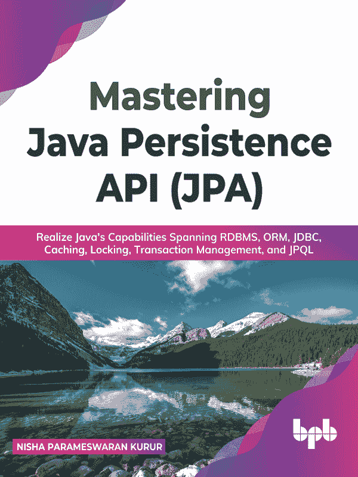


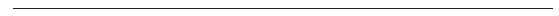


# 前言

森林优美，黑暗而深邃，

但我有承诺要履行，

睡眠之前还有长路要走，

睡眠之前还有长路要走。

*– 罗伯特·罗斯特*

罗伯特·罗斯特诗作《雪夜行径》中的这些诗句一直激励着我。我认为这对于每一个专业人士、追求者以及任何想要加入行业的人来说都是如此。我相信学习是每个人无止境的旅程；有时我们从经验丰富的同事学习，有时甚至是一个孩子在用新的方式教我们。要点是学习，至于从谁那里获取技能并不重要。本书阐述了上述引言，我必须说，一旦你读完这本书，你会非常赞赏自己。

James Gosling、Mike Sheridan 和 Patrick Naughton —— 一支伟大的团队为我们送上了长寿的技术（语言和框架）。自 1995 年 Java 发布第一个稳定版本以来，已经过去了二十多年。Java 在许多行业中仍然知名且流行。然而，我们现在在 Java 中有很多新的适配和新增，但 Java 的基础香气未变。随着时间，这种语言正带着越来越多的功能出现。如果你想在大海中游泳，就必须更新自己。目前的这本书对于你使用该语言最新的术语、新增和/或更新来构建基础模块非常有帮助。

我非常欣赏作者策划和组装这本书的风格。本书按照作者的布局实现了其目的。作者以详细的方式构建了广泛使用的主题的基础模块，这些：

- 对象关系映射（Object Relational Mapping）
- 数据库术语及其抽象
- 该语言的新特性是什么？
- 运行时对象（Runtime objects）

作者从理论开始，定义了基本概念，并以动态图的形式将其视觉化。在书的中间，你将了解到即使借助短小/微示例也可以使用的术语。在书的最后阶段，作者介绍了新旧版本之间的差异。这些差异通过非常简单的示例和图像/图表的形式定义，以便人们能够轻松掌握这些概念。此外，作者还提供了一个附录，你可以在那里找到问题的解决方案。除此之外，每个章节都有评估部分，以便读者在读完章节后进行自我评估。

本书基于基础模块构建，可以作为任何专业人士或学者的快速查询手册。你将从理论上学习并理解它们，以实现各种主题。读完这本书后，你会发现自己现在准备好学习高级内容了，如果你已经知道高级概念，那么你会发现自己对该语言当前版本的新增/更新感到耳目一新。

我希望你像我一样喜欢这本书。并希望你喜欢数据库分析工作。

祝得愉快！

**Gaurav Aroraa 博士**

印度新德里

# 献给

*我亲爱的父母*

*&*

*我亲爱的家人*

# 关于作者

**Nisha Parameswaran Kurur** 是一位技术架构师，兴趣广泛，包括数据库、算法、数据结构、操作系统和网络原理等主题。她曾为网络、广播、零售、金融、医疗保健等多个领域的大客户开展过许多真实世界的应用项目，涉及 IT 行业中不同的服务和产品部门。她在印度马德拉斯理工学院（`IITM`）获得计算机科学硕士学位，并发表过会议论文和白皮书。她还是喀拉拉邦政府 ASAP 课程的专业编码技能导师。她对将自己的知识传播给更广泛的读者深有兴趣，因此致力于为对学习计算机课程感兴趣的非技术人员（重点关注下一代儿童）编写当地语言的书籍。

# 关于评审员

**Gaurav Aroraa** 是一位技术爱好者和技术顾问，在行业内拥有超过 23 年的经验。他拥有计算机科学博士学位。Gaurav 是 MVP 奖获得者。他是印度计算机学会（`CSI`）的终身会员，IndiaMentor 的顾问成员和高级导师，拥有 ITIL-F 和 PRINCE-P 认证。Gaurav 是一个开源开发者，也是微软社区的贡献者。他编写了关于 .NET Core 等技术的书籍。

博客链接：[`gaurav-arora.com/`](https://gaurav-arora.com/)

LinkedIn 个人：[`www.linkedin.com/in/arorav/`](https://www.linkedin.com/in/arorav/)

**Abhijeet Prakash** 在人工智能、机器学习、`NLP`、深度学习以及全栈开发方面拥有 6 年的丰富经验，使用了 `Cookiecutter`、`KerasTuner`、`DVC`、`Google Cloud Video API`、`Selenium`、`BS`、`Google Colab`、`Apigee`、`FastAPI`、`AWS`、`Google Cloud Platform` 等工具，并精通 `Ruby`、`Node`、`Python` 等编程语言，曾在信息技术和产品公司工作。Abhijeet 在数学科学信息技术系获得了 `MCA`。他曾在各种银行、非金融机构和金融科技公司工作过。他曾担任机器学习工程师，目前担任人工智能工程师。Abhijeet 还写过一本关于伦理黑客的书。

# 致谢

我要感谢许多一直对我提供持续和不断支持的人。首先，我要感谢我的父母的愿见和动力，没有他们，我不会成为今天这样。其次，我要感谢我的家人全心持续的鼓励和支持，这一直一直是我的力量源。特别感谢我的孩子们通过帮助创建图表来积极参与我的书籍写作活动。

我对 BPB Publications 团队表示感谢，感谢他们交给我如此重大的责任，并提供了足够的支持，让我有充足的时间来完成这本书。新冠（19）疫情和其他个人干扰导致我远离写作写作的时间比预想的要长。向 BPB 的书籍协调员们致敬，是他们的信任、耐心和坚持让我坚持了下去。我深心感谢我的书评员，他们在极短的时间内完成了出色的工作。总的来说，这是一次无法用言语形容的巨大经历。

# 前言

本书涵盖了 `Java persistence API` —— 从它的诞生到最近的进展，包含了各种非关系型数据库在内的进步。核心重点是 `JPA` 概念及其在不同 `JPA` 实现框架中的用法，特别关注了 `Hibernate` 和 `EclipseLink`。

本书描述了理解 `JPA` 概念所需的关系型数据库基础概念。通过代码段演示了 `JPA` 的各种功能，包括使用 `XML`（旧式）和注解（新式）的配置。它还提供了对锁、并发和事务等复杂数据库概念的良好理解。

本书采取实战方法，更多地关注 `JPA` 实现框架——它重点关注两种广泛使用的实现，即 `Hibernate` 和 `EclipseLink`。本书还提供了一个示例 `mavenized` 项目，可以作为创建任何 `JPA` 项目的起点。此外，它还提供了重要的 `JPA` 问题及其解决方案，帮助读者为任何面试做好充分准备。

第 1 章旨在介绍 `Java` 以及 `Java` 中形成的用于持久化数据的各种策略，随后详细解释与对象关系模型、映射和阻抗不匹配（impedance mismatch）相关的各种术语，最后讨论用于/曾用于解决 Java 持久化问题的各种技术。

第 2 章将集中于最广泛使用的持久化模型，即关系型数据库。所有基本概念如表、行、列、单元格、键、数据类型、转换和访问类型都将详细说明，并特别提到了它们如何在 `JPA` 中使用。这里的主要目标是介绍关系型数据库设计概念及其在 `JPA` 中的用法。值得注意的是，配置尽可能同时提供了 `XML` 和注解两种形式。

第 3 章将重点关注关系型数据库的操作，如标识符以及如何将其用键。它还讨论了生成标识符的序列策略以及生成主键的其他策略。本章涉及继承和锁技术，特别关注各种锁策略，如乐观锁、悲观锁等。

第 4 章将更多地讨论存储的数据之间的相互关系。它还详细讨论了 RDBMS 中发现的各种关系以及它们如何在 `JPA` 中定义，以及如何在 `JPA` 实现框架中实现。

只有当数据以后可以被检索供参考时，数据的存储才有意义。

第 5 章将更多地讨论如何检索存储的数据以及 `JPA` 支持的所有查询机制。它还讨论了 `JPQL` BNF，对于想要深入研究并理解 `JPQL` 构建块的人来说，可以作为一个参考。请注意，此 `JPQL` BNF 是可选的，根据需要可以跳过。这不会导致内容流的中断。

第 6 章将解释 `Entity Manager` 及其在 `JPA` 中的作用。

第 7 章将描述两种广泛使用的实现，即 `Hibernate` 和 `EclipseLink`。

附录 1 将讨论 `JPA`。

附录 2 将提供 `JPA`。

# 评论

请留下您的评论。在您阅读并使用此书后，为什么不在您购买书籍的网站上留个评论呢？潜在的读者可以查看并利用您的无偏意见来做出购买决策。我们 BPB 能够了解您对我们产品的看法，我们的作者也可以看到您对他们书籍的反馈。感谢您！

有关关于 BPB 的更多信息，请访问 [`www.bpbonline.com`](http://www.bpbonline.com/)。

# 第一部分

## 引言

# 第 1 章：Java 持化 API 与对象关系映射 Java 持化 API 与对象关系映射

## 引言

1991 年，`James Gosling`、`Mike Sheridan` 和 `Patrick Naughton` 这一个由 `Sun 工程师` 组成的团队启动了一个项目，旨在开发一种简单、健壮、可移植、平台无关、面向对象、多线程、高性能的解释型语言，该语言可用于小型嵌入式系统。由于团队被命名为 `Green`，该语言最初被命名为 `Greentalk`。考虑到它与 `Smalltalk` 相似，它被重命名为 `Oak`，因为它被视为实力的象征。由于该名称已由 `Oak technologies` 注册商标，`James Gosling` 在喝咖啡时选择了 `Java` 这个名字（Java 既是品牌名，也是印度尼西亚生产第一批咖啡的岛屿名称）。

Java 的第一个版本于 1995 年由 `Sun Microsystems` 发布，是一种免费的、平台无关的、面向对象的应用程序语言，被认为是 1995 年的 10 大最佳产品之一。然而，Java 的稳定版本（`JDK 1.0`）于 1996 年 1 月发布。作为 Web 应用程序编程的最佳选择之一，Java 的流行程度日益增加，而 Java 与“互联网”的关联归功于 `Applet` 特性，它可以被嵌入到网页并在浏览器中运行。由于其免费，源代码的可用性使得 Java 被许多公司采用，因此它的增长从客户端 applets 发展到了标准的服务器端语言。`Java 企业版`（`JEE`）是一个开放的企业级软件平台，为服务器应用程序提供标准模型，该模型可以运行几乎所有兼容 Java 的企业级产品上。使用 `JEE`，开发者可以轻松适应 IT 行业日益增长和更大的需求，而不会产生大量的额外成本。

构成 `JEE` 的少数主要技术如下：

- `Java Servlets`
- `JavaServer Pages`（`JSP`）
- `Enterprise JavaBeans`（`EJB`）
- `Java Message Service`（`JMS`）
- `Java Naming and Directory Interface`（`JNDI`）
- `Java Database Connectivity`（`JDBC`）
- `JavaMail`
- `Java Transaction Service`（`JTS`）
- `Java Transaction API`（`JTA`）
- `J2EE Connector Architecture`（`J2EE-CA`，或 `JCA`）

`Enterprise Java Beans`（`EJB`）是 J2EE 规范的主要部分，定义了构建服务器端可重用组件的模型。目前 J2EE 支持三种类型的企业豆——会话豆（session beans）、消息驱动豆（message-driven beans）和实体豆（entity beans）。会话豆用于应用程序客户端之间共享信息。消息驱动豆用于基于来自面向消息中间件的消息进行异步执行。实体豆用于对持久化业务对象特别是数据库中的数据进行建模。

以面向对象的方式连接数据库的需求导致了 `JPA` 的流行，它允许程序员无缝地将任何数据库集成到应用程序中，而无需担心底层的数据库驱动程序或查询语言细节。

本章主要讨论了持久化的不同方面、数据库以及导致开发和接受 `JPA/ORM` 的原因。这种讨论对于本书的其他部分设定背景是必要的。

## 结构

本章讨论以下内容：

- Java 持久化机制
- 数据库类型
- 对象关系定义
  - 对象关系模型
  - 对象关系映射
  - 对象关系阻抗不
- Java 持久化 API（`JPA`）
  - `JPA` 历史
  - 其他 Java 持久化规范
  - `JPA/ORM` 的优势
- 持久化产品

### 目标

本章将向读者介绍 Java 持久化技术、数据库类型对象关系定义及其对程序开发的影响。您还将学习 Java 中的 `JPA` 和其他持久化规范，以及 `JPA` 提供者实现的对比研究。

### Java 持久化

计算机科学中，数据的持久化（Persistence）描述在创建它的进程结束后仍然存在的数据。在 Java 中，持久化是关于将任何应用程序相关数据存储到任何层次，并在需要时检索它。Java 数据包括字符串、数字、日期、字节数组、图像、`XML` 和 Java 对象。

Java 中常用的数据持久化方法有很多。其中一些如下：

- `File Input Output`（`IO`）：文件 IO 主要用于将数据作为文件持久化在底层操作系统的文件系统中。大多数字符串数据或原始数据存储在文件中。所有文件内容都作为名为 `streams`（流）的数据序列进行读写，由字节组成。Java 对象使用一种名为 `serialization`（序列化）的技术存储到文件中，解释如下。

- `Serialization`（序列化）：序列化用于使对象的状态持久化。这意味着对象的状态转换为字节流并存储在文件中。每当需要时，就会执行反向过程（反序列化）并重建对象。

- `Java Database Connectivity`（`JDBC`）：`JDBC` 主要用于将 JEE 应用程序连接到数据库。这是大多数 Java 应用程序用于从 `database`（`DB`）中存储和检索数据的基础底层技术。

- `Java Connector Architecture`（`JCA`）：`Java Connector Architecture` 是连接到任何企业信息系统（`EIS`）的更通用标准。它可以是数据库或任何如 Siebel Systems、SAP AG、Oracle 应用等其他系统。

- `Java Data Objects`（`JDO`）：`JDO` 是 Java 对象持久化的通用规范。使用 `JDO` 的应用程序独立于底层数据库，并很容易从一种类型的数据库迁移到另一种。`JDO` 实现支持许多数据存储，如关系型和对象数据库、`XML`、平面文件、`LDAP`、`ODF` 格式、Excel 格式等。这主要是 Sun 规范的一部分，后来捐给了 Apache 基金会。

- `Service Data Objects`（`SDO`）：`SDO` 是在面向服务的架构（`SOA`）中处理来自异构源的数据（如 `XML` 文档、关系型数据库、Web 服务）。这最初是 2004 年由 Oracle（BEA）和 IBM 合作开发的。

- `Enterprise Java Bean`（`EJB`）：`EJB` 有许多类别的豆，其中实体豆用于 Java 应用程序中的数据持久化。实体豆有两种持久化类型——豆管理持久化（`BMP`）和容器管理持久化（`CMP`）。`BMP` 允许实体豆通过持久化操作直接管理和实现所有操作（例如 `JDBC`、`JDO`、`SDO`）。然而，正如名称所示，在 `CMP` 中，`EJB` 容器隐式地管理持久化状态。在使用此类持久化时，开发者无需担心数据库访问和相关功能。`Java Persistence API`（`JPA`）被定义为此类持久化的一部分。

### 数据库

简单来说，数据库无非是一个存储数据的程序。这可以通过许多方式实现，不同类型的数据可以存储在这些数据库中。不同类型的数据库列如下：

- **对象数据库**：对象数据库以对象的形式表示其信息。由于 `Java` 是一种面向对象的语言，将数据存储并将其作为对象检索出来变成了一种自然且常见的方式。但与关系数据库相比，这些数据库管理系统并没有取得很大的成功。

- **XML 数据库**：`XML` 数据库允许以 `XML` 格式指定、存储和检索数据。数据可以以 `XML` 形式进行查询、转换、导出并返回另一个系统。这是一种面向文档的数据库，反过来又是 `NoSQL` 数据库的一个类别。

- **NoSQL 数据库**：`NoSQL`（或非 SQL、非关系型数据库）配备了表格关系之外不同格式的数据存储和检索功能。数据可以是任何格式，如 `XML`、`JSON` 等。此外，`NoSQL` 数据库对数据存储不需要结构化的模式定义。

- **关系数据库**：虽然有很多种数据库，但尽管关系数据库是一项相对老的技术，仍然占据着行业的主导地位。在这种模型中，数据被组织成由列和行组成的表格。每一行由一个唯一键标识。行被称为 `tuples`（元组）或 `records`（记录），而列被称为 `attributes`（属性）。每个表表示一个实体，而表中的每一行都是该实体的特定实例，列描述了该特定实例的属性。曾多次尝试首先用面向对象、然后用对象关系以及 `XML` 数据库来取代关系模型，但这些模型都没有取得很大成功，关系数据库仍然是压倒性的主导数据库模型。

应用程序中的数据基于 `Java` 对象，而数据库中的数据基于表-行-列关系模型。**Java Persistence API**（`JPA`）是一种试图帮助开发者轻松克服这一挑战的尝试。

### 对象-关系定义

随着用于应用程序开发的面向对象语言的增长，程序员开始考虑映射关系模型和面向对象模型，以便于实现的方便和清晰，因此**对象-关系模型**（Object-Relational Model）以及**对象-关系映射**（Object-Relational Mapping）成为了频繁使用的术语。此外，这两个模型之间的不匹配在使用它们时也带来了一些局限性。接下来的章节将描述模型、映射以及不匹配。

### 对象-关系模型


对象-关系模型是一种设计，将面向对象的特性集成到关系数据库中。这允许开发者轻松地将面向对象的代码与数据类型和方法集成到数据库中。北欧对象/关系数据库设计¹（Nordic Object/Relational Database Design）是此类数据库的一个提案。这种数据库的目标比其前身（无论是关系还是面向对象，因为它是一种混合技术）更强大、更大的灵活性、更好的性能和更大的数据完整性。

### 对象-关系映射

对象-关系映射（`ORM`）是一种编程技术，有助于将来自不同不兼容类型系统的数据转换为对象，以便面向对象的语言进行操作。这减轻了开发者将现有对象值转换为简单形式以存储在数据库中的负担。

随着关系数据库的广泛使用，表-行-列模型使得数据操作对程序员变得繁琐。`ORM` 是一种福音，因为它减少了代码量，程序员可以通过面向对象的方式应用逻辑来提高生产力，而无需担心关系数据库的实际行列格式。

在本文中将详细讨论映射技术，因为这项知识将使对 `JPA` 的理解变得显而易见。

### 对象-关系阻抗不匹配

对象-关系阻抗不匹配²涉及到在面向对象语言中表示关系数据库数据时发生的问题。该术语借作电气工程的类比，在任何优化电路设计中，阻抗匹配对于实现最大功率传输³至关重要。在这里，阻抗不匹配导致在使用面向对象的语言访问关系数据库时，应用程序中的数据流出现困难。

基本上，面向对象的概念基于软件工程的基础，而关系模型概念则基于经过证明的数学原理。这些理论差异形成了一个带有一些小瑕疵的非理想组合。

## 概念差异

面向对象（`OO`）中的许多概念与关系模型中的概念完全背道而驰。封装允许对象的内部表示保持隐藏状态，而对象-关系模型则暴露了对象的底层内容，以与对象实现本身未指定的接口进行交互。

关系模型中的访问修符没有在面向对象中那么重要。同样，这两个模型中各种属性的分类和特征在它们的相对本质和绝对本质上存在冲突。

关系模型不支持类、继承和多态，而这些是面向对象设计的基本原则。在面向对象范式中，接口是访问对象内部的唯一途径。但在关系世界中，视图（views）提供了替代的视角。

## 数据类型差异

关系模型将所有行视为不可变的，这意味着它严格禁止按引用的属性（唯一的异常是外键情况，使用了交叉引用列）。但在 `OO` 中，它期望按引用处理是标准行为。任何属性都可以在任何层具有指向另一个对象的引用。

此外，数据库和 `OO` 语言之间的标量数据类型也不同。例如，`VARCHAR(10)` 是数据库列定义中描述字符串的一种，它严格限制了字符串长度为 10。但在 `Java` 字符串的情况下，没有提到长度，因此如果开发者不采取额外努力，列大小的这种限制在应用程序代码中就不会被察觉。

另一个简单但不自然的差异是查询机制处理数据库系统中的数据的方式（`SQL` 对比 `OO` 语言）。例如，`SQL` 系统在比较值时大多会忽略末尾空格，而 `OO` 字符串比较并不这样做。

## 数据处理差异

关系模型对于查询和使用数据有一组定义良好且相对较小的原始操作。在 `OO` 语言中，数据查询和操作是通过自定义的命令式操作完成的，这可能会导致实体本身状态的变化。

关系设计主要基于唯一元组（或行），提供基于集合的操作，而 `OO` 语言处理基于列表/基于映射的操作，使得数据处理变得不相似。

## 数据组成差异

在 `OO` 中，对象可以由许多对象形成到很大程度，或者也可以是通用定义的特化。然而，关系是具有相同表头（列名）的元组（行），在 `OO` 语言中没有理想的对应物。

## 事务差异

事务是数据库执行的最小工作单元。关系型事务比面向对象（`OO`）语言中的类执行的任何其他操作都要大得多。事务可以包含多组数据操作，而在面向对象语言中，这些操作被限于对基本类型字段的单独赋值。隔离性、持久性、原子性和一致性对于事务数据至关重要，而在面向对象的事务中，这些特性仅在基本类型字段得到保证。

## 完整性差异

关系模型要求对标量类型、属性、关系变量以及整个数据库进行声明式约束。在面向对象语言中，没有显式声明此类约束，但在尝试操作封装的内部数据时会抛出异常。

## 不匹配的解决方案

当使用不同的系统时，不匹配是不可避免的。因此，第一步是识别问题并尽可能减少或弥补这种不匹配。在运行时使用最小化技术的框架会将数据集中的某行与实体实例进行动态关联。在进行静态编码时，实体类则与数据集中的关系相关起来。这有助于实现一些优势，例如：

- 代码量更小，编译更快。
- 可以通过更改代码中的关联关系来动态更改模式（schema）。
- 可以更直接地在更高层级访问领域数据，用于展示、传输以及验证。
- 避免复杂的映射。
- 可以进行约束检查。

此外，还有一些缺点，例如：

- 运行时构建和访问可能存在性能开销。
- 无法利用多态等面向对象原则。

另一种方法是使用非关系数据库，因为正如名称所示，这种阻抗不匹配（impedance mismatch）只在使用关系型模型时才会发生。`NoSQL` 数据库或 `XML` 数据库可以作为关系型数据库的替代。然而，将现有的关系型数据库迁移到非关系数据库也是一项艰巨的任务。

## Java 持久 API（JPA）

`Java` 提供了规范以确保所有使用此规范特性的人都能理解用户将可以使用哪些功能。然而，这些规范并没有限制实现者，并对如何实现这些功能给予了自由。`JPA` 就是其中一种规范，用于在 `Java` 对象/类与关系型数据库之间访问、持久和管理数据。`JPA` 被定义为 `EJB 3.0` 规范的一部分，作为 `EJB 2 CMP Entity Beans` 规范的替代方案。

`JPA` 变得如此流行，现在被认为是 `Java` 行业中对象关系映射（`ORM`）的标准行业方法。注意，它是一组定义，或者用 `Java` 术语来说，一组接口。它需要一个实现来执行实际的持久化或数据管理。有很多 `JPA` 实现，既有开源的也有商业的，任何 `JEE` 应用服务器都应该支持其使用，因为这些实现都遵循 `Java` 规范。

## 基于 JPA 的 Java 应用分层

下图（`Figure 1.1`）描述了分层，清楚地指示了 `JPA` 如何完成准备应用程序以独立于数据库或提供者的任务。该图提供了市场上提供的 `JPA` 提供者列表以及 `JDBC` 驱动程序。

`JPA` 的主要吸引力在于，与 `EJB 2 CMP` 相比，它使简单的旧 `Java` 对象（`POJO`）无需任何额外的实现或方法即可被轻松持久化。这允许对象通过使用标准注解或 `XML` 配置描述的对象关系映射映射到数据库表上。

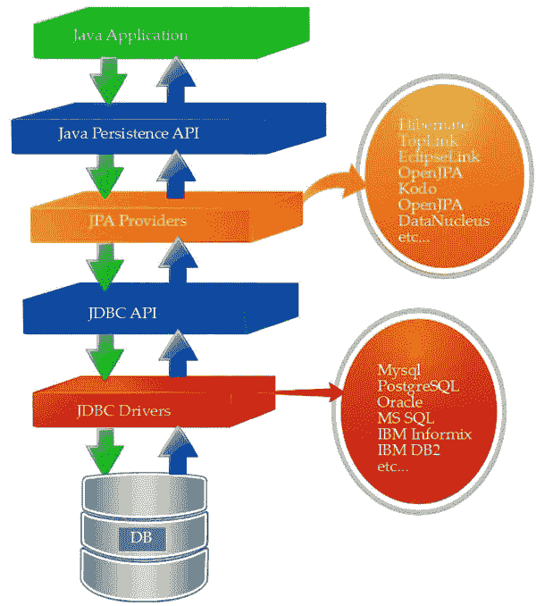

`JPA` 指定了一个运行时实体管理器 API，负责处理对象上的查询和事务。`JPA` 定义了一种对象级查询语言 `JPQL`，用于以对象的形式从数据库查询数据。

## JPA 历史

`JPA` 是多个 `Java` 持久化规范中最新的一个。

第一个 `Java` 持久化规范是 `Object Management Group`（`OMG`）持久服务 `Java` 绑定，它并没有成功。很少有商业产品支持这一规范。

下一个是 `EJB 1.0 CMP Entity Beans`，它在被大型 `Java EE` 供应商（`BEA`、`IBM`）采用方面非常成功，但对 Entity Beans 规范要求的反馈是，它们过于复杂且性能低下。

`EJB 2.0 CMP` 尝试通过本地接口减少 Entity Beans 的部分复杂性，但大部分复杂性仍然存在。`EJB 2.0` 还缺乏可移植性，因为为映射定义的部署描述符全都是私有的。这影响了另一个 `Java` 持久化规范——`Java Data Objects`（`JDO`）的创建。

`JDO` 被几个独立供应商（如 `Kodo JDO`）和几个开源实现采用，但在大型 `Java EE` 供应商中从未获得过很大成功。

尽管此时市场上有了两个竞争的 `Java` 持久化标准（`EJB CMP` 和 `JDO`），大多数用户仍然倾向于继续使用如 `TopLink`、`Hibernate` 等私有 API 解决方案。`TopLink` 产品被 `Oracle` 从 `WebGain` 收购，使其在 `Java EE` 社区的使用激增。

`EJB CMP` 的复杂性导致了 `EJB 3.0` 规范的产生，主要目标是减少复杂性，因此定义了 `JPA`。该规范旨在统一 `EJB 2.0 CMP`、`JDO`、`Hibernate` 和 `TopLink` 的 API 以及产品，并成功实现了目标。

大多数持久化供应商都发布了 `JPA` 实现，证实了行业和用户的采用。以下是几个例子：

1. `Hibernate⁴`（被 `JBoss` 收购，后被 `Red Hat` 收购）。
2. `TopLink⁵`（被 `Oracle` 收购）。
3. `EclipseLink⁶`（基于 Eclipse 的 `TopLink` 实现）。
4. `KodoJDO⁷`（被 `BEA` 收购，后被 `Oracle` 收购）。
5. `Cocobase`（由 `Thought Inc.` 所有）。
6. `Java Persistence Objects – JPO⁹`（位于 `sourceforge.net`）。
7. `DataNucleus¹⁰`（位于 `GitHub`）。

尽管 `JPA` 被认为是广泛接受的规范，但市场上还有其他持久化规范。下一节将描述它们及其最新版本。

## 其他持久化规范

`Java` 中有很多关于持久化的规范。它们提供了丰富的功能，并在许多方面具有独特性。

| 规范 | 最新版本 | 发布年份 |
| :--- | :--- | :--- |
| `Java Database Connectivity (JDBC)¹` | 4.3 | 2017 |
| `Java Data Objects (JDO)` | 3.0 | 2010 |
| `Java Persistence API (JPA)` | 2.1 | 2013 |
| `Java EE Connector Architecture (JCA)` | 1.6 | 2013 |
| `Service Data Objects (SDO)` | 2.1 | 2009 |
| `Enterprise Java Bean-Container Managed Persistence (EJB CMP)` | 3.0 | 2009 |

**表 1.1：** Java 可用的持久化规范最新版本。

许多持久化规范是根据开发应用程序时的需求而使用的。然而，`JPA` 规范符合了各种应用需求，因此适用于大量的应用程序。

## JPA/ORM 的优势

这是一个很有趣的问题。使用 `ORM` 框架或持久化产品有许多理由，特别是使用 `JPA` 也有许多理由。

- 由于应用开发是使用面向对象的语言进行的，因此即使不了解实际使用的 `SQL` 语句，`ORM` 也能与数据库无缝集成。
- `JPA` 在使用如 `JDBC` 等其他持久化规范时，还避免了如何连接数据库的基础细节。
- `ORM` 使应用程序的数据库和模式（schema）保持独立性，因为它们都由 `ORM` 层管理，而不是由应用程序本身管理。
- 大多数 `ORM/JPA` 产品都是开源且免费的。此外，许多公司为这些产品提供支持和服务。因此，使用 `ORM/JPA` 变得更具吸引力。
- `ORM` 还提供了缓存、复杂的数据库和查询优化等功能，这些功能在访问数据时被认为是高级的性能特长。
- `ORM` 利用了面向对象编程和对象模型的使用，而 `JPA` 是一个标准，是 `EJB3` 和 `JEE` 的一部分，具有非常实用且功能完备的规范。
- `JPA` 支持 Java 标准版和企业版（`JSE` & `JEE`），并且可以在应用程序服务器和持久化产品之间进行迁移（避免了供应商锁定）。

在开发应用程序时，`JPA` 需要一个实现类才能使用。市场上有很多可用产品，这给开发者带来了困扰。下一节将尝试使用户在市场可用产品中选择提供商时，提出正确的问题并寻求答案。

# 持久化产品

尽管市场上有很多持久化产品，但建议是基于广泛使用的标准规范（如 `JPA`）来选择产品，这为在不同的持久化提供商或不同的服务器平台之间切换提供了更大的灵活性。

除了 `JPA` 支持外，在为应用程序选择持久化产品时，还需要考虑许多因素。有很多产品支持 `JPA`，这使得情况变得更加复杂。需要注意的方面和需要回答的问题列如下：

- 每当应用程序处于初始阶段时，部署细节也会被计划并达成一致。了解支持或集成在服务器/数据库平台中的持久化产品类型非常重要。只有这样，才能轻松地设计应用程序的持久化层。
  - 所选服务器平台支持哪些产品？
  - 是否有与服务器集成在了一起的产品？
  - 该产品是否与数据库平台集成？
- 持久化产品的成本也是另一个重要的决策因素。在这一层级有许多组件需要考虑。
  - 该产品是否免费且开源？如果是，是否支持企业级并可以购买服务？
  - 与生产该产品的公司之间是否存在现有的关系？
- 拥有大量活跃用户群的产品始终是一个明智的选择。这有助于确保大多数功能都能提供，因为有许多人正在积极使用它。此外，对于免费开源产品，社区会非常活跃且响应及时。
  - 该产品是否正在被活跃使用？
  - 该产品是否拥有庞大的用户群？
  - 该产品是否有活跃且开放的论坛？在这些论坛上发布的问题是否收到有用的回复？
- 一旦选定了产品，更换产品确实很难，因为这涉及到时间和成本。因此，在使用产品之前，评估其性能能力是重要的。
  - 产品的性能和扩展性如何？
  - 该产品是否符合 `JPA` 标准？
  - 除了 `JPA` 规范外，该产品还提供哪些功能？

| 产品 | JPA 1.0 | JPA 2.0 | JDO 2.0 | JDO 3.0 | CMP 2.1 | 版本 | 发布年份 | 开源 | 应用服务器 |
| :--- | :--- | :--- | :--- | :--- | :--- | :--- | :--- | :--- | :--- |
| Hibernate (Red Hat) | 是 | 是 |  |  |  | 5.6 | 2021 | 是 | JBoss |
| EclipseLink (Eclipse) | 是 | 是 |  |  |  | 3.0.2 | 2021 | 是 | Oracle Weblogic (12c), Glassfish (v3) |
| TopLink (Oracle) | 是 |  |  |  |  | 12c (12.2.1.4.0) | 2019 |  | Oracle Weblogic (12c), Oracle AS (10.1.3) |
| OpenJPA (Apache) | 是 | 是 |  |  |  | 3.1.2 | 2020 | 是 | Geronimo, Websphere Application Server (8.0) |
| DataNucleus (DataNucleus) | 是 | 是 | 是 | 是 |  | 5.2.1 | 2019 | 是 | Apache Isis |
| TopLink Essentials (java.net) | 是 |  |  |  |  | 2.0 | 2007 |  | Glassfish (v2), OracleAS (10.1.3) |
| Kodo (Oracle) | 是 |  | 是 |  |  | 4.1.4 | 2007 |  | Oracle Weblogic (10.3) |

**表 1.2：** 市场上各种符合 `JPA` 标准的持久化产品总结。

最先进、文档完备、开源且活跃且能够快速生成新功能的社区将 `Hibernate` 列为最流行的 `JPA` 提供者之一。`EclipseLink` 是 Oracle 的 `JPA` 版本，源自 Java 官方社区，并被视为参考实现。

## 结论

## 问题

1. 在计算术语中，持久化是什么？
2. 解释 `Java` 中的各种持久化机制。
3. 描述可用的数据库类型。为每种类型寻找示例。
4. 详述对象关系阻失匹配（Object-Relational Impedance Mismatch）。
5. 用图说明 `JPA` 如何使应用程序独立于底层提供者以及数据库。

# 核心术语

- `JPA`：用于持久化数据和使用 `ORM` 技术管理数据的 `Java` 规范。
- `JPA Provider`：`JPA` 定义的实际实现。
- `ORM`：对象关系映射（Object-Relationship Mapping），用于避免面向对象程序中关系表的复杂性，并将数据本身视为对象。

## 思考题

1. 一个被广泛接受的持久化工具是 `Apache iBATIS18`。它既不是基于 `ORM` 也不是 `JPA`，但它减少了程序员将对象数据转换为 `SQL` 查询以及反之的工作。`SQL` 数据库与 `Java` 对象的映射在 `XML` 文件中完成，并与应用程序代码解耦，使得代码更容易理解和维护。
2. 理想情况下，`JPA` 支持关系型数据库。然而，现在有几个 `JPA` 实现者已将其支持扩展到 `NoSQL` 数据库。它们包括 `DataNucleus JPA`、`Hibernate` 和 `EclipseLink`。`JDO` 是同时适用于 `RDBMS` 和非 `RDBMS` 的规范。

# 参考文献

1. 节点对象/关系模型：Paul Nielsen 的文章 [`docs.microsoft.com/en-us/previous-versions/bb245675(v=msdn.10)?redirectedfrom=MSDN`](https://docs.microsoft.com/en-us/previous-versions/bb245675(v=msdn.10)?redirectedfrom=MSDN)
2. [`en.wikipedia.org/wiki/Object-relational_impedance_mismatch`](https://en.wikipedia.org/wiki/Object-relational_impedance_mismatch)


3. 阻抗匹配：`techopedia` 的文章 [`www.techopedia.com/definition/32462/impedance-mismatch`](https://www.techopedia.com/definition/32462/impedance-mismatch)

4. [`hibernate.org/`](http://hibernate.org/)

5. [`www.oracle.com/technetwork/middleware/toplink/overview/index-086944.html`](https://www.oracle.com/technetwork/middleware/toplink/overview/index-086944.html)

6. [`www.eclipse.org/eclipselink/`](https://www.eclipse.org/eclipselink/)

7. [`docs.oracle.com/cd/E13189_01/kodo/docs40/full/html/solarmetric_intro.html`](https://docs.oracle.com/cd/E13189_01/kodo/docs40/full/html/solarmetric_intro.html)

8. [`thoughtinc.com/cber_index.html`](http://thoughtinc.com/cber_index.html)

9. [`sourceforge.net/projects/jpox/`](https://sourceforge.net/projects/jpox/)

10. [`www.datanucleus.org/`](http://www.datanucleus.org/)

11. 在产品中支持 `JDBC` 的公司：[`www.oracle.com/technetwork/java/index-136695.html#`](https://www.oracle.com/technetwork/java/index-136695.html#)

12. [`docs.jboss.org/jbossas/docs/Installation_Guide/4/html-single/index.html`](https://docs.jboss.org/jbossas/docs/Installation_Guide/4/html-single/index.html)

13. [`www.oracle.com/middleware/technologies/weblogic.html`](https://www.oracle.com/middleware/technologies/weblogic.html)

14. [`javaee.github.io/glassfish/`](https://javaee.github.io/glassfish/)

15. [`en.wikipedia.org/wiki/Oracle_Application_Server`](https://en.wikipedia.org/wiki/Oracle_Application_Server)

16. [`geronimo.apache.org/`](http://geronimo.apache.org/)

17. [`www.ibm.com/cloud/websphere-application-platform/`](https://www.ibm.com/cloud/websphere-application-platform/)

18. [`isis.apache.org/`](https://isis.apache.org/)

19. [`en.wikipedia.org/wiki/Apache_iBATIS`](https://en.wikipedia.org/wiki/Apache_iBATIS)

# 第 2 章：表与嵌入对象

## 引言

通过前面的章节可以清楚地看到应用程序中使用了 `DBMS`。在使用 `DBMS` 之前，使用的是扁平文件。1970 年，`Edgar Codd` 在 `计算机机器协会` (`ACM`) 杂志上发表了一篇名为《大型共享数据库的关系模型》的论文，引入了 `RDBMS` 的概念。关系是一个带有集合的表。

## 结构

本章将讨论以下内容：

* 映射访问

* 基础属性

* 时间、日期与枚举

* `LOBs`、`BLOBs`、`CLOBs` 与序列化

* 列定义与模式生成

* 可插入、可更新、只读

* 类型转换

* 嵌入 ID、嵌套与查询

* 多表高级映射

### 目标

本章将向读者介绍 `RDBMS` 的表概念、对象到 `JPA` 的映射以及表属性类型。

## 表

表是关系数据库的基本持久化结构。表包含一组列或属性（定义了表的结构），以及一组行或元组（定义了表的数据）。每列都有一个称为**域**的特定类型并通常有特定的大小。下图显示了本文可能使用的术语。

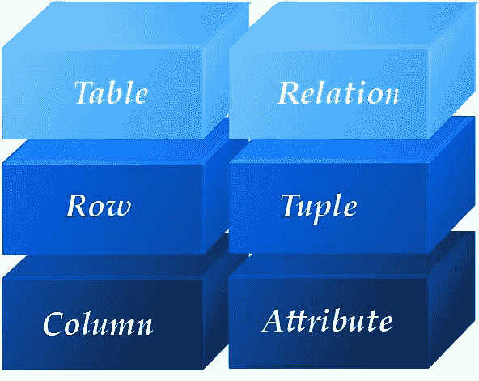

**图 2.1：可以互换的术语**

表是以行和列形式存储的值集合。如[图 2.2](#fig2_2)所示，`Student` 表包含名为 `ID`、注册号和 `姓名` 的列，这些也称为属性。列的一组值形成表中的行，被称为**元组**或**记录**。

| ID | REGNO | NAME |
| :--- | :--- | :--- |
| 1 | 11111 | ABC |

**图 2.2：学生表 - 示例**

关系是由具有各种属性值组合形成元组的表。使元组具有可识别性的属性或列组合被称为**键**。`DBMS` 中主要有八种键，如下：

1. **超键 (Super Key)**：一组一个或多个键，用于唯一标识表中的行。超键可能包含对于唯一标识不需要的额外属性。请考虑上方图 2.2 所示的示例学生表。在这里，学生 ID 和注册号都可以视为唯一键。因此，超键为 `{ID}`、`{REGNO}`、`{ID, NAME}`、`{ID, REGNO}`、`{REGNO, NAME}` 和 `{ID, REGNO, NAME}`。

2. **主键 (Primary Key)**：表中用于唯一标识该表每一行的列或一组列。主键不能重复，这意味着相同的值在表中不能出现多次。一个表不能有多个主键。根据上面的表，`{ID}` 或 `{REGNO}` 都可以被视为主键，但不能兼得。

3. **备用键 (Alternate Key)**：表中除主键外，用于唯一标识该表每一行的列或一组列。一个表可以有多个主键备选选择，但只能设置一个主键。所有不是主键的键都称为备用键。如果上面表中的 `{ID}` 被声明为主键，那么 `{REGNO}` 就可以被视为备用键，反之亦然。

4. **候选键 (Candidate Key)**：一组能够唯一标识表中元组的属性。每个表都必须至少有一个候选键。一个表可以有多个候选键，但只能有一个主键。主键和备用键共同构成了候选键集。在这里，它们是 `{ID}` 和 `{REGNO}`。

5. **复合键 (Compound Key)**：两个或多个属性（通常是来自其他表的主键），用于唯一识别特定的记录。每列在数据库内部本身可能是不唯一的。

6. **联合键/组合键 (Composite Key)**：两个或多个列的组合，用于唯一标识表中的行。复合键与组合键的区别在于，复合键的任何部分可以是外键，但组合键可能也是外键的一部分。

7. **外键 (Foreign Key)**：在两个表之间创建关系的列。外键的目的是维护数据完整性并允许在两个不同的表之间进行导航。它通过引用另一个表的主键，充当了两个表之间的交叉引用。

8. **代理键 (Surrogate Key)**：旨在唯一标识每个记录的人工键称为代理键。它们没有给表中的数据赋予任何意义。数据库中大多数自动生成的键都是代理键。它们与被插入的数据没有关系。

标准的领域集或属性类型仅限于基本类型，包括数值、字符、日期-时间和二进制（尽管大多数现代数据库具有额外的类型和类型系统）。关于各种属性类型的深入讨论将在本章稍后进行。

表可以具有约束，用于定义限制行数据的规则，例如主键、外键和唯一约束。表还有其他构件，如索引、分区和触发器。在执行表到对象的映射时，必须考虑所有上述因素。因此，映射成为 `JPA` 的重要部分。

## 映射 (Mapping)

在 Java 中持久化内容的第一步是定义如何持久化。这被称为**映射过程 (mapping process)**。许多对象关系映射（`ORM`）工具可以为数据模型生成对象模型，其中包含了映射和持久化逻辑。`ORM` 产品还提供了映射工具，允许将现有的对象模型映射到现有的数据模型，并将这些映射元数据存储在平面文件、数据库表、`XML` 以及最后的注解中。

在 `JPA` 中，映射既可以通过 Java 注解存储，也可以存储在 `XML` 文件中。`JPA` 的一个重要方面是只需要少量的映射。`JPA` 实现要求为对象映射的几乎所有方面提供默认值。在 `JPA` 中映射对象的最少要求是定义哪些对象是可以持久化的。这是通过给类标记 `@Entity` 注解，或者在持久化单元的 `ORM` `XML` 文件中为类添加 `<entity>` 标签来实现。此外，必须为类定义主键或唯一标识属性。这是通过为类中的一个字段或属性（get 方法）标记 `@Id` 注解，或者在 `ORM` `XML` 文件中为类的属性添加 `<id>` 标签来实现。

`JPA` 实现将对所有其他映射信息设置默认值，包括表名、所有字段或属性的列名、基数和关系映射，以及访问对象的所有 `SQL` 和持久化逻辑。大多数 `JPA` 实现还提供了在运行时生成数据库表的选项，因此开发者只需极少量的工作即可快速开发持久化的 `JPA` 应用程序。

## 实体类 (Entity class)

实体类必须标有 `Entity` 注解，或在 `XML` 描述符中指定为实体。实体类的几个属性¹如下：

* 实体类必须有一个无参构造函数，且该构造函数必须是公共或保护的。实体类也可以有其他构造函数。

* 实体类必须是一个顶层类。枚举或接口不能被指定为实体。

* 实体类不能是 final（类的）。实体类的任何方法或持久化实例变量都不能是 final。

* 如果实体实例按值传递且为离线状态（例如通过远程调用），则实体类必须实现 `Serializable` 接口。

* 实体支持继承、多态关联和多态查询。

* 抽象类和具体类都可以是实体。

* 实体的持久化状态由实例变量表示。实体的状态可以通过实体的方法提供给客户端——即访问器方法（getter/setter 方法）或其他业务方法。

一个示例 `Student` 表在图 2.3 中，其 `ID` 为主键。

| ID | NAME | ADDRESS |
| --- | --- | --- |
|   |   |   |

**图 2.3：Student 表 – 另一个示例**

以下代码段提供了一个映射之前 `Student` 表的 `Entity` 类：

```java
@Entity
public class Student implements Serializable {
    @Id
    private Long id;
    private String name;

    public Student() {}

    public Long getId() {
        return id;
    }

    public void setId(Long id) {
        this.id = id;
    }

    public String getName() {
        return name;
    }

    public void setName(String name) {
        this.name = name;
    }
}
```

**代码 2.1：使用 JPA 注解对 Student 表进行映射**

```xml
<?xml version="1.0" encoding="UTF-8"?>
<entity-mappings version="1.0">
    <description>My First JPA XML Application</description>
    <package>entity</package>
    <entity class="entity.Student" name="Student">
        <table name="STUDENT"/>
        <attributes>
            <id name="Id">
                <generated-value strategy="TABLE"/>
            </id>
            <basic name="Name">
                <column name="Name" length="50"/>
            </basic>
            <basic name="Address">
                <column name="Address" length="100"/>
            </basic>
        </attributes>
    </entity>
</entity-mappings>
```

**代码 2.2：使用 JPA XML 对 Student 表进行映射**

上图显示了另一种基于 `XML` 文件的 `JPA` 映射方式。这在 Java 支持注解之前被广泛使用。然而，现在注解比 `XML` 使用得更频繁，因为注解更易维护，且所有的映射和代码都存在于同一个文件中。否则，将会有多个文件：一个用于 `XML` 映射，另一个用于在 Java 中编写的实际逻辑实现。

## 访问模式

实体的映射信息在运行时应该对 `ORM` 提供者可用，这样当发生数据读取/写操作时，提供者必须能够将数据映射到/从实体实例中映射。这种映射信息由类的访问类型（access type）定义。通常情况下，类的值通过反射或生成的字节码进行加载/存储，但具体取决于 `JPA` 提供者的实现和配置。`JPA` 提供了两种访问模式：

## 字段访问模式（Field Access Mode）

有两种声明字段访问模式的方法。

1. 显式地在实体上标记 `@Access(AccessType.FIELD)` 注解。

```java
@Entity
@Access(AccessType.FIELD)
public class Student implements Serializable {
    private Long id;
    // ...
}
```

**代码 2.3：** 用于声明字段访问类型的实体级注解

2. 在实体的字段上标记注解会导致提供者使用字段访问来获取和设置实体的状态。

```java
@Entity
public class Student implements Serializable {
    @Id
    private Long id;
    // ...
}
```

**代码 2.4：** 用于声明访问类型的字段级注解

所有字段必须声明为 `protected`、包级私有或 `private`。不允许使用 `public` 字段，因为这会允许 `JVM` 中任何不受保护的类访问状态字段。这种访问类型通常更安全，因为它避免了应用程序 get/set 方法中可能发生的任何意外副作用代码。

## 属性访问模式（Property Access Mode）

同样有两种声明属性访问模式的方法。

1. 显式地在实体上标记 `@Access(AccessType.PROPERTY)` 注解。

```java
@Entity
@Access(AccessType.PROPERTY)
public class Student implements Serializable {
    private Long id;
    // ...
}
```

**代码 2.5：** 用于声明属性访问类型的实体级注解

2. 在实体的 getter 方法上标记注解会导致提供者使用属性访问来获取和设置实体的状态。

```java
@Entity
public class Student implements Serializable {
    private Long id;
    @Id
    public Long getId() { return id; }
    public void setId(Long id) { this.id = id; }
}
```

**代码 2.6：** 用于声明访问类型的方法级注解

使用属性访问模式时，持久化属性必须有 getter 和 setter 方法。属性的类型由 getter 方法的返回值决定，并且与传递给 setter 方法的单个参数类型相同。这两个方法都必须具有 `public` 或 `protected` 可见性。属性的映射注解必须位于 getter 方法上。这种访问类型的优势是允许应用程序在将数据库值存储到对象中时对其进行转换。然而，用户应该留心，不要在 get/set 方法中放置任何可能干扰持久化的副作用。

`JPA` 没有定义默认的访问类型，因此默认值可能取决于 `JPA` 提供者。假设默认访问类型取决于 `@Id` 注解的位置：如果 `@Id` 放置在字段上，则该类使用 `FIELD` 访问；如果放置在 get 方法上，则该类使用 `PROPERTY` 访问。访问类型也可以通过 `XML` 中的 `<entity>` 元素使用 `access` `XML` 属性来定义。


```xml
<?xml version="1.0" encoding="UTF-8"?>
<entity-mappings version="1.0">
    <description>My First JPA XML Application</description>
    <package>entity</package>
    <entity class="entity.Student" name="Student" access="FIELD">
        <id name="Id">
            <generated-value strategy="TABLE"/>
        </id>
        <basic name="Name">
            <column name="Name" length="50"/>
        </basic>
        <basic name="Address">
            <column name="Address" length="100"/>
        </basic>
    </attributes>
</entity>
</entity-mappings>
```

**代码 2.7：** 基于 XML 的访问声明。注意高亮的字段用于声明访问类型。

JPA 允许使用混合模式访问，即类可以使用一种默认访问机制，但对于某一个属性可以使用不同的访问类型。这可以用于需要通过一组数据库特定的 `get`、`set` 方法进行转换的属性，或者允许特定属性避免其 `get`、`set` 方法中的副作用。这是通过在映射的属性上相应地指定 `@AccessType` 注解实现的。

```java
@Entity
@Access(AccessType.FIELD)
public class Student implements Serializable {
    private Long id;
    private String name;

    public Student() {}
    public Long getId() { return id; }
    public void setId(Long id) { this.id = id; }

    @Access(AccessType.PROPERTY)
    public String getName() { return name; }
    public void setName(String name) { this.name = name; }
}
```

**代码 2.8：** 使用混合模式的示例。

在前面的示例中，整个实体被定义为使用 `FIELD` 访问，而 `name` 被定义为使用 `PROPERTY` 访问。

## 属性

基础属性是指类型为简单类型（如 `String`、`Number` 或基本类型）的属性。基础属性的值可以直接映射到数据库列。下表总结了基础类型及其映射的类型。

| Java 类型 | 数据库类型 |
| :--- | :--- |
| `String (char[])` | `VARCHAR, CHAR, CLOB, TEXT` |
| `Number (BigDecimal, BigInteger, Integer, Double, Long, Float, Short, Byte)` | `NUMBER, INT, LONG, FLOAT, DOUBLE` |
| `int, long, float, double, short, byte` | `NUMBER, INT, LONG, FLOAT, DOUBLE` |
| `byte[]` | `VARBINARY, BLOB` |
| `boolean(Boolean)` | `BOOLEAN, SMALLINT, INT, NUMBER` |
| `java.util.Date` | `TIMESTAMP, DATE, DATETIME` |
| `java.sql.Date` | `DATE, DATETIME` |
| `java.sql.Time` | `TIME, DATETIME` |
| `java.sql.Timestamp` | `TIMESTAMP, DATETIME` |
| `java.util.Calendar` | `TIMESTAMP, DATETIME` |
| `java.lang.Enum` | `VARCHAR, CHAR` |
| `java.util.Serializable` | `VARBINARY, BLOB` |

**表 2.1：** 基础属性 Java 类型到数据库类型的映射。

从技术角度讲，基础属性通过 `@Basic` 注解或 `<basic>` 元素映射。支持的类型和转换取决于 JPA 实现和数据库平台。然而，在 JPA 中映射基础属性的常用方法是不进行处理。任何没有其他注解且不引用其他实体的属性都将被自动映射为基础，如果不是基本类型，会被序列化。

`@Column` 注解（或 `<column>` 元素）用于指定基础属性的列名。列注解允许指定其他信息，例如数据库类型、大小和某些约束。如果没有提供注解，列名将与属性名相同，且全大写。

所有非持久化字段都应该标记为 `@Transient`（或 `<transient>` 元素）。这指定 JPA 提供程序不要将此字段映射到数据库的任何列。

### 日期和时间属性

日期（Date）、时间（time）和时间戳（timestamps）是 Java 和数据库中都存在的属性。有时它们是简单的，可以使用基础映射；但在某些情况下，它们会变得非常复杂。

`java.sql.Date` 可以直接映射到数据库中的 `DATE` 字段，`java.sql.Time` 可以映射到 `TIME`。同样，`java.sql.Timestamp` 可以映射到数据库中的 `TIMESTAMP`。然而，如果需要将 `java.util.Date` 或 `java.util.Calendar` 映射到 `DATE`、`TIME` 或 `TIMESTAMP`，必须向 JPA 提供程序指示以执行特定类型的转换。`@Temporal` 注解（`<temporal>` 元素）用于实现这种映射。

```java
@Entity
public class Student implements Serializable {
    @Id
    private Long id;

    @Transient
    private String nickname;

    @Column (name="S_NAME")
    private String name;

    @Basic
    @Temporal (DATE)
    private java.util.Date dob;
}
```

**代码 2.9：** `@Column`、`@Transient` 和 `@Temporal` 的用法。

```xml
<?xml version="1.0" encoding="UTF-8"?>
<entity-mappings version="1.0">
    <description>My First JPA XML Application</description>
    <package>entity</package>
    <entity class="entity.Student" name="Student">
        <attributes>
            <id name="Id"><generated-value strategy="TABLE"/></id>
            <transient name="nickName"/>
            <basic name="Name">
                <column name="S_NAME" length="50"/>
            </basic>
            <basic name="dob">
                <temporal>DATE</temporal>
            </basic>
        </attributes>
    </entity>
</entity-mappings>
```

**代码 2.10：** 分别对应 `@Transient`、`@Column` 和 `@Temporal` 的 XML 等实现。

图 2.11 展示了使用 `@Transient`、`@Column` 和 `@Temporal` 注解的方法，而图 2.12 展示了如何使用 XML 文件实现相同的配置。

**毫秒**：毫秒的精度根据时间类、数据库类型以及不同的数据库而异。许多类（`java.util.Date` 和 `java.util.Calendar`）支持毫秒，而某些类完全不支持（`java.sql.Date` 和 `java.sql.Time`）。然而，也有某些类甚至支持纳秒（`java.sql.Timestamp`）。

同样，数据库对毫秒的支持也存在很大差异。在 9 版本之前的 Oracle 只有一个支持日期和时间但不含毫秒的 `DATE` 类型。随着 Oracle 9 的发布，它有了支持到纳秒的 `TIMESTAMP`。MySQL 拥有 `DATE`、`TIME` 和 `DATETIME` 类型。DB2 拥有 `DATE`、`TIME` 和 `TIMESTAMP`（仅支持到毫秒）。甚至有些数据库存储的毫秒在精度上存在问题，它们似乎只存储了毫秒值的估算值。

因此，始终建议不要时间戳字段作为主键或用于版本锁定，因为在数据库和 Java 之间进行转换可能会出现兼容性问题。

**时区**：早期的 Java 版本仅在 `java.util.Calendar` 中支持时区。然而，Java 8 有了一套日期/时间 API（`java.time.*`），使得时区处理变得更加。尽管某些数据库支持时区，但大多数数据库并没有将时区作为值存储。例如：TopLink 和 EclipseLink 等 JPA 提供程序通过 `@TypeConverter` 注解对上述不同类型的时间戳提供了扩展支持。该注解的一个示例用法如下：

```java
@Entity
public class Student implements Serializable {
    @TypeConverter (name="ageToYearOfBirth", dataType=Integer.class, objectType=Date.class)
    @Column (name="S_AGE")
    @Convert("ageToYearOfBirth")
    private Date birthYear;
}
```

**代码 2.11：** `@TypeConverter` 和 `@Convert` 的用法。

该示例展示了如何将存储在数据库 `STUDENT` 表 `S_AGE` 列中的学生年龄转换为该学生的出生年份。

上述注解也可以使用 XML 文件进行配置，如下：

```xml
<?xml version="1.0" encoding="UTF-8"?>
<entity-mappings version="1.0">
    <description>My First JPA XML Application</description>
    <package>entity</package>
    <type-converter name="ageToYear" data-type="Integer" object-type="Date"/>
    <entity class="entity.Student" name="Student">
        <attributes>
            <basic name="birthYear">
                <column name="S_AGE"/>
                <convert name="ageToYear"/>
            </basic>
        </attributes>
    </entity>
</entity-mappings>
```

**代码 2.12：** `@TypeConverter` 和 `@Convert` 的 XML 等实现。

类型转换器通常用于将一种数据类型转换为另一种类型，`@Converter`（`<converter>` 标签）。

### 枚举

枚举用作常量值。例如，学生可能有一个性别（`MALE`、`FEMALE`）。

```java
public enum Gender {
    MALE, FEMALE
}

@Entity
public class Student {
    @Enumerated (EnumType.STRING)
    private Gender gender;
}
```

```xml
<?xml version="1.0" encoding="UTF-8"?>
<entity-mappings version="1.0">
    <entity class="entity.Student" name="Student">
        <attributes>
            <basic name="gender">
                <enumerated>STRING</enumerated>
            </basic>
        </attributes>
    </entity>
</entity-mappings>
```

**表 2.2：** 配置 Java 枚举的不同方式（使用 `@Enumerated` 以及 XML）。

**可选（Optional）**：如果 `Basic` 属性的值允许为空，则该属性是可选的。默认情况下，内容都是可选的，`Id` 除外。`Optional` 基本上是一个提示，在生成数据库时如果为 `false`，则为列添加 `NOT NULL` 约束。某些 JPA 提供程序还会对可选属性进行验证，并在写入数据库之前抛出验证错误。

### LOB、BLOB、CLOB 和序列化

**大对象**（`LOB`）是一组用于存储大型数据的数据类型，如大型二进制（二进制大对象 `BLOB`）值或字符串（字符大对象 `CLOB`）值，因为普通的 `VARCHAR`/`VARBINARY` 数据库类型有大小限制。LOB 通常在数据库表中以定位符的形式存储，实际数据存储在表之外。在 Java 中，CLOB 映射到 `String`，而 BLOB 映射到字节数组。

在 JPA 中，默认情况下任何不是关系或基本类型的序列化属性都会被序列化为 BLOB 字段。JPA 定义了 `@Lob` 注解（XML `<lob>` 元素）来定义该属性映射到数据库中的 LOB 类型，因为 LOB 可能需要特殊的持久化处理。

| Java 注解配置 | XML 配置 |
| :--- | :--- |
| `@Entity`<br>`public class Student {`<br>&nbsp;&nbsp;`@Basic (fetch=FetchType.LAZY)`<br>&nbsp;&nbsp;`@Lob private Image photo;`<br>`}` | `<?xml version="1.0" encoding="UTF-8"?>`<br>`<entity-mappings version="1.0">`<br>&nbsp;&nbsp;`<entity class="entity.Student" name="Student" access="FIELD">`<br>&nbsp;&nbsp;&nbsp;&nbsp;`<attributes>`<br>&nbsp;&nbsp;&nbsp;&nbsp;&nbsp;&nbsp;`<basic name="photo" fetch="LAZY">`<br>&nbsp;&nbsp;&nbsp;&nbsp;&nbsp;&nbsp;&nbsp;&nbsp;`<lob/>`<br>&nbsp;&nbsp;&nbsp;&nbsp;&nbsp;&nbsp;`</basic>`<br>&nbsp;&nbsp;&nbsp;&nbsp;`</attributes>`<br>&nbsp;&nbsp;`</entity>`<br>`</entity-mappings>` |

**表 2.3：** 使用 `LAZY` 获取配置 LOB 类型（使用 `@Lob` 以及 XML 标签 `<lob>`）。

某些 JPA 提供程序以及 JDBC 驱动程序倾向于使用流来读取 LOB。通常情况下，整个 LOB 会针对该属性读取和写入。对于非常大的 LOB，可以将获取类型设置为懒加载模式（lazy），这样在未访问时不会进行读取，以获得更好的性能。注意，这在 JPA 中是可选的，因此某些提供程序可能不支持此模式设置。提高性能的一种变方法是将 LOB 存储在单独表中，并定义与 LOB 对象的一对一关系。此外，如果不需要完全读取 LOB 属性，请避免对其进行映射。可能可以将 LOB 映射到 `java.sql.Blob` 或 `java.sql.Clob`。

### 懒加载获取

虽然在 JPA 中定义了映射，但这只是指示从数据库获取该特定列值并将其放入 Java 对象的变量中。默认情况下，所有基本映射都遵循 EAGER（积极）获取策略，这意味着每当选择对象时都会填充列值。然而，在某些情况下，除非需要，否则对象中的许多列值并不需要获取。这种获取策略被称为 `LAZY`（懒加载）策略，在选择对象时都不会选择列值。相反，每当访问属性时，将在单独的数据库查询（select）中检索列值。对 `LAZY` 获取的支持是 JPA 的可选功能，因此，某些 JPA 提供程序可能不支持它。

为了在基本属性上支持懒加载获取，需要某种形式的字节码织入（byte code weaving）或动态字节码生成，这在某些环境或 JVM 中可能会出现问题，或者需要在持久化单元 jar 中进行预处理。

注意，由于每个标记为懒加载的属性都会导致单独的数据库查询，因此应只对很少访问的属性进行此类标记。否则，可能会导致严重的性能问题。

某些 JPA 提供程序通常支持获取组（fetch groups），允许对每个查询获取的属性进行更精细的控制。获取组是一组共同加载的字段集，旨在提供比标准数据获取更好的性能改进。指定获取组允许对懒加载和积极获取行为进行调。

## 列定义与 Schema 生成


`@Column`（以及相应的 XML 元素 `<column>`）上有各种属性用于数据库 Schema 的生成。注意，许多 JPA 提供程序允许自动生成数据库 Schema 的功能，并根据所使用的数据库平台将对象属性的 Java 类型映射到相应的数据库类型。通过 JPA 提供程序在数据库中进行 Schema 生成配置可以通过 `persistence.xml` 中的属性完成。注意，`persistence.xml` 是使用 JPA 进行持久化的部署描述符。如果如前所述未启用 Schema 的自动生成/更新，则以下任何属性都不会影响数据库的 Schema。

`@Column` 的 `columnDefinition` 属性可用于覆盖使用的默认数据库类型，或通过约束或其他 DDL 增强类型定义。长度（`length`）、比例（`scale`）和精度（`precision`）也可以设置以覆盖默认值。设置这些值以避免数据截断总是好的。

`unique` 属性可用于在列上定义唯一约束。

然而，大多数 JPA 提供程序会根据 `Id` 和关系映射自动定义主键和外键约束。

JPA 未定义定义索引的任何选项。某些 JPA 提供程序可能为此提供扩展。然而，在大多数情况下，索引需要通过原生查询（native queries）创建。

### 可插入、可更新、只读字段

`@Column`（当然还有对应的 XML 元素）定义了可插入（`insertable`）和可更新（`updatable`）选项。这些选项可用于以下情况：

- 当此列或外键字段从 SQL 插入或更新语句中省略时。
- 当表上的约束阻止了插入或更新操作时使用。
- 如果存在多个属性映射到同一个数据库列，例如通过 `ManyToOne` 和 `Id` 映射的外键字段。

将 `insertable` 和 `updatable` 均设置为 `false`，实质上是使该属性设为只读。`insertable` 和 `updatable` 也可以用于数据库表默认值，或在插入或更新时自动为列分配值。注意，这样做会导致对象的值与数据库不同步，除非对其进行刷新（`refresh`）。

对于自动分配的 ID 列，通常应使用生成值（generated value），而不是将 `insertable` 设置为 `false`。某些 JPA 提供程序支持在插入或更新操作后从数据库返回自动分配字段的值。刷新或将字段返回对象的成本可能会影响性能。因此，通常在对象模型中初始化字段值，而不是在数据库中。

### 转换

存储值到数据库时的一个常见问题是 Java 中所需的值与数据库中使用的值不同。常见的例子包括在 Java 中使用 Boolean，而在数据库中使用 `0`、`1` 或 `'T'`、`'F'`。其他示例是在 Java 中使用 String，而在数据库中使用 DATE。

日期/时间翻译已经在之前的章节中处理过。对于通用转换，某些 JPA 提供程序支持使用 `@Convert`、`@Converter`、`@ObjectTypeConverter` 和 `@TypeConverter` 注解（以及相应的 XML 元素/属性）进行翻译。

实现此转换的方法一种是通过属性的 `get`/`set` 方法翻译数据。

```java
@Entity
public class Student implements Serializable {
    private boolean isActive;

    @Transient
    public boolean getIsActive() {
        return isActive;
    }

    public void setIsActive(boolean isAct) {
        this.isActive = isAct;
    }

    @Basic
    private String getIsActiveValue() {
        return (isActive) ? "T" : "F";
    }

    private void setIsActiveValue(String isAct) {
        this.isActive = "T".equals(isAct);
    }
}
```

**代码 2.13：** 通过属性 `get`/`set` 方法翻译

在前面的代码中，`isActive` 变量用于存储列值的 Boolean 版本，该值以字符串存储（“T”或“F”）。因此，该变量声明为 transient，直接从数据库获取。数据库的值通过标记为 `@Basic` 的 `get` 和 `set` 方法访问（`getIsValue` 和 `setIsActiveValue`）。一旦获取了值，就会填充变量，并通过 `getIsActive` 和 `setIsActive` 方法供其他 Java 对象使用。

### 自定义类型

JPA 定义了对常用类型的支持，但某些数据库和 JDBC 驱动程序具有额外的类型，可能需要额外的支持。

某些自定义数据库类型包括：

- `TIMESTAMPTZ`、`TIMESTAMPLTZ`（Oracle）
- `TIMESTAMP WITH TIMEZONE`（Postgres）
- `XMLTYPE`（Oracle）
- `XML`（DB2）
- `NCHAR`、`NVARCHAR`、`NCLOB`（Oracle）
- `Struct`（STRUCT Oracle）
- `Array`（VARRAY Oracle）
- `BINARY_INTEGER`、`DEC`、`INT`、`NATURAL`、`NATURALN`、`BOOLEAN`（Oracle）
- `POSITIVE`、`POSITIVEN`、`SIGNTYPE`、`PLS_INTEGER`（Oracle）
- `RECORD`、`TABLE`（Oracle）
- `SDO_GEOMETRY`（Oracle）
- `LOBs`（Oracle thin driver）

要处理到自定义数据库类型的持久化，需要在 JPA 提供者中使用自定义钩子（hooks），或者需要结合原始 JDBC 代码和 JPA 对象。某些 JPA 提供者允许对许多自定义数据库类型提供自定义支持，而有些甚至提供了自定义钩子，允许开发者添加自己的 JDBC 代码以支持自定义数据库类型。

## Embedding（Embeddables）

在任何应用程序对象模型中，都有两种对象：

1. 独立对象。
2. 其他对象的依赖部分。

例如，一个学生（student）对象可以包含 `firstName`、`lastName`、标准、年级等元素。地址可以是一个独立的对象，用于存储学生的地址。因此，当请求学生详情时，系统会提供一个学生对象及其对应的地址对象的组合。在这里，学生对象是独立对象，而地址对象是依赖部分。在关系型数据库中，这可以通过两种不同的方式处理：

1. 地址可以位于单独的表中，并有一个指向学生 ID 的外键。
2. 地址可以嵌入到学生表中，因此成为同一张表的一部分。

在 JPA 中，将目标对象的数据嵌入源对象表中的关系被视为嵌入关系（embedded relationship），目标对象被视为可嵌入对象（embeddable object）。嵌入对象与 Entity 对象具有不同的要求和限制，并通过 `@Embeddable` 注解或 `<embeddable>` 元素定义。

嵌入对象不能被直接持久化或查询，它只能在其父对象的上下文中被持久化或查询。嵌入对象没有 ID 或表。尽管 JPA 规范不支持嵌入对象拥有继承，但某些 JPA 提供者可能允许此功能。

在 JPA 2.0 中，支持来自嵌入对象的关系，并通过 `@Embedded` 注解或 `<embedded>` 元素定义。JPA 2.0 规范还支持到嵌入对象的集合关系。

| 注解配置 | XML 配置 |
| --- | --- |
| `@Embeddable public class Address {@Column (name=”STREET_NAME”) private String streetName;@Column (name=”CITY”) private String city;}` | `<?xml version="1.0" encoding="UTF-8"?><embeddable class="entity.Address" access=”FIELD">><attributes><basic name="streetName"><column name=”STREET_NAME”/></basic><basic name="city"><column name=”CITY”/></basic></attributes></embeddable>` |
| `@Entity public class Student {@Id private long id;@Column (name=”S_NAME”) private String studName;@Embedded private Address studAddress;}` | `<?xml version="1.0" encoding="UTF-8"?><entity name="Student” class=”entity.Student" access=”FIELD">><attributes><id name="id"/><basic name="studName"><column name=”S_NAME”/></basic><embedded name="studAddress"/></attributes></entity>` |

**表 2.4：** 使用注解（左侧）和 XML（右侧）配置嵌入对象以及嵌入属性

JPA 嵌入对象可以支持多对象间的共享、关系、集合、继承（特定的 JPA 实现中）等功能。对嵌入对象的查询也有某些限制。接下来的章节将详细说明之前提到的所有功能和限制。

### 共享

一个嵌入对象可以被多个对象共享。考虑之前的嵌入对象 `Address`。它可以描述学生或学校员工的地址。如果地址不在单独的表中，而是与学生/员工表一起存储，那么列名可以不同。JPA 嵌入对象支持这一点，允许每个嵌入映射通过 `@Attribute-Override` 注解或 `<attribute-override>` 元素来覆盖所使用的列。

| 注解配置 | XML 配置 |
| --- | --- |
| `@Entity public class Student {@Id private long id;@Column (name=”STUD_NAME”) private String studName;@Embedded @AttributeOverrides({@AttributeOverride(name=”streetName”,column=@Column(name=”STR_NAME”)),@AttributeOverride(name=”city”,column=@Column(name=”CITY”))}) private Address studAddress;}` | `<?xml version="1.0" encoding="UTF-8"?><entity-mappings version="1.0">><entity class="entity.Student" name="Student" access=”FIELD">><attributes><id name=”id”/><><basic name="studName"><column name=”STUD_NAME”/></basic><embedded name="studAddress">><attribute-override name="streetName"><column name=”STR_NAME”/></attribute-override><attribute-override name="city"><column name=”CITY”/></attribute-override></embedded></attributes></entity>` |
| `@Entity public class Staff {@Id private long id;@Column (name=”STAFF_NAME”) private String studName;@Embedded @AttributeOverrides({@AttributeOverride(name=”streetName”,column=@Column(name=”STR_NAME”)),@AttributeOverride(name=”city”,column=@Column(name=”CITY”))}) private Address studAddress;}` | `<?xml version="1.0" encoding="UTF-8"?><entity-="="="><><><="="><><><><><attributes><attribute- name="="Name"><column name="STR_NAME”/></attribute-override><attribute-override name="city"><column name_CITY”/></attribute-override></embedded></attributes></entity>` |

**2.2. 共享：** 使用注解（左侧）和 XML 共享嵌入对象

前面的示例展示了在 `Student` 对象和 `Staff` 对象中使用嵌入对象 `Address`。

### 嵌入 ID（Embedded Id）

存在表具有复合键的情况。在这种情况下，主键需要映射多个列，因此可以使用 `EmbeddedId` 来定义。这定义了一个带有 `@EmbeddedId` 注解或 `<embedded-id>` XML 元素的独立嵌入 Java 类，用于包含所有定义为基本映射的列。

`EmbeddedId` 也用作传递给 JPA 查找搜索实现的结构。此外，某些 JPA 产品将其用缓存键来跟踪对象的标识。因此，在大多数 JPA 产品中，要求在 `EmbeddedId` 上实现 `equals()` 和 `hashCode()` 方法。

| Java 配置 | XML 配置 |
| --- | --- |
| `@Entity public class Student {@EmbeddedId private StudentPK id;}` `@Embeddable public class StudentPK {@Basic private int studentID;@Basic private int standard;@Basic private String division;public StudentPK (long sId, int std,String div) {this.studentID = sId;this.standard = std;this.division = div}}public equals(Object object) {if (object instanceof StudentPK) {StudentPK pk = (StudentPK) object;return ((studentId == pk.studentId) &&(standard == pk.standard) &&(division.equals(pk.division)))} else {return false;}}}public int hashCode() {return (studentId + standard ++ division.hashCode());}}` | `<entity class="entity.Student"name="Student" access=”FIELD">><embedded-id name=”id”class=”entity.StudentPK”/></entity><entity class="entity.StudentPK"name="StudentPK" access=”FIELD">><attributes><basic name=”studentID”//><basic name=”standard”//><basic name=”division”/></attributes></embeddable>` |

**表 2.6：** 用于复合主键的 `EmbeddedId`

`equals()` 方法确保主键的每个部分都使用适当的方法来对 `EmbeddedId` 的属性进行比较。`hashCode()` 方法会为两个相等的对象返回相同的值。

### 嵌套

嵌套嵌入类（nested embeddable）是指从另一个嵌入类到嵌入类对象的关系的关系。这在 JPA 1.0 规范中是不支持的，因为它只允许在嵌入对象中包含基本关系。然而，从 JPA 2.0 开始，支持嵌套嵌入类，因为从技术上讲，没有什么可以阻止在嵌入对象内部使用 `@Embedded` 注解。TopLink/EclipseLink 支持从嵌入类进行映射。可以使用现有的 `@Embedded` 注解或 `<embedded>` 元素。


```java
@Embeddable
public class StudentDetails {
    private Address address;
    private int standard;
    ...
    public StudentDetails() {
        this.address = new Address();
    }

    @Transient
    public Address getAddress() {
        return address;
    }

    @Basic
    public String getStreet() {
        return getAddress().getStreetName();
    }

    public void setStreet(String stName) {
        getAddress().setStreetName(stName);
    }

    @Basic
    public String getCity() {
        return getAddress().getCity();
    }

    public void setCity(String cityName) {
        getAddress().setCity(cityName);
    }
}
```

**代码 2.14：** 在基于 JPA 1.0 的产品中使用嵌套嵌入类的变通

实现嵌套嵌入类（以及通用嵌入类）的变通是使用属性访问（property access），并为嵌套嵌入类对象的所有属性添加 `get`/`set` 方法。

## 继承

嵌入继承是指一个嵌入类派生另一个嵌入类的子类。JPA 规范不允许在嵌入对象中使用继承，但某些 JPA 产品可能支持此。嵌入类中的继承始终是单表形式，因为嵌入类必须存在于其父类的表中。通常，尝试在嵌入类和实体之间混合继承不是一个好主意，但在某些情况下可能可行。

### 关系

关系是指嵌入类拥有到实体（entity）的映射。JPA 1.0 规范仅允许在嵌入对象中使用基本映射，因此不支持从嵌入类的关系，但 JPA 2.0 支持从嵌入对象使用所有关系类型。

从嵌入类的父类以外的实体到嵌入对象的关系通常不是一个好主意，因为嵌入类是其父类的私有依赖部分。通常，关系应该指向嵌入类的父类，而不是嵌入类本身。否则，通常的做法是将嵌入类转变为具有独立表的独立实体。如果嵌入类具有双向关系，例如需要反向 `ManyToOne` 的 `OneToMany`，那么反向关系应该指向嵌入类的父类。

```java
@Entity
public class Student {
    private SchoolDetails schoolDetails;

    @Embedded
    public SchoolDetails getSchoolDetails() {
        return schoolDetails;
    }

    @OneToOne
    public SchoolDetails getSchoolAddress() {
        return getSchoolDetails().getAddress();
    }

    public void setSchoolAddress(Address address) {
        getSchoolDetails().setAddress(address);
    }
}
```

**代码 2.15：** 在基于 JPA 1.0 的产品中使用嵌套嵌入类的变通

实现从嵌入类关系的变通是在嵌入类的父类中定义该关系，并为该关系定义属性 `get`/`set` 方法，将关系设置到嵌入类中。

## 集合

嵌入对象的集合类似于 `OneToMany` 关系，不同之处在于目标对象是嵌入类且没有 ID。这允许在没有反向 `ManyToOne` 的情况下定义 `OneToMany`，因为父类负责在目标对象的表中存储外键。JPA 1.0 不支持嵌入对象的集合，但 JPA 2.0 通过 `element collection` 映射支持嵌入对象的集合。

通常，目标表的主键将由父类的主键以及嵌入对象中的某些唯一字段组成。嵌入类在其父类的集合中应该有一个唯一字段，但不需要对于整个类是唯一的。它仍然可以有一个唯一的 ID 并继续使用序列（sequencing）；或者如果它没有唯一字段，其 ID 可以由所有字段组成。

嵌入集合对象将与典型的嵌入对象不同，因为它不会存储在父类的表中，而是存储在自己的表中。嵌入类是严格的私有所有对象，父类的删除会导致父类也被删除。

### 查询

嵌入对象不能被直接查询，但可以在其父类的语句中进行查询。通常，最佳方法是选择父类，并确保嵌入类已注册到持久化上下文中。这将导致它脱离（detached）。

```sql
SELECT student.period FROM student WHERE student.endDate
```

**代码 2.16：** 在基于 JPA 1.0 的产品中使用嵌套嵌入类的变通

## 映射 – 高级

在本章中，到为止已经处理了各种访问模式和不同的属性。本节将为非理想的场景提供更多见解，这些场景需要更多的解释。在映射表时，理想情况是每个类映射到单表。然而，这并不总是可能的，以下是发生这种情况的场景列表：

- **多表**：一个类查看两个或多个表。
- **共享表**：两个或多个类存储在单表中。
- **继承**：类涉及继承。
- **视图**：类映射到视图。
- **存储过程**：类映射到一组存储过程。
- **分区**：类的某些实例映射到一个表，而另一些实例映射到另一个表。
- **复制**：类的数据被复制到多个表。
- **历史**：类具有历史数据。

这些都是高级情况，某些由 JPA 规范处理，而另一些则没有。后续章节将调查 JPA 在何种程度上以及如何支持每一种情况。

### 多表

跨多个表的类通常出现在遗留或现有的数据模型中，对象模型和数据模型不匹配。它也可以出现在继承中，当子类数据存储在额外的表中。

JPA 允许通过 `@SecondaryTable` 注解（或 `<secondary-table>` 元素）将多个表分配给单个类。默认假设两个表中都有 `@Id` 列，辅助表的 `@Id` 列是辅助表的主键以及指向第一个表的外键。如果第一个表的 `@Id` 列命名不相同，可以使用 `@PrimaryKeyJoinColumn` 注解（或 `<primary-key-join-column>` 元素）定义外键连接条件。

在多表实体中，每个映射都必须定义映射的列来自哪张表。这是通过 `@Column` 或 `@JoinColumn` 注解的 `table` 属性（或可用的相应 XML 元素）来实现的。默认情况下使用类的主表，因此只需要为从表设置表名。对于继承，默认表是所映射的子类的主表。

使用 `@PrimaryKeyJoinColumn` 时，`name` 指的是从表中的外键列，而 `referencedColumnName` 指的是第一张表（主表）的主键。如果有多个从表，它们必须始终引用第一张表。在定义表结构（schema）时，将从表中的连接列定义为该表的主键，以及一个指向第一张表的外键。表的顺序可能非常重要，因为该顺序将与 JPA 实现向表中插入数据时使用的顺序匹配。因此，确保表顺序与约束依赖关系非常重要。JPA 不允许外键映射到目标对象的主表以外的表。通常情况下，这不会成为问题，因为外键几乎总是映射到主表的 ID/主键，但在某些高级场景下这可能会成为问题。某些 JPA 产品允许列或连接列使用列的限定名称以允许这种类型的关系，例如 `@JoinColumn(referenceColumnName="STUDENT_DATA.STUD_NUM")`。

### 带有外键的多表

通常，外键是从从表指向主表。但存在某些情况，从表通过外键从主表引用到从表。JPA 规范没有直接涵盖这种场景，因此，如果可能，最好是更改数据模型以留在 JPA 规范的范围内。更改数据模型并不容易，因此，最佳解决方案是通过更改对象模型，为每张表定义一个类并据此实现逻辑。

在某些情况下，交换主表和从表可以解决问题。然而，这将产生副作用，并可能对查询和映射产生影响。如果有两张表，则无法使用此方法。

另一个选项是直接使用外键列，这在技术上是向后兼容的。这与 JPA 规范兼容，但在某些 JPA 实现中可能有效。然而，向表的插入可能不会遵循顺序，因此需要移除或延迟约束。

第三种选项是创建一个数据库视图并将类映射到此视图。在某些数据库中，视图是只读的，但许多其他数据库允许写入或使用触发器处理写入视图的操作。

### 多表连接

偶尔，数据模型和对象模型并不配合得很好。数据库可能是遗留模型，无法与新的应用程序模型很好匹配。在这些情况下，可能需要高级的多表连接。这些示例包括两张表之间不是通过主键或外键关联，而是通过某些常量或计算关联的。

考虑有一个 `STUDENT` 表和 `ADDRESS` 表。`ADDRESS` 表可以将 `STUDENT_ID` 作为外键，并可以有多个地址（如永久地址、现址等）。如果只需要永久地址，那么应该有一个连接，其中外键匹配且地址类型匹配为永久（permanent）。此类场景应该通过重新设计数据模型或对象模型，或者使用视图来处理。

多表映射的另一个问题是，从表可能定义或未定义对象的行。在这种情况下，应该进行外连接（outer join），并且对象应该是只读的，因为无法保证对象是否存在。JPA 不直接支持此功能，最好是重新考虑数据模型或对象模型的设计。

### 带有特殊字符和混合大小写的表

某些 JPA 提供程序在处理带有特殊字符（如空格）的表名和列名可能会出现问题。通常情况下，最好使用标准字符、不带空格且全大写的名称。

可能需要对带有特殊字符的表名和列名加“引号”。例如，如果表名包含空格，可以定义如下：

```java
@Table("\"Employee Data\"")
```

## 结论

在本章中，我们详细解释了关系型数据库表的基本结构、Java 对象如何映射到表，以及通过 JPA 支持的不同类型的属性。这带我们来到了本次介绍课程的结束。

在下一节课程中，将详细处理执行的操作以及如何使用这些表。下一章将关于数据库中提供的各种操作，以及如何通过 JPA 实现这些操作。

## 缩写

**RDBMS**：关系数据库管理系统（Relational Database Management System）

## 单选题

1. **关系数据库模型是由提出的：**
   1. E F Codd
   2. C. J Date
   3. Avi Silberschatz
   4. Henry F Korth

2. **关系数据库以什么形式存储数据：**
   1. 元组（tuples）
   2. 表（tables）
   3. 对象（objects）
   4. 字节流（byte streams）

3. **关系数据库表中的每一行也称为：**
   1. 属性（attribute）
   2. 对象（object）
   3. 元组（tuple）
   4. 列（column）

4. **关系数据库表中的每一列也称为：**
   1. 元组（tuple）
   2. 属性（attribute）
   3. 对象（object）
   4. 列（column）

5. **关系数据库表中创建两个表之间建立关系的列称为：**
   1. 主键（primary key）
   2. 复合键（composite key）
   3. 组合键（compound key）
   4. 外键（foreign key）

## 答案

1. **a**
2. **b**
3. **c**
4. **b**
5. **d**

## 练习题

1. 解释关系数据库中键的意义。
2. 解释两种无法使用单类表示表的场景。
3. 解释术语：
   - 懒加载（Lazy fetching）
   - 可嵌入（Embeddable）
   - 访问模式（Access modes）
   - 属性（Attributes）
   - 自定义类型（Custom types）

## 思考题

1. 在字段访问模式下，提供程序忽略 `getter` 和 `setter` 方法。所有数据访问通过字段进行。

2. **TopLink/EclipseLink** 不需要 ID 类中实现 `equals()` 或 `hashCode()`。注意在任何 Java 类实现中，如果重写了 `equals()` 方法，则必须重写 `hashCode()` 方法。

3. 可嵌入对象的数据包含在其父表的多个列中。由于没有单一字段值，无法判断父对象对嵌入对象的引用是否为空。唯一的假设是，如果嵌入对象的每个字段值都为空，则该引用也应为空。JPA 不允许嵌入对象为空，但某些 JPA 提供程序可能支持此。

4. **TopLink/EclipseLink** 支持嵌入引用为空。这是通过 Descriptor Customizer 和 `AggregateObjectMapping.setIsNullAllowed` API 设置的。

5. **TopLink/EclipseLink** 支持带有嵌入对象的继承，这使用了 Descriptor Customizer 和 `InheritancePolicy`。

## 参考资料

1. Java Persistence Wikibooks：[`en.wikibooks.org/wiki/Java_Persistence`](https://en.wikibooks.org/wiki/Java_Persistence)
2. Java 持久化规范：[`jcp.org/en/jsr/detail?id=317`](https://jcp.org/en/jsr/detail?id=317)
3. Stack Overflow 开发者调查：[`insights.stackoverflow.com/survey/2021#section-most-popular-technologies-databases`](https://insights.stackoverflow.com/survey/2021#section-most-popular-technologies-databases)
4. Codd 的 12 条规则：[`database.guide/codds-12-rules/`](https://database.guide/codds-12-rules/)

# 第二节：操作与关系

## 第 3 章：操作 – 标识、序列与锁定

## 引言

到为止，讨论主要集中在关系型数据库中可以存储的数据类型，以及它们在 Java 世界中如何表示。任何应用程序只有在其中使用的数据是准确且有效的情况下才是可用的。将数据库活动设计成能够使用户实现访问数据存储库的合法路径是极其重要的。同样重要的是，静态数据（at rest）不会在用户不知情的情况下内部或通过应用程序受到损害或污染。在本章中，讨论将更向迈一步，阐述为了实现数据的可靠存储和访问，需要进行的所有操作。

## 结构

本章将在每个节中通过相关示例讨论以下内容：

- 标识符及其常见问题
- 序列化策略 – 表序列、标识序列、序列对象、高级序列化
- 通过事件、触发器实现主键
- 继承、单表继承和连接多表继承
- 锁定技术
- 乐观锁
- 悲观锁
- 其他高级锁定

### 目标

本章将向读者介绍 JPA 经常使用的数据库重要操作。在这里，考虑了排序、序列和锁定等问题。你将学习诸如标识操作和序列操作等操作。你还将学习 `locking`（锁定）和 `inheritance`（继承）的概念。

### 操作

数据库操作基本上是可以在数据库上执行的任务。这是区分数据库支持何种操作以及支持到何种级别的关键点。任何数据库都应该支持基本操作，如记录的创建、读取、更新和删除（CRUD 操作）。除了这些，还有一些更重要的操作有助于执行或增强这些基本操作。

### 标识

数据存储的最重要方面之一是唯一地标识存储的数据。这可以通过标识符来实现，因此，标识符的工作可以被称为标识操作。正如上一章所讨论的，关系型数据库系统中存在各种键。然而，主键是最重要的一种键，它赋予了数据库中每条记录唯一标识的属性。在持久化对象时，这个唯一标识符非常重要，因为它有助于执行查询、定义关系、更新和删除该对象的各种操作。

在数据库上下文中，对象的标识符是它的主键。在 JPA 中，此主键必须定义在作为实体层次结构根的实体类上。它也可以在映射超类上声明，该超类是实体层次结构中所有实体类的（直接或间接）父类。请注意，主键在实体层次结构中必须恰定义一次。主键可以拥有实体类的一个或多个字段、属性或特征。

- 一个简单的（即非复合）主键必须对应于实体类的单个持久化字段或属性。必须使用 `@Id` 注解或 `<id>` 元素表示简单主键。
- 复合主键必须对应于单个持久化字段或属性，或者对应一组描述如下字段或属性。必须定义一个主键类来表示复合主键。复合主键通常出现在从旧留数据库映射时，此时数据库键包含若干列。使用 `@EmbeddedId` 或 `@IdClass` 注解来表示复合主键。

### `@EmbeddedId` vs `@IdClass`

正如[第 2 章，表 – 属性与嵌入对象]中提到的，`@EmbeddedId` 用于表示复合主键（参见[第 2 章，表 – 属性与嵌入对象]中的表 2.6）。除了使用 `@EmbeddedId`，也可以使用 `@IdClass` 来表示复合主键。之前提供的示例代码将使用 `@IdClass` 注解修改如下：


```java
public class StudentPK implements Serializable {
    private long studentID;
    private int standard;
    private String division;

    public StudentPK(long sId, int std, String div) {
        this.studentID = sId;
        this.standard = std;
        this.division = div;
    }
    // equals and hashcode should be implemented
}

@Entity
@IdClass(StudentPK.class)
public class Student {
    @Id
    private long studId;
    @Id
    private int studStd;
    @Id
    private String studDiv;
}
```

区别如下：

1. 使用 `@IdClass` 时，列需要指定两次——一次在 `StudentPK` 中，一次在 `Student` 中。但使用 `@EmbeddedId` 时，不需要这样做。

2. 两种情况下的 JPQL 查询也是不同的。在 `@IdClass` 情况下，查询稍微简单一些，但在 `@EmbeddedId` 情况下，需要额外的遍历。

   - `@IdClass: SELECT student.studId FROM Student`
   - `@EmbeddedId: SELECT student.id.studId FROM Student`

3. 如果需要单独访问复合键的不同部分，则优选 `@IdClass`。在将完整标识符作为对象使用的情况下，优选 `@EmbeddedId`。

### 序列

对象 ID 既可以是自然 ID，也可以是生成的 ID。自然 ID 是对象中存在并在应用程序中具有某些意义的 ID。自然 ID 的示例包括用户 ID、电子邮件地址、电话号码和社会保险号。

生成的 ID 是系统生成的序列 ID，并自动分配给新对象。使用序列号的优点是它们保证是唯一的、允许对象的其他数据发生更改、对于查询和索引是高效的值，并且可以高效地分配。

在 JPA 中，可以通过 `@GeneratedValue` 注解或 `<generated-value>` 元素为 `@Id` 轻松分配生成的序列号。

| 注解配置 | XML 配置 |
| --- | --- |
| `@Entity public class Student { @Id @GeneratedValue private long studentId; ... }` | ```xml<br><?xml version="1.0" encoding="UTF-8"?><br><entity-mappings version="1.0"><entity class="entity.Student" name="Student"><attributes><id name="studentId"><generated-value/></id></attributes></entity></entity-mappings><br>``` |

**表 3.1：** 使用注解（左侧）以及 XML 元素（右侧）生成的序列号配置

生成唯一 ID 有多种策略。某些策略与数据库无关，而另一些则利用了数据库内置的支持。JPA 提供了通过 `GenerationType` 枚举值定义的几种 ID 生成策略的支持：`TABLE`、`SEQUENCE` 和 `IDENTITY`。

选择哪种序列策略非常重要，因为它会影响性能、并发性和可移植性。

## 表序列（Table sequencing）

表序列使用数据库中的一张表来生成和存储唯一 ID。该表由两列组成：一列存储序列名称，另一列存储已分配的最后一个 ID 值。序列表中的每个序列对象对应一行。

每当需要新 ID 时，该序列的行就会递增，并将新的 ID 值传递给应用程序，以分配给对象。

| `SEQ_NAME` | `SEQ_COUNT` |
| --- | ---: |
| `STUD_SEQ` | 123 |
| `SUB_SEQ` | 50 |

**表 3.2：** 名为 `SEQ_TABLE` 的示例序列表

上表显示了一个使用表序列方法存储学生和科目的数据库的序列号。每当向 `students`/`subjects` 中添加新行时，该特定行的 `SEQ_COUNT`（对于学生，访问 `STUD_SEQ` 行；对于科目，将考虑 `SUB_SEQ` 行）就会递增，并从该表中获取作为下一个序列 ID。

表序列是最可移植的解决方案，因为它只使用普通的数据库表，并且可以用于任何数据库。表序列还提供了良好的性能，因为它允许序列预分配，这对于插入性能至关重要，但可能会产生潜在的并发问题。

在 JPA 中，使用 `@TableGenerator` 注解或 `<table-generator>` 元素来定义序列表。`TableGenerator` 定义了用于存储序列名称的列 `pkColumnName`、用于存储最后分配 ID 的列 `valueColumnName`，以及用于存储在名称列中的值 `pkColumnValue`（通常是序列名称）。

| 注解配置 | XML 配置 |
| --- | --- |
| `@Entity public class Student { @Id @TableGenerator(name="TABLE_GEN", table="SEQ_TABLE", pkColumnName="SEQ_NAME", valueColumnName="SEQ_COUNT", pkColumnValue="STUD_SEQ") @GeneratedValue(strategy=GenerationType.TABLE, generator="TABLE_GEN") private long studentId; ... }` | ```xml<br><entity class="entity.Student" name="Student"><attributes><id name="studentId"><generated-value strategy="TABLE" generator="TABLE_SEQ"/><table-generator name="TABLE_SEQ" table="SEQ_TABLE" pk-column-name="SEQ_NAME" value-column-name="SEQ_COUNT" pk-column-value="STUD_SEQ"/></id></attributes></entity><br>``` |

**表 3.3：** 使用 `SEQ_TABLE` 生成序列值的 JPA 配置

上表显示了 JPA 中基于注解和基于 XML 的基于表序列生成配置。左侧显示了基于注解的配置，右侧显示了基于 XML 的配置。

在使用这种序列技术时，应验证数据库中是否存在序列表以及 JPA 代码中使用的对应名称。该表预期有一个起始值，即应为表中的每个序列字段条目给出一个初始序列号。这种初始化是为了避免出现“找不到序列”（sequence not found）错误。

JPA 中使用的名称以及表中的名称应进行交叉检查，以确保没有“找不到表”（table not found）或“无效列”错误。

### 序列对象（Sequencing objects）

序列对象使用特殊的数据库对象来生成 ID，这些对象并不是所有数据库都支持。序列对象仅支持 Oracle、DB2 和 Postgres 等数据库。

通常，一个序列对象有一个名称 `SEQUENCE`、一个增量值 `INCREMENT` 以及其他数据库对象设置。要获取序列值，每次选择 `SEQUENCE.NEXTVAL` 时，序列就会增加 `INCREMENT`。

序列对象提供了最优的序列选项，因为它们效率最高且并发性最好，但可移植性最差，因为大多数数据库不支持它们。序列对象通过将数据库序列对象上的 `INCREMENT` 设置为序列预分配大小来支持序列预分配。

创建序列对象的 DDL 取决于数据库。例如，在 Oracle 中是：

```sql
CREATE SEQUENCE STUD_SEQ INCREMENT BY 1 START WITH 100
```

在这里，`STUD_SEQ` 是序列，增量为 100。

在 JPA 中，使用 `@SequenceGenerator` 注解或 `<sequence-generator>` 元素来定义序列对象。

| 注解配置 | XML 配置 |
| --- | --- |
| `@Entity public class Student { @Id @GeneratedValue(strategy=GenerationType.SEQUENCE, generator="SEQ_OBJ") @SequenceGenerator(name="SEQ_OBJ", sequenceName="STUD_SEQ", allocationSize=100) private long studentId; ... }` | ```xml<br><entity class="entity.Student" name="Student"><attributes><id name="studentId"><generated-value strategy="SEQUENCE" generator="SEQ_OBJ"/></id><sequence-generator name="SEQ_OBJ" sequenceName="STUD_SEQ" allocation-size="100"/></attributes></entity><br>``` |

**表 3.4：** 使用 `SEQUENCE` 生成序列值的 JPA 配置

如果数据库中未定义 `SEQUENCE` 对象，可能会出现“找不到序列”（sequence not found）等错误。此外，确保序列对象的 `INCREMENT` 值与 JPA 中的 `allocationSize` 匹配。

如果这些值不匹配，可能会导致无效、重复或负数。可能会出现 `allocationSize` 大于 `INCREMENT` 的情况，此时 JPA 将重复或使用负数来填充剩余部分。

### 标识序列（Identity sequencing）

标识序列使用数据库中特殊的 `IDENTITY` 列，允许数据库本身在每次插入新行时自动为对象分配 ID。许多数据库都支持标识列，如 MySQL、DB2、SQL Server、Sybase 和 PostgreSQL。

Oracle 不支持 `IDENTITY` 列，但可以使用序列对象和触发器模拟它们。

虽然标识序列看起来像是分配 ID 最简单的方法，但它们有两个主要问题：

1. 由于数据库在插入行之前不会分配 ID，因此在提交或调用 `flush` 之前无法在对象中获取 ID。
2. 标识序列也不允许序列预分配，可能会导致严重的性能问题，因此不建议使用。

在 JPA 中，标识序列没有对应的注解或元素，因为没有额外的信息需要指定。只需将相应注解或 XML 元素的 `strategy` 属性设置为 `IDENTITY` 即可。

| 注解配置 | XML 配置 |
| --- | --- |
| `@Entity public class Student { @Id @GeneratedValue(strategy=GenerationType.IDENTITY) private long studentId; }` | ```xml<br><entity class="entity.Student" name="Student"><attributes><id name="studentId"><generated-value strategy="IDENTITY"/></id></attributes></entity><br>``` |

**表 3.5：** 使用 `IDENTITY` 生成序列值的 JPA 配置

如果提供的配置不正确，可能会出现插入空值或插入时错误等问题。如果使用的数据库不支持标识序列（identity sequencing），也可能发生这种情况。该错误的另一个原因可能是表没有将主键列设置为标识类型（identity type）。

标识序列要求先执行插入操作，然后才能为 ID 分配值。在较早的情况下，ID 是在持久化（persist）时分配的，但在这种类型的序列中，ID 的分配只在提交（commit）或刷新（flush）之后才会发生。

因此，为了获取 ID，在每次插入后进行查询（select）是至关重要的，这使得插入成本翻倍。

这种类型的序列不支持序列预分配。在 MySQL 数据库的情况下，服务器重启会导致自增计数器在重启后丢失。因此，如果已经插入了一行且 MySQL 重启，可能会重新使用相同的 ID，从而违反主键的唯一性特征。

在这种类型的序列中发现的一个非常常见的错误是：子对象的 ID 没有在持久化时被分配给父对象。这是因为对于标识序列，ID 只有在持久化阶段之后才能获取。

可以通过先持久化父对象，然后在持久化子对象之前调用 `flush` 来避免这种情况。

## 高级序列

本节将介绍在使用之前讨论的序列技术时可能出现的各种问题。

## 并发与死锁

表序列的一个问题是，序列表可能会成为并发瓶颈，甚至导致死锁。如果序列 ID 与插入操作在同一个事务中分配，这会导致并发性能低下，因为序列行在整个事务期间会被锁定，阻止了任何其他需要分配序列 ID 的事务。

在某些情况下，整个序列表或表页可能会被锁定，导致分配其他序列的事务也等待甚至死锁。如果使用了较大的序列预分配大小，这个问题就会变得那么严重，因为序列表很少被访问。

某些 JPA 实现者使用单独的（非 JTA）连接来分配序列 ID，从而避免或限制了这一问题。在这种情况下，如果使用了 JTA 数据源连接，那么在 `persistence.xml` 中也包含一个非 JTA 数据源连接是非常重要的。

## 保证顺序 ID

序列和标识序列（identity sequencing）是非事务的，并且通常在数据库上缓存值。这样做是为了获得良好的性能，但分配的 ID 之间可能会出现巨大的间隙。

通过将序列的分配大小设置为 1，并确保序列 ID 在插入的同一个事务中分配，就可以获得没有间隙的序列 ID。通常情况下，接受间隙并获得更好的性能要好得多。

然而，如果性能和并发性不是那么重要，并且想要真正的顺序 ID，则可以使用表序列（table sequence）。

## 自定义

JPA 支持三种不同的 ID 生成策略，但还存在许多其他方法。某些 JPA 产品提供了额外的序列化、ID 生成选项和配置钩子。

此外，还有其他几种方法可以集成自定义的 ID 生成策略。最简单的方法是将 ID 定义为普通 ID，并让应用程序在创建对象时分配 ID 值。可以有特定于的策略来生成 ID，例如在 ID 前加上国家代码或分支机构号。

## 数字用尽

程序员经常有一种偏执且幻幻的恐惧，即序列号会用尽。由于大多数序列策略只是不断增加一个数字，ID 最终用尽是不可避免的。下表显示了每个数值精度用尽序列 ID 所需的时间。

| ID 列定义 | ID 数量 | 持续 |
| --- | ---: | --- |
| `NUMBER (5)` | 99,999 | 几乎 70 天（每分钟一个 ID） |
| `NUMBER (10)` | 9,999,999,999 | 几乎 300 年（每秒一个 ID） |
| `NUMBER (20)` | 99,999,999,999,999,999,999 | 300 亿年（每毫秒一个 ID） |

**表 3.6：** ID 列数值精度及其用尽持续时间

从上表可以明显看出，只要使用足够大的数值精度来存储序列 ID，就不需要担心这一个问题。

## 用于序列的主键

主键是能够唯一标识表中某行的 ID。它可以是表中的单列，也可以是表中的几列的组合。

因此，主键在对特定表的行进行序列化时起着重要作用，因为它们可以唯一标识表中的每个对象。

## 复合主键

复合主键是由表中的几列组成的。如果表中的没有单列是唯一的，就可以使用它。通常情况下，单列主键（例如生成的序列号）更高效、也更简单，但有时复合主键是理想且不可避免的。

在 JPA 中声明复合主键有两种方法——`IdClass` 和 `EmbeddedId`（之前已详细讨论过）。

## 通过触发器实现主键

数据库表可以定义为具有一个自动分配其主键的触发器。通常情况下，这不是一个好主意，使用 JPA 实现者生成的序列 ID 或在应用程序中分配 ID 更好。

在触发器中分配 ID 的主要问题是，应用程序和对象需要返回这个值。对于通过触发器分配的非主键值，可以在提交或刷新对象后刷新对象，以获取这些值。然而，对于 ID 来说这是不可行的，因为刷新对象本身就需要该 ID。

如果存在任何其他替代方法可以获取由触发器生成的 ID，则可以在插入后使用查询 SQL（select SQL）来获取 ID 并将其设置回对象。这种查询可以在 JPA 的 `@PostPersist` 事件中执行。

然而，这种实现取决于所使用的 JPA 实现者。某些 JPA 实现者：

- 可能不允许在事件期间执行查询。
- 可能在事件回调期间捕获对象的更改。
- 在不使用 `GeneratedValue` 时可能不允许主键为空（null）。

然而，某些 JPA 实现者内置支持将触发器（或存储过程）中分配的值返回给对象。

## 通过事件实现主键

如果应用程序生成自己的 ID，而不是使用 JPA `GeneratedValue`，有时最好在 JPA 事件中执行此 ID 生成，而不是由应用程序代码来生成和设置 ID。在 JPA 中，可以通过 `@PrePersist` 事件实现。

在没有主键的情况下，最佳解决方案通常是向对象/表添加一个生成的 ID。如果此选项不可行，有时表中有一个列或一组列构成了唯一值，因此可以将其作为 JPA 中的 ID。

JPA ID 并不总是与数据库表的主键约束匹配，也不需要主键或唯一约束。如果表确实没有唯一列，则使用所有列作为 ID。

通常，当出现这种情况时，数据是只读的。因此，即使表允许具有相同值的重复行，对象本身也是相同的；所以 JPA 认为它们是同一个对象并无妨。

允许更新和删除的问题在于，无法唯一标识对象的行，因此所有匹配的行都将被更新或删除。

## 继承


继承是任何面向对象编程语言中的基础概念。根据这一概念，对象会获取其父对象的所有属性和行为。这是 Java 中最重要的概念之一。然而，关系型数据库（RDBMS）并没有继承的概念，因此没有实现此点的标准方法。所以，持久化继承困难的部分是在 RDBMS 中采用继承的表示。

JPA 使用 `@Inheritance` 注解（或 `<inheritance>` 元素）在根实体类上定义继承策略。定义了三种继承策略：`SINGLE_TABLE`（单表）、`TABLE_PER_CLASS`（每类表）和 `JOINED`（连接）。

单表继承是默认策略，而每类表是 JPA 规范中的可选功能，因此并非所有提供商都支持它。JPA 还通过 `@MappedSuperclass` 注解或 `<mapped-superclass>` 元素定义了映射超类概念。映射超类不是一个持久化类，但允许为它的子类定义公共映射。

## 单表继承

单表继承是最简单且通常性能最好的解决方案。在单表继承中，使用单个表来存储整个继承层次结构中的所有实例。该表将为层次结构中每个类的每个属性设置列。使用区分符列（discriminator column）来确定特定行属于哪个类，层次结构中的每个类都定义自己唯一的区分符值。

| ID | TYPE | NAME | BUDGET |
| :--- | :--- | :--- | :--- |
| 1 | L | Accounting | 50000 |
| 2 | S | Legal | Null |

**表 3.7：** 单表继承示例表 Project 项目

例如，考虑上述名为 `PROJECT` 的表正用于单表继承。上述表的 JPA 注解（及等效 XML 配置）如下：

| JPA 注解 | XML 配置 |
| :--- | :--- |
| ```java
@Entity
@Inheritance
@DiscriminatorColumn(name="TYPE")
@Table(name="PROJECT")
public abstract class Project {
    @Id
    private long id;
}
@Entity
@DiscriminatorValue("L")
public class LargeProject extends Project {
    private BigDecimal budget;
}
@Entity
@DiscriminatorValue("S")
public class SmallProject extends Project {
}
``` | ```xml
<entity class="entity.Project" name="Project">
    <table name="PROJECT"/>
    <inheritance />
    <discriminator-column name="TYPE"/>
    <attributes>
        <id name="id"/>
        ...
    </attributes>
</entity>

<entity class="entity.LargeProject" name="LargeProject">
    <discriminator-value>L</discriminator-value>
</entity>

<entity class="entity.SmallProject" name="SmallProject">
    <discriminator-value>S</discriminator-value>
</entity>
``` |

**表 3.8：** 为前文给出的名为 Project 的表的单表继承 JPA 注解和 XML 配置

以下是几个常见问题：

- **缺少类区分符列**

  如果映射的是现有的数据库架构，则该表可能没有类区分符列。然而，有时继承的值可以从几列中计算出来，但并不是从值到类的一对一映射。某些 JPA 提供者使用这种支持。另一个选项是创建一个数据库视图来生成区分符列，并将层次结构映射到该视图而不是表。通常情况下，最佳解决方案是直接向表中添加区分符列。

- **不可空属性**

  每个子类都有一组不同于父类以及兄弟类（即继承自同一父类的其他类）的属性。因此，在 JPA 继承表示的表中，将属性定义为非空是不可行的，因为其他兄弟类可能必须向特定于子类的列中插入空值。与其在列上定义非空约束，可以使用检查区分符值的表约束作为变通方案来实现此点。通常情况下，不对表中的列进行约束而仅保留空值条目总是更好的。

## 连接和多表继承

连接继承是最符合逻辑的继承解决方案，因为它在数据模型中镜像了对象模型。在连接继承中，为继承层次结构中的每个类都定义一个表，仅存储该类的本地属性。层次结构中的每个表还必须存储对象的 id（主键），id 仅在根类中定义。层次结构中的所有类必须共享相同的 id 属性。使用区分符列来确定特定行属于哪个类，层次结构中的每个类都定义自己唯一的区分符值。例如，考虑以下表：

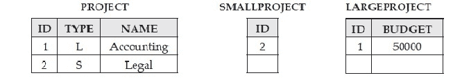

**表 3.9：** 使用以下表 Project、SmallProject 和 LargeProject 的连接式多表继承示例

| JPA 注解 | XML 配置 |
| :--- | :--- |
| ```java
@Entity
@Inheritance(strategy=Inheritance.JOINED)
@DiscriminatorColumn(name="TYPE")
@Table(name="PROJECT")
public abstract class Project {
    @Id
    private long id;
}

@Entity
@DiscriminatorValue("L")
@Table(name="LARGEPROJECT")
public class LargeProject extends Project {
    private BigDecimal budget;
}

@Entity
@DiscriminatorValue("S")
@Table(name="SMALLPROJECT")
public class SmallProject extends Project {
}
``` | ```xml
<entity class="entity.Project" name="Project">
    <table name="PROJECT"/>
    <inheritance strategy="JOINED"/>
    <discriminator-column name="TYPE"/>
    <attributes>
        <id name="id"/>
    </attributes>
</entity>

<entity class="entity.LargeProject" name="LargeProject">
    <table name="LARGEPROJECT"/>
    <discriminator-value>L</discriminator-value>
</entity>

<entity class="entity.SmallProject" name="SmallProject">
    <table name="SMALLPROJECT"/>
    <discriminator-value>S</discriminator-value>
</entity>
``` |

**表 3.10：** 连接式多表继承 JPA 注解和 XML 配置

连接继承策略的优势在于它不会像单表策略那样浪费空间。另一方面，由于每次插入和检索涉及多次连接，当继承层次结构变得很宽很深时，性能就会成为问题。

- **性能低下**

  如前所述，当查询根类或分支类时，性能会成为问题。如果能避免此类查询，这种性能问题就可以被缓解。JPA 提供者查询根类或分支类有两种方法：

  1. 使用外连接连接所有子类表，然后执行查询。
  2. 查询根表，然后查询所需的子类表。

  前者的优点是只需要一次查询，而后者的优势是避免了引起性能问题的外连接。

## 实际场景：单表与连接层次结构的中间地

大多数现实世界的继承层次结构都处于两者之间，在某些子类中使用了连接表，而在另一些子类中没有。因此，在实际场景中，它完全符合连接或单表继承策略。遗憾的是，JPA 不直接支持这种。一种可能的变通方案是将继承映射映射为单表，然后根据需要在每个子类中添加额外的表（通过在子类中定义 `Table` 或 `SecondaryTable`）。然而这取决于 JPA 提供者，可能需要询问提供者是否有某些解决此问题的特定解决方案。如果没有此类解决方案，则决定在特定情况下哪种策略更相关，并选择使用单表或每类一个表。

如果正在映射现有的数据库模式，表可能没有类鉴别器列（class discriminator）。解决此问题的可能方法有：

1. 某些 JPA 实现者在使用连接继承策略（joined inheritance strategy）时不需要类鉴别器，因此这可能是一种解决方案。
2. 使用不同的技术来确定行对应的类。
   1. 有时可以从几列中计算出继承值，或者有一个鉴别器，但值与类之间没有一一映射关系。某些 JPA 实现者对此提供了扩展支持。
   2. 另一个选项是创建一个数据库视图，用于生成鉴别器列，然后将层次结构映射到该视图而不是表。

上述的继承机制在 JPA 规范中是强制性的。然而，还有一些可选的继承策略，将在下一节中进行讨论。

# 高级继承策略

考虑以下表。基于此示例，将解释不同的高级继承策略。

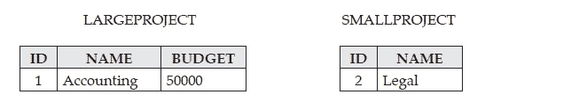

**表 3.11：** 用于解释高级继承策略的示例表 `LargeProject` 和 `SmallProject`。

在前面的示例中，没有继承描述符列，因此所使用的继承策略略有不同。它们如下：

1. 每类表（table per class）
2. 映射超类（mapped super classes）

### Table per class

这用于对象模型中，即使它在数据模型中不存在（即数据库中没有可用的继承数据）。在该方法中，为每个具体类定义一个表，并存储该类及其所有父类的所有属性。

| JPA 注解 | XML 配置 |
| :--- | :--- |
| ```java
@Entity
@Inheritance(strategy=Inheritance.TABLE_PER_CLASS)
public abstract class Project {
    @Id
    private long id;
}

@Entity
@Table(name="LARGEPROJECT")
public class LargeProject extends Project {
    private BigDecimal budget;
}

@Entity
@Table(name="SMALLPROJECT")
public class SmallProject extends Project {
}
``` | ```xml
<entity class="entity.Project" name="Project">
    <inheritance strategy="TABLE_PER_CLASS"/>
    <attributes>
        <id name="id"/>
        ...
    </attributes>
</entity>

<entity class="entity.LargeProject" name="LargeProject">
    <table name="LARGEPROJECT"/>
</entity>

<entity class="entity.SmallProject" name="SmallProject">
    <table name="SMALLPROJECT"/>
</entity>
``` |

**表 3.12：** 每类表继承的 JPA 注解和 XML 配置。

该策略必须非常谨慎使用，因为并不是所有的 JPA 实现者都支持它（因为它在 JPA 规范中是可选的）。

每类表模型的主要缺点是对根类或分支类的查询或关系会变得非常昂贵。要查询任何分支类或根类，都需要多次查询或联合（union）。

1. 一种解决方案是使用单表继承，这仅在类具有许多共同属性时才有效。如果层次结构很大且共同属性很少，则这种解决方案并不理想。
2. 另一个解决方案是使用 `MappedSuperClass`，但无法对该类进行查询或建立关系。

### Mapped superclass

这与每类表继承非常相似，但不允许对父类进行查询、持久化或关联。所有的映射信息都由子类继承。子类负责定义表、id 其他信息，并可以修改任何继承的映射。映射超类是一个抽象类，因此不是实体，而是使用 `@MappedSuperclass` 注解或 `<mapped-superclass>` 元素定义。

| JPA 注解 | XML 配置 |
| :--- | :--- |
| ```java
@MappedSuperclass
public abstract class Project {
    @Id
    private long id;

    @Column(name="NAME")
    private String name;
    ...
}

@Entity
@Table(name="LARGEPROJECT")
@AttributeOverride(
    name="name",
    column=@Column(name="NAME")
)
public class LargeProject extends Project {
    private BigDecimal budget;
}

@Entity
@Table(name="SMALLPROJECT")
public class SmallProject extends Project {
}
``` | ```xml
<mapped-superclass class="entity.Project">
    <attributes>
        <id name="id"/>
        <basic name="name">
            <column name="NAME"/>
        </basic>
    </attributes>
</mapped-superclass>

<entity class="entity.LargeProject" name="LargeProject">
    <table name="LARGEPROJECT"/>
    <attribute-override>
        <column name="NAME"/>
    </attribute-override>
</entity>

<entity class="entity.SmallProject" name="SmallProject">
    <table name="SMALLPROJECT"/>
</entity>
``` |

**表 3.13：** 映射超类的 JPA 注解和 XML 配置。

# 锁定

锁定和并发是大多数应用程序中的关键问题，在开发生命周期本身中就应该被考虑。然而，大多数应用程序倾向于在初期忽略这些问题，最终在上线生产之前才集成某些锁定机制。这可能是导致大量软件项目失败或被取消的原因之一。

在对相同对象执行并发写入的应用程序中，锁定策略是非常决定性的。只有在经过深思熟虑并实现后，才能防止数据损坏。对于这一点有两种策略：

1. 乐观锁定
2. 悲观锁定

JPA 支持版本乐观锁定，但某些 JPA 实现者还支持其他乐观锁定方法，以及悲观锁定。在应用程序中正确实现锁定不仅仅是设置某些 JPA 或数据库配置。锁定还涉及应用级别的更改，并确保访问数据库的其他应用程序对于所使用的锁定采取了恰当的步骤。

## 乐观锁定

在乐观锁定中，对象在事务中第一次被访问时不会被锁定，而是保存其状态。当访问相同对象的其他事务尝试修改状态时，将比较当前状态和保存的状态。如果状态不同，则清楚地表明存在冲突，事务将会回滚。

JPA 支持使用版本字段进行乐观锁定，该字段可以是数字或时间戳，并在每次更新时进行更新。建议使用数值，因为它比时间戳更精确、可移植、高效且更易处理。使用 `@Version` 注解或 `<version>` 元素来定义此乐观锁字段。

| JPA 注解 | XML 配置 |
| :--- | :--- |
| ```java
@Entity
public class Student {
    @Id
    private long id;

    @Version
    private long version;
}
``` | ```xml
<entity class="entity.Student" name="Student">
    <attributes>
        <id name="id"/>
        <version name="version"/>
        ……
    </attributes>
</entity>
``` |

**表 3.14：** 使用版本乐观锁定的 JPA 注解和 XML 配置。

如前所示，版本注解的使用与 Id 注解类似。此版本属性由 JPA 实现者自动更新，而不是由应用程序更新。通常，`EntityManager` 的 `merge()` API 会确保版本合并的完成。然而，如果是手动进行合并，则应用程序应该负责版本的合并。

每当发生锁定冲突时，都会抛出 `OptimisticLockException`，该异常可能被包装在任何其他异常中，但必须正确设置异常原因。只有这样，应用程序才能向用户报告错误，并允许他们决定下一步做什么。

## 悲观锁定

在悲观锁中，对象在给定事务中首次被访问时就会被锁定。锁只有在事务完成时才会被释放；在事务期间，其他事务无法访问该对象。因此，悲观锁确保了其他事务无法修改或删除被预留的数据。

JPA 规范的 1.0 版本仅提供了 `object relational mapping`（即 `ORM`）框架的基础功能，且仅支持乐观锁。JPA 2 增加了对悲观锁的支持，使其更符合 Hibernate ORM 框架中的锁定特性。JPA 中可用的所有锁定模式如下：

- `READ`（`JPA1`）/ `OPTMISTIC`（`JPA2`）
- `WRITE`（`JPA1`）/ `OPTIMISTIC_FORCE_INCREMENT`（`JPA2` 中为 `WRITE`）
- `PESSIMISTIC_READ`（`JPA2`）
- `PESSIMISTIC_WRITE`（`JPA2`）
- `PESSIMISTIC_FORCE_INCREMENT`（`JPA2`）
- `NONE` – 仅在事务之外提供的锁定模式


虽然 `PESSIMISTIC_READ` 模式通常代表共享锁，而 `PESSIMISTIC_WRITE` 代表排他锁。在前者模式下，事务一旦开始就会获取实体的锁。当访问的数据不经常被修改时，这种模式最好，因为它允许其他事务读取该实体。而当由于多个事务访问同一对象导致更新失败的概率很高时，后者是最佳选择。

`PESSIMISTIC_FORCE_INCREMENT` 模式在事务读取实体时锁定该实体。无论实体是否被更新，版本号都会在事务结束时增加。此选项适用于需要结合使用悲观机制和乐观机制的场景。

### 事务隔离级别

事务隔离必须确保系统的一致性。事务隔离级别共有四级，如下所示：

1. `READ_UNCOMMITTED`
2. `READ_COMMITTED`（防止脏读）
3. `REPEATABLE_READ`（防止脏读和不可重复读）
4. `SERIALIZABLE`（防止脏读、不可重复读和幻读）

大多数数据库默认使用 `READ_COMMITTED` 事务隔离级别。这意味着将不会有未提交的数据。

### 常见错误或问题

**加锁**：在通用加锁过程中最常见的错误是锁定了错误的代码段。无论是乐观锁还是悲观锁，情况都是如此。其基本场景如下：

1. 用户请求某些数据，服务器从数据库读取数据并将其发送给用户的客户端[客户端是 html、`remote method invocation`（即 `RMI`）还是 web 服务均无所谓]。
2. 用户在客户端中编辑数据。
3. 用户将数据提交回服务器。
4. 服务器开始事务，读取对象，合并数据并提交事务。

问题在于，原始数据是在第 1 步被读取的，但直到第 4 步才获取锁。因此，在第 1 步和第 4 步之间对对象进行的任何更改都不会导致冲突。因此，加锁是没有意义的，因为在获取锁时持有的数据并不是数据库中实际可用的数据。

在悲观锁的情况下，数据库锁只会在第 4 步发生，且无法检测到任何冲突。因此，这成为了考虑可扩展 Web 应用时不不使用数据库锁的主要原因。为了使锁定有效，数据库事务必须从第 1 步开始，并且直到第 4 步才提交。这意味着在等待 Web 客户端的同时，必须保持开启的数据库连接和事务以及锁，而且无法保证 Web 客户端不会长时间占用数据、占用数据库资源并为所有其他用户锁定数据，这是非常不可理想的。因此，在此类场景下不应考虑悲观锁。

对于乐观锁，解决方案是简单的。版本号必须随数据一起发送给客户端（或保留在 http session 中）。当用户将数据提交回服务器时，必须将原始版本更新到从数据库读取的对象中，以确保在第 1 步和第 4 步之间进行的任何更改都能被检测。

**乐观锁异常处理**：使用乐观锁时遇到的第一个问题是发生 `OptimisticLockException` 时该怎么办。典型的响应是自动处理异常（创建新事务、刷新对象并合并回数据然后重新提交），这实际上违背了锁定的全部意义。`OptimisticLockException` 不应该被自动处理，应该将冲突报告给用户。可以告知存在编辑冲突，也可以刷新对象并向用户展示当前数据和他们提交的数据，并在适当的情况下帮助他们合并这两者。

**过度加锁**：锁定可以防止大多数并发问题，但要小心不要过度分析每种假设可能发生的情况。为了保持完美的并发，代码开发人员在每个可能的相关的对象上加锁，这可能会非常昂贵，更重要的是，每次访问/修改数据时都会引发潜在的冲突，因此完全没有用处。所以，要小心不要过于偏执，以至于牺牲系统的可用性。

**其他应用程序访问相同数据**：任何有效的锁定形式都要求访问相同数据的所有应用程序遵循相同的规则。如果一个应用程序使用乐观锁，而另一个访问相同数据的应用程序没有加锁，它们仍然会发生冲突。旧应用程序可以读取数据（不加锁），然后在新应用程序读取、锁定并更新相同数据后更新数据，覆盖其更改。

**并发事务覆盖数据**：考虑以下事务：

1. 事务 A 读取行 x。
2. 事务 B 读取行 x。
3. 事务 A 写入行 x。
4. 事务 B 写入行 x（并覆盖 A 的更改）。
5. 成功提交。

串行事务隔离可以防止上述问题并在后续详细介绍。

**合并被另一个用户删除的对象**：理想情况下，合并应该触发 `OptimisticLockException`，因为对象版本不为空且大于 0，但对象不存在。但这可能取决于具体的 JPA 实现，或者抛出不同的异常。在这种情况下，如果调用了 `persist`，对象可能会被重新插入。

**没有版本列的表**：最佳解决方案是直接添加一个。字段锁定也是另一种解决方案，将在后续详细描述。

**继承中每个表都有版本**：版本信息应该只存在于根表中，而不是存在于用于继承的所有多个表中。

### 高级锁定

JPA 支持各种其他高级锁定技术。

### 时间戳锁定

JPA 支持属性类型为 `java.sql.Timestamp` 或其他日期/时间类型的戳戳锁定。然而，其配置与数字版本锁相同。这种锁定经常用于已经有最后更新列的表，因为它包含了对象最后更新时间的相关信息，因此更加有用。

然而，使用时间戳锁定时应谨慎，因为不同的数据库具有不同层级的时间戳精度。某些数据库不存储时间戳的毫秒，而另一些则存储得并不精确。因此，通常情况下，时间戳锁定的效率低于数值版本锁。

## 级联锁（Cascaded locking）

锁定对象不仅是锁定数据库中的行。一个对象可以是一个简单的行；对象也可以跨越多个表、具有继承关系、关联关系，甚至拥有依赖对象。因此，确定一个对象何时发生 `changed` 并需要更新其版本，可能比确定某行何时发生变化更加困难。

JPA 定义为当对象的任何一个表发生变化时，版本就会更新。然而，在关系方面这一点尚不清晰。诸如 `Basic`、`Embedded` 或外键等关系在变化方面是清晰的，因为版本会被唯一更新。但当关系中对于单个父行有多个子级时，情况就不太清晰了。考虑以下示例：

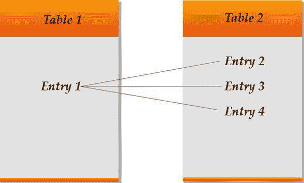

**图 3.1：单条条目与另一个表中的多个条目相关**

在上述场景中，每当 `Entry2`、`Entry3` 或 `Entry4` 发生任何变化时，`Entry1` 的版本就会更新。也就是说，`Entry2`、`Entry3` 和 `Entry4` 的版本号可能低于 `Entry1`，因为每次对 `Table2` 条目执行更新时，版本都会递增。因此，关系的版本更新并不十分清晰，取决于 JPA 提供者如何实现。

请注意，JPA 没有用于锁定的级联选项，也没有依赖对象的直接概念，因此这不是一个可用选项。模拟这种情况的一种方法是使用写锁，并仅在根父对象（此处为 `Table1`）中定义版本，每当子对象发生变化时，也会对父对象调用 `lock API` 并更新版本。

如果应用程序认为一个用户更新对象的某个依赖部分，而另一个用户更新对象的另一个部分会构成锁争用，则应使用级联锁。级联锁的优点之一是需要维护的版本字段较少，且只需要对根对象的更新进行版本检查。然而，这可能会在批量写入等优化中产生影响，因为如果依赖对象拥有自己必须检查的版本，那么它们可能无法进行批量处理。

## 字段锁（Field locking）

字段锁涉及在更新时比较对象中的某些字段，如果这些字段发生了变化，则更新失败。这可以在需要更细粒度锁定时使用。例如，如果一个用户更改对象的名称，而另一个用户更改对象的地址，这些更新不应该发生冲突，只有当用户更改相同字段时才产生乐观锁错误。在这种场景下，只需要关注这些冲突，任何其他字段冲突都不应成为问题。这也是缺少版本字段的表的一种解决方案。例如，旧版表结构（legacy schemas）在无法为锁定添加新列时可以使用这种方法。

字段锁有几种类型：

- **在更新中比较所有字段**：这可能导致一个极其巨大的 `WHERE` 子句，但将检测到任何冲突。
- **在更新中比较选定的字段**：如果只需要某些字段发生冲突，则这很有用。
- **在更新中比较已变化的字段**：如果仅将相同字段的变化视为冲突，则这很有用。

JPA 默认不支持字段锁。但是，有一些 JPA 提供者支持此。如果 JPA 提供者不支持字段锁，则很难模拟，因为需要修改更新的 SQL。JPA 提供者可能允许覆盖更新的 SQL，在这种情况下，可能实现全字段或选定字段锁。但变化字段锁更为困难，因为更新必须是动态的。

模拟字段锁的另一种方法是刷新更改，然后使用单独的 `Entity Manager` 刷新对象，并将当前值与原始对象进行比较。在使用字段锁时，保留读取的原始对象是非常重要的。

## 读锁和写锁（Read and write locking）

JPA 通过 `EntityManager` 的 `lock()` API 支持读写锁。`LockModeType` 参数可以是 `READ` 或 `WRITE`。`READ` 锁确保对象的状态在提交时不会改变。`WRITE` 锁将阻止任何其他事务读取、写入或删除该对象。通常，`READ` 锁检查乐观版本字段，而 `WRITE` 锁则检查并增加它。

通常，当根据另一个对象的状态对一个对象进行更改时，最好确保另一个对象在提交点代表数据库的当前状态。乐观读写锁允许以解释性且有利的方式满足这一需求（且没有死锁、并发和开放事务问题）。

## 不锁定（鸵锁 Ostrich locking）

这可能是最常用的锁定形式，尽管它看起来非常荒谬。大多数原型或小型应用程序通常没有锁的需求，或者没有锁的需要。处理发生锁冲突时的操作超出了应用程序的范围，因此最好直接忽略该问题。

## 锁定——最佳实践（Locking - Best practices）

悲观锁的主要优势是，一旦获得锁，编辑将非常有把握。始终启用乐观锁可能是最好的，因为这样做非常简单。然而，在高并发应用程序中，悲观锁可能更成功。

## 结论（Conclusion）

在本章中，讨论了标识和锁定等主要操作。为了使这些内容清晰，还讨论了继承等更多主题。在下一节中，将详细说明使用这些操作可以形成的各种关系。它还提到了 JPA 中存在的各种策略。

## 多选题（Multiple choice questions）

1. **表中的标识列可以使用哪个注解：**
   - `@Id`
   - `@EmbeddedId`
   - `@IdClass`
   - 以上都是

2. **最常用的锁定技术是：**
   - `ostrich locking`
   - `pessimistic locking`
   - `optimistic locking`
   - `cascaded locking`

3. **大多数大多数 提供的事务隔离级别是：**
   - `READ_COMMITTED`
   - `READ_UNCOMMITTED`
   - `REPEATABLE_READ`
   - `SERIALIZABLE`

4. **哪些陈述是正确的？**
   - i. JPA 支持时间戳锁。
   - ii. JPA 支持级联锁。
   - iii. JPA 支持字段锁。
   - iv. JPA 支持乐观锁。
   - 仅 i 和 ii
   - 仅 ii、iii 和 iv
   - 仅 iii 和 iv
   - 以上都没有

5. **哪种锁定技术是在 JPA2 中引入的：**
   - `pessimistic locking`
   - `field locking`
   - `cascade locking`
   - `read locking`

## 答案（Answers）

1. **d**
2. **a**
3. **b**
4. **c**
5. **a**

## 概述

1. 解释事务隔离级别及其用法。
2. 描述在实现锁时出现的常见问题或疑问。
3. 解释各种序列策略并附带示例。

## 待思考的问题

1. 对象的 `ID` 永远不应该被更改。根据 `JPA` 实现程序的不同，这可能会导致错误或奇怪的行为。
2. `TopLink/EclipseLink`：它提供了 `ReturningPolicy`，允许在插入或更新后从数据库返回包括主键在内的任何字段值。这是通过 `@ReturnInsert`、`@ReturnUpdate` 注解或 `eclipselink-orm.xml` 中的 `<return-insert>`、`<return-update>` XML 元素定义的。
3. `TopLink/EclipseLink`：`UnaryTableSequence` 允许使用单列表。`QuerySequence` 允许自定义 SQL 或存储过程。还存在一个 API 允许用户提供自己的代码来分配 `ids`。
4. `Hibernate`：通过 `@GenericGenerator` 注解提供了 `GUID` ID 生成选项。
5. 复合主键在旧版数据库架构中很常见，有时可以使用级联键。复合主键的其他常见用法包括多对多关系或聚合的一对多关系。
6. 如果对象没有 `id`，但其表有，则可以将该对象制为 `Embeddable`（嵌入）对象；嵌入对象没有 `ids`。也可以创建一个包含此 `Embeddable` 以进行持久化和查询的 `Entity`（实体）。
7. `TopLink` 和 `EclipseLink` 支持用于连接多表继承的两种查询机制。默认使用多重查询机制。可以通过使用 `DescriptorCustomizer` 和 `ClassDescriptor` 的 `InheritancePolicy` 的 `setShouldOuterJoinSubclasses()` 方法来改用外连接。
8. `TopLink` 和 `EclipseLink` 支持通过 Java 代码计算继承判别器。这可以通过使用 `Descriptor Customizer` 和 `Class Descriptor` 的 `Inheritance Policy` 的 `setClassExtractor()` 方法来实现。
9. 在 `Hibernate` 中，继承区分器列的作用可以通过使用 Hibernate `@DiscriminationFormula` 注解来实现。这还允许使用特定数据库 SQL 函数来计算区分器值。
10. 时间戳版本锁定中的 `timestamp` 值既可以来自数据库，也可以来自 Java（中间层）。`JPA` 不允许此类配置，但某些 `JPA` 实现程序可能提供此选项。使用数据库的当前时间戳可能非常销，因为需要调用数据库服务器。
11. `TopLink` 和 `EclipseLink` 支持通过注解（以及相应的 XML 元素）如 `@OptimisticLocking` 和 `@PrivateOwned` 进行级联锁定。它们还支持使用 `@OptimisticLocking` 注解进行字段锁定。
12. 一个流行的迷言是鸵鸟在感觉到危险时会将头埋进沙子里。因此，无锁策略也被称为鸵策略，因为它完全忽略了锁问题，尽管它感知到了它的。
13. 某些 `JPA` 实现程序支持带不带区分别列的连接继承。某些需要区分别列，而某些不支持区分别列。因此，连接继承似乎尚未完全标准化。
14. `JPA` 2.0 有两个新的标准查询提示，它们可以传递给任何 `Query`、`NamedQuery` 或 `find()`、`lock()` 或 `refresh()` 操作。
    - `javax.persistence.lock.timeout`——在放弃并抛出 `PessimisticLockException` 之前在锁上等待的毫秒数。
    - `javax.persistence.lock.scope`——有效范围定义在 `PessimisticLockScope` 中，其值为 `NORMAL` 或 `EXTENDED`。

## 第 4 章

### 关系——类型与策略

## 引言

上一章更多地讨论了如何通过操作数据填充到表中。了解每组数据如何相互关联也同样重要。数据层级的关系在任何应用程序中都变得重要，因为它们描绘了大多数业务级关系，从而有助于为应用程序用户形成所需的信息。哪些数据应该关联、如何关联以及关联到什么程度，所有这些决定了数据对于该特定应用程序的相关性的各个方面。因此，关系是任何基于 RDBMS 应用的核心。

## 结构

本章将在每节中结合相关示例讨论以下内容：

- 关系类型：
  - 一对一（`OneToOne`）
  - 一对多/多对一（`OneToMany`/`ManyToOne`）
  - 多对多（`ManyToMany`）
- 元素集合（Element collections）
- 映射（Maps）
  - Map Key 列（JPA 2.0 特性）
- 嵌套集合（Nested collections）
- 查询优化——获取技术
  - 懒加载（Lazy）、连接获取（Join）、批处理（Batch）
- 变量和异构关系（Variable and heterogenous relationships）
- 级联（Cascading）
  - 孤儿删除（JPA 2.0 特性）
- 目标实体、嵌套连接
- 集合（Collections）
  - 排序列（JPA 2.0 特性）

### 目标

本章详细介绍了 `JPA` 中提供的各种关系类型以及它们如何在关系数据库中工作。此外，根据关系讨论了连接获取等查询优化技术。本章还让读者理解作为 JPA 2.0set 的新功能，如孤儿删除、排序列等。

### 关系

关系仅仅是从一个对象到另一个对象的引用。在关系型数据库中，键（主键和外键）主要定义关系。源行的主键变成目标行的外键（反之亦然）。因此，关系的描述方式使得反向始终存在，并且获取关系对象所需的键信息是关重要的。因此，关系型数据库始终具有双向关系。

在 Java 中，这些关系通过从一个对象到另一个对象的对象引用（指针）表示。然而，并不是所有的对象引用指针都能确定为关系。对数据属性的引用（其本身是如 String、Date 等对象）被视为对象本身的一部分，而对其他持久化对象的引用则被视为关系。如果关系映射到对象集合，则使用集合或数组类型来持有关系的内容。因此，Java/JPA 中的所有关系都是单向的，也就是说，如果源对象持有到目标对象的关系，不能保证目标对象也与源对象有关。为了使用 JPA 处理双向数据库关系，在两个方向上将源与目标关联起来变得至关重要。

## JPA 关系类型


本节讨论了大多数对象模型中存在的大关系类型。每种关系都可以以不同的方式实现。

- `OneToOne`（一对一）：从一个对象到另一个对象的唯一关联。它的反向也是 `OneToOne` 关系。
- `ManyToOne`（多对一）：从多个对象到唯一对象的引用。它的反向是 `OneToMany` 关系。
- `OneToMany`（一对多）：对象的集合或映射，其反向也是 `ManyToOne` 关系。
- `ManyToMany`（多对多）：对象的集合或映射，其反向也是 `ManyToMany` 关系。
- `Embedded`（嵌入）：指向与父类共享相同对象的引用。
- `ElementCollection`（元素集合）：JPA 2.0，基本或嵌入对象的集合或映射，存储在单独的表中。

通常情况下，JPA 关系可以粗略分为双向和单向关系。在双向关系中，两个方向都提供了导航访问和级联选项，因此不需要显式查询。在单向关系的情况下，导航只能在一个方向上进行，并根据由哪个部分管理外键来决定该方向。例如，在 `ManyToOne` 关系中，访问是从子表到父表，因为子表将拥有外键。然而，在 `OneToMany` 关系中，访问是从父表到子表，因为父表管理外键。

## 一对一关系

顾如名，表中的一条记录与另一个表中的另一条记录唯一相关。根据 RDBMS 术语，这种关系通过在其中一个表中设置唯一外键来实现。例如，考虑一个分配座位的场景，且没有两个乘客拥有相同的座位。如下图所示：

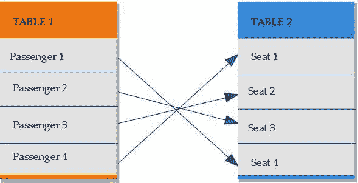

**图 4.1：** 乘客表与座位表之间的一对一关系

在这里，`TABLE1` 拥有外键（即 `TABLE2` 的主键），该外键唯一标识了乘客正在使用的座位。在 JPA 中，`TABLE1` 中的外键列名是由 `TABLE1_Primary` 列名和 `TABLE2` 主键列名拼接而成的。`TABLE1` 的外键列类型与 `TABLE2` 主键的类型相同，并且在该列上形成了一个唯一约束。这确保了外键列中的所有条目都是唯一的，因此该关系变成了一对一关系。

双向一对一关系需要在代码的双方都进行声明，而单向关系只需要在关系所有者的一侧进行声明。考虑用 JPA 表示上述示例。

```java
@Entity
public class Passenger {
    private Seat seat;
    @OneToOne
    public Seat getSeat () { return seat; }
    public void setSeat (String passSeat) { this.seat = passSeat; }
}

@Entity
public class Seat {
    private Passenger passenger;
    @OneToOne(mappedBy="seat")
    public Passenger getPassenger () { return passenger; }
    public void setPassenger(Passenger pass) { this.passenger = pass; }
}
```

**代码 4.1：** JPA 中的双向一对一关系

显而易见的是，从两个方向都可以从上述代码检索另一个实体对象，即从 `Passenger` 对象可以获取座位对象，从 `Seat` 对象可以获取 `Passenger` 对象。这构成了一个完整的双向映射。

现在，考虑以下代码，它也适用于一对一关系。在这里，很明显的是 `Passenger` 可以访问 `Seat`，但反之则不可。因此，这是 JPA 中的一种单向一对一映射。

```java
@Entity
public class Passenger {
    private Seat seat;
    @OneToOne
    public Seat getSeat () { return seat; }
    public void setSeat(String passSeat){ this.seat = passSeat; }
}

@Entity
public class Seat {
    ...
}
```

**代码 4.2：** JPA 中的单向一对一关系

在通过属性映射的单向关系中不使用属性。由于缺少这些信息，需要一个额外的包含外键的连接表，这会影响性能。因此，通过使用双向关系，性能可能会提高，但可能会对 JPA 面的安全性产生影响，因为两个对象都可以从任何一侧访问。在许多现实场景中，这两种关系都适用，因此 JPA 开发人员应该明智地使用。

## 一对多/对一对关系

一对多关系是一个表中的单条记录映射到另一个表中的多个记录。在双向一对多关系中，反向关系变为多对一。例如，考虑一个拥有许多班级及其学生的学校。每个年级都有多个学生，但没有学生会被分配到多个班级。所以，从年级到学生是一对多关系，但反向是多对一关系。

```java
@Entity
public class Standard {
    private Collection<Student> students;
    @OneToMany(mappedBy="std")
    private Collection<Student> getStudents(){
        return students;
    }
    private void setStudents(Collection<Student> studs){
        this.students = studs;
    }
}

@Entity
public class Student {
    private Standard std;
    @ManyToOne
    public Standard getStandard() { return std; }
    public void setStandard(Standard studStd){ this.std = studStd; }
}
```

**代码 4.3：** 双向一对多/多对一关系

在这种情况下，可以从 `Standard` 实体访问学生列表，也可以通过 `Student` 实体访问学生的年级。`Student` 被认为是这种关系的所有者。此外，在数据库中存储时，`Student` 表中的外键是 `STANDARD_<Standard 的主键>`。因此，对于双向一对多关系，不需要额外的连接表来获取详情。但存在某些情况下并非每个关系都需要是双向的。在上面的示例中，假设学生和成绩之间可能存在一对多关系。一个学生可以有多个成绩，并且没有必要从成绩对象访问学生的详情。

```java
@Entity
public class Student {
    private Collection<Grade> grades;
    @OneToMany
    private Collection<Grade> getStudades(){
        return grades;
    }
    private void setGrades(Collection<Grade> sGrads){
        this.grades = sGrads;
    }
}

@Entity
public class Grade {
    ...
}
```

**代码 4.4：** JPA 中的单向一对多关系

在上面的示例中，只能从学生对象追踪成绩。无法从成绩对象执行这种操作，因为它没有存储任何学生的引用。因此，这是一个典型的单向一对多关系。为了实现这种行为，JPA 使用一个名为 `Student_Grade` 的额外连接表，包含两个外键。一个外键列将是 `STUDENT_<Student 的主键>`，类型与 Student 表的主键相同，另一个外键列将是 `GRADE_<Grade 的主键>`，类型与 `Grade` 表的主键相同。

考虑当 `实体` 提供班主任详情时。但没有必要让分配为特定年级的班主任拥有需要访问的学生列表。只需要知道哪个年级被分配给了特定老师，就能知道该老师将担任班主任的学生列表了。

```java
@Entity
public class Student {
    private Teacher cTeacher;
    @ManyToOne
    public Teacher getClassTeacher () {return cTeacher; }
    public void setClassTeacher (Teacher tcr) { this.cTeacher = tcr; }
}

@Entity
public class Teacher { … }
```

**代码 4.5：** 单向多对一关系

在某些情况下，只需要单向多对一关系。

在这种情况下，类似于双向的 `OneToMany`/`ManyToOne` 关系，外键存储在定义关系的表中。请注意，单向的 `ManyToOne` 关系不需要额外的连接表。

## ManyToMany 关系（多对多）

在这种关系中，表中的一条记录可以与另一个表中的多个记录相关，反之亦然。例如，考虑学生参加在线课程的用例。每门课程可以有多个学生，且没有限制学生只能修一门课程。因此，这在双向上变成了 `ManyToMany` 关系。

```java
@Entity
public class Student {
    private Collection<Course> courses;

    @ManyToMany
    public Collection<Course> getCourses () {
        return courses;
    }

    public void setCourses (Collection<Course> sCourses) {
        this.courses = sCourses;
    }
}

@Entity
public class Course {
    private Collection<Student> students;

    @ManyToMany(mappedBy="courses")
    private Collection<Student> getStudents () {
        return students;
    }
    private void setStudents (Collection<Student> studs) {
        this.students = studs;
    }
}
```

### 代码 4.6: JPA 中的双向 ManyToMany 关系

为了实现双向 `ManyToMany` 关系，JPA 会创建一个新的连接表，表名为 `Table1_Table2`，其中 `Table1` 和 `Table2` 是关系中的实体，且 `Table1` 是该关系的所有者。该连接表将有两个列，一个包含 `Table1` 的主键，另一个包含 `Table2` 的主键。根据上面的示例，由于 `STUDENT` 表是此 `ManyToMany` 关系的所有者，连接表将命名为 `STUDENT_COURSE`。连接列将是 `STUDENT_<PrimaryKey of STUDENT>` 和 `COURSE_<PrimaryKey of COURSE>`。

在某些情况下只对单向 `ManyToMany` 关系感兴趣。在这种情况下，JPA 中使用了单向 `ManyToMany` 映射。然而，在这种情况下，也会如上述所示创建一个连接表。

```java
@Entity
public class Student {
    private Collection<Publication> publications;

    @ManyToMany
    public Collection<Publication> getPublications() {
        return publications;
    }
    public void setPublications(Collection< Publication > pubs){
        this.publications = pubs;
    }
}

@Entity
public class Publication {}
```

### 代码 4.7: JPA 中的单向 ManyToMany

在上面的示例中，一个出版物可能涉及许多学生，反之亦然，一个学生可以拥有多个出版物。然而，只能通过 `Student` 实体检索出版物。这是因为只考虑了单向关系。与双向关系类似，JPA 创建连接表来存储 `ManyToMany` 映射键。

**映射带有额外列的连接表**：常见的问题是两个类之间存在 `ManyToMany` 关系，但关系型连接表具有额外数据。假设 `Employee` 表与 `Project` 有 `ManyToMany` 关系，但连接表还有一个额外的列，用于说明该员工是否为负责人（列名为 `IS_PROJECT_LEAD`）。这类模型的理想解决方案是为该连接表创建一个类。该类可以与 `Employee` 表和 `Project` 表建立多对一关系，并带有额外数据的属性。

有几个 JPA 实现提供提供了额外的支持，用于将其映射到带有额外数据的连接表。但这种映射增加了更多复杂性，因为主键是复合的，即必须同时考虑员工 ID 和项目 ID 作为主键，因此它们需要一个 `IdClass` 而不是 ID。

**提示：在关联类中添加一个生成的 ID 属性总是更好的，从而避免使用复合主键和使用 `IdClass`。**

在某些情况下，两个对象之间的关系是使用与上述两个映射对象无关另一个对象进行映射的。因此，在这种情况下，关联对象的 map 键可以是用于建模连接关系的类中的属性（根据 JPA 规范）。如果额外数据仅在数据库中需要而 Java 程序不需要，可以设置触发器来自动更新数据库。

## 嵌入关系（Embedded relationship）

一个实体可以使用使用其他实体类来表示，而这些类本身并不独立存在。这种关系被称为嵌入关系，已在[第 2 章，表 – 属性与可嵌入对象]（名为 Embeddables 的章节）中进行了详细讨论。

正如之前讨论的，可嵌入对象严格属于所有者实体，且不能与其他持久化实体共享。然而，一个可嵌入类可以与实体或实体集合建立关系。这意味着实体与拥有该可嵌入对象的实体之间可以存在关系。

## 元素集合（Element collections）

这种集合仅在 JPA 2.0 中可用，用于处理非标准关系。元素集合由注解 `@ElementCollection`（XML 中的 `<element-collection>`）定义，可用于描述到 `Embeddable` 对象或 `Basic` 对象的 `OneToMany` 关系。它还可以与 `Map` 一起使用，定义一种关系，其中键可以是任何类型，而值可以是 `Embeddable` 对象或 `Basic` 对象。

**提示：`ElementCollections` 始终存储在单独的表中，该表是通过注解 `@CollectionTable`（XML 中的 `<collection-table>`）定义的。在 `@CollectionTable` 中，定义了表名和连接列（当存在复合主键时，使用 `@JoinColumns`）。**

当使用 `ElementCollection` 映射来定义 `Embeddable` 对象的集合时，它类似于 `OneToMany`，但目标对象是 `Embeddable` 而不是实体。通过这种方式，简单对象是在没有定义 `Id` 或 `ManyToOne` 映射的情况下定义的。然而这种关系有一个局限：目标对象无法独立查询、持久化或合并。它们始终与父对象一起操作。虽然没有级联选项，但集合映射的获取类型默认为 `LAZY`（懒加载）。

```java
@Entity
public class Student {
    @Id
    @Column(name="STUD_ID")
    private long studentId;

    @ElementCollection
    @CollectionTable(name="PUBS", joinColumn=@JoinColumn(name="PUB_ID"))
    private List<Publication> publications;
}

@Embeddable
public class Publication {
    @Column(name="PUB_ID")
    private String id
    @Column(name="TITLE")
    private String title;
    @Column(name="CONF")
    private String acceptedConf;
    @Column(name="DATE")
    private Date dateOfPub;
}
```

### 代码 4.8: 使用 Embeddable 对象的 ElementCollection

`ElementCollection` 也可以用于定义 `Basic` 对象的集合。在上面的示例中，表有多个列，如 `TITLE`、`CONF`、`DATE` 等。因此，使用了 `Embeddable` 对象。相反，如果表只有出版物的 ID 和标题，那么基本对象就足够了。

```java
@Entity
public class Student {
    @Id
    @Column(name="STUD_ID")
    private long studentId;

    @ElementCollection
    @CollectionTable(name="PUBS", joinColumn=@JoinColumn(name="PUB_ID"))
    private List<String> pubTitles;
}
```

### 代码 4.9: 使用基本对象的 ElementCollection

在这里，出版标题被读取为 `String`（基本对象），因为 `PUBS` 表中没有其他列。

## 映射 (Maps)


在 Java 上下文中，`java.util.Map` 是一种集合，用于存储键值对，其中值可以是一个对象，或者是另一个集合。虽然很少有 JPA 实现者支持 `Map` 的实现，但从广义上说，JPA 期望将 `Map` 接口作为属性类型，用于 `OneToMany`、`ManyToMany` 或 `ElementCollection` 等集合类型。在 JPA 1.0 中，map 键被定义为从目标对象中获取的属性，该属性指定了与目标对象之间的关系。

`@MapKey` 注解（XML 中的 `<map-key>`）用于实现上述定义。如果未提供，则使用目标对象的主键作为 map 的键值。

```java
@Entity
public class Person {
    @Id
    private long id;
    @OneToMany(mappedBy="owner")
    @MapKey(name="type")
    private Map<String, PhoneNumber> phoneNumbers;
}

@Entity
public class PhoneNumber {
    @Id
    private long id;
    @Basic
    private String type;
    @ManyToOne
    private Person owner;
}
```

### 代码 4.10：JPA 1.0 中的 MapKey 示例

上一个示例展示了相应数据库表 `Person` 和 `PhoneNumber` 的对象模型。一个人可以根据类型（例如：工作、家庭、手机、座机等）拥有多个电话号码，因此从 `Person` 到 `PhoneNumber` 存在 `OneToMany` 关系。在这里，表示 `OneToMany` 关系的 map 键是电话的类型。这就是为什么类型变成了 `mapkey` 属性，它是 `PhoneNumber` 表的一部分，并指定了目标对象（在此处为 `PhoneNumber`）的列名。如果 `@MapKey` 没有提供列名，则 map 将使用 `PhoneNumber` 的 `Id`（即表的主键），因此除非检索并访问 map 内部的对象，否则很难理解它是什么种类型的电话号码。因此，`@MapKey` 允许用户根据需求在逻辑上与元素建立关联。

另一个使用的注解是 `@MapKeyClass`，用于指定使用哪个类作为表示该关系的 map 的键。该注解的一个示例用法类似于 `@MapKeyClass(String.class)`。在这里，键对象类型被定义为 `String`。然而，如果使用了泛型，则不需要提供此注解，例如如果 map 被定义为 `Map<String,Object>`，则无需提供此注解。此外，注意当使用 `@MapKey` 时永远不会使用 `@MapKeyClass`，反之亦然。

JPA 1.0 中的 `@MapKey` 有一个局限性，键必须是目标对象的一部分。但在 JPA 2.0 中，该限制得到了提升，map 的键可以是给定对象之一：

- 一个基本值，存储在目标表或连接表中。
- 一个嵌入对象，存储在目标表或连接表中。
- 指向另一个实体的外键，存储在目标表或连接表中。

上述定义有助于在 JPA 2.0 中可以映射的各种模型中实现更大的灵活性和复杂性。映射的类型由 map 的键和值共同决定。因此，如果键是基本值而值是实体，可以使用 `OneToMany` 映射；但如果键是实体而值是基本值，则使用 `ElementCollection` 映射。根据键的类型，使用了不同的注解。

| 注解 | XML 标签 | 键值 |
| :--- | :--- | :--- |
| `@MapKeyColumn` | `<map-key-column>` | 基本 |
| `@MapKeyEnumerated` | `<map-key-enumerated>` | 枚举 |
| `@MapKeyTemporal` | `<map-key-temporal>` | 日期 |
| `@MapKeyJoinColumn` | `<map-key-join-column>` | 实体（主键/外键） |
| `@MapKeyJoinColumns` | `<map-key-join-columns>` | 复合外键 |
| `@MapKeyClass` | `<map-key-class>` | 可嵌入 |

**表 4.1：关系中映射键属性的各种注解**

上表提供了根据 JPA 2.0 中定义的关系类型来提供相应注解的快照视图。下面将通过示例解释上述的几个注解。

```java
@Entity
public class Person {
    @Id
    private long id;
    @OneToMany(mappedBy="owner")
    @MapKeyColumn(name="PHONE_TYPE")
    private Map<String, Phone> phoneNumbers;
}

@Entity
public class Phone {
    @Id
    private long id;
    @ManyToOne
    private Person owner;
}
```

### 代码 4.11：JPA 2.0 中的 MapKeyColumn 示例

在上面的示例中，有两个表——`Person` 和 `Phone`。由于在这种情况下使用的键是一个基本值（`Phone` 表中的 `PHONE_TYPE` 列，类型为 `String`），因此定义了 `OneToMany` 关系。

```java
@Entity
public class Person {
    @Id
    private long id;
    @OneToMany(mappedBy="owner")
    @MapKeyJoinColumn(name="PHONE_TYPE_ID")
    private Map<PhoneType, Phone> phoneNumbers;
}

@Entity
public class Phone {
    @Id
    private long id;
    @ManyToOne
    private Person owner;
}

@Entity
public class PhoneType {
    @Id
    private long id;
    @Basic
    private String type;
}
```

### 代码 4.12：JPA 2.0 中的 MapKeyJoinColumn 示例

在上面的示例中，有三个表——`Person`、`Phone` 和 `PhoneType`。由于使用了外键（`Phone` 表中的 `PHONE_TYPE_ID`，即 `PhoneType` 表的主键），因此使用了 `OneToMany` 映射。

```java
@Entity
public class Person {
    @Id
    private long id;
    @OneToMany
    @MapKeyClass(PhoneType.class)
    private Map<PhoneType, Phone> phoneNumbers;
}

@Entity
public class Phone {
    @Id
    private long id;
}

@Entity
public class PhoneType {
    @Id
    private long id;
    @Basic
    private String type;
}
```

### 代码 4.13：JPA 2.0 中的 MapKeyClass 示例

在上面的示例中，有两个表——`Person` 和 `Phone`。在这里，定义了一个 `Embeddable` 对象（数据库中的连接表 `Person_Phone`），为了将其作为键值，使用了 `@MapKeyClass` 注解。

## 嵌套集合（Nested collections）

在对象模型中，拥有复杂的集合关系是非常自然的，例如 `List` 的 `List`、`Map` 的 `Map` 或 `Map` 的 `List` 等。但将此类对象映射到关系数据库非常困难。因此，JPA 不支持此类集合关系，建议始终使用便于查询和持久化的对象模型。

然而，在无法避免这些嵌套关系的情况下，可以创建并使用封装此类关系的对象。

```java
class Student {
    private long id;
    private Map<String, List<Project>> projects;
}
```

```java
@Entity
public class Student {
    @Id
    @GeneratedValue
    private long id;
    @OneToMany(mappedBy="student")
    @MapKey(name="subject")
    private Map<String, ProjectType> projects;
}

@Entity
public class ProjectType {
    @Id
    @GeneratedValue
    private long id;
    @ManyToOne
    private Student student;
    @Column(name="SUBJECT")
    private String subject;
    @ManyToMany
    private List<Project> projects;
}
```

**代码 4.14：嵌套类被封装到不同的类中**

`Student` 类包含一个基于学科（subject）的项目列表，这是一个嵌套集合。它本质上是一个映射，其中学科名称作为键（key），学生针对特定学科完成的项目列表作为值（value）。由于值是一个 `List`，因此编写了一个包装类 `ProjectType`，它与项目之间是多对多（ToMany）关系。它还包含了在嵌套集合中用作键的学科名称。

## 查询优化技术

在本节中，将讨论 JPA 中用于优化查询执行的各种技术。这些技术有助于在使用连接（joins）查询多个对象时获得更好的性能。

### 连接抓取（Join fetching）

这是一种查询优化技术，可以在单个数据库查询中读取多个对象。首先对存在多个对象的表进行连接，然后从连接后的数据中选择所需的对象。这被广泛应用于对一（OneToOne）关系，也可以用于一对多（OneToMany）和多对多（ManyToMany）等关系。这是经典的 ORM `n+1` 性能问题的解决方案。

考虑选择 `n` 个 `Student` 对象并访问它们对应的地址，这些地址存储在不同的表中。在基础 ORM（包括 JPA）中，首先执行一次数据库查询来获取 `Student` 对象，然后执行 `n` 次查询来访问每个学生的地址。通过使用连接抓取（join fetching），可以通过以下查询同时选择 `Student` 及其地址，将上述 `n+1` 次查询减少为一次：

```sql
SELECT stud FROM Student stud JOIN FETCH stud.address
```

上述 JPQL join fetch 语法执行的是普通的内连接（inner join）。然而，结果将不会包含没有地址的 `Students` 列表。如果关系允许空或空集合，则应使用 `LEFT` 语法执行下面的外连接抓取（outer join fetch）。

```sql
SELECT stud FROM Student stud LEFT JOIN FETCH stud.address
```

JPA 未规定是否对所有关系都必须使用连接抓取。它总是在查询级别进行说明，因为在特定关系中可能并不总是需要连接抓取。JPA 映射中有一种不同的支持，称为 `EAGER` 选项，用于在开始时加载整个关系。但这并不意味着表被连接了。在某些 JPA 实现程序中，`EAGER` 被解释为连接抓取，而另一些提供程序则支持一个单独的选项用于始终对关系进行连接抓取。

### 预连接抓取（Eager join fetching）

关于 `EAGER` 抓取的一个常见误解是，关系应该是连接抓取的，即在与源对象相同的 `SQL SELECT` 语句中抓取。

少数 JPA 实现程序确实以上述方式实现预加载。然而，仅仅因为想要加载某个对象，并不意味着它应该被连接抓取。在某些情况下，该对象可能已经被读取并存在于持久化上下文（persistence context）中。在这些情况下，不需要连接抓取，只需要返回已存在对象的引用。例如，考虑学生-成绩（Student-Marks）关系。在这种情况下，几乎总是会在加载 `Marks` 实例之前加载 `Student`，因此 `Marks` 对象中的学生引用被设置为 `EAGER`。这并不意味着 `Marks` 和 `Student` 之间的 `EAGER` 关系需要连接抓取，因为 `Student` 实例已经存在于持久化上下文中。

### 懒抓取（Lazy fetching）

在现实场景中，创建对象的成本变得高于执行抓取的成本。因此，确保只构建所需的对象是非常重要的，从而避免创建不需要的对象的成本。懒抓取可以被视为一种成本优化技术，允许在访问关系中的对象之前延迟抓取它们。`LAZY` 抓取的示例可见第 2 章“表格、属性和嵌入式对象”中的表 2.3。

在 JPA 中，任何关系上的 `fetch` 属性都可以被设置为 `FetchType` 枚举中定义的 `LAZY` 或 `EAGER` 枚举。除一对一和多一关系外，所有关系的默认值都是 `LAZY`。

**提示：通常情况下，将每个关系设置为 `LAZY` 是一个好主意。**

关系延迟加载的魔力是通过 JPA 使用其对 `Collection`、`List`、`Set` 或 `Map` 实现的代理来实现的。每当任何方法访问此代理时，真实的集合就会被加载并返回给方法。因此，JPA 要求使用任何集合接口来定义其集合关系。

在一对一和多一关系的情况下，JPA 对实体类进行字节码操纵，允许访问字段或其相应的 `get/set` 方法。当方法访问字段或调用 `get/set` 方法时，它会被重定向为先检索关系，然后返回值。对于上述字节码操纵，JPA 需要一个代理（agent）或后处理器，并且必须确保其被正确使用。

## 序列化与脱离（Serialization and Detaching）

当对象被序列化或脱离（detached）时，任何在序列化之前未实例化的懒关系将不可用并抛出错误（或取决于 JPA 实现程序返回 null）。因此，确保在对象序列化或脱离后，懒关系仍然可用是一个主要问题。

解决上述问题的简单方案是将所有关系都设为 `EAGER`。然而，考虑到对象构建的成本，可以采取步骤来确保序列化后所需的所有关系都预先实例化。因此，通过仅将所需的关系标记为 `EAGER`，就可以处理构建的成本。

第二个方案是保持关系本身为 `LAZY`，并在序列化之前通过调用该关系的特定方法使关系对象化（objectify）。这种方法的优点是，所需的关系可以是特定用例的，例如，在某种情况下可能需要一个关系，而在另一种情况下可能需要另一个关系。这两个关系都可以维护为 `LAZY`，并根据需求在序列化之前实例化，从而避免对特定用例不需要的关系进行对象化。

第三个方案是在查询关系对象时使用 `JPQL JOIN FETCH`。这可以确保关系已经实例化。然而，当在多个集合关系上使用时，它会在数据库中形成 `n2` 连接，导致查询效率低下。

在脱离对象（detached objects）的情况下，如果它们在事务结束后被访问，可能会出现与上述序列化类似的问题。某些 JPA 实现程序允许在事务结束或关闭实体管理器后仍访问懒关系。然而，也有一些 JPA 实现程序并不这样做。在这些情况下，用户需要格外小心，以确保在脱离对象（无论是事务结束还是关闭实体管理器）之前实例化懒关系。

## 批量抓取（Batch fetching）

在连接获取（join fetching）的情况下，使用单条查询来解决 ORM 的 `n+1` 性能问题。然而，在某些情况下，结果可能是低效的，导致 `n2` 数据集。当数据库拥有大量数据时，这可能被认为比正常性能更（即执行 `n+1` 次查询）。因此，考虑了一种新的查询优化技术，即执行有限数量的查询而不是单个查询，从而提供更好的性能。这种查询优化技术被称为 `batch fetching`（批量获取）。在批量获取中，与普通获取类似，首先会执行第一条查询来获取根对象。然后，为了获取相关对象，将原始查询与获取相关对象的查询进行连接，并在单个数据库查询中获取所有相关对象。因此，总共执行了两次查询（与连接获取仅执行一次查询形成对比），但与普通获取（`n+1` 次查询）相比，这仍然减少了查询的次数。

考虑前一节中用于连接获取的相同示例。对于 `n` 个 `Student` 对象及其地址（存储在不同的表中），普通获取需要一次查询来获取 `Student` 对象，以及 `n` 次查询来获取相应的地址。使用批量获取时，获取 `Student` 对象的第一个查询保持不变。然而，接下来的查询是所选 `student` 对象与 `Address` 表的连接。这确保了最优效率，特别是在读取集合关系和多重关系时，因为不会像连接获取那样选择重复数据。

**提示：`JPA` 并不强制要求支持批量读取，但某些 JPA 实现者具有此支持。`TopLink` 和 `EclipseLink` 支持 `@BatchFetch` 注解，以及通过 `eclipselink.batch` 查询提示来启用批量读取。`JOIN`、`EXISTS` 和 `IN` 是支持的批量获取的三种形式。**

# 变量和异构关系

在现实世界场景中，可能会存在多个不相关的异构值之间定义关系的情况。相关值可能共享一个公共接口，也可能没有任何共同点。关系可以是任何基本值或可嵌入对象（Embeddable）。

`JPA` 通用不支持异构关系。然而，某些 JPA 实现者也支持变量关系和异构关系。

## 提示


提供这种关系支持的最常见且简单的变通方法，是为相关值提供一个公共父类。

定义这种关系的另一种方法，是通过 `get`/`set` 方法提供虚拟属性，并将这些异构的 `get`/`set` 方法标记为 transient（瞬态的）。

另一种解决方案是将值序列化为二进制或字符串，然后从其中恢复该值。

## 级联（Cascading）

当对实体执行某种操作时，可能有理由对其相关实体执行类似的操作。因此，在关系映射中提供此功能选项是至关重要的。关系映射中的 `Cascade` 选项允许在通过映射关联的实体上同样执行这些操作。

```java
@Entity
public class Student {
    @Id
    private long id;
    @OneToOne(cascade={CascadeType.REMOVE})
    @JoinColumn(name="ADDR_ID")
    private Address address;
}
```

代码 4.15：OneToOne 关系的级联选项

考虑 `Student` 实体，它通过 OneToOne 关系映射到 `Address` 实体。每当学生实体被删除时，保留地址实体是没有意义的，因此也应该被删除。因此，在 OneToOne 关系上标记删除时的级联选项，可以确保每当删除学生实体时，其对应的地址实体也会被删除。

可以级联的常用操作定义在 `CascadeType` 枚举中，如下：

- `PERSIST`：当提供此选项时，每当父实体被持久化时，其相关实体也会被持久化。注意，如果关系中没有此选项，且有一个与父相关的新对象，则会发生异常，因为新对象尚未持久化，因此关系无法完成。始终使用 PERSIST 级联选项并没有很多问题，除了对性能有影响之外。通常，每当发生提交（commit）时，带有 cascade persist 选项的关系会同时存储实体及其相关对象。然而，如果需要将新相关对象生成的 ID 持久化到父对象中，那么在提交之前显式地调用 `persist` 总是更好的，这样父对象也能获取到生成的 ID。

- `REMOVE`：此选项确保当父对象被删除时，子对象也会被删除。注意，这应该仅用于依赖关系。在 OneToMany 关系中，删除父对象不会删除依赖对象。相反，依赖对象中的父 ID 将设置为 Null。JPA 要求显式调用 `remove` 来删除依赖对象。然而，某些实现者提供了删除对象的选项。JPA 2.0 也为此定义了选项。

- `MERGE`：此选项允许在父对象被合并时，子对象也被合并。关系引用本身将始终被合并，当使用瞬态变量（Transient variables）可能会出现问题。（Transient 变量通常用于限制序列化）。在这种情况下，应该进行手动合并，或者重置瞬态关系。

- `REFRESH`：父对象上的刷新选项将尝试对子对象执行刷新选项。应谨慎使用此选项，因为它可能会导致其他对象的更改也被重置。

- `ALL`：上述所有操作（Persist、Merge、Refresh）都通过此单一选项级联。

## 孤儿移除（orphan removal，JPA 2.0）

在依赖关系的情况下，相关对象没有源就无法存在。因此，通常希望在删除源时将其删除。然而，在 JPA 1.0 中，每当在 OneToMany 或 OneToOne 关系上设置 cascade remove 选项时，依赖对象不会被删除，而是父 ID 列被设置为 NULL。因此，需要显式对依赖对象调用 `remove`。然而，JPA 2.0 提供了孤儿移除选项，确保任何不再从关系中引用的对象都会被删除。

```java
@Entity
public class Person {
    @Id
    private long id;
    @OneToMany(orphanRemoval=true, cascade={CascadeType.ALL})
    private List<PhoneNumber> phoneNumbers;
}

@Entity
public class PhoneNumber {
    @Id
    private long id;
    @Basic
    private String type;
    @ManyToOne
    private Person owner;
}
```

代码 4.16：为 OneToMany 关系设置的孤儿移除

在上述示例中，每当删除 `Person` 实体时，如果没有设置 `orphanRemoval` 选项，所有对应的 `PhoneNumber` 实体的所有者将被设置为 NULL。这些条目必须通过由 EntityManager 执行 `remove` 操作来显式删除。然而，通过将 `orphanRemoval` 设置为 true，所有对应的 `PhoneNumber` 实体将被删除，而不是将所有者设置为 NULL。因此，不需要显式删除依赖对象。

## 目标实体

`TargetEntity` 属性允许指定关系映射的引用类。这通常用于字段使用接口类型，但映射需要在实现类上进行指定的情况。此外，如果字段是父类类型，且关系需要映射到其子类，也会使用该属性。

通常情况下不需要使用它，因为它是通过字段类型、`get` 方法返回类型等设置的。

```java
@Entity
public class Person {
    @Id
    private long id;
    @OneToMany(targetEntity=PhoneNumber.class)
    @JoinColumn(name="OWNER_ID")
    private List phoneNumbers;
}
```

代码 4.17：为 OneToMany 关系设置的 `TargetEntity` 选项

在上例中，`List` 是接口，且没有使用泛型来指定列表中的对象类型。因此，提供了 `targetEntity` 来明确该列表包含的是 `PhoneNumber` 对象。

## 嵌套连接

虽然某些 JPA 实现者支持嵌套连接，但通常情况下，JPA 使用 JPQL 时是不允许嵌套连接。JPA 提供了多个关系的连接获取（Join fetch），但不支持嵌套关系的获取。

```sql
SELECT per FROM Person per LEFT JOIN FETCH per.address LEFT JOIN FETCH
SELECT per FROM Person per LEFT JOIN FETCH per.address LEFT JOIN FETCH
per.phoneNumbers per.phoneNumbers
```

上述是一个多连接获取的 JPQL 示例。在这里，`Person` 实体与 `Address` 实体以及 `PhoneNumber` 实体都有关系。这两个关系都是通过多个连接进行获取的。

## 重复数据与巨大的连接

重复数据是连接获取中的一个主要问题。考虑上述带有多个连接的连接查询。对于一个人，可能存在多个地址（现住地址、常住地址、办公地址等），也可以有多个电话号码（家庭、工作、手机等）。假设一个 `Person` 实体有 3 个地址和 3 个电话号码。在获取此连接时，每个 `Person` 实体将产生 9 条条目（3*3 组合）。因此，如果有 `n` 条 `Person` 记录，在连接中将创建 `n*9` 条记录。随着 `n` 的增长，这可能会成为一个问题。通常，每当查询数量减少时，出现重复数据的概率就会增加，这在大型表连接中可能会导致严重的性能问题。为了避免此类问题，另一种技术是使用批量获取（batch fetching），这在本章前面的部分已经解释过。

## 过滤、复杂连接

在某些情况下，关系并不总是依赖于外键，而是取决于某些其他条件。考虑学生与项目列表的关系。学生可能做过很多项目，但目前只有少数项目是活跃的。`Student` 和 `Projects` 之间的实际关系是通过它们的 ID 建立的，但需要更多的执行操作来确定当前活跃项目的列表。

然而，JPA 不支持这些类型的关系映射，因为它只允许由外键定义的映射，而不基于任何其他常量值、列或函数。一个简单的方法是通过外键映射关系，并在 `get`/`set` 方法中过滤结果。另一种方法是为结果提供查询，而不是定义关系。

## 集合

Java 有自己的集合接口：`Collection`、`List`、`Set` 或 `Map`。为了让 JPA 提供集合（`OneToMany`、`ManyToOne`、`ManyToMany` 和 `ElementCollection`）的关系映射，它只需要上述集合接口来定义关系字段。这非常重要，因为 JPA 假设只有上述集合会被用于关系映射，并基于此提供了许多操作。延迟获取（Lazy fetching）就是基于此假设提供的此类操作之一。

在定义集合关系的字段时，应注意不要定义具体的集合实现类。字段始终应该是 Java 集合框架的接口（`Collection`、`List`、`Set` 或 `Map`）。例如，关系字段可以是 `List` 但不能是 `ArrayList`。`ArrayList` 可以作为实例值使用。某些 JPA 实现者也支持使用集合实现类。

在数据库中，通常不支持重复。然而，在 `JoinTable` 中可以存在重复项，且 JPA 本质上不支持重复项。因此，应该提供支持此类重复项的机制。这是通过创建一个表示连接表本身的类来实现。

例如，考虑一个 `Student` 与 `Project` 具有多对多关系。在连接表中，可以包含额外信息，例如该 `Student` 是否为项目的负责人。即在存储多对多映射的、包含 `Project_ID` 和 `Student_ID` 的连接表中，也可以包含如 `Is_Lead`、`Project_Duration` 等额外信息。

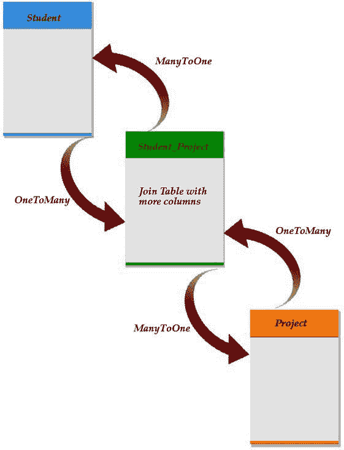

图 4.2：在连接表中带有额外列的多对多关系。

在上面的图片中，`Student_Project` 表是 JPA 创建的、维护多对多映射的连接表。假设连接表中存在 `Is_Lead`、`Project_Duration` 等额外字段。因此，最好有一个表示连接表的类。

## 排序

当从数据库中检索值时，它们有一个获取的顺序。该顺序通过 `OrderBy` 注解设置。排序的默认值是目标对象的 ID。JPA 1.0 仅通过添加索引支持有序列表。注意，`@OrderBy` 保证集合在内存中是有序的。`SortedSet` 接口和 `TreeSet` 集合维护顺序，因此某些实现者使用了这些集合类型。

```java
@Entity
public class Person {
    @Id
    private long id;
    @OneToMany(targetEntity=PhoneNumber.class)
    @OrderBy("areaCode")
    private List phoneNumbers;
}
```

代码 4.18：`OrderBy` 注解。这里 `areaCode` 是用于排序的列。

## 排序列（JPA 2.0）

`OrderColumn` 是 JPA 2.0 引入的特性，用于定义集合的顺序。它通过 `@OrderColumn` 注解定义（在 XML 中为 `<order-column>` 元素），并取决于映射类型。对于 OneToMany 映射或 ElementCollection 映射，列应来自目标对象；而对于带有连接表的 OneToMany 映射或 ManyToMany 映射，列应来自连接表。

```java
@Entity
public class Person {
    @Id
    private long id;
    @OneToMany
    @OrderColumn(name="indexNum")
    private List phoneNumbers;
}
```

代码 4.19：`OrderColumn` 注解。这里 `OrderColumn` 指定为 `indexNum`，它是 `Person` 表中的一列。该列用于存储来自 `PhoneNumber` 表的索引。

## 常见问题

在本节中，重点关注使用本章提到的各种技术时出现的各种常见问题。这包括功能性问题（如对象损坏、懒加载序列化问题）以及性能问题（如过度查询以及由于 EAGER（预加载）加载许多大表导致的性能低下）。

## 对象损坏

这是双向关系中的一个常见问题，当关系的一侧被更新时，没有相应地更新另一侧。因此，关系变得不同步，导致对象损坏。

在 JPA 中，维护关系是应用程序或对象模型的责任。解决此问题有两种不同的方法：要么使用一侧的 setter 方法并将另一侧设置为 protected，要么在双方都添加该方法并确保关系在不出现循环问题的情况下维护。

```java
@Entity
public class Person {
    private List phoneNumbers;
    public void addPhone(Phone phone) {
        this.phoneNumbers.add(phone);
        if(phone.getOwner() != this) phone.setOwner(this);
    }
}

public class Phone {
    private Person owner;
    …
    public void setOwner(Person person) {
        this.owner = person;
        if(!person.getPhones().contains(this)) person.getPhones().add(this);
    }
}
```

代码 4.20：对象更新也处理了关系的更新

在这里，当一个电话号码被添加到 `Person` 对象时，`Phone` 对象也会设置相应的所有者。这确保了双向关系的维护。人们通常预期 JPA 提供者会自动维护关系。这种预期是不符合事实的，并且如果对象被序列化、游离（detached）或在 JPA 范围之外使用，就会变成问题。然而，有少数提供者支持自动关系维护。通常情况下，无论 JPA 提供者是否支持，确保由对象模型处理关系总是更好的做法。

**提示：**为了避免在添加子对象时实例化大型集合，双向关系不进行映射，而是根据需要进行查询。

## 性能低下

此问题主要是由于在关系中使用了 EAGER（预加载）获取。在某些情况下，这种类型的获取会导致将特定源对象的所有相关对象作为相关对象读取。例如，如果有一个 `Staff` 表，其中包含一个 EAGER 类型的关系 `managerOf`，如果 `Principal` 是源对象，那么 `managerOf` 的 EAGER 获取将反过来获取所有的 `Staff` 对象，因为校长管理整个学校的所有员工。

最简单直接的方法是将所有关系设置为 LAZY（懒加载）。默认情况下，`OneToMany` 和 `ManyToMany` 是 LAZY 关系。然而，`OneToOne` 和 `ManyToOne` 不是，因此需要进行相应的配置。

## 过度查询

在尝试从 `Person` 对象访问地址，且 `staysAt` 关系使用了 LAZY 获取（可以是 OneToOne 或 ManyToOne）时，会使用额外的查询。因此，当访问所有 `Person` 地址时，会有一个查询用于访问 `Persons` 列表，然后有 `n` 个查询来获取 `n` 个 `Person` 对象的地址。这也会导致性能低下。解决方案是使用连接获取（Join Fetching）和批量读取（Batch Reading）。

## 懒加载——未按预期工作

JPA 提供者使用各种技术来提供懒加载的魔力，让对象看起来就像存在一样。广泛的方法包括编译时字节码插织、运行时字节码插织和运行时代理。编译时字节码在编译后、运行前生成实体更改。这是性能最好的方式，但在 Java 中可能会导致序列化问题。在运行时字节码技术的情况下，使用了一个代理（agent），允许在运行时动态织入字节码。因此，根据选择的提供者，应该提供适当配置（要么用于静态字节码生成，要么用于动态字节码生成的代理）。

此外，确保在不合适的情况下访问关系也是重要的。例如：如果存在属性访问（即注释在 `getter`/`setter` 方法上提供），并且在 `set` 方法中访问了相关的懒加载值，就会抵消懒加载的效果。因此，消除 `set` 方法的副作用或使用字段访问是非常重要的。

通常，如果懒加载关系在序列化之前没有实例化，则对象将不会被序列化，从而在反序列化后访问时会导致错误或提供空值。

## 关系目标是接口

如果使用接口作为目标实体，且它有多个实现，那么 JPA 不直接支持它。相反，必须将接口更改为抽象类并使用 `@Inheritance` 注解。关于此注解的更多细节已在第 3 章“操作——标识、排序与锁定”中解释。

## 从 OneToMany 集合中删除依赖对象

当对象从集合中删除时，JPA 1.0 未强制要求将其从数据库中删除。必须显式调用 `remove()` 来从数据库删除该对象。然而，某些提供者支持在对象从集合中删除后将其从数据库删除的选项。

在 JPA 2.0 中提供了此选项，因此从集合中删除对象会触发从数据库删除对象。

## 双向关系

在双向 `ManyToMany` 关系中，应该采取足够的关注以确保关系通过双方建立。否则，对象在刷新后将无法在集合中可用。

此外，如果关系的一侧没有使用 `mappedBy`，则应被假设为多个关系，并在连接表中插入重复行。

## CollectionTable 中的主键

在 JPA 2.0 中，没有特定的机制在 Embeddable（可嵌入）中定义 ID。这使得 JPA 假设 Embeddable 中所有字段的组合加上外键提供了删除/更新所需的唯一键。如果 Embeddable 很大或复杂，这可能是无用且不合理的。然而，某些 JPA 提供者定义了指定 Embeddable ID 的方法。

## 结论

在本章中，重点是关系型数据库世界中的关系以及各种类型的关系。进一步，还详细处理了这些真实世界的数据库关系如何映射到基于 Java 的关系。


在下一章中，将更明确地描述如何形成数据库查询，以及提供者为从数据库获取实际数据到对象所采取的所有步骤。

## 单选题

1. 关系的引用由注解提供：

   1. `refClass`
   2. `targetEntity`
   3. `refObject`
   4. 以上所有

2. JPA 2.0 中的 `@MapKey` 有一个限制，即键应该是目标对象的一部分：

   1. 正确
   2. 错误
   3. 不适用
   4. 以上

3. JPA 2.0 中 `@MapKey` 可以假设的各种值是：

   1. 基本值
   2. 嵌入对象
   3. 另一个实体的外键
   4. 以上

4. 孤儿删除（Orphan removal）有助于：

   1. 在关系中不再需要时从数据库中删除依赖对象
   2. 以自定义的方式从数据库中移除对象
   3. 仅从数据库中移除外键对象
   4. 以上所有

5. `OrderBy` 注解用于：

   1. 从数据库检索时对集合进行排序
   2. 在将其存储到内存时对关系进行排序
   3. 在从数据库中移除之前对集合进行排序
   4. 以上所有

## 答案

1. **b**
2. **b**
3. **d**
4. **a**
5. **a**

## 问题

1. 解释 JPA 中发现的不同关系。并将其与数据库关系进行比较。
2. 描述各种查询优化技术并给出合适的示例。
3. 在 JPA 上下文中如何使用 Maps？请解释。
4. 找出在使用关系时遇到的各种问题，并结合合适的示例解释其中任意两个。

## 思考点

1. SQL 中的 `OUTER` 连接是指在连接连接时不过滤掉不存在的行，而是连接一个包含全空值的行。请注意，`OUTER` 链接在某些数据库上效率较低，因此在不需要时，请避免使用 `OUTER`。
2. TopLink 和 EclipseLink 支持在映射上使用 `@JoinFetch` 注解和 XML 来定义该关系始终被连接抓取。
3. 将所有关系标记为 EAGER（预加载）可能是理想的，因为所有内容都希望加载，但在一个巨大的 select 中抓取所有内容可能会导致数据库出现低效、过度复杂或无效的连接。
4. 从技术上说，在 JPA 中 LAZY 只是一个提示，JPA 提供者并不要求支持它。然而，在现实，所有主要的 JPA 提供者都支持它，如果不支持，它们将非常毫无用处。
5. OneToOne 和 ManyToOne 的默认 EAGER 是是因为实现的原因（实现起来更困难），而不是因为这是一个好主意。
6. TopLink 和 EclipseLink 支持通过 `@VariableOneToOne` 注解支持变量关系（相应的 XML）。通过它们的 `ClassDescriptor's InterfacePolicy` API 也支持映射和查询接口。
7. TopLink 和 EclipseLink 支持使用 `DescriptorCustomizer` 接口使用过滤和复杂关系，使用 Expression criteria API 定义 `selectionCriteria`，或使用 `selectionQuery` 定义 SQL 或存储过程调用。这允许应用任何条件，包括常量、函数或复杂的连接。
8. JPA 1.0 规范不允许在 ManyToOne 上使用 Id。

# 第三部分

# 运行时访问与进程对象

# 第 5 章

# 查询基础设施

## 引言

数据的存储只有当以后可以根据不同的目的以各种方式检索时才变得意义。只能存储的数据是没用的，因此如果没有适当的检索机制就会浪费。到为止，讨论主要集中在如何在数据库中存储数据。本章讨论了 JPA 支持的从数据库中查询数据的各种方法。

## 结构

本章的结构如下：

* 查询
  * 命名查询
  * 动态查询
  * 查询结果
  * 普通查询示例
  * 优化
  * 高级主题
    * 更新/删除
    * 刷新模式 (Flush mode)
    * 分页
    * 原生 SQL
    * 原始 JDBC
* JPQL BNF
  * Select
  * Update
  * Delete
  * 字面量
  * JPA 2.0 新增内容

### 目标

本章侧重于 JPA 中使用的各种检索机制。它还提供了许多常用的示例查询。还讨论了各种优化技术，以便提高检索过程的性能。本章还尝试解释用于定义 `Java Persistence Query Language` (`JPQL`) 的 `Backus-Naur Form` (`BNF`) 定义。此外，本节可以帮助深入理解 JPQL。

**提示：JPQL BNF 部分更具信息性，因此不是强制性的，需要时可以跳过。不会影响对后续章节的理解。**

### 查询

根据定义，查询是提问以消除疑问或请求信息的过程。因此，查询是存储数据时最重要的部分。如果存储的数据无法根据需要或自定义要求检索，那么这些数据就可以被认为是无用的。查询语言大致分类为：

* 数据库查询语言：这些语言主要用于根据某些标准提取事实数据（即：当另一个字段匹配某些值时，选择特定字段的各种值）。SQL 是关系型数据库中最常用的查询语言。
* 信息检索查询语言：这些语言主要用于提取包含查询信息的文档/记录。CQL 是处理网络索引、书目目录、博物馆收藏等时使用的正式信息检索语言。

由于 JPA 主要处理数据库，因此它主要提供了与 SQL 更相似的查询机制。然而，JPA 主要提供了三种不同的查询机制。

1. JPQL：JPQL 是一种基于 BNF 的非常强大的定义语言。它允许根据已定义的实体模型定义数据库查询。JPQL 的这一特性使其对 Java 开发者非常有吸引力，因为他们更习惯使用实体名称而不是表名。然而，数据库只能理解 SQL 语句，将 JPQL 转换为 SQL 是 JPA 实现的责任。由于其简单性，这是最简单的方法。但使用 JPQL 很难创建动态查询。

2. JPA Criteria API：这是 2.0 中添加的功能，用于提供使用 Java 程序编写查询的类型安全方法。这主要用于动态查询的情况。为每个实体模型生成一个静态的、实例化的规范元模型类，因此可以用于类型安全检查。因此，该 API 提供了各种功能，如：
   * 检查查询修正并防止创建语法错误的查询。
   * 在重构代码后，如果与实体模型有偏差，则引发编译错误。
   * 支持自动补全，因为每个实体模型都有生成的类，即实体模型中的各种方法名将用于开发的 IDE 的自动补全功能。

3. 原生 SQL 查询：这些是使用实际数据库对象名称 SQL 查询，可以通过客户端直接在数据库上执行。JPA 提供了 `@NamedNativeQuery` 注解（代码 5.1），可以使用名称定义原生查询并引用名称在整个代码中使用。JPA 定义 `Query` 接口为使用原生查询的 API。该接口提供了从数据库检索结果的各种方式，即：它根据要求返回单个结果、结果列表或仅第一个结果的方法。简而言之，熟悉原生 SQL 的开发者可以轻松地声明原生查询，并通过将实际查询的名称传递给 `Query` 接口在整个代码中使用，然后从该接口期望响应。

```java
@Entity(name="PassengerEntity")
@Table(name="passenger")
@NamedNativeQueries({
    @NamedNativeQuery(
        name="getAllPassengers",
        query="SELECT id, firstName, lastName, email, passenger.seat, date"
    )
})
```

```java
«FROM passenger, seat», resultClass=PassengerEntity.class ),

@NamedNativeQuery(
    name = «getAllPassengersBySeat",
    query = «SELECT id, firstName, lastName, email, date, passenger.seat " +
    «FROM passenger, seat» + «WHERE passenger.seat = ?",
    resultClass=PassengerEntity.class)
)

public class PassengerEntity implements Serializable {
    //implementation here
}
```

**代码 5.1:** `NamedNativeQuery` 示例

出于相同的原因，还有许多其他的查询语言和框架可用。其中一些列举如下：

* EJBQL
* JDOQL
* EclipseLink Query Language (EQL)
* Query By Example (QBE)
* TopLink Expressions
* Hibernate Criteria
* Object Query Language (OQL)
* Query DSL

通常，JPA 需要创建静态命名查询（static-named queries）或动态查询。用于创建静态命名查询和动态查询的各种技术如下。

# 命名查询 (Named queries)

大多数情况下，命名查询用于应用程序中反复使用的静态查询。使用这种查询的第一个优点是它只需要定义一次，就可以在应用程序中重用。这不仅在开发期间具有吸引力，在维护应用程序时也是如此，因为查询逻辑的更改只需要在单处进行修改。

这些查询的第二个优点是它们比动态查询更经过优化。这是因为大多数 JPA 实现者会在编译期间预编译/预解析命名查询，因为它们在编译阶段就已经可用。

这些查询的第三个优点是，它们可以通过 ORM 配置进行优化或覆盖，因为它们是持久化元数据的一部分。例如，假设应用程序中定义了一个特定名称的命名查询（比如 `query1`）。如果应用程序开发者需要更改 `query1`，可以修改代码，也可以在 `orm.xml` 中定义另一个名称为 `query1` 的查询。因此，在用户无法获取实际代码的情况下，如果知道各自的名称，这种技术有助于覆盖这些查询。

对于命名查询，是使用基于注解的配置还是基于 XML 的 JPA 配置，取决于特定应用程序的选择。然而，在某些场景下，通常认为更倾向于使用基于 XML 的 JPA 配置：

1. **不支持或定期更新** – 不支持注解的旧应用程序或需要定期更新的应用程序倾向于使用基于 XML 的配置，因为它更容易更改，且不涉及任何代码更改。
2. **将 JPA 相关信息从应用程序中外部化** – 这是大多数应用程序仍然依赖基于 XML 配置的一个重要原因。这允许从外部文件控制 JPA 信息，而该文件不需要与应用程序源代码一起编译。
3. **不同包中的大量实体** – 这在命名查询的情况下更为重要。如果必须更改任何命名查询的实现，则需要搜索整个包集合以找到定义特定命名查询的包/类。如果它定义在 `orm.xml` 中，则只需要检查一个文件。

单个命名查询使用 `@NamedQuery` (`<named-query>`) 注解定义，而如果有多个查询，则每个查询都使用上述注解定义，并且整个列表使用 `@NamedQueries` (`<named-queries>`) 定义。前面的代码 5.1 给出了一个类似的命名原生查询示例。请注意，任何带有 `@Entity` 注解的类都可以用于定义命名查询。但最好在它们所查询的同一个 `Entity` 类上定义查询。此外，使用的名称在整个持久化单元中必须是唯一的。`EntityManager` 用于访问命名查询，`Query` 接口用于执行查询。更多细节将在第 6 章，EntityManager – 持久化、缓存和事务中介绍。

由于命名查询是静态查询，它们大多数的定义方式使其能够接收参数并根据提供的参数执行查询。在 JPQL 中，可以使用命名参数和位置参数，它们分别使用`:<name>`语法表示命名参数，使用“?”（问号）表示位置参数。

### 查询提示 (Query hint)

在数据库术语中，查询提示是查询的补充内容，用于指示数据库引擎如何执行查询。使用数据库查询提示时应当谨慎，因为可能会改变数据库查询执行引擎的正常行为。

然而，JPA 支持的查询提示与上述的数据库查询提示完全没有关系。相反，它们仅仅是 JPA 实现者的自定义偏好设置。它使用 `Query` 接口的 `setHint` 方法在需要时设置提示。JPA 支持的最常见的查询提示有 timeout、fetchgraph、loadgraph 等。

| `@NamedQuery(name="findAllEmpInCity",query="select emp from Employee emp where emp.address.city = :city",hints={@QueryHint(name="jpa.batch", value="emp.address")})public class Employee {…}` | `<entity-mappings><entity name="Employee" class="org.acme.Employee" access="FIELD"><named-query name="findAllEmployeesInCity"><query>Select emp from Employee emp where emp.address.city = :city </query><hint name="jpa.batch" value="emp.address"/></named-query></entity></entity-mappings>` |

**表 5.1:** 使用注解和 XML 的 NamedQuery 示例

```java
EntityManager em = getEntityManager();
Query query = em.createNamedQuery("findAllEmpInCity");
query.setParameter("city", "Toronto");
List<Employee> employees = query.getResultList();
```

**代码 5.2:** 调用命名查询的示例

前面的 Java 代码（*代码 5.2*）演示了命名查询的使用（在表 5.1 中定义）。此处命名查询的参数是 'city' 并在查询中设置。因此，该查询返回地址为"Toronto"的所有员工列表。前面的查询不仅是命名查询，而且是动态的因为它接受参数（此处为 city）并可以动态地更改执行的查询。

# 动态查询 (Dynamic queries)

表 5.1 和代码 5.2 给出的示例是一个典型的动态查询，它根据代码中设置的参数发生变化。在这里，查询取决于上下文以及实际执行时设置的参数。QA 和 Criteria API 是 JPA 中创建动态查询的两种选择。与命名查询类似，动态查询也可以通过 `EntityManager` 的 `createQuery` API 并在 `Query` 接口设置参数、查询提示等。

### 参数 (Parameters)

在 JPQL 中传递参数有多种方法。最常见的方法是在查询中使用“:”语法，并使用与语法相同的名称设置参数。这被称为命名参数。

例如：`select emp from Employee emp where emp.address.city=:city`

在前面的示例中，参数名称为 'city'，并用于通过 `setParameter("city", <value>)` 传递值。定义参数的另一种方法是在原生 SQL 查询中使用“?”。这也可以用作“?”`<int>`。这被称为位置参数，并根据提供的 int 值设置参数。

例如：`select * from Employee where name=?` `and age=?`

在前面的示例中，name 是第一个参数，age 句第二个参数。因此，使用 `setParameter(1, “Rina”)` 和 `setParameter(2, “25”)` 来设置查询的值。位置参数始终从 1 开始。

时间参数也可以以日期、时间或时间戳的形式传递。甚至对象也可以作为参数传递。注意，对于所有类型的查询，无论是 JPQL、Criteria、Native SQL 还是命名查询（Named Query），参数始终设置在查询对象上。

# 查询结果

查询结果始终返回由持久化上下文（persistence context）管理的 `Entity` 对象。所作的更改可以作为当前事务的一部分被进一步跟踪。执行查询后获取结果有三种方法：

1. `getResultList`：返回对象列表（实体对象或数组）。

   | 查询 | 输出 |
   | :--- | :--- |
   | `select s from Student s` | Student 实体对象列表：列表中的对象是被管理的。 |
   | `select s.fName from Student s` | String 类型值列表：在这里，数据是不被管理的，因为它们不是实体对象。 |
   | `select s.fName, s.lName from Student s` | Object<String,String> 列表：在这种情况下，数据是不被管理的。 |
   | `select s, s.address from Student s` | Object<Student,Address> 列表：在这种情况下，数据是被管理的，因为两者都是实体对象。 |

   **表 5.2：** 各查询的输出。

2. `getSingleResult`：返回单个对象。上述规则同样适用。如果返回的是实体对象，则数据将被管理。如果查询没有返回任何内容，取决于 JPA 者的具体实现，它可能会抛出异常或返回 null。同样，如果查询返回了多个结果，取决于 JPA 提供者的实现，它可能会抛出异常或仅返回第一个结果。


`3. executeUpdate`：返回受此查询影响的行数，通常用于更新/删除查询。

在下一节中，将解释编写各种常见查询的方法。

# 常见查询示例

检索数据有多种编写查询的方法。在本节中，将讨论不同的查询条件，以及在 JPQL 和 `Criteria` API 中的编写方式。通常，创建准则查询的基本步骤如下：

- `EntityManager` 用于获取 `CriteriaBuilder` 对象。
- `CriteriaQuery` 用于创建查询对象，`CriteriaQuery.from` 方法设置查询根，`CriteriaQuery.select` 方法设置结果列表类型。
- `TypedQuery<T>` 通过指定查询结果类型为执行准备查询。
- `TypedQuery.getResultList` 执行并作为 `List` 返回实体集合。

在接下来的示例中，`Criteria` API 查询示例仅考虑了前两个步骤。

## 关联（Join）

这主要用于从一对多（OneToMany）关系中查询值（关于连接在连接中详细讨论过）。

```java
Fetch<Address> a = stud.fetch("address");
query.select(stud);
```

```java
CriteriaBuilder cb = em.getCriteriaBuilder();
CriteriaQuery<Student> query = cb.createQuery(Student.class);
Root<Student> stud = query.from(Student.class);
Fetch<Address> address = stud.fetch("address");
Fetch<Phone> phone = stud.fetch("phone");
query.select(stud);
```

```java
CriteriaBuilder cb = em.getCriteriaBuilder();
CriteriaQuery<Student> query = cb.createQuery(Student.class);
Root<Student> stud = query.from(Student.class);
Fetch<Address> address = stud.fetch("address", JoinType.LEFT);
Fetch<Phone> phone = stud.fetch("phone", JoinType.LEFT);
query.select(stud);
```

```java
CriteriaBuilder cb = em.getCriteriaBuilder();
CriteriaQuery<Student> query = cb.createQuery(Student.class);
Root<Student> stud = query.from(Student.class);
Fetch<Address> address = stud.fetch("address", JoinType.LEFT);
Join<Phone> phone = (Join<Phone>) stud.fetch("phone", JoinType.LEFT);
query.select(stud).where(cb.equals(phone.get("areaCode"), "123")));
```

第一个查询是作为连接获取（join fetch）的一部分获取地址，而第二个查询在获取地址的同时还获取电话。第三个是显式将连接获取标记为左外连接（left outer join），以确保没有无效记录。这三个查询直接使用了 `Fetch` 接口。

然而，在第四个查询中，为连接获取添加了 `where` 子句，因此无法使用 `Fetch` 接口，因为它不支持在 `where` 子句中使用表达式。解决办法是将 `Fetch` 接口强制类型转换为 `Join` 接口（两者都是同一个父接口 `FetchParent` 的子接口）。

但这段代码的执行结果取决于 JPA 的实现方式（请注意，这种方法在 Hibernate 和 EclipseLink 上有效）。为了弥补这一缺陷，JPA 2.1 引入了实体图（entity graphs）。

## 基于关系的查询

在某些情况下，由于关系类型及其方式（例如关系可能是单向的或双向的），值可能无法按预期获取。基于此，查询必须发生变化。

例如，考虑一个获取学习特定课程的所有学生的查询。之前已经考虑过此查询的单向情况。假设如果这是一个双向关系，查询将略有不同，如下：

```sql
SELECT sub.students FROM Subject sub where sub.name = "Economics"
```

`Criteria` 的写法如下：

```java
CriteriaBuilder cb = em.getCriteriaBuilder();
CriteriaQuery<Subject> query = cb.createQuery(Subject.class);
Root<Subject> sub = query.from(Subject.class);
query.select(sub.get("students")).where(cb.equal(sub.get("name"), "Economics"));
```

在这里，目标实体被视为 `Subject` 而不是 `Students`。由于关系是双向的，它从两侧都应该以相同的方式工作。因此，目标实体是 `Subject` 还是 `Student` 并没有区别，尽管查询是为了获取学生列表。

# 模拟类型转换

考虑一种场景：一个实体与另一个具有子类的实体存在关系。由于 JPA 没有定义转换操作，因此无法根据任何子类属性查询该实体。但是，通过在子类查询中添加次级 `JOIN` 可以模拟这种操作。

例如，考虑所有参与实习项目且预算高于特定金额（例如 10K）的学生。

```sql
SELECT s from Student s JOIN s.proj p, LargeProject lproj
where p = lproj and lproj.budget > 10000
```

在这里，项目与子类 `LargeProject` 进行连接，其中也提到了预算。注意 `LargeProject` 是 `Project` 的子类。

## 更多查询

考虑一个选择结果集中第一个元素的查询。可以通过许多不同的方式实现：

- `Query` API 中的 `setMaxResults` 方法：

  ```java
  Query query = em.createQuery("SELECT s.proj FROM Student s WHERE s.id =:id");
  query.setMaxResults(1);
  ```

- 直接使用 JPQL 查询：

  ```sql
  SELECT p FROM Project p where p.id = (SELECT MAX(pr.id) FROM Student stud JOIN stud.proj pr where stud.id = :id)
  ```

- 如果集合是索引列表（例如通过在前一章讨论的使用 `@OrderByColumn` 注解），则使用 `INDEX` 函数。注意这只有在 JPA 2.0 及之后才能实现。

  ```sql
  SELECT p from Student st JOIN st.proj p, where st.id = :id and INDEX(p) = 1.
  ```

考虑一个根据集合大小对值排序的查询。可以通过以下方式实现：

- `SIZE` 函数：

  ```sql
  SELECT s, SIZE(s.proj) FROM Student s ORDER BY SIZE(s.proj) DESC
  ```

- `GROUP BY` 和 `COUNT`：

  ```sql
  SELECT s, COUNT(p) FROM Student s JOIN s.proj p GROUP BY s ORDER BY COUNT(p) DESC
  ```

- `GROUP BY` 和 `COUNT` 的别名：

  ```sql
  SELECT s, COUNT(p) as pcount FROM Student s GROUP BY s ORDER BY pcount DESC
  ```

# 优化

通常，查询首先读取对象并逐个获取相关对象。这是主要的缺点，可以通过一次性读取多个对象来提高性能。处理此类查询的重要方法在上一章的查询优化技术章节中进行了详细讨论。

另一种优化方法是在执行查询时提供各种 JDBC 选项。通常情况下 JPA 提供者不暴露这些选项，但某些提供者允许通过查询提示（hints）来配置它们。

此类选项如下：

- Fetch size：配置从数据库获取的行数。数量越大，性能通常越好。
- Timeout：设置查询的最大执行时间，如果时间过长则通知数据库取消查询。
- Batch writing：通过在单个事务中发送一组语句提高数据库性能。
- Data format：某些 JPA 提供者根据应用程序的需求优化数据。在存在格式冲突的情况下，可能会导致问题，因此应关闭。

## 高级主题

### 更新/删除

理想情况下，JPA 中的对象更新应该通过 `set` 方法完成，删除应该通过实体管理器的 `remove` 方法完成。然而，JPQL 提供了用于操作的 `UPDATE` 和 `DELETE` 查询。与 `SELECT` 查询类似，这些查询也有 `WHERE` 子句并可以用于相同的目的。`Query` 接口的 `executeUpdate` 方法可以用于这些查询。

例如：

```sql
UPDATE Student s SET s.phone.areaCode = "123" WHERE s.address.city = :city
```

上面的查询更新了特定城市所有学生的电话区号。

例如：

```sql
DELETE FROM Student s WHERE s.address.city = :city
```

上面的查询删除了特定城市的所有学生。

**提示：**`UPDATE`/`DELETE` 查询的执行可能会影响已注册在实体管理器上下文中的对象。因此，最好在执行此类查询之前清除上下文或为这些查询开启新事务。

### 刷新模式（Flush Mode）

当在 JPA 中进行更改时，这些更改仅在 Java 内存中进行，并在事务提交时才会写入数据库。对数据库的任何查询可能都看不到事务内的更改。因此，JPA 需要在任何查询操作之前指示提供者将所有更改推送到数据库。

刷新（Flush）操作开销可能很大，并会影响性能和并发。如果应用程序的变化尚未达到推送到数据库的状态，那么执行 flush 可能是多此一举。它会变成查询操作的副作用，并在整个事务期间持有锁和其他资源。

JPA 支持以下两种 flush 模式：

- `AUTO` – 在每次执行查询之前都执行 flush（默认模式）。
- `COMMIT` – 仅在事务提交前才需要执行 flush 操作。

可以使用 `setFlushMode()` 方法在 `Query` 级别或 `EntityManager` 级别进行设置，以影响所有使用该实例执行的查询。

**提示：**每当需要进行刷新时，都可以直接调用 `EntityManager.flush()`。这会强制执行 flush 操作，而无论配置的 flush 模式是怎样的。

## 分页（Pagination）

当查询结果很大时，理想的方法是以页面的形式提供结果，每页包含 n 条结果。这是一个非常常见的需求，特别是当网络用户查看查询结果并希望通过点击上页/下一页逐页浏览结果到相应页面时。如果查询获取了整个结果，那么每个页面请求都会导致重新查询，这可能会引发性能问题。

解决此问题的方案是使用有状态会话豆（stateful session bean）并处理分页。虽然初始页面加载将花费很长时间，但后续的页面导航会更快，因为会话豆会控制结果而无需重新查询。另一种解决方案是支持查询结果缓存的 JPA 实现者。每次页面导航都会执行查询以提供缓存的结果。

对于查询结果较大的情况，可以使用 `Query` API 提供的 `setFirstResult()` 和 `setMaxResults()` 方法来实现分页支持。JDBC 支持 `setMaxResults`，大多数 JDBC 驱动程序也是如此。因此，它对大多数 JPA 实现者以及数据库都应该有效。由于 SQL 并没有用于分页的标准 SQL 语法，因此对 `setFirstResult` 的支持取决于具体的数据库和 JPA 实现者。

**提示：**在启用分页时，始终对结果进行排序是非常关重要的。如果查询没有提供顺序，每次结果的顺序都会不同，从而导致问题。

## 原生 SQL 查询（Native SQL Queries）

通常，JPA 中的查询使用 JPQL 定义，因为它支持对象模型，允许数据抽象，并且具有与数据库模式和平台无关的特性。虽然 JPQL 支持几乎所有的构造，但对于某些特定的数据库功能，可能需要使用原生 SQL 查询。在这种情况下，可以使用 JPA 的 `createNativeQuery()` 方法来执行。

前述语句可以解释为 JPQL 中的任何查询语言语句，可以是选择语句、更新语句或删除语句。`select_statement`、`update_statement` 和 `delete_statement` 术分别代表上述语句。`|` 代表或（OR）运算符。

在随后的章节中，每个语句都表示为一组词以及运算符。

```text
select_statement::= select_clause from_clause
[where_clause] [groupby_clause]
[having_clause] [orderby_clause]
```

前述语句说明 `select_clause` 和 `from_clause` 是 `select_statement` 的强制项。然而，`[]` 内的句是可选的。

```text
update_statement::= update_clause [where_clause]
```

前述语句用于 `update_statement`，使得 `update_clause` 是强制性的，而 `where_clause` 是可选的。

```text
delete_statement::= delete_clause [where_clause]
```

前述语句用于 `delete_statement`，使得 `delete_clause` 是强制性的，而 `where_clause` 是可选的。

现在，查询语言及其语句已经定义，接下来需要考虑定义句的进一步规则。在这里，`select` 句比 `delete`/`update` 句要复杂得多。这是因为选择查询提供了更多的灵活性，而 `update`/`delete` 查询灵活性较小。

```text
update_clause::= UPDATE abstract_schema_name [[AS]
identification_variable]
SET update_item {, update_item}*

delete_clause::= DELETE FROM abstract_schema_name [[AS]
identification_variable]
```

以下规则专门适用于 `select` 句，因为它允许用户以许多不同的方式编写选择。因此，在定义 `select` 句的规则时，应当考虑所有这些条件。

```text
select_clause::= SELECT [DISTINCT] select_expression
{, select_expression}*
```

该句根据查询情况可以有一个选择表达式或多个选择表达式。但至少一个 `select` `expression` 是必须的。因此，前述子句首先定义为一个 `select_expression`（强制性），然后是零或多次出现的 `select` 表达式，用大括号 `{}` 表示并后跟一个星号符号（`*`）。

在结合相关因素解释 `select` 句之前，必须定义一些在许多其他句中也将被广泛使用的定义。它们如下：


`single_valued_path_expression::= state_field_path_expression`
`| single_valued_association_path_expression`

`state_field_path_expression::= {identification_variable`
`| single_valued_association_path_expression}.state_field`

`state_field::= {embedded_class_state_field.}*simple_state_field`

`single_valued_association_path_expression::= identification_variable.{single_valued_association_field.}*single_valued_association_field`

`collection_valued_path_expression::= identification_variable.{single_valued_association_field.}*collection_valued_association_field`

`constructor_expression::= NEW constructor_name`
`(constructor_item {, constructor_item}*)`

`constructor_item::= single_valued_path_expression`
`| aggregate_expression`

`aggregate_expression::= {AVG | MAX | MIN | SUM}`
`([DISTINCT] state_field_path_expression)`
`| COUNT ([DISTINCT] identification_variable`
`| state_field_path_expression`
`| single_valued_association_path_expression)`

`select` 表达式可以定义如下：

```
select_expression::= single_valued_path_expression
| aggregate_expression
| identification_variable
| OBJECT (identification_variable)
| constructor_expression
```

前述表达式可用于查询普通对象。然而，可能存在嵌入对象，这些查询可能对其不起作用。在这种情况下，必须先查询父对象，然后在父对象的环境中访问嵌入对象。

作为 JPA 2.0 的一部分，BNF 中引入了许多新功能。引入了如 `KEY`、`VALUE`、`ENTRY`、`TYPE` 等语法词。引入了如 `CASE`、`COALESCE`、`NULLIF`、`SUBSTRING`、`CONCAT` 等函数。该版本还引入了一些用法，例如用于集合参数的 `IN` 用于选择选项的 `AS`。

## 结论

本章阐明了如何形成查询、各种查询、不同的查询示例以及常用的优化技术。本章还对 JPA BNF 定义提供了一些见解。

下一章将关注于帮助 JPA 提供更多细节的运行时应用。它还尝试包含由 JPA 层执行的缓存和事务管理活动。

## 单选题

1. **JPQL 代表：**

   1. Java Persistence Query Language

   2. Java Persistence Query Logic

   3. Java Property Question Limit

   4. 以上均不是

2. **CQL, SQL 是类型的：**

   1. 分别是数据库查询语言、信息检索查询语言

   2. 分别是信息检索查询语言、数据库查询语言

   3. 数据库查询语言

   4. 信息检索查询语言

3. **查询提示（Query hint）用于：**

   1. 从关联表中检索信息

   2. 将信息存入关联表

   3. 指示数据库如何执行查询

   4. 基于之前的查询执行查询

4. **存储过程的优点是：**

   1. 开发和调试工作量

   2. 对原始表的访问更严格

   3. 利于维护

   4. 提供批处理

   5. 减少从数据库发送到应用程序的数据

   1. 仅 i, iii, iv

   2. 仅 i, iv, v

   3. 仅 iv, v

   4. 仅 ii, iii, iv, v

   5. 以上所有

5. **原生 SQL 查询使用注解定义：**

   1. `@NativeQuery`

   2. `@SQLQuery`

   3. `@NamedQuery`

   4. `@NamedNativeQuery`

   5. 以上均不是

## 答案

1. a

2. b

3. c

4. c

5. d

## 问题

1. 什么是查询提示？详细说明如何使用它进行查询优化。

2. 解释三种不同的查询结果及其在不同情况下的用法。

3. 什么是刷新模式（flush mode）？有哪些不同的刷新模式？

4. JPA 如何处理分页？

5. 结合 JPA 示例解释 BNF 语法。

# 第六章

# 实体管理器 – 持久化、缓存与事务

## 引言

在前一章描述了从数据库检索数据的语言，而本章详细说明了用于管理和支持查询的技术。实体管理器（`EM`）通过提供封装了所有可执行操作的单一接口，在访问数据库实体方面起着至关重要的作用。简单来说，对数据库实体的所有操作——创建、读取、更新、删除（`CRUD`）都是通过 EM 完成的。

## 结构

在本章中，我们将涵盖以下主题：

- 持久化
  - `persist`, `merge`, `remove`
  - 高级操作
- 事务
  - 事务管理
    - 资源本地
    - JTA
  - 事务事务
  - 事务失败
  - 嵌套事务
- 缓存
  - 对象缓存/数据缓存/查询缓存
  - 缓存类型
  - 旧数据
  - 集群缓存
  - 缓存事务隔离性

### 目标

本章介绍了由 EM（实体管理器）为了确保数据处理准确而执行的各种功能。EM 使用了许多通用的存储和检索数据的技术。在这里，将结合数据库（DB）上下文来解释这些技术。

### 持久化（Persisting）

当应用程序需要通过 JPA 与数据库通信时，在运行时会使用 EM API。该 API 负责处理应用程序相关的所有数据库交互。在尝试理解 `EM` API 时，了解持久化上下文（persistence context）至关重要。

持久化上下文是执行操作的唯一实体实例集合。它位于实际数据库和应用程序之间，作用类似于一级缓存，应用程序可以在其中对实例进行访问和保存。它负责管理实例的生命周期。这确保了在任何给定时刻，每个实体都有一个唯一的实例。

持久化上下文分为两种类型——事务范围的（transaction-scoped）或扩展范围的（extended-scoped）。事务范围的上下文局限于单个事务，而扩展范围的上下文可以跨越多个事务。

EM 实例与特定的持久化上下文相关。`EM` API 用于创建和删除实体、根据主键搜索实体，以及对该关联上下文中的实体执行查询。简而言之，`EM` API 是访问持久化上下文实体的接口。它包含了以下操作：

- `persist`
- `merge`
- `remove`
- `find`

由于 `EM` 拥有面向对象的 API，因此没有提供显式的更新操作。每当事务发生提交时，`EM` 的职责就是找出上下文中哪些对象发生了变化，并相应地更新它们。

因此，很难在 API 使用与数据库 SQL/DML 操作之间找到映射关系。

# 持久（Persist）

`persist` 用于向数据库插入一个新对象。这会将新对象注册到与 `EM` 对应的持久化上下文中。实体向数据库的实际插入发生在事务的提交（commit）或刷新（flush）阶段。

`persist` 只能在新的实体对象上调用。它也可以在已存在于持久化上下文的对象上调用，以确保其任何相关对象都是新的并需要持久化（级联持久化 cascading persist）。如果对不在持久化上下文中的现有对象此用此方法，可能会抛出异常，或者根据 JPA 提供者的实现，它甚至会被插入数据库中。如果定义了任何约束，这可能会导致数据库约束违反异常，否则可能会作为重复实体插入到表中。因此，理解何时以及如何执行 `persist` 方法调用非常重要。

如果添加了一个新对象，并且它与持久化上下文中已存在的对象具有级联 `persist` 关系，那么事务提交或上下文刷新就足以将新对象插入数据库中。在这种情况下，不需要对新对象进行显式的 `persist` 调用。

`persist` 不能在嵌入式对象（embeddable objects）、集合或任何其他非持久化对象上调用。嵌入式对象将在所属实体被持久化后被持久化。

另一个需要注意的重要点是，`persist` 只能在事务内调用，否则将抛出事务外异常。如果实体的主键不是生成的，应在调用 `persist` 之前在对象中设置主键。

当对象使用生成的 ID 时，可能在调用 `persist` 之前设置 ID。此外，请注意，在调用 `persist` 方法后，ID 可能不会立即生成。要理解何时以及如何检索生成的 ID，必须掌握 JPA 提供的实体生命周期和 ID 生成机制。

实体实例的四种生命周期状态为——*new*（新建）、*managed*（托管）、*detached*（游离）和 *removed*（移除）。当对象被创建时，实体实例处于 *new* 状态。这意味着 `EM` 并未感知到对象的创建，因为它不在它的持久化上下文中。一旦调用 `EM persist`，实例就会移动到 *managed* 状态。此时，`EM` 意识到该对象能够根据定义处理生成的 ID。生成的 ID 可分为两类：

- 预分配的且在提交前 `EM` 可用
- 仅在事务提交后分配

因此，JPA 有四种策略，其中三个属于第一类，而一个属于第二类。

- `GenerationType.AUTO`
- `GenerationType.IDENTITY`
- `GenerationType.SEQUENCE`
- `GenerationType.TABLE`

`AUTO` 是默认策略，JPA 使用底层数据库的策略来生成 ID。`IDENTITY` 基于数据库的自增列，因此只有在实体插入数据库后才能生成 ID。`SEQUENCE` 基于在数据库中创建的序列（sequence）。当实体被持久化时，JPA 确保在提交之前已将 ID 值设置到实体中。`TABLE` 基于存储在某个数据库表中的 ID 值。在这种情况下，JPA 会在实体被持久化后立即插入 ID 值。

```
EntityManager em = getEntityManager();
em.getTransaction().begin();
Student stud = new Student();
stud.setFirstName("Harry")
Address = new Address();
address.setCity("London");
stud.setAddress(address);
em.persist(stud);
em.getTransaction().commit();
```

代码 6.1：在数据库中持久化 Student 对象的示例 Java 代码

在前面的示例中，首先获取 `EM` 并启动事务。注意，只有 `stud` 对象被持久化了，并且有一个名为 `address` 的新对象与 `Student` 对象相关。然而，持久化 `stud` 对象就足够了，因为这些对象之间的关系是级联持久化。因此，提交将负责将 `student` 和 `address` 实体都插入数据库。

## 级联持久化（Cascading persist）

当在对象上调用 `persist` 时，将对通过级联持久化相关的每个对象执行相同的操作。这是对象之间非常重要的关系，在决定应用程序性能时至关重要。考虑对象 A 与对象 B 关且没有使用级联持久化。如果 B 的实例是新的，则必须确保在持久化 A 之前持久化 B 的新实例，前提是 A 是该关系的所有者。如果不按顺序执行，可能会抛出异常。因此，程序员通常考虑将每个关系标记为级联持久化，以避免担心对每个对象调用 persist。

一个重要问题是性能。每当对象被持久化时，都需要检查所有相关对象它们是否引用了任何新对象。当存在多级级联持久化的对象关系时，这会变得更复杂。考虑一组相互关联的大对象。如果对象关系可以表示为 n 个对象的图，并且仅持久化根对象，那么可能可能没问题，因为只会执行 n 次 persist 操作。但如果每个对象都进行持久化，可能会导致 n² 次 persist 操作，产生巨大的性能问题。

另一个问题是，即使在移除一个对象并对相关对象调用了 `persist`，如果该关系是级联持久化（cascade persist），被移除的对象可能仍会被重新持久化。这在某些情况下可能是预期的，但并非总是如此。因此，每当一个对象被移除时，在所有具有级联持久化关系的相关对象中的引用也应该被移除，以达到预期的结果。否则，移除操作将不会被考虑，导致被移除的对象被重新持久化回来。为了更好地理解这一点，最好查看实体在持久化上下文（persistence context）中的各种状态转换。状态转换图如下。

当应用程序新创建一个实体对象时，EM（实体管理器）并不知道该对象，因此不由其管理。JPA 强制将实体移动到持久化上下文，以便由 EM 管理，并利用 EM 提供的灵活性来更方便的应用开发。

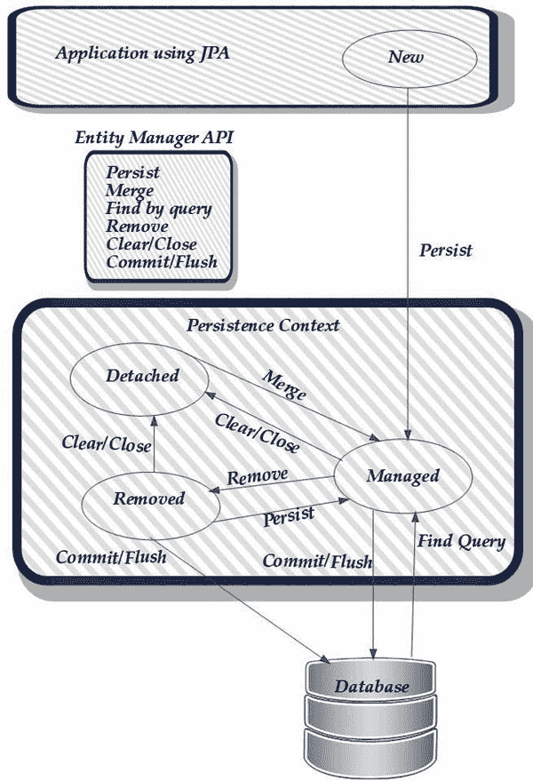

**图 6.1:** 实体生命周期状态

考虑处于管理状态的对象 `A` 被移除。如上所示，它从管理状态（managed）移动到已移除（removed）状态。然而，`A` 的引用并没有从对象 `B` 中移除，而 `B` 是通过级联持久化与 `A` 相关的。现在，对 `B` 调用 `persist` 时，由于引用仍然存在，将导致对 `A` 调用 `persist`，因此该对象由于忽略了移除操作而回到管理状态。

现在考虑如果在对 `B` 调用 `persist` 之前已从 `B` 中移除了 `A` 的引用。那么，在对 `B` 调用 `persist` 时不会触发 `A` 的 `persist` 调用，它本身保持在移除状态。最后，当事务提交时，由于实体 `A` 处于移除状态，它将从数据库中删除。因此，如果关系具有级联持久化，请确保移除对象及其引用同样重要，以确保对象从数据库中被删除。

将关系标记为级联持久化的理想建议是那些复合对象或由该对象私有有的对象。

# 合并 (Merge)

当离线（detached）对象中发生了需要存入数据库的更改时，将使用 `merge` 操作。该操作不会直接更新数据库对象，而是将实体状态从离线移动到管理，并在事务提交或上下文刷新（flush）时，在数据库中更新对象。

`merge` 操作经常与更新操作混淆。然而，两者之间存在巨大差异。请注意，`merge` 始终应用于离线对象，即被克隆、序列化、或者在 EM 的不同事务中读取的对象，或者由不同的 EM 自身读取的对象。`merge` 操作在不同场景下的行为如下：

- 如果对象处于管理状态，除了可能存在的级联合并外，将不会执行任何其他操作（即：如果任何相关对象一直处于离线状态，且该关系具有级联合并，则它将被移动到管理状态）。
- 如果对象处于新建状态（new state），会将对象的副本移动到管理状态，并对该副本作为持久化对象返回。
- 如果对象是离线的（detached），则会将对象的副本移动到管理状态，并作为持久化对象返回。
- 如果对象是离线的，但在管理状态中存在另一个相同 ID 的对象，则将离线对象的状态复制到管理对象并返回。
- 如果对象是被移除的（removed），则根据 JPA 规范抛出 `IllegalArgument` 异常。

与 `persist` 类似，`merge` 操作也需要在事务内调用。如果在事务外调用，将抛出异常。此外，此操作只能在 `Entity` 对象上调用。在合并所有 `Entity` 对象时，嵌入对象（Embeddable objects）会被自动处理。图 6.3 给出了一个如何对离线对象进行合并的示例 Java 代码。

```
EntityManager em = createEntityManager();
Student studOld = em.find(Student.class, id);
em.close();
...
em = createEntityManager();
em.getTransaction().begin();
Student studNew = em.merge( studOld );
em.getTransaction().commit();
```

**代码 6.2:** 在数据库中合并对象的示例 Java 代码

在这里，第一个名为 `studOld` 的学生对象是由 EM 创建的，然后关闭了 EM。接着，下次调用 `createEntityManager()` 将提供一个全新的 EM 实例。现在，如果需要恢复 `studOld` 对象中做的更改，可以执行合并操作，因为该对象是由另一个 EM 创建的，因此 `studOld` 对象处于离线状态。最后的提交将把 `studNew` 中的更改存入数据库，这将反映在 `studOld` 对象中所做的更改中。

# 级联合并 (Cascading merge)

级联合并执行方式与级联持久化相同。对象中所有标记为级联合并的相关对象都将被检查是否需要进一步合并，因此开发者认为在每个关系上都标记级联合并是很正常的。然而，正如级联持久化所示，它在尝试遍历大型对象集合时主要会导致性能问题。


另一个问题是，如果离线对象损坏，在尝试将损坏的离线对象与已管理的实例合并时，会产生数据不一致问题。可能会出现这种情况：另一个用户对对象进行了更改，而该对象在此上下文中保持离线状态，合并会导致该其他用户的更改被删除，或者根据数据库的锁定策略抛出 `OptimisticLockException`。

与 `persist` 类似，`merge` 对级联合并也遵循相同的建议。

# 瞬态变量 (Transient variables)

Java 拥有瞬态变量，即在从一个资源传输到另一个资源时不会被序列化的变量。在某些情况下，使用瞬态变量是非常重要的，因为可能不需要从数据库获取整个对象，只需获取所需的字段。因此，在 JPA 中合并瞬态变量时需要额外小心。

如果一个对象在序列化时某些字段被标记为瞬态，那么该对象的这些字段将为空。由于它是序列化对象，处于离线状态，对该对象或通过级联合并调用该对象的对象进行合并，会导致瞬态字段的空值更新到管理对象中，并在下次提交/刷新数据库时更新。如果在非空列中更新空值，则会在提交/刷新或合并过程中抛出异常。对于实体对象，强烈建议使用懒加载（LAZY loading）而不是将对象标记为瞬态。请参阅之前对懒加载提供了更多详细信息的章节。尽管 JPA 提供了合并的规范，但许多 JPA 实现都扩展了这些操作，允许浅合并或深合并。少数实现允许不带引用的合并。

# 移除 (Remove)

`remove` 操作用于标记要在数据库中删除的对象。考虑在该对象上执行了此操作。该对象将在事务提交/上下文刷新时从数据库中删除。与之前提到的所有操作类似，`remove` 只能在事务内调用，且仅适用于管理的 `Entity` 对象。它既不能在离线对象上调用，也不能在嵌入对象、集合或非持久化对象上调用。使用此操作时遵循的通用规则是先找到对象，然后移除它。

```
EntityManager em = getEntityManager();
em.getTransaction().begin();
Student stud = em.find(Student.class, id);
```

```java
em.remove(stud);
em.getTransaction().commit();
```

**Code 6.3:** 从数据库中删除对象的示例 Java 代码

在这里，首先使用 `find` 操作查询要删除的 `student` 对象。然后，对其进行删除，以确保执行删除操作的对象实际上是受管理的（managed）对象。这同时也确保了该对象不是离线的（detached）对象或其他非持久化对象。

# 级联删除 (Cascading remove)

级联删除操作与其他级联操作类似。然而，如果对象关系被标记为级联删除，且对象被从集合中移除或该对象的引用被移除，它并不会导致对象实际移动到已删除状态。考虑一个对象 `A`，它与对象 `B` 具有 `OneToMany` 关系。这意味着实体 `A` 在其定义中包含一个 `B` 对象的集合。如果该关系被标记为级联删除，并且对象 `A` 被删除，那么它只会移除集合内部的引用。然而，实际的 `B` 对象不会移动到删除状态，因此不会从数据库中删除。通常可以理解为，对于大多数关系为 `OneToOne` 且标记为级联删除的情况，该相关对象也会被删除。但如果关系被标记为 `OneToMany` 或 `ManyToOne`，相关对象将不会被删除，而是可能会被解除引用（dereferenced），这会导致数据库数据不一致。

然而，之前讨论的所有点大多基于 JPA 提供者的具体实现。此外，作为 JPA 2.0 的一部分，已经包含了 `orphan removal`（孤儿移除）选项，它将处理此类丢失引用的实体的移除。*第 4 章，关系——类型与策略* 已经详细解释了孤儿移除，并包含了一个示例。

# 转生 (Reincarnation)

在某些情况下，可能需要作为继承的一部分更改对象的类型。例如，考虑一个 `Person` 实体在加入 `University` 后变为一个 `Student` 实体。同时，考虑 `Student` 实体继承自 `Person` 实体，且两个表的 ID 都是手机号。因此，当一个现有的 `Person` 实体加入 `University` 时，它应该从 `Person` 表中移除，并添加到 `Student` 表中，且 ID 与 `Person` 相同。

由于这是更改实体的类型，JPA 并不支持这种操作，这可以被视为糟糕的对象模型设计。然而，如果第一个实体（`Person`）在一个事务中被移除，第二个实体（`Student`）在另一个事务中持久化，则可以实现。但这只能被视为两个不同的实体，而不是同一个实体更改了类型。在单个事务中执行这两个操作会导致许多许多复杂性，因为这主要取决于 JPA 提供者的实现如何处理具有不同对象的相同 ID。在大多数情况下，这不会按预期工作。

可以使用原生 SQL 查询来根据业务逻辑进行更新。然而，不应推广这种做法，应该采用其他技术来避免“转生”。

# 高级操作 (Advanced operations)

除了上述操作外，EM API 还提供了许多高级操作。这些操作是：Refresh、`Flush`、`Clear`、`Close`、`Get Reference`、`Get Delegate`、`Unwrap`。在操作中，`unwrap` 仅在 JPA 2.0 及之后可用。

# Refresh (刷新)

顾其实名，refresh 操作从数据库恢复对象的状态。这只能对受管理的 `Entity` 对象进行，且该对象必须处于活跃的事务中。注意，如果当前事务持久化上下文中对象实例中有任何新更改，这些更改将被撤回，对象状态将与数据库中对象的当前状态一致。因此，确保在没有真实理由的情况下调用刷新是非常重要的，因为这会导致持久化上下文中的更改被忽略。或者应该确保在调用刷新 之前将上下文更改刷新（flush）到数据库。

由于 refresh 操作仅对受管理的对象有效，因此首先使用活跃的 EM 找到对象非常重要。这确保了对象处于管理状态并可以执行 refresh 操作。此外，此操作可以级联到任何相应标记的关系上。然而，访问数据库内容取决于获取类型（fetch type）。如果获取类型为 `LAZY`，则刷新也将执行相同类型的获取。

通常情况下，refresh 用于两种场景：

1. 撤回当前受管理对象的更改。

2. 如果 JPA 提供者支持缓存，则刷新过期的缓存数据。

从 JPA 2.0 开始，定义了一组用于刷新的查询提示（query hints）。将在后续章节 *Caching (缓存)* 中详细讨论。

# Flush (刷新/同步)

`flush` 操作可以被视为 refresh 操作的反向操作。它在事务提交之前，就将活跃 EM 中的所有当前更改更新数据库。默认情况下，持久化上下文中的更改只有在事务提交时才会写回数据库。此操作可以在提交完成之前更新数据库中的对象状态。Flush 有几种用途：

* 当查询的执行依赖于同一事务中之前的添加/更新/删除操作时，可以使用 flush 返回持久化单元中制作的最新更改。

* 当插入操作需要返回插入记录的 ID 时，且该记录使用标识序列（identity sequencing）来生成 ID。

* 在发生任何数据库错误后且在移动错误处理之前，存储持久化当前的当前状态。

* 支持单个事务中的批处理，以便每批的更改都刷新到数据库，然后开始下一批处理。

以下代码描述了在完成 persist 操作后使用 `flush` 的。

```java
public long createStudent(Student stud) throws StudCreateException {
    EntityManager em = getEntityManager();
    em.persist( stud );
    try {
        em.flush();
    } catch (PersistenceException exception) {
        throw new StudCreateException(exception);
    }
    return stud.getId();
}
```

**Code 6.4:** 使用 flush 更新数据库并提供最新生成的 ID 的示例 Java 代码

这意味着 `student` 对象的更改被更新到数据库，并且在当前事务提交之前，后续的新事务就可以拥有最新的 `Student` 对象。

# Clear (清除)

`clear` 操作，顾其实名，会清除持久化上下文中的所有对象。这意味着持久化上下文中的所有对象都变为离线（detached），不再被 EM 跟踪。每当事务提交失败时，都会回滚，放弃所有更改并重启持久化上下文。这与 clear 操作非常相似。然而，回滚只能在事务结束提交失败时发生。但 clear 操作可以在事务之间执行。

当 EM 由应用程序管理时，通常会在整个应用程序中使用同一个 EM。因此，在这种情况下调用 clear 操作变成了一个应用程序设计上的考虑因素，因为它从应用程序开始就在同一个 EM 中拥有所有对象。对于 JTA 管理的 EM，在每个 JTA 事务结束时，作为清理工作的一部分调用 clear 操作。

在长时间运行的批操作中，清理上下文变得至关重要。巨大的批操作可以拆分为更小的块，在每个块完成后，可以调用 `clear` 操作，以防止上下文持续增长导致性能问题。

## 关闭 (Close)

当 EM（实体管理器）由应用程序管理时，则使用 `close` 操作来释放其资源。EM 的生命周期可以变化，取决于事务、请求或用户会话。通常，EM 在每个请求期间激活，并在请求结束时关闭。一旦关闭，EM 中的所有对象都会被脱离（detached）。因此，确保在 EM 关闭之前，对象中所有的 LAZY（懒加载）关系值都已加载是非常重要的。

## 获取引用 (Get reference)

`getReference` 操作提供对象的引用，而不会实际加载该对象。返回的对象将是一个代理对象，仅加载了主键值。其他值可以被懒加载，因此可以避免在第一次运行时就加载整个对象。然而，此操作的行为取决于底层的 JPA 提供程序的实现。

这主要用于在插入或更新操作中需要对象的 ID 作为相关对象引用的情况。因此，不需要加载整个对象，仅使用引用即可完成操作。

非常重要的一点是，此操作不会验证引用对象是否实际存在于数据库中。如果引用对象由于某些原因从数据库中删除，那么使用该引用对象的后续操作可能会导致异常或外键约束违反。

```
EntityManager em = getEntityManager();
Teacher classTeacher = em.getReference(teacherId);
Student stud = new Student();
……
em.persist( stud );
stud.setTeacher(classTeacher);
em.commit();
```

**代码 6.5:** 使用 `getReference` 操作的示例 Java 代码

在前面的示例中，`Teacher` 对象是仅设置了 ID 值的代理对象。当 `Student` 对象创建并持久化后，在使用 `setTeacher` 方法时，它只需要 `Teacher` 对象的 ID 作为外键，因此代理对象就足够了。

## 获取委托 (Get delegate)

在**Java 平台企业版** (**JEE**) 管理场景下，访问 JPA 提供程序底层 EM 实现的一种方法是使用 `getDelegate` 操作。返回的对象将是一个代理 EM 实例，它会将请求转发到当前 **Java 事务 API** (**JTA**) 事务的活动 EM。请注意，在 JTA 事务内执行此操作非常重要，否则代理 EM 将无法识别当前事务的活动 EM。这可能导致未定义的结果。

此操作还取决于服务器，并随之变化。例如，如果在一个某种类型的 JEE 服务器实例中为 JPA 提供程序使用了代码块，那么它在另一个 JEE 服务器实例中可能无法完全复用。

以下代码用于从 Tomcat EE 实现获取 Hibernate `Session` 对象：

```
EntityManagerImpl hibernateEMImpl = (EntityManagerImpl)em.getDelegate();
Session sess = hibernateEMImpl.getSession();
```

当迁移到 JBoss 时，通过以下方式单步获取话：

```
org.hibernate.Session sess = (Session) em.getDelegate();
```

因此，在 Tomcat 服务器中使用 Hibernate 的 `getDelegate` 的代码在迁移到 JBoss 时可能需要进行更改。

检索底层实现的另一种方法是使用 `EntityManagerFactory`。请注意，这可能仅在特定的服务器中可用，而不是所有服务器中都可用。

在 JPA 2.0 中，引入了 `unwrap` 操作，这是访问底层 EM 实现的一种更通用的方法。

上述使用 `getDelegate` 操作在 JBoss 中获取 `Session` 的代码，在 JPA 2.0 中通过 `unwrap` 运算符更改为更通用的调用：

```
Session sess = em.unwrap(org.hibernate.Session.class);
```

## 事务 (Transactions)

事务是一组操作，包含单个操作或多个相同/不同类型的的操作，它们被视为一个整体，并且整组操作的结果共同被视为事务结果。即：如果执行了一组操作，其中任何一个操作失败，则整个事务被视为失败。事务中的所有单个操作都必须成功，这是强制性的。因此，只有整个单元的成功或失败之分。

事务被认为是持久化的关键部分，因为它维护了数据完整性，要么根据要求进行更改，要么保持不变。它确保不会出现数据在事务执行途中被修改后中止的状态。如果事务在执行途中失败，它会撤销到为止所做的更改，并回到事务启动之前的状态。这种撤销被称为**事务回滚**（transaction rollback）。

广而言，事务分为两类——**容器托管事务** (**CMT**) 和 **Bean 托管事务** (**BMT**)。在 CMT 中，事务的边界由 EJB 容器设置。它通过避免在 bean 中编写边界划分代码来简化开发，从而使其更容易。通常情况下，当 bean 方法被调用时，事务启动，并在退出方法时结束。

每当需要以更灵活的方式管理事务时，就应该由代码本身进行管理，因此使用 BMT。BMT 使用以下运算符来标记事务边界——`begin` 标记事务开始，`commit` 标记成功条件，`rollback` 标记失败条件。

## 事务管理 (Transaction management)

有两种持久化上下文，每种上下文都有不同的事务管理机制：

*   容器托管持久化上下文

*   应用程序托管持久化上下文

在容器托管上下文中，感知正在进行的事务并将上下文传播到不同的企业元素是容器的责任。CMT 和 BMT 只能配合 JTA 使用。

| `@Stateless public class StudentBean{@PersistenceContext private EntityManager em;public void studTest(){Student stud = new Student();stud.setName(“Mary”);em.persist(stud);}}` | `@Stateless @TransactionManagement(TransactionManagementType.BEAN) public class StudentBean{@PersistenceContext private EntityManager em;@Resource private UserTransaction userTx;public void studTest(){Student stud = new Student();stud.setName(“Mary”);userTx.begin();em.persist(stud);userTx.commit();}}` |

**代码 6.6:** 使用 JTA 进行 CMT（左）和 BMT（右）的容器托管持久化上下文

在前面的代码中，两种情况（CMT 和 BMT）都是使用 `@PersistenceContext` 将现有的 EM 注入到 bean 中。默认的 `TransactionManagement` 类型是容器，可以指定为 `BEAN` 以使其变为 bean 托管。然而，在 BMT 情况下，使用 `@Resource` 将用户事务注入到 bean 中以设置事务边界。因此，在 BMT 的 bean 代码中可以看到事务的 begin 和 commit。

在应用程序托管上下文中，创建和销毁上下文完全是应用程序的责任。`EntityManagerFactory` 被注入到企业组件中，并从中获取 EM 实例，用于与持久化上下文交互。这可以使用 `RESOURCE_LOCAL` 也可以使用 JTA。

以下代码展示了如何将上述容器管理的持久上下文 Bean 代码（*图 6.7*）通过 `RESOURCE_LOCAL` 事务类型转换为应用程序管理的上下文。

```java
@Stateless
public class StudentBean{
    @PersistenceContext
    private EntityManagerFactory emf;

    public void studTest(){
        Student stud = new Student();
        stud.setName(“Mary”);
        EntityManager em = emf.createEntityManager();
        EntityTransaction et = em.getTransaction();
        et.begin();
        em.persist(stud);
        et.commit();
        em.close();
    }
}
```


**代码 6.7：** 使用 Resource local 类型的应用程序管理的持久上下文

在前面的用例中，注入了实体管理器工厂。`EM` 和实体事务实例是在 Bean 代码中获取的。事务通过在代码中设置边界由应用程序本身进行维护。在应用程序管理的持久上下文中使用事务的另一种方法是依赖于 `JTA` 本身。一旦引入了 `JTA`，它可以是 `CMT` 也可以是 `BMT`。以下代码展示了如何将之前的代码（*图 6.8*）转换为 `JTA` 事务类型。

| `@Stateless public class StudentBean { @PersistenceContext private EntityManagerFactory emf; public void studTest() { Student stud = new Student(); stud.setName(“Mary”); EntityManager em = emf.createEntityManager(); em.persist(stud); em.close(); } }` | `@Stateless @TransactionManagement(TransactionManagementType.BEAN) public class StudentBean { @PersistenceContext private EntityManagerFactory emf; @Resource private UserTransaction userTx; public void studTest() { Student stud = new Student(); stud.setName(“Mary”); userTx.begin(); EntityManager em = emf.createEntityManager(); em.persist(stud); userTx.commit(); em.close(); } }` |

**代码 6.8：** 使用 JTA 用于 CMT（左）和 BMT（右）的应用程序管理的持久上下文

与使用 `JTA` 的容器管理的持久上下文类似，代码大体相似，区别在于注入的对象不是 `EM` 而是它的工厂类。由于是应用程序管理的，`EM` 在 Bean 内部创建并在持久操作完成后关闭。

从前面的示例可以看出，`JPA` 允许使用两种不同的机制处理事务：

- 资源本地事务
- JTA 集成

第一种主要用于**Java 平台标准版**（`JSE`）或 `JEE` 中的应用程序管理事务。然而，第二种主要用于容器管理的事务。注意，在 `JPA` 中，对持久上下文对象进行的所有更改都是事务的一部分，因此事务是在对象层面的。

# 资源本地事务

资源本地事务用于标准 Java，或者在企业级 Java 的非托管模式中。为了使用资源本地事务，`persistence.xml` 中应包含以下 XML 配置。

```xml
<persistence-unit name="test" transaction-type="RESOURCE_LOCAL">
    <non-jta-data-source>jdbc/test</non-jta-data-source>
</persistence-unit>
```

注意 `<non-jta-datasource>` 元素应该是一个数据源服务器。在 `JPA` 中，对持久上下文对象进行的所有更改都是事务的一部分，因此事务是在对象层面的。

## JTA 事务

资源本地事务用于标准 Java，或者在企业级 Java 的非托管模式中。为了使用资源本地事务，`persistence.xml` 中应包含以下 XML 配置。

```xml
<persistence-unit name="test" transaction-type="RESOURCE_LOCAL">
    <non-jta-data-source>jdbc/test</non-jta-data-source>
</persistence-unit>
```

注意 `<non-jta-datasource>` 元素应该是一个数据源服务器。在 `JPA` 中，对持久上下文对象进行的所有更改都是事务的一部分，因此事务是在对象层面的。

## 联合事务

以下代码展示了如何将上述容器管理的持久上下文 Bean 代码（*图 6.7*）通过 `RESOURCE_LOCAL` 事务类型转换为应用程序管理的上下文。

```java
@Stateless
public class StudentBean {
    @PersistenceContext
    private EntityManagerFactory emf;

    public void studTest() {
        Student stud = new Student();
        stud.setName(“Mary”);
        EntityManager em = emf.createEntityManager();
        EntityTransaction et = em.getTransaction();
        et.begin();
        em.persist(stud);
        et.commit();
        em.close();
    }
}
```

# 事务失败

每当事务提交失败时，它都会一致地回滚，并且所有托管对象都会通过清除持久上下文而脱离。不建议在回滚后继续保持持久上下文活跃，因为上下文中对象的状态可能因为操作（如锁版本递增等）而变得不一致。

当持久化上下文由应用程序管理且事务类型为 `RESOURCE_LOCAL` 时，实现错误处理会更加容易。每当提交失败时，将失败事务中的所有托管对象合并到一个新的 EM，然后提交该 EM。请注意，在这种情况下，所有分配/递增的 ID 和乐观锁版本都可能被检查并回滚。

另一种涉及的方法是与非事务性 EM 协同工作。每当需要提交时，将所有非事务性对象合并到一个新的 EM 并提交。如果在此过程中发生失败，只有新的 EM 会受到影响。实际的 EM 不受影响。这有助于理解实际错误并使用另一个新事务将其持久化。

## 嵌套事务

嵌套事务是指其内部包含其他子事务/子事务的事务。如果父事务回滚，无论子事务中执行了什么操作，它们都将一起回滚。JPA 和 JTA 都不支持嵌套事务。

使用嵌套事务时的一些规则如下：

- 当子事务处于活动状态时，父事务只能提交、中止或创建更多的子事务。不允许进行其他操作。
- 每当子事务提交时，它对父事务没有影响。然而，父事务可以看到已提交子事务所做的更改。当父事务提交时，这些更改才会对所有其他子事务可见。
- 如果父事务在拥有活动子事务时被提交或中止，子事务也将执行与父事务相同的操作，即：如果父事务提交了更改，则所有子事务都将其更改提交到数据库；否则，如果父事务中止，则所有子事务也将中止。

除非父事务提交，否则嵌套事务所做的任何可见更改在数据库中都是不可见的。同样，嵌套事务所持有的锁在父事务提交之前不会释放。嵌套深度的唯一限制基于内存大小。

## 缓存

JPA 有两个级别的缓存。第一级是持久化上下文本身，到目前为止已经讨论了这一点。第二级可以被视为 L2 缓存，将在本节中讨论。缓存是将副本存储在临时存储器中以便快速访问的方法，它被认为是最相关的性能优化机制之一。缓存可以存储任何内容——对象、数据、元数据、元数据关系、查询结果、数据库语句、数据库连接等。这里的关注点是对象或其数据的缓存。有必要在事务内部或扩展持久化上下文中保持对象的标识性。然而，并不支持跨事务或持久化上下文的缓存。

JPA 1.0 没有对共享对象缓存的任何正式化。它完全取决于提供者的实现是否支持共享对象缓存。然而，在 JPA 2.0 中，可以使用 `@Cacheable` 注解允许对特定类进行缓存。也可以通过等效的 XML 配置实现。

```java
@Entity
@Cacheable
public class Student {
    ………
}
```

**代码 6.10：** `@Cacheable` 的用法

缓存的默认模式可以通过 XML 或代码配置，如图 6.10 所示。在代码中，相应设置 `EntityManagerFactory` 属性以通过 `SharedCacheMode` 枚举反映缓存策略。在 XML 中，使用 `<shared-cached-mode>` 元素定义相同的内容。

```java
Properties props = new Properties().add(
    "javax.persistence.sharedCache.mode",
    javax.persistence.SharedCachedMode.NONE
);
EntityManagerFactor emf =
    Persistence.createEntityManagerFactory(“PU”, props);
```

```xml
<persistence-unit name="ACME">
    <shared-cache-mode>NONE</shared-cache-mode>
</persistence-unit>
```

**表 6.1：** 通过代码（顶部）或 XML（底部）为持久化单元设置缓存策略

上述的 `SharedCacheMode` 枚举有不同的值：

- `ALL`：所有实体、实体相关的状态和数据都被缓存。
- `NONE`：禁用此持久化单元的缓存。
- `ENABLE_SELECTIVE`：对所有 `Cacheable` 值为 `true` 的实体启用缓存。
- `DISABLE_SELECTIVE`：对所有除 `Cacheable` 值为 `false` 的实体外的实体启用缓存。
- `UNSPECIFIED`：缓存取决于提供者的默认规范。

所执行的缓存分为三种类型——对象缓存（缓存整个对象及其数据、结构和关系）、数据缓存（缓存数据库行数据）或查询缓存（缓存整个查询结果）。

## 对象缓存

这种类型的缓存按原存储实体，并保持与 Java 中的格式相同。每当发生缓存命中时，可以轻松检索而无需任何转换。在某些情况下，瞬态数据也可能被缓存。因此，在使用来自缓存的对象时，应该考虑所有这些场景。这种缓存的主要用途是存储只读数据，因为它是极其高效的，而使用缓存时的主要问题（更新和过期数据）在这种情况下并不是问题。

## 对象标识

每当使用对象时，它们的标识性就变成了一个重要问题。Java 中的对象标识性意味着如果两个对象引用同一个引用，那么它们就是相同的。考虑 A 和 B 为两个对象，如果它们引用同一个引用（即指向同一个内存位置），则 `A == B` 返回 `true`。在应用 EM 中，对象标识性会被维护。然而，在 JEE EM 中，这仅存在于事务内部。

```java
Student student1 = em.find(Student.class, 1);
Student student2 = em.find(Student.class, 1);
if (student1 == student2) {
    System.out.println("都是相同的");
}
```

**代码 6.11：** 对象标识示例 1

```java
EntityManager em1 = factory.createEntityManager();
EntityManager em2 = factory.createEntityManager();
Student student1 = em1.find(Student.class, 1);
Student student2 = em2.find(Student.class, 1);
if (student1 != student2) {
    System.out.println("不同的对象");
}
```

**代码 6.12：** 对象标识示例 2

在上面的示例中，通过 `em1` 和 `em2` 创建了两个不同的持久化上下文。因此，执行上述代码时会打印该语句。这种对象标识性的概念有助于在每个事务内部维护相同对象的不同副本，从而与其他应用程序与其他更改隔离开。在同一个 EM 中，如果使用了同一对象的多个副本，那么维护数据完整性将变得困难，因为当事务中发生对象更新时，必须更新多个副本。

## 数据缓存

这通常只针对一对多（OneToMany）和多多（ManyToMany）关系进行。一对一（OneToOne）和多一（ManyToOne）通常将对象 ID 作为引用 ID。然而，在反向一对一映射中，外键而不是主键将引用 ID，因此缺点是当缓存命中时，从此创建的对象需要被缓存。因此，在关系缓存中，只存储对象 ID 及其关系名称。不存储任何对象或数据，以避免重复和过期数据问题。

某些数据缓存实现存储的是结构而非数据库行。在这种情况下，关系缓存也作为该数据缓存的一部分进行维护。当缓存命中时，会一个接地从数据缓存中获取相关对象。可能的结果是，如果缓存中缺少相关对象，则将从数据库获取，这可能导致性能非常糟糕。为了减轻这个问题，某些实现支持对选择查询操作进行批量查询。

## 查询缓存

在这种缓存中，既不缓存对象也不缓存数据。相反，缓存的是查询结果。当查询不基于 ID 且结果预期多个对象时，这非常有用。缓存的键基于查询名称和参数。如果频繁执行 `NamedQuery`，那么只需要在第一次执行时，即可将其结果添加到查询缓存中。然而，确保查询结果不是过期数据非常重要。因此，它与对象缓存交互，并确保其像对象缓存一样保持更新。与对象缓存类似，查询缓存也有失效选项。

### 缓存类型

有多种不同的缓存类型，它们大多数基于缓存驱逐策略，即当需要缓存存储区域时，从缓存中移除元素的方式。缓存类型列表包括：

- **LRU 缓存驱逐**：在这里，缓存中保留 X 个最近使用的对象，当缓存满时，丢弃最久未使用的对象。
- **全量或不驱逐（Full or no eviction）**：对至今读取的所有内容进行永久缓存。对于大型数据库来说完全不是一个好主意。
- **软引用（Soft）**：当内存低时，使用 Java 垃圾回收提示从缓存中释放对象。
- **弱引用（Weak）**：每个正在使用的活动对象都放置在对象缓存中。
- `L1`：它是 EM 的事务缓存，不是共享缓存。
- `L2`：缓存存储在 `EntityManagerFactory` 中，以便其可以在所有 `EntityManager` 之间共享。
- **数据缓存（Data cache）**：缓存数据库行或数据。
- **对象缓存（Object cache）**：直接缓存对象。
- **关系缓存（Relationship cache）**：缓存关系。
- **查询缓存（Query cache）**：缓存查询结果集。
- **只读（Read-only）**：一种只存储或只允许只读对象的缓存。
- **读写（Read-write）**：一种可以处理插入、更新和删除的缓存。
- **事务（Transactional）**：一种可以处理插入、更新和删除，并遵循事务 ACID 属性的缓存。
- **集群（Clustered）**：每当对象被更新或删除时，这些对象就会过期，必须通过广播失效消息来通知。
- **复制（Replicated）**：指一种缓存，当对象被读取到任何服务器的缓存中时，使用机制将对象广播到所有服务器。
- **分布式（Distributed）**：指一种跨越集群中多个服务器的缓存。

## 过期数据

在缓存时，数据库中数据的副本被存储以便更快速地访问，因此可能存在副本版本与原始值不同的情况。这被称为**过期数据（stale）**或**同步数据（out of sync data）**。这对于只读数据完全不是问题，但对于读写数据可能是一个巨大的问题。有不同的技术来处理这类数据。

### 一级缓存

在 JPA 中，EM 的持久上下文（persistence context）本身充当一级缓存。根据上下文配置，对象在事务或请求期间内被缓存。因此，如果通过 JPA 访问对象，将获得带有内存更改的最新对象。然而，在使用原生查询（native queries）的情况下，它将直接从数据库获取，因此内存中的更改将不可用。尽管对象的更改只在事务提交时写回数据库，但在事务之间可以使用 `flush` 操作将更改推送到数据库。因此，对于应用程序开发者来说，理解在何时以及如何使用原生查询，以及在需要时必须完成哪些清理工作以实现数据一致性是至关重要的。

事实上，某些 JPA 实现者甚至支持将缓存的更改与数据库查询结果一起合并，以为应用程序维护一致的数据视图。然而，如果查询并不简单，这可能会变得复杂。

一级缓存如果使用时间过长，可能会产生过期数据的风险，可以使用 `clear` 操作进行清理。还有一个 `refresh` 操作，它会通过覆盖缓存对象从数据库刷新对象。请注意，`refresh` 操作将覆盖缓存对象中的所有更改，并更新数据库的更改。

### 二级缓存

二级缓存不是 JPA 的要求，而是可选的。它涵盖不同的事务，并可以用于在不同的 EM 之间共享对象。虽然大多数 JPA 实现都支持二级缓存，但它的定义和实现是特定于实现者的，并且可能不同。在某些情况下，默认支持二级缓存，而在其他情况下，可以通过配置将第三方实现插件到实现中。

过期数据是二级缓存的主要问题。当单个应用程序访问数据库服务器，并且当直接在数据库上执行原生查询（主要是插入/更新/删除）时，二级缓存中的数据会不同。这可以通过执行**数据操作语言（DML）**查询时自动失效二级缓存来处理。然而，这应该由 JPA 实现负责。

在多个应用程序访问同一个数据库服务器的情况下，处理二级缓存中的过期数据变得困难。当一个事务获取对象并将其存储在缓存中，可能会另一个事务从数据库中删除该特定对象。由于有多个应用程序访问数据库服务器，这种情况发生的概率很大。大多数二级缓存用于查找操作，如果发生了上述情况，返回的数据可能在数据库中并不可用，因此丢失了数据一致性。此外，可能存在数据库已更新而缓存中仍有旧过期数据的情况。为了避免许多此类情况，乐观锁可以在一定程度上有所帮助。然而，使用锁需要正确的理解，否则会导致性能问题，在最坏的情况下会导致死锁。

# 解决过期数据问题

由于过期数据是缓存最大的问题之一，后续章节将讨论用于在一定程度上克服此问题的各种方法。

## 刷新


处理缓存中过时数据的一种简单方案是刷新缓存。每当需要新数据时，都应该执行刷新以从数据源获取最新数据。这在网络浏览器中非常常见，页面被缓存在本地，用户也知道这可能是缓存页面，并使用刷新功能来确保将最新副本加载到浏览器中。

JPA 同样提供了对刷新的支持。每当查询命中缓存时，它会检查缓存中的版本以及数据库中对应的版本。如果数据库版本较新，则获取数据库行值并更新缓存对象；否则，直接返回缓存值，因为它是最新版本。此选项提供了优越的缓存策略。在某些情况下，完全不使用二级缓存总是更好的，因为处理过时数据会变得非常复杂。或者，应用程序应该对过时数据具有某种程度的容度。

从 `JPA 2.0` 开始，提供了一组标准查询提示（hints），允许刷新或绕过缓存。`CacheRetrieveMode` 和 `CacheStoreMode` 是定义这些查询提示的 `enum` 类。

1. `javax.persistence.CacheRetrieveMode`

   - `BYPASS`：直接从数据库结果构建对象并忽略缓存。
   - `USE`：如果对象/数据已在缓存中，则使用它。

2. `javax.persistence.CacheStoreMode`

   - `BYPASS`：不缓存数据库结果。
   - `REFRESH`：如果对象/数据已在缓存中，则用数据库结果刷新/替换。
   - `USE`：缓存从查询返回的对象/数据。

查询提示的示例用法如下：

```java
Query query = em.createQuery(“Select stud from Student s”);
query.setHint(“javax.persistence.CacheStoreMode”, “REFRESH”);
```

**代码 6.13：** `Cache Store Mode` 查询提示示例

执行上述查询时将强制刷新缓存，因为查询提示被设置为 `REFRESH` 值。

JPA `2.0` 还提供了一个 `Cache` 接口，可用于手动驱除或失效缓存中的实体。可以通过 `EntityManagerFactory` 的 `getCache` 操作获取此接口。某些 JPA 实现者还扩展了此接口并提供了额外功能。

```java
Cache cache = entityManagerFactory.getCache();
cache.evict(Student.class,123);
```

**代码 6.14：** JPA 2.0 中的缓存驱逐示例

在上述代码中，如果存在 `ID=123` 的 `Student` 对象，它将从缓存中驱逐。如果 `evict` 方法只接收类（此处为 `Student.class`），则会移除缓存中该类的所有实体。

## 缓存失效

处理过时数据的另一种自然方法是失效缓存。它可以基于时间间隔，也可以基于特定的时间点。一种失效方法是为每个实体提供一个**存活时间**（`TTL`）。如果实体超过了该时间间隔，它就会失效。这将始终确保读取的数据不会早于这段时间。

另一种方法是在一天中的某个时间进行失效。通常这是在流量低峰期进行的，确保任何缓存数据都不会早于一天的数据。这最常用于调度在特定时间执行的批处理任务，并在任务完成后立即失效缓存的场景。

缓存失效也通过 API 支持，并可以在集群中使用，以失效其他机器上更改的对象。

## 集群缓存

当将缓存引入集群环境时，处理起来会变得更加困难，因为每台机器都可以更新数据库而不更新其他机器的缓存。因此，检查集群中是否需要缓存，以及如果需要，如何在集群环境中配置它，是非常重要的。

缓存大部分可以用于只读对象。在这里，应该有某种避免过时数据的方法。在进行数据库写入时，乐观锁可以避免对过时数据进行写入。某些 JPA 实现者在发生乐观锁异常时，会自动刷新或失效缓存条目。这将允许在重试时进行写入，因为第一次异常会失效实体，而下一次尝试将从数据库获取并执行必要的写入，然后存回数据库。因此，在第二次尝试中，它会按预期工作。设置 `TTL` 是减少过时数据的另一种方法。

可能会出现更大的问题，例如向刚刚通过 DML 原生查询更新了相同对象的用户返回过时的旧数据。这可以通过在集群中通过同一台机器使用的会 来解决。否则，此问题定会再次发生。应用程序也可以刷新那些对最新实体更重要的对象，例如在只读查询中使用缓存，并在执行 DML 查询时进行刷新。

对于写操作为主的对象，允许缓存益处不大。

因此，对此类对象禁用缓存是最好的。然而，如果对象非常复杂并具有许多复杂的关系，且只有对象的一部分被更新，那么拥有一个获取复杂对象及其关系的缓存仍然是值得的。如果始终从数据库执行，可能会导致巨大的性能影响。

# 缓存协调

在集群环境中，集群中不同机器的缓存之间应该存在某种协调。缓存协调的一种解决方案是在集群环境中使用消息框架。可以使用 `JMS` 或 `JGroups` 结合 JPA 或基于应用的事件，在发生更新时发布消息，以失效其他机器上的缓存。

## 分布式缓存

如果缓存分布在多个机器上，那么它就是分布式缓存。请注意，对象将仅在某些机器上存。这有助于减少过时数据，因为对象始终从相同位置检索。这种设置的主要困难在于缓存需要网络访问。然而，由于缓存减少了数据库访问，应用程序可以扩展而不产生数据库瓶颈。某些分布式缓存提供者支持本地缓存并提供缓存间的协调机制。

# 缓存事务隔离

JPA 在缓存中也提供了不同的事务隔离级别。它们大致分为事务型和非事务型。

在事务型缓存中，事务的更改作为单个原子单元提交到缓存。这意味着首先锁定缓存对象/数据（防止其他线程/用户访问），然后更新缓存，最后释放锁。理想情况下，在提交数据库事务之前获取锁，以确保与数据库的一致性。

在非事务型缓存中，对象/数据逐个更新，没有任何任何锁定。这意味着在短暂期间，缓存中的数据与数据库不一致。这可能是一个问题也可能不是，是一个复杂的问题，涉及锁定问题以及应用程序的隔离需求。

乐观锁是缓存隔离中的另一个重要因素。如果使用了乐观锁，缓存应避免用旧数据替换新数据。这在读取和更新缓存时都很重要。

虽然通常应该使用默认值，但理解缓存的使用如何影响你的事务隔离以及性能和并发性，是非常重要的。

## 结论

在本章中，重点关注了如何使用 EM（实体管理器）存储和检索实体。这让我们对为什么、何时、何地以及如何访问数据库行有了了更广泛的认识。在某些情况下，使用 JPA 对象可能比使用查询更好。然而，在其他某些情况下，原生查询（native query）会更高效。

下一章将介绍两个最广泛使用的 JPA 实现实现，并讨论它们的各种特性。

## 单选题

1. **扩展范围持久化上下文可以跨越：**
   1. 多个查询
   2. 多个事务
   3. 多个 EM
   4. 以上所有

2. **对象标识标识性（Object Identity）意味着如果两个对象实例指向同一个位置，那么这两个实例就是相同的：**
   1. 正确
   2. 错误
   3. 不适用
   4. 以上均不是

3. **通常被缓存的关系类型是：**
   1. 一对多 (OneToMany) 和多对多 (ManyToMany)
   2. 多对一 (ManyToOne) 和多对多 (ManyToMany)
   3. 一对一 (OneToOne)、一对多 (OneToMany) 和多对多 (ManyToMany)
   4. 以上均不是

4. **缓存模式 `DISABLE_SELECTIVE` 意味着：**
   1. 禁用所有 `Cacheable` 设置为 `true` 的实体的缓存。
   2. 启用所有 `Cacheable` 设置为 `true` 的实体的缓存。
   3. 除 `Cacheable` 设置为 `false` 的实体外，启用所有实体的缓存。
   4. 以上均不是

5. **JPA 1.0 中的 `getDelegate` 操作在 JPA 2.0 中更改为 ______。**
   1. `getReference`
   2. `getWrapper`
   3. `getCache`
   4. `unwrap`

## 答案

1. b

2. a

3. c

4. c

5. d

## 题

1. 解释各种持久化上下文管理中的事务管理。

2. 用图描述实体生命周期。

3. 讨论各种类型的缓存及其用途。

4. 为以下内容编写简短笔记：
   - `refresh`（刷新）
   - `flush`（刷写）
   - `clear`（清除）
   - `close`（关闭）
   - `getCache`

## 思考题

1. TopLink/EclipseLink：定义查询提示符 `eclipselink.refresh` 以允许在查询上启用刷新。

2. 某些 JPA 实现允许在执行 EM 关闭操作后访问懒加载（LAZY）关系。

3. TopLink / EclipseLink：默认支持对象缓存。可以全局配置或按类选择性启用。启用/禁用默认对象缓存的属性是 `eclipselink.cache.shared.default`。

   TopLink / EclipseLink：通过 `eclipselink.read-only` 查询提示符或使用 `@ReadOnly` 注解支持只读查询。

4. Hibernate：默认未启用缓存，并支持第三方缓存集成。Ehcache 是可以配合 Hibernate 使用的一个示例。

5. TopLink/EclipseLink：通过查询提示符支持启用查询缓存的属性。

6. `eclipselink.query-results-cache`：支持包括失效在内的若干配置选项。

7. TopLink/EclipseLink：提供了一个扩展的缓存接口 `JpaCache`，它为失效、查询、访问和清除等缓存操作提供了额外的 API。

8. TopLink/EclipseLink：使用 `@Cache` 注解（XML 配置中的 `<cache>` 元素）支持生存时间（time to live）和一天之缓存失效。

9. TopLink/EclipseLink：支持使用 Java 消息服务（`JMS`）和/或远程方法调用（`RMI`）进行缓存协调。

10. TopLink：支持与 Oracle Coherence 分布式缓存集成。

# 第四部分：JPA 实现

# 第 7 章

## Hibernate 和 EclipseLink

## 引言

之前所有的章节都是关于通用 JPA 特性的。然而，理解最广泛使用的 JPA 实现以及使它们比其他实现更流行的特性也是重要的。

## 结构

本章叙述了以下主题：

- JPA 实现类
  - 迁移 – JPA 2.X 到 3.0
- Hibernate
  - 历史
  - 特性
  - 架构
    - 配置
  - 在 Hibernate 中查询
    - Hibernate 查询语言（HQL）
    - Hibernate criteria API
    - 原生 SQL
- EclipseLink
  - 历史
  - 特性
  - 架构
    - 配置
  - 查询
  - 查询类型
  - 缓存架构
    - 持久单元缓存
    - 持久化上下文缓存
    - 缓存隔离级别
- 弱引用
  - 缓存类型
  - 多语言持久（Polyglot persistence）
    - SQL 或关系型
    - NoSQL

### 目标

本章的目的是介绍两个广泛使用的 JPA 实现，并对它们的独特特性进行概述。这将帮助读者理解如何以及何时使用这些实现。

### JPA 实现类

在本章中，将讨论两个广泛使用的实现类。在讨论实现之前，重要的是知道目前市场上提供的最新 JPA 版本是 3.0。由于 2019 年 Java 品牌向 Oracle 的技术转让，决定在开源产品中弃用 Java 的名称，并将 JEE 交给 Eclipse 基金会进行进一步增强。因此，Java Enterprise Edition 变成了 Jakarta Enterprise Edition，持久 API 也是如此。从现在起，JPA 是 Jakarta Persistence API，最新版本将不再包含 Java 或 Javax 的引用。这种迁移从 JPA 2.2 开始，并在 JPA 3.0 中完成。

### 从 JPA 2.X 到 3.0 的迁移

由于没有新功能添加，只有命名更改，迁移的主要更改将是将所有 Java 实例重命名为 Jakarta。这适用于：

- 包名
  - 带有 `javax.persistence` 前缀的导入语句将更改为前缀 `jakarta.persistence`。
- 配置属性名
  - 带有 `javax.persistence` 前缀的配置属性将更改为 `jakarta.persistence`。这些可以在自定义文件中，也可以在 `persistence.xml` 中。
- XML 命名空间 – `persistence.xml` 更新如下：
  - `http://xmlns.jcp.org/xml/ns/persistence` 更改为 `http://jakarta.ee/xml/ns/persistence`。
  - `http://xmlns.jcp.org/xml/ns/persistence/orm` 更改为 `http://jakarta.ee/xml/ns/persistence/orm`。

除了上述更改，迁移过程中不需要其他代码更改。

## Hibernate

Hibernate 是一个根据 GNU-LGPL 许可的开源持久化框架。它是一个基于 JPA 规范的轻量级、免费的**对象关系映射**（**ORM**）工具。它简化了与数据库交互的 Java 应用程序的开发。

尽管 Hibernate 主要为关系型数据库设计，但它非常受欢迎，以至于其非关系版本也被开发用于各种数据库，如文档存储（例如 MongoDB）、键值数据库（例如 Infinispan）、图数据库（例如 Neo4J）等。它被称为 `Hibernate OGM`（对象网格映射）。这种对关系型和 NoSQL 数据库的支持使得 Hibernate 被广泛接受，因为从一个数据库迁移到另一个变得非常容易，即使是从关系型数据库迁移到 NoSQL 或相反。

### 历史

Hibernate 由 Gavin King 在 2001 年于澳大利亚公司 Cirrus Technologies 工作期间发起，旨在解决使用 Entity Beans（EJB2）时面临的常见问题。当 Gavin King 被询问是什么导致了 Hibernate 的诞生时，他表示：

“我当时正在开发 J2EE 应用，对自己的生产力低下感到非常沮丧，并且无法将对象建模技术应用到业务问题中。最终，我花在思考持久化上的时间比花在思考用户问题的时间还要多。这总是错误的。”

初始版本仅通过简化复杂性和补充某些缺失的功能，提供了更好的持久化能力。

2003 年，Hibernate 2.0 发布并引入了重大改进。随后，JBoss Inc（现 RedHat 的一部分）聘用了该团队的主开发人员，以保持开发势头。

2005 年，Hibernate 3.0 发布，包含了拦截器/回调架构、JDK5.0 注解、用户定义过滤器等特性。到 2010 年，它已成为 JPA 2.0 规范的认证实现。

2011 年，Hibernate Core 4.0 发布，带有多个新功能，如多租户支持、更好的会启动、改进的集成和自动发现、国际化支持，以及 API、SPI 和实现类之间的清晰区分。Hibernate 的当前稳定版本是 5.6，支持 JPA 3.0。

### 特性

Hibernate 最重要的特性如下。许多特性是相互依赖和相互相关的。

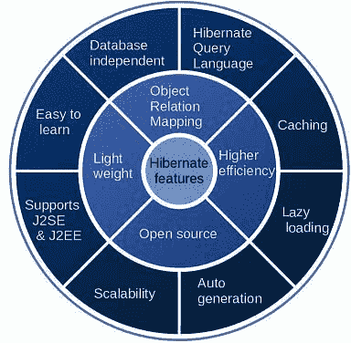

**图 7.1：** Hibernate 特性

**对象关系映射（Object-relation mapping）**：这允许 Java 类与表行之间进行无缝交互，用户无需过多考虑持久化层。根据创建者的目标，Hibernate 的作用是解决面向对象与面向关系概念之间的不匹配问题。

**数据库无关性（Database independent）**：通过使用数据库方言（dialects），Hibernate 实现了无需更改代码即可在多个数据库之间切换。只需要更改数据库配置，其余代码保持不变。此外，Hibernate 还开发了 OGM 工具用于在 NoSQL 数据库之间切换。

**Hibernate 查询语言（HQL）**：这可以被视为一种针对持久化对象的查询语言，非常类似于 SQL。它不基于底层数据库，因此有助于实现数据库无关性。

**轻量级（Light weight）**：除了对象关系映射所需的功能外，没有其他功能。此外，任何 `Plain Old Java Object`（`POJO`）类都可以通过实现 `Serializable`（仅用于数据传输）转换为持久化类。为了让 POJO 可以被 Hibernate 使用，不需要扩展或实现特定的类/接口。

**易于学习（Easy to learn）**：除了创建实体外，如果配置适当，Hibernate 还会自动创建表。这使得用户创建应用程序所需的整个表集合变得更加简单。此外，由于没有许多定义规则的接口/类，因此很容易学习和实现。

**J2SE/J2EE 支持**：这使得即使在未启用企业功能的情况下，在标准 Java 中使用 Hibernate 也非常方便。这是由于该框架的轻量级特性。

**开源（Open source）**：Hibernate 源代码可以免费下载和使用，无需任何费用。这有助于框架更快地增长，并以更有协作的方式与软件行业的各个类别建立更好的联系。

**可扩展性（Scalability）**：它具有高度的可扩展性，可以用于小型也可以用于大型应用程序。

**自动生成（Auto generation）**：Hibernate 支持数据库架构的自动生成。它还支持通过 Liquibase、FlyWay 等数据库架构管理工具生成架构。

**高效率（High efficiency）**：Hibernate 使用了各种获取技术来提高性能，如缓存、延迟加载等。


**缓存（Caching）**：Hibernate 支持两级缓存——一级缓存和二级缓存。这提高了数据访问速度。

**懒性加载（Lazy loading）**：这是为了只加载执行操作所需的对象。这在[第 4 章，关系 – 类型与策略]中的查询优化技术章节中已进行了详细解释。

## 架构

Hibernate 框架结构可以被视为三个主层：应用层、Hibernate 核心层和 Hibernate DB 层。

应用层主要由用于在与数据库之间传输数据的实体对象组成。

Hibernate 核心层是框架的核心，它理解配置文件中提供的配置属性值，加载相应的数据库方言，理解对象与表之间的映射，适当管理数据库会话和查询结果。任何数据库操作都可以被视为`创建、读取、更新、删除`（`CRUD`）操作之一，并可以转换为相应的查询。在这里，核心层负责首先创建到相应数据库的连接，根据提到的操作创建查询，并将连接和查询发送到下一层（即 DB 层）执行。它还负责将 DB 层的查询结果转换回实体对象，供应用层使用。

DB 层负责根据配置执行实际的数据库连接，执行从核心层传递的查询，并将结果返回给核心层。

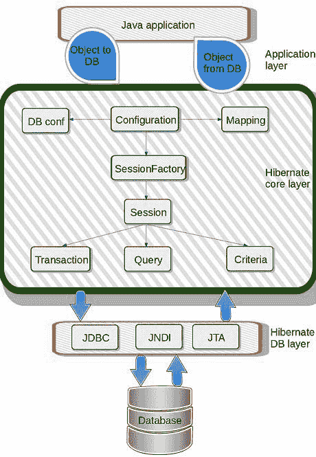

**图 7.2：** Hibernate 架构

前面的图描绘了核心层组件及其相互作用和执行顺序。`Configuration` 类被用作初始化对象，并在应用程序想要调用 Hibernate 框架时调用。该类读取映射和配置文件。根据数据库配置，从`Configuration`对象中获取单个线程安全的`SessionFactory`实例。该工厂反而创建重量级的`Session`对象来通过 DB 层执行 CRUD 操作。注意，这些会话对象不是线程安全的，因此需要根据需求进行管理。每个会话可以有一个`Transaction`或`Query`或`Criteria`对象，通过 DB 层执行实际的数据库操作。

## 配置

这是 Hibernate 最重要的部分，开发者需要理解每个属性的关联性。这有助于利用所有可用功能并微调框架性能。作为配置的一部分，有两种类型的文件——配置和映射。

配置文件可以是 XML 文件也可以是属性文件。JPA 相关的配置可以在`persistence.xml`中完成，Hibernate 私有的配置可以在`hibernate.cfg.xml`或`hibernate.properties`中完成。每当仅进行 JPA 相关的配置时，最好使用`persistence.xml`。

```xml
<hibernate-configuration>
<session-factory>
```

```xml
<property name="hibernate.dialect">
    org.hibernate.dialect.MySQLDialect
</property>
<property name="hibernate.connection.driver_class">
    com.mysql.jdbc.Driver
</property>
<property name="hibernate.connection.url">
    jdbc:mysql://localhost/test
</property>
</session-factory>
</hibernate-configuration>
```

**Code 7.1a：** 样例`hibernate.cfg.xml`

```properties
hibernate.dialect = org.hibernate.dialect.MySQL5Dialect
hibernate.connection.driver_class = com.mysql.jdbc.Driver
hibernate.connection.url = jdbc:mysql://localhost/test
```

**Code 7.1b：** 样例`hibernate.properties`文件

**提示：** 当属性文件和 Hibernate 配置 XML 都配置了相同的属性时，应用程序将使用 XML 文件的属性值，也就是说属性文件的配置可以被 Hibernate 配置 XML 覆盖。

调用不同配置文件的代码略有不同。

```java
Configuration cfg = new Configuration().configure();
```

上述代码将读取 XML 文件并相应地配置属性。然而，可以使用以下代码来读取属性，或者说通过程序化的设置属性。考虑到数据库的用户名和密码是在运行时提供的，以下代码可以使用这些变量值。

```java
Configuration cfg = new Configuration();
cfg.setProperty("hibernate.connection.username",userName);
cfg.setProperty("hibernate.connection.password",password);
```

映射文件是提供每个`Entity`对象映射的文件。通常，文件名命名为`<EntityName>.hbm.xml`。然而，现在大多数应用程序已开始使用 JPA 注解代替映射文件。

```xml
<hibernate-mapping>
    <class name="Student" table="STUDENT">
        <meta attribute="class-description">
            此类包含学生详情。
        </meta>
        <id name="id" type="int" column="id">
            <generator class="native"/>
        </id>
        <property name="firstName" column="first_name" type="string"/>
        <property name="lastName" column="last_name" type="string"/>
        <property name="std" column="standard" type="string"/>
    </class>
</hibernate-mapping>
```

**Code 7.2：** Hibernate 映射 XML

在这里，实体对象是`Student`，它被映射到表`STUDENT`。类变量`firstName`、`lastName`和`std`分别对应表列`first_name`、`last_name`和`standard`。这些信息存储在映射文件中。然而，通过注解，可以移除映射文件（`Code 7.2`），并在类文件本身中提供这些细节（`Code 7.3`）。

```java
@Entity
@Table(name="STUDENT")
public class Student {
    @Id
    @GeneratedValue(strategy=GenerationType.AUTO_INCREMENT)
    @Column(name = "id")
    private int id;

    @Column(name = "first_name")
    private String firstName;

    @Column(name = "last_name")
    private String lastName;

    @Column(name = "standard")
    private String std;

    ……
}
```

**Code 7.3：** 通过注解进行 Hibernate 映射

使用注解进行映射的优势是更容易理解关系，并且不需要为了多个文件来实际弄清楚表行的对象表示。

## 在 Hibernate 中查询

Hibernate 中有两种类型的查询——完整实体读取和部分实体读取。在读取完整实体时，整个对象会被填充，因此结果以实体对象列表的形式给出，如下（`图 7.3`）。

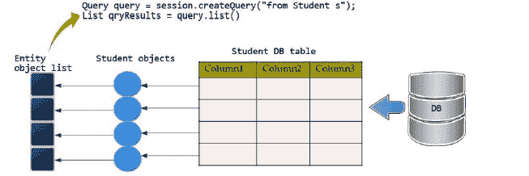

**图 7.3：** 从数据库读取并转换为实体对象

在这里，正在读取整个表（此处为`Student`表），每行都转换为对应的实体对象，并创建并返回这些对象的列表。

大多数情况下，所有的属性（对于表而言：所有列）可能并不是需要的，因此查询将仅获取属性的子集。在这种情况下，仅从数据库检索这些列（此处为 Name 和 Age），将其转换为对象并放入数组中。因此，这种情况下的列表将是对象数组列表，所示（`图 7.4`）。


**图 7.4：** 从数据库读取并转换为实体对象

```java
Query query = session.createQuery("from Student s"); query.setFirstResult(1);
```

```java
Query.setMaxResults(5);
```

```java
List qryResults = query.list();
```

**代码 7.5：** 示例 Java 代码 – 分页支持

前面的查询在内部获取了所有学生记录，并为每行分配了一个从 0 开始的行号（即：第一行的行号为 0，第二行的行号为 1，依此类推）。然后，它将第一个结果设置为行号 1（这意味着结果集中的第二行）。返回的结果数量将受限制为 5 个。简而言之，前面的查询将返回实际结果集的第 2 到第 6 行。

## Hibernate Criteria API

这种技术使用了一种更面向编程的方式来创建和执行查询。它不是将查询字符串传递给查询对象并执行，而是通过代码使用`Criteria` API 部分的各种对象构建一个 criteria 查询对象。

```java
Criteria cr = session.createCriteria(Student.class);
```

```java
List qryResults = cr.list();
```

**代码 7.6：** 使用 Hibernate Criteria API 列出所有`Student`实体

图 7.3 中的查询（HQL）可以使用`Criteria` API 如上所示的方式编写。然而，Hibernate Criteria API 从 5.2 版本起被标记为弃用，取而开始支持 JPA Criteria API。因此，使用 JPA Criteria API 总是更好的。所以，前面的查询将使用 JPA Criteria API 转换为如下代码所示。

```java
CriteriaBuilder cb = session.getCriteriaBuilder();
```

```java
CriteriaQuery<Student> cr = cb.createQuery(Student.class);
```

```java
Root<Student>root = cr.from(Student.class);
```

```java
cr.select(root);
```

```java
Query<Student> query = session.createQuery(cr);
```

```java
List<Student> results = query.getResultList();
```

**代码 7.7：** 使用 JPA Criteria API 列出所有`Student`实体

Hibernate Criteria API 更容易使用，因为它使用直接的方法来创建查询的不同部分并执行它们。另一方面，JPA 高度依赖于 Criteria Builder 接口来构建查询。Hibernate 允许将查询的部分定义为原生 SQL 片段。这使得即使 Hibernate 不直接支持某些数据库特定特性，也可以灵活地使用它们。

## 原生 SQL

原生 SQL 主要用于利用数据库特定特性，这些特性在某些情况下可以提高整体性能。缺点是它变得依赖于底层数据库，降低了可移植性。Hibernate 3.x 允许为所有操作指定原生 SQL，包括存储过程。

```java
SQLQuery query = session.createSQLQuery“select * from Student”);
```

```java
query.addEntity(Student.class);
```

```java
List<Student> qryResults = query.list();
```

**代码 7.8：** 使用实体（Entity）原生 SQL

前面的查询是使用原生 SQL 选择 Student 表中的所有值。如果检索了整个实体，则可以使用`addEntity`方法设置实体类。但在大多数情况下，只需要少数标量值，因此不能使用实体类。相反，必须使用 Hibernate 内置的结果集转换器（result transformers）或自定义的结果集转换器来转换结果集。

```java
SQLQuery query = session.createSQLQuery“select name, age from Student”);
```

```java
query.setResultTransformer(Criteria.ALIAS_TO_ENTITY_MAP);
```

```java
List<Map> qryResults = query.list();
```

**代码 7.9：** 使用内置结果集转换器处理标量值的原生 SQL

在这里，每行都被视为一个`Map`，其中 key 是列名，value 是实际值。因此，在前面的查询（代码 7.8）中，每行可以表示如下的`Map`：

```java
{“name”: <name-value>, “age”: <age-value>}
```

结果集转换器在 Hibernate 4 中很常用，但在 Hibernate 5 中被弃用。然而，这一功能正在 Hibernate 6 中被重新引入，但方式略有不同，使其比在 Hibernate 4 中的之前的版本更加强大。

## 缓存架构

Hibernate 多级缓存机制以减少数据库访问，从而提高性能。

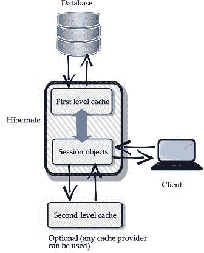

**图 7.5：** Hibernate 缓存架构

### 一级缓存

这是一个强制性缓存，所有请求都强制通过此缓存。`session`拥有对象的副本，该副本在事务期间进行更新，并在事务提交时通过缓存写回数据源。注意，如果`session`关闭，缓存中的所有对象将丢失，且更改将写入（创建/更新）数据库。

此缓存是默认启用的，不需要额外配置。

### 二级缓存

这是一个可选缓存，只有在查询一级缓存以定位对象后才会检查它。它可以根据类级别或集合级别进行配置，以实现跨`session`的工作。第三方缓存提供者通常通过`org.hibernate.cache.CacheProvider`接口实现提供的句柄来使用。

配置二级缓存需要完成两个步骤：首先决定并发策略，然后配置缓存提供者以及缓存过期和缓存属性。

并发策略：`transactional`、`read-write`、`non-strict read-write`和`read-only`是 Hibernate 使用的各种并发策略。当需要同步方式防止过时数据时，应用`transactional`策略。如果数据防止可以通过异步方式进行，则使用`read-write`策略。当不需要一致性保证时可以使用`non-strict read-write`，最后在仅可读的情况下可以使用`read-only`。

缓存提供者：EHCache、OSCache、SwarmCache、JBoss Cache

| 第三方缓存提供者及其描述 | 只读（Read-only） | 非严格读写（Non-strict read-write） | 读写（Read-write） | 事务性（Transactional） |
| --- | :---: | :---: | :---: | :---: |
| **EHCache：** 支持内存或磁盘缓存，并支持查询缓存 | ✓ | ✓ | ✓ | |
| **OSCache：** 支持单 JVM 内的内存或磁盘缓存，具有多种过期策略 | ✓ | ✓ | ✓ | |
| **SwarmCache：** 集群缓存，支持集群失效但不支持查询缓存 | ✓ | ✓ | | |
| **JBoss Cache：** 支持复制、失效、乐观和悲观锁，以及同步和异步通信。支持查询缓存。 | | | ✓ | |

**表 7.1：** Hibernate 缓存架构

前面的表格显示了各种缓存实现支持的所有策略。

### 查询级缓存

这是一个用于缓存查询结果的可选缓存，与二级缓存紧密集成。

## EclipseLink

EclipseLink 是一个广泛开源 Java 持久化解决方案，适用于关系型、NoSQL、XML、JSON 等各种数据库。它还允许所有这些数据库的混合和匹配，因此支持多语言持久化。这意味着在一个应用程序中会有多个持久化单元，实体可以由多个属性组成，部分属性来自一个数据源，其余属性来自其他数据源。EclipseLink 还很好支持创建数据库 Web 服务（REST 以及 SOAP），可以通过 Web 服务访问关系型数据库操作。

除了 JPA 之外，EclipseLink 还支持其他标准，如 Jakarta XML 绑定（JAXB）、Jakarta 连接器架构（JCA）、服务数据对象（SDO）等。

## 历史


EclipseLink 基于 `Oracle TopLink` 产品。最初，`TopLink` 是由一家位于加拿大渥太华的名为 `The Object` 的软件公司使用 `SmallTalk` 语言开发的。它在 1998 年被移植到 Java，并被称为 `TopLink for Java`。然而，在 2002 年，`TopLink` 被 Oracle 收购并作为其 Fusion Middleware 产品的一部分进行开发。它是 `OracleAS`、`WebLogic` 和 `OC4J` 服务器的一部分。2007 年，`TopLink` 代码被捐赠给了 Eclipse Foundation，EclipseLink 随之诞生。2008 年，`Sun Microsystems` 选用 EclipseLink 作为 `JPA 2.0` 的参考实现。EclipseLink 根据 Eclipse Distribution License 许可分发，该项目正获得 IBM 和 Oracle 等成员成员的积极支持。

## 特性

作为 `JPA` 的参考实现，EclipseLink 提供了对 `JPA 2.0` 的兼容性。它支持 `JPA 2.0` 中提到的几乎所有功能，以及额外的专有功能。请注意，如果在应用程序开发中使用专有功能，则会降低移植性。

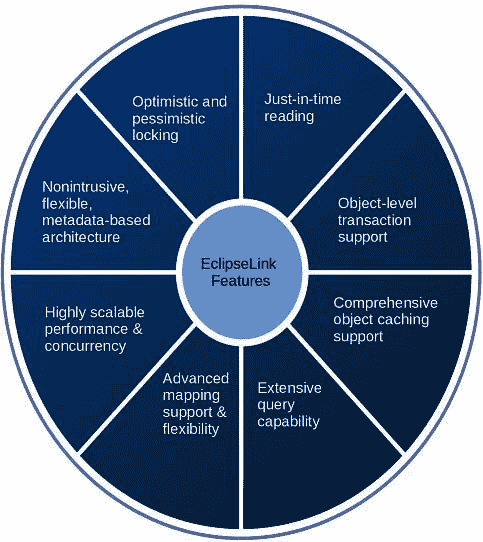

**图 7.6：** EclipseLink 主要特性

EclipseLink 的主要特性包括：

- **锁定（Locking）**：乐观锁和悲观锁。更多详情请参见 `Chapter 3, Operations – Identity, Sequencing and Locking` 中的 `Locking` 章节。
- **即时读取（Just in time reading）**：这等同于 `Hibernate` 中的延迟加载概念。
- **非侵入式、灵活的基于元数据的架构**：它允许使用无需扩展接口的 `POJOs`，使其具有非侵入性。使用 `JPA` 注解/XML 映射成为基于元数据。上述两个特性使其足够灵活，无论数据库模型还是对象模型都不需要考虑任何特定的规范。
- **对象级事务支持**：这有助于映射不同事务中在对象级进行的更改，并在提交合并期间将差异（如果有的话）合并到缓存中的对象中。这减少了缓存中的过时对象，使其与相应的数据库条目保持同步。
- **全面的对象缓存支持**：前一点提到了减少缓存刷新操作的各种缓存技术之一。它还允许根据实体配置缓存大小和类型。不同的缓存类型有 `WEAK`、`SOFT`、`SOFT_WEAK`、`HARD_WEAK` 和 `FULL`。
- **广泛的查询能力**：EclipseLink 中有很多类型的查询，将在后续章节中详细介绍。
- **高级映射支持和灵活性**：EclipseLink 支持将 Java 对象映射到关系型/XML/JSON/SDO。这种多样化的映射支持提供了使用同一层从多种数据源检索数据的灵活性。
- **高可扩展性的性能和并发性**：EclipseLink 提供了支持甚至服务器集群的缓存机制。为了支持这种缓存机制，需要进行一些配置。

除了上述特性外，EclipseLink 还支持专有功能，例如：

- 数据库更改事件的处理
- 复合持久化单元，用于将实体映射到多个数据库表中
- 支持多租户

## 架构

EclipseLink 可以被视为一个 Java 持久化的可扩展框架，因为它提供了对 `JPA`、`JAXB`、`JSON` 绑定、`SDO` 以及针对其他不同机制的多种自定义支持。该框架中的主要组件有：

- **EclipseLink–对象关系映射（ORM）**：它支持可以通过 XML 或自定义注解配置的 `JPA`。它还提供了健壮的缓存等功能，包括集群支持、使用高级数据库特定功能、广泛的性能调优和管理选项。

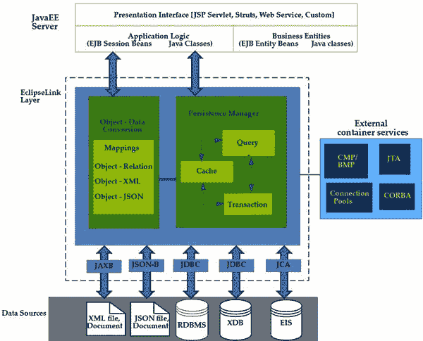

**图 7.7：** EclipseLink 架构

- **EclipseLink–对象 XML 映射（OXM）**：它通过 `Java API for XML Binding`（`JAXB`）支持序列化服务，并带有扩展提供映射和关键的性能优化。
- **EclipseLink–JavaScript 对象表示法（JSON）**：它提供了 `Java Specification Request`（`JSR`）367 的参考实现，该规范定义了 JSON 绑定规范。这是 `OXM` 模块的 JSON 等价物，并为 JSON 映射提供了所有功能。
- **EclipseLink–服务数据对象（SDO）**：它提供了 `JAVA API` 实现，将任何 Java 对象表示为 `SDO`，并使用任何 `SDO` 实现的所有功能。
- **EclipseLink–数据库 Web 服务/JPA-Rest 服务（DBWS/JPA-RS）**：它允许通过为开发者提供简单高效的 Web 服务开发能力，将底层 RDBMS 暴露为 Web 服务。
- **EclipseLink–企业信息系统（EIS）**：它允许使用 `Java Connecter Architecture`（`JCA`）API 将 Java `POJOs` 映射到非关系数据存储器。

## 配置

与 `Hibernate` 类似，EclipseLink 也提供了系列可以在 `persistence.xml` 文件中配置的功能和性能参数。

```xml
<persistence-unit name="default" transaction-type="RESOURCE_LOCAL">
<provider>org.eclipse.persistence.jpa.PersistenceProvider</provider>
<!-- 默认映射文件是 orm.xml-->
<mapping-file>META-INF/mappings.xml</mapping-file>
<jar-file>my-application.jar</jar-file>
<!-- 自动发现持久化类 -->
<exclude-unlisted-classes>false</exclude-unlisted-classes>
<properties>
<property name="eclipselink.jdbc.url" value="jdbc:oracle:thin:@localhost:1521"/>
<property name="eclipselink.jdbc.user" value="root"/>
<property name="eclipselink.jdbc.password" value="root"/>
<property name="eclipselink.jdbc.driver" value="oracle.jdbc.driver"/>
<property name="eclipselink.target-database" value="Oracle"/>
<property name="eclipselink.logging.level" value="FINE"/>
<property name="eclipselink.logging.thread" value="false"/>
<property name="eclipselink.logging.session" value="false"/>
</properties>
</persistence-unit>
```

**代码 7.10：** EclipseLink `persistence.xml` 配置（顶部）和通过属性文件的配置（下方）

除了 `persistence.xml` 文件外，还有一个映射文件提供实体映射详情。映射文件名在 `persistence.xml` 中使用 `mapping-file` 标签提供。默认情况下，将检查 `orm.xml` 的映射详情。然而，如果提供了此类配置，则会被考虑。映射类也可以通过 `jar-file` 标签通过 jar 文件提供。注意，它也可以作为映射文件的补充给出。在某些情况下，如果 jar 文件中有某些被标记为 `@Entity` 但不需要在此部署中考虑的类，这些类可以在 `exclude-unlisted-classes` 标签中注明。通常，在 `Java Enterprise Edition`（`JEE`）环境中，应用程序本身会发现本地类。然而，在 `Java Standard Edition`（`JSE`）环境中，EclipseLink 必须执行此功能，因此将此标签设置为 false 以启用发现过程。

下面的图（*代码 7.11*）描述了一个示例映射文件，它将类映射到数据库中的表。

```xml
<entity-mappings>
<description></description>
<entity class="Student">
<table name="STUDENT"/>
<attributes>
<id name="ID"><generated-value strategy="TABLE"/></id>
<basic name="name">
<column name="STUDENT_NAME" length="100"/>
</basic>
<basic name="standard"></basic>
<basic name="age"></basic>
</attributes>
</entity>
</entity-mappings>
```

**代码 7.11：** EclipseLink `orm.xml` 配置

从上一个示例可以看出，EclipseLink 使用与标准 JPA 相同的格式。它还支持基于注解的映射，因此，如果实体豆（entity beans）进行了相应的注解，则可以避免此映射文件。

## 查询

通常情况下，查询功能可以被视为执行了以下功能：

- 指定要执行的操作，以便被查询的源能够理解该操作。
- 以受控的方式执行此操作。
- 如果上述执行有结果，则查看/管理获取的结果。

请注意，当涉及缓存时，还应考虑查询对缓存的影响，以使查询功能完整。在本节中，将讨论 EclipseLink 提供的各种查询和缓存。

### 查询类型

本节将讨论 EclipseLink 中各种类型的查询。

1. **会话查询（Session queries）**

   这些查询是使用 `Session` 对象构建并执行的。它包含了根据查询所选的会话类型执行的最常见的数据库操作。不同的会话类型有——`UnitOfWork`、`Server`、`ClientSession` 和 `DatabaseSession`。`Server` 会话主要用于获取特定服务器上的客户端/数据库会话。因此，它不用于普通的数据库操作。然而，其余会话可以根据需求用于数据库操作。始终建议使用 `UnitOfWork`，因为它提供了管理事务、并发和引用完整性最高效的方法。

2. **数据库查询（Database queries）**

   这些查询是使用 `DatabaseQuery` 对象创建的。`Session` 对象的 `executeQuery` 方法消耗不同类型的数据库查询对象作为输入，并在对象或数据上执行查询。不同类型的数据库查询对象有——对象级读查询、数据级读查询、对象级修改查询、数据级修改查询和报告查询（Report query）。正如名称所示，对象级查询用于对象级的访问或修改。这可以是读取特定对象、所有对象或一组对象。同样，数据级查询提供了对结果集合的访问，这些结果可以是对象级（按行整列）、列级（单个列/子列集）或单元格级的。

3. **命名查询（Named queries）**

   命名查询是那些被反复使用的查询，因为它们只准备一次并被多次重用。这在某些会话中频繁使用的复杂查询时非常有用。如果查询对于整个项目是全局的，则应该在会话级别进行配置。在会话级别，可以将查询添加到 `Session` 对象中，稍后通过提供其名称来执行。如果查询仅在类内部使用，则应在描述符（descriptor）级别定义。在这种情况下，`DescriptorQueryManager` 对象提供了存储和检索命名查询的 API。

4. **调用查询（Call queries）**

   EclipseLink 提供了各种 `Call` 对象，封装了数据源上的操作或动作。不同类型基于结构化查询语言（`SQL`）、Java 持久化查询语言（`JPQL`）和可扩展标记语言（`XML`）。根据 `Call` 对象，可以直接通过 `Session` 对象创建查询，也可以间接使用 `DatabaseQuery` 上下文创建查询。

   在直接调用查询中，可以通过 SQL 调用访问关系型数据库的字段，或者通过 Java 企业版连接器架构（`JCA`）与企业信息系统（`EIS`）交互。

   SQL 调用查询进一步分类为 `SQLCall`、`StoredProcedureCall` 和 `StoredFunctionCall`。使用之前的 `Call` API，可以指定输入、输出和输入-输出参数，并为它们赋值。

   EIS 交互可以进一步分为 `IndexedInteraction`、`MappedInteraction`、`XMLInteraction`、`XQueryInteraction` 和 `QueryStringInteraction`。正如名称所示，索引交互可以使用索引记录进行 JCA 交互，而映射交互可用于映射记录。同样，基于 XML、XQuery 和查询字符串的 JCA 交互分别可以使用 XML 交互、XQuery 交互和查询字符串交互。

5. **重定向查询（Redirect queries）**

   重定向查询有助于实现查询框架不支持的复杂操作。实际的查询实现是一个静态方法，当查询被调用时，控制权将传递给该静态方法。重定向查询有助于：

   - 根据参数动态配置查询选项。
   - 根据参数动态定义选择标准。
   - 将对象或表达式作为参数传递。
   - 对查询结果进行后处理。
   - 执行多次查询或特殊操作。

6. **历史查询（Historical queries）**

   会话仅提供对象的最新版本。然而，在某些情况下，查询应该是感知时间，并且能够选择过去的版本。历史查询有助于实现这一点。在定义 EclipseLink 历史策略时，可以配置会话以维护对象的历史版本，并在这些查询中使用。可以使用 `Session` 方法 `acquireHistoricalSession` 配合指定时间点的 `AsOfClause`。

```java
AsOfClause astime = new AsOfClause (System.currentTimeMillis() – 10*24*60*60*1000)
Session historicalSession = session.acquireSessionAsOf(astime);
Student pastStudent = (Student) historicalSession.readObject(Student.class);
Address pastAddress = pastStudent.getAddress();
List pastCourses = pastStudent.getCourses();
historicalSession.release();
```

**代码 7.12：** EclipseLink 历史查询示例

上述代码用于获取 10 天前系统中的学生详细信息。然后，从过去的学生对象获取其地址和课程列表。

7. **接口和继承查询**

   EclipseLink 支持在接口上创建描述符以及其继承关系以帮助查询。根据接口的实现，使用了以下机制：

   - 当接口有一个实现者时，EclipseLink 接口查询返回类实例。
   - 当存在多个实现者时，查询返回所有实现类的实例。

   在继承层次结构中，利用描述符的配置来定义其工作方式：

   - 默认配置是读取子类，在这种情况下，查询返回类及其子类的实例。
   - 如果配置为不读取子类，则查询仅返回被查询类的实例。
   - 如果配置为包含外连接子类，则查询返回类及其子类的实例。
   - 如果上述任何条件都不适用，则该类应为叶类（leaf class），因此查询仅返回该类的实例。

## 描述符查询管理器（Descriptor query manager）

在 EclipseLink 中，描述符（descriptors）用于存储描述特定类实例如何通过数据源表示的信息。描述符拥有`关联映射`，可以将类实例变量与数据源关联起来，并包含用于存储和检索值的转换例程。因此，每个描述符都存在一个查询管理器的实例，可以通过 `DescriptorQueryManager` 对象找到它。它可以用于配置命名查询、创建默认查询实现，以及构建额外的连接表达式。

## 缓存架构

EclipseLink 像 Hibernate 一样，有两种类型的缓存：

- **共享持久化单元缓存（L2 缓存）**：维护从数据源获取和写入数据源的对象。
- **隔离的持久化上下文缓存（L1 缓存）**：维护参与事务的对象。

在内部，EclipseLink 在 EclipseLink session 上维护持久化单元缓存，在 EclipseLink 的工作单元（unit of work）上维护持久化上下文缓存。这些缓存与数据源共同工作，如图所示管理使用 EclipseLink 的应用程序中的对象：

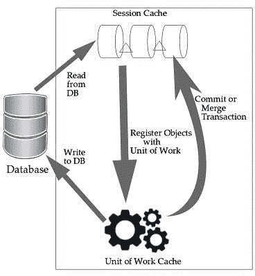

**图 7.8：** 带缓存的 EclipseLink Session

从上图中可以看出，session 缓存作为 L2 缓存，而 `Unit of Work Cache` 作为 L1 缓存。理想情况下，L1 缓存为每个事务创建，并在事务提交时写回数据库。然而，在这种情况下，L1 中的对象也会与 L2 中的副本（如果有的话）同步，以保持同步并减少 L2 缓存对数据库的访问。注意 Hibernate 和 EclipseLink 的区别在于，Hibernate 只实现了 L1 缓存，并支持第三方缓存机制作为 L2 缓存。但在 EclipseLink 中，它同时实现了 L1 和 L2 缓存。


### 持久化单元缓存

这是一个共享缓存，有助于为连接到特定持久化单元的所有客户端获取对象。每当从数据源读取对象时，`EclipseLink` 会在此缓存中创建该对象的副本，并让所有访问相同持久化单元的进程可以使用它。该缓存会在以下场景中更新：

- 当数据源上执行读取对象操作时。
- 当持久化上下文缓存成功提交事务时。

每个唯一的持久化单元名称都将有一个独立的持久化单元缓存。该缓存概念上存储在 `EntityManagerFactory` 中，因此每个持久化单元都将有一个唯一的 `EntityManagerFactory` 及其缓存。如果应用程序有两个具有相同持久化单元名称的工厂，则缓存将共享（本质上该持久化单元也是同一个实例）。持久化单元的属性用于创建持久化单元，因此会影响唯一性质量。所以，可能会出现这样的情况：应用程序实际上期望一个共享缓存，但得到的是单独缓存。为了配置此行为，可以使用 `eclipselink.session.name` 属性强制两个持久化单元解析到同一个实例并共享缓存。

### 持久化上下文缓存

这是一个隔离的缓存，有助于维护 `EntityManager` 内部操作的对象。它将对象与持久化单元缓存隔离开来，在整个事务期间维护它，并在事务成功提交到数据源后将其写回持久化单元缓存中。请注意，只有已提交的事务的更改会被合并到共享的持久化单元缓存中。刷新（`Flush`）或其他此类操作不会将更改合并到共享缓存。上下文缓存的生命周期取决于应用程序中使用的持久化上下文类型，并随之不同。

应用程序管理的持久化上下文基于应用程序并从 `EntityManagerFactory` 创建。此缓存将持续到 `EntityManager` 被清空或关闭，因此应该具有短生命周期的上下文缓存，或具有适当机制定期清除缓存，以避免缓存增长过大或与持久化单元缓存和/或数据源不同。理想情况下，处理此问题的最佳方法是为每个事务或请求创建一个 `EntityManager`。

在容器管理的持久化上下文中，容器将上下文注入到托管对象（例如 `SessionBean` 等）。在这里，上下文缓存仅在事务持续期间维护，在事务之后对象将变为离线状态（detached）。

### 缓存隔离级别

缓存隔离级别用于定义每个实体如何在持久化单元缓存以及持久化上下文缓存中进行缓存。三个隔离级别为：

- **隔离 (Isolated)**：这些实体仅存储在持久化单元缓存中。它们不在持久化上下文中缓存。
- **共享 (Shared)**：这些实体同时存储在持久化单元缓存和持久化上下文缓存中。然而，只读实体是共享的且仅缓存在持久化单元中。
- **保护 (Protected)**：共享共享，实体可以与共享实体以及隔离实体建立关系。因此，与共享的关系存储在持久化单元中，并复制到隔离缓存中，与隔离关系一起存储在持久化上下文缓存中。

**弱引用模式 (Weak reference mode)**：通常，持久化上下文是短命的，并在每个新请求/事务创建。这确保了持久化上下文不会导致任何内存和性能问题。这也确保了缓存中的对象不会过时或与数据源不同。

然而，在某些情况下，应用程序需要持久化上下文长期存在。在这种情况下，`EntityManager` 可能不会根据新请求/事务创建。`EclipseLink` 提供了弱引用模式，对持久化上下文中的对象创建弱引用，允许垃圾回收器在对象未被应用程序引用时将其处理。因此，它确保上下文不会导致任何内存或性能问题。可以使用以下选项：

- **HARD**：默认值，持久化上下文增长直到清空或关闭。
- **WEAK**：未更改且未引用的对象将被标记为垃圾回收。如果对象跟踪了更改，则它们不会参与垃圾回收。
- **FORCE_WEAK**：与上述 `WEAK` 相同。在这里，即使是跟踪了更改但未引用的对象也会参与垃圾回收。因此存在丢失更改的可能性。

弱引用模式配置通过持久化单元属性 `eclipselink.persistence-context.reference-mode` 完成。

### 缓存类型

在 `EclipseLink` 中，缓存类型和大小根据应用程序的内存需求进行配置。这基本上取决于数据的过期可能性、可用 JVM 内存、可用内存、垃圾回收成本以及数据库中的数据量。

| **缓存类型** | **缓存策略** | **保证身份** | **内存使用** |
| :--- | :--- | :--- | :--- |
| `FULL` | 对象仅通过显式删除移除。 | 是 | 非常高 |
| `WEAK` | 只要对象不再被应用程序引用就会被垃圾回收。仅缓存引用的对象。 | 是 | 低 |
| `SOFT` | 与弱引用类似，但仅在内存低时移除对象。根据内存可用性包含被引用的/未引用的对象。 | 是 | 高 |
| `SOFT_WEAK` / `HARD_WEAK` | 与 weak（弱引用）类似，但维护了一个使用软/硬引用的最常用对象子缓存。频繁使用的对象会被保留，当它们在应用程序中不再被引用时，它们会被垃圾回收。 | 是 | 中高 |
| `NONE` | 不缓存任何对象 | 否 | 不适用 |
| `CACHE` | 采用最少未使用使用算法维护固定数量的对象。 | 是 | 固定 |

**表 7.2: EclipseLink 缓存类型**

默认情况下，`EclipseLink` 使用大小为 100 个对象的 `SOFT_WEAK` 缓存。缓存的大小和类型可以分别通过 `@Cache` 注解的 `size` 和 `type` 属性进行配置。此外，查询结果缓存类型也可以通过属性 `eclipselink.query-results-cache.type` 进行配置。

## 多语言持久化 (Polyglot persistence)

通过使用 `EclipseLink` 的这一功能，单个应用程序可以访问多种数据库，而无需任何数据访问对象（DAO）层。同一个 JPA 层可以用于访问这些数据源，并为应用程序提供适当的信息。在当今，这是一个非常重要的功能，因为大多数应用程序都有更多种类的数据源，如关系型、NoSQL、XML/JSON 等。

对于从 NoSQL 数据库读取的实体，应使用 `@NoSql` 注解。以下示例基于 MongoDB 中的一个 `Student` 记录。它以 JSON（键-值对）形式存储数据。在这里，键名为 `firstName`、`lastName` 和 `std`，对应的值将被读入实体对象中的这些变量中。

```java
@Entity
@NoSql(dataFormat=DataFormatType.MAPPED)
public class Student implements Serializable{
    @Id
    @GeneratedValue
    @Field(name = "_id")
    private String id;
    @Basic
    private String firstName;
    @Basic
    private String lastName;
    @Basic
    private String std;
    ………
}
```

**代码 7.13: EclipseLink 用于 NoSQL 学生实体的用法**

该对象与关系型数据库实体看起来相似，因此 JPA 层可以完全向应用程序隐藏信息的来源。

## 结论

在本章中，重点是两种广泛使用的 JPA 供应商实现及其各种特性。然而，已经有了比较和对比这些实现的研究。通常情况下，在考虑各种供应商实现时，以下几点可能是有帮助的：

- **项目成熟度**：该产品进入市场多久了？文档完备程度如何？
- **作为子项目的示例**：项目中是否提供了某些子项目，可以作为开发新应用程序的起点？
- **社区支持**：JPA 供应商开发者社区是否提供任何支持？例如，开发者在应用程序开发的任何阶段遇到严重 bug 时是否可以获得帮助？
- **基准测试**：该实现是否已与其他实现进行对比测量？JPA 性能基准测试已完成并可在其网站上查看。
- **应用程序需求**：该实现是否具有任何适用于新应用程序的特性（JPA 或私有特性）？

简而言之，上述点将有助于判断在使用 JPA 开发应用程序时应该选择哪种供应商实现。

## 单选题

1. `Hibernate` 最初被开发是为了：
   - 作为 JPA 1.0 的实现
   - 解决使用实体豆（entity beans）的通用问题
   - 作为 Oracle `TopLink` 的竞争对手
   - 以上所有

2. `EclipseLink` 由 Oracle 在 GPL 协议下维护：
   - 错误
   - 正确
   - 部分正确
   - 以上均不是

3. `EclipseLink` 的默认缓存类型和大小是：
   - `weak`, 100 个对象
   - `full`, 1000 个对象
   - `soft weak`, 100 个对象
   - `hard weak`, 100 个对象

4. `Hibernate` 中的缓存基于：
   - 并发策略和查询策略
   - 查询策略和缓存提供者
   - 并发策略和缓存提供者
   - 以上都不是

## 答案

1. b
2. a
3. c
4. d

## 题

1. 说明 `Hibernate` 中的缓存架构以及第三方缓存提供的作用。
2. 用自己的语言描述 `EclipseLink` 架构。
3. 在上述 JPA 供应商实现中你喜欢哪一个？请举例说明。
4. 编写以下主题的简短笔记：
   - `Hibernate` 查询技术
   - `EclipseLink` 缓存架构
   - 任一供应商实现中的缓存类型
   - 多语言持久化

## 思考点

1. `TopLink/EclipseLink`：定义了查询提示 `eclipselink.refresh`，允许在查询上启用刷新。
2. `TopLink/EclipseLink`：通过 `@Cache` 注解（XML 配置中的 `<cache>` 元素）支持生存时间和一天中时间的失效。
3. `EclipseLink`：针对 Oracle DB 有许多特定于数据库的特性。它们是提示（hints）、层次查询、回溯查询（flashback queries）和存储函数。
4. 提示 (Hints)：这些是可以影响数据库 SQL 优化器工作方式的额外规范。在 `EclipseLink` 中，`DatabaseQuery` 对象的 `setHintString` 方法允许为 SQL 查询设置提示。
5. 层次查询 (Hierarchical queries)：Oracle DB 允许以层次方式读取数据库行。例如，在家庭数据库中，可以读取父级，然后是子级，接着是孙子级。这可以通过 `ReadAllQuery` 对象的 `setHierarchicalClause` 方法实现。
6. 回溯查询：从 Oracle9i 开始，`EclipseLink` 帮助提取过去的会话，用于了解对象随时间的变化。
7. 存储函数：这是 Oracle DB 的一种功能，通过执行所有步骤并返回值来增强存储过程功能。`EclipseLink` 通过 `StoredFunctionCall` 对象支持此功能。

# 参考文献

1. 关于 `Hibernate/JPA` 特性的文章：https://thorben-janssen.com/tutorials/
2. 关于 `Hibernate` 使用技巧：https://thorben-janssen.com/tips/
3. `Hibernate` 视频的 YouTube 频道：https://www.youtube.com/channel/UCYeDPBiFCZXIOgGYw
4. `Hibernate` 和 `EclipseLink` 技术在映射对象模型到 RDBMS 性能对比：https://epublications.regis.edu/cgi/viewcontent.cgi?article=1904&context=theses
5. JPA 性能基准——`Hibernate` & MySQL 对 `EclipseLink` & MySQL：https://www.jpab.org/Hibernate/MySQL/server/EclipseLink/MySQL/server.html
6. 理解 `EclipseLink2.4`：https://www.eclipse.org/eclipselink/documentation/3.0/concepts/toc.htm

本节旨在向读者介绍 JPA 的高级主题。这部分不是强制性的，但深入了解这些高级主题总是有益处的。

## 结构

- 事件 (Events)
- 视图 (Views)
- 存储过程 (Stored procedures)
- 结构化对象数据类型 (Structured object data types)
- XML 数据类型 (XML data types)
- 历史 (History)
- 过滤器 (Filters)
- 逻辑删除 (Logical deletes)
- 审计 (Auditing)
- 复制 (Replication)
- 分区 (Partitioning)
- NoSQL
- 多租户 (Multi-tenancy)

### 事件

任何系统都可以被视为一个有序的过程集合。在 JPA 语境中，事件可以被视为与这些任何一个过程关联执行的活动。例如，如果要执行操作 `A`，则事件可以是必须在 `A` 之前或之后执行的一项微小活动。这有助于扩展、调试、监控和自定义任何系统中的有序操作集。

JPA 事件可以通过注解或 XML 配置定义。持久化类可以根据需求拥有方法，并在这些方法上标注事件注解，该方法将针对该类的所有实例相应地执行。系统会考虑实体上的操作并据此定义 JPA 事件。

- `PostLoad`：在实体加载（或刷新）到持久化上下文后不久发生。
- `PrePersist`：在对实体调用 `persist` 操作之前发生。这甚至发生在对新实例进行合并（merge，类似于 `persist`）以及级联持久（cascade persist）的情况下。
- `PostPersist`：在数据库 `INSERT` 完成之后事务提交之前发生。这通常发生在 commit/flush 操作期间。注意，如果对象生成主键，则该主键仅在此方法中可用。它在 `PrePersist` 事件中是不可用的。
- `PreUpdate`：仅当数据发生变化且 `EntityManager` 将其识别为修改记录时才会发生。这发生在数据库 `UPDATE` 发生之前的 flush 或 commit 操作期间。
- `PostUpdate`：在数据库 `UPDATE` 发生后、事务提交之前，当实例在 flush 或 commit 操作期间被更新时发生。注意 `PreUpdate` 和 `PostUpdate` 事件不会在 merge 操作期间执行。
- `PreRemove`：在对实体执行 `remove` 操作之前发生。它会在级联删除（cascade remove）以及孤立删除（orphan removal）时被调用。
- `PostRemove`：在数据库 `DELETE` 发生后、事务提交之前的 flush 或 commit 操作期间发生。注意此事件不在 remove 操作期间执行。

需要考虑的一个重要点是，在同一个实体或同一个实体监听器中，同一个事件不能有两个监听器。

| `@Entity @Table(name="STUDENT") public class Student { @PrePersist void onPrePersistEvent() {log.info (“Student record getting persisted”);}@PreUpdate void onPreUpdateEvent() {log.info (“Student record getting updated”);}…… }` | `<entity name="Student" class="com.example.Student" access="FIELD"><pre-persist method-name="onPrePersistEvent" /><pre-update method-name="onPreUpdateEvent" /></entity>` |
| :--- | :--- |

**Code A1.1**: 在实体内部使用注解定义事件（左）和使用 XML 定义（右）

### 实体监听器

可以使用 `@EntityListeners` 注解或 `<entity-listeners>` XML 元素外部配置事件。这是一个类级别的注解，位于实体定义之外。注意，即使在监听器类中也不强制要求实现接口，只需要方法注解。

| `@Entity @EntityListeners(value=StudentListener.class) @Table(name="STUDENT") public class Student {………}` | `<entity name="Student" class="com.example.Student" access="FIELD"><entity-listeners><entity-listener class="com.example.StudentListener"><pre-persist method-name="onPrePersistEvent" /><pre-update method-name="onPreUpdateEvent" /></entity-listener></entity-listeners></entity>` |
| :--- | :--- |

| `public class StudentListener { @PrePersist void onPrePersistEvent() {log.info(“Student record getting persisted”);}@PreUpdate void onPreUpdateEvent() {log.info(“Student record getting updated”);}………}` |
| :--- |

**Code A1.2**: 使用注解通过实体监听器定义事件（左）和使用 XML 定义（右）

### 默认实体监听器


这些是在持久化单元级别配置的实体监听器，它们会考虑所有的实体类。这只能通过 XML 完成。如果特定实体想要禁用此功能，可以使用 `@ExcludeDefaultListener` 或 `<exclude-default-listeners>`。

```xml
<?xml version="1.0" encoding="UTF-8"?>
<entity-mappings xmlns:xsi="http://www.w3.org/2001/XMLSchema-instance" xsi:schemaLocation="http://java.sun.com/xml/ns/persistence/orm om_2_0.xsd">
<persistence-unit-metadata>
<persistence-unit-defaults>
<entity-listeners>
<entity-listener class="org.acme.ACMEEventListener">
<pre-persist method-name="prePersist"/>
<pre-update method-name="preUpdate"/>
</entity-listener>
</persistence-unit-defaults>
</persistence-unit-metadata>
</entity-mappings>
```

**Code A1.3**：

### 事件继承

与任何类属性或方法一样，实体监听器也会从父类继承。如果子类不希望具有这种行为，则应该使用 `@ExcludeSuperListeners`（`<exclude-superclass-listeners>`）。

现在很清楚，事件可以定义在实体内部的方法级别、类级别（使用实体监听器）位于实体外部，以及从父类继承。因此，当事件在多个层次级中定义时，应该有一个执行顺序：

- 外部监听器总是先执行，然后才执行实体级别的回调。
- 默认监听器首先执行，然后根据继承层次级执行来自父类的监听器。如果层次级的同一层级中有多个监听器，则它们根据定义的顺序执行。
- 在执行了来自持久化单元以及父类的所有实体监听器后，实际类定义的实体监听器会被调用。
- 在执行完所有外部监听器后，从继承层次级顶部的实体类开始执行内部回调。

### 视图

数据库视图是查询的结果，可以像表一样进行搜索。因此，视图被视为虚拟表，它隐藏了表的复杂性，并根据需要显示数据的子集。由于视图本身被视为表，在 JPA 中，可以使用 `@Table` 注解对其映射。

大多数情况下，视图是只读的，只有当底层表数据更新时（即执行数据库触发器来更新视图数据时），视图才会被更新。然而，现代 RDBMS 支持可插入和可更新的视图，因此使用 JPA 视图在视图中插入/更新记录并不是问题。

### 存储过程

存储过程是存储在数据库中的一组指令，通常使用特定于数据库的语言（如 SQL）编写。例如，Oracle 使用 PL/SQL 编写存储过程。

在 JPA 中，可以使用原生查询（native queries）执行任何 SQL。该 SQL 可以不返回任何内容，也可以返回数据库结果集。然而，存储过程的执行取决于数据库。某些数据库（如 DB2、Sybase 和 SQL Server）为存储过程返回结果集，但 Oracle 只返回游标类型作为输出值。

```java
EntityManager em = getEntityManager();
Query query = em.createNativeQuery("BEGIN VALIDATE_EMP(P_EMP_ID=>?); END;");
query.setParameter(1, empId);
query.executeUpdate();
```

**代码 A1.4**：JPA 中的 Oracle 存储过程示例

JPA 不支持使用 OUTPUT 或 INPUT 参数的存储过程。然而，某些 JPA 实现者对存储过程提供了扩展支持，例如对游标输出参数的支持。

# 结构化对象关系数据类型

曾有一种趋势向关系型数据库引入面向对象的概念，并将这些混合数据库命名为对象关系数据库。这种趋势进一步扩展到了 SQL 以及 JDBC API。然而，由于其复杂性，这一概念并没有得到广泛接受，标准的关系型数据仍然优于对象关系数据。一些常见的对象关系数据库特性包括：

- 对象类型（结构）
- 数组和数组类型
- 嵌套表
- 继承
- 对象标识符（OIDs）
- 引用

支持上述数据类型的数据库有 Oracle、DB2、PostgreSQL 等。

理想情况下，JPA 支持对象关系数据类型，但某些 JPA 实现者可能提供有限的支持。EclipseLink 通过 `@Struct`、`@Structure`、`@StructConverter`、`@Array` 注解或使用 `ObjectRelationalDataTypeDescriptor` 类及其映射类来支持对象关系数据类型。

### XML 数据类型

随着 XML 数据库的引入，许多关系型数据库通过感知 XML 数据增强了其支持。这的主要优势是允许使用 XPath 或 XQuery 语法进行查询。一些支持 XML 的数据库包括 Oracle（XDB）、DB2、PostgreSQL 等。

JPA 未强制要求对 XML 数据提供支持，尽管可以将 XML 作为字符串存储在数据库中（映射为 Basic）。某些 JPA 实现者（如 EclipseLink）提供了扩展的 XML 数据支持，如查询扩展，或允许映射 XML DOM。通常，可以使用 JAXB 规范将 XML 数据映射到对象。

### 过滤器

在某些情况下，如果从所有表的查询结果中移除某些内容将变得有用。这通常发生在一个表被多个应用程序、组织或租户共享时。例如，一个学生数据库可以包含所有当前校生以及校友，可以通过表中的一个布尔变量来区分它们。因此，当基于此学生数据库开发应用程序时，报告检查等操作应仅针对当前校生启用。可能还有其他针对校友的操作。

实现此操作的一种方法是为每种类型的数据创建单独的视图。然而，数据类型仅在运行时可用，这迫使为所有类型的数据创建单独的视图，而这并非总是可行的。

另一种方法为应用程序执行的所有查询添加一个准则部分（criteria part）。可以使用运行时可用的数据类型轻松地将该准则部分附加到实际查询中。

某些 JPA 实现者提供了过滤支持。TopLink / EclipseLink 支持通过注解 `@AdditionalCriteria` 对数据过滤。这允许在尝试查询该实体时，向所有查询附加一个自定义的额外任意 JPQL 片段。

### 历史

数据库中发生的过去事件非常重要，因为它们可以用于跟踪和审计。它还可以帮助我们获得关于应用程序及其信息的有用见解。

某些数据库具有审计支持，并允许对所做的更改进行一定程度的跟踪。例如，Oracle 的闪回（flashback）功能允许存储和跟踪所做的更改，并扩展了对数据历史版本的查询支持。

通过定义开始和结束时间戳列，可以在一定范围内实现过去事件的存储。当创建行时，更新开始时间戳。当行被更新时，会创建一个带有当前时间的新行，并将旧行的结束时间戳更新为当前时间，以显示该特定行数据有效的时间范围。注意，所有当前行的结束时间戳均为空。可以像查询其他表一样查询上表以获取历史数据。

某些数据库特别支持历史表，例如 Oracle 的闪回功能。因此，某些 JPA 实现者也支持历史查询。在 EclipseLink 中，可以通过使用查询提示 `eclipselink.history.as-of` 或表达式查询来实现。

### 逻辑删除

逻辑删除或软删除是一种识别数据为已删除但不从数据存储中将其删除的机制。此问题的常用技术是设置一个特定列来指示该行是否被删除。不会发生行的物理删除，此列的值指定了数据的逻辑删除。

```java
@Entity
@Table(name="Student")
@SQLDelete(sql="update Student set isActive=0 where id=?")
@Where(clause="isActive = 1")
public class Student {
    @Id
    @GeneratedValue(strategy=GenerationType.IDENTITY)
    private Long id;
    private String name;
    private Integer age;
    private Boolean isActive=Boolean.FALSE;
    ………
}
```

**代码 A1.5**：使用 Hibernate JPA 实现逻辑删除的示例 Java 代码

在上面的代码中，提供了 `@SQLDelete` 注解来指定执行的操作而不是执行删除操作。`@Where` 注解用于在选择特定实体的数据时提供 where 条件。因此，它确保了应用程序获取的是活跃记录，选择查询中不包含软删除的记录。这是上面过滤器部分中提到的一种过滤机制。

### 审计

审计是对实体及其操作的跟踪并进行记录以供以后参考，简而言之，就是实体版本控制。默认情况下，JPA 不提供此类审计的 API。然而，可以通过使用 JPA 回调事件来实现，在实体发生更改时提供一个处理器。例如，可以使用 `@PreUpdate`、`@PreRemove`、`@PrePersist` 等事件来跟踪和记录更改。如果多个实体类需要使用相同的机制进行跟踪，可以进一步实现审计实体监听器。

大多数 JPA 提供者都有其自己的提供审计功能的方法。例如，Hibernate 为此目的提供了一个构件（名为 `hibernate-envers` 的 jar 包）。这提供了在实体级别或列级别上使用 `@Audited` 注解的功能。如果一个被审计的实体属于一个不需要审计的关系中，则可以使用 `@NotAudited` 注解，这样关系层的变化就不会被审计，它将严格地仅对实体本身进行审计。

在 Spring data JPA 的情况下，必须首先在配置类上使用 `@EnableJpaAuditing` 启用审计。然后，每个需要审计的实体都必须用 `@EntityListener` 注解标记，并将 `AuditingEntityListener` 类作为其参数。

## 复制（Replication）

数据库复制是将数据从一个数据库复制到另一个数据库的过程，通常位于不同的物理位置，以提高性能和容错能力。数据复制通常导致分布式数据库产生，这进一步有助于数据库的负载均衡和扩展。因此，在这些情况下，更改需要写入多个数据库，这应该由应用层、JPA 层或数据库层本身来处理。

尽管大多数企业级数据库都支持某种形式的自动备份或复制，但 JPA 并没有对复制提供任何特定的支持。然而，少数 JPA 提供者确实支持特定于复制的功能。EclipseLink 通过 `@ReplicationPartitioning` 和 `@RoundRobinPartitioning` 注解支持复制和负载均衡。

在不支持复制的数据库情况下，可以通过提供多个持久单元（persistence units）并管理到两个数据库的对象持久化来管理。

## 分区（Partitioning）

当并非所有数据集都复制到不同的数据库时，而是将特定数据集移动到不同的数据库时，就会执行数据分区。这通常用于方便地跨地扩展。分区将数据垂直或水平地划分到每个数据库节点上。在垂直拆分中，某些表位于一个数据库，而另一些表位于另一个数据库。这使得实现变得更容易，但应该考虑实体的分区方式，确保没有两个实体在两个不同的分区之间存在关系。这可以通过多个不同的持久单元来实现，它们可以被用作独立的垂直分区。

在水平分区中，相同的表集在整个数据库节点中保持不变。只有数据是特定于每个节点的。例如，基于位置的应用程序版本不需要存储另一个位置的数据。它将数据移动到不同的数据库节点。注意，所有表都是相同的，因为两个地理区域应提供相同的功能。水平分区基于数据值，因此可以基于范围、值、哈希，甚至是轮询。

某些 JPA 提供者同时支持垂直和水平分区。EclipseLink 使用以下注解支持水平和垂直数据分区：`@Partitioning`、`@HashPartitioning`、`@RangePartitioning`、`@ValuePartitioning`、`@PinnedPartitioning` 和 `@Partitioned`。

## 非关系数据

默认情况下，JPA 仅描述关系型数据库及其数据的定义。然而，由于如今 NoSQL、EIS、XML 以及各种其他技术非关系数据库被广泛使用，为了在数据持久化层保持相关性，JPA 提供者已开始通过非标准元数据支持这些技术。事实上，在更低一层，JDBC 提供者也在适配 SQL 以及 JDBC API 以支持非关系数据库，这使得 JPA 提供者的工作变得更容易。

如何使用 EclipseLink 用于 NoSQL 数据库的示例可见 *第 7 章，Hibernate 和 EclipseLink* 中的 *异构持久（Polyglot Persistence）* 节。EclipseLink 还提供了对 EIS、XML 以及各种其他非关系数据的支持（更多细节请参考 *第 7 章*）。

在应用程序中结合使用关系型和非关系型数据库时，JPA 的优势在于它允许应用程序以相同的方式（即作为 Java 对象）同时考虑关系数据和非关系数据，从而减少数据持久化和检索的复杂性。然而，在使用 JPA 处理非关系数据时，在不同提供者之间切换可能会很麻烦，因为它们的支持是非标准的。

支持非关系数据库的问题在于，这些数据库没有根据数据类型进行标准化，不同的数据库支持不同的数据格式。例如，考虑各种 NoSQL 数据库。根据存储的数据格式，它们大致分为四类：键值存储、基于文档的存储、列存储和基于图存储。因此，这显示了每个非关系数据库是多么生动和不同。

## 多租户（Multi-tenancy）

多租户是一种软件架构方式，单个应用程序实例为多个独立的客户端或租户提供服务。租户被赋予自定义软件某些部分的功能，例如 UI 颜色、要创建的仪表板（如果有）、时区、语言等本地化设置。然而，租户不能修改应用程序代码，代码对所有客户端保持一致。这是行业中的一个重要趋势，因为它通过更低的安装成本使得服务更加负担得起。

- **独立数据库**：如名所示，每个租户都有自己的数据库。
- **独立模式**：租户使用同一个数据库，但每个租户都有自己的表集或模式（schema）。
- **共享模式**：租户共享一个数据库以及一个公共模式，并通过租户列来确定。

对多租户的支持基于 JPA 提供者的实现。Hibernate 在创建会话期间使用租户 ID，并如下创建会话：

```java
Session session = sessionFactory.withOptions()
  .tenantIdentifier(tenantId)
  .openSession();
```

除了上述传递租户 ID 之外，属性 `hibernate.multiTenancy` 应该被设置为以下值之一——NONE（无多租户）、SCHEMA（独立模式）或 DATABASE（独立数据库）。根据配置的多租户样式，应该配置一个 `MultiTenantConnectionProvider`，它根据租户 ID 返回会话。这既可以由应用程序开发人员实现，也可以默认为基于某些假设提供的标准实现。

## 参考文献（References）

1. Hibernate 中的多租户支持 - [`docs.jboss.org/hibernate/orm/5.2/userguide/html_single/Hibernate_User_Guide.html#multitenacy`](https://docs.jboss.org/hibernate/orm/5.2/userguide/html_single/Hibernate_User_Guide.html#multitenacy)

# 第 2 部分

## JPA 应用程序与问题

### 引言

本节提供了一个使用 JPA 提供者实现开发的示例应用程序，并解释了它如何帮助在数据源以及提供者实现之间切换。本节还提供了几个有趣的问题，可以帮助读者从实现的角度深入理解该主题。

### 示例 1：简单的 Hibernate 应用程序

这是一个使用 Hibernate 作为 JPA 提供者并连接 MySQL 数据库的示例 Java 应用程序。使用 Maven 进行依赖管理。假设用户具备 Java、数据库查询和 Maven 的基础知识。

最初，数据库中没有 `Student` 表，该表是在运行应用程序时通过 Hibernate 的属性 `hibernate.hbm2ddl.auto` 创建的。

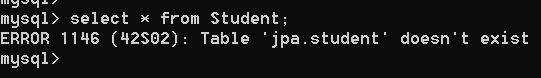

**图 A2.1**：MySQL 提示符，显示名为 JPA 的数据库中不存在该表

代码首先使用 Maven 编译以生成可执行的 jar 包。然后执行该 jar 包，最终创建表、插入数据并从表中查询几个值。

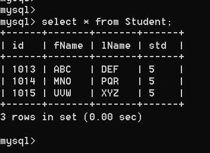

**图 A2.2**：MySQL 提示符，显示执行后表中已填充数据。

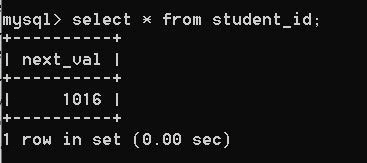

**图 A2.3**：MySQL 提示符，显示存储下一个序列 ID 的表。

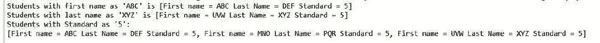

**图 A2.4**：根据执行的查询输出值。

# 示例面试问题

几乎所有的文本类问题都已在文中涵盖。编码问题提供了示例参考。

1. 描述 JPA 孤立删除。（参考第 4 章）
2. 解释对象的持久化生命周期。（参考第 6 章）
3. 标识符生成的类型有哪些？（参考第 3 章）
4. 什么是实体（entity）？（参考第 2 章）
5. 实体有哪些属性？（参考第 2 章）
6. Entity Manager 在 JPA 中的作用是什么？（参考第 6 章）
7. 实体类有哪些约束？（参考第 2 章）
8. 如何在 JPA 中最佳地处理 `@OneToMany` 关系？¹
9. 创建 Spring Boot JPA 应用并将 JPA 提供者更改为 EclipseLink。²
10. 创建一个可以使用多个数据源的 JPA 应用。³、⁴
11. 创建一个使用 NoSQL 数据库的 JPA 应用。⁵

# 参考文献


1. 使用 JPA 处理一对多关系的最佳方法 - [`vladmihalcea.com/the-best-way-to-map-a-onetomany-association-with-jpa-and-hibernate/`](https://vladmihalcea.com/the-best-way-to-map-a-onetomany-association-with-jpa-and-hibernate/)

2. Spring 使用 EclipseLink 指南：[`www.baeldung.com/spring-eclipselink`](https://www.baeldung.com/spring-eclipselink)

3. Spring JPA 多数据库 - [`www.baeldung.com/spring-data-jpa-multiple-databases`](https://www.baeldung.com/spring-data-jpa-multiple-databases)

4. 在 Hibernate 中连接多个数据库 - [`stackoverflow.com/questions/1921865/how-to-connect-to-multiple-databases-in-hibernate`](https://stackoverflow.com/questions/1921865/how-to-connect-to-multiple-databases-in-hibernate)

5. REST 应用中的 Spring Boot 和 MongoDB - [`www.dineshonjava.com/spring-boot-and-mongodb-in-rest-application/`](https://www.dineshonjava.com/spring-boot-and-mongodb-in-rest-application/)

6. 经验丰富的人士 JPA 面试问答 - [`codingcompiler.com/jpa-interview-questions-answers/`](https://codingcompiler.com/jpa-interview-questions-answers/)

# 索引

## 符号

`@EmbeddedId` 对比 `@IdClass` 57, 58

## A

- 访问模式（access modes）27
- 字段访问模式（field access mode）27, 28
- 属性访问模式（property access mode）28-30
- 高级继承策略（advanced inheritance strategies）70
- 映射超类（mapped superclass）72
- 每类一个表（table per class）71, 72
- 高级锁（advanced locking）77
- 级联锁（cascaded locking）77, 78
- 字段锁（field locking）78
- 无锁（no locking）79
- 读写锁（read and write locking）79
- 时间戳锁（timestamp locking）77
- 高级操作（advanced operations）
  - 清除（clear）156
  - 关闭（close）156
  - 刷新（flush）155, 156
  - 委托（getDelegate）157, 158
  - 引用（getReference）156, 157
  - 刷新（refresh）154, 155
- 高级排序（advanced sequencing）63
- 并发与死锁（concurrency and deadlocks）63
- 自定义（customizing）64
- 保证顺序的 ID（sequential ids, guaranteeing）63, 64
- ID 耗尽（sequential ids, running out）64
- 备用键（alternate key）23

## 关联（Association）of Machinery（ACM）

- 属性（attributes）7, 23, 30
- 基础属性映射（basic attribute mapping）30, 31
- BLOBs 35
- CLOBs 35
- 列定义（column definition）36, 37
- 转换（conversion）37, 38
- 自定义类型（custom types）38, 39
- 日期和时间属性（date and time attributes）31, 32
- 枚举（enumerations）34
- 可插入的（insertable）37
- 懒加载（lazy fetching）36
- LOBs 35
- 只读字段（read only fields）37
- 架构生成（schema generation）36, 37
- 序列化（serialization）35
- 可更新的（updatable）37
- 审计（auditing）221

## B

- Backus-Naur 式（BNF）122, 138
- 批量加载（batch fetching）104, 105
- Bean 持久化（BMP）6
- Bean 的事务（BMT）158
- 二进制大对象（BLOB）35

## C

- 缓存失效（cache invalidation）171, 172
- 缓存隔离级别（cache isolation levels）
  - 隔离的（isolated）204
  - 受保护的（protected）205
  - 共享的（shared）205
- 缓存类型（cache types）168, 169
- 缓存（caching）
  - 缓存事务隔离（cache transaction isolation）173
  - 缓存类型（cache types）168
  - 聚类缓存（clustered caching）172
  - 数据缓存（data cache）167
  - 级别（levels）165, 166
  - 对象缓存（object cache）166
  - 查询缓存（query cache）168
  - 过旧数据（stale data）169
- 候选键（candidate key）24
- 级联锁（cascaded locking）77, 78
- 级联（cascading）105, 106
  - ALL 107
  - MERGE 106
  - PERSIST 106
  - REFRESH 107
  - REMOVE 106
- 字符大对象（CLOB）35
- 清除（clear）156
- 关闭（close）156
- 聚类缓存（clustered caching）172
- 缓存协调（cache coordination）172
- 分布式缓存（distributed caching）172, 173
- 集合（collections）109, 110
- 常见问题（common problems）112-115
- 排序（ordering）111
- 列结果（ColumnResult）136, 137
- 常见查询示例（common query samples）128
- 连接（join）129
- 连接加载（join fetch）130-132
- 更多查询（more queries）133, 134
- 基于关系的查询（query based on relation）132, 133
- 模拟转换（simulate casting）133
- 子查询（sub-select）130
- 复合键（composite key）24
- 复合主键（composite primary key）65
- 容器托管事务（CMT）158
- 创建、读取、更新、删除（CRUD）操作 184

## D

- 数据库查询语言 122
- 数据库复制 221, 222
- 数据库 6
- NoSQL 数据库 6
- 对象数据库 6
- 关系型数据库 7
- XML 数据库 6
- 数据库 Web 服务/JPA-Rest 服务（DBWS/JPA-RS）197
- 数据缓存 167
- 缓存关系 167
- 数据操作语言（DML）查询 170
- 数据分区 222
- 水平分区 222
- 垂直分区 222
- 数据持久化，Java 5
- 企业 Java Bean（EJB）6
- 文件输入输出（IO）5
- Java 连接器架构（JCA）6
- Java 数据库连接（JDBC）5
- Java 数据对象（JDO）6
- 序列化 5
- 服务数据对象（SDO）6
- 日期和时间属性 31, 32
- 毫秒 32, 33
- 时区 33, 34
- DELETE 查询 134
- 动态查询 127
- 参数 127, 128

## E

- EclipseLink 194
- 配置文件 197-199
- 特性 194-196
- 历史 194
- 多语言持久化 206, 207
- 查询 199
- EclipseLink 架构 196
- 数据库 Web 服务/JPA-Rest 服务 197
- 企业信息系统（EIS）197
- JavaScript 对象表示法（JSON）197
- 对象-关系映射（ORM）196
- 对象-XML 映射（OXM）197
- 服务数据对象（SDO）197
- EclipseLink 缓存架构 202
- 缓存隔离级别 204
- 缓存类型 205, 206
- 隔离持久化上下文缓存 202, 203
- 持久化上下文缓存 204
- 持久化单元缓存 203, 204
- 共享持久化单元缓存 202
- 元素集合 94-96
- EM API 146, 147
- `merge` 操作 151, 152
- `persist` 操作 147, 148
- `remove` 操作 153, 154
- 可嵌入对象 39-41
- 集合 46
- `EmbeddedId` 42-44
- 继承 45
- 嵌套 44, 45
- 查询 47
-  45, 46
- 共享 41, 42
- 嵌入关系 94
- 企业信息系统（EIS）6, 200
- 企业 Java Bean（EJB）6
- 实体类 25
- 访问模式 27
- 属性 25, 27
- Entity Java Bean 162
- 实体监听器 215, 216
- 事件继承 217
- 实体管理器（EM）145
- 实体结果 136
- 枚举 34
- 可扩展标记语言（XML）200

## F

- 字段访问模式 27, 28
- 字段锁定 78, 79
- 类型 78
- 文件输入输出（IO）5
- 过滤器 219
- `flush` 模式 AUTO 135, COMMIT 135
- `flush` 操作 155
- 用 155, 156
- 外键 24

## G

- `getDelegate` 操作 157, 158
- `getReference` 操作 156, 157

## H

- 异构关系 105
- Hibernate 181
- 架构 184
- 自动生成 183
- 缓存 183
- 数据库独立 183
- 易于学习 183
- 特性 182
- Hibernate 查询语言（HQL）183
- 高效率 183
- 历史 182
- J2SE/J2EE 支持 183
- 懒加载 184
- 轻量级 183
- 对象-关系映射 183
- 开源 183
- 查询 187, 188
- 可扩展性 183
- 配置 185
- 层 184
- DB 层 184
- 第一级缓存 192
- 第二级缓存 194
- Hibernate Criteria API 199
- Hibernate OGM 181
- Hibernate 查询语言（HQL）188

## I

- 信息检索 122
- 继承 66
- 高级继承策略 70, 71
- 联合继承 68
- 多表继承 71
- 单表继承 66

## J

- Jakarta 连接器架构（JCA）194
- Jakarta XML 绑定（JAXB）194
- XML 绑定 API 197
- Java 连接器架构（JCA）197
- Java 连接器架构（JCA）6
- Java 数据库连接（JDBC）5
- Java 数据对象（JDO）6, 12
- Java 企业版架构 200
- Java 企业版（JEE）3, 157
- 技术 4
- Java 持久化 5
- Java 持久化 API（JPA）6, 7, 10
- 优势 13, 14
- 示例 12, 220
- 基于 JPA 的 Java 应用中的层 11
- 规范 13
- Java 持久化查询语言（JPQL）122, 123, 200

### 实际场景

- 实际场景 70
- 连接抓取 102
- 预连接抓取 102, 103

## JPA

- JPA 2.0
- 迁移到 JPA 3.0 181
- 排序列 111, 112
- 孤儿对象移除 107

### JPA Criteria API

- 特性 123

### JPA 事件

- JPA 事件 214
- 实体监听器 215
- PostLoad 214
- PostPersist 214
- PostRemove 215
- PostUpdate 214
- PrePersist 214
- PreRemove 214
- PreUpdate 214

### JPA 实现者

- JPA 实现者 180, 181

### JPA 关系类型

- 嵌入关系 94
- 多对多关系 92-94
- 一一对多/多对一关系 90-92
- 一一关系 87-89

### JPQL & JTA

- JPQL BNF 138-141
- JTA 事务 162

## 键

- 键 23
- 备用键 23
- 候选键 24
- 复合键 24
- 复合键 24
- 外键 24
- 主键 23
- 超键 23
- 代理键 24

## 大对象与抓取

- 大对象（LOB）35
- 懒性加载 36, 103
- 脱离 103, 104
- 序列化 103, 104

## 锁

- 锁 73
- 高级锁 77
- 最佳实践 79
- 常见问题 75, 76
- 乐观锁 73, 74
- 悲观锁 74
- 逻辑删除 220, 221

## 映射

- 多对多关系 92-94
- 映射的超类 72
- 映射过程 24, 25
- 高级 47
- 多表 47, 48
- 多表连接 49
- 带外键的多表 48, 49
- 场景 47
- 混合大小写的表 49
- 带特殊字符的表 49
- 映射 96-100

## 查询数据

- JPA Criteria 查询机制 123
- JPQL 123
- 原生 SQL 查询 123, 124
- 合并操作 151
- 级联 152
- 场景 151, 152
- 临时变量 152, 153
- 多租户环境 223, 224
- 独立数据库 223
- 独立架构 223
- 共享架构 223

### 命名查询

- 命名参数 127
- 命名查询 125, 126
- 优势 125
- 查询提示 126, 127
- 原生 SQL 191
- 原生 SQL 查询 123, 124, 136
- 嵌套集合 100-102
- 嵌套连接 108
- 复杂连接 109
- 重复数据 109
- 海量连接 109
- 嵌套事务 164
- 规则 164
- 非关系数据 222, 223
- NoSQL 数据库 6

## 对象管理

- 对象缓存 166
- 对象标识性 166, 167
- 对象数据库 6
- 对象管理组织（OMG）12
- 对象-关系定义 7

## 对象-关系阻抗映射

- 对象-关系阻抗映射 8
- 对象-关系映射 7, 8
- 对象-关系模型 7
- 概念差异 8
- 数据组成差异 9
- 数据处理差异 9
- 数据类型差异 8, 9
- 完整性差异 9
- 解决方案 10
- 事务差异 9

### 对象关系映射（ORM）

- 对象关系映射（ORM）工具 181
- 对象到关系映射（ORM）10
- 优势 13, 14
- 产品 14-16
- 操作 56
- 标识性 56
- 乐观锁 73, 74
- 优化 134

- `executeUpdate` 128
- `getResultList` 128
- `getSingleResult` 128

## R

- `raw JDBC` 137
- `read and write locking` 79
- `record` 23
- `records` 7
- `refresh operation` 154, 155

### 关系型数据库管理系统（RDBMS）

- `relational databases` 7
- `relationships` 86
- `heterogenous relationships` 105
- `JPA relationship types` 87
- `variable relationships` 105
- `remote method invocation (RMI)` 75
- `remove operation` 153
- `cascading` 153, 154
- `reincarnation` 154
- `resource local transactions` 162
- `sample hibernate application` 225, 226


- `sample coding examples` 227
- `sample interview questions` 226, 227

## `second level cache, Hibernate`

- `cache providers` 193
- `concurrency strategies` 193
- `sequence objects` 61
- `sequencing` 58, 59
- `advanced sequencing` 63
- `identity sequencing` 62, 63
- `primary keys for` 64
- `sequence objects` 61, 62
- `table sequencing` 59, 60
- `serialization` 5, 35
- `Service Data Objects (SDO)` 6, 194
- `service-oriented architecture (SOA)` 6
- `single table inheritance` 66
- `problems` 67, 68
- `soft delete` 220
- `stale data` 169
- `cache invalidation` 171, 172
- `first level cache` 169
- `issues, solving` 170
- `refreshing` 170, 171
- `second level cache` 169, 170
- `stored procedure` 137, 218
- `disadvantages` 138
- `structured object-relational data types` 218
- `features` 218, 219
- `Structured Query Language (SQL)` 200
- `surrogate key` 23
- `surrogate key` 24

# T

- `table` 22, 23
- `table per inheritance` 71
- `disadvantage` 72
- `table sequencing` 59, 60
- `target entity` 108
- `nested joins` 108
- `timestamp locking` 77
- `time to live (TTL)` 171
- `transaction` 158
- `failures` 163, 164
- `joint transaction` 163
- `nested transactions` 164
- `transaction management` 159–161](#c06.xhtml_page161)
- `application managed context` 160
- `container-managed context` 159, 160
- `JTA transactions` 162
- `resource local transactions` 162
- `transaction rollback` 158
- `Truly-RDBMS (TRDBMS)` 21
- `tuple` 23
- `tuples` 7

# U

- `Update queries` 134

# V

- `variable relationships` 105
- `views` 217, 218

# W

- `weak reference mode configuration` 205

# X

## `XML-based JPA configuration`

- `scenarios` 125
- `XML databases` 6
- `XML data types` 219
