# Kotlin 精通：初学者指南 (计算机科学大师)


《精通 Kotlin》帮助读者快速理解核心概念，然后使用 Kotlin 编程语言进行实战项目。

在过去，Java 是创建 Android 应用的事实选择。然而，自从 Google 宣布 Kotlin 为构建 Android 应用程序的首选语言后，开发者们就再也没有回头。

Kotlin 是一种通用的、静态类型的、开源编程语言，运行在 Java 虚拟机上。它可以被视为 Java 的替代方案；然而，Kotlin 的语法并非盲目等同于 Java。当然，Kotlin 可以与 Java 协作，得益于其直观性，它还能提高整体生产力和效率，但它并不是 Java 的克隆。

Kotlin 与 Java 的不同之处在于它拥有智能接口，可以帮助确定变量和表达式，即使它们没有被定义。Kotlin 是修改和识别错误的绝佳替代方案，因为它具有熟悉且直观的语法和编程结构。它带有一个复杂的编译器，可以跟踪自动类型转换，使得验证过程更加高效。Kotlin 还有简单的信号，可以在无需设置任何参数的情况下进行解释。而且 Kotlin 很容易搭建：你只需要为 Android Studio 下载一个 Kotlin 组件。

Kotlin 开发者的需求很大。作为一名 Kotlin 开发者，你将能够追求多种职业路线，涵盖移动应用开发、游戏开发、游戏设计和软件开发等领域。许多知名品牌在其软件和项目中使用 Kotlin。自然地，学习 Kotlin 是一个好主意，而《精通 Kotlin》可能就是你的正确指南！

通过《精通 Kotlin》，学习 Kotlin 变成了一项轻松的任务，学习者可以使用他们的技能创建创新的 Kotlin 应用。

《精通计算机》系列由 Sufyan bin Uzair 编辑，他是一位在计算机领域拥有十年经验的作家和教育工作者。

> “精通计算机科学”系列书籍由 Zeba Academy 团队编写，由 Sufyan bin Uzay 领导。

Zeba Academy 是一家教育科技企业，主要为 STEM 领域的学习者开发课程内容，并为全球大学和机构提供教育咨询。欲了解更多，请访问 https://zeba.academy。

# 目录

## 第 2 章
- KOTLIN 扩展函数 86
- 使用扩展函数扩展库类 87
- KOTLIN 泛型 91

## 第 3 章 异常处理、空安全、正则表达式与范围 97
- Kotlin Finally 块 102
- Kotlin Throw 关键字 104
- KOTLIN 中嵌套的 TRY 块和多个 CATCH 块 104
  - 嵌套 Try 块 104

## 第 5 章 数组、字符串、函数以及与 Java 交互性 161
- 创建数组 162
  - 使用 arrayOf() 函数 162
  - 使用数组构造函数 163
- 数组访问与修改 164
- 数组遍历 165

## KOTLIN 中的字符串 167
- 模板与字符串元素 167
- 字符串字面量 169
- 转义字符串 169
- 多行字符串 170
- 转义字符 170
- 结构相等性 170
- 引用相等性 171

## KOTLIN 中的函数 171
- 标准库函数 172
- 用户定义函数 173
- 调用用户定义函数 174

## KOTLIN 中的默认参数与命名参数 176
- 默认参数 176
- 命名参数 177
- 传递参数函数 178

## KOTLIN 中的递归 179
- 递归函数 180
- 普通函数调用 181

## KOTLIN 中的尾递归 182
- 尾递归 182
- 尾递归的益处 183

## KOTLIN 中的 Lambda 表达式与匿名函数 184

## KOTLIN 中的高阶函数 187
- 高阶函数 187
- 函数作为参数 188

## KOTLIN 中的内联函数 (Inline Functions) 189
- 内联函数 189
- 化类型 (Reified Type) 190

## KOTLIN 中的中缀函数 (Infix Functions) 191
- 中缀函数 191
- Infix 运算符 192

## KOTLIN 中的生成器 (Generators) 193
- 生成器 194

## KOTLIN 中的延迟执行 195
- 延迟执行 195

## KOTLIN 中的惰性求 (Lazy Evaluation) 196
- 惰性求 196
- 属性 197

## KOTLIN 中的委托 (Delegation) 198
- 委托 198
- By 关键字 199
- 扩展函数 203
- 扩展接收者 204

## KOTLIN 中的扩展属性 205
- 扩展属性 205

## 第 6 章 Kotlin 中的集合
### KOTLIN 中的集合 213
- 集合类型 213
- 不变集合 214
- 可变集合 215

### KOTLIN 中的 ArrayList 216
- 重要方法 217

### KOTLIN 中的 listof() 220
- Kotlin 中的列表元素索引 221
- 第一个和最后一个元素 222
- 列表的迭代方法 222
- 列表排序 223
- Contains() 和 ContainsAll() 函数 224

### Kotlin 中的 setOf() 225
- 集合索引 226
- 集合基础 226
- Contains() 和 ContainsAll() 函数 227

### KOTLIN 中的 mutableSetOf() 方法 228
- 从集合中添加和删除元素 229
- 集合索引 229
- 设置第一个和最后一个元素 230
- 可变集合中的遍历 230
- Contains() 和 ContainsAll() 方法 230

### KOTLIN 中的 hashSetOf() 232
- 从 HashSet 中添加和删除元素 232
- HashSet 遍历 233
- HashSet 中的索引 233
- Contains() 和 ContainsAll() 函数 233

### Kotlin 中的 mapOf() 234
- Map 大小 235
- 空 Map 236
- 获取 Map 值 236
- Map 包含键或值 237
- 相同键的两个值 237

### KOTLIN 中的 HashMap 238
- HashMap 时间复杂度 241

### KOTLIN 中的注解 242
- 使用注解 242
- 声明注解 243
- 注解构造函数 243
- 注解属性 243
- 若干内置注解 243
  - @Target 243
  - @Retention 244
  - @Repeatable 245

### Java 交互性 – 使用 Java 调用 Kotlin 203
- Kotlin 属性 203
- 内置函数 204
- 静态函数 205
- 实例成员 206
- 检查异常 206

### Java 交互性 – 使用 Kotlin 调用 Java 207
- Java 中的 getter 和 setter 207
- 方法 208
- 静态成员 209
- Java 数组 210
- Java 可变参数 210
- Java 中不相同的类型 211

### 结论 212

### 用于 ANDROID 的 KOTLIN 261
- 如何为 Kotlin 开发安装和配置 Android Studio 262
- 如何使用 Kotlin 创建 Android Studio 项目 264
- Kotlin 编写的 HELLO WORLD 应用 265
- 如何设置 Android 虚拟设备 (AVD) 266
- Android 的 Kotlin 动画 267
  - 创建新项目 268
  - 修改 activity_main.xml 文件 268
  - bounce.xml 271
  - fade in.xml 272
  - fade_out.xml 272
  - rotate.xml 273
  - slide_down.xml 273
  - slide_up.xml 273
  - zoom_in.xml 274
  - zoom_out.xml 274
  - 创建 MainActivity.kt 文件 275
  - AndroidManifest.xml 文件 276

### KOTLIN Android 淡入/淡出 277
- 修改 activity_main.xml 文件 277
- 添加 anim 文件夹 278
- 修改 MainActivity.kt 文件 279
- AndroidManifest.xml 文件 280

### Android 菜单 281
- 我们如何在 XML 文件中定义菜单？ 281
- Android 中不同类型的菜单 282

### Android 的 Kotlin 进度提示 283
- 注意通知通道 283

### AND 项目文件夹的结构 286
- Manifests 文件夹 286
- Java 文件夹 287
- 资源 (res) 文件夹 288
- Gradle 脚本文件夹 289
- 结 289


# 前言

《实战精通计算机科学》（Mastering Computer Science）系列涵盖了广泛的主题，从编程语言到现代技术和框架。该系列特别关注初级内容，并以易于理解的方式呈现，包括：

- 清晰可见的文字，涵盖了按相关性排序的各种主题，
- 特别关注实践练习，包含大量的代码示例和程序，
- 引导式的编程方法，为绝对初学者提供分步教程，
- 强调技能的现实实用性，从而删减冗余且很少使用的概念，转而关注行业主流的编码范式，以及
- 丰富的参考文献和资源，帮助初级和中级开发者从书中获得最多。

《实战精通计算机科学》系列书籍从核心概念开始，然后迅速转向行业标准的编码实践，帮助学习者在尽可能短内获得高效且关键的技能。书籍假设读者没有先编程知识，因此即使是完全的新手编码员也能从本系列中受益。

《实战精通计算机科学》系列由 Sufyan bin Uzayr 编辑，他是一位在计算领域拥有十年经验的作家和教育者。


# 关于作者

Sufyan bin Uzay 是一位作家、编码员和企业家，在行业拥有十多年的经验。他过去编写过几本书，涉及了从历史到计算机/IT 的多种主题。

Sufyan 是 Parakozm 的董事，这是一家专门从事教育技术（EdTech）解决方案的跨国 IT 公司。他经营着 Zeba Academy，这是一个专注于 STEM 领域的在线学习和教学平台。

Sufyan 精通多种技术，如 JavaScript、Dart、WordPress、Drupal、Linux 和 Python。他拥有多个学位，包括管理学、IT、文学和政治科学。

Sufyan 是一个数字游民，在四个国家之间生活。他曾在全球的大学和教育机构生活并教学。Sufyan 对技术、政治、文学、历史和体育有浓厚兴趣，在空闲时间，他喜欢向青少年教授编码和英语。

访问 sufyanism.com 了解更多。


Kotlin 是一种运行在 Java 虚拟机（JVM）上的静态类型编程语言。它与 Java 完全互操作。

示例：

```kotlin
fun main() {
    println("Hello World")
}
```

以下是重要的里程碑：

- Kotlin v1.0 于 2016 年发布。
- Google 在 2017 年选择 Kotlin 作为首选语言。
- Kotlin v1.3 于 2018 年发布。
- 简洁：与其他语言相比，它显著减少了样板代码。例如，考虑数据类。
- 函数式和面向对象的能力：Kotlin 拥有许多技巧，包括高阶函数、Lambda 表达式、延迟求值、运算符重载等。

高阶函数接收函数作为参数、返回函数或两者兼有。

高阶函数插图：

```kotlin
fun myFun(company: String, product: String, fn: (String, String) -> String): Unit {
    val results = fn(company, product)
    println(results)
}
```

```kotlin
fun main(args: Array) {
    val fn: (String, String) -> String = { org, portal ->
        "$org develops $portal"
    }
    myFun("Kotlin", "JetBrain", fn)
}
```

- 静态类型：类型在编译时已知。
- 数据类：在 Kotlin 中，数据类会自动生成 `equals()`、`hashCode()`、`toString()`、`getter` 和 `setter` 函数。

```kotlin
data class Book(var titles: String, var authors: String)
```

- 安全：由于其系统支持可空性，因此避免了最令人讨厌的 NullException。默认情况下，Kotlin 中的每个变量都是非空的。

```kotlin
val s = "Hello Everyone" // 非空
```

当我们赋值空值时，会得到构建错误。

```kotlin
s = null // 编译错误
```

若要给字符串赋值空值，必须先将其声明为可空。

```kotlin
var nullableStr: String? = null // 编译成功
```

- 编译时间：它具有更快的编译时间和更出色的性能。

它对工具非常友好，具有卓越的工具支持。Kotlin 可以使用任何 Java IDE，包括 IntelliJ IDEA、Eclipse 和 Android Studio。Kotlin 程序也可以从命令行执行 Kotlin 程序。

Kotlin 编程语言具有以下优势：

- 易于学习：基础部分与 Java 几乎相同。如果我们以前用过 Java，我们将很快就能上手。
- Kotlin 是平台无关的：因为所有 Java IDE 都支持 Kotlin，我们可以在任何支持 JVM 的系统上开发并运行程序。
- 它比 Java 安全得多。
- 它允许通过利用复杂的框架，在不更新整个 Java 项目的情况下，在新的 Kotlin 项目中启用 Java 框架和库。

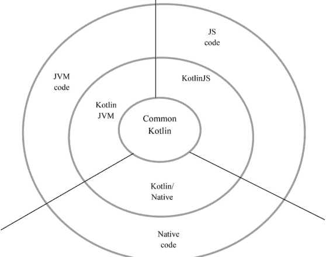

Kotlin 的多平台化。

- 语言、核心库和基础工具都包含在 Common Kotlin 中。在通用 Kotlin 中编写的代码运行在所有平台上。
- 我们可以使用 Kotlin Multiplatform 库在标准代码和特定平台的代码中复用多平台逻辑。
- 特定平台的 Kotlin 版本应用于互操作性。特定平台的 Kotlin 版本（Kotlin/JVM、Kotlin/JS 和 Kotlin/Native）提供了语言扩展以及特定平台的库和工具。
- 我们可以访问平台的原生代码（JVM、JS 和 Native），并通过这些平台使用所有原生特性。

良好的架构对于应用程序扩展功能以及匹配终端用户群预期至关重要。Kotlin 拥有独特且专属的架构，用于分配内存并开发者和终端用户产生高质量的结果。

Kotlin 的协程和类构建了核心，从而减少了样板代码，提高了性能并增强了效率。Kotlin 编译器在几种情况下会有不同的表现，特别是在标记不同类型的语言时。


Kotlin 中的架构。

架构设计清晰地展示了代码执行分为几个简单的阶段。

- 第一步是将“.kt”或 Kotlin 文件添加到编译器中。
- 第二阶段，Kotlin 编译器将代码转换为字节码。
- 第三阶段，字节码被加载到 JVM 中并由 JVM 执行。

当一对字节码文件在 JVM 上运行时，它们会启动相互通信，这在 Kotlin 中被称为针对 Java 互操作性的特性。

当 Kotlin 目标设定为 JavaScript 时，会发生 Kotlin 到 JavaScript 的转换。

当选择 JavaScript 作为目标时，库中的任何 Kotlin 代码部分随后将转换为 JavaScript。另一方面，Java 开发工具包（JDK）或使用的任何 java 库都不会包含在内。

在此过程中不考虑非 Kotlin 文件。在目标是 JavaScript 时，Kotlin 编译器会将 kt 文件转换为 ES5.1 以输出一致的 JavaScript 代码。Kotlin 编译器力求优化输出大小、与现有模块的互操作性、标准库功能以及可读的输出。

讨论表明，Kotlin 编译器可以产生更高效、胜任且独立的代码，从而产生高性能的软件产品。

关键特性：

- Kotlin 混合了面向对象和函数式编程的能力，而 Java 局限于面向对象编程。
- Kotlin 允许用户编写自己的扩展函数，但 Java 不行。
- Kotlin 不支持隐式转换；但在 Java 中支持。
- 在 Kotlin 中，没有空变量或对象；然而空变量和对象是 Java 编程语言的一部分。
- Kotlin 不支持静态成员，而 Java 支持。
- 与 Java 不同，Kotlin 不支持静态成员。
- Kotlin 不支持空变量，但空变量和对象是 Java 编程语言的一部分。
- Kotlin 不需要特定平台的 Kotlin 版本，但 Java 需要。
- 特定平台的 Kotlin 版本用于互操作性。
- 特定平台的 Kotlin 版本（Kotlin/JVM、Kotlin/JS 和 Kotlin/Native）提供语言扩展以及特定平台的库和工具。


# 精通 Kotlin：入门指南

## Kotlin 与 Java 的区别

- 我们可以访问平台的原生代码（JVM、JS 和 Native）并通过这些平台使用所有原生特性。
- Kotlin 不支持静态成员，但 Java 支持。
- Kotlin 允许用户编写自己的扩展函数，但 Java 不行。
- Kotlin 不支持隐式转换；但在 Java 中支持。
- 在 Kotlin 中，没有空变量或对象；然而空变量和对象是 Java 编程语言的一部分。
- Kotlin 不需要特定平台的 Kotlin 版本，但 Java 需要。

| Kotlin | Java |
| --- | --- |
| Kotlin 混合了面向对象和函数式编程的能力，而 Java 局限于面向对象编程。 | |
| Kotlin 允许用户编写自己的扩展函数，但 Java 不行。 | |
| Kotlin 不支持隐式转换；但在 Java 中支持。 | |
| 在 Kotlin 中，没有空变量或对象；然而空变量和对象是 Java 编程语言的一部分。 | |
| Kotlin 不支持静态成员，而 Java 支持。 | |
| Kotlin 不支持空变量，但空变量和对象是 Java 编程语言的一部分。 | |
| Kotlin 不需要特定平台的 Kotlin 版本，但 Java 需要。 | |

- 数据类型规范在 Kotlin 中是不需要的。
- 数据类型规范在 Java 中是需要的。
- Kotlin 支持 lambda 表达式。
- Java 不支持 lambda 表达式。
- Kotlin 包含懒加载功能。
- Java 不支持脚本语言。
- Kotlin 具有脚本能力；我们可以在 Gradle 构建脚本中直接使用它。
- Java 支持 OOP 范式。
- Kotlin 支持现代编程概念如委托、扩展和高阶函数。
- “Kotlin”软件工程师的年薪约为 107,275 美元，Android 开发人员为 121,034 美元。
- Java 开发人员的年薪为 104,793 美元。

## Kotlin Multiplatform Mobile (KMM)

Kotlin Multiplatform Mobile (KMM) 是一个让跨平台移动应用程序变得简单的 SDK。通过 KMM，我们可以在 iOS 和 Android 应用之间共享标准代码，仅在需要时编写特定平台的代码。例如，开发原生用户界面（UI）或使用特定平台的 API。

### 开始 Kotlin 多平台

### 支持的平台

KMM 兼容以下移动目标：

- Android 应用程序和库。
- Android NDK 支持 ARM32 和 ARM64 处理器。
- Apple iOS 支持 ARM64（iPhone 5s 及后续）、ARM32（之前的机型）以及基于 Intel 和 Apple 芯片的桌面模拟器。
- AppleOS 可用于 ARM64（Apple Watch 第 4 代及以后）和 ARM32（之前的版本）平台以及基于 Intel 和 Apple 芯片的桌面模拟器。
- KMM 构建在 Kotlin 多平台技术之上，该技术支持 JavaScript、Linux、WebAssembly 等多种平台。

## 用于服务器端的 Kotlin

Kotlin 是设计服务端应用程序的极佳选择，因为它允许我们创建表达力强且直观的代码，同时与现有的基于 Java 的技术栈完全兼容，并且学习曲线较短：

- **表达性**：Kotlin 新颖的语言特性（包括类型安全的构造函数和委托属性）有助于创建强壮且易于使用的抽象。
- **可扩展性**：Kotlin 对协程（`coroutines`）的支持有助于服务端应用的开发，使这些应用在利用极少硬件资源的情况下，能够扩展到海量的客户端。
- **互操作性**：Kotlin 与所有基于 Java 的框架完全互操作，允许我们在继续使用现有技术栈的同时，从更具现代的语言中获益。
- **迁移**：Kotlin 促进了大型 Java 代码库向 Kotlin 的增量式、逐步迁移。我们可以在开始使用 Kotlin 开发新代码，同时使用 Java 维护系统的现有部分。
- **工具支持**：除了提供出色的 IDE 支持外，Kotlin 还在 IntelliJ IDEA Ultimate 插件中提供了特定框架的工具（例如 Spring）。
- **学习曲线**：对于 Java 开发者来说，上手 Kotlin 相对简单。Kotlin 插件的自动 Java 转 Kotlin 转换器有助于初始阶段的工作。`Kotlin Koans` 通过一系列交互活动引导我们学习语言的核心特性。

### 服务端开发的 Kotlin 框架

- **Spring**：从 5.0 版本开始，利用 Kotlin 语言能力提供了更简洁的 API。其在线项目生成器允许我们轻松地创建新的 Kotlin 项目。
- **Vert.x**：是一个在 JVM 上开发响应式 Web 应用的框架，拥有详尽的文档和对 Kotlin 的专门支持。
- **Ktor**：是 JetBrains 一个用于用 Kotlin 开发 Web 应用的框架，它利用协程实现高扩展性，并提供了易用且符合习惯的 API。
- **kotlinx.html**：是一个用于在 Web 应用中创建 HTML 的 DSL。它是 JSP 和 FreeMarker 等经典模板技术的极佳替代方案。
- **Micronaut**：是一个全栈、现代基于 JVM 的框架，用于开发模块化、可测试的微服务和无服务器应用。它拥有许多实用的内置函数。
- **http4k**：是一个轻量级的 Kotlin HTTP 应用函数式工具包，完全使用 Kotlin 构建。该库基于 Twitter 的“我们的服务器即函数”理念，将 HTTP 服务器和客户端描述为简单的 Kotlin 函数组合。
- **Javalin**：是一个支持 WebSockets、HTTP2 和异步请求的 Kotlin 和 Java 框架。
- **直接访问 JDBC、JPA 以及通过 Java 驱动程序使用 NoSQL 数据库** 都是持久化的替代方案。`kotlin-jpa` 编译器插件会根据框架规范调整 Kotlin 编译的类。

### 如何让 Kotlin 部署服务端应用

Kotlin 应用程序可以运行在任何支持 Java Web 应用的主机上，例如 Amazon Web Services、Google Cloud Platform 等。

## 用于 Android 的 Kotlin

- **自 2019 年 Google I/O 以来，Android 移动开发已转向 Kotlin 优先。**
- **当我们使用 Kotlin 进行 Android 开发时，代码更少且可读性更好。花更少的时间编写代码，花更多的时间理解他人的代码。**
- **语言和环境非常成熟。** 自 2011 年诞生以来，Kotlin 不仅进化成门语言，还变成了一个拥有复杂工具的完整生态系统。它现在已完全集成到 Android Studio 中，并被许多企业活跃用于创建 Android 应用。
- **Android Jetpack 及其他库对 Kotlin 的支持。** `KTX` 扩展使用 Kotlin 语言特性（如协程、扩展函数、lambda 和命名参数）扩展了现有的 Android 库。
- **Java 互操作性。** 我们可以在使用 Java 应用的同时利用 Kotlin，而无需将所有代码迁移到 Kotlin。
- **支持多平台开发。** Kotlin 可以用它创建 Android 和 iOS、后端以及 Web 应用。利用跨平台共享通用代码的优势。
- **安全性。** 代码更少和可读性提高意味着错误更少。
- **学习简单。** Kotlin 对于开发者来说非常容易。
- **庞大的社区。** Kotlin 社区正在不断壮大，Google 已经使用了它。

## 用于 JavaScript 的 Kotlin

Kotlin/JS 允许我们在不使用虚拟机的情况下，将 Kotlin 代码编译为 JavaScript。它是 Kotlin 标准库的实现，并提供了 Gradle 插件来管理 Kotlin。

用于构建 Web 应用的 Kotlin 框架非常有用。以下是用于构建 Web 应用的一些 Kotlin/JS 框架：

- **KVision**：是一个面向对象的 Web 框架，使用 Kotlin 构建 Web 应用。
- **fritz2**：fritz2 是一个用于创建响应式 UI 的框架，它利用 Kotlin 的协程和流提供了状态管理、验证和路由等功能。
- **Doodle**：Doodle 是一个基于矢量的 Kotlin UI 框架，使用浏览器的图形能力而非 DOM 或 CSS 来生成 UI。

## Kotlin/Native

Kotlin/Native 是一项将 Kotlin 代码编译为无需运行时的原生二进制文件的技术。它是 Kotlin 标准库的原生实现，以及基于 LLVM 的后端。

### 为什么使用 Kotlin/Native？

Kotlin/Native 主要用于为嵌入式设备或 iOS 等既不需要也无法使用虚拟机的平台进行编译。

### 兼容平台

Kotlin/Native 兼容以下平台：

- macOS
- Linux
- iOS, tvOS, watchOS
- Android NDK
- Windows (MinGW)

## 用于数据科学的 Kotlin

Kotlin 是处理数据流水线到生成机器学习模型的优秀选择：

- Kotlin 是一门紧凑、清晰且简单的编程语言。
- 静态类型和空安全有助于创建可靠、可维护且易于调试的代码。
- Kotlin 作为一种 JVM 语言，提供了卓越的性能，并能够利用整个 Java 生态系统。

### 交互式编辑器

Jupyter Notebook 和 Apache Zeppelin 等 Notebook 对数据可视化和探索性研究非常有帮助。Kotlin 与这些工具交互，协助我们探索数据、与他人共享发现并建立数据科学和机器学习能力。

- **Jupyter Kotlin kernel**：Jupyter Notebook 是一个免费开源 Web 工具，允许我们创建和共享包含代码、可视化和 Markdown 文本的文档。Kotlin Jupyter 是为 Jupyter Notebook 添加 Kotlin 支持的开源项目。
- **Zeppelin Kotlin interpreter**：Apache Zeppelin 是一个著名的 Web 交互式数据分析应用程序。它对 Apache Spark 集群计算有广泛支持，这对数据工程非常有利。Apache Zeppelin 从 0.9.0 版本开始内置 Kotlin 解释器。

## Kotlin 语言应用

- Kotlin 可能用于创建 Android 应用程序。
- Kotlin 也可以编译为 JavaScript，前端可以使用它。
- 它还旨在用于 Web 开发和服务器端编程。

## 命令行下的 Kotlin 环境搭建

我们将查看如何在命令行 Kotlin 编译器上构建 Kotlin 环境。

安装 Kotlin 需要满足以下前提条件：由于 Kotlin 运行在 JVM 上，我们必须安装 JDK 并在本地系统环境变量中设置路径。

在此处获取 Kotlin 编译器：我们可以从 Github Releases 获取最新版本的 Kotlin 独立版编译器。当前版本是 1.3.31。

### 为命令行使用配置 Kotlin 编译器

1. 首先，将下载的文件解压到具有写入权限的位置。
2. 复制 `kotlinc` bin 目录的路径。
3. 现在进入“我的电脑”的设置 -> 高级系统设置 -> 环境变量。
4. 点击系统变量中的 Path，然后点击编辑按钮。
5. 现在，将复制的 bin 目录路径放入此字段中，并点击确定 -> 确定 -> 确定。
6. 在命令提示符中输入 `kotlinc` 来确认安装。

## 使用 IntelliJ IDEA 搭建 Kotlin 环境

JetBrains 的 Kotlin 是一种静态类型的通用编程语言，它已被用于创建如 IntelliJ IDEA、PhpStorm、Appcode 等世界级 IDE。JetBrains 最初在 2011 年推出了它。

让我们看看如何使用 IntelliJ IDEA 创建 Kotlin 环境并运行我们的第一个 Kotlin 代码：

1. 安装最新版本的 IntelliJ IDEA 以开始。可以下载 JetBrains 免费的社区版（Community Edition）。
2. 安装 IntelliJ IDEA 后创建一个 Kotlin 应用。通过选择 File -> New -> Project 创建新项目。选择 Kotlin -> JVM | IDEA。
3. 为你的项目命名并选择一个 SDK 版本。在这种情况下，项目名为 HelloEveryone。
4. HelloEveryone 是我们的新项目。在源文件（src）文件夹中创建一个新的 Kotlin 文件，并将其命名为 `myfirstapp.kt`。
5. 创建文件后，编写 main 函数。IntelliJ IDEA 有一个模板可以快速完成此操作。只需输入 `main` 并按 Tab 键。添加一行打印“Hello Everyone.”的代码。
6. 启动应用程序。

如果我们的程序编译正确，结果将显示在 Run 工具窗口中。

现在程序可以使用了。简单的方法是从侧边栏的绿色 Run 按钮选择 Run "myfirstappKt"。通过按下 `Ctrl + Shift + F10`，我们可以直接运行。

### Hello Everyone 程序

在任何编程语言中，“Hello, Everyone”都是第一个基础程序。让我们从编写 Kotlin 语言的第一个程序开始。

Kotlin 的“Hello, Everyone”程序：打开我们喜欢的编辑器、记事本或 Notepad++，创建一个名为 `myfirstapp.kt` 的文件，并包含以下代码。

```kotlin
// Kotlin Hello Everyone Program
fun main(args: Array<String>) {
    println("Hello, Everyone")
}
```

该程序可以使用命令行编译器进行编译：

```bash
$ kotlinc myfirstapp.kt
```

现在运行该程序以在命令行编译器中查看输出：

```bash
$ kotlin myfirstapp.kt
Hello, Everyone
```

#### 程序行说明

**第 1 行：** 第一行是编译器忽略的注释。在程序中添加注释是为了让读者更容易理解源代码。

**Kotlin** 接受两种类型的注释：

- 单行注释：
  ```
  // This is a single line comment
  ```
- 多行注释：
  ```
  /* This is
  multiple line
  comment*/
  ```

**第 2 行：** main 函数定义在第二行。

```kotlin
fun main(args: Array<String>) {
  // ...
}
```

每个程序都以 `main()` 函数开始。Kotlin 中的所有函数都以 `fun` 关键字开头，随后是函数名（此处为 `main`）、参数列表、可选的返回类型以及函数体（`{...}`）。

在这种情况下，参数——字符串数组和返回单元被包含在 main 函数中。`Unit` 类型对应 Java 中的 `void`，表示该函数不返回任何值。

**第 3 行：** 第三行是一条向程序的标准输出中写入“Hello, Everyone”的语句。

```kotlin
println("Hello, Everyone")
```

与大多数当前的编程语言一样，分号在 Kotlin 中是可选的。

## Kotlin 中的数据类型

原始数据类型是 Kotlin 中最基础的数据类型，而其他类型（如数组和字符串）都是引用类型。为了让基本数据类型表现得像 Java 中的对象，需要包装类（`java.lang.Integer`），而 Kotlin 已经将所有数据类型作为对象包含。

在 Kotlin 中，有多种数据：

- 整数数据类型
- 浮点数据类型
- 布尔数据类型
- 字符数据类型

### 整数数据类型

这些数据类型包含数值：

| 数据类型 | 位数 | 最小值 | 最大值 |
| --- | --- | --- | --- |
| Byte | 8 | -128 | 127 |
| Short | 16 | -32768 | 32767 |
| Int | 32 | -2147483648 | 2147483647 |
| Long | 64 | -9223372036854775808 | 9223372036854775807 |

### 浮点数据类型

这些数据类型包含数值：

| 数据类型 | 位数 | 最小值 | 最大值 |
| --- | --- | --- | --- |
| Float | 32 | -3.4028235e38 | 3.4028235e38 |
| Double | 64 | -1.7976931348623157e+308 | 1.7976931348623157e+308 |

编写一个程序来表示浮点类型及其最小最大值。

源代码：


# Kotlin 基础语法

## 数据类型

### 浮点数类型

```kotlin
// Kotlin code
fun main(args: Array<String>) {
  var myfloat = 55F      // 为浮点数添加 F 后缀
  println("My float value: ${myfloat}")

  var Ft1: Float = Float.MIN_VALUE
  var Ft2: Float = Float.MAX_VALUE
  println("Smallest Float value: $Ft1")
  println("Largest Float value: $Ft2")

  var Dt1: Double = Double.MIN_VALUE
  var Dt2: Double = Double.MAX_VALUE
  println("Smallest Double value: $Dt1")
  println("Largest Double value: $Dt2")
}
```

### 布尔数据类型

布尔数据类型仅表示一条信息，真或假。在 Kotlin 中，布尔类型与 Java 相同。可以在布尔类型上执行逻辑或（`||`）和逻辑与（`&&`）操作。

| 类型 | 大小 | 取值范围 |
| --- | --- | --- |
| `Boolean` | 1 位 | `true` 或 `false` |

源代码：

```kotlin
// Kotlin code
fun main(args: Array<String>) {
    if (true is Boolean) {
        print("Yes,true is a boolean value")
    }
}
```

### 字符数据类型

小写字母（a–z）、大写字母（A–Z）、数字（0–9）和其他符号由字符类型表示。

| 类型 | 大小 | 最小值 | 最大值 |
| --- | --- | --- | --- |
| `Char` | 16 位 | 0 | 65535 |

> 注：原文“8 位 -128 127”描述有误，`Char` 在 Kotlin 中为 16 位无符号整数，对应 Unicode 字符。

源代码：

```kotlin
// Kotlin code
fun main(args: Array<String>) {
    var alphabet: Char = 'D'
    println("D is a character : ${alphabet is Char}")
}
```

## Kotlin 中的变量

Kotlin 中的每个变量在使用之前必须定义。尝试使用未声明的变量会导致语法错误。变量类型的声明也决定了可以在内存位置中存储的数据类型。

对于局部变量，其类型可以从初始化值中推断。

```kotlin
var rollno = 54
var name = "Nidhi"
```

```kotlin
println(rollNo)
println(name)
```

上述是局部变量 `rollno`，其值为 54，类型为 `Int`（因为字面量类型是 int），以及另一个变量 `name`，其类型为 `String`。

Kotlin 中的变量使用以下两种类型之一进行声明：

- 使用 `val` 关键字的不可变变量
- 使用 `var` 关键字的可变变量

### 使用 Val 关键字的不可变变量

不可变变量有时被称为只读变量。因此，我们无法更改 `val` 关键字指定的变量值。

```kotlin
val myName = "Gautam"
myName = "Preeniti" // 编译错误
```

因为不可变变量可以使用变量的值进行初始化，所以它并不是常量。这意味着不可变变量的值不需要在编译时已知，如果它定义在某个结构内部，它在每次函数调用时都可以获得新值。

```kotlin
var myBirthDate = "01/11/1996"
val myBirthDate = myBirthDate
println(myBirthDate)
```

我们可以更改可变变量的值：

```kotlin
var myAge = 26
myAge = 27 // 编译成功
println("My new age is ${myAge}")
```

## 变量作用域

变量仅存在于定义它的代码块（`{...}`）中。在循环外部，我们无法访问该变量。可以在嵌套循环中声明相同的变量 - 例如，如果一个函数有一个参数 `x`，而我们在同一个循环内部创建了一个新变量 `x`，那么循环内部的变量 `x` 与参数是不同的。

### 命名规范

所有变量命名应使用小驼峰命名法（LowerCamelCase）。

```kotlin
val myBirthDate = "01/11/1996"
```

## KOTLIN 中的运算符

运算符是用于对操作数执行各种操作的特殊符号。例如，`+` 和 `-` 分别是加法运算符和减法运算符。Kotlin 和 Java 一样有多种运算符：

- 算术运算符
- 关系运算符
- 赋值运算符
- 一元运算符
- 逻辑运算符
- 位运算运算符

### 算术运算符

| 运算符 | 含义 | 表达式 | 转换 |
| --- | --- | --- | --- |
| `+` | 加法 | `c + d` | `c.plus(d)` |
| `-` | 减法 | `c - d` | `c.minus(d)` |
| `*` | 乘法 | `c * d` | `c.times(d)` |
| `/` | 除法 | `c / d` | `c.div(d)` |
| `%` | 取模 | `c % d` | `c.rem(d)` |

源代码：

```kotlin
fun main(args: Array<String>) {
    var c = 20; var d = 4
    println("c + d = " + (c + d))
    println("c - d = " + (c - d))
    println("c * d = " + (c.times(d)))
    println("c / d = " + (c / d))
    println("c % d = " + (c.rem(d)))
}
```

### 关系运算符

| 运算符 | 含义 | 表达式 | 转换 |
| --- | --- | --- | --- |
| `>` | 大于 | `c > d` | `c.compareTo(d) > 0` |
| `<` | 小于 | `c < d` | `c.compareTo(d) < 0` |
| `>=` | 大于等于 | `c >= d` | `c.compareTo(d) >= 0` |
| `<=` | 小于等于 | `c <= d` | `c.compareTo(d) <= 0` |
| `==` | 等于 | `c == d` | `c?.equals(d) ?: (d === null)` |
| `!=` | 不等于 | `c != d` | `!(c?.equals(d) ?: (d === null))` |

源代码：

```kotlin
fun main(args: Array<String>) {
    var a = 20
    var b = 10
    println("a > b = " + (a > b))
    println("a < b = " + (a.compareTo(b) < 0))
    println("a >= b = " + (a >= b))
    println("a <= b = " + (a.compareTo(b) <= 0))
    println("a == b = " + (a == b))
    println("a != b = " + (!(a?.equals(b) ?: (b === null))))
}
```

### 赋值运算符

| 运算符 | 表达式 | 转换 |
| --- | --- | --- |
| `+=` | `c = c + d` | `c.plusAssign(d)` |
| `-=` | `c = c - d` | `c.minusAssign(d)` |
| `*=` | `c = c * d` | `c.timesAssign(d)` |
| `/=` | `c = c / d` | `c.divAssign(d)` |
| `%=` | `c = c % d` | `c.remAssign(d)` |

源代码：

```kotlin
fun main(args: Array<String>) {
    var c = 10
    var d = 5
    c += d
    println(c)
    c -= d
    println(c)
    c *= d
    println(c)
    c /= d
    println(c)
    c %= d
    println(c)
}
```

### 一元运算符

| 运算符 | 表达式 | 转换 |
| --- | --- | --- |
| `++` | `c++` | `c.inc()` |
| `--` | `c--` | `c.dec()` |

源代码：

```kotlin
fun main(args: Array<String>) {
    var c = 10
    c++
    println(c)
    c--
    println(c)
}
```

### 逻辑运算符

| 运算符 | 含义 | 表达式 |
| --- | --- | --- |
| `&&` | 逻辑与：所有为真则返回真 | `a && b` |
| `||` | 逻辑或：任意一个为真则返回真 | `a || b` |
| `!` | 逻辑非：取反 | `!a` |

### 位运算运算符

| 运算符 | 含义 | 表达式 |
| --- | --- | --- |
| `shl` | 符号左移 | `c.shl(bits)` |
| `shr` | 符号右移 | `c.shr(bits)` |
| `ushr` | 无符号右移 | `c.ushr(bits)` |
| `and` | 位与 | `c.and(bits)` |
| `or` | 位或 | `c.or(bits)` |
| `xor` | 位异或 | `c.xor(bits)` |
| `inv` | 位取反 | `c.inv()` |

## 用户输入

### 使用 Scanner 类

```kotlin
import java.util.Scanner

fun main(args: Array<String>) {
    val number1 = Scanner(System.`in`)
    print("Enter integer: ")
    // nextInt() method is used to take integer value and store in enteredNumber
    var enteredNumber: Int = number1.nextInt()
    println("We entered: $enteredNumber")
    
    val number2 = Scanner(System.`in`)
    print("Enter float value: ")
    // nextFloat() method is used to take next Float and store in enteredNumber2 variable
    var enteredNumber2: Float = number2.nextFloat()
    println("We entered: $enteredNumber2")
    
    val booleanValue = Scanner(System.`in`)
    print("Enter boolean: ")
    // nextBoolean() method is used to take boolean value and store in enteredBoolean
    var enteredBoolean: Boolean = booleanValue.nextBoolean()
    println("We entered: $enteredBoolean")
}
```

### 不使用 Scanner 类获取用户输入

我们将使用 `readLine()` 来获取用户输入，而不导入 `Scanner` 类。

`readLine()!!` 用于验证输入不为空，将其接收为字符串并在其后跟上 `!!`。

源代码：

```kotlin
fun main(args: Array<String>) {
  print("Enter Integer value: ")
  val string1 = readLine()!!
  // toInt() function 将字符串转换为整数 Int
  var integerValue: Int = string1.toInt()
  println("We entered: $integerValue")
  print("Enter double value: ")
  val string2 = readLine()!!
  // toDouble() function 将字符串转换为 Double
  var doubleValue: Double = string2.toDouble()
  println("We entered: $doubleValue")
}
```

## KOTLIN 中的类型转换

类型转换（也称为类型转换）是将一个数据类型变量的实体转换为另一个数据类型变量。

众所周知，Java 提供了从小类型到大数据类型的隐式类型转换。`Long` 数据类型可以分配一个整数值。

例如：

```kotlin
var myNumber = 110
var myLong: Long = myNumber // Java 中合法
```

然而，Kotlin 不支持隐式类型转换。整数数据类型不能直接赋值给长整型变量。

```kotlin
var myNumber = 110
var myLong: Long = myNumber // 编译错误
// 类型不匹配：推断类型为 Int，尽管预期为 Long。
```

在 Kotlin 中，可以使用辅助函数显式地将一种数据类型转换为另一种。

示例：

```kotlin
var myNumber = 110
var myLong: Long = myNumber.toLong()
```

要将一种数据类型转换为另一种类型，请使用以下辅助函数：

- `toShort()`
- `toByte()`
- `toInt()`
- `toFloat()`
- `toLong()`
- `toChar()`
- `toDouble()`

> 必须注意，没有用于转换为 `Boolean` 类型的辅助函数。

### 将大数据类型转换为小数据类型

```kotlin
var myLongNumber = 12L
var number2: Int = myLongNumber.toInt()
```

源代码：

```kotlin
fun main(args: Array<String>) {
    println("258 to byte: " + (258.toByte()))
    println("40000 to short: " + (40000.toShort()))
    println("2147484789 to Int: " + (2147484789.toInt()))
    println("12L to Int: " + (12L.toInt()))
    println("21.54 to Int: " + (21.54.toInt()))
    println("21.2 to float: " + (21.2.toFloat()))
    println("55 to char: " + (55.toChar()))
    println("B to Int: " + ('B'.toInt()))
}
```

## KOTLIN 中的表达式、语句和块

### Kotlin 中的表达式

表达式由变量、运算符、方法调用和其他共同工作的元素组成，用于生成单个值。Kotlin 表达式像任何语言一样，是任何程序的构建块，通常构造用于产生新值。它有时可以用于给程序中的变量赋值。应该记住，一个表达式包含另一个表达式。

- 变量声明不能是表达式（例如 `var a = 110`）。
- 赋值的值不是表达式（`b = 14`）。
- 类声明（`class XYZ...`）不是表达式。

由于 Kotlin 中的每个函数至少返回一个 `Unit` 类型的值，因此每个函数都是表达式。

源代码：

```kotlin
fun sumOf(a: Int, b: Int): Int {
  return a + b
}
```

```kotlin
fun main(args: Array<String>) {
  val a = 12
  val b = 4
  var sum = sumOf(a, b)
  var mul = a * b
  println(sum)
  println(mul)
}
```

`a * b` 和 `sumOf(a, b)` 都是返回整数值的表达式。`sumOf()` 是返回两个参数之和的函数。

### Kotlin if 表达式

“If”在 Java 中是语句但在 Kotlin 中是表达式。它被称为表达式，因为它比较了 `c` 和 `d` 的值并返回最大值。

源代码：

```kotlin
fun main(args: Array<String>) {
  val c = 10
  val d = 20
  val result = if (c > d) c else d
  println("较大的值是: $result")
}
```

### Kotlin 中的语句

语句是描述要执行操作的语法单元。程序由一个或多个语句组成。

### Kotlin 中的块

块是用花括号 `{}` 包围的软件代码区域。块可以由一个或多个语句组成，每个语句前面都可以有变量声明。每个函数都有自己的块。

```kotlin
fun main(args: Array<String>) {
    // 外部块
    val array = intArrayOf(3, 5, 7, 8)
    for (element in array) {
        // 内部块
        println(element)
    }
}
```

### 嵌套块中的变量作用域

除非在内部块头部声明相同的变量，否则在块头部声明的变量在整个块范围内可见。当新声明在内部块范围内有效时，外部变量被遮蔽。

## 结论


# 本章概述

本章概述了 Kotlin，包括如何设置命令行环境以及与 IntelliJ 集成。我们还介绍了 Kotlin 基础编程以及数据类型、变量和运算符。此外，我们讨论了 Kotlin 中的标准输入输出。最后一部分讨论了 Kotlin 中的类型转换、表达式、语句和块。

# 面向对象编程语言

面向对象编程语言的核心思想是类和对象。这些支持继承、抽象等面向对象的原则。

## 类

类似 Java 一样，是具有相似特征对象的蓝图。在创建对象之前，我们必须先指定一个类，使用 `class` 关键字来实现。

类声明包含类名、类头和类体，全部由大括号包裹。

### 语法

```
class class-Name
  // 类头
  // 属性
  // 成员函数
```

- 类名：每个类都有自己的名称。
- 类头：类头由类的参数和构造函数组成。
- 类体：类体由大括号包裹，包含成员函数和其他属性。

类头和类体是可选的；如果大括号之间没有任何内容，可以移除类体。

```
class emptyClass
```

如果我们想包含一个构造函数，必须在类名后紧跟 `constructor` 术语。

### 创建构造函数

```
class class-Name constructor(parameters) {
  // 属性
  // 成员函数
}
```

### Kotlin 类示例

```kotlin
class employees {
  // 属性
  var name: String = ""
  var age: Int = 0
  var gender: Char = 'D'
  var salary: Double = 0.toDouble()
  // 成员函数
  fun names() {
  }
  fun ages() {
  }
  fun salary() {
  }
}
```

## 对象

它是面向对象的核心单元，代表具有状态和行为的真实世界物品。对象用于访问类的属性和成员函数。在 Kotlin 中可以创建同一类的多个实例。一个项目由：

- 状态：通过对象的特征表示。它反映了对象的属性。
- 行为：通过对象的方法表示。它代表了对象与其他对象的交互。
- 标识性：为对象提供唯一的名称，并允许一个事物与其他对象进行通信。

### 创建对象

使用类引用，我们可以创建一个对象。

```
var obj = class-Name()
```

### 访问类的属性

我们可以使用对象来访问类的属性。首先，使用类引用构建对象，然后访问该属性。

```
obj.nameOfProperty
```

### 访问类的成员函数

我们可以使用对象来访问类的成员函数。

```
obj.functionName(parameters)
```

# 精通 Kotlin：入门指南

创建许多对象并访问类属性及成员函数的 Kotlin 程序：

```kotlin
class employee {
  // 类的构造函数声明
  var name: String = ""
  var age: Int = 0
  var gender: Char = 'F'
  var salary: Double = 0.toDouble()
  fun insertValues(n: String, a: Int, g: Char, s: Double) {
    name = n
    age = a
    gender = g
    salary = s
    println("Name of the employee: $name")
    println("Age of the employee: $age")
    println("Gender: $gender")
    println("Salary of the employee: $salary")
  }
  fun insertName(n: String) {
    this.name = n
  }
}

fun main(args: Array<String>) {
  // 创建多个对象
  var obj = employee()
  // employee 类的对象 2
  var obj2 = employee()

  // 访问成员函数
  obj.insertValues("Praveen", 5, 'F', 50000)

  // 访问成员函数
  obj2.insertName("Alie")

  // 访问类的名称属性
  println("The Name of the new employee: ${obj2.name}")
}
```

## Kotlin 中的嵌套类和内部类

### 嵌套类

当一个类声明在另一个类内部时，它被称为嵌套类。由于嵌套类默认是静态的，我们可以使用点符号来访问它们的属性或变量，而无需生成类的实例。

#### 语法

```
class outClass {
    // 外部类的属性或成员
    class nestedClass {
        // 内部类的属性或
        // 成员函数
    }
}
```

注意，嵌套类无法访问外部类的成员，但我们可以从外部类访问嵌套类的属性，而无需为嵌套类生成对象。

在 Kotlin 中访问嵌套类属性的程序：

```kotlin
// 外部类声明
class outerClass {
    var str = "Outer class"
    // 嵌套类声明
    class nestedClass {
        val firstName = "Pravi"
        val lastName = "Ruhi"
    }
}
fun main(args: Array<String>) {
    // 访问嵌套类的成员
    print(outerClass.nestedClass().firstName)
    print(" ")
    println(outerClass.nestedClass().lastName)
}
```

# 精通 Kotlin：入门指南

要在 Kotlin 中访问嵌套类的成员函数，我们必须构建嵌套类的对象，然后从它调用该成员函数。

在 Kotlin 中访问嵌套类成员函数的程序：

```kotlin
// 外部类声明
class outerClass {
    var str = "Outer class"
    // 嵌套类声明
    class nestedClass {
        val firstName = "Pravi"
        val lastName = "Ruhi"
    }
}
fun main(args: Array<String>) {
    // 访问嵌套类的成员
    print(outerClass.nestedClass().firstName)
    print(" ")
    println(outerClass.nestedClass().lastName)
}
```

### 内部类

“内部类”指的是使用 `inner` 关键字在另一个类内部的类。使用内部类，我们可以从内部类访问外部类的属性。

```
class outerClass {
    // 外部类的属性或成员
    inner class innerClass {
        // 内部类的属性或
        // 成员函数
    }
}
```

在以下程序中，我们尝试从内部类访问 `str`。然而，它不起作用并生成了编译时错误。

#### 内部类程序（错误示例）

```kotlin
// 外部类声明
class outerClass {
    var str = "Outer class"
    // 未使用 inner 关键字的内部类声明
    class innerClass {
        var st1 = "Inner Class"
        fun nestfun(): String {
            // 访问外部类的属性 str
            var st2 = str
            return st2
        }
    }
}
// 主函数
fun main(args: Array<String>) {
    // 为内部类创建对象
    val inner = outerClass().innerClass()
    // 使用对象调用函数
    println(inner.nestfun())
}
```

首先，在内部类之前放置 `inner` 关键字。然后，创建外部类的实例；否则我们无法利用内部类。

#### 内部类程序（正确示例）

```kotlin
// 外部类声明
class outerClass {
    var str = "Outer Class"
    // 使用 inner 关键字的内部类声明
    inner class innerClass {
        var st1 = "Inner Class"
        fun nestfun(): String {
            // 可以访问外部类的属性 str
            var st2 = str
            return st2
        }
    }
}
// 主函数
fun main(args: Array<String>) {
    // 为内部类创建对象
    val inner = outerClass().innerClass()
    // 使用对象调用函数调用
    println(inner.nestfun() + " 属性从内部类成功访问")
}
```

我们创建了类 "company" 的对象 "c"。当我们初始化 "name" 属性时，我们提供了 setter 的参数值，这会将 `field` 设置为该值。当我们尝试访问对象的 names 属性时，我们由于代码 `get() = field`，我们获得了一个字段。使用点符号 `()` 语法，我们可以获取或设置类对象的属性。

```
val d = company()
d.names = "Hubtutor"    // 访问 setter
println(d.names) // 访问 getter
```

### Kotlin 默认 Setter 和 Getter 程序

```kotlin
class company {
    var name: String = ""
    get() = field        // getter
    set(value) {         // setter
        field = value
    }
}
fun main(args: Array<String>) {
    val d = Company()
    d.name = "Hubtutor" // 访问 setter
    println(d.name)     // 访问 getter
}
```

### 值和字段的标识符

在前面的程序中，我们发现了这两个标识符：

- 值：通常，我们使用 setter 参数的作为值，但如果我们想，也可以使用不同的名称。`value` 参数持有分配给属性的值。在上面的程序中，我们将属性名设置为 `d.name = "Hubtutor"`，而 `value` 参数持有值 "Hubtutor"。
- 备用字段：它实现了内存中的属性值。当我们使用初始化属性时，该值被写入属性的备用字段。在前面的程序中，值被分配给字段，随后，该字段被赋值给 `get()`。

### 私有修饰符

如果我们希望 `get` 方法对公共可见，可以使用以下代码：

```
var names: String = ""
    private set
```

由于 set 访问器附近的私有修饰符，我们只能在类内部的方法中设置名称。Kotlin 应用中的类内方法用于设置值。

```kotlin
class company() {
    var names: String = "abc"
    private set

    fun myfunc(n: String) {
        names = n // 我们在这里设置名称
    }
}

fun main(args: Array<String>) {
    var d = company()
    println("Name of the company is: ${d.names}")
    d.myfunc("Hubtutor")
    println("Name of the new company is: ${d.names}")
}
```

**解释：** 我们将私有修饰符与 set 结合使用。首先，创建一个 `company()` 类型的对象并使用 `c.name` 访问属性名。然后，在类指定的函数中，我们提供名称 "Hubtutor" 作为参数。name 属性用新名称进行更新，并再次授予访问权限。

### 带自定义参数的 Setter 和 Getter

```kotlin
class registration(email: String, pwd: String, age: Int, gender: Char) {
    var email_id: String = email
    // 自定义 Getter
    get() {
        return field.toLowerCase()
    }
    var password: String = pwd
    // 自定义 Setter
    set(value) {
        field = if (value.length > 7) value else throw IllegalArgumentException("Password is small")
    }
    var age: Int = age
    // 自定义 Setter
    set(value) {
        field = if (value > 18) value else throw IllegalArgumentException("Age must be 18+")
    }
    var gender: Char = gender
    // 自定义 Setter
    set(value) {
        field = if (value == 'F') value else throw IllegalArgumentException("User should be male")
    }
}

fun main(args: Array<String>) {
    val geek = registration("PRAVIRUHI1998@GMAIL.COM", "Hub@123", 25, 'F')

    println("${geek.email_id}")
    geek.email_id = "HBTUTOR@CAREERS.ORG"
    println("${geek.email_id}")
    println("${geek.password}")
    println("${geek.age}")
    println("${geek.gender}")

    // throw IllegalArgumentException("Passwords should be small")
    geek.password = "abc"
    // throw IllegalArgumentException("Age should be 18+")
    geek.age = 5
    // throw IllegalArgumentException("User should be male")
    geek.gender = 'M'
}
```

## Kotlin 中的类属性和自定义访问器

封装是类最基础且最重要的概念。它是一个允许我们将代码和数据组合到单个对象的属性。在 Java 中，数据存储在字段中，字段通常是私有的。因此，访问器方法——一个 getter 和一个 setter，允许指定类的用户访问数据。在 setter 中实现了额外的逻辑，用于发送更改通知并验证传递的值。

### 属性

在 Java 中，它是访问器和字段的混合体。属性在 Kotlin 中旨在成为一级语言特性。这些特性取代了字段和访问器方法。类属性声明与变量相同，使用 `val` 和 `var` 关键字。用 `var` 的属性是可变的，因此是可以更改的。

创建一个类：

```
class Abcd(
    val names: String,
    val passed: Boolean
)
```

- 可读属性：生成一个字段和一个简单的 getter
- 可写属性：一个 getter、一个 setter 和一个字段

本质上，属性声明声明了相关的访问器（可写属性的 setter 和 getter，以及可读属性的 getter）。值存储在字段中。

让我们看看类是如何使用的：


# 48 精通 Kotlin：入门指南

```kotlin
class Abcd(
    val names: String,
    val passed: Boolean
)

fun main(args: Array<String>) {
    val abcd = Abcd("Bobi", true)
    println(abcd.names)
    println(abcd.passed)

    /*
    Java 中
    Abcd abcd = new Abcd("Bobi",true);
    System.out.println(abcd.getName());
    System.out.println(abcd.isPassed());
    */
}
```

Kotlin 中的构造函数不需要 `new` 关键字即可调用。相比使用 getter，代码要短得多。可变属性的 setter 操作方式完全相同。

## 自定义访问器

### 自定义属性实现

```kotlin
class Rectangle(val height: Int, val width: Int) {
    val isSquare: Boolean
    get() {
        return height == width
    }
}

fun main(args: Array<String>) {
    val rectangle = Rectangle(42, 44)
    println(rectangle.isSquare)
}
```

`isSquare` 属性不需要字段来包含值。它只有一个自定义 getter。

## Kotlin 构造函数

构造函数是在类对象形成时调用的特定成员函数，用于初始化变量或属性。每个类都需要构造函数，如果我们不指定，编译器将为我们构建。

Kotlin 中有两种构造函数：

- 主构造函数
- 副构造函数

# 面向对象编程 (OOP) 概念

在 Kotlin 中，类可以有一个主构造函数和多个辅助构造函数。主构造函数负责初始化类，而辅助构造函数负责初始化类并引入额外的逻辑。

### 主构造函数

在类名之后，使用 `constructor` 关键字初始化类头部的主构造函数。主构造函数的参数是可选的。

```kotlin
class Add constructor(val c: Int, val d: Int) {
    // code
}
```

如果不提供注解或访问修饰符，则可以省略 `constructor` 关键字。

```kotlin
class Add(val c: Int, val d: Int) {
    // code
}
```

#### Kotlin 主构造函数程序

```kotlin
// main函数
fun main(args: Array<String>) {
    val add = Add(6, 8)
    println("The Sum of numbers 6 and 8 is ${add.a}")
}

// 主构造函数
class Add constructor(c: Int, d: Int) {
    var a = c + d
}
```

## 带有初始化块的主构造函数

主构造函数不能包含任何代码；但是，可以将初始化代码插入到由 `init` 关键字引导的独立初始化块中。

### 带有初始化块的 Kotlin 主构造函数程序

```kotlin
fun main(args: Array<String>) {
    val emp = employees(18118, "Sanik")
}

class employees(emp_id: Int, emp_name: String) {
    var names: String
    var id: Int

    // 初始化块
    init {
        id = emp_id
        names = emp_name

        println("Employees id: $id")
        println("Employees name: $names")
    }
}
```

**解释：** 当为 `employee` 类对象 `emp` 创建时，18118 和 "Sanik" 被传递给构造函数的参数 `emp_id` 和 `emp_name`。类声明了两个属性 `id` 和 `names`。

创建对象时，会调用初始化块，它初始化属性并打印到标准输出。

### 主构造函数中的默认值

我们可以像初始化函数的默认值一样，为构造函数参数设置默认值。

```kotlin
fun main(args: Array<String>) {
    val emp = employees(18118, "Sanik")
    // 将使用 emp_name 的默认值
    val emp2 = employees(10011)
    // 因为没有传递参数，两个参数都使用默认值
    val emp3 = employees()
}

class employees(emp_id: Int = 110, emp_name: String = "abcd") {
    val id: Int
    var name: String

    // 初始化块
    init {
        id = emp_id
        name = emp_name
    }

    print("Employee id is: $id, ")
    println("Employee name: $name")
    println()
}
```

**解释：** 在这种情况下，我们将构造函数参数设置为了默认值 `emp_id = 110` 和 `emp_name = "abcd"`。

当我们创建对象 `emp` 时为两个参数都提供了值，并输出了这些值。

然而，由于我们在创建对象 `emp2` 时没有提供 `emp_name`，初始化块使用了默认值并打印到标准输出。

## 辅助构造函数

如前所述，Kotlin 可以有一个或多个辅助构造函数。辅助构造函数允许变量初始化并向类中添加逻辑。`constructor` 关键字位于它们之前。

### Kotlin 实现辅助构造函数的程序

```kotlin
// main 函数
fun main(args: Array<String>) {
    Add(8, 6)
}

// 带有一个辅助构造函数的类
class Add {
    constructor(c: Int, d: Int) {
        var a = c + d
        println("The sum of numbers 8 and 6 is: ${a}")
    }
}
```

编译器根据接收到的参数决定调用哪个辅助构造函数。上面的程序没有指示应该调用哪个构造函数，由编译器做决定。

### 类中有两个辅助构造函数

```kotlin
fun main(args: Array<String>) {
    employee(18118, "Sanik")
    employee(10011, "Praveen", 60005)
}

class employee {
    constructor(emp_id: Int, emp_name: String) {
        var id: Int = emp_id
        var name: String = emp_name
        print("Employee id is: $id, ")
        println("Employee name: $name")
    }

    constructor(emp_id: Int, emp_name: String, emp_salary: Double) {
        var id: Int = emp_id
        var name: String = emp_name
        var salary: Double = emp_salary
        print("Employee id is: $id, ")
        print("Employee name: $name, ")
        println("Employee salary: $salary")
    }
}
```

### 类中有三个辅助构造函数

```kotlin
// main 函数
fun main(args: Array<String>) {
    Add(51, 61)
    Add(51, 61, 71)
    Add(51, 61, 71, 81)
}

// 带有三个辅助构造函数的类
class Add {
    constructor(c: Int, d: Int) {
        var a = c + d
        println("Sum of 51, 61 = ${a}")
    }

    constructor(c: Int, d: Int, a: Int) {
        var b = c + d + a
        println("Sum of 51, 61, 71 = ${b}")
    }

    constructor(c: Int, d: Int, a: Int, b: Int) {
        var e = c + d + a + b
        println("Sum of 51, 61, 71, 81 = ${e}")
    }
}
```

### 使用一个辅助构造函数来引用另一个

在 Kotlin 中，可以使用 `this` 关键字在一个辅助构造函数中调用另一个辅助构造函数。

```kotlin
class Example {
    constructor(name: String) {
        println("Constructor with name: $name")
    }

    constructor(name: String, age: Int) : this(name) {
        println("Constructor with name and age: $name, $age")
    }
}
```

## 可见性修饰符

在 Kotlin 中，有四种可见性修饰符：

| 修饰符 | 说明 |
|---|---|
| `public` | 所有地方可见 |
| `private` | 类内部可见 |
| `internal` | 同一模块内可见 |
| `protected` | 同一类及其子类内可见 |

### `internal` 修饰符

在这种情况下，类 `C` 仅在同一模块内部可用。尽管类 `D` 可以在任何地方访问，但变量 `int` 和方法 `display()` 只在同一模块内部可用。

### `protected` 修饰符

Kotlin 中的 `protected` 修饰符仅允许访问声明类及其子类。在顶层，不能使用 `protected` 修饰符。在下面的示例中，我们使用派生类的 `getValue()` 函数来获取 `int` 变量。

```kotlin
// base class
open class C {
    // protected variable
    protected val int = 20
}

// derived class
class D : C() {
    fun getValue(): Int {
        // 从子类中访问
        return int
    }
}

fun main(args: Array<String>) {
    var a = D()
    println("The value of integer is: " + a.getValue())
}
```

#### `protected` 修饰符的重写

要在派生类中重写受保护的变量或函数，我们必须使用 `open` 关键字进行标记。在以下程序中，我们重写了 `int` 变量。

```kotlin
// base class
open class C {
    // protected variable
    open protected val int = 20
}

// derived class
class D : C() {
    override val int = 30

    fun getValue(): Int {
        // 从子类中访问
        return int
    }
}

fun main(args: Array<String>) {
    var a = D()
    println("The overridden value of integer is: " + a.getValue())
}
```

## 构造函数的可见性

构造函数默认都是公共的，但可以通过修饰符调整它们的可见性。

```kotlin
class C(name: String) {
    // 其他代码
}
```

在修改可见性时，我们必须通过 `constructor` 关键字来显式表示这一点。

```kotlin
class C private constructor(name: String) {
    // 其他代码
}
```

# KOTLIN 中的继承

面向对象编程中最重要的方面之一是继承。继承通过允许新类（派生类）继承现有类（基类）的所有特性，从而实现了代码复用。派生类可以添加自己的特性。

## 语法

```kotlin
open class BaseClass(x: Int) {
    // ...
}

class DerivedClass(x: Int) : BaseClass(x) {
    // ...
}
```

默认情况下，Kotlin 中的所有类都是 `final` 的。我们必须在基类前面应用 `open` 关键字，允许派生类继承它。

## Kotlin 继承基类的属性和方法

当我们继承一个类时，我们继承了它所有的属性和函数。我们可以在派生类中使用基类的变量和函数，并调用派生类对象的函数。

```kotlin
// base class
open class BaseClass {
    val name = "Hubutor"

    fun c() {
        println("Base Class")
    }
}

// derived class
class DerivedClass : BaseClass() {
    fun d() {
        println(name) // 继承 name
    }

    fun property() {
        println("Derived class")
    }
}

fun main(args: Array<String>) {
    val derived = DerivedClass()
    derived.c() // 继承基类函数
    derived.d() // 调用派生类函数
}
```

**解释：** 在这种情况下，有一个基类和一个派生类。当我们实例化派生类时，我们生成一个对象，然后利用该对象来调用基类和派生类的函数。`derived.c()` 函数用于调用 `c()` 函数，它打印“Base Class”。`derived.d()` 方法用于调用函数 `d()`，它打印从基类继承的变量名以及“Derived class”。

## 继承的使用

假设一家公司有三名员工：`webDeveloper`、`iOSDeveloper` 和 `androidDeveloper`。他们都有某些共同的特征，例如姓名、年龄以及一些独特的能力。

首先，我们将这些人个人分为三个类，每个类都有某些共同和特定的技能。

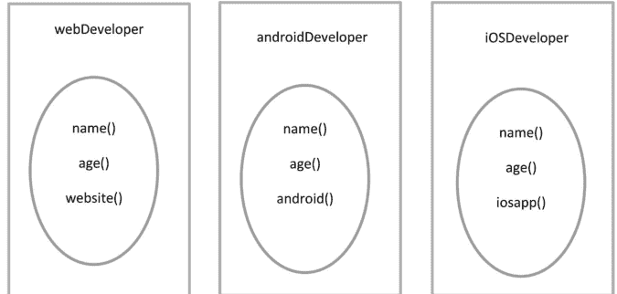

这三位开发者拥有相同的姓名和年龄，但他们的编程技能非常不同。我们为每个角色的姓名和年龄在每个类中复制相同的代码。

如果我们想添加一个 `salary()` 函数，我们必须在三个类中重复代码。这导致我们的程序中出现重复的代码副本，几乎肯定会导致代码更加复杂和混乱。

通过使用继承，工作变得更容易了。我们可以构建一个新的基类 `Employee`，它包含了这三个原始类型共享的特性。这三个类可以从基类继承共同特征，并添加它们独特的特性。我们可以轻松地向 `Employee` 类添加工资功能，而无需创建重复代码。

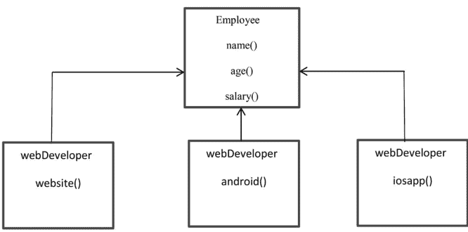

在这种情况下，`webDeveloper` 继承了基类的所有特征及其特性 `website()`。其他类也是如此：`iosDeveloper` 和 `androidDeveloper`。这提高了该继承程序的可读性和扩展性。


# 面向对象编程 (OOP) 概念

## 精通 Kotlin：初学者指南

```kotlin
//base class
open class Employee(val name: String, val age: Int) {
    fun salary() {
        println("Salary calculation for $name")
    }
}

class webDeveloper(name: String, age: Int) : Employee(name, age) {
    fun website() {
        println("Web website features")
    }
}

class iosDeveloper(name: String, age: Int) : Employee(name, age) {
    fun iosApp() {
        println("iOS app features")
    }
}

class androidDeveloper(name: String, age: Int) : Employee(name, age) {
    fun androidApp() {
        println("Android app features")
    }
}

fun main(args: Array<String>) {
    val web = webDeveloper("Alice", 25)
    web.salary()
    web.website()

    val ios = iosDeveloper("Bob", 30)
    ios.salary()
    ios.iosApp()

    val android = androidDeveloper("Charlie", 35)
    android.salary()
    android.androidApp()
}
```

## Kotlin 的主构造函数

如果派生类具有主构造函数，我们必须使用派生类的参数初始化基类。在以下程序中，基类有两个参数，派生类有三个。

```kotlin
//base class
open class Employee(val name: String, val age: Int) {
    init {
        println("Employee name: $name")
        println("Employee age: $age")
    }
}

//derived-class
class CEO(name: String, age: Int, val salary: Double) : Employee(name, age) {
    init {
        println("The Salary per annum is $salary crore rupees")
    }
}

fun main(args: Array<String>) {
    CEO("Suniti Pichai", 40, 420.00)
}
```

## 继承中的辅助构造函数

如果派生类缺少主构造函数，我们必须使用 `super` 关键字从派生类的辅助构造函数调用基类的辅助构造函数。我们还额外使用派生类的参数初始化基类的辅助构造函数。

```kotlin
//base class
open class Employee(val name: String, val age: Int) {
    constructor(name: String, age: Int, department: String) : this(name, age) {
        println("Department: $department")
    }
}

//derived-class
class Manager(name: String, age: Int, department: String, val team: String) : Employee(name, age, department) {
    init {
        println("Team: $team")
    }
}
```

解释：在这种情况下，我们实例化了 `CEO` 类并为辅助构造函数提供了参数值。它将初始化本地变量并使用 `super` 将它们传递给基类 `Employees`（name, age）。

## 重写成员函数和属性

如果基类和派生类中存在同名的成员函数，我们可以使用 `override` 关键字在派生类中重写基类成员函数，但我们也必须用 `open` 关键字标记基类的成员函数。

### Kotlin 中重写成员函数的程序：

```kotlin
// 基类
open class Animals {
    open fun run() {
        println("The Animals can run")
    }
}
// 派生类
class Tiger: Animals() {
    override fun run() { // 它重写了基类的方法
        println("The Tiger can run very fast")
    }
}
fun main(args: Array<String>) {
    val t = Tiger()
    t.run()
}
```

同样，我们可以在派生类中重写基类的属性。

#### Kotlin 中重写成员属性的程序：

```kotlin
// 基类
open class Animals {
    open var name: String = "Dog"
    open var speed = "50 km/hr"
}

// 派生类
class Tiger: Animals() {
    override var name = "Tiger"
    override var speed = "120 km/hr"
    fun main(args: Array<String>) {
        val d = Tiger()
        println(d.name+" can run at speed "+d.speed)
    }
}
```

## 调用超类实现

我们可以使用 `super` 关键字从派生类调用基类的成员方法或属性。我们使用 `super` 关键字调用超类类类的属性 `color` 和方法 `displayCompany()`。

```kotlin
// 基类
open class Phones() {
    var color = "White Gold"
    fun displayCompany(name:String) {
        println("The Company is: $name")
    }
}

// 派生类
class iphone: Phones() {
    fun displayColor() {
        // 调用基类属性 color
        println("Color is "+super.color)

        // 调用基类成员函数
        super.displayCompany("Apple")
    }
}

fun main(args: Array<String>) {
    val p = iphone()
    p.displayColor()
}
```

# KOTLIN 中的接口 (INTERFACES)

接口提供了不能直接实例化的自定义类型。相反，它们描述了实现类型必须遵循的行为。接口允许我们创建一组属性和方法，具体类型必须遵循并实现这些内容。

## 接口的创建

Kotlin 中的接口声明以 `interface` 关键字开始，然后是接口名称，最后是包含接口成员的圆括号。区别在于这些成员将没有定义。遵循的类型将提供这些定义。

### 示例：

```kotlin
interface Vehicles() {
    fun start()
    fun stop()
}
```

实现接口：类或对象可以实现接口。当我们实现一个接口时，遵循的类型必须定义其所有的成员。自定义类型的名称后跟着冒号和要实现的接口名称，用以实现接口。

```kotlin
class Car: Vehicles
```

### Kotlin 中接口的一个示例：

```kotlin
interface Vehicles {
    fun start()
    fun stop()
}

class Car : Vehicles {
    override fun start() {
      println("The Car is started")
    }

    override fun stop() {
      println("The Car is stopped")
    }
}

fun main() {
  val obj = Car()
  obj.start()
  obj.stop()
}
```

**解释：** 接口 `vehicle` 在此应用程序中指定了两个必须重写的方法。`Car` 使用类字面量语法实现接口并使用 `override` 关键字重写了这两个方法。最后，`main` 函数创建一个 `Car` 对象并调用了这两个函数。

### 默认方法和默认值

接口的方法可以为其参数设置默认值。如果在调用函数时不提供参数值，则使用默认值。此外，方法可以有默认实现。当方法没有被重写时，将使用它们。

#### 默认值和默认方法的示例：

```kotlin
interface FirstInterface {
  fun add(c: Int, d: Int = 6)
  fun print() {
    println("This is a default method defined in interface")
  }
}
class InterfaceDemo : FirstInterface {
  override fun add(c: Int, d: Int) {
    val a = c + d
    println("Sum is $a")
  }

  override fun print() {
    super.print()
    println("It has been overridden")
  }
}

fun main() {
  val obj = InterfaceDemo()
  println(obj.add(6))
  obj.print()
}
```

**解释：** 上述程序中的 `FirstInterface` 两个方法：`add()` 和 `print()`。`add()` 函数接受两个参数，其中一个有一个默认值 6。`print()` 函数也提供了一个默认实现。因此，当类 `InterfaceDemo` 实现接口时，它使用了 `super` 关键字。

## 接口属性

接口像方法一样可以包含属性。然而，由于接口没有状态，它们要么是抽象的，要么被实现。

### 接口属性示例：

```kotlin
interface InterfaceProperties {
    val c : Int
    val d : String
    get() = "Hello"
}

class PropertiesDemo : InterfaceProperties {
    override val c: Int = 6000
    override val d : String = "Property Overridden"
}

fun main() {
    val x = PropertiesDemo()
    println(x.c)
    println(x.d)
}
```

**解释：** 程序中的 `FirstInterface` 提供两个方法：`add()` 和 `print()`。接口 `vehicle` 指定了两个方法的值。

## 接口继承

在 Kotlin 中，接口可以继承其他接口。当一个接口扩展另一个接口时，它可以添加属性和方法，实现类型必须定义两个接口中的所有属性。

### 接口继承的示例：

```kotlin
interface Dimensions {
  val len : Double
  val br : Double
}

interface CalculateParameters : Dimensions {
  fun area()
  fun perimeter()
}

class XYZ : CalculateParameters {
  override val len : Double
  get() = 20.0
  override val br : Double
  get() = 17.0

  override fun area() {
    println("Area is ${len * br}")
  }

  override fun perimeter() {
    println("Perimeter is ${2*(len+br)}")
  }
}

fun main() {
    val obj = XYZ()
    obj.area()
    obj.perimeter()
}
```

**解释：** 接口 `Dimensions` 定义了两个属性：`len`（长度）和 `br`（宽度）。`CalculateParameters` 继承了 `Dimensions` 并增加了 `area()` 和 `perimeter()` 方法。

### 多接口实现

由于 Kotlin 类遵循单继承的理念，每个类只能继承一个类；接口支持多重继承，在 Kotlin 中称为多重遵循。类可以实现多个接口，只要它定义了所有接口的成员。

#### 多接口实现的示例：

```kotlin
interface InterfaceProperties {
    val c : Int
    val d : String
    get() = "Hello"
}

interface InterfaceMethods {
    fun description()
}

class MultipleInterface : InterfaceProperties,
InterfaceMethods {
    override val c : Int
        get() = 60

    override fun description() {
        println("The Multiple Interfaces implemented")
    }
}
fun main() {
    val obj = MultipleInterface()
    obj.description()
}
```

**解释：** 程序中指定了两个接口，InterfaceProperties 和 InterfaceMethods。MultipleInterface 类实现了这些接口，随后在 main 函数中执行了这些方法。

# KOTLIN 中的数据类 (DATA CLASSES)

我们经常构建类来存储数据。在这些类中，通常可以从数据推导出一些标准函数。这种类在 Kotlin 中被称为数据类（data class），并被标识为此类。

### 数据示例：

```kotlin
data class Students(val name: String, val roll_no: Int)
```

**编译器会自动生成以下函数：**

- `toString()`
- `copy()`
- `hashCode()`
- `equals()`

## 数据类的创建规则

为了保持一致性，数据类必须满足以下要求：

- 主构造函数至少需要一个参数。
- 所有主构造函数参数必须标记为 `val` 或 `var`。
- 数据类不能是抽象的（abstract）、开放的（open）、密封的（sealed）或内部的（inner）。
- 数据只能实现接口。

### toString()

此函数返回包含数据类所有参数的字符串。

#### 第一个示例：


# Kotlin 数据类与面向对象编程

## 数据类基础示例

```kotlin
fun main(args: Array<String>) {
  // 声明数据类
  data class man(val roll: Int, val name: String, val height: Int)

  // 声明上述数据类的变量并初始化所有参数的值
  val man1 = man(1, "man", 40)

  // 打印数据类的所有细节
  println(man1.toString())
}
```

对于自动生成的函数，编译器仅使用在主构造函数定义的属性。它不包含在类体中声明的属性。

## 数据类包含类体属性示例

```kotlin
fun main(args: Array<String>) {
  // 声明数据类
  data class man(val name: String) {
    // 在类体内声明的属性
    var height: Int = 0
  }

  // 声明上述数据类的变量并初始化所有参数的值
  val man1 = man("manisha")
  // 类体属性必须唯一赋值
  man1.height = 80

  // 此方法打印在主构造函数中声明的类细节
  println(man1.toString())

  // 打印 man1 的高度
  println(man1.height)
}
```

## `copy()` 函数

有时我们需要复制一个对象并在保持其他属性完好的同时更新它的一些属性。在这种情况下，利用了 `copy()` 方法。

### `copy()` 属性

- 它复制了主构造函数中定义的所有参数或成员。
- 如果已声明，两个对象可能具有相同的主参数值，但不同的类体值。

### `copy()` 声明

```kotlin
fun copy(name: String = this.a, age: Int = this.b) = user(a, b)
```

其中 `user` 是一个数据类：`user(String, Int)`。

### `copy()` 示例

```kotlin
fun main(args: Array<String>) {
    // 声明数据类
    data class man(val name: String, val age: Int) {
        // 在类体内声明的属性
        var height: Int = 0
    }

    val man1 = man("manisha", 19)
    // 更改 man 的细节并复制 man
    val man2 = man1.copy(name = "rahi")

    // 将 man 的所有细节复制到 man3
    val man3 = man1.copy()

    // 修改单独的高度
    man1.height = 110
    man2.height = 92
    man3.height = 130

    // man1 & man3 有不同的类体值
    // 但相同的参数值

    // 打印所有 3 个男人的信息
    println("${man1} has ${man1.height} cm height")
    println("${man2} has ${man2.height} cm height")
    println("${man3} has ${man3.height} cm height")
}
```

## `hashCode()` 与 `equals()`

- `hashCode()` 方法返回对象的哈希值。
- 如果两个对象的内容相同，则 `equals()` 函数返回 `true`，其操作方式类似于 `==`，但对于 `Float` 和 `Double` 值有所不同。

### `hashCode()` 声明

```kotlin
open fun hashCode(): Int
```

### `hashCode()` 属性

- 在同一个对象上指定两次的哈希值将是相等。
- 如果两个对象根据 `equals()` 函数相等，则给定的哈希值将相同。

```kotlin
fun main(args: Array<String>) {
    // 声明数据类
    data class man(val name: String, val age: Int)

    val man1 = man("manish", 19)
    val man2 = man1.copy(name = "rahi")
    val man3 = man1.copy()
    // ... (逻辑根据上下文继续)
}
```

*(注：原文档第 97-100 页的 OCR 文本包含了根据提供的代码片段逻辑流合并的重复碎片代码。)*

## 抽象类

- 当我们将一个成员函数声明为抽象的（`abstract`）时，我们不需要用 `open` 关键字来标注它，因为它们默认就是开放的。
- 派生类必须实现抽象成员函数，因为它没有函数体。

如下所示，抽象类可以同时包含抽象成员和非抽象成员：

```kotlin
abstract class className(val c: String) {
  // 非抽象属性
  abstract var d: Int               // 抽象属性

  abstract fun method1()            // 抽象方法

  fun method2() {                   // 非抽象方法
    println("Non abstract function")
  }
}
```

### 抽象类完整示例

```kotlin
// abstract 类
abstract class Employee(val name: String, val experience: Int) {   // 非抽象

  // 属性
  // 抽象属性（子类必须重写）
  abstract var salary: Double

  // 抽象方法（子类必须实现）
  abstract fun dateOfBirth(date: String)

  // 非抽象方法
  fun employeeDetails() {
    println("Name of the employee: $name")
    println("Experience in years: $experience")
    println("Annual Salary: $salary")
  }
}

// 派生类
class Engineer(name: String, experience: Int) :
    Employee(name, experience) {
    override var salary = 510000.00
    override fun dateOfBirth(date: String) {
        println("Date of Birth is: $date")
    }
}

fun main(args: Array<String>) {
    val eng = Engineer("Praniti", 3)
    eng.employeeDetails()
    eng.dateOfBirth("03 December 1996")
}
```

**解释**：在前面的类中创建了 `Engineer` 类对象 `eng`。在创建它时，我们为主构造函数提供了两个参数。这初始化了 `Employee` 类的非抽象属性 `name` 和 `experience`。

然后使用 `eng` 对象来调用 `employeeDetails()` 函数。它将打印员工的姓名、经验和重写后的工资。

最后，我们使用该对象调用 `dateOfBirth()` 并向主构造函数提供参数 `date`。它重写了 `Employee` 类的抽象函数 `fun` 并将值打印到标准输出。

### 使用抽象开放成员替换非抽象开放成员

在 Kotlin 中，我们可以在抽象类中使用 `override` 关键字后跟 `abstract`，来重写开放类（`open class`）的非抽象开放成员函数。

```kotlin
open class Living {
    open fun breathe() {
        println("All living thing breathe")
    }
}

abstract class Animal : Living() {
    override abstract fun breathe()
}

class Dog : Animal() {
    override fun breathe() {
        println("Dog also breathe")
    }
}

fun main(args: Array<String>) {
    val lt = Living()
    lt.breathe()
    val d = Dog()
    d.breathe()
}
```

## 多个派生类

所有派生类都可以重写抽象类的抽象成员。在程序中，我们在计算器的三个派生类中都重写了 `cal` 函数。

```kotlin
// 抽象类
abstract class Calculators {
    abstract fun cal(a: Int, b: Int): Int
}

// 两个数的相加
class Add : Calculators() {
    override fun cal(a: Int, b: Int): Int {
        return a + b
    }
}

// 两个数的相减
class Sub : Calculators() {
    override fun cal(a: Int, b: Int): Int {
        return a - b
    }
}

// 两个数的相乘
class Mul : Calculators() {
    override fun cal(a: Int, b: Int): Int {
        return a * b
    }
}

fun main(args: Array<String>) {
    var add: Calculators = Add()
    var a1 = add.cal(5, 6)
    println("Addition of two numbers $a1")

    var sub: Calculators = Sub()
    var a2 = sub.cal(11, 6)
    println("Subtraction of two numbers $a2")

    var mul: Calculators = Mul()
    var a3 = mul.cal(22, 6)
    println("Multiplication of two numbers $a3")
}
```

## 枚举类

有时需要类型包含特定的值。枚举的概念是为了这样发明的。在 Kotlin 中，枚举是类，正如在 Java 中一样。

### 枚举类要点

- 枚举常量不仅仅是常量集合；它们还包含属性、方法等。
- 逗号表示枚举常量是单个类。
- 通过为常量赋值来增强代码可读性。
- 构造函数不能创建枚举实例。

使用 `enum` 关键字定义枚举。例如：

```kotlin
enum class DAY {
    SUNDAY,
    MONDAY,
    TUESDAY,
    WEDNESDAY,
    THURSDAY,
    FRIDAY,
    SATURDAY
}
```

### 带属性和伴生对象的枚举类

```kotlin
enum class DAY(val isWeekend: Boolean = false) {
    SUNDAY(true),
    MONDAY,
    TUESDAY,
    WEDNESDAY,
    THURSDAY,
    FRIDAY,
    SATURDAY(true);

    companion object {
        fun today(obj: DAY): Boolean {
            return obj.name.compareTo("SATURDAY") == 0 || obj.name.compareTo("SUNDAY") == 0
        }
    }
}

fun main() {
    // 属性简单演示
    for (day in DAY.values()) {
        println("${day.ordinal} = ${day.name} and is weekend ${day.isWeekend}")
    }
    val today = DAY.MONDAY
    println("Is today a weekend ${DAY.today(today)}")
}
```

### 匿名类风格的枚举

枚举类与匿名类相似，它们实现自己的函数并重写类的抽象函数。最关键的一点是每个枚举常量都被重写了。

```kotlin
// 枚举类定义
enum class Season(var weather: String) {
    Summer("hot") {
        // 如果不重写函数 foo() 将报错
        override fun foo() {
            println("The Hot days of a year")
        }
    },
    Winter("cold") {
        override fun foo() {
            println("The Cold days of a year")
        }
    },
    Rainy("moderate") {
        override fun foo() {
            println("The Rainy days of a year")
        }
    }
    abstract fun foo()
}

// main 函数
fun main(args: Array<String>) {
    // 调用重写 Summer 常量的 foo 函数
    Season.Summer.foo()
}
```

### 在枚举类中使用 `when` 表达式

在 Kotlin 中，当枚举类与 `when` 表达式配对时，它们具有显著的优势。这种优势在于，由于枚举类在与 `when` 表达式结合时限制了类型可能取的值，并且所有的常量定义都已提供，因此避免了对 `else` 分句的必要性。若添加 `else` 分句将生成编译器警告。

```kotlin
enum class DAY {
    MONDAY,
    TUESDAY,
    WEDNESDAY,
    THURSDAY,
    FRIDAY,
    SATURDAY,
    SUNDAY
}

fun main() {
    when (DAY.SUNDAY) {
        DAY.SUNDAY -> println("Today is Sunday")
        DAY.MONDAY -> println("Today is Monday")
        DAY.TUESDAY -> println("Today is Tuesday")
        DAY.WEDNESDAY -> println("Today is Wednesday")
        DAY.THURSDAY -> println("Today is Thursday")
        DAY.FRIDAY -> println("Today is Friday")
        DAY.SATURDAY -> println("Today is Saturday")
        // 添加 else 分句将生成一个 warning
    }
}
```

## 扩展函数

Kotlin 允许程序员在不继承现有类的情况下扩展类的功能。这是通过使用一种名为“扩展（extension）”的功能实现的。扩展函数是添加到现有类中的函数。

要为类添加扩展函数，可以创建一个附加到类名上的新函数，如下例所示：

```kotlin
// 用于演示扩展函数的示例类
class Circle(val radius: Double) {
    // 类的成员函数
    fun area(): Double {
        return Math.PI * radius * radius
    }
}

fun main() {
    // 为 Circle 类创建的扩展函数
    fun Circle.perimeter(): Double {
        return 2 * Math.PI * radius
    }
    // 为 Circle 类创建对象
    val newCircle = Circle(3.6)
    // 调用成员函数
    println("The Area of the circle is ${newCircle.area()}")
    // 调用扩展函数
    println("The Perimeter of the circle is ${newCircle.perimeter()}")
}
```


# 扩展函数与泛型变性

## 扩展函数

### 基本用法

说明：在这种情况下，使用符号将新函数附加到类上，函数名为 `Circle.perimeter()`，返回类型为 `Double`。在主函数中创建了一个对象来实例化 `Circle` 类，并使用 `println()` 语句调用该函数。当调用成员函数时，它返回圆的面积，而扩展函数提供圆的周长。

### 扩展库类

在 Kotlin 中，不仅用户定义的类可以扩展，库类也是如此。扩展函数可以添加到库类中，并以与引入用户定义类相同的方式使用。

下面的示例展示了为 `Int` 类型创建的扩展函数：

```kotlin
fun main() {
    // 为 Int 类型定义的扩展函数
    fun Int.abs(): Int {
        return if (this < 0) -this else this
    }

    println((-6).abs())
    println(6.abs())
}
```

**解释：** 在这种情况下，我们使用扩展函数来扩展库函数。我们使用整数值执行取模运算。我们提供了整数值 -6 和 6，并收到了两个正结果。如果参数值小于 0，则返回 `-value`，如果大于 0，则返回相同的值。

### 扩展是静态解析的

扩展函数是静态解析的，这意味着执行哪个扩展函数完全取决于调用它的表达式的类型，而不是在运行时对表达式的最终执行所解析的类型。

以下是静态解析的示例：

```kotlin
// 静态解析示例
class Base
class Derived : Base()

fun Base.show() { println("Base") }
fun Derived.show() { println("Derived") }

fun main() {
    val b: Base = Derived()
    b.show() // 输出 Base，因为 b 的类型是 Base
}
```

## 泛型类

### 基础示例

```kotlin
class Company(text: String) {
    var y = text
    init {
        println(y)
    }
}

fun main(args: Array<String>) {
    var name: Company = Company("Hubtutors")
    var rank: Company = Company(15) // compile error
}
```

为了解决上述问题，我们可以开发一个用户定义的泛型类，可以在单个类中接受多个参数。`Company` 类是一个通用类型类，可以同时接受 `Int` 和 `String` 参数。

### 使用泛型类的 Kotlin 程序

```kotlin
class Company<D>(text: D) {
    var y = text
    init {
        println(y)
    }
}

fun main(args: Array<String>) {
    var name: Company<String> = Company<String>("GeeksforGeeks")
    var rank: Company<Int> = Company<Int>(16)
}
```

## 变性

与 Java 不同，Kotlin 默认使数组是不变的（invariant）。推此之，泛型在 Kotlin 中也是不变的。`out` 和 `in` 关键字可能有助于处理这种不变性。不变性是一种特性，它防止了为特定数据类型创建的标准泛型函数/类接受或返回另一种类型。所有额外的数据类型都是 `Any` 的超类。

### 两种变性类型

- 声明处变性（使用 `in` 和 `out`）
- 使用处变性：类型投影（Type projection）

### out 关键字

我们可以在 Kotlin 的泛型类型上使用 `out` 关键字，将此引用赋值给它的任何超类。`out` 值只能由指定的类创建而不能被消费：

```kotlin
class OutClass<out D>(val value: D) {
    fun get(): D {
        return value
    }
}
```

我们在上面定义了一个 `OutClass` 类，它可以返回类型为 `D` 的值。对于它的超类的引用，我们可以分配一个 `OutClass` 的实例：

```kotlin
val out = OutClass("string")
val ref: OutClass<Any> = out
```

**注意：** 如果我们没有在前面的类中使用 `out` 类型，下一条语句将导致编译器错误。

### in 关键字

```kotlin
class InClass<in D> {
    fun toString(value: D): String {
        return value.toString()
    }
}
```

在这种情况下，我们声明了一个仅接受 `D` 值的 `toString()` 方法。然后我们可以为它的子类 `Int` 分配一个类型为 `Number` 的引用：

```kotlin
val inClassObject: InClass<Number> = InClass()
val ref: Int = inClassObject.toString(10) // 示例调用
```

**注意：** 如果我们没有在前面的类中使用 `in` 类型，那么接下来的语句将导致编译器错误。

## 协变

协变是指允许替换子类但不允许替换超类，即泛型函数/类可以接受其已定义数据类型类型的子类，例如，为 `Number` 定义的泛型类可以接受 `Int`，而为 `Int` 定义的泛型类不能接受 `Number`。这在 Kotlin 中可以使用 `out` 关键字来实现，如下所示：

```kotlin
fun main(args: Array<String>) {
    // val a: MyClass<Any> = MyClass<Int>() // Error: 类型不匹配
    val b: MyClass<out Any> = MyClass<String>() // 因为 String 是 Any 的子类，所以有效
    // val c: MyClass<out String> = MyClass<Any>() // 因为 Any 是 String 的超类，错误
}
class MyClass<D>
```

我们可以通过在声明处附加 `out` 关键字来立即允许协变。以下代码运行完美。

```kotlin
fun main(args: Array<String>) {
    val b: MyClass<Any> = MyClass<String>() // 编译无错误
}
class MyClass<out D>
```

## 逆变

它用于在子类中替换超类值，即泛型函数或类可以接受其已定义数据类型的超类。例如，为 `Number` 定义的泛型类不能接受 `Int`，而为 `Int` 定义的泛型类可以接受 `Number`。在 Kotlin 中，通过如下方式使用 `in` 关键字来实现：

```kotlin
fun main(args: Array<String>) {
    var x: Container<Dog> = Container<Animal>() // 编译无错误
    // var y: Container<Animal> = Container<Dog>() // 编译错误
}
open class Animal
class Dog : Animal()
class Container<in D>
```

## 类型投影

将某种类型数组的所有成员拷贝到 `Any` 类型数组中是可行的，但为了让编译器编译我们的代码，我们必须在输入参数上标记 `out` 关键字。结果是编译器得出输入参数可以是 `Any` 类型的子类。

### 将数组元素拷贝到另一个数组的 Kotlin 程序

```kotlin
fun copy(from: Array<out Any>, to: Array<Any>) {
    assert(from.size == to.size)
    // 将 (from) 数组拷贝到 (to) 数组
    for (c in from.indices)
        to[c] = from[c]
    // 打印拷贝到数组中的元素
    for (c in to.indices)
        println(to[c])
}

fun main(args: Array<String>) {
    val source = arrayOf(1, 2, 3)
    val target = arrayOfNulls<Any>(3)
    copy(source as Array<out Any>, target)
    println(target.joinToString())
}
```

# 异常处理、空安全、正则表达式与范围

## 异常处理基础

Kotlin 中的异常处理：在下面的示例中，我们将一个整数除以 0（零），导致产生 `ArithmeticException`。由于这段代码位于 `try` 块中，因此 `catch` 块将被执行。

在这种情况下，发生了 `ArithmeticException`；因此，运行 `ArithmeticException` catch 块，并在输出中写入了 "Arithmetic Exception"。

当发生异常时，后续内容将被忽略，如果存在 `catch` 块，控制将立即移动到该块。无论是否发生异常，`finally` 块始终会被执行。

```kotlin
fun main(args: Array<String>) {
    try {
        var num = 30 / 0
        println("Beginners ")
        println(num)
    } catch (c: ArithmeticException) {
        println("Arithmetic Exception")
    } catch (c: Exception) {
        println(c)
    } finally {
        println("in any case it will print.")
    }
}
```

### 为什么我们不处理异常？

假设如果我们不在上一个示例中处理异常，程序将会突然结束。在这种情况下，由于我们没有处理异常，应用程序以错误结束。

### 如何在 Kotlin 中抛出异常

在下面的示例中，也可以使用 `throw` 关键字来抛出异常。异常发生之前的语句已执行，但异常发生后的语句没有执行，因为控制权已移动到 `catch` 块。

```kotlin
fun main(args: Array<String>) {
    try {
        println("Before exception")
        throw Exception("Something went wrong ")
    } catch (c: Exception) {
        println(c)
    } finally {
        println("can't ignore")
    }
    println("After exception")
}
```

## NullPointerException

### Java 示例

这是一个当调用 `null` 对象的 `length()` 函数时抛出 `NullPointerException` 的示例：

```java
public class ExceptionExample {
    private static void printLength(String str) {
        System.out.println(str.length());
    }

    public static void main(String[] args) {
        String myString = null;
        printLength(myString);
    }
}
```

在这个示例中，`printLength()` 函数使用了 `String` 的 `length()` 方法而没有进行 `null` 检查。由于从 `main()` 函数提供的字符串没有值，运行前面的代码会导致 `NullPointerException`：

> Exception in thread "main" java.lang.NullPointerException
> at ExceptionExample.printLength(ExceptionExample.java:3)
> at ExceptionExample.main(ExceptionExample.java:8)

### 如何避免 NullPointerException

通过采用以下检查和保护措施可以避免 `NullPointerException`：

- 在引用对象的方法或属性之前添加 `null` 检查，以确保其已正确初始化。
- 使用 Apache Commons `StringUtils` 进行字符串操作，例如使用 `StringUtils.isNotEmpty()`，在使用字符串之前检查它是否为空。
- 在任何可行的情况下，使用基本类型而不是对象，因为它们不能有 `null` 引用，例如用 `int` 代替 `Integer`，用 `boolean` 代替 `Boolean`。

## Kotlin 的 TRY-CATCH 块

在 Kotlin 中，我们利用 `try-catch` 块来处理应用程序中的异常。`try` 块包含负责抛出异常的代码，而 `catch` 块负责处理异常。此块必须包含在主或其他方法中。在 `try` 块之后，应该有一个 `catch` 块、一个 `finally` 块或两者都有。

### 语法

```kotlin
try {
    // 可能抛出异常的代码
} catch (c: ExceptionName) {
    // 捕获异常并处理它
}
```

### 使用 try-catch 块处理算术异常的 Kotlin 应用程序

```kotlin
import kotlin.ArithmeticException

fun main(args: Array<String>) {
    try {
        var num = 20 / 0
    } catch (e: ArithmeticException) {
        // 捕获并处理
        println("not allowed divide by zero")
    }
}
```

**解释：** 在前面的程序中，我们利用了 `try-catch` 块。由于算术中没有定义除以 0，可能会抛出异常的 `num` 变量被包含在 `try` 块的大括号内。`catch` 块将捕获异常并运行 `println()` 函数。

## 作为表达式的 Kotlin Try-Catch 块

正如我们已经确定的，表达式总是返回一个值。我们可以在软件中使用 Kotlin 的 `try-catch` 块作为表达式。表达式的返回值将是 `try` 块的最后一个表达式或 `catch` 块的最后一个表达式。如果函数中发生异常，`catch` 块将返回该值。

### 在 Kotlin 程序中使用 try-catch 作为表达式

```kotlin
fun test(c: Int, d: Int): Any {
    return try {
        c / d
        println("The Result is: " + c / d)
    } catch (e: Exception) {
        println(e)
        "Divide by zero not allowed"
    }
}

// main 函数
fun main(args: Array<String>) {
    var results1 = test(20, 2) // 执行 try 块
    println(results1)
    var results = test(20, 0) // 执行 catch 块
    println(results)
}
```

我们在前面的代码中将 `try-catch` 作为表达式。在程序中声明了一个函数 `test`。

## Finally 块

在 Kotlin 中，无论是否发生异常，`finally` 块始终会被执行。该块用于执行清理工作，如关闭文件或数据库连接。

## 多个 Catch 块

针对各种异常的 catch 块，以及最后一个 catch 块中的父类异常类，用于处理程序中未被 catch 块定义的其他剩余异常。

### 语法

```kotlin
try {
    // 代码可能会抛出异常
} catch (c: ExceptionNameOne) {
    // 捕获异常一并处理
} catch (c: ExceptionNameTwo) {
    // 捕获异常二并处理
}
```

### Kotlin 中多个 catch 块的程序

```kotlin
// 此处原文缺少具体代码示例，保留标题占位
```


```kotlin
import java.util.Scanner
object Tests {
    @JvmStatic
    fun main(args: Array<String>) {
        val scn = Scanner(System.`in`)
        try {
            val n = Integer.parseInt(scn.nextLine())
            if (512 % n == 0)
                println("$$n is a factor of 512")
        } catch (c: ArithmeticException) {
            println(c)
        } catch (c: NumberFormatException) {
            println(c)
        }
    }
}
```

catch 块中表达式的使用：在 Kotlin 中，catch 块中的表达式可以用来替换多个 catch 块。我们将在下一节中演示如何利用 `when` 表达式。

```kotlin
import java.lang.NumberFormatException
import java.util.Scanner
object Tests {
    @JvmStatic
    fun main(args: Array<String>) {
        val scn = Scanner(System.`in`)
        try {
            val n = Integer.parseInt(scn.nextLine())
            if (512 % n == 0)
                println("$$n is a factor of 512")
        } catch (c: Exception) {
            when(c) {
                is ArithmeticException -> println("The Arithmetic Exception: Divide by zero")
                is NumberFormatException -> {
                    println("The Number Format Exception")
                }
            }
        }
    }
}
```

## 异常处理、空安全、正则表达式与范围

## 空安全 (NULL SAFETY)

Kotlin 类型系统的目标是消除代码中空引用的风险，因为这是一个“十亿美元错误”。`NullPointerException` 在运行时由空引用抛出，导致应用程序或系统故障。

如果我们曾在 Java 或其他语言中编写过包含空引用概念的代码，我们可能遇到过 `NullPointerException`。如果 Kotlin 编译器在不执行任何其他语句的情况下发现空引用，它会抛出 `NullPointerException`。

以下是 `NullPointerException` 的一些可能来源：

- 显式抛出 `NullPointerException()`。
- 使用了 `!!` 运算符。
- 某些初始化方面的数据问题。

### Kotlin 中的可空与非可空类型 (Nullable and Non-Nullable)

Kotlin 类型系统区分了两种类型的引用：可以持有 null 的引用（可空引用）和不能持有 null 的引用（非可空引用）。

`String` 类型的变量不能包含 null 值。如果我们尝试给该变量赋值 null，将会导致编译错误。

```kotlin
var st1: String = "Hub"
st1 = null // 编译错误
```

我们将一个变量声明为可空字符串，类型为 `String?`，允许它保留 null：

```kotlin
var st2: String? = "Huboftutors"
st2 = null // 正常
print(st2)
```

现在，如果我们想获取字符串 `st1` 的长度，它确保了不会抛出 NPE；因此，我们可以放心地说：

```kotlin
val l1 = st1.length
```

然而，访问字符串 `st2` 的长度是不安全的，编译器会报错：

```kotlin
val l1 = st2.length // 错误：变量 'st2' 可以为 null
```

一个非可空的 Kotlin 程序：

```kotlin
fun main(args: Array<String>) {
  // 变量被声明为非空
  var st1 : String = "Hubs"

  //st1 = null // 产生编译错误

  print("length of the string st1 is: " + st1.length)
}
```

在这种情况下，如果我们尝试给非空变量赋值 null 值，将得到编译时错误。但是，如果我们尝试读取字符串的长度，将会得到 `NullPointerException`。

### 可空类型 Kotlin 程序：

```kotlin
fun main(args: Array<String>) {
  // 变量被声明为可空
  var st2: String? = "Huboftutors"
  st2 = null // 无编译错误
  println(st2.length) // 编译错误，因为字符串可以为 null
}
```

在这种情况下，我们可以轻松地为可空类型变量设置 null。然而，为了获取字符串的长度，我们应该使用安全运算符。

### 在条件中检查空

检查空引用最流行的技术是使用 `if-else` 语句。我们可以显式检查变量是否为 null，并独立地处理两种可能性。

#### Kotlin 中在条件中检查空的程序：

```kotlin
fun main(args: Array<String>) {
  // 变量被声明为可空
  var st: String? = "Huboftutors"
  println(st)
  if (st != null) {
    println("String of length ${st.length}")
  } else {
    println("Null string")
  }
  // 赋值 null
  st = null
  println(st)
  if (st != null) {
    println("String of length ${st.length}")
  } else {
    println("Null String")
  }
}
```

记住，我们使用了 `if-else` 块来检查空值。如果字符串包含 null，则执行该块；否则，执行 else 块。

### 安全调用运算符 (`?.`)

空比较是直观的，但嵌套的 `if-else` 表达式可能会很困难。因此，Kotlin 提供了安全调用运算符 `?.`，它通过仅在引用具有空值时执行操作来消除这种复杂性。它允许我们在同一个表达式中进行空检查和方法调用。

以下表达式：

```kotlin
firstname?.toUpperCase()
```

等同于：

```kotlin
if (firstname != null)
    firstname.toUpperCase()
else
    null
```

#### 使用安全运算符的 Kotlin 程序：

```kotlin
fun main(args: Array<String>) {
    // 变量声明为可空
    var firstName: String? = "Preesha"
    var lastName: String? = null
    println(firstName?.toUpperCase())
    println(lastName?.length)
}
```

### Elvis 运算符 (`?:`)

当原始变量为空时，Elvis 运算符返回一个非空值或默认值。换句话说，如果左侧表达式不空，则返回它；否则，返回右侧表达式。如果发现左侧表达式为空，则求值右侧表达式。

以下表达式：

```kotlin
val name = firstname ?: "Unknown"
```

等同于：

```kotlin
val name = if(firstname != null)
    firstname
else
    "Unknown"
```

此外，在 Elvis 运算符的右侧，我们可以利用 `throw` 或 `return` 表达式，这在函数中非常有用。因此，与其在 Elvis 运算符的右侧返回默认值，不如抛出异常。

```kotlin
val name = firstname ?: throw
    IllegalArgumentException("Enter a valid name")
```

#### Kotlin 中使用 Elvis 运算符的程序：

```kotlin
fun main(args: Array<String>) {
    var st: String? = "Huboftutors"
    println(st?.length)
    st = null
    println(st?.length ?: "-1")
}
```

### 非空断言 (`!!`) 运算符

如果值为 `null`，非空断言 `!!` 运算符会将其转换为空类型并抛出异常。

如果有人想要得到 `NullPointerException`（空指针异常），可以直接使用此运算符来请求。

```kotlin
fun main(args: Array<String>) {
    var st : String? = "Huboftutors"
    println(st!!.length)
    st = null
    st!!.length
}
```

## KOTLIN 中的类型检查与智能转换

### 类型检查

在运行时，我们可能使用 Kotlin 中的运算符来确定变量的类型。这是一种用于为不同对象分离执行流的方法，在运行时验证变量的类型。

#### 在 Kotlin 中使用 `if-else` 块进行类型检查的程序：

```kotlin
fun main(args: Array<String>) {
    var names = "Praniti"
    var ages = 26
    var salary = 5100.54
    val employeeDetails: List<Any> = 
    listOf(names, ages, salary)

    for(attribute in employeeDetails) {
        if (attribute is String) {
            println("The Name is: $attribute")
        } else if (attribute is Int) {
            println("The Age is: $attribute")
        } else if (attribute is Double) {
            println("The Salary is: $attribute")
        } else {
            println("Not an attribute")
        }
    }
}
```

解释：在这种情况下，我们初始化了三个变量：name、age 和 salary，然后将它们传入列表。然后，使用 `for` 循环遍历列表，在每个 `else` 块中使用 `is` 运算符检查元素的类型，并在每个 `else` 块中执行相应的 `print()` 命令。

#### 使用 `when` 表达式

`when` 表达式可以简单替换 `if-else` 块，我们将在控制流章节中学习 `when` 表达式。我们可以参考 Kotlin 中的 `when` 表达式获取更多信息。

#### 采用 `when` 的 Kotlin 类型检查程序：

```kotlin
fun main(args: Array<String>) {
    var names = "Pariniti"
    var ages = 25
    var salary = 5100.55
    var emp_id = 12345f
    val employeeDetails: List<Any> = listOf(names, ages, salary, emp_id)

    for (attribute in employeeDetails) {
        when (attribute) {
            is String -> println("Name is: $attribute")
            is Int -> println("Age is: $attribute")
            is Double -> println("Salary is: $attribute")
            else -> println("Not an attribute")
        }
    }
}
```

### 智能转换

在 Java 和其他语言中，在访问属性之前需要对变量进行显式类型转换，而 Kotlin 使用了智能转换。当变量通过条件运算符传递时，Kotlin 编译器会自动将其转换为特定的类引用。

让我们看一个 Java 示例。首先，我们使用 `instanceof` 运算符确定变量的类型，然后将其强制转换为目标类型，如下所示：

```java
Object obj = "Huboftutors";
if (obj instanceof String) {
    // 显式类型转换
    String st = (String) obj;
    System.out.println("length of String " + st.length());
}
```

智能转换是 Kotlin 提供的最令人兴奋的功能之一。为了验证变量的类型，我们使用 `is` 或 `!is` 运算符，编译器会自动将变量转换为所需的类型，如下所示：

```kotlin
fun main(args: Array<String>) {
    var st1: String? = "Huboftutors"
    var st2: String? = null // 打印 String is null
    if (st1 is String) {
        // 不需要显式类型转换。
        println("The length of String ${st1.length}")
    } else {
        println("String is null")
    }
}
```

#### 使用 `!is` 运算符

同样，我们也可以使用 `!is` 运算符验证变量。

```kotlin
fun main(args: Array<String>) {
    var st1: String? = "hubooftutors"
    var st2: String? = null // 打印 String is null
    if (st1 !is String) {
        println("The String is null")
    } else {
        println("The length of String ${st1.length}")
    }
}
```

如果编译器无法确保变量在检查和使用之间不会改变，则智能转换将不起作用。以下指南规范了智能转换的使用：

- 除局部委托属性外，`val` 局部变量始终有效。
- 只有当属性是私有的（`private`）或内部的（`internal`），或者检查在与属性定义的同一模块中进行时，`val` 属性才有效。智能转换对开放的（`open`）属性或具有自定义 getter 的属性不起作用。
- 只有当变量在检查和使用之间没有被修改、没有被会修改它的 lambda 表达式捕获，且它不是局部委托属性时，`var` 局部变量才有效。
- 因为变量可以随时更改，`var` 属性永远不会生效。

## KOTLIN 中的显式类型转换

在智能转换中检查变量类型时，我们通常使用 `is` 或 `!is` 运算符，编译器会自动将变量转换为目标类型；而在显式转换中，我们使用 `as` 运算符。

显式类型转换可以通过以下方式实现：

- 不安全转换运算符：`as`
- 安全转换运算符：`as?`

### 不安全转换运算符：`as`

我们利用类型转换运算符手动将变量转换为目标类型。

在下面的程序中，字符串类型的变量 `st1` 使用运算符被转换为目标类型。

```kotlin
fun main(args: Array<String>) {
    val st1: String = "works fine"
    val st2: String = st1 as String // 正常工作
    println(st1)
}
```

我们可能无法将变量转换为目标类型，这会在运行时抛出异常，这就是为什么它被称为“不安全转换”。

当使用 `Integer` 类型转换为 `String` 类型时，会抛出 `ClassCastException`。

```kotlin
fun main(args: Array<String>) {
    val st1: Any = 13
    val st2: String = st1 as String // 抛出
    println(st1)
}
```

我们不能将可空字符串转换为不可空字符串，此时会抛出异常。


# 异常处理、空安全、正则表达式与范围

## 类型转换示例

```kotlin
fun main(args: Array<String>) {
    val st1: String? = null
    val st2: String = st1 as String // 抛出
    println(st1)
}
```

结果，我们必须将目标类型设为可空的 `String`，这种类型转换不会导致异常。

```kotlin
fun main(args: Array<String>) {
    val st1: String? = null
    val st2: String? = st1 as String 
    println(st1)
}
```

### 安全转换运算符：as?

Kotlin 还提供了使用安全转换运算符 `as?` 的类型转换。如果转换失败，该方法将返回 `null` 而不是抛出 `ClassCastException`。

这里有一个示例：如果我们尝试转换程序熟悉的任何类型的字符串值，它的效果会非常好。

```kotlin
fun main(args: Array<String>) {
    var st1: Any = "Safe casting"
    val st2: String? = st1 as? String // 正常工作
    st1 = 13
    // 类型转换无效，返回 null
    val st3: String? = st1 as? String
    val st4: Int? = st1 as? Int      // 正常工作
    println(st2)
    println(st3)
    println(st4)
}
```

## 正则表达式与范围

### Kotlin 中的正则表达式

正则表达式是几乎每种编程语言的基础特性，包括 Kotlin。Kotlin 中的 `Regex` 类提供了正则表达式的支持。该类的对象表示用于字符串匹配的正则表达式。

```kotlin
class Regex
```

正则表达式出现在各种软件中，从基础到复杂的都有。

### 构造函数

- `<init>(pattern: String)`：此构造函数根据模式字符串创建一个正则表达式。
- `(pattern: String, option: RegexOption)`：此构造函数根据指定的模式和选项生成正则表达式。选项是 `RegexOption` 类常量。
- `(pattern: String, options: Set<RegexOption>)`：此构造函数根据指定的字符串模式和选项集创建一个正则表达式。

### 属性

- `val options: Set<RegexOption>`：它包含了创建正则时必须使用的选项集。
- `val pattern: String`：它持有模式的描述字符串。

## 正则表达式函数

### containsMatchIn()

此函数返回一个布尔值，表示我们的模式是否在输入中匹配。

```kotlin
fun containsMatchIn(input: CharSequence): Boolean
```

此示例将展示如何在 Kotlin 中使用 `containsMatchIn()` 方法：

```kotlin
fun main() {
  // 匹配以字母 'a' 开头的任何字符串的正则表达式
  val pattern = Regex("^a")
  println(pattern.containsMatchIn("abcd"))
  println(pattern.containsMatchIn("bacd"))
}
```

### find()

从指定的起始索引开始，该方法返回输入中与我们的模式相关的第一个匹配子字符串。

```kotlin
fun find(input: CharSequence, startIndex: Int): MatchResult?
```

此示例将展示如何在 Kotlin 中使用 `find()` 方法：

```kotlin
fun main() {
  // 匹配字符串中 "11" 的正则表达式
  val pattern1 = Regex("11")
  var ans: MatchResult? = pattern1.find("HelloHello", 6)
  println(ans?.value)
}
```

### findAll()

此方法返回从指定的起始索引开始的输入中所有提供模式的匹配项。

```kotlin
fun findAll(
  input: CharSequence,
  startIndex: Int
): Sequence<MatchResult>
```

此示例将展示如何在 Kotlin 中使用 `findAll` 方法：

```kotlin
fun main() {
  // 匹配 3 个字母模式开头的正则表达式
  val pattern2 = Regex("ab.")
  val ans1: Sequence<MatchResult> = pattern2.findAll("abssfffgdbabc", 0)
  // 使用 forEach 循环显示所有匹配项
  ans1.forEach {
      matchResult -> println(matchResult.value)
  }
  println()
}
```

### matches()

此方法返回一个布尔值，表示输入字符串是否完全匹配该模式。

```kotlin
infix fun matches(input: CharSequence): Boolean
```

此示例将展示如何在 Kotlin 中使用 `matches()` 方法：

```kotlin
fun main() {
  // 测试以演示整个字符串匹配
  val pattern = Regex("h([ee]+)ks")
  println(pattern.matches("heeks"))
  println(pattern.matches("heeeeeeeeks"))
  println(pattern.matches("heeksforheeks"))
}
```

### matchEntire()

此方法尝试将整个输入匹配到指定的模式字符串，如果匹配则返回该字符串。如果不匹配字符串，则返回 null。

```kotlin
fun matchEntire(input: CharSequence): MatchResult?
```

此示例将展示如何在 Kotlin 中使用 `matchEntire()` 方法：

```kotlin
fun main() {
    // 测试以演示整个字符串匹配
    var pattern = Regex("heeks?")
    println(pattern.matchEntire("heeks")?.value)
    println(pattern.matchEntire("heeeeeeks")?.value)
    pattern = Regex("\\D.*")
    println(pattern.matchEntire("heeks")?.value)
    println(pattern.matchEntire("heeks13245")?.value)
}
```

### replace()

此函数将输入字符串中所有模式出现的地方替换为指定的替换字符串。

```kotlin
fun replace(input: CharSequence, replacement: String): String
```

### replaceFirst()

此函数用输入中的第一个正则表达式匹配项替换替换字符串。

```kotlin
fun replaceFirst(
    input: CharSequence,
    replacement: String
): String
```

在 Kotlin 中，这里有一个 `replace()` 和 `replaceFirst()` 工作方法的示例：

```kotlin
fun main() {
    // 测试以演示替换函数
    val pattern4 = Regex("xyzz")
    // 将字符串中所有的 xyzz 替换为 abcd
    println(pattern4.replace("xyzzxyxyzzzzzz", "abcd"))
    // 仅替换第一个 xyz 为 abc，而不是全部
    println(pattern4.replaceFirst("xyzzddddxyzz", "abcd"))
    println()
}
```

### split()

此函数根据参数值将输入字符串划分为标记列表。

```kotlin
fun split(input: CharSequence, limit: Int): List<String>
```

此示例将展示如何在 Kotlin 中使用 `split()` 方法：

```kotlin
fun main() {
    // 测试以演示 split 函数
    val pattern = Regex("\\s+") // 分隔空白字符
    val ans: List<String> = pattern.split("This is a class")
    ans.forEach { word -> println(word) }
}
```

## Kotlin 中的范围

Kotlin 中的范围是一组由端点指定的有限值集合。在 Kotlin 中，范围由起点（start）、终点（stop）和步长（step）组成。起点和终点是包含的，步长值默认设置为 1。

范围用于可比较的类型。

在 Kotlin 中，可以通过三种方式创建范围：

- 使用 `(..)` 运算符
- 使用 `rangeTo()` 函数
- 使用 `downTo()` 函数

### (..) 运算符

这是与范围交互的最基本方法。它将生成一个从开始到结束的范围，同时包含起始值和结束值。它是 `rangeTo()` 函数的运算符形式。我们可以使用 `(..)` 运算符为整数和字符创建范围。

在 Kotlin 中，使用 `(..)` 运算符为整数创建范围：

```kotlin
val range = 1..10
```

### downTo() 函数

它是 `rangeTo()` 的反向操作。它从大到小生成一个范围。

```kotlin
val range = 10 downTo 1
```

### 检查值是否在范围内

```kotlin
fun main(args: Array<String>) {
    var i = 3
    // 检查值是否在范围内
    if (i in 5..10) {
        println("$i is lie within range")
    } else {
        println("$i does not lie within range")
    }
}
```

## 总结

在本章中，我们涵盖了使用 `try`、`catch`、`throw` 和 `finally` 进行异常处理，还涵盖了 `try` 块和多个 `catch` 块。此外，我们还学习了 Kotlin 中的空安全、正则表达式（`Regex`）和范围（`Ranges`）。

# 控制流语句

## 本章内容

- If-else
- While, do-while
- For 循环
- 有标签和无标签的 `break`
- 有标签和无标签的 `continue`

第 3 章涵盖了表达式处理、空安全、正则表达式和范围。在本章中，我们将介绍 Kotlin 中的控制流语句。

## Kotlin 中的 If-Else 表达式

在编程中做决策与在生活中做决策相似。当编程中满足给定条件时，必须执行特定的代码块。编程语言中使用调节语句根据特定条件来控制程序的执行流。如果满足条件，程序将进入条件块并执行指令。

在 Kotlin 中，有几种形式的 if-else 表达式：

- if 表达式
- if-else 表达式
- if-else-if 阶梯表达式
- 嵌套 if 表达式

### If 语句

它用于描述是否应该执行一个语句块，即：如果给定条件为真，则执行该语句或语句块；否则，该语句或语句块则不运行。

**语法：**

```kotlin
if (condition) {
    // 如果条件为真则执行的代码
}
```

**流程图：**

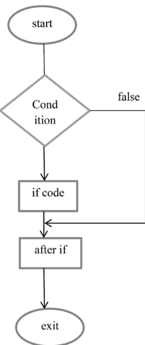

if 语句。

**示例：**

```kotlin
fun main(args: Array<String>) {
  var c = 3
  if (c > 0) {
    print("Yes,the number is positive")
  }
}
```

### If-Else 语句

If-Else 语句由两个语句块组成。当条件为真时，使用“if”语句运行该代码块；当条件为假时，使用“else”语句执行该代码块。

**语法：**

```kotlin
if (condition) {
  // 如果条件为真则执行的代码
} else {
  // 如果条件为假则执行的代码
}
```

**流程图：**

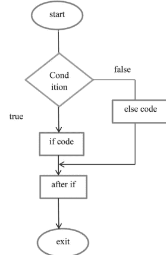

if-else 语句。

**示例：**

```kotlin
fun main(args: Array<String>) {
    var a = 7
    var b = 13
    if (a > b) {
        print("Number 7 is larger than 13")
    } else {
        println("Number 13 is larger than 7")
    }
}
```

### 作为三元运算符的 Kotlin If-Else 表达式

因为 if-else 返回一个结果，所以在 Kotlin 中可以被作表达式使用。与 Java 不同，Kotlin 中没有三元运算符，因为 if-else 根据条件返回值，其操作方式与三元运算符一样。

下面展示了使用 if-else 语句发现两个整数之间较大值的 Kotlin 程序：

```kotlin
fun main(args: Array<String>) {
    var c = 70
    var d = 50

    // if-else 返回值并将其存储在 max 变量中
    var max = if (c > d) {
        c
    } else {
        d
    }
    print("The Greater number is: $max")
}
```

### If-Else-If 阶梯表达式

用户可以在此处输入多个标准。所有的 "if" 语句都会被执行。所有条件都会逐一检查，如果发现其中任何一个为真，则运行与 if 语句关联的代码，并跳过所有其他语句，直到块结束。如果没有任何条件被满足，则默认执行最后一个 else 语句。

**语法：**

```kotlin
if (first-condition) {
    // 如果条件为真则执行的代码
} else if (second-condition) {
    // 如果条件为真则执行的代码
} else {
}
```

**流程图：**

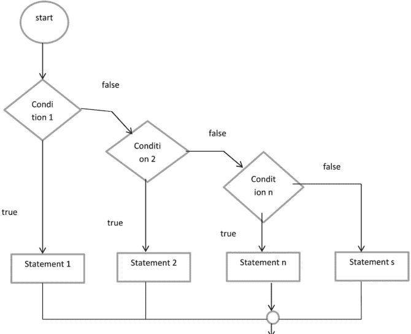

if-else-if 语句。

下面展示了判断一个数字是正数、负数还是零的 Kotlin 程序：

```kotlin
import java.util.Scanner
fun main(args: Array<String>) {
    // 为 scanner 类创建一个对象
    val reader = Scanner(System.`in`)
    print("Enter number: ")

    // 读取值
    var nums = reader.nextInt()
    var result = if (nums > 0) {
        "$nums is positive"
    } else if (nums < 0) {
        "$nums is negative"
    } else {
        "$nums is equal to zero"
    }
    println(result)
}
```

### 嵌套 If

嵌套 if 语句是嵌套在另一个语句内部的语句。如果第一个条件为真，则检查下一个条件。

**语法：**

```kotlin
if (condition1) {
    // code-1
    if (condition2) {
        // code-2
    }
}
```

**流程图：**

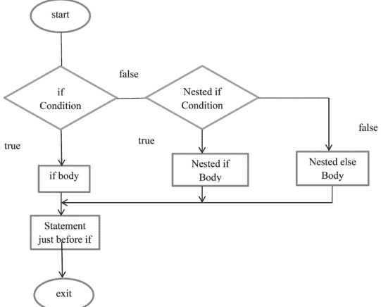

嵌套 if 语句。

## Kotlin 中的 While 循环

在编程中，循环用于持续运行一个代码块直到条件满足。while 循环由一个块和一个条件组成，在每次执行之前都会验证条件。while 循环可以被一系列语句。

**语法：**

```kotlin
while (condition) {
    // 要执行的代码
}
```

## Kotlin 中的 Do-While 循环

do 循环与 Java 类似，是控制流语句，它们在不验证条件的情况下至少运行一次块，然后完全取决于 do 块末尾的布尔条件来重复执行该块或不执行。与 while 循环相反，while 循环当条件变为真时才执行块，do-while 循环先执行代码，然后评估表达式或测试条件。

### do-while 循环的工作原理


在块中的所有语句执行后，会对条件进行评估。如果满足条件，则重新执行代码块。只要表达式求值为真，代码块的执行过程就会重复进行。如果表达式变为假，循环将退出，控制权转移到 `do-while` 循环之后的语句。

它也被称为后测试循环，因为它在块执行后才进行条件测试。

`do-while` 循环的语法如下：

```kotlin
do {
    // 要运行的代码
} while(condition)
```

流程图：

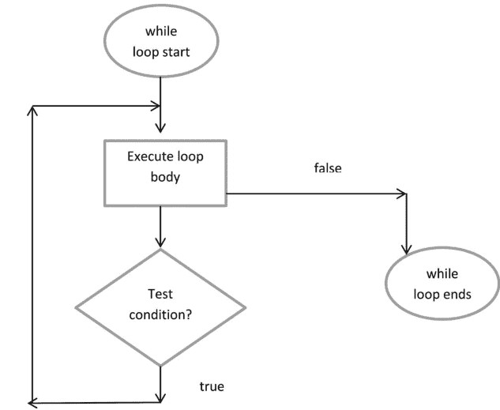

`do-while` 循环的语句说明。

## 一个使用 `do-while` 循环计算数字阶乘的 Kotlin 程序：

```kotlin
fun main(args: Array<String>) {
  var numb = 6
  var factorial = 1
  do {
    factorial *= numb
    numb--
  } while(numb > 0)
  println("The Factorial of 6 is $factorial")
}
```

## 使用 `do-while` 循环打印二倍数表的程序：

```kotlin
fun main(args: Array<String>) {
  var numb = 2
  var c = 1
  do {
    println("2 * $c = " + numb * c)
    c++
  } while(c < 11)
}
```

## KOTLIN 中的 FOR 循环

Kotlin 中的 `for` 循环等同于 C# 等其他语言中的 `foreach` 循环。这里的 `for` 循环用于遍历任何具有迭代器的数据结构。它的用法与 Java 或 C 等其他编程语言中的 `for` 循环不同。

Kotlin 中 `for` 循环的语法如下：

```kotlin
for(item in collection) {
  // 要执行的代码
}
```

Kotlin 中的 `for` 循环用于迭代以下内容，因为它们都提供了迭代器：

- 范围 (`Range`)
- 字符串 (`String`)
- 数组 (`Array`)
- 集合 (`Collection`)

## 使用 for 循环跨范围遍历

范围（`Range`）提供了一个迭代器，我们可以遍历它。跨越范围有多种方法。`for` 循环中使用运算符来确定该值是否在范围内。

以下程序是以各种方式遍历范围的示例，其中 `in` 是用于验证范围内值的运算符。如果值在范围之间，它将返回 `true` 并输出该值。

### 当我们遍历范围时打印这些值：

```kotlin
fun main(args: Array<String>) {
    for (c in 1..6) {
        print("$c")
    }
}
```

### 使用 `step` 3 遍历范围以进行跳跃：

```kotlin
fun main(args: Array<String>) {
    for (c in 1..10 step 3) {
        print("$c")
    }
}
```

### 除非使用 `downTo`，否则无法从上到下遍历范围：

```kotlin
fun main(args: Array<String>) {
    for (c in 5..1) {
        println("It print nothing")
    }
}
```

## 控制流语句

### 使用 `downTo` 从上到下遍历范围：

```kotlin
fun main(args: Array<String>) {
  for (c in 5 downTo 1) {
    print("$c")
  }
}
```

### 使用 `downTo` 从上到下遍历范围，然后 `step` 3：

```kotlin
fun main(args: Array<String>) {
  for (c in 10 downTo 1 step 3) {
    print("$c")
  }
}
```

## 使用循环遍历数组

数组（`Array`）是一种存储相同类型数据（如整数或字符串）的数据结构。因为它包含迭代器，因此可以使用循环遍历数组。每个数组都有一个起始索引，默认认为 0。

我们通过以下方式遍历数组：

- 不使用 `index` 属性
- 使用 `index` 属性
- 使用 `withIndex()` 库函数

### 利用 `index` 属性遍历数组：

```kotlin
fun main(args: Array<String>) {
  var nums = arrayOf(11, 22, 33, 44, 55, 66, 77, 88, 99, 100)
  for (num in nums){
    if (num%2 == 0) {
      print("$num")
    }
  }
}
```

### 使用 `index` 属性遍历数组：

```kotlin
fun main(args: Array<String>) {
    var colors = arrayOf("Green", "Yellow", "Blue",
    "Red", "White")
    for (i in colors.indices) {
        println(colors[i])
    }
}
```

### 使用 `withIndex()` 库函数遍历数组：

```kotlin
fun main(args: Array<String>) {
    var colors = arrayOf("Green", "Yellow", "Blue",
    "Red", "White")
    for ((index,value) in colors.withIndex()) {
        println("Element at $index")
    }
}
```

## 使用循环遍历字符串

字符串（`String`）包含迭代器，因此可以使用循环遍历字符串。我们可以通过以下方式遍历字符串：

- 不使用 `index` 属性
- 使用 `index` 属性
- 使用 `withIndex()` 库函数

### 不使用 `index` 属性遍历字符串：

```kotlin
fun main(args: Array<String>) {
    var s = "Hello World"
    for (c in s) {
        println(c)
    }
}
```

### 使用 `index` 属性遍历字符串：

```kotlin
fun main(args: Array<String>) {
    var s = "Hello World"
    for (i in s.indices) {
        println(s[i])
    }
}
```

### 使用 `withIndex()` 库函数遍历字符串：

```kotlin
fun main(args: Array<String>) {
    var s = "Hello World"
    for ((index,value) in s.withIndex()) {
        println("Character at $index is $value")
    }
}
```

## 控制流语句

## 使用循环遍历集合

集合（`Collection`）包含迭代器，因此可以使用循环遍历集合。我们可以通过以下方式遍历集合：

- 列表
- 映射

### 遍历列表：

```kotlin
fun main(args: Array<String>) {
    val list = listOf("A", "B", "C")
    for (item in list) {
        println(item)
    }
}
```

### 遍历映射：

```kotlin
fun main(args: Array<String>) {
    val map = mapOf("A" to 1, "B" to 2)
    for ((key, value) in map) {
        println("$key is $value")
    }
}
```

## 表达式中的 WHEN

`when` 表达式替换了其他语言中的 `switch`。在 Kotlin 中，`when` 也可以作为表达式使用，它会返回一个值，该值可以赋值给变量。

```kotlin
fun main(args: Array<String>) {
    val x = 1
    val result = when (x) {
        1 -> "One"
        2 -> "Two"
        else -> "Unknown"
    }
    println(result)
}
```

## 在 Kotlin 中使用 when 块的不同方式

我们可以使用逗号分隔多个分支。当某些分支具有共同逻辑时，我们可以将它们合并到一个分支中。在以下示例中，我们需要判断输入的 `largebody` 是行星还是不是；因此，我们将所有行星名称合并到一个分支中。任何与行星名称不同的内容都将导致执行 `else` 分支。

```kotlin
import java.util.Scanner
fun main(args: Array<String>) {
    var reader = Scanner(System.`in`)
    print("Enter the name of planet: ")
    var names = reader.next()
    when(names) {
        "Mercury", "Earth","Mars","Jupiter",
        "Neptune", "Saturn", "Venus", "Uranus" ->
            println("Planet")
        else -> println("Neither the planet nor star*")
    }
}
```

## 检查输入值在范围内

我们可以使用 `in` 或 `!in` 操作符来验证 `when` 块中提供的参数范围。在 Kotlin 中，`in` 操作符用于检查某个变量或属性是否存在于某个范围内。如果参数在特定范围内，`!in` 操作符返回 `false`（注：此处原文描述有误，逻辑应为在范围内返回 false，不在范围内返回 true）。

```kotlin
import java.util.Scanner
fun main(args: Array<String>) {
    var reader = Scanner(System.`in`)
    print("Enter month number of the year: ")
    var num = reader.nextInt()
    when(num) {
        in 1..3 -> println("It is the spring season")
        in 4..6 -> println("It is the summer season")
        in 7..8 -> println("It is the rainy season")
        in 9..10 -> println("It is the autumn season")
        in 11..12 -> println("It is the winter season")
        !in 1..12 -> println("Enter the valid month of year")
    }
}
```

## 控制流语句

### 检查提供的变量是否为特定类型

我们可以使用 `is` 操作符来验证 `when` 块中作为输入的变量的类型。如果变量是整数类型，`is Int` 返回 `true`；否则，返回 `false`。

```kotlin
fun main(args: Array<String>) {
  var num: Any = "Huboftutors"
  when (num) {
    is Int -> println("its an Integer")
    is String -> println("its a String")
    is Double -> println("its a Double")
  }
}
```

### 使用 When 代替 If-Else-If 链

`when` 可以代替 `if-else-if`。如果没有提供参数，分支条件将仅仅是布尔表达式，并且只有当其条件为 `true` 时才会形成分支：

```kotlin
fun isOdd(c: Int) = c % 2 != 0
fun isEven(c: Int) = c % 2 == 0
fun main(args: Array<String>) {
  var num = 8
  when{
    isOdd(num) -> println("Odd")
    isEven(num) -> println("Even")
    else -> println("neither even or odd")
  }
}
```

### 验证字符串是否包含特定前缀或后缀

下面的方法也可以用于检查提供的字符串中的前缀或后缀。如果字符串具有该前缀或后缀，它将返回 `true`；否则，返回 `false`。

```kotlin
fun hasPrefix(company: Any) = when (company) {
  is String -> company.startsWith("Huboftutors")
  else -> false
}
```

```kotlin
fun main(args: Array<String>) {
  var company = "Huboftutors a computer science portal"
  var result = hasPrefix(company)
  if (result) {
    println("Yes, string started with Huboftutors")
  } else {
    println("No, String does not started with Huboftutors")
  }
}
```

## KOTLIN 中的无标签中断 (BREAK)

在处理循环时，如果我们希望在满足条件后立即结束循环的执行，可以使用 `break` 或 `return` 表达式来离开循环。

本节将教我们如何利用 `break` 表达式来退出循环。当程序中遇到 `break` 表达式时，它会返回到最近的嵌套循环。

在 Kotlin 中，有两种类型的 `break` 表达式：无标签 `break` 表达式和带标签 `break` 表达式。我们将学习如何在 `while`、`do-while` 和 `for` 循环中使用无标签 `break` 表达式。

### While 循环中使用无标签 break

无标签 `break` 用于在满足特定条件时无需检查测试表达式直接跳出循环。控制权随后传递给下一个 `while` 块语句。

### while 循环中的 break 语法：

```kotlin
while(test expression) {
  // 要运行的代码
  if (break condition) {
    break
  }
  // 另一个要运行的代码
}
```

### 计算 1 到 10 整数和的 Kotlin 程序：

```kotlin
fun main(args: Array<String>) {
  var sum = 0
  var c = 1
  while(c <= 10) {
    sum += c
    c++
    if (c == 11) {
      break
    }
  }
  print("sum of integers from 1 to 10: $sum")
}
```

## 在 Kotlin 的 while 循环中使用带标签 break 的程序：

```kotlin
fun main(args: Array<String>) {
    var numbl1 = 4
    outer@ while (numbl1 > 0) {
        var numbl2 = 4
        inner@ while (numbl2 > 0) {
            if (numbl1 == 2)
                break@outer
            println("numbl1 = $numbl1, numbl2 = $numbl2")
            numbl2--
        }
        numbl1--
    }
}
```

当表达式 `(numbl1 == 2)` 为真时，执行 `break@outer`，结束标记为 `outer@` 的目标循环。

## 在 do-while 循环中使用带标签 break

带标签的 `break` 也用于 `do-while` 循环以结束目标循环。在这种情况下，我们为外层 `do-while` 循环使用了 `outer@`，为内层 `do-while` 循环使用了 `inner@`。

在 `do-while` 循环中，带标签 `break` 的语法如下：

```kotlin
outer@ do {
    // code..
    inner@ do {
        // code..
        if (break-condition) {
            break@outer
        }
    } while (condition)
} while (condition)
```

## 在 Kotlin 的 do-while 循环中使用带标签 break 的程序：


```kotlin
fun main(args: Array<String>) {
    var numbl1 = 4
    outer@ do {
        var numb2 = 4
        inner@ do {
            if (numbl1 == 2) {
                break@outer
                println("numbl1 = $numbl1, numb2 = $numb2")
                numb2--
            } while (numb2 > 0)
        numbl1--
    } while (numbl1 > 0)
}
```

我们在这里打印出与 `while` 循环相同的输出。当表达式 `(numbl1 == 2)` 为真时，执行 `break@outer` 命令，结束标记为 `outer` 的目标循环。

## 在 for 循环中使用带标签 break

我们也可以使用带标签的 `break` 在循环满足给定条件时停止目标循环。外层 for 循环被标记为 `outer@`，而内层 for 循环被标记为 `inner@`。for 循环的迭代通过迭代器完成。

for 循环中带标签 break 的语法：

```kotlin
outer@ for(iteration through iterator) {
    // code..
    inner@ for(iteration through iterator) {
        // code..
        if(break-condition) {
            break@outer
        }
    }
}
```

## 在 for 循环中采用带标签 break 的 Kotlin 程序：

```kotlin
fun main(args: Array<String>) {
    outer@ for (numb1 in 4 downTo 1) {
        inner@ for (numb2 in 4 downTo 1) {
            if (numb1 == 2) {
                break@outer
            }
            println("nbl1 = $nbl1; numb2 = $numb2")
        }
    }
}
```

## Kotlin 中无带标签的 CONTINUE

在本节中，我们将学习如何在 Kotlin 中利用 `continue`。在编写循环程序时，有时跳过循环的当前迭代是有益的。在这种情况下，我们可以使用程序的 `continue` 语句。`continue` 本质上用于在给定条件下重复循环。它会跳过后续语句并进入下一次迭代。

在 Kotlin 中，有两种类的 `continue` - 无标签的 continue 和带标签的 continue：

我们将看到如何在 while、do-while 和 for 循环中使用无标签的 continue。

## 在 while 循环中使用无带标签的 continue

在 Kotlin 中，无标签的 `continue` 用于跳过最近外层 while 循环的当前迭代。如果 `continue` 的条件为真，它将跳过 `continue` 之后的指令并返回 while 循环的开头。它将再次检查条件，循环将重复，直到该条件为假。

while 循环中无带标签 continue 的语法如下：

```kotlin
while(condition) {
    //code...
    if(condition for continue) {
        continue
    }
    //code...
}
```

## Flow图：

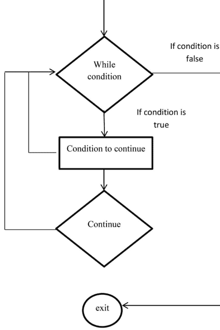

while 循环中的无标签 continue。

## while 循环中的 continue 在 Kotlin 程序中使用：

```kotlin
fun main(args: Array<String>) {
    var numb = 0
    while (numb <= 15) {
        if (numb % 3 == 0) {
            numb++
            continue
        }
        println(numb)
        numb++
    }
}
```

## 154 ■ 掌握 Kotlin：入门指南

在前面的程序中，我们打印整数并跳过所有 3 的倍数。表达式 `(numb % 3 == 0)` 用于判断一个数字是否能被 3 整除。如果数字是 3 的倍数，则增加它而不将其打印到标准输出。

## 在 do-while 循环中使用无带标签的 continue

我们也可以在 do-while 中使用无标签的 `continue` 跳过最近外层循环的迭代。在这种情况下，我们必须在块中包含 `continue` 条件。如果条件变为假，将跳转到 while 条件。

do-while 循环中无带标签 continue 的语法如下：

```kotlin
do {
  // code...
  if(condition for continue) {
    continue
  }
} while (condition)
```

## Flow图：

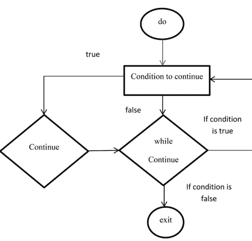

do-while 循环中的无标签 continue。

## 在 do-while 循环中使用 continue 的 Kotlin 程序：

```kotlin
fun main(args: Array<String>) {
    var numb = 1
    do {
        if (numb <= 5 || numb >= 15) {
            numb++
            continue
        }
        println(numb)
        numb++
    } while (numb < 20)
}
```

我们在前面的程序中使用条件 `(numb <= 5 || numb >= 15)` 跳过小于等于 5 或大于 15 的数字输出。结果是，它只打印数字 6–14。

## 循环中的无带标签 continue

我们也可以在 for 循环中使用无标签的 `continue` 跳过当前迭代到结束循环。在后面的程序中使用了数组和迭代器遍历数组。表达式 `i < 2` 跳过小于二的索引；因此，它不显示 0 和 1。

for 循环中无带标签 continue 的语法如下：

```kotlin
for(iteration through iterator) {
    //code..
    if(condition for continue) {
        continue
    }
}
```

## Flow图：

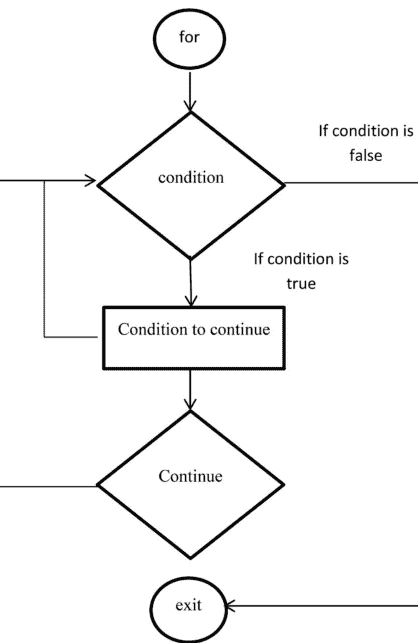

## 在 for 循环中使用 continue 的 Kotlin 程序：

```kotlin
fun main(args: Array<String>) {
    var colors = arrayOf("Green", "Yellow", "Blue", "White", "Orange")
    for (i in colors.indices) {
        if (i < 2) {
            continue
        }
        println(colors[i])
    }
}
```

## Kotlin 中带标签的 CONTINUE

在本主题中，我们将学习如何在 Kotlin 中利用 `continue`。在处理循环编程时，有时跳过当前迭代是有益的。在这种情况下，我们可以使用程序的 `continue` 语句。`continue` 本质上用于在给定条件下重复循环。它跳过后续语句并进入下一次迭代。

在 Kotlin 中，无标签 `continue` 跳过最近循环的迭代，而带标签 `continue` 跳过目标循环的迭代。可以通过 `inner@`、`outer@` 等标签来实现。我们在语句前面放置一个标签并用 `continue@` 调用它。

## While 循环中使用带标签 continue

在 while 循环中，带标签 `continue` 用于在满足指定条件时跳过目标块的迭代，无需检查 while 循环的条件。我们将外部循环标记为 `outer@`，内部循环标记为 `inner@`，则可以使用 `continue@outer` 跳过条件块中的指定条件。

while 循环中带标签 continue 的语法如下：

```kotlin
outer@ while(first-condition) {
    // code...
    inner@ while(second-condition) {
        // code...
        if(condition for continue) {
            continue@outer
        }
    }
}
```

## 在 while 循环中使用带标签 continue 的 Kotlin 程序：

```kotlin
fun main(args: Array<String>) {
    var numbl1 = 4
    outer@ while (numbl1 > 0) {
        numbl1--
        var numb2 = 4
        inner@ while (numb2 > 0) {
            if (numbl1 <= 2)
                continue@outer
            println("numbl1 = $numbl1, numb2 = $numb2")
            numb2--
        }
    }
}
```

## 在 do-while 循环中使用带标签 continue

在 do-while 循环中，我们也可以使用指定的 `continue`。我们在后面的程序使用了嵌套的 do-while 循环，将外部循环标记为 `outer@`，内部循环标记为 `inner@`。`continue` 条件在内层 do-while 循环中执行。如果条件为真，`continue@outer` 将跳过后续行或表达式并将控制权返回外部 while 重复。

在 do-while 循环中，带标签 continue 的语法如下：

```kotlin
outer@ do {
    // code...
    inner@ do {
        // code...
        if(condition for continue) {
            continue@outer
        }
    } while (first-condition)
} while (second-condition)
```

## 在 do-while 循环中使用带标签 continue 的 Kotlin 程序：

```kotlin
fun main(args: Array<String>) {
    var numb1 = 4
    outer@ do {
        numb1--
        var numb2 = 4
        inner@ do {
            if (numb1 <= 2)
                continue@outer
            println("numb1 = $numb1; numb2 = $numb2")
            numb2--
        } while (numb2 > 0)
    } while (numb1 > 0)
}
```

## 控制流语句 ■ 159

### 在 For 循环中使用带标签的 continue

此外，我们可以在循环中使用带标签的 `continue`。我们在下面的程序使用了嵌套循环，将外层循环标记为 `outer@`，内层循环标记为 `inner@`。`continue` 条件在内层循环中执行。如果满足条件，将跳过后续语句，并将控制传递给外层循环进行后续迭代。

### 循环中带标签 continue 的语法如下：

```kotlin
outer@ for (iteration through iterator) {
  // code.
  inner@ for (iteration through iterator) {
    // code.
    if (condition for continue) {
      continue@outer
    }
  }
}
```

### 使用带有 continue 标签的 for 循环的 Kotlin 程序：

```kotlin
fun main(args: Array<String>) {
  outer@ for (numb1 in 4 downTo 1) {
    inner@ for (numb2 in 4 downTo 1) {
      if (numb1 <= 3)
        continue@outer
      println("numb1 = $numb1; numb2 = $numb2")
    }
  }
}
```

### 总结

本章涵盖了控制流语句，我们学习了 `if`、`else`、`while` 循环、`do-while` 循环和 `for` 循环。此外，我们涵盖了表达式、带标签和不带标签的 `break` 以及带标签和不带标签的 `continue`。


## 数组与字符串、函数以及 Java 互操作

### 本章内容

- 数组与字符串
- 函数
- 递归与表达式
- 从 Java 调用 Kotlin

在第 4 章中，我们涵盖了 Kotlin 中的控制流语句。在本章中，我们将涵盖数组和字符串、包含 lambda 表达式的函数、递归以及内联函数。此外，我们还学习学习如何从 Java 调用 Kotlin。

## KOTLIN 中的数组

数组数据结构是几乎所有编程语言中最基础的数据结构之一。数组是一种允许我们在单个变量名下存储多个相同数据类型（如整数或字符串）项的数据结构。

数组在编程中用于组织数据，以便相关的值组可以方便地排序或搜索。

## 162 精通 Kotlin：初学者指南

数组具有以下基本属性：

- 它们存储在连续的内存中。
- 它们的索引允许我们通过程序进行访问（`array[1]`、`array[0]` 等）。
- 它们是可变的。
- 它们的大小是固定的。

### 数组数组
数组不是 Kotlin 中的原生数据类型，而是由 `Array` 类表示的相关项的可变集合。
在 Kotlin 中，数组可以用两种方式定义。

### 使用 `arrayOf()` 函数
通过向库函数 `arrayOf()` 传递元素值，我们可以生成数组。

语法：

```kotlin
val num = arrayOf(1, 2, 3, 4) // 类型 隐式声明
val num = arrayOf<Int>(1, 2, 3) // 类型 显式声明
```

使用 `arrayOf()` 和 `arrayOf<Int>` 函数创建数组的程序：

```kotlin
fun main() {
  // 使用 arrayOf() 声明数组
  var arrayname = arrayOf(11, 22, 33, 44, 55)
  for (c in 0..arrayname.size-1) {
    print("+arrayname[c]")
  }
  println()
  // 使用 arrayOf<Int> 声明数组
  var arrayname2 = arrayOf<Int>(1, 2, 3, 4, 5)
  for (c in 0..arrayname2.size) {
    print(" +arrayname2[c]")
  }
}
```

## 数组与字符串、函数以及 Java 互操作 ■ 163

### 使用数组构造函数
因为数组是 Kotlin 中的一个类，我们也可以使用 `Array` 构造函数来创建数组。

### 构造函数接受两个参数：

- 数组的大小。
- 一个接收给定元素索引并返回其初始值的函数。

## 语法：

```kotlin
val numb = Array(3, {c -> c * 1})
```

在上面的示例中，我们传递数组的大小为 3，并传递一个从 0 到 9 初始化元素值的 lambda 函数。

### 使用构造函数创建数组的程序：

```kotlin
fun main() {
    val arrayname = Array(5, { c -> c * 1 })
    for (c in 0..arrayname.size) {
        println(arrayname[c])
    }
}
```

除了这些之外，Kotlin 还提供了各种内置的工厂方法来创建原始数据类型的数组，如 `byteArray`、`intArray`、`shortArray` 等。尽管它们实现了相同的方法和属性，但这些类并没有扩展 `Array` 类。

### 例如，创建整数数组的工厂方法：

```kotlin
val numb = intArrayOf(1, 2, 3, 4)
```


# 精通 Kotlin：初学者指南

## 创建数组的其他工厂方法

创建数组的其他工厂方法包括：

- `byteArrayOf()`
- `charArrayOf()`
- `shortArrayOf()`
- `longArrayOf()`

## 数组的访问与修改

到目前为止，我们已经涵盖了如何在 Kotlin 中构建和初始化数组。让我们看看如何访问和修改它们。有两种选择：

- 使用 `get()` 和 `set()` 函数
- 使用索引：这允许我们通过程序访问（`array[1]`、`array[0]` 等）。它们是可变的，且大小是固定的。

## 字符串操作

### 访问字符串元素

在 Kotlin 中访问字符串的元素，请使用以下代码：

```kotlin
fun main(args: Array<String>) {
    // 逐个访问字符串元素
    var str = "Hiiii"
    println(str[0])
    println(str[1])
    println(str[2])
    println(str[3])
    println(str[4])

    // 使用循环访问字符串元素
    var str2 = "Everyone"
    for (c in str2.indices) {
        print(str2[c] + " ")
    }
}
```

- 使用 `get` 函数：返回指定索引处的字符，该索引作为输入传递给 `get` 函数。
- 遍历字符串：要访问字符串中的字符，请使用循环。

### 字符串模板

**字符串模板**：模板表达式是经过评估的代码片段，结果以字符串形式交付。模板表达式出现在转义字符串和原始字符串中。字符串模板以美元符号 `$` 开头，后面跟着变量名或用大括号括起来的任意表达式。

```kotlin
fun main(args: Array<String>) {
    var num = 10
    println("The value of n is $num")

    // 使用字符串
    val str = "Everyone"
    println("$str is string which length is ${str.length}")
}
```

### 字符串的基本属性和函数

字符串具有以下基本属性和函数：

- **Length (长度)**：返回字符串的长度。

```kotlin
var st = "String"
println(st.length)
```

- **get(index)**：返回该特定索引处的字符。

```kotlin
st.get(3) // 输出: i
```

- **subSequence(start, end)**：返回从开始到结束（不包含结束处）的子字符串。

```kotlin
st.subSequence(1, 4) // 输出: tri
```

- **str.compareTo(string)**：如果 `str == string`，则返回 0。

**使用上述属性和函数的 Kotlin 程序：**

```kotlin
fun main(args: Array<String>) {
    var g1 = "PeeksForPeeks"
    var el = "Peeks"
    println(g1.length)
    println(g1.get(4))
    println(g1.subSequence(0, 5))
    println(g1.compareTo(el))
}
```

## 字符串字面量

在 Kotlin 中有两种字符串字面量：

- 转义字符串
- 原始字符串

### 转义字符串

转义字符串用双引号 (`"..."`) 定义，可能包含如 `\n`、`\t` 等转义字符。

**转义字符串的 Kotlin 程序：**

```kotlin
fun main(args: Array<String>) {
    // 转义字符串
    val str1 = "World \n is \n beautiful"
    println(str1)
}
```

### 原始字符串 – 多行字符串

原始字符串被三个引号 (`""" """`) 包围，且不包含转义字符。因为它允许我们将字符串分成许多行，因此也被称为多行字符串。

**原始字符串 Kotlin 程序：**

```kotlin
fun main(args: Array<String>) {
    // 原始字符串 = 多行字符串
    var strl = """My
        |name
        |is
        |Harsh
    """.trimMargin()
    println(strl)
}
```

### 转义字符

一些转义字符包括：

- `\"` 用于双引号
- `\b` 用于退格
- `\n` 用于换行
- `\'` 用于单引号
- `\r` 用于回车
- `\\` 用于反斜杠
- `\t` 用于制表符

### 字符串相等性

Kotlin 通过两种独立的方式比较特定类型的实例。这一特性将 Kotlin 与其他编程语言区分开来。有两种相等性：

- 结构相等性
- 引用相等性

#### 结构相等性

`==` 运算符及其反向 `!=` 运算符评估结构相等性。表达式 `x == y` 默认转换为对该类型的 `equals()` 方法的调用。

#### 引用相等性

在 Kotlin 中，使用 `===` 运算符及其反向 `!==` 运算符测试引用相等性。只有当两个相同类型的实例指向同一个内存位置时，该相等性才返回 `true`。当用于运行时转换为原始类型的类型时，`===` 转换为 `==` 检查，`!==` 转换为 `!=` 检查。

**演示结构相等性和引用相等性的程序：**

```kotlin
fun main(args: Array<String>) {
    var a = "PeeksForPeeks"
    var b = "PeeksForPeeks"
    var c = "Peeks"
    println(a == b) // true，因为它们指向相同的 StringPool
    println(a == c) // false，因为值不相等
    println(a === c) // false
}
```

## Kotlin 中的函数

函数是执行特定任务的代码。在编程中，函数用于将代码分成更小的模块，使程序更易管理。例如，如果我们需要计算两个数字之和，可以创建一个 `fun sum()`。

```kotlin
fun sum(c: Int, d: Int): Int {
    return c + d
}
```

### 函数调用示例

```kotlin
fun mul(a: Int, b: Int): Int {
    return a * b
}

fun main(args: Array<String>) {
    var result = mul(4, 6)
    println("Multiplication of 2 numbers is: $result")
}
```

**解释**：在上面的程序中，我们带有两个参数调用了 `mul(4, 6)` 函数。当函数被调用时，控制权传递给 `mul()`，它开始执行块中的语句。它计算两个整数的乘积，并将结果存储在变量中。该函数返回整数值并将控制权传回 `main()`，`main()` 接收返回值。函数产生的值随后存储在可变变量中，`println()` 将其打印到标准输出。

### 多参数函数调用

**使用所有参数调用 `students()` 方法的程序：**

```kotlin
fun students(names: String, grades: Char, roll_no: Int) {
    println("The Name of the students is : $names")
    println("The Grade of the students is: $grades")
    println("The Rollno of the students is: $roll_no")
}

fun main(args: Array<String>) {
    val name = "Pariniti"
    val rollno = 23
    val grade = 'C'
    students(name, grade, rollno)
    students("Gautam", 'C', 25)
}
```

**解释**：在上面的程序中，我们按照相同的顺序提供参数来调用 `students()` 方法。当我们尝试颠乱参数顺序时会发生错误。在第一次调用中，我们使用变量来提供参数，而在第二次调用中，我们直接传递参数值而不将其存储在变量中。因此，这两种调用函数的方法都是有效的。

## Kotlin 中的默认参数和命名参数

大多数编程语言都要求我们在调用函数时声明该函数所接收的所有参数，但 Kotlin 的一个显著特征是，在调用该函数时，我们不需要指定该函数接受的所有参数。我们可以移除这一要求并使参数变为可选的，从而允许我们在调用函数时选择是否提供参数。

Kotlin 中的函数参数之间用逗号分隔，并使用 Pascal 命名法定义。

```kotlin
fun fun_names(names1: data_type, names2: data_type)
```

在 Kotlin 中，有两种类型的参数：

- 默认参数
- 命名参数

### Kotlin 中的默认参数

在调用函数时不需要显式指定的参数被称为默认参数。如果调用函数时未提供任何参数，则函数的默认参数将作为参数使用。如果在调用函数期间提供了参数，则它们将作为函数参数使用。

默认参数有三类使用场景：

- 调用函数时未传递任何参数
- 调用函数时传递了部分参数
- 调用函数时传递了所有参数

#### 调用函数时未传递任何参数

当调用函数时不提供任何参数时，函数参数为默认参数。在定义函数时，我们必须初始化变量。

**在 Kotlin 中不提供任何参数调用 `students()` 方法的程序：**

```kotlin
// 函数定义中的默认参数：names, standard and roll_no
fun students(names: String = "Praniti", standard: String = "IX", roll_no: Int = 11) {
    println("The Name of the students is: $names")
    println("The Standard of the students is: $standard")
    println("The Roll no of the students is: $roll_no")
}

fun main(args: Array<String>) {
    val names_of_students = "Gautam"
    val standard_of_students = "VII"
    val roll_no_of_students = 23
    students() // 在调用 students 时未传递任何参数
}
```

**解释**：在前一个程序中，我们使用了 `student` 函数，它接收三个参数：names、standard 和 roll no。值得注意的是，我们为学生的每个参数都分配了一个值。这是为了确保在调用 `students()` 函数时未传递任何参数的情况下，能够使用默认设置。因此，由于前面的程序没有提供任何参数，它使用默认参数作为函数参数，并将默认值输出到标准输出。

#### 调用函数时传递了部分参数

调用函数时提供的某些参数将作为函数参数使用。默认值将用于未从函数调用中获取值的形式参数。

**调用 `students()` 方法并传递某些参数的 Kotlin 程序：**

```kotlin
// 函数定义中的默认参数：names, standard and roll_no
fun students(names: String = "Praniti", standard: String = "IX", roll_no: Int = 13) {
    println("The Name of the students is: $names")
    println("The Standard of the students is: $standard")
    println("The Roll no of the students is: $roll_no")
}

fun main(args: Array<String>) {
    val names_of_students = "Gautam"
    val standard_of_students = "VII"
    val roll_no_of_students = 24
    // 仅传递了两个参数 name 和 standard
    students(names_of_students, standard_of_students)
}
```

**解释**：在前一个程序中，我们使用了 `student` 函数，它接收三个参数：names、standard 和 roll no。值得注意的是，我们为学生的每个参数都分配了一个值。这是为了确保在调用函数时未传递任何参数的情况下，能够使用默认设置。

#### 调用函数时传递了所有参数

在这种情况下，我们按照函数定义的顺序传递参数。

**调用函数时传递所有参数的 Kotlin 程序：**

```kotlin
// 函数定义中的参数：names, standard and roll_no
fun students(names: String = "Praniti", standard: String = "IX", roll_no: Int = 13) {
    println("The Name of the students is: $names")
    println("The Standard of the students is: $standard")
    println("The Rollno of the students is: $roll_no")
}

fun main(args: Array<String>) {
    val names_of_students = "Gaurav"
    val standard_of_students = "VII"
    val roll_no_of_students = 25
    // 按照定义的顺序传递 names, standard 和 roll_no 的参数
    students(names_of_students, standard_of_students, roll_no_of_students)
}
```

**解释**：在前一个程序中，我们把所有参数都给了 `students` 函数，这覆盖了函数参数的默认值。因此，它按顺序传递给形式参数的值。

### Kotlin 中的命名参数

命名参数是在调用函数时使用名称提供的参数。在调用函数时，我们必须使用要传递实际参数值的形式参数的名称。

**以随机顺序传递参数执行 `students()` 的 Kotlin 程序（错误示例）：**

```kotlin
// 函数定义中的默认参数：names, standard and roll_no
fun students(names: String = "Praniti", standard: String = "X", roll_no: Int = 13) {
    println("The Name of the students is: $names")
    println("The Standard of the students is: $standard")
    println("The Roll no of the students is: $roll_no")
}

fun main(args: Array<String>) {
    val names_of_students = "Gautam"
    val standard_of_students = "VII"
    val roll_no_of_students = 23
    // 将 names_of_students 传递给 name
    // 将 roll_no_of_students 传递给 standard (类型不匹配，会报错)
    students(names_of_students, roll_no_of_students)
}
```

在前一个程序中，我们没有按照函数中指定的顺序发送参数。因此，它返回了编译错误。

**使用命名参数调用 `students()` 的程序（正确示例）：**

```kotlin
// 函数定义中的默认参数：names, standard and roll_no
fun students(names: String = "Praniti", standard: String = "X", roll_no: Int = 13) {
    println("The Name of the students is: $names")
    println("The Standard of the students is: $standard")
    println("The Roll no of the students is: $roll_no")
}

fun main(args: Array<String>) {
    val names_of_students = "Gautam"
    val standard_of_students = "VII"
    val roll_no_of_students = 23
    // 使用命名参数，顺序可以任意
    students(names = names_of_students, roll_no = roll_no_of_students, standard = standard_of_students)
}
```


# 180 精通 Kotlin：入门指南

```kotlin
students(names: String = "Praniti", standard: String = "X", roll_no: Int = 13) {
    println("The Name of the students is: $names")
    println("The Standard of the students is: $standard")
    println("The Rollno of the students is: $roll_no")
}
```

```kotlin
fun main(args: Array<String>) {
    val name_of_students = "Gautam"
    val standard_of_students = "VII"
    val roll_no_of_students = 23
    // 使用函数中定义的名称传递参数
    students(names = name_of_students, roll_no = roll_no_of_students)
}
```

**解释：** 在这种情况下，我们使用命名参数将实际参数传递给形式参数。我们只为 name 和 roll no 提供了具体值；因此，它打印了“Student standard”的默认值。

# Kotlin 中的递归

我们将学习如何使用 Kotlin 的递归函数。在 Kotlin 中，我们可以像在其他编程语言中一样利用递归。

递归函数会调用自身，这种循环的行为被称为递归。

当函数被调用时，可能发生两种情况：

- 常规函数调用
- 递归函数调用

## 常规函数调用

当从 `main()` 块中调用函数时，它被称为常规函数调用。在下面的示例中，`sum()` 被逐个调用，并在返回数字之和之前执行其指令。如果我们想重新运行代码，必须再次从 `main` 块中调用 `sum()`。

### 从 main() 块调用 sum() 函数：

```kotlin
fun sum(a: Int, b: Int): Int {
    val numb = a + b
    return numb
}

fun main(args: Array<String>) {
    sum()
}
```

## 递归函数调用

当函数调用自身时，这被称为递归函数。每个递归函数都应该包含终止条件，否则程序将进入无限循环，导致栈溢出错误。

### 从其自身的块中调用 callMe() 函数：

```kotlin
fun callMe(a: Int) {
    println(a)
    if (a > 0) callMe(a - 1)
}

fun main(args: Array<String>) {
    var n = 5
    callMe(n)
}
```

在这种情况下，我们利用了终止条件 `(a > 0)`，否则它会进入无限循环。它还打印了从 5 到 0 的值。

### 示例一：在不使用终止条件下计算数字的阶乘

```kotlin
// 使用递归的阶乘程序
fun Fact(numb: Int): Long {
    return numb * Fact(numb - 1) // 没有终止条件
}

// main 方法
fun main() {
    println("The Factorial of 5 is: " + Fact(5))
    // 递归调用
}
```

### 示例二：使用终止条件获取数字的阶乘

```kotlin
// 使用递归的阶乘程序
fun Fact(numb: Int): Long {
    return if (numb == 1) numb.toLong() // 终止条件
    else numb * Fact(numb - 1)
}

// main 方法
fun main() {
    println("The Factorial of 5 is: " + Fact(5))
    // 递归调用
}
```

### 示例三：使用递归获取数组元素的之和
传递了两个参数：数组和数组的大小

```kotlin
fun sum(args: Array<Int>, index: Int): Int {
    return if (index <= 0) 0
    else sum(args, index - 1) + args[index - 1]
}

// 递归函数调用
fun main() {
    // 数组初始化
    val array = arrayOf(11, 22, 33, 44, 55, 66, 77, 88, 99, 100)
    // 数组大小
    val ny = array.size
    val result = sum(array, ny)
    // 常规函数调用
    println("Sum of array elements is: $result")
}
```

**解释：** 我们初始化了一个数组并将其作为参数传递给 `sum()` 方法。索引值在递归调用中减 1。如果索引为零或更小，程序终止并返回所有元素的总和。

# Kotlin 中的尾递归

在传统的递归调用中，我们首先执行递归调用，然后获取递归调用的返回值并计算结果。然而在尾递归中，首先执行计算，然后执行递归调用，并将当前步骤的结果传递到下一次递归调用。最终，递归和尾递归发送相同的结果。

尾递归必须遵循的规则是：递归调用应该是方法的最后一次调用。

## 使用尾递归的优势

- 在尾递归中，递归调用是函数执行的最后一项，当前函数中没有其他需要执行的内容。因此，不需要在栈内存中保存当前函数。

# 186 精通 Kotlin：入门指南

## Lambda 类型中的类型推断

Kotlin 中的类型推断可以帮助编译器确定 Lambda 表达式的类型。下面展示了计算两个数字之和的 Lambda 表达式。

```kotlin
val sum = { x: Int, y: Int -> x + y }
```

在这种情况下，Kotlin 编译器将其评估为一个接收两个 `Int` 参数并返回一个 `Int` 值的函数。

```
(Int, Int) -> Int
```

如果我们想返回一个 `String` 值，可以使用内置的函数 `toString()` 方法。

```kotlin
val sum1 = { x: Int, y: Int ->
    val num = x + y
    num.toString() // 将 Integer 转换为 String
}

fun main(args: Array<String>) {
    val result1 = sum1(12, 7)
    println("Sum of two numbers is: $result1")
}
```

Kotlin 编译器将上述程序自动评估为一个接受两个整数值并返回字符串的函数。

## Lambda 中的类型声明

我们的 Lambda 表达式的类型必须显式声明。如果 Lambda 不返回值，我们可以使用 `Unit`：

模式：`(输入) -> 输出`

### 带有返回类型的 Lambda 示例：

```kotlin
val lambda1: (Int) -> Int = { x -> x * x }
val lambda2: (String, String) -> String = { x, y -> x + y }
val lambda3: (Int) -> Unit = { print(it) }
```

## Lambda 可以作类扩展：

```kotlin
val lambda4: String.(Int) -> String = { this + it }
```

它代表单个参数的隐式名称。

### 当 Lambda 用作类扩展时的程序：

**解释：** 前面的示例将 Lambda 表达式作为类扩展。我们使用了上述格式来传递参数。`this` 关键字用于字符串和 Lambda 中给出的 `Int` 参数。代码体拼接了两个值并返回给变量 `result`。

### it: 单个参数的隐式名称
在大多数情况下，Lambda 只有一个参数。在这里它用于指示传递给 Lambda 表达式的单个参数。

## 利用 Lambda 函数简写形式的程序：

```kotlin
val numb = arrayOf(1, -2, 3, -4, 5)

fun main(args: Array<String>) {
    println(numb.filter { it > 0 })
}
```

## 使用 Lambda 函数全写形式的程序：

```kotlin
val numb = arrayOf(1, -2, 3, -4, 5)

fun main(args: Array<String>) {
    println(numb.filter { item -> item > 0 })
}
```

### 从 Lambda 表达式返回值
Lambda 表达式执行后返回的最终值。Lambda 函数可以返回任何整数、字符串或布尔值。

## 使用 Lambda 函数返回 String 值的 Kotlin 程序：

```kotlin
val find = fun(numb: Int): String {
    if (numb % 2 == 0 && numb < 0) {
        return "The number is even and negative"
    } else if (numb % 2 == 0 && numb > 0) {
        return "The number is even and positive"
    } else if (numb % 2 != 0 && numb < 0) {
        return "The number is odd and negative"
    } else {
        return "The number is odd and positive"
    }
}

fun main(args: Array<String>) {
    val result = find(112)
    println(result)
}
```

## 匿名函数

匿名函数与普通函数非常相似，只是在声明中省略了函数的名称。匿名函数的体可以是表达式也可以是代码块。

### 示例一：函数体作为表达式

```kotlin
fun(x: Int, y: Int): Int = x * y
```

### 示例二：函数体作为代码块

```kotlin
fun(x: Int, y: Int): Int {
    val mul = x * y
    return mul
}
```

## 返回类型与参数

返回类型和参数的提供方式与普通函数相同，如果参数可以从上下文中推断，也可以省略。

如果函数是一个表达式，可以从函数自动推断返回类型；否则，匿名函数必须显式提供一个代码块。

## Lambda 表达式与匿名函数的区别

唯一的区别是非局部返回的行为。没有标签的 `return` 语句始终从声明的函数返回。

这意味着 Lambda 表达式中的 `return` 会从闭包函数返回，而匿名函数中的 `return` 则从匿名函数本身返回。

## 调用匿名函数的程序：

```kotlin
// 体作为表达式的匿名函数
val anonymous1 = fun(a: Int, b: Int): Int = a + b
```

```kotlin
// 体作为代码块的匿名函数
val anonymous2 = fun(x: Int, y: Int): Int {
    val mul = x * y
    return mul
}
```

```kotlin
fun main(args: Array<String>) {
    // 调用函数
    val sum = anonymous1(13, 4)
    val mul = anonymous2(5, 6)
    println("Sum of two numbers is: $sum")
    println("Multiply of two numbers is: $mul")
}
```

# 192 精通 Kotlin：入门指南

```kotlin
fun main(args: Array<String>) {
    println("The Main function starts")

    inlinedFunc(
        {
            println("Lambda expression 1")
            return@inlinedFunc
        },
        {
            println("Lambda expression 2")
        }
    )

    println("The Main function ends")
}

// 内联函数
inline fun inlinedFunc(lmbd1: () -> Unit, lmbd2: () -> Unit) {
    lmbd1()
    lmbd2()
}
```

**解释：** 我们将两个 lambda 表达式作为参数调用了 `inlinedFunc()` 方法。当从主函数中调用它时，我们将两者都作为参数传递给内联函数。在内联代码中，`lmbd1()` 调用第一个表达式，而 `return` 关键字会导致调用它的主函数的 lambda 表达式退出。

## 跨行关键字
在前一个程序中的 lambda `return` 会同时退出内联函数和闭包函数。为了防止 lambda 表达式返回，我们可以使用跨行标记。如果在 lambda 表达式中遇到 `return` 语句，它将产生编译错误。

### 示例：

```kotlin
fun main(args: Array<String>) {
    println("The Main function starts")
    inlinedFunc(
        {
            println("Lambda-expression 1")
            return // 这会产生编译错误
        },
        {
            println("Lambda-expression 2")
        }
    )
    println("The Main function ends")
}

inline fun inlinedFunc(crossinline lmbd1: () -> Unit, lmbd2: () -> Unit) {
    lmbd1()
    lmbd2()
}
```

## 数组与字符串、函数以及 Java 互操作性 ■ 193

### noinline

如果我们希望传递给内联函数的内联 lambda 不进行内联，我们可以在某些函数参数上使用 `noinline` 修饰符。

```kotlin
fun main(args: Array<String>) {
    println("The main function starts")
    inlinedFunc(
        {
            println("Lambda-expression 1")
            return@inlinedFunc // 这在编译时通过
        },
        {
            println("Lambda-expression 2")
            return // 这会产生编译器错误
        }
    )
    println("The Main function ends")
}

inline fun inlinedFunc(lmbd1: () -> Unit, noinline lmbd2: () -> Unit) {
    lmbd1()
    lmbd2()
}
```


## 实例化类型参数

有时我们需要知道调用期间传递了什么参数。我们在调用函数时传递参数，并可以使用 `reified` 修饰符获取参数类型。

```kotlin
fun main(args: Array<String>) {
    genericFunc<String>()
}

inline fun <reified D> genericFunc() {
    print(D::class)
}
```

## 内联的属性

内联函数将代码复制到调用位置，而 `inline` 关键字将内联的属性访问器方法复制到调用位置。`inline` 修饰符可以用于没有相应字段的属性访问器。

```kotlin
fun main(args: Array<String>) {
    print(flag)
}

fun foo(x: Int): Int {
    var c = x
    return c
}

inline var flag: Boolean
    get() = foo(10) == 10
    set(flag) { flag }
```

## Kotlin 中的中缀函数符号

在这个主题中，我们将介绍 Kotlin 函数使用的中缀表示法。Kotlin 中带有 `infix` 关键字标记的函数也可以使用中缀表示法调用，这意味着调用不需要括号和点（.）。
在 Kotlin 中，中缀函数表示法有两种形式：

- 标准库中缀函数符号
- 用户定义的中缀函数符号

### 标准库中缀函数符号

当我们使用 `and`、`or`、`shr`、`shl` 等运算符时，编译器会查找并调用我们想要的函数。还有其他标准库中缀表示法方法；但我们在这里介绍其中几个。
让我们逐一查看一些中缀表示法。

#### 1. 使用位与运算符的 Kotlin 程序

```kotlin
fun main(args: Array<String>) {
    var x = 14
    var y = 11
    var z = 10

    // 使用点 . 调用 (x > y)
    var result1 = (x > y).and(x > z)
    println("The Boolean result1 = $result1")

    // 使用中缀符号调用
    var result2 = (x > y) and (x > z)
    println("The Boolean result1 = $result2")
}
```

**解释：** 我们在此处使用中缀调用了 `x.and(y)` 方法（x and y）。在标准输出中，两者的结果是相同的。

#### 2. 采用有符号右移 (shr) 运算符的 Kotlin 程序

```kotlin
fun main(args: Array<String>) {
    var x = 8

    // 使用中缀符号调用
    var result1 = x shr 2
    println("Signed shift right by 2 bit: ${result1}")

    // 使用点和括号调用
    var result2 = x.shr(1)
    println("The Signed shift right by 1 bit: ${result2}")
}
```

**解释：** 在前一个程序中，我们使用了符号右移运算符。首先使用中缀符号进行操作，然后使用点符号。

#### 3. 采用递增和递减运算符的 Kotlin 程序

```kotlin
fun main(args: Array<String>) {
    var x = 8
    var y = 4

    x++
    println("The value of x is $x")

    y--
    println("The value of y is $y")
}
```

### 用户定义的中缀函数

如果满足以下条件，我们就可以编写中缀函数：

- 它必须是类成员函数或扩展函数。
- 它只能有一个参数。
- 它必须以 `infix` 关键字为前缀标记。

## Lambda 表达式与高阶函数

```kotlin
var lambda = { println("Huboftutors: A Computer Science portal for Hub") }

fun higherfunc(lmbd: () -> Unit) {
    lmbd() // 调用 lambda 表达式
}

fun main(args: Array<String>) {
    // 调用高阶函数
    higherfunc(lambda) // 将 lambda 作为参数
}
```

**解释：** 让我们逐步查看上面的程序。

在顶部，我们定义了一个 lambda 表达式，其中包含 `print()`，用于将字符串打印到标准输出。

```kotlin
var lambda = { println("Huboftutors: A Computer Science portal for Hub") }
```

之后，我们定义了一个带有一个参数的高阶函数。

```kotlin
fun higherfunc(lmbd: () -> Unit)
```

- 接收的 lambda 参数在本地被称为 `lmbd`。
- 符号 `()` 表示该函数不接受任何参数。
- `Unit` 符号表示该函数不返回任何值。
- 我们在 `main` 函数中通过提供 lambda 表达式作为参数调用了高阶函数。

```kotlin
higherfunc(lambda)
```

### 返回整数值的 Kotlin lambda 表达式程序

```kotlin
// lambda 表达式 = {x: Int, y: Int -> x + y}
var lambda = { x: Int, y: Int -> x + y }

// 该高阶函数接收 lambda 作为参数
fun higherfunc(lmbd: (Int, Int) -> Int) {
    var results = lmbd(2, 4) // 通过传递参数调用 lambda 表达式
    println("Sum of two numbers is: $results")
}

fun main(args: Array<String>) {
    higherfunc(lambda) // 将 lambda 作为参数
}
```

**解释：** 让我们逐步查看上方的程序。
在顶部，我们定义了一个返回整数值的 lambda 表达式。

```kotlin
var lambda = { x: Int, y: Int -> x + y }
```

然后，我们定义了一个接受 lambda 表达式作为参数的高阶函数。

```kotlin
fun higherfunc(lmbd: (Int, Int) -> Int)
```

- 接收的 lambda 参数在本地被称为 `lmbd`。
- `(Int, Int)` 表示该函数接受两个整数参数。
- `Int` 表示该函数返回一个整数值。

我们在 `main` 函数中通过传递 lambda 作为参数调用了高阶函数。

```kotlin
higherfunc(lambda)
```

### 将函数作为参数传递给高阶函数

函数可以作为参数传递给高阶函数。可能传递的函数有两类：

- 返回 `Unit` 的方法
- 返回整数、字符串等任何值的函数。

#### 返回 Unit 的 Kotlin 函数传递程序

```kotlin
// 普通函数的定义
fun printMe(s1: String): Unit {
    println(s1)
}

// 高阶函数的定义
fun higherfunc(strl: String, myfunc: (String) -> Unit) {
    // 使用本地名称调用普通函数
    myfunc(strl)
}

fun main(args: Array<String>) {
    // 调用高阶函数
    higherfunc("Huboftutors: A Computer Science portal for Hub", ::printMe)
}
```

**解释：** 在顶部，我们构建了一个普通方法 `printMe()`，它接收一个字符串参数并返回一个 `Unit`。

```kotlin
fun printMe(s1: String): Unit { }
```

- `(s1: String)` 是唯一的参数
- `Unit` 代表返回类型

因此，高阶函数定义为：

```kotlin
fun higherfunc(strl: String, myfunc: (String) -> Unit)
```

它接收两个参数。一个是字符串类型，另一个是函数。

- `strl: String` 表示一个字符串参数。
- `myfunc: (String) -> Unit` 表示它接受函数作为参数并返回 `Unit`。

通过提供字符串和函数作为参数，从 `main` 函数调用高阶函数。

```kotlin
higherfunc("Huboftutors: A Computer Science portal for Hub", ::printMe)
```

#### 返回整数值的函数传递程序

```kotlin
// 普通函数的定义
fun add(x: Int, y: Int): Int {
    var sums = x + y
    return sums
}

// 高阶函数的定义
fun higherfunc(addfunc: (Int, Int) -> Int) {
    // 使用本地名称调用普通函数
    var results = addfunc(13, 6)
    print("the sum of two numbers is: $results")
}

fun main(args: Array<String>) {
    // 调用高阶函数
    higherfunc(::add)
}
```

### 从高阶函数返回一个函数

函数可以从高阶函数返回。在返回函数时，我们必须在高阶函数的返回类型中定义普通函数的参数类型和返回类型。

Kotlin 中返回另一个函数的函数程序：

```kotlin
// 函数声明
fun mul(x: Int, y: Int): Int {
    return x * y
}

// 高阶函数声明
fun higherfunc(): ((Int, Int) -> Int) {
    return ::mul
}

fun main(args: Array<String>) {
    val result = higherfunc()
    println("Result is: ${result(10, 5)}")
}
```

## Java 互操作性

### @JvmStatic

```kotlin
@JvmStatic fun add(val x: Int, val y: Int): Int {
    return x + y
}

fun sub(val x: Int, val y: Int): Int {
    return x - y
}
```

```java
// Java usage
xyz.add(); // works fine
xyz.sub(); // error: not a static method
xyz.Companion.add(); // instance method remains
XYZ.Companion.sub(); // the only way to call it
```

### 实例字段

Kotlin 有一个特性，允许我们将属性作为 Java 中的实例字段。通过在属性上使用 `@JvmField` 注解来实现这一点。这些实例字段的可见性与 Kotlin 属性的可见性相同。但属性必须具有备份字段，并且不能带有 `private`、`open`、`const` 或 `override` 修饰符。

**示例：**

```kotlin
// Kotlin code
class XYZ(z: Int) {
    @JvmField val id = z
}
```

该属性现在可以在 Java 中这样访问：

```java
XYZ obj = new XYZ(5);
System.out.println(obj.id);
```

### 检查异常

在 Kotlin 中，所有异常都是未检查的。因此，Kotlin 函数的 Java 签名从未声明或处理异常。为了解决这个问题，Kotlin 函数必须标记有 `@Throws` 注解，用以指定将抛出的异常。

**示例：**

```kotlin
// filename example.kt
package Samples

@Throws(IOException::class)
fun print() { }
```

```java
// Java code trying to call the above function
try {
    Samples.print();
} catch (IOException e) {
}
```

### Java 互操作性 – 使用 Kotlin 调用 Java

Kotlin 的设计考虑了互操作性。它方便了在内部对 Java 代码的使用。简单来说，Kotlin 类或函数可以与 Java 类和方法相关。

#### Java 中的 Getters 和 Setters

在 Kotlin 中，在 Java 中声明的所有类型的 getters 和 setters 都表示为属性。因此，为了访问 Java 类数据成员的 getters 和 setters，在 Kotlin 中必须作为属性来引用它们。

```java
// the Java class
public class Example {
    private int values;

    public int getValue() {
        return values;
    }

    public void setValue(int values) {
        this.values = values;
    }
}
```

名为 `examplex.kt` 的 Kotlin 文件：

```kotlin
// Kotlin file
fun main() {
    val ob = Example()
    ob.values = 5 // 这将调用 setter 函数
    println(ob.values) // 这将调用 getter 函数
}
```

#### 方法

在 Kotlin 内部调用 Java 方法是一个简单的想法。Java 和 Kotlin 中的参数以及返回值类型都是相同的。`void` 返回类型是这一规则的例外。在 Kotlin 中，返回 `void` 类型的函数返回 `Unit` 类型。由于 `Unit` 是 Kotlin 中的一种类型，该值可以被存储。

名为 `Example.java` 的 Java 文件：

```java
// Java code
public class Program {
    public int add(int c, int d) {
        return c + d;
    }
}
```

名为 `examplex.kt` 的 Kotlin 文件：

```kotlin
// Kotlin file
fun main(args: Array<String>) {
    val ob = Program()
    val ans = ob.add(14, 4)
    println("Sum of two numbers is $ans")
}
```

**注意：** 某些 Kotlin 关键字可以在 Java 中作为有效的标识符使用。例如 `any`、`sealed`、`object` 等。如果出现这种情况，在 Kotlin 中使用标识符时，将其封装在反引号（` `）中。例如，如果一个 Java 类 `ABC` 有一个名为 `any` 的方法，在 Kotlin 中可以这样调用该方法：

```kotlin
ob.`any()` // 如果 ob 是 ABC 类的实例
```

#### 静态成员

在 Kotlin 中，静态类成员变成了伴随对象的成员。然而，这些伴随对象不能直接在表达式中使用。要访问其成员，请使用 Java 中定义的成员的全限定名。

**名为 `Example.java` 的 Java 文件：**

```java
// Java Code
package mypackage;
```


public class example {

    public static void display() {

        System.out.println("Call-successful");

    }

}

名为 `examplexample.kt` 的 Kotlin 文件：

```kotlin
// declare kotlin package
package myktpackage

// 使用 java package  java class
import mypackage.example

fun main(args: Array<String>) {
    // 调用 java 类的静态成员
    val strl = example.display()
    println(strl)
}
```

## Java 数组 (Java Arrays)

与 Java 数组不同（Java 数组可以赋值给 Object 类型的数组），Kotlin 提供了不可变的（invariant）形式的数组，这意味着特定类型的数组不能赋值给 `Any` 类型的数组。

此外，在 Kotlin 中，子类类型的数组不能赋值给父类类型的数组。

由于 Kotlin 没有为原始类型提供数组，它在 Java 中提供了许多专门的类来表示原始类型的数组。这些类与 `Array` 类无关，它们被编译成简单的 Java 数组以获得最佳速度。这种到字节码的转换无论数组如何使用，都不会增加额外的成本。

名为 `example.java` 的 Java 文件：

```java
// Java Code
public class example {
    int results = 0;

    public int compute(int[] array) {
        for (int x : array) {
            results = results + x;
        }
    }
}
```

名为 `examplexample.kt` 的 Kotlin 文件：

```kotlin
// Kotlin-code
fun main(args: Array<String>) {
    val ob = example()
    val array = intArrayOf(11, 22, 33, 44, 55, 66)
    val sum = ob.compute(array)
    println("Sum of array is $sum")
}
```

## Java 变长参数 (Java Varargs)

在函数中，Java 支持变长参数的概念，这意味着当参数数量未知时，Kotlin 定义了扩展运算符（`*`）来调用此类此类的方法。

名为 `example.java` 的 Java 文件：

```java
// Java code
public class example {
    public void myfunc(String str1, int... numbers) {
        System.out.println("Passed string is " + str1);
        for (int nu : numbers) {
            System.out.print(" " + nu);
        }
    }
}
```

名为 `examplex.kt` 的 Kotlin 文件：

```kotlin
// Kotlin file
fun main(args: Array<String>) {
    val ob = example()
    val array = intArrayOf(12, 21, 33, 44, 55, 66)
    ob.myfunc("Peeks", *array)
}
```

## 总结

在本章中，我们涵盖了 Kotlin 中的数组和字符串，以及函数（涵盖了内联函数、扩展函数、尾递归和 Lambda 表达式）。此外，我们涵盖了 Java 互操作性。

# Kotlin 中的集合

本章内容

- 集合 (Collection)
- ArrayList, listOf, setOf
- HashSet
- Map, HashMap
- 注解、反射、重载
- Kotlin 中的元组

在第 5 章中，我们介绍了数组、字符串、函数以及 Java 互操作性。本章将涵盖 ArrayList、listOf、setOf 和 MutableSet 集合。

## KOTLIN 中的集合

Kotlin 像 Java 集合一样引入了集合的概念。集合（Collection）通常包含许多相同类型的对象，这些对象被称为集合中的元素（elements）或项（items）。Kotlin 标准库提供了一套完整的工具用于管理集合。

### 集合的类型

Kotlin 中的集合分为两种类型：

1. 不变集合 (Immutable Collection)
2. 可变集合 (Mutable Collection)

DOI: 10.1201/9781003311904-6

# 214 ■ 精通 Kotlin：入门指南

### 不变集合

它表示仅提供只读功能，且其元素不可被编辑。不变集合及其相关技术如下：

- 列表 (List): `listOf()` 和 `listOf<T>()`
- 集合 (Set): `setOf()`
- 映射 (Map): `mapOf()`

**List** 它是一个有序集合，我们可以通过索引（确定每个元素位置的整数）来访问元素或对象。列表中的元素可以无限次地重复。我们不能从不可变列表中添加或删除项。以下 Kotlin 程序演示了不可变列表：

```kotlin
// 针对不可变列表
fun main(args: Array<String>) {
    val immutableLists = listOf("Mahi", "Nikita", "Ruhi")
    // 产生编译时错误
    // immutableLists.add = "Praniti"
    for (item in immutableLists) {
        println(item)
    }
}
```

**Set** 它是一个无序的元素集合，不支持重复元素。它是由独一无二的组件组成的集合。通常，组件的顺序没有主要影响。因为它是一个不可变的 Set，我们无法执行添加或删除操作。以下 Kotlin 程序演示了不可变集合：

```kotlin
fun main(args: Array<String>) {
    // 使用重复值初始化
    // 但输出结果没有重复
    var immutableSets = setOf(7, 8, 8, 1, 0, "Mahi", "Nikita")
    // 产生编译时错误
    // immutableSets.add(7)
    for (item in immutableSets) {
        println(item)
    }
}
```

Map 中的每个键都是唯一的且持有一个值；它是一个键值对的集合。每个键对应一个值。值可以重复，但键必须不同。Map 用于存储两个事物之间的逻辑链接，例如学生的 ID 和姓名。由于它是不可变的，它的大小是固定的，其方法提供只读访问。以下 Kotlin 应用演示了不可变的 Map：

```kotlin
// 不变 map 示例
fun main(args: Array<String>) {
    var immutableMaps = mapOf(9 to "Mahi", 8 to "Nikita", 7 to "Ruhi")
    // 产生编译时错误
    // immutableMaps.put(9, "Praniti")
    for (key in immutableMaps.keys) {
        println(immutableMaps[key])
    }
}
```

### 可变集合

它具有读和写能力。可变集合及其相关技术如下：

- List: `mutableListOf()`, `arrayList()`, 和 `ArrayList`
- Set: `mutableSetOf()` 和 `hashSet()`
- Map: `mutableMapOf()`, `hashMapOf()`, 和 `HashMap`

**List** 因为可变列表可以被读取和写入，所以列表中定义的元素可以被删除或添加。以下 Kotlin 程序演示了可变列表：

```kotlin
fun main(args: Array<String>) {
    var mutableLists = mutableListOf("Mahl", "Nikita", "Ruhi")
    // 我们可以修改元素
    mutableLists[0] = "Praniti"
    // 在列表中多添加一个元素
    mutableLists.add("Abhi")
    for (item in mutableLists) {
        println(item)
    }
}
```

可变的 Set 允许读和写操作。我们可以简单地从集合中添加或删除元素，并保留组件的顺序。为了显示可变集合，编写以下 Kotlin 程序：

```kotlin
fun main(args: Array<String>) {
    var mutableSets = mutableSetOf<Int>(6, 10)
    // 在集合中添加元素
    mutableSets.add(4)
    mutableSets.add(5)
    for (item in mutableSets) {
        println(item)
    }
}
```

**Map** 因为它是可变的，它可以执行如 `put`、`remove` 和 `clear` 等操作。为了显示可变的 Map，请写一个 Kotlin 应用。

```kotlin
fun main(args: Array<String>) {
    var mutableMaps = mutableMapOf<Int, String>(1 to "Mahi", 2 to "Nikita", 3 to "Ruhi")
    // 我们可以修改元素
    mutableMaps.put(1, "Praniti")
    // 在列表中多添加一个元素
    mutableMaps.put(4, "Abhi")
    for (item in mutableMaps.values) {
        println(item)
    }
}
```

# KOTLIN 中的 ARRAYLIST

在 Kotlin 中，`ArrayList` 类用于生成动态数组。“动态数组”指的是根据需要增长或减小数组大小的能力。它也具有读写能力。

### 构造函数

1. `ArrayList<E>()`: 创建空数组。
2. `ArrayList(capacity: Int)`: 创建指定容量的数组。
3. `ArrayList(elements: Collection<E>)`: 使用提供的集合创建数组。

### 常用方法

**`add(element: E)`:** 将元素添加到列表末尾。

```kotlin
fun main(args: Array<String>) {
    var arraylists = ArrayList<String>()
    arraylists.add("Peeks")
    arraylists.add("of")
    arraylists.add("Peeks")
    arraylists.add("Portal")
    for (i in arraylists) {
        println(i)
    }
}
```

**`add(index: Int, element: E)`:** 在指定的索引处插入元素。

```kotlin
fun main(args: Array<String>) {
    var arraylists = ArrayList<String>()
    arraylists.add("Peeks")
    arraylists.add("of")
    arraylists.add(1, "New") // 在索引1处插入New
    for (i in arraylists) {
        println(i)
    }
}
```

**`addAll(index: Int, elements: Collection<E>)`:** 从索引处添加所有元素。

```kotlin
fun main(args: Array<String>) {
    var arraylists = ArrayList<String>()
    arraylists.add("Peeks")
    val list = listOf("A", "B")
    arraylists.addAll(1, list)
    for (i in arraylists) {
        println(i)
    }
}
```

**`addAll(elements: Collection<E>)`:** 将所有元素添加到末尾。

```kotlin
fun main(args: Array<String>) {
    var arraylists = ArrayList<String>()
    val list = listOf("A", "B")
    arraylists.addAll(list)
    for (i in arraylists) {
        println(i)
    }
}
```

**`get(index: Int): E`:** 获取指定索引处的元素。

```kotlin
fun main(args: Array<String>) {
    var arraylists = ArrayList<String>()
    arraylists.add("Peeks")
    val element = arraylists.get(0)
    println(element)
}
```

**`set(index: Int, element: E)`:** 替换索引处的元素。

```kotlin
fun main(args: Array<String>) {
    var arraylists = ArrayList<String>()
    arraylists.add("Peeks")
    arraylists.set(0, "NewPeeks")
}
```

**`remove(element: E): Boolean`:** 删除第一个指定的元素。

```kotlin
fun main(args: Array<String>) {
    var arraylists = ArrayList<String>()
    arraylists.add("Peeks")
    val removed = arraylists.remove("Peeks")
}
```

**`removeAt(index: Int): E`:** 删除指定索引处的元素。

```kotlin
fun main(args: Array<String>) {
    var arraylists = ArrayList<String>()
    arraylists.add("Peeks")
    val removed = arraylists.removeAt(0)
}
```

**`size: Int`:** 返回列表的大小。

```kotlin
fun main(args: Array<String>) {
    var arraylists = ArrayList<String>()
    arraylists.add("Peeks")
    println(arraylists.size)
}
```

**`clear()`:** 清空列表中的所有元素。

```kotlin
fun main(args: Array<String>) {
    var arraylists = ArrayList<String>()
    arraylists.add("Peeks")
    arraylists.clear()
}
```

# 精通 Kotlin：入门指南

```kotlin
var arraylists = ArrayList<String>()
// 添加元素
arraylists.add("Peeks")
arraylists.add("for")
arraylists.add("Peeks")
arraylists.remove("of")
// 遍历元素
for (c in arraylists)
    print("$c")
```

`clear()`: 它用于移除列表中的所有项。

```kotlin
fun main(args: Array<String>) {
    // 使用构造函数创建空列表
    var arraylists = ArrayList<Int>()
    // 添加元素
    arraylists.add(10)
    arraylists.add(20)
    arraylists.add(30)
    arraylists.add(40)
    arraylists.add(50)
    // 遍历元素
    for (c in arraylists)
        print("$c")
    arraylists.clear()
    println()
    println("清除所有元素后 arraylist 的大小为: " + arraylists.size)
}
```


# KOTLIN 中的 LISTOF()

列表（List）是按特定方式排序的元素集合。Kotlin 提供了两种列表：不可变（不可修改）和可变（可修改，可以被更改）。

只读列表使用 `listOf()` 生成，其项无法编辑；但可变列表通过 `mutableListOf()` 函数生成，其元素可以被更改或修改。

## 整数在 Kotlin 程序列表用法

```kotlin
fun main(args: Array<String>) {
    val x = listOf('1', '2', '3')
    println(x.size)
    println(x.indexOf('2'))
    println(x[2])
}
```

## 字符串在包含列表的 Kotlin 程序中使用

```kotlin
fun main(args: Array<String>) {
    // 创建字符串列表
    val x = listOf("Ramesh", "Shivay", "Rajat", "Ragesh")
    println("列表的大小为: " + x.size)
    println("元素 Rajat 的索引为: " + x.indexOf("Rajat"))
    println("索引为 " + x[2] + " 的元素为")
    for (i in x.indices) {
        println(x[i])
    }
}
```

## Kotlin 中列表元素的索引

每个列表元素都有一个索引。第一个条目的索引为 0，最后一个元素的索引为 `len - 1`，其中 "len" 是列表的长度。

```kotlin
fun main(args: Array<String>) {
    val nums = listOf(11, 33, 27, 72, 0, 22, 21, 46, 0)
    val numb1 = nums.get(0)
    println(numb1)
    val numb2 = nums[7]
    println(numb2)
    val index1 = nums.indexOf(0)
    println("数字第一个索引为 $index1")
    val index2 = nums.lastIndexOf(0)
    println("数字最后一个索引为 $index2")
    val index3 = nums.lastIndex
    println("列表的最后一个索引为 $index3")
}
```

## 精通 Kotlin：入门指南

### 第一个和最后一个元素

列表的第一个和最后一个元素可以在利用 `get()` 函数即可获取。

```kotlin
fun main(args: Array<String>) {
    val nums = listOf(11, 55, 37, 31, 0, 23, 15, 46, 17)
    println(nums.first())
    println(nums.last())
}
```

### 列表的迭代方法

逐个访问列表元素的过程。在 Kotlin 中，有多种方法可以实现这一目标。

```kotlin
fun main(args: Array<String>) {
    val names1 = listOf("Gopi", "Asim", "Shubhi", "Aditi", "Dinesh", "Nikita", "Gautam")
    // 方法-1
    for (name in names1) {
        print("$name, ")
    }
    println()
    // 方法-2
    for (x in 0 until names1.size) {
        print("${names1[x]}")
    }
    println()
    // 方法-3
    names1.forEachIndexed { x, y -> println("names1[$y]") }
    // 方法 4
    val it: ListIterator<String> = names1.iterator()
    while (it.hasNext()) {
        val x = it.next()
        print("$x ")
    }
    println()
}
```

#### 解析

`for` 循环遍历整个列表。在每次循环中，变量 "name" 指向列表中的下一个成员。

```kotlin
for (x in 0 until names1.size) {
    print("${names1[x]}")
}
```

这种方法利用了列表的大小。`until` 关键字创建了一个列表索引的范围。

```kotlin
names1.forEachIndexed { x, y -> println("names1[$x] = $y") }
```

我们使用 `forEachIndexed()` 方法在每次迭代中可以使用索引和值的情况下来遍历列表。

```kotlin
val it: ListIterator = names1.listIterator()
while (it.hasNext()) {
    val x = it.next()
    print("$x")
}
```

在这里我们使用 `ListIterator` 来遍历列表。

### 列表元素排序

以下示例演示了如何按升序或降序排序列表。

```kotlin
fun main(args: Array<String>) {
    val lists = listOf(83, 24, 17, 31, 42, 33, 0, 55, 67)
    val ascl = lists.sorted()
    println(ascl)
    val desccl = lists.sortedDescending()
    println(desccl)
}
```

#### 解析

```kotlin
val ascl = list.sorted()
```

通过 `sorted()` 函数按升序排序列表。

```kotlin
val desc1 = lists.sortedDescending()
```

使用 `sortedDescending()` 函数按降序排序列表。

### Contains() 和 ContainsAll() 函数

该方法判断是否存在某个元素。

```kotlin
fun main(args: Array<String>) {
    val captain = setOf(1, 2, 3, 4, "Kanika", "Smridhi", "Ruhhi", "Mayank", "Ridhi", "Daman")
    var name = "Daman"
    println("集合包含元素 $name 吗? " + captain.contains(name))
    var nums = 5
    println("集合包含元素 $nums 吗? " + captain.contains(nums))
    println("集合包含给定的元素 吗? " + captain.containsAll(setOf(1, 3, "Ruhhi")))
}
```

### 精通 Kotlin：入门指南

```kotlin
// 检查 set 是否为空
println("setal.isEmpty() is ${setal.isEmpty()}")
// 因为空集合是相等的
// 检查两个集合是否相等
println("setal == setb1 is ${setal == setb1}")
println(setal) // 打印第一个集合
```

# KOTLIN 中的 MUTABLESETOF() 方法

Kotlin `Set` 接口是一个通用的无序元素集合，包含重复项。Kotlin 识别两种类型的集合：可变的和不可变的。

`setOf()` 是不可变的，这意味着它只提供只读功能。

`mutableSetOf()` 是可变的，意味着同时支持读和写操作。

## 语法

```kotlin
fun <D> mutableSetOf(vararg elements: D): MutableSet<D>
```

## 描述

- 该方法返回一个包含所提供项目的集合，该集合可以被读取和写入。
- 在返回的集合中，元素的迭代顺序被保留。

以下是实现 `mutableSetOf()` 函数的 Kotlin 代码：

```kotlin
fun main(args: Array<String>) {
    // 声明整数的可变集合
    val mutableSetA1 = mutableSetOf<Int>(11, 22, 33, 44, 33)
    println(mutableSetA1)
    // 声明字符串的可变集合
    val mutableSetB1 = mutableSetOf<String>("Peeks", "Peeks")
    println(mutableSetB1)
    // 声明整数的空可变集合
    val mutableSetC1 = mutableSetOf<Int>()
    println(mutableSetC1)
}
```

## 从集合中添加和删除元素

我们可以使用 `add()` 方法向可变集合添加元素，并使用 `remove()` 函数删除元素。

### 示例

```kotlin
fun main(args: Array<String>) {
    // 声明整数的可变集合
    val setal = mutableSetOf(11, 22, 33, 44, 33)
    println(setal)
    // 添加元素 66 & 77
    setal.add(66)
    setal.add(77)
    println(setal)
    // 从集合中移除 33
    setal.remove(33)
    println(setal)
    // 另一种添加元素的方法是使用 listOf() += function
    setal += listOf(88, 99)
    println(setal)
}
```

## 集合索引

可以使用 `indexOf()` 和 `lastIndexOf()` 方法获取指定元素的索引。我们还可以使用 `elementAt()` 方法查找指定索引处的元素。

### 索引索引的 Kotlin 程序

```kotlin
fun main(args: Array<String>) {
    val captain = mutableSetOf("Kanika", "Sridhi", "Ruhi", "Mayank", "Ridhi", "Daman")
    println("索引为 2 的元素是: " + captain.elementAt(2))
    println("元素的索引是: " + captain.indexOf("Sridhi"))
    println("元素的最后一个索引是: " + captain.lastIndexOf("Ridhi"))
}
```

## 第一个和最后一个元素

`first()` 和 `last()` 方法可以用于获取集合的第一个和最后一个元素。

### 示例

```kotlin
fun main(args: Array<String>) {
    val captain = mutableSetOf(11, 22, 33, 44, "Kanika", "Sridhi", "Ruhi", "Mayank", "Daman", "Ridhi")
    println("集合的第一个元素是: " + captain.first())
    println("集合的最后一个元素是: " + captain.last())
}
```

## 可变集合中的遍历

在 `MutableSet` 中，我们可以使用迭代器通过 `for` 循环遍历集合中的所有元素。

```kotlin
fun main(args: Array<String>) {
    // 声明整数的可变集合
    val setal = mutableSetOf(11, 22, 33, 44, 33)
    // 使用迭代器 'item' 遍历 setal
    for (item in setal)
        println(item)
}
```

## Contains() 和 ContainsAll() 方法

两种方法都用于确定元素是否存在于集合中。

### 使用 contains() 和 containsAll() 函数的 Kotlin 程序

```kotlin
fun main(args: Array<String>) {
    val captain = mutableSetOf(11, 22, 33, 44, "Kanika", "Sridhi", "Ruhi", "Mayank", "Ridhi", "Daman")
    var names = "Daman"
    println("集合包含元素 $names 吗?" + captain.contains(names))
    var nums = 5
    println("集合包含元素 $nums 吗?" + captain.contains(nums))
    println("集合包含给定的元素吗?" + captain.containsAll(setOf(1, 3, "Root")))
}
```

## 检查空集合的相等性并使用 isEmpty 函数

```kotlin
fun <D> mutableSetOf(): MutableSet<D>
```

此语法返回一个指定类型的空集合。

### 使用 isEmpty() 函数的 Kotlin 程序

```kotlin
fun main(args: Array<String>) {
    // 创建字符串的空集合
    val setal = mutableSetOf<String>()
    // 检查集合是否为空
    println("集合是否为空: " + setal.isEmpty())
    // 添加元素后
    setal.add("Kotlin")
    println("集合是否为空: " + setal.isEmpty())
}
```

# KOTLIN 中的 MAP

Kotlin 将不可变 Map 和可变 Map 进行了区分。使用 `mapOf()` 生成的不可变 Map 是只读的，但使用 `mutableMapOf()` 创建的可变 Map 则可以读写。

## 语法

```kotlin
fun <X, Y> mapOf(vararg pairs: Pair<X, Y>): Map<X, Y>
```

- 对的第一个值是键，第二个值是关联键的值。
- 如果多个对具有相同的键，Map 将返回最后一个对的值。
- 按照指示的顺序遍历 Map 条目。

## mapOf() Kotlin 程序示例

```kotlin
fun main(args: Array<String>) {
    // 声明一个整数到字符串的 map
    val map1 = mapOf(1 to "Peeks", 2 to "of", 3 to "Peeks")
    // 打印 map
    println(map1)
}
```

## Map 的键、值和条目

```kotlin
fun main(args: Array<String>) {
    // 声明一个整数到字符串的 map
    val map1 = mapOf(1 to "One", 2 to "Two", 3 to "Three", 4 to "Four")
    println("Map Entries : " + map1)
    println("Map Keys: " + map1.keys)
    println("Map Values: " + map1.values)
}
```

## Map 大小

有两种方法可以确定 Map 的大小：通过使用 Map 的 size 属性和 `count()` 方法。

## 精通 Kotlin：初学者指南

```kotlin
fun main() {
    val ranks1 = mapOf(1 to "London", 2 to "Africa", 3 to "Germany", 4 to "Canada")
    // 方法 1
    println("size of the map is: " + ranks1.size)
    // 方法 2
    println("size of the map is: " + ranks1.count())
}
```

### 空 Map

使用 `mapOf()`，我们可以生成一个空的可序列化 map。

mapOf() 示例：

```kotlin
fun main(args: Array<String>) {
    // 使用 mapOf() 创建一个空 map
    val map = mapOf<String, Int>()
    println("Entries: " + map.entries) // map 的条目
    println("Keys: " + map.keys) // map 的键
    println("Values: " + map.values) // map 的值
}
```

### 获取 Map 值

我们可以通过以下程序列出的各种方式从 Map 中检索值：

```kotlin
fun main() {
```


# Kotlin Map 与 HashMap

## Map 基本操作

```kotlin
val ranks1 = mapOf(1 to "London", 2 to "Africa", 3 to "Germany", 4 to "Canada")

// 方法 1
println("The Team having rank #1 is: " + ranks1[1])

// 方法 2
println("The Team having rank #3 is: " + ranks1.get(3))

// 方法 3
println("The Team having rank #4 is: " + ranks1.getOrDefault(4, 0))

// 方法 4
val teams = ranks1.getOrElse(2, { 0 })
println(teams)
```

## Map 包含键

使用 `containsKey()` 和 `containsValue()` 方法，我们可以检测 Map 是否包含某个键或某个值。

```kotlin
fun main() {
    val colorsTopToBottom = mapOf(
        "green" to 1,
        "yellow" to 2,
        "pink" to 3,
        "white" to 4,
        "brown" to 5,
        "blue" to 6,
        "purple" to 7
    )

    var colors = "yellow"
    if (colorsTopToBottom.containsKey(colors)) {
        println("Yes, it contains the color $colors")
    } else {
        println("No, it does not contain the color $colors")
    }

    var values = 8
    if (colorsTopToBottom.containsValue(values)) {
        println("Yes, it contains the value $values")
    } else {
        println("No, it does not contain the value $values")
    }
}
```

### 两个值相同的键

如果两个值具有相同的键值，Map 将包含这些数字的最新值。

示例：

```kotlin
fun main(args: Array<String>) {
    // 创建两个具有相同键的值
    val map1 = mapOf(1 to "peeks1", 2 to "of", 1 to "peeks2")
    // 返回 map 条目
    println("Entries of map: " + map1.entries)
}
```

解释：在这种情况下，键值 1 被设置了两个值：peeks1 和 peeks2，但 `mapOf()` 对于一个键项可能只有一个值，Map 只存储最后一个值，因此 peeks1 被移除了。

## KOTLIN 中的 HASHMAP

Kotlin HashMap 是一个包含对象对的集合。Kotlin 中使用哈希表（Hash Tables）实现 `MutableMap`。它以键值对的形式保留数据。Map 的键是唯一的，Map 为每个键只存储一个值。它被表示为 `HashMap<key, value>` 或 `HashMap<K, V>`。

HashMap 基于表的实现对于给定的键、值和值的顺序不提供任何保证。

---

# KOTLIN 中的注解 (ANNOTATIONS)

注解是 Kotlin 的一项特性，允许程序员在源文件中嵌入附加信息。然而，这些信息并不会影响程序的运行。多种工具在开发和部署过程中都会使用这些数据。

注解中通常包含以下参数，且它们必须是编译时常量：

- 原始类型（`Int`, `Long` 等）
- 字符串（`Strings`）
- 枚举类型（`Enumerations`）
- 其他注解
- 上述类型的数组

### 使用注解

我们可以通过在代码元素前放置其名称并以前 `@` 符号作为前缀来使用注解。例如，如果我们想使用 `Positive` 注解，应该写下面的代码。如果我们想使用 `Pos` 注解，应该写下面的代码：

```kotlin
@Positive val x: Int
```

类似于函数调用，可以通过圆括号将参数传递给注解。

```kotlin
@AllowedLanguage("Kotlin")
```

当注解作为另一个注解的参数使用时，应该省略 `@` 符号。我们在这里将 `ReplaceWith()` 注解作为参数使用。

```kotlin
@Deprecated("function use = = = instead", ReplaceWith("this = = other"))
```

当注解参数是一个类对象时，我们应该在类名后加上 `::class`：

```kotlin
@Throws(IOException::class)
```

### 声明注解

注解通过在类前加上 `annotation` 关键字来声明。根据定义，注解声明不能包含代码。当我们声明注解时，必须描述它们可能适用于哪些代码组件，以及它们应该保存在什么地方。

最基本的注解没有参数：

```kotlin
annotation class MyExample
```

带有参数的注解类似于带有主构造函数的类：

```kotlin
annotation class Suffix(val s1: String)
```

### 为构造函数添加注解

我们也可以对类的构造函数进行注解。可以通过利用 `constructor` 关键字声明构造函数并在其之前插入注解来实现。

```kotlin
class MyExample @Inject constructor(dependency: MyDependency) {
  //....
}
```

### 为属性添加注解

我们可以通过向属性添加注解为类的属性添加注解。在下面的示例中，我们假设如果 `name` 的值为 Kotlin 或 Java，则 `Lang` 实例是有效的。

```kotlin
class Lang (
  @AllowedLanguages(["Java", "Kotlin"]) val name: String
)
```

### 若干内置注解

Kotlin 有一些内置注解，可以为用户定义的注解提供额外的属性。具体来说，这些注解被用于注解注解。

#### @Target

此注解指示了被注解的注解可以使用哪些地方，例如类、函数、构造函数、类型参数等。当注解传递给类的主构造函数时，`constructor` 关键字会出现在构造函数之前。

为了解释 `@Target` 注解，考虑以下示例：

```kotlin
@Target(AnnotationTarget.CONSTRUCTOR, AnnotationTarget.LOCAL_VARIABLE)
annotation class AnnotationDemo2

class XYZ(@AnnotationDemo2 constructor(val count: Int)) {
    fun display() {
        println("Constructor-annotated")
        println("Count $count")
    }
}

fun main() {
    val obj = XYZ(5)
    obj.display()

    @AnnotationDemo2 val message: String
    message = "Hellooo"
    println("Local-parameter-annotated")
    println(message)
}
```

#### @Retention

此注解指示了被注解的注解的可用性，即它是保留在源文件中还是在运行时可用等。它的强制性参数必须是 `AnnotationRetention` 枚举的实例，包含以下元素：

- `SOURCE`
- `BINARY`
- `RUNTIME`

为了解释 `@Retention` 注解，考虑以下示例：

```kotlin
// 使用运行时策略指定注解
@Retention(AnnotationRetention.RUNTIME)
annotation class AnnotationDemo3

@AnnotationDemo3 fun main() {
    println("Main-function-annotated")
}
```

#### @Repeatable

`@Repeatable` 允许一个元素多次应用同一个注解。在 Kotlin 1.3 当前版本中，该注解只能与保留策略（Retention Policy）设置为 `SOURCE` 的一起使用。

示例：

```kotlin
@Repeatable
@Retention(AnnotationRetention.SOURCE)
annotation class AnnotationDemo4 (val value: Int)

@AnnotationDemo4(4)
@AnnotationDemo4(5)
fun main() {
    println("The Repeatable Annotation applied on main")
}
```

---

# KOTLIN 中的反射 (REFLECTION)

反射是语言和库的一系列能力，能够对特定程序进行运行时内省。Kotlin 反射在运行时用于访问类及其成员，如属性、函数、构造函数等。

与 Java 反射 API 一起，Kotlin 有自己的一套反射 API，它是以简单的函数方式编写的。标准的 Java 反射结构在 Kotlin 中同样可以访问，并且与其代码完全兼容。

Kotlin 反射可以在以下包中访问：

`kotlin.reflect` package

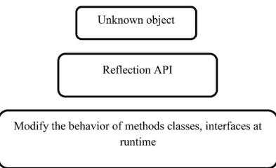

## Kotlin 反射特性

- Kotlin 反射提供了对属性和可空类型的访问。
- Kotlin 反射与 Java 反射有几处不同。
- Kotlin 反射方便了访问由语言创建的 JVM 代码。

### 类引用 (Class References)

使用类引用运算符在运行时获取静态已知的类引用。此外，可以通过实例派生引用。在继承的情况下，可以通过实例获取特定类型的引用。

作为类引用的示例，考虑以下内容：

```kotlin
// 空类
class DemoReflection {
}

fun main() {
    // 使用类名获取引用
    val xyz = DemoReflection::class
    println("This is a class $xyz")

    // 使用对象获取
    val obj = DemoReflection()
    println("This is class reference ${obj::class}")
}
```

### 函数引用 (Function References)

我们为 Kotlin 中定义的每个命名函数检索函数引用。这是通过在函数名前使用 `::` 运算符实现的。这些函数引用可以作为参数传递给其他函数。在重载函数的情况下，我们可以提供函数类型或自动确定。

作为函数引用的示例，考虑以下内容：

```kotlin
fun add(x: Int, y: Int): Int {
    return x + y
}

fun add(x: String, y: String): String {
    return "$x$y"
}

fun isDivisible3(x: Int): Boolean {
    return x % 3 == 0
}

fun main() {
    // 使用 :: 获取函数
    val ref1 = ::isDivisible3
    val array = listOf(11, 2, 3, 34, 46, 5, 64, 7, 82, 91)
    println(array.filter(ref1))

    // 获取重载函数的函数引用
    // 通过显式指定类型
    val ref2: (String, String) -> String = ::add
    println(ref2)

    // 隐式获取函数引用
    val c = add(13, 2)
    println(c)
}
```

### 属性引用 (Property References)

我们可以以与获取函数引用相同的方式获取属性引用。如果属性属于某个类，则还必须使用 `::` 运算符指定类名。这些属性引用允许我们对待属性视为对象，使用 `get` 方法检索其值并使用 `set` 函数对其进行编辑。

作为属性引用的示例，考虑以下内容：

```kotlin
class Example(var x: Float) {
    val a = 10

    fun main() {
        // 包级属性的属性引用
        val b = ::a
        println(b.get())
        println(b.name)

        // 类属性的属性引用
        val c = Example::x
        println(c.get(Example(5.899f)))
    }
}
```

## 构造函数引用

类的构造函数引用的访问方式与方法引用和属性引用相同。这些引用可以用于指向一个返回相同类型对象的函数。然而，这些应用并不常见。

作为构造函数引用的示例，请考虑以下代码：

```kotlin
class Example(var x: Float) {
}

fun main() {
  // 构造函数引用
  val a = ::Example
  println(a.name)
}
```

---

# KOTLIN 运算符重载

由于 Kotlin 支持用户定义类型，因此它也可以重载标准运算符，使得处理用户定义类型变得更加容易。所有的一元、二元和关系运算符都可以进行重载。运算符通过成员函数或扩展函数进行重载。`operator` 修饰符位于这些函数之前。每个运算符都有标准函数，可以根据其用途进行重载。

### 一元运算符

下表显示了可以为一元运算符定义的不同函数。这些函数会修改调用者实例。

| 运算符表达式 | 对应的函数 |
|---|---|
| `+y` | `y.unaryPlus()` |
| `-y` | `y.unaryMinus()` |
| `!y` | `y.not()` |

在这种情况下，`y` 代表定义运算符的类型。重载的功能定义在函数内部。

接下来的 Kotlin 程序演示了一元运算符重载：

```kotlin
class OverloadUnary(var str: String) {
  // 重载函数
  operator fun unaryMinus() {
    str = str.reversed()
  }
}

// main 函数
fun main(args: Array<String>) {
    val obj1 = OverloadUnary("HELLOOO")
    println("Initial string is ${obj1.str}")

    // 调用重载函数 unaryMinus()
    -obj1
    println("String after applying unary operator ${obj1.str}")
}
```

### 递增和递减运算符

类型的递增和递减运算符可以使用以下函数定义。这些函数返回一个带有表达式结果的新实例。

| 运算符表达式 | 对应的函数 |
|---|---|
| `++y` | `y.inc()` |
| `--y` | `y.dec()` |

当分别用于后置或前置表示法时，这些函数在两种情况下都表现良好，产生相同的预期输出。

使用 Kotlin 演示运算符重载程序：

```kotlin
class OverloadIncDec(var str: String) {
    // 重载递增函数
    operator fun inc(): OverloadIncDec {
        val obj1 = OverloadIncDec(this.str)
        obj1.str = obj1.str + 'a'
        return obj1
    }

    // 重载递减函数
    operator fun dec(): OverloadIncDec {
        val obj1 = OverloadIncDec(this.str)
        obj1.str = obj1.str.substring(0, obj1.str.length - 1)
        return obj1
    }

    override fun toString(): String {
        return str
    }
}

// main 函数
fun main(args: Array<String>) {
  var obj1 = OverloadIncDec("Helloo")
  println(obj1++)
  println(obj1--)
  println(++obj1)
}
```


# 二元运算符

下表列出了二元运算符及其等效函数。所有这些函数对调用实例都有影响。

| 运算符表达式 | 对应的函数 |
|---|---|
| `y1 + y2` | `y1.plus(y2)` |
| `y1 - y2` | `y1.minus(y2)` |
| `y1 * y2` | `y1.times(y2)` |
| `y1 / y2` | `y1.div(y2)` |
| `y1 % y2` | `y1.rem(y2)` |
| `y1 .. y2` | `y1.rangeTo(y2)` |

# 重载函数的程序

```kotlin
class Objects(var objName: String) {

    // 重载函数
    operator fun plus(x: Int) {
        objName = "Name is $objName and data is $x"
    }

    override fun toString(): String {
        return objName
    }
}

// main 函数
fun main() {
    var obj1 = Objects("Chairs")
    // 调用重载函数
    obj1 + 9
    println(obj1)
}
```

注意，关系运算符没有指定的函数；尽管如此，类型必须实现 `Comparable` 接口才能在用户定义类型的实例上使用关系运算符。

## 其他运算符

由于 Kotlin 提供了多种运算符，为每个类型指定每种运算符并不是良好的编程实践。下表列出了 Kotlin 中可能被重载的一些额外运算符。

| 运算符表达式 | 对应的函数 |
| --- | --- |
| `y1 in y2` | `y2.contains(y1)` |
| `y1 !in y2` | `!y2.contains(y1)` |
| `y[i]` | `y.get(i)` |
| `y[i, j]` | `y.get(i, j)` |
| `y[i] = b` | `y.set(i, b)` |
| `y[i, j] = b` | `y.set(i, j, b)` |
| `y()` | `y.invoke()` |

# 解构声明

在 Kotlin 中，解构声明允许你将对象分解为多个变量。这在数据类（`data classes`）中特别有用，因为数据类会自动生成 `componentN()` 函数。

关系运算符没有指定的函数；尽管如此，类型必须实现 `Comparable` 接口才能在用户定义类型的实例上使用关系运算符。

## 一元运算符

下表显示了可以为一元运算符定义的不同函数。这些函数会修改调用者实例。

| 运算符表达式 | 对应的函数 |
|---|---|
| `+y` | `y.unaryPlus()` |
| `-y` | `y.unaryMinus()` |
| `!y` | `y.not()` |

在这种情况下，`y` 代表定义运算符的类型。重载的功能定义在函数内部。

接下来的 Kotlin 程序演示了一元运算符重载：

```kotlin
class OverloadUnary(var str: String) {

    // 重载函数
    operator fun unaryMinus() {
        str = str.reversed()
    }
}
```

## 解构示例

```kotlin
class Person(val name: String, val age: Int) {

    fun component1() = name
    fun component2() = age
}

fun main() {
    val person = Person("Alice", 25)
    val (name, age) = person
    println("Name: $name, Age: $age")
}
```

## 用于不需要变量的下划线

我们可能在解构声明中忽略某个变量。为此，请用下划线替换其名称。该变量的组件函数不会被调用。

示例：

```kotlin
val person = Person("Alice", 25)
val (name, _) = person
println("Name: $name")
```

## Lambda 中的解构

从 Kotlin 1.1 版本开始，解构声明语法也适用于 lambda 参数。如果 lambda 参数是 `Pair` 或另一种定义了组件函数的类型，我们可以通过括号来添加参数。

示例：

```kotlin
val map = mapOf("A" to 1, "B" to 2)
map.forEach { (key, value) ->
    println("$key: $value")
}
```

# 等价性评估

Kotlin 提供了两种方式来比较特定类型的实例。这一特性使它区别于其他编程语言。

有两种等价性：

- 结构等价
- 引用等价

## 结构等价

结构等价使用 `==` 运算符及其对应的 `!=` 运算符进行测试。默认情况下，表达式 `x == y` 被转换为对类型 `equals()` 方法的调用。

```kotlin
x?.equals(y) ?: (y == null)
```

如果 `x` 不等于 `null`，则调用 `equals(y)` 函数；否则，如果确定 `x` 为 `null`，它将尝试检查 `y` 是否在引用上等于 `null`。

注意：当使用 `(x == null)` 时，它会被立即翻译为引用相等 `(x === null)`；因此，不需要优化。

结果，要对类型的实例使用 `==`，该类型必须重写 `equals()` 方法。

字符串的结构相等比较的是其内容。

## 引用相等

在 Kotlin 中，使用 `===` 运算符及其相反运算符 `!==` 来测试引用相等。只有当相同类型的两个实例指向同一个内存地址时，这种相等性才返回 `true`。当用于运行时会被转换为原始类型的类型时，`===` 检查被转换为 `==` 检查，而 `!==` 被转换为 `!=`。

使用 Kotlin 演示结构相等和引用相等的程序：

```kotlin
class Squares(val side: Int) {

    override fun equals(other: Any?): Boolean {
        if (other is Squares) {
            return other.side == side
        }
        return false
    }
}

// fun main(args: Array<String>) {
    val squares1 = Squares(4)
    val squares2 = Squares(7)

    // 结构相等
    if (squares1 == squares2) {
        println("The Two squares are structurally equal")
    }

    // 引用相等
    if (squares1 !== squares2) {
        println("The Two squares are not referentially equal")
    }
// }
```

# Kotlin 比较器

在编程上下文中需要新类型时，安排该类型的实例变成了一个关键问题。我们实现 `Comparable` 接口来比较同一类型的两个实例。然而，由于它们在排序实例时必须自动比较，而且顺序可能取决于许多标准，Kotlin 提供了一个基础的 `Comparator` 接口。该接口比较并组织相同类型的两个项目。

## 函数

**compare**: 此函数比较相同类型的两个实例，如果它们相等则返回零，如果第二个实例较大则返回负整数，否则返回正数。

```kotlin
abstract fun compare(x: T, y: T): Int
```

## 扩展函数

**reversed**: 此函数接受一个比较器作为输入，并返回与传递的比较器排序相反的比较器。

```kotlin
fun <D> Comparator<D>.reversed(): Comparator<D>
```

**then**: 此函数结合两个比较器，只有当第一个比较器的值相等时，才会使用第二个比较器。

```kotlin
infix fun <D> Comparator<D>.then(
    comparator: Comparator<in D>
): Comparator<D>
```

**例如**，考虑 `compare`、`then` 和 `reversed` 函数：

```kotlin
class Names(val firstNames: String, val lastNames: String) {
    override fun toString(): String {
        return "$firstNames $lastNames"
    }
}
```

```kotlin
// 用于比较 Names 类名字的比较器
class ComparatorOne : Comparator<Names> {
    override fun compare(o1: Names?, o2: Names?): Int {
        if (o1 == null || o2 == null) {
            return 0
        }
        return o1.firstNames.compareTo(o2.firstNames)
    }
}
```

```kotlin
// 用于比较 Names 类姓氏的比较器
class AnotherComparator : Comparator<Names> {
    override fun compare(o1: Names?, o2: Names?): Int {
        if (o1 == null || o2 == null) {
            return 0
        }
        return o1.lastNames.compareTo(o2.lastNames)
    }
}
```

```kotlin
fun main() {
    val lists = ArrayList<Names>()

    lists.add(Names("Stev", "Wauau"))
    lists.add(Names("Stev", "Smiti"))
    lists.add(Names("Virati", "Sohli"))
    lists.add(Names("Kani", "Will"))
    lists.add(Names("Joti", "Ruhan"))

    println("The list is:")
    println(lists)

    val comparatorOne = ComparatorOne()

    // 根据名字排序列表
    lists.sortWith(comparatorOne)
    println("The List sorted according to first name")
    println(lists)

    val anotherComparator = AnotherComparator()
    val finalComparator = comparatorOne.then(anotherComparator)

    // 根据名字后按姓排序列表
    lists.sortWith(finalComparator)
    println("The List sorted according to first name last name")
    println(lists)

    val reverseComparator = finalComparator.reversed()

    // 反转排序列表
    lists.sortWith(reverseComparator)
    println("Lists reverse sorted")
    println(lists)
}
```

**thenBy**: 此函数将类型实例转换为可比较的实例，然后与这些实例进行比较。

```kotlin
fun <D> Comparator<D>.thenBy(
    selector: (D) -> Comparable<*>?
): Comparator<D>
```

**thenByDescending**: 此方法返回一个降序比较器，它在比较实例之前会将值转换为可比较的实例。

```kotlin
inline fun <D> Comparator<D>.thenByDescending(
    crossinline selector: (D) -> Comparable<*>?
): Comparator<D>
```

## thenBy 和 thenByDescending 的示例

```kotlin
class Human(val height: Int, val weight: Int) {
    override fun toString(): String {
        return "height=$height, weight=$weight"
    }
}

fun main() {
    val lists = ArrayList<Human>()

    lists.add(Human(10, 20))
    lists.add(Human(20, 10))
    lists.add(Human(10, 30))
    lists.add(Human(30, 20))
    lists.add(Human(20, 30))

    println("The list is:")
    println(lists)

    val comparatorOne = compareBy<Human> { it.height }
    lists.sortWith(comparatorOne)
    println("The List sorted according to height")
    println(lists)

    val anotherComparator = compareBy<Human> { it.weight }
    val finalComparator = comparatorOne.thenBy(anotherComparator)
    lists.sortWith(finalComparator)
    println("The List sorted according to height then weight")
    println(lists)

    val reverseComparator = finalComparator.reversed()
    lists.sortWith(reverseComparator)
    println("Lists reverse sorted")
    println(lists)
}
```


# 精通 Kotlin：入门指南

## 如何为 Kotlin 开发安装并配置 Android Studio

若要使用 Kotlin 创建 Android 应用程序，我们需要像 Android Studio 这样的 Android 应用程序 IDE。Android Studio 是一个允许我们在单一平台上创建应用的 IDE。我们可以从 Android Studio 官方网站获取 Android Studio 包：`https://developer.android.com/studio/index.html`

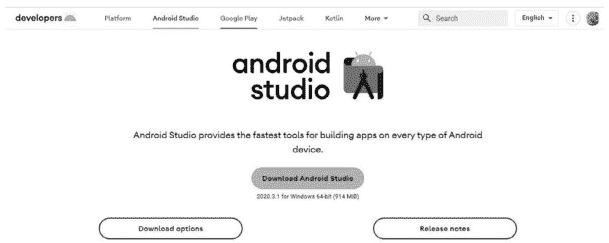

- 在安装 Android Studio 之前，必须在我们的 PC 上安装 Java。
- 下载 Android Studio 后，启动并安装它。按照安装说明操作。
- 点击 `Next` 继续。


## 使用 Kotlin 进行 Android 开发


- 浏览 JDK 路径并点击 `Next`。
- 分析我们想要安装的组件。
- 指明 Android SDK 的安装位置。
- 为了使用模拟器实例，设置最大 RAM 尺寸。


- Android Studio 已成功安装在我们的机器上。


## 如何使用 Kotlin 创建 Android Studio 项目

由于 3.0 以上版本的 Android Studio 包含了 Kotlin 插件，我们可以使用 Kotlin 而不是 Java 创建 Android 应用。

下面讨论了使用 Kotlin 编程语言创建新项目的步骤：

- 步骤 1：从“Welcome to Android Studio”页面，选择“Start a New Android Studio Project”。
- 步骤 2：选择“Empty Activity”后点击 `Next` 按钮。
- 步骤 3：在这里，我们输入应用程序名称并选择 Kotlin 作为项目的语言。然后，点击 `Finish` 按钮开始项目。
- 步骤 4：最后，我们新创建的包含可变文件的项目将打开。

## KOTLIN 中的 HELLO WORLD 应用

- 让我们使用 Kotlin 编程语言在 Android Studio 中创建我们的 hello世界应用。运行 Android Studio 并选择“Start a new Android Project”选项来创建一个 Android 应用程序。
- 为我们的应用程序提供名称（在我的实例中为“Hello World”）并点击“Include Kotlin support”继续。
- 选择 Android 应用程序的 API 级别后点击 `Next`。
- 选择 Activity 类型并点击 `Next` 按钮。
- `activities_main.xml`：向 layout 文件夹中的 `activities_main.xml` 文件添加以下代码。

```xml
<?xml version="1.0" encoding="utf-8"?>
<android.support.constraint.ConstraintLayout
    xmlns:android="http://schemas.android.com/apk/res/android"
    xmlns:app="http://schemas.android.com/apk/res-auto"
    xmlns:tools="http://schemas.android.com/tools"
    android:layout_width="match_parent"
    android:layout_height="match_parent"
    tools:context="example.app.javatpoint.helloworld.MainActivity">
    <TextView
        android:layout_width="wrap_content"
        android:layout_height="wrap_content"
        android:text="Hello World!"
        app:layout_constraintBottom_toTopOf="parent"
        app:layout_constraintLeft_toLeftOf="parent"
        app:layout_constraintRight_toRightOf="parent"
        app:layout_constraintTop_toTopOf="parent" />
</android.support.constraint.ConstraintLayout>
```

- `MainActivities.kt`
- 在 `example.app.javatpoint.helloworld` 包中，创建 `MainActivities.kt` 文件，并添加以下代码。

```kotlin
package example.app.javatpoint.helloworld
import android.support.v7.app.AppCompatActivity
import android.os.Bundle
class MainActivity : AppCompatActivity() {
    override fun onCreate(savedInstanceState: Bundle?) {
        super.onCreate(savedInstanceState)
        setContentView(R.layout.activity_main)
    }
}
```

- 现在运行我们的应用。

## 设置 Android 虚拟设备 (AVD)

在 Android 开发中执行程序，我们需要一个 Android 智能手机。因此，Android Studio 的开发者提供了安装 AVD 的运行选项。这部分将介绍如何设置 AVD。

要安装 AVD，请遵循以下步骤：

- 步骤 1：从菜单中选择 `Tools > AVD Manager`。
- 步骤 2：接下来，选择 `Virtual Device`。
- 步骤 3：将弹出窗口，我们将选择模型。
- 步骤 4：在这里，我们选择 Android 版本，例如 Oreo。
- 步骤 5：点击 `Finish` 完成安装。
- 步骤 6：现在我们可以选择要使用的模拟器了。
- 步骤 7：我们的虚拟设备终于准备就绪。

## Android 的 KOTLIN 动画

动画图像移动的技术。在本节中，我们将学习如何使用 Kotlin 动画。以下是一些属性：

| 属性 | 描述 |
| :--- | :--- |
| `android:duration` | 设置毫秒级时长。 |
| `android:fromAlpha` | 初始值（1.0 为不透明，0.0 为透明）。 |
| `android:toAlpha` | 最终值。 |
| `android:id` | 设置唯一 ID。 |
| `android:fromDelta` | 开始时的坐标偏移。 |
| `android:toDelta` | 结束时的坐标偏移。 |
| `android:fromScale` | 开始时的缩放比例。 |
| `android:toScale` | 结束时的缩放比例。 |
| `android:fromDegrees` | 角度，起始位置。 |
| `android:toDegrees` | 角度，最终位置。 |
| `android:interpolator` | 插值器定义了变化率。 |

## 创建新项目

- 打开 Android Studio。
- 转到 `File => New => New Project` 开始新项目。
- 然后，选择 Activity 并点击 `next`。
- `EditText` 是程序名称。
- 选择我们需要的 SDK；在此情况下，我们选择了 21。
- 选择 Kotlin 作为语言并点击 `Finish` 按钮。

如果我们执行了上述步骤，我们应该有一个新创建的项目。在创建项目后，我们将修改 XML 文件。

### 修改 activity_main.xml 文件

向 `res/layout/activity_main.xml` 添加代码。

```xml
android:text="Fade Out"
android:textAllCaps="false" />
</LinearLayout>
<LinearLayout
    android:layout_width="match_parent"
    android:layout_height="wrap_content"
    android:orientation="horizontal"
    android:weightSum="1">
    <Button
        android:id="@id/zoom_in"
        android:layout_width="0dp"
        android:layout_height="match_parent"
        android:layout_weight="3"
        android:text="Zoom In"
        android:textAllCaps="false" />
    <Button
        android:id="@id/zoom_out"
        android:layout_width="0dp"
        android:layout_height="match_parent"
        android:layout_weight="2"
        android:text="Zoom Out"
        android:textAllCaps="false" />
</LinearLayout>
<LinearLayout
    android:layout_width="match_parent"
    android:layout_height="wrap_content"
    android:orientation="vertical"
    android:weightSum="3">
    <Button
        android:id="@id/slide_down"
        android:layout_width="0dp"
        android:layout_height="match_parent"
        android:layout_weight="2"
        android:text="Slide Down"
        android:textAllCaps="false" />
    <Button
        android:id="@id/slide_up"
        android:layout_width="0dp"
        android:layout_height="match_parent"
        android:layout_weight="2"
        android:text="Slide Up"
        android:textAllCaps="false" />
</LinearLayout>
```

```xml
<LinearLayout
    android:layout_width="match_parent"
    android:layout_height="wrap_content"
    android:orientation="vertical"
    android:weightSum="1">
    <Button
        android:id="@id/bounce"
        android:layout_width="0dp"
        android:layout_height="match_parent"
        android:layout_weight="3"
        android:text="Bounce"
        android:textAllCaps="false" />
    <Button
        android:id="@id/rotate"
        android:layout_width="0dp"
        android:layout_height="match_parent"
        android:layout_weight="3"
        android:text="Rotate"
        android:textAllCaps="false" />
</LinearLayout>
</RelativeLayout>
```

当我们修改了布局后，将为动画开发 XML 文件。因此，首先，我们将创建一个名为 `anim` 的文件夹。

在这个文件夹中，我们放置用于生成动画的 XML 文件。为此，进入 `app/res`，右键点击并选择 Android Resource Directory（Android 目录），将其命名为 `anim`。

### bounce.xml

XML：动画中的文字像球一样跳动。

```xml
<?xml version="1.0" encoding="utf-8"?>
<set
    xmlns:android="http://schemas.android.com/apk/res/android"
    android:interpolator="@android:anim/linear_interpolator"
    android:fillAfter="true">
    <translate
        android:fromYDelta="90%"
        android:toYDelta="-25%"
        android:duration="320" />
    <translate
        android:startOffset="550"
        android:fromYDelta="-30%"
        android:toYDelta="20%"
        android:duration="140" />
    <translate
        android:startOffset="1100"
        android:fromYDelta="15%"
        android:toYDelta="0"
        android:duration="120" />
</set>
```

### fade_in.xml

文字将在 Fade In（淡入）动作中从背景出现。

```xml
<?xml version="1.0" encoding="utf-8"?>
<set xmlns:android="http://schemas.android.com/apk/res/android"
    android:interpolator="@android:anim/linear_interpolator">
    <alpha
        android:duration="1200"
        android:fromAlpha="0.2"
        android:toAlpha="2.0" />
</set>
```

### fade_out.xml

文字颜色在 Fade Out（淡出）动画中会在一段时间内逐渐变淡。

```xml
<?xml version="1.0" encoding="utf-8"?>
<set xmlns:android="http://schemas.android.com/apk/res/android"
    android:interpolator="@android:anim/linear_interpolator">
    <alpha
        android:duration="1200"
        android:fromAlpha="2.0"
        android:toAlpha="0.2" />
</set>
```

### rotate.xml

文字在 rotate（旋转）动画中会旋转一段时间。

```xml
<?xml version="1.0" encoding="utf-8"?>
<rotate xmlns:android="http://schemas.android.com/apk/res/android"
    android:duration="1200"
    android:fromDegrees="0"
    android:interpolator="@anim/linear_interpolator"
    android:pivotX="60%"
```


# Android 动画示例

## slide_down.xml

文字在 slide_down（向下滑动）动画中从顶部向下移动。

### XML

```xml
<?xml version="1.0" encoding="utf-8"?>
<set xmlns:android="http://schemas.android.com/apk/res/android">
    <translate
        android:duration="1200"
        android:fromYDelta="-90%"
        android:toYDelta="0" />
</set>
```

## slide_up.xml

文字在 slide_up（向上滑动）动画中从底部向上移动。

### XML

```xml
<?xml version="1.0" encoding="utf-8"?>
<set xmlns:android="http://schemas.android.com/apk/res/android">
    <translate
        android:duration="1200"
        android:fromYDelta="0"
        android:toYDelta="-90%" />
</set>
```

# 精进 Kotlin：初学者指南

## zoom_in.xml

文字在 zoom_in（放大）动画中会持续变大。

### XML

```xml
<?xml version="1.0" encoding="utf-8"?>
<set xmlns:android="http://schemas.android.com/apk/res/android"
    android:fillAfter="true">
    <scale
        xmlns:android="http://schemas.android.com/apk/res/android"
        android:duration="1200"
        android:fromXScale="2"
        android:fromYScale="2"
        android:pivotX="60%"
        android:pivotY="60%"
        android:toXScale="2.5"
        android:toYScale="2.5" />
</set>
```

## zoom_out.xml

文字在 zoom_out（缩小）动画中会持续变小。

### XML

```xml
<?xml version="1.0" encoding="utf-8"?>
<set xmlns:android="http://schemas.android.com/apk/res/android"
    android:fillAfter="true">
    <scale
        xmlns:android="http://schemas.android.com/apk/res/android"
        android:duration="1200"
        android:fromXScale="2.0"
        android:fromYScale="2.0"
        android:pivotX="60%"
        android:pivotY="60%"
        android:toXScale="0.7"
        android:toYScale="0.7" />
</set>
```

完成所有 XML 动画后，我们将制作 `MainActivity`。

## 创建 MainActivity.kt 文件

打开 `app/src/main/java/peeksforpeaks/animations/MainActivity.kt` 文件并添加以下代码：

```kotlin
package peeksforpeaks.animations

import androidx.compat.app.AppCompatActivity
import android.os.Bundle
import android.os.Handler
import android.view.View
import android.view.animation.AnimationUtils
import kotlinx.android.synthetic.main.activity_main.*

class MainActivity : AppCompatActivity() {

    override fun onCreate(savedInstanceState: Bundle?) {
        super.onCreate(savedInstanceState)
        setContentView(R.layout.activity_main)

        fade_in.setOnClickListener {
            textView.visibility = View.VISIBLE
            val animationFadeIn = AnimationUtils.loadAnimation(this, R.anim.fade_in)
            textView.startAnimation(animationFadeIn)
        }

        fade_out.setOnClickListener {
            val animationFadeOut = AnimationUtils.loadAnimation(this, R.anim.fade_out)
            textView.startAnimation(animationFadeOut)
            Handler().postDelayed({
                textView.visibility = View.GONE
            }, 1200)
        }

        zoom_in.setOnClickListener {
            val animationZoomIn = AnimationUtils.loadAnimation(this, R.anim.zoom_in)
            textView.startAnimation(animationZoomIn)
        }

        zoom_out.setOnClickListener {
            val animationZoomOut = AnimationUtils.loadAnimation(this, R.anim.zoom_out)
            textView.startAnimation(animationZoomOut)
        }

        slide_down.setOnClickListener {
            val animationSlideDown = AnimationUtils.loadAnimation(this, R.anim.slide_in)
            textView.startAnimation(animationSlideDown)
        }

        slide_up.setOnClickListener {
            val animationSlideUp = AnimationUtils.loadAnimation(this, R.anim.slide_out)
            textView.startAnimation(animationSlideUp)
        }

        bounce.setOnClickListener {
            val animationBounce = AnimationUtils.loadAnimation(this, R.anim.bounce)
            textView.startAnimation(animationBounce)
        }

        rotate.setOnClickListener {
            val animationRotate = AnimationUtils.loadAnimation(this, R.anim.rotate)
            textView.startAnimation(animationRotate)
        }
    }
}
```

## AndroidManifest.xml 文件

由于 `AndroidManifest.xml` 文件在 Android 中至关重要，这里提供了清单文件的代码。

```xml
<?xml version="1.0" encoding="utf-8"?>
<manifest xmlns:android="http://schemas.android.com/apk/res/android"
    package="com.peeksforpeaks.animations">
    <application
        android:allowBackup="true"
        android:icon="@mipmap/ic_launcher"
        android:label="@string/app_name"
        android:roundIcon="@mipmap/ic_launcher_round"
        android:supportsRtl="true"
        android:theme="@style/AppTheme">
        <activity android:name=".MainActivity">
            <intent-filter>
                <action android:name="android.intent.action" />
                <category android:name="android.intent.category.LAUNCHER" />
            </intent-filter>
        </activity>
    </application>
</manifest>
```

# Kotlin Android 渐入/淡出动画

Android 动画是用于让用户界面更加动态、清晰且具有吸引力的图形效果。渐入（Fade-in）和淡出（Fade-out）动画用于在特定时间内更改任何视图的外观，从而提醒用户程序发生的变化。

在本文中，我们将介绍如何使用 Kotlin 创建一个渐入/淡出动画。

| XML 属性 | 描述 |
|---|---|
| `android:duration` | 用于指定动画的长度。 |
| `android:fromAlpha` | 它是动画的初始 alpha 值，其中 1.0 表示完全不透明，0.0 表示完全透明。 |
| `android:toAlpha` | 它是最终 alpha 值。 |
| `android:id` | 设置视图的唯一 ID。 |

第一步是打开 Android Studio 并创建一个新项目。按照以下步骤完成操作：

- 点击 **File**（文件），然后选择 **New**（新建），再选择 **New Project**（新建项目），按我们喜欢的名称命名。
- 选择 Kotlin 语言支持并按 **Next**（下一步）按钮。
- 选择我们需要的最小 SDKs。
- 选择 **Empty activity**（空活动），然后点击 **Finish**（完成）。
- 之后，我们必须创建布局。我们需要使用 XML 文件来实现此。导航到 `app > res > layout` 并复制以下代码：

### 修改 activity_main.xml 文件

```xml
<?xml version="1.0" encoding="utf-8"
android:layout_width="match_parent"
android:layout_height="match_parent"
tools:context=".MainActivity" android:orientation="vertical">
<TextView
    android:id="@id/textView"
    android:layout_width="wrap_content"
    android:layout_height="wrap_content"
    android:text="PekofPeeks"
    android:layout_centerParent="true"
    android:textSize="33sp"
    android:style="bold" />
<Button
    android:id="@id/fade_in"
    android:layout_width="90dp"
    android:layout_height="wrap_content"
    android:text="Fade In"
    android:layout_marginTop="150dp"
    android:layout_marginLeft="90dp" />
<Button
    android:id="@id/fade_out"
    android:layout_width="120dp"
    android:layout_height="wrap_content"
    android:layout_marginTop="130dp"
    android:layout_toRightOf="@id/fade_in"
    android:text="Fade Out"
    android:textAllCaps="false" />
</RelativeLayout>
```

### 添加 anim 文件夹

在此文件夹中，我们将放入用于生成动画的 XML 文件。要完成此操作，前往 `/res`，右键点击，然后选择 **Android Resource Directory**（Android 资源目录），并命名为 `anim`。

再次右键点击此 `anim` 文件夹，这次选择 **Animation resource file**（动画资源文件）并命名为 `fade_in.xml`。同样创建 `fade_out.xml` 并粘贴以下代码。

#### fade_in.xml

```xml
<?xml version="1.0" encoding="utf-8"?>
<set xmlns:android="http://schemas.android.com/apk/res/android"
    android:interpolator="@android:anim/linear_interpolator">
    <alpha
        android:duration="2300"
        android:fromAlpha="0.2"
        android:toAlpha="2.0" />
</set>
```

#### fade_out.xml

```xml
<?xml version="1.0" encoding="utf-8"?>
<set xmlns:android="http://schemas.android.com/apk/res/android"
    android:interpolator="@android:anim/linear_interpolator">
    <alpha
        android:duration="2200"
        android:fromAlpha="2.0"
        android:toAlpha="0.2" />
</set>
```

### 修改 MainActivity.kt 文件

对 `app/src/main/java/ourPackageName/MainActivity.kt` 进行以下修改：

```kotlin
package com.peeksfeeds.myfirstapp

import androidx.appcompat.app.AppCompatActivity
import android.os.Bundle
import android.os.View
import android.view.animation.AnimationUtils
import kotlin.android.synthetic.main.activity_main.*

class MainActivity : AppCompatActivity() {
    override fun onCreate(savedInstanceState: Bundle?) {
        super.onCreate(savedInstanceState)
```


# 精通 Kotlin：入门指南

```kotlin
setContentView(R.layout.activity_main)

// 设置按钮的 onClickListener
fade_in.setOnClickListener {
    textView.visibility = View.VISIBLE
    // 加载自定义的动画
    val animations = AnimationUtils.loadAnimation(this, R.anim.fade_in)
    // 开始动画
    textView.startAnimation(animations)
}

fade_out.setOnClickListener {
    val animations = AnimationUtils.loadAnimation(this, R.anim.fade_out)
    textView.startAnimation(animations)
    // 在指定的时间流逝后
    // textview 将变为不可见，这里是 1200 毫秒
    Handler().postDelayed({
        textView.visibility = View.GONE
    }, 1200)
}
```

# AndroidManifest.xml 文件

```xml
<?xml version="1.0" encoding="utf-8"?>
<manifest xmlns:android="http://schemas.android.com/apk/res/android"
    package="com.peeksfeeds.myfirstapp">
    <application
        android:allowBackup="true"
        android:icon="@mipmap/ic_launcher"
        android:label="@string/app_name"
        android:theme="@style/AppTheme">
        <activity android:name=".MainActivity"
            exported="true">
            <intent-filter>
                <action android:name="android.intent.action.MAIN" />
                <category android:name="android.intent.category.LAUNCHER" />
            </intent-filter>
        </activity>
    </application>
</manifest>
```

# Android 菜单

菜单是菜单项的主要集合，对于对搜索程序具有全局影响的活动至关重要。

## 如何在 XML 中定义菜单？

要定义菜单，我们必须创建一个新文件夹（`res/menu`）并添加一个包含以下组件的 XML 文件。

菜单的示例所示：

```xml
<?xml version="1.0" encoding="utf-8"?>
<menu xmlns:android="http://schemas.android.com/apk/res/android">
  <item android:id="@id/mail"
      android:icon="@drawable/ic_mail"
      android:title="@string/mail" />
  <item android:id="@id/upload"
      android:icon="@drawable/ic_upload"
      android:title="@string/upload"
      android:showAsAction="ifRoom" />
  <item android:id="@id/share"
      android:icon="@drawable/ic_share"
      android:title="@string/share" />
</menu>
```

- `<menu>`: XML 文件的根元素，有助于定义菜单并包含各种项。
- `<item>`: 用于生成单个菜单项。也可以包含嵌套 `<menu>` 元素形成子菜单。
- `<group>`: 可选，用于对菜单项进行分类，以便它们共享激活状态和可见性。

`activity_main.xml`: 如果我们希望在菜单项中包含子菜单，必须作为 item 子元素的 `<menu>` 元素。

以下是在菜单项中定义子菜单的示例：

```xml
<?xml version="1.0" encoding="utf-8"?>
<menu xmlns:android="http://schemas.android.com/apk/res/android">
  <item android:id="@id/file"
      android:title="@string/file">
    <!-- 子菜单 -->
    <menu>
      <item android:id="@id/create_new"
          android:title="@string/create_new" />
      <item android:id="@id/open"
          android:title="@string/open" />
    </menu>
  </item>
</menu>
```

# 使用 Kotlin 进行 Android 开发

## Android 进度提醒

本节将教我们如何使用 Kotlin 为 Android 开发一个简单的进度通知（包含不确定进度指示器和固定时长进度指示器）。

在开始之前，让我们先定义 Android 通知的各个组件：

- 小图标（Small Icon）：这是强制性的，可以使用 `setSmallIcon()` 进行设置。
- 应用名称（Application Name）：系统提供应用名称。
- 时间戳（Time Stamp）：由系统提供，但可以进行更改。
- 大图标（Large Icon）：这是可选的，可以使用 `setLargeIcon()` 配置。
- 标题（Title）：这是一个可选的标题，可以使用 `setContentTitle()` 指定。
- 文本（Text）：这是可选的，可以使用 `setContentText()` 设置。

### 注意通知通道 (Notification Channels)

自 Android 版本 8 (Android Oreo) 发布以来，为了方便用户和开发者，强制要求将所有警报分类为“通道”。由于我们需要构建一次通道，我们将利用一个名为 `App.kt` 的辅助类来完成这项工作。

**App.kt:**

```kotlin
package com.gfg.progressnotificationdemo

import android.app.Application
import android.app.NotificationChannel
import android.app.NotificationManager
import android.os.Build

class App : Application() {
    val channelId = "Progress Notification"
    override fun onCreate() {
        super.onCreate()
        createNotificationChannels()
    }
    // 检查 Android 版本是否大于 8。
    private fun createNotificationChannels() {
        if (Build.VERSION.SDK_INT >= Build.VERSION_CODES.O) {
            val channel1 = NotificationChannel(
                channelId,
                "Progress Notification",
                // IMPORTANCE_HIGH = 以横幅窗口形式显示通知。
                // IMPORTANCE_LOW = 在状态栏中显示通知。
                NotificationManager.IMPORTANCE_HIGH
            )
            channel1.description = "ProgressNotification Channel"
            val manager = getSystemService(NotificationManager::class.java)
            manager.createNotificationChannel(channel1)
        }
    }
}
```

**MainActivity.kt:**

```kotlin
package com.gfg.progressnotificationdemo

import android.app.PendingIntent
import android.content.Intent
import android.os.Bundle
import android.os.SystemClock
import android.view.View
import androidx.appcompat.app.AppCompatActivity
import androidx.core.app.NotificationManagerCompat
import androidx.core.app.NotificationCompat
import com.gfg.progressnotificationdemo.R.drawable

class MainActivity : AppCompatActivity() {
    private lateinit var notificationManager: NotificationManagerCompat
    val channelId = "Progress Notification"
    override fun onCreate(savedInstanceState: Bundle?) {
        super.onCreate(savedInstanceState)
        setContentView(R.layout.activity_main)
        // 创建通知管理器
        notificationManager = NotificationManagerCompat.from(this)
    }
    // 当按钮被按下时调用 start()。
    fun start(view: View) {
        val intent = Intent(this, MainActivity::class.java).apply {
            flags = Intent.FLAG_ACTIVITY_NEW_TASK or Intent.FLAG_ACTIVITY_CLEAR_TASK
        }
        val pendingIntent: PendingIntent = PendingIntent.getActivity(
            this, 0, intent, PendingIntent.FLAG_IMMUTABLE
        )
        // 将最大进度为 90
        val progressMax = 90
        // 创建通知并设置其各种属性
        val notification = NotificationCompat.Builder(this, channelId)
            .setSmallIcon(R.drawable.ic_file_download)
            .setContentTitle("GeeksforGeeks")
            .setContentText("Downloading")
            .setPriority(NotificationCompat.PRIORITY_LOW)
            .setOngoing(true)
            .setOnlyAlertOnce(true)
            .setProgress(progressMax, 0, false)
            .setAutoCancel(true)
        // 初始提醒
        notificationManager.notify(1, notification.build())
        Thread(Runnable {
            SystemClock.sleep(2100)
            var progress = 0
            while (progress <= progressMax) {
                SystemClock.sleep(1200)
                progress += 20
                // 使用此使其成为固定时长的进度指示器通知
                // notification.setContentText(progress.toString() + "%")
                //     .setProgress(progressMax, progress, false)
                // notificationManager.notify(1, notification.build())
            }
            notification.setContentText("Download complete")
                .setProgress(0, 0, false)
                .setOngoing(false)
            notificationManager.notify(1, notification.build())
        }).start()
    }
}
```

# Android 项目文件夹结构

Android Studio 是由 JetBrains 社区开发的官方 IDE，并由 Google 免费提供用于开发 Android 应用。

在完成 Android 架构设置后，我们可以在工作室中构建 Android 应用程序。我们必须为每个示例应用创建一个新项目并理解文件夹结构。

Android 项目包含多个 app 模块、源代码文件和资源文件。我们将查看 Android 应用中的所有文件夹和文件。

1. `manifests` 文件夹
2. `java` 文件夹
3. `resources (res)` 文件夹
    - `drawable` 文件夹
    - `layout` 文件夹
    - `mipmap` 文件夹
    - `values` 文件夹
4. `Gradle Scripts`

## manifests 文件夹

`manifests` 文件夹包含 `AndroidManifest.xml`，我们将使用它来创建 Android 应用程序。该文件提供了有关应用的信息，例如 Android 版本、包名、Kotlin 代码和其他组件。它充当操作系统与应用程序之间的桥梁。

### AndroidManifest.xml

```xml
<?xml version="1.0" encoding="utf-8"?>
<manifest xmlns:android="http://schemas.android.com/apk/res/android"
    package="peeksforgeeks.myapplication">
    <application
        android:allowBackup="true"
        android:icon="@mipmap/ic_launcher"
        android:label="@string/app_name"
        android:roundIcon="@mipmap/ic_launcher_round"
        android:supportsRTL="true"
        android:theme="@style/AppTheme">
        <activity android:name=".MainActivity">
            <intent-filter>
                <action android:name="android.intent.action.MAIN" />
                <category android:name="android.intent.category.LAUNCHER" />
            </intent-filter>
        </activity>
    </application>
</manifest>
```

## java 文件夹

`java` 文件夹包含了我们在应用过程中编写的所有 Java 和 Kotlin 源代码文件。当我们启动新项目时，包名 `peeksforgeeks.myfirstapp` 下会自动创建 `MainActivity.kt` 类，如下所示。

### MainActivity.kt

```kotlin
package peeksforgeeks.myapplication

import androidx.appcompat.app.AppCompatActivity
import android.os.Bundle

class MainActivity : AppCompatActivity() {
    override fun onCreate(savedInstanceState: Bundle?) {
        super.onCreate(savedInstanceState)
    }
}
```


## resources (res) 文件夹

资源文件夹至关重要，因为它包含了 Android 应用的所有非代码源，如图像、XML 布局和 UI 字符串。

- **res/drawable**: 它包含了开发中使用的各种类型的图像。在应用开发中，我们必须将所有照片放在 `drawable` 文件夹中。

- **res/layout**: `layout` 文件夹包含了我们定义应用程序用户界面的所有 XML 布局文件。它包含 `activity_main.xml` 文件。

```xml
<?xml version="1.0" encoding="utf-8"?>
<androidx.constraintlayout.widget.ConstraintLayout
    xmlns:android="http://schemas.android.com/apk/res/android"
    xmlns:app="http://schemas.android.com/apk/res-auto"
    xmlns:tools="http://schemas.android.com/tools"
    android:layout_width="match_parent"
    android:layout_height="match_parent"
    tools:context=".MainActivity">
    <TextView
        android:layout_width="wrap_content"
        android:layout_height="wrap_content"
        android:text="Hello World!"
        app:layout_constraintBottom_toBottomOf="parent"
        app:layout_constraintLeft_toLeftOf="parent"
        app:layout_constraintRight_toRightOf="parent"
        app:layout_constraintTop_toTopOf="parent" />
</androidx.constraintlayout.widget.ConstraintLayout>
```

- **res/mipmap 文件夹**: 该文件夹包含 `launcher.xml` 文件，指定在主屏幕上显示的图标。根据设备大小，有多种密度的图标，例如 `hdpi`、`mdpi` 和 `xhdpi`。

- **res/values 文件夹**: `values` 文件夹包含许多 XML 文件，用于定义字符串、尺寸、颜色和样式。其中包含资源的 `strings.xml` 文件是最重要的文件之一。

```xml
<resources>
  <string name="app_name">NameOfApplication</string>
  <string name="checked">Checked</string>
  <string name="unchecked">Unchecked</string>
</resources>
```

## Gradle 脚本文件夹

Gradle 是一个自动化构建系统，包含多个文件，可以创建一个适用于我们应用程序中所有模块的构建配置。构建脚本用于 `build.gradle` (项目级)，而插件和实现则用于 `build.gradle` (模块级)，用以创建可以适用于我们所有应用模块的设置。

## 结论

在本章中，我们涵盖了使用 Kotlin 进行 Android 开发，同时也涵盖了如何在 Android Studio 中创建项目以及安装 AVD。我们还学习了 Kotlin 的动画、进度通知和项目文件夹结构。


## 评价

Kotlin 是 JetBrains 在 2011 年发布的编程语言，JetBrains 是最智能 IDE IntelliJ IDEA 的官方开发者。这种通用编程语言具有强烈的静态类型特性并运行在 JVM 上。Google 宣布 Kotlin 为 Android 开发的官方语言，它是一种结合了面向对象编程与函数式能力的开源编程语言，提供了一个独特的平台。

## KOTLIN 在线编译器

我们创建了一个 Kotlin 在线编译器，允许我们通过简单的编辑器直接从浏览器中修改并执行代码。尝试点击运行图标来执行以下 Kotlin 代码，以生成标准的“Hello, World!”消息。

```kotlin
fun main() {
  var string1: String = "Hello, World!" // 定义变量
  println("$string1")
}
```


# Kotlin 对比 Java

自 Google I/O 发布以来，在新的开发中是使用 Kotlin 还是 Java 一直是 Android 社区的热门话题。这个问题可以追溯到 2016 年 2 月，当时 Kotlin 1.0 发布。快速的回答是，Kotlin 比 Java 代码更安全且使用的资源更少。由于 Kotlin 和 Java 文件可以在 Android 应用中共存，因此 Kotlin 不仅对新应用有益，对扩展 Java 应用也有帮助。

# 评价

我们看到的唯一让编程初学者选择 Java 而非 Kotlin 的理由是，由于 Android 文档和示例历史上一直是用 Java 编写的，这对他们可能具有挑战性。另一方面，使用 Android Studio 将 Java 转换为 Kotlin 就像将 Java 代码放入 Kotlin 文件一样简单。

对于几乎所有其他 Android 编程任务，Kotlin 的优点都是极具吸引力的。Java 开发者通常会花几个小时学习 Kotlin —— 为了消除空引用（null reference）问题、支持函数式编程并添加协程，这是一个非常廉价的代价。标准的粗略估计意味着从 Java 切换到 Kotlin 时，代码行数会减少 40%。

# KOTLIN 的优势是什么？

Kotlin 是由首席开发者 Dmitry Jemerov 为了寻找他在 Java 中找不到的功能而创建的。Scala 是另一种运行在 JVM 上的语言；它很接近了，但编译时间太长了。

Jemerov 渴望一种拥有大多数现代编程语言所有特征的语言，它可以在 JVM 上运行并像 Java 一样快速编译。因此，他开发了自己的语言——Kotlin。

Kotlin 本该是 Android 系统上 Java 的替代品。2019 年，Google 最终与 Jemerov 和大多数 Android 开发者达成共识，并在发布八年后宣布 Kotlin 是 Android 应用开发的理想语言。

以下是开发者选择 Kotlin 而非 Java 的一些原因：

- Kotlin 是简洁的，节省了在 Java 中创建样板代码（`boilerplate code`）的时间。
- 可以脚本将 Java 文件转换为 Kotlin 文件。
- Kotlin 没有运行时开销。向语言添加功能可能会导致开销增加，从而降低效率。Kotlin 并非如此。
- Kotlin 拥有庞大的用户群。如果我们遇到困难，可以在代码论坛和社交网络上获得其他开发者的支持。
- Kotlin 让异步编程变得更容易。在 Java 中进行异步网络和数据库调用既笨拙又不方便。Kotlin 中的协程让异步编程变得高效且简单。
- Kotlin 处理空值（Nulls）。如果我们在 Java 中没有考虑到空值，可能会导致程序崩溃。为了避免这些问题，我们可以在 Kotlin 中为变量的空字段添加一个简单的运算符。
- Kotlin 可以在各种系统中运行。Kotlin 可以在 Java 可以运行的所有地方运行，允许你创建跨平台程序。
- 迁移到 Kotlin 非常简单。因为 Kotlin 与 Java 完全兼容，我们不需要一次替换所有代码。我们可以逐渐将应用程序迁移到 Kotlin。

# KOTLIN 的用途是什么？

Kotlin 旨在运行在 Java 虚拟机上并可以与 Java 共存。尽管 Kotlin 最初是 Android 开发的语言，但它的功能很快扩展到了 Java 社区之外，现在被用于广泛的领域。

## Android 开发

Kotlin 是 Android 开发的推荐语言，因为它允许开发者编写更简洁、更丰富且更安全的代码。Android 开发的官方 IDE Android Studio 完全支持它，因此我们可以像使用 Java 一样获得代码补全和类型检查，以帮助我们创建 Kotlin 代码。

由于现在有更多人通过手机访问互联网，公司必须具备移动端存在。由于 Android 占据了移动市场的 70% 以上，即使它仅用于 Android，Kotlin 开发者也将会有巨大的需求。

## 后端 Web 开发

Java 的后端 Web 开发是标准做法，拥有 Spring 等流行的框架。然而，Kotlin 对于后端 Web 开发更有意义，因为它更易于使用。

Kotlin 也支持 Spring 等其他框架，因此迁移到 Kotlin 不需要重构我们所有的现有代码。我们可以逐渐将应用程序迁移到 Kotlin。

亚马逊以及许多组织已经用 Kotlin 替换了其后端的 Java。

## 全栈开发

全栈开发者需要熟悉 Kotlin。他们可以使用相同的语言创建前端代码，并且它将通过 Kotlin/JS 编译为 JavaScript 以在浏览器中执行。

## 数据科学

数据科学家长期以来使用 Java 处理信息、发现模式并进行预测，因此 Kotlin 似乎也会在该领域有一席之地。他们可以使用在 Java 项目中常用的标准 Java 库，但 Jupyter 和 Zeppelin 等许多科学家经常用于数据可视化和探索性研究的工具支持 Kotlin。

## 跨平台移动开发

Kotlin 跨平台移动（Kotlin Multiplatform）用于构建跨平台移动应用程序的软件开发包。这意味着我们能够从单个 Kotlin 代码库生成不仅运行在 Android 手机而且运行在 iPhone 和 Apple Watch 上的应用程序。

过去的十年，这一比例已达到 73%。例如，学习 Kotlin 而不是 Java 的原因是显而易见的。

## 易于掌握

学习新语言时，重要的考虑因素之一是其复杂性。对于任何具有开发经验的人来说，理解并掌握 Kotlin 将几乎轻而易举。Kotlin 的语法和设计简单易懂，同时仍然非常强大。这是 Kotlin 超越 Java 成为创建 Android 应用的首选语言的关键原因之一。

## 与 Java 互操作

学习新语言最具挑战性的元素之一是，如果我们有一个既有项目或作为团队的一部分工作，将会有大量的迁移工作。Kotlin 的妙之处在于它与 Java 完全兼容。我们现在不需要一直使用 Java，也不需要更改所有的代码；我们可以同时使用两者。在此过程中，不断增加 Kotlin 代码以确保无缝转换。

## 扩展方法

扩展方法允许在不完全用 Kotlin 重写现有类的情况下，向其添加新功能。这意味着我们可以使用 Kotlin 丰富的特性，而无需放弃我们在开发当前应用程序时所获得的全部技能。它能够以一种极其平滑的方式从 Activities、Fragments 和 Views 中恢复视图。它还能生成本地视图缓存。

## 空指针异常不再是问题

Java 最大的担忧之一是空指针异常（Null Pointer Exception），这导致 Android 应用经常崩溃。这是几乎每个开发者都遇到过的问题。相反，Kotlin 是空安全的；因此，这种错误不会发生。单这一个优势就说服了许多开发者进行转型，如果我们经历过，就会理解了。

## 可靠且安全

Kotlin 不仅没有空指针异常，而且比 Java 要安全、稳定得多。由于许多可以避免的问题，Kotlin 中出现故障和错误的概率要小得多。而且任何出现的问题都会在编译过程中被识别，这使其与 Java 相比具有显著的可靠性优势。

## 强力支持

尽管 Kotlin 现在很流行，但已经存在很长时间了，开发者充分利用了这一点。一直以来，随着新开发者的涌入，Kotlin 正在蓬勃发展，更不用说 Google 官方支持它。Google 在 2017 年 5 月的 Google I/O 上宣布对 Kotlin 的正式支持。社区也会协助你充分利用它的优势。

## 有多种工具可以帮助提升技能

除了 Kotlin 通常比较容易上手和学习之外，还有许多有用的资源可以入门。

## Kotlin 多平台

JetBrains 在 2020 年宣布了 Kotlin Multiplatform（Kotlin 多平台），它是该语言的扩展，允许它用于 Android 应用开发之外。Kotlin Multiplatform 允许开发者使用单一代码库为 iOS 和 Android 创建应用。这具有改变游戏规则的潜力，将 Kotlin 推向编程语言的前沿。

## KOTLIN 多平台支持的优势

- 1. 模块化集成：Kotlin 最显著的优势可能是它是一个 SDK 而不是框架。这意味着拥有现有应用程序的团队可以添加一个模块或移动一小部分来测试其潜力，而无需进行巨额投资。这极大帮助 Kotlin 解决了迁移到新代码库的最大障碍。
- 2. 学习简单：Kotlin 已经是一门流行的编程语言，它的语法与 Swift 和 Java 等其他流行语言非常相似。这降低了入门门槛，并鼓励开发者使用 Kotlin 作为替代方案。
- 3. 业务逻辑的统一代码库：根据定义，跨平台开发解决方案允许你在多个系统上使用单一基础，Kotlin Multiplatform 也不例外。使用 Kotlin 的好处在于它允许你在 UI 层之下共享功能和库。这允许开发者直接与他们的原生环境（iOS/Android）交互。
- 4. 原生 UI 体验：与 Flutter 等其他跨平台选择不同，Kotlin Multiplatform 不要求开发者遵循其 UI。它允许你充分利用原生 UI 组件，就像你构建原生应用一样。
- 5. 性能提升：使用原生组件使得用 Kotlin 编写的应用性能与原生生成的应用相当。对于许多想要创建 MVP（最小可行性产品）的开发者来说，这是一个非常受欢迎的优势。

## KOTLIN 职位

Kotlin 的需求很大，所有大公司都在使用它来构建在线和移动应用。

Kotlin 开发者的年薪约为 130,000 美元。不过，这取决于你所在地。以下是使用 Kotlin 的一些顶级公司：

- Google
- Amazon
- Netflix
- Pinterest
- Uber
- Trello
- Coursera
- Basecamp
- Corda
- JetBrains

## KOTLIN 开发者的职责是什么？

- 使用 Kotlin 规划、创建和构建应用程序及软件。
- 参与开发生命周期的所有阶段。
- 必要时，对功能进行测试和修改。
- 确保设计符合指定的规范。
- 编写设计良好且高效的代码。
- 分析、测试并协助应用程序集成。
- 执行软件分析。
- 应用程序和软件故障排除。
- 管理应用程序开发。
- 协助持续改进应用程序。
- 调查并推荐技术。
- 优化应用和系统。
- 识别待改进领域。
- 代码优化。
- 引入新功能。
- 协助软件升级。

## 参考文献

Akhin, M., & Belyaev, M. (n.d.). Kotlin language specification. Kotlinlang.org. 于 2022 年 7 月 11 日检索自 https://kotlinlang.org/spec/introduction

Baeldung. (n.d.). Java Interoperability. 于 2022 年 7 月 11 日检索自 https://www.baeldung.com/kotlin/interoperability

# 参考文献

Heller, M. (n.d.). 什么是 Kotlin？Java 的替代方案详解 | InfoWorld. InfoWorld; https://www.infoworld.com. 检索于 2022年7月11日，来自 https://www.infoworld.com/article/32224868/what-is-kotlin-the-java-alternative-explained.html

Kotlin 简介 - GeeksforGeeks. (2021年5月7日). GeeksForGeeks; Geeksforgeeks.org; https://www.geeksforgeeks.org/introduction-to-kotlin/

它是未来吗？ – Source Technology. (2021年12月29日). Source Technology; https://www.source-technology.com; https://www.source-technology.com/is-kotlin-the-future/#-test=The%20Kotlin%20is%20bright%20for%20Kotlin&text=This%20is%20because%20of%20many,having%20powerful%20and%20features

Kaseb, K. (2020年5月). 在 Kotlin 中调用代码。这篇文章旨在考虑...[byKayavan SoftwareDevelopment]|Medium.Medium:medium.com. https://medium.com/kayavan-kaseb/calling-codes-from-kotlin-b74890ib4a7

控制流. (n.d.). 2022年，来自 https://www.tutorialspoint.com. 检索于 2022年7月11日，来自 https://www.tutorialspoint.com/kotlin/kotlin_control_flow.html#-test=Kotlin%20flow%20control%20control%20statements

Kotlin - 解构声明. (n.d.). 解构声明; https://www.tutorialspoint.com. 检索于 2022年7月11日，来自 https://www.tutorialspoint.com/kotlin/kotlin_destructuring_declarations.html

Kotlin - 异常处理. (n.d.). Kotlin - 异常处理; https://www.tutorialspoint.com. 检索于 2022年7月11日，来自 https://www.tutorialspoint.com/kotlin/kotlin_exception_handling.html

Kotlin - 重写父类方法. (n.d.). TutorialKart; https://www.tutorialkart.com. 检索于 2022年7月11日，来自 https://www.tutorialkart.com/kotlin/kotlin-override-method/

Kotlin Android. (n.d.). https://www.tutorialkart.com. 检索于 2022年7月11日，来自 https://www.tutorialkart.com/kotlin-android-tutorial/

Kotlin Array - javatpoint. (n.d.). https://www.javatpoint.com. 检索于 2022年7月11日，来自 https://www.javatpoint.com/kotlin/kotlin-array

Kotlin 类和对象 - javatpoint. (n.d.). https://www.javatpoint.com. 检索于 2022年7月11日，来自 https://www.javatpoint.com/kotlin/kotlin-class-and-object

Kotlin 集合 - Studynight. (n.d.). https://www.studynight.com. 检索于 2022年7月11日，来自 https://www.studynight.com/kotlin/kotlin-collections

Kotlin 控制流 - if else, for 循环, 范围 - JournalDev. (2018年4月). JournalDev; https://www.journaldev.com. https://www.journaldev.com/18483/kotlin-control-flow-if-else-for-range

Kotlin 数据类. (n.d.). Kotlin 数据类; https://www.programiz.com. 检索于 2022年7月11日，来自 https://www.programiz.com/kotlin-programming/data-class

Kotlin 数据类型. (n.d.). Kotlin 数据类型; https://www.w3schools.com. 检索于 2022年7月11日，来自 https://www.w3schools.com/kotlin/kotlin_data_types.php

Kotlin 环境搭建 IDE - javatpoint. (n.d.). www.JavatPoint.Com; www.javatpoint.com/; 检索于 2022年7月11日，来自 https://www.javatpoint.com/kotlin-environment-setup-ide

Windows 下 Kotlin 环境搭建 - bbminfo. (n.d.). Windows 下 Kotlin 环境搭建 - Bbminfo; 检索于 2022年7月12日，来自 https://www.bbminfo.com/kotlin/kotlin-environment-setup.php

Kotlin 异常处理 | try, catch, throw 和 finally - GeeksforGeeks (2019年6月25日). GeeksforGeeks; www.geeksforgeeks.org; https://www.geeksforgeeks.org/kotlin-exception-handling-try-catch-throw-and-finally/

Kotlin 用于 Android: 简介 | raywenderlich.com. (n.d.). Kotlin 用于 Android: 简介 | raywenderlich.com; www.raywenderlich.com/ 检索于 2022年7月11日，来自 https://www.raywenderlich.com/114981-kotlin-for-android-and-introduction

Kotlin Hello World - 你的第一个程序; www.programiz.com. Kotlin Hello World - 你的第一个程序; 检索于 2022年7月11日，来自 https://www.programiz.com/kotlin-programming/hello-world

Kotlin Map - javatpoint. (n.d.). www.JavatPoint.Com; www.javatpoint.com/; 检索于 2022年7月11日，来自 https://www.javatpoint.com/kotlin-map

Kotlin Map: mapof() - GeeksforGeeks (2019年8月9日). GeeksforGeeks; www.geeksforgeeks.org; https://www.geeksforgeeks.org/kotlin-map-mapof/

Kotlin 空安全 - Studentnight. (2019年,n.d.). Kotlin 空安全 - Studentnight; www.studentnight.com. 检索于 2022年7月11日，来自 https://www.studentnight.com/kotlin/null-safety

Kotlin 运算符重载 - GeeksforGeeks (2019年8月1日). GeeksforGeeks; www.geeksforgeeks.org; https://www.geeksforgeeks.org/kotlin-operator-overloading/

Kotlin 正则表达式-GeeksforGeeks (2019年7月9日). GeeksforGeeks; www.geeksforgeeks.org; https://www.geeksforgeeks.org/kotlin-regular-expression/

Kotlin 字符串操作. (n.d.). TutorialKart; www.tutorialkart.com. 检索于 2022年7月11日，来自 https://www.tutorialkart.com/kotlin/string-operations/

Kotlin 教程 - (n.d.). www.JavatPoint.com; www.javatpoint.com/kotlin-tutorial 检索于 2022年7月11日，来自 https://www.javatpoint.com/kotlin-tutorial

# 索引

### A
- 抽象类, 78
- 多个派生类, 81–82
- Activity_main.xml 文件, 修改, 277–278
- `add(index: Int, elements: Collection)`: 66, 229
- `add(index: Int, element: E): Boolean`, 217
- `addAll(index: Int, elements: Collection)`: 217–218
- Android, 用于 Kotlin, 11–12
- Android 菜单, 282
- 使用 Kotlin 开发 Android, 261, 293
- Android 虚拟设备 (AVD), 266–267
- 动画, 267
- 淡入淡出动画, 277
- activity_main.xml 文件, 修改, 277–278
- AndroidManifest.xml 文件, 280
- android 文件夹, 添加, 278–279
- MainActivity.kt, 修改, 279–280
- Kotlin hello world 应用, 265–266
- 安装和配置 Android Studio, 262–264
- 使用 Kotlin 创建 Android Studio 项目, 264–265
- Android 菜单, 281
- 在 XML 文件中定义 a, 281–282
- Android 中不同的菜单, 282
- Kotlin 进度警报, 283
- 通知信道, 注意, 283–286
- Android 项目文件夹结构, 286
- gradle scripts 文件夹, 289
- Java 文件夹, 287–288
- manifests 文件夹, 286–287
- resource (res) 文件夹, 288–289
- AndroidManifest.xml 文件, 280
- Android 选项菜单, 282
- Android 弹出菜单, 282
- Android 虚拟设备 (AVD), 266–267
- activity_main.xml 文件, 修改, 268–271
- AndroidManifest.xml 文件, 276–277
- 弹性效果., 271–272
- 创建 MainActivity.kt, 275–276
- fade_in, 272
- fade_out, 272
- 创建新项目, 268
- 旋转., 273
- slide_down.xml, 273
- slide_up.xml, 273
- zoom_in.xml, 274
- zoom_out.xml, 274
- Android 中的表现, 277
- android 文件夹, 添加, 278–279
- Kotlin 中的注解, 242
- 内置注解, 243
- `@Repeatable`, 245
- `@Target`, 244
- 声明注解, 243
- 使用注解, 242
- Kotlin 中的 ArrayList, 216–220

### B
- 架构, 14
- 算术, 7
- 异常, 98
- 二进制运算符, 250–251
- 位运算运算符, 25
- 后端开发, 293–294
- Kotlin 的优势, 292–293
- 布尔类型, 20

### C
- 计算参数, 70
- 字符类型, 20
- Kotlin 的特性, 2–5
- 检查异常, 98
- 类, 36–37
- 类属性, 47–48
- 类引用, 246
- `clear()`, 220
- 代码序列, 12
- 集合, 213
- Kotlin 中的注解, 242
- 注解构造函数, 248
- 注解属性, 248
- 内置注解, 243
- 声明注解, 243
- 使用注解, 242
- Kotlin 中的 ArrayList, 216–220
- 比较器, 255
- 函数, 255
- 扩展函数, 255–259
- 解构声明, 251
- 在 lambda 表达式中, 252–253

### E
- 求值, 253
- 引用相等性, 254
- 结构性相等性, 253–254
- Kotlin 中的 HashMap, 238–241
- HashMap 复杂度, 241
- `HashSet()` 在 Kotlin, 232
- 在 HashSet 中添加和删除元素, 232–233
- `contains()` 和 `containsAll()` 方法, 233–234
- 空 map, 236
- 获取值, 236
- HashSet 遍历, 233
- 索引, 233
- map 包含键或值, 237
- `mapOf()` 在 Kotlin, 234–235
- map 大小, 235–236
- 两个值和相同键, 237–238

### L
- `listOf()` 在 Kotlin, 220
- `contains()` 和 `containsAll()` 函数, 224, 227
- 第一个和最后一个元素, 222
- 在 Kotlin 中索引列表元素, 221
- 集合的迭代方法, 222–223
- 集合索引, 226–227
- Kotlin 中的 `Of ()`, 225
- 列表排序, 223–224
- `mutableSetOf()` 方法在 Kotlin, 228
- 在集合中添加和删除元素, 229
- `contains()` 和 `containsAll()` 方法, 230–231
- 集合索引, 229–230

### M
- 笔记本 (Notebook), 14
- 通知通道，注意事项，283–286
- MainActivity.kt 文件的更改，279–280
- Manifests 文件夹，286–287
- Kotlin 中的 `MapOf()`，234–235
- `matchEntry()`, 120
- `matchMethod()`, 120
- Android 菜单，281
- 非空断言(`!!`) 运算符，113
- Kotlin 中的可空与非空排序，108–109
- 可空接收者，89
    - 在 XML 文件中定义菜单，281–282
    - Android 中不同类型的菜单，282
- 空指针异常，98, 107
    - 避免，100–101
- 空异常，295
- Kotlin 进度告报，283
- 通知通道，注意事项，283–286
- 空安全，107
    - 在 Kotlin 中检查空，109
    - 艾尔维运算符(`?`)，112
    - 非空断言(`!!`) 运算符，113
    - `run()` 方法，111–111
    - 安全调用运算符(`?.`)，110–111
- Micronaut，116
- 多行字符串，170
- 多平台开发，12
- 多平台 Gradle 插件，12
- Kotlin 中的多平台，5–6
- 多平台移动开发，294
- 多个 catch 块，105–107
- 多个类，81–82
- n 接口，实现，70–71

### O
- 对象 (Object)，38
- 面向对象编程 (OOP)，1, 35
    - 抽象类，78
    - 多个派生类，81–82
    - 类属性，47–48
    - Kotlin 中的构造函数，48
    - 主构造函数，49–51
    - 次要构造函数，51–54
    - 逆变性，94
    - 客户端访问，48
    - Kotlin 中的数据类，71
    - `copy()`，73–74
    - 数据类创建规则，72
    - `equals()`，75–76
    - `hashCode()`，75–76
    - `toString()`，72–73
    - 枚举类 (enum class)，82
    - 属性和函数，84–85
    - 表达式的使用，86
    - 枚举
- Kotlin 中的可变语句，32
- 可变集合，215–216
- `mutableListOf()` 函数，220
- Kotlin 中的 `mutableSetOf()` 方法，228
- 从集合中添加和删除元素，229
- `contains()` 和 `containsAll()` 方法，230–231
- 集合索引，229–230
- 设置第一个和最后一个元素，230
- 可变集合中的遍历，230

### N
- Kotlin 中的具名参数，179–180
- 命名规范，22
- 嵌套块中的变量作用域，33
- 嵌套类，39–40
- 嵌套 `by` 表达式，132–134
- 嵌套 try，104–105
- `noinline`，193
    - 作为匿名类时，85
    - 初始化，83
    - 属性和方法，83–84

### P
- 平台无关 (Platform-agnostic)，Kotlin，5
- 特定平台的 Kotlin 版本
- 主构造函数，49
    - 初始化块，50–51
    - 用于继承的主构造函数，62–63
    - `print()`，68, 172
    - `printLength()` 函数，100
    - `println()` 和 `print()` 的区别，26
        - 自定义参数，setter 和 getter，45–46
    - 私有修饰符，44
    - 带自定义参数的 setter 和 getter，45–46
    - 密封类 (sealed classes)，76
    - when 子句，77–78
    - Kotlin 中的 setter 和 getter 程序，43–44
    - 星型投影，95
    - 类型投影，95
    - 标识符和字段，44
    - 变体，92
        - `in` 关键字，93
        - 输出，93
    - 算术运算符，22
    - 赋值运算符，23–24
    - 位运算运算符，25
    - 逻辑运算符，24–25
    - 关系运算符，23
    - 单目运算符，24
    - OutClass，93
    - Kotlin 的重载，248
    - 额外的实用函数，251
    - 二元运算符，250–251
    - 增减运算符，249–250
    - 重写成员函数和属性，64–65

### R
- Kotlin 中的范围 (Ranges)，122
- `(..)` 运算符，122–123
- `rangeTo()` 函数，124
- 使用 `forEach` 的范围，124–126
- `rangeTo()` 函数，122, 123
- 使用 `forEach` 的范围，124–126
- OOP，见面向对象编程
- Kotlin 中的运算符，29
- 原始字符串 (Raw string)，170
- `readline()` 函数，带输入，27
- Kotlin 中的递归，180
    - 普通调用，180–181
    - 递归调用，181–182
    - 递归函数调用，181–182
    - 引用相等性，171, 254
        - 类引用，246
        - 构造函数引用，248
        - 函数引用，246–247
    - 属性函数，247
- 正则表达式函数，119–192
- Kotlin 中的正则表达式，118
- 泛化类型参数，193
- 关系运算符，123
- `remove()`，229
- `removeElement(): Boolean`，219–220
- `@Repeatable`，245
- `replace()`，121
- `replaceFirst()`，121
- 资源 (res) 头部，288–289
- `@Retention`，244
- `reverse()`，125
- 反转函数，255
- `Run()` 方法，111–112

### S
- 集合基础，226–227
- 集合索引，226, 229–230
- `SetOf()`，225, 228
- Kotlin 中的 setter 和 getter 程序，43–44
- Kotlin 的简洁性，295
- 智能转换，114–115
- `split()` 函数，122
- Spring，10
- `sqrt()` 函数，172
- StackOverflowError，183
- Kotlin 中的标准库函数，172
- 标准库中缀运算符，194–195
- 星型投影，95
- Kotlin 中的语句，31–32
- 静态类型语言，2
- Kotlin 中的字符串，167
    - 转义字符
    - 模板和字符串元素，167–199
    - 字符串字面量，169
- 转义字符串，169
- 原始字符串 – 多行字符串，170
- 字符串模板元素，168
- 结构相等性，171, 253–254
- `students()`，176–177
- 父类实现，调用，65–66
- 支持，296

### T
- Kotlin 中的尾递归 (Tail recursion)，183
    - 使用的好处，183–184
- `@Target`，243–244
- 模板和字符串元素，167–169
- `thenByDescending` 方法，257
- `thenByFunction`，257
- `thenComparator` 函数，258
- `thenDesending` 函数，258
- `then` 函数，255–257
- `Throw` 关键字，104
- `tolt()`，172
- 工具链 (Tooling)，10
- `ToString()`，72–93
- 可变集合中的遍历，230

### U
- 单目运算符，24, 248–249
- 未检查异常，98
- Kotlin 中的未标记 break，146
- 在 do-while 循环中，147–148
- 在 for 循环中，148–149
- 在 while 循环中，146–147

### V
- 可见性修饰符，54
- internal 修饰符，56–57
- 私有修饰符，54, 56
- 保护修饰符，57
- 构造函数可见性，58
- 重写，57–58
- 公共修饰符，55

### 变量
- 变量和字面量打印，26–27
- 变量作用域，21
- Kotlin 中的变量，20
- 使用 `val` 关键字的变的，21
- 命名规范，22
- 变量作用域，21
- 变体，92
- `in` 关键字，93
- Vert.x，10
