# 精通 Lambdas：多核世界中的 Java 编程 (Oracle Press)

Brian Goetz 序言

本页特意留白

给我的孩子们：Joe, Isaac, Daniel 和 Ben

# 关于作者

Maurice Naftalin 拥有超过30 年的开发者、设计师、架构师、经理和教师经验。Naftalin 是一位认证的 Java 程序员，他参与了目前为止的每一个 Java 版本。他在 IT 领域的经验使他对 Java SE 8 引入 lambda 表达式带来的根本性变化具有独特的视角。他是全球范围内会议的频繁演讲者，包括年度 JavaOne 会议。他与 Oracle 开发团队合作运营一个流行的教程网站 lambdafaq.org。

# 关于技术编辑

Stuart Marks 在 Oracle 的 Java 组负责 JDK 核心库工作。他目前致力于 lambda、流和集合，以及提高测试性能。他此前在 Sun Microsystems 工作过 JavaFX 和 Java ME。Stuart 拥有斯坦福大学的计算机科学硕士学位电气工程学士学位。他与妻子和女儿住在加利福尼亚州。

Brian Goetz 是 Java 编程领域的权威之一。他是畅销书《Java 并发编程》的作者，并撰写了超过 75 篇关于 Java 开发的文章。他是 JSR-335（Java 语言 Lambda 表达式）的规范负责人，并担任过多个 JCP 专家组成员。Brian 是 Oracle 的 Java 语言架构师。

# 序言

Java SE 8 或然代表了 Java 语言和库有史以来最大的变化。既然你正在读一本名为《精通 Lambda 》（Mastering Lambdas）的书，你可能已经知道最大的新特性是增加了 lambda 表达式。根据你的观点，这种演进始于 2009 年（Project Lambda 启动时），或者 2006 年（提出了多个为 Java 添加闭包的提案时），或者 1997 年（添加内部类时），亦或是 1941 年（阿隆佐·丘奇发表了他关于计算理论的基础性工作，lambda 表达式的名字便源于此）。

无论花了多久才到达这一步，现在是时候了！虽然 lambda 表达式最初看起来可能只是“另一种语言特性”，但现实中，它们将改变你思考编程的方式，为你应对每天面临的编程挑战提供了一个强大的新工具，以应用抽象化。当然，Java 已经为我们提供了强大的抽象工具，如继承和泛型，但这些在很大程度上是关于数据的抽象。Lambda 表达式弥补了这一点，为我们提供了更好的工具来对*行为*进行抽象。

在拥抱表达式方面，Java 向函数式编程发生了小程度的转变。虽然面向对象的编程和函数式编程似乎是相互竞争的学科，但它们提供了管理复杂性的工具。而且，随着并行性的不断增加，函数式编程的基石——不可变值和纯函数——变成了管理复杂性更有效的工具。

《精通 Lambda：多核世界中的 Java 编程》（Mastering Lambdas: Java Programming in a Multicore World）以分层、规范的方式涵盖了 Java SE 8 新语言和库特性的所有细节——lambda 表达式、默认方法和流（Streams）。重要的是，它将特性的细节与其底层设计决策联系起来，使读者能够通过理解其背后的动机和原则，充分利用这些新特性。同时，它仍然关注真正的收益，这种收益不是特性本身，而是它们所实现的功能：更具表现力、更强大、更不易出错的用户代码。而引导读者获得这种收益正是本书的真正所在。

让《精通 Lambda》成为你使用这种全新改进的 Java 进行编程的入门指南吧。一旦你开始，我确信你会着迷其中的！

> –Brian Goetz
>
> Oracle 语言架构师

# 致谢

如果没有团队成员一如既往的帮助、鼓励和反馈，我无法完成这本书：Brian Goetz, Paul Sanchez, Aleksey Shipilev, Stuart Marks, Graham Allan, Maurizio Cimador, Chris Czarnecki, John Pepper, Philip Wadler, Brandi Shiler。他们的意见非常有价值。感谢我的编辑在创作期间的耐心和乐观。

# 引言

Java 8 的变化是语言历史上最大的变化。它们预示着 Java 编程向函数风格转变，并让 Java 开始利用硬件。本章为 lambda 表达式和流的引入奠定了背景，并通过对更好的编程范式以及 Java 利用多处理器的需求解释了这些变化。

## 第 1 章 将 Java 提升到新的水平

## 第 2 章 Java Lambda 表达式基础

本章涵盖了 lambda 表达式的语法、何时以及如何使用它们、它们与匿名内部类的区别，以及方法引用和构造函数引用提供的便捷写法。

## 第 3 章 流与管道简介

本章解释了流的生命周期以及使用流编程的基础，以集合处理作为流源、中间和终端操作示例。

## 第 4 章 结束流：收集与归约

本章详细介绍了终端操作，特别是如何通过可变归约将流元素积累到集合中。第 3 章示例使用收集器（Collectors）对可变归约进行了扩展。我们将看到何时需要超越库实现，以及如何编写自己的收集器。

## 第 5 章 启动流：源与分割器

本章研究了启动流的方法，既可以使用库类，也可以在需要时编写自己的分割器（Spliterator）。深入探讨了流编程中的异常处理问题。一个扩展示例通过流处理重新实现了 grep 的各种选项，展示了该模型的灵活性。

# 目标读者

本书面向熟悉 Java 5 及之后任何版本的 Java 开发者，他们可能已经听过 Java 8 中令人兴奋的特性并想要了解它们。你不需要在任何其他语言中遇到过 lambda 表达式或闭包，也不需要任何函数式编程经验。（当然，如果你有，那就更好了。）

本书并不假设读者熟悉平台库，Java 集合框架（Java Collections Framework）的标准集合除外；如果不熟悉它们，请准备好随时查询 Javadoc。

部分章节包含更高级的内容：这些章节被介绍为适合第二遍阅读。

# 示例、反馈与进一步学习

书中的代码可以从 Oracle Press 网站 `www.OraclePressBooks.com` 下载。源代码和勘正表也将发布在 `www.mhprofessional.com` 上的书籍产品页面。只需通过 ISBN 搜索并下载所需文件。

访问书籍网站 `www.masteringlambdas.org` 进行讨论、获取进一步学习的链接或联系作者。

# 第 1 章 将 Java 提升到新高度

## 精通 Lambda

Java 8 的变化是该语言历史上最大的，它结合了语言、库和虚拟机的协调变更。这些变化有望改变我们思考 Java 程序执行的方式，并使该语言适用于即将到来的大规模并行硬件世界。然而，对于这些如此重要的变化，语言本身的实际修改似乎是微不足道的。这些表面上微小的修改中究竟有什么特性会产生如此巨大的差异？我们为什么要改变一个在 Java 整个生命周期以及在此之前一直服务得非常良好的编程模型？在本章中，我们将探索该模型的局限性，以及 Java 8 与 lambda 相关的特性将如何让 Java 进化以应对新一代硬件架构的挑战。

## 1.1 从外部迭代到内部迭代

让我们从一段代码开始，它只需遍历一个可变对象集合，并对每个对象调用单个方法。使用 `java.awt.Point` 对象（Point 是一个方便的简单库类，由一对 (x,y) 坐标组成）。我们的代码遍历集合，将每个 Point 在 x 轴和 y 轴上平移 1 个单位距离。

```java
List<Point> pointList = Arrays.asList(new Point(1, 2), new Point(2, 3));
for (Point p : pointList) {
  p.translate(1, 1);
}
```

在 Java 5 引入 for-each 循环之前，我们会这样写循环：

```java
for (Iterator pointItr = pointList.iterator(); pointItr.hasNext(); ) {
  ((Point) pointItr.next()).translate(1, 1);
}
```

或者，使用更清晰的写法（虽然较不受欢迎，因为它增加了 pointItr 的作用域）：

```java
Iterator pointItr = pointList.iterator();
while (pointItr.hasNext()) {
  ((Point) pointItr.next()).translate(1, 1);
}
```

我们正在要求 `pointList` 代替创建一个 `Iterator` 对象，然后使用它来逐个访问 `pointList` 的元素。这个版本仍然相关，因为这正是 Java 编译器为实现 for-each 循环而生成的代码。对我们而言，它的关键方面在于 `pointList` 元素的访问顺序是由 `Iterator` 控制的——我们无法对其进行任何更改。例如，`ArrayList` 的 `Iterator` 将按顺序返回列表的元素。

为什么这会有问题呢？毕竟，当 Java 集合框架在 1998 年设计时，以这种方式规定列表元素的访问顺序似乎是完全合理的。从那时起发生了什么变化？

答案的一部分在于硬件的演进。长期以来，工作站和服务器一直配备了多个处理器，但在 1998 年设计 Java 集合框架到 2005 年个人电脑出现第一代双核处理器之间，芯片设计发生了一场革命。40 年来处理器速度指数级增长的趋势受到了不可避免的限制的阻碍：信号延迟、散热不足，以及一个残酷的事实：即使以光速，数据跨越芯片的速度也无法快到足以支持处理器速度的进一步提升。

尽管存在时钟频率限制，芯片组件的密度仍在增加。因此，由于无法提供 6 GHz 的核心，芯片厂商开始提供双核处理器，每个核心运行频率为 3 GHz。这种趋势一直在持续，且目前尚看不到尽头；在 Java 8 发布时（2014 年 3 月），四核处理器已成为主流，甚至在通用硬件市场上也出现了多核处理器，而专用服务器早已实现了每个处理器数十个核心。方向是明确的，任何不适应的编程在面对适应性模型的竞争时都会失败。适应意味着为开发者提供一种易于使用的方法，通过分发任务进行并行执行来利用多核心的处理能力。另一方面，如果不适应，意味着与那些已经找到方法帮助用户轻松并行化代码的语言相比，将面临更大的速度劣势。

这种变化的性质由本节开头的代码所示，该代码只能按照迭代器规定的顺序一次访问列表元素。集合处理并不是程序必须执行的唯一处理器密集型任务，但它是最密集的任务之一。Java 循环所体现的迭代模型将集合元素处理限制在串行的“紧箍咒”中，而在运行时对处理的要求——至少从公平性的角度来看——恰恰相反：即分布到多个核心上。这是一个严重的问题。尽管我们在第 6 章将看到并非每个问题都能从并行化中受益，但最好的案例为我们提供了近乎核心数线性的加速。

> 将一个处理任务分配到多个处理器上通常被称为并行化。即使我们不喜欢这个词，它也是一个实用的简写，有时会让解释更简洁、更易读。

### 1.1.1 内部迭代

当我们想象将这种模型强加于现实情况时，迭代模型的侵入性就变得明显了。如果有人要求你寄一些信，指令是“重复：如果你还有信，按收件人姓氏的字母顺序取出下一封并将其放入信箱”，你最善良的想法可能是他们对任务的描述过于详尽了。你知道在这个任务中，顺序并不重要，执行方式（串行还是并行）也不重要，但你似乎不被忽略它们。在这种情况下，你可能会对一个被强制使用外部迭代按顺序和固定顺序处理元素的集合感到有些同情，因为可能存在更好的策略。

现实中，你对那个现实任务知道的是一叠信中的每封信都需要邮寄：具体如何做应该由你决定。同样，我们应该能够告诉集合对每个元素应该“做什么”，而不需要像外部迭代那样指定“如何做”。如果我们能做到，代码看起来会变成什么样呢？集合必须暴露一个接受“做什么”的方法，即在每个元素上执行的任务；该方法的惯用名称是 `forEach`。有了它，我们可以想象将本节开头的迭代代码替换为如下：

```java
pointList.forEach(/*平移点位为1,1*/);
```

在 Java 8 之前，这种类型的 `List` 没有 `forEach` 方法，并且由于 `java.util.List`（List 的类型）是一个接口，无法添加该方法。然而，在第 7 章我们将看到 Java 8 如何通过引入非抽象接口方法解决这个问题。

新方法 `Collection.forEach`（实际上由 Collection 继承自其父接口 `Iterable`）是内部迭代的一个示例，之所以这样命名，是因为尽管显式的迭代代码不再可见，但迭代仍然在内部进行。它现在由 `forEach` 方法管理，该方法将它的*行为参数*应用于集合的每个元素。

从外部迭代到内部迭代的改变似乎很小，只是将工作跨越客户端-库边界的简单问题。但其后果是非凡的。我们所需的并行化可以在集合类中定义，并反复应用于遍历集合的每个客户端方法。此外，实现过程可以使用延迟和无序执行等技术——事实上，还有其他尚未被发现的技术——来更快地获取答案。

因此，如果编程模型要允许集合库编写者自由地为每个集合选择实现处理的最佳方式，那么内部迭代是必要的。但是，调用 `forEach` 的注释应该由什么替换——集合的方法如何告诉我们在每个元素上执行什么任务？

### 1.1.2 命令模式


# 无需在传统的 Java 机制之外寻找这个问题的答案

例如，我们经常创建 `Runnable` 实例并将其作为参数传递。如果你将 `Runnable` 作为一个对象，表示在调用其 `run` 方法时要执行的任务，你就会发现我们现在所要求的非常相似。另一个例子是，Swing 框架允许你定义一个动作，该动作将在响应用户界面上的许多不同事件——菜单选择、按钮点击等——时执行。如果你熟悉经典的设计模式，你将会识别出命令模式的这种松耦合性。

在我们考虑的案例中，需要什么命令？我们的起点是调用 `List` 中 `Point` 对象的 `translate` 方法。因此，对于这个例子来说，`foreach` 应该接受一个对象作为参数，该对象暴露出一个可以翻译列表每个元素的方法。如果我们把该对象设为更通用的接口 `PointAction` 的实例，那么就可以针对想要在集合上迭代执行的不同动作，定义 `PointAction` 的不同实现：

```java
public interface PointAction {
    void doForPoint(Point p);
}
```

现在，我们想要的实现是：

```java
class TranslateOne implements PointAction {
    public void doForPoint(Point p) {
        p.translate(1, 1);
    }
}
```

现在我们可以勾勒出 `foreach` 的朴素实现：

```java
public class PointArrayList extends ArrayList<Point> {
    public void foreach(PointAction t) {
        for (Point p : this) {
            t.doForPoint(p);
        }
    }
}
```

如果我们将 `pointList` 设为 `PointArrayList` 的实例，通过这段客户端代码就实现了我们内部迭代的目标：

```java
pointList.forEach(new TranslateOne());
```

# 精通 Lambda

当然，这段玩具代码是极度特有化的；我们并不会为需要处理的每个元素类型编写新接口。幸运的是，我们不需要这样做；`PointAction` 和 `doForEach` 这些名字并没有特殊之处；如果我们只是简单地将它们替换为其他名称，什么都不会改变。在 Java 8 集合中，它们被称为 `Consumer` 和 `accept`。因此，我们的 `PointAction` 接口变为：

```java
public interface Consumer<T> {
    void accept(T t);
}
```

接口类型的参数化允许我们摒弃特化的 `ArrayList` 子类，转而将 `forEach` 方法直接添加到类本身，就像 Java 8 中通过继承那样样。该方法接收一个 `java.util.function.Consumer`，它将接收并处理集合的每个元素。

```java
public class ArrayList<E> {
    ...
    public void forEach(Consumer<E> c) {
        for (E e : this) {
            c.accept(e);
        }
    }
}
```

将这些更改应用于客户端代码，我们得到：

```java
class TranslateByOne implements Consumer<Point> {
    public void accept(Point p) {
        p.translate(1, 1);
    }
}
```

...pointList.forEach(new TranslateByOne());

你可能认为这段代码仍然相当笨拙。但请注意，笨拙现在集中在通过类实例来表示每个命令上。在很多情况下，这是多此一举。例如，在本例中，我们真正需要的只是提供给它的对象的单一方法 `accept` 的行为。以及构成对象的所有其他装置被包含进来，仅仅是因为 Java 中的方法参数如果不是基本类型，就必须是对象引用。但我们一直都需要的指定这套装置——直到现在。

## Lambda 表达式

上一节结束的代码并不是命令模式的惯道 Java 写法。当像本例这样，一个类既小又不太可能被重用时，通常的做法是定义一个匿名内部类：

```java
pointList.forEach(new Consumer<Point>() {
    public void accept(Point p) {
        p.translate(1, 1);
    }
});
```

经验丰富的 Java 开发者已经习惯了看到这样的代码，以至于我们经常忘记第一次是如何遇到它的。对这种方式使用的匿名内部类语法的常见反应是：它很丑陋、冗长且难以快速理解，尽管它实际上所做的仅仅是表达“对于每个元素”。你不必完全认同这些判断，但也要承认任何试图说服开发者依赖这种惯用法进行集合操作的尝试都不可能非常成功。而这，正是引入 Lambda 表达式的理由。

为了减少这种变体，我们应该尝试识别我们从上下文中提供信息的地方。一个信息是匿名内部类所实现的接口名称。编译器只需要知道 `forEach` 参数的声明类型是 `Consumer<T>` 就足够了；这些信息足以检查所提供的参数的类型兼容性。让编译器可以调用：

```java
pointList.forEach(new Consumer<Point>() {
    public void accept(Point p) {
        p.translate(1, 1);
    }
});
```

其次，关于被覆盖的方法名称——在本例中是 `accept`？编译器没有通用的方法可以推断这一点。但在 `Consumer` 的情况下，因为接口只有一个方法，所以没有必要命名接口。这种“单方法接口”模式对于定义回调非常有用，以至于它已经有了官方地位：函数接口，有时被称为 SAM 接口。这让编译器能够在没有歧义的情况下选择正确的方法。再次，让我们强调可以这样推断的代码：

```java
pointList.forEach(new Consumer<Point>() {
  public void accept(Point p) {
    p.translate(1, 1);
  }
}
```

最后，`Consumer` 的实例化类型通常可以从上下文推断出来，在本例中，当 `forEach` 方法调用 `accept` 时，它提供了一个 `pointlist` 元素，声明为 `List<Point>`。这识别了 `Consumer` 的类型参数为 `Point`，允许我们省略 `accept` 参数的显式类型声明。

当我们去掉 `forEach` 调用中的最后一个组件后，剩下的是：

```java
pointList.forEach(new Consumer<Point>()) {
  public void accept(Point p) {
    p.translate(1, 1);
  }
}
```

`forEach` 的参数代表一个对象，实现了 `forEach` 所需的接口（`Consumer`），当 `accept`（该接口上唯一的抽象方法）为点list 元素 `p` 调用时，效果将调用 `p.translate(1, 1)`。

一些额外的语法 ("->") 用于分隔参数列表和表达式体。加上这些，我们终于得到了 Lambda 表达式的简单形式。这里是它迭代中的用法：

```java
pointList.forEach(p -> p.translate(1, 1));
```

如果你不习惯阅读 Lambda 表达式，可能会发现继续将其视为方法声明的缩写会有帮助，在心理上将 Lambda 的参数列表映射到虚拟方法，并将它的体（通常带有额外的 `return`）映射到方法体。在下一章中，我们将看到对于具有多个参数和更复杂的体以及编译器无法推断参数类型的 Lambda 表达式，将需要使用上述示例的简单语法。但如果你遵循了引导我们到达这一点的推理，你应该对引入 Lambda 表达式的动机及其所采取的形式有一个基本的理解。

# 第 1 章：将 Java 提升到新高度

本节涵盖了大量内容。总结一下：我们开始考虑编程模型为了适应不断变化的硬件架构而需要做的调整；这引导我们回顾了对集合元素的处理，反过来又让我们意识到，需要一种简洁的方式来定义集合要执行的行为；最后，通过剥离匿名内部类定义的冗余部分，我们得出了 lambda 表达式的简单语法。

在本章的剩余章节中，我们将探讨 lambda 表达式使可能的所有新惯用法。我们将看到，集合元素的批量处理可以用更具表现力的风格来编写；这些惯用法的变化使得库编写者更容易引入并行算法，以利用新硬件架构的优势；最后，强调函数式行为可以改进 API 设计。对于这样一个看似平淡的改变来说，这是一份令人印象深刻的成就清单！

## 从集合到流

让我们稍微扩展一下上一节的示例。在实际程序中，分阶段处理集合是常见的：对集合进行迭代处理以产生一个新的集合，然后对该新再次进行迭代处理，以此此类推。这里有一个示例——为了简单起见，有些人为化——它从一个 `Integer` 实例集合开始，然后应用任意转换产生一个 `Point` 实例集合，最后找到每个 `Point` 到原点距离的最大值。

```java
List<Integer> list = Arrays.asList(1, 2, 3, 4, 5);
List<Point> pointList = new ArrayList<>();
for (Integer i : list) {
    pointList.add(new Point(i % 3, i / 1));
}
double maxDistance = Double.MIN_VALUE;
for (Point p : pointList) {
    maxDistance = Math.max(p.distance(0, 0), maxDistance);
}
```

尽管这可以大大改进，但这是符合 Java 习惯的写法——开发者已经见过很多这种模式的代码示例——但如果我们用新的眼光来审视它，某些不悦的特征会立刻显现。它非常冗长，用九行代码只执行了三个操作。其次，集合 `pointList` 仅作为中间存储，它是程序运行的开销；如果中间存储很大，创建它充其只会增加垃圾回收的开销，最坏的情况下会耗尽可用的堆空间。第三，存在一个难以察觉的隐式假设，即空列表的最小值是 `Double.MIN_VALUE`。但最糟糕的一点是开发者的意图与代码中表达方式之间的鸿沟。要理解这个程序，你必须推导出它在做什么，然后猜测开发者的意图（或者如果你足够好，读读注释），最后才通过将程序的操作与你推断出的非正式规范相匹配来检查其正确性。³ 所有工作都是缓慢且容易出错的——事实上，高层语言的意义本应该是通过支持尽可能接近开发者心理模型的代码来减少这些工作。那么，如何缩小这种差距呢？

让我们重复对 `Integer` 实例集合中的每个元素进行转换：

> “应用转换产生一个 `Point`，然后找到这些 `Point` 中任何一个到原点的最大距离。”

如果我们忽略上述代码中与此非正式规范元素不对应的部分，就能看到代码与问题规范之间的匹配是多么糟糕。忽略掉最初创建列表 `intList` 的第一行后，我们得到：

```java
List<Point> pointList = new ArrayList<>();
for (Integer i : intList) {
    pointList.add(new Point(i % 3, i / 3));
}
double maxDistance = Double.MIN_VALUE;
for (Point p : pointList) {
    maxDistance = Math.max(p.distance(0, 0), maxDistance);
}
```

这暗示了一种新的、面向数据的方法来观察程序，如果你用过 Unix 管道和过滤器，这种方法会让你很熟悉：我们可以跟踪单个值从源集合开始的进度，将其视为从 `Integer` 转换为 `Point`，然后再次从 `Point` 转换为 `double`。这两种转换都可以独立进行，而无需引用正在处理的其他值——这正是并行化的要求。只有在第三步（找到最大距离）中，值才需要相互作用（即使如此，也有技术可以高效地并行计算这一点）。

这种面向数据的视图可以通过图表表示，如图 1-1 所示。在图中可以明显看出矩形框表示操作。连接线代表某种东西，即向操作传递值序列的方式。这与任何形式的集合都不同，因为在给定时刻，连接器要交付的值可能尚未全部生成。这些序列被称为流。流与集合的区别在于它们提供了（可选的）值序列，而无需提供存储。

> ³这种情况比以前好了。我们中有些人已经足够老，记得以前用汇编语言编写大型程序时涉及多少这类工作（很少使用低级语言，离机器码并不远）。从那时起编程语言的表达力增强了很多，但仍然有很大的进步空间。

| intList Integer 值 | 将每个 i 映射到新的 Point(i % 3, i / 3) | Point 值 | 将每个 p 映射到 p.distance(0, 0) Double 值 | 计算值的最大值 |
| :--- | :--- | :--- | :--- | :--- |

**图 1-1.** 将流组合成数据流水线

图 1-1 中的框表示操作。每个矩形框表示一个中间操作，它不仅定义在流上，还返回流作为输出。例如，假设流形成输入，中间操作的转换可以表示为：

```java
Stream<Point> points = intStream.map(i -> new Point(i % 3, i / 3));
DoubleStream distances = points.mapToDouble(p -> p.distance(0, 0));
```

流水线的末端圆圈表示终端操作。终端操作消耗流，或者如果流为空——即无，由 `Optional` 或其特化类型表示：

```java
OptionalDouble max = distances.max();
```

Java 8 集合暴露了 `stream()` 方法为此目的，流水线的起点可以表示为：

```java
Stream<Integer> intStream = intList.stream();
```

而完整代码变为：

```java
OptionalDouble maxDistance =
intList.stream()
  .map(i -> new Point(i % 3, i / 3))
  .mapToDouble(p -> p.distance(0, 0))
  .max();
```

像图 1-1 这样的流水线有起点、中间和结尾。我们已经看到了定义中间和结尾的操作；那么起点呢？流入流的值可以由各种源提供——集合、数组或生成函数。常见的情况是将集合的内容馈入流。

## 从顺序到并行

本章从一个断开始：Java 需要支持集合的并行处理，而 lambda 是提供这种支持的关键步骤。通过观察 lambda 如何让代码开发者轻松利用内部迭代，我们已经完成了大部分工作。最后一步是查看集合类的内部迭代实际上是如何实现并行性的。了解这种工作方式的原理是有用的，尽管日常使用时并不需要它们——实现的复杂性对客户端代码隐藏得很好。多核心上的独立执行通过为每个核心分配一个不同的线程来实现，每个线程执行待完成工作的一个子任务——在本例中，是待处理集合元素的子集。例如，给定的四核心处理器和一个包含 N 个元素的列表，程序可能会定义一个 `solve` 算法，如下所示将任务分解以便并行执行：

```
if the task list contains more than N/4 elements {
    leftTask = task.getLeftHalf()
    rightTask = task.getRightHalf()
    doInParallel {
        leftResult = leftTask.solve()
        rightResult = rightTask.solve()
    }
    result = combine(leftResult, rightResult)
} else {
    result = task.solveSequentially()
}
```

上述伪代码是对并行处理的一种高度简化的描述，它使用了递归分解模式的略微特化版——递归地将大任务拆分为更小的任务以便并行执行，直到子任务“小”到可以串行执行。实现递归分解需要知道如何以这种方式拆分任务、如何在不拆分的情况下高效地执行小任务，以及如何合并较小执行的结果。拆分技术取决于数据源；在这种情况下，分割列表有显而易见的实现方式。合并子数组的结果通常通过对它们应用管道操作来实现；在本章示例中，它涉及获取两个子任务结果的最大值。

fork/join 框架使用了这种模式，它从线程池中分配线程而不是创建新线程。显然，如果每次处理集合时都要重新实现这种模式，其工作量将远超开发人员现实的预期。这是库的工作——或者说理上应该是这样的！


在这种情况下，库类就是集合；从 Java 8 开始，集合库将以这种方式使用 `fork/join` 框架，这样客户端开发者就可以并行化（本质上是一个性能问题）抛在脑后，专注于解决业务问题。对于我们目前的示例，代码中唯一的更改在此实现：

```
OptionalDouble maxDistance =
intList.parallelStream()
    .map(i -> new Point(i % 3, i / 3))
    .mapToDouble(p -> p.distance(0, 0))
    .max();
```

这说明了 Java 8 引入并行化时的口号的含义：显式的但无痕迹的。并行执行通过递归地分解初始的 `Integer` 值列表来实现（如 `solve` 的伪代码所示），直到子列表小到足够，然后串行执行整个流水线，最后用 `max` 合并结果。决定什么是“足够小”的过程考虑了可用核心数，有时还考虑了列表的特征。图 1-2 显示了为了四个核心处理列表的分解：在这种情况下，“足够小”仅仅是列表大小除以四。（一个关联问题是判断列表何时“足够大”到值得投入并行执行的开销。第 6 章将详细探讨这个问题。）

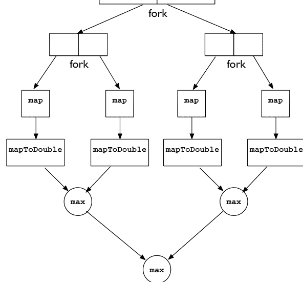

图 1-2 列表处理任务的递归分解

无痕的并行化是 Java 8 核心主题之一的示例；它实现的 API 为库开发者提供了更大的自由。他们利用它的一种重要方式是探索现代（以及未来）机器架构提供的许多性能改进机会。

# 掌握 Lambda

## 1.4 组合行为

在本章的前些部分，我们看到了功能上 Lambda 表达式与匿名内部类是多么相似。频繁地编写它们导致了对它们的不同思考方式。Lambda 表达式看起来像函数，因此询问我们是否可以让它们表现得像函数是如此自然的。这种视角的转变将鼓励我们思考处理“行为”而非“对象”，而反过来，这将导致某些非常不同的编程和库 API 的分解。

例如，函数的一个核心操作是组合：将两个函数组合成第三个函数，其效果等于连续应用它的两个组件。这不是一个与匿名内部类联系时自然产生的想法，但在通用形式下，它非常好地对应传统面向对象程序的构建。正如面向对象的程序通过分解来拆解一样，组合的反向操作也适用于函数。

假设例如，我们想根据 x 坐标对一个 `Point` 实例列表进行排序。Java 中“自定义”排序的标准惯用法是创建一个 `Comparator`：

```
Comparator<Point> byX = new Comparator<Point>() {
    public int compare(Point p1, Point p2) {
        return Double.compare(p1.getX(), p2.getX());
    }
};
```

```
Comparator<Point> byX = (p1, p2) -> Double.compare(p1.getX(), p2.getX());
```

但这对另一个非常重要的问题没有帮助：`Comparator` 是单体式的。如果我们想使用一个基于 y 坐标而非 x 坐标的比较器，我们必须复制整个声明，并将每个 `getX` 替换为 `getY`。良好的编程实践应该引导我们寻找更好的解决方案，片刻的反思表明 `Comparator` 实际上在执行两个功能——从其参数中提取排序键，并比较这些键。我们应该能够通过构建一个针对这两个组件进行参数化的 `Comparator` 函数来改进代码。我们现在将进化代码来实现这一点。中间阶段可能看起来很笨拙且冗长，但请坚持下去：结论将是值得。

> Java 平台中两种比较和排序对象的方法是标准做法：类可以有一个自然顺序；在这种情况下，它实现了 `Comparable` 接口并暴露了一个对象可以使用的 `compareTo` 方法。或者可以为此目的创建一个 `Comparator`，如本例所示。

首先，让我们把那两个具体的组件函数转换为 Lambda 形式。我们知道键提取器的函数接口类型——`Comparator`——但我们还需要对应 `p -> get()` 的函数接口类型。在用于声明函数式接口的包 `java.util.function` 中，我们找到了 `Function` 接口：

```
public interface Function<T,R> {
    public R apply(T t);
}
```

所以我们现在可以导出提取和比较的 Lambda 表达式：

```
Function<Point,Double> keyExtractor = p -> p.getX();
Comparator<Double> keyComparator = (d1, d2) -> Double.compare(d1, d2);
```

我们的 `Comparator<Point>` 版本从两个较小的函数重组：

```
Comparator<Point> compareBy = (p1, p2) -> keyComparator.compare(keyExtractor.apply(p1), keyExtractor.apply(p2));
```

这符合 ① 的形式但代表了重要的改进（在更大的示例中将意义重大）：你可以接入任何之前定义的 `keyComparator` 或 `keyExtractor`。毕竟，将较大的函数在其较小的组件上参数化正是目的。

但通过这种方式重新计算 `Comparator` 虽然改进了结构，我们失去了 ② 的简洁。在 `keyComparator` 表达提取键的自然顺序这种特殊但常见的情况下，我们可以恢复这种简洁。然后它可以重写为：

```
Comparator<Point> compareByX = (p1, p2) -> keyExtractor.apply(p1).compareTo(keyExtractor.apply(p2));
```

并且，由于这种特殊情况的重要性，平台库设计师在接口中添加了一个静态方法 `comparing`；给定一个提取器，它使用键的自然顺序创建相应的 `Comparator`³。这是它的方法声明，其中泛型参数已为了说明进行了简化：

```
public static <T,U extends Comparable<U>> Comparator<T,U> comparing (Function<T,U> keyExtractor) {
```

> ³`comparing` 的其他重载可以为基本类型创建 `Comparator`，但无法使用自然顺序，它们改为使用包装类暴露的 `compare` 方法。

```
return (c1, c2) ->
    keyExtractor.apply(c1).compareTo(keyExtractor.apply(c2));
}
```

使用这种方法允许我们编写如下代码（假设已静态导入 `Comparators.comparing`），而不是：

```
Comparator<Point> compareByX = comparing(p -> p.getX());
```

与此相比，这是一个巨大的改进：它更加简洁且让人一目了然，因为它孤立并强调了重要元素——键值提取器（key extractor）。这种实现方式只有在 `comparing` 接受一个简单的行为并用此构建出更复杂的行为时才是可能的。

为了看到这种改进的实际效果，假设我们的问题发生了微变化：我们不再寻找距离原点最远的单个点，而是按照距离从小到大的顺序打印所有点。捕捉所需的顺序非常直接：

```
Comparator<Point> byDistance = comparing(p -> p.distance(0, 0));
```

为了实现更改后的问题规范，流处理流水线需要进行相应的微调：

```
List.stream()
  .map(i -> new Point(i % 3, i / 3))
  .sorted(p -> p.distance(0, 0))
  .forEach(p -> System.out.printf("%f, %f\n", p.getX(), p.getY()));
```

为了适应新问题陈述所需的更改说明了 Lambda 将带来的某些优势。更改 `Comparator` 是非常简单的，因为它是通过组合创建的，我们只需要指定被更改的单个组件。新比较器的使用与现有的流操作无缝衔接，且新代码再次接近问题状态，问题的各个部分与代码的变化部分之间有着清晰的对应关系。

## 1.5 总结

显而易见，为什么 Lambda 表达式的引入一直如此备受期待了。在本章的较早章节中，我们看到了它们为性能提升创造的可能，通过允许库开发者实现自动并行化。尽管这种改进并非无处可用——本书的目的之一就是帮助你准确判断你的应用程序何时能从“并行化”中受益——但它代表了向正确方向迈出的一步，即开始让现代硬件提升后的性能能够被程序员触及。

在最后一节中，我们看到了 Lambda 如何鼓励编写更好的 API。`Comparator.comparing` 的签名是未来的趋势：随着客户端程序员习惯于提供像 `comparing` 接收的这种键值提取函数之类的行为，像 `comparing` 这样细粒度的库方法将成为常态，随之而来，客户端编码风格和易用性也将相应提高。


# 第2章 Java 基础

## 2.1 什么是 Lambda 表达式？

在数学和通用计算中，Lambda 表达式是一个函数：对于某些输入值或输入的组合，它指定一个输出值。到目前为止，Java 中还没有编写独立函数的方法。方法通常被用来表示函数，但总是作为对象或类的一部分。Lambda 表达式现在提供了一种更接近独立函数概念的方法。¹ 在 Java 术语中，Lambda 可以理解为一种匿名方法，具有更紧凑的语法，并且允许省略修饰符、返回类型、`throws` 子句，在某些情况下还可以省略参数类型。

### 2.1.1 Lambda 的语法

Java 中的 Lambda 表达式由参数列表组成，通过箭头 `->` 与正体隔开。第一章的示例包含单个参数：

```
p -> p.translate(1, 1)
i -> new Point(i, i + 1)
```

但是，正如你从与方法声明的相似性中预期的那样，Lambda 通常可以有任意数量的参数。除了我们看到的单参数 Lambda 外，参数列表必须用括号括起来：

```
(x, y) -> x + y
() -> 23
```

此外，到目前为止，参数声明时没有显式类型，因为 Lambda 在没有类型时通常更具可读性。然而，提供类型总是允许的——当编译器无法从上下文中推断时，有时也是必要的。如果你显式提供任何类型，就必须提供所有类型，并且参数列表必须放在括号内：

```
(int x, int y) -> x + y
```

此类显式类型的参数可以像方法参数一样被修改（例如，它们可以被声明为 `final`）并添加注解。

> 关于 Lambda 的一个常见问题是它们是否为 Java 中传统定义的对象。这个问题没有简单的答案，尽管 Lambda 表达式目前会评估对象引用，但它们在所有方面表现得并不像对象——例如参见 2.2.1。

在函数箭头的右侧，Lambda 正体在目前为止的所有示例中都是一个表达式。（注意方法调用也是表达式，包括返回 `void` 的调用）。这样的 Lambda 有时被称为“表达式 Lambda”。一种更通用的形式是“语句 Lambda”，其中正体是一个代码块——即：

```
args -> { ... }
```

## 2.2 Lambda 对比匿名类

如果你遵循了第一章将匿名类转换为 Lambda 的转换，你可能在好奇除了语法之外，是否还有任何真实的区别。事实上，Lambda 表达式有时被称为匿名类的“语法糖”。实际上，有许多对程序员重要的实质性差异：

- 匿名类保证创建一个新对象，而 Lambda 可能不具有唯一身份，取决于实现。
- 匿名类创建一个新的命名作用域，其中 `this` 指向匿名类实例。

这些点将在后续章节中进一步解释。

### 2.2.1 无身份性

到目前为止，Java 程序中的行为一直与对象相关，以身份、状态和行为为特征。Lambda 背离了这一规则；尽管它们共享对象的一些属性，但它们唯一的用途是表示行为。由于它们没有状态，身份性问题并不重要。语言规范对此未定，要求 Lambda 必须评估为实现函数接口的实例（§2.4）。目的是给平台提供灵活性，如果每个 Lambda 表达式都必须具有唯一身份，这种优化是无法实现的。

### 2.2.2 Lambda 的作用域规则

匿名类的作用域规则与大多数类一样，由于它可以引用继承自类型的名称以及所在类中定义的名称而变得复杂。Lambda 表达式更简单，因为它们不继承自其类型。除了参数外，Lambda 体内部使用的名称与其体之外的含义完全相同。因此，例如，在 Lambda 内部重新声明局部变量是非法的：

```
void foo() { final int i = 2; Runnable r = () -> { int i = 3; }; // 非法
```

参数类似于局部声明，因为它们可以引入新名称：

```
IntUnaryOperator iuo = i -> { int j = 3; return i + j; };
```

Lambda 参数和 Lambda 体局部声明可能会屏蔽字段名（即字段名可以临时重新声明为参数或局部变量名）。

```
class Foo {
  Object i, j;
  IntUnaryOperator iuo = i -> { int j = 3; return i + j; }
}
```

²该规则的影响将其从超类型（即函数接口）的任何 Lambda 作用范围内排除。接口除了抽象方法外，还可以声明静态常量字段、静态嵌套类和默认方法（见第 7 章）。这些都不在实现 Lambda 的作用范围内。

由于 Lambda 声明的作用域类似于简单的块，因此关键字 `this` 和 `super` 的含义与它们在闭包环境中的含义相同：即它们分别引用闭包对象及其超父类对象。例如，以下程序会在控制台上打印两次“Hello, world!” 消息：

```
public class Hello {
    Runnable r1 = () -> { System.out.println(this); };
    Runnable r2 = () -> { System.out.println(toString()); };

    public String toString() { return "Hello, world!"; }

    public static void main(String... args) {
        new Hello().r1.run();
        new Hello().r2.run();
    }
}
```

如果使用匿名内部类代替 Lambda 编写程序，它将产生对内部类调用 `Object` 的 `toString` 方法的结果。访问闭包对象的当前实例对于 Lambda 来说是直观的，但对于匿名内部类，则需要繁琐的 `InnerClass.this` 语法。

关于解释此条规则，经常会产生一个问题：Lambda 可以引用自己吗？如果 Lambda 的名称在作用域内，则它就可以引用自己，但限制初始化器中前向引用（针对局部变量和实例变量）的规则防止了 Lambda 变量初始化。仍然可以声明一个递归定义的 Lambda：

```
public class Factorial {
    IntUnaryOperator fact;
    public Factorial() {
        fact = i -> i == 0 ? 1 : i * fact.applyAsInt(i - 1);
    }
}
```

这种惯用法对于需要递归 Lambda 定义的少数特殊情况被认为是足够的。

## 2.3 变量捕获

在上一节中，我们学习了如何解释 Lambda 表达式从其闭包环境继承名称。但名称解释只是故事的一部分；一旦我们理解了从环境中继承的变量名的含义，我们仍然需要知道对它做什么——以及我们实际上做了什么，这两者可能不是一回事。

首先，注意许多实用的 Lambda 表达式实际上并没有从其环境中继承任何名称。面向对象的程序员可以通过类比静态方法来理解这一点；虽然对象的通用行为取决于其状态，但定义不依赖于任何系统状态的方法通常是有用的。`java.lang.Math` 类只包含静态方法——在计算例如数字的平方根时，考虑系统状态是没有意义的。Lambda 可以起到相同的作用；一个与 `Math.sqrt` 相同结果的 Lambda 可以这样写：

```
DoubleUnaryOperator sqrt = x -> Math.sqrt(x)
```

这些仅通过参数和返回值与其环境交互的 Lambda 是无状态的或非捕获的。相比之下，捕获 Lambda 可以访问闭包对象的状态。“捕获”是 Lambda 保留其环境引用的技术术语。它的含义是该变量被 Lambda 捕获并持有，以便在以后求值 Lambda 时进行查询或——在其他语言中——进行修改。


这种访问是被限制的；该限制的核心原则是被捕获变量的值不能被更改。因此，虽然传统术语是“值捕获”，但实际上称之为“值捕获”可能更准确。为了理解该原则是如何实现的，让我们先考虑局部捕获；之后，字段捕获将是一个更简单的情况。

传统上，对于局部类特别是一般的匿名内部类，从闭包方法可以在内部类中访问的局部变量是那些声明为 `final` 的变量。Java 8 中 lambda 的规则非常相似，只是在语法要求上略有放宽：为了确保 lambda 永远无法改变它从闭包环境中捕获的变量的值，该变量必须是“有效最终的”（`effectively final`），这意味着它在初始化后从不再被赋值。（从 Java 8 开始，匿名类和局部类也可以访问有效最终的变量）

`effectively final` 允许在声明一个将被视为 `final` 的变量时省略 `final` 关键字。将捕获限制在有效最终变量上引起了与其与其他语言（例如 JavaScript，它们没有这一限制）对比的争议。防止 lambda 修改局部变量的理由是，这会引入影响正确性和性能的复杂变化，而且在任何情况下都是不必要的：

-   **正确性**：取消这一限制将允许引入一类涉及局部变量的新多线程 bug。Java 中的局部变量到目前为止对竞态条件和可见性问题是免疫的，因为它们只对执行声明它们的方法的线程可见。lambda 可以从创建它的线程传递到不同的线程，因此如果第二个线程在求值时被赋予修改局部变量的能力，这种免疫力就会丢失。
-   此外，无论涉及多少线程，lambda 的生命周期可能比它求值的方法的调用更长。如果捕获的局部变量是可变的，它将需要比创建它的调用存活。这种变化除了其他后果外，还会引入涉及局部变量的新内存泄漏可能性。
-   **性能**：允许多线程访问可变变量的程序如果通过同步保护对变量的访问，可以保证是正确的。但这种代价会破坏引入 lambda 的主要目的之一——允许策略高效地将不同参数的函数分发到不同的线程。

## 2.4 函数式接口

我们从 1.1.3 知道 lambda 表达式必须实现函数式接口。但为了实际使用 lambda 和函数式接口，我们需要更精确地理解它们之间的关系。本节给出概述，并简要调查库 `java.util.function` 提供的函数式接口。稍后（在 2.7），我们将详细探讨这种关系。

函数式接口具有这种核心作用源于它们最重要的属性，即赋予它们名字的属性：它们可以描述函数的类型。例如，接口 `UnaryOperator`

```java
public interface UnaryOperator<T> { T apply(T t); }
```

描述了函数

```
f: T -> T
```

这就是它的函数类型，在简单且常见的案例（如此），它是函数式接口单一抽象方法的方法类型：即方法的类型参数、形式参数类型、返回值类型以及（在适用时）抛出的异常类型。

“函数描述符”（你可能还会遇到这个术语。）2.7.1 节更详细地解释了函数类型。

函数类型是 lambda 必须匹配的类型，它允许通过装箱或拆箱、宽转换或窄转换等对类型进行适配。例如，假设我们声明了一个变量 `pointList` 类型为 `List<Point>`，并且我们替换其中的每一个元素。`replaceAll` 方法非常适合此目的：

| List<E> | |
|---|---|
| `replaceAll(UnaryOperator<E>)` | void |

### 类图约定

书中的平台库 API 类图使用了一些简化缩写：

- 右上角的图标包含 "i" 或 "s"，用于表示图表包含实例方法（instance）或静态方法（static）。
- 泛型参数类型上的通配符边界被省略了（例如，`forEach` 的参数实际上是 `Consumer<? extends T>`）。
- 如果你在方法声明中看到类型变量但在类声明中没有看到，那么你可以假设它是方法的类型参数。
- 图表并不一定完整——它们仅列出了对讨论重要的方法。

调用看起来可能如下所示：

```java
public Point apply(Point p);
```

对于这种情况，该 lambda 表达式必须匹配 `UnaryOperator<Point>` 的函数类型，即该方法的类型。

这种情况非常直观，但通常而言，匹配过程为类型检查带来了一些新的挑战。在此之前，任何格式良好的 Java 表达式都有定义的类型；现在，虽然在类型良好的语句或表达式中的每个 lambda 都实现了一个函数式接口，但具体实现了哪一个函数式接口部分取决于 lambda 本身。必须由上下文提供足够的信息以推导出精确的类型，这一过程被称为目标类型化。这是一个 lambda 表达式的示例，它在孤立时有很多可能的类型：

```java
x -> x * 2
```

该表达式可以是许多函数式接口的实例，包括在 `java.util.function` 中声明的这两个：

```java
public interface IntUnaryOperator {
  int applyAsInt(int operand);
}
public interface DoubleUnaryOperator {
  double applyAsDouble(double operand);
}
```

以下两个赋值都是合法的：

`IntUnaryOperator iuo = x -> x * 2;`

`DoubleUnaryOperator duo = x -> x * 2;`

在每情况下，类型都与目标类型兼容，即被赋值变量的函数式接口类型。编译器通过将 lambda 参数类型化 `int` 来确定第一种情况，使 lambda 整体从 `int` 到 `int`。这匹配了 `IntUnaryOperator` 的函数类型，它也接收一个 `int` 并返回一个 `int`。同样，在第二情况下，lambda 参数可以被类型为 `double`，使 lambda 成为从 `double` 到 `double` 的函数，这匹配了 `DoubleUnaryOperator` 的函数类型。

两个 lambda 可能文本相同，但含义不同——对 `int` 值的操作与对 `double` 值的操作不同。类型在编译时确定且无法更改，没有办法为不同类型重用相同的 lambda 文本（除非它们可以通过通常的强制转换兼容）。下一节展示了一个示例（第 31 页）。

表 2-1 显示了 `java.util.function` 中声明的四种基本函数式接口类型，以及用例和 lambda 实例示例（参数 `T` 分别实例化为 `String` 和 `Integer`）。

**表 2-1.** *函数特化：java.util.function 中的这些接口*

| 接口 | 参数 | 返回值 | 示例用例 | 示例 |
| --- | --- | --- | --- | --- |
| Consumer<T> | T | void | 使用对象 | `s -> System.out.print(s)` |
| Predicate<T> | T | boolean | 过滤值 | `s -> s.isEmpty()` |
| Supplier<T> | 无 | T | 工厂方法 | `() -> new String()` |
| Function<T,U> | T | U | 转换对象 | `s -> new Integer(s)` |

`java.util.function` 中定义的四十多种类型是通过三种路径的组合从这四条路径演变而来的：

- **原生类型特化**：这些接口用原始类型替换了类型参数。示例如：

```java
interface LongFunction<R> { R apply(long value); }
interface ToIntFunction<T> { int applyAsInt(T value); }
interface LongToIntFunction { int applyAsInt(long value); }
```

- **双参数变体**：`Consumer`、`Predicate` 和 `Function` 的函数类型都接受单个参数。存在接受两个参数的接口，例如：

```java
interface BiConsumer<T,U> { void accept(T t, U u); }
interface BiFunction<T,U,R> { R apply(T t, U u); }
interface ToIntBiFunction<T,U> { int applyAsInt(T t, U u); }
```

> 实际上，目标类型化并不完全新鲜，但在 Java 8 中其使用大大增加用于编译 lambda 程序的类型检查。在此之前，表达式的类型首先计算并检查与其上下文的兼容性；如果上下文是方法调用，则选择合适的重载作为上下文。相比之下，未类型的 lambda 表达式没有单一类型可以与上下文检查，因此在方法调用的情况下，必须先选择重载，但仍需与 lambda 兼容。对编译器的这一挑战将在 2.7 和 2.8 中进一步探讨。


```java
public interface IntUnaryOperator {
  int applyAsInt(int operand);
}
public interface DoubleUnaryOperator {
  double applyAsDouble(double operand);
}
```

以下两个赋值都是合法的：

`IntUnaryOperator iuo = x -> x * 2;`

`DoubleUnaryOperator duo = x -> x * 2;`

在每情况下，类型都与目标类型兼容，即被赋值变量的函数式接口类型。编译器通过将 lambda 参数类型化为 `int` 来确定第一种情况，使 lambda 整体从 `int` 到 `int`。这匹配了 `IntUnaryOperator` 的函数类型，它也接收一个 `int` 并返回一个 `int`。同样，在第二情况下，lambda 参数可以被类型为 `double`，使 lambda 成为从 `double` 到 `double` 的函数，这匹配了 `DoubleUnaryOperator` 的函数类型。

两个 lambda 可能文本相同，但含义不同——对 `int` 值的操作与对 `double` 值的操作不同。类型在编译时确定且无法更改，没有办法为不同类型重用相同的 lambda 文本（除非它们可以通过通常的强制转换兼容）。下一节展示了一个示例（第 31 页）。

表 2-1 显示了 `java.util.function` 中声明的四种基本函数式接口类型，以及用例和 lambda 实例示例（参数 `T` 分别实例化为 `String` 和 `Integer`）。

`java.util.function` 中定义的四十多种类型是通过三种路径的组合从这四条路径演变而来的：

> 实际上，目标类型化并不完全新鲜，但在 Java 8 中其使用大大增加用于编译 lambda 程序的类型检查。在此之前，表达式的类型首先计算并检查与其上下文的兼容性；如果上下文是方法调用，则选择合适的重载作为上下文。相比之下，未类型的 lambda 表达式没有单一类型可以与上下文检查，因此在方法调用的情况下，必须先选择重载，但仍需与 lambda 兼容。对编译器的这一挑战将在 2.7 和 2.8 中进一步探讨。

## 2.5 使用 Lambda 表达式

lambda 表达式可以写在任何函数式接口的地方。有六种上下文可以提供目标类型：

- 方法或构造函数参数，其目标类型是参数。
- 变量声明和赋值，其目标类型是被赋值的对象。
- 数组初始化类似，但目标类型是数组组件。
- 返回语句，其目标类型是方法的返回类型。
- lambda 表达式，其目标类型是正文所需的类型，该类型反过来从目标类型推导出。
- 三元条件表达式，其两个分支的目标类型都由上下文提供。
- 强制转换表达式，显式提供目标类型。

## 2.6 方法引用和构造函数引用

我们已经看到，任何 lambda 表达式都可以被视为（在通常情况下）函数式接口单一抽象方法声明的实现。

# 32 掌握 Lambda

但当 lambda 表达式仅仅是调用现有类的某个命名方法的一种方式时，更好的写法可能只是直接使用现有的名称。例如，考虑以下代码，它将列表的每个元素打印到控制台：

```java
pointList.forEach(s -> System.out.print(s));
```

该 lambda 表达式仅仅将其参数传递给 `print` 方法调用。这种 lambda 表达式的目的是为具体方法提供参数，它的定义完全由该方法的类型决定。因此，只要可以通过某种方式确定该类型，那么一个仅包含方法名的简写形式将提供与完整 lambda 表达式相同的信息，但形式更具可读性。与其前面的代码，我们可以：

```java
pointList.forEach(System.out::print);
```

其含义完全相同。这种指向现有类具体方法的句柄写法被称为**方法引用**（method reference）。方法引用有四种，如表 2-2 所示。本节的其余部分将解释每种类型的用途。

| 名称 | 语法 | Lambda 等效表达式 |
| --- | --- | --- |
| 静态 (Static) | `RefType::staticMethod` | `(args) -> RefType.staticMethod(args)` |
| 绑定实例 (Bound Instance) | `expr::instMethod` | `(args) -> expr.instMethod(args)` |
| 未绑定实例 (Unbound Instance) | `RefType::instMethod` | `(args,rest) -> args.instMethod(rest)` |
| 构造器 (Constructor) | `ClsName::new` | `(args) -> new ClsName(args)` |

**表 2-2.** 方法引用类型

### 2.6.1 静态方法引用

静态方法引用的语法只需要类名和静态方法名，用双冒号隔开。例如：

`String::valueOf`
`Integer::compare`

这些都是静态方法的引用。为了查看如何使用静态方法引用，假设我们按大小对一个 `Integer` 数组排序，并将值视为无符号。`Integer` 的自然顺序是数值（即它考虑了值的符号），因此我们需要提供一个显式的 `Comparator`。我们可以利用静态方法 `Integer.compareUnsigned`：

```java
(x, y) -> Integer.compareUnsigned(x, y);
```

通过此调用来对我们的数组（假设为 `integerArray`）排序：

```java
Arrays.sort(integerArray, (x, y) -> Integer.compareUnsigned(x, y));
```

是可行的，但比其静态方法引用对应的形式更为冗长且重复：

```java
Arrays.sort(integerArray, Integer::compareUnsigned);
```

事实上，这个方法在 Java 8 中的引入部分原因是为了预见到它的这种用方式。在将来，API 设计的一个因素将将是方法签名是否适合函数接口转换。

注意表 2-2，`ReferenceType::Identifier` 语法并不总是表示对静态方法的引用。正如我们即将看到的，这种语法也可以被用于引用实例方法。

### 2.6.2 实例方法引用

引用实例方法有两种方式。**绑定方法引用**（Bound method references）与静态情况类似，将 `ReferenceType::Identifier` 形式替换为 `ObjectReference::Identifier`。引入本节的示例是一个方法引用：`forEach` 方法用于将集合中的每个元素传递到用于处理的 `PrintStream` 对象的实例方法 `print` 中，替换了 lambda 表达式

```java
pointList.forEach(p -> System.out.print(p));
```

为绑定方法引用

```java
pointList.forEach(System.out::print);
```

绑定引用之所以被称为绑定，是因为接收者（receiver）被固定为方法接收者的一部分。`System.out::print` 的每次调用都具有相同的接收者：`System.out`。然而，通常你还希望在未绑定方法引用中使用接收者及其参数来调用方法引用。为此，你需要一个**未绑定方法引用**（unbound method reference），之所以命名是因为接收者不是固定的；相反，方法引用的第一个参数被用作接收者。当只有一个参数时，未绑定方法引用最容易理解；例如，使用工厂方法 `comparing`（第 16 页）创建一个 `Comparator`，我们可以使用未绑定引用来替换 lambda 表达式

```java
Comparator personComp = Comparator.comparing(p -> p.getLastName());
```

为未绑定方法

```java
Comparator personComp = Comparator.comparing(Person::getLastName);
```

未绑定方法引用可以通过其语法来识别：与静态方法引用一样，使用了 `ReferenceType::Identifier` 形式，但在这种情况下，`Identifier` 指的是实例方法而非静态方法。为了探索绑定和未绑定方法引用之间的区别，考虑调用 `Map.replaceAll` 方法并提供某种实例方法引用：

| Map<K,V> | |
| --- | --- |
| replaceAll(BiFunction<K,V,V>) | void |

`Map.replaceAll` 的效果是应用于 map 中的每一个键值对，将键值对的值替换为结果。如果 map 指向一个 `TreeMap` 且其字符串表示如下：

```
{alpha=X, bravo=Y, charlie=Z}
```

那么使用绑定方法引用调用 `replaceAll` 的效果

```java
String str = "alpha-bravo-charlie"; map.replaceAll(str::replace)
```

将是 `str.replace` 的三次应用，即：

```
str.replace("alpha", "X")
str.replace("bravo", "Y")
str.replace("charlie", "Z")
```

现在让我们重新开始未绑定方法 `String::concat`，这是一个接收单个参数的实例方法引用。这似乎在使用 `BiFunction`，但实际上是方法引用本身是 `BiFunction`：它接收两个参数，键值对，因此方法调用方式为：

```
key.concat(value)
```

### 2.6.3 构造器引用

与方法引用是对现有方法的句柄，构造器引用是对现有构造器的句柄。构造器引用的语法与方法引用类似，但将方法名替换为关键字 `new`。例如：

`ArrayList::new`
`File::new`

与方法引用一样，重载构造器的选择是使用上下文的目标类型进行的。例如，在下面的代码中，`map` 参数的目标类型是函数类型 `String -> File`；编译器将选择具有单个 String 参数的 `File` 构造器

```java
Stream<String> stringStream = Stream.of("a.txt", "b.txt", "c.txt");
Stream<File> fileStream = stringStream.map(File::new)
```

## 2.7 类型检查

本节检查 lambda 匹配函数类型所需的条件，后续章节将解释如何通过推断解析“最佳”方法重载。这两个章节非常详细；你可能会跳过它们或第一次阅读时快速扫描。

在本章之前，我们看到只有当 lambda 表达式出现在提供目标类型的上下文中，它才能被说具有单一类型。这种类型部分由上下文决定的表达式被称为多态表达式（poly expressions）。方法引用和构造器引用也是多态表达式；如果没有上下文，`String::valueOf` 表达式可以引用任何九个不同的 String 方法。本节和下一节探讨了 lambda 以及方法和构造器引用的类型检查过程。由于类型检查发生在函数接口的函数类型上，因此首先需要对函数类型有一个精确的定义。

# 36 掌握 Lambda 表达式

## 2.7.1 什么是函数类型？

在本章的剩余部分中，函数类型（function type）的概念对于理解类型检查的工作原理非常重要，因此值得对其进行精确定义。事实上，在大多数情况下，§2.4 中的简单定义已经足够：函数式接口的函数类型是其单一抽象方法的类型——即它的类型参数加上它的参数、返回类型和抛出类型（thrown types）。

然而，这个简单的定义可能会因两个因素变得复杂：所有接口都（隐式地，即使不是显式地）声明了与 Object 中的公共方法对应的抽象方法，而函数式接口的单一抽象方法是在这些方法之外的。大多数的 Object 方法是隐式声明的，但并非总是如此；例如，`Comparator` 显式地声明了方法 `equals`，它与 Object 的 `equals` 方法匹配。在这种情况下，显式声明没有影响；`Comparator` 仍然符合函数式接口的定义。

第二个复杂因素是两个接口的方法并不相同，但通过类型擦除（erasure）相互相关。例如，这两个接口的方法

```java
interface Foo { void bar(List<String> arg); }
interface Foo2 { void bar(List arg); }
```

是重写等效的（override-equivalent）。如果一个接口的父接口包含重写等效的方法，则该接口的函数类型是能够合法重写所有继承抽象方法的单一方法的类型。在这个示例中，如果

`interface Foo extends Foo2 { }`

那么 `Foo` 的函数类型就是对应于以下方法的类型：

```java
public void bar(List arg);
```

这些复杂情况对“单一抽象方法”这一看似简单的想法没有通用的影响，但在遇到像 `Comparator` 这样的边界情况时，记住这些点是有用的。

## 2.7.2 匹配函数类型

针对目标类型（target typing）提供的函数式接口对 Lambda 进行类型检查，要求 Lambda 表达式必须与接口的函数类型兼容。例如，以下赋值：

```java
UnaryOperator<Integer> b = x -> x.intValue();
```

能够编译通过，是因为 Lambda 表达式与 `UnaryOperator<Integer>` 的函数类型兼容。这些是保持兼容性的条件：

- **元数（Arities）**：Lambda 和函数类型的参数个数必须相同。
- **参数类型**：如果 Lambda 表达式具有显式类型，则这些类型必须与函数类型的参数完全匹配；如果 Lambda 是隐式类型，那么对于返回类型检查（在下一步），它的参数类型被认为与函数类型的类型相同。
- **返回类型**：
    - 如果函数返回 `void`，则 Lambda 体必须是一个语句表达式（即可以作为语句使用的表达式，如方法调用或赋值），例如：
      ```java
      (int i) -> i++;
      ```
      注意语句表达式的值被丢弃了——或者是一个不带值返回语句的语句块体，例如：
      ```java
      (Thread t) -> { t.start(); };
      ```
    - 如果函数有非 void 返回类型，则 Lambda 体必须返回一个赋值兼容的值。例如，这个 Lambda 体返回一个 `int` 值，将被赋值给 `UnaryOperator` 函数类型的 `Integer` 结果：
      ```java
      UnaryOperator<Integer> b = x -> x.intValue();
      ```

在给出的兼容性条件基础上，必须添加一个条件以确保 Lambda 表达式能够编译：

- **抛出类型（Thrown types）**：Lambda 只有在异常异常或其超类型被函数类型声明抛出的情况下，才能抛出检查异常。

这最后一个条件可能会导致问题。例如，假设我们想声明一个方法来集中处理由 `File` 的无参方法实现的多个 I/O 操作的 `IOException`。第一个想法可能是这样声明它：

> 5 本节是 Java 8 版《Java 语言规范》§13.27.3 (http://docs.oracle.com/javase/specs/jls/se/8#html) 的简化版本。
> 6 使用“值载的”或“流载的”来描述返回值或流的方法将很快变得常见且无需解释；但目前尚未如此。

```java
<U> U executeFileOp(File f, Function<File, U> fileOp) { ... }
```

但 `Function` 的类型没有声明任何异常，因此像 `executeFileOp(f, File::delete);` 这样的调用将无法编译。相反，需要一个自定义的函数式接口：

```java
@FunctionalInterface
interface IOFunction<T,R> {
  R apply(T t) throws Exception;
}
```

这样我们就可以按照预期声明 `executeFileOp`：

```java
<U> U executeFileOp(File f, IOFunction<File, U> fileOp) {
  try {
    return fileOp.apply(f);
  } catch (IOException e) {
    // 集中异常处理
  }
}
```

总结来说与其他任何方法一样——它可以（隐式地）向调用者声明它，或者在 catch 块中处理它。由于库中的函数式接口都没有声明任何异常，Lambda 只有在实现用户定义的函数式接口（如示例所示）的情况下将异常传递给调用者。相比之下，我们将在 §5.3 流处理中看到，必须采取在 Lambda 内部处理检查异常的替代方案，流处理操作的参数都是库函数式接口。更简洁地总结：检查异常处理是 Java 设计中的一个问题领域。

## 2.8 重载解析

使用 §2.7 中的兼容性标准，当方法调用没有二义性时，Lambda 的目标类型是非常简单的。然而，当出现二义性时，可能会导致令人困扰的问题。而且如果你正在设计 API，你的用户正依赖你避免这些问题。

这里是重载挑战的简要总结：不同元数的调用通常很容易区分，但选择相同元数的重载需要编译器知道参数类型。对于无类型 Lambda 来说，这是一个问题，因为在完成重载解析之前无法推断出目标类型！一切是一致的。

### 2.8.1 使用 Lambda 表达式进行重载


# 掌握 Lambda

## 2.8 类型推断的困难

在探索类型推断的困难之前，让我们看看在简单的情况下它是如何工作的。第 1 章（§1.4）引入了 `comparing` 方法，它使用键提取器创建一个 `Comparator`。这是 `comparing` 重载的一个示例（为了可读性限制了类型）：

```java
public static <T, U extends Comparable<U>>
Comparator<T> comparing(Function<T, U> keyExtractor)
```

假设我们想按长度对字符串进行排序。给定无类型目标类型作为赋值，可以使用无类型 Lambda 和它来创建一个 `Comparator`：

```java
Comparator<String> cs = Comparator.comparing(s -> s.length());
```

这里是解析 Lambda 类型的高度简化的说明。首先，编译器必须选择一组用于检查 Lambda 的重载。由于另一个重载有参数，该组只能包含 ①。现在已经选择了重载，通过将 ① 的返回类型与 ② 提供的目标类型匹配，允许编译器推断出在这种情况下 T 是 `String`。Lambda 表达式可以匹配函数类型 `Function<T, U>`：

```java
public U apply(T t)
```

由于 Lambda 的参数类型 T 已知为 `String`，`String.length()` 返回的类型（`int`，装箱为 `Integer`）可以替换 U。现在所有类型都是已知的，且 `U` 的边界是 ①，这保证了 Lambda 的结果可以被检查为 `Integer`。一切都是一致的，且调用可以编译。

### 2.8.1 重载解析与 Lambda

到目前为止，一切顺利。假设 `Comparator` 声明了 `comparing` 的另一个重载：

```java
// 从 JDK 中移除
public static <T> Comparator<T> comparing(ToIntFunction<T> keyExtractor)
```

在 Java 8 开发的某个阶段，这种由赋值上下文提供的类型用于在其存在时进行检查，我们将看到为什么它被撤销了。这与编译器的过程相同，编译器首先尝试选择一组重载方法进行类型检查。结果是，这必须在对任何无类型调用进行任何类型检查之前完成。（某些无类型化的 lambda 可以在方法重载解析之前进行类型检查，但当设计人员发现这会让整个过程更加不一致且令人困惑时，这种方法被放弃了。）

鉴于此，没有多少信息可以帮助方法重载解析。编译器无法使用赋值上下文提供的类型，因为另一条重要规则规定，带有一组参数的方法调用在任何出现的地方都必须解析为相同的重载，无论上下文如何。它可以使用方法调用的其他参数，但在这种情况下没有参数。它可以使用 lambda 表达式中的某些信息，但对于像这种这样的兼容无类型 lambda，只能报告它接受的参数数量以及它是否返回值。在这种情况下，这些一个也没有：该 lambda 接受一个参数并返回一个值，匹配两个候选函数式接口的函数类型。因此，过程被阻塞，编译器报告一个错误，信息为“reference to comparing is ambiguous”（引用 comparing 有歧义）。

如果 lambda 类型是已知的，我们如何避免这种情况呢？编译器可以使用该信息，使用本节开头的算法来检查两个候选函数类型。由于参数类型是 `String`，它会发现它们与 lambda 是兼容的。然后它可以根据哪个返回最具体的结果在它们之间进行选择：`ToIntFunction` 返回一个 `int`，这与 `String.length()` 的返回类型更匹配，而不是 `Function<String, Integer>` 返回的 `Integer`。因此，调用

```java
Comparator<String> cs = Comparator.comparing((String s) -> s.length());
```

将通过编译并解析为 `ToIntFunction`。对于 `Comparator.comparing`，Java 8 的设计者希望避免强制用户以这种方式提供显式的 lambda 类型，因此他们用接受 `ToIntFunction`、`ToLongFunction`、`ToDoubleFunction` 的重载被新方法 `comparingInt`、`comparingLong` 和 `comparingDouble` 取代了。对于其他 API，可能提供具有不同参数数的函数式接口参数的不同重载，或者为重载提供其他消除歧义的参数。如果你正在设计一个 API，你的用户将感谢你选择了这些备选方案之一。

### 2.8.2 使用方法引用的重载

方法和构造函数引用增加了另一个困难：如果方法或构造函数引用了泛型或重载，则它们被称为*不精确的*（inexact），因为它们的语法不允许任何等效的 lambda 类型，所以你无法指定意图使用它们的精确类型。注意，这是一个相对异常的情况：在实践中，方法既不是重载的也不是泛型的。正如我们在本节末尾看到的，不精确方法引用的困难可以通过使用类型化的 lambda 来避免，而且可以认为，如果该方法是你的首选而不是最后的手段，那么是可以避免的。

作为一个不精确构造函数引用的示例，`Exception::new` 可以引用 `Exception` 的两个构造函数之一，包括这些：

```java
public Exception()
public Exception(String message)
```

第一个可以匹配 `Supplier<Exception>` 的函数类型，第二个可以匹配 `Function<String, Exception>` 的函数类型。所以如果我们声明了方法重载

```java
<T> void foo(Supplier<T> factory)
<T, U> void foo(Function<T, U> transformer)
```

那么调用

```java
foo(Exception::new);
```

将编译失败，错误信息为“reference to foo is ambiguous”（引用 foo 有歧义）。然而，尽管我们不能像以前那样让构造函数引用变得精确，但我们可以通过类型化的 lambda 来避免不精确方法引用的困难。

## 2.9 总结

我们已经看到了引入 lambda 的所有变化；Java 8 的另一个重大变化是默认方法，将在第 7 章介绍。本章的一些细节可能看起来很复杂，但总体来说，想法是简单的。流的成功将取决于它在多大程度上实现了常见逻辑的表达式。同样的动机引导了语言设计。

# 第 3 章：流与流水线简介

## 3.1 流的基础

在第 1 章中，我们看到了引入 lambda 的两个主要主题。这两个主题——更好的代码和更容易的并行——在流的引入中结合在一起。虽然 lambda 表达式在实践中是流编程的必不可少的，但它们还不够：为了有效地使用流，我们需要某些特定的思想。在本章中，我们将探索流背后的思想，通过相对简单的示例来建立基本的直觉。在后面的章节中，我们将进一步探索某些实践，看看流如何简化集合任务，最后调查顺序流和并行流的性能。

我们将学习的单个流操作本身并不强大。流的力量在于组合这些操作所产生的可能性。在这方面，设计借鉴了长期先例。它最近的祖先之一是所谓的“Unix 哲学”，《Unix Programming Environment》（Kernighan and Pike, 1984）的作者写道：

> 系统的力量更多来自于程序之间的关系，而不是程序本身。许多 UNIX 程序孤立运行时做的是微不足道，但与其他程序结合，就变成了通用实用的工具。

如果你熟悉 Unix 流水线中的这种理念，你将在流的操作中清晰地看到反映。但宽泛地说，组合原则贯穿整个 Java 8 变化的设计：在 §1.4 中，我们看到了 lambda 表达式如何实现更细粒度的、更具可比性的操作，随后我们将看到它对流收集器设计的影响。

流在 §1.2 中被引入作为可选的有序值序列。在操作上，它们与集合的区别在于它们不存储值；它们的目的是处理这些值。例如，考虑一个以集合为源的流：创建它不会导致数据流动；当终端操作需要值时，流通过从集合中提取值来提供值；最后，当所有的值都被提供后，流就***耗尽***，无法再次使用。但这与空流并不相同；具有非集合源的流行为非常相似：例如，我们可以通过以下代码生成并打印前十个 2 的次方：

```java
IntStream.iterate(1, i -> i * 2)
  .limit(10)
  .forEachOrdered(System.out::println);
```

尽管正如我们稍后将看到的，`iterate` 方法生成了一个无限流，但 Lambda 表示的函数只会被调用多次——在这种情况下是调用了九次——因为下游处理需要一个值。

*惰性求值*的核心思想是：在需要之前，不计算任何值。Java 程序员已经熟悉惰性了：我们每天都使用的迭代器（无论是显式的还是隐式的）都具有这种特性。创建迭代器不会导致任何值的处理；只有调用其 `next` 方法才会从集合中返回实际值。流在概念上非常简单，但有了重要的改进：

- 它们以更对客户端友好的方式处理耗尽。迭代器只能通过从 `hasNext()` 调用返回 `false` 来信号已耗尽，因此客户端必须在每次需要元素时进行测试。这种交互在本质上是容易出错的，因为调用 `hasNext()` 和 `next` 之间的时间差是线程干预的机会窗口。此外，它强迫元素处理进入顺序执行的“紧箍咒”，这种实现是通过客户端与库之间复杂且通常低效的交互。
- 与迭代器总是以确定的顺序输出值不同，流可以是***无序的***。我们将在第 6 章中详细探讨这一点；目前，你只需要知道，当我们关注其值呈现的顺序时，就会出现并行流的机会。
- 它们拥有方法（中间操作），可以接受行为参数——对流的转换——并返回转换后的流。这允许将流像我们在第 1 章中看到的那样链起来成流水线，不仅提供了一种流式的编程风格，还提供了巨大性能提升的机会。我们将在本章稍后部分详细研究中间操作。
- 它们保留了关于源属性的信息——例如，源值是否有序，或者计数是否已知——这允许以迭代器无法实现的方式优化值处理，而迭代器除了值本身之外不保留任何信息。

> ¹ 当然，所有程序员都应该了解惰性，因为它是程序员的三大美德之一：惰性、不耐烦和自大（Larry Wall 等人，《Programming Perl》，O'Reilly，2012）。

惰性求值的一个大优势可以在 Stream 的“搜索”方法中看到：只需找到一个满足其谓词（布尔值函数）的元素，流处理就能完成，就像 `allMatch` 必须找到一个满足其谓词的元素一样。避免生成和处理不必要的元素显然可以节省大量工作——在无限流的情况下，只有惰性求值和短路操作的结合，才可能完成整个流的处理。诚然，惰性求值的这种优势在原则上也可以通过迭代器（集合处理的情况下）或显式循环（生成器函数的情况下）实现，但使用 Stream API 代码要容易读得多且（最终）更容易写。

惰性求值提供了另一个优势：它允许将多个逻辑操作融合为数据的单次遍历。回想在第 1 章中最初开发的用于说明流水线思想的代码：

```java
OptionalDouble maxDistance =
intList.parallelStream()
  .map(i -> new Point(i % 3, i / 3))
  .mapToDouble(p -> p.distance(0, 0))
  .max();
```

流式风格自然且易于阅读，但要理解正在发生什么，你需要记住惰性求值的内涵。如果为了演示而将流水线拆分为流声明和终端操作调用，会更容易看出这一点：

```java
DoubleStream ds =
intList.parallelStream()
  .map(i -> new Point(i % 3, i / 3))
  .mapToDouble(p -> p.distance(0, 0));

// 流水线现在已经建立，但还没有数据被处理

OptionalDouble maxDistance = ds.max();
```

分离出终端操作调用澄清了情况：它直接调用了行为参数的转换代码，所有这些代码都在单次遍历中执行。此外，由于每个元素的这些操作都是由单个线程执行，依赖于代码和数据局部性的优化可以发挥作用。

这与批量处理模型非常不同，批量处理通常通过一系列遍历实现，每次遍历转换集合的每个元素并将结果存储在新的集合中。在第 1 章中，我们看到了一系列循环（例如第 10 页）如何转换为等效的流操作序列（第 12 页）。流代码既更短又更高效（如第 148 页所示），因为它通过融合分离的操作来实现的。

### 3.1.1 并行就绪代码

惰性值序列在编程中是一个非常老的想法；它们在 Java 中实现的独特之处在于将这一概念扩展到包含对元素的并行处理。尽管顺序处理仍然是一个非常重要的模型，但它不再是唯一的参考：正如第 1 章所说明，并行处理已变得如此重要，以至于我们必须重新思考计算模型，产生与执行方式（顺序还是并行）无关的代码。通过这种方式，我们的代码——更重要的是我们的编码风格——确保了在未来优势向并行执行倾斜时不需要更改。Stream API 鼓励这种观点；理解它的关键洞察是，所有操作的定义让程序员遵循某些简单的规则。事实上，这种处理模式的思维方式从选择单个 `Stream` 接口来表示顺序和并行流就可以推断出来；设计者考虑过在单独接口中提供仅顺序和仅并行的方法，但拒绝了它。

注意，这绝对不意味着操作在无序情况下总是产生完全相同的结果。例如，`forEach` 被明确允许以无序顺序执行。在顺序模式下，它可能由于实现的巧合而保留顺序，但依赖这一点是错误的；`forEach` 以及其他无序操作在顺序和并行模式下同样是无序的。相反，在任何模式下都被定义为确定的操作都能保证在两种模式下以确定的方式工作。提供 `forEach` 等无序操作的动机源于不必要的确定性具有巨大的性能成本的情况。选择确定的替代方案（如 `forEachOrdered`）需要有意识的判断，即排序是问题的要求，而不仅仅是实现的偶然副产品。

这种洞察也有助于解释 API 中定义的操作选择，即这些选择避免了任何在顺序和并行模式下无法以同等效果实现的操作。某些“显而易见”的操作隐藏了深层的顺序性偏见——例如，“takeWhile”操作，在其他平台上，它会处理流直到遇到哨兵值为止。虽然这种操作在并行模式下并非不可行，但其实现无论在设计还是执行上都是极其昂贵的，因此被降低了优先级。

这种思维的转变可以重新表述：带有迭代的程序可以传达两种信息：要做什么，以及如何做。将这两种内容解耦可以导致一种开发模型，在该模型中我们创建支持并行的代码——理想情况下，将执行的实现委托给库。这是一个巨大的变化：对于我们中的许多人来说，顺序模型已经根深蒂固，要适应重新定义它所带来的影响需要付出努力。但这种努力是值得的；这不仅生成的程序将面向未来，而且我们的代码将更加清晰、简洁且易于维护。

### 3.1.2 原生流

Java 5 中引入的自动装箱（auto-boxing）和拆箱（unboxing）让程序员获得了一种许可，可以忽略原生类型值与相应的包装类型值之间的差异。编译器通常可以检测到在方法调用或赋值中提供了原生值代替包装值（反之亦然），并插入适当的转换。这非常方便，且通常能带给我们更具可读性的程序；泛型集合类现在似乎包含原生值，而包装类型与 Java 的基本面向对象编程模型相比，比原生类型更合适。但这可能导致重复的装箱和拆箱操作，产生高昂的性能成本。例如，在下面看似无害的代码中增加变量 `i`：

```java
List<Integer> max = Arrays.asList(1,2,3,4,5).stream()
  .map(i -> i + 1)
  .max(Integer::compareTo);
```

它在每次加法之前和之后分别执行了 `Integer` 的方法 `intValue` 和 `valueOf`。在处理大量值集合的应用程序中，我们希望避免此类开销；实现这一点的方法之一是定义元素已经是原生值而非引用值的流。这一决策带来了性能提升，表现为实用的仅数值方法（如 `sum`）以及创建包含数字范围的流的能力。例如，使用代表原生 `int` 值流的 `IntStream` 类型，上述代码可以重写为：

```java
OptionalInt max = IntStream.rangeClosed(1, 5)
  .map(i -> i + 1)
  .max();
```

这里的改进既体现在可读性上（具有专门的范围和最大方法），也体现在效率上（不需要装箱和拆箱）。§6.6 节报告了这两个代码片段在不同范围大小下的性能差异。对于足够大的的数据集，未拆箱的代码要快一个数量级。


# 原生流类型

原生流类型为 `IntStream`、`LongStream` 和 `DoubleStream`——它们被选为最常用的数值类型，即成本效益权衡最有利的类型。如果你的应用程序需要其他数值类型的流，这些也受到支持：`float` 值可以嵌入到 `DoubleStream` 中，`char`、`short` 和 `byte` 值可以嵌入到 `IntStream` 中。原生流的 API 彼此非常相似，且它们都与引用流类型 `Stream` 足够相似，足以在本章中讨论。作为准备，值得注意的是可能的流类型相互转换：

- 原生流类型 `IntStream` 和 `LongStream` 具有方法 `asDoubleStream` 和（对于 `IntStream`）`asLongStream`，它们对每个原生值应用适当的拓宽转换，例如：
  ```
  DoubleStream ds = IntStream.rangeClosed(1, 10).asDoubleStream();
  ```

- 对于装箱，每个原生流类型都有一个方法 `boxed`，它返回相应包装类型的 `Stream`，例如：
  ```
  Stream<Integer> is = IntStream.rangeClosed(1, 10).boxed();
  ```

- 对于拆箱，可以通过调用适当的 map 转换操作（我们将在节稍后详细介绍）并提供适当的拆箱方法，将包装值的 `Stream` 转换为原生流。例如，以下代码创建一个 `Stream<Integer>`，然后将其转换为 `IntStream`：
  ```
  Stream<Integer> integerStream = Stream.of(1, 2);
  IntStream intStream = integerStream.mapToInt(Integer::intValue);
  ```

# 3.2 管道的构造分析

流的完整威力通过我们组合它们创建的管道来实现。我们已经看到了管道的各个阶段的示例：它在流源中的起点，通过中间操作进行的连续转换，以及在终端操作中的结束。在本章的剩余部分中，我们将仔细观察这些阶段中的每一个，以建立对流式编程的可能性建立直觉：随后的章节将探索赋予它们充分发挥威力的特征。

## 3.2.1 启动管道

到为止，我们流处理示例的数据都是从集合（collections）中提取的。事实上，由于流处理模型的优势适用于各种批量数据，平台库中许多产生批量数据的类也可以创建提供这些数据的流。然而，在本章中，我们主要关注获取对流工作原理的直觉，因此平台库中创建流方法的完整列表被推到了第 5 章。现在，我们只需要 `Collection` 的带流方法以及流接口中的工厂方法：

- `java.util.Collection<T>`：此接口上的默认方法：

  | Collection<T> | 返回类型 |
  | :--- | :--- |
  | `stream()` | `Stream<T>` |
  | `parallelStream()` | `Stream<T>` |

  `parallelStream()` 的合约实际上规定其返回“可能是并行的”。正如我们所看到的，这是集合的责任以并行方式呈现数据，并不是每个集合都能做到。

- `java.util.Stream<T>`：此接口暴露了一些静态工厂方法：

  | Stream<T> | 返回类型 |
  | :--- | :--- |
  | `empty()` | `Stream<T>` |
  | `of(T)` | `Stream<T>` |
  | `of(T...)` | `Stream<T>` |

## 3.2.2 转换管道

在创建流之后，管道的下一个阶段由若干（可能为零）中间操作组成。正如我们所见，中间操作是惰性的；它们根据终止管道的终端操作的要求计算值。

本章及后续章节将通过一个微型示例来探索 Stream API。我刚搬进一个书架空间足够的公寓，可以让我整理过去几十年里随机购买的几百本书。我计划的系统将把这个图书馆建模为 `Book` 对象的 `Collection`：

| Book | 返回类型 |
| :--- | :--- |
| `getTitle()` | `String` |
| `getAuthors()` | `List<String>` |
| `getPageCounts()` | `int[]` |
| `getTopic()` | `Topic` |
| `getPubDate()` | `Year` |
| `getHeight()` | `double` |

为了理解示例，需要对属性进行一些解释：

- `Topic` 是一个枚举，具有 `HISTORY`、`PROGRAMMING` 等成员。
- `pageCounts` 属性指的是包含多值项目的卷的页数。它被赋予数组类型，并不是为了推荐使用数组——对于大多数目的，Java 数组应该被视为遗留类型，尽可能用 `List` 实现来替换——因为在维护遗留代码时经常会遇到原生类型的数组，我们需要熟悉处理它们的流式惯用法。
- 具有相同标题和作者的不同版本的书籍，只要出版日期不同，就可以在图书馆中共存。
- 书籍的物理高度对我来说，因为我的内置书架高度各不相同，因此在决定将不同的主题存放在哪里时，我需要考虑书籍的高度。

在探索不同的流操作时，有几个具体的示例供关注将很有帮助。以下是我书库中四本书的声明：

```java
Book nails = new Book("Fundamentals of Chinese Fingernail Image",
    Arrays.asList("Li", "Fu", "Li"),
    new int[] {256}, // 每卷页数
    Year.of(2014), // 出版日期
    25.2, // 高度（厘米）
    MEDICINE);
```

```java
Book dragon = new Book("Compilers: Principles, Techniques and Tools",
    Arrays.asList("Aho", "Lam", "Sethi", "Ullman"),
    new int[] {1009},
    Year.of(2006), // 出版日期（第2版）
    23.6,
    COMPUTING);
```

```java
Book voss = new Book("Voss",
    Arrays.asList("Patrick White"),
    new int[] {478},
    Year.of(1957),
    19.8,
    FICTION);
```

```java
Book lotr = new Book("Lord of the Rings",
    Arrays.asList("Tolkien"),
    new int[] {531, 416, 624},
    Year.of(1955),
    23.0,
    FICTION);
```

在接下来的示例中，现实世界的持久化机制被一个占位变量 `library` 代替，声明为 `List<Book>`。图 3-1 展示了使用流处理我的书库的各种示例；它们将在本章稍后的部分进行详细解释，但集合在一起是为了让你了解使用流处理可以实现的功能。

### 流处理示例

一个只包含计算类书籍的流：

```java
Stream<Book> computingBooks = library.stream()
    .filter(b -> b.getTopic() == COMPUTING);
```

一个书标题的流：

```java
Stream<String> bookTitles = library.stream()
    .map(Book::getTitle);
```

一个按标题排序的 Book 流：

```java
Stream<Book> booksSortedByTitle = library.stream()
    .sorted(Comparator.comparing(Book::getTitle));
```

使用此流创建一个按书名排序的作者流，并去除重复项：

```java
Stream<String> authorsInBookTitleOrder = library.stream()
    .sorted(Comparator.comparing(Book::getTitle))
    .flatMap(book -> book.getAuthors().stream())
    .distinct();
```

一个按标题字母顺序产生前 100 本书的流：

```java
Stream<Book> readingList = library.stream()
    .sorted(Comparator.comparing(Book::getTitle))
    .limit(100);
```

包含剩余书籍的流：

```java
Stream<Book> remainderList = library.stream()
    .sorted(Comparator.comparing(Book::getTitle))
    .skip(100);
```

我书库中出版最早的书：

```java
Optional<Book> oldest = library.stream()
    .min(Comparator.comparing(Book::getPubDate));
```

我书库中书籍标题的集合：

```java
Set<String> titles = library.stream()
    .map(Book::getTitle)
    .collect(Collectors.toSet());
```


这些思想也适用于原始类型流类型；对于中间操作，它们的 API 与 `Stream` 的非常相似。

## 过滤

`filter` 方法允许对流元素进行选择性处理：

| Stream<T> | 返回类型 |
| :--- | :--- |
| `filter(Predicate<T>)` | `Stream<T>` |

它的输出是一个流，仅包含输入流中满足提供的 `Predicate`（第 29 页）的元素。例如，我们可以通过构建此流来分离出我收藏品中的计算类书籍：

```java
Stream<Book> computingBooks = library.stream()
    .filter(b -> b.getTopic() == COMPUTING);
```

图 3-2 展示了 `filter` 的作用。在部分 (a) 中，两个 Book 元素到达输入流：nails，然后是 dragon；在部分 (b) 中，输出流只包含 dragon，因为它的主题是 COMPUTING。

```java
filter(b -> b.getSubject == COMPUTING)
```

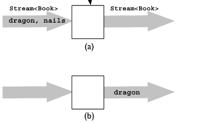

图 3-2. Stream.filter 工作原理

## 映射

`map` 方法使用提供的 `Function<T,R>` 逐个转换每个流元素（第 29 页）：

| Stream<T> | 返回类型 |
| :--- | :--- |
| `map(Function<T,R>)` | `Stream<R>` |

它的输出是一个流，包含将 `Function` 应用于输入流中每个元素的结果。例如，它可以用来创建一个日期的流：

```java
Stream<Year> bookPubDates = library.stream()
    .map(Book::getPubDate);
```

图 3-3 展示了 `map` 的作用。在部分 (a) 中输入元素是 Book 实例；在部分 (b) 输出是通过调用 `getPubDate` 获取的 Year 对象。

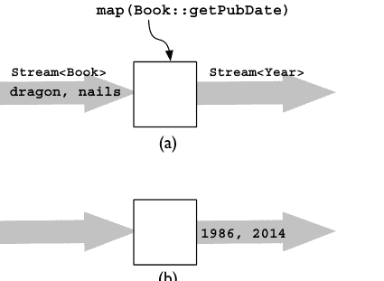

图 3-3. Stream.map 工作原理

`mapToInt`、`mapToLong` 和 `mapToDouble` 方法对应于 `map`。它们将引用类型转换为原始类型流：

| Stream<T> | 返回类型 |
| :--- | :--- |
| `mapToInt(ToIntFunction<T>)` | `IntStream` |
| `mapToLong(ToLongFunction<T>)` | `LongStream` |
| `mapToDouble(ToDoubleFunction<T>)` | `DoubleStream` |

我们在前文看到这些方法可以用于拆箱值流。另一个示例：

```java
int totalAuthors = library.stream()
    .mapToInt(b -> b.getAuthors().size())
    .sum();
```

在这些流中转换为原始类型让我们能够利用它们更好的性能和特定的算术操作。因此，除了这里讨论的方法，每个原生流类型还拥有专门的算术操作。

## 一一对映射

实现上一个示例的另一种（效率较低）方法是将 Book 流转换为 Author。但 `map` 不适用于此目的，因为它对元素执行的是一对一转换。我们需要将每个 Book 转换为 Author 流然后展平。这就是 `flatMap` 函数：

| Stream<T> | 返回类型 |
| :--- | :--- |
| `flatMap(Function<T, Stream<R>>)` | `Stream<R>` |

对于这个示例，我们将：

```java
Stream<String> authorStream = library.stream()
    .flatMap(b -> b.getAuthors().stream());
```

图 3-4 显示了它是如何工作的。在部分 (a) 中，相同的 Book 实例在输入流上，在 (b) 中每个被映射为 String 流，而在 (c) 中，这些单独的流被输入输出流。

类似于转换为原始流的方法，有原始转换方法：`flatMapToInt`、`flatMapToLong` 和 `flatMapToDouble`。例如，我们可以通过 `IntStream.of` 为每个 Book 创建单独的 `IntStream`，然后使用 `flatMapToInt` 将它们连接起来以获取总页数：

```java
int totalPageCount = library.stream()
    .flatMapToInt(b -> IntStream.of(b.getPageCounts()))
    .sum();
```

原始流类型只有 `flatMap`；没有类型转换的操作。

```java
flatMap(b -> b.getAuthors().stream())
```

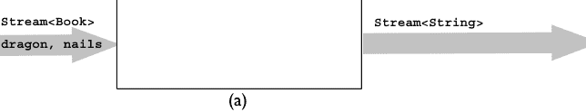
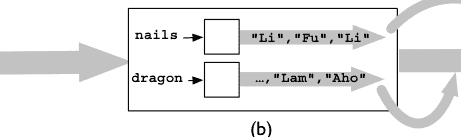
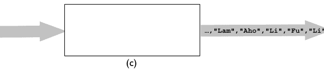

图 3-4. Stream.flatMap 工作原理

## 调试

正如我们在 3.1 中看到的，调用流水线的终端操作会导致其中间操作的融合执行。结果是，流无法使用单步执行操作的常规调试技术。Stream API 提供的替代方案 `peek` 操作与其他中间操作的不同之处在于输出流包含与输入流相同的元素，且顺序也相同。`peek` 的目的是允许对管道中中间的流元素执行处理；例如，我们可以在将它们发送到进一步处理之前，打印通过过滤器的每本书的标题（在这种情况下，将它们累积到一个 `List` 中：见 §3.2.4）。

```java
List<Book> multipleAuthoredHistories = library.stream()
    .filter(b -> b.getTopic() == Book.Topic.HISTORY)
    .peek(b -> System.out.println(b.getTitle()))
    .filter(b -> b.getAuthors().size() > 1)
    .collect(toList());
```

如果你熟悉 Unix 管道，你会发现它与 `tee` 有相似之处，尽管 `peek` 更具通用性，它接受任何类型的 `Consumer` 作为参数。提供此方法是为了支持调试，并且因为它通过副作用工作，因此不应将其用于任何其他目的。副作用和干扰问题在 §3.2.3 中进行了探讨。

## 排序与去重

`sorted` 操作的行为正如我们所期待的：输出流包含按输入排序后的元素。

| Stream<T> | 返回类型 |
| :--- | :--- |
| `sorted()` | `Stream<T>` |
| `sorted(Comparator<T>)` | `Stream<T>` |
| `distinct()` | `Stream<T>` |

对于具有相遇顺序（encounter order）的流（第 6 章），排序算法是稳定的；当对有序流进行排序时，具有相同元素的相对顺序在输入和输出之间将保持。

第一个 `sorted` 重载版本接受使用自然顺序进行排序（脚注，第 15 页）。例如，我们可以用它来创建一个按字母排序的 `Book` 标题流：

```java
Stream<String> sortedTitles = library.stream()
    .map(Book::getTitle)
    .sorted();
```

第二个重载接受一个 `Comparator`；例如，静态方法 `Comparator.comparing`（第 16 页）根据键值提取器创建一个 `Comparator`：

```java
Stream<Book> booksSortedByTitle = library.stream()
    .sorted(Comparator.comparing(Book::getTitle));
```

# 第 3 章：流与管道简介


这通过从键创建 `Comparator`，为流元素的自然排序提供了一种替代方案。注意，在这里你也不受限于自然排序：`Comparator.comparing` 的另一个重载接受对提取出的键的 `Comparator`，允许你对它们实施不同的排序。例如，为了按作者数量对我的书排序，我可以这样写：

```java
Stream<Book> sortedByAuthorCount = library.stream()
    .sorted(Comparator.comparing(Book::getAuthors,
        Comparator.comparing(List::size)));
```

该组中的第二个操作 `distinct` 会从流中移除重复元素。它的输出是一个只包含输入中每个元素仅出现一次的流——根据 `equals` 方法，所有重复项都会被丢弃。例如，通过我们刚刚创建的排序书籍流来生成一个作者列表，但要去重，我们会这样写：

```java
Stream<String> authorsInBookTitleOrder = library.stream()
    .sorted(Comparator.comparing(Book::getTitle))
    .flatMap(book -> book.getAuthors().stream())
    .distinct();
```

由于 `equals` 方法可能没有考虑到流元素的所有字段，“重复项”可能通过其他方法是可区分的。稳定性的概念以及与 `sorted` 的联系也适用于 `distinct`：如果输入流是有序的，元素的相对顺序将保持。在多个等等元素中，将选择第一个；如果输入是无序的，则可能选择任何元素（在并行管道中这可能是一个开销更小的操作）。

# 截断

这一类分组了两个限制流输出的操作：

| 操作 | 返回类型 |
| :--- | :--- |
| `skip(long)` | `Stream<T>` |
| `limit(long)` | `Stream<T>` |

`skip` 和 `limit` 操作丢弃前 `n` 个流元素，返回包含剩余部分的流；而 `limit` 保留前 `n` 个元素，返回一个仅这些元素的流。例如，我们可以通过以下代码按标题字母顺序获取前 100 本书：

```java
Stream<Book> readingList = library.stream()
    .sorted(Comparator.comparing(Book::getTitle))
    .limit(100);
```

# 60 进阶 Lambda

当然，库中的书籍可能少于 100 本；在这种情况下，`limit` 返回的流将包含所有书籍。类似地，`skip` 可以用来创建一个包含所有前 100 个元素的流：

```java
Stream<Book> remainder = library.stream()
  .sorted(Comparator.comparing(Book::getTitle))
  .skip(100);
```

## 3.2.3 非干扰

Stream API 为程序员提供的特性之一是可以执行并行操作——即使在非线程安全的数据结构上也是如此。这是一个非常有价值的优势，因此它不是免费的，这并不令人意外。代价是与并行模型协作，遵循本节描述的规则。这些限制并不是任意的；它们只有在你以顺序模式进行思考时，才会产生限制。如果你已经在设计支持并行的代码（这看起来是自然的，因为你的线程将不会对哪些线程将执行流操作的行为参数，以及元素将以何种顺序处理产生隐藏假设），你会意识到，可能的每个行为参数都可能在不同的线程中执行，并且施加了顺序限制。

规则主要是为了保护你免受干扰。以下是一个**错误**创建分类映射的示例：

```java
Map<Topic,List<Book>> booksByTopic = new HashMap<>();
library.parallelStream()
.peek(b -> {
    Topic topic = b.get();
    List<Book> currentByTopic = booksByTopic.get(topic);
    if (currentByTopic == null) {
        currentByTopic = new ArrayList<>();
    }
    currentByTopic.add(b);
    booksByTopic.put(topic, currentByTopic);
})
.anyMatch(b -> false);
```

# 第 3 章：流与管道简介 61

本节的分类映射示例可能会让你认为行为参数的主要问题是线程安全。事实上，`java.util.stream` 的文档对状态操作的通用描述是：“一个结果取决于流管道执行期间可能发生的状态”。这是一个状态操作的示例，尽管它被另一个引用并包含一个指示是否被引用的布尔字段。为了测试，我们可以设置一个 `List<Book>`，每个元素引用列表中的相邻元素（将列表视为循环），执行以下代码：

```java
long count = bookList().stream()
.peek(b -> b.referredTo = true)
.filter(b -> b.referred) // 状态操作！
.count();
```

如果你在 1000 个元素的列表上顺序运行它，我们将得到 1 或 999 的结果，取决于每个元素引用的是其前驱还是后继者。很容易想，如果你从不在你的代码中使用并行流，就没问题了，就像上一代程序员错过了它们一样。尽管库 API 未来会增加对流的使用，但你会发现自己经常会调用接受 `Stream` 的方法。如果你像我们刚刚那样创建一个带有非线程安全行为参数的管道：

```java
Stream<Book> = library.stream()
    /* 非线程安全行为参数 */;
```

# 掌握 Lambda

差异完全取决于实现对求值的选择，这本身就是避免此类代码的充分理由。）但在并行顺序下运行它，会得到不一致的结果，在 1 到 4 之间不可预测地变化，或者在 995 和 999 之间。

并行就代码的一个同样重要的要求是，它要避免在终端操作执行期间修改其源。暂时只考虑集合，这种禁止可能会让你想起禁止在迭代期间进行结构性更改的规则：“快速失败”（fail-fast）迭代器——由非线程安全的集合创建的迭代器如果检测到集合发生了变化（其自身修改的除外），将抛出 `ConcurrentModificationException`。Splitters（$5.2），作为迭代器的并行类比，如果在终端执行期间检测到源数据发生了变化，其行为也类似。

最可能的情况是：`ConcurrentModificationException` 仅由结构性修改抛出——通常是添加或删除集合元素。流的规则禁止任何线程对流源进行任何修改——例如，更改元素的值——不仅限于流水线操作。该规则的唯一例外是线程安全的数据结构，例如 `java.util.concurrent` 中的那些。考虑到它所实现的可能，这实际上是一个很小的限制：能够在非线程安全的数据结构上执行并行操作的能力。

## 3.2.4 结束流水线

上一节的示例有一个共同点：由于它们所说明的流操作都是惰性的，因此它们的作用是将单个流组合成流水线，而不启动任何元素处理。相比之下，本节中的操作都是及时的（eager），在流上调用任何一个操作都会开始流元素的求值，将元素从源处拉过整个流。由于它们都产生非流的结果，可以说它们在某种意义上将流的内容归约为了单一值。但将它们进一步分为三类是有帮助的：

- 搜索操作（Search operations）：用于检测满足某些约束的流元素，因此有时可以在不处理整个流的情况下完成。
- 归约操作（Reductions）：以某种方式返回汇总流元素值的单一值。这个主题足够大，需要专门用下一章来说。目前，我们将视角限制在两个方面：像 `count` 和 `max` 这样的便利归约方法，以及简单的收集器（collectors），它们通过在集合中累积元素来终止流。
- 副作用操作（Side-effect operations）：这一类只包含两个方法：`forEach` 和 `forOrdered`。这些是 Stream API 中唯一设计用于副作用的终端操作。

## 搜索操作

可以归类为“搜索”操作的 Stream 方法分为两组：第一组包含匹配操作，它们测试任意或所有流元素是否满足给定的 `Predicate`：

| 操作 | 返回类型 |
| :--- | :--- |
| `anyMatch(Predicate<T>)` | `boolean` |
| `allMatch(Predicate<T>)` | `boolean` |
| `noneMatch(Predicate<T>)` | `boolean` |

这些名称具有指示性：`anyMatch` 在找到满足谓词的元素时返回 `true`；`allMatch` 在找到不满足谓词的元素时返回 `false`；`noneMatch` 类似此，在找到任何满足谓词的元素时返回 `false`，否则返回 `true`。

例如，规划书架的组织由于这些内置书架的高度并不相同而变得复杂。如果我需要知道历史书是否可以放在顶部空间为 19 厘米的层板上，我可以写道：

```java
boolean withinShelfHeight = library.stream()
    .filter(b -> b.getTop() == HISTORY)
    .allMatch(b -> b.getHeight() < 19);
```

但如果我正在计划将主题分配到书架，这并不是我想要的。在单次操作中确定所有适合这个矮层架的主题（或者更好地，为每个主题计算所需的顶部空间）要好得多。这可以通过将此代码封装在循环中实现，但代价是重复调用 `library.stream`——这是一种低效且丑陋的解决方案。在第 4 章中，我们将看到使用标准收集器的更好解决方案。

注意，根据逻辑的标准的规则，在空流上调用的 `allMatch` 将始终返回 `true`。

第二组搜索操作由两个“查找”方法组成：`findFirst` 和 `findAny`：

| 操作 | 返回类型 |
| :--- | :--- |
| `findFirst()` | `Optional<T>` |
| `findAny()` | `Optional<T>` |

如果有任何可用元素，它们会返回流元素，但在返回哪个元素上可能不同。返回类型需要一点额外的解释。初看之下，我们可能会天真地预期写成

```java
Book anyBook = library.stream()
    .filter(b -> b.getAuthors().contains("Herman Melville"))
    .findAny(); // 无法编译
```

但如果不包含元素，那么它返回的流是空的怎么办？在这种情况下，`findAny` 没有答案可以返回。传统的 Java 返回 `null` 的解决方案是不令人满意的；因为它无法确定流中是否真的匹配到了 `null`，还是它表示值的缺失（如 `Map` 的结果所示）。此外，在 Java 8 中创建了 `java.Optional<T>` 类；该类的实例是一个包装器，可能包含也可能不包含类型为 `T` 的非空值。“查找”方法通过返回 `Optional` 允许空流的存在，因此后续代码的正确版本是：

```java
Optional<Book> anyBook = library.stream()
    .filter(b -> b.getAuthors().contains("Herman Melville"))
    .findAny();
```

下一节提供了 `Optional` 的简要概述。例如：

```java
Optional<String> line = new BufferedReader(new FileReader("text.txt"))
    .lines()
    .filter(s -> s.contains("Mastering"))
    .findFirst();
```

`findFirst` 的用例是这种情况，即不需要顺序。对于无序流，这两个方法之间没有实质区别。

## Optional 类

在上一节中我们看到 `Optional<T>` 作为查找操作的返回值，而在之前（$3.1.2）我们遇到了原始变体。当将终端操作应用于空流时（例如 filter 删除了所有元素），我们需要 `Optional` 及其变体。上一节描述了使用 `null` 的问题；`Optional` 通过提供一个永远与 `T` 混淆的特殊空值解决了这个问题。

对于书中有限的使用，只需解释几个允许客户端代码使用值的方法即可：

| 操作 | 返回类型 |
| :--- | :--- |
| `get()` | `T` |
| `ifPresent(Consumer<T>)` | `void` |
| `isPresent()` | `boolean` |
| `orElse(T)` | `T` |
| `orElseGet(Supplier<T>)` | `T` |

这些操作 own如下：

- `get`：如果存在值则返回值；否则，该方法将抛出 `NoSuchElementException`。这是访问 Optional 内容的“不安全”操作，通常应优先考虑使用更安全的替代方案。
- `ifPresent`：如果存在值，将其提供给 `Consumer`；否则什么都不做。
- `isPresent`：如果存在值返回 `true`；否则返回 `false`。
- `orElse`：如果存在值返回值；否则返回参数。此和 `orElseGet` 是访问内容的安全操作。在 `Optional` 的正常使用中（存在空值的情况下），这些操作比 `get` 好得多。
- `orElseGet`：如果存在值返回值；否则调用 `Supplier` 并返回其结果。

## 归约方法

Stream API 的设计——借用 Larry Wall 的名言——是为了让简单的任务更容易，而不让困难的任务变得不可能。我们将在接下来的两章学习如何使用收集器和分割器处理困难的任务。但在实践中，大多数任务都是简单任务，对于这些任务，我们有便利归约——特殊的 `Stream.reduce($4.4)` 的变体，为了易用性而设计。在这里，数值基本类型流（例如 `IntStream`）提供了更多功能：

| 操作 | 返回类型 |
| :--- | :--- |
| `sum()` | `int` |
| `min()` | `OptionalInt` |
| `max()` | `OptionalInt` |
| `count()` | `long` |
| `average()` | `OptionalDouble` |
| `summaryStatistics()` | `IntSummaryStatistics` |

这些方法除了最后一个 `summaryStatistics` 之外，都是自解释的。它会创建一个 `IntSummaryStatistics` 类的实例，这是一个具有五个属性的值对象：`average`、`count`、`min` 和 `sum`。在我们想要通过对数据的一次遍历获取多个结果时，它非常有用。例如，像下面这样获取并打印我的图书馆书籍页数的统计信息（跨多个卷册的页数）：

```java
IntSummaryStatistics pageCountStatistics = library.stream()
  .mapToInt(b -> IntStream.of(b.getPageCounts()).sum())
  .summaryStatistics();
System.out.println(pageCountStatistics);
```

产生如下输出：

```
IntSummaryStatistics{count=409, sum=93641, min=158, average=228.9511, max=1472}
```

同样的模式也出现在 `LongStream` 和 `DoubleStream` 中。引用流也有一些方便的归约方法：

| 操作 | 返回类型 |
| :--- | :--- |
| `count()` | `long` |
| `min(Comparator<T>)` | `Optional<T>` |
| `max(Comparator<T>)` | `Optional<T>` |

例如代码，这段代码将找到我的图书馆中出版最早的书：

```java
Optional<Book> oldest = library.stream()
  .min(Comparator.comparing(Book::getPubDate));
```

请注意，要找到具有自然顺序的 Stream 元素的最小值或最大值，你必须提供一个显式的 `Comparator`。例如，为了按字母顺序找到我图书馆中的第一本书标题，我可以这样写：

## 第 3 章：流与管道简介 67

```java
Optional<String> firstTitle = library.stream()
.map(Book::getTitle)
.min(Comparator.naturalOrder());
```

同样提供了一个类似的工厂类 `Comparator.reverseOrder` 用于反向自然排序。

## 收集流元素

第二种归约（针对引用流）使用 `Stream.collect` 将流值累积到可变容器中，如 Java 集合框架的类。这被称为可变归约：

| 操作 | 返回类型 |
| :--- | :--- |
| `collect(Collector<T, A, R>)` | `R` |

`Collector` 的参数是 `Collector` 接口的一个实例。如图所示，`Collector` 有三个参数：第一个是正在被收集的类型，第二个将在 4.3.1 中解释，第三个是结果容器；这些都是作为对收集器进行更详细探索的一部分。

大多数用例都由 `Collectors` 类工厂方法返回的预定义 `Collector` 实现覆盖。本章涵盖了这些方法中最简单的三个方法；在第 4 章中，我们将看到完整的范围，并且——如果你需要预定义实现之外的功能——学习如何编写自己的收集器。


# 第 3 章 结束流：收集与归约

这里涵盖的三个方法收集到由框架选择的主 Java 集合框架接口的实现中：`Set`、`List` 和 `Map`。以下是 `toSet` 和 `toList` 方法的声明。

| Collectors | |
|---|---|
| `toSet()` | `Collector<T, ?, Set<T>>` |
| `toList()` | `Collector<T, ?, List<T>>` |

例如，为了将图书馆中的书籍标题收集到一个集合中，我可以这样写：

```java
Set<String> titles = library.stream()
    .map(Book::getTitle)
    .collect(Collectors.toSet());
```

通常的惯用法是静态导入 `Collectors` 工厂方法，使得示例的最后一行变为：

```java
.collect(toSet());
```

## 3.3 结论

现在我们已经对流（streams）和流水线（pipelines）的基本操作有了概述，但我们还没有看到许多使用这种编程风格解决实际处理问题的实践示例。在接下来的两个章节中，我们将基于所学知识，深入探索 API，并研究将复杂查询分解为流上分步操作的策略。

# 第 4 章 结束流：收集与归约

流水线通过终端操作结束，我们在第 3 章中看到这些操作被分为三类：搜索操作、归约操作（reductions）以及带有副作用的操作。尽管我们当时已经概述了这三类，但关于归约还有很多可以说的；本章将重点介绍这一内容。

广义来说，归约是以某种方式返回单个值的操作，总结了流元素的值。但这种描述并没有区分创建新对象的汇总操作与更改操作数的操作。Java 编程中关于归约传统做法鼓励不可变性；虽然现代 Java 编程普遍鼓励不可变性，但大多数流水线将位于可变集合中。因此，收集（collection，也称为可变）是 Stream API 中最重要的终端操作类型。收集是经典归约的推广，这在 Java 编程中对于原始类型流（primitive streams）非常有用。收集与归约相似之处在于它将流元素的值总结为一个对象，但它是通过变异实现的。

这里是传统的 Java 批量处理代码与允许真实数据源由 `Iterable<Book>` 建模（在此处声明为 `library`）的简单对比，我们通常会将其值累加到 `List<Book>` 中：

```java
List<Book> bookList = new ArrayList<>();
for (Book b : library) {
    bookList.add(b);
}
```

在 Java 8 中，通过 `Stream<Book>` 为数据源建模，我们可以编写以下代码获得类似的效果：

```java
List<Book> bookList = libraryStream
    .collect(Collectors.toList());
```

收集器（collector）版本除了简洁性和可读性显而易见的提升外还有许多优势：流操作可以安全地并行执行，即使累加流元素的 List（当前实现中使用 `ArrayList`）不是线程安全的。此外，收集器模式被证明非常灵活，且收集器易于组合：图 4-1 提供了本章稍后开发的示例预览，以便对这种灵活性有一个直观认识。

在命令式版本中，关键组件是容器的创建（`new ArrayList<>()`）和向其中累加元素（`bookList.add(b)`）。收集器也有负责这两个任务的组件，分别称为供应者（supplier）和累加器（accumulator）。我们可以在介绍的图表中识别这些组件。

## 收集器模式示例

按主题对书籍分类的 Map：

```java
Map<Topic, List<Book>> booksByTopic = library.stream()
    .collect(groupingBy(Book::getTopic));
```

一个从书名到最新版本出版日期的有序 Map：

```java
Map<String, Year> titleToPubDate = library.stream()
    .collect(toMap(Book::getTitle,
                    Book::getPubDate,
                    BinaryOperator.maxBy(naturalOrder()),
                    TreeMap::new));
```

将书籍分为虚构（映射为 true）和非虚构（false）的 Map：

```java
Map<Boolean, List<Book>> partitioningOrNon = library.stream()
    .collect(groupingBy(b -> b.getTopic() == FICTION));
```

将每个主题与作者人数最多的书籍关联的 Map：

```java
Map<Topic, Optional<Book>> mostAuthorByTopic = library.stream()
    .collect(groupingBy(Book::getTopic,
                    maxBy(comparing(b -> b.getAuthors().size()))));
```

将每个主题与该主题总卷数关联的 Map：

```java
Map<Topic, Integer> volumeCountByTopic = library.stream()
    .collect(groupingBy(Book::getTopic,
                    summingInt(b -> b.getPageCounts().length)));
```

书籍数量最多的主题：

```java
Optional<Topic> mostPopularTopic = library.stream()
    .collect(groupingBy(Book::getTopic, counting()))
    .entrySet().stream()
    .max(Map.Entry.comparingByValue)
    .map(Map.Entry::getKey);
```

从主题到该主题下所有书名拼接的 Map：

```java
Map<Topic, String> concatenatedTitlesByTopic = library.stream()
    .collect(groupingBy(Book::getTopic,
                    mapping(Book::getTitle,
                    joining("::"))));
```

## 4.1 使用收集器

本章稍后的章节将深入探讨收集器模式的思想，并讨论何时以及如何创建自定义收集器。在此之前，我们考虑该模式在日常编程中最常见的出现形式：即预定义收集器。这些可以分为两类：用于独立的收集器，以及为其他用途设计的收集器。

### 4.1.1 独立预定义收集器

独立收集器根据其功能分为三组：

- 累加到框架提供的容器。
- 累加到自定义集合。
- 将元素累加到 Map 中。

我们在第 3 章已经遇到了第一组大部分——那些供应者为框架提供的集合构造函数的收集器：对于 `toSet` 是 `Set` 实现，对于 `toList` 是 `List`。这些收集器的累加器也是显而易见的：对于集合实现是 `add`，对于 `toMap` 收集器是 `put`。

该组中剩余的方法是 `joining`，它返回一个收集器，可以将 `String` 对象流拼接成 `StringBuilder`，并以 `String` 返回（在 §4.3.1 中有进一步解释）；

| Collectors | |
|---|---|
| `joining()` | `Collector<CharSequence, ?, String>` |
| `joining(CharSequence)` | `Collector<CharSequence, ?, String>` |
| `joining(CharSequence, CharSequence, CharSequence)` | `Collector<CharSequence, ?, String>` |

`joining` 的第一个重载简单地拼接输入流中的字符串。第二个重载接受一个 `CharSequence`，将其作为分隔符插入输入字符串之间。例如，这里的代码用于拼接我的库中所有书的标题，用双冒号分隔：

```java
String concatenatedTitles = library.stream()
    .map(Book::getTitle)
    .collect(joining("::"));
```

第三个重载接受分隔符、前缀和后缀：例如，对于书籍 `b`，以下代码将产生一个拼接书籍作者的字符串，用逗号分隔，以书名开头并换行符结束。

我们可以使用此代码创建一个字符串列表，每个字符串包含一本书的所有作者：

```java
List<String> authorsForBooks = library.stream()
    .map(b -> b.getAuthors().stream()
        .collect(joining(", ")))
    .collect(toList());
```

我们目前看到的收集器都是累加到框架选择的集合。许多 `Collectors` 方法都有变体，允许你指定容器的供应者：

| 收集器 (Collectors) | |
|---|---|
| `<M extends Map<K,U>> toMap(Function<T,K> keyExtractor, Function<T,U> valueExtractor, BinaryOperator<U> mergeFunction, Supplier<M> mapFactory)` | `Collector<T, ?, M>` |
| `<C extends Collection<T>> toCollection(Supplier<C> collectionFactory)` | `Collector<T, ?, C>` |

例如，我们看到使用带有合并函数的 `toMap` 来构建一个从书名到最新版本日期的映射（map）。如果后续需要按照书名的字母顺序对映射中的内容进行操作，那么将它们放入排序映射（sorted map）中可能会提高性能。

```java
Map<String, Year> titleToDate = library.stream()
    .collect(toMap(Book::getTitle,
                Book::getPublished,
                (x, y) -> x.isAfter(y) ? x : y,
                TreeMap::new));
```

由于合并函数实际上是使用自然顺序选择 `java.time.Year` 的两个值中较大的一个，因此行 ① 可以替换为：

```java
BinaryOperator.maxBy(Comparator.naturalOrder());
```

我们现在看到的 `toMap` 的三个重载版本变得越来越通用：我们遇到的第一个版本只接受键和值的提取函数；第二个版本在合并函数中允许添加操作；而这第三个版本还接受一个提供者（supplier）。这意味着，如果你想指定一个提供者，就必须提供一个合并函数。但如果你想这样做，可以通过向此重载版本提供第三个参数，在键重复的情况下重建 `toMap` 简单重载版本的行为：

```java
(x, y) -> { throw new IllegalStateException(); }
```

你可能会认为 `toList` 和 `toSet` 对应的重载版本是提供能够指定自定义提供者的收集器。事实上，官方并没有为 `toList` 和 `toSet` 都提供额外的重载，而是提供了一个更通用的单一方法 `toCollection`。这种方法更灵活：它允许我们不仅可以选择 `Set` 和 `List` 的任意实现，还可以选择 `Collection` 的任何子接口。例如，我们可以将流元素收集到排序集（sorted set）或阻塞队列（blocking queue）：

```java
NavigableSet<String> sortedTitles = library.stream()
    .collect(toCollection(TreeSet::new));
```

```java
BlockingQueue<Book> queue = library.stream()
    .collect(toCollection(LinkedBlockingQueue::new));
```

- 与终端操作 `reduce` 的三个重载对应的是 `reducing` 方法的三个重载。我们将在本章结束处探索归约（reduction）主题时回到这些内容。

之前的示例都有一个共同点：下游收集器（downstream collector）——无论是计数元素、按公共属性进行排序，还是对属性进行汇总——都会接收并必须处理整个流元素。有时，下游收集器只需要处理单个属性；例如，假设我想创建一个从每个主题到该主题下所有标题连接起来的映射。从每本书中提取标题的操作类似于流上的 `map` 操作，但在这种情况下，该操作被应用于由 `groupingBy` 分发的对象流，在它们被接收之前应用到下游收集器中。这一需求通过 `Collectors.mapping` 创建的收集器来满足，它允许用户通过映射和下游收集器来提供支持。

| Collectors | |
|---|---|
| `mapping(Function<T,U>, Collector<U,A,R>)` | `Collector<T, ?, R>` |

图 4-7 显示了如何通过此方法创建收集器。借助 `Collectors.mapping`，可以很容易地创建一个从每个标题到该主题所有标题连接的映射。

```java
Map<Topic, String> concatenatedTitlesByTopic = library.stream()
    .collect(groupingBy(Book::getTopic,
        mapping(Book::getTitle, joining(";"))));
```

作为一种双重映射，`collectingAndThen` 在收集值之前对输入值应用一个函数，而它还接受一个在收集后应用于容器的函数。这种“完成型”操作在 §4.3.1 中有进一步描述。

## 4.1.3 链式流水线

上一节的技术提供了孤立处理每个分类键对应值的不同方法——在它们之间找到最大值、连接字符串属性的值等。某些问题需要更深层次的处理阶段，在该阶段中，不同键的值将被共同处理。例如，找到我图书馆库中最受欢迎的主题的问题——即书籍数量最多的那一个。我们知道如何生成从主题到计数的映射：

```java
Map<Topic, Long> countByTopic = library.stream()
    .collect(groupingBy(Book::getTopic, counting()));
```

但现在必须对 `Map<Topic, Long>` 中的单个条目进行比较，以找到值最大的那个。在比较发生之前，库中的所有元素已经通过收集器处理以创建分类映射；只有主题-计数对会被进行比较，以找到计数值最大的那个。为了能够将 Stream API 的操作应用到下一个处理阶段，我们需要启动另一个以这些对作为元素的流：

```java
Stream<Map.Entry<Topic, Long>> entries = library.stream()
    .collect(groupingBy(Book::getTopic, counting()))
    .entrySet().stream();
```

我们现在可以使用 `Map.Entry.getKey` 和 `Map.Entry.getValue` 方法处理单个 `Map.Entry` 对象的组件。Java 8 增加了产生比较器的方法 `comparingByKey` 和 `comparingByValue`，正是为了应对这种这种情况，因此，对于寻找最受欢迎主题的问题，我们可以这样写：


```java
Optional<Topic> mostPopularTopic = entries
  .max(Map.Entry.comparingByValue())
  .map(Map.Entry::getKey);
```

# 86 进阶 Lambda

我们可以通过将两个流水线链在一起来模仿流水线处理的流式风格：

```java
Optional<Topic> mostPopularTopic = library.stream()
  .collect(groupingBy(Book::getTopic, counting()))
  .entrySet().stream()
  .max(Map.Entry.comparingByValue())
  .map(Map.Entry::getKey);
```

在 Java 8 采用的早期阶段，无法详细预测用例将如何演变。这种方法有优点也有缺点：

- 它简洁且易读。
- 它可能具有误导性，如果你没有警觉到优化只能分别应用于两个流水线，并且需要足够的内存来持有中间集合。这实际上与某些中间操作（如 `sorted`）的行为没有区别，这些操作在继续下一步之前必须在内部收集流的全部内容。我们将在第 6 章进一步探讨这个问题。

撇开性能问题不谈，这种用例的采用将取决于它对代码可读性和可维护性的整体影响。在此基础上，本书将继续使用它。

## 4.1.4 实例详解：最受欢迎的主题

在上一节结束时，我们看到了如何找到最受欢迎的主题。但该代码没有考虑到可能有多个主题具有最大数量的书，如果是那样，我们想知道所有的它们。在本节中，我们将致力于寻求该问题的解决方案；我们不会简单地展示它，而是分阶段处理它。在每个阶段，停下来思考一下如何进行。首先，尝试想出解决该问题的整体方法。

思考此类问题的一种方法是从目标反向推。新程序的最后一个重要步骤也将像以前一样使用 `max`，但现在结果将包含所有最受欢迎的主题，而不仅仅是其中一个。这表明我们需要过滤具有最大值的条目：

```java
List<Topic> mostPopularTopics = library.stream()
  .collect(groupingBy(Book::getTopic, counting()))
  .entrySet().stream()
  .filter(entry -> entry.getValue() == maxCount)
  .map(Map.Entry::getKey)
  .collect(Collectors.toList());
```

# 第 4 章：结束流：收集与归约

在单独线程中执行

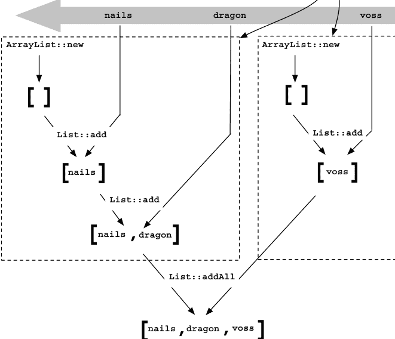

图 4-8. 并行可变归约：toList

如果我们假设流的类型为 T（此处为 Book），结果容器的类型为 R（此处为 List<Book>），那么这三个函数就是 2.4 中引入的三个接口的实现。

- 用于创建新容器的函数在本例中是 `ArrayList::new`；通常情况下，它是 `Supplier<R>` 的实现。
- 向现有容器添加单个元素的函数在本例中是 `List::add`；通常情况下，它是 `BiConsumer<R, T>` 的实现。

> ¹`Collectors.toList()` 的约定没有对创建的 List 类型提供保证，尽管在 Java 8 中它实际上是 ArrayList。

- 合并两个现有容器的函数在本例中是 `List::addAll`；通常情况下，它是 `BinaryOperator<R>` 的实现。

这些是 Collector 的三个核心组成部分。它们必须协同工作以产生一致的结果——例如，很容易看出图 4-8 只是代码所有可能的执行方式之一，它们将产生相同的值。在 4.3.3 中，我们将学习确保我们的自定义 Collector 像预定义收集器那样提供这种一致性保证的规则。

## 4.2.1 并发收集

从图 4-8 可以清楚看出，并行流处理中的性能瓶颈可能在于将不同线程处理结果合并的 `combine` 操作。框架保证了这一点——只要收集器遵循第 4.3 中的规则……对分区进行累加器操作（`accumulator operations`）永远不会由单个线程执行，且即使在合并非线程安全的容器时，并发操作也是安全的。但显然，在 map 合并的常见情况下，为了这种安全性是需要付出性能代价的。框架提供了另一种选择：并发收集器（concurrent collectors）。

并发收集器是将 `CONCURRENT` 声明为其特征之一（6.8）的收集器。此声明告知框架它可以安全地从多个线程在同一个结果容器上调用累加器函数。这将提高并行性能，代价是失去流元素的顺序性。并发收集的常见用例是收集到 Map 中，`Collectors` 类中的每个 `toMap` 方法都有一个对应的 `toMap` 方法，产生一个指向 `ConcurrentMap` 的收集器。同样，`groupBy` 的每个重载版本也返回 `ConcurrentMap` 而非 `Map`。我们将在 6.8 中讨论这些收集器能带来的性能提升（以及在什么情况下使用它们）。

## 4.3 编写 Collector

我们已经看到了库中预定义收集器提供的功能范围，并且进一步了解了如何通过组合它们来扩展这种范围。在如此多的选择中，你想要定义自己的 Collector 吗？这里有两种可能的动机：要么你需要将值累加到一个没有实现 `Collection` 接口的容器中（因此你使用 `Collectors::toCollection`），要么获取过程需要在被收集的值之间进行状态共享。

对于第二种情况的一个简单示例，假设我们有一个按某些属性排序的值流，我们希望根据该属性测量的接近程度对它们进行分组。一个物理示例是输电线的线路，其中铁塔之间的间距不能超过常数，例如 `MAX_DISTANCE`。一条由一系列铁塔位置组成的潜在路线可以通过将这些位置分段分组来分析，其中每个分段内的铁塔间距不超过 `MAX_DISTANCE`，而不同分段中的两个铁塔之间的距离始终大于 `MAX_DISTANCE`。对于一个非常简单的示例（图 4-9），一条完全沿 x 轴规划的路线可能包含这些点：

```
(3,0), (6,0), (8,0), (10,0), (14,0)
```

如果 `MAX_DISTANCE == 2`，这些点将被分组为：

```
[(3,0), (6,0)], [(8,0), (10,0)], [(14,0)]
```

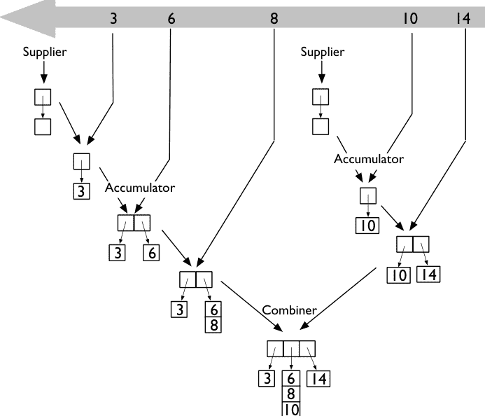

图 4-10. 按距离分组的 Collector 实例

## 4.3.1 结束器 (Finishers)

在提及收集器组成的讨论中（第 84 页），方法 `collectingAndThen` 接收一个在收集后应用于容器的函数：

| 收集器 | |
| :--- | :--- |
| collectingAndThen(Collector<T,A,R>, Function<R,RR>) | Collector<T,A,RR> |

该方法允许你对由收集器产生的容器提供一个额外的结束阶段转换。例如，为了获取一个不可变的标题列表，我们可以通过以下代码来适配 `toList` 返回的收集器：

```java
List<String> titles = library.stream()
  .map(Book::getTitle)
  .collect(collectingAndThen(toList(),
        Collections::unmodifiableList));
```

需要结束函数通常有几个原因：

- 中间容器的类型不适合返回（例如，`joining` 内部使用的 `StringBuilder`）。
- 某些处理必须推迟到看到所有元素后进行，例如计算平均值。
- 结果应该以标准形式返回，例如通过重新平衡树来实现。
- 结果在返回之前必须以某种方式被“密封”，例如使用不可变或同步包装器。

某些收集器在操作时总是需要一个结束器。`joining` 就提供了一个例子，它由一个收集器实现，该收集器返回类型为 String——这是一种不可变类型——不适合收集。（稍后我们将看到一种可以替代的规约，但在每次累加或组合操作中拼接字符串时性能会很糟糕。）事实上，`joining` 的容器是可变的类型 `StringBuilder`；转换为 `String` 只在收集完成后的结束函数中进行。这个结束器是总是需要的，它应该内置在收集器中；`Collector.of` 有一个重载方法为此目的：

| Collector<T,A,R> |
| :--- |
| of(Supplier<A> supplier, BiConsumer<A,T> accumulator, BinaryOperator<A> combiner, Function<A,R> finisher, Characteristics... characteristics) | Collector<T,A,R> |

这终于让第二种类型累加变得有意义了：它是进行累加的中间容器的类型。当我们使用收集器时，我们不需要关心这种类型，它只与收集器的内部机制有关；而且在编写收集器时，我们可能只需要使用输出类型，正如前一节的示例所示。在下一个示例（4.3.2）中，我们可以在使用结束函数将 `combiner` 的输出转换为所需的类型，或者在随后的应用 `map` 操作之间进行选择。

为了可视化内置的结束器，请考虑此代码，它创建一个字符串流，包含单本书的所有作者姓名：

```java
Stream<String> concatenatedAuthors = library.stream()
  .flatMap(b -> b.getAuthors().stream())
  .collect(joining());
```

图 4-11 显示了其执行过程的连续阶段。在 (a) 部分，输入字符串被累积在正在构建的内部 `StringBuilder` 对象中；在 (b) 部分，输入流被耗尽，结束函数被应用于中间对象，并返回生成的 String。

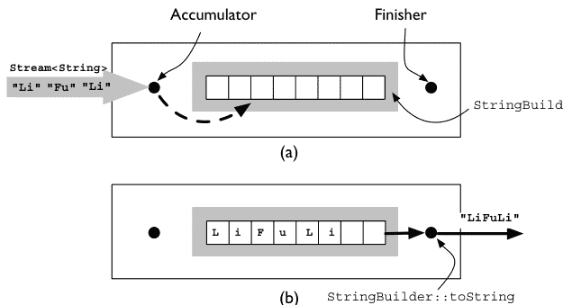

图 4-11. Collectors.joining 的工作原理

将结束函数嵌入收集器中，使其适用于 `groupingBy` 的下游收集器，而如果结束器必须单独应用则无法这样做。例如，考虑此代码，创建一个从字母到该字母所有书籍标题拼接的映射：

```java
Map<Character, String> map = library.stream()
  .map(Book::getTitle)
  .collect(groupingBy(t -> t.charAt(0), joining("")));
```

如果 `joining` 的结束器不是收集器的一部分，而是必须在收集完成后单独应用，那么它在 `groupingBy` 中就无法工作了。

## 4.3.2 实例示例：查找书籍

本节通过一个稍微复杂的示例扩展了对收集器的讨论，在该示例中，我们根据字母顺序排列书籍，并计算每个书籍的偏移。停止阅读，思考一下数据结构：

```java
class DispRecord {
    final String title;
    final int disp, length;
    DispRecord(String t, int d, int l) {
        this.title = t;
        this.disp = d;
        this.length = l;
    }
    int totalDisp() { return disp + length; }
}
```

这个示例将说明为什么 Java 语言对引入元组（tuples）的长期项目如此狂热。值类声明非常繁琐，并且与其他语言实现值对象相比可能效率低下。尽管如此，我们至少可以就现状进行改进：定义 `totalDisp` 等便利方法是对使用值类的一种补偿。

问题指定了从文件到偏移量的无序映射，因此在收集过程中需要一个有序容器。我们将使用 `Deque` 用于此目的，再次是为了利用其访问最后一个元素的便利功能。我们现在准备好编写收集器的组件了：

- 供应商易于定义：在这种情况下，只需要通过 `ArrayDeque::new` 创建一个空容器：

```java
Supplier<Deque<DispRecord>> supplier = ArrayDeque::new;
```

- 累加器稍微复杂一点：它的任务是通过加上页码数的偏移量，将 `DispRecord` 添加到队列的末尾。

累加器将单个 `Book` 添加到 `Deque<DispRecord>` 中，通过加上页码数的偏移量计算其相对于队列末尾元素的偏移。

```java
BiConsumer<Deque<DispRecord>, Book> accumulator =
  (dqLeft, b) -> {
    int disp = dqLeft.isEmpty() ? 0 :
      dqLeft.getLast().totalDisp();
    dqLeft.add(new DispRecord(b.getTitle(),
      disp,
      Arrays.stream(b.getPageCounts()).sum()));
  };
```

- 现在是合并器（combiner）。它的任务是合并两个 `Deque<DispRecord>` 实例。

合并器必须将第一个队列所有元素的总页数增加第二个队列中每个元素的 `disp` 字段。这可以从这些元素的最后一个，再次通过将其位移添加到页数来计算。然后就可以合并这两个收集结果：

```java
BinaryOperator<Deque<DispRecord>> combiner =
  (left, right) -> {
    if (left.isEmpty()) return right;
    int newDisp = left.getLast().totalDisp();
    List<DispRecord> displacedRecords = right.stream()
      .map(dr -> new DispRecord(
          dr.title, dr.disp + newDisp, dr.length)).collect(toList());
    left.addAll(displacedRecords);
    return left;
  };
```


问题的主要目标已经实现——计算了书籍位移——但结果并不完全符合规范要求的格式，规范要求从书名到位移的映射。实现此点的一种方法是将刚刚定义的收集器的输出通过 `Collectors.toMap()` 流向进一步的收集器。另一种方法是为现有的收集器添加一个完成器（finisher）。在这里最后停下来，思考一下如何定义一个合适的完成器，以及需要哪些更改。

在这种情况下，完成器的工作是从其输入创建一个 Map。然而，当完成器被调用时，fork/join 线程已经完成了 combiner 的工作，应该可以进行并发 map 合并：

```java
Function<Deque<DispRecord>, Map<String, Integer>> finisher =
  dr -> dr.parallelStream().collect(
    toConcurrentMap(dr -> dr.title, dr -> dr.disp));
```

图 4-12 显示了我们定义的函数如何为我们在第 3 章中的三个示例协同工作。实现图 4-12 只需要调用 `Collector.of` 并将生成的收集器提供给 `Stream.collect`：

```java
Map<String, Integer> displacementMap = library.stream()
  .collect(Collector.of(supplier, accumulator, finisher));
```

### 性能

影响此程序性能的各种因素使其成为一个有趣的例子；§6.8.3 对它们进行了详细分析。简要总结讨论：就目前而言，程序比迭代版本慢，原因有多个：它是前缀和（prefix sum）的一个示例，其中每个元素的值取决于前一个元素的值。在前缀和的朴素并行算法中，结合操作的总代价与输入数据集的大小成正比，无论所使用的并行程度如何。这里使用的 combine 操作非常昂贵（实际上是不必要的）。这个问题是由完成器执行的 map 合并的开销引起的；这可以通过预设 map 的大小来缓解。第三个问题是程序的每个元素工作负载——在现实情况下，收集之前的预处理通常是必需的。

> Java8 提供的 `java.util.Arrays` 带有新方法 `parallelPrefix` 的多种重载，用于高效计算前缀和，但这一创新尚未达到 Stream API。

这些问题是否导致该程序不适合并行化在 §6.8.3 中进行了讨论。

## 100 熟通 Lambda表达式

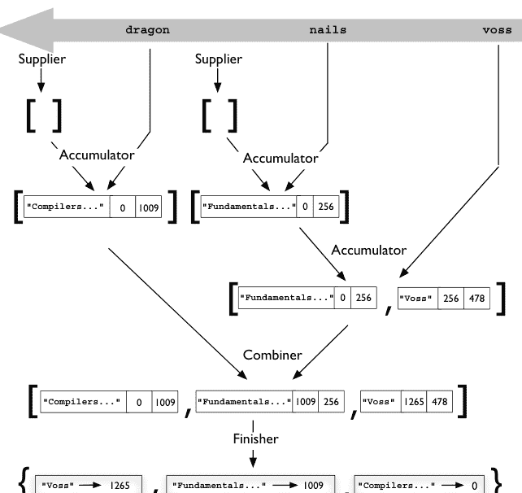

图 4-12. 收集书籍位移

### 4.3.3 收集器的规则

当收集器按照图 4-12 所示的方式执行时，框架与收集器提供的组件之间会发生复杂的相互作用。为了使其正常工作，每一方都必须能够依赖于遵守某些规则。本节规定了规则：收集器可以从框架期待什么，以及它本身必须遵守的约束。

框架保证遵守以下条件：

- 新值仅作为累加器（accumulator）的第二个参数出现；所有其他值都是来自 supplier、accumulator 或 combiner 的结果。
- 来自 supplier、accumulator 和 combiner 的结果可能会返回给 `collect` 的调用者；否则，它们将仅作为 accumulator、combiner 或 finisher 的参数。
- 传递给 combiner 或 finisher 但未返回的值将不再被使用；其内容已通过处理，不应重用。

收集器必须遵守以下约束：

- 除非它具有 `CONCURRENT` 特性（见 §4.2.1），否则它必须确保从 supplier、accumulator 或 combiner 函数返回的任何结果都是线程局部的（即它不能提供给任何其他线程）。这允许收集器框架进行并行化处理，而不必担心外部线程的干扰。
- 如果它具有 `CONCURRENT` 特性，accumulator 必须使用相同的并发可修改的结果容器是线程安全的，因为框架可能会从多个线程并发调用它。当顺序很重要时，不能使用并发收集器。
- 恒等性约束：空结果容器在与其他元素合并时应保持其他元素不变。更正式地说，对于 s 的任何值：

```
s == combiner.apply(s, supplier.get())
s == combiner.apply(supplier.get(), s)
```

- 结合律约束：在不同地方划分计算应该产生相同的结果。更正式地说，对于任何值 q, r, 和 s：

```
combiner.apply(combiner.apply(q, r), s) == combiner.apply(q, combiner.apply(r, s))
```

- 兼容性约束：在计算中间划分应该产生相同的结果。更正式地说，对于任何值 r, s, 和 t，执行右侧的两行代码应得到相同的 r 值：

```
accumulator.accept(s, t);
r = combiner.apply(r, s);
```

### 4.4 归约

在本章开始时，收集与其特例——归约（reduction）之间的比较倾向于使用收集，因为后者更通用。然而，归约在某些情况下是有用的；在本节中，我们将探索归约的使用。

#### 4.4.1 原始类型的归约

我们已经见过（第 66 页）提供的用于原始流的特殊用途归约便利方法。本节的示例使用 `IntStream`。在本节中，我们将看到它们如何对应归约的能力。

原始类型归约的基本思想遵循了识别收集器三个组成部分的分而治之方法。使用该图的形式对原始进行进行归约——int 值的和——得到了图 4-13，代表了代码

```java
int sumResult = IntStream.of(1,2,3)
.sum();
```

此图与收集器图相比有两个显著区别：

- 使用归约的基值（标识）代替了早期由 supplier 函数创建的空容器实例。
- accumulator 和 combiner 是相同的，因为只涉及一种类型。

这有助于澄清 `IntStream.reduce` 第二个重载的签名：

| IntStream | |
|---|---|
| reduce(IntBinaryOperator) | OptionalInt |
| reduce(int, IntBinaryOperator) | int |

如果没有便利方法 `sum`，我们可以使用 `reduce` 的第二个重载来编写实现 4-13：

```java
int sum = IntStream.of(1,2,3)
.reduce(0, (a, b) -> a + b);
```

我们在 3.2.4 中看到的便利方法中，sum、count 和 average 都是通过这种方式从归约衍生出来的。可以类似的定义新函数：例如，以下代码计算变量 `intArg` 的阶乘：

```java
int intArgFactorial = IntStream.rangeClosed(1, intArg)
.reduce(1, (a, b) -> a * b);
```

对于空流，这种变体归约会返回提供的标识。相比之下，`reduce` 的第一个重载不接受标识，因此，给定空流，必须返回一个 `OptionalInt`。这是用于定义 `max` 和 `min` 便利方法的变体。如果它们不是 API 的一部分，我们可以使用 `IntStream.reduce` 的单参数版本来实现相同的效果。例如：

```java
OptionalInt min = IntStream.of(1,2,3)
.reduce((a, b) -> Math.min(a,b));
```

这段代码的执行过程如图 4-14 所示。

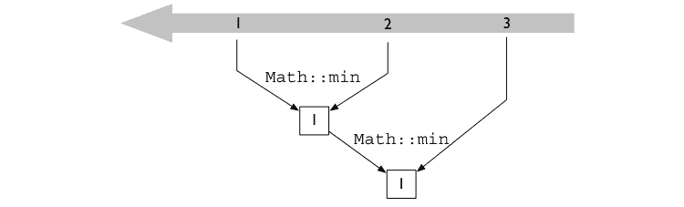

图 4-14. 无恒等元的基本类型规约

#### 4.4.2 引用流的规约

在对基本类型进行收集和规约之后，引用流的规约看起来非常熟悉：`Stream.reduce` 的两个重载与基本类型流上的 `reduce` 相似，而且——可能会令人困惑的是——第三个重载与收集（collection）有表面相似之处，尽管其用法完全不同：

| Stream<T> | Optional<T> |
|---|---|
| reduce(BinaryOperator<T>) | |
| reduce(T, BinaryOperator<T>) | T |
| reduce(U, BiFunction<U,T,U>, BinaryOperator<U>) | U |

我们现在逐一考虑这些重载。第一个重载仅接受带有恒等元的合并器（combiner），并且与单参数的基本类型 `reduce` 类似，返回一个 `Optional`。它在几种不同情况下非常有用：一种二元操作符（如 `Comparator.compare`）返回其操作数之一。例如，我们可以通过以下代码按字母顺序找到第一本书名：

```java
Comparator<Book> titleComparator = Comparator.comparing(Book::getTitle);
Optional<Book> first = library.stream()
    .reduce(BinaryOperator.minBy(titleComparator));
```

事实上，这就是 `Stream.min`（第 66 页）方法的实现方式。这段代码的执行过程可以用与对应的基本类型规约相同的方式可视化（图 4-14）。二元操作符也可以返回新创建的对象，例如调用 `BigInteger` 或 `BigDecimal` 上的某个算术运算符的结果（注意，我们选择这些示例进行规约是因为它们是不可变的）：

```java
Stream<BigInteger> biStream = LongStream.of(1,2,3)
    .mapToObj(BigInteger::valueOf);
Optional<BigInteger> bigIntegerSum = biStream
    .reduce(BigInteger::add);
```

`reduce` 的三个重载中的合并器都必须遵守收集器合并器的结合律约束，原因在于：在不同地方拆分计算的不同执行过程必须返回相同的结果。因此，对于所有的 `q`、`r` 和 `s` 值：

```
combiner.apply(combiner.apply(q, r), s) ==
combiner.apply(q, combiner.apply(r, s))
```

剩下的两个 `Stream.reduce` 重载需要一个恒等元（identity）。用于它的对象不能被累加器（accumulator）或收集器修改，因为 `reduce` 可能会重复使用同一个对象——与收集不同，收集中 `Supplier` 在每次调用时都会创建一个新对象。

这两个中的第一个接受一个恒等元和一个二元操作符。我们可以使用它作为单参数重载的替代方案，以便对 `BigInteger` 流求和而不需要返回 `Optional`：

```java
BigInteger bigIntegerSum = biStream
    .reduce(BigInteger.ZERO, BigInteger::add);
```

再次体现了这种与基本类型规约的相似性；它只适用于像 `BigInteger.ZERO` 这样不可变的恒等元。这段代码的执行过程再次可以用与对应的基本类型规约相同的方式可视化（图 4-13）。

同样，与收集器一样，合并器必须遵守恒等元约束：给定任何 `s` 和恒等元 `id`：

```
s == combiner.apply(s, id) == combiner.apply(id, s)
```

第三个重载引入了累加器，并随之带来了返回不同类型的可能性，例如某种聚合值。在这里它被用于计算我图书馆中的书籍总数（如图 4-15 所示）：

```java
int totalVolumes = library.stream()
  .reduce(0,
    (sum, book) -> sum + book.getPageCounts().length,
    Integer::sum);
```

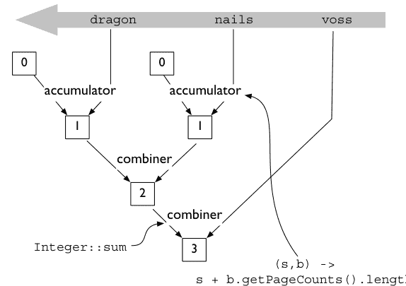

图 4-15. 长规约

注意你可以（并且通常会）将这段代码写为独立的 `map` 和 `reduce` 操作：

```java
int totalVolumes = library.stream()
  .mapToInt(b -> b.getPageCounts().length)
  .sum();
```

然而，提供这个 `reduce` 重载是为了那些通过将映射和规约合并为单个函数来实现显著优化的情况。

再次，与收集器一样，累加器和合并器函数必须兼容，以确保程序的所有可能执行路径都会产生相同的结果，无论计算在它们之间如何划分。然而，这里的情况更简单（没有修改的情况下事情总是更简单！）对于所有的 `r`、`s` 和 `t` 值，必须满足以下等式：

```
combiner(r, accumulator(s, t)) == accumulator(combiner(r, s), t)
```

最后，我们应该考虑这样一个事实：规约是用于可相加的不可变值的，而 Stream API 提供了各种便利方法来支持规约，特别是在基本类型上。

然而，最重要的技术是收集（collection），它是规约的推广，使其适应流向可变集合的并发累加，并管理对非线程安全集合的访问。我们回顾了累加到标准库集合、自定义集合以及分类映射的库收集器。由于收集器模式适合组合，库中还包含许多专门为与其他收集器组合设计的收集器。此外，API 提供了扩展点，以便在需要时开发自定义收集器，我们也看到了需要这些收集器的示例以及开发它们的技术。总的来说，收集是一个强大且灵活的工具。掌握它的可能性是成为 Stream API 专家的核心。

到此，我们结束对流如何结束的调查；在下一章中，我们将转向流如何启动的对立问题。

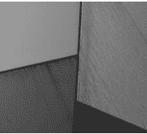

## 第5章 启动流：源与拆分器

第3章简要介绍了流源的相关概念，但随后的流处理示例都使用了集合（collections）或流工厂方法作为其源。这反映了预期的用法，但现在是时候探索流创建的其他方面了。在本章中，我们将涵盖：

- 平台类中支持流的方法
- 对流源和中间操作中抛出的异常的处理
- 流源的工作机制
- 一个将这些主题结合在一起的示例

### 5.1 创建流

在介绍了 Collection 接口中支持流的方法（见第50页）之后，创建流最重要的方法可能就是流接口本身的工厂方法。其中，`Stream.empty` 和 `Stream.of` 已经在第3章中介绍过。下一组由 `iterate` 和 `generate` 组成：

| Stream<T> | |
|---|---|
| iterate(T, UnaryOperator<T>) | Stream<T> |
| generate(Supplier<T>) | Stream<T> |

`iterate` 方法接受一个种子值和一个函数（由函数接口 `UnaryOperator` 表示），并反复应用该函数以产生连续的流元素。所有原始类型流（primitive streams）都声明了类似的 `iterate` 方法。原始类型流也有相应的方法。例如，为了创建一个无限交付 1 和 -1 交替值的顺序 `IntStream`，我们可以写道：

```java
IntStream.iterate(1, i -> -i);
```

流中的每个元素都是通过对产生元素应用该函数产生的。由 `iterate` 产生的流是无限的；你只有通过可以使用应用于有限初始流的操作（如 `limit` 和短路“搜索”操作，见第63页）才能从它们获得有用的结果。

`generate` 方法接受一个 `Supplier`，它代表一个不需要输入即可产生结果的函数，并反复调用它以产生连续的流元素。生成的顺序流是无序的，因此 `generate` 旨在用于一系列值处于某种分布中而非彼此之间存在顺序关系的情况。例如，它可以被用于生成常数流或自定义的随机分布。

第三组的工厂方法创建一个包含值范围的有序流。它们仅定义在整数原始类型 `IntStream` 和 `LongStream` 上。这些是 `IntStream` 的版本：

| IntStream | |
|---|---|
| range(int, int) | IntStream |
| rangeClosed(int, int) | IntStream |

API 兼包含了 `range` 和 `rangeClosed`，以适应对于范围是否应该包含或排除指定的端值的冲突预期。同一种流可以通过两种不同的方式创建；例如：

```java
IntStream.range(1, 6).forEach(System.out::print); // 打印 12345
IntStream.rangeClosed(1, 5).forEach(System.out::print); // 打印 12345
```

这些方法的一个应用场景是模拟索引流。Stream API 没有直接支持这种功能，但通过将 `IntStream.range` 和 `IntStream.rangeClosed` 的元素映射到索引集合或数组，我们可以实现的效果。例如，如果我想列出图书馆中的书籍并显示每本书的卷号和页数，如下：

- Fundamentals of Chinese Fingernail Image: 1:256
- Compilers: Principles, Techniques and Tools: 1:1009
- Voss: 1:478
- Lord of the Rings: 1531, 2416, 3624

我可以使用 `IntStream.rangeClosed` 来实现这种效果：


```
library.stream()
  .map(book -> {
    int[] volumes = book.getPageCounts();
    IntStream.rangeClosed(1, volumes.length)
      .mapToObj(i -> i + ": " + volumes[i - 1])
      .collect(Collectors.joining(", ", " + book.getTitle() + ", ",
```

这种使用 `int` 范围的元素作为索引的技术，可以扩展到多个数据源，为 Stream API 缺少“合并（zip）”两个流的操作提供了一种替代方案。

## 114 精通 Lambda

最后一个流方法（不是流创建器，而是流组合器）是静态方法 `concat`，它通过两个现有流的合并创建一个新流：

| Stream<T> | |
|---|---|
| concat(Stream<T>, Stream<T>) | Stream<T> |

本节的其余部分列出了添加到平台类中的方法，以便以新风格暴露其数据供处理。

### java.util.Arrays

此类具有处理引用类型数组以及每种原始类型流的方法。对于每个流，有两个重载，第一个是流化整个数组，第二个是流化由包含起始索引和排除结束索引定义的数组切片。

| Arrays | |
|---|---|
| stream(T[]) | Stream<T> |
| stream(T[], int, int) | Stream<T> |
| stream(int[], int, int) | IntStream |
| stream(long[]) | LongStream |
| stream(long[], int, int) | LongStream |
| stream(double[], int, int) | DoubleStream |

接受 `int` 数组（而不是切片）的方法在功能上与 `Stream.of` 的各种特化版本重叠，`Stream.of` 的变长参数可以作为数组参数传递。然而，`Stream.of` 真正旨在用于你想提供固定且已知数量参数的情况，而提供数组的调用实际上被任意解释为一系列待流化的单个值，而不是单个数组。通过在处理数组参数时优先使用 `Arrays.stream` 来避免这个微小问题。

### java.io.BufferedReader

此类读取文本文件；在 Java 8 之前，其主要用法是通过 `readLine` 方法，它每次调用返回一行。在 Java 8 中，它现在也声明了 `lines` 方法：

| BufferedReader | |
|---|---|
| lines() | Stream<String> |

该方法通过在下游操作需要值时调用 `BufferedReader.readLine` 来按需填充流。它不旨在与任何其他操作协同工作，因此在流的终端操作执行期间，无法以其他方式访问读取器，且终端操作完成后无法对其状态做出任何假设。如果你想在调用 `lines` 后继续使用读取器，必须先将其重置为之前设置的标记。

`lines` 调用的 `BufferedReader` 方法可能会抛出 `IOException`。`lines` 没有强制调用者处理这些检查异常，而是将它们封装在 `UncheckedIOException` 中。在下一节中，我们将看到影响并行流性能的因素是源可实现的并发水平。来自 `BufferedReader` 这类流源的数据交付本质上是顺序的，因此库的拆分策略是在数据可用时将其划分。如果这种方式读取数据是处理中最昂贵的部分，并行化将提供有限收益。然而，如果拆分器可以在拆分之前缓存数据，就能让并行流与数据同步。我们将在本章末尾的示例中看到顺序文件读取的有用替代方案。

### java.nio.Files

类提供了对文件和目录的操作，通常通过委托文件系统来实现。为了与该类的现有方法保持一致，这些方法在无法打开文件时抛出 `IOException`，因为随后的异常都被封装在 `UncheckedIOException` 中。

第一组四个方法以流的形式产生目录列表：

| Files | |
|---|---|
| walk(Path, FileVisitOption...) | Stream<Path> |
| walk(Path, int, FileVisitOption...) | Stream<Path> |
| find(Path, int, BiPredicate<Path, BasicFileAttributes>, FileVisitOption...) | Stream<Path> |
| list(Path) | Stream<Path> |

由 `walk` 和 `find` 产生的列表是递归的——包含起始目录的所有子目录；由 `list` 产生的仅针对起始目录。递归方法接受零或多个 `FileVisitOption` 类型的参数，该枚举允许配置遍历，例如指定是否应该跟踪符号链接。否则，它们的区别在于是否支持遍历深度，以及是否接受基于 `BasicFileAttributes`（如修改时间、访问时间或大小）过滤路径接受性的谓词。

## 116 掌握 Lambda

这些方法返回的流间接地封装了原生文件句柄，因此在 `try-with-resources` 结构中分配它们是一个良好的做法。例如，以下代码从当前目录开始递归地遍历目录树，并打印每个文件的某些细节：

```java
Path start = new File(".").toPath();
try (Stream<Path> pathStream = Files.walk(start)) {
  pathStream
    .map(Path::toFile)
    .filter(f -> f.isFile())
    .forEach(f -> System.out.println(f.getAbsolutePath() + " " + f.length()));
} catch (IOException e) {
  e.printStackTrace();
}
```

最后几个 `Files` 方法允许将文件解析为文本行；由于它们方便地封装了需要 `Charset` 来管理字节到字符转换的 `BufferedReader`，新的 `Files.lines` 方法也必须给出一个 `Charset`：

| | |
|---|---|
| lines(Path, Charset cs) | Stream<String> |
| lines(Path path) | Stream<String> |

自然地，`Files.lines` 与其底层 `BufferedReader` 实现具有类似的性能特性。

### java.util.regex.Pattern

此类一直有一个便利方法 `split`，返回一个数组；在 Java 8 中，它添加了一个类似的带有流的方法 `splitAsStream`：

| | |
|---|---|
| splitAsStream(CharSequence) | Stream<String> |

像 `split` 一样，该方法将其输入分为子字符串，每个子字符串要么以匹配此模式的子序列结束，要么以输入结束结束。这里有一些示例，展示了在输入字符串开头不同模式匹配的效果。`exampleSplit` 方法返回一个字符串，显示了提供的模式对 `ls -1` 示例输出进行的拆分：

```java
String exampleSplit(String pattern) {
  Pattern p = Pattern.compile(pattern);
  String s = "-rw-rw-r-- 1 root admin 21508 26 Feb 2014 /.bashrc";
  return p.splitAsStream(s)
    .collect(Collectors.joining("\n", "\n", "\n"));
}
```

如果模式不匹配输入的任何子序列，则流的结果将包含一个与输入序列对应的单个元素（表 5-1 的第 2 行）。输入序列开头的非零宽匹配会导致流开头出现空条目（第 3 行）。零宽匹配则不会（第 4 行）。

| 输入 | 输出 |
|---|---|
| "-rw-rw-r-- 1 root admin 21508 26 Feb 2013 /.bashrc | |
| "@" -rw-rw-r-- 1 root admin 21508 26 Feb 2013 /.bashrc | |
| "-" -rw-rw-r-- 1 root admin 21508 26 Feb 2013 /.bashrc | |
| "^" -rw-rw-r-- 1 root admin 21508 26 Feb 2013 /.bashrc | |

# 表 5-1. exampleSplit 的行为

### java.util.JarFile

直到现在，`jar` 文件中的条目只能通过 `InputStream` 或 `Enumeration` 批量读取；现在添加了一个更方便的带有流的方法：

| JarFile | |
|---|---|
| stream() | Stream<JarEntry> |

### java.util.zip.ZipFile

添加到此类的新方法与 `JarFile` 的方法类似：

| ZipFile | |
|---|---|
| stream() | Stream<ZipEntry> |

### java.util.CharSequenceBuilder 和 java.nio.CharBuffer

Java 8 添加了两个针对 `String`、`StringBuilder` 的带有流的方法，`chars` 和 `codePoints`，它们对于最常用的 Unicode 字符行为完全相同：

| CharSequence | |
|---|---|
| chars() | IntStream |
| codePoints() | IntStream |

这两个方法之间的区别在于它们对补充字符（supplementary characters，即代码点大于 U+FFFF 的字符）的处理。补充字符包括东亚语言的汉字和图形字符（包括表情符号）。从效率考虑，`chars` 方法通常优于 `codePoints`，但与 `codePoints` 不同，它不能正确地解释补充字符。

新方法返回 `IntStream`（在缺少原始类型 `CharStream` 的情况下是最合适的选择），如果需要，知道如何将 `int` 值转换为 `Stream<Character>` 是很有用的。关键点在于，由于需要装箱，`stream.mapToObj` 必须赋予正确的原始类型才能工作：

```java
Stream<Character> chrStream = "example".chars().mapToObj(i -> (char) i);
```

### java.util.BitSet

此类的 `toString` 方法一直返回已设置位索引集合的字符串表示。现在，流方法以准备好处理的形式返回这些索引：

| BitSet | |
|---|---|
| stream() | IntStream |

例如：

```java
byte[] bits = {10, 18}; // 01001010 01001000 (小端序)
BitSet bs = BitSet.valueOf(bits);
System.out.println(bs.stream()
  .boxed().collect(Collectors.toList())); // 输出 [1, 3, 9, 12]
```

### java.util.Random 和 java.util.SplittableRandom

四个 `Random` 类（`Random` 有两个子类 `SecureRandom` 和 `SplittableRandom`）暴露了相同的方法。

## 第 5 章：开始流：源

### 5.2 拆分器

启动流：源和拆分器 117

| Random, SplittableRandom | |
|---|---|
| ints() | IntStream |
| ints(int) | IntStream |
| ints(long) | IntStream |
| longs() | LongStream |
| longs(int) | LongStream |
| longs(long) | LongStream |
| doubles() | DoubleStream |
| doubles(int) | DoubleStream |
| doubles(long) | DoubleStream |
| codePoints() | IntStream |
| codePoints(int) | IntStream |
| codePoints(long) | IntStream |

四个 `Random` 类（`Random` 有两个子类 `SecureRandom` 和 `SplittableRandom`）暴露了相同的方法。

`Spliterator` 接口用于遍历和几乎可以拆分的元素。与 `Iterator` 不同，`Spliterator` 设计允许将被拆分为部分以支持并行处理。`Spliterator` 接口具有三个关键方法：

- `tryAdvance(Consumer<? super T> action)`：移动迭代器到下一个元素，如果存在元素则返回 true，否则返回 false。
- `split()`：尝试将拆分器拆分为两个，如果成功则返回 `Spliterator`，否则返回 null。
- `estimateSize()`：返回剩余元素的估计数量。

`Spliterator` 是 Java 8 引入的，用于支持并行流。`Spliterator` 的关键在于它可以将源拆分为多个可以并行处理的部分。这是通过 `split()` 方法实现的。

在详细查看 `Spliterator` 之前，我们先看看它是如何与 fork/join 工作的。以下伪代码是 fork/join 的极端简化。在这些代码中，`T` 是处理的元素类型；`sizeThreshold` 值由框架计算得出：

```java
Spliterator<T> newSpliterator;
while (spliterator.estimateSize() > sizeThreshold &&
      (newSpliterator = spliterator.trySplit()) != null) {
  // f/j框架和拆分器都同意拆分，
  // 拆分器的数据分配给新的拆分器和自身；
  // 现在为分配给新拆分器的部分封装一个新任务，
  // 并将其分配到另一个线程中执行。
  makeTask(newSpliterator).fork();
}
// 在此线程中通过迭代调用
// this.spliterator.tryAdvance() 来处理剩余部分
```

此代码的循环条件表明，选择拆分而不是处理需要满足两个标准：新形成的任务可以利用当前空闲的计算能力。在 Java 8 中，`sizeThreshold` 的值只是总数据大小除以可用线程的结果，但未来框架可能会使用更复杂的标准来做出此决定。

## 第 5 章：启动流：源与拆分器 121

- 数据结构自身的条件是否满足拆分价值的判断。`Spliterator` 允许在响应 `trySplit` 调用时返回 `null` 而不是新的 `Spliterator`，可能是因为数据集足够小，并行带来的收益无法抵消拆分的开销，或者由于其他原因导致如此。

这些是 `Spliterator` 接口的关键方法：

| Spliterator<T> | |
| :--- | --- |
| trySplit() | Spliterator<T> |
| tryAdvance(Consumer<T>) | boolean |
| forRemaining(Consumer<T>) | void |
| estimateSize() | long |
| characteristics() | int |

除 `forRemaining` 之外，所有方法都是抽象的。下面是对这些方法的简要说明。在 §5.4 的工作示例中开发自定义拆分器将有助于进一步澄清拆分器的工作原理，以及你何时应该编写自己的拆分器。

#### trySplit

正如所见，这创建一个新的 `Spliterator` 并将其一部分（理想情况下是一半）元素转移给它。未达到这一理想状态的拆分可能仍然有效；例如，拆分一个近似平衡的二叉树仍然可以产生有效的并行性。另一方面，我们还有 `BufferedReader`，它完全不进行拆分，其拆分器总是拒绝拆分（这就是为什么 `Collection.parallelStream` 方法被指定返回一个“可能是并行的”流）。

如果顺序对流源非常重要，那么拆分器在执行 `trySplit` 后覆盖的元素必须之后是返回的拆分器所覆盖的元素。

#### tryAdvance

此方法结合了 `Iterator` 方法中 `next` 和 `hasNext` 的功能。如果没有剩余元素，`tryAdvance` 返回 `false`；否则，它在调用提供的 `Consumer` 的 `accept` 方法并将下一个元素作为参数后返回 `true`。这是拆分器相比迭代器提供的两个大改进的核心：每个元素所需的方法调用更少，从而提升了性能；而且不再存在由于集合在 `hasNext` 调用和 `next` 调用之间被修改而可能导致的竞态条件风险。

#### forEachRemaining

提供了一种批量遍历机制：该方法不像 `tryAdvance` 那样在处理单个元素后返回，而是在单次调用中处理拆分器的所有剩余元素。这通过消除 `tryAdvance` 的每次调用开销可能提供性能改进。默认实现会调用 `tryAdvance` 直到其返回 `false`。

#### estimateSize

返回迭代器覆盖元素数量的估计。如果拆分器是无限流，或者计算大小代价太大，`estimateSize` 可以返回 `Long.MAX_VALUE`。然而，即使是不准确的估计通常也会使用，且计算成本较低。

#### characteristics

返回此拆分器的特征集（§6.3）。

### 5.2.1 从拆分器创建流


# 第 5 章：启动流：源与拆分器

拆分器提供了创建流所需的核心。要实际创建流，工具类 `StreamSupport` 提供了这些方法，接受一个 `Spliterator` 来创建引用流，或者接受 `Spliterator` 专门的原始类型子类 `Spliterator.OfInt`、`Spliterator.OfLong` 或 `Spliterator.OfDouble` 来创建原始流。在本章的最后一节，我们将看到一个从自定义拆分器创建流的实际示例。

值得注意的是，`StreamSupport.stream` 也可以作为稍微笨拙的替代方案，用于 `Collection` 接口中带流的方法。这是因为每个 `Collection` 实例都是 `Iterable` 的实现，它暴露了 `spliterator` 方法。例如，对于任何 `Iterable<T>`，你可以：

```java
Stream<T> str = StreamSupport.stream(iter.spliterator(), false);
```

其中参数 `false` 意味着在这种情况下生成的流是顺序的，而不是并行的。这实际上是 `Collection` 的带流方法的实现方式。

`Iterable.spliterator` 的默认实现性能较差，因为任何良好的拆分策略都取决于特定 `Iterator` 的物理结构。因此，实现通常会重写它，Java 集合框架的类也是这样做的。如果你必须使用接受或返回 `Iterable` 而不是 `Collection` 实例的 API，那么这种直接在它们上执行流处理的方法是值得知道的，而不必将它们丢入集合中。

## 5.3 异常

我们在 §2.7.2 中看到，lambda 没有任何管理检查异常的特殊机制；lambda 抛出的任何检查异常都必须由其函数类型显式声明。结果是，检查异常与 Stream API 中实现的惰性求值并不契合。在本节中，我们将探索这些问题；也应该清楚为什么这一节位于创建流的章节中：流处理中检查异常最常见的情况出现在用作流源的文件 API 中。

为了理清这些问题，我们将观察一系列日益复杂的场景。我们正在实现的基础用例是列出目录中每个文件的内容。该思路是 `Files`（第 115 页）在提供目录路径后，为目录中的每个文件生成一个文件路径流；这些路径被提供给 `Files.lines`，它从每个路径生成一个行流。这些流可以通过 `flatMap` 合并成单个流。如果实践中没有异常，我们可以为任何目录路径开始这样写：

```java
Files.list(start)
    .flatMap(Files::lines)
    .forEachOrdered(System.out::println)
```

这是本章稍后示例（§5.4）的基础：grep，一种根据正则表达式匹配行的 Unix 工具。

由于问题围绕着异常抛出的点，让我们从异常被延迟的基础情况开始。以下代码创建了目录内容的 `Path` 流：

```java
try (Stream<Path> paths = Files.list(start)) { // 第19 行
} catch (IOException e) {
    e.printStackTrace();
    throw new UncheckedIOException(e);
}
```

如果 `start` 不是目录，则将抛出并捕获 `IOException`。例如，如果目录权限导致无法访问，堆栈轨迹将如下：

```
java.nio.file.AccessDeniedException: ./fooDir
<omitted: frames for filesystem methods>
at java.nio.file.Files.newDirectoryStream(Files.java:457)
at java.nio.file.Files.list(Files.java:3448)
at ExceptionsExample.main(ExceptionsExample.java:19)
```

这符合我们对异常正常工作方式的想法，尽管可能并不明显符合我们对流惰性求值的预期。`Files.list` 创建的流还没有调用终端方法，因此打开目录 `./fooDir` 的尝试是及时的。

接下来，假设目录已经打开，并成功构建了路径流。现在，正如 `Files` 引言提到的（第 115 页），在这种情况下 `Files.lines` 等 I/O 密集型流创建方法抛出了 `IOException`。与其使用目录，我们可以让一个文件不可访问以显示问题；为了使用尽可能简单的中间操作，我们使用 `peek` 来评估行为：

```java
try (Stream<Path> paths = Files.list(start)) {
    paths.peek(path -> {
        try {
            Files.lines(path); // 第42 行
        } catch (IOException e) {
            System.err.println("** exception from Files.lines*");
            e.printStackTrace();
        }
    })
    .forEach(line -> {}); // 第47 行
} catch (IOException e) {
    System.err.println("** exception from Files.list*");
    e.printStackTrace();
    throw new UncheckedIOException(e);
}
```

该代码产生以下输出：

```
** exception from Files.lines
java.nio.file.AccessDeniedException: ./fooDir/barFile
<omitted: frames for filesystem access methods>
at java.nio.file.Files.lines(Files.java:3782)
at ExceptionsExample.lambda$main$0(ExceptionsExample.java:42)
at ExceptionsExample$$Lambda$2/1149319664.accept(Unknown Source)
```

## 第 5 章：启动流：源与拆分器

<omitted> 流实现方法的栈帧

```
at java.util.stream.ReferencePipeline.forEach()
ReferencePipeline.java:418
at ExceptionsExample.main(ExceptionsExample.java:47):
```

注意 `forEach` 的堆栈轨迹。这符合我们的理解，即是终端操作的执行启动了对流元素的评估。

最后，我们可以用 `peek` 的调用替换为 `flatMap`，它将获取每个文件中的流并将它们合并为一个单一流：

```java
try (Stream<Path> paths = Files.list(start)) {
    paths.flatMap(path -> {
        Stream<String> lines;
        try {
            lines = Files.lines(path);
        } catch (IOException e) {
            e.printStackTrace();
            lines = Stream.of("Unreadable file: " + path);
        }
        return lines;
    }).forEach(line -> {}); // line 57
} catch (IOException e) {
    e.printStackTrace();
    throw new UncheckedIOException(e);
}
```

在这个版本中，打开文件的失败将产生类似于上一个示例的堆栈轨迹。但假设 `Files.lines` 成功打开了文件并返回一个包含其内容的、尚未评估的行流。一旦文件打开，终端操作将调用扁平化代码将单独的行合并成流。要做到这一点，必须评估流并读取文件；此操作可能会失败。为了强调这一点，我们可以将管道代码拆解为等效版本，其中每个阶段都存储在局部变量中：

```java
Stream<Path> paths = Files.list(start);
Stream<String> lines = paths.flatMap(path -> ...);
lines.forEach(line -> {});
```

由于 `flatMap` 在其 lambda 失败时不再调用栈上，因此子句变得无关。由于这个原因，用于创建流的平台库始终会将受检查异常封装在未检查异常中。最常见的情况是将 `IOException` 封装在 `java.io.UncheckedIOException` 中；该异常在文件打开后抛出。在在这种失败的情况下，堆栈轨迹将如下所示：

```
Exception in thread "main" java.io.UncheckedIOException:
java.nio.charset.MalformedInputException: Input length = 1
    at java.io.BufferedReader$hasNext(BufferedReader.java:574)
    <omitted: frames for stream implementation methods>
    at java.util.stream.ReferencePipeline.forEach(ReferencePipeline.java:418)
    at ExceptionsExample.main(ExceptionsExample.java:57)
Caused by: java.nio.charset.MalformedInputException: Input length = 1
    at java.nio.charset.CoderResult.throwException(CoderResult.java:281)
    <omitted: frames for text file reading and charset decoding>
    at java.io.BufferedReader$hasNext(BufferedReader.java:571)
...
18 more
```

此堆栈轨迹源于其中一个流在评估时抛出了 `MalformedInputException`，该异常是在 `Charset` 处理文件过程中遇到它无法解码的 Unicode 字符时抛出的（例如，由于尝试将二进制文件作为文本读取的结果）。此受检查异常被 `BufferedReader` 的 `hasNext` 方法（由 `Files.lines` 调用）捕获，并封装在 `UncheckedIOException` 中，向上到达调用栈的顶端。“18 more”栈帧指的是受检查异常栈底部的帧，它们与构成上方整个未检查栈的这 18 个帧相同；为了简洁起见，省略了重复部分。

因此，从管道操作内部调用的惰性评估代码只能抛出未检查异常，这将结束终端操作并停止管道处理。如果我们想捕获想要从中恢复的错误，它们必须通过尽早评估操作抛出的受检查异常来通知。我们可以看到一个示例，尝试从二进制文件中读取字符会导致 `MalformedInputException`；对于当前的用例——打印目录中每个文本文件的内容——有一个简单的恢复操作：跳过该文件。但只有在抛出该异常的方法是尽早评估的情况下，才能采取该操作，例如 `Files.readAllLines` 就是这样，它会尽早读取整个文件，并在遇到无法解码的字节序列时抛出受检查异常。该方法将成为我们在下一节解决递归 grep 问题的基础。

## 5.4 实例用例示例：递归 grep

命令行 `grep` 最初是作为早期 Unix 版本的某个独立应用程序编写的，用于在文本文件中搜索匹配提供的正则表达式形式的行，并默认打印它们。从那时起，`grep` 及其变体已成为每个 Unix 和 Linux 版本的核心库的标准。各种选项可以以不同的方式修改其行为，包括：

- 递归搜索目录子树
- 搜索不匹配模式的行
- 抑制匹配打印
- 打印包含匹配项的文件名（而不是，或者同时也打印匹配项）
- 打印每个搜索文件的匹配项计数
- 打印匹配项的上下文（匹配项之前或之后的几行）

使用流重现 `grep` 行为的本身就很有趣，并且对于将 `grep` 功能嵌入 Java 程序中可能很有用。（但请注意：如果你真的在考虑创建一个高性能的 `grep` 替代品，你应该特别关注本节末尾的 `spliterator` 实现）。我们将首先对目录树中的每个文件执行最简单的 `grep` 行为，然后开始整合它的一些选项。

`grep -Rh` 问题的第一个版本是搜索每一个文件名以 `test` 开头并以 `.txt` 结尾的文件，这将匹配 `test.*`。`-R` 选项强制 `grep` 递归搜索文件系统，`-h` 选项防止在每个匹配项前加上文件名。我们需要以下声明：

```java
Path start = new File("startDir").getPath();
PathMatcher pattern = FileSystem.getDefault().getPathMatcher("*.txt");
```

这里使用了两种模式匹配：正则表达式和通配符（你可能将其称为 shell 模式匹配）。在这里使用通配符是为了展示如何将其轻松引入流程序中。虽然它没有正则表达式匹配强大，但在某些情况下它要更简洁方便。

一个合适的起点是我们在研究主题时开发的代码（第 123 页）。为了方便，这里重复了它，仅针对封装方法可以重新抛出打开目录失败产生的 `IOException` 进行了修改：

```java
try (Stream<Path> paths = Files.list(start)) {
    paths.flatMap(path -> {
        Stream<String> lines;
        try {
            lines = Files.lines(path);
        } catch (IOException e) {
            e.printStackTrace();
            lines = Stream.of("Unreadable file: " + path);
        }
        return lines;
    }).forEach(line -> {});
} // 不再捕获 IOException
```

在它变成我们的第一个版本之前，这需要一些更改。停顿一下，仔细检查代码，并列出满足给定问题所需的更改列表。（我们仍然保留 `printStackTrace` 的调用作为异常处理的占位符）。

这第一个版本需要一些调整。以下是所需的更改列表：

- 调用 `Files.list`，我们只能看到 `startDir` 中的文件。为了搜索目录树，我们应该使用 `Files.walk`（见第 115 页）。
- 出于在异常讨论中所探讨的原因，惰性评估方法 `Files.lines` 的调用必须封装在代码中，将 `IOException` 重新抛出为 `UncheckedIOException`，或者替换为 `Files.readAllLines` 的调用（第 126 页）。`Files.readAllLines` 返回一个字符串列表，可以作为流源。
- 管道需要对 `Files.walk` 产生的 `Path` 进行一些过滤：从 `Path` 流中移除目录（这比让它们在 `readAllLines` 失败时被捕获更高），并确保只处理符合名称模式“*/test*.txt”的文件。
- 从文件中返回的文本行也需要过滤器：用于移除处理非文本文件时产生的空字符串，当然，还用于移除不匹配正则表达式的行。
- 终端操作应该打印匹配的行。它使用了 `forEach`，除非意外情况下，否则它不强制顺序。目前，让我们偏离 `grep` 的逻辑，假设我们只关心匹配的行，而不关心它们出现的顺序。

将这些更改应用到之前的代码，我们得到了实现了 `-h` 行为的代码：

```java
try (Stream<Path> pathStream = Files.walk(start)) {
    pathStream
    .filter(Files::isRegularFile)
    .filter(pathMatcher::matches)
    .flatMap(path -> {
        try {
            return Files.readAllLines(path).stream();
        } catch (IOException e) {
            return Stream.of("");
        }
    })
    .filter(line -> !line.isEmpty())
    .filter(line -> pattern.matcher(line).find())
    .forEach(System.out::println);
}
```

**grep -R** 对于该解决方案的变体，考虑移除 `-h` 选项，以便 `grep` 要求在每个输出行前加上其所在文件的路径。在继续阅读之前，停下来思考如何修改之前的代码来实现它，必要的话。

显然，路径只能在仍然可用的地方附加到文件的行上，这意味着在 `flatMap` 的内部 `try` 块中，lambda 参数在作用范围内，并且可以附加到每一行：


```java
try {
    return Files.readAllLines(path).stream()
        .map(line -> path + ": " + line);
} catch (IOException e) {
    return Stream.of("");
}
```

## 130 掌握 Lambda

这是一个解决方案。但它非常浪费，因为它对每个文件中的每一行都执行了字符串拼接——这是一个开销很大的操作——而许多行可能会被正则表达式过滤器过滤掉。通过将正则表达式过滤器从当前位置移动到与路径拼接之前，可以轻松避免这个问题：

```java
try {
    return Files.readAllLines(path).stream()
        .filter(line -> pattern.matcher(line).find())
        .map(line -> path + ": " + line);
} catch (IOException e) {
    return Stream.of("");
}
```

该问题的解决方案是对前一个的一个小修改：

```java
try (Stream<Path> pathStream = Files.walk(start)) {
    pathStream
        .filter(Files::isRegularFile)
        .filter(pathMatcher::matches)
        .flatMap(path -> {
            try {
                return Files.readAllLines(path).stream()
                    .filter(line -> pattern.matcher(line).find())
                    .map(line -> path + ": " + line);
            } catch (IOException e) {
                return Stream.of("");
            }
        })
        .filter(line -> !line.isEmpty())
        .forEach(System.out::println);
}
```

`grep -Rc` 选项抑制了正常输出，改为打印每个输入文件的匹配行数。再次停下来思考如何在读取之前这样做。

一旦你发现输出行与包含匹配文本的行是一一对应的，这就非常直接了：每个文件的输出在传递给终端操作之前必须收集到一个字符串中。因此，`map` 而不是 `flatMap` 是适当的操作，例如每个 `startDir/foo` 被映射为字符串 `"startDir/foo: 3"`。行数可以从应用于每个文件的匹配流的终端操作计数中获得。

## 第5章：启动流：源与拆分器 131

```java
try (Stream<Path> pathStream = Files.walk(start)) {
    pathStream
        .filter(Files::isRegularFile)
        .filter(pathMatcher::matches)
        .map(path -> {
            try {
                long matchCount = Files.readAllLines(path).stream()
                    .filter(line -> pattern.matcher(line).find())
                    .count();
                return matchCount == 0 ? "" : path + " " + matchCount;
            } catch (IOException e) {
                return "";
            }
        })
        .filter(line -> !line.isEmpty())
        .forEach(System.out::println);
}
```

`grep -b` 该选项要求每一行输出都带有其在文件中的字符偏移量前缀。因此，在这个对不可变性的远见致敬中，搜索模式 `".*t"`：

> The Moving Finger writes; and, having write,
>
> Moves on: nor thy Piety nor Wit
>
> Shall lure it back to cancel half a Line,
>
> Nor all thy Tears wash out a Word of it.

应该产生输出：

```
44:Moves on: nor all thy Piety nor Wit
122:Nor all thy Tears wash out a Word of it.
```

起初，这看起来非常像第4章中的书籍偏移问题（第90页），你可能想用自定义收集器以相同的方式解决。仔细观察，路径只能在仍然可用的地方附加到文件的行上，这意味着在 `flatMap` 的内部 `try` 块中，`lambda` 参数在作用范围内，并且可以附加到每一行。

## 第5章：启动流：源与拆分器 133

```java
class LineSpliterator implements Spliterator<DispLine> {
    private ByteBuffer bb;
    private int lo, hi;
    LineSpliterator(ByteBuffer bb, int lo, int hi) {
        this.bb = bb; this.lo = lo; this.hi = hi;
    }
    // Spliterator 抽象方法的实现
}
```

在继续阅读之前，查看 `LineSpliterator` 的部分实现，你可以提供，从 `trySplit` 开始。

图5-1显示了处理时的缓冲区。第一个创建的拆分器的范围是整个缓冲区的数据，包括终止的换行字节。


**图 5-1.** 初始 LineSpliterator 配置

如果这个范围要被拆分，目标将其分为两个近似相等的部分，每个部分都以换行符结束。可以通过从缓冲区的中点开始向两个方向进行换行符线性搜索来找到一个合适的分割点。这种搜索代表了拆分的算法开销（其余是创建和派生新任务的基础设施开销）。它的成本与行长度成正比，而不是像书籍偏移程序（§4.3.2）那样与总缓冲区大小相关。

图5-2显示了这个搜索过程以及两个拆分器的覆盖范围。

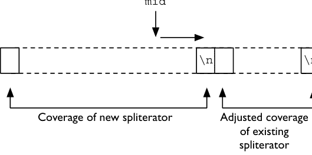

**图 5-2.** LineSpliterator.trySplit 的操作。

然而，假设搜索在进入 `LineSpliterator` 范围之前未能检测到换行符字符。由于它从范围中间点开始，这种失败可能表明在整个范围内可能只有几行——甚至可能只有一行——因此在这种情况下，通过返回 `null` 来拒绝拆分是合理的，而不是在相反方向上搜索换行符。

一旦你理解了 `trySplit` 的算法，代码就非常直观了：

```java
public LineSpliterator<DispLine> trySplit() {
    int mid = (lo + hi) >>> 1;
    while (bb.get(mid) != '\n') mid++;
    LineSpliterator newSpliterator = null;
    if (mid != hi) {
        newSpliterator = new LineSpliterator(bb, lo, mid);
        lo = mid + 1;
    }
    return newSpliterator;
}
```

如果你还没有为 `tryAdvance` 编写代码，请现在停止并勾画一个实现。

`tryAdvance` 的目的是方便处理下一个可用 `DispLine` 实例。它搜索下一个换行符，从搜索过程中遍历的字节创建一个 `DispLine` 实例，并将其提供的 `Consumer` 参数应用于它。最后，它缩小拆分器的范围以排除刚刚处理的字节，并返回一个表示是否有进一步输入的布尔值。

## 第 5 章：启动流：源与拆分器 135

```java
public boolean tryAdvance(Consumer<? super DispLine> action) {
    int index = lo;
    StringBuilder sb = new StringBuilder();
    do {
        sb.append((char) bb.get(index++));
    } while (bb.get(index) != '\n');
    action.accept(new DispLine(lo, sb.toString()));
    lo = lo + sb.length();
    return lo <= hi;
}
```

另外两个 `Spliterator` 方法也必须重写。`estimateSize()` 方法返回一个估算值，在此情况下，大约是重复调用 `tryAdvance` 将返回的元素数量。

```java
public long estimateSize() { return (hi - lo + 1) / AVERAGE_LINE_LENGTH; }
```

`characteristics()` 方法返回此 `Spliterator` 的特征，用于框架选择适当的优化（见 §6.3）。以下是该问题特征的合适实现：

```java
int characteristics() { return ORDERED | IMMUTABLE | NONNULL; }
```

最后，这里是创建单个文件的代码；早期的示例展示了 `grep -b`。它是如何扩展为递归搜索的：

```java
try (FileChannel fc = FileChannel.open(start)) {
    MappedByteBuffer bb = fc.map(FileChannel.MapMode.READ_ONLY, 0, fc.size());
    Spliterator<DispLine> spliterator = new LineSpliterator(bb, 0, bb.limit() - 1);
    StreamSupport.stream(spliterator, true)
        .filter(dl -> pattern.matcher(dl.line).find())
        .forEachOrdered(System.out::println);
}
```

我们之前（§5.2）见过使用 `StreamSupport` 来从拆分器创建流。在这种情况下，我们使用第二个参数作为 `true`，以确保生成并行流而非顺序流。对于终端操作，我们正在使用 `forEachOrdered` 来产生输出。与早期的示例相比，正如我们所看到的，调用并行化的意义不大。从原则上讲，在顺序流上使用 `forEach` 是可以乱序执行的，但那对于早期的 `grep` 选项可能是可以的。对于这一个，如果匹配的行以随机顺序出现，用户无疑会惊讶。

总结本节，我们应该注意，编写一个类似于 `grep` 的程序展示了 Stream API 的一些优势：早期示例的解决方案是直观的，而且指定模拟不同选项的问题只需要对代码进行细小的相应更改。在最后一个示例中，我们看到了与 Java NIO 的协作如何使 Stream API 处理来自大文件的输入，正如我们在 §6.7 中将看到的，这将获得非常高的并行加速。

## 5.5 结论

本章连接了多个目的：探索用于创建流的库设施，解释流创建的工作机制，并展示如何以及为什么要编写自己的实现。我们看到，带有流的方法已添加到各种平台类中，允许流承担其传递任何类型数据的角色，通过中间操作处理并进入终端操作。通过这些方法中的任何一种处理流，你获得了并行代码在表达和可读性方面的优势；你是否能有效提取并行性取决于正如我们看到的，流源能多有效地拆分其数据。然而，可拆分只是故事的一部分；在第 6 章中，我们将看到它如何与其他因素（如数据大小和管道工作负载）相结合，以确定通过并行化获得的整体加速。

本章的主要示例展示了 Stream API 的一些优势：早期选项的解决方案是直观的，而且模拟不同选项的问题只需要对代码进行细小的相应更改。在示例的最后部分，我们看到了与 Java NIO 的协作如何使 Stream API 处理来自大文件的输入，正如我们在 §6.7 中将看到的，这将获得非常高的并行加速。


# 第 6 章

# 流性能

# 掌握 Lambda

本书提出了使用 Lambda 和流的两个理由：获取更好的程序和获得更好的性能。现在，代码示例应该已经证明了获取更好程序的说法，但我们还没有调查关于性能的说法。在本章中，将通过微基准测试技术来调查这些说法。

这是一项危险的事务：微基准的结果存在被直接指导程序设计的风险。由于绝大多数情况并不适用，这是一个严重的问题！例如，程序员的直觉对于定位复杂系统中的瓶颈来说是一个非常不可靠的指南；找到它们的唯一可靠方法是测量程序行为。因此，在初始开发阶段（没有运行的系统供测量），是应用优化的不适用典型实例。

这一点很重要，错误地优化非性能关键的代码实际上是有害的：

- 它浪费了宝贵的精力，因为即使优化成功也不会提高整体性能。
- 它分散了对程序设计重要目标的注意力——产生结构良好、可读且易于维护的代码。
- 源代码优化可能会防止即时编译器应用其自身的（当前和未来的）优化，因为这些优化是针对常见用法进行调优的。

尽管如此，程序员喜欢学习代码性能，这样做也有真正的益处。其中最重要的一点是能够通过 Stream API 开发来调整代码——通过在顺序和并行执行之间选择——而不改变其设计或行为。这种非侵入性的性能管理对于 Java 核心库来说是新的，但可能会像在企业级编程中那样变得成功和普及。为了利用它，你需要一个关于流性能影响的心理模型。

然而，即使你直接根据该模型操作，它可以引导（但不决定！）你的设计，补充程序员已经拥有的传统 Java 代码执行的心理模型。此外，在一个简单的示例中，假设你确定了一个性能关键的批量处理步骤，现在你想要决定实现它的各种方案。你应该使用循环还是流？如果你使用流，你通常有多种中间操作组合可供选择。迭代器和收集器；哪者的表现最好？本章将展示类似图 6-1 的结果，以回答此类问题：

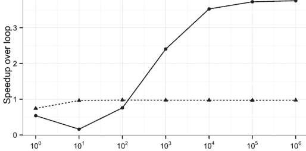

**图 6-1.** 流的性能：顺序流与并行流

图 6-1 可能是一个有趣且有用的结果，但我们需要更多信息。目前，它没有提供关于获取结果时的实验条件的信息。结果将受到基准测试外部因素的影响——不断变化的系统负载、其他进程的行为、网络磁盘活动、硬件、操作系统以及 JVM 配置，以及基准测试本身属性的影响：正在处理的数据和执行的操作。

显然，这是一个问题；我们希望能够在不考虑所有这些因素的情况下，讨论流操作的性能。我们如何通过对此类复杂系统的高度简化观察来获得有意义的结果呢？类比一下——虽然稍显牵强——想想在人体身上试验新药的困难。试验的目标可能很简单——发现药物对治疗某种疾病是否有效——但实现这一目标一点也不简单：你不能直接给患有疾病的人用药并观察他们是否痊愈。许多因素会影响结果：受试者的健康状况、饮食、年龄、性别等许多因素。所有这些因素都会影响任何个人的结果。

当然，运行中的计算机系统远没有生物系统那么复杂，但其复杂程度足以让观察性实验面临同样的问题：正如你无法通过简单地给某人用药并观察结果来得出药物有效的结论一样，你无法在运行系统中更改一行代码，并期望仅通过观察输出来获得有用的结果。在这两种情况下，涉及的变量都太多。在下一节中，我们将研究一种尽可能消除这些影响的实验方法。然后，在章的其余部分，我们将应用该方法来测量流操作的性能。

本章中的许多实验源于之前解释流编程技术时使用的示例。这些示例几乎说明了引用流的使用；由于这个原因，在实践中是引用流引发了重要的性能问题，因此本章的重点是这些而不是原始流。

## 6.1 微基准测试

我们的目标是发现特定代码片段的执行成本。但本章目前为止的论点是，这种成本的测量只有在具有真实负载的运行系统中才有意义。对生产系统进行性能分析或计量是不现实的；替代方案是在负载测试平台上模拟生产系统，这更可行，但涉及到建立一个在各方面重现生产系统的环境的困难：硬件和操作系统配置、其他进程的需求资源、网络和磁盘环境，以及典型和极端的负载。

一种更实用的替代方案是微基准测试，它比较在隔离（不现实的）设置下运行的两个不同代码片段。这些结果中的每一个在绝对上是有意义的，但它们之间的比较是有意义的——只要所有方面都得到了控制。控制实验的想法在原理上是简单的。如果前面列出的所有因素（硬件和软件环境、系统负载等）保持不变，仅允许被比较的代码发生变化，那么结果的变化一定由于所更改的内容。

### 6.1.1 测量动态运行时

即使我们成功控制了外部对程序行为的影响，其他影响仍会存在。我们假设我们的实验遵循此模板：


```java
long start = System.currentTimeMillis();
// 被基准测试的代码
long end = System.currentTimeMillis();
System.out.println("My task executed in " + (end - start) + " ms.");
```

这种模式的表面简单性隐藏了一些困难。其中一些与测量过程本身有关，特别是对于短运行时间：`System.currentTimeMillis()` 可能比其名称暗示的要准确得多，在某些平台上它的更新间隔仅为 15 毫秒。更好的替代方案是 `System.nanoTime()`，其分辨率通常为微秒。此外，许多调用会产生垃圾回收的开销。

即使我们成功控制了外部对程序行为的影响，其他影响仍会等待。我们假设我们的实验遵循此模板：

```java
long start = System.currentTimeMillis();
// 被基准测试的代码
long end = System.currentTimeMillis();
System.out.println("My task executed in " + (end - start) + " ms.");
```

这种模式的表面简单性隐藏了一些困难。其中一些与测量过程本身有关，特别是对于短运行时间：`System.currentTimeMillis()` 可能比其名称暗示的要准确得多，在某些平台上它的更新间隔仅为 15 毫秒。更好的替代方案是 `System.nanoTime()`，其分辨率通常为微秒。此外，许多调用会产生垃圾回收的开销。

JVM 本身就会产生影响。许多问题与字节码的直接解释有关。

### 预热效应

许多问题在 JIT 编译为代码后才会产生结果。

### 死代码消除

编写基准测试时一个常见问题是确保某些内容被计算。这是一种重要的编译器优化。

### 垃圾回收

这不是优化的结果，而是使用自动内存管理的程序的固有问题：所有基准测试都会创建对象，其中一些会变成垃圾。最终垃圾回收器会被调用，它的执行将影响结果。可以在测量之前手动触发垃圾回收来减少这种影响，但这可能是不现实的；事实上，如果垃圾回收对性能有重大影响，那么在测量中包含它是理想的。更好的可能是运行足够的时间让这些成本被摊销。

## 6.1.2 Java 微基准测试框架 (JMH)

这些以及许多因素必须被控制，以确保我们测量的是我们想要的内容。控制它们是一个如此常见且困难的问题，以至于基准测试框架变得流行。这些框架创建的测试类旨在避免微基准测试的许多陷阱。测试用例是由你提供的框架基准源码合成的。基准测试框架的示例包括 Google Caliper (https://code.google.com/p/caliper) 和用于获取本章结果的框架——Java Microbenchmarking Harness (JMH)(https://openjdk.java.net/projects/jmh/)。

JMH 帮助解决上一节列出的问题。例如，JMH API 包含一个静态方法 `Blackhole.consumeCPU`，它根据参数消耗 CPU 时间，而不会产生副作用也不会导致死代码消除和其他优化。（使用的绝对时间并不重要，`consumeCPU` 将仅用于微基准测试之间的比较。）

使用 JMH 创建基准测试只需在方法上注解 `@Benchmark`。JMH 有不同的使用模式；在吞吐量模式下，它会在一段时间内重复执行每个带注解的方法，自动将返回值传递给 `Blackhole.consume` 方法以避免 DCE。例如，这里是用于在本章生成图表的方法之一。在返回值始终是空 Optional 的情况下，返回它的要求是 必须对每个流元素评估谓词。

```java
@Benchmark
public Optional<Integer> sequential() {
    return integerList.stream()
        .filter(l -> { Blackhole.consumeCPU(payload); return false; })
        .findFirst();
}
```

## 6.1.3 实验方法

最后，我们将实验科学的两种标准保护措施应用于我们的实验结果。

### 统计学

鉴于我们现在已知影响微基准的因素，我们很难期望同一个实验重复多次会产生完全的结果；外部因素的影响会在不同观测组之间有所不同。我们可以为最可能的值计算点估计（例如平均值），但如果外部因素主导了实验，这种结果将意义不大。如果我们假设外部因素的影响是随机变化的，那么多次运行相同的实验可以增加我们对结果的置信。这可以通过**置信区间 (CI)** 来量化——这是一个值范围，我们可以以某种程度的确定性（通常为 95%）说明“真实”值在该范围内——即我们通过多次实验可能得到的值。实验规模越大，获得的置信区间越窄。

置信区间为我们提供了实验显著性的有用指标：如果两种不同情况的置信区间不重叠，则表明这些情况确实产生了不同的结果，假设其他因素的变化不会导致其中一组偏向另一组。在实践中，对于本章的实验，条件之间的变化与差异相比很小，且试验次数足够多，使得置信区间不会小到在图表中显示。

### 开放同行评审

像所有科学实验一样，性能测量也存在缺陷和偏差。对测量实验进行开放同行评审是防止误差来源的一种部分保护措施。这意味着不仅发布汇总结果，还发布足够详细的实验条件，以便他人进行复现和检查。这些信息包括硬件、操作系统和 JVM 环境，以及关于结果的统计信息。以下是一个示例：用于图 6-1 的基准测试及其产生的数据。与其为本章中的每个实验费琐地复现这些内容，不如通过 URL 指向书籍网站上完整配置的所在地；由于实验易于复现，通常不提供实验结果。

```java
@State(Scope.Benchmark) // 此作用域的对象（例如实例
// 变量）在所有线程之间共享。
public class CompareByN {

    // 为 @Param 注解的每个值运行整个基准测试
    @Param("1", "10", "100", "1000", "10000", "100000", "1000000")
    public int N;

    private final int payload = 50;
    private List<Integer> integerList;

    @Setup(Level.Trial)
    public void setUp() {
        integerList = IntStream.range(0, N).boxed().collect(toList());
    }

    @Benchmark
    public void iterative(Blackhole bh) {
        for (Integer i : integerList) {
            Blackhole.consumeCPU(payload);
            bh.consume(i);
        }
    }

    @Benchmark
    public Optional<Integer> sequential() {
        return integerList.stream()
            .filter(l -> {
                Blackhole.consumeCPU(payload);
                return false;
            })
            .findFirst();
    }

    @Benchmark
    public Optional<Integer> parallel() {
        return integerList.stream().parallel()
            .filter(l -> {
                Blackhole.consumeCPU(payload);
                return false;
            })
            .findFirst();
    }
}
```

使用 JMH 在默认设置下运行这些基准测试——对于 limit 的每个值，它会启动一个新的 JVM，然后对每个标记了注解的方法执行以下序列（称为“迭代”）。

1. 对于预热，它会重复执行方法一秒，执行 20 次。
2. 对于测量，它再次重复执行方法一秒，执行 20 次；这次，它记录每次一秒运行方法可以被调用的次数（“Score”）。

表 6-1 中的每一行显示了对于给定的数据集大小，20 次迭代样本的平均执行次数和置信区间。

该表显示了在 JDK1.8u5 上执行上述基准测试的简化结果，运行 Intel Core 2 Q8400 Quad CPU (2.66 GHz) 带有 2MB L2 缓存的 Linux 系统（内核版本 3.11.0）。表头“Error (99.9%)”列显示了 99.9% 置信区间内的值分布（99.9% 是 JMH 的默认值，也是普通统计标准的严格要求）。

| Benchmark | Param:N | Score | Score Error (99.9%) |
|---|---|---|---|
| CompareByN.iterative | 1 | 435668.6 | 429.0 |
| | 10 | 43001.1 | 2.9 |
| | 100 | 4316.4 | 175.8 |
| | 1000 | 432.3 | 0.1 |
| | 10000 | 43.2 | 0.2 |
| | 100000 | 4.3 | 0.0 |
| | 1000000 | 0.4 | 0.0 |
| CompareByN.parallel | 1 | 390068.6 | 769.7 |
| | 10 | 33339.6 | 406.2 |
| | 100 | 10674.4 | 128.5 |
| | 1000 | 1556.4 | 8.2 |
| | 10000 | 168.1 | 1.2 |
| | 100000 | 16.8 | 0.4 |
| | 1000000 | 1.6 | 0.0 |
| CompareByN.sequential | 1 | 412777.1 | 1053.1 |
| | 10 | 42967.8 | 6.3 |
| | 100 | 4286.6 | 8.9 |
| | 1000 | 428.0 | 3.7 |
| | 10000 | 43.6 | 0.0 |
| | 100000 | 4.3 | 0.0 |
| | 1000000 | 0.4 | 0.0 |

表 6-1. 基准测试的样本结果

本章的其余部分将呈现

# 第 6 章：流性能

每个请求都被测量到单个核心上执行。这种策略显然与尝试接管所有核心来执行单个请求的策略是不兼容的。

## 负载

正如我们在 5.2 中所示，设置并行流需要大量的机制。这种设置引入的延迟需要通过同时处理流元素所节省的时间来平衡。在没有并行化的情况下，包含 $N$ 个任务（每个任务需要 $Q$ 时间）的任务序列的执行时间为 $N \times Q$。在 $P$ 个独立处理器上具有完美并行化的情况下，该时间为 $N \times Q / P$。这两个值之间的差异大于并行化带来的开销。显然，去并行化时，$N$ 和 $Q$ 越大，这种情况就越可能发生。图 6-3 显示了对于三种不同持续时间的处理任务，顺序流执行循环与并行流执行循环的相对加速情况。$Q$ 的值通过 JMH 方法 `benchmark` 提供的。它的值在不同机器之间不同；此实验是在之前提到的 Q8400 上进行的，在该机器上测得的 $Q$ 值（给出一个粗略的数值）为五纳秒。图 6-3 显示了在 $N \times Q$ 为 $\sim40$ 微秒时，并行执行与顺序执行之间的平衡点（线条交叉点），这比 Oracle 团队非正式报告的范围大约小五倍。图 6-2 显示了本书开发的第一个流程序——来自 1.2 的“maxDistance”问题的类似响应。

并行执行的 $P$ 优值值不是绝对的，而是取决于负载。如果 $N \times Q$ 不足够大，划分负载的开销将抵消并行化带来的节省。负载越大，增加处理器数量所产生的加速就越明显。

## Spliterator 和收集器性能

这些内容将在 6.7 和 6.8 中更详细地讨论。目前，只需注意到，随着 $Q$ 的减小，通过源进行拆分和通过收集器并发累加变得越来越重要；高 $Q$ 值往往会使流水线中的中间操作成为瓶颈，使得并行化更有价值。在 $Q$ 较低的情况下，流源和终端操作的性能对比在决定是否采用并行时变得更加重要。

应用此模型的一个问题在于在现实情况下难以估计 $Q$，并且事实上，具有高 $Q$ 的流操作不太可能像实验中那样简单，正如我们在第 4 章和第 5 章较大的示例中所看到的。如果事实确实如此，那么测量流水线中间操作的成本是直接的，此实验的结果对你直接有用；但是，

> 这种非正式的陈述符合古斯塔夫定律（Gustafson's law），该定律允许一个不那么悲观的结论。阿姆达尔定律（Amdahl's law）对固定 $N$ 和变化 $P$ 的并行加速有非常的限制，而古斯塔夫定律的场景是 $N$ 随 $P$ 缩放，从而产生恒定的运行时间（参见 http://www.johngustafson.net/pubs/pub13/pub13.htm）。

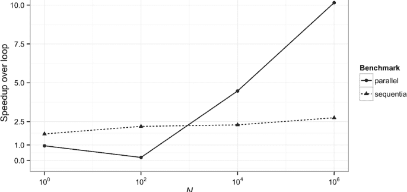

图 6-2. "maxDistance" 程序性能 (http://git.io/r6BtKQ)

更复杂的中间操作通常涉及某些 I/O 或同步，导致并行带来的收益较少。一如既往，如果你有问题，请准备重复此实验并根据你自己的需求进行调整。

## 6.3 流的特性

前节简单地表示了是否并行的观点。这是通过忽略不同流和不同操作行为之间的差异实现的。在本节中，我们将更仔细地观察流的属性，在随后的章节中，我们将看到不同操作如何利用这些策略——或者在某些情况下受到次优策略的限制。例如，如果流的元素是无序的——例如，它们源自 HashSet——那么流操作可以通过保持顺序来获得性能收益。

流通过这些特性暴露元数据，这些特性可以是 true 或 false；在这种情况下，操作将检查该流特性是否为 ORDERED。流 $S$ 的特性最初由源定义（事实上，流特性定义为 Splititerator 接口的字段）；随后，对 $S$ 执行中间操作产生的新流可能具有与 $S$ 相同的，或者具有某些


**图 6-3 流性能：N*Q 模型 (http://git.io/4Nluqw)**

*注：移除或添加新的。在这里，例如，是流水线中每个阶段特性的选择。

```java
Stream.of(8, 3, 5, 6, 7, 4)      // ORDERED, SIZED
  .filter(i -> i % 2 == 0)                   // ORDERED
  .sorted()                               // ORDERED, SORTED
  .distinct()                               // DISTINCT, ORDERED, SORTED
  .map(i -> i + 1)                         // ORDERED
  .unordered();                            // none
```

我们在下一节考虑 ORDERED；这里的特性含义是

- **SORTED**: 具有此特性的元素按照自然顺序排序——即它们的类型实现了 Comparable，并且已使用 Comparator 排序。如果为了目的定义了 Comparator，流元素可能按其他顺序排序，但此类流没有 SORTED 特性。相比之下，这不是源自 List 的流。使用此特性的例子是排序；当应用于具有 SORTED 特性的流时，自然顺序排序的操作可以被完全优化。另一个例子，顺序流上的 distinct 可以应用简单算法来避免存储元素：只有当元素与其之前的不等时，添加到输出流中。

- **SIZED**: 如果元素的数量是固定且已知，则流具有此特性。例如，对于所有源自并发集合的流。这些集合在流处理期间不能以任何方式修改，因此的大小保持已知。相比之下，并发集合在流处理期间可能会插入或删除元素，因此在流耗尽之前无法准确预测元素的数量。5.1 中的大多数集合源都不是 sized。一个利用 SIZED 的优化示例是累加到集合；通过创建相应大小的集合，可以比动态调整集合更高效。

- **DISTINCT**: 如果没有两个元素 $x$ 和 $y$ 满足 $x.equals(y)$，则流具有此特性。源自 Set 的流具有此特性，但源自 List 的则没有。为了说明其用处，当应用于具有此特性的流时，distinct 操作可以被优化掉。

## 6.4 顺序

在前节列出的特性中，顺序是性能章节中值得关注的，因为放弃顺序可以消除并行处理中的巨大开销。此外，正如前一个章节强调的，这是我们最可能由于对迭代处理的长期熟悉而不必要地施加的特性——想想 §1.1 中那个坚持你按字母顺序将字母放入信箱的朋友。因此，对于顺序真正重要的情况，是非常值得的。

如果元素的顺序被显著标记，则称该流具有遭遇顺序。例如，取 List：当有一系列向 List 添加元素的操作序列时，约规定了这些元素将如何定位，并在返回它们时（例如通过迭代）保证它们的顺序。现在考虑使用流处理 List 的元素：

```java
joined = stringList.parallelStream()
  .map(String::toUpperCase)
  .collect(Collectors.joining());
```


如果流没有通过流保持通过它的元素“位置”的属性来反映 `String` 的顺序，你会感到惊讶和失望。这是因为 `List` 有遭遇顺序（数据结构也可以具有这种），流也是，并且元素的空间布局在终端操作中被保留。例如，如果 `stringList` 有值 `["a", "B", "c"]`，那么 `joined` 保证是 `"ABC"`，而不是 `"BAC"` 或 `"CAB"`。

相比之下，如果流源没有遭遇顺序——例如，如果是一个 `HashSet`——那么没有顺序可以保持：流源没有遭遇顺序，流也没有。由于流已被显式标识为并行的，我们必须假设集合的块可能由不同处理器上的不同线程处理。无法保证处理结果（连接方法在可用时立即使用）将按照处理开始的顺序到达。如果你后续对字符串的使用不需要顺序——例如，你将用它提取每个字符的出现次数——那么它可能会损害性能并与程序的目的背道而驰。

> ⁴注意你可能期望所有 `Set` 实现本质上是有序的，集合的遭遇顺序取决于规范是否定义了迭代顺序：在集合框架的 `Set` 实现中，`LinkedHashSet` 以及 `Set` 子接口 `SortedSet` 和 `Navigable` 的实现是这种情况。

# 152 掌握 Lambda

在应用这一通用规则时，你不需要理解 `Stream` 类实现的细节。例如，你可能无法预料在这样的程序中，对流进行无序（`unordered`）会提高性能：

```java
long distinctCount = stringList.parallelStream()
  .unordered()
  .distinct()
  .count();
```

但实际上，对于大型数据集，其性能提升了 50%（http://git.io/i6fRow）。原因在于 `distinct` 的实现是通过测试之前出现过的元素集合的成员性来实现的，如果流是无序的，那么当前的 `map` 就可以无序的。但这个实现细节在未来可能会发生变化：核心原则——即你应该意识到顺序的存在并仅在必要时使用它——这一原则是不会改变的。

最初，“相遇顺序”（encounter order）一词的定义是与“时间顺序”（temporal order）相对的，用于描述流中的元素根据其产生的时间进行排序的情况。这种情况被描述为“无序的”（unordered）：这是一种简写，表示流没有顺序，而是说你不能依赖于它所拥有的顺序。很容易证明，对于并行流，时间顺序和相遇顺序之间没有必然联系，例如通过观察从流水线操作中修改线程安全对象的影响。按顺序执行，这段代码

```java
AtomicInteger counter = new AtomicInteger(1)
IntStream.rangeClosed(1,5)
  .mapToObj(i -> i + ":" + counter.getAndAdd(1) + " ")
  .forEach(System.out::print);
```

通常会产生输出：

```
1:1 2:2 3:3 4:4 5:5
```

而在并行执行时，你永远无法预测副作用的顺序：

```java
AtomicInteger counter = new AtomicInteger(1)
IntStream.rangeClosed(1,5).parallel()
  .mapToObj(i -> i + ":" + counter.getAndAdd(1) + " ")
  .forEach(System.out::print);
```

产生如下（例如）：

```
1:2 2:1 3:5 4:4 5:3
```

但请注意，在这两种情况下，你都无法预测副作用的顺序。

## 6.5 有状态和无状态操作

直观上，很明显某些中间操作比其他操作更容易进行并行化。例如，将 `map` 应用于流，显然可以通过对流元素应用 `map` 的行为参数进行逐元素评估来实现。相比之下，对流的元素进行排序（`sorted`）在累积流在耗尽前产生的所有值之前无法完成。由于 `map` 可以处理每个流元素而不引用任何其他元素，因此它是无状态的（stateless）。其他无状态操作包括 `filter`、`flatMap` 以及产生流的 `map` 和 `flatMap` 变体。仅包含无状态操作的流水线无论是顺序还是并行，都会单次通过处理，且很少或没有数据缓冲。

像 `sorted` 这样需要保留已处理值信息的操作被称为有状态的（stateful）。有状态操作会存储某些——甚至需要多次遍历——内存中的所有流数据。其他操作包括 `distinct` 以及截断操作 `skip` 和 `limit`。库的实现使用了各种策略来尽可能避免内存缓冲；这使得非常很难预测有状态操作将如何影响并行加速。例如，一个衡量流上 `sorted` 性能的原始基准测试可能会报告在四核上获得 2.5 倍的加速（http://git.io/6kdkW），此时条件恰好适合优化。另一方面，Oracle 团队在高效执行 `limit` 上遇到了意料之外且直观的困难，这使得 `limit` 在并行流中仍然是一个需要谨慎使用的操作。幸运的是，对流库的进一步工作（实现进一步的优化并更改现有优化）将不断改进库用户的状况。

## 6.6 装箱与拆箱

引入原始类型流（primitive streams）的一个重要动机是避免装箱（boxing）和拆箱（unboxing）的开销。在 §3.1.2 中，处理数字流被认为是一个简单任务。一个程序使用了原始类型流：

```java
OptionalInt max = IntStream.rangeClosed(1,5)
.map(i -> i + 1)
.max();
```

另一个是包装类值的流：

```java
Optional<Integer> max = Arrays.asList(1,2,3,4,5).stream()
.map(i -> i + 1)
.max(Integer::compareTo);
```

图 6-4 比较了这两个程序在不同流长度下的性能，其中为了参考，还包含了对迭代程序的类似比较。正如预期的那样，未装箱的代码轻松优于装箱的代码；对于大型数据集，加速比接近一个数量级。

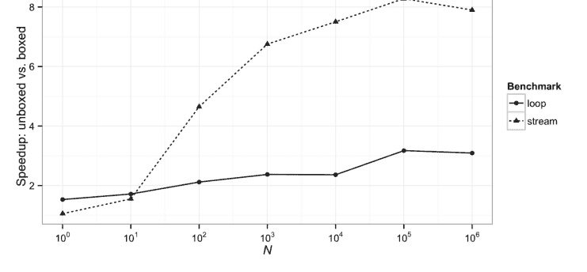

**图 6-4.** 未装箱 vs 装箱性能（http://git.io/YB9V6g）

## 6.7 分割器（Spliterator）性能

直观上，某些中间操作比其他操作更适合并行化。流源对顺序性能的影响是直接的：如果流能够足够快地提供数据，对整个过程的影响就很小。对于并行流，问题更为复杂，因为需要两个互补的过程来拆分源。例如，如果 `iterate` 能够快速提供值但无法有效拆分，并行流可能没有加速。在常见的流源中，最可拆分的是 `ArrayList`、`HashMap` 和 `ConcurrentHashMap`。最难拆分的是 `LinkedList`、`BlockingQueue` 实现以及基于 I/O 的源。

I/O 缓冲区和 `iterate` 等其他方法有时可以从并行化中受益，除非插入了额外的处理步骤在内存数据结构中缓冲输出。泛而言之，这得出结论：当数据源是内存随机访问结构时，使用 Stream API 将从并行加速中获益。（当然，这并不阻止其他源通过其他方式受益）。

一个说明这一点的现实示例是第 5 章的 `grep -b`。将顺序访问的文件读取到 `MappedByteBuffer` 使数据进入非常适合并行化的形式。一项衡量该程序性能的实验比较了三种算法分割 `MappedByteBuffer` 的效率：迭代、顺序和流。设置 `MappedByteBuffer` 的开销被排除在外，以便关注分割算法的效率。结果与数据大小相对独立：对于 10,000 行到百万行的文件，顺序流处理比迭代处理快 1.9 到 2.0 倍；在相同范围内，并行处理比迭代处理快 5.2 到 5.4 倍。

## 6.8 收集器（Collector）性能

终端操作的行为与流源类似，并行流比顺序流更复杂。在顺序情况下，收集仅涉及调用收集器的累加函数，如果它足够快地从流中提取值，就可以避免成为过程的瓶颈。对于并行流，框架根据收集器是否声明自己为 `CONCURRENT` 来以不同方式对待收集器。并发收集器保证其累加器是线程安全的，因此框架不需要为避免并发调用非线程结构承担责任。从原则上讲，避免管理线程限制的开销应该带来更好的并行性能。正如我们将要看到的，这在实践中可以通过合适的数据集和配置参数来实现。

收集器除了 `CONCURRENT` 之外还报告两个特性：收集器可以具有 `IDENTITY_FINISH`，这告诉框架需要准备一个完成函数（finisher），以及 `UNORDERED`，这告诉框架没有必要维护流的相遇顺序，因为收集器终会丢弃它。

# 156 精通 Lambda

## 6.8.1 并发 Map Merge

库提供的并发收集器是通过 `Collector` 方法 `toConcurrentMap` 和 `groupingByConcurrent` 的各种重载获得的。那些使用框架提供的 `ConcurrentMap` 实现（而不是允许你提供 `ConcurrentMap` 供应商）的收集器都依赖于 `ConcurrentHashMap` (CHM)。这些收集器的性能特性需要一些解释，所有这些收集器的潜在用户都应该理解。一个原始的基准测试（http://git.io/XYYvpg）显示，对于任何数据集，`groupingByConcurrent` 的性能都优于 `groupingBy`。分析显示，`groupingByConcurrent` 变慢是因为 CHM 频繁的调整大小导致的：以足够避免调整大小的初始大小创建 CHM，可以将性能提高约 30%，即使对于仅有 1000 个元素的数据集也是如此。如果比较是公平的——即增加 `groupingBy` 使用的 `HashMap` 的初始大小——那么对于 `groupingByConcurrent` 来说仍然是不利的。

但我们现在处于一个未知的领域，在这个领域中，向 CHM 添加元素比向 HashMap 添加元素慢，但通过并行执行这种较慢的操作在大规模数据集上得到了补偿。选择预设大小以达到 0.5 的负载因子（http://git.io/HAiaQQ），相对性能显示出一种熟悉的模式：随着数据量超过100,000个元素，并行加速随数据量的增加而增加（图 6-5）。

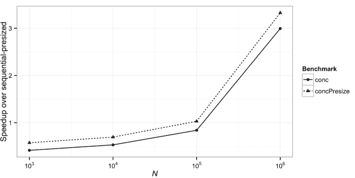

**图 6-5.** *groupingByConcurrent 对比 groupingBy*

事实上，图 6-5 并没有说明所有问题。顺序的 `groupingBy` 会创建新对象，因此垃圾回收成为性能的一个因素。并行 GC 偏向实验，倾向于 `groupingBy`，因为顺序操作未使用的内核可用于并行运行 GC，从而掩盖了其成本。使用四个测量线程运行相同的测试（向 JMH 提供 `-t 4` 选项）会在 10,000 个元素以下产生一个平衡点。

## 6.8.2 性能分析：点分组

第 4.3 节的“点分组”收集器被设计为并行化的良好案例；尽管创建的数据结构是由的一系列非线程安全的 `ArrayDeque` 组成的链表，但所有的收集器操作都是快速的，且不涉及迭代，因此在收集过程中产生的竞争相对较小。顺序运行时，第 4.3 节的程序（http://git.io/XdV3w）的性能特征与其等效的迭代版本非常相似；在四核机器上，对于没有负载的流，并行执行相对于顺序执行的加速比约为 1.8；对于每个元素具有 100 个 JMH token 的负载，比例为 2.5。

## 6.8.3 性能分析：寻找我的书

在这里分析的最后一个收集器程序是 §4.3.2：它是用于查找我的书在书架上的位移（即前一个值的页数）的程序。在分析了并发合并 map（6.8.1）之后，我们不应该对这个指定生成 map 的收集器必须与并行流的终端操作一起使用感到意外。事实上，目前的程序（http://git.io/aoy6w）比等效的迭代版本慢约 40%。有几个因素导致了这一点，其中一些在现实情况下可能会被缓解：

- 这个问题是前缀和（prefix sum）的一个例子，其中每个元素的值取决于其前一个元素的值。在像这样的前缀和的原始算法中，`combine` 操作的总成本与输入数据集的大小成正比，无论使用的并行化程度如何。该问题的严重性取决于 `combine` 操作的成本；在这种情况下，将右侧的 `Deque` 流式处理到右侧的成本取决于并行化。


# 第 4.3 节：点分组收集器的并行化分析

第 4.3 节的“点分组”收集器被设计为并行化的良好案例；尽管创建的数据结构是由一系列非线程安全的 `ArrayDeque` 组成的链表，但所有的收集器操作都是快速的，且不涉及迭代，因此在收集过程中产生的竞争相对较小。顺序运行时，第 4.3 节的程序（`http://git.io/XdV3w`）的性能特征与其等效的迭代版本非常相似；在四核机器上，对于没有负载的流，并行执行相对于顺序执行的加速比约为 1.8；对于每个元素具有 100 个 JMH token 的负载，比例为 2.5。

## 6.8.3 性能分析：寻找我的书

在这里分析的最后一个收集器程序是 4.3.2 节的程序：它是用于查找我的书在书架上的位移（即前一个值的页数）的程序。在分析了并发合并 map（6.8.1 节）之后，我们不应该对这个指定生成 map 的收集器必须与并行流的终端操作一起使用感到意外。事实上，目前的程序（`http://git.io/aoy6w`）比等效的迭代版本慢约 40%。有几个因素导致了这一点，其中一些在现实情况下可能会被缓解：

- 这个问题是前缀和（prefix sum）的一个例子，其中每个元素的值取决于其前一个元素的值。在像这样的前缀和的原始算法中，`combine` 操作的总成本与输入数据集的大小成正比，无论使用的并行化程度如何。该问题的严重性取决于 `combine` 操作的成本；在这种情况下，将右侧的 `Deque` 流式处理到右侧的成本取决于并行化程度。

## 6.9 结论

（此处省略原文中重复的段落）

---

# 第 7 章：使用默认方法进行 API 演进

默认方法允许接口定义行为。为什么我们需要这种变化，它的后果是什么？第一个问题的简短答案是：为了支持 API 演进。这种需求已经存在很长时间，但随着对集合支持的需求而变得紧迫。（长的答案是，一旦引入，默认方法还有其他用途，正如我们所见。）Java 集合框架（以及它的扩展，例如 Guava）是强基于接口的：也就是说，集合的能力（某些除外）由其接口的 Javadoc 合约定义。对于现有的集合库为了增强流支持，像 `Collection` 这样的接口将带来完全不受人的兼容性和代码维护问题。回顾这些问题将帮助我们理解设计者做出该决定的原因。考虑，例如为 `Collection` 添加一个抽象方法 `stream`。（但注意，这里描述的问题适用于所有已发布的接口，而不只是平台库中的。）在 Java 8 之前，`Collection` 只声明抽象方法：

```java
public interface Collection<E> {
    int size();
    boolean isEmpty();
    // 11 更多抽象方法
}
```

并且类实现接口仅当它覆盖每个抽象方法声明为具体方法时：

```java
class CustomCollection implements Collection<E> {
    public int size() { ... }
    public boolean isEmpty() { ... }
    // 11 更多具体方法声明
}
```

现在考虑将集合转换为流源。`Collection` 接口必须扩展 `stream` 方法；如果没有默认方法，只能通过添加抽象方法声明来实现：

```java
public interface Collection<E> {
    int size();
    boolean isEmpty();
    // 11 更多抽象方法
    Stream<E> stream(); // 抽象方法 - 实际上未添加
}
```

如果现在针对此新版本的 `Collection` 编译 `CustomCollection` 实现，结果将导致源码不兼容：编译将失败。`Collection` 现在声明了一个未被 `CustomCollection` 覆盖的抽象方法。如果没有默认方法，唯一的修复方法是通过添加对 `stream` 的具体覆盖声明，使 `CustomCollection` 匹配 `Collection` 的新定义。但如果接口是库的一部分——`Collection` 的使用非常广泛，但任何已发布的 API 都可以作为示例——那么在实践中，很难为每一项增强都要求所有实现类进行大规模的源码更改。

请注意，在不替换的情况下，`CustomCollection` 的现有字节码仍然可以与新版本的 `Collection`（接口和实现）进行链接并运行——根据《Java 语言规范》（§13.2）。保持实现不变只会将问题转移给客户端程序员；而现在，为了利用接口公布的新功能而编写的代码将能够无问题地编译：

```java
Collection<Integer> c = new CustomCollection<>();
Stream<Integer> s = c.stream();
```

但在运行时会抛出 `AbstractMethodError`。

根本问题在于，Java 接口的传统角色被局限于定义客户端与实现之间的契约；提供功能的责任完全在于实现方。自然地，如果供应合同的要求被扩展，供应商必须感知到变化并必须履行新部分。然而，一旦接口已经发布，对所有实现都坚持这一点就是不实际的。因此，发布的接口绝不会用抽象方法进行扩展。

默认方法的引入改变了这种局面，它将接口的角色从定义契约扩展到包含其部分实现。接口现在可以包含代码，其形式为两种非抽象方法：默认方法和静态方法。默认方法现在是 API 演进的核心；例如，在 Java 8 中 `Collection.stream` 实际上是如何声明的：

```java
public interface Collection<E> {
    int size();
    boolean isEmpty();
    // 更多 11 个抽象方法
    default Stream<E> stream() {
        // 委托给 splitter，这也是 Collection 的一个默认方法
        return StreamSupport.stream(spliterator(), false);
    }
    // 其他默认方法
}
```

对于客户端来说，接口仍然具有相同的含义：它定义了一个类型，并列出了客户端可以在该类型上调用的方法声明。对于实现来说，它与接口关系的主要元素也没有改变：它仍然需要覆盖接口的抽象方法。然而：实现类现在可以选择覆盖默认方法的声明——因为这些方法是虚拟的，并且替换或修改它们的行为，就像传统的 Java 实例方法覆盖一样。

现在，接口可以被扩展以允许客户端代码拥有新方法，而无需对现有实现进行任何立即更改。这自 JDK 1.0 以来就消除了 API 演进的一个严重障碍。值得问的是为什么这个障碍一直存在这么久。

除了进行如此大更改的巨大困难外，对多继承的态度也必须发生变化。对多继承的厌恶是 Java 原始设计中的一个强有力因素，因为它给其他语言带来了困难，最著名的是 C++ 中表现形式的“菱形问题”（第 169 页）。尽管如此，接口的多重继承一直是可以接受的，因为接口本质上是类型定义，而类型的多重继承并不涉及这些问题。引入默认方法扩展了接口提供行为的角色，因此现在必须允许行为的多重继承。Java 8 的设计者能够制定出规则，使行为继承问题变得可管理；多继承的经典问题与状态继承有关，而 Java 并不也永远不支持状态继承。

## 7.1 使用默认方法

在发生如此巨大的变化后，需要时间才能出现最佳的新惯用法。在 Java 8 平台类中已经可以看到一些情况，这里是其中四种：

- **意图被覆盖的方法**：上一节介绍了如 `Collection.stream` 等方法作为默认方法的中心用例。`stream` 的实现委托给了另一个默认方法 `spliterator`（定义在 `Collection` 的父接口 `Iterable` 中）。该方法的目的是返回一个 `spliterator`，利用集合的结构来将其内容分区，以便供不同的线程处理，例如第 5.4 节中的 `MappedByteBuffer` spliterator。当然，默认实现本身无法实现其意图；对于大多数类来说，它是次优的，因为它不知道它正在拆分的对象的结构。虚拟方法分发允许 `Collection` 实现类通过利用其特定特征的具体方法定义来覆盖 `spliterator`。
- **通常不会被覆盖的方法**：某些接口包含通常由同一个方法实现的方法声明。例如，`Comparator.thenComparing(Comparator)` 返回的 `Comparator` 的默认实现非常简单：首先在它的参数上对 `thenComparing` 的接收者进行评估，如果它返回 `then`——如名称所示——则评估所提供的 `Comparator`。很难预想实际实现能如何改进这一点。
- **一个对比示例**是 `Iterator.remove`。关于接口最初是否应该包含此方法是尚有争议的，因为许多实现并不支持它。尽管如此，Java 8 通过将 `remove` 变为默认方法，在某种程度上缓解了这个问题：

```java
public interface Iterator<E> {
    default void remove() {
        throw new UnsupportedOperationException("remove");
    }
}
```

从而消除了在每个不支持 `remove` 的 `Iterator` 实现中重复样板代码的要求。

- **辅助方法**：虽然函数式接口只有一个方法来定义其核心目的，但对它可能拥有多少个默认方法没有限制。这些对于添加额外功能非常有用。例如，我们使用 `Predicate` 及其专门的变体用于定义流的真值函数。你通常会使用标准的逻辑运算符 AND、OR 和 NOT 对这些真值函数的结果进行操作。`Predicate` 及其变体声明了这些：

```java
Predicate tolkien = b -> b.getAuthors().contains("Tolkien");
Predicate lotr = b -> b.getTitle().contains("Lord");
Predicate old = b -> b.getPublished().isBefore(Year.of(1960));

boolean firstLotn = library.stream()
    .filter(tolkien.and(lotr).and(old))
    .findAny().isPresent();
```

- **便利方法**：默认方法提供了将现有功能移动到更合适位置的机会。例如，在 Java 8 之前，以自然顺序排序 List 需要调用两个静态 `Collections` 方法。现在，默认方法 `List.sort`（配合静态接口方法 `Comparator.reverseOrder()`）允许将代码重写为更具可读的方式：

```java
integerList.sort(Comparator.reverseOrder());
```

事实上，`List.sort` 不仅仅是便利方法；它允许 `List` 类利用其内部表示的知识来覆盖一个高效实现，而这些知识是静态方法 `Collections.sort` 无法获取的。

这些是接口方法使现有功能可见许多示例：List 实例的排序方法和创建 `Comparator` 的工厂方法显然更适合放在这些接口中，而不是通用工具类 `Classes` 中。

## 7.2 抽象类的作用是什么？

为接口添加实现能力使其角色更接近抽象类，抽象类也混合了抽象方法声明和实现能力。人们自然会问抽象类还剩下什么。

最简单的方法相对于传统的 Java API 来回答这个问题，该 API 包含接口、抽象类和具体实现。例如，假设早期章节中的库系统要变得更通用，通过添加电子书和音频书：它们有标题和作者，但缺乏物理书的一些属性——例如，高度和页数。重构后的领域设计可能部分所示：

```java
interface BookIntf {
    String getTitle();
    List<String> getAuthors();
    // 其他抽象方法
}

abstract class AbstractBook implements BookIntf {
    private String title;
    private List<String> authors;
    // 物理书和电子书共同的字段
    // 连同这些字段的 getter 和 setter
}

class PaperBook extends AbstractBook {
    private int[] pageCounts;
    public int[] getPageCounts() { return pageCounts; }
    // 其他物理书的字段和 getter/setter 方法
}
```

现在，假设我们要在 `BookIntf` 上暴露一个方法，该方法将其作者名称连接成一个单一字符串。这属于上一节描述的“便利方法”类别：

```java
interface BookIntf {
    default String getAuthorsAsString() {
        return getAuthors().stream().collect(Collectors.joining(","));
    }
    // ...
}
```

这作为一个默认方法可以正常工作，因为它可以完全根据另一个接口方法 `getAuthors` 来定义。相比之下，定义 `getAuthors` 本身需要实例数据，而这些数据无法在接口中声明。不同子类之间共同的数据（例如示例中的作者）仍然存储在抽象类中，而抽象类也是 getter 和 setter 的所在地：

```java
abstract class AbstractBook implements BookIntf {
    private List<String> authors;
    public String getAuthors() {
        return authors;
    }
}
```

像本例这样对实例状态的需求，是继续使用抽象类的主要原因。默认方法还有其他局限性，这意味着抽象类仍然是必要的：默认方法只能基于同一接口上的方法实现（以及任何类型上可用的静态方法）。此外，抽象类可以声明 `protected` 状态和方法以与子类共享；而接口无法提供这种选项，接口的所有声明自动都是 `public` 的。

## 7.3 默认方法语法

我们已经见过了默认方法声明的形式。它们与类中的具体方法声明非常相似。在接口中，它们通过存在 `default` 修饰符以及方法体由代码块而非分号表示，与抽象方法声明区分开来。激烈的争论关于 `default` 关键字是否应该是强制性的，考虑到为了消除语法歧义，它并不是必需的——一个带有方法体的接口方法声明只能是默认方法。将其强制性的一个优点是，它可以立即提示读者的理解，就像为抽象方法和类使用 `abstract` 修饰符（同样并非严格必要）一样。

默认方法与具体实例方法之间主要的语法区别在于它们被允许（或在默认情况下被要求）拥有的修饰符。显然，默认方法不能被声明为 `static`，因为这些修饰符区分了其他类型的接口方法（我们将在 7.5 节中探讨接口方法）。它们不能被声明为 `final`，因为它们必须被实例方法覆盖，正如我们在下一节中看到的那样。与所有接口方法一样，它们可以声明为 `public`，但实际上已经是隐式的 `public` 了；不存在其他访问权限。

`super` 关键字具有其通常含义；它指向当前对象，使用接口类型进行引用。例如，`Iterable.forEach` 方法具有如下实现（为了演示进行了略微简化）：

```java
default void forEach(Consumer<T> action) {
    for (T t : this) {
        action.accept(t);
    }
}
```

`super` 关键字也是允许的，但仅当它由父接口名称限定时有效，正如下一节解释的那样。

接口不允许声明与 `Object` 的任何方法具有相同签名的默认方法。因此，例如你不能在接口中重新定义 `Object.toString()`。这与下一节默认方法继承的原则一致：我们将探讨的这些原则中最重要的是，默认方法永远无法覆盖实例方法，无论是否被继承。

## 7.4 默认方法与继承

我们已经看到了默认方法的用途和好处；那么缺点是什么呢？语言设计者在引入它们时面临的挑战是设计一种简单且无歧义的方法继承系统，同时尽可能地减少兼容性问题（与其他特征的意外交互）。急需解决的最重要的兼容性问题涉及在存在多个实现时的方法调用解析，特别是当这些实现同时包含了从父类继承的具体方法和从接口继承的一个或多个默认方法时。

语言规范关于方法调用解析的规则非常复杂，但经过了精心设计，可以通过两个简单的原则来理解。

第一个原则确保实例方法优于默认方法。这有时被称为“类胜过接口”。例如，在下面的代码中，`FooBar` 同时从接口 `Foo` 和父类 `Bar` 继承了 `hello` 方法：

```java
// hello() 方法冲突的实例和默认方法声明
interface Foo { default String hello() { return "Foo"; } }
class Bar { public String hello() { return "Bar"; } }
class FooBar extends Bar implements Foo {
```


```java
public static void main(String[] args) {
    System.out.print("Hello " + new FooBar().hello());
}
```

当运行 `FooBar.main` 时，输出是 `Hello from Bar`。无论实例是在类内部声明还是从父类继承，无论实例是抽象的还是具体的，这一原则都成立。该规则的动机是为了防止行为上的不兼容：即添加默认方法导致实现类的行为发生变化。如果类总是胜出，那么调用继承自父类方法的类，即使当它实现的某个接口引入了自身的方法声明时，也将继续调用该方法。

第二个原则确保，如果一个类继承了多个竞争性的默认方法，则选择**未被覆盖的默认方法**。我们说的“未被覆盖的方法”指的是没有被该类继承的其他默认方法所覆盖的默认方法。例如：

```java
// hello() 方法冲突的默认方法声明
// Bar.hello()覆盖了 Foo.hello(),因此它是未被覆盖的方法
interface Foo { default String hello() { return "Foo"; } }
interface Bar extends Foo { default String hello() { return "Bar"; } }

class FooBar implements Foo, Bar {
    public static void main(String[] args) {
        System.out.print("Hello " + new FooBar().hello());
    }
}
```

## 168 掌握 Lambda 表达式

再次，当运行 `FooBar.main` 时，输出是 `Hello from Bar`。
当然，如果一个类继承的多个默认方法都没有被任何其他方法覆盖，那么可能没有未被覆盖的默认方法。例如：

```java
// hello() 方法冲突的默认方法声明
// 它们都没有覆盖另一个
interface Foo { default String hello() { return "Foo"; } }
interface Bar { default String hello() { return "Bar"; } }

class FooBar implements Foo, Bar {
    public static void main(String[] args) {
        System.out.print(new FooBar().hello());
    }
}
```

在这种情况下，`FooBar` 编译失败，错误信息为：

```
Error: class FooBar inherits unrelated defaults for hello() from types Foo and Bar
```

这是一个合理的响应；编译器在两个继承的方法之间没有选择余地。你可以通过让 `FooBar` 本身覆盖 `hello`，使用一种语法形式（Java 中已存在，但在此之前仅用于内部类中不同的目的）来允许选择竞争方法中的其中一个：

```java
class FooBar implements Foo, Bar {
    public String hello() {
        return Bar.super.hello();
    }
}
```

相同的语法也可以用于接口默认方法的体中。注意，它只能用于解决冲突，不能覆盖两个主要原则中的任何一个。你不能用它来选择一个未覆盖的方法：

```java
// FooBar.hello() 被 Bar.hello() 覆盖，而 Bar.hello() 被 FooBar 继承
interface Foo { default String hello() { return "Foo"; } }
interface Bar extends Foo { default String hello() { return "Bar"; } }

class FooBar implements Bar {
    public String hello() {
        return Foo.super.hello(); // 非法
    }
}
```

## 第 7 章：带有默认方法的 API 演进 169

即使 `FooBar` 直接实现了 `Foo` 和 `Bar`，`Foo.hello` 也不是一个未重写的方法，无法使用 `super` 语法进行选择。

这些原则如何帮助解决“菱形问题”？这是一个类通过两个不同的路径继承同一个声明的情况：

```java
interface Apex { default String hello() { return "Apex"; } }
interface Foo extends Apex { }
interface Bar extends Apex { }

class FooBar implements Foo, Bar {
    public static void main(String[] args) {
        System.out.print(new FooBar().hello());
    }
}
```

该问题的命名源于类图的形状：

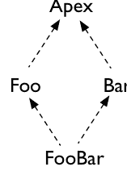

本节的原理为这种场景及其变体提供了直观的解释：在所示的代码中，`FooBar` 继承的 `hello` 实现来自 `Apex`。然而，如果现在将 `Bar` 改为也声明一个 `hello` 的默认实现，那么根据“未重写方法”原则，该方法将成为 `FooBar` 继承的方法。请注意，这一原则结合虚方法分发，在这种情况下可能会产生出意想不到的结果。例如，如果在前面的代码中将 `Foo` 的声明改为：

```java
interface Foo extends Apex { default String hello() { return "Foo"; } }
```

那么这段代码：

```java
Bar bar = new FooBar();
System.out.println("Hello from " + bar.hello());
```

## 170 掌握 Lambda

将会产生输出 `Hello from Foo`。`bar` 的静态类型并不重要，重要的是它指向一个 `FooBar` 实例，而该实例的未重写方法继承自 `Foo`。

如果 `Foo` 和 `Bar` 都声明了默认实现，那么它们就会发生冲突，`FooBar` 必须提供一个重写声明。

### 7.4.1 兼容性问题

上一节的原则涵盖了绝大多数实际情况。遗憾的是，并不总是能够避免不兼容性。本节描述了三个问题场景。

在接下来，`Intf` 代表一个公开的接口，`Impl` 代表库的实现。它们并不一定在同一个库中，但 `Intf` 的维护者可能了解其实现，并且在演进 API 时无法考虑它们的声明。

```java
interface Intf {
    // 虚抽象方法和默认方法
}

class Impl implements Intf {
    // Intf 中各种抽象方法的实现
    public String hello(long l) { return "Foo"; }
}

class Client {
    public static void main(String[] args) {
        System.out.println("Hello " + new Impl().hello(3));
    }
}
```

在这个版本中，`Client.main` 显然会产生输出 `Hello from Impl`。我们现在考虑对 `Intf` 的两种不同更改，每种更改都为 `Intf` 添加了一个与 `Impl.hello` 声明几乎匹配的方法。例如，`Intf` 声明了一个签名相同但返回类型不兼容的 `hello` 版本：

```java
interface Intf {
    default void hello(long l) { }
}
```

在重写方法之间，类总是胜；但这不是重写方法。针对新版本的 `Intf` 编译 `Impl` 会产生此消息：

```
Error: foo(long) in Impl cannot implement foo(long) in Intf
return type java.lang.String is not compatible with void
```

## 第 7 章：带有默认方法的 API 演进 171

如果 `Impl` 对 `hello` 的声明是非公有的，就会出现该问题的变体；在这种情况下，即使 `Intf` 中新方法的签名匹配，它也会——因为接口方法自动是公有的——导致编译器报告 `Impl` 的重写尝试私有访问 `hello`。

第二个问题是更严重的。在这种情况下，接口增加了一个与现有方法匹配的声明，通过 `super` 语法：

```java
interface Intf {
    default String hello() { return "null"; }
}
```

在重写方法之间，类总是胜；但这不是重写方法。针对新版本的 `Intf` 编译 `Impl` 会产生此消息：

```
Error: foo(long) in Impl cannot implement foo(long) in Intf
return type java.lang.String is not compatible with void
```

这种方法，如果不重写，将会破坏线程安全。例如，`Map`：

```java
default V putIfAbsent(K key, V value) {
    V v = get(key);
    if (v == null) {
        v = put(key, value);
    }
    return v;
}
```

由于接口方法自动是公有的，即使 `Intf` 中新方法的签名匹配，它也会导致编译器报告 `Impl` 的重写尝试私有访问 `hello`。

## 172 掌握 Lambda

注意，本节的问题并不是新的：任何一个都可能发生在类继承中。让它们更严重的是，虽然我们预感到类层次的变化会导致这些问题，但 Java 接口的变化是新的。幸运的是，它们在实践中并没有发生。

### 7.5 接口中的静态方法

一旦允许接口提供行为，自然就会检查静态方法看看它们是否也可以或应该被允许进入接口。通过洞察，很容易看出允许它们的优势：在本书中，我们一直在通过如下方法调用利用它们的存在，例如：

```java
Stream.of(1,2,3)
Comparator.naturalOrder();
```

然而，从本章上一节的视角来看，我们可以看到最小化复杂性的重要性。实际上，这些可以通过将引用静态方法的语法限制为特定的 `DeclaringInterface.MethodName` 来缓解。（显然，这种解决方案对默认方法无效，因为不兼容虚方法分发。）因此，与静态类方法的区别之一是静态接口方法是不继承的：

```java
interface Bar { static void barHello() {} }
class Foo { static void fooHello() {} }

class FooBar extends Foo implements Bar {
    public static void main(String[] args) {
        fooHello();      // 调用继承的方法
        barHello();      // 非法 - 无法编译
        Bar.barHello();  // 引用 barHello 的唯一合法方式
    }
}
```


由于某些原因，你无法通过 `ObjectReference.MethodName` 语法引用静态接口方法¹。在其他方面，静态接口方法的声明方式与静态方法具有相同的属性。与其他接口方法一样，它们可以被声明为公共，但隐式

¹ 与静态类方法的区别——防止继承以及不允许通过对象引用调用——可能被看作是拒绝重复犯两次错误。

## 第 7 章：带有默认方法的 API 演进

无论如何，都不允许将静态接口方法声明为 `final`，因为对于无法被继承的方法来说，这个修饰符是没有意义的。

### 7.5.1 使用静态方法

同样，要判断 API 设计中将出现哪些惯用法来利用静态接口方法还为时过早。在 Java 8 中，平台类以工厂方法的形式暴露出来——如 `Stream.of`、`Collector.of` 和 `Comparator.comparing`——以及定位功能的方法，这些方法通常比传统的工具类使用有所改进。

工具类在定位功能时可能会带来巨大的困难。平台库中最极端的例子 `java.util.Collections` 包含了 60 多个静态方法，其中大多数并不与泛集合相关，而是与 `Set`、`List`、`Queue` 或 `Map` 之一相关（后者甚至不是 `Collection` 的子类型）。Java 框架的新手无法以任何系统的方法推断出在哪里可以找到生成（例如）Map 的工厂方法。这种函数的任意分配是学习 API 的主要障碍。现在接口可以暴露像 `Comparator.comparing` 和 `Stream.of` 这样的方法，它们就可以出现在开发者自然预期找到它们的地方。这种改进不仅限于新方法；例如，Java 8 引入了工厂方法 `Comparator.reverseOrder`，它通过简单地委托给现有的（但位置不佳的）方法 `Collections.reverseOrder` 实现。

尽管如此，工具类 `Collections` 不可能在新的 API 中完全消失。考虑 `Collector` 接口；在 Stream API 中，该接口有 40 多个工厂方法。只有两个被声明为接口自身的静态方法，即在 4.3 节中讨论过的 `Collector.of` 的通用重载版本。在 4.1 节中描述的 40 多种预定义工厂方法，值得且确实拥有一个自己的类——`Collectors`；将所有内容都放入 `Collector` 接口中会淹没它们的核心功能。这个例子让我们预感到，随着时间的推移，静态接口方法和工具类之间将出现一种使用的平衡。

### 7.6 结论

改变一个已经广泛使用了近二十年的编程语言并非易事。当要更改的功能像接口之于 Java 一样处于语言的核心位置时，问题变得更加困难。尽管本章描述了问题，但向 Java 接口添加行为总的来说引起了极少的困难。

这部分是因为这些功能是为了实现 API 演进的目的而专门定制的。关于引入默认方法的某些争议是基于对它们将重现其他语言中特质（traits）或混入（mixins）功能的预期。然而，接口状态的防止了这一点。正如我们在本章看到的，对接口现在可以替代抽象类或使工具类冗余的预期是大的。它们确实实现了设计目的，即实现 API 的演进；这带来的机会最初有利于 Stream API，并将为维护和增强其他 API 创造可能性，远超目前可行的范围。

## 结论

我想以一种个人笔触结束这本书。在过去的四十年里，我早已忘记了见过多少被宣布为行业未来的技术，结果在短短两年内就被遗忘了。只有少数技术是“慢火型”：那些培养了忠实追随者但从未进入商业主流的技术。在这一类中，函数式编程脱颖而出，它吸引了一些最顶尖的人才，并在软件开发中产生了一些最优秀的想法，同时保持着小众兴趣。

对我个人而言，尽管我在 20 世纪 80 年代尝试过函数式编程，但我并没有成为函数式程序员。相反，我遵循行业主流转向了面向对象编程，并最终选择了 Java。近 20 年后，从大多数标准来看，Java 是世界上最流行的编程语言。但在过去的几年里，我并没有对我选择的幸运感到自得；一个懂 Java 的程序员会错过许多出现在竞争语言中的有用编程技术。例如，惰性求值（lazy evaluation）、闭包（closures）和模式匹配（pattern matching）起源于函数式语言。这种趋势仍在继续：函数式程序员对未来充满乐观，最重要的是它们成为了硬件制造技术和成本的趋势，这意味着大规模并发系统是未来。数据不可变性将是推理此类系统的关键。

Java 并不是为了成为一种函数式语言，但 Java 程序员应该能够利用函数式编程开发出的某些见解。Java 8 的变化是朝这一方向的第一步。它们将不可变性和惰性求值引入实用的 Java 编程中，从而解决了在多个处理器上划分任务的部分当前且持续的挑战。尽管对向后兼容的承诺使得对一个有 20 年历史的语言进行任何更改都是如此困难，但 Java 设计团队在将函数式编程的想法集成到一种基于完全不同原则设计的语言时，展现了令人印象深刻的智慧。他们取得了巨大的成功，这是 Java 历史上最大的单次变革。

我对这些变化感到兴奋，并希望已向你传达了这种兴奋之情。我希望这本书帮助你理解 Java 的新方向，并向远看，参与到该语言的未来中。目前，我会说：编程应该总是趣味的，但当你编写 Java 8 支持的简洁、可读且性能良好的代码时，你会发现更有趣。如果认为这本书为你编程生活中的这种改变做了贡献，我将非常荣幸。

Maurice Naftalin
2014年8月于浦那

# 索引

# A
- 抽象类 (abstract classes), 与接口对比 164–165
- 累加函数 (accumulator functions), 74, 76–77
- 作为收集器组件 (collector components), 90–94, 98–100
- 集合和, 90
- 在引用归约 (reference reduction) 中的归约, 10–102
- 在引用上的归约 (reduction over references), 105–107
- 在引用归约中被替换, 108
- 收集器 (collectors) 的规则, 101–102
- 归约 (reduction) 的规则, 107
- 匿名内部类 (anonymous inner classes)
- lambda 表达式 (lambda expressions), 21–23
- 转换为 lambda 表达式，7
- API 演进 (API evolution), 默认方法。参见
- 默认方法 (default methods)
- 归档 (archives), JarFile 类, 117
- 数组类 (Array classes), 带流的方法 (stream-bearing methods), 114
- 数组 (arrays)
- spliterator 性能和 153–155
- 结合律约束 (associativity constraint), 收集器, 102
- 归约 (reduction), 105
- 自动装/拆箱 (auto-boxing/unboxing), 48
- 流性能 (stream performance)和, 153–154

# B
- 行为 (behaviors)
- 与对象关联, 22
- 组合 (composing), 15–17
- 表示 (representing), 22
- BitSet 类, 118
- lambda 表达式的主体 (bodies), 23
- 瓶颈 (bottlenecks), 并发集合, 90
- 绑定方法 (bound method), 33
- 未解绑方法 (unbound method), 33
- 装箱 (boxing)
- 自动装/拆箱 (auto-boxing/unboxing), 48
- 流性能和, 153–154
- BufferedReader 类, 114

# C
- 捕获 lambdas (capturing lambdas), 24
- 链式管道 (chaining pipelines), 84–88
- 特性 (characteristics), Spliterator 接口, 122
- 字符方法 (chars method), CharSequence 类, 118
- 字符序列 (CharSequence), 117
- 增加计数 (increasing count), 3
- 类设计图 (class diagram), 27
- 类 (classes). 参见类名
- 抽象类 (abstract classes), 164–165
- 匿名内部类 (anonymous inner classes), 7
- codePoints() 方法, CharSequence 类, 118
- 收集并 (collectingThen), Collectors 类, 94–95
- 集合接口 (Collection interface), 4, 50, 112
- 集合 (collections), 4, 50
- 并发 (concurrent), 90
- 收集器 (collectors), 75
- 集合 (collection), 67–70
- 并发 (concurrent), 90
- 示例 (examples), 75
- 与归约对比 (compared with), 74, 107–108
- 收集器。参见引用上的
- 结构 (anatomy of), 88–90
- 示例 (examples), 93, 98–100
- 合并函数 (combiner functions)
- 合并函数 (combiner functions)
- 创建收集器组件 (creating as collector components), 98–100
- 结束器 (finishers), 94–97
- 选择性能问题 (performance issues in choosing)
- 执行模式 (execution mode), 147–148
- 性能 (performance of), 155
- 减少收集器 (reducing collectors), 108–109
- 规则 (rules for), 101–102
- 原始类型上的归约 (reduction over primitives), 103
- 引用之上的归约 (reduction over references), 105–107
- 在集合中的角色 (role in collection), 88
- 独立预定义收集器 (standalone predefined collectors), 76–80
- 在收集器规则中 (in rules for collectors), 101–102
- 编写收集器 (writing collectors), 90–97–100
- 命令模式 (command pattern), lambdas 作为
- 实现的 5–6
- Comparator 接口
- 创建自定义比较器 (creating comparators for)
sort, 15
- 比较方法 (comparing method), Comparator 接口, 16–17
- 作为细粒度 API 方法 (as fine-grained API method), 16–18
- 重载解析 (overload resolution), 39–40
- comparingDouble 方法 (comparingDouble method), 重载解析, 40
- comparingInt 方法 (comparingInt method), 重载解析, 40
- comparingLong 方法 (comparingLong method), 重载解析, 40
- 兼容性 (compatibility)
- 行为的 (behavioral), 172
- 二进制 (binary), 161
- 在类型检查中 (in type checking), 28, 36–37, 40
- 在收集器定义中 (in collector definition), 102
- 默认方法的问题 (problems with default methods), 170–172
- 来源 (source), 161, 170

# 索引 179

## E

- 构造方法引用（续）
- 概览, 35
- 语法/lambda 等效项, 32
- 类型检查, 35

- Consumer 接口, 29
- 上下文，用于目标, 30–31
- 转换，引用原始类型流, 55–57
- 正确性，lambda 对局部变量的变异和，24–25

- effective finally
- 规避对限制, 25–26
- 限制, 24–25
- 遭遇顺序, 58, 60, 70, 151–152
- 定义, 151
- estatesSize 方法, Spliterator
接口, 122
- 异常, 123–126

- 计数方法，Collectors 类, 82

- BufferedReader 类抛出, 115
- 及其 lambdas, 37–38
- 包装在未检查异常中，
执行模式
选择时的执行上下文，

## D

- DCE（死代码消除）, 141
- 调试流, 57–58
- 默认方法
- 抽象类, 164–165
- 兼容性问题, 170–172
- 实例和, 166–170
- 概览, 160–162
- 语法, 155–166
- 使用, 162–164

- 146–147
- spliterator 和收集器的性能
- 在选择时的, 147–148
- 选择时的工作负载, 147
- 表达式
- lambda. 参见 lambda expressions
- regular. 参见 regular expressions 
- 外部迭代, 2–3

- 指令，Files 类方法和，
- DISTINCT 特性，Spliterator
接口, 150
- 有状态操作和, 153
- 流特性和, 150, 153
- 实现, 252
- 分治算法，fork/join 框架和, 119–120
- DoubleStream 接口
- 从其他流类型的转换, 49
- 由 Arrays.stream 产生, 114
- Random 类方法和, 119
- 归约操作, 66

## F

- 字段名，lambdas 的作用域规则, 22
- Files 类
- inception示例, 123–125
- 带流支持的方法, 115–116
- filter 方法，Stream 接口, 54, 153
- final 关键字，局部变量捕获和, 24–25
- finisher, 94–99
- flatMap 方法，Stream 接口, 56–57, 123–125, 128–150, 153
- 流式风格, 12
- forEach 方法，Iterable 接口, 4–7
- forEach 方法，Stream 接口, 47, 63
- 及其副作用操作, 70–71,
- forEachOrdered 方法，Stream 接口
- 副作用操作, 70–71

# 掌握 Lambdas

- forEachRemaining 方法，Iterator 接口, 166
- forEachRemaining 方法，Spliterator 接口, 122
- fork/join 框架分治算法和, 119–120
- 执行上下文和, 146
- 递归分解和, 13–14
- splitters 和, 120–122, 133
- 函数类型, 26

- 匿名内部类 vs. lambdas, 21
- lambdas 不具备的, 22
- isPresent 方法，Optional 类, 65
- 不可变性，对经典的致敬, 131
- 不精确引用, 41
- 继承，默认方法和, 160–170
- 实例方法引用概览, 33–35
- 语法/lambda 等效项, 32

- 针对 lambdas 的类型检查, 35–42
- 函数式接口, 8
- lambda 表达式实现, 26–30
- 用例案例, 29–30
- 函数，作为 lambda expressions 的, 20

- Java 集合框架的基础接口, 166
- 单抽象方法, 7–8
- 中间操作, 11, 44, 59–60
- 内部迭代
- 从外部到内部的变化, 2–3
- 用其实现并行, 12–14
- 使用 lambdas 来利用, 9–12
- InputStream

## G

- 垃圾回收, 141–142
- generate 方法，Stream 接口, 112–113
- get 方法，Optional 类, 65
- 通配符 (globbing), 122
- Google Caliper, 142
- Google Guava, 160
- grep 模拟示例, 127–136
- 概览, 127
- groupBy 方法，Collectors 类, 79–84
- 性能, 156–157

- 由 Arrays.stream 产生, 114
- 从流类型的转换, 49
- Random 类方法和, 119
- 归约操作, 66

## IOException

- BufferedReader 类抛出, 115
- Files 类, 115–123
- 在未检查异常中的包装, 125–126

- isPresent 方法，Optional 类, 65
- iterate 方法，Stream 接口
- spliterator 性能, 154–155

## I

- 右顶部的 icon，类图
- 约定, 27
- identity 约束,
- collectors, 101
- 归约, 105
- identity
- 迭代
- 从外部到内部, 2–3
- internal. 参见 internal iteration
- lambda 表达式和, 7–9
- 与 iterators 比较, 45

- Iterator.remove 方法，由 def 方法提供, 163

# 索引 181

- Jar 类, 117
- Random 类方法, 119
- 归约操作, 66

- Java Collections Framework, 160
- Java Microbenchmarking Harness. 参见 JMH
- JMH (Java Microbenchmarking Harness), 142–145
- joining 方法，Collectors 类, 77
- uses, 95–97

## M

- map 方法，Stream 类, 54–56
- map merge 性能, 156–158
- mapping 方法，Collectors 类, 84
- mapToDouble, 55–56
- mapToInt, 55–56
- mapToLong, 55–56
- matchings, 类型检查中, 36–38
- maxBy 方法，Collectors 类, 82
- memory mapping, Java NIO, 132
- 方法引用, 31–35
- 定义, 32
- overloading, 与 41–42
- 类型检查, 35
- 类图约定,和 27
- default methods. 参见 default methods
- static 方法, 172–173
- 语法, 165
- microbenchmarking 警告, 138
- experimental 方法, 143–146
- MJH (Java Microbenchmarking Harness), 142
- 测量动态运行时, 140–142
- 概览, 140
- by 方法，Collectors 类, 82
- mutable reduction. 参见类, 67, 74, 89
- 局部变量的变异, 25–26

## L

- lambda expressions 匿名内部类 vs., 21–23
- 上下文, 30–31
- 组合行为, 15–17
- 和函数式接口, 8, 26–30
- and 方法构造函数作为, 21
- 重载解析, 35–42
- lambdas 的作用域规则, 22
- 括号，参数语法, 20
- 变量捕获, 23–26
- lazy evaluation 惰性求值
- search 操作和, 64
- 流和, 45–47
- limit 方法，Stream 接口, 59–60
- 高性能代价
- parallelizing, 153
- lines 方法，BufferedReader 类, 114–115
- Files 类, 116
- Lineiterator, 132–135
- 局部变量捕获，lambda 表达式, 24–25
- LongStream 从流类型的转换, 49
- 由 Arrays.stream 产生, 114
- 命名范围匿名内部类.lambdas, 21–22
- lambdas 的规则, 22–23

# 182 Mastering Lambdas

## O

- 一对多映射，流元素, 56–57
- Optional 类, 63–65
- ORDERED 特性，Spliterator 接口, 150
- 排序，和性能, 151–153
- orElse，Optional 类, 65
- orElseGet 方法，Optional 类, 65
- 与 lambda 表达式重载, 39–40
- 与方法引用重载, 41–42
- 概览, 38–39
- concurrent map merge, 156–157
- 性能分析示例, 157–158
- experimental 方法，和 143–146
- 选择执行模式的因素, 146–148
- microbenchmarking 和, 151–153
- parallelization of collectors, and 93
- spliterators, and 154–155
- 有状态和无状态操作, 153
- 流特性和, 148–150

## P

- 从集合到流的并行化, 10–42
- of collectors, 93
- 用内部迭代实现, 4
- 并行操作中的非干扰, 60–62
- 工作负载和, 147
- 并行就绪代码, 25
- 参数列表，lambda 语法, 20
- 显式类型化 lambda, 20
- lambdas 的作用域规则, 22
- 括号，参数语法, 20
- partitioningMethod，Collectors 类, 79–80
- 模式匹配, 127
- peek 方法，Stream 接口, 57–58
- 同行评审，在实验 方法, 143
- 装箱和解箱，和 153–154
- 流水线链式, 84–88
- 调试, 57–58
- 结束, 62–63
- 过滤流元素, 54
- 映射流元素, 54–57
- 并行操作中的非干扰, 60–62
- 归约操作, 65–67
- 概览, 49–50
- 搜索操作, Stream API, 63–65
- 副作用操作, 70–71
- 排序和复制, 58–59
- 开始, 50–51
- 转换, 51–52
- 截断, 59–60
- poly expressions, 35
- Predicate 接口, 29
- 前缀和, 100, 131, 157
- 函数式接口的原始特化, 29
- 原始流, 56–57
- 归约操作, 102–104
- 处理器速度的限制, 3

## R

# 索引 183

- 结束流水线的副作用操作, 63
- 流性能中的排序和, 152–153
- Stream API, 70–71

- 竞态条件，局部变量的变异和, 25–26
- Random 类, 118
- range 方法，IntStream 接口, 113
- rangeClosed 方法，IntStream 接口, 113

- SIZED 特性，Spliterator 接口, 150
- skip 方法，Stream 接口, 59–60
- 排序 (sorted operation) 排序流, 58–59

- 递归分解, 13–14
- 递归 lambda, 23
- reduce 方法，Stream 接口, 104
- 归约方法，Collectors 类, 108
- 归约操作。参见 collection
- 与归约组合,
- 与收集器组合的, 108–109

- split 方法，Pattern 类, 116–117
- SplitAs 方法，Pattern 类, 116–117
- Spliterator 接口, 119–122
- 结束流水线的 splittators, 和 62
- 可变归约, 67, 74
- over原始流, 102–104
- over引用流, 104–108
- 概览, 65
- 创建流, 122–123
- 应用示例, 132–136
- 方法, 121–122
- 重写方法和, 162–163
- 概览, 119–121
- 性能, 147–154

- 并行方法归约, 89
- 正则表达式
- java.util.regex. Pattern 类
- 方法, 116–117
- 模式匹配的类型, 127
- return 关键字，lambda 语法, 21
- 返回类型，匹配函数类型, 37
- 运行时，测量动态

- SplittableRandom 类, 118–119
- 有状态操作，流性能, 153
- 无状态（非捕获）lambdas, 24
- 无状态操作，流性能, 153


# 184 掌握 Lambda 表达式

## Stream 接口 API（续）
- 并行操作中的非干扰，60–62
- 概述，44–45
- 就绪绪代码，47–48
- 原始类型流，48–49
- 搜索操作，63–65
- 与迭代器比较，45
- 方法，`JarFile` 和 `ZipFile` 类，117
- 方法，Stream 接口，50,112
- 方法，Stream 接口，50,112,114

## 流
- 链式管道，84–88
- 特性，148–150
- 集合，67–70
- 与迭代器比较，45
- 调试，57–58
- 定义，11
- 结束，62–63
- 流处理示例，53
- 过滤，54
- 惰性求，45–47
- 映射，54–56
- 并行操作中的非干扰，60–62
- 一对多映射，56–57
- 排序，151–153
- 概述，44–45
- 性能。见性能
- 管道，49–50
- 原始类型，48–49
- 归约操作，65–67
- 搜索操作，63–65
- 副作用操作，70–71
- 排序和去重，58–59
- 转换管道，51–52
- 截断，59–60
- 创建，`Arrays` 类方法，114
- `BitSet` 类方法，118
- `BufferedReader` 类方法，114–115
- `CharSequence` 类方法，117–118
- `concat` 方法，114
- `Files` 类方法，115–116
- `generate` 方法，112–113
- `JarFile` 类方法，117
- `Pattern` 类方法，116–117
- `Random` 类方法，118
- `range` 和 `Closed` 方法，113
- 分割迭代器，119–192
- `SplittableRandom` 类方法，118–119
- `ZipFile` 类方法，117
- `summarizingDouble` 方法，`Collectors` 类，83
- `summarizingInt` 方法，`Collectors` 类，83
- `summarizingLong` 方法，`Collectors` 类，83
- `summable` 方法，`Collectors` 类，83
- `summing` 方法，`Collectors` 类，83
- `summingLong` 方法，`Collectors` 类，83

## Supplier 接口，29
- 收集器的结构，88–89
- 收集器组件，74
- 创建收集器组件，98–100
- 定义，92–94
- 终止符，95–96
- 收集器规则，101–102
- 独立预定义收集器，78–79
- 默认方法，165–166
- Lambda 表达式，20–21
- 方法引用，32–35

## 装箱
- 目标类型上下文，30–31
- `this` 关键字作用域规则，23
- 线程安全，60–62
- 抛出类型，匹配函数类型，37–38
- `throws` 子句与 Lambda 表达式，21
- `toConcurrentMap` 方法，`Collectors` 类，90,156
- `toList` 方法，`Collectors` 类，76–78,89
- `toMap` 方法，`Collectors` 类，76–78
- `toSet` 方法，`Collectors` 类，76–78
- 截断流，59–60
- `tryAdvance` 方法，Spliterator 接口，121,134
- `trySplit` 方法，Spliterator 接口，121,133–134
- 自动装箱/拆箱，48
- 流性能与，153–154
- Unicode 字符，117–118
- Unix 管道，44
- 非侵入式并行，13–14
- 函数接口用例，23–90

## 值序列，作为流，44–45

## 变量
- 捕获，23–26
- 声明与赋值，30
- Lambda 作用域规则，23–26
- 预热效应，测量动态运行时，141
- 通配符，在类图中的，27
- 工作负载对选择实例模式的影响，147
- 与 Lambda 表达式，35–38
- 使用 Lambda 表达式进行重载，40
- 类型变量，27
- 未绑定方法引用，33–35

## `ZipFile` 类，117

# 加入全球最大的技术社区

- 下载最新的软件、工具和开发者模板
- 获取实操培训和研讨会的专属访问权限
- 通过 Oracle ACE计划拓展你的专业人脉
- 发表你的技术文章——通过分享专业知识获取报酬

加入 Oracle Technology Network 会员免费。访问 oracle.com/technnetwork
@OracleOTN facebook.com/OracleTechnologyNetwork

# 我们的技术。您的未来。

快速通往您的未来。
