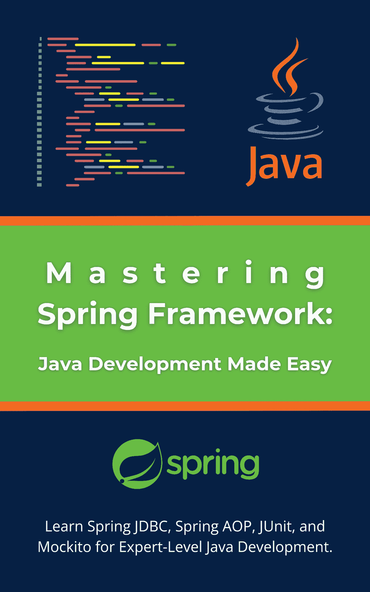

# 精通 Spring 框架：轻松 Java 开发

学习 `Spring JDBC`、`Spring AOP`、`JUnit` 和 `Mockito`，掌握专家级 `Java`



## 结语

来到“精通 Spring 框架：让 Java 开发变得简单”。无论你是想要提升技能的 `Java` 开发者，还是渴望利用 `Spring` 力量的新手，你都选择了正确的指南。

在本书中，我们将开启一场穿越整个 `Spring` 生态系统的全面之旅。我们将从基础开始，确保你拥有坚实的基础。然后，我们将深入构建应用程序的实战世界，探索高级技术，甚至涉足实战项目。

### 为什么选择 Spring？

`Spring` 框架彻底改变了 `Java` 开发。它简化了常见任务，推广了最佳实践，并提供了丰富的工具来构建健壮、可扩展的应用程序。读完本书后，你将理解为什么 `Spring` 是无数 `Java` 专业人士的首选。

### 你将学到什么

以下是你可以从从书中获得的内容预览：

- **Spring 框架基础**：我们将涵盖 `Spring` 的核心概念，从依赖注入和控制反转，到 `Bean` 配置和生命周期管理。
- **实战 Spring Boot**：你将学习 `Spring Boot` 如何增强你的开发流程，使你能够构建 `RESTful API`、管理数据访问并简化测试。
- **高级 Spring 技术**：我们将深入面向切面编程（`AOP`），探索使用 `Spring Security` 保护你的应用程序，并掌握事务以确保数据完整性。
- **实战 Spring 项目**：你将通过使用 `Spring Cloud` 构建微服务架构、将应用程序部署到生产环境，甚至将 `Spring` 与机器学习相结合来获得实践经验。
- **最佳实践及其他**：我们将分享性能调优、故障排除和设计优雅 `Spring` 应用的技巧。我们还将为你参加 `Spring` 认证做准备，并讨论这一令人兴奋的框架的未来。

### 本书适合人群

本书为广泛的读者设计：

- **Java 开发者**：如果你已经熟悉 `Java` 但对 `Spring` 还不了解，这本书将是你的全面指南。
- **学生和学者**：即使 `Java` 经验有限，你也会发现这本书易于理解且易于遵循。
- **丰富的 Spring 用户**：如果你想加深知识并探索高级主题，你将在这里发现有价值的见解。

### 如何使用本书

你可以从头到尾阅读这本书，也可以跳转到你感兴趣特定章节。每一章都建立在之前章节的基础上，但我们也方便你在需要时引用概念。不要犹豫对代码示例进行实验，并将其应用于你自己的项目中。

### 让我们开始吧！

你准备好精通 `Spring` 框架并将你的 `Java` 开发技能提升到新的高度了吗？让我们开始构建出色的应用程序吧！

## A 部分：Spring 框架基础

# Spring 框架简介

## 提纲

- 什么是 Spring？
- 为什么选择 Spring？
- Spring 生态系统
- Spring 模块与项目
- Spring 的核心原理
- 本总结

---

## 什么是 Spring？

`Spring` 框架是一个强大且多功能的框架，它改变了 `Java` 应用程序的构建方式。`Spring` 的核心设计是通过提供一套全面的工具、库和基础设施支持，来简化和优化 `Java` 应用程序的开发。

`Spring` 的核心优势之一是它的模块化。它不是一个单体框架，而是一组可以独立使用或组合使用的模块。这意味着开发者可以根据特定的项目（无论是简单的 Web 应用程序还是复杂的企业级系统）选择他们所需的组件。

使用 `Spring` 框架的一些主要优势包括：

- **简化开发**：`Spring` 减少了开发者需要编写的样板代码，让他们能够专注于应用程序的业务逻辑。
- **提高生产力**：通过提供丰富的预构建组件和工具，`Spring` 帮助开发者更快、更高效地构建应用程序。
- **提高可测试性**：`Spring` 的模块化设计和对依赖注入的强调使其更容易编写单元测试和集成测试，确保应用程序的健壮和可靠。
- **增强可维护性**：`Spring` 对松耦合和关注点分离强调使得应用程序随着时间的推移更容易维护和演进。

总之，`Spring` 框架是一个强大且灵活的工具，已成为 `Java` 生态系统中不可或缺的一部分。无论你是构建简单的 Web 应用程序还是复杂的企业级系统，`Spring` 都能帮你简化开发、提高生产力并提高代码质量。

## 为什么选择 Spring？

传统的 `Java` 开发往往面临阻碍开发进程并影响应用质量的挑战。`Spring` 框架的设计旨在直接解决这些挑战，提供简化开发、提高生产力并增强 `Java` 应用程序整体维护性的解决方案。

### 传统 Java 开发中的挑战

- **依赖管理的复杂性**：在大型应用程序中，管理对象之间的依赖会迅速变成一项复杂且容易出错的任务。手动创建和连接对象会导致紧耦合，使代码难以更改和维护。
- **过多的样板代码**：为常见任务（如数据库访问、事务管理和安全）编写重复代码是一个耗时且枯燥的过程。这些样板代码会污染应用程序并掩盖业务逻辑。
- **组件间的紧耦合**：当对象之间紧耦合时，应用程序某部分的更改会对其他部分产生意外之外的后果。这使得代码变得脆弱，难以重构或扩展。

### Spring 如何解决这些挑战

- **依赖注入 (`DI`)**：`Spring` 的 `DI` 机制反转了对象创建和管理的控制。组件不再直接创建对象，而是声明它们的依赖，由 `Spring` 容器负责在运行时注入这些依赖。这促进了松耦合，使代码更加灵活且易于测试。
- **控制反转 (`IoC`)**：`IoC` 与依赖注入 (`DI`) 密切相关。它是一种设计原则，将对象创建和生命周期的控制交给容器（在此例中为 `Spring` 容器）。这减轻了开发者手动管理对象依赖的负担。
- **切面面向编程 (`AOP`)**：`AOP` 允许开发者将跨越关注点（如日志、安全和事务管理）模块化为称为切面（aspects）的独立模块。这些切面可以应用于应用程序的相关部分，而不会污染核心业务逻辑。

### 使用 Spring 的优势

- **简化开发**：通过处理依赖管理、对象创建和常见任务，`Spring` 减少了开发者需要编写的样板代码。这让开发者能够专注于实现应用程序的核心功能。
- **提高生产力**：`Spring` 丰富的工具集和库简化了开发流程。像 `Spring Boot` 这样的功能提供了自动配置和合理的默认值，进一步加速了开发，并缩短了应用程序启动的时间。
- **提高可测试性**：`Spring` 的模块化设计和对依赖注入的支持使得编写单元测试和集成测试变得更容易。组件可以轻松地模拟（mock）或替换为测试替身，从而对应用程序的行为进行彻底测试。
- **增强维护性**：通过促进松耦合和关注点分离，`Spring` 应用程序更具维护性，并且随着时间的推移更容易演。应用程序某部分的变化不太影响其他部分，使得重构和扩展更加容易。
- **庞大活跃的社区**：`Spring` 拥有庞大且充满活力的开发者社区，提供广泛的支持、文档和资源。这意味着需要时可以很容易地找到帮助和指导，确保顺畅高效的开发体验。

## Spring 生态系统

`Spring` 生态系统是一个庞大且全面的项目和工具领域，扩展了核心 `Spring` 框架的能力。它为各种应用程序开发需求提供了解决方案，从构建简单的 Web 应用到创建复杂的企业级系统和微服务架构。

### Spring 生态系统的关键组件

- `Spring Framework`：生态系统的核心，为 `Spring` 应用程序提供基础构建模块。它包含了依赖注入、切面面向编程、数据访问、Web 开发等模块。`Spring Framework` 是所有其他 `Spring` 项目的基础。
- `Spring Boot`：`Spring` 世界的规则改变者，`Spring Boot` 简化了 `Spring` 应用程序的开发和部署。它遵循“约定优于配置”的方法，提供了自动配置、嵌入式服务器和开箱即用的生产功能。`Spring Boot` 使得以极小的努力就能启动 `Spring` 应用程序。
- `Spring Cloud`：随着微服务架构的流行，`Spring Cloud` 提供了一套构建和管理微服务的完整工具。它提供了服务发现、配置管理、负载均衡、熔断等解决方案。`Spring Cloud` 让分布式系统的开发、部署和管理变得更容易。
- `Spring Data`：简化数据访问对于任何应用程序都至关重要。`Spring Data` 提供了一种一致且直观的方式与各种数据存储交互，包括关系型数据库、NoSQL 数据库和大数据存储。它抽象了底层数据访问技术，让开发者能够专注于应用程序的数据模型。
- `Spring Security`：安全性是现代应用程序的首要考虑。`Spring Security` 是一个健壮且可定制的安全框架，保护 `Spring` 应用程序免受各种威胁。它提供了身份验证、授权、攻击防止安全会话管理等功能。
- `Spring Integration`：在企业应用领域，与各种系统和服务集成通常是一项需求。`Spring Integration` 提供了一个构建企业集成解决方案的框架。它支持广泛集成模式和协议，使得不同系统之间的连接和数据交换变得更容易。

`Spring` 生态系统不断演进，定期添加新项目和功能。这为 `Java` 开发者提供了一个充满活力且令人兴奋的环境，为他们提供了构建现代、可扩展和安全的应用程序所需的工具。

## Spring 模块和项目

`Spring Framework` 被组织成一系列模块，每个模块解决应用程序开发的特定领域。这些模块设计为独立使用或组合使用，提供了灵活性，并允许开发者根据项目的特定需求定制框架。

模块可以大致分为以下领域：

- **核心容器 (`Core Container`)**：这包括依赖注入、控制反转和基础应用程序配置的核心模块。
- **数据访问/集成**：此类侧重于促进与数据库、消息系统和其他外部资源交互的模块。
- **Web**：这些模块为构建 Web 应用程序提供支持，包括 `MVC` 框架、`RESTful API` 和 `WebSocket`。
- **AOP 和织入**：该领域处理启用切面面向编程并提供监控和管理应用程序行为工具的模块。
- **测试**：`Spring` 提供了专门为测试 `Spring` 应用程序设计的模块，使得编写单元测试和集成测试变得更容易。

### 关键 Spring 模块

- `Spring Core`：这是 `Spring Framework` 的核心，提供了依赖注入 (`DI`) 和控制反转 (`IoC`) 的基本概念。`DI` 允许对象从外部源（`Spring` 容器）获取依赖，而不是在内部创建它们。`IoC` 指将对象创建和生命周期的控制交给 `Spring` 容器的做法。
- `Spring Context`：该模块基于 `Spring Core` 模块，提供了一种以框架方式访问对象。它支持国际化 (`i18n`)、资源加载、事件传播和透明地创建对象代理等功能。
- `Spring Web`：该模块为面向 Web 的任务提供支持，例如创建 Web 应用程序和 `RESTful API`。它包括多部分文件上传、使用 `Servlet` 监听器初始化 `IoC` 容器以及面向 Web 的应用程序上下文等功能。
- `Spring MVC`：这是 `Spring` 的 Web 框架，为构建 Web 应用程序提供了模型视图控制器（`MVC`）架构。它提供了数据绑定、验证和视图渲染功能。
- `Spring DAO`：该模块通过对不同的数据访问技术（如 `JDBC` 和 `Hibernate`）提供一致的抽象层来简化数据访问。它处理常见的数据访问任务，如异常翻译和资源管理。
- `Spring ORM`：该模块与流行的对象关系映射（`ORM`）框架（如 `Hibernate` 和 `JPA`）集成，使得在 `Spring` 应用程序中处理数据库变得更容易。
- `Spring AOP`：该模块提供对切面面向编程 (`AOP`) 支持支持允许将日志、事务管理和安全等跨越关注点模块化。`AOP` 允许你以声明的方式将这些关注点应用于代码，而不会污染业务逻辑。

通过理解不同的 `Spring` 模块以及它们之间的关系，你可以充分利用 `Spring` 框架的强大功能，构建健壮、可扩展且易于维护的 `Java` 应用程序。

`Spring` 框架构建在几个核心原则之上，这些原则指导着它的设计和哲学。这些原则有助于框架的灵活性、模块化和易用性。理解这些原则对于有效利用 `Spring` 的强大至关重要。

### 依赖注入 (`DI`)

依赖注入是一种促进组件之间松散耦合的设计模式。在传统的 `Java` 开发中，对象通常在代码中直接创建它们的依赖项。这会导致紧耦合，使得代码难以更改或测试。

通过依赖注入，对象通过接口或构造函数声明它们的依赖项，并由外部容器（`Spring` 容器）负责在运行时注入这些依赖。这意味着对象不再需要知道如何创建或管理它们的依赖，从而产生更具灵活性且易于测试的代码。

### 控制反转 (`IoC`)

控制反转是一个与依赖注入紧密相关的原则。它指的是将对象创建和生命周期管理的控制权委托给容器的做法。在 `Spring` 中，容器负责创建对象、将它们连接在一起并管理它们的生命周期。

这种控制反转通过通过消除手动创建和管理对象的需求，简化了应用程序代码。它还促进了松耦合，因为对象不再负责创建它们的依赖项。

### 面向切面编程 (`AOP`)

面向切面编程 (`AOP`) 是一种编程范式，允许开发者对跨切关注点进行模块化。跨切关注点是影响多个组件程序的方面，例如日志、安全和事务管理。

在传统的编程中，这些关注点散落在代码中，使其难以管理和维护。`AOP` 通过提供一种将这些关注点封装到这些可重用模块（称为切面）的方法解决了这个问题。这些切面随后可以应用到应用程序的相关部分，而不会干扰核心业务逻辑。

### 可移植的服务抽象

`Spring` 为事务、安全和消息等常用服务提供了一系列可移植的服务抽象。这些抽象允许应用程序轻松地移植到不同的环境中，而不需要进行重大的代码更改。

例如，`Spring` 事务抽象提供了一种一致的方法来跨不同的事务管理器（如 `JDBC` 和 `JTA`）。这意味着使用 `Spring` 事务的应用程序可以轻松部署到不同的环境，而无需修改事务管理代码。

通过遵循这些核心原则，`Spring` 框架为构建 `Java` 应用程序提供了一个强大且灵活的平台。它使开发者能够编写更整洁、更易维护的代码，更容易测试并适应不断变化的需求。

## 本章总结

在本章中，我们介绍了 `Spring` 框架，探索了它的目的、优势以及它在传统 `Java` 开发中解决的问题。我们深入研究了巨大的 `Spring` 生态系统，突出了 `Spring Boot`、`Spring Cloud`、`Spring Data`、`Spring Security` 和 `Spring Integration` 等关键组件。我们随后探索了 `Spring` 框架的模块化结构，检查了 `Spring Core`、`Spring Context`、`Spring Web`、`Spring MVC`、`Spring DAO`、`Spring ORM` 和 `Spring AOP` 等关键模块。最后，我们讨论了支撑 `Spring` 框架的核心原则：依赖注入、控制反转、面向切面编程和可移植的服务抽象。

本章为你掌握 `Spring` 框架之旅奠定了基础。在下一章中，我们将深入研究 `Spring Core` 概念，更详细探索依赖注入、`Bean` 配置和应用程序上下文的基础。

# Spring 核心概念

## 提纲

- 依赖注入 (`DI`)
- 控制反转 (`IoC`)
- 应用程序上下文 (`Application Context`)
- `Beans`
- `Bean` 生命周期
- 本章总结

---

## 依赖注入 (`DI`)

依赖注入 (`DI`) 是 `Spring` 框架的基石，是一种强大的设计模式，促进了松散耦合并简化了对象之间依赖的管理。本质上，`DI` 将创建和提供依赖项的责任从对象本身转移到外部容器（在此例为 `Spring` 容器）。

### DI 如何工作

对象不是直接创建其依赖项的实例，而是声明它需要什么。`Spring` 容器会在对象创建时将这些依赖项注入对象中。这种方法带来了许多优势：

- **松耦合**：对象与其依赖项的特定实现没有绑定，使得代码更灵活且更容易更改。
- **提高可测试性**：在测试期间，可以将依赖项轻松替换为 mock 对象，从而隔离被测试的组件。
- **增强可维护性**：由于对象之间的关系被清晰定义，代码变得更加模块化且于理解。

### 依赖注入的类型

`Spring` 支持三种主要的 `DI` 类型：

1. **基于构造函数的 DI**：依赖项通过类的构造函数提供。这被认为是最稳健的方法，因为它确保了在创建对象之前满足了所有强制性依赖。

```java
@Component
public class BillingService {
    private final PaymentGateway paymentGateway;
    public BillingService(PaymentGateway paymentGateway) {
        this.paymentGateway = paymentGateway;
    }
    // ...
}
```

2. **基于 setter 的 DI**：依赖项通过 setter 方法注入。这提供了更大的灵活性，允许可选的依赖项并在对象创建后重新配置依赖项。

```java
@Component
public class CustomerService {
    private EmailService emailService;
    @Autowired
    public void setEmailService(EmailService emailService) {
        this.emailService = emailService;
    }
    // ...
}
```

3. **基于字段的 DI**：使用 `@Autowired` 注解直接将依赖项注入字段中。这种方法很方便，但会导致紧耦合并使测试变得困难。

```java
@Component
public class OrderService {
    @Autowired
    private InventoryService inventoryService;
    // ...
}
```

### 使用注解进行依赖注入


Spring 支持使用 `@Autowired` 和 `@Inject` 等注解来简化依赖声明。这些注解指示 Spring 容器自动查找并注入合适的依赖项。

- `@Autowired`：这是 Spring 特有的注解，可以使用在字段、构造函数和 setter 方法上。
- `@Inject`：这是标准的 Java EE 注解，可以作为 `@Autowired` 的替代。

通过利用依赖注入和这些强大的注解，你可以创建更灵活、可测试且易维护的 Spring 应用程序。

## 控制反转（IoC）

控制反转（IoC）是软件设计中的一个基本原则，它是 Spring 框架及其依赖注入机制的基础。其核心是，IoC 反转了对象创建和管理的传统控制流。对象不再直接控制其依赖的实例化和生命周期，而是由外部容器（如 Spring IoC 容器）承担这一责任。

### IoC 如何工作

在传统方法中，对象会在内部创建并管理它们的依赖项。这通常会导致紧耦合，并使测试和维护困难。在 IoC 中，控制被反转了：

1. **对象声明依赖项**：对象通过接口或构造函数表达对依赖项的需求。
2. **容器管理依赖**：`IoC container`（`Spring container`）负责创建必要的依赖并将它们注入到需要它们的对象中。
3. **生命周期管理**：容器还管理对象的生命周期，包括它们的创建、配置和销毁。

### Spring IoC 容器

Spring IoC 容器是 Spring 框架的核心，负责管理应用程序中的 bean（对象）。它提供了一个中心化的位置来定义和配置 bean 及其依赖和关系。容器还处理 bean 的实例化、接线和生命周期管理。

### 反转控制（IoC）的益处

IoC 为软件开发带来了许多益处：

- **松耦合**：对象不再紧密绑定到依赖的特定实现。这使得代码更加灵活且更容易更改，因为在不修改依赖对象的情况下就可以交换依赖。
- **提高可测试性**：通过容器注入依赖，在测试期间更容易将其替换为 mock 对象（模拟对象），从而对被测试代码进行更好的隔离。
- **简化配置**：IoC 容器为配置 bean 及其依赖提供了一个中心化的机制，使得配置的管理和维护变得更加容易。
- **增强可维护性**：对象与其依赖之间清晰的职责分离使得代码更具模块化且易于理解。

反转控制是一个强大的概念，它彻底改变我们构建软件的方式。通过将对象的创建和管理委托给容器，开发者可以专注于应用程序的核心业务逻辑，从而产生更具维护性、可测试性和灵活性的代码。

## Application Context（应用上下文）

`Application Context` 是 Spring 框架中的一个核心接口，作为应用程序中 bean（对象）的中心注册表和工厂。它负责管理 bean 的整个生命周期，从创建、配置到接线和销毁。你可以将其想象为 Spring 应用程序的大脑，协调不同组件之间的交互。

### Application Context 的角色

1. **Bean 管理**：`Application Context` 根据你的配置创建并管理 bean。它处理依赖注入，确保 bean 接收到所需的依赖。
2. **配置管理**：它加载并管理配置元数据，这些可以通过 XML、注解或 Java 配置等多种格式提供。
3. **资源管理**：`Application Context` 提供对环境变量、属性文件和消息源等资源的访问。这允许你的应用程序将配置外部化并轻松适应不同的环境。
4. **事件传播**：它支持事件发布和监听，允许 bean 以松耦合的方式相互通信。

### Application Context 的类型

Spring 提供了 `Application Context` 接口的不同实现，每种适用于特定的场景：

1. **ClassPathXmlApplicationContext**：该实现从位于类路径（classpath）上的 XML 配置文件加载 bean 定义。对于偏于使用 XML 配置的项目是一个良好选择。

```java
ApplicationContext context = new ClassPathXmlApplicationContext("applicationContext.xml");
```

2. **FileSystemXmlApplicationContext**：与 `ClassPathXmlApplicationContext` 类似，但从位于文件系统中的 XML 文件加载 bean 定义。

```java
ApplicationContext context = new FileSystemXmlApplicationContext("path/to/applicationContext.xml");
```

3. **AnnotationConfigApplicationContext**：该实现从标记了 `@Configuration` 注解的 Java 类加载 bean 定义。非常适合偏于基于 Java 配置并利用 Spring 注解驱动特性的项目。

```java
ApplicationContext context = new AnnotationConfigApplicationContext(AppConfig.class);
```

4. **WebApplicationContext**：这是用于 Web 应用程序特殊的 Application Context。它提供了额外的功能，如与 `ServletContext` 集成以及处理 Web 特定事件的能力。

### 选择合适的 Application Context

Application Context 实现的选择取决于你的项目需求和偏好。

- **XML 配置**：如果你偏好声明式方法并希望将配置与代码分离，使用 `ClassPathXmlApplicationContext` 或 `FileSystemXmlApplicationContext`。
- **Java 配置**：如果你偏好程序化方法并希望利用注解和基于 Java 的配置，使用 `AnnotationConfigApplicationContext`。
- **Web 应用程序**：对于 Web 应用程序，`WebApplicationContext` 是最合适的选择。

`Application Context` 是 Spring 框架中的基础概念。通过理解它的作用和提供的各种实现，你可以有效地配置和管理你的 Spring 应用程序。

## Beans

在 Spring 框架中，bean 是应用程序的基本构建模块。它们代表由 Spring 管理并接线在一起的对象，构成了应用程序功能的骨干。这些 bean 根据你的配置元数据，由 Spring IoC 容器进行实例化、配置和组装。

### 定义和配置 Bean

Spring 提供了两种定义和配置 bean 的主要方式：

1. **基于 XML 的配置**：这种传统方法在 XML 配置文件中定义 bean。每个 bean 都由一个 `<bean>` 元素表示，指定它的类、属性和依赖。

```xml
<bean id="customerService" class="com.example.CustomerServiceImpl">
    <property name="repository" ref="customerRepository" />
</bean>

<bean id="customerRepository" class="com.example.CustomerRepositoryImpl" />
```

2. **基于注解的配置**：这种现代方法利用 `@Component`、`@Service`、`@Repository` 和 `@Controller` 等注解将类标记为 Spring bean。Spring 扫描代码库以寻找这些注解并自动将标记的类注册为 bean。

```java
@Service
public class CustomerServiceImpl implements CustomerService {
    @Autowired
    private CustomerRepository customerRepository;
    // ...
}

@Repository
public class CustomerRepositoryImpl implements CustomerRepository {
    // ...
}
```

### Bean 的属性

Spring 中的每个 bean 都有几个属性定义了它的行为以及与其他 bean 的关系：

- **Class（类）**：bean 的完全类名。
- **Name/ID**：bean 在容器内的唯一标识符。
- **Scope（作用域）**：bean 的生命周期（单例、原型、请求等）。
- **Constructor Arguments/Properties（构造器参数/属性）**：传递给 bean 构造函数或设置为属性的值。
- **Dependencies（依赖）**：bean 依赖的其他 bean。
- **Initialization and Destruction Methods（初始化和销毁方法）**：在 bean 创建或销毁时调用的方法。

### Bean Scope（作用域）

Spring bean 可以具有不同的作用域，这决定了它们的生命周期以及创建多少个实例：

- **Singleton（单例，默认）**：每个容器只有一个 bean 实例。
- **Prototype（原型）**：每次请求 bean 时都会创建一个实例。
- **Request（请求）**：每个 HTTP 请求创建一个实例。
- **Session（会话）**：每个 HTTP 会话创建一个实例。
- **Global Session（全局会话）**：每个全局 HTTP 会话创建一个实例。

### 示例：定义一个 Bean

```java
@Component
public class ProductService {
    private ProductRepository productRepository;

    @Autowired
    public ProductService(ProductRepository productRepository) {
        this.productRepository = productRepository;
    }
    // ...
}
```

在这个示例中，`ProductService` 是一个依赖于 `ProductRepository` 的 Spring bean。`@Autowired` 注解告诉 Spring 将 `ProductRepository` 的实例注入到 `ProductService` bean 中。

通过理解 bean 及其配置，你将获得有效构建和管理 Spring 应用程序组件的能力。这对于构建可维护、可扩展且高效的应用程序至关重要。

## Bean 的生命周期（Bean Lifecycle）

Spring 框架中 bean 的生命周期是一个定义良好的过程，涵盖了从创建到最终销毁的多个阶段。理解这一生命周期对于在应用程序中有效管理 bean 并自定义定制其行为至关重要。

### Bean 生命周期的各个阶段

1. **实例化（Instantiation）**：Spring 容器创建 bean 类的一个新实例。
2. **属性填充（Populate Properties）**：容器根据你的配置为 bean 的属性填充值。
3. **设置 Bean 名称（Set Bean Name）**：如果 bean 实现了 `BeanNameAware` 接口，容器会调用 `setBeanName()` 为 bean 提供其 ID。
4. **设置 Bean 工厂（Set Bean Factory）**：如果 bean 实现了 `BeanFactoryAware` 接口，容器会调用 `setBeanFactory()` 为 bean 提供创建它的工厂的引用。
5. **初始化前（Pre-Initialization / BeanPostProcessor）**：容器应用任何注册到其的 `BeanPostProcessors`。这些处理器可以在 bean 初始化之前对其进行修改。
6. **初始化（Initialization）**：如果 bean 实现了 `InitializingBean` 接口，容器会调用 `afterPropertiesSet()`。或者，你也可以在配置中指定一个初始化方法。
7. **初始化后（Post-Initialization / BeanPostProcessor）**：容器再次应用任何 `BeanPostProcessors`，允许它们在 bean 初始化后对其进行修改。
8. **准备就绪（Ready for Use）**：现在 bean 已经完全初始化，可以供你的应用程序使用了。
9. **销毁（Destruction / PreDestroy）**：当容器关闭或 bean 不再需要时，如果 bean 实现了 `DisposableBean` 接口，容器会调用 `destroy()` 方法。或者，你可以在配置中指定一个销毁方法。

### Bean 生命周期方法

- `init()`：该方法在 bean 属性设置之后、可以使用之前被调用。它通常用于初始化任务，如打开连接或加载资源。
- `destroy()`：该方法在 bean 从容器中移除时被调用。它用于清理任务，如关闭连接或释放资源。

你可以在 bean 配置中使用 `init-method` 和 `destroy-method` 属性指定这些方法，或者通过实现 `InitializingBean` 和 `DisposableBean` 接口来指定。

### BeanPostProcessors

BeanPostProcessors 是特殊的 bean，允许你自定义 bean 的生命周期。它们在 bean 初始化方法之前和之后被调用，提供了修改 bean 或执行额外操作的机会。

### BeanFactoryPostProcessors

BeanFactoryPostProcessors 与 `BeanPostProcessors` 类似，但它们作用于 bean 定义（bean definitions）而不是 bean 实例。它们在任何 bean 实例化之前被调用，允许你修改 bean 定义或注册新 bean。

理解 bean 生命周期并利用可用的生命周期方法和处理器，可以让你对 bean 在 Spring 容器中的创建、配置和管理进行精粒度的控制。

## 章节总结

在本章中，我们深入探讨了 Spring 框架的核心概念，探索了构建 Spring 应用程序的基础。我们研究了依赖注入（DI）和控制反转（IoC）的原理，理解了它们如何促进应用程序的松耦合、可测试性和可维护性。

我们还探索了应用程序上下文（Application Context）的概念，它是 Spring 容器的核心，管理 bean 的生命周期并提供对基本资源的访问。我们学习了不同类型的 Application Context 以及如何根据需求选择合适的一个。

此外，我们还讨论了 bean（Spring 应用程序的构建块）以及它们的各种属性，如范围（scope）和生命周期。我们探索了通过 XML 和注解定义及配置 bean 的不同方法。

最后，我们检查了从实例化到销毁的 bean 生命周期，以及你如何如何使用生命周期方法以及如 `BeanPostProcessors` 和 `BeanFactoryPostProcessors` 等强大工具对其进行自定义。

掌握了这些 Spring 核心概念的知识后，你已经准备好应对后续更高级的话题。在下一章中，我们将引导你搭建开发环境，确保你拥有必要的工具和配置，以便轻松开始构建 Spring 应用程序。

## 设置你的开发环境

### 提纲

- 选择你的 IDE
- 安装 Java 开发包（JDK）
- 安装构建工具（Maven/Gradle）
- 设置 Spring Boot 项目
- 章节总结

### 选择你的 IDE

选择合适的集成开发环境（IDE）对于获得高效且愉快的 Spring 框架开发体验至关重要。一个良好的 IDE 可以通过智能代码补全、重构工具、调试功能以及与构建工具和框架的无缝集成，显著提高你的生产力。

### 用于 Spring 开发流行的 IDE

1. **IntelliJ IDEA（Ultimate Edition）**：以其卓越的代码智能和丰富的功能集而闻名，IntelliJ IDEA Ultimate 提供了全面的 Spring 支持。它提供了专为 Spring 项目定制的智能代码补全、导航和重构工具。其内置的 Spring Boot 工具简化了开发和部署。IntelliJ IDEA Ultimate 对于重视其丰富功能集和生产力提升的资深开发者来说是一个强大的选择。
2. **Spring Tool Suite（STS）**：STS 基于 Eclipse 构建，专为 Spring 开发而设计。它预配置了 Spring 相关的工具和插件，让你能够轻松开始 Spring 项目。STS 提供了熟悉的 Eclipse 界面以及广泛的扩展，以定制你的开发环境。对于已经熟悉 Eclipse 并偏好专注于 Spring 的专用 IDE 的开发者来说，这是一个很好的选择。
3. **Eclipse**：作为一种广泛使用且高度可扩展的 IDE，Eclipse 为 Java 开发提供了一个健壮的平台。虽然它没有没有带 Spring 特有功能，但你可以轻松安装 Spring Tools 4 插件，它在 Eclipse 中提供了优秀的 Spring 支持。对于重视灵活性、自定义选项和庞大生态系统的开发者来说，Eclipse 是一个很好的选择。

### 建议

- **初学者**：如果你是 Spring 和 Java 开发的新手，Spring Tool Suite（STS）是一个极佳的起点。它提供了一个预配置了 Spring 支持的用户友好环境，让你专注于学习框架，而无需担心复杂的配置。


- **中级开发者**：对于具有 Java 和 Spring 经验的开发者，`IntelliJ IDEA Community Edition` 是很好的选择。它提供了强大的代码编辑和重构功能，以及基础的 Spring 支持。如果你愿意付费订阅，`IntelliJ IDEA Ultimate` 提供了更高级的 Spring 特有功能。

- **资深开发者**：`IntelliJ IDEA Ultimate` 是资深 Spring 开发者的首选。它全面的 Spring 支持、高级功能和生产力提升可以显著提高你的效率并简化开发工作流。

### 做出你的选择

最终，最适合你的 IDE 取决于个人喜好、经验水平和项目需求。考虑以下因素：

- 特性：评估每个 IDE 提供的功能，选择一个符合你需求和工作流的。

- 易用性：如果你是初学者，请优先考虑易于学习和使用的 IDE。

- 定制化：如果你重视灵活性和自定义，请考虑具有庞大插件和扩展生态系统的 IDE。

- 成本：某些 IDE（如 `IntelliJ IDEA Ultimate`）需要付费订阅。在做决定时请考虑你的预算。

尝试不同的 IDE，看看哪一个让你感到最舒适且产率最高。正确的 IDE 可以为你的 Spring 开发之旅产生重大影响。

### 安装 Java 开发工具包（JDK）

Java 开发工具包（`JDK`）是 Spring 开发的基础，它提供了编译和运行 Java 应用程序所需的各种工具和库。它包含了执行 Java 程序所需的 Java 运行环境（`JRE`），以及额外的工具，如 Java 编译器（`javac`）和 Java 调试器（`jdb`）。

### 为什么 JDK 对 Spring 开发至关重要

Spring 应用程序是用 Java 编写的，而 `JDK` 负责将你的 Java 源代码转换为由 Java 虚拟机（`JVM`）执行的字节码。`JDK` 还包含 Spring 依赖的核心库，例如核心 Java 库和 Spring 框架自身的库。

### 安装最新的 LTS JDK

为了确保流畅的开发体验，建议安装最新的长期支持（LTS）版本的 `JDK`。LTS 版本可以获得长时间的更新和安全补丁，为你的 Spring 项目提供稳定性和可靠。

### 步骤说明

1. 下载 JDK：前往 Oracle JDK 下载页面（[`www.oracle.com/java/technologies/javase-downloads.html`](https://www.oracle.com/java/technologies/javase-downloads.html)）或你偏好的供应商网站。选择适用于你操作系统（Windows、macOS 或 Linux）的 `JDK` 安装程序。

2. 运行程序：双击下载的安装文件并按照屏幕提示操作。安装程序将引导你完成安装过程，要求你选择安装位置和其他选项。

3. 设置环境变量（可选）：虽然不是严格必须，但设置 `JAVA_HOME` 环境变量对某些工具和应用程序很有帮助。要设置 `JAVA_HOME`，请遵循以下步骤：

**Windows：**

- 右键点击“此电脑”并选择“属性”。
- 点击“高级系统设置”。
- 点击“环境变量”。
- 在“系统变量”下，点击“新建”。
- 对于“变量名”，输入 `JAVA_HOME`。
- 对于“变量值”，输入你的 JDK 安装目录路径（例如，`C:\Program Files\Java\jdk-17.0.8`）。
- 点击所有打开窗口上的“确定”。

**macOS/Linux：**

- 打开终端。
- 编辑你的 shell 配置文件（例如，`.bash_profile` 或 `.zshrc`）。
- 添加以下行，并将路径替换为你的 JDK 安装目录：

```bash
export JAVA_HOME=/path/to/your/jdk
```

- 保存文件并运行 `source <your profile file>` 以应用更改。

### 验证 JDK 安装

为了确保 `JDK` 安装正确，打开终端或命令提示符并运行以下命令：

```bash
java -version
```

你应该能看到类似下方的输出：

```text
java version "17.0.8" 2024-01-16 LTS
Java(TM) SE Runtime Environment (build 17.0.8+9-LTS-191)
Java HotSpot(TM) 64-Bit Server VM (build 17.0.8+9-LTS-191, mixed mode, sharing)
```

这表示 Java 已安装且该版本与 Spring 框架兼容。如果你没有看到此输出或遇到任何错误，请双检安装情况并确保 `JAVA_HOME` 环境变量已正确设置（如果适用）。

### 安装构建工具（Maven/Gradle）

构建工具如 `Maven` 和 `Gradle` 在现代 Java 开发中不可或缺，特别是对于 Spring 项目。它们简化了管理项目依赖、编译代码、运行测试以及打包部署应用程序的过程。

### 构建工具的重要性

- 依赖管理：Spring 项目通常依赖于大量的库和框架。构建工具自动化了下载、解析和管理这些依赖的过程，使你免于手动处理这些繁琐任务。
- 一致的构建：构建工具提供了一种标准的构建和打包项目的方法，确保在不同环境和机器上结果的一致性。
- 简化项目设置：它们提供了项目模板和原型，帮助你快速创建具有必要结构和配置的新 Spring 项目。

### 核心概念

#### Maven

- 项目对象模型（POM）：`POM` 是一个 XML 文件（`pom.xml`），描述了你的项目配置，包括依赖、插件、构建设置和其他元数据。
- 仓库：`Maven` 仓库是存储和管理制品（库、框架等）的集中位置。`Maven` 根据你 `POM` 中的信息自动从仓库下载依赖。
- 构建生命周期：`Maven` 的构建过程遵循生命周期，包含 `compile`、`test`、`package`、`install` 和 `deploy` 等阶段。

#### Gradle

- 构建脚本：`Gradle` 使用基于 Groovy 或 Kotlin 的构建脚本（`build.gradle` 或 `build.gradle.kts`）来定义项目任务和配置。这些脚本比 Maven 的 POM 更灵活且具表现力。
- 仓库：`Gradle` 同样使用仓库来管理依赖。
- 构建生命周期：`Gradle` 的生命周期比 Maven 更灵活，允许自定义任务和依赖。

### 安装 Maven/Gradle

1. 下载：前往 Maven 下载页面（[`maven.apache.org/download.cgi`](https://maven.apache.org/download.cgi)）或 Gradle 下载页面（[`gradle.org/releases/`](https://gradle.org/releases/)）下载适用于你操作系统的安装程序。
2. 安装：按照各自网站上的安装说明进行。这通常包括解压下载的并将 `bin` 目录添加到系统的 `PATH` 环境变量中。
3. 验证安装：打开终端或命令提示符并运行以下命令：
   - Maven：`mvn -v`
   - Gradle：`gradle -v`

你应该看到安装工具的版本信息。

### 优缺点

#### Maven

- 优点：广泛采用、成熟、插件生态系统、项目结构标准。
- 缺点：不如 Gradle 灵活、基于 XML 的配置可能繁琐、复杂构建可能缓慢。

#### Gradle

- 优点：构建脚本更灵活且具表现力、大型项目构建性能更快、易于自定义和扩展。
- 缺点：社区比 Maven 小、学习曲线较陡、项目结构不够标准。

### 选择正确的工具

Maven 和 Gradle 之间的选择最终取决于你的偏好项目需求。如果你重视“约定优于配置”并希望使用具有大型社区的成熟工具，`Maven` 是一个很好的选择。如果你需要更多的灵活性和自定义，或者你正在一个构建性能至关重要的大型项目中工作，`Gradle` 可能是更好的选择。

对于初学者，建议从 `Maven` 开始，因为它应用广泛且资源丰富。随着经验的增加，你可以探索 `Gradle` 及其强大的功能。

### 设置 Spring Boot 项目

Spring Boot 通过消除传统 Spring 项目中通常的繁琐配置和设置，彻底改变了创建 Spring 应用程序的方式。它采用了“约定约优于配置”的方法，提供了合理的默认设置和自动配置，使你能够专注于编写应用程序的核心逻辑。

### 使用 Spring Initializr 创建 Spring Boot 项目

Spring Initializr 是一个基于 Web 的工具，也集成在许多 IDE 中，简化了启动新 Spring Boot 项目的流程。以下是使用方法：

1. 访问 Spring Initializr：
   - Web 界面：在浏览器中访问 [`start.spring.io/`](https://start.spring.io/)。
   - IDE 集成：大多数现代 IDE（`IntelliJ IDEA`、`Spring Tool Suite`、`Eclipse`）都内置了对 Spring Initializr 的支持。查找创建新 Spring Boot 项目选项。

2. 项目元数据：
   - 项目（Project）：在 `Maven` 或 `Gradle` 构建工具之间。
   - 语言（Language）：选择 `Java`。
   - Spring Boot 版本：选择稳定版本（例如 `3.1.x`）。
   - 项目元数据（Project Metadata）：填写项目的 `Group`、`Artifact`、`Name`、`Description`、`Package Name` 和 `Packaging`（`JAR`）。
   - Java 版本：选择你安装的 Java 版本（例如 `17`）。

3. 依赖（Dependencies）：
   - 在“Dependencies”部分，搜索并添加你需要的依赖。Web 应用常用的依赖包括：
   - `Spring Web`：提供构建 Web 应用的支持，包括 `RESTful APIs`。
   - `Spring Data JPA`：使用 `JPA`（`Java Persistence API`）简化数据库访问。
   - `Spring Security`：添加身份验证和授权安全特性。
   - `Thymeleaf`（可选）：用于创建动态网页的模板引擎。

4. 生成项目：

点击“Generate”按钮。这将下载一个包含你新 Spring Boot 项目的 ZIP 文件。

5. 导入 IDE：
   - `IntelliJ IDEA`：`File -> New -> Project from Existing Sources -> 选择解压后的文件夹。`
   - `Spring Tool Suite`：`File -> Import -> Maven -> Existing Maven Projects -> 选择解压后的文件夹。`
   - `Eclipse`：`File -> Import -> Maven -> Existing Maven Projects -> 选择解压后的文件夹。`

### 项目结构

一个典型的 Spring Boot 项目具有以下结构：

- `pom.xml`（或 `build.gradle`）：项目的构建配置文件，列出了依赖、插件和其他设置。
- `src/main/java`：包含你的 Java 源代码，以带有 `@SpringBootApplication` 注解的主应用程序类开始。
- `src/main/resources`：包含配置文件（例如 `application.properties` 或 `application.yml`）、静态资源（例如图像、`CSS`、`JavaScript`）和模板（如果使用 `Thymeleaf`）。
- `src/test/java`：包含你的单元测试和集成测试。

### 关键文件和目录

- `Application.java`（或类似文件）：启动 Spring Boot 应用程序的主类。
- `application.properties`（或 `application.yml`）：应用程序的主要配置文件。
- `static`（可选）：存储静态 Web 资源，如 `CSS`、`JavaScript` 和图像。
- `templates`（可选）：存储用于渲染动态网页的 `Thymeleaf` 模板。

配置好 Spring Boot 项目，你就可以开始开发应用程序了。Spring Boot 的自动配置和合理的默认设置将处理大部分样板代码配置，让你能够专注于编写重要的代码。

### 章节总结

在本章中，我们探索了设置 Spring Framework 开发环境的关键步骤。我们讨论了选择合适 IDE 的重要性，重点强调了 `IntelliJ IDEA`、`Spring Tool Suite` 和 `Eclipse` 等流行选项，并根据你的经验水平提供了建议。然后，我们引导你完成了安装 Java 开发包（`JDK`）的过程，确保其与 Spring Framework 兼容。

我们还讨论了 `Maven` 和 `Gradle` 等构建工具在管理依赖和简化构建过程中的重要性，解释了它们的核心概念并帮助你根据需求选择正确的工具。最后，我们引入了 `Spring Initializr`，这是一个能够用极少配置快速创建 Spring Boot 项目的强大工具，并探索了 Spring Boot 项目的基本结构。

开发环境准备就后，你现在已经准备好进入精彩的 Spring 开发世界了。在下一章中，我们将探索 Bean 配置的基础，揭示如何定义、管理和组织 Spring 应用程序的组件。

### Bean 配置

#### 大纲

- 什么是 Bean 配置？
- XML 配置
- 基于注解的配置
- Java 配置
- 自动装配（Autowiring）
- 属性值和占位符
- 配置（Profiles）
- 章节总结

---

### 什么是 Bean 配置？

Bean 配置位于 Spring Framework 的核心，作为定义应用程序结构和行为的蓝图。本质上，它是指示 Spring 容器如何创建、组装和管理组成应用程序的对象（或“Beans”）的过程。

把它想象成应用程序的食谱。就像食谱规定了制作菜品的原料和步骤一样，Bean 配置定义了组件（Beans）及其相互作用，以构建你的 Spring 应用程序。

### Bean 配置的重要性

Bean 配置不仅仅是一个技术细节；它是一个让你对应用程序架构进行细控制的强大工具。原因如下：

- 对象生命周期管理：Bean 配置决定了 Bean 如何实例化、初始化并最终销毁。你可以自定义此生命周期，在每个阶段执行特定操作，例如在初始化期间获取资源或在销毁期间释放它们。
- 依赖管理：Bean 通常依赖其他 Bean 才能运行。Bean 配置指定了这些依赖，允许 Spring 自动将它们连接在一起，确保顺利协作。
- 模块化和可重用性：通过定义 Bean 及其依赖，你创建了模块化组件，这些组件可以在应用程序的不同部分甚至在其他项目中被重用。
- 配置灵活性：Spring 支持多种配置 Bean 的方式，包括 XML、注解和 Java 代码。这种灵活性允许你选择最适合你项目风格和要求的方法。
- 外部化配置：你可以将配置属性外部化（例如数据库连接详情或特定环境设置），使你的应用程序更具适应性，并更容易在不同的环境中部署。

结论，Bean 配置是 Spring 开发的骨干。它赋予了你定义应用程序内部组件结构、行为和关系的能力。精通 Bean 配置对于构建健壮、可维护且可的 Spring 系统至关重要。

### XML 配置

基于 XML 的配置是 Spring Framework 中定义 Bean 的一种经典且广泛使用的方法。它提供了一种声明式的方法来指定应用程序的结构，将配置与 Java 代码分离。

### 配置文件的结构

```xml
<?xml version="1.0" encoding="UTF-8"?>
<beans xmlns="http://www.springframework.org/schema/beans"
       xmlns:xsi="http://www.w3.org/2001/XMLSchema-instance"
       xsi:schemaLocation="http://www.springframework.org/schema/beans
       https://www.springframework.org/schema/beans/spring-beans.xsd">

</beans>
```

- `<beans>`：配置文件的根元素。
- 命名空间：`xmlns` 属性定义了配置中使用的 XML 命名空间。`xsi:schemaLocation` 属性指定了 `beans` 命名空间的 XML Schema 定义（XSD）文件位置。

### 使用 `<bean>` 定义 Bean

应用程序中的每个 bean 由 `<beans>` 根元素内的 `<bean>` 元素表示。`<bean>` 元素最重要的两个属性是：

- `id`：bean 在 Spring 容器中的唯一标识符。
- `class`：bean 的全限定类名。

示例：简单 Bean

```xml
<bean id="customerService" class="com.example.CustomerServiceImpl" />
```

这定义了一个类型为 `com.example.CustomerServiceImpl` 名为 `customerService` 的 bean。

### 设置属性和注入依赖

你可以使用 `<property>` 和 `<constructor-arg>` 标签设置 bean 属性并注入依赖。

示例：设置属性


```xml
<bean id="customerService" class="com.example.CustomerServiceImpl">
    <property name="repository" ref="customerRepository" />
</bean>
```

这将 `customerService` bean 的 `repository` 属性设置为另一个名为 `customerRepository` 的 bean 的引用。

### 示例：构造函数注入

```xml
<bean id="customerService" class="com.example.CustomerServiceImpl">
    <constructor-arg ref="customerRepository" />
</bean>
```

这将 `customerRepository` bean 作为构造函数参数注入到 `customerService` bean 中。

### Bean 配置

XML 配置还可以处理更复杂的场景，例如嵌套 bean、集合和继承。

#### 示例：嵌套 bean

```xml
<bean id="customer" class="com.example.Customer">
    <property name="address">
        <bean class="com.example.Address">
            <property name="street" value="123 Main St" />
            <property name="city" value="Anytown" />
        </bean>
    </property>
</bean>
```

### XML 配置的优缺点

优点：

- 关注点分离：配置与代码分离。
- 声明式风格：易于阅读和理解。
- 灵活：支持复杂的配置。

缺点：

- 冗长性：对于大型项目，配置可能会变得非常长。
- 类型安全性较低：重构容易出错。
- 不如基于注解或 Java 配置那样现代。

## 基于注解的配置

基于注解的配置是 Spring Framework 中定义 bean 的一种现代且高效的方法。它利用 Java 注解将类标记为 Spring bean，消除了对冗长 XML 配置文件的需求。这种方法使得代码更简洁，更易阅读和维护。

### Bean 定义的关键注解

- `@Component`：用于任何 Spring 管理组件的通用类型注解。
- `@Service`：表示提供服务的类，例如业务逻辑或验证。
- `@Repository`：表示提供数据访问的类，通常与数据库或其他数据源交互。
- `@Controller`：表示处理 Web 请求的类，通常位于 Spring MVC 应用程序中。

通过在类上添加这些类型注解，你指示 Spring 自动检测并将它们注册为应用程序上下文中的 bean。

### 使用 `@Autowired` 进行自动装配

`@Autowired` 注解是依赖注入的强大工具。它告诉 Spring 自动查找并将适当依赖注入到字段、构造函数或 setter 方法中。

```java
@Service
public class CustomerServiceImpl implements CustomerService {
    @Autowired
    private CustomerRepository customerRepository;
    // ...
}
```

在此示例中，`@Autowired` 注解指示 Spring 将 `CustomerRepository` 的实例注入到 `CustomerServiceImpl` 的 `customerRepository` 字段中。

### 基于注解的配置的优势

- 减少模板代码：消除了对冗长 XML 配置的需求，使代码更清洁、简洁。
- 提高可读性：注解直接放置在 Java 代码中，使于理解 bean 之间的关系。
- 类型安全：由于注解是 Java 代码的一部分，编译器可以捕获类型相关的错误。
- 重构支持：重命名或移动类出错概率较低，因为注解会自动更新引用。

### 示例：使用注解定义 Bean

```java
@Component
public class ProductService {
    // ...
}

@Repository
public class ProductRepository {
    // ...
}
```

在此示例中，`ProductService` 和 `ProductRepository` 分别被标记了 `@Component` 和 `@Repository`，因此它们会被自动注册为 Spring bean。

基于注解的配置为在 Spring 中定义 bean 提供了一种强大且优雅的方式，促进了更清洁的代码、更好的可读性和更易维护的性。

## Java 配置

Java 配置为 Spring 应用程序中定义 bean 提供了类型安全且灵活的 XML 替代方案。它利用标记了特殊 Spring 注角的 Java 类和方法，以编程方式创建和配置 bean。

### Java 配置的关键注解

- `@Configuration`：将类标记为 bean 定义的源。
- `@Bean`：注解 `@Configuration` 类中的方法，指示其返回值应被注册为 bean。

### 示例：Java 配置

```java
@Configuration
public class AppConfig {
    @Bean
    public CustomerService customerService() {
        return new CustomerServiceImpl();
    }

    @Bean
    public CustomerRepository customerRepository() {
        return new CustomerRepository();
    }
}
```

在此示例中，`AppConfig` 类被标记为 `@Configuration`，表示它是 bean 定义的源。`customerService()` 和 `customerRepository()` 方法被标记为 `@Bean`，它们的返回值（`CustomerServiceImpl` 和 `CustomerRepository`）被注册为 bean。

### 与 XML 配置的比较

| 特性 | XML 配置 | Java 配置 |
| :--- | :--- | :--- |
| 类型安全 | 否 | 是 |
| 重构支持 | 有限 | 优秀 |
| 灵活性 | 较不灵活 | 更灵活（Java 语言的全功能） |
| 可读性 | 简单良好，复杂冗长 | 复杂良好，可以很简洁 |
| 错误检测 | 可能在运行时发现 | 可以在编译时检测 |

### Java 配置的优势

- 类型安全：由于 bean 定义是用 Java 编写的，编译器可以捕获类型相关的错误，防止它们在运行时出现。
- 重构支持：在 Java 配置中重命名或移动类和方法安全得多，因为 IDE 可以自动更新引用。
- 灵活性：Java 配置提供了 Java 语言的所有功能，允许使用条件逻辑、循环和其他语言结构来动态定义 bean。
- 提高可读性（针对复杂情况）：对于复杂的配置，Java 配置比 XML 更简洁且易于理解。

### 何时使用 Java 配置

对于大型项目或对类型安全和重构支持要求较高的复杂配置，通常倾向于 Java 配置。对于熟悉 Java 并偏好编程方式配置的开发者来说，这也是很好的选择。然而，对于简单的项目或偏好声明式风格的项目，XML 配置仍然是一个有效选择。

## 自动装配

Spring 自动装（Autowiring）是一项强大的功能，它可以简化依赖注入的过程。它允许 Spring 容器自动解析并将依赖注入到你的 Bean 中，而不需要显式配置。这可以显著减少你需要编写的样板代码，使你的代码更加整洁易于维护。

### 自动装模式

Spring 四种不同的自动装模式：

1. `no`（默认）：禁用自动装。你必须在 XML 中使用 `<constructor-arg>` 或 `<property>` 标签或者通过 `@Autowired` 注解来显式定义依赖。
2. `byType`：Spring 尝试在容器中寻找与要注入属性类型匹配的 Bean。如果好有一个匹配的 Bean，则进行注入。如果有多个匹配项或没有匹配，则会发生错误。
3. `byName`：Spring 尝试在容器中寻找名称（或 ID）与要注入属性名称匹配的 Bean。这要求 Bean 名称和属性名称保持一致。
4. `constructor`：与 `byType` 类似，但应用于构造函数参数。Spring 尝试在容器中寻找与构造函数参数类型匹配的 Bean。这通常被认为是最健壮的方法，因为它确保了所有强制依赖都得到满足。

### 自动装模式的优缺点

| 模式 | 优点 | 缺点 | 使用场景 |
| :--- | :--- | :--- | :--- |
| `no` | 对依赖有显式控制，无意外。 | 配置较繁琐，需要更多手动工作。 | 当你对依赖有完全控制权时。 |
| `byType` | 简单情况下，配置较少。 | 如果存在相同类型的多个 Bean，会导致歧义。 | 当每个类型只有一个 Bean 时。 |
| `byName` | 对于遗留代码或特定的命名规范可能有用。 | 如果 Bean 名称发生变化则很脆弱，不如 `byType` 直观。 | 在现代 Spring 开发中很少使用。 |
| `constructor` | 确保所有强制依赖都得到满足，健壮。 | 对于具有许多构造函数参数的类可能会很。 | 大多数场景的首选。 |

### 启用和配置自动装

#### 基于注解的配置

要使用注解启用自动装，可以在需要注入依赖的字段、构造函数或 setter 方法上添加 `@Autowired` 注解。

```java
@Service
public class CustomerService {
    @Autowired
    private CustomerRepository customerRepository; // 按类型自动
    // ...
}
```

#### XML 配置

要在 XML 中启用自动装，将 `<bean>` 元素的 `autowire` 属性设置为所需的模式。

```xml
<bean id="customerService" class="com.example.CustomerServiceImpl" autowire="byType">
</bean>
```

### 选择正确的自动装模式

虽然自动装可以节省时间，但根据特定用例选择正确的模式至关重要。在大多数情况下，推荐使用 `constructor` 自动装，因为它确保了所有强制依赖都得到满足。然而，对于没有歧义的简单场景，`byType` 可以是一个方便的选择。

通过理解不同的自动装模式及其优缺点，你可以对如何在 Spring 项目中利用这一强大功能做出明智决策。

## 属性值和占位符

配置属性外部化是 Spring 开发中的最佳实践。它允许你将配置值与代码分离，使应用程序更加灵活并能够适应不同的环境。Spring 支持多种外部化属性的方法，包括属性文件和环境变量。

### 属性文件

属性文件是简单的文本文件，以键值对的形式存储配置值。Spring 可以加载这些文件，并通过属性占位符为你的 Bean 提供这些值。

示例：`application.properties`

```properties
database.url=jdbc:mysql://localhost:3306/mydb
database.username=root
database.password=mysecretpassword
```

### 环境变量

环境变量是可以在操作系统级别设置的动态值。Spring 可以访问这些变量并将它们作为配置值。

示例：

```bash
export DATABASE_URL=jdbc:mysql://localhost:3306/mydb
export DATABASE_USERNAME=root
export DATABASE_PASSWORD=mysecretpassword
```

### 属性占位符

属性占位符是可以嵌入到 Bean 定义中的特殊标记。这些标记在运行时会被替换为属性文件或环境变量中的实际值。

#### 示例：XML 配置

```xml
<bean id="dataSource" class="org.apache.commons.dbcp2.BasicDataSource">
    <property name="url" value="${database.url}" />
    <property name="username" value="${database.username}" />
    <property name="password" value="${database.password}" />
</bean>
```

#### 示例：基于注解的配置

```java
@Component
public class MyBean {
    @Value("${database.url}")
    private String databaseUrl;
    // ...
}
```

### 解析属性占位符

Spring 提供了几种解析属性占位符的方法：

- `PropertyPlaceholderConfigurer`（XML）：此 Bean 后置处理器从属性文件中解析占位符。

```xml
<bean class="org.springframework.beans.factory.config.PropertyPlaceholderConfigurer">
    <property name="locations">
        <list>
            <value>classpath:application.properties</value>
        </list>
    </property>
</bean>
```

- `@Value` 注解（注解）：此注解将属性值注入到字段或方法中。
- `Environment` 抽象（Java）：此接口提供了访问属性源并以编程方式解析占位符的功能。

```java
@Component
public class MyBean {
    @Autowired
    private Environment env;

    public void init() {
        String databaseUrl = env.getProperty("database.url");
        // ...
    }
}
```

通过外部化配置属性并使用占位符，你使 Spring 应用程序更具适应性，并且更容易为不同的环境配置。这增强了代码库的可维护性和灵活性。

## Profiles（配置文件）

在现实场景中，你的 Spring 通常需要根据运行的环境有不同的行为。例如，你可能希望在开发环境中使用与生产环境不同的数据库连接。Spring Profiles 提供了一种强大的机制，通过允许为不同的环境定义不同的 Bean 配置来管理这种变性。

### 什么是 Spring Profiles？

Profiles 本质上是命名的 Bean 定义的逻辑组。你可以创建多个 profile，每个一个代表不同的环境（例如“dev”、“test”、“prod”）。当激活一个 profile 时，只有与该 profile 关联的 Bean 会注册到 Spring 容器。

### 创建和激活 Profiles

#### 基于注解的配置

- `@Profile` 注解：使用此注解将 Bean 或配置类标记为属于特定的 profile。

```java
@Configuration
@Profile("dev")
public class DevConfig {
    // ... 开发环境的 Bean 定义
}

@Configuration
@Profile("prod")
public class ProdConfig {
    // ... 生产环境的 Bean 定义
}
```

- 激活 Profiles：你可以在创建应用上下文时编程地激活 profile，也可以通过在 `application.properties` 或 `application.yml` 文件设置 `spring.profiles.active` 属性来声明地激活。

```java
AnnotationConfigApplicationContext context = new AnnotationConfigApplicationContext();
context.getEnvironment().setActiveProfiles("dev");
context.register(DevConfig.class, ProdConfig.class);
context.refresh();
```

#### XML 配置

- `<beans>` 元素：使用 `<beans>` 元素的 `profile` 属性来定义特定环境的。

```xml
<beans profile="dev">
</beans>

<beans profile="prod">
</beans>
```

- 激活 Profiles：你可以通过环境变量、JVM 系统属性或 `web.xml` 配置（用于 Web 应用程序）来激活 profile。

### 示例：使用 Profiles


```java
@Component
@Profile("dev")
public class MockDataSource implements DataSource {
    // ... implementation for a mock data source
}

@Component
@Profile("prod")
public class ProductionDataSource implements DataSource {
    // ... implementation for a production data source
}
```

在这个示例中，`MockDataSource` 将用于开发环境，而 `ProductionDataSource` 将用于生产环境。

### 使用 Profiles 的益处

- **环境特定配置**：轻松地为不同环境管理不同的配置。
- **提高可测试性**：为测试场景创建特定的 profile。
- **简化部署**：在部署到特定环境时激活相应的 profile。
- **灵活性**：根据激活的 profile 自定义您的应用程序的行为。

通过利用 `Spring Profiles`，你可以有效地管理为各种环境配置应用程序的复杂性，使它们更具适应性且更易部署。

### 章节总结

在本章中，我们深入探讨了 Spring 中 bean 配置的复杂性，探索了传统的基于 XML 的配置以及更现代的基于注解和 Java 的方法。我们学习了如何定义 bean、设置它们的属性、注入依赖以及控制它们的生命周期。此外，我们探索了自动装、属性占位符和 profiles 的强大功能，这些功能为您的 Spring 应用程序提供了更大的灵活性适应性。

理解 bean 配置是精通 `Spring Framework` 的基础。它允许您有效地构建应用程序，管理其组件，并针对不同的环境定制其行为。在下一章中，我们将在此知识的基础上，深入研究 bean 范围和生命周期的概念，更深入地理解 Spring 如何管理 bean 的生命周期。

## Bean 范围与生命周期

### 提纲

- Bean 范围 (Bean Scopes)
- 理解单例范围 (Singleton Scope)
- 理解原型范围 (Prototype Scope)
- 其他 Bean 范围
- Bean 生命周期
- 生命周期回调方法
- `BeanPostProcessor`
- `BeanFactoryPostProcessor`
- 章节总结

---

### Bean 范围

`Spring Framework` 中的 bean 范围（scopes）是管理应用程序内 bean 生命周期周期和实例化的的一种强大机制。它们本质上定义了 bean 实例存在和运行的边界。你为 bean 选择的范围决定了它何时被创建、存多久以及谁有权访问它。

### 为什么 Bean 范围很重要

Bean 范围之所以重要，是因为它们直接影响 Spring 应用程序的行为和资源使用。错误的范围可能会导致意外的结果，例如非预期的状态共享或过度的内存消耗。通过理解并为每个 bean 选择适当的范围，你可以优化应用程序的性能、资源利用和整体行为。

### Bean 范围的类型

Spring 提供了几种内置的 bean 范围，每种都有特定的用途：

- **单例 (Singleton - 默认)**：这是最常见的范围。在单例范围内，每个 `Spring IoC container` 只会创建一个 bean 实例。此单实例在所有请求该 bean 的组件之间共享，使其成为无状态 bean 或需要维护共享状态的 bean 的良好选择。
- **原型 (Prototype)**：在原型范围内，每当请求时，都会创建一个新的 bean 实例。这对于每个请求都需要新鲜、独立实例的有状态 bean 来说是理想选择的。
- **请求 (Request)**：此范围特定于 Web 应用程序。每个 HTTP 请求都会创建一个新的 bean 实例，并在请求完成时销毁。它适用于需要存储特定请求数据的 bean。
- **会话 (Session)**：与请求范围类似，但 bean 实例与 HTTP 会话关联，只要会话活跃它一直存在。这对于需要存储特定会话数据的 bean 非常有用。
- **全局会话 (Global Session)**：用于 portlet 应用程序，此范围为每个全局 HTTP 会话创建一个 bean 实例。
- **应用/Web (Application/Web)**：此范围特定于 Web 应用程序。整个 Web 应用程序将创建一个 bean 实例，并在所有会话和请求之间共享。它适用于在整个应用程序中可见的 bean。

### 选择正确的范围

bean 的最佳范围取决于它的预期用途以及它如何与应用程序中的其他组件交互。在选择范围时请考虑以下因素：

- **状态 (State)**：bean 需要维护状态吗？如果是，单例或原型可能合适。
- **并发性 (Concurrency)**：bean 是否会被多个线程并发访问？如果是，请考虑你所选范围对线程安全性的影响。
- **资源使用 (Resource Usage)**：你的应用程序负担得起创建多少个 bean 实例？原型 bean 可能比单例 bean 消耗更多内存。

通过仔细考虑这些因素并理解每个范围的特性，你可以为 Spring 应用程序中的每个 bean 选择最合适的范围，确保最佳的性能、资源管理和应用程序行为。

### 理解单例范围

单例范围是 Spring 中的默认范围，它在许多应用程序中起着至关重要的作用。当 bean 被声明为单例时，Spring 容器只会创建一个该 bean 的实例，并且该实例在整个应用范围内共享。这意味着每当组件请求单例范围的 bean 时，它收到的都是同一个实例。

### 单例范围的优点

- **资源效率**：单例 bean 在内存消耗方面是高效的。由于只存在一个实例，避免了创建和销毁多个对象的开销。这对于创建或维护成本昂贵的 bean 别有益。
- **有状态 bean**：单例非常适合维护状态。如果你的 bean 需要持有跨越多个组件或请求共享的数据，单例范围确保了状态被保留。

### 单例范围的缺点

- **线程安全**：如果 bean 的状态是可变的，单例 bean 的共享特性会导致线程安全问题。多个线程的并发访问可能导致竞态条件和意外行为。为了缓解这一点，你需要实现适当的同步机制，或者在线程安全是主要考虑因素时考虑使用不同的范围。

### 代码示例

#### 基于注解的配置

```java
@Component
public class SingletonBean {
    // ...属性和方法
}
```

默认情况下，如果你不明确指定范围，Spring 将 bean 视为单例。

#### XML 配置

```xml
<bean id="singletonBean" class="com.example.SingletonBean" scope="singleton"/>
```

`scope="singleton"` 属性显式声明该 bean 为单例。

#### 使用

```java
@Autowired
private SingletonBean singletonBean;
```

你可以将 `singletonBean` 注入到任何其他组件中，并确保始终操作的是同一个实例。

### 注意事项

- 如果你正在处理有状态的单例 bean，务必注意线程安全。
- 如果你需要多个独立的 bean 实例，请考虑使用原型范围。

单例范围是 Spring 中一个强大的工具，但谨慎使用它至关重要，要考虑应用程序的特定需求以及与共享状态相关的潜在挑战。

### 理解原型范围

与在整个应用程序生命周期内维持一个实例的单例范围不同，Spring 中的原型范围在每次被请求或注入到另一个 bean 时都会创建一个新的 bean 实例。这意味着你每次从 Spring 容器获取原型范围的 bean 时，都会得到一个新鲜且独立的对象。

### 原型作用域的优势

- **无状态 Bean**：原型作用域（Prototype scope）非常适合创建无状态 Bean，每个实例不需要维护任何特定状态。每个请求都会获得一个新的实例，确保不同请求或组件之间不会出现无意的数据共享。
- **独立实例**：如果你的应用程序需要多个独立运行且不影响彼此状态的 Bean 实例，那么原型作用域是最佳选择。
- **资源密集型操作**：对于消耗大量资源或耗时较的操作，使用原型 Bean 会很有帮助。每个请求都获得其专用的 Bean 实例，防止资源竞争并确保响应速度。

### 原型作用域的缺点

- **资源消耗**：为每个请求创建新实例可能会消耗资源，特别是当 Bean 的创建过程复杂或涉及昂贵的操作时。
- **垃圾回收**：原型作用域中创建的对象数量增加会给垃圾回收带来额外压力。

### 代码示例

#### 基于注解的配置

```java
@Component
@Scope("prototype")
public class PrototypeBean {
    // ... 属性和方法
}
```

`@Scope("prototype")` 注解显式地将该 Bean 声明为原型。

#### XML 配置

```xml
<bean id="prototypeBean" class="com.example.PrototypeBean" scope="prototype"/>
```

与基于注解的配置类似，`scope="prototype"` 属性将该 Bean 定义为原型。

#### 使用

```java
@Autowired
private ApplicationContext context;

PrototypeBean prototypeBean1 = context.getBean(PrototypeBean.class);
PrototypeBean prototypeBean2 = context.getBean(PrototypeBean.class);
// prototypeBean1 和 prototypeBean2 是不同的实例
```

在这个示例中，我们使用 `ApplicationContext` 获取两个 `PrototypeBean` 实例。每次调用 `getBean()` 都会导致新实例的创建。

### 在单例和原型之间进行选择

使用单例作用域还是原型作用域取决于你应用程序的具体需求。这里是一条快速指南：

- **单例（Singleton）**：用于无状态 Bean、共享资源，或当你在整个应用程序中单个实例时。
- **原型（Prototype）**：用于有状态 Bean、独立实例或资源密集型操作。

### 其他 Bean 作用域

虽然单例和原型是最常用的 Bean 作用域，但 Spring 还提供了几个为特定用例设计的额外作用域，主要用于 Web 应用。

### 请求作用域（Request Scope）

- **目的**：为每个单独的 HTTP 请求创建一个新的 Bean 实例。实例在整个请求期间都是可访问的，并在请求完成后自动销毁。
- **用例**：适用于持有请求特定数据的 Bean，例如用户输入、表单数据或身份验证详情。这确保了请求之间的数据隔离。

### 会话作用域（Session Scope）

- **目的**：为每个用户会话创建一个新的 Bean 实例。只要用户会话存在，实例就会保持激活状态，并在会话过期时销毁。
- **用例**：适用于在会话内的多个请求中存储用户特定数据的 Bean，例如购物车或用户偏好。

### 全局会话作用域（Global Session Scope）

- **目的**：类似于会话作用域，但适用于 portlet 环境。它为每个全局 HTTP 会话创建一个 Bean 实例，该实例可以在多个 portlet 之间共享。
- **用例**：主要用于 portlet 应用程序，在这些数据需要在同一个全局会话的不同 portlet 之间共享。

### 应用作用域（Application Scope）

- **目的**：为整个 Web 应用程序创建一个 Bean 实例。该实例在所有会话和请求之间共享，并在 Web 应用程序运行期间一直存在。
- **用例**：适用于需要在 Web 应用程序全局访问的 Bean，例如应用范围缓存或配置数据。

### 选择合适的作用域

作用域的选择取决于 Bean 的特定需求以及它如何与应用程序的组件和生命周期交互。

通过理解这些额外的作用域，你可以在管理 Bean 生命周期方面获得更大的灵活性，并根据 Web 应用的具体需求对其进行定制。

### Bean 的生命周期

Spring Bean 的生命周期是一个定义良好的过程，包含了从创建到最终从 Spring 容器中移除的几个阶段。理解这一生命周期对于有效地自定义 Bean 行为、管理资源以及确保你的 Spring 应用程序正常运行至关重要。

1. **实例化（Instantiation）**：Bean 生命周期周期的第一阶段是实例化。在这里，Spring 容器创建 Bean 类的实例。这通常使用 Bean 的默认构造函数完成，但如果需要，也可以使用其他构造函数或工厂方法。
2. **属性填充（Property Population）**：实例化后，Spring 容器将根据你在配置中指定的值填充 Bean 的属性。这可能包括来自属性文件、环境变量或其他 Bean 的值。
3. **初始化（Initialization）**：一旦设置了属性，Bean 就会准备好初始化。在这个阶段，你可以执行自定义的初始化逻辑，例如：
   - 打开数据库连接
   - 加载外部资源
   - 初始化数据结构
   - 注册事件监听器

   Spring 提供了几种挂钩到初始化过程的方法，包括：
   - 实现 `InitializingBean` 接口及其 `afterPropertiesSet()` 方法。
   - 在方法上使用 `@PostConstruct` 注解。
   - 在 XML 配置中指定 `init-method`。
4. **准备就绪（Ready for Use）**：初始化后，Bean 具有完全的功能，并准备供应用程序使用。它可以被注入到其他 Bean 中，通过应用程序上下文访问，并用于执行其预期的任务。
5. **销毁（Destruction）**：当 Spring 容器关闭或 Bean 不再需要时，销毁阶段开始。在这里，你可以执行清理任务，例如：
   - 关闭数据库连接
   - 释放资源
   - 注销事件监听器

   与初始化类似，你也可以自定义销毁过程：
   - 实现 `DisposableBean` 接口及其 `destroy()` 方法。
   - 在方法上使用 `@PreDestroy` 注解。
   - 在 XML 配置中指定 `destroy-method`。

### 为什么理解 Bean 生命周期很重要

理解生命周期对于以下原因至关重要：

- **自定义**：它允许你在 Bean 生命周期的不同阶段根据特定需求定制其行为。
- **资源管理**：适当的资源管理对于防止泄漏和确保性能至关重要。你可以使用生命周期回调高效地获取和释放资源。
- **错误处理**：通过理解生命周期，你可以在各个阶段实现健壮的错误处理机制，确保应用程序的稳定性和弹性。

通过掌握 Bean 生命周期并利用可用的自定义点，你可以对 Bean 进行精细控制，从而构建复杂且可靠的 Spring 应用程序。

### 生命周期回调方法

Spring 提供了几种通过回调方法在生命周期期间自定义 Bean 行为的方法。这些方法允许你在 Bean 生命的特定点（如初始化或销毁）执行自定义逻辑。

### 1. `InitializingBean` 和 `DisposableBean` 接口

这些接口提供了一种挂钩到 Bean 生命期的简单方法。

- `InitializingBean`：该接口的 `afterPropertiesSet()` 方法在 Bean 属性设置之后但在可用之前被调用。

```java
public class MyBean implements InitializingBean {
```

```java
    @Override
    public void afterPropertiesSet() throws Exception {
        // 在处编写初始化逻辑（例如，打开数据库连接）
    }
    // ...
}
```

- `DisposableBean`：当 bean 从容器中移除时，会调用此接口的 `destroy()` 方法。

```java
public class MyBean implements DisposableBean {
    @Override
    public void destroy() throws Exception {
        // 在此处编写清理逻辑（例如，关闭数据库连接）
    }
    // ...
}
```

### 2. `@PostConstruct` 和 `@PreDestroy` 注解

与实现接口相比，这些注解提供了一种更方便的方式来定义生命周期回调方法。

- `@PostConstruct`：标记了 `@PostConstruct` 注解的方法在依赖注入之后、bean 可以使用之前执行。

```java
@Component
public class MyBean {
    @PostConstruct
    public void init() {
        // 在处编写初始化逻辑
    }
    // ...
}
```

- `@PreDestroy`：标记了 `@PreDestroy` 注解的方法在 bean 从容器中移除之前执行。

```java
@Component
public class MyBean {
    @PreDestroy
    public void cleanup() {
        // 清理逻辑
    }
    // ...
}
```


### 3. `init-method` 和 `destroy-method` (XML 配置)

在 XML 配置中，你可以使用 `<bean>` 标签的 `init-method` 和 `destroy-method` 属性分别指定初始化和销毁方法。

```xml
<bean id="myBean" class="com.example.MyBean" init-method="init" destroy-method="cleanup" />
```

### 选择合适的方法

虽然三种方法实现了相同的目标，但有一些需要考虑的细微差别：

- 接口：实现接口会将你的代码与 Spring 特定的生命周期接口耦合。
- 注解：比实现接口更简洁，侵入性更小。
- XML：为复杂的配置场景提供了更大的灵活性，但类型安全性不如注解。

最佳实践通常取决于个人偏好和你的项目规范。然而，使用注解通常被认为是定义生命周期回调的一种更简洁、更现代的方式。

无论你选择哪种方法，生命周期回调都是自定义 Spring bean 行为并确保它们被正确初始化和清理的强大工具。

### BeanPostProcessor

虽然标准的 bean 生命周期方法（`init-method`、`destroy-method`、`@PostConstruct`、`@PreDestroy`）提供了非常有用的自定义钩子，但 Spring 中的 `BeanPostProcessors` 提供了一种更灵活、更强大的方式来干预 bean 的生命周期。这些特殊的接口允许你在 bean 初始化之前或之后执行自定义逻辑，有效地扩展了 bean 的功能。

### 理解 BeanPostProcessors

`BeanPostProcessors` 是 Spring Framework 中的接口：

- `BeanPostProcessor`：提供了两个方法：
  - `postProcessBeforeInitialization(Object bean, String beanName)`：在 bean 初始化之前调用。
  - `postProcessAfterInitialization(Object bean, String beanName)`：在 bean 初始化之后调用。

通过实现这些方法，你可以在 bean 初始化之前和之后对 bean 实例本身执行操作，而不需要让 bean 感知这些额外的处理。

### 常见用例

`BeanPostProcessors` 有多种应用场景：

- 日志：记录有关 bean 创建、初始化和销毁的信息。
- 属性修改：在 Spring 设置 bean 属性后对其进行修改。
- 验证：对 bean 属性执行额外的验证。
- 代理创建：使用代理对象包装 bean 以添加行为（例如，事务管理）。
- 安全增强：对 bean 应用与安全相关的逻辑。
- 性能监控：跟踪 bean 的创建和初始化时间。

### 代码示例

```java
@Component
public class AuditingBeanPostProcessor implements BeanPostProcessor {
    @Override
    public Object postProcessBeforeInitialization(Object bean, String beanName) throws BeansException {
        // 初始化前的日志
        System.out.println("Before Initialization of Bean: " + beanName);
        return bean;
    }

    @Override
    public Object postProcessAfterInitialization(Object bean, String beanName) throws BeansException {
        // 初始化后的日志
        System.out.println("After Initialization of Bean: " + beanName);
        return bean;
    }
}
```

### 注册 BeanPostProcessors

如果将 `BeanPostProcessors` 定义为 bean，它们会被自动检测。

基于注解的配置：

```java
@Configuration
public class AppConfig {
    @Bean
    public BeanPostProcessor auditingPostProcessor() {
        return new AuditingBeanPostProcessor();
    }
}
```

XML 配置：

```xml
<bean class="com.example.AuditingBeanPostProcessor" />
```

### 关键点

- `BeanPostProcessors` 是非侵入式自定义和扩展 bean 生命周期的强大方式。
- 它们可以用于广泛的任务，从日志记录、验证到代理创建。
- 注意 `BeanPostProcessors` 潜在的性能影响，特别是当你有大量 bean 时。

### BeanFactoryPostProcessor

`BeanFactoryPostProcessors` (BFPPs) 是 Spring Framework 中一种特殊的 `BeanPostProcessor` 类型，允许你在容器实例化 bean 之前修改它们的 bean 定义。这为你提供了一个操纵配置元数据的强大机制。

### 理解 BeanFactoryPostProcessors

BFPPs 实现了 `BeanFactoryPostProcessor` 接口，该接口定义了一个方法：

`void postProcessBeanFactory(ConfigurableListableBeanFactory beanFactory) throws BeansException;`

该方法由 Spring 容器在加载完所有 bean 定义之后、开始创建实例之前调用。在该方法内部，你可以访问 `ConfigurableListableBeanFactory`，它代表了整个 bean 配置。你可以使用此接口来：

- 修改现有的 bean 定义（例如，更改属性值，添加依赖）。
- 动态注册新的 bean 定义。
- 移除 bean 定义。
- 对配置元数据执行其他自定义修改。

### 常见用例

- 环境特定配置：BFPPs 可以读取环境变量或系统属性并相应地修改 bean 属性。这允许你在不更改代码的情况下针对不同的环境（开发、测试、生产）调整应用程序配置。
- 自定义 Bean：BFPPs 可以根据某些条件动态注册新 bean。例如，如果设置了环境变量，就可以注册特定的 bean。
- 属性覆盖：你可以使用 BFPPs 覆盖在 XML 或基于注解的配置中定义的属性。如果你希望集中配置更改或根据条件应用，这种方法非常有用。

### 代码示例

```java
@Component
public class CustomBeanFactoryPostProcessor implements BeanFactoryPostProcessor {
    @Override
    public void postProcessBeanFactory(ConfigurableListableBeanFactory beanFactory) throws BeansException {
        BeanDefinition beanDef = beanFactory.getBeanDefinition("myBean"); // 获取 bean 定义
        beanDef.getPropertyValues().addPropertyValue("someProperty", "newValue"); // 修改属性
    }
}
```

在本示例中，`CustomBeanFactoryPostProcessor` 在实例化名为 `myBean` 的 bean 之前修改其 `someProperty`。

### 注册 BeanFactoryPostProcessors

与 `BeanPostProcessors` 类似，当 BFPPs 在应用上下文中定义为 bean 时，Spring 会自动检测它们。

### 基于注解的配置

```java
@Configuration
public class AppConfig {
    // ... your bean definitions

    @Bean
    public static CustomBeanFactoryPostProcessor customBeanFactoryPostProcessor() {
        return new CustomBeanFactoryPostProcessor();
    }
}
```

注意：在 Java 配置中，定义 BFPP 的 `@Bean` 方法必须是 `static` 的。

### XML 配置

```xml
<bean class="com.example.CustomBeanFactoryPostProcessor"/>
```

### 关键点

- `BeanFactoryPostProcessors` 允许你在 bean 实例化之前修改 bean 定义。
- 它们对于环境特定配置、自定义 bean 注册和属性覆盖有用。
- BFPPs 在 Spring 容器生命周期的非常早期执行，在任何 bean 创建之前执行。
- 请谨慎使用 BFPPs，因为使用不当可能会导致意外的行为或错误。

通过理解和利用 `BeanFactoryPostProcessors`，你可以释放 Spring 应用中更高层次的灵活性和定制性。

### 章节总结

在本章中，我们深入研究了控制 Spring 应用中 bean 生命周期和行为的机制。我们探索了 bean 作用域（scopes），它们决定了 bean 如何以及何时被实例化，以及实例存活多久。我们详细检查了 `singleton` 和 `prototype` 作用域，理解了它们的适用场景和权衡。

我们还介绍了其他作用域，如 `request`、`session`、`global session` 和 `application`，强调了它们在 Web 应用开发中的相关性。此外，我们剖析了整个 bean 生命周期，从实例化、属性填充到初始化和销毁，强调了理解这一过程对于定制和资源管理的重要性。

最后，我们探索了强大的工具，如生命周期回调方法、`BeanPostProcessors` 和 `BeanFactoryPostProcessors`，这些工具允许你钩入 bean 的生命周期，并在各个阶段修改它们的行为或配置。

掌握这些概念对于构建健壮、灵活且高效的 Spring 应用至关重要。在下一章中，我们将重点转向 Spring Boot，这是一个革命性的框架，它简化了基于 Spring 的应用的开发和部署，使其比任何时候都更容易利用 Spring 的完整威力。

## B 部分：实战 Spring Boot

### 入门 Spring Boot

#### 提纲

- 什么是 Spring Boot？
- 为什么选择 Spring Boot？
- Spring Boot 的核心特性
- 创建你的第一个 Spring Boot 项目
- 理解 Spring Boot 项目结构
- 运行你的 Spring Boot 应用
- 定制你的 Spring Boot 应用
- 章节总结

---

### 什么是 Spring Boot？

Spring Boot 就像 Spring 框架的加速器。它利用了 Spring 的所有功能和活性并对其进行了精简，使得构建生产就绪的应用变得更加简单快速。把它想象成 Spring，但省去了大量的麻烦。

传统上，设置 Spring 项目可能涉及大量的手动配置。你必须花费时间设置依赖关系、配置 Web 服务器并将不同的组件连接在一起。Spring Boot 通过采用“约定优于配置”的方法改变了这一点。这意味着它为许多常见场景提供了合理的默认值和自动配置。

### Spring Boot 的目标

- **简化设置**：Spring Boot 让一个新 Spring 项目启动并运行变得极其简单。你可以快速生成一个包含所有必需依赖项和配置的项目骨架。
- **减少样板代码**：它消除了为常见任务编写大量样板代码的需求。你可以专注于应用程序独特的逻辑，而不是重复的配置。
- **生产就绪特性**：Spring Boot 包含了健康检查、指标和外部化配置等功能，这些功能对于构建健壮的生产级应用至关重要。
- **嵌入式服务器**：Spring Boot 应用可以打包成独立的 JAR 文件，并嵌入如 `Tomcat`、`Jetty` 或 `Undertow` 等 Web 服务器。这使得部署变得轻而易举——不需要设置和管理独立的 Web 服务器。

本质上，Spring Boot 设计旨在为 Spring 开发者提供生产力加速器。它处理了繁琐的设置和配置任务，让你能够专注于真正重要的事情：构建出色的应用程序。

### 为什么选择 Spring Boot？

Spring 虽然是一个强大的框架，但在历史上它与某些挑战相关，这些挑战可能让初始设置和配置成为一项艰巨的任务，特别是对于初学者来说。Spring Boot 的介入缓解了这些痛点，使 Spring 开发体验更加顺畅、高效。

### 传统 Spring 开发中的挑战

- **复杂配置**：Spring 项目通常需要大量的 XML 配置或基于 Java 的配置，这些配置可能非常冗长且容易出错。管理大量的配置文件和理解它们的相互作用对开发者来说是一种负担。
- **手动依赖管理**：开发者必须细致地管理项目依赖关系，确保包含了库和框架的正确版本，并且它们彼此兼容。这个过程可能非常耗时且容易出错。
- **样板代码**：设置 Web 服务器、数据源和其他常见组件通常需要编写重复的样板代码。这让开发者无法专注于其应用程序的核心业务逻辑。

### Spring Boot 如何解决这些挑战

- **自动配置**：Spring Boot 最重大的创新是它的自动配置机制。它根据你添加到项目中的依赖项来智能地配置你的应用程序。例如，如果它在类路径上检测到数据库驱动程序，它会自动配置数据源。这显著减少了对手动配置的需求，并消除了大部分猜测。
- **Starter 依赖**：Spring Boot Starter 是精选的依赖集合，简化了依赖管理。你不再需要手动添加单个库，只需要包含一个 starter，Spring Boot 就会自动拉取该特定用例所需的所有依赖。例如，`spring-boot-starter-web` starter 包含了构建 Web 应用所需的所有内容。
- **嵌入式服务器**：Spring Boot 应用可以打包成带有 `Tomcat`、`Jetty` 或 `Undertow` 等嵌入 Web 服务器的自包含执行 JAR 文件。这消除了安装和配置独立 Web 服务器的需要，让部署变得非常简单。

通过解决这些挑战，Spring Boot 显著降低了 Spring 开发的门槛。它简化了初始设置，减少了配置开销，并使你能够专注于构建应用程序，而不是与配置细节斗争。这使得 Spring Boot 成为构建健壮、生产就绪应用的初学者和资深开发者的理想选择。

### Spring Boot 的核心特性

Spring Boot 的流行源于其令人深刻的特性，这些特性简化了 Spring 开发并加速了生产就绪应用的创建。以下是让 Spring Boot 脱颖而出的关键特性：

### 自动配置

Spring Boot 的自动配置是一项改变规则的特性。它能够智能地分析你的项目类路径依赖和应用程序属性，以自动配置组件。这意味着你不再需要为常见场景编写大量的 XML 或 Java 配置文件。例如，如果 Spring Boot 探测到你正在使用 `Spring Data JPA` 且类路径中有一个数据库驱动程序，它会自动为你设置数据源和实体管理器。这种“智能”配置极大地减少了样板代码，并消除了手动设置中的猜测。

### 启动器依赖 (Starter Dependencies)

Spring Boot Starters（启动器）就像为你的应用程序准备的精选菜谱盒。每个 starter 都是一个预包依赖集合，用于解决特定的用例。例如，`spring-boot-starter-web` starter 引入了构建 Web 应用所需的所有依赖，包括 `Spring MVC`、嵌入式 `Tomcat` 以及其他核心库。只需向你的项目中添加一个 starter，你就能获得该特定技术栈的完全配置的环境，从而节省了管理依赖的时间和精力。

### 内嵌式服务器 (Embedded Servers)

传统上，部署 Spring 应用需要设置如 `Tomcat` 或 `Jetty` 等外部 Web 服务器。Spring Boot 通过将这些服务器直接嵌入到你的应用程序中简化了这一过程。这意味着你可以将整个应用程序（包括 Web 服务器）打包成单个可执行的 `JAR` 文件。这种“胖 JAR”（fat JAR）部署模型使得部署和运行你的 Spring Boot 应用变得极其简单，而无需复杂的服务器设置。

### 监控模块 (Actuator)

Spring Boot Actuator 是一个内置在应用程序中的强大监控和管理工具。它提供了丰富的生产就绪功能，包括：

- **健康检查 (Health Checks)**：监控你的应用程序及其依赖的健康状况。
- **指标 (Metrics)**：收集并暴露有关应用程序性能的各种指标，例如内存占用、请求率和错误计数。
- **配置 (Configuration)**：查看应用程序的当前配置，包括属性和 `beans`。
- **HTTP 端点 (HTTP Endpoints)**：通过 RESTful 端点暴露运行信息。

Actuator 让你对应用程序的内部机制有深入的了解，使在生产环境中诊断和解决问题变得更容易。

### Spring Boot CLI


虽然不是主要特性，但 Spring Boot CLI（命令行界面）是一个用于快速原型设计和实验的方便工具。它允许你直接从命令行创建并运行 Spring 应用，而无需 IDE 或项目设置。这对于快速演示或测试想法特别有用。

## 创建你的第一个 Spring Boot 项目

使用 Spring Initializr 网站创建你的第一个 Spring Boot 项目非常简单。按照以下逐步说明来开始操作：

1. **访问 Spring Initializr 网站**：
   - 打开网页浏览器并导航到`https://start.spring.io/`。

2. **项目设置 (Project Settings)**：
   - **项目类型 (Project Type)**：选择`Maven`或`Gradle`。`Maven`使用更广泛，但`Gradle`以构建速度快而闻名。
   - **语言 (Language)**：选择`Java`。
   - **Spring Boot 版本**：选择可用的稳定版本。如果你有特定需求，可以选择另一个符合这些需求的版本。

3. **项目元数据 (Project Metadata)**：
   - **分组 (Group)**：输入项目的组标识符（例如`com.example`）。
   - **构件 (Artifact)**：输入构件标识符，通常是你的项目名称（例如`demo`）。
   - **名称 (Name)**：该字段根据`artifact`自动填充，但可以修改。
   - **描述 (Description)**：为你的项目提供简要描述。
   - **包名 (Package Name)**：该字段根据`group`和`artifact`自动填充，但必要时可以更改。
   - **打包方式 (Packaging)**：除非你有特定理由选择`War`，否则选择`Jar`（默认值）。
   - **Java 版本 (Java Version)**：选择你的环境支持的 Java 版本。通常推荐最新的 LTS 版本（例如`Java 17`）。

4. **依赖 (Dependencies)**：
   - 点击`Add Dependencies`按钮。
   - 开始输入你需要的依赖名称并从列表中选择。基础 Web 应用的常见依赖可能包括：
     - `Spring Web`：用于构建 Web 应用，包括 RESTful 服务。
     - `Spring Boot DevTools`：提供额外的开发阶段功能。
     - `Spring Data JPA`：用于数据库交互。
     - `H2 Database`：用于开发和测试的内存数据库。
   - 添加项目所需的任何其他依赖。

5. **生成项目 (Generate the Project)**：
   - 一旦配置了所有设置并添加了必要的依赖，点击`Generate`按钮。这将生成你的 Spring Boot 项目并将其作为`ZIP`文件下载下来。

6. **下载并解压 ZIP 文件**：
   - 在电脑上找到下载的`ZIP`文件。
   - 将`ZIP`文件的内容解压到你选择的目录。

7. **将项目导入到你的 IDE**：
   - 打开你偏好的集成开发环境（IDE）（例如`IntelliJ IDEA`、`Eclipse`、`Visual Studio Code`）。
   - 导入项目：
     - **对于 IntelliJ IDEA**：
       - 打开`IntelliJ IDEA`。
       - 点击`Open`或`Import Project`。
       - 选择解压`ZIP`文件的目录。
       - 根据项目类型选择`Maven`或`Gradle`，并按照提示完成导入。
     - **对于 Eclipse**：
       - 打开`Eclipse`。
       - 进入`File > Import`。
       - 选择`Existing Maven Projects`或`Gradle Project`。
       - 浏览到解压`ZIP`文件的目录并按照提示操作。
     - **对于 Visual Studio Code**：
       - 打开`Visual Studio Code`。
       - 打开解压`ZIP`文件的文件夹。
       - 确保安装了必要的`Java`和`Spring Boot`扩展。

8. **运行你的 Spring Boot 应用**：
   - 将项目导入 IDE 后，找到带有`@SpringBootApplication`注解的主类（通常位于`src/main/java/com/example/demo`目录下）。
   - 运行该类以启动 Spring Boot 应用。在大多数 IDE 中，你可以右键点击文件并选择`Run`。

恭喜！你已经成功使用 Spring Initializr 创建并运行了第一个 Spring Boot 项目。

## 理解 Spring Boot 项目结构

理解 Spring Boot 项目结构对于有效地导航和组织代码至关重要。让我们分解关键元素：

1. `pom.xml` (Maven) 或 `build.gradle` (Gradle)

这是项目配置的核心。它定义了：
   - **项目元数据**：关于项目的信息，如名称、描述和版本。
   - **依赖**：项目所依赖的外部库和框架。Spring Boot starters 通常包含在这里。
   - **构建配置**：关于项目如何被构建、测试和打包的设置。
   - **插件**：扩展你构建系统能力的额外工具。

2. `src/main/java`

该目录是你放置所有 Java 源代码的地方。在此目录下，你通常会找到：
   - **应用程序类**：Spring Boot 应用的主入口。它通常带有`@SpringBootApplication`注解并包含`main`方法。
   - **包**：你根据功能组织代码（例如控制器、服务、仓库）。
   - **Java 类**：你的 Java 类，包含应用程序的逻辑。

3. `src/main/resources`

该目录存放应用程序所需的资源，包括：
   - `application.properties`或`application.yml`：应用程序的主要配置文件。你用它来设置如数据库连接、服务器端口、日志级别等属性。
   - `static`：此文件夹存放静态资源，如 HTML、CSS、JavaScript 文件和图像，这些资源会被直接提供给浏览器。
   - `templates`：如果你正在使用像 Thymeleaf 模板引擎，这里是你放置用于渲染动态网页的模板的地方。

4. `src/test/java`

该目录专门用于你的测试代码。它镜像了`src/main/java`目录的结构并包含：
   - **测试类**：针对应用程序组件的单元测试和集成测试。
   - **测试资源**：测试特定所需的任何资源（例如测试数据文件）。

### 示例项目结构

```
my-spring-boot-project/
├── pom.xml (or build.gradle)
├── src
│   ├── main
│   │   ├── java
│   │   │   └── com.example.myproject
│   │   │       │   ├── MyApplication.java
│   │   │       │   ├── controllers/
│   │   │       │   ├── services/
│   │   │       │   └── repositories/
│   │   │   └── resources
│   │   │       ├── application.properties
│   │   │       ├── static/
│   │   │       └── templates/
│   └── test
│       └── java
│           └── com.example.myproject
│               ├── controllers/
│               ├── services/
│               └── repositories/
```

理解此结构将帮助你在开发和维护过程中，快速定位并修改 Spring Boot 应用程序的不同部分。这是一种促进组织性和一致性的约定，使你的项目更容易管理和协作。

### 运行你的 Spring Boot 应用程序

Spring Boot 提供了多种方便的方法来运行应用程序，满足不同的偏好和工作流。

### 从 IDE 运行

大多数现代 IDE 都具有优秀的 Spring Boot 集成，使得直接从 IDE 内部运行应用程序变得轻而易举。方法如下：

1. **定位主类**：在项目中找到主应用程序类。这通常是带有`@SpringBootApplication`注解的类。
2. **作为 Spring Boot App 运行**：在 IDE 中，右键点击主类并选择“Run（运行）”或“Debug（调试） Spring Boot App”。这将编译你的代码，启动嵌入式服务器（如果适用），并启动你的应用程序。

### 从命令行运行

你也可以使用 Maven 或 Gradle 从命令行运行你的 Spring Boot 应用程序。

- **Maven**：导航到项目的根目录并运行：

```
mvn spring-boot:run
```

- **Gradle**：导航到项目的根目录并运行：

```
gradle bootRun
```

### 访问正在运行的应用程序

- **Web 应用程序**：如果你的应用程序是一个 Web 应用程序（例如使用 Spring MVC 或 Spring WebFlux），你可以通过在浏览器中导航到`http://localhost:8080`（或配置指定的端口）来访问它。
- **RESTful APIs**：如果你的应用程序暴露了 RESTful 端点，你可以使用 Postman、`curl`或 Insomnia 等工具向这些端点发送请求并测试其功能。

### 示例：访问 RESTful 端点

假设你的应用程序在`/api/greeting`有一个 REST 端点。要使用`curl`访问该端点，你需要运行以下命令：

```bash
curl http://localhost:8080/api/greeting
```

### 日志和控制台输出

当你的应用程序运行时，Spring Boot 会将日志输出到控制台。这些日志对于调试和理解应用程序的行为具有无价价值。请关注控制台输出，以检查启动或运行时可能出现的任何错误或警告。

通过遵循这些简单指令，你可以轻松地运行并与你的 Spring Boot 应用程序交互，无论你偏好 IDE 的便利还是命令行的灵活性。

## 自定义你的 Spring Boot 应用程序

Spring Boot 允许通过配置文件轻松自定义你的应用程序。两种常见的配置文件是`application.properties`和`application.yml`。这些文件允许你设置各种属性来自定义 Spring Boot 应用程序的各个方面，例如数据库连接、服务器端口和日志级别。

### 使用`application.properties`

`application.properties`文件是一个简单的键值对配置文件。以下是你可能配置的某些常用属性：

1. **服务器端口**

```
server.port=8081
```

这会将服务器端口设置为`8081`而不是默认的`8080`。

2. **数据库连接**

```properties
spring.datasource.url=jdbc:mysql://localhost:3306/mydb
spring.datasource.username=root
spring.datasource.password=password
```

3. **Hibernate 配置**

```properties
spring.jpa.hibernate.ddl-auto=update
spring.jpa.show-sql=true
```

4. **日志配置**

```properties
logging.level.org.springframework=INFO
```

### 使用`application.yml`

`application.yml`文件是一个基于 YAML 的配置文件，通常具有更好的可读性。

1. **服务器端口**

```yaml
server:
  port: 8081
```

2. **数据库连接**

```yaml
spring:
  datasource:
    url: jdbc:mysql://localhost:3306/mydb
    username: root
    password: password
```

3. **Hibernate 配置**

```yaml
spring:
  jpa:
    hibernate:
      ddl-auto: update
    show-sql: true
```

4. **日志配置**

```yaml
logging:
  level:
    org.springframework: INFO
```

### 常见自定义

以下是你可能会发现的一些额外自定义：

1. **自定义横幅 (Banner)**：Spring Boot 允许你在应用程序启动时创建一个自定义横幅。在`src/main/resources`目录创建一个`banner.txt`文件并添加 ASCII 艺术或文本。
2. **自定义错误页面**：要自定义错误页面，可以在`src/main/resources/templates`目录下创建名为`404.html`、`500.html`等 HTML 文件。
3. **外部化配置**：你可以通过启动应用程序时指定`spring.config.location`属性，将配置外部化到 jar 包之外：

```bash
java -jar myapp.jar --spring.config.location=classpath:/default.properties,classpath:/override.properties,file:./config/application.properties
```

4. **环境特定属性**：你可以创建名为`application-{profile}.properties`或`application-{profile}.yml`的环境特定配置文件。例如，用于开发的`application-dev.properties`和用于生产的`application-prod.properties`。使用以下命令激活环境：

```
spring.profiles.active=dev
```

或者通过命令行：

```
java -jar myapp.jar --spring.profiles.active=dev
```

### 本章总结

在本章中，我们开启了进入 Spring Boot 世界的大门。我们首先理解了 Spring Boot 是什么以及为什么它成为构建 Spring 应用程序的热门选择。我们探索了它的核心特性，包括自动配置、启动器依赖、嵌入式服务器和 Actuator。

随后，我们介绍了如何使用 Spring Initializr 创建第一个 Spring Boot 项目，这是一个简化项目设置的便捷工具。我们检查了典型的项目结构，识别了关键文件和目录。

接下来，我们学习了如何从 IDE 和命令行运行你的 Spring Boot 应用程序。我们还讨论了如何根据应用程序的性质通过浏览器或 REST 客户端访问它。

最后，我们简单介绍了通过`application.properties`或`application.yml`文件自定义你的 Spring Boot 应用程序的概念，让你领略了 Spring Boot 提供的灵活性和控制力。

本章为你的构建 Spring Boot 应用之旅奠定了基础。在下一章中，我们将深入探讨如何使用 Spring Boot 创建 RESTful API，让你能够轻松构建现代、可扩展的 Web 服务。

# 使用 Spring Boot 构建 RESTful API

## 核心目录

- RESTful API 简介
- Spring Boot 的 Web Starter
- 控制器 (Controllers)
- 请求映射 (Request Mappings)
- 请求参数与路径变量
- 请求体与 JSON
- 异常处理
- 内容协商
- HATEOAS（以超媒体作为应用程序状态引擎）
- 使用 Swagger 构建 API 文档
- 章节总结

---

### RESTful API 简介

RESTful API，即“表述状态转移应用程序编程接口”，已成为现代 Web 开发中的一种主流范式。它们为不同的软件系统通过网络进行通信提供了一种标准化且灵活的方式。

RESTful API 的核心是围绕“资源”的概念设计的，资源通过唯一的 URL（统一资源定位符）进行标识。这些资源可以代表从数据对象（例如，客户记录）到操作（例如，下单）的任何内容。

### REST 的核心原则


## RESTful API 的核心特性

1. **基于资源的 URL**：RESTful API 使用基于资源的 URL 来标识客户端可以交互的资源。例如，URL `/customers/123` 可能代表 ID 为 `123` 的特定客户。

2. **HTTP 方法**：RESTful API 利用标准的 HTTP 方法（`GET`、`POST`、`PUT`、`DELETE`）对资源执行不同的操作。`GET` 用于检索数据，`POST` 创建新资源，`PUT` 更新现有资源，`DELETE` 删除资源。

3. **无状态性**：RESTful API 是无状态的，这意味着客户端的每个请求都包含处理该请求所需的所有信息。服务器在请求之间不存储任何客户端上下文，这简化了 API 的设计和实现。

### RESTful API 的优势

- **可扩展性**：RESTful API 天生可扩展，因为它们无状态的。这意味着 API 服务器的多个实例可以并发处理请求，而不需要复杂的会管理。

- **灵活性**：RESTful API 可以用于各种客户端，包括 Web 浏览器、移动应用和其他后端系统。这种灵活性使其成为构建现代分布式应用的理想选择。

- **易于集成**：使用标准的 HTTP 方法和 JSON（或 XML）进行数据交换，使得 RESTful API 与不同的平台和编程语言集成变得简单。这促进了松耦合系统的开发，这些系统可以被轻松集成和修改。

- **提高性能**：RESTful API 可以利用缓存机制来提高性能。响应可以在服务器端或客户端进行缓存，减少后续请求重新获取数据的需求。

RESTful API 已经成为现代 Web 开发的基石，实现了不同系统之间的无缝通信，并促进了强大、可扩展且灵活的应用创建。

## Spring Boot 的 Web Starter

`spring-boot-starter-web` 依赖是你使用 Spring Boot 构建 RESTful API 的一站式解决方案。它是一个“启动”（starter）依赖，意味着它会自动引入你启动所需的所有库和组件，省去你手动将它们添加到项目中的麻烦。

### 它是如何简化 RESTful API 开发的

- **自动配置**：当 Spring Boot 在类路径上检测到 `spring-boot-starter-web` 依赖时，其自动配置机制就会启动。它为常见的 Web 应用配置设置了合理的默认值，例如：

  - 配置 `DispatcherServlet` 来处理 HTTP 请求。

  - 设置视图解析器以渲染 Web 页面（如果你正在构建传统的 Web 应用）。

  - 启用如 `@RestController` 和 `@RequestMapping` 等 Spring MVC 注解。

- **Starter 依赖**：`spring-boot-starter-web` 整合了构建 Web 应用和 RESTful API 的所有核心依赖，包括：

  - Spring MVC：处理请求和响应的核心 Web 框架。

  - Embedded Tomcat：在应用程序内部运行轻量级 Web 服务器，消除了部署外部服务器的需求。

  - Jackson：用于将 Java 对象与 JSON 之间序列化和反序列化的流行库。

  - Validation：支持校验请求参数和负载。

  - Logging：为你的应用程序提供日志基础设施。

### 关键组件

- **Spring MVC**：这是 Spring Boot Web 支持的核心。它提供了模型-视图-控制器（MVC）架构来构建 Web 应用和 RESTful API。你定义控制器来处理请求，定义模型来表示数据，定义视图（可选）来渲染响应。

- **Embedded Tomcat**：这个轻量级 Web 服务器与你的 Spring Boot 应用打包在一起，使其自包含且易于部署。你不需要安装或配置独立的 Web 服务器即可运行你的 API。

- **Jackson**：该库处理 Java 对象与 JSON 之间的序列化和反序列化，这是 RESTful API 最常用的数据格式。Jackson 与 Spring MVC 无缝集成，使得在控制器中处理 JSON 数据变得非常简单。

通过在项目中引入 `spring-boot-starter-web` 依赖，你将获得所有这些预配置并就绪可用的组件。这显著减少了你需要编写的样板代码，让你能够专注于实现 API 的业务逻辑。

## 控制器（Controllers）

在 Spring Boot 世界中，控制器是你 RESTful API 的“交通警察”。它们负责拦截传入的请求、处理这些请求并生成响应。

### 控制器的角色

- **请求处理**：控制器用于处理特定类型的 HTTP 请求，如 `GET`、`POST`、`PUT` 或 `DELETE`。它们根据请求方法和关联 URL 确定应该采取什么操作。

- **业务逻辑**：控制器通常将请求的实际处理委托给服务类，服务类包含了核心业务逻辑。

- **响应生成**：请求处理完成后，控制器负责生成相应的响应。这可以是数据的 JSON 表示、一个状态码，甚至是重定向到另一个 URL。

### `@RestController` 注解

`@RestController` 注解是 `@Controller` 注解的特殊版本，专门为构建 RESTful API 设计。它结合了 `@Controller`（将类标记为 Spring MVC 控制器）和 `@ResponseBody`（指示方法的返回值应直接写入响应体）的功能。

这种组合使得创建 RESTful 终点（endpoints）变得极其简单。你不需要返回视图名称或 `ModelAndView` 对象，只需返回想要发送回客户端的数据，Spring Boot 就会自动将其转换为 JSON 并从响应体中发送。

### 示例：简单控制器

```java
@RestController
public class GreetingController {
    @GetMapping("/hello")
    public String hello(@RequestParam(value = "name", defaultValue = "World") String name) {
        return "Hello, " + name + "!";
    }
}
```

在此示例中：

- `@RestController`：将类标记为 REST 控制器。

- `@GetMapping("/hello")`：将映射到 `/hello` 的 GET 请求交给 `hello()` 方法。

- `@RequestParam`：从请求中提取 `name` 参数（如果未提供则默认为 `"World"`）。

- `hello()`：处理请求的方法，构造问候消息并以 `String` 形式返回。Spring Boot 会自动将此 `String` 转换为 JSON 并作为响应体发送。

此控制器创建了一个简单的端点，当你在浏览器访问 `http://localhost:8080/hello?name=YourName` 时，它会返回一个个性化的问候。

通过使用控制器和 `@RestController` 注解，你可以轻松地构建强大的 RESTful API，向世界暴露你的应用程序数据和功能。

## 请求映射（Request Mappings）

Spring Boot 中的请求映射是连接传入的 HTTP 请求与控制器中相应方法的桥梁。它们根据请求的 HTTP 方法（`GET`、`POST`、`PUT`、`DELETE`）和 URL 模式决定应该由哪个方法处理特定的请求。

### 请求映射注解

Spring Boot 提供了一系列方便的注解来定义请求映射：

- `@GetMapping`：将 HTTP GET 请求映射到特定的处理方法。

- `@PostMapping`：将 HTTP POST 请求映射到特定的处理方法。

- `@PutMapping`：将 HTTP PUT 请求映射到特定的处理方法。

- `@DeleteMapping`：将 HTTP DELETE 请求映射到特定的处理方法。

### URL 模式

这些注解接受 URL 模式作为参数，指定请求必须匹配的路径以触发关联的方法。例如：

```java
@GetMapping("/users")
public List<User> getAllUsers() {
    // ...
}
```

此映射将处理对 `/users` 端点的 GET 请求。

### 请求参数

你还可以在 URL 模式中包含查询参数。例如：

```java
@GetMapping("/users")
public User getUserById(@RequestParam Long id) {
    // ...
}
```

此映射将处理对 `/users` 带有 `id` 查询参数的 GET 请求（例如：`/users?id=123`）。

### 代码示例

#### GET 请求

```java
@GetMapping("/products/{id}")
public Product getProductById(@PathVariable Long id) {
    // ... 根据 ID 获取产品
}
```

#### POST 请求

```java
@PostMapping("/products")
public Product createProduct(@RequestBody Product product) {
    // ... 保存新产品
}
```

#### PUT 请求

```java
@PutMapping("/products/{id}")
public Product updateProduct(@PathVariable Long id, @RequestBody Product product) {
    // ... 根据给定的 ID 更新产品
}
```

#### DELETE 请求

```java
@DeleteMapping("/products/{id}")
public ResponseEntity<Void> deleteProduct(@PathVariable Long id) {
    // ... 根据给定的 ID 删除产品
    return ResponseEntity.noContent().build();
}
```

### 额外考虑

- **多个映射**：你可以为同一个方法设置多个请求映射，允许它处理指向不同 URL 模式的请求。

- **自定义路径模式**：URL 模式可以包含变量（例如 `{id}`）和通配符（例如 `*`），以实现更灵活的匹配。

- **可消费媒体类型**：你可以指定控制器方法可以接受的媒体类型（例如 `consumes = MediaType.APPLICATION_JSON_VALUE`），以确保它只处理指定内容类型的请求。

- **可产生媒体类型**：你可以指定控制器方法可以产生的媒体类型（例如 `produces = MediaType.APPLICATION_JSON_VALUE`），以指示响应的格式。

请求映射是构建 Spring Boot 中 RESTful API 的基本方面。它们提供了一种清晰且简洁的方式来定义你的应用程序如何响应不同类型的 HTTP 请求，使你的 API 直观且易用。

## 请求参数与路径变量（Request Parameters and Path Variables）

在构建 RESTful API 时，通过查询参数或路径变量从客户端接收数据是很常见的。Spring Boot 让你轻松提取这些数据并在控制器方法中使用它们。

### 查询参数

查询参数是附加在 URL 问号（`?`）之后的键值对。例如，在 URL `/products?category=electronics&brand=apple` 中，`category` 和 `brand` 就是查询参数。

要提取查询参数，请在控制器方法中使用 `@RequestParam` 注解：

```java
@GetMapping("/products")
public List<Product> getProductsByCategoryAndBrand(
    @RequestParam String category,
    @RequestParam(required = false) String brand
) {
    // ... 根据类别和品牌检索产品
}
```

在此示例中：

- `@RequestParam String category`：提取 `category` 参数的值。该参数是必需的，如果没有提供，请求将失败。

- `@RequestParam(required = false) String brand`：提取 `brand` 参数的值。该参数是可选的；如果没有提供，值将为 `null`。

你还可以为可选参数设置默认值：

```java
@RequestParam(defaultValue = "all") String brand
```

现在，如果未提供 `brand` 参数，它将默认为 `"all"`。

### 路径变量

路径变量是 URL 路径的一部分，括在花括号 `{}` 中。例如，在 URL `/products/123` 中，`123` 是一个代表产品 ID 的路径变量。

要提取路径变量，使用 `@PathVariable` 注解：

```java
@GetMapping("/products/{id}")
public Product getProductById(@PathVariable Long id) {
    // ... 根据 ID 获取产品
}
```

在此示例中，`@PathVariable Long id` 从 URL 路径提取产品 ID 并将其转换为 `Long` 类型。

### 可选和默认值（查询参数）

如前所示，你可以通过将 `@RequestParam` 的 `required` 属性设置为 `false` 来使查询参数变为可选。你还可以使用 `defaultValue` 属性提供默认值。

```java
@GetMapping("/products")
public List<Product> getProducts(
    @RequestParam(required = false) String category,
    @RequestParam(defaultValue = "10") int pageSize,
    @RequestParam(defaultValue = "0") int pageNumber
) {
    // ... 根据可选参数检索产品
}
```

在此示例中，`category`、`pageSize` 和 `pageNumber` 是可选的。

### 数据类型转换

Spring Boot 根据方法参数将提取的值转换为相应的类型（例如 `String`、`Long`、`int`）。如果转换失败，将抛出 `TypeMismatchException`。

### 最佳实践

- 为查询参数和路径变量使用清晰的名称。

- 验证输入以防止漏洞并确保数据完整性。

- 在缺少必需参数时提供良好的错误响应。

- 考虑使用 DTO（数据传输对象）来封装复杂的请求数据。

- 文档化你的 API 端，说明必需和可选参数及其数据类型。

通过掌握 `@RequestParam` 和 `@PathVariable`，你可以构建灵活且强大的 RESTful API。

## 请求体与 JSON

RESTful API 经常以 JSON 格式与客户端交换数据，特别是在创建（POST）或更新（PUT）资源时。Spring Boot 通过与 Jackson 库无缝集成简化了处理 JSON 体的过程。

### `@RequestBody` 注解

`@RequestBody` 注解是此过程的关键。当你注解方法参数时，Spring Boot 会自动：

1. 读取请求体：从传入的 HTTP 请求体中提取原始 JSON 数据。

2. 反序列化 JSON：使用 Jackson 将 JSON 数据转换为指定类型的相应 Java 对象。

3. 传递对象：将反序列化的 Java 对象作为参数传递给控制器方法。

### 示例：创建产品

```java
@RestController
public class ProductController {
    @PostMapping("/products")
    public ResponseEntity<Product> createProduct(@RequestBody Product newProduct) {
        // ... 将 newProduct 保存到数据库
        return ResponseEntity.created(URI.create("/products/" + newProduct.getId())).body(newProduct);
    }
}
```

在此示例中：

- `@PostMapping("/products")`：将 POST 请求映射到 `/products` 端点。

- `@RequestBody Product newProduct`：将 JSON 请求体反序列化为 `Product` 对象。

- 然后该方法将保存 `Product` 对象并返回一个包含已创建产品和 `201 Created` 状态码的 `ResponseEntity`。

### 示例：更新产品

```java
@PutMapping("/products/{id}")
public ResponseEntity<Product> updateProduct(@PathVariable Long id, @RequestBody Product updatedProduct) {
    // ... 根据给定 id 更新产品
    return ResponseEntity.ok(updatedProduct);
}
```

与上一个示例类似，`@RequestBody` 注解用于将 JSON 负载反序列化为 `Product` 对象。

### 处理复杂的 JSON 结构


Jackson 可以处理复杂的 JSON 结构，包括嵌套对象和数组。你只需要确保你的 Java 类能够准确表示 JSON 数据的结构即可。

### 验证

为了确保数据完整性，你可以使用 `@NotNull`、`@NotBlank` 或自定义验证器等注解为你的请求体对象添加验证。Spring Boot 会自动验证请求体，并在验证失败时返回 `400 Bad Request` 错误。

### 错误处理

在处理请求体时，优雅地处理异常至关重要。使用 `@ExceptionHandler` 创建自定义异常处理器，如果反序列化失败或在处理过程中发生其他错误，则向客户端返回适当的错误响应。

### 最佳实践

- 使用 DTO（数据传输对象）：创建专门的 `DTO` 类来表示你的请求和响应数据结构。这在你的 API 层和领域模型之间提供了清晰的分。

- 验证输入：始终验证传入的 JSON 数据，以防止安全漏洞并确保你的应用程序接收到有效且预期的数据。

- 处理错误：实现健壮的错误处理，以便发生错误时向客户端提供有意义的反馈。

- 考虑部分更新：对于 `PUT` 请求，允许客户端仅发送它们想要更新的字段，而不是要求整个对象。

通过掌握这些技术，你将能够构建出无缝处理 JSON 数据的 RESTful API，为你的客户端提供健壮且用户好的体验。

### 处理异常

异常处理是构建健壮且可靠的 RESTful API 的关键方面。当出现问题时，你的 API 需要清晰且优雅地向客户端通信错误。这确保了客户端能够理解问题并采取适当的行动。

### 为什么异常处理很重要

- 用户体验：良好的异常处理能为客户端提供提供信息丰富的错误消息，帮助他们理解问题并可能自行解决。

- 调试：适当的异常处理使得识别和诊断 API 中的问题变得更加容易。

- 安全：小心处理异常可以防止敏感信息泄露给潜在的攻击者。

- 健壮性：能够优雅处理错误的 API 更具韧性，且不容易崩溃或出现异常行为。

### `@ExceptionHandler` 注解

Spring Boot 通过 `@ExceptionHandler` 注解使异常处理变得简单。该注解允许你定义方法，这些方法会在请求处理过程中抛出特定异常时被调用。

### 创建自定义异常处理器

你可以创建自定义异常处理器，以针对特定类型的异常定制错误响应。以下是一个示例：

```java
@RestControllerAdvice
public class GlobalExceptionHandler {
    @ExceptionHandler(ResourceNotFoundException.class)
    public ResponseEntity<ErrorResponse> handleResourceNotFound(ResourceNotFoundException ex) {
        ErrorResponse error = new ErrorResponse("Resource not found", ex.getMessage());
        return new ResponseEntity<>(error, HttpStatus.NOT_FOUND);
    }

    @ExceptionHandler(Exception.class) // 通用异常处理器
    public ResponseEntity<ErrorResponse> handleException(Exception ex) {
        ErrorResponse error = new ErrorResponse("Internal Server Error", ex.getMessage());
        return new ResponseEntity<>(error, HttpStatus.INTERNAL_SERVER_ERROR);
    }
}
```

在此示例中：

1. `@RestControllerAdvice`：此注解使该类成为全局异常处理器，这意味着它将捕获应用程序中任何计数器抛出的异常。

2. `@ExceptionHandler`：此注解指定了方法将处理的异常类型。在这种情况下，第一个方法处理 `ResourceNotFoundException`，第二个方法充当任何其他 `Exception` 的通用处理器。

3. `handleResourceNotFound` 和 `handleException`：这些方法构建了一个 `ErrorResponse` 对象，其中包含简短的错误消息和详细的异常消息。然后它们返回一个带有适当 HTTP 状态码的 `ResponseEntity`。

### HTTP 状态码

使用正确的 HTTP 状态码对于向客户端通信错误性质至关重要：

- `404 Not Found`：请求的资源不存在。

- `400 Bad Request`：客户端请求无效或格式错误。

- `401 Unauthorized`：客户端未经过验证无法访问资源。

- `403 Forbidden`：客户端没有权限执行请求的操作。

- `500 Internal Server Error`：服务器上发生了意外错误。

通过将 `@ExceptionHandler` 与适当的 HTTP 状态码结合，你可以创建信息丰富且有用的错误响应，提升你的 RESTful API 的整体用户体验。

### 错误响应结构

为你的错误响应定义标准结构是一个良好的做法。这可能包括：

- 指明错误发生时间的时间戳。

- 简短的错误消息。

- 错误的详细描述（可选）。

- 唯一的错误代码（可选）。

- 额外信息，例如验证错误或解决问题的建议（可选）。

结构良好的错误响应可以通过提供必要的信息，帮助开发者在客户端快速诊断并修复问题，从而显著提升开发体验。

### 内容协商

内容协商（Content Negotiation）是一种允许客户端和服务器在 HTTP 请求期间对数据格式达成一致的机制。在 RESTful API 的上下文中，这意味着客户端可以请求资源的特定表示（例如 JSON、XML），服务器可以据此响应。这种灵活性对于支持具有不同偏好和能力的多种客户端至关重要。

### Spring Boot 如何支持内容协商

Spring Boot 通过内置功能和自动配置简化了内容协商。它利用 HTTP 请求中的 `Accept` 头部，客户端在其中指定所需的媒体类型。然后 Spring Boot 会根据可用选项和客户端的偏好自动选择最佳表示。

默认情况下，Spring Boot 支持 JSON 作为 RESTful API 的主要内容类型。然而，你可以轻松配置它支持 XML 等格式。

### 配置内容协商

在 Spring Boot 中配置内容协商有多种方法：

1. 使用 `produces` 属性：你可以通过 `@RequestMapping` 或其快捷注解（如 `@GetMapping`、`@PostMapping` 等）的 `produces` 属性直接在控制器方法中指定支持的媒体类型。

```java
@GetMapping(value = "/products/{id}", produces = {MediaType.APPLICATION_JSON_VALUE, MediaType.APPLICATION_XML_VALUE})
public Product getProduct(@PathVariable Long id) {
    // ... 返回产品
}
```

在此示例中，端点支持 JSON 和 XML 响应。Spring Boot 将根据请求中的 `Accept` 头部选择格式。

2. 使用 `ContentNegotiationConfigurer`：你可以在应用程序配置中通过 Bean 全局配置内容协商。

```java
@Configuration
public class WebConfig implements WebMvcConfigurer {
    @Override
    public void configureContentNegotiation(ContentNegotiationConfigurer configurer) {
        // ...
    }
}
```

```java
public void configureContentNegotiation(ContentNegotiationConfigurer configurer) {
    configurer.favorParameter(true)
              .parameterName("format")
              .ignoreAcceptHeader(false)
              .defaultContentType(MediaType.APPLICATION_JSON)
              .mediaType("xml", MediaType.APPLICATION_XML);
}
```

此配置为可选的 `format` 查询参数（例如 `/products/123?format=xml`）添加了支持，并在未提供 `Accept` 头部或 `format` 参数时，将 `JSON` 指定为默认格式。

### 生成不同格式的响应

Spring Boot 使用 `HttpMessageConverters` 来处理对象到不同格式的序列化和反序列化。`Jackson` 是 `JSON` 的默认转换器，但你可以为其他格式（如使用 `JAXB` 或 `Jackson XML` 的 `XML`）甚至自定义格式添加器。

### 示例：生成 XML

1. 在项目中添加 `Jackson XML` 依赖：

```xml
<dependency>
    <groupId>com.fasterxml.jackson.dataformat</groupId>
    <artifactId>jackson-dataformat-xml</artifactId>
</dependency>
```

2. 在你的控制器方法上注解 `produces = MediaType.APPLICATION_XML_VALUE`。

```java
@GetMapping(value = "/products/{id}", produces = MediaType.APPLICATION_XML_VALUE)
public Product getProduct(@PathVariable Long id) {
    // ... return product
}
```

通过内容协商，你可以构建更灵活、适应性更强的 RESTful API，以满足更广泛客户端。通过理解如何配置和利用 Spring Boot 的内容协商功能，你可以创建出无缝处理不同数据格式并提供更好用户体验的 API。

## HATEOAS（以超媒体作为应用程序状态的引擎）

HATEOAS 是 `Hypermedia as the Engine of Application State` 的缩写，是 RESTful API 设计的一项关键原则，强调了自描述响应的重要性。从本质上说，`HATEOAS` 意味着 RESTful API 响应不仅包含请求的数据，还包含客户端对该数据可以执行的操作信息，以及资源之间的关系。

### HATEOAS 如何工作

HATEOAS 通过在响应负载中嵌入超链接来实现。这些超链接指向客户端可以执行的其他相关资源或操作。这允许客户端动态导航 API，发现可用的操作和资源，而无需预先了解 API 的结构。

### HATEOAS 的优势

- 自描述 API：`HATEOAS` 使 API 具有自文档功能。客户端不需要依赖外部文档来理解如何与 API 交互。

- 松耦合：客户端和服务器是松耦合的，因为客户端不需要硬编码 URL 或知道 API 的特定结构。

- 灵活性：如果 API 发生变化，客户端可以通过遵循响应中的超链接轻松适应。

- 可发现性：客户端可以动态探索 API，在导航过程中发现新的资源和操作。

### Spring HATEOAS 库

Spring HATEOAS 是 Spring 提供的一个库，简化了在 Spring Boot 应用中实现 `HATEOAS` 的过程。它提供了用于创建超媒体驱动响应的类和注解。

### 示例

```java
@RestController
public class OrderController {
    @GetMapping("/orders/{id}")
    public ResponseEntity<EntityModel<Order>> getOrder(@PathVariable Long id) {
        Order order = // ... retrieve order from the database
        EntityModel<Order> model = EntityModel.of(order);
        // 添加到相关资源的链接
        model.add(linkTo(methodOn(OrderController.class).getAllOrders()).withRel("allOrders")));
        model.add(linkTo(methodOn(OrderController.class).updateOrder(id, null)).withRel("updateOrder"));
        model.add(linkTo(methodOn(OrderController.class).deleteOrder(id)).withRel("deleteOrder")));
        return ResponseEntity.ok(model);
    }
    // ... other controller methods
}
```

在此示例中：

1. `getOrder()` 方法从数据库中检索 `Order` 对象。

2. `EntityModel.of()` 方法将订单对象封装并带有 `HATEOAS` 元数据。

3. `linkTo` 和 `methodOn` 函数创建指向其他相关控制器方法的链接。

4. `EntityModel` 包含了 `allOrders`、`updateOrder` 和 `deleteOrder`。

### 实践中的 HATEOAS

虽然 `HATEOAS` 提供了许多优势，但谨慎使用它非常重要。

### 使用 Swagger 进行 API 文档

清晰且全面的 API 文档对于任何 API 的成功至关重要。

### Swagger（OpenAPI）

Swagger（现在被称为 `OpenAPI`）是一种广泛采用的规范和框架，用于描述、生成和可视化 RESTful API。

### 将 Swagger 集成到 Spring Boot

将 Swagger 集成到你的 Spring Boot 中是一个非常直接的过程：

1. 添加依赖：在你的 `pom.xml`（Maven）或 `build.gradle`（Gradle）中包含以下依赖：

```xml
<dependency>
    <groupId>org.springdoc</groupId>
    <artifactId>springdoc-openapi-starter-webmvc-ui</artifactId>
    <version>2.0.2</version>
</dependency>
```

2. 配置 Swagger：创建一个带有 `@Configuration` 注解的配置类来自定义 Swagger 设置，例如 API 标题、描述和版本。

```java
@Configuration
public class SwaggerConfig {
    @Bean
    public OpenAPI customOpenAPI() {
        return new OpenAPI()
                .info(new Info()
                    .title("Your API Title")
                    .description("Your API Description")
                    .version("1.0.0")
                    .license(new License().name("Apache 2.0").url("http://springdoc.org")));
    }
}
```

### 生成交互式 API 文档

一旦集成了 Swagger，你可以在浏览器中访问 `http://localhost:8080/swagger-ui/index.html`（或根据你的配置相应的路径）来获取交互式 API 文档。Swagger UI 将显示你的 API 端点列表、参数及其响应。你还可以直接从 UI 尝试这些端点。

### 使用 Swagger 的优势

- 自动化文档：Swagger 根据你的代码和注解自动生成 API 文档，确保文档始终更新。

- 交互式 UI：Swagger UI 提供了交互式体验，允许开发者轻松探索和测试 API 端点。

- 缩短开发时间：通过提供清晰简洁的 API 定义，Swagger 简化了开发过程，减少了 API 集成所需的时间精力。

- 改进协作：Swagger 通过提供对 API 结构和功能的共同理解，促进了前端和后端人员之间的协作。

通过将 Swagger 集成到你的 Spring Boot 项目中，你可以创建文档良好且易于使用的 API，从而加速开发、改进协作并提升整体开发体验。

在本章中，我们探索了使用 Spring Boot 构建 RESTful API 的核心元素。我们首先定义了什么是 RESTful API 以及它们在现代 Web 开发中的重要性。然后我们深入研究了 Spring Boot 的 `spring-boot-starter-web` 依赖，它通过自动配置和核心组件为构建 RESTful API 奠定了基础。


我们讨论了控制器在处理请求和生成响应中的作用，以及请求映射、参数和路径变量在定义 API 端点时的重要性。我们还涵盖了如何处理 JSON 请求体和异常，以确保健壮的 API 体验。

此外，我们探索了内容协商（content negotiation），这允许你的 API 服务于如 JSON 和 XML 等不同的格式；以及 HATEOAS，它让客户端能够动态地导航你的 API。

最后，我们强调了完善 API 文档的重要性，并引入了 Swagger (OpenAPI) 作为一个生成交互式且信息丰富的文档的强大工具。

通过掌握这些概念，你已经具备了使用 Spring Boot 构建高效、灵活且文档良好的 RESTful API 的必要知识。下一章将深入探讨 Spring Boot 的数据访问能力，使你能够将 API 与各种数据源无缝集成。

# Spring Boot 数据访问

## 大纲

- 引言
- Spring Data JPA
- Spring Boot 中的 JDBC
- Spring Boot 结合 NoSQL 数据库
- 事务
- 缓存
- 章节总结

***

## 引言

欢迎来到 Spring Boot 数据访问章节！在本章中，我们将深入探讨 Spring Boot 如何改变你与应用程序中的数据库和其他数据存储交互的方式。

### 为什么数据持久化化重要

数据持久化（存储和检索数据的能力）是大多数软件应用程序的基石。无论是用户信息、产品目录还是交易历史，数据的持久化都能确保你的应用程序的功能和用户体验保持一致性和可靠性。

### 传统挑战

传统上，在 Java 中处理数据库工作涉及大量的模板代码、复杂的配置和错复杂的错误处理。你必须手动管理连接、编写 SQL 查询、将结果集映射到对象，并处理事务。这可能迅速变成一个耗时且容易出错的过程。

### Spring Boot 救星

Spring Boot 的介入通过提供一套全面的工具和抽象来简化数据访问，这些工具优化了整个流程。它消除了大部分模板代码的需求，提供了自动配置，并与各种数据访问技术无缝集成。

通过 Spring Boot，你可以使用 Spring Data JPA 轻松地与关系型数据库协作，利用 JDBC 进行更细粒度的控制，甚至与 MongoDB 和 Cassandra 等 NoSQL 数据库集成。Spring Boot 的数据访问功能让你能够专注于应用程序的核心逻辑，而将数据持久化的复杂性留给框架。

在本章中，我们将探索这些强大的工具和技术，让你具备轻松构建数据驱动的 Spring Boot 应用程序的知识。

## Spring Data JPA

Spring Data JPA 是 Spring Data 项目中的一个强大模块，它简化了 Spring Boot 应用程序数据访问层的开发。它构建在 Java Persistence API (JPA) 之上，JPA 是 Java 中对象关系映射的标准的标准。通过利用 Spring Data JPA，你可以显著减少数据库交互通常所需的模板代码，并专注于应用程序的核心业务逻辑。

### 仓库接口 (Repository Interface)

Spring Data JPA 的核心概念是仓库接口。该接口充当你的应用程序与数据库之间的桥梁，提供了一组预定义的 CRUD（创建、读取、更新、删除）操作，以及定义自定义查询方法的能力。

示例：Customer Repository

```java
public interface CustomerRepository extends JpaRepository<Customer, Long> {
    // 此处可以添加额外的自定义查询方法
}
```

在此示例中，`CustomerRepository` 继承了 `JpaRepository`，它提供了 `save`、`findById`、`findAll`、`deleteById` 等常用 CRUD 方法。你不需要自己实现这些方法；Spring Data JPA 会根据接口定义自动生成实现。

### 查询方法 (Query Methods)

Spring Data JPA 提供了一种巧妙的方法，通过简单遵循命名约定即可定义自定义查询方法。例如，`CustomerRepository` 接口中的 `findByLastName(String lastName)` 方法将自动翻译为查找给定姓氏的查询。

对于更复杂的查询，你可以使用 `@Query` 注解来指定 JPQL（Java 持久查询语言）查询：

```java
@Query("SELECT c FROM Customer c WHERE c.lastName = :lastName")
List<Customer> findByLastName(@Param("lastName") String lastName);
```

### 分页与排序

Spring Data JPA 为分页和排序提供了方便的支持。你可以向仓库方法中添加 `Pageable` 和 `Sort` 参数，以分页和排序的顺序获取结果。

```java
Page<Customer> findByFirstName(String firstName, Pageable pageable);
List<Customer> findByLastNameOrderByFirstNameAsc(String lastName, Sort sort);
```

### 审计 (Auditing)

Spring Data JPA 支持对实体更改进行审计。你可以通过在实体上标记 `@CreatedDate`、`@LastModifiedDate`、`@CreatedBy` 和 `@LastModifiedBy` 来启用审计。Spring Data JPA 将自动为这些字段填充创建和修改的时间戳，以及执行操作的用户。

### 自定义仓库 (Custom Repositories)

如果你需要定义超出标准仓库接口能力的复杂查询或自定义数据访问逻辑，可以通过扩展 `JpaRepository` 接口或子接口（如 `CrudRepository` 或 `PagingAndSortingRepository`）来创建自定义仓库。

### 投影 (Projections)

投影允许你只从实体中检索必要的字段，提高性能并减少数据传输。你可以定义声明要获取的字段的接口，Spring Data JPA 会自动为你创建投影。

```java
public interface CustomerNameProjection {
    String getFirstName();
    String getLastName();
}
```

通过利用 Spring Data JPA 的力量，你可以显著简化数据访问层，并专注于构建应用程序的核心功能。它优雅的抽象和自动代码生成处理了数据库交互中枯燥且重复的方面，留给你干净、简洁且易于维护的代码。

## Spring Boot 中的 JDBC

虽然 Spring Data JPA 在对象关系映射方面表现出色，但在某些情况下，你需要对数据库交互进行更直接的控制。Spring Boot 为 JDBC（Java 数据库连接）提供了很好的支持，使得通过程序执行 SQL 查询和更新变得简单。

### JdbcTemplate

`JdbcTemplate` 是 Spring JDBC 模块中的核心类，它简化了数据库访问。它处理了建立连接、创建语句、执行查询和处理结果集的模板代码。这让你能够专注于编写 SQL 和处理查询返回的数据。

示例：查询客户

```java
@Autowired
private JdbcTemplate jdbcTemplate;

public List<Customer> findAllCustomers() {
    String sql = "SELECT * FROM customers";
    return jdbcTemplate.query(sql, new CustomerRowMapper());
}
```

在此示例中，`JdbcTemplate` 执行 SQL 查询并使用 `CustomerRowMapper`（我们稍后会讨论）将结果映射到 `Customer` 对象。

### NamedParameterJdbcTemplate

`NamedParameterJdbcTemplate` 是 `JdbcTemplate` 的子类，它提供了一种在 SQL 查询中使用命名参数的更方便的方法。它提高了代码的可读性，并减少了因参数索引错误而导致的错误风险。

### 示例：按名称查询

```java
@Autowired
private NamedParameterJdbcTemplate namedParameterJdbcTemplate;

public Customer findCustomerByName(String firstName, String lastName) {
    String sql = "SELECT * FROM customers WHERE first_name = :firstName AND last_name = :lastName";
    MapSqlParameterSource parameters = new MapSqlParameterSource();
    parameters.addValue("firstName", firstName);
    parameters.addValue("lastName", lastName);
    return namedParameterJdbcTemplate.queryForObject(sql, parameters, new CustomerRowMapper());
}
```

### DataSource 配置

使用 Spring Boot 进行 JDBC 开发最显著的优势之一是对 `DataSource` 的自动配置。Spring Boot 会自动检测你在项目中包含的数据库驱动程序，并根据你的应用程序属性配置 `DataSource`。这意味着你不需要手动创建和配置 `DataSource` bean。

### 事务管理

Spring Boot 还简化了 JDBC 操作的事务管理。默认情况下，它使用事务管理器为每次数据库交互自动启动一个新事务。你也可以使用如 `@Transactional` 之类的注解来声明式地控制事务边界。

### RowMapper

`RowMapper` 是一个将 JDBC 结果集的行映射到 Java 对象的接口。你通常为想要从数据库检索的每个实体类型创建一个自定义的 `RowMapper` 实现类。

### 示例：CustomerRowMapper

```java
public class CustomerRowMapper implements RowMapper<Customer> {
    @Override
    public Customer mapRow(ResultSet rs, int rowNum) throws SQLException {
        Customer customer = new Customer();
        customer.setId(rs.getLong("id"));
        customer.setFirstName(rs.getString("first_name"));
        customer.setLastName(rs.getString("last_name"));
        // ... 设置其他属性
        return customer;
    }
}
```

通过结合 `JdbcTemplate`、`NamedParameterJdbcTemplate`、自动配置的 `DataSource`、事务管理和 `RowMapper`，Spring Boot 让你能够以简洁、高效且易于维护的方式与关系型数据库交互。

## Spring Boot 中的 NoSQL 数据库

除了对关系型数据库的强大支持外，Spring Boot 还与多个流行的 NoSQL 数据库无缝集成，为你的数据存储需求提供了灵活性选择。让我们探索 Spring Boot 如何简化 MongoDB、Cassandra 和 Redis 的工作。

### MongoDB

MongoDB 是一种面向文档的 NoSQL 数据库，以其扩展性和灵活性闻名。Spring Boot 通过 Spring Data MongoDB 项目为 MongoDB 提供卓越的支持。

#### 配置：

1. 添加依赖：在 `pom.xml` (Maven) 或 `build.gradle` (Gradle) 文件包含 `spring-boot-starter-data-mongodb` 依赖。
2. 配置连接：在 `application.properties` 或 `application.yml` 文件中指定 MongoDB 连接详情（主机、端口、数据库名称）。
3. 定义存储库：创建扩展 `MongoRepository` 的存储库接口以执行 CRUD 操作并定义自定义查询。

#### 示例：

```java
@Document
public class Customer {
    // ...
}

public interface CustomerRepository extends MongoRepository<Customer, String> {
    List<Customer> findByLastName(String lastName);
}
```

文档：有关详细的说明和示例，请参考 Spring Data MongoDB 文档：[`spring.io/projects/spring-data-mongodb`](https://spring.io/projects/spring-data-mongodb)

### Cassandra

Cassandra 是一种为高扩展性和容错性设计的分布式 NoSQL 数据库。Spring Boot 通过 Spring Data Cassandra 项目支持 Cassandra。

#### 配置：

1. 添加依赖：包含 `spring-boot-starter-data-cassandra` 依赖。
2. 配置连接：在 `application.properties` 或 `application.yml` 中指定 Cassandra 集群联系点和密钥空间（keyspace）。
3. 定义存储库：创建扩展 `CassandraRepository` 的存储库接口以与你的 Cassandra 数据交互。

#### 示例：

```java
@Table
public class Product {
    // ...
}

public interface ProductRepository extends CassandraRepository<Product, UUID> {
    // ...
}
```

文档：参考 Spring Data Cassandra 文档获取全面指南：[`spring.io/projects/spring-data-cassandra`](https://spring.io/projects/spring-data-cassandra)

### Redis

Redis 是一种用于缓存、消息中间件和其他各种用途的内存数据存储系统。Spring Boot 通过 Spring Data Redis 与 Redis 集成。

#### 配置：

1. 添加依赖：包含 `spring-boot-starter-data-redis` 依赖。
2. 配置连接：在 `application.properties` 或 `application.yml` 中提供 Redis 连接详情。
3. 使用模板：利用 `RedisTemplate` 或 `StringRedisTemplate` 与 Redis 数据结构交互。

#### 示例：

```java
@Autowired
private StringRedisTemplate redisTemplate;

public void storeValue(String key, String value) {
    redisTemplate.opsForValue().set(key, value);
}
```

文档：有关在 Spring Boot 中使用 Redis 的更多信息，请查阅 Spring Data Redis 文档：[`spring.io/projects/spring-data-redis`](https://spring.io/projects/spring-data-redis)

### 备注

- Spring Boot 的自动配置能力简化了每个 NoSQL 数据库的设置。
- Spring Data 在不同的 NoSQL 技术之间提供了统一的编程模型，使其更易学习和使用。
- 对于更高级的场景和特定配置，请参考相应的项目文档。

## 事务

事务在维护应用程序数据完整性和一致性方面起着至关重要的作用，特别是处理需要整体成功或失败的多个操作时。想象一个账户之间转账的场景。

### 事务的重要性

- **原子性 (Atomicity)**：事务确保一系列数据库操作被视为一个整体。要么所有操作都成功，要么都不执行。这防止了数据处于不一致状态。
- **一致性 (Consistency)**：事务通过强制完整性约束和业务规则来维护数据的一致性。它们确保数据在事务前后和期间都是有效的。
- **隔离性 (Isolation)**：事务提供了隔离性，意味着并发事务之间互不干扰。每个事务的操作就像是单独运行一样，防止了脏读或丢失更新等问题。
- **持久性 (Durability)**：一旦事务提交，更改将永久保存到数据库中，即使发生系统故障也是如此。

### Spring Boot 与事务管理

Spring Boot 极大地简化了事务管理。默认情况下，它为 JDBC 和 JPA 等数据访问技术提供自动事务管理。这意味着你不需要在代码中手动启动、提交或回滚事务。

### @Transactional 注解


`@Transactional` 注解是 Spring 声明式事务管理的核心元素。你只需在服务方法或类上添加此注解，Spring Boot 就会自动为你处理事务管理。

```java
@Service
public class BankService {
    @Transactional
    public void transferFunds(Account fromAccount, Account toAccount, double amount) {
        // ... 转账代码
    }
}
```

在这个示例中，`transferFunds` 方法被标记为 `@Transactional`。如果该方法中的所有操作成功完成，事务将提交。如果发生异常，事务将回滚，以确保数据的一致性。

### 事务传播

Spring Boot 支持多种事务传播选项，这些选项决定了事务在嵌套在其他事务时的行为。常见的传播选项包括：

- `REQUIRED`（默认）：如果存在事务，方法将在该事务中执行。否则，将启动一个新事务。
- `REQUIRES_NEW`：始终启动一个新事务，必要时挂起现有事务。
- `NESTED`：如果存在事务，它会在其中创建一个嵌套事务。如果不存在事务，则其行为与 `REQUIRED` 相同。

### 隔离级别

事务隔离级别定义了事务与其他并发事务之间的相互隔离程度。常见的隔离级别包括：

- `READ_COMMITTED`：最常用的级别，事务只能读取其他事务提交的数据。
- `REPEATABLE_READ`：比 `READ_COMMITTED` 更强，确保在事务内的多次读取中返回相同的数据。
- `SERIALIZABLE`：最严格的级别，防止任何并发问题，但可能会影响性能。

通过利用 Spring Boot 的事务管理功能，你可以在编写更整洁、更易维护的代码的同时，确保应用程序的数据完整性和一致性。

### 缓存

缓存是一种提升 Spring Boot 应用程序性能和响应能力的强大技术。通过将昂贵操作的结果或频繁访问的数据存储在缓存中，你可以显著减少数据库和其他后端系统的负载，从而获得更快的响应速度并改善用户体验。

### 缓存的优势

- 提高性能：通过避免冗余计算或数据库查询，缓存可以大幅提高应用程序的性能。
- 减少负载：通过从缓存提供数据，减少了数据库和其他后端系统的负载，使其能够处理更多流量。
- 增强可扩展性：通过减少对昂贵资源的需求，缓存可以帮助你的应用程序更容易扩展。

### Spring 缓存抽象

Spring Framework 提供了一个方便的缓存抽象，允许你以极小的努力为方法添加缓存。这种抽象与提供者无关，这意味着你可以在不更改应用程序代码的情况下在不同的缓存提供者之间切换。

### 缓存注解

Spring Boot 提供了一注解来简化缓存：

- `@Cacheable`：此注解表示方法的的结果应该被缓存。当第一次调用方法时，其结果被存储在缓存中。后续带有相同参数的调用将从缓存中检索结果，而不是重新执行方法。

```java
@Cacheable("products")
public Product getProductById(Long id) {
    // ... 从数据库检索产品
}
```

- `@CachePut`：此注解与 `@Cacheable` 类似，但它始终执行方法并用结果更新缓存，无论该值是否已经缓存。

```java
@CachePut("products")
public Product updateProduct(Product product) {
    // ... 更新数据库中的产品
}
```

- `@CacheEvict`：此注解用于从缓存中移除一个或多个条目。

```java
@CacheEvict("products")
public void deleteProduct(Long id) {
    // ... 从数据库删除产品
}
```

你还可以使用 `@CacheEvict(allEntries = true)` 来清除整个缓存。

### 缓存提供者

Spring Boot 出箱支持多种缓存提供者：

- Simple（内存中）：这是默认提供者，使用简单的内存中 map 作为缓存。
- Ehcache：一种流行的开源缓存解决方案，以其性能和可靠性而闻名。
- Redis：一种高性能的内存数据存储，也可以用缓存。
- Caffeine：一个高性能的 Java 缓存库。
- 其他：Spring Boot 还可以与 Hazelcast、Infinispan 甚至自定义实现等缓存提供者集成。

### 选择缓存提供者

缓存提供者的选择取决于你的需求，例如缓存的大小、性能需求以及你是否需要在多个节点之间进行分布式缓存。

### 额外考虑

- 缓存键：仔细设计你的缓存键，以确保从缓存中检索正确的数据。
- 缓存淘汰：实现适当的缓存淘汰策略，防止缓存过期或溢出。
- 缓存监控：监控你的缓存使用情况，以识别性能瓶颈或潜在问题。

通过利用 Spring Boot 的缓存抽象和注解，你可以轻松地为应用程序添加缓存，显著提高它们的性能和可扩展性。

### 章节总结

在本章中，我们探索了 Spring Boot 强大的数据访问能力。我们从 Spring Data JPA 的概述开始，这是一种强大的工具，通过抽象 JPA 的复杂性来简化数据库交互。我们学习了如何定义存储库、创建查询方法，并用最少的样板代码处理分页、排序和审计。

然后，我们深入了 Spring Boot 对 JDBC 的支持，展示了用于 `JdbcTemplate` 和 `NamedParameterJdbcTemplate` 执行 SQL 查询和更新。我们还讨论了 Spring Boot 如何自动配置数据源并处理事务管理。

除了关系型数据库，我们还探索了 Spring Boot 与 MongoDB、Cassandra 和 Redis 等 NoSQL 数据库的无缝集成，强调了它在为应用程序选择合适数据存储方面提供的灵活性。

此外，我们强调了事务在确保数据完整性方面的重要性，并讨论了 Spring Boot 如何通过声明式注解和灵活的传播选项简化事务管理。

最后，我们探索了缓存作为一种性能增强技术，并引入了 Spring 的缓存抽象，它允许你使用 `@Cacheable`、`@CachePut` 和 `@CacheEvict` 等注解轻松为方法添加缓存。我们还提到了 Spring Boot 支持的各种缓存提供者，让你能够自由选择适合你需求的提供者。

通过对 Spring Boot 数据访问能力的全面理解，你已经准备好构建高效、可靠且可扩展的数据驱动应用程序了。在下一章中，我们将重点转向 Spring Boot Actuator，这是一个为应用程序的健康状况、指标和配置提供宝贵见解的强大工具。

## Spring Boot Actuator

### 大纲

- 引言
- 启用 Spring Boot Actuator
- Actuator 端点
- 健康检查
- 指标
- 自定义 Actuator 端点
- 安全考虑
- 章节总结

### 引言

来到 Spring Boot Actuator 世界！在现代软件开发的动态格局中，应用程序不断进化并面临不可预测的需求，确保 Spring Boot 应用程序的健康、性能和整体稳定性至关重要。这正是 Spring Boot Actuator 发挥用场的地方，它提供了一个强大的工具箱，可以在生产环境中监控、管理并深入了解应用程序的内部运行机制。

#### 什么是 Spring Boot Actuator？

Spring Boot Actuator 是 Spring Boot 框架的一个子项目，提供了一套完善的生产就绪功能，旨在监控和管理您的应用程序。它暴露了一系列端点（endpoints），提供有关应用程序健康状况、性能指标、配置详情等更多实时信息。你可以将其想象为 Spring Boot 应用程序内置的健康仪表板，为您提供所需的可见性和控制力，以确保最佳的性能和可靠性。

### 为什么 Actuator 至关重要

在软件开发世界中，事情并不总是按照计划进行。应用程序可能会遇到意外之外的错误、性能瓶颈或面临配置问题。Actuator 帮助您通过以下方式主动应对这些挑战：

- **监控健康状况**：Actuator 的 `health` 端点允许您检查应用程序及其依赖项（如数据库、消息队列或外部服务）的整体健康状况。这个预警系统可以帮助你在问题升级为重大停机之前识别潜在问题。
- **跟踪性能**：Actuator 提供了大量关于应用程序性能的指标，例如内存使用、CPU 利用率、请求率和错误计数。通过分析这些指标，您可以精确定瓶颈、优化资源使用并确保您的应用程序高效运行。
- **管理配置**：Actuator 允许在运行时查看并修改应用程序的配置属性。这对于故障排除或在生产环境中动态调整设置具有极高的价值。
- **故障排除与调试**：Actuator 的端点可以为诊断和解决问题提供价值信息。例如，`/actuator/threaddump` 端点可以帮助您识别死锁或其他与线程的问题。

### 解锁可观测性的力量

Actuator 是可观测性（observability）实践的基石，它强调对系统行为获取深度洞察。通过利用 Actuator 的能力，您获得了在生产环境中监控、衡量和理解应用程序的能力，使您能够做出明智的决策并采取主动措施以确保它们的成功。

在本章中，我们将深入探索 Spring Boot Actuator 的世界，研究它的功能、配置选项以及如何利用它的力量构建健壮且可靠的 Spring Boot 应用程序。准备好开启对应用程序可见性和控制力的新境界吧！

### 启用 Spring Boot Actuator

Spring Boot 的美之处之一在于它对“约定俗优于配置”（convention over configuration）的坚持。这一哲学延伸到 Spring Boot Actuator，使其能够轻松集成到您的项目中。

### 自动包含

当您在项目的构建配置中（Maven 的 `pom.xml` 或 Gradle 的 `build.gradle`）包含 `spring-boot-starter-actuator` 依赖时，Spring Boot 会自动识别并激活 Actuator。无需任何额外的设置或手动配置。

```xml
<dependency>
    <groupId>org.springframework.boot</groupId>
    <artifactId>spring-boot-starter-actuator</artifactId>
</dependency>
```

或者：

```gradle
implementation 'org.springframework.boot:spring-boot-starter-actuator'
```

一旦添加了此依赖，Actuator 就会通过一组预定义的端点开始收集并暴露有关应用程序的信息。

### 配置选项

虽然 Actuator 可以开箱即用，但 Spring Boot 提供了系列配置选项，以根据您的特定需求进行定制：

1. **启用/禁用端点**：您可以选择性地启用或禁用单个 actuator 端点。这允许您只暴露与您的监控和管理需求相关的信息。您可以通过在 `application.properties` 或 `application.yml` 文件中设置属性来实现这一目标。例如：

   ```properties
   management.endpoint.health.enabled=true
   management.endpoint.metrics.enabled=false
   ```

2. **自定义基础路径**：默认情况下，actuator 端点通过 `/actuator` 路径访问。您可以使用 `management.endpoints.web.base-path` 属性更改此基础路径：

   ```properties
   management.endpoints.web.base-path=/management
   ```

   现在，您的健康端点将在 `/management/health` 可。

3. **通过 HTTP 或 JMX 暴露端点**：Actuator 端点可以通过 HTTP 和 JMX（Java 管理扩展）暴露。您可以选择使用其中一个，或启用两者以进行全面的监控。

4. **安全性**：保护 actuator 端点至关重要，特别是在生产环境中。Spring Boot 提供了与 Spring Security 的集成，以限制对敏感端点的访问。我们将在本章稍后的部分深入探讨安全配置。

这些只是可用配置选项中的一部分。Spring Boot 提供了广泛的定制能力，允许您根据特定需求微调 Actuator。

通过了解如何启用 Actuator 并调整其配置，您就可以利用它的力量来有效地监控和管理您的 Spring Boot 应用程序。在接下来的章节中，我们将深入研究不同的 actuator 端点以及如何利用它们来获取有关应用程序健康状况、性能等方面的见解。

### Actuator 端点

Spring Boot Actuator 提供了大量的端点，可以对运行中应用程序的健康、性能和配置提供价值见解。根据您的配置，可以通过 HTTP 或 JMX 访问这些端点。让我们探索一些最常用的 actuator 端点：

- `/actuator/health`：此端点对于监控应用程序的整体健康至关重要。它提供了一个简单的状态指示（例如，“UP”或“DOWN”），汇总了应用程序中各种组件的健康状况。默认情况下，它包含基本检查，如磁盘空间和应用程序中配置的任何数据源可用性。您还可以添加自定义健康检查来监控系统的其他方面。
- `/actuator/info`：此端点暴露应用程序的通用信息，如名称、版本、构建信息以及您选择包含的任何自定义详情。这对于识别应用程序的运行版本以及相关的元数据很有用。
- `/actuator/metrics`：此端点提供了关于应用程序性能的丰富指标库。它包括与 JVM 内存使用、垃圾回收、HTTP 请求、数据库连接等相关的指标。通过分析这些指标，您可以识别潜在的瓶颈，跟踪资源使用，并为优化应用程序做出明智决策。
- `/actuator/loggers`：在生产环境中管理日志级别至关重要。`/actuator/loggers` 端点允许您动态查看和修改应用程序不同组件的日志级别。这对于在不重启应用程序的情况下排除问题或调整日志细节非常有帮助。
- `/actuator/threaddump`：如果您的应用程序遇到性能问题或冻结，线程转储可以为发生的情况提供价值线索。`/actuator/threaddump` 端点生成线程转储，它是应用程序当前运行的所有线程的快照。您可以分析此转储以识别死锁、线程创建过多或其他线程问题。

这些只是许多可用 actuator 端点中的。每个端点都有特定的用途并提供不同类型的信息。通过探索和理解这些端点，您可以深入了解 Spring Boot 应用程序的内部机制，并主动应对潜在问题。

在接下来的章节中，我们将深入探讨健康检查和指标，这是应用监控中两个最关键方面。我们还将探索如何创建自定义的 Actuator 端点以暴露应用程序特定的信息。

### 健康检查（Health Checks）

健康检查是监控 Spring Boot 应用程序状况的基石。它们提供了应用程序及其依赖项的实时快照，允许您在问题演变成严重故障之前主动识别并解决它们。

### Actuator 健康端点：您的健康仪表板

`/actuator/health` 端点是您的健康仪表板。当您访问此端点时（例如，在浏览器中访问 `http://localhost:8080/actuator/health`），您将收到一个总结应用程序中各种组件健康状态的 JSON 响应。

### 默认健康指标器

Spring Boot 自带了几个涵盖常见组件的内置健康指标：

- 磁盘空间：检查可用磁盘空间。
- `DataSource`：验证与数据库的连接性。
- RabbitMQ/Kafka：（如果使用了）检查与消息中间件的连接。
- 自定义健康指标器：对于默认未涵盖的组件，您可以轻松创建自己的指标。

### 创建自定义健康指标器

要创建自定义健康指标器，您需要实现 `HealthIndicator` 接口及其 `health()` 方法。

```java
@Component
public class MyCustomHealthIndicator implements HealthIndicator {
    @Override
    public Health health() {
        int errorCode = check(); // 您的自定义健康检查逻辑
        if (errorCode != 0) {
            return Health.down().withDetail("Error Code", errorCode).build();
        }
        return Health.up().build();
    }
}
```

在此示例中：

1. 我们创建了一个名为 `MyCustomHealthIndicator` 的自定义健康指标器。
2. `health()` 方法执行自定义检查（例如，调用外部服务）。
3. 如果检查失败（返回非零错误代码），我们返回带有错误详情的 `Health.down()`。
4. 如果检查通过，我们返回 `Health.up()`。

### 复合健康指标器

您还可以创建聚合多个组件状态的复合健康指标器。例如，`DatabaseHealthIndicator` 可能会将数据库连接的健康状况与特定查询或表的状态结合起来。

### 自定义健康详情

默认情况下，健康端点提供简单的“UP”（正常）或“DOWN”（异常）状态。然而，您可以配置它包含有关每个健康指标的更多细节，例如：

```properties
management.endpoint.health.show-details=always
```

这将使 `/actuator/health` 端点返回一个详细的 JSON 响应，包含每个单独健康指标器的信息。

### 利用健康检查


健康检查对于监控生产环境中应用程序的健康具有极高的价值。您可以使用 Prometheus 或 Grafana 等监控工具定期查询`/actuator/health`端点，并随时间推移将健康状况可视化。这允许您及早发现潜在问题，并在其影响用户之前采取纠正措施。

通过理解和自定义 Spring Boot Actuator 中的健康检查，您可以创建一个全面的监控系统，确保您的应用程序的可靠性和可用性。

## 指标 (Metrics)

Spring Boot Actuator 提供了一丰富的指标集，让您对应用程序的性能和资源利用情况获得宝贵的见解。这些指标大致分为三类：

1. **JVM 指标**：这些指标关注 Java 虚拟机（JVM）本身，提供以下方面的信息：
   - 内存使用情况：使用的、已提交和最大堆及非堆内存。
   - 垃圾回收：关于垃圾回收事件的统计，包括持续时间和频率。
   - 线程使用情况：活动线程数、峰值线程数和守护线程数。
   - 类加载：已加载类的数量和类加载器信息。

2. **系统指标**：这些指标提供了有关运行应用程序的底层系统的信息：
   - 处理器使用率：应用程序使用的 CPU 百百分比。
   - 运行时间：应用程序已运行多久。
   - 文件描述符：打开的文件描述符数量。

3. **应用指标**：这些是您定义的自定义指标，用于跟踪应用程序行为的特定方面，例如：
   - 请求计数器：处理的 HTTP 请求数。
   - 错误计数器：在处理请求过程中遇到的错误数。
   - 数据库查询时间：执行数据库查询所需的时间。
   - 自定义计时器：执行代码中特定操作所需的时间。

## 访问指标

您可以通过几种方式访问 Actuator 指标：

- `/actuator/metrics`端点：此端点提供所有可用指标的 JSON 表示。您可以通过提供特定的指标名称作为查询参数来过滤结果（例如，`/actuator/metrics/jvm.memory.used`）。
- `Micrometer`：Spring Boot Actuator 集成了`Micrometer`，这是一个中立的应用程序指标门面。这允许您将指标导出到 Prometheus、Graphite 或 Datadog 等各种监控系统。
- `JMX`：如果您启用了 JMX 监控，可以通过 JConsole 或 VisualVM 等 JMX 客户端访问 Actuator 指标。

## 解读指标

指标的解释取决于具体的指标和您的应用程序上下文。然而，一些通用指南包括：

- 内存使用情况：高内存使用率可能意味着内存泄漏或数据结构效率低下。
- 垃圾回收：频繁或长时间的垃圾回收事件会影响性能。
- 线程使用情况：线程数过多或频繁创建线程可能是并发问题的迹象。
- 请求计数器和错误计数器：这些指标可以帮助您识别热门端点、错误率和潜在的性能瓶颈。
- 数据库查询时间及自定义计时器：这些指标可以帮助您确定位需要优化的缓慢操作。

## 识别性能瓶颈

通过分析 Actuator 指标，可以识别应用程序中的性能瓶颈。例如：

- 如果看到 CPU 使用率高，可能表明应用程序正在执行计算密集型任务。
- 如果看到内存使用率高，可能意味着应用程序在内存中保留了过多数据。
- 如果看到数据库查询时间慢，可能意味着您的数据库查询需要优化，或者您需要添加缓存。

一旦识别出瓶颈，您可以使用分析工具或其他技术精确定位导致问题的特定代码，然后采取措施进行优化。

通过利用 Actuator 指标，您可以获得有关应用程序性能的宝贵见解，从而主动识别并解决潜在问题。这将带来一个更可靠、更高效的应用程序。

## 自定义 Actuator 端点

虽然 Spring Boot Actuator 提供了大量的内置端点，但您可能有特定的监控或管理需求，需要自定义端点。幸运的是，Spring Boot 允许轻松地创建自定义的 actuator 端点以暴露应用程序特定的信息或功能。

### 为什么要创建自定义端点？

- 特定的见解：您可能希望暴露对应用程序业务逻辑唯一的指标或细节。
- 自定义操作：您可以创建端点来触发应用程序中的特定操作，例如清除缓存、重置计数器或运行后台任务。
- 与外部系统集成：自定义端点可以方便与外部监控系统或仪表板的通信。

### 创建自定义 Actuator 端点的步骤

#### 1. 创建控制器

定义一个`Spring MVC`控制器类，用于处理指向自定义端点的请求。

```java
@RestController
@RequestMapping("/actuator") // 映射到 actuator 基础路径
public class MyCustomActuatorEndpoint {
    // ...
}
```

#### 2. 添加端点方法

在控制器中创建方法处理不同的 HTTP 请求（`GET`、`POST` 等）。

```java
@GetMapping("/my-custom-info")
public Map<String, String> myCustomInfo() {
    Map<String, String> info = new HashMap<>();
    info.put("version", "1.0.0");
    info.put("status", "UP");
    return info;
}
```

#### 3. 启用端点

默认情况下，自定义端点是禁用的。你需要在`application.properties`或`application.yml`文件中启用它们。

```properties
management.endpoints.web.exposure.include=my-custom-info
```

### 注意事项

- **命名规范**：为你的端点使用清晰且具有描述性的名称，并遵循其他 actuator 端点的约定（例如：`my-custom-info`、`my-custom-metrics`）。
- **安全性**：考虑自定义端点的安全性影响。如果暴露了敏感信息，你应该限制授权用户访问。
- **文档**：清晰地记录你自定义端点的目的、参数和响应。

### 示例：缓存统计的自定义端点

```java
@RestController
@RequestMapping("/actuator")
public class CacheActuatorEndpoint {
    @Autowired
    private CacheManager cacheManager;

    @GetMapping("/caches")
    public Map<String, CacheStats> cacheStatistics() {
        Map<String, CacheStats> stats = new HashMap<>();
        cacheManager.getCacheNames().forEach(name -> {
            Cache cache = cacheManager.getCache(name);
            if (cache != null) {
                stats.put(name, cache.getNativeCache().getStatistics());
            }
        });
        return stats;
    }
}
```

在此示例中，`/actuator/caches`端点为由`Spring Cache`抽象管理的所有缓存提供了统计信息。

自定义 actuator 端点使能够扩展`Spring Boot Actuator`的功能，并对你的应用程序获得更深入的察。通过遵循这些步骤，你可以根据特定需求定制应用程序的监控和管理。

## 安全考虑

虽然`Spring Boot Actuator`提供了关于应用程序健康和性能的价值见解，但它也暴露了应该保护的敏感信息，特别是在生产环境中。如果不进行保护，恶意者可能会利用 actuator 端点获取未经授权的访问、修改配置，甚至破坏你应用程序的运行。

### 保护 actuator 端点的重要性

Actuator 端点可以暴露大量信息，包括：

- **应用程序配置**：如数据库密码、API 密钥和内部设置等敏感细节。
- **健康状态**：关于应用程序及其依赖项健康的信息，可用于识别漏洞。
- **指标 (Metrics)**：可能用于发起拒绝服务 (`DoS`) 攻击的性能数据。
- **日志器 (Loggers)**：更改日志级别的能力可用于隐藏恶意活动或破坏日志记录。

### 配置 Spring Security

Spring Boot 与`Spring Security`无缝集成，这是一个健壮的安全框架，提供了用于保护应用程序的广泛功能。你可以利用`Spring Security`限制对 actuator 端点的访问，确保只有授权用户才能查看或修改敏感信息。

以下是如何配置`Spring Security`来保护 actuator 端点的基础示例：

```java
@Configuration
@EnableWebSecurity
public class SecurityConfig {
    @Bean
    public SecurityFilterChain filterChain(HttpSecurity http) throws Exception {
        http
            .authorizeHttpRequests((authz) -> authz
                .requestMatchers("/actuator/health").permitAll() // 允许公共访问健康端点
                .requestMatchers("/actuator/**").hasRole("ADMIN") // 将其他 actuator 端点限制为 ADMIN 角色
                .anyRequest().authenticated() // 所有其他请求需要认证
            )
            .httpBasic(withDefaults()); // 启用基础认证
        return http.build();
    }

    @Bean
    public UserDetailsService userDetailsService() {
        UserDetails user = User.withDefaultPasswordEncoder()
            .username("admin")
            .password("password")
            .roles("ADMIN")
            .build();
        return user;
    }
}
```

在此示例中：

1. 我们启用了`@EnableWebSecurity`。
2. `filterChain`方法配置了`HttpSecurity`。
3. 我们使用`permitAll()`允许公共访问`/actuator/health`。
4. 我们将其他 actuator 端点限制为`ADMIN`角色。
5. 我们要求所有其他请求通过认证。
6. 我们使用`httpBasic(withDefaults())`启用基础认证。
7. 我们定义了一个简单的`UserDetailsService`。

### 认证选项

Spring Security 支持多种认证机制，包括：

- **基础认证 (Basic Authentication)**：通过 HTTP 进行简单的用户名/密码验证。
- **OAuth2**：一种更安全的协议，将用户认证委托给授权服务器。
- **JWT (JSON Web Tokens)**：一种双方之间传输信息的紧凑、自包含方式。
- **LDAP**：与轻量级目录协议集成。
- **自定义认证**：你可以实现自己的认证提供程序。

### 授权选项

除了认证之外，你还可以根据用户角色控制对特定端点的访问。Spring Security 提供了多种授权选项：

- **基于角色的访问控制 (RBAC)**：为用户分配角色（如`ADMIN`、`USER`）并根据这些角色限制访问。
- **方法安全**：在方法上应用安全注解（如`@PreAuthorize`、`@PostAuthorize`），基于表达式控制访问。

通过结合认证和授权机制，你可以为 actuator 端点创建全面的安全策略，确保数据安全。

## 章节总结

在本章中，我们探索了`Spring Boot Actuator`，这是一个用于生产环境中监控和管理`Spring Boot`应用程序强大工具。我们学习了如何通过简单的依赖启用`Actuator`并探索了其丰富的内置端点，包括健康检查、指标、日志和线程转储。我们还讨论了如何创建自定义 actuator 端点来暴露特定的信息。

重要的是，我们强调了保护 actuator 端点的关键作用，特别是在生产环境中。我们介绍了`Spring Security`并演示了如何配置它以限制对敏感端点的访问，确保只有授权用户才能访问和管理你的应用程序运行。

通过掌握 Actuator 及其安全配置，你将获得监控应用程序健康、跟踪性能以及实时管理配置的能力，从而构建更健壮、可靠且高效的`Spring Boot`应用程序。

# 测试 Spring Boot 应用

## 目录

- 引言
- Spring Boot Test Starter
- 单元测试
- 使用 Mockito 进行 Mock
- 切片测试 (Slice Testing)
- 使用 @SpringBootTest 进行集成测试
- 使用 @WebMvcTest 和 @WebFluxTest 进行 Web 层测试
- 使用 @DataJpaTest 进行数据层测试
- 使用 Testcontainers 测试
- 测试属性源与配置
- 端到端测试
- 章节总结

## 引言

欢迎学习 Spring Boot 应用程序测试章节！在软件开发领域，测试是质量的守护者，是防止回归的盾牌，也是对应用程序功能信心的基石。它不仅仅是事后考虑的环节，而是开发过程中不可或缺的一部分，确保你的代码行为符合预期，尽早发现潜在错误，并为未来的更改提供安全保障。

### 测试的重要性

彻底的测试是构建可靠且可维护的 Spring Boot 应用不可逾越的方面。它具有几个至关重要的作用：

1. **质量保证**：测试充当自动化检查，验证代码的正确性。它们帮助在 Bug 到达用户之前识别并修复它们，确保更高水平的软件质量。
2. **防止回归**：随着应用程序的演进，测试是防止意外副作用的屏障。通过在每次更改后运行测试，你可以快速识别任何回归并在产生问题之前解决它们。
3. **部署信心**：经过良好测试的代码库让你对将应用程序部署到生产环境充满信心。你可以放心地确保你的更改没有破坏现有功能，并且你的应用程序已准备好面对现实世界。
4. **活文档**：测试可以作为代码的“活文档”。它们描述了组件应该如何运行，并可以作为理解预期功能的参考。

### Spring Boot 的测试武器库

Spring Boot 配备了全面的测试工具包，使其能够编写各种类型的测试：

* **单元测试 (Unit Tests)**：隔离测试单个组件以验证其行为。
* **集成测试 (Integration Tests)**：测试应用程序多个组件或层之间的交互。
* **切片测试 (Slice Tests)**：隔离测试应用程序的特定“切片”，例如 Web 层或数据层。
* **端到端测试 (End-to-End Tests)**：从用户角度测试整个应用程序，模拟真实场景。

Spring Boot 与无 JUnit` 和 `Mockito` `Mockito`提供了丰富的特性和实用程序，简化测试流程。你可以访问测试切片、Mock 能力、测试特定的配置选项等，所有这些设计都是为了让测试成为开发工作流中令人愉快且高效的一部分。

在本章节中，我们将深入探索 Spring Boot 应用程序测试的世界。我们将探索不同类型的测试，学习如何有效使用 Spring Boot 测试框架，并发现编写健壮且可维护的测试的最佳实践。准备好提升你的测试水平，构建稳如磐石的 Spring Boot 应用程序！

## Spring Boot Test Starter

Spring Boot 通过`spring-boot-starter-test`依赖让你能够彻底测试应用程序，该依赖被自动包含在你的 Spring Boot 项目中。此 Starter 是测试库和工具的精选集合，它们无缝协作工作，为编写各种类型的测试提供了坚实的基础。

### 核心组件

* **JUnit**：Spring Boot 测试框架的基石。`JUnit`提供了编写和运行测试的核心基础设施，包括`@Test`、`@BeforeEach`、`@AfterEach`等注解以及用于验证预期结果断言。
* **Spring Test**：该模块通过 Spring 特有的测试功能扩展了`JUnit`，例如：
  * **测试上下文框架 (Test Context Framework)**：在测试期间管理 Spring 应用上下文的生命周期。
  * **依赖注入 (Dependency Injection)**：将测试依赖注入测试类中，允许你隔离组件并使用 Mock 对象。
  * **Web Test Client**：提供了一种便捷的方法来测试 Web 层，无需部署完整的 Web 服务器。
  * **数据测试工具类 (Data Test Utilities)**：帮助你在测试中设置并与数据库交互。
* **AssertJ**：一个流式断言库，增强了断言的可读性和表达力。`AssertJ`为各种数据类型和对象提供了丰富的断言集，使你的测试代码更简洁、更容易理解。


- `Hamcrest`：另一个补充 `JUnit` 的断言库。`Hamcrest` 提供了一种通过使用匹配器（matchers）以更灵活、更有表达力的方式编写断言。

- `Mockito`：一个流行的 Mock 框架，允许你为测试中的依赖创建 Mock 对象。Mock 帮助你隔离被测试的代码，并在受控环境中验证其行为。

### 强大的测试支持

`spring-boot-starter-test` Starter 将所有这些组件整合在一起，开箱即为你提供了一个完整且强大的测试工具包。你不需要手动添加这些依赖或配置它们；Spring Boot 会为你处理好一切。

### 它的工作原理

当你包含 `spring-boot-starter-test` 依赖时，Spring Boot 会自动将必要的库添加到类路径中，并配置它们无缝协作。这意味着你可以立即开始编写测试，而无需任何额外设置。

### 示例：使用 JUnit 和 Mockito 进行单元测试

```java
@SpringBootTest
class MyServiceTest {

    @Autowired
    private MyService myService;

    @MockBean
    private MyRepository myRepository;

    @Test
    void testMyServiceMethod() {
        // 为 myRepository 设置 mock 行为
        when(myRepository.getData()).thenReturn("mockData");
        // 调用要被测试的方法
        String result = myService.process();
        // 断言预期的结果
        assertThat(result).isEqualTo("mockDataProcessed");
    }
}
```

在此示例中：

1. `@SpringBootTest` 启动 Spring 应用上下文。
2. `@Autowired` 将 `MyService` Bean 注入测试中。
3. `@MockBean` 为 `MyRepository` 创建一个 Mock 对象并替换应用上下文中的真实 Bean。
4. `when(...).thenReturn(...)` 设置 mock 行为，指定 `myRepository.getData()` 应该返回的内容。
5. 调用 `myService.process()` 并捕获了其结果。
6. 来自 `AssertJ` 的 `assertThat(...).isEqualTo(...)` 验证结果是否与预期值。

通过利用 `spring-boot-starter-test` 和包含的库，你可以为 Spring Boot 应用程序编写全面的测试，确保它们的正确性、稳定性和维护性。

### 单元测试

单元测试是软件开发的基石，提供了一种验证单个组件行为的方法。它涉及测试代码中尽可能小的单元（通常是类或方法），以确保它们运行正常且符合预期。在 Spring Boot 的范围内，单元测试侧重于测试应用程序组件（如服务、仓库和控制器），而无需加载整个应用程序上下文。

### 单元测试的优势

- **早期发现 Bug**：单元测试帮助你在开发周期早期发现 Bug，此时修复更容易便宜。
- **提高代码质量**：编写可测试的代码通常会导致更好的设计和更模块化的代码。
- **防止回归**：单元测试作为安全网，防止在更改代码时产生意外副作用。
- **文档**：单元测试作为活文档，说明了代码的预期使用方式。

### 使用 JUnit 和 Mockito 编写单元测试

Spring Boot 与 `JUnit` 和 `Mockito` 的集成使得编写有效的单元测试变得轻而易举。

1. **注解**：使用 `JUnit` 注解如 `@Test`、`@BeforeEach`、`@AfterEach` 和 `@BeforeAll` 来构建你的测试方法。
2. **依赖注入**：利用 Spring 的依赖注入机制为被测试的组件提供 Mock 或 Stub 依赖。这隔离了组件与其协作者，使其更容易在隔离状态下测试其行为。

### Mocking：Mockito

`Mockito` 允许你创建 mock 对象来模拟依赖项的行为。你可以对方法调用进行桩（stubbing）、验证交互并控制 mock 对象的返回值。

### 示例：对 Service 进行单元测试

让我们考虑一个依赖仓库（repository）的服务类：

```java
@Service
public class CustomerService {
    private final CustomerRepository customerRepository;
    public CustomerService(CustomerRepository customerRepository) {
        this.customerRepository = customerRepository;
    }
    public Customer getCustomerById(Long id) {
        return customerRepository.findById(id)
               .orElseThrow(() -> new CustomerNotFoundException(id));
    }
}
```

下面是用 JUnit 和 Mockito 对该服务的单元测试：

```java
@ExtendWith(MockitoExtension.class) // Mockito 注解
public class CustomerServiceTest {
    @InjectMocks
    private CustomerService customerService;

    @Mock
    private CustomerRepository customerRepository;

    @Test
    public void testGetCustomerById() {
        Long customerId = 1L;
        Customer customer = new Customer();
        customer.setId(customerId);
        when(customerRepository.findById(customerId)).thenReturn(Optional.of(customer));
        Customer result = customerService.getCustomerById(customerId);
        assertThat(result).isEqualTo(customer);
    }

    @Test
    public void testGetCustomerByIdNotFound() {
        Long customerId = 1L;
        when(customerRepository.findById(customerId)).thenReturn(Optional.empty());
        assertThatThrownBy(() -> customerService.getCustomerById(customerId))
                   .isInstanceOf(CustomerNotFoundException.class)
                   .hasMessageContaining(customerId.toString());
    }
}
```

在此测试中：

- `@InjectMocks` 创建 `CustomerService` 的实例并将 mock 的 `customerRepository` 注入到其中。
- `@Mock` 为 `CustomerRepository` 创建一个 mock 对象。
- 在第一个测试中，我们对 `customerRepository` 的 `findById` 方法进行桩处理，使其返回一个包含 `Customer` 对象的 `Optional`。然后我们调用 `customerService` 的 `getCustomerById` 并断言它返回了正确的客户。
- 在第二个测试中，我们桩处理 `findById` 以返回一个空的 `Optional`，模拟未找到客户的情况。然后我们断言 `getCustomerById` 会抛出 `CustomerNotFoundException`。

通过遵循这种方法，你可以编写全面的单元测试，充分测试你的 Spring 组件的逻辑，确保它们运行正常，并帮助你维护高水平的代码质量。

### 使用 Mockito 进行 Mocking

Mocking 是单元测试中的一种技术，用 mock 对象替换真实的依赖项，以模拟这些依赖项的行为。这允许你隔离正在测试的组件，确保测试结果完全由组件本身的逻辑决定，而不取决于其依赖项的行为。

### 为什么 Mocking 至关重要

- **隔离 (Isolation)**：Mocking 允许你脱离依赖项测试组件。这对于单元测试至关重要，因为你希望专注于测试单元的行为，而不是其协作者的行为。
- **控制 (Control)**：你对 mock 对象具有完全控制权，允许根据测试需要定义它们的行为和返回值。
- **简化 (Simplification)**：Mocking 通过消除对配置复杂环境或担心可能影响依赖项行为的外部因素的需求，简化了你的测试。

### Mockito：适用于 Spring Boot 的 Mock 框架

`Mockito` 是 Java 生态系统中流行的 Mock 框架，与 Spring Boot 无缝集成。它为创建和配置 mock 对象提供了简单且直观的 API。

### 创建 Mock 对象

要使用 `Mockito` 创建 mock 对象，可以使用 `@Mock` 注解或 `mock()` 方法。

```java
@Mock
private CustomerRepository customerRepository;

// 或者
CustomerRepository customerRepository = Mockito.mock(CustomerRepository.class);
```

### 桩处理方法调用（Stubbing Method Calls）

桩处理允许你定义 mock 对象方法的行为。你可以指定方法在带有特定参数调用时应该返回什么值。

```java
when(customerRepository.findById(customerId)).thenReturn(Optional.of(customer));
```

### 验证交互（Verifying Interactions）

`Mockito` 允许你验证 mock 对象上是否调用了某些方法。

```java
verify(customerRepository).findById(customerId);
```

### 参数匹配器（Argument Matchers）

参数匹配器允许为方法调用定义灵活的预期。

```java
verify(customerRepository).findById(anyLong());
```

### 示例：Spring Boot 中的 Mocking

让我们回到 `CustomerService` 示例：

```java
@ExtendWith(MockitoExtension.class)
public class CustomerServiceTest {
    @InjectMocks
    private CustomerService customerService;

    @Mock
    private CustomerRepository customerRepository;

    @Test
    public void testGetCustomerById() {
        Long customerId = 1L;
        Customer customer = new Customer();
        customer.setId(customerId);
        when(customerRepository.findById(customerId)).thenReturn(Optional.of(customer));
        Customer result = customerService.getCustomerById(customerId);
        assertThat(result).isEqualTo(customer);
    }
}
```

### 切片测试（Slice Testing）

切片测试是 Spring Boot 中的一种测试方法，允许你隔离地测试应用程序的特定层或“切片”。这种方法介于单元测试（关注单个组件）和全集成测试（测试整个应用程序）之间。通过专注于特定的切片，你可以编写更具针对性的测试，这些测试执行速度更快且更易于维护。

### 切片测试的优势

- **更快的测试执行**：切片测试通常比全集成测试运行更快，因为它们不需要加载整个应用程序。这可以显著加快测试套件的速度，特别是对于大型项目而言。
- **专注的测试**：切片测试允许你专注于测试应用程序的特定层，例如 Web 层或数据层。这可以使你的测试更有针对性，且更容易理解。
- **降低测试复杂度**：与全集成测试相比，切片测试的依赖项和活动部分较少，使其不那么复杂且更容易调试。

### 切片测试注解

Spring Boot 提供了特定的注解来方便切片测试：

- `@WebMvcTest`：用于测试 Spring MVC 控制器（Web 层）。它会自动配置一个最小的 Web 环境，包括一个用于向控制器发送模拟 HTTP 请求的 `MockMvc`。
- `@WebFluxTest`：类似于 `@WebMvcTest`，但用于测试 Spring WebFlux 控制器（响应式 Web 层）。它配置了 `WebTestClient` 用于向你的响应式控制器发送模拟请求。

### 概述

- `@DataJpaTest`：用于测试 Spring Data JPA 仓库（repositories）（数据层）。它会自动配置一个嵌入式内存数据库（默认为 `H2`）并设置一个专注于仓库交互的测试切片。

### 示例

#### `@WebMvcTest` 示例

```java
@WebMvcTest(ProductController.class)
public class ProductControllerTest {
    @Autowired
    private MockMvc mockMvc;

    @MockBean
    private ProductService productService;

    @Test
    public void testGetProductById() throws Exception {
        // ... set up mock behavior for productService
        mockMvc.perform(get("/products/1"))
               .andExpect(status().isOk())
               .andExpect(content().json("{\"id\":1,\"name\":\"Product A\"}"));
    }
}
```

#### `@DataJpaTest` 示例

```java
@DataJpaTest
public class ProductRepositoryTest {
    @Autowired
    private ProductRepository productRepository;

    @Test
    public void testFindByCategory() {
        // ... save some products to the in-memory database
        List<Product> electronics = productRepository.findByCategory("electronics");
        assertThat(electronics).hasSize(2);
    }
}
```

在这些示例中，`@WebMvcTest` 和 `@DataJpaTest` 注解分别为 Web 层和数据层创建了专注的测试切片。这些测试简洁、针对性强且执行快速。

通过将切片测试纳入你的 Spring Boot 测试策略，你可以在测试速度、重点和覆盖范围之间取得平衡。这种方法补充了单元测试和集成测试，确保应用程序的每一层都经过充分测试，并为软件的整体可靠性和质量做出贡献。

## 使用 `@SpringBootTest` 进行集成测试

集成测试是软件测试过程中的关键一步，专注于验证 Spring Boot 应用中不同组件或模块之间的交互与协作。它弥补了测试隔离组件的单元测试与测试整个应用程序的端到端测试之间的鸿沟。

### 集成测试的重要性

集成测试对于发现组件共同工作时可能出现的问题至关重要。它们有助于确保应用程序的各个部分能够无缝集成并作为一个整体单元正常运行。这些测试通常涉及层级之间的通信，例如 Web 层与服务层之间，或服务层与数据访问层之间。

### `@SpringBootTest` 注解

Spring Boot 提供了 `@SpringBootTest` 注解来简化集成测试。当你用测试类上标记 `@SpringBootTest` 时，Spring Boot 会自动加载整个应用程序上下文进行测试。这意味着你所有的 bean、配置和依赖都是可用的，允许你测试它们如何相互作用。


### 使用 `@SpringBootTest` 的场景

- **测试 REST Controller**：你可以结合 `MockMvc`（或用于 WebFlux 的 `WebTestClient`）使用 `@SpringBootTest` 向你的 REST 控制器发送模拟 HTTP 请求并验证响应。这确保了你的控制器正确处理了请求并与底层服务交互。
- **数据库交互**：`@SpringBootTest` 可以测试应用程序与真实数据库之间的交互。你可以使用 `@Transactional` 注解来确保测试数据在每个测试后回滚，保持数据库的洁洁。
- **外部服务集成**：当你的应用程序与外部服务（例如支付网关、电子邮件提供商）交互时，你可以使用 `@SpringBootTest` 编写集成测试，验证与这些服务的通信和数据交换。你可以使用 `WireMock` 或 `Testcontainers` 等工具在测试期间模拟外部服务。

### 示例：集成测试一个 REST Controller

```java
@SpringBootTest(webEnvironment = SpringBootTest.WebEnvironment.RANDOM_PORT)
public class CustomerControllerIntegrationTest {
    @LocalServerPort
    private int port;

    @Autowired
    private TestRestTemplate restTemplate;

    @Test
    public void testGetCustomerById() {
        ResponseEntity<Customer> response = restTemplate.getForEntity("http://localhost:" + port + "/customers/1", Customer.class);
        assertThat(response.getStatusCode()).isEqualTo(HttpStatus.OK);
        assertThat(response.getBody().getId()).isEqualTo(1L);
        // ... additional assertions
    }
}
```

在此示例中：

1. `@SpringBootTest` 加载了整个应用程序上下文并在随机端口启动了 Web 服务器。
2. `@LocalServerPort` 注入了实际端口。
3. `TestRestTemplate` 用于发送请求。
4. 测试向 `/customers/1` 发送 GET 请求并验证状态为 OK。

通过将 `@SpringBootTest` 纳入你的策略，你可以对组件的集成情况更有信心。

## 使用 `@WebMvcTest` 和 `@WebFluxTest` 进行 Web 层测试

Spring Boot 提供了专门的注解 `@WebMvcTest` 和 `@WebFluxTest` 用于专注的 Web 测试。

### `@WebMvcTest`

- **目的**：`@WebMvcTest` 用于测试 MVC（阻塞应用）。
- **配置**：它自动配置 `MockMvc` 实例。
- **重点**：它隔离了被测试的控制器，排除了服务等其他组件。

示例：

```java
@WebMvcTest(ProductController.class)
public class ProductControllerTest {
    @Autowired
    private MockMvc mockMvc;

    @MockBean
    private ProductService productService;

    @Test
    public void testGetProductById() throws Exception {
        Product product = new Product(1L, "Product A");
        when(productService.getProductById(1L)).thenReturn(product);
        mockMvc.perform(get("/products/1"))
               .andExpect(status().isOk())
               .andExpect(jsonPath("$.name").value("Product A"));
    }
}
```

### `@WebFluxTest`

- **目的**：`@WebFluxTest` 设计用于测试 WebFlux 控制器（响应式应用）。
- **配置**：类似于 `@WebMvcTest`，它自动配置 `WebTestClient` 实例。
- **重点**：与 `@WebMvcTest` 一样，它隔离了被测试的控制器以提高执行。

示例：

```java
@WebFluxTest(ReactiveProductController.class)
public class ReactiveProductControllerTest {
    @Autowired
    private WebTestClient webTestClient;

    @MockBean
    private ReactiveProductService productService;

    @Test
    void testGetProductById() {
        Product product = new Product(1L, "Product A");
        when(productService.getProductById(1L)).thenReturn(Mono.just(product));
        webTestClient.get()
                     .uri("/products/1")
                     .exchange()
                     .expectStatus().isOk()
                     .expectBody()
                     .jsonPath("$.name").isEqualTo("Product A");
    }
}
```

- **执行速度更快**：由于涉及的组件较少，测试运行速度更快。
- **更易 Mock**：使用 `@MockBean` 轻松模拟依赖项。
- **针对性反馈**：快速识别并修复针对 Web 层的特定问题。

通过使用 `@WebMvcTest` 和 `@WebFluxTest`，你可以编写简洁且针对性的测试，高效地验证 `controllers` 的行为，从而构建更可靠、更易维护的 Web 应用程序。

## 使用 `@DataJpaTest` 进行数据层测试

在使用 Spring Data JPA 时，`@DataJpaTest` 注解是你隔离测试数据访问层的首选工具。它通过自动配置嵌入内存数据库（通常是 `H2`）并设置用于测试的 Spring Data JPA 仓库，简化了测试过程。这让你能够专注于测试仓库逻辑，而无需担心连接真实数据库的开销。

### `@DataJpaTest` 的工作原理

当你在测试类上使用 `@DataJpaTest` 注解时，Spring Boot 会执行以下操作：

1. **配置嵌入数据库**：它会自动设置一个内存 `H2` 数据库。该数据库会在每个测试时创建并销毁，以确保测试之间的干净状态和隔离性。如果需要，你也可以配置不同的嵌入数据库（如 `HSQLDB` 或 `Derby`）。
2. **扫描仓库**：它扫描项目中的 Spring Data JPA 仓库（`JpaRepository`、`CrudRepository` 等），并将它们注册到应用上下文中进行测试。
3. **禁用全自动配置**：它禁用了完整的应用上下文加载，仅配置 JPA 测试所需的组件（实体、仓库、数据源等）。这加快了测试的执行速度。

### 测试仓库方法

通过 `@DataJpaTest`，你可以轻松为仓库方法编写测试，包括：

- **CRUD 操作**：测试 Spring Data 仓库提供的 `save`、`findById`、`findAll`、`deleteById` 以及其他 CRUD 方法。
- **自定义查询方法**：测试使用命名约定或 `@Query` 注解定义的自定义查询方法。
- **分页和排序**：验证你的仓库是否正确处理了分页和排序。

### 代码示例

让我们考虑一个简单的 `ProductRepository`：

```java
public interface ProductRepository extends JpaRepository<Product, Long> {
    List<Product> findByName(String name);
}
```

这里是一个使用 `@DataJpaTest` 的测试：

```java
@DataJpaTest
public class ProductRepositoryTest {

    @Autowired
    private ProductRepository productRepository;

    @Autowired
    private TestEntityManager entityManager; // 用于测试数据管理

    @Test
    public void testFindByName() {
        Product product = new Product();
        product.setName("Test Product");
        entityManager.persist(product); // 保存到测试数据库
        List<Product> products = productRepository.findByName("Test Product");
        assertThat(products).hasSize(1);
        assertThat(products.get(0).getName()).isEqualTo("Test Product");
    }
}
```

在此测试中：

1. `@DataJpaTest` 配置了测试环境。
2. `TestEntityManager` 帮助在内存数据库中管理测试数据。
3. 我们使用 `TestEntityManager` 创建并保存了一个 `Product` 实体。
4. 随后我们在仓库上调用 `findByName` 并验证它是否返回了正确的产品。

### `@DataJpaTest` 的优势

- **测试执行更快**：与真实数据库相比，使用内存数据库运行测试速度快得多。
- **隔离性**：每个测试都在自己的事务中运行，确保数据更改不会影响其他测试。
- **简化设置**：测试环境是自动配置的，减少了样板代码。
- **专注测试**：你可以专注于测试仓库逻辑，而无需担心外部依赖。

通过利用 `@DataJpaTest`，你可以为 Spring Data JPA 仓库编写简洁、专注且高效的测试，增强数据数据访问层的质量和可维护性。

## 使用 Testcontainers 进行测试

测试与数据库或消息中间件等外部依赖交互的组件可能具有挑战性。设置和维护这些依赖项可能复杂且耗时。Testcontainers 是一个 Java 库，它通过提供一种轻量级方式在测试期间管理这些依赖的容器化实例解决了这一挑战。

### 为什么选择 Testcontainers？

- **真实的测试**：Testcontainers 在 Docker 容器中启动数据库、消息中间件或其他服务的真实实例。这为你提供了一个接近生产环境设置的测试环境，确保你的测试更能代表真实场景。
- **简化的设置**：Testcontainers 自动处理这些容器的启动和销毁。你不需要手动安装或管理这些依赖项，从而节省了宝的时间和精力。
- **可移植性**：由于 Testcontainers 使用 Docker，你的测试变得更具移植性，可以在不同的环境中一致运行。
- **隔离性**：每个测试都拥有自己的隔离容器，确保测试之间不会相互干扰数据或配置。

### 将 Testcontainers 集成到 Spring Boot

Spring Boot 通过 `spring-boot-testcontainers` 模块为 Testcontainers 提供了卓越支持。该模块使 Testcontainers 集成到你的 Spring Boot 测试中变得简单。

### 代码示例：使用 PostgreSQL 进行测试

```java
@SpringBootTest
@Testcontainers
public class ProductRepositoryTest {

    @Container
    private static PostgreSQLContainer<?> postgresContainer = new PostgreSQLContainer<>("postgres:latest");

    @Autowired
    private ProductRepository productRepository;

    @DynamicPropertySource
    static void registerProperties(DynamicPropertyRegistry registry) {
        registry.add("spring.datasource.url", postgresContainer::getJdbcUrl);
        registry.add("spring.datasource.username", postgresContainer::getUsername);
        registry.add("spring.datasource.password", postgresContainer::getPassword);
    }

    @Test
    public void testCreateProduct() {
        // ... 使用 Testcontainers 管理的数据库测试产品创建
    }
}
```

在此示例中：

1. `@Testcontainers` 为测试类启用 Testcontainers 支持。
2. `@Container` 在测试运行前启动 PostgreSQL 容器。
3. `@DynamicPropertySource` 动态设置 Spring Boot 属性以连接 Testcontainers 管理的数据库。
4. 测试现在可以与容器中的真实 PostgreSQL 数据库交互。

### 其他支持的依赖

Testcontainers 支持广泛的数据库和其他服务，包括：

- MySQL
- MongoDB
- RabbitMQ
- Kafka
- Elasticsearch
- 以及更多！

### 最佳实践

- **Docker 安装**：确保系统中安装并运行了 Docker。
- **镜像可用性**：确保所需依赖的 Docker 镜像本地可用或可以从公共仓库拉取。
- **自定义**：你可以自定义容器设置（如暴露端口、环境变量和初始化脚本），以匹配你的特定测试需求。

通过将 Testcontainers 集成到 Spring Boot 测试中，你可以显著提高测试的真实性、可靠性和移植性，从而对应用程序的功能更有信心。

## 测试属性源和配置

在为 Spring Boot 编写测试时，通常需要自定义应用程序配置以创建一个受控的测试环境。这就是测试特定的属性源和配置大显用场的地方。它们允许你覆盖主文件中定义的属性，并仅在测试期间激活特定的配置。

### `@TestPropertySource` 注解

`@TestPropertySource` 注解允许你指定属性文件或内联属性，这些属性将覆盖你在 `application.properties` 或 `application.yml` 文件中定义的值。这对于设置测试特定的配置特别有用，例如使用内存数据库或为了测试目的禁用某些功能。

示例：

```java
@SpringBootTest
@TestPropertySource(properties = {
    "spring.datasource.url=jdbc:h2:mem:testdb", // 使用内存 H2 数据库
    "app.feature.enabled=false"             // 禁用特定功能
})
public class MyServiceTest {
    // ... 你的测试代码
}
```

在此示例中，`@TestPropertySource` 注解覆盖了 `spring.datasource.url` 属性，以便在测试时使用内存 H2 数据库。它还禁用了由 `app.feature.enabled` 属性控制的假设功能。

### `@ActiveProfiles` 注解

`@ActiveProfiles` 注解允许你在测试期间激活特定的 Spring 配置文件（profiles）。当你为不同的环境准备不同的配置（例如“dev”、“test”、“prod”）并希望在激活特定配置的情况下运行应用程序测试时，这非常有用。

示例：

```java
@SpringBootTest
@ActiveProfiles("test")
public class MyServiceTest {
    // ... 你的测试代码
}
```

在此示例中，为测试类激活了“test”配置，只有与该配置关联的 bean 会被加载到应用程序上下文中。

### 结合 `@TestPropertySource` 和 `@ActiveProfiles`


你可以同时使用这两个注解来创建一个更定制化的测试环境：

```java
@SpringBootTest
@TestPropertySource(properties = {
    "spring.datasource.url=jdbc:h2:mem:testdb"
})
@ActiveProfiles("test")
public class MyServiceTest {
    // ... 你的测试代码
}
```

在这种情况下，激活了“test”配置，并且数据库连接被覆盖为使用内存 H2 数据库。

### 最佳实践

- **分离测试配置**：为你的测试环境维护独立的属性文件或配置类。这可以保持你的测试配置整洁有序，并避免弄乱主配置。
- **清晰地命名配置文件**：为配置文件使用描述性名称（例如“test”、“integration”、“e2e”），以明确它们的用途。
- **测试配置激活**：确保为每个测试激活正确的配置文件，以确保使用了适当配置。
- **在测试之间重置状态**：如果你的测试修改了数据或应用程序状态，请确保在测试之间重置它们以防止干扰。

通过使用`@TestPropertySource`和`@ActiveProfiles`，你可以轻松自定义测试期间 Spring Boot 应用程序的行为。这允许你创建一个更可控、可预测的测试环境，从而实现更可靠、有效的测试。

## 端到端测试 (End-to-End Testing)

端到端（E2E）测试是一种全面的测试方法，模拟真实用户与你的 Spring Boot 应用程序的交互。与关注隔离组件的单元测试和集成测试不同，E2E 测试从用户的角度评估整个系统。这涉及测试应用程序的前、后端、数据库以及任何外部依赖，确保它们无缝协作交付预期功能。

### 为什么端到端测试很重要

- **用户视角**：E2E 测试模拟真实的用户场景，帮助你发现低级测试中可能无法发现的问题。它们验证了你的应用程序是否符合用户预期并提供了流畅的体验。
- **集成验证**：虽然集成测试验证组件之间的交互，但 E2E 测试验证了所有组件（包括前端和后端系统）是否在类生产环境中正常工作。
- **部署信心**：成功的 E2E 测试增加了你部署应用程序的信心，因为它们提供了关键用户流和功能正按预期运行的保证。

### 端到端测试的方法

有多种 E2E 测试方法，每种方法都有自己的优势和权衡：

1. **UI 自动化测试**：使用`Selenium`和`Cypress`等工具可以让你自动化用户与应用程序 UI 的交互。你可以编写测试脚本来模拟点击按钮、填写表单、导航页面和验证结果。UI 自动化非常强大，但可能会因为 UI 结构的变化而变得脆弱。
2. **API 测试**：对于具有 RESTful API 的应用程序，你可以编写直接与 API 交互的 E2E 测试，跳过 UI。这种方法通常比 UI 自动化更快更可靠。你可以使用`RestAssured`或`TestRestTemplate`等库来发送 API 请求并验证响应。
3. **结合方法**：常见的策略是将 UI 自动化与 API 测试结合。这允许你覆盖更广泛的场景并利用这两种方法的优点。例如，你可以使用 UI 自动化测试复杂的用户交互，并使用 API 测试验证数据完整性和后端逻辑。

### 何时使用端到端测试

E2E 测试对于关键用户流和高影响功能最有价值。用 E2E 测试覆盖应用程序的每一个方面通常是不切实际或不高效的。相反，应该使用它们来测试直接影响用户体验最重要的功能。

### 将 E2E 测试集成到你的工作流中

- **测试金字塔**：E2E 测试应该是你整体测试策略的较小部分，构成测试金字塔的顶部。基础应该是单元测试，然后是集成测试。
- **测试环境**：建立一个与生产环境尽可能相似专用测试环境，以确保结果真实。
- **维护**：E2E 测试的编写和维护可能更耗时。随着应用程序的演进，请规划持续的维护。

### 示例：使用 TestRestTemplate 进行端到端测试

```java
@SpringBootTest(webEnvironment = SpringBootTest.WebEnvironment.RANDOM_PORT)
public class EndToEndTest {
    @LocalServerPort
    private int port;

    @Autowired
    private TestRestTemplate restTemplate;

    @Test
    public void testCompletePurchase() {
        // 1. 创建新用户
        // 2. 将商品加入购物车
        // 3. 模拟结算流程
        // 4. 验证订单确认
    }
}
```

在此示例中，测试使用`TestRestTemplate`模拟整个购买流程，从创建用户到验证订单确认。

### 结论

端到端测试对于确保 Spring Boot 应用程序的质量和可靠性起着至关重要的作用。通过模拟真实用户交互并测试整个系统，你可以发现隔离测试中可能可见的问题。虽然 E2E 测试比其他类型的测试更复杂、更耗时，但它们在验证关键功能和建立信心方面的价值是不言置疑的。

### 总结

在本章中，我们深入研究了 Spring Boot 应用程序测试的世界。我们首先强调了测试对于确保代码质量、防止回归以及建立应用程序功能信心的重要性。然后，我们向你了`test`依赖，它为使用 JUnit、Spring Test、AssertJ、Hamcrest 和 Mockito 等工具进行测试提供了强大的基础。

为了增强测试的真实性和移植性，我们引入了`Testcontainers`，这是一个用于管理容器化依赖（如数据库和消息中间件）的库。我们还涵盖了使用测试特定的属性源和配置方案（profiles）来在测试期间自定义应用程序的行为。

最后，我们探索了端到端测试，它模拟了用户与应用程序的真实交互。我们讨论了 E2E 测试的不同方法，并就何时以及如何将其与其他类型的测试结合使用提供了指导指导。

掌握了这些知识后，你现在已经为你的`Spring Boot`应用程序准备好了一套强大的测试工具包。通过将全面的测试整合到开发工作流中，你可以构建出更可靠、更易维护且高质量的软件。

## C 部分：高级 Spring 技术

使用 Spring 的面向切面编程 (AOP)

### 提纲

- 理解 AOP
- 核心 AOP 概念
- Spring AOP 实现
- 使用 Spring AOP
- 实际示例
- 章节总结

***

### 理解 AOP

虽然面向对象编程 (`OOP`) 擅长建模应用程序的核心业务逻辑，但在处理跨越多个类或模块的关注点时，它往往力不从心。这些关注点被称为横切关注点（cross-cutting concerns），它们是应用程序的重要方面，但无法整齐地放入对象的层次结构中。

### 横切关注点：挑战

考虑这些横切关注点的常见示例：

- **日志记录**：你希望在整个应用程序中跟踪方法调用、异常和其他事件。
- **安全性**：你限制对某些方法或资源的访问进行授权。
- **事务管理**：你希望确保数据库操作以原子且一致的方式执行。
- **缓存**：你希望通过存储昂贵操作的结果来提高性能。

在传统的`OOP`中，这些关注点通常散布在整个代码库中。例如，日志代码可能与你的业务逻辑交织，使得代码更难以阅读、维护和演进。

### AOP：解决方案

面向切面编程 (`AOP`) 的出现解决了这个问题，它提供了一种方法将这些横切关注点模块化为称为`aspects`（切面）的独立单元。切面是独立的模块，封装了特定关注点的逻辑。它们可以应用到代码库中的多个点上，而不会扰乱核心业务逻辑。

将切面想象成顾问，它们在特定的点（称为`join points`，连接点）上拦截代码的执行。然后它们在目标代码执行之前、之后或周围应用它们的逻辑（称为`advice`，通知）。

### AOP 和 OOP：强强组合

`AOP`并不是`OOP`的替代品；它是一种互补的范式。`OOP`非常适合建模应用程序的核心结构和行为，而`AOP`则擅长以更模块化、易维护的方式处理横切关注点。

通过使用`AOP`，你可以：

- **提高代码的可读性和维护性**：将关注点分离到不同的模块中，使你的代码更整洁、更容易理解。
- **减少代码重复**：将相同的切面应用于代码库中的多个点，避免编写重复代码的需求。
- **增强模块化**：横切关注点变成自包含的单元，使其更易管理和独立演进。
- **增加灵活性**：你可以轻松地添加、删除或修改切面，而不会影响应用程序的核心业务逻辑。

本质上，`AOP`通过将横切关注点从核心业务逻辑中分离出来，使你能够编写更清洁、更模块化且更易维护的代码。

### 核心 AOP 概念

为了理解面向切面编程 (`AOP`) 是如何工作的，让我们拆解它的核心概念：

- **切面 (Aspect)**：切面是一个封装了特定横切关注点的模块化代码单元。它像一个自包含的模块，专注于应用程序的某个方面，例如日志记录、安全性或事务管理。
- **连接点 (Join Point)**：连接点是程序执行过程中定义良好的点，切面的通知可以在该处应用。这可以是方法调用、方法执行、异常抛出，甚至是字段的访问。
- **通知 (Advice)**：通知是切面在特定连接点执行的实际操作。有几种类型的通知：
    - **环绕通知 (Before Advice)**：在连接点执行之前执行，通常用于日志记录或参数验证等任务。
    - **返回后通知 (After Returning Advice)**：在连接点成功完成后执行，适用于记录结果或清理资源等任务。
    - **抛出后通知 (After Throwing Advice)**：当连接点抛出异常时执行，通常用于异常处理和日志记录。
    - **最终后通知 (After (finally) Advice)**：无论连接点是正常完成还是抛出异常都会执行，通常用于释放资源。
    - **环绕通知 (Around Advice)**：最强大的通知类型，允许你控制连接点的整个执行过程，包括修改参数、返回值甚至完全抑制执行的能力。
- **切入点 (Pointcut)**：切入点是一个定义了切面应该应用于哪些连接点的表达式。它充当过滤器的角色，允许你根据名称、注释或其他准则针对特定的方法或类。
- **织入 (Weaving)**：织入是将切面与目标代码结合以创建被通知对象的过程。此过程通常在编译时、加载时或运行时进行，具体取决于你所使用的 AOP 框架。
- **目标对象 (Target Object)**：目标对象是指被一个或多个切面修改行为的对象。换句话说，它是正在被“应用通知”的对象。
- **代理 (Proxy)**：代理是由 AOP 框架创建的封装在目标对象周围的对象。代理拦截对目标对象的方法调用，并允许切面在实际执行之前、之后或周围应用它们的通知。

通过理解这些核心 AOP 概念，你将完全能够利用 Spring AOP 的力量，将横切关注点模块化并创建更易维护的应用程序。

### Spring AOP 实现

Spring AOP 提供了一个灵活的框架，可以将面向切面编程无缝集成到你的 Spring 应用程序中。它提供了实现 AOP 的两种主要方法，每种都有自己的优势和用场景：

### 基于代理的 AOP

这是 Spring AOP 中默认且常用的方法。它利用动态代理来拦截目标对象的方法调用，并织入切面中定义的通知。其工作原理如下：

1. **创建代理**：Spring 在运行时动态创建一个代理对象。该代理充当目标对象的替代。
2. **方法拦截**：每当调用代理上的方法时，AOP 框架都会拦截该调用。
3. **应用通知**：框架判断是否有任何切面为此特定方法调用定义了通知（基于切入点表达式）。如果是，它将在实际方法执行之前、之后或周围应用通知。
4. **委托给目标**：最后，代理将方法调用委托给底层目标对象，允许原始方法执行。

基于代理的 AOP 多功能且易于使用。它是透明的，不需要对目标类进行特殊修改。然而，它也有一些局限性：

- **仅限公共方法**：它只能对实现接口类的公共方法提供通知。
- **自调用**：当方法在同一个对象内部调用自己时，不会应用通知，因为调用没有通过代理。

### @AspectJ 风格

这种方法提供了一种更声明式的方式来通过注解定义切面（aspects）。它与专门的 AOP 语言`AspectJ`非常相似。虽然它提供了更大的灵活性威力，但需要加载时织入（LTW）或编译时织入（CTW）将切面织入目标代码中。

以下是一个使用`@AspectJ`风格定义的切面示例：

```java
@Aspect
public class LoggingAspect {
    @Pointcut("execution(* com.example.service.*.*(..))") // Pointcut 表达式
    public void serviceMethodExecution() {}

    @Before("serviceMethodExecution()")
    public void logBefore(JoinPoint joinPoint) {
        // 方法执行前的日志逻辑
    }
}
```

在此示例中：

- `@Aspect`: 将该类声明为一个切面。
- `@Pointcut`: 定义了一个切点表达式（`serviceMethodExecution`），它匹配`com.example.service`包中的任何方法。
- `@Before`: 定义了前置通知（advice），在执行任何与切点匹配的方法之前记录一条消息。

### 选择合适的方法

- **基于代理的 AOP**: 适用于大多数常见的 AOP 用例，不需要特殊的配置。它的设置和使用更加简单。
- `@AspectJ`风格: 提供了更大的灵活性威力，特别是对于复杂的切点表达式，或者你需要对没有实现接口的方法进行通知。然而，它需要加载时或编译时织入。

理解这两种实现方法让你能够根据特定需求选择最合适的。在接下来的章节中，我们将深入探讨如何在这两种风格中使用 Spring AOP 来有效地实现交叉关注点的模块化。

### 使用 Spring AOP

Spring AOP 将切面应用到代码中变得非常简单。以下是使用它的分步指南，主要关注基于注解（`@AspectJ`风格）的方法：

### 1. 启用 Spring AOP

首先，确保在配置中启用了 Spring AOP。在大多数 Spring Boot 项目中，这已经为你完成了。但是，如果你使用的是不同的配置，请确保你拥有`spring-aop`依赖以及`@EnableAspectJAutoProxy`注解：

```java
@Configuration
@EnableAspectJAutoProxy // 启用自动代理创建
public class AppConfig {
    // ... 其他配置
}
```

### 2. 定义切面

创建一个类并用`@Aspect`注解将其标记。该类将包含你的切点和通知方法。

```java
@Aspect
public class LoggingAspect {
    // ...
}
```

### 3. 定义切点

使用`@Pointcut`注解指定你想要针对的连接点（如方法执行等）。切点表达式是强大且灵活的，允许你根据各种标准匹配方法：

```java
@Pointcut("execution(* com.example.service.*.*(..))")
public void serviceMethods() {} // 这只是一个命名的切点，不是实际的方法
```

该切点匹配`com.example.service`包中任何类中任何方法的执行。

### 4. 定义通知

使用以下注解来定义通知方法，这些方法将在匹配方法的生命周期内的不同点执行：

- `@Before`: 在方法执行前执行。
- `@After`: 在方法执行后执行，无论结果如何（成功或异常）。
- `@AfterReturning`: 在方法成功返回后执行。
- `@AfterThrowing`: 当方法抛出异常时执行。
- `@Around`: 在方法执行前后都执行，让你对方法的调用拥有完全的控制权。

```java
@Before("serviceMethods()")
public void logBeforeServiceMethod(JoinPoint joinPoint) {
    logger.info("Entering method: " + joinPoint.getSignature());
}

@AfterReturning(pointcut = "serviceMethods()", returning = "result")
public void logAfterReturning(JoinPoint joinPoint, Object result) {
    logger.info("Exiting method: " + joinPoint.getSignature() + " with result: " + result);
}
```

在这些示例中：

- `logBeforeServiceMethod`通知在任何服务方法执行之前记录一条消息。
- `logAfterReturning`通知在服务方法成功返回后记录消息，包括返回值。

### 注意事项：

- **通知顺序**: 如果你有多个切面针对同一个连接点进行通知，你可以使用`@Order`注解来控制执行顺序。
- **连接点参数**: 你可以通过传递给通知方法的`JoinPoint`对象来访问有关正在执行的方法的信息，例如其参数。
- **返回与抛出**: 对于`@AfterReturning`和`@AfterThrowing`，你可以分别使用`returning`和`throwing`属性来捕获返回值或异常。

### 示例：使用 AOP 进行事务管理


```java
@Aspect
public class TransactionManagementAspect {
    @Around("execution(* com.example.repository.*.*(..))")
    public Object manageTransaction(ProceedingJoinPoint joinPoint) throws Throwable {
        // 开始事务
        Object result = joinPoint.proceed(); // 执行方法
        // 根据成功或失败提交或回滚
        return result;
    }
}
```

此切面会将仓库方法封装在事务中。通过遵循这些步骤并理解核心概念，你可以：

## 实际示例

Spring AOP（面向切编程）允许你以模块化的方式实现交叉关注点。以下是一些实际示例。

### 1. 方法调用和异常的记录

日志切面：

```java
import org.aspectj.lang.annotation.Aspect;
import org.aspectj.lang.annotation.Before;
import org.aspectj.lang.annotation.AfterThrowing;
import org.aspectj.lang.annotation.Pointcut;
import org.aspectj.lang.JoinPoint;
import org.slf4j.Logger;
import org.slf4j.LoggerFactory;
import org.springframework.stereotype.Component;

@Aspect
@Component
public class LoggingAspect {
    private static final Logger logger = LoggerFactory.getLogger(LoggingAspect.class);

    @Pointcut("execution(* com.example.service.*.*(..))")
    public void serviceMethods() {}

    @Before("serviceMethods()")
    public void logBefore(JoinPoint joinPoint) {
        logger.info("Method: " + joinPoint.getSignature());
    }

    @AfterThrowing(pointcut = "serviceMethods()", throwing = "exception")
    public void logAfterThrowing(Exception exception) {
        logger.error("Exception: " + exception.getMessage());
    }
}
```

### 2. 数据库操作的事务管理

事务管理切面：

```java
import org.aspectj.lang.annotation.Aspect;
import org.aspectj.lang.annotation.Around;
import org.aspectj.lang.ProceedingJoinPoint;
import org.springframework.stereotype.Component;
import org.springframework.transaction.annotation.Transactional;

@Aspect
@Component
public class TransactionAspect {
    @Around("execution(* com.example.service.*.*(..))")
    @Transactional
    public Object manageTransaction(ProceedingJoinPoint joinPoint) throws Throwable {
        return joinPoint.proceed();
    }
}
```

### 3. 通过测量方法执行时间进行性能监控

性能监控切面：

```java
import org.aspectj.lang.annotation.Aspect;
import org.aspectj.lang.annotation.Around;
import org.aspectj.lang.ProceedingJoinPoint;
import org.slf4j.Logger;
import org.slf4j.LoggerFactory;
import org.springframework.stereotype.Component;

@Aspect
@Component
public class PerformanceAspect {
    private static final Logger logger = LoggerFactory.getLogger(PerformanceAspect.class);

    @Around("execution(* com.example.service.*.*(..))")
    public Object measureExecutionTime(ProceedingJoinPoint joinPoint) throws Throwable {
        long start = System.currentTimeMillis();
        Object result = joinPoint.proceed();
        long end = System.currentTimeMillis();
        logger.info("Execution time: " + (end - start) + "ms");
        return result;
    }
}
```

```java
long executionTime = System.currentTimeMillis() - start;

logger.info(joinPoint.getSignature() + " executed in " + executionTime + "ms");

return result;
```

### 4. 在执行敏感操作之前进行安全检查

安全检查切面：

```java
import org.aspectj.lang.annotation.Aspect;
import org.aspectj.lang.annotation.Before;
import org.springframework.security.access.AccessDeniedException;
import org.springframework.stereotype.Component;

@Aspect
@Component
public class SecurityAspect {
    @Before("execution(* com.example.service.SensitiveService.*(..))")
    public void checkSecurity() {
        //在此处实现你的安全检查逻辑
        boolean hasAccess = checkUserPermissions();
        if (!hasAccess) {
            throw new AccessDeniedException("You do not have permission to access this resource");
        }
    }

    private boolean checkUserPermissions() {
        //在此处实现你的用户权限检查逻辑
        return true; // 出演示目的，允许访问
    }
}
```

### 5. 方法结果缓存以提高性能

缓存切面：

```java
import org.aspectj.lang.annotation.Aspect;
import org.aspectj.lang.annotation.Around;
import org.springframework.ProceedingJoinPoint;
import org.springframework.stereotype.Component;
import java.util.HashMap;
import java.util.Map;

@Aspect
@Component
public class CachingAspect {
    private final Map<String, Object> cache = new HashMap<>();

    @Around("execution(* com.example.service.CachableService.*(..))")
    public Object cacheResults(ProceedingJoinPoint joinPoint) throws Throwable {
        String key = joinPoint.getSignature().toString();
        if (cache.containsKey(key)) {
            return cache.get(key);
        } else {
            Object result = joinPoint.proceed();
            cache.put(key, result);
            return result;
        }
    }
}
```

## 结论

Spring AOP 提供了一种强大的方式来处理日志记录、事务管理、性能监控、安全和缓存等交叉关注点。通过使用 AOP，你可以在保持业务逻辑整洁和模块化的同时，以集中且可维护的方式处理这些问题。

## 章节总结

在本章中，我们深入探讨了 Spring 面面面向对象编程（AOP）的迷人世界。我们首先理解了 AOP 的概念，以及它如何通过模块化的方式处理交叉关注点来补充面向对象编程。然后，我们探索了 AOP 的核心概念，包括切面（aspects）、连接点（join points）、建议（advice）、切点（pointcuts）、织入（weaving）、目标对象（target objects）和代理（proxies）。

接下来，我们研究了 Spring AOP 如何为 Spring 中实现 AOP 提供灵活的框架。我们讨论了两种主要方法：基于代理的 AOP 和 `@AspectJ` 风格，强调了它们的优点和适用场景。

随后，我们详细介绍了使用 Spring AOP 的步骤，解释了如何使用注解定义切面、切点和建议。最后，我们通过真实示例说明了 Spring AOP 的实际应用，展示了它在处理日志、性能监控、安全和缓存等交叉关注点方面的强大功能。

到目前，你应该已经对 AOP 以及如何利用 Spring AOP 构建更具模块化、可维护且高效的 Spring 应用有了坚实的理解。在下一章中，我们将重点转向另一个强大的 Spring 模块：Spring Security，它使你能够保护应用程序，使其免受未经授权的访问和恶意攻击。

# Spring Security

## 提纲

- Spring Security 简介
- Spring Security 核心概念
- 身份认证（Authentication）
- 授权（Authorization）
- 保护 Web 应用程序
- REST API 安全
- 高级安全特性
- 章节总结

---

## Spring Security 简介

在当今互联的数字格局中，保护 Spring 应用程序免受未经授权的访问和潜在威胁至关重要。Spring Security 作为一个强大且高度可定制的安全框架，是你的坚实守护者，提供了一系列全面的工具和功能来固化你的应用程序免受各种漏洞的影响。

## Spring Security 的威力

Spring Security 不仅仅是一个身份验证库；它是一个完整的安全框架，处理广泛的安全问题。无论你是在构建简单的 Web 应用程序还是复杂的企业系统，Spring Security 都提供了一种灵活且模块化的方法来保护你的价值资产。

## 核心安全支柱

- **身份认证（Authentication）**：Spring Security 提供了一套丰富的机制来验证尝试访问你应用程序的用户或系统的身份。从传统的基于表单登录到前沿的 `OAuth2` 和 `OpenID Connect`，你有大量的选项供选择。

- **授权（Authorization）**：一旦用户通过了身份认证，Spring Security 确保他们拥有必要的权限来访问特定资源或在你的应用程序中执行某些操作。这是通过基于角色的访问控制、方法级安全注解和表达式安全规则实现的。

- **防御常见漏洞**：Spring Security 为你配备了工具来防御常见的 Web 应用程序漏洞，例如跨站脚本攻击（`XSS`）（即恶意脚本被注入网页中）以及跨站请求伪造（`CSRF`）（即代表用户提交未经授权的命令）。

## 与 Spring Boot 的无缝集成

Spring Security 最具吸引力的方面之一是它与 Spring Boot 的无缝集成。只需几行配置，你就可以为你的 Spring Boot 应用程序快速启用并自定义基本的安全功能。这使得开始安全工作变得异常简单，无需深究复杂的配置。

从本质上说，Spring Security 让你能够放心地构建安全的 Spring 应用程序。它全面的功能、灵活性以及与 Spring Boot 的无缝集成，使其成为保护你的应用程序免受不断演变的威胁环境的首选。

在接下来的章节中，我们将深入研究 Spring Security 的核心概念、身份认证机制、授权技术以及提供的其他高级功能，为你提供构建稳健安全 Spring 应用所需的知识和技能。

## Spring Security 核心概念

在深入 Spring Security 的实际实现之前，掌握其核心概念至关重要。这些概念构成了你安全策略的基础：

- **身份认证（Authentication）**：这是保护应用程序的第一步。它涉及验证尝试访问你资源的用户或主体（可以是用户、系统或其他实体）的身份。身份认证通常涉及用户名、密码或安全令牌等。

- **授权（Authorization）**：一旦用户通过了身份认证，授权就会发挥作用。这一步确定经过认证的用户是否具有必要的权限或角色来访问特定资源或执行应用程序中的特定操作。例如，你可能有一个管理员角色可以访问管理功能，而普通用户的访问范围较小。

- **安全过滤器链（Security Filter Chain）**：Spring Security 采用过滤器链，这是一系列处理每个传入的 HTTP 请求的过滤器。链中的每个过滤器负责一个特定的安全方面，例如身份认证、授权或会话管理。这种模块化架构允许对如何应用于应用程序的安全进行自定义和精粒度控制。

- **Authentication Manager（认证管理器）**：认证管理器是负责处理认证过程的核心组件。它接收认证请求，根据配置的认证提供者检查提供的凭据，并返回一个已认证的主体（如果成功）。

- **Access Decision Manager（访问决策管理器）**：访问决策管理器在认证后接管工作。它根据为特定资源或操作定义的安全规则，评估已认证主体的权限和角色。如果主体符合要求的标准，则允许访问；否则，将被拒绝。

- **SecurityContextHolder（安全上下文持有者）**：`SecurityContextHolder` 是一个线程本地存储器，用于持有当前执行线程的安全上下文。该上下文包含了有关已认证主体的信息、其角色以及任何其他相关的安全细节。应用程序中的各种组件都可以访问并使用这些信息，以做出授权决策或显示用户特定信息。

这些基本概念是 Spring Security 的构建模块。通过理解它们如何协同工作，你可以有效地实施安全措施来保护你的应用程序。

## 身份认证（Authentication）

Spring Security 提供了一套灵活的认证机制，允许你根据应用程序的具体需求定制认证过程。让我们深入探讨一些常用方法，并探索如何在 Spring Boot 中配置它们。

### 1. 基于表单认证（Form-Based Authentication）

这是传统的登录机制，用户通过 HTML 表单提交凭据。Spring Security 处理表单提交、认证和重定向。

代码示例（Spring Boot 安全配置）：


```java
@Configuration
@EnableWebSecurity
public class SecurityConfig extends WebSecurityConfigurerAdapter {
    @Override
    protected void configure(HttpSecurity http) throws Exception {
        http
                .authorizeRequests()
                    .antMatchers("/login").permitAll() // 允许访问登录页
                    .anyRequest().authenticated() // 所有其他请求都需要认证
                    .and()
                .formLogin()
                    .loginPage("/login") // 指定自定义登录页
                    .defaultSuccessUrl("/home") // 登录成功后重定向到 /home
                    .permitAll(); // 允许未认证的用户访问登录页
    }
    // ... 其他配置（例如，密码编码器、用户详情服务）
}
```

### 2. 基础认证与 HTTP 基础认证 (Basic Authentication & HTTP Basic Authentication)

基础认证是一种简单的方法，客户端在 `Authorization` 头中发送用户名和密码，并使用 Base64 进行编码。HTTP 基础认证与基础认证类似，它作为一种基于 401 Unauthorized 响应码的挑战-响应认证机制工作。每当用户尝试访问受保护的资源时，都会向用户发送 401 响应码以及 `WWW-Authenticate` 头。`WWW-Authenticate` 响应头指定了访问受保护资源时使用的认证方案（Basic）和领域域（realm）。

代码示例（Spring Boot 安全配置）：

```java
@Configuration
@EnableWebSecurity
public class SecurityConfig extends WebSecurityConfigurerAdapter {
    @Override
    protected void configure(HttpSecurity http) {
        http
                .authorizeRequests()
                    .anyRequest().authenticated()
                    .and()
                .httpBasic();
    }
    // ... 其他配置（例如，密码编码器、用户详情服务）
}
```

### 3. OAuth2 和 OpenID Connect

OAuth2 和 OpenID Connect 是广泛使用的协议，用于将认证委托给外部提供者（如 Google、Facebook 或自定义的授权服务器）。这允许用户使用它们在这些提供者的现有账户进行登录。

代码示例（使用 OAuth2 的 Spring Boot 安全配置）：

```java
@Configuration
@EnableWebSecurity
public class SecurityConfig extends WebSecurityConfigurerAdapter {
    @Override
    protected void configure(HttpSecurity http) {
        http
                .authorizeRequests()
                    .anyRequest().authenticated()
                    .and()
                .oauth2Login();
    }
    // ... 其他配置（例如，客户端、资源服务器）
}
```

### 4. JWT (JSON Web Tokens)

JWT 是一种以 JSON 对象形式在双方之间传输信息的紧凑、自包含的方式。JWT 认证是非状态的，这意味着服务器不需要维护会话信息。

代码示例（需要额外的库）：

```java
@Configuration
@EnableWebSecurity
public class SecurityConfig extends WebSecurityConfigurerAdapter {
    @Override
    protected void configure(HttpSecurity http) {
        http
                .authorizeRequests()
                    .anyRequest().authenticated()
                    .and()
                .addFilterBefore(new JwtFilter(), UsernamePasswordAuthenticationFilter.class); // 自定义过滤器
    }
    // ... 其他配置（例如，JWT 密钥、发行者）
}
```

### 5. 记住我认证 (Remember-Me Authentication)

允许用户在关闭浏览器后仍保持登录状态。它通常使用持久令牌（存储在 cookie 或数据库中）来记住用户。

代码示例（Spring Boot Security）：

```java
@Configuration
@EnableWebSecurity
public class SecurityConfig extends WebSecurityConfigurerAdapter {
    @Override
    protected void configure(HttpSecurity http) throws Exception {
        http
                .authorizeRequests()
                    .anyRequest().authenticated()
                    .and()
                .formLogin()
                    .and()
                .rememberMe();
    }
    // ... 其他配置
}
```

这些只是你可以与 Spring Security 一起使用的认证机制的示例。选择取决于你的应用程序的具体要求和安全考量。

## 授权 (Authorization)

Spring Security 中的授权与认证是密不可分的，它决定了已认证的用户在应用程序中被允许执行的操作。Spring Security 提供了多种授权机制，允许你定义细粒度的访问规则并保护你的资源。

### 基于角色的访问控制 (RBAC)

RBAC 是一种常见且直观的授权方法。它涉及向用户分配角色（例如，`ADMIN`、`USER`），并将这些角色与访问某些资源或执行特定操作的权限关联起来。

代码示例（Spring Boot 安全配置）：

```java
@Configuration
@EnableWebSecurity
public class SecurityConfig extends WebSecurityConfigurerAdapter {
    @Override
    protected void configure(HttpSecurity http) throws Exception {
        http
                .authorizeRequests()
                    .antMatchers("/admin/**").hasRole("ADMIN") // 只有 ADMIN 可以访问 /admin/**
                    .antMatchers("/user/**").hasRole("USER")   // 只有 USER 可以访问 /user/**
                    .anyRequest().authenticated() // 所有其他请求都需要认证
                    .and()
                // ... 其他配置（例如，认证、表单登录）
    }
    // ... 其他配置（例如，密码编码器、用户详情服务）
}
```

在此示例中，我们定义了两个简单的授权规则：

- `/admin/**` 路径需要 `ADMIN` 角色。
- `/user/**` 路径需要 `USER` 角色。

### 方法级安全 (Method-Level Security)

有时，你需要对类中特定方法的访问进行更细粒度的控制。Spring Security 提供了方法级注解来实现此目的：

- `@PreAuthorize`：该注解在允许访问方法之前检查 SpEL 表达式。

```java
@Service
public class MyService {
    @PreAuthorize("hasRole('ADMIN')")
    public void doAdminTask() {
        // ... 敏感的管理员逻辑
    }
}
```

- `@PostAuthorize`：该注解在方法执行后检查 SpEL 表达式，可能会对返回结果进行过滤或修改。

### Web 安全表达式

Spring Security 提供了一种功能强大的表达式语言（`SpEL`），用于在配置或注解中定义复杂的授权规则。你可以使用这些表达式来检查角色、认证状态、IP 地址或任何与你的安全需求相关的条件。

代码示例（在 `@PreAuthorize` 中的 SpEL 表达式）：

```java
@PreAuthorize("hasRole('USER') and #userId == authentication.principal.id")

public Order getOrderById(Long userId, Long orderId) {
    // ... 获取订单的逻辑
}
```

该表达式确保了用户拥有“USER”角色，并且传递给方法的 `userId` 与当前已验证用户的 ID 匹配。

### 选择合适的授权机制

- **基于角色的访问控制 (RBAC)**：理想适用于基于预定义角色的粗粒度访问控制。
- **方法级安全 (Method-Level Security)**：最适合对类中的特定方法进行精细粒度控制。
- **Web 安全表达式 (Web Security Expressions)**：为复杂的授权场景提供了最大的灵活性，允许你组合多个条件并直接访问安全上下文。

## 保护 Web 应用程序

Spring Security 是保护你传统的 Spring MVC Web 应用程序的强大助手。它提供了健壮的机制来防止常见的 Web 漏洞，并确保安全的用户体验。让我们探索 Spring Security 如何帮助你防御 CSRF 攻击、有效管理会话以及自定义错误处理。

### 跨站请求伪造 (CSRF) 保护

CSRF 攻击利用 Web 应用程序对其用户的信任。攻击者可以欺骗用户在不知情或不同意提交恶意请求（例如更改其电子邮件地址）。Spring Security 提供了内置的 CSRF 保护来缓解这种风险。

配置：

```java
@Configuration
@EnableWebSecurity
public class SecurityConfig extends WebSecurityConfigurerAdapter {
    @Override
    protected void configure(HttpSecurity http) throws Exception {
        http
            .csrf().csrfTokenRepository(CookieCsrfTokenRepository.withHttpOnlyFalse()) // 使用基于 cookie 的令牌库启用 CSRF 保护
            // ... 其他配置（认证、授权等）
    }
    // ...
}
```

在此项配置中，我们启用了 CSRF 保护并指定了基于 cookie 的令牌库（`CookieCsrfTokenRepository`）。它为每个用户会话生成一个唯一的 CSRF 令牌，该令牌作为隐藏字段包含在每次表单提交中。Spring Security 在服务器端验证此令牌，以确保请求来自你的应用程序，而不是攻击者的网站。

### 会话管理

会话管理对于维护状态的 Web 应用程序至关重要。Spring Security 提供了增强会话安全和控制的功能。

- **会话固定保护 (Session Fixation Protection)**：防止攻击者强制用户使用特定的会话 ID，可能劫持会话。
- **并发会话控制 (Concurrent Session Control)**：你可以限制用户并发会话的数量，防止会话共享或未经授权的访问。
- **会话超时 (Session Timeout)**：在活动后自动失效会话，以防止会话劫持。

配置：

```java
http.sessionManagement()
    .maximumSessions(1) // 每个用户允许一个会话
    .maxSessionsPreventsLogin(true) // 如果已存在会话则阻止登录
    .expiredUrl("/login?expired") // 会话过期时重定向到此 URL
    .and()
    .invalidSessionUrl("/login?invalid"); // 无效会话重定向到此 URL
```

### 错误处理

Spring Security 为认证和授权失败提供了默认的错误页面。然而，你可以自定义这些页面以提供更友好的体验。

配置：

```java
http.exceptionHandling()
    .accessDeniedPage("/access-denied"); // 自定义拒绝访问页面
```

在此示例中，没有访问资源所需角色的用户请求将被重定向到 `/access-denied` 页面。

通过配置 CSRF 保护、会话管理和自定义错误处理，你为 Web 应用程序创建了更安全、更易体验的体验。Spring Security 的全面功能为你提供了有效保护应用程序免受常见 Web 漏洞侵害的工具。

## REST API 安全

与传统的 Web 应用程序相比，保护 RESTful API 面着独特的挑战。API 通常面对更广泛的客户端，容易受到不同类型的攻击。Spring Security 提供了强有机制来应对这些挑战，确保你的 API 端点的机密性、完整性和可用性。

### 针对 REST API 的特定安全考虑

- **无状态性 (Statelessness)**：REST API 是无状态的，这意味着服务器不存储会话信息。这使得认证和授权变得关键，因为每个请求都必须经过独立验证。
- **数据完整性 (Data Integrity)**：保护客户端和服务器之间传输的数据完整性至关重要。这包括防止传输过程中数据未经授权的修改或篡改。
- **认证与授权 (Authentication and Authorization)**：确保只有授权的客户端才能访问特定资源或执行某些操作，对于防止未经授权的访问和数据泄露至关重要。
- **限流 (Rate Limiting)**：API 受到暴力攻击和过度使用的影响，可能会降低性能并可能中断服务。实现限流机制对于保护你的 API 免受此类攻击非常重要。

### 使用 Spring Security 保护 REST APIs

Spring Security 提供了一系列全面的工具和功能来解决这些安全考虑：

1. **OAuth2/OpenID Connect**：

   - **工作原理**：OAuth2 是一种授权框架，允许应用程序获取 HTTP 服务（如 Facebook、GitHub 或 Google）上用户账户的有限访问权限。OpenID Connect 是构建在 OAuth2 之上的身份层，允许客户端验证终端用户的身份并获取基本个人资料信息。
   - **优势**：
     - 委托认证 (Delegated Authentication)：将认证责任转移给受信任的提供者。
     - 标准化协议：确保不同系统之间的互操作性。
     - 改进的用户体验：允许用户使用其现有账户登录。

2. **JWT 认证**：

   - **工作原理**：`JWT`（JSON Web Tokens）是紧凑的自包含令牌，用于以 JSON 对象在双方之间传输信息。在 API 上文中，`JWT` 可用于请求认证和授权。
   - **优势**：
     - 无状态：`JWT` 是自包含的，消除了对服务器会话管理的需求。
     - 可扩展性：`JWT` 的无状态使其适用于高扩展性的 API。
     - 安全性：`JWT` 可以数字签名以确保其完整性。

3. **API Keys**：

   - **工作原理**：API Key 是分配给客户端的唯一标识符。它们用于跟踪和控制对 API 的访问。
   - **优势**：
     - 简单认证：提供了一种验证客户端的方法。
     - 使用跟踪：帮助你监控和分析 API 使用模式。
     - 访问控制：允许根据 API Key 限制对特定端点或资源的访问。

4. **限流**：


- **工作原理**：限流限制客户端在特定时间窗口向你的 API 发出的请求数量。这有助于防止滥用并保护你的 API 免受过载。
- **优势**：
  - 防攻击：缓解暴力攻击和拒绝服务（DoS）攻击的风险。
  - 资源管理：确保你的 API 资源不会被过度流量压垮。
  - 公平使用：在你的 API 消费者之间公平分配资源。

通过结合这些技术，你可以构建健壮且安全的 RESTful API，保护你的宝贵数据并为用户提供无缝体验。

## 高级安全功能

Spring Security 为保护 Spring 应用提供了一个健的安全框架。以下是 Spring Security 提供的高级安全功能：

### 记住我（Remember-me）认证

记住我认证允许用户在跨会期间被记住，无需每次登录。这通常通过 cookie 实现。

配置示例：

```java
@EnableWebSecurity
public class SecurityConfig extends WebSecurityConfigurerAdapter {
    @Override
    protected void configure(HttpSecurity http) throws Exception {
        http
            .authorizeRequests()
                .anyRequest().authenticated()
                .and()
            .formLogin()
                .and()
            .rememberMe()
                    .key("uniqueAndSecret")
                    .tokenValiditySeconds(86400); // 1 day
    }
}
```

### 方法安全（Method Security）

方法安全提供了使用注解在方法级别应用安全规则的能力。

配置示例：

```java
@EnableGlobalMethodSecurity(prePostEnabled = true)
public class MethodSecurityConfig extends GlobalMethodSecurityConfiguration {}

@Service
public class MyService {
    @PreAuthorize("hasRole('ROLE_USER')")
    public void secureMethod() {
        // method implementation
    }
}
```

### Web 安全表达式（Web Security Expressions）

Web 安全表达式允许根据各种条件和用户属性进行细粒度的访问控制。

配置示例：

```java
@Override
protected void configure(HttpSecurity http) throws Exception {
    http
        .authorizeRequests()
            .antMatchers("/admin/**").access("hasRole('ADMIN')")
            .antMatchers("/user/**").access("hasRole('USER') and principal.username == #username")
            .anyRequest().authenticated();
}
```

### CORS（跨源资源共享）配置

CORS 配置对于 Web 中允许或限制跨源请求至关重要。

配置示例：

```java
@Configuration
public class WebConfig implements WebMvcConfigurer {
    @Override
    public void addCorsMappings(CorsRegistry registry) {
        registry.addMapping("/**")
            .allowedOrigins("https://example.com")
            .allowedMethods("GET", "POST", "PUT", "DELETE")
            .allowedHeaders("*")
            .allowCredentials(true)
            .maxAge(3600);
    }
}
```

### 内容安全策略（CSP）配置

内容安全策略（CSP）通过指定允许的内容源帮助防止 XSS 攻击。

配置示例：

```java
@Override
protected void configure(HttpSecurity http) throws Exception {
    http
        .headers()
            .contentSecurityPolicy("default-src 'self'; script-src 'self' 'https://trustedscripts.example.com'; object-src 'none';");
}
```

### HTTP 严格传输安全（HSTS）配置

HTTP 严格传输安全（HSTS）强制使用 HTTPS，以防止协议降级攻击。

配置示例：

```java
@Override
protected void configure(HttpSecurity http) throws Exception {
    http
        .headers()
            .httpStrictTransportSecurity()
                .includeSubDomains(true)
                .maxAgeInSeconds(31536000); // 1 year
}
```

### X-Frame-Options 配置

X-Frame-Options 头部有助于保护你的网站免受点击劫持（clickjacking）攻击。

配置示例：

```java
@Override
protected void configure(HttpSecurity http) throws Exception {
    http
        .headers()
            .frameOptions().deny();
}
```

### 进一步探索

欲了解更多信息，请参考以下内容：

- Spring Security 文档：[`docs.spring.io/spring-security/reference/index`](https://docs.spring.io/spring-security/reference/index)
- Spring Security 指南：[`docs.spring.io/spring-security/guide/securing-web/`](https://docs.spring.io/spring-security/guide/securing-web/)
- Spring 示例：[`github.com/spring-projects/security-samples`](https://github.com/spring-projects/security-samples)

### 章节总结

在本章中，我们深入了 Spring Security 的领域及其核心功能。我们探索了认证、授权和过滤器链。我们还讨论了高级安全功能，如记住我认证、方法安全和 CORS 配置。此外，我们简要介绍了 CSP、HSTS 和 X-Frame-Options。掌握了这些知识，你现在具备了构建安全的 Spring 应用的能力，能够有效防御常见的 Web 漏洞。

# Spring 事务

## 目录

- 事务简介
- ACID 特性
- Spring 中的事务管理
- 声明式事务管理
- 编程式事务管理
- 事务传播
- 隔离级别

## 事务简介

在数据库世界中，事务是一个基础的工作单元，包含一系列操作。你可以将其想象为一个逻辑容器，它将数据库交互组合在一起，确保它们作为一个“全有或全无”的包执行。要么事务内的所有操作都成功，否则如果任何一个失败，整个事务都将回滚，使数据库恢复到原始状态。

### 为什么事务很重要

事务对于维护数据的完整性、一致性和可靠性至关重要。没有事务，你可能会面临部分更新、数据不一致或更糟糕的数据损坏的风险。

### 现实世界示例

1. 银行转账：想象在两个银行账户之间转账。如果事务在从发送方账户扣款后、存入接收方账户之前失败，系统将处于不一致状态。事务确保了两个操作要么都成功，要么都撤销。
2. 电子商务订单：当客户下单时，涉及多个步骤，例如检查产品可用性、更新库存、处理支付和生成订单确认。如果这些步骤中的任何一个失败，整个订单都应该取消，以防止诸如发缺货商品或向客户收取未收到的物品费用等错误。
3. 库存管理：在仓库中更新库存水平时，你需要确保库存反映准确。如果事务在更新多个产品数量的中途失败，库存可能会变得不准确，导致订单错误和客户不满。

### 事务的益处

- 数据完整性：事务确保即使在错误或失败的情况下，你的数据也能保持一致和准确。
- 可靠性：它们为执行涉及多个步骤的复杂操作提供了可靠的机制。
- **并发控制**：事务允许多个用户或进程并发访问并修改数据库，而互不干扰。
- **恢复**：在系统发生故障时，可以使用事务将数据库恢复到一致状态。

# Spring Boot 与事务

Spring Boot 简化了事务处理流程，提供了声明式和编程式两种方法。我们将在接下来的章节中深入探讨这些内容，为您提供利用事务力量并构建稳健、数据驱动应用程序的工具。

## ACID 特性

ACID 特性是数据库中可靠事务管理的基石。它们确保即使在面对错误、故障或并发访问时，您的数据仍然能够保持一致性、准确性和韧性。让我们详细拆解这些属性，并用示例来说明它们重要性。

### 原子性（Atomicity）：要么全，要么全

原子性保证了一个事务被视为一个不可分割的工作单元。它就像一个开关——要么整个事务成功完成，要么就好像什么都没有发生过一样。这种“全或无”的原则防止了部分更新，确保您的数据库保持一致状态。

**示例**：想象一次银行转账，资金从一个账户扣除并存入另一个账户。原子性确保了这两个操作同时发生。如果由于某些原因入账失败，扣款也会被撤销，防止资金损失。

### 一致性（Consistency）：维护规则

一致性确保事务将数据库从一个有效状态转换为另一个有效状态。它强制执行为数据定义的规则和约束，防止无效或不一致的数据被存储。

**示例**：考虑一个数据库，其约束规定产品数量不能为负数。一致性确保，如果事务尝试将数量减少到零以下，整个事务将回滚，从而维护数据的有效性。

### 隔离性（Isolation）：避免干扰

隔离性确保并发事务独立运行，就好像它们是唯一运行的事务一样。这防止了诸如脏读（读取未提交的数据）、非重复性读（两次读取相同数据得到不同结果）和幻读（看到之前不存在的新行）等问题。

**示例**：想象两个用户同时更新同一个产品的价格。隔离性确保一个用户的更新不会干扰另一个用户。每个事务都能看到数据的一致视图，并且更新按可序列化的顺序应用。

### 持久性（Durability）：持久存在

持久性保证一旦事务提交，其更改就是永久的，即使在系统崩溃或丢失电的情况下也能生存。数据库系统通常使用日志和恢复机制来确保提交的数据不会丢失。

**示例**：在成功完成在线购买后，即使服务器崩溃，持久性也能确保订单详情和支付信息安全地记录在数据库中，防止任何数据丢失。

### 为什么 ACID 至关重要

ACID 特性对于维护数据库的完整性和可靠性至关重要。它们可以防止数据损坏、不性和并发问题，确保您的应用程序即使在复杂严苛的环境中也能安全可靠地运行。

通过理解并遵循 ACID 特性，您可以设计 Spring Boot 应用程序，以保证数据准确、一致和持久性的方式与数据库交互。

## Spring 中的事务管理

Spring 为应用程序事务管理提供了两种主要方法，每种方法都有自己的优势和权衡：

### 编程式事务管理

在编程式事务管理中，您在代码中显式地管理事务。您对事务何时启动具有完全控制权。

Spring 两个两个工具：

- **`TransactionTemplate`**：高级抽象，简化了事务管理。

```java
@Autowired
private TransactionTemplate transactionTemplate;

public void performTransaction() {
    transactionTemplate.execute(status -> {
        // 在此处进行数据库操作
        return null;
    });
}
```

- **`PlatformTransactionManager`**：低级接口，提供了更大的灵活性，但需要更多代码。

```java
@Autowired
private PlatformTransactionManager transactionManager;

public void performTransaction() {
    TransactionStatus status = transactionManager.getTransaction(new DefaultTransactionDefinition());
    try {
        // 在此处进行数据库操作
        transactionManager.commit(status);
    } catch (Exception ex) {
        transactionManager.rollback(status);
        throw ex;
    }
}
```

### 声明式事务管理

声明式事务管理是大多数场景的首选方法。它允许您定义事务边界。

Spring 中声明式事务管理的主要工具是 `@Transactional` 注解。您可以将其应用于方法或类，指示它们应该在事务中执行。

```java
@Service
public class CustomerService {
    @Transactional
    public void updateCustomer(Customer customer) {
        // 更新客户的数据库操作
    }
}
```

在此示例中，`updateCustomer()` 方法标记了 `@Transactional`。Spring 会在方法执行之前自动启动事务，在方法完成后提交事务，在抛出异常时回滚事务。

### 选择正确的方法

- **编程式**：当您需要对事务进行细粒度控制，或者当你想实现超出声明式管理能力的复杂事务逻辑时，选择此方法。
- **声明式**：这是推荐的方法。与编程式相比，它更简洁、更容易维护且不容易出错。

通过理解这两种方法，您可以根据特定需求选择最合适的方法，并利用 Spring 强大的事务管理功能来确保数据的完整性和一致性。

## 声明式事务管理

声明式事务管理是 Spring 中处理事务的常用方法，因为其方式简洁、明了。您不需要显式编写事务逻辑，只需为您的类或方法添加注解，Spring 就会在后台优雅地处理事务的划分和传播。

### `@Transactional` 注解：您的事务核心

`@Transactional` 注解是声明式事务管理中的核心。以下是您运用其威力的方式：

- **位置**：在封装数据库操作的方法或类上标注（通常是 Service 层类）。
- **Spring 的魔法**：当调用标记了 `@Transactional` 的方法或类时，Spring 会在方法开始前自动创建事务，并根据方法的执行结果提交或回滚。

### 参数：微调您的事务

`@Transactional` 携带了许多参数，允许您微调事务的行为：

- **`propagation`**（传播行为）：决定了事务在跨方法调用时如何交互。
- 常用值：`REQUIRED`（默认，加入现有事务或创建一个新事务）、`REQUIRES_NEW`（始终启动新事务）、`NESTED`（创建嵌套事务）。
- **`isolation`**：
  - 控制并发事务之间的隔离级别。
  - 常用值：`READ_COMMITTED`（默认，防止脏读）、`REPEATABLE_READ`（防止脏读和不可重复读）、`SERIALIZABLE`（限制最严格，避免所有并发问题）。
- **`readOnly`**：
  - 将此项设置为 `true` 可以为只读操作优化事务，可能会提高性能。
- **`timeout`**：
  - 指定事务在自动回滚之前可以运行的最长时间（秒秒）。
- **`rollbackFor`** 和 **`noRollbackFor`**：
  - `rollbackFor`：列出应该触发事务回滚的异常。
  - `noRollbackFor`：列出不应该触发回滚的异常。

### 代码示例

1. 为 Service 方法添加注解：

```java
@Service
public class ProductService {
    @Autowired
    private ProductRepository productRepository;

    @Transactional
    public void updateProductQuantity(Long productId, int newQuantity) {
        // ... (在数据库中更新产品数量的代码)
    }
}
```

如果在更新产品数量时发生任何异常，事务将自动回滚，以确保数据完整性。

2. 为类添加注解：


```java
@Service
@Transactional // 此类中的所有方法默认都是事务性的
public class OrderService {
   //....
}
```

`OrderService` 中的任何公共方法都将在事务中执行。如果需要，你可以在单个方法上重写此行为。

### 3. 自定义事务行为

```java
@Transactional(propagation = Propagation.REQUIRES_NEW, isolation = Isolation.REPEATABLE_READ, timeout = 10)
public void criticalOperation() {
    // 此方法始终在一个新的事务中运行，并具有更高的隔离级别和 10 秒的超时时间。
}
```

通过掌握 `@Transactional` 注解的声明式事务管理，你可以让 Spring 为你处理复杂的事务逻辑，而你只需专注于核心业务逻辑。

## 编式事务管理

虽然声明式事务管理因其简单性通常是首选方法，但在某些情况下，你可能需要对事务进行更显式的控制。Spring 提供了编程式事务管理工具来精确实现这一目标。

### `TransactionTemplate`：你的事务助手

- **高级抽象**：`TransactionTemplate` 通过为你处理样板代码简化了编程式事务管理。
- **工作原理**：它使用回调方法，你提供提供一个包含事务代码的 Lambda 表达式或匿名类。

代码示例：

```java
@Autowired
private TransactionTemplate transactionTemplate;

public void updateProductAndNotify(Product product) {
    transactionTemplate.execute(status -> {
        // 在数据库中更新产品
        productRepository.save(product);
        // 发送通知（可以在单独的事务中）
        notificationService.sendUpdateNotification(product);
        return null; // 此示例不需要返回值
    });
}
```

在此示例中，`TransactionTemplate` 确保产品更新和通知发送都在同一个事务中进行。如果任何一个操作失败，整个事务都将回滚。

### `PlatformTransactionManager`：底层引擎

- **低级接口**：`PlatformTransactionManager` 接口是 Spring 事务管理基础设施的基础。
- **更多控制**：它提供了对事务更细粒度的控制，允许你定义自定义的事务边界、传播行为和隔离级别。

代码示例：

```java
@Autowired
private PlatformTransactionManager transactionManager;

public void complexTransaction() {
    DefaultTransactionDefinition def = new DefaultTransactionDefinition();
    def.setPropagationBehavior(TransactionDefinition.PROPAGATION_REQUIRES_NEW); // 一个新事务
    TransactionStatus outerStatus = transactionManager.getTransaction(def);
    try {
        // 外部事务操作
        DefaultTransactionDefinition innerDef = new DefaultTransactionDefinition();
        innerDef.setPropagationBehavior(TransactionDefinition.PROPAGATION_NESTED); // 嵌套事务
        TransactionStatus innerStatus = transactionManager.getTransaction(innerDef);
        try {
            // 内部事务操作
            transactionManager.commit(innerStatus);
        } catch (Exception e) {
            transactionManager.rollback(innerStatus);
        }
    } catch (Exception e) {
        transactionManager.rollback(outerStatus);
    }
}
```

在这个更复杂的示例中，我们使用 `PlatformTransactionManager` 创建两个事务：一个外部事务和一个嵌套事务。

### 事务传播

事务传播是 Spring 事务管理中的核心概念。它规定了当标记了 `@Transactional` 注解的方法调用另一个可能也标记了 `@Transactional` 方法时，事务如何表现。

### `REQUIRED`

**行为**：如果存在事务，方法将在该事务中执行。如果不存在事务，则启动一个新事务。

**示例**：

```java
@Transactional
public void methodA() {
    // 如果不存在，则在一个新事务中运行。
    methodB(); // 这在同一个事务中运行。
}
```

**图示**：

```text
methodA() -> 事务开始

|

|--> methodB()

|
```

### `REQUIRES_NEW`

**行为**：始终启动新事务。如果存在现有事务，则将其挂起。

**示例**：

```java
@Transactional
public void methodA() {
    // 如果不存在，则在一个新事务中运行。
    methodB(); // 这在一个独立的、新的事务中运行。
}

@Transactional(propagation = Propagation.REQUIRES_NEW)
public void methodB() {
    // ...
}
```

**图示**：

```text
methodA() -> 事务 1 开始

|

|--> methodB() -> 事务 2 开始（事务 1 挂起）

|               |

|               |-->（事务 2 结束）

|-->（事务 1 恢复）
```

### `NESTED`

**行为**：如果存在事务，会在其中创建一个嵌套事务。如果不存在事务，它的行为类似于 `REQUIRED`。嵌套事务可以独立于外部事务进行提交或回滚。

**示例**：

```java
@Transactional
public void methodA() {
    // 如果不存在，则在一个新事务中运行。
    methodB(); // 这在现有事务的嵌套事务中运行。
}

@Transactional(propagation = Propagation.NESTED)
public void methodB() {
    // ...
}
```

**图示**：

```text
methodA() -> 事务 1 开始

|

|--> methodB() -> 嵌套事务

|--> methodB() --> Transaction 2 Starts (nested)

|               |

|               |--> (Transaction 2 ends, may commit/rollback)

|

|--> (Transaction 1 continues)
```

### `MANDATORY`（强制）

- **行为**：要求存在已有的事务。如果不存在则抛出异常。
- **示例**：

```java
@Transactional(propagation = Propagation.MANDATORY)
public void methodB() {
    // 此方法必须在现有事务中调用。
}
```

### `NEVER`（禁止）

- **行为**：要求不存在事务。如果存在事务则抛出异常。

### `NOT_SUPPORTED`（不支持）

- **行为**：在事务之外执行。如果存在事务，会在方法执行期间将其挂起。

### `SUPPORTS`（支持）

- **行为**：如果存在事务则在事务内执行。如果不存在，则以非事务方式执行。

### 选择合适的传播行为

传播行为的选择取决于你业务逻辑的具体需求。对于大多数情况，默认的 `REQUIRED` 行为就足够了。然而，如果你需要对跨方法调时的事务交互进行更细粒度的控制，可以考虑使用其他传播选项，如 `REQUIRES_NEW` 或 `NESTED`。

### 隔离级别

数据库事务中的隔离级别决定了事务在多程度上免受其他并发事务所更改的影响。选择合适的隔离级别是在数据一致性和并发性之间的一种平衡。让我们深入探讨常见的隔离级别及其影响：

1. **`READ UNCOMMITTED`（未提交读 - 最低隔离）**
   - **允许的操作**：事务可以读取其他事务未提交的更改（也称为“脏读”）。
   - **优点**：并发性最高，因为事务不需要等待其他事务提交。
   - **缺点**：数据一致性最低，容易出现脏读、不可重复读和幻读。
   - **使用场景**：极少使用，仅适用于数据一致性不是关键且以最大并发性为首要目标的特定场景。

2. **`READ COMMITTED`（已提交读 - 大多数数据库的默认值）**
   - **允许的操作**：事务只能读取已提交的数据，防止脏读。
   - **优点**：在并发性和一致性之间取得了良好的平衡。
   - **缺点**：仍然容易受到不可重复读和幻读的影响。
   - **使用场景**：最常见的隔离级别，适用于许多需要一定程度并发的应用程序。

3. **`REPEATABLE READ`（可重复读）**
   - **允许的操作**：通过确保事务在整个执行过程中看到的是相同的数据，来解决不可重复读问题，即使其他事务提交了更改。
   - **优点**：比 `READ COMMITTED` 具有更的一致性。
   - **缺点**：可能会导致幻读，因为其他事务插入的新行可能在事务内可见。
   - **使用场景**：适用于对避免不可重复读至关重要，但可以忍受幻读的应用程序。

4. **`SERIALIZABLE`（序列化 - 最高隔离）**
   - **允许的操作**：最严格的隔离级别，保证并发事务看起来像是顺序执行的，防止所有的并发问题（脏读、不可重复读和幻读）。
   - **优点**：数据一致性的最高水平。
   - **缺点**：并发性最低，因为事务必须相互等待，可能导致性能瓶颈。
   - **使用场景**：适用于具有严格数据一致性要求的应用程序，即使是幻读也是不可接受的。

### 权衡与考量

从 `READ UNCOMMITTED` 到 `SERIALIZABLE`，你获得了更强的数据一致性，但牺牲了并发性和潜在的性能。最佳隔离级别取决于应用程序的具体需求：

- **并发性**：多个事务并发运行对你有多重要？
- **一致性**：你对数据完整性的要求有多严格？脏读、不可重复读或幻读是否可以接受？
- **性能**：事务隔离导致的性能影响在可接受范围内吗？

### 选择合适的隔离级别

这里有一条通用指南：

- **`READ COMMITTED`**：大多数应用程序的良好起点，在一致性和并发性之间提供了平衡。
- **`REPEATABLE READ`**：如果不可重复读是个问题但幻读并不关键，请考虑使用此。
- **`SERIALIZABLE`**：仅当你的应用程序有非常严格的数据一致性要求且能够忍受较低并发性时使用此。

### Spring Boot 与隔离级别

在 Spring Boot 中，你可以使用 `@Transactional` 注解的 `isolation` 属性设置事务的隔离级别：

```java
@Transactional(isolation = Isolation.REPEATABLE_READ)
public void updateProductPrice(Long productId, BigDecimal newPrice) {
    // ...
}
```

记住，选择合适的隔离级别是一个影响你应用程序行为和性能的关键性决策。请仔细考虑你的需求，并选择最能平衡特定用例中一致性、并发性和性能的级别。

### 本章总结

在本章中，我们探索了 Spring Boot 中事务的核心概念，理解了它们在维护数据完整性、一致性和可靠性方面的至关重要的作用。我们深入研究了 ACID 属性（原子性、一致性、隔离性和持久性），这些属性构成了健壮事务管理的基础。

随后，我们检查了 Spring 中事务管理的两种主要方法：编式和声明式。我们强调了使用 `@Transactional` 注解进行声明式事务管理的优势，并讨论了用于自定义事务行为的各种参数。我们还触及了使用 `TransactionTemplate` 和 `PlatformTransactionManager` 进行编式事务管理，用于需要更细粒度控制的场景。

此外，我们探索了事务传播的概念，理解了当一个事务调用另一个事务时的行为。最后，我们讨论了数据库事务中不同的隔离级别，解释了它们的权衡并提供了选择层级的指导。

通过对 Spring Boot 事务的这些全面理解，你现在已经具备了构建数据驱动应用程序的能力，即使在涉及并发访问和潜在失败的复杂场景中也能确保数据完整性和一致性。在下一章中，我们将转向 Spring 的另一个强大功能：消息，它实现了组件之间的异步通信和解耦。

# Spring Messaging

## 提纲

- Spring Messaging 简介
- 消息范式
- Spring 消息抽象
- JMS（Java Message Service）
- AMQP（高级消息队列协议）
- WebSocket
- 测试消息驱动组件
- 本章总结

## Spring Messaging 简介

在不断发展的开发领域，构建能够处理复杂交互并优雅扩展的应用程序是一项持续挑战。Spring Messaging 作为 Spring 框架中的一个强大模块，通过启用异步通信和促进松耦合架构提供了解决方案。这种方法不仅简化了消息驱动应用程序的开发，还增强了它们的可扩展性、韧性和整体可维护性。

### 什么是消息驱动架构？

消息驱动架构（MDA）的核心是一种组件通过交换异步消息进行相互通信的设计模式。组件不再直接调用彼此，而是将消息发送到消息系统（如消息队列或主题），其他组件可以独立地监听并处理这些消息。

### 消息的优势

- **松耦合**：组件之间没有紧密绑定，它们通过消息系统进行间接通信。这减少了依赖关系，使得在不影响整个系统的情况下更容易修改或替换组件。
- **异步通信**：消息传递实现了异步通信，这意味着消息发送者不需要等待接收者处理消息。这提高了响应速度，并允许更有效地利用资源。
- **可扩展性**：随着负载的增加，消息驱动系统可以通过添加更多的消息消费者来实现水平扩展。消息系统充当缓冲区的角色，确保即使接收者临时不可用，消息也能送达。
- **可靠性**：消息系统通常提供消息持久化和保证交付等功能，确保即使在系统故障时消息也不会丢失。
- **容错性**：消息驱动系统天生比紧耦合系统更具容错性。如果一个组件失败，并不一定会导致整个系统崩溃。其他组件可以继续运行，失败的组件可以重启或替换，而不影响消息的流动。

### Spring Messaging：你的消息传递工具包

Spring Messaging 为构建消息驱动应用程序提供了一套全面的抽象和工具。它提供了一个统一的编程模型，用于处理不同的消息系统，例如 Java Message Service（JMS）、Advanced Message Queuing Protocol（AMQP）等。

通过 Spring Messaging，你可以轻松地：

- **发送和接收消息**：使用模板和监听器与消息系统交互。
- **转换消息**：在发送之前或接收之后对消息负载进行转换。
- **路由消息**：根据消息内容将消息定向到合适的目的地。
- **管理消息事务**：确保消息以可靠且一致的方式被处理。

通过采用 Spring Messaging，你释放了异步通信的力量，为构建可扩展、弹性且松耦合的应用程序铺平了道路。

## 消息范式

Spring Messaging 对两种基础的消息范式提供了强大的支持，这些范式能够实现应用程序组件之间高效通信：

### 点对点消息（Point-to-Point Messaging）

在点对点消息中，消息从生产者发送到单个消费者。将其想象为通过邮政发送信件——发送者在信上写上特定的接收者地址，只有该接收者会收到消息。

### 核心特性

- **一对一**：每条消息都只由一个消费者处理。
- **队列（Queues）**：消息通常存储在队列中，直到消费者准备好接收为止。
- **保证交付**：消息系统通常保证消息至少会交付给一个消费者。
- **消息排序**：消息通常按照发送的顺序进行送递。

### 用场景

- **任务分配**：将任务分配给单个的工作线程或服务。
- **工作队列**：将工作负载分布到多个工作线程之间进行并行处理。
- **消息路由**：根据路由规则将消息发送给特定的接收者。

### 在 Spring Messaging 中的实现

Spring 提供了 `QueueChannel` 接口以及 `@JmsListener` 注解（用于 JMS）或 `@RabbitListener` 注解（用于 AMQP）来实现点对点消息。`QueueChannel` 代表消息队列，而注解用于标记方法为消息监听器。

### 发布/订阅消息（Publish-Subscribe Messaging）


在发布/订阅消息中，消息从生产者发送到多个订阅了特定主题（Topic）的消费者。这就像发布一篇新闻文章——任何订阅了相关主题的人都会收到这篇文章。

### 核心特性

- **一对多**：每条消息都会交付给所有订阅者。
- **主题（Topics）**：消息发布到主题中，消费者订阅他们感兴趣的主题。
- **解耦**：生产者和消费者之间是松耦合的，因为他们不需要对方的存在。
- **可扩展性**：很容易添加或删除订阅者，而不会影响生产者。

### 应用场景

- **事件通知**：通知多个组件系统中的事件或变化。
- **数据分发**：向多个订阅者广播数据。
- **消息过滤**：订阅者可以根据消息的内容或报头对消息进行过滤。

### 在 Spring Messaging 中的实现

Spring 提供了 `PublishSubscribeChannel` 接口以及 `@JmsListener` 或 `@RabbitListener` 注解（带有额外配置）来实现发布/订阅消息。`PublishSubscribeChannel` 代表消息主题，而注解用于标记方法为该主题的订阅者。

通过理解这两种消息范式以及它们在 Spring Messaging 中的实现方式，你可以根据特定的用例选择合适的方法，并构建健壮且可扩展的消息驱动应用程序。

## Spring 的消息抽象

Spring 的消息抽象层是一个强大的工具，简化了消息驱动应用程序的开发。它为处理各种消息系统提供了一致且直观的编程模型，允许你在无需大幅更改代码的情况下在不同的供应商之间切换。该抽象层忽略了消息系统的底层实现细节，让你能够专注于应用程序的业务逻辑。

### 核心组件

1. **消息（Message）**
   - `Message` 代表消息系统中通信的基本单元。
   - 它封装了两个关键元素：
     - **负载（Payload）**：正在传输的实际数据，可以是任何类型（例如：文本、二进制数据、序列化对象）。
     - **报头（Headers）**：关于消息的元数据集合，如其 ID、时间戳、内容类型和自定义属性。

2. **消息通道（MessageChannel）**
   - `MessageChannel` 充当发送消息的管道。
   - 它提供了向特定目的地发送消息的简单接口。
   - Spring Messaging 提供了不同类型的通道，包括点对点通道（`QueueChannel`）和发布/订阅通道（`PublishSubscribeChannel`），以支持各种模式。

3. **消息处理器（MessageHandler）**
   - `MessageHandler` 是负责处理传入消息的组件。
   - 它从通道接收消息并根据消息内容执行必要的操作。
   - 你可以创建自定义的消息处理器来实现应用程序的业务逻辑。

### 如何协同工作

- **发送消息**
  1. 获取 `MessageChannel` 的引用。
  2. 创建带有负载和任何必要报头的 `Message` 对象。
  3. 使用 `send()` 方法将消息发送到通道。

- **接收消息**
  1. 创建 `MessageHandler` 的实现。
  2. 将消息处理器注册到 `MessageChannel`，以指示它应该从该通道接收消息。
  3. 消息系统将消息交付到通道，并调用消息处理器的 `handleMessage()` 方法进行处理。

### 示例

```java
// 发送消息
MessageChannel channel = // ... 获取通道的引用
Message<String> message = MessageBuilder.withPayload("Hello, world!")
    .setHeader("myHeader", "myValue")
    .build();
channel.send(message);

// 接收消息
@Component
public class MyMessageHandler implements MessageHandler {
    @Override
    public void handleMessage(Message<?> message) throws MessagingException {
        // 在此处处理消息
    }
}
```

### 灵活性与松耦合

Spring 消息抽象的优点在于其灵活性和松耦合。通过使用接口和抽象，你可以轻松在不同的消息系统之间切换，而无需重写核心应用程序代码。这允许你根据特定需求选择最佳的消息系统，无论是 `JMS`、`AMQP` 还是任何其他支持的提供者。

组件之间的松耦合还促进了模块化和可测试性。你可以通过模拟 `MessageChannel` 并发送测试消息，轻松地隔离测试你的消息处理器。这使得你的代码更加健壮且易于维护。

## JMS（Java Message Service）

Java Message Service（JMS）是一种用于 Java 应用程序消息服务的成熟且广泛使用的 API。Spring 提供了与 JMS 的无缝集成，使其易于将消息整合到你的 Spring Boot 应用中。让我们探索这种集成的关键方面。

### JMS 模板

JMS 模板（如 `JmsTemplate`）简化了发送和接收消息等常见的 JMS 操作。它们处理了连接管理、消息创建和异常处理的样板代码，让你能够专注于核心消息逻辑。

#### 示例：发送消息

```java
@Autowired
private JmsTemplate jmsTemplate;

public void sendMessage(String destination, String message) {
    jmsTemplate.convertAndSend(destination, message);
}
```

在此示例中，`JmsTemplate` 自动将字符串消息转换为 JMS `TextMessage` 并发送到指定的目标（队列或主题）。

#### 示例：接收消息

```java
@Component
public class MyMessageReceiver {
    @JmsListener(destination = "myQueue")
    public void receiveMessage(String message) {
        // 处理接收到的
    }
}
```

### 消息监听器

Spring 的 `@JmsListener` 注解使得创建消息驱动的 POJO 变得简单。你只需要在方法上标记 `@JmsListener` 并指定目标（队列或主题），每当有新消息到达时，Spring 就会自动调用该方法。

```java
@JmsListener(destination = "myQueue")
public void processOrder(Order order) {
    // 处理订单消息
}
```

在此示例中，每当“myQueue”队列收到新的 `Order` 消息时，`processOrder` 方法就会被调用。

### 消息转换器

消息转换器负责 Java 对象和 JMS 消息之间的转换。Spring Boot 为字符串、字节数组和序列化对象等常见数据类型提供了多个内置转换器。你也可以根据特定需求创建自定义转换器。

### 连接工厂

Spring Boot 会根据你在项目中包含的 JMS 提供者自动为你配置一个 `ConnectionFactory`。此 `ConnectionFactory` 用于创建到 JMS 提供者的连接，并用于创建会话、生产者和消费者。

#### 示例：`application.properties` 中的 JMS 配置

```properties
spring.jms.jndi-name=java:/ConnectionFactory
spring.activemq.broker-url=tcp://localhost:61616
```

- 在上述示例中，如果使用 JBoss 或 WebSphere 等应用服务器，则使用 `spring.jms.jndi-name` 来指定连接工厂的 JNDI（Java 命名目录接口）名称。如果没有使用应用服务器，则使用 `spring.activemq.broker-url`，它将创建一个嵌入的 ActiveMQ 代理。
- 如果我们使用外部 ActiveMQ 代理，则需要从 `application.properties` 文件中移除 `spring.activemq.broker-url`，并通过 `spring.activemq.broker-url` 提供该外部代理的 URL。

通过利用 Spring 的 JMS 集成，你可以轻松地将消息整合到 Spring Boot 应用中，实现异步通信、松耦合和改进的可扩展性。

## AMQP（高级消息队列协议）

高级消息队列协议（AMQP）是一种健壮且灵活的消息协议，与传统的 Java 消息服务（JMS）相比具有许多优势。它提供了消息路由、灵活的交换器类型和更好的可靠性机制等功能，非常适合复杂的消息场景。Spring Framework 通过其 Spring AMQP 项目拥抱 AMQP，提供了一种与符合 AMQP 标准的消息代理集成的精简方式。

### RabbitMQ：一种流行的 AMQP 代理

RabbitMQ 作为一种广泛采用的实现 AMQP 标准的开源消息代理脱颖而出。它的流行源于可靠性、可扩展性和多样化的功能集，使其成为许多 Spring 应用程序的首选。

### Spring AMQP：你的 AMQP 伴侣

Spring AMQP 是 Spring Framework 内的一个专用模块，提供了与包括 RabbitMQ 在内的 AMQP 消息代理交互的抽象和工具。它简化了发送、接收和路由消息的过程，提供了一个更高层次的模型，隐藏了底层 AMQP 协议的复杂性。

### `RabbitTemplate`：简化消息操作

`RabbitTemplate` 是 Spring AMQP 中的核心类，提供了一种从 RabbitMQ 发送和接收消息的简化方法。它处理了连接代理、创建通道和管理消息交换器的低级细节。

#### 示例：发送消息

```java
@Autowired
private RabbitTemplate rabbitTemplate;

public void sendMessage(String routingKey, String message) {
    rabbitTemplate.convertAndSend("myExchange", routingKey, message);
}
```

在此示例中，`RabbitTemplate` 使用指定的路由键将消息发送到“myExchange”交换器。

### 消息监听器：响应入站消息

Spring AMQP 允许使用注解轻松创建消息监听器。`@RabbitListener` 注解是定义监听特定队列消息的最常用方式。

#### 示例

```java
@Component
public class MyMessageListener {
    @RabbitListener(queues = "myQueue")
    public void handleMessage(String message) {
        // 处理消息
    }
}
```

在此示例中，每当“myQueue”有新消息到达时，`handleMessage` 方法就会被调用。

### 在 Spring Boot 中集成 RabbitMQ

Spring Boot 进一步简化了与 RabbitMQ 的集成。通过包含 `spring-boot-starter-amqp` 依赖，你将获得 `ConnectionFactory`、`RabbitTemplate` 和消息转换器的自动配置。然后你可以专注于 Spring AMQP 提供的注解和模板来定义你的消息生产者和消费者。

#### 代码示例（Maven）

```xml
<dependency>
    <groupId>org.springframework.boot</groupId>
    <artifactId>spring-boot-starter-amqp</artifactId>
</dependency>
```

#### 代码示例（`application.properties`）

```properties
spring.rabbitmq.host=localhost
spring.rabbitmq.port=5672
spring.rabbitmq.username=guest
spring.rabbitmq.password=guest
```

通过 Spring Boot 和 Spring AMQP，你可以利用 AMQP 的力量来构建可扩展、可靠且灵活的消息驱动应用程序。无论你使用 RabbitMQ 还是其他 AMQP 代理，Spring 的抽象和工具都能轻松地将消息集成到你的 Spring Boot 项目中。

## WebSocket

WebSocket 是一种在单个 TCP 连接上提供全双工（双向）通信通道的协议。这使其非常适合对低延迟和双向通信至关重要的实时应用程序。与传统的 HTTP（客户端发起请求，服务器响应）不同，WebSocket 允许客户端和服务器独立且异步地发送数据。

### 使用 WebSocket 的实时应用程序

WebSocket 为构建实时应用程序开启了令人惊叹的可能性，包括：

- 聊天应用程序：实现即时消息和群聊功能。
- 在线游戏：促进玩家之间的实时更新和交互。
- 协作工具：文档、白板或代码编辑器的实时协作。
- 实时数据仪表板：实时更新数据可视化内容和图表。
- 通知系统：向用户推送通知。

### Spring WebSocket 支持

Spring Framework 通过 `spring-websocket` 模块为 WebSocket 提供了卓越的支持。它通过提供以下功能简化了基于 WebSocket 的应用程序开发：

- WebSocket 端点：用于在你的 `Spring MVC` 或 `Spring WebFlux` 应用中定义 WebSocket 端点的注解和类。
- 消息处理：处理传入的 WebSocket 消息并向客户端发送响应的机制。
- STOMP 支持：与简单文本面向消息协议（STOMP）集成，这是一种简化 WebSocket 客户端与服务器之间通信的消息协议。
- WebSocket 拦截器：在处理 WebSocket 消息之前或之后执行操作的拦截器。

### 创建 WebSocket 端点

使用 Spring，你可以轻松使用 `@ServerEndpoint`（用于基础 WebSocket）或 `@Controller`（用于基于 STOMP 的消息）等注解创建 WebSocket 端点。这些端点处理 WebSocket 握手、消息处理和连接管理。

### 处理 WebSocket 消息

Spring 提供了多种处理 WebSocket 消息的方法，包括：

- 注解消息处理方法：使用如 `@OnOpen`、`@OnMessage`、`@OnError` 和 `@OnClose` 等注解来定义在特定 WebSocket 事件发生时触发的方法。
- 消息映射：根据目标或内容将传入的消息映射到特定的处理方法。
- 消息转换：在文本、二进制或自定义格式之间转换消息。

Spring WebSocket 让你能够轻松构建实时应用程序。通过利用其对 WebSocket 端点、消息处理和 STOMP 集成的全面支持，你可以创建为用户提供实时更新和通信的引人入胜的应用程序。

## 测试消息驱动组件

对于确保利用消息系统的 `Spring Boot` 应用的可靠性和正确性，测试消息驱动组件至关重要。这些组件（如消息监听器和消息通道）在异步通信和数据处理中起着关键作用。彻底的测试有助于验证消息是否被正确处理、处理和路由，从而确保应用程序消息基础设施的顺利运行。

### 测试消息驱动组件的重要性

- 验证消息处理：确保你的消息监听器正确接收并处理传入的消息，包括处理不同的消息类型和负载。
- 验证业务逻辑：测试消息处理器内部的业务逻辑，确保其产生预期结果。
- 错误处理与恢复：测试你的应用程序如何处理处理期间的错误，例如连接失败、无效消息或消息处理器内部抛出的异常。
- 集成：验证你的消息驱动组件与外部消息系统（例如 `RabbitMQ`、`JMS`）之间的正确交互。

### 测试策略

`Spring Boot` 为消息驱动组件提供了多种测试策略：

1. 嵌入式消息中间件：对于集成测试，你可以使用 `Spring Boot` 提供的嵌入式消息中间件，如嵌入式 `ActiveMQ` 或 `RabbitMQ` 服务器。这允许你在无需外部设置的情况下使用真实的消息中间件测试应用程序。
2. Mock 消息通道：对于单元测试，你可以 mock `MessageChannel` 接口以将消息处理器与消息基础设施隔离。这允许你独立于实际消息系统来测试消息处理器的逻辑。

### 代码示例

#### 使用 Mock 的 `MessageChannel` 进行单元测试

```java
@ExtendWith(MockitoExtension.class)
public class MyMessageListenerTest {

    @Mock
    private MessageChannel channel;

    @InjectMocks
    private MyMessageListener messageListener;

    @Test
    public void testHandleMessage() {
        Message<String> message = MessageBuilder.withPayload("test message").build();
        messageListener.handleMessage(message);
        verify(channel).send(message); // 验证消息已发送
    }
}
```


在单元测试示例中，我们使用 `Mockito` 来 mock `MessageChannel`，并将其注入到 `MyMessageListener` 对象中。然后我们创建了一个测试消息，调用 `handleMessage` 方法，并验证消息是否发送到了通道。

### 使用嵌入式消息中间件进行集成测试

```java
@SpringBootTest
@AutoConfigureMockMvc
public class MyMessageListenerIntegrationTest {

    @Autowired
    private MockMvc mockMvc;

    @Autowired
    private MessageChannel channel;

    @Test
    public void testSendMessage() throws Exception {
        mockMvc.perform(post("/sendMessage").param("message", "hello"))
               .andExpect(status().isOk());
        // 等待消息被处理（使用轮询机制或 CountDownLatch）
        // 断言消息已被正确接收并处理
    }
}
```

在这一集成测试示例中，我们使用 `Spring Boot` 的自动配置来设置消息系统，通常是一个嵌入式的 `ActiveMQ` 或 `RabbitMQ` 服务器。然后我们使用 `MockMvc` 向 REST 控制器端点发送消息。

在快速迭代的软件开发世界中，并非所有数据都需要完成。在许多场景下，需要以受控的离线方式处理大量数据。这就是 Spring Batch——一个 Spring 生态系统中强大的框架大显身手的地方。

# 什么是 Spring Batch 处理？

Spring Batch 是一个轻量级、全面的框架，旨在促进开发稳健的批处理应用程序。它提供了一种标准化方法来构建批作业，能够高效且可靠地处理大量数据。通过 Spring Batch，你可以轻松地定义、配置和执行在后台运行、独立于用户交互的批处理过程。

# 为什么使用批处理？

批处理是数据处理中的基本概念，特别是当处理大型数据集或对时间不敏感的复杂操作时。以下是批处理在许多场景下至关重要的原因：

- **离线处理**：批处理允许你在系统资源受限较少的非峰时段离线执行资源密集型任务。这避免了对实时操作执行性能的影响。
- **可靠性**：像 Spring Batch 这样的批处理框架提供了错误处理、重试和重启机制，确保你的作业即使在面对故障时也能成功完成。
- **效率**：通过分块处理数据、并行化任务以及利用批处理特定的优化，可以对批处理进行性能优化。
- **自动化**：批作业可以调度在特定的时间或间隔自动运行，消除了对人工干预的需要。

### 常见用例

Spring Batch 应用于广泛的用例，包括：

- **数据迁移**：在不同系统或数据库之间移动大量数据。
- **导入/导出**：从外部源（例如 CSV 文件）导入数据，或将数据导出到特定格式。
- **报告生成**：从大型数据集生成报告，通常是按计划的。
- **调度任务**：执行定期的维护任务，例如数据库清理或数据归档。
- **后端处理**：处理后台任务，如发送电子邮件、处理支付或更新搜索索引。

本质上，Spring Batch 使你能够以结构化、可靠且高效的方式应对复杂的数据处理任务。通过为批应用程序提供全面的框架，Spring Batch 允许你专注于作业的核心业务逻辑，而将作业调度、错误处理和资源管理的复杂性交给框架。

## 批处理概念

在深入研究 Spring Batch 的具体实现之前，让我们先巩固对批处理基础概念的理解：

### Job（作业）

`Job` 代表整个批处理过程。它是一个总的容器，定义了完成任务所需的操作序列。可以把它想象成批处理过程的配方，概述了涉及的步骤及其顺序。

### Step（步骤）

`Step` 是作业的各个构建模块。每个步骤在更广泛的批处理过程中执行特定任务。例如，一个步骤可能涉及从文件读取数据、转换，然后将其写入数据库。一个作业可以由一个或多个步骤组成，按顺序或并行执行。

### Job Repository（作业仓库）

`JobRepository` 是一种持久化存储机制（通常是数据库），存储有关作业及其执行情况的元数据。它跟踪哪些步骤已经执行、它们的状态（成功或失败）以及任何相关的统计数据或错误信息。作业仓库对于管理和监控批作业的进度至关重要。

### Job Launcher（作业启动器）

`JobLauncher` 是负责启动和控制作业执行的组件。它与作业仓库交互以创建作业实例、启动它们并管理它们的生命周期。你可以手动触发作业启动，也可以调度它们在特定时间或间隔自动运行。

### ItemReader（项读取器）

`ItemReader` 是你的批作业的数据源。它负责从各种源读取输入数据，例如文件（CSV、XML 等）、数据库或消息队列。它一次读取一个数据项并将其传递给 `ItemProcessor`。

### ItemProcessor（项处理器）

`ItemProcessor` 是你批作业的骨干工作。它从 `ItemReader` 获取单个数据项，应用必要的处理或转换逻辑，并将处理后的数据传递给 `ItemWriter`。

### ItemWriter（项写入器）

`ItemWriter` 是你处理后的数据的目的地。它接收来自 `ItemProcessor` 的转换数据，并将其写入预期的输出，例如文件、数据库或另一个系统。

### Listeners（监听器）

监听器是事件驱动的组件，你可以将其附加到批处理过程的各个阶段。它们允许你对作业启动、步骤完成、项处理和错误等事件做出反应。监听器可以用于日志记录、错误处理、通知和其他自定义操作。

通过理解这些核心概念，你将能够任意使用 Spring Batch 框架设计、开发和部署稳健的批应用程序。

## Spring Batch 架构

Spring Batch 的架构设计为模块化、可扩展和可扩展，使其适用于广泛的批处理场景。让我们仔细观察核心组件以及它们如何协同工作以编排高效的批作业。

### 核心组件

1. **Job**：一个 `Job` 代表一个完整的批处理过程。它由一个或多个按定义顺序执行的步骤组成。作业通常使用 Java 配置类或 XML 文件定义。
2. **Step**：一个 `Step` 是作业中一个自包含的工作单元。它负责读取、处理和写入数据块数据。每个步骤都可以有自己的配置，包括数据源、处理逻辑和错误处理。
3. **JobLauncher**：`JobLauncher` 是批作业的起点。它负责创建新的作业实例并执行它。
4. **JobRepository**：`JobRepository` 是一个持久化存储（通常是数据库），用于跟踪作业和步骤的状态及执行历史。它允许 Spring Batch 从故障点恢复作业或从头开始重新启动作业。
5. **ItemReader**：`ItemReader` 从输入源（例如文件、数据库）一次读取一个项。
6. **ItemProcessor**：`ItemProcessor`（可选）转换或处理由 `ItemReader` 读取的每个项。
7. **ItemWriter**：`ItemWriter` 将处理过的项写入输出目标（例如文件、数据库）。

### 面向项的处理模型

Spring Batch 主要遵循面向项的处理模型。在这种模型中，数据从输入源读取，一次处理一个项，并写入输出目标。这种方法允许对处理进行细粒度的控制，并更容易处理错误和重试。

### 分块定向处理

为了提高性能和可扩展性，Spring Batch 引入了分块处理的概念。它不是逐个处理每个项，而是读取一组项，对它们进行处理并在单个事务中写入它们。这种方法减少了每个项与数据库或文件系统交互的开销，从而带来了显著的性能提升。

#### 数据流（分块处理）

1. `ItemReader` 从输入源读取数据块数据。
2. 数据块传递给 `ItemProcessor`（如果已配置），由它转换或处理数据块中的每个项。
3. 处理后的数据块传递给 `ItemWriter`，它在单个事务中将其写入输出目标。
4. 如果事务成功，则提交数据块，并继续处理下一个数据块。
5. 如果事务失败，它将回滚，分块（chunk）中的项将重新处理。

### 分块型处理的优势

- **性能**：批量操作减少了与数据库或文件系统的交互次数，从而加快了处理速度。
- **可扩展性**：通过并行处理分块数据，您可以轻松扩展批处理作业以处理更大的负载。
- **事务管理**：事务通过提交或回滚整个分块来确保数据完整性。

综上，Spring Batch 架构是一个设计良好的系统，它结合了面向项（item-oriented）处理模式的简单性与分块型处理的性能及可扩展性优势。其模块化的组件和清晰的关注点分离使其成为应对各种批处理挑战的通用框架。

## 实现 Spring Batch 作业

让我们深入创建 Spring Batch 作业的实际步骤。我们将通过一个简单的示例来说明：从 CSV 文件中读取客户数据，对其进行处理（可能是验证或转换），然后将有效数据写入数据库。

### 1. Job 配置类

首先创建一个带有 `@Configuration` 和 `@EnableBatchProcessing` 注解的 Java 配置类。该类将是定义作业及其步骤的枢纽。

```java
@Configuration
@EnableBatchProcessing
public class BatchConfiguration {
    // ... Job, Steps, ItemReader, ItemProcessor, ItemWriter 的 bean 定义将放在这里
}
```

### 2. 定义 Job Bean

`Job` 代表整个批处理过程。在您的配置类中，定义一个 `Job` Bean 来描述该过程中涉及的步骤序列。

```java
@Bean
public Job importCustomerJob(JobRepository jobRepository, Step customerImportStep) {
    return jobBuilderFactory.get("importCustomerJob")
            .incrementer(new RunIdIncrementer())
            .flow(customerImportStep)
            .end()
            .build();
}
```

在这个示例中，`importCustomerJob` 是我们作业的名称，它由一个名为 `customerImportStep` 的步骤组成。

### 3. 定义 Step Bean

每个 `Step` 代表作业中一个离散的工作单元。在这里，我们将定义 `customerImportStep`：

```java
@Bean
public Step customerImportStep(JobRepository jobRepository,
        PlatformTransactionManager transactionManager,
        ItemReader<Customer> customerItemReader, ItemProcessor<Customer, Customer> customerItemProcessor,
        ItemWriter<Customer> customerItemWriter) {
    return stepBuilderFactory.get("customerImportStep")
            .<Customer, Customer>chunk(10) // 每次处理 10 条
            .reader(customerItemReader)
            .processor(customerItemProcessor)
            .writer(customerItemWriter)
            .transactionManager(transactionManager)
            .build();
}
```

此步骤使用 `customerItemReader` 读取客户数据，使用 `customerItemProcessor` 进行处理，并使用 `customerItemWriter` 写入。我们还定义了 10 的分块大小，这意味着 10 条客户记录将在一个事务中被处理。

### 4. 实现 ItemReader、ItemProcessor 和 ItemWriter

现在，让我们为这些接口创建具体的实现：

```java
// ItemReader (从 CSV 文件读取)
@Component
public class CustomerItemReader implements ItemReader<Customer> {
    // ... (从 CSV 文件读取的实现)
}

// ItemProcessor (验证并转换客户数据)
@Component
public class CustomerItemProcessor implements ItemProcessor<Customer, Customer> {
    // ... (验证和转换数据的实现)
}

// ItemWriter (写入数据库)
@Component
public class CustomerItemWriter implements ItemWriter<Customer> {
    @Autowired
    private CustomerRepository customerRepository;

    @Override
    public void write(List<? extends Customer> customers) throws Exception {
        customerRepository.saveAll(customers);
    }
}
```

记住，这些都是简化示例。在实际应用程序中，您需要实现从特定文件格式读取的逻辑、应用业务验证和转换规则，并写入您选择的数据库。

通过遵循这些步骤并创建必要的组件，您将拥有 Spring Batch 作业。

## 配置和启动作业

配置和启动 Spring Batch 作业是至关的一步。Spring Boot 在配置方面提供了活性。

### Job 参数

您可以在运行时向作业传递参数。这对于根据外部输入自定义作业行为非常有用。您可以使用 `JobParameters` 类设置参数。

### 启动作业

启动 Spring Batch 作业有两种主要方式：

1. **程序方式**：

   ```java
   @Autowired
   private JobLauncher jobLauncher;

   @Autowired
   private Job importCustomerJob;

   public void run() throws Exception {
       JobParameters params = new JobParametersBuilder()
               .addString("file.input", "input.csv")
               .toJobParameters();
       jobLauncher.run(importCustomerJob, params);
   }
   ```

2. **CommandLineJobRunner**：

   Spring Boot 提供了一个便利的 `CommandLineJobRunner` 类，允许您从命令行启动作业。

   ```bash
   java -jar my-batch-app.jar org.springframework.boot.autoconfigure.batch.CommandLineJobRunner importCustomerJob
   ```

通过理解配置选项和启动机制，您可以有效地控制和管理您的 Spring Batch 作业，确保它们在生产环境中平稳可靠地运行。

## 高级批处理技术

随着您的批处理需求复杂性增加，Spring Batch 提供了一套全面的高级技术，用于处理更大的数据集、优化性能并确保容错性。让我们深入研究这些技术：

### 并行处理

Spring Batch 提供了强大的机制来使您的批处理作业并行化，显著提高处理速度。您可以在两个级别实现并行化：

1. **步骤级并行**：
   - **多线程步骤**：单个步骤可以同时由多个线程执行，每个线程处理部分数据。

     在步骤定义中使用 `tasklet` 属性来指定线程数。

   - **远程分块**：将数据块分发到远程工作节点进行并行处理，利用 RabbitMQ 等消息队列进行通信。

## 任务级并行

- **并行流（Parallel Flows）**：将你的任务拆分为多个独立的流，每个流由一个或多个步骤组成。可以使用 Spring Batch 的 `Flow` 和 `Split` 构造来并行执行这些流。

### 分区（Partitioning）

分区是将大型数据集划分为更小、更易管理的块的技术，这些块可以独立处理。Spring Batch 提供了一个 `Partitioner` 接口来定义如何分区数据，并提供了一个 `PartitionHandler` 来管理分区步骤的执行。

### 重启与恢复（Restart and Recovery）

批处理任务可能由于各种原因失败，例如网络错误、数据库问题或意外异常。Spring Batch 提供了健壮的机制来重启和恢复失败的任务。

- **JobRepository**：任务仓库存储任务的执行状态，允许你从失败的地方重新启动。
- **重启策略（Restart Strategies）**：Spring Batch 提供了不同的重启策略，例如从头开始、从特定步骤开始或从上次失败的步骤开始。


- 跳过与重试（Skip and Retry）：你可以配置 `Spring Batch` 跳过或重试失败的项，即使某些项目处理失败，任务也可以继续。

### 监听器与日志（Listeners and Logging）

`Spring Batch` 提供了一系列丰富的监听器，允许你挂钩任务生命周期的不同阶段，例如任务启动、步骤完成、项目读取、项目处理、项目写入和任务完成。监听器可以记录进度、处理错误、发送通知或执行其他自定义操作。

### 自定义读取器和写入器（Custom Readers and Writers）

虽然 `Spring Batch` 为常见的数据源和格式提供了内置的读取器和写入器，但你可以轻松创建自定义实现来实现特定需求。这让你对如何从输入源读取数据以及写入输出目标具有完全控制权。

### 调度（Scheduling）

调度批处理任务对于自动化重复任务至关重要。`Spring Boot` 提供了几种调度选项：

- `Spring` 的 `@Scheduled` 注解：该注解允许你按固定间隔或根据 cron 表达式调度任务。
- `Quartz` 调度器：`Spring Boot` 与 `Quartz` 无缝集成，`Quartz` 是一个强大的企业级调度器。

通过掌握这些高级技术，你可以使用 `Spring Batch` 构建复杂的批处理解决方案，能够高效、可靠且具有容错能力地处理大规模数据处理任务。

## 测试批处理应用程序

测试对于任何应用程序都至关重要，批处理应用程序也不例外。`Spring Batch` 应用程序旨在处理大量数据，需要彻底测试以确保准确性、可靠性和容错。让我们探索不同的测试策略，以及如何利用 `Spring` 的测试工具和模拟框架。

### 测试批处理应用程序的重要性

- 数据完整性：批处理任务通常涉及复杂的数据转换和操作。测试有助于验证数据被正确处理，确保整个过程中的数据完整性。
- 错误处理：批处理应用程序需要优雅地处理错误，例如数据不一致、网络失败或资源耗尽。测试有助于验证错误处理机制和恢复策略。
- 性能与可扩展性：批处理任务预计能够高效处理大量数据。测试可以识别性能瓶颈并帮助优化资源使用。

### 测试策略

`Spring Batch` 支持多种测试策略，每种策略针对不同的隔离级别和粒度。

### 1. 单元测试

单元测试侧重于隔离测试批处理任务的单个组件。这可能包括独立地测试 `ItemReader`、`ItemProcessor` 和 `ItemWriter`。

#### 示例：对 `ItemProcessor` 进行单元测试

```java
@ExtendWith(MockitoExtension.class)

public class CustomerItemProcessorTest {
    @InjectMocks
    private CustomerItemProcessor processor;

    @Test
    public void testProcessValidCustomer() throws Exception {
        Customer customer = new Customer(); // 创建一个有效的客户对象
        Customer processedCustomer = processor.process(customer);
        assertThat(processedCustomer).isNotNull(); // 断言处理后的客户不为空
        // 添加更多断言来验证转换后的客户对象
    }
}
```

### 2. 集成测试

集成测试验证批处理任务中多个组件之间的交互。你可以使用嵌入数据库（如 `H2`）或模拟技术在测试期间将任务与外部系统隔离。

#### 示例：对任务进行集成测试

```java
@SpringBatchTest
public class ImportCustomerJobIntegrationTest {
    @Autowired
    private JobLauncherTestUtils jobLauncherTestUtils;

    @Autowired
    private JobRepositoryTestUtils jobRepositoryTestUtils;

    @Test
    public void testJobCompletion() throws Exception {
        JobExecution jobExecution = jobLauncherTestUtils.launchJob();
        assertThat(jobExecution.getStatus()).isEqualTo(BatchStatus.COMPLETED);
        // ... 额外的断言以验证任务结果
    }
}
```

在此示例中，`JobLauncherTestUtils` 和 `JobRepositoryTestUtils` 由 `Spring` 提供，用于在测试之前启动和清理任务仓库。

### 3. 端到端测试

端到端测试涉及使用真实数据和外部系统执行整个批处理任务。这种测试对应用程序的功能提供了最高级别的信心，但设置和执行可能更加复杂。

### Spring 测试工具

`Spring Batch` 提供了各种测试工具来方便测试：

- `JobLauncherTestUtils`：简化用于测试的任务启动。
- `StepScopeTestExecutionListener`：允许在测试中访问步骤范围的 Bean。
- `JobRepositoryTestUtils`：用于在测试中管理任务仓库的辅助类。

### 使用 Mockito 进行模拟

`Mockito` 可用于模拟批处理任务中的依赖项，允许你专注于测试被测组件的行为，而不依赖于外部交互。

通过结合这些测试策略并利用 `Spring` 的测试工具，你可以确保你的 `Spring Batch` 应用程序经过了充分测试并准备好投入生产。

### 章节总结

在本章中，我们深入研究了 `Spring Batch` 应用程序的测试领域。我们强调了彻底测试对于确保数据完整性、错误处理和任务整体性能的关键性。我们探索了不同的测试策略，包括单个组件的单元测试、组件间交互的集成测试以及整个批处理过程的端到端测试。

我们引入了 `Spring Boot` 的 `spring-boot-starter-test` 依赖，这是一个提供了基本测试库和工具的工具包。我们演示了如何使用 `JUnit` 和 `Mockito` 编写单元测试和集成测试，利用 `Spring` 测试工具简化测试设置和执行。我们还讨论了 `Testcontainers`，这是一个用于测试期间管理容器化依赖（如数据库）的强大工具。

此外，我们探索了使用特定的属性源和配置来自定义测试期间应用程序的行为。这允许你创建一个更受控、更预测的测试环境，从而获得更可靠的测试结果。

通过掌握这些测试技术并利用 `Spring Boot` 内置的测试支持，你可以放心地构建健壮且可靠的应用程序。

- 使用 `Zuul` 或 `Spring Cloud Gateway` 的 API 网关
- 使用 `Hystrix` 或 `Resilience4J` 的断路器
- 使用 `Spring Cloud Sleuth` 和 `Zipkin` 进行链路追踪
- 使用 `Spring Cloud Config` 进行配置管理
- 部署 `Spring Cloud` 微服务
- 章节总结

## 什么是微服务？

在软件架构领域，微服务代表了对传统单体架构的背离。微服务架构不再构建一个单一巨大的应用程序，而是将应用程序分解为一组较小的、独立的服务。这些服务的设计目标是：

- **小型**：每个微服务都专注于单一的业务能力或功能，使其更容易被理解、开发和维护。这就像把一个大披萨切成小块——每一块都是易于管理的，并且可以独立享用。
- **独立**：微服务之间相互独立。它们可以独立地进行开发、部署和扩展，从而提供更大的灵活性和敏捷性。这种自主性也意味着对一个服务的更改并不一定会影响其他服务。
- **松耦合**：微服务之间通过定义良好的 API（应用程序编程接口）进行通信，通常使用基于 `HTTP` 的 `REST` 等轻量级协议。这种松耦合最小化了服务之间的依赖，使系统对变化和故障更具韧性。
- **围绕业务能力组织**：微服务围绕业务领域或能力构建，而不是围绕技术层。例如，你可能拥有用于订单管理、客户管理和库存管理的独立服务。这种与业务功能的对齐使得系统更容易被理解，并随着业务需求的变化而演进。
- **去中心化数据管理**：每个微服务通常都有自己的数据库和数据模型。这允许每个服务根据特定需求选择最合适的数据存储技术，并独立于其他服务演进其数据模型。

### 微服务的实践

想象一个电子商务应用程序。与其拥有一个处理从产品列表到订单处理所有事务的单体应用，你也可以为以下功能设置独立的微服务：

- 产品目录服务：管理产品信息。
- 库存服务：跟踪产品库存水平。
- 订单服务：处理订单下单和处理。
- 支付服务：处理支付。
- 物流服务：处理运输和跟踪。

这些服务中的每一个都将拥有自己的数据库、`API` 和部署生命周期。它们可以使用不同的技术进行开发，并根据需求独立扩展。

这种模块化和去中心化的方法提供了许多优势，我们将在下一节中进行探讨。

## 微服务的优势

采用微服务架构可以让你构建和维护应用程序的方式发生变革性转变，并提供若干引人入胜的优势：

### 按需扩展

微服务最显著的优点之一是其固有的扩展性。在单体架构中，扩展应用程序通常意味着复制整个应用程序，即使只有某个特定组件面临沉重负载。在微服务中，你可以选择性地扩展单个服务以满足该特定功能的需求。这种针对性的扩展不仅优化了资源利用，还确保了你的应用程序能够优雅地处理变化的负载。

### 通过隔离实现韧性

微服务的设计是独立且松耦合的。这种服务的隔离意味着一个服务的故障不会必然连锁影响到系统的其他部分。如果某个服务遇到问题，可以重启甚至替换它，而不影响应用程序的其他部分。这种故障隔离显著提高了你系统的整体韧性。

### 敏捷性和更快的开发周期

微服务促进了开发过程的敏捷性。由于每个服务都较小且专注于特定的业务能力，开发团队可以独立且并行工作。这允许更快的迭代、更快的部署以及对不断变化的业务需求更快的响应。你可以在不中断整个应用程序的情况下，向特定服务发布更新或新功能。

### 技术多样性：用合适的工具做

在微服务架构中，每个服务可以使用最适合其特定需求的技术栈来构建。这意味着你不会被锁定在整个应用程序的单一技术选择上。例如，一个服务可以使用 `Java` 和 `Spring Boot` 构建，而另一个服务可以使用 `Node.js` 或 `Python` 构建。这种灵活性允许你利用不同技术和框架的优势。

### 组织对齐：专注于业务价值的团队

微服务可以与业务能力对齐，允许你围绕特定的领域或功能组织开发团队。每个团队都负责各自服务的端到端开发和部署。这种结构促进了自主性、所有权以及对交付业务价值的关注。

总之，采用微服务架构可以彻底改变你的软件开发流程。通过实现独立扩展、提高韧性、加速开发周期并促进组织对齐，微服务使你能够构建现代、灵活且适应性强的应用程序，这些应用程序能够在当今动态的技术环境中蓬勃发展。

## 微服务的挑战

虽然微服务的优势引人入胜，但承认并解决采用这种架构风格带来的挑战也很重要：

### 复杂性

与传统的单体架构相比，微服务引入了更高水平的复杂性。你现在处理的是一个分布式系统，多个服务需要相互进行通信和协调。这在服务发现、负载均衡、容错和数据一致性领域带来了挑战。服务间通信、数据同步和错误处理的需求使得开发、测试和调试变得更加复杂。

### 分布式事务

在多个服务之间保持数据一致性是一个巨大的挑战。在单体应用程序中，单个数据库事务可以确保原子性和一致性。然而，在微服务中，每个服务通常有自己的数据库，这使得难以保证跨多个服务的更改要么完全成功或完全失败。可以使用分布式事务协议，如两阶段提交（`2PC`），但它们通常会引入性能开销和复杂性。

### 运维开销

部署、监控和管理大量的服务比处理单个单体应用更具要求。每个服务都需要单独部署、监控其健康状况和性能，并根据需要进行扩展。这需要健壮的工具和自动化技术来简化运维流程。

### 网络延迟

由于微服务通过网络进行通信，因此每个请求都带有固有的延迟。当请求通过多个服务时，这种延迟会累积，影响应用程序的整体响应时间。需要仔细的设计和优化以最小化网络延迟的影响。

### 其他挑战

- **测试**：由于系统的分布式性质，微服务的测试可能会变得更加复杂。你需要考虑针对单个服务的单元测试，以及验证服务之间交互的集成测试。
- **部署**：部署和管理大量服务可能是一个挑战，需要如 `Kubernetes` 或 `Docker Swarm` 等编排工具。
- **监控**：监控分布式系统比监控单个单体应用更复杂。你需要跟踪单个服务的健康状况和性能，以及整个系统的状态。
- **调试**：由于问题具有分布式特性，在分布式系统中识别和解决问题可能更具挑战性。

虽然这些挑战是真实存在的，但它们并非不可逾越。通过仔细考虑权衡并采用微服务开发的最佳实践，你可以缓解这些挑战，并从这种强大的架构风格中获益。

## Spring Cloud 为你营救

应对微服务架构的复杂性感觉就像进入了一片未知领域。这时，`Spring Cloud` 出现来营救你，它作为你可靠的指南针和工具箱，引导你克服挑战，并赋予你构建稳健且具韧性的微服务应用程序的能力。

### 什么是 Spring Cloud？

`Spring Cloud` 不是单一的库，而是一系列旨在解决与微服务相关的常见挑战的项目和工具。它构建在 `Spring Boot` 框架之上，继承了其易用性和自动配置能力。`Spring Cloud` 为微服务开发、部署和管理的各个方面提供了一套凝聚且全面的解决方案。

### Spring Cloud 如何解决微服务挑战

- **服务发现**：在分布式系统中，服务需要彼此定位并进行通信。`Spring Cloud` 提供了服务发现服务器 `Eureka` 和客户端负载均衡器 `Ribbon` 来简化这一过程。`Eureka` 充当注册表，服务在此处注册自己，而 `Ribbon` 帮助客户端无缝地发现并与这些服务通信。
- **负载均衡**：将传入的请求分配到服务的多个实例上对于扩展性和容错性至关重要。`Spring Cloud Ribbon` 提供了客户端负载均衡，允许你在服务之间均匀且智能地分配流量。
- **断路器**：当服务失败或无响应时，可能会触发影响系统中其他服务的级联故障。`Spring Cloud` 集成了如 `Hystrix` 或 `Resilience4J` 等断路器库，以防止这些级联故障。断路器监控服务的健康状况，并暂时停止向故障的服务发送请求，为它们留出恢复时间。
- **分布式追踪**：跨越分布式系统的请求流可能是一项艰巨的任务。`Spring Cloud Sleuth` 自动向请求中添加追踪信息，而 `Zipkin` 提供了一种收集和可视化这些数据的中心化方法。这有助于你理解请求如何在不同服务之间处理，并识别性能瓶颈。
- **配置管理**：管理多个服务的配置属性可能是复杂的。`Spring Cloud Config` 提供了一个中心化的配置服务器，将你的配置存储在仓库（例如 `Git`）中。服务可以从配置服务器动态获取其配置，使得无需重启应用程序即可轻松更新配置。
- **更多**：`Spring Cloud` 还提供了广泛的其他工具和库，用于应对安全、API 网关、分布式消息和服务网格等挑战。

通过利用 `Spring Cloud`，你获得了一套全面的工具和最佳实践，简化了微服务的开发和管理。它简化了常见任务，提升了韧性，并让你能够专注于构建应用程序的核心功能，而不是重造轮子。无论你是刚刚开始微服务之旅，还是在构建复杂的分布式系统，`Spring Cloud` 都拥有能够赋予你成功的工具。

## Spring Cloud 的核心组件

`Spring Cloud` 提供了丰富的组件，这些组件共同工作以解决构建和管理微服务架构的挑战。让我们深入了解核心组件及其角色：

### 服务发现：Eureka

在微服务环境中，服务是动态的，可能会更改位置或进行伸缩。`Eureka` 是一个服务发现服务器，充当中心注册表，服务在此处注册自己并定期发送心跳以指示它们的可用性。其他服务随后可以通过 `Eureka` 发现并与它们通信，而无需硬编码 URL。这种动态注册和发现机制使得你的微服务生态系统能够无缝扩展并具有韧性。

### API 网关：Zuul 或 Spring Cloud Gateway

API 网关是所有客户端请求进入你微服务的入口点。`Zuul`（目前处于维护模式）和 `Spring Cloud Gateway` 是 `Spring Cloud` 提供的主要选项。它们提供了以下功能：

- **路由**：根据 URL 模式或其他标准将请求导向相应的微服务。
- **身份验证与授权**：在网关层强制执行安全策略。
- **限流**：保护你的微服务免受过度流量或滥用。
- **聚合**：将多个微服务的响应合并为单个响应返回给客户端。

### 断路器：Hystrix 或 Resilience4J

在分布式系统中，故障是不可避免的。`Hystrix`（目前处于维护模式）和 `Resilience4J` 等断路器通过监控服务调用的健康状况帮助防止级联故障。如果服务无响应或开始返回错误，断路器就会“触发”，暂时停止向该服务的请求。这为故障的服务提供了恢复时间，防止故障影响系统的其他部分。

### 分布式追踪：Spring Cloud Sleuth 和 Zipkin

分布式追踪对于理解请求如何流过你的微服务至关重要。`Spring Cloud Sleuth` 在请求传播到你的服务时自动添加追踪信息（例如 `trace IDs`、`span IDs`）。`Zipkin` 是一个分布式追踪系统，负责收集这些追踪数据并提供用于分析请求延迟、错误率和服务之间依赖关系的可视化工具。

### 配置管理：Spring Cloud Config


管理多个微服务的配置可能是挑战性的。`Spring Cloud Config` 提供了一个中心化的配置服务器，将配置存储在仓库（如 `Git`）中。这允许你在一个地方管理所有的配置属性，更容易在微服务之间更新和部署更改。

### 客户端负载均衡：Ribbon

`Ribbon` 是一个与 `Eureka` 协同工作的客户端负载均衡器。它拦截发送到 `Eureka` 注册服务的请求，并在服务的多个实例之间平衡这些请求。这有助于均匀分配负载，提高性能和韧性。

### 声明式 REST 客户端：Feign

`Feign` 简化了向其他微服务发送 HTTP 请求的过程。它允许你使用接口和注解定义 REST 客户端，并为你处理构建和发送 HTTP 请求的细节。这种声明式方法让你的代码更加整洁并专注于业务逻辑。

## 使用 Spring Cloud 构建微服务

让我们开启使用 `Spring Boot` 和 `Spring Cloud` 构建微服务的旅程。我们将详细介绍每一步，并提供代码示例引导你。

### 1. 创建独立的 Spring Boot 项目

首先，使用你偏好的 IDE 或 Spring Initializr（[`start.spring.io/`](https://start.spring.io/)）为每个微服务创建独立的 Spring Boot 项目。每个项目应该代表一个特定的业务能力或领域。例如，你可能为 `customer-service`、`order-service` 和 `product-service` 创建独立的项目。

### 2. 添加 Spring Cloud 依赖

在每个项目的 `pom.xml`（Maven）或 `build.gradle`（Gradle）文件添加必要的 Spring Cloud 依赖。以下是 Maven 的示例：

```xml
<dependency>
    <groupId>org.springframework.cloud</groupId>
    <artifactId>spring-cloud-starter-netflix-eureka-client</artifactId>
</dependency>
```

该依赖包含 `Eureka` 客户端，使你的微服务能够通过 `Eureka` 注册自己并发现其他服务。

### 3. 配置服务发现（Eureka）

在你的其中一个项目（通常是作为主网关的项目）中添加 `spring-cloud-starter-netflix-eureka-server` 依赖。该项目将成为你的 `Eureka` 服务器。

```xml
<dependency>
    <groupId>org.springframework.cloud</groupId>
    <artifactId>spring-cloud-starter-netflix-eureka-server</artifactId>
</dependency>
```

然后，用 `@EnableEurekaServer` 注解你的主类：

```java
@SpringBootApplication
@EnableEurekaServer
public class EurekaServerApplication {
    // ...
}
```

在每个微服务中，向你的 `application.properties`（或 `application.yml`）文件添加以下属性以配置 `Eureka` 客户端：

`spring.application.name=customer-service` # 或者你的微服务名称

`eureka.client.service-url.defaultZone=http://localhost:8761/eureka/`

### 4. 创建 REST 端点

在每个微服务中，创建暴露所需功能的 REST 控制器。

```java
@RestController
@RequestMapping("/customers")
public class CustomerController {
    @GetMapping("/{id}")
    public Customer getCustomerById(@PathVariable Long id) {
        // ... 从数据库检索客户
    }
}
```

### 5. 使用 Feign Clients 进行服务间通信

`Feign` 是一种声明式 Web 服务客户端，简化了 REST 通信。创建 `Feign` 客户端接口来与其他微服务交互。

```java
@FeignClient("order-service")
public interface OrderServiceClient {
    @GetMapping("/orders/{customerId}")
    List<Order> getOrdersByCustomerId(@PathVariable Long customerId);
}
```

### 6. 实现断路器（Hystrix 或 Resilience4j）

用 `@HystrixCommand`（Hystrix）或 `@CircuitBreaker`（Resilience4j）注解调用外部服务的方法以启用断路器。

```java
@HystrixCommand(fallbackMethod = "fallbackGetOrders")
public List<Order> getOrdersByCustomerId(Long customerId) {
    return orderServiceClient.getOrdersByCustomerId(customerId);
}
public List<Order> fallbackGetOrders(Long customerId, Throwable t) {
    // 当 Order Service 不可用时的降级逻辑
}
```

### 7. 添加分布式追踪（Spring Cloud Sleuth 和 Zipkin）

引入 `spring-cloud-starter-sleuth` 和 `spring-cloud-starter-zipkin` 依赖以启用分布式追踪。`Zipkin` 提供了一个用于可视化追踪的中心化仪表板。

### 8. 使用 Spring Cloud Config 进行配置管理

创建一个独立的 Spring Cloud Config 服务器项目，并将你的配置属性存储在 Git 仓库中。每个微服务随后将从配置服务器获取其配置。

## 使用 Eureka 进行服务发现

在微服务世界中，服务是动态的，可能会扩展或收缩、迁移甚至因故障而消失，因此服务发现变成了一项关键机制。它是服务之间定位并相互通信的过程，而不依赖于硬编码的网络位置。这种灵活性对于构建弹性且可扩展的分布式系统至关重要。

### 为什么服务发现很重要

- **动态环境**：微服务可以部署在不同的机器、容器或云实例上，它们的地址可能会动态变化。服务发现提供了一种让服务在无需人工干预的情况下找到对方当前位置的方法。
- **弹性性**：如果某个服务实例失败，服务发现帮助客户端自动发现并将请求路由到健康的实例，确保系统保持运行。
- **负载均衡**：服务发现通常与负载均衡结合工作，将入的流量分布到服务的多个实例上，以优化资源利用率和性能。

### Eureka：你的服务注册

在 Spring Cloud 生态系统中，`Eureka` 是服务发现的首选解决方案。它充当服务注册中心，这是一个服务注册自身及其网络位置的中央仓库。其工作原理如下：

1. **注册**：当微服务启动时，它向 `Eureka` 注册自己，提供其名称、IP 地址、端口和其他相关信息。
2. **发现**：其他微服务可以查询 `Eureka` 来发现特定服务的位置。
3. **心跳**：服务定期向 `Eureka` 发送心跳以表示它们的可用性。如果某个服务停止发送心跳，`Eureka` 将其从注册表中移除。

### 建立 Eureka Server

1. **添加依赖**：在你的 Spring Boot 项目中包含 `spring-cloud-starter-netflix-eureka-server` 依赖。

```xml
<dependency>
    <groupId>org.springframework.cloud</groupId>
    <artifactId>spring-cloud-starter-netflix-eureka-server</artifactId>
</dependency>
```

2. **启用 Eureka Server**：用 `@EnableEurekaServer` 注解你的主应用程序类。

```java
@SpringBootApplication
@EnableEurekaServer
public class EurekaServerApplication {
    // ...
}
```

3. **配置服务器**：向你的 `application.properties` 添加属性以配置 Eureka 服务器：

`server.port=8761`

`eureka.client.register-with-eureka=false`

`eureka.client.fetch-registry=false`

### 注册微服务

在你的微服务项目中添加 `spring-cloud-starter-netflix-eureka-client` 依赖并配置以下属性：

`spring.application.name=customer-service` # 或者你的微服务名称

`eureka.client.service-url.defaultZone=http://localhost:8761/eureka/`

此配置将告诉微服务向运行在 `http://localhost:8761/eureka/` 的 Eureka 服务器注册。

### 代码示例：Eureka 客户端（微服务）

```java
@SpringBootApplication
@EnableEurekaClient // 启用 Eureka 客户端
public class CustomerServiceApplication {
    // ... 你的代码
}
```

通过 `Eureka`，你的微服务可以动态发现并相互通信，即使在复杂的环境中也是如此。这种动态性确保了系统的弹性和适应性。在下一节中，我们将探索如何使用 API 网关进一步增强你的微服务架构。

## 使用 Zuul 或 Spring Cloud Gateway 构建 API 网关

在微服务架构中，你的应用程序被分为许多小型独立的服务，管理客户端访问和通信可能会变得复杂。这就是 API 网关大显用场。

### API 网关的作用

将 API 网关想象成微服务的“大门”。它作为所有客户端请求的单一入口，为与分布式系统的交互提供统一的接口。这简化了客户端的体验，并允许你以中心的方式实现身份验证、授权、速率限制和日志等交叉关注点。

### Zuul 与 Spring Cloud Gateway

Spring Cloud 为 API 网关提供了两种主要选项：`Zuul` 和 Spring Cloud Gateway。

- **Zuul**：一个经过测试的网关，已生产环境中广泛使用。它基于 Servlet 框架构建，提供了将请求路由到不同微服务的简单方法。然而，它目前处于维护模式，不再进行活跃开发。
- **Spring Cloud Gateway**：来自 Spring Cloud 的更新且更现代的网关。它基于 Project Reactor 构建，并利用 Netty（一种非阻塞 I/O 框架）提高性能和可扩展性。它还提供了更高级的功能，如请求过滤和限流。

### 常见 API 网关功能

- **路由**：根据请求路径、标头或其他标准将请求动态路由到不同的微服务。
- **身份验证与授权**：验证客户端身份并执行访问控制策略以保护您的微服务。
- **限流**：通过限制客户端在指定时间窗口内可以请求的数量，防止滥用并确保公平使用。
- **请求/响应转换**：修改请求或响应的头部和主体，例如添加 CORS 头部或过滤敏感数据。
- **负载均衡**：将流量分分到微服务的多个实例上，以提高性能和韧性。
- **服务发现集成**：与 `Eureka` 等服务发现工具无缝集成，动态定位微服务。
- **熔断器**：通过集成 `Hystrix` 或 `Resilience4j` 等熔断器库，防止级联故障。
- **日志与监控**：收集日志和指标，深入了解您的 API 网关和微服务的行为及性能。

### 代码示例：Spring Cloud Gateway

```java
@Configuration
public class GatewayConfig {

    @Bean
    public RouteLocator customRouteLocator(RouteLocatorBuilder builder) {
        return builder.routes()
            .route("customer-service", r -> r.path("/customers/**")
                .uri("lb://customer-service")) // 到客户服务的负载均衡路由
            .route("order-service", r -> r.path("/orders/**")
                .filters(f -> f.addRequestHeader("X-API-Key", "myApiKey")) // 为请求添加头部
                .uri("lb://order-service")) // 到订单服务的负载均衡路由
            .build();
    }
}
```

在这个示例中，我们定义了两个路由：一个用于 `/customers/**`，将请求重定向到 `customer-service` 微服务；另一个用于 `/orders/**`，添加一个 API 密钥标头并将请求路由到 `order-service` 微服务。两个路由都使用负载均衡将流量分发到相应服务的多个实例上。

通过利用 `Zuul` 或 `Spring Cloud Gateway`，你可以创建一个强大且灵活的 API 网关，简化对微服务的访问，增强安全性并提高应用程序的整体性能和可靠性。

## 使用 Hystrix 或 Resilience4J 实现熔断器

在微服务架构中，服务之间高度依赖，单个服务的故障可能会触发链反应，导致广泛的宕机。这正是熔断器大显用场的地方，它们作为安全开关防止局部故障级联到整个系统。

### 熔断器的作用

想象一种场景：服务 A 调用服务 B，服务 B 又调用服务 C。如果服务 C 变得不可用或无响应，服务 B 可能会卡在等待响应上，消耗贵的资源并可能导致自身也无响应。这会给服务 A 带来问题，以此此类推，导致级联故障。

在这种情况下，熔断器起到了保护机制的作用。它监控对服务服务的成功率和失败率。如果失败率超过特定阈值，熔断器会“跳闸”并打开电路，防止向故障服务发送更多请求。相反，它会立即返回一个回退响应（fallback response），防止调用者卡住，并给故障服务留恢复时间。

### Hystrix vs Resilience4J

Spring Cloud 最初集成了 `Hystrix` 用于熔断。然而，`Hystrix` 已不再处于活跃开发状态。`Resilience4j` 已成为流行的替代方案，提供类似的功能，但更轻量且性能更好。

### 实现熔断器

#### 使用 Hystrix

```java
@Service
public class MyService {

    @HystrixCommand(fallbackMethod = "fallbackMethod")
    public String callExternalService() {
        // ... 调用外部服务的代码
    }

    public String fallbackMethod() {
        // ... 回退逻辑
    }
}
```

在这个示例中，`@HystrixCommand` 注解封装了 `callExternalService()` 方法。如果该方法失败或耗时过长，`Hystrix` 将自动调用 `fallbackMethod()`。

#### 使用 Resilience4j

```java
@Service
public class MyService {

    @CircuitBreaker(name = "myCircuitaker", fallbackMethod = "fallbackMethod")
    public String callExternalService() {
        // ... 调用外部服务的代码
    }

    public String fallbackMethod(Exception ex) {
        // ... 回退逻辑
    }
}
```

`@CircuitBreaker` 注解的工作原理与 `@HystrixCommand` 类似。它定义了熔断器的名称和使用的回退方法。

#### 配置

你可以使用 `application.properties` 或 `application.yml` 中的属性配置熔断器的各个方面，例如失败阈值、超时时长和回退行为。

### 熔断器的好处

- **容错性**：通过隔离故障服务来防止级联故障。
- **提高响应能力**：提供快速的回退响应，而不是等待无响应的服务。
- **监控**：监控服务的健康状况并深入了解延迟。
- **自愈**：当故障服务恢复时，自动恢复电路。

通过将熔断器整合到您的微服务架构中，您创建了一个更有韧性、更可靠的系统，即使在面对意外中断时也能优雅地处理故障。

## 使用 Spring Cloud Sleuth 和 Zipkin 进行链路追踪


在微服务世界中，请求跨越多个服务，理解请求的端到端流转可能变成一个复杂的谜题。分布式追踪是一种强大的技术，它通过提供请求在分布式系统中传播的可视图，帮助你解决这个谜题。

## 链路追踪的必要性

- **定位瓶颈**：在微服务架构中，单个用户请求可能涉及多个服务，每个服务执行其操作的一部分。分布式追踪允许你识别哪个服务耗时最长或导致错误，帮助你定位性能瓶颈。
- **调试复杂问题**：当问题出现时，分布式追踪可以提供请求之旅的详细视图，揭示涉及哪些服务以及它们是如何交互的。这使得诊断和解决跨多个服务的复杂问题变得更容易。
- **监控系统健康**：分布式追踪数据可用于监控系统的整体健康状况。你可以跟踪请求延迟、错误率和服务依赖关系等指标，以识别潜在问题并优化性能。

## Spring Cloud Sleuth：你的追踪伙伴

Spring Cloud Sleuth 是一种与 Spring Cloud 应用无缝集成的链路追踪解决方案。它自动对代码进行处理，在请求通过微服务时添加追踪信息。这些信息包括：

- **Trace ID**：整个追踪的唯一标识，代表请求的端到端之旅。
- **Span ID**：追踪中每个操作的唯一标识，代表请求路径中的特定步骤。
- **Parent Span ID**：追踪中父 Span 的 ID，建立不同操作之间的关系。
- 注释与标签：额外的元数据（例如时间戳和事件名称），提供了有关请求的更多上下文信息。

## Zipkin：你的追踪可视化工具

Zipkin 是一个分布式追踪系统，它收集 Spring Cloud Sleuth 生成的追踪数据，并提供了一个用户友好的界面用于这些数据进行可视化和分析。通过 Zipkin，你可以看到请求在微服务之间移动的时间线，识别涉及了哪些服务，并精准定位延迟或错误发生的位置。

### 设置分布式追踪

1. 添加依赖项：在你的 Spring Boot 项目中包含 `spring-cloud-starter-sleuth` 和 `spring-cloud-starter-zipkin` 依赖。

```xml
<dependency>
    <groupId>org.springframework.cloud</groupId>
    <artifactId>spring-cloud-starter-sleuth</artifactId>
</dependency>
<dependency>
    <groupId>org.springframework.cloud</groupId>
    <artifactId>spring-cloud-starter-zipkin</artifactId>
</dependency>
```

2. 配置 Zipkin 服务器：

   你可以建立自己的 Zipkin 服务器，也可以使用托管解决方案，如 AWS X-Ray 上的 Zipkin。如果你选择建立自有的服务器，请遵循 Zipkin 文档中的说明。

3. 配置你的应用程序：

   在你的 `application.properties` 或 `application.yml` 文件中，指定 Zipkin 服务器的 URL：

```properties
spring.zipkin.base-url=http://localhost:9411/
```

### 代码示例

你的应用程序代码不需要额外的代码更改。Spring Cloud Sleuth 会自动对你的代码进行插桩，为 HTTP 请求添加追踪标头。

启用分布式追踪后，你现在可以向你的 Spring Cloud 应用发送请求，并在 Zipkin 中查看生成的追踪结果。这将让你对请求如何流过你的微服务获得宝贵的见解，帮助你识别性能问题、排查错误并优化应用程序架构。

## 使用 Spring Cloud Config 进行配置管理

在微服务世界中，你拥有许多独立的服务，管理配置属性可能会迅速变成一场后勤上的噩梦。每个服务可能都有自己的配置文件，在多个实例之间更新这些文件既容易出错又耗时。这就是 Spring Cloud Config 派上用场，它为微服务环境下的配置管理提供了一种集中且优雅的解决方案。

### 微服务配置管理的挑战

- 分散的配置：配置属性分散在多个服务中，使得跟踪更改和确保一致性变得困难。
- 手动更新：更新配置属性通常需要重启服务，导致停机和潜在的干扰。
- 安全风险：在配置文件中存储敏感信息（例如密码、API 密钥）如果处理不当，可能会带来安全风险。

### Spring Cloud Config：你的集中化配置枢纽

Spring Cloud Config 是一个强大的工具，可以为你的微服务实现集中配置管理。它由两个主要部分组成：

1. Config Server（配置服务器）：充当配置属性存储库的中央服务器。它可以以各种格式（例如 YAML、properties 文件）和后端（例如 Git、Vault）存储配置数据。
2. Config Client（配置客户端）：你添加到微服务中的库，使它们能够从配置服务器获取各自的配置。

### Spring Cloud Config 如何工作

1. 存储配置：你将配置属性存储在中央仓库中（例如 Git 仓库）。该仓库是可以进行版本控制的，允许你跟踪更改并在需要时轻松回滚。
2. 启动配置服务器：你启动一个 Spring Cloud Config 服务器实例，它会从仓库中读取配置数据。
3. 配置客户端：在每个微服务中，配置 `bootstrap.yml`（或 `bootstrap.properties`）文件以指定配置服务器的位置。
4. 获取配置：当微服务启动时，它会自动从配置服务器获取配置。
5. 刷新配置：你可以动态地刷新配置，可以通过向 `/actuator/refresh` 端点发送 POST 请求，或者使用像 RabbitMQ 的消息中间件来触发刷新。

### 代码示例：Config Server（application.properties）

```properties
spring.cloud.config.server.git.uri=https://github.com/your-org/your-config-repo
```

### 代码示例：Config Client（bootstrap.properties）

```properties
spring.application.name=customer-service # 或你的微服务名称
spring.cloud.config.uri=http://localhost:8888
```

### Spring Cloud Config 的优势

- 集中式管理：你所有的配置属性都存储在一个中央位置，更容易管理和维护。
- 版本控制：你可以利用 Git 等版本控制系统来跟踪更改，并在需要时回到之前的版本。
- 动态刷新：你可以在不重启服务的情况下动态地刷新微服务的配置。
- 特定环境的配置：你可以使用 Spring profiles 为不同的环境（例如 dev、test、prod）定义不同的配置属性。
- 安全：Spring Cloud Config 与 Vault 集成，安全地存储密码和 API 密钥等敏感配置数据。

通过采用 Spring Cloud Config，你简化了微服务架构中的配置管理流程。这不仅减少了错误风险，还让你的应用程序更加灵活，能够适应变化的需求。

## 部署 Spring Cloud 微服务

部署你的 Spring Cloud 微服务是让分布式应用程序运行的最后一步。你选择的部署策略会显著影响系统的扩展性、可靠性和稳定性。让我们探索常见的部署选项及其优缺点，帮助你做出明智决策。

### 1. 虚拟机（VM）或裸机服务器部署

这种传统方法涉及每个微服务作为独立应用程序部署在虚拟机或物理服务器上。

**优点：**

- 简单性：对于小型应用程序或 DevOps 经验有限的团队来说更容易设置和管理。
- 细粒度控制：你对服务器环境和配置拥有完全控制权。

**缺点：**

- 资源开销：即使微服务空闲，虚拟机也会消耗资源，可能导致资源利用率低下。
- 手动扩展：扩展单个服务可能是手动且耗时的。
- 可移植性有限：部署绑定到特定的虚拟机或服务器，使得在环境之间迁移应用程序变得困难。

### 2. 容器编排（Kubernetes 或 Docker Swarm）

Kubernetes 和 Docker Swarm 等容器编排平台提供了更具扩展性和灵活性的微服务部署管理方式。它们自动化容器部署、扩展和管理，简化了运维负担。

**优点：**

- 可扩展性：根据需求轻松扩展单个服务。
- 高可用性：通过自动故障转移和自愈确保高可用性和容错性。
- 可移植性：容器可以在不同的云供应商和环境之间迁移。
- 资源效率：容器共享宿主机操作系统内核，消耗的资源比虚拟机少。

**缺点：**

- 复杂性：设置和管理 Kubernetes 或 Docker Swarm 集群需要专业知识。
- 学习曲线：与传统的虚拟机部署相比，这些平台的学习曲线更陡。

### 3. 云平台（AWS Elastic Beanstalk、Azure App Service）

云平台为部署和管理微服务提供了一个完全托管的环境。它们负责基础设施供应、扩缩、负载均衡和健康监控，让你能够专注于应用程序代码。

**优点：**

- 易用性：通过内置自动化和管理工具，简化了部署流程。
- 可扩展性：根据流量和需求自动扩展您的应用程序。
- 高可用性：利用云提供商的基础设施确保高可用性和容错能力。
- 成本效益：基于实际用量的按需付费模型。

### 缺点

- 供应商锁定：您的应用程序可能会与特定云提供商的服务和特性紧耦合。
- 控制力较少：与基于虚拟机或容器的部署相比，您对底层基础设施的控制力较少。
- 潜在成本：虽然云平台可能具有成本效益，但如果管理不当，可能会变得非常昂贵。

### 选择正确的部署策略

您的 `Spring Cloud` 微服务的最佳部署策略取决于几个因素：

- **应用程序大小和复杂度**：对于较小的应用程序，基于虚拟机的部署可能足够了。更大、更复杂的应用程序可能从容器编排或云平台中受益。
- **团队专业知识**：考虑您的团队对不同部署技术的经验。选择您的团队能够有效管理的策略。
- **成本考虑**：评估每个部署选项的成本，包括基础设施、许可和管理开销。
- **可扩展性需求**：如果您的应用程序需要根据需求动态扩展，容器编排或云平台可能是更好的选择。
- **供应商锁定**：考虑您是否想避免供应商锁定，并在不同的云提供商之间保持可移植性。

最终，最佳的部署策略是最符合您特定需求和限制的策略。仔细评估各种选项，权衡优缺点，并选择一种能够让您成功构建和部署 `Spring Cloud` 微服务的策略。

### 章节总结

在本章中，我们探索了使用 `Spring Cloud` 构建微服务的世界，这是一个强大的框架，简化了分布式系统的开发和管理。我们首先理解了微服务的概念以及它们提供的优势，例如可扩展性、韧性、敏捷性和技术多样性。

然后，我们深入研究了与微服务相关的常见挑战，包括复杂性、分布式事务、操作开销和网络延迟。我们引入了 `Spring Cloud` 作为解决方案，它通过为微服务开发和部署的各个方面提供全面的工具和库来解决这些挑战。

我们探索了 `Spring Cloud` 的核心组件，例如用于服务发现的 `Eureka`，用于 API 网关的 `Zuul` 和 `Spring Cloud Gateway`，用于断路器的 `Hystrix` 和 `Resilience4j`，用于分布式追踪的 `Spring Cloud Sleuth` 和 `Zipkin`，以及用于配置管理的 `Spring Cloud Config`。

我们提供了如何使用 `Spring Cloud` 构建微服务的分步指南，从创建单独的 `Spring Boot` 项目、添加依赖和配置服务发现开始。我们还讨论了使用 `Feign` 进行服务间通信、实现断路器、添加分布式追踪以及管理配置。

最后，我们探索了 `Spring Cloud` 微服务的不同部署选项，包括虚拟机、如 `Kubernetes` 和 `Docker Swarm` 类的容器编排平台，以及如 `AWS Elastic Beanstalk` 和 `Azure App Service` 等云平台。我们讨论了每种方法的优缺点，引导您为应用程序选择正确的部署策略。

通过掌握本章介绍的概念和技术，您现在已经准备好开启基于 `Spring Cloud` 的微服务架构之旅了。您拥有了所需的工具和知识，来构建可扩展、韧性且可维护的分布式系统，以满足现代应用程序的需求。

# 部署 Spring 应用程序

## 提纲

- 引言
- 打包 Spring Boot 应用程序
- 部署选项
- 不同环境的配置
- 监控与日志
- 扩展与负载均衡
- 持续集成与持续部署（CI/CD）
- 章节总结

## 引言

部署是您开发 `Spring` 应用程序工作的结晶。它是关键步骤，将您的代码从开发环境带出来并让真实世界中的用户可以使用。无论是简单的 Web 应用程序还是复杂的企业系统，有效地部署您的 `Spring` 项目对于实现其价值和实现您的业务目标至关重要。

### 部署的重要性

- **交付价值**：部署是软件开发生命周期（SDLC）的最后一步，您的应用程序从开发过渡到生产环境。这是用户最终能够与您构建的功能进行交互从中受益的这一点。
- **实现投资回报率（ROI）**：对于企业来说，部署应用程序是实现开发工作投资回报的关键步骤。部署的应用程序可以产生收入、提高效率或增强客户体验。
- **持续改进**：部署不是一次性事件，而是一个持续的过程。持续部署允许您快速迭代、收集反馈，并随着时间的推移对应用程序进行改进。

### 挑战与考虑

部署 `Spring` 应用程序可能是一个复杂的过程，特别是对于大规模或分布式系统而言。一些关键挑战和考虑因素包括：

- **选择正确的部署策略**：您需要为应用程序选择合适的部署方法，考虑可扩展性、可靠性、成本和基础设施复杂度等因素。
- **环境配置**：不同的环境（开发、测试、阶段、生产）需要不同的配置。您需要确保应用程序在每个环境中都经过正确配置，包括数据库连接、安全设置和特定环境变量。
- **确保可扩展性和可靠性**：您的应用程序需要能够处理不同水平的流量和负载。您应该根据需要实施水平或垂直扩展应用程序的策略，并确保它能够从故障中优雅恢复。
- **监控与日志**：有效的监控和日志对于识别和排排除生产环境中的问题至关重要。您需要实现日志机制来捕错误和性能指标，并建立监控系统在出现任何问题时提醒您。
- **安全性**：保护您的应用程序及其数据免受未经授权的访问和安全威胁是首要任务。您需要实施适当的安全措施，如身份验证、授权、输入验证和加密。

在本详细探讨这些挑战和考虑因素。我们将讨论 Spring 应用程序的各种部署选项，从传统的应用程序服务器到云平台和容器编排工具。我们涵盖配置管理、监控、日志、扩展和安全等基本主题。在本章结束，您将具备自信有效地部署 Spring 应用程序的知识和技能。

## 打包 Spring Boot 应用程序

Spring Boot 通过简化应用程序打包的方式简化了部署流程。它提供了两种主要的打包选项：可执行 JAR 文件和 WAR 文件。

### 可执行 JAR：“胖 JAR”的优势

Spring Boot 最方便的功能之一是它能够将应用程序及其所有依赖项打包成单个可执行的 JAR 文件，这通常被称为“胖 JAR”（fat JAR）。该 JAR 文件包含一个嵌入式 Web 服务器（`Tomcat`、`Jetty` 或 `Undertow`），使得您的应用程序自包含且易于部署。

- **简化部署**：要运行应用程序，您只需使用 `java -jar` 命令执行 JAR 文件即可，无需设置和配置独立的 Web 服务器。
- **依赖管理**：胖 JAR 包含了所有必要的依赖项，避免了部署环境中的冲突或库缺失问题。

### WAR 文件：用于传统部署

虽然可执行 JAR 通常是首选方案，但在某些情况下，WAR 文件更为合适：

- **外部应用程序服务器**：如果您将应用程序部署到如 `JBoss`、`WebLogic` 或 `WebSphere` 等传统的应用程序服务器，则需要将其打包为 WAR 文件。
- **兼容性**：某些遗留系统或环境可能需要 WAR 文件进行部署。

### 使用 Maven 和 Gradle 进行打包

Spring Boot 为 Maven 和 Gradle 都提供了插件，以自动化打包过程：

- **Maven**：`spring-boot-maven-plugin` 允许您通过单个命令将应用程序打包为 JAR 或 WAR 文件：

```bash
mvn clean package
```

- **Gradle**：`spring-boot` 插件为 Gradle 项目提供了类似的功能：

```bash
gradle bootJar # 用于 JAR 文件
gradle bootWar # 用于 WAR 文件
```

这些插件处理可执行 JAR 或 WAR 的创建，包括嵌入 Web 服务器（如适用）、打包所有依赖项，并生成一个用于启动应用程序的脚本。

### 自定义构建

您可以自定义打包过程，以包含额外的资源、排除特定的依赖项或执行其他构建任务。以下是一些常见的自定义操作：

- **过滤资源**：在构建过程中，将配置文件中的占位符替换为特定于环境的值。
- **自定义启动脚本**：修改启动脚本以包含额外的 JVM 参数或环境变量。
- **包含外部库**：如果外部库未被 Maven 或 Gradle 管理，则将其添加到 JAR 或 WAR 文件中。
- **排除依赖项**：从最终包中排除不必要的依赖项以减小其体积。

通过掌握这些打包选项和自定义技术，您可以根据特定的部署需求定制构建过程，并确保您的 Spring Boot 应用程序已准备好投入生产。

## 部署选项

在部署 Spring Boot 应用程序时，有许多选择，每种选择都有其优缺点。让我们探索一些最常见的部署策略以及它们如何满足不同的需求。

### 1. 嵌入式服务器：核心简单性


Spring Boot 能够将带有 `Tomcat`、`Jetty` 或 `Undertow` 等嵌入式服务器的应用程序打包，这一能力对于简单部署来说是一个变革。生成的“胖 JAR”文件是自包含的，可以使用简单的 `java -jar` 命令执行。

### 1. 嵌入式服务器：简单部署

#### 优点

- **易于使用**：部署极其简单——只需将 JAR 文件复制到服务器并运行即可。
- **极简设置**：无需安装或配置独立的 Web 服务器。
- **开发和小型项目的理想选择**：非常适合快速测试您的应用程序或部署小规模项目。

#### 局限性

- **定制性有限**：您对底层 Web 服务器配置的控制较少。
- **不适合大型应用程序**：对于具有高流量需求的大型复杂应用程序，可能不是最高效的选择。

### 2. 传统应用程序服务器：企业级力量

将 Spring Boot 应用程序作为 WAR 文件部署到传统的应用程序服务器（例如 `JBoss`、`WebSphere`）是一种经典方法，通常被企业级部署所青睐。

#### 优点

- **高级功能**：应用程序服务器提供了一系列丰富的功能，如集群、负载均衡和高级监控。
- **集中化管理**：更容易在单一环境中管理多个应用程序。
- **针对企业级用优化**：设计用于处理大型企业级应用程序的复杂性和需求。

#### 局限性

- **复杂性增加**：与嵌入式服务器相比，部署和配置可能更复杂。
- **资源开销**：应用程序服务器通常占用更多内存，并且可能是资源密集型的。

### 3. 云平台：可扩展性和弹性

如 `AWS`、`Azure` 和 `Google Cloud Platform`（`GCP`）等云平台彻底改变了应用程序部署。它们提供了各种服务和工具，简化了部署、扩展和管理。

#### 优点

- **可扩展性**：根据需要轻松扩大或缩小应用程序规模。
- **高可用性**：利用云提供商的基础设施实现内置冗余和容错能力。
- **托管服务**：将服务器管理、负载均衡和监控等任务交给云提供商处理。
- **按需付费**：仅为您实际使用的资源付费。

#### 局限性

- **供应商锁定**：您的应用程序可能会与特定云提供商的服务和 API 紧耦合。
- **成本**：如果不仔细管理，云资源可能会变得昂贵。

### 4. 容器（Docker 和 Kubernetes）：移植性和灵活性

使用 `Docker` 等工具进行容器化以及使用 `Kubernetes` 进行容器编排在现代部署中获得了巨大流行。

#### 优点

- **可移植性**：容器将应用程序及其依赖项打包成单个单元，可以在不同环境中一致地运行。
- **资源效率**：容器比虚拟机轻量，消耗的资源更少。
- **可扩展性**：`Kubernetes` 提供了强大的机制来动态扩展您的应用程序。
- **友好 DevOps**：容器与 DevOps 实践高度契合，能够实现更快、更可靠的部署。

#### 局限性

- **复杂性**：设置和管理 `Kubernetes` 集群需要专业知识。
- **学习曲线**：`Docker` 和 `Kubernetes` 具有学习曲线，特别是对初学者来说。

### 选择正确的部署选项

理想的部署策略取决于您的特定需求和限制。考虑以下因素：

- **应用程序的大小和复杂度**：小型应用程序可能适用于嵌入式服务器，而较大且复杂的应用程序可能需要应用程序服务器或云平台。
- **扩展性需求**：如果您的应用程序需要动态扩展，请考虑容器或云平台。
- **团队经验**：选择您的团队可以有效管理的部署策略。
- **成本**：评估不同选项的成本，包括基础设施、许可和维护。
- **供应商锁定**：考虑是否希望避免供应商锁定并保持跨环境的移植性。

## 不同环境配置

为不同的环境配置 Spring Boot 应用程序对于确保其在每种情况下都有最佳性能至关重要。无论是本地开发机、测试环境还是线上生产服务器，数据库、日志以及应用程序的其他部分通常都需要不同的设置。Spring Boot 提供了多种处理这些变化的机制，其中 Profile（配置环境）是一个核心工具。

### Profiles：您的配置变色龙

#### 1. 环境特定的属性文件

使用配置（profiles）常用的方法是为每个环境创建独立的属性文件。例如，你可能有一个用于通用设置的 `application.properties`（或 `.yml`）、开发的 `application-dev.properties`、用于测试的 `application-test.properties` 以及用于生产环境的 `application-prod.properties`。

示例：`application-dev.properties`

```properties
spring.datasource.url=jdbc:h2:mem:testdb
spring.datasource.driver-class-name=org.h2.Driver
spring.datasource.username=sa
spring.datasource.password=
```

#### 2. 激活配置

你可以通过多种方式激活配置：

- 环境变量：设置 `SPRING_PROFILES_ACTIVE` 环境变量。
- JVM 系统属性：向 JVM 传递 `-Dspring.profiles.active=dev`。
- 程序化方式：使用 `SpringApplication.setAdditionalProfiles()` 或 `ConfigurableEnvironment.setActiveProfiles()`。

#### 环境变量

环境变量为配置应用程序提供了一种动态方式。你可以在操作系统级别或你的部署环境中（例如 Docker 容器、Kubernetes）中设置它们。

示例：

```properties
spring.datasource.url=${DATABASE_URL}
```

在这种情况下，`DATABASE_URL` 环境变量将被用于填充 `spring.datasource.url` 属性。

#### 外部配置文件

Spring Boot 允许你从外部文件或目录加载配置属性。这对于在代码仓库之外存储密码或 API 密钥等敏感信息非常有用。

示例（`application.properties`）：

```properties
spring.config.import=optional:file:/etc/config/my-app.properties
```

这将尝试从 `/etc/config/` 加载名为 `my-app.properties` 的外部配置文件。

#### Spring Cloud Config

对于更复杂的微服务架构，Spring Cloud Config 提供了一个中心化的配置解决方案。它允许你将配置属性存储在中央仓库（例如 Git）中，你的微服务可以在运行时从该服务器获取配置。

#### 环境特定配置的示例

- 数据库连接：为开发、测试和生产环境使用不同的数据库 URL、用户名和密码。
- 日志级别：在开发环境中设置更详细的日志级别（例如 `DEBUG`），在生产环境中设置较不详细的级别（例如 `INFO`）。
- 特性标记（Feature Flags）：根据环境启用或禁用某些功能。

通过利用配置、环境变量、外部配置文件和 Spring Cloud Config，你可以创建一个灵活且适应性强的配置策略，无缝适配不同的环境。这确保了你的 Spring Boot 应用程序在每种上下文中性能、安全和可靠方面都得到了优化。

## 监控与日志

监控和日志是维护生产环境中健康且高效应用程序的支柱。它们提供了关于应用程序行为、健康状态和潜在问题的关键洞察。Spring Boot Actuator 通过暴露各种端点并与流行的日志框架无缝集成，简化了监控和日志记录工作。

### 为什么监控和日志至关重要

- 实时可见性：监控让你对应用程序的性能、资源利用率和整体状况具有实时可见性。这允许你在异常、瓶颈或错误发生时立即检测它们，从而能够采取主动措施。
- 问题诊断：日志提供了应用程序中事件和错误的详细记录。这些信息对于在出现问题时进行诊断和故障排除无价之。
- 性能优化：通过分析监控数据和日志，你可以识别性能问题，优化资源利用并提高应用程序的效率。
- 安全：监控和日志可以帮助你检测并响应安全威胁，例如未经授权的访问尝试或可疑活动。

### Spring Boot Actuator：你的监控工具箱

Spring Boot Actuator 提供了一系列端点，用于监控和管理你的应用程序：

- 健康端点（`/actuator/health`）：提供应用程序健康状态的概述，包括其依赖项（数据库、消息队列等）的状态。
- 指标端点（`/actuator/metrics`）：暴露大量关于应用程序性能的指标，例如内存使用、CPU 利用率、请求率和错误计数。
- 日志端点（`/actuator/loggers`）：允许你动态查看和修改应用程序不同组件的日志级别。
- 其他端点：Actuator 还提供了关于环境信息、线程转储、HTTP 追踪等更多额外端点。

### 在 Spring Boot 中配置日志

Spring Boot 为日志记录提供了合理的默认设置，并使用 `Logback` 作为默认日志框架。你可以使用配置文件或应用程序属性轻松地自定义日志行为。

示例：`logback-spring.xml`

```xml
<configuration>
    <appender name="STDOUT" class="ch.qos.logback.core.ConsoleAppender">
        <encoder>
            <pattern>%d{HH:mm:ss.SSS} [%thread] %-5level %logger{36} - %msg%n</pattern>
        </encoder>
    </appender>
    <root level="info">
        <appender-ref ref="STDOUT" />
    </root>
</configuration>
```

示例：`application.properties`

```properties
logging.level.root=INFO
logging.level.org.springframework.web=DEBUG
```

### 与日志框架的集成

Spring Boot 与各种日志框架无缝集成，包括：

- `Logback`：默认日志框架，以速度和灵活著称。
- `Log4j2`：强大且可定制的日志框架。

你可以通过向项目中添加各自的依赖并进行相应配置，轻松地在这些框架之间切换。

### 监控与日志的最佳实践

- 集中日志记录：将所有微服务的日志聚合到集中日志系统中（例如 ELK 栈、Splunk），以便于分析和关联。
- 结构化日志：使用结构化日志格式（例如 `JSON`），让你的日志更易解析和查询。
- 告警：当应用程序发生严重错误或异常时设置告警以通知你。
- 留存策略：定义日志留存策略以避免过度占用存储。

通过利用 Spring Boot Actuator 的监控功能并实施有效的日志实践，你可以获得应用程序行为的宝贵洞察，尽早发现问题，并在环境中保持高水平的性能和可靠性。

## 扩展与负载均衡

扩展 Spring Boot 应用程序对于确保它们能够处理增长流量并在负载下保持最佳性能至关重要。无论你是面临用户激增还是在为长期增长做计划，了解不同的扩展策略及其实现方式都是非常重要的。

### 扩展策略

有两种主要的扩展方法：

1. 垂直扩展（向上扩展）：向单个应用程序实例添加更多资源（CPU、内存、存储）。这是处理中度负载增加简单方法，但可能会变得昂贵并达到硬件限制。
2. 水平扩展（向扩展）：在负载均衡器后添加更多应用程序实例。这种方法提供了更大的灵活性和扩展潜力，因为你可以根据流量波动添加或删除实例。

### 负载均衡

负载均衡是将入流量分发到多个应用程序实例的过程。这确保了没有单个实例会被过载，并且所有实例都得到了高效利用。Spring Boot 应用程序可以使用各种工具轻松配置负载均衡：

- **Spring Cloud LoadBalancer**：这是一个由 Spring Cloud 提供的客户端负载均衡器。它与 `Eureka` 等服务发现机制无缝集成，允许你的应用程序自动发现并在服务的多个实例之间均衡请求。
- **云端负载均衡器**：像 `AWS`、`Azure` 和 `GCP` 等云提供商提供了托管负载均衡服务，这些服务可以轻松集成到你的 Spring Boot 应用程序中。这些服务处理了负载均衡的复杂性，包括健康检查、故障转移和流量分发。
- **硬件负载均衡器**：在规模较大的部署中，你可能会使用专用的硬件负载均衡器来分配流量。它们提供了高性能和高可靠性，但需要更多的基础设施和管理开销。

## 配置负载均衡

在 Spring Boot 中配置负载均衡通常涉及以下步骤：

1. **启用负载均衡**：向项目中添加适当的依赖（例如 `spring-cloud-starter-loadbalancer`）。
2. **配置负载均衡器**：在你的 `application.properties` 或 `application.yml` 文件中指定负载均衡策略（例如 `round-robin`、`least connections`）以及要均衡的服务名称。

```properties
spring.cloud.loadbalancer.ribbon.enabled=true
my-service.ribbon.listOfServers=http://localhost:8081,http://localhost:8082
```

3. **使用 LoadBalanced RestTemplate**：在代码中，使用 `@LoadBalanced RestTemplate` 或 `WebClient` 向服务发送请求。Spring Cloud LoadBalancer 将根据你的配置自动处理负载均衡。

```java
@Autowired
private RestTemplate restTemplate;

public String getResponse() {
    return restTemplate.getForObject("http://my-service/endpoint", String.class);
}
```

## 选择正确的扩展策略

在垂直扩展和水平扩展之间的选择取决于你的具体需求和限制。考虑以下因素：

- **成本**：垂直扩展可能更昂贵，因为它需要添加更强大的硬件。水平扩展可能更具成本效益，因为你可以根据需要添加较小的实例。
- **复杂度**：垂直扩展的实现更简单，而水平扩展需要负载均衡，并且可能需要更复杂的基础设施。
- **应用程序架构**：某些应用程序比其他应用程序更容易进行水平扩展（无状态应用优于有状态应用）。
- **性能**：在重负载下，水平扩展可以提供更好的性能，因为负载被分到了多个实例上。

通过理解不同的扩展和负载均衡选项，你可以构建 Spring Boot 应用程序架构以处理增加的流量，确保高可用性，并提供流畅且响应迅速的用户体验。

## 持续集成与持续部署（CI/CD）

持续集成和持续部署（CI/CD）是变革性的实践，它们彻底改变了软件构建、测试和交付的方式。它们使开发团队能够自动化重复性任务、简化工作流并加速高质量软件的发布。让我们深入探讨 CI/CD 的世界以及它如何助力你的 Spring Boot 应用程序开发。

### 什么是 CI/CD？

- **持续集成（CI）**：CI 涉及频繁将多个开发人员的代码更改集成到共享存储库中。每次集成都会触发自动化构建和测试，以确保代码库保持健康，并且新更改不会引入回归。
- **持续部署（CD）**：CD 在 CI 的基础上更进一步，自动将成功的构建部署到生产环境（或其他环境）。这确保了你的最新代码始终运行在生产环境中，缩短了开发与发布之间的时间。

### CI/CD 的重要性

- **更快的反馈循环**：CI/CD 对你的代码质量和功能提供即时反馈，允许你在开发周期早期发现并修复问题。
- **降低风险**：通过自动化测试和部署，你减少了人为错误的风险，并确保了流程的一致性和可重复性。
- **更快的上市时间**：CI/CD 加速了新功能和修复交付给用户的速度，为你带来了竞争优势。
- **改进协作**：CI/CD 促进了开发、测试和运维团队之间的协作，因为所有人共同努力简化软件交付过程。

### 为 Spring Boot 设置 CI/CD 流水线

Spring Boot 精简的结构和优秀的工具使其非常适合 CI/CD。以下是使用 `Jenkins`、`GitLab CI/CD` 或 `GitHub Actions` 等流行工具设置 CI/CD 流水线的通用大纲：

1. **源代码管理**：使用 `Git` 等版本控制系统管理你的代码库。
2. **触发器**：配置你的 CI/CD 工具，每当更改推送到存储库时都会触发构建。
3. **构建**：构建过程通常涉及编译你的 Spring Boot 应用程序并运行单元测试。你可以使用 `Maven` 或 `Gradle` 作为构建工具。
4. **测试**：运行自动化测试，包括单元测试、集成测试以及潜在的端到端测试。
5. **打包**：将你的应用程序打包成可部署的制品（例如 `JAR`、`WAR`、`Docker image`）。
6. **部署**：如果所有测试均通过，则将制品部署到你的目标环境（例如测试环境、生产环境）。

### 集成自动化测试

自动化测试是 CI/CD 的关键部分。它确保你的代码在部署之前经过彻底测试，降低了回归风险并确保了高质量。以下是将测试集成到你的流水线中的方法：

- **单元测试**：使用 `JUnit` 或其他测试框架运行单元测试。
- **集成测试**：使用 Spring Boot 的 `@SpringBootTest` 运行集成测试。
- **Testcontainers**：集成 `Testcontainers` 为你的测试启动容器化的依赖项（例如数据库、消息队列）。

### 代码示例：GitLab CI/CD 配置（`.gitlab-ci.yml`）


```yaml
stages:
  - build
  - test
  - deploy

build:
  stage: build
  script:
    - mvn clean package

test:
  stage: test
  script:
    - mvn test

deploy:
  stage: deploy
  script:
    - # 部署你的应用程序（使用脚本或部署工具）
```

通过拥抱 CI/CD 并自动化你的构建、测试和部署过程，你可以简化工作流，减少错误并交付高质量的 Spring Boot 应用程序。

### 总结

在本章中，我们探索了 Spring Boot 应用程序部署的关键过程，这是将开发成果实现的最后一步。我们讨论了部署对于交付用户价值和实现业务目标的重要性。我们还强调了部署 Spring 应用所需的各种挑战和考虑，从选择正确的策略到配置环境以及确保可扩展性和可靠性。

我们深入研究了 Spring Boot 提供的打包选项，包括可执行 `JAR` 和 `WAR` 文件，并解释了它们的优点和适用场景。然后，我们检查了各种部署策略，例如使用嵌入式服务器、传统的应用程序服务器、云平台和容器，提供了全面的比较，帮助你选择最合适的方法。

最后，我们引入了扩展和负载均衡的概念，讨论了如何配置应用程序以处理增加的流量和负载。最后，我们提到了持续集成和持续部署（`CI/CD`）在自动化构建、测试和部署过程中的意义，确保您的 `Spring Boot` 应用程序更快速、更可靠地交付。

# Spring Boot 与响应式编程

## 大纲

- 什么是响应式编程？
- 响应式宣言 (Reactive Manifesto)
- 响应式流 (Reactive Streams)
- Project Reactor
- Spring WebFlux
- 构建响应式 REST API
- 测试响应式组件
- 何时使用响应式编程
- 响应式对比传统编程
- 章节总结

## 什么是响应式编程？

响应式编程是一种声明式编程范式，它围绕数据流和变化传播的概念展开。它通过采用异步和非阻塞操作，来构建具有响应性、韧性和可扩展性的应用程序。

响应式编程的核心是针对到达的事件和数据做出反应。不是从源头拉取数据，而是订阅数据或事件流，您的应用程序逻辑会在每个项目流过数据流时对其做出反应。

### 异步与非阻塞

- **异步**：在响应式编程中，操作是异步执行的，这意味着您的代码不会阻塞等待响应。这允许您的应用程序在等待缓慢操作完成的同时继续处理其他任务，提高整体响应能力。
- **非阻塞**：响应式代码避免了阻塞线程，而阻塞可能是性能瓶颈的主要来源。相反，它使用回调、事件处理程序或其他机制在事件发生时对其做出反应。

### 数据流与变化的传播

在响应式编程中，数据被表示为事件或值的流。这些流可以是连续的或有限的，并且可以携带任何类型的数据。您可以对这些流应用各种操作，例如过滤、转换或组合，以推导出新的流。

响应式编程的优势之一是它处理变化传播的方式。当流中的值发生变化时，该变化会自动传播到所有依赖流，确保您的应用程序始终与最新数据工作。

### 背压 (Backpressure)

背压是一种控制响应式系统中数据流的机制。当数据生产者生成数据的速度快于消费者处理的速度时，背压允许消费者向生产者发送减速信号。这防止了消费者被淹没，并确保系统保持稳定。

### 响应式编程的优势

- **提高响应能力**：异步和非阻塞操作带来了更具响应性的应用程序，特别是在高负载下。
- **更好的资源利用率**：非阻塞代码可以更高效地利用系统资源，如线程和内存。
- **简化异步编程**：响应式框架为处理异步操作提供了高级抽象，使其更容易理解且更不容易出错。
- **韧性 (Resilience)**：响应式系统设计为能够优雅地处理故障，允许它们从错误中恢复并继续运行。
- **可扩展性**：响应式系统可以更容易地扩展以处理增加的需求，因为它们被设计为与异步和非阻塞操作配合。

通过采用响应式编程，您可以构建更具响应性、韧性和可扩展性的应用程序，能够应对现代分布式系统的需求。

## 响应式宣言 (Reactive Manifesto)

《响应式宣言》首次于 2013 年发布，是构建现代、响应式且可扩展应用程序的指导原则。它概述了响应式系统的四个关键特征：

1. **响应性 (Responsive)**：响应式系统设计为及时做出响应，即使在重负载和面对故障时也是如此。这种响应性确保了一致且良好的用户体验。
2. **韧性 (Resilient)**：响应式系统设计为在面对故障时具有韧性。它们可以隔离并包含故障，确保即使单个组件发生故障，整个系统仍保持运行。
3. **弹性 (Elastic)**：响应式系统可以优雅地扩展或缩小，以应对需求的变化。它们可以在不牺牲响应能力或性能的情况下适应不断变化的工作负载。
4. **消息驱动 (Message Driven)**：响应式系统依赖异步消息传递来建立组件之间的松耦合。这允许组件在保持独立和可扩展的同时，有效地进行通信和协作。

### Spring Boot 和响应式编程如何符合响应式宣言

Spring Boot 通过 `Spring WebFlux` 支持响应式编程，与《响应式宣言》的原则无缝对接：

- **响应性**：基于 `Project Reactor` 构建的 `Spring WebFlux` 实现了非阻塞、事件驱动的架构，能够对用户请求做出快速响应，即使在高负载下也是如此。
- **韧性**：`Spring WebFlux` 的响应式特性结合 `Spring Boot` 的错误处理机制，更容易构建出可以从故障中恢复的韧性应用程序。
- **弹性**：`Spring Boot` 和响应式编程允许您轻松扩展应用程序，包括垂直扩展（通过向单个实例添加更多资源）和水平扩展（通过添加更多实例）。
- **消息驱动**：`Spring Boot` 与 `RabbitMQ` 和 `Kafka` 等消息系统的集成，使其能够采用消息驱动架构来实现异步通信和组件间的松耦合。

#### 示例：响应式 Web 应用程序

想象一个需要处理大量并发请求的 Web 应用程序。传统的阻塞方法会导致线程耗尽和性能下降。通过 `Spring WebFlux`，您可以构建一个异步处理请求的响应式应用程序，使其能够更高效地扩展，并在重负载下保持响应能力。

#### 示例：具有韧性的微服务

在微服务架构中，单个服务的故障可能会影响整个系统，导致广泛的停机。通过使用响应式原则构建微服务，您可以隔离故障并防止其传播，确保系统的整体韧性。

通过采用《响应式宣言》的原则并利用 `Spring Boot` 的响应式编程能力，您可以构建更具响应性、韧性、弹性和消息驱动的应用程序。这将使您的应用程序在现代软件开发动态且严苛的环境中蓬勃发展。

## 响应式流 (Reactive Streams)

Reactive Streams 是一个规范而非实现，它旨在通过非阻塞背压使异步流处理标准化。它提供了一套公共接口和协议，允许不同的响应式库和框架进行无缝互操作。这意味着您可以在响应式应用程序中使用不同库的组件，而无需担心兼容性问题。

### 关键接口

Reactive Streams 定义了四个关键接口：

1. **Publisher (发布者)**：`Publisher` 是一个潜在无数量有序元素的提供者，它根据从其 `Subscriber(s)` 接收到的需求发布这些元素。
2. **Subscriber (订阅者)**：`Subscriber` 是 `Publisher` 发布的元素的消费者。它拥有用于信号需求 (`request`)、接收元素 (`onNext`)、处理错误 (`onError`) 以及指示完成 (`onComplete`) 的方法。
3. **Subscription (订阅关系)**：`Subscription` 代表 `Subscriber` 订阅 `Publisher` 的一一一生命周期。它可以用于信号需求，也可以用于取消需求。
4. **Processor (处理器)**：`Processor` 代表一个处理阶段——它既是 `Subscriber` 也是 `Publisher`，并遵守两者的合约。

## 它们如何协同工作

1. `Publisher` 生成一个数据流。
2. `Subscriber` 订阅 `Publisher` 以接收数据。
3. `Publisher` 创建一个 `Subscription` 并将其传递给 `Subscriber`。
4. `Subscriber` 使用 `Subscription` 向 `Publisher` 请求数据。
5. `Publisher` 根据请求向 `Subscriber` 发送数据。
6. 如果 `Subscriber` 无法跟上传入的数据，它可以使用 `Subscription` 向 `Publisher` 发送背压信号，请求其减慢数据流的速度。
7. 当流完成或发生错误时，`Publisher` 通过 `Subscription` 向 `Subscriber` 此此。

## 响应式流 (Reactive Streams) 的优势

- **互操作性 (Interoperability)**：允许你组合不同响应式库和框架的组件。
- **背压 (Backpressure)**：提供了一种机制来处理生产者生成数据的速度于消费者处理速度的情况。
- **非阻塞 (Non-Blocking)**：通过避免阻塞操作来实现资源的有效利用。
- **异步 (Asynchronous)**：支持异步通信和事件驱动编程。
- **标准化 (Standardization)**：为响应式编程提供了通用的术语和一套规则，使得学习和使用不同的响应式库变得更容易。

通过遵循 Reactive Streams 规范，像 `Project Reactor`（被 `Spring WebFlux` 使用）这样的库确保了兼容性和互操作性，让你能够更容易地构建强大高效的响应式应用程序。

## Project Reactor

Project Reactor 是 Spring 响应式能力的核心。它是一个用于在 JVM 上构建非阻塞应用程序的响应式库，完全实现并拥抱了 Reactive Streams 规范。如果你正在使用 `Spring WebFlux` 构建响应式应用程序，你将与 Project Reactor 密切工作。

### Mono 和 Flux：响应式流的黄金搭档

Project Reactor 提供了两个表示响应式数据流的基础构建块：

- `Mono<T>`：代表一个可以发射零或一个元素的流，随后是完成信号或错误信号。它非常适合表示可能返回单个结果的异步操作，例如从数据库中获取用户或发起 HTTP 请求。
- `Flux<T>`：代表一个可以发射零到多个元素的流，可能是无限的。它非常适合表示可能随时间返回多个结果的异步操作，例如从数据库流式传输数据、处理来自 `WebSocket` 连接的事件或处理来自支持分页的 API 的数据。

### 操作符 (Operators)：释放响应式流的力量

Project Reactor 提供了丰富的运算符集，允许你操作和转换这些响应式流。这些运算符分为几类：

- **创建流 (Creating Streams)**：`just()`, `fromIterable()`, `generate()` 等。
- **转换流 (Transforming Streams)**：`map()`, `flatMap()`, `filter()`, `reduce()` 等。
- **合并流 (Combining Streams)**：`zip()`, `merge()`, `concat()` 等。
- **错误处理 (Error Handling)**：`onErrorReturn()`, `onErrorResume()`, `retry()` 等。
- **副作用 (Side Effects)**：`doOnNext()`, `doOnError()`, `doOnComplete()` 等。
- **消费 (Consumption)**：`subscribe()`, `block()` 等。

这些运算符允许你对数据流执行广泛的操作，从简单的过滤和映射等简单转换，到错误处理和背压管理等复杂操作。

### 示例：转换 Flux

```java
Flux<String> names = Flux.just("Alice", "Bob", "Carol");

Flux<String> upperCaseNames = names.map(String::toUpperCase);

upperCaseNames.subscribe(System.out::println); // 输出: ALICE, BOB, CAROL
```

在这个示例中，我们创建了一个名字的 `Flux`，应用 `map` 操作符将其转换为大写，然后订阅生成的流以打印大写名字。

### 学习 Project Reactor

虽然本章提供了简要概述，但 Project Reactor 是一个广阔的话题，有许多运算符和概念需要探索。要精通 Spring Boot 的响应式编程，深入研究 Project Reactor 文档并尝试不同的运算符是关重要的。这将赋予你信心和技能来构建响应迅速、弹性且可扩展的强大响应式应用程序。

## Spring WebFlux

Spring WebFlux 是构建在 Project Reactor 之上的现代 Web 框架，允许你创建响应式、非阻塞和事件驱动的 Web 应用程序。它为传统的 Spring MVC 框架提供了极具吸引力的替代方案，特别是对于高并发和高效资源利用至关重要的场景。

### Spring WebFlux 的特性

1. **非阻塞和异步 (Non-Blocking and Asynchronous)**：Spring WebFlux 利用非阻塞 I/O 和异步编程模型通过最少的线程处理大量的并发连接。这使其成为需要在重负载下扩展并保持响应的应用程序的理想选择。
2. **函数式端点 (Functional Endpoints)**：Spring WebFlux 引入了使用 Lambda 表达式和函数式编程风格定义 Web 端点的新方法。这种方法提高了简洁性。
3. **基于注解的编程模型 (Annotation-Based Programming Model)**：如果你熟悉 Spring MVC，你会高兴地发现你可以在 Spring WebFlux 中仍然使用 `@Controller` 和 `@RequestMapping` 注解。这使得在不需要学习全新范式的情况下过渡到响应式模型变得更容易。
4. **响应式客户端 (WebClient)**：Spring WebFlux 提供了一个强大的 `WebClient` 用于与其他发送非阻塞 HTTP 请求。该客户端与响应式模型无缝集成，允许你构建端到端的响应式流水线。

### 何选择 Spring WebFlux

Spring WebFlux 是以下场景的理想选择：

- **高并发 (High Concurrency)**：需要在有限资源下处理大量连接的应用程序。
- **实时应用 (Real-time Applications)**：构建如聊天应用程序、股票行情或数据流服务。
- **微服务 (Microservices)**：创建可以独立扩展的轻量级、高性能微服务。
- **事件驱动架构 (Event-Driven Architectures)**：严重依赖异步事件和消息的应用程序。
- **IO 密集操作 (IO-Bound Operations)**：大部分时间等待 I/O 操作（如网络请求或数据库查询）的应用程序。

### 示例：函数式端点

```java
@Configuration
public class RouterConfig {
    @Bean
    public RouterFunction<ServerResponse> route(ProductHandler handler) {
        return RouterFunctions.route(GET("/products/{id}").and(MediaType.APPLICATION_JSON), handler::getProduct)
                             .andRoute(GET("/products").and(MediaType.APPLICATION_JSON), handler::getAllProducts);
    }
}

@Component
public class ProductHandler {
    public Mono<ServerResponse> getProduct(ServerRequest request) {
        // ... 获取产品逻辑
    }

    public Mono<ServerResponse> getAllProducts(ServerRequest request) {
        // ... 获取所有产品逻辑
    }
}
```

在这个示例中，我们使用 `RouterFunction` DSL 定义了两个功能端点。`getProduct` 端点处理针对单个产品的 GET 请求，而 `getAllProducts` 端点处理所有产品的 GET 请求。

通过利用 Spring WebFlux 的特性，你可以构建现代、响应式的 Web 应用，这些应用既高效、可扩展，又能快速响应当今用户的需求。

## 构建响应式 REST API

让我们按照以下步骤，开启使用 Spring WebFlux 创建响应式 REST API 的之旅：

1. 创建 Spring Boot 项目：

   使用 Spring Initializr (`start.spring.io`) 或你 IDE 的项目创建向导创建一个新的 Spring Boot 项目。确保你包含了以下核心依赖项：


```xml
<dependency>
    <groupId>org.springframework.boot</groupId>
    <artifactId>spring-boot-starter-webflux</artifactId>
</dependency>
```

2. 定义数据模型（实体）：

创建一个简单的 Java 类，用于表示你想要通过 API 暴露的数据。例如，让我们创建一个 `Product` 实体：

```java
@Document(collection = "products") // 如果使用 MongoDB，将该类标记为文档

public class Product {
    @Id
    private String id;
    private String name;
    private double price;
    // 构造函数，getters 和 setters
}
```

3. 创建响应式存储库：

Spring Data 提供了响应式存储库接口，以便与响应式数据存储进行无缝交互。例如，如果你使用 MongoDB：

```java
public interface ProductRepository extends ReactiveCrudRepository<Product, String> {
    // 根据需要添加自定义查询方法
    Flux<Product> findByName(String name);
}
```

4. 创建 RestController 或功能性端点：

你可以选择其中一种方法来处理 HTTP 请求。让我们创建一个 `RestController`：

```java
@RestController
@RequestMapping("/products")
public class ProductController {
    @Autowired
    private ProductRepository productRepository;

    @GetMapping("/{id}")
    public Mono<ResponseEntity<Product>> getProductById(@PathVariable String id) {
        return productRepository.findById(id)
                   .map(ResponseEntity::ok)
                   .defaultIfEmpty(ResponseEntity.notFound().build());
    }

    @GetMapping
    public Flux<Product> getAllProducts() {
        return productRepository.findAll();
    }
}
```

5. 使用 Mono 或 Flux 表示响应式流：

注意看我们如何使用 `Mono<ResponseEntity<Product>>` 表示单个产品，使用 `Flux<Product>` 表示产品流。

### 解释：

- `@RestController`: 将此类标记为 REST 控制器，处理此类入的 HTTP 请求。

- `@RequestMapping("/products")`: 将所有基础路径为 `/products` 的请求映射到此控制器。

- `@GetMapping("/{id}")`: 将带有路径变量 `id` 的 GET 请求映射到 `getProductById` 方法。该方法从存储库中检索单个产品。

- `@GetMapping`: 将不带路径变量的 GET 请求映射到 `getAllProducts` 方法。该方法从存储库中检索所有产品。

控制器方法返回 `Mono` 或 `Flux` 来表示响应式流。`map` 算符将 `Mono<Product>` 转换为 `Mono<ResponseEntity<Product>>` 以包含 HTTP 状态码。

通过结合 Spring WebFlux、响应式存储库以及 `@RestController`、`@GetMapping`、`@PostMapping` 等注解，你可以构建出高效且可扩展的 RESTful API。

记住，这是一个基础示例。你可以添加更多端点、请求体处理、校验和错误处理，以创建一个功能完的响应式 REST API。

## 测试响应式组件

测试响应式组件（特别是涉及 Project Reactor 中 `Mono` 和 `Flux` 发布者的组件）需要与传统的阻塞代码不同的方法。Spring WebFlux 为此提供了极佳的工具和技术，其中 `StepVerifier` 是核心工具。

### StepVerifier：你的响应式测试伴侣

`StepVerifier` 是 Project Reactor 中的一个工具类，专门用于测试响应式流。它允许你对 `Mono` 或 `Flux` 发出的元素定义期望、它们的发射顺序，以及任何错误或完成信号。

### StepVerifier 如何工作

1. 创建 StepVerifier：你通过订阅你想要测试的 `Mono` 或 `Flux` 来创建一个 `StepVerifier` 实例。

2. 定义期望：在 `StepVerifier` 上链式调用各种方法来定义流的预期行为。例如，你可以预期发射特定的值、特定的事件顺序或某些错误条件。

3. 验证：最后，你调用 `StepVerifier` 上的 `verify()` 方法运行测试，并断言流的行为符合你的预期。

### 代码示例

测试 Mono

```java
@Test
public void testMono() {
    Mono<String> mono = Mono.just("Hello");
    StepVerifier.create(mono)
        .expectNext("Hello")
        .verifyComplete();
}
```

在这个示例中，我们测试了一个发射单个字符串 "Hello" 的 `Mono`。`StepVerifier` 预期接收到这个值，然后流完成。

测试 Flux

```java
@Test
public void testFlux() {
    Flux<Integer> flux = Flux.just(1, 2, 3);
    StepVerifier.create(flux)
        .expectNext(1)
        .expectNext(2)
        .expectNext(3)
        .verifyComplete();
}
```

在这里，我们测试了一个发射三个整数 (1, 2, 3) 的 `Flux`。`StepVerifier` 预期接收到这些值，然后流完成。

测试错误和完成

```java
@Test
public void testError() {
    Flux<Integer> errorFlux = Flux.error(new RuntimeException("Boom!"));
    StepVerifier.create(errorFlux)
        .expectError(RuntimeException.class)
        .verify();
}
```

在这个测试中，我们预期 `Flux` 会抛出 `RuntimeException`。

### StepVerifier 的优势

- 声明式测试：`StepVerifier` 提供了一种声明式方式来表达响应式流的期望，使测试更具可读性和维护性。

- 灵活的断言：你可以断言特定值是否存在、事件顺序、错误条件以及完成信号。

- 虚拟时间：`StepVerifier` 允许通过使用虚拟时间测试时间操作（例如 `delayElements`），从而加快测试执行。

### 测试响应式组件的技巧

- 从事件的角度思考：关注事件（值、错误、完成）而不是单个结果。

- 使用虚拟时间：对于时间操作，利用虚拟时间控制测试中的时间流。

- 模拟：使用 Mockito 或模拟框架对你的响应式组件进行 mock。

通过利用 `StepVerifier` 和这些测试技巧，你可以放心地为 Spring WebFlux 中的响应式组件编写全面的测试，确保异步事件驱动应用的可靠性和正确性。

## 何时使用响应式编程

响应式编程和 Spring WebFlux 并不是所有应用的万灵药，但在某些与其优势与挑战契合的特定场景下，它们会大放异彩。让我们探索这些技术特别适用的场景：

### 高并发与可扩展性

响应式编程是为需要处理大量并发连接或请求的应用量身定制的。它的非阻塞和异步特性允许你在使用较少线程的情况下实现高吞吐量和快速响应。这使其成为以下场景的理想选择：

- 高流量网站：高效地处理大量并发的用户请求。

- 即时聊天应用：管理用于即时消息的海量并发连接。

- 数据流服务：处理来自各种源连续数据流。

Spring WebFlux 构建在 Project Reactor 的响应式基础之上，使你能够构建具有固有扩展性的 Web 应用，并轻松处理这些场景。

## 实时数据处理

如果你的应用程序需要处理并对数据流做出实时响应，响应式编程是一个自然的选择。它对数据流和变化传播的关注使其非常适用于以下场景：

- 金融行情：处理和显示实时的股票市场数据。

- 传感器数据分析：实时响应传感器读数，用于监控或控制系统。

- 物联网（IoT）：管理和处理来自大量连接设备的数据。

`Spring WebFlux` 的响应式流（reactive streams）和操作符（operators）提供了高效处理这些数据流并立即响应变化的工具。

## 微服务

`Spring WebFlux` 的响应式特性使其成为构建微服务的卓越选择。微服务之间非阻塞的异步通信可以提高分布式系统的整体响应和韧性。通过利用响应式编程，你可以创建轻量级、松耦合的微服务，这些服务可以独立扩展并优雅地处理故障。

## 其他考虑因素

虽然这些是响应式编程发挥长处的主要场景，但重要的是要注意，它并不总是适用于所有任务的正确工具。在决定是否采用响应式方法时，请考虑以下因素：

- 学习曲线：响应式编程在概念上可能与传统的命令式编程不同。在采用响应式思维时可能会存在学习曲线。

- 调试：由于操作的异步性质，调试响应式应用程序可能更具挑战性。

- 库支持：虽然响应式编程的生态系统正在增长，但对于某些用例，它可能没有传统库那么成熟。

最终，使用响应式编程的决定应该基于对应用程序需求以及所涉及权衡的仔细评估。然而，如果你的应用程序属于上述类别之一，`Spring WebFlux` 和响应式编程可以成为你开发工具箱中强大的资产。

## 响应式 vs 传统编程

响应式编程和传统（命令式）编程是构建应用的两种根本上不同的范式。理解它们的区别对于为你的特定用例选择正确的方法至关重要。让我们对比一下这两种范式：

### 传统编程（命令式）

- 执行模型：代码按顺序逐行执行。每条语句直接指令计算机做什么。

- 控制流：执行流由程序员使用循环、条件判断和函数调用进行显式控制。

- 数据模型：数据通常是可变的，值在原处更新。

- 错误处理：错误通常使用 `try-catch` 块或异常处理。

- 示例：大多数常见的编程语言如 `Java`、`Python`、`C#` 和 `C++` 都遵循命令式范式。

### 响应式编程

- 执行模型：代码执行由事件和数据流驱动。程序对事件发生做出反应，而不是遵循预定义的序列。

- 控制流：执行流是隐式的，由数据流和事件定义。

- 数据模型：数据通常是不可变的，变化通过流进行传播。

- 错误处理：通常使用错误信号流和特殊操作符处理错误。

- 示例：`Project Reactor`（被 `Spring WebFlux` 使用）、`RxJava` 和 `Akka Streams` 是流行的响应式编程库。

### 优缺点

| 特性 | 传统编程（命令式） | 响应式编程 |
| :--- | :--- | :--- |
| 并发 | 管理可能很复杂，通常涉及线程和同步。 | 通过响应式框架的异步和非阻塞特性得以简化。 |
| 可扩展性 | 在高负载下扩展可能具有挑战性。 | 由于其异步和非阻塞的特性，天然具有可扩展性。 |
| 响应能力 | 如果线程被阻塞，可能会变得无响应。 | 响应能力更高，因为它避免了阻塞操作。 |
| 错误处理 | 使用 `try-catch` 块和异常可能很繁琐。 | 提供了一种使用流和操作符处理错误的更优雅的方式。 |
| 学习曲线 | 大多数开发者熟悉，初始较容易。 | 对新接触响应式编程的开发者来说，概念上可能具有挑战性。 |
| 用例 | 通用编程，适用于大多数应用程序。 | 高并发、实时和事件驱动系统的理想选择。 |

## 如何选择

- 选择传统编程：当你正在构建简单的应用程序，当性能和可扩展性不是主要考虑因素时，或者当你的团队不熟悉响应式编程时。

- 选择响应式编程：当你正在构建需要处理高并发、处理实时数据流或具有高度可扩展性的应用程序时。响应式编程也适合微服务架构。

### 示例：处理用户注册

在传统方法中，你按顺序处理用户注册：

1. 接收注册请求。

2. 验证用户输入。

3. 将用户保存到数据库。

4. 发送确认电子邮件。

在响应式方法中，你将每一步建模为响应式流中的独立操作，允许它们异步并并行执行：

1. `Mono<RegistrationRequest>`：代表传入的请求。

2. `Mono<Boolean>`：代表验证结果。

3. `Mono<User>`：代表保存的用户。

4. `Mono<Void>`：代表已发送的确认电子邮件。

这种响应式方法可以带来更快速响应且更高效的注册过程，特别是在高负载下。

通过理解响应式编程和传统编程之间的区别，你可以对哪种范式最适合你的特定项目做出更明智的决策。

### 章节总结

在本章中，我们开启了使用 `Spring Boot` 进入响应式编程世界的奇妙旅程。我们首先理解了响应式编程的基本原理，以及它如何使你能够构建响应迅速、韧性且可扩展的应用程序。

我们探索了《响应式宣言》（Reactive Manifesto），它概述了响应式系统的核心特征，并讨论了 `Spring Boot` 和 `Spring WebFlux` 如何与这些原则保持一致。我们深入研究了响应式流（`Reactive Streams`）规范，理解了它的关键接口以及它们如何为构建响应式库和框架提供共同基础。

随后我们介绍了 `Project Reactor`，这是支持 `Spring WebFlux` 的强大响应式库，并学习了它的核心构建块 `Mono` 和 `Flux`，以及它提供的用于操作响应式流的丰富操作符。

接下来，我们详细查看了 `Spring WebFlux`，一个响应式 Web 框架，讨论了它的关键特性，如函数式端点、基于注解的编程和响应式 `WebClient`，并概述了它特别适合的场景。

我们提供了使用 `Spring WebFlux` 构建响应式 REST API 的步骤指南，并通过代码示例演示了过程。我们还讨论了如何使用 Project Reactor 的 `StepVerifier` 有效测试响应式组件。

最后，我们比较了响应式编程和传统命令式编程，强调了每种方法的关键区别、优缺点。这种比较有助于你根据应用程序需求和团队专业知识决定何时选择何种范式。

# Spring Cloud Data Flow

#### 目录

- 引言
- Spring Cloud Data Flow 架构
- 关键组件
- Data Flow DSL（领域特定语言）
- 创建流和任务应用程序
- 部署选项
- 监控与管理
- 用例
- 高级主题
- 最佳实践
- 章节总结

### 引言

在当今数据驱动的世界中，高效管理和处理海量信息是许多组织面临的关键挑战。无论你是处理来自传感器的实时流数据，还是在处理大批金融交易，你需要一个健壮且可扩展的解决方案来处理这些复杂的数据流水线。

这就是 `Spring Cloud Data Flow` 用武之地。它是一个强大的、基于微服务的工具包，专门设计用于构建和编排实时及批数据流水线。通过 `Spring Cloud Data Flow`，你可以简化数据密集型应用的开发和部署，使其更容易管理、监控和扩展你的数据处理工作流。

### Spring Cloud Data Flow 的特殊之处何在？

- 可视化界面：`Spring Cloud Data Flow` 提供了一个用户友好的 Web 仪表板，允许你设计数据流水线。你可以拖放预构建的组件，连接它们以创建复杂的流，并实时监控它们的执行情况。

- DSL（领域特定语言）：对于倾向于程序化方法的人，`Spring Cloud Data Flow` 提供了一个简洁的 DSL，允许你以声明式方式定义数据流水线。这种 DSL 简化了复杂数据流的创建，并使其更容易管理和维护。

- 与各种技术的集成：`Spring Cloud Data Flow` 不绑定到任何特定的数据处理技术。它与多种工具和框架无缝集成，包括 `Apache Kafka`、`RabbitMQ`、`Apache Spark` 和 `Spring Cloud Task`。这种灵活性允许你根据特定的用例选择最佳工具，并构建利用不同技术优势的数据流水线。

- 微服务架构：`Spring Cloud Data Flow` 构建在微服务架构之上，这意味着它天生具有扩展性和韧性。你可以独立地扩展数据流水线的单个组件，且系统某部分的故障不一定会影响其他部分。

在本章中，我们将深入探讨 `Spring Cloud Data Flow` 的世界，探索它的架构、关键组件以及如何使用它来构建健壮且可扩展的数据流水线。无论你是数据工程师、软件开发者还是 DevOps 工程师，`Spring Cloud Data Flow` 都能让你轻松、高效地应对复杂的数据处理挑战。

## Spring Cloud Data Flow 架构

`Spring Cloud Data Flow` 的架构设计为模块化且可扩展的，允许你构建和管理能够适应特定需求的数据流水线。让我们仔细查看一下构成这一强大框架的关键组件：


### 1. Spring Cloud Data Flow Server

`Data Flow Server` 是操作的大脑。它是一个 `Spring Boot` 应用程序，作为编排数据流水线的中央控制点。它提供了一个 `REST API`，允许你：

- 定义并部署流水线：你可以使用 `Data Flow DSL` 或 Web 仪表板创建并部署数据流水线。
- 监控流水线执行：你可以跟踪流水线的进度、查看日志并监控指标，以确保一切运行顺利。
- 管理应用程序：你可以注册、更新和管理组成流水线的应用程序。
- 扩展流水线：你可以轻松扩大或缩小流水线的规模以满足不断变化的需求。

### 2. Skipper

`Skipper` 是一个负责管理流和任务应用程序生命周期的轻量工具。它处理如下任务：

- 部署：将你的应用程序部署到目标环境（例如 `local`、`Cloud Foundry`、`Kubernetes`）。
- 更新：使用新版本或配置更新你的应用程序。
- 回滚：必要时将应用程序回滚到之前的版本。
- 扩展：根据负载或其他标准扩展或缩小应用程序的规模。

### 3. Data Flow Shell/Dashboard

`Spring Cloud Data Flow` 提供了与 `Data Flow Server` 交互的两个主要接口：

- `Data Flow Shell`：命令行界面（`CLI`），允许你使用基于文本的命令管理流水线。这对于自动化和脚本特别有用。
- `Data Flow Dashboard`：用户友好的 Web 界面，提供流水线的视觉化表示。你可以拖放应用程序、连接它们并实时监控它们的执行情况。

### 4. 消息代理

在流处理流水线中，像 `RabbitMQ` 或 `Apache Kafka` 这样的消息代理用于应用程序之间的通信。消息代理充当中心枢纽，应用程序可以在这里发布和订阅消息，实现异步和解耦通信。`Spring Cloud Data Flow` 与这些消息代理无缝集成，允许你轻松构建流式数据流水线。

### 架构概述

```
+-------------------+      +--------------+   +------------------+
| Data Flow Server  | <--> |   Skipper    | <--> | Deployment Target |
+-------------------+      +--------------+   +------------------+
|                               (e.g., Local, Cloud Foundry, Kubernetes) |
|
v
+-------------------+
|   Dashboard/Shell  |
+-------------------+
```

在此架构中，`Data Flow Server` 充当中央编排器，与 `Skipper` 通信以管理应用程序的生命周期，并与部署目标通信以部署和运行应用程序。`Dashboard` 和 `Shell` 提供了与 `Data Flow Server` 交互的接口。

`Spring Cloud Data Flow` 的模块化架构允许你自定义并扩展功能以满足特定需求。通过理解其核心组件的作用，你可以利用它的力量构建和管理数据流水线。

## 关键组件

`Spring Cloud Data Flow` 的威力在于能够编排各种组件以创建高效且可扩展的数据流水线。让我们深入研究编排中起至关重要作用的关键组件。

### 应用程序：数据流水线的构建块

`Spring Cloud Data Flow` 的核心是应用程序，它们本质上是自包含的微服务。每个应用程序执行特定的数据处理任务，并被分为三大类：

- 源（Source）：`source` 应用程序负责从外部系统（如数据库、消息队列或文件系统）摄取数据。它读取数据并向下发送到流水线中的下一个应用程序。
- 处理器（Processor）：`processor` 应用程序接收来自 `source` 的数据，执行转换或增强操作，然后将处理后的数据转发到 `sink`。
- 汇（Sink）：`sink` 应用程序是数据的终点。它将处理后的数据写入外部系统（如数据库、消息队列或文件系统）。

这些应用程序是你数据流水线的基础构建块。你可以按顺序组合多个应用程序来创建复杂的数据处理工作流。

### 流（Streams）：连接点

流是一系列处理流式数据的连接应用程序。你可以将其想象成一个流水线，数据连续从 `source` 流入，通过一个或多个 `processors`，最终到达 `sink`。流是为实时数据处理设计的，数据在到达时被连续摄取、处理并采取行动。

### 任务（Tasks）：批处理的力量源

任务是为批处理或一次性任务设计的短寿命应用程序。与处理连续数据流的流不同，任务手动触发或按计划触发，并且通常在完成指定的操作后终止。任务适用于数据导入/导出、报告生成或数据库清理等场景。

### 绑定器（Binders）：连接一切的胶水

绑定器是连接你的应用程序与外部消息系统的关键组件。它们提供了通信层，允许你的源应用程序将数据发布到消息代理中，并允许你的处理器（`processor`）和汇点（`sink`）应用程序消费并处理这些数据。`Spring Cloud Data Flow` 支持多种消息代理，包括 `RabbitMQ` 和 `Apache Kafka`，并提供了开箱即用的绑定器，以便与这些系统无缝集成。

## 和谐工作

这些关键组件和谐地工作，创建一个强大且灵活的数据处理平台。你可以使用可视化界面或 DSL 定义数据流水线，将应用程序部署到各种环境，并实时监控它们的执行情况。`Spring Cloud Data Flow` 的模块化架构和对多种技术的支持使其成为构建数据密集型应用的理想选择，能够适应并扩展以满足你不断变化的需求。

## 数据流 DSL（领域语言）

`Spring Cloud Data Flow` 领域语言（DSL）是一种强大的工具，允许你以声明式且简洁的方式定义数据流水线。它抽象了消息和数据处理组件的底层实现细节，让你能够专注于数据流的高层设计。

### DSL 的优势

- **简洁性**：DSL 为定义复杂的数据流水线提供了简单直观的语法。你可以用几行代码来表达你的数据流逻辑，使其更容易阅读和理解。
- **类型安全**：DSL 是类型安全的，这意味着你可以在编译时获得错误检查，减少了运行时失败的概率。
- **可重用性**：你可以在不同环境中重用 DSL 定义，使得将数据流水线部署到各种平台变得更加容易。
- **版本控制**：你可以将 DSL 定义存储在 `Git` 等版本控制系统中，允许你跟踪更改并在需要时回滚到之前的版本。

### DSL 语法

`Data Flow DSL` 使用简单的管道符号（`|`）来连接流定义或任务定义中的各个应用程序。

#### 示例：流的定义

```text
http | transform --expression=payload.toUpperCase() | log
```

在例示例中，我们定义了一个流，它从 HTTP 源接收数据，将有效负载转换为大写，然后记录结果。

#### 示例：任务的定义

```text
timestamp | file-writer --directory=/tmp/output
```

此任务生成一个时间戳并将其写入 `/tmp/output` 目录下的文件中。

### 简化复杂数据流

DSL 使得定义带有多个应用程序和分支的复杂数据流变得简单。例如，你可以定义一个从多个源接收数据、根据某些条件进行过滤并将其拆分成多个路径进行进一步处理的流。

```text
http | filter --expression=payload.startsWith('A') | transform --expression=payload.toLowerCase() | log
http | filter --expression=payload.startsWith('B') | transform --expression=payload.toUpperCase() | log
```

在此例中，我们定义了两个处理同一 HTTP 源数据的流。第一个流过滤掉以“A”开头的消息，将剩余消息转换为小写，然后记录。第二个流对以“B”开头的消息执行相同的操作，但将它们转换为大写。

通过利用 `Data Flow DSL`，你可以以一种简洁、可读且易于维护的方式定义数据流水线。这种抽象让你能够专注于数据处理任务的业务逻辑，而 `Spring Cloud Data Flow` 则处理底层基础设施和编排。

## 创建流应用程序和任务应用程序

`Spring Cloud Data Flow` 提供了一种结构化的方法来创建自定义应用程序，这些应用程序可以作为源（`sources`）、处理器（`processors`）或汇点（`sinks`）适配到你的数据流水线中。让我们详细介绍创建流应用程序和任务应用程序的过程。

### 使用 Spring Cloud Stream 创建流应用程序

1. **添加依赖**

   在你的 `pom.xml`（针对 Maven）或 `build.gradle`（针对 Gradle）文件中包含 `spring-cloud-starter-stream-*` 依赖，其中 `*` 是你想要使用的绑定器（例如，针对 Apache Kafka 使用 `kafka`，针对 RabbitMQ 使用 `rabbit`）。

   ```xml
   <dependency>
       <groupId>org.springframework.cloud</groupId>
       <artifactId>spring-cloud-starter-stream-kafka</artifactId>
   </dependency>
   ```

2. **定义接口**

   创建表示应用程序输入和输出通道的接口。这些接口使用 Spring Cloud Stream 的 `@Input` 和 `@Output` 注解。

   ```java
   public interface MyProcessor {
       String INPUT = "input";
       String OUTPUT = "output";
       @Input(INPUT)
       SubscribableChannel input();
       @Output(OUTPUT)
       MessageChannel output();
   }
   ```

3. **实现逻辑**

   创建一个实现处理器逻辑的类。该类应该实现 `java.util.function.Function` 接口。

   ```java
   @EnableBinding(MyProcessor.class)
   public class MyProcessorImplementation implements Function<String, String> {
       @Override
       public String apply(String message) {
           // 处理消息并返回转换后的消息
           return message.toUpperCase();
       }
   }
   ```

4. **打包并注册**

   将应用程序构建为 JAR 文件，并使用 `Dashboard` 或 `Data Flow Shell` 将其注册到 `Spring Cloud Data Flow Server`。

### 使用 Spring Cloud Task 创建任务应用程序

1. **添加依赖**

   在项目的构建配置文件包含 `spring-cloud-starter-task` 依赖。

   ```xml
   <dependency>
       <groupId>org.springframework.cloud</groupId>
       <artifactId>spring-cloud-starter-task</artifactId>
   </dependency>
   ```

2. **实现任务**

   创建一个实现 `CommandLineRunner` 或 `ApplicationRunner` 接口的类。`Spring Boot` 会自动检测并执行该类作为任务。

   ```java
   @SpringBootApplication
   public class MyTask implements CommandLineRunner {
       @Override
       public void run(String... args) throws Exception {
           // 你的任务逻辑
       }
   }
   ```

3. **打包并注册**

   将应用程序构建为 JAR 文件，并将其注册到 `Spring Cloud Data Flow Server`。

### 额外提示

- 你可以结合 `Spring Cloud Stream` 和 `Spring Cloud Task` 创建结合流处理和批处理的复杂流水线。
- `Spring Cloud Data Flow` 提供了许多内置应用程序，用于文件摄取、数据转换和数据库集成。
- 你可以使用应用程序属性或环境变量来定制应用程序的行为。

通过遵循这些步骤，你可以创建与 `Spring Cloud Data Flow` 无缝的自定义应用程序。这些应用程序可以作为数据流水线的构建模块，让你轻松应对各种数据处理场景。

## 部署选项

部署你的 `Spring Cloud Data Flow`（`SCDF`）应用程序需要选择符合开发阶段和基础设施需求的环境。让我们探索常见的部署选项及其优缺点。

### 1. 本地服务器（Local Server）

此部署选项非常适合开发和测试。你在本地机器上运行 `SCDF` 服务器，为实验流水线、测试应用程序行为和调试问题提供了一个方便的环境。

**优势：**

- **设置简单**：设置简单并可以快速上手。
- **快速反馈循环**：适用于快速开发和测试迭代。
- **无外部依赖**：不需要任何外部基础设施或服务。

**权衡：**

- **资源限制**：由于本地机器的资源限制，不适用于生产环境工作负载。
- **无高可用性**：如果你的本地服务器宕机，数据流水线将不可用。

### 2. Cloud Foundry

`Cloud Foundry` 是一种流行的平台即服务（`PaaS`）产品，简化了应用程序的部署和管理。在 `Cloud Foundry` 上部署 `SCDF` 可以利用该平台的自动伸缩、日志记录和监控功能。

#### 优势

- **简化部署**：`Cloud Foundry` 处理应用程序的部署、伸缩和管理，减少了运营开销。
- **可扩展性**：根据需求自动扩展应用程序。
- **托管服务**：利用 `Cloud Foundry` 内置的日志记录、监控和安全服务。

#### 权衡

- **供应商锁定**：将您的部署与 `Cloud Foundry` 平台深度绑定。
- **定制化受限**：在自定义底层基础设施方面可能存在限制。

### 3. Kubernetes

`Kubernetes` 是一个强大的容器编排平台，为部署微服务（包括 `Spring Cloud Data Flow` 应用）提供了一个高度可扩展且灵活的环境。

#### 优势

- **可扩展性与高可用性**：`Kubernetes` 擅长管理大规模分布式系统，确保了高可用性和容错能力。
- **可移植性**：`Kubernetes` 可以运行在各种云提供商或本地基础设施上，为您提供灵活性并避免供应商锁定。
- **高级功能**：提供服务发现、负载均衡、滚动更新和自愈等功能。

#### 权衡

- **复杂性**：设置和管理 `Kubernetes` 集群需要专业知识和额外的基础设施。
- **学习曲线陡峭**：与其他部署选项相比，`Kubernetes` 的学习曲线更加陡峭。

### 选择合适的部署方案

对于您的 `SCDF` 应用，最佳部署方案取决于您的特定需求和限制：

- **本地服务器**：开发和测试的理想选择。
- **Cloud Foundry**：在 PaaS 平台上简化部署和管理的良好选择。
- **Kubernetes**：最强大且灵活的选项，特别适用于大规模生产环境和复杂的数据流水线。

在做决定时，请考虑您的预算、团队专业知识、扩展性需求以及对基础设施的控制程度。

## 监控与管理

`Spring Cloud Data Flow Dashboard` 是您监控和管理数据流水线的控制中心。它提供了流水线健康、性能和执行状态的全面概述。这使您能够主动识别问题、优化性能并确保数据无缝流。

### 访问仪表板

一旦启动并运行了 `Spring Cloud Data Flow` 服务器，您就可以在浏览器中导航到其 URL 来访问仪表板。默认端口为 `9393`，因此 URL 通常为：`http://localhost:9393`。

### 仪表板的关键功能

1. **流水线可视化**：仪表板提供了数据流水线的视觉化表示，允许您查看数据从源端到终端的流动，以及中间处理步骤。这使得理解流水线的整体变得简单。
2. **应用程序状态**：您可以快速检查流水线中每个应用程序的状态，是正在运行、失败还是正在部署。这让您能直观了解流水线的健康状况。
3. **指标**：仪表板显示每个应用程序的实时指标，例如吞吐量、延迟和错误率。您可以使用这些指标来识别瓶颈、随时间跟踪性能并优化流水线的效率。
4. **日志**：您可以直接在仪表板中查看每个应用程序的日志。这对于故障排除、理解应用程序的行为以及获取所处理数据的洞察至关重要。
5. **管理操作**：仪表板允许您对流水线和应用程序执行各种管理操作，例如：
   - **启动任务**：触发批处理任务的执行。
   - **伸缩流**：增加或减少流应用程序的实例数量以处理变化的工作负载。
   - **卸载应用程序**：从流水线中移除应用程序。
   - **查看并编辑应用程序属性**：访问并修改应用程序的配置属性。

### 导航仪表板

仪表板分为几个部分：

- **Streams（流）**：此部分显示您的流应用程序列表、其状态和指标。
- **Tasks（任务）**：此部分列出您的任务应用程序、其执行历史和状态。
- **Runtime（运行时）**：此部分提供了运行中的应用程序、其资源消耗和其他运行时信息的概述。


- **About（关于）**：此部分显示有关您的 `Spring Cloud Data Flow` 安装的信息。

### 示例：查看应用程序日志

1. 导航到仪表板的“Streams”或“Tasks”部分。
2. 点击您想要查看日志的应用程序名称。
3. 该应用程序的日志将显示在仪表板中。您可以根据级别、时间范围或搜索术语过滤日志。

通过利用 `Spring Cloud Data Flow Dashboard`，您可以有效地监控和管理您的数据流水线，确保它们运行平畅、高效且可靠。直观的界面和丰富的特性使其成为开发者和运维人员的价值工具。

# 用例

`Spring Cloud Data Flow` 的多功能以及与广泛技术的集成使其成为各种数据密集型应用中的宝贵资产。让我们探索一些它大放异彩的现实用例：

## 1. 数据接入：从传感器到洞察

想象一家工厂拥有许多传感器，收集温度、压力和设备性能的数据。可以使用 `Spring Cloud Data Flow` 构建数据接入流水线：

- **Source（源端）**：流水线从源端应用程序开始，该程序持续从传感器接收数据，可能通过 `MQTT` 或 `HTTP`。
- **Processor（处理器）**：处理器应用程序可能会过滤并聚合传感器数据，进行计算或应用转换以提取有意义的洞察。
- **Sink（终端）**：最后，终端应用程序将处理后的数据存储在时间序列数据库（例如 `InfluxDB`）中进行分析和可视化。

这种实时数据接入流水线使工厂操作员能够监控设备健康、检测异常并做出主动决策以优化生产。

## 2. 数据处理：转化原始数据的价值

在金融领域，组织通常需要处理大量的交易数据以生成报告、检测欺诈或进行风险分析。`Spring Cloud Data Flow` 可以编排一个批处理流水线：

- **Source（源端）**：流水线从数据库或文件系统读取交易数据。
- **Processor（处理器）**：处理器应用程序应用复杂的业务规则，执行计算并聚合数据以生成报告或识别欺诈活动。
- **Sink（终端）**：处理后的数据随后存储在数据仓库中或发送到报告系统。

这种批处理流水线允许金融机构从数据中获得价值洞察，做出明智决策并符合监管要求。

## 3. 数据导出：将数据交付目的地

医疗保健提供者经常将患者数据导出到各种系统，例如电子健康记录（EHR）或计费系统。`Spring Cloud Data Flow` 可以通过数据导出流水线促进过程：

- **Source（源端）**：流水线从中心数据库读取患者数据。
- **Processor（处理器）**：处理器可能会根据目标系统的要求对数据进行格式化。
- **Sink（终端）**：格式化后的数据将被发送到目的地，无论是另一个数据库、文件系统还是云存储服务。

这种数据导出流水线确保患者数据在系统之间准确地传输，实现了无缝集成和高效数据交换。

## 4. 机器学习流水线：释放 AI 力量

在机器学习领域，数据流水线对于模型的训练和部署至关重要。可以使用 `Spring Cloud Data Flow` 来创建复杂的流水线，这些流水线包含：

- **源（Source）**：从各种来源摄取并预处理训练数据。
- **处理器（Processor）**：使用 `TensorFlow` 或 `PyTorch` 等框架训练机器学习模型。
- **汇点（Sink）**：将训练好的模型部署到生产环境并监控其性能。

这种端到端的流水线自动化了整个机器学习工作流，从数据准备到模型部署，使得构建和管理 AI 驱动的应用程序变得更加容易。

这些只是 `Spring Cloud Data Flow` 构建多样化数据密集型应用的一些示例。通过利用其灵活性、可扩展性和集成能力，你可以创建满足组织特定需求的定制解决方案。

## 高级主题

当你深入研究 `Spring Cloud Data Flow`（`SCDF`）时，你将遇到一系列高级主题，这些主题将使你能够构建更加复杂且健壮的数据流水线。让我们简要介绍一下这些领域：

### 自定义应用程序属性

虽然 `SCDF` 提供了丰富的开箱配置选项，但你仍然可以通过设置自定义属性来进一步定制应用程序的行为。这些属性可以定义在部署清单（manifest）中，或者在启动应用程序时作为命令行参数传递。例如，你可以自定义处理器使用的线程数或任务的批处理大小。

### 组合任务（Composed Tasks）

组合任务允许你将多个任务组合为一个执行单元。这对于需要按特定顺序执行一系列任务的复杂工作流非常有用。你可以使用 `SCDF DSL` 或图形化仪表板来定义组合任务。

### 安全

保护数据流水线至关重要，特别是当处理敏感数据时。`SCDF` 与 `Spring Security` 集成，提供身份验证和授权机制。你可以保护对 `SCDF` 服务器的访问，控制谁可以部署和管理流水线，并保护传输中和静态存储的数据。

### 高可用性

高可用性对于关键任务至关重要。`SCDF` 通过允许你部署多个 `Data Flow Server` 和 `Skipper` 组件支持高可用性。这确保了即使其中一个实例失败，你的流水线也能继续运行。

### 监控与指标

监控数据流水线的健康和性能对于识别瓶颈和优化效率至关重要。`SCDF` 提供了 `Prometheus` 和 `Grafana` 等监控工具的内置集成。你可以从应用程序中收集指标，跟踪资源利用率，并设置告警以通知任何问题。

通过探索这些高级主题，你可以将 `Spring Cloud Data Flow` 专业知识提升到新的高度，并构建更强大可靠的数据流水线。

## 最佳实践

使用 `Spring Cloud Data Flow`（`SCDF`）设计和部署高效可靠的数据流水线需要遵循确保可扩展性、可维护性和健壮性的最佳实践。以下是需要遵循的关键指南：

1. **保持应用程序轻量且专注**

   数据流水线中的每个应用程序都应该设计为执行单一、定义的任务。这促进了模块化、可重用性和易于测试。例如，为数据摄取、转换和持久化创建独立的应用程序，而不是将所有内容捆绑成一个单体应用程序。

2. **使用合适的绑定器（Binders）**

   `SCDF` 提供了多种绑定器，用于集成 `RabbitMQ` 和 `Kafka` 等不同的消息系统。根据你的特定需求，考虑吞吐量、延迟、消息排序保证和持久化需求等因素，选择正确的绑定器。

3. **利用 DSL**

   `Data Flow DSL` 提供了一种简洁且声明式的方式来定义你的数据流水线。采用 DSL 创建可读且易于维护的流水线定义。避免在应用程序代码中使用复杂的配置，因为这可能会使理解和修改流水线变得困难。

4. **监控你的流水线**

   `SCDF Dashboard` 是你查看数据流水线健康和性能的窗口。定期监控仪表板以检查应用程序状态，跟踪吞吐量和延迟等关键指标，并识别潜在的瓶颈或错误。这种主动方法允许你在问题影响用户之前检测并解决它们。

5. **彻底测试**

   严格测试对于确保数据流水线的正确性和可靠性至关重要。编写单元测试来验证单个应用程序的逻辑，编写集成测试来验证多个应用程序之间的交互。考虑使用 `Testcontainers` 创建包含数据库和消息代理等容器化依赖的真实测试环境。

**其他最佳实践：**

- **版本控制**：使用 `Git` 等版本控制系统管理应用程序代码和 `DSL` 定义。这使你能够跟踪更改、与他人协作并在需要回滚到之前的版本。
- **错误处理与恢复**：在应用程序中实现健壮的错误处理机制，以优雅处理失败并防止数据丢失。
- **安全**：使用适当的身份验证和授权机制保护你的 `SCDF` 服务器和应用程序。
- **可扩展性**：设计可扩展的应用程序，以便根据需要轻松增加或减少资源。

通过遵循这些最佳实践，你可以设计并部署模块化、可维护、可扩展且具有韧性的 `Spring Cloud Data Flow` 应用程序。这将使你能够构建高效处理海量数据并为组织提供价值见解的数据流水线。

### 章节总结

在本章中，我们探索了 `Spring Cloud Data Flow`（`SCDF`），这是一个用于构建和调度数据流水线的多功能工具包。我们讨论了它的架构，强调了关键组件如 `Data Flow Server`、`Skipper`、`Dashboard/Shell` 以及消息代理的作用。

我们深入研究了应用程序、流（streams）、任务和绑定器的基本概念，理解它们如何共同工作形成你的数据处理工作流。本章强调了 `Data Flow DSL` 的力量——这是一种定义和管理流水线的简洁方式，以及创建自定义流和任务应用程序的说明和示例。

我们随后检查了 `SCDF` 的各种部署选项，考虑了用于开发的本地服务器、用于简化部署的 `Cloud Foundry` 以及用于大规模生产级集的 `Kubernetes`。

为了确保流水线顺利运行，我们探索了 `SCDF Dashboard` 的监控和管理能力，强调了如何查看指标、日志和应用程序状态。我们还讨论了真实世界的用例，展示了 `SCDF` 如何应用于从数据摄取和处理到机器学习流水线等各种场景。

最后，我们提到了自定义属性、组合任务、安全和高可用等高级主题，并提供了进一步探索的资源。我们以设计高效、可靠且可扩展的 `Spring Cloud Data Flow` 应用程序的最佳实践结束了本章。

通过对 `Spring Cloud Data Flow` 的全面概述，你现在已经准备好利用其能力，构建可以将数据转化为价值见解的强大数据流水线。

# Spring Boot 与机器学习

## 大纲

- `Spring Boot` 中的机器学习简介
- `Spring Boot` 与 ML 库
- 数据准备与特征工程
- 模型训练与评估
- 模型部署
- 实时预测
- 监控与管理
- 伦理考量
- 本章总结

# Spring Boot 机器学习简介

欢迎来到 Spring Boot 机器学习（ML）精彩世界！机器学习作为人工智能（AI）的一个子领域，正在迅速改变全球行业，从医疗保健、金融到零售和制造业。它赋予了企业做出数据驱动决策、自动化流程并发现此前隐藏在海量数据中的新见解的能力。

作为一名 Java 开发者，你可能可能会如何利用现有技能来构建智能的、由机器学习驱动。这正是 `Spring Boot` 大显身手的地方。`Spring Boot` 专注于“约定优于配置”和开发效率，为将机器学习集成到你的 Java 项目中提供了坚实的基础。

## 为什么选择 Spring Boot 进行机器学习？

- **简化开发**：使用 `Spring Boot` 进行机器学习开发的关键优势之一是它能够简化项目的设置和配置。你可以利用 `Spring Boot` 的自动配置配置和启动器（starter）依赖，快速为你的机器学习应用添加必要的库和组件。这消除了大量的样板代码和配置，让你能够专注于机器学习的核心逻辑。
- **健壮的基础**：`Spring Boot` 为构建健壮且可扩展的应用提供了丰富的功能，例如：
  - **数据访问**：使用 `Spring Data JPA`、`JDBC` 或 `NoSQL` 技术与数据库及其他数据源无缝集成。
  - **REST APIs**：轻松创建 `REST APIs` 以发布你的机器学习模型和预测。
  - **云部署**：简化部署到 `AWS`、`Azure` 或 `Google Cloud Platform` 等云平台。
  - **安全性**：健壮的安全机制可以保护你的模型和数据。
  - **监控与管理**：`Spring Boot Actuator` 提供了对应用程序健康状况、指标和配置的洞察。
- **与其他技术的集成**：`Spring Boot` 的模块化允许将机器学习与其他 `Spring` 组件和技术无缝集成。例如，你可以使用 `Spring Batch` 处理大型数据集，使用 `Spring Cloud Data Flow` 构建数据流水线，并使用 `Spring WebFlux` 创建可以处理高并发的响应式应用程序。

在本章中，我们将探索如何利用 `Spring Boot` 的力量来构建利用最新机器学习技术的智能应用。我们将涵盖一系列主题，从数据准备、模型训练到模型部署和实时预测。准备好开启这段旅程，它将让你具备构建下一代机器学习驱动应用的技能！

## Spring Boot 与机器学习库

`Spring Boot` 的强大在于它能够无缝集成各种库和框架，这种能力也延伸到了机器学习（ML）领域。让我们探索一些可以轻松整合到你的 `Spring Boot` 项目中的流行机器学习库：

### Deeplearning4j

`Deeplearning4j`（`DL4J`）是一个专为 `Java` 和 `JVM` 设计的强大开源深度学习库。它提供了一套全面的工具，用于构建、训练和部署深度神经网络。

添加依赖（`Maven`）：

```xml
<dependency>
    <groupId>org.deeplearning4j</groupId>
    <artifactId>deeplearning4j-core</artifactId>
    <version>${dl4j.version}</version>
</dependency>
```

示例：构建神经网络

```java
MultiLayerConfiguration conf = new NeuralNetConfiguration.Builder()
    .list()
    .layer(new DenseLayer.Builder().nIn(numRows * numColumns).nOut(1000).build())
    .layer(new OutputLayer.Builder(LossFunctions.LossFunction.NEGATIVELOGLIKELIHOOD)
        .nIn(1000).nOut(outputNum).activation(Activation.SOFTMAX)
        .build())
    .build();
```

### TensorFlow Java

`TensorFlow Java` 是 Google 流行的开源机器学习框架 `TensorFlow` 的官方 `Java API`。它允许你在 `Spring Boot` 应用中利用 `TensorFlow` 的强大能力来构建和训练复杂模型。

添加依赖（`Maven`）：

```xml
<dependency>
    <groupId>org.tensorflow</groupId>
    <artifactId>tensorflow-core-platform</artifactId>
    <version>${tensorflow.version}</version>
</dependency>
```

示例：加载预训练模型

```java
SavedModelBundle model = SavedModelBundle.load("path/to/model", "serve");
Tensor input = ...; // 创建输入张
Tensor result = model.session().runner().feed("input", input).fetch("output").run().get(0);
```

### H2O

`H2O` 是一个开源的分布式机器学习平台，以其可扩展性和速度而闻名。它提供了广泛的算法用于分类、回归、聚类和异常检测。

添加依赖（`Maven`）：

```xml
<dependency>
    <groupId>ai.h2o</groupId>
    <artifactId>h2o-genmodel</artifactId>
    <version>${h2o.version}</version>
</dependency>
```

示例：训练模型

```java
Hex.start();
Frame train = ...; // 加载训练数据
GBMModel model = new GBMModel().build();
model.train().get();
Hex.shutdown();
```

### Weka

`Weka` 是一个用于数据挖掘任务的机器学习算法集。它提供了一个友好的界面，以及用于分类、回归、聚类和关联规则学习的广泛算法。

添加依赖（`Maven`）：

```xml
<dependency>
    <groupId>nz.ac.waikato.cms.weka</groupId>
    <artifactId>weka-stable</artifactId>
    <version>${weka.version}</version>
</dependency>
```

示例：训练分类器

```java
Classifier cls = new J48();
cls.buildClassifier(trainingData);
Evaluation eval = new Evaluation(trainingData);
eval.evaluateModel(cls, testingData);
```

通过将这些机器学习库整合到你的 `Spring Boot` 项目中，你将解锁大量的能力。你可以在熟悉的 `Spring Boot` 环境中构建和训练模型、处理数据并进行预测。这让你能够创建利用机器学习力量解决复杂问题并提供创新的智能应用程序。

## 数据准备与特征工程

在释放机器学习算法的力量之前，你需要确保数据处于合适的状态。数据的质量直接影响模型的性能和准确性。这正是数据准备和特征工程大显身手的地方。

### 数据准备与特征工程的重要性

- **垃圾进，垃圾出**：机器学习模型的好坏取决于训练它们的数据。如果你的数据存在噪声、不完整或不一致，你的模型可能会产生不准确或不可靠的结果。
- **特征工程：揭示隐藏模式**：特征工程涉及将原始数据转换为更好地代表数据底层模式的重要特征。这可以显著提高模型的性能。
- **数据清洗：消除噪声和不一致性**：数据清洗涉及识别并修正数据中的错误、缺失值、异常值和不一致之处。这确保了你的模型是在可靠且准确的数据上训练的。


- **数据转换：为算法准备数据**：数据转换涉及将数据转换为适用于所选机器学习算法的格式。这包括缩放数值特征、编码分类特征以及应用其他转换以提高学习能力。

### 常见技术

- **处理缺失值**：使用均值、中位数、众数或常量替换缺失值。
- **异常值检测与移除**：识别并移除会偏离模型结果的异常值。
- **类别特征编码**：使用独热编码（one-hot encoding）或标签编码（label encoding）等技术将类别数据转换为数值表示。
- **特征缩放**：对数值特征进行标准化或归一化，确保它们具有相似的尺度。
- **特征选择**：选择对模型预测能力贡献最大的相关特征。

### 利用 Spring Boot 的数据访问功能

Spring Boot 通过 `Spring Data JPA`、`JDBC` 和其他模块与各种数据源无缝集成，简化了数据访问。

#### Spring Data JPA 示例

```java
@Repository
public interface CustomerRepository extends JpaRepository<Customer, Long> {
    @Query("SELECT c FROM Customer c WHERE c.age > :age AND c.country = :country")
    List<Customer> findCustomersByAgeAndCountry(@Param("age") int age, @Param("country") String country);
}
```

在此示例中，我们定义了一个自定义查询方法，根据年龄和国家过滤客户。您可以在数据准备流水线中使用此仓库，为训练机器学习模型获取相关数据。

#### JDBC 示例

```java
@Autowired
private JdbcTemplate jdbcTemplate;

public List<Product> getAllProducts() {
    String sql = "SELECT * FROM products";
    return jdbcTemplate.query(sql, new ProductRowMapper());
}
```

在此处，我们使用 `JdbcTemplate` 执行 SQL 查询并将结果集映射到 `Product` 对象。它可以作为从数据库中提取特征的工具。

### 最佳实践

- **从探索性数据分析（EDA）开始**：在开始准备数据之前，理解数据的结构、分布和关系。
- **选择合适的工具**：利用 `pandas`、`NumPy` 和 `Scikit-learn` 等库进行数据清洗、转换和特征工程。
- **自动化流水线**：构建可以轻松自动化并集成到 CI/CD 过程的数据准备流水线。
- **跟踪更改**：记录所有数据准备和特征工程步骤，以确保模型的可复性和可解释性。

通过细心准备数据和构建相关特征，您将为构建高性能机器学习模型奠定基础，从而提供准确且有价值的见解。

## 模型训练与评估

机器学习的核心在于模型的训练和评估。这一过程涉及将准备好的数据输入算法，以创建可以进行预测或决策的模型。评估这些模型可以帮助您衡量其性能，并为应用程序选择最合适的模型。

### 模型训练

模型训练是机器学习算法识别数据中模式和关系的过程。算法从训练数据集的示例中学习，并调整其内部参数，以最小化预测值与实际目标值之间的差异。

#### 选择合适的算法

没有通用的单一算法。算法的选择取决于您正尝试解决的问题类型（分类、回归、聚类）、数据的性质（结构化、非结构化）以及期望的结果（准确性、可解释性、速度）。常见算法包括：

- **线性回归**：根据输入特征之间的线性关系预测连续输出。
- **逻辑回归**：根据逻辑函数预测二分类结果（是/否，真/假）。
- **决策树**：创建一个关于决策及其可能后果的树状模型。
- **随机森林**：决策树的集成，通常性能优于单个决策树。
- **支持向量机（SVM）**：寻找最佳超平面，将数据点划分到不同的类别。
- **神经网络**：受人类大脑结构启发的模型，能够学习复杂的模式。

### 模型评估

一旦训练好模型，评估其性能至关重要，以确保它可以良好地泛化到未见的数据。您可以在独立的评估数据集上测试模型，并使用各种指标衡量其性能。

- **准确率（Accuracy）**：模型做出的正确预测的比例。
- **精确率（Precision）**：正类预测中实际正确的比例。
- **召回率（Recall）**：实际正例中被正确识别的比例。
- **F1 分数（F1 Score）**：精确率和召回率的调和平均，提供了平衡两者的单一指标。
- **均方误差（MSE）**：衡量预测值与实际值之间的平均平方差（用于回归问题）。

### 在 Spring Boot 中训练和评估模型

Spring Boot 与各种机器学习库的集成使得训练和评估模型变得简单。让我们考虑使用 `Deeplearning4j` 的示例：

```java
// 加载并预处理数据
DataSetIterator trainData = ...;
DataSetIterator testData = ...;

// 创建神经网络配置
MultiLayerConfiguration conf = ...;

// 训练模型
MultiLayerNetwork model = new MultiLayerNetwork(conf);
model.init();
model.fit(trainData);

// 评估模型
Evaluation eval = model.evaluate(testData);
System.out.println(eval.stats());
```

在此示例中，我们加载训练和测试数据，创建神经网络配置，训练模型，然后使用 `Evaluation` 类对其进行评估。

通过将 Spring Boot 健壮的基础与机器学习库的力量相结合，您可以构建利用数据驱动见解解决复杂问题并为用户提供价值的智能应用程序。

## 模型部署

一旦训练并评估了机器学习模型，下一步是部署。模型部署是指使模型能够在现实应用程序中使用的过程。有几种方法可以使用，每种方法都有自己的优点和权衡。让我们探索这些选项：

### 1. 将模型嵌入应用程序

这种方法涉及将训练好的模型直接集成到您的 Spring Boot 应用程序中。模型与应用程序代码一起打包并作为一个单元部署。

**优点：**

- **简单性**：部署非常简单，因为不需要管理独立的服务。
- **降低延迟**：由于模型是应用程序的一部分，预测时没有网络开销，从而具有更低的延迟。

**缺点：**

- **扩展性有限**：独立于应用程序扩展模型可能具有性。
- **增加部署大小**：模型可能会增加应用程序部署产物（例如 `JAR` 文件）的大小。
- **紧耦合**：模型与应用程序代码紧耦合，使得更新模型变得困难。

**示例：**

```java
@Service
public class MyService {
    private final MultiLayerNetwork model;

    public MyService() {
        // 从文件加载模型
        this.model = ModelSerializer.restoreMultiLayerNetwork("my_model.zip");
    }

    public double predict(double[] input) {
        // 使用模型进行预测
        INDArray inputArray = Nd4j.create(input);
        INDArray outputArray = model.output(inputArray);
        return outputArray.getDouble(0);
    }
}
```

### 2. 将模型作为独立服务提供

在这种方法中，模型被部署为独立服务，与您的 Spring Boot 应用程序分离。该服务暴露一个 API，应用程序可以使用它请求预测。

**优点：**

- **独立扩展性**：可以根据需要独立于应用程序扩展模型服务。
- **松耦合**：模型和应用程序松松耦合，使得在不影响应用程序的情况下更容易更新或替换模型。
- **专业工具**：可以利用专门的模型服务工具（如 `TensorFlow Serving`）来获得优化的性能以及模型控制和 A/B 测试等功能。

**缺点：**

- **复杂性增加**：需要设置和管理额外的服务。
- **网络开销**：由于应用程序与模型服务之间的通信会引入网络延迟。

#### 示例（使用 Docker 和 TensorFlow Serving）

1. **将模型 Docker 化**：将你训练好的模型和 `TensorFlow Serving` 打包进一个 `Docker` 容器。
2. **部署容器**：使用 `Docker Compose` 或 `Kubernetes` 来部署并管理容器化的模型服务。
3. **配置你的 Spring Boot**：将预测请求发送到模型服务的 API 端点。

### 3. 使用云端 ML 平台

诸如 `AWS`、`Azure` 和 `Google Cloud` 等云提供商提供了全托管机器学习平台，简化了 ML 模型的部署和管理。

#### 优点

- 易于使用：云平台会为你处理基础设施和扩展性。
- 可扩展性与可用性：根据需求轻松扩展模型，并利用云提供商的基础设施实现高可用性。
- 额外功能：云平台通常提供模型监控、A/B 测试和自动模型重训练等功能。

#### 缺点

- 供应商锁定：你可能会依赖特定的云提供商的服务和 API。
- 成本：云服务可能非常昂贵，特别是对于大规模部署。

#### 示例（使用 AWS SageMaker）

1. **创建 SageMaker 模型**：将你训练好的模型上传到 `SageMaker`。
2. **创建 SageMaker 端点配置**：为你的模型指定实例类型和扩展配置。
3. **部署模型**：`SageMaker` 将创建一个端点，你可以通过它调用模型进行预测。

### 选择合适的部署方法

最佳部署方法取决于你的具体需求和限制：

- **嵌入式**：适用于简单模型和对延迟至关重要的低流量场景。
- **独立服务**：提供更好的扩展性和活性，是复杂模型和高流量应用程序的理想选择。
- **云平台**：最简单且扩展性最好的选项，但可能昂贵并可能导致供应商锁定。

## 实时预测

将机器学习模型集成到 `Spring Boot` 中，允许你利用 ML 的力量进行实时预测，增强应用程序的功能和智能化。无论是推荐引擎、欺诈检测系统还是情感分析工具，实时预测都能根据你的数据提供即时的洞察和行动。

### 暴露 REST 端点

集成 ML 模型最常见的方法是暴露 REST 端点，作为应用程序与模型之间的桥梁。这些端点接收来自客户端的输入数据，将其传递给模型进行预测，并将模型的输出作为响应返回。

#### Spring MVC 示例

```java
@RestController
public class PredictionController {

    @Autowired
    private PredictionService predictionService;

    @PostMapping("/predict")
    public PredictionResponse predict(@RequestBody PredictionRequest request) {
        return predictionService.predict(request);
    }
}

@Service
public class PredictionService {

    private final MyModel model; // 假设 MyModel 是你的 ML 模型类

    public PredictionService(MyModel model) {
        this.model = model;
    }

    public PredictionResponse predict(PredictionRequest request) {
        // 预处理输入数据
        // ...
        // 使用模型进行预测
        double[] input = request.getInputData();
        double[] prediction = model.predict(input);
        // 对预测进行后处理
        // ...
        return new PredictionResponse(prediction);
    }
}
```

#### Spring WebFlux 示例

```java
@RestController
public class PredictionController {

    @Autowired
    private PredictionService predictionService;

    @PostMapping("/predict")
    public Mono<PredictionResponse> predict(@RequestBody PredictionRequest request) {
        return predictionService.predict(request);
    }
}

@Service
public class PredictionService {

    private final MyModel model; // 假设 MyModel 是你的响应式 ML 模型类

    public PredictionService(MyModel model) {
        this.model = model;
    }

    public Mono<PredictionResponse> predict(PredictionRequest request) {
        // 响应式预处理输入数据
        // ...
        // 使用模型进行预测（响应式）
        return Mono.fromCallable(() -> {
            double[] input = request.getInputData();
            double[] prediction = model.predict(input);
            // 对预测进行后处理
            // ...
            return new PredictionResponse(prediction);
        });
    }
}
```

- **资源使用**：模型及其支持基础设施的 CPU 使用率、内存占用和磁盘空间。

### 与 Spring Boot Actuator 集成监控工具

Spring Boot Actuator 是一个强大的工具，用于暴露应用程序的运行信息，包括与你的 ML 模型相关的指标。你可以将 `Actuator` 与 `Prometheus` 和 `Grafana` 等监控系统集成，以收集、存储和可视化这些指标。

1. `Prometheus`：`Prometheus` 是一个开源监控和告警工具包。它可以从 `Actuator` 端点抓取指标并将其存储在时序数据库中。
2. `Grafana`：`Grafana` 是一个开源可视化平台。你可以使用它创建仪表板来显示 `Prometheus` 收集的指标，提供模型性能随时间变化的可视化表示。

#### 示例：监控预测延迟

假设你想监控模型预测的平均延迟。你可以通过 Spring Boot Actuator 使用 `Micrometer` 暴露此指标，`Micrometer` 是一个与 `Prometheus` 集成的指标面具。

```java
@RestController

public class PredictionController {
    // ...

    @PostMapping("/predict")
    @Timed(value = "prediction.latency", description = "Time taken to make a prediction")
    public PredictionResponse predict(@RequestBody PredictionRequest request) {
        // ... your prediction logic
    }
}
```

来自 `Micrometer` 的 `@Timed` 注解会自动跟踪每次预测所需的时间并作为指标暴露。`Prometheus` 然后可以抓取此指标并存储，以便在 `Grafana` 中进行分析和可视化。

通过将 `Prometheus` 和 `Grafana` 等监控工具与 Spring Boot Actuator 集成，你可以获得 ML 模型性能的全面视图，能够主动检测并解决问题，确保你的应用程序可靠地交付预期结果。

## 伦理考量

机器学习的力量伴随着巨大的责任。当我们构建和部署日益复杂的 ML 模型时，必须考虑我们创作的伦理影响和潜在的社会影响。本节将阐明 ML 开发中一些关键的伦理考量。

### 数据和算法中的偏差

机器学习模型是基于数据训练的，如果这些数据存在偏差，模型就会继承这些偏差。这可能导致歧视性或不公平的结果，特别是在招聘、贷款或刑事司法等敏感领域。

例如，如果招聘算法是根据反映招聘过程中现有偏差的历史数据进行训练的，它可能会通过不公平地偏于某些候选人群体而延续这些偏差。

为了减轻偏差，仔细策划和预处理你的训练数据至关重要，确保它们代表了你的模型将服务的多样化群体。此外，考虑使用公平性感知学习或对抗去偏等技术来检测并纠正模型中的偏差。

### 公平性与透明度


机器学习中的公平性意味着确保你的模型平等对待所有个人或群体，没有歧视或偏见。这可能是具有挑战性的，因为即使数据或算法中无意的偏差也可能导致不公平的结果。

透明度是另一个关键方面。理解你的 ML 模型是如何做出决策的，并能够向利益相关者解释其推理过程至关重要。这有助于建立对模型的信任，并确保它们以伦理且负责的方式被使用。

### 问责与责任

作为 ML 模型的创建者，我们对它们的行为和影响负责。我们需要建立明确的问责框架来处理可能出现的问题，例如意外后果、偏差或预测错误。这涉及定义角色和职责、建立反馈机制，并确保有流程来监控和纠正任何问题。

### ML 对社会的潜在影响

机器学习具有以积极和负面方式改变我们社会的潜力。在积极方面，它可以改善医疗、增强教育、优化资源分配并自动化枯燥任务，将人类释放出来从事更有创造力和意义的工作。

然而，也存在潜在的风险。ML 可能会加现有的不平等，使歧视性做法自动化，并导致就业流失。关注这些潜在的负面影响并采取积极措施来减轻它们至关重要。

### 负责任的 AI 开发

为了确保 AI 的负责任开发和部署，我们需要采用考虑伦理、社会和法律影响的整体方法。以下是指导负责任 AI 开发的一些关键原则：

- **以人为中心的设计**：以人类为中心设计 AI 系统，确保它们是透明、可解释且负责任的。
- **公平与非歧视**：努力构建公平且无偏的模型，平等对待所有个人。
- **隐私与安全**：保护用户数据，确保 AI 系统免受未经的访问和操纵。
- **透明度与可解释性**：确保你可以理解并解释你的 AI 模型如何工作以及它们做出的决策。
- **问责**：为 AI 系统的行为和影响建立明确的问责机制。
- **社会利益**：开发造福社会并符合人类价值观的 AI 系统。

通过拥抱这些原则并在 ML 开发过程中优先考虑伦理考量，你可以帮助确保这项强大的技术被用于善意，并为更加公正、公平的社会做出贡献。

### 章节总结

在本章中，我们探索了 Spring Boot 与机器学习的交叉领域，展示了你如何利用这两种技术的力量来构建智能应用程序。我们首先了解了将机器学习集成到 Spring Boot 项目中的益处，例如简化的开发、健壮的基础设施以及与其他技术的无缝集成。

我们深入研究了 `Deeplearning4j`、`TensorFlow Java`、`H2O` 和 `Weka` 等流行的 ML 库，学习了如何轻松将它们整合到你的 Spring Boot 项目中，以构建和训练强大的模型。我们还强调了数据准备和特征工程的关键性，讨论了清理、转换和缩放数据的技术，以确保你的模型在高质量的输入上进行训练。

接下来，我们演示了模型训练和评估过程，解释了如何选择合适的算法并使用各种指标评估其性能。我们探索了模型部署的不同方法，从将模型嵌入应用程序中到将其作为独立服务提供，或者利用云 ML 平台。

我们还讨论了如何将 ML 模型集成到应用程序中以提供实时预测，演示了如何暴露 REST 端点以接收输入数据、将其传递给模型进行预测并返回结果。

最后，我们强调了监控和管理已部署模型的重要性，讨论了要跟踪的关键指标以及如何将 `Prometheus` 和 `Grafana` 等监控工具与 Spring Boot Actuator 集成。我们通过解决机器学习相关的伦理考量结束了本章，强调了负责任 AI 开发的重要性以及 ML 对社会的潜在影响。

到目前，你应该已经熟悉如何利用 Spring Boot 的能力来构建利用机器学习力量的智能应用程序。有了这些知识，你可以创建出能够分析数据、做出预测并自动化任务的创新解决方案，最终为你的业务创造价值并改善你的用户的生活。

# 您的应用程序性能分析

- 优化 Bean 初始化
- 数据库优化
- 缓存策略
- Web 层优化
- 异步处理
- JVM 调优
- 性能测试
- 总结

## 引言

性能调优是 Spring 应用开发中的关键环节。调优良好的应用程序不仅能为用户提供无缝且响应的体验，还能确保资源的高效利用，使应用程序能够优雅扩展并处理增加的负载。在快速迭代的数字世界中，用户要求快速响应，而企业追求极致效率，性能调优是决定应用程序是成功还是难以达到预期的关键。

### 为什么性能调优至关重要

- **增强用户体验**：缓慢和迟钝的应用会让用户感到沮丧并可能导致业务损失。性能调优确保您的应用程序响应快速流畅，保持用户的参与度和满意度。
- **资源效率**：优化不当的应用会消耗过多的 CPU、内存和其他资源，导致基础设施成本增加。通过调优应用程序，你可以最小化资源消耗并优化你的基础设施投资。
- **可扩展性**：随着应用程序的增长和吸引更多用户，它需要能够处理增加的流量和负载。性能调优确保应用程序能够高效扩展，防止瓶颈，并在高负载使用下保持响应能力。
- **节省成本**：从长远来看，调优良好的应用程序可以节省大量成本。通过优化资源利用和防止性能问题，你可以减少对额外硬件或云资源的需求，从而降低基础设施成本。

### 平衡术

虽然性能调优至关重要，但在性能与可维护性和可读性等因素之间取得平衡是非常重要的。过度优化代码可能会使其变得复杂且难以理解，给未来的开发和维护带来挑战。

因此，性能调优应该是一个深思且迭代的过程。首先通过分析和分析识别最关键的瓶颈，然后应用针对性的优化以获得最显著的改进。始终优先可读性和可维护性，以确保代码保持整洁易于理解。

在本章中，我们将探索用于调优 Spring 应用的各种技术和工具。我们将深入研究性能分析、Bean 初始化优化、数据库优化、缓存策略、Web 层优化、异步处理、JVM 调优和性能测试。在本章结束时，你将拥有一全面的工具箱，来优化你的 Spring 应用并为用户提供高性能的体验。

## 性能分析

在性能优化的道路上，性能分析是你可靠的侦探，揭示了 Spring Boot 应用中变慢和瓶颈背后的隐藏元凶。通过分析应用程序如何消耗 CPU、内存和 I/O 等资源，性能分析可以发现需要关注的领域，并引导你进行针对性的优化。

### 为什么性能分析至关重要

- **识别瓶颈**：性能分析有助于准确定代码中消耗资源最多或执行时间最长的特定部分。这些信息对于优先优化工作至关重要。
- **衡量性能**：它允许你量化优化的影响，并随时间跟踪改进。
- **理解行为**：性能分析提供了应用程序动态行为的洞察，揭示了内存分配模式、垃圾回收活动和线程交互。

### 性能分析技术

有多种性能分析技术，每种都关注性能的特定方面：

1. **CPU 分析**：该技术衡量应用程序执行代码花费的时间。它可以帮助你识别可能导致变慢的 CPU 密集型方法或算法。
2. **内存分析**：分析分析应用程序如何使用内存，跟踪对象分配、垃圾回收和潜在的内存泄漏。它有助于优化内存使用并防止内存溢出错误。
3. **I/O 分析**：该技术侧重于识别缓慢磁盘或网络操作。它可以揭示诸如低效数据库查询、慢文件访问或网络延迟等问题，这些问题会显著影响应用的性能。

### Spring Boot 分析工具

可以使用多种工具对 Spring Boot 应用进行性能分析：

- **VisualVM**：JDK 自带的免费开源性能分析工具。它提供了一个监控 CPU、内存和线程使用的视化界面。
- **JProfiler**：一种商业性能分析工具，具有内存泄漏检测、线程分析和数据库分析等高级功能。它与 Spring Boot 集成良好，并提供用户友好的界面。
- **YourKit Java Profiler**：另一个以性能和全面功能集而称的商业分析工具。它支持采样和插桩式分析，并与各种 IDE 和构建工具集成。
- **Spring Boot Actuator**：Actuator 通过其 `/actuator/threaddump` 和 `/actuator/metrics` 端点提供基础的分析能力。然而，对于更深入的分析，建议使用专用的性能分析工具。

### 选择合适的分析工具

分析工具的选择通常取决于你的特定需求和预算。如果你刚开始学习性能分析，VisualVM 是一个很好的选择，因为它免费且易用。对于更高级的分析，JProfiler 和 YourKit 提供了更全面的功能，但需要付费。在选择工具时，请考虑你的需求、预算以及应用程序的复杂度。

通过将性能分析整合到开发过程中，你可以获得关于 Spring Boot 应用性能的价值见解，并识别需要优化的领域。通过正确的工具和技术，你可以精调应用程序，以提供流畅且响应迅速的用户体验。

## 优化 Bean 初始化

Spring 中 Bean 的初始化可能会消耗时间和资源，特别是在处理具有大量 Bean 的大型应用时。然而，Spring Boot 提供了几种策略来优化这一过程并提高应用程序的启动时间和整体性能。

### 1. 懒加载：推迟必然

默认情况下，Spring 在启动时会急创建所有单例 Bean。然而，并不是所有的 Bean 都是需要的。你可以使用 `@Lazy` 注解告诉 Spring 只在需要时才创建 Bean。

```java
@Component
@Lazy
public class ExpensiveBean {
    // ... bean 定义
}
```

在这个示例中，`ExpensiveBean` 在被另一个组件请求之前不会被实例化。如果你有初始化耗时较长并非立即需要的 Bean，这可以显著加快应用程序启动。

### 2. Bean 作用域：明智选择

我们在第 5 章中详细讨论过 Bean 作用域。回顾不同的作用域（单例、原型、请求、会话等）以及它们如何影响 Bean 的实例化。

- **单例 (`Singleton`)**：在每个应用上下文中创建一次，适用于无状态 Bean 或共享状态的 Bean。
- **原型 (`Prototype`)**：每次被请求时都会创建一个，适用于有状态的 Bean 或需要每次使用都唯一的 Bean。
- **请求、会话、应用**：Web 特有的作用域，分别将 Bean 的生命周期绑定到请求、会话或应用上下文中。

选择合适的范围可以优化内存使用并避免不必要的 bean 创建。例如，如果一个 bean 只需要在特定请求中使用，使用 `request` 范围可以防止它在请求完成后仍然驻留在内存中。

### 组件扫描：精准定位

Spring Boot 的组件扫描是自动发现和注册 bean 的强大机制。然而，扫描整个类路径可能非常耗时，特别是对于大型项目而言。

你可以通过以下两种方式优化组件扫描：

- **基础包（Base Packages）**：指定 Spring 应该扫描组件的哪些基础包。这可以缩小搜索范围并缩短启动时间。

```java
@SpringBootApplication(scanBasePackages = "com.example.myapp")

public class MyApplication {
    // ...
}
```

- **过滤器（Filters）**：使用 `includeFilters` 和 `excludeFilters` 来精细控制哪些类被视为组件。

```java
@ComponentScan(
    includeFilters = @ComponentScan.Filter(type = FilterType.ANNOTATION, classes = Service.class),
    excludeFilters = @ComponentScan.Filter(type = FilterType.ANNOTATION, classes = Repository.class)
)
```

在这个示例中，只有标记了 `@Service` 的类会被注册为 bean，而标记了 `@Repository` 的类将会被排除。

通过结合这些策略——懒性初始化、深思的 bean 范围使用以及优化的组件扫描——你可以显著减少初始化 Spring bean 所花费。这将带来更应用程序启动和更高效的资源利用。

**重要注意事项：**

- 懒性初始化可能不适用于某些某些功能需要积极初始化的 bean。
- 使用 `@Lazy` 时要注意潜在的空指针异常，因为在第一次被请求之前，该 bean 可能是不可用的。
- bean 范围和扫描策略的最优组合取决于你应用程序的具体需求。

## 数据库优化

高效的数据库访问对于 Spring 应用程序的整体性能至关重要。缓慢或优化不良的数据库可能会成为主要的瓶颈，阻碍应用程序扩展和响应用户请求的能力。幸运的是，Spring Boot 提供了多种工具和技术来简化数据库交互并提高性能。

### 连接池：复用连接提高效率

为每个请求建立新的数据库连接可能是一个耗时的操作。连接池通过创建一个可重用连接池来解决这个问题。当你的应用程序需要与数据库交互时，它从池中借用连接，使用它，然后将其归还池供以后使用。

Spring Boot 支持多种连接池库，包括：

- **HikariCP（默认）**：以速度和效率著称，`HikariCP` 是 Spring Boot 2.0 及更高版本的默认连接池。
- **Tomcat JDBC Connection Pool**：一个健壮且经过测试易于配置的连接池。
- **Commons DBCP2**：另一个提供广泛配置选项的流行连接池。

你可以轻松地在 `application.properties` 或 `application.yml` 文件中配置你偏好的连接池。例如，使用 HikariCP：

```properties
spring.datasource.type=com.zaxxer.hikari.HikariDataSource
```

### 高效查询：编写快速的 SQL

SQL 查询的质量对数据库性能有显著影响。以下是编写高效查询的提示：

- **避免 `SELECT *`**：只选择你需要的列。
- **使用索引**：在 `WHERE` 子句或连接操作中频繁使用的列上创建索引。
- **优化连接（Joins）**：尽量减少连接的数量，并使用正确的连接类型（`INNER`、`OUTER`、`LEFT`、`RIGHT`）。
- **批量更新**：使用批量更新来减少与数据库的往返次数。

### 缓存：减轻数据库负载

缓存涉及将频繁执行的数据库查询结果存储在内存中。当再次执行相同的查询时，结果将从缓存中获取而不是命中数据库，从而显著提高响应速度。

Spring Boot 提供了一个强大的缓存抽象，允许你轻松地为数据访问层添加缓存。你可以使用 `@Cacheable`、`@CachePut` 和 `@CacheEvict` 等注解来标记应该缓存其结果的方法。

```java
@Cacheable("products")
public Product getProductById(Long id) {
    // ... 从数据库检索产品（仅在第一次调用时）
}
```

### 批量处理：高效处理大量操作

在处理大量数据时，批量处理通常比逐条处理单个记录更高效。`Spring Batch` 提供了一了一个全面的框架，用于构建健壮且可扩展的批应用程序。

你可以使用 `Spring Batch` 来：

- 从各种源读取数据：文件、数据库、消息队列。
- 分块处理数据：将数据划分为可管理的块，以避免让数据库过载。
- 执行复杂的转换：应用业务逻辑来转换或丰富数据。
- 将数据写入到各种目标：数据库、文件或其他系统。
- 处理错误和重试：确保数据完整性并优雅地从失败中恢复。

通过结合这些技术——连接池、高效查询、缓存和批量处理——你可以显著提高与数据库交互的 Spring Boot 应用程序的性能和扩展性。

## 缓存策略

缓存是一种通过在内存中存储频繁访问的数据来增强 Spring Boot 应用程序性能的策略性方法。通过减少从数据库或远程服务等较慢源重复获取数据的需求，缓存可以大幅提高响应时间和整体应用程序效率。让我们探索在 Spring Boot 项目中可以采用的各种缓存策略。

### 1. 内存缓存：简单快速的选项

内存缓存是最直接的缓存策略，对于简单场景和运行在单实例上的应用程序非常理想。它利用 Java 内置的数据结构（如 `ConcurrentHashMap`）将缓存数据存储在应用程序的内存中。

**如何将 Spring Cache 与内存缓存结合**

1. **启用缓存**：将 `@EnableCaching` 注解添加到 Spring Boot 配置中。
2. **选择缓存管理器**：Spring Boot 默认配置了一个简单的内存缓存管理器。
3. **注解方法**：在你想要缓存结果的方法上使用 `@Cacheable` 注解。

```java
@Service
@EnableCaching
public class ProductService {
    @Cacheable("products")
    public Product getProductById(Long id) {
        // ... 从数据库获取产品的逻辑
    }
}
```

在这个示例中，`getProductById` 方法的结果将被缓存在 `products` 缓存中。相同 `id` 的后续调用将从缓存检索数据而不是命中数据库。

### 2. 分布式缓存：跨单实例扩展

当你的应用程序运行在多个实例或分布式环境中时，内存缓存就不够了，因为每个实例都有自己隔离的缓存。这就是分布式缓存大显用场。`Redis` 或 `Memcached` 等分布式缓存允许你在多个实例之间共享缓存数据，确保一致性并避免重复获取数据。

**Spring Boot 与分布式缓存**

Spring Boot 与分布式缓存提供者无缝集成。你只需添加相应的启动器依赖（例如 `spring-boot-starter-data-redis`）并在应用程序属性中配置连接详情即可。

### 3. 缓存注解：你的缓存工具箱

Spring Cache 提供了一系列方便的注解来简化缓存管理：

- `@Cacheable`：缓存方法的结果。
- `@CachePut`：用方法的结果更新缓存。
- `@CacheEvict`：从缓存中移除一个或多个条目。
- `@@Caching`：在单个方法上组合多个缓存注解。

### 4. 缓存配置：微调你的缓存

Spring Boot 允许你通过配置属性来微调缓存行为。你可以自定义以下方面：

- 缓存名称（Cache Names）：为不同的目的定义不同的缓存。


- 过期策略（Expiration Policies）：为缓存条目设置生存时间（TTL）或过期时间。
- 驱逐策略（Eviction Strategies）：确定当缓存达到最大何时如何移除项（例如 `LRU`、`FIFO`）。

```properties
spring.cache.type=redis // 指定缓存类型
spring.cache.redis.time-to-live=60000 // 设置 TTL 为 60 秒（1 分钟）
```

通过理解并应用这些缓存策略，你可以为你的 Spring Boot 应用显著提升性能。请记住，最有效的缓存策略取决于你的应用程序架构、使用模式和特定需求。

## Web 层优化

优化 Web 层对于交付快速高效的 Spring 应用程序至关重要。无论你是使用 Spring MVC（用于传统的阻塞应用）还是 Spring WebFlux（用于响应式、非阻塞应用），都有多种技术可以用来提高性能。

### Gzip 压缩：缩小你的响应

Gzip 压缩是一种减小 HTTP 响应大小的简单而有效的方法。启用后，服务器会在响应数据发送到客户端之前对其压缩，客户端在接收时对其进行解压。这减少了通过网络传输的数据量，从而实现了更快的页面加载和更好的用户体验。

启用 Gzip 压缩：

在 Spring Boot 中，你可以通过在 `application.properties` 或 `application.yml` 文件中设置属性来轻松启用 gzip 压缩：

```properties
server.compression.enabled=true
```

你还可以自定义压缩级别和需要压缩的文件类型。

### 静态资源处理：快速提供

图像、CSS 文件和 JavaScript 文件等静态资源对于 Web 应用的视觉呈现和功能至关重要。高效地提供这些资源会显著影响性能。

Spring Boot 的静态资源处理：

默认情况下，Spring Boot 从类路径下的 `/static`、`/public`、`/resources` 和 `/META-INF/resources` 目录提供静态资源。你可以自定义这些位置并配置缓存选项来进一步优化静态资源处理。

缓存静态资源：

你可以利用浏览器缓存来避免重复下载静态资源。Spring Boot 为为静态资源设置缓存头提供了简单的配置选项。

### 内容协商：更智能的数据处理

内容协商允许客户端通过设置请求中的 `Accept` 头来请求资源的特定表示形式（例如 JSON、XML）。然而，如果不进行优化，内容协商会导致数据不必要的解析和序列化，影响性能。

优化内容协商：

- 限制支持的媒体类型：仅支持你的客户端实际需要的媒体类型。
- 优先考虑特定媒体类型：使用 `@RequestMapping` 注解的 `produces` 属性来指定特定端点的首选媒体类型。
- 禁用不必要的转换器：Spring Boot 默认注册了多个 `HttpMessageConverter` 实现。如果你不需要某些格式（例如 XML），可以禁用相应的转换器。

### WebFlux 优化：释放响应式力量

如果你使用 Spring WebFlux，可以利用它的响应式特性进一步优化你的 Web 层。

- 非阻塞 I/O：使用非阻塞 Web 服务器（例如 `Netty`）和响应式数据库驱动，避免阻塞线程并提高并发性。
- 背压处理（Backpressure）：实现背压机制以处理生产者数据速度快于消费者处理速度的情况。
- 资源管理：仔细管理数据库连接和线程池等资源，避免在重负载下耗尽。

通过将这些优化技术应用于你的 Spring MVC 或 Spring WebFlux 应用，你可以显著增强它们的性能、响应性和可扩展性。

## 异步处理

异步处理是增强 Spring 应用程序响应和可扩展性的强大技术。它允许你将耗时任务卸载到后台线程，释放出主线程来处理其他请求。这可以通过防止 UI 在等待长时间运行的操作完成时冻结或变慢，从而显著提高用户体验。

### 异步处理的必要性

在传统的同步处理中，你的应用程序一个接一个地执行任务，阻塞当前线程直到每个任务完成。如果某个任务需要很长时间才能完成（例如发送电子邮件、处理大文件或向外部服务发送网络请求），就会可能导致瓶颈。

异步处理通过将这些耗时任务委托给单独的线程来解决这个问题，允许主线程继续处理其他请求。这提高了了响应能力和吞吐量，特别是对于 I/O 密集型操作。

### Spring 的 `@Async` 注解

Spring 允许使用 `@Async` 注解非常方便地实现异步处理。只需在方法上加上 `@Async` 注解，Spring 就会自动在单独的线程中执行它。

示例：

```java
@Service
public class EmailService {
    @Async
    public void sendEmail(String to, String subject, String body) {
        // ... 发送邮件的代码（例如使用 JavaMailSender）
    }
}
```

在这个示例中，`sendEmail` 方法将在后台线程中异步执行。

### `TaskExecutor` 抽象

Spring 中的 `TaskExecutor` 接口为异步执行任务提供了一种抽象。Spring Boot 默认自动配置 `ThreadPoolTaskExecutor`，但你也可以配置自己的自己的 `TaskExecutor` 实现。

示例：自定义 `TaskExecutor`

```java
@Configuration
@EnableAsync // 启用异步处理
public class AsyncConfig {
    @Bean(name = "taskExecutor")
    public TaskExecutor taskExecutor() {
        ThreadPoolTaskExecutor executor = new ThreadPoolTaskExecutor();
        executor.setCorePoolSize(5);
        executor.setMaxPoolSize(10);
        executor.setQueueCapacity(100);
        executor.setThreadNamePrefix("MyTaskExecutor-");
        executor.initialize();
        return executor;
    }
}
```

### 异步处理的用例

- 发送电子邮件：将发送邮件卸载到后台线程，避免阻塞主线程。
- 文件处理：在后台并发处理大文件或多个文件。
- 外部服务调用：在不阻塞主线程的情况下向外部服务发送请求。
- 长计算：异步执行复杂的计算或后台任务。

### 注意

- 返回类型：异步方法应返回 `void` 或 `Future`（如果你需要跟踪结果）。
- 异常处理：仔细处理异步方法中的异常，因为异常不会传播到调用线程。
- 线程安全：如果你从多个线程访问共享数据，请确保你的代码是线程安全的。

通过将异步处理应用于你的 Spring Boot 应用，你可以显著增强它们的响应性、可扩展性和整体性能。这对于具有 I/O 密集型操作或可以在后台独立执行任务的应用尤为有益。

## JVM 调优

Java 虚拟机（`JVM`）是你的 Spring Boot 应用程序的运行时环境。对其参数进行调优可以影响应用程序的性能、内存使用和响应速度。让我们探索一些关键的 JVM 参数以及如何进行微调以获得最佳性能。

### 堆大小：平衡内存与垃圾回收

JVM 堆是存储应用程序对象的地方。设置合适的堆大小至关重要。堆过小会导致频繁的垃圾回收，影响性能。堆过大可能会导致长时间的垃圾回收停顿，同样影响响应速度。

- `-Xms`：堆大小（例如 `-Xms512m`）。
- `-Xmx`：最大堆大小（例如 `-Xmx2g`）。

建议：

- 从一个合理的初始堆大小开始，在监控应用程序内存使用的同时逐渐增加它。
- 理想情况下，将 `-Xms` 和 `-Xmx` 设置为相同的值，以避免动态调整大小，这会导致性能波动。
- 使用 `VisualVM` 或 `Java Mission Control` 等工具监控垃圾回收活动并相应调整堆大小。

### 垃圾回收（GC）算法：选择正确的策略

JVM 提供了多种垃圾回收算法，每种算法都有自己的优缺点。算法的选择取决于应用程序的特性和性能目标。

- `Serial GC`：简单，适用于单线程应用程序或小堆。
- `Parallel GC`：使用多线程进行垃圾回收，适用于多核心系统和大堆。
- `Concurrent Mark Sweep (CMS) GC`：通过与应用程序并发执行部分垃圾回收工作，最大限度地缩短停顿时间。
- `G1 垃圾回收器 (G1GC)`：一种低停顿服务器型垃圾回收器，专为具有大内存的多处理器机器设计。

建议：

- 从默认的 `G1GC` 开始，它对于大多数 Spring Boot 应用程序都是良好的选择。
- 如果遇到长时间的垃圾回收停顿，考虑切换到其他算法或微调 `G1GC` 参数。

### JIT 编译：平衡启动时间与峰值性能

即时（`JIT`）编译器在运行时将 Java 字节码转换为原生机器码，通过优化频繁执行的代码路径来提高性能。然而，JIT 编译也会增加启动时间。

- `Tiered Compilation`（分层编译）：这是 Java 8 及更高版本中默认的 JIT 编译模式。它从快速解释开始，然后逐渐编译频繁执行的代码以获得更好的性能。
- `Client Compiler (C1)`（客户端编译器）：优先考虑快速启动而非峰值性能。
- `Server Compiler (C2)`（服务器编译器）：针对峰值性能进行优化，牺牲部分启动时间。

建议：

- 对于大多数 Spring Boot 应用程序，默认的分层编译是一个选择。
- 如果启动时间至关重要，你可以尝试客户端编译器或调整分层编译阈值。

### 额外的 JVM 参数

- `-XX:MaxMetaspaceSize`：设置元空间（Metaspace）的最大大小，元空间是用于存储类元数据的原生内存区域。
- `-XX:ReservedCodeCacheSize`：设置代码缓存（code cache）的最大大小，供 JIT 编译器使用。

### 通用指南

- 监控、测量与调优：使用性能分析工具监控应用程序的性能和资源使用。识别瓶颈并尝试不同的 JVM 参数，为你的特定工作负载找到最佳配置。
- 从默认值开始：从默认 JVM 设置开始，仅在观察到性能问题时才对参数进行调优。
- 避免过早优化：除非有确凿证据表明必要，否则不要为了性能而优化。
- 考虑你的硬件：JVM 调优应结合你的硬件资源进行。如果可用内存有限，大堆可能并无益。

通过理解不同 JVM 参数的影响并遵循这些建议，你可以微调 JVM 以优化你的 Spring Boot 应用程序的性能。

## 性能测试

性能测试是确保 Spring Boot 应用程序能够处理用户真实需求的关键实践。它超越了功能测试，用于评估应用程序在不同负载下的响应情况，帮助你识别瓶颈、优化资源利用，并最终提供流畅且响应迅速的用户体验。

### 性能测试的重要性

- 真实的性能评估：性能测试模拟真实世界的使用场景，为应用程序在不同负载条件下的表现提供更准确的描述。这有助于你避免在生产环境中出现意料的意外。
- 瓶颈识别：性能测试可以精确定位应用程序中引起性能问题的特定组件或过程。这允许你将优化精力集中在最重要的区域上。
- 容量规划：通过了解应用程序如何随着负载的增加而扩展，你可以对基础设施需求做出明智决策，确保有足够的资源来满足需求。
- 性能优化：性能测试可以帮助你评估优化工作的有效性，让你衡量不同更改的影响并选择最有效的方案。

### 性能测试类型

- `Load Testing`（负载测试）：模拟正常的预期负载，衡量应用程序在典型条件下的响应时间、吞吐量和资源利用率。
- `Stress Testing`（压力测试）：将应用程序推向极限以确定其崩溃点并识别故障模式。这有助于你理解应用程序在极端条件下的行为，并为可能的故障做计划。
- `Endurance Testing`（耐久测试）：也称为长时间测试，涉及在正常负载下长时间运行应用程序，以发现内存泄漏或性能随时间下降等问题。
- `Spike Testing`（激峰测试）：模拟突发流量，查看应用程序如何处理需求激增。

### Spring Boot 性能测试工具

Spring Boot 应用程序可以使用各种性能测试工具进行测试：

- `Apache JMeter`：流行的开源负载测试和性能测量工具。它允许你模拟各种场景，并测量应用程序端点在不同负载下的响应时间。
- `Gatling`：另一个强大的开源负载测试工具，它使用 `Scala` 和 `Akka` 实现高性能和可扩展性。Gatling 提供了用于定义测试场景的 DSL，并可以模拟数千并发用户。
- `k6`：一个现代的以开发者为中心的负载测试工具，使用 `JavaScript` 脚本。它提供了简单直观的 API，并与云基础设施良好集成。

### 选择合适的工具

性能测试工具的选择取决于你的需求和偏好。考虑以下因素：

- 易用性：`JMeter` 拥有友好的 GUI，而 `Gatling` 和 `k6` 依赖代码测试脚本。
- 性能：`Gatling` 和 `k6` 以其高性能和模拟大规模负载的能力闻名。
- 社区与支持：`JMeter` 拥有庞大活跃的社区，而 `Gatling` 和 `k6` 是社区正在增长的新工具。

### 集成到工作流中

- 早期且频繁：在开发周期早期开始性能测试，并随着应用程序的演进定期测试。
- 真实场景：设计反映真实使用模式的测试场景。
- 指标：确定你想跟踪的关键指标，例如响应时间、吞吐量、错误率和资源利用率。
- 分析：分析测试结果以识别瓶颈和改进领域。
- 持续改进：对你的应用程序和性能测试进行迭代，以持续提高性能和可扩展性。

通过将性能测试整合到你的开发流程中，你可以确保你的 `Spring Boot` 应用程序准备好处理用户需求，并提供流畅、响应迅速且可靠的体验。

### 章节总结

在本章中，我们深入探讨了 Spring 性能调优的艺术，这是构建高性能、高效应用程序的关键技能。我们首先强调了性能分析（Profiling）对于精确定位性能瓶颈的重要性，并推荐了如 `VisualVM`、`JProfiler` 和 `YourKit` 等工具来帮助你识别需要改进的区域。

随后，我们探索了针对 `Spring Boot` 应用程序不同方面的各种优化策略。我们讨论了如何使用懒加载、适当的作用作用范围以及针对性的组件扫描来优化 Bean 的初始化。我们还深入了数据库优化技术，例如连接池、高效的查询编写、缓存和批处理。

对于 Web 层优化，我们涵盖了 Gzip 压缩、高效的静态资源处理以及内容协商策略等技术。我们还讨论了如何利用异步处理来提高响应能力，以及如何调整 `JVM` 参数以获得最佳性能。

最后，我们强调了性能测试在衡量和验证优化工作效果方面的重要性。我们向你介绍了流行的性能测试工具，如 `Apache JMeter`、`Gatling` 和 `k6`，提供了如何选择正确工具并将性能测试集成到开发工作流中的指导。

通过掌握这些性能调优技术和工具，你可以释放 `Spring Boot` 应用程序的全部潜力，确保它们快速、高效且可扩展。记住，性能优化是一个持续的过程。持续监控并分析你的应用程序性能，在需要时应用优化，并努力在性能、可维护性和可读性之间取得平衡。

# Spring 应用程序的故障排除

## 提纲

- 引言
- 常见的 Spring Boot 问题及解决方案
- 调试技术
- 利用 Spring Boot Actuator
- 日志与错误处理
- 社区资源与支持
- 章节总结

### 引言

在软件开发领域，遇到错误和问题是旅程中的自然部分。即使经过周密的规划和编码，你的 `Spring Boot` 应用程序在开发、测试或部署期间也可能遇到意外之外的障碍。本章“Spring 应用程序的故障排除”将是你应对这些挑战并最终获胜的指南。

故障排除是一个系统性的过程，涉及识别问题、诊断根源以及实施解决方案。这是每个 Spring 开发者都应该磨练的技能，因为它能让你快速解决问题、减少停机时间，并确保你的应用程序顺利运行。

要成为一名熟练的故障排除者，你需要一种多维度的方法：

1. 识别常见错误模式：`Spring Boot` 与任何框架一样，都有其特定的常见错误和异常。通过熟悉这些模式，你通常可以更快、更准确地诊断问题。
2. 利用调试工具：你的集成开发环境（IDE）以及如 `Spring Boot Actuator` 等工具提供了强大的调试能力。学习如何有效地使用它们来检查变量、跟踪执行流并定位错误源头。
3. 利用 Spring Boot 特性：`Spring Boot` 自带了如全面的日志记录和健康检查等内置功能。这些对于识别问题和实时监控应用程序的健康状况具有无价的价值。

在本章中，我们将深入探讨常见的 `Spring Boot` 问题及其解决方案，为你提供有效的调试技术，并向你如何利用 `Spring Boot Actuator` 和日志来诊断和解决问题。我们还将向你介绍宝贵的社区资源和支持渠道，你可以在那里找到帮助并与开发者同行建立联系。

在本章结束时，你将拥有对付 `Spring Boot` 错误的知识和工具，确保你的应用程序运行顺畅可靠。那么，让我们卷起袖子，准备好像专业人士一样进行故障排除吧！

## 常见的 Spring Boot 问题及解决方案

`Spring Boot` 应用程序虽然设计旨在方便开发人员，但并非不会出现小故障。让我们探索你可能会遇到的一些常见问题，并赋予你快速解决这些问题的知识。

### 应用程序启动失败

1. `ClassNotFoundException`、`BeanCreationException`、`NoSuchBeanDefinitionException`

这些异常通常发生在应用程序启动期间，表明 Spring 容器创建或定位 Bean 的能力存在问题。


- `ClassNotFoundException`：这通常意味着项目类路径中缺少所需的类。双击检查依赖项，确保类存在于正确的包中，并确保它被正确地编译和打包。

- `BeanCreationException`：这表明在实例化期间存在问题。常见原因包括：
  - 构造函数错误：Bean 的构造函数可能抛出了异常。
  - 依赖问题：Bean 可能存在缺失或未满足的依赖项。
  - 配置问题：Bean 定义中错误的属性值或注解可能是罪魁祸首。

- `NoSuchBeanDefinitionException`：当 Spring 容器无法找到指定名称或类型的 Bean 时发生这种情况。这可能发生在以下情况：
  - Bean 未标记 `@Component` 或相关的立体结构注解。
  - Bean 定义在一个未被组件扫描扫描到的配置类中。
  - 你在代码中拼写错了 Bean 的名称或类型。

### 解决方案

- 检查日志：检查应用程序日志以获取详细错误信息，这些信息通常提供了关于根源的线索。
- 检查依赖：确保所有所需的依赖项都包含在项目中，并且没有版本冲突。
- 检查 Bean 定义：双检查配置文件或类中的 Bean 定义，确保它们是正确的，并且提供了所有所需的属性和依赖。
- 启用调试日志：提高 Spring Bean 工厂及相关组件的日志级别，以获取有关 Bean 创建过程的更详细信息。

## 2. 配置错误

`application.properties` 或 `application.yml` 文件中错误的属性值或缺失的依赖也会导致应用程序无法启动。

### 示例

```properties
server.port=8080 # 错误的端口号（可能与其他应用程序冲突）
```

### 解决方案

- 检查属性文件：检查你的属性文件，确保所有值都是正确的并符合应用程序的要求。
- 使用默认值：如果你不确定属性的值，坚持 Spring Boot 提供的默认值。
- 外部化配置：考虑使用环境变量或 `Spring Cloud Config` 将配置外部化，以便在不同环境中更容易管理和覆盖值。

## 3. 端口冲突

如果另一个应用程序已经在为你 `Spring Boot` 应用程序配置的端口上运行，你会遇到端口冲突错误。

### 示例

```text
java.net.BindException: Address already in use: bind
```

### 解决方案

- 更改端口：修改应用程序属性中的 `server.port` 属性，使用另一个可用端口。
- 停止冲突应用程序：识别使用该端口的另一个应用程序，并在启动 Spring Boot 应用程序之前停止它。
- 使用随机端口：如果你不需要特定的端口，可以通过设置 `server.port=0` 让 Spring Boot 选择一个随机的可用端口。

通过理解这些常见的启动错误及其解决方案，你将能够很好地调试并解决在启动 Spring Boot 时可能出现的问题。

## 依赖冲突

依赖冲突是 Java 开发中常见的头疼问题，Spring Boot 项目也不例外。当多个版本的同一个库或不兼容的库出现在应用程序的类路径（classpath）上时，就会发生冲突。这可能导致晦涩的错误、意外的行为甚至崩溃。

### 依赖冲突的类型

1. **多版本**：当你的项目直接或间接依赖同一个库的多个版本时就会发生这种情况。例如，你的项目可能直接依赖于 `Library A` 1.0 版本，但另一个依赖可能会传递地引入 `Library A` 2.0 版本。
2. **不兼容的依赖**：有时，类路径上的两个或多个库可能由于冲突的需求或 API 更改而彼此之间是不兼容的。

### 识别依赖冲突

- **错误消息**：密切关注编译或运行期间的错误消息。它们通常提供了有关冲突库和版本的线索。
- **Maven 依赖树**：如果你使用 Maven，`mvn dependency:tree` 命令可以帮助你可视化项目的项目的依赖树并识别冲突。
- **Gradle 依赖任务**：在 Gradle 中，`dependencies` 任务会显示项目的依赖项及其版本。
- **IDE 工具**：许多 IDE（如 `IntelliJ IDEA` 或 `Eclipse`）都有内置分析依赖和高亮冲突的工具。

### 解决依赖冲突

1. **排除（Exclusion）**：如果你识别出一个冲突的传递依赖，可以使用 Maven 中的 `<exclusions>` 标签或 Gradle 中的 `exclude` 关键字从特定依赖中排除它。

```xml
<dependency>
    <groupId>org.example</groupId>
    <artifactId>my-library</artifactId>
    <version>1.0</version>
    <exclusions>
      <exclusion>
          <groupId>com.conflicting</groupId>
          <artifactId>library</artifactId>
      </exclusion>
    </exclusions>
</dependency>
```

2. **版本对齐**：尝试对齐冲突库的版本。如果多个依赖项需要同一个库的不同版本，你可以尝试找到一个与所有版本兼容的版本。
3. **依赖管理插件（Maven）**：使用 Maven Enforcer Plugin 的 `dependencyConvergence` 规则来强制项目及其传递依赖项中使用依赖的单一版本。
4. **Gradle 依赖解析策略**：Gradle 提供了各种依赖解析策略，如 `force`、`strictly` 和 `failOnVersionConflict`，用来控制如何处理冲突。
5. **Spring Boot 依赖管理**：Spring Boot 提供了自身的依赖管理机制。你可以依赖 Spring Boot starters 来管理常用库的版本，减少冲突的概率。

### 示例：解决多版本问题

假设你的项目有两个依赖：`library-A` 和 `library-B`。这两个库都依赖于 `library-C`，但它们需要不同的版本：

- `library-A` 依赖 `library-C` 1.0 版本。
- `library-B` 依赖 `library-C` 2.0 版本。

为了解决此冲突，你可以从 `library-A` 中排除 `library-C` 1.0 版本：

```xml
<dependency>
    <groupId>org.example</groupId>
    <artifactId>library-A</artifactId>
    <exclusions>
      <exclusion>
          <groupId>com.example</groupId>
          <artifactId>library-C</artifactId>
      </exclusion>
    </exclusions>
</dependency>
```

现在，你的项目将只使用 `library-C` 2.0 版本。

通过主动识别和解决依赖冲突，你可以防止意外错误，确保应用程序顺畅运行，并提高整体稳定性和可维护性。

## 数据访问错误

数据访问是许多 Spring Boot 应用至关重要的部分，遇到错误可能会令人沮丧。

### 错误的数据库配置

#### 原因

- 拼写错误或凭据：`application.properties` 或 `application.yml` 中的拼写错误或错误的密码。
- 缺少依赖：忘记在项目中包含数据库驱动程序。
- 防火墙或网络问题：无法连接到数据库。

#### 解决方案

- 检查配置：仔细检查你的配置，确保它们是准确的。
- 验证依赖：确保已添加正确的数据库驱动程序。
- 测试连接性：测试是否可以连接到数据库。

### SQL 异常

#### 原因

- SQL 语法错误：SQL 查询中的表名或列名有误。
- 数据类型不匹配：尝试使用不兼容的数据类型。
- 约束违反：违反数据库约束，如唯一键或外键关系。

#### 解决方案

- 检查 SQL 查询：仔细审查你的 SQL 查询并确保其语法正确。
- 使用参数化查询：为了防止 SQL 注入并正确处理数据类型。
- 检查数据类型：验证 Java 代码和数据库架构是否兼容。

### Hibernate/JPA 问题

#### 原因

- 实体映射错误：实体实体中错误的注解（例如 `@Entity`、`@Table`、`@Column`）。
- 懒加载异常：在事务之外访问加载的关系。
- N+1 查询问题：一个个加载关联实体，导致大量的数据库查询。

#### 解决方案

- 审查实体映射：仔细检查你的实体映射并确保它们准确表示数据库架构。
- 尽早加载：如果你需要在事务之外访问关联实体，考虑使用尽早加载（例如 `FetchType.EAGER`）或在事务内显式获取。
- 连接抓取（Join Fetching）：在查询中使用连接抓取来一次性加载关联实体，缓解 N+1 查询问题。
- 实体图（Entity Graphs）：使用实体图为特定用例精细获取策略。

### 示例：修复 `LazyInitializationException`

```java
// 未修复（抛出 LazyInitializationException）
@Transactional(readOnly = true)
public Order getOrderDetails(Long orderId) {
    Order order = orderRepository.findById(orderId).orElseThrow();
    // 在事务外访问 order.getCustomer().getName()
    return order;
}

// 修复后（使用 join fetch）
@Transactional(readOnly = true)
public Order getOrderDetails(Long orderId) {
    return orderRepository.fetchOrderWithCustomerById(orderId).orElseThrow();
}
```

```java
// 在 OrderRepository.java 中
@Query("SELECT o FROM Order o JOIN FETCH o.customer WHERE o.id = :orderId")
Optional<Order> fetchOrderWithCustomerById(@Param("orderId") Long orderId);
```

通过解决这些常见的数据访问错误并理解其底层原因，你将更好地调试并解决在处理 Spring Boot 和数据库时可能出现的问题。

REST API 错误会让开发者和用户都感到困扰。让我们来解决 Spring Boot REST APIs 中可能出现的一些常见问题。

## 错误的请求映射（Incorrect Request Mappings）

### 原因

- 拼写错误或路径错误：在 `@RequestMapping` 或类似的注解（例如 `@GetMapping`、`@PostMapping`）中指定的 URL 路径或 HTTP 方法存在低级错误。
- 歧义映射：多个控制器方法处理相同的 URL 模式，导致对应该调用哪种方法产生困惑。
- 缺失映射：如果客户端请求的 URL 没有对应的映射，由于/他们将收到“404 Not Found”错误。

### 解决方案

- 双重检查注解：仔细检查控制器中的请求映射注解，确保路径和 HTTP 方法正确。
- 使用显式映射：对于复杂的映射或当对同一路径使用多个 HTTP 方法时，考虑使用更具体的注解，如 `@GetMapping`、`@PostMapping`、`@PutMapping` 和 `@DeleteMapping` 以避免歧义。
- 检查 Controller Advice：如果你正在使用 `@ControllerAdvice` 类来全局处理异常，请确保它不会意外捕获并处理本应由控制器内特定 `@ExceptionHandler` 方法处理的异常。
- 添加缺失映射：如果请求的 URL 没有对应的映射，创建一个新的控制器方法或修改现有方法来处理该请求。

## 序列化/反序列化问题（Serialization/Deserialization Issues）

### 原因

- 缺少 Jackson 依赖：如果项目未包含必要的 Jackson 依赖，Spring Boot 将无法将对象自动序列化或反序列化 JSON。
- 自定义 `ObjectMapper`：如果你配置了自定义的 `ObjectMapper`，请确保其配置正确以处理特定的数据类型和格式。
- 循环引用：如果你的对象存在循环引用（例如对象 A 引用对象 B，B 又引用对象 A），Jackson 在序列化期间可能会抛出 `JsonMappingException`。
- JSON JSON：如果客户端发送的请求带有无效或格式错误的 JSON，反序列化将失败。

### 解决方案

- 添加 Jackson 依赖：确保项目中包含 `jackson-databind` 依赖（以及所需的任何其他 Jackson 模块）。
- 检查自定义 `ObjectMapper`：如果你在使用自定义的 `ObjectMapper`，检查其配置以确保它能处理你的数据类型和格式。
- 打破循环引用：重构代码以打破循环引用，或使用 Jackson 注解如 `@JsonManagedReference` 和 `@JsonBackReference` 来处理它们。
- 验证输入：为 API 端点添加验证，以确保客户端发送的是有效的 JSON 数据。

## 验证错误（Validation Errors）

### 原因

- 缺失或无效输入：当缺少必要字段或输入数据不符合指定的验证约束（例如长度、格式、范围）时。

### 解决方案

- 使用验证注解：在你的请求体对象上使用 `@NotNull`、`@NotBlank`、`@Size`、`@Email` 等验证注解。
- 自定义验证器：为复杂的验证逻辑创建自定义验证器。
- 返回详细错误：向客户端提供清晰且信息丰富的错误消息，说明无效字段和验证失败的原因。

### 示例：使用注解进行验证

```java
public class CreateProductRequest {
    @NotNull(message = "Product name is required")
    @NotBlank(message = "Product name cannot be blank")
    private String name;

    @Min(value = 0, message = "Price must be non-negative")
    private BigDecimal price;

    // ... getters and setters
}
```

通过遵循这些提示和最佳实践，你将能够更好地处理和修复这些常见的 REST API 错误，增强 Spring Boot 程序的健壮性和友好性。

## 安全问题（Security Issues）

安全漏洞可能对你的 Spring Boot 应用构成严重威胁。让我们处理一些常见的安全问题以及如何解决：

### 身份验证与授权失败（Authentication and Authorization Failures）

#### 原因

- 凭据错误：用户输入错误的用户名或密码。
- Token 过期或无效：如果你在使用 `JWT` 或 `OAuth2`，身份令牌可能过期或无效。
- 安全规则配置不当：Spring Security 过滤器、角色或访问控制规则配置不当会导致未经授权的访问。
- 会话管理问题：会话固定或会话劫持问题允许攻击者获取已认证会话。

#### 解决方案

- 错误处理：实现适当错误处理，在身份验证或授权失败时为用户提供清晰信息丰富的错误消息。
- 密码管理：执行强密码策略并使用密码哈希保护用户凭据。
- Token 验证：定期检查令牌的有效性。实现刷新令牌机制以延长令牌寿命。
- 检查安全配置：双重检查你的 Spring Security 配置，确保访问规则和角色定义正确。
- 会话固定保护：实现会话固定保护，防止攻击者强制用户使用特定的会话 ID。
- 安全会话管理：使用 `HTTPS` 保护会话 Cookie，并考虑对 Cookie 使用 `HttpOnly` 和 `secure` 标记。

### 跨站脚本（XSS）漏洞

#### 原因

- 未验证的用户输入：通过用户输入字段或参数向网页中注入恶意脚本。

#### 解决方案

- 输入验证：在网页中渲染用户输入之前，始终对其进行验证和清洗。
- 输出编码：使用适当技术（例如 HTML 实体编码）对用户输入进行编码，防止脚本执行。
- 内容安全策略（CSP）：实施 `CSP` 以限制网站加载资源的来源，从而降低 XSS 攻击风险。

### 跨站请求伪造（CSRF）漏洞

#### 原因

- 利用用户信任：欺骗用户在不知情或未经许可的情况下在 Web 应用上执行操作。

#### 解决方案

- CSRF Token：在每个 HTTP 请求中包含一个唯一、不可预测且秘密的 CSRF Token。在服务器端验证此令牌以确保请求源自你的应用程序。
- HttpOnly Cookies：为会话 Cookie 使用 `HttpOnly` 标记，防止客户端脚本访问它们。
- SameSite Cookies：使用 `SameSite` 属性限制 Cookie 仅在同站请求发送，降低 CSRF 攻击风险。

通过解决这些安全问题并实施适当的安全措施，你可以增强 Spring Boot 应用的安全性，保护你的用户和数据免受未经的访问。

## 调试技术（Debugging Techniques）


调试是你追踪 Spring Boot 应用错误和异常行为来源的可靠伙伴。它是一个系统过程，通过调查代码执行、分析变量并精确定位故障位置。掌握调试技术使你能够快速解决问题并保持应用程序健康。

## Spring Boot 调试技术

### 1. 远程调试（Remote Debugging）

当你的应用程序在远程服务器或不同环境中运行时，远程调试变得至关重要。以下是在 Spring Boot 中启用它的方法。

#### 在 JVM 中启用远程调试

在启动应用程序时，添加以下 JVM 参数：

```text
-agentlib:jdwp=transport=dt_socket,server=y,suspend=n,address=*:5005
```

这将打开一个调试端口（示例中为 `5005`），你的 IDE 可以连接到该端口。

#### 连接你的 IDE

在你的 IDE（`IntelliJ IDEA` 或 `Eclipse`）中，创建一个远程调试配置，指定运行应用程序的主机和端口。

### 2. 使用 IDE 进行调试

IDE 内置的调试器是运行时检查代码的强大工具。你可以：

- 设置断点：在特定行暂停代码的执行。
- 单步执行：逐行执行代码，观察变量的变化。
- 检查变量：在执行的任何点查看变量和对象的值。
- 评估表达式：评估表达式以查看计算或方法调用的结果。

### 3. 条件断点

条件断点是一种高级的调试技术。它们允许你仅在满足特定条件时暂停执行。例如，你可以设置仅当某个变量具有特定值时才触发的断点。这可以帮助你缩小问题范围并避免不必要的步骤。

### 4. 记录调试语句

策略性地放置日志语句对于跟踪执行流和不同地点的变量值非常有帮助。使用 `Logback` 或 `Log4j2` 等日志框架在适当级别（例如 `DEBUG`、`INFO`、`ERROR`）上添加日志消息。你甚至可以使用条件日志，仅在满足某些条件时记录特定信息。

### 高效调试的技巧

- 重现问题：在开始调试之前，确保你能够一致地重现问题。这将帮助你隔离问题并验证修复方案的有效性。
- 隔离问题：尝试通过系统地消除潜在原因来缩小问题范围。使用日志和调试工具跟踪执行流，并识别错误发生点。
- 简化场景：如果问题发生在复杂场景中，请尝试创建一个更简单的测试用例来重现问题。这可以更容易诊断出根源。
- 使用正确的工具：根据问题的性质和你的开发环境选择合适的调试技术。
- 保持耐心和坚持：调试可能是一个耗时的过程。在努力过程中保持耐心和坚持，在找到根源和合适的解决方案之前不要放弃。

通过掌握这些调试技术，你将完全有能力应对 Spring Boot 开发过程中遇到的任何挑战。调试不仅仅是为了修复错误，它是为了更好地理解你的代码、提高你的技能，并最终构建更健壮可靠的应用程序。

## 利用 Spring Boot Actuator

Spring Boot Actuator 是你排障工具箱中的强大盟友。它提供了丰富的生产就绪功能，包括一组暴露有关运行应用程序的宝贵信息的端点（endpoints）。通过利用这些端点，你可以获得应用程序健康状况、性能、日志配置和线程活动的洞察，帮助你快速诊断并解决问题。

### 用于故障排查的关键 Actuator 端点

- `/actuator/health`：此端点提供了应用程序状况的快照。它聚合了各种组件的健康状态，包括数据库、磁盘空间和你可能定义的自定义健康指标。“UP”状态表示一切正常，而“DOWN”状态信号存在潜在问题。你可以通过启用 `management.endpoint.health.show-details=always` 属性来获取有关每个组件健康的更详细信息。

- `/actuator/metrics`：此端点暴露了关于应用程序性能和资源利用的各种指标。你可以监控如 JVM 内存使用、垃圾回收、CPU 使用率、HTTP 请求统计以及你定义的自定义指标等。通过分析这些指标，你可以识别性能瓶颈、内存泄漏以及影响应用程序效率的问题。

- `/actuator/loggers`：此端点允许你在运行时查看并修改应用程序日志记录器的日志级别。这对于排障无价，因为你可以动态地增加特定组件的日志级别，以收集有关你所面临问题的更多详细信息。例如，要将 `com.example.myapp` 包的日志级别增加到 `DEBUG`，你可以向 `/actuator/loggers/com.example.myapp` 发送 POST 请求，主体为 `{"configuredLevel": "DEBUG"}`。

- `/actuator/threaddump`：如果你的应用程序挂起或无响应，线程转储（thread dump）可以揭示发生状况的价值线索。`/actuator/threaddump` 端点生成线程转储，显示运行在 JVM 中的所有线程的状态，包括它们的栈跟踪。你可以分析此转储以识别死锁线程、无限循环或其他线程问题。

### 使用 Actuator 端点的示例

- 健康检查：如果你的应用程序报告错误，检查 `/actuator/health` 端点查看是否有任何依赖离线或不健康。这可以帮助你缩小范围。
- 性能监控：如果你的应用程序运行缓慢，检查由 `/actuator/metrics` 暴露的指标，识别哪些组件消耗资源最多或执行时间最长。例如，高 CPU 使用率或过度的垃圾回收活动可能表明存在性能瓶颈。
- 日志调试：如果你难以理解特定组件的行为，请使用 `/actuator/loggers` 增加其日志级别。详细日志可以帮助你准确定问题原因。
- 线程分析：如果你的应用程序无响应，使用 `/actuator/threaddump` 获取线程转储。分析线程转储以查看任何线程是否死锁或陷入无限循环。

通过利用 Spring Boot Actuator 的监控和诊断端点，你为应用程序排障获得了一套强大的工具。它允许你主动监控应用程序健康状况，快速诊断问题，并在影响用户之前采取纠正措施。

## 日志与错误处理

日志和错误处理是你排障工具箱中不可或缺的工具。它们提供了有关应用程序行为、错误和异常的关键信息，使你能够有效地诊断和解决问题。

### 日志与错误处理的重要性

- 应用程序行为洞察：日志提供了应用程序执行的历史记录，包括用户交互、系统事件和错误发生的详细信息。通过分析日志，你可以洞察应用程序如何运行并识别可能导致问题的模式。
- 错误诊断：当错误发生时，日志会捕获异常栈跟踪、相关的上下文信息以及帮助你准确定位问题根源的其他细节。如果没有正确的日志，诊断错误就像大海捞针。
- 主动监控：你可以配置日志监控工具，在特定错误或条件发生时向你发出警报，以便在影响用户之前采取行动。
- 用户反馈：清晰且信息丰富的错误消息可以帮助用户理解发生了什么以及如何解决问题。这改进了用户体验并减少了挫败感。

### 配置日志级别

Spring Boot Default 使用 Logback 作为日志提供程序，但你可以轻松切换到 Log4j2 等框架。你可以通过 `application.properties` 或 `application.yml` 文件中的属性配置应用程序不同组件的日志级别。

```properties
logging.level.root=INFO      # 将根日志级别设置为 INFO
logging.level.org.springframework=WARN # 将 Spring 类的日志级别设置为 WARN
logging.level.com.example.myapp=DEBUG # 将你的包的日志级别设置为 DEBUG
```

此配置将默认日志级别设置为 `INFO`，这意味着默认情况下只会记录级别为 `INFO` 及以上（`WARN`、`ERROR`）的消息。然而，对于 `org.springframework` 包，我们将级别设为 `WARN`，因此只会记录来自 Spring 类的警告和错误。对于你的应用程序包（`com.example.myapp`），我们将级别设置为 `DEBUG`，以便为了调试目的捕捉更详细的信息。

### 结构化日志

结构化日志涉及以结构化格式（如 `JSON`）格式化日志消息而不是纯文本。这使得使用 Elasticsearch、Logstash 和 Kibana（ELK Stack）等工具来解析和分析日志变得更容易。

```java
log.info("Processing order: {}", orderId);
```

此日志消息包含一个用于 `orderId` 的占位符 `{}`。记录日志时，消息将格式化为一个 `JSON` 对象，并将 `orderId` 作为字段，从而更容易根据此参数搜索和过滤日志。

### 自定义异常处理器

当你的 Spring Boot 应用程序发生异常时，可以使用 `@ExceptionHandler` 方法为客户端提供自定义的错误响应。这些处理器可以记录异常、提供用户友好的错误消息，并返回合适的 HTTP 状态码。

```java
@RestControllerAdvice

public class GlobalExceptionHandler {

    @ExceptionHandler(CustomException.class)
    public ResponseEntity<ErrorResponse> handleCustomException(CustomException ex) {
        ErrorResponse errorResponse = new ErrorResponse("Error occurred", ex.getMessage());
        return new ResponseEntity<>(errorResponse, HttpStatus.BAD_REQUEST);
    }
}
```

在此示例中，`handleCustomException` 方法处理自定义异常 `CustomException` 并返回一个带有错误消息和 400 Bad Request 状态码的 `JSON` 响应。

通过仔细关注日志和错误处理，你可以自己配备宝贵的工具，用于故障排除以及维护 Spring Boot 应用程序的健康和稳定性。

## 社区资源与支持

Spring Boot 拥有充满活力且支持良好的开发者社区，使得寻找帮助和解决常见挑战变得比以往任何时候都容易。这些资源对于初学者和经验丰富的开发者来说都是无价的：

1. **Spring Boot 文档**：官方 Spring Boot 文档（https://docs.spring.io/spring-boot/docs/current/reference/htmlsingle/）是你的首选之地。它提供了涵盖 Spring Boot 所有方面（从入门到高级主题）的全面指南、教程和参考。
2. **Stack Overflow**：Stack Overflow 上的 Spring Boot 标签（https://stackoverflow.com/questions/tagged/spring-boot）是开发者问答宝库。搜索你的特定问题或提出新问题以获取社区的帮助。
3. **Spring 论坛**：Spring 社区论坛（https://forum.spring.io/）是参与讨论、寻求建议和分享知识的好地方。你可以找到专注于 Spring Boot 以及其他 Spring 项目的论坛。
4. **Spring 博客**：官方 Spring 博客（https://spring.io/blog）刊登关于 Spring 生态系统最新进展的文章、教程和公告。这是保持资讯并学习新功能及最佳实践极佳方法。
5. **GitHub Issues**：如果你在 Spring Boot 中遇到 Bug 或有功能请求，可以在 Spring Boot GitHub 仓库（https://github.com/spring-projects/spring-boot）上报告。Spring 团队积极监控这些问题，并提供及时的响应和修复。
6. **社区聊天**：Spring 社区在 Slack 和 Gitter 等平台上也有聊天频道，你可以在那里与其他联系并获取实时帮助。
7. **社交媒体**：在 Twitter 上（@springframework）和其他社交媒体平台上关注 Spring，以获取最新消息和公告。

记住，在 Spring Boot 之旅中你并不孤单。充满活力的 Spring 社区随时准备提供帮助。不要犹豫去联系并利用这些丰富的知识和支持。

### 章节总结

在本章中，我们深入探讨了 Spring Boot 应用程序故障排除的艺术，使你具备了应对常见问题和错误的知识与工具。我们探索了开发者在应用程序启动、依赖管理、数据访问、REST API 和安全方面遇到的常见问题，并为每种问题提供了解决方案和指导。

我们强调了调试技术的重要性，如远程调试、使用 IDE 调试器、设置条件断点以及记录调试语句。我们还讨论了 Spring Boot Actuator 内置端点对于监控应用程序健康状况和性能以及实时诊断问题的巨大价值。

我们强调了适当日志记录和错误处理的意义，解释了如何配置日志级别、使用结构化日志以及创建自定义异常处理器，以获得更好的用户和开发者体验。最后，我们强调了 Spring Boot 开发者可用的丰富社区资源，包括官方文档、Stack Overflow、Spring 论坛以及其他在线社区，在这些地方你可以找到应对常见挑战的支持、指导和解决方案。

掌握了这些故障排除知识，你现在更准备好面对 Spring Boot 开发过程中不可避免的挑战。记住，故障排除不仅仅是为了修复问题；它还关乎学习、改进代码以及构建更健壮更可靠的应用程序。

# Spring 中的设计模式

## 大纲

- 引言
- 创建型模式
- 结构型模式
- 行为模式
- 企业级集成模式
- 事件驱动模式
- 选择正确的模式
- 章节总结

---

## 引言

欢迎来到设计模式的世界，这是反复出现的软件设计挑战的经过时间检验的解决方案宝库。在本章中，我们将发现这些模式如何结合 Spring 框架，将你的 Java 开发提升到新的高度，构建出不仅功能完备而且优雅、健壮且适应性强的应用程序。

### 什么是设计模式？

设计模式就像解决软件设计中出现的常见问题的蓝图。它们不是具体的实现，而是可以适应各种上下文的通用解决方案。将它们想象成可重用的模板或配方，它们提供了一种解决反复设计挑战的结构化方法。

### 超越代码复用：设计模式的真正价值

虽然设计模式确实促进了代码复用，但它们的价值远不止于此。设计模式为讨论和理解设计解决方案提供了共同词汇。它们提供了一种简洁有效交流复杂思想的方法。通过应用设计模式，你可以改进代码的结构、清晰度和可维护性，使其更容易被理解、修改和扩展。

### 为什么设计模式在 Spring 中很重要

Spring 框架本身建立在坚实的设计之上，并大量使用设计模式。通过在你的 Spring 应用程序中理解并应用这些模式，你可以：

- 构建可维护的应用程序：设计模式促进松耦合和高内聚，使得你的代码随着应用程序的演变更容易更改和维护。
- 创建可扩展架构：许多设计模式都解决了扩展性问题，使你的应用程序能够处理增加的负载和复杂性。
- 增强灵活性：设计模式通常提供灵活性点，允许你在不重写大部分代码的情况下自定义行为。
- 改进通信：使用通用的模式可以让团队成员更容易理解你的代码设计，并进行有效的协作。
- 利用最佳实践：设计模式封装了最佳实践和经过验证的解决方案，帮助你避开常见的陷阱并创建更健壮的应用程序。

在本章中，我们将探索 Spring 应用中一些常用的设计模式，并将它们分类为创建型、结构型、行为型和事件驱动模式。我们将深入研究它们在 Spring 中的实现，并提供实际示例来巩固你的理解。在本章结束时，你将牢牢掌握如何利用设计模式来构建更优雅、可维护且可扩展的 Spring 应用程序。

## 创建模式（Creational Patterns）

创建型设计模式关注对象的创建和实例化。它们提供了控制创建过程的机制，确保了灵活性、可维护性以及遵循良好的面向对象原则。在 Spring 框架中，这些模式被无缝集成，使得设计和管理构成应用程序骨架的对象变得更加容易。

### 单例模式（Singleton Pattern）：一个 Bean 管理一切

单例模式确保一个类只有一个实例，并为其提供全局访问点。在 Spring 中，这种模式内置于默认的 bean 作用范围：`singleton`。当你将一个 bean 定义为单例时，Spring 会创建该 bean 的单个实例并在整个应用程序中共享它。

示例（Spring 中的单例 Bean）：

```java
@Component
public class MySingletonBean {
    // ... 属性和方法
}
```

只需为你的类添加 `@Component`（或其他构型注解，如 `@Service`、`@Repository`），Spring 就会自动创建该 bean 的单例实例，并将其注入到任何需要的地方。

### 原型模式（Prototype Pattern）：多 Bean 多可能

与单例作用范围相反，Spring 中的 `prototype` 作用范围每次请求都会创建一个新的 bean 实例。当你需要多个独立的 bean 实例时，这非常有用。

示例（Spring 中的原型 Bean）：

```java
@Component
@Scope("prototype")
public class MyPrototypeBean {
    // ... 属性和方法
}
```

要获取 `MyPrototypeBean` 的新实例，你需要多次使用 `applicationContext.getBean("myPrototypeBean")`。

### 工厂方法模式（Factory Method Pattern）：Bean 工厂来救场

工厂方法模式定义了一个创建对象的接口，但让子类决定实例化哪个类。在 Spring 中，`BeanFactory` 充当工厂，而 bean 定义（XML 或基于 Java）则充当“子类”，决定实例化哪些 bean 类。

示例（Spring 中的工厂方法）：


```java
@Configuration
public class AppConfig {
    @Bean
    public MyService myService() {
        return new MyServiceImpl();
    }
}
```

在 `myService()` 方法上的 `@Bean` 注解表示 Spring 应该按照工厂方法模式来管理 `MyService` 实例的创建。

### 构建器模式（Builder Pattern）：复杂对象的流式 API

构建器模式用于逐步构建复杂对象。Spring 通过流式构建器 API 利用了这种模式，这些 API 允许你链式调用方法，以易读且简洁的方式配置对象。

示例（Spring 中的 `RestTemplateBuilder`）：

```java
@Configuration
public class AppConfig {
    @Bean
    public RestTemplate restTemplate(RestTemplateBuilder builder) {
        return builder
            .setConnectTimeout(Duration.ofMillis(500))
            .setReadTimeout(Duration.ofMillis(500))
            .build();
    }
}
```

在此示例中，使用 `RestTemplateBuilder` 构建了一个具有自定义超时配置的 `RestTemplate` 对象。

通过在 Spring 中利用这些创建模式，你可以简化对象的创建，增强灵活性并提高代码清洁度。

## 结构型模式（Structural Patterns）

结构型设计模式关注类和对象如何组合以形成更大的结构。它们提供了组织代码、管理对象之间关系以及增强灵活性的方法。Spring 关注模块化和扩展性，利用了多种结构型模式来实现其目标。

### 适配器模式（Adapter Pattern）：弥合差距

适配器模式允许不兼容的接口共同工作。Spring 利用适配器来无缝集成不同的组件。

#### 示例：Spring MVC 中的 `HandlerAdapter`

在 Spring MVC 中，`HandlerAdapter` 桥接了 `DispatcherServlet`（它期望 `HandlerAdapter`）与不同类型的处理器（例如 `Controller`、`HttpRequestHandler`）之间的差距。`DispatcherServlet` 使用 `HandlerAdapter` 根据处理器类型调用正确的处理器方法。

#### 示例：Spring MVC 中的 `HttpMessageConverter`

`HttpMessageConverter` 是 Spring 中适配器模式的另一个示例。它在不同的格式（如 JSON、XML 或纯文本）之间转换 HTTP 请求和响应。这使得你的 Spring MVC 应用程序支持多种内容类型，而不会弄乱控制器代码。

```java
@RestController
public class ProductController {
    @GetMapping("/products/{id}")
    public Product getProduct(@PathVariable Long id) {
        // ... 返回 Product 对象（由 HttpMessageConverter 自动转换为 JSON）
    }
}
```

### 装饰器模式（Decorator Pattern）：动态增强对象

装饰器模式允许你动态地向对象添加行为，而不影响同类其他对象的行为。Spring AOP 通过创建包装你的目标对象的代理来实现这种模式，并拦截方法调用以应用额外的逻辑。

#### 示例：使用 Spring AOP 进行日志记录

```java
@Aspect
public class LoggingAspect {
    @Before("execution(* com.example.service.*.*(..))")
    public void logMethodCall(JoinPoint jp) {
        log.info("Method called: " + jp.getSignature());
    }
}
```

此切面会在 `com.example.service` 包中的每个方法调用之前记录一条消息，从而在不直接修改类代码的情况下为服务类添加日志行为。

### 代理模式（Proxy Pattern）：拦截与控制

代理模式为另一个对象提供代理或占位符，以对其进行控制。Spring AOP 高度依赖代理模式来拦截方法调用并应用交叉关注点（如日志、事务管理和安全）。

Spring AOP 在运行时创建动态代理，这些代理实现了与目标对象相同的接口。当你从代理上调用方法时，它会拦截调用，应用相关的建议（来自切面），然后将调用委托给目标对象。

### 外观模式（Facade Pattern）：简化复杂性

外观模式为复杂的类系统提供了一个简化的接口，使其更容易使用。在 Spring 中，数据访问框架如 Spring Data JPA 是外观模式的示例。

#### 示例：Spring Data JPA

```java
public interface ProductRepository extends JpaRepository<Product, Long> {
    List<Product> findByCategory(String category);
}
```

Spring Data JPA 提供了一个简单的 `JpaRepository` 接口，包含 CRUD 操作以及定义自定义查询方法的能力。它隐藏了底层 JPA 实现的复杂性，使得操作数据库变得简单得多。

通过在 Spring 项目中理解并应用这些结构模式，你可以创建出组织良好、松耦合且易于维护的代码，并能够轻松适应变化的需求。这些模式为构建可扩展、灵活且经得起时间考验的应用程序提供了坚实的基础。

## 行为模式

行为设计模式侧重于对象之间如何通信和交互。它们提供了管理对象之间算法、关系和职责的方法。Spring 强调灵活性和解耦，包含了多种行为模式来增强应用程序的动态性。

### 模板方法模式：结构与灵活性

模板方法模式在父类中定义算法的骨架，但允许子类重新定义算法的某些步骤而不改变其结构。Spring 的模板类（例如 `JdbcTemplate`、`JmsTemplate`、`RestTemplate`）体现了这种模式。

#### 示例：`JdbcTemplate`

```java
@Autowired
private JdbcTemplate jdbcTemplate;

public List<User> getAllUsers() {
    String sql = "SELECT * FROM users";
    return jdbcTemplate.query(sql, new UserRowMapper());
}
```

在这个示例中，`JdbcTemplate` 为执行 SQL 查询提供了模板。`query()` 方法是模板方法，而 `UserRowMapper` 是你提供的用于将结果集映射到 `User` 对象的回调。你不需要担心建立连接、创建语句或处理结果集的底层细节。`JdbcTemplate` 会替你处理这些任务，提供了一种一致且方便的 JDBC 工作方式。

### 观察者模式：响应变化

观察者模式定义了对象之间的一对多的依赖关系，当一个对象的状态发生变化时，所有依赖对象都会收到通知并自动更新。Spring 的事件机制实现了这种模式。

#### 示例：`ApplicationEventPublisher`

```java
@Component
public class OrderService {
    @Autowired
    private ApplicationEventPublisher applicationEventPublisher;

    public void placeOrder(Order order) {
        // ... (下订单的逻辑)
        // 发布一个 OrderCreatedEvent
        applicationEventPublisher.publishEvent(new OrderCreatedEvent(order));
    }
}

@Component
public class EmailNotificationListener {
    @EventListener(OrderCreatedEvent.class)
    public void sendOrderConfirmationEmail(OrderCreatedEvent event) {
        // ... (发送确认邮件的逻辑)
    }
}
```

在这个示例中，当订单被创建时，`OrderService` 发布了一个 `OrderCreatedEvent`。由于 `EmailNotificationListener` 是该事件类型的注册监听器，它会被触发并发送确认邮件。

### 策略模式：封装算法

策略模式定义了一个算法族，将每个算法封装起来并使它们可以相互替换。Spring 的依赖注入机制促进了策略模式的实现。

#### 示例：排序算法

```java
public interface SortStrategy {
    void sort(List<Integer> list);
}

@Component
public class BubbleSort implements SortStrategy {
    public void sort(List<Integer> list) {
        // 实现
    }
}

@Component
public class QuickSort implements SortStrategy {
    public void sort(List<Integer> list) {
        // 实现
    }
}
```

通过注入 `SortStrategy`，你可以在不更改客户端代码的情况下在运行时切换排序算法。

### 责任链模式

责任链模式允许请求沿着处理程序链进行传递。每个处理程序决定是处理该请求还是将其传递给链中的下一个处理程序。这使得请求的发送者与接收者解耦。

## 企业集成模式（EIP）

企业集成模式（EIP）是一组设计模式，为应用程序集成中的常见问题提供了解决方案。Spring Integration 直接包含了这些模式。

### Spring Integration 中的关键企业集成模式

1. **消息通道（Message Channel）**

   Spring Integration 的基础，通道是组件之间传递消息的管道。它解耦了发送者和接收者。Spring Integration 提供了各种通道实现：

   - `DirectChannel`：同步通信。
   - `QueueChannel`：带有缓冲的异步通信。
   - `PublishSubscribeChannel`：向多个订阅者广播消息。

   示例：

   ```java
   @Bean
   public MessageChannel inputChannel() {
       return new DirectChannel();
   }
   ```

2. **消息路由（Message Router）**

   根据消息的内容或头部确定目的地。Spring Integration 提供了 `AbstractMessageRouter` 作为实现自定义路由器的基类。

   示例：

   ```java
   @Bean
   public AbstractMessageRouter myRouter() {
       return new HeaderValueRouter("routingKey"); // 基于 'routingKey' 头部进行路由
   }
   ```

3. **消息转换器（Message Transformer）**

   修改消息的内容或结构。Spring Integration 提供了 `Transformer` 接口来实现转换。

   示例：

   ```java
   @Bean
   public Transformer uppercaseTransformer() {
       return new PayloadTransformer<String, String>(String::toUpperCase);
   }
   ```

4. **聚合器（Aggregator）**

   将多条消息合并为一条。Spring Integration 中的 `AggregatingMessageHandler` 用于聚合。

   示例：

   ```java
   @Bean
   public AggregatingMessageHandler myAggregator() {
       return new AggregatingMessageHandler(
           new DefaultAggregatingMessageGroupProcessor(),
           new SimpleMessageStore(),
           new ExpressionEvaluatingCorrelationStrategy("headers['correlationId']"),
           new HeaderAttributeReleaseStrategy("correlationId")
       );
   }
   ```

5. **分散器（Splitter）**

   将一条消息拆分为多条消息。`AbstractMessageSplitter` 是实现分散器的基类。

   示例：

   ```java
   @Bean
   public AbstractMessageSplitter mySplitter() {
       return new MethodInvokingSplitter(new MySplitterService(), "splitMessage");
   }
   ```

事件驱动模式是现代应用设计的基石，它促进了松耦合、异步通信和响应能力。在 Spring 框架中，这些模式随处可用，使你能够构建以灵活且可扩展的方式对事件和变化做出响应的应用。

## 事件驱动模式的角色

在事件驱动架构中，组件通过发布和订阅事件进行通信。这种解耦的方法允许组件在没有直接依赖的情况下进行交互，使其能够更独立地修改、扩展或替换它们。

## Spring 中的关键事件驱动模式

1. **事件发布者（Event Publisher）**

   `ApplicationEventPublisher` 接口是你在 Spring 中发布事件的门户。你只需将此接口注入到组件中，并调用它的 `publishEvent()` 方法即可广播事件。

   示例：

   ```java
   @Service
   public class OrderService {
       @Autowired
       private ApplicationEventPublisher publisher;

       public void placeOrder(Order order) {
           // ... (下单订单的逻辑)
           // 发布一个 OrderPlacedEvent
           publisher.publishEvent(new OrderPlacedEvent(this, order));
       }
   }
   ```

2. **事件监听器（Event Listener）**

   事件监听器是响应特定事件的组件。你可以通过两种方式创建事件监听器：

   - **`@EventListener` 注解**：在方法上添加 `@EventListener` 注解，并指定你想要监听的事件类型。当发布该类型的事件时，Spring 都会自动调用此方法。

     ```java
     @Component
     public class OrderEventListener {
         @EventListener
         public void handleOrderPlaced(OrderPlacedEvent event) {
             // ... (处理事件的逻辑，例如：发送邮件通知)
         }
     }
     ```

   - **`ApplicationListener` 接口**：实现 `ApplicationListener` 接口及其 `onApplicationEvent` 方法。

     ```java
     @Component
     public class OrderEventListener implements ApplicationListener<OrderPlacedEvent> {
         @Override
         public void onApplicationEvent(OrderPlacedEvent event) {
             // ... (处理事件的逻辑)
         }
     }
     ```

3. **事件过滤（Event Filtering）**

   你可以使用 `@EventListener` 方法中的条件逻辑或使用 SpEL 表达式，根据事件的类型或负载来过滤事件。

   示例：

   ```java
   @EventListener(condition = "#event.order.totalPrice > 100")
   public void handleHighValueOrder(OrderPlacedEvent event) {
       // ... (处理高价值订单的逻辑)
   }
   ```

### 事件驱动模式的优势

- **松耦合**：组件是解耦的，使得系统更加灵活且易于维护。
- **异步通信**：事件的发布和处理是异步的，提高了响应能力和性能。
- **可扩展性**：你可以轻松添加新的事件监听器，而无需修改现有代码。
- **响应变化**：应用可以对系统变化或用户操作做出快速响应。
- **可观察性**：事件提供了应用程序行为的洞察，使其更容易监控和调试。

通过在 Spring 中采用事件驱动模式，你可以创建更具动态性、适应且易于维护的应用。

## 选择合适的模式


为你的 `Spring` 应用选择正确的设计模式并不是一成不变的。它需要仔细考虑项目的特定需求、目标和限制。每种模式在解决特定挑战方面都有其优势，因此理解权衡并做出明智决策是关键。

### 需要考虑的因素

1. **问题类型**：你试图解决什么类型的问题？它是与对象创建、结构组织、对象行为还是通信有关？识别问题类型将帮助你缩小潜在模式的范围。

2. **灵活性**：你的解决方案需要多大的灵活性？你预见到代码库会有频繁更改或添加吗？某些模式（如 `Strategy` 模式）比其他模式提供了更高的灵活性。

3. **复杂性**：你处理的问题有多复杂？简单的问题可能不需要复杂的模式。选择与问题复杂度匹配的模式，以避免过度工程。

4. **性能**：性能在你的应用中起着关键作用吗？某些模式（如 `Proxy` 模式）可能会引入开销。考虑你所选模式对性能的影响，特别是在性能敏感的场景下。

5. **可维护性**：未来维护和理解你的代码有多容易？选择能够提高清晰度和可维护性的模式，避免不必要的复杂性。

6. **团队熟悉程度**：考虑开发团队的经验和专业知识。选择你的团队熟悉并乐于使用的模式。

### 选择模式的指南

- **从简单的解决方案开始**：不要不必要地用模式使你的设计复杂化。从满足要求的的最简单方案开始，如果需要，再通过重构引入模式。

- **优于组合而非继承**：在组合对象时，优选组合而非继承，因为这通常会导致更灵活、更易维护的代码。

- **平衡灵活性与复杂性**：在灵活性和复杂性之间寻求平衡。如果模式没有提供显著益处，就不要引入增加必要的复杂性。

- **优先考虑可读性和可维护性**：始终以代码易于阅读、理解和修改为目标。避免使用使代码难以维护的奇巧淫技或过于复杂的模式。

- **考虑性能**：如果性能至关重要，选择能最小化开销的模式。

- **利用现有库**：`Spring` 提供了一系列丰富的内置组件和抽象，这些抽象体现了许多设计模式。尽可能利用这些组件，避免重复造轮子。

记住，设计模式是工具，而不是规则。审慎地使用它们来解决特定问题并改进整体设计。

### 章节总结

在本章中，我们探索了设计模式的世界及其在 `Spring` 框架中的意义。我们深入研究了设计模式的不同类别——创建型、结构型和行为型，并研究了它们在 `Spring` 中是如何被应用的。我们还讨论了企业集成模式 (`EIP`) 和事件驱动模式，强调了它们在构建复杂系统和促进异步通信方面的作用。

我们提供了大量的代码示例来说明这些模式在 `Spring` 中的实现方式，展示了它们如何简化开发、提高可维护性并优化应用的整体设计。我们强调，选择正确的模式并不是万能的方案，而是需要仔细考虑你的需求和设计目标。

通过掌握本章讨论的设计模式，你可以提升 `Spring` 开发技能，并构建更优雅、可扩展且易于维护的应用。记住，设计模式不仅仅是为了代码复用，更是为了常见的软件设计挑战提供结构良好且适应性强的解决方案。

# `Spring` Framework 认证准备

## 大纲

- 为什么需要认证？
- 选择合适的认证
- `Spring` 专业人士认证
- `Spring` Web 应用开发者认证
- 学习资源
- 准备提示
- 保持更新
- 章节总结

---

## 为什么需要认证？

开启成为 `Spring` 认证专业的道路可能会对你的职业以及对 `Spring` 框架的理解产生重大影响。以下是为什么投资 `Spring` 认证是一项明智决策的原因：

### 专业知识验证

`Spring` 认证是一项荣誉称号，证明了你对 `Spring Framework` 的专业知识和精练掌握。它是一项实实的证明，展示了你利用 `Spring` 的强大功能构建健壮、可扩展且可维护应用程序的能力。对于潜在的雇主来说，这项认证是你技能的可靠指标，能让你脱颖而出，并增加你获得理想工作的机会。

## 职业发展

在当今竞争激烈的职场市场中，`Spring` 认证可能是开启新职业机会的关键。它不仅能丰富你的简历，还体现了你对职业发展的投入以及保持在技术前沿的热情。许多组织在关键岗位上专门寻找经过认证的 `Spring` 开发者，并认可他们能带来的价值。

## 增加收入潜力

随着对熟练 `Spring` 开发者需求的日益增长，认证可以显著提高你的收入潜力。由于拥有经过证明的专业知识并能给雇主信心，认证人士通常可以获得更高的薪水。投资 `Spring` 认证不仅是对你知识的投资，更是对你未来收入能力的投资。

## 社区认可

成为一名认证的 `Spring` 开发者将让你在充满活力的 `Spring` 社区中获得认可。它为你开启了社交机会、合作以及与其他 `Spring` 爱好者共享知识的大门。你将成为精英专家群体的一员，他们因 `Spring Framework` 的深度理解和专业知识而受认可。

## 深入理解

准备 `Spring` 认证考试不仅仅是为了通过测试，这是一段学习和成长历程。严谨的学习过程迫使你深入研究 `Spring` 的概念、特性和最佳实践。你对该框架、底层原理以及如何有效地应用它解决现实问题有了全面的理解。这种深层的理解不仅有助于你在考试中脱而出，还能让你在日常工作中成为更熟练、更高效的 `Spring` 开发者。

## 选择合适的认证

`Spring Framework` 提供多种认证来验证你的专业知识并帮助你职业发展。每种认证都针对 `Spring` 生态系统的特定领域，让你能够展示与你技能和兴趣最相关的领域的掌握程度。

### `Spring` 专业认证 (Spring Professional Certification)

这是最全面的 `Spring` 认证，涵盖了 `Spring Framework` 的广泛主题，包括：

- `Spring` 核心概念：控制反转 (`IoC`)、依赖注入 (`DI`)、面向切面编程 (`AOP`) 和 `bean` 周期。
- 数据访问：`JDBC`、`Spring Data JPA`、事务和 `Spring Batch`。
- Web 开发：`Spring MVC`、RESTful API、`Spring WebFlux`（响应式编程）和 `WebSocket`。
- 安全：身份验证、授权和常见的安全漏洞。
- `Spring Boot`：自动配置、启动、`actuator` 和测试。

**目标群体：**

- 想要证明自己精通 `Spring` 的资深 Java 开发者。
- 想要对 `Spring` 生态系统有良好的开发者。
- 设计和构建基于 `Spring` 应用的架构师和技术负责人。

### `Spring` Web 开发者认证 (Spring Web Application Developer Certification)

该认证专门聚焦于使用 `Spring MVC` 和 `Spring WebFlux` 构建 Web 应用。它涵盖了等主题：

- `Spring MVC`：请求处理、模型-视图-控制器（MVC）架构、数据绑定、校验和视图渲染。
- RESTful APIs：使用 `Spring MVC` 设计和构建 RESTful API。
- `Spring WebFlux`：使用 `Spring WebFlux` 构建响应式 Web 应用，包括函数式端点、响应式流和非阻塞 I/O。
- Web 安全：使用 `Spring Security` 保护 Web 应用。

**目标群体：**

- 主要使用 `Spring MVC` 或 `Spring WebFlux` 的 Web 开发者。
- 对构建现代响应式 Web 应用感兴趣的开发者。

### `Spring Data` 认证专家 (Spring Data Certified Professional)

该认证为专于使用 `Spring Data` 进行访问和持久化的开发者定制。它涵盖了等主题：

- `Spring Data Repositories`：使用 `Spring Data` 仓库执行 CRUD 操作并定义自定义查询。
- `Spring Data JPA`：使用 Java Persistence API (`JPA`) 和 `Spring Data JPA` 处理关系型数据库。
- `Spring Data MongoDB`：使用 `Spring Data MongoDB` 与 `MongoDB` 交互。
- `Spring Data Redis`：使用 `Spring Data Redis` 将 `Redis` 作为数据存储或缓存。
- `Spring Data Neo4j`：使用 `Spring Data Neo4j` 处理图数据库。
- 事务：在 `Spring Data` 应用中管理事务。

**目标群体：**

- 主要在 `Spring` 应用中负责数据访问和持久化的开发者。
- 想要学习如何利用 `Spring Data` 的数据库管理员或工程师。

## 选择合适的认证

最适合你的认证取决于你的具体兴趣和职业目标：

- **Spring Professional**：如果你想要一个涵盖 `Spring` 核心方面的广泛认证，这是最适合你的。
- **Spring Web Application Developer**：如果你专精于使用 `Spring` 构建 Web 应用，这项认证将验证你在该领域的技能。
- **Spring Data Certified Professional**：如果你关注数据访问和持久化，这项认证将展示你在处理 `Spring Data` 方面的专业知识。

在做决定时，请考虑你目前的角色、未来的目标以及你想要精通的 `Spring` 领域。

## `Spring` 专业认证

`Spring` 专业认证是一项全球认可的证书，验证了你在 `Spring Framework` 方面的专业知识。这是一项涵盖广泛主题的全面认证，非常适合想要证明自己能够用 `Spring` 构建企业级应用的资深 Java 开发者。

### 先决条件

`Spring` 专业认证没有严格的先决条件。但是，建议你对 Java 编程概念有扎实的理解，并且至少有一到两年的 `Spring Framework` 工作经验。熟悉核心 `Spring` 模块（如 `Spring Core`、`Spring MVC`、`Spring Data` 和 `Spring Security`）也会受益。

### 考试格式

`Spring` 专业认证考试是一项机考，由 50 道单选题组成。你有 90 分钟完成考试，及格分为 75%。考试提供英语版本，并通过 Pearson VUE 测试中心在全球提供。

### 涵盖主题

考试涵盖了 `Spring` 生态系统的广泛主题，包括：

- `Spring` 核心概念：依赖注入 (`DI`)、控制反转 (`IoC`)、面向切面编程 (`AOP`)、`bean` 作用域和周期以及 `Spring` 配置。
- 数据访问：`JDBC`、`Spring Data JPA`、事务和 `Spring Batch`。
- Web 开发：`Spring MVC`、RESTful API、`Spring WebFlux`（响应式编程）和 `WebSocket`。
- 安全：身份验证、授权和常见的安全漏洞。
- `Spring Boot`：自动配置、启动、`actuator` 和测试。

### 关键学习资源

- 官方 `Spring` 认证学习指南：这份综合指南涵盖了考试中的所有主题，并提供了示例题和练习题。对于任何准备认证的人来说都是必不可少的资源。
- 官方 `Spring` 文档：官方 `Spring` 文档是 `Spring` 概念、API 和最佳实践信息的宝库。它是深入理解框架的宝贵参考。

# `Spring` Web 应用程序开发者认证

`Spring` Web 开发者认证是一项专业凭证，旨在验证你使用 `Spring Framework` 构建 Web 应用的专业知识。它主要关注两个关键的 Web 框架：`Spring MVC`（传统的基于 框架）和 `Spring WebFlux`（响应式、非阻塞框架）。

## 谁应该追求此认证？

该认证对于专门从事 Web 应用程序开发并希望展示自己对 `Spring` Web 技术熟练程度的开发者来说是理想选择。无论你是在构建 RESTful API、微服务还是完整的 Web 应用，该认证都证明了你利用 `Spring MVC` 或 `Spring WebFlux` 的力量创建健壮且可扩展 Web 解决方案的能力。

## 考试详情

- **先决条件**：没有正式的先决条件，但建议对 `Java` 编程、Web 开发概念以及 `Spring MVC` 或 `Spring WebFlux` 的实践经验有扎实的理解。
- **格式**：考试由 50 道单选题组成，你有 90 分钟完成。及格分数为 75%。
- **涵盖主题**：考试涵盖了与 `Spring` Web 应用开发相关的广泛主题，包括：
  - `Spring MVC`：请求处理、控制器、视图、数据绑定、校验、国际化和异常处理。
  - `RESTful APIs`：使用 `Spring MVC` 设计和构建 RESTful API，处理 HTTP 方法、内容协商和 `HATEOAS`。
  - `Spring WebFlux`：使用 `Spring WebFlux` 构建响应式 Web 应用，包括功能性端点、响应式流、`WebSocket` 和 `WebClient`。
  - 安全：使用 `Spring Security` 保护 Web 应用，包括身份验证、授权、`CSRF` 保护和 `XSS` 预防。
  - 测试：使用 `MockMvc` 和 `WebTestClient` 等工具为 `Spring` Web 应用编写单元测试和集成测试。

## 学习资源

- **官方 `Spring` 认证学习指南**：虽然没有针对此特定认证的指南，但《Spring Professional Certification Study Guide》涵盖了许多相关主题，包括 `Spring MVC` 和 `WebFlux` 基础。
- **`Spring` 文档**：官方的 `Spring` 文档是无价之宝。请密切关注 `Spring MVC` (`https://docs.spring.io/spring-framework/docs/current/reference/html/web.html`) 和 `Spring WebFlux` (`https://docs.spring.io/spring-framework/docs/current/reference/html/web-reactive.html`) 章节。
- **在线课程**：考虑参加专门针对 `Spring MVC` 和 `WebFlux` 开发在线课程。`Udemy`、`Coursera` 和 `Pluralsight` 等平台提供涵盖认证主题的各种课程。
- **书籍**：Iuliana Cosmina 写的《Pivotal Certified Spring Web Application Developer Exam: A Study Guide》等书籍可以提供结构化的准备方法。
- **实践项目**：同时使用 `Spring MVC` 和 `WebFlux` 构建小型 Web 应用，以巩固对概念的理解并获得实践经验。

通过利用这些资源并练习技能，你可以自信地准备 `Spring` Web 开发者认证考试，并证明你使用 `Spring Framework` 构建现代、高效且安全的 Web 应用的能力。

## 额外提示

- **在线课程和培训**：来自 `Pivotal`（`Spring` 的背后的公司）和 `Udemy` 等信誉良好的供应商提供了多个在线课程和培训计划。这些课程提供了结构化的学习路径、实践练习和模拟考试，以帮助你准备认证。
- **模拟考试**：参加模拟考试对于评估你的准备情况并识别需要进一步学习的领域至关重要。网上有多种免费和付费的模拟考试可用。
- **及早开始**：不要等到最后一刻才开始准备。给自己留出足够的时间彻底学习材料并使用示例题进行练习。
- **专注于基础**：在深入高级主题之前，掌握核心 `Spring` 概念和原则。
- **动手实践**：构建 `Spring` 应用，尝试不同的功能，并将你学到的概念应用于现实场景。
- **加入学习小组**：与其他准备认证的开发者合作，分享知识并互相支持。

通过遵循这些提示并利用推荐的学习资源，你可以自信地准备 `Spring` 专业（Professional）认证考试，并展示你在 `Spring Framework` 方面的专业知识。

## 详细学习资源

准备 `Spring` 认证需要一种多方面的方法，利用各种资源对框架进行全面的理解。以下是一份可以帮助你上路的学习资源清单：

### 书籍：`Spring` 概念深度解析

- Iuliana Cosmina 著《Pivotal Certified Professional Spring Developer Exam: A Study Guide Using Spring 5》：这是一本专门为 `Spring` 专业认证身定制的全面指南。它详细涵盖了所有考试主题，包括核心 `Spring` 概念、数据访问、Web 开发、安全和 `Spring Boot`。
- Craig Walls 著《Spring in Action》：这本书是学习 `Spring` 的经典且广泛推荐的资源。它提供了一种实用且注重实践的方法，引导你通过 `Spring` 构建真实应用。
- Iuliana Cosmina、`Rob Harrop`、`Chris Schaefer` 和 Clarence Ho 著《Pro Spring 5》：这本书是经验丰富的 `Spring` 开发者的全面参考。它深入了使用 `Spring` 构建企业级应用的级主题和最佳实践。

### 在线课程和培训平台：结构化学习路径

- **Spring Academy**：来自 `VMware`（`Spring` 的背后的公司）的官方培训平台提供各种在线课程，包括针对 `Spring` 专业认证的专门课程。
- **Udemy**：`Udemy` 提供了各种 `Spring` 课程（免费和付费），涵盖了框架的不同方面。寻找高评分和好评的课程。
- **Coursera**：`Coursera` 提供了几个 `Spring` 课程，通常与大学和机构合作。这些课程提供了更结构化的学习体验，带有作业和测验。


- **Pluralsight**：`Pluralsight` 提供了一个基于订阅的学习平台，拥有适用于所有技能水平的 `Spring` 课程。

### 博客和教程：碎片化学习

- **Spring Blog**：官方 `Spring` 博客包含有关 `Spring` 生态系统最新发展的文章、教程和新闻。
- **Baeldung**：该博客提供了关于各种 `Spring` 主题的高质量教程和指南，包括安全、数据访问和测试。
- **Spring Guides**：`Spring Guides` 网站提供了使用 `Spring` 技术的实用指南和教程。
- **其他博客**：许多其他博客和网站提供了关于特定 `Spring` 主题的教程和文章。快速 Google 搜索可以发现大量价值资源。

### 社区资源：连接与协作

- **Spring Community Forum**：官方 `Spring` 论坛是提问、分享知识以及与其他 `Spring` 开发者联系的绝佳。
- **Stack Overflow**：`Stack Overflow` 上的 `Spring` 和 `Spring Boot` 标签是活跃社区，你可以在那里找到常见问题的答案并为特定问题寻求帮助。
- **Slack 和 Gitter**：加入 `Spring` 社区的 `Slack` 或 `Gitter` 频道，与其他开发者实时互动。
- **社交媒体**：在 Twitter 和其他社交平台上关注 `Spring`，以获取最新的消息和动态。

通过利用这些化的资源，你可以对 `Spring Framework` 获得全面的理解，并为你选择的认证做好充分准备。记住，关键在于找到最适合你学习风格和偏好的资源，并通过构建 `Spring` 应用程序和尝试不同功能来保持持续练习。

## 备考技巧

准备 `Spring` 认证考试是一段需要投入、专注和策略性方法的旅程。以下是一些帮助你最大化成功机会的建议：

1. **制定学习计划**：首先评估你目前对 `Spring Framework` 的了解程度，并确定你需要投入精力的领域。根据此评估，创建一个真实的学习计划，列出每天或每周将涵盖的主题。确保留出足够的时间复习材料、进行练习并参加模拟考试。
2. **专注于基础**：在深入研究高级主题之前，确保你已牢牢掌握核心 `Spring` 概念和原则。理解依赖注入（DI）、控制反转（IoC）、面向切面编程（AOP）、Bean 周期以及框架的其他基础构建模块。在这些核心概念上建立坚实的基础将使理解复杂的主题变得更容易。
3. **练习、练习、再练习**：学习 `Spring` 的最好方法是实战。构建示例应用程序，尝试不同的功能，并尝试将所学的概念应用到现实场景中。在网上寻找练习题和编程挑战来测试你的知识和解决问题的能力。
4. **参加模拟考试**：模拟考试对于模拟考试环境和评估你的准备情况非常有价值。它们可以帮助你识别出需要更多练习的领域，并熟悉考试格式和时间限制。多个在线资源提供了 `Spring` 认证的模拟考试。
5. **时间管理（考试期间）**：在考试期间，时间管理至关重要。不要在单道题上花费太多时间。如果卡住了，请跳过并稍后回来。确保你有足够的时间尝试所有题目，即使你对答案完全有把握。
6. **回顾错误答案**：在完成考试（或模拟考试）后，花时间回顾你回答错误的问题。理解为什么正确答案是正确的，以及你的答案为什么是错误的。这将帮助你识别知识盲点并将学习重点集中在这些领域。

记住，准备是成功的关键。通过遵循这些技巧并投入精力和时间高效学习，你将顺利走向你的 `Spring` 认证目标。

## 保持与时俱进

`Spring Framework` 在不断演进，新功能、增强和最佳实践定期涌现。作为一名 `Spring` 开发者，跟上这些发展对于保持你的竞争力、扩展技能树以及确保使用最新最强大的工具和技术构建应用程序至关重要。

### 为什么保持与时俱进很重要

- **新功能与改进**：`Spring` 定期发布新版本和更新，引入新功能、性能增强和错误修复。保持与时俱进让你利用这些改进并构建更好的应用程序。
- **最佳实践**：`Spring` 社区积极分享使用框架的最佳实践和模式。通过保持信息通，你可以从人的经验中学习并将这些最佳实践应用到你自己的项目中。
- **社区支持**：`Spring` 社区是一个活力且相互支持开发者网络，他们乐于提供帮助并分享知识。参与在线论坛和讨论组是保持动态和获取挑战帮助的宝贵资源。

### 保持与时俱进的方法

- **关注 Spring 博客**：官方 `Spring` 博客（`https://spring.io/blog`）是获取有关新发布、功能和最佳实践信息的绝佳来源。许多 `Spring` 团队成员和社区专家也维护博客，分享他们的见解和教程。
- **订阅新闻通讯**：有几个新闻通讯汇总了关于 `Spring` 的最新新闻和文章。订阅这些通讯可以确保你在收件箱中定期收到更新。
- **参与在线社区**：`Spring` 社区在 Stack Overflow、Reddit 和 Twitter 等平台上非常活跃。参与讨论、提问并分享你的知识以保持联系并向他人学习。
- **参加会议和网络研讨会**：`SpringOne Platform` 是官方 `Spring` 会议，你你可以直接从 `Spring` 团队和社区专家那里学习最新进展。还有许多关于 `Spring` 及相关主题的会议和网络研讨会。
- **尝试新功能**：不要害怕尝试新 `Spring` 版本引入的新功能和库。这是学习和保持领先的绝方法。

通过积极参与 `Spring` 社区并关注最新进展，你将确保自己的技能保持敏锐，并使用最现代、最有效的工具和技术构建应用程序。

### 章节总结

在本章中，我们探索了 `Spring` 认证的世界，强调了它们在验证你的专业知识以及推进你作为 `Spring` 开发者职业发展方面的意义。我们讨论了可选不同的认证选项，包括 `Spring Professional`、`Spring Web Application Developer` 和 `Spring Data Certified Professional` 认证，概述了每个涵盖的主题和目标受众。

我们提供了 `Spring Professional` 认证的详细概述，包括其先决条件、考试格式以及帮助你有效准备的关键学习资源列表。我们还为对 `Spring Web Application Developer` 认证感兴趣的人提供了特定资源。

为了指导你的认证之旅，我们分享了一份详尽的学习资源列表，包括书籍、在线课程、博客、教程和社区论坛，为你提供了丰富的学习和准备选择。我们还提供了有关有效备考的实用技巧和策略，例如制定学习计划、专注于基础、定期练习以及在考试期间明智地管理时间。

最后，我们强调了通过关注博客、订阅新闻通讯、参与在线社区和尝试新功能来保持与不断演变的 `Spring Framework` 同步的重要性。这种持续学习不仅会让你的技能保持敏锐，还能确保你使用最新、最有效的工具和技术构建应用程序。

通过遵循本章的指导并利用其中的资源，你可以自信地准备你选择的 `Spring` 认证，并向世界展示你在 `Spring Framework` 方面的专业知识。

`Spring` 框架在拥抱变化和保持领先地位方面拥有卓越的历史。自 2003 年诞生以来，`Spring` 不断演进，在适应新技术和范式的同时，保持了其简单、模块化和高生产率的核心原则。它持续为开发者提供构建健壮、可扩展且可维护的应用程序所需的工具和抽象。

从早期的依赖注入框架，到如今作为构建云原生、响应式和数据密集型应用的全面平台，`Spring` 展现了其强大的适应和创新能力。它拥抱了响应式编程、云计算和无服务器架构等新技术，并将其它们无缝地集成到 `Spring` 生态系统中。

作为一名 `Spring` 开发者，关注框架的最新进展对于保持竞争力构建构建尖应用至关重要。这不仅关乎学习新的 API 或功能，更关乎理解软件开发不断演变的格局，以及 `Spring` 如何帮助你应对这些变化。

通过紧跟新兴趋势、探索新的工具和技术并参与充满活力的 `Spring` 社区，你可以确保自己的技能保持相关性，并具备构建下一代 `Spring` 应用的能力。本章将深入探讨塑造 `Spring` 未来的的一些关键趋势，并对你如何准备应对未来的挑战和机会提供见解。

## `Spring` 的路线图与愿景

`Spring` 一直处于 Java 生态系统创新的前沿，适应并演进以满足开发者不断的需求以及变化的技术格局。让我们仔细观察 `Spring` 的路线图、未来愿景，以及塑造其轨迹的更广泛的趋势。

## 未来展望

`Spring` 对未来的愿景围绕几个核心主题：

- **云原生（Cloud Native）**：`Spring` 致力于赋予开发者构建可扩展、弹性且可观测的云原生应用的能力。这包括持续开发 `Spring Cloud`，它为构建和管理微服务架构提供了一套全面的工具。
- **响应式编程（Reactive Programming）**：响应式编程作为构建响应且可扩展应用的范式是行业的一大趋势。`Spring` 正通过 `Spring WebFlux`（其响应式栈 Web 框架）和 `Project Reactor`（其响应式编程库）全面拥抱这一趋势。预计这些领域将持续持续增强并推出新功能。
- **GraalVM 原生镜像（Native Images）**：`Spring` 正在积极改进对 `GraalVM native images` 的支持，这为 `Spring Boot` 应用提供了更快的启动速度和更低的内存消耗。这是使 `Spring` 应用更高效、对云云的重要一步。
- **可观测性（Observability）**：监控和可观测性对于理解现代应用的行为和性能至关重要。`Spring Boot Actuator` 凭借丰富的指标和端点，是这一工作的基石。预计 `Actuator` 将进一步增强，并提升与 `Prometheus` 和 `Grafana` 等监控工具的集成。
- **开发者体验（Developer Experience）**：`Spring` 始终致力于通过提供更好的工具、文档和学习资源来提升开发者体验。这包括一些计划，如 `Spring Tools 4`（一套用于 `Spring` 开发的 Eclipse 插件）和 `Spring Initializr`（一个用于生成 `Spring Boot` 项目的 Web 工具）。

## 主要倡议与项目

`Spring` 团队积极进行的一些关键倡议和项目包括：

- **Spring Boot 3.x**：此主版本带来了新功能和改进，例如通过 `Micrometer` 和 `OpenTelemetry` 增强的可观测性、改进的依赖管理，以及对 `GraalVM native images` 的更好支持。
- **Spring Framework 6.x**：此主版本引入了新功能，如提前编译（`AOT`）编译支持、改进的性能以及用于响应式编程的新 API。
- **Spring Cloud 2022.x**：该版本专注于与最新的云原生模式和实践对齐，提供服务发现、配置管理、断路和分布式追踪的工具。

## Java 生态系统中更广泛的趋势

Java 生态系统不断演进，云原生开发、微服务、响应式编程和无服务器计算等趋势正日益强大。`Spring` 能够很好地应对这些趋势，提供全面的工具和框架，使开发者能够构建现代、可扩展且弹性良好的应用程序。

## `Spring` 的地位：Java 领域的领导者

得益于对创新的承诺、对开发者生产力的关注以及适应新兴趋势的能力，`Spring` 已经成为 Java 生态系统中的领导者。凭借其全面的项目组合和繁荣的社区，`Spring` 仍然是构建企业级应用的强大且多功能的平台。

通过关注 `Spring` 的路线图和愿景，你可以预测未来的发展，为即将到来的变化做好准备，并利用最新功能构建创新尖端的应用。

## 即将发布的功能与增强

虽然 `Spring` 的未来在不断演变，但几个前景广阔的功能和增强项已在行列中，旨在赋予开发者并简化开发流程。

## 现有模块的改进

### `Spring Data`

- **增强的响应式支持**：预计 `Spring Data` 将进一步完善对响应式编程的支持，提供更多的响应式仓库并改进与响应式数据存储的集成。这将允许开发者构建更响应且可扩展的数据访问层。
- **改进的查询推导**：`Spring Data` 可能引入更复杂的查询推导机制，减少手动编写复杂查询的需求。这将简化数据访问并提高开发者生产力。

### `Spring Security`

- **简化的 OAuth2/OIDC 集成**：`Spring Security` 旨在简化身份验证和授权的 `OAuth2` 和 `OpenID Connect` 配置与集成，使应用程序的安全更加容易。
- **增强的响应式支持**：随着响应式编程的日益普及，`Spring Security` 将增强对其响应式安全机制的支持，确保响应式应用得到良好的保护。

## 针对新兴技术的新模块或功能

- **GraphQL 支持**：`GraphQL` 作为一种 API 的查询语言，因其灵活性效率而日益受欢迎。`Spring` 正在探索将 `GraphQL` 无缝集成到 `Spring Boot` 应用中的方法，可能通过专用的 starter 或模块实现。
- **gRPC 支持**：`gRPC` 作为一种高性能 RPC 框架，是 `Spring` 可能拥抱的新兴新兴。与 `gRPC` 的集成可以让 `Spring` 开发者构建高效可扩展的微服务通信。

## 性能优化与增强

`Spring` 持续致力于改进其框架和库的性能。未来版本可能包括：

- **更快的启动速度**：正在努力缩短 `Spring Boot` 应用的启动时间，特别是使用 `GraalVM native images` 时。
- **更低的内存占用**：减少 `Spring` 应用内存消耗的优化。
- **特定模块性能改进**：持续增强 `Spring Data`、`Spring Security` 以及其他模块的性能。

## 增强的开发者体验与工具

`Spring` 致力于提供良好的开发者体验。未来版本可能包括：

- 改进的 IDE 支持：为 `Spring` 应用提供更好的代码补全、导航和重构工具。
- 增强的文档：提供更全面、更新的文档，以及更的示例和教程。
- 新的开发者工具：可能会引入新工具，用于生成项目骨架、测试和调试 `Spring` 应用。

**重要说明**：此处提到的特定功能和增强是基于 `Spring` 社区目前的趋势和讨论的。`Spring Boot` 和 `Spring Framework` 未来版本中发布的实际功能可能会有所不同。

请关注 `Spring` 博客、社区论坛和发布公告，以跟踪最新进展和即将推出的 `Spring` 生态系统激动人心的新功能。

## 拥抱云原生

向云原生架构的转变彻底改变了我们设计、构建和部署应用程序的方式。`Spring` 作为一个不断创新者，热情地拥抱了这一范式，其中 `Spring Cloud` 处于先锋，简化了云原生应用的开发。

### 云原生愿景

云原生应用程序旨在于云环境中蓬壮成长。它们具有：

- 可扩展性：它们可以通过动态扩容或缩容来轻松处理变化的工作负载。
- 韧性：它们能够优雅地处理故障并快速恢复。
- 可观测性：它们提供对其行为和性能的洞察，允许进行主动监控和故障排除。

### `Spring Cloud`：你的云原生工具箱

`Spring Cloud` 是一系列项目，为在 `Spring Boot` 平台上构建云原生应用提供了工具和框架。它解决了在云中构建分布式系统的常见挑战，例如：

- 服务发现：通过 `Spring Cloud` 的服务注册中心 `Eureka`，服务可以动态注册并发现彼此，消除了硬编码地址的需求。
- 配置管理：`Spring Cloud Config` 提供了集中式配置管理，允许你将配置外部化并在版本控制仓库中进行管理。
- 断路器：`Hystrix`（目前处于维护模式）或 `Resilience4J` 提供断路器功能，防止分布式系统中的级联故障。
- 负载均衡：`Spring Cloud LoadBalancer` 智能地将流量分布在服务的多个实例上，确保高可用性和性能。
- API 网关：`Zuul`（处于维护模式）或 `Spring Cloud Gateway` 为客户端提供单一入口点，处理路由、身份验证和其他交叉关注点。
- 分布式追踪：`Spring Cloud Sleuth` 和 `Zipkin` 帮助你跨越分布式系统追踪请求流，辅助调试和性能分析。

### `Spring Boot Actuator`：云原生守护士

`Spring Boot Actuator` 是 `Spring Cloud` 云原生策略的关键组件。它提供了丰富的生产就绪功能，包括：

- 健康检查：监控应用程序及其依赖的健康状况。
- 指标：收集有关应用程序性能和资源使用的详细指标。
- 日志：实时访问和管理应用程序日志。
- 线程转储：捕线程转储以诊断问题。
- 堆转储：分析内存使用并检测泄漏。

通过与 `Prometheus` 和 `Grafana` 等监控系统集成，你可以利用 `Actuator` 深入了解应用程序在生产环境中的行为，并主动解决潜在问题。

### 示例：用于云原生配置的 `Spring Cloud Config`

在云环境中，应用程序的配置可能会取决于部署环境（开发、测试、生产）。`Spring Cloud Config` 允许你将配置外部化并在如 `Git` 等中央仓库中进行管理。你的微服务随后可以在运行时从该仓库获取配置，从而实现动态更新和更易的管理。

#### 微服务中的 `application.properties`

```
spring.cloud.config.uri=http://localhost:8888
```

### `Spring Cloud` 的力量

通过利用 `Spring Cloud` 及其强大的组件，你可以构建具有以下特性的云原生应用：

- 高可用：通过服务发现、负载均衡和断路器，你的应用程序可以容忍故障并保持对用户可用。
- 可扩展性：动态扩展单个服务以处理变化的工作负载。
- 可观测性：通过监控和日志获取对应用程序行为和性能的深度洞察。
- 可管理性：通过 `Spring Cloud Config` 集中配置管理并简化应用程序更新。


`Spring Cloud` 赋予了你拥抱云原生范式的能力，并能够构建出在动态且高要求的云计算世界中蓬勃发展的应用程序。

## 响应式编程的兴起

软件开发格局正在不断演变，最近几年最重要的转变之一是响应式编程的兴起。这种范式作为构建响应式、韧性且可扩展应用程序的强大工具正变得动力十足，特别是在面对高并发和波动工作负载时。

### 什么是响应式编程？

响应式编程是一种异步编程范式，专注于数据流和变化的传播。它允许你构建对到来的事件和数据做出反应的应用程序，而不是遵循传统的顺序执行模型。这种方法特别适用于处理高并发场景，在这些情况下多个事件或请求可能同时发生。

### Spring WebFlux：响应式 Web 框架

`Spring WebFlux` 是 Spring 对响应式应用日益增长的需求的回应。它是基于 `Project Reactor` 构建的非阻塞 Web 框架，`Project Reactor` 是一个实现了 `Reactive Streams` 规范的响应式库。`WebFlux` 为 Web 开发提供了一种现代、函数式的方法，允许你编写简洁且高效处理异步操作的代码。

### 使用 Spring WebFlux 进行响应式编程的主要优势

- **增强的可扩展性**：响应式编程的非阻塞本质允许你用较少的线程处理大量的并发请求。这意味着你的应用程序可以更有效地扩展并处理高流量负载，而不会被线程管理开销所累。
- **改进的响应能力**：通过避免阻塞操作并利用异步处理，响应式应用程序即使在高负载下也能保持响应能力。这对于需要即时反馈的实时应用程序和用户界面至关重要。
- **韧性与背压**：响应式系统设计为能够优雅地处理故障并快速从错误中恢复。背压机制允许组件通信其处理能力，防止它们被数据流淹没。这使得响应式应用更具韧性和可靠性。
- **简化异步编程**：响应式编程通过提供声明式数据流和转换的方式，简化了异步编程的复杂性。这导致代码更加整洁易于维护。

### Spring MVC vs Spring WebFlux

虽然 `Spring MVC` 和 `Spring WebFlux` 都是强大的 Web 框架，但它们适用于不同的需求。`Spring MVC` 适用于依赖 `Servlet` API 的传统阻塞应用。相反，`Spring WebFlux` 是为响应式、非阻塞应用设计的，这些应用可以利用异步编程的优势并更高效地处理高并发。

这两者之间的选择取决于你的应用程序需求。如果你正在构建一个新的应用程序并预见到高并发或实时数据处理，`Spring WebFlux` 是一个强有力的竞争者。然而，如果你正在处理现有的 `Spring MVC` 代码，或者没有特定的响应式需求，`Spring MVC` 可能是一个更熟悉且舒适的选择。

总之，响应式编程和 `Spring WebFlux` 正在成为构建现代、可扩展且响应式应用程序的首选方法。通过采用这种范式，你可以让你的应用程序应对高并发、波动性负载和实时数据处理的挑战，最终提供卓越的用户体验。

## Serverless Spring

无服务器计算是一种云计算模型，它允许你在无需管理服务器的情况下运行应用程序。云服务提供商负责所有的底层基础设施，包括服务器的配置、扩展和维护。你只需要编写代码，将其封装为函数，并部署到云服务提供商的平台。

### Serverless 与 Spring 应用

`Spring Cloud Function` 是 `Spring Cloud` 生态系统中的项目，它为 `Spring` 应用程序带来了无服务器能力。它提供了一个简单的编程模型，用于构建可以部署到 `AWS Lambda`、`Azure Functions` 或 `Google Cloud Functions` 等无服务器平台的函数。

`Spring Cloud Function` 允许你将业务逻辑编写为标准的 `Spring beans`，然后使用 `Functional` 或 `Reactive` 编程模型将它们封装为函数。该框架处理与无服务器平台的集成，让你能够专注于应用程序的核心功能。

### Serverless Spring 应用的优势

- **减少运营开销**：你不需要管理服务器、操作系统或运行时环境。云服务提供商负责所有的基础设施，让你能够专注于开发。
- **自动扩展**：无服务器平台会自动扩展你的函数以处理入入流量，确保你的应用程序能够在无需人工干预的情况下处理需求激增。
- **按需付费定价**：你只需为函数的实际执行时间付费。这比在专用服务器上运行应用程序更具成本效益，特别是对于具有可变或不可预测负载的应用程序。
- **更快的上市时间**：无服务器计算允许你快速简单地部署新函数，加速你的产品上市。
- **简化部署**：在无服务器平台上，部署过程通常非常精简，因为你只需要上传函数代码，平台会处理剩下的工作。

### 何时使用 Serverless Spring

无服务器架构非常适用于：

- **事件驱动应用程序**：函数由 `HTTP requests`、数据库更改或文件上传等事件触发。
- **微服务**：无服务器函数可以用于在大型架构中构建单个微服务。
- **定时任务**：你可以调度函数在特定时间或间隔运行。
- **后台作业**：将后台任务卸载到无服务器函数，以避免阻塞主应用程序线程。

### 示例：构建一个 Serverless 函数

```java
@SpringBootApplication
public class MyFunction {

    @Bean
    public Function<String, String> uppercase() {
        return value -> value.toUpperCase();
    }
}
```

在这个示例中，我们定义了一个简单的函数，将输入字符串转换为大写。该函数可以使用 `Spring Cloud Function` 部署到无服务器平台。

通过采用无服务器计算和 `Spring Cloud Function`，你可以简化你的基础设施，降低成本，并专注于为用户交付价值。

## 可观测性与监控

在现代应用程序的复杂世界中，特别是使用微服务架构构建的应用，可观测性不再是一种奢侈品，而是必需品。它让你能够通过检查外部输出来理解系统的内部状态和行为。随着分布式系统复杂性的增加，仅传统的监控不足以提供你所需的全面见解。

### 可观测性的兴起

可观测性不仅仅是知道应用程序是运行还是宕机。它侧重于提供有关系统内部机制的丰富上下文信息。这包括：

- **指标 (Metrics)**：跟踪应用程序性能各个方面的数值数据点，例如 `request latency`（请求延迟）、错误率、`memory usage`（内存占用）和 CPU 利用率。
- **日志 (Logs)**：应用程序内发生的事件和错误的详细记录，为诊断和排除问题提供线索。
- **追踪 (Traces)**：请求流经分布式系统时的端到端记录，揭示了请求经过的路径以及不同组件之间的交互。

### Spring Boot Actuator：你的可观测性助力

`Spring Boot Actuator` 是可观测功能的宝库。它暴露了一系列端点，提供了访问应用程序健康状况、指标、日志和其他运行数据的权限。这些端点可以轻松与监控工具集成，创建强大的仪表板和告警。

### Actuator 端点

- **健康检查**（`/actuator/health`）：提供应用程序健康状态的概述，包括其依赖项（数据库、消息代理等）的状态。
- **指标**（`/actuator/metrics`）：暴露一组丰富的指标，如 `JVM memory usage`、垃圾回收统计数据、`HTTP request metrics` 以及你定义的自定义指标。
- **日志记录**（`/actuator/loggers`）：允许你在运行时查看并修改不同组件的日志级别。
- **追踪**（`/actuator/httptrace`）：记录 HTTP 请求-响应追踪，提供请求延迟和潜在瓶颈的见解。

### 与 Prometheus 和 Grafana 集成

`Prometheus` 和 `Grafana` 是流行的监控和可观测开源工具：

- **Prometheus**：一个时序数据库和监控系统，从各种源（包括 `Spring Boot Actuator` 端点）抓取指标。它提供了一种强大的查询语言（`PromQL`）来分析和聚合指标。
- **Grafana**：一个可视化平台，允许你创建自定义仪表板来显示和分析由 `Prometheus` 收集的指标。它提供了广泛可视化选项，包括图形、图表和表格。

**集成步骤：**

1. **配置 Actuator**：在你的 `application.properties` 或 `application.yml` 中启用并配置必要的 `Actuator` 端点。
2. **设置 Prometheus**：安装并配置 `Prometheus` 以从你的 Actuator 端点抓取指标。
3. **设置 Grafana**：安装并配置 `Grafana` 以可视化由 `Prometheus` 收集的指标。

### 示例：使用 Prometheus 和 Grafana 监控请求延迟

1. **暴露指标**：在你的 Spring Boot 中，使用 `Micrometer`（指标面面）暴露请求延迟指标：

```java
@RestController
public class MyController {

    @GetMapping("/my-endpoint")
    @Timed(value = "my_endpoint.latency") // 暴露延迟指标
    public String myEndpoint() {
        // ...
    }
}
```

2. **配置 Prometheus**：在 Prometheus 配置文件中，为应用程序的 Actuator 指标端点添加抓取目标。
3. **创建 Grafana 仪表板**：在 Grafana 中，创建一个仪表板，将 `my_endpoint.latency` 指标显示为图形或图表。

通过这种设置，你可以轻松实时监控端点的请求延迟，并识别潜在的性能问题。

通过利用 `Spring Boot Actuator`、`Prometheus` 和 `Grafana` 的力量，你可以获得应用程序行为的深层见解，尽早发现问题并主动优化性能。

## Spring 在 AI/ML 领域的角色

`Spring Boot` 不仅仅是一个 Web 框架；它还是开发机器学习（ML）驱动应用程序的多功能平台。它的特性与机器学习生命周期的各个阶段无缝衔接，从数据摄取、模型训练到部署和预测服务。让我们探索 `Spring Boot` 如何为你的 AI/ML 项目提供动力。

### 1. 轻松实现数据访问

机器学习模型依赖数据，而 `Spring Boot` 简化了获取这些“燃料”的过程。无论你的数据存储在关系型数据库（使用 `Spring Data JPA` 或 `JDBC`）、NoSQL 存储（`MongoDB`、`Cassandra`）甚至是大数据平台，`Spring Boot` 的数据访问能力都能满足需求。你可以高效地检索、处理和转换数据，为模型训练和特征工程做好准备。

#### 示例：使用 Spring Data JPA 加载训练数据

```java
@Repository
public interface CustomerDataRepository extends JpaRepository<CustomerData, Long> {
    // ... 用于获取特定训练数据的自定义查询方法
}
```

### 2. 构建健壮的 REST API

为了让你的机器学习模型可用，你需要一种向客户端提供预测的方法。`Spring Boot` 直观的 REST API 开发工具（第 7 章将介绍）让这一切变得轻而易举。你可以暴露接受输入数据的端点，将其传递给训练好的模型，并以 JSON 等结构化格式返回预测。

#### 示例：预测端点

```java
@RestController
@RequestMapping("/predict")
public class PredictionController {
    @Autowired
    private MyModel model;

    @PostMapping
    public PredictionResponse predict(@RequestBody PredictionRequest request) {
        double[] result = model.predict(request.getInputData());
        return new PredictionResponse(result);
    }
}
```

### 3. 云原生部署

扩展和管理机器学习模型可能是挑战，但 `Spring Boot` 的云原生能力简化了这一过程。你可以将机器学习驱动的应用程序封装成容器（使用 `Docker`），并将其部署到 `Kubernetes` 等云平台。这实现了自动扩展、负载均衡和高效的资源管理。

### 4. 与机器学习库集成

`Spring Boot` 与各种机器学习库无缝集成，包括：

- `Deeplearning4j`：一个适用于 Java 的流行深度学习库。
- `TensorFlow Java`：`TensorFlow` 的 Java API。
- `H2O`：一个用于机器学习和预测分析的可扩展平台。

你可以轻松地将这些库作为依赖包含在 `Spring Boot` 项目中，并使用它们来构建、训练和部署你的模型。

### 5. 超基础

`Spring Boot` 丰富的生态系统提供了额外的工具，可以进一步增强你的机器学习应用：

- `Spring Batch`：使用 `Spring Batch` 按计划对模型进行自动化训练和重训练。
- `Spring Cloud Data Flow`：构建复杂的数据流水线，将机器学习模型作为处理步骤引入。
- `Spring Boot Actuator`：使用 `Actuator` 内置的指标和端点监控机器学习模型的健康和性能。

## Spring Boot 与机器学习的协同效应

`Spring Boot` 健壮的基础、与机器学习库的无缝集成以及云原生能力的结合，为构建智能应用开启了无限可能。无论你是在开发推荐系统、欺诈检测机制还是自然语言处理工具，`Spring Boot` 都为你的机器学习之旅提供了坚实的基础。

## 你在 Spring 未来中的角色

Spring 框架的持续成功和演进很大程度上取决于其充满活力的开发者社区。作为一名 Spring 爱好者，你在塑造这一强大框架的未来方面发挥着至关重要的作用。通过积极参与并为 Spring 社区做出贡献，你可以帮助推动其创新，确保其相关性，并赋能全球开发者。

### 1. 提供反馈和建议

你的反馈对 Spring 团队来说是无价的。无论你是在使用 `Spring Boot`、`Spring Cloud` 还是其他 Spring 项目，分享你的经验、痛点和改进建议都能帮助团队确定功能优先级、解决问题并让 Spring 变得更好。你可以通过多种渠道提供反馈，例如：

- Spring 社区论坛：参与讨论，分享你的想法并对功能请求投票。
- `GitHub Issues`：报告 Bug、提出改进建议，如果你有专业知识，甚至提交拉请求（pull requests）。
- 社交媒体：在 `Twitter`、`LinkedIn` 或其他社交媒体平台上使用标签 `#SpringFramework` 分享你的想法和反馈。

### 2. 报告 Bug 和问题

如果你在 Spring 中遇到 Bug 或意外行为，报告它们对于维护框架的质量和稳定性至关重要。带有清晰复现步骤的详细 Bug 报告有助于 Spring 团队快速诊断并修复问题。你可以通过 `GitHub` 上的 Spring 问题跟踪器报告 Bug。

### 3. 为开源项目做贡献

Spring 是一个开源项目，你可以通过提交代码更改、文档更新甚至新功能直接为其开发做出贡献。这是回馈社区、学习新技能并获得专业认可的绝佳方式。

### 4. 分享你的知识和经验

与他人分享知识和经验是为 Spring 社区做贡献的一种有回报的方式。你可以撰写博客文章、创建教程、在会议上演讲或指导其他开发者。通过分享你的见解，你赋能他人去学习和成长，营造了协作和相互支持的环境。

记住，Spring 的未来掌握在你手中。你的贡献无论大小，都帮助塑造了框架的方向和演进。通过积极参与社区，你成为了 Spring 生态系统中不可或缺的一部分，驱动着创新并确保其持续成功。

### 本章总结

在本章中，我们探索了 Spring 框架的未来，深入研究了它不断的演进以及对动态软件开发格局的适应。我们首先讨论了保持在领先地位以及拥抱新兴趋势和技术的重要性。

随后，我们概述了 Spring 对未来的愿景，重点关注云原生开发、响应式编程、`GraalVM` 原生镜像支持、可观测性和增强的开发者体验等关键主题。我们强调了 `Spring Boot` 和 `Spring Framework` 中即将推出的特定功能和增强，这些功能有望进一步简化开发并提高性能。

我们讨论了 Spring 如何通过 `Spring Cloud` 等项目拥抱云原生范式，为构建扩展且弹性的微服务架构提供了全面的工具包。我们还强调了 `Spring WebFlux` 中响应式编程日益增长的重要性，以及 `Spring Cloud Function` 在无服务器 Spring 应用中的潜力。

此外，我们强调了现代应用中可观测性和监控的重要性，展示了如何利用 `Spring Boot Actuator` 获取应用行为和性能的深度洞察。最后，我们触及了 Spring 在 AI/ML 领域的角色，以及使用 `Spring Boot` 构建智能应用的潜力。

在结束之际，我们鼓励你积极参与充满活力的 Spring 社区，强调了你为这个强大多功能框架的未来做出贡献的各种方式。通过分享知识、提供反馈和为开源项目做贡献，你可以帮助塑造 Spring 的未来并赋能全球开发者。

## 附录

# 附录 A：Spring 表达式语言 (SpEL)


Spring 表达式语言（SpEL）是 Spring 框架支持的一种强大表达式语言。它允许你在 Spring 配置和注解中动态地操作对象及其属性。通过 SpEL，你可以在 Spring 表达式中引用 bean 属性、调用方法、执行数学运算以及更多操作。

## 语法

SpEL 表达式通常包含在 `#{ ... }` 或 `${ ... }` 分隔符中。以下是基本语法：

```
#{expression}
```

## 常用表达式

- **属性访问**：访问 bean 或对象的属性。

  `#{myBean.someProperty}`

- **方法调用**：在 bean 或对象上调用方法。

  `#{myBean.calculateTotal()}`

- **运算符**：执行数学、逻辑或比较操作。

  `#{2 + 2}`

  `#{user.age > 18}`

- **正则表达式**：使用正则表达式匹配字符串。

  `#{myString matches '^[a-zA-Z]+$'}`

- **类型转换**：在不同类型之间转换值。

  `#{T(java.lang.Integer).parseInt('123')}`

- **集合选择**：从集合中过滤并选择项。

  `#{myList.?[#this > 10]}`

## 使用场景

SpEL 在 Spring 中广泛用于：

- **属性注入**：根据表达式将值注入到 bean 属性。
- **条件 Bean 配置**：根据 SpEL 表达式条件地创建 bean。
- **配置注解**：为注解属性提供动态值。
- **安全表达式**：使用 SpEL 表达式定义访问控制规则。

## 示例：注入属性值

```java
@Component
public class MyBean {
    @Value("#{systemProperties['my.property']}")
    private String myProperty;
    // ...
}
```

在此示例中，`myProperty` 字段的值被注入系统属性 `my.property` 的值。如果未设置系统属性，则表达式评估为 `null`。

## 示例：条件 Bean 创建

```xml
<bean id="dataSource" class="com.example.MyDataSource" lazy-init="true">
</bean>

<beans profile="dev">
    <bean id="myBean" class="com.example.MyBean" depends-on="dataSource">
        <property name="dataSource" ref="dataSource" />
    </bean>
</beans>
```

在此示例中，只有在 `dev` 环境被激活时，`myBean` 才会被创建。

## SpEL 的优势

- **动态配置**：SpEL 允许你创建适应不同环境或运行时条件的动态配置。
- **灵活性**：你可以在 Spring 表达式中执行复杂的操作和计算。
- **简洁性**：SpEL 表达式通常可以替代繁琐的 XML 或 Java 配置代码。

## 学习 SpEL

为了充分利用 SpEL 的威力，请深入研究 Spring 文档，并探索支持的运算符、函数和类型的完整列表。尝试不同的表达式，查看你如何使用它们让你的 Spring 配置更具动态性和表现力。

# 附录 B：Spring Boot 属性

Spring Boot 提供了大量的配置属性，允许你自定义应用程序行为的几乎每一个方面。这些属性可以通过多种方式设置，包括：

- `application.properties` 或 `application.yml`：这些是你的 Spring Boot 应用的主要配置文件。
- **命令行参数**：你可以在启动应用程序时使用命令行参数来覆盖属性。
- **环境变量**：你可以设置环境变量来覆盖属性。
- **Spring Cloud Config Server**：对于微服务架构，你可以使用 Spring Cloud Config 实现配置的外部化和集中管理。

本附录提供了一个按功能分类的常用 Spring Boot 属性列表。这并不是详尽列表，但它涵盖了配置应用程序各个方面最常用的属性。

## 核心属性

- `spring.application.name`：你的应用程序名称。
- `server.port`：嵌入式 Web 服务器（如 Tomcat、Jetty、Undertow）的端口。
- `spring.profiles.active`：激活一个或多个 Spring profile，允许你为不同的环境定义不同的配置。

## 日志属性

- `logging.level.root`：设置应用程序的根日志级别。
- `logging.file.name`：指定日志文件名。
- `logging.pattern.console`：定义控制台日志输出的模式。

## 数据源属性

- `spring.datasource.url`：数据库的 JDBC URL。
- `spring.datasource.username`：连接数据库的用户名。
- `spring.datasource.password`：连接数据库的密码。
- `spring.datasource.driver-class-name`：JDBC 驱动的全限定类名。
- `spring.datasource.hikari.*`：配置 Hikari 连接池的属性（例如 `maximum-pool-size`、`connection-timeout`）。

## Spring MVC 属性

- `spring.mvc.view.prefix`：应用于视图名称的前缀。
- `spring.mvc.view.suffix`：应用于视图名称的后缀。
- `spring.web.resources.static-locations`：Spring Boot 搜索静态资源（如 CSS、JavaScript、图片）的位置。

## Spring Security 属性

- `spring.security.user.name`：基本认证的默认用户名。
- `spring.security.user.password`：基本认证的默认密码。
- `spring.security.oauth2.*`：用于 OAuth2 认证和授权的属性。

## Actuator 属性

- `management.endpoints.web.exposure.include`：通过 HTTP 暴露的 actuator 端点列表。
- `management.endpoint.health.show-details`：是否在健康端点显示详细的健康信息。

## 其他属性

Spring Boot 还提供了许多其他用于配置各个方面的属性，包括：

- Spring Data（JPA、MongoDB、Redis 等）
- Spring Integration
- Spring Cloud
- Spring Batch
- Spring Security
- 以及更多……

## 查找属性

你可以在官方文档中找到 Spring Boot 属性的完整列表：

字体应用属性：[`docs.spring.io/spring-boot/docs/current/reference/html/application-properties.html`](https://docs.spring.io/spring-boot/docs/current/reference/html/application-properties.html)

通过理解和利用这些属性，你可以调优 Spring Boot 应用程序的行为并根据需求进行定制。

# 附录 C：Spring 术语表

- **AOP（面向切面编程）**：一种编程范式，补充了面向对象编程（OOP），提供了一种模块化交叉关注点的方法，例如日志、安全和事务管理。
- **Application Context（应用上下文）**：Spring 框架中提供配置的核心接口。它是 bean 的容器，并提供依赖注入、资源管理和事件处理等各种服务。
- **Auto-configuration（自动配置）**：Spring Boot 的一项功能，根据类路径依赖和应用程序属性自动配置你的应用程序。它消除了许多常见场景下手动配置的需求。
- **Bean**：由 Spring IoC 容器管理的对象。Bean 通过 Spring 配置（XML 或 Java）或注解定义和配置。
- **Bean Definition（Bean 定义）**：描述 bean 的元数据，包括其类、作用域、属性、构造函数参数和依赖。
- **Bean Factory**：访问 Spring 容器中 bean 的根接口。它提供了按名称或类型获取 bean 的方法。
- **Bean Lifecycle（Bean 生命周期）**：bean 从创建到销毁所经历的一系列步骤，包括实例化、属性填充、初始化和销毁。

## 概念

- **Bean Post Processor（Bean 后置处理器）**：一个接口，允许你在 bean 初始化前后执行操作以自定义 bean 的生命周期。
- **Bean Scope（Bean 范围）**：Bean 在 Spring 容器中的生命周期和可见性。常见的范围包括 `singleton`、`prototype`、`request`、`session` 和 `global session`。
- **Bean Wiring（Beanset）**：将依赖项注入 bean 中的过程，可以通过构造函数注入、setter 注入或字段注入。
- **Component Scanning（组件扫描）**：Spring Boot 的功能，会自动扫描路径中带有类型注解（例如 `@Component`、`@Service`、`@Repository`）的类并将其注册为 bean。
- **Dependency Injection（依赖注入，DI）**：一种设计模式，对象的依赖从外部源提供而不是由对象本身创建。这促进了松耦合并提高了可测试性。
- **Inversion of Control（控制反转，IoC）**：一种原则，对象创建和依赖注入的控制被反转，由外部容器（如 Spring 容器）管理这些任务。
- **DispatcherServlet**：Spring MVC 框架中的中央 servlet，负责处理传入的 HTTP 请求、将其分发到相应的处理器（控制器）并渲染视图。
- **JPA（Java Persistence API）**：用于在 Java 应用中管理关系型数据的 Java 标准。它提供了对象关系映射（ORM）模型并定义了如何将 Java 对象持久化到关系型数据库中。
- **Microservices（微服务）**：一种架构风格，应用程序由小型、独立的服务组成，这些服务通过网络进行通信。
- **POJO（简单 Java 对象）**：一种不依赖任何特定框架或技术的简单 Java 对象。Spring 推广使用 POJO 来构建你应用程序的核心业务逻辑。
- **Reactive Programming（响应式编程）**：一种关注数据流和变化传播的编程范式，允许应用程序对到达事件和数据做出反应。
- **REST（表述状态转移）**：一种构建 Web 服务的架构风格，使用 HTTP 方法（`GET`、`POST`、`PUT`、`DELETE`）与资源交互。
- **RESTful API**：遵循 REST 原则的 API，提供了一种在网络上访问和操作资源的标准化方法。
- **Spring Boot**：一个有主张的框架，简化了新 Spring 应用的启动和开发。它提供了自动配置、启动依赖和嵌入式服务器，使得创建生产级的 Spring 应用变得容易许多。
- **Spring Cloud**：一系列项目，为在 Spring Boot 平台上构建云原生应用程序提供工具和框架。
- **Spring Data**：一个项目，为各种数据存储（包括关系型数据库、NoSQL 数据库和 MapReduce 框架）提供一致且简化的数据访问方法。
- **Spring Expression Language（SpEL，Spring 表达式语言）**：一种强大的表达式语言，允许你在 Spring 配置中动态操作对象及其属性。
- **Spring MVC**：Spring 内部的一个 Web 框架，实现了用于构建 Web 应用程序的模型-视图-控制器（MVC）模式。
- **Spring Security**：一个为 Spring 应用提供全面安全功能的框架，包括身份验证、授权以及防止常见的安全漏洞。
- **Spring WebFlux**：Spring 中的响应式栈 Web 框架，允许你构建非阻塞、事件驱动的 Web 应用程序。
- **Transaction（事务）**：最小的工作单元，要么完全完成，要么回滚，确保数据库中的数据完整性。
- **WebSockets**：一种通信协议，通过单个 TCP 连接提供全双工（双向）通信通道，实现浏览器与服务器之间的实时通信。

# 附录 D：进一步学习的资源

你的 Spring 之旅并没有随着这本书而结束。Spring 生态系统庞大且不断演变，总有更多学习和探索的内容。以下是一些帮助你继续学习之旅的宝贵资源：

## Spring 官方资源

- **Spring 官方网站**：Spring 官方网站是信息的宝库，包括文档、指南、教程和社区资源。
- **Spring 博客**：Spring 博客发布关于 Spring 生态系统最新进展的文章、教程和新闻。
- **Spring Guides（Spring 指南）**：Spring 指南为构建各种类型的 Spring 应用提供了分步教程。
- **Spring Initializr**：基于 Web 的工具，允许你快速生成带有所需的 Spring Boot 项目骨架。
- **Spring Community Forum（Spring 社区论坛）**：在 Spring 社区论坛与其他 Spring 开发者联系、提问并分享知识。
- **SpringOne 平台**：这场年度会议是 Spring 开发者的顶级活动，涵盖演讲、工作坊和建立联系的机会。

## 书籍

- 《Pro Spring 5: An In-Depth Guide to the Spring Framework and Its Tools》，由 Iuliana Cosmina、Rob Harrop、Chris Schaefer 和 Clarence Ho 著：面向经验丰富的 Spring 开发者的全面参考。
- 《Spring Microservices in Action》，由 John Carnell 著：使用 Spring Cloud 构建微服务架构的实用指南。
- 《Cloud Native Spring in Action》，由 Thomas Vitale 著：这本书教你如何使用 Spring Boot 和 Spring Cloud 构建云原生应用程序。

## 在线课程和教程

- **Udemy 上的 Spring Framework 课程**：Udemy 提供了各种 Spring 课程（免费和付费），涵盖了框架的不同方面。
- **Coursera 上的 Spring 课程**：Coursera 提供了若干 Spring 课程，通常与大学和机构合作。
- **Baeldung 上的 Spring 教程**：Baeldung 网站提供了高质量 Spring 教程和指南。

## 开源项目

- **Spring Framework GitHub 仓库**：通过提交错误报告、功能请求或代码贡献为 Spring 的开发贡献。
- **Spring Boot GitHub 仓库**：探索 Spring Boot 的源码，并向 Spring 团队使用的最佳实践学习。
- **Spring Cloud GitHub 仓库**：深入研究 Spring Cloud 及其各种组件的代码库。

## 会议和聚会

- **SpringOne 平台**：Spring 会议是学习 Spring 生态系统最新进展并与其他开发者建立联系的好地方。
- **本地 Spring 用户组**：许多城市都有 Spring 用户组，你可以在那里与当地的 Spring 开发者见面并学习。

通过积极探索这些资源、参与 Spring 社区并持续学习，你可以处于 Spring 开发的前沿，构建创新且具有影响力的应用程序。学习永无止境！

## 结论

恭喜你！你穿越了 Spring 框架的完整图景，从基础原理到高级技术以及实际应用。我们探索了依赖注入、控制反转和面向切面编程的核心概念，掌握了 Spring 如何编排你的代码以实现优雅、可维护的解决方案。我们深入了解了强大的 Spring Boot，这是一种快速应用程序开发工具，消除了样板代码并让你的项目快速启动。

我们利用 Spring Data 的能力与各种数据源（从关系型数据库到 NoSQL 存储）进行交互，并使用 Spring Actuator（监控和管理工具的宝库）优化了我们的应用程序。你还获得了构建 RESTful API、创建批处理作业，甚至在 WebFlux 中尝试响应式编程的实战经验。

当你开启这段旅程，请记住 Spring Framework 正在不断演进。拥抱与时俱进的机会，探索新的特性、库和最佳实践。积极参与充满活力的 Spring 社区，在那里你将获得丰富的知识、支持和灵感。

通过掌握本书中介绍的理念和技术，你已经向成为 Spring 开发专家迈出了重要的一步。现在你已经具备了知识和技能，可以构建健壮、可扩展且易维护的应用程序，应对最具挑战性的任务。所以，尽管去用 Spring 构建出色的应用吧！

## 你的 Spring 之旅仍在继续


Spring 的世界广阔且不断扩张。以下是一些你可以进一步探索的领域，以增强你对 Spring 的精通程度：

- **Spring Cloud**：深入研究使用 `Spring Cloud` 构建微服务架构。
- **Spring Security**：通过 `Spring Security` 的高级特性深入研究应用程序的安全。
- **Spring Integration**：探索如何使用 `Spring Integration` 构建企业集成解决方案。
- **Spring Data for Apache Cassandra/Redis/Neo4j**：通过处理各种 NoSQL 数据库来扩展你的数据访问技能。
- **Spring Cloud Data Flow**：学习如何构建和调度复杂的数据流水线。
- **Spring for Android**：探索如何使用 `Spring` 构建 Android 应用。
- **Spring Native**：尝试将你的 `Spring Boot` 应用编译为原生执行文件，以实现更快的启动速度和更低的内存占用。

记住，Spring Framework 是一个活跃的生态系统，不断演进并扩展其功能。通过保持好奇心、持续学习并积极参与社区，你自己的自己的技能保持敏锐，并随时准备迎接 Spring 世界的下一个重大突破。

编码愉快！
