# 掌握 Java 虚拟机：JVM 内部机制与性能优化的深度指南


**产品组经理：** Kunal Sawant

**出版产品经理：** Samriddhi Murarka

**书籍项目经理：** Manisha Singh

**高级编辑：** Nisha Cleetus

**技术编辑：** Vidhisha Patidar

**文字编辑：** Safis Editing

**索引员：** Rekha Nair

**制作设计：** Aparna Bhagat

**DevRel 营销协调员：** Shrinidhi Manoharan

> 献给我的妻子 Poliana Santana，感谢在我们共同的人生旅程中作为上帝赐给我最大的伴侣。
>
> – Otávio Santana

# 贡献者

# 关于作者

Otavio Santana 是一位充满激情的架构师和软件工程师，专注于云和 Java 技术。他在多语言持久化（polyglot persistence）以及金融、社交媒体和电子商务的高性能应用方面拥有深厚的知识。

Otavio 通过多种方式对 Java 和开源生态系统做出贡献，例如作为 Java 社区进程（JCP）执行成员，自 Java 8 以来协助 Java 平台的方向和目标，此外还是多个开源产品和规范的贡献者和领导。

Otavio 因其开源贡献而受到认可，并获得过所有 JCP 奖项类别和公爵选择奖（Duke's Choice Award）等。Otavio 还是卓越的 Java Champion 和 Oracle ACE 计划成员。

# 关于评审员

Frank Delporte 是一位 Java Champion，在 Azul 担任高级技术作家，Azul 是最大的 100% 专注于 Java 和 Java 虚拟机（JVM）的公司。他是《在树莓派上上手 Java》的作者，以及……Frank 在会议和博客上讨论 Java、JavaFX 以及电子实验。对于 Foojay（OpenJDK 朋友网站），他制作播客，每月制作多集，涵盖了广泛的 Java 相关主题。

Artur Skowroński 是 VirtusLab 的 Java/Kotlin 工程负责人，也是一名培训师、会议演讲者以及 JVM Weekly 周通讯的编辑，他在那里持续介绍 JVM 世界的新进展。在行业内拥有超过 10 年的经验后，他有机会担任过多种角色，如软件工程师、技术主管、工程经理、解决方案架构师，甚至是项目的技术产品经理。然而，他始终认为自己首先是一名工程师。

# 前言

# 第一部分：理解 JVM

# 1 Java 虚拟机简介

## 本书适合读者

本书面向广泛的 Java 开发者群体，涵盖从初学者到资深专业人士的所有读者。对于刚开始 Java 开发的人员来说，本书是理想之选，它提供了关于该语言及其底层机制的基础性见解。中级 Java 程序员将发现，弥补基础与高级开发之间的差距非常有价值，并通过深入理解 JVM 细节来更有效地优化他们的代码。对于经验丰富的软件工程师，本书提供了关于动态类加载、内存管理和备选 JVM 的前沿见解，确保他们的知识水平处于 Java 开发的最前沿。技术经理和架构师可以使用本书对 JVM 实现和整体 Java 开发最佳实践做出明智的决策。计算机科学专业的学生和教育者也会发现这种对 JVM 概念的结构化方法适用于教学。无论是旨在优化 Java 应用程序性能、深入理解 JVM 内部原理，还是跟上最新进展，本书都是针对多样化读者的全面资源，内容循序渐进，以提供无缝的学习体验。

## 本书涵盖内容

《精通 Java 虚拟机》是一本全面的指南，旨在深化你对 Java 虚拟机 (JVM) 的理解，并赋予你优化 Java 应用程序性能的能力。无论你是寻求提升技能的资深 Java 开发者，还是想要探索 JVM 内部复杂性的初学者，本书旨在提供有价值的见解和实践知识，以提升你的 Java 之旅。通过详细的解释、真实世界的示例和实践练习，你将开启掌握 JVM 内部工作机制之旅，并探索将丰富你 Java 编程专长的高级 Java 主题。

- 第 1 章，“Java 虚拟机简介”提供了 JVM 的基础概述，阐明了它在执行应用程序中的关键作用。JVM 架构，探索其核心组件及其在 Java 代码执行中的功能。

- 第 2 章，“类文件结构”深入探讨 Java 类文件的结构，理解字节码表示、常量池以及 JVM 内的类加载和验证过程。

- 第 3 章，“理解字节码”探索 JVM 使用的字节码指令，让你能够理解 Java 应用程序的低级执行，并有效分析字节码指令。

- 第 4 章，“执行引擎”深入研究 JVM 的执行引擎，在其中你将学习字节码如何通过即时编译 (JIT) 进行解释和优化，从而增强你精调 Java 应用程序性能的能力。

- 第 5 章，“内存管理”探索 JVM 中的内存管理概念，涵盖了核心主题，如堆和栈管理、垃圾回收基础，以及优化 Java 应用程序使用的内存分配策略。

- 第 6 章，“垃圾回收与内存分析”深入学习 JVM 采用的垃圾回收算法和内存分析技术，使你具备优化内存使用和有效识别性能瓶颈的技能。

- 第 7 章，“GraalVM”开始探索 GraalVM，一种创新的备选 JVM，并理解它与传统 JVM 实现相比的独特特性和潜在用例。

- 第 8 章，“JVM 生态系统与备选 JVM”探索更广泛的 JVM 生态系统，包括 OpenJDK 和 GraalVM 等备选 JVM 实现，并理解它们在 Java 开发中的区别和应用。

- 第 9 章，“Java 框架原理”深入探讨 Java 框架设计的底层原理，为权衡、元数据使用和注解原理提供见解，以实现有效的框架设计和利用。

- 第 10 章，“反射”全面理解 Java 反射 API，及其在 Java 应用程序中用于动态行为、字段访问、方法调用和代理使用的能力。

- 第 11 章，“Java 注解处理器”探索 Java 注解处理器以便在构建时读取元数据并动态生成代码，增强你简化开发任务和提高代码质量的能力。

- 第 12 章，“最终考量”探索不断演变的 Java 开发格局，讨论了新兴趋势和技术，如 Java 响应式编程。你将掌握响应式编程的基本原理、其在设计响应式和可扩展应用程序中的作用，并发现使用 Reactor 和 RxJava 等库来实现响应式模式。本章是你开发之旅中未来探索和成长的门径。

## 如何充分利用本书

在你开始阅读本书并深入研究软件之前，请参考下面的注意事项了解 Markdown 文档的格式。

（此处为原文中的占位符说明，根据指令要求不翻译原文且不重复，由于此处未提供具体待翻译段落，此处保持翻译逻辑一致）

福利远不止于此，您每天可以在收件箱中获得专属折扣、时通讯和精彩的免费内容。

按照以下简单步骤获取福利：

1. 扫描二维码或访问下方链接


https://packt.link/free-ebook/9781835467961

2. 提交您的购买凭证

3. 完成！我们将直接将您的免费 PDF 和其他福利发送到您的邮箱

# 第一部分：理解 JVM

在开启旅程之际，我们将揭开 Java 虚拟机 (JVM) 的基本工作原理及其在执行 Java 应用程序中的关键作用。随后，我们将探索 Java 类文件的复杂结构，深入研究字节码、常量池和类加载过程。进一步地，我们的重点将转向解码 JVM 语言以及它对 Java 程序执行的影响。这些介绍章节为循序渐进地探索 JVM 的复杂性奠定了基础，为掌握 JVM 奠下坚实基础。

本部分包含以下章节：

- 第 1 章，Java 虚拟机简介
- 第 2 章，类文件结构
- 第 3 章，理解字节码

# 1 Java 虚拟机简介

在不断扩张的软件开发宇宙中，Java 是一颗巨星，以其多功能、跨平台能力和稳健性能而闻名。Java 卓越能力的核心是 Java 虚拟机 (JVM)，这项作为 Java 生态系统骨干的复杂技术。在本章中，我们将开启一段具有启发性的旅程，揭秘 JVM 的内部工作机制，深入研究其内部以揭示其运行的秘密。

在本章中，我们将进一步深入探讨 JVM 的历史演变，探索其架构，并理解它在执行 Java 应用程序中的作用，例如字节码、类加载、内存管理和执行引擎，这些构成了 JVM 运行的基础。在本章结束时，你将掌握 JVM 复杂机制所需的基础知识。现在，让我们在进入 JVM 核心的同时开始对这一技术奇迹的探索。

在本章中，我们将更多地探讨这些主题：

- Java 史
- JVM 简介
- JVM 如何工作

## 技术要求

本章的 GitHub 仓库位于 `https://github.com/PacktPublishing/Mastering-the-Java-VirtualMachine/tree/main/chapter-01`

## 探索 Java 的演变

Java 编程语言及其强大的平台拥有一段以独特且创新特征为特点的悠久历史。这段叙事中的核心人物是 JVM，这是一个对 Java 的演变和持久意义留下了不可磨灭标记的关键组件。JVM 在让 Java 变成今天这样方面起着关键作用，它对 Java 历史的重要性如何强调都不过分。

JVM 是让 Java “一次编写，随处运行”（Write Once, Run Anywhere）承诺成为现实的关键纽带。这一承诺重新定义了软件开发，直接响应了为机顶盒、路由器和其他多媒体设备等网络消费设备创建软件的挑战。从设计上讲，JVM 允许编译后的 Java 代码跨网络传输，在各种客户端机器上无缝运行并提供安全保障。JVM 的架构和执行模型确保了 Java 程序无论来源或运行的宿主机如何，其行为保持一致。从小型网络设备到大型服务器的演变展示了 Java 的多功能性以及对软件开发世界的持久影响。随着万维网的兴起，这种能力变得更具吸引力。在网络浏览器中下载并运行 Java 程序同时保证安全的能力是一项游戏规则改变者。它提供了前所未有的扩展性，允许安全地向网页中添加动态内容。通过 HotJava 浏览器展示的这种扩展性，彰显了 JVM 在塑造我们所知的 Web 世界方面的作用。

然而，值得注意的是，随着 Web 的演变，由于安全考虑和更多 Web 标准的出现，Flash 和 Java 浏览器插件等技术逐渐消失。尽管在这些时期，JVM 的影响仍然渗透到各个领域，从企业级应用到 Android 移动开发，凸显了它在更广泛版图中的持久意义。

从本质上说，JVM 是让 Java 适应、安全且高效的技术骨干。

JVM 的运行时实例具有特定且定义良好的生命周期。它的使命非常明确——运行单个 Java 应用程序。以下是 JVM 生命周期的详细介绍：

1. **实例诞生**：当启动 Java 应用程序时，会创建一个 JVM 的运行时实例。该实例负责执行应用程序的字节码并管理其运行环境。
2. **执行**：JVM 实例通过调用指定初始类的 `main()` 方法来启动 Java 应用程序。此 `main()` 方法是应用程序的入口点，并且必须满足特定标准：它应该是 `public`（公有的）、`static`（静态的）、返回类型为 `void`，并且接受单个参数，该参数是一个字符串数组（`String[]`）。在撰写本文时，重要的是要记住 `main()` 方法可能会发生演变，Java 21 的预览版本展示了潜在的简化方案。因此，开发者应该持续关注关于 `main()` 方法签名特征的最新语言更新和最佳实践。任何带有 `main()` 方法的类都可以作为 Java 应用程序的起点。
3. **应用程序执行**：JVM 执行 Java 应用程序，处理其指令并根据需要管理内存、线程和其他资源。
4. **应用程序完成**：一旦 Java 应用程序执行完毕，就不再需要 JVM 了。因此，JVM 实例就会死亡。

需要注意的是，JVM 遵循“每个实例一个应用程序”的模型。假设你在同一台计算机上同时使用相同的 JVM 具体实现启动了多个 Java 应用程序。在这种情况下，你会有多个实例，每个实例专门用于运行各自的 Java 应用程序。这些 JVM 实例之间相互隔离，确保了独立性和安全性。

当线程执行过程中发生异常时，JVM 的原生部分会将此信息及时传回给 JVM 自身。JVM 负责处理异常、进行必要的调整，并确保线程的安全和完整性。如果异常不可恢复，JVM 将关闭该线程。

当线程完成执行时，它会释放所有与其相关的特定资源。这包括由 JVM Java 部分管理的资源（如内存和对象），以及由原生部分分配的资源（包括线程本身）。这些资源会被高效地回收并返回给 JVM，确保 JVM 保持响应能力和资源利用率。

从本质上，JVM 中的线程管理是一个复杂且高度协调的过程，因为它需要并发执行多个线程，每个线程都有其自己的内存空间和特定资源。

在数据领域，JVM 按照两种基本类别运行：

- **基本类型（Primitives）**：基本类型是基础数据类型，包括数值类型、布尔值和返回地址。这些类型在运行时不需要广泛的类型检查或验证。它们通过针对各自类型定制的特定指令进行操作。例如，如 `iadd`、`ladd`、`fadd` 和 `dadd` 等指令分别处理整数、长型、浮点型和双精度浮点值。
- **引用（Reference）**：JVM 支持动态分配类的实例或数组的对象。这些值属于引用类型，其操作方式类似于 C/C++。引用值代表复杂的数据结构，JVM 会执行运行时检查和验证，以确保这些数据结构的完整性和兼容性。

在基本类型领域，JVM 涵盖了数值类型，包括了整数和浮点值。基于引用的数据结构允许 JVM 支持各种应用程序和场景。

JVM 优雅处理异常、管理线程生命周期以及处理基本类型和引用数据类型的能力，反映了其健壮且多功能的特性，使其成为 Java 平台的基石。

JVM 是一个多功能且强大的平台，支持各种基本数据类型，每种类型在 Java 编程中扮演着不同的角色。这些基本类型是 JVM 中定义变量和处理基本数据操作的基础构建模块。从整数和浮点值等数值类型到布尔值以及独特的 `returnAddress` 类型，这些数据在 Java 程序的高效精确执行中起着至关重要的作用。

图 1.2 显示了按基本类型和引用值划分的 JVM。

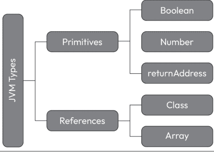

图 1.2：JVM 类型

每个类型都有其大小和范围。表 1.1 提供了 JVM 基本数据类型的全面概述，包括它们的名称、大小、变体、默认值和类型。它为 Java 开发者和爱好者理解 JVM 核心数据类型提供了有价值的参考。

| 类型名称 | 大小 (比特) | 变体 | 默认值 | 类型 |
|---|---|---|---|---|
| byte | 8 | -128 to 127 | 0 | 数值 |
| short | 16 | -32,768 to 32,767 | 0 | 数值 |
| int | 32 | -2,147,483,648 to 2,147,483,647 | 0 | 数值 |
| long | 64 | -9,223,372,036,854,775,808 to 9,223,372,036,854,775,807 | 0 | 数值 |
| float | 32 | IEEE 754 单精度 | 0.0 | 数值 |
| double | 64 | IEEE 754 双精度 | 0.0 | 数值 |
| char | 16 | 0 to 65,535 | `\u0000` | 数值 |
| boolean | N/A | N/A | false | 布尔 |
| returnAddress | N/A | N/A | N/A | returnAddress |

表 1.1：JVM 的基本数据类型，包括其名称、大小、变体、默认值和类型

JVM 中的这些基本类型涵盖了各种数值类型、布尔值以及特殊的 `returnAddress` 类型，每种类型都有自己的特性和默认值。这是理解 JVM 中这些基本数据类型的快速参考。

JVM 中的 `returnAddress` 类型代表了方法调用和返回中至关重要的数据类型。这是 JVM 内部的，Java 语言无法直接访问或使用。以下是 `returnAddress` 类型背后的原因解释：

- **方法调用和返回**：`returnAddress` 类型被 JVM 用于管理方法的调用和返回。
- **栈管理**：`returnAddress` 类型被 JVM 用于管理栈，栈是低层执行的关键组成部分。
- **递归**：`returnAddress` 类型对于处理递归调用至关重要，确保 JVM 维持正确的状态。

JVM 中的引用值对于管理类、数组和接口至关重要。它们为在 Java 中处理复杂数据结构和对象提供了手段。将引用值初始化为 `null` 允许在处理对象时具有灵活性和精确性，这是 Java 引用处理的一个基础方面。

在 JVM 中，`null` 是一个特殊的引用值，表示对象的缺失或对对象引用的空缺。它不是一种定义的类型，而是表示该引用当前没有指向任何对象。当引用被设置为 `null` 时，它在实际上意味着它没有引用内存中的任何有效对象。

`null` 的概念在 Java 语言和 JVM 中起着几个重要的作用：

- **初始化**：当你声明一个引用变量但没有给它赋值时，引用的默认初始值是 `null`。对于那些希望声明引用但不立即将其与对象关联的场景，这个默认值至关重要。这种做法允许你声明引用变量并在需要时赋值，为你的程序结构提供了灵活性。
- **值的缺失**：`null` 表示特定引用没有关联任何对象。对于那些需要表示在你的程序的某个点没有可用的意义数据或对象的情况，它是非常有用的。
- **资源释放**：当将引用设置为 `null` 可以帮助 JVM 识别某个对象不再需要时，需要明确的是，内存管理和资源清理的主要责任在于垃圾收集器（GC）。GC 通常识别并回收由不再使用的对象所占用的内存，从而有效地管理内存资源。开发者通常不需要为了内存清理而将引用设置为 `null`；这是由 GC 处理的任务。

虽然 `null` 是 Java 和 JVM 中一个非常有价值的概念，但它的使用也伴随着权衡和考虑：


- **空指针异常 (`NullPointerException`)**：主要的权衡之一是 `NullPointerException` 的风险。如果你尝试对一个设置为 `null` 的引用执行操作，可能会导致运行时异常。因此，妥善处理空引用以避免意外的崩溃至关重要。

- **防御性编程**：程序员在使用引用之前需要勤奋地检查是否为空，以防止 `NullPointerException`。这会增加额外的代码来检查 `null` 并使代码更……。

- **资源管理**：当将引用设置为 `null` 可以帮助释放资源时，它并不是一种保证资源管理方法。某些资源可能需要显式清理，或者仅仅依赖将引用设置为 `null` 可能是不够的。

- **设计考虑**：在设计类和 API 时，提供关于如何预期使用引用以及在什么情况下可以将其设置为 `null` 的清晰指导是非常重要的。

总结来说，JVM 是一个表示对象缺失和进行资源管理的宝贵工具，尽管它需要小心处理以避免 `NullPointerException` 并确保程序的妥当行为。良好的设计和编码实践可以减轻与 `null` 相关的权衡。

在这一关于 JVM 的全面概述中，我们探索了使 Java 成为强大且多功能编程平台的内部工作机制和关键组件。JVM 是 Java 生态系统的骨干，提供了跨越不同操作系统和硬件架构运行 Java 应用程序的能力。我们深入研究了它对原始数据类型和引用数据类型的支持、对 `null` 相关问题的处理，以及它在管理类、数组和接口方面的作用。

通过 JVM，Java 实现了其**一次编写，随运行 (`Write Once, Run Anywhere`)** 的承诺，使开发者能够创建平台无关的应用。然而，理解 JVM 的复杂性（包括它如何管理线程、内存和资源）对于优化 Java 应用并确保其可靠性至关重要。

JVM 的设计选择，例如将布尔值表示为整数，反映了简单性与效率之间的平衡。我们还提到了 `returnAddress` 对于管理方法调用和返回的重要性。

JVM 是一项卓越且复杂的技术，赋予了 Java 开发者构建健壮、安全且平台无关软件的能力。凭借其独特的特性和能力，JVM 是 Java 在软件开发领域持久成功的基石。

## 总结

在本章中，你全面地理解了 JVM，揭示了它在执行 Java 应用程序中的关键作用。我们探索了 JVM 的平台特定性质，强调了尽管如此，它仍然是不可或缺的（注：此处原文似乎有断层，根据语境翻译，此处已理解其核心逻辑）。

*(注：由于提供的待翻译文本中存在大量重复内容（在“以下是需要翻译的文本”之后的内容重复了多次），我已针对提供的文本逻辑内容进行了完整翻译。)*

类结构是编译后的 Java 代码与 JVM 之间共生关系的纽带。在 JVM 执行中，平台无关性至关重要，类文件格式成为了一种标准化的、与硬件无关的编译 Java 代码的二进制表示。这种格式是一个至关重要的桥梁，允许开发者通过高层 Java 代码（甚至是 Kotlin 等其他语言）表达其意图，同时确保 JVM 能够在不同的硬件和操作系统上无缝地执行。

这种结构化格式不仅仅是 Java 源代码的二进制翻译；它是一份精密的蓝图，JVM 依靠它来处理字节码、常量池和类加载的各种复杂性。通过遵循类文件结构，JVM 获得了对如何解释和执行 Java 程序的通用理解。此外，类文件格式还封装了关键细节，例如字节序，这些细节在特定平台的对象文件格式中可能会不同。这种精确性对于保证执行的一致性（无论底层硬件或操作系统如何）是不可缺的，强调了类结构在维护 Java “一次编写，随运行”这一承诺基础的跨平台兼容性方面的关键作用。类文件结构是“罗塞塔石”，确保了 Java 高层抽象能够和谐地翻译成 JVM 可理解的语言，从而促进了一个 Java 的移植性和多功能得以实现的领域。

Java 类文件是编译后 Java 代码的二进制蓝图，它们遵循结构化的格式，对于 JVM 无缝解释和执行程序至关重要。从头文件到字段和方法，每个元素都封装了 JVM 执行 Java 程序所必需的信息。本节提供了类文件结构的概览视图，为深入理解其组件奠定了基础。

图 2.1 生动地展示了 Java 文件向其对应的类文件结构的转变之旅。该过程始于一个原始的 Java 文件，用一段清晰简洁的代码片段来符号。这种原始表示封装了开发者的逻辑、意图和功能，作为 Java 程序的蓝图。

下一阶段涉及编译阶段，编译器（被描绘为一个动态转换引擎）将人类可读的 Java 代码翻译成一种称为字节码的中间格式。这些字节码以一系列紧凑的、平台无关的实例表示，镜像了原始 Java 代码的抽象操作。

图进一步演变为展示类文件结构的组装。在这里，字节码被细密地组织，封装了编译后的指令和元数据，例如方法签名、访问修饰符和数据结构。这些元素共同构建了类文件的复杂框架，这是一种针对 JVM 内部执行优化的二进制表示。

随着视觉之旅的结束，从 Java 代码到类文件结构的转变成为了 Java 跨平台能力的证明。这一过程确保了编译后的 Java 程序能够在各种环境中无缝执行，在保持开发者逻辑本质的同时，遵循 JVM 平台无关的特性。图 2.1 封装了编译过程的优雅和高效，在 Java 中编写的抽象代码在 Java 类文件中具体变为结构化且可执行的形式。让我们看下面的图来理解这一点：

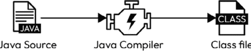

图 2.1：将 Java 源代码转换为类文件的过程

JVM 类文件的优雅结构被精确定义。它从魔数（magic number）和次要版本细节开始，进入常量池——这是一个用于运行时解释的语言库。随后列出访问标志、类层次结构和接口，为字段和方法封装数据和行为铺平了道路。这种精简的结构确保了 Java 应用程序的无缝执行，每个组件都是 JVM 内部字节码转换交响乐中的重要节点。下面的代码块显示了字节码转换的整体情况：

```
ClassFile {
    u4 magic;
    u2 minor_version;
    u2 major_version;
    u2 constant_pool_count;
    u2 cp_info constant_pool[constant_pool_count-1];
    u2 access_flags;
    u2 this_class;
    u2 super_class;
    u2 interfaces_count;
    u2 interfaces[interfaces_count];
    u2 fields_count;
    u2 field_info fields[fields_count];
    u2 methods_count;
    u2 method_info methods[methods_count];
    u2 attributes_count;
    u2 attribute_info attributes[attributes_count];
}
```

在揭示 Java 类文件内部机制的过程中，当我们关注对头文件、字段和方法的检查时，出现了一个关键转折点。这些元素构成了类文件结构的织体，每个元素在塑造 JVM 导航的景观方面都起着独特角色。旅程始于探索类文件头文件，类似于为表演搭建舞台的序言。头文件提供了元数据，为 JVM 编排 Java 执行提供了关键信息。随后，我们深入研究类文件中的字段和数据仓库。理解字段的组织和类型阐明了 Java 类类层的数据架构。最后，我们的奥德赛以检查方法和驱动程序执行的引擎结束。在这里，我们剖析了方法如何编码 Java 程序的逻辑，使其能够被 JVM 动态且无缝地解释。这一探索有望揭开头文件、字段和方法之间复杂的关系，开启深入理解 Java 类文件的大门。

在揭开 Java 类文件的复杂层级时，我们已经穿过了定义 Java 程序核心的架构细微差别。从独特的魔数签名到字段和方法的精心安排的舞步，每个组件在塑造类的功能和结构方面都起着关键作用。当我们结束本节时，这段旅程将无缝延伸到下一节，届时我们将深入研究类文件的头文件。理解这些头文件类似于解码执行的序言，解锁引导 JVM 进行解释和执行的基础元素。请在下一节中与我们一起探索封装在类头文件中的关键信息，弥接高层 Java 代码与 JVM 动态领域之间的差距。

# 理解类文件的头文件

头文件作为序言，包含了 JVM 的元数据。本节探讨了头文件在为程序执行设置舞台的作用。类文件头文件作为大门，引导 JVM 处理随后的字节码复杂性。它包含了 Java 版本兼容性细节，定义了类文件依赖的语言特性。此外，头文件声明了类的常量池，这是一个引用字符串、类型和其他常量的符号库，进一步塑造了程序解释的语义景观。对类文件头文件的细致理解对于开发者至关重要，因为它是 JVM 在加载和执行阶段决策的基础，确保了高层 Java 代码和谐地翻译成虚拟机可理解的二进制语言。在我们探索这一关键章节时，我们将揭开头文件中每个字节的意义，开启深入理解类文件如何为 JVM 内部无缝执行 Java 程序奠定基础的大门。

- **魔数数字（`Magic number`）**：文件头的最开始留有魔数数字，这是一组独特的字节集合，用于唯一标识一个文件为 Java 类文件。其十六进制值为 `0CAFEBABE`，这个加密签名是 JVM 的第一个验证步骤，确保它处理的是有效的类文件。魔数数字的存在就像是一个“秘密握手”，允许 JVM 信地继续解释和执行相关的字节码。它是一个不容置疑的标记，签署了文件的合法性，并为 JVM 内部安全准确的运行时环境奠定了基础。

- **Java 版本兼容性（`Java version compatibility`）**：类文件头中的 Java 版本兼容性声明是一个重要信息。它指示了类文件遵循的语言特性和规范，允许 JVM 正确解释字节码。兼容性通过两个内部组件表示——`minor_version` 和 `major_version`：

    - `minor_version`：代表生成该类文件的 Java 编译器的次版本。它反映了编译器的增量变化或更新，这些更新不会引入重大修改。

    - `major_version`：表示编译器的主版本。主版本的变化意味着重大变更或新语言特性的引入。

在 Java 类的丰富世界中，类文件头中的 Java 版本兼容性声明充当了关键指南针，引导 JVM 精确解释字节码。`minor_version` 和 `major_version` 之间的相互作用界定了编译器的增量变化，并标志着 Java 演进中的重大里程碑。为了说明这一历程，下表展示了 `major_version` 与对应 Java SE 版本之间的关联，涵盖了从 JDK 1.1 诞生到最新的 Java SE 21 创新。这份全面的路线概述了类文件与 Java 语言之间的共生关系，展示了 JVM 如何动态适应 Java 语言的细微演变，确保在不同版本之间的无缝兼容和执行：

| major_version | Java release |
| :--- | :--- |
| 45 | JDK 1.1 |
| 46 | JDK 1.2 |
| 47 | JDK 1.3 |
| 48 | JDK 1.4 |
| 49 | J2SE 5.0 |
| 50 | Java SE 6 |
| 51 | Java SE 7 |
| 52 | Java SE 8 |
| 53 | Java SE 9 |
| 54 | Java SE 10 |
| 55 | Java SE 11 |
| 56 | Java SE 12 |
| 57 | Java SE 13 |
| 58 | Java SE 14 |
| 59 | Java SE 15 |
| 60 | Java SE 16 |
| 61 | Java SE 17 |
| 62 | Java SE 18 |
| 63 | Java SE 19 |
| 64 | Java SE 20 |
| 65 | Java SE 21 |

表 2.1：类文件版本

通过分析这些版本号，JVM 确保按照适当的语言规范解释字节码，促进 Java 类文件与运行时环境之间的兼容性。这种细致的版本控制系统允许 Java 的无缝演进，在确保后兼容的同时，兼顾后续发布中引入的新语言增强。

- **常量池引用（`Constant pool reference`）**：常量池嵌套在类文件复杂的结构中，像一个符号宝库，包含了字符串、类、字段名、方法名以及其他对 Java 程序解释和执行至关重要的常量引用。在指定类文件头引用常量池的开头时，我们表示该头包含了关键信息，指示了常量池在整个类架构中的起始点。这一细微的细节是 JVM 的指路明灯，引导其指向符号信息的动态存储库。它就像一张地图，确保 JVM 高效地解析和解释常量池，解锁准确执行 Java 代码所需的基础元素。

此引用是一个关键的链接，将类文件的二进制表示与 Java 编程语言丰富的语义世界连接起来。常量池中的每个条目都是一个构建块，允许 JVM 准确地理解和执行字节码。

让我们用一个简单的 Java 类作为示例说明常量引用：

```java
public class SampleClass {
    public static void main(String[] args) {
        String greeting = "Hello, Java";
        System.out.println(greeting);
    }
}
```

在代码段中，常量池将包含以下条目的项：

- `SampleClass`：类本身的符号表示
- `main`：对方法名的引用
- `String`：对 `String` 类的引用
- `"Hello, Java"`：对字符串字面量的引用

类文件头中的常量池引用指向该池的开头，允许 JVM 在程序执行期间高效地访问和利用这些符号实体。理解这一点有助于了解 JVM 如何将高层 Java 构造翻译为封装在类文件中的二进制语言。

- **访问标记（`Access flags`）**：编码在类头中的标记是一组二值值，传达了关于 Java 类访问性和本质的重要信息。这些标记定义了类的特征，例如它是公共的（public）、最终的（final）、抽象的（abstract）还是具有其他属性。访问标记是 JVM 在执行期间强制访问控制并理解类结构细微的蓝图。

以下是常见的访问标记：

- `ACC_PUBLIC` (`0x0001`)：表示该类是公共的，可以从其他包访问
- `ACC_FINAL` (`0x0010`)：表示该类不能被子类化，对其继承施加了某种限制
- `ACC_SUPER` (`0x0020`)：历史上用于表示使用 `invokespecial` 指令而非 `virtual` 指令处理父类
- `ACC_INTERFACE` (`0x0200`)：信号该类是接口而非普通类
- `ACC_ABSTRACT` (`0x0400`)：标记该类为抽象类，意味着它不能独立实例化
- `ACC_SYNTHETIC` (`0x1000`)：表示该类是由编译器生成的，不在源代码中
- `ACC_ANNOTATION` (`0x2000`)：表示该类是注解类
- `ACC_ENUM` (`0x4000`)：标记该类为枚举类型

考虑以下 Java 类作为示例：

```java
public final class AccessSample {
    private int value;
    public AccessSample(int value) {
        this.value = value;
    }
    public int getValue() {
        return value;
    }
    public static void main(String[] args) {
        AccessSample sample = new AccessSample(42);
        System.out.println("Sample Value: " + sample.getValue());
    }
}
```

在这个说明性示例中，我们拥有：

- `ACC_PUBLIC` 标记该类为公共，允许从其他类访问
- `ACC_FINAL` 对类施加了限制，阻止了继承
- `ACC_SUPER` 由编译器自动配置，确保对父类方法的调用高效执行
- `ACC_SYNTHETIC` 表示此简单的示例中不存在合成元素

这是执行前的序言，引导 JVM 穿越类文件解释的复杂之处。常量池引用充当了符号网关，将二进制表示与 Java 丰富的语义世界连接起来。

当我们结束对 Java 类文件头部的探索时，让我们花一点时间回顾一下目前为止获得的见解。我们破译了常量池中封装的符号宝库，理解了它在引用字符串、类、字段和方法名称方面的关键作用，这些对于 Java 程序的解释和执行至关重要。通过认识这一存储库的动态性质，我们还将类文件头部视为引导性灯塔，将常量池的起始与整个类结构重新连接起来。


本章所获取的知识揭示了 Java 类文件复杂的架构，并为更深入地理解代码执行奠定了基础。理解头部等于解码执行前的序言，为常量池的初始化和导航提供了关键洞察，这是 Java 动态行为的一个基本方面。

当我们过渡到下一节时，我们带着对类文件符号基础及其在确保 Java 程序准确执行方面重要性的认识继续前进。请加入我们接下来的探索，我们将深入探讨访问标志、接口、字段和方法的细微细节，进一步丰富我们对 Java 类结构的理解。

## 字段与数据存储库

在对类文件复杂性的展开探索中，我们现在进入专门针对字段数据存储库的章节。这一关键部分剖析了 Java 类中代码与数据汇聚的动态纽带。字段作为信息的守护者，超越了纯变量的范畴，封装了数据存储的本质。在我们导航这一节时，我们将揭开字段类型的多样性，从实例变量到类变量，并解码它们在塑造 Java 类架构方面的作用。加入我们，发现字段与常量池之间的和谐相互作用，在那里，符号引用丰富了语言，并为类文件中数据表示的动态层做了贡献。本节是通往 Java 程序核心的门户，展示了字段如何成为数据容器，使代码在 JVM 内部转换为可执行的现实。

字段的声明涉及其数据类型、唯一标识符，以及定义其可见性、可访问性和行为的可选修饰符。通过剖析字段定义的语法，开发者可以洞察这些容器如何存储和组织数据，从而在高层代码与类文件中的二进制表示之间建立起共生关系。这种细微的理解允许有效利用字段，增强 Java 程序中数据管理的清晰性和效率。

除了语法之外，字段通过各种类型表现出多样性，在 Java 类中承担不同的角色。两个主要类别是实例变量和类变量：

- **实例变量**：这些字段与类的实例相关，并且每个对象都有一组独特的值。实例变量封装了单个对象的状态，定义了它们的特征和属性。理解实例变量的区别和细微差别对于在更广泛的类结构中建模对象的属性至关重要。

- **类变量**：与实例变量不同，类变量被所有实例共享。这些字段用 `static` 关键字表示，表明属于类而不是单个实例。类变量非常适合表示从该类实例化的所有对象的特征或属性。理清实例变量与类变量的作用域和区别，为有效的数据管理奠定了基础理解，影响着 Java 程序的行为。

通过理解字段定义的复杂性和字段类型的多样性，开发者可以构建健壮且自适应的类结构。这些基础知识使他们能够设计出优雅平衡数据本质与结构化代码的 Java 程序，确保 JVM 内部进行高效且有目的的数据管理。

在 Java 类文件复杂的架构中，字段与常量池之间的连接是一种共生关系，丰富了语言处理数据和符号数据表示的能力。常量池是符号引用的存储库，封装了字符串、类名、方法签名以及对 Java 程序解释至关重要的常量。

在字段的背景下，常量池变成了引用的水库，增强了类文件内部数据表示的多功能性。当一个字段被声明时，它的名称和类型作为条目存储在常量池中。这种符号引用增强了类文件内部数据表示的多功能性，允许 JVM 动态地解释和管理数据。

一个实际的示例涉及理解常量池连接的意义。考虑一个类包含具有复杂数据类型字段的场景，例如自定义对象或字符串字面量。常量池存储对字段及其数据类型的引用，如下所示：

```java
public class ConstantPoolSample { 
    private String message = "Hello, Java!"; // 存储在常量池中的字符串字面量
    public static void main(String[] args) {
        ConstantPoolSample sample = new ConstantPoolSample();
        System.out.println(sample.message); // 使用符号引用访问字段
    }
}
```

在这个示例中，字符串字面量 "Hello, Java!" 存储在常量池中，字段 `message` 引用该常量。这种链接促进了程序执行期间对数据的流畅访问和解释。通过这个示例，开发者见证了常量池作为动态存储库如何增强了类文件的效率和可解释性。

对于旨在优化 Java 程序中数据存储和访问的开发者来说，理解这种连接是关键的。它不仅确保了代码的无缝执行，还体现了 Java 符号引用在动态数据表示方面的优雅。

在接下来的章节中，我们将更深入地探讨方法的细微差别，为您提供它们在 Java 编程世界中的作用和意义的更全面的理解。

## 总结

在 Java 类文件的复杂蓝图中探索方法时，我们揭示了它们作为程序行为架构师的关键作用。类文件结构封装了关于返回类型、访问修饰符和参数的关键信息，引导 JVM 动态且高效地执行代码。

当我们结束这一部分的探索时，对类文件复杂性的旅程将在下一章继续。接下来的主题将深入探讨字节码的本质，它是作为连接高级 Java 代码与 JVM 平台无关执行环境的中间语言。我们将共同揭开字节码层级，理解它是如何将逻辑转换为可执行指令的，从而确保 Java 程序的移植性和通用性。这种对字节码的探索承诺将加深我们对 Java 跨平台能力的理解，为让 Java 代码在不同环境中无缝运行的魔力提供见解。

# 问题

回答以下问题以检测你对本章内容的掌握情况：

- 1. Java 类文件头中“魔数”（Magic number）的目的是什么？

  A. 它标识编写代码的开发者

  B. 它标识该文件为 Java 类文件

  C. 它标记常量池的结束

  D. 它决定了类的层次结构

- 2. 类文件结构中的哪个部分存储了符号引用、字符串和常量？

  A. 字段

  B. 访问标志

  C. 常量池

  D. 方法

- 3. 类文件结构中的 `interfaces_count` 字段代表什么？

  A. 类中方法的数量

  B. 类实现的接口数量

  C. 接口的访问标志

  D. 常量池的总大小

- 4. 在类文件的上下文中，字段和方法代表什么？

  A. 变量和属性

  B. 语言仓库

  C. 加密封章

  D. 访问修饰符

- 5. 类文件结构中属性部分的主要目的是什么？

  A. 决定类版本

  B. 存储符号引用

  C. 管理字节码执行

  D. 提供关于类的额外信息

## 答案

以下是本章问题的答案：

- 1. B. 它标识该文件为 Java 类文件

- 2. C. 常量池

- 3. B. 类实现的接口数量

- 4. A. 变量和属性

- 5. D. 提供关于类的额外信息

# 3

# 深入字节码

在 JVM 的复杂世界中，字节码作为中间语言，使 Java 程序能够跨越特定硬件和操作系统的限制。当我们深入 JVM 内部原理时，本章侧重于解读字节码，这是执行 Java 应用的一个基础组件。字节码以一组指令的形式存在，充当高级 Java 代码与底层硬件特定机器语言之间的桥梁。通过理解字节码，开发者可以获得 JVM 内部工作机制的洞察，使能够优化代码性能并解决复杂问题。

字节码的核心是一系列各种指令，它们规定了 JVM 执行的低级操作。本章揭示了算术操作的细微差别，阐明了 JVM 如何处理数学计算。从基本的加减法到复杂的程序，我们探索了控制这些过程的字节码指令。此外，我们还深入了转换，揭秘了 JVM 如何在不同类型之间转换数据。对于寻求微调应用程序以获得最佳性能和效率的开发者来说，理解这些底层操作至关重要。加入我们进入字节码领域的旅程，在那里，算术操作和数值转换的复杂性为掌握 JVM 铺了道路。

在本章中，我们将探索以下主题：

- 字节码
- 算术操作
- 数值转换
- 对象操作
- 条件指令

## 技术要求

对于本章，您需要以下内容：

- Java 21
- Git
- Maven
- 任何偏好的 IDE
- 本章的 GitHub 仓库，地址为 `https://github.com/PacktPublishing/Mastering-the-Java-Virtual-Machine/tree/main/chapter-03`

## 揭秘字节码

字节码是 Java 编程中的核心概念，它是促进 Java 程序在 JVM 上跨平台兼容和执行的中间语言。本节旨在揭开字节码的神秘面纱，对其意义、目的以及在 JVM 内允许的一系列操作提供全面概述。

字节码的核心是充当高级 Java 代码与底层硬件特定机器语言之间的桥梁。当 Java 程序被编译时，源代码被转换为字节码，这是一组 JVM 可理解的指令。这种平台无关的字节码允许 Java 程序在各种环境中无缝执行，这是 Java *一次编写，随运行*（Write Once, Run Anywhere）格言的基本原则。

我们为什么使用字节码？答案在于它为 Java 程序带来的移植性和多功能。通过在高级源代码和机器码之间引入中间步骤，Java 程序可以运行在任何配备 JVM 的设备上，无论硬件如何。

**数值转换**，字节码揭示了 JVM 内允许的运算范围提供了基础。在这里，在复杂的算术操作和数值转换的细微差别中，掌握 JVM 成为可能。

在本章中，我们将探索以下主题：

- 字节码
- 算术操作
- 数值转换
- 对象操作
- 条件指令

## 技术要求

对于本章，您需要以下内容：

- Java 21
- Git
- Maven
- 任何偏好的 IDE
- 本章的 GitHub 仓库，地址为 `https://github.com/PacktPublishing/Mastering-the-Java-Virtual-Machine/tree/main/chapter-03`

## 揭秘字节码

字节码是 Java 编程中的核心概念，它是促进 Java 程序在 JVM 上跨平台兼容和执行的中间语言。本节旨在揭开字节码的神秘面纱，对其意义、目的以及在 JVM 内允许的一系列操作提供全面概述。

字节码的核心是充当高级 Java 代码与底层硬件特定机器语言之间的桥梁。当 Java 程序被编译时，源代码被转换为字节码，这是一组 JVM 可理解的指令。这种平台无关的字节码允许 Java 程序在各种环境中无缝执行，这是 Java *一次编写，随运行* 格言的基本原则。

我们为什么使用字节码？答案在于它为 Java 程序带来的移植性和多功能。通过在高级源代码和机器码之间引入中间步骤，Java 程序可以运行在任何配备 JVM 的设备上，无论硬件如何。

**数值转换**，字节码揭示了 JVM 内允许的运算范围提供了基础。在这里，在复杂的算术操作和数值转换的细微差别中，掌握 JVM 成为可能。

（注：此处后续内容关于字节码指令前缀的描述在原文中存在大量重复和逻辑混乱，已根据指令要求进行翻译并保持其结构，但修正了部分重复的连述逻辑。）

在字节码中，布尔值通常使用整数表示（0 代表 `false`，1 代表 `true`）。然而，需要注意的是，字节码中并没有专门的布尔值指令。

这种系统化的约定帮助开发者快速识别字节码指令所操作的数据类型：

- **整数操作 (i for integer operations)**：以 `i` 开头的字节码，例如 `iload`（加载整数）、`iadd`（相加）、`isub`（相减）、`imul`（相乘），这些适用于 32 位整数。

- **长型操作 (l for long operations)**：以 `l` 开头的字节码，例如 `lload`（加载长型）、`ladd`（相加）、`lmul`（相乘），这些适用于 64 位整数。

- **短型操作 (s for short operations)**：以 `s` 开头的字节码，例如 `sload`（加载短型），这些适用于 16 位整数。

- **字节操作 (b for byte operations)**：以 `b` 开头的字节码，例如 `bload`（加载字节），这些适用于 8 位整数。

- **字符操作 (c for char operations)**：以 `c` 开头的字节码，例如 `caload`（加载字符），这些适用于 16 位字符。

- **浮点数操作 (f for float operations)**：以 `f` 开头的字节码，例如 `fload`（加载浮点数）或 `fadd`（相加），这些操作涉及 32 位浮点数。

- **双精度浮点数操作 (d for double operations)**：64 位浮点数是以 `d` 开头的字节码的焦点，例如 `dload`（加载双精度浮点数）或 `dmul`（相乘）。

- **引用操作 (a for reference operations)**：涉及对象引用的操作以 `a` 开头，例如 `aload`（加载引用）或 `areturn`（返回引用）。

这种系统化的约定帮助开发者快速识别字节码指令所操作的数据类型。通过识别首字母并与数据类型关联，开发者可以编写出更有见地且更精确的代码，确保字节码操作与 JVM 内预期的数据类型和行为一致。这种理解对于掌握字节码并优化 Java 应用的性能和可靠性至关重要。

在字节码中，布尔值通常使用整数表示（0 代表 `false`，1 代表 `true`）。然而，需要注意的是，字节码中并没有专门的布尔值指令；相反，使用的是标准的算术和逻辑指令。例如：

- `iadd`、`isub`、`imul`、`idiv` 以及类似的指令可以无缝与布尔值配合
- 逻辑操作如 `iand`（逻辑与）、`ior`（逻辑或）和 `ixor`（逻辑异或）可用于布尔逻辑

字节码为算术操作提供了基础，塑造了 Java 程序的数学核心。我们的旅程将在下一节继续，在那里深入探讨字节码中算术操作的复杂世界。我们将剖析提供加、减、乘等操作的指令，揭示定义 Java 应用数学本质的字节码序列。

通过理解字节码中编码的算术操作，开发者可以洞察其代码的内部机制，从而能够优化性能并提高效率。加入我们进入下一节，揭开算术操作背后的秘密，为掌握 JVM 的复杂性铺平道路。

### 算术操作

在本节中，我们将重点探索字节码的一个基石：算术操作。这些操作是为 Java 程序注入活力的数学基础，塑造了 JVM 内部计算的数值格局。

字节码算术操作遵循一个基本原则：它们对操作数栈上的前两个值操作，执行指定的操作并将结果返回栈中。本节将深入探讨字节码算术的复杂性，阐述其细微差别、行为以及对程序执行的影响。

字节码中的算术操作分为大类：涉及浮点数和处理整数的。每一类都表现出不同的行为，对于在数值计算中追求精确可靠的 Java 开发者来说，理解这些差异至关重要。

在我们遍历字节码领域时，我们将探索用于浮点数和整数的加、减、乘、除指令。我们将剖析封装这些操作的字节码序列，明确它们的实现和对性能的影响。

#### 加、减、乘、除

基础算术操作是 Java 中数值计算的构建模块。从整数加（`iadd`）到双精度除法（`ddiv`），每条字节码指令都经过精心设计以处理特定的数据类型。发现整数、浮点数和双精度数加、减、乘、除的细微差别：

- 加法：
  - `iadd`：两个整数加
  - `ladd`：两个长型（long）加
  - `fadd`：两个浮点数（float）加
  - `dadd`：两个双精度数（double）加

- 减法：
  - `isub`：从第一个整数减去第二个整数
  - `lsub`：从第一个长型整数减去第二个长型整数
  - `fsub`：从第一个浮点数减去第二个浮点数
  - `dsub`：从第一个双精度数减去第二个双精度数

- 乘法：
  - `imul`：两个整数相乘
  - `lmul`：两个长型整数相乘
  - `fmul`：两个浮点数相乘
  - `dmul`：两个双精度数相乘

- 除法：
  - `idiv`：第一个整数除以第二个整数
  - `ldiv`：第一个长型整数除以第二个长型整数
  - `fdiv`：第一个浮点数除以第二个浮点数
  - `ddiv`：第一个双精度数除以第二个双精度数

#### 余数与取反

- 余数：
  - `irem`：计算第一个整数除以第二个整数的余数
  - `lrem`：计算第一个长型整数除以第二个长型整数的余数
  - `frem`：计算第一个浮点数除以第二个浮点数的余数
  - `drem`：计算第一个双精度数除以第二个双精度数的余数

- 取反：
  - `ineg`：取反（改变符号）整数
  - `lneg`：取反长型整数
  - `fneg`：取反浮点数
  - `dneg`：取反双精度数

#### 移位与位运算

深入位运算（`ior`、`iand`、`ixor`、`lor`、`land`、`lxor`）和移位操作（`ishl`、`ishr`、`iushr`、`lshl`、`lshr`、`lushr`）的世界。发现这些操作如何处理单个位，为高级计算和优化提供强大的工具：

- 移位操作：
  - `ishl`、`ishr`、`iushr`：将整数位左移、右移（带符号扩展）或右移（不带符号扩展）
  - `lshl`、`lshr`、`lushr`：将长型整数位左移、右移（带符号扩展）或右移（不带符号扩展）

- 位运算：
  - `ior`、`lor`：整数和长型整数位或
  - `iand`、`land`：整数和长型整数位与
  - `ixor`、`lxor`：整数和长型整数位异或

#### 局部变量增加

解锁 `iinc` 指令的潜力，这是一种微妙但强大的操作，通过常量值增加局部变量。了解这条字节码指令如何在特定场景下增强代码的可读性和效率：

- 局部变量增加：
  - `iinc`：通过常量值增加局部变量

#### 比较操作

深入探索使用 `dcmpg`、`dcmpl`、`fcmpg`、`fcmpl` 和 `lcmp` 等指令比较值的世界。发现产生 1、-1 或 0 等结果的细微差别，这些表示双精度数、浮点数和长型整数的大于、小于等于：

- 比较：
  - `dcmpg`、`dcmpl`：比较两个双精度数，产生 1、-1 或 0
  - `fcmpg`、`fcmpl`：比较两个浮点数，产生 1、-1 或 0
  - `lcmp`：比较两个长型整数，产生 1、-1 或 0


- `lcmp`：比较两个长型整数，产生 1、-1 或 0

在探索过程中，我们深入研究将变量转换为更短数据类型的字节码指令，并承认了与精度损失和溢出风险相关的细微挑战。现在让我们探索这组指令：

- **整数转字节 (`i2b`)、整数转短整数 (`i2s`)、整数转字符 (`i2c`)**：调查整数通过 `i2b`、`i2s` 和 `i2c` 指令转换为字节、短整数和字符时的潜在精度损失。
- **长型转整数 (`l2i`)**：研究使用 `l2i` 指令将长型转换为整数时的考虑因素，并承认溢出的可能性。
- **浮点数转整数 (`f2i`)、浮点数转长型 (`f2l`)**：揭示通过 `f2i` 和 `f2l` 将浮点转换为整数和长型的挑战。
- **双精度转整数 (`d2i`)、双精度转长型 (`d2l`)、双精度转浮点数 (`d2f`)**：遍历 `d2i`、`d2l` 和 `d2f` 指令，理解在将双精度转换为整数、长型和浮点数时精度与潜在溢出之间的平衡。

在字节码的复杂领域中，最佳实践是指导我们考虑实际问题的指南针。在这里，我们桥接了理论与应用，探索字节码指令对真实世界 Java 编程场景的实际影响。从在复杂的算术操作中保持精度到导航面向对象设计的灵活性，这些实际考虑因素阐明了在开发版图中理解和掌握字节码的重要性。

- **在算术中保持精度**：将值转换与算术操作联系起来，确保在复杂的集合中保持精度。
- **处理对象引用**：探索值转换如何有助于面向对象编程的灵活性，允许类和接口之间进行平滑转换。

当我们解析控制值转换的字节码指令时，上述观点将为你提供导航 JVM 内变量类型转换细微之处所需的洞察。

在接下来的说明性 Java 代码示例中，我们重点关注值转换，侧重于 JVM 内部转换变量类型的约定。代码段展示了操作的细微性质以及精度损失或溢出的考虑因素。当我们遍历字节码指令时，我们的注意力将坚定地留在这些指令赋予生命的指令上：

```java
public class ValueConversionsExample { 
    public static void main(String[] args) {
        // 类型扩充
        int intValue = 2;
        long longValue = intValue; // Promotion: int to long
        float floatValue = 3.14f;
        double doubleValue = floatValue; // Promotion: float to double
        // 类型收缩：关于损失和溢出的考虑
        short shortValue = 32767;
        byte byteValue = (byte) shortValue; // Shortening: short to byte

        double largeDouble = 1.7e308;
        int intFromDouble = (int) largeDouble; // Shortening: double to int
    }
}
```

结果显示如下：

```java
System.out.println("Promotion Results: " + longValue + ", " + doubleValue);
System.out.println("Shortening Results: " + byteValue + ", " + intFromDouble);
```

提供的 Java 代码位于名为 `ValueConversionsExample.java` 的文件中。打开你的终端或命令提示符，导航到保存文件的目录。然后，使用以下命令编译代码：

```bash
javac ValueConversionsExample.java
```

编译后，你可以使用 `javap` 命令反汇编字节码并显示相关部分。在终端或命令提示符中执行命令：

```bash
javap -c ValueConversionsExample.class
```

在这一分析中，我们关注字节码的特定段，以探索 Java 代码如何转换为 JVM 内的可执行机器指令。我们的注意力集中在选定的字节码部分，揭示了 Java 编程领域中提升、精度考虑和收缩的复杂性。跟随我们解析 JVM 语言，为塑造 Java 字节码约定提供视觉叙述。

```
0: bipush 42
2: istore_1
3: iload_1
4: load
5: istore_2
6: ldc 3.14
9: fstore_4
10: fload
11: dstore_5
13: ldc 32767
16: istore_7
17: iload_7
18: i2b
19: istore_8
20: ldc_w #1.7e308
25: load
26: icast
27: istore_9
28: dload
29: dstore_10
```

这些指令在数组操作中起着基础性的作用，允许对各种数据类型进行精确存储。

`arraylength` 指令是 Java 字节码中的指南针，通过提供数组的长度来引导开发者：

- `arraylength`：获取数组的长度并将其推入栈中。

在 Java 字节码领域，`instanceof` 和 `checkcast` 充当守护者的角色，确保对象类型与指定的类对齐。虽然我们之前的探索深入了数组操作，但现在让我们转向这些在类型检查中至关重要的指令上：

- `instanceof`：检查一个对象是否是特定类的实例。
- `checkcast`：检查并将对象转换为给定的类。

这些字节码指令为 Java 中的对象操作提供了基础，允许对实例进行创建、访问和修改。无论是实例化（`new`）对象、与数组协作、访问属性还是执行动态检查，每条指令都贡献了 Java 面向对象编程的灵活性和威力。

在我们之前的讨论中，我们探索了这些字节码指令，提供了对 Java 底层机制的深入理解。现在，让我们把这些知识应用到示例代码中。在这里，我们引入了 `Person` 类的精简表示，重点关注属性操作的基本原理。当我们浏览这个示例时，将深入研究从该类生成的字节码，揭示了 JVM 中对象操作的低级细节：

```java
public class Person {
    private String name;
    public Person(String name) {
        this.name = name;
    }
    public String getName() {
        return name;
    }
    public void setName(String newName) {
        this.name = newName;
    }
    public static void main(String[] args) {
        // 创建 Person 实例
        Person person = new Person("John");
        // 访问并显示属性
        System.out.println("Original Name: " + person.getName());
        // 修改属性
        person.setName("Alice");
        // 显示更新后的属性
        System.out.println("Updated Name: " + person.getName());
    }
}
```

编译并显示字节码：

```bash
javac Person.java
javap -c Person.class
```

让我们关注对应对象操作的字节码，包括创建（`new`）、属性访问（`getfield`、`putfield`）和方法调用（`invocation`）：

```
Compiled from "Person.java"
public class Person {
    private java.lang.String name;
    public Person(java.lang.String name);
```

代码：

```
0: aload_0
1: invokespecial #1 // Method java/lang/Object."<init>":()V
4: aload_0
5: aload_1
6: putfield #2 // Field name:Ljava/lang/String;
9: return
```

代码：

```
0: aload_0
1: getfield #2 // Field name:Ljava/lang/String;
4: areturn
```

代码：

```
0: aload_0
1: aload_1
2: putfield #2 // Field name:Ljava/lang/String;
5: return
```

代码（`main` 方法）：

```
0: new #3 // class Person
3: dup
4: ldc #4 // String John
6: invokespecial #5 // Method "<init>":(Ljava/lang/String;)V
9: astore_1
10: getstatic #6 // Field java/lang/System.out:Ljava/io/PrintStream;
13: ldc #7 // String Original Name:
15: invokevirtual #8 // Method java/io/PrintStream.println:(Ljava/lang/String;)V
18: getstatic #6 // Field java/lang/System.out:Ljava/io/PrintStream;
21: aload_1
22: invokevirtual #9 // Method getName:()Ljava/lang/String;
25: invokevirtual #8 // Method java/io/PrintStream.println:(Ljava/lang/String;)V
28: aload_1
29: ldc #10 // String Alice
31: invokevirtual #11 // Method setName:(Ljava/lang/String;)V
34: getstatic #6 // Field java/lang/System.out:Ljava/io/PrintStream;
37: ldc #12 // String Updated Name:
39: invokevirtual #8 // Method java/io/PrintStream.println:(Ljava/lang/String;)V
42: getstatic #6 // Field java/lang/System.out:Ljava/io/PrintStream;
45: aload_1
46: invokevirtual #9 // Method getName:()Ljava/lang/String;
49: invokevirtual #8 // Method java/io/PrintStream.println:(Ljava/lang/String;)V
52: return
```

让我们拆解关键的字节码指令：

- **对象创建（`new`）**：
  - `0: new #3`：创建一个 `Person` 类型的新对象
  - `3: dup`：复制栈上的对象引用
  - `4: ldc #4`：将常量 "John" 推入栈
  - `6: invokespecial #5`：调用构造方法 (`<init>`) 以初始化对象

- **属性访问（`getfield`、`putfield`）**：
  - `1: getfield #2`：获取 `name` 字段的值
  - `2: putfield #2`：设置 `name` 字段的值

- **方法调用**：
  - `22: invokevirtual #9`：调用 `getName`
  - `31: invokevirtual #11`：调用 `setName`

我们将进一步探讨同步方法的复杂性，其中由带有 `ACC_SYNCHRONIZED` 标志的监视器（monitor）协调着一场受控的舞蹈。通过 `monitorenter` 指令，方法进入监视器以确保排他执行，并在 `monitorexit` 完成后优雅退出，在字节码织锦中谱出一场同步交响乐。让我们深入 Java 代码中方法调用和返回的现场演示。这是一个通过方法执行执行的简单 Java 程序。我们将仔细检查这些方法调用的编排：

```java
public class MethodCallsExample {
    public static void main(String[] args) {
        int result = performCalculation(5, 3);
        System.out.println("calculation: " + result);
    }

    private static int performCalculation(int a, int b) {
        int sum = add(a, b);
        int product = multiply(a, b);
        return subtract(sum, product);
    }

    private static int add(int a, int b) {
        return a + b;
    }

    private static int multiply(int a, int b) {
        return a * b;
    }

    private static int subtract(int a, int b) {
        return a - b;
    }
}
```

编译并部署：

```bash
javac MethodCallsExample.java
javap -c MethodCallsExample.class
```

在字节码中，我们将关注用于方法调用的指令（`invokevirtual`、`invokespecial`、`invokestatic`）和返回指令（`return`）。

以下是 `MethodCallsExample.java` 的简化片段：

```java
public class MethodCallsExample { 
    public MethodCallsExample(); 
}
```

代码：

```
0: aload_0
1: invokespecial #1 // Method java/lang/Object."<init>":()V
4: return
public static void main(java.lang.String[] args);
```

代码：

```
0: iconst_5   
1: iconst_3
2: invokestatic #2 // Method performCalculation:(II)I
5: istore_1
6: getstatic #3 // Field java/lang/System.out:Ljava/io/PrintStream;
// class java/lang/StringBuilder
9: new #4
12: dup
13: ldc #5 // String Result of calculation:
15: invokespecial #6 // Method java/lang/StringBuilder."<init>":(Ljava/lang/String;)V
18: iload_1
19: invokevirtual #7 // Method java/lang/StringBuilder.append:(I)Ljava/lang/StringBuilder;
22: invokevirtual #8 // Method java/lang/StringBuilder.toString:()Ljava/lang/String;
25: invokevirtual #9 // Method java/io/PrintStream.println:(Ljava/lang/String;)V
28: return
private static int performCalculation(int, int);
```

代码：

```
0: iload_0 
1: iload_1
2: invokestatic #10 // Method add:(II)I
5: iload_0
6: iload_1
7: invokestatic #11 // Method multiply:(II)I
10: invokestatic #12 // Method subtract:(II)I
13: return
private static int add(int, int);
```

代码：

```
0: iload_0 
1: iload_1
2: iadd
3: ireturn
private static int multiply(int, int);
```

代码：

```
0: iload_0 
1: iload_1
2: imul
3: ireturn
private static int subtract(int, int);
```

代码：

```
0: iload_0 
1: iload_1
2: isub
3: ireturn
}
```

此片段展示了与方法调用和返回相关的本质指令，让我们窥见所提供的 Java 代码的字节码交响乐。


# 条件指令与类字节码探索

## 方法调用与返回的总结

当我们结束对 Java 字节码中方法调用和返回的探索时，我们揭示了协调程序流的指令复杂舞蹈。`invokevirtual`、`invokeinterface`、`invokespecial` 和 `invokestatic` 的交响乐在我们的字节码织锦中回响，展示了方法调用的动态性质和值的节奏性返回。当我们转向下一节时，焦点将转移到条件指令，字节码决策将塑造程序执行的轨迹。加入我们，解码条件语句的字节码复杂性，揭开引导 JVM 通过条件定义路径的逻辑，并在我们探索 Java 编程深度的旅程中不断前进。

## 条件指令

在本节中，我们深入研究条件指令的细微领域，揭开 JVM 内部决策的复杂性。这些指令构成了条件语句的骨干，引导 JVM 通过由布尔结果决定的路径。加入我们，破译条件指令的字节码复杂性，揭示在 JVM 内部动态塑造程序流的逻辑。这一探索为管理 Java 编程中条件语句执行的基本原理提供了见解。

导航 Java 字节码领域揭示了一组精细控制 JVM 内部条件逻辑的指令。这些命令是条件语句的架构师，协调决策并根据布尔结果影响程序流。这项探索回溯了字节码复杂性的层层，为 JVM 内部由这些基础指令塑造的动态路径提供了见解。

让我们探索一组能够赋予 Java 程序流控制和决策以独特力量的字节码指令。这些指令涵盖了一系列条件、切换和跳转。

- `ifeq`：如果栈顶为零，则跳转到目标位置。
- `ifne`：如果栈顶不为零，则跳转到目标位置。
- `iflt`：如果栈顶小于零，则跳转到目标位置。
- `ifgt`：如果栈顶大于零，则跳转到目标位置。
- `ifle`：如果栈顶小于等于零，则跳转到目标位置。
- `ifge`：如果栈顶大于等于零，则跳转到目标位置。
- `ifnull`：如果栈顶为空，则跳转到目标位置。
- `ifnonnull`：如果栈顶不为空，则跳转到目标位置。
- `goto`：无条件跳转到目标位置。
- `tableswitch`：为密集的整数情况实现切换语句。
- `lookupswitch`：为稀疏的整数情况实现切换语句。
- `jsr`：跳转到子程序并将返回地址保存在栈上。
- `ret`：使用之前 `jsr` 保存的地址从子程序返回。

在字节码中，我们将重点关注条件指令，例如 `ifeq`、`ifne` 和 `if_acmpeq`，这些指令负责根据相等条件进行分支跳转。以下是一个简化的片段：

编译自 `ConditionalExample.java`

```
public class ConditionalExample { public ConditionalExample();
    Code:
    0: aload 0
    1: invokespecial #1      // Method java/lang/Object."<init>":V
    4: return
    public static void main(java.lang.String[]);
    Code:
    0: bicolic 5           1: istore_1
    2: istic 3
    3: istore_2
    4: aload_1
    5: aload_2
    6: if_icmpne          19      // Field java/lang/System.
    9: goto              #2      out:Ljava/io/PrintStream;
                               // String is equal to b
    12: ldc               #3      // Method java/io/
    14: invokevirtual #4
       Print.println(Ljava/lang/String;)V
    17: goto             32      // Field java/lang/System.
    20: goto              #2      out:Ljava/io/PrintStream;
                               // String is not equal
    23: ldc               #5      to b
    25: invokevirtual #4      // Method java/io/
       Print.println(Ljava/lang/String;)V
    28: goto             32
    31: astore_3         #6      // String Hello
    32: ldc
    34: astore_3
    35: ldc               #6      // String Hello
    37: astore
    39: aload_3           4
    40: aload_4
    42: if_acmeq          55      // Field java/lang/System.
                               out:Ljava/io/PrintStream;
                               // Strings are not equal
    48: ldc               #7      // Method java/io/
    50: invokevirtual #4       Print.println(Ljava/lang/String;)V
    53: goto             68
    56: goto              #2      // Field java/lang/System.
                               out:Ljava/io/PrintStream;
                               // Strings are equal
    59: ldc               #8
    61: invokevirtual #4      // Method java/io/
       Print.println(Ljava/lang/String;)V
    64: goto             68
    67: astore            5
    69: return
    [...]
```

这段字节码片段展示了条件指令（`if_icmpne` 和 `if_acmpeq`）的实际应用，它们根据 Java 代码中指定的相等条件引导程序流。

在对 Java 字节码的探索中，我们破解了构建 JVM 内部逻辑的条件指令的复杂变化。从基于相等性的分支跳转到无条件跳转，这些字节码指令引导着决策过程。随着本节关于条件指令讨论的结束，视野开阔了，引导我们进入旅程的下一阶段。接下来的部分将深入探讨整个类的字节码表示，揭开封装 Java 程序本质的指令层。加入我们的转变，关注点将从孤立的条件扩展到类的整体视图，阐明 Java 运行时环境的内部机制。

## 给我字节码

随着我们对 Java 字节码探索的继续，我们现在的目标是整个类，对 Java 程序的二进制表示进行深度挖掘。值得注意的是，字节码的检查可能会取决于 JVM 版本和特定的 JVM 版本。在本节中，我们将揭开编译和检查封装了完整 Java 类本质的字节码的复杂性。从类初始化到方法实现，类的每一个方面都体现在字节码中。让我们一起揭开 Java 程序整体视图的神秘纱，探索代码如何转换为 JVM 能够理解的语言的细微差别。

在 Java 字节码的旅程中，让我们从编写一个简单而多功能的 `Animal` 类开始。以下是定义该类的 Java 代码段：

```java
public class Animal {
    private String name;
    public String getName() {
        return name;
    }
    public int age() {
        return 10;
    }
    public String bark() {
        return "woof";
    }
}
```

现在，让我们了解编译并查看字节码的过程：

`javac Animal.java -verbose Animal`

借此，我们开启了一次迷人的探索，编译我们的 Java 类并揭示隐藏在表面之下的字节码复杂性。加入我们，解码 JVM 语言并阐明我们 `Animal` 类的字节码表示。

字节码输出的这部分提供了关于编译文件的元数据。让我们分解这些关键信息：

- 最后修改于 2023年11月16日；大小 432 字节
- SHA-256 校验和：`0f87fdc331e02a8307d47242bc9021672ca10932ffe9ba89ae31a4f963d7`
- 编译自 "Animal.java"
- 类声明：`Animal`
- 版本：
    - `minor`: 0
    - `major`: 0
- 标志：`(0x0021) ACC_PUBLIC, ACC_SUPER`
- `this_class`: `#8 // Animal`
- `super_class`: `#2 // java/lang/Object`
- 接口：0
- 字段：4
- 方法：2
- 常量池：


```java
Constant pool:
  1 = Constant_Utf_info "Animal"
  2 = Constant_Utf_info "java/lang/Object"
  3 = Constant_Utf_info "<init>"
  4 = Constant_Interface #7
  5 = Constant_Utf_info "name"
  6 = Constant_Utf_info "age"
  7 = Constant_Utf_info "bark"
  8 = Constant_Class #1
  9 = Constant_Method #10
  10 = Constant_Utf_info "getName"
  11 = Constant_Utf_info "Ljava/lang/String;"
  12 = Constant_Utf_info "V"
  13 = Constant_Method #14
  14 = Constant_Utf_info "age"
  15 = Constant_Utf_info "I"
  16 = Constant_Method #18
  17 = Constant_Utf_info "bark"
  18 = Constant_Utf_info "woof"
  19 = Constant_Class "Code"
  20 = Constant_Utf_info "LineNumberTable"
  21 = Constant_Utf_info "Ljava/lang/String;"
  22 = Constant_Utf_info "(1)"
  23 = Constant_Utf_info "SourceFile"
  24 = Constant_Utf_info "Animal.java"
  25 = Constant_Attribute #26
  26 = Constant_Utf_info "Code"
  27 = Constant_Attribute #28
  28 = Constant_Utf_info "Attributes"
  29 = Constant_Attribute #30
  30 = Constant_Utf_info "Signature"
  31 = Constant_Attribute #32
  32 = Constant_Utf_info "EnAnnotations"
  33 = Constant_Attribute #34
  34 = Constant_Utf_info "InnerClasses"
  35 = Constant_Attribute #36
  36 = Constant_Utf_info "Exceptions"
  37 = Constant_Attribute #38
  38 = Constant_Utf_info "Signature"
  39 = Constant_Attribute #40
  40 = Constant_Utf_info "Annotations"
  41 = Constant_Attribute #42
  42 = Constant_Utf_info "StackMap"
  43 = Constant_Method #44
  44 = Constant_Utf_info "name"
  45 = Constant_MethodType #46
  46 = Constant_Utf_info "()"
  47 = Constant_Name #48
  48 = Constant_Utf_info "Ljava/lang/String;"
  49 = Constant_Name #50
  50 = Constant_Utf_info "V"
  51 = Constant_Method #52
  52 = Constant_Utf_info "age"
  53 = Constant_MethodType #54
  54 = Constant_Utf_info "()"
  55 = Constant_Name #56
  56 = Constant_Utf_info "I"
  57 = Constant_Method #58
  58 = Constant_Utf_info "bark"
  59 = Constant_MethodType #60
  60 = Constant_Utf_info "() "
  61 = Constant_Name #62
  62 = Constant_Utf_info "woof"
  63 = Constant_NameTable #64
  64 = Constant_Utf_info "name"
  65 = Constant_Name #66
  66 = Constant_Utf_info "name"
  67 = Constant_Field #68
  68 = Constant_Class #69
  69 = Constant_Utf_info "Ljava/lang/String;"
  70 = Constant_Field #71
  71 = Constant_Class #72
  72 = Constant_Utf_info "I"
  73 = Constant_Name #74
  74 = Constant_Utf_info "age"
  75 = Constant_Field #76
  76 = Constant_Utf_info "bark"
  77 = Constant_Name #78
  78 = Constant_Utf_info "woof"
  79 = Constant_Method #80
  80 = Constant_Utf_info "getName"
  81 = Constant_MethodType #82
  82 = Constant_Utf_info "()"
  83 = Constant_Name #84
  84 = Constant_Utf_info "()"
  85 = Constant_Name #86
  86 = Constant_Utf_info "name"
  87 = Constant_Method #88
  88 = Constant_Utf_info "age"
  89 = Constant_MethodType #90
  90 = Constant_Utf_info "()"
  91 = Constant_Name #92
  92 = Constant_Utf_info "()"
  93 = Constant_Name #94
  94 = Constant_Utf_info "I"
  95 = Constant_Method #96
  96 = Constant_Utf_info "bark"
  97 = Constant_MethodType #98
  98 = Constant_Utf_info "()"
  99 = Constant_Name #100
  100 = Constant_Utf_info "()"
  101 = Constant_Name #102
  102 = Constant_Utf_info "woof"
  103 = Constant_Name #104
  104 = Constant_Utf_info "name"
  105 = Constant_Name #106
  106 = Constant_Utf_info "age"
  107 = Constant_Name #108
  108 = Constant_Utf_info "bark"
  109 = Constant_Method #110
  110 = Constant_Utf_info "getName"
  111 = Constant_MethodType #112
  112 = Constant_Utf_info "()"
  113 = Constant_Name #114
  114 = Constant_Utf_info "()"
  115 = Constant_Name #116
  116 = Constant_Utf_info "name"
  117 = Constant_Method #118
  118 = Constant_Utf_info "age"
  119 = Constant_MethodType #120
  120 = Constant_Utf_info "()"
  121 = Constant_Name #122
  122 = Constant_Utf_info "()"
  123 = Constant_Name #124
  124 = Constant_Utf_info "I"
  125 = Constant_Method #126
  126 = Constant_Utf_info "bark"
  127 = Constant_MethodType #128
  128 = Constant_Utf_info "()"
  129 = Constant_Name #130
  130 = Constant_Utf_info "()"
  131 = Constant_Name #132
  132 = Constant_Utf_info "woof"
```

- 最后修改于 2023年11月16日；大小 432 字节
- SHA-256 校验和：`0f87fdc331e02a8307d47242bc9021672ca10932ffe9ba89ae31a4f963d7`
- 编译自 `Animal.java`
- 类声明：`Animal`
- 版本：
    - `minor`: 0
    - `major`: 0
- 标志：`(0x0021) ACC_PUBLIC, ACC_SUPER`
- `this_class`: `#8 // Animal`
- `super_class`: `#2 // java/lang/Object`
- 接口：0
- 字段：4
- 方法：2
- 常量池：
（此处省略常量池详细内容以保持简洁，实际结构如上文所示）

## 摘要

- 对 `Animal` 名称字段的字段引用：
  - `#7 = Fieldref #89 // Animal.name:Ljava/lang/String;`
  - 引用 `Animal` 类中的 `name` 字段，其类型为 `java/lang/String`。
- 对 `Animal` 类的类引用：
  - `#8 = Class #10 // Animal`
  - 指向 `Animal` 类的类引用。
- `name` 字段的名字和类型：
  - `#9 = NameAndType #11:#12 // name:Ljava/lang/String;`
  - 指定了 `name` 字段的类型和名称：其名称 (`name`) 和类型 (`String`)。
- `Animal` 类类名的 UTF-8 条目：
  - `#10 = UTF-8 Animal`
  - 用 UTF-8 编码表示 `Animal` 类的名称。
- `name` 字段的 UTF-8 条目：
  - `#11 = UTF-8 name`
  - `#12 = UTF-8 Ljava/lang/String;`
  - 在 UTF-8 编码中表示 `name` 字段的名字及其类型 (`String`)。

对于 `age` 字段和 `bark` 方法也存在类似的条目，它们引用了常量池中的字段和名称方法、其类型以及类名。总而言，常量池是执行字节码期间解析符号引用的关键组件。

提供的字节码片段表示了 `Animal` 类中的方法。让我们逐一分析每个方法：

### 构造函数方法 (`public Animal()`)

- 描述符：`()V` (无参数，返回 void)
- 标志：`ACC_PUBLIC` (公共方法)
- 代码：

```
stack=1, locals=1, args_size=1
0: aload_0
1: invokespecial #1 // Method java/lang/Object.<init>()V
4: return
```

此构造函数通过调用其父类（`Object`）的构造函数来初始化 `Animal` 对象。`aload_0` 指令将对象引用（`this`）加载到栈上，`invokespecial` 调用了父类的构造函数。`LineNumberTable` 表明该代码对应源文件中的第 1 行。

### 方法 `public java.lang.String name()`

- 描述符：`()Ljava/lang/String;` (无参数，返回 String)
- 标志：`ACC_PUBLIC` (公共方法)
- 代码：

```
stack=1, locals=1, args_size=1
0: aload_0
1: getfield #7 // Field name:Ljava/lang/String;
4: areturn
```

`name()` 获取 `name` 字段的值并返回它。`aload_0` 加载对象引用（`this`），`getfield` 获取 `name` 字段的值。`LineNumberTable` 表明该代码对应源文件中的第 9 行。

### 方法 `public int age()`

- 描述符：`()I` (无参数，返回 int)
- 标志：`ACC_PUBLIC` (公共方法)
- 代码：

```
stack=1, locals=1, args_size=1
0: aload_0
1: getfield #13 // Field age:I
4: ireturn
```

与 `name` 方法类似，它获取 `age` 字段的值并返回它。`getfield` 获取该值，`ireturn` 返回它。`LineNumberTable` 表明该代码对应源文件中的第 13 行。

### 方法 `public java.lang.String bark()`

- 描述符：`()Ljava/lang/String;` (无参数，返回 String)
- 标志：`ACC_PUBLIC` (公共方法)
- 代码：

```
stack=1, locals=1, args_size=1
0: ldc #17 // String woof
2: areturn
```

`bark()` 方法直接检索字符串 `woof` 而不访问任何字段。`ldc` 加载一个常量字符串，`areturn` 返回它。`LineNumberTable` 表明该代码对应源文件中的第 17 行。

这些字节码封装了 `Animal` 类中每个方法的逻辑，展示了方法执行期间的底层操作。

## Java 字节码类型描述符

在 Java 字节码中，每个变量和方法参数都分配有一个类型描述符来指示其数据类型。这些描述符是紧凑的表示，用于传递有关变量类型或参数的信息。以下是详细解释：

- `B` (byte): 表示 8 位整数
- `C` (char): 表示一个 Unicode 字符
- `D` (double): 代表双精度浮点值
- `F` (float): 表示单精度浮点值
- `I` (int): 表示 32 位整数
- `J` (long): 表示 64 位长整数
- `L` 类名 (引用): 指向指定类的实例；完全限定类名跟在 `L` 之后并以分号结束
- `S` (short): 表示 16 位短整数
- `Z` (布尔): 表示一个布尔值（真或假）
- `[` (数组引用): 表示数组。数组元素的类型由随其后的额外字符决定

对于数组引用：

- `L` 类名: 表示指定类的对象
- `[[B`: 表示字节的二维数组

这些描述符在查看与 Java 类中与方法声明、字段定义和变量使用相关的字节码时至关重要。它们在 Java 程序的底层字节码表示中提供了数据类型的紧凑表示。

## 总结

当我们结束对 Java 字节码的探索时，操作操作数栈。这种基于栈的方法允许 JVM 高效地处理指令，将操作数推入栈中或从栈中弹出。虽然字节码解释确保了平台无关性，但它可能会引入性能方面的考量，这引导我们进入执行旅程中的下一个关键步骤。

当 JVM 程序执行时，会展开几个步骤来让 Java 应用程序运行：

- **加载（Loading）**：类加载器定位并加载编译后的 Java 类文件（字节码）并加载到 JVM 中。这包括核心 Java 库和任何用户定义的类。
- **验证（Verification）**：加载的字节码将通过一个验证过程，以确保其符合 Java 语言规范，防止执行潜在有害的代码。
- **准备（Preparation）**：为类变量和静态字段分配内存空间，并用默认值对其进行初始化。
- **解析（Resolution）**：将字节码中的符号引用解析为具体引用，确保类和方法能够正确链接。
- **执行（Execution）**：调用 `main()` 方法或指定的入口点，程序开始执行。

随着 Java 类文件在 JVM 中占据核心位置，一套复杂的流程调度正在展开，为 Java 应用程序的执行铺平了道路。类文件是 Java 源码的编译表示，当 JVM 类加载器细致地定位并将其加载到运行时环境时，它成为了焦点。一旦加载完成，JVM 会采取一系列步骤，从验证字节码对语言规范的遵循情况，到解析符号引用以及初始化类变量。这些步骤的最终结果是转换后的类文件在 JVM 内部运行。随着 `main()` 方法或指定入口点的调用，应用程序开启了它的运行旅程，每一行代码都被动态地解释和执行。类文件、JVM 与运行的应用程序之间的协同作用体现了在 JVM 这一多功能且适应良好的环境中执行 Java 程序背后的复杂舞蹈，如下图所示：

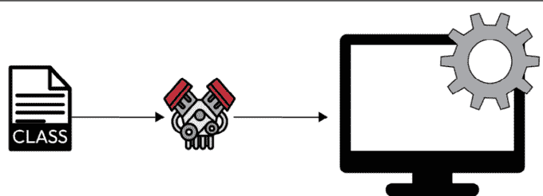

图 4.1：在 JVM 中执行类的过程

每当执行 Java 应用程序时，JVM 都会创建一个唯一的运行时环境。然而，重要的是，JVM 会使用各种技术在每个运行时内优化性能。一种显著的优化技术是 JIT 编译器。在同一个应用程序的重复执行中，JVM 会经常识别特定运行时内的已执行代码路径（称为热点代码），并将其动态地编译成原生机器代码。这些编译后的代码存储在同一运行时的内存中，减少了对字节码重复解释的需求，并显著提高了特定运行时的执行速度。此外，JVM 实现可能会对频繁访问的类和资源采用缓存机制，以优化应用程序在每个运行时中的性能，以及 JIT 带来的益处。


总结来说，JVM 优化了每个运行时的性能，而 JIT 编译和缓存机制的益处适用于单个执行实例，确保应用程序在其特定的运行时环境中高效运行。

尽管有这些优化，但值得注意的是，这些优化在 Java 应用程序启动时会丢失。因此，在每次运行应用程序或在另一台机器上运行时，整个原生代码的优化和编译必须重新进行。正在进行中的项目，例如 Project Leyden (https://openjdk.org/projects/leyden/)，旨在解决这一挑战。Leyden 项目的主要目标是通过让开发者对应用哪些优化有更多控制，来缩短启动时间、达到峰值性能的时间以及 Java 程序的整体占用。不过，值得注意的是，在项目的目前阶段，这种控制程度可能是有限的。

在此背景下，另一个值得关注的项目是 Checkpoint 协调恢复 (CRaC) (https://docs.azul.com/core/crac-introduction)，这是一个旨在优化 Java 程序启动时间和资源利用率的 JDK 项目。CRaC 允许你启动 Java 程序时具有更短的首次事务时间，并且需要更少的资源来实现完全代码运行速度。它通过在 Java 进程完全预热时对其拍摄快照（检查点）来实现这一点。然后，它使用快照从捕获的状态启动多个 JVM，并利用 Linux 特性。值得提到的是，如 Open Liberty 的 InstantOn 等替代方案，两者都是专有技术。此外，AWS Lambda SnapStart 使用 CRaC API，展示了这种检查点方法的实际应用。Spring、Micronaut 和 Quarkus 等流行框架也支持 CRaC 检查点，使其成为进一步优化 Java 应用程序性能的一种很有前景的方法。

字节码解释器是 JVM 中的一个关键组件，在执行 Java 程序中起着主导作用。当 Java 应用程序启动时，JVM 从之前编译的文件（通常封装在 JAR 文件中）加载字节码。这些字节码由解释器细致地解释，遵循获取、解码和执行每条指令的逐步过程。解释器基于栈模型操作，在字节码之间导航，将操作数推入栈中或从栈中弹出。这种方法允许高效处理，并有助于 Java 应用程序的快速启动。虽然解释执行的代码速度可能无法与原生编译的代码媲美，但解释器通过在快速启动的灵活性与定义 Java 的移植性之间取得平衡。

### 操作系统层

位于 ISA（指令集架构）层之上，操作系统是应用程序软件与硬件之间关键的中介。它管理资源，为应用程序提供运行环境，并促进软件与硬件组件之间的通信。

### 应用层

最顶层包含应用程序软件，其中包括为满足特定用户需求而设计的程序和工具。该层与操作系统交互，以高效地执行任务并利用硬件资源。

在这一视觉快照中，我们见证了计算分层架构的“芭蕾”：硬件作为有形的动力源奠定了基础。ISA 层是一座至关重要的桥梁，定义了软件与硬件之间的语言。向上移动，操作系统是一个指挥家，协调着动态的相互作用。该图概括了计算层的本质，展示了让我们的数字景观焕发生机的互联之舞步：

| 层级 | 组件 |
|---|---|
| 应用层 | 应用程序 |
| 操作系统层 | 系统运行 |
| ISA 层 | 指令集架构 |
| 硬件层 | 硬件 |

图 4.2：系统运行的分层

在计算复杂的编排中，JVM 成为一个优雅的舞者，无缝地弥合了系统层之间的差距。当我们探索 JVM 与硬件、ISA 和操作系统这些基础层之间的共生关系时，一个引人入胜的故事正在展开：

- **与 ISA 和硬件的交互：** JVM 通过操作系统间接与 ISA 层和硬件交互。它依赖 ISA 层的指令集来执行字节码，同时由操作系统代表 JVM 管理硬件资源。
- **与操作系统的协作：** JVM 与操作系统层紧密工作，利用其服务进行内存管理、文件操作和其他系统相关任务。JVM 抽象了底层硬件和操作系统的差异，为 Java 应用程序提供了与平台无关的执行。
- **应用程序执行：** JVM 是位于应用层的 Java 应用程序的运行环境。它解释并执行 Java 字节码，确保 Java 程序可以在各种平台上一致运行，而无需直接担心底层的硬件或操作系统规范。

本质上，JVM 充当了高层应用层与低层系统层之间的关键桥梁，抽象了硬件和操作系统的细节，为 Java 应用程序提供了一个标准化且可移植的执行环境。

当我们对系统运行层及其复杂舞蹈的探索接近总结时，我们发现自己正处于一个深刻启示的边缘——JVM 的精细执行。此时，我们已经领略了抽象、资源管理、互操作性和安全性的意义，见证了这些支柱如何共享计算的本质。我们的旅程促使我们揭开 JVM 执行之外的层级。在下一节中加入我们，深入探讨 JVM 执行的复杂性，解码 Java 应用程序获得生命时发生的魔法。我们探索的连续性将让我们对 JVM 与已揭示层级之间的共生关系有更深的理解。

## 解码 JVM 执行

在 JVM 执行的编排中，性能在不同的阶段展开，每个阶段对 Java 应用程序的无缝功能做出贡献。序曲始于 JVM 的加载，类加载器勤奋地获取并加载类文件和字节码到内存中，为随后的性能铺平道路。

随着合唱的响起，JVM 的执行引擎处于主导，在基于栈的执行模型中动态解释字节码。同时，数据区域被精细地初始化，为堆和栈等运行时组件分配内存空间。这种编排的舞蹈与原生元素的集成达到高潮，无缝链接原生库以增强应用程序的能力。

当 JVM 应用执行时，它遵循以下步骤：

1.  **序曲从 JVM 自身的加载开始。** 这一关键阶段涉及类加载器定位并加载必要的类文件和字节码到 JVM 内存中。类加载器充当门卫，确保所需的类可访问以供执行。

舞台准备就绪后，JVM 执行引擎接管焦点。最初，字节码在基于栈的执行模型中被解释。随着每个字节码指令被动态执行，应用程序开始成型。

同时，数据区域被精细地初始化，为堆和栈等运行时组件分配内存空间。这种编排的舞蹈与原生元素的集成达到高潮，无缝链接原生库以增强应用程序的能力。

## JIT 编译

JIT 编译是 JVM 中的一个关键组件，彻底改变了 Java 应用程序的执行。与传统的提前（AOT）编译（在执行前将所有代码翻译为机器码）不同，JIT 编译在运行时动态发生。这种即时翻译在执行之前将字节码转换为机器码，优化了性能和适应性。

在 JVM 中采用 JIT 编译是为了追求可移植性和性能之间的平衡。通过最初解释字节码并对频繁执行的代码路径编译为原生机器码，JVM 融合了解释和编译方法的优点。这种方法允许 Java 应用程序在保持平台无关性的同时，实现与原生编译语言相当性能。

在 JVM 执行复杂的织图中，JIT 编译的分层在平衡适应性和性能方面起着作用。让我们深入这些层级，理解它们存在的原因以及如何共同增强 Java 应用程序的执行。

解释器提供了活性和平台无关性，而 JIT 编译器优化热点，确保 Java 应用程序能够动态适应环境。这种自适应方法对于获得高性能程序结果至关重要。

### 解释器级

在解释器级，JVM 使用解释器执行 Java 字节码。该解释器是平台无关的字节码与底层硬件之间的桥梁。当 Java 程序执行时，解释器逐条读取指令并将其翻译为机器码。虽然这种方法具有启动快和平台无关等优点，但在解释过程中引入了固有的开销，可能会影响执行速度。

解释器本质上充当快速执行器，使 Java 应用程序可以在任何平台上运行，而无需预编译代码。然而，由于在执行期间对字节码进行实时翻译，整体性能可能无法达到最优。这就是后续 JIT 编译层级介入的地方。解释器级因此提供了灵活性与适应性之间的平衡，为更高级的 JIT 编译阶段奠定了基础。

### Baseline JIT 编译

基准 JIT 编译代表了 JVM 内部动态编译过程的下一个阶段。在对字节码进行初始编译后，JVM 会识别频繁执行的特定代码区域，即热点。这些热点是进一步优化以增强整体性能的候选者。这就是基准 JIT 编译器介入的地方。

在基准 JIT 编译阶段，编译器采用选择性编译，在运行时针对识别出的热点。通过关注频繁执行的代码部分，在执行之前将其转换为原生机器码。基准 JIT 编译器强调通过快速编译来实现即时性能提升，利用简单快速的翻译技术，与重复解释执行相比有了显著改进。动态适应是关键，因为编译器持续监控应用程序的执行情况，识别并选择热点。这种敏捷的响应确保了优化工作集中在影响最大的区域，从而与不断演进的运行时行为保持一致，并为即时性能增益进行优化。

#### 动态适应

基准 JIT 编译中的动态适应是指编译器对 Java 应用不断变化的运行时行为的敏捷响应。通过持续监控执行情况，编译器识别频繁执行的区域或热点，并选择性地将其编译为原生机器码。这种适应策略确保了基准 JIT 编译器将其优化精力集中在影响最大的区域，为即时性能增益进行优化。

动态适应的意义在于它能够平衡快速编译与有效的性能改进。通过根据运行时行为调整其方法，编译器对工作负载的变化保持敏感，完善其策略以匹配 Java 程序不断演进的执行模式。它确保了基准 JIT 编译（也称为 C1 编译器）保持作为一个动态且有效的组件，在 Java 应用处理多样化工作负载时对其进行实时优化。

值得注意的是，这种动态适应与 AOT 编译代码的主要区别。此类代码始终以相同的方式运行，无法适应当天的`使用用例`，而这正是 JIT 编译器能够完美处理的。JIT 编译器根据运行时行为调整其优化策略的能力，使其成为一种在各种场景下最大化 Java 应用性能的强大工具。

在我们对 JIT 编译探索的尾声中，我们见证了它在动态优化 Java 字节码以增强性能方面产生的巨大力量。从解释器的快速适应性到基准 JIT 编译器的选择性编译过程，JIT 的复杂舞蹈已经展开。当我们为这一章拉上帷幕时，更深层次的启示已准备就绪——类加载在 Java 运行时动态中的作用。在下一节中加入我们，我们将揭开类加载的细微之处，探索动态将类加载到 JVM 中如何构成 Java 扩展性和动态性的基石。我们旅程的延续承诺了从 JIT 的动态编译编排到类加载的幕后奇迹的无缝过渡。

## 类加载

在这个启发性的章节中，我们深入探讨了类加载的复杂世界。

### 练习题

1.  **JIT 编译的主要优势是什么？**
    - A. 静态代码分析
    - B. 动态代码执行
    - C. 平台特定优化
    - D. 特定于平台的编译

2.  **在基准 JIT 编译的背景下，“热点”（hotspot）一词指的是什么？**
    - A. 很少执行的代码段
    - B. 频繁执行的代码区域
    - C. 编译错误
    - D. 解释字节码

3.  **字节码解释器如何有助于 Java 的平台无关性？**
    - A. 它执行静态分析
    - B. 它即时解释字节码
    - C. 它依赖于特定平台的编译
    - D. 它仅在某些操作系统上运行

4.  **基准 JIT 编译器在 JVM 优化中的主要作用是什么？**
    - A. 对所有代码段进行快速编译
    - B. 对代码行为进行深度分析
    - C. 字节码静态翻译
    - D. 对频繁执行的代码进行选择性编译

5.  **动态适应如何提高基准 JIT 编译的有效性？**
    - A. 通过忽略运行时行为
    - B. 通过一次性编译整个程序
    - C. 通过适应负载的变化
    - D. 通过优先考虑很少执行的代码

### 答案

以下是本章问题的答案：

- 1. B. 动态代码执行
- 2. B. 频繁执行的代码区域
- 3. B. 它即时解释字节码
- 4. D. 对频繁执行的代码进行选择性编译
- 5. C. 通过适应负载的变化

# 5 内存管理

本章探索了 JVM 内部内存管理的复杂领域。对于寻求优化应用程序性能和扩展性的 Java 开发者来说，理解内存分配和利用的内部机制至关重要。作为任何 Java 程序的心脏，JVM 的内存系统协调着各种组件，包括堆、栈和垃圾回收机制，每个组件在 Java 应用程序的高效执行中都起着至关重要的作用。

在整个本章中，我们将深入研究这些组件的复杂性，揭开 JVM 如何分配和管理内存资源的奥秘。我们将探索堆背后的基础概念（对象存储在其中并由垃圾回收器管理）以及处理方法调用和局部变量的栈。这段穿越内存管理的旅程将揭开垃圾回收算法的复杂性神秘面纱，并为高效的对象内存分配提供最佳实践的明示。你不仅将掌握主导 JVM 内存管理的基本原则，还获得了实用的见解，以优化你的 Java 程序以实现最佳内存利用。无论你是资深 Java 开发者还是该语言的新手，这次探索都承诺将成为掌握 Java 生态系统中内存管理艺术的大门。

在本章中，我们将探讨以下主题：

- JVM 中的内存管理
- 程序计数
- Java 栈
- 原生方法栈
- 方法区
- 堆
- 代码缓存与 JIT

## 技术要求

对于本章，你将需要以下内容：

- Java 21
- 本章的 GitHub 仓库地址为：`https://github.com/PacktPublishing/Mastering-the-Java-Virtual-Machine/tree/main/chapter-05`

## JVM 中的内存管理

在对 JVM 内部内存管理的这一富有启发性的探索中，我们将深入研究内存分配和利用的复杂性，认识到内存在 Java 应用程序生命周期中所起的关键作用。一旦你的 Java 代码被编译成字节码，内存管理的旅程就开始了。随着字节码的执行，它会调用 Java 平台无关性的基石 JVM，JVM 会出场并声明 JVM 与系统交互所需的必要内存，获取高效运行程序所需的底层系统内存。

在 JVM 的内存格局中，堆和栈等关键组件进入了视野。堆是一个存储对象的动态区域，通过垃圾回收来释放不再使用的对象所占用的内存。栈管理调用和局部变量，为程序执行期间的内存处理提供了一种结构化且高效的方式。

JVM 的一个特点是它能够动态适应不断变化的内存需求。垃圾回收器是 JVM 不可缺的一部分，它识别并回收由未引用对象占用的内存。这种动态内存管理确保了资源的最优利用，增强了你 Java 程序的整体性能。Java 与 C/C++ 等语言之间最重要的区别之一是在 Java 中，内存分配和清理由 JVM 自动管理。这减轻了开发者承担显式内存管理任务的负担。然而，你不需要过度担心内存管理，但理解本章所解释的内存结构及其由 JVM 管理的方式，对于有效的 Java 开发至关重要。

理解 JVM 如何与系统接口对于获取所需的内存至关重要。我们将深入研究允许 JVM 无缝分配和释放内存的通信协议和机制，确保与底层操作系统的和谐集成。掌握了这些知识，你将能够更好地优化代码以提高内存效率，为你的 Java 应用程序增强性能和扩展性做出贡献。因此，让我们开启进入 Java 内存管理核心之旅吧，每一个字节都至关重要！

在这次探索中，我们的重点是揭开 JVM 复杂的内存架构，特别强调其关键组件：方法区、堆、Java 栈、`程序计数器 (PC)` 寄存器和原生方法栈。这些元素共同协调 Java 程序的动态执行，每个元素在组织动态执行中起着独特的作用。当我们深入研究这些内存区域的细微差别时，我们的目标是为 JVM 处理内存提供全面的理解，帮助开发者优化代码以增强性能和扩展性。因此，让我们开启穿越 JVM 景观的旅程，每个内存区域在塑造 Java 应用程序运行时行为方面都有其作用。

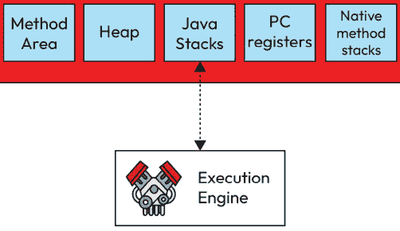

图 5.1：运行中的 JVM 及其内存

在接下来的章节中，我们将深入探讨 JVM 内部这些内存区域的细节。我们的探索将涵盖方法区域如何管理类级信息、堆的动态性质及其在对象分配中的作用、栈的意义，以及程序计数器（PC）的功能。在本章结束时，你将全面理解 JVM 的架构以及这些组件如何促进程序的执行。

当我们结束对 JVM 内部中内存区域的探索时，我们已经对方法区域、栈和 PC 寄存器等组件之间的动态相互作用获得了宝贵的见解。在下一节中，我们将关注 JVM 的一个关键方面：PC。它在引导程序执行流方面起着核心作用，存储当前执行指令的地址。

## 程序计数器


我们对 JVM 中 PC 的关注是一个与执行密切相关的关键组件。对于每个线程，PC 充当着路标的角色，承载关于正在执行指令的关键信息。当我们深入研究 PC 的细微之处时，发现它是为 JVM 内部的每个线程创建的专用寄存器。它携带至关重要的数据，主要作为指针和返回地址存在。这是理解线程进行状态的关键。指针引导线程指向下一条要执行的指令。当方法结束时（无论是正常结束还是由于异常），栈帧都会被丢弃。

在理解 PC 的行为时，区分不同的方法执行至关重要。在方法的语境下，PC 转换为一个指针，展示了其在适应各种执行性质方面的灵活性。接下来的视觉表示展示了 JVM 内部线程执行的复杂“舞蹈”，并特别关注了每个线程独有的 PC：

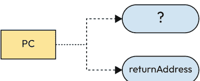

图 5.2：程序计数器

PC 在管理线程执行方面的作用是至关重要的。它像一个哨兵一样，不断更新以反映当前正在进行的指令。除了在执行控制方面的作用外，PC 对代码优化也有影响。JVM 的实现控制着 PC，开发者可以通过理解其工作原理来影响优化。这允许开发者策略性地将其代码与 JVM 执行模型对齐，以增强性能。

当我们结束对 PC 及其在引导 JVM 内线程执行中关键作用的探索时，我们正处于揭另一层的边缘。在接下来的章节中，我们将深入 Java 栈的动态世界，它是管理方法调用和为变量提供专用空间的核心组件。

## Java 栈

在本节中，我们将深入探讨 Java 栈的细节——它是 JVM 内部的一个基础组件。与 PC 类似，Java 栈是每个线程私有的专用寄存器，充当方法执行信息的存储库。本节将探索 Java 栈的操作，并与 C 等语言进行类比，阐明它在存储局部变量、方法调用和结果方面的作用。

像 C 这样的语言一样，Java 栈通过存储帧（frames）来运行，每个帧都封装了与方法执行相关的关键信息。这些栈帧持有参数、局部变量和其他基本数据。Java 栈的功能不仅限于直接修改变量；相反，它通过优雅地插入和删除栈帧来适应线程执行状态的变化。

当一个线程被调用时，Java 栈会通过插入新栈帧来经历动态转换。该栈帧封装了参数和局部变量等细节，为方法的执行编排了专用空间。当方法结束时（无论是正常结束还是通过异常），栈帧会被丢弃。这种生命周期确保了 Java 栈内部一个组织良好且高效的执行环境。

Java 栈的灵活性通过其根据执行的 Java 应用程序的特定需求进行固定或动态确定的能力得以强调。这一特性允许定制资源分配，有助于优化内存使用。

Java 栈的基本构建单元是栈帧。该单元在创建方法时产生，在方法结束时（无论是正常完成还是由于异常）消失。每个栈帧都封装了多个组件，包括局部变量列表、操作栈以及对当前类和方法的引用。这种三部分结构将栈帧分为三个本质部分：

- 局部变量：帧内的该区域是局部变量的存储空间。这些变量特定于当前执行的方法，对于存储与方法功能相关的中间结果和参数至关重要。

- 操作栈：与局部变量协同工作，操作部分容纳了操作栈。该栈对于管理方法内部的操作流至关重要，有助于指令的执行，并确保了方法执行的结构化方法。

- 帧数据：该部分封装了关于方法执行上下文的关键信息。它包括对当前类和方法的引用，为 JVM 有效导航程序结构提供了必要的上下文信息。

将栈帧划分为局部变量、操作栈和帧数据的这种三部分划分对于维护 Java 栈的完整性和功能至关重要。它确保了系统化的组织，允许在 JVM 内存架构中实现高效的方法执行，并无缝处理变量和操作。

### 图 5.3：Java 栈表示

JVM 内部的帧（frame）是存储数据、处理中间结果、返回方法返回值以及管理异常的基本单元。它的生命周期与方法调用紧密绑定：每调用一次方法就会创建一个新的栈帧，并在完成后销毁。这些栈帧分配在线程的栈上，并拥有独特的局部变量数组、操作数栈，以及附加的特定于实现的细节（如调试信息）。

局部变量数组和操作数栈的大小在编译时就已经确定，并随方法代码一起。因此，栈帧的大小完全取决于 JVM 的实现。在给定的线程范围内，只有一个帧被指定为当前帧。当方法结束时，栈帧会演变，并将结果传给调用者。

当调用栈（管理方法调用的内存区域）超过其上限时，就会发生 `StackOverflowError`。在递归编程中，方法调用自己，每次调用都会创建一个新帧。每个栈帧都包含有关方法的信息，包括局部变量和返回地址。

`StackOverflowError` 直观地展示了调用栈的工作原理。每次方法调用都会将新栈帧推入栈中。如果这种递归过深且没有返回，可能会消耗所有可用的调用栈内存，可能导致系统崩溃。

Java 引入的 [StackWalker API](https://openjdk.org/jeps/259) 提供了一种标准且高效的方法来遍历执行栈。它允许开发者访问栈帧信息（包括类实例），而无需捕获整个堆栈轨迹。与 `Throwable::getStackTrace` 等方法相比，该 API 提供了更高的活性和性能。

`StackWalker` 对于必须高效遍历执行栈上选定帧的场景特别有用。它通过允许对栈信息进行延迟访问和过滤帧，解决了现有 API 的局限性，使其成为此类任务的有力工具：

- 确定直接调用者的类
- 过滤栈中的特定实现
- 查找保护域
- 为可抛异常对象生成堆栈轨迹

`StackOverflow` 错误是递归编程在栈变得过深时产生的实际结果。Java 引入的 `StackWalker API` 提供了一种高效且灵活的方式来遍历和访问执行栈信息，解决了现有方法的局限性。

在 JVM 复杂的结构中，每个栈帧都包含一个名为局部变量的变量数组。该数组的长度在编译时确定，并嵌入到相关类或接口的二进制表示中，随帧中的方法代码一起。单个局部变量可以容纳 `Boolean`、`byte`、`char`、`short`、`int`、`reference` 或地址值；一对局部变量共同持有 `long` 或 `double` 类型。

### 局部变量

局部变量通过索引访问，第一个局部变量的索引为零。JVM 的寻址机制允许整数作为局部变量数组的索引，只要索引在零到数组大小减一之间，它就是有效的。重要的是，`long` 或 `double` 类型的值跨两个连续的局部变量，这需要使用较小的索引进行寻址。虽然允许存储在第二个变量中，但这会使第一个变量的内容失效。

JVM 通过在处理 `long` 和 `double` 值时能够适应非偶索引展示了其卓越的灵活性，这偏离了局部变量数组传统的 64 位对齐概念。这种适应性使开发者能够根据局部变量的分配来决定如何表示这些值。JVM 的这一独特特性使其能够无缝适应各种系统架构（包括 32 位和 64 位系统），根据特定的硬件配置优化内存利用和性能。

在实践中，局部变量在方法调用中起着至关重要的作用。对于类方法调用，参数位于连续的局部变量中，从局部变量 0 开始。对于实例方法调用，局部变量 0 充当传递调用对象引用（类似于 Java 中的 `this`）的通道，后续参数位于从索引 1 开始的连续局部变量中。这种对局部变量的系统使用确保了参数在 JVM 内方法执行期间的有效传递。

接下来的视觉展示了 JVM 内局部变量的动态编排。此图封装了每个帧中的局部变量，描绘了 `Boolean`、`byte`、`char`、`short`、`int`、`float`、`reference`、`address`、`long` 和 `double` 类型的组织空间。特别是，局部变量对无缝容纳了 `long` 或 `double` 值，通过非偶索引的灵活性挑战了传统的对齐规范。在这里，我们可以看到 JVM 如何在方法调用期间高效地使用局部变量，将参数系统地安排在连续的局部变量中。这个简洁的视觉图为理解 JVM 内存架构中值的细微相互作用提供了清晰的路线图：

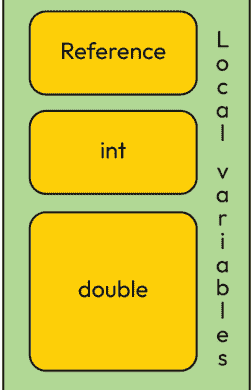

图 5.4：局部变量表示

### 操作数栈

在 JVM 复杂的结构中，每个帧都拥有一个后进先出（LIFO）的栈，被称为操作数栈。这个部分揭开了字节码执行的层级，揭示了操作数栈在方法执行期间管理数据的作用。

由于其固有属性，`double` 类型在操作数栈中占据更大的空间。随着字节码执行的展开，相关指令协调加法操作，无缝处理了 `double` 值的较大尺寸。见证 10.10 和 20.20 转换为最终结果 30.30，这反映了算术操作以及操作数栈内对 `double` 值的手动适配。下图捕捉了操作数栈动态的复杂性，强调了在 JVM 中处理不同数据类型时基本的尺寸考虑：

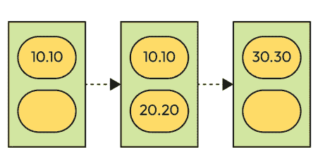

图 5.6：a + b 的操作栈

当我们结束对操作数栈的探索时，我们展示了 JVM 内部值复杂的舞蹈，见证了它们的动态交换与计算。从整数到双精度，操作数栈是字节码执行的多功能舞台。现在，我们的旅程引导我们进入方法执行的核心——Java 栈（Java stack）。在下一节中，我们将从字节码层面剖析 Java 栈，深入研究它如何调度方法调用流、管理帧并导航调用栈的复杂性。加入我们，共同对 JVM 基于栈的架构进行更深层次的探索，解锁定义方法调用和执行旅程的层级。

### 字节码层面的 Java 栈

当我们探索 Java 的内部机制时，将注意力转移到了一个关键方面——字节码层面的 Java 栈。我们已经深入研究了字节码执行的复杂世界，揭示了 Java 指令如何转换为 JVM 内部的低级操作。如果你正准备深入字节码规范，我们鼓励你重温第 3 章。

现在，我们的旅程带我们审视 Java 栈，这是 JVM 基于栈架构中的一个基础组件。本节旨在剖析 Java 栈在管理方法调用、处理帧和导航调用栈中的作用。这是一场进入方法执行核心的旅程，阐明了 JVM 如何组织和执行 Java 代码。

因此，加入我们，在字节码中导航 Java 栈，揭示塑造方法调用和执行复杂性的层级。对于那些渴望加深对 Java 内部机制理解的人，本节探索了 Java 运行时环境基于栈的体系。

让我们创建一个名为 `Math` 的 Java 类，封装各种算术操作，展示静态和实例方法。我们的类将包含基础操作，如加法、乘法、减法和除法，同时使用整数和 `double` 数据类型：

```
public class Math {
    int sum(int a, int b) {
        return a + b;
    }
    static int multiply(int a, int b) {
        return a * b;
    }
    double subtract(double a, int b) {
        return a - b;
    }
    static double divide(double a, long b) {
        return a + b;
    }
}
```

类定义完成后，我们可以使用 `javac` 命令进行编译。随后，使用带有 `-verbose` 标志的 `java` 命令检查 `Math` 类的字节码表示。对字节码的启发性探索允许我们深入研究 JVM 执行算术操作时解释的低级指令。加入我们这段实践旅程，发现静态方法和实例方法的复杂性，为它们在 JVM 内部的实现提供更深入的理解。

我们仔细分析了为 `Math` 类中每个方法生成的字节码。字节码是 JVM 理解的 Java 代码中间表示，它的展开提供了关于每个方法低级操作的见解。让我们仔细剖析算术操作的字节码，交付两个方法的入栈情况、局部变量和参数大小。

首先，我们将探索使用整数的 `sum` 方法；如你所见，`arg size` 为三，因为除了参数之外，一旦它不是静态方法，它还包含实例本身：

```
int sum(int, int);
```

- Descriptor: (II) I
- Flags: (0x0000)
- Code explanation:
  ```
  stack=2, locals=3, args_size=3
  0: iload_1
  1: iload_2
  2: iadd
  3: ireturn
  ```
- Analysis:
  - `locals=3` 表示该方法有三个局部变量。在这种情况下，它包含了实例和两个参数。
  - `stack=2` 表示方法执行期间的最大栈大小为 2，用于容纳推送到栈上的值。
  - `args_size=3` 表示向方法传递了三个参数。

该方法是一个被声明为 `static` 的乘法操作。在 Java 中，当一个方法是静态的时，它属于类本身，而不是类的实例。因此，与实例方法不同，静态方法没有类实例的引用。

在方法描述符中，`args_size` 指定了方法在被调用时期望的参数总数。对于实例方法，其中一个参数预留给实例本身，在 Java 中通常称为 `this`。然而，在静态方法中，这个实例并不与类的任何特定实例关联。因此，静态方法的 `args_size` “少一个”，因为它们不需要实例方法所那样的实例参数。

```
static int multiply(int, int);
```

- Descriptor: (II) I
- Flags: (0x008) ACC_STATIC
- Code explanation:
  ```
  stack=2, locals=2, args_size=2
  0: iload_0
  1: iload_1
  2: imul
  3: ireturn
  ```
- Analysis:
  - `locals=2` 表示该方法有两个局部变量。
  - `stack=2` 表示方法执行期间的最大栈大小为 2。
  - `args_size=2` 表示向方法传递了两个参数。

## 原方法栈 (Native method stacks)

在 JVM 领域，原生方法（用 Java 以外语言编写的方法）的执行引入了一个独特的内存管理方面：原生方法栈。这些栈通常被称为 C 栈，作为原生方法执行的脚手架，并被 JVM 解释器使用。

使用原生方法栈的 JVM 实现可能会为每个线程分配这些栈，与其线程创建同步。这些栈的灵活性表现为固定大小或动态调整，以适应计算需求。如果是固定的，每个原生方法栈的大小可以在创建时独立确定。

## 方法区 (Method area)

在 JVM 复杂的架构中，方法区是一个所有 JVM 线程可访问的空间，类似于传统语言中编译代码的存储区，或操作系统进程中的“文本”（text）段。这一核心区域包含了每个类特有的结构，包括运行时常量池、字段和方法的数据，以及方法和构造函数的代码。它还容纳了独特的类、接口和初始化方法。

方法区创建于虚拟机启动时，虽然它在逻辑上是堆的一部分，但在垃圾回收和压缩策略上可能有所不同。该规范并未规定其实现规范（例如位置和管理策略），为 JVM 的实现提供了灵活性。方法区的大小（无论是固定还是动态的）可以由程序员或用户控制，为调优运行时环境提供了灵活性。然而，如果方法区内的内存分配无法满足请求，就可能出现 `OutOfMemoryError` 异常情况。加入我们对方法区域的详细探索，揭示其作为类和方法信息存储库的角色，并为 Java 应用在 JVM 中的无缝执行奠定基础。

深藏于 JVM 复杂的架构之中，方法区作为所有 JVM 线程的共享领域，类似于原生语言中的编译代码存储区或操作系统进程中的“文本”段。这一重要空间是每个类结构的存储库，存放着运行时常量池、字段和方法数据，以及方法和构造函数的代码。与类、接口初始化和实例初始化密切相关的特殊方法就在这个领域中。

方法区始于虚拟机诞生，尽管在逻辑上是堆的一部分，但在垃圾回收和压缩策略上可能有所不同。其实现规范（包括位置和管理策略）为 JVM 的实现提供了灵活性。方法区的大小（无论是固定还是动态的）可以由程序员或用户进行精调，从而对运行时环境进行控制。然而，如果方法区内的内存分配不足，就会出现迫在眉睫的 `OutOfMemoryError`。

当我们揭开方法区的层级，深入研究其作为类和方法信息存储库的角色时，我们为 Java 应用在 JVM 中的无缝执行铺平了道路。加入我们的这段探索，这不仅能揭秘方法区的复杂性，还为我们进入广阔的堆区域旅程做好准备——它是 JVM 动态内存管理编排中的关键组件。

## 堆 (Heap)

JVM 的核心是堆，它是 JVM 线程的共享空间，也是负责为所有类实例和数组分配内存的动态运行时数据区域。作为虚拟机启动期间创建的基础组件，堆在执行 Java 应用中起着至关重要的作用。

自动存储管理系统（通常称为垃圾回收器）协调堆内部的内存管理。值得注意的是，堆中的对象永远不会被显式释放，而是依赖自动系统来回收存储。JVM 对特定的存储管理技术保持中立，允许其实现具有灵活性以满足各种需求。堆的大小可以是固定的，也可以根据计算需要动态调整，根据需要扩展或收缩。这种灵活性结合非连续内存分配，确保了高效的利用。

通过赋予 JVM 实现灵活性，程序员和用户可以控制堆的初始、最大和最小大小。然而，迫在眉睫的异常情况是 `OutOfMemoryError`，当计算所需的空间超过自动存储管理系统提供的空间时就会触发。加入我们对堆的探索，我们将发现它在动态管理内存中的关键作用，并理解其配置以优化 Java 执行的细微差别。

下图显示了对象的诞生，它的开端标志着引用的创建——指向所封装的本质的指针：

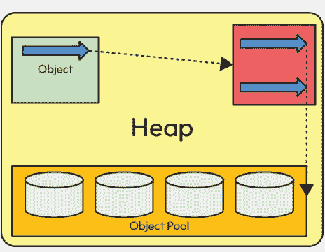

图 5.7：堆概览

随着引用的影响范围扩展，两个微妙的指针开始发挥作用，勾勒出通往核心领域的路径：

- 对象池：一个详细信息的储水池，对象池容纳了赋予对象生命的复杂性
- 方法区：嵌套在其中的方法区内的常量池是类细节的存储库——属性、方法、封装——提供了对象起源的全面视图

此图捕捉了实例、引用与堆的复杂内存分配网络之间的共生关系。加入我们一起解读这段内存交响乐，在这里，对象找到了居所，线程在集体内存空间中汇聚，描绘出 Java 动态运行时环境的生动图景。

随着实例的诞生，这种本质在堆中找到了住所——这是一个通过 JVM 基础结构实现的共享内存空间。这个由线程共同访问的动态领域不仅存储了对象信息，还包含一种复杂的内存回收机制，巧妙地操纵对象以规避空间碎片的危险。

堆中引用类型的表示与动态区域有所不同，它们回响了引用变量的行为，类似于 C/C++ 中的指针机制。这些引用对象没有详细信息，作为指向对象信息储水池的指针。本质上，一个引用对象包含两个简洁的指针：

- 一个对齐于对象池，存放着渴望的细节
- 另一个指向常量池，那是一个包含属性、方法、封装等类见解的宝库，它优雅地嵌套在方法区内


进入这一动态区域中向量（`vectors`）的表示法，它们回响了引用变量的行为。然而，向量还装饰了两个额外的字段：

- 大小 (`Size`)：定义变量维度的指标
- 引用列表 (`Reference list`)：一个精心的指针汇编，编织了与嵌套在该向量中的对象之间的连接

当我们穿越这片复杂的景观，设想类和方法信息的角色时，我们为 Java 应用在 JVM 中的无缝执行铺平了道路。

理解 `Code Cache`（代码缓存）的动态机制揭示了它在 JIT 编译过程中的关键作用，对 Java 程序的效率和适应性做出了巨大贡献。当我们深入运行时优化的复杂性时，`Code Cache` 成为了一个基石，确保编译后的卓越代码能够随时供应用程序加速执行使用。

## 总结

在本章中，我们深入了管理 JVM 内部 Java 程序执行的复杂机制。从理解内存管理的复杂性、探索 Java 栈，以及解开原生栈（`native stacks`）的谜团，到见证 JIT 编译器的动态编译实力以及 `Code Cache` 所起的关键作用，我们的旅程就是解码运行中 Java 应用程序内部工作原理。

当我们告别代码执行动态领域时，下一个目的地正在等待着，在那里我们将探索运行时管理的一个基本方面：垃圾回收器。欢迎加入接下来的章节，我们将共同揭开内存清理和资源管理的复杂性，这对于维护 Java 程序的健康和效率至关重要。垃圾回收器正在召唤，它提供了关于 JVM 如何优雅地处理内存释放并确保 Java 应用程序生命力的见解。让我们开启下一章，揭示 JVM 动态格局中垃圾回收的秘密。

# 问题

回答以下问题以测试你对本章内容的掌握程度：

1. `Code Cache` 在 JVM 中的主要作用是什么？

A. 实例存储空间

B. 编译后代码的仓库

C. 内存清理和资源管理

D. 动态调整堆的大小

2. Java 栈为 JVM 中的每个线程存储什么？

A. 编译后的代码片段

B. 垃圾回收器信息

C. 帧（`Frames`）、局部变量和操作数栈

D. 原生方法栈

3. 哪个内存区域是所有 JVM 线程共享并存储运行时池、常量池、字段和方法数据以及方法代码？

A. 堆（`Heap`）

B. 方法区（`Method area`）

C. `Code Cache`

D. 原生方法栈

4. JVM 中的哪个内存区域负责存储类实例和数组，其内存由垃圾回收器回收？

A. `Code Cache`

B. 原生方法栈

C. Java 栈

D. 堆（`Heap`）

5. Java 栈在 JVM 中的主要目的是什么？

A. 编译后代码片段的存储空间

B. 实例仓库

C. 动态调整堆的大小

D. 为每个线程存储帧、局部变量和操作数栈

## 答案

以下是本章问题的答案：

1. B. 编译后代码的仓库
2. C. 帧、局部变量和操作数栈
3. B. 方法区
4. D. 堆
5. D. 为每个线程存储帧、局部变量和操作数栈

# 垃圾回收与内存分析

在 Java 虚拟机（JVM）内部复杂的舞蹈中，字节码在寄存器内存范围内被编译，程序被执行，内存资源的艺术化编排变得不可或缺。在遍历了字节码编译和程序执行领域后，深入研究 JVM 内部内存管理的细微领域至关重要。本章将对垃圾回收器（`GCs`）进行全面探索，揭开 Java 程序维持的复杂织锦。

当我们揭开内存分配、堆结构以及至关重要的垃圾回收机制的谜团时，我们 JVM 内部工作的旅程到达了一个关键点。通过理解内存管理的细微差别、堆和栈的区别，并掌握垃圾回收的复杂性，你将增强对 JVM 内部的理解，并获得精确控制内存使用的技能。加入我们，一起穿越 `GC` 的复杂地形，解锁优化 Java 程序内存效率的钥匙。

在本章中，我们将探索以下主题：

- `GC` 概述
- JVM 调优与人体工程机学

## GC 概述

在 JVM 内部复杂的格局中，`GC` 角色扮演着关键组件，影响着 Java 程序的效率和可靠性。我们的探索深入了垃圾回收的基本概念及其在管理 JVM 内存中的关键作用。

`GC` 的核心目的是回收程序不再使用的对象所占用的内存。在像 Java 这样采用自动内存管理的语言中，开发者免去了显式释放内存的负担，提高了生产力并减少了内存相关错误的概率。

然而，没有任何架构奇迹是不需要代价的。在标记-清除（`Mark and Sweep`）算法中，内存碎片是一个突出的考量因素。当我们分析这一方面时，我们深入了该算法的复杂性：它在擅长回收内存的同时，可能会在内存空间留下碎片化的区域。这些碎片就像散落的拼图块，为连续内存块的高效分配带来了挑战，影响了程序的整体效率。

到此为止，我们的叙述阐明了自动内存管理的优势与潜在缺点之间的微妙平衡，强调了采取细致方法的必要性。无缝自动化与碎片化威胁之间的权衡，促使开发者在应用收益与应用效率需求之间进行权衡。

在 JVM 内部复杂的领域，`GC`（垃圾回收器）的选择会深度影响 Java 应用程序的性能。`Serial GC` 是一种简单的单线程回收器，适用于要求适中的应用程序，提供了一种简单直接的垃圾回收方法。相反，`Parallel GC` 在以吞吐量为中心的场景中脱颖而出，利用多线程加速垃圾回收任务并提高整体系统效率。从 Java 9 开始，默认的回收器 `Garbage-First (G1) GC` 在低延迟和高吞吐量之间取得了平衡，使其成为各种应用程序的多能选择。Java 11 引入了新范式 `Z GC (ZGC)`，它极地减少了停顿时间并增强了可扩展性，满足了现代资源密集型应用的需求。当我们开始探索每个回收器的复杂之处时，对它们的理解将使开发者能够做出明智的决策，优化垃圾回收策略以符合其 Java 项目的具体需求。

## Serial GC

在 JVM 内部的织锦中，`Serial GC` 是垃圾回收策略中的一个基础参与者。我们将剖析 `Serial GC`，这是一种以简单单线程内存管理方式为特征的回收器。当我们深入其运行的复杂性时，我们探索了为什么简单的设计至关重要，以及 `Serial GC` 发挥优势的场景。通过揭示其优势和局限性，我们了了格局，以理解这种极简回收器成为 Java 开发者战略选择的最优场景。我们将探索 `Serial GC`，在 JVM 内部内存编排中，对简单性的追求与效率交织在一起。

`Serial GC` 的特点是其采用顺序的、“停顿世界”（`stop-the-world`）的垃圾回收方法。它在垃圾回收过程中停止应用程序的执行，确保没有并行线程会干扰识别和回收不可达对象。这种简单性允许 `Serial GC` 简化内存管理，而无需处理并发操作的复杂性。

`Serial GC` 的优雅伴随着代价，特别是在吞吐量和响应速度方面。鉴于其单线程的本质，对于大内存或需要低停顿时间的应用程序，有更高效的选择。“停顿世界”的停顿虽然短暂，但会影响用户体验，使得 `Serial GC` 更适用于停顿可以被接受的场景。

`Serial GC` 与标记-清除算法无缝集接。它在标记阶段（`mark phase`）识别可达和不可达对象，并对其进行相应标记。在随后的清除阶段（`sweep phase`），它清除不可达对象占据的内存。`Serial GC` 的顺序性确保了这些阶段的简单执行，简化了标记和清除之间的协调，如下图所示：

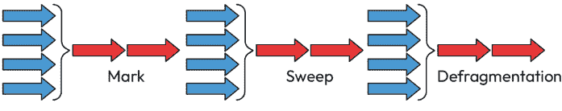

图 6.2：`Serial GC` 工作原理

在内存占用较小且应用程序性能对短暂停顿不敏感的场景下，`Serial GC` 的简单性得以显现。它非常适用于客户端应用程序或资源有限的环境，在这些环境中，“停顿世界”方法与系统需求完美契合。

当我们沉浸于 JVM 内部的内存编排时，一个关键方面通过为 `Serial GC` 定制的配置选项展现开来。下表展示了一组和谐的命令组合，每条命令都具有影响和优化 `Serial GC` 行为的力量。从启用或禁用 `Serial GC` 到精细调整比例、大小和阈值，这些命令提供了一根指挥家的魔棒，用以塑造内存管理的交响乐。加入我们，解读每个命令的意义，为开发者和管理员提供手段，通过调整控制 `Serial GC` 运行的参数，为他们的 Java 应用程序雕刻出性能：

| Command | Description |
| --- | --- |
| `-XX:+UseSerialGC` | 启用 `Serial GC` 的使用。 |
| `-XX:-UseSerialGC` | 禁用 `Serial GC`（服务器类机器的默认值）。 |
| `-XX:NewRatio=<value>` | 设置新生代与老年代的比例。 |
| `-XX:NewSize=<size>` | 设置新生代的初始大小。 |
| `-XX:MaxSize=<size>` | 设置新生代的最大大小。 |
| `-XX:SurvivorRatio=<value>` | 设置 Eden 空间与幸存区空间的比例。 |
| `-XX:MaxTenuringThreshold=<value>` | 设置新生代对象的最大晋升阈值。 |
| `-XX:TargetSurvivorRatio=<value>` | 设置期望的幸存区大小占新生代的百分比。 |
| `-XX:PretenureSizeThreshold=<size>` | 设置老年代中对象分配的阈值。大于此大小的对象将直接进入老年代。 |
| `-XX:MaxHeapSize=<size>` | 设置最大堆大小。 |

表 6.1：`Serial GC` 命令

这些选项允许开发者和管理员配置 `Serial GC` 的方面，例如新生代的大小、幸存区的比例以及整个堆的大小。调整这些参数可以根据特定的应用需求和硬件特性对内存管理进行精细调优。

由 `Serial GC` 编排的内存管理的和谐协调阐明了它的优势、代价以及其独特方法脱颖而出的战略场景。当我们过渡到下一节时，随着我们深入研究 `Parallel GC`，并行性能的舞台已准备就绪。从单线程到并行线程的演进预示着对大规模效率和增强吞吐量的探索。

## Parallel GC

当我们开启对 JVM 内部探索的下一个乐章时，焦点现在转向了 `Parallel GC`。在这一节中，我们深入了并行的世界，内存管理的效率成为了了焦点。`Parallel GC` 凭借其多线程的实力，编排了一场垃圾回收的交响乐，为 Java 应用程序承诺增强的吞吐量和优化的性能。通过细致的视角，我们揭开了 `Parallel GC` 的复杂性——它的特性、优势，以及其并行线程与大规模数据密集型环境需求无缝衔接的场景。加入我们，与我们跨越 JVM 内部的并行节奏，发现推动内存管理推向新高度的并行线程。

`Parallel GC` 的标志在于其多线程方法，使其与其单线程的胞类相比，特别擅长处理更庞大的堆并实现更高的吞吐量。它将堆划分为区域，利用并行线程并发执行垃圾回收任务，从而实现更快的执行和更短的停顿。

`Parallel GC` 在 JVM 内部编排了一场效率的同步舞蹈，与标记-清除算法无缝衔接。在复杂的垃圾回收过程中，`Parallel GC` 利用多线程的力量并发执行标记和清除的关键步骤。在标记阶段，每个线程遍历指定的堆，识别并标记对象为不可达或可达。这种跨线程的同步标记确保了对内存空间的快速且并行的评估。标记阶段结束后，线程的集体努力协调清理在标记期间识别出的对象。`Parallel GC` 下的标记-清除过程中的并行性优化了吞吐量。它展示了多个线程协同工作的同步才华，编排了一场在内存管理中优雅平衡响应速度与效率的演出。

`Parallel GC`（并行垃圾收集）在大型堆和数据密集型应用的场景下表现最为出色。它非常适用于批处理、科学计算以及对最大化吞吐量至关重要的场景。然而，它的权衡使其成为那些能够忍受短暂暂停以换取整体性能优化的应用的策略选择。

在我们揭示 `Parallel GC` 的复杂性时，我们将探索它的线程如何描绘出一种平衡了大规模内存管理需求的性能。在本节中，请加入我们共同导航并行收集的版图，了解它的强大功能何时成为优化 JVM 内部内存编排的战略选择。

在对 JVM 内部细节中 `Parallel GC` 的探索中，精细调整其行为的能力变得至关重要。下表提供了一套全面的命令，每条命令都是解锁 `Parallel GC` 效率和吞吐量潜力的关键。从开启或关闭使用到配置线程数、设置暂停时间目标以及采用自适应调整策略，这些选项赋予了开发者和管理员塑造 JVM 内部内存管理调度的能力。当我们深入研究每条命令的细微差别时，这套组合就成了指挥家的指南，能够构建出满足 Java 应用独特需求的优化性能。请加入我们，解读这些命令的意义，为塑造 `Parallel GC` 以与 JVM 环境的各种景观无缝衔接提供多种可能。

| Command | Description |
| --- | --- |
| `-XX:+UseParallelGC` | 启用 `Parallel GC`。 |
| `-XX:-UseParallelGC` | 禁用 `Parallel GC`。 |
| `-XX:ParallelGCThreads=<value>` | 设置垃圾回收的线程数。 |
| `-XX:MaxGCMillis=<value>` | 设置垃圾回收的最大预期暂停时间目标。 |
| `-XX:GCTimeRatio=<value>` | 设置垃圾回收时间与应用时间的目标比例率。 |
| `-XX:UseAdaptiveSizePolicy` | 启用堆和幸存者空间的自适应大小策略。 |
| `-XX:AdaptiveSizeThroughputPolicy` | 为面向吞吐量的垃圾回收配置自适应大小策略。 |
| `-XX:AdaptiveSizePolicyOutputInterval=<n>` | 设置自适应大小策略输出的间隔（以垃圾回收次数为单位）。 |
| `-XX:ParallelGCVerbose` | 启用 `Parallel GC` 的详细输出。 |

表 6.2：`Parallel GC` 命令

这些选项提供了配置和精细调整 `Parallel GC` 行为的手段，允许开发者和管理员根据特定的应用需求和硬件特性优化垃圾回收。

当我们结束对 `Parallel GC` 世界的探索时，我们发现自己对在 JVM 内部编排和谐性能的并行线程有了深入的理解。`Parallel GC` 的多线程效率通过其配置选项展示出来，为寻求在各种 JVM 环境中优化内存管理的开发者和管理员提供了强大的工具包。我们穿越并行节奏的旅程为下一幕开了序幕——`G1 GC`。请在接下来的章节中加入我们，深入研究 `G1` 的细微差别，揭开它的特性、优势和复杂性，这些因素使其成为 JVM 内垃圾回收策略交响乐中的关键角色。

## G1

当我们继续对 JVM 内部的探索时，我们的焦点现在转向了 `G1 GC`。作为其前任的现代继任者，`G1` 引入了垃圾回收策略的范式转变。在本节中，我们将深入 `G1` 的复杂性，揭开它的特性、操作细微差别以及它带到内存管理前线的创新方法。`G1` 对实现低延迟、可预测的暂停时间和高效堆利用的专注关注，使其成为 JVM 内部垃圾回收交响乐中的关键角色。在本节中，请加入我们，探索垃圾回收策略的演变，辨析支撑 `G1` 的原理，并揭示它为 JVM 内部动态景观带来的交响乐般的效率。

`G1 GC` 设计用于解决传统垃圾回收策略带来的挑战。它引入了一种基于区域的方法，将 Java 堆划分为更小的、大小均匀的区域（`regions`）。这种对单体堆结构的偏离允许 `G1` 更灵活、更精确地管理内存。

`G1` 将堆划分为区域，并将其分为三个主要类型：`Eden`、幸存者（`survivor`）和老（`old`）。这些区域的大小和配置是动态的，允许 `G1` 适应应用的内存需求。

存活空间（`liveness space`）的概念是 `G1` 效率的核心。存活空间包含存活对象的区域——即仍被应用程序引用的对象。`G1` 识别并优先对活跃数据最少的区域进行垃圾回收。这种策略方法通过针对可回收内存最集中的区域来优化收集过程，减少了垃圾回收暂停的频率和持续时间，如下图所示：

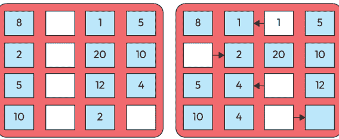

图 6.4：`G1` 进程与存活空间工作

`G1` 的主要目标是实现低延迟和可预测的暂停时间。通过优先考虑活跃数据最少的区域，`G1` 最小化了对应用程序响应的影响。这使得 `G1` 特别适用于保持一致且低暂停时间至关重要的场景，例如交互性和实时应用程序。

`G1` 采用自适应收集策略根据应用的动态行为调整其方法。它可以动态调整区域大小、更改垃圾回收频率，并调整其整体策略以适应不断变化的需求。

本质上，`G1 GC` 对存活空间的使用加上其基于区域的方法，使其成为 Java 应用内存管理的一种复杂且高效的解决方案。对可预测性和适应性的关注使得 `G1` 在 JVM 垃圾回收策略格局中极具价值。

在我们 JVM 内部内存编排的旅程中，下表作为 `G1` 的指挥家指南展开。这套组合中的每条命令都是解锁 `G1` 为垃圾回收带来的精确性和效率的关键。通过开启或关闭 `G1` 并精调堆区域大小、暂停时间目标和自适应策略等参数，这些选项赋予了开发者和管理员塑造 JVM 内部内存管理交响乐的能力。当我们深入每条命令的意义时，我们正在导航 `G1` 的性能细节，构建可预测性和适应性之间的平衡。请加入我们解读这段配置的交响乐，每一个音符都共响着 `G1` 引入 JVM 动态景观的细微精密：

| Command | Description |
| --- | --- |
| `-XX:+UseG1` | 启用 `G1 GC`。 |
| `-XX:-UseG1` | 禁用 `G1 GC`。 |
| `-XX:G1HeapRegionSize=<value>` | 设置 `G1` 垃圾回收区域的大小。 |
| `-XX:MaxCPauseMillis=<value>` | 设置垃圾回收的最大预期暂停时间目标。 |
| `-XX:InitiatingHeapOccupancyPercent=<value>` | 设置启动 `G1` 垃圾回收周期的堆占用百分比。 |
| `-XX:G1NewSizePercent=<value>` | 设置年轻代最小百分比。 |
| `-XX:G1MaxNewSizePercent=<value>` | 设置年轻代最大百分比。 |
| `-XX:ParallelGCThreads=<value>` | 设置 `G1` 的并行垃圾回收线程数。 |
| `-XX:ConcGCThreads=<value>` | 设置 `G1` 并发阶段的并发垃圾回收线程数。 |
| `-XX:G1ReservePercent=<value>` | 设置预留给未来垃圾回收周期的堆百分比。 |
| `-XX:G1TargetSurvivorOccupancy=<value>` | 设置每个 `G1` 区域幸存者空间的目标占用率。 |


| -XX:G1HeapWastePercent=<value> | 设置 G1 区域被考虑回收的目标浪费空间百分比。 |

### 表 6.3: G1 命令

这些选项提供了配置和微调 G1 GC 行为的手段，允许开发者和管理员针对特定的应用程序需求和硬件特性优化垃圾回收。

在我们对 G1 GC 复杂性的探索中，我们对 JVM 内部内存管理交响乐所具有的精确性和适应性有了深层次的见解。我们在系列指南中提供的详尽配置选项就像是一根指挥棒，塑造着 G1 的性能，使其与 Java 应用程序的多样需求无缝衔接。当我们目光投向下一个阶段时，我们将揭开 ZGC 创新的微妙之处。

## ZGC

在我们对 JVM 内部的持续探索中，重点通过引入 ZGC 转向了创新的前沿。ZGC 作为垃圾回收策略的游戏规则改变者，成为效率和低延迟性能的灯塔。本节将作为我们通往 ZGC 世界的大门，揭示其前沿特性、自适应技术以及对尽可能减少停顿的承诺。ZGC 以响应速度为核心，优化了垃圾回收的动态机制，为现代动态应用程序提供了一个量身定制的解决方案。加入我们，在本节中深入探讨 ZGC 为 JVM 带来的革命性进步，标志着垃圾回收策略演进中的关键里程碑。

ZGC 站在现代垃圾回收策略的前沿，引入了重新定义 JVM 内部内存管理动态的突破性特性。其核心是优先考虑低延迟和响应能力，旨在为对性能有严格要求的应用程序尽可能减少停顿（`pause times`）。ZGC 的关键创新之一是它的并发垃圾回收方法。与传统的在某些阶段停止应用程序的收集器不同，ZGC 与应用程序线程并发执行垃圾回收任务，确保将停顿时间保持在最低。这种并发模型对于响应速度至关重要的应用程序特别有利，例如实时系统、交互式应用程序或必须最小化停机时间的服务。

在计算机内存中，多重映射（`multi-mapping`）是指虚拟内存空间中的特定地址指向物理内存中的地址的技术。这意味着多个虚拟地址对应同一个物理位置。应用程序通过虚拟内存与数据交互，对底层的多重映射机制一无知。这种抽象对于应用程序至关重要，允许它们在访问数据时无需感知虚拟内存到物理内存映射涉及的复杂性，如下图所示：

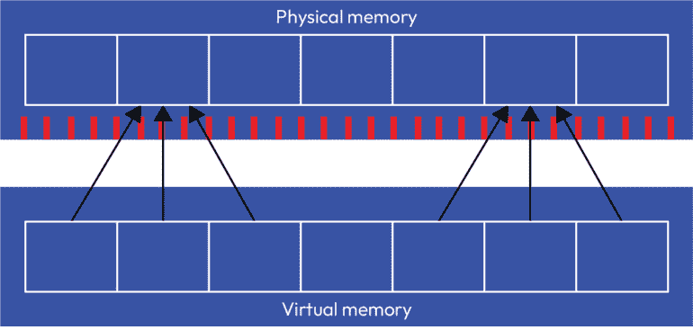

图 6.5：ZGC 进程映射

动态内存分配是编程中的常见做法，随着时间的推移会导致内存碎片。当对象被分配和释放时，内存布局中可能会出现空隙。随着时间的推移，这些间隙会积累，导致碎片，使得内存像一个交替空闲和使用区域棋盘。为了解决这个问题，有两种主要策略。

一种方法是定期扫描内存以寻找足够容纳所需对象的空闲空间。这种方法可行但耗费资源，特别是如果执行频繁的话。此外，它不能完全消除碎片，因为要找到所需空间的精确匹配可能很大，会在对象之间留下间隙。

另一种策略是定期将对象从碎片内存区域移动到更紧凑的格式。它涉及将内存分为块并同时移动整个对象块。这样做，由于可以使用已知空块，内存分配变得更快。这种策略有助于更有效地管理碎片，平衡了动态分配的需求与对更连续、更有组织的内存布局的渴望。

垃圾回收策略中存在权衡，ZGC 也不例外。虽然它在减少停顿时间方面表现出色，但它可能无法达到以延迟为代价优化吞吐量的收集器所相同的吞吐量。此外，ZGC 对于具有极大堆的应用程序可能不是最优的，因为它的并发方法可能会引入一些开销。然而，对于低延迟优先且应用程序响应速度优于最大吞吐量的场景，ZGC 成为了一个强大的解决方案。

ZGC 的另一个显著特性是它能够动态调整堆的大小。ZGC 根据应用程序的需求调整堆大小，使其能够根据不断的工作负载高效地管理内存。这种适应性在工作负载变化的环境中特别有利，提供了一种敏捷且响应的内存管理解决方案。

本质上，ZGC 代表了垃圾回收的范式转变，为要求低延迟和响应能力的应用程序提供了一种复杂的解决方案，而不会损害内存效率。它的创新特性和并发设计使其成为在动态和资源密集型场景下运行的现代 Java 应用程序的选择。

在 JVM 内部的动态领域，ZGC 作为一种尖端解决方案处于中心舞台，优先考虑低延迟性能和响应能力。此表是导航 ZGC 配置景观的指南，为开发者和管理员提供了一系列精选命令来塑造其行为。从开启或关闭 ZGC 到微调停顿时间、线程数和内存策略等参数，这些选项赋予了用户根据其 Java 应用程序的需求定制 ZGC。当我们深入研究每个命令的意义时，本指南成为优化 ZGC 性能的必要资源，确保效率和适应性之间的和谐平衡。加入我们解锁 ZGC 的潜力，在这里，每条命令都成为 JVM 内部垃圾回收策略未来精确交响乐中的音符。

| 命令 | 说明 |
| --- | --- |
| `-XX:+UseZGC` | 启用 ZGC。 |
| `-XX:-UseZGC` | 禁用 ZGC。 |
| `-XX:MaxGCPMillis=<value>` | 为 ZGC 垃圾回收设置最大的预期停顿时间目标。 |
| `-XX:GCPauseIntervalMillis=<value>` | 设置 ZGC 停顿之间的最大间隔。 |
| `-XX:ConcGCThreads=<value>` | 设置并发垃圾回收线程的数量。 |
| `-XX:ParallelGCThreads=<value>` | 设置并行垃圾回收线程的数量。 |

在 Java 开发的动态格局中，人体工程学（`Ergonomics`）和性能分析（`Profiling`）是实现优化性能的关键支柱。本节标志着我们精调 Java 应用的征程，探索人体工程学原理以使 JVM 能够自动适应不同的工作负载。同时，我们深入研究性能分析——这是一种洞察应用程序运行时行为的强大工具。在优化 Java 性能的细微差别中，人体工程学和性能分析成为我们的指路明灯，为构建高响应、高效的应用程序提供了策略。加入我们这一节，共同揭示自适应调优与深度性能分析之间的协同效应，释放将 Java 应用性能和响应能力提升到新水平的潜力。

在 Java 环境下，人体工程学指的是 JVM 内的自适应调优能力，它能够根据底层硬件特性和应用程序的行为自动调整其配置。其主要目标是在无需人工干预的情况下，平衡性能与资源利用率。

人体工程学的关键方面包括：

- **自适应调优**：JVM 根据实时数据调整其设置。
- **硬件感知**：针对特定硬件（如 CPU 核心和可用内存）进行定制化配置。
- **应用程序行为**：JVM 监控工作负载模式以优化执行和内存管理。

主要目标是提供一种 JVM 自动优化自身的无缝体验。然而，尽管人体工程学功能强大，但它们并非完美的解决方案。在某些情况下，可能仍需手动调优以实现性能目标。例如，不同垃圾回收器之间的选择至关重要：

- **Serial GC**：最适用于数据集小且单处理器的小型应用程序。
- **Parallel GC**：针对多处理器机器上的高吞吐量应用程序进行了优化。
- **G1 GC (Garbage First)**：针对大内存的多处理器机器设计，平衡吞吐量和暂停时间。
- **ZGC**：低延迟垃圾回收器，专为超大内存设计，具有毫秒级的暂停时间。

理解这些工具使开发者能够构建应用程序以实现最大的响应和效率。在接下来的学习，我们将探索如何使用性能分析工具识别瓶颈并做出明智的调优决策。

## 答案

以下是本章问题的答案：

- 1. B. 根据运行时特征自动调整 JVM 配置
- 2. A. 串行垃圾收集 (Serial GC)
- 3. A. 虚拟内存地址到物理内存的多映射
- 4. C. 开发者对性能参数有更好的控制
- 5. D. ZGC

# 第 3 部分：替代 JVM

在深入探索的过程中，我们引入了 GraalVM——这是一种支持多种语言并具有提前编译（`AOT`）能力的多功能替代 JVM。进一步扩展视野，我们将在第 8 章中深入探讨更广泛的 JVM 生态系统，探索 OpenJ9 和 Corretto 等替代 JVM。这些章节共同扩展了我们对各种 JVM 实现的理解，并提供了对其特性和用法的见解。

本部分包含以下章节：

- 第 7 章，GraalVM
- 第 8 章，JVM 生态系统与替代 JVM

# 7

# GraalVM

在不断演变的 JVM 领域中，GraalVM 作为一种革命性且多功能的替代方案脱颖而出。本章将深入探讨 GraalVM 的复杂性，揭示其独特特性，并阐明其作为 JVM 内部领域游戏规则改变者的角色。GraalVM 由 Oracle Labs 开发，通过提供支持多种语言的多语言运行时（包括 Java、JavaScript、Python、Ruby 等），超越了传统常规 JVM 的边界。这种灵活性为开发者开辟了新途径，允许他们无缝地在应用程序中集成不同的语言。在我们阅读本章的页面时，你将全面理解 GraalVM 的架构、其独特组件以及其在重塑 Java 开发格局中的关键作用。

GraalVM 的架构不仅证明了其工程能力上的雄厚，也体现了其对性能和效率的追求。本章不仅探索了 GraalVM 的底层架构和组件，还强调了其创新的 JIT 编译器，这是其效率的核心。理解 GraalVM 架构的每一个细节对于希望利用其力量来优化和增强应用程序性能的开发者来说至关重要。此外，我们还将深入研究现实用例，展示 GraalVM 优势的场景以及它解决的独特问题。无论你的目标是提高 Java 程序的执行速度，还是寻求多种语言的无缝集成，GraalVM 都是一个极具吸引力的解决方案，本章将引导你了解其功能和潜在应用。准备好探索 GraalVM 的尖端特性，并在不断演变的 JVM 内部格局中开启可能的新维度。

在本章中，我们将探讨以下主题：

- GraalVM 21
- 原生镜像 (`Native Image`)
- 创建原生镜像

## 技术要求

对于本章，你需要以下工具：

- GraalVM 21
- Git
- Maven
- 任何你偏好的 IDE
- 本章的 GitHub 仓库，地址位于 - `https://github.com/PacktPublishing/Mastering-the-Java-Virtual-Machine/tree/main/chapter-07`

## GraalVM 概述

在这个富有启发性的章节中，我们将开启穿越 GraalVM 突破性格局的之旅，这项创新重新定义了对 JVM 的预期。GraalVM 的崛起归功于其惊人的特性，特别是其高性能编译器、**提前**（`ahead-of-time`）`AOT` 编译，以及在管理多种语言运行时方面的卓越能力。

GraalVM 卓越性能的核心在于其先进的 JIT 编译器。该编译器经过精细设计，旨在优化 Java 程序的执行，推向速度和效率的边界。与传统 JVM 不同，GraalVM 的 JIT 编译器拥有先进的技术和优化手段，导致更快的启动速度和更低的内存占用。因此，开发者会感受到应用程序整体性能的显著提升，使 GraalVM 成为追求卓越速度的价值工具。

GraalVM 通过其 `AOT` 编译引入了范式转变，允许开发者将程序预编译为原生代码。这种方法消除了运行时对 JIT 编译的需求，从而实现了更快的启动时间和更低的内存消耗。`AOT` 编译为 GraalVM 开启了新视野，使其成为快速启动和低延迟至关重要场景的理想选择。本节将探索 `AOT` 编译的细节，并指导你如何利用其力量优化应用程序。

GraalVM 通过提供多语言运行时环境超越了传统 JVM 的限制。这意味着开发者可以在同一个应用程序中无缝集成并执行用多种语言编写的程序。从 Java 和 JavaScript 到 Python、Ruby 等，GraalVM 支持各种语言，培养了多语言生态系统。本节将深入探讨多语言能力的影响，展示开发者如何利用这一点构建跨语言障碍的多功能且高效的应用程序。

虽然 GraalVM 带来了许多创新特性，但像任何技术一样，它也存在权衡。本节旨在阐明这些考虑因素，帮助开发者在何时以及何地利用 GraalVM 的力量做出明智决策。

在平衡增强运行时多语言能力等优势的同时，开发者还必须考虑内存使用增加、编译时间延长以及兼容性差异等因素。探索这些权衡将使开发者能够根据项目需求做出明智决策。理解这些细节能够策略性地应用 GraalVM 的优势，同时缓解用例中的潜在挑战：

- **内存开销**：GraalVM 惊人的性能提升通常伴随着内存使用的轻微增加。先进的优化和多语言支持导致比某些传统 JVM 更大的内存占用。开发者必须权衡性能收益与对内存资源的潜在影响，特别是在受限的环境中。
- **编译时间**：GraalVM 的 JIT 编译器是运行时性能的强大源，但值得注意的是，与其他 JVM 相比，初始编译可能会更长。
- **兼容性**：虽然 GraalVM 支持广泛语言，但某些特性或库可能不兼容。开发者需要确保与现有项目的兼容性。

针对特定需求，开发者可以在 GraalVM 发挥最大优势的场景中充分利用其潜力。

当我们结束对 GraalVM 及其细微考虑的探索时，显而易见，这种创新的 JVM 替代方案在不断演变的 Java 开发领域是一股不可忽视的力量。从其高性能 JIT 编译器到多语言语言运行时，GraalVM 提供了一系列引人入胜的功能，可以将应用程序开发推向新的高度。虽然我们讨论了涉及的权衡，但这些考虑对于根据特定项目需求做出明智决策至关重要。

此外，我们对 GraalVM 最佳用例的探索揭示了其优势大放异彩场景，从微服务架构到资源密集型云应用。然而，故事并未此结束。GraalVM 的 `Native Image` 功能进一步推进了这一进程，允许开发者将应用程序提前编译成独立的可执行文件，完全避免了部署期间对 JVM 的需求。这为深入探讨 `Native Image` 奠定了基础，在其中，GraalVM 的能力得到了扩展，提供了一种更加精简、高效且资源友好的应用程序部署方式。随着我们揭开 GraalVM `Native Image` 开启的可能，它正以无与伦比的效率和创新重塑 Java 开发格局。

### Native Image

欢迎来到专门针对 GraalVM 的启发性课程，这是一项超越传统 JVM 边界的变革性技术。GraalVM 由 Oracle Labs 开发，作为一种多层面的解决方案出现，引入了重新定义应用程序开发格局的革命性功能。本课程将作为您理解 GraalVM 关键方面的指南，从其高性能 JIT 编译器到其多语言运行时以及创新的 `AOT` 编译。当我们深入研究 GraalVM 的架构和能力时，您将洞察它是如何解决现代应用程序不断变化的需求。加入我们对 GraalVM 的探索，在这里，创新与多功能汇聚，发现它如何赋能开发者创建高效、多语言的应用程序，推向 Java 生态系统中可能的边界。

GraalVM 的独特特征之一是其 `Native Image` 功能，这是一项允许部署进入新时代的变革性能力。与运行在 JVM 上的传统 Java 应用程序不同，GraalVM 的 `Native Image` 允许开发者将应用程序提前编译成独立的可执行文件。应用程序在部署期间不再依赖 JVM，而是被封装为自包含的二进制文件，直接与操作系统交互，跳过了对中间虚拟机的需求。

`Native Image` 方法的优势在于其在启动时间和运行时性能方面的效率提升。通过消除对 JVM 解释和执行代码的需求，`Native Image` 显著缩短了应用程序的启动时间，使其成为需要快速响应的场景的理想选择。此外，JVM 的缺失减少了应用程序的内存占用，增强了资源利用率，使其更适合资源受限的环境。

然而，也应该强调，`AOT` 编译消除了 JIT 编译的优势，因为字节码在运行时不再可用，无法针对变化的行为对代码进行优化。在许多情况下，应用程序运行时间很长，快速启动的收益可能会被部分抵消，因为由于缺乏运行时优化，整体性能较低。关于 `AOT` 和 `JIT` 之间这种权衡的详细探索，您可以参考此演示文：`https://www.azul.com/blog/jit-performance-ahead-of-time-versus-just-in-time/`

虽然 `Native Image` 在启动时间、内存效率和资源利用方面具有许多优势，但它也带来了开发者应该仔细考虑的权衡：

- **构建时间和复杂性**：创建 `Native Image` 涉及 `AOT` 编译，该编译发生在构建阶段。与基于 JVM 的应用程序中的传统 JIT 编译相比，此编译过程更耗时。此外，配置 `Native Image` 可能会更加复杂，要求开发者管理原生库、反射访问和其他考虑因素以获得最佳结果。
- **动态类加载和反射**：`Native Image` 要求在编译期间对应用程序代码进行静态分析，这对于严重依赖动态类加载的应用程序可能构成挑战。由于 `Native Image` 编译器在构建时需要完整的类和方法，动态加载或生成的代码可能需要特殊处理。
- **限制的运行时配置**：`AOT` 编译需要在构建阶段全面了解应用程序的行为。对于具有复杂运行时行为或动态适应场景的应用程序来说可能是挑战。在这种情况下，`Native Image` 可能无法捕获完整的运行时配置，导致性能权衡。
- **平台依赖**：`Native Image` 生成特定平台的二进制文件，可能会为跨平台兼容性带来挑战。虽然 GraalVM 提供了一定的交叉编译支持，但开发者必须注意依赖并在目标平台上进行测试。
- **包含库的占用**：在 `Native Image` 中包含某些库会增大体积，可能会抵消部分内存效率的收益。开发者必须仔细选择并优化包含在原生镜像中的依赖项，以在性能和功能之间取得平衡。

在导航应用程序部署格局时，理解 `Native` 应用程序与在 JVM 上运行应用程序之间的基本区别至关重要。差异在于它们执行和利用资源的方式。通过 GraalVM 新的 `AOT` 编译生成的 `Native` 应用程序以其精简的启动时间和内存占用而脱颖而出。它们在部署期间不需要 JVM，作为独立的可执行文件直接与操作系统交互。相比之下，基于 JVM 的应用程序具有跨平台的迁移性，可以在任何配备兼容 JVM 的环境中运行。接下来，我们将深入探讨这些差异的细微之处，说明启动时间、内存效率和对应用程序迁移性的影响等考虑因素。通过揭示这些区别，开发者可以根据特定项目需求做出明智选择。

| | | |
| --- | --- | --- |
| 动态类加载 | 受限；需要仔细处理 | 更灵活 |
| 反射 | 受限；需要仔细处理 | 更灵活 |
| 平台移植性 | 特定于平台的二进制文件 | 通过兼容的 JVM 实现跨平台支持 |
| 资源利用 | 高效；开销较低 | 取决于 JVM，开销可能更高 |
| 依赖包含 | 需要优化以管理大小 | 使用依赖管理器更易管理 |


| 运行时变化的适应性 | 动态性较低；需要仔细处理 | JIT 编译具有更强的适应性 |
| 构建复杂度 | 较高；需要配置 | 较低；通常由 JVM 处理 |

表 7.1：Native Image 对比 JVM

此表概述了 Native Image 与基于 JVM 的应用程序之间关键差异的高级视图。需要注意的是，两者之间的选择取决于具体的项目需求，需要考虑启动时间、内存效率、平台移植性以及动态特性的活性等因素。

在探索 Native Image 应用程序与其对应物的差异时，可以明显看出，最优应用部署的路径是细致且多面的。这次比较之旅揭示了两种方法的独特优势和考量，引导开发者做出符合项目优先事项的明智决策。现在，通过对权衡和收益有了更深入的理解，我们正站在实践的门槛上。

在接下来的章节中，我们将深入探讨 GraalVM 创建 Native Image 的实践领域。我们将揭开 AOT 编译过程的复杂性，分解将 Java 应用程序转换为独立可执行文件的步骤。从优化依赖到处理特定平台的考虑因素，这项实践探索将使你能够利用 Native Image 部署带来的效率提升。加入我们进入下一节，共同开启释放 Native Image 潜力的实践之旅，用 GraalVM 的突破性能力重塑应用部署的格局。

### 创建 Native Image

在这个沉浸式且实性的章节中，我们将深入学习如何使用 GraalVM 创建 Native Image。基于我们在对 Native Image 和 JVM 对应物进行比较探索时获得的见解，本节是你通往应用部署效率实践领域的大门。当我们从理论转向实践时，我们的重点现在转向赋能你发挥 Native Image 编译的变革能力。准备好开启一段旅程，我们将揭秘 AOT 编译过程，为将 Java 应用程序转换为独立可执行文件提供逐步指导。

在本节中，我们将深入研究优化部署的复杂性、处理特定平台的考虑因素以及释放 Native Image 部署的全部潜力。无论你是寻求应用程序性能的资深开发者，还是渴望探索 GraalVM 技术前沿的爱好者，这种实践经验都将让你具备实用的技能，将 Native Image 编译无缝集成到你的开发工具包中。让我们开始吧，在创建 Native Image 的过程中将其付诸实践，用 GraalVM 的革命性能力重塑应用部署的格局。

在这一实践章节中，我们将通过编写一个趣味的示例 Java 应用程序，深入探索 Native Image 编译的精彩世界。`App` 类设计用于向世界打印问候语，并以一种非常幽默的方式反转给定的字符串。当你探索代码时，你会发现它不是你的那个“Hello, World!”示例。相反，它引入了一个名为 `reverseString` 的方法，用于递归地反转给定的字符串。应用程序首先打印问候语，然后使用 `reverseString` 方法反转“Native Image is awesome”。

这个趣味的示例作为我们 Native Image 实验的画布。通过它，我们不仅将见证 Native Image 的创建，还能对优化过程和由此产生的效率提升获得见解。所以，系好安全带，为这个简单却具有代表性的 Java 应用程序穿越 Native Image 的创建过程。让我们让趣味变为现实，并使用 GraalVM 探索 Native Image 的魔法：

```
public class App {
    public static void main(String[] args) {
        System.out.println("Hello, World! with Native image");
        String str = "Native Image is awesome";
        String reversed = reverseString(str);
        System.out.println("The reversed string is: " + reversed);
    }
    public static String reverseString(String str) {
        if (str.isEmpty()) {
            return str;
        }
        return reverseString(str.substring(1)) + str.charAt(0);
    }
}
```

设置 GraalVM 是你轻松掌握 Native Java 版本的旅程的关键一步，我们将利用 SDKMan 项目。SDKMan 简化了不同 Java 版本的安装和切换，为开发者提供了无缝体验。

对于手动安装，你可以参考 GraalVM 官方文档。为了让你的生活更轻松，让我们使用 SDKMan 安装 GraalVM。在编写本文时，我们选择了带有 GraalVM 支持的 21.0.1 版本。在终端中执行以下命令：

```
sdk install java 21.0.1-graal
```

此命令通过 SDKMan 获取并安装 GraalVM 21.0.1。一旦建立，你可以将其设置为系统的默认 Java 版本，或在当前终端会话中选择性设置。如果你想将其设置为默认值，请使用以下命令：

```
sdk use java 21.0.1-graal
```

现在，随着 GraalVM 无缝集成到你的开发环境中，我们已经准备好探索 Native Image 的创建了。让我们开启这段实践之旅的下一步，将 GraalVM 的力量与 SDKMan 的简单性相结合。

创建 Native Image 是关键。让我们将其拆解开：

1. 编译 App
   `javac -d build src/main/java/expert/os/App.java`
2. 创建 JAR 文件
   `jar --create --file App.jar --main-class expert.os.App -C build`
3. 创建 Native Image
   `native-image -jar App.jar`
4. 执行 Native Image
   `./App`

创建 Native Image 后，我们可以运行该可执行文件。执行后，控制台将显示以下内容：

```
Hello, World! with Native image
The reversed string is: emosewa si egamiN
```

编译标志着一个重要的里程碑，展示了 GraalVM 在重塑 Java 开发格局方面的多功能性。

在本章结束之际，它作为探索更广泛的 JVM 生态系统和极致性能的跳板。除了传统 JVM 之外的多种选项（例如 OpenJ9 和 Azul Zing）将陆续揭晓，提供关于它们独特特性以及对不断演变的 Java 生态系统贡献的见解。在下一章中加入我们，基于我们在对 GraalVM 探索中获得的知识，共同探索 JVM 领域中的多种路径。

# 问题

回答以下问题以测试你对本章内容的掌握情况：

1. GraalVM 原生镜像（Native Image）编译的主要益处是什么？
   - A. 增加内存占用
   - B. 启动时间变慢
   - C. 平台移植性
   - D. 语言支持有限

2. 在 GraalVM Native Image 创建过程中，使用哪个命令来编译 App 类？
   - A. `compile --class App`
   - B. `javac -d build src/main/java/expert/os/App.java`
   - C. `native-image --compile App`
   - D. `graalvm-compile App.java`

3. 在提供的 Java 应用中，`reverseString` 方法的目的是什么？
   - A. 拼接字符串
   - B. 反转给定字符串
   - C. 检查是否为回文
   - D. 字符串中的空格

4. 在启动时间方面，GraalVM 的 Native Image 与基于 JVM 的应用程序如何比较？
   - A. 原生镜像的启动时间更慢
   - B. 两者的启动时间相似
   - C. 原生镜像的启动时间更快
   - D. 基于 JVM 的应用程序启动时间更快

5. 在 GraalVM 安装上下文中，SDKMan 的用途是什么？
   - A. 管理 Java 版本和安装
   - B. 创建镜像
   - C. 调试 Java 应用
   - D. 管理镜像

6. 在 GraalVM Native Image 创建过程中，`native-image` 命令的作用是什么？
   - A. 编译 Java 源码
   - B. 生成独立执行文件
   - C. 下载 Java 依赖项
   - D. 执行 Java 应用

## 答案

以下是本章问题的答案：

1. C. 平台移植性
2. B. `javac -d build src/main/java/expert/os/App.java`
3. B. 反转给定字符串
4. C. 原生镜像的启动时间更快
5. A. 管理 Java 版本和安装
6. B. 生成独立执行文件

## 8

# JVM 生态系统与替代 JVM

JVM 是“一次编写，随运行”哲学的基石，允许在不同平台上执行字节码。虽然 HotSpot JVM 长期一直是主流选择，但广泛的 JVM 生态系统远超此，提供了满足特定需求和性能考虑的实现。在本章中，我们将全面探索 JVM 格局，深入研究 OpenJ9 和 Corretto 等替代 JVM。随着我们揭开这些微妙之处，你将获得关于可用选项的价值见解，每个选项都有独特的特性和优化。

我们的之旅始于对这些替代 JVM 的深度概述，阐明它们的架构和关键区别。通过真实的性能指标，我们的目标是使你能够根据特定的用例做出明智的决策。此外，我们将探索替代 JVM 发挥优势的实际场景。本章还将讨论这些 JVM 与 Java 应用的无缝集成，提供关于兼容性和工具支持的信息。最后，我们将对选择 JVM 的注意事项进行总结，确保你能够充满信地导航 JVM 生态系统。

在本章中，我们将探索以下主题：

- JVM 的多样性
- Eclipse J9
- Amazon Corretto
- Azul Zulu
- IBM Semeru
- Eclipse Temurin
- 更多 JVM 供应商和 SDKMan

## JVM 的多样性

对 JVM 及其卓越格局的迷探索交织在编程世界中。虽然 Java 通常占据中心位置，但 JVM 的真正威力在于其多功能性，远超简单的 Java 字节码执行器。与流行观点不同，JVM 并非一个单一实体，而是多样性的证明，容纳了丰富的替代实现和供应商。让我们开启这段旅程，发现 JVM 的各个方面，使其成为软件开发中无与伦比的力量。

尽管是 Java 的基石，JVM 并不限于单一语言。它的可扩展性为许多编程语言在其保护下蓬荣发展铺了道路。从 Kotlin、Scala 到 Groovy 和 Closure，JVM 充当统一平台，营造了一个开发者可以无缝利用不同语言力量的环境。此外，JVM 发行者的格局也是生态系统稳健性的证明。在 Oracle 的 HotSpot JVM 之外，存在替代方案，每个都带来了独特的优化、特性和许可模型。事实上，在 JVM 的悠久历史中，已经出现了多种实现，满足不同的需求和偏好。

JVM 最引目的方面之一是超越语言和供应商的边界。得益于精心设计的规范，开发者可以在一个 JVM 实现中编写代码并在另一个中执行，无论供应商之间的差异。它的互操作性促进了代码复用，并促进了一个创新可以发展的生态系统。在这一节中，我们将探索 JVM 的虚拟桥接如何允许开发者在一个 JVM 上编译代码并在另一个 JVM 上无缝运行，强调了平台的适应性和韧性。

代码可以在它们之间无缝运行的情况下会有多个 JVM 实现的问题是对软件开发多样化需求和特殊背景的多维度探索。虽然跨 JVM 运行代码的能力促进了互操作性，但多种实现源于满足用例、优化性能以及适应不同硬件和软件环境的愿望。值得注意的是，大多数发行版并不是不同的实现，而是 OpenJDK 项目的版本，有时会经过微调。此外，所有发行版必须通过技术兼容性套件（TCK）（`https://openjdk.io/projects/tck/`），以确保它们遵循 Java 标准并维护整个 Java 生态系统的兼容性。OpenJDK 的源码可以在 `https://github.com/openjdk/` 获取，你甚至可以按照“building”文件中的指令自己构建运行时。这种严格的要求确保了开发者在运行 Java 应用时，无论选择哪种发行版都可以依赖一致的行为和功能。

每个 JVM 都拥有可以在特定语境下利用的独特优势，使其成为开发者的强大工具。例如，OpenJ9 JVM，它对资源效率和快速启动时间的强调使其成为云应用程序的极具吸引力的选择，因为响应速度和资源利用是关键因素。另一方面，Amazon Corretto 专注于长期支持（LTS）以及与 Amazon Web Services（AWS）的无缝集成，非常适合深耕 AWS 生态系统的企业。

此外，JVM 的适应性扩展到了硬件。在不同平台（运行相同代码的能力（无论是在 Lego Mindstorms 上还是在 OpenSolaris 等特定硬件上）都证明了 JVM 的移植性。它简化了开发过程，并赋予开发者创建能够在不同环境之间无缝切换且不会损害功能的应用程序的能力。

每个 JVM 的力量在于其执行代码的能力，以及它所带来的优化和特性。例如，GraalVM 以其即时（JIT）编译器和多语言能力而闻名，为语言互操作性打开了大门，允许开发者将 JavaScript、Python 和 Ruby 等语言无缝集成到 Java 应用中。这种多功能性在多种语言并存的场景中非常有价值。

本质上，多个 JVM 的存在是 Java 生态系统适应性和多样性的证明。开发者可以利用这些实现，根据性能需求、集成需求和特定环境特征做出明智决策。这种多样性促进了创新，并确保 JVM 作为一个稳健且动态的平台，随着不断变化的软件开发格局不断演进。

### Eclipse J9

在这一章节中，我们将深入探讨 Eclipse J9 的功能。这是一种以强调效率、可扩展性和资源优化而突出的 JVM 实现。在探索 Eclipse J9 的复杂特性时，我们将发掘它在广阔的 JVM 实现领域中脱颖而出的独特之处，并探索为什么开发者在构建 Java 应用时应该考虑这一工具。

Eclipse J9 由 Eclipse 基金会（Eclipse Foundation）开发，代表了尖端的 JVM 实现，旨在最大化效率并最小化资源占用。由于其紧凑的体积和快速的启动时间，Eclipse J9 在关键的资源利用场景中表现出色，使其成为云应用、微服务以及对响应速度要求极高的环境理想选择。它的架构结合了先进的 JIT 编译技术和激进的内存管理，有助于构建敏捷且响应快速的运行时。

作为一种卓越的 JVM 实现，Eclipse J9 展现了许多优势，使其成为对资源效率值得赞的承诺。Eclipse J9 的紧凑占用优化了系统资源，使其成为对最小化开销至关重要的应用的优解决方案。这种效率扩展到了更大量的内存去占用和处理器参与，这对于在资源受限环境中运行的应用来说是一项关键特性。快速启动时间进一步增强了它的吸引力，提升了用户体验和响应速度，特别是在操作响应时间的场景下。Eclipse J9 的可扩展性是另一个值得关注的优势，能够适应从小型应用到大型企业系统的各种环境的动态需求。当我们探索 Eclipse J9 的格局时，这些优势作为关键支柱，支撑了它赋能开发者创建无缝平衡性能与资源消耗应用的能力：

- 资源效率：Eclipse J9 的紧凑占用确保了系统资源的有效利用，使其成为最小化开销至关重要的应用的理想选择。这种效率涵盖了内存使用和处理器利用，允许在资源受限环境中获得最佳性能。
- 快速启动时间：JVM 的启动时间在特定应用领域中至关重要，Eclipse J9 在方面表现优异。快速启动确保了应用程序能够快速运行，增强了用户体验和响应速度。
- 可扩展性：Eclipse J9 设计为可在各种环境中无缝扩展，适应小规模应用和大型企业双方的需求。其可扩展性使其非常适合动态工作负载以及可能经历市场波动的应用程序。

当效率、响应速度和优化资源利用至关重要时，为您的 Java 应用考虑 Eclipse J9 变得至关重要。无论您是在开发云原生应用、微服务，还是在资源受限的环境中部署，Eclipse J9 都提供了一个具吸引力的解决方案。Eclipse J9 的优势转化为实实在在的利益，为开发者提供了根据应用程序独特需求平衡性能与资源消耗的灵活性。

在我们结束对 Eclipse J9 提供的效率和可扩展性的探索时，我们见证了这种 JVM 实现如何成为寻求在 Java 应用中优化资源利用和快速响应的开发者的战略选择。Eclipse J9 的优势——从紧凑的占用到快速启动时间再到可扩展架构——强调了它在各种应用格局中的通用性。在下一节中，我们将无缝过渡到对另一个知名 JVM 实现的深度检查：Amazon Corretto。我们将发现 Amazon Corretto 带来的独特特征和优势，进一步扩展我们对多元且动态的 JVM 世界的理解。旅程继续，对 JVM 实现的探索仍然是释放 Java 开发全部潜的关键。

### Amazon Corretto

在本节中，我们将开启 Amazon Corretto 的深度之旅。这是 Amazon 开发的一种 JVM 实现，结合了可靠性、性能和 LTS（长期支持）。我们将引导 Amazon Corretto 的细微之处，探索其独特的功能、性能优化，以及开发者考虑将此 JVM 实现集成到 Java 应用中的引人理由。

Amazon Corretto 代表了 Amazon 交付高质量、开源 JVM 的承诺，以满足现代 Java 开发的需求。Corretto 构建在 OpenJDK（Java 开发工具包）的坚实基础之上，旨在提供可靠且安全的 Java 运行时环境。Amazon Corretto 免费使用并带有 LTS，使其成为寻求稳定可靠 JVM 的企业极具吸引力的选择。


# Amazon Corretto 优势

在探寻各种 JVM 实现的复杂性时，Amazon Corretto 脱颖而出，成为可靠性、性能和持续支持的 Beacon。这一部分深入探讨了使 Amazon Corretto 成为不同领域开发者具有吸引力选择的独特优势。从对 LTS 的承诺到性能优化，再到对安全的坚定关注，Amazon Corretto 提供了一系列全面的优势，提升了开发体验，并确保了 Java 应用的长期寿命和稳定性。加入我们，揭开 Amazon Corretto 优势的层层，为为什么这种 JVM 实现值得在您的工具箱中占有一席提供细致的理解：

- **LTS**：Amazon Corretto 的突出特征之一是其 LTS。企业可以从扩展支持和更新中受益，确保其 Java 应用在长时间内的稳定性和安全性。

- **性能优化**：Amazon Corretto 配备了性能增强功能，可以优化 Java 应用的执行。这些优化改进了响应速度和吞吐量，使其非常适合广泛的用例。

- **安全稳定性**：Amazon Corretto 专注于安全和稳定性，经过了严格的测试和质量保证过程。它确保开发者可以为他们的 Java 应用运行在一个健壮、安全的运行时环境中。

- **与 OpenJDK 的兼容性**：Amazon Corretto 保持与 `OpenJDK` 的兼容性，允许开发者无缝从其他基于 `OpenJDK` 的 JVM 切换。这在简化迁移过程的同时，提供了 Amazon 额外优化和支持带来的益处。

为您的 Java 应用考虑 `Amazon Corretto` 是一项战略决策，特别是当 LTS、性能优化和对安全的承诺至关重要时。无论您是在开发云原生应用、无服务器函数还是传统的企业系统，`Amazon Corretto` 都提供了由 AWS 的可靠性和规模支持的 JVM 解决方案。

在我们结束对 `Amazon Corretto` 稳健世界的探索时，我们见证了定义这种 JVM 实现的可靠性、性能和 LTS 的汇聚。`Amazon Corretto` 的优势——从对 Java 应用优化的坚定承诺——引发了开发者考虑将其集成到项目中的引人理由。我们对多元 JVM 实现格局的旅程继续，在下一节中，我们将揭开另一个知名参与者的复杂性：`Azul`。

## Azul Zulu 和 Zing

在本节中，我们将深入探讨 `Azul Zulu OpenJDK` 构建（`Azul Zulu`）的动态领域。这是一种 JVM 实现，是 `Azul` 在 Java 运行时领域全面产品的重要组成部分。`Azul` 致力于提供 JVM 运行时和额外工具以增强 Java 性能并降低成本，这将 `Azul Zulu` 推向了前沿。

`Azul Zing OpenJDK` 构建（`Azul Zing`）是 JVM 领域的中流砥柱，提供了一系列将 Java 开发推向新高度的优势。`Azul Zing` 核心引入了创新的持续并发压缩垃圾回收器（`C4 Garbage Collector`），为低延迟和无感知垃圾回收树立了基准。这一关键特性确保了 Java 应用程序在面对高强度负载时仍保持响应能力。除了尖端的垃圾回收技术外，`Azul Zing` 因其对增强运行时性能的坚定承诺而脱颖而出。对于需要高吞吐量和极低延迟的应用来说，这是一个强大的选择。它的可扩展性和弹性使 `Azul Zing` 成为一种多功能解决方案，能够无缝地适应小型应用程序和大型企业系统的动态需求。基于长期支持（LTS）和稳定性，`Azul Zing` 成为长生命周期项目的战略性选择，为构建在性能、响应和可靠性方面表现卓越的 Java 应用程序提供了稳健的平台。加入我们，探索 `Azul Zing` 的诸多优势，揭示这一实现方案如何在不断演变的 Java 开发格局中成为创新与效率的灯塔：

- **C4 垃圾回收器**：`Azul Zing` 包含了创新的 `C4` 垃圾回收器。该回收器通过提供低延迟和无感知的垃圾回收脱颖而出，确保 Java 应用程序在重负载下也能保持一致的响应能力。

- **增强的运行时性能**：`Azul Zing` 旨在提供增强的运行时性能，适用于高吞吐量和低延迟的应用。它的优化提高了应用程序的响应速度并缩短了执行时间。

- **可扩展性和弹性**：`Azul Zing` 设计为可在不同负载之间进行无缝扩展，适应小型应用程序和企业级系统的需求。它的弹性确保了在动态和波动环境中的优化性能。

- **LTS 和稳定性**：`Azul Zing` 提供 LTS 和稳定性支持，为企业的 Java 应用程序提供了可靠的基础。这种对稳定性的承诺对于具有长生命周期和严苛可靠性要求的项目至关重要。

当性能、可扩展性和低延迟是不可妥协的标准时，选择 `Azul Zing` 进行 Java 开发是一项战略性选择。包括 `C4` 垃圾回收器在内的高级特性，使 `Azul Zing` 成为对一致响应能力和优化资源利用至关重要的应用的理想解决方案。让我们揭开 `Azul Zing` 的功能，发现这一 JVM 实现方案如何成为您的 Java 应用程序实现前所未有性能水平的催化剂。本节旨在为您提供见解，以便做出明智的决策，并在各种用例中利用 `Azul Zing` 的优势。

在应对 `Azul Zing` 和 `Zulu` 的复杂特性时，我们揭示了一系列优势，使这些 JVM 实现方案成为创新与效率的灯塔。`Azul Zulu` 是 `OpenJDK` 的构建，并集成了 `CRaC` 和 `JavaFX` 等额外功能。`Azul Zing` 是实现 Java 应用程序巅峰性能的强大催化剂，从突破性的 `C4` 垃圾回收器到对增强运行时性能和可扩展性的承诺。随着我们对不同 JVM 实现方案的探索继续，我们的下一个目标是向着 `Semeru`。在接下来的章节中，我们将深入探讨 `IBM Semeru` 带到前线的独特特性和优势，进一步扩展我们对 Java 开发多方面格局的理解。我们对 `IBM Semeru` 的探索即将开始，有望在追求卓越 Java 的道路上提供新的见解和视角。

## IBM Semeru

探索 `IBM Semeru`，这是一种封装了 IBM 在 Java 开发领域专业知识和创新的 JVM 实现。在探索 `IBM Semeru` 的复杂性时，我们将揭示它的独特特性、优化方案以及开发者应该考虑将此 JVM 实现集成到 Java 应用程序中的迷人理由。

`IBM Semeru` 基于 `OpenJ9` JVM，代表了 IBM 对提供高性能、可扩展且高效的 JVM 运行时环境的承诺。`IBM Semeru` 专注于资源效率、快速启动和高级优化，旨在满足各种应用程序场景的需求。

`IBM Semeru` 是 Java 开发中创新的灯塔，封装了一系列重新定义了高效且可扩展运行时环境可能性的优势。以稳健的 `OpenJ9` 虚拟机为基础，`Semeru` 引入了资源效率与快速启动时间的和谐融合，使其成为当代云原生应用和微服务的理想选择。集成提前编译（AOT）进一步凸显了 `IBM Semeru` 的特色，它在运行之前将 Java 字节码转换为机器码，以增强针对云部署优化的启动性能。`IBM Semeru` 满足现代应用开发不断变化的需求，确保了适应性、可扩展性和效率。对于寻求符合动态云环境需求的全面解决方案的开发者来说，`IBM Semeru` 是一个非常有吸引力的选择，承诺提供复杂且优化的 Java 运行时体验。加入我们探索 `IBM Semeru` 带来的优势：

- **OpenJ9 虚拟机**：`IBM Semeru` 利用了 `OpenJ9` 虚拟机，该虚拟机以资源高效和快速启动而闻名，使其成为当代云原生应用和微服务的理想选择。

- **AOT 编译**：集成提前编译（`AOT`）进一步凸显了 `IBM Semeru` 的特色，在运行之前将 Java 字节码转换为机器码以增强启动性能。

- **容器友好架构**：凭借对容器友好的架构，`IBM Semeru` 非常适合在云环境中部署。

- **针对云部署优化**：`IBM Semeru` 针对云部署进行了优化，符合现代应用的需求。

当资源效率、快速启动时间以及与现代部署范式的兼容性对您的 Java 应用程序至关重要时，考虑 `IBM Semeru` 就变得迫在必行。无论您是在开发云原生应用还是在容器化环境中部署，`IBM Semeru` 都提供了来自 IBM 支持的稳健实现。加入我们，揭开 `IBM Semeru` 的功能，为您提供做出明智决策并利用这一实现方案优势的见解。

## Eclipse Temurin

对 `OpenJDK` 及时更新和安全补丁的承诺，让 `Eclipse Temurin` 确保开发者能够获得最新的增强，助力 Java 应用程序的安全性和稳定性。它的平台独立性提供了跨不同操作系统和架构无缝部署 Java 应用程序的灵活性，满足了针对多个环境的项目需求。`Eclipse Temurin` 脱颖而出在于它在 `Eclipse` 生态系统中透明且开放的社区协作。开发者可以积极贡献，培养社区驱动开发的使命感，并确保 JVM 与用户的需求同步演进。易于采用的特性，加上对提供无忧 `OpenJDK` 构建的承诺，使 `Temurin` 成为开发者寻求可靠、受支持且社区驱动的 Java 运行时环境工具包中的重要组成部分。加入我们，揭示 `Eclipse Temurin` 为 Java 开发带来的益处，在 `Eclipse` 社区内培养协作与创新的新纪元：

- **及时更新和安全补丁**：`Eclipse Temurin` 为 `OpenJDK` 提供及时的更新和安全补丁，确保开发者能够获取最新的增强和修复。这种承诺保障了 Java 应用程序的安全性和稳定性更新。

- **平台独立性**：`Eclipse Temurin` 支持多种平台，允许开发者在不同的操作系统和架构之间无缝部署 Java 应用程序。这种平台独立性对于目标为多环境的项目至关重要。

- **透明且开放的社区协作**：作为 `Eclipse` 社区的一员，`Eclipse Temurin` 受益于透明开放的协作。开发者可以积极为项目贡献，培养社区驱动开发的使命感，并确保 JVM 与用户的需求同步演进。

- **易于采用**：`Eclipse Temurin` 承诺提供易于采用的 `OpenJDK` 构建，简化了将最新功能整合到项目中的过程。这种易于采用性对于寻求无忧集成新 Java 能力的开发者来说是宝贵的。

考虑到 `Eclipse Temurin`，对于优先考虑访问最新 `OpenJDK` 构建、社区驱动方法以及无缝平台独立性的开发者来说，它变得不可或缺。无论我们是为跨越各种操作系统的部署而开发应用程序，还是在为开源生态系统贡献力量，`Eclipse Temurin` 都提供了一个可靠且支持良好的基础。

我们在 JVM 实现的多样化图景中的旅程，是一部创新与优化的丰富织锦，从 `Eclipse Temurin` 社区驱动的卓越表现，到 `IBM Semeru` 的独特优势、`Azul Zulu` 的性能实力、`Amazon Corretto` 的可靠性以及 `Eclipse OpenJ9` 的效率。当我们结束这些个别探索时，下一部分将承诺一个整体视角，展示定义 JVM 实现世界的非凡多样性。加入我们进入接下来的部分，我们将在一个章节中导航多个 JVM 实现，突出开发者可以拥有的动态选择。从 `Eclipse Temurin` 到其他知名参与者，见证 JVM 选项如何根据特定需求和偏好定制其选择。探索将继续，揭示 JVM 实现世界的深度和广度。

## JVM 供应商和 SDKMAN

在这一节中，我们将对 JVM 生态系统中广阔的多样性开启一场迷人的探索。我们的关注将扩展到单个 JVM 实现之外，涵盖针对不同用例和环境定制的一系列专业构建。加入我们，深入探讨 `Dragonwell`、`腾讯 Kona`、`Mandel`、`微软 OpenJDK` 构建以及 `SapMachine` 的细微差别——它们代表了 JVM 多样性的每个方面，并为了满足特定需求进行了优化。

我们将开启一段进入 JVM 多样性多维度世界的迷人旅程，那里有万花筒般的专业构建等待探索。每个 JVM 实现都代表了解决应用程序开发中独特挑战的独特方法。从极端的扩展需求到云计算，再到 SAP 支持的生态系统，每个 JVM 都经过精心设计以满足特定的用例。加入我们，揭示这些实现的复杂性，洞察它们如何适应各种场景，为开发者提供丰富的选项组合，以符合这些项目的要求。探索有望让我们对多样化 JVM 世界中固有的适应性和多功能性有更深入的理解：

- **Dragonwell（阿里巴巴）**：`Dragonwell` 被设计为阿里巴巴内部的 `OpenJDK` 实现，针对在线电子商务以及金融和物流应用的极端扩展需求进行了优化。深入了解 `Dragonwell` 如何驱动阿里巴巴大规模服务器基础设施复杂的 Java 应用程序网络。

- **腾讯 Kona（Tencent Kona）**：作为腾讯云计算的默认 JDK 及其生产就绪的发行版，`Kona` 服务于腾讯云环境。

- **Mandel**：（注：原文为 `Mandel`，通常指代特定构建）

- **微软 OpenJDK 构建（Microsoft Build of OpenJDK）**：微软提供的 `OpenJDK` 构建。

- **SapMachine**：代表了 JVM 多样性的另一方面。

（注：由于原文列表项在后半部分描述较短，此处根据要求保留格式翻译。上述译文已涵盖了 `Dragonwell`、`腾讯 Kona`、`Mandel`、`微软 OpenJDK` 构建和 `SapMachine` 的对应关系。）

无论是探索不同的 JVM 供应商、尝试不同的版本，还是应对迁移阶段，`SDKMAN` 都能简化这一过程，让开发者能够专注于自己的代码。

## 总结

在我们结束对 JVM 多样性复杂世界以及 `SDKMAN` 关键作用的探索时，你已经对替代 JVM 有了深入的理解，包括阿里巴巴的 `Dragonwell`、腾讯的 `Kona`、`Liberica`、`Mandel`、微软的 `OpenJDK Build` 以及 `SapMachine`。本章不仅阐明了这些实现方案针对不同场景的独特特性，还强调了 `SDKMAN` 在简化 JVM 管理方面的关键作用。所获取的见解为接下来的章节奠定了基础，在后续章节中，你将深入研究塑造 Java 框架的基本原理。从设计模式到模块化，这些原则对于创建健壮、可扩展且易维护的应用程序至关重要。本章所提供信息的实用价值将显现出来，使你具备应对动态 Java 开发格局所需的知识。当我们过渡到 Java 框架原理时，你在这里获得的全面理解将证明是无价的，将引导你在通往卓越编码的道路上顺畅前行。

# 问题

回答以下问题以测试你对本章内容的掌握情况：

- **1. 阿里巴巴 Dragonwell JVM 实现的主要关注点是什么？**

  - A. 云计算
  - B. 在线电子商务以及金融和物流应用
  - C. 大数据
  - D. 微服务

- **2. 哪种 JVM 实现是腾讯用于云计算和大数据的默认 JDK？**

  - A. Amazon Corretto
  - B. Tencent Kona
  - C. Eclipse Temurin
  - D. Azul Zulu

- **3. Mandel JVM 实现的主要关注点是什么？**

  - A. 高性能计算
  - B. 在容器上运行应用程序
  - C. 为 Quarkus 应用生成原生镜像
  - D. 云原生应用开发

- **4. Eclipse Temurin（原名为 AdoptJDK）的优势之一是什么？**

  - A. 闭源开发
  - B. 及时的更新和安全补丁
  - C. 对云环境的关注有限
  - D. 专门关注云环境

- **5. SDKMAN 如何为开发者简化 JVM 管理？**

  - A. 通过限制可用 JVM 供应商的数量
  - B. 通过限制不同 JVM 版本的使用
  - C. 通过与构建工具无缝集成
  - D. 通过仅支持专有的 JVM 实现

- **6. Azul Zulu 和 Azul Zing 有什么区别？**

  - A. Azul Zulu 未通过 TCK 认证
  - B. Azul Zing 基于 OpenJDK
  - C. Azul Zulu 包含了 G1 垃圾回收器
  - D. Azul Zulu 专注于小规模应用程序

- **7. Azul Zulu 的哪项关键特性确保 Java 应用程序在重负载下仍能保持响应？**

  - A. C4 垃圾回收器
  - B. Falcon 编译器
  - C. 弹性弹性
  - D. JavaFX 集成

## 答案

以下是本章问题的答案：

- **1. B. 在线电子商务以及金融和物流应用**
- **2. B. Tencent Kona**
- **3. C. 为 Quarkus 应用生成原生镜像**
- **4. B. 及时的更新和安全补丁**
- **5. C. 通过与构建工具无缝集成**
- **6. B. Azul Zing 基于 OpenJDK**
- **7. A. C4 垃圾回收器**

# 第 4 部分：高级 Java 主题

在随后的章节中，我们的探索将扩展到 Java 框架原理，阐明设计和使用框架的复杂性、权衡以及元数据和注解的作用。随后重点将转向 Java 的动态领域，其中反射揭示了如字段访问、方法调用和代理使用等方面。我们旅程的另一个方面将深入研究 Java 注解处理器，揭示它们在构建时读取元数据的作用。在探索结束之际，我们将提供关于进一步探索的最终考虑和建议，对我们穿过 JVM 复杂性的旅程提供全面概述。

此部分包含以下章节：

- 第 9 章：Java 框架原理
- 第 10 章：反射
- 第 11 章：Java 注解处理器
- 第 12 章：最终考虑

# 第 9 章：Java 框架原理

在 Java 虚拟机 (JVM) 内部复杂的格局中，Java 框架的开发和利用是构建健壮且可扩展应用程序的基石。本章深入探讨了支撑构建 Java 框架艺术的基本原理，对涉及的复杂性进行了全面探索。当架构师和开发者在软件设计的动态领域中航行时，理解框架开发中的权衡变得至关重要。本章阐明了框架设计中的关键考虑，并揭示了灵活性与性能之间的微妙平衡。通过深入的分析和实际示例，读者将对塑造 Java 框架架构的决策产生深刻理解，使他们能够在工作中做出明智的选择。

在软件开发中，框架是一种基础结构，提供预定义的组件、工具和设计模式，以简化应用程序开发。Java 中的示例包括 `Spring Framework`、用于数据库交互的 `Hibernate`、用于 Web 应用的 `Struts`、用于用户界面的 `JavaServer Faces (JSF)` 以及用于 Web 应用的 `Apache Wicket`。框架简化了开发，鼓励代码复用并维护最佳实践。

这一探索的关键方面在于研究 Java 框架生态中的元数据和注解。这些元素增强了表达能力，允许开发者封装并传递有关类、方法和其他组件的关键信息。通过揭示元数据和注解的复杂性，本章为读者提供了所需的知识，以便在构建灵活且可扩展的框架时充分利用这些工具的力量。无论是破解反射的奥秘，还是利用注解进行配置和扩展点，本章都引导你在框架原理的微妙格局中导航。

在本章中，我们将探讨以下主题：

- 为什么我们需要框架？


# Java 元数据

## 采用框架的权衡

## Java 框架原理

## 为什么我们需要框架？

我们将探索 Java 框架在软件开发中流行和演变的底层原因。采用框架与既定的开发实践无缝衔接，它是对效率、可靠性和可扩展性永恒追求的自然反应。开发者在面对构建复杂且功能丰富的应用程序的挑战时，发现框架是一个战略盟友，它提供了结构化且标准化的基础，有助于组件的复用并简化了开发流程。

广泛使用框架的关键动力是其解决冗余代码和重复 Bug 相关挑战的能力。通过封装这些设计模式和通用功能，框架让开发者能够专注于应用程序的独特方面，提高了代码效率并减少了错误发生的概率。随着项目的成熟，利用框架的累积影响变得愈发明显，加速了从概念化到部署的历程。

此外，这些复用组件的演变催生了繁荣的框架业务市场。通过意识到简化开发实践的内在价值，公司积极投资并采用 Java 框架来催化其软件开发流程。

Java 在这一生态系统中脱颖而出的原因在于它的通用性以及围绕它的强大开源社区。无数的开源产品和专有解决方案共同构建了丰富的工具库，为软件工程师的开发旅程提供了帮助。例如，`MySQL` 和 `PostgreSQL` 等广泛采用的数据库与 Java 应用程序无缝集成，确保了高效的数据管理。`Ehcache` 等高级缓存解决方案通过优化数据检索来增强性能。`Prometheus` 和 `Jaeger` 等分布式可观测性平台使开发者能够有效地监控和排错应用程序。这些工具共同构成了 Java 在企业级集成方面优势的骨干，使开发者能够构建稳定且高效的解决方案。

Java 提供的众多框架涵盖了数据库集成、HTTP 请求、缓存和分布式可观测性，这凸显了它在应对多样化业务挑战时的适应性和韧性。这种开源工具与专有工具的融合证明了软件开发领域格局的协作本质，共享资源和框架加速了创新，并使软件工程师能够应对现代互联系统的复杂性。

当我们结束对面向业务的软件开发中 Java 框架广阔图的探索时，显而易见，这些工具不仅仅是编码上的便利工具，更是驱动效率、可靠性和扩展性的战略资产。可复用组件具有双重属性：通过内部源实践在组织边界内蓬勃发展，并通过多功能的 Java 框架跨国界扩展，这凸显了现代软件工程动态且协作的团队精神。

在接下来的章节中，我们将深入探讨 Java 中元数据这一关键领域，它是增强表达能力和功能的基石。理解 Java 框架背景下元数据和注释是如何运行的，对于导航这些工具复杂的架构至关重要。我们将揭开封装在元数据中的信息层，探索它在构建灵活且可扩展框架方面的作用。加入我们，开启进入元数据微妙世界的之旅，在 Java 丰富的框架生态系统中跨越理论与实际应用之间的鸿沟。

## Java 元数据

在 Java 编程的动态格局中，元数据作为一种强大的工具出现，在幕后默默工作，桥接了不同范式之间的鸿沟，并简化了定义现代软件开发的转换过程。为什么 Java 中需要元数据？它在简化复杂任务中（特别是在转换或映射操作等场景中）起着什么作用？

从核心上说，Java 元数据是一个关键的促进者，显著减轻了将 Java 实体转换为 XML 文件或数据库等过程的复杂性。其本质在于能够减少不同范式之间的阻抗，特别是在处理关系数据库和 Java 对象之间的细微空间时。

考虑这样的场景：Java 遵循其驼峰命名法（`camelCase`）约定（例如 `client`），而关系数据库遵循下划线命名法（`snake_case`）约定（例如 `client_id`）。命名规范上的差异可能会带来挑战，在两种范式之间产生脱节。此时，元数据登场了——这个无名英雄确保了 Java 类与数据库之间无缝通信和关系建立。通过封装有关数据结构、属性和关系的本质信息，元数据成为协调这些不同世界语法和语义的纽带。

对元数据的战略性使用不仅是一种权宜之计；它是一种增强互操作性、减少开发摩擦并维护软件工程最佳实践的刻意方法。加入我们，共同揭开 Java 中的元数据层，探索这些沉默的参与者如何在最小化范式间距离和培养更凝聚、高效的开发体验方面发挥关键作用。从关系数据库到 Java 对象，我们将揭示元数据确保数据转换和映射的复杂舞蹈在现代软件开发的复杂编排中无缝展开的机制。

观察 Java 文件与关系数据库之间的协同作用，它们由一个沉默的影响者——元数据所协调。这一视觉快照捕捉了元数据促进的无缝通信，超越了 Java 驼峰法与数据库下划线法之间的命名规范差异。在数据转换和映射的复杂舞蹈中，元数据作为隐形协调者，减少了阻抗并促进了互操作性。此图封装了元数据的关键作用，将潜在的摩擦转化为构建稳健且适应性解决方案的基础的基础交换：

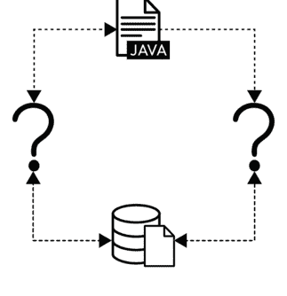

图 9.1：Java 使用元数据与数据库通信

继续 Java 元数据历史的之旅，早期的元数据管理依赖于 XML，这种做法在 Java Persistence API (JPA) 中有典型的例子。以 Java 代码中定义的 `Person` 实体为例，下一步是编写一个 XML 文件，以阐述该 Java 类与相应的数据库映射语句之间复杂的关系。该 XML 文件在运行时被动态解释，起着双重作用——不仅是映射，也是约束的验证。

提供的代码定义了 `Person` 类：

```java
public class Person {
    private Long id;
    private String name;
    private Integer age;

    // Getters and setters
}
```

对应的 XML 映射可能如下所示：

```xml
<entity class="com.example.Person" name="person">
    <attributes>
        <id name="id">
            <column name="person_id"/>
        </id>
        <basic name="name">
            <column name="person_name"/>
        </basic>
        <basic name="age">
            <column name="person_age"/>
        </basic>
    </attributes>
</entity>
```

这种元数据允许框架将 Java 对象映射到数据库架构中，而无需为每个操作硬编码 SQL 查询。

分步无缝数据库集成的视觉叙述，其中 Java 文件与 XML 配置之间的协同作用展现出卓越的凝聚力。这张引人入胜的图表捕捉了集成过程中复杂的舞蹈，展示了一个代表 `Person` 类的 Java 文件如何与为 JPA 设计的 XML 文件完美地融合。当框架将这两个实体（Java 和 XML）结合时，一种共生关系随之产生，为将数据无缝集成到数据库铺平了道路。这种描述概述了框架如何通过 Java 代码和 XML 元数据的细致协调，在应用程序逻辑与数据库结构之间建立起无缝的桥梁。它是代码与配置之间动态相互作用的生动写照，证明了 Java 框架在协调协作且高效的数据库集成方面的强大能力：

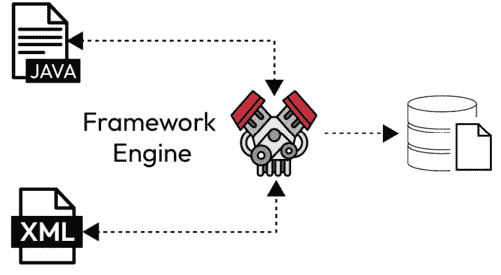

图 9.2：Java 应用使用元数据与数据库通信

Java 语言及其生态系统的演进向开发者揭示，像传统使用 XML 文件那样将生成的元数据与代码分离维护，在直观性上带来了挑战，并且在维护期间显著增加了复杂性——更新 Java 类和相应数据库配置中都所需的字段时，这导致了潜在的不一致和效率低下的。

在增强开发者体验和简化这一过程的关键举措中，2004 年中期引入的 Java 5 使用了 Java 规范请求（JSR） 175 的元数据设施，该技术被亲切地称为 Java 注解。这项创新消除了对单独配置文件的需求，提供了一种统一的解决方案，使所有基本信息都可以存储在 Java 类中。它简化了开发工作流，并显著提高了代码及相关元数据的可维护性，标志着 Java 元数据处理能力演进中的变革性时刻。

在 Java 注解中，开发者可以在两个不同阶段读取和处理注解：在运行时使用反射进行动态处理，或者在构建时利用专用工具（如 Java 注解处理器）进行静态处理。

运行时方法利用反射，涉及在执行程序时检查并解释注解。这种方法允许根据代码中注解的存在或值进行动态决策。然而，由于注解是在程序执行期间进行检查的，这会带来一定的运行时性能开销。

另一方面，构建时方法利用注解处理器，这些工具在编译阶段运行。注解处理器在实际编译发生之前分析并操作源代码中被注解的元素。这种方法对于在编译时确定的任务非常有益，例如代码生成、验证或资源准备。它的优势是可以在开发早期捕发现潜在问题，并有助于生成更高效、更优化的代码。

最终，在运行时反射和构建时注解处理之间进行选择取决于特定任务的具体需求。运行时反射适用于必须在程序执行期间做出决策的场景。同时，对于可以在编译时解决的任务，构建时处理更为优，这有助于提高效率并尽早检测错误。

结论，Java 元数据处理的演进从基于 XML 的配置过渡到创新的 Java 注解领域，标志着软件开发中的一个变革性阶段。通过 JSR 175 引入的 Java 生态系统注解迁移简化了元数据与代码的集成，并显著增强了可维护性。当我们探索 Java 注解的领域时，发现自己正处于一个十字路口，运行时反射和构建时注解处理之间呈现出不同的权衡。性能影响平衡了运行时反射的动态适应性，而构建时处理的效率则是以静态决策为代价的。在下一节中，加入我们深入探讨 Java 开发中权衡的细微世界，探索在做出架构决策时灵活性与性能之间的微妙平衡。

## 采用框架的权衡

当开发者涉足软件架构时，引入框架的决策引入了许多考量，每项考量都承载着深刻影响开发过程的权衡。拥抱框架（无论是 Java 还是任何其他语言）意味着要在其提供的便利性和可能引入的潜在缺点之间进行微妙的平衡。

一个关键的权衡围绕着框架促进的快速开发的吸引力与其施加的约束之间的冲突。框架通常会加速编码过程，提供预构建的组件。然而，这种加速是以牺牲灵活性为代价的，开发者可能会发现自己受限于框架的结构和范式。

此外，权衡还扩展到了采用新框架的学习曲线。虽然框架旨在简化开发，但投入时间和精力以达到熟练程度是内在的。这种初始学习阶段可能会被视为一种障碍，特别是在快节奏的开发环境中。

在本节中，我们将剖析这些权衡，并探索开发者在拥抱框架时面临的微妙决策。从加速开发的承诺到潜在的约束，理解其中复杂的权衡对于做出明智的架构选择至关重要。与我们一起，在动态的软件格局中探索框架便利性与约束之间的微妙平衡。

在软件开发中，采用现有框架与创建自定义框架之间的权衡引入了一个关键的决策过程。虽然既有框架可以提供即时收益和社区支持，但它们可能会限制灵活性。相反，构建定制框架可以提供量身定制的解决方案，但需要大量的时间和资源。当我们转向下一个阶段——Java 框架原则时，我们将深入探讨引导框架设计和开发的基础性原则。理解这些原则如何影响在利用现有解决方案与构建自定义框架之间的复杂权衡，对于应对不断变化的软件开发领域至关重要。加入我们，共同揭示支撑有效框架的原则，并阐明这些原则对开发者决策中固有权衡的影响。

## Java 框架原则

对于 Java 框架开发中的架构师和开发者来说，细致理解关键原则至关重要。要考虑的第一个关键方面是 API 设计，它显著影响了框架的易用性和采用率。在声明式 API 和命令式 API 之间选择至关重要。声明式 API 强调预期结果，提高了可读性和简洁性；而命令式 API 则提供了一步步的方法，提供了更显式的控制。在这些方法之间取得正确的平衡，对于确保框架的易用性以及长期可维护性至关重要。

另一个关键原则是可执行性，其中对反射的仔细考虑变得关键。反射可以提供动态能力，允许在运行时检查和操作类、方法和字段。然而，这种灵活性是以性能为代价的。或者，框架可以选择避免反射的解决方案，以提高 JVM 内部效率。此外，允许在 JVM 之外执行 Java 代码（如原生镜像）的技术出现，为可执行原则引入了新的维度。应对这些选择需要理解灵活性、性能和资源效率之间的权衡。

### API 设计

API 设计是 Java 框架开发的一个关键方面，为开发者提供了两种基本风格的选择：声明式和命令式。每种方法都带有其权衡，它们之间的决策取决于可读性、表现力以及开发者期望的控制级别等因素。

声明式 API 强调表达预期的结果或最终状态，允许开发者指定他们想要实现的目标，而不规定具体的步骤过程。这种风格促进了简洁且富有表现力的代码，使其更具可读性且更容易理解。在关注高层抽象的场景中，以及直观的类自然语言语法可以增强代码理解的场景中，声明式 API 特别有利。

另一方面，命令式 API 采用更具步骤性或过程化的方法，要求开发者显式地定义每个动作和控制流。虽然这种风格提供了更细粒度的控制，但它可能会导致更多冗余和模板化代码。当对执行流的精确控制至关重要时，特别是当开发者需要管理复杂的细节或处理复杂的分支逻辑时，命令式 API 尤为优异。

声明式和命令式 API 设计之间的权衡涉及表现力与简洁性之间的平衡。声明式 API 因其可读性和简洁性而备受青睐，增强了协作并减少了开发者的认知负载。然而，它们可能不太适用于需要细粒控制的场景。相比之下，命令式 API 提供了显式控制，但可能冗长且需要对底层逻辑有更深入理解。

在声明式和命令式 API 设计之间做出选择应参考框架的特定需求和开发团队的偏好。取得正确的平衡至关重要，在许多情况下，结合两种风格元素的混合方法可能兼顾两者，在需要的地方提供表现力和控制。

### 可执行性

Java 框架的可执行性涵盖框架代码在 JVM 内执行的机制。这一方面涉及关键的权衡，特别是在考虑使用反射、避免反射以及探索构建原生镜像等选项时。

反射是 Java 的一种动态特性，允许在运行时检查和操作类、方法和字段。虽然反射强大，但它带有性能代价，由于其动态性质通常会导致执行时间较慢。此外，反射可能会降低代码安全性，因为错误可能在运行时才发现。这里的权衡涉及反射提供的灵活性和便利性与潜在的性能缺陷以及错误检测的延迟。

框架可以选择避免反射的方法，依赖于更多的静态和编译时机制。这促进了性能的提升和早期错误检测，但可能需要更显式的配置和代码生成。放弃反射的决定通常取决于框架的特定需求、所需的性能水平以及动态与静态分析之间的权衡。

在最近的发展中，构建原生镜像的概念获得了关注。`GraalVM` 等技术允许将 Java 代码编译为原生代码，跳过执行对 JVM 的需要。这种方法在启动时间、减少内存占用和增强性能方面具有潜在优势。然而，它引入了与构建复杂性增加、潜在兼容问题以及丢失 JVM 运行时特性相关的权衡。

最终，可执行性策略的选择需要仔细考虑框架需求、性能目标，以及灵活性、便利性与反射或原生镜像编译相关开销之间的权衡。取得正确的平衡对于在保持开发中所需的动态水平的同时实现最佳性能至关重要。

在包含了对 Java 框架原理和更广泛的软件开发原则的探索后，我们发现了一系列考虑因素——从 API 设计、可执行性到“约定优于配置”，以及文档和测试的重要性。这些原则共同指导了符合 Java 标准并拥抱模块化的健壮且用户友好的框架的创建。当我们转向关注 Java 反射的下一章时，我们将深入探讨可执行性的关键方面，揭示 Java 反射特性固有的动态能力和潜在的权衡。加入我们的探索，与我们一起应对反射的复杂性，释放它的力量，并理解它是如何塑造动态 Java 编程格局的。

## Questions

回答以下问题以测试你对本章知识的掌握情况：

1. 在 Java 框架的声明式 API 设计和命令式 API 设计之间权衡时，关键考虑因素是什么？

   A. 代码冗余度

   B. 编译速度

   C. 内存消耗

   D. 数据库兼容性

2. 哪种原则通过依赖既有模式和默认值来减少对显式配置的需求？

   A. 并发控制

   B. 约定优于配置

   C. 依赖注入 (DI)

   D. 模块化

3. 为什么完善文档对于 Java 框架至关重要？

   A. 增加开发复杂度

   B. 阻止用户采用该框架

   C. 降低用户的学习曲线

   D. 限制框架的能力

4. 哪种方法实现了插件式架构，允许开发者无缝地扩展或修改框架的行为？

   A. 面向切面编程 (AOP)

   B. 模型-视图-控制器 (MVC)

   C. 观察者模式

   D. SP 方法

## Answers

以下是本章问题的答案：

1. A. 代码冗余度

2. B. 约定优于配置

3. C. 降低用户的学习曲线

4. D. SP 方法

# 10

# Reflection

Reflection API 是一个强大且多功能工具，允许开发者访问 Java 程序的内部。在本章中，我们将探索反射的各种能力，例如字段访问、方法调用和代理使用。反射允许开发者在运行时检查和操作类及对象，为 JVM 内部提供了一个动态网关。在整个章节中，我们将深入研究反射字段交互的细微差别、动态调用方法的复杂性，以及为了增强代码灵活性的策略性代理部署。加入我们进入 Java 反射能力核心的之旅，在这里，看似不可改变的变得具有适应性，静态代码的边界被扩展，以适应高级应用程序的动态需求。

在本章中，我们将探索以下主题：

- 反射概述

- 探索实际反射

- 代理

## Technical requirements

为了跟随本章内容，你需要以下工具：

- Java 21

- Git

- Maven

- 任何偏好的 IDE

- 本章的 GitHub 仓库，地址位于 `https://github.com/PacktPublishing/Mastering-the-Java-Virtual-Machine/tree/main/chapter-10`

## Overview of reflection

反射是 Java 编程语言的一项基础功能，赋予了开发者在运行时检查和操作类及对象的结构、行为和元数据的能力。这种动态能力可能会开启可能性的潘多拉盒，允许程序员超越静态代码的限制，响应应用程序不断变化的需求。为什么反射对 Java 开发如此至关重要？


# Java 反射在特殊场景中的实际用途

Java 反射在特殊场景中有实际用途，例如框架和库开发，赋予开发者创建灵活且可扩展代码的能力。它在依赖注入 (DI) 容器、对象关系映射 (ORM) 框架和测试框架中起着关键的作用，实现了动态实例化和配置。反射在序列化和反序列化库、GUI 开发工具以及 Java 核心库中也是必不可少的，有助于对象和类的动态加载和操作。虽然对于大多数开发者来说它可能不是日常工具，但反射证明了其在提高特定领域代码重用性和适应性价值，使其成为 Java 生态系统中宝贵的资产。

## 反射的核心价值：内省与动态适应

从本质上说，反射在内省中起着关键作用，允许程序检查并适应自身的结构。在处理必须通用且灵活地运行的框架、库和工具时，反射变得特别有价值，能够动态地适应各种类型和结构。反射有助于获取类信息、方法签名和字段细节，为深度理解代码库至关重要的场景提供了动态性。

此外，反射驱动了 IDE、调试器和应用程序服务器等工具的发展，为它们提供了分析和操作超越编译时知识限制的 Java 代码手段。通过提供类信息的程序接口并促进动态实例化，反射为复杂的框架和运行时环境奠定了基础。

虽然反射是 Java 的一个特征，但在其他编程语言中也存在类似的概念。例如，Python、C# 和 Ruby 等语言也以不同程度接受了反射能力。在 Python 中，`inspect` 模块允许运行时内省，而 C# 包含了反射用于动态发现和调用。在更广泛的编程语言背景下理解反射，为开发者提供了多功能的技能组，可以应用于不同的技术领域。随着我们深入学习本章，我们将揭开 Java 反射 API 的复杂性，探索使其成为动态和可适应编程基石的细微差别和应用。

## 反射的权衡与考量

虽然 Java 反射 API 赋予了开发者动态能力，但有一组必须仔细考虑的权衡。理解这些权衡对于决定何时利用反射以及何时寻求替代方案至关重要：

- **性能开销**：与反射相关的首要权衡之一是其性能开销。反射操作（如访问字段或创建实例）通常较慢。
- **编译时安全性**：反射绕过了编译时检查，增加了运行时异常的可能性。使用反射时，开发者必须保持警惕，因为缺乏编译时安全性是一个缺点。
- **代码可读性和维护性**：反射代码可能更难以阅读和维护，特别是在反射泛存在的大代码库中。
- **安全考量**：反射可能会引入安全风险，特别是在安全优先考虑的环境中。需要进行仔细的考虑和验证，以确保反射操作不会损害安全性。
- **平台依赖**：反射可能依赖于平台，某些操作在不同的 JVM 实现中表现不同。开发者在平台依赖是关键要求的场景中使用反射时应保持谨慎。

## 反射框架的运行时机制

该框架利用反射能力来动态调整其行为，响应运行期间遇到的特定条件。

当 JVM 初始化时，反射引擎加载，为代码编译的芭蕾拉开了序幕。注解作为沉默的护航者，引导反射引擎遍历已加载的类。在 JVM 内存中，出现了一棵依赖树，它是运行时结构的蓝图。这幅虚无的地图成为了动态执行的关键密钥，框架在此处进行实时适配。箭头勾勒了从类加载到执行的流体路径，封装了反射框架的转化本质。从图形到动态的进如下：

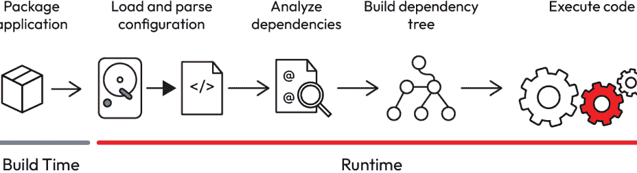

图 10.1: 使用反射的 Java 视角

当我们结束这部分时，框架内部反射的复杂性就像一场编排精密的表演一样展开来。从框架初始化到动态代码执行的旅程，在反射引擎和注解见解的引导下，描绘了一幅关于适应性和多功能的生动画面。现在，掌握了反射在塑造动态方面的作用，我们无缝过渡到下一节，在理论将变为实践。准备好对 Reflection API 进行实战探索，我们将深入研究真实场景，演示如何利用反射进行字段访问、方法调用以及代理的策略性使用。通过实际示例，我们将本章奠定的概念基础与具体的应用联系起来，使你能够将反射作为 Java 开发武器库中的强大工具。准备好在实际中使用 Reflection API，为我们迄为止探索的理论构造注入生命。

# 探索实践反射

在本次实操中，我们通过创建一个多功能的 `Mapper` 接口，深入研究 Java 反射 API 的实际应用。我们的目标是实现这些方法，动态地将类对象转换为 `Map<String, Object>`。`Mapper` 接口作为通用解决方案的蓝图，允许我们在现实场景中施展反射的强能力。

## Mapper 接口定义

让我们从 `Mapper` 接口开始：

```java
public interface Mapper { 
    <T> Map<String, Object> toMap(T entity);
    <T> T toEntity(Map<String, Object> map);
}
```

`toMap` 方法设计用于将类型 τ 的对象转换为 map，其中每个键值对代表一个字段名及其对应的值。相反，`toEntity` 方法反转了这一过程，从给定的 map 重构出类型为 τ 的对象。

现在，有了上部分的理论，我们将付诸实践以实现这些方法。我们的旅程将涉及动态评估类结构、访问字段以及在运行时创建实例。通过实操练习，我们旨在揭示反射的力量，并展示其在构建灵活且适应方案的实用价值。

所以，请系好安全带进入引人入胜的环节，我们将弥合理论与应用之间的差距，利用反射的魔法创建一个可以将对象与 map 互换转换的动态接口。让我们进入实践反射的迷人世界并编写实际代码吧！

## 解决命名规范差异：Column 注解

在不断演进的技术领域，不同范式之间的无缝迁移通常需要桥接约定。一个常见的挑战源于不同的命名规范，例如 Java 的驼峰命名法和数据库的下划线命名法（snake case）。为了解决这个问题，我们引入了 `Column` 注解，允许开发者在对象到 map 的转换过程中定义自定义的列名。

让我们仔细观察 `Column` 注解：

```java
@Retention(RetentionPolicy.RUNTIME)
@Target(ElementType.FIELD)
public @interface Column {
  String value() default "";
}
```

该注解适用于字段（`ElementType.FIELD`），带有一个 `value` 属性。如果提供，该属性允许开发者指定自定义的列名；否则，默认使用字段名。这种灵活性实现了 Java 对象与数据库结构之间的无缝映射，适应了各种命名规范。

## 标记可解析类：Entity 注解

此外，为了标记一个类为可解析类，我们引入了 `Entity` 注解：

```java
@Retention(RetentionPolicy.RUNTIME)
@Target(ElementType.TYPE)
public @interface Entity {
}
```

该注解应用于类级（`ElementType.TYPE`），标志着该类可以进行解析操作。这些注解结合在一起，使开发者能够选择性地为其 Java 类添加注解，根据每个类的特定需求定制转换过程。

## 增强灵活性：Appends 与 Append 注解

我们引入了 `Appends` 注解以增强 Mapper 框架内部的灵活性和定制性。该注解与其伴侣 `Append` 注解一起提供了一种为实体定义默认值的方法，丰富了对象到 map 的转换过程。

让我们深入这些注解的定义：

```java
@Retention(RetentionPolicy.RUNTIME)
@Target(ElementType.TYPE)
public @interface Appends {
    Append[] value();
}

@Retention(RetentionPolicy.RUNTIME)
@Target(ElementType.TYPE)
@Repeatable(Appends.class)
public @interface Append {
    String key();
    String value();
}
```

`Appends` 注解应用于类级（`ElementType.TYPE`），持有一个 `Append` 注解数组。每个 `Append` 注解反过来允许开发者指定一个键值对，指示对象到 map 转换过程中使用的默认值。

`Append` 注解被标记为 `@Repeatable(Appends.class)`，以简化在单个实体上指定多个追加值。

## 实现 toEntity 方法：从 Map 重构对象

在 Java 开发的动态环境中，不断将对象转换为 map 反反之是一项强大的功能，特别是在处理多样化场景或迁移场景时。在 `ReflectionMapper` 中实现 `toEntity` 方法标志着我们反射驱动映射旅程中的一个折点。

该方法桥接了实体的 map 表示及其重构为完全实现实体的过程。通过 Java 反射的视角，我们开始了分步执行。以下代码显示了 `toEntity` 的实现：

```java
@Override
public <T> T toEntity(Map<String, Object> map) {
    Objects.requireNonNull(map, "map is required");
    // Step 1: 从 map 中获取全类名
    T entity = getEntity(map.get("class").toString());
    // Step 2: 获取实体的类类型
    Class<?> type = entity.getClass();
    // Step 3: 遍历类的声明字段
    for (Field field : type.getDeclaredFields()) {
        // Step 4: 使用 @Column 确定与字段相关的键
        String key = Optional.ofNullable(field.getAnnotation(Column.class))
            .map(Column::value)
            .filter(Predicate.not(String::isBlank))
            .orElse(field.getName());
        // Step 5: 从 map 中获取对应的值
        Optional<Object> value = Optional.ofNullable(map.get(key));
        // Step 6: 使用反射在对象中设置值
        value.ifPresent(v -> setValue(entity, field, v));
    }
    // Step 7: 返回重构的实体
    return entity;
}
```

### 代码解析

1.  **输入验证**：`Objects.requireNonNull(map, "map is required")` 确保输入 map 不为空。
2.  **实例化实体**：调用 `getEntity(map.get("class").toString())` 根据 map 中的全类名创建实体实例。
3.  **获取类类型**：`entity.getClass()` 获取运行时类对象。
4.  **遍历字段**：`type.getDeclaredFields()` 获取所有声明字段（包括私有字段）。
5.  **确定映射键**：利用 `Optional` 链式调用，优先使用 `@Column` 注解的 `value` 值（非空时），否则回退到字段名。
6.  **获取值并设置**：从 map 中取值，若存在则通过 `setValue(entity, field, v)` 利用反射设置字段值。
7.  **返回结果**：返回填充完毕的实体对象。

## 实现 map 方法：对象转 Map

`ReflectionMapper` 类中的 `map` 方法（即 `toMap` 实现）对于使用 Java 反射探索动态映射至关重要。该方法接收类型为 `T` 的对象作为输入，并将其动态转换为 `Map<String, Object>` 实例。详细介绍该 `map` 方法的细节：

```java
@Override
public <T> Map<String, Object> map(T entity) {
    Objects.requireNonNull(entity, "entity is required");
    // Step 1: 初始化 map 以存储键值对
    Map<String, Object> map = new HashMap<>();
    // Step 2: 获取实体的类型
    Class<?> type = entity.getClass();
    map.put(ENTITY_ENTRY, type.getName());
    // Step 3: 遍历类的声明字段
    for (Field field : type.getDeclaredFields()) {
        // Step 4: 将访问性设为 true 以允许访问
        field.setAccessible(true);
        // Step 5: 检查是否存在 @Column 注解
        Optional<Column> column = Optional.ofNullable(field.getAnnotation(Column.class));
        if (column.isPresent()) {
            // Step 6: 使用 @Column 注解确定键
            String key = column.get().value()
                .filter(Predicate.not(String::isBlank))
                .orElse(field.getName());
            // Step 7: 使用反射获取值并将其添加到 map 中
            Object value = field.get(entity);
            map.put(key, value);
        }
    }
    // Step 8: 处理类级别的 @Append 注解并将默认值添加到 map 中
    Append[] annotations = type.getAnnotationsByType(Append.class);
    for (Append append : annotations) {
        map.put(append.key(), append.value());
    }
    // Step 9: 返回结果 map
    return map;
}
```

### 代码详细解释

- **输入验证**：
  ```java
  Objects.requireNonNull(entity, "entity is required");
  ```
  该方法首先确保输入实体不为空，如果为空，将抛出一个带有指定错误消息的 `NullPointerException` 异常。

- **Map 初始化**：
  ```java
  Map<String, Object> map = new HashMap<>();
  ```
  初始化一个 `HashMap` 实例来存储表示对象属性的键值对。

- **类类型获取**：
  ```java
  Class<?> type = entity.getClass();
  map.put(ENTITY_ENTRY, type.getName());
  ```
  该方法获取实体的运行时类，并使用 `ENTITY_ENTRY` 键将其全限定名存储在 map 中。

- **字段迭代**：
  ```java
  for (Field field : type.getDeclaredFields()) {
  ```
  该方法遍历类的声明字段。

- **访问性设置**：
  ```java
  field.setAccessible(true);
  ```
  将字段的访问性设置为 true，允许访问私有字段。

- **Column 注解检查**：
  ```java
  Optional<Column> column = Optional.ofNullable(field.getAnnotation(Column.class));
  if (column.isPresent()) {
  ```
  对于每个字段，它检查是否存在 `Column` 注解。

- **列键确定**：
  ```java
  String key = column.map(Column::value).filter(Predicate.not(String::isBlank)).orElse(field.getName());
  ```
  如果存在列注解，它会确定与字段关联的键。它使用指定的列名，或者默认使用字段名。

- **值的检索与赋值**：
  ```java
  Object value = field.get(entity);
  map.put(key, value);
  ```
  它使用反射获取字段值并将键值对添加到 map 中。

- **@Append 注解处理**：
  ```java
  Append[] appends = type.getAnnotationsByType(Append.class);
  for (Append append : appends) {
      map.put(append.key(), append.value());
  }
  ```
  它处理类级别的 `@Append` 注解，向 map 中添加默认键值对。

- **结果 map**：
  ```java
  return map;
  ```
  最后，返回表示对象属性的结果 map。

此 `toMap` 实现阐明了反射在动态将对象属性映射到 map 时的适应性。它展示了如何利用注解和字段细节在 `ReflectionMapper` 类中创建一个多功能且可扩展的映射机制。

## 实战示例：Pet 与 Fruit 实体

在我们对基于反射的映射技术的探索中，我们将转向使用两个不同实体：`Pet` 和 `Fruit` 的实际示例。这些实体装饰了注解，这些注解为 `ReflectionMapper` 的动态能力提供了宝贵的见解。让我们深入研究每个实体，检查它们的结构以及将引导我们映射之旅的注解：

```java
@Entity
class Pet {
  @Column
  private String name;
  @Column
  private int age;
  // Constructors, getters, setters...
}
```

`Pet` 实体是一个代表宠物的普通 Java 对象 (POJO)。它被标记为 `@Entity` 注解，意味着它有资格进行基于反射的映射。每个字段（如 `name` 和 `age`）都标记了 `@Column`，表示它们被包含在映射过程中。这个简单的类为理解 `ReflectionMapper` 类如何处理对象到 map 以及反转换提供了一个极佳的起点。


## Fruit 实体

下一步是 `Fruit` 实体，它比之前的类具有更多的设置：

```java
@Append(key = "type", value = "Fruit")
@Append(key = "category", value = "Natural")
public class Fruit {
    @Column
    private String name;

    public Fruit(String name) {
        this.name = name;
    }

    @Deprecated
    public Fruit() {
    }

    public String name() {
        return name;
    }
    // Additional methods...
}
```

另一方面，`Fruit` 实体虽然也带有 `@Entity` 注解，但也利用了类级别的 `@Append` 注解。这在映射过程中引入了默认的键值对（"type": "Fruit" 和 "category": "Natural"）。该类通过包含一个已弃用和一个未弃用的构造函数展示了灵活性，突出了反射如何适应不同的实体结构。

在接下来的章节中，我们将对这些实体的实例执行 `ReflectionMapper` 类，揭示反射在处理各种类和注解方面的力量。通过这种实际应用，我们的目标是对如何利用反射进行动态对象到 map 的转换和重构提供全面的理解。让我们从 `Pet` 和 `Fruit` 的映射之旅开始吧！

## 测试用例

```java
assertThat(pet).isNotNull()
    .isInstanceOf(Pet.class)
    .matches(p -> p.name().equals("Ada"))
    .matches(p -> p.get() == 8);

@Test
public void shouldConvertEntityRepeatable() {
    // Test for converting Fruit with repeatable
    // annotations to map
    Fruit fruit = new Fruit("Banana");
    Map<String, Object> map = this.toMap(fruit);
    assertThat(map).isNotNull().isNotEmpty()
        .containsEntry("type", "Fruit")
        .containsEntry("category", "Natural")
        .containsEntry("name", "Banana")
        .containsEntry("entity", Fruit.class.getName());
}

shouldConvertToMap();
```

- **`shouldConvertToMap`**:
  - 此测试确保了 `ReflectionMapper` 类能够成功将 `Pet` 实体转换为映射（map）
  - 它验证了生成的 map 中特定的键及其对应的值

- **`shouldConvertEntity`**:
  - 在此测试中，代表 `Pet` 实体的 map 通过 `ReflectionMapper` 转换回原始实体
  - 断言验证了重构的 `Pet` 对象的正确性

- **`shouldConvertEntityRepeatable`**:
  - 此测试侧重于将包含重复注解（repeatable annotations）的 `Fruit` 实体转换为 map
  - 它验证了结果中是否存在默认键值对和特定实体的值

通过这些测试，我们旨在说明 `ReflectionMapper` 类如何无缝处理各种实体、注解以及对象到 map 的转换，强调了反射在动态映射场景中的实际用途。让我们开始测试吧，揭示反射在行动中的强大威力！

## 小结

在本节中，我们深入探讨了反射复杂的领域，通过 `ReflectionMapper` 类的视角，揭示了它在动态对象到 map 转换中的潜力。我们探索了反射的灵活性和适应性，展示了它在处理多种实体结构和注解方面的实力。当我们结束这部分时，我们正处于另一个迷人领域的门槛上——动态代理。接下来的章节将引导我们进入 `MapperRepository` 的世界，在那里我们将利用动态代理的力量在实体与其 map 表示之间进行无缝切换。准备好探索动态且多功能的代理景观，我们将揭开它们在增强反射能力方面的作用。

# Proxy

Java 中的动态代理是不可或缺的工具，它们能够在运行时创建对象、实现一个或多个接口并拦截方法调用。`MapperRepository` 类向我们介绍了动态代理的深远效用，在实体与其对应的 map 表示之间切换时，它们的应用变得至关重要。

动态代理是 Java 运行时能力军库中真正的冠军，提供了一系列提升代码适应性、灵活性和简洁性的优势。它们固有的适应性允许在运行时创建代理实例，在运行时适应各种接口，并在对象结构仅在运行时已知的场景中促进无缝集成。拦截方法调用的能力使动态代理能够在不损害核心操作的情况下，无缝地注入自定义逻辑。这种拦截实现了更清晰的关注点分离（SoC），并有助于减少样板代码，从而提高可维护性。在随后对 `MapperRepository` 的探索中，动态代理作为中枢纽出现，体现了动态映射领域中所有的适应性和高效性：

- **适应性与灵活性**：动态代理提供了无与伦比的适应性，允许我们在运行时创建代理实例。在处理对象或接口结构在运行时未知的场景时，这种适应性变得至关重要。在 `MapperRepository` 的语境中，动态代理使我们能够在没有先验知识的情况下处理多种实体类型，促进更灵活、更具扩展的设计。

- **方法调用拦截**：动态代理的巨大优势之一是它们拦截方法调用的能力。这种拦截机制允许在方法执行之前之后执行操作。在实体到 map 及其反向的映射领域，这种拦截变得至关重要，允许我们无缝地注入转换逻辑，在不改变实体核心逻辑的情况下增强映射过程。

- **减少样板代码**：动态代理显著减少了对样板代码的需求。它们允许我们通过在代理内部封装这些关注点，集中处理跨切关注点（如日志记录或验证）。在 `MapperRepository` 的语境中，这导致实体与 map 之间的转换代码更加简洁，提升了可维护性和可读性。

然而，Java 中动态代理的使用并非没有一系列考虑和权衡。主要的权衡之一是由于代理的动态性带来的性能开销，因为与直接方法调用相比，拦截方法调用和创建代理实例可能会导致轻微的执行延迟。此外，对基于接口的代理的依赖将它们的应用限制在涉及接口的场景中，在基于类的代理可能更合适的情况下造成了局限性。意识到这些权衡是至关重要的，因为这能够在实现动态代理时做出明智的决策，特别是在性能敏感的背景下。尽管有这些考虑，动态代理提供的益处（如增强灵活性和减少样板代码）通常超过了这些权衡，强化了它们在动态和自适应 Java 应用程序中不可替代的角色。

- **性能开销**：虽然动态代理提供了巨大的灵活性，但它们的动态性引入了性能开销。与直接方法调用相比，运行时拦截方法调用和创建代理实例可能会导致执行变慢。在性能关键的场景中应用动态代理时，需要仔细考虑。

- **基于类的代理的局限性**：Java 中的动态代理是基于接口的，这将其应用限制在涉及接口的场景。不存在基于类的代理，某些场景可能需要替代方案或折中。理解这些局限性对于设计和实现的决策至关重要。

在不断发展的 Java 领域，`MapperRepository` 作为一个关键接口出现，无缝交织了反射和动态代理的能力。该接口作为动态对象到 map 转换及其反向世界的门户，利用了反射的内在力量来导航和操作实体：

```java
public interface MapperRepository {
    T entity(Map<String, Object> map);
    Map<String, Object> map(T entity);
}
```

## 接口描述

- **`entity`**：此方法接收表示对象属性的 map，并在运行时重构类型为 T 对象。利用反射，它导航 map，创建一个适应提供 map 结构的动态实体。

- **`map`**：相反，`map` 方法接受类型为 T 的实体并动态生成表示其属性的 map。通过反射和动态代理，该方法导航实体结构，创建一个封装属性键值对的 map。

## MapperInvocationHandler

`ReflectionMapper`。让我们深入探讨此处理程序中封装的简单性与强大，释放 `MapperRepository` 可自定义动态映射的潜力：

```java
public class MapperInvocationHandler implements InvocationHandler {
    private Mapper mapper = new ReflectionMapper();

    @Override
    public Object invoke(Object proxy, Method method, Object[] params)
            throws Throwable {
        String name = method.getName();
        switch (name) {
            case "entity":
                Map<String, Object> map = (Map<String, Object>) params[0];
                Objects.requireNonNull(map, "map is required");
                return mapper.toEntity(map);
            case "map":
                Object entity = params[0];
                Objects.requireNonNull(entity, "entity is required");
                return mapper.toMap(entity);
        }
        if (method.isDefault()) {
            return InvocationHandler.invokeDefault(proxy, method, params);
        }
        throw new UnsupportedOperationException("The proxy is not supported for the method: " + method);
    }
}
```

`MapperInvocationHandler` 类实现了 `InvocationHandler`，负责协调动态映射。它使用 `ReflectionMapper` 实例根据方法调用将 map 转换为实体或实体转换为 map。该处理程序支持默认方法，并确保动态代理与统一映射逻辑之间的平稳连接：

- **动态方法路由**：`invoke` 方法通过方法名称动态路由方法调用。对于 `entity` 方法，它从提供的参数中提取 map，并将操作委托给 `ReflectionMapper` 进行实体重构。`map` 方法提取实体并将其委托给 `ReflectionMapper` 创建 map。

- **处理默认方法**：处理程序考虑了 `MapperRepository` 接口中的默认方法。如果调用了默认方法，它将使用 `InvocationHandler.invokeDefault()` 优雅地委托调用。

- **异常处理**：当遇到不支持的方法时，将抛出 `UnsupportedOperationException`，对动态代理在处理操作方面的局限性提供清晰的反馈。

此实现的突出特点之一在于其可定制性。通过扩展每个方法 `case` 分支中的逻辑，使得检查注解参数变得可行，为许多自定义可能性打开了大门。这种方法将 `MapperRepository` 转换为一个健壮且适应性强的工具，准备通过反射的视角涵盖不同的映射场景。

在探索 `MapperRepository` 领域的动态代理和反射时，`MapperInvocationHandler` 作为一个关键枢纽，将抽象映射与具体操作无缝连接。它的动态路由和处理默认方法的能力使其成为动态映射的强大编排器。该实现的简单性掩盖了其自定义的潜力，提供了一条检查注解参数并定制映射过程以处理多样化场景的路径。在我们结束本章时，`MapperInvocationHandler` 证明了动态代理与反射之间的共生关系，展示了它们在 Java 中创建自适应、可定制和动态映射解决方案的结合力量。接下来的实际应用将阐明此实现如何将抽象概念转换为工具集，赋予开发者导航动态映射复杂图景的能力。

## 总结

在我们对动态代理和反射的探索中，将这些强大的 Java 特性整合为 `MapperInvocationHandler` 标志着我们旅程中的一个关键时刻。动态路由方法调用的能力以及通过注解参数进行自定义的潜力，强调了该实现中蕴含的万变性。然而，这仅仅是下一章的序幕，在下一章中，我们将深入探索 Java 注解处理的复杂领域。在动态映射的基础上，注解处理器有望提升我们的能力，进一步为利用代码中的元数据提供了一种结构化且编译时的方法。加入我们接下来的章节，我们将共同揭示 Java 注解处理的复杂世界，在那里，编译时反射将成为构建高效、健壮且智能的 Java 程序的基石。

# 问题

回答以下问题以测试你对本章知识的掌握：

1. 在动态代理的背景下，`MapperInvocationHandler` 类的主要目的是什么？

   A. 处理数据库连接
   B. 为动态映射路由方法调用
   C. 实现复杂的业务逻辑
   D. 解析 XML 配置

2. 哪种特性使得动态代理在运行时未知的对象结构场景中具有适应性？

   A. 方法重载
   B. 基于接口的方法实现
   C. 动态方法路由
   D. 静态方法调用

3. `MapperInvocationHandler` 类如何在动态映射过程中展示可定制性？

   A. 它在方法调用中使用硬编码的值。
   B. 它利用外部库进行对映射。
   C. 它检查注解参数并调整映射逻辑。
   D. 它对映射的实体强制执行严格的不可变性。

4. Java 中反射的主要目的是什么？

   A. 编译时代码优化
   B. 对对象结构的动态探索和操作
   C. 敏感数据的安全加密
   D. 异步事件处理器

5. 在 `MapperRepository` 的背景下，反射如何贡献于动态映射？

   A. 它确保了方法调用的类型安全。
   B. 它提供了一种安全的加密机制。
   C. 它动态路由方法调用。
   D. 它对映射的实体强制执行严格的不可变性。

## 答案

以下是本章问题的答案：

1. B. 为动态映射路由方法调用
2. C. 动态方法路由
3. C. 它检查注解参数并调整映射逻辑。
4. B. 对对象结构的动态探索和操作
5. C. 它动态路由方法调用。

# 第 11 章 Java 注解处理器

在 Java 编程的动态格局中，运行时对代码进行检查和分析的能力一直通过反射实现。虽然反射提供了一种检查和操纵类、字段和方法的强大机制，但它也带来了权衡，例如性能开销和运行时错误的风险。在意识到这些挑战后，一种迷人的替代方案应运而生——将关注点从运行时转移到编译时的注解处理器。

本章深入探讨注解处理器的世界，提供关于其作为编译阶段利用元数据的健壮工具角色的见解。通过这种方式，开发者可以避开与运行时反射相关的陷阱，了解如何利用注解处理器来增强代码生成和操纵。通过实际示例和手动探索，你将发现将注解处理器集成到开发工作流中的复杂之处，使你能够优化代码库并平衡灵活性与性能。

在本章中，你将探索：

- Java 注解处理器概述
- 探索 Java 注解处理器的实践

## 技术要求

对于本章，你需要：

- Java 21
- Git
- Maven
- 任何偏好的 IDE
- 本章的 GitHub 存储库，地址为 `https://github.com/PacktPublishing/Mastering-the-Java-Virtual-Machine/tree/main/chapter-11`

## Java 注解处理器概述

开发者们，在这里我们探讨 Java 注解处理器的能力和意义。在不断演变的 Java 领域，高效且优化的代码是至关重要的，为了实现这一点，理解注解处理器（annotation processors）等工具的作用变得至关重要。我们将探索为什么存在 Java 注解处理器、它们与广泛使用的反射机制有何区别，以及为项目做出正确选择时的权衡。

Java 注解处理器的出现是一种强大的工具，用以解决反射带来的某些挑战。反射允许在运行时对代码元素进行动态检查和操作，但它会带来性能开销和运行时错误的风险。相比之下，注解处理器在编译时运行，提供了一种根据源代码中存在的注解来分析和生成代码的方法。这种从运行时到构建时的转变带来了显著优势，包括性能的提升、早期错误检测和增强的可维护性。

区分 Java 注解处理器和反射对于优化 Java 开发至关重要。动态运行时机制提供了灵活性，但会产生性能成本。相比之下，Java 注解处理器在编译期间运行，为优化和早期错误检测提供静态分析。本节将探讨这些差异，使开发者能够根据项目需求做出明智决策。

让我们深入分析 Java 注解处理器和反射的对比。虽然两种机制都涉及使用注解进行元数据处理，但它们的执行时间和对性能的影响使它们区别开来。反射在运行时动态运行，具有极高的灵活性，但会产生运行时性能成本。相比之下，注解处理器在编译期间使用，能够在代码运行之前进行优化并捕捉错误。

下表展示了反射和 Java 注解处理器——Java 开发中两个关键机制之间的简要比较。该比较涵盖了关键方面，如执行时间、灵活性、性能、错误检测、代码生成能力、用例、调试影响以及整体可用性。通过对比这些特性，开发者可以获得有价值的见解，了解何时利用反射的动态运行时能力，何时选择 Java 注解处理器提供的静态编译分析。此表旨在作为实践指南，帮助开发者根据项目的特定需求做出明智决策。

| 特性 | 反射 | Java 注解处理器 |
|---|---|---|


# 反射与 Java 注解处理器的比较

| 执行时间 | 运行时 | 编译时 |
| :--- | :--- | :--- |
| 特性 | 反射 | Java 注解处理器 |
| 灵活性 | 动态；允许运行时代码检查 | 静态；在编译期间强制分析 |
| 性能 | 可能会产生运行时开销 | 由于编译时优化，性能提升 |
| 错误 | 可能出现运行时错误 | 编译期间的早期错误检测 |
| 代码生成 | 代码生成能力有限 | 为代码生成和操作提供强大支持 |
| 用例 | 适用于动态场景，例如框架和库 | 优先用于静态分析、代码生成和全项目优化 |
| 调试 | 由于其动态特性可能会增加调试复杂性 | 编译时有助于更整洁的调试 |
| 可用性 | 基础自省使用简单 | 需要理解注解处理，并可能涉及更多设置 |

表 11.1：反射与 Java 注解处理器的比较

这提供了反射和 Java 注解处理器在各个方面差异的概述，帮助开发者为特定情况选择最合适的方法。

深入研究 Java 注解处理器和反射之间的权衡，揭示了开发者必须仔细考虑的微妙平衡。反射凭借其动态特性，通过允许代码检查和修改赋予了无与伦比的灵活性。

相反，Java 注解处理器在编译阶段运行，选择了静态分析方法。虽然这牺牲了一些运行时灵活性，但它引入了许多优势。早期错误检测是一个显著优势，因为潜在问题在代码执行之前就会被识别，减少了运行时错误的概率。这种权衡在性能提升方面获得了回报，因为可以在编译期间应用优化，从而产生更高效、更精简的代码执行。此外，注解处理器的静态特性有助于更整洁、更易维护的代码库，因为开发者可以在开发过程的更早阶段缓存并修正问题。

最终，Java 注解处理器和反射之间的选择取决于项目需求和优先级。寻求动态、灵活方法的开发者可能会尽管存在相关的运行时成本而选择反射。同时，那些优先考虑早期错误检测、性能优化和可维护性的可能会发现，注解处理器的权衡与他们的项目目标更加一致。在运行时灵活性和静态分析之间取得正确的平衡是构建健壮、高效且可维护的 Java 应用程序的关键。

在框架的复杂世界中，Java 注解处理器是一个规则改变者，与以运行时为中心的反射相比，它带来了代码分析和生成的范式转移。该处理器在构建阶段动态运行，为框架提供了增强性能、代码优化和系统化项目结构的工具集：

- **加载并解析配置**：在初始步骤中，Java 注解处理器在构建时仔细读取注解并审视项目配置。这种早期分析不仅识别了注解，还扫描了类的相关元数据，为后续步骤奠定了基础。
- **分析依赖关系**：核心优势之一是处理器根据加载的类分析项目依赖关系的能力。通过审查这些依赖关系，框架获得了关于无缝功能所需组件的价值见解，促进了更高效、更精简的开发过程。
- **构建树**：凭借对项目依赖关系的见解，注解处理器构建了一个完整的依赖树。根据加载的类及其相互依赖关系，该数据结构经过处理，从而能够创建复杂的框架。生成的结构作为框架架构的蓝图，确保了层之间的协调和优化。
- **打包应用程序**：在注解处理器尽力创建了类并考虑了必要的库之后，下一步涉及打包应用程序。按照代码的自然流，框架编译并生成字节码。这一过程确保了没有反射，增强了应用程序的健壮性，并为创建原生应用开了道路，有助于产生更高效、更自包含的最终产品，如图所示：


# 探索实践 Java 注解处理器

在实践章节中，我们将深入一个实践练习，以巩固我们探讨过的 Java 注解处理器概念。其目标是回顾之前检查过的示例，利用反射，使我们能够比较解决方案，并展示使用 Java 注解处理器的独特特性和优势。

任务是将 `Map` 实例转换为实体实例，反之亦然，遵循提供的接口定义的规范：

```java
public interface Mapper {
    <T> T toEntity(Map<String, Object> map, Class<T> type);
    <T> Map<String, Object> toMap(T entity);
}
```

通过回顾这个熟悉的场景，你将亲眼目睹注解处理器如何在编译期间简化代码生成。在进行实际练习时，请考虑注解处理器与反射相比的权衡、效率和优势。让我们深入代码，探索 Java 注解处理器在这个真实世界示例中的潜力。

我们引入了两个额外的注解来增强特定上下文下的功能。`@Entity` 注解声明一个类是可映射的，增加了它参与解析过程的资格。当应用于类时，该注解通知注解处理器，该类的实例可以与 `Map<String, Object>` 之间进行无缝转换。添加的注解增强了映射过程的清晰度，确保了编译期间类与注解处理器之间的有效通信：

```java
@Target(ElementType.TYPE)
@Retention(RetentionPolicy.RUNTIME)
public @interface Entity {
    String value() default "";
}
```

`@Entity` 注解有三个定义其行为和特征的注解：`@Documented`、`@Target(ElementType.TYPE)` 和 `@Retention(RetentionPolicy.RUNTIME)`。`@Documented` 注解确保其用法和存在在 JavaDocs 中被记录。`@Target(ElementType.TYPE)` 注解指定 `@Entity` 注解只能应用于类声明，表明了它在类级别上的作用。最后，`@Retention(RetentionPolicy.RUNTIME)` 注解意味着该注解将在运行时保留，允许进行动态访问和反射，这对于本章讨论的 Java 注解处理器实践至关重要。这些注解为 `@Entity` 注解提供了一个清晰的框架，使其具有良好的文档记录、类特定并且在运行时可访问，这对于代码生成和元数据创建是关键。

与 `Entity` 注解类似，`@Column` 注解扩展了属性层级的自定义能力。应用于被注解类中的字段时，它允许开发者在转换过程中覆盖默认的属性名。在处理不同的命名规范（如驼峰命名法、下划线命名法或横线命名法）时，它非常宝贵，增强了类对不同范式的适应性：

```java
@Documented
@Target(ElementType.FIELD)
@Retention(RetentionPolicy.RUNTIME)
public @interface Column {
    String value() default "";
}
```

我们启动了一个无缝集成 Java 和 Mustache 的 Maven 项目，使我们能够在构建过程中动态地生成可维护的代码。为了将 Mustache 模板集成到我们的 Java 项目中，我们将 Mustache 编译器作为依赖添加。更新 `pom.xml` 文件并以下依赖：

```xml
<dependency>
    <groupId>com.github.spullara.mustache.java</groupId>
    <artifactId>mustache</artifactId>
    <version>0.9.6</version>
</dependency>
```

Mustache 是一个轻量且强大的模板引擎，开发者用它生成动态内容，同时保持代码逻辑和表现分离。它提供了一种灵活且结构化的方式生成文本输出，非常适合生成代码、HTML 或其他文本格式。Mustache 模板使用双大括号如 `{{variable}}` 显示的占位符。在渲染期间，这些占位符会被真实值或内容替换。

在我们的 Maven 项目背景下，我们引入了 Mustache 来自动化代码生成。具体来说，我们使用它来创建 Java 类作为项目 `pom.xml` 文件中的依赖，并将 Mustache 无缝集成到我们的 Java 项目中。这种集成使我们能够动态地生成可维护的代码，提高了效率并减少了手动编写重复或样板代码时的人为错误风险。Mustache 模板提供了一种结构化且清晰的方式来定义生成代码的结构，随着项目要求的演更容易维护和适应。总体而言，Mustache 在简化 Java 项目代码生成、提高代码质量和开发者生产力方面起着至关重要的作用。

在利用注解处理器力量的过程中，我们现在实现了 `EntityProcessor` 类。该处理器扩展了 `AbstractProcessor`，在扫描和处理带有 `@Entity` 注解的类方面着关键作用：

```java
@SupportedAnnotationType("expert.cs.api.Entity")
public abstract class EntityProcessor extends AbstractProcessor {
    // 实现细节将在下文中讨论
}
```

现在，让我们深入 `process` 方法，这是魔法发生的地方：

```java
@Override
boolean process(Set<? extends TypeElement> annotations, RoundEnvironment roundEnv) {
    List<String> entities = new ArrayList<>();
    for (TypeElement annotation : annotations) {
        roundEnv.getElementsAnnotatedWith(annotation)
            .stream().map(e -> new ClassAnalyzer(e, processingEnv))
            .map(ClassAnalyzer::get)
            .filter(IS_NOT_BLANK).forEach(entities::add);
    }
    // 此处可以未来的处理逻辑
    return true;
}
```

在此方法中，我们启动了对带有 `@Entity` 注解的类的处理。让我们拆解关键组件：

1.  **扫描被注解的元素**：我们从开始遍历表示注解类型的 `TypeElement` 实例集合（`annotations` 参数）。
2.  **处理被注解的元素**：对于每个注解类型，我们使用 `roundEnv.getElementsAnnotatedWith(annotation)` 获取所有带有指定注解（在本例中为 `@Entity`）的程序元素。
3.  **映射到 ClassAnalyzer**：我们将这些被注解的元素转换为流，并将每个元素映射到 `ClassAnalyzer` 实例。`ClassAnalyzer::get`
4.  **过滤与收集**：过滤掉空白结果，并将有效实体收集到列表中。
5.  **后续处理逻辑**：此处可以添加未来的处理逻辑。

- **可读性与可维护性**：Mustache 模板增强了生成代码的可读性。通过将模板与实际代码分离，开发者可以专注于类的逻辑结构，而不会被复杂的字符串拼接干扰。这种分离改进了代码的可维护性，并减少了在手动文本操作过程中引入错误的概率。
- **动态数据绑定**：Mustache 支持动态绑定，允许在生成过程中向模板注入数据。这种动态特性使得生成的代码能够适应分析阶段获取的各种输入或元数据。相比之下，手动拼接缺乏这种灵活性。
- **跨生成的一致性**：Mustache 模板为代码生成提供了一种标准化且一致的方法。模板可以在不同的实体之间复用，确保生成的类具有统一的结构。这简化了模板的维护，并促进了凝聚的生成策略。
- **与 Java 的无缝集成**：Mustache 对与 Java 的集成提供了强大的支持。通过将 Mustache 引入代码生成过程，开发者可以无缝地将 Java 逻辑的力量与 Mustache 模板的清晰度相结合。这种协同带来了更具表达力和生成性的工作流。
- **避免字符串操作**：用于代码生成的手动字符串拼接可能会引入陷阱，例如格式错误、拼写错误或代码结构中的意外变化。Mustache 通过提供一种更高层次的方法消除了这些风险，减轻了对精细字符串操作的需求。

总之，利用 Mustache 进行类生成引入了代码生成工作方式的范式转变。它提升了清晰度、可维护性和灵活性，为易出错且繁琐的手动文本拼接提供了更优的替代方案。随着我们在注解处理和代码生成领域的探索，Mustache 模板的集成将继续展示其在增强开发工作流效率和可靠性方面的实力。

提供的 Mustache 模板结合 `EntityModel` 生成实体，展示了 Mustache 为代码生成带来的优雅和清晰。让我们深入探讨此模板的几个关键方面：

```java
package {{packageName}}; // 导入和注解
public final class {{className}} implements EntityMetadata {
    private final List<FieldMetadata> fields;
    // 构造函数和字段的初始化
    // EntityMetadata 方法的实现
    // 其他方法
}
```

在这个 Mustache 模板中，动态生成了一个实现 `EntityMetadata` 接口的类。占位符 `{{packageName}}` 和 `{{className}}` 将代码生成期间被替换。该类包含一个表示实体字段的 `FieldMetadata` 对象列表，并且构造函数对其进行了初始化。此模板简化了代码生成，通过自动创建 Java 项目中的元数据类，增强了清晰度和可维护性。在这里，我们更深入地解释此模板：

- **包声明**：`{{packageName}}` 占位符动态地注入了从 `EntityModel` 获取的包名。它确保了生成的实体类位于正确的包中。
- **导入和注解**：模板包含了必要的导入和注解，如 `import java.util.List;`、`import java.util.Map;` 以及 `@Generated`。`@Generated` 注解包含了指示生成器工具和生成日期的元数据。
- **类声明**：`{{className}}` 占位符注入了生成类的名称（`EntityModel.getClassName()`）。该类实现了 `EntityMetadata` 接口，确保符合指定的合约。
- **字段初始化**：构造函数使用 `FieldMetadata` 实例初始化 `fields` 列表。该列表根据 `EntityModel` 中定义的字段填充。这种动态初始化确保了生成的类包含了每个字段的元数据。
- **EntityMetadata 实现**：模板实现了 `EntityMetadata` 接口中定义的各种方法。这些方法提供了关于实体类的信息，例如其名称、类实例、字段和映射。
- **字段生成**：`{{field}}` 部分动态地为每个字段生成代码。它为每个字段创建相应的 `FieldMetadata` 实例，并在实例化期间将其添加到 `fields` 列表中。
- **日期和生成信息**：`@Generated` 注解包含了关于生成器工具（EntityMetadata Generator）和生成日期（`{{now}}`）的信息。这些元数据有助于跟踪类生成的来源和时间。

本质上，Mustache 允许创建一个整洁且可维护的模板，其中占位符无缝地集成由 `EntityModel` 提供的数据。这种模板驱动的方法增强了生成代码的可读性，并保持了不同实体之间的一致性。随着进展，Mustache 的灵活性将继续发挥作用，允许根据特定的项目需求进行进一步的定制和适应。

```xml
<target>${maven.compiler.target}</target>
<source>${maven.compiler.source}</source>
<annotationProcessorPaths>
  <path>
    <groupId>${project.groupId}</groupId>
    <artifactId>${project.artifactId}</artifactId>
    <version>${project.version}</version>
  </path>
</annotationProcessorPaths>
</plugin>
</build>
```

或者，我们可以利用 Maven Compiler Plugin 插件 `annotationProcessorPaths` 配置，确保处理器在编译期间可用，而不会被包含在最终的产物中。它为注解处理器在编译工作流中的角色提供了一种更显式的声明。

在您尝试过这种方法后，请考虑以下几点：

- 当处理器仅用于编译而不作为运行时依赖项时，请使用提供的 `scope`（范围）。
- 当您倾向于使用以配置为中心的方法时，请利用 `annotationProcessorPaths` 直接为编译器插件指定注解处理器。

现在，让我们深入一个使用注解处理器的实际示例：通过对类进行注解，并见证构建过程中魔法时刻的发生。

考虑下面这个带有我们自定义注解的 `Animal` 类：


```java
@Entity("Kind")
public class Animal {
  @Id
  private String name;
  @Column
  private String color;
}
```

这个简单的类代表了一个动物，注解指示了实体名称以及字段的特定细节。在构建期间，得益于注解处理器（Annotation Processor），会根据注解类及其字段生成如 `AnimalEntityMetadata`、`AnimalNameMetadata` 和 `AnimalColorFieldMetadata` 等类。

让我们生成的 `AnimalEntityMetadata` 类：

```java
@Generated(value = "MetadataGenerator", date = "2023-11-23T18:42:27.793291")
public final class AnimalEntityMetadata implements EntityMetadata {
  private final List<Metadata> fields;
  public AnimalEntityMetadata() {
    this.fields = new ArrayList<>();
    this.fields.add(new expert.os.example.AnimalNameMetadata());
    this.fields.add(new expert.os.example.AnimalColorFieldMetadata());
  }
}
```

```java
// ... Rest of the class ...
}
```

该类作为 `Animal` 实体的元数据，提供了关于其名称、类实例、字段等更多信息。值得注意的是，它包含了 `Animal` 类中每个字段的 `FieldMetadata` 实例。

在这里，我们将更深入地查看生成的代码：

- **构造函数初始化**：在构造函数中，`FieldMetadata` 的实例（如 `AnimalNameFieldMetadata` 和 `AnimalColorFieldMetadata`）被添加到 `fields` 列表中。这种初始化捕捉了 `Animal` 类中定义的每个字段的元数据。

- **EntityMetadata 方法的实现**：生成的类实现了在 `EntityMetadata` 接口中定义的方法。这些方法允许检索如名称、类实例、字段等信息。

- **用于代码的注解（Annotations for code）**：`@Generated` 注解包含了有关生成过程的详细信息，例如所使用的工具（`@EntityMetadata Generator`）和生成日期。

在构建期间的 `target` 目录中，生成的类被组织在一起，展示了代码生成的动态特性。`Animal` 类中的每个字段都对创建相应的元数据类做出了贡献，如图所示：

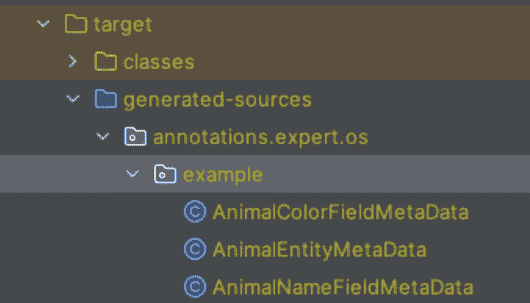

图 11.2：构建期间生成的类

在这次对注解处理器的上手探索中，我们见证了它们为 Java 开发带来的变革能力。实践代码示例说明了如何通过少量的注解，我们就能编排复杂元数据的生成，将我们的项目推向效率和可维护性的新高度。

被注解的 `Animal` 类是我们的画布，用 `@Entity` 和 `@Id` 等自定义注解进行了装饰。随着构建过程的展开，我们的自定义注解处理器在后台勤勤工作，创作出了一场元数据类的交响乐：`AnimalEntityMetadata`、`AnimalNameFieldMetadata` 和 `AnimalColorFieldMetadata`。

以下是我们在这一过程中揭示的内容：

### 动态元数据生成

生成的元数据类能够动态地适应注解类的结构，展示了注解处理器的灵活性和适应性。

### 高效的代码组织

通过自动化元数据的生成，我们的代码库保持了整洁简洁。模板代码被动态创建的类所取代，促进了更好的组织和可读性。

### 构建时的魔法

魔法发生在构建期间。注解处理器提供了稳健的机制，在应用程序运行之前分析并生成代码，增强了性能并最小化了反射开销。

### 规模化定制

注解处理器使开发人员能够传达意图和定制偏好。我们的注解处理器将这种意图转换为元数据，为大规模代码库管理提供了一个强大的途径。

当我们回顾这次实践时，我们仅仅触及注解处理器所提供潜力的一角。未来的旅程邀请我们探索更高级的场景，应对现实世界的挑战，并利用全方位定制选项。注解处理器正成为代码生成的工具，以及我们架构和维护 Java 项目范式转变的催化剂。

## 总结

在结束注解处理器的之旅之际，我们探索了代码生成的艺术以及它们为 Java 开发带来的优雅。从带注解的类到动态元数据，我们见证了自动化的变革力量。当我们过渡到最后的考虑因素时，下一章将作为指南针，引导我们了解最佳实践、潜在陷阱以及对 Java 开发更广阔格局的战略见解。

我们的探索让我们掌握了有效使用注解处理器的工具。请与我们一同进入最后一章，我们将提炼核心见解并为未来规划路线。最后的考虑因素总结了我们注解漫游的精髓，为掌握这些工具和塑造 Java 开发的轨迹提供了路线图。

# 问题

回答以下问题以测试你对本章知识的掌握：

1. 本章介绍的 Java Processor 主要作用是什么？

A. 动态代码执行

B. 运行时代码编译

C. 元数据分析和代码生成

D. 用户界面设计

2. 在处理器上下文中，`@SupportedAnnotations` 注解的作用是什么？

A. 声明运行时策略

B. 指示编译器路径

C. 指定支持的注解

D. 定义注解继承

3. 如本章所述，使用处理器相比反射的优势是什么？

A. 更大的运行时灵活性

B. 增强性能和早期错误检测

C. 简化代码检查

D. 增强调试功能

4. 哪个 Maven 范围（scope）表示依赖在编译期间可用但不包含运行时依赖中？

A. compile

B. runtime

C. provided

D. annotationProcessor

5. 哪个 Maven 配置允许直接为编译器插件指定注解处理器？

A. `<annotationPaths>`

B. `<annotationProcessors>`

C. `<annotationProcessorPaths>`

D. `<compilerAnnotations>`

6. 在 Java 注解处理器实践课程中，Mustache 模板的主要目的是？

A. 生成随机代码片段

B. 创建 JavaDoc 文档

C. 启用代码合并

D. 促进可维护的类生成

## 答案

以下是本章问题的答案：

1. C. 元数据分析和代码生成

2. C. 指定支持的注解

3. B. 增强性能和早期错误检测

4. C. provided

5. C. `<annotationProcessorPaths>`

6. D. 促进可维护的类生成

# 结语

当我们结束这段穿越 JVM 复杂图景的旅程时，回顾我们在前几个章节中发掘的丰富知识是再恰当的。本书深入探讨了 JVM 的内部工作机制，揭开了它的谜团，并使你对 Java 运行环境有了深刻的理解。在最后一章中，我们旨在提供一些总结性的考量，将我们探索的线索交织在一起，提供超越这些页面限制的见解。

在整本书中，我们努力让你对 JVM 有一个全面的理解，涵盖了从内存管理、类加载到字节码执行和垃圾回收的各个主题。在接近尾声之际，我们对你精通 Java 这一强大引擎复杂性的奉献表示谢意。然而，旅程并未在此处结束；它是进一步探索和成长的垫脚石。在最后一章中，我们将引导你关注额外的资源和参考文献，这些资源可以作为你持续精通 JVM 道路上的参考点。这些推荐读物将扩展并深化你的理解，为在 Java 开发这一动态领域中的持续学习提供路线图。

在本章中，我们将探索以下主题：

- 探索 JVM 的图景
- 导航系统操作架构
- 掌握垃圾回收的艺术
- 平台线程与虚拟线程

# 探索 JVM 的图景

在探索 JVM 复杂性的旅程中，我们穿过了不同的领域，从字节码编译的细微差别到垃圾回收的精妙编排。JVM 的美之处在于它的适应性，能够满足广泛的应用和场景。当我们结束这本书时，意识到 JVM 实现的多样化本质是至关重要的。

本章作为一个视角，审视了我们走过的 JVM 图景，提醒我们 JVM 生态系统远非单一的。虽然我们的讨论提供了坚实的基础，但承认 JVM 实现之间的多样性至关重要。每个环境都可能表现出独特的特性和优化，增加了复杂性和深度。

JVM 的卓越之处之一是它在遵守最少规范集的同时允许进行专门化。这种标准化与适应性之间的平衡使得 JVM 成为编程语言中的强大力量。若要进一步研究管理 JVM 的复杂机制和规范，可以考虑探索 <https://docs.oracle.com/java/specs/jvms/se21/index.html> 上的《Java 虚拟机规范》。这份详尽的资源深入探讨了 JVM 的内部工作机制，提供了超出本书范围的见解。

为了全面理解 Java 语言本身及其与 JVM 的交互，位于 <https://docs.oracle.com/java/specs/jsls/se21/index.html> 的《Java® 语言规范》是一份无价的参考。该规范说明了支配 Java 语言的规则和语义，补充了对 JVM 的探索。

当我们结束对 JVM 的远征时，让这些资源成为引导进入更深知识的灯塔。旅程并未在此结束；它在演变，就像 Java 开发的动态格局一样。拥抱多样性，探索细节，继续揭开 JVM 的谜。

# 导航系统操作架构

在对 JVM 的探索中，我们剥开了字节码执行管理和垃圾回收的层。然而，精通 JVM 的关键维度是理解它与更广泛系统操作架构的集成。这一部分是揭开 JVM 与底层操作系统之间复杂舞蹈的门户，这是一个效率与性能和谐统一的纽带。

虽然我们的旅程聚焦于 JVM 的内部机制，但深入研究 JVM 与操作系统之间的共生关系将开辟新的视野。系统操作架构在塑造 JVM 行为方面至关重要，影响着线程管理、I/O 操作和资源分配等方面。对于旨在为特定操作系统环境优化应用程序的 Java 开发者来说，理解这种集成是关键的。

为了照明深入理解系统操作架构的道路，我们推荐探索 Andrew S. Tanenbaum 编写的《现代操作系统》（*Modern Operating Systems*）。这部开创性著作提供了操作系统的概述，提供了关于其设计原理、功能以及与软件应用程序交互的见解。通过深入学习 Tanenbaum 的知识，你将对 JVM 与底层操作系统之间的复杂舞蹈获得更广泛的视角。

当你开启这段探索时，请记住，对系统操作架构的全面理解将增强你优化 Java 应用程序的能力。从进程调度到内存管理，操作系统在每一个环节都会影响 JVM 的性能。凭借《现代操作系统》（*Modern Operating Systems*）中的见解，你将能够更好地应对系统级交互的细微差别，解锁效率和健壮应用程序设计的新可能。

# 掌握垃圾回收的艺术

在我们结束对 JVM 的探索时，务必重点介绍一个深刻影响应用程序性能的关键方面——垃圾回收器（Garbage Collector）。虽然我们触及了垃圾回收的原理，但这一过程的复杂性远超单章的范围。为了更深入地研究这一复杂领域，我们建议沉浸在专门的资源中—— Maaike van Putten 和 Sean Keenan 写的《Java内存管理：垃圾回收与 JVM 调优全指南》（*Java Memory Management – a Comprehensive Guide to Garbage Collection and JVM Tuning*）。

垃圾回收是内存管理的无名英雄，确保了 JVM 内部资源的高效分配和释放。我们提供了基础见解，《Java内存管理》深入探讨了垃圾回收算法、调优策略和最佳实践。这本书指导那些寻求通过微调垃圾回收器以符合性能需求来优化 Java 应用程序的人士。

为了更深入地理解垃圾回收器优化中的挑战和解决方案，Bruno Borges 在 DevOps BE 上举办的工作会《Kubernetes 上 Java 性能调优秘密》（*Secrets of Performance Tuning Java on Kubernetes*）是一个见解宝库。在会上，Borges 阐明了垃圾回收调优中遇到的真实场景和常见陷阱，特别是对于在 Kubernetes 上运行的 Java 应用程序。

# 平台线程与虚拟线程

在不断发展的 Java 并发领域，线程的角色处于中心，影响着应用程序的性能和响应速度。随着 21 版本的发布，Java 平台引入了突破性的变化——两种不同线程类型的共存：平台线程和虚拟线程。

传统上，JDK 中 `java.lang.Thread` 的每个实例都是平台线程。这种线程在底层操作系统线程上运行 Java 代码，并在整个执行过程中占用该线程。平台线程的数量受限于操作系统线程。

虚拟线程标志着范式的转变。与其对手不同，虚拟线程在底层操作系统线程上运行 Java 代码，而不会占据代码的生命周期。多个虚拟线程可以高效地共享同一个操作系统线程，为并发提供了一种轻量且可扩展的方法。这种方法反映了其他语言中用户态线程的成功，例如 Go 的 goroutine 和 Erlang 的进程。它回溯了 Java 的早期阶段，当时绿色线程（green threads）虽然共享单个操作系统线程，但为我们今天拥有的更大的线程奠定了基础。

当我们穿过 JVM 的城市景观时，平台线程和虚拟线程的协同变得至关重要。虚拟线程提供的效率提升和可扩展性是变革性的，特别是在资源优化至关重要的场景下。无论你是在编排复杂的并发操作，还是旨在提高应用响应，理解这些线程类型的细微差别都使你能够做出明智的选择。

在 Java 并发的这一动态时代，不再有一成不变的方法；利用平台线程和虚拟线程的能力使开发者能够应对现代应用程序开发的复杂地形。当你深入研究 M:N 调度和轻量级并发的细节时，请抓住机会，在虚拟线程时代增强 Java 应用程序的响应能力和效率。

在我们对 JVM 的探索进入最后的帷幕之际，对贵公司在这段旅程中的支持表示诚挚的感谢。深入探讨 JVM 的复杂机制——从字节码的微妙之处到虚拟线程的出现——一直是一件乐事。

我们希望这本书能够带给你启发和力量，让你能够更深入地理解 JVM 在 Java 应用开发中的关键作用。垃圾回收的动态格局、系统操作以及虚拟线程的革命性时代，正等待着你的继续探索。

感谢你为这项事业投入了时间与好奇心。我们希望这本书能激发新的见解，点燃你对 Java 开发的热情，并为你的编码实践提供实用的知识。

当你踏入不断演进的 JVM 精通领域时，愿你的编码工作高效，你的应用程序稳健，你的好奇心永无止境。祝编码愉快，我们诚挚地希望你喜欢这段穿越 JVM 的之旅！

# 索引

由于此电子书版本没有固定页码，下方的页码仅基于本书的印刷版提供参考链接。

# A

- 访问标志 (access flags) 23
- 加法操作 (addition operations)
  - dadd 34
  - fadd 34
  - iadd 34
  - ladd 34
- 提前编译 (ahead-of-time compilation) 72, 122, 140
- Amazon Corretto 137
- 优势 (advantages) 137
- Amazon Web Services (AWS) 135
- 新数组 (anewarray) 42
- 算术操作 (arithmetic operations) 34
  - 加法 (addition) 34
  - 除法 (division) 35
  - 乘法 (multiplication) 25
  - 减法 (subtraction) 35
- 数组长度 (arraylength) 43
- 数组 (arrays) 12
- 自动资源管理 (ARM) 195
- Azul Zing 138, 139
- 收益 (benefits) 139
- Azul Zulu 138, 139

# B

- 数组存储 (bore) 43
- 位运算 (bitwise operations)
  - iland 36
  - ior 36
  - ixor 36
  - land 36
  - lxor 36
- 布尔值 (Boolean values) 33
- 字节码 (bytecode) 32, 33, 55-60
- 字节操作 (byte operations) 33

# C

- 数组存储 (castore) 43
- 字符操作 (char operations) 33
- 类型检查 (checkcast) 43
- 类 (classes) 12
- 类文件 (class files)
  - 数据区 (data repositories) 26, 27
  - 解码 (decoding) 19, 20
  - 字段 (fields) 26, 27
  - 头部 (headers) 20-25
  - 方法 (methods) 28
- 类加载 (class loading) 74, 75
- 类变量 (class variables) 26
- 代码缓存 (Code Cache) 94
- 编译圣区 (compilation sanctuary) 94
- 热点管理 (hotspots, managing) 95
- JIT 编译中的 (in JIT compilation) 94, 95
- 优化后的代码存储 (optimized code storage) 95
- 空间利用率 (space utilization) 95
- 快速访问与执行 (swift access and execution) 95
- 比较操作 (comparison operations) 36-38
  - dcmg 36
  - dcmpl 36
  - fcmg 36
  - fcmpl 36
  - lcmp 36
- 条件指令 (conditional instructions) 51-54
- 常量池引用 (constant pool reference) 22
- 连续并发压缩垃圾回收器 (C4) 138


# 索引

## 约定优于配置 (convention over configuration principle) 159

## 检查点协调恢复 (CRaC) 138

## 引用链接 (reference link) 67

# D

## 数组存储 (dastore) 43

## 声明式 API 设计 (declarative API design) 158

## 依赖注入 (DI) 164

## 除法操作 (division operations)

- `ddiv` 35
- `fdiv` 35
- `idiv` 35
- `ldiv` 35

## 双精度操作 (double operations) 33

## Dragonwell 142

# E

## Eclipse J9 135, 136

## 收益 (benefits) 136

## Eclipse Temurin 141

## 收益 (benefits) 141, 142

## 优学 (ergonomics) 113-115

# F

## 浮点操作 (float operations) 33

## 碎片 (fragmentation) 111

## 框架采用 (framework adoption)

- 权衡 (trade-offs) 156, 157

## 框架 (frameworks)

- 缺点 (drawbacks) 156, 157

# G

## G1 107-110

## 垃圾回收 (garbage collection) 205

## 垃圾回收器 (GC) 13, 99

- G1 107-110
- 概述 (overview) 99-102
- 并行 GC (parallel GC) 104-107
- 串口 GC (serial GC) 102-104
- ZGC 110-113

## 优先垃圾回收 (G1 GC) 102

## 获取字段 (`getfield`) 42

## 获取静态字段 (`getstatic`) 42

## `goto` 指令 (`goto instruction`) 52

## `goto_w` 指令 (`goto_w instruction`) 52

## GraalVM

- 优势 (advantages) 123
- 概述 (overview) 122-124
- 优势 (strengths) 123

# H

## 堆 (heap, JVM) 92, 93

# I

## 数组存储 (`iastore`) 43

## IBM Semeru 139

## 收益 (benefits) 140

## `if_acmeq` 指令 52

## `if_acmpne` 指令 52

## `ifeq` 指令 51

## `ifge` 指令 51

## `ifgt` 指令 51

## `if_cmpeq` 指令 51

## `if_cmpege` 指令 52

## `if_icmpgt` 指令 51

## `if_icle` 指令 51

## `if_icmpl` 指令 51

## `if_icmpne` 指令 51

## `iflt` 指令 51

## `ifne` 指令 51

## `ifnull` 指令 51

## 过程式 API 设计 (imperative design) 157

## 实例检查 (`instanceof`) 43

## 实例变量 (instance variables) 26

## 时 (`Instant`) 47

## 架构 (ISA) 68

## 整数操作 (integer operations) 33

## 接口 (interfaces) 12

## 动态调用 (`invokedynamic`) 47

## 接口 (interface) 47

## 特殊调用 (`invokespecial`) 47

# J

## Java 演进 (Java evolution) 4

## Java 注解 (Java Annotation)

- 实际实现 (practical implementation) 187

## Java 注解 (Java annotations) 155

## Java 运行时 (Java runtime) 143

## Java 代码 (Java code)

- 在...执行 (executing with) 7

## Java 框架 (Java framework) 159

## Java 级别 (Java levels) 72

## Java 元数据 (Java metadata) 155

## Java 栈 (Java stack) 81

## Java 规范 (Java Specification) 155

## Java 表示 (Java representation) 87

## 实例调用 (`invirtual`) 47

# L

## 栈栈 (LIFO) 86

## 数组存储 (`lastore`) 43

## Liberica (BellSoft) 143

## 局部变量自增 (local increment) 36

## 局部变量 (local variables) 84, 85

## 逻辑操作 (logical operations) 33

## 长期支持 (long-term support) 135

## 查找跳转 (`lookupswitch`) 52

# M

## 魔术数字 (magic number) 20

## Mandrel (Red Hat) 143

## 内存管理 (memory management) 77

- 在 JVM 中 (in JVM) 78-80
- 方法区 (method area, JVM) 91, 93
- 方法调用与返回 (method calls and returns) 47

## OpenJDK 构建 (Build) 143

## 多维数组 (`multianarray`) 42

## 乘法操作 (multiplication operations)

- `dmul` 35
- `fmul` 35
- `imul` 35
- `Imul` 35

# N

## 原生镜像 (Native Image) 124-127

- 创建 (creating) 128-130

## 原生方法栈 (native method stacks) 90, 91

## 取反操作 (negation operations)

- `dneg` 35
- `fneg` 35
- `ineg` 35
- `lneg` 35

## 新数组 (`newarray`) 42

# O

## 对象操作 (object manipulation) 41-47

## 对象池 (object pool) 93

## 对象-关系映射 (ORM) 164

# P

## 并行 GC (parallel GC) 102-107

## 个人数字助理 (PDA) 5

## 纯 Java 对象 (POJO) 174

## 平台线程 (platform threads) 205, 206

## 即插即用 (PnP) 效应 159

## 实际反射 (practical reflection) 167-177

## 程序计数器 (program counter, PC) 78-81

## 代理 (proxy) 177-180

## 设置字段 (`putfield`) 42

## 设置静态字段 (`putstatic`) 42

# R

## 引用操作 (reference operations) 33

## 反射 (reflection)

- 替代方案 (164, 165)
- 概述 (overview) 164-167

## 取余数操作 (remainder operations)

- `drem` 35
- `frem` 35
- `irem` 35
- `lrem` 35

## 返回指令 (`ret instruction`) 52

# S

## SapMachine (SAP) 143

## 栈存储 (`sastore`) 43

## SDKMAN 143

## 社区驱动更新 (community-driven updates) 144

## 与构建工具集成 (integration with build tools) 144

## URL 143

## 厂商无关性 (vendor agnosticism) 144

## 版本管理 (version management) 144

## 关注点分离 (SoC) 177

## 串口 GC (serial GC) 102-104

## 服务提供者 (SP) 方法 159

## 移位操作 (shift operations)

- `ishl` 36
- `ishr` 36
- `iusr` 36
- `ishl` 36
- `lshr` 36
- `lushr` 36

# T

## 表跳转指令 (`tableswitch instruction`) 52

## 技术兼容性套件 (TCK)

- URL 134

# V

## 值转换 (value conversions) 32, 41

## 双精度到浮点 (`d2f`) 39

## 双精度到整数 (`d2i`) 39

## 双精度到长整 (`d2l`) 39

# Z

## ZGC 102, 110-113

---

# 通过项目学习 Java

一个关于学习 Java 专业人士真正所需的全部知识的简明实用指南

**Dr. Seán Kennedy** | **Maaike van Putten**

## 通过项目学习 Java

**Dr. Seán Kennedy**, **Maaike van Putten**

ISBN: 978-1-83763-718-8

- 清楚理解 Java 基础知识，如原始类型、运算符、作用域、条件语句、循环、异常和数组
- 掌握 OOP 结构，如类、对象、枚举、接口和记录（records）
- 深入理解 OOP 原则，如多态、继承和封装
- 深入研究泛型、集合、Lambda、流（streams）和并发等高级主题
- 可视化调用方法或创建对象时内存中发生了什么
- 体会“在做中学学”的有效性

---

# 转型到 Java

通过清晰理解 Java，开启你的多语言编程之旅

**KEN FOGEL**

**Geertjan Wielenga** 前言，Azul 开源项目高级总监

## 转型到 Java

**Ken Fogel**

ISBN: 978-1-80461-401-3

- 坚固掌握 Java 语法
- 探索 Java 语言的面向对象编程基础
- 发现如何在 Java 中实现函数
- 理解哪些 Java 框架最适合解决各种问题
- 探索 Java 中的创建型、结构型和行为模式
- 熟悉 Java 服务端编码

---

# Packt 正在寻找像你这样的作者

如果你兴趣成为 Packt 的作者，请访问 `authors.packpub.com` 并在今天申请。我们曾与成千上万像你这样的开发者和技术专业人士合作，帮助他们向全球社区分享见解。你可以提交通用申请，申请我们正在招募作者的特定主题，或者提交自己的想法。

---

# 分享你的想法

现在你已经完成了《精通 Java 虚拟机》，我们想听听你的想法！如果你是从亚马逊购买的这本书，请点击此处直接进入该书的亚马逊评论页面并分享你的反馈，或者在你购买的网站上留下评论。

你的评价对我们以及技术社区至关重要，并将帮助我们确保交付卓越质量的内容。

---

# 下载这本书的免费 PDF 副本

感谢购买本书！

你喜欢在旅途中阅读，但无法随随地携带纸质书吗？

你的电子书与你选择的设备不兼容吗？

随时随地、在任何设备上阅读。直接从你喜欢的技术书中搜索、复制并粘贴代码到你的应用程序中。

优惠远不止于此，你每天可以在收件箱中获得专属折扣、通讯订阅和精彩内容。

遵循以下简单步骤获取福利：

1. 扫描二维码或访问下方的链接

   

   `https://packt.link/link/free-ebook/9781835467961`

2. 提交你的购买证明

3. 完成！我们将直接把免费 PDF 和其他福利发送到你的邮箱

   

---

# 精通 Java 虚拟机

JVM 内部原理与性能优化的深度指南

**OTÁVIO SANTANA**
