# Java 虚拟机精通指南


**产品产品经理：** Kunal Sawant

**出版产品经理：** Samrididdhi Murakha

**书籍项目经理：** Manisha Singh

**高级编辑：** Nisha Cleetus

**技术编辑：** Vidhisha Patidar

**文字编辑：** Safis Editing

**索引员：** Rekha Nair

**制作设计：** Aparna Bhagat

**开发者关系营销协调员：** Shrinidhi Manoharan

> 献给我的妻子 Poliana Santana，感谢她在我们共同的人生旅程中一直是我深爱的伴侣，是上帝给予我最大的祝福。
>
> – Otávio Santana

# 贡献者

# 关于作者

**Otavio Santana** 是一位热情的架构师和软件工程师，专注于云和 Java 技术。他在多语言持久化以及金融、社交媒体和电子商务领域的高性能应用方面拥有深厚的专业知识。

Otavio 通过多种方式为 Java 和开源生态系统做出贡献，例如作为 `Java 社区进程 (JCP)` 的执行成员，自 Java 8 以来协助指导 Java 平台的方向和目标，此外还是多个开源产品和规范的通勤者领导者。

Otavio 因其开源贡献而闻名，并获得了许多奖项，包括所有的 JCP 奖类别和 `Duke's Choice Award` 等。Otavio 还是一位卓越的 `Java Champion` 和 `Oracle ACE 计划` 成员。

# 关于评审员

**Frank Delporte** 是一位 `Java Champion`，在 Azul 公司担任高级技术作家，Azul 是全球唯一 100% 专注于 Java 和 `Java 虚拟机 (JVM)` 的大型公司。他是《在树莓派上上手 Java》的作者，也是.. 的贡献者。Frank 在会议上演讲，并在博客（）中讨论 Java、JavaFX 并进行电子实验。对于 Foojay（OpenJDK 朋友的网站），他还制作一档播客，每月制作数几集，涵盖了广泛的 Java 相关主题。

**Artur Skowroński** 是 VirtusLab 的 Java/Kotlin 工程负责人，也是培训师、会议演讲者以及《JVM Weekly》时事的编辑，他在那里持续介绍 JVM 世界的最新进展。在行业拥有超过 10 年的经验，他有机会担任多种角色，如软件工程师、技术主管、工程经理、解决方案架构师，甚至是项目的技术产品经理。然而，他始终认为自己首先是一名工程师。

# 前言

（注：由于原文提供的前言部分为英文且完整，以下为该前言的中文译文以供参考：）

## 前言

Mastering the Java Virtual Machine is your gateway to unlocking the mysteries of the Java Virtual Machine (JVM), from its fundamental architecture to advanced Java concepts. In the dynamic world of Java development, understanding the intricacies of the JVM is paramount for crafting robust and high-performance applications. This book is crafted to cater to a spectrum of skill levels, whether you're a seasoned Java developer seeking to deepen your expertise or a newcomer eager to grasp the essentials.

As you traverse these pages, you will explore the role of the JVM in executing Java applications and gain proficiency in optimizing performance through just-in-time compilation. We will navigate the complexities of dynamic class loading, memory profiling, and alternative JVMs, including the intriguing landscape of GraalVM.

The exploration extends into Java framework principles, reflection, and the application of Java annotation processors. Each topic is accompanied by practical examples and real-world insights, ensuring that you grasp the theoretical concepts and learn how to apply them effectively in your projects.

Whether you're looking to fine-tune your Java applications, make informed decisions about JVM implementations, or enhance your understanding of Java development, this book is your comprehensive guide. The journey concludes with a thoughtful reflection on the covered material and recommendations for further exploration.

Embark on this odyssey into the heart of Java's powerhouse, let Mastering the Java Virtual Machine be your compass.

本书中的内容将使你能够从容应对 JVM 的复杂性，并将你的 Java 开发技能提升到新的高度。

# 本书适合的读者

本书面向广泛的 Java 开发者群体，从初学者到资深专业人士不等。对于刚开始 Java 开发的人来说，这本书是理想之选，它提供了关于该语言及其底层过程的基础见解。中级 Java 程序员将发现弥越基础与高级开发之间鸿沟的价值，获得对 JVM 细节更深入的理解，从而有效地优化代码。对于经验丰富的软件工程师，本书提供了关于动态类加载、内存管理和替代性 JVM 的前沿见解，确保他们的知识处于 Java 开发的最前沿。技术经理和架构师可以使用本书做出关于 JVM 实现和整体 Java 开发最佳实践的明智决策。

计算机科学学生和教育工作者也会发现这种结构化的 JVM 概念方法适用于教学。无论目标是优化 Java 应用程序性能、深化对 JVM 内部的理解，还是跟上最新进展，本书都是针对不同读者的全面资源，内容循序渐进，旨在提供无缝的学习体验。

# 本书涵盖内容

《掌握 Java 虚拟机》（Mastering the Java Virtual Machine）是一本全面的指南，旨在深化你对 Java 虚拟机（JVM）的理解，并赋予你优化 Java 应用程序性能的能力。无论你是寻求增强技能的资深 Java 开发者，还是想要探索 JVM 内部细节的新手，本书都能提供宝贵的见解和实践知识，以提升你的 Java 开发之旅。通过详细的解释、真实世界的示例和实践练习，你将开启一段掌握 JVM 内部机制的之旅，并探索将丰富你 Java 编程知识的高级话题。

第 1 章“Java 虚拟机简介”提供了 JVM 的基础概述，阐明了它在执行 Java 应用程序中的关键作用。你将了解到 JVM 的基本架构，探索其关键组件及其在 Java 执行中的功能。

第 2 章“类文件结构”深入探讨 Java 类文件的结构，理解字节码表示、常量池以及 JVM 内的类加载和验证过程。

第 3 章“理解字节码”探索了 JVM 使用的字节码指令，让你能够理解 Java 应用程序的底层执行并有效分析字节码指令。

第 4 章“执行引擎”深入研究 JVM 的执行引擎，你将在这里学习字节码如何通过即时编译（JIT）进行解释和优化，增强你精调 Java 应用程序性能的能力。

第 5 章“内存管理”探索了 JVM 中的内存管理概念，涵盖了核心主题，如堆和栈管理、垃圾回收基础，以及用于优化 Java 应用程序内存使用的内存分配策略。

第 6 章“垃圾回收与内存分析”深入学习 JVM 采用的垃圾回收算法和内存分析技术，使你具备优化内存使用和有效识别性能瓶颈的技能。

第 7 章“GraalVM”开始探索 GraalVM ——一种创新的替代 JVM，并理解它与传统 JVM 实现相比的独特之处和潜在用场景。

第 8 章“JVM 生态系统与替代 JVM”探索了更广泛的 JVM 生态系统，包括 OpenJ9 和 GraalVM 等替代性 JVM 实现，并理解它们在 Java 开发中的区别和应用。

第 9 章“Java 框架原理”深入探讨 Java 框架设计的底层原理，为权衡、元数据使用和注解原则提供见解，以实现有效的框架设计和利用。

第 10 章“反射”让你对 Java 反射 API 有全面的理解，探索其在 Java 应用程序中动态行为、字段访问、方法调用和代理使用的能力。

第 11 章“Java 注解处理器”探索了 Java 注解处理器如何在构建时读取元数据并动态生成代码，增强你简化开发任务和提高代码质量的能力。

第 12 章“最后考虑”探讨了不断演变的 Java 开发格局，讨论了新兴趋势和技术，如 Java 响应式编程（Reactive Programming）。你将掌握响应式编程的基本原理，理解它在设计响应式可扩展应用程序中的作用，并发现使用 Reactor 和 RxJava 等库来实现响应式模式。本章是你 Java 开发之旅中未来探索和成长的门票。

# 如何充分利用本书

在开始阅读本书并深入研究软件需求之前，理解以下技术至关重要：Java 17、Maven、Git 和 Docker。假设你已熟悉 Java 17，包括其语法、面向对象编程概念以及对核心库和框架的熟悉。了解 Maven 将大有益处，因为它是一个流行的构建自动化工具，用于管理依赖和构建 Java 项目。精通 Git（一种版本控制系统）对于有效跟踪和管理源代码更改是必要的。最后，对 Docker（一种容器化平台）的了解将帮助理解如何在隔离环境中打包和部署软件应用程序。

| 本书涵盖的软件/硬件 | 操作系统要求 |
|---|---|
| Java 17 | Windows, OSX, 或 Linux |
| Maven | Windows, OSX, 或 Linux |
| Git | Windows, OSX, 或 Linux |
| Docker | Windows, OSX, 或 Linux |

如果你使用的是本书的电子版，我们建议你自己输入代码，或从书的 GitHub 仓库访问代码（下一节提供了链接）。这将帮助你避免任何与复制粘贴代码相关的潜在错误。

# 使用的约定

本书中使用了多种约定。

文中的代码：表示单词

代码块设置如下：

```java
public final class AccessSample {
    private int value;
    AccessSample(int value) {
        this.value = value;
    }

    public static void main(String[] args) {
        ConstantPoolSample sample = new ConstantPoolSample();
        System.out.println(sample);
    }
}
```

当我们希望你注意代码的某部分时：

```java
public class ConstantPoolSample {
    private String message = "Hello, Java!";
}
```

命令行输入或输出如下：

```bash
javac Animal.java javap -verbose Animal
```

**粗体**：表示新术、重要单词或屏幕上的文字。例如，菜单或对话框中的单词会加粗。“值得提到 Open Liberty 等替代方案也”

# 提示或注意事项

# 联系我们

我们随时欢迎读者的反馈。

**一般反馈**：如果你对本书的任何方面有疑问，请发送邮件至 `customercare@packpub.com` 并在主题中注明书名。

**错误**：尽管我们已确保内容的准确，但错误仍然会发生。如果你在书中发现错误，我们将感谢你告诉我们。请访问 `www.packpub.com/support/errata` 并填写表单。

**盗版**：如果你在网上发现我们作品的任何形式的非法副本，我们将感谢你提供位置地址或网站名称。请通过 `copyright@packt.com` 联系我们并提供链接。

**如果你兴趣成为作者**：如果你对某个领域有专长并有兴趣编写或贡献书籍，请访问 `authors.packpub.com`。

# 分享你的想法

当你阅读《掌握 Java 虚拟机》后，我们想听听你的想法！请点击此处直接跳转到本书的亚马逊评论页面并分享你的反馈。

你的评论对我们和社区都非常重要，并将帮助我们确保提供优质的内容。

随时随地、在任何地方、任何设备上阅读。直接从你喜爱的技术书中搜索、复制并粘贴代码到你的应用程序中。

福利不仅于此，你每天可以在收件箱中获得专属折扣、时事通讯和精彩的免费内容。

按照以下简单步骤获取这些福利：

1. 扫描二维码或访问下方链接


`https://packt.link/free-ebook/97818835467961`

2. 提交你的购买证明

3. 这就了！我们将直接将你的免费 PDF 和其他福利发送到你的电子邮箱

在我们的旅程中，我们将揭开 Java 虚拟机（JVM）的基本工作机制及其在执行 Java 中的关键作用。随后，我们将探索 Java 类文件的复杂结构，深入研究字节码、常量池和类加载过程。进一步地，我们的重点转向解码 JVM 语言以及其对 Java 程序执行的影响。这些介绍性章节为逐步探索 JVM 的复杂奥秘奠定了基础，为掌握 JVM 铺平了坚实的基础。

此部分包含以下章节：

- 第 1 章：Java 虚拟机简介
- 第 2 章：类文件结构
- 第 3 章：理解字节码

# Java 虚拟机简介

在不断扩张的软件开发宇宙中，Java 是一颗闪亮的星，以其通用性、跨平台能力和健的性能而闻名。Java 卓越能力的核心是 Java 虚拟机（JVM），这是一种作为 Java 生态系统骨干的基础技术。在本章中，我们将开启一段启迪意义的旅程，揭秘 JVM 的内部工作机制，深入其内部以揭示其运行的秘密。

在本章中，我们将更深入地探讨 JVM 的历史演变，探索其架构，并理解它在执行 Java 应用程序中的作用。此外，我们将涵盖核心主题，如字节码、类加载、内存管理和执行引擎，这些构成了 JVM 运行的基础。在本章结束时，你将拥有理解 JVM 复杂内部机制所需的基础知识。因此，让我们进入 JVM 的核心，开始探索这项技术奇迹。

在本章中，我们将探索更多关于这些主题：

- Java 简史
- JVM 简介
- JVM 如何工作

## 技术要求

本章的 GitHub 仓库位于：`https://github.com/PacktPublishing/Mastering-the-Java-Virtual-Machine/tree/main/chapter-01`

## 探索 Java 的演变

Java 编程 JVM 语言以及其强大的平台拥有一段充满故事的历史，并以其独特且创新的特性为特征。这一叙述中的中心人物是 JVM，这是一个在 Java 演变和持久意义中留下了不可磨灭标记的关键组件。JVM 在让 Java 变成今天这样方面起着关键作用，它对 Java 历史的重要性不言而喻。

JVM 是让 Java “一次编写，随运行”（Write Once, Run Anywhere）成为现实的关键节点。这一承诺重新定义了软件开发，直接响应了为网络化消费设备（如机顶盒、路由器和其他多媒体设备）创建软件的挑战。根据设计，JVM 允许编译后的 Java 代码在网络中传输，在各种客户端机器上无缝运行，并提供安全保障。JVM 的架构和执行模型确保了 Java 程序无论其来源或运行的宿主机，其行为保持一致。这种从小型网络化设备到大规模服务器的演变，展示了 Java 的多功能性以及对软件开发世界的持久影响。

随着世界维网的兴起，这种能力变得更具吸引力。在网络浏览器中下载和运行 Java 程序并保证安全性的能力是一项游戏规则的改变者。它提供了前所未有的扩展性，允许安全地向网页中添加动态内容。这种由 HotJava 浏览器展示的扩展性，彰显了 JVM 在塑造我们今天所知的 Web 世界方面的作用。

然而，值得注意的是，随着 Java 的演变，像 Flash 和 Java 浏览器插件这样的技术由于安全考虑和更多 Web 标准的出现而逐渐消失了。尽管有这些变化，JVM 的影响仍然存在于各个领域，从企业级服务器应用程序到 Android 移动开发，凸显了它在更广阔格局中的持久意义。

本质上，JVM 是让 Java 具有适应性、安全性和平台无关性的的技术支柱。它对 Java 历史的重要性在于它能够实现 Java 的承诺，使其成为 Web 和软件开发的基础性技术。Java 持久的成功和相关性可以直接归功于 JVM 在其演变中的作用，巩固了它在计算史册上的地位。


# JVM 历史与执行模型概览

我们开启的 JVM 历史旅程不仅揭示了 Java 平台发展的丰富画卷，还强调了 JVM 在塑造该平台独特身份方面所起的关键作用。从最初作为对网络化消费设备挑战的响应，到对基于 Web 的内容的变革性影响及其扩展性，JVM 是 JVM 生态系统的基石。这段旅程为探索下一节中介绍的 JVM 内部工作机制提供了合适的背景。

此外，值得注意的是，JVM 的影响超越了 Java 本身。它是许多其他语言（如 `Kotlin`、`Scala`、`Groovy` 等）的引擎。理解 JVM 的历史使我们能够欣赏它是如何演变以实现 Java 关于平台无关性的承诺，它对各种编程语言的适应性，以及在跨平台软件开发中的持久相关性。

## JVM 生命周期

简化。因此，开发者应该关注有关 `main()` 方法签名的最新语言更新以及不断演变的最佳实践。任何具有此类 `main()` 方法的类都可以作为 Java 应用程序的起点。

1.  **应用程序执行**：JVM 执行 Java 应用程序，处理其指令并根据需要管理内存、线程和其他资源。
2.  **应用程序完成**：一旦 Java 应用程序执行完毕，JVM 实例就不再需要。此时，JVM 就会终止。

值得注意的是，JVM 遵循“一个实例对应一个应用程序”的模型。假设你在同一台计算机上并发启动了多个 Java 应用程序，并使用了相同的 JVM 具体实现。在这种情况下，你将拥有多个 JVM 实例，每个实例专门运行其各自的 Java 应用程序。这些 JVM 实例之间相互隔离，确保了每个 Java 应用程序的独立性和安全性。

在这份全面的 JVM 概览中，我们历经了让 Java 成为一种多功能且平台无关的编程语言的基础元素。JVM 是 Java 执行环境的核心枢纽，协调了跨操作系统和架构的各种代码的无缝集成。当我们过渡到下一节时，随着我们更深入地探索 Java 代码在运行时展开的动态过程，对 JVM 内部机制的理解将不断推进。这种探索将揭示 JVM 在执行 Java 应用程序时采取的复杂步骤，阐明背后发生的机制。加入我们，开启揭示 JVM 内部 Java 代码复杂之处的之旅。

# JVM 如何执行 Java 代码

JVM 是一项卓越的技术，在执行 Java 应用程序方面起着核心作用。它的设计目的是让 Java 变得平台无关，让你能够“编写一次，随处运行”。然而，理解 JVM 的工作原理不仅涉及 Java，还涉及原生代码的集成，以便与特定的硬件和操作系统交互。

JVM 执行用 Java 语言编写并编译成字节码的 Java 应用程序。字节码是 Java 代码的平台无关的低级表示。当 Java 应用程序被执行时，JVM 会解释或将这些字节码编译为适用于宿主系统硬件的机器码。

为了与宿主系统交互并利用特定平台的特性，JVM 可以使用原生方法。这些原生方法用 `C` 或 `C++` 等语言编写，并动态链接到运行 JVM 的特定平台。这些方法在平台无关的 Java 代码与特定于宿主系统的原生代码之间建立了一座桥梁。

当 Java 应用程序需要从操作系统获取信息，或利用通过纯 Java 代码无法访问的系统资源时，原生方法大有益处。例如，在处理文件系统、目录或其他特定平台的特性时，原生方法可以提供底层操作系统的直接接口。

至关重要的一点是，尽管 Java 编程语言致力于平台无关，但 JVM 本质上是特定于平台的。这意味着对于每一个不同的平台都存在一个定制的虚拟机实现。这种虚拟机实现是 JVM 的一个特定实例化，旨在无缝适应宿主系统硬件架构和操作系统的特异性。这种针对特定平台的适配确保了最佳的兼容性和性能，强调了 JVM 的动态特性，它会根据每个底层平台的独特特征来定制其执行环境。

在图 1.1 这一引人入胜的视觉图示中，我们见证了一个独特的 Java 程序跨越三个不同平台（Windows、macOS 和 Linux）的无缝执行，每个平台都拥有其专用的 JVM 实例，并根据特定的硬件和操作系统进行了定制。这一场景的完美之处在于程序本身的统一性——它保持不变，这证明了 Java “编写一次，随处运行”的承诺。正如我们所观察到的，该程序的功能在三个操作系统中保持一致，强调了 JVM 赋予的平台无关性。这是 JVM 适应能力的引人注目的演示，确保相同的 Java 程序可以在 Windows、macOS 和 Linux 的多样化环境中和谐共存，体现了跨平台兼容性的本质。


JVM 遵循“一个实例对应一个应用程序”的模型。假设你在同一台计算机上并发启动了多个 Java 应用程序，并使用了相同的 JVM 具体实现。在这种情况下，你将拥有多个 JVM 实例，每个实例专门运行其各自的 Java 应用程序。这些 JVM 实例之间相互隔离，确保了每个 Java 应用程序的独立性和安全性。


# JVM 概览

JVM 遵循一个实例对应一个应用程序的模型。假设你在同一台计算机上并发启动了多个 Java 应用程序，并使用了相同的 JVM 具体实现。在这种情况下，你将拥有多个 JVM 实例，每个实例专门运行其各自的 Java 应用程序。这些 JVM 实例之间相互隔离，确保了每个 Java 应用程序的独立性和安全性。

- **应用程序执行**：JVM 执行 Java 应用程序，处理其指令并根据需要管理内存、线程和其他资源。
- **应用程序完成**：一旦 Java 应用程序执行完毕，JVM 实例就不再需要。此时，JVM 就会终止。

值得注意的是，JVM 遵循一个实例对应一个应用程序的模型。假设你在同一台计算机上并发启动了多个 Java 应用程序，并使用了相同的 JVM 具体实现。在这种情况下，你将拥有多个 JVM 实例，每个实例专门运行其各自的 Java 应用程序。这些 JVM 实例之间相互隔离，确保了每个 Java 应用程序的独立性和安全性。

在这份全面的 JVM 概览中，我们历经了让 Java 成为一种多功能且平台无关的编程语言的基础元素。JVM 是 Java 执行环境的核心枢纽，协调了跨操作系统和架构的各种代码的无缝集成。当我们过渡到下一节时，随着我们更深入地探索 Java 代码在运行时展开的动态过程，对 JVM 内部机制的理解将不断推进。这种探索将揭示 JVM 在执行 Java 应用程序时采取的复杂步骤，阐明背后发生的奥秘。加入我们，开启揭示 JVM 内部 Java 代码复杂之处的之旅。

## JVM 如何执行 Java 代码

JVM 是一项卓越的技术，在执行 Java 应用程序方面发挥着核心作用。它的设计目的是让 Java 平台无关，允许你编写一次并在任何地方运行。然而，理解 JVM 的工作原理不仅涉及 Java，还涉及与特定硬件和操作系统交互的原生代码集成。

JVM 执行 Java 应用程序，这些程序是用 Java 编程语言编写并编译成字节码的。字节码是 Java 代码平台无关的低级表示。当 Java 应用程序被执行时，JVM 会解释或将这些字节码编译为适用于宿主系统硬件的机器码。

为了与宿主系统交互并利用特定平台的特性，JVM 可以使用原生方法。这些原生方法用 C 或 C++ 等语言编写，并动态链接到运行 JVM 的特定平台。这些方法在平台无关的 Java 代码与特定于宿主系统的原生代码之间建立了一座桥梁。

当 Java 应用程序需要从操作系统获取信息或利用纯 Java 代码不易访问的系统资源时，原生方法大有益处。例如，在处理文件系统、目录或其他特定平台的特性时，原生方法可以提供底层操作系统的直接接口。

至关重要的是，尽管 Java 编程语言致力于平台无关性，但 JVM 本质上是特定于平台的。这意味着对于每一个不同的平台都存在一个定制的虚拟机实现。这种虚拟机实现是 JVM 的一个特定实例化，旨在无缝适应宿主系统硬件架构和操作系统的特殊性。这种针对特定平台的适配确保了最佳的兼容性和性能，强调了 JVM 的动态特性，它会根据每个底层平台的独特特征来定制其执行环境。

在图 1.1 这一引人入胜的视觉图示中，我们见证了一个独特的 Java 程序跨越三个不同平台：Windows、macOS 和 Linux 的无缝执行，每个平台都拥有其专用的 JVM 实例，并根据其特定的硬件和操作系统进行了定制。这一场景的完美之处在于程序本身的统一性——它保持不变，证明了 Java “编写一次，随处运行”的承诺。正如我们所观察到的，程序的功能在三个操作系统中保持一致，强调了 JVM 赋予的平台无关性。这是 JVM 适应能力的引人注目的演示，确保相同的 Java 程序可以在 Windows、macOS 和 Linux 的多样化环境中和谐共存，体现了跨平台兼容性的本质。


JVM 遵循一个实例对应一个应用程序的模型。假设你在同一台计算机上并发启动了多个 Java 应用程序，并使用了相同的 JVM 具体实现。在这种情况下，你将拥有多个 JVM 实例，每个实例专门运行其各自的 Java 应用程序。这些 JVM 实例之间相互隔离，确保了每个 Java 应用程序的独立性和安全性。

- **应用程序执行**：JVM 执行 Java 应用程序，处理其指令并根据需要管理内存、线程和其他资源。
- **应用程序完成**：一旦 Java 应用程序执行完毕，JVM 实例就不再需要。此时，JVM 就会终止。

值得注意的是，JVM 遵循一个实例对应一个应用程序的模型。假设你在同一台计算机上并发启动了多个 Java 应用程序，并使用了相同的 JVM 具体实现。在这种情况下，你将拥有多个 JVM 实例，每个实例专门运行其各自的 Java 应用程序。这些 JVM 实例之间相互隔离，确保了每个 Java 应用程序的独立性和安全性。

## JVM 数据类型与运行时操作

在数据领域，JVM 按照两种基本类别运行：

- **基本类型 (Primitives)**：基本类型是基础数据类型，包括数值类型、布尔值和返回地址。这些类型在运行时不需要进行广泛的检查或验证。它们通过针对各自数据类型定制的特定指令进行操作。例如，`iadd`、`ladd`、`fadd` 和 `dadd` 等指令处理整数、长整数、浮点和双精度。
- **引用值 (Reference values)**：JVM 支持动态分配的类或数组的实例。这些值属于引用类型，其操作方式与 C/C++ 等语言相似。引用值表示复杂的数据结构，JVM 执行运行时类型检查和验证，以确保这些数据结构的完整性和兼容性。

在基本类型领域，JVM 包含了数值类型，涵盖了整数和浮点值。处理简单数据类型和复杂引用型数据结构的能力使得 JVM 能够支持各种应用程序和场景。

JVM 优雅处理异常、管理线程周期以及对基本类型和引用数据类型进行操作的能力，反映了其健壮且多功能的特性，使其成为 Java 平台的基石。


# JVM 基础

JVM 是一个多功能且强大的平台，支持各种基本数据类型，每种类型在 Java 编程中扮演着不同的角色。这些基本数据类型是 JVM 中定义变量和处理基本数据操作的基础构建模块。从整数和浮点值等数值类型到布尔值以及独特的 `returnAddress` 类型，这些数据类型在 Java 程序的高效精确执行中起着至关重要的作用。

图 1.2 显示了分为基本类型和引用值的 JVM 类型。


每个类型都有大小和范围。表 1.1 提供了 JVM 数据类型的全面概述，包括它们的名称、大小、变体、默认值和类型。它为 Java 开发者和爱好者理解 JVM 核心数据类型提供了宝贵的参考。

| 类型名称 | 大小 (位) | 变体 | 默认值 | 类型 |
| --- | --- | --- | --- | --- |
| byte | 8 | -128 到 127 | 0 | 数值 |
| short | 16 | -32,768 到 32,767 | 0 | 数值 |
| int | 32 | -2,147,483,648 到 2,147,483,647 | 0 | 数值 |
| long | 64 | -9,223,372,036,854,775,808 到 9,223,372,036,854,775,808 | 0 | 数值 |
| float | 32 | IEEE 754 单精度 | 0.0 | 数值 |
| double | 64 | IEEE 754 双精度 | 0.0 | 数值 |
| char | 16 | 0 到 65,535 | `\u0000` | 数值 |
| boolean | N/A | N/A | false | 布尔 |
| returnAddress | N/A | N/A | N/A | returnAddress |

表 1.1：JVM 的基本数据类型，包括它们的名称、大小、变体、默认值和类型

JVM 中的这些基本类型包含了各种数值类型、布尔值以及特定的 `returnAddress` 类型，每种类型都有自己的特性和默认值。此表是理解 JVM 中这些基本数据类型的快速参考。

## `returnAddress` 类型

JVM 中的 `returnAddress` 类型代表了一种在方法调用和返回中至关重要的特定数据类型。该类型是 JVM 内部的，Java 语言无法直接访问。以下是关于 `returnAddress` 类型的重要性及其原因：

- **方法调用和返回**：`returnAddress` 类型被 JVM 用于高效管理方法调用和返回。当方法被调用时，JVM 需要跟踪执行完成后返回何处。这对于维护程序的控制流以及确保在方法执行后正确恢复执行上下文至关重要。

- **调用栈管理**：在 JVM 中，调用栈是跟踪方法调用和返回的关键数据结构。它维护了一个 `returnAddress` 值的栈，每个值代表方法完成后要返回的地址。该栈被称为方法调用栈或执行栈。

- **递归**：`returnAddress` 类型在处理递归方法调用时至关重要。当一个方法多次调用自身或另一个方法时，JVM 依赖 `returnAddress` 值来确保控制返回到调用点，从而保留递归状态。

## `null` 引用

表示一个引用值当前没有指向任何对象。当一个引用被设置为 `null` 时，实际上意味着它没有引用内存中的任何有效对象。

`null` 的概念在 Java 语言和 JVM 中具有几个重要用途：

- **初始化**：当你声明一个引用变量但不给它赋值对象时，引用的默认初始值为 `null`。这个默认值对于那些想要声明引用但不立即将其与对象关联的场景至关重要。这种做法允许你声明引用变量，并在需要时将其赋值为对象，为你的程序结构提供了灵活性。

- **值的缺失**：`null` 表示特定引用没有关联任何有效对象。对于需要表示在程序的某个时刻没有可用意义的数据或对象的情况非常有用。

- **资源释放**：虽然将引用设置为 `null` 可以帮助指示 JVM 某个对象不再被需要，但必须明确的是，内存管理和资源清理的主要责任在于 Java 垃圾收集器 (GC)。GC 会自动识别并回收由不再可达的对象所占用的内存，从而有效地管理内存资源。开发者通常不需要显式地将引用设置为 `null` 来清理内存；这是由 GC 处理的任务。

`null` 是 Java 和 JVM 中一个非常有价值的概念，它的使用伴随着权衡和考虑：

- **空指针异常 (NullPointerException)**：主要的权衡之一是 `NullPointerException` 的风险。如果你尝试对设置为 `null` 的引用执行操作，可能会导致运行时异常。因此，正确处理空引用以避免意外的崩溃至关重要。

- **防御性编程**：程序在使用空引用之前需要勤谨地检查它们以防止 `NullPointerException`。这可能会导致额外的空检查代码，并使程序变得复杂。

- **资源管理**：虽然将引用设置为 `null` 可以帮助释放资源，但它并不是资源管理的保证方法。某些资源可能需要显式清理或销毁，仅依赖将引用设置为 `null` 可能是不够的。

- **设计考虑**：在设计类和 API 时，提供关于引用如何使用以及在什么情况下可以将其设置为 `null` 的清晰指导是非常重要的。

总而言之，在 JVM 中，`null` 是一个表示对象缺失和资源管理的有效工具。然而，它需要仔细处理以避免 `NullPointerException` 并确保程序的正确行为。良好的设计和编码实践可以帮助缓解与使用 `null` 相关的权衡。

## 总结

在对 JVM 的全面概述中，我们探索了使 Java 成为强大且多功能平台的内部机制和关键组件。JVM 是 Java 生态系统的骨干，提供了跨不同操作系统和硬件架构运行 Java 应用程序的能力。我们深入了它对原始类型和引用数据类型的支持、对 `null` 问题的处理，以及在管理类、数组和接口方面的作用。

通过 JVM，Java 实现了“一次编写，随处运行”的承诺，允许开发者创建跨平台的应用程序。然而，理解 JVM 的复杂性（包括它如何管理线程、内存和资源）对于优化 Java 应用程序并确保其可靠性至关重要。

JVM 的设计选择（例如将布尔值表示为整数）反映了简单性与效率之间的平衡。我们还提到了 `returnAddress` 对于管理方法调用和返回的重要性。

JVM 是一项卓越且复杂的技术，赋予了 Java 开发者构建健壮、安全且与平台无关软件的能力。凭借其独特的功能和能力，JVM 是 Java 在软件开发领域长久成功的基石。

# 章节总结

在本章中，你已经全面理解了 JVM，揭示了它在执行 Java 应用程序中的关键作用。我们探索了 JVM 的平台特定性，强调了尽管 Java 语言具有平台独立性，但每个平台都需要一个特定的虚拟机实现以获得最佳的兼容性和性能。

本章提供的信息无价之比，原因如下：首先，它揭示了 JVM 的底层工作原理，阐明了它在让 Java 的“一次编写，随处运行”承诺成为现实方面的作用。理解 JVM 的平台特定适配对于开发者和从业者确保其 Java 应用程序在不同的硬件和操作系统环境中实现最优性能至关重要。

展望下一章——*JVM 如何执行 Java 代码*，你可以期待更深入地探讨 Java 代码在 JVM 内部执行时发生的动态过程。这一探索将为代码执行期间 JVM 的内部工作机制提供实用的见解，使你掌握适用于现实工作场景的必备知识。随着开发者遇到各种平台环境，从本章中获得的见解将使你能够游刃有余地应对 JVM 的复杂性，为不同的计算格局优化 Java 代码，并增强你在真实 Java 开发场景中解决问题的能力。

当我们结束对 JVM 的探索时，我们现在准备在下一章中通过深入*类文件结构*的复杂世界，进一步进入 Java 代码的核心。理解类文件的结构对于理解 Java 代码如何在 JVM 中进行组织、编译和执行至关重要。因此，让我们继续前进探索让 Java 类文件活起来的构建模块，连接我们从 JVM 到 Java 类结构迷人领域的旅程。

## 练习题

回答以下问题以测试你对本章的掌握情况：

1. JVM 的主要目的是什么？

   A. 编写 Java 代码

   B. 编译 Java 代码

   C. 运行 Java 代码

   D. 调试 Java 代码

2. JVM 如何处理布尔值？

   A. 作为独立的数据类型

   B. 作为字节数组

   C. 作为整数类型

   D. 作为浮点类型

3. JVM 中引用值的初始状态是什么？

   A. 未定义

   B. 零

   C. Null

   D. 真

4. 下列哪项不是 JVM 中的一种引用类型？

   A. 类

   B. 数组

   C. 接口

   D. 原始类型 (Primitives)

5. `returnAddress` 在 JVM 中的主要作用是什么？

   A. 表示布尔值

   B. 管理方法调用和返回

   C. 处理异常

   D. 存储引用值

## 答案

以下是本章问题的答案：

1. C. 运行 Java 应用程序

2. C. 作为整数类型

3. C. Null

4. D. 原始类型 (Primitives)

5. B. 管理方法调用和返回

# 类文件结构

引导通过……当我们深入本章时，我们的注意力集中 Java 类文件中编码的二进制细节上，阐明了协调 Java 应用程序无缝执行的机制。

从核心上说，字节码充当了沉默的指挥，将 Java 高级语言转换为 JVM 可以理解的形式。本章剖析了字节码，探索它如何封装程序逻辑并桥接开发者与 JVM 之间的语义差异。同时，我们揭示了被称为常量池的符号库，深入了它作为常量、字符串和其他符号元素守护者的角色。此外，我们探索了类加载——这是塑造运行时环境的动态网关，以及它在让 Java 类在 JVM 中活起来的关键作用。本章将教你类文件的组件，以便你拥有在下一章将 Java 文件转换为类文件的所有知识。

在本章中，我们将探索以下主题：

* 解码类文件
* 理解类文件的头
* 字段和数据仓库
* Java 类的方法

## 技术要求

对于本章，你需要以下工具：

- Java 21
- Git
- Maven
- 任何偏好的 IDE
- 本章的 GitHub 仓库地址为：https://github.com/PacktPublishing/Mastering-the-Java-Virtual-Machine/tree/main/chapter-02

## 解码类文件

类文件结构是编译后的 Java 代码与 JVM 之间共生关系的核心枢纽。在 JVM 执行中，平台无关性至关重要，类文件呈现为一种编译后 Java 代码的标准化、与硬件无关的二进制表示形式。这种格式是一个至关重要的桥梁，允许开发者通过高层 Java 代码（以及 Kotlin 等语言）表达其意图，同时确保 JVM 能够在各种硬件和操作系统上无缝地理解并执行它。

这种结构化格式不仅仅是 Java 源代码的二进制翻译；它是一份精密的蓝图，JVM 依靠它来处理处理字节码、常量池和类加载的复杂性。通过遵循类文件结构，JVM 获得了对如何解释和执行 Java 程序的通用理解。此外，类文件封装了关键细节，例如字节序，这些细节在特定平台的对象文件格式中可能会不同。这种精确性在保证一致执行方面变得不可或缺，无论底层硬件或操作系统如何，这强调了类文件结构在维护 Java “编写一次，随处运行”这一承诺所基本的跨平台兼容性方面的关键作用。类文件结构是罗塞塔石，确保了 Java 的高层抽象和谐地翻译成 JVM 可理解的语言，从而营造了一个 Java 的可移植性和多功能性得以生生的领域。

Java 类文件是编译后 Java 代码的二进制蓝图，遵循一种结构化格式，这对于 JVM 无缝解释和执行程序至关重要。每个元素都独特地封装了 JVM 执行 Java 程序所需的信息，从头信息到字段和方法无不包。本节提供了类文件结构的概览视图，为深入理解其组件奠定了基础。

图 2.1 生动地展示了 Java 文件转换为其相应类文件结构的转变之旅。该过程始于一个纯净的 Java 文件，用清晰简洁的代码片段进行符号。这种原始表示形式封装了开发者的逻辑、意图和功能，作为 Java 程序的蓝图。

下一阶段是编译阶段展开，其中编译器（被描述为动态转换引擎）将人类可读的 Java 代码翻译为称为字节码的中间形式。这种字节码以一系列紧凑的、平台无关的指令表示，镜像了原始 Java 代码的抽象操作。

该图进一步演变为展示类文件结构的组装。在这里，字节码被精细地组织起来，封装了编译后的指令和元数据，例如方法签名、访问修饰符和数据结构。这些元素共同构建了类文件的复杂框架，这是一种为 JVM 内部执行而优化的二进制表示。

随着这段视觉之旅的结束，从 Java 代码到类文件结构的转换变成了对 Java 跨平台能力的证明。这一过程确保了编译后的 Java 程序能够在各种环境中无缝执行，在保持开发者逻辑精髓的同时，遵循 JVM 的平台无关性。图 2.1 封装了编译过程的优雅与高效，其中在 Java 中编码的抽象思想在 Java 类文件中具体化为一种结构化且可执行的形式。

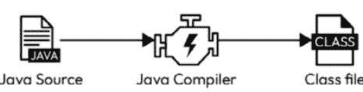

图 2.1：将 Java 源代码转换为类文件的过程

JVM 类文件的优雅结构被精确定义。它从魔数（magic number）以及次版本和主版本细节开始，然后进入常量池，这是运行时解释至关重要的语言存储库。接着列出访问标志、类层次结构和接口，为字段和方法封装数据和行为铺平了道路。这种精简的结构确保了 Java 应用程序无缝执行，每个组件都是 JVM 内部字节码转换交响乐中的一个重要音符。下面的代码块显示了字节码转换的全景：

```
ClassFile {
    u4 magic;
    u2 minor_version;
    u2 major_version;
    u2 constant_pool_count;
    u2 access_flags;
    u2 this_class;
    u2 super_class;
    u2 interfaces_count;
    u2 interfaces[];
    u2 fields_count;
    u2 fields[];
    u2 methods_count;
    u2 methods[];
    u2 attributes_count;
    u2 attributes[];
}
```

在 Java 类文件的复杂层次探索中，我们理解了定义 Java 程序核心的微妙之处。从独特的魔签名到字段和方法的编排舞蹈，每个组件在塑造类功能方面都起着关键作用。随着本节的结束，旅程无缝扩展到下一节，我们将深入研究类文件的头部信息。理解这些头部类似于解码执行的序言，开启了引导 JVM 解释和执行的基础元素。

## 理解类文件的头部信息

头部信息作为开篇注释，包含了对 JVM 至关重要的元数据。本节探讨了头部在为 Java 程序执行搭建舞台方面的作用。类文件头部作为看门员，引导 JVM 处理随后的字节码。它详细说明了如类文件所依赖的 Java 版本等细节。此外，头部声明了类的常量池，这是一个引用字符串、类型和其他常量的符号存储库，进一步塑造了程序解释的语义格局。

### 魔数

在文件头的开头是魔数，这是一组独特的字节，用于唯一标识一个文件为 Java 类文件。其十六进制值为 `0xCAFEBABE`，这个加密签名是 JVM 的第一个验证步骤，确保其处理的是有效的类文件。该魔数的存在就像一种秘密握手，允许 JVM 确信地继续对相关的字节码进行解释和评估。它是一个不容置疑的标记，签署了文件的合法性，并为 JVM 内部安全且准确的运行环境奠定了基础。

### Java 版本兼容性

类文件头中的 Java 版本兼容性声明是一项关键信息。该部分指示了类文件所遵循的语言特性和规范，允许 JVM 正确地解释字节码。兼容性通过两个不可缺的组件表示——`minor_version` 和 `major_version`：

- **minor_version**：这代表生成类文件的 Java 编译器的次版本。它反映了编译器的增量变化或更新，这些更新不会引入重大修改。

- **major_version**：这代表编译器的主版本。主版本的变化意味着重大的更改或新语言特性的引入。

在 Java 类文件的丰富织锦中导航，类文件头中的 Java 版本兼容性声明充当了关键的指南，引导 JVM 精确地解释字节码。`minor_version` 和 `major_version` 之间的相互作用界定了编译器的增量变化，并标志着 Java 演进中的重大里程碑。为了阐明这段历程，下表展示了 `major_version` 与对应 Java SE 版本之间的关联，涵盖了从 JDK 1.1 初期到 Java SE 21 最新创新。这一全面的路线图封装了类文件与 Java 版本之间的共生关系，展示了 JVM 如何动态适应 Java 语言的细微演变，确保在不同版本之间实现无缝的兼容性和执行：

| major_version | Java release |
| --- | --- |
| 45 | JDK 1.1 |
| 46 | JDK 1.2 |
| 47 | JDK 1.3 |
| 48 | JDK 1.4 |
| 49 | J2SE 5.0 |
| 50 | Java SE 6 |
| 51 | Java SE 7 |
| 52 | Java SE 8 |
| 53 | Java SE 9 |
| 54 | Java SE 10 |
| 55 | Java SE 11 |
| 56 | Java SE 12 |
| 57 | Java SE 13 |
| 58 | Java SE 14 |
| 59 | Java SE 15 |
| 60 | Java SE 16 |
| 61 | Java SE 17 |
| 62 | Java SE 18 |
| 63 | Java SE 19 |
| 64 | Java SE 20 |
| 65 | Java SE 21 |

理解标志（flags）不仅能让我们洞察类的本质，还能让 JVM 强制执行访问控制并精确地执行 Java 程序。


- **此类及其父类信息：** 头部包含指向常量池条目的索引，这些条目代表了当前类及其父类。这些信息建立了一个类层级结构，允许 JVM 在执行过程中导航继承结构。

- **接口、字段和方法计数：** 头部紧随其后的是在类中声明的接口、字段和方法的计数。这些值为 JVM 提供了类结构的蓝图，从而实现高效的内存分配和执行规划。

理解这些编码在头部的细节，无异于解码 Java 类文件的 DNA。它构成了 JVM 在类加载、验证和执行期间做出决策的基础，确保了高层 Java 代码无缝且准确地翻译为可执行的字节码。因此，头部不仅是一个序言，更是一个关键的指路标志，引导 JVM 穿过类文件解释和执行的复杂领域。

在探索 Java 类头部时，我们解码了启动 JVM 迈向字节码世界之旅的核心元素。从确认文件合法性的不容置疑的魔数，到 Java 版本兼容性和访问标志的细微细节，头部充当了执行的序言，引导 JVM 穿过类文件解释的复杂性。常量池引用充当了符号网关，将二进制表示与 Java 丰富的语义世界连接起来。

当我们结束对 Java 类文件头部的探索时，让我们花一点时间回顾一下迄为止所获得的见解。我们解码了封装在常量池中的符号宝库，理解了它在引用字符串、类、字段名和方法名方面的关键作用，这些对于 Java 程序的解释和执行至关重要。通过识别这一存储库的动态性质，我们研究了类文件头部如何作为引导灯塔，在整个类文件结构中引用常量池的起始位置。

在本章中获得的知识揭示了 Java 类文件的复杂架构，为更深层次地理解代码执行奠定了基础。理解头部类似于解码执行的序言，为理解常量池的启动和导航提供了关键洞察，这是 Java 动态行为的一个基本方面。

当我们过渡到下一节时，我们带着对类文件符号基础及其在确保 Java 程序准确执行方面重要性的认识。欢迎加入我们接下来的探索，届时我们将深入访问标志、接口、字段和方法的细微细节，进一步丰富我们对 Java 类文件结构的理解。

## 字段和数据存储库

在类文件细节的深入探索中，我们现在进入专门用于字段和数据存储库的部分。这一关键部分剖析了 Java 类中代码与数据汇聚的动态纽带。字段作为信息的守护者，超越了单纯变量的范畴，封装了数据存储的本质。在我们导航这一部分时，我们将揭开字段类型的多样性，从实例变量到类变量，并解码它们在塑造 Java 类架构中的作用。加入我们，发现字段与常量池之间的和谐相互作用，符号引用丰富了语言，并为类文件中数据表示的动态层做出贡献。本节是通往 Java 程序心脏的门户，展示了字段如何成为动态容器，使代码在 JVM 中转换为可执行的现实。

字段的声明涉及指定其数据类型、可见性、可访问性和行为。通过剖析字段声明的语法，开发者可以洞察这些容器如何存储和组织数据，从而在高层代码与类文件中的二进制表示之间建立共生关系。这种细致的理解允许有效利用字段，增强了 Java 程序中数据管理的清晰度和效率。

除了语法之外，字段通过各种类型表现出多样性，每种类型在 Java 类中承担不同的角色。两个主要大类是实例变量和类变量：

- **实例变量：** 这些字段与类的实例相关，每个对象都有一组独特的值。实例变量封装了单个对象的状态，定义了它们的特征和属性。理解实例变量的区别和细微差别至关重要。

- **类变量：** 与实例变量不同，类变量通过 `static` 关键字定义，表明它们属于类而不是实例。类变量在所有实例之间共享。

通过剖析字段声明的语法，开发者可以洞察这些容器如何存储和组织数据，从而在高层代码与类文件中的二进制表示之间建立共生关系。这种细致的理解允许有效利用字段，增强了 Java 程序中数据管理的清晰度和效率。

（注：由于原文逻辑，此处后续关于字段多样性的描述已在上述 `static` 标记的翻译中涵盖）

## 类文件中的方法

让我们深入探索 Java 类文件的核心——方法（methods）。这些动态组件是类内部行为的架构师，塑造了 Java 程序的本质，并协调着 JVM 内部代码的精确执行。在本节中，我们将剥开层层外，揭示方法声明、参数传递以及代码动态执行的复杂性。我们的目标是让您对方法如何从根本上对 Java 类的结构完整性和功能做出贡献有坚实的基础理解。

在类文件中，方法的返回类型（`return type`）是理解执行过程中生成数据性质的关键。这一关键元素充当 JVM 的引导灯塔，使其能够预测每个方法的预期结果。无论方法产生的是 `int`、`String` 还是任何其他数据类型，返回类型都封装了这一重要信息，丰富了我们对方法如何融入更广泛的程序结构中的理解。

我们将在接下来的章节中深入探讨方法的细微差别，为您提供对它们在 Java 编程世界中作用和意义的更全面的理解。

# 总结

在 Java 类文件的复杂布局中探索方法时，我们发现了它们作为程序行为架构师的关键作用。类文件结构封装了关于返回类型、修饰符和参数的关键信息，引导 JVM 动态且高效地执行代码。

当我们结束这部分的探索时，对类文件复杂性的之旅将继续到下一章。接下来的主题将深入探讨字节码（`bytecode`）的本质，它作为中间语言连接了高层 Java 代码与 JVM 平台无关的执行环境。我们将共同揭开字节码层，理解它是如何将逻辑转换为可执行指令的，从而确保了 Java 程序的移植性和通用性。对字节码的这种探索有望加深我们对 Java 跨平台能力的理解，并为使 Java 代码在不同环境中无缝运行的魔法提供见解。

## 问题

回答以下问题以测试您对本章知识的掌握情况：

- 1. Java 类文件头中“Magic”数字的目的是什么？

A. 它识别编写代码的开发者

B. 它标识该文件为 Java 类文件

C. 它标记了常量池的结束

D. 它决定了类层次

- 2. 类文件结构中的哪部分存储符号引用、字符串和常量？

A. 字段 (Fields)

B. 访问标志 (Access flags)

C. 常量池 (Constant pool)

D. 方法 (Methods)

- 3. 类文件结构中的 `interfaces_count` 字段代表什么？

A. 类中方法的数量

B. 类实现的接口数量

C. 接口的访问标志

D. 常量池的总大小

- 4. 在类文件的背景下，字段（fields）和方法（methods）代表什么？

A. 变量和属性

B. 语言仓库

C. 加密封印

D. 访问修饰符

- 5. 类文件结构中属性（attributes）部分的主要目的是什么？

A. 确定类版本

B. 存储符号引用

C. 管理字节码执行

D. 提供关于类的额外信息

## 答案

以下是本章问题的答案：

- 1. B. 它标识该文件为 Java 类文件

- 2. C. 常量池

- 3. B. 类实现的接口数量

- 4. A. 变量和属性

- 5. D. 提供关于类的额外信息

# 3

# 理解字节码

在 JVM 的复杂世界中，字节码作为中间语言，使 Java 程序能够跨越特定硬件和操作系统的边界。当我们深入 JVM 内部核心时，开发者可以获得破译字节码的洞察，这是执行 Java 应用的一个基础组件。字节码表示为一组指令，充当高层 Java 代码与底层硬件特定机器语言之间的桥梁。通过理解字节码，使他们能够优化代码性能并排查复杂问题。

字节码的核心是一系列化的指令，它们规定了 JVM 执行的底层操作。本章将揭示算术运算的细微差别，阐明 JVM 如何处理数学计算。从基础的加减法到更复杂的步骤，我们探索了管理这些过程的字节码指令。此外，我们还深入了值转换（`value conversions`），对于寻求优化应用程序以获得最佳性能和效率的开发者来说，揭秘 JVM 底层操作至关重要。加入我们字节码领域的之旅，在那里，算术运算和值转换的复杂性为掌握 JVM 铺平了道路。

在本章中，我们将探索以下主题：

- 揭秘字节码

- 算术运算

- 值转换

- 对象操作

- 条件指令

## 技术要求

对于本章，您将需要以下内容：

- Java 21

- Git

- Maven

- 任何优的 IDE

本章的 GitHub 仓库位于 - https://github.com/PacktPublishing/Mastering-the-Java-Virtual-Machine/tree/main/chapter-03

## 揭秘字节码

字节码是 Java 编程中的一个核心概念，它是实现 Java 程序在 JVM 上跨平台兼容性和执行的中间语言。本节旨在揭秘字节码，对其重要性、目的以及在 JVM 内部允许的一系列操作提供全面概述。

从核心上说，字节码充当高层 Java 代码与底层硬件特定语言之间的桥梁。当 Java 程序被编译时，源代码被转换为字节码——一组指令，平台无关的字节码允许 Java 程序在不同环境中无缝执行。我们为什么需要字节码？答案在于移植性和通用性。通过在高层源代码和机器代码之间引入中间步骤，Java 程序可以在任何设备上运行，无论架构或操作系统如何。

现在，让我们深入研究字节码中的指令。字节码指令涵盖了多种功能，从基础的加载和保存操作到复杂的算术计算。算术运算（包括加、减、乘等）通过特定的字节码指令执行，允许开发者理解并优化其代码的数学基础。

值转换是字节码操作的另一个方面，涉及数据类型转换。无论是整数转换为浮点数还是其他类型转换，字节码指令为这些操作提供了基础。这种灵活性对于在 Java 生态系统中编写代码并无缝处理数据类型的开发者来说至关重要。除此之外，字节码协调对象的创建和操作、条件语句以及方法的调用和返回。每个字节码指令都对 Java 程序的执行流做出贡献，理解这些操作使开发者能够编写高效、可靠的应用。

确实，理解字节码对于导航 JVM 的复杂性至关重要。字节码指令设计用于操作特定类型的值，识别被操作的类型是编写高效正确 Java 代码的基础。每个字节码助记符的首字母通常可以作为判断操作类型的有用提示。

让我们深入研究这种根据字节码助记符首字母识别操作类型的技巧：

- `i` 代表整数运算：以 `i` 开头的字节码，例如 `iload`（加载整数）、`iadd`（加整数）和 `isub`（减整数），表示涉及整数值。这些指令操作存储为 32 位符号整数的值。

- `l` 代表长型运算：`l` 前缀，如 `lload`（加载长型）或 `lmul`（乘长型），表示对 64 位符号长型整数的操作。

- `s` 代表短型运算：以 `s` 开头的字节码，例如 `sload`（加载短型），与 16 位符号短型整数的操作相关。

- `b` 代表字节运算：`b` 前缀出现在如 `bload`（加载字节）等字节码指令中，表示对 8 位符号字节整数的操作。

- `c` 代表字符操作：对 16 位 Unicode 字符的操作以 `c` 开头的字节码指令表示，例如 `caload`（加载字符数组）。

- `f` 代表浮点数操作：在字节码助记符（如 `fload`（加载浮点数）或 `fadd`（相加浮点数））中，`f` 前缀表示涉及 32 位单精度浮点数的操作。

- `d` 代表双精度操作：双精度浮点数（64 位）是以 `d` 开头的字节码指令的关注重点，例如 `dload`（加载双精度）或 `dmul`（乘法双精度）。

- `a` 代表引用操作：涉及对象引用的操作以 `a` 开头的字节码指令表示，例如 `aload`（加载引用）或 `areturn`（返回引用）。

这种系统性的命名规范有助于开发者快速识别字节码指令正在处理的数据类型。通过识别首字母并将其与特定的数据类型关联，开发者可以编写出更具信息量且精确的代码，确保字节码操作与 JVM 预期的数据类型和行为一致。这对于掌握字节码以及从性能和可靠性方面优化 Java 应用程序至关重要。

在 Java 字节码中，布尔值通常用整数表示（0 表示假，1 表示真）。然而，必须注意的是，布尔值没有专用字节码指令；相反，使用的是标准的整数算术和逻辑指令。例如：

- `iadd`、`isub`、`imul`、`idiv` 以及类似的指令与布尔值无缝工作

- 如 `and` (`iand`)、`or` (`ior`) 和 `xor` (`ixor`) 等逻辑操作可用于布尔逻辑

关键点在于，布尔值在字节码中被视为整数，允许开发者对数值计算和布尔计算使用相同的算术和逻辑指令。

字节码为算术操作提供了基础，构建了 Java 程序的数学核心。我们的旅程将在下一节继续，届时我们将深入字节码中复杂的算术操作世界。我们将剖析控制加、减、乘等操作的指令，揭示定义 Java 应用程序数学本质的字节码序列。

通过理解编码在字节码中的算术操作，开发者可以洞察其代码的内部运行机制，使其能够优化性能并提高效率。加入我们进入下一节，揭开算术操作背后的秘密，并为掌握 JVM 的复杂性铺平道路。

### 算术操作

在本节中，我们将对字节码的基石之一：算术操作进行重点探索。这些操作是赋予 Java 程序活力的数学基础，塑造了 JVM 内部计算的数值格局。

字节码算术操作遵循一个基本原则：它们对操作数栈上的前两个值进行操作，执行指定的运算并将结果返回栈。本节将深入探讨字节码算术的细微之处，阐明其细微差别、行为以及对程序执行的影响。

字节码中的算术操作分为两大类：涉及浮点数的操作和处理整数的操作。每类操作都表现出不同的行为，对于寻求在数值计算中追求精确可靠性的 Java 开发者来说，理解这些差异至关重要。

当我们在字节码算术领域穿行时，我们将探索控制浮点数和整数加、减、乘、除的指令。我们将剖析封装这些操作的字节码序列，明确它们的实现方式和性能影响。

#### 加、减、乘、除

基础算术操作是 Java 数值计算的构建块。从整数相加（`iadd`）到双精度数除法（`ddiv`），每条字节码指令都经过精心设计以处理特定的数据类型。探索整数、long、浮点数和双精度数的加、减、乘、除的细微差别：

- 加法：

- `iadd`：两个整数相加

- `ladd`：两个 long 相加

- `fadd`：两个浮点数相加

- `dadd`：两个双精度数相加

- 减法：

- `isub`：从第一个整数减去第二个整数

- `lsub`：从第一个 long 减去第二个 long

- `fsub`：从第一个浮点数减去第二个浮点数

- `dsub`：从第一个双精度数减去第二个双精度数

- 乘法：

- `imul`：两个整数相乘

- `lmul`：两个 long 相乘

- `fmul`：两个浮点数相乘

- `dmul`：两个双精度数相乘

- 除法：

- `idiv`：第一个整数除以第二个整数

- `ldiv`：第一个 long 除以第二个 long

- `fdiv`：第一个浮点数除以第二个浮点数

- `ddiv`：第一个双精度数除以第二个双精度数

#### 余数与取反

- 余数 (remainder)：

- `irem`：计算第一个整数除以第二个整数的余数

- `lrem`：计算第一个 long 除以第二个 long 的余数

- `frem`：计算第一个浮点数除以第二个浮点数的余数

- `drem`：计算第一个双精度数除以第二个双精度数的余数

- 取反 (negation)：

- `ineg`：取反（改变符号的）整数

- `lneg`：取反 long

- `fneg`：取反浮点数

- `dneg`：取反双精度数

#### 移位与位运算

深入探索位运算操作（`ior`、`iand`、`ixor`、`lor`、`land`、`lxor`）和移位操作（`ishl`、`ishr`、`iushr`、`lshl`、`lshr`、`lushr`）的世界。发现这些操作如何处理单个位，为高级计算和优化提供强大的工具：

- 移位操作 (shift)：

- `ishl`、`ishr`、`iushr`：将整数的位向左、向右（带符号扩展）或向右（不带符号扩展）移动

- `lshl`、`lshr`、`lushr`：将 long 的位向左、向右（带符号扩展）或向右（不带符号扩展）移动

- 位运算：

- `ior`、`lor`：整数和 long 的位或

- `iand`、`land`：整数和 long 的位与

- `ixor`、`lxor`：整数和 long 的位异或

### 局部变量增

解锁 `iinc` 的潜力，这是一种通过常量增加局部变量的巧妙操作。学习此字节码指令如何在特定场景下增强代码的可读性和效率：

- 局部变量增 (`iinc`)：`iinc` 通过常量增加局部变量

### 比较操作

深入通过 `dcmpg`、`dcmpl`、`fcmpg`、`fcmpl` 和 `lcmp` 等指令比较值的世界。发现产生 1、-1 或 0 结果的细微之处，这表示双精度数、浮点数之间的大于、小于或相等：

- 比较：

- `dcmpg`、`dcmpl`：比较两个双精度数，产生 1、-1 或 0（大于、小于或相等）

- `fcmpg`、`fcmpl`：比较两个浮点数，产生 1、-1 或 0（大于、小于或相等）

- `lcmp`：比较两个 long，产生 1、-1 或 0（大于、小于或相等）

在字节码世界中，`dcmpg` 和 `dcmpl` 等指令有效地比较双精度浮点数，产生 1、-1 或 0 以表示大于、小于或相等。同样，`fcmpg` 和 `fcmpl` 处理单精度浮点数。然而，对于长型整数，`lcmp` 通过提供单一结果 1、-1 或 0 来简化问题，这种简化方法优化了字节码中的长型整数比较。

这些操作对于整数和浮点数的行为可能不同，特别是在处理除以零或溢出等边界情况时。理解这些字节码指令为开发者提供了在 Java 应用程序中构建精确且稳健数值计算的工具。

在解释了字节码的概念并展示了一些算术操作后，我们将通过检查实际示例，深入探讨 JVM 中字节码算术的世界。我们的重点将通过分析一个简单的 Java 代码段来理解这一过程，该代码执行了一个基础算术操作，即两个整数相加。这种实践性的探索旨在揭示字节码算术复杂的运行机制。

考虑以下 Java 代码段：

```java
public class ArithmeticExample {
    public static void main(String[] args) {
        int a = 5;
        int b = 7;
        int result = a + b;
        System.out.println("Result: " + result);
    }
}
```

将代码保存为名为 `ArithmeticExample.java` 的文件，并使用以下命令进行编译：


```
javac ArithmeticExample.java
```

现在，让我们使用 `javap` 命令反汇编字节码：

```
javap -c ArithmeticExample.class
```

执行该命令后，将生成字节码的输出：

```
public static void main(java.lang.String[]) {
```

代码如下：

```
...
5: iload_1 // 将 'a' 的值加载到栈中
6: iload_2 // 将 'b' 的值加载到栈中
7: iadd // 将栈顶两个值（a 和 b）相加
8: istore_3 // 将结果存储到局部变量 'result' 中
...
```

这些字节码指令执行了以下操作：

- `iload_1`: 将局部变量 `a` 的值加载到栈中
- `iload_2`: 将局部变量 `b` 的值加载到栈中
- `iadd`: 将栈顶两个值（即 `a` 和 `b`）相加
- `istore_3`: 将加法结果存回局部变量 `result`

这些字节码指令精确地反映了 Java 代码中的算术操作 `int result = a + b;`。`iadd` 指令执行已加载值的加法运算，而 `istore_3` 指令将结果存回局部变量以供后续使用。理解这些字节码可以详细了解 JVM 如何在 Java 程序中执行简单的算术操作。

在字节码算术的旅程中，我们剖析了 Java 程序中两个整数相加看似平凡但影响深远的过程。字节码指令揭示了一个隐藏的复杂性层面，展示了高层操作如何在 Java 虚拟机（JVM）内部转换为机器可执行的代码。

当我们结束这一部分时，下一个目的地正等待着我们：值转换领域。理解不同数据类型在字节码中如何相互作用，对于构建稳健且高效的 Java 至关重要。在接下来的章节中，让我们深入值转换的复杂性，揭示 JVM 内部数据转换的微妙差别。旅程继续，每一条字节码指令都让我们离掌握 Java 字节码深度更进一步。

### 值转换

在本节中，我们沉浸在 JVM 内部复杂的值转换领域。这些转换就像字节码景观中的“变色龙”，允许变量扩展为 `long`，允许浮点数转换为 `double`，而不会损害其原始值的保真度。促进这些蜕变的字节码指令对于保持精度、防止数据丢失以及确保不同数据类型的无缝集成至关重要。加入我们，剖析这些指令，发现支撑 Java 编程的优雅与准确的交响乐：

- **整数转长 (`i2l`):** 探索 `i2l` 指令如何将整数变量提升为长，同时保留原始值的精度
- **整数转浮点 (`i2f`):** 深入研究 `i2f` 的世界，在这里整数优雅地转换为浮点数而不牺牲精度
- **整数转双精度 (`i2d`):** 见证通过 `i2d` 指令完成从整数到双精度的保持精度之旅
- **长转浮点 (`l2f`) 和长转双精度 (`l2d`):** 检查 `l2f` 和 `l2d` 的优雅性，长值分别无缝地转换为浮点数和双精度
- **浮点转双精度 (`f2d`):** 探索 `f2d` 指令，展示在保持精度的同时将浮点数提升为双精度

在处理字节码的复杂性时，我们遇到了一个专门管理“收缩”的关键部分——这是一个标记着潜在丢失和溢出考虑的微妙过程。在这次探索中，我们深入将变量转换为更短数据类型的字节码指令，承认与精度丢失和溢出风险相关的细微挑战。现在让我们探索这组指令：

- **整数转字节 (`i2b`)、整数转短整 (`i2s`)、整数转字符 (`i2c`):** 整数转换为 `byte`、`short` 和 `char` 类型时，`i2b`、`i2s` 和 `i2c` 指令带来的潜在精度损失
- **长转整数 (`l2i`):** 检查使用 `l2i` 指令将长转换为整数时的考虑因素，承认溢出的可能性
- **浮点转整数 (`f2i`)、浮点转长 (`f2l`):** 发现通过 `f2i` 和 `f2l` 将浮点转换为整数和长面临的挑战，注意精度和溢出问题
- **双精度转整数 (`d2i`)、双精度转长 (`d2l`)、双精度转浮点 (`d2f`):** 遍历 `d2i`、`d2l` 和 `d2f` 指令，理解在转换为双精度、长和浮点时精度与潜在溢出之间的微妙平衡

在字节码复杂的领域，以下最佳实践是指导我们考虑实际问题的指南针。在这里，我们桥接了理论与应用，探索字节码指令在现实 Java 编程场景中的切实影响。从在复杂算术操作中保持精度到处理面向对象设计的灵活性，这些实际考虑阐明了在开发领域中理解和掌握字节码的重要性。

- **在算术中保持精度:** 连接值转换与算术操作之间的联系，确保在复杂计算中保持精度
- **处理对象引用:** 探索值转换如何为面向对象设计的灵活性做出贡献

精度损失或溢出。这些复杂性强调了 Java 编程中数据类型之间微妙的互动。当我们结束这一部分时，高层代码到字节码的无缝转换变得更加清晰，揭示了 JVM 精密的编排。在下一节中，我们将重点转向字节码中对象操作这一迷人的领域，揭开织成 Java 面向对象范式织锦的线索。在接下来的旅程中，我们将仔细研究塑造和操纵对象的字节码指令，深入探索动态、多功能 Java 编程的核心。

## 对象操作

在这次沉浸式课程中，我们开始对 Java 字节码复杂结构中的对象操作进行全面探索。我们的旅程揭示了对于创建和操纵实例、强制数组以及访问类静态和实例属性至关重要的字节码指令。我们将仔细研究从数组加载值到栈栈的指令、查询数组长度、以及对实例或数组执行关键检查的指令。从基础的 `new` 指令到多维数组的复杂性，每条字节码命令都引导我们更深地进入面向对象的操作领域。

在 Java 的字节码织锦中，`new` 指令是通往对象创建和操作领域的门户。它不仅为对象分配内存，还调用其构造函数，启动了一个动态实体的诞生。我们加入这场对字节码复杂性的深度探究，在这里，看似简单的 `new` 指令揭示了让 Java 对象焕活所涉及的基础步骤。当我们剖析这条字节码命令时，内存分配和构造函数调用的底层交响变得更加清晰，为深入理解 JVM 内部的实例创建铺平了道路。

- `new`：初始化新对象，分配内存并调用对象的构造函数。将新创建对象的引用放置在栈上。

在 Java 字节码的编排中，创建数组的指令呈现出一幅多功能的画面。在这一部分中，我们深入研究了构建数组的字节码指令，为数据存储提供了动态画布。从用于原始数据类型的基础 `newarray` 到用于对象引用的细微 `anewarray`，再到用于多维数组的 `multianewarray`，每条字节码指令都为 JVM 内部活跃的数组生态系统做出贡献。当我们剖析这些命令时，JVM 内部数组实例化的背后艺术便浮出水面，为更深入地理解 Java 编程中的数据结构动态打开了大门。

- `newarray`：创建一个原始数据类型的新数组
- `anewarray`：创建一个对象引用的新数组
- `multianewarray`：创建一个多维数组

在 Java 字节码的复杂舞蹈中，访问类静态或实例属性的指令——`getfield`、`putfield`、`getstatic` 和 `putstatic` 占据了中心位置。从优雅地检索实例字段到动态地设置字段值，每条字节码指令都为面向对象编程的微妙编排做出了贡献。加入我们，揭开字节码访问的优雅，在这里，实例属性与类属性之间的微妙平衡得以展开，揭示了治理 JVM 内部数据操作的底层机制。当我们剖析这些指令时，访问类属性的芭蕾变得栩栩如生，为深刻理解 Java 编程中面向对象的复杂性铺平了道路。

- `getfield`：从对象中获取实例字段的值
- `putfield`：设置对象中实例字段的值
- `getstatic`：从类中获取静态字段的值
- `putstatic`：设置类中静态字段的值

在 Java 的字节码交响乐中，加载指令——`baload`、`caload`、`saload`、`iaload`、`laload`、`faload`、`daload` 和 `aaload`——占据了中心，定义了从数组检索值的编排。在这一部分中，我们沉浸在节奏性的字节码命令中，它们优雅地将数组元素推向前景。从提取字节和字符到加载整数、长型、浮点、双精度和对象引用，每条指令在数组与 JVM 之间的和谐交互中都起着至关重要的作用。这些加载指令揭示了 Java 字节码无缝展开的有序过程。

（注：原文中部分指令拼写错误，如 `falad` 应为 `faload`，翻译时保留含义）

- `baload`：加载字节 (`byte`)
- `caload`：加载字符 (`char`)
- `saload`：加载短型 (`short`)
- `iaload`：加载整数 (`int`)
- `laload`：加载长型 (`long`)
- `faload`：加载浮点 (`float`)
- `daload`：加载双精度 (`double`)
- `aaload`：加载对象引用 (`object`)

在 Java 字节码的交响乐中，存储指令——`bastore`、`castore`、`sastore`、`iastore`、`lastore`、`fastore`、`dastore` 和 `aastore`——占据了中心，定义了存储值的编排。

- `bastore`：存储字节
- `castore`：存储字符
- `sastore`：存储短型
- `iastore`：存储整数
- `lastore`：存储长型
- `fastore`：存储浮点
- `dastore`：存储双精度
- `aastore`：存储数组引用

这些字节码指令为 Java 对象操作提供了基础，允许对实例和数组进行创建、访问和修改。无论是实例化、处理数组、访问类属性还是执行动态检查，每条指令都为 Java 字节码的灵活性和力量做出贡献。理解这些指令是掌握 Java 对象操作能力的关键。

在我们之前的讨论中，我们探索了核心字节码指令，对 Java 的底层机制有了更深入的理解。现在，让我们通过示例性的 Java 代码将这些知识付诸实践。在这里，我们引入了一个类的表示，关注单个属性：`name`。该类封装了对象操作的基本原理，提供了访问和修改属性的方法。当我们引导这个示例时，我们将深入研究该代码生成的字节码，提供对 JVM 的见解。这些字节码指令支撑着 Java 编程的动态本质，而这个实用的示例将阐明其现实世界的应用：

```java
public class Person {
    private String name;
    public Person(String name) {
        this.name = name;
    }
    public String getName() {
        return name;
    }
    public void setName(String newName) {
        this.name = newName;
    }
    public static void main(String[] args) {
        // 创建 Person 的实例
        Person person = new Person("John");
        // 访问并显示名称属性
        System.out.println("Original Name: " + person.getName());
        // 修改名称属性
        person.setName("Alice");
        // 显示更新后的名称
        System.out.println("Updated Name: " + person.getName());
    }
}
```

# 编译并显示字节码：

```
javac Person.java
javap -c Person.class
```

让我们关注字节码中与对象操作相关的部分，包括对象创建（`new`）、属性访问（`getfield`、`putfield`）和方法调用：

```
Compiled from "Person.java"
public class Person {
  private java.lang.String name;
  public Person(java.lang.String name);
```

代码：

```
0: aload_0
1: invokespecial #1 // Method java/lang/Object."<init>":()V
4: aload_0
5: aload_1
6: putfield      #2 // Field name:Ljava/lang/String;
9: return
```

```
public java.lang.String getName();
```

代码：

```
0: aload_0
1: getfield      #2 // Field name:Ljava/lang/String;
4: areturn
```

```
public void setName(java.lang.String);
```

代码：

```
0: aload_0
1: aload_1
2: putfield      #2 // Field name:Ljava/lang/String;
5: return
```

```
public static void main(java.lang.String[]);
```

代码：

```
0: new           #3 // class Person
3: dup
4: ldc           #4 // String John
6: invokespecial #5 // Method "<init>":(Ljava/lang/String;)V
9: astore_1
10: getstatic     #6 // Field java/lang/System.out:Ljava/io/PrintStream;
13: ldc           #7 // String Original Name:
15: invokevirtual #8 // Method java/io/PrintStream.println:(Ljava/lang/String;)V
18: getstatic     #6 // Field java/lang/System.out:Ljava/io/PrintStream;
21: aload_1
22: invokevirtual #9 // Method getName:()Ljava/lang/String;
25: invokevirtual #8 // Method java/io/PrintStream.println:(Ljava/lang/String;)V
28: ldc           #10 // String Alice
31: invokevirtual #11 // Method setName:(Ljava/lang/String;)V
34: getstatic     #6 // Field java/lang/System.out:Ljava/io/PrintStream;
37: ldc           #12 // String Updated Name:
39: invokevirtual #8 // Method java/io/PrintStream.println:(Ljava/lang/String;)V
42: getstatic     #6 // Field java/lang/System.out:Ljava/io/PrintStream;
45: aload_1
46: invokevirtual #9 // Method getName:()Ljava/lang/String;
49: invokevirtual #8 // Method java/io/PrintStream.println:(Ljava/lang/String;)V
52: return
```

## 让我们来分解关键字节码指令：

- **对象创建 (`new`):**
  - `0: new #3`: 创建一个 `Person` 类型的新对象
  - `3: dup`: 复制栈上的对象引用
  - `4: ldc #4`: 将常量字符串 `"John"` 推入栈中
  - `6: invokespecial #5`: 运行构造函数 (`<init>`) 以初始化对象

- **属性访问 (`getfield`, `putfield`):**
  - `1: getfield #2`: 获取 `name` 字段的值
  - `2: putfield #2`: 设置 `name` 字段的值

- **方法调用：**
  - `22: invokevirtual #9`: 调用 `getName` 方法
  - `31: invokevirtual #11`: 调用 `setName` 方法

这些字节码片段突显了与对象操作相关的基础指令，为理解 Java 编程在低级字节码层面的动态特性提供了见解。

在梳理简化的 `Person` 类中对象操作的字节码织锦时，我们揭示了主导对象创建、属性访问和方法调用的指令编排。随着字节码交响曲的展开，我们将无缝过渡到下一个部分，在那里将深入探讨方法调用和返回的动态领域。加入我们，共同解码方法调用本质的字节码指令，阐明定义 JVM 内程序执行流的复杂之处。随着我们继续前进，对方法调用和返回的探索有望丰富我们对字节码交响曲的理解，揭示 Java 编程复杂性的下一层。

### 方法调用与返回


# Java 字节码中的方法调用与返回

让我们开启进入 Java 编程版图中方法调用复杂动态机制和值细致返回的旅程。我们将揭示动态调用方法的微妙之处，以及接口方法的敏捷调用，并探索调用私有方法或父类方法的独特音调，以及静态方法调用所发出的强大音调。在这一探索过程中，我们将遇到动态构造的引入，展示了 Java 编程的适应性。记住，返回调用的节奏是由特定指令定义的。

探索 Java 字节码中的方法调用交响曲，以下指令在方法调用的旋律中协调着各种音调，每条指令对语言的动态和多功能特性贡献了独特价值：

- `invokevirtual`: 启动方法调用的旋律，该指令调用实例方法，为 Java 的动态和多态行为提供了骨干
- `invokeinterface`: 增加和谐音符，该指令调用接口方法，贡献了 Java 面对象范式的灵活性和适应性
- `invokespecial`: 引入独特的和弦，该指令调用私有方法或父类方法，封装了特权方法调用
- `invokestatic`: 击出强大的音调，该指令调用静态方法，强调了不依赖实例创建的方法调用
- `invokedynamic`: 弹奏出多功能的曲调，该指令动态构造对象，展示了 Java 方法调用的动态能力

方法执行的节奏被返回指令（`ireturn`、`lreturn`、`freturn`、`dreturn` 和 `areturn`）所补充，定义了从方法返回值的节奏。在发生异常的非预期中断时，异常调用将成为舞台焦点，管理着错误处理的编排。

我们进一步深入同步方法的复杂性，其中带有 `ACC_SYNCHRONIZED` 标志的监视器协调着一场受控的舞蹈。通过 `monitorenter` 指令，方法进入监视器以确保独占执行，并在完成后通过 `monitorexit` 优雅退出。

## 字节码示例

```
2: invokestatic #2 // Method performCalculation:(II)I
5: iload_0
6: iload_1
7: invokestatic #11 // Method multiply:(II)I
10: invokestatic #12 // Method subtract:(II)I
13: return

private static int add(int, int);
```

```
# Code:
0: iload_0
1: iload_1
2: iadd
3: return

private static int multiply(int, int);
```

```
# Code:
0: iload_0
1: iload_1
2: imul
3: return

private static int subtract(int, int);
```

```
# Code:
0: iload_0
1: iload_1
2: isub
3: return
}
```

这段字节码片段展示了与方法调用和返回相关的核心指令，让我们得以窥见 Java 字节码交响乐。

当我们结束对 Java 字节码方法调用和返回的探索时，已经揭示了 `invokevirtual`、`invokeinterface`、`invokespecial` 和 `invokestatic` 指令交织的交响乐，它们展示了方法调用的动态性质以及值的返回。当我们转向下一节时，焦点转移到了条件指令，这些指令塑造了程序的执行。加入我们来解码条件语句的字节码复杂性，揭示引导 JVM 通过条件定义的路径的逻辑。

## 条件指令

在本节中，我们深入研究了条件指令的细微领域，揭示了 JVM 内决策的复杂性。这些指令构成了条件语句的骨干，引导 JVM 通过布尔结果定义的路径。加入我们来解析条件指令的字节码复杂性，揭示了 Java 编程中条件语句的基本原理。

导航字节码领域展示了一组精细控制 JVM 内逻辑的指令。这些命令作为条件语句的架构师，协调着决策并根据布尔结果影响程序流。让我们探索一组具有控制 Java 程序流和决策能力的字节码指令，这些指令涵盖了条件、切换和跳转：

- `ifeq`: 如果栈顶值等于 0，跳转到目标指令
- `ifne`: 如果栈顶值不等于 0，跳转到目标指令
- `iflt`: 如果栈顶值小于 0，跳转到目标指令
- `ifle`: 如果栈顶值小于或等于 0，跳转到目标指令
- `ifgt`: 如果栈顶值大于 0，跳转到目标指令
- `ifge`: 如果栈顶值大于或等于 0，跳转到目标指令
- `ifnull`: 如果栈顶值为 null，跳转到目标指令
- `ifnonnull`: 如果栈顶值不为 null，跳转到目标指令
- `if_icmpeq`: 如果栈上的两个整数值相等，跳转到目标指令
- `if_icmpne`: 如果栈上的两个整数值不相等，跳转到目标指令
- `if_icmplt`: 如果栈上的第二个整数小于第一个，跳转到目标指令
- `if_icmple`: 如果栈上的第二个整数小于或等于第一个，跳转到目标指令
- `if_icmpgt`: 如果栈上的第二个整数大于第一个，跳转到目标指令
- `if_icmpge`: 如果栈上的第二个整数大于或等于第一个，跳转到目标指令
- `if_acmpeq`: 如果栈上的两个对象引用相等，跳转到目标指令
- `if_acmpne`: 如果栈上的两个对象引用不相等，跳转到目标指令
- `tableswitch`: 提供了一种更高效的方式来实现带有连续整数值的 switch 语句
- `lookupswitch`: 与 `tableswitch` 类似，但支持稀疏值
- `goto`: 无条件跳转到目标指令
- `goto_w`: 无条件跳转到目标指令（宽索引）
- `jsr`: 跳转到子程序，保存栈上的返回地址
- `jsr_w`: 跳转到子程序（宽索引），保存栈上的地址
- `ret`: 从子程序返回，使用之前 `jsr` 指令保存的返回地址

这些指令在构建条件语句和根据各种条件控制程序执行方面起着至关重要的作用。理解它们的行为是解析和优化 Java 字节码的关键。

现在让我们探索 Java 中的条件逻辑，它是决策的画布。在这个示例中，我们编写了一个包含条件语句的简单 Java 程序。代码检查两个整数和两个字符串之间的关系，根据相等条件引导流程。当我们深入这段 Java 代码的字节码表示时，将解析包括 `if_icmpne` 和 `if_acmpeq` 在内的指令，它们负责引导程序进入不同的路径。加入我们，揭示 Java 代码与字节码塑造 JVM 内结果的动态相互作用。

```java
public class ConditionalExample {
    public static void main(String[] args) {
        int a = 5;
        int b = 3;
        String s1 = "Hello";
        String s2 = "Hello";

        if (a == b) {
            System.out.println("a is equal to b");
        } else {
            System.out.println("a is not equal to b");
        }

        if (s1.equals(s2)) {
            System.out.println("strings are equal");
        } else {
            System.out.println("strings are not equal");
        }
    }
}
```

```
0: iconst_5
1: istore_1
2: iconst_3
3: istore_2
4: ldc "Hello"
6: astore_3
7: ldc "Hello"
9: astore 4
11: iload_1
12: iload_2
13: if_icmpne 23
16: getstatic #2 // Field java/lang/System.out:Ljava/io/PrintStream;
19: ldc "a is equal to b"
21: invokevirtual #3 // Method java/io/PrintStream.println:(Ljava/lang/String;)V
22: goto 30
23: getstatic #2 // Field java/lang/System.out:Ljava/io/PrintStream;
26: ldc "a is not equal to b"
28: invokevirtual #3 // Method java/io/PrintStream.println:(Ljava/lang/String;)V
30: aload_3
31: aload 4
33: invokevirtual #4 // Method java/lang/String.equals:(Ljava/lang/Object;)Z
36: ifeq 46
39: getstatic #2 // Field java/lang/System.out:Ljava/io/PrintStream;
42: ldc "strings are equal"
44: invokevirtual #3 // Method java/io/PrintStream.println:(Ljava/lang/String;)V
45: goto 54
46: getstatic #2 // Field java/lang/System.out:Ljava/io/PrintStream;
49: ldc "strings are not equal"
51: invokevirtual #3 // Method java/io/PrintStream.println:(Ljava/lang/String;)V
54: return
```

方法实现，类的每一个方面都体现在字节码中。在这里，我们揭开了 Java 程序全景视图的面纱，探索我们的代码如何转换为 JVM 能够理解的语言的细微差别。

在 Java 字节码的之旅中，让我们从构建一个简单而通用的 `Animal` 类开始。以下是定义该类的 Java 代码段：

```java
public class Animal {
    private String name;
    public String name() {
        return name;
    }
    public int age() {
        return 10;
    }
    public String bark() {
        return "woof";
    }
}
```

现在，让我们浏览编译过程并审视字节码：

```bash
javac Animal.java -verbose
```

借此，我们开启了一次迷人的探索，编译我们的 Java 类并揭示隐藏在表面下的复杂字节码细节。加入我们，解码 JVM 的语言，并点化我们 `Animal` 类的字节码表示。

字节码输出的这部分提供了关于编译类文件的元数据。让我们分解这些关键信息：

```
Last modified Nov 16, 2023: size 433 bytes SHA-256 checksum
0f08fdfc313e02a830d74224cb90216772ca10932ffe9ba89ae313a4f963da7
Compiled from "Animal.java"
public class Animal
    minor version: 0
    major version: 65
    flags: (00021) ACC_PUBLIC, ACC_SUPER
    this_class: #8 // Animal
    super_class: #2 // java/lang/Object
    interfaces: 0, fields: 1, methods: 4, attributes: 1
```

- **Last modified**: 指类文件最后修改的日期；在本例中，它是 2023 年 11 月 16 日。
- **Size**: 指定类文件的字节大小，在此实例为 433 字节。
- **SHA-256 checksum**: 代表类文件的 SHA-256 校验和。该校验和作为文件的唯一标识符，并确保其完整性。
- **Compiled from "Animal.java"**: 告知我们该字节码是从源文件 `Animal.java` 编译而来的。
- **Class declaration**: 声明名为 `Animal` 的类。
- **Version information**:
  - **minor version**: 设置为 0。
  - **major version**: 设置为 65，表示与 Java 11 兼容。
- **Flags**: 显示表示应用于该类的访问控制修饰符的十六进制标志。在本例中，它是一个公共类 (`ACC_PUBLIC`)，带有额外的属性 (`ACC_SUPER`)。
- **Class hierarchy**:
  - **this_class**: 指向代表当前类（即 `Animal`）的常量池索引 (`#8`)。
  - **super_class**: 指向常量池索引 (`#2`)，代表超类，即 `java/lang/Object`。
- **Interfaces, fields, methods, and attributes**: 提供了该类中这些元素的计数。

这些元数据提供了类文件属性的快照，包括它的版本、访问修饰符和结构细节。

字节码输出中的常量池部分让我们窥见常量池的一角，常量池是一个用于存储各种常量的结构表，例如字符串、方法和字段引用、类名等。让我们破译此常量池中的条目：

```
Constant pool:
#1 = Methodref #2.#3 // java/lang/Object."<init>":()V
#2 = Class #4 // java/lang/Object
#3 = NameAndType #5.#6 // "<init>":()V
#4 = Utf8 java/lang/Object
#5 = Utf8 <init>
#6 = Utf8 ()V
#7 = Fieldref #8.#9 // Animal.name:Ljava/lang/String;
#8 = Class #10 // Animal
#9 = NameAndType #11.#12 // name:Ljava/lang/String;
#10 = Utf8 Animal
#11 = Utf8 name
#12 = Utf8 Ljava/lang/String;
```

这里将显示字段指向点：

- `#1 = Methodref #2.#3 // java/lang/Object."<init>":()V`
  - 此条目引用了 `java/lang/Object` 类的构造函数，称为 `<init>`。它表示每个类隐式继承自 `Object` 类的初始化方法。
- `#2 = Class #4 // java/lang/Object`
  - 指向 `Object` 类的类引用，表示 `Animal` 类扩展了 `Object`。
- `#3 = NameAndType #5.#6 // "<init>":()V`
  - 指定构造函数 (`<init>`) 的名称和类型，无参数且返回 void。
- `#4 = Utf8 java/lang/Object`
  - 以 UTF-8 编码表示 `java/lang/Object` 类的名。
- `#5 = Utf8 <init>`
- `#6 = Utf8 ()V`
  - 以 UTF-8 编码表示构造函数的名称 (`<init>`) 及其类型（无参数且返回 void）。
- `#7 = Fieldref #8.#9 // Animal.name:Ljava/lang/String;`
  - 指向 `Animal` 类中的 `name` 字段，其类型为 `java/lang/String`。
- `#8 = Class #10 // Animal`
  - 指向 `Animal` 类的类引用。
- `#9 = NameAndType #11.#12 // name:Ljava/lang/String;`
  - 指定 `name` 字段的名称和类型：其名称 (`name`) 和类型 (`String`)。
- `#10 = Utf8 Animal`
  - 以 UTF-8 编码表示 `Animal` 类的名。
- `#11 = Utf8 name`
- `#12 = Utf8 Ljava/lang/String;`
  - 以 UTF-8 编码表示 `name` 字段的名称及其类型 (`String`)。

`age` 字段和 `bark` 方法也存在类似的条目，在常量池中引用字段和方法名称、它们的类型以及类名。总的来说，常量池是字节码执行期间解析符号引用的关键组件。

提供的字节码代表了 `Animal` 类中的方法。让我们分解每个方法：

- **构造方法** (`public Animal();`)
  - **Descriptor**: `()V` (no parameters, returns void)
  - **Flags**: `ACC_PUBLIC` (公共方法)


## 代码示例

```text
stack=1, locals=1, args_size=1
0: aload_0
1: invokespecial #1 // Method java/lang/Object.<init>():(V)
4: return
```

此构造函数通过调用其超类（Object）的构造函数来初始化 `Animal` 对象。`aload_0` 指令将对象引用 (`this`) 加载到栈上，`invokespecial` 调用超类构造函数。`LineNumberTable` 表明此代码对应源文件的第 1 行。

## 方法 `public java.lang.String name();`

- **Descriptor**: `() Ljava/lang/String;` (无参数，返回 String)
- **Flags**: `ACC_PUBLIC` (公共方法)

### 代码

```text
stack=1, locals=1, args_size=1
0: aload_0
1: getfield #7 // name:Ljava/lang/String;
4: return
```

`name` 方法获取 `name` 字段的值并返回。`aload_0` 加载对象引用 (`this`)，`getfield` 获取字段值。`LineNumberTable` 表明此代码对应源文件的第 9 行。

## 方法 `public int age();`

- **Descriptor**: `() I` (无参数，返回 int)
- **Flags**: `ACC_PUBLIC` (公共方法)

### 代码

```text
stack=1, locals=1, args_size=1
0: aload_0
1: getfield #13 // age:I
4: ireturn
```

类似于 `name` 方法，获取 `age` 字段的值并返回。`aload_0` 加载对象引用 (`this`)，`getfield` 获取字段值。`LineNumberTable` 表明此代码对应源文件的第 13 行。

## 方法 `public java.lang.String bark();`

- **Descriptor**: `() Ljava/lang/String;` (无参数，返回 String)
- **Flags**: `ACC_PUBLIC` (公共方法)

### 代码

```text
stack=1, locals=1, args_size=1
0: ldc #17 // String woof
2: areturn
```

`bark` 方法直接返回字符串 `woof`，不访问任何字段。`ldc` 加载常量字符串，`areturn` 返回它。`LineNumberTable` 表明此代码对应源文件的第 17 行。

这些字节码封装了 `Animal` 类中每个方法的逻辑，展示了执行期间的底层操作。

## Java 字节码类型描述符

在 Java 字节码中，每个变量和方法参数都分配了一个类型描述符。这些描述符是用于传达变量类型信息的紧凑表示。以下是详细说明：

- **B** (byte): 代表有符号的 8 位整数
- **C** (char): 表示 Unicode 字符
- **D** (double): 代表双精度浮点数
- **F** (float): 代表单精度浮点数
- **I** (int): 表示 32 位整数
- **J** (long): 代表 64 位长型整数
- **L Classname** (reference): 指向指定类的实例；完全限定类名紧跟在 `L` 之后并以分号结束
- **S** (short): 代表 16 位短型整数
- **Z** (boolean): 表示布尔值（真或假）
- **[** (array reference): 表示数组。数组元素的类型由 `[` 之后的后续字符决定

### 数组引用示例

- `[L Classname`: 表示指定类的对象的数组
- `[[B`: 表示字节数组的二维数组

这些描述符在检查与 Java 类中相关的方法声明、字段定义和变量使用的字节码指令时至关重要。它们能够在 Java 程序的低层字节码表示中对数据类型进行简洁的表示。

# 总结

在我们结束对 Java 字节码及其复杂的条件指令的探索时，读者已经对 Java 程序内部细微的控制流有了稳固的理解。凭借关于字节码决策能力的知识，读者完全有能力优化代码以提高效率和精确性。这段旅程现在将带我们进入 JVM 的核心，在接下来的章节中关注执行引擎。读者可以期待深入探讨字节码解释的机制以及即时编译（JIT）编译的变革性领域。这些技能在现实工作环境中是无价的，因为优化 Java 应用程序的性能是一项关键任务。加入我们，共同揭开 JVM 执行引擎的秘密，在那里，字节码的二进制舞蹈演变为优化的机器指令，赋予读者增强 Java 应用程序运行时魔力的能力。

# 习题

回答以下问题以检测你对本章知识的掌握程度：

1. 使用哪种字节码指令比较两个整数是否相等并相应地分支？
   - A. `if_eq`
   - B. `if_icmpeq`
   - C. `if_acmpeq`
   - D. `tableswitch`

2. 字节码指令 `ifeq` 的作用是什么？
   - A. 如果栈顶的值等于 0 则分支
   - B. 如果栈上的两个整数相等，则跳转
   - C. 跳转到子程序
   - D. 从数组中加载一个整数

3. 使用哪种字节码指令进行无条件分支？
   - A. `goto`
   - B. `ifne`
   - C. `jsr_w`
   - D. `lookupswitch`

4. 在 Java 字节码中，`jsr` 指令的作用是什么？
   - A. 跳转到子程序
   - B. 调用静态方法
   - C. 比较两个双浮点数
   - D. 如果栈顶的值为 null 则分支

5. 使用哪种字节码指令检查两个对象引用是否不相等并跳转到目标指令？
   - A. `if_acmpeq`
   - B. `if_acmpne`
   - C. `ifnull`
   - D. `goto_w`

## 答案

以下是本章问题的答案：

1. B. `if_icmpeq`
2. A. 如果栈顶的值等于 0 则分支
3. A. `goto`
4. A. 跳转到子程序
5. B. `if_acmpne`

---

# 第 4 章 执行引擎

# 执行引擎

在 Java 虚拟机 (JVM) 复杂的架构中，执行引擎占据了中心位置，在解释字节码和执行用于性能优化的即时编译（JIT 编译）方面起着至关重要的作用。字节码是 Java 源代码和 JVM 之间的中间语言，在程序执行期间，执行引擎动态将其翻译成原生机器码并进行解释。JVM 采用基于栈的执行模型操作操作数栈，在解释字节码指令时推入和弹出操作数。这种基于栈的方法允许 JVM 高效地处理指令。虽然字节码解释确保了平台无关性，但由于额外的抽象层，它无法持续地提供顶级性能。

为了应对性能挑战，JVM 引入了 JIT 编译。这种策略性优化技术经常识别被频繁执行的代码段（或热点），并在运行时将它们动态编译成原生机器码。通过选择性地优化热点，JVM 平衡了可移植性和性能，显著提升了 Java 应用程序的执行速度。本章深入探讨了字节码解释的细微差别和 JIT 编译的复杂性，揭示了这些过程如何协同工作，使 JVM 成为 Java 程序健壮且自适应的运行时环境。

在本章中，我们将探索以下主题：

- 执行的基础
- 系统运行层
- 解码 JVM 执行
- 类加载

## 执行的基础

在对将 Java 源代码转换为类文件和字节码的编译过程有了稳固理解之后，我们现在关注 JVM 执行这一迷人的领域。这一关键阶段是魔法发生的地方，因为 JVM 接管了控制权，让我们的 Java 程序运行起来。

当 JVM 接收到包含字节码的编译后的类文件时，执行引擎就开始工作。字节码作为我们 Java 程序的中间表示，在基于栈的执行模型中被解释。执行引擎动态执行字节码指令，操作操作数栈。这种基于栈的方法允许 JVM 高效处理指令，在栈上推入和弹出操作数。虽然字节码解释确保了平台无关性，但它可能会引入性能考虑，这引导我们进入执行旅程中的下一个关键步骤。

当执行 JVM 程序时，会有几个步骤展开以使 Java 应用程序运行：

1. **加载 (Loading)**：类加载器定位并加载编译后的 Java 类文件（字节码）到 JVM 中。这包括核心 Java 类和任何用户定义的类。
2. **验证 (Verification)**：加载的字节码经过验证过程以确保它符合 Java 语言规范，防止执行可能有害的代码。
3. **准备 (Preparation)**：为类变量和静态字段分配内存空间并用默认值初始化它们。
4. **解析 (Resolution)**：字节码中的符号引用被解析为具体的引用。
5. **初始化 (Initialization)**：执行类的静态块和变量。
6. **执行 (Execution)**：调用 `main()` 方法或指定的入口点。

当类文件在 JVM 中占据中心位置时，一系列复杂的流程调度展开了，为 Java 应用程序的执行铺平了道路。一旦加载，JVM 的类加载器就会细致地定位并将其加载到运行时环境中。JVM 承担了一系列步骤，从验证字节码是否符合语言规范到解析符号引用以及初始化类变量。这些步骤的最终结果是类文件在 JVM 中运行。随着 `main()` 方法或指定入口点的调用，应用程序开启了它的运行时旅程，每一行代码都动态地解释和执行，如下所示：

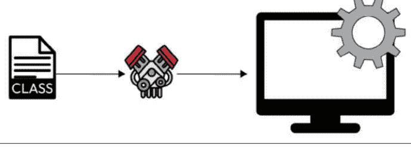

每次执行 Java 应用程序时，JVM 都会创建一个唯一的运行时环境。但需要注意的是，JVM 在每个运行时使用各种技术来优化性能。一种显著优化技术是 JIT 编译器。在相同应用程序的重复执行中，JVM 会识别该特定运行时内频繁执行的代码路径（称为热点），并将其动态编译成原生机器码。这些编译后的代码存储在同一运行时的内存中，减少了对相同字节码重复解释的需求，并显著提高了该特定运行时内的执行速度。此外，JVM 的实现可能会采用缓存机制来存储频繁访问的类和资源，进一步优化每个运行时范围内的应用程序性能。

总结来说，JVM 在每个运行时内优化性能，而 JIT 编译和缓存机制的益处适用于单个执行实例，确保应用程序在其特定的运行环境中高效运行。

尽管有了这些优化，但需要注意的是，这些优化在 Java 应用程序停止时将会丢失。因此，在同一台或另一台机器上每次运行应用程序，整个原生代码优化和编译过程必须重新进行。正在进行的项目，例如 [Project Leyden](https://openjdk.org/projects/leyden/)，旨在解决这一挑战。Leyden 项目的主要目标是通过赋予开发者对应用哪些优化的更多控制权，来优化 Java 程序的启动时间、性能达成时间以及整体占用率。然而，值得注意的是，在项目的当前状态下，这种控制程度可能是有限的。

在此背景下，另一个值得关注的项目是**协调检查点恢复（CRaC）**（https://docs.azul.com/core/crac/crac-introduction），这是一个旨在优化 Java 程序启动时间和资源利用率的 JDK 项目。CRaC 允许你在 Java 进程完全预热后对其进行快照（检查点），从而以全速状态启动 Java 程序。然后，它利用该快照从捕获的状态启动多个 JVM，并利用 Linux 的原生特性。值得一提的是，还存在诸如 **InstantOn Liberty** 等替代方案，且两者都是专有技术。

此外，CRaC API 被 AWS Lambda SnapStart 使用，展示了这种检查点方法的实际世界中的应用。Spring、Micronaut 和 Quarkus 等流行框架也支持 CRaC 检查点，使其成为进一步优化 Java 应用程序性能的一种前景方法。

字节码解释器是 JVM 内部的一个关键组件，在执行 Java 程序中起着关键作用。当 Java 应用程序启动时，JVM 加载从之前编译源代码生成的类文件，这些文件通常封装在 JAR 文件中。这些字节码由字节码解释器严密解释，遵循获取、解码和执行每条指令的逐步过程。

从核心上讲，字节码解释器遵循平台独立原则。在任何配备 JVM 的设备上执行相同的字节码，使得 Java 应用程序能够在各种环境中无缝运行而无需修改。这种适应性是 Java 著名的“一次编写，到处运行”哲学的基础，让开发者从对底层硬件和操作系统的担忧中解放出来。

解释器基于栈模型，遍历字节码指令，在执行操作时将操作数推入栈并从栈中弹出。这种面向栈的方法允许高效的字节码处理，并有助于 Java 应用程序的适应性和快速启动。虽然解释执行的代码速度可能无法匹配原生编译的程序，但字节码解释器通过提供快速启动的灵活性，结合定义 Java 跨平台开发优势的移植性，实现了平衡。

当我们从 JVM 的细致工作机制过渡到更广泛的视角时，我们的旅程在系统运行的分层中展开。系统的基础——硬件层提供了原始算力，而指令集架构（ISA）层是中间语言。在这些之上，操作系统协调资源的和谐，为应用程序层的大放异彩铺平了道路。当我们探索每一层的重要性时，我们发现了 JVM 如何与硬件协作、如何通过 ISA 通信、如何与操作系统“共舞”，并最终在计算交响乐的顶端呈现 Java 应用程序。让我们开始这次分层探索，理解系统运行的复杂动态。

### 系统运行层

系统运行层构成了支撑现代计算无缝功能的基础体系。这些层是分级的结构，在协调硬件和软件之间的协作方面发挥着独特的作用。让我们揭开这些层次的意义，并理解为什么它们对计算机系统的运行至关重要：

- **硬件层**：在最底层，硬件层由计算机系统的物理组件组成——处理器、内存、存储设备和输入/输出设备。它为所有较高层的操作和软件功能提供了基础。
- **ISA 层**：在硬件之上是 ISA 层，定义了软件与硬件之间的接口。它包含了处理器能够理解的指令集和架构。ISA 层充当桥梁，允许软件与底层硬件通信并利用其资源。
- **操作系统层**：位于 ISA 层之上，操作系统是应用程序软件和硬件之间关键的中间介质。它管理资源，为应用程序提供运行环境，并促进软件与硬件组件之间的通信。
- **应用程序层**：最顶层包含了应用程序，包括为了满足特定用户需求而设计的程序和工具。这一层与操作系统交互，以高效执行任务并利用硬件资源。

#### 图 4.2：系统运行层

| 层级 | 组件 |
| :--- | :--- |
| 4 | 应用程序 |
| 3 | 操作系统 |
| 2 | 指令集架构 (ISA) |
| 1 | 硬件 |

在计算复杂的编排中，JVM 表现出了一个优雅的舞者，无缝地弥合了系统层之间的差距。当我们探索 JVM 与硬件、ISA 和操作系统等基础层之间的共生关系时，一个引人入胜的叙述随之展开：

- **与 ISA 和硬件的交互**：JVM 通过操作系统直接与 ISA 层和硬件交互。它依赖 ISA 的指令集来执行字节码，而操作系统代表 JVM 管理硬件资源。
- **与操作系统的协作**：JVM 与操作系统层紧密工作，利用其服务进行内存管理、文件操作和其他系统相关任务。JVM 抽象了底层的硬件和操作系统差异，为 Java 应用程序提供了平台无关的执行环境。
- **应用程序执行**：JVM 是位于应用程序层内的 Java 程序的运行环境。它解释并执行 Java 字节码，确保 Java 程序能够在各种平台上一致运行，而无需直接考虑底层硬件或操作系统的规范。

本质上，JVM 扮演了高层应用程序层与底层系统层之间关键的桥梁，抽象了硬件和操作系统的细节，为 Java 应用程序提供标准化且可移植的执行环境。

## 解码 JVM 执行

在 JVM 执行的编排中，性能在不同的阶段展开，每个阶段都为 Java 应用程序的无缝功能做出贡献。序曲始于 JVM 的加载，此时类加载器勤勉地获取并将类文件和字节码加载到内存中，为确保性能奠定基础。

随着浪潮涌起，JVM 的执行引擎处于主导地位，在基于栈的执行模型中动态解释字节码。同时，数据区域被精细地初始化，为堆和栈等运行时组件分配内存空间。这种编排的舞蹈在与原生元素的集成中达到高潮，将原生库无缝链接以增强应用程序的能力。在接下来的章节中，加入我们，我们将深入探讨 JVM 执行的复杂性，揭开 Java 应用程序在这场精细调校的交响乐中焕发生机时发生的魔法。

当 JVM 应用执行时，它会遵循以下步骤：

1. **序曲开始于 JVM 本身的加载**。这一关键阶段涉及类加载器定位并将必要的类文件和字节码加载到 JVM 内存中。类加载器充当门禁员，确保所需的类可供执行。
2. **舞台准备就绪后，JVM 的执行引擎成为焦点**。最初，字节码在基于栈的执行模型中被解释。随着每条字节码指令被动态执行，应用程序开始成形，JVM 将高级代码转换为可执行的指令。
3. **同时，JVM 初始化其数据区域**，为程序的运行时组件开辟内存空间。它包括用于分配对象的堆，以及管理方法调用和局部变量的栈。数据区域的精细组织确保了应用程序生命周期内高效的内存管理。
4. **随着应用程序势头正盛，JVM 与原生环境无缝集成**。这涉及链接原生库并将其纳入执行中。原生集成桥接了 Java 与特定平台功能之间的差距，增强了应用程序的能力和性能。下图所示了该过程的流程：

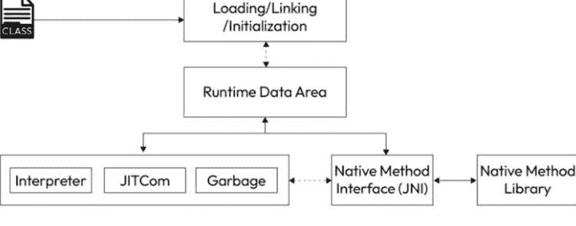

这些阶段的交响乐封装了 Java 应用程序在 JVM 内的动态执行。从初始加载到字节码解释，从数据区域的精细组织到与原生元素的无缝集成，每个阶段都为 Java 应用程序的和谐性能做出贡献。在下一节中加入我们，我们将深入探讨每个阶段，揭示 JVM 执行的复杂性，并破解 Java 适应性和跨平台能力背后的魔法。


在 JVM 执行的复杂交响乐中，我们已经穿过了加载、字节码解释、数据区域初始化和原生集成阶段，见证了让 Java 应用程序运行的无缝编排。随着本章的结束，它是对即将到来的 JIT 编译变革领域的探索预演。在下一节中，我们将揭开由 JIT 编译编排的动态优化，字节码在运行时被翻译成原生代码，为 Java 应用程序解锁性能的新维度。加入我们，深入探索 JVM 执行不断演变的交响乐，探索即时优化的艺术以及 JIT 编译为 Java 编程世界带来的无与伦比的适应性。

## JIT 编译

JIT 编译是 JVM 中的一个关键组件，彻底改变了 Java 应用程序的执行。与传统的提前编译（AOT）不同（后者在执行前将整个代码翻译为机器码），JIT 编译在运行时动态发生。这种即时翻译在执行正之前将 Java 字节码转换为原生机器码，针对其运行的机器优化性能和适应性，并考虑代码中哪些部分被使用最频繁且需要优化。这种动态优化过程确保了 JVM 专注于代码中执行最频繁的部分，有效增强了性能以及对特定运行条件的适应性。

在 JVM 中采用 JIT 编译源于在可移植性和性能之间取得平衡的追求。通过最初解释字节码然后选择性地将执行的代码编译成原生机器码，JVM 利用了解释执行和编译两种方法的优势。这种方法允许 Java 应用程序在保持平台无关性的同时，实现与原生编译语言相当的性能。

在 JVM 执行的复杂织图中，JIT 编译的层级在平衡适应性和性能方面起着关键作用。让我们深入了解这些层级，理解它们为什么存在以及它们如何共同增强 Java 应用程序的执行。

多个 JIT 编译层级的存在允许 JVM 在解释执行的优势和原生机器码的性能收益之间取得微妙的平衡。解释器提供了灵活性平台无关性，而 JIT 编译器则优化热点（hotspots），确保 Java 应用程序动态适应其执行环境。这种自适应编译方法对于在不牺牲 Java 跨平台特性的情况下实现高性能结果至关重要。在接下来的章节中加入我们，我们将解析 JIT 编译的内部机制，揭示这些层级如何协作赋予 Java 运行时环境。

### 解释器级

在解释器级，JVM 利用解释器动态执行 Java 字节码。该解释器是平台无关的字节码与底层硬件之间的初始桥梁。当 Java 程序执行时，解释器逐条读取字节码指令并即时翻译成机器码。虽然这种方法具有快速启动和平台无关性等优势，但它在解释过程中引入了固有的开销，可能会影响执行速度。

解释器本质上充当一个快速执行者，使 Java 应用程序能够在任何平台上运行，而无需预编译的原生代码。然而，由于执行过程中从字节码到机器码的实时翻译，整体性能可能没有预期的那样优化。这正是随后的 JIT 编译级大显用场的地方，旨在通过选择性地翻译和优化频繁执行的代码路径（即热点）为原生机器码来增强性能。因此，解释器级在灵活性和适应性之间提供了平衡，为更高级的 JIT 编译阶段奠定了基础。

### 基础 JIT 编译

JIT 编译代表了 JVM 内动态编译的下一个层级。在解释字节码之后，JVM 识别出频繁执行的特定部分，即热点。这些热点是进一步优化以增强整体性能的候选者。这就是基础 JIT 编译器介入的地方。

在基础 JIT 编译阶段，编译器采用选择性编译，识别热点而非整个程序。专注于频繁执行的部分在执行之前转换为原生机器码。强调快速编译以立即增强性能，基础 JIT 编译器利用简单快速的翻译技术，显著改进了重复解释。动态适应是关键，因为编译器持续监控执行情况，识别并选择性地编译热点。这种敏捷的响应确保了优化工作集中在影响最大的区域，以适应不断变化的运行行为并优化即时性能收益。

### 动态适应

基础 JIT 编译中的动态适应是指编译器对 Java 应用程序不断变化的运行行为的敏捷响应。通过持续监控执行识别频繁执行的代码段或热点，并选择性地将其编译为原生机器码。这种自适应策略确保了基础 JIT 编译器将其优化工作集中在影响最大的区域，优化即时性能收益。

它确保基准 JIT 编译（也称为 C1 编译器）仍然是一个动态且有效的组件，在 Java 应用程序处理多样化和动态负载时对其进行实时优化。

值得注意的是，这种动态适应性是与 AOT 编译代码的主要区别。此类代码在每天总是以相同的方式运行，无法适应当天的用例，而这正是 JIT 编译器能够完美处理的。JIT 编译器根据运行时行为调整优化策略的能力，使其成为在各种场景下最大化 Java 应用程序性能的强大工具。

在我们对 JIT 编译探索的最后阶段，我们见证了它在动态优化 Java 字节码以增强性能方面发挥的变革力量。从解释器的快速适应性到基准 JIT 编译器的选择性编译能力，JIT 的复杂舞动已经展开。随着我们为这一章落下帷幕，更深层次的揭示已做好了准备——类加载在 Java 运行时动态机制中的作用。加入我们的下一节，我们将揭开类加载的细微差别，探索动态将类加载到 JVM 中如何成为 Java 可扩展性和动态特性的基石。我们旅程的延续将确保从 JIT 的动态编译编排无缝过渡到类加载的幕后奇迹。

## 类加载

在这个启发性的章节中，我们将深入探讨类加载的复杂世界，这是 Java 动态和可扩展特性的基石。加入我们，揭开动态类加载背后的机制，它允许 Java 应用程序在运行时适应并扩展其功能。我们将探索 `ClassLoader`，它是负责动态将 Java 类加载到 JVM 中的无名英雄。深入了解类加载器层级结构的细微差别，理解不同的类加载器如何协作以组装成 Java 应用程序的丰富织锦。从系统类加载器到自定义类加载器，我们将遍及支撑 Java 整合新类并动态扩展其功能的层级。准备好开启进入 Java 运行时动态核心的旅程，在那里，类加载的魔法将拉开序。

Java 中的类加载领域由两个不同的实体定义：启动器类加载器（bootstrap class loader），它是 JVM 的不可或缺的组成；以及用户定义的类加载器。每个用户定义的类加载器都是 `ClassLoader` 抽象类子类的实例化，使应用程序能够自定义 JVM 动态生成类的方式。这些用户定义的类加载器充当扩展 JVM 创建类传统手段的通道，允许从典型类路径之外的源引入类。

当 JVM 委托查找类或接口 $N$（表示为 $L$）的二进制表示的任务时，它启动了一个动态过程。类加载器 $L$ 在接收到请求后，加载带有 $N$ 的指定类或接口 $C$。这种加载可以直接发生，即 $L$ 获取二进制表示并指示 JVM 实例化 $C$。或者，$L$ 可能选择间接方法，将任务推迟给另一个类加载器。这种间接加载可能直接涉及委托的类加载器 $C$，或者使用更深层次的委托，直到 $C$ 最终被加载。这种灵活性允许 Java 应用程序无缝集成来自各种来源的类，包括通过网络获取的、动态生成的或从加密文件中提取的类。因此，用户定义类加载器的动态特性在塑造 Java 应用程序的可扩展性和适应性方面起着关键作用。

理解类加载和创建对于 Java 的适应性至关重要，它有助于在运行时动态添加类。通过启动器类加载器，JVM 会检查它之前是否记录过该加载器作为某个类或接口的启动者。如果已记录且已识别的类或接口存在，则过程结束。如果不存在，启动器类加载器将找到一个表示，指示 JVM 从其推导出该类并创建它。

用户定义的类加载器为这一过程引入了动态层。JVM 检查是否有用户定义的类加载器被记录为已识别的类或接口的启动者。如果已记录且类或接口存在，则不采取进一步操作。否则，JVM 调用加载器的 `loadClass` 方法，指示其直接从获取的字节加载并创建类或接口，或将加载过程委托给另一个类加载器。

类加载和创建的动态本质（无论是通过启动器类加载器还是用户定义的类加载器）赋予了 Java 应用程序无与伦比的灵活性。这种适应性允许整合各种来源的类，有助于定义 Java 编程语言的扩展性和动态性。我们对类加载的探索为理解 Java 如何在运行时无缝适应和演进奠定了基础，为 Java 运行时环境复杂交响中的进一步揭示铺平了道路。

# 总结

当我们结束对 JVM 内部字节码解释和执行复杂领域的探索时，我们发现自己正站在一场深奥交响乐的门槛上——内存的编排。字节码解释器本身就是一个指挥家，为下一章设定了基调，我们将揭开 JVM 内部内存管理的细微差别。

在前面的章节中，我们破解了字节码的旅程、其解释以及为 Java 应用程序注入活力的动态适应。现在，我们的旅程将我们带到 JVM 内部的核心——内存编排。加入我们的下一章，我们将导航 JVM 如何分配、使用和释放内存，揭示确保最佳性能和资源效率的艺术性。我们探索的延续将确保对字节码执行与 JVM 内部内存细致芭蕾之间的共生关系有更深入的理解。

## 问题

回答以下问题以测试你对本章的掌握：

1. JVM 中字节码解释器的目的是什么？

   - A. 静态分析
   - B. 动态代码执行
   - C. 内存分配
   - D. 平台特定的编译

2. 在基准 JIT 编译的背景下，“热点”（hotspot）指的是什么？

   - A. 很少执行的代码段
   - B. 频繁执行的部分
   - C. 编译错误
   - D. 解释的字节码

3. 字节码解释器如何有助于 Java 的平台无关性？

   - A. 它执行静态分析
   - B. 它在运行时解释字节码
   - C. 它依赖于平台特定的编译
   - D. 它只在某些操作系统上运行

4. 基准 JIT 编译器在优化中的主要作用是什么？

   - A. 对所有段进行快速编译
   - B. 对行为进行深度分析
   - C. 字节码的静态翻译
   - D. 对频繁执行代码的选择性编译

5. 动态适应性如何有助于基准 JIT 编译的有效性？

   - A. 通过忽略行为
   - B. 通过一次性编译整个程序
   - C. 通过适应工作负载
   - D. 通过优先考虑很少执行的代码

## 答案

以下是本章问题的的答案：

1. B. 动态代码执行
2. B. 频繁执行的部分
3. B. 它在运行时解释字节码
4. D. 对频繁执行代码的选择性编译
5. C. 通过适应工作负载

# 5 内存管理

本章探索了 JVM 内部内存管理的复杂领域。对于寻求优化应用程序性能和可扩展性的 Java 开发者来说，理解内存分配和使用的内部机制至关重要。作为任何 Java 程序的脉动，JVM 的内存管理系统调度着各种组件，包括堆、栈和垃圾回收机制，每个组件在 Java 应用程序的高效执行中起着至关重要的作用。

在整个章节中，我们将深入研究这些组件的细节，揭开 JVM 如何动态分配和管理内存资源的奥秘。我们将探索堆（heap）的基础概念，对象存储在其中并由垃圾回收器管理；以及栈（stack），它处理方法调用和局部变量。这段穿越内存管理的旅程将消除垃圾回收算法的复杂性，为高效的对象内存分配提供最佳实践提供明灯。到本章结束时，你不仅掌握了控制 JVM 内存管理的基本原理，还获得了实用的见解，以调优你的 Java 应用程序实现最佳的内存利用。无论你是资深 Java 开发者还是该语言的新手，这次探索都将成为掌握 Java 生态系统中内存管理艺术的门径。

在本章中，我们将探讨以下主题：

- JVM 中的内存管理
- 程序计数器
- Java 栈
- 原生方法栈
- 方法区
- 堆
- 代码缓存（Code Cache）与 JIT

## 技术要求

对于本章，你需要以下内容：

- Java 21
- 本章的 GitHub 仓库，地址位于 `https://github.com/PacktPublishing/Mastering-the-Java-Virtual-Machine/tree/main/chapter-05`

## JVM 中的内存管理

在对 JVM 内存管理的这一富有启发性的探索中，我们将深入内存分配和利用的复杂性，并认识内存管理在 Java 生命周期中的关键作用。一旦你的 Java 代码被编译成字节码，内存管理的旅程就开始了。当字节码执行时，它会调用 JVM——这是 Java 平台无关性的基石——JVM 会出场并从底层系统获取必要的内存。我们将探索 JVM 与系统交互的机制，以获取高效执行程序所需的内存。

在 JVM 丰富的内存布局中，堆（Heap）和栈（Stack）等关键组件开始发挥作用。存储对象的动态区域会通过垃圾回收来释放不再使用的对象所占用的内存。栈方法负责管理调用和局部变量，为程序执行期间的处理内存提供了一种结构化且高效的方式。

JVM 的一个独特特征是其动态适应变化内存的能力。垃圾回收器是 JVM 不可或的一部分，它负责识别并回收未引用对象占用的内存。这种动态内存管理确保了资源的最优利用，增强了 Java 程序的整体性能。Java 与 C/C++ 等语言之间最重要的区别之一是，在 Java 中，内存分配和清理是由 JVM 自动管理的。这减轻了开发者显式内存管理任务的负担。

然而，尽管你不需要担心内存管理，但理解本章所解释的底层内存结构以及 JVM 对它们的管理，对于有效的 Java 开发至关重要。

了解 JVM 如何与系统建立接口对于获取所需的内存至关重要。我们将深入研究使 JVM 无缝分配和释放内存的通信协议和机制，确保与底层操作系统的和谐集成。掌握了这些知识，你将能够更好地优化代码的内存效率，为增强 Java 程序的性能和可扩展性做出贡献。因此，让我们开启通 JVM 内存管理的核心之旅，那里每一个字节都至关重要！

在这次探索中，我们的重点是解开 JVM 复杂的内存架构，特别关注其关键组件：方法区（Method Area）、Java 栈（Java Stacks）、程序计数器（PC）寄存器和原生栈（Native Stacks）。这些元素共同编排 Java 程序的动态执行，每个元素在管理类级信息、对象分配、方法执行、程序流控制以及原生代码集成方面都起着独特的作用。当我们深入这些内存区域的细微差别时，我们的目的是对 JVM 如何处理内存提供全面的理解，使开发者能够优化代码以增强性能和可扩展性……通过 JVM 的内存图谱，每个内存区域在塑造 Java 应用程序的运行时行为方面都有着其作用。

方法区是 JVM 内存架构中的一个关键部分。它是类级数据的存储库，保存着方法代码、静态变量和常量池。每个加载的类在方法区中都有其专用空间，使其成为 JVM 中所有线程的共享资源。该区域对于高效管理类相关信息是不可缺的。

另一方面，堆是一个动态且共享的内存空间，JVM 在运行时在此为对象分配内存。所有对象无论其作用域如何，都存在于堆中。它在垃圾回收中起着关键作用，确保识别未引用对象并回收其内存，以防止资源耗尽。

Java 栈用于执行 Java 方法。Java 应用程序中的每个线程都有自己的栈，包含方法调用栈和局部变量。栈是管理方法调的基础，为执行每个线程提供了一个整洁且隔离的环境。

PC 寄存器是线程内存中一个虽但重要的区域。它存储当前正在执行指令的地址，通过指示下一个要执行的指令来维持程序的流。PC 寄存器对于维持线程内程序执行的顺序性至关重要。

此外，原生方法栈（Native Method Stacks）是为使用 C 或 C++ 等语言编写的原生方法专用内存区域。这些栈与 Java 栈独立运行，处理原生代码的执行，有助于 Java 与原生语言之间的无缝集成。

在 JVM 复杂的架构中，内存的分配和管理是由几个不同区域共同完成的。这种视觉表示捕捉了关键内存组件的动态相互作用，展示了方法区、堆、Java 栈、PC 寄存器和原生方法栈：

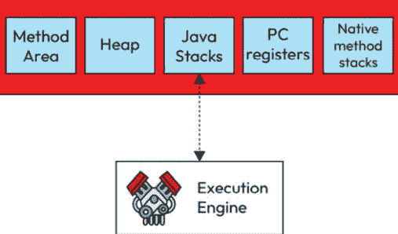

图 5.1：运行中的 JVM 及其内存

在接下来的章节中，我们将深入研究 JVM 内部这些内存区域的复杂性。我们的探索将涵盖理解内存如何管理类级信息、堆的动态性质及其在对象分配中的作用、Java 栈在方法执行中的重要性、PC 寄存器在控制程序流的功能，以及如何通过原生方法栈处理原生方法。在本章结束你将全面理解 JVM 的内存架构以及这些组件如何协作促进 Java 程序的执行。

当我们对 JVM 内部各种内存区域的探索时，我们获得了对方法区、堆、Java 栈、PC 寄存器和原生方法栈等组件动态相互作用的宝贵见解。理解这些元素对于优化内存使用和增强 Java 应用程序性能的开发者来说是关键。

在下一节中，我们将关注 JVM 内部的一个关键方面——PC。它在引导执行流方面起着核心作用，存储当前执行指令的地址。加入我们接下来的章节，我们将揭开 PC 寄存器的意义，深入研究其功能以及对 Java 程序无缝执行的影响。这段穿越 JVM 复杂层次的之旅将加深我们对其核心机制的理解，使我们能够编写更高效、更健壮的 Java 代码。

### 程序计数器

我们的焦点位于 JVM 内部的 PC 上，这是一个与执行流紧密相关的关键组件。每个线程独有的 PC 充当指南针，携带有关正在执行指令的关键信息。加入我们深入研究 PC 的细微差别，揭开其在管理程序流中的作用，并理解其在原生和非原生方法执行中的重要性。

PC 是 JVM 内部每个线程创建的特殊寄存器。它携带关键数据，主要作为指针和返回地址。这对组合是理解线程正在执行状态的关键。PC 指向线程下一个要执行的指令，而返回地址则确保在方法完成后能够无缝地返回到之前的执行点。

区分原生和非原生方法对于理解 PC 的行为至关重要。PC 的值在非原生方法中有明确的定义，代表指令地址。然而，在原生的

对于方法，PC 会转换为一个指针，展示了其在适应 JVM 内方法执行的多样性方面的灵活性。

接下来的视觉表示展示了 JVM 内部线程执行的复杂舞蹈，特别关注了 PC。该图描说明了每个线程独有的 PC 如何携带关键信息（如返回地址和指针），以引导线程通过其执行路径。在原生方法（native methods）领域，PC 呈现出一种神秘的特质，由未知值表示，象征着它在导航 Java 代码和原生执行之间所扮演角色的动态性质：

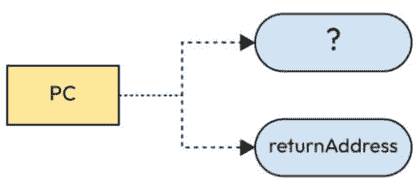

图 5.2：可能返回 returnAddress 或未知值的 PC

PC 在管理线程执行中的作用是至关重要的。它像一个哨兵，不断更新以反映当前正在执行的指令。当线程导航方法调用时，PC 确保了指令之间的平滑过渡，精确地编排程序流。

除了在执行控制中的作用外，PC 对代码优化也有影响。虽然 JVM 的实现控制着 PC，但开发者可以通过理解 PC 的工作原理来影响代码优化。这种理解允许开发者策略性地优化代码，使其与 JVM 的执行模型对齐，以增强性能和效率。虽然对 PC 的直接控制可能有限，但对其行为的洞察使开发者能够编写更适合 JVM 执行的优质代码，最终提升应用性能。


当我们结束对 PC 及其在引导 JVM 内部线程执行中关键作用的探索时，我们发现自己正处于揭开 JVM 另一层复杂性的边缘。加入我们接下来的节次，我们将深入探讨 Java 栈（Java stack）的动态世界。这一核心组件在管理方法调用中处于中心，为每个线程内的调用栈（call stacks）和局部变量提供了专用空间。对于寻求优化代码以高效执行的开发者来说，理解 Java 栈至关重要。因此，让我们从探索 PC 无缝过渡到对 Java 栈深度深入，在那里，每个方法调用都会留下它的足迹，塑造 Java 应用的健壮架构。

## Java 栈

在本节中，我们将深入探讨 Java 栈的复杂性——它是 JVM 内部的一个基础组件。与 PC 类似，Java 栈是每个线程独有的私有寄存器，充当方法执行信息的存储库。本节将深入研究 Java 栈的操作，并与 C 等经典语言进行类比，阐明其在存储局部变量、部分结果、方法调用和结果方面的作用。

与 C 等经典语言一样，Java 栈通过存储“栈帧”（frames）来运行，每个栈帧都封装了与方法执行相关的关键信息。这些帧持有参数、局部变量和其他基本数据。Java 栈的功能超出了直接修改变量的范围；相反，它通过优雅地插入和移除帧来适应线程执行的不断演变的状态。

当线程调用一个方法时，Java 栈通过插入一个新帧来经历动态转换。该帧封装了参数和局部变量等细节，为方法的执行编排了专用空间。当方法结束时（无论是以正常方式还是由于异常），该帧就会被丢弃。这种生命周期确保了 Java 栈内部存在一个组织良好且高效的执行环境。

Java 栈的灵活性通过其大小可以是固定或动态确定的得以强调。这一特性允许根据 Java 应用程序的特定需求进行定制的资源分配，有助于优化内存利用。

Java 栈的基础构建单元是帧。该单元在创建方法时产生，在方法结束时（无论是通过正常完成还是由于异常）消失。每个帧都封装了关键组件，包括局部变量列表、操作栈以及对当前类和方法的引用。这种三元结构将帧分为三个基本部分：

- **局部变量（Local variables）**：帧内部的栈变量部分是局部变量的存储空间。这些变量特定于当前执行的方法，对于存储与方法功能相关的中间结果和参数至关重要。

- **操作数栈 (Operand stack)**：与栈变量协同工作，栈操作数部分存放了操作栈。该栈对于管理方法内部的操作流至关重要，有助于指令的执行，并确保方法执行的结构化方法。

- **帧数据 (Frame data)**：此部分封装了关于方法执行上下文的关键信息。它包括对当前类和方法的引用，为 JVM 有效导航程序结构提供了必要的上下文信息。

将帧分为局部变量、操作数栈和帧数据的这种三元划分对于维护 Java 栈的完整性和功能至关重要。它确保了信息的系统化组织，允许高效执行方法，并在 JVM 内存架构中无缝处理变量和操作。

Java 栈中的每个帧都包含一个与当前方法类型对应的常量池的关键引用。这种包含支持了方法代码的动态链接，这一过程对于翻译类文件代码中的符号引用（symbolic references）至关重要。符号引用表示要调用和访问的方法，它们通过动态链接在运行时转换为具体引用（concrete references）。动态链接过程涉及解析未定义的符号并可能根据需要加载类。其结果是将变量访问翻译为链接到这些变量运行时位置的存储结构中的精确偏移量。这种后期绑定机制增强了适应性，并减少了当方法可能使用的其他类发生修改时出现代码崩溃的概率。

接下来的视觉表示简要概述了 Java 栈的核心单元：帧。这一基础构建单元在方法开始时创建，在方法终止时拆解，封装了三个关键组件：

- 栈变量（Stack variables）：存储方法特定的局部变量
- 栈操作数（Stack operand）：管理方法执行的操作栈
- 帧数据（Frame data）：包含对当前类和方法的关键引用

这些元素共同定义了帧的结构，并在 JVM 内部编排高效且有组织的方法执行中发挥着至关重要的作用，如下所示：

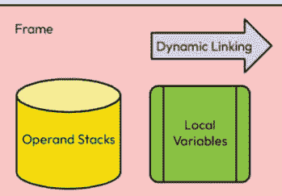

图 5.3：Java 栈表示

JVM 中的帧作为存储数据、处理部分结果、动态链接、方法返回值和管理异常的基础单元。其生命周期与方法调用紧密绑定，每当调用方法时都会创建一个新帧，并在调用结束时（无论是正常结束还是由于意外异常）销毁。这些帧从线程的 JVM 栈中分配，拥有独立的变量数组、操作栈以及对关联类运行时常量池的引用。当方法调用

当执行另一个或结束时，当前帧会演进，并将结果传回上一个帧。重要的是，帧是线程本地的，确保它们不会被其他线程访问。

**StackOverflow（栈溢出）**是指当调用栈（程序中用于管理方法调用的内存区域）超过其最大限制时的一种异常。在递归编程中，方法会调用自身，为每次调用创建一个新的栈帧。每个栈帧都包含有关方法状态的信息，包括局部变量和返回地址。

随着方法的反复调用，新的栈帧被创建并推入调用栈。如果这种递归在不返回的情况下持续过深，可能会耗尽调用栈的所有可用内存，导致 `StackOverflow` 错误。该错误作为一种保护机制，防止程序无限运行并可能导致系统崩溃。

StackOverflow 直观地演示了调用栈在编程中的工作原理。每个方法都向栈中推入一个新帧，当栈变得太深时就会导致错误。为了避免这种情况，程序员可以优化他们的递归算法以使用更少的栈空间，或切换到迭代方法。

Java 引入的 `StackWalker` API (https://openjdk.org/jeps/259) 提供了一种遍历执行栈的标准化且高效的方法。它允许开发者访问栈帧信息（包括类实例），而无需捕获整个堆栈跟踪。与此类方法相比，该 API 提供了更大的灵活性性能：

```
Throwable::getStackTrace OI Thread::getStackTrace;
```

`StackWalker` 在必须高效遍历执行栈上选定帧的场景下特别有用，它通过允许惰性访问栈帧信息和对帧进行过滤，解决了现有 API 的局限性，使其成为完成以下任务的宝贵工具：

- 为调用者敏感型 API 确定直接调用者的类
- 在栈中过滤掉特定的实现类
- 为可抛异常对象生成堆栈跟踪并实现 jeps 调试功能

`StackOverflow` 错误是递归编程在调用栈变得太深时的实际结果。Java 引入的 `StackWalker` API 提供了一种高效且灵活的方法来遍历和访问执行栈信息，即堆栈跟踪方法。

在 JVM 复杂的结构中，每个帧都包含一个被称为局部变量的变量数组。该数组的长度在编译时就已经预确定，并嵌入在相关类或接口的二进制表示中，随帧中的方法代码一起存在。单个局部变量可以容纳 `Boolean`、`byte`、`char`、`short`、`int`、`float`、`reference` 或 `returnAddress` 值，而成对的局部变量共同持有 `long` 或 `double` 类型的值。

### 局部变量

局部变量通过索引访问，第一个局部变量的索引为 0。JVM 的寻址机制允许整数作为局部变量数组的索引，且仅当该整数落在 0 到数组大小减 1 之间时有效。重要的是，`long` 或 `double` 类型的值跨越两个连续的局部变量，这需要使用较小的索引进行寻址。虽然允许存储在第二个变量中，但它会使第一个变量的内容失效。

JVM 通过其在处理 `long` 和 `double` 值时能够适应非偶数索引 (n) 的能力展示了其卓越的灵活性，这偏离了局部变量数组中传统的 64 位对齐概念。这种适应性使实现者能够决定如何表示这些值，利用对两个预留局部变量的分配。JVM 的这一独特特征使其能够无缝适应各种系统架构（包括 32 位和 64 位系统），根据特定的硬件配置优化内存利用和性能。

在实践，局部变量在方法调用中起着至关重要的作用。对于类方法调用，参数位于连续的局部变量中，从局部变量 0 开始。在实例调用的情况下，局部变量 0 充当传递调用对象引用通道（类似于 Java 中的 `this`），后续参数位于从索引 1 开始的连续局部变量中。对局部变量的系统化使用确保了参数在 JVM 内方法执行期间的有效传递。

下面的视觉表示展示了 JVM 内局部变量的动态编排。此图封装了每个帧中的局部变量，描绘了 `Boolean`、`byte`、`char`、`short`、`int`、`float`、`reference`、`returnAddress`、`long` 和 `double` 类型的组织空间。由于，成对的局部变量无缝地容纳了 `long` 或 `double` 值，以非索引灵活性挑战了传统的对齐规范。在这里，我们可以看到 JVM 如何在方法调用期间使用局部变量，将参数系统地安排在连续的局部变量中。这个简洁的视觉为理解 JVM 内存架构中值之间微妙的相互作用提供了清晰的路线图：

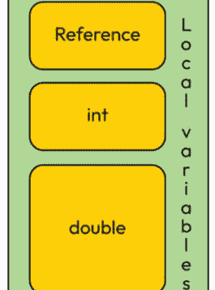

图 5.4：局部变量表示

在我们对字节码中局部变量的探索之际，我们剥开了方法执行的层层，见证了这些变量如何作为值、参数和引用的动态容器。这种理解为我们的下一节：操作栈奠定了基础。在过渡期间，预计将深入检查操作栈如何与局部变量交互，引导操作流并确保方法在 JVM 复杂的舞蹈中无缝执行。加入我们，一起揭开操作栈在字节码执行交响乐中的关键作用。

### 操作栈

在 JVM 复杂的结构中，每个帧都拥有一个被称为**后进先出 (LIFO)** 的栈，即操作栈（operand stack）。这一节揭开了字节码执行的层层，揭示了操作栈在方法执行期间管理数据方面的作用。

操作栈的最大深度是一个编译时决定，与方法代码紧密交织。此深度参数塑造了操作栈在每个帧中的行为。

虽然通常被简单地称为操作栈，但识别其动态性质至关重要。操作栈在帧创建时为空，随后成为常量、局部变量、字段值和方法结果的动态存储器。

JVM 提供了在操作栈上加载、处理和存储值的指令。操作范围从加载常量到复杂的计算。例如，`add` 指令相加两个值，这需要它们作为操作栈上顶部的两个值存在。

操作栈执行严格的类型约束以维护完整性。每个条目可以容纳任何 JVM 类型，包括 `long` 或 `double` 值。与类型相匹配的操作是必不可少的，例如它可以防止将两个 `int` 值视为 `long`。

操作栈在任何给定时刻的深度反映了其值的累积贡献。特定类型的单位（例如 `long` 或 `double` 对应两个 `int`）塑造了相关的深度。

说明性快照概述了操作数栈操作的精髓，展示了在字节码执行的复杂过程中值的流式交换与计算：

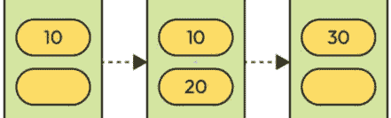

图 5.5：int a + int b 的操作栈

此图展示了 JVM 中处理 `double` 值的操作数栈。想象一个初始化了两个 `double` 值（10.10 和 20.20）的操作数栈，正准备相加。然而，与整数不同，由于其固有特性，`double` 在操作数栈中占据更大的空间。随着字节码的执行，相关指令协调加法操作，无缝处理了 `double` 值较大的尺寸。见证了 10.10 和 20.20 转换为最终结果 30.30，反映了算术操作以及操作数栈对 `double` 值的细致接纳。接下来的图捕捉了操作数栈变化的复杂性，强调了在 JVM 中处理不同数据类型时至关重要的尺寸考虑：

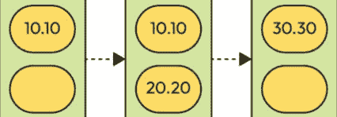

图 5.6：double a + double b 的操作栈

在我们结束对操作数栈的探索时，我们展示了 JVM 内部值的复杂舞蹈，见证了它们的动态交换与计算。从整数到双，操作数栈是字节码执行的多功能舞台。现在，我们的旅程将走向方法执行的核心——Java 栈。在下一节中，我们将从字节码层面剖析 Java 栈，深入研究它如何协调方法调用流、管理帧（frames）并导航调用栈的复杂性。

加入我们，深入探索 JVM 的基于栈的架构，解锁定义方法调用和执行之旅的层级结构。

### 字节码级别的 Java 栈

当我们探索 Java 的内部机制时，我们将注意力转移到了一个关键方面——字节码层面的 Java 栈。我们已经深入了字节码执行的复杂世界，揭示了 Java 指令如何转换为 JVM 内的低级操作。如果你渴望深入研究字节码规范，我们鼓励你重温第 3 章。

现在，我们的旅程将是审视 Java 栈，这是 JVM 基于栈的架构中的一个基础组件。本节旨在剖析 Java 栈在管理方法调用、处理帧以及导航调用栈中的作用。这是一场进入方法执行核心的旅行，阐明了 JVM 如何组织和执行 Java 代码。

因此，请加入我们，在字节码中导航 Java 栈，揭示塑造方法调用和执行复杂性的层级。对于那些渴望深化对 Java 内部原理理解的人，本节探索了 Java 运行时环境基于栈的基础。

让我们创建一个名为 `Math` 的 Java 类，它封装了各种算术操作，展示了静态方法和实例方法。我们的类将包含使用整数和双精度类型的加、乘、减、除等基础操作：

```
public class Math {
    int sum(int a, int b) {
        return a + b;
    }
    static int multiply(int a, int b) {
        return a * b;
    }
    double subtract(double a, int b) {
        return a - b;
    }
    static double divide(double a, long b) {
        return a + b;
    }
}
```

类定义完成后，我们可以使用 `javac` 命令编译它。随后，我们可以使用带有 `-verbose` 标志的 `javap` 命令检查 `Math` 类的字节码表示。对生成的字节码进行这种见性的探索使我们能够深入研究 JVM 解释器执行算术操作的低级指令。加入我们这趟实践之旅，发现静态方法和实例方法的字节码复杂性，从而对它们在 JVM 中的实现提供更深入的理解。

我们将仔细分析为 `Math` 类中的每个方法生成的字节码。字节码是 JVM 理解的 Java 代码的中间表示，它揭示了每个方法低级操作的见解。让我们仔细剖析算术操作的字节码，深入研究两个方法的栈、局部变量和参数大小。

首先，我们将探索整数的 `sum`；如你所见，尺寸为三，因为除了参数之外，一旦该方法不是静态方法，还包含实例对象：

```
int sum(int, int);
```

- Descriptor: `(II) I`
- Flags: `(0x0000)`

- Code explanation:

```
stack=2, locals=3, args_size=3
0: iload_1
1: iload_2
2: iadd
3: ireturn
```

- Analysis:
  - `locals=3` 表示该方法有三个局部变量。在这种情况下，它包含了实例和两个参数。
  - `stack=2` 表示方法执行期间的最大栈大小为 2，用于容纳推到栈上的值。
  - `args_size=3` 表示向方法传递了三个参数。

这个方法是一个声明为静态的 `multiply` 乘操作。在 Java 中，当一个方法是静态的，它属于类本身，而不是类的实例。因此，静态方法没有指向实例的引用。

```
static int multiply(int, int);
```

- Descriptor: `(II) I`
- Flags: `(0x0008) ACC_STATIC`

- Code explanation:

```
stack=2, locals=2, args_size=2
0: iload_1
1: iload_2
2: imul
3: ireturn
```

- Analysis:
  - `locals=2` 表示该方法有两个局部变量。在这种情况下，它包含了两个参数。
  - `stack=2` 表示方法执行期间的最大栈大小为 2，用于容纳推到栈上的值。
  - `args_size=2` 表示向方法传递了两个参数。

赋予程序员或用户根据特定需求定制运行时环境的能力。

然而，深入研究原生方法栈领域并非没有注意事项。JVM 规定了与这些栈相关的异常情况。如果一个线程的计算所需的巨大方法栈超过了允许的范围，`StackOverflowError` 就会随之而来。这种错误也会影响 Java 栈，而不仅仅是原生方法栈，并且当由于方法调用过多导致调用栈过深时就会发生。此外，在尝试动态扩展时，如果系统在扩展过程中或为新线程创建初始原生方法栈无法无法所需的内存，可能会遇到 `OutOfMemoryError`。这些异常情况凸显了 JVM 内部高效内存管理的重要性，它同时影响原生栈和 Java 栈。

在揭示原生方法栈的复杂性时，我们已经了 JVM 内存管理中的一个关键层，这对于执行原生方法以及弥合 Java 与其他语言之间的差距至关重要。当我们结束对这些特殊栈的探索时，我们的旅程无缝过渡到 JVM 内部机制的核心——方法区域。这一关键区域是类和方法信息的存储库，也是方法调用及其相应帧变得活跃的动态空间。加入我们进入下一节，深入探讨方法区域，揭示构建 JVM 内部执行 Java 应用程序基础的存储库。

## 方法区域

在 JVM 的复杂架构中，方法区域是一个所有 JVM 线程可访问的共享空间，类似于传统语言中编译代码的存储空间或操作系统进程中的“文本”（text）段。这一基本区域包含了每个类特有的结构，包括运行时常量池、字段和方法的数据，以及方法和构造函数的代码。它还容纳了独特的类、接口和实例初始化方法。

方法区域在虚拟机启动时创建，虽然它在逻辑上是堆的一部分，但在垃圾回收和压缩策略上可能有所不同。该规范没有规定它的实现细节（例如位置和管理策略），为 JVM 的实现提供了灵活性。方法区域的大小无论是固定的还是动态的，都可以由程序员或用户控制，为调整运行时环境提供了灵活性。然而，如果内存分配无法满足请求，潜在的 `OutOfMemoryError` 异常情况就会随之而来。加入我们，开始对方法区域进行详细探索，揭示其作为类和方法信息存储库的角色，并为 JVM 内无缝执行 Java 应用程序铺平道路。

方法区域嵌套在 JVM 复杂的架构中，成为所有 JVM 线程之间的共享领域，类似于传统语言中的编译代码存储或操作系统进程中的“文本”段。这一重要空间是每个类结构的存储库，持有运行时常量池、字段和方法数据，以及方法和构造函数的代码。与类、接口初始化和实例初始化紧密相关的特殊方法就位于这一领域之中。


方法区域始于虚拟机的诞生，尽管在逻辑上是堆的一部分，但在垃圾回收和压缩策略上可能存在差异。它的实现细节（包括位置和管理策略）为 JVM 的实现提供了灵活性。方法区域的大小无论是固定的还是动态的，由程序员或用户进行微调，提供对运行时环境的控制。然而，如果方法区域内的内存分配不足，迫在眉睫的 `OutOfMemoryError` 将成为潜在的异常情况。

当我们解析方法区域的层级，深入研究其作为类和方法信息存储库的角色时，我们为 JVM 内无缝执行 Java 应用程序铺平了道路。加入我们的这次探索，这不仅揭秘了方法区域的复杂性，还为我们进入堆的广阔领域之旅做好了准备——堆是 JVM 动态内存管理编排中的关键组件。

### 堆

JVM 的核心是堆，它是所有 JVM 线程的共享空间，也是负责为所有类实例和数组分配内存的动态运行时数据区域。作为虚拟机启动期间创建的基础组件，堆在执行 Java 应用程序中起着至关重要的作用。

自动存储管理系统（通常称为垃圾收集器）协调堆内的内存管理分配。注意的是，堆中的对象不会被显式释放，而是依靠自动系统来回收存储。JVM 对特定的存储管理技术保持抽象，允许其实现上具有灵活性以满足各种系统需求。堆的大小可以是固定的，也可以根据计算需要动态调整，根据需要扩展或收缩。这种适应性结合非连续内存分配，确保了高效利用。

通过赋予 JVM 实现灵活性，程序员和用户可以控制堆的初始、最大和最小大小。然而，迫在眉睫的异常情况是 `OutOfMemoryError`，当计算所需的堆空间超过自动存储管理系统能提供时就会触发。加入我们对堆的探索，我们将发现它在动态管理内存方面的关键作用，并理解其为了优化 Java 应用程序执行的配置细微差别。

下图显示了对象的诞生，它的起始标志着引用的创建——指向其中封装的本质的指针：

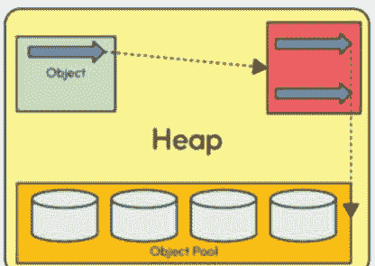

图 5.7: 堆概述

随着引用扩展其影响，两个微妙的指针开始发挥作用，勾勒出通往核心领域的路径：

- 对象池：详细信息的储水池，对象池容纳了赋予对象生命的复杂性
- 方法区域：嵌套在内部，方法区域内的常量池作为类详细信息（属性、方法、封装）的存储库，提供了对象起源的全面视图

此图捕捉了实例、引用与堆的复杂的内存分配网络之间的共生关系。加入我们解读这段内存的交响乐，对象在这里找到它们的居所，线程在集体内存空间汇聚，描绘出 Java 动态运行时环境的生动图景。

随着实例的诞生，其本质在堆中找到了住所——这是一个贯穿整个 JVM 织理的共享内存空间。这个由线程共同访问的动态领域不仅存储对象信息，还拥有一种复杂的内存回收机制，巧妙地移动对象以规避空间碎片的危险。

堆中引用类型变量的表示方式与原始类型不同，类似于 C/C++ 中的指针机制。这些引用对象不包含详细信息，而是作为指针指向对象信息的储水池。本质上，一个引用对象包含两个简洁的指针：

- 一个指向对象池，持有所需的细节
- 另一个指向常量池，它是类信息的宝库，优雅地嵌套在方法区域内

进入向量在这一动态空间中的表示时，它们模仿了引用变量的行为。然而，向量为自己装饰了两个额外的字段：

- 大小：定义向量维度的指标
- 引用列表：一个精心挑选的指针集合，编织了通往向量内嵌套对象的连接

当我们穿梭于这一复杂的景观时，想象实例、引用和内存池之间的共生关系，一幅生动的描述揭示了堆中的内存之舞——对象在此栖息，线程在此共享共同的内存空间。

当我们深入研究堆的复杂性，理解其动态性质以及在内存分配中所扮演的关键角色时，我们的旅程汇聚于方法区域与堆之间无缝的相互作用。这些整合组件共同成了 JVM 内存管理的骨干，为 Java 应用塑造了运行时环境。在下一节中，加入我们共同探索这种共生关系，探索 JVM 内部机制中堆与方法区域之间的交互与协同。

当我们结束对堆（线程间共享内存的心脏）的探索时，我们准备深入研究代码缓存和**即时编译（JIT）**编译的动态领域。在下一节中，我们将揭开代码执行优化的复杂性，代码缓存在此存储编译后的代码片段方面起着至关重要的作用。加入我们，进入自适应且高效的运行时性能世界，解锁增强 Java 应用执行速度的机制。欢迎来到代码缓存和 JIT 的领域，优化代码的魔法将在此展开。

### 代码缓存与 JIT

在本节中，我们将揭开代码缓存与 JIT 编译这对“黄金组合”，它们是把 Java 应用运行时性能推至新高度的关键组件。代码缓存就像是才华的圣殿——存放着准备以优化方式执行的编译代码片段。随着 Java 应用的运行，JIT 编译引擎将 Java 字节码翻译成原生代码，动态生成频繁执行方法的优化版本。这些编译后的代码精华在代码缓存中找到了避风港，确保了后续调用的快速访问。

代码缓存是运行时优化的后动力，在增强 Java 应用的执行速度方面发挥着至关重要的作用。让我们探索它的复杂性，理解它为 Java 编程带来的魔法。

在 Java 运行时优化的动态景观中，代码缓存作为核心主角出现，协调着编译之作的交响乐以增强应用程序的执行速度。让我们开启揭开代码缓存动态复杂的旅程，深入研究使其成为 JVM 内部强大引擎的机制：

- 编译圣殿：随着 Java 应用的执行，JIT 编译引擎动态地将 Java 字节码翻译成原生机器码。编译后的代码代表了频繁执行方法（即热点代码，hotspots）的优化版本，它们在代码缓存中找到位置。
- 优化代码存储：代码缓存作为编译精华的存储库，存储这些优化的代码片段以便在后续调用期间快速访问。它作为一个动态存储空间，适应应用程序运行过程中不断变化的需求。
- 热点代码管理：代码缓存特别擅长管理热点代码——即应用程序运行期间频繁执行的代码段。通过关注这些热点代码，代码缓存确保了最关键的路径经过高效且定制的优化。
- 空间利用：代码缓存根据执行的应用程序的需求动态调整其大小。这种自适应缩放机制确保了最相关且频繁使用的代码段能够在缓存中找到自己的位置。
- 快速访问与执行：存储在代码缓存中的优化代码片段允许在后续的方法调用期间快速访问，有助于 Java 应用的整体性能。

理解代码缓存的动态揭示了它在 JIT 编译过程中的关键作用，对 Java 应用的效率和适应性做出了巨大贡献。当我们深入运行时优化的复杂性时，代码缓存成为了一个基石，确保编译后的精华能够为应用程序的加速执行随时就绪。

# 总结

在本章中，我们深入研究了管理 JVM 内部 Java 应用执行的复杂机制。从理解内存管理的复杂性、探索 Java 栈以及揭开原生栈的奥秘，到见证 JIT 编译器的动态编译能力以及代码缓存扮演的关键角色，我们的旅程是一次对运行中的 Java 应用内部机制的解码。

当我们与代码执行动态领域告别时，我们的下一个目的地正在等待，在那里我们将探索运行时管理的一个基本方面：垃圾回收器。在接下来的章节中，加入我们，共同揭开内存清理和资源管理的复杂性，这对于维护 Java 应用的健康和效率至关重要。垃圾回收器正在召唤，承诺提供关于 JVM 如何优雅地处理内存释放并确保 Java 应用长久性的见解。让我们开启下一章，在 JVM 的动态景观中发现垃圾回收的秘密。

## 问题

回答以下问题以测试你对本章掌握掌握：

- 1. 代码缓存在 JVM 中的主要作用是什么？

  A. 对象实例的存储空间

  B. 编译代码的存储库

  C. 内存清理和资源管理

  D. 堆大小的动态调整

- 2. Java 栈为 JVM 中的每个线程存储了什么？

  A. 编译代码片段

  B. 垃圾回收器信息

  C. 栈帧、局部变量和操作数栈

  D. 原生方法栈

- 3. 哪个内存区域被所有 JVM 线程共享，并存储运行时常量池、字段和方法数据以及方法代码？

  A. 堆

  B. 方法区域

  C. 代码缓存

  D. 原生方法栈

- 4. JVM 中的哪个内存区域负责存储类实例和数组，内存由垃圾回收器回收？

  A. 代码缓存

  B. 原生方法栈

  C. Java 栈

  D. 堆

- 5. Java 栈在 JVM 中的主要目的是？

  A. 编译代码片段的存储空间

  B. 对象实例的存储库

  C. 堆栈的动态调整

  D. 为每个线程存储栈帧、局部变量操作数栈

## 答案

以下是本章问题的答案：

- 1. B. 编译代码的存储库

- 2. C. 栈帧、局部变量和操作数栈

- 3. B. 方法区域

- 4. D. 堆

- 5. D. 为每个线程存储栈帧、局部变量操作数栈

GC（垃圾回收）的核心目的是自动回收程序不再使用的对象所占用的内存。在 Java 等采用自动内存管理的语言中，开发者无需再承担显式释放内存的负担，这提高了生产力并减少了内存相关错误的概率。

想象一下这样一个场景：每个动态分配的对象都必须由程序员手动释放。这不仅引入了巨大的认知负载，还为内存泄漏和效率低效的留下了后门。在没有 GC 的情况下，内存管理的责任完全落在开发者的肩上，增加了 Bug 的出现概率并阻碍了开发进程。

Java 凭借其“编写一次，处处运行”的哲学，利用垃圾回收提供了一个无缝且健壮的内存管理系统。JVM 的 GC 识别并回收不可达的对象，防止内存泄漏并确保资源的最优利用。Java 的方法允许开发者专注于应用程序逻辑，而不是进行微观管理，这促进了该语言在企业级应用中的普及。

虽然 Java 通过 GC 倡导自动内存管理，但其他编程语言也采取了各种内存管理策略。例如，C 和 C++ 等语言经常依赖于手动内存管理，赋予了开发者显式的控制权，但也让他们容易受到潜在陷阱的影响。相反，Python 和 C# 等语言实现了它们自己的垃圾回收机制，每种机制都经过精心设计，以满足各自语言的独特需求。

即使在具有垃圾回收的语言中，其实现方式也存在显著差异。Java 的 GC 以分代方法而闻名，将堆分为不同的代（新生代和老年代），并对每代应用不同的收集算法。在 JVM 内部，存在多个 GC，每个都有自己的策略和权衡。这与 Python 的引用计数机制或 Go、C# 等语言中使用的 GC 形成了对比。

内存泄漏通常由编程错误引起，例如未能释放动态分配的内存，或无意中保留了超出对象生存期的引用。常见场景包括：

在 C 或 C++ 等需要手动内存管理的语言中忽略释放内存，或在 Java 等具有自动内存管理的语言中无意中创建循环引用。

GC 在采用自动内存管理的语言中对于缓解内存泄漏风险方面起着至关重要的作用。它的主要功能是识别并回收程序不再可达或不再使用的对象所占用的内存。通过自动化内存释放过程，GC 显著降低了内存泄漏的概率。

在自动内存管理中，GC 充当着警觉的防御者，关键地降低了内存泄漏的风险。在 Java 等语言中自动识别和回收未使用的内存简化了开发流程并增强了系统稳定性。凭借能够快速处理短命对象的分代方法以及适应动态应用程序的智能内存管理，GC 成为加固软件完整性免受内存泄漏细微威胁的关键章节：

- **自动内存管理**：在 Java 等自动内存管理不可或缺的语言中，GC 定期扫描堆以识别没有可达引用的对象。一旦识别出这些，这些未被引用的对象将被标记为回收并释放，为新分配腾出内存。
- **分代方法**：Java 的 GC 经常采用分代方法，根据对象的年龄将其归分为不同的代。较年轻的对象更容易迅速变得不可达，因此收集频率更高；而较旧的对象经历频率更低、更全面的垃圾回收。它有助于快速识别和收集短命对象，减少内存泄漏的概率。
- **智能内存管理**：现代 GC 设计得非常智能且具有适应性。它们利用算法和启发式方法根据应用程序的行为来优化内存管理。这种适应性确保了高效的垃圾回收，并即使在复杂的动态应用程序中也能最小化内存泄漏的风险。

在 JVM 内部复杂的结构中，`Mark and Sweep`（标记-清除）GC 算法成为高效管理内存的基石。这一基础过程分为两个关键阶段：标记阶段，GC 辨别内存的使用状态，将对象标记为可达或不可达；以及随后的清除阶段，收集器通过回收标记为不可达的对象所占用的内存来释放堆。这种方法的优点是深远的，它提供了自动内存管理，缓解了悬指针问题，并对内存泄漏管理做出了巨大贡献，如图所示：

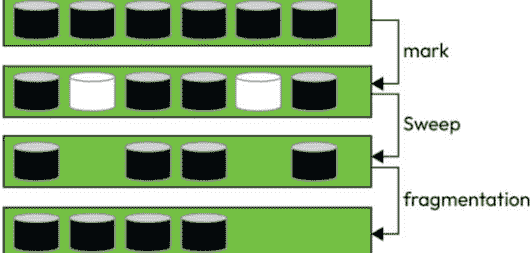

图 6.1：GC 的标记与清除步骤

当我们深入研究标记-清除法的细节时，我们探索了这种自动内存管理范式固有的优点和挑战。虽然它将开发者从手动内存处理的复杂性中解放出来，但也引入了诸如 CPU 消耗增加和放弃对对象清理调度控制等考虑。加入我们对 JVM 内部核心的探索，在这里，标记-清除算法在塑造 Java 程序的可靠性和效率方面起着至关重要的作用。

在探索中，我们揭示了标记-清除法的自动化过程：它能够轻松处理内存分配和释放，在缓解悬指针方面的作用，以及在管理内存泄漏方面的重大贡献。

然而，没有任何架构奇迹是没有权衡的。在标记-清除的情况下，一个突出的考虑是内存碎片。当我们揭开这一方面时，深入探讨了算法在精于回收内存的同时，如何在内存空间中留下碎片化的空隙。这些碎片类似于散落的拼图块，为连续内存块的高效分配带来了挑战，影响了应用程序的整体效率。

到目前为止的叙述说明了自动内存管理的优点与潜在缺点之间的微妙平衡，强调了采取细致方法的必要性。无缝自动化与碎片光谱之间的权衡促使开发者在收益与应用程序的效率要求之间进行权衡。

该过程确保了没有并行线程会干扰识别和回收不可达对象。这种简单性使得 Serial GC 能够简化内存管理，而无需处理并发操作的复杂性。

Serial GC 的优雅性伴随着权衡，特别是在吞吐量和响应能力方面。鉴于其单线程的特性，对于大堆或需要低停顿时间的应用程序，可能会有更高效的选择。停顿世界（Stop-the-world）暂停虽然很短暂，但仍会影响用户体验，使得 Serial GC 更适用于这些暂停是可以接受的场景。

Serial GC 与标记-清除清除算法（Mark and Sweep algorithm）无缝集成。它在标记阶段识别可达和不可达对象，并对其进行相应的标记。在随后的清理阶段，它会清除由不可达对象占据的内存。Serial GC 的顺序特性确保了这些阶段的顺序执行，简化了标记与清理之间的协调，如图所示：

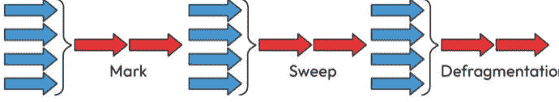

图 6.2：Serial GC 工作原理

在内存占用较小且应用程序性能对停顿不敏感的场景下，Serial GC 的简单性尤为突出。它非常适用于客户端应用程序或资源有限的环境，在这些环境中，简单直接的停顿世界方法与系统需求无缝契合。

当我们深入研究 JVM 内部的内存编排时，一个关键方面通过为 Serial GC 定制的配置选项展现出来。下表展示了一组和谐的命令组合，每条命令都具有影响和优化 Serial GC 行为的力量。从启用或禁用 Serial GC 到精细调整比例、大小和阈值，这些命令提供了一个指挥棒，用以塑造内存管理的交响乐。加入我们，解读每条命令的意义，为开发者和管理员提供调整控制 Serial GC 运行参数以为 Java 应用程序塑造最佳性能的手段：

| Command | Description |
| --- | --- |
| `-XX:+UseSerialGC` | 启用使用 Serial GC。 |
| `-XX:-UseSerialGC` | 禁用 Serial GC（服务器类机器的默认值）。 |
| `-XX:NewRatio=<value>` | 设置新生代与老年代的比例。 |
| `-XX:NewSize=<size>` | 设置新生代的初始大小。 |
| `-XX:MaxNewSize=<size>` | 设置新生代的最大大小。 |
| `-XX:SurvivorRatio=<value>` | 设置 Eden 空间与幸存区的比例。 |
| `-XX:MaxTenuringThreshold=<value>` | 设置新生代对象的最大晋升阈值。 |
| `-XX:TargetSurvivorRatio=<value>` | 设置期望的幸存区占新生代的百分比。 |
| `-XX:PretenureSizeThreshold=<size>` | 设置老年代对象分配的阈值。大于此大小的对象将直接进入老年代。 |
| `-XX:MaxHeapSize=<size>` | 设置最大堆大小。 |

表 6.1：Serial GC 命令

这些选项允许开发者和管理员配置 Serial GC 的方面，例如新生代的大小、幸存区的比例以及整体堆大小。调整这些参数可以根据特定的应用程序需求和硬件特性对内存管理进行精细调整。

由 Serial GC 编排的内存管理的和谐协调揭示了其在独特方法下的优势、权衡和策略场景。当我们转向下一节时，随着我们深入 Parallel GC，为并行的性能做好了准备。从单线程到并行线程的演变承诺了对大规模效率和增强吞吐量的探索。

## Parallel GC

当我们开启 JVM 内部探索的下一个乐章时，焦点现在转向了 Parallel GC。在这一节中，我们深入并行的世界，内存管理的效率成为核心。Parallel GC 凭借其多线程优势，编排了一场垃圾回收交响乐，为 Java 应用程序提供了增强的吞吐量和优化的性能。通过细致的视角，我们揭开了 Parallel GC 的复杂性——它的特性、优势，以及其并行线程与大型数据密集型环境需求无缝协调的场景。加入我们这一节节，跨越 JVM 内部的并行节奏，发现将内存管理推向新高度的并行线程。

Parallel GC 的标志在于其多线程方法，这使其与其单线程对应物相比，特别擅长处理更庞大的堆并实现更高的吞吐量。它将堆分为若干区域，采用并行线程并发执行垃圾回收任务，从而实现更快的执行速度和更短的暂停。

Parallel GC 在 JVM 内部编排了一场同步的效率舞蹈，与标记-清除算法无缝集成。在复杂的垃圾回收过程中，Parallel GC 利用多线程的力量并发执行标记和清理的关键步骤。在标记阶段，每个线程遍历指定的堆区域，识别并标记对象为可达或不可达。跨线程的这种同步标记确保了对内存空间快速且并行的评估。随着标记阶段结束，线程的集体努力在清理阶段达成和谐，Parallel GC 通过丢弃标记期间识别出的不可达对象来高效回收内存。Parallel GC 下的标记-清除过程中所嵌入的并行性优化了吞吐量。它展示了多个线程协同工作的同步才华，共同编排了一场在内存管理中优雅平衡响应能力和效率的表演，如图所示：

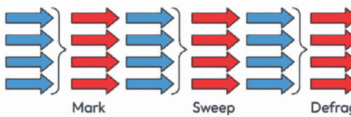


## 图 6.3：Parallel GC 工作原理

虽然 Parallel GC 在吞吐量方面表现出色，但对并行的依赖引入了权衡，特别是在响应能力方面。停顿世界暂停虽然被至最低，但仍会影响响应速度，使其不适用于低延迟至关重要的场景。Parallel GC 在大堆和数据密集型应用的场景中表现最为亮眼。它非常适用于批处理、科学计算以及吞吐量至关重要的场景。此外，由于并行导致的 CPU 使用增加可能是资源受限环境的考虑因素。

当我们揭开 Parallel GC 的复杂性时，我们在探索它的并行线程如何编排出一场平衡大规模内存管理要求的性能。加入我们这一节，导航垃圾回收的格局，理解其并行优势何时成为优化 JVM 内部内存的策略选择。

在探索 JVM 内部 Parallel GC 的复杂性时，精细调整其行为的能力变得至关重要。下表提供了一组全面的命令组合，每条命令都是解锁 Parallel GC 效率和吞吐量的关键。从开启或禁用使用到配置线程数量、设置停顿目标以及采用自适应大小策略，这些选项赋予了开发者和管理员塑造 JVM 内部内存管理编排的能力。加入我们，解读这些命令的意义，为让 Parallel GC 与不同的 JVM 环境无缝契合提供多种交响可能：

| Command | Description |
| :--- | :--- |
| `-XX:+UseParallelGC` | 启用使用 Parallel GC。 |
| `-XX:-UseSerialGC` | 禁用 Parallel GC。 |
| `-XX:ParallelGCThreads=<value>` | 设置垃圾回收的线程数量。 |
| `-XX:MaxGCPauseMillis=<value>` | 设置垃圾回收的最大期望停顿时间目标。 |
| `-XX:GCTimeRatio=<value>` | 设置垃圾回收时间与应用时间的目标比例。 |
| `-XX:UseAdaptiveSizePolicy` | 启用堆和幸存区的自适应大小策略。 |
| `-XX:AdaptiveSizeThroughputPolicy` | 配置面向吞吐量的垃圾回收的自适应大小策略。 |
| `-XX:AdaptiveSizePolicyOutputInterval=<n>` | 设置自适应大小策略输出的间隔（以垃圾回收次数计数） |
| `-XX:ParallelGCVerbose` | 启用并行垃圾回收（Parallel GC）的详细输出。 |

表 6.2: Parallel GC 命令

这些选项提供了一种配置和微调 Parallel GC 行为的方法，允许开发者和管理员针对特定的应用程序需求和硬件特性优化垃圾回收策略。

当我们结束对 Parallel GC 世界的探索时，我们发现自己对 JVM 内部协调和谐性能的并行线程有了更深入的见解。Parallel GC 的多线程效率通过其配置选项得以体现，为寻求在各种 JVM 环境中优化内存管理的开发者和管理员提供了一套强大的工具包。我们对并行节奏的之旅为下一幕——G1 GC 铺平了道路。请在接下来的章节中加入我们，我们将深入探讨 G1 的细微差别，揭示它的特性、优势和复杂性，这些特性使其成为 JVM 垃圾回收策略交响乐中的关键角色。

## G1

当我们继续探索 JVM 内部原理时，我们的关注焦点现在转向了 G1 GC。作为前任者的现代继任者，G1 引入了垃圾回收策略的范式转变。在本节中，我们将深入研究 G1 的复杂性，揭示它的特性、操作细微差别以及它带到内存管理前沿的创新方法。G1 对实现低延迟、可预测停顿时间和高效堆利用的细致关注，使其成为 JVM 内部垃圾回收交响乐中的关键参与者。在本节中，让我们共同探索垃圾回收策略的演变，剖析其原理。

G1 采用自适应收集策略，根据应用程序的动态行为调整其方法。它可以动态调整区域（`regions`）的大小，更改垃圾回收频率，并调整其整体策略以适应不断变化的应用程序需求。

本质上，G1 GC 对存活空间（`liveness spaces`）的利用以及基于区域的方法，使其成为现代 Java 内存管理的一种复杂且高效的解决方案。对预测性和适应性的关注使得 G1 在 JVM 垃圾回收策略格局中极具价值。

在 JVM 内部内存编排的之旅中，下表作为 G1 的指挥指南展开。这组合奏中的每条命令都是开启 G1 为垃圾回收带来的精确性和效率的钥匙。从开启或关闭 G1 到微调堆区域大小、停顿目标和自适应策略等参数，这些选项赋予了开发者和管理员雕刻 JVM 内部内存管理交响乐的能力。当我们深入每条命令的意义时，我们正在应对定义 G1 性能的复杂性，在可预测性和适应性之间建立平衡。加入我们，解读这的配置交响乐，这里的每个音符都与 G1 引入 JVM 内部动态格局的细微精确性共鸣：

| 命令 | 说明 |
| :--- | :--- |
| `-XX:+UseG1GC` | 启用 G1 GC。 |
| `-XX:-UseG1GC` | 禁用 G1 GC。 |
| `-XX:G1HeapSize=<value>` | 设置 G1 垃圾回收区域的大小。 |
| `-XX:MaxCPauseMillis=<value>` | 设置 G1 垃圾回收的最大预期停顿目标。 |
| `-XX:InitiatingHeapOccupancyPercent=<value>` | 设置启动 G1 垃圾回收周期的堆占用百分比。 |
| `-XX:G1NewSizePercent=<value>` | 设置用作新生代 G1 最小堆大小百分比。 |
| `-XX:G1MaxSizePercent=<value>` | 设置用作新生代 G1 最大堆大小百分比。 |
| `-XX:ParallelGCThreads=<value>` | 设置 G1 的并行垃圾回收线程数。 |
| `-XX:ConcGCThreads=<value>` | 设置 G1 并发阶段的并行垃圾回收线程数。 |
| `-XX:G1ReservePercent=<value>` | 设置留作未来垃圾回收循环空间的堆目标百分比。 |
| `-XX:G1TargetSurvivorOccupancy=<value>` | 设置每个 G1 区域内生存空间的目标占用率。 |
| `-XX:G1HeapWastePercent=<value>` | 设置在区域被考虑回收之前，G1 区域内浪费空间的目标百分比。 |

表 6.3: G1 GC 命令

这些选项提供了一种配置和微调 G1 GC 行为的方法，允许开发者和管理员针对特定的应用程序需求和硬件特性优化垃圾回收。

在我们对 G1 GC 复杂性的探索中，我们对定义其 JVM 内部内存管理交响乐的精确性和适应性积累了丰富的见解。我们合奏指南中提供的细致配置选项提供了一个指挥棒，塑造了 G1 的性能以与 Java 应用程序的不同需求无缝衔接。当我们展望下一节时，舞台已准备好迎接高潮，我们将揭开 ZGC 的创新细微差别。

## ZGC

在我们对 JVM 内部的持续探索中，我们的焦点通过引入 ZGC 转向了创新的前沿。作为垃圾回收策略的格局改变者，ZGC 出现为效率和低延迟性能的灯塔。本节作为我们进入 ZGC 世界的门径，揭示其尖端功能、自适应技术以及对最小化停顿的承诺。以追求响应为核心，ZGC 重新定义了垃圾回收的动态，为现代动态应用程序提供了量身定制的解决方案。在本节中加入我们，我们将深入研究 ZGC 为 JVM 带来的革命性进展，这标志着垃圾回收策略演进中的一个关键里程碑。

ZGC 站在现代垃圾回收策略的最前沿，引入了重新定义 JVM 内部内存管理动态的突破性特性。在其核心，ZGC 优先考虑低延迟和响应能力，旨在为对性能有严格要求的应用程序最小化停顿。ZGC 的一个关键创新是它的并发垃圾回收。与在某些阶段停止应用的传统收集器不同，ZGC 与应用程序线程并发执行垃圾回收，确保停顿时间保持在最低。这种并发模型对于响应至关重要的应用程序特别有利。

在计算机内存中，多映射（`multi-mapping`）是指一种技术，虚拟内存中的特定地址指向物理内存中的相同地址。

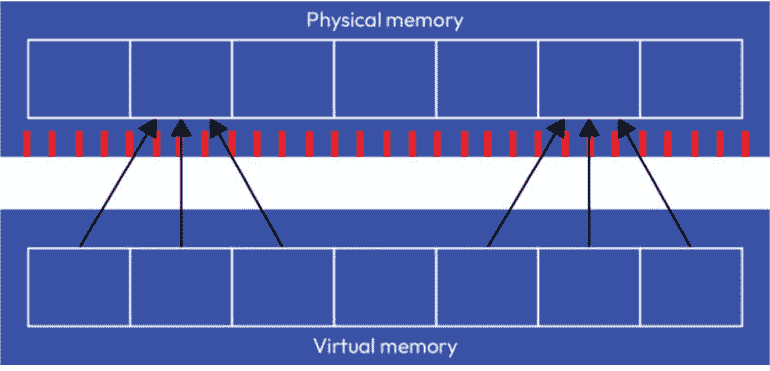

图 6.5: ZGC 映射

动态内存分配是编程中的常见做法，它会导致内存碎片。当对象被分配和释放时，内存布局中会出现空隙。随着时间的推移，这些空隙会积累，导致碎片，使得内存像棋盘一样交替着空闲和区域。为了解决这个问题，有两种主要策略。

一种方法是扫描内存寻找容纳所需的空空间。这种方法虽然可行，但非常消耗资源，特别是频繁执行时。此外，它并没有完全消除碎片；找到与所需大小精确匹配可能是挑战性的，会在对象之间留下间隙。

另一种策略是定期将碎片内存区域中的对象移动到更紧凑的格式。它将内存空间划分为块并同时移动整个对象块。这样做，内存分配变得更快，因为有了已知的空闲块。这种策略有助于更有效地管理内存碎片，在动态分配的需求和对更连续、更有组织的内存布局的渴望之间取得平衡。

权衡是任何垃圾回收策略中固有的，ZGC 也不例外。虽然它在减少暂停时间方面表现出色，但其吞吐量可能无法达到那些牺牲延迟以换取吞吐量优化的收集器。此外，对于具有极大堆的应用程序，ZGC 可能并非最优，因为其并发方法可能会引入一些开销。然而，对于低延迟至关重要且应用程序响应速度优于最大吞吐量的场景，ZGC 成为了一个强大的解决方案。

ZGC 的另一个显著特性是它能够动态调整堆大小的能力。ZGC 会根据应用程序的需求调整堆大小，使其能够高效地响应不断变化的负载来管理内存。这种适应性在负载变化的环境中特别有益，提供了一种敏捷且响应迅速内存管理解决方案。

从本质上说，ZGC 代表了垃圾回收领域的范式转变，为要求低延迟和高响应的应用程序提供了一种复杂的解决方案，且不会损害内存管理的效率。其创新的特性和并发设计使其成为在动态和资源密集型场景下运行的现代 Java 应用程序极具吸引力的选择。

在 JVM 内部的动态领域，ZGC 作为一种尖端解决方案处于中心位置，优先考虑低延迟性能和响应速度。此表作为导航 ZGC 配置图谱的指南，为开发者和管理员提供了一组精选的命令，以塑造其行为。从开启或关闭 ZGC 到微调参数，这些选项使户户能够根据 Java 应用程序的特定需求定制 ZGC。当我们深入研究每个命令的意义时，本指南将成为优化 ZGC 性能的必备资源，确保效率和适应性之间达成和谐平衡。加入我们解锁 ZGC 的潜力，在这里，每条命令都成为定义 JVM 内垃圾回收策略未来的精准交响乐中的音符：

| 命令 | 描述 |
| :--- | :--- |
| `-XX:+UseZGC` | 启用 ZGC。 |
| `-XX:-UseZGC` | 禁用 ZGC。 |
| `-XX:MaxGCMillis=<value>` | 为 ZGC 垃圾回收设置最大的预期暂停时间目标。 |
| `-XX:GCIntervalMillis=<value>` | 设置 ZGC 暂停之间的最大间隔。 |
| `-XX:ConcGCThreads=<value>` | 为 ZGC 设置并发垃圾回收线程数。 |
| `-XX:ParallelGCThreads=<value>` | 设置 ZGC 并行阶段的并行垃圾回收线程数。 |
| `-XX:ZUncommitDelay=<value>` | 设置区域不再需要后释放内存的延迟。 |
| `-XX:ZUncommitDelayMax=<value>` | 设置区域不再需要后释放内存的最大延迟。 |
| `-XX:ZUncommitDelayPolicy=<adaptive|fixed>` | 设置 ZGC 的释放策略。选项包括 `adaptive` 和 `fixed`。 |
| `-XX:SoftMaxHeap=<value>` | 为 ZGC 设置软最大堆大小。 |
| `-XX:ZHeapSize=<value>` | 设置 ZGC 堆大小。 |

表 6.4：ZGC 命令

这些选项提供了配置和微调 ZGC 行为的方法，允许开发者和管理员根据特定的应用程序需求和硬件特性优化垃圾回收。

当我们结束对 ZGC 复杂性的探索时，我们发现自己沉浸在精准性能和低延迟响应的世界中。这里提供的 ZGC 命令表作为一个指南，解锁了用户为其 Java 应用程序微调和优化 ZGC 的潜力。本节为理解 ZGC 如何重塑垃圾回收策略格局奠定了基础。

我们的旅程并未此结束，而是优雅地过渡到下一幕——工程学与调优。在接下来的章节中，我们将深入研究优化 Java 应用程序的艺术，探索微调 JVM 性能以满足各种负载的细微需求。加入我们进入 JVM 调优领域，在这里，每一次调整都成为创作 Java 应用程序性能画布上的一个笔触。

# JVM 调优与工程学

在 Java 应用程序开发的动态格局中，工程学（`ergonomics`）和性能分析（`profiling`）双支柱成为实现最佳性能的关键要素。本节标志着我们微调 Java 应用程序的旅程，探索工程学原理以使 JVM 自动适应不同的负载。同时，我们还深入了性能分析，这是一种获取 Java 应用程序运行时行为洞察的强大工具。在我们优化 Java 性能的细微之处时，工程学和性能分析成为我们的指明灯，为构建具有响应能力和效率的应用程序提供了策略。加入本节，共同揭示自适应调优与洞察性分析之间的协同作用，解锁将 Java 应用程序的性能和响应能力提升到新水平的潜力。

Java 语境下的 Erg 是 JVM 嵌入的自适应调优能力，它可以根据底层硬件特性和应用程序行为自动调整其配置。工程学的主要目标是在不需要开发者手动干预的情况下，增强 Java 应用程序的性能和响应速度。通过动态调整垃圾回收算法、堆大小和线程数等参数，工程学旨在为特定的运行时环境寻求最佳平衡。

然而，工程学设置的默认配置通常被认为是一种过早优化。这是因为默认设置是在 JVM 启动时确定的，依赖于环境的启发式判断和假设。虽然这些默认设置对于广泛的应用程序和硬件可能运行良好，但对于特定的用例，它们可能不是效率最高的配置。当 JVM 在缺乏足够运行时信息的情况下对应用程序行为做出假设时，就会发生过早优化，可能导致性能欠佳。

工程学可以在 Serial GC 和 G1 之间进行选择。Serial GC 通常用于单处理器系统或内存受限的情况。另一方面，当有更多处理器和足够的内存时，可能会选择 G1。此外，工程学像一个智能指挥家，根据应用程序的独特需求动态地定制 JVM 的配置。

手动设置 GC 配置并避免工程学设置的建议源于：手动配置 GC 可以让开发者对 JVM 行为拥有更多的控制力和可预测性。虽然自动化方法并不总是能为特定用例产生最高的配置，但手动调优允许开发者进行实验、分析和调整 JVM 参数，以实现预期的性能结果。

| 核心 | | | | |
| :--- | :--- | :--- | :--- | :--- |
| 多线程 | 否 | 是 | 是 | 是 |
| Java 堆大小 | > 4 GB | < 4 GB | > 4 GB | > 4 GB |
| 暂停 | 是 | 是 | 是 | 是 (> 1 ms) |
| 开销 | 极 | 极 | 中等 | 中等 |
| 尾延迟影响 | 高 | 高 | 高 | 低 |
| 最佳场景 | 单核小堆 | 多小堆。批量作业，适用于任何堆大小。 | 中大堆中响应良好（响应/数据库交互） | 中到大堆中响应良好（请求-响应模式） |

表 6.5：GC 多个方面的对比

在对 JVM 调的探索中，我们深入研究了工程学（`ergonomics`）、性能分析以及自动适应与手动精确性之间的微妙平衡。工程学能够根据不同的工作负载动态调整 JVM 配置，但建议仍倾向于手动配置 GC 以获得更大的控制权。在我们接近结论时，将有一份精炼的总结，凝结我们在处理 JVM 复杂性中获得的智慧。

# 总结

在我们对复杂的 GC 世界的探索画上句号之际，我们已经了塑造 JVM 内部内存管理格局的各种策略、细微差别和配置。从工程学的自适应技巧到 Serial、Parallel、G1 和 ZGC 的精确性，我们的旅程是一场选择的交响乐，每种选择都根据特定的应用需求调整，以协调最佳性能。

然而，我们对 JVM 内部的探索并未在此停止。下一章等待着我们，邀请我们进入 GraalVM 的沿领域。在传统 Java 的限制之外，GraalVM 作为一个革命性的平台脱颖而出，模糊了语言之间的边界，并为性能、多语言能力和高效执行释放了新的可能性。在随后的章节中加入我们，深入探讨 GraalVM 这一范式转移的格局，在这里，语言的交响乐和谐地汇聚，标志着不断演变的 JVM 技术织锦中的动态演进。

## 问题

回答以下问题以测试你对本章知识的掌握：

1. JVM 调中工程学的主要目标是什么？

   A. 最小化代码编译时间

   B. 根据运行时特征自动调整 JVM 配置

   C. 为所有应用最大化堆大小

   D. 禁用垃圾回收以增强性能

2. 哪个 GC 通常被工程学作为单处理器系统或内存限制时的默认选择？

   A. Serial GC

   B. Parallel GC

   C. G1 GC

   D. ZGC

3. 在垃圾收集的背景下，“多映射”（`multi-mapping`）指的是什么？

   A. 虚拟内存地址到物理内存的多映射

   B. 同时使用多个垃圾收集算法

   C. 垃圾收集期间的多线程

   D. 同时在多个区域分配内存

4. 为什么开发者可能倾向于手动 GC 配置而非工程学？

   A. 手动调更具成本效益

   B. 工程学与现代 JVM 版本兼容

   C. 开发者对性能参数有更好的控制

   D. 手动配置减少了对垃圾回收的需求

5. 哪个 GC 以关注低延迟和响应而闻名，适用于实时系统？

   A. Serial GC

   B. Parallel GC

   C. G1 GC

   D. ZGC

## 答案

以下是本章问题的答案：

1. B. 根据运行时特征自动调整 JVM 配置

2. A. Serial GC

3. A. 虚拟内存地址到物理内存的多映射

4. C. 开发者对性能参数有更好的控制

5. D. ZGC

# 第 3 部分：替代 JVM


# GraalVM

在探索中，我们引入了 GraalVM——一种支持多种语言并具有提前编译（AOT）能力的多功能替代 JVM。进一步扩大我们的视角，我们在第 8 章深入研究更广泛的 JVM 生态系统，探索 OpenJ9 和 Corretto 等替代 JVM。这些章节共同扩展了我们对各种 JVM 实现的理解，提供了对其特性和用处的见解。

此部分包含以下章节：

- 第 7 章，GraalVM
- 第 8 章，JVM 生态系统与替代 JVM

## 简介

在不断变化的 JVM 格局中，GraalVM 作为一个革命性且多功能的替代方案脱颖而出。本章深入探讨 GraalVM 的复杂性，揭示其独特特性，并阐明其作为 JVM 领域游戏规则改变者的角色。GraalVM 由 Oracle Labs 开发，通过提供一个支持多种语言（包括 Java、JavaScript、Python、Ruby 等）的多语言运行时，超越了传统 JVM 的边界。这种灵活性为开发者开辟了新途径，允许他们在单个应用程序中无缝地集成不同的语言。当我们阅读本章的页面时，你将全面理解 GraalVM 的架构、其独特的组件以及它在重塑 Java 开发格局中的关键作用。

GraalVM 的架构不仅证明了它的工程实力，也证明了它对性能和效率的承诺。本章不仅探索了 GraalVM 的底层架构和组件，还强调了其创新的 JIT 编译器，这是其效率的核心。理解 GraalVM 架构的细节对于开发者利用其力量来优化和增强应用程序的性能至关重要。此外，我们还将深入探讨 GraalVM 表现出色的真实场景以及它解决的独特问题。无论你的目标是提高 Java 程序的执行速度，还是寻求多种语言的无缝集成，GraalVM 都作为一个革命性的平台出现，模糊了语言之间的边界，并为性能、多语言能力和高效执行释放了新的可能性。在随后的章节中加入我们，深入探讨 GraalVM 这一范式转移的格局，在这里，语言的交响乐和谐地汇聚，标志着不断演变的 JVM 技术织锦中的动态演进。

### 兼容性考量

虽然 GraalVM 支持广泛的语言，但某些语言特性可能无法完全兼容。开发者需要考虑其项目的特定语言需求，并确保 GraalVM 提供了充分的支持。兼容性问题可能需要额外的努力来适配或优化代码，使其能够与 GraalVM 无缝运行。

### 最佳用例

识别利用 GraalVM 优势的最优场景，需要对最佳用例进行针对性的评估。在微服务和无服务器架构中，GraalVM 卓越的性能和更低的内存占用与这些环境对敏捷性的需求完美契合。它的多语言能力使其成为涉及多种语言项目的理想选择，能够营造出内聚的运行环境。高性能计算应用受益于 GraalVM 先进的 JIT 编译，加速了计算密集型任务的执行。此外，云环境中的资源密集型应用程序可以利用 GraalVM 在资源利用上的效率，而不会损害性能。开发者可以通过明确这些案例，策略性地使用 GraalVM，以在各种应用场景中实现优势最大化：

- **微服务和无服务器架构**：GraalVM 的性能提升和内存占用减少使其非常适合微服务和无服务器架构。更快的启动速度和高效的资源利用与这些对敏捷性和响应速度至关重要的环境需求一致。
- **多语言应用**：在应用程序使用多种编程语言构建的场景下，GraalVM 的多语言能力尤为出色。如果你的项目涉及使用 Java、JavaScript、Python 等多种语言编写的组件，那么 GraalVM 在单个运行环境中无缝集成这些语言的能力将成为决定性优势。
- **高性能计算**：专注于高性能计算的应用（如科学模拟或数据处理）可以受益于 GraalVM 先进的 JIT 编译。增强的运行时性能可以显著加速计算密集型任务。
- **资源密集型应用程序**：GraalVM 在资源利用上的效率使其成为资源密集型应用程序的极佳选择，特别是在云环境中。开发者可以利用 GraalVM 优化资源消耗，而无需牺牲性能。

总之，GraalVM 为各种场景提供了一个极具吸引力的选择，特别是在权衡因素与项目的优先级和限制相符的情况下。通过仔细评估应用的特定需求，开发者可以在 GraalVM 优势最能发光的场景中发挥其全部潜力。

### 总结与展望

当我们结束对 GraalVM 及其细致考虑的探索时，显而易见，这种创新的 JVM 替代方案在不断发展的 Java 开发版图中是一股不可忽视的力量。从其高性能 JIT 编译器到多语言运行时，GraalVM 提供了一系列引人入胜的特性，可以将应用程序开发提升到新的高度。虽然我们讨论了权衡，但至关重要的是要认识到，这些考虑是根据特定项目需求做出明智决策不可或缺的一部分。

此外，我们对 GraalVM 最佳用例的探索揭示了其优势最闪耀的场景，从微服务架构到资源密集型云应用。然而，故事并没有在此结束。GraalVM 的 `Native Image` 功能进一步推进了这一进程，允许开发者将应用程序提前编译成独立的可执行文件，完全跳过了部署期间对 JVM 的需求。它为深入研究 `Native Image` 奠定了基础，在这一领域，GraalVM 的能力得到了扩展，提供了一种更加精简、高效且对资源友好的应用部署方法。随着我们破解 GraalVM `Native Image` 开启的可能性，它正以无与伦比的效率和创新重塑 Java 开发的格局。

## Native Image

欢迎来到关于 GraalVM 的启发性环节，这是一项改变游戏规则的技术，超越了传统 JVM 的边界。GraalVM 由 Oracle Labs 开发，作为一种多功能解决方案出现，引入了重新定义应用开发格局的革命性特性。本节是我们理解 GraalVM 关键层面的门户，从其高性能 JIT 编译器到其多语言运行时以及创新的 AOT 编译。当我们深入 GraalVM 的架构和能力时，你将了解到它是如何解决现代应用程序不断演变的需求。加入我们对 GraalVM 的探索，在这里，创新与多功能兼汇，发现它如何赋能开发者创建高效、多语言的应用，突破 Java 生态系统可能性的边界。

GraalVM 最独特的特征之一是它的 `Native Image` 功能，这是一项将应用部署推向新时代的变革性能力。与运行在 JVM 上的传统 Java 应用不同，GraalVM 的 `Native Image` 允许开发者将应用程序提前编译成独立的可执行文件。应用程序在部署时不再依赖 JVM，而是被封装为自包含的二进制文件，直接与操作系统交互，跳过了对中间虚拟机的需求。

`Native Image` 方法的关键优势在于其启动时间和运行时性能的效率提升。通过消除对 JVM 解释和执行代码的需求，`Native Image` 显著缩短了应用程序的启动时间，使其成为对快速响应至关重要的场景的理想选择。此外，JVM 的缺失减少了应用程序的内存占用，增强了资源利用，使其更适合资源受限的环境。

然而，也应该强调，AOT 编译消除了 JIT 编译的精确优势，因为字节码在运行时不再可用，无法针对不断变化的行为进行代码优化。在许多应用程序运行时间较长的情况下，快速启动的益处虽然显著，但可能会由于缺乏动态运行时优化导致整体性能降低而产生部分抵消。关于这种 AOT 和 JIT 之间这种权衡的详细探索，你可以参考此富有见地的演示：<https://www.azul.com/blog/jit-performance-ahead-of-time-versus-just-in-time/>。

虽然 `Native Image` 在启动时间、内存效率和资源利用方面带来了显著优势，但也带来了开发者应该仔细考虑的权衡：

- **构建时间和复杂性**：创建 `Native Image` 涉及 AOT 编译，该编译发生在构建阶段。此编译过程比基于 JVM 的程序的传统 JIT 编译更耗时。此外，配置 `Native Image` 构建可能更为复杂，需要开发者管理原生库、反射访问和其他考虑因素以获得理想结果。
- **动态类加载和反射**：`Native Image` 要求在编译期间对应用程序代码进行静态分析，这对于高度依赖动态类加载或反射的应用程序可能是挑战。由于 `Native Image` 编译器需要在构建时知道完整的类和方法集，动态加载或生成的代码可能需要特殊处理，可能需要对应用程序代码进行调整。
- **有限的运行时配置**：AOT 编译需要在构建阶段对应用程序的行为有全面的理解。对于具有复杂运行时行为或动态适应各种场景的应用程序来说，这是挑战性的。在这种情况下，`Native Image` 可能无法捕捉完整的运行时配置，导致性能权衡。
- **平台依赖**：`Native Image` 提供特定平台的二进制文件，这可能为跨平台兼容性带来挑战。虽然 GraalVM 提供了某种程度跨平台支持，但开发者必须注意平台依赖，并在目标平台上对应用程序进行充分测试。
- **包含库的占用**：在 `Native Image` 中包含某些库会增加体积，可能会抵消部分内存效率的收益。开发者必须仔细选择并优化包含在原生镜像中的依赖项，以在占用和功能之间取得正确的平衡。

### 对比：Native Image 与 JVM 应用

对于对快速响应至关重要的应用程序或微服务。相比之下，基于 JVM 的应用程序通常启动时间较长，因为 JVM 需要在运行时解释并编译代码。

- **内存占用**：与 JVM 对应的应用程序相比，`Native Image` 应用通常具有更小的内存占用。由于不需要 JVM，运行虚拟机相关的额外开销被消除了，从而实现了更高效的资源利用。这使得 `Native` 应用非常适合内存限制严苛的环境。
- **可移植性**：JVM 应用以其可移植性著称——即可以在任何带有兼容 JVM 的平台上运行。另一方面，`Native Image` 应用被编译为特定平台的二进制文件，可能存在平台依赖性。虽然 GraalVM 提供了某种程度的交叉编译支持，但在使用 `Native Image` 时，必须考虑平台特定的影响。

深入研究应用程序部署的复杂决策过程，下表对比阐明了 `Native Image` 应用与运行在 JVM 上应用程序之间的独特特征。每一列都封装了影响性能、资源利用和适应性的关键方面。通过 GraalVM 创新的 AOT 编译构建的 `Native Image` 应用，具有快速的启动时间和更小的内存占用，使其特别适用于优先考虑效率的场景。相比之下，基于 JVM 的应用程序利用 JIT 编译，提供了跨平台兼容性和动态适应性的优势。此表充当开发者的指南针，提供了一个简洁而全面的指南，帮助他们根据项目的特定需求进行权衡并做出明智决策：

| 特性 | Native Image 应用 | 基于 JVM 的应用程序 |
| --- | --- | --- |
| 启动时间 | 通常较快 | 可能较慢，取决于 JIT 编译 |
| 内存占用 | 较小 | 较大 |
| 构建时间 | 由于 AOT 编译，较长 | 由于 JIT 编译，较短 |
| 动态类加载 | 有限；需要小心处理 | 更灵活 |
| 反射 | 有限；需要小心处理 | 更灵活 |
| 平台可移植性 | 特定平台的二进制文件 | 兼容 JVM 的跨平台支持 |
| 资源利用 | 高效；开销较低 | 取决于 JVM，开销可能更高 |
| 依赖包含 | 需要优化以管理大小 | 使用依赖管理器更易管理 |
| 对运行时变化的适应性 | 动态性较少；需要小心处理 | 通过 JIT 编译更具适应性 |
| 构建复杂度 | 较高；需要配置 | 较低；通常由 JVM 处理 |

表 7.1：Native Image 与 JVM

此表提供了 `Native Image` 与基于 JVM 的应用程序之间关键区别的高级概述。需要注意的是，两者之间的选择取决于特定的项目需求，需要考虑启动时间、内存效率、平台可移植性以及动态功能所需的灵活性等因素。

在探索 `Native Image` 应用与其对应程序之间的差异时，很显然，通往最佳部署的路径是微妙且多面的。这次对比之旅揭示了这两种方法的独特优势和考量，引导开发者做出符合项目优先事项的明智决策。随着对权衡和收益更深入的理解，我们正站在实战精通的门槛上。

在接下来的章节中，我们将深入探讨使用 GraalVM 创建 `Native Image` 的实践领域。我们将揭开 AOT 编译过程的复杂性，阐明将 Java 应用程序转换为独立可执行文件的步骤。从优化依赖到处理平台特定的考量，这项实践探索将使你能够利用 `Native Image` 部署带来的效率提升。加入我们的下一节，共同开启释放 `Native Image` 潜力的实践旅程，用 GraalVM 突破性的能力重塑应用程序部署的格局。

### 创建 Native Image

在这个沉浸式的实操章节中，我们将深入学习如何使用 GraalVM 创建 `Native Image`。在对 `Native Image` 应用和 JVM 对应程序进行对比探索并获得见解的基础上，本节是你通往应用程序部署效率实践领域的大门。当我们从理论转向实践时，我们的重点现在是赋能你掌握 `Native Image` 编译的变革能力。准备好开启一段旅程，我们将揭开 AOT 编译过程的神秘纱，为将 Java 应用程序转换为独立可执行文件提供逐步指导。

在整个章节中，我们将深入研究优化依赖的复杂性、处理平台特定的考量，并释放 `Native Image` 部署的全部潜力。无论你是寻求增强应用程序性能的资深开发者，还是渴望探索 GraalVM 技术前沿的爱好者，这项实操经验将使你具备实用技能，将 `Native Image` 编译无缝集成到你的开发工具箱中。让我们开始吧，在导航创建 `Native Image` 的过程中，将理论转化为实践，用 GraalVM 革命性的能力重塑应用程序部署的格局。

在实操练习章节中，我们将通过编写一个幽默简单但具有说明性的 Java 应用程序，进入 `Native Image` 编译的迷人世界。`App` 类设计用于向世界打印问候，并在一个超级无厘的反转中，反转给定的字符串。当我们探索代码时，你会发现它不是典型的“Hello, World!”。相反，它引入了一个名为 `reverseString` 的方法，用于递归地反转给定字符串。应用程序首先打印问候，然后使用 `reverseString` 方法反转字符串“Native Image is awesome”。

这个趣味性的示例将作为我们 `Native Image` 实验的画布。通过这次练习，我们不仅将见证 `Native Image` 的创建，还能对优化过程和由此产生的效率提升获得见解。系好，我们将为这个超级无厘但富有启发性的 Java 应用程序创建一个 `Native Image`。让我们让幽默变为现实，并与 GraalVM 一起探索 `Native Image` 的魔法。

```java
public class App {
    public static void main(String[] args) {
        System.out.println("Hello, World! with Native image");
        String str = "Native Image is awesome";
        String reversed = reverseString(str);
        System.out.println("The reversed string is: " + reversed);
    }
    public static String reverseString(String str) {
        if (str.isEmpty()) {
            return str;
        }
        return reverseString(str.substring(1)) + str.charAt(0);
    }
}
```

设置 GraalVM 是我们通向精通 `Native Image` 编译的关键步骤。为了简化过程并管理不同的 Java 版本，我们将利用 `SDKMan` 项目。`SDKMan` 简化了不同 Java 安装和切换，为开发者提供了无缝体验。

对于手动安装，你可以参考 GraalVM 官方文档。但是，为了方便我们的工作，让我们使用 `SDKMan` 安装 GraalVM。在编写时，我们选择了带有 GraalVM 支持的 21.0.1 版本。在你的终端中执行以下命令：

```bash
sdk install java 21.0.1-graal
```

该命令通过 `SDKMan` 获取并安装 GraalVM 21.0.1。一旦建立，你可以将其设置为系统的默认 Java 版本，或者在当前终端会话中进行设置。如果你想将其设置为默认，请使用以下命令：

```bash
sdk use java 21.0.1-graal
```

现在，随着 GraalVM 无缝集成到你的开发环境中，我们已经准备好探索原生镜像（`Native Image`）的创建了。让我们开启这段实操之旅的下一步，将 GraalVM 的强大与 `SDKMan` 的简单性相结合。

创建原生镜像是我们探索中的关键步骤，该过程涉及一系列命令，用于编译、打包并最终生成原生镜像。让我们来拆解：

1.  **编译 `App` 类**：

    ```bash
    javac -d build src/main/java/expert/os/App.java
    ```

    该命令编译 `App` 类并将编译后的文件存储在 `build` 目录中。

2.  **创建 JAR 文件**：

    ```bash
    jar --file App.jar --main-class expert.os.App -C build .
    ```

    在这里，我们将编译后的文件打包成名为 `App.jar` 的 JAR 文件，并指定主类为 `expert.os.App`。

3.  **创建原生镜像**：

    ```bash
    native-image -jar App.jar
    ```

    利用 GraalVM 的 `native-image` 工具，我们从 JAR 文件生成原生镜像。这一步涉及 AOT（提前编译），结果是生成一个独立的可执行文件。

4.  **执行原生镜像**：

    ```bash
    ./App
    ```

    原生镜像创建完成后，我们可以运行该可执行文件。执行后，控制台将显示如下输出：

    ```
    Hello, World! with Native image
    The reversed string is: nemosewa si egamI evitaN
    ```

恭喜！你成功地完成了使用 GraalVM 创建原生镜像的过程，将这个原本简单的 Java 应用转变为一个精简、独立的可执行文件。这段实操经验为进一步探索原生镜像编译带来的效率提升和优化可能性奠定了基础。让我们沉浸在成果中，继续进入 GraalVM 的动态领域。


当我们结束使用 GraalVM 创建原生镜像的这一节时，显而易见，我们在应用部署方面开启了一场变革性之旅。通过无缝集成 GraalVM 的力量，我们将一个有趣的 Java 应用转换为了独立的可执行文件，解锁了启动时间和资源利用方面的效率提升。

通过细致的编译步骤和 AOT 处理的魔力，我们见证了原生镜像的诞生。我们可执行文件的输出不仅响起了熟悉的“Hello, World!”问候，还展示了字符串的奇幻反转——这证明了 GraalVM 的多功能性。

这种实操经验为进一步探索奠定了坚实的基础。有了原生镜像，开发者可以深入真实世界的应用，优化性能并应对高效资源利用的复杂性。然而，旅程并未此结束；它将延伸到 GraalVM 能力的动态图谱。

当我们庆祝原生镜像的成功执行时，让这成为你继续探索 GraalVM 所解锁的可能性和效率的催化剂吧。冒险继续，后续章节正在等待，承诺在迷人的 Java 应用开发世界中带来更深层次的见解和精通。

# 总结

在本章中，我们深入研究了 GraalVM 的变革性能力，从其高性能编译器到原生镜像的创建。见证通过 AOT 编译实现的效率提升是一个重大的里程碑，展示了 GraalVM 在重塑 Java 开发格局方面的通用性。

在结束之际，本章作为下一章更广泛探索 JVM 生态系统和替代 JVM 的跳板。传统 JVM 之外的多样选择（如 OpenJDK 和 Azul Zing）将揭开面纱，提供关于它们独特特征以及对不断演变的 Java 生态系统贡献的见解。加入我们进入下一章，根据我们从 GraalVM 探索中获得的知识，共同导航 JVM 领域中的多样化路径。

## 问题

回答以下问题以测试你对本章知识的掌握：

- 1. GraalVM 原生镜像编译的主要优势是什么？

  A. 增加内存占用

  B. 减慢启动时间

  C. 平台迁移性

  D. 语言支持有限

- 2. 在 GraalVM 原生镜像创建过程中，使用哪个命令编译 App 类？

  A. compile -class App

  B. `javac -d build src/main/java/expert/os/App.java`

  C. native-image --compile App

  D. graalvm-compile App.java

- 3. 提供的 Java 应用中 reverseString 方法目的是什么？

  A. 连接字符串

  B. 反转给定的字符串

  C. 检查是否为回文

  D. 从字符串中删除空格

- 4. GraalVM 原生镜像在启动时间上与基于 JVM 的应用程序有何不同？

  A. 原生镜像的启动时间较慢

  B. 两者的启动时间相似

  C. 原生镜像的启动时间更快

  D. 基于 JVM 的应用程序启动时间更快

- 5. 在 GraalVM 安装的背景下，SDKMan 是用来用的？

  A. 管理 Java 版本和安装

  B. 创建原生镜像

  C. 调试 Java 应用

  D. 管理 Docker 镜像

- 6. `native-image` 命令在 GraalVM 原生镜像创建过程中做了什么？

  A. 编译 Java 源代码

  B. 生成独立的可执行文件

  C. 下载 Java 依赖

  D. 执行 Java 应用

## 答案

以下是本章问题的答案：

- 1. C. 平台迁移性

- 2. B. `javac -d build src/main/java/expert/os/App.java`

- 3. B. 反转给定的字符串

- 4. C. Native Image has a faster startup time

- 5. A. Managing Java versions and installations

- 6. B. Generates a standalone executable

为什么代码可以在多个 JVM 之间无缝运行，却又存在多个 JVM 实现？这是一个对软件开发多样化需求和特定语境的多维度探索。虽然在不同 JVM 之间运行代码的能力提高了互操作性，但多种实现源于对特定用例、性能优化以及适应不同硬件和软件环境的需求。需要注意的是，大多数发行版并非不同的 JVM 实现，而是 OpenJDK 项目的构建版本，并经过细微修改。此外，所有发行版都必须通过 Java 兼容性工具包（TCK）（https://foojay.io/peda/tck/），以确保它们遵循 Java 标准并维护 Java 生态系统的兼容性。OpenJDK 的源码可以在 https://github.com/openjdk/jdk/ 获取，你甚至可以按照“building”文件中的指令来构建运行时。这一严格要求确保了开发者无论在运行 Java 应用时选择何种发行版，都能依赖于一致的行为和功能。

每个 JVM 都拥有独特的优势，可以在特定语境下被利用，使其成为开发者的强大工具。例如，考虑 OpenJ9。它对资源效率和快速启动时间的强调，使其成为云应用程序极具吸引力的选择，因为在这些应用中，响应和资源利用率是关键因素。另一方面，Amazon Corretto 专注于长期支持（LTS）以及与 Amazon Web Services (AWS) 的无缝集成，非常适合深耕 AWS 生态系统的企业。

此外，JVM 的适应性还扩展到了硬件层面。在不同平台（无论是 Lego Mindstorms 还是如 OpenSolaris 这样的特定硬件）上运行相同代码的能力，彰显了 JVM 的可移植性。它简化了开发过程，并使开发者能够创建在不损害功能的前提下、于不同环境之间无缝切换的应用。

每个 JVM 的强大之处在于其执行代码的能力以及它所带来的优化和特性。例如，GraalVM 以其即时编译（JIT）编译器和多语言能力而闻名，为语言互操作性开启了大门，允许开发者将 JavaScript、Python 和 Ruby 等语言无缝集成到其 Java 应用中。这种多功能性在多种语言必须在单一代码库中共存的场景下是无价的。

本质上，多个 JVM 的存在证明了 Java 生态系统的适应性和多样性。开发者可以利用这些实现，根据性能需求、集成需求以及目标环境的特定特性来定制自己的选择。这种多样性促进了创新，并确保 JVM 作为一个健壮且动态的平台，随着不断变化的软件开发格局不断演进。

当我们结束这一关于 JVM 多样化且具有影响力的格局的章节时，我们揭示了使其成为跨编程语言和硬件平台统一力量的复杂之处。在保持兼容性的同时在多个 JVM 之间无缝运行代码的能力，凸显了这项基础技术的灵活性和健壮性。然而，问题依然存在：既然具有如此的兼容性，为什么我们会有这么多 JVM 实现呢？

答案在于每个 JVM 带来的细微优势和优化，它们满足了特定的用例、性能需求和集成场景。在下一节中，我们将对选定的、能够体现这种多样性的 JVM 实现进行实践探索。加入我们，深入探讨 Eclipse J9、Amazon Corretto、Azul 和 Eclipse Temurin，并分析它们的独特特性、性能特征和现实世界的应用。通过这次深度解析，我们旨在赋予你知识，以便在丰富的 JVM 选择中游刃有余，确保你能做出与开发目标一致的明智决策。

# Eclipse J9

在专用章节中，我们将深入探讨 Eclipse J9 的功能。这是一种 JVM 实现，以其对效率、扩展性和资源优化的强调而脱颖而出。当我们研究 Eclipse J9 的复杂性时，我们将发现它在广大的 JVM 实现格局中脱颖而出的独特特性，并探索为什么开发者应该考虑将这一强大工具应用于他们的 Java 程序。

Eclipse J9 由 Eclipse Foundation 开发，代表了一种前沿的 JVM 实现，旨在最大化效率并最小化资源占用。Eclipse J9 以其紧凑的和快速的启动时间而闻名，在关键资源利用场景中表现出色，使其成为云应用程序、微服务以及对响应速度至关重要的环境的优选。它的架构结合了先进的 JIT 编译技术和激进的内存管理，营造了敏捷且响应迅速的运行时。

Eclipse J9 作为一种卓越的 JVM 实现，展现了许多优势，使其成为敏锐开发者极具吸引力的选择。排在首位的是它对资源效率值得赞赞的承诺。Eclipse J9 的紧凑占用优化了系统资源，使其成为对最小化开销至关重要的应用程序的理想解决方案。这种效率延伸到内存利用和处理器参与，对于在资源受限环境中运行的应用来说，这是一项关键特性。快速的启动时间进一步增强了它的吸引力，提升了用户体验和响应速度，特别是在“运行时间”为核心的场景下。Eclipse J9 的扩展性是另一个值得注意的利益，它能够适应各种环境的动态需求，从小型应用到庞大的的企业级系统。当我们探索 Eclipse J9 的格局时，这些利益作为关键支柱显现出来，强调了它赋予开发者在性能和资源消耗之间建立无缝平衡的能力：

- **资源效率：** Eclipse J9 的紧凑占用确保了系统资源的有效利用，使其成为对最小化开销至关重要的应用程序的理想选择。这种效率延伸到内存使用和处理器利用，允许在资源受限环境中获得最佳性能。

- **快速的启动时间：** JVM 的启动时间在特定应用领域至关重要，Eclipse J9 在这方面表现出色。它的快速启动确保应用程序能够迅速运行，增强了用户体验和响应速度。

- **扩展性：** Eclipse J9 的设计旨在跨各种环境无缝扩展，适应从小应用程序到大型企业系统的需求。其扩展性使其非常适合动态工作负载以及可能经历市场波动的应用程序。

当效率、快速响应和最佳资源利用至关重要时，为你的 Java 应用考虑 J9 变得至关重要。无论你是在开发云原生应用、微服务，还是在资源受限的环境中部署，Eclipse J9 都提供了极具吸引力的解决方案。Eclipse J9 的优势转化为真实的利益，为开发者提供了根据应用程序需求平衡性能和资源消耗的灵活性。

当我们结束对 Eclipse J9 提供的效率和扩展性的探索时，我们见证了这种 JVM 实现对于寻求优化资源利用和快速响应的开发者来说是如何成为战略选择的。J9 的优势从紧凑的占用到快速启动以及可扩展架构，彰显了它在各种应用格局中的多功能性。在下一节，我们将无缝过渡到对另一个著名的 JVM 实现：Amazon Corretto。

# Amazon Corretto

在本节中，我们将对 Amazon Corretto 进行深入的探索。这是一种由 Amazon 开发的、结合了可靠性、性能和 LTS 的 JVM 实现。当我们研究 Amazon Corretto 的细微差别时，我们将探索它的独特特性、性能优化以及开发者考虑将这种 JVM 实现集成到其 Java 应用中的力理由。

Amazon Corretto 代表了 Amazon 对交付高质量开源 JVM 的承诺。Corretto 构建在 OpenJDK（Java 开发工具）坚实的基础之上，旨在提供可靠且安全的 Java 运行时。Amazon Corretto 免费使用并带有 LTS 支持，使其成为寻找稳定可靠 JVM 的企业极具吸引力的选择。

在探索 JVM 实现的复杂性时，Amazon Corretto 成为可靠性、性能和持续支持的灯塔。本节将深入探讨让 Amazon Corretto 成为跨领域 Java 开发者极具吸引力的独特优势。从对 LTS（长期支持）的承诺到性能优化，再到对安全性的坚定关注，Amazon Corretto 提供了一系列全面的优势，提升了开发体验并确保了 Java 应用的寿命和稳定性。加入我们，揭开 Amazon Corretto 优势的层层，深入理解为什么这一 JVM 实现值得在您的工具包中占据重要地位：

- **LTS：** Amazon Corretto 的卓越特性之一是其 LTS 长期支持。企业可以从扩展的支持和更新中受益，确保 Java 应用在长时间内的稳定性和安全性。

- **性能优化：** Amazon Corretto 配备了性能增强功能，可以优化 Java 应用的执行。这些优化提高了响应速度和吞吐量，使其适用于广泛的用例。

- **安全性和稳定性：** Amazon Corretto 以安全和稳定为核心构建，经过了严格的测试和质量保证流程。它确保开发者可以为他们的 Java 应用运行在健壮、安全的运行时环境中。

- **与 OpenJDK 的兼容性：** Amazon Corretto 保持与 OpenJDK 的兼容性，允许开发者无缝从其他基于 OpenJDK 的 JVM 迁移。这种兼容性简化了迁移过程，同时提供了 Amazon 额外优化和支持的优势。

为您的 Java 应用考虑 Amazon Corretto 是一项战略决策，特别是当 LTS、性能优化和对安全性的承诺至关重要时。无论您是在开发云原生应用、无服务器函数还是传统的企业系统，Amazon Corretto 都提供了由 AWS 的可靠性和规模支持的、极具吸引力的 JVM 解决方案。

在我们结束对 Amazon Corretto 健壮世界的探索时，我们见证了定义这一 JVM 实现的可靠性、性能和 LTS 的汇聚。Amazon Corretto 的优势——从对安全性的不懈承诺到对 Java 应用的优化——都是开发者考虑将其集成到项目中的有力理由。我们对多样化 JVM 实现的旅程将继续，在下一节中，我们将揭开另一个值得关注的者：Azul 的复杂性。加入我们，探索 Azul 为 Java 开发带来的独特特性和优势，扩展我们对 JVM 实现所提供的无限可能性的理解。通往 Java 卓越的道路正在展开，对 Azul 的探索在下一节等待。

# Azul Zulu 和 Zing

在本节中，我们将深入 OpenJDK 的 Azul Zulu 版本（Azul Zulu）的动态领域，这一 JVM 实现是 Azul 在 Java 运行时领域全面产品的关键部分。Azul 以致力于提供 JVM 运行时和额外工具以增强 Java 性能同时降低成本而闻名，它将 Azul Zulu 推向了前沿。作为通过 TCK 认证的 OpenJDK 构建版本，Azul Zulu 的性能标准与大多数分发者的标准一致，因为它们都是建立在 OpenJDK 项目基础之上的。Azul 在监控和解决 CVE 安全问题方面的积极参与使其脱颖而出，使其能够遵循 3 个月的发布周期。这使得 Azul 能够为所有支持的版本提供免费和商业版本，并提供及时的安全修复，确保 Java 应用在生产环境中的安全运行。

此外，Azul Zulu 的独特之处在于对 OpenJDK 生态系统的突破性贡献。Azul 发起了名为“检查点处的协调恢复”（CRaC）（https://openjdk.org/projects/crac/）的 OpenJDK 项目，使 Zulu 成为包含此功能的 JVM 运行时，实现了 Java 应用的极速启动。Zulu 的通用性扩展到了 JavaFX 集成，满足了各种用例的需求。

OpenJDK 的 Azul Zing 版本（Azul Zing）作为 JVM 领域的中流砥柱出现，提供了一系列将 Java 开发推向新高度的优势。Azul Zing 核心引入了创新的连续并发压缩收集器（C4）垃圾回收器，为低延迟和无感垃圾回收设定了基准。这一关键特性确保了 Java 应用即使在面对密集负载时也能保持响应能力。除了其尖端的垃圾回收技术外，Azul Zing 以其对增强运行时性能的不懈承诺而脱颖而出。对于需要高吞吐量和低延迟的应用来说，这是一个强大的选择。它的可扩展性和弹性将 Azul Zing 定位为一种多功能解决方案，能够无缝适应小型应用和大型企业系统的动态需求。凭借根于 LTS 和稳定性的基础，Azul Zing 成为长生命周期项目的战略选择，为开发者承诺了一个健壮的平台，用于构建在性能、响应和可靠性方面表现出色的 Java 应用。加入我们探索 Azul Zing 的多重益处，揭发现这一 JVM 实现如何在不断演变的 Java 开发格局中作为创新和效率的灯塔。

- **C4 垃圾回收器：** Azul Zing 整合了创新的 C4 垃圾回收器，它通过提供低延迟和无痛的垃圾回收脱颖而出，确保 Java 应用即使在重负载下也能保持一致的响应能力。

- **增强的运行时性能：** Azul Zing 旨在提供增强的运行时性能，非常适合高吞吐量和低延迟应用。它的优化有助于提高应用响应速度并缩短执行时间。

- **可扩展性和弹性：** Azul Zing 设计为可跨各种工作负载进行无缝扩展，适应小型应用和大型企业级系统的需求。它的弹性确保了在动态和波动的环境中的获得最佳性能。

- **LTS 和 稳定性：** Azul Zing 提供 LTS 和稳定性，为企业的 Java 应用提供了可靠的保障。这种对稳定性的承诺对于具有长生命周期和严苛可靠性要求的项目至关重要。

当性能、可扩展性和低延迟不可妥协时，在 Java 开发中选择 Azul Zing 是一项战略性选择。包括 C4 垃圾回收器在内的高级功能，使 Azul Zing 成为对一致响应能力和优化资源利用至关重要的应用的理想解决方案。让我们揭开 Azul Zing 的功能，发现这一 JVM 实现如何成为实现空前性能的催化剂。

# IBM Semeru

在探索 Azul Zulu 和 Zing 的复杂性时，我们揭示了一系列优势，使这些 JVM 实现位于创新和效率的灯塔。Azul Zulu 是 OpenJDK 的构建版本，具有 CRaC 和 JavaFX 等额外集成。Azul Zing 是实现空前性能的强大催化剂，从 C4 垃圾回收器到对增强运行时性能和可扩展性的承诺。随着我们对多样化 JVM 实现的旅程继续，下一个目的地是 Semeru。在接下来的章节中，我们将深入 IBM Semeru 带来的独特特性和优势，进一步扩展我们对 Java 开发多方面格局的理解。对 IBM Semeru 的探索正在等待，为我们追求 Java 的卓越性提供新的见解和视角。

在本节中，我们将探索 IBM Semeru，这一 JVM 实现封装了 IBM 在 Java 开发领域的专业知识和创新。当我们探索 IBM Semeru 的复杂性时，将揭开它的独特特性、优化以及开发者考虑将此 JVM 实现集成到 Java 应用中的有力理由。


# IBM Semeru

IBM Semeru 基于 OpenJDK JVM，代表了 IBM 交付高性能、可扩展且高效的 Java 运行时环境的承诺。以资源效率、快速启动和高级优化为重点，IBM Semeru 旨在满足各种应用场景。IBM Semeru 作为 Java 开发中创新的灯塔出现，封装了一系列重新定义高效和可扩展运行时环境可能性的优势。以健壮的 OpenJ9 虚拟机为基础，Semeru 引入了资源效率和快速启动的完美结合，使其成为现代云原生应用和微服务的理想选择。集成提前编译（AOT）技术进一步区分了 IBM Semeru，在运行时之前将 Java 字节码翻译为机器码，以增强启动性能并减少内存占用。

在部署方面，IBM Semeru 满足现代应用程序部署的演进需求，确保了适应性、可扩展性和效率。对于寻求符合动态云环境需求的全面解决方案的开发者来说，IBM Semeru 是一个极具吸引力的选择，承诺提供先进且优化的 JVM 环境。加入我们，在 Java 卓越开发的新时代深入探索 IBM Semeru 带来的前沿优势：

- **OpenJ9 虚拟机**：IBM Semeru 利用了 `OpenJ9` 虚拟机，该虚拟机以高效的内存使用和快速启动速度闻名。这种优化对于资源效率至关重要的云原生应用和微服务特别有益。

- **AOT 编译**：IBM Semeru 整合了 AOT 编译，该功能在运行时之前将 Java 字节码转换为机器码。这种方法增强了启动性能，减少了内存占用，并有助于一致且可预测的应用行为。

- **容器友好型架构**：凭借友于容器的架构，IBM Semeru 非常适合部署在容器化环境中。其高效的资源利用和与容器编排平台的兼容性使其成为现代可扩展基础设施的理想选择。

- **针对云部署进行优化**：IBM Semeru 针对云部署进行了优化，符合云原生应用的需求。它对动态和可扩展环境的适应性使其成为在云生态系统中构建应用程序的开发者的战略性选择。

当资源效率、快速启动时间以及与现代部署范式的兼容性对于您的 Java 应用至关重要时，考虑 IBM Semeru 就变得迫在必行。无论您是在开发云原生微服务，还是部署在容器化环境中，IBM Semeru 都提供了稳健的 JVM 实现，并有 IBM 的专业知识和对创新的承诺作为支持。加入我们，揭秘 IBM Semeru 的功能，为您提供 Java 开发工作提供明智决策和实施的见解。

我们对 JVM 实现世界的探索在从 IBM Semeru 获得的全面见解中达到了高潮。从资源效率到云优化，其独特优势凸显了它在不断演变的 Java 开发格局中的重要性。随着我们旅程的继续，焦点现在转向了 Eclipse Temurin。在接下来的章节中，我们将揭开 Eclipse Temurin 带来的独特特性和优势，丰富我们对 JVM 实现的理解。在我们追求 Java 卓越的过程中，对 Eclipse Temurin 的探索将带来新的视角和创新。加入我们，继续这段穿越 JVM 实现多元织锦的旅程，发现 Eclipse Temurin 在动态 Java 开发世界中的能力。

## Eclipse Temurin

在本节中，我们将探索 Eclipse Temurin，这是一种稳健且多功能的 JVM 实现，它是 Eclipse 社区内部协作努力的见证。当我们研究 Eclipse Temurin 的复杂之处时，我们将发现它的独特特性、优化方案，以及开发者应该考虑为其 Java 应用采用这种 JVM 实现的极佳理由。

Eclipse Temurin（以前称为 AdoptOpenJDK）是一个由社区驱动的开源项目，提供免费、高质量且生产就绪的 OpenJDK 构建版本。在透明和协作的承诺下，Eclipse Temurin 确保开发者可以访问可靠且受支持的 Java 运行时环境。

Eclipse Temurin 在 Java 开发版图中成为可靠性和多功能的灯塔，提供了丰富的益处，这些益处与现代开发者的需求产生共鸣。通过对 OpenJDK 及时更新和安全补丁的承诺，Eclipse Temurin 确保开发者能够获取最新的增强功能，有助于 Java 应用的安全性和稳定性。它的平台无关性提供了在不同操作系统和架构上部署 Java 应用的灵活性，满足了针对多个环境的项目需求。让 Eclipse Temurin 脱颖而出的是在 Eclipse 生态系统内透明开放的社区协作。开发者可以积极贡献，培养一种社区驱动开发的氛围，并确保 JVM 与用户多样化的需求同步演进。易于采用的特性加上对提供无忧 OpenJDK 构建的承诺，使 Eclipse Temurin 成为寻求可靠、受支持且社区驱动的运行时环境开发者工具箱中的核心组成部分。加入我们，揭秘 Eclipse Temurin 为 Java 开发带来的益处，在 Eclipse 社区内培养协作与创新的新时代：

- **及时更新和安全补丁**：Eclipse Temurin 为 OpenJDK 提供及时的更新和安全补丁，确保开发者可以获取最新的增强功能和修复。这种对定期更新的承诺有助于 Java 应用的安全性和稳定性。

- **平台无关性**：Eclipse Temurin 支持各种平台，允许开发者在不同的操作系统和架构上无缝部署 Java 应用。这种平台无关性对于针对多个环境的项目至关重要。

- **透明且开放的社区协作**：作为 Eclipse 社区的一部分，Eclipse Temurin 受益于透明开放的协作。开发者可以积极为项目贡献，培养社区驱动的开发，并确保 JVM 与用户的多样化需求同步演进。

- **易于采用**：Eclipse Temurin 对提供易于采用的 OpenJDK 构建的承诺简化了将最新 Java 特性整合到项目中的过程。对于寻求无缝集成新 Java 能力的开发者来说，这种便利是宝贵的。

对于优先考虑访问最新 OpenJDK 构建、社区驱动方法以及无缝平台无关性的开发者来说，考虑 Eclipse Temurin 变得至关重要。无论您是开发用于跨多个操作系统部署的应用，还是为开源生态系统做出贡献，Eclipse Temurin 都提供了可靠且受支持的基础。

我们对多元 JVM 实现格局的旅程是一场创新与优化的丰富织锦，从 Eclipse Temurin 的社区驱动卓越到 IBM Semeru 的独特优势、Azul Zulu 的可靠性、Amazon Corretto 的可靠性以及 Eclipse J9 的效率。在我们结束这些个人探索时，下一节将提供一个全局视角，展示定义 JVM 实现世界的卓越多样性。欢迎来到接下来的章节，我们将在单一章节中导航多个 JVM 实现，突出为开发者提供的动态选择。从 Eclipse Temurin 到其他备受关注的参与者，见证 JVM 生态系统如何在多样性中蓬勃发展，为开发者提供了许多选项，以根据特定需求和偏好定制自己的选择。探索将继续，揭示 JVM 实现世界的深度和广度。

## 更多 JVM 供应商和 SDKMan

在本节中，我们将对 JVM 生态系统中广泛的多样性进行探索。我们的重点将扩展到单个 JVM 实现之外，涵盖为特定用例和环境定制的系列构建。加入我们，深入研究 Dragonwell、Tencent Kona、Liberica、Mandrel、微软 OpenJDK 构建以及 SapMachine 的细节——每一个都代表了 JVM 多样性的独特方面，并针对特定需求进行了优化。

Liberica 对开放性的承诺确保了其所有版本都支持 JavaFX。

- **Mandrel (Red Hat)**：专注于 GraalVM 的 `native-image` 组件，Mandrel 促进了 Quarkus 应用原生镜像的生成。深入了解 Mandrel 如何简化从 Java 源代码到高效原生应用的流程，这是云原生应用开发的关键能力。

- **Microsoft Build of OpenJDK**：微软对 JVM 多样性的贡献在于免费分发 OpenJDK。通过在多个操作系统和架构上提供 Java 11 和 Java 16 的 LTS 二进制发行版，你可以了解微软的构建版本如何为开发者提供一种灵活的选项。

- **SapMachine (SAP)**：作为 OpenJDK 项目的下游版本，SapMachine 经过精心设计，旨在支持 SAP 客户和合作伙伴。发现 SAP 的承诺如何确保 Java 应用在 SAP 生态系统中的成功。

探索这些丰富的 JVM 实现方案，对于寻求特定用例解决方案的开发者来说至关重要，涵盖了从电子商务中的极端扩展到大数据计算等多个领域。

当我们探索所讨论的众多 JVM 实现时，[SDKMAN](https://sdkman.io/) 作为一个多功能助手脱颖而出，简化了对各种供应商和版本的管理。在真实世界的生产场景中，对不同 JVM 版本的需求是非常常见的，无论是为了稳定性、优化，还是在迁移阶段。加入我们，深入探讨 SDKMAN 如何简化 JVM 实现的管理流程，为开发者在实验、切换和维护各种 JVM 版本方面提供无缝体验。

在这一关键章节中，我们将开启一段旅程，揭示 SDKMAN 的强大功能。该工具是简化复杂的 JVM 多样性格局的核心。当我们探索广泛的 JVM 实现和版本时，SDKMAN 作为一个全能盟友出现，以精细的手法简化了管理过程。它扩展了供应商无关性的优势，允许开发者在阿里巴巴、腾讯、BellSoft、红帽、微软和 SAP 等 JVM 供应商之间无缝切换。让我们深入研究版本管理的细节，在这些细节中，SDKMAN 使开发者能够轻松地安装、切换和使用不同的 JVM 版本，以满足真实生产场景中项目的细致需求。通过与流行构建工具的无缝集成，以及对社区驱动更新的承诺，SDKMAN 成为确保顺畅且敏捷开发体验的关键点，让开发者能够在动态且多样的 Java 开发环境中专注于自己的代码。加入我们，解锁 SDKMAN 的力量，为全球开发者揭秘复杂性并增强 JVM 管理的敏捷性：

- **供应商无关性**：SDKMAN 拥抱了供应商无关性，允许开发者在阿里巴巴、BellSoft、腾讯、红帽、微软和 SAP 等 JVM 供应商之间切换。体验为特定用例选择最合适 JVM 的自由，无需手动安装的烦恼。

- **版本管理**：在动态的 Java 开发环境中，管理多个 JVM 版本至关重要。SDKMAN 简化了版本管理，允许开发者根据项目需求快速安装、切换和使用不同版本。

- **与构建工具的无缝集成**：SDKMAN 与 `Maven` 和 `Gradle` 等流行构建工具集成，促进了在构建和部署过程中不同 JVM 版本之间的平滑过渡。它确保您的项目与所选 JVM 保持一致且不受干扰。

在不断演变的 Java 开发领域，SDKMAN 成为寻求管理 JVM 实现敏捷性和灵活性的开发者的宝贵盟友。无论你是在探索不同的 JVM 供应商、实验版本，还是在应对迁移阶段，SDKMAN 都能简化流程，使开发者能够专注于自己的代码。

# 总结

当我们结束对 JVM 多样性复杂世界以及 SDKMAN 工具性作用的探索时，你已经对替代 JVM 有了深刻的理解，包括阿里巴巴的 Dragonwell、腾讯 Kona、Liberica、Mandrel、Microsoft Build of OpenJDK 以及 SapMachine。本章不仅阐明了这些实现针对不同用例的独特特性，还强调了 SDKMAN 在简化 JVM 管理方面的作用。这些见解为后续章节奠定了基础，你将深入研究塑造 Java 框架的基本原理。从设计模式到模块化，这些原理对于创建稳健、可扩展和可维护的应用至关重要。本章所提供信息的实用价值将变得显而易见，为你配备了应对动态 Java 开发格局所需的知识。当我们过渡到 Java 框架原理时，你在这里获得的全面理解将是无价的，指导你在编码领域追求卓越的道路上开启无缝旅程。

## 问题

回答以下问题以测试你对本章知识的掌握：

1. 阿里巴巴 Dragonwell JVM 实现的主要关注点是什么？

   A. 云计算

   B. 在线电子商务以及金融和物流应用

   C. 大数据

   D. 微服务

2. 哪种 JVM 实现是腾讯用于云计算和大数据的默认 JDK？

   A. Amazon Corretto

   B. Tencent Kona

   C. Eclipse Temurin

   D. Azul Zulu

3. Mandrel JVM 实现的主要关注点是什么？

   A. 高性能计算

   B. 在容器上运行应用

   C. 为 Quarkus 应用生成原生镜像

   D. 云原生应用开发

4. Eclipse Temurin（原 AdoptJDK）的优势之一是什么？

   A. 闭源开发

   B. 及时的更新和安全补丁

   C. 有限的平台支持

   D. 专门专注于云环境

5. SDKMAN 如何为开发者简化 JVM 管理？

   A. 通过限制可用 JVM 供应商的数量

   B. 通过限制不同 JVM 版本的使用

   C. 通过与构建工具无缝集成

   D. 通过仅支持 JVM 实现

6. Azul Zulu 和 Zing 有何区别？

   A. Azul Zulu 未通过 TCK 认证

   B. Azul Zulu 基于 OpenJDK

   C. Azul Zulu 整合了 G1 垃圾器

   D. Azul Zulu 专注于小规模应用程序

7. Azul Zulu 的哪种关键特性确保 Java 应用在重负载下仍保持响应？

   A. C4 垃圾器

   B. Falcon 编译器

   C. 弹性计算

   D. JavaFX 集成

## 答案

以下是本章问题的答案：

1. B. 在线电子商务以及金融和物流应用

2. B. Tencent Kona

3. C. 为 Quarkus 应用生成原生镜像

4. B. 及时的更新和安全补丁

5. C. 通过与构建工具无缝集成

6. B. Azul Zulu 基于 OpenJDK

7. A. C4 垃圾器

# Java 框架原理

在 Java 虚拟机（JVM）内部复杂的版图中，Java 框架的开发与利用已成为构建健壮且可扩展应用程序的基石。本章深入探讨了构建 Java 框架艺术的基础原理，对其中涉及的复杂性进行了全面探索。当架构师和开发者穿梭于软件设计的动态领域时，理解框架开发中固有的权衡变得至关重要。本章阐明了框架开发中的关键考量，并揭示了灵活性与性能之间微妙的平衡。通过深度的理论分析和实际示例，读者将对塑造 Java 框架架构的决策产生深刻的理解，使他们能够在软件开发中做出明智的选择。

在软件开发中，框架是一种基础结构，它提供预定义的组件、工具和设计模式，以简化应用开发。Java 中的示例包括 `Spring Framework`、用于数据库交互的 `Hibernate`、用于 Web 应用程序的 `Struts`、用于用户界面的 `JavaFaces (JSF)` 以及用于 Web 应用的 `Apache Wicket`。框架简化了开发，鼓励了复用并维护了实践规范。

这项探索的一个核心在于研究 Java 框架生态系统中的元数据（metadata）和注解（annotations）。这些元素增强了代码的表达力，允许开发者封装并传递有关类、方法和其他组件的关键信息。通过揭秘元数据和注解的复杂性，本章为读者提供了所需的知识，以充分利用这些工具构建灵活且可扩展的框架。无论是解析反射的奥秘，还是利用注解进行配置和扩展点，本章都指导读者应对 Java 框架原理的细微领域。通过理论见解与实践示例的结合，读者将开启一段揭秘框架开发复杂性的旅程，使他们能够在 JVM 内部的稳固基础之上构建复杂的解决方案。

在本章中，我们将探索以下主题：

- 为什么我们需要框架？
- Java 元数据
- 采用框架的权衡
- Java 框架原理

## 为什么我们需要框架？

我们将探索 Java 框架在软件开发中盛行和演变的底层原因。采用框架与既定的软件开发实践无缝衔接，它是作为对效率、可靠性和可扩展性永恒追求而自然产生的反应。开发者在面对构建复杂且功能丰富的应用程序的挑战时，在框架中找到了战略盟友，它提供了结构化且标准化的基础，促进了组件复用并简化了开发流程。

广泛使用框架的一个关键动力是其解决冗余代码和重复 Bug 相关挑战的能力。通过封装最佳实践、设计模式和通用功能，框架使开发者能够专注于应用程序的独特方面，促进了代码效率并降低了错误发生的概率。它加速了开发周期并提升了软件产品的整体质量。随着项目的成熟，利用框架的累积影响变得日益明显，加速了从构思到部署的历程。

此外，这些可复用组件的演变催生了繁荣的基于框架的市场。通过识别简化开发实践的内在价值，公司积极投资并采用 Java 框架来催化其软件开发流程。这些框架提高了生产力，并有助于创建健壮、可维护且可扩展的应用程序。

在面向业务的软件开发中，复用组件的概念具有双重意义，既体现在组织内部，也跨越不同的公司。在内部，组织利用开源（inner-source）的力量，营造了一种不同团队之间培养和共享复用组件的环境。协作方法增强了代码的可用性，加速了开发周期，并培养了组织内部知识交换的文化。

同时，Java 框架的更广泛的版图延伸到了组织边界之外，提供了超越公司特定需求的功能。Java 是集成的枢纽，无缝地将不同的组件和技术交织在一起。无论是数据库集成、处理 HTTP 请求、实现缓存机制，还是促进分布式可观测性，Java 框架已成为确保许多系统之间互操作性和效率不可或缺的一部分。

Java 在这个生态系统中脱颖而出的是它的多功能以及围绕它的强大开源社区。无数的开源产品和专有解决方案构成了丰富的工具织锦，在软件工程师的开发旅途中提供帮助。例如，`MySQL` 和 `PostgreSQL` 等广泛使用的数据库与 Java 应用程序无缝集成，赋予了高效的数据管理。`Ehcache` 等高级缓存解决方案通过优化数据检索增强了性能。`Prometheus` 和 `Jaeger` 等分布式可观测平台使开发者能够有效地对应用程序进行故障排除。这些工具共同形成了 Java 在企业级集成中优势的核心，使开发者能够快速构建可扩展且高效的解决方案。

Java 可用的框架跨越数据库集成、HTTP 请求、缓存和分布式可观测性，强调了它在应对多样化业务挑战时的适应性和韧性。开源与专有工具的结合证明了软件开发格局的协作本质，在这种格局下，共享资源和框架加速了创新，并赋予了软件工程师应对现代互联系统复杂性的能力。

当我们结束对面向业务的软件开发中广阔 Java 框架领域的探索时，显而易见，这些工具不仅是编码上的便利，更是驱动效率、可靠性和可扩展性的战略资产。复用组件的双重属性——在组织边界内通过开源实践蓬勃发展，并通过多功能的 Java 框架跨越公司延伸——强调了现代软件工程的动态和协作精神。


# Java 元数据

在 Java 编程的动态领域，元数据作为一种强大的工具出现，静静地在后台工作，弥补不同范式之间的差距，并简化了定义现代软件开发的转换过程。但为什么 Java 中需要元数据？它在简化复杂任务（特别是在转换或映射操作等场景中）起着什么角色？

Java 元数据的核心是一个关键的促进者，显著减轻了将 Java 实体转换为 XML 文件或数据库等过程的复杂性。其本质在于减少不同范式之间的阻抗，特别是在处理关系数据库和 Java 对象之间的细微空间时。

考虑以下场景：Java 遵循其驼峰命名法（例如，`clientId`）并与关系数据库协作时，该数据库遵循 `snake_case` 规范，例如 `client_id`。这种命名规范上的不一致可能会带来挑战，在两种范式之间产生脱节。元数据应运而生——它是实现 Java 类与数据库之间无缝通信与关系的无名英雄。通过封装关于数据结构、属性和关系的核心信息，元数据成为了协调这些不同世界语法和语义的纽带。

对元数据的战略性使用不仅是一种权宜之计；它是一种为了增强互操作性、减少开发摩擦并维护软件工程最佳实践的刻意方法。从关系型数据库到 Java 对象，我们将共同揭示元数据如何通过其机制确保数据转换与映射的复杂舞蹈在现代软件开发的复杂编排中无缝展开。

请欣赏 Java 文件与关系型数据库之间的协同效应，它们在无声影响者——元数据的调和下运行。这一视觉捕捉到了元数据促进的无缝通信，跨越了 Java 的驼峰命名法（camelCase）与数据库的下划线命名法（snake_case）之间的命名规范差异。在数据转换与映射的复杂舞蹈中，元数据作为不可见的协调者，减少了阻抗并促进了互操作性。此图封装了元数据的关键作用，将潜在的摩擦转化为流动的交换，这是构建稳健且灵活的软件解决方案的基础：

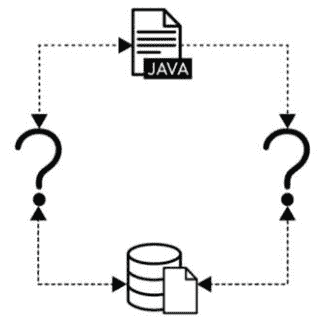

图 9.1：Java 应用使用元数据与数据库通信

## 早期尝试：基于 XML 的元数据管理

继续 Java 元数据历史之旅，早期的元数据管理尝试依赖于 XML，这种做法在 Java Persistence API (JPA) 中得到了显著体现。以 Java 代码中定义的 `Person` 实体为例，接下来的步骤是编写一个 XML 文件，用以阐述该 Java 类与相应的数据库映射语句之间的复杂关系。该 XML 文件在运行时被动态解析，扮演着双重角色：它既作为 `Person` 类与数据库关联的蓝图，又作为生成实时元数据的通道。提供的 XML 代码段概述了这一关键链接、属性、表及其各自映射，标志着 Java 元数据处理能力演进中的重要章节。

提供的 Java 代码定义了一个 `Person` 类，包含三个私有字段：`id`、`name` 和 `age`。该类封装了与个人相关的数据，并包含了每个属性所需的 getter 方法和 setter 方法。其意图是在 Java 应用中表示一个具有可识别特征的人：

```java
public class Person {
    private String id;
    private String name;
    private Integer age;
    //getter and setter
}
```

考虑随附的为 JPA 设计的 XML 元数据片段。该 XML 文件作为声明式映射配置，在 `Person` 类与其在关系型数据库中的表示之间建立了关键链接。`<entity>` 元素表示 `Person` 类的映射，指定了它的 Java 类和名称。`<table>` 元素定义了与此实体关联的数据库表名：

```xml
<entity class="entity.Person" name="Person">
  <table name="Person">
    <attributes>
      <id name="id"/>
      <basic name="name">
        <column name="NAME" length="100"/>
      </basic>
      <basic name="age"/>
    </attributes>
  </table>
</entity>
```

在 `<attributes>` 中，XML 描绘了 `Person` 类的各个属性。`<id>` 元素表示主键属性，指定了相应的字段 (`id`)。此外，用于 name 和 age 属性的两个 `<basic>` 元素表示了简单的、非复合属性。嵌套在 `name` 属性中的 `<column>` 元素为数据库映射提供了更多详细信息，指定了列名（NAME）及其最大长度。

此 XML 元数据是一个配置蓝图，建立了 Java 对象与其数据库表示之间的关系。它不仅定义了 `Person` 类的结构和特征，还指导了运行时元数据的生成，促进了 Java 应用与底层数据库之间的无缝交互。这种稳健的连接是 Java 元数据处理能力的基本方面，有助于 Java 应用中数据管理的效率和一致性。

## 现代方法：基于注解的元数据

Spring 和 Jakarta EE 等框架提供了一种更以代码为中心的方法来定义元数据。例如：

```java
@Entity
@Table(name = "tutorial")
public class Tutorial {
    @Id
    @GeneratedValue(strategy = GenerationType.IDENTITY)
    @Column(name = "tutorial_id")
    private Long id;

    @Column(name = "title")
    private String title;
    // Constructors, getters, setters
}
```

相反，在基于 XML 的配置中，相同的元数据可以定义如下：

```xml
<entity class="com.example.Tutorial">
  <table name="tutorial"/>
  <attributes>
    <id name="id">
      <generated-value strategy="IDENTITY"/>
      <column name="tutorial_id"/>
    </id>
    <basic name="title">
      <column name="title"/>
    </basic>
  </attributes>
</entity>
```

两种方法都实现了相同的结果，注解提供了一种更简洁且以代码为中心的方式指定元数据，而 XML 则提供了一种更外部化且可定制的配置选项。

步入无缝数据库集成的视觉叙述，Java 文件与 XML 配置文件之间的协同作用以惊人的凝聚力展开。这幅引人注目的图捕捉了集成的复杂舞蹈，展示了代表 `Person` 类的 Java 文件如何与为 JPA 编写的 XML 文件轻松协调。当框架结合了两种实体（Java 和 XML）时，一种共生关系随之产生，为数据无缝集成到数据库铺平了道路。这一视觉描绘封装了通过对代码和 XML 的细致协调，如何实现目标：

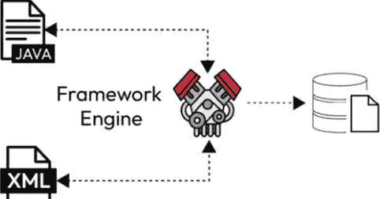

图 9.2：Java 应用使用元数据与数据库通信


# 标志着软件开发的一个转型性阶段

通过 JSR 175 引入 Java 生态系统的注解简化了元数据与代码的集成，并显著增强了可维护性。当我们探索 Java 注解领域时，会发现自己正处于一个十字路口，运行时反射与编译时注解处理之间的选择存在着不同的权衡。潜在的性能影响与运行时反射的动态适应性平衡，而编译时处理的效率则是以静态决策为代价的。在下一节中，我们将深入探讨 Java 开发中权衡的细微世界，探索在做出关键架构决策时灵活性与性能之间的微妙平衡。

## 框架采用的权衡

开发者投身于软件架构时，引入框架的决策涉及许多考量，每种考量都带有对开发过程产生深刻影响的权衡。采用框架（无论是 Java 还是任何其他语言）意味着要在其提供的便利性和可能引入的缺点之间进行微妙的平衡。

一个关键的权衡在于框架促进的快速开发与其施加的限制之间的矛盾。框架通常能加速编码过程，提供预构建组件和既定约定。然而，这种加速可能以牺牲灵活性为代价，因为开发者可能会发现自己受限于框架规定的结构和范式。

此外，权衡还扩展到采用新框架的学习曲线。虽然框架旨在简化开发，但开发者为了变得精练，在时间和精力上需要内在的投入。这种初始学习阶段可能被视为一种障碍，特别是在节奏快速的开发环境中。

在这一节中，我们将剖析这些权衡，并探索开发者在拥抱框架时面临的细微决策。从加速开发的承诺到潜在的限制和学习曲线，理解其中错综复杂的权衡对于做出明智的架构选择至关重要。加入我们，在动态的软件开发格局中，导航框架采用的便利性与限制之间的微妙平衡。

在采用现有框架和创建自定义框架之间做出决策构成了软件开发中重大的权衡，每条路径都充满了自身的考量。选择市场上成熟的框架可以提供即时优势，如经过证明的可靠性、社区支持，通常还有丰富的预构建组件。它能加速开发，减少重复造轮子的需求，并利用用户社区的集体知识。然而，权衡之处在于，可能需要更多定制，并且存在被所选框架中嵌入的设计选择和观点所限制的风险。

相反，创建自定义框架提供了根据项目独特需求精确定制解决方案的自由。这种方法提供了无与伦比的灵活性，允许开发者创建一个与项目目标和架构完美匹配的框架。然而，这种自由是有代价的——需要投入时间和资源来设计、实现和维护定制框架。此外，缺乏经过证明的记录可能会导致不可预见的挑战，以及对大量测试和完善的需求。考虑另一个框架是否符合项目的特定需求和目标至关重要。虽然它在定制方面可能有利，但应该是一个深思熟虑的决定，以避免不必要的复杂性和碎片化。

最终，权衡涉及衡量现有框架的即时利益和便利，对比创建自定义解决方案的长期优势及潜在陷阱。决策取决于项目需求、时间表、团队专业知识以及软件演变的战略愿景。在利用现有解决方案和构建定制框架之间取得正确的平衡，是动态软件开发格局中一个微妙且关键的决策。

软件开发中采用现有框架与创建自定义框架之间的权衡，引入了一个关键的决策过程。虽然成熟的框架提供即时利益和社区支持，但它们可能会限制灵活性。相反，构建定制框架提供了定制化的解决方案，但需要大量的时间和资源。当我们过渡到下一节“Java 框架原则”时，我们将深入引导框架设计和开发的基础原则。认识这些原则如何塑造了利用现有解决方案与构建自定义软件框架之间的复杂选择，对于导航动态软件开发格局中至关重要。加入我们，揭示支撑有效框架的原理，并阐明它们对开发者决策中固有权衡的影响。

## Java 框架原则

对于 Java 框架开发的架构师和开发者来说，深入理解关键原则至关重要。要考虑的首个关键方面是 API 设计，它显著影响框架的可用性和采用率。在声明式和命令式 API 设计之间进行选择，前者强调表达预期的结果，提升了可读性和简洁性；而命令式 API 提供了一种步步为营的方法，提供了更显式的控制。在这些方法之间取得正确的平衡，对于确保框架不仅易用而且具有长期的可维护性至关重要。

另一个关键原则是可执行性，其中对反射的仔细考虑变得至关重要。反射可以提供动态能力，允许在运行时检查和操作类、方法和字段。然而，这种灵活性是以性能为代价的。或者，框架可以选择避免反射的解决方案，以提高 JVM 内部的效率。此外，允许在 JVM 之外执行 Java 技术（如构建原生镜像）的出现，为执行性原则引入了新的维度。导航这些选择需要理解灵活性、性能和资源效率之间的权衡。

### API 设计

API 设计是 Java 框架开发的关键方面，为开发者提供了两种基本风格的选择：声明式和命令式。每种方法都带有其权衡，它们之间的决策取决于可读性、表现能力以及开发者所需的控制级别等因素。

声明式 API 强调表达预期的结果或最终状态，允许开发者指定他们想要实现什么，而不规定具体的步骤。这种风格促进了简洁且富有表现力的代码，使其更具可读性且更容易理解。声明式 API 在关注高层抽象以及通过更直观、自然语言语法来增强理解的场景中特别有益。

另一方面，命令式 API 采用更一步步为营的方法，要求开发者显式地定义每个动作和控制流。虽然这种风格提供了更细粒度的控制，但可能会导致冗长和样板代码。当对执行流的精确控制至关重要时，命令式 API 尤为出色，特别是当开发者需要管理复杂的细节或处理复杂的分支逻辑时。

声明式和命令式 API 设计之间的权衡通常涉及表现力与控制之间的平衡。声明式 API 因其可读性和简洁性而受青睐，增强了协作并减轻了开发者的认知负担。然而，它们可能不太适用于需要细粒度控制的场景。相比之下，命令式 API 提供了更多控制，但可能需要对底层逻辑更深的理解。

在声明式和命令式 API 设计之间做出选择应参考框架的特定需求和开发团队的偏好。取得正确的平衡至关重要，在许多情况下，结合两种风格元素的混合方法可能提供两者的优势，在需要的地方提供表现力和控制。

### 可执行性

Java 框架的可执行性涵盖框架代码在 JVM 内部执行的机制。这一方面涉及关键的权衡，特别是考虑到使用反射、避免反射以及探索构建原生镜像等选项时。

反射是 Java 的一种动态特性，允许在运行时检查和操作类、方法和字段。虽然反射功能强大，但它是以性能为代价的，通常由于其动态特性导致执行速度较慢。此外，反射可以减少代码安全性，因为错误可能在运行时才被发现。这里的权衡在于反射提供的灵活性和便利性与潜在的性能下降以及错误检测的延迟之间的平衡。

框架可以选择避免反射的方法，转而依赖于更静态和编译时的机制。这促进了性能的提升和早期的错误检测，但可能需要更显式的配置和代码生成。放弃反射的决定通常取决于框架的具体需求、预期的性能水平，以及动态性与静态分析之间的权衡。

在最近的发展中，构建原生镜像的概念受到了关注。诸如 `GraalVM` 等技术可以将 Java 代码编译为原生镜像代码，从而跳过 JVM 执行。这种方法在启动时间、减少内存占用和增强整体性能方面具有潜在优势。然而，它也引入了与构建复杂性增加、潜在兼容性问题以及丢失 JVM 提供的某些运行时功能相关的权衡。

最终，可执行策略的选择需要仔细考虑框架的特定需求、性能目标，以及灵活性、便利性与反射或原生镜像编译相关开销之间的权衡。取得正确的平衡对于在保持框架内所需的动态性和开发易用性的同时，实现最佳性能至关重要。

### 其他核心原则

事实上，在 Java 框架原则和更广泛的软件开发领域，有几个基本原则显著影响着框架的设计和可用性。**约定优于配置** 是一项关键原则，强调默认约定，当开发者遵循既定模式时，减少了对显式配置的需求。它简化了框架的使用，使其更加直观和用户友好。

组件的创建遵循模块化原则，鼓励开发独立的、可重用的单元，这有助于维护性和可扩展性。遵循 Java 标准（如 Java 编码规范和设计模式）可确保 Java 生态系统内部的一致性和互操作性。

文档和测试对于框架的成功起着不可或缺的作用。全面且结构良好的文档使用户能够理解框架的功能，有助于其采纳并降低学习曲线。彻底的测试确保了框架的性和健壮性，增强开发者的信心。

此外，**服务提供者（Service Provider, SP）** 方法引入了类似于插件的架构，允许开发者无缝地扩展或修改框架的行为。这一原则培养了**即插即用**的效果，使用户能够在不更改核心基础的情况下整合额外功能并自定义框架。

总而言之，这些原则有助于在 Java 生态系统中创建有效且用户友好的框架。它们强调 Java 惯例、模块化、遵循标准、健壮的文档、严格的测试以及通过 SP 实现的扩展，培养了框架设计和开发的整体方法。遵循这些原则确保了框架不仅满足开发者的即时需求，而且在动态的软件开发世界作为可靠且适应良好的工具经受考验。

## 总结

在对 Java 框架原则和更广泛的软件开发原则进行总结探索中，我们发现了一系列复杂的考量——从 API 设计、可执行性，到约定优于配置以及文档和测试的重要性。这些原则共同引导了符合 Java 标准并拥抱模块化的健壮、用户友好框架的创建。当我们转向关注 Java 反射的下一章节时，我们将深入探讨可执行性的一个关键方面，揭示 Java 反射本质中固有的动态能力和潜在权衡。加入我们的探索，在导航反射的复杂性中前行，释放它的力量，并理解它是如何塑造动态 Java 编程格局的。

## 问题

回答以下问题以测试你对本章知识的掌握：

1. 在 Java 框架中选择声明式和命令式 API 设计时，一个关键的考量因素是什么？

   - A. 代码冗余
   - B. 编译速度
   - C. 内存消耗
   - D. 数据库兼容性

2. 哪种原则通过依赖既定模式和默认值来减少对显式配置的需求？

   - A. 并发控制
   - B. 约定优于配置
   - C. 依赖注入 (DI)
   - D. 模块化

3. 为什么全面的文档对 Java 框架至关重要？

   - A. 增加开发复杂度
   - B. 阻止用户采用该框架
   - C. 降低用户的学习曲线
   - D. 限制框架的能力

4. 哪种方法实现了插件化的架构，允许开发者无缝地扩展或修改框架的行为？

   - A. 面向切面编程 (AOP)
   - B. 模型-视图-控制器 (MVC)
   - C. 观察者模式
   - D. SP 方法

## 答案

以下是本章问题的答案：

1. A. 代码冗余
2. B. 约定优于配置
3. C. 降低用户的学习曲线
4. D. SP 方法

# 10 反射

`Reflection API` 是一个强大且多功能的工具，它允许开发者访问 Java 程序的内部工作机制。在本章中，我们将探索反射的各种能力，例如字段访问、方法调用和代理的使用。反射允许开发者在运行时检查和操作类及对象，为进入 JVM 提供了一个动态的门径。在整个章节中，我们将深入研究反射字段交互的细微差别、动态调用方法的复杂性，以及为了增强代码灵活性的对代理的策略性部署。加入我们进入 Java 反射能力核心的之旅，在这里，看似不可改变的变得具有了适应性，静态代码的边界被扩展，以适应高级应用程序的动态需求。

在本章中，我们将探索以下主题：

- 反射概述
- 探索实际反射
- 代理

## 技术要求

为了跟随本章内容，你需要以下内容：

- Java 21
- Git
- Maven
- 任何 IDE
- 本章的 GitHub 仓库，地址为：`https://github.com/PacktPublishing/Mastering-the-Virtual-Machine/tree/chapter-10`

## 反射概述

反射是 Java 语言的一项基础功能，赋予开发者在运行时检查和操作类及对象的结构、行为和元数据的能力。这种动态能力可能开启可能的大门，允许程序员超越静态代码的限制，响应应用程序不断的需求。为什么反射对 Java 开发至关重要？

反射在 Java 中的实际应用适用于框架和库开发等特殊场景，使开发者能够创建灵活的代码。它在**依赖注入 (DI) 容器、对象关系映射 (ORM)** 框架和测试框架中起着至关重要的作用，实现了动态类实例化配置。反射在序列化和反序列化库、GUI 开发工具以及 Java 核心库中也是必不可少的，有助于对象和类的动态加载和操作。虽然对于大多数开发者来说它并不是日常工具，但反射在增强特定领域代码重用性和适应性方面的证明它是 Java 生态系统中不可或缺的资产。

从核心上讲，反射在实现自省方面起着关键作用，使程序能够检查并适应自身的结构。在处理需要通用且灵活地操作各种类型和结构的框架、库和工具时，它变得尤为重要。反射促进了类信息、方法签名和字段详细信息的检索，为在运行时深度理解代码至关重要的场景提供了必要的动态性。

此外，反射驱动了 IDE、调试器和应用程序服务器等工具的开发，为它们提供了以超越编译时知识的方式分析和操作 Java 代码的方法。

虽然反射是 Java 的独特特性，但在其他编程语言中也存在类似的概念。例如，Python、C# 和 Ruby 等语言也以不同程度嵌入了反射能力。在 Python 中，`inspect` 模块允许运行时内省，而 C# 则引入了反射来实现动态类型发现和调用。在编程语言更广泛的背景下，理解反射可以为开发者提供一套多用途的技能集，这些技能可以应用于不同的技术领域。随着本章的深入探讨，我们将揭示 Java 反射 API 的复杂性，探索其细微差别和应用，这些特性使其成为动态和自适应编程的基石。

虽然 Java 反射 API 赋予了开发者动态能力，但它有一系列需要审慎考虑的权衡。理解这些权衡对于在何时何地利用反射以及何时寻求替代方案至关重要：

- **性能开销**：与反射相关的权衡是性能开销：反射操作（例如访问字段、调用方法或动态创建实例）通常比其非反射的对应操作要慢。反射涉及运行时类型检查和方法解析，这可能会产生额外的计算开销。因此，在对性能要求极高的应用程序或对快速执行至关重要的场景中，过度依赖反射可能会导致性能不佳。

- **编译时安全**：反射绕过了 Java 的某些编译时检查。由于反射允许对类、字段和方法进行动态访问，编译器在运行时之前无法捕获某些错误。这种编译时安全的缺失增加了运行时异常的概率，使代码更容易出错。在使用反射时，开发者必须警惕并处理潜在问题，如缺失类、方法或类型不匹配。

- **代码可读性与维护性**：反射代码可能更难阅读和维护。反射操作中缺乏显式类型信息，使得代码的自文档能力降低，开发者可能更难理解程序的结构和行为。它会增加复杂性并降低可维护性，特别是在反射泛滥的大代码库中。

- **安全性担忧**：反射可能会引入安全风险，特别是在安全是首要任务的环境中（如 Web 应用程序）。通过动态访问和操作类及方法，反射代码可能会违反访问控制和安全限制。必须进行仔细考虑和验证，以确保反射操作不会损害应用程序的完整性和安全性。

- **平台依赖性**：反射可能取决于平台，某些反射操作在不同的 JVM 实现上的行为可能不同。这会为编写可移植和跨平台的代码带来挑战。在平台独立性是关键要求的场景下，开发者在使用反射时应格外谨慎。

虽然反射提供了动态操作代码的强大机制，但开发者应该权衡其优势与这些权衡。审慎地审查至关重要，需要考虑性能需求、代码维护性和安全影响等因素，以平衡灵活性与反射编程相关的潜在缺点之间的关系。

从框架的角度来看，反射通常与更广泛的流程交织，以动态理解并与 Java 类和对象的结构交互。让我们拆解框架内的反射过程，并考虑一个通过以下步骤说明的假设场景：

1. **框架初始化与反射引擎加载**：过程始于框架的初始化。在此阶段，框架的核心组件（包括反射引擎）被加载到运行时环境（`Runtime`）中。反射引擎是框架动态与类和对象交互并操作的方式。
2. **代码编译与注解处理**：开发者编写包含注解和反射相关元素的代码。这些代码经过标准的 Java 编译过程。在编译期间，Java 编译器读取源码、处理注解并生成字节码。
3. **将类加载到 Runtime**：`Runtime`（运行时环境）负责将编译后的类加载到内存中。作为该过程的一部分，`Runtime` 内部的反射引擎感知可用类及其结构。
4. **反射引擎读取注解**：反射引擎现在感知已加载的类，开始扫描这些类中的注解。注解是提供代码额外信息的元数据，在反射框架中起着至关重要的作用。反射引擎读取并解释这些注解，以动态理解如何与被注解的元素交互。
5. **依赖树生成**：反射引擎根据从注解和其他反射元素中收集的信息生成依赖树。这棵树概述了类、方法和字段之间的关系，提供了程序结构的动态蓝图。该树作为框架在运行时导航和操作代码的指南。
6. **动态代码的执行**：框架现在可以在依赖树就绪的情况下动态执行代码。这可能涉及根据反射收集的运行时信息创建类实例、调用方法或访问字段。框架利用反射能力动态地调整其行为，响应运行期间遇到的特定条件。

随着 JVM 初始化，反射引擎加载，为代码编译的芭蕾搭建好了舞台。注解作为沉默的编舞师，引导反射引擎穿过已加载的类。在 JVM 内存中，出现了一棵依赖树，这是运行时结构的蓝图。这幅虚无缈的地图成为了动态执行的关键，框架在其中进行实时调整。箭头勾勒了从类加载到执行的流体路径，封装了反射框架的转化本质。在这一段对动态能力的视觉赞歌之前：

| 包应用 | 加载并解析配置 | 分析依赖关系 | 构建依赖树 | 执行代码 |
| :--- | :--- | :--- | :--- | :--- |
|  |  |  |  |  |
| 编译时 | 运行时 |

> 图 10.1：使用反射的 Java 视角

当我们结束这部分时，反射的复杂性像一场编排良好的表演一样展开。从框架初始化到动态代码执行的历程，在反射引擎和注解洞察的引导下，描绘了一幅生动的自适应画面。现在，在掌握了反射在塑造运行时方面的作用后，我们无缝过渡到下一节，那里理论将转化为实践。准备好对 Reflection API 进行实战探索，我们将深入研究现实世界的场景，演示如何利用反射进行字段访问、方法调用以及代理的策略性使用。通过实践示例，我们将弥合概念上的伴随着不同的命名规范而出现，例如 Java 的驼峰命名法某些数据库偏好的下划线命名法。为了解决这个问题，我们引入了 `Column` 注解，允许开发者在对象到映射的转换过程中定义自定义列名。

让我们仔细查看 `Column` 注解：


## 核心注解定义

### Column 注解

```java
@Retention(RetentionPolicy.RUNTIME) @Target(ElementType.FIELD)
public @interface Column {
    String value() default "";
}
```

该注解适用于字段（`ElementType.FIELD`），带有一个 `value` 属性。如果提供了该属性，则允许开发者指定自定义列名；否则，默认使用字段名。这种灵活性实现了 Java 对象与数据库结构之间的无缝映射，适应了各种不同的命名规范。

### Entity 注解

```java
@Retention(RetentionPolicy.RUNTIME) @Target(ElementType.TYPE)
public @interface Entity {
}
```

该注解应用于类级别（`ElementType.TYPE`），表示该类可以进行解析操作。这些注解结合使用时，使开发者能够选择性地为 Java 类添加注解，根据每个类的特定需求定制转换过程。

### Appends 与 Append 注解

我们引入了 `Appends` 注解来增强我们 Mapper 框架的灵活性和定制性。该注解与其配套的 `Append` 注解为实体定义默认值提供了手段，丰富了对象到映射的转换过程。

```java
@Retention(RetentionPolicy.RUNTIME) @Target(ElementType.TYPE)
public @interface Appends {
    @Append[] value();
}

@Retention(RetentionPolicy.RUNTIME)
@Target(ElementType.TYPE)
@Repeatable(Appends.class)
public @interface Append {
    String key();
    String value();
}
```

`Append` 注解应用于类级别（`ElementType.TYPE`），持有一个 `Append` 注解数组。每个 `Append` 注解反过来允许开发者指定一个键值对，指示在对象到映射的转换过程中附加的默认值。

`Append` 注解被标记为可重复（`@Repeatable(Appends.class)`），以简化在单个实体上指定多个值的规范。

## ReflectionMapper 核心实现

在 Java 开发的动态领域，无缝地将对象转换为映射反而是一项强大的功能，特别是在处理不同的命名规范和应对数据迁移场景时。在 `ReflectionMapper` 类中实现实体方法标志着我们反射驱动映射之旅中的一个关键转折点。

该方法构建了对象的映射表示，并将其重构为一个完全实现的实体。通过 Java 反射的视角，我们开始进行步步为营的探索，揭示了从属性重构对象的复杂性。以下代码显示了 `toEntity` 的实现：

```java
@Override
<T> T entity(Map<String, Object> map) {
    Objects.requireNonNull(map, "map is required");
    // Step 1: 从 map 中获取全限定类名
    T entity = getEntity(map.get(ENTITY_ENTRY)).toString();
    // Step 2: 获取实体的类类型
    Class<?> type = entity.getClass();
    // Step 3: 遍历类的声明字段
    for (Field field : type.getDeclaredFields()) {
        // Step 4: 使用 @Column 注解确定与字段关联的键
        String key = Optional.ofNullable(field.getAnnotation(Column.class))
            .map(Column::value)
            .filter(Predicate.not(String::isBlank))
            .orElse(field.getName());
        // Step 5: 从 map 中获取对应的值
        Optional<Object> value = Optional.ofNullable(map.get(key));
        // Step 6: 使用反射在对象中设置值
        value.ifPresent(v -> setValue(entity, field, v));
        // Step 7: 返回重构的实体
        return entity;
    }
}
```

`entityManager` 从 map 中重构实体，使用反射动态地映射字段。它确保 map 不空，使用提供的类名实例化实体，并遍历字段。键的确定涉及 `@Column` 注解或字段名。值从 map 中获取并使用反射设置到对象中。该方法返回重构的实体，示例了一个简洁且动态的对象恢复过程。

### 代码详细解析

#### Map 校验

```java
Objects.requireNonNull(map, "map is required");
```

该方法首先确保输入的 map 实例不为空，如果为空则抛出带有指定错误消息的 `NullPointerException` 异常。

#### 实体实例化

```java
T entity = getEntity(map.get(ENTITY_ENTRY).toString());
```

使用存储在 map 中的全限定类名，调用 `getEntity` 方法来动态实例化类型为 $\tau$（实体）的对象。

#### 类类型获取

```java
Class<?> type = entity.getClass();
```

使用 `getClass` 方法获取实体的运行时类。

#### 字段迭代

```java
for (Field field : type.getDeclaredFields()) {
```

该方法遍历类的声明字段。

#### 列键的确定

```java
String key = Optional.ofNullable(field.getAnnotation(Column.class))
    .map(Column::value)
    .filter(Predicate.not(String::isBlank))
    .orElse(field.getName());
```

对于每个字段，它都会确定对应的键。如果存在 `Column` 注解，则使用指定的名称；否则默认使用字段名。

#### 值获取与赋值

```java
Optional<Object> value = Optional.ofNullable(map.get(key));
value.ifPresent(v -> setValue(entity, field, v));
```

它从 map 中获取对应的值。如果存在该值，则利用 `setValue` 方法在对象中设置该值。

#### 重构实体

```java
return entity;
```

最后，返回重构的实体。

## toMap 方法实现

以下是 `toMap` 方法的实现与解析：

```java
Objects.requireNonNull(entity, "entity is required");
```

该方法首先确保输入的实体实例不为空，如果为空，则抛出一个带有指定错误消息的 `NullPointerException` 异常。

### Map 初始化

```java
Map<String, Object> map = new HashMap<>();
```

初始化 `HashMap` 实例以存储表示对象属性的键值对。

### 类类型检索

```java
Class<?> type = entity.getClass();
map.put(ENTITY_ENTRY, type.getName());
```

该方法获取实体的运行时类，并使用 `ENTITY_ENTRY` 将其全限定名存储在 map 中。

### 字段迭代

```java
for (Field field : type.getDeclaredFields()) {
```

该方法对类的声明字段进行迭代。

### 可访问性设置

```java
field.setAccessible(true);
```

将字段的可访问性设置为 `true`，从而允许访问私有字段。

### 列注解检查

```java
Optional<Column> column = Optional.ofNullable(field.getAnnotation(Column.class));
if (column.isPresent()) {
```

对于每个字段，它都会检查是否存在列（`Column`）注解。

### 列键确定

```java
String key = column.map(Column::value).filter(Predicate.not(String::isBlank)).orElse(field.getName());
```

如果存在列注解，则确定与字段相关的键。它使用指定的列名，否则默认使用字段名。

### 值的检索与赋值

```java
Object value = getValue(entity, field);
map.put(key, value);
```

使用 `getValue` 方法检索字段值，并将键值对添加到 map 中。

### @Append 注解处理

```java
Append[] appends = type.getAnnotationsByType(Append.class);
for (Append append : appends) {
    map.put(append.key(), append.value());
}
```

它处理类级别的 `@Append` 注解，向 map 中添加默认的键值对。

### 结果 map

```java
return map;
```

最后，返回表示对象属性的最终 map。

`toMap` 方法体现了反射在动态将对象属性映射到 map 时的灵活性。它展示了如何利用注解和字段级细节，在 `ReflectionMapper` 类中创建一个多功能且可扩展的映射机制。

## 实体示例

在对反射映射技术的探索中，我们将注意力转向使用两个不同实体：`Pet` 和 `Fruit` 的实际示例。这些实体装饰了注解，这些注解为理解 `ReflectionMapper` 的动态能力提供了宝贵的见解。

### Pet 实体

```java
@Entity
public class Pet {
    @Column
    private String name;
    @Column
    private int age;
    // 构造函数、getter 和 setter...
}
```

`Pet` 实体是一个代表宠物的简单普通 Java 对象（POJO）。它被标记了 `@Entity` 注解，意味着它具备基于反射映射的资格。每个字段（如 `name` 和 `age`）都标记了 `@Column` 注解，表示它们被包含在映射过程中。其简单的结构是理解 `ReflectionMapper` 类如何动态处理对象到 map 以及反之转换的极佳起点。

### Fruit 实体

```java
@Entity
@Append(key = "type", value = "Fruit")
@Append(key = "category", value = "Natural")
public class Fruit {
    @Column
    private String name;
    public Fruit(String name) {
        this.name = name;
    }
    @Deprecated
    public Fruit() {
    }
    public String name() {
        return name;
    }
    // 其他方法...
}
```

相反，`Fruit` 实体不仅带有 `@Entity` 注解，还利用了类级别的 `@Append` 注解。这在映射过程中引入了默认的键值对 `"type": "Fruit"` 和 `"category": "Natural"`。该类通过包含一个弃用和一个未弃用的构造函数展示了灵活性，强调了 `ReflectionMapper` 类如何适应不同的实体结构。

## 测试验证

为了验证 `ReflectionMapper` 类在我们多样化实体上的实际应用，我们设计了一个全面的 `MapperTest` 类。这一系列测试演示了映射器无缝转换实体到 map 以及从 map 重构实体的能力，展示了反射在动态映射场景中的灵活性和适应性。

```java
class MapperTest {
    private Mapper mapper;
    @BeforeEach
    public void setUp() {
        this.mapper = new ReflectionMapper();
    }
    @Test
    public void shouldConvertToMap() {
        // 测试将 Pet 实体转换为 map
        Pet ada = Pet.of("Ada", 8);
        Map<String, Object> map = mapper.toMap(ada);
        assertThat(map)
            .isNotNull()
            .isNotEmpty()
            .containsKeys("entity", "name", "age")
            .containsEntry("name", "Ada")
            .containsEntry("age", 8)
            .containsEntry("entity", Pet.class.getName());
    }
    @Test
    public void shouldConvertEntity() {
        // 测试将 map 转换为实体
        Map<String, Object> map = new HashMap<>();
        map.put("entity", Pet.class.getName());
        map.put("name", "Ada");
        map.put("age", 8);
        Pet ada = mapper.toEntity(map, Pet.class);
        assertThat(ada).isNotNull()
            .extracting(Pet::getName, Pet::getAge)
            .containsExactly("Ada", 8);
    }
    @Test
    public void shouldConvertEntityAppend() {
        // 测试带有追加注解的 map 转换
        Map<String, Object> map = new HashMap<>();
        map.put("entity", Fruit.class.getName());
        map.put("name", "Apple");
        map.put("type", "Fruit");
        map.put("category", "Natural");
        Fruit fruit = mapper.toEntity(map, Fruit.class);
        assertThat(fruit).isNotNull()
            .extracting(Fruit::getName)
            .contains("Apple");
    }
}
```

## 动态代理优势与权衡

### 优势

#### 减少样板代码

动态代理显著减少了对样板代码的需求。它们允许我们集中跨切关注点（例如日志或验证），并将这些关注点封装在代理内部。在 `MapperRepository` 的上下文中，这使得实体与映射之间的转换代码更加整洁简洁，提升了可维护性和可读性。

### 权衡与考量

尽管动态代理非常强大，但在 Java 中使用动态代理并不是没有考虑和权衡的。

#### 性能开销

主要的权衡之一在于代理的动态性带来的性能开销：方法调用的拦截以及代理实例的运行时创建与直接方法调用相比，可能会引入轻微的执行延迟。虽然动态代理提供了极大的灵活性，但其动态性引入了性能开销。方法调用的拦截和运行时代理实例的创建会导致执行速度比直接方法调用慢。在性能关键的场景中应用动态代理时，需要仔细考虑。

#### 基于类的代理的局限性

此外，对基于接口的代理的依赖将其应用限制在涉及接口的场景中，在基于类的代理可能更合适的场景中存在限制。Java 中的动态代理是基于接口的，这将其应用限制在涉及接口的场景中。基于类的代理并不常见，某些场景可能需要替代方案或折中。理解这些局限性对于设计和实现中的做出明智决策至关重要。

意识到这些权衡至关重要，因为它允许在实现动态代理时能够做出明智的决策，特别是在对性能敏感的场景中。尽管有这些考虑，动态代理提供的优势（如增强灵活性和减少样板代码）通常大于这些权衡，强化了它们在动态且自适应的 Java 应用中不可或缺的角色。

## MapperRepository 接口

在 Java 不断演变的领域，`MapperRepository` 作为一个关键接口出现，它无缝地结合了反射和动态代理的能力。该接口作为通往对象到映射以及反之转换动态世界的门户，利用反射的内在力量在运行时导航和操作实体。


```java
public interface MapperRepository {
    <T> T entity(Map<String, Object> map);
    <T> Map<String, Object> map(T entity);
}
```

## 接口描述

- **`entity`**：此方法接收一个表示对象属性的 `Map`，并在运行时动态重构类型为 `T` 的对象。利用反射，它遍历 `Map`，创建一个适应于所提供 `Map` 结构的动态代理实体。

- **`map`**：相反，`map` 方法接收一个类型为 `T` 的实体，并动态生成一个表示其属性的 `Map`。通过反射和动态代理，此方法遍历实体的结构，创建一个封装了属性键值对的 `Map`。

`MapperRepository` 的真正意义在于与反射的共生关系。当从 `Map` 重构实体时，反射允许对对象的结构进行动态探索，识别字段、方法和注解。这种探索和动态代理能够无缝适应不同的实体类型，使 `MapperRepository` 成为用于动态映射的多功能工具。

在反向过程中，当将实体转换为 `Map` 时，反射在检查对象结构方面起着至关重要的作用。通过反射获取的信息引导创建一个准确表示对象属性的 `Map`。动态代理通过拦截方法调用了这一过程，允许注入自定义逻辑，并为对象到映射的转换提供动态方法。

随着我们在 `MapperRepository` 中动态代理和反射之旅的展开，我们通过引入 `MapperInvocationHandler` 类进入实现领域。该实现作为动态代理的 `InvocationHandler` 类，将 `MapperRepository` 中定义的动态映射的抽象领域与底层 `ReflectionMapper` 类促进的具体操作桥接起来。让我们深入探讨此处理程序封装的简单性和强大，解锁健壮、可定制动态映射的潜力。

```java
public class MapperInvocationHandler implements InvocationHandler {
    private Mapper mapper = new ReflectionMapper();

    @Override
    public Object invoke(Object proxy, Method method, Object[] params) throws Throwable {
        String name = method.getName();
        switch (name) {
            case "entity":
                Map<String, Object> map = (Map<String, Object>) params[0];
                Objects.requireNonNull(map, "map is required");
                return mapper.toEntity(map);
            case "map":
                Object entity = params[0];
                Objects.requireNonNull(entity, "entity is required");
                return mapper.toMap(entity);
        }
        if (method.isDefault()) {
            return InvocationHandler.invokeDefault(proxy, method, params);
        }
        throw new UnsupportedOperationException("The proxy is not supported for the method: " + method);
    }
}
```

`MapperInvocationHandler` 类实现了动态映射。它使用 `ReflectionMapper` 实例根据方法调用将 `Map` 转换为实体或转换为 `Map`。该处理程序支持默认方法，并确保动态代理与底层映射逻辑之间的顺畅连接：

- **方法路由**：`invoke` 方法根据方法名称动态路由方法调用。对于 `entity` 方法，它从提供的参数中提取 `Map`，并将操作委托给 `ReflectionMapper` 进行实体重构。相反，`map` 方法提取实体并将其委托给 `ReflectionMapper` 进行 `Map` 的创建。

- **默认方法**：该处理程序考虑了 `MapperRepository` 接口中的默认方法。如果调用了默认方法，它将使用 `InvocationHandler.invokeDefault` 优雅地委托该调用。

- **异常处理**：当遇到不支持的方法时，将抛出 `UnsupportedOperationException` 异常，对动态代理在处理某些操作时的局限性提供清晰的反馈。

该实现的突出特点之一在于其可定制的潜力。扩展每个方法 `case` 内部逻辑使得检查注解参数变得可行，为许多自定义可能性打开了大门。这种方法将 `MapperRepository` 变为一个健壮且适应的工具，准备好满足各种映射场景，通过反射的透镜提供服务。

在 `MapperRepository` 领域探索动态代理和反射时，`MapperInvocationHandler` 作为一个关键枢纽脱颖而出，它无缝地连接了抽象映射与具体操作。这种动态方法路由和处理默认方法使其成为动态映射的强大编排器。该实现的简单性掩盖了其定制的潜力，为检查注解参数并根据不同场景调整映射过程提供了路径。当我们结束本章时，`MapperInvocationHandler` 是动态代理与反射之间共生关系的证明，展示了它们在创建自适应、可定制和动态 Java 映射解决方案方面的结合。接下来的实际应用将说明此实现如何将抽象概念转换为工具集，使开发者能够轻松导航复杂的动态映射。

# 总结

在我们对 `MapperRepository` 动态代理和反射的探索中，将这些强大的 Java 特性整合 `MapperInvocationHandler` 标志着我们旅程的一个关键时刻。动态路由方法调用的能力以及通过注解参数进行自定义的潜力凸显了该实现封装的灵活性。然而，这仅仅是下一章的预热，在下一章中，我们将进入 Java 注解处理的复杂领域。在动态映射的基础上，注解处理器承诺将进一步提升我们的能力，提供一种结构化的、编译时的方法来利用代码中的注解元数据。加入我们接下来的章节，共同揭开 Java 注解处理的复杂世界，编译时反射将成为构建高效、健壮且智能处理的 Java 应用的基石。

## 问题

回答以下问题以测试你对本章内容的掌握：

1. 在动态代理的上下文中，`MapperInvocationHandler` 类的主要目的是什么？

   - A. 处理数据库连接
   - B. 为动态映射路由方法调用
   - C. 实现复杂的业务逻辑
   - D. 解析 XML 配置

2. 哪种特征使得动态代理在运行时未知对象结构的场景中具有适应性？

   - A. 方法重载
   - B. 基于接口的实现
   - C. 动态方法路由
   - D. 静态方法调用

3. `MapperInvocationHandler` 类是如何在动态映射过程中展示其可定制性的？

   - A. 它在方法调用中使用了硬编码的值。
   - B. 它利用外部库进行映射。
   - C. 它检查注解参数并调整映射逻辑。
   - D. 它强制对映射的实体执行严格的不可变性。

4. Java 中反射的主要目的是什么？

   - A. 编译时代码优化
   - B. 对对象结构进行动态探索和操作
   - C. 敏感数据的安全加密
   - D. 异步事件处理

5. 在 `MapperRepository` 接口的上下文中，反射是如何贡献动态映射的？

   - A. 它确保了方法调用的类型安全。
   - B. 它提供了一种安全的加密机制。
   - C. 它动态路由方法调用。
   - D. 它强制对映射的实体执行严格的不可变性。

## 答案

以下是本章问题的答案：

1. B. 为动态映射路由方法调用
2. C. 动态方法路由
3. C. 它检查注解参数并调整映射逻辑。
4. B. 对对象结构进行动态探索和操作
5. C. 它动态路由方法调用。

# 11

# Java 注解处理器

在 Java 编程的动态领域，在运行时对代码进行自省和分析的能力一直通过反射来实现。虽然反射为检查和操作类、字段和方法提供了强大的机制，但它伴随着权衡，例如性能开销和运行时错误的风险。在意识到这些挑战后，一种引人注目的替代方案应运而生——使用 Java 注解处理器将焦点从运行时转移到构建时。

本章将深入探讨 Java 注解处理器的世界，对其作为在编译阶段利用元数据的强大工具的作用提供见解。通过这种方式，开发者可以规避与运行时反射相关的陷阱，理解如何利用注解处理器来增强代码生成和操作。通过实际示例和动手探索，你将发现将注解处理器集成到你的开发工作流中的复杂之处，最终使你能够优化代码库并平衡灵活性与性能。加入我们的一段旅程，释放 Java 注解处理器的全部潜力，并改变你在项目项目中处理元数据的方式。

在本章中，我们将探索以下主题：

- Java 注解处理器概述
- 探索实用的 Java 注解处理器

## 技术要求

对于本章，你需要以下内容：

- Java 21
- Git
- Maven
- 任何你偏好的 IDE
- 本章的 GitHub 仓库，地址为：`https://github.com/PacktPublishing/Mastering-the-Java-Virtual-Machine/tree/main/chapter-11`

## Java 注解处理器概述

开发者们，在这里我们深入探讨 Java 注解处理器的能力和意义。在不断演变的 Java 领域，高效且优化的代码至关重要，为了实现这一点，理解诸如注解处理器等工具的作用变得关关。我们将探索为什么存在 Java 注解处理器、它们与广泛使用的反射机制有何不同，以及为你的项目做出正确选择时的权衡。

Java 注解处理器的出现是作为一种强大的工具来解决某些运行时反射问题。虽然反射允许在运行时对代码元素进行动态检查和操作，但它带有性能开销和运行时错误的风险。相比之下，注解处理器在编译时运行，提供了一种根据源代码中存在的注解来分析和生成代码的方法。这种从运行时到构建时的转变带来了显著的优势，包括性能的提高、早期错误检测和增强代码的可维护性。

区分 Java 注解处理器和反射对于优化 Java 开发至关重要。反射是一种动态的运行时机制，提供了灵活性，但付出了性能成本。相比之下，Java 注解处理器在编译期间运行，为优化和早期错误检测提供静态分析。本节将探索这些差异，使开发者能够根据项目需求做出明智的决策。

让我们深入对 Java 注解处理器和反射进行对比分析。虽然这两种机制都涉及使用注解进行元数据处理，但它们的执行时间和对性能的影响将它们区分开来。反射在运行时动态操作，允许高度的灵活性，但会产生运行时性能成本。相比之下，注解处理器在编译期间使用，能够在代码运行之前进行优化并捕捉错误。

下表提供了反射和 Java 注解处理器——Java 开发中两个关键机制之间的简要比较。这种比较涵盖了执行时间、灵活性、性能、错误检测、代码生成能力、用例、调试影响和整体可用性等关键方面。通过并列这些特征，开发者可以就何时利用反射的运行时能力以及何时选择 Java 注解处理器提供的静态编译时分析获得宝贵的见解。此表旨在作为一份实用的指南，使开发者能够根据项目的特定需求做出明智决策。

| 特性 | 反射 | Java 注解处理器 |
| --- | --- | --- |
| 执行时间 | 运行时 | 编译时 |
| 灵活性 | 动态；允许运行时代码检查 | 静态，在编译期间强制分析 |
| 性能 | 可能会产生运行时开销 | 由于编译时优化，性能提高 |
| 错误检测 | 可能出现运行时错误 | 编译期间的早期错误检测 |
| 代码生成 | 代码生成能力有限 | 对代码生成和操作提供强大支持 |
| 用例 | 适用于动态场景，例如框架和库 | 优先用于静态分析、代码生成和项目级优化 |
| 调试 | 由于其动态性质可能会使调试复杂 | 编译时分析有助于更整洁的调试 |
| 可用性 | 用于自省简单简单 | 需要理解注解处理并可能涉及更多设置 |
| 示例 | `Class.forName()`, `Method.invoke()` | 像 Lombok、MapStruct 和 Dagger 等框架广泛使用注解处理器 |

根结底，Java 注解处理器与反射之间的选择取决于项目需求和优先级。追求动态、灵活方法的开发者可能会由于相关的运行时成本而选择反射。同时，那些优先考虑早期检测、性能优化和可维护性的开发者可能会发现，采用注解处理器的权衡与其项目目标更加契合。在运行时灵活性和静态分析之间取得正确的平衡，是构建健壮、高效且易于维护的 Java 应用程序的关键。

在复杂的框架世界中，Java 注解处理器成为了游戏规则的改变者，与以运行时为中心的反射相比，它在代码分析和生成方面引发了范式转变。该处理器在构建阶段动态地运行，为框架提供了一套强大的工具集，用于增强性能、代码优化和系统化的项目结构：

- **加载并解析配置**：在初始步骤，Java 注解处理器在构建时细致入微地读取注解并审视项目配置。这种早期分析不仅能识别注解，还会扫描类以查找相关的元数据，为后续的处理步骤奠定基础。
- **分析依赖**：其核心优势之一在于处理器能够根据加载的类动态地分析项目依赖。通过审查这些依赖，框架获得了无缝功能所需组件的宝贵见解，促进了更高效、更流畅的开发流程。
- **构建依赖树**：在掌握项目依赖的见解后，注解处理器构建了一个完整的依赖树。根据加载的类及其相互依赖关系，该数据结构经过预处理，从而能够创建复杂的框架。生成的结构作为框架架构的蓝图，确保了类以协调且最优的方式进行编排。
- **打包应用程序**：在注解处理器尽职创建了类并考虑了必要的库之后，下一步涉及应用程序打包。按照代码的自然流，框架编译并生成字节码。这一过程确保了消除了反射，增强了应用程序的健壮性，并为创建原生应用程序打开了道路，有助于产生更高效、自包含的最终产品，如图所示：

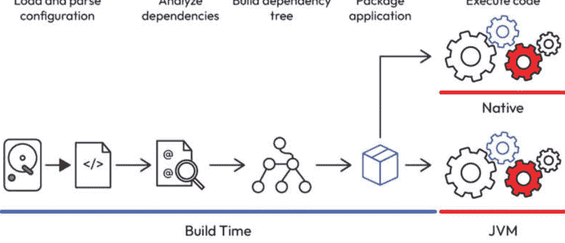

图 11.1：使用 Java 注解处理器的 Java 视角

当我们结束对 Java 注解处理器的探索时，显而易见，它们的集成为代码分析、生成和项目结构提供了一种变革性的方法。反射的运行时动态与注解处理器的编译时过程之间的二元性揭示了权衡的光谱，每种都能满足特定的开发需求。我们从通用和以框架为中心分析了注解处理的复杂性，阐明了这种强大工具固有的优势和牺牲。

凭借对早期错误检测、性能提升以及更整洁、更可维护的代码等优势的深刻理解，你现在更有胜任应对开发项目中的决策过程。在反射的动态能力与注解处理器提供的性能优化之间取得平衡，是构建健壮、高效且易于维护的 Java 应用程序的关键。

为了巩固你的理解，我们鼓励你深入研究实践性练习。尝试将 Java 注解处理器整合到你的项目中，探索它们的代码生成能力，并亲眼见证编译分析的优势。参与提供的实操练习，在你的 Java 开发旅程中开启效率和可靠性的新维度。让代码说话，愿你对 Java 注解处理器的探索能为你的项目带来创新且优化的解决方案。

## 探索实践性 Java 注解处理器

在这一实操章节中，我们将深入一个实践性练习，以强化我们所过的关于 Java 注解处理器的概念。目标是重新查看一个之前使用反射的示例，以便我们比较解决方案，并展示 Java 注解处理器的独特特征和优势。

当下的任务是将 `Map` 实例转换为实体实例，反之亦然，遵循提供的接口中定义的规范：

```java
public interface Mapper<T> {
    T toEntity(Map<String, Object> map, Class<T> type);
    Map<String, Object> toMap(T entity);
}
```

通过重温这个熟悉的场景，你将亲眼看到注解处理器如何在编译期间简化代码生成和操作。在你进行实践练习时，请考虑注解处理器与反射相比的权衡、效率和收益。让我们深入代码，在这个真实的示例中探索 Java 注解处理器的潜力。

我们引入了两个额外的注解来增强特定上下文下的功能。`@Entity` 注解将类声明为可映射的，表明其符合解析过程的资格。当应用于类时，该注解通知 Java 注解处理器该类的实例可以与 `Map<String, Object>` 之间无缝转换。添加的注解增强了映射处理器的清晰度，确保了编译期间类与注解处理器之间的有效通信：

```java
@Documented
@Target(ElementType.TYPE)
@Retention(RetentionPolicy.RUNTIME)
public @interface Entity {
    String value() default "";
}
```

Java 中的 `@Entity` 注解有三个定义其行为和特征的注解：`@Documented`、`@Target(ElementType.TYPE)` 和 `@Retention(RetentionPolicy.RUNTIME)`。`@Documented` 注解确保其用法存在记录在 JavaDocs 中。`@Target(ElementType.TYPE)` 注解指定 `@Entity` 注解只能应用于类声明，表明了它在类级别的作用。最后，`@Retention(RetentionPolicy.RUNTIME)` 注解表示该注解将在运行时保留，允许动态访问和反射，这对于本章讨论的 Java 注解处理器至关重要。这些注解共同为 `@Entity` 注解提供了一个清晰的框架，使其文档齐全、类特定并在运行时可用，这对于代码生成和元数据创建至关重要。

与 `@Entity` 注解一样，`@Column` 注解将自定义能力扩展到属性级别。通过对被注解类中的字段进行覆盖，它允许开发者在转换过程中覆盖属性名称。在处理不同的命名规范（如驼峰命名法、下线命名法或横线命名法）时，它变得非常有用，增强了类对不同范式的适应性：


```
@Documented
@Target(ElementType.FIELD)
@Retention(RetentionPolicy.RUNTIME)
public @interface Column {
  String value() default "";
}
```

我们将启动一个无缝集成 Java 和 Mustache 的 Maven 项目，确保我们在构建过程中动态生成可维护的代码。为了将 Mustache 模板集成到 Java 项目中，我们将在 `pom.xml` 文件中添加以下依赖：

```xml
<dependency>
  <groupId>com.github.spullara.mustache.java</groupId>
  <artifactId>compiler</artifactId>
  <version>0.9.6</version>
</dependency>
```

Mustache 是一种轻量且强大的模板引擎，开发者用它生成动态内容，同时保持代码逻辑与呈现分离。它提供了一种灵活且结构化的方式生成文本输出，非常适合生成代码、HTML 或其他文本格式。

Mustache 模板使用占位符，用双大括号如 `{{variable}}` 表示。在渲染过程中，这些占位符会被替换为真实的值或内容。

在我们的 Maven 项目中，我们正在引入 Mustache 来实现代码生成的自动化。具体而言，我们使用它在构建过程中创建 Java 类。通过在项目的 `pom.xml` 文件中添加 Mustache 编译器作为依赖，我们将 Mustache 无缝集成到 Java 项目中。这种集成使我们能够动态地生成可维护的代码，提高了效率并减少了手动编写重复或样板代码时的人工错误风险。Mustache 模板提供了一种结构化且清晰的方式来定义生成代码的结构，使得项目需求的变化更容易维护和适应。总的来说，Mustache 在简化我们 Java 项目的代码生成、提高代码质量和开发者生产力方面发挥着至关重要的作用。

在利用 Java 注解处理器能力的过程中，我们现在实现了 `EntityProcessor` 类。该处理器扩展了 `AbstractProcessor`，在扩展和处理带有 `@Entity` 注解的类方面起着至关重要的作用：

```java
@SupportedAnnotationTypes("expert.os.api.Entity")
public class EntityProcessor extends AbstractProcessor {
    // 实现细节将在下文中讨论
}

@Override
public boolean process(Set<? extends TypeElement> annotations, RoundEnvironment roundEnv) {
    final List<String> entities = new ArrayList<>();
    for (TypeElement annotation : annotations) {
        roundEnv.getElementsAnnotatedWith(annotation)
            .stream().map(e -> new ClassAnalyzer(e, processingEnv))
            .map(ClassAnalyzer::get)
            .filter(IS_NOT_BLANK).forEach(entities::add);
    }
    // 此处可以添加进一步的处理逻辑
    return true;
}
```

现在，让我们深入研究 `process` 方法，这是魔法发生的地方：

在此方法中，我们启动对带有 `@Entity` 注解的类的处理。

让我们拆解一下关键组件：

1. **扫描带注解的元素**：我们从代表注解类型的 `TypeElement` 实例集合开始迭代（`annotations` 参数）。

2. **处理带的元素**：对于每个注解类型，我们使用 `roundEnv.getElementsAnnotatedWith(annotation)` 来检索带有指定注解（在本例中为 `@Entity`）的程序元素。

3. **映射到 ClassAnalyzer**：我们将带注解的元素转换为流，并将每个元素映射到 `ClassAnalyzer` 实例。`ClassAnalyzer` 是一个自定义类，用于分析和从带注解的类中提取信息。

4. **过滤空结果**：我们随后使用 `.map(ClassAnalyzer::get)` 从 `ClassAnalyzer` 实例中提取结果。之后，我们使用 `.filter(IS_NOT_BLANK)` 过滤掉列表中的任何空或目。

5. **收集结果**：使用 `.forEach(entities::add)` 将非空结果收集到 `entities` 列表中。

6. **进一步处理**：该方法为任何额外的处理逻辑提供了基础。开发者可以扩展这部分，根据提取的实体包含自定义操作。

此 `process` 方法构成了我们注解处理逻辑的核心。它扫描、分析并收集带有 `@Entity` 注解的类的信息，为代码生成和操作提供了一种灵活且可扩展的机制。让我们继续探索，深入研究可以集成到此方法中的额外处理步骤，以定制我们项目的特定需求。

在分析带有 `@Entity` 注解的实体类的复杂处理中，`ClassAnalyzer` 发挥着关键作用。它仔细检查类中的每个字段，并与 `FieldAnalyzer` 协作进行详细检查：

```java
public class ClassAnalyzer implements Supplier<String> {
    private String analyze(TypeElement typeElement) throws IOException {
        // 提取带有 @Column 注解的字段
        final List<String> fields = processingEnv.getElementUtils()
          .getAllMembers(typeElement).stream()
          .filter(EntityProcessor.IS_FIELD.and(EntityProcessor.HAS_ANNOTATION))
          .map(f -> new FieldAnalyzer(f, processingEnv, typeElement))
          .map(FieldAnalyzer::get)
          .collect(Collectors.toList());
        // 获取实体类的元数据
        EntityModel metadata = getMetadata(typeElement, fields);
        // 根据元数据创建处理过的类
        createClass(entity, metadata);
        // 记录实体类发现的字段
        LOGGER.info("Found fields: " + fields + " to the class: " + metadata.getQualified());
        // 返回实体类的限定名
        return metadata.getQualified();
    }
}
```

在这里，代码有更深入的解释：

1. **字段分析**：`analyze` 方法的核心在于从给定的 `TypeElement` 中提取字段。使用 `processingEnv.getElementUtils()` 获取类的所有成员并对其进行过滤，只包含带有 `@Column` 注解的字段。为每个字段实例化 `FieldAnalyzer`，从而允许进行详细分析。

2. **FieldAnalyzer 协作**：为每个字段创建 `FieldAnalyzer` 涉及传递字段 (`f`)、处理环境 (`processingEnv`) 以及实体类的类型 (`typeElement`)。这种与 `FieldAnalyzer` 的协作使得能够对每个字段进行深入检查。

3. **元数据提取**：随后调用 `getMetadata` 方法来获取实体类的元数据。这些元数据包含了关于类本身的信息以及在分析期间发现的字段的信息。

4. **类创建**：调用了 `createClass` 方法，表示根据元数据生成实体类。这对于基于分析类的代码生成和操作至关重要。

5. **日志记录**：通过 `LOGGER` 实例提供的日志语句提供了对发现的字段及其与类关联的可见性。它有助于理解分析过程。

6. **返回语句**：方法在结束时返回实体类的限定名。此信息对于后续处理或报告可能有用。

`ClassAnalyzer` 与 `FieldAnalyzer` 之间的这种协作交互封装了类分析的本质。作为更广泛的注解处理框架的一部分，它为后续操作（如代码生成、元数据提取和日志记录）奠定了基础。随着我们深入探讨，我们将发现分析过程的更多复杂性及其对开发工作流的影响。

- 与 Java 的无缝集成：Mustache 对 Java 的集成提供了强健的支持。通过将 Mustache 整合到代码生成过程中，开发者可以将 Java 逻辑的力量与 Mustache 模板的清晰性完美结合。这种协同效应带来了更自然、更有表现力的工作流。

- 避免字符串操作的陷阱：代码生成中的手动字符串拼接可能会引入陷阱，例如格式错误、拼写错误或代码结构的意外变化。Mustache 通过提供更高级别的抽象，消除了这些风险，减少了对细致字符串操作的需求。

本质上，利用 Mustache 进行类生成引入了代码生成方法的范式转变。它提升了清晰度、可维护性和灵活性，为手动文本拼接这种出错且繁琐的方式提供了更优的替代方案。随着我们对注解处理和代码生成的探索，Mustache 模板的集成将继续展现其在增强开发工作流效率和可靠性方面的实力。

提供的 Mustache 模板结合 `EntityModel` 生成实体类，展示了 Mustache 为代码生成带来的优雅与清晰。让我们深入探讨此模板的关键方面：

```java
package {{packageName}}; // Imports and annotations
public final class {{className}} implements EntityMetadata {
    private final List<FieldMetadata> fields;
    // Constructor and initialization of fields
    // Implementation of EntityMetadata methods
    // ... Other methods
}
```

在这个 Mustache 模板中，动态生成了一个实现 `EntityMetadata` 接口的 Java 类。占位符 `{{packageName}}` 和 `{{className}}` 会在代码生成期间替换。该类包含一个表示实体字段的 `FieldMetadata` 对象列表，构造函数初始化了这些字段。此模板通过自动创建 Java 项目中的元数据类，简化了代码生成，增强了清晰性和维护性。在这里，我们对模板进行更深入的解释：

- 包声明：`{{packageName}}` 占位符动态注入从 `EntityModel` 获取的包名。它确保生成的实体类位于正确的包中。

- 导入和注解：模板包含了必要的导入和注解，例如 `import java.util.List;`、`import java.util.Map;` 以及 `@Generated`。`@Generated` 注解包含了指示生成器工具和生成日期的元数据。

- 类声明：`{{className}}` 占位符注入了生成类的名称（`EntityModel#getClassName()`）。该类实现了 `EntityMetadata` 接口，确保遵循指定的规范。

- 字段初始化：构造函数使用 `FieldMetadata` 实例初始化 `fields` 列表。该列表根据 `EntityModel` 中定义的字段进行填充。这种动态初始化确保了生成的类包含每个字段的元数据。

- EntityMetadata 实现：模板实现了 `EntityMetadata` 接口中定义的各种方法。这些方法提供了有关实体类的信息，如其名称、类实例、字段和映射。

- FieldMetadata 生成：`{{#fields}}` 部分为每个字段动态生成代码。它为每个字段创建相应的 `FieldMetadata` 实例，并在类实例化期间将它们添加到 `fields` 列表中。

- 日期和生成器信息：`@Generated` 注解包含了关于生成器工具（`EntityMetadata Generator`）和生成日期（`{{now}}`）的信息。这些元数据跟踪了类生成的来源和时间。

本质上，Mustache 允许创建一个清晰且易于维护的模板，其中占位符与 `EntityModel` 提供的数据无缝集成。这种由模板驱动的方法增强了生成代码的可读性，并促进了不同实体之间的一致性。随着我们的进展，Mustache 的灵活性将继续发挥作用，允许根据特定的项目需求进行进一步的定制和适配。

在我们进入注解处理和代码生成的奇妙之旅中，关键时刻出现在我们将分析后的实体元数据转换为实际的 Java 源码时。这一关键步骤由 `createClass` 方法协调完成，它将 `EntityModel` 的信息与 Mustache 模板的表达力完美结合：

```java
private void createClass(Element entity, EntityModel metadata)
throws IOException { 
    Filer filer = processingEnv.getFiler();
    JavaFile fileObject = filer.createSourceFile(metadata.getQualified(), entity);
    try (Writer writer = fileObject.openWriter()) {
        template.execute(writer, metadata);
    }
}
```

`createClass` 方法是 Java 注解处理器的核心组件，用于动态生成源码。它接收代表被注解类（实体）的 `Element` 以及包含代码生成元数据的 `EntityModel`。利用处理环境中的 `Filer`，它为生成类的指定限定名创建 `JavaFile`。然后，该方法为文件打开一个 writer，并通过传入 writer 和 metadata 来执行 Mustache 模板（`template`）。最终，这确保了带有相应元数据的被注解类生成源码，为 Java 注解处理器的强大和灵活做了贡献。在这里，对代码进行深度解释：

- 获取 filer：我们从注解处理环境中获取 `Filer` 实例。

- Filer 是我们在构建过程中创建文件的网纽。

- 创建源文件：`filer.createSourceFile(metadata.getQualified(), entity)` 行协调了新源文件的创建。全限定名 `metadata.getQualified()` 为生成的类提供了唯一标识，而对原始实体的引用确保了生成实体与原始实体之间的连接。

- 打开 writer：在我们写入生成的内容时，代码优雅地为新创建源文件打开了 writer。`try (Writer writer = fileObject.openWriter())` 在作用域执行后会自动关闭 writer。

- Mustache 魔法：真正的魔法在 `template.execute(writer, metadata)` 中展开。此行触发 Mustache 引擎解释模板，将来自 `EntityModel` (metadata) 的数据注入到占位符中。结果是一个动态生成的实体类。

- 自动资源管理 (ARM)：得益于 Java 的 ARM，打开的 writer 会自动关闭，降低了资源泄漏的风险，并使代码更简洁、更健壮。

该方法封装了将元数据转换为实际代码的炼金术。Mustache 模板作为动态蓝图，允许代码生成的灵活性和可维护性。随着我们不断探索，生成的实体类将变为现实，反映了元数据分析和代码生成的效率。

在我们进入注解处理器的测试阶段时，我们处于依赖管理的十字路口。我们将探索在 Maven 项目中包含处理器的两种方法：一种使用 `provided` 范围，另一种是利用 Maven 编译插件中的 `annotationProcessorPaths` 配置。

第一种方案是使用 `provided` 范围：

```xml
<dependency>
  <groupId>${project.groupId}</groupId>
  <artifactId>processor</artifactId>
  <version>${project.version}</version>
  <scope>provided</scope>
</dependency>
```

这种方法声明处理器依赖 `provided` 范围。这意味着处理器在编译期间可用，但不会包含在最终应用程序中。当处理器的功能仅在编译时需要而运行时不需要，这是一个合适的选择。

第二种方案是利用 `annotationProcessorPaths`：


```xml
<build>
  <plugins>
    <plugin>
      <artifactId>maven-compiler-plugin</artifactId>
      <version>3.11.0</version>
      <configuration>
        <target>${maven.compiler.target}</target>
        <source>${maven.compiler.source}</source>
        <annotationProcessorPaths>
          <path>
            <groupId>${project.groupId}</groupId>
            <artifactId>processor</artifactId>
            <version>${project.version}</version>
          </path>
        </annotationProcessorPaths>
      </configuration>
    </plugin>
  </plugins>
</build>
```

另一种方法是利用 Maven Compiler Plugin 中的 `annotationProcessorPaths` 配置。这种方法提供了与编译器更直接的集成，确保处理器在编译期间可用，而不会被包含在最终的产物中。它更显式地声明了注解处理器在编译工作流中的角色。

请注意，一旦你采用这种方法，请考虑以下几点：

- 当你只需要在编译时使用处理器，而不是作为运行时依赖的一部分时，请使用 `provided` 范围（`scope`）。
- 当你倾向于使用以配置为中心的方法时，请利用 `annotationProcessorPaths` 直接为编译器插件指定注解处理器。

现在，让我们深入探讨一个使用注解处理器的实际示例：通过对类进行注解，并见证构建过程中发生的魔法。

考虑以下装饰了我们自定义注解的 `Animal` 类：

```java
@Entity("kind")
public class Animal {
    @Id
    private String name;
    @Column
    private String color;
}
```

这个简单的类代表一个动物，注解指示了实体名称以及字段的特定细节。得益于我们的注解处理器，`AnimalEntityMetadata`、`AnimalNameFieldMetadata` 和 `AnimalColorFieldMetadataData` 等类会根据被注解的类及其字段生成。

让我们仔细观察生成的 `AnimalEntityMetadata` 类：

```java
@Generated(value = "EntityMetadata Generator", date = "2023-11-23T18:42:27.793291")
public final class AnimalEntityMetadata implements EntityMetadata {
    private final List<FieldMetadata> fields;

    public AnimalEntityMetadata() {
        this.fields = new ArrayList<>();
        this.fields.add(new expert.os.example.AnimalNameFieldMetadata());
        this.fields.add(new expert.os.example.AnimalColorFieldMetadata());
    }
    // ... 类的其余部分 ...
}
```

该类作为 `Animal` 实体的元数据，提供了关于其名称、类、字段等的信息。值得注意的是，它包含了 `Animal` 类中每个字段的 `FieldMetadata` 实例。

在这里，我们将更深入地查看生成的代码：

- **构造函数初始化：** 在构造函数中，`FieldMetadata` 的实例（如 `AnimalNameFieldMetadata` 和 `AnimalColorFieldMetadata`）被添加到 `fields` 列表中。这种初始化捕获了 `Animal` 类中定义的每个字段的元数据。
- **EntityMetadata 方法的实现：** 生成的类实现了 `EntityMetadata` 接口中定义的方法。这些方法允许检索诸如实体名称、类实例、字段等信息。
- **用于代码生成的注解：** `@Generated` 注解包含了有关生成过程的详细信息，例如工具 "EntityMetadata Generator" 和生成日期。

在构建时的目标目录中，生成的类被组织在一起，展示了代码生成的动态化特性。原始 `Animal` 类中的每个字段都促成了相应元数据类的创建，如下所示：


## 图 11.2：构建时生成的类

在这次对注解处理器的实战探索中，我们见证了它们为 Java 开发带来的变革能力。实践代码阐明了如何通过少量的注解，我们就能编排复杂元数据的生成，将我们的项目推向效率和可维护性的新高度。

被注解的 `Animal` 类充当我们的画布，装饰了如 `@Entity` 和 `@Id` 等自定义注解。随着构建过程的展开，我们的自定义注解处理器在后台勤勉地工作，谱写了一场元数据类的交响乐：`AnimalEntityMetadata`、`AnimalNameFieldMetadata` 和 `AnimalColorFieldMetadata`。

以下是我们在过程中揭示的内容：

- **动态元数据生成：** 生成的元数据类动态地适应被注解类的结构，展示了注解处理器的灵活性和适应性。
- **高效的代码组织：** 通过自动化元数据生成，我们的代码库保持了整洁简洁。模板代码被动态创建的类所取代，促进了更好的组织结构和可读性。
- **构建时的魔法：** 魔法发生在构建期间。注解处理器提供了一种稳健的机制，在应用程序运行之前分析并生成代码，增强了性能并消除了运行时反射的代价。
- **规模化定制：** 注解赋予开发者传达意图和定制偏好的能力。我们的注解处理器将这种意图转化为切实的元数据，为大规模代码库管理提供了一个强大的途径。

当我们反思这次实践时，我们仅仅触及注解处理器所提供潜力的一角。未来的旅程邀请我们探索更高级的场景，应对现实世界的挑战，并利用全部定制选项。注解处理器已成为代码生成的工具，以及我们架构和维护 Java 项目方式范式转移的催化剂。

# 总结

在结束注解处理器的旅程之际，我们探索了代码生成的艺术以及它们为 Java 开发带来的优雅。从被注解的类到动态元数据，我们见证了自动化的变革力量。当我们转向最后的考量时，下一章将作为指南针，引导我们了解最佳实践、潜在陷阱以及对 Java 开发更广泛蓝图的战略见解。

我们的探索使我们拥有了有效运用注解处理器的工具。加入我们进入最后一章，我们将提炼关键见解，并为未来规划路线。最后的考量总结了我们注解处理器奥德赛的精髓，为掌握这些工具和塑造 Java 开发的发展轨迹提供了路线图。让我们一起开启这段旅程的最后一段。

## 问题

回答以下问题以测试你对本章的知识：

1. 本章引入的 Java 注解处理器的主要作用是什么？
   - A. 动态代码执行
   - B. 运行时代码编译
   - C. 元数据分析和代码生成
   - D. 用户界面设计

2. 在注解处理器的范围内，`@SupportedAnnotations` 注解的作用是什么？
   - A. 声明运行时保留
   - B. 指示编译器路径
   - C. 指定注解
   - D. 定义注解继承

3. 根据本文，使用注解处理器相比反射的优势是什么？
   - A. 更大的运行时活性
   - B. 提高性能并早期发现错误
   - C. 简化代码检查
   - D. 增强调试能力

4. 哪个 Maven 范围表示依赖仅在编译时可用，而不作为运行时的一部分？
   - A. compile
   - B. runtime
   - C. provided
   - D. annotationProcessor

5. 在注解处理器实践中，Mustache 模板的主要目的是？
   - A. 生成随机代码片段
   - B. 创建 JavaDoc 文档
   - C. 启用代码拼接
   - D. 促进可维护的代码生成

6. 哪个 Maven 配置允许为编译器插件指定注解处理器？
   - A. `<annotationPaths>`
   - B. `<annotationProcessors>`
   - C. `<annotationProcessorPaths>`
   - D. `<compilerAnnotations>`

## 答案

1. C. 元数据分析和代码生成
2. C. 指定注解
3. B. 提高性能并早期发现错误
4. C. provided
5. D. 促进可维护的代码生成
6. C. `<annotationProcessorPaths>`

# 12 结语

当我们结束对 JVM 复杂图谱的探索时，回顾一下我们在前几个章节中发掘的丰富知识是恰有意义的。本书深入探讨了 JVM 的内部工作机制，揭开了它的奥秘，并让你对 Java 运行时环境有了深刻的理解。在最后一个章节中，我们的目标是提供一些总结性的思考，将我们探索的线索串联起来，并提供超越这些页面限制的见解。

在整本书中，我们努力让你对 JVM 有一个全面的理解，涵盖了从内存管理、类加载到字节码执行和垃圾回收的各种主题。在接近尾声之际，我们对你精通 Java 这一强大引擎复杂性的专注投入表示感谢。然而，旅程并未在此终结；相反，它是进一步探索和成长的基石。在最后一章中，我们将引导你关注额外的资源和参考文献，这些资源可以成为你不断追求 JVM 精通之路上的指南针。这些推荐的读物将扩展并深化你的理解，为在 Java 开发这一动态领域中的持续学习提供路线图。

在本章中，我们将探讨以下主题：

- 探索 JVM 的版图
- 导航系统操作架构
- 掌握垃圾回收的艺术
- 平台线程与虚拟线程

## 探索 JVM 的版图

在探索 JVM 复杂性的旅程中，我们穿行了不同的地形，从字节码编译的细微差别到垃圾回收的精妙编排。JVM 的美丽之处在于它的适应性，能够满足广泛的应用和场景。当我们结束此书时，认识到 JVM 实现的多方面性是至关重要的。

本章作为一个视角，用来审视我们走过的版图，提醒我们 JVM 生态系统远非单一质化。虽然我们的讨论提供了坚实的基础，但承认 JVM 实现之间的多样性至关重要。每个环境都可能表现出独特的特性和优化，增加了复杂性与深度。

JVM 的卓越之处之一是它在遵守最少规范集的同时允许进行专门化。这种标准化与适应性之间的平衡使得 JVM 成为编程语言中的强大力量。要进一步研究管理 JVM 的复杂机制和规范，可以考虑探索位于 <https://docs.oracle.com/javase/specs/jvms/se21/html/index.html> 的《Java® 虚拟机规范》。这份详尽的资源提供了对 JVM 内部工作机制的深入观察，提供了超出本书范围之外的见解。

为了全面理解 Java 编程语言本身及其与 JVM 的交互，位于 <https://docs.oracle.com/javase/specs/jls/se21/html/index.html> 的《Java® 语言规范》是一份无价的参考。该规范明确了支配 Java 语言的规则和语义，补充了我们对 JVM 的探索。

当我们结束对 JVM 的远征时，让这些资源成为引导你走向知识深处的灯塔吧。旅程并未在此结束；它在演变，就像 Java 开发的动态格局一样。拥抱多样性，探索细节，继续揭开 JVM 的奥秘。

## 导航系统操作架构

在对 JVM 的探索中，我们剥开了字节码执行、内存管理、垃圾回收的层。然而，精通 JVM 的关键维度是理解它与更广泛系统操作架构的集成。这一部分是揭开 JVM 与底层操作系统之间复杂舞蹈的门户，这是一个效率与性能和谐统一的枢纽。

虽然我们的旅程主要聚焦于 JVM 的内部机制，但深入研究 JVM 与操作系统之间的共生关系将展现出广阔的视野。系统操作架构在塑造 JVM 行为方面至关重要，影响着线程管理、I/O 操作和资源分配等方面。理解这种集成对于旨在为特定运行环境优化应用程序的 Java 开发者来说至关重要。

为了照亮深入理解系统操作架构的道路，我们推荐 Andrew S. Tanenbaum 编写的《现代操作系统》（Modern Operating Systems）。这本开创性的著作提供了操作系统的概述，并提供了关于其设计原理、功能以及与软件应用程序交互的见解。通过深入研究 Tanenbaum 的专业知识，你将对 JVM 与底层操作系统之间的复杂舞蹈获得更宽广的视角。

当你开启这段探索时，请记住，对系统操作架构的全面理解会增强你优化 Java 应用程序的能力。从进程调度到内存管理，操作系统在每一个环节影响着 JVM 的性能。配备了《现代操作系统》中的见解，你将更好地胜任处理系统级交互的细微差别，为效率和健壮的应用设计解锁可能性。

## 掌握垃圾回收的艺术

当我们结束对 JVM 的探索时，务必重点关注一个深度影响应用程序性能的关键方面——垃圾回收器。我们已经触及垃圾回收的原理，但这一过程的复杂性远超单章的范围。要深入研究这个复杂领域，我们建议你沉浸在专门的资源中，例如 Maaike van Putten 和 Sean Kennedy 写的《Java Memory Management：垃圾回收与 JVM 调优全面指南》。

垃圾回收是内存管理的无名英雄，确保了 JVM 内资源的高效分配和释放。虽然我们提供了基础见解，但《Java Memory Management》深入了垃圾回收算法、调优策略和最佳实践的细节。本书指导通过微调垃圾回收器以符合特定的性能需求，从而精通优化 Java 应用程序。

为了更深入地理解垃圾回收器优化的挑战和解决方案，Bruno Borges 在 Devoxx BE 上的研讨会 *Secrets of Performance Tuning Java on Kubernetes* 是见解的宝库。在研讨会上，Borges 阐明了垃圾回收器调优中遇到的真实场景和常见陷阱，特别是运行在 Kubernetes 上的 Java 应用程序。该课程提供了性能优化动态格局的实用视角。

当你开始精通垃圾回收器时，让这些资源成为你的明灯。进入内存管理复杂世界的旅程仍在继续，你所寻求的理解深度将有助于你的 Java 应用程序的韧性和效率。记住，垃圾回收的细微差别并不仅仅是理论上的——它们体现在你软件的响应和可靠性中。

## 平台线程与虚拟线程

在不断发展的 Java 并发图中，线程的角色处于中心位置，影响着我们应用程序的性能和响应速度。随着 21 版本的发布，Java 平台引入了一种突破性的范式转变——两种不同线程类型的共存：平台线程和革命性的虚拟线程。

传统上，JDK 中 `java.lang.Thread` 的每个实例都是平台线程。这种线程类型在底层 OS 线程上运行 Java 代码，在整个代码执行期间垄断该线程。平台线程的调度受可用操作系统线程数量的限制，导致了资源利用的潜在瓶颈。

虚拟线程标志着并发格局的范式转变。与平台对应线程不同，虚拟线程在底层的操作系统线程上运行 Java 代码，而不会在代码的整个生命周期内捕获该线程。这意味着多个虚拟线程可以高效地共享同一个操作系统线程，提供了一种轻量级且可扩展的并发方法。与有限数量的平台线程相比，虚拟线程的灵活性允许更大的线程池，使其成为优化资源使用的强大工具。

虚拟线程引入了 $M:N$ 调度概念，这区别于传统平台线程的 $1:1$ 调度。在这种新的范式中，大量的（$M$）虚拟线程可以被调度到较少（$N$）的操作系统线程上运行。这种方法反映了其他语言中用户态线程的成功，例如 Go 中的 goroutines 和 Erlang 中的进程。它追溯到 Java 早期，当时绿色线程虽然共享单个操作系统线程，但为我们今天看到的虚拟线程奠定了基础。

当我们穿梭于 JVM 的线程世界时，拥抱平台线程和虚拟线程的协同工作变得至关重要。虚拟线程提供的效率提升和可扩展性是变革性的，特别是在资源优化至关重要的场景下。无论你是在编排复杂的并发操作，还是旨在实现更高响应的应用程序，理解这些线程类型的细微差别都能让你能够做出明智的选择。

在 Java 并发的这一动态时代，线程不再是一刀切的，同时利用平台线程和虚拟线程的能力使开发者能够应对现代应用开发的复杂领域。当你深入研究 $M:N$ 调度和轻量级并发的复杂性时，请抓住机会在虚拟线程时代增强你的 Java 程序的响应和效率。

# 总结

当我们对 JVM 的探索画上句号时，对您在这段旅程中的陪伴表示衷心的感谢。深入研究 JVM 复杂的工作机制——从字节码的细微之处到虚拟线程的出现——是一种荣幸。

我们希望这本书能够带来启发并赋予你力量，让你更深入地理解 JVM 在 Java 应用开发中的关键作用。垃圾回收的动态格局、系统操作以及虚拟线程的革命性时代等待着你的持续探索。

感谢你为这项事业投入时间和好奇心。我们希望这本书能激发新的见解，点燃你对 Java 开发的热情，并为你的编码之旅提供实用的知识。

当你步入不断演进的 JVM 精通领域时，愿你的编码工作高效、你的应用程序健壮、你的好奇心无止境。祝编码愉快，我们衷心希望你喜欢这段 JVM 旅程！

# 索引

由于此电子书版本没有固定页码，下面的页码仅供参考，基于此书的纸质版。

# A

- 访问标志 (access flags) 23
- 加法操作 (addition operations)
  - dadd 34
  - fadd 34
  - iadd 34
  - ladd 34
- 提前编译 (AOT compilation) 72, 122, 140
- Amazon Corretto 137
- 优势 (advantages) 137
- Amazon Web Services (AWS) 135
- anewarray 42
- 算术操作 (arithmetic operations) 34


# 索引

## A

- 加法 (addition) 34
- 除法 (division) 35
- 乘法 (multiplication) 35
- 减法 (subtraction) 35
- 数组长度 (arraylength) 43
- 数组 (arrays) 12
- 自动资源管理 (ARM) 195
- Azul Zing 138, 139
  - 收益 (benefits) 139
- Azul Zulu 138, 139

## B

- `bastore` 43
- 位运算 (bitwise operations)
  - `iand` 36
  - `ior` 36
  - `ixor` 36
  - `land` 36
  - `lxor` 36
- 布尔值 (Boolean values) 33
- 字节码 (bytecode) 32, 33, 55-60
- 字节操作 (byte operations) 33

## C

- `castore` 43
- 字符操作 (char operations) 33
- `checkcast` 43
- 类 (classes) 12
- 类文件 (class files)
  - 数据存储 (data repositories) 26, 27
  - 解码 (decoding) 19, 20
  - 字段 (fields) 26, 27
  - 头部 (headers) 20-25
  - 方法 (methods) 28
- 类加载 (class loading) 74, 75
- 类变量 (class variables) 26
- 代码缓存 (Code Cache) 94
- 编译圣地 (compilation sanctuary) 94
- 热点管理 (hotspots, managing) 95
- 在 JIT 编译中 (in JIT compilation) 94, 95
- 优化代码存储 (optimized code storage) 95
- 空间利用率 (space utilization) 95
- 快速访问与执行 (swift access and execution) 95
- 比较操作 (comparison operations) 36-38
  - `dcmg` 36
  - `dcmpl` 36
  - `fcmg` 36
  - `fcmpl` 36
  - `lcmp` 36
- 条件指令 (conditional instructions) 51-54
- 常量池引用 (constant pool reference) 22
- 连续并发压缩垃圾收集器 (C4) 138
- 约定优于配置原则 (convention over configuration principle) 159
- 检查点恢复 (CRaC) 138
- 引用链接 (reference link) 67

## D

- `dastore` 43
- 声明式 API 设计 (declarative API design) 158
- 依赖注入 (DI) 164
- 除法操作 (division operations)
  - `ddiv` 35
  - `fdiv` 35
  - `idiv` 35
  - `ldiv` 35
- 双精度操作 (double operations) 33
- Dragonwell 142

## E

- Eclipse J9 135, 136
  - 收益 (benefits) 136
- Eclipse Temurin 141
  - 收益 (benefits) 141, 142
- 工程机学 (ergonomics) 113-115
- 浮点操作 (float operations) 33
- 碎片化 (fragmentation) 111
- 框架采用 (framework adoption)
  - 权衡 (trade-offs) 156, 157
- 框架 (frameworks)
  - 缺点 (drawbacks) 156, 157

## G

- G1 107-110
- 垃圾收集 (garbage collection) 205
- 垃圾收集器 (GC) 13, 99
  - G1 107-110
  - 概述 (overview) 99-102
  - 并行 GC (parallel GC) 104-107
  - 串行 GC (serial GC) 102-104
  - ZGC 110-113
- 垃圾优先垃圾收集器 (G1 GC) 102
- `getfield` 42
- `getstatic` 42
- `goto` 指令 52
- `goto_w` 指令 52
- GraalVM 122-124
  - 优势 (strengths) 123

## H

- 堆 (heap), JVM 92, 93

## I

- `iastore` 43
- IBM Semeru 139
  - 收益 (benefits) 140
- `acmpeq` 指令 52
- `if_acmpeq` 指令 52
- `ifeq` 指令 51
- `ifge` 指令 51
- `ifgt` 指令 51
- `if_icmpge` 指令 52
- `if_icmpgt` 指令 52
- `if_icple` 指令 51
- `if_icplt` 指令 51
- `if_icmpne` 指令 51
- `iflt` 指令 51
- `ifne` 指令 51
- `ifnull` 指令 51
- 命令式 API 设计 (imperative API design) 157
- `instanceof` 43
- 实例变量 (instance variables) 26
- 指令集架构 (ISA) 68
- 整数操作 (integer operations) 33
- 接口 (interfaces) 12
- `invokedynamic` 47
- `invokeinterface` 47
- `invokespecial` 47
- `invokestatic` 47
- `invokirtual` 47

## J

- Java 演进 (Java evolution) 4
- Java 注解处理器 (Java Annotation Processor)
  - 概述 (overview) 184-187
  - 实际实现 (practical implementation) 187-199
- Java 注解 (Java annotations) 155
- Java 代码，执行 JVM 7
- Java 兼容包 (JCK) 143
- Java 执行 (Java execution)
  - 基础 (foundation) 67
- Java 框架原则 (Java framework principles) 157-159
- Java 元数据 (Java metadata) 155, 156
- Java 运行时环境 (Java runtime environment)
  - 级别 (levels) 72, 73
- Java 请求 (JSR) 155
- Java 栈 (Java stack) 81, 82
  - 字节码 (at bytecode) 87-90
  - 帧 (frame) 82
  - 帧数据 (frame data) 82
  - 局部变量 (local variables) 82-85
  - 操作数栈 (operand stack) 82, 86, 87
  - 表示法 (representation) 83
  - StackOverflow 错误 83, 84
- Java 版本兼容性 (Java version compatibility) 21
- Java 虚拟机 (JVM) 3, 14, 38, 65, 99
  - 布尔值 (boolean values) 12
  - 编译器 (compilers) 8
  - 防御性编程 (defensive programming) 14
  - 设计考虑 (design considerations) 14
  - 多样性 (diversity) 134, 135
  - 垃圾收集器进程 (garbage collector processes) 8
  - 堆 (heap) 92, 93
  - Java 代码，执行 JVM 6, 7
  - 生命周期 (life cycle) 6
  - 监听器 (listeners) 8
  - 内存分配 (memory allocation) 8
  - 内存管理 (memory management) 78-80
  - 方法区 (method area) 91, 92
  - 原生方法栈 (native method stacks) 90, 91
  - 原生线程分配 (native thread allocation) 9
  - null, 重要性 (importance) 13
  - NullPointerException 13
  - 对象同步 (object synchronization) 8
  - 概述 (overview) 5
  - PC 寄存器 (PC registers) 80, 81
  - 基本类型 (primitives) 9-11
  - 引用类型 (reference types) 12
  - 引用值 (reference values) 9
  - 资源管理 (resource management) 14
  - 返回地址类型 (returnAddress type) 11
  - 特定寄存器创建 (specific register creation) 9
  - 定时器 (timers) 8
- `jsr` 指令 52
- `jsr_w` 指令 52
- 即时编译 (JIT compilation) 65, 72-74, 94, 135
  - 代码缓存实现 (Code Cache, implementing) 94, 95
- JVM 执行 (JVM execution)
  - 解码 (decoding) 70-72
  - 基础 (foundation) 66
  - 步骤 (steps) 66
- JVM 格局 (JVM landscape) 203
- JVM 调优 (JVM tuning) 113-115

## L

- 后进先出 (LIFO) 86
- `lastore` 43
- Liberica (BellSoft) 143
- 局部变量增加 (local variable increment)
  - `iinc` 36
- 局部变量，Java 栈 (local variables, Java stack) 84, 85
- 逻辑操作 (logical operations) 33
- 长整型操作 (long operations) 33
- 长期支持 (LTS) 135
- `lookupswitch` 指令 52

## M

- 魔数 (magic number) 26
- Mandrel (Red Hat) 143
- 内存管理 (memory management) 77
  - 在 JVM 中 (in JVM) 78-80
- 方法区, JVM (method area, JVM) 91, 93
- 方法调用和返回 (method calls and returns) 47-51
- Microsoft Build of OpenJDK 143
- `multianewray` 42
- 乘法操作 (multiplication operations)
  - `dmul` 35
  - `fmul` 35
  - `imul` 35
  - `lmul` 35
- Mustache
  - 用于类生成的利用 (leveraging, for class generation) 192, 193

## N

- 原生镜像 (Native Image) 124-127
  - 创建 (creating) 128-130
- 原生方法栈, JVM (native method stacks, JVM) 90, 91
- 负值操作 (negation operations)
  - `dneg` 35
  - `fneg` 35
  - `ineg` 35
  - `lneg` 35
- `newnewray` 42

## O

- 对象操作 (object manipulation) 41-47
- 对象池 (object pool) 93
- 对象关系映射 (ORM) 164
- 操作数栈，JVM 86, 87

## P

- 并行 GC 102-107
- 个人数字助理 (PDA) 5
- 旧 Java 对象 (POJO) 174
- 平台线程 205, 206
- 即插即用 (PnP) 效应 159
- 实际反射 167-177
- 程序计数器 (PC) 78-81
- 代理 177-180
- `putfield` 42
- `putstatic` 42

## R

- 引用操作 33
- 反射
  - 替代方案 164, 165
  - 概述 164-167
- 取余运算
  - `drem` 35
  - `frem` 35
  - `irem` 35
  - `lrem` 35
- `ret` 指令 52

## S

- SapMachine (SAP) 143
- `sastore` 43
- SDKMAN 143
  - 社区驱动的更新 144
  - 与构建工具的集成 144
  - URL 143
  - 厂商无关性 144
  - 版本管理 144
- 关注点分离 (SoC) 177
- 串行 GC 102-104
- 服务提供者 (SP) 方案 159
- 移位运算
  - `ishl` 36
  - `ishr` 36
  - `iushr` 36
  - `isl` 36
  - `lshr` 36
  - `lushr` 36
- 短操作 33
- 停顿世界 (stop-the-world) 方案 102
- 减法运算
  - `dsub` 35
  - `fsub` 35
  - `isub` 35
  - `lsub` 35
- 系统操作
  - 应用层 69
  - 硬件层 68
  - ISA 层 69
  - 层 68-70
  - 操作系统层 69
- 系统操作架构
  - 导航 204

## T

- `tableswitch` 指令 52
- 技术兼容性包 (TCK)
  - URL 134
- 腾讯 Kona 143

## V

- 值转换 32, 38-41
  - 双精度浮点数转单精度浮点数 (`d2f`) 39
  - 双精度浮点数转整数 (`d2i`) 39
  - 双精度浮点数转长型 (`d2l`) 39
  - 单精度浮点数转双精度浮点数 (`f2d`) 39
  - 单精度浮点数转整数 (`f2i`) 39
  - 单精度浮点数转长型 (`f2l`) 39
  - 整数转字节型 (`i2b`) 39
  - 整数转字符 (`i2c`) 39
  - 整数转单精度浮点数 (`i2f`) 38
  - 整数转长型 (`i2l`) 38
  - 整数转短整 (`i2s`) 39
  - 长型转双精度浮点数 (`l2d`) 38
  - 长型转单精度浮点数 (`l2f`) 38
  - 长型转整数 (`l2i`) 39
- 虚拟线程 205, 206

## Z

- ZGC 102, 110-113

---


### packpub.com

订阅我们的在线数字图书馆，即可访问超过 7,000 种书籍和视频，以及行业领先的工具，帮助您规划个人发展并提升职业。有关更多信息，请访问我们的网站。

#### 为什么要订阅？

- 通过来自 4,000 多名行业专业人士的实用电子书和视频，减少学习时间，投入更多代码编写
- 通过专为为您定制的技能计划提高您的学习效果
- 每月获取一本免费电子书或视频
- 全文可搜索，方便获取关键信息
- 内容的复制、粘贴、打印和书签

您知道吗？Packt 为出版的每本书都提供 PDF 和 EPub 文件的电子书版本。作为实体书客户，您可以在 packpub.com 升级到电子书版本，您有权获得电子书副本的折扣。请通过 `customercare@packpub.com` 与我们联系获取更多详情。

在 `www.packpub.com`，您还可以阅读免费技术文章集，注册一系列免费时通讯，并接收 Packt 书籍和电子书的专属折扣和优惠。

# 您可能喜欢的其他书籍

如果您喜欢这本书，您可能对 Packt 的其他书籍感兴趣：

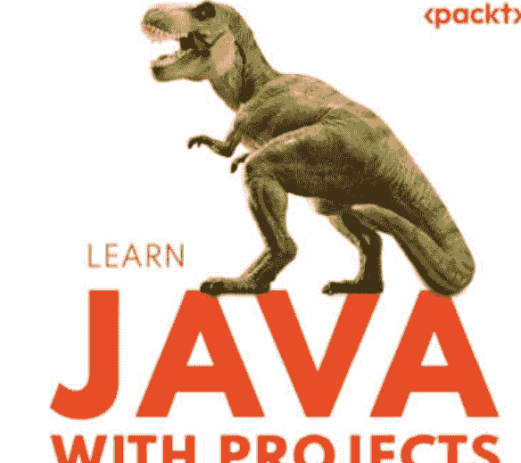

## 通过项目学习 Java

一份关于学习 Java 专业人士**真正需要知道的**所有内容**的简明实操指南

Dr. Seán Kennedy | Maaike van Putten

## Learn Java with Projects

Dr. Seán Kennedy, Maaike van Putten

ISBN: 978-1-83763-718-8

- 清晰理解 Java 基础，如基本类型、操作符、作用域、条件语句、循环、异常和数组
- 掌握 OOP 构建，如类、对象、枚举、接口和记录 (records)
- 深入理解 OOP 原则，如多态、继承和封装
- 深入研究泛型、集合、lambda、流处理和并发等高级主题
- 可视化在调用方法或创建对象时内存中发生了什么
- 领会“在做中学学”的高效

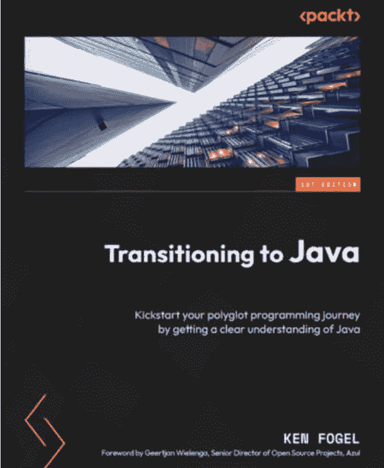

## 迁移到 Java

Ken Fogel

ISBN: 978-1-80461-401-3

- 熟悉 Java 语法
- 理解 Java 面向对象基础
- 发现如何在 Java 中实现函数
- 理解哪些框架最适合解决问题
- 探索 Java 中的创建、结构和行为模式
- 掌握 Java 服务端编程

## Packt 正在寻找像您这样的作者

如果您对成为 Packt 的作者感兴趣，请访问 `packpub.com` 并立即申请。我们已与数千名开发者和技术专业人士合作，帮助他们将见解分享给全球社区。您可以提交通用申请、申请我们正在招募的话题或提交自己的想法。

## 分享您的想法

现在您已经完成了《精通 Java 虚拟机》，我们想听听您的想法！如果您是从亚马逊购买的书籍，请点击此处直接进入该书的亚马逊评论页并分享反馈，或在您购买的网站上留言。

您的评论对我们和技术社区至关重要，并将帮助我们确保交付优质内容。

## 下载这本书的免费 PDF 副本

感谢购买本书！

您是否喜欢在途中阅读但无法随身携带实体书？

您的电子书购买与您的设备不兼容？

不要担心，现在购买每本 Packt 书籍，您都可以免费获得该书的无 DRM PDF 版本。


# 随时随地、在任何设备上阅读

直接从喜爱的技术书中复制并粘贴代码到您的应用程序中。

福利不仅如此，您还可以每天在收件箱接收专属折扣、时通讯和优质免费内容。

## 按照以下简单步骤获取福利

1. 扫描二维码或访问下方链接

   

   <https://packt.link/free-ebook/97818354679761>

2. 提交您的购买证明

3. 完成！我们将直接将免费 PDF 和其他福利发送到您的邮箱。
