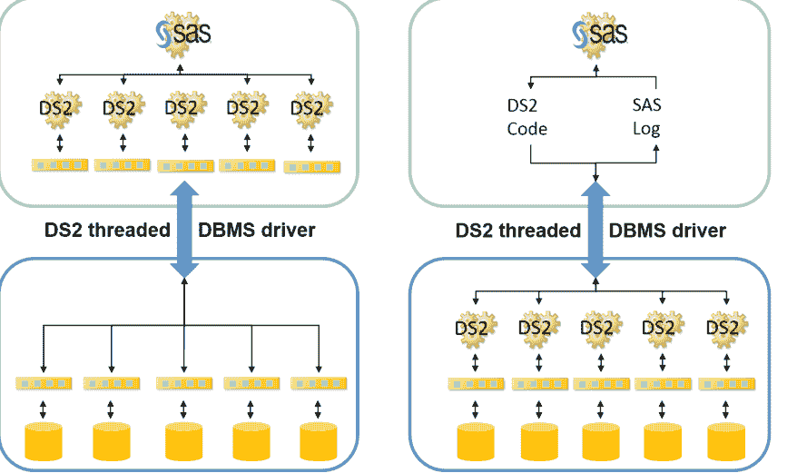
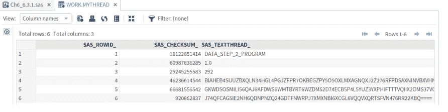
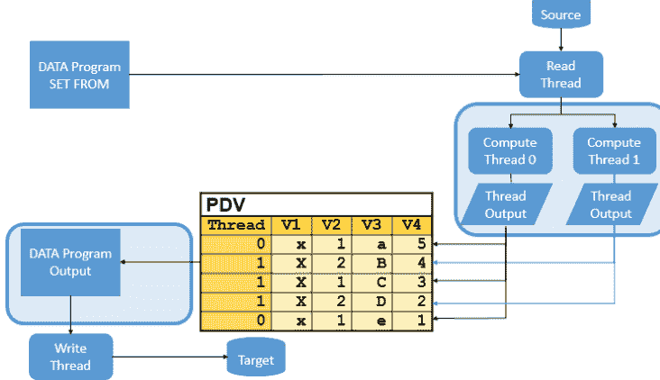

# SAS DS2 过程精通：高级数据处理技术

# 献辞

献给 Ron Cody，SAS 大师和非凡的作家——你的建议和鼓励让我相信我能做到。

献给 Brenna Leath，无畏的编辑——没有你持续且欢快的催促，这本书永远不会诞生。

献给 Lori，我的爱人——没有你的爱和鼓励，我早就放弃了！感谢你保持信念并不断激励我。

最后，献给 Tiger Man，世界上最友好的猫咪——感谢你的热情，但你的撒娇能力仍然远超过你的打字技巧。

## 索引

# 前言

在多年管理 SAS 产品某些核心数据处理语言（如 `DATA step`、`DS2`、`PROC SQL` 和 `FedSQL`）开发的过程中，我深体会到教育的价值。如果一项技术无法被其受益的人所理解，那么它再好也无意义。而且仅仅将事实汇集成册并不等同于教学生。

Mark 在他的新书《精通 SAS DS2 过程：高级数据处理技术》中，成功地为 SAS DS2 语言的语法，更重要的是为该语言的目标提供了一个极其简洁的介绍。他系统地构建了示例，使读者能够以一种令人愉快的节奏不断翻页。他在书中包含的 DATA-step-to-DS2 比较有助于经验丰富的 SAS 程序员快速在新语言中找到方向，同时并不要求先成为 DATA step 专家才能学习 DS2。

他对 DS2 程序包库的覆盖特别别有价值，因为这些大型功能块说明了 DS2 的核心设计原则之一：程序包允许通过 SAS 提供的或用户编写的大型组件来扩展语言功能。在数据量爆炸和网格计算的时代，对并行执行的关注是非常及时的，而 DS2 非常适合这个新的并行世界。

最后，我特别喜欢 Mark 关于他与该语言历程的个人轶事，他发现了缺失的内容、不同之处、独特之处以及原因。我将 Mark 视为 DS2 设计团队的延伸部分，并重视他关于未来如何改进语言的意见。

Robert Ray

研发部总监

SAS Institute Inc.

北卡罗来纳州卡里

# 关于本书

# 目的

本书将带你从一个完全的新手变为对新的 SAS 编程语言 DS2 的熟练运用。

# 这本书适合你吗？

你对传统的 Base SAS DATA step 和 SQL 处理感到熟悉吗？想要增强你的数据准备能力吗？那么 DS2 这种集成了 DATA step 的力量和控制以及 SQL 的易用性、活性和丰富数据类型面板的新型 SAS 编程语言可能正是你正在寻找的！DS2 可以与多个数据源良好地协作，非常适合在 Hadoop、Greenplum 和 Teradata 等大规模并行平台 (MPP) 上处理数据。

DS2 赋予了你完成此类任务的能力：

- 传统的数据准备
- 在海量并行平台 (MPP) 上操作数据
- 在数据库内执行程序
- 在并行平台上处理数据

# 前提条件

本书假设你精通以下内容：

- 传统的 Base SAS DATA step
- SQL 处理
- DATA step 编程
- SAS 库

# 本书范围

本书涵盖以下主题：

- DATA step 的力量和控制
- SQL 的易用性、活性和丰富的数据类型面板
- 多数据源
- 在 Hadoop、Greenplum 和 Teradata 等大规模并行平台 (MPP) 上操作数据
- 在数据库内执行程序
- 并行执行
- 面向编程

# 开发本书使用的软件

书中大部分程序仅使用 Base SAS，并使用 SAS University Edition 开发。然而，有少数程序读取或写入 Teradata 表。这些程序无法在 SAS University Edition 中执行，因为没有包含 SAS/ACCESS Teradata 接口。

# 参考文献

编写本书的主要参考是在线文档的以下章节：

- SAS® 9.4 DS2 语言参考
- SAS® 9.4 语句
- SAS® 9.4 函数和 CALL 例程
- SAS® 9.4 FedSQL 语言参考

# 示例代码和数据

要访问书中的示例代码和数据，请访问 `http://support.sas.com/publishing/authors` 上的作者页面。选择作者姓名。然后。

如果你无法通过网站访问代码，请发送电子邮件至 `saspress@sas.com`。

# SAS University Edition

如果使用 SAS University Edition 访问数据并运行程序，请检查 SAS University Edition 页面以确保软件包含运行代码所需的组件。书中大部分程序仅需 Base SAS 即可在 SAS University Edition 中运行。然而，少数程序读取或写入 Teradata 表。这些程序无法在 SAS University Edition 中执行。SAS University Edition 包含的 SAS 软件列表可在 `http://support.sas.com/software/products/university-edition/index.html` 获取。

# 书中的输出和图形

书中所有的输出和 SAS 图都是在 SAS Studio 中执行相关程序代码产生的。

# 更多帮助

尽管本书说明了各行业经常执行的分析，但可能会出现与你的目标和问题的问题。为了给你提供全面支持，SAS 和 SAS Press 为你提供了以下资源：

- 有关书中涵盖主题的问题，通过 SAS Press 联系作者：
  - 将问题发送至 `saspress@sas.com`；在邮件中注明书名。
  - 在 `http://support.sas.com/author_feedback` 页面上提交反馈。
- 有关书中范围内或之外主题的问题，请在 `https://communities.sas.com/welcome` 的 SAS 支持社区提问。Base SAS 编程社区是讨论 DS2 的合适社区。
- SAS 维护着一个包含最新信息的全面网站。对于新手和资深 SAS 用户来说，知识库（Knowledge Base）是一个特别的页面。您可以在 `http://support.sas.com/resources` 上的知识库中的“Samples and SAS Notes”部分搜索相关注释。
- 注册的 SAS 用户或其组织可以通过 `http://support.sas.com` 访问 SAS 客户支持。在这里，您可以向 SAS 客户支持提交特定问题；点击“Support”下的“Submit a Problem”（提交问题）。您必须提供一个可以接收回复的电子邮件地址，识别您的组织，并提供客户站点编号或许可证信息。这些信息可以在您的 SAS 日志中找到。

# 保持联系

我们期待您的来信。欢迎提问、意见和疑虑。如果您想就特定书籍与我们联系，请在信中注明书名。

# 通过 SAS Press 联系作者

- 通过电子邮件：`saspress@sas.com`
- 通过网页：`http://support.sas.com/author_feedback`

# 购买 SAS 书籍

- 访问 `sas.com/store/books`。
- 电话 1-800-727-0025
- 电子邮件 `sasbook@sas.com`

# 订阅 SAS 学习报告

通过订阅每月一次的 SAS Learning Report 电子邮件，接收有关 SAS 培训、认证和出版物的最新信息。现在就访问 `http://support.sas.com/community/newsletters/training` 阅读存档并订阅吧！

# 与 SAS 出版

SAS 正在招聘作者！您对写书感兴趣吗？访问 `http://support.sas.com/saspress` 获取更多信息。

# 关于作者


Mark Jordan 是一位自诩的技术狂热者，在巴西东北部长大，父母是浸信教传教士。他曾在美国海军服役 20 年，担任潜艇兵，并将对编程的热爱作为爱好。从海军退役后，他将这一爱好变成了理想的工作，在制造业和金融服务领域担任了 9 年 SAS 程序员，并于 2003 年加入 SAS 学院。Mark 教授广泛的基础 SAS 编程课程，并编写和合著了多门 SAS 培训课程。

在不教 SAS 编程时，Mark 会在 SAS Training Post 博客上偶尔发布“Jedi Tricks”，喜欢和孙子、曾孙辈玩耍，在海边闲逛以及阅读科幻小说。他秘密的痴迷是飞行玩具——风筝、火箭、无人机——尽管他试图（但未果）说服妻子这些是给孙子们的。Mark 目前与妻子 Lori 以及他们那神奇的猫 Tiger Man 住在弗吉尼亚亚州的 Toano。您可以通过 `http://go.sas.com/jedi` 阅读他的博客，并在 Twitter 上关注他 @SASJedi。

访问他的作者页面 `http://support.sas.com/jordan` 了解更多关于这位作者的信息。在那里，您可以下载免费书籍摘要，访问示例代码和数据，阅读最新的评论、更新等内容。

# 第 1 章：入门

## 1.1 引言

今天的数据科学家正在处理来自日益广泛的数据源越来越大的数据集，而处理这些数据所需的计算也变得越来越复杂。随着 SAS 系统在每次新发布中不断现代化，SAS 过程（ProCs）已被重写为支持多线程，允许它们使用多台计算机，甚至推入大规模并行处理（MPP）环境，例如 Teradata、Hadoop 或 SAS 高性能分析网格。但数据 step 凭借其顺序的、逐条观测的数据处理方法，仍然顽固地……

在 2013 年夏天，SAS 发布了 SAS 9.4，其中包含了一种名为 DS2 的革命性新编程语言。DS2 基本上是从头开始重新设计的 DATA step 编程，具有几个重要目标。

以下是 DS2 能够做到的：

- 原生处理美国国家标准协会（ANSI）SQL 数据类型，以便与外部存储进行更好的集成
- 提供现代的结构化编程结构，使得使用可用代码模块扩展 DS2 语言的功能变得简单
- 与 SQL 紧密集成
- 为多线程处理提供简单、安全的语法以加速 CPU 密集型任务

我喜欢将 DS2 视为一种语言，它保留了 Base SAS DATA step 编程语言的力量和控制力，结合了 SAS 的简单性，并带有对象特征，使简单、可重用的代码模块成为现实。

如果您拥有支持的数据库管理系统（DBMS）的 SAS/ACCESS 许可证，传统的 SAS DATA step 可以处理 DBMS 数据，但原生数据类型首先会被转换为 SAS 8 字节浮点数值或固定长度。这些信息可以在您的 SAS 日志中找到。

以下是 DS2 能够做到的：

- 原生处理美国国家标准协会（ANSI） SQL 数据类型，以便与外部存储进行更好的集成
- 提供现代的结构化编程结构，使得使用可用代码模块扩展 DS2 语言的功能变得简单
- 与 SQL 紧密集成
- 为多线程处理提供简单、安全的语法以加速 CPU 密集型任务

我喜欢将 DS2 视为一种语言，它保留了 Base SAS DATA step 编程语言的力量和控制力，结合了 SAS 的简单性，并带有对象特征，使简单、可重用的代码模块成为现实。

如果您拥有支持的数据库管理系统（DBMS）的 SAS/ACCESS 许可证，传统的 SAS DATA step 可以处理 DBMS 数据，但原生数据类型首先会被转换为 SAS 8 字节浮点数值或固定长度。这些信息可以在您的 SAS 日志中找到。


- 提供现代的结构化编程结构，使得使用可用代码模块扩展 DS2 语言的功能变得简单
- 与 SQL 紧密集成
- 为多线程处理提供简单、安全的语法以加速 CPU 密集型任务

我喜欢将 DS2 视为一种语言，它保留了 Base SAS DATA step 编程语言的力量和控制力，结合了 SAS 的简单性，并带有对象特征，使简单、可重用的代码模块成为现实。

如果您拥有支持的数据库管理系统（DBMS）的 SAS/ACCESS 许可证，传统的 SAS DATA step 可以处理 DBMS 数据，但原生数据类型首先会被转换为 SAS 8 字节浮点数值或固定长度。这些信息可以在您的 SAS 日志中找到。

- SAS 维护着一个包含最新信息的全面网站。对于新手和资深 SAS 用户来说，知识库（Knowledge Base）是一个特别的页面。您可以在 `http://support.sas.com/resources` 上的知识库中的“Samples and SAS Notes”部分搜索相关注释。

- 注册的 SAS 用户或其组织可以通过 `http://support.sas.com` 访问 SAS 客户支持。在这里，您可以向 SAS 客户支持提交特定问题；点击“Support”下的“Submit a Problem”。您必须提供一个可以接收回复的电子邮件地址，识别您的组织，并提供客户站点编号或许可证信息。这些信息可以在您的 SAS 日志中找到。

# 保持联系

我们期待着您的来信。我们欢迎提问、意见和疑虑。如果您想就特定书籍与我们联系，请在信中注明书名。

# 通过 SAS Press 联系作者

- 通过电子邮件：`saspress@sas.com`
- 通过网页：`http://support.sas.com/author_feedback`

# 购买 SAS 书籍

- 访问 `sas.com/store/books`。
- 电话 `1-800-727-0025`
- 电子邮件 `sasbook@sas.com`

# 订阅 SAS 学习报告

通过订阅每月一次的 SAS Learning Report 电子邮件，接收有关 SAS 培训、认证和出版物的最新信息。现在就访问 `http://support.sas.com/community/newsletters/training` 阅读存档并订阅吧！

# 与 SAS 出版

SAS 正在招聘作者！您对写书感兴趣吗？访问 `http://support.sas.com/saspress` 获取更多信息。

# 关于作者


Mark Jordan 是一位自诩的技术狂热者，在巴西东北部长大，父母是浸信教传教士。他曾在美国海军服役 20 年，担任潜艇兵，并将对编程的热爱作为爱好追求。从海军退役后，他将这一爱好变成了理想的工作，在制造业和金融服务领域担任了 9 年 SAS 程序员，并于 2003 年加入 SAS 学院。Mark 教授广泛的基础 SAS 编程课程，并编写和合著了多门 SAS 培训课程。

在不教 SAS 编程时，Mark 会在 SAS Training Post 博客上偶尔发布“Jedi Tricks”，喜欢和孙子、曾孙辈玩耍，在海边闲逛以及阅读科幻小说。他秘密的痴迷是飞行玩具——风筝、火箭、无人机——尽管他试图（但未果）说服妻子这些是给孙子们的。Mark 目前与妻子 Lori 以及他们那只神奇的猫 Tiger Man 住在弗吉尼亚亚州的 Toano。您可以通过 `http://go.sas.com/jedi` 阅读他的博客，并在 Twitter 上关注他 `@SASJedi`。

访问他的作者页面 `http://support.sas.com/jordan` 了解更多关于这位作者的信息。在在那里，您可以下载免费书籍摘要，访问示例代码和数据，阅读最新的评论、更新等内容。

# 第 1 章：入门

## 1.1 引言

今天的数据科学家正在处理来自日益广泛的数据源越来越大的数据集，而处理这些数据所需的计算也不断变得越来越复杂。随着 SAS 系统在每次新发布中不断现代化，SAS 过程（ProCs）已被重写为支持多线程，允许它们使用多台计算机，甚至推入大规模并行处理（MPP）环境，例如 Teradata、Hadoop 或 SAS 高性能分析网格。但数据 step 凭借其顺序的、逐条观测的数据处理方法，仍然顽固地……

在 2013 年夏天，SAS 发布了 SAS 9.4，其中包含了一种名为 DS2 的革命性新编程语言。DS2 基本上是从从头开始重新设计的 DATA step 编程，具有几个重要目标。

以下是 DS2 能够做到的：

- 原生处理美国国家标准协会（ANSI） SQL 数据类型，以便与外部存储进行更好的集成
- 提供现代的结构化编程结构，使得使用可用代码模块扩展 DS2 语言的功能变得简单
- 与 SQL 紧密集成
- 为多线程处理提供简单、安全的语法以加速 CPU 密集型任务

我喜欢将 DS2 视为一种语言，它保留了 Base SAS DATA step 编程语言的力量和控制力，结合了 SAS 的简单性，并带有对象特征，使简单、可重用的代码模块成为现实。

如果您拥有支持的数据库管理系统（DBMS）的 SAS/ACCESS 许可证，传统的 SAS DATA step 可以处理 DBMS 数据，但原生数据类型首先会被转换为 SAS 8 字节浮点数值或固定长度。这些信息可以在您的 SAS 日志中找到。

图 1.3：基于线程的并行处理：SAS 计算平台与数据库内处理



如图 1.3 所示，使用 DS2 和带有 SAS 数据库代码加速器（In-Database Code Accelerator）的数据程序允许 DS2 代码在规模并行 DBMS 硬件上编译和执行。如果该过程从 DBMS 表读取并写入 DBMS 表，那么只有 DS2 代码进入 DBMS，且只有 SAS 日志输出。所有的处理都在 DBMS 中完成。这种“将代码带到数据处”而不是传统的“将数据带到代码处”的概念，极大地减少了处理所需的数据移动量，将 DBMS 的计算能力扩展到 SAS 函数和处理逻辑，并充分利用了 DBMS 的大规模并行处理（MPP）能力。如果你是包含 SAS 的环境中的 SAS 程序员或数据科学家，你会发现 DS2 很快就会成为数据操作的必备工具。

### 1.1.1 本书的预期

我所说的数据处理（Data wrangling）不仅仅是为了清洗数据以准备分析。数据处理人员从各种来源获取数据，然后以独特的方式对其进行结构化、组织和组合，以促进分析并获得新的见解。本书将教你如何使用 DS2 处理数据，强调 DS2 数据程序与传统 DATA step 处理之间的相似之处和区别，以及利用 DS2 的并行处理能力来提升你的数据处理速度。

完成本书后，你将能够：

- 识别该语言设计用于哪些类型，并理解在尝试提高 DATA step 过程执行性能时，指示 DS2 是良好选择的条件
- 识别哪些编程语句和函数是 DATA step 和 DS2 程序之间共享的
- 识别 DS2 中不可用的 DATA step 功能以及为什么它们没有包含在 DS2 语言中
- 了解传统 DATA step 中不具备哪些 DS2 程序功能
- 在 DS2 程序中直接操作 ANSI 数据类型
- 理解在同一过程中处理同时包含 SAS 缺失值和 ANSI 空值的数据的影响
- 将 Base SAS 数据处理过程从 DATA step 转换为 DS2 程序
- 理解 DS2 系统方法以及它们如何与传统的 DATA step 编程构造相关
- 创建自定义 DS2 方法，扩展 DS2 语言的功能
- 将 DS2 方法存储在包（packages）中并在后续 DS2 程序中重用
- 使用 DS2 程序创建面向对象的程序
- 使用预定义的 DS2 包为你的 DS2 数据程序添加额外功能
- 创建 DS2 线程并在 DS2 程序中执行它们以对数据记录进行并行处理
- 在 DS2 程序或线程中使用 BY-group、FIRST.variable 和 LAST.variable 处理来执行自定义数据汇总，而无需预设数据集来判断你的系统是否具有在数据库内执行 DS2 程序的能力；如果是，则在分布的 MPP DBMS 平台上执行你的 DS2 线程

### 1.1.2 预备知识

- DATA step 编程（概论）
- SAS 库
- 使用 `LIBNAME` 语句访问数据
- 读取和写入 SAS 数据集
- 数据程序向量（PDV）在 DATA step 处理中的作用
- 条件处理技术
- 数组（arrays）
- 迭代处理（DO 循环）
- 宏处理（概论）
- 为宏变量赋值值
- 在 SAS 代码中解析宏变量
- 宏过程执行时间与其他 SAS 代码执行时间的对比
- SQL 链接操作

## 1.2 访问 SAS 并准备练习

如果你目前没有 SAS 软件的访问权限，可以使用 SAS Analytics U 这一强大的在线学习社区。从 SAS Analytics U 网站，你可以下载一个免费、最新且功能完整的 SAS University Edition 副本，它是以虚拟机（VM）的形式提供的。SAS University Edition 包含一个完全安装、配置好且经过验证的 SAS 服务器。书中的示例均使用 SAS University Edition 创建并执行的，但需要访问 DBMS 的章节除外。你可以在 `http://go.sas.com/free_sas` 获取你自己的免费 SAS University Edition 副本。

### 1.2.1 准备练习

1. 从 `http://support.sas.com/publishing/authors/jordan.html` 下载包含本书数据的 ZIP 文件。
2. 将文件解压到 SAS 可以访问的位置。如果你正在使用 SAS University Edition，你在设置 SAS 环境时指定的共享文件夹是存放这些文件的良好位置。
3. 在 SAS 中，打开 `setup.sas` 程序，按照程序注释中的说明修改适用于你的 SAS 环境的代码，然后提交程序。你只需要运行此程序一次。

你现在已准备好运行书中包含的示例程序。

如果你在学习课程之间退了 SAS，很容易返回。再次启动 SAS 时，只需运行名为 `libnames.sas` 的程序，以重新建立连接。如果在通过 `libnames.sas` 重新建立 SAS 库连接遇到困难，重新运行 `setup.sas` 无妨，只是多花一点时间。

# 第 2 章：DS2 语言简介

- 2.1 引言 ................................................................ 7
- 2.2 DS2 编程基础 ................................................ 7
- 2.2.1 通用考虑 ................................................ 7
- 2.2.2 程序结构 ................................................ 9
- 2.2.3 程序块（Blocks） ................................................ 11
- 2.2.4 方法（Methods） ................................................ 12
- 2.2.5 系统方法............................................................... 12
- 2.2.6 用户定义方法.................................................. 14
- 2.2.7 数据标识符和作用域........................................................... 16
- 2.2.8 数据程序执行........................................................... 21
- 2.3 将 SAS DATA step 转换为 DS2 数据程序 ................... 21
- 2.3.1 传统的 SAS DATA step ................................................ 21
- 2.3.2 考虑因素............................................................... 22
- 2.3.3 等效的 DS2 数据程序.............................................. 22
- 2.4 核心概念回顾 ................................................................ 23

## 2.1 引言

在本章中，我们将描述 DS2 程序的基本组件和构造。在此过程中，我们将对比 DS2 数据程序与传统 SAS DATA step 之间的相似之处和区别。我们还将把现有的 DATA step 转换为 DS2 数据程序，并运行第一个 DS2 程序。

## 2.2 DS2 编程基础

### 2.2.1 通用考虑

我喜欢将 DS2 描述为下一代 ANSI 语言，它结合了 DATA step 编程的灵活性、控制力和、丰富的 ANSI SQL 数据面板，以及基于对象的代码模块化的优势。乍看之下，DS2 语言与 DATA 步非常相似。

步骤。它从根本上是一种高级命令性过程化语言，专为处理矩形数据集设计，并包含了数组、哈希对象和矩阵的功能。与 DATA 步一样，`ds2` 数据程序以关键字开始，所有语句都以分号结束。然而，它们存在显著差异。表 2.1 突出了这些差异。

表 2.1：DATA Step 对比 DS2

| DATA Step | DS2 |
|---|---|
| 几乎没有保留字。 | 所有关键字都是保留字。 |
| 数据行在单计算线程中逐行、顺序处理。 | 可以使用多个并发线程并行处理多行数据。 |
| DATA step 中引用的所有变量都是全局作用域。 | 数据程序中引用的变量可以是全局作用域或局部作用域的。 |
| DATA step 中引用的所有变量都在程序数据向量 (PDV) 中，除非显式删除，否则将成为结果集的一部分。 | 局部作用域变量不会添加到 PDV 中，且永远不会成为结果集的一部分。 |
| 使用变量封装创建可重用代码需要使用独立的过程 `PROC FCMP`，它有自己的语法。 | 在包程序中使用标准的 `PROC DS2` 语法可以实现带有封装的可重用代码模块。 |
| DATA step 可以将 SQL 查询生成的表作为 `SET` 语句的输入。 | DS2 可以直接接受 SQL 查询的结果集作为 `SET` 语句的输入。 |
| DATA step 只能处理双精度数值或固定宽度字符数据，DBMS ANSI SQL 数据类型在处理之前必须转换为这些数据类型之一。 | DS2 仅以其原生格式全精度处理 ANSI SQL 数据类型。 |

### 2.2.2 程序结构

对 DATA 步和等效的 DS2 数据程序的快速对比清楚地表明，这些语言密切相关，但 DS2 数据程序的结构更加严谨：

```
data _null;
Message='Hello World!';
put Message=\;
run;
proc ds2;
data _null();
method run();
Message='Hello World!';
put Message=\;
end
ends;
run;
quit;
```

主要的结构差异是 DS2 程序是写在代码块中的。在 Base SAS 中，DS2 语言通过 `PROC DS2` 块调用，该块以 `PROC DS2` 语句开始并以 `QUIT` 语句结束：

```
proc ds2;
<ds2 program blocks>
quit;
```

在 `PROC DS2` 块内，你可以定义并执行三种基本的程序块。

表 2.2：DS2 程序块

| 程序块 | 概要描述 |
|---|---|
| Data | DS2 语言的核心，数据程序处理输入数据集以生成输出结果集。它们可以接受来自表、线程程序结果集或 SQL 查询结果集的输入。 |
| Package | 包程序创建存储在 SAS 库中的变量集合和方法集合，实现了面向对象的开发方法。简单高效地重用经过验证的代码模块可以确保重要专有流程的标准化，减少编写新程序的时间并提高整体代码质量。 |
| Thread | 线程程序处理输入数据集以生成返回给数据程序的输出结果集。线程用于同时并行处理几行数据，线程可以接受来自表或 SQL 查询的输入。 |

第 2.2.3 节提供了这些程序块的更详细描述。每个程序块由相应的 `DATA`、`PACKAGE` 或 `THREAD` 语句以及相应的 `END` 语句界定。DS2 使用 RUN 组处理，并需要显式编写 `RUN` 语句来触发程序块执行：


# 第 2 章：DS2 语言简介

## 2.1 程序块结构

```
proc ds2;
package package_name;
  <在此处创建包的 ds2 编程语句>
endpackage;
run;
thread thread_name;
  <在此处创建线程的 ds2 编程语句>
endthread;
run;
data output_dataset_name;
  <在此处处理数据的 ds2 编程语句>
enddata;
run;
quit;
```

```
proc ds2;
data output_dataset_name;
  <全局声明语句>
  method method_name(<method parameters>);
    <局部变量声明>
    <可执行 ds2 编程语句>
end;
enddata;
run;
quit;
```

## 2.2 程序块

每个程序块由相应的 `DATA`、`PACKAGE` 或 `THREAD` 语句以及相应的 `END` 语句界定。DS2 使用 RUN 组处理，并需要显式编写 `RUN` 语句来触发程序块执行。

### 2.2.1 DATA 程序

### 2.2.2 包程序

### 2.2.3 线程程序

## 2.3 系统方法

系统方法会自动执行且不接受参数。你必须在数据或线程程序中显式地定义至少一个此类方法，否则程序将无法执行。你不需要为一个或多个系统方法块编写显式代码，DS2 编译器会在编译时自动为你创建一个缺失的系统方法的空版本。一个空方法只包含适当的 `METHOD` 语句，随后紧跟一个 `END` 语句。

### 2.3.1 INIT 方法

`INIT` 方法执行一次且仅执行一次，在程序启动后立即执行。它为执行程序初始化例程提供了一个标准位置。以下 DATA 步和 DS2 数据程序产生的结果相同，但 DS2 数据程序不需要任何条件逻辑：

**DATA 步：**

```
data _null;
if _n=1 then do;
put 'Execution is beginning';
end;
run;
```

**DS2 数据程序：**

```
proc ds2;
data _null;
method init();
put 'Execution is beginning';
enddata;
run;
quit;
```

### 2.3.2 RUN 方法

`RUN` 方法模拟传统 SAS DATA 步的性能。它在 `INIT` 方法执行完毕后立即开始运行，并作为一个数据驱动的循环。`RUN` 方法为输入数据集中的每一行（观测值）迭代一次。`RUN` 方法是唯一在 `END` 语句中包含隐式输出的方法。DATA 步和 DS2 数据程序产生的结果相同：

```
data new_data;
if _n=1 then do;
put 'Execution is beginning';
end;
set crsone_day;
run;
```

```
proc ds2;
data new_data;
method init();
put 'Execution is beginning';
end;
method run();
set crs.one_day;
end;
enddata;
run;
quit;
```

### 2.3.3 TERM 方法

`TERM` 方法执行一次且仅执行一次，在 `RUN` 方法完成执行后、数据或线程程序终止前立即执行。它为执行程序终止代码提供了一个合适的位置。此 DATA 步和 DS2 数据程序产生相同的结果，但 DATA 步需要使用 `END=` 语句选项、关联的自动变量以及条件逻辑判断来实现 DS2 数据程序的功能，而无需任何额外的资源或代码：

```
data new_data;
if _n=1 then
  put 'Execution is beginning';
end;
set crs.one_day end=last;
if last=1 then
  put 'Execution is ending';
end;
run;
```

```
proc ds2;
data _null_;
method init();
  put 'Execution is beginning';
end;
method run();
  set crs.one_day;
end;
method term();
  put 'Execution is ending';
end;
enddata;
run;
quit;
```

## 2.4 用户定义方法

在 DS2 中，你可以轻松地定义并使用自己的可重用代码块。这些代码块被称为用户定义方法，它们可以通过引用或值来接收参数值。当所有参数都通过值传递到方法时，这些值在方法内部可用作计算，且方法可以向调用进程返回一个单值——类似于 Base SAS 函数。此数据程序使用用户定义方法将温度从摄氏度转换为华氏度。

```
proc ds2;
/* No输出 DATA set. Results returned as a report (like SQL) */
data;
  dcl double DegF;
  /* 方法返回一个值 */
method c2f(double Tc) returns double;
  /* 摄氏度转华氏度 */
  return ((Tc*9)/5+32);
end
method init();
  do DegC=0 to 30 by 15;
    DegF=c2f(DegC);
    output;
end;
enddata;
run;
quit;
```

**图 2.2：温度转换输出**

| DegC | DegF |
|---|---|
| 15 | 59 |
| 30 | 86 |

一个或多个参数通过引用传递，这些值在方法内部可用作计算，且这些值可以在调用处被方法修改，类似于 Base SAS 过程。在 DS2 中，通过引用传递的参数被称为 `IN_OUT` 参数。具有 `IN_OUT` 参数的方法不能返回值，但在执行期间可以修改多个 `IN_OUT` 参数。此数据程序使用用户定义方法将温度从华氏度转换为摄氏度，但通过引用传递了温度：

```
proc ds2;
data;
  dcl double Tf;
  /* 方法在调用处修改值 */
  method f2c(inout double T);
  /* 华氏度转摄氏度（四舍五入） */
  T=round((T-32)*5/9);
end;
method init();
  do Tf=0 to 100 by 10;
    f2c(Tf);
    output;
end;
enddata;
run;
quit;
```

## 2.5 变量作用域

在 DS2 程序中，所有对象、变量和代码块必须具有标识符（名称）。标识符的作用域是全局或局部的，标识符在其作用域内是唯一的。标识符的作用域决定了可以在程序的哪个部分引用它。图 2.4 显示了一个具有全局和局部作用域标识符的 DS2 程序，并指示了引用时将返回哪些值。

**图 2.4：DS2 数据程序变量作用域**

```
proc ds2;
data _null_;
method init();
  put 'Execution is beginning';
end;
method run();
  set crs.one_day;
end;
method term();
  put 'Execution is ending';
end;
enddata;
run;
quit;
```

## 2.6 局部变量与 PDV 污染

这些被包含在 PDV 和程序结果集中。然而，由于这些变量的全局变量从未被赋过值，因此 `Total` 和 `Count` 在输出中包含缺失值：

```
proc ds2;
data;
  method run();
    declare double Total Count;
    set crs.one_day (keep=(Payee Amount));
    Total+Amount;
    Count+1;
  end;
  method term();
    put Total= Count=;
  end;
endata;
run;
quit;
```

**SAS Log:**

```
Total=. Count=.

WARNING: Line nn: No DECLARE for referenced variable total; creating it as a global variable of type double.

WARNING: Line nn: No DECLARE for referenced variable count; creating it as a global variable of type double.
```

**图 2.6：数据程序生成的显示缺失值的报告**

| Obs | Payee | Amount | Total | Count |
|---|---|---|---|---|
| 1 | Misc | $9.60 | . | . |
| 2 | Ice Cream | $10.31 | . | . |
| 3 | Services | $18.00 | . | . |
| 4 | Big Retailer | $192.59 | . | . |
| 5 | Misc | $3,000.00 | . | . |
| 6 | Misc | $4,000.00 | . | . |

如果我们从程序中删除 `TERM` 方法，`Total` 和 `Count` 变量的唯一引用就是 `RUN` 方法中的局部变量，它们将完全不会包含在 PDV 中。SAS Log 中不会发出关于未声明变量的警告，结果集仅包含全局变量 `Payee` 和 `Amount`：

```
proc ds2;
data;
  method run();
    declare double Total Count;
    set crs.one_day (keep=(Payee Amount));
    Total+Amount;
    Count+1;
  end;
enddata;
run;
quit;
```

**图 2.7：排除局部变量后数据程序生成的报告**

| Obs | Payee | Amount |
|---|---|---|
| 1 | Misc | $9.60 |
| 2 | Ice Cream | $10.31 |
| 3 | Services | $18.00 |
| 4 | Big Retailer | $192.59 |
| 5 | Misc | $3,000.00 |
| 6 | Misc | $4,000.00 |

用户定义方法可以接受参数。按值传递的参数被视为方法内部局部作用域的变量。例如，在以下程序中，用户定义的 `fullname` 有两个参数 `first` 和 `last`，它们作为局部变量运行。还有一个局部声明的变量 `FinalText`。主数据程序有三个全局声明的变量 `WholeName`、`GivenName` 和 `Surname`，它们将会被包含在 PDV 中。结果集仅包含全局变量 `WholeName`、`GivenName` 和 `Surname`。

```
proc ds2;
data;
  declare varchar(100) WholeName;
  method fullname(varchar(50) first, varchar(50) last)
    returns varchar(100);
    dcl varchar(100) FinalText;
    FinalText=catx(', ',last,first);
    Return FinalText;
  end;
  method run();
    set crs.customer_sample (keep=(GivenName Surname));
    FullName=fullname(GivenName, Surname);
  end;
enddata;
run;
quit;
```

**图 2.8：数据程序生成的报告**

| WholeName | GivenName | Surname |
|---|---|---|
| Schmidt, William | | Schmidt |
| Laverty, Daniel | | Laverty |
| Grayson, Sarah | | Grayson |
| Hastings, Eldon | | Hastings |

如果你在 SAS 程序中存储了代码段以包含在传统的 DATA step 中，你可能经历过我所说的 PDV 污染。当包含的代码引用了主程序中已存在的变量，或者当它包含了新变量时，现有变量的 PDV 值可能会被包含的代码无意修改。此外，不必要的变量可能会被添加到 PDV 并出现在输出数据集中。当使用 DS2 方法时，方法的局部变量永远不会影响 PDV，这个概念通常被称为变量封装。因为方法参数和局部声明变量是局部作用域，它们被封装在你的方法中，不会污染 PDV。在随后的章节中，我们将用户定义方法存储在 DS2 数据包中，以便在未来的程序中简单复用。由于变量封装，只要编写得当 DS2 方法，你就永远不需要担心 PDV 污染。

## 2.7 数据执行

DS2 数据程序由编译器交付用于语法检查、编译和执行。在编译时，为 PDV 预留资源，代码被编译以执行，并生成输出数据集，写入描述符。编译完成后，执行从 `INIT` 方法开始，随后自动执行 `RUN` 和 `TERM` 方法。只有系统方法会自动执行；任何用户定义方法必须从 `INIT`、`RUN` 或 `TERM` 方法调用才能执行。

## 2.8 将 SAS DATA Step 转换为 DS2 程序

### 2.8.1 传统的 DATA Step

这是一个带有三个部分的传统的 DATA step，我们将将其转换为 DS2 数据程序：

```
data null;
/* Section 1 */
if n_=1 then
do
  put '*********';
  put 'Starting';

/* Section 2 */
set crs.banks=last;
  put Bank Rate;

/* Section 3 */
if last then
do
    put '*********';
    put 'Ending';
end;
end;
run;
```

### 2.8.2 考虑因素

1. 第 1 部分包含一个 DO 组语句，这些语句仅在 `N=1` 时执行。自动变量 `N` 统计 DATA step 迭代的次数，因此该块在 DATA step 开始时仅执行一次。

2. 第 2 部分包含无条件执行的语句。这些语句应该对输入数据集中的每个观测值执行一次。在此部分中，`SET` 语句使用 `END=` 创建了 `last`，这是一个包含文件结束指示的临时变量。变量 `last` 初始化为 0，直到 `SET` 语句读取集合的最后一个观测值，此时它被设置为 1。自动变量 `last` 被标记为 `DROP`，不会出现在输出数据集中。

3. 第 3 部分包含一个 DO 组语句，仅当 `last` 包含非 0 或缺失值时执行。

如果我们考虑这一点，第 1 部分代码看起来是 `INIT` 方法的理想人选，第 2 部分是 `RUN` 方法，第 3 部分是 `TERM` 方法。

### 2.8.3 等效的 DS2 程序

下面是与原始 DATA step 等效的 DS2 程序：

```
proc ds2;
data null_;

/* Section 1 */
method init();
    put '*********';
    put 'Starting';
    put '*********';
end;

/* Section 2 */
method run();
    set crs.banks;
    put Bank Rate;
end;

/* Section 3 */
method term();
    put '*********';
    put 'Ending';
    put '*********';
end;
enddata;
run;
quit;
```

## 2.9 核心概念回顾

- DS2 程序通过块来交付：`data`、`package` 和 `thread`。

- 有三种类型的 DS2 程序块：程序块以相应的 `DATA`、`PACKAGE` 或 `THREAD` 语句开始，以 `ENDDATA`、`ENDPACKAGE` 或 `ENDTHREAD` 结束。程序的剩余部分由全局声明语句和方法定义组成。

- 有三种系统方法：`INIT`、`RUN` 和 `TERM`。每个数据和线程程序必须包含这些方法之一的显式代码。系统方法自动执行且不接受参数。

- 可以编写用户定义方法，需注意以下几点：

  - 用户定义方法不会自动执行；只有在调用时才执行。

  - 用户定义方法可以接受按值或按引用（`IN_OUT` 参数）传递的参数。

  - 没有 `IN_OUT` 参数的方法可以返回值，类似于 SAS 函数。

  - 方法 `IN_OUT` 参数可以在本地修改，类似于 SAS `CALL` 过程。

  - 用户定义方法可以存储在 DS2 数据包中以便复用。

- DS2 程序中创建变量应使用 `DECLARE` (`DCL`) 语句进行声明。声明的位置决定了变量的作用域。

- 通过 `SET` 语句引入 DS2 程序的变量、在方法定义开始之前的全局程序空间声明的变量，以及在程序代码中未声明的变量具有全局作用域。

# 第 3 章：DS2 数据程序详解


# 3.1 引言

在本章中，我们将关注 DS2 数据程序的基础知识，首先通过对传统的 DATA step 与 DS2 数据程序进行进一步的对比分析，并深入探讨 DS2 中的一些新特性。在此过程中，我们将把复杂的 Base SAS DATA step 转换为 DS2 数据程序，并引入几个 DS2 特有的概念和技术。具体而言，我们将涵盖以下要点：

- 更多的 DS2 数据程序语法和结构
- 使用 FedSQL 查询直接为 DS2 数据程序的 `SET` 语句提供输入
- DS2 可以处理的各种 ANSI 数据类型
- DS2 自动数据类型转换规则
- 独特的 DS2 程序语句
- 独特的 DS2 表达式
- 选定的 DS2 函数

# 3.2 DS2 数据程序与 Base SAS DATA Step 对比

## 3.2.1 通用注意事项

DS2 数据程序语法与 Base SAS DATA step 语法的相似性对于经验丰富的 SAS 程序员来说是一个优势。这种相似性在 Base SAS DATA step 和 DS2 数据程序共享的语句语法中表现得非常明显。例如，这些语句在两种语言中的工作方式基本相同：

- `SET`
- `BY` 组处理，包括 `First.variable` 和 `Last.variable`
- `DO` 组和 `DO` 循环
  - `DO i= start TO BY interval`
  - `DO WHILE ()`
  - `DO UNTIL ()`
  - 循环控制语句 `CONTINUE`、`LEAVE` 和 `END`
- 程序流控制语句
  - `RETURN`
  - `OUTPUT`
  - `GOTO`
  - `STOP`
- 声明语句
  - `KEEP` 和 `DROP`
  - `RETAIN`

请记住，在任何 DS2 程序中，全局声明语句必须出现在全局程序空间中——即在 `DATA`、`THREAD` 或 `PACKAGE` 语句之后，且在第一个方法定义之前。

## 3.2.2 “六大细微差异”

尽管在传统的 DATA step 和 DS2 数据程序中许多功能的工作原理完全相同，但存在一些非常细微的差异，在 DS2 中编程时必须记住这些差异。让我们来看看主要的区别，我称之为“六大细微差异”。

### 3.2.2.1 所有可执行语句必须是方法代码块的一部分

全局程序空间中的可执行语句会导致语法错误：

```
proc ds2;
data _null;
set crs.one_day;
put _all;
enddata;
run;
quit;
```

SAS Log：

```
ERROR: Compilation error.
ERROR: Parse encountered SET when expecting end of input.
ERROR: Line n: Parse failed; >>> set crs.one_day;
```

将可执行语句封装在方法中可以解决此问题：

```
proc ds2;
data  _null_;
method run()
    set crs.one_day;
    put  _all_;
end;
enddata;
run;
quit;
```

SAS Log:

> NOTE: 执行成功. 影响了 6 行数据.

### 3.2.2.2 DS2 程序默认不会覆盖数据

如果你提交此程序，它将正常运行。如果你第二次提交完全相同的程序，它将导致语法错误：

```
proc ds2;
data test1 test2;
method run()
    set crs.one_day;
end;
enddata;
run;

proc ds2;
data test1 test2;
method run()
    set crs.one_day;
end;
enddata;
run;
```

SAS Log:

```
683 proc ds2;
684 data test1 test2;
685 method run();
686     set crs.one_day;
687 end;
688 enddata;
689 run;
690 NOTE: 执行成功. 影响了 12 行数据.。
quit;
NOTE: 使用过程 DS2 (总处理时间):
```

| real time | 0.05 seconds |
|-----------|--------------|
| cpu time  | 0.04 seconds |

```
691
692 proc ds2;
693 data test1 test2;
694 method run();
695
696 set crs.one_day;
697 end;
698 enddata;
699 run;
700 NOTE: 执行成功. 影响了 12 行数据.。
quit;
NOTE: 使用过程 DS2 (总处理时间):
```

### 3.2.2.3 所有通过 SET 引入的变量都应该声明

默认情况下，未声明变量会导致日志中出现警告。这种行为可以通过 DS2 系统选项进行全局控制。

| 选项设置 | 影响 |
|----------|------|
| NONE     | 程序正常编译并执行。 |
| WARNING  | 程序正常编译并执行。 |
| ERROR    | 程序编译失败。 |

以下是 DS2 系统选项的示例：

```
options ds2=ERROR;
proc ds2;
data _null_;
method run();
Text='Hello, world';
x=1;
put Text=;
end;
enddata;
run;
quit;
```

SAS Log:

```
ERROR: 编译错误。
ERROR: Line 92: 赋值变量 text 没有 DECLARE; 正在将其创建为 char 类型的全局变量。
ERROR: Line 93: 赋值变量 x 没有 DECLARE; 正在将其创建为 double 类型的全局变量。

NOTE: SAS 系统由于错误停止处理此步骤。
```

以下是覆盖系统选项的示例：

```
options ds2=NONE;
proc ds2;
data _null_;
method run();
Text='Hello, world';
x=1;
put Text=;
end;
enddata;
run;
quit;
```

SAS Log:

```
Text=Hello, world
NOTE: 执行成功. 影响了 0 行数据。
```

### 3.2.2.4 PUT 语句不支持光标和行指针

此 Base SAS 数据 step 使用光标控制 (`@`) 和换行 (`/`) 在日志中写入了整齐的信息：

```
data _null_;
Text='Hello, world';
X=1;
put @7 Text = /7 X =
run;
```

SAS Log:

```
Text=Hello, world
X=1;
NOTE: 使用 DATA语句 (总处理时间):
real time 0.00 seconds
cpu time 0.01 second
```

然而，DS2 中的相同代码会产生语法错误，因为 DS2 的 `PUT` 语句不接受光标和行控制：

```
proc ds2;
data _null_;
method run();
Text='Hello, world';
X=1;
put @6 Text = / @6 X=
enddata;
run;
quit;
```

SAS Log:

```
ERROR: 编译错误。
ERROR: 在期望 ';' 时遇到无效字符；；
ERROR: Line 212: 解析失败：put >>> <<< 6 Text = / @6 X=;
NOTE: SAS 系统由于错误停止处理此步骤。
```

### 3.2.2.5 关键字是保留字

Base SAS DATA 步语言的保留字非常少。通过检查上下文，编译器会决定将关键字解释为代码还是标识符。例如，将你的数据集或变量命名为 `Character` 是完全可以的：

```
data Data;
Character='A';
put 'The character is ' Character;
run;
```

SAS Log:

```
The character is A
```

然而，相同的代码在 DS2 中会产生语法错误，因为 DS2 的所有关键字都是保留字：

```
proc ds2;
data Data/overwrite=yes;
dcl char(1) Character;
method run();
Character='A';
put 'The character is ' Character;
end;
adddata;
run;
quit;
```

SAS Log: ERROR: Compilation error.

ERROR: Parse encountered DATA when expecting ';';

ERROR: Line 457: Parse failed: data >>> Data << /overwrite=yes;

> NOTE: SAS 系统由于错误停止了处理。

遵循 ANSI SQL 标准，只有在将关键字包含在双引号中时，你才能将其用作标识符：

```
proc ds2;
data "Data"/overwrite=yes;
dcl char(1) "Character"
method run();
"Character"='A';
put 'The character is ' "Character"
end;
adddata;
run;
quit;
```

SAS Log:

The character is A

NOTE: Execution succeeded. One row affected.

### 3.2.2.6 DS2 使用 ANSI SQL 引用标准

在 DS2 中，双引号仅用于界定标识符。单引号用于界定字符常量：

```
proc ds2;
data _null;
dcl char(25) "Character";
method run();
  "Character"='This is the message.';
  put "Character";
end;
enddata;
run;
quit;
```

SAS Log:

This is the message.

NOTE: Execution succeeded. No rows affected.

当尝试在 DS2 中将宏变量解析为字符常量值或其部分时，这一要求可能会产生问题。如果将宏引用放在 DS2 常量文本所需的单引号中，则宏变量将无法解析。这是因为单引号会阻止所包含文本的标记化：

```
%let msg=This is the message;
proc ds2;
data _null;
dcl char(25) "Character";
method run();
  "Character"='&msg';
  put "Character";
end;
enddata;
run;
quit;
```

SAS Log:

&msg

NOTE: Execution succeeded. No rows affected.

如果你将宏引用放在双引号中以便其进行标记化并解析，DS2 将把解析后的文本解释为标识符而不是常量文本：

```
%let msg=This is the message;
proc ds2;
data _null;
dcl char(25) "Character";
method run();
  "Character"=&msg;
  put "Character";
end;
enddata;
run;
quit;
```

SAS Log:

> WARNING: Line nnn: No DECLARE for referenced variable "this is the message. creating it as a global variable of type double.

NOTE: Execution succeeded. No rows affected.

如我们从日志所示，DS2 将 "This is the message." 解释为了变量名。因为没有指示要创建什么类型的变量，DS2 创建了一个双精度浮点数值型（SAS 数值型）变量名 "this is the message"。此新变量的值被赋值给 "Character" 变量，而这是一个文本变量。从数值到字符的自动转换产生了我们在日志中看到的 `.`。由于使用了未声明的变量而产生的警告信息，我们可以很清楚地知道发生了什么。

为了在 DS2 字面量中方便处理宏生成的文本，SAS 提供了自动调用宏 `%TSLIT`。这允许所有数值字符串进行解析，然后获取生成的文本，并在文本的开头和结尾处应用真实的单引号。最后，SAS 将生成的文本传回给单词扫描器。这使得宏变量解析在 DS2 中如预期所示：

```
%let msg=This is the message;
proc ds2;
data _null;
dcl char(25) "Character";
method run();
  "Character"=%tslit(&msg);
  put "Character";
end;
enddata;
run;
quit;
```

SAS Log:

> This is the message.

NOTE: Execution succeeded. No rows affected.

## 3.2.3 DS2 “缺失”功能

尽管 DS2 数据程序语法与 Base SAS 步的相似有助于开始 DS2 编程，但你最终会发现某些喜爱的 DATA 步语句和函数在 DS2 中不可用。你还会注意到 DS2 词汇表中会出现几个新的、不熟悉的语句和函数。在大多数情况下，功能并没有丢失——DS2 有一种不同的解决问题的方法。

我们将检查几个似乎丢失了 Base SAS DATA 步功能的案例，以及 DS2 为完成任务采取的新方法。

### 3.2.3.1 WHERE 语句

当我发现 DS2 并不包含 WHERE 语句时，我感到震惊。

```
proc ds2;
data test/overwrite=yes;
method run();
  set crs.one_day;
  where amount<15;
enddata;
run;
quit;
```

SAS Log:

```
ERROR: Compilation error.
ERROR: Missing END statement for the method run.
ERROR: Parse encountered WHERE when expecting end of input.
ERROR: Line nnn: Parse failed: >>> where amount<15;
```

我在任何 DS2 文档中都找不到 WHERE 语句。但在研究这个“问题”时，我有了一个令人惊喜的发现——DS2 允许你在 `SET` 语句中编写 SQL 查询，将 SQL 结果集像数据集一样导入！现在我开始理解“DS2 和 SQL 之间的深度集成”可以实现什么。例如，我可以连接数据集、对结果排序，并使用 `SET` 语句导入 SQL 结果集并执行 DATA 步 BY 分组处理。使用这种技术，我可以在单个 DS2 数据步中产生明细和汇总输出数据：


# 第 3 章：DS2 数据程序细节

```sas
proc ds2;
data detail (Keep=Employee_ID Dept_Total) 
summary (Keep=Department)
overwrite=yes;
dcl double Dept_Total 0;
method run();
set crs.one_day
where amount<15;
by Department;
if first.Department then Dept_Total=0;
Dept_Total = Dept_Total+1;
if last.Department then output;
enddata;
run;
quit;
```

```sas
N[i]=dim(n);
end;
ndo i=1 to dim(c);
C[i]=BYTE(64+I);
put C[i]=@;
end;
put _all_;
run;
nproc ds2;
data test2/overwrite=yes;
/* PDV 变量数组 - N1-N5 */
vararray N[5];
/* 临时数组 - 元素不在 PDV 中 */
dcl char(1) C[5];
method run();
dcl integer i;
do i=1 to dim(n);
N[i]=dim(n);
end;
do i=1 to dim(c);
C[i]=BYTE(64+I);
end;
put C[*];
put _all_;
end;
enddata;
run;
quit;
```

DS2 数组既包含一个特殊的赋值运算符 `:=`，还包含一种引用元素的方法，旨在简化您的编程。`:=` 运算符按位置将一个值列表赋值给数组对应的元素，或将一个数组的元素值赋值给另一个数组。

```sas
proc ds2 ;
data;
/* PDV 变量数组 - N1-N5 */
vararray char(1) V[6];
/* 临时数组 - 元素不在 PDV 中 */
dcl char(1) T[2,3];
method init();
/* 将值列表赋值给数组 V 元素 */
nV=('A','B','C','D','E','F');
end;
method run();
/* 将数组 V 的元素赋值给数组 T */
T=V;
PUT T[*];
PUT V[*]=;
end;
end;

enddata;
run;
quit;
```

SAS Log：

```
T[1,1]=A T[1,2]=B T[1,3]=C T[1,4]=D T[2,2]=E T[2,3]=F
V[1]=A V[2]=B V[3]=C V[4]=D V[5]=E V[6]=F
```

图 3.4：DS2 数据程序 `:=` 运算符的输出

| V1 | V2 | V3 | V4 | V5 | V6 |
|---|---|---|---|---|---|
| A | B | C | D | E | F |

如图 3.4 所示，`V` 数组的元素位于 PDV 中。因此，它们被在了结果中，但 `T` 数组的元素并没有包含。

### 3.2.3.5 COMMENT、LINK 和 DELETE 语句

在传统的底层语言中，有很多记录在案注释方法，但 DS2 文档仅列出了 `/* * */` 样式的注释。因此，如果你发现其他样式也能“行得通”，我建议坚持使用文档记录的样式。`LINK` 语句用于处理子程序代码块，在 DS2 中并不是必须的；我们有更灵活且由用户定义的方法。而且如果你使用 `DELETE` 语句代替子集 `IF` 语句，你将会很失望——在 DS2 中，只有子集 `IF` 是起作用的。所有这些都符合我所推崇的设计哲学：如果你在某种语言中已经有了实现某项功能的好方法，就不应该花费大量资源去创建其他相似的进程。利用这些资源来添加新功能吧！

### 3.2.3.6 DS2 中缺失的传统 DATA 功能

某些传统的 SAS DATA 功能实际上在 DS2 中是缺失的，但通常是因为我们可以预料到的原因。例如，DS2 不包含以下任何语句：`FILE`、`INFILE`、`INPUT`、`LIST`、`LISTCARD`、`DS` 和 `DATALINES`。因为 DS2 是为了管理结构化数据而构建的，这些为处理原始数据设计的语句未包含在内并不意外。而且由于 DS2 在与 SAS 进程独立的进程中执行，设计用于控制 SAS 会话的语句（包括 `DISPLAY`、`ABORT`、`ENDSAS`、`ERROR`、`DESCRIBE` 和 `MISSING`）在 DS2 词表中也找不到。最后，执行任意操作系统的命令（如 `EXECUTE` 和 `X`）可能不会成为 DS2 的一部分。由于 DS2 能够在数据库内部执行，执行任意操作系统命令的能力对于宿主平台来说是一个不可接受的稳定性风险。

到此，我们对传统 DATA 步语言与 DS2 的对比就结束。

回顾一下。现在让我们深入探索 DS2 语言新颖且令人兴奋的功能和能力吧！

## 3.3 DS2 中的数据类型

### 3.3.1 DS2 和 ANSI 数据类型

大多数 SAS 过程通过 SAS LIBNAME 引擎访问数据库数据。当你使用 SAS/ACCESS 接口引擎从数据库检索数据时，所有数据库数据类型在数据呈现给 SAS 处理之前，都会被转换为固定长度字符或 8 字节浮点数值值。这是必要的，因为 Base SAS DATA 步和 PROC 是为处理 SAS 数据而设计的，而 SAS 数据只能包含这两种数据类型。

然而，数据库可以包含丰富的 ANSI 数据类型，某些精度远超 8 字节浮点。由于 DS2 使用双精度浮点数，并需要遵循外部规则进行正确解释。因此，下表列出了 DS2 可以处理的 ANSI 数据类型：

表 3.2：ANSI 数据类型

| 数据类型 | 类 | 描述 |
|---|---|---|
| `CHAR(n)` | 字符 | 固定宽度，每个字符一个字节。 |
| `NCHAR(n)` | 字符 | 固定宽度，Unicode 字符。 |
| `VARCHAR(n)` | 字符 | 可变宽度，每个字符一个字节。 |
| `NVARCHAR(n)` | 字符 | 可变宽度，Unicode 字符。 |
| `DOUBLE` | 浮点数 | 8 字节（64 位），符号，近似浮点。 |
| `REAL` | 浮点数 | 4 字节（32 位），符号，近似浮点。 |
| `FLOAT(p)` | 浮点数 | 符号，近似用户定义精度。 |
| `DECIMAL(p,s)` | 精确数值 | 符号，精确小数用户定义精度。(p) 决定最大有效位数，(s) 决定保留小数部分的位数。`NUMERIC(p,s)` 是 `DECIMAL` 的别名。 |
| `BIGINT` | 整数 | 符号，精确整数，最多 19 位数字。 |
| `INTEGER` | 整数 | 符号，精确整数，最多 10 位数字。 |
| `SMALLINT` | 整数 | 符号，精确整数，最多 5 位数字。 |
| `TINYINT` | 整数 | 单字节符号，精确整数，范围在 -128 到 127 之间。 |
| `BINARY(n)` | 二进制 | 固定长度二进制数据，$n$ = 存储每行数据的字节数。 |
| `VARBINARY(n)` | 二进制 | 可变长度二进制数据，使用足够的字节存储每行数据，最多 $n$。 |
| `TIME` | 时间 | 存储 ANSI 时间值。 |
| `DATE` | 日期 | 存储 ANSI 日期值。 |
| `TIMESTAMP` | 时间戳 | 存储 ANSI 时间戳（日期）值。 |

ANSI `TIME`、`DATE` 和 `TIMESTAMP` 值不应与 SAS `TIME`、`DATE` 和 `DATETIME` 值混淆，它们都被存储为双精度浮点数，并遵循外部规则进行正确解释。SAS `TIME` 值实际上是表示午夜到指定时间之间的秒数。SAS `DATE` 值表示从 1960 年 1 月 1 日到指定日期之间的天数。SAS `DATETIME` 值是表示从 1960 年 1 月 1 日午夜到指定日期和时间之间的秒数。

### 3.3.2 自动数据类型转换

在编程语言中，表达式中的所有值必须以相同类型的值呈现才能解析表达式。由于有 17 种不同的数据类型，你可以开始看到在 DS2 程序中自动数据类型转换发生的频率比在传统的 SAS DATA 步中频繁得多。正如此，默认情况下 DS2 在发生自动数据类型转换时不会向 SAS 日志写入备注，这可能会使调试由数据类型转换引起的细微问题变得有些困难。你可以通过在要调试的数据程序之前立即使用全局 DS2 语句 `DS2_OPTIONS TYPEWARN`，来强制 DS2 在每次发生自动数据类型转换时写入日志。

#### 3.3.2.1 当数据类型被转换时

在 SAS 编程中，当数值值在字符上下文中使用或字符值在数值上下文中使用时，就会发生自动数据类型转换。例如，将数值值作为 `CATX` 拼接函数的一个参数，会导致该数字被转换为 `BEST16` 格式，并将生成的文本用于拼接。将字符值加到数字上则会导致文本被转换为标准的 SAS 数值格式。如果自动转换不能满足我们的需求，我们始终可以使用 `PUT` 和 `INPUT` 函数进行显式转换。由于有了 DS2 及其众多的数据类型，该过程将变得更加复杂。例如，如果将整数值加到 `DOUBLE` 上会发生什么？DS2 文档中围绕各种情况下的自动数据类型转换（基于数据优先级层次）进行了长且详细的讨论。事实是，我们主要关注数值转换。我使用在大多数情况下都有效的“经验法则”：

1.  在 DS2 中，`DOUBLE`（Base SAS 数值型）是王者之王。任何涉及 `DOUBLE` 或未声明变量的表达式都会产生 `DOUBLE` 结果。
    - 未声明的数值型变量始终是 `DOUBLE`。
    - 任何涉及 `DOUBLE` 的表达式会导致所有数值值转换为 `DOUBLE`。在与 `DOUBLE` 配合处理 `BIGINT` 或 `DECIMAL` 值时记住这一点很重要，因为可能会发生精度丢失。
    - 文本转换为数值会产生 `DOUBLE` 值。
    - 传递给 Base SAS 函数的所有值在传递给函数之前，必要时转换为 `DOUBLE`。
2.  在不涉及 `DOUBLE` 的数值表达式中，所有值将转换为表达式中涉及的最高精度数据类型。例如，如果你将一个 `INTEGER` 值加到 `BIGINT` 上，`INTEGER` 值将转换为 `BIGINT`，表达式被解析并产生一个 `BIGINT` 值作为结果。
3.  作为参数传递给 DS2 方法的任何值都将转换为方法定义时为该参数指定的类型。例如，我们期望一个单个 `DOUBLE` 值。如果 `c2f` 方法被定义为 `INTEGER`，当我调用 `c2f(MyTemp)` 时，`MyTemp` 的值在传递给 `c2f` 方法之前将转换为 `DOUBLE`。

#### 3.3.2.2 故障排除自动类型转换问题

如你所见，自动数据类型转换在 DS2 处理过程中频繁发生。为了防止日志被大量的数据转换说明填满，除非使用 `TYPEWARN` 语句来帮助排查问题，否则 DS2 程序不会产生此类说明。`DS2_OPTIONS` 设置仅对下一个程序有效，它们应该放置在 DS2 数据程序正之前：

```sas
proc ds2;
ds2 options TYPEWARN;
```

```sas
data null;
dcl decimal(52,5) Dec;
dcl double SASNum;
dcl char(5) SASChar;
method init();
  Dec=12345678901234567890.9n;
SASNum=1.1;
SASChar='1.1';
Dec=Dec+SASChar;
put 'dec=12345678901234567892.00000';
put dec=\nput;
Dec=12345678901234567890.99999n;
Dec=Dec+SASNum;
put 'dec=12345678901234567892.00000';
put dec=\nput;
endata;
run;
quit;
```

SAS 日志：

```
dec=12345678901234567892.00000
Dec=123456789012340000000.00000

dec=12345678901234567892.00000
Dec=1234567890123400000000.00000

WARNING: Implicit conversion of char type to double type. Statement
145.
WARNING: Implicit conversion of decimal type to double type.
Statement 145.
WARNING: Implicit conversion of double type to decimal type.
Statement 145.
WARNING: Implicit conversion of decimal type to double type.
Statement 150.
WARNING: Implicit conversion of double type to decimal type.
Statement 150.
NOTE: Execution succeeded. No rows affected.
```

### 3.3.3 非强制转换数据类型

二进制和时间相关的数据类型不会自动转换为字符以外的任何数据类型。这些数据类型被分类为非强制转换：

表 3.3：非强制转换数据类型

| 数据类型 | 类别 | 注释 |
|---|---|---|
| `BINARY(n)` | 二进制 | 非强制转换，且没有显式转换方法。 |
| `TIME` | 时间 | 强制转换。 |
| `DATE` | 日期 | 强制转换。 |
| `TIMESTAMP` | 时间戳 | 强制转换。 |

#### 3.3.3.1 强制转换数据类型

DS2 提供了将 ANSI `TIME`、`DATE` 和 `TIMESTAMP` 值转换为相应 SAS `TIME`、`DATE` 和 `TIMESTAMP` 值的函数。

#### 3.3.3.2 TO_TIMESTAMP、TO_DATE 和 TO_TIME 函数

`TO_TIMESTAMP` 函数接受单个 DATETIME 值并返回相应的 `TIMESTAMP`。`TO_DATE` 和 `TO_TIME` 函数分别接受单个 `DATE` 或 `TIME` 值。

```sas
proc ds2;
  dcl timestamp ANSI_Timestamp;
  dcl date ANSI_Date;
  dcl time ANSI_Time;
  double SAS_Datetime format datetime25.6;
  double SAS_date format yymmdd10.;
  double SAS_Time format tod15.6;
  method ();
    ANSI_Timestamp=12345678901234567890.9n;
    ANSI_Date='2017-09-07';
    ANSI_Time='07:09:17';
    SAS_Datetime=to_double(ANSI_Timestamp);
    SAS_date=to_double(ANSI_Date);
    SAS_Time=to_double(ANSI_Time);
    put 'SAS: ' SAS_Datetime SAS_date SAS_Time;
    put 'ANSI: ' ANSI_Timestamp ANSI_Date ANSI_Time;
  end;
end;
quit;
```

图 3.5：日期和时间转换

| ANSI_Timestamp | ANSI_Date | ANSI_Time | SAS_Datetime | SAS_date | SAS_Time |
|---|---|---|---|---|---|
| 07SEP2017:07:09:17.090717 | 2017-09-07 | 07:09:17 | 07SEP2017:07:09:17.090717 | 2017-09-07 | 07:09:17 |

SAS 日志：

| | |
|---|---|
| ANSI: | 2017-09-07 07:09:17.090717 2017-09-07 07:09:17 |
| SAS: | 07SEP2017:07:09:17.090717 2017-09-07 07:09:17 |

从 SAS 日志中，我们看到 ANSI 值与报告中的显示不同。这是因为 ANSI 值被转换为 SAS `DATETIME`、`DATE` 和 `TIME` 值并由 ODS 格式化。

#### 3.3.3.3 TO DOUBLE 函数

`TO DOUBLE` 函数接受单个 ANSI `TIME`、`DATE` 或 `TIMESTAMP` 值，并返回相应的 SAS `TIME`、`DATE` 或 `DATETIME` 值。


# 3.3.4 处理 SAS 缺失值与 ANSI 空值

SAS 缺失值和 ANSI 空值是数据存储中未知值的两种非常不同的表示方式。ANSI 空值实际上并不是零：当变量的实际值未知时，存储的是数据的零。因此，无法对该未知值得出任何结论。所以，空值就是一个未知值。

SAS 对缺失数据采取了不同的方法。它在每个实际值未知的变量中存储了缺失值的特殊代码。虽然该变量的实际值未知，但 `MISSING` 本身是某种已知的值。SAS 中有三种缺失值：

- 字符缺失值，在报告中显示为空格（`' '`）
- 标准数值缺失值，在报告中显示为句号（`'.'`）
- 特殊数值缺失值（27 级），在报告中显示为 `'_'` 和从 `'A'` 到 `'Z'`

## 3.3.4.1 SAS 缺失值与空值：故事的后续

如果特殊值这个概念对你来说是新鲜的，那么 SAS 可能会对其对缺失值的关注显得有些执着。然而，这种关注是有充分理由的。考虑这样一个场景：你被要求在某个社区收集人口统计学数据。以下是你的问卷副本：

| 门牌号 | 问题 | 回答 |
|---|---|---|
| | 这个家里住了多少人？ | |
| | 你在这里住了多久了？ | |
| | 家庭年总收入是多少？ | |

你手里拿着写板，英勇地开始了收集数据的任务。你敲了第一扇门并提问。当被问及家庭收入时，第一个受访者回答道：“我怎么知道？我配偶在工作——我整天呆在家喝啤酒！噢，我们的调查有了一个非常糟糕的开头！”在 3 号房，你还在为 1 号房的遭遇感到心神未定，以至于忘记询问收入问题。而且，为了让这一天更有“趣”，5 号房的受访者变得具有攻击性。你剩下的时间过得相当顺利，受访者回答了所有问题。当调查完成时，有几个项目数据点没有值，但我们知道数据缺失的原因：有些受访者拒绝回答，另一些完全不清楚，有时我们忘记了询问家庭收入问题。

如果我们在 SAS 中存储数据，可以对每个缺失值进行编码，以知道数据缺失的原因。`.R` 可能表示拒绝回答，`.C` 表示受访者犹豫，`.F` 表示我忘记询问工资值。`cls.survey` 数据包含了存储在 SAS 中的收入调查数据，并使用特殊缺失值指示数据缺失的原因。`tblr.survey` 包含存储在 Microsoft Access 数据库中的数据，它仅提供 `NULL` 作为存储未知的方法。执行程序 `Ch3.4.1.sas` 分析数据发现，无论数据源如何，由 `PROC MEANS` 产生的描述性统计结果都是相同的，因为 `PROC MEANS` 在计算统计数据时会忽略所有的缺失值。图 3.7 显示，对调查数据运行 `PROC MEANS` 分析会产生存储为具有特殊缺失值的 SAS 数据集以及存储在具有空值的 DBMS 表中的数据的结果：

**图 3.7：PROC MEANS 结果**

| 分析变量：薪水 | 数据库调查数据分析 | | | | | | | | | | |
| --- | --- | --- | --- | --- | --- | --- | --- | --- | --- | --- |
| 最小值 | 平均值 | 中位数 | 最大值 | 标准差 | 最小值 | 平均值 | 中位数 | 最大值 | 标准差 |
| 19603 | 34783 | 34806 | 50870 | 4896 | 19603 | 34783 | 34806 | 50870 | 4896 |

在 SAS 中对薪水值执行 `FREQ` 可以提供关于这些值缺失原因的重要信息。在数据库上执行相同的代码则无法提供任何信息，因为数据库中的所有缺失值都存储为 `null`。我将 `null` 视为一个信息黑洞——无论你向 `null` 中存入什么，都不会有信息输出。图 3.8 显示，对包含特殊缺失值的 SAS 数据集进行 `PROC FREQ` 分析可以帮助我们确定数据项缺失的原因，但对存储在 DBMS 中的数据进行相同分析则无法提供关于数据缺失原因的信息，因为 DBMS 中的所有缺失值都存储为 `null`。

**图 3.8：使用自定义表单 PROC FREQ 结果**

| SAS 薪水值的格式化频率 | 数据库值的格式化频率 | | |
| --- | --- | --- | --- |
| 薪水 | 频率 | 百比 | 薪水 | 频率 | 百比 |
| 不清楚 | 1 | 0.1 | 缺失 | 42 | 4.2 |
| 忘记 | 10 | 1.0 | 已获得 | 958 | 9.8 |
| 拒绝 | 31 | 3.1 | | | |
| 已获得 | 95 | 9.8 | | | |

`null` 和缺失的概念对于数据处理方式来说是如此基础，且彼此之间截然不同，`PROC DS2` 实际上有两个独立的运行模式，对于处理不存在的数据概念给出了不同的处理方式：SAS 模式和 ANSI 模式。但在我详细描述缺失空值之前，我想明确，在 DS2 中，只有那些在 Base SAS DATA 步和 DS2 程序中都可用的数据类型（`DOUBLE` 和 `CHAR`）能够包含 SAS 缺失值。任何其他数据类型的变量在行为上都是严格遵循 ANSI 标准的。当它们被分配一个不存在的值时，它们将始终包含 `null`。

## 3.3.4.2 PROC DS2 SAS 模式

SAS 模式是 DS2 的默认模式，并且在 DS2 语句中未指定。在 SAS 模式下，解析未知值的表达式会产生 SAS 缺失值。

在 SAS 模式下处理缺失和空值的其他规则如下：

1. 当分配给非 `CHAR` 或 `DOUBLE` 类型变量时，缺失值会自动转换为 `null`。
2. 空值会自动转换为缺失：
   a. 在表达式中使用空值时
   b. 分配给 `CHAR` 或 `DOUBLE` 类型变量时
   c. 作为参数值传递给 Base SAS 函数时

执行程序 `Ch3.4.2.sas` 显示了 SAS 模式下对缺失值和空值的处理。

**SAS 日志：**

```
*** 数据 ***
*** 字符值 - SAS 模式 ***
C 等于
missing(C) 为真。
null(C) 为假。

*** 数值值 - SAS 模式 ***
N 等于
missing(N) 为真。
null(N) 为假。

*** 使用字符型和数值型的 SAS 模式 ***
*** 字符型值 ***
Var 等于
missing(Var) 为真。
null(Var) 为真。

*** 数值型值 ***
Dec 等于
missing(Dec) 为真。
null(Dec) 为真。
```

基本上，SAS 模式下 `null` 和缺失值的行为正如我们预期的那样。

## 3.3.4.3 PROC DS2 ANSI 模式

通过在 DS2 语句中包含 `ANSIMODE` 选项来调用 ANSI 模式。在 ANSI 模式下，解析未知值的表达式产生 ANSI 空值。数值缺失值立即转换为 ANSI 空，因此 `DOUBLE` 变量永远包含 SAS 缺失值。

在 ANSI 模式下运行 DS2 的其他相关规则如下：

- 从 SAS 数据集中读取的数值缺失值会自动转换为 `null`。
- 从 SAS 数据集中读取的 SAS 字符实际上是用空格填充整个长度。在 ANSI 模式下，这些变量似乎完全由 ANSI 空填充，即使 SAS `MISSING` 函数也不会将它们评估为缺失。
- 数值空作为参数值传递给 Base SAS 函数时会自动转换为缺失。
- 在字符值与单个空格的比较中，单个空格被解释为 ANSI 空格字符，而不是 `null`。

执行程序 `Ch3_3.43.sas` 显示了 ANSI 模式下 `PROC DS2` 对 SAS 缺失值和 ANSI 空值的处理。

**SAS 日志：**

```
*** SAS 数据集 ***
*** 字符值 - ANSI 模式 ***
C 不等于
missing(C) 为假。
null(C) 为假。

*** 数值值 - ANSI 模式 ***
N 不等于
missing(N) 为真。
null(N) 为真。

*** 使用字符型和数值型的 ANSI 模式 ***
*** 字符型值 ***
Var 不等于
missing(Var) 为真。
null(Var) 为真。

*** 数值型值 ***
Dec 不等于
missing(Dec) 为真。
null(Dec) 为真。
```

注意，`VARCHAR` 和 `DECIMAL` 的空值评估与其在 SAS 模式下完全相同，但 `CHAR` 和 `DOUBLE` 值的表现不同。

从 SAS 数据集中读取的 `CHAR` 值被评估为 `'='`，但现在原因有所不同：在 ANSI 模式下，`' '` 表示一个 ANSI 空格字符，而 `CHAR` 值由空格填充。请注意，`MISSING` 和 `NULL` 函数对该 `CHAR` 值都返回 `FALSE`，该值被解释为由缩进填充的 ANSI 空格值。

在 ANSI 模式下，`DOUBLE` 函数的作用与任何其他 ANSI 数值类型相同。它被评估为 `'='` 是因为缺失的空值在读入 PDV 时会立即替换为 ANSI 空值。同样地，当遇到 `DOUBLE` 值时，`NULL` 函数会返回 `TRUE`。SAS `MISSING` 函数也会返回 `TRUE`，但这是因为该空值在传递给 Base SAS 函数时被自动转换为了缺失值。

## 3.4 核心概念回顾

- “六大细微差异”
- 所有可执行的语句必须是方法代码块的一部分。
- DS2 程序默认不会覆盖数据。
- 所有未通过 `SET` 语句引入的变量都应该进行声明。
- 不支持 `PUT` 语句和行指针。
- 关键字是保留字。
- DS2 使用 ANSI SQL 引用标准：
  - 单引号界定文本常量。
  - 双引号界定缺失的标识符。
  - 使用 `%TSLSIT` 解析字面量文本中的宏变量字面量。
- DS2 的“缺失”功能
- 许多“缺失”功能并没有缺失——它们只是在 DS2 中的实现方式不同：
  - 没有 `WHERE` 语句，但 `SET` 语句接受可能包含 `WHERE` 子句的 SQL 查询结果。
  - 没有 `UPDATE` 或 `MODIFY` 语句，但可以通过 `SET` 语句中的 SQL 查询来模拟这种行为。
  - 传统的 SAS DATA 步（读取原始数据、控制 SAS 环境或执行任意系统命令）在 DS2 中不被支持。
- DS2 处理多种 ANSI 数据类型。正由于如此，自动数据类型转换会频繁发生。每当数值表达式中涉及 `DOUBLE` 值时，所有其他值都将转换为 `DOUBLE` 进行处理，如果涉及 `BIGINT` 或 `DECIMAL` 值，可能会丢失精度。
- DS2 提供了函数，用于在 ANSI `TIMESTAMP`、`DATE` 和 `TIME` 与 SAS `DATETIME`、`DATE` 和 `TIME` 值之间进行显式转换。
- SAS 缺失值和 ANSI 空值在表达未知数据的方式上根本不同。DS2 有两种模式：SAS 模式和 ANSI 模式，允许你选择默认解析方式。只要理解了转换行为，ANSI 空值和 SAS 缺失值可以在同一个程序中成功处理。

# 第 4 章：用户定义方法与包

## 4.1 引言

在本章中，我们将编写用户定义方法来创建自定义的、可重用的 DS2 代码块。首先，我们将探索在 DS2 DATA 程序中内联编写的用户定义方法，然后学习如何在 DS2 包中存储、共享和重用这些用户定义方法。具体而言，我们将涵盖以下几点：

- 定义用户定义方法
  - 定义内联方法
  - 设置参数
  - 返回值与在处修改参数值的区别
  - 方法重载
- 对用户定义方法进行封装以供重用
  - 在包中存储用户定义方法
  - 定义构造器方法
  - 定义全局和局部包变量
  - 在后续的 DS2 程序中使用包
  - 在 DS2 程序中声明并实例化包
  - 编译时实例化与执行时实例化
  - 使用包构造器参数设置状态
  - 使用私有包全局变量跟踪状态
  - 使用点符号表示执行包方法
- 包的文档化记录与维护
- 使用 DS2 包进行面向对象编程

## 4.2 深入学习用户定义方法

### 4.2.1 概述

用户定义方法是 DS2 程序中的命名值，只有在被调用时才会执行。产生值的方法可以设计为以两种方式之一交付这些值：方法可以像 Base SAS 函数一样工作，向调用进程返回单个值；也可以像 Base SAS 过程一样工作，在调用处修改一个或多个值。一次性使用的用户定义方法可以很容易地内联编写在 DS2 数据或线程程序中，并从程序的某个系统块中调用。

### 4.2.2 设计用户定义方法

方法是标准化代码流程的极佳工具。让我们以简单的利息计算为例。以下是银行如何计算我的账户一年后累积利息的：

```
Amount = SUM(Amount, Amount * Rate);
```

要计算几年的金额，可以在 `DO` 循环中执行该公式：

```
do i = 1 to Years;
  Amount = SUM(Amount, Amount * Rate);
end;
```

### 4.2.2.1 设计考量

要创建一个方法，我们必须首先决定如何将结果返回给调用进程。由于存在 `IN_OUT` 参数，每个参数都可以在执行时返回。使用变量名返回值的方法是最灵活的。在调用处修改值的方法必须具有 `IN_OUT` 参数。调用时，所有结果必须直接通过 `IN_OUT` 参数返回。使用常量或复杂表达式将产生语法错误。

### 4.2.2.2 利息方法 - V1.0

让我们使用 `IN_OUT` 参数创建我们方法的 1.0 版本，用于提供初始金额并持有利息复利后的总额。

```
proc ds2;
title 'Results for each bank - initial $5,000 deposit';
data;
dcl double Total having format 10.2;
dcl int Duration;
keep total duration bank rate;

method interest(IN_OUT double Amount, double Rate, int Years);
  dcl int i;
  do i = 1 to Years;
    Amount = SUM(Amount, Amount * Rate);
  end;
end;

method run();
  set crs.banks;
  do Duration = 1 to 5;
    Total = 5000;
    interest(Total, Rate, Duration);
    output;
  end;
end;
enddata;
run;
quit;
```

图 4.1 显示了使用利息方法计算 `crs.banks` 数据集中每家银行存款 5,000 美元在一年和五年后的最终结果。使用了用户定义方法来执行计算。


```proc ds2;
title 'Results for each bank - initial $5,00, deposit';
title2 'method returns a value like a function';ndata;
dcl double Total having format10.2;
dcl int Duration;
```

## 精通 SAS DS2 过程：高级数据处理技术

```sas
method interest(double Amount, double Rate, int Years)
  returns double;
dcl int i;
  do i=1 to Years
    Amount=SUM(Amount,Amount*Rate);
  end;
  return Amount;
end;
method run();
  set crs.banks;
  do Duration=1 to 5 by 4
    Total=interest(5000,Rate,Duration);
    output;
  end
end;
enddata;
run;
quit;
title;
```

图 4.2 显示了使用修改后的用户定义利息方法，计算 `crs.banks` 数据集中每家银行存款 5,000 美元在一年和五年期结束后的最终结果。这些结果与之前的版本产生的结果完全相同。这是意料之中的，因为我们没有改变计算利息的算法，只是改变了将结果返回给调用过程的方法。

图 4.2：使用修改后的用户定义利息方法的结果

每家银行的结果 - 初始 $5,000 存款

方法返回的值类似于函数

| Duration | Bank | Rate |
| :--- | :--- | :--- |
| $5,159.00 | 1 | Carolina Bank and Trust | 0.0318 |
| $5,847.20 | 5 | Carolina Bank and Trust | 0.0318 |
| $5,160.50 | 1 | Big Federal Credit Union | 0.0321 |
| $5,855.70 | 5 | Big Federal Credit Union | 0.0321 |
| $5,164.00 | 1 | National Savings and Trust | 0.0328 |
| $5,875.59 | 5 | National Savings and Trust | 0.0328 |

## 4.2.2.3 利息方法 – V1.1

现在公司里的每一个人都在使用我们的新方法进行利息计算，但我们发现了一个缺陷：利息是可以按年复利的。如果我们需要按季度、每周甚至每天复利该怎么办？让我们创建一个利息方法的 1.1 版本，它将返回每年用户指定周期内复利后的总额。新的利息算法如下：

```sas
do i=1 to Years;
  do j=1 to Periods;
```

我们需要为周期数添加一个参数。

```sas
proc ds2;
title 'Results for each bank - initial $5,000 deposit';
title2 'variable compounding periods';
datadata;
dcl double Total having format dollar10.2;
dcl int Years Periods;
keep total Years periods bank rate;
method interest(double Amount, double Rate, int Years
 , int Periods) returns double;
dcl int i j;
do i=1 to Years;
do j=1 to Periods;
Amount=SUM(Amount,Amount*(Rate/Periods));
end;
return Amount;
end;
method run();
set crs.banks;
Years=5;
Periods=4;
Total=interest(5000,Rate,Years,Periods);
output;
Periods=52;
Total=interest(5000,Rate,Years,Periods);
output;
end;
enddata;
run;
quit;
title;
```

图 4.3：带有四个参数的修改后用户定义利息方法的结果

每家银行的结果 - $5,000 存款 变量复利周期

| Total | Years | Periods | Bank | Rate |
| :--- | :--- | :--- | :--- | :--- |
| $5,858.01 | 5 | 4 | Carolina Bank and Trust | 0.0318 |
| $5,861.40 | 5 | 52 | Carolina Bank and Trust | 0.0318 |
| $5,866.73 | 5 | | Big Credit Union | 0.0321 |
| $5,870.20 | 5 | 52 | Big Federal Union | 0.0321 |
| $5,887.13 | 5 | | National Savings and Trust | 0.0328 |
| $5,890.77 | 5 | 52 | National Savings and Trust | 0.0328 |

现在我们面临一个困境。如果公司里的每一个人都在使用我们的 v1.0 利息方法（只需要三个参数）来进行利息计算，而我们将其替换为需要四个参数的 v1.1 版本，那么所有使用该利息方法的当前程序将因为语法错误而失败。因为 DS2 方法要求在编译时识别所有参数，我们无法设置“可选”参数。我们真正希望编写同一个方法的多个版本，并让系统在运行时选择最合适的版本。简而言之，这就是方法重载。

### 4.2.2.4 方法重载

方法重载通过创建两个或多个具有相同名称但不同签名（signature）的方法来实现。方法的签名由其名称和有序参数列表组成。

## 第 4 章：自定义方法与包 59

```sas
dcl int i j;
do i=1 to Years;
  do j=1 to Periods;
    Amount=SUM(Amount, Amount*Rate/periods);
end;
return Amount;
endpackage;
run;
quit;
title;
```

## SAS Log:

> NOTE: 在数据集 cr.mysymethods 中创建了包 pymymethods。

执行成功。没有影响的行数。

如果你像我一样好奇，想要查看一眼数据集 cr.mysymethods 看看一个包长什么样。尽管去吧！正如你在图 4 中所示，你会发现一个简短的纯文本头部，后面是一大堆编码的源代码。虽然可以读，但读起来并不有趣。

## 图 4.4：CRS.MyMethods 包的内容

| SAS_ROWID_ | SAS_CHECKSUM | SAS_TEXTPACKAGE_ |
|---|---|---|
| 1 | 18222651414 | DATA_STEP_2_PROGRAM |
| 2 | 6097830327 | 1.0 |
| 3 | 6687380327 | 1568 |
| 4 | 3029284080 | KAFALANCSVLYJMSV2SALD63APMUZ73TZUKJAIKWTNTNG5 |
| 5 | 7189641221 | FTMTODAEVNPEPC6I6AM0DTPINGPESTVGUEQ4ARGOLEWINRQ |
| 6 | 6450382472 | KMWKSKWMJDBLLGQUIBLFSJHYJTYROWYCZCYBHLJNSASNMMC |
| 7 | 9017237308 | JALVHYGETEDK3IDZFTGUEC5CAK5RNP.NJO3DYJJTGUOMCMHSTGAI |
| 8 | 4221545217 | KMWKSKWMJDBLLGQUIBLFSJHYJTYROWYCZCYBHLJNSASNMMC（等待，图像中有重复内容） |
| 9 | 2693538473 | MKDAXRAQRKVUONJ6KAHLODYDTSUBUXO5FBU5C32ZALXHWNWRQ |
| 10 | 7122110493 | HFEFUBHINVFHHC634INQOASSTK33INOQ5AST602PAFI |
| 11 | 245680629 | JZTYFTWEWKYGJKMV33TZDOB3FQSTVE7JHPBTGTZDTUXLTLN4 |

### 4.3.2 在包中使用方法

要使用存储在包中的方法，你需要声明并实例化包的实例。当你声明包时，你会为该实例提供一个标识符。要使用包中的方法，只需使用点语法（如 `instance.method()`）调用即可。

包通过 `DCL PACKAGE` 语句声明，并可以在编译时实例化——即同时进行声明和实例化。或者，它可以在运行时实例化——即先声明，稍后在单独的可执行语句中实例化。我们通常在编译时声明并实例化包，因为这样语法不复杂。但如果包的构造函数需要程序开始执行后才能获得的信息，我们需要在运行时实例化包。我们稍后会看到一个例子，但由于我们构建的包没有使用构造函数参数，我们将在编译时对其进行声明和实例化。

这里有一个程序使用了我们在上一节创建的包中的 `CONTENTS` 方法，以确定包中有哪些可用方法：

```sas
proc ds2;
data null;
  /* 声明并实例化包 */
  /* 此实例的标识符是 mm */
  dcl package crs.MyMethods mm();
  method init();
    /* 执行来自 */
    /* 包实例 mm 的 contents 方法 */
    mm.contents();
  end;
enddata;
run;
quit;
```

SAS Log:

该包包含以下方法：

- `contents()`

- `interest()`

包源码：

`C:/DS2 Jumpstart/Data`

接下来，我们将使用不带参数的 `INTEREST` 方法来获取 `INTEREST` 方法的语法帮助：

```sas
proc ds2;
data null;
  dcl package crs.MyMethods mm();
  method init();
    mm.interest();
  end;
enddata;
run;
quit;
```

SAS Log:

语法: `interest(Amount,Rate,Years<Periods>)`

Amount (double) - 原始金额

Rate (double) - 利率

Years (int) - 年数

Periods (int) - 每年复利次数（可选）

当未指定 periods 时，利息按年复利

返回复利后的总金额 (double)

现在我们已经知道了语法，让我们使用 `INTEREST` 方法来执行实际工作：

```sas
proc ds2;
title '每家银行的结果 - 初始 $5,000 存款';
title2 '按年复利';
data;
dcl package crs.MyMethods mm();
/* 执行来自 */
/* 包实例 mm 的 contents 方法 */
mm.contents();
end;
enddata;
run;
quit;
```

# 第 4 章：用户定义方法与包 63

```sas
method lamp(varchar(15) name);
    put *** Instantiating a lamp ***;
    lampName=name;
    put lampName 'lamp status not set. It is off (default).';
    put;
end;
method lamp(varchar(15) name, varchar(3) state);
    put *** Instantiating a lamp ***;
    lampName=lowercase(state);
    if state='on' then do;
        LampIsOn=1;
        put lampName 'lamp is on.';
    end;
    else if state='off' then do;
        LampIsOn=0;
        put lampName 'lamp is off.';
    end;
    else do;
        LampIsOn=0;
        put 'The specified state must be ''off'' or ''on''.';
        put 'You specified state $quote. ' for the name 'lamp';
        put lampName 'lamp is off (default).';
    end;
    put;
end;
method lampStatus() returns varchar(3);
    if LampIsOn=1 then
        return 'on';
    else
        return 'off';
    end;
method lampName() returns varchar(15);
    return lampName;
end;
method lampSetName(varchar(15) myName);
    put lampName 'name set to ' $myName;
    lampName=myName;
end;
method turnOn();
    LampIsOn=1;
    put lampName 'lamp was turned on.';
end;
method turnOff();
    LampIsOn=0;
    put lampName 'lamp was turned off.';
end;
method click();
    dcl varchar(3) state;
    lampIsOn=not(lampIsOn);
    state=lampStatus();
    put lampName 'lamp was toggled' state '.';
end;
```

# 64 精通 SAS DS2 过程：高级数据处理技术

```sas
endpackage;
run;
quit;
```

SAS Log：

> NOTE: Created package lamp in data set work.lamp.

NOTE: Execution succeeded. No rows affected.

现在，在我们更大的项目中使用新的 lamp 对象之前，让我们编写一个 DS2 数据程序，来实例化并操作多个灯具，并对其所有方法进行全面测试。我们将使用此程序对新 lamp 对象的代码进行质量保证 (QA) 测试，以证明它按我们预期的方式工作：

```sas
proc ds2;
data null;
/* 声明 4 个 lamp 实例 */
/* 使用提供的名称和状态进行实例化 */
dcl package work.lampdesk('Desk','on');
/* 仅提供名称进行实例化 */
dcl package work.lampfloor('Floor');
/* 既未提供名称也未提供状态 */
dcl package work.lampstove('Stove');
/* 使用提供的名称和错误的状态进行实例化 */
dcl package work.lamptask('Task','new');
dcl varchar(3) status;
method statusCheck();
dcl varchar(11) name status;
put;
put 'The status of the lamps is as follows:';
status=desk.lampGetStatus();
name=desk.lampGetName();
put name 'lamp is status';
status=floor.lampGetStatus();
name=floor.lampGetName();
put name 'lamp is status';
status=stove.lampGetStatus();
name=stove.lampGetName();
put name 'lamp is status';
status=task.lampGetStatus();
name=task.lampGetName();
put name 'lamp is status';
end;
method init();
put;
put '********************************';
put 'After instantiation: ';
statusCheck();
put '********************************';
put;
end;
method run();
dcl varchar(15) lampName;
/* 将未命名的灯移动到炉 */
stove.lampSetName('Stove');
```


```
desk.turnOff();
floor.turnOn();
stove.turnOn();
task.turnOff();
***********************
put 'After manipulating with turnOn() and turnOff(): ' ';
statusCheck();
***************************************
end;
method term();
desk.click();
floor.click();
stove.click();
task.click();
***************************************
put 'After manipulating with click(): ' ';
statusCheck();
***************************************
end;
enddata;
run;
quit;
```

# SAS Log：

*** Instantiating a lamp ***

Desk lamp is on.

*** Instantiating a lamp ***

Floor lamp status not set. It is off (default).

*** Instantiating a lamp ***

Unnamed lamp status not set. It is off (default).

*** Instantiating a lamp ***

The specified state must be 'off' or 'on'.

You specified "new" for the Task lamp.

Task lamp is off (default).

***************************************

After instantiation:

The status of the lamps is as follows:

Desk lamp is on

Floor lamp is off

Unnamed lamp is off

Task lamp is off

***************************************

Unnamed lamp name set to Stove

Desk lamp was turned off.

Floor lamp was turned on.

Stove lamp was turned on.

Task lamp was turned off.

***************************************

# 精通 SAS DS2 过程：高级数据处理技术

```
After manipulating with turnOn() and turnOff():

The status of the lamps is as follows:
Desk lamp is on
Floor lamp is off
Unnamed lamp is off
Task lamp is off
***************************************
Desk lamp is on.
Desk lamp was turned off.
Floor lamp was turned on.
Stove lamp was turned on.
Task lamp was turned off.
***************************************
```

# 第 5 章：预定义包

- 5.1 引言 ............................................................................................ 69
- 5.2 在 DS2 中执行 FCMP 函数 ....................................................................... 71
  - 5.2.1 FCMP 包 ......................................................................................... 71
  - 5.2.2 FCMP 包示例 ............................................................................... 71
- 5.3 Hash 和 Hiter（Hash 迭代器）包 ................................................ 76
  - 5.3.1 概述 ............................................................................................... 76
  - 5.3.2 Hash 包示例 ................................................................................. 76
  - 5.3.3 Hash 迭代器包示例 ................................................................. 79
- 5.4 HTTP 和 JSON 包 ............................................................................. 81
  - 5.4.1 概述 ............................................................................................... 81
  - 5.4.2 HTTP 包细节 ................................................................................ 82
  - 5.4.3 JSON 包细节 .......................................................................... 85
  - 5.4.4 HTTP 和 JSON 包示例 .................................................................... 89
- 5.5 Matrix 包 ........................................................................................ 94
  - 5.5.1 概述 ............................................................................................... 94
  - 5.5.2 Matrix 包示例 ................................................................................ 97
- 5.6 SQLSTMT 包 ................................................................................................. 98
  - 5.6.1 概述 ............................................................................................... 98
  - 5.6.2 SQLSTMT 包示例 ......................................................................... 101
- 5.7 TZ（时区）包 .................................................................................. 106
  - 5.7.1 概述 ............................................................................................... 107
  - 5.7.2 TZ 包示例 ................................................................................. 107
- 5.8 关键概念回顾 ................................................................................. 108

## 5.1 引言

第 4 章介绍了 DS2 包的概念以及如何使用这些包来扩展 DS2 语言和面向对象的应用设计。SAS 的开发者选择包作为在 DS2 中提供新功能的手段，这并不意外，特别是当这些功能被用作对象时。尽管每个预定义的 DS2 包都为数据处理提供了强大的新技术，但你的 SAS 会话中可用的包取决于你正在使用的版本，如表 5.1 所示。在本章中，我们将深入研究 SAS 9.4M3 版本中随 DS2 一起的所有预定义包。

70 精通 SAS DS2 过程：高级数据处理技术

# 表 5.1：按 SAS 版本划分的预定义包

| 包 | SAS 版本 | 目的 |
| --- | --- | --- |
| FCMP | SAS 9.4 M0 | 允许从 DS2 程序中调用 FCMP 函数和子程序。 |
| Hash | SAS 9.4 M0 | 允许你在 DS2 程序中使用 hash 对象。Hash 允许你根据查找键快速、高效地存储、搜索和检索数据。Hash 记录还可以在 DS2 程序中轻松地操作、排序并保存到表中。 |
| Hiter | SAS 9.4 M0 | 允许你在 DS2 程序中对相关的 hash 对象进行迭代处理。你必须在声明相关的 hiter 之前声明 hash。 |
| HTTP | SAS 9.4 M2 | 提供一个 HTTP 客户端，其方法允许你访问 HTTP Web 服务并在 DS2 程序中捕获返回的结果。 |
| JSON | SAS 9.4 M3 | 提供解析和写入 JSON 文本所需的方法，对于解码 HTTP 包返回的结果非常有用。 |
| Logger | SAS 9.4 M0 | 提供方法来检测当前 SAS 会话中哪些 SAS 日志设施的消息级别，并按用户选择的级别写入消息。此包非常易用，但目前在客户端/服务器模式下运行时它不会产生输出。因此，在 SAS Studio 或 SAS Enterprise Guide 中编程时它并不可用。由于这些原因，书中不会有 logger 包章节，但在这里提到它是为了让我们不忘记它的存在。 |
| Matrix | SAS 9.4 M0 | 在 DS2 中实现 SAS/IML 能力，提供强大灵活的矩阵编程工具。使用 matrix 包不需要 Base SAS 授权。 |
| SQLSTMT | SAS 9.4 M0 | 提供方法将动态 FedSQL 语句传递给数据库进行执行，并在不使用 SET 语句的情况下访问任何生成的结果行。 |
| TZ | SAS 9.4 M3 | 提供方法以便在 DS2 程序中处理本地和国际日期时间值。 |

## 5.2 在 DS2 中执行 FCMP 函数

### 5.2.1 FCMP 包

SAS 编译过程 (`PROC FCMP`) 允许你创建 SAS 函数和 CALL 例程，这些例程随后可以在其他 SAS 或 DATA 步中使用。`PROC FCMP` 使用类于 DATA 步的语法构建自定义函数，并将结果存储在数据集中。在 SAS 数据集中，FCMP 函数被分组为相关的“包”。这些 FCMP 包不应与 DS2 包混淆。FCMP 包是存储在单个 SAS 数据中的函数子集。DS2 包是用于收集方法和数据类型的整个数据集。

当存储在持久性 SAS 库时，FCMP 函数可以像原生 SAS 函数一样在随后的程序中重用。在指定 `CMPLIB` 系统选项以识别 FCMP 数据集后，你就可以像使用原生函数一样在代码中使用这些函数。

### 5.2.2 FCMP 包示例

让我们使用 `PROC FCMP` 构建几个自定义函数，并在 DS2 程序中使用它们。随后我们将修改其中一个 `PROC FCMP` 函数，然后检查修改是否自动反映在我们的 DS2 程序中而无需任何维护。

#### 5.2.2.1 使用 PROC FCMP 创建自定义函数

以下 `PROC FCMP` 步创建了自定义函数：

```
* 创建 FCMP函数 */
proc fcmp outlib = crs.fcmp_functions.ourFuncs;
function ourGMP(GS, Cog);
  /* 毛利率 % */
  return ((GS-Cog)/GS);
endsub;
function forBE(GS, Fix, Units);
  /* 盈亏点（单位） */
  return (ceil(Fix/(GS/Units)) - (Cog/Units)));
endsub;
run;
quit;
```

好奇的人（像我一样！）可能会想查看 `PROC FCMP` 创建的数据集内部。该数据集包含指示名称的变量、序列、等等，以及一个包含 FCMP 执行您的函数所需的 XML 和源代码的变量。默认情况下，这些信息均未加密。

在查看了数据集内部结构后，我们的下一个任务是在传统的 SAS DATA 步（step）中使用新函数。我们将设置 `CMPLIB` 系统选项指向包含 FCMP 函数的 SAS 数据集，然后我们将像使用 SAS 原生函数一样在代码中使用这些函数：

```sas
options cmplib=crs.fcmp_functions;
data work.underperforming_base;
set crs.Sales_2014;
/*此代码使用了自定义的 ourBE 函数 */
BreakEven=ourBE(GrossSales,CostOfGoods,Fixed,Units);
if breakeven > units;
/*此代码使用了自定义的 GMP 函数 */
GrossMargin=ourGMP(GrossSales,CostOfGoods);
NetRevenue=GrossSales-CostOfGoods-Fixed;
format GrossMargin percent.7.1 GrossSales CostOfGoods
NetRevenue=dollar12.2;
label Units='Units Sold'
      ProductID='Product ID'
      GrossMargin='Gross Margin %'
      BreakEven='Break Even (Units)'
      Fixed='Fixed Costs';
run;

title "Underperforming Sales Items - Base SAS Data Step";
proc print data=work.underperforming_base noobs label;
var SupplierName ProductName Product_ID UNITS;
var BreakEven;
var GrossSales CostOfGoods Fixed GrossMargin NetRevenue;
run;
title;
```

图 5.1：在传统 SAS 处理中使用 FCMP 函数生成的报告

| SupplierName | ProductName | Product_ID | Units (Units) | GrossSales | CostOfGoods | Fixed Costs | Gross Margin | NetRevenue |
|---|---|---|---|---|---|---|---|---|
| Carolina Sports | Bat-5-Py | 24040200003 | 10000 | 1065 | $80,600.00 | $39,000.00 | 44197.2 | 51.6% | -$2,597.20 |
| Nautilus SportsWear Inc | Capy Hood | 24100100031 | 5000 | 7083 | $24,050.00 | $8,450.00 | 22098.6 | 64.9% | -$6,498.60 |
| Top Sports Inc | Baseball White Small | 240702020007 | 5000 | 5862 | $33,150.00 | $14,300.00 | 22098.6 | 56.9% | -$3,248.60 |
| Van Dammeren International | Tee Holder | 240200100021 | 5000 | 11333 | $17,550.00 | $7,800.00 | 22098.6 | 55.6% | -$12,348.60 |

#### 5.2.2.2 在 DS2 中使用 FCMP 函数

首先，我们需要为包含 FCMP 函数的 SAS 数据集创建一个 DS2 包装包（wrapper package）。以下 DS2 程序创建了该包装包：

```sas
/*在 DS2 包中封装 PROC FCMP 函数*/
proc ds2;
  package ds2_fcmp_funcs / overwrite=yes language='fcmp'
  table='crs.fcmp_functions';
  run;
quit;
```

现在，我们可以像使用 DS2 中的任何其他包一样使用包装包的实例。FCMP 函数被用作 DS2 方法：


## 5. 掌握 SAS DS2 过程：高级数据处理技术

序列、等等，以及一个包含 FCMP 执行您的函数所需的 XML 和源代码的变量。默认情况下，这些信息均未加密。

在查看了数据集内部结构后，我们的下一个任务是在传统的 SAS DATA 步（step）中使用新函数。我们将设置 `CMPLIB` 系统选项指向包含 FCMP 函数的 SAS 数据集，然后我们将像使用 SAS 原生函数一样在代码中使用这些函数：

```sas
options cmplib=crs.fcmp_functions;

data work.underperforming_base;

set crs.Sales_2014;

/*此代码使用了自定义的 ourBE 函数 */

BreakEven=ourBE(GrossSales,CostOfGoods,Fixed,Units);

if breakeven > units;

/*此代码使用了自定义的 GMP 函数 */

GrossMargin=ourGMP(GrossSales,CostOfGoods);

NetRevenue=GrossSales-CostOfGoods-Fixed;

format GrossMargin percent.7.1 GrossSales CostOfGoods NetRevenue=dollar12.2;

label Units='Units Sold'
      ProductID='Product ID'
      GrossMargin='Gross Margin %'
      BreakEven='Break Even (Units)'
      Fixed='Fixed Costs';

run;

title "Underperforming Sales Items - Base SAS Data Step";

proc print data=work.underperforming_base noobs label;

var SupplierName ProductName Product_ID UNITS;

var BreakEven;

var GrossSales CostOfGoods Fixed GrossMargin NetRevenue;

run;

title;
```

图 5.1：在传统 SAS 处理中使用 FCMP 函数生成的报告

| SupplierName | ProductName | Product ID | Units (Units) | GrossSales | CostOfGoods | Fixed Costs | Gross Margin | NetRevenue |
|---|---|---|---|---|---|---|---|---|
| Carolina Sports | Bat-5-Py | 24040200003 | 10000 | 1065 | $80,600.00 | $39,000.00 | 44197.2 | 51.6% | -$2,597.20 |
| Nautilus SportsWear Inc | Capy Hood | 24100100031 | 5000 | 7083 | $24,050.00 | $8,450.00 | 22098.6 | 64.9% | -$6,498.60 |
| Top Sports Inc | Baseball White Small | 240702020007 | 5000 | 5862 | $33,150.00 | $14,300.00 | 22098.6 | 56.9% | -$3,248.60 |
| Van Dammeren International | Tee Holder | 240200100021 | 5000 | 11333 | $17,550.00 | $7,800.00 | 22098.6 | 55.6% | -$12,348.60 |

### 5.2.2.2 在 DS2 中使用 FCMP 函数

首先，我们需要为包含 FCMP 函数的 SAS 数据集创建一个 DS2 包装包（wrapper package）。以下 DS2 程序创建了该包装包：

```sas
/*在 DS2 包中封装 PROC FCMP 函数*/

proc ds2;

  package ds2_fcmp_funcs / overwrite=yes language='fcmp' table='crs.fcmp_functions';

  run;

quit;
```

现在，我们可以像使用 DS2 中的任何其他包一样使用包装包的实例。FCMP 函数被用作 DS2 方法：

```sas
/*使用 PROC FCMP 函数的 DS2 包*/

proc ds2;

  data work.underperforming_ds2 (overwrite=yes);

    dcl package crs.ds2_fcmp_funcs myPkg();

    dcl Product.ID having format label12. label 'Product ID';

    dcl GrossSales having format dollar1.2 label 'Gross Sales';

    dcl CostOfGoods having format dollar1.2 label 'Cost of Goods';

    dcl GrossMargin having format percent7.1 label 'Gross Margin %';

    dcl FixedCosts having format dollar1.2 label 'Fixed Costs';

    dcl Units having label 'Units Sold';

    dcl BreakEven having label 'Break Even (Units)';

    dcl GrossProfit having format dollar1.2 label 'Gross Profit (Total)';

    dcl NetRevenue having format dollar1.2 label 'Net Revenue';

    method run();

      set crs.Sales_2014;

      /*此代码使用了 myPkg 中的 ourBE 方法 */

      BreakEven=units; /*此代码使用了我们自定义的 GMP 函数 */

      GrossMargin=myPkg.ourGMP(GrossSales,CostOfGoods);

      NetRevenue=GrossSales-CostOfGoods-Fixed;

    end;

  enddata;

  run;

quit;

title "Underperforming Sales Items - DS2 Data Step";

proc print data=work.underperforming_ds2 noobs label;

  var SupplierName ProductName Product_ID UNITS;

  var BreakEven;

  var GrossSales CostOfGoods Fixed GrossMargin NetRevenue;

run;

title;
```

### 5.2.2 使用 DS2 中的 FCMP 函数报告

销售表现不佳项目 - DS2 程序

| SupplierName | ProductName | Product ID | Units | Gross Sales | Cost of Goods | Gross Margin % | NetRevenue |
|---|---|---|---|---|---|---|---|
| Carolina Sports | Bat-5-Py | 24040200003 | 10000 | 1065 | $80,600.00 | $39,000.00 | 51.6% | -$2,597.20 |
| NautilusWear Inc | Capy Hood | 24100100031 | 5000 | 7083 | $24,050.00 | $8,450.00 | 64.9% | -$6,498.60 |
| Top Sports Inc | Baseball White | 240702020007 | 5000 | 5862 | $33,150.00 | $14,300.00 | 56.9% | -$3,248.60 |
| Van Dammeren International | Tee Holder | 240200100021 | 5000 | 11333 | $17,550.00 | $7,800.00 | 55.6% | -$12,348.60 |

通过将此报告与图 5.1 进行比较，我们可以看到 FCMP 函数在 DS2 中是生效的。

### 5.2.2.3 在 DS2 中测试 FCMP 的修改

如果我们修改 FCMP 函数，我们期望在传统的 SAS 处理中会立即反映出变化，而在 DS2 中它将不再进行舍入。销售表现不佳项目 - Base SAS 步修改后的结果：

| SupplierName | ProductName | Product ID | Units | Gross Sales | Cost of Goods | Gross Margin % | NetRevenue |
|---|---|---|---|---|---|---|---|
| Carolina Sports | Bat-5-Py | 24040200003 | 10000 | 1065 | $80,600.00 | $39,000.00 | 51.6% | -$2,597.20 |
| NautilusWear Inc | Capy Hood | 24100100031 | 5000 | 7083 | $24,050.00 | $8,450.00 | 64.9% | -$6,498.60 |
| Top Sports Inc | Baseball White | 240702020007 | 5000 | 5862 | $33,150.00 | $14,300.00 | 56.9% | -$3,248.60 |
| Van Dammeren International | Tee Holder | 240200100021 | 5000 | 11333 | $17,550.00 | $7,800.00 | 55.6% | -$12,348.60 |

```sas
title "Underperforming Sales Items - Base SAS Data Step";
title2 "ourBE returns fractions instead";
proc print data=work.underperforming_base noobs label;
  var SupplierName ProductName Product_ID UNITS;
  var BreakEven;
  var GrossSales CostOfGoods Fixed GrossMargin NetRevenue;
run;
```

```sas
options cmplib=crs.fcmp_functions;
data work.underperforming_base;
set crs.Sales_2014;
```


### 5.2.2 使用 DS2 中的 FCMP 函数进行报告

销售表现不佳项目 - DS2 程序

| SupplierName | ProductName | Product ID | Units | Gross Sales | Cost of Goods | Gross Margin % | NetRevenue |
|---|---|---|---|---|---|---|---|
| Carolina Sports | Bat-5-Py | 24040200003 | 10000 | 1065 | $80,600.00 | $39,000.00 | 51.6% | -$2,597.20 |
| NautilusWear Inc | Capy Hood | 24100100031 | 5000 | 7083 | $24,050.00 | $8,450.00 | 64.9% | -$6,498.60 |
| Top Sports Inc | Baseball White | 240702020007 | 5000 | 5862 | $33,150.00 | $14,300.00 | 56.9% | -$3,248.60 |
| Van Dammeren International | Tee Holder | 240200100021 | 5000 | 11333 | $17,550.00 | $7,800.00 | 55.6% | -$12,348.60 |

通过将此报告与图 5.1 进行比较，我们可以看到 FCMP 函数在 DS2 中是生效的。

#### 5.2.2.3 在 DS2 中测试 FCMP 的修改

如果我们修改 FCMP 函数，我们期望在传统的 SAS 处理中会立即反映出变化，而在 DS2 中它将不再进行舍入。销售表现不佳项目 - Base SAS 步修改后的结果：

### 5.3 哈希和 Hiter (哈希迭代器) 包

#### 5.3.1 通用

哈希和哈希迭代器对象是内存驻对象，能够根据查找键快速、高效地存储、搜索和检索数据。它们通常被用作查找表。

### 7. 掌握 DS2 过程：使用 FCMP 函数的报告分析

图 5.3：使用 FCMP 函数的报告对比

| SupplierName | ProductName | Product Units | Break Even (Units) | Gross Sales | Cost of Goods | Fixed Costs | Gross Margin % | NetRevenue |
|---|---|---|---|---|---|---|---|
| Carolina Sports | Bat-S-5 | 24400020003 | 1000 | 10624.33 | $80,600.00 | $44197.2 | 51.6% | -$2,597.20 |
| Nautive Sports/Year Inc | Cap Hood | 24100010001 | 5000 | 7082.88 | $84,500.00 | $22098.6 | 64.9% | -$5,468.60 |
| Top Sports Inc | Baseball White | 24700280007 | 5000 | 5681.70 | $114,500.00 | $22098.6 | 58.9% | -$3,468.20 |
| Van Dams International Lee | Tee Holder | 24000210001 | 5000 | 11332.62 | $117,500.00 | $22098.6 | 55.6% | -$12,348.60 |

成功！我们可以清晰地看到新的分数值是由这两个过程产生的。

#### 5.3.2 哈希包示例

在示例中，我们将加载一个哈希对象来存储供应商信息，并使用哈希对象根据 `csprodlist` 数据集中包含的供应商 ID 值来查找供应商名称和国家信息。

此 `DCL PACKAGE` 语句实例化了一个名为 `h1` 的哈希对象，并定义了相应的键和数据参数。

```
dcl package hash h1(
  [SupplierID],
  [SupplierName, SupplierAddress Country]
);
```

1. `keys` 参数接受一个变量列表，并定义用于查找数据值的键的变量。
2. `data` 参数接受一个变量列表，指示成功查找后将返回的变量值。在示例中，`SupplierID` 是键，而 `SupplierName`、`SupplierAddress` 和 `Country` 是数据。
3. 第三个参数 `hashhash` 接受一个指数值 (n)，它定义哈希表的大小为 2^n 个“容器”。哈希表的大小并不等同于可以存储的项目数量——每个容器实际上可以容纳无限数量的项目。对于较大的数据，使用更多的容器可以提高哈希表查找例的效率。你可能需要尝试不同的值，以找到适用于你特定哈希对象性能的平衡点。`n` 的最大值为 16，可产生 64K 个容器。我们示例中的数据很小，因此我们将使用哈希表达式 1:

```
dcl package hash h1(
  [SupplierID],
  [SupplierName, SupplierAddress Country],
  1
);
```

4. 第四个参数 `datasrc` 提供了要加载到哈希对象的数据集名称。你可以不提供数据集名称，而是选择在括号中提供一个 FedSQL 查询。这些哈希声明是等价的：

```
dcl package hash h1(
  [SupplierID],
  [SupplierName, SupplierAddress Country],
  1,
  'crs.supplier'
);
```

```
dcl package hash h2(
  [SupplierID],
  [SupplierName, SupplierAddress Country],
  1,
  'select * from crs.supplier'
);
```

5. 第五个参数 `ordered` 描述了从哈希对象中返回值的顺序。接受的值有 `'ascending'`（升序，'a' 或 'yes'）、`'descending'`（降序，'d' 或 'no'），后者会导致数据返回顺序未定义。默认值为 `'no'`。

```
dcl package hash h1(
  [SupplierID],
  [SupplierName, SupplierAddress Country],
  1,
  'crs.supplier',
  'a'
);
```

6. 第六个参数 `duplicate` 决定在将表加载到哈希包时忽略重复键。有效值有 `'add'`、`'replace'` 和 `'error'`。默认值为 `'add'`，它存储第一个键并忽略所有后续重复项。`'Replace'` 会导致后续重复项替换原始键值，结果只保留最后一个。如果发现重复键，`'Error'` 会在 SAS 日志中报告错误。

```
dcl package hash h1(
  [SupplierID],
  [SupplierName, SupplierAddress Country],
  1,
  'crs.supplier',
  'a',
  'error'
);
```

7. 第七个参数 `suminc` 指定一个维护哈希包键摘要计数的变量。由于我们将在演示此功能，我们将仅提供一个空值。

```
dcl package hash h1(
  [SupplierID],
  [SupplierName, SupplierAddress Country],
  1,
  'crs.supplier',
  'a',
  'error'
);
```

8. 最后一个参数 `multidata` 指定每个键是否允许多个数据项。有效值有 `'multidata'`、`'yes'` 或 `'y'`（允许一个键对应多个数据项），或 `'singled'`、`'no'` 或 `'n'`（不允许一个键对应多个数据项）。默认值为 `'no'`。因为预期重复项，我们在示例中可能会跳过定义此参数，但为了清晰起见，我们显式提供 `'no'` 值：

```
dcl package hash h1(
  [SupplierID],
  [SupplierName, SupplierAddress Country],
  1,
  'crs.supplier',
  'a',
  'error',
  'no'
);
```

或者，哈希包可以在实例化时部分构建，并使用哈希包方法在随后加载常量数据以及定义键和数据值。由于这些值在我们在使用哈希对象之前只需要设置一次，因此 `INIT` 方法是进行这些赋值的极佳选择：

```
dcl package hash h1 {
  method init() {
    /* 哈希对象的定义通过方法调用完成 */
    h1.keys([SupplierID]);
    h1.data([SupplierName, SupplierAddress, Country]);
    h1.hashexp(1);
    h1.datasetexp('crs.supplier');
    h1.ordered('a');
    h1.duplicate('error');
    h1.definedone();
  }
}
```

#### 5.3.2.2 使用哈希对象作为查找表

我们将使用上一节中的代码来实例化哈希对象，然后使用哈希对象的 `FIND` 方法来检索数据。`FIND` 在找到时返回 0，未找到时返回非零。在这里我们使用 `FIND` 表达式来子集仅包含具有匹配值的行：

```
proc ds2;
title "Product Information";
data;
  dcl bigint SupplierID;
  dcl varchar(55) ProductName SupplierAddress Country;
  dcl package hash h1(
    [SupplierID],
    [SupplierName, SupplierAddress Country],
    1,
    'crs.supplier',
    'a',
    'error'
  );
  if h1.find(SupplierID) = 0 then
    output;
end;
run;
```

图 5.4：使用哈希技术产生的报告

| SupplierID | SupplierID | SupplierAddress | Country |
|---|---|---|---|
| 2102109 | Round Neck | A Team Sports | US |
| 2102117 | Sweatshirt's | A Team Sports | US |
| 2102022 | Sunset Trunks | Nautilus Inc | US |
| 2102023 | Sunset Trunks Jr | Nautilus Inc | US |

#### 5.3.3 哈希迭代器示例

哈希迭代器允许按正向或反向顺序从哈希对象检索数据。在示例中，我们将使用两个哈希对象——一个用于价格，另一个用于信息——并在价格哈希上使用迭代器。我们将使用的哈希迭代器方法有 `FIRST`、`NEXT`、`LAST` 和 `PREV`，它们允许我们从哈希对象中检索第一条、下一个、最后和之前的记录。

##### 使用哈希对象和哈希迭代器在数据查找值

`crs.pricelist` 数据集包含所有产品的 ID 和定价信息。`crs.productlist` 数据集包含所有产品的 ID 和描述性信息。我们将为每个数据集各声明一个哈希对象：

```
dcl package hash prod(
  [SupplierID],
  [ProductName],
  1,
  'crs.supplier',
  'a'
);

dcl package hash price(
  [UnitSalesPrice],
  [SupplierID, UnitSalesPrice],
  1,
  'crs.pricelist',
  'a'
);
```

我们还将声明一个哈希迭代器以按正向和反向顺序访问价格哈希对象。因为对数据集的所有工作将通过哈希对象完成，我们必须显式控制流和行输出。这可以在数据程序的任何系统方法中完成，因此我选择使用 `INIT` 方法：

```
proc ds2;
title "Lowest and Highest Cost Products";
data;
  dcl bigint Supplier_ID;
  dcl varchar(55) ProductName Ranking;
  dcl decimal(10,2) UnitSalesPrice;
  dcl package hash prod(
    [SupplierID],
    [ProductName],
    1,
    'crs.productlist',
    'a'
  );
  dcl package hash price(
    [UnitSalesPrice],
    [SupplierID, UnitSalesPrice],
    1,
    'crs.pricelist',
    'a'
  );
  method init();
    dcl int rc;
    Ranking = 'Lowest Cost';
    price.first();
    rc = prod.find();
    output;
    Ranking = 'Second Lowest Cost';
    price.next();
    rc = prod.find();
    output;
    Ranking = 'Second Highest Cost';
    price.last();
    rc = prod.find();
    output;
    Ranking = 'Highest Cost';
    price.last();
    rc = prod.find();
    output;
  end;
enddata;
run;
quit;
```


# 第 5 章：预定义包

图 5.5：使用哈希迭代器查找技术生成的报告：最低和最高成本产品

| Product_ID | ProductName | 排名 | UnitSalesPrice |
|---|---|---|--|
| 2401000232 | Dartsparener key ring | 最低成本 | 4.16 |
| 24010010031 | Capsy Hood | 第二次低成本 | 4.81 |
| 23010070009 | Family Holiday 6 | 第二高成本 | 738.53 |
| 24030010032 | Letour Trimag Bike | 最高成本 | 819.52 |

## 5.4 HTTP 和 JSON 包

### 5.4.1 概述

多年来，我一直在 SAS 中使用 `FILENAME URL` 语句来访问基于互联网的应用程序接口 (API)。API 返回的数据是 JavaScript 对象表示法 (JSON) 格式。作为一种交换格式，JSON 既易于机器解析和生成，也易于人类阅读和编写。它是 JavaScript 编程语言的子集，使用 JavaScript 语法描述数据。SAS 已经有了 `PROC JSON`，但它只能写入 JSON 文件，而不能读取。由于没有原生的 SAS 工具来解析 JSON，我变得非常擅长编写带有复杂字符串处理例程的 `DATA step`，从标签中提取我需要的数据。

当 DS2 启动时没有任何原始数据工具，我曾失望地以为无法从 DS2 访问互联网 API 了。我不应该那么悲观的！2014 年发布的 SAS 9.4 M2 版本带来了 HTTP 包，我就可以开始查询互联网 API 了。令我非常高兴的是，2015 年 7 月发布的 SAS 9.4 M3 版本交付了 JSON 包，SAS 首次拥有了同时用于读取和解析 JSON 的原生工具。

我们将使用 Kiva.org 的 API 进行演示代码。Kiva 是一家非营利组织，其使命是连接人们以消除全球范围内的贫困。通过他们的网站 (http://kiva.org)，Kiva 利用全球微型金融网络将个人与发展中国家的企业家联系起来。这些资金被汇总后，由微型金融机构发送给指定的企业家，这些贷款金额均为 250 美元。这种为通常无法获得贷款的极小企业提供的融资，为贷款接收者开启了巨大的机会。对我们来说，Kiva 还提供了一个丰富的 API，并在 http://build.kiva.org 提供了出色的文档，我们将在 DS2 代码示例中使用它。我们将使用 Kiva API 收集有关南美洲女性贷款的信息。

> **注意**：这里有一些关于我如何编写书书中使用的 HTTP 和 JSON 包示例，以及我为什么选择 Kiva 作为本书中演示代码的简单背景介绍。作为浸信教传教士的儿子，我在巴西北部长大。直到 15 岁时才回到美国。几十年后，我精通葡萄牙语和 SAS，让我获得了 SAS 的第一份工作，首先在巴西工作，然后在南美洲安第斯山地区和加勒比地区。我最终迁移到了美国 SAS 的一个任务中，但在南美仍有许多朋友和联系人。因此，我对该地区的人们有着深厚的情感，特别是那些努力从极端贫困中挣脱出来的人。我的研究表明，帮助工作女性一把手是提高家庭生活水平的极佳策略，因此我对向南美洲的女性企业提供贷款感兴趣。

# 精通 SAS DS2 过程：高级数据处理技术

### 5.4.2 HTTP 包详解

HTTP 包允许你构建一个 HTTP 客户端，创建 HTTP GET、HEAD 或 POST 方法，并执行这些方法通过互联网检索或发布数据。你可以从 Web 服务器检索响应信息的完整实体，也可以进行流式处理。使用 HTTP 包，你还可以从 HTTP 响应中检索状态码、设置超时值，并记录客户端与服务器之间的流量。

### 5.4.2.1 理解 GET、HEAD 和 POST 方法

互联网上的大多数 API 由一组格式正确的统一资源标识符 (URIs) 组成。API 将有一个基础 URL，在其后附加信息。要访问所需的 API，请指定所需的响应格式和方法所需的参数。

API 调用可以是 GET、HEAD 或 POST 方法。

- **GET 方法**用于从服务器检索信息。GET 请求仅检索数据，对服务器数据没有影响。
- **HEAD 方法**与 GET 类似，但 HEAD 请求只返回状态和头部信息，而不返回详细数据（主体）。
- **POST 方法**用于将数据发送到服务器。POST 请求通常用于上传或更新服务器上的数据。

我们的示例将重点关注从 API 方法检索信息。

#### 5.4.2.2 使用 Kiva API

所有 Kiva API 调用都使用 GET 方法。Kiva API 的基础 URL 是 `http://api.kiva.org/v1/`（注意文中写的是 kivas.org，但通常是 kiva.org）。例如，获取 HTML 格式合作伙伴列表的 URI 为 `http://api.kiva.org/v1/partners.html`。将此 URI 输入到浏览器将得到结果。

图 5.6：Kiva API 的 HTML 输出

| id | name | status | start_date | delinquency_rate | default_rate | total_amount_raised | loans_portfolio_year |
|---|---|---|---|---|---|---|---|
| 1 | East Africa | closed | 2006-04-09 15:17:00 | 0 | 9.19172932383 | 26600 | 62 |
| 2 | The Shushid | closed | 2006-04-09 15:17:00 | 0 | 57.15772272727 | 4400 | 15 |
| 3 | Regional Development | closed | 2006-04-09 15:18:00 | 0 | 14.45504817935 | 36700 | 44 |
| 4 | Senegal Coverage | closed | 2006-04-09 15:18:00 | 0 | | | |
| 5 | Prismafinance | closed | 2006-04-09 15:18:00 | 0 | | | |

要以 JSON 格式检索结果，将 "partners.html" 改为 "partners.json"。将该输入浏览器将得到如下结果：

图 5.7：Kiva 调用的 JSON 输出

```json
{
  "paging": {
    "total": 397,
    "page_size": 50,
    "pages": 1
  },
  "partners": [
    {
      "id": "1",
      "name": "East Africa",
      "status": "closed",
      "rating": "0",
      "start_date": "2006-04-09 15:17:00",
      "delinquency_rate": "0",
      "default_rate": "9.19172932383",
      "total_amount_raised": 26600,
      "loans_portfolio_year": 62
    },
    {
      "id": "2",
      "name": "The Shushid",
      "status": "closed",
      "rating": "0",
      "start_date": "2006-04-09 15:17:00",
      "delinquency_rate": "0",
      "default_rate": "57.15772272727",
      "total_amount_raised": 4400,
      "loans_portfolio_year": 15
    },
    {
      "id": "3",
      "name": "Regional Development",
      "status": "closed",
      "rating": "0",
      "start_date": "2006-04-09 15:18:00",
      "delinquency_rate": "0",
      "default_rate": "14.45504817935",
      "total_amount_raised": 36700,
      "loans_portfolio_year": 44
    },
    {
      "id": "4",
      "name": "Senegal Coverage",
      "status": "closed",
      "rating": "0",
      "start_date": "2006-04-09 15:18:00",
      "delinquency_rate": "0",
      "default_rate": "",
      "total_amount_raised": "",
      "loans_portfolio_year": ""
    },
    {
      "id": "5",
      "name": "Prismafinance",
      "status": "closed",
      "rating": "0",
      "start_date": "2006-04-09 15:18:00",
      "delinquency_rate": "0",
      "default_rate": "",
      "total_amount_raised": "",
      "loans_portfolio_year": ""
    }
  ]
}
```

#### 5.4.2.3 在 Kiva API 中使用 HTTP 包

要使用 HTTP 包，我们必须首先声明包的实例。我们还声明了一些变量来处理执行 GET 请求时的主体响应和返回码：

```sas
dcl package http();

dcl varchar(1000000) character set utf8 API_Response;

dcl int rc;
```

我们可以调用 `CREATEGETMETHOD` 来准备一个 GET 请求，并调用 `EXECUTEMETHOD` 来执行请求：

```sas
proc ds2;
  data null;
    /* Declare the HTTP package */
    dcl package http h();
    dcl varchar(1000000) character set utf8 API_Response;
    dcl int rc;

    method init();
    /* create a GET request */
    dcl createGetMethod(
      h.cats("http://api.kivaws.org/v1/loans/search.json"
        "?region=sa&per_page=5&status=fundraising"
        "&gender=female&sort_by=newest")
    );

    /* execute the GET to query the Kiva API */
    h.executeGetMethod();
  end;
  enddata;
run;
quit;
```

执行这段代码会在 SAS log 中产生一个警告，因为我们没有获取 API 响应文本：

```text
WARNING: Warning reported by DS2 package d2http:
WARNING: Aborted execution of HTTP GET method with URL:
http://api.kivaws.org/v1/loans/search.json?region=sa&per_page=5&status=fundraising&gender=female&sort_by=newest
```

让我们使用 `GETRESPONSEBODYASSTR` 方法来获取 API 调用产生的 JSON，并使用 `PUT` 语句将结果写入 SAS log。此外，我们会将数据写入 `work.json`，以便我们可以使用该数据集进行原型设计：

```sas
proc ds2;
  data work.json/overwrite=yes;
    /* Declare the HTTP package */
    dcl package http h();
    dcl varchar(1000000) character set utf8 API_Response;
    dcl int rc;

    method init();
    /* create a GET request */
    dcl createGetMethod(
      h.cats("http://api.kivaws.org/v1/loans/search.json"
        "?region=sa&per_page=5&status=fundraising"
        "&gender=female&sort_by=newest")
    );

    /* execute the GET to query the Kiva API */
    h.executeGetMethod();

    /* retrieve Response as text, write to the log */
    h.getResponseBodyAsString(API_Response, rc);
    put API_Response;
    output;
  end;
  enddata;
run;
quit;
```

```sas
title 'JSON Returned from API query';
proc print data=work.json noobs;
run;
title;
```


## 图 5.9：通过 HTTP 包从 Kiva API 查询返回的 JSON

### API 查询返回的 JSON

| API_Response | 0 |
|---|---|
| ["page":1-401, "page_size":3, "pages":81, "total":999750, "name":"Margarita", "description":"(languages)", [{"type":"en-us","status":"funding-funded_amount:funded_amount:4000,amount:400,"currency":"USD","id":"2018-695","format":"html","entity":"1","location":"location","selected":"Personal Purchases":"Personal User","themes":[{"type":"Unfunded Archive","use":"to buy fixed assets with cash, a blender for clearance, and over-other costs","location":"location","date":"2016-01-01T00:00:00Z","user_id":"10238","name":"Hansen","date":"2018-01-01T00:00:00Z","user_id":"10238","name":"Hansen","date":"2018-01-01T00:00:00Z","user_id":"10238","name":"Hansen","date":"2018-01-01T00:00:00Z","user_id":"10238","name":"Hansen","id":"143","tags":[]],],"date":"2018-01-01T00:00:00Z","user_id":"10238","name":"Hansen","date":"2018-01-01T00:00:00Z","user_id":"10238","name":"Hansen-Hansen","date":"2018-01-01T00:00:00Z","user_id":"10238","name":"Hansen","date":"2018-01-01T00:00:00Z","user_id":"10238","name":"Hansen","date":"2018-01-01T00:00:00Z","user_id":"10238","name":"Hansen","date":"2018-01-01T00:00:00Z","user_id":"10238","name":"Hansen","date":"2018-01-01T00:00:00Z","user_id":"10238","name":"Hansen","date":"2018-01-01T00:00:00Z","user_id":"10238","name":"Hansen","date":"2018-01-01T00:00:00Z","user_id":"10238","name":"Hansen","date":"2018-01-01T00:00:00Z","user_id":"10238","name":"Hansen","date":"2018-01-01T00:00:00Z","user_id":"10238","name":"Hansen","date":"2018-01-01T00:00:00Z","user_id":"10238","name":"Hansen","date":"2018-01-01T00:00:00Z","user_id":"10238","name":"Hansen","date":"2018-01-01T00:00:00Z","user_id":"10238","name":"Hansen","date":"2018-01-01T00:00:00Z","user_id":"10238","name":"Hansen","date":"2018-01-01T00:00:00Z","user_id":"10238","name":"Hansen","date":"2018-01-01T00:00:00Z","user_id":"10238","name":"Hansen","date":"2018-01-01T00:00:00Z","user_id":"10238","name":"Hansen","date":"2018-01-01T00:00:00Z","user_id":"10238","name":"Hansen","date":"2018-01-01T00:00:00Z","user_id":"10238","name":"Hansen","date":"2018-01-01T00:00:00Z","user_id":"10238","name":"Hansen","date":"2018-01-01T00:00:00Z","user_id":"10238","name":"Hansen","date":"2018-01-01T00:00:00Z","user_id":"10238","name":"Hansen","date":"2018-01-01T00:00:00Z","user_id":"10238","name":"Hansen","date":"2018-01-01T00:00:00Z","user_id":"10238","name":"Hansen","date":"2018-01-01T00:00:00Z","user_id":"10238","name":"Hansen","date":"2018-01-01T00:00:00Z","user_id":"10238","name":"Hansen","date":"2018-01-01T00:00:00Z","user_id":"10238","name":"Hansen","date":"2018-01-01T00:00:00Z","user_id":"10238","name":"Hansen","date":"2018-01-01T00:00:00Z","user_id":"10238","name":"Hansen","date":"2018-01-01T00:00:00Z","user_id":"10238","name":"Hansen","date":"2018-01-01T00:00:00Z","user_id":"10238","name":"Hansen","date":"2018-01-01T00:00:00Z","user_id":"10238","name":"Hansen","date":"2018-01-01T00:00:00Z","user_id":"10238","name":"Hansen","date":"2018-01-01T00:00:00Z","user_id":"10238","name":"Hansen","date":"2018-01-01T00:00:00Z","user_id":"10238","name":"Hansen","date":"2018-01-01T00:00:00Z","user_id":"10238","name":"Hansen","date":"2018-01-01T00:00:00Z","user_id":"10238","name":"Hansen","date":"2018-01-01T00:00:00Z","user_id":"10238","name":"Hansen","date":"2018-01-01T00:00:00Z","user_id":"10238","name":"Hansen","date":"2018-01-01T00:00:00Z","user_id":"10238","name":"Hansen","date":"2018-0","tags":[]}]}]}]

土豆和其他作物（如收获）的生产将影响这些 `[{"location":"location","location_credit_1":"1500","location_credit_2":"credit_elig","tags":[]},"id":"102297","name":"Florida","description":"(languages)"}[{"location":"location","location_credit_1":"1500","location_credit_2":"credit_elig","tags":[]},"id":"102298","name":"Hansen","description":"(languages)"}[{"location":"location","location_credit_1":"1500","location_credit_2":"credit_elig","tags":[]},{"type":"Services","name":"Services","id":"Services-1","use":"to buy furniture and a computer desk to start her account and, in this [image] {"type":"Services","name":"Services","id":"Services-1","use":"to buy an sewing machine to sew clothes to make her independent and generate income for her son"}]`

```sas
dcl int tokenType;

method init();

  dcl varchar(1000000) json;

  dcl int parseFlags;

  /* 用于宏变量原型制作的 JSON 文本 */

  json=%superq(json);

  rc = j.createParser();

  if (rc) then do

    put 'Error' rc= ' Could not create JSON parser.';

    stop;

  end;

  rc = j.setParserInput(json);

  if (rc) then do

    put 'Error' rc= ' setParserInput failed.';

    stop;

  end;

```

## 5.4.3.2 使用 JSON 解析器实例进行解析

在初始化解析器并识别 JSON 文本后，我们可以使用 `GETNEXTTOKEN` 方法逐个处理 JSON，一次获取一个标记（token）。该方法最多接受下方描述的六个 `IN_OUT` 参数。

### 表 5.2：JSON 程序包 GETNEXTTOKEN 方法参数

| 参数 | 用途 |
| --- | --- |
| RC | 整数返回代码，0 表示一切顺利。 |
| Token | 以 NCHAR 形式返回的标记文本。 |
| TokenType | 整数代码，指示刚刚获取的标记类型。 |
| ParseFlags | 整数标志位设置，提供关于该标记的额外信息。 |
| LineNumber | 整数行号，帮助用户在 JSON 文本中找到标记。 |
| ColumnNumber | 整数列号，帮助用户在 JSON 文本中找到标记。 |

### TokenType 代码如下：

### 表 5.3：JSON 程序包 GETNEXTTOKEN 方法的标记类型

| 标记类型 | 标记描述 |
| --- | --- |
| 4 | 布尔值 真 (true) |
| 8 | 布尔值 假 (false) |
| 16 | 左括号 ( [ ) |
| 32 | 右括号 ( ) ) |
| 64 | 左大括号 ( { ) |
| 128 | 右大括号 ( } ) |
| 256 | 字符串 (String) |
| 512 | 数字 (Numeric) |
| 1024 | 空 (Null) |

使用 `GETNEXTTOKEN` 获取标记后，可以使用表 5.3 中的标记类型代码测试标记类型；或者如果你的记忆和我一样，你可能会选择使用多个包方法来帮助确定标记所包含的信息类型。这些方法的名称均以 IS 开头，因此通常被称为 JSON 程序包的 IS 方法。它们都接受单个参数并返回 TRUE 或 FALSE：

### 表 5.4：JSON 程序包 IS 方法

| 方法 | 在满足这些条件下返回 TRUE |
| --- | --- |
| ISBOOLEANTRUE | 标记值为布尔真。 |
| ISBOOLEANFALSE | 标记值为布尔假。 |
| ISFLOAT | 标记类型为浮点型 (Float)。 |
| ISINTEGER | 标记类型为整数 (Integer)。 |
| ISLABEL | 标记值为标签 (label)。 |
| ISLEFTBRACE | 标记值为左大括号。 |
| ISLEFTBRACKET | 标记值为左括号。 |
| ISNULL | 标记值为空 (null)。 |
| ISNUMERIC | 标记值为任何数值类型。 |
| ISPARTIAL | 标记值为部分值 (partial value)。 |
| ISRIGHTBRACE | 标记值为右大括号。 |
| ISRIGHTBRACKET | 标记值为右括号。 |
| ISSTRING | 标记值为字符类型。 |

为了使用我们的 JSON 程序包实例解析 JSON 文本，我们将使用一个 `DO UNTIL` 循环迭代执行 `GETNEXTTOKEN` 方法，直到获取非零返回代码，这表示我们已经解析了所有文本。

```sas
do until (rc ne 0);

  j.getNextToken(rc, token, token, parseFlags);

  output;

end;
```

将所有标记写入数据集允许我们使用其他 SAS 过程来分析结果。例如，以下是使用 `PROC FREQ` 生成的一些描述性统计：

### 图 5.10：使用 JSON 数据生成的 PROC FREQ 报告

#### 从 JSON 文本中检索的标记

| | 频率 | 百分比 | 累计频率 | 累计百分比 |
| --- | --- | --- | --- | --- |
| 0 | 2 | 0.54 | 2 | 0.54 |
| 4 | 4 | 1.07 | 6 | 1.61 |
| 8 | 1 | 0.27 | 7 | 1.88 |
| 16 | 14 | 3.75 | 21 | 5.63 |
| 32 | 14 | 3.75 | 35 | 9.38 |
| 64 | 27 | 7.24 | 62 | 16.62 |
| 128 | 27 | 7.24 | 89 | 23.86 |
| 256 | 235 | 63.00 | 324 | 86.86 |
| 512 | 49 | 13.14 | 373 | 100.00 |

通过声明几个标志变量，我们也可以测试 JSON 方法：

```sas
do until (rc ne 0);

  j.getNextToken(rc, token, token, parseFlags);

  string=if j.isstring(token);

...（此处后续原文重复乱码，已省略）
```

```sas
, 'sort_by_newest'));
/* 执行 GET 请求以查询 Kiva API */
h.executeMethod();
/* 将响应获取为文本并写入日志 */
h.getResponseAsString(API_response, rc);
end;
```

```sas
method parseLoans(varchar(1000000) json):
dcl int rc tokenTypeParseFlags;
dcl nchar(1024) thisVar token;
dcl int rc tokenTypeParseFlags;
dcl nchar(1024) token;
  rc = j.setParserInput(json);
  if (rc) then do
    put 'Error ' rc* = setParserInput failed.';
    stop;
  end;
  /* 解析 JSON */
  /* RC 为 0 表示一切顺利。否则发生了错误
  occurred */
  do until (token='loans')
    j.getNextToken(rc, token, tokenType, parseFlags);
    if (rc) then /* 这必须是结尾 */
      output;
      stop;
    end;
    if tokenType=32 then do
      j.getNextToken(rc, token, tokenType, parseFlags);
      if tokenType=128 then j.getNextToken(rc, token
        , tokenType, parseFlags);
      if tokenType=64 then output;
    end;
    if j.isnumeric(tokenType) or j.isstring(tokenType) then do
      thisVar=token;
      j.getNextToken(rc, token, tokenType, parseFlags);
      if j.isnumeric(tokenType) or j.isstring(tokenType)
      then do
        select(thisvar);
        when ('id') ID=token;
        when ('name') Name=token;
        when ('status') Status=token;
        when ('activity') Activity=token;
        when ('sector') Sector=token;
        when ('town') City=token;
        when ('country') Country=token;
        when ('loan_amount') Amount=token;
        when ('use') Use=token;
        otherwise ;
```


# 掌握 SAS DS2 过程：高级数据处理技术

## 5.5 矩阵包

### 5.5.1 概述

矩阵是以行和列排列的数值或字符值的二维数组。矩阵包在 DS2 内部提供了许多 SAS/IML 功能，无需购买产品许可证即可对您的矩阵执行逆、算术和逻辑操作方法。数据可以从数组或外部数据加载到矩阵包中。要产生输出，必须先将矩阵输出到数组，可以通过将整个矩阵写入数组块，或者通过一次一行地迭代更新来实现。然后可以将数组数据作为 DS2 结果集写出。

### 5.5.1.1 声明、实例化和加载矩阵

矩阵可以在实例化时从数组加载值，但在编译时数组将没有值。因此，通常使用 `NEW` 操作符延迟到运行时声明矩阵。代码如下：

```sas
dcl double a[2, 2];
dcl package m;
method init();
/* 加载数组值 */
a=(1, 9, 4, 16);
/* 实例化矩阵并从数组加载 */
m=new matrix(a, 2);
end;
```

或者，可以在编译时实例化包并在稍后使用矩阵的 `IN` 方法加载数组：

```sas
dcl double a[2, 2];
dcl package m(2, 2);
method init();
/* 加载数组值 */
a=(1, 9, 4, 16);
/* 从数组加载矩阵 */
m.in(a);
end;
```

从表加载数据，使用矩阵的 `IN` 方法：

```sas
data x;
v1=1;v2=9;output;
v1=4;v2=16;output;
run;

/* 获取行和列到矩阵 */
proc sql noprint;
select nobs
into :rows,:columns
from dictionary.tables
where libname='WORK'
and name='X'
quit;

proc ds2;
data _null;
dcl double a[2];
dcl package m(rows,columns)
method run();
/* 读取数据，从 vararray 加载矩阵的每一行 */
set x;
m.in(a, n);
end;
```

### 5.5.2 操作矩阵值

使用矩阵包提供的许多方法对矩阵进行操作。数据可以从矩阵加载到声明的数组或使用 `VARARRAY` 创建的变量。如果变量数组，数据将加载到变量并成为结果集的一部分。在下面的示例中，值加载到数组 `a`，使用 `IN` 方法填充矩阵。然后使用 `TRANS` 方法转置 `m`，并通过 `TOARRAY` 方法传回数组。数组 `a` 的元素再次写入日志。最后，对矩阵 `m` 执行平方根转换，值再次传递给数组 `a`。

```sas
proc ds2;
data _null;
dcl double a[2,2];
dcl package m(2,2);
method init();
  a=(1,9,4,16);
  put 'before: ' a=;
  m.in(a);
  m=m.trans(a);
  m.toarray(a);
  put 'Trans: ' a=;
  m=m.sqrt(a);
  m.toarray(a);
  put 'SQRT: ' a=;
end;
enddata;
run;
quit;
```

**SAS 日志：**

| Timing | w | y | z |
|---|---|---|---|
| Before | 1 | 9 | 4 | 16 |
| Trans | 1 | 4 | 9 | 16 |
| SQRT | 1 | 2 | 3 | 4 |

**图 5.13:** 使用矩阵包处理后的数据

| Timing | w | y | z |
|---|---|---|---|
| Before | 1 | 9 | 4 | 16 |
| Trans | 1 | 4 | 9 | 16 |
| SQRT | 1 | 2 | 3 | 4 |

### 5.5.2 矩阵包示例

我们的车队准备为当年的车辆维护所需的液体订购。数据集 `crs_our_fleet` 包含了车队车辆的信息：

**图 5.14:** `crs_our_fleet` 数据集包含的数据

| Obs | 品牌 | 型号 | 车体类型 | 年份 | 库存 | 机油 | 冷却 | 变速箱 | 差速器 |
|---|---|---|---|---|---|---|---|---|---|
| 1 | Ford | F550 | 皮卡 | 2015 | 24 | 7.0 | 26.7 | 17.5 | 5.9 |
| 2 | Ford | Expedition | 大型 SUV | 2015 | 12 | 6.0 | 18.5 | 13.1 | 3.6 |
| 3 | Dodge | Ram 3500 | 货运箱 | 2015 | 20 | 6.0 | 10.6 | | 4.8 |
| 4 | GMC | Yukon XL | 大型 SUV | 2015 | 12 | 8.0 | 17.4 | 11.4 | 5.5 |
| 5 | Smart | Two | 微型 | 2015 | 144 | 3.6 | 4.5 | | 0.0 |
| 6 | Land Rover | Range Rover | 大型 SUV | 2010 | 48 | 6.5 | 16.0 | 10.5 | 1.5 |

为了开始，我们创建一个具有行和列的矩阵，代表所有车辆的液体容量，并创建一个一行六列的第二个矩阵，代表每辆车辆的库存。下一步是这两个矩阵相乘。

### 5.5.2.1 从矩阵中读写数据

由于使用数组在包之间传输数据更容易，因此对于我们创建的每个矩阵，我们将创建一个相应的数组或变量。我们将使用 `RUN` 方法加载容量矩阵和车辆库存。然后，在 `TERM` 方法中，我们将车辆库存加载到单元矩阵，执行乘法，并将结果传出到 PDV。我们将所有值转换为加仑，四舍五入到最近的整数，并输出结果集。

```sas
proc ds2;
data;
  dcl varchar(7) Timing;
  dcl package m(2,2);
  vararray double a[2] v2;
  vararray double v[2, 2] w x y z;
  dcl double b[2,2];
  drop v2;
  method run();
  /* ...省略 */
```

```sas
method run();
    set curs.out_fleet;
    /* 按行从 vararray 加载矩阵 */
    m_caps.in(a_caps, n);
    /* 加载库存值的数组 */
    a_units[n_]=Inventory;
end;
method term();
    dcl int i;
    /* 从单位数组加载矩阵 */
    m_units.in(a_units);
    /* 加载所有矩阵后，进行数学计算 */
    m_vols_reg=m.mlt(m_caps);
    /* 将结果加载到体积 varray */
    m_vols_req.tovarray(a_vols);
    /* 每辆车每年更换 4 次油 */
    /* 冷却液和变速箱是以夸脱为单位，转换为加仑 */
    /* 因为每辆车换 4 次油，油已经是加仑单位了 */
    do i=2 to dim(a_vols)-1;
        a_vols[i]=a_vols[i]/4;
    end;
    /* 将点转换为加仑 */
    Differential=Differential/8;
    /* 将体积向上取整到最近整数 */
    do i=1 to dim(a_vols);
        a_vols[i]=ceil(a_vols[i]);
    end;
    output;
end;
enddata;
run;
quit;
title;
```

搞定——我们准备好下单了！

**图 5.15:** 使用矩阵包执行的计算结果
今年维护所需的液体
所有体积均为加仑

| 机油 | 冷却液 | 变速箱油 | 差速油 |
|---|---|---|---|
| 2463 | 1152 | 845 | 161 |

## 5.6 SQLSTMT 包

### 5.6.1 概述

SQLSTMT 包提供了一种将 FedSQL 语句传递到数据库执行的方法。FedSQL 语句从表中选择行，SQLSTMT 包提供了用于查询查询返回的行的方法。由于 SQLSTMT 实例在数据库中准备并存储了 FedSQL 语句，该实例可以高效地多次执行该语句。

### 5.6.1.1 声明、实例化和使用 SQLSTMT 包

在实例化时，SQLSTMT 包可以接受一个或两个参数。第一个参数是必须的，它定义了包将执行的查询。

```sas
dcl package sqlstmt drop ('drop crs.new_prices');
```

SQLSTMT 查询可以是动态的，通过插入问号 (`?`) 作为占位符，表示在执行查询时 PDV 变量将自动插入的位置。动态查询需要第二个参数，用于提供 PDV 变量的有序列表，在查询执行时为占位符提供值。当 DS2 程序可以执行 `EXECUTE` 方法时，将会构建并定制 SQL 语句。

```sas
dcl package sqlstmt upd ('update crs_db.prices set Price=? where Product_ID=?', [Price Product_ID]);
```

在实例化包时，会对第一个 SQLSTMT 包参数中的代码进行语法检查。你可能想在数据程序的 `INIT` 方法中创建一个表，稍后在同一个数据程序中使用 SQLSTMT 查询该表。由于该表在编译时并不存在，编译时的 SQLSTMT 代码语法将产生错误，且代码将无法执行。

```sas
dcl package sqlstmt make ('create table work.dates (DTM double, DT double, T double)');
dcl package sqlstmt apnd ('insert into work.dates (DTM, DT,T) VALUES (?,?,?)', [SAS Datetime SAS Date SAS Time]);
```

你可以通过在编译时声明 SQLSTMT 包并在执行时使用 `_NEW_` 运算符实例化它来避免这个问题，正如我们在上一节中矩阵包时讨论的那样。

```sas
dcl package sqlstmt make;
dcl package sqlstmt apnd;
method init();
make=_NEW_ sqlstmt ('create table work.dates (DTM double, DT double,T double)');
make.execute();
apnd=_NEW_ sqlstmt ('insert into work.dates (DTM, DT,T) VALUES (?,?,?)', [SAS Datetime SAS Date SAS Time]);
end;
```

在 DS2 中执行 SQL 语句，我们使用：

```sas
proc ds2;
data null;
dcl package sqlstmt make;
  create table work.dates (DTM double, DT double, T double);
end;
dcl package sqlstmt apnd;
  insert into work.dates (DTM, DT,T) VALUES (?,?,?);
end;
...
```

**图 5.16:** 使用 SQLSTMT 软件包更新前的数据样本

## 更新前

| 行 | product_id | PRICE |
| --- | --- | --- |
| 1 | 210200100009 | $34.70 |
| 2 | 220200100012 | $58.70 |
| 3 | 230100500006 | $8.40 |
| 4 | 240100100366 | $16.30 |
| 5 | 240500100039 | $34.50 |
| 6 | 240802002063 | $36.90 |

210200100009 和 240802002063 不应被更新，原始价格为 $34.70 和 $36.90。

我们将更新第二行到第五行列出的项目值，而不修改任何其他行的数据。第一行和第六行包含在内，用以确保程序运行正常。以下是我们将用于更新数据的程序：

```sas
proc ds2;
data work.Price_Change_Audit /overwrite=yes;
/* 定义全局变量以存储绑定值 */
declare double Changed_On having format datetime.;
retain char(15) Changed_By; /* *tslit(&sysuserid) */
declare double Prod_ID having format z12.;
declare double Original_Price Updated_Price
having format dollar8.2;
/* 实例化 sqlstmt 软件包用于更新语句 */
/* 用于动态插入值的 ? 位符 */
/* 用于提供动态值的 [] 位置变量列表 */
dcl package sqlstmt update=;
('update cr_db.prices set Price=? where Product_ID=?
, [Updated_Price, Prod_ID]);
/* 声明 sqlstmt 软件包用于源数据查询以读取数据 */
/* 从 INIT() 方法中创建的 SAS 表读取数据 */
dcl package sqlstmt get_values;
method init();
Changed_By='Student';
/* 创建更新大表所需的值表 */
sqlexec(catx(' ', 'crs.new_prices as select
Prod_ID, Price, ROUND(Price*1.05,.01)
as New_Price
from crs.prices where Product_ID in ('
end;
%tslit(%superq(list)),'');
method term();
/* 实例化 sqlstmt 软件包从
INIT() 创建的表中获取值 */
get_values=_NEW_ sqlstmt('select product_ID,Price
, New_Price from crs.new_prices');
/* 执行查询以获取要插入的值 */
get_values.execute();
/* 将查询结果集列按位置绑定到 PDV 变量 */
get_values.bindResults((Prod_ID, Original_Price,
Updated_Price);
/* 从结果集中提取行 - 成功时返回 0 */
while (get_values.fetch() = 0)
/* 执行更新语句 */
```


## 精通 SAS DS2 过程：高级数据处理技术

在更新程序之后，我们有一个 `PROC APPEND` 步骤，它将此程序生成的审计信息添加到 `cls` 库中的主数据集。从审计数据生成的报告显示了所做更改的极佳记录。

**图 5.18：使用 SQLSTMT 软件包更新时产生的审计集 Price Change Audit**

| 行 | Changed_On | Changed_By | Prod_ID | Original_Price | Updated_Price |
|---|---|---|---|---|---|
| 1 | 16JAN16:11:37:08 | Student | 220200100012 | $58.70 | $61.64 |
| 2 | 16JAN16:11:37:08 | Student | 230100500006 | $8.40 | $8.82 |
| 3 | 16JAN16:11:37:08 | Student | 240100100366 | $16.30 | $17.12 |
| 4 | 16JAN16:11:37:08 | Student | 240500100039 | $34.50 | $36.23 |

`210200100009` 和 `24080020063` 不应被更新，原始价格为 $34.70 和 $36.90。

更新程序的最后部分将值重置为原始值。因为我们要更新已经存在的值表，我们使用 `SET` 语句来读取值。然而，我们仍然需要 `SQLSTMT` 软件包来更新包含值的表。因为我们现在使用 `DO` 语句来读取数据，我们不需要写循环来更新，代码更简单。

```sas
proc ds2;

data work.Price_Change_Audit /overwrite=;

declare double Changed having format datetime.;

retain char(15) Changed_By;

declare double Prod_ID having format z12.;

declare double Original_Price Updated_Price having format dollar8.2;

dcl package sqlstmt update=;

('update cr_db.prices set Price=? where Product_ID=?

, [Updated_Price, Prod_ID]);

dcl package sqlstmt get_values;

method init();

Changed_By='Student';

sqlexec(catx(' ', 'crs.new_prices as select

Prod_ID, Price, ROUND(Price*1.05,.01)

as New_Price

from crs.prices where Product_ID in ('

end;

%tslit(%superq(list)),'');

method term();

get_values=NEW_sqlstmt('select product_ID,Price

, New_Price from crs.new_prices');

get_values.execute();

get_values.bindResults((Prod_ID, Original_Price,

Updated_Price);

while (get_values.fetch() = 0)

  update_me.execute();

  Changed_On=datetime();

  output;

end;

enddata;

run;

quit;
```

第 5 章：预定义

重置后的报告一切符合预期。

**图 5.19：使用 SQLSTMT 软件包重置后的数据 cls.Prices 重置后**

| 行 | product_id | PRICE |
| --- | --- | --- |
| 1 | 210200100009 | $34.70 |
| 2 | 220200100012 | $58.70 |
| 3 | 230100500006 | $8.40 |
| 4 | 240100100366 | $16.30 |
| 5 | 240500100039 | $34.50 |
| 6 | 24080020063 | $36.90 |

`210200100009` 和 `24080020063` 不应被更新，原始价格为 $34.70 和 $36.90。

并且审计追踪已更新以反映额外的更改。

**图 5.20：执行 SQLSTMT 软件包过程后的审计数据 Price Change Trail**

| 行 | Changed_On | Changed_By | Prod_ID | Original_Price | Updated_Price |
| --- | --- | --- | --- | --- | --- |
| 1 | 16JAN16:11:37:08 | Student | 220200100012 | $58.70 | $61.64 |
| 2 | 16JAN16:11:37:08 | Student | 230100500006 | $8.40 | $8.82 |
| 3 | 16JAN16:11:37:08 | Student | 240100100366 | $16.30 | $17.12 |
| 4 | 16JAN16:11:37:08 | Student | 240500100039 | $34.50 | $36.23 |
| 5 | 16JAN16:11:37:08 | Student | 240500100039 | $36.28 | $34.50 |
| 6 | 16JAN16:11:37:08 | Student | 230100500006 | $8.90 | $8.40 |
| 7 | 16JAN16:11:37:08 | Student | 220200100012 | $61.83 | $58.70 |
| 8 | 16JAN16:11:37:08 | Student | 240100100366 | $17.03 | $16.30 |

## 5.7.2 TZ 包示例

我们有一个数据集 `crs.cities`，其中包含了我们所有拥有实体店的城市信息。我们希望生成一份报告，显示 SAS 服务器的本地时间，以及这些城市中每个城市的本地时间和 UTC 偏移量。

### 5.7.2.1 所有可执行语句必须是 METHOD 代码块的一部分

我们的解决方案代码使用了两个 `TZ` 包的实例来完成工作。本地服务器的 `TZ` 包将在编译时实例化，而城市 `TZ` 包将在运行时使用 `_NEW` 关键字和来自 `crs.cities` 数据集中 `TimeZone` 变量的信息进行实例化。

```sas
proc ds2;

data;

 /* Instantiate the TZ package */

dcl package tzServer();

/* 声明但不实例化城市 TZ 包 */

dcl package tzCity;

dcl double DTCity DTServer having format datetime.;

dcl int TimeDifference;

dcl varchar(20) TimeZoneID;

drop TimeZone long;

method run();

 set crs.cities;

/* 实例化城市 TZ 包 */

/* 使用数据集中的 TimeZone 变量 */

tzCity_new = tz(TimeZone);

/* 获取服务器当前时间 */

DTServer=tzServer.getLocalTime();

/* 获取城市当前时间和时区 ID */

DTCity-dtCity=tzCity.getLocalTime();

TimeZone=tzCity.getTimeID();

/* 计算与服务器时间的小偏移（小时） */

TimeDifference=tzServer.getoffset(time(), TimeID)/3600;

end;

nadata;

run;

quit;
```

**图 5.21：使用 TZ 包生成的日期/时间信息**

| DTCity | DTServer | TimeDifference | TimeZone | AU | City |
|---|---|---|---|---|---|
| 20JAN16:23:42:22 | 20JAN16:07:42:22 | | 11 | Australia/Melbourne | Melbourne |
| 20JAN16:23:42:22 | 20JAN16:07:42:22 | | 11 | Australia/Sydney | Sydney |
| 20JAN16:07:42:22 | 20JAN16:07:42:22 | | -5 | America/New_York | Miami |
| 20JAN16:07:42:22 | 20JAN16:07:42:22 | | -5 | America/New_York | Philadelphia |
| 20JAN16:04:42:22 | 20JAN16:07:42:22 | | -8 | America/Los_Angeles | San Diego |

## 5.8 关键概念回顾

- SAS 使用预定义的 DS2 包来扩展 DS2 语言的能力。
- `PROC FCMP` 可以创建自定义函数，用于传统的 SAS DATA 步和 `PROC SQL` 处理。
- `FCMP` 包允许 DS2 使用 FCMP 函数，就像它们是存储在 DS2 包中的方法一样，而无需进行复制或额外的维护。
- 当使用 `hash` 和 `hiter` 包实现时，Hash 和 h 对象为 DS2 程序提供了快速查找功能。
- `HTTP` 包允许从 DS2 程序查询 Internet API，而 `JSON` 包提供了解析从 API 查询中返回的 JSON 所需的方法。
- 矩阵包为您的 DS2 程序提供了强大的矩阵编程能力。
- `SQLSTMT` 包使得执行跨库表更新成为可能，而不需要两个表都位于同一个 DBMS 中，也不需要相关子查询，更不需要学习特定 DBMS 的 SQL。
- `TZ` 包使得处理来自多个时区的日期、时间和时间戳数据变得轻而易举。

# 第 6 章：DS2 中的并行处理

## 6.1 引言

在第 1 章中，我们注意到离线存储一直是数据处理的瓶颈。但随着内存的演进，我们将问题分为两大类：将数据从离线存储移动到系统内存（RAM），以及处理内存中的数据。具体来说，我们将涵盖以下点：

## 6.1 引言

从第一代 Apple 中主频为 1-2 MHz 的晶体管，到如今拥有超过 1.5 万亿晶体管且主频超过 4 GHz 的 64 位处理器，我们一直在推 CPU 速度的极限。最终，当更小的晶体管和更快的频率使得单个 CPU 不再产生显著的性能提升时，我们需要重新思考提升速度的方法。于是，并行时代诞生了。现在的处理器芯片不再是单个 CPU，而是增强多个 CPU 核心，每个核心都能并行处理不同的任务。这种任务通常被称为线程（thread）。一个核心通常可以同时处理两个线程，因此一个四核芯片可以同时处理八个线程。今天，即使是智能手机也拥有多核 CPU 和相关的并行处理能力。

可用多个 CPU 为提高操作速度提供了新方法。那些希望从头开始设计程序的人可以识别出可以独立完成的任务，并重写程序以并行执行这些任务，从而大幅缩短完成整个程序所需的时钟时间。正如你想象的，这大大增加了软件编写的复杂性，但可以提供显著的速度提升。这正是 DS2 设计运行的环境。

## 6.3 DS2 线程程序

### 6.3.1 编写 DS2 线程程序

DS2 线程是可以并行执行的存储程序。它们在某些方面与数据程序相似，因为必须包含至少一个显式系统方法（`INIT`、`RUN` 或 `TERM`），可以声明影响 PDV 的局部和全局变量，并可以实例化和使用包（packages）。

线程也与包相似：它们以加密源码的形式存储在 SAS 库中，并可以包含用户定义的方法。线程可以接受参数，但与包不同，它们不使用用户定义的构造方法，因此在实例化时不接受参数输入。相反，参数值通过 `SETPARMS` 方法设置，该方法必须在使用 `SET FROM` 语句执行线程之前调用。类似于包，参数变量对于线程程序是私有的，但在线程内部全局可用。

让我们编写第一个线程程序并查看结果。

```sas
proc ds2;

thread work.myThread(double flag)/overwrite=y;

  dcl int ThreadNo;

  dcl int Count;

  method run();

    set crs.banks;

    count+1;

  end;

  method term();

    ThreadNo=_threadid;

    put ThreadNo=Count=;

  end;

endthread;

run;

quit;
```

快速查看线程集可以发现它看起来非常像包，但包含源码的列是 `SAS_TEXTTHREAD_` 而不是 `SAS_TEXTPACKAGE_`，如图 6.1 所示：

**图 6.1：查看存储的 DS2 线程的内容**



要执行该线程，我们必须在 ds2 程序中声明一个实例。因为线程需要参数，我们在使用 `SET` 语句执行线程之前将调用 `SETPARMS` 方法。`THREADS=3` 选项会导致三个线程程序副本并行执行。

```sas
data null;

  decl thread work.myThread t;

  method init();

    t.setparms(1);

  end;

  method run();

    set from t threads=3;

  end;

  method term();

    put 'DATA Program: ';

    put _all_;

    put;

  end;

enddata;
```

**SAS Log：**

```
ThreadNo=0 Count=3
ThreadNo=1 Count=0
ThreadNo=2 Count=0

DATA Program:
NAME-National Savings and Trust Count=3 ThreadNo= N_=4 RATE=0.0328
```


日志显示，线程程序变量 `flag` 在线程程序中可用，但在数据程序中不可用。线程中全局声明的 `ThreadNo` 和 `Count` 变量出现在数据程序的 PDV 中，这可能会引起困惑。`Count` 通过 `SUM` 语句增加，其值保留在 PDV 中。因此，当执行 `Count` 方法时，`ThreadNo` 已经重新初始化为空——尽管 `_n_` 是 4！在这种情况下，在线程程序中丢弃 `ThreadNo` 和 `Count` 可能是更好的主意，因为我们实际上在输出结果集中不需要它们。

从日志也可以清楚地看出，尽管启动了三个线程，但线程 1 和 2 没有处理任何数据。因为 `cls.banks` 非常小，实际上只有一个数据块，因此所有数据都发送到了线程 0。线程 1 和 2 执行并终止，没有处理任何数据。

在 SAS 计算平台上对具有实际大小的数据执行 DS2 时，我将过程可视化如图 6.2 所示：

## 图 6.2：SAS 计算平台上的 DS2 线程处理



`SET` 语句跨越单个读取线程，该线程将源数据分到指定的计算线程数量。单个读取线程确保行数据不会被传递给超过一个线程。

### 6.3.2 使用 DS2 线程进行并行处理

在考虑 SAS 计算平台上的 DS2 时，我们问两个问题：
- 是 I/O 密集型的吗？
- 过程是 CPU 密集型的吗？

`SET` 语句跨越单个读取线程，该线程将源数据分到指定的计算线程数量。单个读取线程确保行数据不会被传递给超过一个线程。

多线程版本也运行没有错误，并将执行时间缩短了一半！

---

116 精通 SAS DS2 过程：高级数据处理技术

## 6.4 DS2 与 SAS 数据库内代码加速器

### 6.4.1 在数据库运行 DS2

无论你的 DS2 线程存储在何处，只要你为支持的数据库许可、安装并配置了 SAS 数据库内代码加速器（In-Database Code Accelerator），线程程序就可以发送到数据库，并在硬件上进行编译和分布式执行。如果你在 MPP（大规模并行处理）上运行线程程序的前景让你兴奋，那么你将非常喜欢知道 DS2 程序本身可以在数据库内并行运行！这使我们能够利用 SAS DS2 计算的力量和灵活性，同时受益数据库硬件的大规模并行处理能力。在本书编写期间，SAS 数据库内代码加速器已支持 Teradata、Hadoop 和 Greenplum 数据库。

要让你的 DS2 程序摆脱 SAS 计算平台的束缚，只需确保 `SET` 语句中的线程程序是从数据库表中读取数据的，并且设置了 `PROC2 DS2ACCEL=YES`。如果你将程序的运行写入同一个数据库，你的代码将进入数据库，所有处理都在数据库内完成，SAS 日志不会返回任何内容，但速度极其惊人！你可能无法访问带有 SAS 数据库内代码加速器的 Teradata 实例，但我编写本书的这一章节时我拥有。首先，我在 SAS 计算平台上运行了 DS2 数据线程程序，使用一个大型 Teradata 表作为输入并将结果写入 Teradata。然后，我通过设置 `PROC2 option DS2ACCEL=YES` 在 Teradata 数据库内运行了相同的程序。以下是 SAS 平台上的代码：

```sas
proc ds2;
data sas_db.thread/overwrite=yes;
  dcl thread threads=4;
  method run();
    set from th;
  end;
end;
quit;
```

以下是在 SAS 平台上执行的 SAS 日志摘录：

| NOTE: PROCEDURE DS2 used (Total process time): |
| :--- |
| real time 8.68 seconds |
| cpu time 4.8 seconds |

以下是用于数据库内处理的代码：

```sas
proc ds2 ds2accel=yes;
data sas_db.thread/overwrite=yes;
  dcl thread th;
  method run();
    set from th;
  end;
end;
quit;
```

以下是在数据库内执行 DS2 程序的 SAS 日志摘录：

| NOTE: PROCEDURE DS2 used (Total process time): |
| :--- |
| real time 16.65 seconds |
| cpu time 0.40 seconds |

这里引入了一些延迟，因为我的 SAS 服务器位于马萨诸塞州波士顿，而 Teradata 服务器位于北卡罗来纳州卡里，但正如你所见，通过移动到 Teradata 数据库并利用系统强大的并行处理能力，处理速度得到了巨大的提升。

## 6.5 核心概念回顾

- 如果 SAS 日志报告的步骤实际时间（real time）和 CPU 时间（cpu time）彼此在 10% 以内，则程序可能是 CPU 密集型的。
- 传统的 SAS 步骤在单个计算线程中顺序处理单独行。
- 对每行执行许多计算的 DATA 步骤很容易变成 CPU 密集型。
- 将 CPU 密集型的 DATA 步骤转换为 DS2 并在多个并行线程中执行，性能可能会更好。
- SAS 数据库内代码加速器适用于 Hadoop、Teradata 和 Greenplum。
- 安装了 SAS 数据库内代码加速器后，DS2 程序可以在数据库内执行。对于 Hadoop 和 Teradata，DS2 程序也可以在数据库内执行。
- 如果你的数据存在于安装了 SAS 数据库内代码加速器的 DBMS 中，即使是 I/O 密集型过程，如果转换为 DS2 线程并在数据库内执行，执行速度也将显著提高。

# 第 7 章：DS2 中的性能调优

7.1 引言 ............................................................119
7.2 DS2_OPTIONS 语句 ................................................................119
7.2.1 TRACE 选项 ...............................................................................119
7.3 使用 SAS 日志分析性能 ................................................121
7.3.1 获取性能统计 .......................................121
7.3.2 分析性能统计 .......................................123
7.3.3 调优你的代码 ............................................................123
7.4 学习与故障排除资源 ............................................123
7.4.1 SAS 学习资源 ..........................................................123
7.4.2 SAS 社区 .......................................................124
7.4.3 SAS 技术支持 ............................................................124
7.5 核心概念回顾 ................................................................125
7.6 与作者联系 ..........................................................126

## 7.1 引言

在本章中，我们将讨论影响 DS2 程序性能的因素、帮助确定性能问题原因的工具，以及我们可以用于调优 DS2 程序性能的编程技术。在此过程中，我们将识别出 DS2 程序员的一些通用良好实践。

具体而言，我们将涵盖以下几点：

- 使用带有 TRACE 选项的 `DS2_OPTIONS` 语句
- 使用 SAS 日志收集并分析性能数据
- 查找参考和故障排除资源
  - SAS 产品文档
  - Communities.sas.com
  - SAS 技术支持

## 7.2 DS2_OPTIONS 语句

### 7.2.1 TRACE 选项

如果你熟悉使用 SAS 访问关系型数据库中的数据，你可能使用过 `SASTRACE` 系统选项来查看向数据库发送了哪些 SQL 代码，并确定在数据库中执行了多少处理而在 SAS 计算平台上执行了多少。SAS 9.4 M1 版本引入了新的 `DS2_OPTIONS` 语句。在发布带有 TRACE 选项的 `DS2_OPTIONS` 语句后在数据库内运行 DS2 程序，SAS 日志将提供大量关于在数据库内处理 DS2 代码时实际发生了什么的的重要信息：

```sas
proc ds2 ds2accel=yes;
ds2_options trace;
data sas_db.test/overwrite=yes;
dcl thread th;
method run();
  set from th;
end;
end;
run;
quit;
```

**SAS 日志：**

```
NOTE: Running THREAD program in-database
NOTE: Running DATA program in-database
NOTE: TKIOG Publish Create:
NOTE: TKIOG Publish Add:
NOTE: XOG: SQL query prior to symbol resolution
NOTE: order_fact
NOTE: XOG: SQL query after symbol resolution
NOTE: order_fact
NOTE: Invoking SAS MapReduce
NOTE: Hadoop Job (HDP_JOB_ID), job_1455231954269_0010, SAS Map/Reduce Job, http://my.hadoop.server.com/proxy/application/1455231954269_0010/
NOTE: Hadoop Version User
NOTE: 2.5.0-cdh5.4
NOTE:
NOTE: Started At Finished At
NOTE: Feb 13, 2016 9:55:07 PM Feb 13, 2016 9:55:42 PM
NOTE:
NOTE: Run Query: DROP TABLE test
NOTE: Run Query: CREATE TABLE test ('total_sales' double, total_spend double, 'customer_id' bigint, employee_id bigint, 'street_id' bigint, order_date date, 'delivery_date' date, 'order_id' bigint, order_type tiny, 'product_id' bigint, quantity int, 'total_retail_price' double, costprice_per_unit double, 'discount' double)
NOTE: Run Query: LOAD DATA INPATH /tmp/sasds2_yi5zio47gtpc659y/sasds2ip_1771037706output OVERWRITE INTO TABLE test
```

## 7.3 使用 SAS 日志分析性能

### 7.3.1 获取性能统计数据

SAS 的默认选项设置可以在 SAS 日志中提供少量的性能报告。以下是在 Linux 下（SAS University Edition 使用的操作系统）报告的默认性能统计示例：

以下是 SAS 日志中标准性能统计的示例：

```
NOTE: PROCEDURE DS2 used (Total process time):
  real time                2.35 seconds
  cpu time                 0.17 seconds
```


# 第 7 章：DS2 中的性能调优

## 7.3.2 分析性能统计数据

你会发现，SAS 只有在执行 `PROC DS2` 会话的 `QUIT` 语句后才会生成性能统计数据，因此如果你包含了多个 DS2 步骤，你只能获得整个过程的汇总结果。为了故障排除和调优，尝试将每个 DS2 程序放在单独的 `PROC DS2` 会话中，以获得更粒度的结果。

当你的程序运行不佳时，问题通常归结为一个或多个因素：

- CPU
- 内存
- I/O
- 网络延迟

在追踪性能问题或尝试优化代码时，设置 `OPTIONS FULLSTIMER` 可以提供更详细的信息，帮助你缩小系统可能出现问题的范围。然后，你可以尝试以不同的方式编写代码，通过缓解检测到的任何问题来减轻性能问题。

以下是使用 `FULLSTIMER` 报告的性能统计数据示例：

| PROCEDURE DS2 used (Total process time): | | |
| :--- | :--- |
| real time | 2.35 seconds |
| cpu time | 0.10 seconds |
| system cpu time | 0.07 seconds |
| memory | 5738.84k |
| OS Memory | 30268.00k |
| Timestamp | 02/14/2016 10:23:11 AM |
| Step Count | 87 Switch Count 50 |
| Page Faults | 0 |
| Page Reclaims | 1925 |
| Page Swaps | 0 |
| Voluntary Context Switches | 2648 |
| Involuntary Context Switches | 191 |
| Block Input Operations | 0 |
| Block Output Operations | 0 |

如你所见，开启 `FULLSTIMER` 后，报告的信息要丰富得多。以下是某些选性能统计数据的描述性信息：

**表 7.1：SAS 日志中的性能统计**

| 统计量 | 意义 |
| :--- | :--- |
| 真实时间 (Real Time) | 这是作业执行期间经过的“挂钟”时间——例如，你等待步骤完成花费的时间。如果系统中除 SAS 之外还运行其他程序，真实时间可能会根据 SAS 等待其他进程使用的系统资源的长短对同一作业产生显著波动。 |
| CPU 时间 (CPU Time) | 在未启用 `FULLSTIMER` 时，SAS 将 CPU 时间和系统时间之和报告为 CPU 时间。启用 `FULLSTIMER` 时，CPU 时间和系统时间分开报告。在启用并行处理时，CPU 时间可能大于真实时间。 |
| 用户 CPU 时间 (User CPU Time) | 这是执行用户代码时消耗的 CPU 时间，包括你编写的 SAS 程序以及支持其执行的内置 SAS 过程。 |
| 系统 CPU 时间 (System CPU Time) | 这是操作系统支持用户编写的代码时消耗的 CPU 时间。 |
| 内存 (Memory) | 这是分配给此作业或步骤的内存，不包括 SAS 系统开销。 |
| 非自愿上下文切换 (Involuntary Context Switches) | 进程非自愿释放 CPU 时间切片的次数。原因包括在作业完成前用完 CPU 时间，或另一个任务因为优先级更高而抢占时间切片。 |
| 页面交换 (Page Swaps) | 进程被交换出主内存的次数。 |

在进行性能基准测试时，必须在单独 SAS 会话中多次运行进程的每个版本，并在比较之前平均性能结果。能够从 SAS 日志中提取统计数据并保存到 SAS 数据集中以供以后分析非常有帮助。实验性的 `%LOGPARSE` 可以从 SAS 支持网站下载，它可以在一定程度上为你自动化此过程。

如果这些技术未能识别你的问题，配置 SAS 日志设施使用某些 DS2 日志记录器可能会帮助。设置 SAS 使用这些日志记录器初可能令人生畏，但使用这种技术可以获得大量详细信息。参见标题为“DS2 Loggers”的 SAS DS2 语言参考。另请参见 SAS Logging: Configuration and Programming Reference。

要进行的第一个比较之一是实际 CPU 时间。如果你的任务执行时，真实时间和 CPU 时间始终在彼此的 10% 到 15% 以内，那么限制因素可能是 CPU 时间，你的任务是 CPU 密集型的。如果真实时间与 CPU 时间之间存在巨大差异，限制因素可能是 I/O，你的进程可能是 I/O 密集型的。通过分析其余统计数据可以从 `FULLSTIMER` 获取其他有用信息。在 support.sas.com 上搜索“FULLSTIMER SAS option”将提供关于如何操作的更深入的指导。

通常情况下，如果你的任务从安装了 SAS 数据库内代码加速器的 DBMS 表中读取数据，如果将数据程序重写为线程，并使用 `SET` 语句从数据程序执行该线程，其运行速度将快得多。如果数据输出也是数据库表且你的数据库也是如此，性能会更好。

## 7.4.1 学习资源

能够从 SAS 日志中提取统计数据并保存到 SAS 数据集中以供以后分析非常有帮助。实验性的 `%LOGPARSE` 可以从 SAS 支持网站下载，它可以在一定程度上为你自动化此过程。

## 7.4.2 支持社区

我寻找（有时也提供）答案的首选地是 SAS 网站。

## 7.4.3 技术支持

任何授权用户都可以联系 SAS 技术支持以获取帮助。有一个小指南可以帮助你优化与他们的交互。

- 站点编号、操作系统和软件发布版本。你可以从新的 SAS 日志的顶部获取这些信息，也可以执行此宏在 SAS 日志中打印你所需的信息：

```sas
%macro siteinfo;
%PUT NOTE: Site ID is &SSYSITE;
%PUT NOTE: SAS Version is &SYGLONG;
%PUT NOTE: Operating System is &SYSSCP (&SYSSCCPL);
%mend;
%siteinfo
```


- 涉及的 SAS 产品（`Base SAS` 是处理 DS2 问题的产品）。
- 用于技术支持工单主题的、对问题的简练单行描述。
- 详细的问题描述，包括错误或警告信息。
- 对你已经完成的任何故障排除或研究进行清晰、简洁的描述。
- 你的 SAS 程序、SAS 日志以及任何其他相关文件的副本。如果可能，请为你的程序提供模拟输入数据，以帮助技术支持人员排除你的问题。你可以使用第 7.4.2 节讨论的 `data2dataset` 宏来提供数据。要包含附件，请在发布问题后等待第一封自动回复邮件到达，然后回复该邮件并附所需的附件。

## 7.5 核心概念回顾

- SAS 系统选项 `FULLSTIMER` 可以在 SAS 日志中提供比通常更详细的性能信息。
- 带有 `TRACE` 选项的 `DS2_OPTIONS` 语句可以就运行的 DS2 程序如何实现数据库处理提供额外的见解。
- 对于基准测试，有必要对同一个问题编写几种实现方法，在实际大小的数据上运行它们，并比较性能统计数据，以便更好地优化你的 DS2 程序。
- SAS 用户可以在网上获得很多帮助，包括免费在线学习课程、教程视频、SAS 用户社区论坛以及 SAS 技术支持。
- 在联系 SAS 支持之前进行适当准备将使交流更加顺畅，并让你的问题得到更快的解答。

## 7.6 与作者联系

我简直无法相信——我完成了我的第一本书！撰写这本书对我来说是一次非常奇妙的经历。感谢你花时间阅读它，希望你像我发现它一样发现 DS2 既有趣又有用。我很想听听你的反馈，也许是关于你如何使用它解决自己的现实问题的反馈。请随时在 LinkedIn (http://linkedin.com/in/sasjedi) 上联系我，在 Twitter (http://twitter.com/sasjedi) 上关注我，在 The SAS Training Post 博客 (http://go.sas.com/jedi) 上阅读我偶尔发表的“Jedi SAS Tricks”文章，或者通过我的作者页面 http://support.sas.com/Jordan 与我联系。当然，也非常感谢你在 Amazon、Goodreads 等平台上的评论。

祝你在所有的 SAS 尝试中都能获得最佳的运气——愿 SAS 与你同在！

## 索引

### A

- `ANSI` 数据类型 38–40
- `ANSI` 空值，处理 45–49
- `ANSI SQL` 引用标准 32–33
- `ANSIMODE` 选项，`DS2` 语句 48–49
- `APPEND` 过程 104
- `ARRAY` 语句 36–38
- 赋值运算符 (`:=`) 37
- `ATTRIB` 语句 36
- 自动数据类型转换 40–42
- 数据类型
    - 自动转换 40–42
    - 在 `DS2` 中 38–49
    - 不可强制转换 42–45
    - 数据清洗 4
- 数据库管理系统 (`DBMS`) 1–2
- `DATA_NULL`，程序 101
- `datasrc` 参数 77
- `DATE` 数据类型 40, 43, 106
- `DBMS`（数据库管理） 1–2
- `DECIMAL` 数据类型 40, 41, 48–49
- `DECLARE` 语句 17, 23, 36
    - 使用 `SQLStatement` 包 99–101
    - 数据矩阵 94–95
    - 使用 `TZ` 包 106
- 变量 29–30

### B

- 基准测试 125
- `BIGINT` 数据类型 40, 41
- `BINARY` 数据类型 40, 42
- `BINDRESULTS` 方法 100

### C

- `CALL` 常规 71
- `CHAR` 数据类型 39, 46–47
- Cody, Ron
- 《An Introduction to SAS University Edition》5
- `ColumnNumber` 参数 86
- `COMMENT` 语句 38
- `CONTENTS` 方法 58, 60, 68
- `Count` 变量 112
- `CPU` 绑定 117
- `CPU` 统计数据 122
- `CREATEPARSER` 方法 85
- 跨库更新 101–105
- 游标控制 (`@`) 30
- `DELETE` 方法 38, 57, 62
- Delwiche, Laura
- 《The Little SAS Book: A Primer》5
- `Do` 循环 52, 104
- `DO UNTIL` 循环 88, 100
- `DO WHILE` 循环 100
- `DOUBLE` 数据类型 39, 41, 46–47, 49
- `DROP` 语句 18
- `DS2`
    - 参见特定主题
    - 关于 1–4
    - `ANSI` 模式 48–49
    - 将 SAS step 转换为 21–23
    - 数据 step 8
    - 数据类型 38–40
    - `SAS` 模式 46–48
    - 过程 9, 17, 29, 48–49
- `DS2COND=` 选项 17
- `DS2_OPTIONS` 语句 119–120, 125
- `DS2_OPTIONS TYPE` 语句 41
- `duplicate` 参数 78

### D

- `data`
    - 加载到和从 `RAM` 110
    - 在 `RAM` 中操作 110–112
    - 覆盖 27–32
- `data` 参数 77
- `data block` 9
- `data` 程序
    - 关于 1–12
    - 与 base SAS steps 25–38
    - 执行 21
- `DATA` 语句 10, 23, 28

### E

- `END` 语句 10, 12, 13, 104
- `ENDDATA` 语句 10, 11, 23
- `ENDPACKAGE` 语句 10, 12, 23
- `END-SET` 语句 14
- `ENDTHREAD` 语句 10, 12, 23
- `ERROR` 选项 26–27
- `EXECUTE` 29
- `executable statements` 99, 100
- `INPUT` 函数 41
- `input/output` 绑定 110

### F

- `FCMP` 包 70, 71–76, 108
- `FCMP` 过程 8, 71, 108
- `FedSQL` 过程 35, 98–99
- `FETCH` 方法 100
- `FILENAME` 语句 81
- `FIND` 方法 78–79
- `FIRST` 方法 79
- `flag` 参数 112
- `FLOAT` 数据类型 39
- `FORMAT` 语句 36
- `FREQ` 过程 46, 88
- `FULLSTATEMENT` 121–123, 125
- 《An Introduction to SAS University Edition (Cody)》5
- `Involuntary Context Switches` 统计数据 122

### J

- `JSON` 包 70, 81–83, 108
- `JSON` 过程 81, 85

### K

- `KEEP` 语句 18
- `keys` 参数 77
- 关键词，31–32
- `Kiva API` 81–85, 89–93
- functions
    - 使用 `FCMP` 过程创建自定义的 71–72
- `INPUT` 41
- `MISSING` 47, 48–49
- `NULL`
- `TO_DATE` 43–44, 106
- `TO_DOUBLE` 44
- `TO_TIME` 43–44, 106
- `TO_TIMESTAMP` 43–44, 106

### L

- `LABEL` 语句 36
- `LAST` 方法 79
- 学习方法 123–125
- `LENGTH` 语句 36
- `LIBNAME` 语句 2, 101
- `line feeds` 30
- `LineNumber` 参数 86
- `LINK` 语句 38
- 关于 25, 49
- `data` 程序与 base SAS `DATA` steps 25–38
- `DS2` 数据方法 38–49
- 《The Little SAS Book: A Primer (Delwiche and Slaughter)》5
- 加载矩阵 94–95
- `Logger` 包 70
- `%LOGPARSE` 宏 12

### M

- 大规模并行 (`MPP`) 能力 4
- `Matrix` 包 70, 94–98
- `MEANS` 过程 45–46
- `Memory` 统计数据 122
- `METHOD` block 23
- `method code`, executable 26–27
- `method code`, and 26–27

### I

- `IN` 方法 94–95
- `INFORMAT` 语句 36
- `INIT` 方法 12, 23, 51, 62, 78, 80, 111
- `IN_OUT` 参数 15–16, 23
- `METHOD` 语句 10, 12
- methods
- overloading 56–57
- programming 12

### missing features

- about 33–34, 49
- `ARRAY` 语句 36–38
- `ATTRIB` 语句 36
- `COMMENT` 语句 38
- `DELETE` 语句 38
- `FORMAT` 语句 36
- `INFORMAT` 语句 36
- `LENGTH` 语句 36
- `LINK` 语句 38
- `MODIFY` 语句 36
- `UPDATE` 语句 36
- `WHERE` 语句 34–35
- `MISSING` 函数 47, 48–49
- miss values, processing 45–49
- `MODIFY` 语句 36
- `MPP` (massively parallel) 能力 4
- `multidata` 参数 78
- storing user-defined methods in 57–59
- `TZ` 70, 106–107, 108
- `Page Swaps` 统计数据 122
- parallel processing
    - about 109, 124
    - `SAS Context Switches` 122
    - threaded groups 111
- program data vector (`PDV`) 8, 95–96
- program data vector (`PDV`) 8, 95–96
- program data vector (`PDV`) 8, 95–96
- program data vector (`PDV`) 8, 95–96
- program 110–115
- performance tuning
    - about 109, 124
- SAS data step to 21–23
- SAS `DS2_OPTIONS` 语句 119–120, 125
- learning resources 123–125
- troubleshooting 82
- post method 82
- predefined functions
    - `FCMP` 70, 71–76, 108
- `Hash` 70, 76–81, 108
- `JSON` 70, 81–93, 108
- `Matrix` 70, 94–98
- `SQLSTMT` 70, 98–105, 108


- 涉及的 SAS 产品（`Base SAS` 是处理 DS2 问题的产品）。
- 用于技术支持工单主题的、对问题的简练单行描述。
- 详细的问题描述，包括错误或警告信息。
- 对你已经完成的任何故障排除或研究进行清晰、简洁的描述。
- 你的 SAS 程序、SAS 日志以及任何其他相关文件的副本。如果可能，请为你的程序提供模拟输入数据，以帮助技术支持人员排除你的问题。你可以使用第 7.4.2 节讨论的 `data2dataset` 宏来提供数据。要包含附件，请在发布问题后等待第一封自动回复邮件到达，然后回复该邮件并附上所需的附件。

## 7.5 核心概念回顾

- SAS 系统选项 `FULLSTIMER` 可以在 SAS 日志中提供比通常更详细的性能信息。
- 带有 `TRACE` 选项的 `DS2_OPTIONS` 语句可以就运行运行的 DS2 程序如何实现数据库处理提供额外的见解。
- 对于基准测试，有必要对同一个问题编写几种实现方法，在实际大小的数据上运行它们，并比较性能统计数据，以便更好地优化你的 DS2 程序。
- SAS 用户可以在网上获得很多帮助，包括免费在线学习课程、教程视频、SAS 用户社区论坛以及 SAS 技术支持。
- 在联系 SAS 支持之前进行适当准备将使交流更加顺畅，并让你的问题得到更快的解答。

## 7.6 与作者联系

我简直无法相信——我完成了我的第一本书！撰写这本书对我来说是一次非常奇妙的经历。感谢你花时间阅读它，希望你像我发现它一样发现 DS2 既有趣又有用。我很听听你的反馈，也许是关于你如何使用它解决自己的现实问题的反馈。请随时在 LinkedIn (http://linkedin.com/in/sasjedi) 上联系我，在 Twitter (http://twitter.com/sasjedi) 上关注我，在 The SAS Training Post 博客 (http://go.sas.com/jedi) 上阅读我偶尔发表的“Jedi SAS Tricks”文章，或者通过我的作者页面 http://support.sas.com/Jordan 与我联系。当然，也非常感谢你在 Amazon、Goodreads 等平台上的评论。

祝你在所有的 SAS 尝试中都能获得最佳的运——愿 SAS 与你同在！

# 索引

### A

- `ANSI` 数据类型 38–40
- `ANSI` 空值，处理 45–49
- `ANSI SQL` 引用标准 32–33
- `ANSIMODE` 选项，`DS2` 语句 48–49
- `APPEND` 过程 104
- `ARRAY` 语句 36–38
- 赋值运算符 (`:=`) 37
- `ATTRIB` 语句 36
- 自动数据类型转换 40–42
- 数据类型
    - 自动转换 40–42
    - 在 `DS2` 中 38–49
    - 不可强制转换 42–45
    - 数据清洗 4
- 数据库管理系统 (`DBMS`) 1–2
- `DATA_NULL`，程序 101
- `datasrc` 参数 77
- `DATE` 数据类型 40, 43, 106
- `DBMS`（数据库管理） 1–2
- `DECIMAL` 数据类型 40, 41, 48–49
- `DECLARE` 语句 17, 23, 36
    - 使用 `SQLStatement` 包 99–101
    - 数据矩阵 94–95
    - 使用 `TZ` 包 106
- 变量 29–30

### B

- 基准测试 125
- `BIGINT` 数据类型 40, 41
- `BINARY` 数据类型 40, 42
- `BINDRESULTS` 方法 100

### C

- `CALL` 常规 71
- `CHAR` 数据类型 39, 46–47
- Cody, Ron
- 《An Introduction to SAS University Edition》5
- `ColumnNumber` 参数 86
- `COMMENT` 语句 38
- `CONTENTS` 方法 58, 60, 68
- `Count` 变量 112
- `CPU` 绑定 117
- `CPU` 统计数据 122
- `CREATEPARSER` 方法 85
- 跨库更新 101–105
- 游标控制 (`@`) 30
- `DELETE` 方法 38, 57, 62
- Delwiche, Laura
- 《The Little SAS Book: A Primer》5
- `Do` 循环 52, 104
- `DO UNTIL` 循环 88, 100
- `DO WHILE` 循环 100
- `DOUBLE` 数据类型 39, 41, 46–47, 49
- `DROP` 语句 18
- `DS2`
    - 参见特定主题
    - 关于 1–4
    - `ANSI` 模式 48–49
    - 将 SAS step 转换为 21–23
    - 数据 step 8
    - 数据类型 38–40
    - `SAS` 模式 46–48
    - 过程 9, 17, 29, 48–49
- `DS2COND=` 选项 17
- `DS2_OPTIONS` 语句 119–120, 125
- `DS2_OPTIONS TYPE` 语句 41
- `duplicate` 参数 78

### D

- `data`
    - 加载到和从 `RAM` 110
    - 在 `RAM` 中操作 110–112
    - 覆盖 27–32
- `data` 参数 77
- `data block` 9
- `data` 程序
    - 关于 1–12
    - 与 base SAS steps 25–38
    - 执行 21
- `DATA` 语句 10, 23, 28

### E

- `END` 语句 10, 12, 13, 104
- `ENDDATA` 语句 10, 11, 23
- `ENDPACKAGE` 语句 10, 12, 23
- `END-SET` 语句 14
- `ENDTHREAD` 语句 10, 12, 23
- `ERROR` 选项 26–27
- `EXECUTE` 29
- `executable statements` 99, 100
- `INPUT` 函数 41
- `input/output` 绑定 110
- `instantiating an SQLSTMT package` 99–91
- `matrix` 94–95
- `using TZ 包` 106
- `INTEGER` 数据类型 40, 41
- `INTEREST` 方法 60–61
- `interest methods` 52–56

### F

- `FCMP` 包 70, 71–76, 108
- `FCMP` 过程 8, 71, 108
- `FedSQL` 过程 35, 98–99
- `FETCH` 方法 100
- `FILENAME` 语句 81
- `FIND` 方法 78–79
- `FIRST` 方法 79
- `flag` 参数 112
- `FLOAT` 数据类型 39
- `FORMAT` 语句 36
- `FREQ` 过程 46, 88
- `FULLSTATEMENT` 121–123, 125
- 《An Introduction to SAS University Edition (Cody)》5
- `Involuntary Context Switches` 统计数据 122
- `is` methods 87

### J

- `JSON` 包 70, 81–83, 108
- `JSON` 过程 81, 85

### K

- `KEEP` 语句 18
- `keys` 参数 77
- 关键词，31–32
- `Kiva API` 81–85, 89–93
- functions
    - 使用 `FCMP` 过程创建自定义的 71–72
- `INPUT` 41
- `MISSING` 47, 48–49
- `NULL`
- `TO_DATE` 43–44, 106
- `TO_DOUBLE` 44
- `TO_TIME` 43–44, 106
- `TO_TIMESTAMP` 43–44, 106

### L

- `LABEL` 语句 36
- `LAST` 方法 79
- 学习方法 123–125
- `LENGTH` 语句 36
- `LIBNAME` 语句 2, 101
- `line feeds` 30
- `LineNumber` 参数 86
- `LINK` 语句 38
- 关于 25, 49
- `data` 程序与 base SAS `DATA` steps 25–38
- `DS2` 数据方法 38–49
- 《The Little SAS Book: A Primer (Delwiche and Slaughter)》5
- 加载矩阵 94–95
- `Logger` 包 70
- `%LOGPARSE` 宏 12

### M

- 大规模并行 (`MPP`) 能力 4
- `Matrix` 包 70, 94–98
- `MEANS` 过程 45–46
- `Memory` 统计数据 122
- `METHOD` block 23
- `method code, executable` 26–27

### I

- `IN` 方法 94–95
- `INFORMAT` 语句 36
- `INIT` 方法 12, 23, 51, 62, 78, 80, 111
- `IN_OUT` 参数 15–16, 23
- `METHOD` 语句 10, 12
- methods
- overloading 56–57
- programming 12

### 附录：站点信息宏

- 站点编号、操作系统和软件发布版本。你可以从新的 SAS 日志的顶部获取这些信息，也可以执行此宏在 SAS 日志中打印你所需的信息：

```sas
%macro siteinfo;

%PUT NOTE: Site ID is &SSYSITE;

%PUT NOTE- SAS Version is &SYGLONG;

%PUT NOTE- Operating System is &SYSSCP (&SYSSCCPL);

%mend;

%siteinfo
```


- 涉及的 SAS 产品（`Base SAS` 是处理 DS2 问题的产品）。
- 用于技术支持工单主题的、对问题的简练单行描述。
- 详细的问题描述，包括错误或警告信息。
- 对你已经完成的任何故障排除或研究进行清晰、简洁的描述。
- 你的 SAS 程序、SAS 日志以及任何其他相关文件的副本。如果可能，请为你的程序提供模拟输入数据，以帮助技术支持人员排除你的问题。你可以使用第 7.4.2 节讨论的 `data2dataset` 宏来提供数据。要包含附件，请在发布问题后等待第一封自动回复邮件到达，然后回复该邮件并附上所需的附件。

## 7.5 核心概念回顾

- SAS 系统选项 `FULLSTIMER` 可以在 SAS 日志中提供比通常更详细的性能信息。
- 带有 `TRACE` 选项的 `DS2_OPTIONS` 语句可以就运行运行的 DS2 程序如何实现数据库处理提供额外的见解。
- 对于基准测试，有必要对同一个问题编写几种实现方法，在实际大小的数据上运行它们，并比较性能统计数据，以便更好地优化你的 DS2 程序。
- SAS 用户可以在网上获得很多帮助，包括免费在线学习课程、教程视频、SAS 用户社区论坛以及 SAS 技术支持。
- 在联系 SAS 支持之前进行适当准备将使交流更加顺畅，并让你的问题得到更快的解答。

## 7.6 与作者联系

我简直无法相信——我完成了我的第一本书！撰写这本书对我来说是一次非常奇妙的经历。感谢你花时间阅读它，希望你像我发现它一样发现 DS2 既有趣又有用。我很听听你的反馈，也许是关于你如何使用它解决自己的现实问题的反馈。请随时在 LinkedIn (http://linkedin.com/in/sasjedi) 上联系我，在 Twitter (http://twitter.com/sasjedi) 上关注我，在 The SAS Training Post 博客 (http://go.sas.com/jedi) 上阅读我偶尔发表的“Jedi SAS Tricks”文章，或者通过我的作者页面 http://support.sas.com/Jordan 与我联系。当然，也非常感谢你在 Amazon、Goodreads 等平台上的评论。

祝你在所有的 SAS 尝试中都能获得最佳的运——愿 SAS 与你同在！

# 索引

### A

- `ANSI` 数据类型 38–40
- `ANSI` 空值，处理 45–49
- `ANSI SQL` 引用标准 32–33
- `ANSIMODE` 选项，`DS2` 语句 48–49
- `APPEND` 过程 104
- `ARRAY` 语句 36–38
- 赋值运算符 (`:=`) 37
- `ATTRIB` 语句 36
- 自动数据类型转换 40–42
- 数据类型
    - 自动转换 40–42
    - 在 `DS2` 中 38–49
    - 不可强制转换 42–45
    - 数据清洗 4
- 数据库管理系统 (`DBMS`) 1–2
- `DATA_NULL`，程序 101
- `datasrc` 参数 77
- `DATE` 数据类型 40, 43, 106
- `DBMS`（数据库管理） 1–2
- `DECIMAL` 数据类型 40, 41, 48–49
- `DECLARE` 语句 17, 23, 36
    - 使用 `SQLStatement` 包 99–101
    - 数据矩阵 94–95
    - 使用 `TZ` 包 106
- 变量 29–30

### B

- 基准测试 125
- `BIGINT` 数据类型 40, 41
- `BINARY` 数据类型 40, 42
- `BINDRESULTS` 方法 100

### C

- `CALL` 常规 71
- `CHAR` 数据类型 39, 46–47
- Cody, Ron
- 《An Introduction to SAS University Edition》5
- `ColumnNumber` 参数 86
- `COMMENT` 语句 38
- `CONTENTS` 方法 58, 60, 68
- `Count` 变量 112
- `CPU` 绑定 117
- `CPU` 统计数据 122
- `CREATEPARSER` 方法 85
- 跨库更新 101–105
- 游标控制 (`@`) 30
- `DELETE` 方法 38, 57, 62
- Delwiche, Laura
- 《The Little SAS Book: A Primer》5
- `Do` 循环 52, 104
- `DO UNTIL` 循环 88, 100
- `DO WHILE` 循环 100
- `DOUBLE` 数据类型 39, 41, 46–47, 49
- `DROP` 语句 18
- `DS2`
    - 参见特定主题
    - 关于 1–4
    - `ANSI` 模式 48–49
    - 将 SAS step 转换为 21–23
    - 数据 step 8
    - 数据类型 38–40
    - `SAS` 模式 46–48
    - 过程 9, 17, 29, 48–49
- `DS2COND=` 选项 17
- `DS2_OPTIONS` 语句 119–120, 125
- `DS2_OPTIONS TYPE` 语句 41
- `duplicate` 参数 78

### D

- `data`
    - 加载到和从 `RAM` 110
    - 在 `RAM` 中操作 110–112
    - 覆盖 27–32
- `data` 参数 77
- `data block` 9
- `data` 程序
    - 关于 1–12
    - 与 base SAS steps 25–38
    - 执行 21
- `DATA` 语句 10, 23, 28

### E

- `END` 语句 10, 12, 13, 104
- `ENDDATA` 语句 10, 11, 23
- `ENDPACKAGE` 语句 10, 12, 23
- `END-SET` 语句 14
- `ENDTHREAD` 语句 10, 12, 23
- `ERROR` 选项 26–27
- `EXECUTE` 29
- `executable statements` 99, 100
- `INPUT` 函数 41
- `input/output` 绑定 110
- `instantiating an SQLSTMT package` 99–91
- `matrix` 94–95
- `using TZ 包` 106
- `INTEGER` 数据类型 40, 41
- `INTEREST` 方法 60–61
- `interest methods` 52–56

### F

- `FCMP` 包 70, 71–76, 108
- `FCMP` 过程 8, 71, 108
- `FedSQL` 过程 35, 98–99
- `FETCH` 方法 100
- `FILENAME` 语句 81
- `FIND` 方法 78–79
- `FIRST` 方法 79
- `flag` 参数 112
- `FLOAT` 数据类型 39
- `FORMAT` 语句 36
- `FREQ` 过程 46, 88
- `FULLSTATEMENT` 121–123, 125
- 《An Introduction to SAS University Edition (Cody)》5
- `Involuntary Context Switches` 统计数据 122
- `is` methods 87

### J

- `JSON` 包 70, 81–83, 108
- `JSON` 过程 81, 85

### K

- `KEEP` 语句 18
- `keys` 参数 77
- 关键词，31–32
- `Kiva API` 81–85, 89–93
- functions
    - 使用 `FCMP` 过程创建自定义的 71–72
- `INPUT` 41
- `MISSING` 47, 48–49
- `NULL`
- `TO_DATE` 43–44, 106
- `TO_DOUBLE` 44
- `TO_TIME` 43–44, 106
- `TO_TIMESTAMP` 43–44, 106

### L

- `LABEL` 语句 36
- `LAST` 方法 79
- 学习方法 123–125
- `LENGTH` 语句 36
- `LIBNAME` 语句 2, 101
- `line feeds` 30
- `LineNumber` 参数 86
- `LINK` 语句 38
- 关于 25, 49
- `data` 程序与 base SAS `DATA` steps 25–38
- `DS2` 数据方法 38–49
- 《The Little SAS Book: A Primer (Delwiche and Slaughter)》5
- 加载矩阵 94–95
- `Logger` 包 70
- `%LOGPARSE` 宏 12

### M

- 大规模并行 (`MPP`) 能力 4
- `Matrix` 包 70, 94–98
- `MEANS` 过程 45–46
- `Memory` 统计数据 122
- `METHOD` block 23
- `method code`, `executable` 26–27

### I

- `IN` 方法 94–95
- `INFORMAT` 语句 36
- `INIT` 方法 12, 23, 51, 62, 78, 80, 111
- `IN_OUT` 参数 15–16, 23
- `METHOD` 语句 10, 12
- `methods`
- `overloading` 56–57
- `programming` 12


## 涉及的 SAS 产品与技术支持准备

- 涉及的 SAS 产品（`Base SAS` 是处理 DS2 问题的产品）。
- 用于技术支持工单主题的、对问题的简练单行描述。
- 详细的问题描述，包括错误或警告信息。
- 对你已经完成的任何故障排除或研究进行清晰、简洁的描述。
- 你的 SAS 程序、SAS 日志以及任何其他相关文件的副本。如果可能，请为你的程序提供模拟输入数据，以帮助技术支持人员排除你的问题。你可以使用第 7.4.2 节讨论的 `data2dataset` 宏来提供数据。要包含附件，请在发布问题后等待第一封自动回复邮件到达，然后回复该邮件并附上所需的附件。

## 7.5 核心概念回顾

- SAS 系统选项 `FULLSTIMER` 可以在 SAS 日志中提供比通常更详细的性能信息。
- 带有 `TRACE` 选项的 `DS2_OPTIONS` 语句可以就运行的 DS2 程序如何实现数据库处理提供额外的见解。
- 对于基准测试，有必要对同一个问题编写几种实现方法，在实际大小的数据上运行它们，并比较性能统计数据，以便更好地优化你的 DS2 程序。
- SAS 用户可以在网上获得很多帮助，包括免费在线学习课程、教程视频、SAS 用户社区论坛以及 SAS 技术支持。
- 在联系 SAS 支持之前进行适当准备将使交流更加顺畅，并让你的问题得到更快的解答。

## 7.6 与作者联系

我简直无法相信——我完成了我的第一本书！撰写这本书对我来说是一次非常奇妙的经历。感谢你花时间阅读它，希望你像我发现它一样发现 DS2 既有趣又有用。我很想听听你的反馈，也许是关于你如何使用它解决自己的现实问题的反馈。请随时在 LinkedIn (http://linkedin.com/in/sasjedi) 上联系我，在 Twitter (http://twitter.com/sasjedi) 上关注我，在 The SAS Training Post 博客 (http://go.sas.com/jedi) 上阅读我偶尔发表的“Jedi SAS Tricks”文章，或者通过我的作者页面 http://support.sas.com/Jordan 与我联系。当然，也非常感谢你在 Amazon、Goodreads 等平台上的评论。

祝你在所有的 SAS 尝试中都能获得最佳的运气——愿 SAS 与你同在！

# 索引

### A

- `ANSI` 数据类型 38–40
- `ANSI` 空值，处理 45–49
- `ANSI SQL` 引用标准 32–33
- `ANSIMODE` 选项，`DS2` 语句 48–49
- `APPEND` 过程 104
- `ARRAY` 语句 36–38
- 赋值运算符 (`:=`) 37
- `ATTRIB` 语句 36
- 自动数据类型转换 40–42
- 数据类型
    - 自动转换 40–42
    - 在 `DS2` 中 38–49
    - 不可强制转换 42–45
    - 数据清洗 4
- 数据库管理系统 (`DBMS`) 1–2
- `DATA_NULL`，程序 101
- `datasrc` 参数 77
- `DATE` 数据类型 40, 43, 106
- `DBMS`（数据库管理） 1–2
- `DECIMAL` 数据类型 40, 41, 48–49
- `DECLARE` 语句 17, 23, 36
    - 使用 `SQLStatement` 包 99–101
    - 数据矩阵 94–95
    - 使用 `TZ` 包 106
- 变量 29–30

### B

- 基准测试 125
- `BIGINT` 数据类型 40, 41
- `BINARY` 数据类型 40, 42
- `BINDRESULTS` 方法 100

### C

- `CALL` 常规 71
- `CHAR` 数据类型 39, 46–47
- Cody, Ron
- 《An Introduction to SAS University Edition》5
- `ColumnNumber` 参数 86
- `COMMENT` 语句 38
- `CONTENTS` 方法 58, 60, 68
- `Count` 变量 112
- `CPU` 绑定 117
- `CPU` 统计数据 122
- `CREATEPARSER` 方法 85
- 跨库更新 101–105
- 游标控制 (`@`) 30
- `DELETE` 方法 38, 57, 62
- Delwiche, Laura
- 《The Little SAS Book: A Primer》5
- `Do` 循环 52, 104
- `DO UNTIL` 循环 88, 100
- `DO WHILE` 循环 100
- `DOUBLE` 数据类型 39, 41, 46–47, 49
- `DROP` 语句 18
- `DS2`
    - 参见特定主题
    - 关于 1–4
    - `ANSI` 模式 48–49
    - 将 SAS step 转换为 21–23
    - 数据 step 8
    - 数据类型 38–40
    - `SAS` 模式 46–48
    - 过程 9, 17, 29, 48–49
- `DS2COND=` 选项 17
- `DS2_OPTIONS` 语句 119–120, 125
- `DS2_OPTIONS TYPE` 语句 41
- `duplicate` 参数 78

### D

- `data`
    - 加载到和从 `RAM` 110
    - 在 `RAM` 中操作 110–112
    - 覆盖 27–32
- `data` 参数 77
- `data block` 9
- `data` 程序
    - 关于 1–12
    - 与 base SAS steps 25–38
    - 执行 21
- `DATA` 语句 10, 23, 28

### E

- `END` 语句 10, 12, 13, 104
- `ENDDATA` 语句 10, 11, 23
- `ENDPACKAGE` 语句 10, 12, 23
- `END-SET` 语句 14
- `ENDTHREAD` 语句 10, 12, 23
- `ERROR` 选项 26–27
- `EXECUTE` 29
- `executable statements` 99, 100
- `INPUT` 函数 41
- `input/output` 绑定 110
- `instantiating an SQLSTMT package` 99–91
- `matrix` 94–95
- `using TZ 包` 106
- `INTEGER` 数据类型 40, 41
- `INTEREST` 方法 60–61
- `interest methods` 52–56

### F

- `FCMP` 包 70, 71–76, 108
- `FCMP` 过程 8, 71, 108
- `FedSQL` 过程 35, 98–99
- `FETCH` 方法 100
- `FILENAME` 语句 81
- `FIND` 方法 78–79
- `FIRST` 方法 79
- `flag` 参数 112
- `FLOAT` 数据类型 39
- `FORMAT` 语句 36
- `FREQ` 过程 46, 88
- `FULLSTATEMENT` 121–123, 125
- 《An Introduction to SAS University Edition (Cody)》5
- `Involuntary Context Switches` 统计数据 122
- `is` methods 87

### J

- `JSON` 包 70, 81–83, 108
- `JSON` 过程 81, 85

### K

- `KEEP` 语句 18
- `keys` 参数 77
- 关键词，31–32
- `Kiva API` 81–85, 89–93
- functions
    - 使用 `FCMP` 过程创建自定义的 71–72
- `INPUT` 41
- `MISSING` 47, 48–49
- `NULL`
- `TO_DATE` 43–44, 106
- `TO_DOUBLE` 44
- `TO_TIME` 43–44, 106
- `TO_TIMESTAMP` 43–44, 106

### L

- `LABEL` 语句 36
- `LAST` 方法 79
- 学习方法 123–125
- `LENGTH` 语句 36
- `LIBNAME` 语句 2, 101
- `line feeds` 30
- `LineNumber` 参数 86
- `LINK` 语句 38
- 关于 25, 49
- `data` 程序与 base SAS `DATA` steps 25–38
- `DS2` 数据方法 38–49
- 《The Little SAS Book: A Primer (Delwiche and Slaughter)》5
- 加载矩阵 94–95
- `Logger` 包 70
- `%LOGPARSE` 宏 12

### M

- 大规模并行 (`MPP`) 能力 4
- `Matrix` 包 70, 94–98
- `MEANS` 过程 45–46
- `Memory` 统计数据 122
- `METHOD` block 23
- `method code, executable` 26–27

### I

- `IN` 方法 94–95
- `INFORMAT` 语句 36
- `INIT` 方法 12, 23, 51, 62, 78, 80, 111
- `IN_OUT` 参数 15–16, 23
- `METHOD` 语句 10, 12
- methods
- overloading 56–57
- programming 12

### N

- `NEW` 运算符 13, 57, 62, 77, 81, 94
- `NEXT` 方法 79
- `NLS`（国家语言支持） 106
- `NULL` 值，处理 45–49

### O

- `OBJECT` 语句 10, 12, 23
- `OPTIONS` 语句 17, 29
- `OUTPUT` 语句 101, 104
- `OVERLOAD` 56–57

### P

- `PACKAGE` 语句 10, 12, 23, 57–59, 77
- `PACKAGE` 语句，`DECLARE` 62
- `PACKAGES`，用户定义 57–68
- `PARSE` 方法 85
- `PUT` 语句 30, 41, 49, 84

### Q

- 质量保证 (`QA`) 测试 64
- 使用 `HTML` 软件包查询 `Kiva API` 90
- 问号 (`?`) 《The SAS 简明书：入门指南》 5
- `SMALLINT` 数据类型 40
- 固态硬盘数据 (`SSD`) 110
- `SQL` 过程 35
- `SQL` 查询 8
- `SQLSTMT` 查询 70, 98–105, 108
- `SSD` (固态硬盘) 110

### R

- 引号 32
- `RAID` (独立磁盘冗余阵列) 110
- `RAM`
    - 向/从加载数据
    - 在 110–112 中模拟数据
- `RC` 计数器 86
- `REAL` 数据类型 39
- 实时统计 (`Real Time statistic`) 122
- 独立磁盘冗余阵列 (`RAID`) 110
- 保留关键字 31–32
- `RUN` 方法 12, 13–14, 18, 19, 21, 23, 57, 62, 104, 111

### S

- 语句
    - `ARRAY` 36–38
    - `ATTRIB` 36
    - `COMMENT` 38
    - `DATA` 10, 23, 28
    - `DECLARE` 17, 23, 36
    - `DECLARE PACKAGE` 62
    - `DROP` 18
    - `DS2_OPTIONS` 119–120, 125
    - `DS2_OPTIONS TYPEWARN` 41
    - `END` 10, 12, 13, 104
    - `ENDDATA` 10, 11, 23
    - `ENDPACKAGE` 10, 12, 23
    - `END-SET` 14
    - `ENDTHREAD` 10, 12, 23
    - 可执行的 26–27
    - `FILENAME URL` 81
    - `FORMAT` 36
    - `INFORMAT` 36
    - `KEEP` 18
    - `LABEL` 36
    - `LENGTH` 36
    - `LIBNAME` 2, 101
    - `LINK` 38
    - `METHOD` 10, 12, 13
    - `MODIFY` 36
    - `OUTPUT` 101, 104
    - `PACKAGE` 10, 12, 23, 57–59, 77
    - `PUT` 30, 41, 49, 84
- `SAS`，访问 6
- `SAS 9.4` 语言参考 35
- `SAS` 博客 (网站) 124
- `SAS DATA step`
    - 关于 2–3
    - 转换为 `DS2` 数据程序 21–23
    - 与数据程序相比 25–38
    - 与 `DS2` 相比 8
    - 传统的 21–22
- `DS2` 语言参考 122
- `SAS` 数据库代码加速 3–4, 116–117
- `SAS` 日志，分析性能 121–123
- 《SAS Logging：配置与程序参考》 122
- 《SAS 国家语言支持 (`NLS`)：参考指南》 106
- `SAS` 支持社区 (网站) 124
- `SAS` 技术支持 (网站) 123, 124–125
- `SAS` 大学版 (网站) 6
- `SCOND` 17, 29
- 范围，变量标识符 16–21
- `SET FROM` 语句 12, 111, 112, 123
- `SET` 语句 17, 18, 29–30, 34, 49, 104, 116
- `SETPARMS` 111, 112
- `SETPARINPUT` 方法 85
- 设置 6
- 单引号 32
- `QUIT` 9
- `SET` 17, 18–29, 30, 49, 104, 116
- `SET FROM` 12, 111, 112, 123
- `THREAD` 10, 12, 23
- `UPDATE` 36, 101
- `VARARRAY` 36, 94–95, 95–96
- `WHERE` 34–35
- 编程结构 9–10
- `suminc` 参数 78
- 支持社区 124
- 系统 `CPU` 统计 122
- 系统方法 12–14

### T

- 技术支持 124–125
- `TERM` 方法 12, 14, 18, 19, 21, 22, 23, 57, 62, 97–98, 111
- `TEST` 方法 62
- 定义的线程 111
- 线程块 10
- `TIME` 数据类型 40, 43, 106
- 时区包
    - 见 `TZ` 包
- `TIMESTAMP` 数据类型 40, 43, 106
- `TOINT` 数据类型 40
- `TOARRAY` 方法 95–96
- `TO_DATE` 函数 43–44, 106
- `TO_DOUBLE` 函数 44
- `Token` 参数 86
- `TokenType` 参数 86
- `TO_TIME` 函数 43–44, 106
- `TO_TIMESTAMP` 函数 43–44, 106
- `TOVARRAY` 方法 96
- `TRACE` 选项 119–120, 125
- `TRANS` 方法 95–96
- 排除 41–42, 123–125
- `%TSLIT` 宏 33, 49
- `TZ` 包 70, 106–107, 108

### U

- `UPDATE` 语句 36, 101
- 用户 `CPU` 统计 122
- 用户定义方法
    - 关于 12, 14–16, 51–52, 68
    - 设计 52–57
    - 包 57–68

### V

- 值
    - 从矩阵中操作 95–96
    - 从矩阵中检索 95–96
- `VARRAY` 语句 36, 94–95, 95–96
- `VARBINARY` 数据类型 40, 43
- `VARCHAR` 数据类型：39, 47, 48–90
- 变量封装 21
- 变量标识符，范围和 16–21
- 变量，声明 29–30

### W

- `WARNING` 选项 29
- `WHERE` 语句 34–35
- `Wiki` (网站) 124
- `WRITE` 方法 85

### Y

- `YouTube` 频道 123
