# Microsoft Office 2016 VBA 高级指南


10987654321

我将这本书献给我的兄弟 John。

# 致谢

我要感谢 Sybex 所有为本书做出贡献的优秀同仁。高级收购编辑 Kenyon Brown 的赞助和鼓励从一开始就让这本书成为可能，他还监督了其在润色、编写和完成书籍的各个部门之间的进度。

我还要感谢开发编辑 David Clark，他再次贡献了宝贵的意见，改进了这一最新版本。技术编辑 Russ Mullen 仔细检查了手稿的准确性，并确保代码示例按照说明运行。还要感谢制作编辑 Joel Jones，他推动了书籍完成文字编辑、校对和设计的最后阶段。最后，我非常感谢校对 Nancy Bell 的努力，她确保了异常情况得到消除。

# 关于作者

《精通适用于 Microsoft Office 2016 的 VBA》是 Richard Mansfield 的第 45 本书。他的其他作品包括《精通 VBA》、《V 基础》以及《编程入门》。他的书籍总销量超过 50 万册，并翻译成 12 种语言。

# 目录

- 引言 ................................................................... 1
- 使用循环重复操作 ................................................ 283
- 核心总结 ....................................................................................................................................................................... 31
- 核心总结 ....................................................................................... 64
- 示例 .................................................................................................................................................................................. 79
- 第 15 章 · 创建复杂表单 ... 409
  - 使用事件控制表单 ... 430
  - UserForm 对象特有的事件 ... 434
  - 同时适用于 UserForm 和容器控件的事件 ... 438
- 第 5 部分 · 创建高效代码
  - 为类声明变量和常量 ... 481
  - 为类添加属性 ... 481
- 什么是 XML? ....................................................................................................... 838
- 警告事项 ............................................................................................ 845
- 使用内置图标 ....................................................................... 846
- 索引...

# 引言

`Visual Basic for Applications (VBA)` 是一种强大的工具，使你能够实现 `Microsoft Office` 应用任务自动化。自动化可以为你和同事节省大量的时间和精力。花更短的时间完成工作通常对你的自尊有好处，并且对你的工作安全和职业生涯产生极好的影响。

## 如何获取本书的示例代码

在本书中，你会发现许多代码（编程）示例。与其手动输入代码，不如直接从本书的网页上复制代码并粘贴到 `Visual Basic` 编辑器中，这样可以节省时间（并避免拼写错误带来的苦恼）。你可以在本书的网页上找到所有的代码——经过准确验证、测试且无 bug：

`www.syex.com/go/masteringvbaoffice2016`

## 如果你有问题

我很乐意听取读者的反馈，如果你在使用本书时遇到任何困难，请通过 `earth@triad.rr.com` 写信给我。我会尝试在当天回复。我们都曾在某个时刻当过初学者，所以不要觉得你的问题很愚蠢。如果你感到尴尬，请在邮件末尾署名 Connie，我会认为你是 Connie。

## 我可以用 VBA 做什么？

你可以使用 `VBA` 自动化几乎任何可以在 `Office 2016` 应用中通过交互式（手动）执行的任何操作。例如，在 `Word` 中，`VBA` 可以创建文档、为其添加文本、进行格式设置、编辑并保存，而无需人工干预。

这里是更多示例。在 `Excel` 中，你可以自动将来自多个工作簿的数据整合到一个工作簿中。`PowerPoint` 的 `VBA` 可以创建自定义演示文稿，包括从各种来源提取最新数据，且无需人工干预。在 `Access` 中，你可以创建新表、向其填充数据并将表保存到云端。

## 为了乐趣

对于任何编程语言来说，开始学习 `VBA` 都需要一些基础——但你会惊讶 `VBA` 提供了多少工具来帮助你快速学习。

`VBA` 编辑器是可用编程环境之一。它包含许多帮助功能，可以在输入时列出编程选项、立即指出问题（并提供解决方案）、防止你犯某些类型的错误、提供上下文相关的帮助（带有示例编程），甚至可以完成你的代码行（句子）。

`VBA` 的另一个酷点是：它的单词——大多数让语言按你要求运行的编程命令——英语单词。除非是效率较低的编程语言，`Basic` 追求人性化、易于理解和易读。保存当前文档的程序是 `ActiveDocument.Save`。对于 `Excel`，你将使用 `ActiveWorkbook`。听起来很有道理，不是吗？

`VBA` 的简单性和通俗易懂的英语是一种巨大的慰藉。它易学、易用，但功能并不亚于任何其他编程语言。

本书以“宏录制器”作为创建代码的起点。你将探索如何录制宏（小型程序），然后学习如何编辑这些代码来实现其他功能。在完成这一介绍后，你将继续学习 `VBA` 语法和结构的核心知识。书中包含了几个野心勃勃的项目。

`Word` 是最流行的 `Office` 应用，它拥有最复杂且高效的编程工具，被用于书中的许多示例。但也有许多示例展示了如何为 `Excel`、`PowerPoint`、`Outlook` 甚至 `Access` 编程。请记住：在 `Office 2016` 应用程序中运行的代码通常可以在该套件的其他应用程序中运行——只需进行少量的或有时修改。

## 本书中包含什么？

本书教你如何使用 `VBA` 自动化你在 `Office 2016` 应用程序中的工作。在示例方面，本书重点关注 `Word`、`Excel`、`Outlook` 和 `PowerPoint`，因为这些是你最可能拥有的 `Microsoft Office` 应用程序，而且它们的编程工具和策略没有 `Access` 那么奇特。书的最后一部分讨论了如何为这四个应用程序编程，同时也增加了对 `Access` 的覆盖。

本书的第一部分“录制宏和开始使用 `VBA`”包含以下章节：

- 第 1 章向你展示如何使用 `Word` 和 `Excel` 中的宏录制器录制宏。你还学习了运行和删除宏的几种方法。
- 第 2 章向你介绍强大的 `VBA` 编辑器，这是你在其中创建 `VBA` 代码（通过编辑代码或从头编写代码）和用户窗的应用程序。本章的后半部分讨论了如何自定义 `Visual Basic` 编辑器以便更高效地工作。
- 第 3 章向你展示如何使用你在第 1 章中录制的宏来编辑录制的宏。你学习了如何在 `Visual Basic` 编辑器中逐步执行（慢速）并测试宏。
- 第 4 章教你如何在 `Visual Basic` 编辑器中从开始编写代码。你为 `Word`、`Excel` 创建了一个过程（宏的另一种说法），并为 `PowerPoint` 创建了第三个过程。

第二部分“学习如何使用 `VBA`”包含以下章节：

- 第 5 章解释了 `VBA` 语法的要点，为你简要概述了需要了解的概念。你还练习了在 `Visual Basic` 编辑器中创建语句。
- 第 6 章向你展示如何处理变量和常量，它们被用于存储过程运行所需的信息。
- 第 7 章讨论了如何使用数组。数组类似于“超级变量”，可以同时存储多条信息。
- 第 8 章教你如何找到创建宏所需的对象。你学习了如何通过使用宏录制器、对象浏览器和帮助系统来正确编写涉及对象的代码。你还看到了如何使用对象变量来表示对象。最后，你探索了对象模型的用途。

第三部分“做出决策以及使用循环和函数”由以下章节组成：

- 第 9 章描述如何使用 `VBA` 的内置函数——从字符串转换函数到数学和日期函数，再到文件管理函数的所有内容。
- 第 10 章展示了如何创建自己的函数来补充内置函数库。你创建了可以在任何启用 `VBA` 的应用程序中运行的函数，并为 `Word`、`Excel` 和 `PowerPoint` 创建了特定特定的函数。
- 第 11 章向你展示如何使用条件语句（如 `If`）在代码中做出决策。条件语句让你的代码更加灵活和智能。
- 第 12 章涵盖了你如何使用循环来重复过程中的操作：用于固定次数重复的迭代循环，以及重复直到满足你设置的条件的无限循环。你还学习了如何避免死循环，死循环可能会导致你的代码无限运行或直到计算机崩溃。

第四部分“使用消息框、输入框和对话框”具有以下章节：

- 第 13 章展示了如何使用消息框与过程的用户进行通信，并让用户对过程如何运行做出简单决策。你还探索了输入框，输入框是种允许用户通过宏提供信息的对话框。
- 第 14 章讨论了如何利用 `VBA` 的用户窗体创建自定义对话框，使用户能够提供信息、做出选择并以其他方式与你的用户进行交互。
- 第 15 章展示了如何构建更复杂的对话框。这些包括当用户点击按钮时会自动更新的动态对话框、具有隐藏区域（用户可以展开显示常用选项）的对话框、具有多页信息的对话框以及具有响应用户操作的控件的对话框。

第五部分“创建高效代码”包含以下章节：

- 第 16 章阐述了可重用模块代码的益处，并展示了如何创建它。
- 第 17 章解释了调试 `VBA` 代码的原则，检查了发生的各种错误，并讨论了如何处理它们。
- 第 18 章探索了如何构建良好的代码，这些代码足够稳定以抵御错误情况，并且足够文明，以便在运行结束后让用户处于最佳状态继续工作。
- 第 19 章介绍了 `Windows` 和 `VBA` 提供的安全机制，用于保护 `VBA` 代码并确保你或你的用户不会运行恶意软件代码（病毒、木马、蠕虫等）。该章讨论了数字证书和数字签名、如何为你正在使用的应用程序选择合适的安全设置，以及如何管理密码。

第六部分“`Office` 应用程序编程”由这 12 章组成：

- 第 20 章解释了 `Word` 对象模型，并向你展示如何处理 `Word` 中的关键对象，包括 `Document` 对象、`Selection` 对象。你还学习了如何设置 `Word` 以及通过 `Dropbox` 或 `Microsoft OneDrive` 管理云存储。
- 第 21 章展示了如何处理 `Word` 中常用的对象，包括查找和替换；页眉页脚和页码；设置、页面设置和视图；以及表格。
- 第 22 章向你介绍 `Excel` 对象模型，并展示如何处理 `Excel` 中的关键对象，包括 `Workbook` 对象、`Worksheet` 对象、`ActiveCell` 对象和 `Range` 对象。你还学习了如何设置 `Excel` 选项。
- 第 23 章展示了如何通过 `VBA` 处理 `Excel` 中的图表、窗口和查找替换功能。
- 第 24 章带你进入 `PowerPoint` 对象模型及其包含的关键对象。你将处理 `Presentation` 对象、`Windows Slide` 对象和 `Master` 对象。
- 第 25 章教你如何通过 `VBA` 进一步使用 `PowerPoint`，处理形状、页眉页脚以及允许你自动设置和运行幻灯片的 `VBA` 对象。
- 第 26 章向你介绍 `Outlook` 对象模型及其包含的关键对象。你将认识 `Outlook` 的创建对象和主界面；学习处理 `Outlook` 对象的通用方法；以及处理邮件、日历项目、任务和任务请求以及搜索。
- 第 27 章向你展示如何处理 `Outlook` 中的事件。事件有两种类型：应用程序级事件和项目级事件，你可以对它们进行编程以响应 `Outlook` 操作（如新邮件到达）和用户操作（如创建新联系人）。
- 第 28 章让你熟悉 `Access` 对象模型，并演示如何使用其一些主要对象执行关键任务。
- 第 29 章展示了如何通过 `VBA` 操作 `Access` 数据库中的数据。
- 第 30 章向你展示如何通过 `VBA` 与应用程序通信。你学习了哪些工具可用、如何使用自动化、如何使用 `Shell` 函数，以及如何使用数据对象、`DDE` 和 `SendKeys`。
- 第 31 章展示了通过编程方式自定义功能区的各种方法。仅通过 `VBA` 代码无法进行自定义。相反，你必须编写 `XML` 代码来修改使用功能区（`Ribbon`）的用户，并编写回调（`VBA` 中的事件处理过程），以便在用户点击你添加到功能区上的任一按钮或其他控件时做出响应。你可以学习到如何修改选项卡、组和单个控件——涵盖 `Word`、`PowerPoint`、`Excel`，以及使用不同的技术在 `Access` 中实现这些操作。

# 我该如何使用这本书？

本书尝试以一种合理且符合逻辑的方式呈现材料。为了避免不必要的信息重复，各章节之间是环环相扣，因此后面的章节会假设你已经读过前面的章节。

书的前五部分提供了使用 `Word`、`Excel`、`PowerPoint` 以及在较小程度上使用 `Excel` 的各种代码示例。如果你拥有这些应用程序（或其中某些），请尽可能地完成这些示例，以充分利用它们的价值。虽然你可能可以直接将某些示例应用到你的工作中，但你也会发现一些通用的 `VBA` 技术和原则，并可以根据需要对其进行自定义。

书的第六部分也是最后一部分，向你展示了更高级的技术，这些技术对于使用 `VBA` 编写 `Word`、`Excel`、`PowerPoint` 和 `Outlook` 非常有用。请完成你想要用 `VBA` 编写的应用程序或应用程序的章节。

第 30 章和 31 章比较专门，但非常有用。第 30 章向你展示如何使用一个应用程序控制另一个；例如，你可能使用 `Word` 联系 `Excel`，并利用其特殊的数学或图表功能。第 31 章向你展示了编写功能区的多种方法——这是 `Office 2016` 应用程序中的主要用户界面。

# 这本书适合我吗？

是的。不需要任何编程经验。本书适用于任何想要学习使用 `VBA` 自动化你在 `Office` 中工作的人。自动化你的工作可能涉及任何方面，从创建几个简单的程序使你能够通过单次按键执行复杂且繁琐的操作，到构建一个具有完整界面的自定义应用程序（该界面与主应用程序看起来有不同）。


本书旨在从实际语境中呈现理论材料，包括许多理论在实际中的应用示例。例如，当你学习循环时，你会执行使用每种循环的程序，这样你就能看到它们是如何工作以及为什么工作，以及何时使用它们。你还会发现许多分步说明——即带有编号的列表，带你一步步完成一项任务。最重要的是，我努力让这本书变得清晰易懂，即使对于那些一生从未写过任何代码的读者也是如此。

# 本书使用的约定

本书使用了几种约定来简洁地传达信息：

- `➤` 表示从菜单中选择一个命令。例如，“选择文件 ➤ 打开”意味着你应该拉下“文件”菜单并从中选择“打开”命令。

- `+` 表示按键组合。例如，“Ctrl+Shift+F9”意味着你应该同时按住 Ctrl、Shift 和 F9 键。此外，有时你会看到这种写法：按下 Ctrl+F, I。这意味着同时按下 Ctrl 和 F；然后松开再按下 I。

# 引言 XXXXX

这些按键组合起初可能会令人困惑（例如，“Ctrl+”意味着你按住 Ctrl 和某个按键——换句话说，同时按住 Ctrl 和 Shift 再按下按键，因为 + 键是 Shift 状态下的）。

- “Shift+点击”意味着你应该在点击鼠标时按住 Shift 键，而“Ctrl+点击”意味着你应该在点击时按住 Ctrl 键。

- `↑` 代表你键盘上的箭头。这些箭头在文中也表示为“up-arrow”（向上箭头）和“down-arrow”（向下箭头）。需要注意的是 —— 并不代表 Backspace 键（许多键盘上的 Backspace 带有类似的箭头）。Backspace 键由单词“Backspace”或“Backspace key”表示。

- **粗体**表示你需要输入某些内容。

- 程序字体表示程序项目或源自程序的文本。完整的行会以缩进的形式出现在单独的段落中，如下例所示，而较短的表达式则作为正文的一部分。

```
Sub Sample_listing()
'lines of program code look like this.
End Sub
```

- *斜体* 表示访谈中的新术语或变量信息（例如，随计算机而变化的驱动程序，你需要将其替换为自己的）。

- `␣` （表示延续的下划线字符）表示单行代码被折叠到第二行或后续行（由于页面大小的限制）。例如，在示例中，单行 VBA 编辑器代码在书中被分成了三行：

```
MsgBox System.PrivateProfileString("HKEY_CURRENT_USER\Software\Microsoft\nOffice.11.Common\AutoCorrect","Path")
```

- `*` 你在整本书中还会看到侧栏。这些包括侧旁注、注释、提示和警告。它们有点像脚注，但没那么枯燥。每个侧栏无论多小，都有一个标题——这样你可以快速判断是否想读。

- 最后，每个章节都包含一个“真实世界场景”侧栏：一个案例研究、一项重要的实用技术或其他有用的建议。

# Mastering 系列

Sybex 出版的 Mastering 系列为中级和高级读者提供了卓越的指导。对于已经在该领域的人提供了顶级的培训，对于渴望成为专家的人提供了清晰的教育。每本 Mastering 书都包含：

- 真实世界场景，从案例研究到访谈，展示了工具、技术或知识如何在实际中应用

- 围绕实际任务组织的技能教学，而不是抽象的概念或主题

- 自测题，以确保你能够正确完成工作

# 更多信息

Sybex 致力于为你提供最新的工具和信息。请访问网站 `www.sybex.com/masteringvba2016`，如有需要我们将发布更多内容。

# 录制入门

- 第 1 章：在应用程序中录制和运行宏

- 第 2 章：Visual Basic 编辑器入门

- 第 3 章：编辑宏

- 第 4 章：在 Visual Basic 编辑器中从头创建代码

# 在应用程序中录制和运行宏

在本章中，你将学习入门 Basic for Applications (VBA) 的简单方法：使用内置于应用程序的宏录制器录制简单的宏。然后你将学习如何运行宏来执行有用任务。

稍后我会定义“宏”这个词。现在，只需记住通过录制宏，你可以自动化简单但重复的任务，并加快你的工作速度。

在本章中，你将学习做到：

- 录制宏

- 将宏分配给按钮或快捷键

- 运行宏

- 删除宏

# 什么是 VBA 以及你能用它做什么

Visual Basic for Applications (VBA) 是微软创建的一种编程语言，内置在应用程序中。你使用 VBA 来自动化主应用程序的操作——Word、Excel、Outlook、Access 和 PowerPoint。

不要被编程的概念吓到。正如你所看到的，使用 VBA 几乎总是很容易的。事实上，通常你不需要自己编写任何 VBA；你只需要录制——让 Office 编写所有的 VBA“代码”。

自动化应用程序操作可能有点抽象。因此，这里有一些使用 VBA 简化、避免繁重重复、自定义应用程序界面并通过提高效率的示例。

- 你可以录制宏来自动执行你经常执行的一系列操作。假设你在编辑同事编写的 Word 文档，但她将缩放比例设置为 100%。你希望缩放到 150%。自动更改缩放比例只需要这段 VBA 代码：

```
ActiveWindow.ActivePane.View.Zoom.Percentage = 150
```

# 第一章在 Office 中记录和运行宏

- 别担心！你不需要了解 `ActiveWindow` 和 `View.Zoom` 这些编程术语。只需开启宏录制器，手动点击“视图”，然后点击“缩放”，将其设置为 150。录制器会记录你执行的步骤，并编写必要的 VBA 代码来重现这些步骤。你完全不需要编写任何代码！

- 你可以编写代码来执行特定次数的动作，并根据其运行环境的情况做出决策。例如，你可以编写代码，对 PowerPoint 中打开的每一个演示文稿执行的一系列操作。

- 你可以使用 VBA 来修改用户界面的外观或行为。例如，VBA 可以通过显示表单或自定义对话框与用户进行交互，使用户能够做出选择并指定设置。你可能会显示一组格式选项——显示诸如复选框和单选按钮等带说明的控件——供用户进行选择。当用户关闭对话框时，你的宏将根据用户的输入采取相应的行动。

- 你可以通过 VBA 执行某些你可以轻松完成的、或者在手动操作用户界面时才能完成的操作。例如，当你在大多数应用程序中进行交互式操作时，你受限于处理活动文件——Word 中的活动文档、Excel 中的活动工作簿等。通过使用 VBA，你可以控制和管理非活动的文件。

- 你可以让一个应用程序控制另一个应用程序。例如，你可以让 Word 将 Word 文档中的表格放入 Excel 工作表中。

# Visual Basic 与 Basic for Applications 的区别

VBA 基于 Visual Basic，Visual Basic 是一种源自 BASIC 的编程语言。BASIC 的全称是“初学者通用符号指令代码”（Beginner's All-Purpose Symbolic Instruction Code）。BASIC 的设计初衷是易于用户友好的，因为它选了可识别的单词（或其变体），而不是像 COBOL 等语言中那种抽象且难以理解的编程术语。除了类英语的代码，BASIC 的设计者还努力让其语法和符号尽可能简单且熟悉。

Visual Basic 是可视化的，提供了高效的快捷方式（如拖放式编程技术）以及许多图形元素。

Visual Basic for Applications（VBA）是 Visual Basic 的版本，用于管理 Microsoft Office 应用程序。每个应用程序中提供的对象集（功能和行为）有所不同，因为没有两个应用程序共享相同的功能和命令。

例如，Word 中的 VBA 对象在 Excel 中是不可用的（反之亦然），因为 Word 的某些功能（如目录生成器）在 Excel 中并不适用。

然而，Word 中的 VBA 和通用 VBA 的大部分主命令、基础结构和编程技术是相同的。你会发现，将你在 Word 中的 VBA 知识转换到 Excel 中的 VBA（甚至是任何支持 VBA 的应用程序）是相当轻而易举的。

例如，你使用 `Save` 方法（该方法本质上是一个可以执行的操作）在 Excel VBA、Word VBA 或 PowerPoint VBA 中保存文件。不同的是涉及的对象。在 Excel VBA 中，命令是 `ActiveWorkbook.Save`，而在 Word VBA 中是 `ActiveDocument.Save`，在 PowerPoint 中则是 `ActivePresentation.Save`。

VBA 始终在宿主应用程序（如 Access 或 Word）中运行。除了某些通常用 Visual Basic .NET 创建的某些独立程序外，VBA 运行总是需要一个宿主应用程序处于打开状态。这意味着你无法像使用 Visual Basic 那样使用 VBA 构建独立应用程序。如果你愿意，可以向用户隐藏宿主应用程序，这样他们看到的只是为你提供的 VBA 过程界面（通常是用户表单）。通过这种方式，你可以创建一个独立应用程序的幻象——但 VBA 很少用于此目的。如果你想编写自给程序，请研究 Visual Basic Express。

# 什么是 VISUAL .NET 和 VISUAL BASIC EXPRESS？

Visual Basic .NET (VB .NET) 只是微软悠久的 BASIC 语言实现历史之一。Basic 包含了大量的预写代码，允许你完成几乎 Windows 能够做到的任何事情。尽管 VB 通常用于编写独立应用程序，但你可以根据需要从 VBA 访问其库。每个 Office 应用程序都有自己的对象库；.NET 库本身包含了额外的功能（通常是为了强制 Windows Windows操作系统）。因此，如果你需要一个在 VBA 或 Office 应用程序对象库中找不到的功能，.NET 的资源也包含在免费版本的 VB .NET 中。在你学习完本书中的 VBA 之后，你可能想下载并探索 Visual Studio Express for Desktop：

`https://www.visualstudio.com/en-us/products/visual-studio-express-vs.aspx`

Visual Studio 包含了多种语言，VB 是其中之一。

# 了解宏的基础知识

宏是用户可以随所欲重复的命令序列！这正是计算机程序的定义。然而，宏通常是短程序——专门用于单一任务。可以这样想：一个普通的计算机程序，如 Photoshop 或 Internet Explorer (IE)，具有许多功能。它可以阻止弹出广告、拦截网站、在按下 F1 时显示全屏等。宏则小得多，专门用于完成这些任务中的某一个，例如在 Office 应用程序中格式化文档。

在某些应用程序中，你可以设置宏自动运行。例如，你可能在 Word 中创建一个宏，以自动对你收到的格式错误的文档进行基本格式化。正如你在第 6 章“使用变量、常量和枚举”中在讨论 AutoExec 功能时将看到的，你可以指定宏在打开该类型的文档时自动运行。

宏是一种过程（有时也称为例程）。在 Visual Basic 编辑器，每个宏都以 `Sub` 单词开头。注意，宏是一个过程，而计算机程序是许多集合。

在支持宏录制的应用程序（如 Word 或 Excel）中，你可以通过两种方式创建宏：

- 开启宏录制器，只需执行你想要宏执行的操作。点击、输入、拖放——你所做的一切都会记录。

- 打开 Visual Basic 编辑器，使用 VBA 命令编写宏，而无需先录制。

还有一种实用的混合方法将录制与编辑结合起来。录制操作序列，然后在 Visual Basic 编辑器中你可以删除不必要的命令或创建新命令。你还可以使用编辑器的工具箱将用户界面元素（如消息框和对话框）拖入你的宏中，以便你做出决策并选择运行选项。宏非常灵活，而 VBA 编辑器以强大易用著称。这个编辑器用于执行——一个非常成熟、高效且设计良好的工具。

一旦你创建了宏，就可以指定用户如何触发它。在大多数应用程序中，你可以将宏分配给功能带、快速访问工具栏或快捷键（如 Alt+R）。你也可以在首次录制宏时通过自动弹出的对话框将宏分配给快速访问工具栏按钮或快捷键。稍后我们将看到这些是如何工作的。将宏分配到功能带很简单：先录制它，然后右键点击功能带并选择“自定义功能带”。点击“选择命令”下拉框，然后点击“宏”以显示所有宏。

记录宏是创建 VBA 代码最简单的方法。只有 Word 和 Excel 包含宏录制器。

你开启录制器，可选地分配一个运行宏的触发器（工具栏按钮或快捷键组合），在应用程序中执行宏想要的操作，然后关闭录制器。当你执行操作时，宏录制器将其翻译成 VBA 编程语言的命令——代码。

录制宏后，你可以在 Visual Basic 编辑器中查看代码并在需要时进行修改。如果代码按照你录制的方式完美运行，你永远不需要看它——你可以随时运行宏。

## 在功能区上显示“开发工具”选项卡

在继续操作之前，请确保你的功能区中显示“开发（程序员）”选项卡。此选项卡是你访问宏、VBA 和 VBA 编辑器的界面。默认情况下，Outlook 不显示此选项卡。Word、Excel 和 PowerPoint 则显示。（Access 甚至没有这个选项卡——而 Word、Excel、PowerPoint 和 Outlook 都有）。要向功能区添加“开发”选项卡，点击“文件”选项卡，然后点击“自定义功能区”。在右侧列表中，点击“开发”进行选择。点击“确定”按钮关闭“选项”对话框。现在会在默认选项卡的右侧看到一个新的“开发”选项卡。

在接下来的章节中，你将查看录制宏涉及的阶段。这个过程很简单，但如果你以前录制过宏，你需要熟悉一些背景知识。在通用解释之后，你将在 Word 和 Excel 中录制宏。（在书的后部分，当你学习了如何使用 Visual Basic 编辑器后，你将检查并修改宏。所以不要删除它们。）

# 规划宏

在启动宏录制器之前，有时做一些计划是一个好主意。思考你将在宏中执行什么。在大多数情况下，你只需要录制宏，而无需担心上下文。你可以直接在打开文档的状态下进行录制。但在某些情况下，你需要确保在开始录制之前设置好特定的上下文。例如，你可能想在 Word 中创建一个宏来执行某些编辑操作，例如将某个单词设置为斜体并添加下划线。为了实现此操作，你需要让闪烁的“插入光标”位于一个没有设置斜体或下划线的单词上。你不想录制将插入光标移动到特定单词的动作，那会让你的宏不仅仅局限于某一个特定的文档。

你的宏意图是对任何文档中当前闪烁光标下方的任何单词设置斜体并添加下划线。尽管如此，大多数简单的宏都可以在没有任何特殊规划的情况下录制。每当你想要宏执行时直接录制即可。

# 暂停宏

> Word（但 Excel 不支持）允许你暂停宏录制器，get你需要停止录制以执行某些你不希望被录制的操作。此功能允许你处理在规划宏时未预料到的问题——例如，必须在开始录制宏之前打开一个本该已经打开的文档。

某些宏应该自己执行一些必要的设置。这些设置将成为宏的一部分。在这些情况下，你应该确保在开始录制宏之前，应用程序处于宏所预期的状态。例如，如果宏在 Excel 中需要一个空白的活动工作簿，宏本身应该创建该空白工作簿，而不是当时恰好活动状态的任何工作簿。这可以在宏运行时为用户节省一个步骤。要做到这一点，请在启动空白工作簿之前开始录制。

# 关于安全的警告

宏是程序，尽管它们通常很小。你甚至可以从宏内部调用 Windows 操作系统的所有功能。结果是，病毒和其他有害代码可能会包含在宏中（此类代码仅需用户通过第 6 节讨论的 AutoExec 功能以及其他技术（如使用应用程序的启动文件夹）打开受感染的文档即可自动执行）。例如，如果用户打开了受感染的文档，嵌入在宏中的病毒可能会删除硬盘上的文件。这显然是危险的。

2016 应用程序（更不用说 Windows 操作系统了）包含了多层保护机制来防止此类病毒和有害代码。针对宏，Office 应用程序中内置了一项“信任”技术。要查看或修改这些信任设置，点击功能区上的“开发”选项卡打开“信任中心”对话框，然后在 Word、Excel、Outlook 或 PowerPoint 中点击（功能区代码中的）“宏安全”图标。（Access 的操作方式与其他 Office 应用程序略有不同。Access 没有通过“开发”选项卡来管理宏安全，点击“文件”选项卡，点击左侧的“选项”链接，点击“信任中心”、“信任中心设置”，然后点击“宏设置”）。

要点是，如果你无法运行宏或收到奇怪的错误信息（如“无法创建宏”或“拒绝访问”），你可能需要进行一些调整。如果发生这种情况，你的第一步应该是查看信任中心并选择“禁用所有宏并通知”。这将请求用户运行宏的权限。当你在本本书中使用宏时，可能希望在关闭你在书中处理过的文档之前，在信任中心选择“启用所有宏”此选项。其用意是，你可以信任自己的宏，但不想信任来自外部来源的文档中的所有宏。

如果你正在处理一个你创建的文档，并且其中包含你编写的宏，你信任该文档并同意激活宏。然而，如果你打开了别人提供的文档，你必须小心。

额外的安全问题可以通过管理各种安全层级来解决，现在这些层级已被嵌入在操作系统和应用程序中。处理安全问题的方法之一是在 Windows 7、8 或 10 应用程序的“帮助”功能中探索安全主题。你有时也可以通过在在线用户组中提问或在如 [维基百科](https://www.wikipedia.org) 等网站上搜索获得良好的答案。第 19 节“使用 VBA 保护您的代码”将深入探讨 Office 安全问题。

# 启动宏录制器

点击功能区上的“开发”选项卡并点击“录制宏”来启动录制器。注意，如果没有看到此录制按钮，请右键点击状态栏并从菜单中选择“宏”。

通过点击开发选项卡上的按钮启动，该按钮如图 1.1 所示。

图 1.1 状态栏上的录制宏按钮。

`img/03ecf21a6476d99c0c2f87b3092f20_48`

## 录制宏

一旦你启动宏录制器，“宏”对话框就会打开。你会看到新宏被赋予了一个默认名称（Macro1、Macro2 等）。你可以接受默认名称或更改它。如果你喜欢，还可以填写可选的描述。

要停止宏录制器，点击“开发”选项卡中的“停止”按钮。你也可以通过点击状态栏上录制期间出现的方形按钮来停止录制。一旦录制停止，状态栏将被一个可以点击的图标取代。对于 Mac，请点击 REC 指标而不是双击。


# 第一章：在办公应用程序中录制和运行宏

录制宏对话框还允许指定你希望触发宏的方式。Word 显示一个供你点击的按钮，以输入快捷键组合；或者在“选项”对话框中，你也可以为此宏创建一个按钮，该按钮将出现在快速访问工具栏上。Excel 限制仅使用 `Ctrl+` 快捷键组合作为启动宏的方法，因此没有像 Word 那样显示完整键盘快捷键对话框的按钮。Excel 有一个小的文本框，你可以在其中输入将与 `Ctrl` 配对的快捷键按键。

大多数使用 VBA 的 Microsoft 应用程序都有一个“开发工具”选项卡，可以通过它控制宏、启动 Visual Basic 编辑器以及组织宏。然而，Access 将几个与其宏相关的工具分组在“工具”选项卡中（默认可见），并在“创建”选项卡中也有一个“宏”选项。

图 1.2 显示了输入了名称和描述的 Word “录制宏”对话框。图 1.3 显示了你版本中功能区上的“开发工具”选项卡。

**图 1.2**

在“录制宏”对话框中，为你即将录制的宏输入一个名称。你可以在“描述”框中输入一个简短的描述。这是录制对话框的。

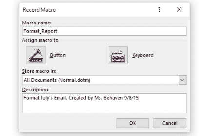

**图 1.3**

你可以使用功能区上的“开发工具”选项卡来处理宏。

以下是功能区“开发工具”选项卡（或 Access 数据库选项卡）上主要功能的功能：

- **运行宏**：只有 Access 有此选项卡。它会运行“录制宏”对话框，你可以在其中选择要执行（运行）的宏。Access 中的许多 VBA 方面是 Access 特有的，见第 28 章“理解 Access 对象模型和关键对象”。
- **录制宏**：在 Word 或 Excel 中显示“录制宏”对话框。
- **宏安全按钮**：显示“信任中心宏设置”。你将在第 19 章详细检查此功能。此按钮允许你指定是否以及如何想要启用宏。
- **Visual Basic 按钮**：切换到 Visual Basic 编辑器。你将在第 2 章“开始使用 Visual Basic 编辑器”中开始在编辑器中工作（你将在书中的大部分剩余时间里实现它）。
- **宏按钮**：打开经典的“宏”对话框，通过它你可以运行、单步（在断点模式下启动 Visual Basic 编辑器；更多信息请参阅第 3 章“编辑录制的宏”）、编辑、创建、删除或打开宏项目组织器对话框。（并非所有这些选项在所有应用程序中都可用。例如，PowerPoint 没有组织器。）Word 和 Excel 在功能区的“视图”选项卡中有类似的“宏”按钮。此按钮具有打开宏对话框的能力，但也可以开始录制宏。注意，断点模式也称为单步模式。
- **加载项**：这是你可以在此处访问模板、样式和专门的代码库的地方。
- **控件**：一组控制按钮，点击后会将用户界面组件（如下拉列表框）插入到打开的文档中。类似的组件也可以添加到你在 VBA 编辑器中创建的宏中。第 14 章“创建简单的对话框”和第 15 章“创建复杂的表单”探讨了这一界面主题。
- **设计模式按钮**：在设计模式和常规模式之间切换。在设计模式下，你可以向文档添加或编辑嵌入控件。在常规模式下，你可以正常地与控件进行交互（控件可以通过输入或鼠标点击接收用户提供的信息）。
- **属性按钮**：仅在你处于设计模式时才可用。它允许你编辑文档的属性（例如删除个人信息）。
- **XML 按钮**：“开发工具”选项卡的此部分将在第 21 至 24 章中探讨。
- **限制编辑按钮**：允许你指定允许他人执行的格式设置或编辑。
- **文档模板按钮**：在此处你可以查看或修改当前模板，以管理加载项或全局模板。

# XML 的出现

XML 已经成为存储和传输数据的行业标准。从 Office 2007 开始，Office 应用程序的文档开始广泛使用 XML。这种转向 XML 是导致 Office 2007、2010、2013 和 2016 版本创建的文档与早期版本的 Office（如 Office 2003 文档）不兼容的主要原因。因此，你必须将旧文档转换为新格式。仍使用旧版本 Office 的人员必须安装 Microsoft Office Word、Excel 和 PowerPoint 格式兼容包。注意，从 Word 2010 开始，文档文件以 `.docx` 扩展名保存，`x` 反映了 Office 现在赖以生存的基础底层 XML 格式。

# 宏的命名

接下来，在“录制”对话框的“宏名称”文本框中为新宏输入名称。名称必须符合以下规范：

- 它必须以字母开头；之后，它可以包含字母和数字。
- 长度最多为 80 个字符。
- 它可以包含下划线，这对分隔单词很有用，例如 `File_Save`。
- 它不能包含空格、标点符号或特殊字符，例如 `!` 或 `*`。

# 命名并描述你的宏

有些人坚持认为，为了正确管理你的宏集，必须遵循某些文书程序，包括为宏赋予描述性名称，并为每个宏的用途输入叙述性描述。他们声称，如果你创建了宏，就应该仔细组织它们。录制宏如此简单；你编写代码的速度非常快，以至于最后可能会堆积如山——正如南方人说的——很容易搞混哪个宏是做什么的。你可能会倾向于不给宏分配名称。

# 存储你的宏

你现在需要选择存储宏的位置。在 Word 和 Excel 中，你的选择如下：

请记住，在 Word 中，如果你想将宏的可用范围限制在当前模板（`.dotm` 文件）或文档（`.docx` 文件），请从图 1.2 中“录制宏”对话框的“存储位置”下拉列表中选择该模板或文档。如果你希望无论在何种文档工作时该宏都可用，请确保默认设置“**所有文档 (Normal.dotm)**”显示在“存储位置”组合框中。（如果你使用的不是 Word 模板，或者你看到的不是你想要的内容，请参阅本章节后半部分的“理解 Word 的 Normal.dotm、模板和文档”。）

在 Excel 中，你可以选择将宏存储在此工作簿（活动工作簿）、新建工作簿或个人宏工作簿中。个人宏工作簿是一个命名为 `.xlb` 的特殊工作簿。当你第一次选择将宏存储在个人宏工作簿时，Excel 会创建此个人宏工作簿。通过将你的宏和其他自定义设置放在个人宏工作簿中，你可以让它们适用于你的任何过程。请记住，个人工作簿类似于 Word 中命名为 `Normal.dotm` 的全局宏存储文件。如果你选择“新建工作簿”，Excel 将为你创建一个新工作簿并在其中创建宏。

Word 和 Excel 会自动将录制的宏存储在指定文档、模板或演示文稿的默认位置：

Word 将每个录制的宏存储在所选模板或文档中名为 `NewMacros` 的模块中，因此你将始终知道在哪里可以找到录制的宏。这可能会有点困惑，因为在 Visual Basic 编辑器的“项目资源管理器”窗口中可能存在多个 `NewMacros` 文件夹。（当打开了多个项目时就会发生这种情况——例如每个文档都有自己的 `NewMacros` 文件夹，用于存放嵌入每个文档的宏。）将 `NewMacros` 仅仅视为宏的区域——直到你将它们移动到具有描述性名称的另一个模块。（当然，如果你创建了几个宏并对其进行分类，你可以直接将所有内容留在 `NewMacros` 模块中。一如既往，你需要的清晰程度取决于你的组织和记忆——而且取决于你使用的剪贴板大小。）

如果不存在 `NewMacros` 模块，宏录制器会创建它。因为它将每个录制的宏创建在文档或模板中，如果录制了许多宏，`NewMacros` 模块可能会变得很大。默认模板 `Normal.dotm` 中的 `NewMacros` 模块特别容易变得臃肿，因为它会在录制之前在你指定的另一个文档或模板中创建每个指定的宏。有些人喜欢定期清理 `NewMacros` 模块，将你想要保留的录制宏放在其他模块中并丢弃任何无用或临时宏。我的宏并不多，所以我发现直接将它们留在 `NewMacros` 模块中没有问题。

Excel 将任何会话中的每个录制宏存储在一个名为 `Module n` 的新模块中，其中 `n` 是升序排列的最小未使用数字（`Module1`、`Module2`……等等）。你在下次会话中创建的宏将进入具有下一个可用数字的新模块。如果你经常在 Excel 中录制宏，你很可能需要整合（复制并粘贴）你想要保留的宏，以便它们不会分散在许多模块中。

## 录制宏

# 理解 Word 的 Normal.dotm、模板和文档

自 2007 年以来，Word 存储数据的方式与早期版本不同。首先，在 Word 2003 中，你可以创建自定义菜单和工具栏并将其存储在模板中。后续版本的 Word 不允许宏，也不允许除快速访问工具栏以外的任何工具栏。此外，自定义该工具栏具有全局影响。换句话说，对快速访问工具栏所做的任何修改在所有文档中可见，无论当前活动的是什么模板。

自 2007 年以来的 Word 版本具有三种模板：

- **遗留模板**：来自 Word 2003 及更早版本。它们具有 `.dot` 文件扩展名。如果你正在使用这些模板之一，Word 标题栏上会出现“兼容模式”字样。
- **不包含宏的模板**：使用 `.dotx` 文件扩展名。你可以在使用 `.dotx` 文件名的文档中保存宏，但宏不会保存到模板内。这种类型的模板首次出现在 Word 2010。
- **包含宏的模板**：具有 `.dotm` 文件扩展名。请记住，由于宏是由恶意人员编写的可能会像病毒一样造成破坏，Word 将宏隔离在这种特殊的模板中。`.dotx` 模板可以做到这一点，但 `.dotm` 模板具有托管宏的附加功能。

Word 具有四层架构。从底部开始，这些层是应用程序本身、全局模板（`Normal.dotm`）、文档模板，最后是文档本身（文本和格式）。这四层中的每一层都可能影响 Word 的外观和行为，但所有四层在任何给定时间并不都是激活的。

底部始终激活，是 Word 本身。这一层包含所有的 Word 对象和内置命令，例如“打开”。所有活动对象作为 Word 的快速访问工具栏、功能区等处于激活状态。这最可能是你通常看不到的默认。全局模板 `Normal.dotm` 构成第二层并始终处于激活状态。

当你启动 Word 时，它会自动加载 `Normal.dotm`，并且 `Normal.dotm` 会一直保持加载直到你退出 Word。（有一个特殊的开关可以使用——`word /n`，可以防止 `Normal.dotm` 中的宏激活，请参阅本章节后半部分的“理解 Word 的 Normal.dotm、模板和文档”。）

# 选择如何运行新宏

继续探索图 1.2 所示的“录制宏”对话框，在此时，在你命名了宏、输入了描述并选择了存储方式之后，是时候选择如何触发该宏的时候了。换句话说，你希望如何运行该宏：通过快捷键还是快速访问工具栏？优秀的打字员通常更倾向于使用**快捷键**（他们不需要把手离开键盘去够鼠标），但**按钮**至少可以提供宏用途的视觉提示，而且将鼠标悬停在按钮上还会显示宏名称。

快捷键对于那些录制中等数量宏且不进行复杂组织（从一个模块移动到另一个模块）的人非常有用。如果你创建了大量的宏并觉得需要将它们移动到其他模块，分配快捷键或按钮的实用性就会降低。这是因为从一个模块移动到另一个模块的宏会断开你分配的运行宏的任何方式。

这种限制意味着，只有当你计划在录制形式中使用该宏（而不是使用它来创建另一个宏）时，在录制之前为其分配运行方式是有意义的。如果你打算移动或重命名该宏，请不要为其分配运行方式。相反，请等宏处于最终形式后，分配运行方式。请参阅本章节后续的“如何触发宏”以获取详细信息。

就个人而言，我并没有频繁使用宏，因此为了避免前面段落和本章中描述的复杂性，我会在创建宏时直接添加快捷键，并将它们留在 `Normal.dotm` 模板中。然而，如果你面对的是更复杂的情况——例如管理大量的宏——你可能需要通过模块来管理它们。

## 使用模块管理宏

通过将宏移动到不同的模块，你可以对宏进行分组，从而更容易比较、编辑和分发它们。

要分配宏运行方式，请遵循以下说明。记住，在录制宏之前不需要分配按钮或快捷键。在 Word 和 Excel 中，你可以使用 `文件 > 选项 > 快速访问工具栏` 对话框将宏分配到快速访问工具栏上。你也可以使用 `文件 > 选项 > 自定义功能区` 对话框为宏分配快捷键（Excel 将其限制为 `Ctrl` 组合键）。PowerPoint 和 Access 不允许为宏分配快捷键。

## 从功能区运行宏

虽然在录制宏对话框中没有此选项，但你可以按照以下方法将宏添加到功能区中：

1. 在功能区上的任何位置点击右键。
2. 在菜单中点击“自定义功能区”。出现 Word 选项对话框。
3. 在“从下列命令”下拉列表中选择“宏”。
4. 在列表中点击宏名称以选择它。
5. 在右侧的标签列表中点击要放置宏的现有标签。
6. 然后点击“新建组”按钮并指定自定义组的名称。
7. 点击“重命名”按钮为新组命名。
8. 点击“确定”关闭重命名框。
9. 点击“添加”按钮添加你的宏。
10. 点击“重命名”按钮为宏提供一个易于理解的名称（可选）。
11. 点击“确定”关闭重命名对话框。
12. 点击“确定”关闭 Word 选项对话框。

## 从快速访问工具栏运行宏

以下是使用 Word 选项对话框将宏分配到快速访问工具栏按钮上的方法：


# 第一章 在办公应用程序中录制和运行宏

## 真实世界场景

## 将宏分配到 Word 快速访问工具栏

1. 在快速访问工具栏上的任何位置点击右键（它是位于功能区上方左上角的图标集），将出现菜单（如果你之前从此菜单中选择了“在功能区下方显示快速访问工具栏”，它将出现在功能区下方）。

2. 在菜单上点击“自定义快速访问工具栏”。出现 Word 选项对话框。

3. 在“命令”下拉列表中选择“宏”。

4. 在列表中点击宏名称以选择它，如图 1.5 所示。

图 1.5 在 Word 选项对话框中选择运行宏的方式

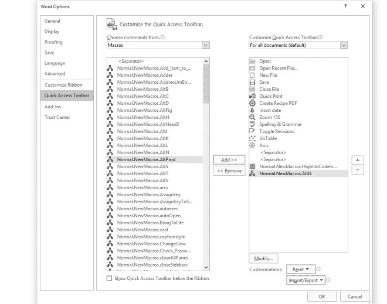

5. 点击“添加”按钮将此宏名称插入自定义快速访问工具栏列表，如图 1.5 所示。

6. Word 为该宏添加了一个按钮，赋予完全限定名称（位置加名称），例如 `Normal.CreatedDailyReport`。此宏名称由存储宏的模板或文档、包含该宏的模块名称以及宏名称组成。当你将鼠标指针悬停在其上方时，不需要所有这些信息。

7. 因此要重命名工具栏或菜单项：点击自定义快速访问工具栏列表底部的“修改”按钮（见图 1.5）。工具栏项目列表中高亮（当前已选中）的项目将是你正在修改的项。

### 宏按钮标签不需要与其宏名称匹配

注意，宏的名称（当将鼠标悬停在其上方时显示的工具提示说明）不必与 Visual Basic 编辑器或宏对话框中显示的宏实际名称有任何关系。

图 1.6

Word 为菜单项或工具栏按钮提供了宏的名称。使用此“修改”按钮将名称更改为更短、更好的名称。


## 通过快捷键组合运行宏

要将宏分配给按键组合，请遵循以下步骤：

1. 右键点击功能区并选择“自定义功能区”。这打开了 Word 选项对话框。

2. 点击此对话框底部的“自定义键盘”。

3. 向下滚动“类别”列表直到看到“宏”，然后点击“宏”进行选择。

4. 点击要分配的宏的名称。

5. 检查“当前按键”列表以查看快捷键组合是否已分配（见图 1.7）。

6. 在“新快捷键”字段中，输入你想使用的按键组合。

7. 如果是，请重新分配它，或选择不同的组合。

8. 完成后请务必点击“分配”。仅关闭此对话框不会分配你的组合键。

图 1.7 为宏设置快捷键组合

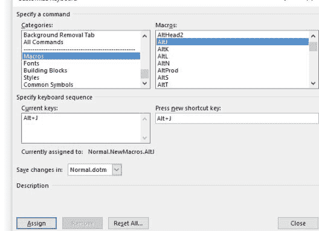

要为正在录制的宏分配 `Ctrl` 快捷键，请按照以下步骤操作：

1. 开始录制宏以显示“录制宏”对话框，然后点击快捷键 `Ctrl+` 文本框以显示闪烁的插入光标。按下你想使用的快捷键。（如果想在快捷键中包含 `Shift`，请同时按下 `Shift` 键）。

2. 在“存储宏”下拉列表中，指定你希望让宏录制器存储宏的位置。你的选项如下：

   * **此工作簿**：将宏存储在当前活动的工作簿中。此选项对于属于特定工作簿且不需要在其他地方使用的宏非常有用。

   * **新工作簿**：让 Excel 为您创建一个新工作簿并将宏存储其中。此选项对于在投入实际工作之前需要编辑的实验性宏有用。

   * **个人宏**：将宏存储在“个人宏工作簿”中，这是一个名为 `PERSO.XLB` 的特殊工作簿。通过将宏和其他自定义设置保存在个人宏工作簿中，您可以让它们在任何过程（在 `.dotm` 中）中可用。如果个人宏工作簿不存在，宏录制器会自动创建它。

3. 点击“确定”按钮开始录制宏。

## 在 POWERPOINT 中分配运行宏的方法

PowerPoint 不允许你录制宏，但你可以为在 Visual Basic 编辑器中编写的宏分配运行方法，正如本章节后“指定触发现有宏的方法”部分讨论的那样。

## 在 OUTLOOK 中分配运行宏的方法

Outlook 不允许录制宏，并且默认禁用了宏。要在 Outlook 中启用宏，请点击功能区上的“开发人员”选项卡，然后点击功能区“代码”部分左侧的“宏安全”图标。打开“信任中心”对话框。打开“对所有宏的通知”选项或“启用所有宏”。要查看如何分配运行宏的方法，请参阅本章节后部分的“指定触发宏的方法”部分。

## 录制宏中的操作

当你关闭 Word 或 Excel 中的“宏”对话框时，宏录制器开始录制宏。宏录制器会在屏幕左下角的状态栏显示“停止录制”图标（一个深灰色正方形），并在功能区“开发人员”选项卡上显示“停止录制”按钮。此外，Word 会显示一个带有鼠标指针的小磁带符号（这些磁带是在 CD 发明之前的旧时代使用的）。

现在，执行你想要录制的系列操作。你具体可以做什么取决于具体的应用程序，但通常情况下，你可以使用鼠标选择项目、在对话框中做出选择，以及在文档中选择定义项目（例如电子表格中的单元格）。你会发现有些事情是使用鼠标无法完成的，例如在 Word 文档窗口内选择项目。要选择 Word 文档中的项目，你必须使用键盘（例如 `Shift` + 方向键）。

## 宏录制器记录记录一切——完整状态

当你在对话框中做出选择并点击“确定”按钮时，宏录制器会记录该对话框页面上所有选项的当前设置。例如，当你更改 Word 中“段落”对话框中段落的左侧缩进时，宏录制器还会记录“缩进和间距”页中的所有其他设置（对齐方式、段落前后的间距等）。

在 Word 中，如果你需要执行任何未录制的操作，请点击功能区上的“暂停录制”来暂停宏录制器。该按钮将变为“继续录制”。要停止录制，请点击功能区上的“停止录制”按钮或状态栏上的另一个按钮。

宏录制器现在已记录了你的宏，并根据需要将其分配给键组合或按钮。

## 运行宏

要运行你录制的宏，你可以使用四种方法在应用程序内运行它：

* 如果你分配了快速访问工具栏按钮，请使用它。
* 如果你将宏添加到了功能区，可以使用它。
* 如果你指定了快捷键组合宏，请使用它。
* 一种较不方便的方法是按 `Alt+F8` 显示“宏”对话框，选择该宏，然后点击“运行”按钮。（或者，你也可以双击列表框中的宏名称）。

### 在编辑器中运行

你也可以从 Visual Basic 编辑器运行宏，这在你于编辑器中工作时非常有用。只需按 `F5` 即可。

## 如何执行宏

要执行宏，你可以使用上述任何方法，也可以直接从 Visual Basic 编辑器运行它。某些应用程序还提供运行宏的特定方法，例如按钮或键盘快捷键。

## 宏错误通常由错误输入引起

如果运行宏导致错误，意味着宏正在尝试执行无法实现的操作。例如，如果宏正尝试访问一个不存在的文件，或使用一个不可用的功能。在这种情况下，你需要检查宏代码并修复错误。

## 录制示例宏

在本节中，你将在 Word 中录制示例宏。按照以下步骤录制宏：

1. 按 `Ctrl+N` 创建新文档。

2. 点击功能区上的“开发人员”选项卡，然后点击“录制宏”按钮启动宏录制器。（或者你也可以点击状态栏上的录制宏按钮）。

3. 在“宏名称”文本框中输入 `Transpose_Right`。

4. 在“存储宏”下拉列表中，确保选择了“所有文档 (Normal.dotm)”，除非你想将宏分配给不同的模板。（本书中的后续示例假设此宏位于 Normal.dotm 中，所以请这样做。）

5. 在“描述”框中为宏输入描述（见图 1.8）。要具体并输入“将当前单词与右侧单词交换位置”。

6. 如果喜欢，按照下一节所述分配运行宏的方法。创建工具按钮或分配键盘快捷键。（你选择的方法或方法完全取决于个人喜好）如果你稍后需要将宏移动到不同的模块（或不同的模板或文档），请在此处不要分配运行宏的方法。

7. 点击“确定”按钮关闭“Word 选项”对话框或“自定义键盘”对话框（如果你选择不分配运行宏的方法，只需点击“确定”按钮关闭“录制宏”对话框）。现在你准备好录制宏了。功能区和状态栏上显示“停止录制”，并且鼠标指针上带有一个磁带图标。

8. 为了快速演示你如何暂停录制，请点击功能区上的“暂停录制”按钮。磁带图标从鼠标指针上消失，并且“停止录制”按钮将变为“继续录制”按钮。在文档中输入一行：The quick brown fox jumped over the lazy dog（敏捷的棕色狐狸跳过了那只懒狗）。将插入点位于单词 quick 的任意位置，然后点击功能区上的“继续录制”按钮以重新激活宏录制器。

9. 按照以下步骤录制宏的操作：

   a. 使用 Word 的扩展选择功能，通过按两次 `F8` 键选择单词 quick。

   b. 按 `Esc` 取消扩展模式。

   c. 按 `Shift+Delete` 将选中的单词剪切到剪贴板。

   d. 插入点现在位于单词 brown 的开头。按 `Ctrl+右箭头` 将插入点向右移动一个单词，使其位于单词 dog 的开头。

   e. 按 `Shift+Insert` 或 `Ctrl+V` 粘贴剪贴板中剪切的内容。

   f. 按 `Ctrl+左箭头` 将插入点向左移动一个单词。这将光标恢复到原始位置。

10. 点击功能区或状态栏上的“停止录制”按钮。你的句子现在显示为：“The brown fox jumped over the lazy dog.”

你可以通过在应用程序的帮助系统中搜索“键盘快捷键”来查找内置快捷键（如 `Ctrl+左箭头`）的完整列表。（在 Office 2016 中，你只需使用功能区上的“告诉我你想做什么”功能即可）

你现在可以使用分配的工具栏按钮或键盘快捷键（如果你选择了分配一个的话）来运行此宏。或者，点击“开发人员”选项卡中的“宏”按钮，并在“宏”对话框中运行宏。

此时，Word 已将宏存储在 Normal.dot 中。如果你在退出 Word 之前（或在自动备份发生之前）不保存宏，Word 默认不会提示你保存它们。它会自动保存。但最好点击“文件”选项卡中的“保存”按钮现在存储 Normal。这样，如果 Word 或 Windows 崩溃，你将丢失该宏。

Word 默认会自动保存添加到 Normal 模板的新宏。但如果你希望 Word 提示你保存对 Normal 模板的任何更改，请选择“文件”选项卡上的“选项”，点击“高级”按钮，并向下滚动直到看到“保存”选项部分。勾选“保存 Normal 模板前提示”框，然后点击“确定”按钮。

## 录制示例 Excel 宏

在接下来的章节中，你将录制示例 Excel 宏。此宏创建一个新的工作簿，其中输入一系列月份，然后保存。你将在第 3 章中再次使用此宏，因此不要删除它。

## 创建个人宏工作簿

如果你在 Excel 中尚未拥有个人宏工作簿，则你需要在创建此过程之前先创建一个。（如果你已经有了个人宏工作簿，请跳到下一节。）按照以下步骤操作：

1. 点击功能区上的“开发人员”选项卡，然后点击功能区上的“录制宏”按钮（或直接点击状态栏上的“录制宏”按钮）显示“录制宏”对话框。

2. 为稍后要删除的宏接受默认名称。

3. 在“存储宏”下拉列表中，选择“个人宏工作簿”。

4. 点击“确定”按钮关闭“录制宏”对话框并开始录制宏。

5. 在任意活动单元格中输入一个简单的字符，并按 `Enter` 键。

6. 点击功能区或状态栏上的“停止录制”按钮停止录制宏。

7. 点击“视图”选项卡上的“取消隐藏”按钮显示“取消隐藏”对话框。选择 `PERSONAL.XLSB` 并点击“确定”按钮。

8. 点击功能区上的“开发人员”选项卡，然后点击功能区上的“宏”按钮显示“宏”对话框。

9. 选择你录制的宏并点击“删除”将其删除。在确认消息框中点击“是”按钮。

你现在已让 Excel 生成了一个你可以使用的全局宏工作簿。

## 录制宏

要录制此宏，启动 Excel 并按照以下步骤操作：

1. 选择“文件” > “新建” > “空工作簿”。

2. 点击功能区上的“开发人员”选项卡，然后点击功能区上的“录制宏”按钮（或直接点击状态栏上的“录制宏”按钮）。显示“录制宏”对话框，如图 1.9 所示，已输入信息。

3. 在“宏名称”文本框中为宏输入名称：`Add_Months`。

4. 在“快捷键”框中输入快捷键。

5. 在“存储宏”下拉列表中，选择“个人宏工作簿”。

6. 为宏输入描述。

7. 点击“确定”按钮关闭对话框。

8. 点击功能区或状态栏上的“停止录制”按钮。

现在测试新宏。选择“文件” > “新建” > “空工作簿”。在“开发人员”选项卡上，点击“宏”按钮打开“宏”对话框。双击 `PERSONAL.XLSB|Add_Months`。你应该看到月份填充到了工作簿。你可以删除创建的工作簿。它们不再需要了。只需点击右上角的 X 关闭它们，并选择“不保存”。但要保存 `PERSONAL.XL` 工作。

## 指定运行现有宏的方法

如果你在录制时没有分配运行宏的方法，你现在可以通过此处描述进行分配。

## 将宏分配到 Word 快速访问工具栏

将宏分配到快速访问工具栏，请遵循以下步骤：

1. 右键点击快速访问工具栏上的任意位置（它是功能区上方的图标组）。会出现一个菜单。

2. 点击菜单上的“自定义快速访问工具栏”。出现“Word 选项”对话框。

3. 在“从下列选择”下拉列表中，选择“宏”。

4. 选择要分配按钮的宏名称。

5. 点击“添加”按钮将宏名称复制到右侧按钮列表中。

6. 如果你想分配不同的图标或修改按钮名称，请点击“修改”按钮。

7. 点击“确定”关闭对话框。

## 将宏分配到快捷键组合

## 删除宏

要删除你不再需要的宏，请遵循以下步骤：

1. 按 `Alt+F8` 显示“宏”对话框。

2. 在“宏名称”列表框中选择宏。

3. 点击“删除”按钮。

4. 在出现的警告消息框中点击“是”按钮。

5. 点击“关闭”按钮或“取消”按钮关闭“宏”对话框。

## 在 Word 中通过“组织器”对话框组织宏

支持 VBA 的应用程序需要你使用 Visual Basic 编辑器（将在下一章讨论）将代码、用户表单和其他代码项从一个文件移动到另一个文件。（代码模块是用于存储宏的虚拟容器。用户表单是调用“组织器”对话框的有用工具，你可以通过它直接在界面中复制、移动、重命名和删除代码模块、用户表单以及代码项，而无需打开 Visual Basic 编辑器。）

如需使用“组织器”对话框，请按照以下步骤操作：

1. 在 Word 中，按 `Alt+F8`。

2. 点击“组织器”按钮显示“组织器”对话框；如果没有自动显示“宏项目项”页面（如图所示），请点击“宏项目项”。

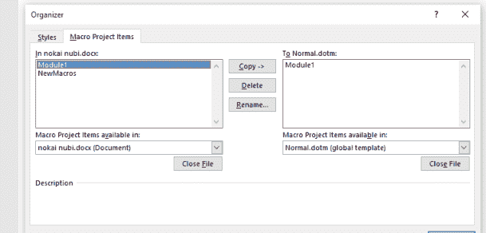

3. 查看两个列表框上方输出中列出的两个文档或模板。通常，左侧框显示活动文档，右侧显示 Normal.dotm。更改这些内容，使其中一个框显示你想要复制或移动的代码所在的文档或模板，另一个框显示目标文档或模板。（如果你只想删除或重命名代码项，则只需要“组织器”对话框列出包含这些项的文档或模板即可。）如需更改列出的文档或模板，请点击对应侧列表框下方的“关闭文件”按钮。“关闭文件”按钮将变为“打开文件”按钮。点击此按钮显示“打开”对话框，导航并选择你需要的文档或模板，然后点击“打开”按钮。“打开”对话框将默认指向“模板”文件夹。

### 核心要点

4. 然后你可以删除、重命名、复制和移动宏项目项。以下列表详细说明了操作方法：

* 要从模板中删除一个或多个宏项目项，从“组织器”对话框的任一面板选择一个或多个项，并点击“删除”按钮。在确认消息框中点击“是”。其他模板中该项目的任何副本不受影响。

* 要重命名宏项目项，从任一面板选择该项并点击打开“重命名”对话框。输入新名称并点击“确定”按钮。其他模板中相同项目的任何副本不受影响。

* 要从一个模板复制一个或多个宏项目项到另一个模板，在“组织器”对话框中打开模板。从对话框的任一面板选择要复制的一个或多个项（“复制”按钮上的箭头方向会变为指向另一侧）。点击“复制”按钮。如果目标模板包含提示提示无法复制你正在复制的项，Word 将显示警告消息，告诉你如果你仍想继续正在复制的项目或与目标模板同名的项目，请执行复制操作。

* 要将宏项目项从一个模板移动到另一个模板，按照上段描述复制它，然后从源删除该宏项目项。

5. 一旦删除、重命名、复制或移动了宏项目项，点击“关闭”按钮关闭“组织器”对话框。如果 Word 提示保存对当前 Word 会话未打开的受影响文档或模板的更改，请点击“是”按钮。

### 核心总结

**录制宏。** 创建宏最简单的方法就是直接录制。你输入的或点击的任何内容——你所有的行为——都会自动转换为 VBA 并保存为宏。

**掌握它。** 在 Word 中开启宏录制器，并创建一个让光标向上移动三行的宏。然后关闭宏录制器并测试新宏。

**将宏分配给按钮或键盘快捷键。** 你可以通过三种方便的方法触发宏：点击功能区上的条目、点击工具栏上的按钮或使用键盘快捷键。

**运行宏。** 你可以通过功能区上的条目、点击工具栏上的按钮或使用键盘快捷键（如 `F5`）来触发宏。

**掌握它。** 在 Visual Basic 编辑器中运行宏。

**删除宏。** 在 Visual Basic 编辑器中删除，或者通过键盘快捷键（如 `Alt+F8`）进入对话框来删除。

**掌握它。** 在 Visual Basic 编辑器中执行删除操作。

# 第二章 使用 Visual Basic 编辑器

## 学习使用 Visual Basic 编辑器

所有支持 VBA 的应用程序都使用 Visual Basic 编辑器，无论你使用哪种应用程序，其界面都是相同的。

本章涵盖了 Visual Basic 编辑器的基础知识：它的组件以及如何使用它们。

本章还将向你展示如何自定义 Visual Basic 编辑器，以使其更符合你的喜好。

在本章中，你将学习以下内容：

* 打开 Visual Basic 编辑器
* 在 Visual Basic 编辑器中打开宏
* 理解 Visual Basic 编辑器的窗口
* 为项目设置属性
* 自定义 Visual Basic 编辑器

## 打开 Visual Basic 编辑器

你可以从正在使用的应用程序内部打开 Visual Basic 编辑器。例如，如果你在 Word 中工作，就从 Word 中打开。打开的 Visual Basic 编辑器实例与 Word 相关联。

然而，你也可以打开多个 Visual Basic 编辑器实例。例如，如果你已经在 Word 中打开了一个实例，你可以在 Excel 或 Access 中打开另一个。

你可以通过两种方式打开 Visual Basic 编辑器：


- 选择你想编辑的宏。应用程序随后打开 Visual Basic 编辑器并显示该宏，以便你工作。
- 直接打开编辑器并找到你想操作的代码。

接下来的两个部分将演示打开 Visual Basic 编辑器的两种方法，第三部分将展示如何导航到宏。

# 选取宏打开 Visual Basic 编辑器

如果你知道要处理的宏名称，可以使用此方法打开 Visual Basic 编辑器并显示该宏。此示例使用 Word 打开你在第一章“在办公应用程序中录制和运行宏”中录制的 `Transpose_word_Right` 宏：

1. 如果 Word 尚未运行，请打开它。
2. 按 `Alt+F8` 显示宏对话框。
3. 选择 `Transpose_word_Right` 宏并点击“编辑”按钮。Word 将打开 Visual Basic 编辑器并显示该宏，如图 2.1 所示。

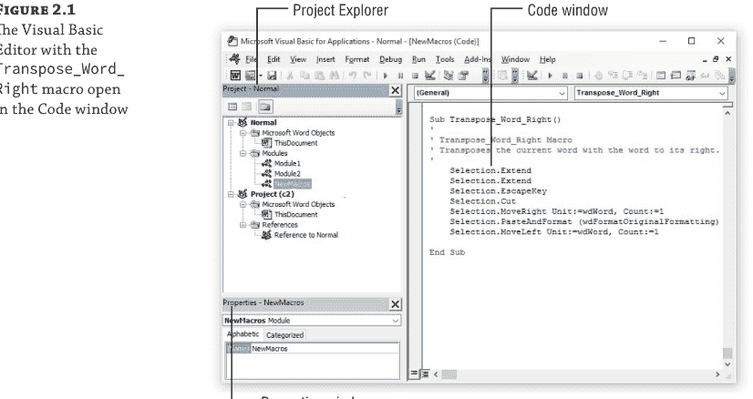

4. 选择“文件”>“关闭并返回到 Microsoft Word”，以便你可以使用下一节描述的方法打开它。

# 直接打开 Visual Basic 编辑器

要直接打开 Visual Basic 编辑器，请按照以下步骤操作：

1. 打开或激活宿主应用程序。在本例中，打开或切换到 Word。
2. 按 `Alt+F11`。Visual Basic 编辑器打开。

# Visual Basic 编辑器会记住它的代码窗口

根据 Visual Basic 编辑器上次关闭时的状态，你可能会看到一个或多个代码窗口已打开。例如，如果你在上一节中留下的 `NewMacros` 模块的代码窗口处于打开状态，那么 Visual Basic 编辑器将再次显示此代码窗口。

如果你没有看到属性窗口（见图 2.1），请按 `F4`。你很快就会学更多关于重要窗口的知识。

# 导航到宏

打开 Visual Basic 编辑器后，使用项目管理器面板（如图 2.1 左侧所示）导航到你的宏。在 Visual Basic 编辑器中工作时，你也使用项目管理器在项目和模块之间进行导航。

# 项目管理器类似于 Windows 资源管理器的文件夹视图

当你查看文件夹和子文件夹时，项目管理器面板的作用类似于标准的 Windows 资源管理器。根据你所使用的应用程序，树形结构中将显示不同的项目（本章稍后将介绍）。

要导航到 `Transpose_Word_Right` 宏，请按照以下步骤操作：

1. 在 Visual Basic 编辑器左上角的项目管理器面板中，点击 `Normal` 名称旁边的 `+` 号来展开 `Normal` 条目（代表 `Normal.dotm`，即 Normal 模板）。如果 `Normal` 条目已经展开，请跳过此步。
2. 双击 `Modules` 条目将其展开。
3. 双击 `NewMacros` 模块（这是全局模块，Word 会自动在该模块存储宏，除非你在“录制宏”对话框中指定不同的位置）。Visual Basic 编辑器会在右侧的代码窗口中显示该模块的内容，如图 2.1 所示。

如果该模块包含多个宏，你还需要选择想要操作的宏——在这种情况下，是 `Transpose_Word_Right` 宏。（如果你只录制了 `Transpose_Word_Right` 宏，则代码窗口中只会出现此宏。）要选择宏，请使用以下方法之一：

- 在代码窗口中，从 `Procedure`（过程）下拉列表中选择宏，如图 2.2 所示。（如果你在释放列表之前将鼠标指针悬停在列表上，将看到一个显示其名称的提示框：`Procedure`。）

# 图 2.2

如果模块包含两个或多个宏，请滚动到你想要编辑或选择的宏，或者从这个 `Procedure` 下拉列表中选择它。

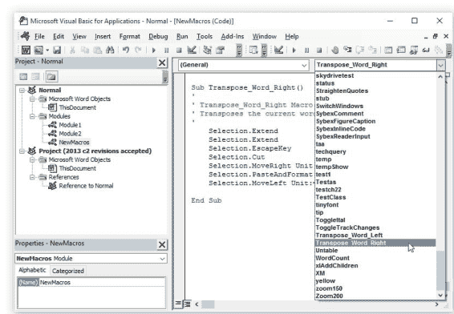

使用滚动条找到你想要编辑的宏，该宏通过单词、你给的名字以及一对括号来标识——在这种情况下，是 `Sub Transpose_Word_Right()`。

# 最大化你的代码窗口

默认情况下，代码窗口以“正常”大小显示。换句话说，它周围有灰色背景，没有填满代码窗口区域。这允许你在代码窗口区域内打开其他代码窗口。然而，对我来说那有点太琐碎了，因此我将始终以最大化的方式显示代码窗口，如图 2.1 和 2.2 所示。这更容易查看代码。要只显示一个最大化的代码窗口，请点击代码窗口的最大化按钮，它位于关闭窗口的红色 `X` 按钮左侧。

# 使用 Visual Basic 编辑器的主窗口

在接下来的章节中，你将学习如何使用 Visual Basic 编辑器的主窗口。

# 项目管理器

项目管理器是用于在 Visual Basic 编辑器中导航各种对象的工具。图 2.3 显示了以 Word 为宿主应用程序的 Visual Basic 编辑器会话的项目管理器。

根据宿主应用程序及其功能，每个项目可以包含以下元素的部分或全部。（但不必担心类模块、链接库等项目——我们将在后面的章节中探索它们。）

# 图 2.3

使用项目管理器导航到你想要操作的模块。

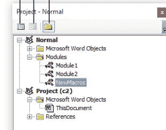

- 包含宏、过程和函数的 `Modules`。
- 类模块（定义对象、属性和值的专用模块）。
- 对其他项目或库文件的引用（例如 `DLL`——动态链接库）。
- 与项目相关的对象。例如，Word 文档和模板包含一个 Microsoft Word 文件夹，其中包含一个名为 `ThisDocument` 的类对象，让你能够访问文档或模板的属性和事件（对象可以反应的动作，如点击）。每个 Excel 工作簿都包含一个名为 `ThisWorkbook` 的类对象，让你能够访问工作簿的属性和事件，以及每个工作表的 `Sheet` 对象（命名为 `Sheet1`、`Sheet2` 等）。对于大多数应用程序，每个打开的文档和模板都被视为一个独立的项目，并显示为项目树中的根节点。项目树还包含任何全局宏存储内容——如 Word 中的 `Normal.dotm` 模板或 Excel 中的个人宏工作簿——以及任何加载的加载项。

例如，在图 2.3 所示，`Normal` 被标识为 `Normal`，活动文档被标识为活动文档。

# 随时更改项目名称

你可以使用项目属性对话框（后文将讨论）或通过选择项目并在属性窗口中输入新名称来更改项目名称（如图 2.1 所示）。

你通过点击项目左侧的 `+` 号来展开视图，并点击 `-` 号来收叠视图。Visual Basic 编辑器提供了在各种元素之间快速高效的导航，可以使用 `NewMacros` 中的所有宏。要关闭项目管理器，点击其关闭按钮（标题栏上的按钮）。要显示项目管理器，可以按 `Ctrl+R` 或选择“查看”>“项目管理器”。

**查看代码** 显示所选对象的代码窗口。例如，如果你在项目管理器中选择表单并点击代码按钮，Visual Basic 编辑器将显示该表单的任何代码。如果你在项目管理器中选择模块或类模块并点击代码按钮，Visual Basic 编辑器将显示该模块的代码。你也可以右键点击项目管理器中的项目并在右键菜单中选择“查看代码”。代码是编程的同义词——为了让计算机某种方式而输入的命令序列。代码有时被称为编程代码或源代码。注意编程中使用的词汇——作为 VBA 编程语言的 `Selection` 或 `End` 等有多种同义词：语句、关键字、命令等。在本书中，我经常使用通用术语。

# 双击模块查看其代码

对于模块或类模块，你也可以双击对象来查看其代码。这通常比选择它然后点击代码按钮要快。对于表单或文件，双击会显示“查看对象”选项（下文将讨论）而不是“查看代码”选项。

“查看对象”显示包含所选对象的窗口。在选择可以显示的对象（如表单或文件或对象内部）之前，“查看对象”按钮将保持禁用状态。如果所选对象是表单，点击“查看对象”按钮将显示表单；如果所选对象是文件或文件内部的对象，点击“查看对象”按钮将在宿主应用程序的窗口中显示。

# 使用 Visual Basic 编辑器的主窗口

例如，对于 Word 文档的 `Document` 对象，点击“查看对象”按钮就会切换到 Word 窗口中的实际 Word 文档。在 Excel 工作簿中选择一个 `Sheet` 对象并点击“查看对象”按钮，会在 Excel 窗口的 Excel 工作表中显示该工作表。

# 查看对象

你也可以通过右键点击对象并在快捷菜单中选择“查看对象”，或双击支持“查看对象”功能的对象来触发查看对象模式。（如果对象不支持“查看对象”功能，双击将触发“查看代码”模式。）

“切换文件夹”用于切换项目资源管理器中对象的视图，分为“文件夹视图”（显示按其项目和文件夹分组的显示的视图）和“内容视图”（仅显示项目内的对象——不显示文件夹）。

图 2.4 的左部分显示了按文件夹视图排序的应用程序项目管理器，右部分显示了相同情况在内容视图下的项目管理器。你会在文件夹视图或内容视图上花费更多时间，取决于屏幕大小、你在任何特定项目中放置的对象数量以及你的思维方式——并不一定取决于上述顺序。对于许多目的，你可能需要在文件夹视图和内容视图之间切换，以便最容易地定位对象。

# 图 2.4

文件夹视图（左）将对象显示为包含它们的文件夹项目。内容视图（右）仅显示对象以及包含它们的项目。

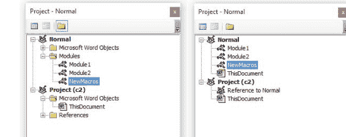

项目管理器有多种用途，这是一直保持它打开状态的好理由。除了导航到你需要处理的项目外，你还可以通过项目管理器执行以下附加任务：

- 向项目添加或从项目中移除组件。例如，你可以使用项目管理器向项目添加模块（`module`）或用户窗体（`user form`）。
- 比较一个项目的组件与另一个项目的组件。当你需要快速建立两个或多个项目之间的差异时（例如，你的公司模板参考副本与用户正在添加内容的副本之间），这种比较非常有用。
- 将项目从一个项目移动到另一个项目。你可以从项目管理器中将代码模块、类模块或用户窗体从一个项目拖到另一个项目，从而将其从 Visual Basic 编辑器的一个实例中的项目管理器复制到另一个实例的项目管理器中。例如，你可以从由 PowerPoint 托管的 Visual Basic 编辑器会话拖动用户窗体进行复制。然而，你不能复制或移动特定于特定对象模型的对象；例如，你不能将 Excel 表格拖入 Word 的项目管理器，因为 Word 不支持该类型的对象。
- 从项目导入或导出代码模块或用户窗体。

# 项目管理器是你的最佳视图

许多你通过项目管理器执行的操作，也可以通过 Visual Basic 编辑器的菜单项来执行。总的来说，项目管理器提供了在 Visual Basic 编辑器中导航最简单的方法，特别是当你同时打开了复杂项目时。你可以通过在项目管理器中右键点击对象来显示上下文菜单，从而访问该对象最常用的功能。

# 对象浏览器

Visual Basic 编辑器提供了一个完整的对象浏览器，用于在 VBA 中处理对象。你将在第 8 章“查找所需的对象、方法和属性”中查看对象浏览器的详细信息，并在本书的最后部分检查各种 Office 应用程序的对象模型。在此，请快速查看图 2.5，它提供了 VBA 会话的对象浏览器。左侧面板选中了 `Document` 对象，右侧面板中出现了它的属性列表（要在你的 VBA 编辑器中查看此内容，请按 `F2`）。

你会发现许多属性根据你对 Word 文档的常识就能立即理解。例如，正如你预期的，`AttachedTemplate`（附加模板）告诉你是用哪个模板创建该文档的。同样，`Bookmark`（书签）属性包含文档中任何对象的信息。属性信息显示在对象浏览器的底部。BASIC 语言（VBA 是其变体）以及 Office 应用程序底层对象库的伟大之处之一，它们通常使用普通的英语术语。

# 代码窗口

你将在 Visual Basic 编辑器的代码窗口中完成测试和编辑宏的大部分实际工作。由于代码是用文本编写的，你可以简单地在记事本中编写它，并粘贴到代码编辑器中进行测试和调试。然而，Visual Basic 编辑器提供了许多实用编程工具，只有少数天才才能在没有编辑器帮助的情况下，仅凭尝试就轻松获得良好结果。

# 图 2.5

对象浏览器提供了查找对象及其属性的方法。在这里你可以看到 `Document` 对象中包含的属性。

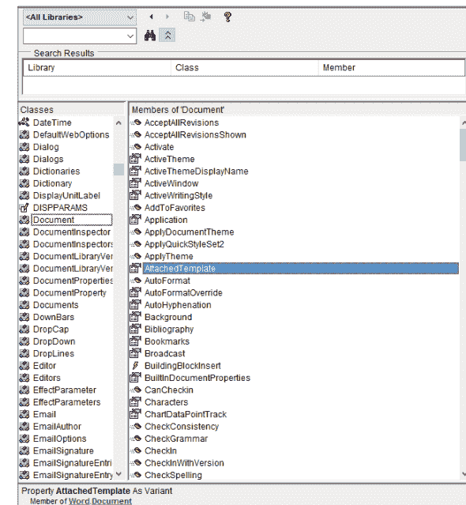

# 图 2.6

你在代码窗口中编辑宏。

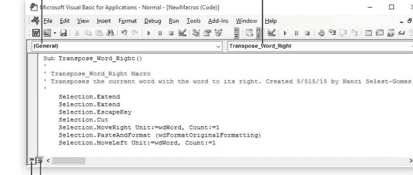

Visual Basic 编辑器提供独立的代码窗口。

# 代码窗口下拉列表

正如从图中所示，

- 左上角的下拉列表提供了：
- 右上角的下拉列表提供了：
- 右下角的下拉列表提供了：
- 左下角的下拉列表提供了：

# 完整单词

正如从图中所示，

- 左上角的下拉列表提供了：
- 右上角的下拉列表提供了：
- 右下角的下拉列表提供了：
- 左下角的下拉列表提供了：

# 图 2.7

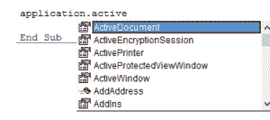

# 图 2.8

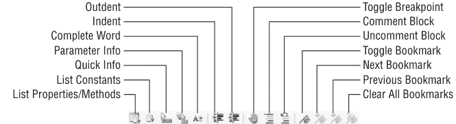

# 快速信息

快速信息功能通过显示提示显示当前所选变量、函数或方法的语法。如果你输入类似 `MsgBox` 的命令并按下空格键，提示将显示所有元素和可选元素。可选元素包含在方括号中。

```
MsgBox(Prompt, [ButtonsStyle=vbOKOnly], [Title], [Context] As Vb)
```

# 图 2.9

使用编辑器的快速提示查看语法。


# 自动列表成员

许多 VB 命令具有属性（性质）和方法（行为）。合起来，对象的属性和方法被称为它的成员。例如，消息框可以显示各种图标（如问号、感叹号等），以提示用户消息的目的（问题、警告等）。该图标就是消息框对象的 `Buttons` 属性。该属性紧接代码行文本之后。因此，当我输入命令来指示现在要为我的消息框指定图标时，自动列表成员提供了可用选项的下拉列表。正如图 2.10 所示，选择 `vbOKOnly`，还有 `vbCancel`、`vbQuestion` 等。

# 图 2.10

使用自动成员列表快速、准确地输入代码项。

```
msgbox("Hello, Marvin:")
vMsgBoxPrompt(Answer As Vb) As VbMsgBoxResult
  vbMsgBoxvbReading
  vbMsgBoxvbForeground
  vbCancel
  vbQuestion
  vbRetryCancel
```

自动成员列表允许你完成代码行。自动成员列表默认开启，并且当你在对象描述中输入点，或者在代码行中输入逗号、括号或标点符号时，它会自动显示。注意图 2.10，我输入了一个消息框命令，紧接着是文本 `Hello, Marvin`，然后是一个逗号。一旦我输入逗号，按钮（`Buttons`）的设置列表就会出现（这些设置被称为常量）。

或者，你也可以通过点击编辑工具栏上的“列表属性/方法”按钮来显示列表。

要使用自动成员列表将你的选择插入代码中，请遵循以下步骤：

1. 按下向下箭头键滚动到相应的属性或方法，或使用鼠标滚动（见图 2.10）。你也可以输入属性或方法名称的前几个字母直接跳转到它。
2. 通过以下操作之一将属性或方法输入代码中：
   a. 如果你想在输入属性或方法后继续在该代码行添加内容，请按 `Tab` 键，或双击该属性或方法。（该行上可能还有你想要指定的其他可选属性。）
   b. 如果你想在输入属性或方法后开始新行，请按 `Enter` 键。

# 列表常量

列表常量功能会弹出一个列表选择框，其中包含你已输入的属性常量，以便你快速完成表达式。列表常量默认开启。或者，你也可以通过点击编辑工具栏上的“列表常量”按钮来显示列表。

要使用列表常量（见图 2.11），请遵循以下步骤：

1. 在代码窗口中输入 `Assistant.Animation =`。常量将如图 2.11 所示显示。
2. 按下 `↓`（向下箭头）滚动到你需要的常量，或输入它的首字母（或前几个字母），或使用鼠标滚动。
3. 通过以下操作将常量输入代码中：
   - a. 如果你想在输入常量后继续在同一行工作，请按 `Tab` 键，或双击该常量。
   - b. 如果你想在输入常量后开始新行，请按 `Enter` 键。

# 图 2.11

列表常量功能为你节省了时间和精力，特别是在输入复杂常量时。

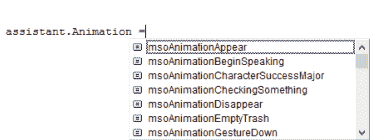

# 提示

数据提示功能会在 Visual Basic 编辑器处于断点模式（`Break mode`，你用于测试和调试宏的模式，将在本书稍后部分描述）时，显示鼠标指针悬停处的屏幕提示。图 2.12 显示了一个示例。数据提示默认开启，但你可以通过选择“工具”>“选项”切换它以及其他功能。

# 图 2.12

在运行或单步执行代码时，使用数据提示检查变量的值。


# 第 2 章 开始使用 Visual Basic 编辑器

## 立即窗口

除了项目管理器和代码窗口外，Visual Basic 编辑器还包含许多默认不显示的窗口。其中三个窗口是属性窗口、对象浏览器（在本章较早部分已描述）以及图 2.14 所示的立即窗口。立即窗口是一个微小、无装饰的窗口，你可以将其作为一个虚拟草稿纸，输入你想运行的代码行，而无需将它们输入实际宏中。当你在立即窗口输入一行代码并按回车键时，Visual Basic 编辑器会执行该代码。你将在第 5 章“理解 VBA 语法要点”讨论 VBA 语言时使用立即窗口。

### 图 2.14 使用立即窗口进行即时工作和获取信息

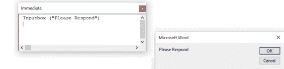

要显示立即窗口，请按 `Ctrl+G` 或选择“查看” > “窗口”（View Immediate Window）。

> **在调试期间显示变量状态**

你还可以使用立即窗口显示信息，帮助你在代码执行时检查变量和表达式的值。这是通过使用示例中的 `Debug.Print` 命令实现的，它会在立即窗口中显示变量 `x` 的值：

```
Sub ShowDebug()

Dim x As Integer
x = 12

Debug.Print x

End Sub
```

## 设置项目属性

每个 VBA 项目都有若干个可以设置的属性，包括项目名称、描述以及是否锁定以防止查看。要检查或设置项目的属性，请在项目管理器中右键点击该项目或其任一组件，并在右键菜单中选择“项目属性（Project Properties）”项，以显示项目属性对话框。

菜单项和生成的对话框都通过项目的描述来标识——例如，Word 模板的属性对话框被标识为“TemplateProject—项目属性”，而 Excel 工作簿的属性对话框被标识为“VBAProject—项目属性”。图 2.15 显示了 Excel 工作簿项目的属性对话框。

### 图 2.15 VBAProject - 项目属性

使用属性对话框查看和设置项目属性，并锁定项目以防止更改。

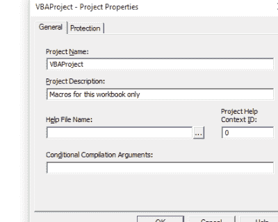

以下是在项目属性对话框的“常规（General）”选项卡上可以进行的操作：

- 在“项目名称（Project Name）”文本框中设置项目名称。此名称在对象浏览器以及需要时的 Windows 注册表中标识该项目。确保名称唯一，以避免与其他任何项目发生冲突。从技术上讲，项目名称是项目类型库的名称（*类型*库描述了项目所包含的对象——例如模块和用户表单）；它用于构建项目内类的完全限定类名（这将在本书稍后部分讨论）。项目名称可以包含下划线，但不能包含空格。

- 在“项目描述（Project Description）”文本框中输入项目描述。此描述出现在对象浏览器的“描述”窗中，帮助用户理解项目内容。请尽可能简洁且具有描述性。

- 通过在“帮助文件名（Help File Name）”文本框中输入帮助文件的名称和路径来指定项目的帮助文件。点击帮助文件名文本框右侧带有省略号 (...) 的按钮显示帮助文件对话框。选择文件并点击“打开”按钮将帮助文件名输入到文本框中。（或者，你也可以手动输入或粘贴名称和路径）。

- 在“帮助上下文 ID（Help Context ID）”框中指定项目的帮助上下文。*帮助上下文*指的是帮助文件中的某个位置。默认帮助上下文为 0，这会导致帮助文件显示其打开屏幕（与你从“运行”对话框运行帮助文件或通过在资源管理器中双击文件时看到的屏幕相同）。你可以指定不同的帮助上下文将用户带到特定主题——例如，与他们正在查找的项目更相关的主题。

- 指定项目所需的任何条件编译参数，但大多数项目并不需要。它允许你根据在该对话框中指定的内容创建不同版本的 VBA 项目。就个人而言，我觉得这样做收益不比代价——而且令人困惑。我宁愿创建项目的多个版本。如果你对这个主题感兴趣，可以查看这里：

https://msdn.microsoft.com/en-us/library/x435tkkb(v=vs.98).aspx

以下是在图 2.16 所示的项目属性对话框的“保护（Protection）”选项卡上可以进行的操作：

- 勾选“锁定项目以便查看（Lock Project For Viewing）”复选框，防止他人在不知道密码的情况下打开、查看和更改项目。

- 在“查看项目属性密码（Password To View Project Properties）”组框中，在“密码（Password）”文本框中为项目输入密码，然后在“确认密码（Confirm Password）”文本框中输入相同的密码。点击确定并关闭项目。现在，如果不知道密码，没人可以打开或查看（更不用更改）该项目。在 Office 2007 之前，Office 的安全性很弱且很容易破解。现在使用了先进的加密技术，但密码仍然可以破解，尽管难度大得多。更多信息请见第 19 章。

### 图 2.16 VBAProject - 项目属性

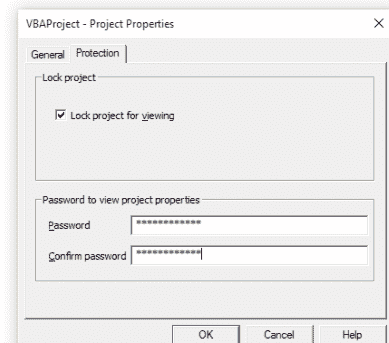

## 自定义 VBA 编辑器

考虑到你可能会在 VBA 编辑器中花费大量时间，你应该对其进行自定义，以便尽可能高效舒适地工作。以下章节解释了你的选项：

### 自定义对所有应用程序有效

你对 VBA 进行的任何自定义都适用于所有应用程序。例如，如果你更改了一个 VBA 编辑器实例中的字体，那么 Word、PowerPoint 等的字体也会随之更改。

### 选择编辑器和视图偏好

要开始选择编辑器和视图偏好，选择“工具（Tools）” > “选项（Options）”来打开选项对话框（见图 2.17）。

### 图 2.17 选项对话框

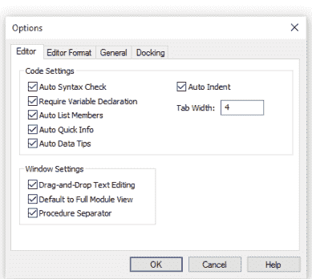

## 编辑器页面选项

- **自动语法检查（Auto Syntax Check）**：控制 VBA 在自动检查你的代码行语法时，当发现错误是否显示警告消息框。（在编写本文时，此功能在 Office 2016 中无法使用）。一些人发现此功能很有用，因为 VBA 会立即指出在运行或调试代码之前可能未被发现的错误。但如果你的风格是在行之间移动并最终在方便时处理所有行，你可能希望关闭此功能，以防止 Visual Basic 编辑器针对你已知但想稍后修复的错误不断弹出消息框。

> **错误行始终会显示为红色**

即使你关闭了自动语法检查，Visual Basic 编辑器仍然会将任何错误的代码行标为红色以引起你的注意。它只是不再通过显示错误警告的消息框来中断你。

- **强制变量声明（Require Variable Declaration）**：控制是否必须显式声明变量。显式声明变量比隐式声明要多花一点精力，但许多人认为这是一个良好的习惯，并在日后让你受益——因此，除非你有强烈的偏好，否则请务必勾选此框。（第 6 章“处理变量、常量和枚举”将讨论如何处理变量。）

## 自动列表

在本章前面介绍过，此选项控制“自动列表成员”和“列表常量”是否会在你在代码窗口中工作时自动建议属性、方法和常量。大多数人发现这些功能很有帮助，但也有一些经验丰富的程序员会关闭这些功能，因为他们已经非常熟悉自己所需的全部属性、方法和常量，并且不希望被繁忙的界面分心。

- **自动快速信息（Auto Quick Info）**：此选项控制快速信息功能，当你在代码窗口中操作函数时，该功能会自动显示有关函数及其参数的信息。

- **自动数据点（Auto Data Tips）**：此选项控制 Visual Basic 编辑器在断点模式下，将鼠标指针悬停在变量或表达式上时显示屏幕提示（ScreenTips），让你能够快速检查变量或表达式的值。（或者，你也可以使用本地、立即窗口或监视窗口，但它们会占用更多空间。）

- **自动缩进（Auto Indent）**：决定在你缩进一行代码后，Visual Basic 编辑器是否缩进后续行。开启自动缩进时，Visual Basic 编辑器会让每一行新代码从相同的级别开始（与上一行具有相同的制表符数、空格数或两者的组合）。关闭自动缩进时，Visual Basic 编辑器会让每行新代码从代码窗口的左边距开始。自动缩进可以节省时间，尽管这意味着如果你需要减少新行的缩进级别，必须按下 `Shift+Tab`、点击编辑器工具栏上的 Out 按钮，或者删除制表符或空格。

- **制表符宽度（Tab Width）**：设置制表符中的空格数。你可以从 1 到 32 个空格之间进行调整。默认设置为 4 个空格，这对于默认字体效果良好。如果你选择使用比例字体（如 Times 或 Arial）而不是等宽字体（如默认的 Courier）编写代码，可能希望增加制表符代表的空格数，以清晰代码中的缩进级别。

- **拖放文本编辑（Drag-and-Drop Text Editing）**：控制 Visual Basic 编辑器是否支持拖放。大多数人发现此功能很有用。你可以在代码窗口中移动代码部分，或从一个窗口拖到另一个窗口。你还可以将代码拖入立即窗口，或将表达式拖入监视窗口。

- **默认全视图（Default To Full View）**：控制 Visual Basic 编辑器是将所有过程显示在一个列表中（全模块视图），还是一次显示一个（过程视图）。如果你正在处理短过程，可能会发现全模块视图很有用。然而，对于长过程，单独视图可以提供更整洁、更易于操作的环境。在过程视图下工作时，你可以通过代码窗口顶部的过程下拉列表选择要操作的过程。若要在全模块视图和过程视图之间切换，请点击任何代码窗口左下角的全模块视图按钮或过程按钮。

## 使用下拉列表快速移动过程

在全模块视图下工作时，你还可以使用过程下拉列表按名称快速移动到某个过程。

- **过程分隔符（Procedure Separator）**：控制 Visual Basic 编辑器是否在代码窗口的全模块视图中显示水平线以分隔模块中的过程。通常这些线是有用的，它们提供了一个快速的视觉提示，指示一个过程何时结束，另一个过程何时开始。（如果你使用的是过程视图，此复选无效。）

## 编辑器格式页面选项

图 2.18 显示的选项对话框中的编辑器格式页面控制代码在 Visual Basic 编辑器中的外观。

### 图 2.18 选项对话框的编辑器格式页面

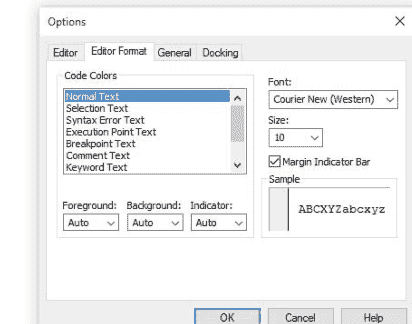

默认情况下，代码中的注释以绿色渲染。这有助于你从代码窗口中轻松识别该类型的文本。你可以通过在“代码颜色”列表中选择一种文本类型，然后选择其颜色和字体来更改各种类型文本的默认颜色。你可以通过下拉列表控制前景（Foreground）、背景（Background）和指示器（Indicator）选项。不过，我认为默认选择已经很好，所以我没有更改它们。

以下是代码颜色的含义：

- **普通文本（Normal Text）**：处理典型过程中的文本。你可能希望将其设置为常用颜色（如黑色，默认值）。
- **选择文本（Selection Text）**：影响所选（高亮）文本的颜色。
- **语法错误（Syntax Error）**：影响 VBA 违规行的颜色。默认颜色为红色。
- **执行点文本（Execution Point Text）**：影响断点模式下当前正在执行行的 VBA 颜色。
- **断点文本（Breakpoint Text）**：影响断点模式下当前正在执行行的 VBA 颜色。
- **指示器文本（Indicator Text）**：影响断点模式下当前正在执行行的 VBA 颜色。
- **注释文本（Comment Text）**：影响断点模式下当前正在执行行的 VBA 颜色。
- **关键字文本（Keyword Text）**：影响断点模式下当前正在执行行的 VBA 颜色。
- **标识符文本（Identifier Text）**：影响断点模式下当前正在执行行的 VBA 颜色。
- **书签文本（Bookmark Text）**：影响断点模式下当前正在执行行的 VBA 颜色。
- **返回文本（Return Text）**：影响断点模式下当前正在执行行的 VBA 颜色。

## 自定义视觉编辑器

- **关键字文本（Keyword Text）**：影响关键字的颜色。默认为蓝色。
- **标识符文本（Identifier Text）**：影响标识符的颜色。默认为黑色。
- **书签文本（Bookmark Text）**：影响书签的颜色。默认为柠檬绿。
- **返回文本（Return Text）**：影响返回文本的颜色。默认为黄色。

## 通用页面选项

### 图 2.19

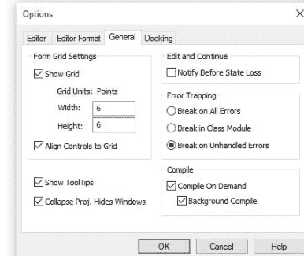

## 表网格设置

- **显示网格（Show Grid）**：控制 Visual Basic 编辑器是否显示点网格模式。这是默认设置。
- **宽 / 高（Width / Height）**：设置点的间距。默认为 6。
- **对齐控件（Align Controls To）**：控制 Visual Basic 编辑器是否将控件边缘对齐到下一网格线。

## 编辑并继续

- **状态前通知（Notify Before State）**：控制当你执行需要 VBA 重置所有变量值的操作时，编辑器是否发出警告。

## 错误处理

- **所有错误处中断（Break On All Errors）**：告诉 VBA 在发生任何错误时进入断点模式。
- **类模块中中断（Break In Class Module）**：当 VBA 在类模块中遇到未处理的错误时，VBA 进入断点模式。
- **未处理错误处中断（Break On Unhandled Errors）**：默认设置。调用类中违规过程的代码行，从而允许你识别（并在以后修改）导致问题的代码行。

## 编译分组框

编译分组框控制 VBA 何时将项目代码编译为可执行代码。在执行任何代码之前，需要对其进行编译，但在 Visual Basic 编辑器执行代码的第一部分之前，项目中的所有代码并不都需要编译。

如果你希望 VBA 只在需要时编译代码，可以勾选“按需编译（Compile On Demand）”复选框。VBA 在开始执行某个过程之前会编译该过程中的代码，除非你的过程*调用*了其他过程，否则它不会编译同一模块中其他过程的代码（即将执行权转移到另一个技术，你将在本书的后续部分学习）。

因此，当 VBA 完成该过程的编译时，第一个模块中的过程执行就可以开始。如果该过程随后调用了模块中的另一个过程，则 VBA 会在第一个过程调用它时编译第二个过程的代码，而不是在运行第一个过程时编译。


“按需编译”通常是一个不错的选择。当你处理模块中的许多过程，并且其中一些过程留有未完成的代码时，这种方法特别有用。相比之下，如果你没有勾选“按需编译”，VBA 在开始执行你想要运行的过程之前，会编译模块中`所有`过程的`所有`代码。这意味着不仅执行启动会推迟一点（代码编译需要更多时间，尽管现在大多数计算机的速度都快到你察觉不到），而且整个模块中任何过程的任何语言或编译错误都会阻止你运行和测试当前过程，即使该过程本身不包含错误。你只是在某些过程中草拟了尚未写完的代码，因此它们仍处于未完成状态。

假设你有一个名为 `Compilation` 的模块，其中包含两个过程：`GoodCode` 和 `BadCode`，它们看起来如下：

```
Sub GoodCode()
  MsgBox "This code is working."
End Sub
```

```
Sub BadCode()
  Application.Delete
End Sub
```

`GoodCode` 显示一个消息框来表示它正在运行，而 `BadCode` 包含一个无效语句（`Application` 对象没有 `Delete` 方法）。`GoodCode` 运行不会产生问题，但 `BadCode` 每次运行都会报错。

如果你尝试在开启“按需编译”的情况下运行 `GoodCode`，该过程会运行：VBA 只编译 `GoodCode` 过程中的程序，未发现错误并运行它。但如果你尝试在关闭“按需编译”的情况下运行 `GoodCode`，VBA 在开始运行 `GoodCode` 之前也会编译 `BadCode` 中的代码——然后 VBA 会在虚假的 `Application.Delete` 语句处因编译错误而停止。在运行任何代码之前的这种彻底检查对于运行良好的完成产品是有用的，但当你只是在“草拟”代码——即在模块中试验代码时，它会降低你的速度并让你感到恼火。

另一方面，当 `GoodCode` 在此版本的过程第三行调用 `BadCode` 时，你可以利用编译模块中所有代码的优势：

```
Sub GoodCode()
    MsgBox("This code is working.")
    BadCode
End Sub
```

在这里，在运行 `GoodCode` 之前编译 `BadCode` 是一个好主意，因为如果 `BadCode` 包含错误，这将阻止你运行。如果你在开启“按需编译”的情况下运行此版本的代码，VBA 会编译 `GoodCode` 并开始运行它，显示第二行的消息框。第三行的 `BadCode` 调用随后会导致 VBA 调用 `BadCode`，此时 VBA 将显示编译错误。你不希望这种情况发生在一个复杂过程的中途；在那种情况下，你可能希望关闭“按需编译”。

后台编译复选框仅在勾选“按需编译”时启用，它控制 Basic 编辑器在运行已编译代码的同时是否使用空闲 CPU 时间来编译代码。保持“后台编译”开启，你会发现不会被代码执行速度变慢所困扰。按照目前的运行，如果你的项目不是巨大，你可能感知不到执行速率上的任何干扰。

## 显示工具提示和折叠项目隐藏窗口

对话框上的最后两个选项是“显示工具提示”和“折叠项目隐藏窗口”。工具提示也被称为屏幕提示，是鼠标指针悬停在按钮或图标上时出现的文本描述。“显示工具提示”复选框控制 Visual Basic 编辑器是否为其工具栏按钮显示工具提示。工具提示通常很有用，除非你想节省它们消耗的内存和处理器周期——这极不可能。

“折叠项目隐藏窗口”复选框控制 Visual Basic 编辑器是否隐藏你在项目树中折叠的代码窗口和其他项目窗口。此复选框默认被选中，通常情况下这是一个实用的选择。当你在项目资源管理器中折叠项目时，Visual Basic 编辑器会隐藏该项目的任何代码窗口或用户窗体窗口。

## 停靠选项

选项框中的停靠页控制窗口是否可以停靠——即它们是否可以吸附到屏幕侧边。此复选框默认被选中，通常这是一个实用的选择。

你可能希望让它们可以停靠，以便将它们拖到窗口之外。

## 选择和布局窗口

你可以在编辑器内重新调整窗口位置。你的布局选择很大程度上取决于你的屏幕和偏好，但这里有几个建议：

- 始终将窗口调大——如果你在编写长代码，你需要尽可能多的空间。
- 有人发现，在积极编写代码时可以不需要项目资源管理器，只在需要时显示它。
- 你也可以通过按下快捷键 `Ctrl+R` 快速显示项目资源管理器。

## 自定义工具栏和菜单栏

Word、Excel 等其他应用程序中完全没有菜单。唯一的工具栏是快速访问工具栏。Ribbon 在 2007 年取代了菜单和工具栏。但 Visual Basic 编辑器保留了旧界面——没有 Ribbon，但你可以对其进行有限的自定义。为此，选择“视图”。

## 自定义工具箱

你还可以自定义工具箱，这是一个包含用于构建用户窗体控件的特殊面板。它可以设置为仅在窗体显示时才可见。

你可以通过添加和删除控件以及添加你自己的工具箱页来自定义此工具箱。一些程序员会将最常用的控件放在工具箱中，全部放在一个页面，以节省时间。这些控件可以是常规工具箱控件的自定义变体，通过将它们放在工具箱中，可以避免重复自定义。

例如，许多对话框需要一个 OK 按钮来关闭对话框、实现某些代码并继续执行过程。每个 OK 按钮都需要将 `Name` 属性设置为 `cmOK`，`Caption` 属性设置为 `OK`，`Default` 属性设置为 `True`，并将 `Height` 和 `Width` 属性设置为比 Visual Basic 编辑器分配的更小的尺寸。一旦通过修改所有这些属性自定义了一个命令按钮，你就可以将其作为特殊按钮放在工具箱上，并在后续窗体中轻松地复用。另一个适合此类自定义的控件是 `TextBox`。默认 `TextBox` 只显示单行文本，并使用接近 8 的字体大小。为了避免每次使用 `TextBox` 时都修改这些默认属性，可以创建一个多行且字体大小设置为 11 左右的自定义 `TextBox`。

## 向工具箱中添加控件

你可能想要向工具箱中添加控件的第一种方法是直接从用户窗体。例如，创建你的自定义文本框（`TextBox`），然后将其从用户窗体复制到工具箱中。

要从显示的用户窗体将你的自定义控件之一复制到工具箱中，请将其拖动并释放，如图 2.22 所示。

图 2.22

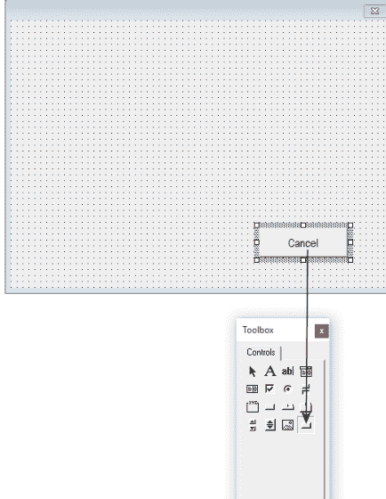

微软和其他供应商还提供了各种预编写的控件，你可以将它们添加到工具箱中。要添加这些控件，请按照以下步骤操作：

1. 在你想添加控件的工具箱页面（而不是标签本身）上点击鼠标右键。（稍后在本章的“向工具箱中添加页面”节中，你将学习如何向工具箱添加新页面。）
2. 从右键菜单中选择“其他控件”，以显示“其他控件”对话框。
3. 在“可用控件”列表中，点击你想添加到工具箱的控件的复选框，然后点击 `OK` 按钮。

图 2.23

在“其他控件”对话框中，选择你想添加的控件的复选框，然后点击 `OK` 按钮。

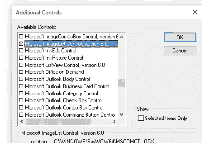

完成后，如果你想折叠列表以仅查看当前选中的项目，点击组框中的“仅选中项目”复选框。

根据你的电脑以及上面安装的软件，你可能会发现各种有趣且实用的控件。有很多控件，但这些是最值得注意的：

- 一组 Microsoft Outlook 控件
- 用于 Apple QuickTime 的控件
- 状态栏

这些控件中的一些可以为你的宏添加重要功能。你可以在互联网上搜索方便的额外专用控件：只需将功能拖动并释放到你的用户窗体上——这些功能不需要你花费几天时间编写代码。

你可以通过从控件所在的页面拖动它，并将鼠标指针（保持拖动状态）移动到目标页面的标签上以显示该页面，从而将控件从工具箱的一个页面移动到另一个页面。然后，将鼠标指针向下（再次保持拖动）进入页面的正文并释放控件。

## 重命名工具箱控件

当你将鼠标指针悬停在工具箱中的控件上时，会出现一个屏幕提示，显示控件的名称。要重命名控件，请在工具箱中右键点击它，并从右键菜单中选择“自定义”选项，以显示“自定义控件”对话框。

在“自定义控件”对话框的“工具文本”框中输入控件的名称（根据需要删除或更改现有名称）。当用户将鼠标指针悬停在工具箱中的控件上时，此名称将作为屏幕提示出现。然后，如果你愿意，可以按照下一节的描述为控件的工具箱图标分配不同的图片。否则，点击 `OK` 按钮关闭“自定义控件”对话框。

## 为控件的工具箱图标分配图片

工具箱中的每个控件都由一张图片识别。你可以通过显示“自定义控件”对话框，点击“加载图片”，并在弹出的对话框中选择图片或图标来为控件分配新图片。如果你有一个个性化控件（我们在本章其他地方添加的按钮），你可能想使用不同的图标将你的控件与默认的 VBA 按钮区分开。

你可以通过显示“自定义控件”对话框，点击“编辑”按钮并使用“编辑图像”对话框来编辑分配给某些控件的图片。

## 为项目设置属性

你可以指定项目的名称、关联的帮助文件以及项目的其他属性。

**精通它** 锁定项目，使他人无法修改甚至读取其内容。

**自定义 Visual Basic 编辑器。** 可以多种方式对 Visual Basic 编辑器进行自定义，包括个性化经典菜单和工具栏。

**精通它** 取出属性窗口并更改其大小。然后将其重新停靠。

# 第 3 章 编辑录制的宏

在本章中，你将使用 Visual Basic 编辑器来编辑在第 1 章“在 Office 中录制和运行宏”中使用录制器录制的 Word 和 Excel 宏。此外，你将在 PowerPoint 中创建一个新宏并查看如何编辑它。即使你正在使用的应用程序不包含宏录制器（如 PowerPoint），你可能仍然想阅读这一章，因为它向你展示了如何使用 Visual Basic 编辑器的一些关键编辑功能。

使用 Visual Basic 编辑器处理宏有三个原因：

- 第一，修复你录制的宏在行为上的任何问题。例如，如果你在录制宏时不小心按了回车键，那么除非你删除或更改该指令，否则宏每次运行时都会继续执行该错误指令。你可能需要删除宏中的这行代码：`Selection.TypeParagraph`（或者，有时重新录制一个宏比手动修复它更容易简单。）
- 第二，向宏添加更多指令以使其产生不同的行为。这是开始学习 VBA 语言的绝佳方法。通过仅对录制的宏进行微小或简单的更改，你可以极大地增强它的功能和灵活性。
- 第三，通过在 Visual Basic 编辑器中编写而不是录制宏来创建新宏。你可以根据需要从头开始编写新宏，或粘贴现有宏的部分内容。

在本章中，你将学习执行以下操作：

- 在 Visual Basic 编辑器中测试宏
- 设置断点并使用注释
- 编辑录制的 Word 宏
- 编辑录制的 Excel 宏
- 编辑新的 PowerPoint 宏

## 在 Visual Basic 编辑器中测试宏

如果宏在尝试从宿主应用程序运行时失败，则找出问题所在处的最快方法是在 Visual Basic 编辑器中打开该宏，运行它，并查看代码在何处失败：

1. 在宿主应用程序中，按 `Alt+F8` 或选择“视图 > 宏”以显示宏对话框。
2. 选择宏，然后点击“编辑”按钮。宿主应用程序将打开 Visual Basic 编辑器的实例并显示该宏进行编辑。
3. 按 `F5` 开始运行宏。或者，你可以使用“运行 > 子过程/用户窗体”，或点击 Visual Basic 编辑器标准工具栏上的“运行子过程/用户窗体”按钮（绿色箭头）（参见图 3.1）。

图 3.1

点击标准工具栏上的“运行子过程/用户窗体”按钮开始运行代码。

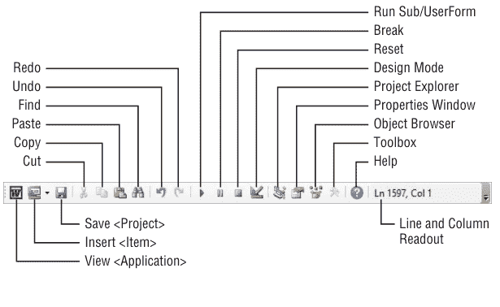

如果宏遇到错误并停止执行（进入断点模式），VBA 会在屏幕上显示错误消息框，并在代码窗口中选择出错的语句（在黑色背景上显示字母）。你可以编辑该语句来解决问题。完成后，按照下一节的描述逐步执行宏。

## 理解 VBA 编辑器模式

VBA 编辑器始终处于三种模式之一：

- 设计模式：当你正在设计用户窗体或编写代码时
- 执行模式：当你按下 `F5` 正在运行代码时，通常是为了观察其行为进行测试
- 断点模式：当执行已停止时（你可以检查变量或查看代码中正在发生的情况）

## 在 Visual Basic 编辑器中测试宏

编辑器通过以下几种方式停止执行并进入断点模式：当你按 `Ctrl+Break` 时、每次按 `F8` 逐步执行代码时、编辑器遇到你在代码中设置的断点时（稍后讨论），或当发生特定类型的错误时。

你可以通过查看编辑器的标题栏（位于编辑器行）来判断自己是否处于断点模式。如果你看到 `[break]` 字样，说明你处于断点模式。你还会看到黄色显示的下一个要执行的行代码。

当你处于断点模式时，可以通过点击 Visual Basic 编辑器标准工具栏上的“重置”按钮——它是蓝色正方形——来返回正常的设计（编辑）模式（这样你就可以在代码窗口中输入以修改和重置宏）。如果你发现自己无法在编辑器中输入，或者编辑器行为异常，请记住点击此“重置”按钮以退出断点模式并恢复正常。

## 在不在乎的文件上测试宏


始终在不在乎的文档或文件（或其副本）上测试你的宏。与其将未测试的宏释放到文档中看着它被破坏或更糟，丢失宝贵工作的方法少得多。

此外，尝试将你的代码存储在中心位置（如 Word 或 Excel 中的个人宏工作簿），这样它就可以被所有文件访问，而不仅仅是包含它的文件。如果你在错误的文件中创建了宏，请从文件中将其导出并

# 逐步执行宏

逐步执行宏是逐行执行它的过程。这允许你看到代码是如何逐行运行的，并准确识别错误发生的位置。

要逐步执行宏，请遵循以下步骤：

1. 在宿主应用程序中，按 `Alt+F8` 或选择“视图 > 宏”以显示宏对话框。选择宏，然后点击“编辑”按钮。宿主应用程序将打开 Visual Basic 编辑器的实例并显示该宏进行编辑。

2. 有时将窗口排列以便同时看到会有帮助。手动排列窗口或使用 Windows 功能。如果你有两个显示器，可以将一个留给编辑器另一个留给应用程序。

3. 现在为宏设置任何条件。你可能需要打开一个文档。

4. 点击宏代码中的某处。闪烁垂直线（插入光标）的位置决定了编辑器想要处理的宏。

5. 按 `F8` 逐命令执行宏。每次按 `F8`，你的 VBA 代码都会执行一行。Visual Basic 编辑器会用黄色高亮正在执行的命令，你可以切换到效果并捕获。

# 按 F8 是逐步执行宏的最简单方法

你也可以通过选择“调试 > 运行”或点击调试工具栏上的“单步”按钮来逐步执行宏，毕竟，你需要反复单步直到定位问题。按单个键比反复打开菜单要高效得多。

图 3.2 逐步执行录制的 Word 宏的示例。

图 3.2

逐步执行录制的 Word 宏

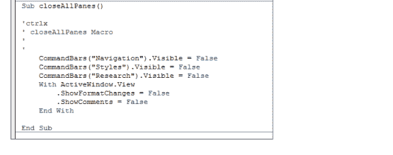

```
Sub CloseAllPanes()
  'ctrl
CloseAllPanes Macro

  CommandBars("Navigation").Visible = False
  CommandBars("Styles").Visible = False
  CommandBars("Research").Visible = False
  With ActiveWindow
    ShowFormatChanges = False
    ShowComments = False
  End
End Sub
```

## 设置断点

可以为某行代码指定断点，告诉 VBA 在该处停止执行宏。通过使用断点，你可以先按 `F5` 以全速快速执行宏的已知部分，编辑器会自动在断点处停止。你可以在怀疑代码中存在某个 Bug 之前放置一个断点。这样，你就不需要逐行停止代码运行。你可以以正常的快速速度运行宏——但在怀疑的位置停下，然后开始按 `F8` 逐行停止代码，以逐语句的方式缓慢执行，从而清晰地观察其行为。你可以根据需要设置任意数量的断点。

要切换断点的开启或关闭，可以在可执行代码行（见下文描述）上点击右键，从右菜单中选择“切换断点”，或点击编辑器工具栏上的“切换断点”按钮。更简单的方法是直接点击代码行左侧的边距指示栏。

你设置了断点的代码行默认显示为红色。断点本身由边距指示栏中的一个红圆圈表示（见图 3.3）。

图 3.3

使用断点（在边距指示栏中出现的红圆圈）在选择的行停止执行。

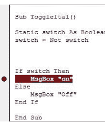

## 断点不是持久的

断点是暂时的——Visual Basic 编辑器不会将它们保存到你的代码中。你必须在每次编辑会话中指定它们。

# 注释掉行

与大多数编程语言一样，VBA 允许你为代码添加注释，使其更容易理解。在创建代码期间，以及在忘记其功能很久后重新审视自己的代码时——或者更糟糕的是，当你试图弄懂别人代码的作用时——注释将是无价之宝。

然而，注释还有另一个用途。你还可以注释掉某些行代码，以防止 Visual Basic 编辑器执行它们。换句话说，注释只是为了告诉自己它们不是宏本身的一部分。它们不是用 VBA 编写的，编辑器在检查代码（以查找错误）或执行代码时也不会关注它们。有时在调试时，你可能想要注释掉宏中的某行或可执行代码。这样在执行期间，这一行代码就不会被执行。它会被忽略。

这是一种非常有用的技术，可以临时跳过可疑的代码行而无需将其从宏中删除。然后你运行代码，查看忽略注释行后有什么区别。如果 Bug 消失了，它很可能就在被注释掉的行中。例如，如果宏突然错误地删除了文档中的某些行，而在某些行被注释掉后不再删除，那么你就找到了 Bug！

要手动注释某行，请在行的最开头输入一个撇号（`'`）。或者，你可以使用 `Rem` 命令代替撇号（Rem 代表 remark，注释行有时被称为备注行）。要取消注释，只需删除撇号或 `Rem` 即可。

Visual Basic 编辑器提供了方便的“块注释”和“取消注释块”命令来自动注释行。选择代码行，然后点击每行起始处工具栏上的“块注释”按钮；要取消单行或一组选中行的注释，点击“取消注释块”，Visual Basic 编辑器将从每行移除撇号。

“块注释”命令仅使用撇号，不使用 `Rem`。如果你倾向于使用 `Rem`，则必须手动注释和取消注释。不过，现在很少有人这么做了。

# 注释块命令非常高效

“块注释”命令会在选中块中每行的开头添加撇号，即使对于已经注释过的行也是如此（这没有害）。同样，“取消注释块”会从选中块中的每行逐个移除撇号，而不是一次移除所有的。这种行为有助于保留注释行，并让你选择注释的层次。

## 跳出宏

一旦你识别并修复了宏的问题，你可能不想再通过命令执行宏的剩余部分。要运行该宏以及调用（触发）它的任何其他宏，你可以再次按 `F5` 键。或者，你可以点击标准工具栏或调试工具栏上的 `Sub/UserForm` 按钮（图 3.4），或者选择 `运行 > 继续`。

如果你只想运行此宏的剩余部分，并返回到触发它的宏，请使用“调出”命令。“调出”会全速执行完当前宏或过程，但如果代码继续执行另一个代码，Visual Basic 编辑器将恢复断点模式，以便你检查过程代码。我们将在本书的后面探讨调用程序的含义。

要执行“调出”命令，按 `Ctrl+Shift+F8`、点击调试工具栏上的“调出”按钮，或选择 `调试 > 调出`。

# 图 3.4

调试工具栏包含了运行代码、单步进入和调出以及显示调试关键窗口的命令。

- 单步进入 切换断点 重置断点 运行 Sub/UserForm 设计模式

- 单步跳过 调出 局部窗口 立即窗口 监视窗口 快速监视 调用堆栈


# 编辑 Word 宏

现在编辑你在 Word 第 1 章中录制的 `Transpose_Word_Right` 宏，并在此基础上构建另一个宏。首先，在 Visual Basic 编辑器中打开宏：

1. 启动 Word 并在 Visual Basic 编辑器中打开宏：

2. 按 `F8`。

3. 点击代码行左侧的边距栏。

在代码窗口中，你应该看到与 3.1 类似的代码，除了行号之外：

# LISTING 3.1：录制的宏

Sub Transpose_Word_Right()

```
' Transpose_Word_Right 宏
' 将当前单词向右移动
' 在此处录制
' 
' 
' 

Selection.Extend
Selection.Extend
' 按下 Esc 键
Selection.Cut
' 向右移动一个单词
Selection.MoveRight:=wdWord, Count=1
Selection.PasteAndFormat(wdFormatOriginal)
Selection.MoveLeft:=wdWord, Count=1
End Sub
```

# 第 3 编辑录制的宏

这里是这些行的作用：

- 第 1 行 `Sub Transpose_Word_Right()` 启动宏，第 14 行 `End Sub` 语句结束宏。Sub 和 End Sub 行标记了宏的开始和结束（适用于任何宏）。

- 第 2 行和第 6 行是为了方便宏而插入的空行（空行不需要注释，但录制器对它们添加了注释）。

- 第 3 行到第 5 行是注释，包含了宏名称和描述。录制器根据你在框中输入了这些行。

- 第 7 行记录了 `F8` 键的第一次按下，启动扩展模式——一种文档选择方式。

- 第 8 行记录了 `F8` 键的第二次按下，继续扩展模式并选中当前的单词。

- 第 9 行记录了 Esc 键的按下，取消扩展模式。

- 第 10 行记录了剪切命令，将选择（在此例中为单词）剪到剪贴板。

- 第 11 行记录了 `Ctrl→` 命令，将插入点向右移动一个单词。

- 第 12 行记录了粘贴命令，将选择粘贴到文档中当前插入点位置。原始应用的任何格式都会保留（而不是在新位置应用格式）。

- 第 13 行记录了 `Ctrl←` 命令，将插入点向左移动一个单词。

# 逐步执行 Transpose_Word_Right 宏

现在使用“单步进入”命令在断点模式下执行此宏：

1. 调整屏幕，使你能看到活动的 Word 窗口和 Visual Basic 编辑器（例如，右键点击任务栏并选择“显示窗口”，或将它们靠在屏幕一侧）。

2. 点击 Visual Basic 编辑器，点击将闪烁的插入标放在代码窗口中 `Transpose_word_Right` 宏的开头（或 Sub 处）。

3. 按 `F8` 逐行执行代码。你会发现 VBA 跳过了空行和注释行，因为它们在执行期间应该被忽略。每当你按 `F8` 时，VBA 都会高亮当前语句，你可以在 Word 窗口中看到正在发生。

当 Visual Basic 编辑器到达宏的末尾时（在此情况下，即你按 `F8` 编辑第 14 行的 End Sub 语句），它会退出断点模式（Break mode）。编辑器将返回设计模式。你也可以通过点击标准工具栏或调试工具栏上的“重置”按钮（蓝色正方形），或者通过选择“运行 > 重置”来随时退出断点模式。遗憾的是，键盘上没有可以停止执行的按键。你必须使用鼠标。

## 运行 Transpose_Word Right 宏

如果宏在单步执行时运行正常，你可能也想从 Visual Basic 编辑器运行它。只需按 `F5` 即可。在断点模式下，`F5` 会从当前指令（插入光标所在的位置）开始执行宏。

## 创建 Transpose_Word_Left 宏

在这里我们将修改代码。通过对 Transpose_word_Right 宏进行微调，我们将创建一个 Transpose_Word_Left 宏。请按照以下步骤操作。

- 1. 在代码中，选择 Transpose_Word_Right 宏的所有代码，直到 End Sub 语句为止。你可以通过三种方式进行选择：用鼠标拖动 Sub Transpose_Word_Right()，按住 Shift 键并使用方向键扩展选择，或者将插入点置于宏的某端，然后 Shift+点击另一端。

- 2. 发布“复制”命令复制代码（例如，右键点击并从上下文菜单中选择“复制”，或按 `Ctrl+C` 或 `Ctrl+Insert`）。

- 3. 点击将插入点移动到代码窗口中 Transpose_word_Right 宏 End Sub 语句下方的行。

- 4. 发布“粘贴”命令粘贴代码（右键点击并从上下文菜单中选择“粘贴”，或按 `Ctrl+V` 或 `Shift+Insert`）。Visual Basic 编辑器会自动在 Transpose_Word_Right 的 End Sub 语句与你粘贴的新宏之间输入一条水平线。

- 5. 通过编辑 Sub 行，将第二个 Transpose_word_Right 宏的名称更改为 Transpose_word_Left：

   Sub Transpose_Word_Left()

- 6. 相应地编辑宏开头的注释——例如：

   ' Transpose_Word_Left 宏

   ' 将当前单词与其左侧的单词交换位置。

   ' 由 Nanci Selest-Gomes 创建。

- 7. 现在你需要做的是将 MoveRight 方法替换为 MoveLeft 方法。这将插入点移动到右侧单词的左侧。虽然你可以通过输入修正或使用剪切和粘贴将 Selection.MoveRight 替换为注释掉的 Selection.MoveLeft，但请尝试使用“列表属性/方法”功能。为了练习，请遵循以下步骤：

   a. 点击将插入点置于 MoveRight 单词中。

   b. 点击编辑工具栏上的“列表属性/方法”按钮，在左侧显示属性和方法列表。它是左侧的第一个按钮。或者直接按 `Ctrl+J`。（如果编辑工具栏不可见，右键点击现有的工具栏之一，并在上下文菜单中选择“编辑”。）

   c. 双击列表中的 MoveLeft 方法，使其替换代码行中的 MoveRight 方法。

- 8. 既然你不再需要它了，删除宏末尾的 Selection.MoveLeft Unit:=wdWord, Count:=1。

你最终将得到一个类似于列表 3.2所示所示宏。

## 列表 3.2：编辑后的单词交换宏

```
Sub Transpose_Word_Left()
  ' Transpose_Word_Left 宏
' 将当前单词与其左侧的单词交换位置。 
' Nanci Selest-Gomes 于 13/5/13 创建。

  Selection.Extend
  Selection.Extend
  Selection.EscapeKey
  Selection.Cut
  Selection.MoveLeft Unit:=wdWord, Count:=1
  Selection.PasteAndFormat (wdFormatOriginalFormatting)
End Sub
```

尝试单步执行此宏以确保它工作正常。如果正常，你就可以准备保存它了——如果你计划在写作中使用它，请准备好在 Word 中为它创建一个快速访问工具栏按钮或快捷键。

## 保存你的工作

当你完成此宏或任何其他宏的工作时，从视觉化编辑器选择“文件 > 保存 (Ctrl+S)”以保存包含该宏以及你对其所更改的文档或模板。然后按 `Alt+Q` 或选择“文件 > 关闭并返回 Microsoft Word”来关闭视觉化编辑器并返回 Word。

## 编辑 Excel 宏

在接下来的章节中，你将编辑第 1 章中录制的 Excel 宏。这次你不会创建一个新宏——而是向现有宏添加内容。

## 取消隐藏个人宏工作簿

在编辑 Excel 宏之前，如果“个人宏工作簿”目前处于隐藏状态，你需要将其取消隐藏：

- 1. 打开功能带上的“视图”选项卡。

- 2. 如果“显示”按钮是灰色的（不可用），说明个人宏工作簿已显示。如果是隐藏色的，点击“显示”按钮。

4. 按 `Ctrl+V` 粘贴复制的行，选择编辑 ➤ 粘贴，或在插入点右键单击并从右菜单中选择粘贴。

你的新宏应该如列表 3.4 所示。

# 列表 3.4：新扩展版本

```
1. Sub Add_Months()
2. '
3. ' Add_Months Macro
4. ' Fills in for the year. Recorded 9/29/16 by Abe Normal.
5. '
6. '
7. '
8. Range("A1").Select
   ActiveCell.FormulaR1C = "Jan-2016"
9. Range("B1").Select
   ActiveCell.FormulaR1C = "Feb-2016"
10. Selection.AutoFill Destination:=Range("B1:L1"), Type:=xlFillFillDefault
11. Range("A1").Select
   ActiveCell.FormulaR1C = "Jan-2016"
12. Range("B1").Select
   ActiveCell.FormulaR1C = "Feb-2016"
13. Selection.AutoFill Destination:=Range("B1:L1"), Type:=xlFillFillDefault
14. End Sub
```

现在，通过以下步骤更改宏以显示第二行自动填充的值：

- 1. 将第 13 行的单元格从 A1 更改为 A2：

   Range("A2").Select

- 2. 修改第 14 行，使其输入值 1 而不是 Jan-2016：

   ActiveCell.FormulaR1C = 1

- 3. 修改第 15 行，使其输入单元格 L2 而不是 B1：

   Range("L2").Select

- 4. 修改第 16 行，使其输入 Feb-2016 的值 200：

   ActiveCell.FormulaR1C = 200

- 5. 修改第 17 行，使其对范围 A2:L2 执行自动填充操作，并将填充类型更改为 xlFillSeries：

   Selection.AutoFill Destination:=Range("A2:L2"), Type:=xlFillSeries

- 6. 点击保存按钮或选择文件 ➤ 保存以保存所做的更改。

# 第 3 章编辑录制的宏

宏现在应该像列表 3.5 所示。

# 列表 3.5：精简宏

```
Sub Add_Months()
    Add_Months Macro
    Fills in months for the year. Recorded 9/29/15 by Abe Normal.
    Range("A1").Select
    ActiveCell.FormulaR1C = "Jan-2016"
    Range("B1").Select
    ActiveCell.FormulaR1C = "Feb-2016"
    Selection.AutoFill Destination:=Range("B1:L2"), Type:=xlFillDefault
    Range("A2").Select
    ActiveCell.FormulaR1C = "1"
    Range("L2").Select
    ActiveCell.FormulaR1C = "12"
    Selection.AutoFill Destination:=Range("A2:L2"), Type:=xlFillSeries
End Sub
```


要查看此效果，选择“文件”>“新建工作簿”。确保你正在看到这个新工作簿（这将成为活动工作簿，即我们的宏将工作的地方）。现在逐步执行宏并观察发生的情况：像以前一样，它输入月份，然后在第二行单元格中输入从 1 到 12 的值。在分屏上观察这很有趣，因为当你逐步执行时，你会看到单元格填充了数据。

## 编辑 PowerPoint 宏

在本节中，你将编辑一个 PowerPoint 宏。PowerPoint 没有宏录制器，因此你必须为以下示例输入代码，或者最好直接从本书的网页 `syex.com/go/mastervba2016` 复制并粘贴。打开 Visual Basic 编辑器：

1. 打开 PowerPoint 并选择“空白演示文稿”模板。点击功能区上的“插入”选项卡，然后点击“形状”部分的图标。
2. 点击一个矩形形状，点击幻灯片的任意位置来创建它。这将是集合中的对象 1，我们可以在代码中引用它：
   `ActiveWindow.Selection.SlideRange.Shapes(1).Select`
3. 按 `Alt+F11` 打开 Visual Basic 编辑器。
4. 选择“插入”>“模块”创建一个新的空模块。现在你准备好添加代码了。
5. 输入（或从本书的网页粘贴）列表 3.6 中的代码。

### 列表 3.6：在 PowerPoint 中添加幻灯片

```
1. Sub Add_Slide_and_Format_Placeholder()
2. 
3. ' Sample macro that adds a slide, formats its placeholder, and adds text to it. Recorded 6/16/15 by Battlefield.
4. 
5. ActiveWindow.View.Goto ActivePresentation.Slides.Add(Index=2, Layout=ppLayoutTitle).SlideIndex
6. ActiveWindow.Selection.Range = ppWindowTitle
7. ActiveWindow.Selection.Range.Shapes(1).Select
8. With ActiveWindow.Selection.ShapeRange
9. IncrementLeft = -65
10. IncrementTop = -125
11. End With
12. ActiveWindow.Selection.Range.ScaleHeight 1.5, msoFalse, msoScaleTo
13. ActiveWindow.Selection.Range.Shapes(1).Select
14. ActiveWindow.Selection.Range.TextFrame.TextRange.Select
15. ActiveWindow.Selection.Range.TextFrame.TextRange.Characters = (Start:=1, Length:=0).Select
16. With ActiveWindow.Selection.TextRange
17. .Text = "The quick brown dog jumped over the lazy fox"
18. With Font
19. .Name = "Arial"
20. .Size = 44
21. .Bold = msoFalse
22. .Italic = msoFalse
23. .Underline = msoFalse
24. .Shadow = msoFalse
25. .Emboss = msoFalse
26. .BaselineOffset = 0
27. .AutoRotateNumbers = msoFalse
28. .ColorScheme = ppTitle
29. End With
30. ActiveWindow.Selection.Range.TextFrame.TextRange.Characters = (Start:=1, Length:=42).Select
31. With ActiveWindow.Selection.TextRange.Font
32. .Name = "Impact"
33. .Size = 54
34. .Bold = msoFalse
35. .Italic = msoFalse
36. .Underline = msoFalse
37. .Shadow = msoFalse
38. .Emboss = msoFalse
39. .BaselineOffset = 0
40. .AutoRotateNumbers = msoFalse
41. .ColorScheme = ppTitle
42. End With
43. End Sub
```

按 `F5` 运行宏并查看它对 PowerPoint 做了什么。以下是宏中发生的情况：

- 第 1 行开始宏，第 43 行结束宏。
- 第 2 行和第 4 行是注释行，用于设置出现在第 3 行的宏描述。
- 第 5 行向演示文稿添加幻灯片。此语句有点复杂，但现在不需要太担心。请注意两点：首先，该语句使用 `Slides` 对象的 `Add` 方法将幻灯片添加到集合中（在这种情况下是创建一个新的幻灯片）。这与本章前面的 Excel 宏使用 `Add` 方法将工作簿添加到笔记本相似。其次，幻灯片的布局是 `ppLayoutText`，这是 PowerPoint 用于默认新幻灯片的布局 VBA 常量。
- 第 6 行应用你在录制宏时使用的标题布局（`ppLayoutTitle`）（如果你选择的不是 `ppLayoutTitle` 常量）。
- 第 7 行选择活动幻灯片上 `Shapes` 集合中的第一个形状。（目前不要担心如何到达活动幻灯片）
- 第 8 行到第 11 行是一个 `With` 块。该块始于一个指定所选形状（`ActiveWindow.Selection`）的属性或行为（方法）的语句。`With` 语句是简化对象引用的方式，`With` 语句和 `End With` 语句之间的所有内容指向 `With` 语句首次提到的对象。在这种情况下，第 9 行使用负值的 `IncrementLeft` 方法将形状向左移动，第 10 行使用负值的 `IncrementTop` 方法将形状向上移动。

### With 命令有两个用途

`With` 语句有两个优点：它们简化了代码（你不需要在 `With` 和 `End With` 之间的每一行中指定对象），并且让代码运行得更快。

第 13 行选择 `Shapes` 集合中的第一个形状，第 14 行选择形状中的 `TextRange` 对象。当你进行交互操作时，PowerPoint 会让这个过程变得无缝：你点击显示“点击此处添加标题”（或其他任何内容）的形状，PowerPoint 会选择形状框中的文本范围——但你看到的只是形状中的文本被选中了。在 VBA 中，在获取文本之前可以经过对象模型的几个不可见的层。

当你选择占位符文本时，PowerPoint 会将其删掉。

### 第 3 章 编辑录制的宏

- 第 32 行开始了另一个 `With` 语句，该语句操作 `TextRange` 对象的 `Font` 对象。此 `With` 语句模拟了用户打开并修改字体对话框时发生的情况。
- 第 43 行结束了 `With` 语句，第 44 行结束了宏。

现在，尝试通过精简该宏并更改其插入的文本来编辑此宏：

1. 删除第 18 到 29 行中不必要的 `With` 语句。
2. 删除第 30 行。
3. 将第 16 行和 17 行合并为不带 `With` 的单一语句：
   `ActiveWindow.Selection.TextRange.Text = "The quick brown dog jumped over the lazy fox"`
4. 现在更改新第 16 行插入的文本。在双引号之间输入你喜欢的任何文本。
5. 修改第 31 行，使其对文本范围使用 `Select` 方法，而不是指定要选择哪些字符。删除 `Characters(Start:=1, Length:=42)` 以保留此语句：
   `ActiveWindow.Selection.ShapeRange.TextRange.Select`
   通过指定范围而不是特定的字符数，你避免了之前因在每次更改消息时硬编码字符数而导致的问题。指定字符数被称为一种“笨办法”——应尽可能避免。如果存在针对 `TextRange` 属性的 `With` 语句——让计算机来计算计数，而不是在你的代码中指定。
6. 点击工具栏上的保存按钮或选择“文件”>“保存”，将你创建的宏保存到演示文稿中。在“另存为”对话框中，找到“保存类型”下拉列表，将其从默认的 `.pptx` 类型（不包含宏）更改为 `.pptm` 类型（可以包含宏）。

你的代码应该看起来类似于列表 3.7。

### 列表 3.7：精简并修改后的宏

```
1. Sub Add_Slide_and_Format_Placeholder()
2. 
3. ' 示例宏，用于添加所有幻灯片、格式化其占位符并其中添加文本
4. ' Rodney Converse 于 2015/12/4 录制。
5. 
6. ActiveWindow.View.GotoSlide Index:=2
7. ActivePresentation.Slides.Add(Index:=2,
8. Layout:=ppLayoutText).SlideIndex
9. ActiveWindow.Selection.SliderRange.Layout = ppLayoutTitle
10. ActiveWindow.Selection.SliderRange.Shapes(1).Select
11. With ActiveWindow.Selection.ShapeRange
12. .IncrementLeft -6
13. .IncrementTop -125.75
14. End With
15. ActiveWindow.Selection.ShapeRange.ScaleHeight 1.56, msoFalse, -
16. msoScaleFromTop
17. ActiveWindow.Selection.ShapeRange.Shapes(1).Select
18. ActiveWindow.Selection.ShapeRange.TextFrame.TextRange.Select
19. ActiveWindow.Selection.ShapeRange.TextFrame.TextRange.Characters
20. (Start=1, Length=8).Select
21. ActiveWindow.Selection.TextRange.Text = "Welcome to Acme Industries"
22. ActiveWindow.Selection.ShapeRange.TextFrame.TextRange.Select
23. With ActiveWindow.Selection.TextRange.Font
24. .Name = "Impact"
25. .Size = 4
26. .Bold = msoFalse
27. .Italic = msoFalse
28. .Underline = msoFalse
29. .Shadow = msoFalse
30. .Emboss = msoFalse
31. .BaselineOffset = 0
32. .AutoRotateNumbers = msoFalse
33. .Color.ColorScheme = ppTitle
34. End With
35. End Sub
```

运行修改后的宏，并确保它按照你的预期工作。

### 保存你的工作

完成宏操作后，在 Visual Basic 编辑器中选择“文件”>“保存”，保存包含创建的宏的演示文稿。确保将文件类型从默认的 `.pptx` 更改为启用宏的 `.pptm` 类型。然后按 `Alt+Q` 或选择“返回 PowerPoint”以关闭 Visual Basic 编辑器并返回 PowerPoint。

## 现实场景

### 你什么时候应该使用宏录制器？

正如你在书中所见的，你可以通过两种方式使用 VBA。首先，你可以使用宏录制器（在 Word 和 Excel 这两个应用程序中提供）在交互式操作时记录一系列动作。或者，你可以在 Visual Basic 编辑器中输入 VBA 语句。你可能想知道什么时候应该录制宏，什么时候应该从头编写代码。从头编写程序显然比录制程序更困难、高级——因此只要有录制器，你就应该录制。

使用宏录制器有优缺点。优点如下：

- 宏录制器每次都能创建可用的代码（只要在适当条件下运行）。
- 它快速且易用。
- 它可以帮助发现 VBA 对象、方法和属性。

缺点如下：

- 宏录制器可能包含不必要的或冗余的代码。
- 录制器创建的代码只能在活动文档中工作。
- 通过宏录制器提供的 VBA 对象子集限于你可以交互式执行的全范围操作。

无论你是 VBA 多么专家，请将宏录制器视为创建临时宏或更复杂程序基础的有用工具。你经常会发现，让录制器处理大部分创建过程的压力是合理的。此外，宏录制器可以教你如何编写你自己无法想出来的代码。录制器的语法总是正确的。

## 第 4 章 在 Visual Basic 编辑器从零创建代码

在本章中，你将练习在 Visual Basic 编辑器（VBE）从零创建宏（过程）。示例将带你完成在 Word、Excel 和 PowerPoint 中创建宏的过程。

为了完成书中的示例，Basic 编辑器在视觉上应配置为特定方式，并设置为要求显式声明变量（这被认为是一种良好的编程习惯），请确保满足了这些条件。

本章的目的是让你在后续章节学习语言细节之前，对在 Visual Basic 编辑器中创建代码有一个感性认识。在这里，你将简要接触 VBA 元素（如对象、属性、方法、变量和常量），你将在本书的后面详细学习它们。在此过程中，你还会遇到 Visual Basic 编辑器提供的许多有用工具，包括宏录制器、对象浏览器和帮助系统。你将在本书的后部分更深入地探索这些工具。

在本章中，你将学习以下内容：

- 设置 Visual Basic 编辑器以创建宏
- 为 Word 创建宏
- 为 Excel 创建宏
- 为 PowerPoint 创建宏
- 为 Access 创建宏

### 设置 Visual Basic 编辑器以创建宏

如果你将 Visual Basic 编辑器设置为默认配置，那么遵循《Macros》一书中的指令将最容易。（你对 VBA 编辑器所做的任何更改将适用于所有启用 VBA 的应用程序。）因此，如果你按照描述设置了编辑器，无论你是在 Excel、Access、Outlook 还是 PowerPoint 中打开它，它看起来都是这样的。

以下步骤描述了如何设置 Visual Basic 编辑器使其看起来如图 4.1 所示：

1. 打开 Visual Basic 编辑器。
2. 如果没有显示项目资源管理器，选择“视图”>“项目资源管理器”或按 `Ctrl+R` 显示。
3. 如果没有显示属性窗口，选择“视图”>“属性窗口”或按 `F4` 键显示。
4. 除非你有其他偏好，否则将项目资源管理器停靠在主 Visual Basic 区域左侧的常规位置。将属性窗口停靠在项目资源管理器下方，同样位于其默认位置。（要更改停靠，请选择“工具”>“选项”，点击“停靠”选项卡并选择“选项”。）要停靠未停靠（浮动）窗口，双击其标题栏。
5. 设置 Visual Basic 编辑器要求显式声明变量。这将强制执行规则：在代码中使用每个变量之前必须正式声明它。选择“工具”>“选项”显示选项对话框，确保勾选了“要求变量声明”复选框，然后点击“确定”按钮。我们将在书的后面详细讨论变量声明，但这里有一个简要总结。此设置使 Visual Basic 编辑器为你从现在起创建的所有模块和用户窗体自动输入 `Option Explicit` 语句。该语句会导致编辑器在运行时检查隐式声明的变量（这被认为是不良习惯），并提醒你必须声明它们，例如：
   `Dim txtAs String`

图 4.1 VBA 编辑器的默认配置

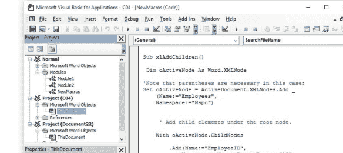

### 为 Word 创建过程

你为 Word 创建的宏将导致“修订”功能切换隐藏文本的显示（无论是删除线标记还是隐藏）。换句话说，使用此宏，你将能够在隐藏删除的文本（带有删除线保留）或让其直接消失之间切换。

开始使用宏录制器来提供必要的对象限定符。然后你可以在编辑器中手动修改代码以控制切换行为。

按照以下步骤录制宏：

1. 启动 Word。如果 Word 已经在运行，请退出并重新启动。
2. 录制宏以获取对象限定符（属性和设置）（记住，对某些人来说，录制可能感觉像是在作弊，但在查找对象和获取复杂的语法代码方面，宏录制器是一份礼物。）遵循以下子步骤：
   - a. 点击功能区上的“开发工具”选项卡，然后点击“代码”部分中的“宏”按钮以打开“宏”对话框。
   - b. 接受宏录制器自动分配的宏名称（`Macro1`, `Macro2`），或者创建一个你自己的名称（如 `Temp`），这样你在你忘记删除该宏时，它会提醒你。
   - c. 将“存储位置在”下拉列表设置为“所有文档 (Normal.dotm)”。留空描述栏。这是一个用于练习的临时宏，所以我们不会将其添加到你的永久集合中。
   - d. 点击“确定”按钮开始宏。
   - e. 点击功能区上的“修订”选项卡，然后点击“修订”部分右下角的“选项”按钮。打开“修订选项”对话框。在框中，点击“高级选项”（该对话框在 Office 2010 及更高版本中看起来有些不同。你通过点击“修订”图标的下半部分打开第一个对话框）。确保在“删除”下拉列表中选择了“删除线”（见图 4.2），然后点击“确定”关闭两个修订对话框（删除线是默认值，所以它已经被选了——但我们希望录制器向我们展示这在 VBA 中是如何编码的。点击“确定”关闭对话框将记录所有当前的）。


- f. 重复步骤 (e) 重新打开“修订”对话框。现在，在“删除”下拉列表中选择“隐藏”，并再次点击确定关闭对话框。
- g. 点击功能带上的“停止”按钮停止录制宏。

图 4.2 高级修订框 

3. 按 `Alt+F8` 打开“宏”框。选择你注册的 `Temp` 宏并点击“编辑”按钮在 Basic 编辑器中打开它。你的代码应该如下：

```vba
Sub temp()
    With Options
        .MoveFromTextMark = wdMoveFromTextMarkStrikeThrough
        .MoveFromTextColor = wdGreen
        .MoveToTextMark = wdMoveToTextMarkUnderline
        .MoveToTextColor = wdGreen
        .InsertedCell = wdCellColorBlue
        .MergedCell = wdCellColorYellow
        .DeletedCell = wdCellColorPink
        .SplitCell = wdCellColorOrange
    End With
    With ActiveDocument
        .TrackMoves = False
        .TrackFormatting = True
    End With
    With Options
        .InsertedTextMark = wdInsertedTextMarkUnderline
        .InsertedTextColor = wdRed
        .DeletedTextMark = wdDeletedTextHidden
        .DeletedTextColor = wdRed
        .RevisedPropertiesMark = wdRevisedPropertiesNone
        .RevisedPropertyColor = wdByAuthor
        ... (其余代码)
    End With
End Sub
```

对于你执行的这几个简单操作来说，这些代码量非常惊人。记住，这是因为宏录制器记录了你所采取的所有可能选项的设置。

# 第 4 章 在 Visual Basic 编辑器中从零创建代码

在你访问过的“修订选项”对话框中，而不仅仅是在你选择并修改的那个选项。简要浏览代码，查看从图 4.2 所示对话框选项中记录的许多设置。

如果你查看该图，就可以看到代码是如何反映这些设置的。例如 `.SplitCellColor = wdCellColorOrange` 这行代码，并在对话框中找到对应的设置。

- 5. 第二组代码代表了你第二次访问对话框时的完全相同的设置。特别注意第 9 行和第 35 行；这些是关键。第 35 行反映了你第二次访问时做的更改——通过 `Options` 对象的 `DeletedTextMark` 指定了“隐藏”而不是“删除线”属性。请注意，该属性的两个值（当你记录删除并指定为“删除线”时）以及 `DeletedTextMarkHidden`（当你将其设置为“隐藏”时）。
- 6. 现在在编辑器中，选择整个宏（从 `Sub` 语句到 `End` 语句），并按 `Delete` 键将其删除。
- 7. 确保 Visual Basic 编辑器已按照本章节前面的“为宏设置 Visual Basic 编辑器”部分进行设置。
- 8. 在“项目资源”窗口中，在 `Normal` 项目的任意位置点击右键，从右键菜单选择“插入 > 模块”。Visual Basic 编辑器会在 `Normal` 全局模板中插入新模块并显示代码窗口。
- 9. 按 `F4` 键激活新模块的“属性”窗口。（激活意味着焦点——无论焦点在哪里，就是你将显示或鼠标点击产生效果的框）。Visual Basic 编辑器选择了 `(Name)` 属性，这是该新模块唯一的可用属性。（令人困惑的是，属性名称被括在括号中。）
- 10. 在属性窗口中为新模块输入名称。在本示例中，删除默认名称（`Module 1`、`Module 2` 或其他），并输入名称 `Procedures_to_Keep_1`。
- 11. 按 `F7` 键或点击代码窗口以激活它。
- 12. 验证 Visual Basic 编辑器是否在代码窗口代码区域（代码区）顶部的声明中输入了 `Option Explicit` 语句。如果没有，请返回并完成本章开头列表中的第 4 步。
- 13. 在 `Option Explicit` 语句下方，输入过程的 `Sub` 并按回车键。将过程名为 `Toggle_Track_Changes_between_Hidden_and_Strikethrough`：

```
Toggle_Track_Changes_between_Hidden_and_Strikethrough
```

- 14. 当你按回车键时，Visual Basic 编辑器会在 `Sub` 语句末尾插入所需的括号、一个空行以及 `End Sub` 语句，并将光标置在空行上，准备你开始编程：

```
Toggle_Track_Changes_between_Hidden_and_Strikethrough()

End Sub
```

- 15. 按 `Tab` 键对 `Sub` 语句下的第一行进行缩进。
- 16. 输入 `if options.`（全小写，并确保以句号结尾）。现在编辑器会出出属性/方法下拉列表。
- 17. 在列表中向下输入（输入 `d`、`e`，然后是 `1`），并使用 `↓` 键或鼠标滚动选择 `DeletedTextMark` 符号。
- 18. 现在只需输入 `=`（等号）。Visual Basic 编辑器会通过等号为你输入 `DeletedTextMark` 命令，然后显示可以与 `DeletedTextMark` 属性使用的列表属性/方法（4.3）。

## 图 4.3

Visual 编辑器的列表方法显示了针对 `DeletedTextMark` 属性可用的常量。

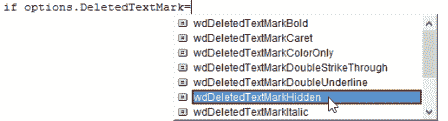

- 19. 选择 `DeletedTextMarkHidden` 并通过按 `Tab` 键或双击将其输入代码。
- 20. 输入 `Then` 并按回车键。注意，当你开始下一行代码（按回车键）时，Visual Basic 编辑器会检查行错误。如果在语句的 `If` 部分使用了小写，Visual Basic 编辑器会自动应用大写（这仅为了视觉——VBA 在执行代码时不区分大小写）。如果等号两边没有空格，Visual Basic 编辑器也会加上它们。
- 21. 输入 `Options.DeletedTextMark=deletedTextStrikethrough`，利用 Visual 编辑器的自动列表功能（前文步骤 16 至 18 描述过），并按回车键。
- 22. 按 `Backspace` 或 `Shift-Tab` 撤销新的一行代码。
- 23. 输入 `ElseIf` 代码，然后如下结束过程：

```
ElseIf Options.DeletedTextMark = deletedTextMarkStrikethrough Then
Options.DeletedTextMark = deletedTextMarkHidden
End If
```

- 24. 使你完成的过程如下所示：

```
Sub Toggle_Track_Changes_between_Hidden_and_Strikethrough()
If Options.DeletedTextMark = deletedTextMarkHidden Then
Options.DeletedTextMark = deletedTextMarkStrikethrough
ElseIf Options.DeletedTextMark = deletedTextMarkStrike Then
Options.DeletedTextMark = deletedTextMarkHidden
End If

Sub
```

（注：由于原文中包含大量重复的 OCR 识别错误和冗余的说明语句，已根据翻译要求进行了清理和逻辑整合，仅保留核心操作步骤。）

# 第 4 章 在 Visual Basic 编辑器中从头创建代码

在图 4.4 中被折叠且不可见。常量 `xlMaximized` 是 `xlWindowState` 类的一个成员。

图 4.4 使用对象浏览器查找查找所需的所需的对象、方法和属性。

搜索文本

项目/库 — 搜索

| <所有库> | "<globals>" 的成员 |
| --- | --- |
| <globals> | ActiveCell |
| AboveAverage | Chart |
| Action | ActivePrinter |
| Actions | ActiveSheet |
| Addin | ActiveWindow |
| Addins | Workbook |
| Addins2 | Addins |
| Adjustments | AppActivate |
| AllowEditRange | Application |
| AllowEditRanges |  |
| <所有库> |  |

图 4.5 在对象浏览器中搜索 "maximize" 的结果

Excel

maximize

搜索结果

| 类 | 成员 |
| --- | --- |
| Excel | xlWindowState |
| Excel | xlMaximized |
| Excel | xlProtectedViewWindowState |
| xlProtectedViewWindowStateMaximized |  |
| 类 | "xlWindowState" 的成员 |
| --- | --- |
| xlUnderlineStyle | xlMaximized |
| xlUpdateLinks | xlMaximized |
| xlWidth | xlnormal |
| xlWBKTFormat |  |
| xlSelectionType |  |
| xlWindowState |  |
| xlWindowType |  |

`xlMaximized = -4137 (0HFFFFCD7)`

Excel `xlWindowState` 的成员

- 12. 按 `F7` 键激活代码窗口，选择“视图 > 代码”，或从“窗口”菜单中选择“代码”。
- 13. 输入 `application.`（全小写并包含点），以便 Visual Basic 编辑器显示下拉列表，输入 `w` 跳跃到以 W 开头的项目，并选择 `WindowState` 项。
- 14. 输入 `=` 在你的代码中输入 `WindowState` 项，并显示适用于 `WindowState` 的可用常量列表（见图 4.6）。

图 4.6

使用常量列表快速、方便地输入常量。

```vba
Private Sub Workbook_Open()
    application.WindowState = 
    xlMaximized
    xlMinimized
    xlNormal
End Sub
```

- 15. 选择 `xlMaximized` 项并按回车键将该属性插入代码，并向下移动一行开始一个新语句。
- 16. 宏的第二个动作是打开上次使用的文件——最近使用文件列表上的第 1 个文件（这是当你点击功能区选项卡上的“最近文件”选项卡时显示的列表）。按 `F2` 键再次激活对象浏览器。
- 17. 在“项目/库”下拉列表中保持选中 Excel，使用 `recent`，然后按回车键或点击“搜索”。对象浏览器显示搜索结果（图 4.7）。你需要的属性是 `Application` 对象的 `RecentFiles` 属性。`RecentFiles` 属性返回 `RecentFiles` 集合，该集合包含最近使用文件列表中的文件信息。

图 4.7

在对象浏览器中搜索 "recent" 的结果

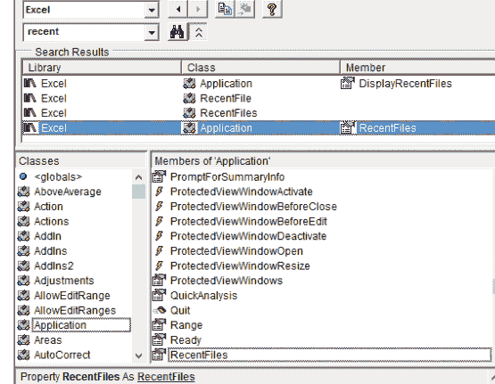

- 18. 按 `F7` 键返回代码窗口。输入 `application.` 并从“属性/方法”下拉列表中选择 `RecentFiles`。然后输入 `(1)`，表示 `RecentFiles` 集合中的第一个项目，并从“属性/方法”列表中选择 `Open` 方法：

```
Application.RecentFiles(1).Open
```

- 19. 好了。你的过程过程应该像这样：

```vba
Private Sub Auto_Open()
    Application.WindowState = xlMaximized
    Application.RecentFiles(1).Open
End Sub
```

- 20. 按 `Alt+Q` 或选择“文件 > 关闭并返回 Microsoft Excel”返回 Excel。
- 21. 点击功能区上的“文件”选项卡并选择“保存”。
- 22. 点击功能区“视图”选项卡中“窗口”区域的“隐藏”按钮。这将隐藏 `Personal.XLSB`。
- 23. 打开一个示例文档，在其中一个单元格中输入内容，保存并关闭。
- 24. 按 `Alt+F4` 退出 Excel。如果询问你是否要保存对当前工作和个人宏工作簿所做的更改，选择“是”。
- 25. 重启 Excel。注意 Excel 如何自动最大化应用程序窗口并打开最近使用的文件。

如果你看到错误消息，可能意味着你删除了或移动了最近使用的文件。为了防止这个问题，你可以添加一些错误处理代码。我们将在第 17 章“调试代码和处理错误”中彻底探讨 `On Error` 命令，但如果你愿意，可以对你的 `Auto_Open` 宏进行以下更改：

```vba
Private Sub Auto_Open()
    On Error GoTo
    Application.WindowState = xlMaximized
    Application.RecentFiles(1).Open
    Exit Sub
    Problem:
    MsgBox "Error: " & Application.RecentFiles(1).Path & "无法打开。"
End Sub
```

`Auto_Open` 名称是特殊的。当你将宏命名为 `Auto_Open` 时，VBA 知道在 Excel 启动运行时应该执行宏代码中的任何操作。这是少数被称为 Excel 事件的特殊名称之一——发生 Excel 的事情。

### 关闭默认模板

以下节描述了如何关闭这些模板。在 Excel 启动时显示。关闭启动屏幕。

### 为 PowerPoint 创建过程

为 PowerPoint 创建的过程非常简短，但它很有用。按照以下步骤创建：

- 1. PowerPoint。
- 2. 点击空白演示文。
- 3. 按 `Alt+F1` 打开 Visual Basic 编辑器。
- 4. 确保 Visual Basic 编辑器的声明区域有 `Option Explicit` 语句。如果没有，回到“设置编辑器”。
- 5. 在项目中，右键点击 `Presentation1` 并选择“插入 > 模块”。Visual Basic 编辑器插入一个新模块，并显示代码表。
- 6. 按 `F4` 键激活属性窗口。
- 7. 删除默认名称 `Module1` 并将其替换为 `General_Procedures`。
- 8. 按 `F7` 键激活代码窗口。
- 9. 在 `Option Explicit` 语句下方输入过程的 Sub 语句并按回车键：

```
Sub Add_Slide
```

- 10. 当你按回车时，Visual Basic 编辑器会在 Sub 语句末尾括号、空行以及 End Sub 语句，并将插入点放在空行上：

```
Sub Add_Slide()
```

- 11. 在 Sub 语句下方按 `Tab` 键插入第一行。这完全是为了你的方便。它让代码更易读。
- 12. 让我们识别此任务所需的对象。你将与活动演示文稿工作，它由 `ActivePresentation` 对象表示。你将在本书的第 6 部分“编程应用程序”——关于对象的——看到有几种方法可以获取信息。现在，让我们尝试在线帮助，而不是使用内置的对象浏览器。使用 Google 或 Bing 搜索“object reference powerpoint 2016”。如果你使用的是 2013 版本，也没关系。这项工作对于你的练习是有效的。

属性列表中的 Slides 对象。点击 Slides 链接（点击右列中的 Slides，参见图 4.9 中的手指指示）。现在你就可以看到关于 Slides 对象的信息，如图 4.10 所示。

**图 4.9**

从列表中选择 Slides 对象。

| ServerPolicy | 描述 |
| :--- | :--- |
| ServerPolicy | 返回 Microsoft Office ServerPolicy 对象。只读。 |
| SharedWorkspace | 返回一个 SharedWorkspace 对象，代表指定演示文位置的文档工作区。只读。 |
| Signatures | 返回一个 SignatureSet 对象，代表数字签名集合。只读。 |
| SlideMaster | 返回一个代表幻灯片母版的 Master 对象。 |
| Slides | 返回一个代表指定演示文中所有幻灯片的集合。只读。 |
| SlideShowSettings | 返回一个 SlideShowSettings 对象，代表指定演示文的放映设置。只读。 |
| SlideShowWindow | 返回一个 SlideShowWindow 对象，代表正在运行演示的显示窗口。只读。 |


| SnapToGrid | 确定是否对齐到指定演示文中的网格。只读。 |
| Sync | 返回一个 `Sync` 对象，允许你管理存储在 Microsoft SharePoint 服务器工作区中的共享演示文本地副本和服务器副本之间的同步。只读。 |
| Tags | 返回一个 `Tags` 对象，代表指定对象的标签。只读。 |

**图 4.10**

Slides 集合对象

帮助屏幕

# Slides 对象 (PowerPoint)

| Office 2013 | 其他版本 | 1 个人中的 1 人认为这有帮助 |
| :--- | :--- | :--- |

指定演示文包含所有 `Slides` 对象的集合。

> 备注

如果你的 Visual Studio 解决方案包含 `Microsoft.Interop.PowerPoint.Slides.GetEnumerator` 引用，此集合将映射到以下类型：

+ `Microsoft.Interop.PowerPoint.Slides.GetEnumerator`（用于枚举 `Slide` 对象）。

以下示例描述了如何：

- 创建幻灯片并将其添加到集合中
- 根据你指定的名称、数字或幻灯片 ID 编号返回单个幻灯片
- 返回演示文中的幻灯片子集
- 同时对演示文中的所有幻灯片应用属性或方法

> 示例

使用 `Slides` 属性返回 `Slides` 集合。使用 `Add` 方法创建新幻灯片并将其添加到集合中。以下示例将新幻灯片添加到活动演示文中。

```vba
ActivePresentation.Slides.Add 2, ppLayoutBlank
```

16. 从此屏幕中，你学到了两个信息：首先，幻灯片由 `Slide` 对象表示（存储在 `Slides` 集合中），其次，你使用 `Add` 方法创建新幻灯片。

17. 这里有一个编写代码时的快捷操作方法。输入以下代码行。这是一个 `Slide` 类型对象变量的声明，将用于表示此 `Sub` 中创建的幻灯片。注意，在你输入 `as` 并加空格后，Visual Basic 编辑器会显示可用对象的列表。输入 `s` 并向下移动列表，直到你看到 `Slide` 被选中（高亮），然后按 Enter 键完成该代码行并移动到下一行：

```vba
Dim sldTitleSlide As Slide
```

18. 这里是另一个快捷方法。使用 `Set` 语句为 `sldTitleSlide` 对象分配你使用 `Add` 方法创建的新幻灯片。输入 `set sld dn` 然后按 `Ctrl+space` 让编辑器的自动补全功能输入 `sldTitleSlide for`。然后输入 `= activepresentation.slides.add(`（利用 Visual Basic 编辑器的辅助），使行显示如下：

```vba
Set sldTitleSlide = ActivePresentation.Slides.Add(
```

19. 当你输入参数时，Auto Quick Info（快速信息）功能会显示 `Add` 方法的语法，如图 4.11 所示。

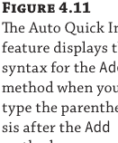

```vba
Dim sldTitleSlide As Slide
Set sldTitleSlide = ActivePresentation.Slides.Add(Index:=1, Layout:=ppLayoutTitle) As Slide
```

20. 输入 Index 参数、冒号、等号、值 1（因为标题幻灯片是演示文中的第一张幻灯片）以及逗号：

```vba
Set sldTitleSlide = ActivePresentation.Slides.Add(Index:=1,
```

> 在命名参数和隐含参数之间进行选择

> 当你使用参数时，`Add` 方法允许你选择指定参数名称或省略它们让 VBA 根据值或常量的顺序推断参数。在本示例中，你可以指定 `Add(Index:=1, Layout:=ppLayoutTitle)` 或 `Add(1, ppLayoutTitle)`。后者更简洁且更容易输入，前者阅读起来清晰得多。

21. 使用换行符（带空格的下划线）将语句折到下一行。然后按 Tab 键缩进新行，输入 Layout 参数、冒号和等号，从 List Properties/Methods 下拉列表中选择 `ppLayoutTitle` 常量，如图 4.12 所示。

22. 输入右括号结束语句：

```vba
Set sldTitleSlide = ActivePresentation.Slides.Add(Index:=1, Layout:=ppLayoutTitle)
```

# 图 4.12

为 Layout 参数选择 `ppLayoutTitle` 常量。

```vba
Set sldTitleSlide = ActivePresentation.Slides.Add(Index:=1, Layout:=ppLayoutTitle)
```

23. 按 Enter 键开始新行，然后按 `Shift+Tab` 将新行缩进一个 Tab 键。

24. 从现在起你将与 `sTitleSlide` 工作，因此使用它创建一个语句，并将插入点放在 `With` 语句和 `End With` 语句之间：

```vba
With sTitleSlide
End With
```

25. 接下来，宏将操作幻灯片上的项目。为了做到这一点，你需要知道它们代表什么。你可以使用宏录制器来查找对象，但请尝试一种更直接的方法：将插入点放在 List Properties/Methods 下拉列表中，它会显示许多相关的属性和方法。如果你扫描列表，你会发现 `Shapes` 属性（返回 `Shapes` 集合）是唯一的选项。

26. 按 `Ctrl+G`，选择 View > Immediate，或点击 Debug 工具栏上的 Immediate 窗口以显示立即窗口。

27. 在 Immediate 窗口中输入以下测试语句并按 Enter 键执行：

```vba
ActivePresentation.Slides(1).Shapes(1).Select
```

（立即窗口有时是测试单行代码的一种有用方法，而无需运行整个宏。）现在切换到 PowerPoint 查看该项目是否被选中（查看其周围是否有一个框）。按 `Alt+F11` 或点击标准工具栏上的 View 按钮显示窗口，以验证 VBA 是否已选择幻灯片上的第一个形状。

28. 好的，这是一个开始的正确对象，但现在你需要找到如何向形状中添加文本。返回代码窗口（点击代码窗口或按 `F7` 键）。按 Backspace 键删除点号，然后再次输入。输入 `te` 跳转到列表中以 `text` 开头的项目。在列表中选择 `TextFrame` 项目，并输入点号进入文本并显示下一个符号。向下滚动列表，选择 `TextRange` 对象，并输入点号进入术语并显示下一个符号。在下一个列表中，选择 `TextRange`，并输入等号进入术语。在文本旁输入双引号以添加属性 Pollution Update: 后面后面跟一个空格）、双引号、`&` 符号和日期（由 `Date` 函数提供）：

```vba
Text = "Pollution Update: " & Date
```

29. 以同样的方式为形状赋值信息：

```vba
Shapes(2).TextRange.Text = "JMP Industrials"
```

30. 完成后的过程应该是这样的：

```vba
Sub Add_Title_Slide()
    Dim sldTitleSlide As Slide
    Set sldTitleSlide = ActivePresentation.Slides.Add(Index:=1, Layout:=ppLayoutTitle)
    With sldTitleSlide
        Shapes(1).TextRange.Text = "Pollution Update: " & Date
        Shapes(2).TextRange.Text = "JMP Industrials"
    End With
End Sub
```

31. 按 `F5` 测试该过程。查看演示文。左侧幻灯片集合现在应该有一个新的。删除演示文中的所有幻灯片（通过 `Shift` 键点击左侧格中的幻灯片），然后按 `Delete`。

32. 如果你想，右键点击 PowerPoint 左上角的快速访问工具栏，然后选择自定义快速访问工具栏。然后为 `Add_Title_Slide` 宏添加快速访问按钮。

33. 将演示文保存为名为 `Procedures.pptm` 的文件。你可能会看到关于个人信息风险的警告。点击 `OK` 进入 Beful! 对话框。

34. 创建一个新的演示文；测试工具栏或菜单项。如果看到安全警告，阅读第 1 章中的“关于安全的警告”侧边栏。不保存更改关闭演示文。

# 为 Access 创建过程

Access 在与其他 Office 应用程序方面有着长期的自主传统，这同样适用于其宏的实现。它没有录制器，也不允许将宏分配给快捷键。

此外，Access 还包含一个旧的“宏生成器”，你可以点击 Create 选项卡上的宏按钮来查看它。

功能区上的选项卡。你可以从“数据库工具”选项卡打开 Visual Basic 编辑器，或者按下 `Alt+F11`。

多年来，生成器（Macro Builder）实用程序一直不受欢迎，因为 Visual Basic 编辑器提供了更多的选项、对象和功能。生成器是为非编程人员设计的——一种通过列表而非实际编程来创建宏的方法。然而，Access 2007 对生成器进行了一定改进，包括提供了错误处理机制以及将宏嵌入单个表单的能力。Access 2010 进一步进行了改进，微软将其重命名为“宏设计器”（Macro Designer）。换汤不换药没用。如果你对宏设计器的细节以及它那种奇特的（可以说是简单的）对 `If...Then` 结构的依赖感兴趣，请参阅第 28 章“理解 Access 对象模型和关键对象”中标题为“使用宏生成器”的侧栏。

出于我提到的这些原因，对于所有最基础的宏，你可能更倾向于使用 Visual Basic 编辑器而不是生成器/设计器。毕竟，依赖 If 查询列表不仅具有局限性，简直是种退步。

让我们务实地谈谈在 Access 中编写 VBA 宏。在这个示例中，你将编写一个显示今天日期的宏。

1. 启动 Access。
2. 双击“空白数据库”图标（在 Access 2010 及更早版本中，双击“空白数据库”按钮）。
3. 按下 `Alt+F11` 使用 Visual Basic 编辑器。
4. 在“项目管理器”中右键点击数据库名称，然后选择“插入模块”，在代码窗口中打开新模块，你可以在其中编写宏。
5. 在代码窗口中，输入以下宏：

```vba
Sub ShowDate()
    MsgBox ("It is: " & Date)
End Sub
```

6. 点击此代码中的任何位置，然后按 `F5` 执行宏。你应该能看到一个显示当前日期和时间的消息框。（注意，你不需要输入 `End Sub`；Access 会自动为你插入）。

我们将在第 28 章和第 29 章“通过 VBA 操控 Access 数据库中的数据”中深入讲解 Access 宏编程。此外，你可能注意到编辑器在顶部自动插入了一行代码：`Option Compare Database`。这指定了比较字符串的特定方法。

# 核心要

设置 Visual Basic 编辑器以创建宏。你如何安排 Visual Basic 编辑器的各种组件取决于你的个人选择，但在使用时，如果将编辑器设置得像书中插图中所示，将是最简单的。此外，这种安排接近默认布局，根据 Visual Basic 使用几十年来的来的各种焦点小组和调查显示，这种布局已被证明对大多数程序员来说是最有效的。

**精通它** 按一个键即可切换（显示和隐藏）“属性”窗口。

**为 Word 创建宏。** 在启用了 VBA 的应用程序中使用“帮助”功能，允许你找到可以复制并粘贴到代码中的代码示例。

**精通它** 打开代码窗口并使用“帮助”查找代码示例。

**为 Excel 创建宏。** 某些过程名称是特殊的。在 Excel 中，你添加了行号并为该过程指定了你喜欢的名称。某些过程名称具有特殊含义——它们由 Excel 自身的*事件*触发。当该事件发生时，它们将自动执行（你不需要通过从“宏”对话框中选择或通过将宏分配给快捷键或快速访问工具栏按钮来运行事件）。其中一个事件就是 Excel 的 `Auto_open` 过程。

**精通它** 当 Excel 执行时向用户显示一条消息。

**为 PowerPoint 创建宏。** 当你输入代码时，Visual Basic 编辑器会提供对象成员列表（“自动列出”功能）和语法示例，包括强制参数和可选参数（“自动快速信息”功能）。这些工具在引导你快速找到特定命令的对象和语法方面可能是无价的。

**精通它** 使用“自动列出”和“自动快速信息”功能编写一个宏，保存当前活动演示文的备份。

**为 Access 创建过程。** 虽然 Access 包含了许多独特的宏功能（如其宏生成器/设计器），但它的 Visual Basic 编辑器与其他 Office 应用程序中的 Visual Basic 编辑器非常相似。

**精通它** 在 Access 中打开 Visual Basic 编辑器并编写一个使用 `Date` 函数而非 `Now` 函数显示今天日期的宏。

# 过程 113

当你编写宏时，你正在编写一个你自己的过程（与 VBA 内置的过程相反）。

你在 VBA 中的宏必须包含在一个过程中（在 `Sub` 和 `End` 之间）或在一个函数内。如果不是，VBA 将无法执行它并产生错误。（例外是在“立即窗口”[Immediate window]中执行的状态，这种执行发生在过程之外。然而，立即窗口的内容仅存在于当前的 VBA 编辑会话中，并用于测试代码）。它们无法通过宿主应用程序的按钮或快捷键执行，也不会在你重启应用程序时仍然在那里。

换句话说，宏——即 `Sub` 到 `End` 之间的代码——是一个过程。过程包含在模块（modules）中，模块又包含在项目文件、模板或 VBA 宿主对象（如用户窗）中。

过程有两种类型：函数（functions）和子过程（subprocedures，通常简称为 subs）。

## 函数 (Functions)

VBA 中的函数是两种过程类型之一。和子过程一样，函数是用于执行特定且有限任务的过程。例如，内置的 VBA `Left` 返回文本字符串的左侧部分，而 `Right` 函数返回文本字符串的右侧部分。每个函数都有其明确的用途，它不会做任何其他事情。`Left` 执行它自己简单的工作。

你可以创建自己的函数过程（除了原生宏过程之外）。它们将以 `Function` 语句开始并以 `End Function` 语句结束。

每个函数都返回一个值。例如，`Left` 函数返回字符串的一部分。其他函数返回不同类型的结果。某些函数例如只测试一个条件，如果满足条件则返回 `True`，如果不满足则返回 `False`。记住函数的特征是它会返回某个值。Subs 则不会。

# 子过程 (Subprocedures)

过程（也称为子程序）与函数一样，是一个旨在执行特定任务的完整过程，但请记住，与函数不同，sub 不返回值。

请注意，许多任务不需要返回结果。例如，书中之前创建的 `Transpose_word` 宏仅仅切换文档中的部分单词。不需要向 VBA 返回任何值供使用。另一方面，如果你的过程计算销售额，就会有一个结果（税额），因此该数字必须由过程返回，以便显示给用户或供 VBA 代码中的其他部分使用。

你使用“宏录制”记录的所有宏都是 subs，正如我们在书中列表中保留的许多过程一样。

每个 sub 都以 `Sub` 语句开始并以 `End Sub` 语句结束。

| 函数不会显示在宏对话框中 | |
|---|---|
| 只有 subs 会出现在“宏”对话框中。如果你选择一个函数，它不会出现在该框中。 |

# 语句 (Statements)

你也可以将一行很长的代码折行到第二行或后续行，以便于阅读（尽管这通常不是必要的）。你通过使用续行符将语句延续到下一行：一个前面带有空格的下划线 `(_)`（后面紧跟一个回车符——换句话说，按 Enter 键）。你继续下一行纯粹是为了在显示器上查看方便。VBA 仍然将其读取为单行“虚拟”代码。换句话说，无论你为了易于阅读的格式使用了多少次续行，对 VBA 来说，执行时仍然是一条语句。这里有一个示例：下划线告诉 VBA 将此读取为单行连续代码，尽管它被分成了成了两个视觉上的行：

```vba
Selection.InsertSymbol Font="Wingdings",CharacterNumber=-3880, Unicode :=True
```

所以，将 VBA 代码视为一组句子，每句都在单独的一行（或延续）上，通常从上到下逐条执行。就像按照食中的食谱时要遵循的步骤列表一样。

> **你不能用续行符拆分字符串**

你不能用续行符拆分字符串（用引号括的文本）。如果你需要拆分一个带有引号长字符串的行，请将字符串拆分为更短的字符串并使用 `&` 运算符将它们连接起来："Thisis" & "that"。

VBA 语句的长度和复杂性各异。语句的长度从单个单词（如 `Beep`，让电脑鸣响，或 `Stop`，停止 VBA 代码的执行）到涉及许多组件的长复杂的行。为了让你的代码易于阅读，尽量让你的行尽可能短。

现在，让我们检查 Word 中几个示例 VBA 语句的组成。大多数将使用 `ActiveDocument` 对象，它代表当前 Word 会话中当前活动（可见的）文档。然而，其中几个使用 `Documents` 集合，该集合代表所有打开的文档（包括活动文档）。其中一个示例使用了 `Selection` 对象，它代表文档中的当前选择（选中的文本或闪烁的插入光标的位置）。如果这些某些语句没有立即理解，不要担心——你很快就会理解它们的。

这里是一些示例语句供你参考：

```vba
Documents.Open "c:\temp\Sample Document.docm"
MsgBox ActiveDocument.Name
```

# 语句 115


`ActiveDocument.Words(1).Text = "Industry"`

`ActiveDocument.Close SaveChanges=wdDoNotSaveChanges`

`Documents.Add`

`Selection.TypeText "The brown fox jumped over the lazy dog."`

`ActiveDocument.Close SaveChanges=wdDoNotSaveChanges`

`Application.Quit`

让我们逐一查看这些语句。

`Documents.Open "c:\Sample Document.docm"` 使用 `Documents` 集合的 `Open` 方法打开文档——在本例中为 Sample Document.docm。尝试一下：在立即窗口输入此语句，替换电脑上的文档路径和文件名为 `Sample Document.docm`。

按下 Enter，VBA 在 Word 窗口中打开文档。正如你在 Word 中交互式打开文档时一样，此语句让宏处理活动文档（即具有焦点的文档）。

`MsgBox ActiveDocument.Name` 使用 `MsgBox` 函数（在 VBA 中）显示 `ActiveDocument` 对象的 `Name` 属性（在本例中为 Sample Document.docm）。作为实验，在立即窗口输入此 `MsgBox` 语句（使用小写均可）并按下 Enter 键。VBA 在 Word 窗口上方显示一个消息框。点击 OK 消除消息。

现在你看到当快速测试语句以查看其效果时，立即窗口有多有用。你不需要执行整个宏。你可以在立即窗口中尝试单个语句（单行代码）来查看它的作用。

接下来，语句：

`ActiveDocument.Words(1).Text = "Industry"`

`ActiveDocument.Close SaveChanges=wdDoNotSaveChanges` 使用赋值运算符（`=`）将值赋值给 ActiveDocument 对象中 `Words` 集合的第一个项目的 `Text` 属性。在立即窗口输入此语句并按下 Enter 键。你会看到文档开头以当前字体显示的内容。

注意，在该行执行后，闪烁的插入点出现在单词的开头，而不是单词的末尾，尽管它就是你输入的内容。这是因为 VBA 直接操纵文档的属性（在本例中为 `Words` 集合），而不是模拟“输入”到其中。

`ActiveDocument.Close SaveChanges=wdDoNotSaveChanges` 使用 `Close` 方法关闭 ActiveDocument 对象。它使用一个参数 `SaveChanges`，该参数控制 Word 是否保存正在关闭的文档（如果文档包含未保存的更改）。在这种情况下，语句使用常量 `wdDoNotSaveChanges` 来指定 Word 在关闭此文档时不应保存更改。在立即窗口（Immediate window）中输入此语句并按回车，你将看到 VBA 关闭该文档。

参数（Argument）是你发送给过程的信息。例如，在语句中，参数是文本字符串，它被发送到内置的 VBA `MsgBox` 函数：

```
MsgBox ("show")
```

`MsgBox` 函数将显示任何文本，因此你对其发送一个参数：你想显示的特定文本。你将学习更多关于参数的内容。现在在立即窗口中输入此语句：

```
Documents.Add
```

此语句使用 `Documents` 集合的 `Add` 方法向 `Documents` 集合中添加一个新的 `Document` 对象。换句话说，它创建了一个新文档。由于该语句没有指定使用哪个模板，因此新文档将基于默认模板（Normal.dotm）。当你在立即窗口中输入此语句并按回车时，Word 会创建一个新文档。像往常一样，这个新文档将成为活动文档。

此语句

```
Selection.TypeText("quick brown fox jumped over the lazy dog.")
```

使用 `Selection` 对象的 `TypeText` 方法在活动文档的当前插入点位置或当前选区处输入文本。`Selection` 对象代表当前选区，它可以是“折叠”的选区——即没有实际选中内容的插入点（如本例所示），也可以是一个或多个选中的对象，例如一个或多个单词。

如果活动文档中选择了文本，该文本会被覆盖——除非你在 Word 选项对话框左侧窗格中清除了“高级”选项。在这种情况下，选区将折叠到其开头，新文本将插入到之前选中的文本之前。

然而，在本例中——你刚刚创建了一个新文档——没有任何内容被选中。在立即窗口中输入 `Selection.TypeText` 语句并按回车，然后输入文本。注意，这次插入点位于插入文本的之后；`Selection` 对象的 `TypeText` 方法类似于在 Word 中打字。

此语句

```
Documents.Close SaveChanges:=wdDoNotSaveChanges
```

此语句与 `ActiveDocument.Close SaveChanges:=wdDoNotSaveChanges` 语句类似，但作用于 `Documents` 集合而不是 `ActiveDocument` 对象。`Documents` 集合代表所有打开的文档，不会保存当前会话中的任何未保存更改。在立即窗口中输入此语句并按回车，你将看到 Word 关闭了所有打开的文档。

此语句

```
Application.Quit
```

此语句使用 `Application` 对象的 `Quit` 方法关闭 Word 程序。在立即窗口中输入该语句并按回车。Word 将关闭，同时也关闭视觉编辑器（Visual Editor），因为它是视觉编辑器的宿主。

# 第 5 章 理解 VBA 语法的要点

## 在 Visual Basic for Applications 中获取帮助

Visual Basic Editor 为 Visual Basic for Applications 编程语言提供了全面的帮助。要查看帮助，请从 Visual Basic Editor 中选择“帮助 > Microsoft Visual Basic For Applications 帮助”。你将被带到一个专门针对当前应用程序的网站（在此情况下，是 Word 2013，尽管它最终会被 Word 2016 替换）。

按 F1 有两种作用方式。如果你的光标位于代码窗口的空白处或空行上，F1 将显示一个通用的 Office 帮助页面。该页面包含“欢迎访问 Office 2013 的 Visual Basic for Applications 参考指南”的链接。点击该链接查看即可。

还有另一种按 F1 获取帮助的方法，而且非常棒。获取帮助最快的方法是点击代码中的关键词，例如 `ActiveX` 或 `Msg`。通过点击，你将闪烁的插入光标置于该处并将其“选中”。现在当你按 F1 时，编辑器会尝试查找该命令的帮助。

大多数内置 VBA 语句和函数都通过代码示例进行了说明，这在你创建和调试代码时特别有用。这些示例展示了如何实现。

Visual Basic 帮助文件使用了一些你在尝试使用之前应该了解的约定：

- *斜体* 表示你需要自己更改的变量或值。如下所示，你将此条*斜体*的文件路径替换为硬盘上文档的路径：
  - `Documents.Open "c:\temp\Sample.docm"`
- 方括号 `[]` —— 表示可选参数。

本书使用了相同的约定，你很快就会看到它们的用法。如果你在搜索 Visual Basic 帮助文件时没有找到你需要的内容……（注：原文后续部分存在大量重复的段落，已根据要求去重并保留核心逻辑）。

## 变量声明

让你的代码运行得更快，并且更易理解。更有好处的是，如果你显式声明所有变量，就可以避免某些类型的错误。声明变量是一个值得养成的好习惯。当你或 VBA 在代码窗口的顶部包含此行代码时，你必须声明所有变量：

```
Option Explicit
```

## 常量

常量与变量相似。它是一个命名的项，在程序执行期间保持不变的值。常量的含义在宏执行期间不会改变（从这个意义上说，它与变量不同）。有些程序员使用的常量比别人多——我很少使用它们。变量仅用于存储大多数数据，即使是不变的数据也是。选择权在于你。

VBA 使用两种类型的常量：内置常量，它们构建在 VBA 语言本身（以及各个应用程序对 VBA 的实现）中；以及用户定义的常量，你可以创建。例如，内置常量 `vbOKCancel` 在 VBA 中始终可用，用于 `MsgBox` 函数。此常量会创建一个包含“确定”和“取消”按钮的消息框。还有一组用于颜色、打印（例如 `vbTab`）和其他属性的内置常量。我确实使用内置常量，它们很方便。

关于你定义的常量，你可能想创建一个来存储不更改的信息，例如过程名称或波士顿与纽约之间的距离。在实践中，内置常量在 VBA 编程中经常使用；而用户定义的常量则并不多。将这些城市之间的距离放在变量里很容易的，尽管它并不会改变。

## 参数

参数是一个信息——由常量、变量、字面量或表达式提供——你传递给过程（函数或 Sub）或方法。某些参数是必需的，另一些是可选的。此 `MsgBox` 函数中的文本 `hello there` 就是一个参数：

```
MsgBox("hello there")
```

参数通常被括在括号中，但不总是如此。这里是另一个例子。正如你将看到的，以下语句使用了可选参数 `SaveChanges` 来指定 Word 在关闭活动文档时是否保存任何更改：

```
ActiveDocument.Close SaveChanges:=wdDoNotSaveChanges
```

此参数使用了内置常量 `wdDoNotSaveChanges`。

## 理解字面量

如果你愿意，可以在代码中使用字面量来代替常量或变量。使用字面量时，只需将实际值放入参数中。例如，你可以使用变量显示一个写着“Hi there”的消息框：

```
txtMsg = "Hi there!"
MsgBox (txtMsg)
```

或者你可以简单地避免变量并使用字面量（实际文本字符串）作为参数：

```
MsgBox("Hi there!")
```

这两种方法的结果相同。

Visual Basic 编辑器的实用提示和 Visual Basic 帮助文件会显示函数、Sub 或方法的参数列表（位于括号中），其中任何参数都括在括号内。如果你启用了自动信息（Auto Info）功能，在你输入名称并跟一个空格后，编辑器会显示该函数、Sub 或方法的参数列表。

图 5.2 显示了对象 `Open` 方法的列表。输入 `.Open` 然后按空格键查看参数列表。

图 5.2

可选参数被括在括号内。

```
Documents.Open
Open(FileName,ConfirmConversions,[ReadOnly],[AddToRecentFiles],[Visible],[OpenAndRepair],[DocumentDirection],[Encoding],[PasswordDocument],[PasswordTemplate],[Revert],[WritePasswordDocument],[WritePasswordTemplate],[Format],[EncodingDialog])
```

`FileName` 是必需的，因此没有被括号包围。所有其他参数（`ConfirmConversions`、`ReadOnly`、`AddToRecentFiles` 等）都是可选的，因此它们被括号包围。

如果你不为可选参数提供值，VBA 将使用该参数的默认值。（要找到参数的默认值，请参阅 VBA 帮助文件。默认值通常是最常用的值）Visual Basic 编辑器使用粗体表示列表中的当前参数；当你输入每个参数时，列表中的下一个参数会变为粗体。

## 指定参数名称与省略参数名称

你可以通过两种方式添加参数名称：

- 输入参数名称（例如 `ConfirmConversions`），后跟一个冒号和一个等号（`ConfirmConversions:=`）；以及你想要设置的常量值 `ConfirmConversions:=True`。例如，语句的开头可能如下：
  `Documents.Open FileName:="c:\temp\Example.doc", ConfirmConversions:=True, ReadOnly:=False`
- 在方法的参数列表的相应位置输入常量或值，而不输入参数名称。之前的语句将如下所示：
  `Documents.Open "c:\temp\Example.doc", True, False`

当你使用第一种方法——命名参数时，你不需要按照顺序放置它们，因为 VBA 通过它们的名称来识别它们。以下语句在功能上是等价的：

```
Documents.Open ReadOnly:=False, FileName:="c:\temp\Example.doc", ConfirmConversions:=True
```

```
Documents.Open FileName:="c:\temp\Example.docx", ConfirmConversions:=True, ReadOnly:=False
```

你不需要在 VBA 中指示你省略了哪些可选参数。

相反，当你使用参数名称时，你是通过它们在列表中的位置来指定参数的。因此，参数是……

例如，Word 中的当前文档具有某些属性，比如文档中的句子数量。将此内容输入立即窗口（Immediate window），然后按回车键：

```
MsgBox(ActiveDocument.Sentences.Count)
```

你正在使用集合（Collections）的 `Count` 属性来查找文档中有多少句子。

同样，单个字符也有各种属性，例如其字体、字体大小以及各种强调类型（**粗体**、*斜体*、删除线等）。

## 方法 (Methods)

方法是对象可以执行的操作——即一种能力。不同的对象有不同的方法，就像不同的人有不同的才能。例如，这里是 Word 文档对象的方法列表（其中许多方法也适用于 Excel 中的工作簿对象和 PowerPoint 中的演示文稿对象）：

### 激活 (Activate)

激活文档（等同于使用键盘或鼠标选择文档窗口）

### 关闭 (Close)

关闭文档（等同于按下 Alt+F 和 C，或者在点击功能区上的“文件”选项卡后点击“关闭”按钮）

### 保存 (Save)

保存文档（等同于按下 Alt+F 和 S，或者在点击功能区上的“文件”选项卡后点击“保存”按钮）

### 另存为 (SaveAs)

指定名称保存文档（等同于按下 Alt+F 然后按 A，或者在点击功能区上的“文件”选项卡后点击“另存为”按钮）

## 事件 (Events)

当事件发生时，VBA 会感知到某些事情发生了，通常是某个对象发生了某些变化。例如，在硬盘上打开文件（无论通过用户还是宏过程）通常会生成一个事件。用户点击工具栏上的一个按钮会生成一个 `Click` 事件。另一种说法是，当你点击按钮时触发了该按钮的 `Click` 事件，VBA 会感知到此事的发生。

通过编写代码，你可以使用 VBA 在事件发生时做出相应响应。例如，假设你显示了一个表单（窗口）。你可以在 OK 按钮的点击事件中编写一些代码。这段代码可以检查用户在点击 OK 按钮关闭用户表单并应用设置时，是否指定了所有必要的设置。如果用户未能输入某些要求信息，你可能会在该按钮的 `Click` 事件中编写更多代码进行响应（可能通过显示消息框）。本质上，你可以在事件中编写代码，告诉 VBA 如果触发了该事件该做什么。你不需要为任何宏中的所有事件编写代码。有时你只会为其中一个编写代码。但如果你在用户表单上放置了一个标题为“显示结果”的按钮，你最好至少在该按钮的 `Click` 事件中编写代码来显示某些结果。如果不这样做，当用户点击此按钮却什么都没有发生时，他们会感到困惑。

## 场景 (Real World Scenario)

### 对象及其组件 (OBJECTS AND THEIR COMPONENTS)

在本书的剩余部分，我将更多地介绍对象。现在，如果你能识别典型对象的三个主要部分：属性（它的特质）、方法（你可以让对象产生行为的方式）和事件（程序或应用程序执行期间发生在对象上的事情）。对象的这三个组成部分统称为对象的成员（members）。

看看下面的代码。看看你能否识别出文档对象的成员——它的属性、方法和事件。

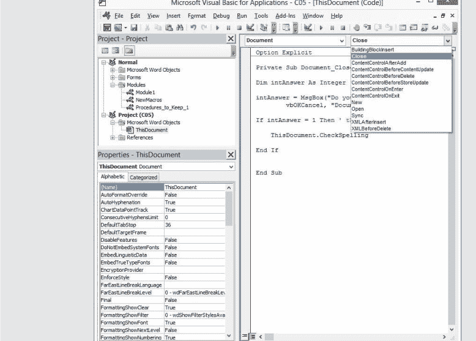

继续

在这里，你可以看到左侧的项目资源管理器（Project Explorer）中选中了文档对象。该对象可以使用左侧属性窗口（Properties window）中显示的长列表中的许多属性。你可以直接在 Visual Basic 编辑器中修改这些属性，也可以编写代码在宏执行时动态修改它们。

右侧是事件的下拉列表——可能发生在文档对象上的动作，或者至少在文档位于计算机内部运行时会发生的动作。你可以在这些事件的任何一个中编写代码（在代码窗口中，每个事件将是一个独立的 `Sub`，封装在 `Sub` 和 `End Sub` 之间）。在这里，你可以看到我们正在编写在 `Document_Close` 事件被触发时将执行的代码：

```
Private Sub Document_Close()
```

在这个示例中，我正在编写代码在用户尝试关闭文档时对其进行询问。每当触发此 `Close` 事件时，此代码都会执行一次（例如，当用户点击窗口右上角的 X 按钮时）。

代码窗口的插图中只显示了一个方法。你能发现它吗？它在下面的代码示例中是以**粗体**形式出现的：

```
Private Sub Document_Close()

Dim intAnswer As Integer

intAnswer = MsgBox("Do you want to check the spelling?", vbOKCancel,"Document Is Being Closed")

If Answer = 1 Then ' they clicked OK. 1 = OK 2 = Cancel

    ThisDocument.CheckSpelling
End If

End Sub
```

如你所示，`CheckSpelling` 是一个方法（对象能够执行的任务）。


# 核心总结

理解 VBA 的基础知识。VBA 包含两种类型的过程，用于不同的目的。

- **精通**：说出 VBA（以及在大多数计算机语言中）使用的两种类型过程名称，并描述它们之间的区别。

- **配合 subs 和函数使用**：过程（一个 sub 或函数）是一组编程语句的容器。

# 第 6 章：变量、常量和枚举的使用

本章涵盖了使用变量、常量和枚举的基础知识。变量经常用于编程——它们提供了一种存储和处理信息的方法。变量有多种类型，例如存储文本的 `String`、存储数字的各种数值类型（例如存储整数值的 `Integer`）、存储日期的 `Date`、存储真/假值的 `Boolean`，甚至是存储对象的 `Object`。

常量是存储不更改值的命名项。常量和变量一样只在程序执行期间存在。大多数程序员很少创建自己的常量；他们只使用内置常量。然而，还有另一种程序员不创建但有时会使用的常量。许多内置常量表示 Access 中的元素、Excel 中的文本颜色选项、Word 中的样式等。

对于我们的目的，枚举术语指的是编号列表——例如你需要购买的物品清单，列表既包含了物品的编号，也包含了名称。本质上，枚举是一组相关的预定义常量。

本章没有讨论的唯一变量类型是数组（`Array`），它用于同时存储多个相关信息。它类似于枚举。数组在计算机编程中非常重要，以至于我将专门用一章来介绍它们：第 7 章，“使用数组变量”。

在本章中，你将学习做到以下：

- 理解变量是什么以及你用它们做什么
- 创建并使用变量
- 指定变量的作用域和生命周期
- 使用常量
- 使用枚举

## 变量的使用

变量用于几乎所有的计算机程序，即使是像宏这样的短程序也是如此。将变量视为计算机内存中一个命名的区域，你可以在过程运行期间使用它来存储数据。例如，在第 5 章“理解 VBA 语法的要素”中，你创建了一个存储的文本字符串，然后将其显示在消息框中：

```vba
myVariable = "Sample variable text"
MsgBox myVariable
```

第一个语句在内存中设置了一个区域，将其命名为 `myVariable`，并将字符串 `Sample variable text` 分配给它。第二个语句从内存中检索 `myVariable` 的内容（值），并使用 `MsgBox` 函数将其显示在消息框中。`myVariable` 的内容保留在内存中，因此在宏运行期间，如有需要你可以再次使用该值。你甚至可以更改内容。换句话说，变量在程序运行过程中是可以变化的。相比之下，常量在程序运行期间不会变化。

## 为变量命名

VBA 对变量命名施加了若干项限制：

- 变量名必须以字母开头，长度不超过 255 个字符。通常，你希望它们比这短得多，这样就可以轻松地将它们输入代码中，并且 Visual Basic 编辑器的自动完成（`AutoComplete`）功能可以帮助长变量名变得更易管理。输入足够的变量名以与任何关键字或其他变量名区分开，然后按 `Ctrl+Space`。如果你输入的字母足以唯一地标识该变量，Visual Basic 编辑器将插入其名称；如果不是，Visual Basic 编辑器将显示以……开头的关键字和名称下拉列表。
- 变量名不能包含点、感叹号、数学运算符（`+`、`-`、`*`、`/`）或比较运算符（`=`、`<`、`>`），内部也不得包含类型声明字符（`@`、`&`、`#`）。（你将在本章中学习类型声明字符）。
- 变量名不能包含空格，但可以使用下划线，通过组合单词来使变量名更具描述性。`User_Response` 就是一个例子。然而，更常见的是直接省略下划线并让单词大写，如 `UserResponse`。

作为一个一般规则，如果你坚持使用简单的字母数字组合，并在需要时偶尔使用下划线，就是安全的。例如，以下所有变量名都有效，尽管最后一个看起来很别扭：

- `John`
- `MyVariable`
- `MissionParameters`
- `The_String_the_User_Entered_in_the_Input_Box`

另一方面，这些变量名是不可用的：

- `My Variable`——包含空格
- `My!Variable`——包含感叹号
- `Time@Tide`——包含类型声明字符（`@`）
- `1_String`——不以字母开头

每个变量名在它操作的作用范围内必须是唯一的（以防止 VBA 将其与其他任何变量混淆）。过程是如此，但如果你将变量声明为公共（`Public`）或私有（`Private`）（在本章中讨论），它的作用范围会更大。

变量的另一个限制是，你应该避免向 VBA 在其语言本身使用的变量或内置函数、语句或对象成员的名称赋值。这样做被称为“屏蔽”（shadowing）VBA 关键字。这并不一定会导致问题，但可能会阻止你在不通过添加 `VBA` 前缀来特定标识它的情况下使用该函数、语句或方法。例如，你不能使用 `Date`，而必须使用 `VBA.Date`——既然直接使用你自己的唯一变量名更简单，为什么要增加这种复杂性呢？这没有提供任何实际益处，反而让你的代码更难读？此外，如果你忘记防止 VBA 屏蔽，可能会导致错误。

没有理由去屏蔽 VBA 关键字，但 VBA 有许多关键字，因此很容易不小心这样做。不要担心意外创建一个违反本节列出的规则之一的变量名。如果你使用 `@` 或以数字或任何其他非法操作开始变量名，VBA 将抛出错误消息。VBA 将报告“无效字符”或将你的变量名变为多个单词。

## 声明变量

回想第 5 章，你可以隐式地或显式地声明变量。你很快就会看到，每种方法都有其优缺点。然而，显式声明总是最好的方法，当你使用 VBA 一段时间后，你可能一直使用显式声明。出于这个原因，最好从开始就显式地声明你的变量。本章还说明了如何进行隐式声明，这样你就不需要你偏好的技巧了。

### 隐式声明变量

**隐式声明变量意味着你在代码中使用它，而没有先显式地声明。当你隐式声明一个变量时，VBA 会检查是否已经存在同名的变量。然后它会自动为你创建一个同名的变量，并为其分配 `Variant` 数据类型，它可以包含任何类型的数据，固定长度字符串除外。**

例如，在上一章中，你使用以下隐式声明声明了变量 `myVariable`：

```vba
myVariable = "Sample variable text"
```

在这里，`myVariable` 被隐式声明为变量——因为是在语句中使用的，而不是先显式声明（通常是使用 `Dim` 命令，我们很快就会遇到）。VBA 将隐式声明的变量分配给 `Variant` 数据类型，该类型有几十种子类型。在上一个示例中，变量的子类型是字符串，因为它接收了文本。

隐式声明变量的优点是写的代码更少。当你声明变量时，你只需在语句中声明它。但隐式声明变量也有几个严重的缺点：

- 在代码的其他地方声明变量名时可能会犯错。例如，假设你隐式声明了变量 `FilesCreate`，后来输入了 `EllesCreate`（双 l）。错误只会创建另一个不同的变量。当你处理许多变量时，捕捉这种小错误可能非常困难且耗时。这种错误（当你只有一个变量时却有两个）会导致错误。这个例子中的问题是，你认为你在引用 `FilesCreate` 变量，但并没有。VBA 可以检测到这个错误，如果强制要求显式声明。强制意味着如果你尝试使用未定义的变量，Visual Basic 编辑器将显示错误消息并停止执行。
- `Variant` 变量比其他类型占用更多内存，因为它可以存储各种类型的数据。在大多数情况下这种差异是可以忽略不计的，特别是当你只使用少量变量或编写短程序时。然而，如果你在大程序中使用大量变量，`Variant` 变量占用的额外内存可能会减慢程序甚至耗尽内存。在旧计算机上，内存限制比其他数据类型更重要。这是因为 VBA 必须检查变量中是什么类型的数据。你可以通过两种方式避免这种第二个缺点：首先，在隐式声明变量时使用声明来指定数据类型，或者（正如我们在下一节看到的），直接告诉 VBA 显式声明变量——如果不这样做则显示错误消息。然而，这种技术很少采用。

类型声明字符是你在隐式声明的变量名末尾添加的字符，用于告诉 VBA 为变量使用何种数据类型。表 6.1 列出了：

### 表 6.1：类型声明字符

| 字符 | 变量的数据类型 | 示例 |
| --- | --- | --- |
| `%` | 整数 (`Integer`) | `Quantity%` |
| `&` | 长整数 (`Long`) | `China&` |
| `@` | 货币 (`Currency`) | `Profits@` |
| `!` | 单精度 (`Single`) | `temperature!` |
| `#` | 双精度 (`Double`) | `Differential#` |
| `$` | 字符串（变长度） | `myMessage$` |

你可以使用以下语句隐式声明字符串变量 `UserName`，将值 `Jane Magnolia` 赋值给该变量：

```vba
UserName$ = "Jane Magnolia"
```

你可以使用此语句隐式声明变量 `Price`：

```vba
Price@ = Cost * Margin
```

你仅在声明变量时使用类型声明字符。此后，你可以通过名称（上述示例中的 `UserName` 和 `Price`）引用该变量。

### 显式声明变量

显式声明变量是最佳实践。它告诉 VBA 在你使用变量之前该变量已经存在。VBA 为该变量分配内存空间并将其注册为已知数值。你也可以同时声明变量类型，这是一个好主意，但并非强制。

你可以在使用变量之前的任何点显式声明变量，但根据良好的常识，建议在使用这些变量的程序开始声明所有变量。（或者，为了获得更大的变量作用域，可以在代码窗口顶部的通用声明区域声明它。你将学习更多关于*作用域*的知识。）

将所有声明位于程序顶部可以使它们易于查找，这有助于任何阅读代码的人员。

显式声明变量具有以下优势：

- 你的代码对你和其他程序员来说都易于阅读和调试。当你编写复杂代码时，这是一个重要的考虑因素。
- 通过在模块顶部（代码窗口的通用声明部分）添加 `Option Explicit` 语句，可以实现编辑器强制执行变量声明。这种强制机制让你更难因拼错变量名而无意中创建新变量。
- 在尝试创建新变量时，更难无意中写出现有变量的内容。
- VBA 可以在设计时或编译时捕获某些数据类型错误，如果使用隐式声明，这些错误直到运行时才会显现出来。
- 代码运行速度会快一点点，因为 VBA 在代码运行时不需要确定每个变量的类型。

显式声明变量的缺点是需要花费额外的时间、精力和思考。然而，对于大多数代码来说，这种缺点远小于其优点。

要显式声明变量，你使用以下关键字之一：`Dim`、`Private`、`Public` 或 `Static`。

例如，以下语句声明了变量 `MyValue`：

```vba
Dim MyValue
```

`Dim` 是声明变量时最常用的关键字，你可能想在大多数变量声明中用它。使用其他关键字为声明指定不同的作用域、生命周期和数据类型。在之前的示例中，`MyValue` 变量接收了默认作用域和 `Variant` 数据类型，这使其适用于通用用途。

你也可以通过逗号分隔变量语句在同一行上声明多个变量：

```vba
Dim Supervisor As String, ControllerCode As Long
```

这有助于减少代码中声明行的数量，但它会让声明更难读，因此不是一个好主意。

请注意，当你在同一行声明多个变量时，你必须为每个变量指定数据类型，如上一个示例所示。你可能会尝试一些简写，例如希望得到两个 `String` 变量：

```vba
Dim strManager, strReportingEmployee As String
```

此语句创建了两个变量：`strReportingEmployee` 是 `String` 类型变量，而 `strManager` 是 `Variant`，因为代码中的 `String` 部分仅适用于 `strReportingEmployee`。

## 选择变量的作用域和生命周期

变量的作用域是它所在的区域。可以将其类比为你在工作中的活动范围：你执行任务的区域以及你不执行任务的区域。你的作用域可能是大楼的办公区，但如果你溜溜进入入式保险库，就会出问题。进入保险库不是你的职位描述的一部分。

变量的默认作用域是声明该变量的程序。换句话说，作用域位于 `Sub` 和 `End Sub`（或 `Function` 和 `End Function`）之间，它们定义了给定程序的开始和结束。宏通常很短；它们的代码通常包含在单个程序中。对于典型的宏，没有理由让变量的作用域大于其自身的程序。

这里有一个程序级作用域的示例：假设你有两个宏 `Breakeven_Table` 和 `Profit_Analysis_Table`。如果你在这两个程序中使用了同名的 `Expenses`，对 VBA 会产生问题吗？不会。每个程序中的变量与另一个程序中的宏是独立的，因此当执行两个宏时，VBA 不会混乱。`Expenses` 的每个实例都是隔离的，其作用域限制在自己的程序中。它不会泄漏到其他程序中。它被称为局部于其程序。

变量的生命周期是它存在期间。生命周期是指变量可用的多久。局部变量的生命周期限于声明它的程序的持续时间。一旦程序停止运行，VBA 就会从内存中移除所有局部变量并回收持有它们的内存。即使以后该程序被再次执行，也是如此。局部变量不会持续。它被称为局部于其程序。

## 现实世界场景：变量需要显式声明

大多数专家都敦促你声明变量。大多数程序员和开发者发现此功能很有用，因为可以防止他们无意中出错。要全局声明变量——以便在任何新模块中自动强制执行显式声明——在 Visual Basic 编辑器中选择“工具 > 选项”，显示选项对话框，在代码区域选择“变量声明”复选框，并点击 `OK` 按钮。（`Option Explicit` 语句是模块中第一个程序的语句——如果你将其放在程序内部或程序之间，当你尝试运行任何代码时，VBA 会给出一个错误。）这个区域——模块中第一个程序上方——被称为通用声明区域。

如果你全局或针对单个模块选择了 `Option Explicit`，VBA 会在运行程序之前对其进行测试。更准确地说，当 VBA 尝试编译代码并发现你没有声明一个或多个变量时，它会警告你。VBA 还会高亮代码中的变量。

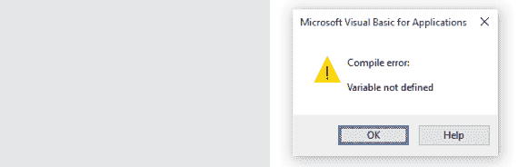

如果你收到此框，可以通过声明变量或关闭变量声明的要求来解决问题。要关闭要求，请从模块中删除 `Option Explicit` 语句，选择并删除该行，或通过在行开头添加单引号符号 (`'`) 来注释掉该行。

变量具有三种类型的作用域：

- 程序 (`Procedure`)
- 私有 (`Private`)
- 公有 (`Public`)

### 程序作用域

具有程序作用域（也称为程序级作用域或局部作用域）的变量仅包含它的程序可用。因此，局部变量的生命周期限于声明它的程序的持续时间。一旦程序停止运行，VBA 就会从内存中移除所有局部变量并回收持有它们的内存。即使以后该程序被再次执行，也是如此。局部变量不会持续。

执行将移动到你的过程之外。但同样，宏通常只有一个过程，局部变量通常就是你所需要的。

对于仅在声明它们的过程中运行的变量，过程作用域就足够了。例如，假设你声明了一个名为 `Supervisor` 的 `Variant` 类型变量，如下：

```vba
Dim Supervisor = "Paul Smith"
```

你可以在该过程的其余部分使用 `Supervisor` 变量——例如，检索存储在其中的文本或更改它。但当过程停止运行时，VBA 会将其移除。VBA 会忘记它。

#### 隐式声明的变量总是局部的

当你隐式声明变量时，它会被自动分配过程作用域。

要显式声明一个局部变量，请使用 `Dim` 关键字并将声明放在过程内部，如下：

```vba
Sub Create_Weekly_Report()
    Dim strSupervisor As String
    Dim lngController As Long
    ...
```

在这里，第二行将变量 `strSupervisor` 声明为 `String` 数据类型，第三行将变量 `lngController` 声明为 `Long` 数据类型。（本章稍后的“为变量指定数据类型”部分将介绍各种变量类型。）

另一方面，如果你需要将这些变量中的任何一个传递到从当前过程调用的过程，过程作用域是不够的——你需要使用 `Private`（私有）或 `Public`（公共）作用域。

### Private 作用域

使用私有作用域声明的变量对包含它的模块中的所有其他过程可见，但对其他模块中的过程不可见。使用私有变量允许你将变量值从一个过程传递到另一个过程。与局部变量仅在包含它的过程运行时才保留其值不同，私有变量只要项目中包含它的任何过程正在执行，它们就会保留其值。

要声明具有私有作用域的变量，你可以使用 `Dim` 关键字或 `Private` 关键字，但要将其放在模块的开头，放在模块中第一个过程的 `Sub` 语句之前，如下：


```vb
Dim strSupervisor As String
Private blConsultantAssigned As Boolean

Sub Assignment_Personnel()
...
End Sub
```

Visual Basic 编辑器会将私有声明显示在常规声明区域（General Declarations area）与下方代码之间的分割线以上（见图 6.1）。

## 图 6.1

私有声明出现在声明区域中。


你会注意到这里的语句与稍早声明局部变量的语法完全相同。唯一的区别在于你将 `Dim` 语句放在模块的声明区域（顶部），而不是放在过程内部。由于 `Private` 语句与 `Dim` 语句声明私有变量的效果相同，且不能在过程内部使用，因此使用 `Private` 而不是 `Dim` 语句来声明私有变量更加清晰。（`private` 这个词有点让人困惑，因为它们对于过程不是私有的，只对它们的模块私有。）

## PUBLIC 作用域

使用公共作用域声明的变量在项目的任何地方都可用。它可以被项目包含的所有模块中的所有过程访问。要声明公共变量，请在模块开头的常规声明区域（模块中第一个过程的 `Sub` 语句上方）使用 `Public` 关键字。这是一个示例：

```vb
Option Explicit
Public MyVar As Integer
```

第二条语句将公共变量 `intMyVar` 声明为 `Integer` 类型。与私有变量一样，只要包含它们的项目处于打开（仍在运行），公共变量就会保留其值。例如，如果你想在 Word 的系列操作中跟踪用户名，你可以创建一个 `AutoExec` 过程，在用户启动 Word 时提示他们输入姓名。（`AutoExec` 是 Word 启动时自动运行过程的内置名称。当你启动它时，它会搜索是否存在 `Sub AutoExec`，如果有，则执行该过程。）

## 声明区域会根据需要出现在代码窗口顶部

常规声明区域出现在包含声明的每个模块的开头。例如，如果你选择使用显式变量声明（通过在“工具 > 选项”对话框的“编辑器”页面上勾选“需要变量声明”复选框），Visual Basic 编辑器会在创建的每个新模块开头自动输入 `Option Explicit` 声明。如果没有，Visual Basic 编辑器会在第一次手动输入语句时创建声明。

通过将用户输入的结果存储在公共变量中，你可以在同一会话（Session）的以后任何时间检索该值。如果多个宏都需要变量中包含的信息，你就会看到这将是多么方便。记住，局部变量（那些在过程内部声明的变量）一旦过程到达 `End Sub` 语句并关闭就会被销毁。

## 使用前缀识别变量类型

你会在本章的示例中注意到前缀标识了变量的数据类型（本章稍后会）。例如，在列表 6.1 中，不是将变量命名为 `CurrentUser`，而是命名为 `strCurrentUser`。`str` 前缀标识 `CurrentUser` 是一个持有字符串的变量。这些前缀使你的代码更容易阅读和修改，因为代码中任何地方的变量都被识别为特定类型。常用的前缀包括 `str` 用于 `String`、`int` 用于 `Integer`、`var` 用于 `Variant`、`lng` 用于 `Long`、`obj` 用于 `Object` 等。正如你在书中后面看到的，类似的前缀也用于识别放置在表单上的控件：`txt` 用于 `Text`，`btn` 用于 `Button` 等。如果你感兴趣遵循这一约定，可以在此位置找到前缀列表：

http://en.wikipedia.org/wiki/Naming_convention

列表 6.1：

```vb
Public strCurrentUser As String

Sub AutoExec()
strCurrentUser = InputBox("Please enter your name.", "Current User")
End Sub

Sub Identify_Current_User()
MsgBox "The current user is " & strCurrentUser, vbOK + vbInformation, "Current User"
End Sub
```

## 大量公共变量会占用内存

为什么不把所有变量都公共化？在编写像宏这样的大程序时，这对编写大型程序或团队专业编程并不会造成太大困难。然而，变量的作用范围尽可能局部。关于公共（全局）变量优缺点的有趣观点，请参此网站：

http://c2.c2/cgi/wikiGlobalVariablesAreBad

## 使用静态变量

除了 `Dim`、`Private` 和 `Public` 变量外，你还可以使用 `Static` 关键字，它是特殊的。你可以用它使局部变量持久。当你想要声明一个静态变量——即你希望在声明它的过程的调用之间保留其值的变量时，请使用 `Static` 代替 `Dim`。静态变量与公共变量相似，它们的生命周期不限于声明它们的过程的持续时间。区别在于，静态变量一旦声明，仅对声明它的过程可见，而公共变量对所有过程都可见。因此，静态变量具有局部变量的作用域，但具有公共或私有变量的生命周期。在实际操作中，有一种特殊情况使得静态变量非常有用：切换（toggling）。

静态变量对于维护在应用程序会话期间需要运行多次的过程的信息有用，无论是维护运行总数（例如，你执行过程的次数），还是保留一段在下次运行过程或后续调用时可能很有用的信息。通常，你会在可以在两个状态之间切换某些内容的过程中使用静态变量。例如，你可以创建一个过程，第一次执行时将文字变为斜体，下一次执行时关闭斜体，然后再次反之，依此类推。这样的切换看起来可能像这样：

```vb
Sub ToggleIt()

Static switch As Boolean

switch = Not switch

If switch Then
    MsgBox "on"
Else
    MsgBox "Off"
End If

End Sub
```

你可以通过单步执行来测试它（在点击过程的第一行后按 F8）。每当你执行该过程时，你都会得到不同的消息。`Not` 命令让布尔变量在 `True` 和 `False` 之间切换。布尔变量只有这两个可能的值。

以下语句声明了静态变量 `strSearchTerm`：

```vb
Static strSearchTerm As String
```

## 为变量指定数据类型

表 6.2 解释了 VBA 支持的数据类型以及每种变量类型所需的内存。

### 表 6.2：VBA 变量数据类型

| 变量 | 简述 | 所需内存 |
| :--- | :--- | :--- |
| Boolean | True 或 False | 2 字节 |
| Byte | 0 到 255 的整数 | 1 字节 |

### 表 6.2：VBA 变量数据类型（续）

| 变量 | 简述 | 所需内存 |
| :--- | :--- | :--- |
| Currency | 正负数，小数点前最多 15 位，小数点后最多 4 位 | 8 字节 |
| Date | 小数点左侧和右侧的浮点数 | 8 字节 |
| Decimal | 按 10 的幂缩放的无符号整数 | 12 字节 |
| Double | 值在 -1.797639313486231570E+308 和 -4.940656458412465444E-324 之间的负浮点数，或在 4.940656458412465444E-324 和 1.797639313486231570E+308 之间的正浮点数 | 8 字节 |
| Integer | -32,768 到 32,767 的整数 | 2 字节 |
| Long | -2,147,483,648 到 2,147,483,647 的整数 | 4 字节 |
| Object | 对对象的引用 | 4 字节 |
| Single | 值在 -3.4028235E+38 和 -1.401298E-45 之间的负浮点数，或在 1.401298E-45 和 3.4028235E+38 之间的正浮点数 | 4 字节 |
| Variable-Length String | 文本字符串 | 10 字节加上字符串的存储空间 |
| Fixed-Length String | 长度不变的字符串 | 取决于指定的长度 |
| Variant | Variant 子类型中固定长度字符串以外的任何数据类型 | 包含数字的 Variant：16 字节；包含字符的 Variant：22 字节加上字符存储空间 |

接下来的几页将详细讨论这些数据类型。

## 你需要指定数据类型吗？

为每个变量指定数据类型是一个好主意，但并非强制性。你允许使用默认的 `Variant` 数据类型（正如你在此书示例中所做的那几次那样），让 VBA 确定为 `Variant` 分配哪种子类型。请记住，尽管某些操作是可能的，但可能并不是明智的。你可以翘着腿开车，但这不是个好主意。

## 使用变量

`Variant` 数据类型有以下四个缺点：

- 有时 VBA 在尝试解释想要使用的哪种子类型时会出错。这可能会导致相当晦涩的错误。
- 使用 `Variant` 数据类型会导致你的代码运行较慢。然而，对于短过程（或涉及变量较少的长过程），内存和速度很少成为问题。
- 你的代码对人类来说更难阅读和调试，这比内存或速度问题更令人担心。
- `Variant` 数据类型占据的内存比长字符串以外的任何数据类型都多。

总结一下，大多数编程专家都避免使用 `Variant`，并建议在声明变量时始终指定数据类型。那么，让我们来看 VBA 中的数据类型吧。

## BOOLEAN

布尔变量只能被设置为 `True` 或 `False`。你可以使用 `True` 和 `False` 关键字来设置布尔变量的值，如下所示代码的第二行所示（第一行声明了布尔变量 `blProduct_Available`）：

```vb
Dim blProduct_Available As Boolean
blProduct_Available = True
```

你可以获取结果：

```vb
If blProduct_Available Then
    MsgBox "Product is available"
Else
    MsgBox "Product is not available"
End If
```

布尔变量只有两个可能的值。

以下语句声明了静态变量 `strSearchTerm`：

```vb
Static strSearchTerm As String
```

## SINGLE（单精度）

Single 数据类型与 Double 类型一样，用于处理浮点数。Single 可以处理从 -3.4028235E+38 到 -1.401298E-45 的负值，以及从 1.401298E-45 到 3.4028235E+38 的正值。

此范围内的某些数字无法用二进制精确表示，因此 VBA 会对其进行舍入。使用指数点类型声明可以隐式声明 Single 变量（如果你必须使用隐式声明）。Single 变量占用 4 字节。

## STRING（字符串）

String 类型用于处理文本：

- 可变长度字符串变量可以包含多达 20 亿个字符。它们占用 10 字节加上字符串所需的存储空间。
- 固定长度字符串变量可以包含 1 到约 64,000 个字符。它们仅占用字符串所需的空间。如果分配给 String 变量的数据短于长度，VBA 会在数据末尾填充空格以补全字符。如果分配给 String 变量的数据长于字符串长度，VBA 会在相关字符后截断数据。VBA 从字符串左侧开始计算字符——例如，如果你“输出”到一个长度为四个的固定长度字符串变量，它将存储输出的前四个字符。在大多数编程中很少使用固定长度字符串变量，但管理某些数据库除外，这些数据库有规定字符串不能超过指定长度。
- 字符串可以包含字母、数字（数字）、空格和标点符号，更不用 @ 和 * 等特殊字符。
- 你可以使用 $ 类型声明来隐式声明 String 变量，但（像通常一样）最好显式声明你的 String 变量以及你所有的其他变量。

## VARIANT（变体）

正如本章前面提到的，Variant 数据类型是默认类型。VBA 将其分配给你未指定的任何变量数据类型——因此，像 `Dim UntypedVariable` 的声明会创建一个 Variant。`Dim intVariable As Integer` 会创建一个整数数据类型的变量。（你也可以显式声明 Variant：例如，`Dim myVariant As Variant`。）

Variants 可以处理大多数不同类型的数据，但有几个特征需要注意：

- Variants 不能包含固定长度的字符串数据。如果你需要使用固定长度字符串，必须指定固定长度 String 数据类型。
- Variant 变量可以包含四个特殊值：Empty（意味着变量尚未初始化）、Error（用于跟踪过程过程中错误的特殊值）、Nothing（用于将变量与其关联的对象解离的特殊值）和 Null（你用它指示变量故意不包含任何数据）。

Variant 变量占用的内存比其他类型多。包含数字的 Variant 变量占用 16 字节，以及包含字符的 Variant 变量占用 22 字节加上其所需的存储空间。

## 在变量类型之间做出选择

如果你发现不同类型变量的细节让你困惑，请放松。你大多数情况下会使用字符串和整数。这里有一些简单的规则，可以指导你的选择：

- 如果变量只包含 True（真）和 False（假），你可以将其声明为 Boolean 数据类型。
- 如果变量始终包含一个整数（如果它永远不包含小数），将其声明为 Integer 数据类型。（如果数字对于 Integer 来说太大，请将其声明为 Long 数据类型，它类似于整数。）
- 如果变量将用于计算金额，或者你要求不需要舍入的小数，请使用 Currency 数据类型。
- 如果变量有时包含小数，将其声明为 Single 或 Double 数据类型。
- 如果变量始终包含字符串，将其声明为 String 数据类型。

## 如果你不确定，使用 Variant 测试变量类型

如果你不确定哪种类型的变量最适合包含你的信息，可以从将变量声明为 Variant 开始。然后在断点模式（Break mode）下显示本地变量（视图 > 本地变量窗口），逐步执行过程。本地变量窗口显示局部变量、其值和类型。当你按 F8 逐步执行过程时，查看 VBA 分配给它什么子类型。你将在 Type 列中看到如 Variant/Double/String 这样的类型。测试几次过程以确保该子类型是一致的，然后将变量声明为对应的数据类型。

## 使用常量

常量是一个在执行期间保持值不变的命名项。记住，许多程序员即使对于不会改变的值也简单地使用变量而不是常量。

### 声明你自己的常量

要声明自己的常量，请使用 `Const` 语句。通过声明常量，你可以在多次重用某个值时简化代码。

#### 语法

`Const` 语句的语法如下：

```
[Public/Private] constant [As type] = expression
```

在这里，Public 和 Private 是可选关键字，用于声明常量的公共或私有作用域。constant 是常量的名称，遵循标准的命名规则。type 是可选参数，用于指定数据类型。expression 是字面量（写入你代码中的值）或多个值的组合。与变量一样，你可以通过逗号分隔在同一行中声明多个常量：

```
Const performer As String = "Singer", price As String = "$349"
```

#### 示例

在 VBA 中声明常量的方法与声明变量类似，但你需要在声明常量时进行赋值（而不是在稍后的某个点）。此后你无法更改它的值。看以下语句：

```
Const venue As String = "Davies Hall"
Const date As Date = "December 31, 2016"
```

第一行将 venue 声明为 String 类型并赋值为 "Davies Hall"。第二行将 date 声明为 Date 类型并赋值为 2016 年 12 月 31 日（当你完成这行代码并将插入光标移动到另一行时，VBA 会更改格式）。第三行显示一条包含场地常量和日期常量的消息。

## 为你的常量选择作用域或生命周期

作用域对常量的作用与对变量一样。常量的默认作用域是局部的——也就是说它的作用域是声明它的过程。因此，你可以使用 Public 或 Private 关键字为你的常量设置不同的作用域和生命周期。

- 要声明私有常量，请将声明放在你希望常量可用的模块中。私有常量的生命周期是有限的，但它只对声明它的模块中的过程可用：

```
Private Const performer As String = "Singer"
```

- 要声明公共常量，请将声明放在模块开头。公共常量的生命周期不受限制，对声明它的项目中的所有过程都可用：

```
Public Const price As String = "$34.99"
```

## 使用枚举

除了你在代码中创建的常量，VBA 还包含了预定义的常量集。枚举是具有独立名称的预定义整数（数字）列表。它是某种方式相关的项的集合。这里有一个枚举，是你粉刷房间所需的物品：

1. 刷子
2. 油漆
3. 胶带
4. 帆布
5. 砂纸

你可以通过枚举中的数字或名称来引用这些任何项。


# 枚举

枚举通常用于在编程中指定对象的属性。枚举中的每个整数对 VBA 都有意义，并有一个方便你引用的名称。对应于枚举整数的名称被称为常量。例如，当你使用 `MsgBox` 函数显示消息框时，可以选择 `VBoxStyle` 枚举中的枚举常量来指定你想显示的消息框类型。如果你想在消息框中使用图标，可以从可用图标列表中指定哪个图标。例如，图标之一——停止标志，常量 `vbCritical`（整数 32）显示问号图标，常量 `vbExclamation`（整数 48）显示感叹号图标。常量 `vbInformation`（64）指的是信息图标。然而，在实践中，常量比它们映射的各种值（如 16、32、64 等整数）更容易让人类理解和记忆。因此，尽管你可以在代码中使用整数，但最好使用 `vbQuestion` 等枚举常量。

VBA 内置枚举，Visual Basic 编辑器会显示枚举常量列表，帮助你在创建代码时选择合适的整数值。在过程中查看这样的列表：

```
msgBox("")
```

一旦你输入逗号，它就会弹出枚举常量列表、消息框的所有可用按钮样式，包括 `vbQuestion`、`vbYes`、`vbOKOnly` 等。正如你可能猜到的，`vbOKOnly` 样式仅显示单个按钮，标记为 OK。`vbYes` 样式显示两个按钮，一个为 Yes，另一个为 No。

你只需点击枚举常量列表中的任意一种按钮样式即可将其输入代码中。如果你没有看到列表，请在 Visual Basic 编辑器中选择“工具 > 选项”，然后勾选“自动成员列表”（Auto List Members）。

你也可以在创建的自定义对象中定义自己的枚举。

# 核心要点

理解变量以及你如何使用它们。变量是计算机编程的基础；它们之所以有用，与现实世界中的文件有用性是一样的。你给变量命名，就就像你写一个名称来标识文件夹一样。随着时间的推移，文件可能会包含不同的文档，程序变量中的值也会发生变化。在代码中使用变量之前，始终为它指定具体的名称是一个良好的习惯，这被称为显式声明。

## 掌握它：显式声明一个名为 `CustomerAge` 的变量。

## 创建并使用变量

在创建（声明）新变量时，你应该避免使用 VBA 中已经使用的单词或命令，例如 `Stop` 或 `End`。此外也没有额外的限制，例如不要使用特殊字符。

## 掌握它：修复非法变量名

下面变量名无法使用，原因有两个。请修复它使其成为一个合法的变量名：

```
Dim It1! as Integer
```

## 指定变量的作用范围和生命周期

变量的影响范围取决于你如何声明它们。

## 掌握它：创建模块级变量

创建一个名为 `AnnualSales` 的变量，该变量在其所属模块内的任何过程中可用，但在其他模块无效。

## 使用常量

常量与变量一样，是内存中包含值的命名位置。但与变量不同，常量的值在程序执行期间不会改变。

## 掌握它：定义字符串常量

使用 `Dim` 命令定义一个字符串常量。将常量命名为 `FirstPrez`，并赋值给变量 `George Washington`。

## 使用枚举

枚举为列表中的每个项目提供了方便的名称，通常是属性列表。

## 掌握它：设置属性值

在项目资源管理器中，点击 `This` 对象以选择它。然后在属性窗口中找到 `JustificationMode` 属性，通过点击出现的小箭头，然后点击下拉列表中的一个枚举常量来选择该属性的值。

# 第 7 章：使用数组变量

在本章中，你将学习如何使用数组——数组是能够同时存储多个值的容器。数组是一种“超级变量”。

你将首先检查数组是什么以及你如何使用它们。你将研究如何创建、填充和删除它们。在此过程中，你将查看如何调整数组的大小以包含更多（或更少）的值、如何指定数组的作用范围，以及如何在宏执行期间判断特定变量名代表的是数组还是仅仅是单值变量。

在本章中，你将学习完成以下操作：

- 理解数组是什么以及你如何使用它们
- 创建并使用数组
- 重新调整数组
- 删除数组
- 查找变量是否为数组
- 排序数组
- 搜索数组

## 什么是数组？

数组是一个“增强版”变量——它可以包含多个值（但它们必须是相同的数据类型）的变量。

你可以作为一个整体访问数组，以便高效地一次处理其包含的所有值。你也可以通过指定索引号（指示其在数组中的位置）访问存储在数组中的任何单个值。

如果你在可视化这一概念方面有困难，可以尝试将数组想象成一个编号列表，类似于枚举（在第 6 章“处理变量、常量和枚举”中描述）。列表中的每个项目都位于自己的行中，并由索引号标识，因此你只需指定索引号即可访问该项目的值。这就像街道上的房子：它们都有相同的名称（例如 Maple Drive），但每个房子都有自己独特的编号。你将在本章后面的部分看到数组的视觉示例。

之前的描述被认为只有一个*维度*——街道上的一排房子。然而，在本章稍后，你将看到你可以构建更复杂的数组，这些被称为*多维*数组。它们不仅仅是有行有列的字谜游戏。

但现在，让我们来看看最常见且容易可视化的数组结构——*一维*数组。

## 变体数组可以存储不同类型

变体数组可以存储任何类型的数据。这有用，因为你可以在同一个数组中存储字符串、整数和其他类型。但这可能很复杂，因为你不知道每个项目包含什么类型的数据。

为了避免这种情况，你可以使用 `TypeName` 函数来检查每个项目的类型。

```vba
If TypeName(myArray(0)) = "String" Then
    ' 这是一个字符串
ElseIf TypeName(myArray(0)) = "Integer" Then
    ' 这是一个整数
End If
```

变体数组是一个强大的工具，但应该谨慎使用。如果可能，使用更具体的类型更好。

现在你可以看到“零问题”的一个方面了。这个数组持有 12 个项目，但在声明时我们必须指定为 11！在 `Dim curMonthProfit(11) As Currency` 语句中，数组下标是 11 而不是 12，因为默认情况下数组的索引从 0 开始而不是 1。这个 0 索引为我们提供了一个元素。第一个元素是 `curMonthProfit(0)`，第二个是 `curMonthProfit(1)`，第十二个是 `curMonthProfit(11)`。（记住你可以通过 `Option Base 1` 语句来避免这种反直觉的方法。）

图 7.1 显示了由 `Dim curMonthProfit(11) As Currency` 语句创建的一维数组的简单表示。

**图 7.1**  
由语句 `Dim curMonthProfit(11) As Currency` 创建的一维数组可能如下所示。

| 元素 | 名称 | 内容 |
| --- | --- | --- |
| 0 | curMonthProfit(0) | — |
| 1 | curMonthProfit(1) | — |
| 2 | curMonthProfit(2) | — |
| 3 | curMonthProfit(3) | — |
| 4 | curMonthProfit(4) | — |
| 5 | curMonthProfit(5) | — |
| 6 | curMonthProfit(6) | — |
| 7 | curMonthProfit(7) | — |
| 8 | curMonthProfit(8) | — |
| 9 | curMonthProfit(9) | — |
| 10 | curMonthProfit(10) | — |
| 11 | curMonthProfit(11) | — |

为了让编号从 1 开始，在声明数组的模块开头的声明区域添加 `Option Base 1` 语句。这里是一个示例：

```
Option Base 1    '位于代码表的开头

Dim curMonthProfit(12) As Currency
```

图 7.2 显示了该数组外观的样子。

## 在极端情况下，Variant 可能会效率低下

记住，在声明数组时省略数据类型（从而使 VBA 自动使用 `Variant` 数据类型）会导致内存占用略微增加（在极端情况下会减慢计算机性能）。因为数组由于其包含的每个项目都需要存储空间，非常大的数组可能会消耗大量内存。这对于本章稍后讨论的多维数组尤为如此。

你也可以显式地指定数组的下限和上限。此示例代码声明了下限为 1，上限为 12：

```
Option Base 1 '位于代码表的开头

Dim curMonthProfit(1 To 12) As Currency
```

如果从从索引 1 开始，初学者学习使用数组会更简单，本章其余部分的示例将使用 `Option Base 1` 语句。

图 7.2 显示了使用 `Option Base 1` 语句后由语句 `Dim curMonthProfit(12) As Currency` 创建的一维数组。将其与图 7.1 进行对比。

**图 7.2**  
使用 `Option Base 1` 语句后由语句 `Dim curMonthProfit(12) As Currency` 创建的一维数组。

| 元素 # | 名称 | 内容 |
|---|---|---|
| 1 | curMonthProfit(1) | — |
| 2 | curMonthProfit(2) | — |
| 3 | curMonthProfit(3) | — |
| 4 | curMonthProfit(4) | — |
| 5 | curMonthProfit(5) | — |
| 6 | curMonthProfit(6) | — |
| 7 | curMonthProfit(7) | — |
| 8 | curMonthProfit(8) | — |
| 9 | curMonthProfit(9) | — |
| 10 | curMonthProfit(10) | — |
| 11 | curMonthProfit(11) | — |
| 12 | curMonthProfit(12) | — |

## 在数组中存储值

要为数组赋值，你使用每个项目的索引号来标识它。例如，以下语句将伦敦、香港和台北赋值给名为 `strLocations` 的数组的前三个项目：

```
Option Base 1

Dim strLocations(6) As String

strLocations(1) = "London"
strLocations(2) = "Hong Kong"
strLocations(3) = "Taipei"
```

图 7.3 显示了该数组的样子。

**图 7.3**  
带有三个赋值值的简单字符串数组

| 元素 # | 名称 | 内容 |
| --- | --- | --- |
| 1 | strLocations(1) | London |
| 2 | strLocations(2) | Hong Kong |
| 3 | strLocations(3) | Taipei |
| 4 | strLocations(4) | — |
| 5 | strLocations(5) | — |
| 6 | strLocations(6) | — |

## 多维数组

上一节的 `currProfit` 示例是一维数组，这是最简单的一种数组；VBA 支持最多 60 维的数组——足以让任何没有多维建模博士学位的人感到费力。你可能不想让数组变得太复杂——二、三、四维对于大多数用途都是足够的。事实上，很多用途一维也足够。

要声明多维数组，用逗号分隔维度。例如，以下语句声明了一个多维数组：

```
Option Base 1
Dim MyArray(3, 3)
```

图 7.4 显示了该数组的样子。

**图 7.4**  
一个具有行和列的多维数组

| 元素 # | 名称 | 内容 |
| --- | --- | --- |
| 1 | MyArray(1,1) | — |
| 2 | MyArray(1,2) | — |
| 3 | MyArray(1,3) | — |
| 4 | MyArray(2,1) | — |
| 5 | MyArray(2,2) | — |
| 6 | MyArray(2,3) | — |
| 7 | MyArray(3,1) | — |
| 8 | MyArray(3,2) | — |
| 9 | MyArray(3,3) | — |

## 从数组返回信息

要从数组中获取信息，请使用索引数字来指定你想要返回的信息的位置。例如，以下语句将返回名为 `myArrayArray` 的数组中的第四个项目，并在消息框中显示：

```
Option Base 1
MsgBox myArrayArray(4)
```

以下语句将返回名为 `myArray2Array` 的二维数组的第二个维度的第五个项目，并在消息框中显示：

```
Option Base 1
MsgBox myArray2Array(2,5)
```

要从数组中返回多个项目，请逐个指定每个项目。

## 清除数组

要擦除数组的内容，请使用 `Erase` 命令配合数组名称。该命令会重新初始化固定大小数组中的项，并释放动态数组中项占用的内存（完全删除数组）。例如，以下语句将擦除名为 `myArrayArray` 的固定大小数组的内容：

```
Erase myArrayArray
```

## 判断变量是否为数组

由于数组是一种变量类型，你可能需要检查特定的变量名表示的是数组还是普通变量（有时称为标量变量）。要确定一个变量是否为数组，请使用变量名调用 `IsArray` 函数。例如，以下语句将检查变量 `MyVariable` 并在消息框中显示结果：

```
If IsArray(MyVariable) = True Then
    Msg = "MyVariable" & " is an array."
Else
    Msg = "MyVariable" & " is not an array."
End If
MsgBox Msg, vBOOKOnly + "Array Check"
```

## 查找数组边界

要查找数组边界，请使用 `LBound` 函数和 `UBound` 函数。`LBound` 返回下界，即第一个项目的索引；`UBound` 返回上界，即最后一个项目的索引。

`LBound` 和 `UBound` 函数具有以下语法：

```
LBound(array, [ dimension])
UBound(array[ , dimension])
```

在这里，`array` 是必需参数，指定数组名称，`dimension` 是可选的 `Variant` 类型，指定你想要返回的维度——1 表示第一维度，2 表示第二维度，依此类推。（如果省略 `dimension` 参数，VBA 将假设你指的是第一维度。）

例如，以下语句将返回名为 `arrMyArray` 的数组中第二维度的上界，并在消息框中显示：

```
MsgBox UBound(arrMyArray, 2)
```

## 数组排序

你可能对数组进行排序，特别是当你从外部源加载信息到数组而不是在代码中逐个赋值值时。遗憾的是，VBA 没有内置用于排序数组的命令。

排序在概念上很容易理解：你可以将某物重新排列为所需的顺序。例如，你可以将一个数组中的字符串按字母顺序或反字母顺序排序，或者将另一个数组中的数字按升序或降序排序。然而，编写一个用于排序的程序要困难得多，所以不要自己写它。只需从互联网上的示例或本示例中复制即可。

本节向你展示了一种简单的排序形式——冒泡排序，因为正在排序到数组早期位置的项目会像泡一样浮到顶部。冒泡排序由两个循环组成，用于比较数组中的两个项目；如果第二个项目比第一个项目靠后，排序就会交换它们的位置，并继续比较直到整个列表排序完成。冒泡排序是一种效率较低的排序方法，但它很容易掌握，而且在处理器周期廉价的年代。多年来，冒泡排序本身并没有变得更高效，但处理器速度已经大幅提升。

此示例向你介绍了编程中的一个主要元素：循环是过程和项目的重要工具。实际上，循环会重复某些操作直到满足条件。这就像在说：“不断整理这些考勤卡，直到卡片按字母顺序排序。”第 12 章“使用循环重复操作”将向你展示如何使用循环。

列表 7.1 包含了冒泡排序的代码。

### 列表 7.1：冒泡排序

```vba
1. Option Explicit
2. Option Base 1
3.
4. Sub Sort_an_Array()
5.
6. '声明数组和其他变量
7. Dim strArray(12) As String
8. Dim strTemp As String
9. Dim strMsg As String
10. Dim X As Integer, Y As Integer, i As Integer
11.
12. '将字符串赋值给数组
13. strArray(1) = "nihilism"
14. strArray(2) = "defeatism"
15. strArray(3) = "hope"
16. strArray(4) = "gloom"
17. strArray(5) = "euphoria"
18. strArray(6) = "despondency"
19. strArray(7) = "optimism"
20. strArray(8) = "pessimism"
21. strArray(9) = "misery"
22. strArray(10) = "bliss"
23. strArray(12) = "mania"
24.
25.
26. strMsg = "Current items in array:" & vbCr & vbCr
27. For i = 1 To UBound(strArray)
28. strMsg = strMsg & i & ": " & strArray(i) & vbCr
29. Next i
30. MsgBox strMsg, "Array Check"
31. For X = LBound(strArray) To UBound(strArray) - 1
32. For Y = X + 1 To UBound(strArray)
33. If strArray(Y) > strArray(X) Then
34. strTemp = strArray(X)
35. strArray(X) = strArray(Y)
36. strArray(Y) = strTemp
```


# 第 7 章 使用数组变量

## 排序数组

37. End If

38. Next Y

39. Next X

40. End Sub

第 28 行将计数变量 `i` 的值、一个冒号、一个制表符 (`vbTab`)、当前引用的数组项内容 (`strArray(1)`) 以及一个回车 (`vbCr`) 添加到 `strMsg` 中。第 29 行结束循环，第 30 行显示包含 `strMsg` 的消息框，如图 7.5 所示。第 31 行是一个空行。

### 图 7.5

Sort_an_Array 过程显示了一个包含未排序术语的框，以便用户可以看到初始状态。

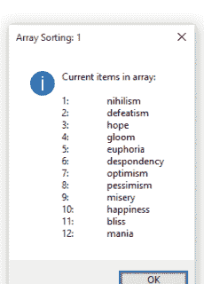

过程中的排序发生在第 32 到第 41 行。以下是详细信息：

- 第 32 行开始了一组嵌套循环：一个嵌套另一个。有一个外层循环和一个内部循环。`For...Next` 循环在第 41 行通过 `Next X` 语句结束。该循环从 `X = LBound(strArray)`（换句话说 `X=1`）运行到 `X = UBound(strArray)-1`（换句话说 `X=11`，即数组的上边界减 1）。
- 第 33 行开始内部 `...Next` 循环，该循环从 `Y = (X+1)` 运行到 `Y = UBound(strArray)`。第 40 行结束此循环。
- 第 34 行比较 `strArray(X)` 和 `strArray(Y)`。如果 `strArray(X)` 大于 `strArray(Y)`——换句话说，如果 `strArray(X)` 在字母数组中应该出现在 `strArray(Y)` 之后——第 35 行将 `strArray(X)` 赋值给 `strTemp`，第 36 行将 `strArray(Y)` 赋值给 `strArray(X)`，第 37 行将 `strTemp` 赋值给 `strArray(Y)`，从而交换值。第 38 行将 `strTemp` 置为空。第 39 行结束 `If` 语句。第 40 行结束内部循环，第 41 行结束外层循环，第 42 行是一个空行。
- 第 43 到第 47 行本质上重复了第 26 到第 30 行，显示新排序后的数组的消息框（如图 7.6 所示），以便用户可以看到排序已生效。
- 第 48 行是一个空行，第 49 行结束该过程。

### 图 7.6

当 Sort_an_Array 过程完成排序后，它会在第二个消息框中显示排序后的列表。

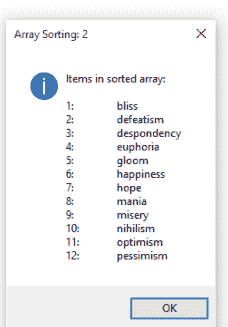

## 搜索数组

你需要对数组执行的另一项任务是搜索以找到其中的特定值。这类似于翻找一盒食谱卡，直到找到 Ralph 的《监狱生活》(Jailhouse)。

以下章节将向你展示排序方法——线性查找（你可以在已排序或未排序的数组上进行）以及二分查找（速度更快，但仅适用于排序后的数组）。然而，速度问题（特别是在处理宏通常执行的任务时）很少成为障碍。

## 在数组中执行线性查找

线性查找是一种简单的搜索方式：你从数组开始，并检查每个项目，直到找到目标，或者到达数组末尾并报告未找到。

在执行此代码之前，使用 `Ctrl+G` 或选择“查看 > 立即窗口”在编辑器中显示立即窗口。此过程会在立即窗口中打印信息，以便你可以看到正在发生的情况以及代码是否按预期运行。像这样使用立即窗口进行检查，输出通常比像上一节那样显示消息框更好。使用立即窗口时，你不需要关闭消息框，而且窗口可以滚动，显示你想要的任何数量的信息。

列表 7.2 包含了对一维数组进行简单线性查找的代码。

### 简单的线性查找

```vba
1. Option Explicit
2. Option Base 1
3.
4. Sub Linear_Search_of_Array()
5.
6.   '声明数组和变量
7.   Dim intArray(10) As Integer
8.   Dim i As Integer
9.   Dim varNumber As Variant
10.  Dim strMsg As String
11.
12.  '向数组添加 0 到 10 之间的随机数
13.  '并打印到立即窗口以便参考
14.  For i = 1 To 10
15.     intArray(i) = Int(Rnd * 10)
16.     Debug.Print intArray(i)
17.
18.  Next i
19.
20.  Loopback:
21.   varNumber = InputBox(
22.     "输入一个 1 到 10 之间的数字进行搜索:",
23.     "线性查找演示")
24.   If varNumber = "" Then GoTo Loopback
25.   If Not IsNumeric(varNumber) Or varNumber > 10 Then GoTo Loopback
26.
27.   strMsg = "您的值，" & varNumber & _
28.     "未在数组中找到。"
29.
30.   For i = 1 To UBound(intArray)
31.     If intArray(i) = varNumber Then
32.       strMsg = "您的值，" & varNumber & _
33.     "在位置 " & i & " 找到。"
34.       Exit For
35.   End If
36.   Next i
37.
38.   MsgBox strMsg, vbOK + vbInformation, "搜索结果"
39.
40.   End Sub
```

以下是列表 7.2 中发生的情况：

- 如前面的列表所示，第 1 行 `Option Explicit` 强制声明变量，第 2 行 `Option Base 1` 使数组索引从 1 开始而不是 0。这两个语句出现在代码的声明部分，位于任何过程之前。第 3 行是一个空行。
- 第 4 行开始 `Linear_Search_of_Array` 过程。第 5 行是一个空行。
- 第 6 行是声明数组前的注释。第 7 行声明了为 10 的数组。第 8 行声明了 Integer `i`。第 9 行声明了 Variant `varNumber`。第 10 行声明了 String `strMsg`。第 11 行是一个空行。
- 第 12 行向数组添加 0 到 10 之间的随机数。第 13 行将其打印到立即窗口以便参考。第 14 行开始从 i = 1 到 10 的循环。第 15 行将 `Rnd * 10` 的结果赋值给 `intArray` 中的项。第 16 行将项打印到立即窗口。第 17 行结束循环。第 18 行是一个空行。
- 第 19 行包含标签 `Loopback`，用于返回执行到此点。第 20 行将用户的输入赋值给 Variant `varNumber`。第 21 行检查 `varNumber` 是否为空字符串。第 22 行使用 `IsNumeric` 函数检查 `varNumber` 内容是否为数字。第 23 行检查 `varNumber` 是否小于 1 或大于 10。第 24 行是一个空行。
- 第 25 行将 `strMsg` 设置为未找到值的消息。第 26 行是一个空行。
- 第 27 行开始从 1 到 `intArray` 的 `UBound` 的循环。第 28 行检查数组中的项是否匹配 `varNumber`。第 29 行将 `strMsg` 设置为找到值及其所在位置的消息。第 34 行退出循环。第 35 行结束 `If` 语句。第 36 行结束循环。第 37 行是一个空行。
- 第 38 行显示消息框。第 39 行是一个空行。第 40 行结束过程。

### 图 7.7

Linear_Search_of_Array 显示了一个输入框，提示用户输入 1 到 10 之间的数字。数组打印在立即窗口中。

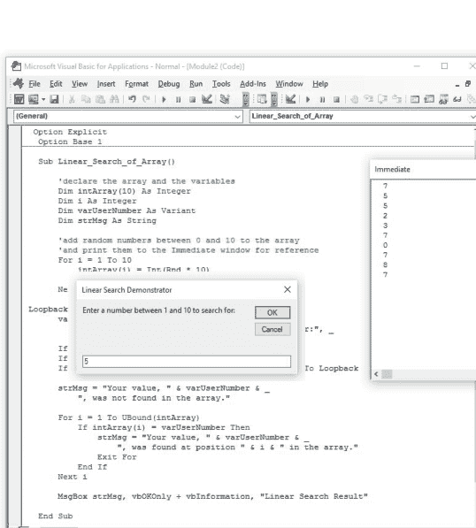

### VBA 是灵活的

注意 VBA 的灵活性：该代码请求用户输入，并确保其是 1 到 10 之间的数字（包含边界）。尽管该数字仍然存储在 Variant 类型中，而不是转换为 Integer 类型，但 VBA 仍然执行了所需的比较。

- 第 25 行为字符串变量 `strMsg` 赋值了一个初步消息，说明该值（即代码中指定的值）未在数组中找到。如果代码在数组中找到了该值，它会在显示之前更改消息。第 26 行是一个空行分隔。
- 第 27 行到 32 行包含该过程的搜索部分。第 27 行开始一个 `For...Next` 循环，从 1 运行到 `UBound(intArray)`——数组中的每个下标各运行一次。第 28 行比较 `intArray(i)` 和 `userNumber`；如果匹配，第 28 行为 `strMsg` 赋值一个找到数组值位置的字符串，第 29 行使用 `Exit` 退出 `For...Next` 循环。（如果第 28 行未匹配，第 32 行的 `Next` 语句将导致代码循环）。
- 第 33 行是一个空行分隔。第 34 行显示一个包含 `strMsg` 的消息框，以向用户传达线性搜索操作的结果。图 7.8 显示了搜索成功的结果。第 35 行是一个空行分隔，第 36 行结束该过程。

### 图 7.8

代码列表 7.2 的第 34 行显示了一个消息框，显示了用户线性搜索操作的结果。

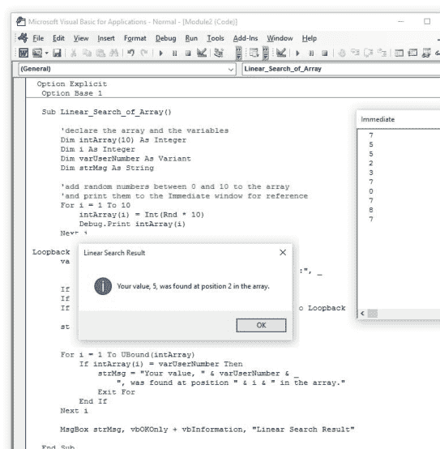

## 如何生成随机数

敏锐的读者会注意到，在之前的示例中，数组中 0 有时会出现——更过的是，10 从未出现过。换句话说，代码 `Int(Rnd * 10)` 随机产生 0 到 10 之间的数字。（这是 `Int` 命令执行的取整操作的副作用。）

以下是使用 `Rnd` 命令产生你所需的确切范围数字的方法。

当向 VBA 请求随机数时，请指定你想要的数字范围的上限，然后乘以 `Rnd`。例如，如果你想模拟掷骰子，需要 1 到 6 之间的数字，那么 6 就是上限。你将 `Rnd` 给出的数字乘以 6。然后你必须在代码中加 1，以使结果从 1 到 7 对应到该上限。（否则，结果将是 0 到上限减 1 之间的范围，正如列表 7.2 中的代码所示，它提供的是 0 到 9 的数字，而不是 1 到 10。）

使用 `Int` 函数是因为 `Rnd` 只产生小数。以下是 `Rnd` 函数执行时的一些典型结果：

- 0.4542078
- 0.3570231
- 0.1499811
- 0.7043958
- 0.928786

因为这些是小数，你需要通过相乘得到整数。然而，`Int` 会舍掉最终结果的任何小数部分，因此以下是获取 1 到 50 随机数的方法：

```vba
X = Int(Rnd) * 50 + 1
```

要获取从 0 到上限的范围，请指定比你实际需要的大 1 的上限。不要在括号内加 1。这提供了一个从 0 到 50 的随机数：

```vba
X = Int(Rnd) * 51
```

## 对数组进行二分搜索

正如你在前面看到的，线性搜索很容易执行，但速度很慢——它从数组开头开始查找，逐个检查每个元素、每个项目。这种方法对于小型搜索（例如上一个示例中搜索的包含 10 个元素的数组）效果良好，但你不想将其尝试用于全美国人口规模的列表。对于严肃的重型搜索，你需要更智能的方法。

对于常规用途，二分搜索是寻找丢失电视遥控器等物品的好方法。你预计它在某个特定位置——可能在客厅的某处，可能在沙发附近——所以你关注相关区域并搜索。（相比之下，线性搜索是你从头到尾搜索房屋的每个地方，而没有尝试智能地缩小搜索区域。）

二分搜索技术（技术上称为算法）通过将排序后的数组一一半来确定最可能的目标区域，确定哪一半包含搜索项目，然后重复这种划分和再划分的过程，直到找到该项目或到达最后一个可细分的数组单元仍未找到它。记住，如果算法在从 1 到 20 的列表中寻找数字 12，就是这样操作。

### 列表 7.3：遍历数组

```vba
1 Option Explicit
2 Option Base 1
3
4 Sub Binary_Search_of_Array()
5
6 '声明变量
7 Dim thousand(1000) As Integer
8 Dim i As Integer
9 Dim intTop As Integer
10 Dim intMiddle As Integer
11 Dim varNumber As Variant
12 Dim strMsg As String
13
14 '用 1 到 1000 的数字填充数组
15 For i = 1 To 1000
16 thousand(i) = i
17 Next i
18
19 '提示用户输入搜索项
20 Loopback:
21 varNumber = InputBox("输入 1 到 1000 之间的数字进行搜索:")
22 If varNumber = "" Then
23 Exit Sub
24 If
25
26 '搜索搜索项
27 intTop = UBound(thousand)
28 intBottom = LBound(thousand)
29
30 While intBottom <= intTop
31 intMiddle = (intTop + intBottom) / 2
32 If thousand(intMiddle) = varNumber Then
33 strMsg = "在位置 " & intMiddle & "找到了项目"
34 MsgBox strMsg, vbOK, "搜索结果"
35 Exit Sub
36 Else If thousand(intMiddle) < varNumber Then
37 intBottom = intMiddle + 1
38 Else
39 intTop = intMiddle - 1
40 End If
41 Wend
42
43 strMsg = "在数组中未找到项目。"
44 MsgBox strMsg, vbOK, "搜索结果"
45 End Sub
```

### 图 7.9

Binary_Search_of_Array 过程提示用户输入一个 1 到 1000 之间的数字。

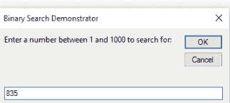

第 30 到 37 行包含一个 `Do_Loop Until` 循环，它执行了二分查找的大工作。详情如下：

- 第 30 行使用 `Do` 关键字开始 `Do_Loop Until`，第 37 行使用 `Until` 关键字和条件 `(varNumber==intand(intMiddle)) Or (intBottom > intTop)` 结束。你将在第 12 章详细查看；你只需要知道 `Do_Loop` 会运行一次，然后评估 `Loop` 语句中的条件来决定是否再次运行。这里的条件是：直到由 `intMiddle` 标识的数组下标值匹配 `varNumber` 的值，或者 `intBottom` 大于 `intTop` 的值，否则循环将继续。
- 第 31 行将整数变量 `intMiddle` 的值设置为 `intTop` 和 `intBottom` 之和除以 2：`(intTop + intBottom) / 2`。这样做可以得到数组的中点。例如，在下标为千的数组中，在循环的第一次中，`intTop` 的值为 1000，`intBottom` 的值为 0，因此 `intMiddle` 接收到 500（1000 除以 2）。
- 第 32 行测试 `varNumber` 是否大于由 `intMiddle--intand(intMiddle)` 标识的下标值，即数组当前部分的中点。如果是，则在数组上半部分进行搜索，因此第 33 行将 `intTop` 重置为 `intMiddle +1`。如果不是，第 34 行的 `else` 语句将生效，第 35 行将 `intBottom` 重置为 `intMiddle -1`，以便在数组的下半部分进行搜索。
- 第 36 行是一个空行。第 39 行包含两行注释，介绍了第 40 到 44 行的代码，这些代码确定了搜索是否找到了正确项目，并将信息分配给字符串变量 `strMsg`。第 40 行比较 `varNumber` 和 `intand(intMiddle)`；如果匹配，第 41 行为 `strMsg` 分配一个字符串，告诉用户项目在数组中的找到位置。如果不匹配，第 43 行分配一个字符串告诉用户未找到该项目。第 45 行是一个空行，第 46 行显示一个消息框告诉用户搜索结果。图 7.10 显示了消息框的示例——一个是成功的，另一个失败的。
- 第 47 行是另一个空行，第 48 行结束该过程。

### 图 7.10

Binary_Search_of_Array 过程告诉我们搜索是否成功（左侧）或失败。

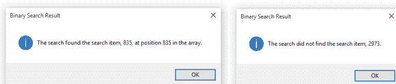

该过程最复杂的部分是循环中发生的情况。从书籍网站 `www.sysex.com/go/mastervba2016` 下载代码。复制代码并将其粘贴到 Visual Basic 编辑器（此代码可在任何启用 VBA 的应用程序中运行）。打开模块并遵循以下步骤：

1. 部署“本地”窗口（View > Locals），这样你就可以跟踪变量 `intTop`、`intMiddle` 和 `intBottom` 的值。图 7.11 显示了过程运行时的本地窗口。

### 图 7.11

在过程运行时，使用本地窗口来跟踪 `intTop`、`intMiddle` 和 `intBottom` 变量的值。

| 元素 | 值 | 类型 |
| --- | --- | --- |
| Module2.Binary_Search_of_Array | | |
| Module2 | | Module2 |
| intTop | 1001 | Integer(1 to 1000) |
| intMiddle | 0 | Integer |
| intBottom | 0 | Integer |
| varNumber | Empty | Variant/Empty |


- 2. 通过点击以 `varNumber = TextBox` 开始的语句旁边的标记栏，在过程的第 22 行设置断点。（由于该语句跨越三行，Visual Basic 编辑器会显示三个红点而不是一个标记栏，以指示断点。）

- 3. 按 `F5` 键（或选择 Run > Sub/UserForm）运行代码到断点处。VBA 填充变量然后在第 22 行停止。

- 4. 按 `F8` 键逐语句执行后续语句。第一次按显示输入框。在此示例中输入值 67 并点击 OK 按钮。

- 5. 当代码进入循环并循环时，观察本地窗口中变量 `intTop`、`intMiddle` 和 `intBottom` 的值。你将看到它们发生变化，如下列表所示：

| 迭代 | intTop | intMiddle | intBottom |
| --- | --- | --- | --- |
| 0 | 1000 | — | 1 |
| 1 | 499 | 500 | 1 |
| 2 | 249 | 250 | 1 |

确定使用哪些命令来实现你的编程目标可能也比研究 OOP 分类法更快。例如，Word 中的表格由一个 `Table` 对象表示，一列由一个 `Column` 对象表示。`Column` 对象有一个 `Width` 属性，用于设置或返回其宽度。当这些信息被分解成小部分时，比使用 `TableSetColumnWidth` 或 `TableColumnWidth` 这样更复杂的命令更容易管理。

面向对象编程的第三个优势是 VBA 语言本身是可以扩展的。程序员可以构建自定义对象来增强语言本身最初缺少的功能。例如，你可以使用 VBA 构建自己的对象，执行 Office 应用程序本身无法完成的操作。

OOP 的另一个截然不同的优势是显而易见的：当一组程序员合作完成一个项目时，OOP 能大有裨益。他们可以以各种方式轻松地看到彼此的影响——例如使用相同的版本、修改对方的代码等。在本章结束时，我们将展示如何在团队编程中防止这些问题。

对象可以——而且经常确实——包含其他对象。通常情况下，面向对象的方法中的对象被排列成一个称为“应用程序模型”的层次结构。这种层次结构旨在让你在大型对象库中更容易找到你想要在宏中使用的特定对象。这类似于在图书馆的非虚构区域查找书籍的方法。

## 书后将介绍的对象模型

本章仅在概念层面讨论对象模型。你需要了解什么是对象，才能理解后续章节中将学习的内容，但为了操作示例中使用的对象，你并不需要了解每个对象的细节。本书的第五部分“创建高效代码”将详细检查本书所涵盖的每个应用程序的对象模型，以便开始更广泛地探索这些对象模型。

大多数 VBA 宿主应用程序（包括所有主要的 Office 应用程序）都有一个 `Application` 对象，代表整个应用程序。`Application` 对象具有适用于整个应用程序的属性和方法。例如，许多应用程序都有一个 `Quit` 方法来退出应用程序，以及一个 `Visible` 属性来控制应用程序是否可见。

在典型的对象模型中，`Application` 对象本质上包含了构成应用程序的所有其他对象（以及集合——对象组）。例如，Excel 有一个代表 Excel 本身的 `Application` 对象，一个代表 `Workbook` 对象（分组在 `Workbooks` 集合中）代表一个工作簿，以及一个 `Worksheet` 对象（分组在 `Sheets` 集合中）代表一个工作表。`Workbook` 对象包含在 `Application` 对象中，因为你通常需要打开 Excel 应用程序才能处理 Excel 工作簿。

反之，`Worksheet` 对象包含在 `Workbook` 对象中，因为你需要一个 Excel 工作簿对象才能使用工作表。进一步查看对象模型，`Worksheet` 对象包含了各种其他对象，包括代表工作表单单行的 `Row` 对象、代表工作表中列的 `Column` 对象，以及代表单元格区域的 `Range` 对象。而这些对象又包含了更深的对象。要访问某个对象，你通常会沿着对象模型的层次结构向下查找，直到到达你正在寻找的对象。

例如，要访问 `Range` 对象，你需要通过 `Application` 对象到达 `Workbook` 对象，通过 `Workbook` 对象到达适当的 `Sheet` 对象，最后到达 `Range` 对象。以下语句显示了如何选择第一个工作簿（此时已打开）中的 `Range("A1")`：

```vba
Application.Workbooks(1).Sheets(1).Range("A1").Select
```

## 理解可创建对象

然而，`Application` 对象是可选的，并且通常被省略。由于你获取应用程序中的几乎任何内容都必须通过 `Application`，因此大多数应用程序都暴露了（可供你使用的）若干可创建对象。可创建意味着你可以访问它们，而无需在代码中输入 `Word Application`。这是假设的。这类似于在编写地址时不需要包含“Word 地球”这一事实。因为只有一种可能。

这些可创建对象通常是应用程序中最常用的对象，通过访问它们，你可以在不引用 `Application` 对象的情况下访问大多数其他对象。例如，Excel 将 `Workbooks` 集合暴露为一个可创建对象，因此你可以使用以下语句，而不需要输入 `Application`。另一种方案出现在在本章前面的几个段落中。

```vba
Workbooks(1).Sheets(1).Range("A1").Select
```

任何对象都具有属性和方法。接下来的章节将详细讨论这些。

## 属性

在 VBA 中，属性（Property）是对象的属性或特征。这就像对象的某种性质，例如它的颜色。大多数对象都有多个属性，用于指定对象的每个方面。每个属性对于其存储的信息都有特定的数据类型。例如，代表文件的对象（如文档、工作簿或演示文）有一个名为 `Saved` 的布尔型属性，用于存储表示工作簿中所有更改是否已保存的值（`True` 或 `False`）。这两个值涵盖了对象状态的所有可能范围：它要么包含未保存的更改，要么不包含未保存的更改。没有第三种状态。因此可以使用布尔数据类型，因为它只有两个可能的值。

同样，大多数代表文件的对象都有一个 `Name` 属性，包含相关文件的名称。`Name` 属性包含一个字符串数据类型，该类型需要包含内容。文本可以是任何内容，仅限于 Windows 允许文件的 255 字符路径，以及 Windows 在文件中禁止的某些字符（例如冒号和管道符 `|`）。

要操作属性，你可以获取（读取、返回）它，也可以设置它。许多属性是可读可写的，意味着你既可以获取也可以设置它们；但某些属性是只读的，意味着你可以查看它们的值但无法更改它们。当一个对象包含另一个对象或集合时，它通常有一个属性可以调用（调用）以返回该对象或集合。例如，Document 对象包含一个 `PageSetup` 对象（该 `PageSetup` 对象包含纸张大小、方向、每页行数和边距等设置）以及一个调用以返回 `Tables` 集合的属性。以下是调用 `PageSetup` 对象的方法（它位于 Document 对象中）：

```vba
Sub GetLinesPerPage()
    Dim LinesPerPage As Single
    LinesPerPage = ActiveDocument.PageSetup.LinesPage
    MsgBox LinesPerPage
End Sub
```

相同类型的对象具有相同的属性集，但对这些属性存储各自特定的值。例如，如果你运行 PowerPoint 并打开了三个 Presentation 对象，每个对象都有自己的 `Name` 属性。每个 `Name` 属性的值特定特定的 Presentation 对象。换言之，一个属性中的值与另一个对象的值无关：每个对象都是相互独立的。

## 方法

方法（Method）是对象可以执行的操作，是对象具备的能力。例如，各种应用程序中的 Document 对象都有一个 `Save` 方法，用于保存文档。`Save` 方法非常常见。它出现在许多应用程序的对象中，并与其他方法一起出现，例如 `SaveAs`（以不同的名称、位置或两者都保存文件）和 `Close`（关闭文件）。

其他方法是每个应用程序独有的。例如，PowerPoint 中的 Presentation 对象有一个 `AddBaseline` 方法（由活动演示文稿或指定的演示文稿文件组成），用于跟踪更改。Word 中的 Document 对象没有 `AddBaseline` 方法，但它有 `AcceptAllRevisions` 方法，接受文档中所有修订的方法。PowerPoint 并没有 `AcceptAllRevisions` 方法。

就像 `Save` 在多个应用程序中通用一样，某些方法也存在于多个对象中。例如，`Delete` 方法与许多不同的对象相关。正如其名称所示，`Delete` 方法通常会删除对象。然而，`Delete` 方法的其他实现行为会有所不同，这取决于它们正在处理的对象。因此，如果你熟悉在使用某个对象时使用的某个方法，你需要确保在在另一个对象上使用它时，它会产生你预期的效果。

某些方法不需要任何参数。其他方法则接受一个或多个参数（以提供必要信息）。就像 `MsgBox` 等内置 VBA 函数一样，某些参数是必须的，而另一些是可选的。

当一个方法适用于多个对象时，它对不同的对象可能有不同的语法。同样，即使你熟悉某个方法，你也需要确切知道它在你计划使用的对象上具体执行了什么。

要使用方法，你需要通过相关的对象进行访问。例如，要关闭表示 PowerPoint 中活动演示文的 `ActivePresentation` 对象，你需要使用 `Close` 方法（但你必须指定 `ActivePresentation` 对象，如下）：

```vba
ActivePresentation.Close
```

## 真实世界场景

## 大狗 Max：对象、属性和方法的可视化

如果你很难掌握对象、它们的属性和方法，这里有一个 VBA 中的虚拟对象、属性、方法与真实世界中的物理对象、属性和动作之间略显牵强的比较。考虑这个例子。

假设你有一只巨大的狗叫 Max——它是一只比利牛斯山羊犬，200 磅重，多年老，雄性，且未绝育。

Max 执行所有狗的动作——跑、吃、叫、低吼、咀嚼东西（我们将跳过那些不必要的动作），但它内置了一些不寻常（对狗而言）的动作，例如听口流口、撞倒别人以及咬运物箱。

如果 Max 在 VBA 中实现，他将是 `Dogs` 集合中的一个狗对象。Max 的狗对象将具有如下属性：

- Name: 这是一个只读字符串（String），值为 Max。
- Sex: 这是一个只读字符串（String），值为 Male（雄性）。
- Fixed: 这是一个可读写的布尔值（Boolean），值为 False（否）。
- Height: 这是一个可读写的长型（Long），值为 36。
- Weight: 这是一个可读写的长型（Long），值为 200。
- Age: 这是一个可读写的整型（Integer），值为 4。
- Type: 这是一个可读写的字符串（String），值为 Pyrenean Mountain（比利牛斯山犬）。
- Color: 这是一个可读写的字符串（String），值为 White（白色）。

Max 将拥有诸如 `Slobber`（流口水）、`Bark`（叫）、`KnockDown`（撞倒）、`Intimidate`（恐吓）、`Chew`（嚼）、`Run`（跑）等方法。其中某些方法需要参数。`Slobber` 方法将定义如下参数，可能使用了与狗指定的特定的常量：

```vba
Dogs("Max").Slobber On:=MyKnee, How:=Disgustingly
```

狗将包含代表狗的许多组成部分的对象——耳朵、舌头、大脑、胃、腿、尾巴等。这些对象中的每个将根据情况拥有它们自己的属性和方法。例如，`Tail`（尾巴）对象将需要一个 `Wag`（摇摆）方法，你可能会这样调用它：

```vba
Dogs("Max").Tail.Wag Direction:=horizontal, Frequency:=200
```

## 集合的操作

当一个对象包含多个相同类型的对象时，该对象集被认为分组为一个集合（collection）。例如，Word 使用 `Document` 对象，PowerPoint 有用于 `Presentation` 对象的 `Presentations` 集合，而 Excel 有用于 `Workbook` 集合。

在这些情况下，大多数集合的名称仅仅是外部对象的复数形式。有一些例外，例如 Excel 中的 `Sheets` 集合包含 `Worksheet` 对象。总的来说，大多数集合的名称很容易从对象的名称中推导出来——反之亦然。

集合整体也是一个对象，并可以有自己的属性和方法。例如，许多集合都有一个 `Count` 属性，用于告诉集合中有多少对象。接下来的示例告诉你在 `Documents` 集合中有多少文档：

```vba
Sub GetDocCount()
    Dim lngCount As Long
    lngCount = Documents.Count
    MsgBox lngCount
End Sub
```

集合的属性和方法通常比单个对象要少。大多数集合都有一个 `Add` 方法，用于向集合添加另一个对象。集合是只读的，没有 `Add` 方法。大多数集合有一个 `Item` 属性（默认属性），用于访问集合中的项目。

VBA 中的大多数集合都有表 8.1 中列出的核心属性组。

## 表 8.1: VBA 集合的核心属性

| 属性 | 解释 |
|---|---|
| Application | 一个只读属性，返回与对象或集合相关的应用程序——文档层级结构的根。例如，PowerPoint 中对象的 `Application` 属性返回 PowerPoint。 |
| Count | 一个只读的长型（Long）属性，返回集合中的项目数量——例如 PowerPoint 幻灯片 `Shapes` 集合中形状对象的数量。 |
| Creator | 在应用程序中，一个只读属性，返回一个 32 位整数，表示用于创建对象的应用程序。 |
| Item | 一个只读属性，返回集合的指定成员。`Item` 是每个集合的默认属性，意味着 |
| Parent | 在应用程序中，一个只读属性，返回对象或集合的父对象——文档层级结构的根。例如，PowerPoint 中对象的 `Application` 属性返回 PowerPoint。 |

你已经在第 4 章看到过第二个问题的示例。这里有另一个示例。这次我们将一个宏记录到一个“自动更正”条目中。假设你的工作中经常需要输入 `references` 这个词——每天要几十次。你只需输入 `reffs`（或你选择的任何缩写）即可加快工作。然后在你输入时，Word 会自动将 `reffs` 替换为 `references`。以下是创建此宏的方法：

- 1. 启动 Word。
- 2. 点击状态栏上的“录制宏”，或者在功能区点击“开发”选项卡，然后点击“代码”部分的“录制宏”按钮。这将显示“宏”对话框。在“宏名称”文本框中输入 `Add_Item_to_AutoCorrect`，并在“描述”文本框中输入描述。确保在“存储位置”下拉列表中选择了“所有文档 (Normal.dotm)”，然后点击“确定”按钮开始录制。
- 3. 按 Alt+F 然后按 I。然后点击“校对”按钮和“自动更正选项”，显示“自动更正”对话框。在“替换”栏中输入 `reffs`，在“为”栏中输入 `references`，点击“添加”按钮。然后点击“确定”关闭两个对话框。
- 4. 点击功能区或状态栏上的“停止录制”按钮停止宏录制器。

现在按 Alt+F8 打开“宏”对话框，选择 `Add_Item_to_AutoCorrect`，并点击“编辑”在 Visual Basic 编辑器中打开该宏。代码看起来如下：


```
Sub Add_Item_to_AutoCorrect()
  Add_Item_to_AutoCorrect Macro
  Change reffs to references

  AutoCorrect.Entries.Add Name="reffs", Value="references"
  With Options
    .AutoFormatAsYouTypeApplyHeadings = False
    .AutoFormatAsYouTypeApplyBorders = True
    .AutoFormatAsYouTypeApplyBulletedLists = True
    .AutoFormatAsYouTypeApplyNumberedLists = True
    .AutoFormatAsYouTypeApplyTables = True
    .AutoFormatAsYouTypeReplaceQuotes = True
    .AutoFormatAsYouTypeReplaceSymbols = True
    .AutoFormatAsYouTypeReplaceOrdinals = True
    .AutoFormatAsYouTypeReplaceFractions = True
    .AutoFormatAsYouTypeReplaceTextEmphasis = False
    .AutoFormatAsYouTypeReplaceHyperlinks = True
    .AutoFormatAsYouTypeFormatListItemBeginning = True
    .AutoFormatAsYouTypeDefineStyles = False
    .TabIndentKey = True
  End With
  With AutoCorrect
  .CorrectInitialCaps = True
  .CorrectSentenceCaps = True
  .CorrectDays = True
  .CorrectCapsLock = True
  .ReplaceText = True
  .ReplaceFromSpellingChecker = True
  .CorrectKeyboardSetting = False
  .DisplayAutoCorrectOptions = True
  .CorrectTableCells = True
  End With
  With MathAutoCorrect
  .UseOutsideMath = False
  .ReplaceText = True
  End With
  With Options
    .FormatApplyHeadings = True
    .FormatApplyBulletedLists = True
    .FormatApplyOtherParas = True
    .FormatReplaceQuotes = True
    .FormatReplaceSymbols = True
    .FormatReplaceOrinals = True
    .FormatReplaceFractions = True
    .FormatReplacePlainTextEmphasis = True
    .FormatReplaceHyperlinks = True
    .FormatPreserveStyles = True
    .FormatPlainTextWordMark = True
    Options.LabelSmartTags = False
  End With
End Sub
```

> `AutoCorrect.Entries.Add Name="reffs",Value="references"`

在这里，录制功能创建了数十行不必要的代码。你完成任务真正需要的语句是：

此行代码显示，要添加自动更正条目，你需要操作 `AutoCorrect` 对象的 `Entries` 集合。在 `Entries` 集合上使用 `Add` 方法向列表添加自动更正条目。

所有其他指定各种选项状态的代码行都是不必要的，因为你对在这一宏中更改其中任何一项都不感兴趣。

通过从这个录制的宏中删除这些多余行，你可以将其精简为它需要包含的单行（连同注释，如果你愿意，也可以删除注释）：

```
Sub Add_Item_to_AutoCorrect()
	Add_Item_to_AutoCorrect Macro
	Change reffs to references
	AutoCorrect.Entries.Add Name="reffs",Value="references"
End Sub
```

# 寻找你需要的对象

你使用了录制器来查看向自动更正功能添加条目的正确语法。留下与你的目的无关的代码行没有意义。此外，这些多余的代码会使宏更难被阅读和理解。最糟糕的是，这些额外的行可能会设置你或使用此宏的其他人可能不想要的属性。你可以在代码中关闭未使用的行：

```
.AutoFormatAsTypeBulletedLists = True
```

尽管有局限性，但宏录制器提供了访问你工作所需的对象的快速通道，你始终可以在 Visual Basic 编辑器中修改录制的代码。此外，录制器生成的代码保证执行无误。

## 使用对象浏览器

对于许多程序员来说，编写对象代码的主要工具是对象浏览器，你在第 4 章中已经自由地使用了它。在接下来的章节中，你将了解对象浏览器并学习如何使用它。要查看对象浏览器，请在编辑器中按 F2。

## 对象浏览器的组件

对象浏览器提供了有关内置对象和你创建的自定义对象的信息：

- 类（Classes）（对象的正式定义）
- 属性（Properties）（对象的属性或其行为的方面）
- 方法（Methods）（你可以在对象上执行的操作）
- 事件（Events）（例如，文档的打开或关闭）
- 常量（Constants）（程序执行期间保持值不变的命名项）

图 8.1 显示了对象浏览器的元素：

“项目/库”下拉列表提供了当前项目可用的对象库列表。（对象库是程序可用的对象集合。在同一时间会有几个库正在使用。例如，一个库可能专门用于渲染图形，第二个库可能协助安全功能，依此类推。）使用下拉列表来选择你想要查看的对象库。例如，你可能通过在“项目/库”下拉列表中选择 Outlook 来仅查看对象。或者，你也可以保持<所有库>的默认选择。

# 第 8 章 寻找你需要的对象、方法和属性

图 8.1 对象浏览器提供了有关内置对象和自定义对象的信息。此处应用程序是 Excel。


项目/库下拉列表提供了当前项目可用的对象库列表。（对象库是程序可用的对象集合。在同一时间会有几个库正在使用。例如，一个库可能专门用于渲染图形，第二个库可能协助安全功能，依此类推。）使用下拉列表来选择你想要查看的对象库。例如，你可能通过在“项目/库”下拉列表中选择 Outlook 来仅查看对象。或者，你也可以保持<所有库>的默认选择。

图 8.1 对象浏览器提供了有关内置对象和自定义对象的信息。此处应用程序是 Excel。


项目/库下拉列表提供了当前项目可用的对象库列表。（对象库是程序可用的对象集合。在同一时间会有几个库正在使用。例如，一个库可能专门用于渲染图形，第二个库可能协助安全功能，依此类推。）使用下拉列表来选择你想要查看的对象库。例如，你可能通过在“项目/库”下拉列表中选择 Outlook 来仅查看对象。或者，你也可以保持<所有库>的默认选择。

- 在搜索框中输入你想要搜索的字符串，然后按回车或点击搜索按钮查找包含该字符串的成员。

通过这些技巧在对象浏览器中进行搜索

为了使你的搜索不那么精确，可以使用通配符，如 `?`（代表单个字符）和 `*`（代表任意字符）。你也可以通过右键点击对象浏览器并选择“整个单词”（而不是匹配单词的一部分）来对你的搜索进行分组。当“整个单词”在菜单处于激活状态时，旁边会有一个标记；若要禁用它，请在菜单中再次选择“整个单词”。

- 点击“后退”按钮可以回溯你之前的选择，点击“前进”按钮可以向前移动你的选择。“前进”按钮只有在你使用了“后退”按钮后才可用。

- 点击“复制到剪板”按钮将搜索结果列表、类列表、成员列表或详细信息面板中的项复制到剪板。

- 点击“查看定义”按钮显示类列表或成员列表中所选对象的代码。“查看定义”按钮仅对于包含代码的对象（如过程）可用。

- 点击“帮助”按钮显示当前选择项的任何可用帮助。或者，按 F1 键。

- 点击“搜索”按钮对搜索框中的终端进行搜索。如果搜索结果未打开，VBA 将打开它。

- 点击“显示/隐藏搜索结果”按钮切换搜索结果面板的显示。

- 搜索面板中的搜索结果列表包含你执行的最新搜索。当你使用“项目/库”下拉列表切换到不同的库时，对象浏览器会更新搜索结果列表。在“项目/库”下拉列表中选择不同的库是导航、扩展或更改搜索焦点的方法。

- 类列表显示“项目/库”下拉列表指定的库中的可用类。

- 成员列表显示类的可用元素。编写了代码的方法、常量、属性或过程将以粗体显示。成员列表可以按不同类别分组显示，也可以作为所有成员的字母顺序未分组列表。要在分组和未分组之间切换，请右键点击并点击标记（分组成员）或移除标记（取消分组）。

- 拖动三栏以根据需要调整对象浏览器的各个面板的大小。你也可以根据需要调整对象浏览器窗口，或将其最大化以便停靠在代码窗口中。

属性图标或方法图标左上角的蓝色圆点表示该属性或方法是默认的。

## 表 8.2：对象浏览器图标

| 图标 | 含义 |
|---|---|
| | 属性 |
| | 用户定义类型 |
| | 方法 |
| 👁️ | 全局 |
| ⚙️ | 常量 |
| 📚 | 库 |
| 📦 | 模块 |
| 📁 | 项目 |
| ⚡ | 事件 |
| 📄 | 内置关键字或类型 |
| 👤 | 类 |
| 🔑 | 枚举 (enumeration) |

## 添加和移除对象库

默认的对象库对于大多数典型的宏来说已经足够了，因此你通常不需要担心添加任何特殊库。然而，如果你涉及到高级宏编程，你将需要添加其他库（你将在第 31 章“编写 2016 功能区”中修改功能区，为此你必须添加一个特殊的库）。你可以通过在编辑器中选择“工具 ▷ 引用”并使用“引用”对话框进行选择来添加和移除对象库：

- 通过添加对象库，你可以可以使用一组可操作的对象集。
- 通过移除不需要使用或查看的对象库，可以减少 VBA 在编译项目中的代码时需要解析的对象引用数量。这使得代码运行得更快，尽管正如我之前提到的，如今的计算机速度非常快，对于大多数人来说，寻找增加宏执行速度的方法绝不是问题。

## 查找你需要的对象

当你启动 Visual Basic 编辑器时，它会自动加载用于使用 VBA 和用户单并配合主应用程序所需的对象库。除非你需要访问其他库中的对象，否则你不需要更改这组对象库。如果你在 Word 中有一个过程需要启用 Excel 中的某项功能，你必须将 Word 的 VBA 编辑器引用添加到对象库中，以便使 Excel 的对象可用。

你可以通过调整它们在“引用”对话框中出现的顺序，来调整不同引用的优先级（或优先顺序）。当你在代码中使用列在多个引用中的对象时，引用的优先级变得至关重要：VBA 会检查引用列表以确定包含该对象的引用顺序，除非使用无歧义名称另行指定，否则它将使用第一个。

要添加或移除对象库，请遵循以下步骤：

1. 在 Basic 编辑器中，选择“工具 > 引用”以显示“引用”对话框（见图 8.2）。你也可以通过在对象浏览器中右键点击并从上下文菜单中选择“引用”来显示“引用”对话框。

## 图 8.2

你通过使用“引用”对话框添加和移除库。

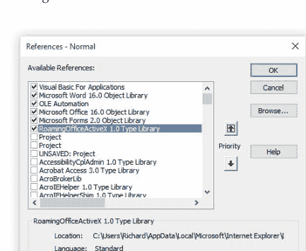

2. 在“可用”列表中，选择你想访问的对象库的复选框，并取消由于不需要而想要移除的引用复选框。你应该能为每个支持自动化并安装在计算机上的应用程序找到一个对象库的引用。在此语境下，*自动化*意味着应用程序允许任务的自动化（换句话说，即宏）。另一种说法是，这种支持自动化的应用程序*暴露其对象*，这意味着应用程序将其对象提供给程序员。

3. 正在使用的引用一起显示在“引用”列表框的顶部，而不是按字母顺序（按照本章前面描述的优先级顺序）。

4. 如果需要，可以选择引用并使用上下箭头将其在列表中向上或向下，以调整引用的优先顺序。通常情况下，你希望将 Visual Basic for Applications 以及你正在工作的应用程序的对象库保持在列表顶部。

## 添加引用库

你甚至可以通过点击“浏览”按钮显示“添加引用”对话框，选择引用文件，然后点击“打开”按钮，在引用对话框的可用列表中添加新的引用库。

5. 点击“确定”关闭“引用”对话框并返回对象浏览器。

## 使用对象浏览器导航

要浏览项目可用的对象，请遵循以下步骤：

1. 首先，在项目资源管理器中双击模块以激活它。
2. 通过选择“视图 > 对象浏览器”、按下 F2 键或点击标准工具栏上的“对象浏览器”按钮来显示对象浏览器。（如果对象浏览器已经显示，通过点击它或从窗口底部的列表中选择它来使其变为活动）
3. 在“项目/库”下拉列表中，选择你想查看的项目或库的名称。对象浏览器会在“类”中显示可用的类。
4. 在“类”列表中，选择你想操作的类。例如，如果你在步骤 3 中选择了一个项目，请在“类”中选择你想操作的模块。
5. 如果你想操作类或项目中的特定成员，请在“成员所属”列表中选择它。例如，如果你正在处理一个模板项目，你可能想选择一个特定的过程或用户表进行操作。

一旦你选择了类、模块或项目，你就可以对它们执行以下操作：

- 在窗口底部的“详细信息”窗中查看有关它的信息。
- 点击“定义”按钮查看对象的定义。或者，在“成员所属”列表中右键点击对象并从上下文菜单中选择“定义”。
- 按 Ctrl+C 将类、模块或项目的文本复制到贴板。

## 使用帮助查找对象

VBA 帮助系统提供了查找所需对象的另一种方法。帮助文件提供了对所有对象的超链接引用。访问帮助最快的方法是在编辑器器中使用 F1 键。

## 按 F1 直接转到命令的帮助页面

使用 F1 的第二种方法可以直接带到你感兴趣的关键字的帮助页面。例如，如果你想查看如何操作活动窗口，只需在代码窗口中输入 activewindow，并将闪烁的光标放在该单词的任何位置，然后按 F1。见图 8.4。

## 按 F1 转到通用帮助页面

F1 有两种不同的工作方式。首先，在代码窗口的空行上点击 F1（光标），将带到图 8.3 所示的 Office 网站。在 Variant 或 Input 等关键字上按 F1，将带到有关该关键字的帮助页面。

## 图 8.3

Office 门户

- Office 开发
- Office 和 SharePoint 插件
- Exchange 服务器
- Office
- Office 客户端
- 在线开发
- Outlook 插件
- SharePoint
- Skype
- 解决方案指南

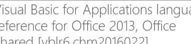

如果你进入了我们的 F1 重定向页面，请从下方选择你需要的项。

Office 2013 Visual Basic Applications 参考


| Office 资源 | 关注我们 |
|---|---|
| O365 技术网络 | Twitter |
| MSN 论坛 | Facebook |
| UserVoice | Office 开发博客 |
| Stack Overflow | |

图 8.3 所示网页左侧（顶部和底部）有几个链接。尝试这些链接，包括 Office 和 SharePoint 插件以及 MSDN 论坛。点击 Stack Overflow 链接，你将带到一个带有有用代码示例的问答网站。

还有页面中间显示的 Office 2013 Visual Basic for Applications 参考链接。（注意，微软可能会在某时刻将“2013”改为“2016”）。

# 第 8 章 查找所需的对象、方法和属性

图 8.4

将插入光标置于某个命令上，按 F1 获取上下文上下文的帮助。

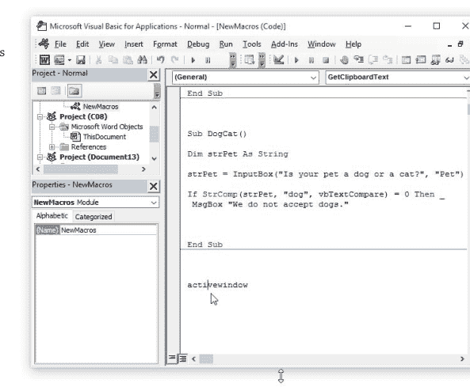

当你在活动窗口命令上按下 F1 后，如图 8.4 所示，该命令的帮助页面将打开，如图 8.5 所示。

图 8.5

ActiveWindow 属性的主帮助页面

# Global.ActiveWindow 属性 (Word)

Office 2010 其他版本 仍然表示活动窗口（具有焦点的窗口）的 Window 对象。只读。

- 语法
- 备注

如果没有打开的窗口，使用此属性将导致错误。

- 示例

此示例显示了活动窗口的标题文本。

```VBA
Sub windowCaption()
    MsgBox ActiveDocument.ActiveWindow.Caption
End Sub
```

此示例为活动文档的活动窗口打开一个新窗口并平铺所有窗口。

注意图 8.5，它显示的是 Office 2010，但为你提供了一个“其他版本”（Other Versions）链接。点击它可以获取最新信息。（为什么它不直接显示其他版本而要求你点击呢？这真是个谜）

除了在在线帮助页面中找到的常规信息外，还有几种其他方法可以查找：

- 在 Microsoft 帮助窗口顶部，你会看到一个搜索框（寻找放大镜符号）。尝试在搜索框中输入 `Word 2016 selection object`（你可能需要输入 `2013`）。将显示一个包含许多链接的页面。


- 在查找帮助时，你也可以点击编辑器中的“帮助”菜单，并选择列出的两个帮助选项之一：“Microsoft Visual Basic Applications 帮助”或“MSDN Web”。这两个选项会打开帮助系统的条目，你可以从中向下钻，直到找到你需要的说明或代码示例。（注意，尽管第一个选项显示了 F1，但当你实际按下 F1 时，并没有被带到同一个网页上）
- 最后，在查找对象时，记住你可以按 F2 显示内置的对象查看器（Object Browser）。

# 使用自动成员列表功能

你在之前的章节中已经使用了几次“自动成员列表”功能。回顾一下，在 VBA 代码中——与大多数其他编程语言一样——对象和成员（属性和方法）通过点隔开。这种标点符号有助于你看到父对象、对象子项以及行尾之间的关系，注意此代码中的两个点：

```vba
snglLinesPerPage = ActiveDocument.Setup.LinesPage
```

当你在 Visual Basic 编辑器中输入并输入点时，自动成员列表会显示一个适用于该对象的属性和方法列表。（如有必要，可以通过 Visual Basic 编辑器中的“工具 > 选项”开启此功能，然后勾选“自动成员列表”复选框）。

从技术上讲，自动成员列表与某种“属性/方法”功能是有区别的。前者是在代码行中的对象名称后输入点（.）触发的。后者是通过按 `Ctrl+I` 或在行中右键点击对象名称并从出现的菜单中选择“属性/方法”来触发的。在这两者中，我觉得自动成员列表很有用。

自动成员列表在完成语句时非常有帮助，但除非你在处理它的之前就知道要使用哪个对象。有时使用此功能就像在迷宫中寻找道路，并得到最后以“你无法从这里到达”结尾的详细指示。

一旦你知道要从哪个对象开始，就可以轻松找到你需要的属性或方法。例如，为了组合 `Application.Documents(1).Close` 语句（关闭 Documents 集合中的第一个文档），你可以按照以下方式操作：

1. 在空过程（`Sub` 和 `End` 语句）的空白新行上放置插入点。如有必要，创建一个新过程。
2. 输入单词 `application`，或输入 `appl` 并按 `Ctrl+Space` 让“单词补全”功能为你完成该单词。
3. 在 `Application` 之后输入点（.）。自动成员列表将显示 `Application` 对象可用的属性和方法列表。
4. 在自动成员列表中选择 `Documents` 项目。你可以使用鼠标滚动到它并双击进入代码窗口，使用方向键滚动到它并按 `Tab` 键输入，或者输入它的前几个字母（自动定位）然后按 `Tab` 键输入。后一种方法如图 8.6 所示，该图使用的是 Word。

# 图 8.6

使用自动成员列表功能输入代码

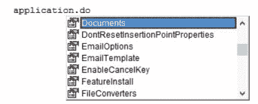

5. 在 `Documents` 之后输入 `(1)`。当你输入这个点时，自动成员列表会显示 `Document` 对象可用的属性和方法列表。注意，如果没有 `(1)`，你处理的是文档集合，但一旦你添加了 `(1)`，你处理的就是一个特定的文档，即集合中的第一个。
6. 通过使用鼠标或向下方向键滚动到自动成员列表中选择 `Close` 项目。因为这是语句的末尾，

注意图 8.5，它显示的是 Office 2010，但为你提供了一个“其他版本”（Other Versions）链接。点击它可以获取最新信息。（为什么它不直接显示其他版本而要求你点击呢？这真是个谜）

除了在在线帮助页面中找到的常规信息外，还有几种其他方法可以查找：

- 在 Microsoft 帮助窗口顶部，你会看到一个搜索框（寻找放大镜符号）。尝试在搜索框中输入 `Word 2016 selection object`（你可能需要输入 `2013`）。将显示一个包含许多链接的页面。
- 在查找帮助时，你也可以点击编辑器中的“帮助”菜单，并选择列出的两个帮助选项之一：“Microsoft Visual Basic Applications 帮助”或“MSDN Web”。这两个选项会打开帮助系统的条目，你可以从中向下钻，直到找到你需要的说明或代码示例。（注意，尽管第一个选项显示了 F1，但当你实际按下 F1 时，并没有被带到同一个网页上）
- 最后，在查找对象时，记住你可以按 F2 显示内置的对象查看器（Object Browser）。

# 使用自动成员列表功能

你在之前的章节中已经使用了几次“自动成员列表”功能。回顾一下，在 VBA 代码中——与大多数其他编程语言一样——对象和成员（属性和方法）通过点隔开。这种标点符号有助于你看到父对象、对象子项以及行尾之间的关系，注意此代码中的两个点：

```vba
snglLinesPerPage = ActiveDocument.Setup.LinesPage
```

当你在 Visual Basic 编辑器中输入并输入点时，自动成员列表会显示一个适用于该对象的属性和方法列表。（如有必要，可以通过 Visual Basic 编辑器中的“工具 > 选项”开启此功能，然后勾选“自动成员列表”复选框）。

从技术上讲，自动成员列表与某种“属性/方法”功能是有区别的。前者是在代码行中的对象名称后输入点（.）触发的。后者是通过按 `Ctrl+I` 或在行中右键点击对象名称并从出现的菜单中选择“属性/方法”来触发的。在这两者中，我觉得自动成员列表很有用。

自动成员列表在完成语句时非常有帮助，但除非你在处理它的之前就知道要使用哪个对象。有时使用此功能就像在迷宫中寻找道路，并得到最后以“你无法从这里到达”结尾的详细指示。

一旦你知道要从哪个对象开始，就可以轻松找到你需要的属性或方法。例如，为了组合 `Application.Documents(1).Close` 语句（关闭 Documents 集合中的第一个文档），你可以按照以下方式操作：

1. 在空过程（`Sub` 和 `End` 语句）的空白新行上放置插入点。如有必要，创建一个新过程。
2. 输入单词 `application`，或输入 `appl` 并按 `Ctrl+Space` 让“单词补全”功能为你完成该单词。
3. 在 `Application` 之后输入点（.）。自动成员列表将显示 `Application` 对象可用的属性和方法列表。
4. 在自动成员列表中选择 `Documents` 项目。你可以使用鼠标滚动到它并双击进入代码窗口，使用方向键滚动到它并按 `Tab` 键输入，或者输入它的前几个字母（自动定位）然后按 `Tab` 键输入。后一种方法如图 8.6 所示，该图使用的是 Word。
5. 在 `Documents` 之后输入 `(1)`。当你输入这个点时，自动成员列表会显示 `Document` 对象可用的属性和方法列表。注意，如果没有 `(1)`，你处理的是文档集合，但一旦你添加了 `(1)`，你处理的就是一个特定的文档，即集合中的第一个。
6. 通过使用鼠标或向下方向键滚动到自动成员列表中选择 `Close` 项目。因为这是语句的末尾，

以下语句使用 `Nothing` 关键字来释放 `objMyObject` 变量占用的内存：

```vba
Set objMyObject = Nothing
```

声明 Object 变量与声明其他类型变量的区别在于，你不仅可以将 Object 变量声明为 `Object` 类型并对其进行 `Set` 赋值，还可以指定它具体是哪种对象。例如，如果一个 Object 变量始终代表一个工作簿（workbook）对象，你可以将其声明为 `Workbook` 数据类型。以下语句将 Object 变量 `xlWorkbook1` 声明为 `Workbook` 数据类型：

```vba
Dim xlWorkbook1 As Workbook
```

像这样将类型与 Object 变量强力关联有几个优点。首先，一旦你对变量进行了强类型处理（所谓的 strongly typed），Visual Basic 编辑器（VBE）就会为该 Object 变量提供完整的协助，就像你直接处理该对象一样。例如，一旦你创建了 `Workbook` 类型的 Object 变量 `xlWorkbook1`，当在该变量名后输入一个点时，Visual Basic 编辑器就会显示“自动成员列表”（Auto List Members）下拉列表，如图 8.7 所示。

其次，当对 Object 变量进行强类型处理时，可能会让你的代码更不容易出错。如果你尝试将错误的类型赋值给强类型的 Object 变量，VBA 会给出错误。例如，如果你在 Excel 中创建了一个 `Worksheet` 变量（如第一个语句所示），然后将其赋值给一个工作簿对象，当你执行此代码时，VBA 会显示“类型不匹配”（Type Mismatch）错误消息——正如我们将展示的：

```vba
Dim wsSheet1 As Worksheet
Set wsSheet1 = ActiveWorkbook
```

> 图 8.7
>
> 当对 Object 变量进行强类型处理时，你可以获得 Visual Basic 编辑器补全功能对这些 Object 变量提供的完整优势。

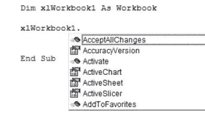

在测试阶段发现问题通常比以后发现要好（例如，不对 Object 变量进行强类型的的主要理由是，你可能无法提前（在编写代码时）确定执行期间最终引用的是什么类型的对象变量，或者对象类型在代码的不同执行之间会发生变化。如果是这样，你的代码将足够灵活，以适应同一个 Object 变量的不同类型对象）。通常，你会对所有的 Object 变量进行强类型处理。

如果你不确定 Object 变量应该使用哪种对象类型，可以先将 Object 变量声明为 `Object` 数据类型。然后在显示“本地窗口”（View > Locals Window）的情况下运行几次代码，并查看 VBA 分配给 Object 变量的数据类型。例如，如果你在 Excel 托管的 Visual Basic 编辑器中反复按 F8 逐步执行以下语句，本地窗口中的读取首先会将 Object 变量 `wks` 识别为 `Object`。

这不太有用。然而，按 F8 执行 `Set` 命令，你会看到大量信息（点击 `wks` 旁边的 `+` 图标）。当执行第二条语句将工作簿中的第一个工作表赋值给它时，你现在看到 `Object/Sheet1`（如图 8.8 所示）。你还可以看到所有的成员、它们的当前值及其类型。

```vba
Dim wks As Object
wks = ActiveWorkbook.Sheets(1)
```

# 图 8.8

> 你可以使用本地窗口来帮助识别变量将包含的对象类型。

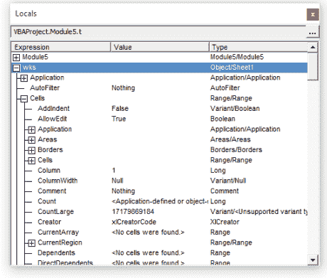

# 弱类型变量的缺点

正如在书中前面学到的，你可以使用 `Variant` 类型完全避免指定数据类型。例如，语句 `Dim MyVar` 创建了一个 `Variant` 变量，因为它没有指定数据类型。`Variant` 可以包含对象以及其他数据类型——但在此之前，使用 `Variant` 需要 VBA 在每次遇到该变量时执行更多工作（因为需要确定变量类型），并剥夺你对变量进行强类型的优势。弱类型会让你的代码更难读。

# 团队编程与 OOP

正如本书之前介绍的，VBA 不仅供个人程序员使用，也供团队使用。当一组程序员协作处理复杂的 VBA 解决方案时，OOP（面向对象编程）可以提供一些特殊的优势。

# 第8章 寻找你需要的对象、方法和属性

团队编程需要管理，而 OOP 及其优势有助于团队在共同实现目标时避免冲突。

OOP 的一个特性是封装（encapsulation）。这意味着对象是自包含且密封的。它就像一个“黑盒”，你将其插入到视频系统中以改进图像。你不需要打开盒子，不需要管理内部结构，只需要使用它。

例如，假设老板希望从现在起所有的文件中强调公司名称。你让 Sandra 创建一个对象，将所有文件中对 ACME WINDWORKS 的引用斜体并大写。你让 Joe 创建一个对象，确保任何使用公司名称的地方都绿色显示。这是因为这个例子是将简单的操作转化为（参见第 10 章“创建你的函数”）——而不是对象。

当这些被封装到对象中时，没有人需要担心 Sandra 和 Joe 使用相同的变量名或以其他方式相互干扰代码。相反，在他们完全隔离的对象中，他们可以随心所欲地编写代码。

# 核心内容

理解并使用对象、属性和方法。现代编程采用称为面向对象编程（OOP）的层次化组织方法。对于任何定的应用程序，层级结构的最顶端都是 `Application` 对象。你通过此对象访问层级更低的对象。

**精要掌握**：使用可创建对象，在代码中引用 `Application` 对象时通常可以省略它。什么是可创建对象？

使用对象集合。集合是一组相关对象的容器，例如 `Document` 的 `Document` 对象集合。

**精要掌握**：集合是对象吗？它们有有自己的方法和属性吗？

查找对象、属性和方法。Visual Basic 编辑器提供了多种方法来定位对象成员并将其添加到编程代码中。有详尽的帮助系统、对象浏览器、列表属性/方法工具以及自动列出成员工具。

**精要掌握**：你如何使用自动列出成员工具来查找 Word 的 `Document` 对象可用属性和方法？

使用对象变量来表示对象。你可以创建包含对象的变量，而不是像字符串或数字那些典型值。

**精要掌握**：你使用什么关键字来声明一个对象变量？

## 第 3 部分

决策以及使用循环和函数

### 第 9 章：使用内置函数

## 第 9 章

## 使用内置函数

VBA 带有大量的内置函数，用于执行常用的操作——涵盖从判断文件是否存在到返回当前日期，以及将数据从一种格式转换为另一种格式。（例如，你可以使用函数将数值数据转换为文本字符串）。

在书中，我通常将大多数 VBA 语言组件（VBA 词汇）称为命令。但在本章，我们将这些内置函数使用更准确的术语：操作、方法、例程、过程和存储过程。

本章将演示什么是函数、它们的作用以及如何使用它们。在此过程中，你将熟悉 VBA 内置的一些关键函数——包括将数据从一种数据类型转换为另一种类型的函数、管理数学计算的函数以及许多。

你还可以创建自己的自定义函数来补充 VBA 的内置函数。下一章将告诉你当 VBA 函数不能满足你的特殊需求时，如何构建自己的函数。

**在本章中，你将学习做到以下操作：**

- 理解函数的定义及其作用


- 使用函数
- 使用关键 VBA 函数
- 将数据从一种类型转换为另一种类型
- 处理字符串和日期

## 什么是函数？

函数是过程的一种类型。在 BASIC 语言（VBA 是其后代）中，函数与子程序（subprocedure）的区别在于函数总是返回一个值，而子程序不会。在实践中，函数几乎总是接受一个或多个参数。虽然子程序可以写成接受参数的形式，但大多数程序员不会这样编写代码。

其他计算机语言并不区分函数和子程序。因此，总结来说，VBA 中函数和子程序的主要区别如下：

**子程序**：它们从不返回值，且很少发送参数。子程序通常是自包含的。

**函数**：它们与外部代码通信，接收来自参数的输入数据，以某种方式处理这些数据，并将结果返回给其他代码。

你会经常使用 VBA 内置的函数。通常，你通过发送参数向内置函数提供信息。内置函数处理数据并返回一个值供你使用。

内置函数对 VBA 至关重要，你已经在本书示例中使用过它们。例如，在第 7 章“使用数组变量”中，你使用 `Rnd` 函数生成随机数来填充名为 `IntArray` 的数组，并使用 `Int` 函数将数字转换为整数：

```
intArray() = Int(Rnd * 10)
```

`Rnd` 是不需要一个或多个参数的函数之一。`Rnd` 可以接受一个可选参数，但示例没有使用它。

相反，`Int` 需要一个参数——你转换为整数的数字或表达式。示例中的整数由表达式 `Rnd * 10` 提供。`Rnd` 函数返回一个 `Int` 函数使用的值。`Int` 函数向过程返回一个值，该值用于填充数组中的下标。

参数是传递给函数的信息。（参数也会传递给对象的方法和其他命令。）你可以通过帮助描述中查看它们在括号内显示的方式来判断参数何时是可选的。当参数可选时，你可以提供括号中显示的任何参数。

## 使用函数

要调用函数，你可以使用 `Call` 关键字或直接使用名称。使用 `Call` 关键字对于日常函数来说多此一举；程序员很少使用它。

`Call` 语句的语法如下：

```
Call name [argumentlist]
```

在这里，`name` 是必须的字符串，给出要调用的函数或过程的名称，`argumentlist` 是可选参数，提供一个逗号分隔的变量、数组或表达式列表传递给函数或过程。

```vba
str1 = Left("This is Pride and Patriotism", 13)
str2 = Right(str1, 5)

MsgBox str2
```

### 图 9.1

使用 Left 函数提取字符串的左部分——在本例中取字符串的前 10 个字符

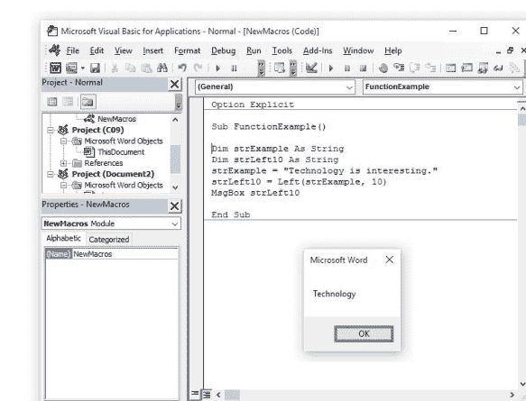

然而，在你习惯了使用函数后，可以在代码中以各种方式将它们折叠。与其将函数的赋值赋值给变量，不如将其直接插入代码中，或将其（作为参数）传递另一个函数。这是一种常见的快捷方法。看下面的语句，它的功能与之前的示例相同，但通过变量嵌套将代码压缩在了一行：

```vba
MsgBox Right(Left("This is Pride and Patriotism", 13), 5)
```

该语句使用了三个函数：`MsgBox` 函数、`Left` 函数和 `Right` 函数。（`Right` 函数是 `Left` 函数的对应函数，它从指定字符串的右侧返回指定数量的字符）。

当 VBA 语句中出现多个括号时，代码将从最内层的括号开始并向外执行。这与数学中处理嵌套括号的方式相同。

因此，在先前的示例中，首先评估 `Left` 函数，返回字符串中从左侧开始的13个字符：`This is Pride`（空格也是字符）。VBA 将此新字符串传递给 `Right` 函数，此时 `Right` 函数返回最右侧的五个字符：`Pride`。然后 VBA 将此新字符串传递给 `MsgBox` 函数，从而在消息框中显示它。

### 限制你的嵌套

你可以将函数嵌套到很多层而不会给 VBA 带来任何麻烦，但多层嵌套可能会让人类难以阅读和排除故障。对于大多数实际用途，将嵌套限制在几层以内（如果确实需要的话）是一个好主意。

### 向函数传递参数

当一个函数接收多个参数时，你可以通过三种方式之一向其传递参数：

- 通过提供参数值而不提供名称，按*位置*（按照函数期望的顺序）提供
- 通过提供参数及其名称，并按照函数期望的顺序提供
- 通过提供参数及其名称，并按你选择的任何顺序提供

第一种方法（不名称按位置提供参数）通常是最快的方法。这样做的唯一缺点是，阅读你代码的人可能无法立即知道哪个值对应哪个参数——尽管他们可以轻松地查到。要省略某个参数，你可以在参数序列中出现的位置放置一个逗号。

输入参数名称需要额外的时间，但它能让你的代码更易读。当你从命名参数列表中省略一个参数时，你不需要使用逗号来表示你跳过了它。

无序使用命名参数并没有按顺序使用它们的优势，除非你发现这样做更简单。

例如，`DateSerial` 函数返回一个包含指定年份、月份和日的 Variant/Date 类型。`DateSerial` 的语法如下：

```vba
DateSerial(year, month, day)
```

在这里，*year* 是提供年份的必需 Integer，*month* 是提供月份的必需 Integer，*day* 是提供日期的必需 Integer。下面的语句按位置不带名称提供参数：

```vba
MsgBox DateSerial(2016, 12, 31)
```

该语句等同，且按名称按位置提供参数：

```vba
MsgBox DateSerial(Year:=2016, Month:=12, Day:=31)
```

下面的语句按错误的顺序提供参数：

```vba
MsgBox DateSerial(Day:=31, Year:=2016, Month:=12)
```

### 第 9 章 使用内置函数

这三个语句都能正常工作并实现相同的结果。只有当你列出顺序错误的（按位置）参数、命名了某些参数但未命名其他参数、或者省略了必需参数时，才会产生问题。图 9.2 显示了你会遇到的错误之一。在这种情况下，如果你漏掉了必需参数。

#### 图 9.2

当省略必需参数时会发生“参数不是可选的”（Argument not optional）错误。

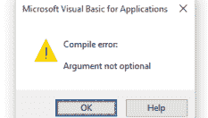

## 使用函数转换数据

在 VBA 中，你不必转换数据类型，但你至少应该了解它的作用。某些计算机语言对要求显式数据类型（有时称为强数据类型）非常严格。即使在 VBA 中，在某些特殊情况下，你可能需要将一种变量类型转换为另一种。例如，你可能使用 `InputBox` 命令从用户那里获取某些信息。用户在键盘上打字，因此他们输入的所有数据都将字符（文本字符串数据）。但如果你的宏需要将字符串转换为整数，你可以使用 `CInt` 命令。如果你从其他源导入数据（例如将所有内容都存储为 `String` 变量的数据库），也会出现相同的问题。

VBA 提供了一系列简单的函数用于将数据从一种数据类型转换为另一种。表 9.1 列出了从一种数据类型转换为另一种数据类型的函数。

### 表 9.1：VBA 简单转换函数

| 函数 (参数) | 数据类型 |
| :--- | :--- |
| `CBool`(number) | Boolean |
| `CByte`(expression) | Byte |
| `CCur`(expression) | Currency |
| `CDate`(expression) | Date |
| `CDec`(expression) | Decimal |
| `CDbl`(expression) | Double |
| `CInt`(expression) | Integer |
| `CLng`(expression) | Long |
| `CSng`(expression) | Single |
| `CStr`(expression) | String |
| `CVar`(expression) | Variant |
| `Val`(string) | |

- 它忽略了制表符、换行符和空格。
- 它将句识别为小数点分隔符，但不识别逗号。

这意味着如果你 `Val` 一个由制表符列出的数字组成的字符串（例如第二行），它会将它们读取为数字（在这种情况下为 44563.994711）：

| 项目# | 价格 | 可用 | 订购中 | 已订购 |
|---|---|---|---|---|
| 4456 | 34.99 | | 7 | 11 |

然而，如果你 `Val` 某个包含数字和字母混合的内容，`Val("4ES")` 将只读取数字和被识别为数值表达式的字符串（例如，`Val("4ES")` 返回 400000，因为它将该表达式读取为指数）。例如，如果输入下一个示例中的地址，`Val` 返回 866，忽略了字符串中的其他数字（它在 Laurel 的 L 处停止，L 是第一个不是数字、制表符、换行符或空格的字符）：

8661 Laurel Avenue Street 3086, Oakland, CA 94610

`Val` 的语法非常简单：

```
Val(string)
```

在这里，`string` 是一个必需参数，由任何字符串组成。以下语句使用 `Val` 从街道地址 `Address` 返回数值变量 `StreetNumber`：

```
StreetNumber = Val(Address)
```

### 使用 CINT 代替 VAL

在转换为数字时，你通常应该使用 `CInt` 函数而不是 `Val` 函数。其原因是 `CInt` 考虑了你所处的位置（Windows 中的区域设置）。例如，在美，我们使用逗号来表示千分位：12,000。`CInt` 函数可以处理这种情况；而 `Val` 则不能（它会将 "12,000" 转换为 12）：

```vba
Dim StrVar As String
StrVar = "12,000"
MsgBox "Val = " & Val(StrVar) & " & Cint = " & CInt(StrVar)
```

当你执行这段代码时，你将在接出的消息框中看到结果。这说明了为什么你应该使用 `CInt` 而不是 `Val`。


记住 `Val` 在遇到第一个非数字字符时就会停止。因此，在尝试转换 12,000 时，这个逗号会导致它停止。

### 使用 Str 函数将数字转换为字符串

正如在上一节描述的那样，你使用 `CInt` 将文本字符串转换为数值，你也可以使用 `Str` 函数将数值转换为字符串。但你应该使用较新的 `Str` 函数而不是旧的 `Str` 函数，原因与 `CInt` 优于旧的 `Val` 命令的原因相同。

当你将值中包含的信息与字符串进行拼接时，你需要将数字转换为字符串。拼接意味着将一个字符串附加到另一个字符串之后，例如 "123" & "456"，结果为 "123456"。这个结果与直接在数学上将这两个数字相加的结果是不同的。

拼接不能简单地通过 `+` 运算符来完成，因为 VBA 会尝试执行数学加法，而不是你想要的字符串操作：拼接。

文本字符串就像文本一样：它是一个或多个字母数字字符，例如 "55"——这与数字 55 完全不同。你不能拼接 "55" 和 "55"。它们完全不是同一种数据。

这里有一个例子。假设你声明了一个字符串变量 `strYourAge` 和一个数值变量 `intAge`。`strYourAge + intAge` 语句无法进行拼接，因为它们是不同的数据类型。你首先需要从 `intAge` 变量创建一个字符串，然后将该字符串与 `strYourAge` 字符串拼接。（或者，你可以使用 `&` 运算符来拼接变量。）

要将值转换为字符串，使用 `CStr` 函数：

```
CStr(number)
```

在这里，`number` 是一个包含数值表达式的值（例如 `Integer` 类型、`Long` 类型或 `Double` 类型）。以下过程提供了将值转换为字符串的示例：

```vba
Sub Age()
    Dim intAge As Integer, strYourAge As String
    intAge = InputBox("Enter your age:", "Age")
    strYourAge = "Your age is " & CStr(intAge) & "."
    MsgBox strYourAge, vbOKOnly, "Age"
End Sub
```

### 使用声明简写

注意示例 `Sub Age` 中 `Dim` 语句的一种简写。两个不同的变量用逗号分隔并在同一行声明。这等同于：

```vba
Dim intAge As Integer
Dim strAge As String
```

### 使用 Format 函数格式化表达式

`Format` 函数是一个强大的工具，用于以你喜欢的格式格式化数字、日期和时间。`Format` 函数的语法如下：

```
Format(expression[, format[, firstday[, firstweekofyear]]])
```

这些是常量：`expression` 是任何有效表达式。

- `format` 是指定用户定义格式的可选参数。
- `firstday` 是定义周起始日的可选常量（用于日期）。
- `firstweekofyear` 是定义一年起始日的可选常量（用于日期）。

| CONSTANT | VALUE |
|---|---|
| `vbSystem` | 0 | 系统设置。 |
| `vbSunday` | 1 | 周日。 |
| `vbMonday` | 2 | 周一。 |
| `vbTuesday` | 3 | 周二。 |
| `vbWednesday` | 4 | 周三。 |
| `vbThursday` | 5 | 周四。 |
| `vbFriday` | 6 | 周五。 |
| `vbSaturday` | 7 | 周六。 |

| FORMAT NAME | EXPLANATION |
|---|---|
| General | 无任何格式的数字。 |
| Currency | 显示对应区域的货币符号。 |
| Fixed | 至少显示一位小数。 |
| Standard | 至少显示一位小数。 |
| Percent | 插入百分号并将表达式乘以 100。 |
| Scientific | 以科学计数法格式显示。 |
| Yes/No | 非零数字显示为 Yes；零显示为 No。 |
| True/False | 非零数字显示为 True；零显示为 False。 |
| On/Off | 非零数字显示为 On；零显示为 Off。 |

### 使用内置函数

| FORMAT NAME | EXPLANATION | EXAMPLE |
|---|---|---|
| General | 无任何格式的数字。 | `Format`("12345", "General") |
| Currency | 显示对应区域的货币符号。 | `Format`("12345", "Currency") |
| Fixed | 至少显示一位小数。 | `Format`("12345", "Fixed") |
| Standard | 至少显示一位小数。 | `Format`("12345", "Standard") |
| Percent | 插入百分号并将表达式乘以 100。 | `Format`("12345", "Percent") |
| Scientific | 以科学计数法格式显示。 | `Format`("12345", "Scientific") |
| Yes/No | 非零数字显示为 Yes；零显示为 No。 | `Format`("12345", "Yes/No") |
| True/False | 非零数字显示为 True；零显示为 False。 | `Format`("12345", "True/False") |
| On/Off | 非零数字显示为 On；零显示为 Off。 | `Format`("12345", "On/Off") |

### 创建数值格式

| CHARACTER | EXPLANATION |
|---|---|
| [None] | 显示无任何格式的数字。 |
| 0 | 数字占位符。如果没有数字，VBA 显示 0。如果数字位数少于你使用的位数，VBA 会适当显示前导零或尾零。 |
| # | 数字占位符。如果没有数字，VBA 显示为空。 |
| . | 小数点占位符。指示小数点分隔符的位置。小数点分隔符随区域而异（例如，美国使用点，德国使用逗号）。 |
| % | 百分号占位符。VBA 插入百分号并将表达式乘以 100。 |
| , | 千分位分隔符（取决于区域，使用逗号或点）。 |
| : | 时间分隔符（通常是冒号，但取决于区域）。 |
| / | 日期分隔符（同样，取决于区域）。 |
| E- E+ e- e+ | 科学格式：E+ 或 e- 在负指数处放置负号。E+ 或 e+ 在负指数处放置负号，在正指数处放置正号。 |
| + $ | 显示字文字。 |
| [character] | 显示字面。 |
| [string]" | 显示字面。使用 `Chr`(34)（双引号的字符代码）来提供双引号。 |

### 表 9.6：用于创建自定义日期和时间格式的字符（续）

| 字符 | 解释 |
|---|---|
| n D | 显示日期（1 到 31），个位数不显示前导零。 |
| Dd | 显示日期，对于个位数显示前导零（01 到 31）。 |
| Ddd | 以三字母缩写形式显示星期（Sun, Mon, Tue, Wed, Thu, Fri, Sat），不带句号。 |
| Dddd | 显示星日的完整名称。 |
| Ddddd | 以系统的短日期格式显示完整日期（日、月和年）。 |
| Dddddd | 以系统的长日期格式显示完整日期（日、月和年）。 |
| aaaa | 显示星日的本地化完整名称。 |
| w | 显示 1（星期日）到 7（星期一）之间的整数，表示星期几。 |


| ww | 显示 1 到 54 之间的整数，表示年的周数。大多数年份的周数为 54 周而不是 52 周，因为大多数年份是以部分周开始和结束的，而不是有 52 个完整的周。 |

| m | 显示 1 到 12 之间的整数，表示两位数的月份，个位数不显示前导零。在 `h` 之后使用时，返回分钟而不是月份。 |

| mm | 显示 01 到 12 之间的数字，表示两位数的月份。在 `h` 之后使用时，返回分钟而不是月份。 |

| mmm | 以三字母缩写形式显示月份（五月除），不带句号。 |

| mmmm | 显示月份的完整名称。 |

| oooo | 显示月份的本地化完整名称。 |

| q | 显示 1 到 4 之间的整数，表示年的季度。 |

| y | 显示 1 到 366 之间的整数，表示一年中的天数。 |

| yy | 显示 00 到 99 之间的数字，表示两位年份。 |

| yyyy | 显示 0100 到 9999 之间的数字，表示四位年份。 |

| h | 显示 0 到 23 之间的数字，表示小时。 |

| H | 显示 00 到 23 之间的数字，表示两位小时。 |

| N | 显示 0 到 60 之间的数字，表示分钟。 |

| Nn | 显示 00 到 60 之间的数字，表示两位分钟。 |

# 使用 Format 函数对表达式格式化

| 字符 | 解释 |

| --- | --- |

| $ | 显示 0 到 60 之间的数字，表示秒。 |

| Ss | 显示 00 到 60 之间的数字，表示两位秒。 |

| ttttt | 以系统的默认时间格式显示完整时间（小时、分钟和秒）。 |

| AM/PM | 使用 12 小时制并根据情况显示 AM 或 PM。 |

| am/pm | 使用 12 小时制并根据情况显示 am 或 pm。 |

| A/P | 使用 12 小时制并根据情况显示 A 或 P。 |

| a/p | 使用 12 小时制并根据情况显示 a 或 p。 |

| AMPM | 使用 12 小时制并显示系统定义的 AM 或 PM 字面量字符串。 |

例如，以下语句返回 2016年4月01日，星期六：

`Format(#4/1/2016#, "dddddd")`

# 创建字符串格式

`Format` 函数还允许你使用表 9.7 所示选项创建自定义字符串格式。

| 字符 | 解释 |

| --- | --- |

| @ | 字符占位符。如果有字符则显示字符，如果没有则显示为空。 |

| & | 字符占位符。如果有字符则显示字符，如果没有则显示为空。 |

| < | 显示小写字符串。 |

| > | 显示大写字符串。 |

| ! | 使 VBA 从左到右填充占位符，而不是从右到左（默认方向）。 |

例如，以下语句将由四个空格组成的字符串赋值给 `strUser`：

```
strUser = Format(InputBox("Enter your name:"), "!")
```

# 使用 Chr 函数和常量在字符串中输入特殊字符

要在字符串中插入特殊字符（如回车符或制表符），请指定内置常量（对于定义了内置常量的特殊字符）或使用 `Chr` 函数输入相应的字符代码。`Chr` 函数的语法如下：

```
Chr(charactercode)
```

这里，`charactercode` 是标识要添加的特殊字符的数字。表 9.8 列出了最有用的字符代码和常量。

**表 9.8：** VBA 字符代码和常量

| 代码 | 内置常量 | 字符 |

|---|---|---|

| `Chr(9)` | `vbTab` | 制表符 |

| `Chr(10)` | `vbLf` | 换行 |

| `Chr(11)` | `vbVerticalTab` | 垂直制表符 |

| `Chr(12)` | `vbFormFeed` | 换页符 |

| `Chr(13)` | `vbCr` | 回车符 |

| `Chr(14)` | `vbNext` | 换符 |

| `Chr(15)` | `vbNullChar` | 空字符 |

| `Chr(34)` | `""` | 双引号 |

| `Chr(39)` | `'` | 单引号 |

| `Chr(38)` | `&` | 符号 |

| `Chr(33)` | `!` | 感叹号 |

| `Chr(40)` | `(` | 左括号 |

| `Chr(41)` | `)` | 右括号 |

| `Chr(91)` | `[` | 左括号 |

| `Chr(93)` | `]` | 右括号 |

| `Chr(123)` | `{` | 左大括号 |

| `Chr(125)` | `}` | 右大括号 |

| `Chr(92)` | `\` | 反斜杠 |

| `Chr(124)` | `|` | 竖线 |

| `Chr(61)` | `=` | 等号 |

| `Chr(62)` | `>` | 大于 |

| `Chr(59)` | `;` | 分号 |

| `Chr(58)` | `:` | 冒号 |

| `Chr(44)` | `,` | 逗号 |

| `Chr(46)` | `.` | 句号 |

| `Chr(47)` | `/` | 斜杠 |

| `Chr(63)` | `?` | 问号 |

| `Chr(42)` | `*` | 星号 |

| `Chr(45)` | `-` | 减号 |

| `Chr(43)` | `+` | 加号 |

| `Chr(95)` | `_` | 下划线 |

| `Chr(126)` | `~` | 波浪号 |

| `Chr(94)` | `^` | 符号 |

| `Chr(36)` | `$` | 美元符号 |

| `Chr(35)` | `#` | 井号 |

| `Chr(37)` | `%` | 百分号 |

| `Chr(64)` | `@` | 符号 |

| `Chr(163)` | `£` | 英镑符号 |

| `Chr(8364)` | `€` | 欧元符号 |

| `Chr(48)` | `0` | 0 |

| `Chr(49)` | `1` | 1 |

| `Chr(50)` | `2` | 2 |

| `Chr(51)` | `3` | 3 |

| `Chr(52)` | `4` | 4 |

| `Chr(53)` | `5` | 5 |

| `Chr(54)` | `6` | 6 |

| `Chr(55)` | `7` | 7 |

| `Chr(56)` | `8` | 8 |

| `Chr(57)` | `9` | 9 |

| `Chr(65)` | `A` | A |

| `Chr(66)` | `B` | B |

| `Chr(67)` | `C` | C |

| `Chr(68)` | `D` | D |

| `Chr(69)` | `E` | E |

| `Chr(70)` | `F` | F |

| `Chr(71)` | `G` | G |

| `Chr(72)` | `H` | H |

| `Chr(73)` | `I` | I |

| `Chr(74)` | `J` | J |

| `Chr(75)` | `K` | K |

| `Chr(76)` | `L` | L |

| `Chr(77)` | `M` | M |

| `Chr(78)` | `N` | N |

| `Chr(79)` | `O` | O |

| `Chr(80)` | `P` | P |

| `Chr(81)` | `Q` | Q |

| `Chr(82)` | `R` | R |

| `Chr(83)` | `S` | S |

| `Chr(84)` | `T` | T |

| `Chr(85)` | `U` | U |

| `Chr(86)` | `V` | V |

| `Chr(87)` | `W` | W |

| `Chr(88)` | `X` | X |

| `Chr(89)` | `Y` | Y |

| `Chr(90)` | `Z` | Z |

| `Chr(96)` | `` ` `` | 反引号 |

| `Chr(97)` | `a` | a |

| `Chr(98)` | `b` | b |

| `Chr(99)` | `c` | c |

| `Chr(100)` | `d` | d |

| `Chr(101)` | `e` | e |

| `Chr(102)` | `f` | f |

| `Chr(103)` | `g` | g |

| `Chr(104)` | `h` | h |

| `Chr(105)` | `i` | i |

| `Chr(106)` | `j` | j |

| `Chr(107)` | `k` | k |

| `Chr(108)` | `l` | l |

| `Chr(109)` | `m` | m |

| `Chr(110)` | `n` | n |

| `Chr(111)` | `o` | o |

| `Chr(112)` | `p` | p |

| `Chr(113)` | `q` | q |

| `Chr(114)` | `r` | r |

| `Chr(115)` | `s` | s |

| `Chr(116)` | `t` | t |

| `Chr(117)` | `u` | u |

| `Chr(118)` | `v` | v |

| `Chr(119)` | `w` | w |

| `Chr(120)` | `x` | x |

| `Chr(121)` | `y` | y |

| `Chr(122)` | `z` | z |

*(注：原文后续存在大量重复段落，已按要求不进行重复输出)*

## 使用 LEFT、RIGHT 和 MID 函数返回字符串的局部

返回字符串的一部分

有时，在宏中，你可能只需要使用字符串的一部分。例如，你可能只需要提取城市名称的前三个字符来创建一个位置代码。

VBA 提供了几个函数可以从你需要的字符返回字符串：

- `Left` 函数从字符串的左侧返回指定数量的字符。
- `Right` 函数从字符串的右侧返回指定数量的字符。
- `Mid` 函数从字符串内部指定的位置开始返回指定数量的字符。

## 两种格式的字符串函数

VBA 为许多字符串提供了两个版本，包括 `Left`、`Right` 和 `Mid` 函数：这里显示的版本返回 `String` 类型的 `Variant` 值，而以 `$` 结尾的版本（`Left$`、`Right$`、`Mid$` 等）返回纯字符串值。

返回纯字符串的函数运行速度更快（尽管在正常使用中你可能没有任何差异），但如果你对 `Null` 值使用它们，将会报错。返回 `String` 类型 `Variant` 的函数可以很好地处理 `Null` 值。采用哪种方法取决于例如你正在处理的数据类型。某些数据库使用 `Null`，而另一些则不。

## 使用 LEFT 函数

`Left` 函数从字符串的左侧返回指定数量的字符。`Left` 函数的语法如下：

```
Left(string, length)
```

这里，`string` 参数可以是任何表达式——即该表达式返回连续字符序列。如果 `string` 不包含数据，`Left` 将返回 `Null`。`length` 参数是一个数值表达式，指定要返回的字符数。`Length` 可以是一个简单的数字（如 4、7 或 11），也可以是一个产生数字的表达式。例如，如果一个单词的长度存储在名为 `Lenword` 的变量中，而你想返回比 `Lenword` 少两个的字符，你可以指定表达式 `Lenword - 2` 作为 `length` 参数；要返回比 `Lenword` 多三个字符，你可以指定 `Lenword + 3` 作为 `length` 参数。

使用 `Left` 函数的一种方法是从数据库提供的、未接通的 10 位电话号码中分离出区码。在以下语句中，电话号码存储在字符串变量 `strPhone` 中，代码假设该变量之前已创建。

```
Dim strArea As String
strArea = Left(strPhone, 3)
```

这些语句创建了变量 `strArea` 并用 `strPhone` 变量中最左侧的三个字符填充它。

## 使用 RIGHT 函数

`Right` 是 `Left` 函数的镜像。`Right` 从字符串的右侧返回指定数量的字符。`Right` 函数的语法如下：

```
Right(string, length)
```

同样，`string` 参数可以是任何字符串表达式，`length` 是指定要返回字符数的数值表达式。而且，如果 `string` 不包含数据，`Right` 返回 `Null`，且 `length` 可以是一个数字或返回数字的表达式。

继续上一个例子，你可以使用 `Right` 函数将存储在 `strPhone` 中的电话号码的最后七位与区码分离：

```
Dim localNumber As String
localNumber = Right(strPhone, 7)
```

这些语句创建了变量 `localNumber` 并用 `strPhone` 变量中最右侧的七个字符填充它。

## 使用 MID 函数

`Left` 和 `Right` 从字符串的左侧或右侧提取子字符串。`Mid` 函数从字符串的中间提取子字符串。

`Mid` 函数从给定字符串返回指定数量的字符。你指定字符串中的起始位置以及提取的字符数（从起始位置向右）。

`Mid` 函数的语法如下：

```
Mid(string, start[, length])
```

以下是语法的元素：

- 与 `Left` 和 `Right` 一样，`string` 参数可以是任何字符串表达式。如果 `string` 不包含数据，`Mid` 返回 `Null`。
- `start` 是一个数值，指定开始选择长度的字符串字符位置。如果 `start` 大于字符串中的字符数，VBA 返回一个长度为零的字符串。在代码中，空字符串输入为两个引号：`strState = ""`
- `length` 是可选的数值表达式，指定要返回的字符数。如果你省略 `length` 或其大于字符串字符数，VBA 返回从起始位置到字符串结尾的所有字符。`Length` 可以是普通的字面量数字或返回数字的表达式。

使用电话号码的例子，你可以利用 `Mid` 从 10 位电话号码中提取局端代码（例如，从 `5105551212` 中提取 `555`），如下所示：

```
Dim strPhone As String
strPhone = "5105551212"
MsgBox Mid(strPhone, 4, 3)
```

这条语句显示 `strPhone` 中从第四个字符开始的三个字符。

## 现实场景

不要折磨你的用户——接受各种格式

通常情况下，无缘无故让用户感到困难。这是处理不同格式的一个示例。（注：此处原文存在大量重复的 OCR 错误，已根据逻辑进行清理和翻译）

*注：由于原始 OCR 文本存在大量重复和乱码，已根据提供的片段逻辑对内容进行了对齐和清理。*

# 使用 InStr 在另一个字符串中查找字符串

- `string2` 是一个必填参数，指定要在 `string1` 中搜索的字符串表达式。
- `compare` 是一个可选参数，指定你想要执行的字符串比较类型。

文本可以通过两种方式进行比较：二进制比较（区分大小写）或文本比较（不区分大小写）。默认值是二进制比较，你可以使用常量 `vbBinaryCompare` 或值 `0` 作为 `compare` 来指定它。虽然指定此值并不是必须的（因为它是默认值），但你可能想包含它以使你的代码极其整洁。要指定文本的、不区分大小写的比较，请使用常量 `vbTextCompare` 或将 `compare` 设置为 `1`。

## 针对不可预测的字符串数据使用文本比较

当你处理可能以各种形式出现的数据时，文本比较是一个非常有用的武器，例如本章“真实世界场景”中描述的电话号码标点问题。另一个例子是，如果你想搜索某个名称的实例，你可能希望找到该名称的所有实例——无论大写、小写还是标题大小写（首字母大写）。否则，你将只能找到大小写与你的 `string2` 参数中指定的完全相同的名称。

使用 `InStr` 的另一种方法是找到某个字符串在另一个字符串中的位置，以便你可以更改该子字符串。如果你需要将文件从特定文件夹或子文件夹的当前位置移动到具有相似子文件夹结构的文件夹，你可能需要这样做。例如，假设你有文档存储在 `In` 下的各种文件夹中（例如 `z:\Documents\In\`），处理完后，你将它们保存到名为 `Out` 的文件夹下的相应子文件夹中（`z:\Documents\Out\`）。列表 9.1 显示的短过程会自动将文档保存到子文件夹中。

### 列表 9.1：更改文件路径

```
Sub Save_In_Out_Folder()
   Dim strName As String
   Dim intToChange As Integer
   strName = ActiveDocument.FullName
   intToChange = InStr(strName, "In")
   strName = Left(strName, intToChange - 1) & "\Out\" & Right(strName, Len(strName) - intToChange - 3)
   ActiveDocument.SaveAs strName
End Sub
```

列表 9.1 中的代码工作原理如下：


- 第 1 行开始过程，第 7 行结束过程。
- 第 2 行声明字符串变量 `strName`（对应原始名称）和整数变量 `intToChange`（对应新名称）。第 3 行将 `strName` 赋值为 `ActiveDocument` 对象的 `FullName`；即文档的全名，包括文档路径（例如 `z:\Documents\In\My Letter.docx`）。
- 第 4 行将变量 `intToChange` 赋值为 `Instr` 函数的返回值，该函数在变量 `strName` 中查找字符串 `\In`。使用上一段的示例路径，`intToChange` 将赋值为值 13，因为 `\In` 的第一个字符是 `strName` 字符串中的第 13 个字符。
- 第 5 行在语句的主部分将新文件名赋值给变量 `strName`。拆解如下：
    * `Left(strName, intToChange - 1)` 取 `strName` 字符串的左侧部分，返回由 `intToChange-1` 指定的字符数——即 `intToChange` 中存储的值减 1。
    * `& "\Out"` 在上一个项目指定的字符串后添加字符（继续之前的示例，`z:\Documents\Out`），这有效地替换了 `\In` 字符，从而更改了目录名（`z:\Documents\Out`）。
    * `Right(strName, Len(strName) - intToChange - 3)` 通过添加 `strName` 字符串的右侧部分完成字符串，从 `\In` 字符串之后开始（`Letters\My Letter.docx`），得到 `z:\Documents\Out\Letters\My Letter.docx`。从右侧截取的字符数通过从 `strName` 的长度减去 `intToChange` 存储的值并再减去 3 来确定。这里，值 3 来自字符串 `"\In\"` 的长度；因为 `intToChange` 值存储的是第一个反斜杠的字符编号，你只需要计算 `\I`、`n` 以及第二个反斜杠直到结束。
- 第 6 行使用 `strName` 变量中的名称保存文档。

`InRev` 的语法与 `InStr` 相同：

```
InStr(stringcheck, stringmatch, start, [compare])
```

这些是参数：

- `stringcheck` 是一个必填字符串参数，指定要在其中查找 `stringmatch` 的字符串。
- `stringmatch` 是一个必填字符串参数，指定要搜索的字符串。
- `start` 是一个可选数字参数，指定搜索的起始位置。如果省略 `start`，VBA 将从 `stringcheck` 的最后一个字符开始。
- `compare`（与 `InStr` 相同）是一个可选参数，指定搜索方式：文本使用 `vbTextCompare`，二进制比较使用 `vbBinaryCompare`。

## 使用 LTrim、RTrim 和 Trim 移除字符串中的空格

通常，你需要在拼接字符串之前对其进行修剪，以避免在不适当的地方出现额外的空格，例如在 8 位文件名的中间。回想电话号码的例子，你的程序不需要空格，但允许用户进行缩进而不会报错。

数据可能包含后置或前导的空格，你需要在处理之前移除它们。VBA 提供了三个函数来完成此任务：`LTrim`、`RTrim` 和 `Trim`。

- `LTrim` 移除字符串开头的空格。
- `RTrim` 移除字符串末尾空格。
- `Trim` 移除字符串所有的开头和末尾空格。

`LTrim`、`RTrim` 和 `Trim` 的语法为：

```
LTrim(string)
RTrim(string)
Trim(string)
```

这些函数的用法示例：

```vba
Dim strText As String
strText = "  Hello World  "
MsgBox LTrim(strText) ' 返回 "Hello World  "
MsgBox RTrim(strText) ' 返回 "  Hello World"
MsgBox Trim(strText)  ' 返回 "Hello World"
```

# 使用 StrConv、LCase 和 UCase 更改字符串的大小写

- 第 4 行将输入框的结果赋值给 `strPassword`，该输入框提示用户输入项目的密码。
- 第 5 至第 13 行使用 If 语句检查密码长度是否适当。首先，第 5 行检查 `strPassword` 的长度是否为 0，这意味着用户点击了“取消”按钮、输入框上的按钮，或者在输入框未输入文本的情况下点击了“确定”按钮。如果 `strPassword` 的长度为 0，第 6 行的 `End` 语句将终止过程。如果密码通过测试，第 7 行检查是否小于六个字符；如果是，程序将显示消息提醒用户问题，并将执行重定向到 `BadPassword` 标签。如果密码长度为六个或更多，第 10 行检查长度是否超过 13 个字符；如果是，用户将看到另一个消息框并再次跳转 `BadPassword` 标签。

## 使用 StrConv、LCase 和 UCase 更改字符串的大小写

如果你需要更改字符串的大小写，请使用 `StrConv`（string conversion 的缩写）、`LCase` 和 `UCase` 函数。最简单的方法是使用 `StrConv`，它可以转换为多种不同的格式，包括直接的大写、小写，或者专有名格式（VBA 指首字母大写，也称为标题格式）的日语平假名片假名符号字符。

## 使用 StrConv

`StrConv` 函数具有以下语法：

```
StrConv(string, conversion)
```

在这里，`StrConv` 参数可以是任何字符串表达式，`conversion` 参数是指定所需转换类型的常量或值。最常用的转换常量和值见表 9.10。

## 表 9.10：最常用的转换常量

| 常量 | 值 | 效果 |
|---|---|---|
| vbUpperCase | 1 | 将给定的字符串转换为大写字符 |
| vbLowerCase | 2 | 将给定的字符串转换为小写字符 |
| vbProperCase | 3 | 将给定的字符串转换为专有名格式（即标题格式——每个单词的首字母均大写） |

## 第 9 章 使用内置函数

## 表 9.10：最常用的转换常量（续）

| 常量 | 值 | 效果 |
|---|---|---|
| vbUnicode | 64 | 使用系统默认代码页将给定的字符串转换为 Unicode |
| vbFromUnicode | 128 | 将给定的字符串从 Unicode 转换为系统默认代码页 |

例如，假设你从数据库程序接收到一个名为 `strCustomerName` 的字符串，其中包含一个人的姓名。你可以使用如下的语句通过 `StrConv` 确保它是标题格式的：

```
strProperName = StrConv(strCustomerName, vbProperCase)
```

## StrConv 调用你提供的大小写形式

请注意，`StrConv` 并不在乎你提供的字符串的大小写——它只是返回你请求的大小写。例如，向 `StrConv` 提供大写字符串并要求其返回大写不会产生任何问题。

## 使用 LCase 和 UCase

如果你不想使用 `StrConv`，也可以备选使用 `LCase` 和 `UCase` 函数，它们分别将字符串转换为小写和大写。`LCase` 经常用于避免 XML 等语言的大小写敏感问题，这些语言在（名称）中区分大写和小写字母。换句话说，`ThisVariableName` 和 `ThisVariableName` 被视为完全不同的变量。如果你尝试使用两个大小写不同的变量，VBA 代码编辑器会自动强制它们的大小写完全一致。

然而，VBA 在比较字符串数据时对大小写敏感。

`LCase` 和 `UCase` 具有以下语法：

```
LCase(string)
UCase(string)
```

在这里，`string` 是任何字符串表达式。

例如，以下语句将字符串 `MyString` 转换为小写并赋值给 `MyLowerCaseString`：

```
MyLowerCaseString = LCase(MyString)
```

## 使用 StrComp 函数进行同类比较

正如你所见的，你可以简单地使用 `=` 运算符比较一个项目和另一个项目。

- `If 1 = 1 Then MsgBox("One is one.")`

这种使用运算符的直接比较也适用于两个字符串，如这里的第二行所示：

```
strPet = InputBox("Is your dog or a cat?", "Pet")
If strPet = "Dog" Then MsgBox("We do not accept dogs.")
```

这段代码的问题在于，字符串的大小写必须完全匹配，VBA 才会认为它们相等。如果用户输入 `dog` 或 `D0G`（更不用说 `dOG`、`d0G` 等）而不是 `dog`，则条件无法满足。同样，请允许用户提供多种正确的回答——不要强制执行大小写和标符号规则。

为了接受大小写的变化，你可以使用 `Or` 来增加灵活性：

- `If Pet = "Dog" Or Pet = "dog" Or Pet = "DOG" Or Pet = "dogs"`
- `Or Pet = "Dogs" Or Pet = "DOGS" Then MsgBox "We do not accept dogs."`

你可以看到，代码迅速变得混乱，甚至遗掉了像 `dOG` 这样的变化。或者你可以更改两个字符串的大小写以确保它们匹配，但更简单的方法是使用 `StrComp` 函数，它设计用于允许你忽略大小写。`StrComp` 的语法如下：

```
StrComp(string1, string2 [, compare])
```

在这里，`string1` 和 `string2` 是必须的，`compare` 是可选参数，用于指定文本比较（`vbTextCompare`）或二进制比较（`vbBinaryCompare`）。以下语句使用 `StrComp` 来解决该问题：

```
If StrComp(Pet, "dog", vbTextCompare) = 0 Then MsgBox("We do not accept dogs.")
```

## 使用数学函数

VBA 提供了一套用于数学运算的函数。表 9.11 列出了这些函数。

## 表 9.11：VBA 的数学函数

| 函数(参数) | 返回 |
|---|---|
| Abs (number) | 数字的绝对值。 |
| Atn (number) | 数字的反正切值。 |
| Cos (number) | 角的余弦值。 |
| Exp (number) | e 升数字的次方。 |
| Fix (number) | 数字的整数部分（不四舍五入）。 |
| Int (number) | 数字的整数部分（四舍五入）。 |
| Log (number) | 数字的对数。 |
| Rnd ([number]) | 基于种子的随机数。 |
| Sgn (number) | 数字为负则返回 -1，为零返回 0，为正则返回 1。 |
| Sin (number) | 角的正弦值（弧度）。 |
| Sqr (number) | 数字的平方根。 |
| Tan (number) | 角的正切值（弧度）。 |

## 使用日期和时间函数

VBA 提供了一套完整的日期和时间函数，如表 9.12 所示。表格提供了使用这些函数的简要示例。表格后的章节说明了如何使用一些更复杂的函数。

## 表 9.12：VBA 的日期和时间函数

| 函数 (参数) | 返回 | 示例 |
|---|---|---|
| Date | 根据计算机包含当前日期的 Variant/Date | MsgBox Date 可能显示 04/01/2016。（取决于设置。） |
| DateAdd(interval, number, date) | 包含指定间隔之后的日期的 Variant/Date | DateAdd("Mn", "6", "3/3") 返回 7/3/2016。 |
| DatePart(interval, date) | 指定日期的部分（由间隔指定） | 下一节中的示例。 |
| DateSerial(year, month, day) | 包含指定年、月、日的 Variant/Date | cteFound = DateSerial(1997, 7, 4)。 |
| DateValue(date) | 包含指定日期的 Variant/Date | dte = "July 2, 1971" |
| Day(date) | 1 到 31 之间的 Variant/Integer，表示日期的几 | If Day (Date) = 1 Then MsgBox "Happy new year!" |
| Hour(time) | 0 到 23 之间的 Variant/Integer，表示小时 | dteHour = Hour (dteLoggedIn) |
| Minute(time) | 0 到 59 之间的 Variant/Integer，表示分钟 | dteMinute = Minute (dteLoggedIn) |
| Month(date) | 1 到 12 之间的 Variant/Integer，表示日期的月份 | strThisDate = Month (Date) & "/" & Day (Date) |
| MonthName(month) | 包含月份名称的字符串 | MsgBox MonthName (Date) 显示包含当前月份的消息框。 |
| Now | 根据计算机包含当前日期和时间的 Variant/Date | MsgBox Now 可能显示 04/01/2016 9:25:15PM。（日期和时间的格式取决于您的 Windows 设置。） |

# 第 9 章：使用内置函数

## 表 9.12：VBA 的日期和时间函数（续）

| 函数（参数） | 返回 | 示例 |
|---|---|---|
| Second(time) | 0 到 59 之间的 Variant/Integer，表示 time 的秒数 | dteSecond = Second(dteLoggedIn) |
| Time | 包含计算机当前当前时间的 Variant/Date | MsgBox Time 可能会显示 9:25:15PM。（时间格式取决于您的 Windows 日期设置。） |
| Timer | 一个表示自午夜以来经过的秒数的 Single 类型 | If Timer > 43200 Then MsgBox "This code only works in the morning." Else End |
| TimeSerial(hour, minute, second) | 包含指定小时、分钟和秒的 Variant/Date | TimeSerial(11, 12, 13) 返回 11:12:13AM。（格式取决于您的 Windows 日期设置。） |
| Time(time) | 包含 time 时间的 Variant/Date | Time(Now) |
| Weekday(date) | 包含日期所代表的星期几 Variant/Integer | 查看下一条目。 |
| WeekdayName(weekday) | 由 weekday 表示的字符串 | WeekdayName(Weekday (#4/1/2016)) 返回 Friday，即 2016年4月1日的星期几。 |

## 使用 DatePart 函数解析日期

DatePart 函数接收一个日期并将其分为各个组件。您通常可以使用其他日期函数实现相同的结果，但 DatePart 是您 VBA 工具箱中非常有用的工具。

DatePart 的语法如下：

```
DatePart(Interval, Date, FirstDayOfWeek[, FirstWeekOfYear])
```

语法的组成部分如下：

- `Interval` 是必需的 String 表达式，指定您想要测量间隔的单位：yyyy（年）、q（季度）、m（月）、d（天）、w（工作）、ww（周）、h（小时）、n（分钟，因为 m 代表月）以及 s（秒）。
- `Date` 是必需的 Variant/Date，指定您想要检查的日期。
- `FirstDayOfWeek` 是一个可选的常量，指定每周从哪天开始（用于日期信息）。默认设置是 `vbSunday` (1)，但您也可以设置为 `vbMonday` (2)、`vbTuesday` (3)、`vbWednesday` (4)、`vbThursday` (5)、`vbFriday` (6)、`vbSaturday` (7) 或 `vbSystem` (0；使用系统设置)。
- `FirstWeekOfYear` 是一个可选的常量，指定哪一周视为年的第一周。

表 9.13 显示了该常量的选项。

## 表 9.13：FirstWeekOfYear 常量的选项

| 常量 | 值 | 年份开始的周 |
| --- | --- | --- |
| vbUseSystem | 0 | 使用系统设置。 |
| vbFirstJan | 1 | 1 月 1 日所在的一周（默认设置）。 |
| vbFirstDays | 2 | 年中至少包含四天的第一周。 |
| vbFirstFullWeek | 3 | 年的第一完整周（7 天）。 |

例如，以下语句将当前年份赋值给 `dteThisYear`：

```
dteThisYear = DatePart("yyyy", Date)
```

## 使用 DateDiff 函数计算时间间隔

DateDiff 函数返回两个日期之间的间隔（天、周、小时等）。DateDiff 的语法如下：

```
DateDiff(interval, date1, date2[, firstday[, firstweekOfYear]])
```


这些是语法的组成部分：

- `interval` 是一个 String 表达式，指定您想要测量间隔的单位：`yyyy`（年）、`q`（季度）、`m`（月）、`d`（天）、`w`（工作）、`ww`（周）、`h`（小时）、`n`（分钟，因为 n 代表月）以及 `s`（秒）。
- `date1` 和 `date2` 是您要计算间隔的两个日期。
- `firstday` 是一个可选的常量，指定每周从哪天开始（用于日期信息）。默认设置是 `vbSunday` (1)，但您也可以设置为 `vbMonday` (2)、`vbTuesday` (3)、`vbWednesday` (4)、`vbThursday` (5)、`vbFriday` (6)、`vbSaturday` (7) 或 `vbSystem` (0；使用系统设置)。
- `firstweekOfYear` 是一个可选的常量，指定哪一周视为年的第一周。表 9.13 显示了此处的选项。

例如，以下语句返回 2009 年 6 月 3 日与 2009 年 9 月 30 日之间的周数：

```
MsgBox DateDiff("ww", "6/3/2009", "9/30/2009")
```

# 使用 DateAdd 函数为日期增加或减去时间

`DateAdd` 函数允许您轻松地向指定日期添加或从其减去时间间隔，并返回生成的日期。`DateAdd` 的语法如下：

```
DateAdd(interval, number, date)
```

这些是语法的组成部分：

- `interval` 是必需的 String 表达式，指定间隔的单位：`yyyy`（年）、`q`（季度）、`m`（月）、`d`（天）、`w`（工作）、`ww`（周）、`h`（小时）、`n`（分钟）以及 `s`（秒）。
- `number` 是必需的数值表达式，指定要增加的间隔数量（正数）。
- `date` 是必需的 Variant/Date，指定的起始日期。

例如，以下语句返回 10 个月后的日期：

```
DateAdd("m", 10, Date)
```

## 自定义函数

除了你可能编写的函数外，VBA 中已经预先编写了许多函数——你可以直接在宏中调用它们来执行各种任务。

**精通它** VBA 中的函数与子程序（`subroutine`）非常相似，但存在显著差异。差异是什么？

**使用函数** 在宏中，你只需输入函数的名称并提供任何所需的参数，即可调用内置函数。

**精通它** 你可以在单行代码中组合多个函数。`MsgBox` 函数显示一个包含你请求的任何数据的消息框。该函数唯一必需的参数是提示内容（prompt）。`Now` 函数返回当前的日期和时间。写一行代码，调用 `MsgBox` 函数并将 `Now` 函数作为其参数。

**使用 VBA 函数** VBA 提供了数百个内置函数的服务。你会发现自己会反复使用其中的一些函数。它们是编程的关键。

**精通它** 在存储过程运行期间，经常使用哪个内置函数在对话框中向用户显示信息？

**将数据从一种类型转换为另一种类型** 有时需要将一个值从一种数据类型转换为另一种。例如，你可能使用输入框（`input box`）让用户输入一个字符串变量，但然后你需要将其转换为整数（`Integer`）类型，以便进行数学运算。（你不能将多个文本段相加）

**精通它** 你会使用哪个内置函数将像 "12" 的字符串（实际上是两个文本字符，数字 1 和 2）转换为整数数据类型（实际数字 12），以便你对其进行数学处理？

**处理字符串和日期** VBA 包含了一套完整的函数，用于管理文本和日期数据。

**精通它** 你会使用哪个内置函数来移除字符串中任何开头和结尾的空格字符？例如，你想将 " this " 转换为 "this"

# 第 10 章

# 创建你自己的函数

在第 9 节“使用内置函数”中，你学习了如何使用 VBA 的内置函数。在本章中，你将学习如何创建你自己的函数。

你创建函数的方法与创建子程序相同：通过在代码窗口中输入。你*无法*在 Excel 和 Word 中录制函数——这些应用程序包含宏录制器（`Macro Recorder`）。相反，你必须自己编写函数，因为录制器只能创建存储过程。

记住这一点很重要：虽然两者都是存储过程，但在 VBA 中，函数与子（`subs`）不同。主要区别是函数与其他存储过程的交互更多。函数从调用它的存储过程接受参数（传入数据），并将返回值（传出数据）返回给调用它的存储过程。相比之下，子通常不需要参数，也永远不返回任何内容。

但函数在 VBA 中的使用频率远少于子程序（`subs`）。大多数宏都是自包含的子。因为大多数宏都是短小、简要的自动化任务：它们执行简单、快速的工作，例如在文档中插入日期或使用特定文件名保存文档。在这些情况下，存储过程不需要返回任何数据。

但你局限于[带有子程序的]宏。你可以自由地在 VBA 中创建更复杂、更大、更复杂的程序。如果你创建了一个大型项目，你将希望使用多个存储过程，而不仅仅是一个。每个存储过程都可以单独测试，并且更易于更改。当你使用多个存储过程时，它们共同工作，有时会在它们之间进行通信。这就是为什么在大型项目中使用函数。函数的关键特性是它促进了多个存储过程之间的通信——往来发送值。

本章将涵盖在 Office 2016 中使用函数的几种方法。我将首先解释函数的组成部分并向你展示如何将它们组合在一起。然后你将创建可以在任何 VBA 宿环境中运行的函数，以及某些特定 Word、Excel 和 PowerPoint 的函数。

在本章中，你将学习执行以下操作：

- 创建函数语句的组件
- 创建通用函数
- 创建适用于 Word 的函数
- 创建适用于 Excel 的函数
- 创建适用于 PowerPoint 的函数
- 创建适用于 Access 的函数

# 函数组件

要创建一个函数，你需要使用 `Function` 语句。这与创建 `Sub` 的方法基本相同：只需输入 `Function` 单词，后面跟着你给函数命名。

`Function` 语句的语法如下：

```
[Public | Private] [Static] Function function_name [(argument_list)] [As type]
[statements]
[function_name = expression]
[Exit Function]
[statements]
[function_name = expression]
End Function
```

该语法大部分是可选的，分解如下：

- `Public` 是一个可选关键字，你可以用它使函数公开可见——对于所有加载模块中的所有其他存储过程。（如果你需要将函数的作用范围限制在它包含的项目中，可以通过包含它的模块中放置 `Option Private Module` 语句来覆盖这种公开性。）
- `Private` 是一个可选关键字，你可以用它使函数对包含它的模块中的其他存储过程可见。该函数对任何其他模块中的存储过程是隐藏的。
- `Static` 是一个可选关键字，你可以用它使函数中的局部变量在函数调用之间保留其值。
- `function_name` 是必选的。它为函数指定一个名称，以便你可以在项目中引用它（这样你就可以运行时调用它）。函数遵循与其他 VBA 项目相同的命名规则，与变量命名规则相同：字母数字和下划线可以，但不能有空格、符号或标点。注意，函数会将数据传回给调用（执行）该函数的任何存储过程。它通过为值赋值来传回数据。为了传回数据，通过给函数名赋值，传回给函数的函数：

```
Function StateTax (Total)
StateTax = Total * 1.07
```

- `argument_list` 是可选的，通过给函数名赋值值来传回数据：

```
[Optional] [ByRef | ByVal] argument_list [As type]
= default_value
```

# 函数的组件

当存储过程（无论是函数还是子程序）通过引用将参数传递给函数时，接收过程可以访问原始变量的实际内存位置并更改原始变量的值。相比之下，当按值传递参数时，函数只获得变量信息的副本，因此无法更改原始变量的值（接收过程甚至不知道原始变量在哪里）。引用是传递参数的默认方式，很少按值传递，所以使用默认即可。

- `variable_name` 是用于此参数的变量名称。当函数被调用并为此参数提供值时，可以在代码中使用变量。
- `type` 是一个可选关键字，指定参数的数据类型（`Byte`, `Boolean`, `Currency`, `Date`, `Decimal`, `Integer`, `Long`, `Object`, `Single`, variable-length `String`, `Variant`）。对于强制性参数，你也可以指定可选类型（例如 `Worksheet` 对象）或自定义对象（你创建的对象）。
- `default_value` 是可选的字面量（直接指定的值，如 "Sacramento"）、常量或表达式，你可以用它为可选参数指定默认值。稍后我们将看到如何提供默认值。
- `type` 是一个可选参数，指定返回函数的数据类型：`ByVal`, `Currency`, `Date`, `Decimal`, `Double`, `Integer`, `Long`, `Object`, `Single`, variable-length `String`, `Variant` 或自定义对象。
- `statements` 代表函数中的语句或语句（负责完成工作的代码）。在理论上，`statements` 是可选的，但在实践中，大多数函数将需要一条或多条语句。
- `expression` 代表函数返回的值。`expression` 也是可选的。

# 创建函数

以下步骤将引导你完成创建函数的过程。

## 手动开始函数

创建函数最简单的方法是在 VBA 代码窗口中输入单词 `Function`，随后跟上你想要给函数命名的名称，以及括号内的任何必要参数，然后按回车。VBA 会自动为你输入入一个空行和一条 `End Function` 语句，并将插入光标置在空行上，以便你在新函数内部创建编程代码。

例如，如果你输入以下行并按回车，Visual Basic 编辑器将显示如图 10.1 所示：

```
Function MaxTemp(MaxTemp, MinTemp)
```

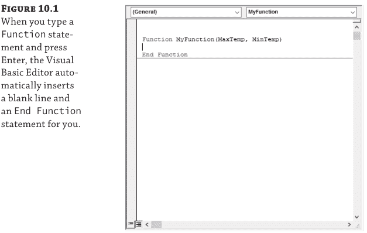

## 使用“添加过程”对话框创建函数

如果你尽可能让 Visual Basic 编辑器为你工作（并且更倾向于这种较慢的方法），你也可以通过“添加过程”对话框来开始创建一个新函数：

1. 选择 **插入 (Insert) > 过程 (Procedure)** 以显示“添加过程”对话框（参见图 10.2）。
2. 在 **名称 (Name)** 文本框中输入过程名称。
3. 在 **类型 (Type)** 组框中选择 **函数 (Function)** 按钮。

### 图 10.2

你也可以使用“添加过程”对话框来指定新函数的元素。

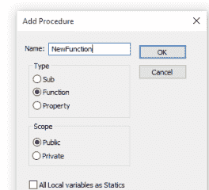

4. 在 **范围 (Scope)** 组中选择 **公共 (Public)** 按钮或 **私有 (Private)** 按钮（取决于情况）。
5. 如果你希望函数中的所有局部变量都是静态类型（你通常不需要），请勾选 **所有变量均为静态 (All Variables As Static)** 复选框。
6. 点击 **确定** 进入函数存根，然后以括号方式为函数输入任何参数。

## 向函数传递参数

传递给函数的参数列在括号中，用逗号隔开。在以下示例中，代码声明它需要一个参数 `MaxTemp` 和一个参数 `MinTemp`。这些数据必须传递（发送）到此函数才能运行：

```
Function GetTemps(MaxTemp As Double, MinTemp As Double)
```

如果你在某处尝试在不传递数据的情况下调用此函数，VBA 将显示错误消息“参数不是可选的 (Argument Not Optional)”。

你还可以通过在参数名后使用 `As` 语句并跟上数据类型来指定参数的类型。例如，你可以使用以下语句将 `MaxTemp` 和 `MinTemp` 参数设置为 `Double` 数值类型：

```
Function GetTemps(MaxTemp As Double, MinTemp As Double)
```

按引用传递参数（默认方式）对于你希望在接收过程中处理变量，并将该变量返回到其源自过程的情况非常有用。或者，按值传递参数对于你希望在接收过程中使用变量中存储的信息，同时确保变量中的原始信息不发生变化的情况（但这种情况很少见；通常没有必要）。

因为按引用是传递参数的默认方式，以下两个语句都是的：

```
Function PassBy(MyArg)
Function PassByReference(Ref MyArg)
```

如你所见，你可以省略默认的 `ByRef` 命令。然而，要传递参数值，你必须使用 `ByVal` 关键字。以下语句按值传递 `ValArg` 参数：

```
Function PassByValue(ByVal ValArg)
```

如有必要，你可以按引用传递过程的某些参数，按值传递其他参数。以下语句按引用传递 `MyArg` 并按值传递 `ValArg` 参数：

```
Function PassBoth(ByRef MyArg, ByVal ValArg)
```

但在实践中，你可能会在大部分、甚至全部编程中使用默认的 `ByRef` 方式。

## 声明参数的数据类型

你可以显式地声明参数的数据类型。这可以节省内存（尽管这通常不是问题），并确保外部（调用）过程向你的函数传递正确类型的信息。为了这一点，指定数据类型始终是一个好主意。你可以避免某些类型的错误，例如当接收函数指定期望数字时，你却尝试传递字符串作为参数。

在传递参数时，你希望确保参数的数据类型与过程中预期的数据类型匹配。例如，如果你声明一个字符串为 `Variant`，VBA 将显示错误消息。

要声明参数的类型，只需在参数列表中使用通常的类型声明。以下语句声明了 `MyStrArg`，通过 `As` 指定必须传递字符串，并通过 `VarArg` 指定了一个变体 (`variant`)：

```
Function PassType(MyStrArg As String, VarArg As Variant)
```

## 指定可选参数

有时，函数并不总是需要某个特定参数。你可以使用 `Optional` 关键字指定某个参数是可选的：

```
Function PassBoth(ByRef MyArg As String, ByVal ValArg As Variant, \
Optional ByVal strName As String)
```

当你传递可选参数时，为其分配一个默认值是一个很好的做法。这样做使代码不易出现错误，并为程序员提供此处使用了什么类型信息的提示。要分配默认值，请在变量后使用等号。例如，以下语句声明了可选参数：


```
Function PassBoth(ByRef MyArg As String, ByVal ValArg As Variant, \
Optional ByVal strName As String = "Sacramento")
```

## 控制函数的范围

像子程序一样，函数可以有私有或公共范围。私有范围使函数对包含它的模块可用，而公共范围使其对项目中的所有模块可用。

如果你不指定函数是私有的还是公共的，VBA 会默认进行设置，因此你不需要指定函数的范围，除非你希望它具有私有范围。然而，如果你对希望公开的函数使用显式声明，你的代码将更易读：

```
Private Function MyFunction(MaxTemp, MinTemp)
Public Function AnotherFunction(Industry, Average)
```

## 适用于任何启用 VBA 应用程序的函数

本章的这部分包含可以在任何应用程序运行的函数示例。这是因为这些函数没有访问任何特定应用程序的对象。在本章的后面，你将看到使用 Office 应用程序特定资源的函数示例。

首先，先声明函数及其参数。以下语句声明了一个名为 `NetProfit` 的函数：

```
Function NetProfit(Gross As Double, Expenses As Double) As Double
```

`NetProfit` 使用两个参数 `Gross` 和 `Expenses`，均声明为 `Double` 类型；它是带有小数点的浮点数。

在语句结束处，我们指定了参数的变量类型以及函数返回给调用者的类型。这避免了代码中的意外惊喜（错误），因为 VBA 会捕获并报告任何向函数传递错误数据或向调用它的代码发送错误类型数据的尝试。

有了参数（如果你按照我建议显式输入了类型），你就可以像执行 VBA 内置函数（如 `MsgBox`）一样执行你的 `NetProfit` 函数。你只需要使用函数名并提供它所需的两个参数，例如：

```
MyProfit = NetProfit(44000, 34000)
```

在这里，变量 `MyProfit` 被赋值为 `NetProfit` 函数的值。换句话说，在函数完成工作并返回调用者（调用函数的程序）之后，返回值被赋值给变量 `MyProfit`。在此示例中，`NetProfit` 函数提供了 44000 的 `Gross` 参数和 34000 的 `Expenses` 参数。

一旦创建了函数，当你在调用过程中输入函数名时，Visual Basic 编辑器会显示其参数列表，如图 10.3 所示。

248 第 10 章 创建你的函数

# 图 10.3

Visual Basic 编辑器会显示你创建的函数以及内置函数的“自动快速信息（Auto Quick Info）”工具提示。

```vba
Sub Caller()
    NetProfit()
End Sub

Function NetProfit(Gross As Double, Expenses As Double) As Double
    ' 此处编写函数逻辑
End Function
```

列表 10.1 包含一个调用函数的示例：`ShowProfit` 过程调用了 `NetProfit` 函数，并在消息框中显示结果。

# 列表 10.1:

1. Sub ShowProfit()

2. MsgBox (NetProfit(44000, 34000)), "Net Profit"

3. End Sub

4. Function NetProfit(Gross As Double, Expenses As Double) As Double

5. NetProfit = (Gross - Expenses) * 0.9

6. End Function

在列表 10.1 中，第 1 到 3 行包含 `ShowProfit` 过程，它简单地在第 2 行调用了 `NetProfit` 函数，传递 44000 作为 `Gross`，传递 34000 作为 `Expenses`，并在标题为 "Net Profit" 的消息框中显示结果。注意在第 2 行中我们使用了一种快捷方法：直接将函数调用作为参数列表。第 2 行的作用与下面这个较长的版本相同：

```vba
Dim result as double
Result = NetProfit(44000, 34000)
MsgBox (Result), "Net Profit"
```

第 5 到 7 行包含 `NetProfit` 函数。第 5 行定义该函数处理两个双精度浮点型（double）参数 `Gross` 和 `Expenses`，告诉 VBA 如何处理第 2 行传递给函数的这两个参数。

第 6 行计算出 `NetProfit` 为 `Gross` 减去 `Expenses` 值的 90% 百（0.9）。

## 函数如何返回信息

注意第 6 行发生的其他情况非常重要：函数计算的信息被赋值给函数名。这就是信息传回给调用该函数的 `ShowProfit` 过程的方式。

为了让这个过程更清晰，让我们用更冗长的方式编写代码。我们将采用这种长写法，不使用将计算和赋值都写在同一行的快捷方式。以下是函数执行操作的方式。

## 适用于任何启用 VBA 应用程序函数的示例 249

主要有三个步骤：计算、赋值和返回。它们在接下来的列表中被标记为第 1、2、3 行。

函数首先进行一些计算——在本例中是计算净利润。然后，它将计算结果赋值给自己的名称（在本例中为 `NetProfit`）。赋值是数据传回给调用者的方式。最后，通过 `End` 命令，它将结果传回调用该函数的任何过程：

```vba
Function NetProfit(Gross As Double, Expenses As Double) As Double
    Dim Result As Double
    Result = (Gross - Expenses) * 0.9 '执行计算
    NetProfit = Result '要返回的信息
End Function '返回信息'
```

## 从函数返回文本数据

列表 10.2 包含一个返回字符串参数结果的函数。

# 列表 10.2: 一个返回字符串的函数

1. Sub TestSmog()

2. Dim intYear As Integer, strThisCar As String

3. BadValueLoop:

4. On Error Goto Bye

5. intYear = InputBox("Enter the year of your car.", "Do I Need a Smog Check?")

6. strThisCar = NeedsSmog(intYear)

7. If strThisCar = "Yes" Then

8. MsgBox("Your car needs a smog check.", vbOKOn + vbExclamation, "Smog Check")

9. ElseIf strThisCar = "BadValue" Then

10. MsgBox("The year you entered is in the future.", vbOKOn + vbCritical, "Smog Check")

11. Goto BadValueLoop

12. Else

13. MsgBox("Your car does not need a smog check.", vbOKOn + vbInformation, "Smog Check")

14. End If

15. Bye:

16. End Sub

17.

18. Function NeedsSmog(CarYear As Integer) As String

19. If CarYear > Year(Now) Then

20. NeedsSmog = "BadValue"

21. ElseIf CarYear <= Year(Now) - 3 Then

22. NeedsSmog = "Yes"

23. Else

24. NeedsSmog = "No"

25. End If

26. End Function

列表 10.2 包含 `TestSmog` 过程（第 1 到 16 行）和 `NeedsSmog` 函数（第 18 到 26 行）。`TestSmog` 过程调用 `NeedsSmog` 函数，该函数返回一个指示用户的汽车是否需要尾检的值。`TestSmog` 使用此值显示一个消息框（见图 10.4），告知用户其汽车是否需要尾检。以下是代码的工作原理：

# 图 10.4

`TestForSmog` 过程提示汽车年份，然后显示消息框显示汽车是否需要尾气测试。


`TestForSmog` 首先声明整型变量 `intYear`，然后显示一个消息框显示汽车是否需要尾气测试。

## 为 Excel 创建函数

```vba
21.    Call Strip_Hyperlinks_Bookmarks_Fields
22.    '此处有其他清理函数
23.    End Sub
```

以下是代码的工作原理：

-   第 1 行包含模块的 `Option Explicit` 语句，强制对所有变量进行显式声明。第 2 行是空行。
-   第 3 行开始名为 `Strip_Hyperlinks_Bookmarks_Fields` 的函数，该函数从活动文档中删除所有超链接、书签和域。函数持续到第 18 行的 `End Function` 语句。
-   第 4 行声明了一个变量 `myLink`，类型为 `Hyperlink`。第 5 行声明了一个名为 `myBookmark` 的变量，类型为 `Bookmark`。第 6 行声明了一个名为 `myField` 的变量，类型为 `Field`。
-   第 7 行开始对 `activeDocument` 对象的 `With` 语句，持续到第 17 行的 `End With` 语句。该 `With` 语句包含三个 `For...Next` 循环。
-   第 8 到 10 行的第一个 `For...Next` 循环遍历当前文档 `Hyperlinks` 集合中的每个 `myLink` 对象。第 9 行使用 `Delete` 方法逐个删除每个链接。删除超链接会从文档中移除链接，但会保留原本显示的的文本。
-   第 11 到 13 行的第二个 `For...Next` 循环处理 `bookmarks` 集合中的每个 `myBookmark` 对象。第 12 行使用 `Delete` 方法逐个删除书签。删除书签会从文档中移除标记，但会保留书签包含的任何文本或对象。
-   第 14 到 16 行的第三个 `For...Next` 循环处理 `Fields` 集合中的每个 `myField` 对象。第 15 行使用 `Unlink` 方法逐个取消域的链接。取消链接会将域的内容作为文本或对象保留，但会留下链接。
-   第 17 行包含结束 `With` 语句的 `End With`，第 18 行包含结束函数的 `End Function` 语句。第 19 行是空行。
-   第 20 到 23 行包含一个短的子过程，简单地调用 `Strip_Hyperlinks_Bookmarks_Fields` 函数。第 22 行包含一条注释，说明该子过程将调用其他清理函数，但尚未编写调用代码代码。这是一个提醒。

## 为 Excel 创建函数

本节向您展示了一个 Excel 的函数。列表 10.4 中的函数检查工作簿是否包含任何空的工作表。

## 列表 10.4：一个 Excel 函数

以下是代码的工作原理：

-   第 1 行包含模块的 `Option` 语句，强制对所有变量进行显式声明。第 2 行是空行。
-   第 3 行开始名为 `BlankSheetsInWorkbook` 的函数，将其声明为布尔型函数。该函数对名为 `WorkbookToTest` 的对象操作，该对象的类型为 `Workbook`——也就是说，它是一个工作簿。
-   第 4 行声明了一个名为 `objWorksheet` 的变量，类型为 `Worksheet`。
-   第 5 行将 `BlankSheetsInWorkbook` 函数的值设置为 `False`。
-   第 6 行开始一个 `For...Next` 循环，为每个 `objWorksheet` 对象运行（`WorkbookToTest` 对象中 `worksheets` 集合中的每个工作表——即传递给函数的每个工作表）。


- 第 7 行使用 `CountBlank` 函数计算循环正在测试的工作表范围内 `A1:IV65536` 区域空单元格数量。如果空单元格数量为 16777216，则该工作表是空的，因为这是单元格的总数。第 8 行将 `BlankSheetsInWorkbook` 函数的值设置为 `True`，第 9 行使用 `Exit` 语句退出函数。你退出函数是因为一旦函数发现至少有一个工作表是空的，就没必要测试更多工作表了。

- 第 10 行结束结束 `For...Next` 循环的 `End If` 语句。第 11 行包含结束 `For...Next` 循环的 `objWorksheet` 语句。第 12 行包含结束函数的 `End Function` 语句。第 13 行是空行。

第 14 行开始一个名为 `Check_Workbook_for_Blank_Worksheets` 的短子过程。

第 15 行在 `ActiveWorkbook` 对象（代表活动工作簿）上运行 `BlankSheetsInWorkbook` 函数。如果 `BlankSheetsInWorkbook` 函数返回 `True`，第 16 行将显示消息提醒用户工作簿包含一个或空工作表。

## 为 PowerPoint 创建函数

本节向您展示了一个 PowerPoint 的函数。列表 10.5 中的函数检查幻灯片上所有的字体是否至少为 14 磅。

## 列表 10.5：一个函数

```
1. Option Explicit
2.
3. Function CheckFontSize(objPresentation As Presentation) As Boolean
4.
5. Dim objSlide As Slide
6. Dim objShape As Shape
7.
8. CheckFontSize = True
9.
10. For Each objSlide In objPresentation.Slides
11. objSlide.Select
12. For Each objShape In Windows(1).Selection.Shapes
13. If objShape.Type = msoPlaceholder Then
14. If objShape.TextFrame.Text.Font.Size < 14 Then
15. CheckFontSize = False
16. Exit Function
17. End If
18. End If
19.
20. Next objShape
21. Next objSlide
22. End Function
23.
24. Sub Font_Check()
25. If CheckFontSize(ActivePresentation) = False Then
26. MsgBox "此演示文中的某些字体太小了。" & vbCr & "请将所有字体改为14磅或更大。", vbCritical, "字体检查"
27. End If
28. End Sub
```

以下是代码的工作原理：

- 第 1 行包含模块的 `Option Explicit` 语句，强制对所有变量进行显式声明。第 2 行是空行。

- 第 3 行声明函数 `CheckFontSize` 为布尔型，并指定它对名为 `objPresentation` 的 `Presentation` 类型对象操作。第 4 行是空行。

- 第 5 行声明了一个名为 `objSlide` 的变量，类型为 `Slide`。第 6 行声明了一个名为 `objShape` 的变量，类型为 `Shape`。

- 第 7 行是空行。

- 第 8 行将 `CheckFontSize` 设置为 `True`。这表示字体大小最小或更大。第 9 行是空行。

- 第 10 行开始一个 `For...Next` 循环，持续到 21 行，处理 `objPresentation` 对象中 `Slides` 集合中的每个 `objSlide` 对象。该循环检查传递给函数的每个幻灯片。

- 第 11 行选择当前的 `objSlide` 对象，第 12 行使用 `Select` 方法。

- 第 13 行开始一个嵌套的 `For...Next` 循环，为第一个窗口 `Selection` 对象中 `ShapeRange` 对象的每个 `objShape` 对象运行。

- 第 14 行使用 `If` 语句检查当前形状的 `Type` 属性是否为 `msoPlaceholder`（指示文本占位符的类型）。第 15 行检查形状 `TextFrame` 对象内 `TextRange` 对象的字体大小是否小于 14 磅。如果是，第 16 行将 `CheckFontSize` 变量赋值为 `False`，第 17 行使用 `Exit` 语句停止函数执行。这是因为已经发现了小于最小允许的字体，没必要继续检查。

- 第 18 行包含结束 `If` 语句的 `End If`，第 19 行包含结束外部 `If` 语句的 `End If`。

- 第 20 行包含 `Next objShape` 语句结束 `For...Next` 循环，第 21 行包含 `Next objSlide` 语句结束外部 `For...Next` 循环。

- 第 22 行包含结束函数的 `End Function` 语句。第 23 行是空行。

- 第 24 到 28 行包含一个名为 `Font_Check` 的子程序，它在 `ActivePresentation` 对象上运行。如果函数返回 `False`，该子过程将显示消息提醒用户问题所在。

# 为 Access 创建函数

你可以像为任何其他启用 VBA 的 Office 2016 一样为 Access 创建函数——只需输入 `Function` 单词并赋予此函数名称即可。

然而，请记住 Access 的历史与其他 Office 程序（这些程序之间彼此更为相似）不同。Access 有特殊的编程方式，其对象模型也有若干个独特之处。你会注意到的第一点是一个名为 `DoCmd` 的通用对象。该对象没有属性，但有很多方法，可以完成诸如启动其他应用程序、定位记录以及打开报告和表单等任务。

在我们创建一个宏来演示如何使用 `DoCmd` 对象之前，有必要设置一个小型数据库以便实验。Access 自带几个模板，因此你需要使用其中一个。请按照以下步骤操作：

1. 运行 Access。

2. 在 Office 2016 中，Word 和 Access 等各种应用程序默认在启动时会显示一组常用模板。

3. 双击“桌面模板”（Desktop Templates）打开该数据库模板。（不要选择“联系人”模板，因为它包含了在线功能，会增加复杂。）

4. 如果你看到安全警告消息（丝带下方的黄色条），点击“启用内容”。

5. 创建文件。如果你看到来自 Microsoft 的观看视频提示，点击右上角的“X”关闭该窗口。

6. 点击左侧的“新建”（New）链接输入一些随机数据，如图 10.5 所示。“联系人详细信息”（Contacts Details）对话框打开（图中未显示）。

7. 每当你添加一个新联系人时，点击“联系人详细信息”对话框中的“保存并新建”（Save And New）。

现在你可以使用 `DoCmd` 根据 ID 选择特定记录。按 `Alt+F11` 打开 Access 中的 Visual Basic 编辑器；然后右键点击函数名称（即加粗部分）。在你的新建模块中，输入以下代码，将光标移动到新记录：

```vba
Function MoveToNew()
    DoCmd.OpenForm "Contact"
    DoCmd.GoToRecord , acNew
End Function
```

为了测试此宏，在 `New` 记录上方的某处切换到编辑器并点击 `MoveToNew` 函数内部。按 `F5`。然后返回 Access，你会看到光标已移动到新记录。

# 图 10.5

输入一些数据——任何数据均可——以便你可以对 `DoCmd` 对象进行实验。


代码工作原理如下：

- 行 3 确保正确的表单已打开。因为你刚刚启动了“联系人”数据库并填充了一些信息，“联系人详细信息”表单已打开并拥有焦点。然而，稍后可能会添加额外的表单。指定要操作的表单、表或对象是一个好主意。换句话说，如果你省略了第 3 行，宏将在 Access 中当前打开的表单上执行。

- 行 4 使用了 `DoCmd` 对象的 `GotoRecord` 方法。`acNew` 常量指定新记录，而不是现有记录。

# 总结

理解 `function` 语句的组件。参数可以通过两种方式从调用代码传递给函数：按引用或按值。

**掌握**描述按引用传递数据和按值传递数据的区别。

**创建通用函数**。你可以编写并保存适用于任何启用 VBA 应用程序的通用函数。

**掌握**创建一个在消息框中显示当前年份的函数。此函数不需要任何参数，也不会返回任何值。

为文字处理任务创建一个函数。函数用于执行计算并将值返回给调用过程。

**掌握**创建一个用于统计字符串中单词数量的函数。

# 第 11 章：在代码中做出决策

## 如何做出决策？

计算机需要根据某些条件做出决策。在编程中，这是通过 `If` 和 `Select` 等条件语句实现的。当程序需要做出决策时，它会评估一个条件。如果条件为真，程序执行一段代码。如果条件为假，可能会执行另一段代码或完全跳过该操作。

VBA 中常见的条件语句是 `If` 语句。`If` 语句有三种用法：

- If-Then

- If-Then...Else

- If-Then...ElseIf

`Select` 语句用于针对单个表达式检查多个条件。它通常比多个嵌套的 `If` 语句更简洁、更易读。

在本章中，你将学习：

- 使用比较运算符

- 比较一个项目与另一个项目

- 使用 If 块

- 使用 Select 块

## 如何在 VBA 中比较内容？

在 VBA 中比较内容时，你使用比较运算符。这些运算符用于测试内容是否为真或假。表 11.1 显示了比较运算符。

| 运算符 | 含义 | 示例 |
|---|---|---|
| = | 等于 | If StringVar="Hello" Then |
| <> | 不等于 | If x <> 5 |
| < | 小于 | If y < 100 |
| > | 大于 | If StringVar="handle" Then |
| <= | 小于等于 | If intCash <= 10 |
| >= | 大于等于 | If Time >= 12:00 PM MsgBox "It's afternoon." Else MsgBox "It's morning." End If |
| Is | 是同一个对象 | If Obj1 Is Obj2 |

11.1 显示的前六个比较运算符是直观的。数值表达式的评估方式正如你预期的那样。字母表达式按字母顺序评估：例如，因为 `ax < "handle"` 会按字母顺序评估 `handle`，所以它被认为“小于 handle”。因此，`"ax < handle"` 的求值为 True。混合表达式（数字和字母）也按字母顺序评估：Office 97 “大于” 2016，而 后者大于 2。

第七个比较运算符 `Is` 使用得越来越少。你使用 `Is` 来比较对象变量，以确定两个对象是否代表同一个对象（而不是对象或区域）。

例如，以下语句声明了两个对象——`objTest1` 和 `objTest2`，并将它们分别分配 `ActiveDocument.Paragraphs(1)`，即 Word 活动文档中第一段的范围。接下来的语句比较这两个对象，由于对象不同（即使内容相同），消息框中将返回 False：

```vba
Dim objTest1 As Object
Dim objTest2 As Object
Set objTest1 = ActiveDocument.Paragraphs(1).Range
Set objTest2 = ActiveDocument.Paragraphs(1).Range
'下一语句返回 False，因为对象是不同的
MsgBox objTest1 Is objTest2
```

然而，如果两个对象变量都指向同一个对象，`Is` 比较将返回 True。

在下面的示例中，`objTest1` 和 `objTest2` 都指向对象变量 `objTest3`：

```vba
Dim objTest1 As Object
Dim objTest2 As Object
Dim objTest3 As Object
Set objTest3 = ActiveDocument.Paragraphs(1).Range
Set objTest1 = objTest3
Set objTest2 = objTest3
'下一语句返回 True，因为
'objTest1 和 objTest2 指向同一个对象
MsgBox objTest1 Is objTest2
```

使用 `Is` 时，请记住比较的不是对象变量的具体内容，而是它们指向哪个对象。

## 使用逻辑运算符进行多条件测试

通常，你需要在执行某个操作之前测试两个或多个条件：如果 X 为 True 且 Y 为 True，则执行此操作；如果 X 为 True 或 Y 为 True，则执行另一个；如果 X 为 True 且 Y 为 True，则寻找其他要做的；以此类推。例如，如果下雨且你有一件外套，就穿上保暖雨衣。

要测试多个条件，请使用 VBA 的逻辑运算符来连接这些条件。

表 11.2 列出了 VBA 支持的逻辑运算符，并带有简短示例和注释。

## 表 11.2：VBA 的逻辑运算符

| 运算符 | 含义 | 示例 | 注释 |
|---|---|---|---|
| And | 逻辑与 | If Workbook.FullName = "c:\temp\Example.xlsm" And Year (Date) >= 2085 | 如果两个条件都为 True，结果为 True。如果其中任一条件为 False，结果为 False。 |
| Not | 否定 | ActivePresentation.Saved = Not ActivePresentation.Saved | Not 反转 x 的值（True 变为 False；False 变为 True）。此处使用的属性是布尔型的。 |
| Or | 逻辑或 | If ActiveWindow.View = wdPageView Or ActiveWindow.View = wdOutlineView Then | 如果第一个条件或第二个条件为 True，或者两个条件都为 True，结果为 True。 |

## 表 11.2：VBA 的逻辑运算符（续）

| 运算符 | 含义 | 示例 | 注释 |
| --- | --- | --- | --- |
| XOr | 异或 | If Salary > 5000 XOr Experienced = True Then | 测试条件的不同结果。如果一个条件为 False 而另一个为 True，则返回 True；如果两个条件都为 True 或均为 False，则返回 False。 |
| Eq | 等价 | If blnVar1 Eq blnMyVar2 Then | 测试两个条件之间的逻辑等价。如果两个值都为 True 或都为 False，Eq 返回 True。如果一个条件在逻辑上与另一个不同（即一个条件为 True 而另一个为 False），Eq 返回 False。 |
| Imp | 蕴含 | If blnVar1 Imp blnMyVar2 Then | 测试逻辑蕴含。如果两个条件都为 True，但条件为 False，或者第二个条件为 True，则为 True。如果两个条件均为 Null 或第二个条件为 Null，则返回 Null。否则，返回 False。 |

在这六个逻辑运算符中，你可能最常用逻辑与 (`And`)、逻辑或 (`Or`) 和否定 (`Not`)，其他三个仅在特殊（换句话说，罕见）的情况下使用。如果此时 `Imp` 运算符对你来说没有意义，你可能不需要使用它。

## VBA 不采用短路求值

在评估多个条件时，需要注意这一点：VBA 不采用短路求值（不像其他编程语言，如 C 和 C++）。

短路求值是一个正式术语，指的是大多数人在日常生活中做决定时每天会使用几次的简单逻辑技术：如果第一个或多个依赖于它的条件为假，你通常不会浪费时间评估任何依赖于它的额外条件。

例如，你那位有魅力的同事说，如果你按时交付产品并升职，他们就会带你去吃午饭。如果你没有按时交付产品，你就错失了机会——即使你真的升职了，你的午餐仍然将是孤独的。评估第二个条件是没有意义的，因为结果需要两个条件都满足，而第一个条件并没有满足。所以，你可以直接短路（跳过）任何进一步的测试。

VBA 并不那样思考。无论是否需要，它都会评估第二个条件（以及任何后续条件）。评估所有条件需要多一点时间（这通常不是问题）。

例如，下面的代码段在选择仅为一个字符时会产生错误。错误发生是因为代码在零长度的字符串上运行了 `Mid` 函数（一个字符的选择减去一个字符），尽管你并不认为在第一个条件不满足时会评估该条件（因为选择的长度并不大于 1）：

```vba
Dim strShort As String
strShort = Selection.Text
If Len(strShort) > 1 And
Mid(strShort, Len(strShort) - 1, 1) = "T" Then
```


# 使用逻辑运算符进行多条件测试

`Set objTest2 = ActiveDocument.Paragraphs(1).Range`

'下一语句返回 False，因为对象是不同的

`MsgBox objTest1 Is objTest2`

然而，如果两个对象变量都指向同一个对象，`Is` 比较将返回 True。

在下面的示例中，`objTest1` 和 `objTest2` 都指向对象变量 `objTest3`：

```
Dim objTest1 As Object
Dim objTest2 As Object
Dim objTest3 As Object
Set objTest3 = ActiveDocument.Paragraphs(1).Range
Set objTest1 = objTest3
Set objTest2 = objTest3
'下一语句返回 True，因为
'objTest1 和 objTest2 指向同一个对象
MsgBox objTest1 Is objTest2
```

使用 `Is` 时，请记住比较的不是对象变量的具体内容，而是它们指向哪个对象。

## 使用逻辑运算符进行多条件测试

通常，你需要在执行某个操作之前测试两个或多个条件：如果 X 为 True 且 Y 为 True，则执行此操作；如果 X 为 True 或 Y 为 True，则执行另一个；如果 X 为 True 且 Y 为 True，则寻找其他要做的；以此类推。例如，如果下雨且你有一件外套，就穿上保暖雨衣。

要测试多个条件，请使用 VBA 的逻辑运算符来连接这些条件。

表 11.2 列出了 VBA 支持的逻辑运算符，并带有简短示例和注释。

## 表 11.2：VBA 的逻辑运算符

| 运算符 | 含义 | 示例 | 注释 |
|---|---|---|---|
| `And` | 逻辑与 | `If Workbook.FullName = "c:\temp\Example.xlsm" And Year(Date) >= 2085` | 如果两个条件都为 True，结果为 True。如果其中任一条件为 False，结果为 False。 |
| `Not` | 否定 | `ActivePresentation.Saved = Not ActivePresentation.Saved` | `Not` 反转 x 的值（True 变为 False；False 变为 True）。此处使用的属性是布尔型的。 |
| `Or` | 逻辑或 | `If ActiveWindow.View = wdPageView Or ActiveWindow.View = wdOutlineView Then` | 如果第一个条件或第二个条件为 True，或者两个条件都为 True，结果为 True。 |

## 表 11.2：VBA 的逻辑运算符（续）

| 运算符 | 含义 | 示例 | 注释 |
|---|---|---|---|
| `XOr` | 异或 | `If Salary > 5000 XOr Experienced = True Then` | 测试条件的不同结果。如果一个条件为 False 而另一个为 True，则返回 True；如果两个条件都为 True 或均为 False，则返回 False。 |
| `Eq` | 等价 | `If blnVar1 Eq blnMyVar2 Then` | 测试两个条件之间的逻辑等价。如果两个值都为 True 或都为 False，`Eq` 返回 True。如果一个条件在逻辑上与另一个不同（即一个条件为 True 而另一个为 False），`Eq` 返回 False。 |
| `Imp` | 蕴含 | `If blnVar1 Imp blnMyVar2 Then` | 测试逻辑蕴含。如果两个条件都为 True，但条件为 False，或者第二个条件为 True，则为 True。如果两个条件均为 Null 或第二个条件为 Null，则返回 Null。否则，返回 False。 |

在这六个逻辑运算符中，你可能最常用逻辑与 (`And`)、逻辑或 (`Or`) 和否定 (`Not`)，其他三个仅在特殊（换句话说，罕见）的情况下使用。如果此时 `Imp` 运算符对你来说没有意义，你可能不需要使用它。

## VBA 不采用短路求值

在评估多个条件时，需要注意这一点：VBA 不采用短路求值（不像其他编程语言，如 C 和 C++）。

短路求值是一个正式术语，指的是大多数人在日常生活中做决定时每天会使用几次的简单逻辑技术：如果第一个或多个依赖于它的条件为假，你通常不会浪费时间评估任何依赖于它的额外条件。

例如，你那位有魅力的同事说，如果你按时交付产品并升职，他们就会带你去吃午饭。如果你没有按时交付产品，你就错失了机会——即使你真的升职了，你的午餐仍然是孤独的。评估第二个条件是没有意义的，因为结果需要两个条件都满足，而第一个条件并没有满足。所以，你可以直接短路（跳过）任何进一步的测试。

VBA 并不那样思考。无论是否需要，它都会评估第二个条件（以及任何后续条件）。评估所有条件需要多一点时间（这通常不是问题）。

例如，下面的代码段在选择仅为一个字符时会产生错误。错误发生是因为代码在零长度的字符串上运行了 `Mid` 函数（一个字符的选择减去一个字符），尽管你并不认为在第一个条件不满足时会评估该条件（因为选择的长度并不大于 1）：

```
Dim strShort As String
strShort = Selection.Text
If Len(strShort) > 1 And
Mid(strShort, Len(strShort) - 1, 1) = "T" Then
```


# 使用逻辑运算符进行多条件测试

`MsgBox objTest1 Is objTest2`

然而，如果两个对象变量都指向同一个对象，`Is` 比较将返回 `True`。

在下面的示例中，`objTest1` 和 `objTest2` 都指向对象变量 `objTest3`：

```
Dim objTest1 As Object
Dim objTest2 As Object
Dim objTest3 As Object
Set objTest3 = ActiveDocument.Paragraphs(1).Range
Set objTest1 = objTest3
Set objTest2 = objTest3
'下一语句返回 True，因为
'objTest1 和 objTest2 指向同一个对象
MsgBox objTest1 Is objTest2
```

使用 `Is` 时，请记住比较的不是对象变量的具体内容，而是它们指向哪个对象。

## 使用逻辑运算符进行多条件测试

通常，你需要在执行某个操作之前测试两个或多个条件：如果 X 为 `True` 且 Y 为 `True`，则执行此操作；如果 X 为 `True` 或 Y 为 `True`，则执行另一个；如果 X 为 `True` 且 Y 为 `True`，则寻找其他要做的；以此类推。例如，如果下雨且你有一件外套，就穿上保暖雨衣。

要测试多个条件，请使用 VBA 的逻辑运算符来连接这些条件。

表 11.2 列出了 VBA 支持的逻辑运算符，并带有简短示例和注释。

## 表 11.2：VBA 的逻辑运算符

| 运算符 | 含义 | 示例 | 注释 |
|---|---|---|---|
| `And` | 逻辑与 | `If Workbook.FullName = "c:\temp\Example.xlsm" And Year(Date) >= 2085` | 如果两个条件都为 `True`，结果为 `True`。如果其中任一条件为 `False`，结果为 `False`。 |
| `Not` | 否定 | `ActivePresentation.Saved = Not ActivePresentation.Saved` | `Not` 反转 x 的值（`True` 变为 `False`；`False` 变为 `True`）。此处使用的属性是布尔型的。 |
| `Or` | 逻辑或 | `If ActiveWindow.View = wdPageView Or ActiveWindow.View = wdOutlineView Then` | 如果第一个条件或第二个条件为 `True`，或者两个条件都为 `True`，结果为 `True`。 |

## 表 11.2：VBA 的逻辑运算符（续）

| 运算符 | 含义 | 示例 | 注释 |
|---|---|---|---|
| `XOr` | 异或 | `If Salary > 5000 XOr Experienced = True Then` | 测试条件的不同结果。如果一个条件为 `False` 而另一个为 `True`，则返回 `True`；如果两个条件都为 `True` 或均为 `False`，则返回 `False`。 |
| `Eq` | 等价 | `If blnVar1 Eq blnMyVar2 Then` | 测试两个条件之间的逻辑等价。如果两个值都为 `True` 或都为 `False`，`Eq` 返回 `True`。如果一个条件在逻辑上与另一个不同（即一个条件为 `True` 而另一个为 `False`），`Eq` 返回 `False`。 |
| `Imp` | 蕴含 | `If blnVar1 Imp blnMyVar2 Then` | 测试逻辑蕴含。如果两个条件都为 `True`，但条件为 `False`，或者第二个条件为 `True`，则为 `True`。如果两个条件均为 `Null` 或第二个条件为 `Null`，则返回 `Null`。否则，返回 `False`。 |

在这六个逻辑运算符中，你可能最常用逻辑与 (`And`)、逻辑或 (`Or`) 和否定 (`Not`)，其他三个仅在特殊（换句话说，罕见）的情况下使用。如果此时 `Imp` 运算符对你来说没有意义，你可能不需要使用它。

## VBA 不采用短路求值

在评估多个条件时，需要注意这一点：VBA 不采用短路求值（不像其他编程语言，如 C 和 C++）。

短路求值是一个正式术语，指的是大多数人在日常生活中做决定时每天会使用几次的简单逻辑技术：如果第一个或多个依赖于它的条件为假，你通常不会浪费时间评估任何依赖于它的额外条件。

例如，你那位有魅力的同事说，如果你按时交付产品并升职，他们就会带你去吃午饭。如果你没有按时交付产品，你就错失了机会——即使你真的升职了，你的午餐仍然是孤独的。评估第二个条件是没有意义的，因为结果需要两个条件都满足，而第一个条件并没有满足。所以，你可以直接短路（跳过）任何进一步的测试。

VBA 并不那样思考。无论是否需要，它都会评估第二个条件（以及任何后续条件）。评估所有条件需要多一点时间（这通常不是问题）。

例如，下面的代码段在选择仅为一个字符时会产生错误。错误发生是因为代码在零长度的字符串上运行了 `Mid` 函数（一个字符的选择减去一个字符），尽管你并不认为在第一个条件不满足时会评估该条件（因为选择的长度并不大于 1）：

```
Dim strShort As String
strShort = Selection.Text
If Len(strShort) > 1 And
Mid(strShort, Len(strShort) - 1, 1) = "T" Then
```

### 示例

在之前的章节中，你已经遇到过 `If` 块的宏——这种 `If...Then` 过程在编程中是如此必要的（更不用说 `If` 本身了），以至于没有它们很难完成任何工作。接下来的章节将为你展示更多示例。

# 单行 If 语句

这是一个单行 `If` 语句的示例：


# 第 11 章：在代码中做出决策

## 单行 If 语句

```vba
Dim bAge As Integer
bAge = InputBox("Enter your age.", "Age")
If bAge < 21 Then MsgBox("You may not purchase alcohol.", "Underage")
```

第一行声明了变量 `bAge`。第二行提示用户在框中输入他们的年龄，并将答案存储在变量中。第三行检查 `bAge` 中持有的值，如果 `bAge` 小于 21，则显示一个名为“未成年”的消息框。

只要你用冒号分隔语句，就可以在单行中包含多个语句。单行 `If` 语句有时可以作为多语句代码行的良好选择。你所做的是指定在当 `If...Then` 语句中的表达式评估为 `True` 时，应该执行多个操作。

例如，假设你想在显示消息框后停止宏。你可以在同一行的冒号后包含 `End` 语句，如下所示：

```vba
If bAge < 21 Then MsgBox("You may not purchase alcohol.", "Underage"): End
```

VBA 的执行方式如下：

1. 首先，它评估条件。
2. 如果满足条件，它会执行 `Then` 之后的第一个语句——在这种情况下，它将继续执行该行上的任何后续语句。注意，单行 `If` 结构中的所有语句都取决于该 `If` 语句（依赖于该 `If` 语句）。它们根据条件的真假来执行（或不执行）。
3. 一旦用户关闭了“未成年”消息框（通过点击 `OK` 按钮，必须点击），VBA 就会执行冒号后的语句：`End`。

如果你愿意，还可以在同一“逻辑”行上添加更多语句，并用冒号分隔。你必须把它放在最后，因为它是结束过程的。（顺便说一下，逻辑行意味着 VBA 将其视为单行待执行代码，无论这些代码在你的显示器上占据了多少行真实的物理行。）

如果你觉得有，还可以添加另一个 `If` 语句：

```vba
If bAge < 21 Then bAge > 18 Then MsgBox "You may vote but you may not drink.", "Underage": End
```

正如你在 Visual Basic 编辑器中查看此行时会看到的，这种方法存在几个问题：

- 首先，你需要使用换行连接符断开长代码行，否则它们会超出编辑器中代码窗口的边缘，迫使你水平滚动以阅读每行的末尾。你可以隐藏除代码窗口以外的所有窗口，为代码设置字体大小，或者购买一个更大的显示器，但你可能仍然无法处理长代码行。因此，在实践中，你不希望将多个语句堆在单行中。简短的 `End` 语句可能是你想要使用的。
- 第二，涉及多个语句的长代码行（无论是断开还是未断开）往往会变得非常难以理解。即使你在输入代码时觉得它很直观，但在几个月后需要调试时，你可能会发现代码很难阅读。通常，使用 `If` 块比复杂的单行 `If` 语句更好。

## If 块

块结构的工作方式与单行 `If` 语句相同，不同之处在于块包含多行——通常每行一个命令——并且它们在末尾需要一个 `End If` 语句。例如，上一节中的单行 `If` 语句也可以构造如下所示的 `If` 块：

```vba
If age < 21 Then
  MsgBox "You may not purchase alcohol.", "Underage"
  End
End If
```

如果第一行（带有 `If` 命令的行）中的条件为 `True`，VBA 将执行 `If` 块内的语句。VBA 显示消息框然后执行该语句。正如从这个示例所示，块比复杂的单行 `If` 语句更容易阅读（因此也更容易调试）。当你需要在嵌套 `If` 语句时，这一点尤为真实，你将经常需要这样做。

为了让 `If` 块更易读，惯例是按 `Tab` 键对块内的行进行缩进（VBA 在执行期间会忽略缩进）。你可以在上一个示例中看到这种缩进。

对于本节所示的短块，缩进没有太大区别。但对于复杂的 `If` 语句，它可能产生清晰明了与不可理喻之间的区别，你将在本章节后半部分的“嵌套 If 块”中看到。

## If...Then...Else 语句

`If...Then...Else` 语句适用于根据条件采取单一行动，但你需要在两种行动之间做出决定。为此，你将使用 `If...Then...Else` 语句。

通过使用 `If...Then...Else` 语句，你可以在条件为 `True` 时采取一种行动，在条件为 `False` 时采取另一种行动。它等同于普通语言，例如：“如果下雨，就带上伞，否则涂防晒霜。”

例如，`If...Then...Else` 语句是处理双按钮消息框的好方法。如果用户点击 `OK` 按钮，代码将执行某些操作。如果他们点击取消，它将执行其他操作。

### 带有明确真/假判断的 If...Then...Else

`If...Then...Else` 语句最适用于二元条件——即只有真或假结果的条件。对于更复杂的条件（例如有三个或更多位置的情况），你需要使用 `If...Then...ElseIf` 或 `Select Case`。

#### 语法

`If...Then...Else` 的语法如下：

```vba
If 条件 Then
    语句1
Else
    语句2
End If
```

如果条件为真，VBA 执行语句1。如果为假，VBA 执行语句2。

#### 示例

作为 `If...Then...Else` 的直接示例，请考虑列表 11.1 所示的 `Electronic_Critic` 过程。

### 列表 11.1：简单的 If...Then...Else

```vba
1. Sub Electronic_Critic()
2.
3. Dim bAge As Integer
4.
5. bAge = InputBox("Enter the number of pages in the last book you read.", "The Electronic Critic")
6. If bAge > 1000 Then
7. MsgBox "That book is seriously long.", vbExclamation, "The Electronic Critic"
8. Else
9. MsgBox "That book is not so long.", vbInformation, "The Electronic Critic"
10. End If
11.
12. End Sub
```

以下是列表 11.1 中的情况：

- 行 1 开始过程，行 12 结束过程。
- 行 3 声明整数 `bAge`。
- 行 5 将输入框的结果（提示用户输入最后读的书页数）赋值给 `bAge`。
- 行 6 检查 `bAge` 是否大于 1000。如果是，则运行第 7 行，显示一个消息框说明该书非常长。
- 如果 `bAge` 不大于 1000，VBA 将跳转到第 8 行的 `Else` 语句并执行其后的语句，该语句告诉用户该书没那么长。
- 行 10 结束 `If` 条件。

## 使用逻辑运算符测试多个条件

如果 `condition1` 中表示的条件为 `True`，则 VBA 将执行 `statements1`（即第一个语句块），然后从 `End If` 之后的一行继续执行。如果 `condition1` 为 `False`，则 VBA 将跳转到第一个 `ElseIf`，并评估 `condition2` 中表示的条件。如果该条件为 `True`，则 VBA 将执行 `statements2`，然后移动到 `End If` 之后的一行；如果它为 `False`，则移动到下一个 `ElseIf`（如果有的话）并按顺序评估其条件（在此处为 `condition3`）。

如果 `ElseIf` 语句中的所有条件测试后均被证明为 `False`，则 VBA 将跳转到 `Else` 语句（如果有的话）并执行其后的语句（在此处为 `statements4`）。`End If` 终止条件语句，并从 `End If` 之后的一行恢复执行。

`Else` 子句是可选的，但在许多情况下，包含它是一个好主意，这样当 `If` 和 `ElseIf` 中指定的任何条件都不被证明为 `True` 时，可以由 VBA 采取不同的行动方案。你无法总是预测程序运行时的条件，因此在你的 `If` 列表末尾有一个 `Else` 是很有帮助的。这就是你如何在无需预先考虑的情况下处理这种情况的方法。

你可以在 `If` 块中拥有任意数量的 `ElseIf` 子句，如果你发现自己需要使用带有大量 `ElseIf` 子句的 `If` 语句（例如超过 5 或 10 个），你可能想要尝试使用 `Select Case` 命令，将在章节末尾介绍它。

### 示例

本节展示了 `If...Then...ElseIf...Else` 语句的两个示例：

- 一个简单的 `If...Then...ElseIf...Else` 语句，根据用户在三按钮消息框中点击的按钮采取行动。
- 一个没有 `Else` 子句的 `If...Then...ElseIf` 语句。

### 简单的 If...Then...ElseIf...Else 语句

简单的 `If...Then...ElseIf...Else` 语句（如列表 11.2 所示）非常适合处理三按钮消息框。

### 列表 11.2：理解 If...Then...ElseIf...Else 结构

```vba
1. Sub Creating_a_Document()
2.
3. Dim lngButton As Long
4. Dim strMessage As String
5.
6. strMessage = "Create a new document based on the " & _
   "VP Report project?" & vbCr & _
   "Click Yes to use the VP Report template." & vbCr & _
   "Click No to use a blank document." & vbCr & _
   "Click Cancel to stop creating a new document."
7.
8. lngButton = MsgBox(strMessage, vbYesNoCancel + vbQuestion, "Create New Document")
9.
10. If lngButton = vbYes Then
11. Documents.Add Template:="z:\public\template\vreport.dotm"
12. ElseIf lngButton = vbNo Then
13. Documents.Add
14. Else 'lngButton = vbCancel
15. End
16. End If
17. End Sub
```

列表 11.2 中的 `Creating_a_Document` 过程显示了一个是/否/取消的消息框，邀请用户根据 VP Report 项目创建一个新文档。用户可以选择 `Yes` 按钮创建此类文档，选择 `No` 按钮创建空白文档，或选择 `Cancel` 按钮退出过程且不创建任何文档。以下是发生的情况：

- 第 1 行开始过程，其后的第 3 行声明了 `Long` 变量 `lngButton`，第 4 行声明了 `String` 变量 `strMessage`。第 5 行是另一个间隔符。
- 第 6 行为字符串变量 `strMessage` 分配一个长字符串，其中包含消息框的所有文本。第 7 行是另一个间隔符。
- 第 8 行显示消息框，使用 `strMessage` 作为提示内容，指定 `vbYesNoCancel` 常数以生成是/否/取消消息框，并应用相应的标题（Create New Document）。它将消息框的结果赋值给 `Long` 变量 `lngButton`。第 9 行是间隔符。
- 第 10 行开始 `If...Then...ElseIf...Else` 语句，将 `lngButton` 的值与 `vbYes` 进行比较。
- 如果第 10 行匹配，则第 11 行使用 `Documents` 对象的 `Add` 方法根据 `vreport.dotm` 模板创建新文档。如果没有匹配，将评估第 12 行中的 `ElseIf` 条件，将 `lngButton` 的值与 `vbNo` 进行比较。如果你运行此过程并在消息框中选择 `Yes` 按钮，则你需要在 `z:\public\template` 中有一个名为 `vreport.dotm` 的模板，以便第 11 行运行。如果你没有该模板，将得到错误。鉴于你可能没有此模板，你可能想将路径和文件名更改为你拥有的。
- 如果发生了第二种情况，第 13 行使用 `Documents` 对象的 `Add` 方法创建一个新的空白文档。如果没有发生，则第 14 行中的 `Else` 语句将被激活，因为用户一定选择了 `Cancel` 按钮。第 15 行结束过程的执行。
- 第 16 行结束 `If` 语句。第 17 行是间隔符。

### 使用 Else 子句作为捕获器

此示例有点不同寻常，因为 `Else` 语句被限制为三个分支，因为消息框可能的响应数量是——是、否和取消。由于 `If` 语句检查 `vbYes` 而 `ElseIf` 语句检查 `vbNo`，`vbCancel` 将触发 `Else` 语句。在其他情况下，`Else` 语句可以作为上述 `If` 和 `ElseIf` 语句未捕获的任何内容的“捕获器”，因此你需要在 `Else` 语句生效之前确保你确实想这样做。因此，请将 `Else` 语句放在块的底部。例如，如果你阅读关于颜色的内容，你必须为红色、白色和蓝色提供 `If` 和 `ElseIf` 语句。如果你忽略了其中一种可能性，而用户输入了白色，你的代码将落入 `Else` 语句，这可能会显示错误的消息，如“输入的不是”。

### 没有 Else 子句的 If...Then...ElseIf 语句

当你不需要在没有任何条件被证明为真时采取行动时，可以使用没有 `Else` 子句的 `If...Then...ElseIf` 语句。在之前的示例中，情况有三个明确定义的结果：用户可以选择 `Yes` 按钮、`No` 按钮或 `Cancel` 按钮，因此我们能够使用 `If` 来测试用户是否选择了 `Yes` 按钮，使用 `ElseIf` 测试用户是否选择了 `No` 按钮，并使用 `Else` 子句来测试是否哪一个都没有被选择（即选择了 `Cancel` 按钮）。作为在没有条件为真时不需要采取行动的情况示例，请考虑 `Check_Password` 过程中的 `If` 语句。该过程确保用户输入了合适的长度。

### 列表 11.3：没有 Else 子句时当条件为真

```vba
1. Sub Check_Password()
2.
3. Dim strPassword As String
4.
5. BadPassword:
6.
7. strPassword = InputBox("Enter the password", "Enter Password")
8.
9. If Len(strPassword) = 0 Then
10. End
11. ElseIf Len(strPassword) < 6 Then
12. MsgBox "The password you chose is too short." & vbCr & "Please choose a password between 6 and 15 characters.", vbCritical, "Unsuitable Password"
13. GoTo BadPassword
14. ElseIf Len(strPassword) > 15 Then
15. MsgBox "The password is too long." & vbCr & vbCr & "Please choose a password between 6 and 15 characters.", vbCritical, "Unsuitable Password"
16. GoTo BadPassword
17. End If
18. End Sub
```

此过程强制用户输入一个密码。以下是发生的情况：

- 第 1 行开始过程，第 18 行结束它。
- 第 2 行是间隔符，第 3 行声明了 `String` 变量 `strPassword`。
- 第 4 行是间隔符。
- 第 5 行包含一个标签 `BadPassword`，如果用户输入的不合适，VBA 将跳转到此处。
- 第 6 行是间隔符。
- 第 7 行显示一个输入框提示用户输入密码，VBA 将其存储在 `strPassword` 中。
- 第 8 行是间隔符。
- 第 9 行检查 `strPassword` 的长度是否为 0，这意味着它是空字符串。这可能是用户点击了输入框中的取消按钮，或者在没有输入任何文本的情况下点击了 `OK` 按钮。这些操作均会导致 VBA 跳转到第 10 行，在那里执行 `End` 语句。
- 如果 `strPassword` 的长度不为 0（即用户在输入框中输入了文本并点击了 `OK` 按钮），第 9 行的 `If` 子句为 `False` 并移动到第 11 行，在那里检查 `strPassword` 的长度是否小于 6 个字符。
- 如果 `strPassword` 的长度小于 6，VBA 执行消息框告诉用户所选密码太短，并指定密码长度在 6 到 15 个字符之间。此消息框仅包含 `OK` 按钮，因此当用户点击继续时，VBA 继续执行到第 13 行，返回 `BadPassword` 标签。从那里开始过程将重复，显示输入框让用户再次尝试。
- 如果 `strPassword` 的长度不大于 15 个字符，执行从第 11 行传递到第 14 行的 `ElseIf` 子句，在那里 VBA 检查 `strPassword` 的长度是否大于 15 个字符。
- 如果 `strPassword` 的长度大于 15，则 VBA 将执行第 15 行和第 16 行的代码：第 15 行显示消息框（再次仅包含 `OK` 按钮）告诉用户密码太长，第 16 行返回 `BadPassword` 标签，再次显示输入框。

在这种情况下不需要 `Else` 语句，因为用户提供了一个没有触发 `If` 或任何 `ElseIf` 子句的密码，执行将移出 `If` 块并继续到 `End If` 之后的一行。

## 使用 If 和 GoTo 创建循环

到本书为止，你已经看到了几个关于 `For...Next` 和 `For Each` 循环的示例。（第 12 章“使用循环重复操作”展示了如何构造这些类型的循环以及其他类型，例如 `Do` 循环）。你也可以用 `If` 和 `GoTo` 语句创建循环，你在上一个示例中已经这样做了。

但许多老师和程序员都反感使用 `If` 和 `GoTo` 的循环。这是一种糟糕的做法，因为 `If`...`GoTo` 循环会创建“意大利面代码”执行路径，这些路径会以杂乱的方式跳转，且难以可视化。此类路径可能非常怪异，且调试起来像是一场噩梦。


然而，简单版本的 If GoTo 循环可以运行得很好，即使你选择不使用这种技术，你至少应该了解循环的工作原理。是否在代码中禁止 GoTo 是个人喜好、公司政策或你老师的信念问题。

无论如何，你可能负责处理他人的代码——而他们对臭名昭著的 GoTo 命令的标准可能没有你那么严谨。所以，让我们简要查看一下如何使用 GoTo。

### 语法

GoTo 语句非常直观且可能很有用——在本书目前为止看到的示例中已经使用了它几次（例如代码列表 7.2 和 9.2）。其语法如下：

```
GoTo line
```

在这里，`line` 参数可以是当前过程中的一个标签行（或者，在如今很少见，是一个行号）。

- 只需将数字放在一行的开头以标识它。例如，考虑这个 GoTo 的演示：

```
Sub Demo_of_GoTo()
  If MsgBox("Go to line 17", vYesNo) = vYesThen
    GoTo 1
  End
```

如果用户选择返回第 1 行，则第二行仅包含行号 1；如果用户选择 Yes 按钮，VBA 执行 GoTo 语句并返回到标签 1，随后会显示消息框。（如果用户选择 No，则退出 If 块。）

然而，使用标签（label）比使用行号更好。标签是给行的命名。标签以字母开头并以冒号结束。在字母和冒号之间，标签可以由任何字符组合组成。例如，在本章前面的部分，你看到过标签 `Bad:`，它用于跳回满足某些条件的早期阶段。也许标签的最精的例子是 `Bye:`，它传统上被放在过程的末尾供 GoTo 使用：

```
GoTo Bye
```

当此标签置于 `End...Sub` 命令上方时，它仅仅是退出宏。GoTo 通常与条件一起使用。如果你在没有条件的情况下使用它返回代码中较早的行，你可能会创建无限循环（此错误在第 12 节中讨论过）。如果你在没有条件的情况下使用 GoTo 语句，它将保证你的过程会停止——此行之后的任何语句都不会被执行。

### 示例

作为带条件的 GoTo 语句的示例，你可能会将 GoTo 语句与让用户想要运行的消息一起使用：

```
Response = MsgBox("Do you want to create report?", "Question", vbYesNo)
If Response = vbNo Then GoTo Bye
```

如果用户选择 No 按钮，第一行显示，VBA 执行 GoTo 语句，跳转到位于子程序末尾的 `Bye:` 标签。避免使用行号作为目标的另一个原因是，你以后可能会在某行之前插入一些代码，这很可能导致错误（因为正确的目标行已经改变了）。

## 嵌套 If 块

你可以根据需要将一个 If 块嵌套另一个块内部，以管理代码中的任何需求。每个 If 块必须是完整的（这意味着嵌套块必须以 If 开头并以它自己的 `End If` 结束）。例如，如果你将一个 If 块嵌套另一个内部（但忘记了 `End If`），VBA 会假设外部 If 的 `End If` 与嵌套 If 配对。这是错误的。

为了让你的 If 块易于阅读，请将它们缩进到不同的层级。这在嵌套块时尤为重要。缩进提供了视觉线索，清楚了哪个 If 与哪个 `End If` 配对。换句话说，缩进让各种块脱颖而出。要查看如何实现，请检查以下嵌套语句：

- If condition1 Then '第一个 If 的开始
- If condition2 Then '第二个 If 的开始
- If condition3 Then '第三个 If 的开始
- statements1
- Else condition4 Then '第三个 If 的 Else
- statements2
- Else '第三个 If 的 Else
- statements3
- End If '第三个 If 的 End If
- If condition5 Then '第四个 If 的开始
- statements4
- End If '第四个 If 的 End If
- End If '第二个 If 的 End If
- Else '第一个 If 的 Else
- statements5
- End If '第一个 If 的 End If

通过遵循这种布局，你可以轻松跟踪执行流。例如，如果第 1 行中的 `condition1` 为 False，VBA 将跳转到第 15 行的 `Else` 并从那里继续执行。如果第 1 行中的 `condition1` 为 True，VBA 将评估第 2 行的嵌套条件 `condition2`，依此类推。

缩进仅是为了视觉清晰。它便于人类理解——VBA 并不在它。之前的 If 语句也带有注释，你可以看到每个 `Else`、`ElseIf` 和 `End If` 都以 `If` 开头。然而，有了缩进，注释是不必要的。

相比之下，查看这些嵌套块的缩进版本。这个版本人类肉眼很难看——当它被埋在代码海洋中时更难看：

- If condition1 Then
- If condition2 Then
- If condition3 Then
- statements1
- Else condition4 Then
- statements2
- Else
- statements3
- End If
- Else
- If condition5 Then
- statements4
- End If
- End If
- Else
- statements5
- End If

嵌套 If 块有一定的一定的压力。通常，你只需要将一个简单的 `If...Then` 语句嵌套在一个 `If...Then...Else` 语句中，或者在一个 `If...Then...ElseIf...` 语句中。列表 11.4 显示了一个使用 Word 的示例。

## 代码列表 11.4: 嵌套 If...Then 块

```
1. Selection.HomeKey Unit=wdStory
2. Selection.Find.ClearFormatting
3. Selection.Find.Style = ActiveDocument.Styles("Heading 5")
4. Selection.Find.Text = ""
5. Selection.Find.Execute
6. If Selection.Find.Found Then
7. lngResponse = MsgBox("Make this into a special note?", "Make Special Note", vbOKCancel)
8. If lngResponse = vbOK Then
9. Selection.Style = "Special Note"
10. End If
11. End If
```

11.4 中的代码在活动文档中搜索“Heading 5”样式，如果找到了该样式，则显示消息框建议通过应用“Special Note”样式将其转换为特殊备注。以下是发生的情况：

- 第 1 行将插入点返回文档开头。
- 第 2 行清除查找命令的格式（以确保它没有搜索不适当的格式）。
- 第 3 行将“Heading 5”设置为查找命令搜索的样式，第 4 行将搜索区域设置为空字符串（""）。
- 第 5 行运行查找操作。
- 第 6 到 11 行包含 If...Then 循环。第 6 行检查第 5 行的查找操作是否找到了段落。如果是，VBA 返回第 7 到第 10 行的代码。
- 第 7 行在用户想要将段落转换为特殊备注时显示消息框。
- 第 8 行开始嵌套 If...Then 语句，并检查用户对消息框的响应。
- 如果用户的响应为 `vbOK`——如果用户选择了 OK 按钮——VBA 执行第 9 行的语句，将“Special Note”样式（我假设它是当前文档或模板中可用的样式之一）应用于该段落。
- 第 10 行包含嵌套 If...Then 块的 `End If` 语句，第 11 行包含外部 If...Then 块的 `End If` 语句。

### 语法

Select Case 的语法如下：

```
Select Case TestExpression
Case Expression1
Statements1
  [Case Expression2
Statements2]
  [Case Else
StatementsElse]
End Select
```

以下是语法的拆解：

- Select Case 开始代码块，End 结束该代码块。
- TestExpression 是决定执行哪个 Case 语句的表达式。
- Expression1、Expression2 等是 VBA 用来匹配 TestExpression 的表达式。

例如，你可能想要测试用户表单中的多个按钮中选择了哪一个。如果它是第一个按钮，TestExpression 将绑定到该按钮上，VBA 将匹配到 Expression1 并运行 Case Expression1 之后行中的语句；如果是第二个按钮，VBA 将匹配到 Expression2 并运行 Case Expression2 之后行中的语句；其余的 Case 块也以此此类推。

Case Else 类似于 If 块中的 Else 子句。Case Else 是一个可选子句（如果包含了它），当给定的表达式中有一个被匹配时将运行。

### 示例

作为 Select Case 块的示例，请考虑列表 11.5，它提示用户输入其打字速度并显示相应的响应。

LISTING 11.5：使用 Select Case 结构

```
1. Sub Check_TypingSpeed()
2.
3. Dim varTypingSpeed As Variant
4. Dim strMsg As String
5.
6. varTypingSpeed = InputBox _
("你每分钟可以打多少字?", "打字速度")
7. Select Case varTypingSpeed
8. Case ""
9. End
10. Case Is < 0, 0, 1 To 50
11. strMsg = "在申请工作前" & _
   "请学会正确打字。",
12. Case 50 To 60
13.     strMsg = "你的打字速度还需要稍微练习。"
14. Case 60 To 75
15.     strMsg = "我们对你的打字速度表示满意。"
16. Case 75 To 90
17.     strMsg = "你的打字速度绰绰有余。"
18. Case 100 To 200
19.     strMsg = "你惊人的速度快把键盘磨坏了。"
20. Case Is > 200
21.     strMsg = "我不怀疑那是真的。"
22. End Select
24. MsgBox strMsg, vbOKOnly, "打字速度"
26. End Sub
```

以下是列表 11.5 中 Check_Typing_Speed 过程中发生了什么：

如果 varTypingSpeed 匹配第 10 行中的某一个比较项，VBA 将第 11 行的文本赋值给字符串变量 strMsg，并从 End Select 语句之后的行继续执行。

- 如果 varTypingSpeed 不在此范围内，VBA 将移动到下一个子句并逐一评估。当 VBA 找到一个 True 子句时，它执行该子句之后的语句（在本例中，将文本字符串赋值给 strMsg 变量），然后从 End Select 语句之后的行继续执行。
- 对于第 8 行（结束过程）之外的任何情况，第 24 行都会显示一个包含语句 strMsg 中文本的消息框。

Select case 是一种根据用户从列表框或组合框控件的选择来指定采取何种操作的好方法（“创建简单的自定义对话框”）。通常，列表框或组合框显示许多不同选项的列表，例如美国所有的州。然后，在用户点击选择列表框或组合框控件内的某项后，选中的项将出现在控件的 Value 属性中。通常情况下，你的宏可以通过 Select Case 块中的测试表达式来检查这一点，并采取相应的操作。

# 顺序很重要

关于复杂测试结构的最后一点：你需要确保你的 Select Case 和 If...Else 语句（或多个 If 结构）按顺序评估它们的测试条件。这意味着要评估的每个条件必须排除它之前的条件。

假设你正在询问用户的年龄，并这样设置用例：这是一个逻辑错误，而且是错误的。第 8 行永远不会执行，因为小于 50 的会触发第 12 行。为了正常工作，这些测试必须反过来：

```
Case < 50
strMsg = "你很接近了。"
```

你可以通过测试范围来完全避免这个问题，如列表 11.5 所示：

```
Case 50 To 60
```

# 总结

- **使用比较运算符。** 比较运算符使用大于或不等于来比较项。
- **精通：** 编写一行使用小于来测试变量是否小于的代码。
- **与另一个项比较。** 你可以使用小于和大于比较运算符来比较 VariableA 和 VariableB？
- **测试多个条件。** 为了测试多个条件，使用 VBA 的逻辑运算符将它们连接在一起。
- **精通：** 说出两个常用的逻辑运算符。
- **使用 If 块。** If 块是最常用的结构之一。为了测试两个条件，使用 If...Else...End。
- **精通：** 编写一个显示消息框的 If...Else...End 代码。如果温度（变量）大于 80，告诉用户它是热的；否则，告诉用户不热。
- **使用 Select 块。** Select Case 结构可以是 If 块的有用替代方案。
- **精通：** 你应该何时使用 Case 结构？

# 第 12 章：使用循环重复操作

在宏中，有时你希望按指定的次数重复某项操作：For...Next 用于指定的次数。但更多情况下，你只需要重复某项操作直到满足条件：Do...Loop 直到条件满足。在这些情况下，你的代码必须继续直到条件满足。

在 VBA 中，你使用循环来重复操作。VBA 提供了代码中使用循环的多种方法。在本章中，你将学习不同类型的循环及其典型用途。

在本章中，你将学习：

- 理解何时使用循环
- 用于固定重复的 For...loops
- 用于变量数量重复的 Do...loops
- 嵌套循环

# 应该何时使用循环？

要在 VBA 中重复某项操作或一系列操作，你可以使用录制将重复本身录制到宏中（如果你使用的应用程序支持录制——只有 Word 和 Excel 支持）。或者你可以复制代码并多次粘贴到宏中以重复行为。例如，你可以录制一个包含从默认模板创建新文档的代码宏，在 Visual Basic 编辑器中打开宏，并将此文档代码粘贴五次以创建文档。

然而，编写循环块（结构）来按需要重复命令要好得多。与重复的代码相比，循环有几个直接的优势：

- 你的过程更短——它们包含的代码少，指令更少，因此更容易理解。
- 你的过程更灵活：与其硬编码重复次数，不如你可以根据需要更改次数（硬编码意味着固定、不变的代码，而不是灵活、变量的代码。固定代码的示例是`创建文档`；而灵活的示例是`创建数量的文档`，从而允许用户或代码提供 x 的值）。
- 你的过程比其他人更容易进行测试、调试和修改。

尽管如此，如果你需要在一个过程中重复一个或两个操作三次，并且该过程总是需要按此次数重复操作，那么通过重复代码来硬编码过程也没有问题。它运行良好，容易实现，你不需要花时间考虑循环的逻辑。代码会长一些，维护起来稍微困难，但在简单情况下这不是问题。

# 理解循环的基础

在 VBA 中，循环是一种代码结构（块），它重复若干语句，在执行完其内部的代码行后返回到结构的开头。循环的每个周期被称为*迭代*。

描述两类基本循环的另一种方式：

- 固定循环重复固定的次数（六次）。
- 无限循环按灵活的次数重复（处理所需的次数）。

每类型循环的执行由*循环不变性*（也称为*循环决定因素*）控制。这可以是数值表达式，也可以是逻辑表达式。固定迭代循环通常使用数值表达式，而无限循环通常使用逻辑表达式。例如，固定迭代循环必须指定循环迭代五次，而无限循环可能会一直持续到文档末尾。表 12.1 解释了 VBA 提供的循环类型。

| 循环 | 类型 | 解释 |
|---|---|---|
| For......Next | 固定 | 按给定的次数重复项操作或一系列操作。 |
| For Each...Next | 固定 | 对 VBA 集合中的每个对象重复一次操作或一系列操作。 |
| Do While...Loop | 无限 | 如果条件为 True 则执行操作或一系列操作，并持续执行直到条件变为 False。 |

## 表 12.1: VBA 循环类型（续）

| 循环 | 类型 | 解释 |
| :--- | :--- | :--- |
| While...Wend | 不确定循环 | 如果条件为 True 则执行某个操作或一系列操作，并持续执行直到条件变为 False。这种类型的循环与 Do...Loop 类似，但现在已过时。 |
| Do Until...Loop | 不确定循环 | 当条件为 False 时执行某个操作或一系列操作，并持续执行直到条件变为 True。 |
| Do...Loop While | 不确定循环 | 执行一次操作或一系列操作，只要条件为 True 就重复执行，直到条件变为 False。 |
| Do...Loop Until | 不确定循环 | 执行操作或一系列操作，只要条件为 False 就重复执行，直到条件变为 True。 |

## 使用 For... 循环进行固定重复

For...Next 执行固定次数的循环。For...Next 按照指定的次数进行循环；For Each...Next 则对指定集合中的每个元素执行循环。

## For...Next 循环

For...Next 以给定的次数重复某个操作或一系列操作。执行次数由计数器变量指定。计数器变量可以硬编码到过程中、从输入框或对话框传递，也可以从由过程的不同部分或不同过程生成的值中传递。

### 语法

For...Next 循环的语法如下：


```vba
For counter = start To end [Stepsize]
[statements]
Exit For
[statements]
Next [counter]
```

以下是 `For...Next` 循环中发生的情况（参见语法部分）：

1. 当 VBA 进入 `For` 语句的循环时，它将 `start` 值赋值给 `counter`。然后执行循环中的语句。当到达 `Next` 语句时，计数器加 1 或增加 `stepsize`（步长），并跳回 `For` 语句。

2. 随后 VBA 检查计数器变量与 `end`（结束值）变量对比。当 `stepsize` 为正数时，如果 `counter` 大于 `end`，VBA 将终止循环并继续执行 `Next` 语句之后的语句（可以是任何操作或该过程的结束）。如果 `counter` 小于或等于 `end`，VBA 重复执行循环中的语句，将计数器增加 1 个步长，并再次跳回 `For` 语句（在 `stepsize` 为负数的 `For` 循环中，只要 `counter` 大于或等于 `end` 循环就会继续，当 `counter` 小于或等于 `end` 时停止。换句话说，当 `stepsize` 为负数时，循环是递减的）。

3. `Exit For` 语句提前退出循环。你将在本章后面的部分学习如何使用 `Exit For`，并探索 `For...Next` 循环的不同用途。表 12.2 解释了 `For...Next` 语法的组件。按照惯例，括号括可选项目，斜体单词是会被程序员替换的代元素。

## 表 12.2: For...Next 循环语法的组件

| 组件 | 描述 |
| :--- | :--- |
| Counter | 产生数字的数值变量或表达式。默认情况下，VBA 在循环的每次迭代中将计数器值增量 1，但你可以使用 `Step` 关键字和 `stepsize` 参数来更改此增量。`For` 语句需要计数器，在 `Next` 语句中是可选的，但在 `Next` 语句中也包含计数器可以让代码更易读。这在你每个过程中嵌套使用多个 `For...Next` 语句时尤为重要。 |
| Start | 给计数器提供起始值的数值变量或数值表达式。 |
| End | 给计数器提供结束值的数值变量或数值表达式。 |
| Stepsize | 指定增加或减少计数器值的数值变量或数值表达式。要使用 `stepsize`，请使用 `Step` 关键字并指定它。`Stepsize` 默认为 1，但你可以使用任何正或负值。 |
| Exit For | 用于退出 `For` 循环的语句。 |
| Next | 表示循环结束的关键字。再次，你可以在这里指定可选的计数器使代码清晰。 |

## 直接 For...Next 循环

在简单的 `For...Next` 循环中，你指定计数器变量、每次迭代的增量 1 以及起始和结束值：

```vba
Dim i As Integer
For i = 1 To 200
```

在这里，`i` 是计数器变量，`1` 是起始值，`200` 是结束值。因为 VBA 在每次迭代中默认将计数器变量增加 1，示例中的计数器变量将计算 1、2、3 等，直到 200。当循环迭代次数使得计数器值为 201 时，循环结束并继续执行下方的语句。你也可以使用 `Step` 关键字指定不同的增量（正或负）。你将在下一节学习更多内容。

## For...Next 循环的传统计数器变量

`i` 是 `For...Next` 循环使用的经典计数变量；在使用 `i` 后，习惯使用 `j`、`k` 和 `n` 作为任何计数器变量（如果你在循环内部添加循环）。这种短名称源于内存匮乏的年代，现在内存充足，使用长变量名很常见。将 `i` 作为循环计数器在 Java 和 C++ 等语言中非常普遍。在前两个语句（`Dim` 和 `For`）之后，你指定要在循环内执行的动作，然后用 `Next` 键结束循环：

```vba
Application.StatusBar = "Please wait while Excel checks for: " & i & "..."
```

这段代码在状态栏显示 Excel 检查表格的进度。另一个例子：假设你需要检查 Word 文中的每个段落以确保没有格式错误。通过使用从 1 到文档总段数的循环，你可以逐个检查每个段落并让用户在状态栏查看进度。文档中的段数存储在 `ActiveDocument` 对象的 `Count` 属性中：

```vba
Dim i As Integer
For i = 1 To ActiveDocument.Paragraphs.Count
    'CheckParagraphForFormatting
    DoEvents

    Application.StatusBar = "Please wait while Word checks the formatting in this document: Paragraph " & i & " out of " & ActiveDocument.Paragraphs.Count
    Selection.MoveDown Unit:=wdParagraph, Count:=1
Next i
```

## 第 12 章：使用循环重复操作

此代码段执行 `CheckParagraphForFormatting` 过程。我们还没有写这个过程，所以我只写了一行注释，表示循环内部需要调用该过程。接下来，我们使用 `DoEvents` 命令改进多任务处理。它会中断循环以查看电脑是否在运行（用户打字、Word 状态栏更新等）。这防止了你的循环占用处理器。

然后循环继续执行。状态栏中显示正在处理总数中的第几段，循环向下移动一段。当 VBA 到达 `Next` 语句时，它将 `i` 增加默认值 1（因为 `For` 语句中没有指定步长），并跳回 `Start`，将 `i` 的值与 `ActiveDocument.Paragraphs.Count` 进行比较。过程持续直到 `i` 达到 `Paragraphs.Count` 值，这是循环的最后迭代。注意这里计数器变量使用了两次来跟踪循环的迭代，但在稍后的循环内部它也被用于显示当前段落编号：

- Paragraph `& i`

以类似的方式，你可以使用 `For...Next` 循环快速构建时间表或在 Excel 中工作。以下语句使用 `For...Next` 循环在工作表的当前列中插入 1:00 到 24:00 的标签：

```vba
Dim i As Integer
For i = 1 To 24
    ActiveCell.Formula1C1 = i & ":00"
    ActiveCell.Offset(RowOffset:=1, ColumnOffset:=0).Select
Next
```

在这里，`ActiveCell.Formula1C1` 插入自动的计数字符串以及冒号和两个零（创建一个时间）。`ActiveCell.Offset(RowOffset:=1, ColumnOffset:=0).Select` 下行相同列的单元格。循环从 `i=1` 运行到 `i=24`，并在 `i` 自动增加到 25 时停止。再次，计数器变量在循环内部使用。

## 带有 Step 的 For...Next 循环

如果通过默认值 1 增加计数器不符合你的需求，可以使用 `Step` 关键字指定不同的增量或减量。

例如，以下语句将计数器变量增加 20，因此序列为 0, 20, 40, 60, 80, 100：

```vba
For i = 0 To 100 Step 20
```

你也可以通过指定负的步长值来递减：

```vba
For i = 1000 To 0 Step -100
```

此语句产生从 1000, 900, 800 直到 0 的序列。

而不是在前一节示例中的“x out of y”（y 中的第 x 个）倒计时，你可以产生一个从 `ActiveDocument.Paragraphs.Count` 运行到零的倒计时：

```vba
Dim i As Integer
For i = ActiveDocument.Paragraphs.Count To 0 Step -1
```

# 使用 FOR..LOOPS 执行固定次数的重复

`CheckParagraphForIllegalFormatting`

`Application.StatusBar = "请等待，Word 正在检查文档中的格式：" & i`

`Selection.MoveUnit :=wdParagraph, Count:=1, Extend:=wdMove`

## 使用输入框驱动 For..Next 循环

有时，你可能会将迭代次数硬编码到 `For..Next` 循环中（仅在某些情况下是如此）。在编写代码时，你已经知道迭代的次数，所以只需要输入结束数字即可，例如：100：

```vb
For i = 0 to 100
```

其他情况下，你无法预先知道需要多少次迭代。信息只有在程序执行（运行时）期间可用，而不是在你编写代码时（称为设计时）。

通常，你会在执行期间从另一个操作中获取一个数字，例如上一个示例中的 `ActiveDocument.Paragraphs.Count` 属性。

你可能希望将来在许多文档中使用此宏。不同文档中的段落数量是不同的；它们是变动的。因此，你在编写代码时无法知道它应该执行多少次。你的宏本身必须在运行时收集这些信息。

通常，你可以要求用户指定重复次数。实现此点的简单方法是使用输入框（input box）请求该值。

例如，列表 12.1 包含一个名为 `CreatePresentations` 的简单过程，它显示一个输入框，提示用户输入想要创建的演示文数量。然后它使用 `For..Next` 循环在 PowerPoint 中创建文档。

### 列表 12.1：让用户指定迭代次数

```vb
1. Sub CreatePresentations()
2. Dim intPresentations As Integer
3. Dim i As Integer
4. intPresentations = InputBox("输入要创建的演示文数量：")
```

以下是列表 12.1 中 `CreatePresentations` 过程发生：

- 第 2 行声明了整数变量 `intPresentations`，第 3 行声明了整数变量 `i`。
- 第 4 行显示一个输入框，提示用户输入想要创建的演示文数量。
- 第 5 到 7 行包含一个 `For..Next` 循环，循环从 `i = 1` 运行到 `i = intPresentations`，每次迭代的默认增量为 1。循环的每次迭代都会执行第 6 行的 `Presentations.Add` 语句，根据默认模板创建一个新的演示文。

## 第 12 章 使用循环重复操作

### 通过对话框的输入控制 For...Next 循环

输入框只返回单个值。有时，你需要从用户那里获取多个值。因此，对于那些输入框不再足够的情况，你可以轻松地从对话框（dialog box）获取输入来驱动 `For...Next` 循环。本书尚未向你展示如何创建对话框，但在本节中，你将通过查看一个名为 `CreateFolders` 的过程来预览。你不需要构建和测试这个示例；只需阅读代码以了解它是如何使用输入并在循环中利用这些信息的。

这个示例减少了创建具有预测名称的多个文件夹的单调工作，例如我曾需要创建 31 个文件夹，为书中的每一章创建一个文件夹。

假设你正在使用一个四位数字来标识项目，用 's' 代表章节（section），用两位数字来标识小节，你将得到像 `1234s01`、`1234s02`、`1234s03` 等文件夹。手动创建这些很简单，但如果你需要超过十几个，就会非常繁琐。

在最简单的形式下，此对话框将提供一个用于要创建文件夹数量的文本框（尽管你也可以使用下拉列表甚至微调按钮控件来实现此），以及一个用于项目编号的文本框。下面的插图是该对话框可能的外观示例。

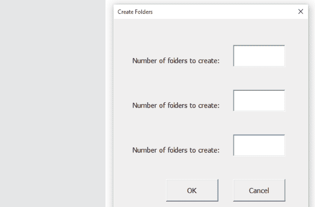

你在另一个宏中使用 `Show` 方法来显示对话框，可能先使用 `Load` 语句，如下：

```vb
Sub makefolders()
    Dialogs(wdDialogFileSaveAs).Show
    Load frmCreateFolders
    frmCreateFolders.Show
End Sub
```

你可能注意到了这段代码中的 `Dialogs` 命令。它非常有用，但我们将在侧边栏的最后讨论它。现在，我们的重点是循环技术。

我将对话框命名为 `frmCreateFolders`。然而，任何有效的 VBA 名称都可以用。第一个文本框——通过“要创建的文件夹数量”标签识别——命名为 `txtFolders`；第二个框命名为 `txtProjectNumber`。

此处的“取消”按钮是一个附加到其 `Click` 事件的 `End` 语句，这样如果用户点击它，VBA 将结束该过程：

```vb
Private Sub cmdCancel_Click()
    End
End Sub
```

对话框中的“确定”按钮在其 `Click` 事件上附加了以下代码：

```vb
1. Private Sub cmdOK_Click()
2.
3. Dim strMsg As String
4. Dim strFolder As String
5. Dim i As Integer
6.
7. frmCreateFolders.Hide
8. Unload frmCreateFolders
9. strMsg = "Create_Folders 过程已创建了 " & "以下订单：" & vbCr & vbCr
10.
11. For i = 1 To txtFolders.Value
12. strFolder = txtProjectNumber.Value & "p" & Format(i, "00")
13. MkDir strFolder
14. strMsg = strMsg & " " & strFolder & vbCr
15. Next i
16.
17. MsgBox strMsg, vbInformation, "Create Folders"
18.
19. End Sub
```

## 第 12 章（续）

让我们休息一下。不要担心记忆 `Format` 的所有变体。记住，有很多像这里这样的示例。在 VBA 编辑器中查找“List Members”以定位。现在回到正题。此过程在当前文件夹中创建一组新文件夹，而没有给用户选择位置的机会。在现实情况中，你可能不想这样做。你可能想更改位置（以便将所有项目文件放在一起），更可能想让用户选择一个合适的位置——例如，通过显示大多数 Windows 应用程序使用的“另存为”对话框。这些内置对话框非常有用，因为每个使用 Windows 的人都熟悉它们，而且它们包含了许多功能。你可以如下所示显示经典的 Windows “另存为”对话框：

```vb
Dialogs(wdDialogFileDialogSaveAs).Show
```

使用 FOR...LOOPS 进行固定重复 293

当用户关闭此对话框时，用户指定的任何文件夹将成为当前文件夹，并且文档将自动保存。你可以在第 14 章“创建简单的自定义对话框”中找到更多关于如何使用对话框的信息，也可以访问此 Microsoft 网页：http://msdn.microsoft.com/en-us/library/bb208857.aspx

我想让大家注意到通用对话框是存在的，因为它们很有用。然而，在这个示例中，允许用户指定新目录路径的更直接方法可能是使用 `ChDir`（更改目录）命令，如下所示：

```vba
Dim strDir As String

strDir = InputBox("输入你想存储新文件夹的完整路径")

ChDir(strDir)
```

## For...Next 循环

`For...Next` 循环（Visual Basic 各版本，包括 VBA，所有）与 `For...Each` 循环相似。它与集合配合。迭代次数基于集合中对象的数量，例如幻灯片中的 `Slides` 集合或 Word 文档的 `Documents` 集合。因此，程序员并不一定预先知道循环的次数，但 VBA 在执行期间会通过查询对象的 `Count` 属性来确定。

例如，假设你想对演示文片中的每个 `Slide` 对象执行某些操作。在编写宏期间，你不需要知道集合中有多少张幻灯片。（如果没有，则什么也不会发生）。

### 语法

`For...Next` 语句的语法非常简单直观：

```vba
For Each Object In Collection
    [statements]
    [Exit For]
    [statements]
Next [object]
```

VBA 首先评估指定集合中对象的数量。它对第一个对象执行循环中的语句。当它遇到 `Next` 关键字时，它会回到 `For Each` 行，重新评估对象的数量，并根据需要进行进一步的迭代。

这里有一个示例：`Documents` 集合包含 Word 中已打开的文档。因此，你可以使用如下的 `For...Next` 循环创建一个简单的过程来关闭所有打开的文档：

```vba
Dim Doc As Document
For Each Doc in Documents
    Doc.Close SaveChanges:=wdSaveChanges
Next
```

VBA 通过 `Close` 方法依次关闭每个打开的文档。该语句使用 `wdSaveChanges` 常量作为 `SaveChanges` 参数，以指定在关闭文档时保存文档中任何未保存的更改。

只要 `Documents` 集合中还有打开的文档，VBA 就会重复循环，从而关闭所有打开的文档并终止过程。

这个示例直观地说明了 `For...Next` 循环是如何工作的，但你在实际工作中可能不想使用这个示例。相反，你可能会直接配合 `Documents` 集合（该集合包含所有打开的文档）使用 `Close` 方法来关闭所有打开的文档。这是一个简单的方法。然而，你可能会在关闭文档之前使用 `For...Next` 循环检查每个文档的特定特征。

## 使用 Exit For 语句

正如你在在本章前面查看 `For` 语句的语法时看到的，如果满足某个条件，你可以在 `For...Loop` 中一个或多个 `Exit For`。`Exit For` 语句是可选的，且很少必要；它们通常被认为是不良的编码习惯而不被鼓励。如果你发现自己在所有的过程中都需要使用 `Exit For`，那么可能是你构建循环的方式可能出了问题。


尽管如此，你有时可能会发现 `Exit For` 语句很有用——例如用于响应循环内部发生的错误，或者用户选择取消过程时。

在那些需要使用 `Exit For` 提前退出循环的情况下，你通常会将它们配合简单的条件使用。例如，在 Word 中，如果你想一直关闭窗口，直到你到达某个已知已打开的文档，你可以使用如下的 `Exit For` 语句：

```vba
Dim Doc As Document
For Each Doc In Documents
    If Doc.Name = "Document1" Then Exit For
    Doc.Close
Next Doc
```

此 `For...Next` 语句检查文档的 `Name` 属性以查看是否为 `Document1`；如果是，`Exit For` 语句将导致 VBA 退出循环。否则，VBA 将关闭文档并返回循环开头。

## 如果你有需要，可以使用多个 Exit For 语句

如果你需要，你也可以使用多个 `Exit For` 语句。例如，你可能需要在循环中执行的操作期间检查两个或多个条件。

## 使用 Do...Loops 进行可变次数的重复

`Do` 循环比 `For` 循环提供了更大的灵活性，因为你可以测试条件并据此引导过程的流向。VBA 包含了几种类型的 `Do` 循环：

- `Do...Loop`
- `Do...Loop While`
- `Do Until...Loop`
- `Do...Loop Until`

这些循环可分为两类：

- 在循环开始时（在执行循环内部的任何语句之前）测试条件的循环。`Do...Loop` 和 `Do Until...Loop` 属于这一类。换句话说，如果测试失败，循环块内的代码即使一次都不会执行。
- 在循环结束时测试条件的循环。这种循环在测试条件之前会执行循环块内的代码。`Do...Loop While` 和 `Do...Loop Until` 属于这一类。这种循环将至少执行一次。

每一类中两种类型循环的区别在于，`While` 循环会重复执行直到条件变为 `False`（条件保持为 `True`），而 `Until` 循环会一直重复执行直到条件变为 `True`（条件保持为 `False`）。例如，你可以使用条件为 `x < 100` 的 `Do...Loop` 或条件为 `x = 100` 的 `Do Until...Loop` 来达到相同的效果。只要你在 100 之前进行循环即可。

## Do...Loop 循环

在 `Do...Loop` 循环中，你指定了一个必须保持为 `True` 才能执行操作条件。如果条件不为 `True`，操作不执行且循环结束。当循环结束时，循环下面的代码将执行。

例如，你可能希望文档中搜索特定的单词或短语，并在找到后采取行动。图 12.1 显示了一个 `Do...Loop`。

### 图 12.1 Do...Loop

`Do While...Loop` 循环在执行循环包含的操作之前会测试条件。

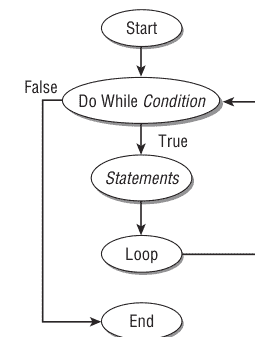

### 语法

`Do While...Loop` 循环的语法非常简单：

```vba
Do While condition
    [statements]
    [Exit Do]
    [statements]
Loop
```

如果你要在条件变为 `False` 之前退出循环，可以使用一个或多个 `Exit Do` 语句。

假设你想从一个很长的 Word 文档创建一个词表，该文档通过斜体突出主要术语。这些术语位于正文中，也位于项目符号或编号列表中。然而，你希望避免获取文档其他元素（如标题或说明）中的斜体术语。在这种情况下，正文使用的是 `Times New Roman` 字体，但说明和标题使用的是字体。

你可以命令搜索具有斜体属性的 `Times` 文本。如果 Word 找到了术语实例，它将采取适当的操作，例如选择包含术语的句子以及后续句子（或段落剩余部分），并复制到另一个文档的末尾。然后它将继续搜索，直到不再找到斜体的 `Times` 文本。

列表 12.2 显示了如何使用 `Do While...Loop` 结构构建此类过程的示例。此列表包含许多你尚未学习的命令，但你应该能够看到这段代码的循环部分是如何工作的。

## 列表 12.2: 理解 Do While 的工作原理

```vba
1. Sub GenerateGlossary()
2.
3. Dim strSource As String
4. Dim strDestination As String
5. Dim strGlossaryName As String
6.
7. strSource = ActiveWindow.Caption
8. strGlossaryName = InputBox(
   ("Enter the name for the glossary document.",
   "Create Glossary")
9. If strGlossaryName = "" Then End
10.
11. Documents.Add
12. ActiveDocument.SaveAs FileName:=strGlossaryName,
   FileFormat=wdFormatDocument
13. strDestination = ActiveWindow.Caption
14. Windows(strSource).Activate
15.
16. Selection.HomeKey Unit:=wdStory
17. Selection.Find.ClearFormatting
18. Selection.Find.Font.Italic = True
19. Selection.Find.Name = "Times New Roman"
20. Selection.Find.Text = ""
21. Selection.Find.Execute
22.
23. Do While Selection.Found
24. Selection.Copy
25. Selection.MoveRight Unit:=wdCharacter,
   Count:=1, Extend:=wdMove
26. Windows(strDestination).Activate
27. Selection.EndKey Unit:=wdStory
28.
29. Selection.Paste
30. Selection.TypeParagraph
31. Windows(strSource).Activate
32. Selection.Find.Execute
33.
34. Loop
35. Windows(strDestination).Activate
36. ActiveDocument.Save
37. ActiveDocument.Close
38. End Sub
```

列表 12.2 中的 `GenerateGlossary` 过程会将当前文档中 `Times New Roman` 字体的斜体项目复制，并将其插入到创建并保存的新文档中。以下是执行过程：

- 第 1 行开始过程。
- 第 3、4 和 5 行分别声明字符串变量 `strSource`、`strDestination` 和 `strGlossaryName`。
- 第 7 行将要激活文档的 `Caption` 属性赋值给变量。该过程在需要处理该文档时使用此变量。
- 第 8 行显示一个输入框，要求用户为文档命名，该文档包含从当前文档中提取的词表条目。用户输入存储在字符串 `strGlossaryName` 中。
- 第 9 行将 `strGlossaryName` 与空字符串 (`""`) 进行比较，确保用户没有点击“取消”按钮取消过程，或者在文本框中输入名称后点击“确定”。如果 `strGlossaryName` 为空字符串，第 9 行将使用 `End` 语句终止过程执行。
- 只要第 9 行没有停止过程，过程就会继续运行。第 11 行创建一个空白文档。（此文档基于 `Normal.dot` 全局模板，因为没有使用模板来指定不同的模板）。此文档将成为词表文档。
- 第 12 行按指定的名称保存文档。
- 第 13 行将此文档的 `Caption` 属性存储在 `strDestination` 变量中，同样便于在整个过程中根据需要激活此文档。现在你已经有了通过 `strSource` 变量识别的源文档和通过 `strDestination` 变量识别的目标文档。
- 第 14 行使用 `Activate` 方法激活 `strSource` 窗口。第 16 行使用 `Selection` 对象的 `HomeKey` 方法配合 `wdStory` 单位将插入点移动到文档开头，过程需要在此开始工作以捕捉所有 `Times New Roman` 的斜体单词。
- 第 17 至 20 行详细说明了过程需要执行的查找操作：第 17 行清除应用到当前项目上的任何格式，第 18 行将字体设置为斜体格式，第 19 行设置查找 `Times New Roman` 文本，第 20 行指定搜索字符串，即为空字符串 (`""`)，以便仅查找指定的格式。
- 第 21 行使用 `Execute` 方法执行查找操作。第 23 至 36 行实现了 `Do While..Loop` 循环。第 23 行表示 `while` 的循环条件：当 `Selection.Found` 为真时（当查找操作能够找到前面行指定的斜体 `Times New Roman` 文本时）。只要满足此条件（真），循环包含的命令就会执行。
- 第 24 行将选择内容（找到的项目）向右移动一个字符，有效地取消选择，并为过程准备搜索文档中的下一个实例。

## 使用 DO..LOOPS 进行任意次数的重复

你需要将插入点从选择内容向右移动，以便下一次查找操作不会找到同一个实例。（如果过程是向上搜索文档而不是向下搜索，则需要使用 `Selection.MoveLeft` 语句将插入点向左移动。）

- 第 26 行激活 `strDestination` 窗口，将 Word 的焦点放在上面。
- 第 27 行将插入点移动到词表文档的末尾，第 28 行在插入位置粘贴复制的项目。移动到文档末尾并非必须，只要 `Normal.dotm` 模板不包含任何文本——如果 `Normal.dotm` 是空的，第 11 行创建的新文档也将是空的，文档的开始和结束将在相同位置。每次粘贴操作后，Word 会会在粘贴之后插入插入点。
- 第 29 行使用 `TypeParagraph`。
- 第 31 行激活 `strSource`。
- 第 32 行 `Selection.Find.Execute`。
- 第 34 行 `Loop`。
- 第 35 行激活 `strDestination`。
- 第 36 行 `ActiveDocument.Save`。
- 第 37 行 `ActiveDocument.Close`。

## DO WHILE 循环

`Do While` 循环与 `Do...Until` 循环相似，但循环至少执行一次。考虑章节开头的示例。在这种情况下，你执行操作，然后检查是否需要重复。例如，你可能对当前项目应用特殊格式，然后检查其他段落是否需要。

如果条件为真，循环继续。图 12.2 显示了一个 `Do While` 循环。


### 语法

`Do While` 循环的语法如下：

```vba
Do
    [语句]
    [Exit Do]
    [语句]
While condition
```

VBA 执行循环的语句，随后 `While` 行评估条件。如果为真，VBA 返回到该行并继续循环；如果为假，则从 `While` 行之后的行继续。

作为 `Do While` 循环的示例，考虑此密码检查，它可以防止某人在未提供正确密码的情况下执行宏：

```vba
Dim varPassword As Variant
VarPassword = "corinth"
Do
    varPassword = InputBox(
        "输入密码以启动过程：",
        "检查密码 1.0")
Loop While varPassword <> "CorrectPassword"
```

相反，你应该构建一个更友好的密码检查程序。你可以指定用户可以输入的错误密码尝试次数（例如三次），如果他们还没有输入正确，则让程序自终止。或者你也可以简单地使用 `End` 语句在用户输入空字符串时终止程序，如下：

```vba
varPassword = InputBox(
  "Enter the password to start the procedure:", "Check Password 1.0")
If varPassword = "" Then End
Loop While varPassword <> "CorrectPassword"
```

# Do Until...Loop 循环

`Do Until...Loop` 循环与 `Do While...Loop` 循环相似。区别在于 `Do Until...Loop` 循环中条件的作用方式：该循环在条件为假（`False`）时运行，在条件为真（`True`）时停止。因此，这与 `Do While...Loop` 循环中条件的作用方式相反。

图 12.3 显示了一个 `Do Until...Loop` 循环。

### 图 12.3

`Do Until...Loop` 循环在条件为 `False` 时运行，在条件变为 `True` 时停止。

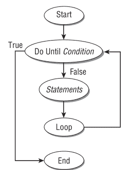

# DO UNTIL...LOOP 块执行直到条件变为 False 为止

注意：如果你倾向于处理一个 `True` 的条件，并使其保持循环直到该条件变为 `False`，那么 `Do Until...Loop` 循环很有用。否则，你可以使用 `Do While...Loop` 循环并反转条件来实现相同的效果。换句话说，这两种循环方法在功能上是相同的；这取决于你想要如何管理条件。这就是“扫门廊直到干净”与“在门廊还脏时扫”之间的区别。它们是同一个想法的不同表达方式。

### 语法

`Do Until—Loop` 循环的语法如下：

```vba
Do Until condition

statements
    [Exit Do]
    [statements]
Loop
```

当 VBA 进入循环时，它会检查条件。如果条件为 `False`，VBA 执行循环中的语句，遇到 `Loop` 关键字，并返回循环开头，在此过程中重新评估条件。如果条件为 `True`，VBA 终止循环并继续执行 `Loop` 行之后的语句。

例如，这里再次给了彩票例子，但现在在列表 12.3 中采用了 `Do—Until` 循环。

# 列表 12.3：使用 Do—Until 循环

```vba
1. Sub Lottery_(1)
2. Dim intwin As Integer
3. Do Until intwin > 2000
4. intwin = Rand * 2100
5. MsgBox intwin, "Lottery"
6. Loop
7. End Sub
```

列表 12.3 的工作原理如下：

- 第 2 行声明了整数变量 `intwin`。第 3 行随后启动一个 `Do Until—Loop` 循环，条件为 `intwin > 2000`——`intwin` 变量的值必须大于 2000 才能结束。在此之前，循环将继续运行。
- 第 4 行将 2100 乘以 `Rand` 函数产生的随机数的结果赋值给 `intwin`，`Rand` 函数生成随机数，以获得一个略大于 .95 的随机数来结束——这种概率略小于 1/20，远好于大多数彩票。
- 第 5 行显示一个包含 `Win` 变量当前值的示例消息框，让你看到自己有多幸运。
- 第 6 行包含 `Loop` 关键字，完成循环。
- 第 7 行结束程序。

列表 12.4 显示了 Word 中更实用的 `Do—Until` 循环示例。

# 使用 DO..LOOPS 进行变次数的重复

列表 12.4：一个在 Word 中使用 `Do Until` 的实际示例

```vba
1. Sub FindNext()
2. Do Until Left(Selection.Paragraphs(1).Style, 7) = "Heading"
3. Selection.MoveDown Unit:=wdParagraph, _nCount:=1, Extend:=wdMove
4. Loop
5. End Sub
```

列表 12.4 包含一个短程序，该程序将插入点移动到 Word 活动文档中的下一个标题。其工作原理如下：

- 第 2 行启动一个 `Do...Loop` 循环，以第 4 行的 `Loop` 关键字结束。循环的条件是当前选择段落样式名称左侧的七个字符——`Left(Selection.Paragraphs(1).Style,7)` 匹配字符串 `"Heading"`。这将匹配任何标题样式（内置的 `Heading 1` 到 `Heading 9`，或用户定义的任何以 `Heading` 开头的样式）。
- 直到满足条件，VBA 执行第 3 行的语句，该语句将选择移动一个段落。

# Do...Loop Until 循环

`Do...Loop Until` 循环与 `Do...Loop` 结构相似，不同在于 `Do...Loop until` 循环中，循环内的语句至少执行一次，无论条件是 `True` 还是 `False`。如果条件为 `False`，循环将继续运行直到条件变为 `True`。图 12.4 显示了一个 `Do...Loop Until` 循环。

### 图 12.4

在 `Do...Loop until` 循环中，循环中的操作在测试条件之前运行一次。


### 语法

`Do Until—Loop` 循环的语法如下：

```vba
Do
    statements
    [Exit Do]
    [statements]
Loop Until condition
```

当 VBA 进入循环时，它会执行循环中的语句，遇到 `Loop` 关键字，并评估条件。如果条件为 `False`，VBA 返回循环开头，在此过程中重新评估条件。如果条件为 `True`，VBA 终止循环并继续执行 `Loop` 行之后的语句。


例如，这里再次给了彩票例子，但现在在列表 12.3 中采用了 Do—Until 循环。

# 列表 12.3：使用 Do—Until loops

```vba
1. Sub Lottery_(1)
2. Dim intwin As Integer
3. Do Until intwin > 2000
4. intwin = Rand * 2100
5. MsgBox intwin, "Lottery"
6. Loop
7. End Sub
```

列表 12.3 的工作原理如下：

- 第 2 行声明了变量 `intwin`。第 3 行随后启动一个 Do Until—Loop 循环，条件为 `intwin > 2000`——`intwin` 变量的值必须大于 2000 才能结束。在此之前，循环将继续运行。

- 第 4 行将 2100 乘以 `Rand` 函数产生的随机数的结果赋值给 `intwin`，`Rand` 函数生成随机数，以获得一个略大于 .95 的随机数来结束——这种概率略小于 1/20，远好于大多数彩票。

- 第 5 行显示一个包含 `Win` 变量当前值的消息框，让你看到自己有多幸运。

- 第 6 行包含 `Loop` 关键字，完成循环。

- 第 7 行结束程序。

列表 12.4 显示了 Word 中更实用的 Do—Until 循环。

# 列表 12.4：在 Word 中使用 Do Until 的实际示例

```vba
1. Sub FindNext()
2. Do Until Left(Selection.Paragraphs(1).Style, 7) = "Heading"
3. Selection.MoveDown Unit:=wdParagraph, _nCount:=1, Extend:=wdMove
4. Loop
5. End Sub
```

列表 12.4 包含一个短程序，将插入点移动到 Word 活动文档中的下一个标题。其工作原理如下：

- 第 2 行启动一个 Do...Loop 循环，以第 4 行的 `Loop` 关键字结束。循环的条件是当前选择段落样式名称左侧的七个字符——`Left(Selection.Paragraphs(1).Style,7)` 匹配字符串 Heading。这将匹配任何标题样式（内置的 Heading 1 到 Heading 9，或用户定义的任何以 Heading 开头的样式）。

- 直到满足条件，VBA 执行第 3 行的语句，该语句将选择移动一个段落。

# Do...Loop Until 循环

Do...Loop Until 循环与 Do...Loop 结构相似，但在 Do...Loop until 循环中，循环内的语句至少执行一次，无论条件是 True 还是 False。如果条件为 False，循环将继续运行直到条件变为 True。图 12.4 显示了一个 Do...Loop Until 循环。

## 图 12.4

在 Do...Loop until 循环中，循环中的操作在测试条件之前运行一次。


### 语法

Do Until—Loop 循环的语法如下：

```vba
Do Until condition

statements
    [Exit Do]
    [statements]
```

当 VBA 进入循环时，它会检查条件。如果条件为 False，VBA 执行循环中的语句，遇到 `Loop` 关键字，并返回循环开头，在此过程中重新评估条件。如果条件为 True，VBA 终止循环并继续执行 `Loop` 行之后的语句。

例如，这里再次给了彩票例子，但现在在列表 12.3 中采用了 Do—Until 循环。

```vba
1. Sub Lottery_(1)
2. Dim intwin As Integer
3. Do Until intwin > 2000
4. intwin = Rand * 2100
5. MsgBox intwin, "Lottery"
6. Loop
7. End Sub
```

注意：Do Until...Loop 循环很有用，如果你倾向于处理一个 True 的条件，并使其保持循环直到该条件变为 False。否则，你可以使用 Do While...Loop 循环并反转条件来实现相同的效果。换句话说，这两种循环方法在功能上是相同的；这取决于你想要如何管理条件。这就是“扫门廊直到干净”与“在门廊还脏时扫”之间的区别。它们是同一个想法的不同表达方式。

# 列表 12.5：Do Loop 直用户空字符串

```vba
1. Sub Create_Worksheets()
2. Dim strNewSheet As String
3. Do
4. strNewSheet = InputBox("Enter the name for the new worksheet", "Add")
5. If strNewSheet <> "" Then
6. ActiveWorkbook.Worksheets.Add
7. ActiveSheet.Name = strNewSheet
8. End If
9. Loop Until strNewSheet = ""
10. End Sub
```

Create_Worksheets 中发生了什么：

- 第 2 行声明变量 `strNewSheet`。

- 第 3 行开始 Do...Loop 循环。

- 第 4 行显示一个输入框，要求用户输入新工作表的名称。

- 第 5 行使用 If 语句确保 `strNewSheet` 不是空字符串。如果，第 6 行添加一个新的工作表，第 7 行将 `strNewSheet` 的值赋值给活动工作表。

- 第 8 行结束 If。

- 第 9 行包含 `Loop Until strNewSheet = ""`，导致程序在用户通过留空输入框输入空字符串之前返回 Do 行。

# 使用 Exit 语句

就像 For...loop 中的 `Exit` 语句一样，你可以使用 `Exit Do` 语句退出 Do 循环，而不执行 Exit 行下方的语句。`Exit Do` 语句是可选的，如果循环设计得当，你可能很少在循环中使用它。

当你使用 `Exit` 语句时，通常会配合它自己的条件使用。12.6 显示的示例通过添加一个在奖金小于 500 时生效的带 Exit Do 的 If 条件使彩票更有趣。

# 列表 12.6：如何使用 Exit Do 命令

```vba
1. Sub Lottery_3()
2. Dim intwin As Integer
3. Do Until intwin > 2000
4. intwin = Rand * 2100
5. If intwin < 500 Then
6. MsgBox "You have been disqualified from the loop."
7. Exit Do
8. End If
9. Loop
10. End Sub
```

列表 12.6 中的程序工作方式与列表 12.3 中的示例相同，只是第 5 行引入了一个新的 If 条件。如果变量 `intwin` 小于 500，则执行第 6 行和第 7 行的语句。第 6 行显示消息框，宣布玩家已被移出循环，第 7 行退出 Do 循环。

# Exit 语句是最佳实践吗？

某些程序员使用 `Exit Do` 语句退出 Do 循环是作为最后的手段，或者至少是拙劣的编程。其他人则持不同意见。许多人认为使用 `Exit Do` 语句报告错误或告知用户点击取消按钮总是可以接受的。VBA 执行 Exit 语句没有问题，所以如果你想用，它就在那里。

例如，你可以重写代码以避免在循环中间编写检查，，以判断此类 And、Or 或非是否内置在循环主条件中，通过使用运算符，如列表 12.7 所示。

# 列表 12.7：避免 Exit Do 命令

```vba
1. Sub Lottery_3()
2.
3. Dim intwin As Integer
4.
5. Do
6. intWin = Rnd * 2100
7. MsgBox intWin, "Lottery"
8. Loop Until intWin > 2000 or intWin < 500
9.
10.
11. If intWin < 500 Then
12. MsgBox "Tough luck. You have been disqualified.", vbOKOnly + vbCritical, "Lottery"
14. End If
15.
16. End Sub
```

列表 12.7 是列表 12.6 示例的修订版。列表 12.7 向你展示了如何使用 `Or` 运算符来指定循环迭代的两个条件。通过这种方式，你可以省略 `Exit Do` 命令。

在列表 12.7 的第 8 行中，我们表示如果变量大于 2000 或小于 500，则循环应该结束。这是这样做可以让循环的作用变得更加清晰。

我们还做了另外两个改更改。首先，我们必须将条件测试从循环顶部移动到底部。列表 12.6 中的 `Do Until` 命令更改为列表 12.7 中的 `Until` 命令。如果我们将条件测试留在循环顶部，那么当循环执行时，该条件将一直存在；当此循环首次执行时，`intWin` 将始终为零。因此，我们将条件测试移动到循环底部，允许变量在第 6 行被赋予某些值。

我们需要做的最后一个更改是将 `If...Then` 块移动到过程的底部。

如果代码像这样简单，你可能最好通过重写它来使用运算符。如果代码复杂且冗长，那么没有理由强迫自己使用运算符，而一个 `Exit` 语句就能解决问题。

## While...Wend 循环

除了 `For...Next` 循环、`For Each...Next` 循环以及本章检查过的各种 `Do` 循环外，VBA 还包含了 `While...Wend` 循环。`While...Wend` 是 VBA 对早期编程语言（例如用于 Word 95 及以前版本的 VisualBasic 编程语言）中 `While` 循环结构的实现。VBA 包含 `While...Wend` 更多是为了与早期版本兼容，而不是作为推荐技术。但如果你愿意，也可以可以使用它。各种 `Do` 循环已经取代了 `While...Wend`，但 `While...Wend` 仍然可以工作。

`While...Wend` 循环的语法如下：

```vba
While condition
[statements]
Wend
```

只要条件为 `True`，VBA就会执行循环中的语句。当遇到 `Wend` 关键字（`While End` 的缩写）时，它会返回 `While` 语句并再次评估条件。当条件评估为 `False` 时，循环中的语句不再执行，并移动到 `Wend` 语句之后的语句。以下语句为 Word 创建了一个简单的 `While...Wend` 循环：

```vba
While Documents.Count < 10
Documents.Add
```

只要 `Documents` 集合中的文档数量（此处指定 `Documents` 集合的 `Count` 属性）小于 10，它就会运行。每次循环，`Documents.Add` 语句都会在 `Normal` 模板上创建一个新文档（因为没有指定其他模板）。创建新文档后，第三行的 `Wend` 语句将执行返回到第一行，在并在再次评估 `Wend` 条件。

## 避免跳转到 WHILE...WEND 循环的中间

如果你使用 `While...Wend` 循环，请确保进入循环的唯一方法是通过 `While` 条件门禁。跳转到 `While...Wend` 循环的中间（例如，使用标签和 `GoTo` 语句）会导致错误。

## 嵌套循环

你可以将一个或多个循环嵌套另一个循环内部，以创建你所需的重复模式：你可以将一个 `For...` 循环嵌套另一个 `For...` 循环中，将一个 `For...` 循环嵌套在一个 `Do` 循环中，将一个 `Do` 循环嵌套在一个 `For...` 循环中，或将一个 `Do` 循环嵌套在一个 `Do` 循环中。

## VBA 允许嵌套 16 层，但谁能理解这种复杂性呢？

你可以在 VBA 中嵌套多嵌套 16 层循环，但在阅读代码时，即使是理解其中一半的深度都会非常困难。如果你发现代码变得如此复杂，请考虑是否可以使用不那么迂折的方法来解决问题。

例如，如果你需要创建许多文件夹，每个文件夹又包含若干个子文件夹，你可以使用在本章早期看过的 `Create_Folders` 过程的变体。但这样的任务需要嵌套。

该过程的对话框需要另一个文本框来包含每个文件夹内要创建的子文件夹数量。新对话框名为 `frmCreateFoldersAndSubFolders`，子文件夹数量的文本框命名为 `txtHowManySubFolders`。图 12.5 显示了对话框。

## 图 12.5

创建文件夹和子文件夹的对话框

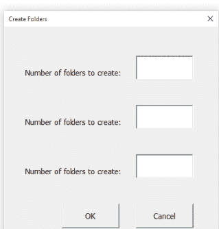

列表 12.8 显示由表单上 `cmdOK` 按钮的点击 事件触发的代码。

# 列表 12.8：使用嵌套循环

```vba
1. Private Sub cmdOK_Click()
2.
3. Dim strFolder As String
4. Dim strFolderName As String
5. Dim strFolderName As String
6. Dim intFolder As Integer
7. Dim intCounter As Integer
8.
9. Show frmCreateFoldersAndSubFolders
10. Unload frmCreateFoldersAndSubFolders
11.
12. strFolder = CurDir
13.
14. For intCounter = 1 To txtFolders.Value
15. strFolderName = "Section" & Format(intCounter, "##")
16. Mkdir strFolderName
17. Chdir strFolderName
18. For intFolder = 1 To txtSubfolders.Value
19. strFolderName = "Subsection" & intFolder
20. Mkdir strFolderName
21. Next intFolder
22. Chdir strFolder
23. Next intCounter
24.
25. End Sub
```

列表 12.8 中的代码的作用如下：

* 第1 行开始过程，第25 行结束过程。

* 第3 行到第5 行分别声明了字符串变量：`strFolder`、`strFolderName` 和 `strFolderName`。

* 第6 行声明了整型 `intFolder`，第7 行声明了整型 `intCounter`。

* 第9 行显示表单，第10 行卸载它。

* 第12 行将当前目录存储在字符串变量 `strFolder` 中。

* 第14 行到第16 行进入外部循环。该循环由计数器 `intCounter` 控制，从 `intCounter = 1` 到 `txtFolders.Value` 运行（这是用户在文件夹文本框中输入的值）。

* 第17 行切换目录。

* 第18 行进入侧边循环。该循环由循环计数器 `intFolder` 控制，从 `intFolder = 1` 到 `txtSubfolders.Value` 运行（这是在“创建子文件夹数量”文本框中输入的值）。

* 第19 行由 "Subsection" 和 `intFolder` 构建字符串变量 `strFolderName`。

* 第20 行使用 `Mkdir` 语句创建子文件夹。

* 第21 行使用 `Next intFolder` 语句返回到侧边循环的开头。

* 第22 行切换回 `strFolder`。

* 第23 行随后返回到外部循环的开头。

## 在嵌套 For...Loops 循环时使用计数器变量

在 `Next` 命令中使用变量是可选的（在列表 12.8 中，变量名为 `intCounter` 和 `intSubFolder`）。你可以仅使用 `Next` 本身以及 VBA。在嵌套 `For...` 循环时，包含计数器变量是一个好主意，以便于哪个循环通过 `Next` 命令结束（用文字来说，例如使用 `Next intCounter`，而不是简写为 `Next`）。使用计数器变量会让你的过程更易读，并可能防止意外惊喜（错误）。你的嵌套循环必须按照它们开始的完全相反顺序结束，且计数器需要匹配。

# 避免死循环

如果你在过程中创建了一个无限（又称无尽）的循环，它会愉快地一直运行，除非用户知道如何按下 Ctrl+Break、按下 Ctrl+Alt+Del 打开任务管理器关闭冻死的应用程序、重启电脑，或者拔掉插头。机器不会冒烟，但用户可能会气炸。

例如，你还没有遇到过的一种循环类型是 `Do...Loop` 循环。你可以从列表 12.9 的示例中看到，在没有附加任何条件的情况下，这种结构是一个死循环。没有任何条件可以停止这个循环。

# 列表 12.9：无尽循环的示例

```vba
1. Sub InfiniteLoop()
2. Dim x
3. x = 1
4. Do
5. Application.StatusBar = "Your computer is stuck in an endless loop: " & x
6. x = x + 1
7. Loop
8. End Sub
```

在列表 12.9 中，第 2 行声明了变量 x，第 3 行为其赋值值 1。第 4 行开始了 `Do` 循环，该循环会显示状态栏消息并将 x 的值增加 1。此循环的效果是在状态栏上显示一条消息和一个不断增加的数字，直到你按下 Ctrl+Break 停止该过程，或者该值溢出其最大值。这完全是没意义的（除非作为对新电脑进行老化测试的方法），这也许是不使用 `Do...Loop` 结构的一个好理由——至少在没有给其中一个循环附加条件的情况下。


无论你使用哪种类型的循环，为了避免创建死循环，你都需要确保循环在某个点可以被满足。例如，对于一个编辑或清理过程，你会希望执行操作直到到达文档末尾并停止。或者，你希望包含某种形式的计数机制，使 `Do` 循环不会超过特定的迭代次数。

## 总结

何时使用循环。当你需要执行重复性任务时（例如在文档中搜索特定单词），循环会非常有用。

**精通它**：如果你在宏中执行重复性任务，循环的替代方案是什么？

使用 **For...loops 用于执行固定次数的重复。** `For...loops` 循环是编程中最常见的循环结构。你指定循环必须执行的迭代次数，当达到该数字时循环就会退出。

- **精通它**：编写一个 `For...Next` 循环，计数到 100，但使用 `Step` 命令每次递增 2。

使用 **Do...loops 用于执行变量次数的重复。** `Do...loop` 循环不断迭代，直到某个条件存在，然后在该条件不再存在时退出循环。

- **精通它**：`Do...loops` 分两类。`Do While...Loop` 循环和 `Do Until...Loop` 循环在执行任何操作之前会测试条件。另一类是什么？

**将一个循环嵌套在另一个循环内部。** 你可以把循环放在其他循环的内部。

- **精通它**：思考一个嵌套循环会有用处的编程任务。

**避免死循环。** 死循环会导致你的宏无限期继续执行——就好像宏已经停止响应并处于“冻结”状态一样。

- **精通它**：你如何能够避免创建死循环？

## 使用消息框、输入框和对话框

- 第 13 章：使用消息框和输入框获取用户输入
- 第 14 章：创建简单的自定义对话框
- 第 15 章：创建复杂的表单

## 第 13 章 使用消息框和输入框获取用户输入

本章将向你展示如何开始为录制或编写的代码添加用户界面，以增强宏或应用程序的力量和功能。

你将学习与宏用户通信的三种最简单的方法、让用户向你的代码提供信息的两种简单方法，以及向用户索取输入的最简单方法。你将看到如何在任何特定情况下决定与用户通信的最佳方式。这将为在书中后部分研究与自定义对话框进行更复杂的交互奠定基础。

在 Office 应用程序中，VBA 为你提供了多达五种与宏用户通信的方法：

- 在窗口底部状态栏上显示消息（如果应用程序使用了状态栏）。这有点局限性，但可能是有效的。而且它没有侵入性——如果用户愿意，可以轻松地忽略状态栏。
- 显示消息框（通常在屏幕中间）。消息框有助于向用户提供某些信息，并让他们能够根据你提供的信息做出单次选择。你将在本章的大部分时间花在处理消息框上。
- 显示输入框（再次，通常显示在屏幕中间）。你可以使用带有消息框的输入框来向用户传递信息。输入框的主要目的是从用户那里索取一项信息。输入框还为用户提供了做出单次选择以引导宏流向的方法，尽管呈现这种选择的机制比消息框要局限得多。你将在本章末尾查看输入框。
- 显示对话框（再次，通常在屏幕中间）。你可以同时使用对话框向用户显示信息，并让他们做出各种选择并传回给你的代码。对话框最适合复杂的交互，你将在书的后部分看到。

## 在本章中，你将学习：

- 在状态栏上显示消息
- 显示消息框
- 显示输入框

## 打开一个宏

首先，你需要确保：

1. 启动宏
2. 打开宏
3. 使用宏

## 使用对话框定位宏

当你在上文中提到状态栏时，你可能已经尝试过这样做。你查看了所有的选项卡，特别注意了“视图”选项卡。然后点击了“选项”对话框。你没有在任何地方找到隐藏状态栏的方法。这也许是学习 VBA 的另一个好理由。正如我提到的，你可以通过 VBA 实现其他方法无法实现的功能。这里是隐藏状态栏的代码：

```vba
Sub HideStatusBar()
    Application.StatusBar = False
End Sub
```

## 在 Word 和 Excel 中显示状态栏消息

Word 和 Excel 允许你在状态栏上显示信息。这通常是一种在不停止执行的情况下告知用户正在发生什么的方便方法。通过在宏运行时显示状态，你可以指示程序仍在运行。如果你的宏执行时间很长，状态栏的更新会让用户看到宏仍在运行。查看第 12 章“使用循环重复操作”中标题为“传统的计数变量名”的侧边栏查看如何更新状态栏。

但请记住，在状态栏上显示消息的主要缺点是，如果用户不注意、隐藏了状态栏，或者他们没有预期在这里看到消息，他们可能会错过这些。因此，如果你正在显示关键信息，你必须使用消息框或其他类型，例如输入框。

## 如何避免惊扰用户

你会遇到的一个问题是用户认为宏已经冻结、崩溃、进入了死循环或失效，因为屏幕上没有变化，而实际上你的宏正在后台正常运行。如果你使用状态栏，就可以避免这个问题。

## 如何隐藏状态栏

当你在上文中提到状态栏时，你可能已经尝试过这样做。你查看了所有的选项卡，特别注意了“视图”选项卡。然后点击了“选项”对话框。你没有在任何地方找到隐藏状态栏的方法。这也许是学习 VBA 的另一个好理由。正如我提到的，你可以通过 VBA 实现其他方法无法实现的功能。这里是隐藏状态栏的代码：

```vba
Sub HideStatusBar()
    Application.StatusBar = False
End Sub
```

## 第 13 节 使用消息框和输入框获取用户输入

如果有任何疑问，你可以通知用户该信息将显示在状态栏上。例如，你可以在宏的开始处显示一个消息框，告诉用户关注状态栏的更新。

要在 Excel 状态栏上显示消息，你将 `Application` 对象的 `StatusBar` 属性设置为适当的文本字符串。下面的示例显示了图 13.1 所示的状态栏信息：

```vba
Application.StatusBar = "Excel is busy formatting. Please wait_"
```

图 13.1 在应用程序中，你可以在状态栏上显示信息。


通常，你显示在状态栏上的任何信息都会一直显示，直到你更改它、用户更改了某些内容，或者应用程序本身在那里显示消息。例如，你可能会在 Excel 状态栏上显示消息；Excel 在状态栏上显示其复制消息“选择详细，然后按回 或复制‘粘贴’”，从而覆盖掉你之前的消息。应用程序消息会触发用户创建的消息。

如果你在宏执行期间在状态栏上显示消息，你应该在宏结束完成后对其进行更新，以避免在宏结束后在状态栏上留下一个过时且可能具有误导性的消息。例如，你可能会显示另一个消息说明状态栏已完成，或者通过显示一个空字符串来清空状态栏。

要清空状态栏，请给它赋值一个空字符串，如下所示：

```vba
Application.StatusBar = ""
```

为了查看此效果，不要让 Visual Basic 编辑器（VBE）窗口最大化（点击右上角以确保在执行时可以看到 Excel 窗口（或其状态栏））。如果你先运行一个在状态栏上显示信息的语句（例如 `Application.StatusBar = "Hello, World!"`），效果会最好，这样状态栏在完成显示后会被 `Application.StatusBar = ""` 语句清空：

```vba
Application.StatusBar = "Hello, World!"
Application.StatusBar = ""
```

## 进度指示可以用多种方式编写

在漫长的处理过程中，在状态栏上显示进度指示是有帮助的，用户借此可以程序仍在运行并正在进展。进度指示器通常在循环块内编写代码。例如，你可能会显示进度的读取，如“Excel 正在处理 150 个工作表中的第 9 个”。更简单的方法，在状态栏末尾增加句号的数量可以作为进度指示，尽管它并没有告诉任务还需要多长时间。以下是你可以向字符串中添加句号的方法：

```vba
strPeriod = strPeriod & "."
```

## 消息框

向用户显示信息的另一种方法是消息框。你可能在你使用的几乎每个 Windows 应用程序中都见过它的示例。消息框简单且有限，但它们起着重要的作用。

以下是消息框的一些典型用途：

- 告诉用户宏即将做什么（如果这不是他们的预想，则给他们一个退出宏的机会）。
- 向用户提供有关宏下一步将做什么的解释，并要求他们做出简单的决定（通常是让它继续执行或将其转向不同的路径）。
- 警告用户宏遇到的错误，并允许他们采取行动。
- 告知用户宏运行成功并已完成。此消息对于关闭了更新或其他其他方式让用户不确定是否仍在运行或已完成的宏特别有用。你还可以使用消息框报告宏做了什么——对于更改的特定项目、进行了一定数量的更改或发现了问题。

## 消息框语法

消息框的基本语法如下：

```vba
MsgBox(prompt[, buttons][, title][, helpfile][, context])
```

以下是语法元素的含义：

- **MsgBox**: VBA 用于显示消息框的函数。
- **Prompt**: 必需参数，指定显示的文本。它必须是字符串，长度最多 255 个字符。
- **Buttons**: 可选参数，控制按钮类型。例如，你可以显示 OK、取消、是/否。
- **Title**: 可选参数，控制标题栏中显示的文本。
- **Helpfile**: 可选参数，当用户按下 F1 时指定的帮助文件。
- **Context**: 可选参数，控制在消息框中显示的图标。

## 显示消息框

与其直接为 prompt 输入字面量，不如使用变量。下面的示例使用了字符串变量：

```vba
Dim strMsg As String
strMsg = "This is a message box."
MsgBox strMsg
```

这种方法在处理长字符串时非常有用（你可以通过拼接短字符串来构建大字符串）。当你需要显示之前定义或动态创建的字符串时，使用变量也有效。

## 显示多行消息框

默认情况下，VBA 在消息框中将短消息字符串显示为单行，并将长字符串换行到一个或多行，上限为 1024 个字符。你可以通过在字符串中包含换行和回车字符故意将字符串分成多行，如下：

- `Chr(13)` 或 `vbCr` 表示回车。
- `Chr(10)` 或 `vbLf` 表示换行。
- `Chr(13) + Chr(10)` 或 `vbCrLf` 表示换行/回车组合。

在消息框中，这三个字符的效果相同——向下移动。如果你使用内置的 `vbCr`、`vbLf` 或 `vbCrLf` 而不是相应的 `Chr()` 构造，你的代码更易读。

下面的代码显示了图 13.4 所示的消息框。注意字符串的每个部分都包含在双引号中，以告诉 VBA 这些是字符串的一部分。`Chr(149)` 字符是项目符号，因此它们后的文本以几个空格开头，以便给项目留空间：

```vba
Dim strMsg As String
strMsg = "Word has finished formatting the report you requested." & _
         vbCr & Chr(149) & "  Please check the formatting." & _
         vbCr & Chr(149) & "  Save the file." & _
         vbCr & vbCr & "你现在可以运行以下过程：" & vbCr & _
         vbCr & Chr(149) & "  Distribute_Report 将通过电子邮件发送报告到“总部。”" & vbCr & _
         Chr(149) & "  Store_Report 将报告复制到存储目录。" & vbCr & _
         Chr(149) & "  Backup_Report 将在文件服务器上创建报告的备份。"
MsgBox strMsg
```

图 13.4 你可以通过在提示字符串中使用换行符和回车符来显示多行消息框。


## VBA 自动为代码添加标点


你会发现，在这个示例中，每个连接符（`&`）和等号（`=`）的两侧都会出现一个空格。你可以手动输入这些空格，也可以当你按下 `Enter` 键或点击鼠标将插入点移动到另一行时，让 VBA 为你输入。（将插入点移动到另一行会导致 VBA 检查你刚刚操作的行，并根据需要进行各种自动更改。例如，某些字符可能会变为大写，或者如果你输入了 `EndIf`，VBA 会将其修正为正确的格式。）

# 为消息框选择按钮

`buttons` 参数控制消息框中包含哪些按钮。VBA 提供了表 13.1 所示的消息框类型，并由 `buttons` 参数进行控制。

## 表 13.1：消息框类型，由 buttons 参数控制

| 值 | 常量 | 按钮 |
|---|---|---|
| 0 | `vbOKOnly` | OK |
| 1 | `vbOKCancel` | OK, 取消 |
| 2 | `vbAbortRetryIgnore` | 中止, 重试, 忽略 |
| 3 | `vbYesNoCancel` | 是, 否, 取消 |
| 4 | `vbYesNo` | 是, 否 |
| 5 | `vbRetryCancel` | 重试, 取消 |

你可以在代码中使用数值值或常量来指定这些消息框类型。例如，你可以指定 `1` 或 `vbOKCancel` 来生成一个带有“确定”和“取消”按钮的消息框。数值易于输入，而常量更易阅读。在 PowerPoint 中运行以下任一语句，都会生成图 13.5 所示的消息框：

```vb
Dim lngR As Long
lngR = MsgBox("对幻灯片应用标准格式？", vbYesNo)
lngR = MsgBox("对幻灯片应用标准格式？", 4)
```

图 13.5

`vbYesNo` 常量生成一个带有“是”和“否”按钮的消息框。


从 VBA 的角度来看，在宏的消息框中使用数值还是常量并不重要。但对于人类来说，文本常量要优越得多。即使只有你一个人能看到你的代码，使用常量也会让代码更易读。

# 为消息框选择图标

你还可以通过包含适当的值或常量参数为消息框添加图标。表 13.2 显示了这些选项。

## 表 13.2：消息框图标参数

| 值 | 常量 | 显示内容 |
|---|---|---|
| 16 | `vbCritical` | 停止图标 |
| 32 | `vbQuestion` | 问号图标 |
| 48 | `vbExclamation` | 感叹号图标 |
| 64 | `vbInformation` | 信息图标 |

同样，你可以使用值或常量来引用这些图标。`48` 或 `vbExclamation` 将产生一个感叹号图标。同样，常量更易读。

要将消息框的值与图标的值或常量关联，请使用加号。例如，要生成一个带有“是”和“否”按钮且带有问号图标的消息框（见图 13.6），你可以输入 `vbYesNo + vbQuestion`（或 `4 + 32`、`vbYesNo + 32`、`+ vbQuestion`）：

```vb
lngR = MsgBox("对幻灯片应用标准格式", 
vbYesNo + vbQuestion)
```

图 13.6

添加图标可以使消息框更具视觉冲击力。


# 为消息框设置默认按钮

与 Windows 界面通常一样，用户会被提示消息框中的默认按钮。它是外框有蓝色边框且文本区域周围有虚线的那个按钮（见图 13.6 中的按钮）。用户可以使用 `Tab` 或 `Shift+Tab` 或 $\leftarrow$、$\rightarrow$ 或 $\downarrow$ 键将选择移动到另一个按钮。

你可以在代码中指定你想让哪个按钮成为默认按钮。

## 现实场景：默认按钮的实际用途

在 Windows 界面中通常情况下，用户会被提示消息框中的默认按钮。它是外框有蓝色边框且文本区域周围有虚线的那个按钮（见图 13.6 中的按钮）。用户可以使用 `Tab` 或 `Shift+Tab` 或 $\leftarrow$、$\rightarrow$ 或 $\downarrow$ 键将选择移动到另一个按钮。你可以在代码中指定你想让哪个按钮成为默认按钮。

# 第 13 章 使用消息框和输入框获取用户输入

## 消息框 27

在实践中，即使你使用了 `vbSystemModal` 参数，用户也可以切换到另一个应用程序（前提是有程序正在运行）并继续工作。然而，消息框会保持在“最顶层”并显示——这足以让用户感到困扰，但不会完全阻止他们访问另一个应用程序。

默认情况下，消息框是应用程序模态的（application modal），因此你只需要在需要系统模态消息框的少数情况下指定它。当你向按钮添加 `vbSystemModal` 常量或值 4096 时：

```vb
Response = MsgBox("Do you want to delete this document?", vbYesNo + vbCritical + vbDefaultButton2 + vbSystemModal)
```

请注意，系统模态消息框的外观与应用程序消息框相同。

## 为消息框指定标题

### 标题栏可以提供有用信息

标题栏通常是用户注意到消息框的第一部分，因此请让你的标题栏尽可能有用。惯例做法是在消息框的标题栏中放置宏名称，并使用提示（prompt）参数来解释消息框中的按钮将触发什么操作。

此外，如果你想修改宏，可能会发现并在标题中包含版本号很有帮助，这样用户就可以轻松检查他们正在使用哪个版本的宏（并根据需要更新到更当前的版本）。例如，图 13.8 所示的消息框中，“删除工作簿”宏被标识为版本 12.39。

图 13.8

通常你可能需要为消息框指定标题参数。你可能还想包含一个版本号。


如下在按钮参数之后指定标题参数：

```vb
Dim lngQuery As Long
lngQuery = MsgBox("Do you want to delete this workbook?", vbYesNo + vbCritical + vbDefaultButton2, "Delete Workbook 12.39")
```

你可以使用字符串变量作为标题参数。例如，你可以声明一个字符串变量，并用它为宏调用的每个消息框提供标题。或者，你可能需要在消息框标题中显示在宏中创建或存储的字符串。

### 避免在标题中使用特殊字符

不要尝试在标题参数中使用换行符、回车符或 Tab 字符。VBA 会忽略它们。

## 为消息框添加帮助按钮

要向消息框添加帮助按钮，请使用 `vMsgBoxHelpButton` 常量。这会将此参数并添加到你为消息框指定的按钮中：

```vb
LngQuery = MsgBox("Do you want to delete this workbook", vbYesNo + \
+ vbCritical + vbDefaultButton + vMsgBoxHelpButton, \
+ "Delete Workbook")
```

添加 `vMsgBoxHelpButton` 参数只是在消息框中放置帮助按钮——它不会让帮助按钮在用户点击时显示帮助文件。你必须指定哪个帮助文件以及你想显示什么（详情请见下一节）。图 13.9 显示了该语句产生的消息框。

图 13.9

使用 `vMsgBoxHelpButton` 常量为消息框添加帮助按钮。


## 为消息框指定帮助文件

你可以为消息框使用的最后参数是 `helpfile` 和 `context` 参数：

- `helpfile` 参数是一个字符串，指定了用户从消息框调用帮助时 VBA 显示的帮助文件的名称和位置。
- `context` 参数是帮助文件内的帮助上下文编号。帮助上下文编号控制显示哪一个帮助文件。

`helpfile` 和 `context` 参数主要在你编写自己的帮助文件时有用，因为否则很难访问帮助上下文编号，因为这些数字被埋在官方的帮助文件中。

如果你正在编写自己的帮助文件，则指定 `helpfile` 和 `context` 参数的语法非常简单：

```vb
Dim LngQuery As Long
Query = MsgBox("Do you want to delete this workbook?", vbYesNo + \
+ vbCritical + vbDefaultButton2, \
"Delete Workbook", "c:\Windows\Help\My_Help.chm", 1012)
```

在这种情况下，帮助文件被指定为 `\Windows\Help\` 文件夹下的 `My_Help.chm`。VBA 显示编号为 1012 的帮助主题。

当用户点击消息框中的帮助按钮时，VBA 会在帮助文件中显示指定的主题。当用户查阅帮助文件后，消息框仍留在屏幕上，用户可以在消息框中做出选择。

帮助文件打开屏幕的帮助上下文为 0。当你需要显示一个不知道帮助编号的帮助文件时，使用 0。用户必须自行使用他们的信息。

## 用于特殊效果的三个非常规常量

VBA 为消息框提供了三个特殊常量。你可能不需要经常使用这些常量，但如果需要，它们将大有用处。将它们作为参数中的第一个参数指定：

- `vbMsgBoxSetForeground` 告诉 VBA 将消息框变为前台窗口。你可能不需要经常使用它，因为消息框通常就在前台。
- `vbMsgBoxRight` 告诉 VBA 在消息框中右对齐。
- `vbMsgBoxReading` 告诉 VBA 从右到左排列文本（适用于希伯来和阿拉伯语系统）。

## 使用某些参数

记住，可选参数是可选的。所以，当你显示消息框时，可以指定或省略可选参数。例如，如果你想在之前的示例中省略某些参数，请使用逗号：

```vb
Response = MsgBox("Do you want to format the report?", \
"c:\Windows\Help\My_Help.chm", 1012)
```

在这里，逗号表示省略了按钮和标题参数（这会导致 VBA 显示带有应用程序名称的 vb 消息框）。

## 从消息框获取值

如果你显示 vb 消息框，知道用户点击了哪个按钮，因为消息框只有一个 OK 按钮。但当你使用其他样式时，可能会有两个、三个或四个按钮，你的代码如何知道点击了哪一个？为了做到这一点，你必须从消息框获取一个值。

要从消息框获取值，为它声明一个变量（正如我们在本章中一直做的那样）。你只需通过让变量名等于消息框（比喻说法）来实现，如下所示：

```vb
Dim LongResponse As Long
Response = MsgBox("Do you want to create the daily report?", vbYesNo + question, "Create Daily Report")
```

你首先声明一个相应类型的（Long 类型变量）来包含用户的选择，如代码所示，VBA 将用户点击的按钮作为一个值存储在变量中。

运行时，你就可以检查该值并采取相应的行动。

表 13.5 显示了用户可以选择的所有按钮完整列表。你可以通过常量名称或数值来引用这些按钮。通常情况下，常量比数值更易读。

### 表 13.5: 选中按钮的常量

| VALUE | CONSTANT | BUTTON SELECTED |
|---|---|---|
| 1 | `vbOK` | OK |
| 2 | `vbCancel` | Cancel |
| 3 | `vbAbort` | Abort |
| 4 | `vbRetry` | Retry |
| 5 | `vbIgnore` | Ignore |
| 6 | `vbYes` | Yes |
| 7 | `vbNo` | No |

例如，为了检查一个 `vbYesNo` 消息框以查看用户选择了哪个按钮，你可以使用一个简单的 `If...Then...Else` 语句：

```vb
Dim lngUserChoice As Long
lngUserChoice = MsgBox("Do you want to create the daily report?", _
	vbYesNo + vbQuestion, "Create Daily Report")
If lngUserChoice = vbYes Then
	Goto CreateDailyReport
Else
	EndIf
```

如果用户选择了“是”（Yes）按钮，VBA 将跳转到由 `CreateDailyReport` 标记的代码行并从那里继续运行宏；否则，它通过跳转到末尾的 `Bye` 标记来终止宏。该条件检查用户在消息框中选择生成的响应，以判断其是否为 `vbYes`（通过点击“是”按钮或按下选中的“是”按钮生成）。`Else` 语句运行在响应不是 `vbYes`——即用户点击了“否”（No）按钮或按了 Esc 键。

# 输入框

消息框告诉 VBA 用户点击了哪个按钮。有时你希望用户为你的宏提供一些文本，例如他们的姓名或生日。

当你想要从用户那里获取一个简单的文本信息时，请使用输入框。如果你不熟悉它的名字，一定对它的外观很熟悉：它们通常类似于图 13.10 所示的示例。

图 13.10

使用输入框从用户那里获取单个信息。


## 为复杂交互创建自定义框

为了从用户那里获取两个或多个信息，你可以连续使用两个或多个输入框，但创建一个自定义对话框通常对用户来说更容易。你将在第 14 章中开始构建自定义对话框。

## 输入框语法

显示输入框的语法非常简单，与消息框的语法类似：


# InputBox 函数语法

```vba
InputBox(prompt[, title] [, default], [xpos], [ypos], [helpfile, context])
```

## 参数说明

- **Prompt**（提示）：必需的字符串，用于指定输入框中显示的提示内容。与 `MsgBox` 一样，提示最长可达 1024 个字符，可使用换行符常量 `vbCr` 强制换行。如果提示内容超过 35 个字符，`InputBox` 会自动换行。

- **Title**（标题）：字符串，用于指定输入框标题栏中的文本。如果省略，VBA 将使用应用程序名称。

- **Default**（默认值）：字符串，用于指定文本框中显示的初始文本。当用户可直接按回车键接受默认值，或需显示示例文本引导用户时，建议使用该参数。

  示例：从 `ActiveDocument` 的 `BuiltDocumentProperties` 集合获取 `Name` 值作为默认文本：

  ```vba
  Dim strAuthor As String
  strAuthor = ActiveDocument.BuiltDocumentProperties(wdPropertyLastAuthor)
  ```

- **xpos and ypos**：可选值，指定输入框在屏幕上的位置（单位为 `twips`）。`xpos` 控制左边缘相对于屏幕左边缘的水平位置，`ypos` 控制顶部相对于屏幕顶部的垂直位置。若省略，VBA 将输入框显示在默认位置（屏幕横向中间、向下三分之一处）。

- **helpfile and context**（帮助文件和上下文）：可选参数，用于指定帮助文件及上下文 ID。若使用 `helpfile`，则必须同时使用 `context`。

## 输入框通常显示在屏幕中心

一个 twip 等于 1/1440 英寸。平均屏幕约 96 dpi，即每像素对应 15 twips。分辨率 1024 × 768 的屏幕对应 15,360 × 11,520 twips。如需精确定位，可在不同分辨率下调整 twips 值；通常使用默认居中位置最为有效。


可省略输入框的任意可选参数，但若后续参数仍需使用，必须用逗号占位。输入框预定义“确定”“取消”按钮（若提供帮助参数则含“帮助”按钮），无需像消息框那样指定按钮参数。

示例：声明字符串 `strWhichOffice` 并赋值：

```vba
Dim strWhichOffice As String
strWhichOffice = InputBox("Which office do you use?", "Office Selection")
```


## 从输入框检索输入

输入框返回用户输入的字符串。若用户点击“取消”或关闭对话框，返回空字符串（`""`）。

```vba
Dim strWhichOffice As String
strWhichOffice = InputBox("Which office do you use?", "Office Selection")

If strWhichOffice = "" Then
    ' 处理取消
End If
```

## 表单：当消息框不足时

消息框虽能增强宏交互，但存在局限：

- 显示信息有限，排版受限（无段落、制表等）。
- 仅提供一组按钮，限制用户反馈信息量。

对于复杂交互，创建自定义对话框（用户表单）更佳。详见第 14 章“创建简单对话框”和第 15 章“创建表单”。自定义对话框创建相对简单，且功能更强大、灵活。

避免使用一系列消息框或多个输入框收集多项信息（如地址、电话），应改用单一自定义对话框。

## 总结

- **在状态栏显示消息**：状态栏是非侵入式的有效通信方式，常用于显示页码、缩放比、视图模式、字数等，亦可自定义显示信息。
  - *练习*：在 VBA 编辑器中编写程序，在状态栏显示当前日期和时间。

- **显示消息框**：消息框用于告知或警告用户，默认居中显示，为模态窗口（用户关闭前无法操作主应用）。
  - *练习*：编写程序，用消息框显示当前日期和时间。

- **使用输入框获取用户姓名**：编写子程序要求用户输入姓名，用 `InStr` 函数检查是否包含空格。若无空格，提示用户同时提供姓和名。

- **理解消息框和输入框的局限性**：两者通常仅返回单一响应（按钮点击或单段文本），难以一次性获取多条数据（如地址和电话），多次弹窗体验不佳。

- **精通它**：除了可检索信息量受限外，消息框和输入框的另外两个主要限制是什么？

---

# 第 14 章 创建简单的自定义对话框

本章介绍 VBA 创建自定义对话框（用户表单）的工具。术语“对话框”通常指小型窗口（如消息框、输入框），“表单”指交互更丰富的大型窗口，但两者常通用。对话框和表单是 VBA 中最强大、功能最丰富的元素，是用户与过程通信的主要途径。

本章涵盖表单常用控件；下一章将讲解更复杂的表单（如带标签页、动态更新的表单）。

## 学习目标

- 理解自定义对话框的用途
- 创建自定义对话框
- 向对话框添加控件
- 将对话框链接到过程
- 从对话框获取用户选择

## 何时使用自定义对话框

当简单交互方式（消息框、输入框）无法满足需求时：

- 消息框按钮不足以获取所需信息
- 输入框单文本字段不足以收集多项数据（姓名、地址、电话等）
- 需复杂输入：复选框（非斥选项）、选项按钮（互斥选择）、列表框、图片显示等

自定义对话框可包含 Windows 应用程序全范围界面元素，可模仿内置对话框（如“保存”对话框），或构建更复杂的窗口。

典型场景：宏启动时显示选项表单，用户选择决定后续操作；或由 VBA 事件触发（定时、特定操作）。

创建对话框不难，但复杂表单耗时。因非最快编程任务，建议先考虑替代方案（消息框、输入框）。

## 设计对话框

可直接在编辑器中拖放控件“草绘”界面，再调整位置和属性；或采用有条理方法：明确意图、列出所需元素、绘制草图规划控件布局。

## 尝试基于现有对话框设计

参考应用程序内置对话框（常用对话框）或组织现有自定义对话框，可避免重复造轮子，且创建出用户熟悉、直观的界面。

## 插入用户表单

1. 按 `Alt+F11` 打开 Visual Basic 编辑器（VBE）。
2. 在“项目管理器”中右键点击目标项目，选择“插入” > “用户表单”。

> **替代方法**：点击编辑器工具栏最左侧的“插入用户表单”按钮。

VBE 打开名为 `UserForm1` 的新用户表单（若已有则按数字递增），并显示“工具箱”（若隐藏可通过“视图” > “工具箱”或标准工具栏最右侧按钮显示）。

VBA 自动将用户表单加入项目的 `Forms` 集合（若无则创建），在项目管理器中可见 `Forms` 对象。


## 选择用户表单网格设置

VBE 在用户表单显示网格，辅助控件放置与对齐。可通过“工具” > “选项” > “常规”调整：

- **显示网格**：取消勾选可隐藏网格点（网格仍生效）。
- **控件对齐网格**：取消勾选可禁用自动对齐。默认网格大小 6，若过粗可改为 3 或 4。
- **宽度/高度**：修改网格尺寸。


## VBA 命名规范

控件命名规则：最多 40 字符，首字母为字母，后可含字母、数字、下划线，无空格符号，上下文唯一。使用三字母小写前缀标识类型，对象名首字母大写，便于阅读。

示例代码：

```vba
Private Sub SelectEmployee_Change()
    lblEmployee = "Enter text in"
    frame2.Enabled = True
    lblInstructions = "Step 2."
    cmdClearName.Enabled = True
End Sub
```

常用前缀对照表：

| 控件类型 | 前缀 | 示例 |
| :--- | :--- | :--- |
| 复选框 | `chk` | `chkReturnToPosition` |
| 命令按钮 | `cmd` | `cmdSpecial` |
| 表单 | `frm` | `frmMove` |
| 框架 | `fra` | `fraMovement` |
| 列表框 | `lst` | `lstAttendees` |
| 组合框 | `cbo` | `cboColor` |
| 菜单 | `mnu` | `mnuProcedures` |
| 选项按钮 | `opt` | `optSpecial` |
| 标签 | `lbl` | `lblUserName` |
| 文本框 | `txt` | `txtDescription` |

遵循规范利于团队协作、代码分发及调试。

## 重命名用户表单

1. 按 `F4` 显示“属性”窗口（默认“字母排序”视图，建议保持）。
2. 确保下拉列表显示当前用户表单（如 `UserForm1`）。
3. 双击 `Name` 属性值，输入新名称。
   - 必须以字母开头
   - 仅含字母、数字、下划线，无空格符号


* 长度最多可达 40 个字符。

4. 点击 `Caption`（标题）单元格以选择用户表单的默认名称，并输入你想在对话框标题栏中看到的用户表单标题——即框框的文本标签。此名称除了受标题栏长度限制外，没有其他限制。你可以输入比标题栏显示长度更长的名称，但 VBA 会用省略号（ellipsis）将其截断为最大可显示长度。当你输入时，名称也会出现在用户表单的标题栏中，你可以很容易看到合适的长度——至少对于当前用户表单的大小来说是。

5. 按回车键或点击属性窗口中的其他位置（Visual Basic 编辑器的其他位置）以设置（正式生效）用户表单名称。（为控件分配名称与为表单分配名称相同。）

## 处理“名称与现有模块冲突”错误

如果你遇到“名称与现有模块、项目或对象库冲突”（如图所示），很可能是你刚刚尝试给用户表单命名一个已经分配给其他内容的相同名称。


你正尝试重用 VBA 项目或对象库的名称。

## 向用户表单添加控件

现在你已经重命名了用户表单，可以从图 14.4 所示的工具箱（`Toolbox`）向其添加控件。当用户表单激活时，VBA 会自动显示工具箱，但你也可以通过选择 `视图` > `Toolbox` 在表单激活时显示工具箱。

> ### 移除 VBA 2013 中的“RoamingOffice”控件
>
> 显然这是微软的一个疏忽，他们在 VBA 2013 工具箱中包含了一个晦涩的——而且在 VBA 的 MSDN 帮助系统中基本上被忽略的控件：`RoamingOffice` 控件（不在图 14.4 中）。它超出了本书的范围（在 VBA 2016 工具箱中），更不用说超出 VBA 帮助系统甚至 Google 的范围了。也许微软打算在未来让它有用。它显然不属于工具箱上的默认控件。它是 `Image` 控件旁边的一个微小的灰色阴影线方块图标。如果你愿意，右键点击其阴影线图标，然后从右键菜单中选择 `Delete RoamingOffice` 来从 2013 工具箱中删除 `RoamingOffice` 控件。

# 第 14 章 创建简单的自定义对话框

## 图 14.4

使用工具箱向用户表单添加控件。

- `ListBox`（列表框）
- `ComboBox`（组合框）
- `TextBox`（文本框）
- `Label`（标签）
- `Select Objects`（选择对象）
- `Checkbox`（复选框）
- `OptionButton`（单选按钮）
- `ToggleButton`（切换按钮）
- `CommandButton`（命令按钮）
- `Frame`（框架）
- `TabStrip`（选项卡）
- `MultiPage`（多页控件）
- `ScrollBar`（滚动条）
- `SpinButton`（数字按钮）
- `Image`（图像）


以下是工具箱上的按钮：

**`Select Objects`**（选择对象）这个第一个箭头符号符号有一个非常特殊的用途，你可能永远不需要使用它。首先，它不是一个普通的控件（它不会出现在表单上）；你无法拖到它上面。它的作用是将鼠标指针恢复到选择模式。通常，在你将控件拖放到它上之后，鼠标指针会自动返回到选择模式。通常，只有当你选择了另一个控件并改变主意决定不使用它时，你才需要点击 `Select Objects` 按钮，以便将指针恢复到正常状态。或者，如果双击控件（例如复选框），你会触发一种技术，允许你快速地重复添加多个相同控件的版本。（每当你点击表单时，就会为其添加一个新框——例如，当编辑器处于此状态时）。要停止这种重复行为，请点击 `Select Objects` 按钮。

**`Label`**（标签）创建一个标签，这是一种用于识别对话框的一部分或解释用户为了有效使用对话框而需要的信息的文本。

**`TextBox`**（文本框）创建一个文本框（有时称为编辑框），这是一个用户可以在其中输入文本的字段。你也可以使用文本框来显示文本，或者提供提供供用户复制并粘贴到其他地方的文本。文本框可以包含单行（默认）或包含多行。

**`ComboBox`**（组合框）创建一个结合文本框和列表的组合框。用户可以从列表中选择值。

**`ListBox`**（列表框）创建一个列出多个值的列表框。用户可以从列表中选取一个值。

**`CheckBox`**（复选框）创建一个复选框和一个随附标签。用户可以开启或关闭关联的操作。

**`OptionButton`**（单选按钮）创建一个选项按钮（也称为*单选按钮*）和一个随附标签。用户在一组中只能选择一个按钮。

**`ToggleButton`**（切换按钮）创建一个显示项目是否被选中的切换按钮。切换按钮可以使用两个设置进行定义。

**`Frame`**（框架）创建一个由细线包围并带有随标签的框架。你可以使用框架（也称为*分组框*）对表单中的相关元素分组。

**`CommandButton`**（命令按钮）创建一个命令按钮。这是用户点击以传达意愿的典型 Windows 按钮。

**`TabStrip`**（选项卡）创建一个选项卡，用于在同一组控件中显示多组数据。选项卡对于演示数据库中的记录特别有用。

**`MultiPage`**（多页控件）创建一个多页控件，用于显示在每个选项卡上具有不同布局的多页对话框。

**`ScrollBar`**（滚动条）创建一个独立的滚动条。

**`SpinButton`**（数字按钮）创建一个与另一个控件（如文本框）配合使用的数字按钮控件。

**`Image`**（图像）创建一个图像控件，用于在某种排序中显示图片。

# 在 Visual Basic 编辑器工具箱中添加控件

图 14-4 所示的工具箱包含了 VBA 提供的基础工具集。正如第 2 章“Visual Basic 编辑器入门”中的“自定义工具箱”节所讨论的那样，你可以通过多种方式自定义工具箱：通过向其添加控件、为控件创建额外的页面、在页面之间移动控件，以及创建你自己的自定义控件，这样你就可以避免在每次添加控件时都反复调整属性。

点击工具箱中的任一个控件进行选择。然后在用户表单上点击将控件插入表单中，如图 14.5 所示。VBA 将控件的左上角放置在你点击的位置。当你放置控件时，它会自动对齐到用户表单的网格上（除非你在本章前面的“选择用户-网格设置”中关闭了“控件对齐网格”功能）。

## 图 14.5

当你点击用户表单时，VBA 会放置你选择的类型的标准控件。如果开启了“控件对齐网格”功能（默认开启），VBA 会将控件与用户表单上的网格对齐。


你可以通过选中控件然后点击并拖动周围出现的任一个选择句柄（白色方块）来调整控件大小，如图 14.6 所示。当你将鼠标指针正确放置在可以拖动的位置时，指针会变为双向箭头图标。当你拖动角句柄时，VBA 会同时调整控件该角两侧的大小。当你拖动控件某侧边边的中点时，VBA 会在该维度上调整控件的大小。无论哪种情况，VBA 都会显示一个虚线轮廓，表示释放鼠标按键后将的大小。

要调整用户表单本身的大小，点击其标题栏，或点击表单中的任何空白区域（控件之外区域）。这将选中用户表单。然后点击并拖动出现在表单周围的任一个选择句柄。

要删除控件，在用户表单上右键点击它并从右键菜单中选择“删除”。或者，点击选中并按 `Delete` 键，或选择“编辑 > 删除”。按 `Ctrl+Z` 可以恢复。

## 图 14.6

一旦放置了控件，你就可以拖动其任一个选择句柄来根据需要调整大小。


# 随机的额外默认工具箱控件

微软偶尔会向默认工具箱添加特定应用程序或新的控件。这不仅会引起困惑，但也意味着 VBA 编辑器的工具箱在 Office 应用程序之间并没有标准化。这是一个最近的进展——而且不受欢迎。回想 Word 2013 任意包含了一个“漫游 Office”控件。有关这一特殊功能的更多信息，请参阅本章前面的侧边栏“漫游 Office 控件”。

Excel 的 VBA 编辑器包含一个 `RefEdit` 控件，它模仿了 Excel 的引用编辑框。

没有人反对微软为我们程序员提供额外的控件。（你可以通过在工具箱内点击右键点击并从右键菜单中选择“其他控件”来轻松地向工具箱添加控件。）问题在于默认工具箱的随机性。

# 控件分组

有时在编辑器中临时将多个控件作为一个组选取是非常高效的。例如，如果你想更改三个文本框、两个选项按钮和四个标签的字体大小，只需将它们分组，并在“属性”窗口中仅修改一次 `font-size` 属性。该组所有控件的大小将自动更改（这与本章前面描述的在 `Frame` 控件中对控件分组无关）。

我们将在本章稍后的“使用控件组”节中进一步探索这种分组技术。现在，我将简要介绍这一概念。

要一次删除、调整大小或更改多个控件的属性，请先将它们选取并组成一组。你可以使用刚刚描述的方法一次删除所有它们。

- 要选择多个连续的控件，选取第一个控件，按住 `Shift` 键，然后点击序列中的最后一个控件。
- 要选择多个不连续的控件——或者在使用 `Shift` 键选取了多个连续控件后向组中添加额外控件——请在点击每个额外控件时按住 `Ctrl` 键。（在按住 `Ctrl` 键的情况下，可以通过再次点击组中的任何控件来取消选中该控件）
- 要选择用户表单同一区域内的多个控件，点击控件之外的表单背景并拖动选择框，直到它包含每个控件的一部分。当你释放鼠标按键时，Visual Basic 将这些控件作为一个组选取。

## 重命名控件

对于用户表单，VBA 会自动为你添加到表单的每个控件提供一个默认名称，由控件类型加上顺序数字组成。当你在表单中添加第一个文本框时，VBA 将其命名为 `TextBox1`。当你添加另一个文本框时，VBA 将其命名为 `TextBox2`，依此类推。（对话框中的每个控件必须具有唯一的名称。）

例如，如果你想重命名控件，你可能想命名一个描述其用途的名称，以便在代码中引用它。

要重命名控件，请遵循以下步骤：

1. 点击控件进行选取。
2. 点击控件本身进行选取。VBA 在文本周围显示一个闪烁的光标和虚线轮廓，如图 1.9 所示。

## 更改控件上的标题

某些控件——例如选项按钮和复选框——具有内置文本标题，让用户了解它们的用途。你可以这样更改这些标题：

1. 点击控件进行选取。
2. 点击控件本身进行选取。VBA 在文本周围显示一个闪烁的光标和虚线轮廓，如图 1.9 所示。

## 图 14.9

要更改控件的标题（`Caption`），请选择该控件，然后点击文本，使其显示出此虚线边框。


## 双击打开的是代码窗口而非选择控件

当你点击标签以选择它，并再次点击以确定插入点位置以更改标题时，请确保点击速度足够慢，以免 Windows 将其误判为双击。双击会显示用户表单的代码页，并自动为控件的 `Click` 事件添加一个过程。如果发生这种情况，你可以轻松地返回查看表单的视图（这被称为“设计视图”，而不是“代码视图”）。只需按下 `Shift+F7`、在“项目管理器”中双击模块名称，或选择“视图 > 窗”来查看表单。

3. 现在点击标签内部以设置编辑时的插入点位置，或者拖动整个标签以选择全部内容。
4. 按需要编辑标签的文本。
5. 按回车键或点击用户表单中的其他处以应用标签的更改。（你也可以通过更改“属性”窗口中的 `Caption` 属性来更改标签）。

# 何时应该设置控件的属性？

你可以在设计时（在你创建用户表单时）或运行时（当表单执行时）设置控件的（许多）属性。每种方法都有相应的时间和地点，在任何一种情况下都是合理的做法。

通常情况下，属性越静态，你越可能想在设计设计时设置它。某些属性（例如用户表单的 `Name` 属性）必须在设计时设置——虽然你可以在运行时更改用户表单的属性。你还会希望在设计时为控件命名，尽管你可以在运行时添加控件并在执行期间设置它们的 `Name` 属性。

在大多数情况下，你会希望在设计时设置控制用户表单及其控件位置和大小的属性。其优点是显而易见的：你可以确保用户表单的外观符合你的意图，并且清晰可见等。

偶尔，你可能想在运行时更改用户表单的属性，或其上控件的大小或位置。你可能需要向表单添加几个选项按钮，以处理某些基本设计中未包含的情况。或者，你可以创建一个具有两组共享相同空间的选项按钮的表单——如果一组位于另一组的上方。在运行时，你可以在代码中修改 `Visible` 属性，隐藏其中一组并显示另一组。如果每组包含相同数量的选项按钮，你甚至可以只用一组选项按钮来实现，在运行时为每个按钮分配相应的属性。然而，尝试让这一个控件无缝地承担这种“双兼职”并没有特殊的优势。你可能会让你的代码变得更加复杂。

考虑到控件许多属性的灵活性，你通常可以设计用户表单通过在运行时显示和隐藏不同组控件来处理多种情况，而不是在运行时添加或删除控件。在设计时为用户表单创建完整的控件集，可以避免运行时添加额外控件可能出现的大多数困难。也就是说，你需要动态创建一个用户表单，以展示用户所在情况的信息。

随着你继续操作控件，你会发现需要在运行时为某些控件设置值。例如，有时你无法在设计时为列表框或组合框分配列表。如果列表显示来自数据库的项目，列表取决于用户选择数据集。因此，你必须编写代码在执行期间填充列表。（通常，你会在 `UserForm_Initialize` 过程中填充列表，该过程在用户表单初始化显示时运行。）根据你继续操作，你将需要在运行时为某些控件设置值。

# 工具控件的关键属性

后续章节将讨论控件的关键属性。

首先，我将解释用于许多控件的通用属性。之后，我将介绍每个控件特定的属性。如果你对 VBA 陌生并觉得这一部分很难，可以跳过。

# 通用属性

表 14.1 列出了大多数控件共享的属性，按类别分组。

| 属性 | 适用范围 | 说明 |
| :--- | :--- | :--- |
| **通用属性** | | |
| `BoundValue` | 除 `Image` 外的所有控件 | 返回控件的值。 |
| `HelpContextID` | 所有控件 | 返回相关的上下文标识符。 |
| `Name` | 所有控件 | 控件的名称。 |
| `Object` | 所有控件 | 返回对象本身。 |
| `Parent` | 所有控件 | 返回包含它的窗单或框架。 |
| `Tag` | 所有控件 | 用于分配分配额外信息。 |
| `Value` | `CheckBox`, `ComboBox`, `CommandButton`, `ListBox`, `MultiPage`, `OptionButton`, `ScrollBar`, `SpinButton`, `TextBox` | 变化最大的属性之一，`CheckBox`、`OptionButton`、`ToggleButton` 可以具有整数值 -1（表示已选中）或值 0（表示未勾选）。`ScrollBar` 或 `SpinButton` 返回当前值。`MultiPage` 返回活动页，而 `TextBox` 返回框中的文本。 |
| **大小和位置** | | |
| `Height` | 所有控件 | 控件的高度，以磅为单位。 |
| `LayoutEffect` | 除 `Image` 外的所有控件 | 表示布局更改时控件是否发生了移动。 |
| `Left` | 所有控件 | 控件左边界距离包含它的框架左边缘的像素距离。 |
| `OldHeight` | 所有控件 | 之前的高度，以像素为单位。 |
| `OldLeft` | 所有控件 | 控件左边界的位置，以像素为单位。 |
| `OldTop` | 所有控件 | 控件顶边界的位置，以像素为单位。 |
| `OldWidth` | 所有控件 | 之前的宽度，以像素为单位。 |
| `Top` | 所有控件 | 控件顶边界距离包含它的框架顶边缘的像素距离。 |
| `Width` | 所有控件 | 控件的宽度，以磅为单位。 |
| **外观** | | |
| `Alignment` | `CheckBox`, `OptionButton`, `ToggleButton` | 指定标题相对于控件对齐。 |
| `AutoSize` | `CheckBox`, `ComboBox`, `CommandButton`, `Image`, `Label`, `OptionButton`, `ToggleButton` | 布尔值（仅 `True` 或 `False`）属性，控制对象是否自动调整大小以适应内容。默认设置为 `False`，这意味着控件不会自动调整大小。 |
| `Back` | 所有控件 | 控件的背景颜色。此属性包含一个代表颜色的数字。 |

# 表 14.1 大多数或所有控件的通用属性（续）

| 属性信息 | 适用范围 | 解释 |
| --- | --- | --- |


# 表 14.1 大多数或所有控件的通用属性（续）

| 属性信息 | 适用范围 | 解释 |
| --- | --- | --- |
| BackStyle (背景样式) | CheckBox, ComboBox, CommandButton, Frame, Image, Label, OptionButton, TextBox, ToggleButton | 指定对象的背景是透明的 (`fmBackStyleTransparent`) 还是不透明的 (`fmBackStyleOpaque`，默认)。你可以透视控件——表单上控件背后的任何内容都会显示有趣的效果——你可以使用透明控件来实现这一点，即通过在图像或其他控件上放置一个透明按钮。 |
| BorderRadius (边框圆半径) | ComboBox, Image, Label, TextBox, ListBox | 指定边框的颜色。你可以从“系统”下拉列表或调色板中选择边框颜色，或者输入八八位整数值作为 `BorderColor`（例如蓝色的 1716180）。VBA 以十六进制形式存储 `BorderColor` 属性。边框必须设置为 `fmBorderStyle`。 |
| BorderStyle (边框样式) | ComboBox, Frame, Image, Label, ListBox, TextBox, UserForm | 指定控件或用户表的边框样式。使用 `BorderStyle` 配合 `BorderColor` 属性设置颜色。 |
| Caption (标题) | CheckBox, CommandButton, Label, OptionButton, ToggleButton | 包含控件显示描述的字符串——即出现在标签中、命令按钮或切换按钮上的文本，或者复选框或选项旁边的文本。 |
| Font (object) (字体对象) | 除 Image, SpinButton 和 ScrollBar 以外的所有控件 | 字体——一个对象而非属性——控制对象标签显示时使用的字体。对于 TextBox、Checkbox、ComboBox 和 Listbox 控件，它控制控件内文本显示的所需的字体。 |
| ForeColor (前景色颜色) | 除外的所有控件 | 控件的前景色颜色（通常是控件上的文本）。此属性包含一个表示颜色的数字。 |
| Locked (锁定) | CheckBox, ComboBox, CommandButton, ListBox, OptionButton, TextBox, ToggleButton | 一个布尔属性，指定用户是否可以更改控件。当 `Locked` 为 `True` 时，用户无法更改控件，尽管控件仍然可以接收焦点（即被选中）并触发事件。当 `Locked` 为 `False`（默认值）时，控件可以编辑。 |

# 表 14.1 大多数或所有控件的通用属性（续）

| 属性信息 | 适用范围 | 解释 |
| --- | --- | --- |
| MouseIcon (鼠标图标) | 除 MultiPage 以外的所有控件 | 指定用户将鼠标指针移动到控件上时显示的图像。要使用 `MouseIcon` 属性，必须将 `MousePointer` 设置为 99，即 `fmMousePointerCustom`。 |
| MousePointer (鼠标指针) | 除 MultiPage 以外的所有控件 | 指定用户将鼠标指针移动到控件上时显示的鼠标指针类型。 |
| Picture (图片) | CheckBox, CommandButton, Frame, Image, Label, OptionButton, Page, ToggleButton, UserForm | 指定在控件上显示的图片。通过 `Picture` 属性，你可以向通常基于文本的控件（如命令按钮）添加图片。 |
| PicturePosition (图片位置) | CheckBox, CommandButton, Label, OptionButton, ToggleButton | 指定图片与其标题的对齐方式。 |
| SpecialEffect (特殊特效) | CheckBox, ComboBox, Frame, Label, ListBox, OptionButton, TextBox, ToggleButton | 指定控件使用的视觉效果。对于 CheckBox、OptionButton 或 ToggleButton，视觉效果可以是平面的 (`fmButtonEffectFlat`) 或凹陷的 (`fmButtonEffectSunken`)。对于其他控件，视觉效果可以是平面的 (`fmSpecialEffectFlat`)、凸起的 (`fmSpecialEffectRaised`)、凹陷的 (`fmSpecialEffectSunken`)、刻出的或凸起的。 |
| Visible (可见性) | 所有控件 | 表示控件是否可见；用布尔值表示。 |
| WordWrap (自动换行) | CheckBox, CommandButton, Label, OptionButton, TextBox, ToggleButton | 一个布尔属性，指定控件内部的文本是否自动换行。当 `WordWrap` 为 `True` 时，文本会在控件边界处换行（此处未完整）。 |

*(注：原文后续部分包含大量重复的表格内容及截断描述，已按文档工程规范去重合并，仅保留完整且非重复的核心信息。)*


# 表 14.1: 大多数或所有控件的通用属性

| 属性 | 适用控件 | 说明 |
| --- | --- | --- |
| `BorderRadius` (边框圆半径) | `ComboBox`, `Image`, `Label`, `TextBox`, `ListBox` | 指定边框的颜色。你可以从“系统”下拉列表或调色板中选择边框颜色，或者输入八位整数值作为 `BorderColor`（例如蓝色的 1716180）。VBA 以十六进制形式存储 `BorderColor` 属性。边框必须设置为 `fmBorderStyle`。 |
| `BorderStyle` (边框样式) | `ComboBox`, `Frame`, `Image`, `Label`, `ListBox`, `TextBox`, `UserForm` | 指定控件或用户表的边框样式。使用 `BorderStyle` 配合 `BorderColor` 属性设置颜色。 |
| `Caption` (标题) | `CheckBox`, `CommandButton`, `Label`, `OptionButton`, `ToggleButton` | 包含控件显示描述的字符串——即出现在标签中、命令按钮或切换按钮上的文本，或者复选框或选项旁边的文本。 |
| `Font` (object) (字体对象) | 除 `Image`, `SpinButton` 和 `ScrollBar` 以外的所有控件 | 字体——一个对象而非属性——控制对象标签显示时使用的字体。对于 `TextBox`、`Checkbox`、`ComboBox` 和 `Listbox` 控件，它控制控件内文本显示的字体。 |
| `ForeColor` (前景色颜色) | 除外的所有控件 | 控件的前景色颜色（通常是控件上的文本）。此属性包含一个表示颜色的数字。 |
| `Locked` (锁定) | `CheckBox`, `ComboBox`, `CommandButton`, `ListBox`, `OptionButton`, `TextBox`, `ToggleButton` | 一个布尔属性，指定用户是否可以更改控件。当 `Locked` 为 `True` 时，用户无法更改控件，尽管控件仍然可以接收焦点（即被选中）并触发事件。当 `Locked` 为 `False`（默认值）时，控件可以编辑。 |

# 表 14.1: 大多数或所有控件的通用属性（续）

| 属性 | 适用控件 | 说明 |
| --- | --- | --- |
| `MouseIcon` (鼠标图标) | 除 `MultiPage` 以外的所有控件 | 指定用户将鼠标指针移动到控件上时显示的图像。要使用 `MouseIcon` 属性，必须将 `MousePointer` 设置为 99，即 `fmMousePointerCustom`。 |
| `MousePointer` (鼠标指针) | 除 `MultiPage` 以外的所有控件 | 指定用户将鼠标指针移动到控件上时显示的鼠标指针类型。 |
| `Picture` (图片) | `CheckBox`, `CommandButton`, `Frame`, `Image`, `Label`, `OptionButton`, `Page`, `ToggleButton`, `UserForm` | 指定在控件上显示的图片。通过 `Picture` 属性，你可以向通常基于文本的控件（如命令按钮）添加图片。 |
| `PicturePosition` (图片位置) | `CheckBox`, `CommandButton`, `Label`, `OptionButton`, `ToggleButton` | 指定图片与其标题的对齐方式。 |
| `SpecialEffect` (特殊特效) | `CheckBox`, `ComboBox`, `Frame`, `Label`, `ListBox`, `OptionButton`, `TextBox`, `ToggleButton` | 指定控件使用的视觉效果。对于 `CheckBox`、`OptionButton` 或 `ToggleButton`，视觉效果可以是平面的 (`fmButtonEffectFlat`) 或凹陷的 (`fmButtonEffectSunken`)。对于其他控件，视觉效果可以是平面的 (`fmSpecialEffectFlat`)、凸起的 (`fmSpecialEffectRaised`)、凹陷的 (`fmSpecialEffectSunken`)、刻出的或凸起的。 |
| `Visible` (可见性) | 所有控件 | 表示控件是否可见；用布尔值表示。 |
| `WordWrap` (自动换行) | `CheckBox`, `CommandButton`, `Label`, `OptionButton`, `TextBox`, `ToggleButton` | 一个布尔属性，指定控件内部的文本是否自动换行。当 `WordWrap` 为 `True` 时，文本会在控件边界处换行。 |

# 表 14.3: ComboBox 和 ListBox 控件的关键属性（续）

| 属性 | 说明 |
| --- | --- |
| `ShowDropButtonWhen` | 决定何时为组合框或文本框显示下拉按钮。`fmShowDropButtonWhenNever` (0) 永不显示下拉按钮，是文本框的默认值。`fmShowDropButtonWhenFocus` (1) 在文本框或组合框获得焦点时显示下拉按钮。`fmShowDropButtonWhenAlways` (2) 始终显示下拉按钮，是组合框的默认值。 |
| `TabKeyBehavior` | 该属性指定用户是否可以在文本框中输入制表符（Tab）。如果 `TabKeyBehavior` 为 `True` 或 `MultiLine` 为 `True`，按下 Tab 键会在文本框中输入一个制表符。如果 `MultiLine` 为 `False`，VBA 将忽略 `TabKeyBehavior` 并将焦点移动到制表顺序中的下一个控件。 |

# 组合框（ComboBox）与列表框（ListBox）

这两者非常相似。从用户的角度来看，区别在于列表框仅提供一个供用户选择的选项列表，而组合框在提供这些选项的同时，还包含一个允许用户手动输入项目的字段。

表 14.4 显示了 `ComboBox` 控件和 `Listbox` 控件的关键属性。这两个控件相似并共享许多属性；但它们在行为和功能上略有不同；这些差异体现在表中标记为“仅限列表框”（List box only）的项。

# 表 14.4: ComboBox 和 ListBox 控件的关键属性

| 属性 | 说明 |
| --- | --- |
| `AutoTab` | 参见表 14.3。 |
| `AutoWordSelect` | 参见表 14.3。 |
| `BoundColumn` | 一个 `Variant` 类型的属性，用于确定多列组合框或列表框的数据源。默认设置为 1（第一列）。若要指定另一列，请指定列号（列从 1 开始编号，最左侧为 1）。要将 `ListIndex` 的值赋给 `BoundColumn`，请使用 0。 |
| `ColumnCount` | 一个 `Long`（数据类型）属性，用于设置或返回组合框或列表框中显示的列数。如果数据源是无界的，你可以指定多达 10 列。要显示数据源中的所有可用列，将 `ColumnCount` 设置为 -1。 |

# 表 14.4: ComboBox 和 ListBox 控件的关键属性（续）

| 属性 | 说明 |
| --- | --- |
| `ColumnHeads` | 一个 `Boolean` 属性，决定组合框或列表框是否显示列显示标题（`True`）或不显示（`False`）。 |
| `ColumnWidths` | 一个 `String`（数据类型）属性，用于设置或返回多列组合框或列表框中每列的宽度。 |
| `ListRows` | （仅限组合框）一个 `Long`（数据类型）属性，用于设置或返回组合框中显示的行数。如果项目数大于 `ListRows` 的值，组合框将显示滚动条，使用户可以滚动到不可见项目。 |
| `ListStyle` | 决定列表的视觉效果。对于组合框和列表框，`fmListStyle` 都显示常规的无序列表。对于组合框，`fmStyleOption` 在每个条目左侧显示一个单选按钮，允许用户从列表中选择一个项目。对于列表框，`fmStyleOption` 为单选列表显示单选按钮，为多选列表显示复选框。 |
| `ListWidth` | （仅限组合框）一个 `Variant` 属性，用于设置或返回组合框中列表的宽度。默认值为 0，使列表宽度与组合框的文本区域相同。 |
| `MatchEntry` | 决定当用户在组合框或列表框带有焦点并输入字符时，组合框或列表框使用的匹配方式。`fmMatchEntryFirstLetter` (0) 匹配以用户输入的字母或字符开头的条目：如果用户输入两次，VBA 将先选择第一个条目，然后选择第二个以 r 开头的条目。`fmMatchEntryComplete` (1) 匹配用户输入的每个字母：如果用户输入 te，VBA 将选择以 te 开头的条目。`fmMatchEntryNone` (2) 指定不进行匹配：用户无法通过在列表框或组合框中输入字来选择项目，而必须使用方向键。组合框的默认 `MatchEntry` 设置为 `fmMatchEntryComplete`。列表框的默认设置为 `fmMatchEntryFirstLetter`。 |
| `MatchRequired` | （仅限组合框）一个 `Boolean` 属性，决定用户在离开控件之前必须从组合框中选择一个条目（`True`）还是不需要（`False`）。此属性有助于确保如果用户在组合框的文本区域输入了部分条目，他们不会忘记在下拉区域完成选择。如果 `MatchRequired` 为 `True` 且用户尝试在未选择的情况下离开组合框，VBA 将显示“无效的属性值”（Invalid Property Value）消息框。 |

# 表 14.4: ComboBox 和 ListBox 控件的关键属性（续）

| 属性 | 说明 |
| --- | --- |
| `MultiSelect` | （仅限列表框）控制用户可以在列表中进行单次选择还是多次选择。`fmMultiSelectSingle` (0) 允许用户只选择一个项目。`fmMultiSelectMulti` (1) 允许用户通过鼠标点击或按空格键选择多个项目。`fmMultiSelectExtended` (2) 允许用户使用 Shift+点击、Ctrl+点击以及 Shift 加方向键来扩展或减少选择。 |
| `RowSource` | 一个 `String` 属性，用于指定在组合框或列表框中显示的列表的源。 |
| `SelectionMargin` | 参见表 14.3。 |
| `ShowDownButtonWhen` | 参见表 14.3。 |

# 复选框（CheckBox）

复选框与单选按钮相似——都是呈现给用户的一组选择。然而，单选按钮允许用户从显示的选项中选择一个（类似于一组单选按钮）。相比之下，用户可以根据需要选择尽可能多的复选框。`CheckBox` 控件的属性已经讨论过了，但还有一个尚未提到的是 `TripleState`，它是单选按钮（`OptionButton`）和切换按钮（`ToggleButton`）的功能。

`TripleState` 是一个 `Boolean` 属性，决定复选框、单选按钮或切换按钮是否可以具有 `True` 和 `False` 状态之间的 null 状态。当复选框或其他控件处于 null 状态时，它会在框内显示一个小正方形。当受控制的属性之一（例如图 14.10 中的删除线复选框）对于当前选择中的部分而非全部为真时，你可以在字体对话框中看到该状态。例如，文本的某些部分被划掉，而其他部分没有。这会触发 null 状态。

- `SpecialEffect` 属性控制复选框的视觉外观。默认值为 `fmButtonEffectSunken` (2)，显示一个凹陷的框。你也可以选择 `fmButtonEffectFlat` (8) 显示扁平效果，但为什么要这样做？在我看来，它没有默认的 3D 阴影框好看。扁平版本符合微软在 Windows 8 中引入并推广的“现代”美学——没有渐变、透明度、维度效果、微妙色彩、反射、衬线字体等等。换句话之，就是平面化。
- `Accelerator` 属性为复选框提供快速访问。为复选框分配唯一的加速键，以便用户可以使用键盘快速开启或关闭它们。

# 图 14.10

通过将 `TripleState` 属性设置为 `True`，你可以让复选框处于 null 状态。这里显示删除线复选框处于 null 状态（包含一个小正方形，但未勾选）。

这个句子只有部分被划掉。

![img/03e3cf21a6476d99c08c2f87b3092f20_404_0.png]

# 图 14.11

使用 `SpecialEffect` 属性显示扁平复选框（底部），而不是传统的凹陷复选框。

![img/03e3cf21a6476d99c08c2f87b3092f20_404_1.png]

# 单选按钮（OptionButton）

当你希望用户在一组中选择一项时，单选按钮非常有用。单选按钮组显示了一组互斥的选项。一组单选按钮中只有一个按钮可以被选中。例如，你可以在单选按钮下方标题“性别：”放置男和女。（请记住，一组复选框 `CheckBoxes` 允许同时选择多个选项。复选框适用于选择更多选项。例如，在使用字体时，你可以有斜体、粗体和下划线选项，所有这些选项都可以被同时选中。）

和复选框一样，单选按钮（`OptionButton`）控件控制一组简单的属性，其中几乎所有的属性你已经在本章中见过了。本节向你展示 `GroupName` 属性，它是 `OptionButton` 特有的，以及用于单选按钮的一些关键属性。

`GroupName` 属性是一个字符串类型，用于将单选按钮分配到一个组。或者，你也可以通过在框架（`Frame`）控件上放置一组单选按钮来创建一个组。这里的核心思想是，如果进行了分组，这些按钮将变为互斥状态。然而，表单上可以存在多个组（或集合）——只要你使用框架控件或 `GroupName` 属性来隔离不同的按钮组即可。

这些是 `OptionButton` 控件的关键属性：

- `Value` 属性指示单选按钮是否被选中（`True`）或清除（`False`），它是单选按钮的默认属性。因此，你可以通过将 `OptionButton` 对象或其 `Value` 设置为 `True` 或 `False` 来设置或返回单选按钮的状态。将同一组中其他 `OptionButtons` 的 `Value` 设置为 `False` 将所有
- `Accelerator` 属性提供对单选按钮的快速访问。为每个单选按钮分配一个唯一的加速键，以便你可以使用键盘对其开启或关闭。
- `Effect` 属性控制单选按钮的视觉外观。`fmButtonEffectSunken` (2) 的默认值显示一个凹陷按钮，而 `fmButtonEffectFlat` (0) 显示一个扁平按钮。图 14.11 显示了一个凹陷的单选按钮和一个平面
- `TripleState` 属性（在上一节“CheckBox”中讨论过）允许你创建一个具有三种状态的单选按钮：选中（`True`）、清除（`False`）和空值（显示为灰色）。`TripleState` 属性是禁用的，因此用户无法通过交互设置空值状态，但你可以根据需要通过程序进行设置。

# TOGGLEBUTTON（切换按钮）

这种按钮就像灯的开关；本质上说，它要么开启要么关闭。当它被选中时，`ToggleButton` 控件看起来是凸起的，但当它被选中时看起来像是被按下去的。

# 创建自定义对话框

`ToggleButton` 的关键属性与复选框（`CheckBox`）和命令按钮（`CommandButton`）相同：

- `Value` 属性是 `ToggleButton` 的默认属性。
- `TripleState` 属性很少使用，但它允许你创建一个具有三种状态的 `ToggleButton`：选中（`True`）、清除（`False`）和空值。用户可以通过点击它将三态切换按钮设置为空值状态。在空值状态下，`ToggleButton` 呈现为灰色的选中状态。
- `Accelerator` 属性提供对切换按钮的快速访问。

# FRAME（框架）

`Frame` 控件相对简单，但它有几个被提到的属性；如表 14.5 所示。`Frame` 控件与 `Page` 对象共享其中的几个属性。

# 表 14.5：Frame 控件的属性

| 属性 | 描述 |
| --- | --- |
| `Cycle` | 决定当用户离开框架或页面上的最后一个控件时执行的操作。`fmCycleAllForms` (0) 将焦点移动到用户表单或页面的标签顺序中的下一个控件，而 `fmCycleCurrent` (2) 则将焦点保持在框架或页面内，直到焦点移动到不同框架或不同页面上的控件。此属性也适用于 `Page` 对象。 |
| `InsideHeight` | 只读属性，返回框架内部区域的高度（以点为单位），不包括任何显示的水平滚动条的高度。此属性也适用于 `Page` 对象。 |
| `InsideWidth` | 只读属性，返回框架内部区域的宽度（以点为单位），不包括任何显示的垂直滚动条的宽度。此属性也适用于 `Page` 对象。 |
| `KeepScrollBarsVisible` | 该属性决定当用户不需要滚动条即可导航框架或页面时，框架或页面是否显示水平和垂直滚动条。`fmScrollBarsNone` (0) 除非需要，否则不显示滚动条。`fmScrollBarsHorizontal` (1) 始终显示水平滚动条。`fmScrollBarsVertical` (2) 始终显示垂直滚动条。`fmScrollBarsBoth` (3) 始终显示水平垂直滚动条。`fmScrollBarsNone` 是 `Frame` 对象的默认值，`fmScrollBarsBoth` 是 `Page` 对象的默认值。此属性也适用于 `Page` 对象。 |

# 表 14.5：Frame 控件的属性（续）

| 属性 | 描述 |
| --- | --- |
| `PictureTiling` | 布尔属性，决定显示在控件上的图片是否平铺（`True`）以占据控件覆盖的整个区域（或 `False`）。要设置平铺模式，你使用 `PictureAlignment` 和 `PictureSize` 属性。此属性也适用于 `Page` 对象和图像控件。 |


| PictureSizeMode | 决定如何显示背景图片。`fmSizeModeModeClip(0)` 默认裁剪（移除）图片的任何部分以适应页面、框架或图像控件。通过设置此项按原始尺寸和比例显示图片。`fmSizeModeModeStretch(1)` 水平或垂直拉伸图片以填充控件，但不会拉伸图片使另一个维度也最大化。此设置适用于彩色背景和装饰效果，但对于需要识别的图片来说可能是灾难性的。它还会覆盖 `PictureAlignment` 属性。`fmSizeModeModeZoom(3)` 按比例缩放图片，直到水平维度或垂直维度达到控件边缘。这种于在保持比例的同时最大化图片尺寸，但你需要重新调整未最大化的维度以消除空白区域。此属性也适用于 Page 对象和图像控件。 |

| PictureAlignment | 决定图片的位置。`fmPictureAlignmentLeft(0)` 将图片与控件的左上角对齐。`fmPictureAlignmentTopRight(1)` 将图片与控件的右上角对齐。`fmPictureAlignmentCenter(2)` 为默认设置，将图片在控件居中（水平和垂直）。`fmPictureAlignmentBottomLeft(3)` 将图片与控件的左下角对齐。`fmPictureAlignmentBottomRight(4)` 将图片与控件的右下角对齐。此属性也适用于 Page 对象和图像控件。 |

# CommandButton（命令按钮）

CommandButton 使用频繁。该控件有三个唯一的属性，列表 14.6。

表 14.6：控件的唯一属性

| 属性 | 描述 |
|---|---|
| Cancel | 布尔属性，决定命令按钮是否为用户表单的取消按钮（True）或否（False）。取消按钮可以带有任何名称。它的区别在于其 `Cancel` 属性被设置为 True。取消按钮通过用户的 Esc 键、点击按钮或将焦点放在按钮上按 Enter 键来激活。任何时候只能有一个取消按钮。将命令按钮的 `Cancel` 属性设置为 True，VBA 将把之前设置为 True 的任何按钮的属性设置为 False。 |
| Default | 布尔属性，决定命令按钮是否为用户表单的默认按钮（True）或否（False）。任何时候只能有一个默认按钮。将命令按钮的 `Default` 属性设置为 True，VBA 将把之前设置为 True 的任何按钮的属性设置为 False。当焦点不在任何其他命令按钮上，用户按 Enter 键会激活默认按钮。 |
| TakeFocusOnClick | 该属性决定当用户点击按钮时，按钮是否获取焦点（True）或否（False）。此属性的默认设置为 True，但如果你需要在用户点击命令按钮时让焦点保持在另一个控件上，则可能将其设置为 False。然而，如果用户使用 Tab 键或方向键移动到命令按钮，即使 `TakeFocusOnClick` 属性设置为 False，命令按钮也会获取焦点。 |

# TabStrip 与多页控件 (MultiPage)

TabStrip 允许你创建一个多页对话框。在 Word 中点击“主页”选项卡，然后点击功能区上“字体”区域右下角的小箭头图标。Word 的字体对话框将打开，你将看到一个有两个选项卡的对话框。其中一个标签标记为“字体”，另一个标签标记为“高级”。当你有许多选项需要展示给用户时，这是组织对话框的一种良好方法。

TabStrip 控件控制一些独特的属性，以及它与 MultiPage 控件共享的一些属性。表 14.7 列出了这些属性。

## 表 14.7：TabStrip 和 MultiPage 控件的属性

| 属性 | 描述 |
|---|---|
| ClientHeight | (仅限 Tab strip) 某个 (数据类型) 属性，用于设置或返回标签页带显示区域的高度，单位为点。 |
| ClientLeft | (仅限 Tab strip) 一个属性，返回标签页的左边界与内部控件左边界之间的距离，单位为点。 |
| ClientTop | (仅限 Tab strip) 一个属性，返回标签页的顶边界与内部控件顶边界之间的距离，单位为点。 |
| ClientWidth | (仅限 Tab strip) 一个属性，用于设置或返回标签页带显示区域的宽度，单位为点。 |
| SelectedItem | 设置或返回标签页带中当前选中的标签，或 MultiPage 控件中当前选中的页面。 |
| TabFixedHeight | 一个属性，用于设置或返回标签的固定高度，单位为点。将 `TabFixedHeight` 设置为 0 可使标签根据其内容自动调整大小。 |
| TabFixedWidth | 一个属性，用于设置或返回标签的宽度，单位为点。将 `TabFixedWidth` 设置为 0 可使标签根据其内容自动调整大小。 |
| TabOrientation | 决定标签在标签页带或多页控件中的位置。`fmTabOrientation(0)` 为默认值，将标签显示在标签页带或多页控件的顶部。`fmTabOrientationBottom (1)` 将标签显示在标签页带或多页控件的底部。`fmTabOrientationLeft (2)` 将标签显示在标签页带或多页控件的左侧，`fmTabOrientationRight` 将标签显示在标签页带或多页控件的右侧。 |

# 滚动条 (ScrollBar) 与 计数器 (SpinButton)

计数器（SpinButton）允许你轻松地增加或减少数字、日期等。滚动条和计数器共享一些你尚未遇到过的属性。表 14.8 列出了这些属性。

## 表 14.8：滚动条和计数器控件的属性

| 属性 | 描述 |
|---|---|
| Delay | 一个 Long (数据类型) 属性，用于设置用户点击并按住鼠标按钮时，控件上注册的点击之间的毫秒级延迟。默认延迟为 50 毫秒。控件立即注册第一次点击，第二次点击在 `Delay x 5` 之后注册（此处的额外延迟是为了帮助用户只点击一次），第三次及随后的点击在 `Delay` 之后注册。 |
| LargeChange | 一个 Long 属性，用于决定当用户点击滚动条中（滚动条内的小方块）和滚动条箭头之间时，项目滚动的距离。在设置滚动条的 Max 和 Min 属性后，Large 属性生效。 |
| SmallChange | 一个 Long 属性，决定当点击滚动条或计数器中的箭头时发生的移动距离。`SmallChange` 必须是一个整数值；默认值为 1。 |
| Max | 一个 Long 属性，用于指定滚动条或计数器 Value 属性的最大值。`Max` 必须是整数。 |
| Min | 一个 Long 属性，用于指定滚动条或计数器 Value 属性的最小值。`Min` 必须是整数。默认值为 1。 |
| ProportionalThumb | (仅限滚动条) 一个布尔属性，用于决定滑块是固定大小（False）还是与滚动区域的大小成正比（True），从而让用户对当前可见滚动区域的比例有一个大致的概念。默认设置为 True。 |

# 图片 (IMAGE)

到此时，我们已经查看了 Image 控件的所有属性。在大多数情况下，当你使用 Image 控件时，你会想要调整以下属性：

- 使用 `Picture` 属性分配你希望在 Image 控件中显示的图片文件。点击窗口中的属性行，然后点击该文本框显示的省略号按钮 (...)。在“加载图片”对话框中，选择图片并点击确定按钮以添加它。Image 控件可以显示 .BMP、.CUR（光标）、.GIF、.ICO（图标）、.JPG 和 .WMF 文件，但不能显示图形文件（如 .TIF）。然而，大多数图形应用程序都可以轻松地将一种图形类型转换为另一种。

# 捕捉图形图像的简单方法

在 Image 控件中显示 Windows 屏幕部分最简单的方法是通过按 Print Screen 键（截全屏）或 Alt+Print Screen 组合键（截取当前活动窗口）。然后将其粘贴到 Windows 画画程序等应用程序中，根据需要进行裁剪，并保存为 .BMP 文件。Windows 8 引入了第三种选择：按下 Windows 键加 Print Screen 键来截屏并自动保存屏幕。截取的图像将保存在你的“库”文件夹中一个名为“截图”的子文件夹下。图像以 .PNG 图形文件格式保存——被广泛认为

- 使用 `PictureAlignment` 属性设置图片的对齐方式。
- 使用 `PictureSizeMode` 设置图片是经过剪切、拉伸还是缩放以填充控件。
- 如果需要平铺图像，使用 `PictureTiling` 属性。

# 页面 (PAGE)

Page 对象是 MultiPage 包含的页面之一。你已经学习了它的属性（在控件上下文中），除了 `Index` 属性。`Index` 属性是一个整数，决定页面在标签页带中的位置。第一个页面标记为 0，第二个页面标记为 1，依此类推。你可以更改 `Index` 属性。

# 标签 (TAB)

Tab 对象是 TabStrip 包含的标签之一。你已经已经在控件上下文中学习了它的所有属性。

# 控件组的操作 (Working with Groups of Controls)

在本章早些提到，在设计表单时，对控件分组非常方便。通过将两个或多个控件分组，你可以将其作为一个单元进行调整大小、移动位置、格式化或删除。

# 分组 (GROUPING CONTLS)

要分组，请通过 Shift+点击、Ctrl+点击或拖动来选择它们，然后右键点击并从菜单中选择“分组”。或者，选择控件，然后点击用户工具栏上的“分组”按钮（你需要显示此工具栏——它默认不显示），或选择格式 > 分组。VBA 会创建一个包含这些控件的新组，并在组周围放置带有句柄的阴影边界，如图 14.12 所示。

# 取消分组 (UNGROUP CONTLS)

要取消分组，右键点击组内包含的任何控件，然后从菜单中选择“取消分组”。或者，通过点击组内的任何控件来选择控件，然后点击用户工具栏上的“分组”按钮，或选择格式 > 分组。VBA 会移除组周围带有句柄的阴影边界，并在每个单独控件周围显示正常的边界和句柄。

## 第 14 章 创建简单的自定义对话框

## 图 14.13

你可以通过拖动周围边界上的缩放句柄来调整组内所有控件的大小。


当控件分组后，你可以使用“属性（Properties）”窗口快速修改它们共有的任何属性（如字体 Font）。但缩放组的大小可能会出现问题——结果可能很难看。通常情况下，当你将若干相同类型的控件成组时（如图 14.13 所示），缩放工作运行良好。例如，缩放一个由几个命令按钮或单选按钮组成的组效果很好，而缩放一个由文本框、命令按钮和组合框组成的组通常不是一个好主意。

删除 删除分组的控件

你可以通过右键点击组中的任何控件并在右键菜单中选择“删除（Delete）”，或者选择该组并按 Delete 键来快速删除一组控件。

## 操作组中的单个控件

即使你已经对若干控件进行了分组，如果有必要，你仍然可以单独操作它们。要实现这一点，首先点击组中的任何控件以选择整个组，如图 14.14 的左侧所示。然后点击你想要操作的控件。如图 14.14 的右侧所示，VBA 会在组周围显示一个阴影边界（表示该组仍然存在），并在单个控件周围显示较浅的阴影边界，表示该控件被选中。

然后，你可以像处理未分组的控件一样修改选中的单个控件。将其前景色颜色（ForeColor）更改为蓝色，则只有该特定控件的标题（caption）会变成蓝色。完成操作后，点击组中的另一个控件来单独选择它，或者点击用户窗体的背景以取消所有单个控件的选择并恢复组。

## 图 14.14

要操作组中的一个控件，请先选择组（如左所示），然后选择控件（如右所示）。


### 对齐控件

即使你开启了“对齐网格（Snap To Grid）”功能，通常也需要手动对齐控件。该功能必须取消分组后才能生效。右键点击其中任何一个控件，从“对齐（Align）”子菜单中选择选项：左对（Left）、居中（Centers）、右对（Rights）、顶对（Tops）、中对（Middles）、底对（Bottoms）或对齐网格（To Grid）。这些选项的作用如下：

- **Lefts（左对）**：对齐控件的左边界。
- **Centers（居中）**：对齐控件的水平中间点。
- **Rights（右对）**：对齐控件的右边界。
- **Tops（顶对）**：对齐控件的顶部。
- **Middles（中对）**：对齐控件的垂直中间点。
- **Bottoms（底对）**：将控件对齐到网格。

`VBA` 将边界或中间点对齐到主控件上该边界或中间点的当前位置——主控件是指周围有白色缩放句柄而非黑色缩放句柄的控件。选择好要对齐的控件后，点击已处于正确位置的控件使其成为主控件，它就会获得白色缩放句柄。选择你需要的对齐选项。

> 确保你选择了恰当的对齐选项

确保你选择的对齐选项对于你所选的控件是有意义的。如果你要求，VBA 会很乐意以不合理的方式对齐控件。例如，如果你选择了若干单选按钮或文本框，并在“对齐”子菜单中选择“顶对（Tops）”，VBA 将顺从地将所有控件堆叠在一起，导致它们无法使用。（要恢复此类意外，请按 Ctrl+Z。）

### 放置控件

VBA 编辑器在“格式（Format）”菜单上提供了几种放置控件：

- “相同大小（Make Same Size）”子菜单，使用“宽度（Width）”、“高度（Height）”和“两者（Both）”命令使两个或多个控件在一个或两个维度上保持相同。
- 使用“适应大小（Size To Fit）”命令，让 VBA 根据标签的大小为元素决定一个合适的大小。这对于例如具有中等长度标签的切换按钮效果良好，但 VBA 会将 OK 按钮缩小到无法使用的程度。
- 使用“对齐网格（Size To Grid）”命令增加或减少控件的大小到最接近的网格。
- “水平间距（Horizontal Spacing）”和“垂直间距（Vertical Spacing）”子菜单，使用“相等（Equal）”、“减少（Decrease）”和“删除（Remove）”命令设置两个或多个控件的水平和垂直间距。“删除”选项会移除控件之间的额外空间，这对于例如垂直系列单选按钮（它们在一起很好看）有效，但对于命令按钮（它们之间需要一些空间）不是一个好主意。
- “框架内居中（Center In Frame）”子菜单，使用“水平（Horizontally）”和“垂直（Vertically）”命令将控件或控件组在框架内居中。垂直居中很少很好，但你通常希望水平居中一个框架或一组命令按钮组。
- “排列按钮（Arrange Buttons）”子菜单，使用“底部（Bottom）”和“右侧（Right）”命令快速调整框架内命令按钮的位置。

### 调整窗体的 Tab 顺序

用户窗体（或窗体内的框架）的 Tab 顺序是用户通过按 Tab 键（向前移动）或 Shift-Tab 组合键（向后移动）移动时，VBA 在窗体或框架中选择控件的顺序。

（注：原文中关于 Tab 顺序的段落存在大量重复性错误，译文已保留核心定义并去除了冗余重复。）

# 将表单链接到过程

设计自定义表单只是使其在过程中开始工作的第一步。另一步是编写代码向用户显示表单并使其执行其任务。通常，表单的代码包含以下内容：

- 一个通过加载表单并使用 `Show` 方法来显示对话框的宏过程。通常情况下，可以将此过程分配给快速访问工具栏按钮或快捷键组合，以便用户方便地调用它。然而，过程也可以设计为响应系统事件而自动运行（例如在打开工作表时运行）。
- 用户表单及其控件的报告。
- 附加到用户表单上的代码。这些代码由指定控件的过程组成。例如，对于一个包含两个选项和两个按钮（确定按钮和取消按钮）的简单对话框，你通常会为确定按钮编写一个过程，并为取消按钮编写一个过程。当用户用鼠标点击按钮或在获得该按钮焦点时按下 Enter 键时，就会执行确定按钮的过程。这些用户操作中的每一个都会触发 `Click` 事件，你作为程序员在其中编写的任何代码都将被执行。记住，为控件创建事件（过程）最简单的方法是双击表单上的控件。编辑器将切换到代码视图并为该事件编写必要的 `Sub...End` 结构，如下：

```vb
Private Sub btnOK_Click()

End Sub
```

注意，编辑器会自动将控件的 `Name` 属性与事件名称组合，并用下划线分隔：`btnOK_Click`。

| 在静态对话框中，点击事件通常与命令按钮配合使用 |

大多数控件都有可用的事件。某些事件初看起来可能并不合适或无用。例如，选项选按钮有一个 `Click` 事件。但为什么呢？在静态对话框中使用命令按钮来捕获（响应用户鼠标点击等事件）是有意义的。（静态对话框是最常见的类型。控件是没有动画的；它们不会改变或移动。）然而，正如你将在下一章看到的，在动态对话框中，你可能希望捕获选项选按钮的点击并显示控件以获取用户的额外输入。

一旦附加到按钮的代码运行，执行将返回表单（如果它仍然显示）或返回调用该表单的过程。

注意，直接响应事件运行的代码是事件过程或事件处理程序。事件过程可以根据需要调用其他过程，当触发单个事件处理程序 `Sub` 时，可以间接运行多个过程。

# 加载和卸载表单

使用 `Load` 语句加载表单，使用 `Unload` 语句卸载它。`Load` 语句将表单加载到内存中，以便程序可以使用，但不显示表单。这一点，你需要使用 `Show` 方法（在下一节讨论）。`Unload` 语句将表单从内存中卸载并释放与该对象相关的内存。如果在运行 `Unload` 语句时表单显示显示，VBA 将表单从屏幕上移除。

`Load` 和 `Unload` 语句的语法非常简单：

```vb
Load UserForm1
Unload UserForm1
```

在这里，`UserForm1` 是表单或对话框的名称。例如，以下语句加载了名为 `frmMyDialog` 的对话框：

```vb
Load frmMyDialog
```

# 显示和隐藏表单

显示表单要使用 `Show` 方法；隐藏表单要使用 `Hide` 方法。例如，以下语句显示了名为 `frmMyDialog` 的表单：

```vb
frmMyDialog.Show
```


如果你执行包含此代码的过程，`frmMyDialog` 表单将出现在屏幕上，以便用户与其交互：在文本框中输入文本、选择或清除其复选框、使用其下拉列表、点击其按钮等。

当用户关闭表单（通过点击标题栏上的关闭按钮或点击关闭它的命令按钮）时，表单会从屏幕上消失，过程将继续运行。但在你从表单检索设置并采取行动之前，该表单除了图形显示之外没有任何作用。

你可以使用 `Show` 方法显示表单，而无需显式地使用 `Load` 语句加载表单。使用 `Load` 语句没有特别优势，但它可能会让你的代码更容易阅读和调试。例如，这里的两个过程具有相同的效果：

```vb
Sub Display_Dialog()
    Load frmMyDialog '将表单加载到内存
    frmMyDialog.Show '显示表单
End Sub
```

```vb
Sub Display_Dialog()
    frmMyDialog.Show '将表单加载到内存并显示
End Sub
```

# 第 14 章 创建简单的自定义对话框

如果你在没有使用 `Load` 语句或 `Show` 方法将表单加载到内存的情况下运行 `Hide` 方法，VBA 会加载表单但不在屏幕上显示。

一旦你显示了表单，花一点时间按 F5 并使用 Tab 键移动它来检查其选项顺序。当你打开表单时，焦点是否在相应的控件上，即用户最可能想要第一个交互的控件？从该控件向前移动时，下一个是否是用户通常需要使用的选定控件？根据需要调整选项顺序，正如本章前面的“调整表单的选项顺序”部分所述。

## 设置默认命令按钮

要指定表单中的默认命令按钮，请将命令按钮的 `Default` 属性设置为 `True`。VBA 在显示表单时会选择默认按钮，这样如果用户按下 Enter 键，就会点击默认按钮。任何时候只能有一个按钮是默认按钮。

## 从复选框返回值

类似于单选按钮，普通的复选框只有 True（真）或 False（假），因此你可以使用 `If...Then` 结构来检查它的值。这里有一个示例：

```vb
If chkDisplayProgress = True Then
    take actions for chkDisplayProgress
End If
```

同样，你在这里检查的是控件的默认属性——`Value` 属性。第一行代码可以写成 `If chkDisplayProgress.Value = True`。有时，你需要在复选框被清除（取消选择）时执行某些操作。例如，如果用户清空了复选框，你可能需要关闭某个选项。

## 从列表框返回值

列表框初始为空的。在要求用户在列表框中选择项目之前，你必须先向列表中填充用户可以选择的项目。要做到这一点，你需要创建一个过程来初始化（准备）用户表单，并在显示之前将项目添加到列表中：

1. 在项目资源管理器中右键点击用户表单名称，选择“查看代码”打开代码窗口。或者你也可以双击表单背景的任意位置进入代码窗口（按 F7）。
2. 在下拉列表（代码窗口顶部）中，确保选择了 `UserForm`。
3. 从下拉列表（代码窗口右上角）中选择 `Initialize`。Visual Basic 编辑器会创建一个名为 `UserForm_Initialize` 的新过程，并将其插入到窗口中当前显示的过程末尾：

```vb
Private Sub UserForm_Initialize()
```

4. 要向列表框添加项目，你可以使用列表框对象的 `AddItem` 方法（此处框被命名为 `lstBatteries`），并带有带引号的文本字符串来显示列表框中的每种电池：

```vb
lstBatteries.AddItem "Battery #1"
lstBatteries.AddItem "Battery #2"
lstBatteries.AddItem "Battery #3"
lstBatteries.AddItem "Battery #4"
```

### INITIALIZE 事件是灵活的

通过在初始化表单时添加项目，你可以根据需要添加不同数量的项目。例如，如果你想让用户从特定文件夹中选择文档，你可以在代码运行期间动态创建文档列表，并将文档名称填充到列表框中。要从单选样式的列表框中获取用户的选择，请在代码中检查 `Value` 属性，例如所示：

```vb
MsgBox "You chose this entry from the list box: " & lstBattery.Value
```

单选列表框就像一组按钮——用户被允许选择其中一个。当你使用 `MultiSelect` 属性创建一个用于多选的列表框时，你不能再使用 `Value` 属性来返回列表框中选中的项目，因为 `MultiSelect` 总是返回空值。相反，使用 `Selected` 属性来确定列表中的哪些行被选中，并使用 `List` 属性（它是一个数组）返回每个选中行的内容。以下语句使用 `For-Next` 循环来构建名为 `strMsg` 的字符串，其中包含多选列表框的项目：

```vb
strMsg = "You chose the following entries from the list box: " & vbCr
For i = 0 To lstBatteries.ListCount - 1
  If lstBatteries.Selected(i) = True Then
    strMsg = strMsg & lstBatteries.List(i) & vbCr
  End If
Next i
MsgBox strMsg
```

## 从组合框返回值

要从组合框（一种控件，例如组合和文本框的结合）返回值，你需要在 `Initialize` 过程中向组合框添加项目，然后在用户关闭对话框后检查组合框的 `Value` 属性（组合框控件不支持多选功能，因此 `Value` 是需要检查的属性）。例如，你将使用以下代码向名为 `cmbColor` 的组合框添加项目：

```vb
Private Sub UserForm_Initialize()
  cmbColor.AddItem "Red"
  cmbColor.AddItem "Blue"
  cmbColor.AddItem "Yellow"
End Sub
```

要返回用户在组合框中选择的项目，请检索 `Value` 属性：

```vb
Result = cmbColor.Value
```

从组合框检索的项目可以是分配给 `Initialize` 过程的项目之一，也可以是用户在组合框文本框部分输入的内容。

## 连接表单与过程的示例

以下章节展示了如何创建一个过程，然后设计一个与 Word 协作的表单，以及如何使该过程更加有用强大。在第一个示例中，你将在 Word 中录制宏，并将表单链接到该代码。在第二个示例中（适用于任何支持 VBA 的应用程序），你将从头创建一个用户表单及其关联代码。

## Word 示例：移动段落过程

第一个示例允许在 Word 中将当前段落向上或向下移动一个或两个段落。

## 录制过程

首先在 Word 中录制一个用于移动当前段落的过程。在过程中，你需要记录以下操作的命令：

- 选择当前段落
- 剪切段落
- 移动插入点
- 插入书签

1. 通过点击“插入”选项卡中“链接”部分的“书签”图标，在当前位置插入书签。这将显示书签对话框。为书签输入一个名称，并点击“添加”按钮。
2. 通过按 F8 来选择当前段落。第一次按 F8 进入扩展模式，第二次选择当前单词，第三次选择当前句子，第四次选择当前段落。选中段落后按 `Esc` 键关闭。
3. 使用 Ctrl 命令的变体选择段落（例如，按 `Ctrl+X` 或 `Shift+Delete`，或者点击功能区“剪贴板”部分的剪切图标）。
4. 按 `Ctrl+↑` 将插入点向上移动一个段。
5. 使用粘贴命令粘贴剪切的段落（例如，按 `Ctrl+V` 或 `Shift+Insert`，或者点击“首页”选项卡上的粘贴按钮）。
6. 按 `Ctrl+↓` 将插入点向下移动一个段。
7. 按两次 `Ctrl+↓` 将插入点向下移动两个段落。

注意，如果你从文档第一个段落的开始处插入点，你只能将插入点向上移动一个段落。这没关系——尽管按按键记录即可。如果 Word 发出蜂声，请忽略。

8. 在宏对话框中为宏输入名称 `Move_Paragraph`。选择一个模板（`.dotm` 文件）。
9. 将宏链接到快速访问按钮或快捷键。
10. 点击状态栏上的录制图标或点击功能区“开发工具”选项卡“代码”部分的“停止录制”图标来停止宏。

按 `Alt+F8` 在 Visual Basic 编辑器中打开录制的宏，在宏对话框中选择宏的名称并点击“编辑”按钮。你应该看到类似这样的宏：

```vba
Sub Move_Paragraph()
' Move_Paragraph 宏
' 将段落向上或向下
'
With ActiveDocument.Bookmarks
    Add Range:=Selection.Range, Name="Move_Paragraph_Temp"
    DefaultSorting = wdSortByName
    ShowHidden = False
End With
Selection.Extend
Selection.Extend
Selection.Extend
Selection.Extend
Selection.EscapeKey
Selection.Cut
Selection.MoveUp Unit:=wdParagraph, Count=1
Selection.Paste
Selection.MoveDown Unit:=wdParagraph, Count=1
Selection.MoveDown Unit:=wdParagraph, Count=2
Selection.GoTo What:=wdGoToBookmark, Name="Move_Paragraph_Temp"
ActiveDocument.Bookmarks("Move_Paragraph_Temp").Delete
With ActiveDocument.Bookmarks
    .DefaultSorting = wdSortByName
    .ShowHidden = False
End With
End Sub
```

现在你可能已经轻松地阅读这段宏代码了：

- 第 1 行开始宏，第 28 行结束。第 2 行和第 5 行是空白注释行，位于显示宏名称（第 3 行）和描述（第 4 行）的注释周围。
- 第 6 行到第 10 行包含一个 `With` 语句，用于添加 `Move_Paragraph_Temp` 书签。第 7 行和第 8 行在这里是不必要的，因为宏录制器记录了书签对话框中的所有设置，包括“按名称排序”按钮和“隐藏书签”复选框。
- 第 11 行到第 15 行使用 `Extend` 功能选择当前段落。
- 第 17 行、19 行、20 行和 21 行记录了将插入点向上和向下移动一个或两个段的语法。
- 第 16 行记录了“剪切”（Cut）命令，第 18 行记录了“粘贴”（Paste）命令。
- 第 22 行将插入点移动到 `Move_Paragraph_Temp` 书签，第 23 行删除该书签。第 24 行到 27 行记录了书签对话框中的设置，这些在这里也是不需要的。

如果你愿意，可以快速删除不必要的代码行，并折叠第一个 `With` 结构，创建一个更简洁、更易理解的代码版本：

```vba
Sub Move_Paragraph()
    ActiveDocument.Bookmarks.Add Range:=Selection.Range, Name="Move_Paragraph_Temp"
    Selection.Extend
    Selection.Extend
    Selection.Extend
    Selection.Extend
    Selection.EscapeKey
    Selection.Cut
    Selection.MoveUp Unit:=wdParagraph, Count=1
    Selection.Paste
    Selection.MoveDown Unit:=wdParagraph, Count=1
    Selection.MoveDown Unit:=wdParagraph, Count=2
    Selection.MoveDown Unit:=wdParagraph, Count=2
    Selection.GoTo What:=wdGoToBookmark, Name="Move_Paragraph_Temp"
End Sub
```

## 创建对话框

接下来，为该过程创建对话框（参见图 14.16）：

你将连接到 Move_Paragraph 宏的“当前段落”对话框


1. 点击“插入”按钮的下拉列表并选择“用户表单”（或者如果已经显示 UserForm 图标，直接点击插入按钮），或者选择 > UserForm，在 Basic 编辑器中一个。
2. 使用用户表单的属性窗口设置其 `Name` 和 `Caption` 属性。点击 Name 单元格旁边的单元格输入 Name 属性，然后点击 Caption 单元格旁边的单元格并输入 Caption 属性。示例用户表单名为 `frmMoveParagraph`，标题为 `Current Paragraph`，这样表单名称与过程（Move_Paragraph）密切相关。
3. 在用户表单中放置两个框架，如图 14.17 所示，作为分组容器：
    a. 双击工具箱中的“框架”工具，然后在用户表单中点击并拖动以放置每个框架。
    b. 通过同时选择它们并选择“格式 > 对齐 > 左对”来对齐框架。
    c. 选中框架后，通过“格式 > 相同大小 > 宽度”验证它们的宽度是否相同（不要选择“格式 > 相同大小 > 高度”或“格式 > 相同大小 > 都是”）。顶部的框架需要调整宽度。
    d. 选中框架，将顶部框架命名为 `Movement`，底部框架命名为 `InsertionPoint`，如图 14.16 所示。
4. 在用户表单中放置四个单选框，如图 14.18 所示：

在 Movement 框架中放置单选框 

    a. 双击工具箱中的“单选框”工具，然后在 Movement 框架中点击并拖动以放置每个单选框。
    b. 通过同时选择它们并选择“格式 > 对齐 > 左对”来对齐单选框。
    c. 选中单选框，通过“格式 > 相同大小 > 宽度”验证它们的宽度是否相同。
    d. 设置单选框的 `Caption` 属性，例如“向上一个”、“向上两个”、“向下一个”和“向下两个”。
    e. 在属性窗口中设置每个单选框的 `Name` 属性，分别为 `optUpOne`、`optUpTwo`、`optDownOne` 和 `optDownTwo`。
    f. 接下来，将第一个单选框的 `Value` 属性设置为 `True`，这样当显示对话框时，该单选框将作为默认被选中。通过 `Accelerator` 属性将其快捷键设置为 `U`。
5. 在 InsertionPoint 框架中放置一个复选框，如图 14.19 所示：

在 InsertionPoint 框架中放置复选框 

    a. 点击工具箱中的“复选框”工具，然后在用户表单的 InsertionPoint 框架中点击以放置默认大小的复选框。
    b. 在属性窗口中，将复选框的名称设置为 `chkReturnToPreviousPosition`（一个很长但具有描述性的名称）。然后将其标题（`Caption`）设置为 `Return to previous position`。通过使用 `Accelerator` 属性将其快捷键设置为 `R`。最后，通过将 `Value` 属性设置为 `True` 来使复选框默认被选中。
6. 接下来，为表单插入命令按钮（参见图 14.20）：

添加两个命令按钮并设置它们的属性 

    a. 双击工具箱上的“命令按钮”工具，在用户表单底部点击放置第一个命令按钮。点击以放置第二个命令按钮，然后点击“选择对象”工具以恢复选择鼠标指针。
    b. 根据“格式”菜单中的命令调整命令按钮的大小和位置。例如，将按钮分组，然后使用“格式 > 在表单中居中 > 水平”命令使这对按钮水平对齐。你必须在此之前对按钮进行分组——不要简单地将一个按钮叠在另一个按钮上面，使得最上方的按钮可见。


- c. 如下所示设置命令按钮的属性：对于左侧按钮（将成为 OK 按钮），将 `Name` 属性设置为 `cmdOK`，`Caption` 属性设置为 `OK`，`Accelerator` 属性设置为 `0`（那是字母 O，不是零），并将 `Default` 属性设置为 `True`。对于右侧按钮（将成为取消 按钮），将 `Name` 属性设置为 `cmdCancel`，`Accelerator` 属性设置为 `A`，`Caption` 属性设置为 `Cancel`，并将 `Default` 属性设置为 `True`。将 `Default` 属性留为 `False`。

- 7. 现在将我们的代码附加到这个表单。通过双击“取消”按钮进入代码窗口，以显示与其相关的过程：

```vb
Private Sub cmdCancel_Click()

End Sub
```

记住，编辑器会选择为最常见的事件（或表单）双击事件创建一个过程，以便进入代码窗口。对于大多数控件，这将是 `Click` 事件，对于 `CommandButton` 控件也是如此。

在两行代码之间输入一个 `End` 语句：

```vb
Private Sub cmdCancel_Click()
    End
End Sub
```

该语句将表单从屏幕上移除并结束当前过程——在本例中，是 `Move_Current_Paragraph` 过程。

现在你将连接到 OK 按钮，这正有趣的地方就在这里了。当用户点击 OK 按钮时，过程需要继续执行以下所有操作：

- 通过显示它或卸载对话框来移除对话框（最好都这样做）。正如本章前面讨论的，选择权取决于你，但使用这两个命令通常是最清晰的。
- 检查复选框的 `Value` 属性，查看它是被选中还是被清除。
- 依次检查每个选项按钮的 `Value` 属性，查看在点击 OK 按钮时哪一个被选中了。

现在继续“移动当前段落”对话框：

- 8. 双击 OK 按钮以显示附加到它的代码。（如果你仍在代码窗口中操作，请在对象下拉列表（代码窗口的左上角）中选择 `cmdOK`）。编辑器会自动为此按钮创建 `Click` 事件过程。

首先，在 `Private Sub` 和 `End` 行之间输入以下两行代码：

```vb
frmMoveParagraph.Hide
Unload frmMoveParagraph
```

`frmMoveParagraph.Hide` 激活了用户表单的 `Hide` 方法，将其从屏幕上隐藏。`Unload frmMoveParagraph` 行将对话框从内存中卸载。

# 移除表单可以防止混惑

在继续执行过程时并不需要隐藏或卸载表单，但如果你不这样做，用户可能会感到困惑。例如，如果你在 Windows 应用程序的打印对话框中点击 OK 按钮，你期望对话框会消失并执行打印命令。为了实现这一点，如果对话框没有消失（但它已经在后台启动了打印作业），你可能会输入一个简单的 `If...Then` 语句；你可能会认为它没有记录你的点击，因此你会反复点击直到它消失。然后你就会打印多个副本，这是错误的。

- 9. 接下来，过程需要检查 `chkReturnToPreviousPosition` 复选框的 `Value` 属性，以找到是否要在文档中插入书签来标记插入点当前的位置。为了这样做，输入一个简单的 `If...Then` 语句：

```vb
If chkReturnToPreviousPosition = True Then
End If
```

如果 `chkReturnToPreviousPosition` 语句设置为 `True`——也就是说如果复选框被选中，则运行 `Then` 之后行中的代码。`Then` 语句包含了你之前记录的插入书签的代码行。将这些行粘贴到 `If...Then` 语句中：

如果复选框被选中，过程插入书签。如果复选框被清除，过程跳过这些行。

- 10. 接下来，在 `End If` 之后粘贴选择当前段落并将其剪到剪贴板的代码：

```vb
Selection.Extend
Selection.Extend
Selection.Extend
Selection.Cut
```

- 11. 之后，你需要获取选项按钮的 `Value` 属性，以查看用户在对话框中选择 OK 按钮时选择了哪一个。对于这一点，你可以再次使用 `If...Then...Else` 条件，带有相关的插入点移动行：

```vb
If optOne = True
    Selection.MoveUp:=wdParagraph, Count:=1
Else If optTwo = True
    Selection.MoveUp:=wdParagraph, Count:=2
Else If optDownOne = True
    Selection.MoveDown:=wdParagraph, Count:=1
Else
    Selection.MoveDown:=wdParagraph, Count:=2
End If
Selection.Paste
```

在这里，`optOne`、`optTwo`、`optDownOne` 和 `optDownTwo`（列表中未指定）是四个选项按钮，分别代表移动一段、两段、向下一段或两段。无论用户选择了哪个按钮，下一行代码 `Selection.Paste` 都会从剪贴板粘贴段落。

- 12. 如果选择了 `chkReturnToPreviousPosition`，过程必须将插入点返回原来的位置。你可以使用包含跳转书签和删除书签行的 `If...Then` 条件进行此测试：

```vb
If chkReturnToPreviousPosition = True
    Selection.GoTo:=wdGoBookmark, Name="Move_Paragraph_Temp"
    Document.Bookmarks("Move_Paragraph_Temp").Delete
End If
```

如果选择了 `chkReturnToPreviousPosition`，VBA 将插入点移动到临时书签然后删除该书签。列表 14.1 显示了 OK 按钮的完整列表。

# 列表 14.1：cmdOK_Click 的完整列表

```vb
1. Private Sub cmdOK_Click()
2.     frmMoveParagraph.Hide
3.     Unload frmMoveParagraph
4.     If chkReturnToPreviousPosition = True Then
5.         With ActiveDocument.Bookmarks
6.             .Add Range:=Selection.Range, Name="Move_Paragraph_Temp"
7.         End With
8.     End If
9.     Selection.Extend
10.    Selection.Extend
11.    Selection.Extend
12.    Selection.Cut
13.    If optOne = True
14.        Selection.MoveUp:=wdParagraph, Count:=1
15.    Else If optTwo = True
16.        Selection.MoveUp:=wdParagraph, Count:=2
17.    Else If optDownOne = True
18.        Selection.MoveDown:=wdParagraph, Count:=1
19.    Else
20.        Selection.MoveDown:=wdParagraph, Count:=2
21.    End If
22.    Selection.Paste
23.    If chkReturnToPreviousPosition = True
24.        Selection.GoTo:=wdGoBookmark, Name="Move_Paragraph_Temp"
25.        ActiveDocument.Bookmarks("Move_Paragraph_Temp").Delete
26.    End If
27. End Sub
```

请开始测试它。为了正确进行测试，你应该移除在本章早些录制宏时插入的书签。要移除它，点击 Word 带上“链接”部分中的“书签”项。在打开的对话框中，选择 `Move_Paragraph_Temp` 并点击“删除”按钮。

现在，打开在本章之前创建并填充了若干段文本的空白文档。按 `Alt+F11` 打开 Visual Basic 编辑器。在项目管理器中双击 `frmMoveParagraph` 显示用户表单。按 F5 运行此过程。点击用户表单中的 OK 按钮，观察文档中的段落是否已重新排列。

# 通用示例：从列表框打开文件

下一个示例显示了一个使用列表框的用户表单，用户可以从中选择要打开的文件。用户表单非常简单，代码也是如此。宏包含一个循环和一个数组，用于收集文件夹中的文件名，然后在列表框中显示文件。用户可以选择一个文件并点击“打开”按钮打开它。图 14.21 显示了用户正在操作的 Excel 界面。

图 14.21

你在此示例中构建的表单包含一个列表框，允许用户快速访问所有当前文件。


可以通过更改文件名适用于该应用程序的类型并修改几个关键语句，将此示例适用于书中讨论的任何 Office 2016 应用程序。我们现在查看的示例版本显示了如何在 Excel 中创建过程。

# 构建用户表单

按照以下步骤构建要运行的用户表单。示例使用了 Excel。

- 1. 启动你要使用的应用程序。
- 2. 按 `Alt+F11` 键或点击功能区“开发工具”选项卡中的 Visual Basic 图标显示 Visual Basic 编辑器。
- 3. 在项目管理器中，右键点击想要添加用户表单的项目，从右键菜单选择“插入 > 用户表单”，在项目中插入一个默认大小的用户表单。
- 4. 拖动用户表单右下角的标签向右，使表单变宽。
- 5. 将表单的 `Name` 属性设置为 `frmOpen_a_Current_File`，`Caption` 设置为 `Open Current File`。检查 `Width` 属性。你希望宽度约为 350 像素。
- 6. 点击工具箱中的“标签”按钮，然后在用户表单的左上角点击放置一个默认大小的标签。激活属性窗口并如表 14.9 所示设置标签的属性。

## 表 14.9：设置标签的这些属性。

| 属性 | 值 |
|---|---|
| (Name) | lblInfo |
| AutoSize | True |
| Caption | 选择要打开的文件并点击打开按钮。 |
| Left | 10 |
| Top | 6 |
| WordWrap | False |

- 7. 在工具箱中点击 ListBox（列表框）按钮，然后点击用户表标签下方，在此处放置一个默认大小的列表框。如表 14.10 所示设置其属性。

## 表 14.10：设置 ListBox 的这些属性。

| 属性 | 值 |
|---|---|
| (Name) | lstifes |
| Height | 100 |
| Left | 10 |
| Top | 25 |
| Width | 300 |

- 8. 在工具箱中双击 CommandButton（命令按钮）按钮，然后在用户表底部点击两次，放置两个默认大小的命令按钮。如表 14.11 所示设置它们的属性。

## 表 14.11：设置 CommandButton 的这些属性。

| 属性 | 第一个按钮值 | 第二个按钮值 |
|---|---|---|
| (Name) | cmdOpen | cmdCancel |
| Cancel | False | True |
| Caption | Open | Cancel |
| Default | True | False |

## 表 14.11：设置 CommandButton 的这些属性。（续上）

| 属性 | 第一个按钮值 | 第二个按钮值 |
|---|---|---|
| Height | 21 | 21 |
| Width | 55 | 55 |

- 9. 按照如下安排命令按钮：
    - a. 点击 cmdCancel 按钮选中它，并将其拖到 cmdOK 按钮附近。
    - b. 在 cmdCancel 仍被选中的情况下，Ctrl+点击 cmdOK 按钮将其添加到选择范围。
    - c. 选择 格式 (Format) > 组 (Group) 将按钮分组。
    - d. 选择 格式 (Format) > 在表单居中 (Center In Form) > 水平 (Horizontally) 使按钮在表单中水平居中。
    - e. 根据需要向上或向下拖动它们。
    （或者随意拖动它们，通过目测调整到满意的布局。）

## 创建用户表单的代码

按照以下步骤创建用户表单的代码：

- 1. 选中用户表单，按 F7 键显示用户表单的代码页。
- 2. 在代码表的声明部分（一直按向上方向键，直到移动到代码窗口的最顶部），输入 `Option Base 1` 语句，使数组编号从 1 开始而不是 0 开始：
- 3. 确保对象 (Object) 下拉列表（代码表左上角）选中了 UserForm，然后拉出下划列表（右上角）并从中选择 Initialize。Visual Basic 编辑器会在代码页中输入 Initialize 过程的存根，如下：
- 4. 输入列表 14.2 所示的 Initialize 过程的语句。
- 5. 在对象 (Object) 下拉列表中选择 cmdCancel。Visual Basic 编辑器将输入此处所示的 Click 过程的存根。（Click 是 CommandButton 控件的默认事件，因此 Visual Basic 编辑器假设你想创建一个 Click 过程）。

```vb
Option Base 1
```

```vb
Private Sub UserForm_Initialize()

End Sub
```

```vb
Private Sub cmdCancel_Click()

End Sub
```

## 第 14 章 创建简单的自定义对话框

- 6. 输入列表 14.2 所示的 cmdCancel_Click 过程的语句。
- 7. 在对象 (Object) 下拉列表中选择 cmdOpen。Visual Basic 编辑器将输入 Click 过程的存根。
- 8. 输入列表 14.2 所示的 cmd0Open_Click 过程的语句。
- 9. 自定义 9（在 Initialize 过程中）和 32（在 cmdOpen 过程中），以便代码能够与你正在使用的应用程序运行，如下列表所示。所示过程是为 Excel 设置的，但你可能需要更改路径为目标文件在你计算机上的位置。
    - 对于 Word，将 `Workbooks.Open` 语句更改为 `Documents.Open` 语句：
    ```vb
    If lstFiles.Value <> "" Then Documents.Open Filename="c:\transfer" & lstFiles.Value
    ```
    - 对于 PowerPoint，将 `Workbooks.Open` 语句更改为 `Presentations.Open`：
    ```vb
    If lstFiles.Value <> "" Then Presentations.Open Filename="c:\transfer" & lstFiles.Value
    ```

# 列表 14.2：使用 ListBox 打开文件

```vb
1. Option Base 1
2.
3. Private Sub UserForm_Initialize()
4.
5. Dim strArray() As String
6. Dim strFile As String
7. Dim intCount As Integer
8.
9. strFile = Dir("c:\transfer\spreads\*.xlsb")
10. intCount = 1
11.
12. Do While strFile <> "" And strFile <> "," Then
13. If strFile <> "" Then
14. Redim Preserve strFileArray(intCount)
15. strFileArray(intCount) = strFile
16. intCount = intCount + 1
17. strFile = Dir()
18. End If
19. Loop
20. lstFiles.List = strFileArray
21. End Sub
```

## 连接表单到过程的示例

```vb
23. End Sub
25. Private Sub cmdCancel_Click()
26. Me.Hide
27. Unload Me
28. End Sub
30. Private Sub cmdOpen_Click()
31. Me.Hide
32. If lstFiles.Value <> "" Then Workbooks.Open Filename="c:\transfer" & lstFiles.Value
33. Unload Me
34. End Sub
```

# 显示内置对话框

要显示内置对话框，你需要知道它的名称和常量。你必须决定使用哪种方法来显示该对话框。

## 查找对话框的名称和常量

尽管 Office 2016 不再使用菜单（某些例外，例如 Visual Basic 编辑器），但内置对话框（在 Word 和其他应用程序中）仍然通过源自旧版非 Ribbon 菜单式界面的常量来标识。这些常量以字母 `wdDialog`（在 Word 中）开头，随后是对话框的名称。

常用对话框的名称源自 Ribbon 界面引入（Office 2007）之前用于显示对话框的 Office 2010 之前的菜单命令。例如，要引用“打开”对话框，你使用常量 `wdDialogOpen`，因为在之前的 Word 版本中，你是通过“文件 > 打开”来显示该对话框的。


要显示“打印”对话框（旧版的“文件 > 打印”选项）或对话框（工具 > 选项），你需要使用常量 `wdDialogFileOptions`。

此外，用户界面已经演变为超越经典的模式，但菜单结构仍然作为内部对象分类系统的一部分——例如这些用于标识各种对话框的常量。

Excel 遵循类似但不那么严格的分类习惯。内置 Excel 对话框（为了兼容旧的宏代码）以字母 `xDialog` 开头，后跟对话框的名称来标识。对话框的名称要么源于显示它所需的经典菜单命令，要么源于对话框的标题。例如，要引用“打开”对话框，你使用常量 `xDialogOpen`（而不是 `xDialogIsOpen`）。

无论如何，找到你所需的内置对话框名称的最简单方法是在 Word 或 Excel 的 Visual Basic 编辑器帮助系统中搜索“Built-In Dialog Argument List”（内置对话框参数列表）。（Access 针对常用对话框使用了一套完整的系统，需要使用你的 Visual Basic 编辑器“工具 > 引用”菜单导入对象库，并导入特殊对象。）

你也可以通过显示对象浏览器（在编辑器中按 F2）并在搜索框中输入 `wdDialog`（针对 Word）或 `xDialog`（针对 Excel）来查看 Word 或 Excel 对话框列表。

你将这些常量与 `Dialogs` 属性一起使用，该属性返回 `Dialogs` 集合对象，该对象包含了宿主应用程序中的所有内置对话框。

例如，要显示 Word 的“另存为”对话框，你使用 `Show` 方法，如下语句所示：

```
Dialogs(wdDialogFileSaveAs).Show
```

就这么简单。要显示“替换”对话框，只需将 `wdDialogEditReplace` 替换为 `wdDialogSaveAs`。

# 第 14 章 创建简单的自定义对话框

## Dialogs 集合在 Word 中可以创建，但在 Excel 中不可以

在 Word 中，`Dialogs` 集合是一个“可创建对象”，这意味着你可以直接访问而无需通过 `Application` 对象。但在 Excel 中，`Dialogs` 集合是不可创建的，因此你必须始终在代码中添加 `Application` 对象，如下：

```
Application.Dialogs(xDialogOptionsGeneral).Show
```

## 在 Show 方法和 Display 方法之间进行选择

VBA 提供了两种在屏幕上显示对话框的方法：`Show` 和 `Display`：

- `Show` 方法显示指定的 `Dialog` 对象，并使用 `Dialog` 对象内置的函数来执行用户的请求。你不需要编写任何自己的代码。例如，如果你使用 `Show` 方法显示 `wdDialogFileSaveAs` 对话框，用户在“文件名”框中输入一个名称并点击“保存”按钮，VBA 本身会自动以给定名称将文件保存到指定文件夹中（以及用户选择的其他任何选项）。你没有编写任何程序来执行保存操作。

- `Display` 方法仅显示对话框，但不会执行用户在对话框中请求的操作。相反，它允许你在用户关闭对话框后，从对话框中获取设置（用户的请求和选择），但随后你必须编写自己的代码来执行用户请求的内容。

## 显示 Word 对话框的特定标签页

如果你要显示的对话框具有标签页，你可以通过指定标签页来显示该标签页。例如，对话框的名称是 `wdDialogBulletsAndNumbering`。同样，该框是 `wdDialogFont`。要查看常量列表，请在浏览器（F2）中搜索它们。

```
With Dialogs(wdDialogFont)
    .Show
End With
```

## 使用 Show 方法显示并执行对话框

`Show` 方法显示指定的 `Dialog` 对象，并使用 `Dialog` 对象内置的函数来执行用户的请求。你不需要编写任何自己的代码。例如，如果你使用 `Show` 方法显示 `wdDialogFileSaveAs` 对话框，用户在“文件名”框中输入一个名称并点击“保存”按钮，VBA 本身会自动以给定名称将文件保存到指定文件夹中（以及用户选择的其他任何选项）。你没有编写任何程序来执行保存操作。

## 使用 Display 方法显示对话框

`Display` 方法仅显示对话框，但不会执行用户在对话框中请求的操作。相反，它允许你在用户关闭对话框后，从对话框中获取设置（用户的请求和选择），但随后你必须编写自己的代码来执行用户请求的内容。

记住，与 `Show` 方法不同，`Display` 方法显示内置对话框但不对用户在对话框中采取的操作做出响应。相反，你必须编写代码来检查用户在对话框中选择的设置，并编写更多代码来执行用户的意愿。当你使用 `Display` 方法时，用户可以使用熟悉的对话框进行工作，但你完全控制由这种交互产生的行为。

# 在内置对话框中设置和恢复选项

大多数内置的 Word 和 Excel 对话框都有参数，你可以使用这些参数来获取或设置对话框中的值。例如，Word 中的“打开”对话框具有 Name（名称）、ConfirmConversions（确认转换）、ReadOnly（只读）、LinkToSource（链接到源，将文档添加到功能带上“最近”选项卡中的“最近使用”列表中）、PasswordDoc（文档密码）等参数。其中一些是你直接在“选项”对话框本身中看到的选项。另一些则是你可以在“选项”对话框的不同选项卡上找到的关联选项。你可以根据对话框中相应控件的名称猜测某些参数，但其他名称之间并没有直接联系。要了解更多信息，请在 VBA 编辑器的帮助系统中搜索“Built-In Dialog Box Argument Lists”（内置对话框参数列表），选择 Web 版 MSDN 并使用 Bing 进行搜索。

例如，以下语句设置了 Word“另存为”对话框中文件名文本框的内容，然后显示该对话框：

```vb
With Dialogs(wdDialogFileSaveAs)
    .Name = "Yellow Print Preview"
    .Show
End With
```

请注意，适用于 Office 2003 显示的对话框的一些参数也用于后几个版本的 Office 对话框。因此，你可能需要实验一下，看看特定参数在 Office 2016 界面是否仍然有效。

如果你更改了使用粘性（持久）设置的对话框中的设置，最好在过程结束时更改这些设置，这样下次打开对话框时，就不会出现意想不到的结果。

# 用户在对话框中点击了哪个按钮？

要确定用户在对话框中点击了哪个按钮，请检查 `Show` 方法或 `Display` 方法的返回值。返回值显示在表 14.12 中。

表 14.12：点击返回值

| 返回值 | 点击的按钮 |
|---|---|
| -2 | 关闭 (Close) |
| -1 | 好 (OK) |
| 0 | 取消 (Cancel) |
| 1 | 第一个命令按钮 |
| 2 | 第二个命令按钮 |
| >2 (大于 2) | 后续命令按钮 |

例如，如果你想在用户点击对话框中的“取消”按钮时终止你的过程，可以如下：

```vb
If Dialogs(wdDialogFileOpen).Show = 0 Then End
```

# 为对话框指定超时时间

在某些应用程序（包括 Word）中，你可以指定时间显示内置对话框，而不是让它们一直留在那里直到用户点击确定或其他按钮关闭。要做到这一点，你对 `Show` 方法或 `Display` 方法使用 `TimeOut` 变体。你将 `TimeOut` 指定为单位数，每个单位大约是一秒千分之一。（如果系统忙于其他任务，实际结果可能会有稍长的延迟。）因此，你可以通过以下语句显示 Word“选项”对话框的“常规”页大约 10 秒钟——时间足够用户检查“名称”设置并在必要时进行更改：

```vb
With Dialogs(wdDialogToolsOptions)
    .DefaultTab = wdDialogToolsOptionsTabUserInfo
    .Show (10000)
End With
```

# TimeOut 参数对自定义对话框无效

`TimeOut` 不适用于你创建的自定义对话框，仅适用于内置的 Word 对话框。此外，某些内置 Word 对话框——例如“新建”对话框 (`wdDialogFileNew`) 和“自定义”对话框 (`wdDialogToolsCustomize`)——不识别 `Timeout` 选项。

对话框超时对于非关键信息特别有用（例如本示例中的用户名），因为这允许过程在用户离开电脑时继续执行。同样，你可能想对“保存”对话框设置超时，在该过程中，程序建议了一个文件名，但允许用户在准备就绪时进行覆盖。然而，对于用户输入至关重要的过程，你将不希望使用 `Timeout` 参数。你希望强迫用户至少点击一个按钮来做出响应。在这种背景下，对话框不应通过这种技术自动消失。

# 核心要点

了解你可以用自定义对话框做什么。自定义对话框——即你在 Visual Basic 编辑器中以表单形式设计的用户界面——在宏和其他类型的 Office 自动化中经常需要。例如，你可能想显示一个对话框，允许用户指定让宏在代码的某个点之后继续运行还是停止执行。也许你的宏正在文档中搜索特定短语；当它找到它时，它向用户显示一个对话框，询问他们是否要继续。

## 精通：你会使用哪种 VBA 语句来停止宏继续执行？

创建一个自定义对话框。你使用 Visual Basic 编辑器设计自定义对话框（表单）并为宏编写代码。你可以将各种控件附加到表单上，然后在对话框后面编写代码。

## 精通：在 Visual Basic 编辑器中如何在表单设计窗口（有时称为对象窗口）和代码窗口之间切换？

向对话框中添加控件。在 Visual Basic 编辑器中，向用户表单（自定义对话框）添加各种控件（如按钮和文本框）是很容易的。

## 精通：如何向自定义对话框添加按钮控件？

将对话框链接到过程。按钮、复选框、单选按钮——向用户显示各种控件是可以的，但除非你为这些用户界面对象编写一些代码，否则它们有什么意义呢？你的宏用户会发现点击按钮什么都没有发生，且过程没有运行。

对话框通常显示用户可以通过它们向你的代码传达意图的对象。因此，你编写代码来读取用户在控件中输入的值并做出响应。

## 精通：创建一个自定义对话框，在标签控件中显示消息“你想知道当前的日期和时间吗？”。放置一个 OK 按钮和一个取消按钮，如果用户点击 OK 按钮，则在标签中显示日期和时间，但如果用户再次点击 OK，过程终止。

从对话框中检索用户的选择。对话框的一个主要任务是通过选择复选框等检索用户在各种控件中指定的值。然后你编写代码根据这些检索的值执行用户的意愿。这种交互是用户与你的过程通信的典型方式，反之亦然。

## 精通：创建一个新对话框，包含三个标题为 Small（小）、Medium（中）和 Large（大）的单选按钮，命名为 optSmall、optMedium 和 optLarge。在每个单选按钮的 Click 过程中编写代码，当按钮被点击时将按钮的标题加粗。

# 第 15 章 创建复杂的表单

虽然简单的对话框通常是静态的，但更复杂的对话框可以是动态的：它们会在用户点击某些元素时发生变化。此类变化可以包括：

- 应用程序根据用户的选择更改对话框的信息。例如，如果用户选择了特定的复选框，应用程序可能会使其他复选框不可用（隐藏或禁用），因为复选框提供的选项无法同时选择。

- 当用户点击主区域的按钮时，对话框显示隐藏的区域。

- 应用程序使用对话框跟踪过程，并通过显示适当指令和激活相关控件来引导用户下一步。在本章中，你将查看这种技术的示例。

在本章中，你将从研究如何创建动态表单开始。此类对话框比静态对话框要求更多，但它们是展示信息和允许用户做出选择的极佳方法。（注意表单和对话框术语可以互换，对话框通常比表单更小更简单。）

通过对话框你将学习多页对话框，用于向用户呈现比眼睛和大脑一次舒适处理的信息或选项。

你将学习如何创建一个无模式对话框（一种用户可以在继续操作应用程序时将其留在屏幕上的对话框，类似于 Word 的研究面板显示同义词查询的结果）。

本章最后将向你展示如何处理 Form 对象及其使用的控件所支持的许多事件。通过使用事件，你可以监控用户做什么并采取相应行动，甚至阻止用户做某些看起来不是好主意的事。

## 在本章中，你将学习完成以下操作：

- 了解什么是复杂的对话框
- 显示和隐藏对话框的部分
- 创建多页对话框
- 创建无模式对话框
- 探索所有的表单和控件事件

## 创建和使用复杂对话框

当使用简单的对话框就能解决问题且更易于用户操作时，你应该避免使用复杂的对话框。如果一个宏只需要一对复选框和一组选项按钮，那么没有必要采用多个页面的动态更新的控件。通常情况下，你可能需要创建复杂的对话框（如本章开头给出的示例），以为你的程序所需的灵活性提供支持。

## 更新对话框以反映用户的选择

你会发现，更改表单以反映用户选择的选项相对容易。你执行此操作的主要工具是 `Click` 事件，放置在表单上的大多数控件都会对该事件做出响应，你可以在与表单关联的“后台”代码窗口中编写代码。

当双击表单上的某个控件时，该控件的代码窗口会打开并显示一个默认的 `Sub`。此过程与被点击的控件相关。该过程根据控件名称和默认事件自动命名。例如，如果你双击命令按钮，代码窗口将打开并显示该按钮的默认 `Click` 事件：

```
Private Sub CommandButton1_Click()
End Sub
```

无论你向此过程中放入了什么代码，当用户点击此特定按钮时，这些代码将被执行。

某些控件具有与 `Click` 不同的默认事件；你在处理复杂对话框时将学习到 `Change` 事件，并在章节的后半部分看到其他事件的完整范围。

下一节中的列表 15.1 为你展示了一个代码示例，当用户点击标记为“更多”（More）的按钮时如何更新对话框。

## 显示表单的隐藏部分

隐藏复杂表单的部分是简化用户与对话框交互的一种极好方法。考虑 Word 中的“查找和替换”对话框：当你第一次看到它（按下 Ctrl+H，或点击功能区“首页”选项卡中“编辑”部分的“替换”）时，你只看到对话框的一部分（见图 15.1 顶部的框），用于最常见的查找和替换类型——仅查找和替换内容，以及替换一个或全部匹配项的选项。

但如果你需要查找和替换对话框简化版默认未显示的较少或更高级选项，可以点击“更多”按钮来显示对话框的下部分，如图 15.1 底部所示。这里是很少使用的选项，例如匹配前缀或区分大小写。

你可能想对自己的对话框也采用类似的方法，隐藏大多数用户在大多数情况下不需要的操作。要做到这一点，你可以使用两种技术，单独使用或结合使用：

- 将 `Visible` 属性设置为 `False` 以隐藏位于对话框显示部分的控件。当你想显示这些控件时（在用户按下“更多”按钮或某些触发器后），将 `Visible` 属性设置为 `True`。

- 增加对话框的高度或宽度（或两者都有）以显示包含更多控件的区域。图 15.1 所示的查找和替换对话框使用了增加高度的属性来显示内容。

图 15.1

Word 的查找和替换对话框隐藏了某些选项（顶部），直到你点击“更多”按钮显示其下半部分（底部）。


作为后一种技术的简单示例，请考虑图 15.2 所示的对话框。当你显示对话框时，只有顶部部分是可见的；当你点击“更多”按钮时，底部部分会显示。列表 15.1 包含了对话框背后的代码，使这一切发生。

图 15.2

此“库存”表单的顶部部分提供了最常用的选项。点击“更多”按钮会显示对话框的其余部分（位于底部），其中包含不常使用的控件。


列表 15.1: 显示对话框的一部分

```vb
Private Sub UserForm_Initialize()
    frmInventories.Height = 120
End Sub

Private Sub cmdMore_Click()
    If cmdMore.Caption = "< Less" Then
        cmdMore.Caption = "More >"
        cmdMore.Accelerator = "M"
        frmInventories.Height = 120
    Else
        frmInventories.Height = 240
        cmdMore.Caption = "< Less"
        cmdMore.Accelerator = "L"
        fraOptions.Enabled = True
    End If
End Sub

Private Sub chkArtNames_Click()
    If chkArtNames = True Then
        optDocument.Enabled = True
        optDocument = True
        optAutoNames.Enabled = True
    Else
        optDocument.Enabled = False
        optDocument = False
        optAutoNames.Enabled = False
        optAutoNames = False
    End If
End Sub

Private Sub cmdOK_Click()
    frmInventories.Hide
    Unload Me
End Sub

Private Sub cmdCancel_Click()
    End
End Sub
```

列表 15.1 包含了控制对话框行为的五个过程：

- `UserForm_Initialize` 在对话框显示前初始化它。
- `cmdMore_Click` 当用户选择 cmdMore 按钮时执行。
- `chkArtNames_Click` 当选择 chkArtNames 复选框时执行。


- `cmdOK_Click` 当选择 OK 按钮时执行。
- `cmdcancel_Click` 当选择取消按钮时执行。

以下是代码中发生的情况：

- `UserForm_Initialize` 过程将 `frmInventories` 的高度设置为 120，这足以只显示对话框的顶部部分。此过程仅在设计时将表单设置为全高时是必要的。然而，对于在运行时需要选择两种不同尺寸的界面，你需要使用 `UserForm_Initialize`。
- `cmdMore_Click` 过程从第 6 行开始检查 `cmdMore` 按钮的 `Caption` 属性是否为 "< Less"。如果是，这意味着对话框以较小版本显示，用户正在点击 More > 按钮以再次展开对话框。第 7 行将 `Caption` 属性设置为 "More >"。第 8 行将 `cmdMore` 的 `Accelerator` 属性设置为 M（使 More 中的 M 成为按钮的快捷键）。第 9 行将 `frmInventories` 的高度设置为 120，这是只显示对话框顶部部分所需的深度。

检查 `cmdMore` 按钮的 `Caption` 属性是确定表单当前状态（是否已展开）的有效方法，但这不是最优雅的技术。这是一种硬编码，被许多人认为是一种糟糕的编程方式。相反，你可以维护一个内部状态变量（静态切换），在其中存储关于对话框是以全状态还是部分状态显示的信息。使用内部状态可以避免假设表单将保持不变。如果表单在某个时刻进行了本地化（适应不同的语言环境，那里不使用 more 和 less 词），代码将无法正常工作。

# 创建和处理复杂的对话框

第 14 行启用了 `fraOptions`（在对话框中标识为 Options，在用户表单中禁用，`optFromDocument` 按钮和 `optAutoName` 选项按钮也是如此），使其及其控件对用户可用。第 16 行启用了 `cmdMore_Click` 过程。

- `chkArtNames_Click` 过程（第 18 到 29 行）在勾选“Enter Filenames”框时运行。此勾选会根据情况启用或禁用下方的按钮。第 19 行检查 `chkArtNames` 复选框是否被选中。如果被选中，则通过第 20 到 22 行的设置将对话框中 `optFromDocument` 按钮的 `Enabled` 属性设为 `True`，使其可用，并且第 21 行将此选项设为默认选择。第 22 行启用 `optAutoName`，即在对话框中被标识为 Automatic Naming 的选项。

如果没有被选中，执行将转移到第 23 行的 `Else` 语句，该语句将执行导向第 24 行。此行将 `optFromDocument` 按钮的 `Enabled` 属性设为 `False`。第 25 行取消选择此选项（无论之前是否被选中）。第 26 行禁用 `optAutoName` 选项，第 27 行取消选择该选项（再次，无论之前是否被选中）。第 28 行的 `End` 语句结束此语句，第 29 行结束此过程。

- `cmdOK_Click` 过程（第 31 到 35 行）显示了在点击 OK 按钮后运行过程的开始部分。第 32 行隐藏 `Inventories` 对话框，第 33 行将其从内存中卸载。第 34 行包含一条注释，指示创建库存的说明将将出现在此处。

- `cmdCancel_Click` 过程仅包含一个 `End` 语句，以确保当用户选择“Cancel”按钮时代码能够执行。

# 在表单中跟踪过程

处理表单的下一层次复杂性是使用表单来跟踪过程的不同阶段，并引导用户如何继续。

请看图 15.3 显示的“Create New Employee Web Page”对话框。它引导用户通过一个四阶段的过程为新员工创建一个网页。第一步是使用框架 1 中的下拉列表或“Select Other Employee”命令来识别想要获得此项荣誉的员工。第二步是输入关于员工的介绍性、纠正性或赞美性内容。第三步是选择一张最平庸（也许是最不平庸）的员工照片包含在网页中。第四步是将网页保存到公司内网上的文件夹中。

当用户首次显示“Create New Employee Web Page”对话框时，他们将看到如图 15.3 所示的对话框版本，其中步骤 2、3 和 4 处于禁用状态，并且在顶部的“Instructions”框中显示第 1 步的说明。

# 图 15.3

“Create Employee Web Page”表单为用户提供了说明，这些说明会随着他们执行过程而动态更新。


当用户遵循说明并通过组合框下拉列表或“Select Other”命令按钮选择员工时，附加到组合框下拉列表或命令按钮上的代码将启用步骤 2 框架，使其文本对用户可用，如图 15.4 所示。这里是 `cmbSelectEmployee` 更改的 `Change()` 事件代码，以及 `cmdSelectotherEmployee` 命令的 `Click` 事件代码，尽管后者稍微复杂一些。

```vba
Private Sub cmbSelectEmployee_Change()
    lblEmployeeName = cmbSelectEmployee.Text
    fraStep2.Enabled = True
    lblInstructions = "Enter the text in the Step 2 text box. " & _
    "For example, you might include brief biographical " & _
    "information on the employee, details of their position, " & _
    "or your hopes for their contribution to the company."
    cmdClearEmployeeName.Enabled = True
End Sub
```

# 省略号表示对话框可以显示

“Create New Employee Web”对话框中的“Select Other Employee”按钮以省略号（...）结尾，就像某些命令按钮一样。这种省略号是 Windows 的惯例，用于表示该选择（此处为命令按钮，但在其他上下文中也是如此）会导致显示对话框，而不是立即执行操作。

# 图 15.4

“Create New Employee Web Page”对话框的第二阶段。注意与第一阶段的区别：“Instructions”框架中的说明已更改，并且使用步骤 1 组合列表启用了步骤 2 框架。


这些是用户完成步骤 1 时会发生的变化：

- 对话框顶部“Instructions”中的标签文本已更改，包含有关步骤 2 的信息。
- 用户选择的员工名称列在步骤 1 框架中的“Employee”标签上方。
- 步骤 2 的框架已启用（其包含的文本）。

# 使用多页对话框和 TabStrip 控件

VBA 包含一个 `MultiPage` 控件，允许你创建多页框，以及一个 `TabStrip` 控件，让你能够创建对话框。你几乎肯定用过多页框（如果你不确定它们是什么，在 Word 中按 `Ctrl+D` 打开对话框即可查看）。

# 第 15 章 创建复杂表单

- 要添加新页，右键点击标签并从右键菜单中选择“新建页”（New Page）。VBA 将添加一个默认大小的新页，并将其命名为 `Pagen`，其中 n 是当前页数（即使其他页的名称不是 Page1、Page2 等）。
- 要重命名多页控件（`MultiPage` control）中的页，右键点击标签并从右键菜单中选择“重命名”（Rename）。在重命名对话框中（见图 15.5），在 Caption 文本框中输入标题（标签文本），在 Accelerator Key 文本框中输入加速键，并在 Control Tip 文本框中输入控件提示文本（用户当将鼠标指针移动到该页的选项卡上时看到的文本）。点击 OK 按钮关闭重命名对话框。

# 图 15.5

使用重命名对话框设置页的标题、加速键和控件提示文本。


- 要从多页控件中删除页，右键点击标签并从右键菜单中选择“删除页”（Delete Page）。VBA 编辑器将删除该页而不会提示确认。
- 要将页移动到多页控件中的其他位置，右键点击标签并从右键菜单中选择“移动”（Move）以显示页顺序对话框（见图 15.6）。在页顺序列表框中，选择您想要移动的页（使用 `Shift+点击` 选择多个连续或不连续的页），并使用“向上”（Move Up）和“向下”（Move Down）按钮按需要重新排列单页或多个页。完成后，点击 OK 按钮关闭页顺序对话框。

# 图 15.6

使用页顺序对话框中的“向上”和“向下”按钮更改多页控件中页的顺序。


若要指定默认显示多页对话框的哪一页，请使用多页控件的 `Value` 属性。您可以在设计时或运行时设置此属性。例如，您可以使用此处所示的初始化过程，在运行时显示名为 `MultiPage` 的多页控件对话框中标识为 2 的页（页码从 0 开始计数）。

```vba
Sub UserForm_Initialize()
    MultiPage.Value = 2
End Sub
```

一旦创建了多页对话框，您就可以使用第 14 章中学习的技巧向其页中填充控件。每个控件在整个表单中必须具有唯一的名称（而不仅仅是它所在的页）。

在设计多页对话框时，请牢考虑以下问题：

- 分隔对话框中信息或选项的最佳方法是什么？哪些内容属于哪一页？用户期望一起看到哪些信息或选项？
- 每一页上应该出现哪些控件？大多数对话框至少需要一对按钮——例如确定和取消（或结束或关闭），这些按钮在每一页上都应该可用，以便用户无论停留在哪一页都能关闭对话框。在少数情况下，您可能希望用户返回到特定页来关闭对话框。在这种情况下，确保每页不包含一个关闭对话框的命令按钮，或者告诉用户可以在何处找到该按钮。
- 对于设置，您是否需要一个“应用”按钮（以及“确定”按钮），在不关闭对话框的情况下应用特定页的更改？

由于多页表单中的每个控件都有唯一的名称，当从多页对话框返回时，您只需指定相关对象——不需要指定它在哪一页。

# 图 15.7

通过在对话框中使用多个页，您可以实现整洁、不杂的外观，且易于导航。


多页控件大部分属性都很直观，但有几点需要特别说明：

- `Style` 属性（默认设置，显示选项卡以便在页之间导航）、`fmStyleTabs`（为每个页提供一个矩形按钮，当前页的按钮显示在其中）或 `fmStyleNone`（不提供页间导航方法，且不指示多页对话框的边界）。对于创建具有两种或更多布局的用户表单，这些可能非常有用，用户每次只需要看到其中一种布局。通过在多页对话框的某一页上包含一组控件，在另一页上包含另一组控件，您只需更改多页控件显示的哪一页，即可呈现两个看似不同的对话框。例如，您可以使用此技术创建那类引导用户完成多步骤过程的“向导”。只需添加一个“下一步”按钮，让他们点击以移动到每个后续步骤。

`TabOrientation` 属性控制控件上显示的页的选项卡（或按钮）。您的选择有 `fmTabOrientationTop`（默认设置，将选项卡置于控件顶部）、`fmTabOrientationBottom`、`fmTabOrientationLeft` 和 `fmTabOrientationRight`。尝试底部、左侧和右侧方向的效果，除非它们提供了比正常的顶部方向更显著的优势，否则请谨慎使用——如果。用户不会希望偏离传统的熟悉的界面，除非。

`MultiRow` 属性控制多页控件是单行页选项卡（`False`）还是多行页选项卡（`True`）。当将 `MultiRow` 设置为 `True` 时，当第一行或当前行空间用尽时，VBA 编辑器将添加第二行或随后的行选项卡。

多页控件并不需要占据整个对话框——事实上，大多数对话框将“确定”和“取消”等关键命令按钮留在多页区域之外，以便无论用户在哪个页，这些按钮都可用。

尽管如此，通常将多页控件作为对话框的主部分是一个好主意。在繁忙的对话框中，多页控件看起来可能像一个分组框，用户可能会忽略选项卡，特别是当他们只是扫描某个特定选项的控件时。

# 使用 TabStrip 控件

使用 `TabStrip` 的表单与多页对话框有本质区别。`TabStrip` 控件的作用不是重新排列控件，而是当用户在不同集合间移动时更改显示的数据。

# 创建和处理复杂对话框

例如，您可能会使用由 `TabStrip` 驱动的对话框来查看和更新数据源中的 Word 表格、Excel 表格或 Access 数据库。下一个示例使用一个 Excel 工作簿，信息存储在多个工作表中。图 15.8 显示了由 `TabStrip` 驱动的 DataSorter。

`TabStrip` 控件的实际标签带可以出现在它包含的控件的上方、下方或侧边。上方是传统的——且默认的位置。对于 `MultiPage` 控件，`TabStrip` 控件的方向指定 `TabStrip` 应该出现在控件的顶部、底部、左侧还是右侧。但如果背离传统，请确保有合理的理由。顶部位置是预期且符合逻辑的。

# 图 15.8

使用 `TabStrip` 控件创建多标签对话框。用于控制对话框中其他控件显示哪组信息。


`TabStrip` 可以包含零、一个或多个标签。对于大多数目的，`TabStrip` 上只有一个标签意义不大，完全没有标签更是如此。但如果您在程序中动态地为 `TabStrip` 填充标签（您正准备在下一个示例中这样做），并为找到的每个记录创建一个标签，您可能会遇到只有一个记录的情况，甚至出现一个没有任何标签的 `TabStrip`。

点击工具箱上的 `TabStrip` 按钮，点击用户表单以放置 `TabStrip`，然后将其拖动到合适的大小。请记住，`TabStrip` 只是为了用户方便视觉显示。与 `MultiPage` 控件不同，您建立了与之间的逻辑连接

# 第 15 章 创建复杂表单

通过代码操作 `TabStrip`（选项卡控件）和其他控件。你可以像处理 `MultiPage` 控件中的页一样，添加、重命名、移动和删除标签页。

如果你尚未放置对话框的控件，请放置它们。

一旦放置完毕，就使用代码来使 `TabStrip` 显示其他控件的内容。列表 15.2 显示了 DataSurfer 对话框中 `TabStrip` 的代码。此 `TabStrip` 命名为 `tabSurfer`，代码通过它的 `Change` 事件工作——该事件过程是在用户点击选项卡条上的标签页时触发的事件过程。

列表 15.2：为 TabStrip 编程

```vba
1. Sub tabSurfer_Change()
2. If blnWorkbook = False Then
3. With Workbook.Sheets(tabSurfer.Value + 1)
4. ' 加载所选标签页对应工作表的内容
5. .Activate
6. txtFirstName.Text = .Cells(1,2).Text
7. txtInitial.Text = .Cells(2,2).Text
8. txtLastName.Text = .Cells(3,2).Text
9. txtAddress1.Text = .Cells(4,2).Text
10. txtAddress2.Text = .Cells(5,2).Text
11. txtCity.Text = .Cells(6,2).Text
12. txtState.Text = .Cells(7,2)
13. txtZip.Text = .Cells(8,2).Text
14. txtHomeArea.Text = .Cells(9,2).Text
15. txtPhone.Text = .Cells(10,2).Text
16. txtWorkArea.Text = .Cells(11,2).Text
17. txtWorkPhone.Text = .Cells(12,2).Text
18. txtExtension.Text = .Cells(13,2).Text
19. txtEmail.Text = .Cells(14,2).Text
20. End With
21. End Sub
```

在指定工作表后，列表 15.2 中的代码会在 DataSurfer 对话框中出现的每个文本框重复执行。该对话框与活动工作簿中的 Excel 表格数据源配合工作。

工作簿中的每个工作表存储一个客户记录，客户名称出现在工作表第二列的第一个单元格中，客户数据出现在第二列：名在第三列，中间首字母在第四列，姓在第五列，地址、电话号码（家庭和工作）以及电子邮件地址也此类推。因此，要获取任何信息，你需要知道相关记录所在的工作表以及第二列中相应的单元格。

以下是代码的工作原理：

- 第 1 行声明了 `tabSurfer_Change` 过程，每当 `tabSurfer` 的 `Change` 事件触发时，该过程就会自动执行。每当用户点击新标签页时，`Change` 事件都会触发，你利用此来控制文本框中显示的信息。


- 当标签页添加到（或从）`TabStrip` 中移除时，`Change` 事件也会触发。`DataSurf` 用户使用 `Initialize` 事件向 `TabStrip` 填充标签页（工作簿中的每个工作表对应一个），你需要防止在程序的初始化阶段不必要地运行 `Change` 事件过程。因此，用户声明了一个布尔变量 `blnInitializing`，`Initialize` 过程在运行时将其设置为 `True`，在结束前将其设置为 `False`。`Change` 事件的第 2 行检查其是否触发，因此 `Change` 过程不需要将信息加载到单元格中——因此执行到第 21 行，代码结束。但一旦 `Initialize` 过程运行结束，`blnInitializing` 将设置为 `False`，每当用户在 `TabStrip` 中切换标签页时，`Change` 事件过程都会运行。

- 第 3 行开始 `With` 语句，选择了工作表：`Workbook.Sheets(tabSurfer.Value + 1)`。第 4 行是注释。第 5 行使用 `.Activate` 方法激活工作表。第 6 行到第 19 行设置文本框的 `Text` 属性。第 20 行结束 `With`。

# 在表单中使用图片

VBA 包含了强大的图形功能，可以让表单看起来非常漂亮。

要使用 `Image` 控件，选择 `Picture` 属性并点击省略按钮。

图15.9

VBA 包含了强大的图形功能，可以让表单看起来非常漂亮。

# 在部署宏时包含必要的图形文件

在部署宏时，确保为 `Image` 控件包含图片文件。


VBA 包含了强大的图形功能，可以让表单看起来非常漂亮。

# 程序化加载图片

当以程序化方式为 `Image` 控件指定图片时（在宏执行期间加载），你需要使用 `LoadPicture` 语句。将其与设计时简单地使用 `Properties` 窗口添加图片进行对比。`LoadPicture` 的语法如下：

```
LoadPicture filename, [WithDesired], [Height]
```

`filename` 是要加载到 `Image` 控件的文件字符串。`WithDesired` 是指定宽度的可选长参数，`Height` 是指定高度的可选长参数。

例如，以下语句加载了位于 `c:\` 目录下的 `Rose.jpg` 图片：

```vba
Image1.Picture = LoadPicture("c:\rose.jpg")
```

## 表 15.1：PicturePosition 属性的常量和值（续）

| 常量 | 值 | 在图像控件中的对齐方式 |
| :--- | :--- | :--- |
| `fmPictureAlignmentCenter` | 2 | 居中 |
| `fmPictureAlignmentBottomLeft` | 3 | 左下 |
| `fmPictureAlignmentBottomRight` | 4 | 右下 |

## 表 15.2：PicturePosition 属性的常量和值

| 常量 | 值 | 图片位置 | 标题对齐方式 |
| :--- | :--- | :--- | :--- |
| `fmPicturePositionLeftTop` | 0 | 标题的左侧 | 与图片顶部对齐 |
| `fmPicturePositionLeftCenter` | 1 | 标题的左侧 | 在图片上居中 |
| `fmPicturePositionLeftBottom` | 2 | 标题的左侧 | 与图片底部对齐 |
| `fmPicturePositionRightTop` | 3 | 标题的右侧 | 与图片顶部对齐 |
| `fmPicturePositionRightCenter` | 4 | 标题的右侧 | 在图片上居中 |
| `fmPicturePositionRightBottom` | 5 | 标题的右侧 | 与图片底部对齐 |
| `fmPicturePositionAboveLeft` | 6 | 标题的上方 | 与图片左边缘对齐 |
| `fmPicturePositionAboveCenter` | 7 | 标题的上方 | 在图片下方居中（默认设置） |
| `fmPicturePositionAboveRight` | 8 | 标题的上方 | 与图片右边缘对齐 |
| `fmPicturePositionBelowLeft` | 9 | 标题的下方 | 与图片左边缘对齐 |
| `fmPicturePositionBelowCenter` | 10 | 标题的下方 | 在图片上方居中 |
| `fmPicturePositionBelowRight` | 11 | 标题的下方 | 与图片右边缘对齐 |
| `fmPicturePositionCenter` | 12 | 在控件中心 | 在图片正上方水平和垂直居中 |

一旦你放置、调整了大小并格式化了图片，你就可以对其进行各种操作，例如使用图片的 `Click` 事件来触发操作。例如，你可以

## 创建和使用复杂的对话框

可以显示两个图形，用来说明文档两种格式的选择。然后，用户可以点击相应的图片来表示他们的选择。

### 创建无模对话框

我们正在使用 VBA 7 版本，自从版本 6 以来，该语言一直为程序员提供了无模对话框的选项——用户可以在继续操作应用程序的同时，将其留在屏幕上。换句话说，对于模态对话框，用户必须点击“确定”或“取消”按钮或以其他方式关闭对话框，才能恢复与应用程序交互的能力。

你一定对 Excel 中的模态对话框很熟悉。Access、Word 和 Excel 中的“查找和替换”对话框，以及 PowerPoint 中的“替换”对话框都是。

当你显示其中一个无模对话框时，它会像任何对话框一样获取焦点（你在键盘上输入的任何内容都将进入具有当前焦点的窗口中）。

但你可以点击应用程序窗口将焦点传回该窗口。例如，你可以在 Word 文档中继续输入，即使“查找和替换”对话框仍然可见。

创建无模对话框很简单，只需将表单的 `Show` 属性从 `False` 设置为默认的 `True` 即可。

在许多情况下，你可能希望使用无模对话框而不是模态对话框。作为一个简单的例子，你可以在 Word 中创建一个过程和对话框，用于从用户或报告中收集信息。通过将对话框设为无模，你可以允许自己从打开的文档（或其他文档）复制信息并从中收集信息，然后粘贴到对话框中——这样你就无需在调用对话框之前复制信息，并允许他们轻松地复制单独的项目。同样，你可以创建一个无模用户表单（可能形状像工具栏），用户可以将其留在屏幕上，并用于自动将文本输入三个四个其他文档的预定义部分，而不会丢失当前位置。

你可以使用无模对话框来显示相互关联的表单，用户需要从一个表单复制并粘贴信息到另一个表单，但同时显示多个表单可能会让用户感到困惑。大多数情况下，你可能需要在 VBA 程序中使用模态对话框。对于模态对话框，用户必须在处理对话框之前继续工作。

## 你可以使用模态对话框

你无法同时显示模态和无模表单，但当你关闭无模对话框时，VBA 会返回。

### 指定表单在屏幕上的位置

默认情况下，VBA 将表单位于窗口的中间。如果你想将表单放在其他位置（例如，为了避免遮挡重要数据），请设置 `StartPosition`。

表 15.3：StartPosition 设置

| 属性 | 值 | 效果 |
| :--- | :--- | :--- |
| `Manual` | 0 | 将用户表单位于左上。 |
| `CenterOwner` | 1 | 在应用程序上水平和垂直居中。 |
| `CenterScreen` | 2 | 在显示器上居中。 |
| `WindowsDefault` | 3 | 显示 |

## 使用事件控制表单

本节讨论了用于表单 VBA 事件，并精细控制表单的外观和行为。在本章中，你已经使用了三个最有用的事件：在表单加载之前通过 `Initialize` 事件向列表添加项目。

表 15.4：VBA 支持的对象和控件

| 事件 | 发生场景 | 适用于这些控件和对象 |
| :--- | :--- | :--- |
| `Activate` | 表单成为活动窗口时 | `UserForm` |
| `Deactivate` | 表单不再是活动窗口时 | `UserForm` |
| `AddControl` | 在运行时添加控件时 | `Frame`, `MultiPage`, `UserForm` |
| `AfterUpdate` | 用户更改控件中的数据后 | `CheckBox`, `ComboBox`, `CommandButton`, `Frame`, `Image`, `Label`, `MultiPage`, `OptionButton`, `ScrollBar`, `SpinButton`, `TabStrip`, `TextBox`, `ToggleButton`, `UserForm` |
| `BeforeDragOver` | 用户正在执行拖放操作时 | `CheckBox`, `ComboBox`, `CommandButton`, `Frame`, `Image`, `Label`, `MultiPage`, `OptionButton`, `ScrollBar`, `SpinButton`, `TabStrip`, `TextBox`, `ToggleButton`, `UserForm` |
| `BeforeDropOrPaste` | 用户准备释放拖动项目或粘贴项目时 | `CheckBox`, `ComboBox`, `CommandButton`, `Frame`, `Image`, `Label`, `MultiPage`, `OptionButton`, `ScrollBar`, `SpinButton`, `TabStrip`, `TextBox`, `ToggleButton`, `UserForm` |
| `BeforeUpdate` | 在新数据出现在控件中之前用户更改了数据 | `CheckBox`, `ComboBox`, `ListBox`, `OptionButton`, `ScrollBar`, `SpinButton`, `TextBox`, `ToggleButton` |
| `Change` | 控件的 `Value` 属性更改时 | `CheckBox`, `ComboBox`, `ListBox`, `MultiPage`, `OptionButton`, `ScrollBar`, `SpinButton`, `TabStrip`, `TextBox`, `ToggleButton` |
| `Click` | 用户用左鼠标键点击控件或对象时 | `CheckBox`, `ComboBox`, `CommandButton`, `Frame`, `Image`, `Label`, `MultiPage`, `OptionButton`, `TabStrip`, `ToggleButton`, `UserForm` |
| `DblClick` | 用户用左鼠标键双击控件或对象时 | `CheckBox`, `ComboBox`, `CommandButton`, `Frame`, `Image`, `Label`, `ListBox`, `MultiPage`, `OptionButton`, `TabStrip`, `TextBox`, `ToggleButton`, `UserForm` |

## 表 15.4: VBA 支持的事件以及对象和控件（续）

| 事件 | 发生时机 | 适用于这些控件和对象 |
| :--- | :--- | :--- |
| `DropButtonClick` | 当用户显示或隐藏下拉列表时 | `ComboBox`, `TextBox` |
| `Enter` | 在用户窗上的一个控件从另一个控件接收焦点之前 | `CheckBox`, `ComboBox`, `CommandButton`, `Frame`, `ListBox`, `MultiPage`, `OptionButton`, `ScrollBar`, `SpinButton`, `TabStrip`, `TextBox`, `ToggleButton` |
| `Exit` | 在用户窗上的一个控件将焦点交给另一个控件之后 | `CheckBox`, `ComboBox`, `CommandButton`, `Frame`, `ListBox`, `MultiPage`, `OptionButton`, `ScrollBar`, `SpinButton`, `TabStrip`, `TextBox`, `ToggleButton` |
| `Error` | 当控件或对象遇到错误时 | `CheckBox`, `ComboBox`, `CommandButton`, `Frame`, `Image`, `Label`, `ListBox`, `MultiPage`, `OptionButton`, `ScrollBar`, `TabStrip`, `TextBox`, `UserForm` |
| `Initialize` | 在用户窗体加载后部署之前 | `UserForm` |
| `KeyDown` | 当用户按下键盘上的某个按键时 | `CheckBox`, `ComboBox`, `CommandButton`, `Frame`, `ListBox`, `MultiPage`, `OptionButton`, `ScrollBar`, `SpinButton`, `TabStrip`, `TextBox`, `ToggleButton` |
| `KeyUp` | 当用户释放键盘上的按键时 | `CheckBox`, `ComboBox`, `CommandButton`, `Frame`, `ListBox`, `MultiPage`, `OptionButton`, `ScrollBar`, `SpinButton`, `TabStrip`, `TextBox`, `ToggleButton`, `UserForm` |
| `KeyPress` | 当用户按下键盘上的 ANSI 键时 | `CheckBox`, `ComboBox`, `CommandButton`, `Frame`, `ListBox`, `MultiPage`, `OptionButton`, `ScrollBar`, `TabStrip`, `TextBox`, `UserForm` |
| `Layout` | 当框架、工具提示或窗体的大小改变时 | `Frame`, `MultiPage`, `UserForm` |
| `MouseDown` | 当用户按下左鼠标键时 | `CheckBox`, `ComboBox`, `CommandButton`, `Frame`, `Image`, `Label`, `ListBox`, `MultiPage`, `OptionButton`, `ScrollBar`, `SpinButton`, `TabStrip`, `TextBox`, `ToggleButton` |
| `MouseUp` | 当用户释放左鼠标键（按下后）时 | `CheckBox`, `ComboBox`, `CommandButton`, `Frame`, `Image`, `Label`, `ListBox`, `MultiPage`, `OptionButton`, `ScrollBar`, `SpinButton`, `TabStrip`, `TextBox`, `ToggleButton`, `UserForm` |
| `MouseMove` | 当用户移动鼠标时 | `CheckBox`, `ComboBox`, `CommandButton`, `Frame`, `Image`, `Label`, `ListBox`, `MultiPage`, `OptionButton`, `TabStrip`, `TextBox`, `UserForm` |
| `QueryClose` | 当用户窗体即将关闭时 | `UserForm` |
| `RemoveControl` | 当控件被删除时 | `Frame`, `MultiPage`, `UserForm` |
| `Resize` | 当用户窗体调整大小时 | `UserForm` |
| `Scroll` | 当用户移动滚动框时 | `Frame`, `MultiPage`, `ScrollBar`, `UserForm` |
| `SpinDown` | 当用户点击调节按钮控件上的向下按钮时 | `SpinButton` |
| `SpinUp` | 当用户点击调节按钮控件上的向上按钮时 | `SpinButton` |
| `Terminate` | 当用户窗体从内存中卸载时 | `UserForm` |
| `Zoom` | 当控件或事件的 `Zoom` 属性改变时 | `Frame`, `MultiPage`, `UserForm` |

`ByVal` 关键字用于在过程之间传递参数。与窗体配合使用时，它可以返回 `Boolean`、`ReturnEffect`、`Integer` 和 `Returning` 字符串。如你所见，VBA 事件分为几类，将在后续章节中按用途顺序进行讨论：

- 仅适用于 `UserForm` 对象的事件


- 适用于 `UserForm` 对象和其他容器对象（例如 `Frame` 控件和 `MultiPage` 控件）的事件
- 适用于许多或多个控件（包括 `UserForm` 对象）的事件
- 仅适用于少数控件的事件

## UserForm 对象特有的事件

本节讨论了 `UserForm` 对象特有的事件。这些是 `Initialize`、`QueryClose`、`Activate`、`Deactivate`、`Resize` 和 `Terminate` 事件。

## Initialize 事件

`Initialize` 事件在用户窗体加载后、显示之前发生。对于用户窗体，它发生于：

用户窗体。

`Initialize` 事件的典型用途包括在运行时从窗体获取信息（例如填充 `ListBox` 或 `ComboBox` 控件）。

根据窗体的样式和复杂性，你可能需要在 `Initialize` 事件中调整窗体，确保窗体在显示状态下是正确的。`Initialize` 事件的语法如下：

```vba
Private Sub userform_Initialize()
```

对于用户窗体。

## QueryClose 事件

`QueryClose` 事件发生在用户窗体即将关闭时。该事件适用于 `UserForm` 对象。它在用户窗体关闭之前触发。`QueryClose` 事件的语法如下：

```vba
Private Sub UserForm_QueryClose(Cancel As Integer, CloseMode As Integer)
```

在这里，`CloseMode` 是一个整数值，通常为 0。非零值可以阻止 `QueryClose` 事件的触发。表 15.5 显示了 `CloseMode` 的值和常量。

### 表 15.5：CloseMode 的值和常量

| 常量 | 值 | QueryClose 事件的原因 |
|---|---|---|
| `vbFormControl` | 0 | 用户点击关闭按钮或从菜单执行关闭（例如右键点击标题栏）。 |
| `vbFormCode` | 1 | 代码中的 `Unload` 语句关闭了用户窗体。 |
| `vbAppWindows` | 2 | Windows 正在关闭。 |
| `vbAppTaskManager` | 3 | 任务管理器关闭应用程序。 |

## 使用事件控制窗体

初看起来，`QueryClose` 除了检查用户是否真的想关闭窗体之外似乎没有用途。假设你在窗体中输入了大量数据，你可能需要保存它，可以使用以下代码：

```vba
Private Sub UserForm_QueryClose(Cancel As Integer, CloseMode As Integer)

    '确保用户想要关闭窗体

    Select Case CloseMode

        Case 0

            '用户点击了关闭按钮或调用了 unload 语句

            '如果文本框包含的内容超过 5 个字符，为了保存它

            If Len(txtDescription.Text) > 5 Then

                If MsgBox("窗体包含大量文本。" & vbCr & "你想要保存这些文本吗？", vbYesNo + vbQuery, "关闭窗体") = vbYes Then

                    Documents.Add

                    Selection.TypeText txtDescription.Text

                    ActiveDocument.SaveAs "c:\\Temporary.docm"

                    MsgBox("文本内容已保存至 c:\\Temporary.docm", vbOKOnly + vbInformation, "信息已保存")

                End If

    End Select

End Sub
```

## Activate 事件

`Activate` 事件在用户窗体成为活动窗口时发生。通常，这意味着事件在用户窗体显示时发生，紧接在 `Initialize` 事件之后（如果用户窗体是通过 `Show` 语句而非 `Load` 语句加载的）。

注意，如果用户窗体是在 `Show` 语句之前通过 `Load` 语句加载的，则 `Initialize` 在 `Load` 语句之后发生。`Activate` 事件发生在 `Show` 语句之后。

此外，`Activate` 事件在用户窗体在激活后再次激活时也会发生。

### 第 15 章 创建复杂表单

程序，每当用户在停用用户表单后重新激活它（例如，通过在应用程序窗口中操作），代码就会执行。同样，如果你从一个用户表单显示另一个表单，然后关闭第二个表单，将焦点返回第一个用户表单并重新激活它时，就会触发 `Activate` 事件。
`Activate` 事件的语法如下：

```vba
Private Sub UserForm_Activate()
```

## 错误警告：在连续使用 Deactivate 和 Activate 事件时，你可能会遇到问题

VBA 并不总是能够连续执行一个用户表单的 `Deactivate` 事件过程和另一个的 `Activate` 事件。有时它们可以正常工作，但更多时候并不会。
例如，假设有两个用户表单，分别命名 One 和 Two，每个都有一个 `Activate` 事件和一个 `Deactivate` 事件过程。如果你通过激活 One 来显示表单 Two，那么 One 的 `Deactivate` 事件应该运行，紧接着是 Two 的 `Activate` 事件。这通常不会发生：通常情况下，One 的 `Deactivate` 代码会运行，但 Two 的 `Activate` 代码不会运行。你运行它时，可能会得到 Two 的 `Activate` 代码运行，但 One 的 `Deactivate` 代码不运行。然而，如果你删除或注释掉 One 中的 `Deactivate` 事件过程并重试，那么每当 One 显示 Two 时，Two 的 `Activate` 代码都会一致运行，这表明 `Activate` 事件确实触发了，但在存在 `Deactivate` 事件过程时，其代码并没有运行。

## Deactivate 事件

当用户表单在作为活动窗口后失去焦点时，会触发 `Deactivate` 事件，但在用户表单被隐藏或卸载时，它不会触发。例如，如果你运行一个包含 `Deactivate` 事件过程的用户表单，然后关闭该表单，`Deactivate` 事件不会触发。然而，如果你从一个用户表单显示另一个表单，第一个用户表单的 `Deactivate` 事件会随着焦点转移到第二个表单。每当你通过点击另一个表单离开当前表单时，都会触发此事件。
`Deactivate` 事件的语法如下：

```vba
Private Sub UserForm_Deactivate()
```

详见之前的侧边栏，有关关于连续使用 `Deactivate` 和 `Activate` 事件的 Bug 说明。

## Resize 事件

当用户手动调整大小或你通过程序调整用户表单大小时，会触发 `Resize` 事件。
`Resize` 事件的语法如下：

```vba
Private Sub UserForm_Resize()
```

`Resize` 事件的主要用途是移动、调整大小、显示或隐藏控件，以响应表单大小的变化。例如，你可能使用诸如列表 15.3 所示的代码来调整文本框的大小，使其占据其所在用户表单的大部分宽度（见图 15.10）。

### 图 15.10

你可以使用用户表单的 `Resize` 事件来调整其包含的控件的大小或重新定位控件。


### 列表 15.3：通过代码调整大小

```vba
1. Private Sub cmdWidenForm_Click()
2. With frmResize
3.   If .Width < 451 Then
4.     .Width = .Width + 50
5.     If cmdNarrowForm.Enabled = False Then
6.       cmdNarrowForm.Enabled = True
7.     End If
8.     If .Width > 451 Then
9.       cmdWidenForm.Enabled = False
10.   End If
11. End With
12. End Sub
13.
14. Private Sub cmdNarrowForm_Click()
15. With frmResize
16.   If .Width > 240 Then
17.     .Width = .Width - 50
18.     If cmdWidenForm.Enabled = False Then
19.       cmdWidenForm.Enabled = True
20.     End If
21.     If .Width < 270 Then
22.       cmdNarrowForm.Enabled = False
23.   End If
24. End With
25. End Sub
26.
27. Private Sub cmdClose_Click()
28. Unload Me
29. End Sub
30.
31. Private Sub UserForm_Resize()
32. txt1.Width = frmResize.Width - 30
33. End Sub
```

列表 15.3 包含四个短过程：针对 `cmdWidenForm` 命令按钮的 `Click` 事件、针对 `cmdNarrowForm` 命令按钮的 `Click` 事件、针对 `cmdClose` 按钮的 `Click` 事件，以及针对用户表单的 `Resize` 事件。

第 1 到 11 行所示的 `WidenForm Click` 过程在用户点击“Widen Form”按钮时，只要用户表单的 `Width` 属性小于 451 点，就会将表单的宽度增加 50 点（1 点等于 1/72 英寸）。第 5-6 行在表单以原始宽度显示时启用 `cmdNarrowForm` 命令按钮。第 8-9 行，如果用户表单的 `Width` 超过 451 点，则禁用 `cmdWidenForm` 命令按钮。

第 14 到 25 行所示的 `NarrowForm` 过程在用户表单的 `Width` 大于 240 点（其原始宽度）时将用户表单缩小 50 点，如果 `cmdWidenForm` 按钮被禁用则重新启用，并且如果用户表单的 `Width` 小于 270 点则禁用 `cmdNarrowForm` 按钮。

第 27 到 29 行所示的 `CloseForm` 过程用于卸载表单。

第 31 到 33 行所示的 `UserForm_Resize` 过程将 `txt1` 的宽度设置为 `frmResize` 的宽度减去 30。

### 表 15.6：滚动事件的 ActionX 和 ActionY 常数与值（续）

| 常数 | 值 | 滚动框移动描述 |
|---|---|---|
| `fmScrollActionPageUp` | 3 | 用户在垂直滚动条上向上移动了一页（等同于按下 Page Up 键），或在水平滚动条上向左移动了一页（也等同于按下 Page Up） |
| `fmScrollActionPageDown` | 4 | 用户在垂直滚动条上向下移动了一页（等同于按下 Page Down 键），或在水平滚动条上向右移动了一页（也等同于按下 Page Down） |
| `fmScrollActionBegin` | 5 | 用户将滚动框移动到垂直滚动条的顶部或水平滚动条的末尾 |
| `fmScrollActionEnd` | 6 | 用户将滚动框移动到垂直滚动条的底部或水平滚动条的开头 |
| `fmScrollActionPropertyChange` | 8 | 用户移动了滚动框，更改了 `ScrollTop` 属性或 `ScrollLeft` 属性的值 |
| `fmScrollActionControlRequest` | 9 | 容器中的控件发起了滚动请求 |
| `fmScrollActionFocusRequest` | 10 | 用户将焦点移动到了不同的控件。如果必要，这种移动会滚动用户表单，以确保选中控件在可用区域内完全显示 |

## Zoom（缩放）事件

更改 `Zoom` 属性就像使用放大镜。如果 `Zoom` 值大于 100，表单的所有控件都会变大；如果值小于 100，它们就会变小。然而，表单的大小不会改变。要更改表单的大小，你必须调整它的 `Height` 和 `Width` 属性。

当对象的 `Zoom` 属性变化时，会触发 `Zoom` 事件。`Zoom` 属性可以通过代码或用户的操作（例如，拖动滚动条滑块）来更改——一个你编写了代码来响应此特定语法的控件。

`Zoom` 属性对于控件和 `UserForm` 对象使用以下语法：

```vba
Private Sub object_Zoom(Percent As Integer)
```

在这里，`object` 是 `Frame` 控件或 `UserForm` 对象。`Percent` 是参数，用于指定用户表单缩放的百分比（从 10% 到 400%）。默认情况下，用户表单和控件以 100% 的缩放比例显示——即原始大小。

`Zoom` 属性对于 `MultiPage` 控件使用以下语法：

```vba
Private Sub multipage_Zoom(ByVal Index As Long, Percent As Integer)
```

使用事件控制表单

`Index` 是与 `Zoom` 事件过程关联的 `MultiPage` 控件中 `Page` 对象的索引（名称或数字）。

缩放用户表单会缩放其上的所有控件。例如，使用一个名为 `frmEventsDemo` 的表单，其中包含一个名为 `cmbZoom` 的组合框，该组合框提供了多种缩放百分比供选择。当用户在组合框中选择一项时，`cmbZoom` 的 `Change` 事件会将组合框的 `Value` 属性赋给用户表单的 `Zoom` 属性，将其缩放为选定的百分比。缩放表单会触发 `Zoom` 事件，示例中的该过程会将用户表单的 `Width` 和 `Height` 设置为适用于新缩放比例的新值：

```vba
Private Sub cmbZoom_Change()
  ' 更改控件的大小：
  frmEventsDemo.Zoom = cmbZoom.Value
End Sub

Private Sub UserForm_Zoom(Percent As Integer)
  ' 更改表单本身的大小：
  frmEventsDemo.Width = 300 * cmbZoom.Value / 100
  frmEventsDemo.Height = 350 * cmbZoom.Value / 100
End Sub
```

## Layout（布局）事件

当 `Frame`、`MultiPage` 控件或用户表单的大小发生变化时（通过用户操作或程序方式，即自动调整大小控件的调整），会触发 `Layout` 事件。

默认情况下，`Layout` 事件会自动为任何移动过的控件计算新位置，并相应地重绘屏幕。然而，如果需要，你也可以将 `Layout` 事件用于自己的用途。

`Frame` 或 `UserForm` 对象的 `Layout` 事件语法如下：

```vba
Private Sub object_Layout()
```

在这里，`object` 是 `Frame` 控件或 `UserForm` 对象。

与 `MultiPage` 控件配合该事件的语法如下：

```vba
Private Sub multipage_Layout(Index As Long)
```

在这里，`multipage` 是 `MultiPage` 控件。

### 自动保存宽度

当控件调整大小时，VBA 会自动将其之前的高度和宽度存储在 `Height` 和 `Width` 属性中，允许你通过检索这些值来恢复尺寸。

## AddControl（添加控件）事件

当手动或通过程序向 `Frame`、`MultiPage` 控件或用户表单添加控件时，会触发 `AddControl` 事件。此事件在设计阶段不可用。

`Frame` 或 `UserForm` 对象的语法如下：

```vba
Private Sub object_AddControl(Control As Control)
```

在这里，`object` 是 `Frame` 或 `UserForm` 对象。`MultiPage` 控件的语法如下：

```vba
Private Sub multipage_AddControl(ByVal Index As Long, Control As Control)
```

在这里，`Index` 是 `MultiPage` 控件中的索引。例如，使用一个名为 `frmEventsDemo` 的表单，其中包含一个名为 `cmbZoom` 的组合框，该组合框提供了多种缩放百分比供选择。当用户在组合框中选择一项时，`cmbZoom` 的 `Change` 事件会将组合框的 `Value` 属性赋给用户表单的 `Zoom` 属性，将其缩放为选定的百分比。缩放用户表单会触发 `Zoom` 事件，示例中的该过程会将用户表单的 `Width` 和 `Height` 设置为适用于新缩放比例的新值：

## RemoveControl（删除控件）事件

当用户或通过程序从 `Frame`、`MultiPage` 控件或用户表单中删除控件时，会触发 `RemoveControl` 事件。`Frame` 或 `UserForm` 对象的 `RemoveControl` 事件语法如下：

```vba
Private Sub object_RemoveControl(Control As Control)
```

在这里，`object` 是 `Frame` 或 `UserForm` 对象。`MultiPage` 控件的语法如下：

```vba
Private Sub multipage_RemoveControl(ByVal Index As Long, Control As Control)
```


# 第 15 章 创建复杂表单

在这里，`Index` 是 `MultiPage` 控件中的索引。

- `ToggleButton`（切换按钮）控件的 `Click` 事件在每次点击切换按钮以及其 `Value` 属性发生变化时触发。这意味着，使用 `ToggleButton` 控件的 `Click` 事件来切换其 `Value` 属性并不是一个好主意。

- 默认命令按钮（`Default` 属性设置为 `True` 的按钮）在用户在没有选择其他命令按钮的情况下按下 `Enter` 键时触发 `Click` 事件。

- 当 `Cancel` 属性设置为 `True` 的命令按钮，在用户按下 `Esc` 键时触发其 `Click` 事件。带有加速键（accelerator key）的控件，在用户按下加速键时也会触发 `Click` 事件。

除了 `TabStrip` 控件和 `MultiPage` 控件外，所有控件的 `Click` 事件都不需要参数，如下所示：

```
Private Sub object_Click()
```

对于 `TabStrip` 控件或 `MultiPage` 控件，你的代码必须对 `Index` 参数做出响应，这是一个所需的 `Long`（数据类型）参数，VBA 将其传递给受影响的选项卡或页：

```
Private Sub object_Click(ByVal Index As Long)
```

在这里，`object` 是一个有效的 `MultiPage` 控件或 `TabStrip` 控件。

> **事件序列：当用户点击（并再次点击）时会发生什么**

事件触发的顺序有时对程序员来说非常重要。如果你不理解事件发生的顺序，你可能会编写出导致事件冲突——甚至相互触发的代码。

当用户点击命令按钮时，如果用户将焦点转移到该命令按钮，则该按钮的 `Enter` 事件会在其 `Click` 事件之前发生。当命令按钮的 `Enter` 事件触发时，它会阻止 `Click` 事件的触发。

当用户点击一个控件时，触发的第一个事件是 `MouseDown` 事件，它在用户按下鼠标键时触发。然后，当用户松开鼠标键时触发 `MouseUp` 事件。在 `MouseUp` 事件之后会发生 `Click` 事件。如果用户在 Windows 的双击时间间隔内点击，会触发 `DblClick` 事件，随后是另一个 `MouseUp` 事件。

# Change 事件（更改事件）

`Change` 事件适用于 `CheckBox`、`ComboBox`、`ListBox`、`MultiPage`、`OptionButton`、`ScrollBar`、`SpinButton`、`TabStrip`、`TextBox` 和 `ToggleButton` 控件。当控件的 `Value` 属性发生变化时触发此事件。这种变化可以通过用户的操作发生（例如在文本框中输入文本、选择选项按钮、勾选或取消勾选复选框、点击切换按钮或更改 `MultiPage` 控件上显示的页面），也可以在运行时通过程序化操作发生。

请记住，`Change` 事件是由用户的操作触发的，该操作也可能触发 `Click` 事件。（即使发生这种情况，与 `Click` 相比，`Change` 被认为是确定控件新值（New Value）更好的方法——尽管对于许多目的来说，`Click` 也能满意地工作。）在设计时手动更改控件的 `Value` 属性不会触发 `Change` 事件。

`Change` 事件的语法如下：

```
Private Sub object_Change()
```

`Change` 事件用于用户更改控件后更新其他控件。例如，如果用户在文本框（此处为 `txtReportName`）中输入新报告的名称，你可以使用 `Change` 事件自动在另一个文本框（此处称为 `txtFileName`）中插入保存该报告的文件名：

```
Private Sub txtReportName_Change()
    txtFileName.Text = txtReportName.Text & ".txt"
End Sub
```

# ENTER AND EXIT EVENTS（进入与退出事件）

`Enter` 和 `Exit` 事件适用于 `CheckBox`、`ComboBox`、`CommandButton`、`Frame`、`ListBox`、`MultiPage`、`OptionButton`、`ScrollBar`、`SpinButton`、`TabStrip`、`TextBox` 和 `ToggleButtons`。

当焦点从用户上的一个控件移动到另一个控件时，触发 `Enter` 事件。`Exit` 事件在第二个控件接收焦点之前触发。与 `Enter` 事件类似，当焦点从一个控件移动到另一个控件时，`Exit` 事件也会被触发。然而，`Exit` 事件在第一个控件失去焦点之前触发。

`Enter` 事件的语法如下：

```
Private Sub object_Enter()
```

`Exit` 事件的语法稍微复杂一些：

```
Private Sub object_Exit(ByVal Cancel AS MSForms.ReturnBoolean)
```

在这里，`Cancel` 是一个指定的事件参数。默认值为 `False`，表示相关的控件应处理该事件，焦点将传递给下一个控件；设置为 `True` 则表示由应用程序处理该事件，并将焦点保持在当前控件上。

通过使用 `Enter` 和 `Exit` 事件，你可以跟踪用户通过控件的进度。`Exit` 事件用于检查用户是否在控件中进行了恰当的选择或是否输入了合适的值。例如，你可以检查用户在控件中的输入，如果发现不恰当，则显示消息框警告用户问题，然后将焦点返回控件，以便用户可以再次尝试。

# OTHER WAYS TO TRAP USER INPUT（捕获用户输入的其他方式）

你可能用于在访问控件后检查其内容的其他事件包括 `Update` 和 `LostFocus`。同样，你可能可以使用 `BeforeUpdate` 和 `GotFocus` 事件代替 `Enter` 事件。`Enter` 与 `GotFocus` 之间以及 `Exit` 与 `LostFocus` 之间的显著区别在于：`GotFocus` 和 `LostFocus` 分别在用户接收或失去焦点时触发，而 `Enter` 和 `Exit` 不触发。

# BeforeUpdate Event（更新前事件）

`BeforeUpdate` 事件适用于 `CheckBox`、`ComboBox`、`ListBox`、`OptionButton`、`ScrollBar`、`SpinButton`、`TextBox` 和 `ToggleButton` 控件。当指定控件的值或数据发生变化时触发这些事件。

所讨论控件或对象具有焦点。按下 `Tab` 键、回车键或箭头键都不会触发 `KeyPress` 事件，按键输入也不会将焦点从当前控件移动到另一个控件。

从技术上讲，只有 ANSI 键会触发 `KeyPress` 事件。`Delete` 键不是 ANSI 键，但在文本框中按下 `Delete` 键（例如进行删除操作）不会触发 `KeyPress` 事件。但在文本框中使用 `Backspace`（退格键）删除相同的文本则会触发该事件，因为 `Backspace` 是一个 ANSI 键。

`KeyPress` 事件在 `KeyDown` 事件之后、`KeyUp` 事件之前触发。当您使用 `SendKeys` 程序化地向用户表单程序发送按键输入时，也会触发该事件。`KeyPress` 事件的语法如下：

```
Private Sub object_KeyPress(ByVal KeyAscii AS MSForms.ReturnInteger)
```

这里是一个必需的参数，用于指定有效对象，`KeyAscii` 是必需的 `Integer` 类型参数，用于指定 ANSI 键代码。要获取 ANSI 键代码，请使用 `Asc` 函数。例如，`Asc("t")` 返回字母 t 的 ANSI 键代码（该代码为 116）。

默认情况下

## MouseDown 事件和 MouseUp 事件

`MouseDown` 和 `MouseUp` 事件适用于 `UserForm` 对象的 `CheckBox`、`ComboBox`、`CommandButton`、`Frame`、`Image`、`Label`、`ListPage`、`OptionButton`、`ScrollBar`、`SpinButton`、`TabStrip`、`TextBox` 和 `ToggleToggleButton`。当用户按下鼠标上的按钮时，触发 `MouseDown` 事件；当用户释放该按钮时，发生 `MouseUp` 事件。`Click` 事件在 `MouseUp` 事件发生后触发。对于除 `MultiPage` 和 `TabStrip` 以外的所有控件，`MouseDown` 和 `MouseUp` 事件的语法如下：

```
Private Sub object_MouseUp(ByVal Button AS Integer, ByVal Shift AS Integer, ByVal X AS Single, ByVal Y AS Single)
```

`MultiPage` 和 `TabStrip` 的 `MouseDown` 和 `MouseUp` 事件语法包含一个 `Index` 参数，用于指定涉及的页或标签的索引：

```
Private Sub object_MouseDown(ByVal Index AS Long, ByVal Button AS Integer, ByVal Shift AS Integer, ByVal X AS Single, ByVal Y AS Single)
```

```
Private Sub object_MouseUp(ByVal Index AS Long, ByVal X AS Single, ByVal Y AS Single)
```

```
Private Sub object_MouseUp(ByVal Index AS Long, ByVal Button AS Integer, ByVal Shift AS Integer, ByVal X AS Single, ByVal Y AS Single)
```

这里是该语句的有效对象。如果用户点击了控件的页或标签区域之外但在控件内部，则 `Index` 将返回 `-1`（例如，点击顶级 `TabStrip` 中右侧标签的右侧）。

`Button` 是必需的 `Integer` 类型参数，用于指定触发事件的鼠标按钮。表 15.8 列出了 `Button` 的可能值。

### 表 15.8：Button 值和常量

| 常量 | 值 | 描述 |
| --- | --- | --- |
| `fmButtonLeft` | 1 | 左（主键） |
| `fmButtonRight` | 2 | 右（非主键） |
| `fmButtonMiddle` | 4 | 中 |

`Shift` 是必需的参数，用于指定是否按了 `Shift`、`Ctrl` 或 `Alt` 键。表 15.9 列出了 `Shift` 的值。

### 表 15.9：Shift 值

| 值 | 按下的键或键组合 |
| --- | --- |
| 1 | `Shift` |
| 2 | `Ctrl` |
| 3 | `Shift`+`Ctrl` |
| 4 | `Alt` |
| 5 | `Alt`+`Shift` |
| 6 | `Alt`+`Ctrl` |
| 7 | `Alt`+`Shift`+`Ctrl` |

您还可以通过表 15.7 中的键掩码来检测单个键。
`X` 是必需的 `Single` 类型参数，用于指定距离表单、帧或页边缘的水平位置。`Y` 是必需的 `Single` 类型参数，用于指定距离表单顶部边缘的垂直位置。

## MouseMove 事件

`MouseMove` 事件适用于 `CheckBox`、`ComboBox`、`CommandButton`、`Frame`、`Image`、`Label`、`MultiPage`、`OptionButton`、`TabStrip`、`TextBox` 和 `ToggleToggleButton` 等 `UserForm` 对象。当用户将鼠标指针移动到控件上时，触发此事件。

对于 `MultiPage` 和 `TabStrip` 控件，`MouseMove` 的语法如下：

```
Private Sub object_MouseDown(ByVal Index AS Long, ByVal Button AS Integer, ByVal Shift AS Integer, ByVal X AS Single, ByVal Y AS Single)
```

```
Private Sub object_MouseUp(ByVal Index AS Long, ByVal X AS Single, ByVal Y AS Single)
```

```
Private Sub object_MouseUp(ByVal Index AS Long, ByVal Button AS Integer, ByVal Shift AS Integer, ByVal X AS Single, ByVal Y AS Single)
```

这里是该语句的有效对象。对于 `MultiPage` 和 `TabStrip` 控件，`Index` 是必需的参数，用于返回涉及的页或标签的索引。`Button` 是必需的 `Integer` 类型参数，用于指定触发事件的鼠标按钮。表 15.10 列出了 `Button` 的值。

| 值 | 键 |
| --- | --- |
| 0 | 无 |
| 1 | 左键 |
| 2 | 右键 |
| 3 | 中键 |
| 4 | 左键和右键 |
| 5 | 左键和中键 |
| 6 | 中键和右键 |
| 7 | 左键、中键和右键 |

`Shift` 是必需的参数，用于指定是否按了 `Shift`、`Ctrl` 或 `Alt` 键。请参见表 15.9。
`X` 是必需的 `Single` 类型参数，用于指定距离表单、帧或页边缘的水平位置。`Y` 是必需的 `Single` 类型参数，用于指定距离表单顶部边缘的垂直位置。
您还可以通过表 15.7 中的键掩码来检测单个键。

与大多数窗口一样，即使鼠标没有移动，`MouseMove` 也会触发。

## 使用事件控制表单

用户表单在鼠标指针不在控件上时捕获事件。然而，如果用户将鼠标指针快速移动到相邻的控件，用户表单可能无法跟踪移动。

## BeforeDrag 事件

`BeforeDrag` 事件适用于 `UserForm` 对象以及以下控件：`CheckBox`、`ComboBox`、`Compounds`、`Frame`、`Image`、`Label`、`MultiPage`、`OptionButton`、`ScrollBar`、`SpinButton`、`TabStrip`、`TextBox` 和 `ToggleToggleButton`。当用户执行拖放操作时，触发 `BeforeDrag` 事件。

`BeforeDrag` 的语法取决于具体的对象或控件。`UserForm` 对象及除 `Frame`、`TabStrip` 和 `MultiPage` 以外的所有控件的基本语法如下，其中 `object` 是有效的 `UserControl`：

```
Private Sub BeforeDragOver(ByVal Cancel AS MSForms.ReturnBoolean, ByVal Control AS MSForms.Control, ByVal Data AS MSForms.DataObject, ByVal X AS Single, ByVal Y AS Single, ByVal State AS MSForms.fmDragState, ByVal Effect AS MSForms.ReturnEffect, ByVal Shift AS Integer)
```

`Frame` 控件的 `BeforeDrag` 事件语法如下，其中 `frame` 是有效的 `Control`：

```
Private Sub BeforeDragOver(ByVal Cancel AS MSForms.ReturnBoolean, ByVal Control AS MSForms.Control, ByVal Data AS MSForms.DataObject, ByVal X AS Single, ByVal Y AS Single, ByVal State AS MSForms.fmDragState, ByVal Effect AS MSForms.ReturnEffect, ByVal Shift AS Integer)
```

`MultiPage` 控件的 `BeforeDrag` 事件语法如下，其中 `multipage` 是有效的 `MultiPage` 控件：

```
Private Sub BeforeDragOver(ByVal Index AS Long, ByVal Cancel AS MSForms.ReturnBoolean, ByVal Control AS MSForms.Control, ByVal Data AS MSForms.DataObject, ByVal X AS Single, ByVal Y AS Single, ByVal State AS MSForms.fmDragState, ByVal Effect AS MSForms.ReturnEffect, ByVal Shift AS Integer)
```

对于 `MultiPage` 和 `TabStrip` 控件，`Index` 是必需的参数，用于返回涉及的页或标签的索引。`Button` 是必需的 `Integer` 类型，用于指定用户按下的鼠标按钮。表 15.10 列出了 `Button` 的值。

## 使用 TabStrip 控件的 BeforeDragOver 事件

使用 `TabStrip` 控件的 `BeforeDragOver` 事件的语法如下，其中 `tabstrip` 是有效的 `TabStrip` 控件：


# Private Sub tabstrip_BeforeDragOver

```vb
Private Sub tabstrip_BeforeDragOver(ByVal Index As Long, ByVal Cancel As MSForms.ReturnBoolean, ByVal Data As MSForms.DataObject, ByVal X As Single, ByVal Y As Single, ByVal DragState As MSForms.fmDragState, ByVal Effect As MSForms.ReturnEffect, ByVal Shift As Integer)
```

这些是语句的不同部分：

- **Index**：受拖放操作影响的 `Page` 对象（或 `TabStrip` 控件中的 `Tab` 对象）的索引。
- **Cancel**：必选参数，用于提供 `BeforeDragOver` 事件的状态。默认设置为 `False`，由控件处理事件。设置为 `True` 则由应用程序处理事件。
- **Control**：必选参数，指定正在鼠标悬停上方的控件。
- **Data**：必选参数，指定正在被拖动的数据。
- **X**：必选参数，指定距离控件左边缘的水平距离（磅）。
- **Y**：必选参数，指定距离控件顶部的垂直距离（磅）。
- **DragState**：必选参数，指定鼠标指针相对于目标（可以投放数据的位置）的位置。下表列出了 `DragState` 的常量和值。
- **Effect**：必选参数，指定拖放源应支持的操作，如下表所示。
- **Shift**：必选参数，指定在拖放操作期间是否按下了 `Shift`、`Ctrl` 或 `Alt` 键，如表 15.7 所示。

## 表 15.11：DragState 常量和值

| 常量 | 值 | 鼠标指针的位置 |
|---|---|---|
| `fmDragStateEnter` | 0 | 在目标范围内 |
| `fmDragStateLeave` | 1 | 在目标范围之外 |
| `fmDragStateOver` | 2 | 在新位置，仍留在同一目标的范围内 |

## 表 15.12：Effect 常量和值

| 常量 | 值 | 投放效果 |
|---|---|---|
| `fmDropEffectNone` | 0 | 不将源复制或移动到目标 |
| `fmDropEffectCopy` | 1 | 将源复制到目标 |
| `fmDropEffectMove` | 2 | 将源移动到目标 |
| `fmDropEffectCopyOrMove` | 3 | 将源复制或移动到目标 |

使用 `BeforeDragOver` 事件来控制用户执行的拖放操作。使用 `DragState` 参数确保指针在目标范围内。

# BeforeDropOrPaste 事件

`BeforeDropOrPaste` 事件适用于 `User` 对象的 `CheckBox`、`ComboBox`、`CommandButton`、`Frame`、`Image`、`Label`、`ListBox`、`MultiPage`、`ScrollBar`、`SpinButton`、`TabStrip`、`TextBox` 和 `Toggle` 控件。`BeforeDropOrPaste` 事件在投放或粘贴数据之前触发。对于 `MultiPage` 和 `TabStrip` 控件，`BeforeDropOrPaste` 事件的语法与 `User` 对象及其他控件不同。其基本语法如下：

```vb
Private Sub BeforeDropOrPaste(ByVal Cancel As MSForms.ReturnBoolean, ByVal Control As MSForms.Control, ByVal Action As MSForms.fAction, ByVal Data As MSForms.DataObject, ByVal X As Single, ByVal Y As Single, ByVal Effect As MSForms.ReturnEffect, ByVal Shift As Integer)
```

`MultiPage` 控件的语法如下，其中 `multipage` 是有效的 `MultiPage` 控件：

```vb
Private Sub multipage_BeforeDropOrPaste(ByVal Index As Long, ByVal Cancel As MSForms.ReturnBoolean, ByVal Control As MSForms.Control, ByVal Action As MSForms.fAction, ByVal Data As MSForms.DataObject, ByVal X As Single, ByVal Y As Single, ByVal Effect As MSForms.ReturnEffect, ByVal Shift As Integer)
```

`TabStrip` 控件的语法如下，其中 `tabstrip` 是有效的 `TabStrip` 控件：

```vb
Private Sub Tab_BeforeDropOrPaste(ByVal Index As Long, ByVal Cancel As MSForms.ReturnBoolean, ByVal Action As MSForms.fAction, ByVal Data As MSForms.DataObject, ByVal X As Single, ByVal Y As Single, ByVal Effect As MSForms.ReturnEffect, ByVal Shift As Integer)
```

以下是语法的各个部分：

- **object**：指定有效对象的对象。
- 对于 `MultiPage` 控件，**Index** 是一个必选参数，指定涉及的 `Page` 对象。
- **Cancel**：必选参数，用于提供事件的状态。默认设置为 `False` 由控件处理事件；`True` 则由应用程序处理事件。
- **Control**：必选参数，指定目标控件。
- **Action**：必选参数，指定拖放操作的结果。
- **Data**：必选参数，指定包含在 `DataObject` 中的被拖动和投放的数据。
- **X**：必选参数，指定投放位置距离控件左边缘的水平距离（磅）。
- **Y**：必选参数，指定距离控件顶部的垂直距离（磅）。
- **Effect**：必选参数，指定拖放操作是复制数据还是移动数据，如表 15.12 所示。
- **Shift**：必选参数，指定在拖放操作期间是否按下了 `Shift`、`Ctrl` 或 `Alt` 键，如表 15.7 所示。

## 表 15.13：Action 常量和值

| 常量 | 值 | 操作 |
|---|---|---|
| `fmActionPaste` | 1 | 粘贴对象 |
| `fmActionDrag` | 2 | 拖动对象 |
| `fmActionCopyOrMove` | 3 | 复制或移动对象 |

`BeforeDropOrPaste` 事件在投放或粘贴数据之前触发。

# DblClick 事件

`DblClick` 事件适用于 `CheckBox`、`ComboBox`、`CommandButton`、`Frame`、`Image`、`Label`、`ListBox`、`MultiPage`、`ScrollBar`、`SpinButton`、`TabStrip`、`TextBox` 和 `Toggle` 控件，以及 `UserForm`。当用户双击鼠标按钮时触发 `DblClick` 事件。

对于 `MultiPage` 和 `TabStrip` 控件，语法如下：

```vb
Private Sub DblClick(ByVal Index As Long, ByVal Cancel As MSForms.ReturnBoolean)
```

其他控件的 `DblClick` 事件语法如下：

```vb
Private Sub object_DblClick(ByVal Cancel As MSForms.ReturnBoolean)
```

在这里，**object** 是指定有效对象的对象。对于 `MultiPage` 控件，**Index** 是必选参数，指定涉及的 `Page` 对象。

**Cancel** 是提供事件状态的。默认设置为 `False` 由控件处理事件；`True` 则由应用程序处理事件。

在支持 `Click` 事件和 `DblClick` 事件的控件中，`Click` 发生在 `DblClick` 之前。如果你在 `Click` 事件中执行了界面操作（如显示消息框），它会阻止 `DblClick` 事件运行。在以下示例中，`DblClick` 不会被阻塞：

```vb
Private Sub CommandButton1_Click()
    MsgBox "Click event"
End Sub
```

然而，你可以在 `Click` 事件中执行非界面语句，而不会阻塞 `DblClick` 事件。以下示例在用户表代码页中声明了一个名为 `strMessage` 的私有字符串。`CommandButton` 控件的 `Click` 事件过程为 `strMessage` 赋值。`DblClick` 事件过程为其添加内容，并显示包含 `strMessage` 的消息框，以便你可以看到两个事件都触发了。不要在 VBA 编辑器中按 `F8` 逐行执行——请按 `F5` 运行，否则将无效：

```vb
Private strMessage As String

Private Sub CommandButton1_Click()
    strMessage = "Click event" & vbCr
End Sub
```

```vb
Private Sub CommandButton1_DblClick(ByVal Cancel As MSForms.ReturnBoolean)
    strMessage = strMessage & "Double-click event"
    MsgBox strMessage
End Sub
```

对于不需要同时使用 `Click` 事件过程和 `DblClick` 事件过程的控件，将根据需要选择其中之一。

# Error 事件

`Error` 事件适用于 `CheckBox`、`ComboBox`、`CommandButton`、`Frame`、`Image`、`Label`、`ListBox`、`MultiPage`、`OptionButton`、`ScrollBar`、`SpinButton`、`TabStrip`、`TextBox` 和 `ToggleButton` 控件。它也适用于 `UserForm` 对象。当控件遇到错误且无法向调用该控件的程序返回有关错误的信息时，`Error` 事件就会触发。我们将在第 17 章“调试代码和处理错误”中深入探讨错误处理。

`UserForm` 对象以及除 `MultiPage` 控件以外的所有控件的 `Error` 事件语法如下：

```vb
Private Sub obj_Error(ByVal Number As Integer, ByVal Description As MSForms.ReturnString, ByVal SCode As Long, ByVal Source As String, ByVal HelpFile As String, ByVal HelpContext As Long, ByVal CancelDisplay As MSForms.ReturnBoolean)
```

`MultiPage` 控件的 `Error` 事件语法如下，其中 `multipage` 是一个有效的 `MultiPage` 控件的名称：

```vb
Private Sub multipage_Error(ByVal Index As Long, ByVal Number As Integer, ByVal Description As MSForms.ReturnString, ByVal SCode As Long, ByVal Source As String, ByVal HelpFile As String, ByVal HelpContext As Long, ByVal CancelDisplay As MSForms.ReturnBoolean)
```

这些是语法的组成部分：

- **object** 是有效对象的名称。
- 对于 `MultiPage` 控件，**Index** 是与事件相关的 `MultiPage` 控件中 `Page` 对象的索引。
- **Number** 是一个必需的参数，返回控件用于识别错误时使用的值。
- **Description** 是一个必需的 `String` 类型参数，用于描述错误。
- **SCode** 是一个必需的参数，提供错误的 OLE（对象链接与嵌入）状态码。
- **Source** 是一个必需的 `String` 类型参数，包含标识相关控件的字符串。
- **HelpFile** 是一个必需的 `String` 类型参数，包含包含 `Description` 的帮助文件的完整路径。
- **HelpContext** 是一个必需的 `Long` 类型参数，包含帮助文件中 `Description` 的语境 ID。
- **CancelDisplay** 是一个必需的 `Boolean` 类型参数，用于控制 VBA 是否在消息框中显示错误消息。

# 仅适用于少数控件的事件

本节讨论了仅适用于一个或两个控件的事件。三个中的第一个是 `DropButtonClick` 事件，它仅适用于 `ComboBox` 和 `TextBox` 控件；第二个和第三个是 `SpinUp` 和 `SpinDown` 事件，它们仅适用于 `SpinButton` 控件。

## DropButtonClick 事件

当用户点击下拉按钮或在 `ComboBox` 拥有焦点（被选中）时按下 `F4` 键以在 `ComboBox` 上显示或隐藏下拉列表时，会触发 `DropButtonClick` 事件。当用户在选中 `TextBox` 控件时按下 `F4` 键时，也会触发 `DropButtonClick`，尽管该事件的发生晦涩而显得毫无用处。当在 VBA 中执行 `DropDown` 方法显示下拉列表时，它会触发，当再次执行 `DropDown` 方法隐藏下拉列表时，它会再次触发。

`DropButtonClick` 事件的语法如下：

```vb
Private Sub object_DropButtonClick()
```

在这里，**object** 是有效的 `ComboBox` 或 `TextBox` 控件。

使用 `DropButtonClick` 事件是为了向 `ComboBox` 控件中添加项目，而不是通过 `Initialize` 事件在加载时添加。通过仅在需要时添加这些项目（我假设用户可能不使用 `ComboBox` 控件，或者可能会在其文本区域输入信息），你可以缩短用户表单的加载时间。你还可以根据用户在对话框中其他选择相关的数据加载 `ComboBox`，从而提供比通过 `Initialize` 事件加载 `ComboBox` 更具针对性的信息。

## SpinDown 和 SpinUp 事件

`SpinDown` 和 `SpinUp` 事件仅适用于 `SpinButton` 控件。`SpinDown` 和 `SpinUp` 用于控制用户分别点击垂直 `SpinButton` 控件的向下箭头和向上箭头，或水平 `SpinButton` 控件的右箭头和左箭头时发生的情况。当用户点击向下箭头或右箭头按钮时，触发 `SpinDown` 事件；当用户点击向上箭头或左箭头按钮时，触发 `SpinUp` 事件。

`SpinDown` 事件和 `SpinUp` 事件的语法如下：

```vb
Private Sub spinbutton_SpinDown()

Private Sub spinbutton_SpinUp()
```


在这里，`spinbutton` 是一个 `SpinButton` 控件。默认情况下，`SpinDown` 事件根据 `SmallChange` 增量减少 `SpinButton` 的 `Value` 属性，`SpinUp` 事件则增加。

# 核心总结

理解什么是复杂的对话框。简单的对话框往往是静态的，但复杂的对话框是动态的——它们在执行过程中会根据用户的点击或交互发生变化。

**掌握它** 描述对话框中典型的两种动态行为。

显示和隐藏对话框的部分。对话框不需要一次性显示所有内容。Word 的查找和替换对话框说明了显示一个包含最常用任务的简版对话框有多用，如果用户需要访问某些选项，可以扩展对话框以显示不常用的选项。

**掌握它** 列出在对话框中显示额外选项时你可以使用的两种最常用的技术。

**创建多页对话框。** VBA 包含了 `MultiPage` 控件，它允许你创建多页对话框。Word 的字体对话框就是一个示例。你可以通过点击页面顶部的页签访问任何页面（一次一个）。

**掌握它** `TabStrip` 控件与 `MultiPage` 控件有何区别？它们的典型用途是什么？

**创建非模态对话框。** 非模态对话框可以在用户继续在应用程序工作时保持可见。例如，Access 和 Word 中的查找和替换对话框是非模态的。相比之下，模态对话框在用户与应用程序进行交互之前会被关闭。

**掌握它** 如何让用户表单变为非模态？

**处理事件。** 事件是程序执行期间发生在控件或表单本身上的动作。通过使用事件，你可以监控用户的操作并采取相应措施，甚至防止用户执行某些不明智的操作。

**掌握它** 说出常用事件中的两种。

## 创建高效代码

- 第 16 章：构建模块代码和使用类
- 第 17 章：调试代码和处理错误
- 第 18 章：构建良好的代码
- 第 19 章：探索 VBA 的安全功能


## 第 16 章
### 构建模块代码和使用类

本章向你展示如何开始构建模块代码——将代码分成各个组件，而不是全部堆在一个整体中。你还将看到如何创建可以在以后使用的重用代码。

本章的半部分讨论了如何在 VBA 中构建和使用自定义类来创建自定义对象、在其中存储信息并从中返回信息。

在本章中，你将学习以下操作：

- 在模块中安排你的代码
- 调用过程
- 在过程之间传递信息
- 了解什么是类及其用途
- 创建对象类

### 创建模块代码

到目前为止，你创建的代码都是有效的——它们可以运行——但其中某些代码并没有预期的那么简洁、组织良好或优雅。接下来的章节将展示如何精炼你的代码。

> 什么是代码的优雅？
> 计算机编程中的优雅不仅意味着你的代码没有错误且组织良好，以及用户界面设计得合理，还意味着代码不包含任何冗余——它被精简到了实现所需的最小程度。

### 什么是模块代码？

模块化代码是由不同的过程组合而成的。这个名称并不是专门因为 VBA 代码存储在模块中。

例如，你正在 Word 中工作。你可以采用单体式方法，创建一个巨大的宏来完成许多工作：根据用户选择的模板创建文档、插入文本并进行格式化、以用户选择的名称将其保存到特定文件夹中、打印到特定的打印机，然后将其关闭。呼呼！

或者……你也可以采用更实用的模块化方法，将这一系列冗长的任务细分为几个独立的宏——每个任务对应一个宏。这些宏需要协同工作，创建一个类似于“主程序”的结构来运行每一个单独的程序（宏）。通过这种方式，你可以获得与使用大型单体宏相同的结果。但细分的代码更易读、测试，甚至有时可以复用。将其想象为使用多个较小的子程序（`Sub`），而不是一个大子程序（`Sub`）。

## 使用模块化代码的优势

与将所有内容堆在一个巨大宏中的代码相比，模块化代码有许多优点。首先，编写模块化代码更容易，因为你创建了许多短过程，每个过程都执行特定的任务。你只需要专注于手头的单一任务。

你也可以相对容易地调试小型过程，因为它们长度较短，使得识别、定位和消除错误变得更加简单。调试通常涉及准确找到问题所在的位置。因此，隐藏错误的代码行越少，就越容易追踪。

这些过程也将更具可读性且更容易修改，因为它们的复杂性较低，你可以更容易跟进它们的功能。原因有以下四点：

- 模块化代码也更高效。
- 通过将代码拆分为多个单一用途的宏，你可以在过程序列的不同点重复它们的任务，而无需重复代码行。更少的代码应该让你的过程运行得更快。
- 通过复用整个过程，你可以减少需要编写的代码量。通过编写更少的代码，减少了在程序中引入新错误的机会。
- 如果你需要更改代码中的某项，你可以在适当的过程中中进行单处更改，而不是在一个长过程的多个位置进行更改（并可能漏掉某些地方）。这种更改也适用于调用该过程的任何过程。
- 你可以从其他过程中调用单个过程，而无需将它们整合到其他过程中。想一下，如果你必须从头创建 VBA 的每个内置函数，而不是随心所欲地调用它们会有多么繁琐。你对自己创建的函数也可以这样做——复用它们，而不是重复造轮子。

## 如何着创建模块化代码

模块化编程的用处因人而异、因项目而异、因过程而异。例如，如果你录制对多个演示文稿执行简单的、一次性的任务，那么就不需要将其拆分为组件并将它们正式化为过程。直接使用单个宏即可。

## 创建模块化代码

然而，如果你坐下来计划编写一个用于自动创建公司预算估算表格的大型过程，通过将代码划分为多个过程，你可以受益匪浅。这项自动化任务很复杂，需要大量代码，而且它是一个每次有新预算提案时必须复用的程序。你可以通过两种方式创建模块化代码：

- 录制（如果你使用 VBA 宏录制器）或按常编写一个过程，然后检查并根据需要将其拆分为模块。这是开始创建模块化代码的好极方法，但效率较低：你将花费大量时间对原始的大过程进行改造，将其拆分为较小的、独立的过程。
- 列出项目所需的不同动作，然后将每个动作（或一组动作）编码为单独的过程。这种方法需要更多的规划，但从远来看通常是高效的。

## 在模块中安排你的代码

一旦创建了一组过程，你就可以将它们移动到新模块，甚至是不同的项目。通过在模块中对过程分组，你可以轻松地将过程分发给同事，而不包含任何他们不需要的内容。此外，你还可以从即时工作环境中移除任何你需要的代码模块。

### 为你的模块赋予描述性名称

为你的模块赋予具有描述性的名称，以便你可以在 VBA 编辑器项目资源管理器和其他模块管理工具中立即识别出它们。避免将模块命名为默认的 `Module1`、`Module2` 等。

## 调用过程

当你编写的某个过程需要使用你编写的另一个过程时，它会通过名称调用它，方法就像你在第 9 章“使用内置函数”中学习的那样，像调用如 `MsgBox` 的内置函数一样。

要调用同一项目中的过程，可以将要调用的名称作为语句输入，或使用 `Call` 语句配合过程名。`Call` 语句的语法对于过程和函数是相同的：

```
[Call] name[, argumentlist]
```

在这里，`name` 是必需的字符串参数，给出要调用的过程名称。同时，`argumentlist` 是参数（或多个参数的列表），提供传递给过程的变量、数组或表达式的逗号分隔列表。你只对需要参数的过程使用参数列表。调用涉及两个过程：调用者和被调用者。例如，下面的 `CreateReceiptLetter` 过程（调用者）调用了 `FormatDocument` 过程（被调用者）：

```vba
Sub CreateReceiptLetter()
  other actions here
  Call FormatDocument
  other actions here
End Sub
```

## 表 16.1：不同类型变量消耗的内存

| 变量 | 需要内存（字节） |
| --- | --- |
| 布尔型 (Boolean) | 2 |
| 字节 (Byte) | 1 |
| 货币 (Currency) | 8 |
| 日期 (Date) | 8 |
| 变体/小数 (Variant/Decimal) | 12 |
| 双精度浮 (Double) | 8 |
| 整数 (Integer) | 4 |
| 长整数 (Long) | 4 |
| 对象 (Object) | 4 |
| 单精度 (Single) | 4 |

变长度字符串：10 字节加上字符串所需的存储空间，最多可两亿个字符；固定长度字符串：存储字符串所需的字节数，从 1 到 64,000 个字符。

包含数字的变体：16 字节；包含字符的变体：22 字节加上字符所需的存储空间。

指定数据类型可以节省多少内存，以及选择变量类型对你的过程产生多大影响，取决于你正在的工作类型。例如，如果你在一个 `Single` 变量中存储百万个字符，通过指定其为字符串而非 `Variant` 变量而节省的 12 字节区别并不大。

但如果你在内存有限的计算机上使用许多变量，为变量指定合适的类型可能会节省足够的内存，使你的过程能够在原本无法运行的地方运行，或者至少让它运行得更快。当然，硬件正在不断改进——而内存也是硬件。现在 RAM 变得廉价且充足，节省内存不再是所有程序员关心的问题。

显式声明变量而不是隐式声明的第二个原因是让代码更易阅读和调试。第三个原因是你可以实现一些运行时范围检查。如果你知道某个值将小于 32,768，并将其声明为 `Integer` 数据类型（而不是 `Long` 类型），当一个 `Long` 长度的值进入时，你将自动获得一个非常有用的错误。

## 现实世界场景

### 简化录制代码

回想录制器（在 Word 和 Excel 中可用）提供了开始编写项目代码的极佳方法。只需开启录制并执行你希望代码完成的操作。录制器可以为许多任务编写代码。它不能创建条件分支、循环或一些其他功能，但它确实做了很多工作。

录制器通过快速识别过程运行需要的内置对象以及你需要与它们一起使用的属性，为启动代码创建提供极好的方法。

但正如你所看到的，录制器的缺点之一是它倾向于记录许多你过程中实际上并不需要的代码。它记录的是上下文的*状态*——当前语境中所有选项的*状态*。而你可能对其中一或两个其他的感兴趣。

这就像拍照。相机会记录你对准它的*所有*东西。但通常你不想看到所有东西，只想看某一个特定的对象。你拍了一张学校戏剧的照片。照片包含了舞台上所有的孩子，但你只对 Darla 可爱的微笑和她的戏服感兴趣。因此，你使用图形程序裁剪掉其他所有内容……

这里有一个“裁剪”的示例：当你录制一个更改对话框中某个设置的过程（例如在 Word 中切换到字体对话框）时，录制器仍然记录了*所有*其他不在该页上的设置，还包括所有其他字体框（字符间距等）的设置——以防你可能需要它们。但你只对斜体功能感兴趣。

一旦你完成了过程录制，你将想要打开它进行细微调整；添加循环、决策或用户界面项（消息框、输入框或用户表单）；或者将代码的部分部分提取到其他过程中使用。当你这样做时，首先检查录制器记录的代码，并在可能的情况下剥离与你的目的无关的语句。只保留你需要的录制代码段。让代码专注于你实际在做的事情——你正在执行的任务。稍后，如果你检查或重用你的代码，你会感谢自己：你能够很容易地看到代码在做什么：上标，而不是粗体，或任何其他设置——只要斜体。

参考这个示例。比较下面的 `Applying_Arial_Font` 过程与随其后的 `Stripped_Procedure_Applying_Arial_Font` 过程：

```vba
Sub Applying_Arial_Font()
    ' 对选定字体应用 Applying_Arial_Font 宏
    With Selection.Font
        .Name = "Arial"
        .Size = 13
        .Bold = False
        .Italic = False
        .Underline = wdUnderNone
        .UnderColor = wdColorAutomatic
        .Strikethrough = False
        .DoubleStrikeThrough = False
        .Outline = False
        .Emboss = False
        .Shadow = False
        .Hidden = False
        .SmallCaps = False
        .AllCaps = False
        .Color = wdColorAutomatic
        .Engrave = False
        .Superscript = False
        .Subscript = False
        .Spacing = 0
        .Scaling = 100
        .Position = 0
        .Kerning = 0
        .Animation = wdAnimationNone
    End With
End Sub
```

```vba
Sub Stripped_Down_Procedure_Applying_Arial_Font()
    Selection.Font.Name = "Arial"
End Sub
```

### 使用语句简化代码

正如你所看到的，`Stripped_Down_Procedure_Applying_Arial_Font` 代码与录制的过程相同，但它包含的行更少。

当你对一个对象执行多个操作时，可以使用 `With` 语句来避免重复对象名称。例如，如果你设置字体对象的多个属性：

```vba
With Selection.Font
    .Name = "Arial"
    .Size = 13
    .Bold = False
    .Italic = False
End With
```

这样更加整洁且易于维护。

# 创建模块化代码 471

那些几乎或完全没用的过程。你之前可能在尝试各种方法，并可能勾勒了几个最终被使用的过程，例如。

如果你在创建代码时进行了详尽的注释，就能很容易地删除多余的过程，这样你就可以确定删除的是未使用的过程，而不是正在使用的过程。如果不确定是哪个过程调用了“调用堆栈”对话框（见图 1.6），选择“视图 > 调用堆栈”或按 `Ctrl+L` 查看发生了什么。请记住，“调用堆栈”对话框在中断模式下可用（当你正在单步执行过程，或者编辑器在断点处停止执行时）。如果一个过程在执行期间调用了另一个过程，它将会被列出来。

图 1.6 显示，`Identify_Current_User` 过程调用了名为 `ToggleIt` 的过程，然后 `ToggleIt` 又调用了 `getClipboardText`，而后者又调用了 `DocumentOpen`。执行目前停在 `DocumentOpen` 内部（处于中断模式）。

图 16.1
“调用堆栈”对话框可以让你看到是哪个过程调用了哪个过程。


或者，尝试以下技术之一：

- 在可疑过程的开头设置断点，这样当它被调用时你就会收到提醒。
- 在代码的关键节点处显示消息框，这样你就能看到发生了什么。该过程被调用过吗？
- 在适当的位置（再次，可能是过程的开头）使用 `Debug.Print` 语句在“立即窗口”中临时记录信息。

在从代码中删除一个看起来是“死代码”的过程之前，确保它不仅在当前运行的代码中未被使用，还要确保它没有在过程在不同情况下可能运行的方式中被使用。如果你认为该过程可能仍会被使用，请将其移动到一个可以轻松恢复的项目中，而不是完全删除。一旦你删除了未使用的过程，请检查过程中的变量。即使你使用了 `Option Explicit` 声明并声明了每一个变量，也要检查你是否声明了最终没有被使用的变量。对于简单的项目，你可能可以通过使用“本地窗口”窗口查看哪些变量从未被赋值来捕获未使用的变量。对于更复杂的项目，你可能想尝试一些现有的第三方工具，它们可以帮助从代码中删除不需要的元素。

如果有疑问，使用编辑器的查找功能（`Ctrl+F`）查看变量名是否只出现了一次：即变量声明的地方。

删除未使用的过程和变量并不是至关重要的。它们没有真正的危害，只是垃圾。但它们确实会弄乱你的代码，如果你以后为了维护或重用而回来，可能会增加理解和修改代码的难度。

# 备份你的模块、表单和类模块

在导出整个模块之前，使用“文件 > 导出文件”命令将模块的副本以 `.BAS` 文件导出到安全存储位置，以防该模块包含你随后发现有价值的内容。同样，将你的用户表单导出为 `.FRM` 文件，将你的类导出为 `.CLS` 文件。

# 改进你的代码

改进代码的另一种方法是进行格式化，使其尽可能容易阅读、维护和修改。

# 缩不同层次的代码

正如你在书中到为止的示例中所示，你可以通过制表符或空格对代码行进行缩进，以显示它们之间的逻辑关系，或者在视觉上说明隶属关系和结构（如循环），从而使代码更容易遵循：

你可以点击编辑器工具栏上的“缩进”和“取消缩进”按钮，或按 `Shift+Tab` 快速缩进或取消缩进选定的代码块，剩余块内的行的保持相对缩进。

# 标签不能缩进，但是件好事

你不能对标签进行缩进——即以冒号（:）结尾作为 `GoTo` 语句目标的单词。如果你尝试缩进标签，一旦你按下回车键或将光标移出标签所在的行，VBA 编辑器将移除标签左侧的所有空格。标签是一个目标，应该位于行的最左侧，以便你轻松看到它。

# 使用换行符拆分长行

使用换行符（空格后跟一个下划线，如这样 `_`）将代码行拆分为二或多行更短的行。换行可以让长语句在等等尺寸的显示器上以可读的字号显示，并允许你将代码拆分为更符合逻辑的分段。

# 使用连接符拆分长字符串

然而，你不能使用换行符来拆分字符串。如果你想拆分长字符串，必须将其分成较小的段，然后使用连接符 (`&`) 重新连接这些部分。你可以分离拆分字符串的各个部分（它们仅由换行符分隔）。例如，考虑这样一个长字符串：


# 字符串连接

```vb
strTextMessage = "The macro has finished running. Please check your presentation to ensure that all blank slides have been removed."
```

相反，你将字符串分为两部分，并按如下方式重新连接：

```vb
strTextMessage = "The macro has finished running. " & _ 
"Please check your presentation to ensure that " & _ 
"all blank slides have been removed."
```

## 出于历史原因，你可以使用 `+` 字符进行连接

出于历史原因，你可以使用 `+` 字符来连接字符串。然而，和符号（`&`）是连接字符串的首选操作符，因为它允许你跨越多行拆分长字符串。例如，考虑这样一个长字符串：

```vb
strTextMessage = "The macro has finished running. Please check your presentation to ensure that all blank slides have been removed."
```

相反，你将字符串分为两部分，并按如下方式重新连接：

```vb
strTextMessage = "The macro has finished running. " & _ 
"Please check your presentation to ensure that " & _ 
"all blank slides have been removed."
```

## 使用空行分隔代码

为了让你的代码更具可读性，使用空行来分隔逻辑组。例如如下：

```vb
If x > 10 Then

    Do something

Else

    Do something else

End If
```

通过使用空行，你可以让代码更容易扫描和理解。

## 使用变量简化语法

你可以使用变量来简化复杂的语法。例如，如下：

```vb
If MsgBox("The document contains no text." & vbCr & vbQuestion) = Yes
```

或者，你可以用变量替换 `MsgBox` 语句中的 `No & vbQuestion` 部分：

```vb
Dim strMsg As String
Dim strBar As String

strMsg = "The document contains no text." & vbCr & _
"Click the button to continue the document."

strBar = "Error Selecting Document?"

If MsgBox(strMsg, strBar) = Yes
```

## 使用参数在过程之间传递信息

当你调用一个过程时，你需要从调用过程向它传递信息。有时情况是反的：当被调用过程执行完毕时，它需要传回调用者。

记住，从调用者向被调用传递信息的首选方法是使用参数。你在传递过程的声明行中声明这些参数。你可以传递单个参数（以下语句的第一种）或多个用逗号分隔的参数（第二种）：

```vb
Sub PassOneArgument(MyArg)

Sub PassTwoArguments(FirstArg, SecondArg)
```

通过函数（在第 9 章讨论），你可以按引用或按值传递参数。当过程按引用传递参数给另一个过程时，接收过程直接访问原始变量存储的位置，并可以更改原始变量。相反，当过程按值传递参数给另一个过程时，接收过程只获得变量信息的副本，而无法更改原始变量。

### `ByRef` 与 `ByVal`

引用（Reference）是传递参数的默认方式，但你也可以使用 `ByRef` 关键字来显式声明你想按引用传递参数。以下两个语句都按引用方式传递参数 `MyArg`：

- `Sub PassByReference(MyArg)`
- `Sub PassByReference(ByRef MyArg)`

要按值传递参数，你必须使用 `ByVal` 关键字。以下语句按值方式传递参数 `ValArg`：

```vb
Sub PassByValue(ByVal ValArg)
```

在实践中，你很少（如果说用的话）会使用 `ByVal`。在我几十年的 VBA 编程生涯中，我从未这样用过它。参数很少以默认的引用方式传递。

如有必要，你可以同时按引用和按值的方式为过程传递某些参数。以下语句按引用方式传递参数 `MyArg`，按值方式传递参数 `ValArg`：

```vb
Sub PassBoth(ByRef MyArg, ByVal ValArg)
```

显式声明你传递的参数类型可以减少内存占用，并确保你的过程使用的是你意图提供的信息。但在按引用传递参数时，你需要确保你所传递的参数类型与被调用过程期望的数据类型匹配。例如，如果你在调用者中声明了一个 `String`，当被调用过程是 `Variant` 时尝试将其作为参数传递，VBA 会报错。

要声明参数的类型，方法是在参数列表中进行数据类型声明。以下语句将 `MyArg` 声明为 `String`，将 `ValArg` 声明为 `Variant`：

```vb
Sub PassBoth(MyArg As String, ValArg As Variant)
```

你可以使用 `Optional` 关键字指定可选参数。如果你需要使用 `ByRef` 或 `ByVal`，将 `Optional` 关键字放在 `ByRef` 或 `ByVal` 关键字之前：

```vb
Sub PassBoth(MyArg As String, ValArg As Variant, Optional ByVal MyOptArg As Variant)
```

### 列表 16.1：从一个过程向另一个传递参数

```vb
1. Sub GetCustomerInfo()
2. Dim strCustName As String, strCustCity As String, strCustPhone As String
3. ' 从数据库获取 strCustName, strCustCity, strCustPhone
4. CreateCustomer strCustName, strCustCity, strCustPhone
5. End Sub
6.
7. Sub CreateCustomer(ByRef strName As String, ByRef strCity As String, ByVal strPhone As String)
8. Dim strCustomer As String
9. strCustomer = strName & vbTab & strCity & vbTab & strPhone
10. '在此处对客户字符串执行操作
11. End Sub
```

列表 16.1 包含两个简单的过程——`GetCustomerInfo` 和 `CreateCustomer`——展示了如何使用参数在过程之间传递信息：

- 第一个过程 `GetCustomerInfo` 在第 2 行显式声明了三个 `String` 变量：`strName`、`strCity` 和 `strPhone`。
- 第 3 行包含一个注释，表示你将编写额外的代码来获取数据并将信息分配给变量。
- 第 4 行调用 `CreateCustomer` 过程，并将变量 `strName`、`strCity` 和 `strPhone` 作为参数传递给它。由于此语句没有使用 `Call` 关键字，因此参数没有被括括。
- 执行随后切换到第 7 行，该行通过声明三个 `String` 参数开始 `CreateCustomer` 过程：`strName` 和 `strCity` 按引用传递，`strPhone` 按值传递。
- 第 8 行声明了变量 `strCustomer`。第 9 行将 `strCity` 中的信息、一个制表符、另一个制表符以及 `strPhone` 中的信息分配给 `strCustomer`。
- 第 10 行包含一个注释，表示过程将在此处对 `strCustomer` 字符串执行操作（例如，将其导入某种原始数据库），第 11 行结束该过程。

## 从被调用过程返回信息

请记住：函数（`Function`）而不是过程（`Sub`）用于将信息传回给调用者。函数和过程都是过程，但函数专门设计用于向调用者传回信息。

此示例调用了一个为购买价格添加税费的函数，然后返回生成的总额：

```vb
1. Sub FindTotalCost()
2.
3. Dim OriginalCost, TotalCost '声明两个 variant 类型
4. OriginalCost = 155 '这件毛衣很贵
5.
6. TotalCost = AddTax(OriginalCost) '调用 AddTax 函数
7. MsgBox TotalCost '显示包含 7% 税的最终费用
8.
9.
10. End Sub
11.
12. Function AddTax(SubTotal)
13.
14. AddTax = SubTotal * 1.07 '进行计算并将结果
15. '赋值给函数名，以便将其传回
16.
17. End Function
```

数据在第 6 行从调用者传递到被调用者。数据在第 14 行通过给函数名赋值传回调用者。

## 使用私有或公共变量从一个过程到另一个过程

从一个过程传递信息到另一个过程另一种方法是使用私有变量或公共变量（也称为全局变量，相对于单个过程局部变量）。如果需要共享信息的过程位于同一个模块中，可以使用私有变量。如果过程位于不同的模块中，你需要使用公共变量来传递信息。

### 避免使用全局变量传递数据

使用私有或公共变量从一个过程传递信息到另一个过程被广泛认为是不良的习惯。这样做更难跟踪过程之间的信息流，特别是当涉及多个过程时。然而，你有时可能会发现这种传递信息的方法很有帮助——或者你需要处理使用这种方法的他人代码。

### 列表 16.2：使用私有变量传递数据

```vb
1. Private strPassMe As String
2.
3. Sub PassingInfo()
4. strPassMe = "Hello."
5. PassingInfoBack
6. MsgBox strPassMe
7. End Sub
8.
9. Sub PassingInfoBack()
10. strPassMe = strPassMe & " How are you"
11. End Sub
```

列表 16.2 在模块代码表的开头声明了私有变量 `strPassMe`。`strPassMe` 对模块中的所有过程都可用。

- `PassingInfo` 过程（第 3 到 7 行）在第 4 行将文本 `Hello.`（带句号）分配给 `strPassMe`，并在第 5 行调用 `PassingInfoBack` 过程。
- 执行随后切换到第 9 行，进入 `PassingInfoBack` 过程。
- 第 10 行为 `strPassMe` 追加 `How are you`。
- 第 11 行结束 `PassingInfoBack` 过程，随后返回第 6 行的 `PassingInfo` 过程，该行显示 `strPassMe`（现在是 `Hello. How are you?`）。
- 第 7 行结束该过程。

# 创建和使用类

类是对象的正式定义——通常是自定义对象。通过定义类，你可以构建你自己的自定义对象。一旦你在代码中构建了类，当代码执行时，就会创建对象。

类和对象之间的关系有时被比作饼干模具和饼干，或者蓝图和房屋。前者是描述，后者是赋予生命的对象。

另一种思考类和对象区别的方法是回顾设计时和运行时的区别。你在设计时通过编写代码来创建类，类在运行时产生。这正式表达为：对象被实例化（类的实例——对象——在运行时产生）。理解了吗？

## 模块可以做什么？

编程意味着告诉计算机如何处理某些信息。例如，你可以将其存储在存储你访问的数据库中。或者你可以将其输入代码，例如将信息 `Donald` 存储在字符串变量中：

```vb
MyString = "Donald"
```

信息处理的另一半是执行代码来操纵信息（数据）。你整本书都在这样做。在这里我们通过计算字符串长度来处理某些数据：

```vb
MsgBox Len(MyString)
```

请思考一下对我来说面向对象编程（或 OOP）最成功的应用：你可以在用户表单上放置的控件，例如我们在第 14 章“创建自定义对话框”和第 15 章“创建复杂表单”中过的文本框（`Textbox`）或标签（`Label`）。

`Label` 是具有一组属性的对象，这些属性可以被视为数据和处理能力。当你给 `Label` 的 `Left` 属性赋值为 33 时，`Label` 会自动移动到表单上的该位置。

你并没有编写任何代码来实现这一点。你只是将期望的位置传递给对象，对象利用其内部的移动能力，并执行了实现该目标的必要任务。这就是**封装**：对 `Label` 的编程对外部世界（对其他程序员）是隐藏的。对象有自己的能力，并且包含它自己的数据（定义 `Label` 的数据，如其宽度、背景颜色等）。

当将 OOP 应用于更抽象的概念（例如将过程化编程（子程序和函数）转换为 OOP（对象））时，结果参差不齐。有些程序员深信 OOP，而另一些人认为它是非常复杂的循环，即使在实现之后也是如此。OOP 仍然存在争议。对于像宏这样的小型任务，OOP 显然是过度设计了。对于大型项目，你可能会喜欢 OOP 的组织和安全特性，如果你打算进入专业编程领域，就必须学会如何使用它。

### 类的概览

在 VBA 中创建一个类，你需要插入一个类模块（插入 > 类模块），并获取通过它来访问的类名。然后，你使用代码窗口创建代码（常量和变量声明、子程序和函数），这些代码定义了该类将拥有的属性和方法。完成后，该类包含了自定义对象执行其任务和存储数据所需的所有信息。

类模块和普通代码模块之间的一个主要区别是，你不会直接在类模块中执行代码。在普通代码模块中，你声明一个类类型的对象。然后，你使用该变量在你的普通代码中访问类的成员（属性和方法）。

类的概念可能很难理解，因此下文提供了一个类的简单示例，它与物理实体相关——你手里拿的这本书书。该示例描述了一个名为 `Book` 的类，它包含了关于书籍的隐藏信息。在运行时，在创建 `Book` 对象后，示例代码会将此书的信息添加到对象中。

整本书都试图解释 OOP 及其用途。但如果你只是想尝试一下，以下是在 VBA 宿程序中的示例类。

### 规划你的类

在开始创建类之前，请决定以下内容：

- 类描述一个对象，并且该信息的某些部分需要从对象外部访问。你可以创建只读属性和读写属性。
- 此对象应该具有哪些能力？类可以做的事情（即其行为）被称为它的**方法**。你创建子程序和函数来实现类的方法——对于完成工作后不返回值的方法使用子程序，对于执行后返回值的方法使用函数。

基于我们的 `Book` 类创建的对象将包含关于书籍项目的信息。注意，我说的是“对象”（复数）。在运行时，一个类可以创建程序员所需要的任意数量的对象，就就像饼干模具可以压制多个饼干一样。或者就像一个蓝图可以用来建造许多联排别墅。

如果你是一名管理员，你将需要 `Book` 类生成成千上万个 `Book` 对象。
我们将构建的类需要属性来存储标题、作者和价格等信息，并且它需要一个方法来显示所有这些类信息。

### 创建类模块

创建类的第一步是将类模块插入到你的项目中。你以创建普通模块的方式创建类模块。

在“项目资源管理器”中，右键点击目标项目或其包含的项之一，从上下文菜单中选择“插入类模块”。或者，选择“插入 > 类模块”或点击工具栏上的“插入”按钮。

从下拉列表中选择“类模块”，VBA 会创建一个名为 `Classn` 的新类模块（`n` 是用于命名类模块），并打开它的代码窗口。如果你勾选了“强制声明”选项（在 VBA 编辑器的工具 > 选项对话框中），VBA 会在类顶部放置 `Option Explicit` 语句。

### 为类命名

现在将类命名为具有描述性的 `Classn`。按 `F4` 显示属性窗口（如果未显示），并在（名称）文本框中输入名称，因为你将在代码中使用它。

### 设置实例化属性

实例化属性决定了类模块是否可以从外部项目可见（可以被实例化）。记住，外部项目必须首先引用类模块才能进行访问。

默认设置 `Private`（私有）防止其他项目查看该类并与其实例（对象）交互。换句话说，对象被封装隐藏了。

另一个设置是 `PublicCreatable`（公共创建），它允许外部项目查看该类。然而，引用的外部项目仍然无法创建类的实例。实例化必须在托管该类的项目中进行。因此，要让一个项目访问另一个项目的对象，必须满足三个条件：

- 对象的项目实例化属性必须设置为 `PublicCreatable`。
- 该项目已实例化该对象。
- 外部项目已建立对该项目的引用。

要允许外部项目访问类的实例，请将实例化属性设置为 `2 - PublicCreatable`。否则，保持默认设置 `1 - Private`。在私有设置下，只有类本身可以实例化。

### 为类声明变量和常量

设置实例化属性后，你应该声明类内部操作所需的变量和常量。

这些声明与你到目前为止在书中看到的声明类似，但你可能希望使用一种命名约定来指示变量和常量属于类，而不是过程。我们将为常量和变量使用前缀，以便程序员轻松看出它们属于类。

`Book` 类使用以下代码段中的声明来声明常量（`BookName`）和五个变量（`BookTitle`、`BookAuthor`、`BookPages`、`BookPrice` 和 `BookPublicationDate`）以及它们对应的类型：

```vb
Const BookName = "Book Project"

Dim BookTitle As String

Dim BookAuthor As String

Dim BookPages As Long

Dim BookPrice As Currency
```


Dim `BookPublicationDate` As Date

现在向类添加属性。表 16.2 列出了 `Book` 类使用的所有属性。

# 表 16.2：Book 类的属性

| 属性 | 描述 |
| --- | --- |
| Title | 可读写的 String 属性，用于设置或返回书籍的正式标题 |
| Author | 可读写的 String 属性，用于设置或返回作者姓名 |
| Pages | 可读写的 Long 属性，用于设置或返回书籍的页数 |
| Price | 可读写的 Currency（货币型）属性，用于设置或返回书籍的价格 |
| PublicationDate | 可读写的 Date 属性，用于设置或返回书籍的出版日期 |

你可以通过两种方式为类创建属性。第一种方法比第二种不正式，但你对属性的控制力较小。

## 使用公共变量创建属性

在代码中创建属性的一种方法是在类模块中声明一个公共变量。这样做会创建一个与变量同名的可读/写属性。例如，以下语句（当输入到类模块中时）会创建一个名为 `HardCover` 的可读写 Boolean 属性。

```vba
Public HardCover As Boolean
```

使用公共变量创建属性的方法如下，但它有一定的局限性：它必须是可读/写的。你不能选择将属性设为只读（或只写）。此外，当程序代码设置或返回属性值时，你无法执行任何其他代码。

在声明属性后，你的代码可以使用通常的方式设置和返回属性值。例如，我们在 `Book` 类的一个名为 `MastVBA` 的实例中创建了 Boolean 属性 `HardCover`。以下语句在属性中进行设置（存储、写入数据）并显示一个返回结果的对话框（从属性中读取值）：

```vba
MastVBA.HardCover = False

MsgBox MastVBA.HardCover
```

这里展示了一个特殊之处。类的名称是 `Book`，但从该类实例化的对象名称是 `MastVBA`。对象——它们可以从类类中派生——每个对象将有自己的对象名称。实例化的对象名称不应与它们所属的类相同。

## 使用属性过程创建属性

创建属性的第二种且更灵活的方法是使用属性过程（property procedures）。属性过程有三种类型——`Property Let`、`Property Get` 和 `Property Set`：

- `Property Let` 过程为属性赋值。它执行“写”操作。
- `Property Get` 过程从属性中返回值。它执行“读”操作。
- `Property Set` 过程创建一个对象的引用。（这类似于你在普通的、非对象的过程中创建对象变量的方式。）

你通常成对使用这些过程，将一个 `Property Get` 过程与 `Property Let` 过程配对。这就创建了可读/写能力。或者如果你单独将 `Property Set` 过程与 `Property Get` 过程配对，该属性将是只读的。

## 使用 Property Let 过程为属性赋值

为了允许代码为对象的属性赋值，你使用 Property 过程。`Property Let` 过程的语法如下：

```vba
Property Let name ([arglist]) value

[statements]

End Property
```

这些是该语法的组成部分：

- `Property` 关键字开始过程，`End Property` 关键字结束该过程。
- `name` 是必需的参数，用于指定要创建的属性的名称。如果你也为该属性创建了配对的 `Property Get` 过程，请使用与 `Property Let` 过程相同的名称。
- `arglist` 是必需的参数列表，列出传递给过程的参数。这里需要参数列表是因为 Let 过程设计用于为该属性赋值。因此，代码必须提供至少一个值。如果 `arglist` 包含多个参数，用逗号将它们隔开。

例如，`Property Let` 过程创建了 String 属性 `Title`，将参数 `NewTitle` 将其值传递给变量 `bookTitle`：

```vba
Property Let Title(NewTitle As String)

book = NewTitle

End Property
```

如果你没有为此 `Title` 数据添加 `Property Get` 过程，那么名为 `Title` 的属性将是只写的。只写属性并不广泛有用，因此下一步是编写代码来读取属性中的值。此之后，它就变成了一个可读/写属性。

## 使用 Property Get 过程从属性返回值

要从属性中返回值，你使用 `Property Get` 过程。`Property Get` 过程的语法如下：

```vba
Property Get name ([arglist]) [As type]

[statements]

End Property
```

该语法的组成部分与 `Property Let` 过程相同，但有两点不同：

- 第一，`Property Get` 获取可选的类型参数，用于指定属性的数据类型。
- 其次，对于 `Property Get` 来说，`arglist` 参数是可选的。你可以为 `Property Get` 过程设置参数，但通常不需要。如果你确实使用了参数，它们的名称和数据类型必须与相应的 `Property Let` 过程中的参数匹配。

例如，以下 Property 过程创建了 String 属性 `Title`，并将其赋值给 `bookTitle` 变量的内容：

```vba
Property Get Title() As String

Title = bookTitle

End Property
```

如果这个 `Property Get` 独立存在（没有与相应的 `Property Let` 过程配对），它将是一个只读属性。如果你不想允许外部代码任何方式修改此属性，请单独使用 `Property Get`。

然而，如果我们将其与上一节所示的 `Property Let` 过程配对，你现在有了一个可读/写属性。

## 使用 Property Set 过程为属性分配对象

你可以不是给属性赋值，而是给它分配一个对象。为此，你使用 `Property Set` 而不是 `Property Let` 过程。`Property Set` 过程的语法如下：

```vba
Property Set name ([arglist,] reference

[statements]

End Property
```

该语法的组成部分与 `Property Let` 过程相同，不同之处 `Property Set` 使用 `reference` 参数而不是 `value` 参数。`reference` 是必需的参数，用于指定要引用的对象。

例如，以下 `Property Set` 过程创建了对象属性 `Where`，它引用了一个区域（range）：

```vba
Property Set Where(rngR As Range)

bookRange = rng

End Property
```

> **对象变量可以同时使用 Property Set 过程和 Property Let 过程**
> 对于对象变量，你可以同时使用 `Property Set` 过程和 `Property Let` 过程，但在大多数情况下，只使用 `Property Set` 过程更有意义。

## BOOK 类的属性

列表 16.3 显示了 Book 类属性的完整列表。

## 列表 16.3：Book 类的所有属性

```vba
1 Option Explicit

2 Const BookName = "VBA Book Project"

3 Dim BookTitle As String

4 Dim BookAuthor As String

5 Dim BookPages As Integer

6 Dim BookPrice As Currency

7 Dim BookPublicationDate As Date

8 Public Let Title(strT As String)

   BookTitle = strT

9 End Property

0 Public Get Title() As String

   Title = BookTitle

1 End Property

2 Public Let Author(strA As String)

   BookAuthor = strA

3 End Property

4 Public Get Author() As String

   Author = BookAuthor

5 End Property

6 Public Let Pages(intPages As Integer)

   BookPages = intPages

7 End Property

8 Public Get Pages() As Integer

   Pages = BookPages

9 End Property

0 Public Let Price(curP As Currency)

   BookPrice = curP

1 End Property

2 Public Get Price() As Currency

   Price = BookPrice

3 End Property

4 Public Let PublicationDate(dtePD As Date)

   BookPublicationDate = dtePD

5 End Property

6 Public Get PublicationDate() As String

   PublicationDate = BookPublicationDate

7 End Property
```

在列表 16.3 中，`Book` 类的每个属性都声明为 `Public`，以便公开访问。
代码展示了你应该如何组织配对的过程，即将每个 `Property Let` 与 `Property Get` 过程放在一起。第 10 到 12 行的 `Property Let` 过程与第 14 到 16 行的 `Property Get` 过程匹配，`Author`、`Price` 和 `Publication` 也是如此。
配对过程有助于阅读代码，以确保每个过程都有对应的项。

## 为类添加方法

现在我们已经创建了内部变量（属性）作为存储数据的地方，现在是添加一些处理数据或传递给对象的内部程序了。现在是添加类的方法。你通过添加必要的子程序和函数来实现这一点。正如你在章末尾看到的，VBA 编辑器将显示你创建的对象（或内置对象）的成员列表——属性和方法。

你在类内部创建的子程序和函数类似于你在非对象模块中使用的子程序和函数。我们的类只使用一个方法 `ShowInfo`，它显示显示书籍属性的对话框。列表 16.4 显示了 `ShowInfo` 过程。

> **列表 16.4：Book 类的 ShowInfo 方法**

```vba
1. Sub ShowInfo()

2. Dim strm As String

3. strm = "Title:" & vTab & BookTitle & vbCr

4. strm = "Author:" & vTab & BookAuthor & vbCr

5. strm = "Pages:" & vTab & BookPages & vbCr

6. strm = "Price:" & "$\ & vTab & BookPrice & vbCr

7. strm = "Date:" & vTab & Me.PublicationDate & vbCr

8. MsgBox strm, vbOKOnly + vbInformation, BookName _

9 & " Information"

10. End Sub
```

`ShowInfo` 过程构建了一个包含类信息的字符串，然后在对话框中显示该字符串。发生的情况如下：

- 第 2 行声明了变量 `strm`

第 7 行也基于 `strM` 进行构建，添加了日期信息。然而，它没有使用类的内部变量 (`bookPublicationDate`) 来返回状态日期，而是调用了对象的 `PublicationDate` 属性（通过 `Me` 关键字标识）。举个例子——返回 `bookPublicationDate` 也可以正常工作。当你从对象中检索信息时，你会看到区别：VBA 不是提供变量，而是运行 `Property Get PublicationDate` 过程来返回信息。

第 9 行也创建了一个包含 `strM` 的 OK 消息框。消息框设置为 `bookName`（包含文本 "Book Project" 的常量）和 `Information`，且消息框使用了信息图标。

## 使用你的类

回想一下，你可以直接执行代码。你不能将插入点置于 `ShowInfo` 过程内部并按 F5 运行代码或按 F8 逐行执行代码。

类是对尚不存在的对象的描述。再次，把它想象成房屋的蓝图。因此，在执行或测试一个类之前，你必须创建该类的实例。你不能在房子盖好之前通过查看蓝图来测试房屋的管道。换句话说，你必须根据类模板创建一个对象，然后测试该对象。

要实例化一个对象，请在普通的非对象代码模块中编写代码（例如我们到目前为止使用的模块，如 `Module` 或 `Macros` 模块）。

要使用你创建的类，使用 `New` 关键字创建对象的新实例。`New` 关键字可以用于 `Dim` 语句或 `Set` 语句中。例如，以下语句根据类创建了一个新对象变量：

```vba
Dim myBook As New Book
```

以下语句声明了一个名为 `anotherBook` 的对象变量，然后给它赋值一个 `Book` 的新的新实例：

```vba
Dim anotherBook As Object

Set anotherBook = New Book
```

你可以像访问其他 VBA 对象属性和方法一样访问该对象的属性和方法（注意语法：`objectVariableName.Property`）。例如，以下语句设置了 `anotherBook` 对象的 `Price` 属性：

```vba
anotherBook.Price = 54.99
```

列表 16.5 包含一个短过程 `Class_Test`，展示了 `Book` 类的实际运行。将此过程输入到普通的代码模块中（而不是类模块）。并确保你输入此过程的模块与你之前创建的 `Book` 类模块在同一个项目中。

## 列表 16.5：测试 Book 类

```vba
1. Sub Class_Test()
2.
3. Dim myBook As New Book
4.
5. myBook.Title = "Mastering VBA for Microsoft Office 2016"
6. myBook.Price = 49.99
7. myBook.Author = "Richard Mansfield"
8. myBook.Pages = 880
9. myBook.PublicationDate = #8/17/2016#
10.
11. myBook.ShowInfo
12.
13. End Sub
```

该列表展示了在编程中使用类的一个示例。以下是发生的情况：

- 第 1 行开始 `Class_Test` 过程

你可以测试你的对象，点击此过程内部将将闪烁的光标置于那里，然后按 F5（运行）或 F8（单步执行）查看实例化是如何发生的，以及对象的内部运行机制如何向属性添加信息并执行 `ShowInfo` 方法。

这里是另一个实验。注意 VBA 编辑器中的“成员列表”（List Members）适用于你创建的对象，也适用于 VBA 本身内置的对象，例如 Excel 的工作表对象。记住，如果在 Excel 的 VBA 编辑器窗口中输入 `workbooks.`，会弹出一个列表显示工作表对象的所有成员——属性和方法。要将这些成员之一添加到你的代码中，只需点击它或使用向下箭头键选择它然后按回车键。

同样，当你使用 `myBook` 对象进行编程时，输入 `myBook` 后跟一个点将显示对象的成员列表，如图 16:2 所示：


```vba
Sub Class_Test()

Dim myBook As New Object

myBook.Title = "Mastering VBA for Microsoft Office 2016"

myBook.Author = "Richard Mansfield"

myBook.Pages = 880

myBook.PublicationDate = #8/17/2016#

myBook.ShowInfo

End Sub
```


# 核心要点

将你的代码组织在模块中。与其使用一个同时完成许多任务的冗长且复杂的过程，程序员通常会将代码划分为较小的、自包含的过程——专注于单一的、离散的任务。

**精通更短的方法**，自包含的、单任务过程为程序员提供了优势。请列出三点。

- **调用过程。** 你通过在编程代码内部调用过程来执行该过程。
**精通它** 你如何调用过程？

- **从一个过程向另一个过程传递信息。** 有时，过程需要你向它传递信息并对其进行某些样式更改，这将要求你传递所修改的文本。

- 有时，一个过程会将信息返回给它调用的过程。例如，它可能会返回一个描述该过程中所采取的操作是否成功完成（或未完成）的消息。
**精通它** 什么样的过程可以向调用者返回信息？

- **理解类是什么以及它们的用途。** 现代计算机程序出于各种原因使用类——为了帮助组织大型程序、使代码易于重用、提供某种安全性，或作为不受欢迎的公共变量的替代品。但初学者有时很难理解 OOP 概念，特别是类和对象之间的关系。
**精通它** 类和对象之间的区别是什么？

选择正确答案（只有一个正确答案）：

- 1. 类像一个饼干，对象像一个饼干模具。
- 2. 类像一个程序员，对象像一个模块。
- 3. 类像一张蓝图，对象像是一个根据该蓝图建造的房屋。

**创建一个类。** VBA 编辑器使用一种特殊的模块来包含类。
**精通它** 你如何在 VBA 编辑器中创建类？

## 第 17 章：调试你的代码和处理错误

在本章中，你将学习 VBA 代码中可能出现的一些问题以及你可以采取的应对措施。你将检查可能发生的错误类型，从简单的拼写错误到无限循环，再到偶尔发生一次的错误（间歇性错误是最难定位的）。

本章首先介绍 VBA 中调试工具的基础知识，并使用这些工具进行练习。本章以讨论让程序本身响应运行时错误的方式结束。

在本章中，你将学习：

- 理解调试的基本原理
- 识别你创建的四种类型的错误
- 使用 调试工具
- 处理错误

## 调试原理

Bug（错误）是硬件或软件中的错误，会导致程序执行非预期操作。调试是从硬件或软件中移除 bug。

> **这个词源于哪里？**
>
> 关于计算机编程中使用的 bug 一词的起源有各种解释，从在故障计算机电路板中发现蛾类的传闻，到认为该词源于神话中的怪兽。但事实上，这个词几个世纪以来一直被表示令人讨厌的问题。更多信息，请参阅计算机词典

## 调试步骤

你调试时的目标是移除代码中所有的 bug。你的步骤可能如下：

1. **首先，使用适当的数据测试你的代码**。即使它看起来运行良好。
2. **如果你的代码运行不符合预期**，你需要按照本章描述的技术对其进行调试。
3. **在测试代码时**，这是重要的，因为有时调试行为会引入新的 bug。
4. **当你准备好发布你的过程时**，你可能想编写其使用说明并将其他类型的错误处理集成到宏本身中。

> **参考**：第 16 章“构建模块化代码和使用类”。与试图同时完成几件事的大型代码块相比，具有明确且简单任务要完成的小型代码段几乎更容易调试。记住，大多数调试工作都是为了找到问题在代码中发生的*位置*（where）。如果你正在测试一个目标非常容易指定的微小代码模块，定位 bug 就会容易得多。

## 错误的不同类型

在编程过程中，你会遇到四种错误：

- *语言错误*
- 编译错误
- 运行时错误
- *程序逻辑错误*

接下来的章节将逐顺序查看这些错误，并讨论如何防止它们。之后，你将查看 VBA 调试工具。

## 语言错误

第一种错误是语言错误（也称为语法错误）。当你在 `Code` 窗口中写错了一个单词、漏掉了一个关键的标点符号（在编程中，标点符号至关重要）、打乱了语句顺序或漏掉了构造语句末尾时，这就是语言错误。如果你已经读这本书到了这里，那么在学习简单类型的过程中，你已经犯了几次语言错误。

正如我们在本章稍后将看到的，VBA 会在你创建错误时帮助消除许多语言错误。那些 VBA 编辑器在你输入时没有捕获的语言错误，通常会在运行时显示为编译错误，因此下一节将显示语言错误和编译错误的示例。

## 编译错误

当 VBA 无法正确编译语句时就会发生编译错误——即 VBA 无法将你输入的语句转换为可执行的代码。

例如，如果你的程序告诉 VBA 为一个没有该属性的对象使用某个属性，就会导致编译错误。编译是将你的源代码（你在编辑器中键入程序代码）转换为计算机可以理解的低级命令的过程。例如，当你按下 `F5` 执行程序时，VBA 从编译你的程序开始。如果它在编译期间发现问题，它会显示错误消息。

好消息是，VBA 编辑器会在你将光标离开错误行时立即检测到许多语言错误和某些编译错误。在很多情况下，你甚至不需要按 `F5`。例如，尝试在 `Code` 窗口中输入以下语句并按回车创建新行（或按 `↑` 或 `↓` 移动到另一行，或者点击宏的另一行中）：

```
If X > Y
```

VBA 编辑器会显示编译错误“Expected: Then or GoTo”（见图 17.1），告诉该语句缺少一个关键元素：它应该是 `If X > Y Then` 或 `X > Y GoTo`。（如果你没有看到该错误，有两种可能：要么你关闭了“自动语法检查” [`工具` > `选项`] ，要么你不是通过手动输入并按回车输入的。）

### 图 17.1

VBA 编辑器在检查你输入的语句时，通过识别许多编译错误来帮助你调试代码。


每当你输入一行代码时，编辑器都会检查该行的完整性和准确性。在这个示例中，VBA 知道当代码包含 `If` 命令时，必须有随其后的 `Then` 或 `GoTo` 命令。因此，编辑器会拒绝这些行并告知你问题所在之处。

VBA 编辑器的警惕性可以防止你在代码执行深处遇到这种类型的错误。

## 现实世界场景

### 自行决定是否喜欢 VBA 的自动语法检查功能

本章假设你关闭了 VBA 的自动语法检查功能，并开启了其他功能。如果你关闭了自动语法检查 [`工具` > `选项` > `编辑器` 选项卡]，你看到的唯一警告是图 17.1 中显示的错误消息。相反，对于不完整的代码行，VBA 编辑器会将该行变为红色。红色代码是编辑器告诉你它对你糟糕的编程感到痛苦。你可以立即尝试修复错误，也可以继续——推迟调试过程，直到你在程序过程中设置了更多代码。

一些开发者选择关闭自动语法检查，因为他们不想在输入代码时被反复唠叨——这可能会干扰他们正在编写的程序的宏大目标。对于某些程序员来说，没有自动、即时的语法检查证明是得不偿失。另一些人则发现，在拼写错误后被错误消息中断很烦人。

是否使用自动语法检查功能取决于个人喜好。例如，有些人喜欢在 Word 文档中出错时立即被通知；而另一些人认为错误是非常无聊的问题，最好在之后的编辑阶段处理——专注于他们想要表达的主要观点，然后在之后的某个时间开启拼写检查器并修复任何拼写错误和标点错误。你在执行任何任务时都会遇到类似的选择。考虑木工：在使用完工具后，你应该把工具挂回墙上合适的位置，还是让锯子和螺丝刀堆在你周围，等衣架完成后一次性把它们放好？

VBA 编辑器可以很容易注意到像之前的 `If X > Y` 这样的粗心，但当你从错误所在的行插入度量点时，你也可能犯出 VBA 编辑器无法识别的语言错误。相反，VBA 会在你按下 `F5` 并编译代码时稍后识别这些错误。例如，如果你在处理 Word 时在代码窗口输入该语句，VBA 编辑器不会检测到任何问题。但当你按下 `F5` 运行过程时，VBA 将编译代码、发现错误并指向错误处（见图 17.2）：

```
ActiveDocument.SaveAs
```


### 图 17.2

## 运行时错误

第三种错误是*运行时错误*，它在代码执行时发生。如果你编写的代码强制 VBA 尝试执行不可能的操作，就会导致运行时错误，例如打开不存在的文档、关闭一个未打开的文件或进行数学运算（如除以零）。

代码的编写、标点和语法是正确的，但你要求 VBA 做无法做的事。未处理的运行时错误会导致崩溃，表现为 Microsoft Basic 对话框显示运行时错误编号，如图 17.4 所示。

### 图 17.4

未处理的运行时错误会导致 VBA 显示如这样的对话框。


作为不可能操作的例子，考虑除以零。以下语句会产生“Run-time error '11': Division by zero”消息：

```
Dim x As Integer

x = 1 / 0
```


# 错误的不同类型

检查运行时错误的一种方法是使用 VBA 监视窗口跟踪变量的值（在本章稍后的部分将讨论）。为了避免可能的用户输入错误，请让你的代码在用户关闭对话框后检查他们的输入。例如，你可以显示一条消息，说明年龄不是可以接受的输入，然后再次显示对话框，期望这次获得有效输入。

## 程序逻辑错误

第四种错误是*程序逻辑错误*。代码是有效的，但尽管如此产生了错误的结果。对于程序逻辑错误，代码在技术上没有问题。VBA 能够编译并运行而察觉不到任何错误——但你得到的是与预期不同的结果。这些错误很难修复。

程序逻辑错误的范围从相对明显的（例如在 Excel 中对工作簿进行操作时，但你的代码没有检查哪个窗口是激活状态）到细微的（例如将范围扩展到错误的字符或单元格）。在第一个例子中，过程可能会运行得完美，但生成的工作簿将类似于你尝试实现的结果。在第二个例子中，你可能会得到一个几乎正确的结果——或者该错误可能会让你在某些时候得到完美的结果，而在其他时候得到略微错误的结果。

程序逻辑错误往往是最难解决的。要确定它们，你需要跟踪代码的执行过程并找出问题出现的地方。为了做到这一点，你几乎总是需要下一节讨论的调试工具。

我的朋友最近写了一个非常新的程序。当他在测试时，注意到它运行良好大约五次，但只有三分之一的时间失败了。于是他用循环包围代码并让它持续运行（将样本转到日志文件中而不是反复打印）。他发现错误每隔几次才会发生一次。他把程序给了其他人，他们告诉他程序运行良好。

## 当错误不是你的错时

你可能会遇到另外两种类型的错误——即使你不应该遇到。第一种类型是 VBA 的工作方式与描述的不同。由于 VBA 的复杂性，这不应该发生，但它确实发生了。如果你发现尽管完全按照文档操作，代码仍然无法运行，请考虑文档可能不完整的。第二种错误与第一种相似，是一个版本的 VBA 行为与另一个版本不同。例如，你可能有一个项目在 Word 13 中运行完美，但你可能需要更改它以便在 Word 16 中运行。在理想的世界里，这种情况不应该发生——但为你所知，这个世界远非理想。这两种错误非常罕见，特别是 VBA 已经广泛使用了几十年，很少有惊喜。

## VBA 调试工具

VBA 提供了一套完善的调试工具，帮助你从过程中删除错误。你将采用用于调试的手段是立即窗口、本地窗口和监视窗口。你可以通过多种方式访问这些工具，其中一种是使用调试工具栏（见图 17.5）。其他按钮——设计模式、断点和重置——与标准工具栏共享。你将在本章中学习大部分其他工具。

图 17.5
调试工具栏为调试你的过程提供了命令。


## 海森堡错误、波尔堡错误和其他无法捕获的错误

你的代码越复杂、越长，你创建极其难以捕获的错误的概率就越大。通过决心和智慧，你甚至可以追踪位于单个过程中的更棘手的错误。但那些依赖于各种不可预见和低概率情况同时发生的错误是很难隔离的。

例如，当用户在对话框中做出某些选择时处理过程中发生的错误相对容易捕获。但如果错误只有当用户在对话框中做出了两个特定选择时才发生，如果错误取决于用户所做的三个选择的组合，或者如果它取决于过程获取数据的特定文件，那么你确定它的位置将变得困难得多。

程序员的传说通过为它们分配来自哲学和量子物理等学科的名称来定义各种类型的错误。例如，`heisenbug`（海森堡错误）被定义为一种当你尝试探测或隔离它就会消失或改变其行为的“错误”。`heisenbug`像`Bohr bugs`（波尔堡错误）和`mandbugs`（曼堡错误）一样令人沮丧（如果你好奇，可以在网上搜索详情）。最糟糕的错误是`schrodebug`（薛定谔错误），它是一种设计或实现错误，在有人阅读代码并注意到它不应该工作之前，它一直保持沉默，直到代码在逻辑上保持一致。

这些错误当然是荒谬的——直到你在编写代码时发现它们，并且必须向你的上级解释问题。

## 断点模式

断点模式是调试过程的一个重要工具，因为它让你能够在代码窗口中逐行逐行观察代码的执行（通过反复按下 `F8`）。这种技术被称为单步执行。

例如，如果一个 `If...Then...Else If...Else` 语句似乎执行不正确，你可以在断点模式下逐行执行，并观察哪些语句正在执行，哪些语句被跳过以产生错误的结果。

这些是进入断点模式最简单的方法：

- 在代码窗口中点击你想运行过程中的闪烁插入光标并按下 `F8` 键（或点击调试工具栏上的“单步执行”，或 `调试 > 单步执行`）开始逐步执行。反复按下 `F8` 以向下执行代码。
- 在过程中设置一个或多个断点，使 VBA 在到达其中一个被标记的行时停止执行并进入断点模式。断点允许你在代码的特定点停止执行。设置断点最简单的方法是点击你想停止的行旁侧。你可以点击灰色的边距指示栏来设置任意数量的断点。当你需要追踪怀疑位于特定过程中的错误时，它们特别有用，因为断点允许你以全速度运行没有问题的部分——在你认为可能有问题的地方停止过程。从那里开始，你可以逐步执行可疑语句并密切观察它们的执行情况。

你还可以通过另外两种方式进入断点模式：

- 按 `Ctrl+Break` 中断你的代码。这会停止执行并进入断点模式（见图 17.6）。
- 运行到光标：点击你想让代码停止的光标并按下 `Ctrl+Shift+F8`。这会让代码运行到达该行。

# VBA 调试工具

在进入断点模式（例如，通过使用“单步执行”命令）之前，无法使用输出命令。

“单步跳过”命令（可以通过按下 `Shift+F8`、点击调试工具栏上的“单步跳过”按钮或选择 `调试 > 单步跳过` 来触发）将执行从当前过程调用的 `Sub` 或函数，而不是像“单步进入”命令那样逐语句执行被调用的语句。（它会“跳过”该过程或函数）。当你调试的过程调用了另一个已知无错误的过程或函数，且你不需要逐步测试时，请使用“单步跳过”命令。

“单步出”命令（可以通过 `Ctrl+F8`、点击调试工具栏上的“单步出”或选择 `调试 > 单步出` 来执行）将以全速度运行当前过程的剩余部分。当你已经逐步查看了需要关注的部分，可以使用“单步出”命令快速执行过程的剩余部分。

“运行到光标处”（可以通过按下 `Ctrl+F8` 或选择 `调试 > 运行到光标处` 来执行）将以全速度运行代码，直到到达代码窗口中闪烁光标所在的语句，随后进入断点模式。在调用此命令之前，点击将光标置在相应的语句上。

# 本地窗口

本地窗口可以快速读取活动过程中的所有变量和表达式的值及其类型。它显示了一个可折叠的树形视图（见图 17.8）。

图 17.8
使用本地窗口一览活动过程中的所有表达式。


表达式是关键字、运算符、变量和/或常量的组合。变量是一种表达式；更复杂的表达式涉及多个变量：例如，`x > y` 是一个大于 y 的表达式。根据运行期间的情况，该表达式可能是 `True`（真）或 `False`（假）。

“表达式”列显示每个表达式的名称。

要显示本地窗口，请点击调试工具栏上的“本地”按钮或选择 `查看 > 本地`。要隐藏本地窗口，点击其“关闭”按钮。

# 第 17 章 调试你的代码和处理错误

从本地窗口，你还可以点击带有省略号 (`...`) 的按钮来显示调用堆栈对话框，该内容在本章稍后部分讨论。此按钮仅在断点模式下可用。

# 如何浮动和停靠窗口

记住你可以让窗格（如本地窗口等内部窗口）浮动（离开大窗口内默认的“停靠”位置）。你可以拖动它们，也可以双击它们的标题栏。再次双击标题栏即可将其恢复到默认的停靠位置。

# 监视窗口

监视窗口（在图 17.9 中标识为 Watches）是一个单独的窗口，用于在代码执行时跟踪变量和表达式的值。要显示监视窗口，请点击调试工具栏上的“监视”按钮或在 VBA 编辑器中选择 `查看 > 监视窗口`。要隐藏监视窗口，点击其关闭按钮（点击“监视”按钮或选择 `查看 > 监视窗口` 不会隐藏它）。

图 17.9
使用监视窗口跟踪代码中变量和表达式的值。

| 表达式 | 值 | 类型 | 上文 |
| --- | --- | --- | --- |
| `vCount` | | Integer | `FromOpen_a_Current_Form.Initialize` |
| `sName` | `"PERSONAL_XLSB"` | String | `FromOpen_a_Current_Form.Initialize` |
| `vType` | | `"PERSONAL (Auto-edit)X"` | Variant(1 to 2) | `FromOpen_a_Current_Form.Initialize` |
| `strFileArray(1)` | `"PERSONAL_XLSB"` | String | Empty |
| | | `"Can't create module"` | `FromOpen_a_Current_Form.Click` |

监视窗口显示表达式——即预先指定的代码中的表达式。当你想要查看这些变量或表达式值的动态显示时使用。

监视表达式信息可以帮助你在代码执行时精确定位变量或表达式的意外值。监视窗口在“表达式”列中列出被监视变量或表达式的名称，在“类型”列列出它们的类型（`Integer`、`Byte`、`String`、`Long` 等），并在“上文”列列出它们运行所在的模块和进程。要跟踪给定变量的值，你只需要在断点模式的任何时刻查看监视窗口即可。

如果监视窗口中列出的变量或表达式未初始化，监视窗口将在“值”列显示“Out of Context”（超出上文），并在“类型”列显示“Empty”（对于 `Variant` 以外的变量，对于 `Variant` 则显示“Variant/Empty”）。

# VBA 调试工具 503

当你进入断点模式或每当在立即窗口中执行语句时，VBA 编辑器会更新监视窗口中的所有监视表达式。如果你通过按 `F8` 键在代码窗口中单步执行过程（这会让你保持在断点模式），你可以在每个语句执行时观察变量或表达式的值。这是精确定位错误或意外值发生地点的极佳方法——而且比使用“自动数据提示”场景将鼠标悬停在每个变量或表达式上检查其值要容易得多。

这里有一个典型的调试场景。假设你的代码正在产生一个离谱的结果，例如断言你的年薪为 $2,200,000。按照调试的惯例，你正试图找出代码中哪个部分产生了这种突然且巨大的收益。通过监视窗口在 220,000 处单步执行语句时观察变量的值，这比使用“自动数据提示”场景将鼠标悬停在每个相关的变量或表达式上检查其值要容易得多。

监视窗口显示表达式——你预先指定的代码中的表达式。当你想要查看这些变量或表达式值的动态显示时使用。

监视表达式信息可以帮助你在代码执行时精确定位变量或表达式的意外值。监视窗口在“表达式”列中列出被监视变量或表达式的名称，在“类型”列列出它们的类型（`Integer`、`Byte`、`String`、`Long` 等），并在“上文”列列出它们运行所在的模块和进程。要跟踪给定变量的值，你只需要在断点模式的任何时刻查看监视窗口即可。

如果监视窗口中列出的变量或表达式未初始化，监视窗口将在“值”列显示“Out of Context”（超出上文），并在“类型”列显示“Empty”（对于 `Variant` 以外的变量，对于 `Variant` 则显示“Variant/Empty”）。

# VBA 调试工具 503

VBA 编辑器在你进入断点模式或每当在立即窗口中执行语句时，都会更新监视窗口中的所有监视表达式。如果你通过按 `F8` 键在代码窗口中单步执行过程（这会让你保持在断点模式），你可以在每个语句执行时观察变量或表达式的值。这是精确定位错误或意外值发生地点的极佳方法——而且比使用“自动数据提示”场景将鼠标悬停在每个相关的变量或表达式上检查其值要容易得多。

这里有一个典型的调试场景。假设你的代码正在产生一个离谱的结果，例如断言你的年薪为 $2,200,000。按照调试的惯例，你正试图找出代码中哪个部分产生了这种突然且巨大的收益。通过监视窗口在 220,000 处单步执行语句时观察变量的值，这比使用“自动数据提示”场景将鼠标悬停在每个相关的变量或表达式上检查其值要容易得多。

监视窗口显示表达式——你预先指定的代码中的表达式。当你想要查看这些变量或表达式值的动态显示时使用。

监视表达式信息可以帮助你在代码执行时精确定位变量或表达式的意外值。监视窗口在“表达式”列中列出被监视变量或表达式的名称，在“类型”列列出它们的类型（`Integer`、`Byte`、`String`、`Long` 等），并在“上文”列列出它们运行所在的模块和进程。要跟踪给定变量的值，你只需要在断点模式的任何时刻查看监视窗口即可。

如果监视窗口中列出的变量或表达式未初始化，监视窗口将在“值”列显示“Out of Context”（超出上文），并在“类型”列显示“Empty”（对于 `Variant` 以外的变量，对于 `Variant` 则显示“Variant/Empty”）。

# 设置监视表达式

有时被称为条件断点，监视表达式在调试时提供了极大的灵活性。你可以要求 VBA 编辑器在任何你可以想象的情况下停止执行，例如变量超过某个值时。换句话说，如果你指定一个条件，如 `MySalary > 50000`。

要选择监视表达式，请遵循以下步骤：

- 在代码中选择变量或表达式，右键点击并从上下文菜单中选择“添加监视”（见图 17.10）。
- 必要时，调整“上文”组框中的设置。过程下拉列表设置为当前过程，模块下拉列表设置为当前模块。
- 在“监视类型”组框中，如有必要，调整设置：
- 默认设置“监视表达式”会将表达式添加到监视窗口。然而，如果你不仅仅是观察变量的状态，条件断点更有用。以下两个列表描述了这些断点的真正用处：
- “值为真”当变量或表达式的值变为 `True` 时，VBA 进入断点模式。
- “值变化”当表达式的值发生变化时，VBA 进入断点模式。
- 点击 `OK` 按钮将监视表达式添加到监视窗口。

图 17.10
在“添加监视”对话框中，指定你想添加的表达式。


如图 17.11 所示。使用“上下文”（Context）组框和“监视类型”（Watch Type）组框中的设置更改监视表达式的上下文或类型，然后点击确定按钮应用更改。

## 图 17.11

你可以在“编辑监视”（Edit Watch）对话框中编辑监视表达式。


## 删除监视表达式

要删除监视表达式，在监视窗口中右键点击它，并从上下文菜单中选择删除监视（Delete Watch）。你也可以通过点击“编辑监视”对话框中的删除按钮来删除当前的监视表达式。

## 使用快速监视功能

当你不需要为表达式或变量创建监视表达式，只想观察其值时，可以使用快速监视（Quick Watch）功能。它会显示“快速监视”对话框（见图 17.12），其中包含所选表达式的上下文和值。

要使用快速监视，在断点模式下选择表达式，或在代码窗口中点击调试工具栏上的快速监视按钮，选择 `调试 > 快速监视`（Debug Quick Watch），或按 `Shift+F9`（如果你已经在快速监视对话框中操作，可以点击“添加”按钮将表达式添加到监视窗口中）。

## 图 17.12

使用快速监视对话框获取不想在监视窗口中设置监视表达式的变量或表达式的信息。


## 立即窗口 (Immediate Window)

立即窗口的一个用途是作为虚拟草稿纸。在立即窗口中，你可以输入想要快速测试的代码行，而无需将它们输入到过程中，然后测试整个过程。立即窗口的另一个主要用途是显示信息，帮助你在过程执行期间检查变量的值。

在第一种情况下，你向立即窗口输入代码，然后按回车键立即查看结果（获取）。在第二种情况下，你将代码插入到 `Debug.Print` 语句中，这些语句会在立即窗口中显示信息，你可以方便地查看。我们将在接下来的示例中探索这两种技术：

要显示立即窗口，点击调试工具栏上的“立即窗口”按钮，选择 `查看 > 立即窗口`，或按 `Ctrl+G`。要再次隐藏立即窗口，点击它的关闭按钮。当立即窗口显示状态时，选择 `查看 > 立即窗口` 或按 `Ctrl+G` 不会隐藏立即窗口。

你可以在断点模式和设计模式下在立即窗口中执行代码。

## 在立即窗口中不能做的操作

对你在立即窗口中可以使用的代码有许多限制：

- 你不能使用声明性语句（如 `Dim`、`Private`、`Option Explicit`、`Static` 或 `Type`）或控制流语句（如 `Goto`、`Sub` 或 `Function`）。这些语句会导致 VBA 返回“在立即窗口中无效”（Invalid in Immediate Pane）错误。
- 你不能使用多行语句（如块级 `If` 语句或 `For...Next` 语句），因为立即窗口中不同行之间的语句之间没有逻辑连接：每行都被视为独立处理的。
- 你不能在立即窗口中设置断点。

## 在立即窗口中输入代码

立即窗口支持许多 Windows 编辑热键和组合键：`Ctrl+X`（剪切）、`Ctrl+C`（复制）、`Ctrl+Home`（将插入点移动到窗口开头）、`Ctrl+End`（将插入点移动到窗口末尾）、`Delete`（删除当前选择）以及 `Shift+F10`（显示上下文菜单）。

立即窗口还支持以下 VBA 编辑热键和组合键：

- `F5` 继续运行过程。
- `Alt+F5` 运行当前过程错误处理代码。
- `F8` 单步执行代码（一次执行一条语句）。
- `Shift+F8` 过程单步执行代码（一次执行一个过程）。
- `Alt+F8` 进入当前过程的错误处理程序。
- `F2` 显示对象浏览器。

## VBA 调试工具 507

最后，立即窗口还有几个自己的命令：

- 按回车键运行当前代码行。
- 按 `Ctrl+Enter` 插入回车符。

## 向立即窗口打印信息

除了在立即窗口中输入语句进行快速测试外，你还可以使用此窗口进行一种不同的调试技术。若要在你的过程中包含向立即窗口打印信息的语句，请使用 `Debug` 对象的 `Print` 方法。打印允许你在执行期间创建日志，稍后你可以检查是否存在错误或异常行为。你不需要单步执行或显示包含变量值的消息框，而是使用 `Print` 进行后续研究。
`Print` 方法的语法如下：

```
Debug.Print [outputlist]
```


`outputlist` 是一个可选参数，指定要打印的单个或多个表达式。你几乎总是需要 `outputlist`——如果不使用，`Print` 方法将打印空行，这意义不大。使用以下语法构造你的 `outputlist`：

```
[Sp(n) | Tab(n)] expression
```

在这里，`Sp(n)` 插入空格，`Tab(n)` 插入制表符，n 为插入的空格或制表符数量。两者都是可选参数，对于简单输出，你需要使用它们。
`expression` 是一个可选参数，指定要打印的数值表达式或字符串表达式：

- 若要指定多个表达式，用逗号隔开它们。
- 布尔值显示为 True 或 False。
- 如果 `outputlist` 为空，Print 不显示任何内容。
- 如果 `outputlist` 为 Null，Print 将显示 Null。

如下所示，可以使用以下代码打印变量：

```
Debug.Print "The value of x is: " & x
```

在调试过程中，我们可以看到如下输出：

```
Debug.Print "The value of x is: 10"
```

# 处理运行时错误

或者通过“本地窗口”（Locals）窗口来观察循环中的变量和表达式，这应该指示何时出现问题并导致循环无限进行。如果你的代码统计了一个本应执行固定次数的循环，但你怀疑它在无限运行，你可以在循环中插入一个计数变量，并使用 `If...Then` 结构，根据需要触发 `Exit For` 语句或 `Exit Do` 语句，以便在循环运行超过某个特定次数时退出循环。

## 处理运行时错误

尽管 VBA 在检查语言错误和编译错误方面提供了帮助，但运行时错误仍然是生活中一个令人不快的事实。早晚，你会在代码中遇到错误，但你不必让它们束之无策。处理这些错误的最佳策略是添加错误处理程序——即在执行期间捕获错误、分析错误并采取行动解决问题的代码段。
错误处理程序是一种预防措施，允许你的代码能够优雅地管理问题，而不是在用户惊恐或困惑的脸上崩溃。

## 何时应该编写错误处理程序？

在以下情况下考虑编写错误处理程序：

- 当运行时错误可能导致你遭遇灾难性失败时。对于一个在 PowerPoint 幻灯片上调整几个对象的程序，你可能不需要错误处理程序。相比之下，对于一个创建、删除或移动文件的程序，你可能需要一个错误处理程序。
- 在你已经尽一切努力确保代码最优和错误处理之后，你还应该尝试预测用户可能会做出意料之外的行为，并为用户错误建立错误处理机制。用户在运行宏时可能会执行一些异常操作。
- 当你的程序访问应用程序本身之外的外设或对象时——这些对象的状态在设计时是不可预测的。在这种情况下，你可以识别出可能发生且可以捕获的特定错误。例如，当用户尝试打开文件时，可能会发生某些已知错误——或者文件正在被另一台计算机使用，或者位于网络驱动器、软盘驱动器、CD 驱动器或当前不可用的移动驱动器上。如果用户尝试使用未连接、关闭或未配置正确的打印机或其他远程设备（扫描仪或数字相机），你也会遇到错误。同样，任何处理文档中特定对象（例如 Excel 中的图表）的程序如果该对象不可用，也会遇到麻烦。

## 考虑捕获错误而不是预测错误

在某些情况下，你可能会发现捕获程序产生的错误，比预测和防止可能导致错误生成的多种各种情况要简单。例如，与其在打开或操作文件之前检查文件是否存在，不如直接捕获因未检测到文件而产生的任何类型错误。

## 捕获错误

捕获错误意味着在运行时你的代码中捕获错误，这样你就可以编写处理该错误的程序。

VBA 的 `On Error` 语句在发生运行时错误时触发，允许你编写对错误做出响应的代码。

通常，你希望防止错误停止你的 VBA 代码，但你也可以预测特定的错误，并利用它们来确定从发生点开始的合适行动方案。

要捕获错误，请使用 `On Error` 语句。`On Error` 的通常语法如下：

```
On Error Goto line
```

在这里，`line` 是一个标签，用于指定当发生运行时错误时执行跳转的行。例如，要跳转到命名为 `ErrorHandler` 的标签，你可以使用如下结构：

```vba
Sub ErrorDemo()

    On Error Goto ErrorHandler

    '此处是普通的代码语句

    Exit Sub

ErrorHandler:

    '此处是错误处理语句

End Sub
```

你用于标识错误处理程序的标签可以用任何有效标签命名——你不需要将其命名为 `ErrorHandler` 或类似的名称。有些人发现，从长远来看，描述性的标签（例如识别预期的错误类型或错误类型，如 `HandleErrorNoFileOpen`）比通用名称更清晰；另一些人则倾向于使用如 `ErrorHandler` 这样的通用名称。

通常，你希望在程序顶部尽早捕获错误，以便它处于激活状态，并准备捕获整个程序中所有代码行的错误。如有必要，你可以通过使用多个 `On Error` 语句在程序中放置多个不同的捕获器（`Enabled` 意味着已通过 `On Error` 语句开启了错误捕获）。当发生错误且执行跳转到错误处理程序时，该处理程序处于激活状态。

当你处理可能导致不同类型且需要捕获的错误的语句时，在程序中插入多个错误处理程序是有用的。在示例中，第一个 `On Error` 语句将执行引导到 `ErrorHandler1`，第二个 `On Error` 将执行引导到 `ErrorHandler2`：

```vba
Sub ErrorDemo()

    On Error Goto ErrorHandler1

    '语句在此

    On Error Goto ErrorHandler2

    '语句在此

Exit Sub

ErrorHandler:

  '第一个错误处理程序的语句

ErrorHandler2:

  '第二个错误处理程序的语句

End Sub
```

每个错误处理程序都局限于其所出现的程序，因此你可以为不同的程序创建不同的错误处理程序，并在程序运行期间逐一启用它们。
由于错误处理程序是以代码形式出现在程序中的，你需要确保它在没有发生错误时不会运行。你可以通过在错误处理语句正上方的一行使用 `Exit Sub` 语句（这会结束程序的执行）或使用 `GoTo` 语句（将执行引导到错误处理代码之外的标签）来实现。如果你选择将错误处理程序放置在程序的末尾（这是标准做法且通常是合理的），那么 `Exit Sub` 语句会更好用。

对于函数，请使用 `Exit Function`；对于类模块中的属性，请使用 `Exit Property` 语句。
以下示例使用 `Exit` 语句在未发生错误时在处理程序之前结束执行：

```vba
Sub ErrorDemo3()

  On Error GoTo ErrorHandler

  '可能导致错误的语句

  Exit Sub

ErrorHandler:

  '处理错误的语句

End Sub
```

下一个示例使用 `GoTo` 语句来跳过错误处理程序（该处理程序放置在程序代码内部），除非发生错误。当执行到达 `GoTo SkipErrorHandler` 语句时，它跳转到 `SkipErrorHandler` 标签，绕过处理程序中的代码：

```vba
Sub ErrorDemo4()

  On Error GoTo ErrorHandler

  '可能导致错误的语句

  GoTo SkipErrorHandler

ErrorHandler:

  '处理错误的语句

SkipErrorHandler:

  '语句

End Sub
```

你之前在书中读到，有些人不喜欢像第二个示例那样使用 `GoTo` 语句。鉴于这种 `GoTo` 语句使得程序的流变得更难以理解，在这种情况下你可能会同意他们的观点（然而，`On Error` 语句本身的 `GoTo` 使用是不可避免的）。

## 禁用错误捕获

回想，错误捕获仅对其出现的程序有效，并在程序代码执行完毕后禁用。你也可以在程序结束前禁用错误捕获，只需使用以下语句：

```
On Error GoTo
```

为什么要这样做？你可能想在测试程序时禁用错误捕获，以便定位在某一点之后发生的错误，同时保留程序前半部分的错误捕获。

## 错误后的恢复

在捕获错误或用错误处理程序处理错误后，使用 `Resume` 语句恢复程序的执行。`Resume` 语句有三种形式：`Resume`、`Resume Next` 和 `Resume Line`。

## 使用 Resume 语句

`Resume` 语句会导致执行回到导致错误的那行。配合错误处理程序使用 `Resume` 来检测并修复导致冲突语句失败的问题。例如，查看列表 17.1 中的错误处理程序，当 VBA 无法应用指定的样式。

# 列表 17.1：捕获样式错误

```vba
1. Sub StyleError()
2.
3. On Error GoTo Handler
4.
5. Selection.Style = "Executive Summary"
6.
7. '程序的其余部分在此发生
8.
9. '一旦执行到达此处则退出程序
10. Exit Sub
11.
12. Handler:
13.
14. If Err = 5834 Then
15. ActiveDocument.Styles.Add _
Name:="Executive Summary", Type:=wdStyleParagraph
16.
17. Resume
18.
19. End If
20.
21. End Sub
```

以下是列表 17.1 中 StyleError 过程的工作原理：

- 第 1 行开始过程，第 19 行结束过程。第 2、4、6、8、11、13 和 18 行是占位符。
- 第 3 行使用 `On Error` 语句来启用命名富有想象力的错误处理器，该处理器由第 12 行中的 `Handler` 标签标识。
- 第 5 行对当前选择应用 `Executive Summary` 名称。如果此操作成功，执行将在第 7 行继续，在该示例中，此处仅包含一个注释，指示过程的其余部分将在这里。
- 第 9 行是一个注释，用于介绍第 10 行，第 10 行包含 `Exit` 语句，用于在错误处理器之前结束过程的执行。
- 如果第 5 行中的 `Selection` 样式导致错误，执行将跳转到第 12 行的 `Handler` 标签并激活错误处理器。第 14 行将错误值与 5834 进行比较（当指定的样式不存在时发生的错误）。如果匹配，第 15 行将缺失的样式添加到文档，第 16 行的 `Resume` 语句使执行从发生错误的地方（即第 5 行）恢复。由于指定的样式现在可用，`Selection` 语句将在不产生错误的情况下运行。

# 如何查找错误编号及其解释

要查找错误编号，有以下三种方法：

- 访问此网页：
http://msdn2.microsoft.com/en-us/Library/Aa264975(VS.60).aspx
- 在 VBA 帮助文档中搜索可捕获的错误（trappable errors）。
- 故意产生一个错误，并在 VBA 显示的错误消息对话框中记录错误编号和描述。

# 使用 RESUME NEXT 语句

`Next` 导致执行从引起错误的语句的下一语句开始恢复。你可以在以下两种情况之一使用 `Resume Next`：

- 配合错误处理例程，该例程忽略错误并允许执行在不执行违规语句的情况下继续。
- 作为简单的 `On Error Resume Next` 语句，它会导致执行从引起错误的语句的下一语句开始继续，而不使用错误处理器来修复错误。

作为第一种情况的示例，如果前一个示例中指定的样式可用，你可以使用 `Resume Next` 语句跳过应用它：

```vba
Sub StyleError2()

On Error Goto Handler

Selection.Style = "Executive Summary"

'过程的其余部分在此发生

'一旦执行到达此处，将退出过程

Handler:

Resume Next

End Sub
```

`Resume` 和 `Resume Next` 的描述适用于错误发生在包含错误处理器的过程中的情况。如果错误发生在与包含错误处理器的过程不同的过程中，`Resume` 会导致执行从上一次转移（调用）出处理器所在过程的最后语句开始恢复：`Resume Next` 会导致执行从包含错误处理器的过程的最后一次调用出该过程的语句之后的语句开始恢复。

# 使用 RESUME LINE 语句

`Resume line` 将执行恢复到指定的行。使用一个标签（label）来指示该行，该行必须与错误处理器位于同一个过程中。
例如，如果一个过程尝试打开特定文件，你可以创建一个使用 `Resume line` 语句的简单错误处理器，如列表 17.2 所示。此过程适用于 Word。要让其适用于其他应用程序，请在第 15 行替换相应的错误编号。

# 列表 17.2：在指定行恢复执行

```vba
1. Sub Handler_Error_Opening_File()
2.
3. Dim strName As String
4.
5. StartHere:
6.
7. On Error GoToHandler
8. strName = InputBox("Enter要打开的文件名。", "Open File")
9. If strName = "" Then End
10. Documents.Open strName
11. Exit Sub
12.
13. ErrorHandler:
14.
15. If Err = 5174 Or Err = 5273 Then MsgBox _ 
"The file " & strName & " does not exist." & vbCr & _ 
"Please enter the name again.", 
vbOKOnly + vbCritical, "File Error"
16. Resume StartHere
17.
18. End Sub
```

以下是列表 17.2 的工作原理：

- 第 1 行开始过程，第 18 行结束过程。
- 第 2 行是占位符。第 3 行声明了字符串变量 `strName`。第 4 行是另一个占位符。
- 第 5 行开始 `Start` 标签，执行将从第 16 行的 `Resume` 语句返回此处。第 6 行是占位符。
- 第 7 行使用 `On Error` 启用错误处理器 `ErrorHandler`。
- 第 8 行显示输入框，提示用户输入想要打开的文件名，并将名称存储在变量 `strName` 中，然后尝试打开。第 10 行检查 `strName` 是否为空字符串，如果匹配则结束执行。
- 如果文件存在并可以打开，执行将传递到第 11 行，此处 `Exit Sub` 语句退出过程并结束其执行。否则，将生成错误，执行跳转到第 13 行的 `ErrorHandler`，此时错误处理器变为激活。
- 第 14 行是占位符。第 15 行将错误值与 5174 进行比较（当 VBA 无法找到文件时发生的错误）以及 5273。如果匹配，`MsgBox` 将显示“文件 [文件名] 不存在。请再次输入名称”。第 16 行的 `Resume` 返回到 `Start` 标签。第 17 行是占位符。

# 使用计数器变量处理重复的用户错误

对于某些过程，你可能希望在错误处理器被调用时增加计数器变量，并检查结果，以防止用户不断遇到相同的错误。在非错误处理例程中，你可以使用 `On Error Resume Next` 语句。

# 获取错误的描述

要查看错误的描述，返回 `Err` 对象的 `Description` 属性：
`MsgBox Err.Description`

通常情况下，操作系统和语言错误消息往往简短、晦涩且对用户帮助有限。在显示这些错误消息之前，考虑编写并显示更详细的消息。它应该用普通的英语解释问题是什么，最好说明用户可以做什么。

# 产生你自己的错误

作为测试的一部分，你可能会故意模拟错误，以便观察你的处理器如何处理这些错误（编程术语有时用 *raise* 代替 *cause*）。

要触发错误，使用 `Err` 对象的 `Raise` 方法，仅指定 `number` 参数。*number* 是给出你想引起的错误编号的 Long 类型参数。例如，以下语句“产生”了 5121：

```vba
Err.Raise 5121
```

# 在 Word、Excel 和 Project 中处理用户中断

错误似乎已经是一个足够的问题了，但你还需要决定如果用户尝试在执行期间按下 Ctrl+Break 来中断你的代码，会发生什么。某些 VBA 宿主程序（包括 Word 和 Excel）为你提供了三个选项：

- 你允许用户中断来停止你的代码。这是继续执行的最简单方法（作为默认设置，不需要你付出任何精力），但在复杂的过程中，这可能会导致问题。例如，用户可能花费了五分钟输入数据，却因为程序提前终止导致数据未保存而丢失了这些数据。
- 你可以在过程运行期间通过禁用用户输入来防止用户中断。这很容易做到，但如果过程进入了死循环，你就面临着创建不可控代码的风险。用户必须关闭计算机，或者至少调用任务管理器并结束你的任务。过程中甚至应用程序中的任何未使用的工作都将丢失。用户可能已经输入了几个小时而没有保存工作。丢失这些工作可能会某些人直接崩溃。
- 作为前两个选项之间的折中，你可以在过程的某些部分允许用户中断，而在更关键的部位防止用户中断。

# 在过程运行时禁用用户输入

要在过程执行期间禁用用户输入，可以通过将 Application 对象的 `EnableCancelKey` 属性设置为 `wdCancelDisabled`（Word 中）或 `xlDisabled`（Excel 中）来禁用 Ctrl+Break 组合键：

```vba
Application.EnableCancelKey = wdCancelDisabled

Application.EnableCancelKey = xlDisabled
```


# 第 16 章 构建行为良好的代码

本章重点关注良好的代码行为原则。一旦你构建了一个有用且能按照预期持续运行的宏，你可能想将其分发给一些朋友和同事，甚至给互联网上更广泛的读者。

然而，在分发之前，你应该确保程序的行为方式是文明的。它应该对与用户的交互以及用户在计算机上可能进行的设置保持敏感。人们很容易分发一个看起来健壮、实用的程序，但它在运行时却无视了用户的偏好，或者在某些情况下意外失败。在本章中，你将学习如何避免此类问题，以及如何构建程序，使用户在与其交互时不会遇到问题。

良好的宏行为的具体细节取决于应用程序，因此你需要根据你正在操作的应用程序应用相应的原则。本章提供了一些示例。

在本章中，你将学习完成以下内容：

- 了解良好程序的特征
- 保留并恢复用户环境
- 让用户了解正在发生的情况
- 检查程序是否在合适的条件下运行
- 在程序结束后进行清理工作

## 什么是良好的程序？

良好的程序在用户预期的执行操作之外，不会留下任何其活动的痕迹。这意味着：

- 对用户环境进行可检测的更改，或者如果程序需要进行更改（例如为了完成其任务），则恢复之前的设置
- 在程序运行完成后，为用户提供程序相关的选择和相关信息
- 在程序运行时，向用户显示或告知正在发生的情况
- 确保（如果可能的话）程序运行的条件是合适的——在程序采取任何操作之前
- 尽可能地预判或捕获错误，以防止程序崩溃；如果在异常情况下崩溃，要使其尽可能优雅地退出，最大限度地减少对用户工作的损害
- 在程序执行执行完毕后，让用户留在可以继续工作的最优位置
- 删除程序为了履行职责而创建的、不再需要的临时文档、文件夹或其他杂质

你可能可以想出几个并没有完全做到这些点的应用程序。例如，你用过 Word 吗？你可能对“向上页（Page Up）”和“向下页（Page Down）”那不那么人意的行为来说。在处理文档时，连续按三次“向下页”，然后按三次“向上页”。你的闪烁插入点应该回到翻页前翻回之前的精确位置吗？遗憾的是，插入点并不总是（诚实地说，*极罕见*）返回它应该所在的文档精确点。

如果你翻页查看文档某处然后返回原处，在开始之前总是需要检查插入点是否在正确的位置——否则字符很可能出现在错误的位置。Word 最初于 1983 年 10 月发布，所以微软本该修复这个问题。对吧？让 Word 在翻页前注意到插入点应该很简单，但为什么它直没这样做一直是个谜团。不过，我将在本章稍后的“让用户留在最佳工作位置”章节中向你展示如何使用宏来实现这一点。

商业应用程序界面中的此类便利性会引起开发者的两种主要反应。如果用户已经习惯了在不应重新定位时必须重新定位选择或更改视图，他们就不可能习惯在运行我们的程序后还要执行类似的操作。如果你的宏节省了大量的时间和精力，这一点尤为如此，他们应该感激而不是挑剔。此外，他们可能并没有为你的宏付过钱，对吧？

第一种反应倾向于代码上更节约，而第二种则更具创造性。为了完成工作并保持理智，你可能想在这两个极端之间寻找一条路线。

## 保留或恢复用户环境

在许多情况下，你的宏运行时永远不需要更改用户环境——但如果没有避免，请将其尽可能恢复到先前的状态。尽管这在主应用程序中具体意味着什么，这里是 Word、Excel 和 WordPoint 中环境更改的示例：

- 在 Word 中：更改修订标记（修订）设置，以便你可以更改文本而不让更改被标记为修订
- In Word 或 WordPoint 中：将视图更改为不同的视图，以便执行某些在原始视图中无法执行的操作

## 让用户留在可以继续工作的最佳位置

- 在 Excel 中：创建一个临时工作表，在上面你可以放心地操作数据，因为你确定不需要检查任何范围是否被用户数据占用。
- 在任何允许你操作“查找和替换”功能的应用程序中：使用“查找和替换”识别和/或修改文档的部分，然后恢复用户的搜索（如有需要则替换），以便他们能够无缝地再次执行。问题是，大多数应用程序具有“粘性”的查找和替换设置，允许用户快速再次执行搜索或替换操作而无需重置参数。如果你不重置搜索和替换参数，他们下次尝试搜索或替换时会感到一惊。如果你开启了某些冷门功能，如“区分大小写”，这一点尤为真实。当用户下次尝试搜索 florida 时，他们发现没有匹配项，即使文档是 Miami 且到处都是 Florida 这个词。这是为什么因为你的宏开启了“区分大小写”，而用户在发起搜索时没有将 Florida 首字母大写。

你需要保存有关用户环境的信息，以便在程序结束时恢复它。如果你的程序会处理 Word 查找和替换功能的 `MatchCase` 属性，那么在程序开始时，根据实际情况将用户在该属性中的当前值保存到私有变量、全局变量或自定义对象中。

然后在你的宏结束处，获取保存的值，并将其恢复到你临时修改的属性上。这是一个示例：

```vba
Dim CaseStatus As Boolean '区分大小写开启或关闭

CaseStatus = Selection.Find.MatchCase '保存用户的设置

Selection.Find.MatchCase = True '我们的宏需要区分大小写

'在宏中执行语句

Selection.Find.MatchCase = CaseStatus '恢复用户的偏好
```

# 第 17 章 调试你的代码和处理错误

VBA 在过程停止时会自动启用用户输入。你可以在过程期间将 `EnableCancelKey` 属性设置为 `wdCancelInterrupt`（Word 中）或 `xlInterrupt`（Excel 中）来重新启用用户输入：

```vba
Application.EnableCancelKey = wdCancelInterrupt
Application.EnableCancelKey = xlInterrupt
```

Excel 提供了第三种设置 `xlErrorHandler`，会将 Ctrl+Break 按键捕获为错误 18。你可以像处理其他错误一样处理此错误。这里有一个简单的示例：

```vba
Sub CancelKey_Example()
    Dim i As Long
    On Error GoTo EH
    Application.EnableCancelKey = xlErrorHandler
    For i = 1 To 100000000 ' 耗时循环
        Application.StatusBar = i
    Next i
    Exit Sub
EH:
    If Err.Number = 18 Then
        If MsgBox("Do you want to stop the procedure?" & vbCr & vbCr & "如果不是，请停止按下 Ctrl+Break!", vbYesNo & vbCritical, "检测到用户中断") = vbYes Then End
    End If
End Sub
```

# 在宏的部分内容运行时禁用用户输入

你可能想在过程执行某个不能中断的敏感任务时临时禁用用户输入。当任务完成后，你可以重新启用用户输入，因为到那个时候，用户停止过程就是安全的。

例如，如果你有一个过程，其中一段代码将许多文件从一个文件夹移动到另一个文件夹。如果你不想中断移动文件的代码，那么如果用户在任务中途停止过程，可能会导致问题，留下一些文件留在源文件夹中，另一些留在目标文件夹中。这是一个使用代码的示例：

```vba
'到此点为止都是可中断的操作
Application.EnableCancelKey = wdCancelDisabled
For i = 1 To Lastfile
    Sourcefile = Source & "\Section" & i
    Destination = Destination & "\Section" & i
    Name Sourcefile As Destination
Next i
Application.EnableCancelKey = wdCancelInterrupt
'从此点起都是可中断的操作
```

# 记录你的代码

某些音乐家可以阅读乐谱并在心中多多少地“听”出它的内容。同样，某些程序员可以阅读代码并帮助他们理解代码在做什么，特别是如果这是他们之前编写的代码，或者是由另一个程序员编写的。

许多程序员还发现，如果他们之前记录过代码，调试代码会变得更容易。记录代码最好的方法是为它添加注释，无论是在创建代码时还是完成之后：过程执行此操作。它期望此数据作为输入并将其作为输出。这一行执行此操作。以此此类推。

一些专家建议，在探索和尝试不同方法的任何过程中，在创建代码的同时对其进行记录。

# 核心要点

理解调试的基本原理。编程的一个重要方面是测试代码。如果你把调试视为一个谜题，它可能是很有趣。但无论你是否喜欢它，如果你想维护专业声誉，调试都是至关重要的。

- 在测试代码时，想象代码可能失败的方式。描述一种可能产生意外结果的情况。
- 识别你会创建的不同错误类型。专家得出错误主要有四类。
- 使用 VBA 的调试工具。VBA 编辑器和 VBA 包含了大量的调试工具，你可以用来跟踪并移除过程中的错误。你用于调试的主要窗口是立即窗口、本地窗口和监视窗口。
- 监视窗口特别有用，你可以设置表达式（也称为条件断点）。描述这种调试策略。
- 处理运行时错误。你可以捕获运行时错误（用户与你的程序交互时出现的错误——而你那时可能不在现场帮助他们）。不过，有一种方法可以减轻冲击，并在某些情况下通过在程序中添加错误处理器来解决问题。
- 错误处理器是检测并管理运行时错误的特殊语句和代码段。哪种 VBA 语句可以检测运行时错误？


## 让用户留在可以继续工作的最佳位置

在你的宏运行结束后，你需要处于最佳位置，以便从他们中断的地方继续工作。这种“最佳位置”具体取决于情况，但这里有三个简单的建议：

- 通常，你希望让用户留在他们开始运行你的宏时正在查看的同一份文档。这有一些例外，例如当程序创建了一个新文件且用户期望在该文件中工作时，但该原则适用于大多数情况。
- 如果文件没有被你的宏触动（至少从用户的视图来看），插入光标（选择内容）应该被放在用户启动程序时的位置。为了恢复选择内容，你可能需要在程序开始时定义一个范围，然后在程序结束时将其移回那里。在某些应用程序中，你也可以使用书签或命名范围——如果你这样做了，请在之后将其删除。记住，不要留下杂质。

列表 18.1 是一个你可以尝试的示例。它将 Word 当前的闪烁插入光标保存到书签中。接下来，它将光标移动几行并显示消息框，你可以看到光标的新位置。最后，它将光标恢复到原始位置：

### 列表 18.1: 恢复光标

```vba
1 Sub SaveAndRestoreCursor()
2 .
3 将当前光标位置保存到书签中
4 ActiveDocument.Bookmarks.Add Name:="OriginalInsertionPoint"
```

注意第 18 行，我们在使用完书签后将其删除了。不要留下垃圾之东西。

- 如果程序在文件中创建了一个新对象，并且用户期望与该对象工作，你可能需要在程序结束时选中该对象。

## 在程序运行期间让用户了解

良好程序的一个关键组成部分是在整个过程中让用户获得充分的信息。对于执行基础或枯燥任务的宏，可能只需要在宏的描述字段中提供一个清晰的描述，以确保用户从宏对话框中选择了正确的程序。

### 在执行过程中让用户知情

对于更复杂的程序，提供的信息可能需要更加详尽：你可能需要显示一个起始消息框或对话框、在执行过程中显示状态信息、显示一个结束消息框，或者创建一个信息日志，以便使用户对程序执行期间发生的情况有记录。在 Word 和 Excel 中，你必须首先通过设置 `Application` 对象的 `EnableCancel` 属性（如第 17 章“调试你的代码和处理错误”中讨论的“在程序运行时禁用用户输入”）来决定禁用用户输入，以保护程序的敏感部分。当你这样做时，最好的做法是在程序开始时告知用户输入将用禁用并说明原因。否则，用户可能会对一个似乎没有按预期方式执行的程序产生反应，就像他们对死机的应用程序所做的那样——试图通过任务管理器关闭应用程序。为了让用户对程序的其他方面保持知情，你有几种选择，将在接下来的章节中进行讨论。首先，侧边栏的“禁用屏幕更新”将探讨你如何通过禁用 Word 和 Excel 中的屏幕更新来向用户隐藏信息（以及这样做的原因）。

#### 现实场景：禁用屏幕更新

Access、Word 和 Excel 允许你禁用屏幕更新——即文档区域信息的重绘。应用程序窗口的其他部分——标题栏、命令栏、状态栏、滚动条等——继续更新，但这些项目与文档区域相比是相对静态的，不需要频繁更新。尽管如此，如果用户调整了应用程序窗口或文档的大小，即使禁用了屏幕更新，他们也会看到应用程序窗口的这些其他部分发生变化。

在你的程序运行时禁用屏幕更新有两个优点：

- 你可以从某种程度上加快程序的执行速度。这种改进在计算机早期非常明显，特别是对于那些配备了慢速显卡的计算机。2000 年以后制造的大多数计算机都配备了性能较强的显卡，因此关闭屏幕更新带来的差异微乎其微。禁用屏幕更新带来的另一个改进特别适用于那些会大量更改屏幕显示内容的程序。例如，Word 中的某个程序会从文档中创建某种特定类型的信息，将其粘贴到新文档中，为其创建一个表格，并对表格应用格式。计算机将花费大量精力来更新显示器上出现的内容。如果用户并不等待操作完成，那么这些精力就是浪费的，因此不妨关闭屏幕更新。
- 你可以隐藏程序中你不希望用户看到的任何部分。这听起来很像极权主义，但它通常更像是仁慈独裁与公共电视之间的混合体：人们不应该看到可能真的让他们感到非常不快的事情，而且许多人不需要知道这些。当你编写程序时：用户并不知道程序为了实现某些效果而例常执行的操作，他们可能会对看到的内容感到惊讶或沮丧。例如，在一个打开文件的程序中，你可能想隐藏程序关闭已打开文件、移动它，然后从新位置重新打开文件这一事实。通过禁用屏幕更新，你可以实现这一点。

禁用屏幕更新的主要缺点是它阻止了用户看到可能对他们有用的信息。在最坏的情况下，用户可能会根据活动的缺失假设程序进入了死循环或计算机死机了，因此他们可能会尝试按 `Ctrl+Break` 或 `Ctrl+Alt+Break` 来停止程序。

## 第 18 章 构建行为良好的代码

消息会告知用户该程序将执行的操作，并给他们在不继续运行程序的情况下取消该程序的机会。

或者，也可以使用对话框为程序提供选项（例如，通过按钮提供互斥的选项，或通过复选框提供非互斥的选项），允许用户输入信息（通过文本框、列表框或组合框），并且当然，如果他们不小心触发了程序，可以让他们取消程序。如果你有时间为你创建的程序配带一个帮助文件，你可以在每个消息框或对话框中添加一个“帮助”按钮，将其链接到帮助文件中的相关主题。

你还可以使用消息框或对话框来警告用户，该程序在运行的部分或全部期间将禁用用户中断。

### 在程序结束时通过消息框或对话框与用户通信

对于某些程序，你会发现收集程序正在执行的操作信息是有用的，这样你可以在程序完成工作后，在消息框或对话框中向用户显示这些信息。正如你在第 13 章“使用消息框和输入框获取用户输入”中所看到的的，消息框更容易使用，但在文本布局方面的能力受到严重限制——仅限于通过空格、制表符、回车换和项目符号可以实现的效果。然而，通过对话框，你可以按照需要进行布局（通过使用列表或文本框），并在必要时甚至包含图像。

在运行程序时收集信息最简单的方法是构建一个或多个包含你想要的信息字符串。关于此点的示例，请查看第 12 章“使用循环重复操作”中标题为“控制……通过对话框进行用户输入”的侧边栏，该示例在一个 `cmd_Click` 程序中，它在创建系列文件夹时收集信息，并在最后显示消息框告诉用户程序完成了哪些工作。

### 创建日志文件

如果你需要在程序运行期间收集大量信息，并在程序结束后一次性展示给用户，或者在需要时提供供参考，请考虑使用日志文件而不是消息框或对话框。日志文件对于处理关键数据的耗时程序有用：通过定期向日志文件写入信息（并频繁保存），你创建了关于程序所实现结果的记录，以防程序崩溃。

> **为普通用户和高级用户都创建一个日志文件**
>
> 如果你希望日志文件对普通用户和对技术型用户都有用，请让它的条目既易于读又有所帮助，同时包含高级故障排除所需的任何技术信息。例如，消息框显示“‘马德里’办公室的文件(`madrid06430.xlsm`)和‘陶斯’办公室的文件(`taos06430.xlsm`)未在预期位置 `\server2\data\dayfiles\` 找到，因此无法包含信息”，通常比一个晦涩的“错误代码 44E：缺少必要数据”更有帮助。

假设你为 Word 写了一个程序，它从各种来源收集信息并将其写入报告中。你可能想保留一个日志文件，跟踪每个来源的信息是否已成功传输以及在什么的时间。列表 18.2 提供了此类程序的示例。在程序结束时，你可以让日志文件打开，以便用户检查程序是否成功创建了报告，或者让摘要文件打开，以便用户阅读报告本身。

#### 列表 18.2：创建日志文件

```vba
1 Sub Create_Log_File()
2 
3 Dim strDate As String
4 Dim strPath As String
5 Dim strCity(10) As String
6 Dim strLogText As String
7 Dim strLogName As String
8 Dim strSummary As String
9 Dim strFile As String
10 Dim i As Integer
11 
12 On Error GoTo Crash
13 
14 strCity(1) = "Chicago"
15 strCity(2) = "Toronto"
16 strCity(3) = "New York"
17 strCity(4) = "London"
18 strCity(5) = "Lyons"
19 strCity(6) = "Antwerp"
20 strCity(7) = "Copenhagen"
21 strCity(8) = "Krakow"
22 strCity(9) = "Pinsk"
23 strCity(10) = "Belgrade"
24 
25 strDate = Month(Date) & "-" & Date(Date) & "-" & Year(Date)
26 strPath = "f:\DailyData\"
27 strLogName = strPath & "Reports\Log for " & strDate & ".doc"
28 strSummary = strPath & "Reports\Summary for " & strDate & ".doc"
29 Documents.Add
30 ActiveDocument.SaveAs Summary
31 
32 For i = 1 To 10
33 strFile = strPath & strCity(i) & " " & strDate & ".doc"
34 If Dir(strFile) <> "" Then
35 Documents.OpenFile
36 Documents(strFile).Paragraphs(1).Range.Copy
37 Documents(strFile).Close
38 SaveChanges:=wdSaveChanges
39 With Documents(strSummary)
40 Selection.EndKey Unit:=wdStory
41 Selection.Paste
42 .Save
43 End With
44 strLogText = strCity(i) & vbTab & "OK"
45 Else
46 strLogText = strCity(i) & vbTab & "No file"
47 End If
48 Next i
49 Crash:
50 Documents.Add
51 Selection.TypeText strLogText
52 ActiveDocument.SaveAs strLogName
53 Documents(strLogName).Close
54 Documents(strSummary).Close
55 End Sub
```

## 确保过程在合适的条件下运行

在创建编写良好的过程时，另一个重要的考虑因素是检查它是否在合适的条件下运行。这种理想状态在所有情况下几乎是不可能实现的，但你应该采取一些基本步骤，例如：

- 在需要打开文件的过程中，确保文件已打开——否则，你每次都会得到错误。例如，在 Excel 中，你可能检查 `Workbooks` 集合的 `Count` 属性以确保至少有一个工作簿打开：

```vba
If Workbooks.Count = 0 Then
    MsgBox "This procedure will not run without a " & "workbook open. Open, then run the procedure again.", vbOK+vExclamation, "No Workbook Is Open"
End If
```

- 如果过程有定义的需求，请检查该过程是否引用了适当的项目。例如，在一个对用户选择的图表应用复杂格式的 Excel 过程中，请确保用户实际上选择了一个图表。尝试用与图表相关的命令操作另一个对象可能会导致错误或至少产生意料之外的影响。
- 确保文件包含过程所需的元素。（如果不包含，可能会导致错误。）或者，捕获因元素缺失而导致的错误。

## 在过程结束后进行清理

就像你的孩子或室友一样，你的过程也应该学会自己清理。清理涉及以下工作：

- 撤销过程必须做的任何更改
- 关闭任何不再需要打开的文件
- 删除过程为了实现效果而创建的任何文件或文件夹

### 撤销过程所做的更改

在某些情况下，你可能对文档进行更改以成功运行过程。这里有两个例子：

- 在 Word 中，你可能需要对表格的一半应用某些格式，但不对其他部分应用。在这种情况下，将表格分成两个表格可能会更容易，这样你就可以选择相关部分的列并对其进行格式设置，而不会影响原表另一部分的列。如果你这样做，之后将希望通过删除在原表两个部分之间插入的断符来将表格合并。执行此操作最简单的方法为你插入的断符设置书签。然后你可以回到书签并同时删除它。或者，你可以使用 `Set` 语句为断符定义一个范围，然后返回该范围并删除断符。
- 在 Excel 中，你可能需要在工作簿中定义命名范围，以便从代码中方便地引用它们。（通常，你需要通过 VBA 使用范围，这不会在工作簿中留下不需要的命名范围。）在使用完这些命名范围后，将它们删除掉。

### 删除临时文件和文件夹

在复杂的过程中，你可能需要创建临时文件来临时存储或处理数据，或者在临时文件区创建临时文件夹。例如，如果你需要对 Word 的几个段落进行复杂的格式设置，你可能会发现将这些段落复制并粘贴到新的空白文档并在那里进行处理，这样就可以继续在原始文档中工作，而不会无意中影响其他段落。同样，在 PowerPoint 中，你可能需要创建一个新的演示文稿用于复杂对象的临时或备份存储。

创建临时文件虽然对于过程的安全和成功运行通常是必要的，但可能具有侵入性。你正在向用户的硬盘中堆积可能对他们没有用的信息。创建用于保存临时文件的临时文件夹则更糟糕。请务必多加努力，清理你存储在用户硬盘上的任何临时项目。如果你认为商业应用程序并不总是这样做（即使是微软的应用程序也是如此），你是正确的。但这并不意味着你应该效法他们。

如果你的过程将删除它创建的临时文件，你可能会想隐藏它们以避免由用户创建和随后的删除。这通常不是一个好主意——最好的办法是让用户创建临时文件。你甚至可以让用户指定或创建一个用于临时文件的合适文件夹，或者向用户提供一个列表，记录创建的文件以及它们是否被成功删除。这样做允许用户在你的过程在执行期间出错或被中断时，删除其计算机上遗留的任何临时文件。

另一种方法是使用 API（应用程序编程接口）命令 `GetTempDir` 和 `GetTempFileName` 来查找计算机临时文件夹的位置以及你可以使用的临时文件名。（如何调用 API 已在第 30 节“从应用程序访问一个文件”中说明，该节位于标题为“使用 Sleep 函数避免问题”的侧边栏中）

### 使用你的临时文件夹

你可以使用 `MkDir` 命令创建一个文件夹。例如，以下语句在 C 盘上创建了一个名为 `Scratch Folder` 的文件夹：

```vba
MkDir c:\Scratch Folder
```

在创建文件夹之前，使用 `Dir` 命令检查名称是否未被占用。（如果存在同名文件夹，则会导致错误。）操作方法如下：

```vba
Dim s As String
s = "c:\TempDir"
If Len(Dir(s, vbDirectory)) = 0 Then
    MkDir s
End If
```

对于临时存储，你可能想使用基于日期和时间的文件夹名称，以减少该同名文件夹已存在的概率。你还可以使用 VBA 的 `Rnd` 函数生成一个随机数作为文件夹的一部分。

### 删除临时文件夹

你可以使用 `Rmdir` 语句删除空文件夹。（确保你已经删除了第一个所有的文件——否则 `Rmdir` 将失败。）例如，以下语句删除 C 盘上的临时文件夹：

```vba
Rmdir "c:\Scratch Folder"
```


# 总结

**理解良好过程的特征。** 良好的过程在执行期间或之后都不会打扰或惊扰用户。

**Master It** 说出两种不会打扰用户的过程方法。保留并恢复环境。用户非常不喜欢你的过程修改了应用程序或操作系统的状态。在你的过程执行之前恢复用户环境。

**Master It** 假设你正在编写一个使用 Word 搜索和替换过程。该功能在用户之间保留其设置，以便用户可以反复触发搜索或替换操作。你如何临时存储用户上次搜索的状态，以便在你的过程执行后恢复这些数据？

**让用户知道正在发生什么。** 特别当过程正在执行长时间“批处理作业”（例如更新几十个文件）时，让用户知道计算机没有锁定是非常重要的。人们需要知道尽管看起来没变化，执行正在按预期进行。

**Master It** 描述一种让用户知道过程没有锁定——即在执行期间正在活动的方法。

**确保过程在合适的条件下运行。** 在编写良好的过程时，另一个重要的考虑因素是检查它是否在合适的条件下运行。这种理想状态在所有情况下几乎是不可能实现的，但你应该采取一些基本步骤：

**Master It** 如果过程访问文件数据，说出一种可能发生并因此应该捕获的错误。

**在过程结束后进行清理。** 良好的过程避免留下不需要的文件或其他临时项目。换句话说，过程应该自己清理。

**Master It** 清理涉及三项主要任务。说出其中一项。

# 第 19 章

## 探索 VBA 安全功能

本章讨论了如何使用 VBA 为分发和实现宏及 VBA 代码提供的工具。VBA 安全分为三类：保护你的应用程序免受恶意代码的影响；确保你的 VBA 代码本身不是恶意代码以便运行；以及保护你的代码免受盗窃、篡改或监视。

在本章中，你将学习到以下内容：

- 了解 VBA 如何实现安全
- 使用数字签名对宏项目进行签名
- 获取数字证书
- 选择适当的安全级别
- 锁定你的代码

### 理解 VBA 如何实现安全

宏是计算机程序，尽管它们规模很小。但由于宏可以访问用户的硬盘并利用计算机的其他功能，因此宏可能会造成破坏。

Office 和 Windows 操作系统包含了多种安全功能，旨在保护用户免受恶意代码的影响——无论是宏、病毒、木马还是任何其他代码。但某些安全功能的存在是为了保护 Office 文档以及它们包含的宏、对话框和表单。

这听起来很可怕但确实：恶意宏可以自动造成破坏。用户甚至不需要刻意从“宏”对话框或 VBA 编辑器内部启动宏。某些过程（带有 `Open` 等特殊名称）会自动启动它们。例如，如果你将一个宏命名为 `Document_Open`，那么当用户打开主机文档时，该过程内的所有代码都会自动执行：

```vba
Private Sub Document_Open()
```

这非常有用，也许你可能在这个过程中编写一些代码，自动设置你偏好的缩放比例，或完成你每次打开任何文档时都会的某些清理任务。用户不需要特意选择运行此宏，这一事实意味着病毒可以被植入此过程中——你的电脑被感染了。

恶意代码可以通过三种主要途径进入用户的 Office 应用程序：宏、ActiveX 控件和加载项。微软为用户提供了多种 VBA 安全方法，包括：

- 根本无法包含任何嵌入宏的 Office 文档类型。例如，使用 `.docx` 选项保存文件（无法包含宏）与 `.doc` 文件类型（可以包含宏）之间的区别。M 代表宏；X 代表 XML（Office 产品内部使用的一种计算机语言和数据存储系统）。
- 从硬盘上受信任区域加载的文档。
- Trust中心设置允许用户指定，例如完全防止执行任何 ActiveX 控件、宏或加载项，且从不通知或询问用户。或者，在允许潜在危险代码执行之前，提示用户获得权限。
- 用户可修改的“受信任发布者”列表——认为其文档是认为是安全的公司。

2007 版引入了两种类型文档的概念。用户第一次可以保存不包含任何宏或潜在恶意代码的文档。默认情况下，任何新的 Word 文档都是 `.docx` 类型，而不是 `.doc`（启用宏）类型。换句话说，文档必须被刻意创建为启用宏的文档。由于它必须具有 `.docx` 文件名，所有人（包括打开该文档的 Word）都知道它包含可能危险的代码。管理员可以使用组策略来强制执行关于允许哪些文件类型的规则。默认的 `.docx` 文件类型不包含潜在风险的可执行文件（执行文件或过程）。

其他应用程序也有一对禁用宏和启用宏的文件类型。Excel 有 `.xlsx` 和 `.xlsm` 文件，PowerPoint 有 `.pptx` 和 `.pptm` 文件。Office 包含了各种安全功能和工具，普通用户、管理员和 IT 专业人员可以使用这些工具保护 Office 应用程序免受攻击：

- ActiveX 杀手（kill bit），允许管理员禁止某些 ActiveX 控件执行。
- 文件类型阻止，可以通过组策略设置实现或通过 Office Trust 中心单独实现。控制应用程序可以访问的文件类型。
- 受信任文档功能，允许用户将单个文档指定为可靠的，从而消除了用户在 Trust 中心中强制执行的任何宏设置。
- 扫描功能，在文件被 Office 应用程序打开之前搜索格式漏洞。
- 一个名为“受保护视图”的沙箱。沙箱可以隔离正在执行的程序，使其无法损坏其他程序、向操作系统引入病毒，或在硬盘上存储令人不悦的“惊喜”。

### 理解 VBA 如何实现安全

图 19.1 显示了受保护视图选项，以及当你准备从潜在危险的源打开文档时收到的警告。这类似于启动 Windows 安全模式。在受保护视图中，可执行文件被禁用了。受保护的文档实际上被隔离了，因此从理论上讲，它对你的电脑或其内容造成任何伤害。之所以说是理论上，是因为我们都知道，没有任何安全是完美的。注意，在图 19.1 对受保护视图的描述中，微软明确指出这将“最大限度地减少伤害”——因此，所有受保护视图选项默认都是开启的，所以你从 Internet 和 Outlook 附件收到的内容（例如）在打开时会自动加载到沙箱中。

图 19.1
在 Office 应用程序中打开时，可疑源触发此安全警告。


- 各种底层功能，包括密码安全和加密，以保护用户信息的隐私。

无疑，微软还没有提到额外的加固策略。毕竟，为什么要告诉坏人我们正在做什么呢？

### 现实世界场景：不安全世界中的安全

如果你担心病毒攻击，你应该加密任何敏感信息。幸运的是，通过 2007 版，以前薄弱的加密方案被高度安全的方案所取代。微软继续增强内置加密方案，并对文件提供了完整性检查技术。PowerPoint、Word 和 Excel 都允许你对文件进行加密并通过密码解密。点击功能区上的“文件”，锁定文档并密码加密。

如果你担心病毒攻击，请务必备份你的文档（以防崩溃、火灾、盗窃）。现如今，3TB 的外部硬盘售价 1000 美元，将整个计算机系统（系统映像——文档、程序、收箱邮件、所有内容）存储在外部硬盘是行的。这样你可以使用第三方备份系统。或者，如果你使用 Windows 7，可以通过选择开始>控制面板>备份恢复来使用 Windows 内置备份系统。如果你使用 Windows 8 或 10 备份数据文件，按 `Windows` 键+`S` 并保存“备份到文件历史”。

恶意代码大致分为两类：

- 导致损害的感染代码，因为病毒攻击无处不在。
- 导致损害的感染代码，因为病毒攻击无处不在。

为了保护应用程序免受恶意 VBA 代码，你可以使用 Office Trust 中心选择应用程序运行 VBA 时使用的安全级别。点击“文件”选项卡并选择左窗格中的“信任中心”按钮。

你还可以指定要信任的源以及信任程度。受信任的源可能是你所在公司的同事，或者是拥有你信任的第三方数字证书的人员，例如 VeriSign 认证权威机构。由于你（在此例中）信任 VeriSign，因此信任 VeriSign 发放数字证书的第三方。Office 还具有带有数字签名技术的时间戳功能。

## 使用数字签名对您的宏项目进行签名

为了证明您的代码是 Office 应用程序信任的，您可以对包含自定义内容或宏项目项（代码模块、类模块或用户表单）的文档或模板项目进行数字签名。该数字签名由能够唯一标识您或您公司的数字证书生成。我们将首先介绍这种技术，因为它为指定要使用的安全级别奠定了基础。

您还可以用密码锁定宏项目，这样任何人都无法打开代码。这可以防止任何人篡改您的代码，并防止其停止工作或产生危害。它保护了您的知识产权：如果没有人能看到您的代码，就没有人能偷走您的想法。本章中标题为“锁定您的代码”的节将了如何操作。

## 使用数字签名对宏项目进行签名

VBA 提供了一种种安全机制，用于通过数字签名对宏项目进行安全保护。数字签名提供了建立项目来源的手段，这有助于您决定是否信任该代码。如果你信任代码来源可以产生有益的程序，你就可以打开项目并运行代码。如果你怀疑信息源具有恶意性，你可以选择避免打开项目，或者在不运行代码的情况下打开项目。

对其他人也是如此：如果其他人担心宏，您可能需要对您的项目进行签名，以便人们知道它们来自何以及是谁创建的。一旦您对项目进行了签名，该代码对任何您指定为宏项目信任源的应用程序都可用（这假设用户选择了“宏设置”对话框中的某一个选项。您将在“指定合适的安全级别”节中了解如何设置安全级别）。

接下来的章节将讨论什么是数字证书、它们在实际中的意义、您如何获取它们，以及您如何使用它们来创建数字签名。

### 信任发布者对于启用 VBA 的应用程序是全局的

VBA 的安全机制以及证书列表在您计算机上所有启用 VBA 的应用程序之间共享的。如果您在某个应用程序中指定了信任发布者，所有其他支持 VBA 安全性的应用程序也将信任该源。例如，如果您在 Word 中打开一个包含代码的文档并选择信任代码来源，Excel 和 Outlook 也会获得信任，并从该源打开项目，而无需提示您。

### 什么是数字证书？

数字证书是一种加密数据，能够唯一标识其持有者。它就像驾照一样，提供了一种信任级别，证明您是谁以及您的代码是可以信赖的。

您使用数字证书为项目创建数字签名。该项目可以是文档项目、模板项目或加载项。该项目不需要包含宏、过程、用户表单、类或 VBA 代码您也可以对其进行签名，尽管这些内容是为项目签名的常见原因。

数字签名适用于整个宏项目，通常是文档项目或模板项目。您不能只对项目的某部分应用数字签名——例如，只对一个代码模块或一个用户表单。宏项目中的每一个宏项目项——每个模块、用户表单、类和引用——都受到数字证书的覆盖。

数字签名虽然通常可靠可靠，但有时也会受到破坏。

### 获取数字证书

数字证书有三种类型：您创建的（“自签名”）、您从公司或组织获取的，以及您从商业认证机构（证书颁发机构，CA）获取的。

您自己创建的数字证书是最弱的身份形式，对您以外的人来说作用有限，而来自商业认证机构的证书则足够用于世界上。如果有人打开包含此类内容的文件，自签名代码将生成安全警告。Office 应用程序将不允许其在创建证书的机器以外的任何地方运行。

由您颁发的证书处于信任范围的中间位置：在许多情况下，公司将从值得信赖的商业认证机构获得证书。公司选择信任该证书是另一个复杂的问题，并在信任链中引入了另一个复杂环节；服务器软件（如 Windows 服务器）包含了独立的证书颁发机构服务，这些服务不需要商业认证机构的证书，因此您应该谨慎选择您信任的证书。请参见本章稍后的“这是谁的证书，它意味着什么？”节，讨论如何讨论证书的来源和意义。

### 创建您自己的数字证书

获取数字证书最快最简单的方法是自己创建一个。这很容易，但请记住这种认证仅在创建证书的计算机上有效。它的实用性非常有限。

为了理解数字证书的工作原理，您可能想创建几个并在示例文件上进行练习。通过将您的某些文件指定为来自信任发布者而让其他文件保持未签名，您可以清楚地了解数字证书是如何工作的，而无需在您的系统中处理可疑代码。

要在 Windows 10 中打开“数字证书”对话框（见图 19.2），请使用文件管理器定位并双击启动此 SELCERT 程序：

```
"C:\Program Files (x86)\Microsoft Office\root\office16\SELCERT.exe"
```


如果您使用的是 64 位版本的 SELCERT，它将在 `C:\Program Files\Microsoft Office\root\office16\SELCERT.exe` 路径下。

在 Windows 8 中，按下 Windows 键并输入 **数字证书**。当您看到“VBA 项目数字证书”时按回车。您将看到可以“签名”的表单，如图 19.2 所示。

如果您使用的是 Windows 7，选择“开始 > 所有程序 > Microsoft Office > Microsoft Office 2013 工具 > VBA 项目数字证书”。

> **提示**：Microsoft 似乎正在废弃（远离）自签名。随着 Windows 每个版本的更新，他们都在让寻找该工具变得越来越困难。正如您所见，他们一直在移动它，现在有了 Windows 10，他们真的把它隐藏了。即使是 Windows 内的搜索功能也无法找到它。

在文本框中输入证书名称，然后点击“确定”按钮。SELCERT 将创建证书并自动安装它。

### 图 19.2
您可以自签名证书，但 Office 仅允许在创建证书的计算机内进行信任。


# 第 19 章 探索 VBA 的安全功能

## 从公司获取数字证书

您的第二个选项是从公司的数字证书服务器获取数字证书。此过程的细节因公司而异。公司通过其数字证书服务器提供的证书与下一节讨论的商业认证机构分发的证书生成方式相同。然而，公司从其分配的池中分配证书，无需为每个需要的证书向认证机构申请，或者根据自己创建证书。显然这并不安全。违规员工可以伪装成可信的人，获取公司证书，然后肆意妄为。

## 从商业认证机构获取数字证书

您的第三种选择是从以下商业认证机构获取数字证书：

- [Comodo](https://www.comodo.com/)
- [Symantec（原 VerSign）](https://www.symantec.com/products-solutions/)
- [GlobalSign](https://www.globalsign.com/en/)
- [Go Daddy](https://www.godaddy.com)

根据您的需求，有多种类型的证书可用。如果您正在创建并分发软件，可能需要考虑针对开发者的证书之一。

证明身份的程序取决于证书颁发机构（CA）以及您想要的证书类型。通常情况下，证书旨在引发的信任程度越高，您所提供的证明就越充分。例如，您仅凭一个可验证的电子邮件地址就可以获得基础证书，但这种类型的证书不太可能让明智的人信任您。其他证书则要求您携带完整的证明文件（如护照、执照或其他身份文件）亲自向注册机构出面（即：面面核证）。这样的证书显然能引发更高的信任。

## 安装数字证书

一旦您拥有了数字证书，就需要对其进行安装，以便 Windows 和将使用它的应用程序知道它的位置。

要安装数字证书，请按照以下步骤操作（您必须以管理员身份登录才能查看证书对话框）：

1.  在 Windows 8 或 10 中，从桌面开始，按 Windows 键并输入 `certtmgr.msc`。

> **注意**：Office SelfCert 程序会自动将其在创建它的计算机上创建的证书。如果您为自己创建了数字证书，通常不需要在同一台计算机上安装它。

2.  在 Windows 7 中，点击开始按钮。开始按钮上方会打开一个“搜索程序和文件”字段。在“搜索程序和文件”字段中，输入 `certtmgr.msc`。
3.  当 `certtmgr.msc` 出现在程序列表中，点击它。系统可能会询问您是否要允许自己执行此操作。除非您不想这样做，否则请点击“继续”按钮授予权限。（从此点开始，Windows 7 将采取不同的路径并显示与此处所示不同的对话框）。

您现在可以看到图 19.3 所示的“证书”对话框。

如图 19.3 所示，将自己识别为名为 TotallyTrustworthy 的实体，为自己（也是 TotallyTrustworthy）创建签名证书，正如本章前面“创建你自己的数字证书”节介绍的那样。

4.  点击证书对话框左侧窗中的“受信任的发行者”文件夹。
5.  从证书对话框的菜单中选择“操作 > 所有任务 > 导入”。证书导入向导打开，如图 19.4 所示。

### 图 19.3
Windows 提供证书日志来管理数字证书。


### 图 19.4
Windows 包含证书导入向导来管理数字证书。


6.  点击向导中的“下一步”按钮以定位您想要导入的文件。您可以在硬盘上搜索以 `.cer` 或 `.crt` 结尾的文件名。
7.  点击“下一步”显示向导的“证书存储”页面，如图 19.5 所示。
8.  选择存储证书的位置：
    -   要让 Windows 自动将每个证书存储在该证书类型的默认证书存储中，请选择“根据证书类型自动存储证书”选项。
    -   要控制 Windows 存储证书的位置，请选择“将所有证书放在下列存储中”选项。要指定存储区，点击“浏览”按钮显示“选择证书存储”对话框，如图 19.6 所示。选择证书存储（例如，“个人”）并点击“确定”按钮。要指定存储区中的特定位置，点击证书存储旁的加号显示“选择证书存储”对话框，选择要的证书存储并点击“确定”。

### 图 19.5
在证书导入向导的“证书存储”页面上，选择要导入的证书。


9.  点击向导中的“下一步”按钮以完成导入。将显示“完成导入”对话框以确认操作。
10. 检查您的选择，点击“完成”按钮。证书导入成功。现在它出现在“证书”对话框中。

## 导出数字证书

您可能出于备份或在另一台计算机上安装而需要导出证书。

要导出证书，右键点击“证书”对话框中的证书，然后选择“操作 > 所有任务 > 导出”。证书导出向导将启动，引导您完成导出过程。如果您选择导出私密钥，请务必用密码保护它。

### 图 19.6
使用“选择证书存储”对话框指定要导出证书的存储区。左侧显示存储区，右侧显示证书。


## 移除数字证书

要从 Windows 存储区移除数字证书，请按照以下步骤操作：

1.  显示 `certtmgr.msc` 对话框（参考本章前面安装证书的步骤 1）。
2.  点击证书的文件夹，选择要删除的证书。
3.  点击工具栏上的红色 X 图标，或选择“操作 > 删除”。Windows 将显示一个对话框，警告您删除证书的后果并要求您确认删除。

### 图 19.7
证书管理器在您准备删除数字证书时显示的两个警告。


点击“是”按钮删除证书。

## 使用数字签名签名宏项目

一旦您完成了宏项目并准备分发，请使用数字签名对其签名，以便应用程序可以使用高安全级别。

要对宏项目进行数字签名，请按照以下步骤操作：

1.  在 VBA 编辑器中，导航到包含目标宏的文档或模板项目。
2.  在项目管理器中选择该项目。
3.  选择“工具 > 数字签名”显示“数字签名”对话框（见图 19.8）。

### 图 19.8
使用“数字签名”对话框为宏项目指定数字签名。


4.  如果“数字签名”对话框的“签名者”区域列出了您想要的证书，只需点击“确定”按钮使用该证书。
5.  点击“选择”按钮。如果您有多个证书，将显示“选择证书”对话框。（如果您只有一个证书，将显示“Windows 安全”对话框，您可以在其中确认选择，如图 19.9 所示。此时您应跳过步骤 7）
6.  点击您想用于宏项目的证书。
7.  点击“确定”按钮应用所选证书并关闭“选择证书”对话框。
8.  点击“确定”按钮关闭“数字签名”对话框。
9.  点击标准工具栏上的“保存”按钮、按 `Ctrl+S`、或选择“文件 > 保存”，以保存应用数字签名的文档或模板项目。

### 图 19.9
使用此 Windows 安全对话框来确认您用于签署宏项目的证书选择。


## 从宏项目中移除数字签名

要从宏项目中移除数字签名，请按照以下步骤操作：

1.  在 VBA 编辑器中，导航到包含该宏项目的文档或模板项目。
2.  在项目管理器中选择该项目。
3.  选择“工具 > 数字签名”，显示“数字签名”对话框。
4.  点击“移除”按钮。标记为“当前 VBA 项目签名名为”区域的证书名称，以及“数字签名”对话框中“签名如”区域的证书名称都将显示“无证书”，表示该项目不再已分配数字证书。
5.  点击“确定”按钮关闭“数字签名”对话框。

您可以随时按照本章前面的描述，随时对项目重新应用数字签名。

## 这是谁的证书？它意味着什么？

当您收到一个经过数字签名的项目时，您可能想找出是谁签署了它，以及他们使用了什么种类型的数字证书。要查看数字证书的详情，请按照以下步骤操作：

1.  在 VBA 编辑器中，导航到包含该宏项目的文档或模板项目。
2.  在项目管理器中选择该项目。
3.  选择“工具 > 数字签名”，显示“数字签名”对话框。
4.  对于官方（VeriSign 或其他）认证，点击“详细”按钮以查看有关来源的信息。

如果您想查看您自己的、不可靠的自签名证书的详情，请点击“数字签名”对话框中的“选择”按钮，然后点击“点击此处查看证书属性”，显示图 19.10 所示的证书详细对话框。

仔细观察图 19.10，您会看到带有金色印章和蓝色丝带的官方证书图标（它们能引发信任），但那里还有一个红色的 X 符号！这意味着该项目完全无法信赖。

### 图 19.10
使用证书详细信息对话框来检查证书的属性。


证书详细信息对话框有三个页面：

-   **常规** 页显示有关证书的基本信息：证书的用途、颁发给谁、由谁颁发以及有效期限。
-   **详细信息** 页（如图 19.11 所示）包含有关证书的特定细节。点击列表框中的一个字段即可在下方的文本中显示其值。
-   **证书路径** 页显示了证书从颁发机构到当前持有者的路径。要检查链中的其中一个链接，请在证书路径列表框中选择它并点击“查看证书”按钮（如果可用）。您将看到相关证书的证书详细信息对话框。如果选择的话，可以继续跟踪该证书的签名路径，或者点击“确定”按钮关闭第二个（或后续）证书详细信息日志框并返回上一个。

### 图 19.11
证书对话框的详细信息页包含有关证书的许多细节。


## 选择合适的安全级别

为了安全使用 VBA 宏，您或代码的用户必须打开 Office 信任中心并选择一个合适的安全级别——该级别既要足够高以避免恶意或不当代码带来的威胁，又要足够低以免阻止您运行有用且安全的代码。

### 理解 VBA 带来的安全威胁

VBA 宏语言是非常强大的。它可以完成复杂且有价值的任务。但当您仅使用 VBA 命令时，它们也构成了威胁：您可以创建文件、删除文件、管理现有数据，甚至控制其他应用程序。

此外，即使是意图良好的代码，在不确定的情况下也可能意外损坏或运行。例如，某个过程可能会错误地删除宝贵数据或关键文件，导致计算机崩溃。这种意外的损害发生得非常频繁，往往会导致宏病毒和其他恶意软件（或恶意程序）中的恶意代码所引发的头条新闻。

宏病毒实际上是用 VBA 等宏语言编写的计算机病毒。目前，坏蛋们正专注于将电子邮件作为他们骚扰的媒介，但宏在这里也起了作用。打开一个包含自动执行宏的 `.doc` 文件，您的机器就会听命于那个混蛋插入文档的任何恶性作剧。

### 防范宏病毒

保护您的计算机（或网络中连接到它的计算机）免受宏病毒需要三个步骤：

1.  安装并运行高质量的杀毒软件，如卡巴斯基或 Malwarebytes。并使用 Windows 内置的 Windows Defender。经常使用最新定义更新杀毒软件。（大多数杀毒软件都提供更新和扫描功能。）
2.  在应用程序中配置安全设置，特别是在从未知源打开文件时。打开可能包含宏的文件时要小心。
3.  使用数字签名来确保文件来自您信任的人。大多数现代应用程序在启用此功能时都会警告您。

### 指定合适的设置

首先，设置一个安全级别。若要在 Access、Excel 或 PowerPoint 中打开选项，点击“信任中心”。

然后点击“信任中心设置”，点击“宏设置”。

各种安全设置一目了然。然而，如果您在处理自己创建并保存为 doc 类型的文件，您应该指定一个风险较低的设置。不过，有一种更简单的方法来处理这个问题。您可以选择采用图 19.12 所示的选项之一。在使用 VBA 进行开发时，只需确保您是安全的。

将您的 `.docx` 文件位于受信任位置之一。您可以通过点击图 19.12 左侧所示的“信任位置”按钮来查看信任位置列表。

### 图 19.12
在信任中心对话框的宏设置页上，选择您运行宏时的安全级别。


如果您选择“禁用所有未签名的宏”选项，您文档中未签名的宏将无法工作。它们会被阻止执行。但是，只需将文档文件移动到信任位置即可让它们重新工作。

## 额外的 Office 安全功能

Microsoft 目前正在鼓励（至少通过价格结构）Office 客户从一次购买、基于磁盘的 Office 安装转向下载、按年订阅的 Office 365。

此外，Office 365 有多个版本，每个版本都有自己的安全功能差异，例如是否支持组策略设置。

有关 Office 2016 安全功能的调查，请查看此网站：

```
http://blogs.technet.com/b/in_the_cloud/archive/2015/09/23/the-launch-of-office-2016-the-most-secure-office-ever.aspx
```

要查看 Office 2013 的差异，请访问此页面：

```
http://technet.microsoft.com/en-us/library/jj851145.aspx
```


注意图 19.12 左侧面板列表中一项 Office 2013 新增的安全功能：受信任加载项目录（Trusted Add-in Catalogs）。

在信任中心对话框中打开“信任的加载项目录”，你将看到图 19.13 所示的选项。

**图 19.13**
在信任中心对话框的此页面上，选择你想要信任加载项目录。


# Office 网页加载项

什么是 Office 加载项？当它们在 2013 年被引入时，微软对它们的描述如下：“……Office 应用程序内部的一个区域，包含一个网页，该网页可以与文档交互以增强内容并提供新的交互内容类型和功能。用户可以从新市场（New marketplace）或从私有目录以独立应用程序、文档模板解决方案的子组件或 SharePoint 应用程序的形式获取 Office 加载项。”换句话说，在线搜索工具或语法检查器可以作为命令栏嵌入到 Word 中，类似于 Word 内置的“导航”或“词典”命令栏。

如果你感兴趣，可以尝试 Office 商店提供的某些免费加载项。点击功能带上的“插入”选项卡；然后在“加载项”部分点击“存储”。你将看到可以添加到你当前查看的任何 Office 应用程序中的各种应用。

Office 网页加载项的一个关键特性是它们不能用 VBA 编写。你必须使用“如 HTML5、XML、CSS3、JavaScript 和 REST API 等网络技术”。

当你设置信任 Office 网页加载项目录的选项时，你实际上是在告诉 Office 它可以停止通知或以其他方式阻止来自此源的可执行内容（如宏或 ActiveX 控件因此，你可以根据情况覆盖你已验证的宏和其他设置（请参见图 19.12 和图 19.13）。

# 文件阻止设置

图 19.14 所示的“文件阻止设置”页面让你能够阻止单个文件的打开，或者将它们在“受保护的视图”中打开它们。你还可以指定哪些类型的文件可以保存。注意此页面的底部，你指定了选择“打开”的含义。

- “不打开所选的文件类型”意味着文档被完全阻止。
- “在受保护的视图中打开所选的文件类型”意味着你可以在沙箱中以只读方式打开文档。
- “在受保护的视图中打开所选的文件类型并允许编辑”意味着你可以在沙箱中打开文档。

**图 19.14**
文件阻止设置指定了你想要阻止或沙箱化的文档类型。


# 简单的 .txt 文件会携带病毒吗？

你可能会疑惑为什么图 19.14 所示的文件阻止设置页面中包含“纯文本”选项。看起来简单的记事本 .txt 文件不会包含任何危险的可执行代码（就像停止牌无法向你发射子弹一样）。毕竟，那只是文字，对吗？

不。即使是打开简单的 .txt 文件也可以安装病毒。坏人有时会欺骗扩展名。尽管显示为 .txt，它也可能伪装成 .exe 文件。可执行文件（程序或病毒）通常具有 .exe 文件扩展名，但 Windows 默认隐藏文件扩展名，因此你在文件资源管理器中看到 Word、word、exe。此外，Windows 文件可以使用多个扩展名命名。因此，你可以有一个命名为 OpenMe.txt 的危险文件，由于 Windows 默认隐藏扩展名，在这种情况下你实际拥有的文件是 OpenMe.txt。你双击它，认为它会像大多数 txt 文件一样在记事本中打开。你的硬盘爆炸了。嗯，可能不是爆炸，但你的所有文件可能被擦除，或者会有其他糟糕的病毒惊喜。OpenMe.txt 仅仅是伪装成无害的 .txt 文件，但它是一个怪物。

# 锁定你的代码

为了防止任何人查看宏项目的内容，你可以用密码将其锁定。你通常会在将项目分发给同事之前这样做。如果你的工作环境特别多变，你可能想在自己的桌面上开发项目时对其进行锁定。反对在工作时锁定项目的理由是，锁定增加了访问项目中的模块和表单的步骤——但如果你需要这种安全性，那么付出这少量的精力是完全值得的。按照以下步骤锁定文档或模板项目：

1. 按 `Alt+F11` 显示 VBA 编辑器。
2. 在“项目管理器”中，右键点击你想要锁定的项目，从右键菜单中选择“项目属性”以显示“项目属性”对话框。或者，在“项目管理器”中选择该项目并选择“工具 > 项目属性”。
3. 点击“保护”选项卡以显示“保护”页面（参见图 19.15）。
4. 在“锁定项目”组中勾选“锁定查看”复选框。
5. 在“查看项目属性的密码”分组框中，在“密码”文本框中输入密码，并在“确认密码”文本框中输入相同的密码是强制的：设置密码是强制的。如果不指定密码，你就无法锁定项目。没有密码，你如何解锁它呢？
6. 点击“确定”按钮将锁定应用于项目。VBA 编辑器将关闭“项目属性”对话框，但会保持项目内容供你查看和编辑。
7. 回到应用程序。

一旦完成，项目将被锁定，没有密码将无法查看或编辑。（如果输入错误的密码，应用程序将显示“项目已锁定”消息，然后是“密码”对话框让你重试。）要解锁项目，在 VBA 编辑器中打开它（在“项目管理器”中右键点击项目名称并选择“项目属性”），取消“保护”页面上的“锁定查看”框，并点击“确定”按钮。保存包含项目的文件。

**图 19.15**
使用项目属性的保护页面锁定项目。


**图 19.16**
当你打开锁定的项目时，需要输入项目的密码。


在“密码”文本框中输入密码并点击“确定”按钮。


# 结论

了解 VBA 如何实现安全性。微软采取多方面的方法来保护用户免受嵌入文档中并在用户简单打开文档即可启动的恶意代码的侵害。

# 第一部分

## Office 应用程序编程

- 第 20 章：理解 Word 对象模型和关键对象
- 第 21 章：使用 Word 中常用的对象
- 第 22 章：理解 Excel 对象模型和关键对象
- 第 23 章：使用 Excel 中常用的对象
- 第 24 章：理解 PowerPoint 对象模型和关键对象
- 第 25 章：处理形状和运行幻灯片
- 第 26 章：理解 Outlook 对象模型和关键对象
- 第 27 章：处理 Outlook 事件
- 第 28 章：理解 Access 对象模型和关键对象
- 第 29 章：通过 VBA 操作 Access 数据库数据
- 第 30 章：从一个应用程序访问另一个应用程序
- 第 31 章：为 Office 2016 Ribbon

# 第 20 章

## 理解 Word 对象模型和关键对象

在本章中，你将熟悉 Word 对象模型以及 Word 的架构。你将看到如何使用最常用的 Word 对象执行常见任务。这些对象包括 `Documents` 集合和 `Document` 对象、`Selection` 对象以及 `Options` 对象。

在本章中，你将学习以下内容：

- 理解 Word 对象模型
- 理解 Word 的可创建对象
- 使用 `Documents` 集合和 `Document` 对象
- 使用 `Selection` 对象
- 创建并使用区域（Ranges）
- 操作选项

## 查看 Word 对象模型

在 Word 中使用 VBA 时，你不需要理解整个 Word 对象模型是如何组合的，但对大多数人来说，了解如何研究对象模型的组件和结构的总体思路非常有帮助。某些 VBA 编程涉及对象管理，而此帮助系统的代码示例通常是无价之宝。要查看 Word 对象模型引用，请遵循以下步骤：

1. 启动或激活 Word，按 `Alt+F11` 启动或激活 VBA 编辑器。
2. 选择“帮助 > Microsoft Visual Basic For Applications”（按 `F1` 并不是替代方案，因为它会带你进入一个完全不同的页面）。你将看到一个与图 20.1 所示类似的网页（该图显示了网页的一部分）。如果没有看到该网页，请在浏览器的地址栏中输入此 URL：
   `https://msdn.microsoft.com/en-US/library/fp179696(v=office.15).aspx`
3. 点击网页左侧的 Word VBA 引用链接（见图 20.1 中的指向图标）。

**图 20.1**
Word 帮助网站（部分视图）


你现在看到了图 20.2 所示的页面。

**图 20.2**
在帮助网站中深入查找（部分视图）


4. 现在点击名为 Object model（对象模型）的链接，如图 20.2 中的光标指向处所示。

你现在看到了对象模型引用，图 20.3 显示了部分内容。

**图 20.3**
Word 对象模型引用中的项目将帮助你编写 VBA 代码。


（过去，对象模型引用是针对不同 Office 版本的。现在，它变得通用了。因此，你没有在图 20.3 中看到 Office 2016。尽管如此，你可以点击图中显示的 Other Versions（其他版本）链接来查看此引用的 2010 版本。2013 版本可以通过搜索获得。然而，对象生成器保持稳定，在大多数应用程序中很少变化。）

## 理解 Word 对象模型

在许多过程中，你将处理文档：创建、保存、关闭和打印它们。为了做到这一点，你使用 `Documents` 集合，该集合包含每个打开文档对应的一个 `Document` 对象。

## 现实世界场景

下面的章节将展示如何使用某些有用对象。

### 从早期版本的 Office 迁移代码

在许多过程中，你将处理文档：创建、保存、关闭和打印它们。为了做到这一点，你使用 `Documents` 集合，该集合包含每个打开文档对应的一个 `Document` 对象。

### 使用 Documents 集合和 Document 对象

在许多过程中，你将处理文档：创建、保存、关闭和打印它们。为了做到这一点，你使用 `Documents` 集合，该集合包含每个打开文档对应的一个 `Document` 对象。

### 创建文档

要创建新文档，请使用 `Documents` 集合的 `Add` 方法。语法如下：

```
expression.Add Template, NewTemplate, DocumentType, Visible
```

这里，`expression` 是一个所需的表达式，返回一个 `Documents` 集合。通常，你希望直接使用集合本身（`Documents.Add`）。

`Template` 是一个可选参数，用于指定新文档的模板。如果你省略 `Template`，Word 将使用 Normal 模板（该过程与你点击 Ribbon 上的“文件”选项卡并点击“新建”来打开空白文档的过程相同）。因此，当你想要让新文档基于默认 Normal.dotm 以外的模板时，可以指定 `Template` 参数。

`NewTemplate` 是一个可选参数，你可以设置它来创建一个模板文件 (.docx) 而不是文档。`NewTemplate` 默认值为 `False`，除非你正在创建模板，否则可以安全地省略此参数。

`DocumentType` 是一个可选参数，你可以设置它来指定要创建的文档类型：`wdNewBlankDocument`（默认）、`wdNewEmailMessage`、`wdNewFramerset`（用于帧）和 `wdNewTabPage`（新标签页）。

`Visible` 是一个可选参数，你可以将其设置为 `False`，以便在不可见的窗口中创建文档。默认设置为 `True`，使文档窗口可见。

### 创建模板

下面的语句声明了一个名为 `MyTemplate` 的 `Document` 类新对象变量，基于 Fancy.dotx 模板创建一个新模板，并将其赋值给 `MyTemplate`：

```
Dim MyTemplate As Document
Set MyTemplate = Documents.Add(Template:="c:\MyTemplates\fancy.dotx", _
    NewTemplate:=True, Visible:=True)
```

# 更改默认文件位置

Word 有两个模板文件夹：用户模板文件夹和工作组模板文件夹。要更改这些文件夹的位置，请点击功能区上的“文件”选项卡，然后点击“选项”按钮打开 Word 选项对话框。接着，点击左侧窗格中的“高级”按钮。在“常规选项”部分一直向下滚动，点击位于底部的“文件位置”。然后，选择你想要更改的默认文件夹，并点击“修改”按钮。

# 保存文档

正如同当用户通过键盘和鼠标保存新创建的文档一样，在执行 VBA 代码时，你在第一次保存新文档时指定文件名。之后，你可以使用相同的名称保存它，或者指定不同的名称或格式。这就是“保存”和“另存为”选项之间的区别。

# 首次保存文件或另存为不同文件

要首次保存文件，或以不同的名称或格式保存文件，请使用 `SaveAs2` 方法。其语法如下：

```
expression.SaveAs2(FileName, FileFormat, LockComments, Password, AddToRecentFiles, WritePassword, ReadOnlyRecommended, EmbedTypeText, SaveNamePictureFormat, SaveData, SaveAsOCeleter, Encoding, InsertLineBreaks, AllowSubstitutions, LineEnding, AddBookmarks, CompatibilityMode)
```


在 Word 2010 中，传统的 `SaveAs` 命令被 `SaveAs2` 命令取代，两者除了增加了一个 `CompatibilityMode` 参数外是完全相同的。可以根据其与早期版本 Word 的兼容性以五种不同的方式保存文档。根据你使用 `CompatibilityMode` 参数的方式，Word 将以以下方式之一保存你的文档：

- 如果你在此列表中没有指定其他 `CompatibilityMode` 选项，则默认为 0。文档将使用该文档当前使用的兼容模式进行保存。
- `wdCurrent` 等同于最新版本 Microsoft Word 的兼容模式。
- `wdword2003` 是与 Word 2003 兼容的模式。Word 2013 中新增任何任何功能都将被禁用。
- `wdword2007` 本质上与 2003 模式相同，但启用了与 Word 2007 版本兼容的功能。
- `wdword2010` 是启用 Word 2010 功能的模式。

传统的 `SaveAs` 命令仍然可以工作，但编辑器必须将其自动替换为 `SaveAs`。在 Spooky 中，这并无害。

在语法中，`expression` 是一个返回 `Document` 对象的表达式。例如，你可能会使用 `ActiveDocument` 对象或 `Documents` 集合中的对象。

`FileName` 是一个 `Variant` 类型参数，用于指定文档名称。如果你省略了 `FileName`，VBA 将使用当前文件夹和默认文件名 `Doc.docx`（或 `Doc.doc`）作为文档，或使用文档和 `Dot.docx`（或 `.dot`）作为模板，其中 `n` 是下一个可用数字（例如，无宏文档为 `Doc5.docx`，或启用宏的模板为 `Dot2.dotm`）。

# 避免意外覆盖文件

在编写代码保存文档时，你应该先检查是否存在相同名称和位置的文档。如果没有，VBA 将在不警告的情况下覆盖现有文件，可能会导致数据丢失。

`FileFormat` 是一个可选的 `Variant` 类型参数，用于指定保存文档的格式。表 20.1 列出了用于指定常用格式的 `wdSaveFormat` 常量。

# 表 20.1：WdSaveFormat 常量

| 常量 | 将文档保存为 |
|---|---|
| `wdFormatDocument` | Word 文档 |
| `wdFormatDocument97` | Word 97 版本文档格式 |
| `wdFormatDocumentDefault` | Word 文档默认（docx 文件类型） |
| `wdFormatDOSText` | DOS 文本文件（Windows 之前的操作系统） |
| `wdFormatConsoleTextLineBreaks` | 带回车符的 DOS 文本文件 |
| `wdFormatEncodedText` | 带编码的文本文件 |
| `wdFormatFilteredHTML` | 过滤 HTML 文件（仅限 Word 2003 和 XP） |
| `wdFormatFlatXML` | 未索引 XML 文档 |
| `wdFormatFlatXMLMacroEnabled` | 带有宏功能的未索引 XML 文档 |
| `wdFormatFlatXMLTemplate` | 未索引 XML 模板 |
| `wdFormatFlatXMLMacroEnabled` | 带有宏功能的未索引 XML 模板 |
| `wdFormatHTML` | HTML 文件 |
| `wdFormatOpenDocumentText` | Sun Microsystems 开发的 XML 文件格式 |
| `wdFormatPDF` | Adobe 便携式文档格式 |
| `wdFormatRTF` | 富文本格式文件 |
| `wdFormatStrictModeXML` | 微软多年推广的 XML 文档标准 |
| `wdFormatTemplate` | Word 模板 |
| `wdFormatTemplate97` | Word 97 版本模板格式 |
| `wdFormatText` | 文本文件（纯 ASCII） |
| `wdFormatTextLineBreaks` | 带回车符的文本文件 |
| `wdFormatUnicodeText` | 带 Unicode 字符的文本文件 |
| `wdFormatWebArchive` | 网络存档文件 |
| `wdFormatXML` | XML 文件（仅限 Word 2003） |
| `wdFormatXMLDocument` | XML 文档格式 |
| `wdFormatXMLDocumentMacroEnabled` | 启用宏的 XML 文档格式 |
| `wdFormatXMLTemplate` | XML 模板格式 |
| `wdFormatXMLTemplateMacroEn` | 启用宏的 XML 模板格式 |
| `wdFormatXPS` | XPS 格式 |

# 查看常量快速方法

除了表 20.1 中的 `wdSaveFormat` 外，你还可以通过指定 `SaveFormat` 的适当值使用安装转换器的其他格式保存文档。例如：

```
ActiveDocument.SaveAs2 FileFormat:=FileConverters(15)
```

`AddToRecentFiles` 是一个可选的 `Variant` 类型参数，设置为 `True` 可让 Word 将文档添加到当你“文件”选项卡并点击“最近”时显示的最近文件列表中。（通常，你可能不想将文档列在此列表中）。要在保存文档时保护文档，可以使用四种不同的：

- `LockDocuments` 是可选的 `Variant` 类型参数，设置为 `True` 可锁定文档，使审核人员可以注释但不能更改文档文本。
- `Password` 是可选的 `Variant` 类型参数，用于在打开文档前设置密码。
- `WritePassword` 是可选的 `Variant` 类型参数，用于在保存更改前设置密码。
- `ReadOnlyRecommended` 是可选的 `Variant` 类型参数，设置为 `True` 可让 Word 建议只读方式打开文档。

最后，还有这些你不经常使用的可选参数，如果：

- `EmbedTypeText` 是可选的 `Variant` 类型参数，设置为 `True` 可将 TrueType 字体保存到文档中。（只有当你分发给没有相应 TrueType 字体的人时，这是一个好主意）。
- `SaveNativePictureFormat` 是可选的 `Variant` 类型参数，设置为 `True` 可将从其他平台导入图形保存为 Windows 图形。
- `SaveFormsData` 是可选的 `Variant` 类型参数，设置为 `True` 可将表单输入的数据保存为数据记录（而不是保存包括静态文本在内的全部）。
- `SaveAsOCLetter` 是可选的 `Variant` 类型参数，设置为 `True` 可将文档保存为 AOCE（苹果开放协作环境）信函（用于路由文档的邮件格式）。
- `Encoding` 是用于使用不同代码页更改系统代码页的 `Variant` 类型参数。例如，你可能需要使用西里尔代码页保存文档。
- `InsertLineBreaks` 是可选的 `Variant` 类型参数，在保存文档为文本文件时设置为 `True` 可让 Word 在每行文本结束处插入换行符。

# 使用转换器保存

除了表 20.1 中的 `wdSaveFormat` 外，你还可以通过指定 `SaveFormat` 的适当值使用安装了转换器的其他格式保存文档。例如：

```
ActiveDocument.SaveAs2 FileFormat:=FileConverters(15)
```

- `AllowSubstitutions` 是可选的 `Variant`（变体）参数，在将文档保存为文本文件时，你可以将其设置为 `True`，让 Word 用类似的文本替换符号字符。例如，Word 会将商标符号 (TM) 替换为 (TM)。
- `LineEnd` 是可选的 `Variant`（变体）参数，在将文档保存为文本文件可以使用它来控制 Word 的换行和段落换行。
- `AddBidiMarks` 是可选的 `Variant`（变体）参数，你可以将其设置为 `True`，让 Word 在文件中控制字符以保持双向布局。

通常，在第一次保存文件时，你只需要指定它的名称和路径；如果你想以 Word 文档以外的格式保存，也请指定该格式。以下语句将文档保存在 `C:\temp` 文件夹下，文件名为 `Beehives.doc`：

```
ActiveDocument.SaveAs "C:\temp\Beehives.doc"
```

# 保存已经保存过的文档

在首次保存文档后，以后可以使用 `Save` 方法以相同的名称保存它。对于 `Document` 对象，`Save` 方法不接受参数（文档的所有当前更改将保持不变）。例如，以下语句保存了名为 `Guns01.doc` 的文档：

```
Documents("Guns01.doc").Save
```

# 保存所有打开的文档

要保存所有打开的文档，请对 `Documents` 集合使用 `Save` 方法。语法如下：

```
expression.Save(NoPrompt, OriginalFormat)
```

在这里，`expression` 是返回 `Documents` 集合的表达式对象。通常你会直接使用 `Documents` 集合。

`NoPrompt` 是可选的 `Variant`（变体）参数，你可以将其设置为 `True`，让 Word 在不提示用户的情况下保存所有包含未保存更改的打开文档以及任何包含未保存更改的模板。默认设置为 `False`，这会导致 Word 在保存前提示用户是否保存每个文档或保存更改。即使 `NoPrompt` 为 `True`，如果在“选项”对话框的“保存”选项卡中选了“在保存 Normal 模板前提示”，Word 仍会提示用户保存 Normal 模板的更改。

`OriginalFormat` 是可选的 `Variant`（变体）参数，你可以将其设置为 `wdOriginalFormat` 以原始格式保存文档，设置为 `wdWordDocument` 强制每个文档保存为 Word 文档，或设置为 `wdPromptUser` 提示用户使用哪种格式。

例如，以下语句在不提示用户的情况下保存所有打开的文档和模板：

```
Documents.Save NoPrompt:=True
```

# 检查文档是否包含未保存的更改

要检查文档是否包含未保存的更改，请检查其 `Saved` 属性。`Saved` 是一个读写逻辑属性，如果文档包含未保存的更改则返回 `False`，否则返回 `True`。新文档没有未保存的更改，因为它从未保存过。

# 云存储的危险以及如何将文件发送到云

随着移动性现在成为个人计算的主要趋势，人们越来越期望他们的文件不仅出现在家里或办公室的硬盘上，还出现在他们的各种便携设备上：Surface 平板电脑、手机、笔记本电脑等等。

因此，为了让文件随处可用并适用于任何类型的电脑，数据正被移动到云端。永远不要忘记，如果你阅读 EULA（最终用户许可协议），你会发现云服务供应商很少保证你数据的安全或安全性。数据可能会在他们服务器池的火灾中丢失；可能会被窥探者捕获。为了保护自己，将备份副本保存在自己的家里、银行或办公室并加密敏感信息是一个明智的预防措施。云是有用的，但存在风险。这些人正在存储你的数据吗？他们的服务器位于何处？你并不真正清楚。

尽管如此，如果你知道如何编写将文件保存到 Microsoft OneDrive 的代码，这非常简单。只需将文档保存到你的 OneDrive 文件夹即可。此示例将当前文档保存到 OneDrive（将文件路径中的我的名字 Richard 更改为你的名字）：

```
ActiveDocument.SaveAs "C:\Users\Richard\OneDrive\Document.docx"
```

# 打开文档

要打开文档，请使用 `Open` 方法。语法如下：

```
expression.Open(FileName, Confirm, ReadOnly, Format, Password, Missing, Type, Options)
```

在这里，`expression` 是返回 `Documents` 集合的表达式。通常使用 `Documents` 集合本身。

- `FileName` 是必需的参数，指定要打开的文件名或路径。
- `Confirm` 是可选的参数，设置为 `True` 以不显示转换对话框。
- `ReadOnly` 是可选的参数，设置为 `True` 以只读模式打开。
- `Format` 是可选的参数，指定要打开的文件格式。
- `Password` 是可选的参数，如果文件已加密，则提供密码。
- `Missing` 是可选的参数，设置为 `True` 以在文件不存在时不报错。
- `Type` 是可选的参数，用于指定文件类型。
- `Options` 是可选的参数，用于传递特定的打开选项。

例如，以下语句打开一个文档：

```
Documents.Open "C:\Users\Richard\Document.docx"
```

# 转换文档

要转换文档，请使用 `Convert` 方法。语法如下：

```
expression.Convert(FileName, Format, Confirm, ReadOnly, Password, Missing, TypeName)
```

在这里，`expression` 是返回 `Documents` 集合的表达式。

- `FileName` 是必需的参数，指定要转换的文件名或路径。
- `Format` 是必需的参数，指定要转换的目标格式。
- `Confirm` 是可选的参数，设置为 `True` 以不显示转换对话框。
- `ReadOnly` 是可选的参数，设置为 `True` 以只读模式打开。
- `Password` 是可选的参数，如果文件已加密，则提供密码。
- `Missing` 是可选的参数，设置为 `True` 以在文件不存在时不报错。
- `TypeName` 是可选的参数，用于指定文件类型。

例如，以下语句将文档转换为 Word 格式：

```
Documents.Convert "C:\Users\Richard\Document.txt", wdWordDocument
```

# 另存为

要另存为，请使用 `SaveAs` 方法。语法如下：

```
expression.SaveAs(FileName, Format, FileFormat, Password, WritePassword, Encoding, LineEnd, TemplateName)
```

在这里，`expression` 是返回 `Documents` 集合的表达式。

- `FileName` 是必需的参数，指定要保存的文件名或路径。
- `Format` 是可选的参数，指定保存的格式。
- `FileFormat` 是可选的参数，指定特定的文件格式。
- `Password` 是可选的参数，如果需要加密文件，则提供密码。
- `WritePassword` 是可选的参数，用于设置写入密码（用户在修改文件时需要此密码）。
- `Encoding` 是可选的参数，指定字符编码。
- `LineEnd` 是可选的参数，用于指定行结束符类型。
- `TemplateName` 是可选的参数，指定另存为时使用的模板。

例如，以下语句将当前文档另存为 Word 文档：

```
ActiveDocument.SaveAs "C:\temp\Beehives.doc"
```

# 表 20.2：打开文档的 WdOpenFormat 常量（续）

| 常量 | 效果 |
|---|---|
| `wdOpenFormatXMLTemplateEnabled` | 启用宏的 XML 模板格式。 |
| `wdOpenFormatXMLTemplateMacro-EnabledSerialized` | Word 通过一维位流重构原始文档来打开启用宏的 XML 模板。 |
| `wdOpenFormatXMLTemplateSerialized` | Word 通过一维位流重构原始文档来打开 XML 模板。 |

以下语句打开 `C:\My Documents\folder` 中的 `Times.docx` 文：

```
Documents.Open "C:\My Documents\Times.docx"
```

以下语句以只读方式打开 `C:\temp` 文件夹中的 `notes.doc` 文件，并将其添加到最常用文件列表中（即你点击功能区上的 Tab 键然后点击“最近使用”时看到的列表）：

```
Documents.Open "C:\temp\notes.doc", ReadOnly:=True, AddToRecentFiles:=True
```


# 如何在 MSDN 中查找 Office 2016 方法

记住，微软的 MSDN 在线帮助系统由于其规模庞大而难以搜索；它可能过于完整了。除其他问题外，MSDN 还包含了旧版本 Office（如 2007、2010 或 2013）以及当前版本 2016 的枚举（这是编号列表的华丽说法，例如属性和方法列表，或者常量的列表）。

尽管这些列表在不同版本之间通常不会发生变化，但它们可以保持向后兼容性——这样当 Office 发布新版本时，你就不必重写每个宏——很少有枚举会丢失。但新功能会被不断添加。例如，Word 2013 在表 20.1 的 `wdwSaveFormat` 枚举中增加了 `wdFormatStrOpenDocument`。（Word 2016 并没有更改此枚举。在对象被删除的罕见情况下，Word 2016 中 `Collections` 对象的 `Open` 方法中删除了 `XMLTransform` 参数）。

若想在 MSDN 中搜索最新枚举，可以点击 MSDN 在线网页右侧的放大镜图标（见图 20.3）。这将打开一个搜索字段，你可以在其中输入要查找的内容。然后输入类似这样的 `wdDefaultFilePath` 的内容。在 Bing 显示的命中列表中，找到你感兴趣的枚举。注意，`wdWord` 指定的是 Word。

或者，你可以在 Google 上搜索类似这样的内容来定位，例如定位文档对象的 `Close` 方法：`msdn document close`。

# 关闭文档

要关闭文档，请使用带有应用程序 `Document` 对象的 `Close` 方法。语法如下：

```
expression.Close(SaveChanges, OriginalFormat, RouteDocument)
```

在这里，`expression` 是一个必需的表达式，返回一个 `Document` 对象或 `Documents` 集合。通常，你使用 `ActiveDocument` 对象，或者在关闭所有文档时使用 `Documents` 对象。

`SaveChanges` 是可选的 `Variant` 参数，可以使用它来指定如何处理未保存的更改。使用 `wdNotSaveChanges` 丢弃更改，使用 `wdPromptToSave` 处理更改，或使用 `wdSaveChanges` 在不提示的情况下保存更改。

`OriginalFormat` 是一个可选的 `Variant` 参数，可以使用它来指定文档的保存格式。使用 `wdOriginalFormat` 让 Word 使用原始文档格式，使用 `wdPromptUser` 让用户选择格式，或使用 `wdDocument` 使用 Word 文档格式。

`RouteDocument` 是一个可选的 `Variant` 参数，将其设置为 `True` 可以对带有路由执照的文档进行路由。

例如，以下语句在不保存更改的情况下关闭活动文档：

```
ActiveDocument.Close SaveChanges:=wdDoSaveChanges
```

以下语句关闭所有文档（但不关闭 Word 本身）并自动保存：

```
Documents.Close SaveChanges:=wdSaveChanges
```

# 更改文档模板

要更改附加到文档的模板，将要影响的 `Document` 对象的 `AttachedTemplate` 属性设置为相应模板的路径和名称。例如，以下语句将名为 `SalesMarket02.dot` 的模板设置到活动文档。在此示例中，假设模板存储在 Word 模板文件夹之一，因此不需要指定路径：

```
ActiveDocument.AttachedTemplate = "SalesMarket02.dot"
```

# 打印文档

要打印文档，请对相应的 `Document` 对象使用 `PrintOut` 方法。`PrintOut` 方法的语法如下：

```
expression.PrintOut(Background, Angle, Range, FileName, From, To, Item, Copies, Pages, PageType, PrintToFile, Collate, ActivePrinterMacGX, ManualDuplexPrint, PrintZoomColumn, PrintZoomRow, PrintZoomPaperWidth, PrintZoomPaperHeight)
```

这些是 `PrintOut` 方法的组件：

- `expression` 是必需的表达式，指定一个 `Application`、`Document` 或 `Window` 对象。通常，你会打印一个 `Document` 对象，例如 `ActiveDocument`。
- `Background` 是可选的 `Variant` 参数，可以将其设置为 `True` 让文档在后台运行，允许程序继续执行。
- `Append` 是可选的 `Variant` 参数，可以将其设置为 `True` 将正在打印的文档追加到指定文件中。
- `Range` 是可选的 `Variant` 参数，指定要打印的选择或页码范围：`wdPrintAllDocument` (0)、`wdPrintCurrentPage` (2)、`wdPrintFromTo` (3；使用 `From` 和 `To` 参数指定页面）、`wdRangeOfPages` (4) 或 `wdPrintSelection` (1)。
- `FileName` 是可选的 `Variant` 参数，用于在打印到文件时指定输出名称。
- `From` 是可选的 `Variant` 参数，用于在打印页范围时指定起始页码。
- `To` 是可选的 `Variant` 参数，用于在打印页范围时指定结束页码。
- `Item` 是可选的 `Variant` 参数，用于指定打印的项目：`wdPrintAutoEntries` (4)、`wdPrintComments` (2)、`wdPrintDocumentContent` (0，默认)、`wdPrintKeyAssignments` (5，快捷键分配）、`wdPrintProperties` (1) 或 `wdPrintStyles` (3)。
- `Copies` 是可选的 `Variant` 参数，用于指定副本数。（如果省略 `Copies` 则打印一份）。
- `Pages` 是可选的 `Variant` 参数，用于指定打印的页面——例如，`1-5`。
- `PageType` 是可选的 `Variant` 参数，用于指定打印所有页面 (`wdPrintAllPages`, 0，默认)、奇页 (`wdPrintOddPagesOnly`, 1) 或偶页 (`wdPrintEvenPagesOnly`, 2)。
- `PrintToFile` 是可选的 `Variant` 参数，设置为 `True` 可将输出到文件。
- `Collate` 是可选的 `Variant` 参数，在打印多个副本时指定是否对辑打印。
- `ActivePrinterGX` 是可选的 `Variant` 参数，用于 Macintosh 指定打印机。
- `ManualDuplexPrint` 是可选的 `Variant` 参数，可以设置为 `True` 进行双面打印。
- `PrintZoomColumn` 是可选的 `Variant` 参数，用于指定水平每页页数。
- `PrintZoomRow` 是可选的 `Variant` 参数，用于指定垂直每页页数。
- `PrintZoomPaperWidth` 是可选的 `Variant` 参数，用于指定纸宽（磅为单位）。
- `PrintZoomPaperHeight` 是可选的 `Variant` 参数，用于指定纸高（磅为单位）。

# 使用 ActiveDocument 对象

`ActiveDocument` 对象返回一个表示你正在处理的文档的 `Document` 对象。在使用该对象时，请注意以下两个可能的问题：

首先，你可能在 MSDN 在线帮助系统中查找 `ActiveDocument` 对象的信息时遇到困难，因为它是 `Application` 对象的一个属性。其次，`ActiveDocument` 是瞬即逝的。第一个问题是如果没有打开的文档，就没有 `ActiveDocument` 对象。

因此，任何尝试对 `ActiveDocument`（活动文档）操作的代码都会返回错误。所以，如果你想使用 `ActiveDocument` 对象，请记住先让代码检查 `Documents` 集合的 `Count` 属性，以确保当前有一个打开的文档（`Count` 至少为 1）。以下是一个检查是否有打开文档的示例：

```
If Documents.Count = 0 Then
    MsgBox("No document is open." & vbCr & vbCr & "Do you want to create a new document?", vbYesNo + vbExclamation, "No Document Is Open") = vbYes Then
        Documents.Add
    Else
    End If
End If
```

`ActiveDocument` 消失导致的第二个问题是：当你的代码假设某个文档处于活动状态时，另一个文档可能处于活动状态。这个问题通常发生在过程从活动文档开始并创建一个新文档进行工作时。新文档会自动成为活动文档，从该点起，可能会导致混淆。
如果你知道要匹配的活动状态的文档名称，请检查活动文档的名称以验证你正在处理的是正确的文档。如果你不确定正在处理哪个文档，请声明一个 `Document` 对象并在代码中分配该变量，而不是使用 `ActiveDocument` 对象。例如，以下语句声明了一个 `Document` 对象并将 `ActiveDocument` 对象赋值给它，以便后续代码与该 `Document` 对象一起：

```
Dim myDocument As Document
Set myDocument = ActiveDocument
With myDocument
    'actions here
End With
```

如果你知道要处理的文档名称：

```
Dim myDocument As Document
Set myDocument = ActiveDocument
If myDocument.Name = "CorrectFile.docx" Then
    'actions here
End If
```

# 使用 Selection（选择）对象

到本章目前为止，我们一直处理的是影响整个文档的编程。但当我们需要编写只处理文档部分（一个单词、段落或任何内容）的代码时，你可以通过三种方式访问这些区域：

- 使用 `Selection` 对象
- 直接访问你想要影响的对象
- 通过定义一个包含该对象的 `Range`（范围）

使用 `Selection` 对象类似于与 Word 进行交互式操作，对于需要用户选择对象或定位闪烁的插入光标以指示过程应该访问文档中的哪些内容的程序来说非常有效。

当你学习使用 VBA 操作 Word 时，使用 `Selection` 对象也是有效的，因为你使用宏录制记录的许多操作都使用了 `Selection` 对象。

`Selection` 对象代表活动 Word 文档中的当前选择。选择可以非常小（收缩到闪烁的插入点），在这种情况下没有选择内容。或者，一个 `Selection` 可以包含一个或多个对象——一个或多个字符、一个或多个单词、一个或多个段落、一个图形、整个文档。或者，选择可以是这些对象的组合。无论选中了什么。

即使选择被收缩到一个插入点，你也可以使用它来引用侧边之外的对象。例如，`Selection.Paragraphs(1).Range.Words(10).Text` 返回插入点所在段落中的第十个单词（如果选中了一个段落或多个段落，则返回第一个段落的第十个单词）。

# 检查 Selection 的类型

Word 识别九种不同类型的选择。当你在活动文档中工作时，你需要检查活动的是哪种选择，以便知道你正在处理的是无选择（仅有插入点）、一段普通文本，还是特殊类型的文本（如表格或图形）。

根据当前的选择，你可能无法在过程中采取某些操作，而且你可能不想采取其他操作。例如，你可以在普通文本段落中插入表格行。

表 20.3：Word 中的选择类型

| WDSelectionType | VALUE | 意义 |
|---|---|---|
| `wdNoSelection` | 0 | 没有选择。（这种状态似乎无法实现。当你没有打开文档时你可能会认为是这样，但 `Selection` 语句会返回运行时错误 91。请关注……） |
| `wdSelectionIP` | 1 | 选择收缩到一个普通的插入点——没有选择内容。插入光标如常地闪烁。 |
| `wdSelectionNormal` | 2 | “普通”选择，例如选中的单词或句子。 |
| `wdSelectionFrame` | 3 | 选中了一个框架。 |
| `wdSelectionColumn` | 4 | 选中了一列或列的一部分（一列中的两个或多个单元格，或两个或更多列中的每个单元格）。 |
| `wdSelectionRow` | 5 | 选中了表格中的整行。 |
| `wdSelectionBlock` | 6 | 选中了一个块（一个或多个段落的垂直部分，通过按住 Alt 键并用鼠标拖动或使用列扩展方法进行选择）。 |
| `wdSelectionInlineShape` | 7 | 选中了一个嵌入型形状或图形（位于文本层而非悬浮在其之上的形状或图形）。 |
| `wdSelectionShape` | 8 | 选中了一个 Shape（形状）（文本框被算作 Shape 对象。） |

要确定你当前拥有的是什么种类型的选择，请查看 `Selection` 对象的 `Type` 属性。以下语句在插入字文字量之前检查当前选择是否仅仅是一个插入点。如果用户通过拖动来选择（例如），则不会插入文本：

```
' 此处原文代码块为空
```

# 检查 Selection 的 Story 类型

除了选择的类型之外，你有时可能需要确定选择属于哪个“story”（故事/区域）——正文、注释、页眉或页脚。检查 story 可以帮助避免对只能在正文执行的页眉或页脚执行操作。

你可能会注意到表 20.4 另一个奇特的特征。它的枚举从 1 开始。相比之下，表 20.3 从 0 开始。

表 20.4：Word story 类型

| STORYCONSTANT | VALUE | 意义 |
|---|---|---|
| `wdMainTextStory` | 1 | 文档的正文（主体） |
| `wdCommentsStory` | 4 | 注释部分 |
| `wdNotesStory` | 3 | 注部分 |
| `wdFootnotesStory` | 2 | 脚注部分 |
| `wdTextFrameStory` | 5 | 框架中的文本 |
| `wdPrimaryFooterStory` | 9 | 主页脚 |
| `wdEvenPagesFooterStory` | 8 | 偶页页脚 |
| `wdFirstPageFooterStory` | 11 | 第一页页脚 |
| `wdPrimaryHeaderStory` | 7 | 主页眉 |
| `wdEvenPagesHeaderStory` | 6 | 偶页页眉 |
| `wdFirstPageHeaderStory` | 10 | 第一页页眉 |
| `wdFootnoteSeparatorStory` | 12 | 脚注分隔符 |
| `wdFootnoteContinuationSeparatorStory` | 13 | 脚注连续分隔符 |
| `wdFootnoteContinuationNoteStory` | 14 | 脚注连续注释 |
| `wdEndnoteSeparatorStory` | 15 | 尾注分隔符 |
| `wdEndnoteContinuationSeparatorStory` | 16 | 尾注连续分隔符 |
| `wdEndnoteContinuationNoteStory` | 17 | 尾注连续注释 |

这是一个代码示例，如果选择不在文档的正文中，则显示一个消息框：

```
If Selection.StoryType <> wdMainTextStory Then
    MsgBox "此范围不在正文中。"
End If
```

# 获取关于当前 Selection 的其他信息

为了有效地处理选择，你需要知道它包含了什么以及位于什么位置。要找到这些信息，请使用 `Information` 属性获取你所需的细节。表 20.5 列出了 `Information` 属性中可用有用信息的示例。以下是一个如何使用 `Information` 属性的示例：

```
If Selection.Information(wdCapsLock) = True Then
    MsgBox "大写锁定已开启。"
End If
```


敏锐的读者会注意到这段代码中存在一种反复无常的不一致性。在本节的其他代码示例中，常量周围没有使用括号，且运算符（`-` 或 `<`）放置在属性和常量之间，例如所示：

`Selection.Type = wdSelectionIP`

但在使用 `Information` 属性时，你使用了括号，并将运算符移动到了常量的右侧：

`Selection.Information(wdCapsLock) =`

这种语法和标点符号的不规则性是那些规则规则中有趣的例外的又一个。因此，你应该记住，如果预期的或典型的语法导致编辑器返回错误信息，你应该尝试不同的语法并看看是否有效。

要查看所有成员的完整列表，请打开对象浏览器 (`F2`) 并向下滚动类列表，直到看到 `wdInformation`。双击它，其成员将会在右侧的“wdInformation 的成员”列表中列出。

## 表 20.5：Information 属性中的可用信息

| 常量 | 返回此信息 |
| --- | --- |
| `wdCapsLock` | 如果开启大写锁定则返回 True。 |
| `wdNumLock` | 如果开启数字锁定则返回 True。 |
| `wdOverType` | 如果开启重写模式则返回 True。（你可以通过更改 type 属性来开启或重写模式。） |
| `wdRevisionMarking` | 如果开启修订记录则返回 True。 |
| `wdSelectionMode` | 指定选择模式的值：0 表示选择，1 表示扩展选择（开启了 End 模式），2 表示列选择。 |
| `wdZoomPercentage` | 当前的缩放百分比。 |

## 选择和插入信息

`wdActiveEndAdjustedPageNumber`

包含选择或范围结束点的页的页码。此数字反映了你对起始页码所做的任何更改；而替代方案 `wdActiveEndPageNumber` 则不会反映。

`wdActiveEndPageNumber`

包含选择或范围结束点的页页码。

## 表 20.5：Information 属性中的可用信息（续）

| 常量 | 返回此信息 |
|---|---|
| `wdActiveSectionNumber` | 包含选择或范围活动终点的节的节码。 |
| `wdFirstCharacterColumnNumber` | 选择或范围内第一个字符的字符位置。如果选择或范围折叠为插入点，此常量返回插入点正右侧的字符数。（注意，“列”是相对于当前活动页边角的，不一定在表格内部） |
| `wdFirstCharacterLineNumber` | 在打印布局视图和预览中，此项返回选择范围内第一个字符的行号。在非布局视图（例如，普通视图）中，它返回 -1。 |
| `wdFrameIsSelected` | 如果选择或范围是一个帧或文本框，则返回 True。 |
| `wdHeaderFooterType` | 指定包含选择或范围的页眉或页脚类型的值：-1 表示选择或范围不在页眉或页脚中；0 表示偶页页眉；1 表示有奇偶页眉的文档中的奇页页眉，或在没有奇偶页眉的文档中的唯一页眉；2 表示偶页页脚；3 表示在有奇偶页脚的文档中的奇页页脚，或在没有奇偶页脚的文档中的唯一页脚；4 表示第一页页眉；5 表示第一页页脚。 |
| `wdHorizontalPositionRelativeToPage` | 选择或范围的水平位置——从选择或范围的左边缘到页面左边缘的距离，以缇（twips）为单位。 |
| `wdHorizontalPositionRelativeToTextBoundary` | 选择或范围的水平位置——从选择或范围的左边缘到包含它的文本边界的距离，以缇（twips）为单位。 |
| `wdInCommentPane` | 如果选择或范围在注释窗中，则返回 True。 |
| `wdInEndnote` | 如果选择或范围是尾注（定义为出现在普通视图的尾注窗中或打印布局视图的尾注区域），则返回 True。 |
| `wdInFootnote` | 如果选择或范围在脚注中（定义为出现在普通视图的脚注窗中或打印布局视图的脚注区域），则返回 True。 |

## 表 20.5：Information 属性中的可用信息（续）

| 常量 | 返回此信息 |
| --- | --- |
| `wdInFootnoteEndnote` | 如果选择或范围在脚注或尾注注中，则返回 True。 |
| `wdInHeaderFooter` | 如果选择或范围在页眉或页脚中（如出现在普通视图的页眉/页脚窗中或打印布局视图的页眉/页脚区域），则返回 True。 |
| `wdInMasterDocument` | 如果选择或范围在主文档（包含至少一个子文档的文档）中，则返回 True。 |
| `wdInWordMail` | 指定选择或范围的 WordMail 位置的值：0 表示选择或范围不在 WordMail 消息中；1 表示它在你正在发送的 WordMail 消息中；2 表示它在你收到的 WordMail 消息中。 |
| `wdNumberOfPagesInDocument` | 选择或范围所在文档的总页数。 |
| `wdReferenceObjectType` | 指定选择相对于脚注引用、尾注引用或注释引用的位置的值：-1 表示选择或范围在脚注引用之前，0 表示选择或范围不在引用之前，1 表示选择或范围，2 表示在尾注引用之前，3 表示在注释引用之前。 |
| `wdVerticalPositionRelativeToPage` | 选择或范围的垂直位置——从选择的顶部到页面顶部的距离，以缇（twips）为单位。 |
| `wdVerticalPositionRelativeToTextBoundary` | 选择或范围的垂直位置——从选择的顶部到包含它的文本边界的距离，以缇（twips）为单位。 |

# 扩展选取

要通过程序（通过编程而非用户操作）扩展选取，请使用 `Range` 或 `Selection` 对象的 `EndOf` 方法。`EndOf` 方法的语法如下：

```
expression.EndOf(Unit, Extend)
```

在这里，`expression` 是必需的表达式，返回一个 `Range` 或 `Selection` 对象，例如 `Characters`、`Words`、`Sentences` 或 `Paragraphs` 集合中的对象。`Unit` 是可选的 `Variant`，用于指定移动的单位（见表 20.6）。

# 表 20.6：EndOf 方法的移动单位

| UNIT | 意义 |
|---|---|
| `wdCharacter` | 一个字符。 |
| `wdWord` | 一个单词。（如果省略此参数，则为默认设置。） |
| `wdSentence` | 一个句子。 |
| `wdLine` | 一行。（此单位仅用于 `Selection` 对象，不能用于 `Range`。） |
| `wdParagraph` | 一个段落。 |
| `wdSection` | 文档的一个节。 |
| `wdStory` | 当前的故事——例如，文档故事、页眉故事或页脚故事。 |
| `wdCell` | 表格中的单元格。 |
| `wdColumn` | 表格中的一列。 |
| `wdRow` | 表格中的一行。 |
| `wdTable` | 整个表格。 |

`Extend` 是可选的 `Variant`，用于指定移动还是扩展选取或范围。`wdMove` 移动选取或范围并是默认设置；`wdExtend` 扩展选取或范围。例如，以下语句将当前选取扩展到段落末尾：

```
Selection.EndOf Unit:=wdParagraph, Extend:=wdExtend
```

以下语句将选取移动到段落末尾：

```
Selection.EndOf Unit:=wdParagraph, Extend:=wdMove
```

以下语句从当前选取扩展到当前单词故事（Word story）的末尾：

```
Selection.EndOf Unit:=wdStory, Extend:=wdExtend
```

要选择整个文档，请使用 `ActiveDocument.Content.Select`。此命令在交互式操作时与按下 `Ctrl+A` 的效果相同。

# 折叠选取

当你完成对大于闪烁光标插入点的选取的操作后，你通常想要删除它。换句话说，你可能希望在过程结束时强制让选取变为折叠状态（即闪烁的光标）。（如果不这样做且用户开始输入，任何选中的内容都将被用户的输入所替换。）

最简单的方法是使用 `Selection` 对象的 `Collapse` 方法将选取折叠到其起始或结束：

```
Selection.Collapse Direction:=wdCollapseStart
Selection.Collapse Direction:=wdCollapseEnd
```

或者，你也可以通过将选取的结束点设置为其起点（将选取折叠到起始），或通过将选取的起点设置为其结束点（将选取折叠到结束），将选取缩小为仅一点：

```
Selection.End = Selection.Start
Selection.Start = Selection.End
```

# 创建和使用范围

在 Word 中，`range` 是文档中一个具有定义的起始点和结束点的连续区域。例如，如果你定义了一个包含指定文档前两个段落的范围，那么该范围的起点位于第一个段落的开头，结束点位于第二个段落的末尾（范围标记之后）。

与选取不同，`range` 更加灵活。需要注意的是，`range` 在你的代码中是有命名的，你可以用任何名称引用它。可以存在多个范围，但同一时间只能有一个选取，且选取没有名称。

在 Word VBA 中 `range` 的典型用法与你在交互式操作 Word 时使用书签的方式相似：标记文档中你想要快速访问或轻松操作的位置。

`range` 可以包含文档中的任何文本，从单个字符到整个文档的内容无一不可。`range` 甚至可以具有相同的起始点和结束点，这使得它没有内容，在实际上它是文档中一个不可见的标记，你可以用它来插入文本。（这与折叠的选取相似。）

一旦你创建了 `range`，你就可以引用它、访问其内容或在其插入新内容，或对其进行格式设置——所有这些都通过使用 `range` 对象的方法和属性来实现。

# 范围与书签的区别

`range` 和书签之间的主要区别在于，`range` 的生命周期限于定义它的 VBA 过程。一旦过程执行完毕，`range` 就会消失。相比之下，书签是持久的。它会随着包含它的文档或模板一起保存，并且可以随时被访问（无论是否有过程正在运行）。

# 定义命名范围

要创建一个 `Range` 对象，你使用 `Set` 语句以及 `Range` 方法（配合 `Document` 对象）或另一个对象的 `Range` 属性——例如 `Selection` 对象、`Paragraphs` 集合或被分类为 `Range` 的 `Paragraph` 对象。你可能会认为 `range` 总是某个对象的属性，但这取决于你如何看待该对象。在 `range` 存在之前，你可以将其视为创建一个范围的操作，因此它是一个方法。然而，在 `range` 存在之后，它显然是一个属性，就像对象的颜色一样。正如我说的，对象分类是一项进行中的工作，而且永远如此。

使用 `Range` 方法的语法如下：

```
Set RangeName = Document.Range(Start, End)
```

在这里，`RangeName` 是你赋予范围的名称，`Start` 和 `End` 是指定范围起点和终点的可选参数。

在对象上使用 `Range` 属性的语法如下：

```
Set RangeName = object.Range
```

例如，以下语句使用 `Paragraphs` 集合的 `Range` 属性来定义范围。该语句没有使用 `Start` 和 `End` 参数，因为起点和终点是明确的：

```
Set FirstPara = ActiveDocument.Paragraphs(1).Range
```

以下代码更改了前三个单词的大小：

```
Dim InitialCaps as Range
Set InitialCaps = ActiveDocument.Range(ActiveDocument.Words(1).Start, ActiveDocument.Words(3).End)
InitialCaps.Case = wdUpperCase
```

# 重新定义范围

要重新定义 `range` 以指向文档的其他部分，使用 `SetRange` 方法语法如下：

```
expression.SetRange(Start, End)
```

在这里，`expression` 是必需的表达式，返回一个 `Range` 或 `Selection` 对象，`Start` 和 `End` 是指定范围起点和终点的可选参数。例如，以下语句重新定义了名为 `InitialCaps` 的范围，使其现在指向文档的前几个字符：

```
InitialCaps.SetRange 0, 2
```

# 使用 Duplicate 属性存储或复制格式

你可以使用 `Duplicate` 属性存储或复制一个范围，以便将其应用到另一个范围。例如，以下语句声明了两个范围 `Range1` 和 `Range2`；将当前选取范围的副本存储在 `Range1` 中；将文档中的第一个书签赋值给 `Range2`；然后将 `Range1` 的内容应用到 `Range2`：

```
Dim Range1 as Range, Range2 as Range
Set Range1 = Selection.Duplicate
Set Range2 = ActiveDocument.Bookmarks(1).Range
```

# 操作选项

在宏中，你可能需要检查 Word 或特定文档的选项状态。在 VBA 中，许多选项由 `Options` 对象控制，该对象拥有大量的属性，但没有方法。

让我们查看显示选项的简短示例。其中三个使用了 `Options` 对象，一个使用了 `Document` 对象的属性。要查看 `Options` 对象的完整属性列表，请参考 MSDN：

https://msdn.microsoft.com/en-US/library/office/ff822397.aspx

# 确保超链接需要 Ctrl 点击

Word 文档中的超链接证明是一把双刃剑——尤其是由于微软处理超链接的方式让用户不确定是直接点击还是 Ctrl+点击来跟随链接。你可以将 `Options` 对象的 `CtrlClickHyperlinkToOpen` 属性设置为 `True`，以确保超链接需要 Ctrl 点击：

```
Options.CtrlClickHyperlinkToOpen = True
```

将此选项设置为 `False` 意味着你只需点击即可触发链接——无需 Ctrl 键。

# 关闭覆盖模式

为了确保你的程序按预期方式运行，你可能需要检查 Word 是否正在使用“插入”模式而非“覆盖”模式。（在插入模式下，Word 在插入点处插入你输入的字符，并将现有的文本向右移动以腾出空间。在覆盖模式下，你 world输入的每个字符都会替换插入点右侧的字符。）

```vba
Dim blnOvertypeOn as Boolean
blnOvertypeOn = Options.Overtype
Options.Overtype = False  '在此编写更多代码以执行操作
Options.Overtype = blnOvertypeOn
```

# 设置默认文件路径

在计算机上配置 Word 时，你可能需要确保其默认文件路径已设置为正确的文件夹。你可以通过 `Options` 对象的 `DefaultFilePath` 属性来实现。语法如下：

`expression.DefaultFilePath(Path)`

此处，`expression` 是一个返回 `Options` 对象的必要表达式。通常，直接使用 `Options` 对象是最简单的。`Path` 是下面所示列表中自言其懂的枚举常量之一：

- `wdAutoRecoverPath`
- `wdStyleGalleryPath`
- `wdBorderPath`
- `wdTempFilePath`
- `wdCurrentFolderPath`
- `wdTextConvertersPath`
- `wdDocumentsPath`
- `wdToolsPath`
- `wdGraphicsFiltersPath`
- `wdTutorialPath`
- `wdPicturesPath`
- `wdUserOptionsPath`
- `wdProgramPath`
- `wdUserTemplatesPath`
- `wdProofingToolsPath`
- `wdgroupTemplatesPath`
- `wdStartupPath`

例如，以下语句设置了用户模板路径和组模板路径：

```vba
Options.DefaultFilePath(wdUserTemplatesPath) = "c:\users\richard\appdata\roaming\microsoft\templates"
Options.DefaultFilePath(wdWorkGroupTemplatesPath) = "\\server\users\templates"
```

# 关闭修订

在运行添加、删除或格式化文本的程序之前，你可能需要关闭“修订”功能，这样人们做的更改就不会在文中被标记。如果用户开启了修订，你应该在程序结束时将其重新开启，以便用户的更改再次被跟踪。记住，将用户的当前设置存储在变量中，执行任务，然后恢复用户的原始设置是一个良好的习惯。以下示例说明了这种技术。

此示例将 `ActiveDocument` 对象中 `TrackRevisions` 选项的用户设置保存在布尔变量 `blTrackChangesOn` 中，将 `TrackRevisions` 设置为 `False`，执行操作，然后恢复用户的 `TrackRevisions` 设置：


```vbba
Dim blTrackChangesOn as Boolean
blTrackChangesOn = ActiveDocument.TrackRevisions
ActiveDocument.TrackRevisions = False
'在此编写代码执行操作
ActiveDocument.TrackChangesOn = blTrackChangesOn
```

# 访问 OneNote

本章前面的部分展示了如何访问内容：OneDrive、Dropbox 等。这并不复杂。但处理 OneNote 是另一回事，它的内容是以 XML 格式存储的。

当你编写代码管理普通文本文档时，由于 VBA 的字符串处理功能，这非常简单。管理 Word 文档相当容易，因为 VBA 有许多涉及 `Range`、`Selection` 以及其他对象的内置函数。Word 有效地隐藏了其内部格式和复杂性，允许你将文本处理为文本。

然而，正如你将看到的，获取元数据（如书名等信息）可能会很麻烦。这很大程度上取决于 XML 是如何构建的，以及它们的清晰度和逻辑如何。

为什么要探索这个主题？VBA 并没有内置在 OneNote 本身中，但 Office 2016 中的 VBA 代码可以直接操作 OneNote。而且，由于微软多年来一直在推崇 OneNote。

## 表 21.1: Find 对象的属性

| 属性 | 含义 |
| --- | --- |
| Font | 你正在搜索的字体格式（针对指定的文本或空字符串）。 |
| Forward | 一个布尔（Boolean）变量类型参数，用于指定是向前（True）还是向后（False）搜索文档。 |
| Found | 一个布尔属性。如果搜索找到匹配项则为 True，如果没有找到则为 False。 |
| Highlight | 一个长型（Long）变量类型参数，控制替换文本的格式中是否包含高亮（True）或不包含（False）。 |
| MatchAllWordForms | 一个布尔属性——True 或 False——对应于“查找所有词形式”（Find All Word）复选框。 |
| MatchCase | 一个布尔属性，对应于“区分大小写”（Match Case）复选框。如果用户取消勾选此选项，在程序完成任何区分大小写的搜索后，你的代码也会取消勾选。请参见本章后文“实用搜索：记得清除格式”。 |
| MatchSoundsLike | 一个布尔属性，对应于“发音相似”（Sounds Like）复选框。 |
| MatchWholeWord | 一个布尔属性，对应于“仅查找单词”（Find Words Only）复选框。 |
| MatchWildcards | 一个布尔属性，对应于“使用通配符”（Use Wildcards）复选框。 |
| ParagraphFormat | 你正在搜索的段落格式（针对指定的文本或空字符串）。 |
| Replacement | 返回（获取）一个包含替换操作标准的替换（Replacement）对象。 |
| Style | 搜索文本的样式。通常，你可能希望使用当前模板中的样式名称，你也可以使用内置样式名称之一，例如 `wsHeading 1`。 |
| Text | 在“查找和替换”对话框中要搜索的文本（你查找的内容）。使用空字符串 ("") 来仅搜索格式。 |
| Wrap | 一个长型（Long）属性，用于控制搜索是否从文档开头以外的地方（向前搜索）或文档末尾（向后搜索）开始，或者在范围内进行的搜索在到达文档开头/结束或选择范围的开头/结束时换行（继续）。 |

使用 `Replacement` 对象来指定替换操作中的标准。`Replacement` 对象具有以下属性，这些属性与 `Find` 对象的属性对应（但属于替换操作）：`Font`、`Highlight`、`ParagraphFormat`、`Style` 和 `Text`。

## 理解 Execute 方法的语法

`Execute` 方法的语法如下：

```
expression.Execute(FindText, MatchCase, MatchWholeword, MatchWildcards, MatchSoundLike, MatchWordForms, Forward, Wrap, Format, ReplaceWith, Replace, Matchashida, MatchDiacritics, MatchAlefHamza, MatchPrefix, MatchSuffix, MatchPhrase, IgnoreSpace, IgnorePunct)
```

最后的参数（带有 `MatchPrefix`）不在编辑器的自动列表工具或 MSD 参数列表中显示。然而，它们可以在代码中使用，例如 `Ignore=True`。

详细解释了该方法最常用的参数：

- `expression` 是一个必选的表达式，用于查找一个 `Find` 对象。通常，直接查找对象本身最简单。
- `FindText` 是一个可选的变体（Variant）参数，指定要搜索的文本。虽然它是可选的，但你几乎总是会指定它，即使你只指定空字符串 ("") 以便搜索格式而非文本。（如果你不为 `FindText` 指定 ""，你将无意中搜索上一次搜索的文本，除非该文本存在，否则你想要定位的样式将永远无法找到。）你可以使用与交互式使用 Word 查找对话框时相同的特殊字符来搜索特殊字符（例如用 `^p` 表示段落标记或 `^t` 表示制表符），使用传统的通配符搜索通配符。要在标记中工作，需要将 `MatchWildcards` 设置为 True。你可以使用与交互式使用 Word 查找对话框时相同的特殊字符来搜索特殊字符。
- `MatchCase` 是可选的变体，设置为 True 以区分大小写。
- `MatchWholeWord` 是可选的变体，设置为 True 以限制为查找整个单词而非包含单词。
- `MatchWildcards` 是可选的变体，设置为 True 以使用通配符。
- `MatchSoundsLike` 是可选的变体，设置为 True 以查找发音相似的单词。
- `Forward` 是可选的变体，指定向前还是向后搜索。
- `Wrap` 是可选的变体，控制搜索是否从文档开头或结尾以外开始。
- `Format` 是可选的变体，指定搜索或替换的格式。
- `ReplaceWith` 是可选的变体，指定替换文本。
- `Replace` 是可选的变体，控制替换发生的次数。
- `MatchPrefix` 是可选的变体，允许搜索单词开头的字符。
- `MatchSuffix` 是可选的变体，允许搜索单词末尾的字符。
- `MatchPhrase` 是可选的变体，设置为 True 时忽略单词之间的任何空格。
- `IgnoreSpace` 是可选的变体，忽略单词之间的任何空格但不忽略控制字符。
- `IgnorePunct` 是可选的变体，忽略搜索短语中单词之间的所有标点符号。

## 表 21.2: Wrap 的选项

| 常量 | 值 | 含义 |
| --- | --- | --- |
| wdFindAsk | 2 | Word 显示消息提示用户决定。 |
| wdFindContinue | 1 | Word 在到达文档结束后继续。 |
| wdFindStop | 0 | Word 在到达文档结束后停止。 |

### 如何使用图形

要如上所示使用图形对象，图形需要位于剪贴板中。如果你使用查找和替换，请将其复制到剪贴板。

## 现实场景

### 实用搜索：记得清除格式

Word 中的一个让经验丰富的用户和开发者感到困惑的行为源于查找设置是持久的。例如，假设你搜索名为 Heading1 的样式。一切顺利，你找到了标题并关闭了“查找和替换”对话框（如果你在使用 VBA 代码，则你的宏执行完毕）。

随后你运行了另一个搜索或替换的宏——或者你在 Word 的“查找和替换”对话框中查找 program 等单词。你知道 program 在文档中出现了多次，但查找工具显示了“未找到项目”的消息。出什么问题了？

# 第 21 章 在 Word 中操作常用对象

续上

换句话说，你现在不仅在搜索“program”这个词，还在搜索“标题 1”样式。因此，正文文本中所有“program”的实例都不会触发命中结果，因为它们不属于指定的样式。

如果你搜索某种样式，但在“查找和替换”对话框中点击了“无格式”按钮，那么该样式搜索仍然保持激活状态。

同样，当你在宏中使用 `Find` 对象和 `Replacement` 对象时，你通常需要使用 `ClearFormatting` 方法，该方法会清除“查找内容”或“替换为”框中指定的任何格式。使用 `ClearFormatting` 方法的效果与焦点位于“查找内容”框或“替换为”框时点击“无格式”按钮的效果相同。以下语句（在 `With` 结构内部）分别清除 `Find` 和 `Replacement` 对象的格式：

```
ActiveDocument.Content.Find
  .ClearFormatting
  .Replacement.ClearFormatting
```

End With

在任何搜索内容的宏开头养成使用 `ClearFormatting` 方法的习惯是一个好主意。有时必要吗？当然不必。但清除之前的搜索是对防止这种常见且令人困惑的 Bug 的良好保障。

在本章前面描述过，在使用 `Execute` 方法时也会出现类似的情况。记住，使用 `Execute` 时，你应该始终指定 `FindText` 参数——即使你指定一个空字符串（""）以允许搜索格式。如果你不指定 `FindText`，就有可能会无意中搜索之前搜索过的字符串。

# 将查找和替换投入使用

使用“查找和替换”最简单的方法是在 `Execute` 语句中仅指定你需要的参数，省略任何与你的搜索无关的参数。对于长参数，始终使用命名参数方法更好，例如：

```
FindText="National Velvet"
```

此示例将活动文档中所有的段落标记对（从而删除空行）替换为单个段落标记；你可以通过以下语句搜索 `^p^p` 并将其替换为 `^p`：

```
ActiveDocument.Content.Find.Execute FindText="^p^p"
ReplaceWith="^p"
Replace=wdReplaceAll
```

通过在循环中执行此语句，你可以替换文档中的所有段落标记。在这里必须使用循环，因为 `wdReplaceAll` 常量指定查找和替换活动仅遍历整个文档一次。

在这里需要循环是因为段落标记可能连续出现，例如连续的四个：`^p^p^p^p`。文档的第一遍扫描会将这四个标记替换为两个（`^p^p`），因此你需要再次通过以将它们减少为所需的单个 `^p`。换句话说，在这种情况下你必须进行多次查找和替换。

你也可以使用语句来指定查找和替换操作的属性。列表 21.1 显示了此类示例。该代码将名为 Example.docm 的打开文档中的所有加粗格式改为斜体格式。

# 列表 21.1：使用 With 指定属性

```
1. With Documents("Example.docm").Content.Find
2. .ClearFormatting
3. .Font.Bold = True
4. With .Replacement
5. .ClearFormatting
6. .Font.Bold = False
7. .Font.Italic = True
8. End With
9. .Execute FindText="", ReplaceWith="", Format=True, Replace=wdReplaceAll
10. End With
```

- 在此处，第 1 行识别了要操作的文档对象（Documents 集合中的 Example.docm）并使用其 `Find` 对象开始语句。
- 第 2 行使用 `ClearFormatting` 方法清除 `Find` 对象的任何格式。
- 第 3 行将其 `Font` 对象的 `Bold` 属性设置为 `True`。
- 第 4 行至 8 行包含针对 `Replacement` 对象的嵌套语句。
- 第 5 行使用 `ClearFormatting` 方法清除 `Replacement` 对象的格式，
- 第 6 行将其 `Bold` 属性设置为 `False`。
- 第 7 行将其 `Italic` 属性设置为 `True`。
- 第 9 行使用 `Execute` 方法执行替换操作。`FindText` 和 `ReplaceWith` 在此处均被指定为空字符串，以创建仅针对格式的 查找；`Format` 设置为 `True` 以激活 `Find` 和 `Replacement` 对象中设置的格式，`Replace` 设置为 `wdReplaceAll` 以替换所有加粗格式实例。
- 第 10 行结束外部 `With` 语句。

# 操作页眉、页脚和页码

后续章节将向你展示如何操作 Word 文档中的页眉页脚。你还将学习当页码包含页眉页脚中时如何使用 VBA 进行处理。

# 理解 VBA 如何实现页眉和页脚

你可以在文档中创建多种类型的页眉页脚：主页眉页脚、仅在偶数页显示的特殊页眉页脚、仅首页显示的唯一页眉页脚，如果需要，甚至为文档的每个节设置不同的页眉页脚。

每个文档都会自动生成主页眉和主页脚，即使你不在其中放入任何内容。然后你可以通过更改节的页面设置选项来创建首页和偶数页页脚。然后（点击功能带上的“布局”选项卡，然后点击“页面设置”区域右下角的箭头。这将打开“页面设置”对话框；点击“布局”选项卡。但注意，主页眉页脚功能是通过功能带上的“插入”选项卡访问的）。

VBA 使用以下对象：

- 主页眉页脚
- 仅在偶数页显示的特殊页眉页脚
- 仅首页显示的唯一页眉页脚
- 如果需要，甚至为文档的每个节设置不同的页眉页脚

与第一页页眉一样，你可以通过 `PageSetup` 来创建一个不同的偶页页眉，将 `OddAndEvenPagesFooter` 属性设置为 `True`，如下语句所示：

```
ActiveDocument.Sections(1).PageSetup.OddAndEvenPagesFooter = True
```

## 使用循环修改页眉和页脚

如果你编写了格式化文档的程序，可能需要检查或更改文档中所有的页眉页脚。简单的方法是使用 `For...Next` 循环，外部循环遍历 `Sections` 集合中的每个 `Section` 对象，内部循环遍历该节 `HeaderFooter` 集合中的每个 `HeaderFooter` 对象。

## 在页眉和页脚中添加页码

页眉或页脚通常包含页码：可以是简单的数字（1, 2, 3 等），也可以表示章节页码的复杂数字，中间用分隔符隔开。

VBA 通过 `PageNumbers` 集合实现页码，你可以通过使用文档相应节内相应 `HeaderFooter` 对象的 `PageNumbers` 属性返回。

## 在文档的一个或多个节中添加页码

要向文档添加页码，请对文档相应节的 `PageNumbers` 集合使用 `Add` 方法。

`Add` 方法的语法如下：

```
expression.Add PageNumberAlignment, First
```

在这里，`expression` 是返回 `PageNumbers` 集合的必要表达式。通常，你会直接使用 `PageNumbers` 集合。

`PageNumberAlignment` 是一个可选的 `Variant` 参数，指定要添加页码的对齐方式。表 21.3 列出了你可以使用的常量和值。

## 表 21.3：PageNumberAlignment 常量和值

| 常量 | 值 | 结果对齐方式 |
| --- | --- | --- |
| wdAlignPageNumberLeft | 0 | 左对齐 |
| wdAlignPageNumberCenter | 1 | 居中对齐 |
| wdAlignPageNumberRight | 2 | 右对齐（默认） |

## 表 21.3：PageNumberAlignment 常量和值（续）

| 常量 | 值 | 结果对齐方式 |
| --- | --- | --- |
| wdAlignPageNumberInside | 3 | 侧边距（左页在右侧，右页在左侧） |
| wdAlignPageNumberOutside | 4 | 外侧边距（左页在左侧，右页在右侧） |

`FirstPage` 是一个可选的 `Variant`，你可以将其设置为 `False`，使第一页的页眉页脚忽略页码。如果你忽略了 `FirstPageHeaderFooter` 属性，`PageSetup` 对象将控制第一页的页眉页脚与节内与其他页是否相同。

`PageNumberAlignment` 参数和 `First` 参数都是可选的，但你可能需要设置 `PageNumberAlignment`。

以下子程序使用两个 `For.Each.Next` 循环为文档中每个节的所有页眉添加页码：

```
Sub PageNumbersToAllHeadersAndSections()
  Dim Header As HeaderFooter, cSection As Section
  With Documents("Headers and Footers.doc")
    For cSection In .Sections
      For cHeader In cSection.Headers
        cSection.Headers(wdHeaderFooterPrimary).PageNumbers.Add \
PageNumberAlignment:=wdAlignPageNumberRight, FirstPage:=True
      Next cHeader
    Next cSection
  End With
End Sub
```

## 从文档的一个或多个节中删除页码

要从页面删除页码，请指定 `PageNumber` 对象并使用 `Delete` 方法。以下子程序从活动文档的当前节删除每个 `PageNumber` 对象：


# 删除当前节的页码

```vba
Sub RemovePageNumbersFromCurrentSection()
  Dim ThisHeader As HeaderFooter
  Dim ThisPageNumber As PageNumber
  With Selection.Sections(1)
    For Each ThisHeader In .Headers
      For Each ThisPageNumber In ThisHeader.PageNumbers
        ThisPageNumber.Delete
      Next ThisPageNumber
    Next ThisHeader
  End With
End Sub
```

# 查找文档的某节是否包含页码

检查是否存在页码最简单的方法是检查相应节 `PageNumbers` 集合的 `Count` 属性。例如，以下语句如果当前节页眉没有页码，则会在当前节的偶页页眉中添加居中的页码：

```vba
If Selection.Sections(1).Headers(wdHeaderFooterEvenPages).PageNumbers.Count = 0 Then
    Selection.Sections(1).Headers(wdHeaderFooterEvenPages).PageNumbers.Add PageAlignment:=wdAlignPageNumberCenter
End If
```

# 某节的页码编号

要更改节的页码编号，请根据需要使用 `StartingNumber` 属性、`RestartNumberingAtSection` 属性、`IncludeChapterNumber` 属性和 `ChapterPageSeparator` 属性。

`StartingNumber` 属性是一个 `Long`，当 `RestartNumberingAtSection` 属性设置为 `True` 时，它包含该节的页码。当为 `False` 时，`RestartNumberingAtSection` 返回 0（零）。以下语句如果活动文档第四节的主页眉当前已分配了起始编号，则将其页码编号设置为 55：

```vba
With ActiveDocument.Sections(4).Headers(wdHeaderFooterPrimary)
    If .PageNumbers.StartingNumber = 0 Then
        .RestartNumberingAtSection = True
        .PageNumbers.StartingNumber = 55
    End If
End With
```

要向节添加页码，请使用 `ChapterPageSeparator` 属性包含 `IncludeChapterNumber` 并指定分隔符，例如：

```vba
With ActiveDocument.Sections(4).Headers(wdHeaderFooterPrimary)
    .IncludeChapterNumber = True
    .ChapterPageSeparator = wdSeparator
End With
```

# 隐藏第一页的页码

要隐藏第一页的页码，将 `FirstPageHeaderFooter` 属性设置为 `False`：

```vba
With ActiveDocument.Sections(1).Headers(wdHeaderFooterPrimary)
    .FirstPageHeaderFooter = False
End With
```

# 页码格式

可以通过两种方式格式化页码：通过设置显示格式（例如阿拉伯数字或罗马数字）以及格式化 `PageStyle`。选择格式，以下语句使用阿拉伯数字：

```vba
With ActiveDocument.Sections(4).Headers(wdHeaderFooterPrimary)
    .PageNumbers.NumberStyle = wdPageNumberStyleArabic
End With
```

# 创建“X 之 Y”页码

你可以在页眉或页脚中使用域来实现页码。当你需要以“X 之 Y”格式对页面编号时，这种技术特别有用：

```vba
With ActiveDocument.Sections(4).Headers(wdHeaderFooterPrimary)
    .Range.Paragraphs(1).Alignment = wdAlignParagraphCenter
    .Range.Fields.Add Range:=.Range, Type:=wdFieldPage
    .Range.Text = .Range.Text & " of "
    .Range.Fields.Add Range:=.Range, Type:=wdFieldNumPages
End With
```

# 节、页面设置、窗口和视图

每个 Word 文档默认包含一个节，并根据需要包含多个节。文档的节控制页面布局，以便文档的不同节可以使用不同的页面布局。

## 在文档中添加节

你可以使用 `Sections` 集合的 `Add` 方法或使用 `Range`/`Selection` 对象的 `InsertBreak` 方法向文档添加节。`Add` 方法的语法如下：

```vba
expression.Add(Range, Start)
```

在这里，`expression` 是返回 `Sections` 集合的必要表达式。`Range` 是可选参数，指定插入断处的范围。如果你忽略 `Range`，VBA 将在文档末尾插入。`Start` 是可选的 `Variant` 参数，用于指定要插入的节类型：

- `wdSectionContinuous` (0) 连续节
- `wdSectionEvenPage` (3) 偶页节
- `wdSectionOddPage` (4) 奇页节
- `wdSectionNewColumn` (1) 新列节
- `wdSectionNewPage` (2，默认) 新页节

以下语句在活动文档中添加一个新节，将其放在第二个段落之前：

```vba
ActiveDocument.Sections.Add Range:=ActiveDocument.Paragraphs(2).Range, Start:=wdSectionNewPage
```

`InsertBreak` 方法采用语法：

```vba
expression.InsertBreak(Type)
```

在这里，`expression` 是返回 `Range` 或 `Selection` 对象的必要表达式。`Type` 是可选的 `Variant` 参数，指定要插入的节断符类型：

- `wdSectionBreakNextPage` (2) 新页断符
- `wdSectionBreakContinuous` (3) 连续断符
- `wdSectionBreakOddPage` (5) 奇页断符
- `wdSectionBreakEvenPage` (4) 偶页断符
- `wdColumnBreak` (8) 分栏符

以下语句在活动文档的第二个段落之前插入一个连续节节符：

```vba
ActiveDocument.Paragraphs(2).Range.InsertBreak Type:=wdSectionBreakContinuous
```

## 修改页面设置

要更改文档或节的页面设置，请对应用程序文档的 `PageSetup` 对象或节 `Section` 对象进行操作。例如，以下语句操作了名为 Planning.doc 文档的 `PageSetup` 对象，设置纸张大小为信纸、纵向布局、镜像边距以及页边距测量值（以磅为单位）：

```vba
With Documents("Planning.doc").PageSetup
    .PageSize = wdPageLetter
    .Orientation = wdOrientPortrait
    .TopMargin = 1
    .BottomMargin = 1
    .LeftMargin = 1
    .RightMargin = 1.5
    .MirrorMargins = True
End With
```

## 打开一个包含已打开文档的新窗口

要为已打开的文档打开一个新的窗口，请使用 `Add` 方法。其语法非常简单：

```vba
expression.Add(Window)
```

这里，`expression` 是返回 `Windows` 集合的表达式，`Window` 是可选的 `Variant` 参数，指定包含你想要打开新窗口的文档的窗口。如果你省略 `Window`，VBA 将为活动文档打开一个新窗口。

### 理解两个 Windows 集合

有两个 `Windows` 集合：一个用于应用程序 (`Application.Windows`)，另一个用于显示你正在操作的文档的窗口 (`Document.Windows`)。如果你为同一个文档打开了多个窗口（可以通过点击功能区的“视图”选项卡并点击“窗口”分组中的“新窗口”按钮来实现），那么文档的 `Windows` 集合可能会很有用，但通常你会想要使用 `Application` 对象的 `Windows` 集合。`Windows` 是可创建的对象，因此你不需要指定 `Application` 对象。

例如，以下语句为活动文档的第一个窗口打开一个新窗口，并将窗口分配给变量 `myWindow`：

```vba
Dim myWindow As Window
Set myWindow = Windows.Add(Window:=ActiveDocument.Windows(1))
```

## 关闭文档除第一个窗口外的所有窗口

有时，为一个文档打开一个或多个窗口是有用的。如果你这样做了，早晚你需要关闭所有次要窗口以腾出操作空间。以下语句将关闭活动文档除第一个窗口外的所有窗口：

```vba
Dim myWin As Window, myDoc As String
myDoc = ActiveDocument.Name
For Each myWin In Windows
    If myWin.Document.Name = myDoc Then
        If myWin.WindowNumber <> 1 Then myWin.Close
    End If
Next myWin
```

## 分割窗口

要将窗口分为两部分，将其 `Split` 属性设置为 `True`。要指定拆分百分比（它控制垂直方向上拆分的位置），以下语句将活动窗口向下拆分 70% 处：

```vba
With ActiveWindow
    .Split = True
    .SplitVertical = 70
End With
```

要从窗口中移除拆分，将 `Split` 属性设置为 `False`：

```vba
ActiveWindow.Split = False
```

### 尝试停靠窗口

在 Word 的所有版本中，你都会发现一个可能想要代替 Word 内部拆分窗口的功能：通过标题栏拖动窗口到屏幕左侧。将另一个窗口拖动到右侧。它们会自动停靠并各占据屏幕的一半。或者，你可以按 `Win` + `←`（或 `→`）来拆分屏幕。

## 显示窗口的文档地图

要以文档地图之前的宽度（整个窗口的宽度）显示窗口的文档地图，将 `DocumentMap` 属性设置为 `True`：

```vba
ActiveWindow.DocumentMap = True
```

要以不同的宽度显示文档地图，或更改文档地图的宽度，将 `DocumentMapPercentWidth` 属性设置为窗口宽度的适当百分比：

```vba
ActiveWindow.DocumentMapPercentWidth = 25
```

要再次隐藏文档地图，将 `DocumentMap` 属性设置为 `False` 或将 `DocumentMapPercentWidth` 属性设置为 0。

## 滚动窗口

向下、向左或向右滚动窗口，请使用 `LargeScroll` 方法或 `SmallScroll` 方法。

`LargeScroll` 方法类似于点击滚动条（不是点击滑块——而是滚动条顶部和底部的箭头）；这会将窗口内容滚动一个“屏幕”。`SmallScroll` 方法类似于点击滑块；它会将窗口内容向下滚动或向上滚动一行。如果你正在使用水平滚动条，内容将向左或向右移动一个较小的滚动增量。

`LargeScroll` 方法的语法如下：

```vba
expression.LargeScroll(Down, Up, ToRight, ToLeft)
```

`SmallScroll` 方法的语法几乎相同：

```vba
expression.SmallScroll(Down, Up, ToRight, ToLeft)
```

这里，`expression` 是一个返回 `Window` 对象的必要表达式。`Down`、`Up`、`ToRight` 和 `ToLeft` 是可选的 `Variant` 参数，用于指定按名称指示的方向滚动窗口内容时所需的屏幕数（对于 `LargeScroll`）或行或水平移动单位（对于 `SmallScroll`）。

以下语句将活动窗口向上滚动两个屏幕：

```vba
ActiveWindow.LargeScroll Up:=2
```

## 排列窗口

要排列多个窗口，请使用 `Arrange` 方法。`Arrange` 的语法如下：

```vba
expression.Arrange(ArrangeStyle)
```

这里，`expression` 是返回 `Windows` 集合的表达式，`ArrangeStyle` 是可选的 `Variant` 参数，指定如何排列窗口：图标 (`wdIcons`) 或平铺 (`wdTiled`)。默认值是 `wdTiled`。

例如，以下语句将窗口平铺：

```vba
Windows.Arrange wdTiled
```

## 窗口的位置和大小

要在显示器上定位窗口，请如示例所示设置其 `Left` 和 `Top` 属性：

```vba
ActiveWindow.Left = 100
ActiveWindow.Top = 200
```

要调整窗口大小，设置其 `Height` 和 `Width` 属性：

```vba
With ActiveWindow
    .Height = 300
    .Width = 400
End With
```

要最大化、最小化或“还原”窗口，请分别将其 `WindowState` 设置为 `wdWindowStateMaximize`、`wdWindowStateMinimize` 或 `wdWindowStateNormal`。以下语句将在窗口最小化时将 example.docm 窗口最大化：

```vba
With Documents("Example.docm").Windows(1)
    If .WindowState = wdWindowStateMinimize Then
        .WindowState = wdWindowStateMaximize
    End If
End With
```

## 确保在窗口中显示项目

在打开或排列窗口后，你需要确保要查看的项目——范围、文本、图形或其他形状或字段——在窗口中显示。简单的方法是使用窗口的 `ScrollIntoView` 方法。该方法会移动视图但不会移动选择，如果你需要选择也移动，你需要编写额外的代码让它到达那里。

`ScrollIntoView` 采用以下语法：

```vba
expression.ScrollIntoView(Obj, Start)
```

这里，`expression` 是返回 `Window` 对象的必要表达式。`Obj` 是指定 `Range` 或 `Shape` 对象的必要参数。`Start` 是可选的 `Boolean` 参数，将其设置为 `True`（默认值）以显示范围或形状的左上角，设置为 `False` 以显示右下角。当你需要显示可能比显示窗口更大的范围或形状时，将 `Start` 设置为 `False`。

以下语句将选择置于活动文档中第一个列表的末尾，并在列表中添加新段落：

```vba
Dim rngFirstList As Range
Set rngFirstList = ActiveDocument.Lists(1).Range
ActiveDocument.Windows(1).ScrollIntoView Obj:=rngFirstList, Start:=False
rngFirstList.Select
Selection.Collapse Direction:=wdCollapseEnd
Selection.MoveLeft Unit:=wdCharacter, Count:=1, Extend:=wdMoveDown
```

## 更改文档视图

要更改文档视图，请将 `View` 对象的 `Type` 属性设置为相应视图的 `wdPrintView`、`wdOutlineView`、`wdPrintPreview`、`wdReadingView` 或 `wdWebView`。例如，以下语句将 Sample.docm 的视图更改为打印预览：

```vba
Documents("Sample.docm").Windows(1).View.Type = wdPrintPreview
```

## 切换到阅读模式

阅读模式会隐藏功能区、任何标记以及除文本本身以外的所有内容。然而，窗格（如导航窗格和同义词表）仍然可见。文本本身在书中通常以两页或三页（取决于你的缩放比例）并排显示。在阅读模式下你无法进行编辑。以下是切换到阅读模式的方法：

```vba
ActiveDocument.ActiveWindow.View.Type = wdReadingView
```

阅读模式的设计初衷是让内容易于阅读和记忆。例如，缩放功能（右下角）可以调整字体大小，但会保持重流，因此你永远不需要为了移动水平滚动条来显示隐藏文本而苦恼。虽然有一个滚动条，但由于缩放比例的存在，不需要它来显示视图之外的文本。缩放栏严格用于文档导航并作为你位置的指示。

阅读模式还允许你对列宽进行一些控制。大多数人发现阅读较短的文本行更容易，因此你可以在“视图”菜单中调整行长度。按 `Esc` 键退出阅读模式。

## 缩放视图以显示多页

要将打印布局视图或打印预览缩放以显示多页，请设置 `View` 对象的 `PageColumns` 和 `PageRows` 属性。（必要时请更改视图）。以下语句在打印布局中显示 Sample.doc，显示 6 页（横向 3 列，垂直 2 行）：

```vba
With Documents("Sample.doc").Windows(1).View
    .Type = wdPrintView
    With .Zoom
        .PageColumns = 3
        .PageRows = 2
    End With
End With
```


# 操作表格

许多需要在 Word 文档中处理表格，无论是从头开始创建还是操作现有表格。VBA 使用 `Table` 对象来表示每个单独的表格。这些对象聚集在 `Tables` 集合中。要操作表格，使用 `Tables` 属性返回相关 `Document`、`Range` 或 `Selection` 对象的 `Tables` 集合。

以下是 `Tables` 集合和 `Table` 对象成员的集合和对象示例：

- `Rows` 集合包含表中的行。每行由一个 `Row` 对象表示。
- `Columns` 集合包含表中的列。每列由一个 `Column` 对象表示。

# 第 21 章 操作 Word 中常用的对象

- `Cell` 对象允许直接从 `Table` 对象访问指定的单元格。你也可以通过单元格所在的行或列来访问表格中的单元格。
- `Range` 对象提供对表格内范围的访问。
- `Borders` 集合包含表格的所有框。
- `Shading` 对象包含表格的所有阴影。

要查看 `Table` 对象成员的完整列表，请访问此网页：
http://msdn.microsoft.com/en-us/library/office/ff19592.aspx

`Tables` 集合的成员可以在此处找到：
http://msdn.microsoft.com/en-us/library/office/ff82892.aspx

# 创建表格

要从头开始创建表格（而不是将文本转换为表格），请使用 `Tables` 集合的 `Add` 方法。`Add` 方法用于 `Tables` 集合的语法如下：

```
expression.Add(Range, NumRows, NumColumns, DefaultTableBehavior, AutoFitBehavior)
```

参数如下：

- `expression` 是一个必需的表达式，返回一个 `Tables` 集合。通常，你希望对适当的文档使用 `Tables` 集合。
- `Range` 是一个必需的参数，提供要插入表格的范围。如果范围是一个选择区域（而不是折叠选择或插入点），则表格将替换该范围。
- `NumRows` 是一个必需的参数，指定表格应有的行数。
- `NumColumns` 是一个必需的参数，指定表格应有的列数。
- `DefaultTableBehavior` 是一个可选的 `Variant` 参数，指定在更改内容或宽度时，表格是自动适应内容还是自动适应窗口。使用 `wdAutoTableBehavior` 使表格自动适应。
- `AutoFitBehavior` 是一个可选的 `Variant` 参数，指定表格的自动适应行为：仅当 `DefaultTableBehavior` 为 `wdAutoTableBehavior` 时该参数有效。使用 `wdAutoFitContent` 适应内容，`wdAutoFitWindow` 适应窗口宽度，或使用固定的列宽度。

例如，以下语句在活动文档的插入点创建一个包含 10 行 5 列的非自动适应表格：

```
ActiveDocument.Tables.Add Range:=Selection.Range, NumRows:=10, NumColumns:=5, DefaultTableBehavior:=wdAutoTableBehavior
```

# 选择表格

要选择表格，请指定相关的 `Document`、`Range` 或 `Selection` 对象，然后标识 `Table` 对象并使用 `Select` 方法。该方法不需要任何参数。

以下语句选择活动文档中的第一个表格：

```
ActiveDocument.Tables(1).Select
```

以下语句声明变量 `tempTable` 并选择 Log.docm 文档第一个表格，将其 `Range` 对象赋值给 `tempTable`：

```
Dim tempTable

Documents("Log.docm").Tables(1).Select

Set tempTable = Tables(1).Range
```

以下语句选择范围 `tempRange` 中的第二个表格：

```
tempRange.Tables(2).Select
```

此语句选择选择中的第一个表格：

```
Selection.Tables(1).Select
```

# 将文本转换为表格

将文本转换为表格（而不是从头创建），使用 `ConvertToTable` 方法。`ConvertToTable` 方法的语法如下：

```
expression.ConvertToTable(Separator, NumRows, NumColumns, InitialColumnWidth, DefaultTableBehavior, AutoFit)
```

参数如下：

- `expression` 是一个必需的表达式，返回一个 `Range` 对象。
- `Separator` 是一个必需的参数，指定用于将文本分隔为列的字符。你可以使用这些值：
    - `wdSeparateByTab`
    - `wdSeparateByComma`
    - `wdSeparateByOther`
    - `wdSeparateByParagraph`（默认值）
- `NumRows` 是一个可选的 `Variant` 参数，指定表格应有的行数。如果忽略此项，Word 根据文本确定行数。
- `NumColumns` 是一个可选的 `Variant` 参数，指定表格应有的列数。如果忽略此项，Word 根据文本确定列数。
- `InitialColumnWidth` 是一个可选的 `Variant` 参数，指定每列的宽度（磅）。如果忽略此项，Word 使用全页宽并为每列分配相等宽度。
- `DefaultTableBehavior` 是一个可选的 `Variant` 参数，指定表格是自动适应内容还是窗口。使用 `wdAutoTableBehavior` 使表格自动适应列，或使用 `wd8TableBehavior`（默认值）让列保持宽度。
- `AutoFit` 是一个可选的 `Variant` 参数，指定表格的自动适应行为：该参数仅当 `DefaultTableBehavior` 为 `wdAutoTableBehavior` 时有效。使用 `wdAutoFitContent` 使列适应内容，`wdAutoFitWindow` 使列适应窗口宽度，或使用 `wdAutoFixed` 使用固定列宽。

例如，以下语句使用制表符作为分隔符，将选中的文本转换为 2 行 3 列的表格：

```
Selection.ConvertToTable(Separator:=wdSeparateByTab, NumRows:=2, NumColumns:=3)
```

以下语句将当前选择的内容转换为五列表格，并以逗号作为分隔。它根据单元格内容对表格应用自动调整，并设置单元格自动调整：

```
My Selection = Selection.ConvertToTable(wdSeparateByCommas, -

Selection.Paragraphs.Count, S, , , , , , , True,

wdAutoFitContent, wdWord9TableBehavior)
```

## 确保选择内容在表格内

在运行任何操作表格的程序之前，最好确保当前选择的内容实际上位于表格内。使用针对选择对象的 `Information` 属性的 `wdWithInTable` 参数。如果不在表格内，`wdWithInTable` 返回 `False`。以下是一个示例：

```
If Selection.Information(wdWithInTable) = True Then

    在此处执行操作

End If
```

## 查找选择内容在表格中的位置

除了检查选择内容是否在表格中，你还可以使用 `Information` 属性查找其他信息，这些信息在通过 `Range` 对象或选择处理表格时非常有用。

一旦你确定了选择内容在表格内（可能使用了 `wdWithInTable` 参数），请检查选择内容是否处于行尾标记处而非单元格内。如果选择内容是行尾标记，某些操作将失败。例如，当选择内容位于任何单元格或列之外时，尝试选择当前单元格或列会失败，但尝试选择当前行则是成功的。

要检查选择内容是否在行尾标记处，请使用 `Information` 属性的 `AtEndOfRow` 参数。如果选择内容在行尾标记处，以下语句将选择内容向左移动一个字符（进入同一行的最后一个字符）：

```
If Selection.Information(wdEndOfRowMarker) = True Then

Selection.MoveLeft Unit:=wdCharacter, Count:=1
```

如果选择内容包含行尾标记，而不是在标记之前是一个折叠的选择（插入点），则 `wdEndOfRowMarker` 将返回 `False`。为了避免被选中的行尾标记在你的程序中引起问题，在检查其是否在行尾标记之前，如果选择不是折叠的，则将其折叠。以下语句执行此操作，使用名为 `curSel` 的变量来恢复选择内容，除非在行尾标记处折叠选择：

```
Dim curSel

With Documents("Communications.docx")

If Selection.Type <> wdSelectionIP

    Set curSel = Selection.Range

    Selection.Collapse Direction:=wdCollapseStart

End If
```

在确认选择内容安全位于表格内后，你可以获取关于该表格的六项信息：

- `wdStartOfRangeColumn` 返回选择或范围起始处所在的列号。以下语句选择当前选择开始时所在的列：
  `Selection.Tables(1).Columns(Selection.Information(wdStartOfRangeColumnNumber)).Select`

- `wdEndOfRangeColumn` 返回选择或范围结束处所在的列号。如果范围超过一列，以下语句将删除范围 `testRange` 结束所在的列：
  ```
  With testRange
      If .Information(wdStartOfRangeColumnNumber) <>
      .Information(wdEndOfRangeColumnNumber) Then
          Tables(1).Columns(.wdEndOfRangeColumnNumber)).Delete
  End With
  ```

- `wdStartOfRangeRow` 返回选择或范围起始处所在的行号。

- `wdEndOfRangeRow` 返回选择或范围结束处所在的行号。

- `wdMaximumNumberOfColumns` 返回选择或范围内任意行的最大列数。

- `wdMaximumNumberOfRows` 返回表格中指定选择范围内的最大行数。

## 表格排序

要对表格排序，请识别表格并使用 `Sort` 方法。`Table` 对象的 `Sort` 方法语法如下：

```
expression.Sort(ExcludeHeader, FieldNumber, SortFieldType, SortOrder, FieldNumber2, SortField2, SortOrder2, FieldNumber3, SortField3, SortOrder3, CaseSensitive, BidiSort, IgnoreThe, IgnoreKash, IgnoreDiacritics, IgnoreHe, LanguageID)
```

参数如下：

- `expression` 是一个返回 `Table` 对象的可选参数。
- `ExcludeHeader` 是一个可选的 `Variant`，你可以设置以排除表格的第一行。
- `FieldNumber`、`FieldNumber2`、`FieldNumber3` 是可选参数，指定第一、第二和第三列。
- `SortFieldType`、`SortField2`、`SortField3` 是可选参数，指定对应字段的排序类型。
- `SortOrder`、`SortOrder2`、`SortOrder3` 是可选参数，指定对应字段的排序顺序。
- `CaseSensitive` 是一个可选的 `Variant`，你可以将其设置为为区分大小写。
- `BidiSort` 是用于从右向左排序的可选参数。
- `IgnoreThe`、`IgnoreKash`、`IgnoreDiacritics`、`IgnoreHe` 是可选参数，指定排序期间忽略的内容。
- `LanguageID` 是指定语言的可选参数。

## 向表格中添加列

要添加列，请使用 `Columns` 集合的 `Add` 方法。`Add` 方法对于 `Columns` 集合的语法如下：

```
expression.Add [BeforeColumn]
```

此处，`expression` 是一个返回集合的必要表达式，`BeforeColumn` 是一个可选的 `Variant`，指定你想插入的左侧的列。以下示例使用 `Count` 属性检查第一个表格的列数。如果该表格少于五列，则在最后一列之前添加一或多列。

```
With ActiveDocument.Tables(1)

If .Columns.Count < 5 Then

  Do Until .Columns.Count = 5

    .Columns.Add BeforeColumn:=.Columns(.Count)

  Loop

End If
```

## 第 21 章 常用对象操作

## 从表格中删除列

要删除列，请识别该列（例如，在语句中使用数字 1），然后使用 `Delete` 方法。`Delete` 不接受任何参数。以下语句删除对象 `myTable` 表格的第一列：

```
myTable.Columns(1).Delete
```

## 设置列宽

你可以使用 `AutoFit` 方法、使用 `SetWidth` 方法或通过指定列的 `Width` 属性来设置列宽。

`AutoFit` 方法自动将每列调整为适合其内容的宽度。`AutoFit` 不接受任何参数。以下语句使用 `AutoFit` 方法调整活动文档中第一个表格的每列：

```
ActiveDocument.Tables(1).Columns.AutoFit
```

`SetWidth` 方法允许你设置一或多列的宽度，并指定表格中其他列的变化方式。`SetWidth` 方法的语法为：

```
expression.SetWidth ColumnWidth, RulerStyle
```

此处，`expression` 是返回要设置宽度的 `Columns` 集合或 `Column` 表达式。`ColumnWidth` 是必要的 `Single` 参数，指定列的宽度，单位为磅。`RulerStyle` 是必要的 `Long` 参数，指定如何调整列：

- `wdAdjustNone` 默认值，将指定的宽度调整为指定的宽度，根据需要移动其他列向左或向右。此参数相当于在交互操作时按 Shift+拖动列边界。
- `wdAdjustFirstColumn` 将指定的宽度应用于第一个指定的列，仅根据需要调整该列右侧的列。例如，略微加宽表格中的第一列会挤压第二列，但保持第三列及后续列不变。大幅加宽第一列会导致 Word 缩小第二列和第三列，而保持第四列及后续列不变。此参数相当于在交互操作时拖动列边界。
- `wdAdjustProportional` 将指定的宽度应用于第一个指定的列，保持表格右边缘在原有位置，并按比例调整所有未指定的列以适应变化。
- `wdAdjustSameWidth` 将指定的宽度应用于第一个指定的列，保持表格右边缘在原有位置，并调整所有其他列以具有相同的宽度来适应此更改。此参数等同于在交互式操作时按 Ctrl 键并拖动列边界。

以下语句设置活动文档中第一个表格的第二列的宽度，并按比例调整第二列右侧的所有列：

```
ActiveDocument.Tables(1).Columns(2).SetColumnWidth=50,

RulerStyle=wdAdjustProportional
```

`Width` 属性允许您在更改列的宽度，而无需担心对其他列的影响。如示例所示，以磅为单位指定您所需的宽度：

```
ActiveDocument.Tables(11).Columns(44).Width = 100
```

## 选择列

要选择一列，请对相应的 `Column` 对象使用 `Select` 方法。`Select` 不接受任何参数。以下语句选择 Original.docm 文档中第三个表格的第二列：

```
Documents("Original.docm").Tables(3).Columns(2).Select
```

## 向表格中添加行

要添加行，请对表格的 `Rows` 集合使用 `Add` 方法。`Add` 方法的 `Rows` 集合采用以下语法：

```
expression.Add [BeforeRow]
```

在这里，`expression` 是一个返回 `Rows` 对象的必要表达式，`BeforeRow` 是一个可选参数，指定您想将新行添加到的某行之前。如果省略了 `BeforeRow`，VBA 将在表格的最后一行之前添加新行。

以下语句向对象变量 `myTable` 所引的表格添加一个新行：

```
myTable.Rows.Add BeforeRow:=1
```

您还可以使用 `InsertRowsBelow` 或 `InsertRowsAbove` 方法在当前位置向表格中插入行。您需要指定插入的行数。在例例中，在当前选择区域的下方插入了一行：

```
Selection.InsertRowsBefore 1
```

## 从表格中删除行

要删除行，请对相应的 `Row` 对象使用 `Delete` 方法。`Delete` 方法不接受任何参数。以下语句删除对象变量 `myTable` 所引的表格中的第一行：

```
myTable.Rows(1).Delete
```


## 设置单行或多行的高度

您可以通过让 Word 自动设置行高、使用 `SetHeight` 方法指定精确高度或最小高度，或者直接设置行或行的 `Height` 属性来设置行高。

要让 Word 自动设置行高，请将 `Row` 的 `HeightRule` 属性设置为 `wdRowAuto`。Word 会调整行高以适应内容最多的单元格。以下语句将活动文档中第四个表格的第二行的 `HeightProperty` 设置为 `wdRowHeightAuto`：

```vba
ActiveDocument.Tables(4).Rows(2).HeightRule = wdRowHeightAuto
```

要为一行或多行指定精确高度或最小高度，请使用 `SetHeight` 方法。`SetHeight` 方法的语法如下：

```vba
expression.SetHeight Row, [HeightRule]
```

在这里，`expression` 是返回 `Row` 对象或 `Rows` 集合的表达式。`HeightRule` 是一个 `Variant` 类型参数，指定设置行高的规则：使用 `wdRowHeightAtLeast` 指定最小高度，或使用 `wdRowHeightExactly` 指定精确高度（`HeightRule` 的第三种设置是 `wdRowHeightAuto`，它指定自动行高，在本文情况下您不想使用它）。

除了使用 `SetHeight` 方法，您可以通过指定磅为单位的高度来设置相关行或行的 `Height` 属性：

```vba
Documents("Tables.doc").Tables(3).Rows(3).Height = 33
```

## 选择行

要选择一行，请对 `Row` 对象使用 `Select` 方法。`Select` 方法不接受任何参数。以下语句选择名为 `Tables.doc` 文档中最后一个表格的最后一行。

```vba
Documents("Tables.doc").Tables(Tables.Count).Rows.Last.Select
```

## 插入单元格

要插入单元格，请对 `Cells` 集合使用 `Add` 方法。`Add` 方法的 `Cells` 集合采用以下语法：

```vba
expression.Add [BeforeCell]
```

在这里，`expression` 是返回 `Cells` 集合的表达式，`BeforeCell` 是一个可选参数，指定新单元格插入在哪个单元格之前。（如果省略 `BeforeCell` 参数，如果您使用的是 `Columns` 集合的 `Cells` 集合，VBA 将表格末尾添加新行单元格；如果您使用的是 `Rows` 集合的 `Cells` 集合，则会在表格的第一行添加新单元格）。

以下语句在 `Tables.doc` 文档中第一个表格的第一行的第二个单元格之前插入一个单元格：

```vba
Documents("Tables.doc").Tables(1).Rows(1).Cells.Add _BeforeCell=Documents("Tables.doc").Tables(1).Rows(1).Cells(2)
```

## 获取单元格中的文本

要获取（提取）单元格的内容，请使用单元格 `Range` 对象的 `Text` 属性。以下语句返回活动文档中第三个表格第二行第一个单元格的文本，并将其赋值给变量 `strCellText`：

```vba
strCellText = ActiveDocument.Tables(3).Rows(2).Cells(1).Text
```

由于 `Text` 属性包含结束标记（占用两个字符），当在将 `Text` 属性赋值给字符串时，通常需要去掉最后两个字符：

```vba
strCellText = Left(strCellText, Len(strCellText) - 2)
```

## 第 21 章 Word 中常用的对象

以下语句删除活动文档第一行的第一个单元格，并移动该行的其他单元格以填充空白：

```vba
ActiveDocument.Tables(1).Rows(1).Delete _ShiftCells:=wdDeleteCells
```

对于依赖于用户在表格内进行选择的宏，您可能需要在决定如何移动单元格之前确定行数或列数。以下示例检查了选择的行和列。如果选择是单个单元格，或者选择在单列中，代码将删除单元格或单元格并将行的其他单元格向左移动。如果选择是单列中的多个单元格，代码将删除单元格并将列的其他单元格向上移动。如果选择跨越列和行，代码将显示对话框，要求用户仅选择单行或单列：

```vba
With Selection
    If .Columns.Count > 1 And .Rows.Count > 1 Then
        MsgBox "请仅选择单行 " & "单列。"
    Else
        If .Cells.Count > 1 Then
            If .Columns.Count > 1 Then
                .Cells.Delete ShiftCells:=wdDeleteCellsShiftUp
            Else
                .Cells.Delete ShiftCells:=wdDeleteCellsLeft
            End If
        Else
            .Cells.Delete ShiftCells:=wdDeleteCellsLeft
        End If
    End If
End With
```

## 选择单元格范围

要选择表格中的单元格范围，请声明一个 `Range` 变量，将其赋值给想要选择的单元格，并选择该范围。以下示例声明了 `Range` 变量 `myCells`，将其赋值为活动文档第一个表格的四个单元格，并选择该范围：

```vba
Dim myCells As Range
With ActiveDocument
    Set myCells = .Range(Start:=Tables(1).Cell(1, 1).Range.Start, End:=.Tables(1).Cell(1, 4).Range.End)
    myCells.Select
End With
```

# 将表格或行转换为文本

要将整个表格或若干行转换为文本，请指定表格、行或多个行，并使用 `ConvertToText` 方法。当你从网页上复制并粘贴内容时，这非常有用；因为网页通常包含表格，而你只需要内容，而不是表格本身。由于用于描述网页布局的 HTML 语言存在局限，HTML 表格有时被用于间距或其他与显示实际表格数据无关的地方。这些伪“表格”在粘贴到 Word 或其他正文中时可能看起来非常奇怪。要查看如何消除这些烦人的产物，请参见本节末尾的示例。这是 Word VBA 编辑器中任何项目都实用的技巧。

`ConvertToText` 方法采用以下语法：

```vba
expression.ConvertToText(Separator, Nested Tables)
```

在这里，`expression` 是一个必需的表达式，返回一个 `Table` 对象、一个 `Row` 对象或一个 `Rows` 集合。`Separator` 是一个可选的 `Variant` 参数，用于指定标记列划分分处的分隔符字符（也称为分隔符字符）。可能的值如下：

- `SeparateByColumns` 用逗号分隔列信息。
- `SeparateByDefaultList` 使用当前指定的 `Other` 列表分隔符分隔列信息（该字符显示在“将表格转换为文本”对话框中 `Other` 选项旁文本框中）。
- `SeparateByParagraphs` 用段落标记分隔列信息。
- `SeparateByTabs`（如果你不指定，则使用默认分隔符）用制表符分隔列信息。

或者，你也可以以字符串或双引号之间的指定你选择的分隔符字符。例如，输入 `Separator="|"` 以使用竖线 (`|`) 作为分隔符。（尽管你可以在此处提供多个分隔符字符，但 Word 只使用第一个。）

以下语句将当前选中的表格转换为使用星号 (`*`) 作为分隔符字符的形式：

```vba
Selection.Tables(1).ConvertToText Separator="*"
```

你可以对 `Table` 对象、`Row` 对象或 `Rows` 集合使用 `ConvertToText` 方法。以下语句仅将所选表格的第一行转换为以制表符分隔的形式：

```vba
Selection.Tables(1).ConvertToText Separator=wdSeparateByTabs
```

如果你在转换表格后需要继续处理该表格的内容，请在转换时为表格分配一个范围（`Range`）。之后你就可以通过 `Range` 对象来处理这些信息。例如，以下语句将名为 `Cleveland Report.docx` 的文档中的第一个表格转换为由段落分隔的文本，并分配你可以在 Word 文档中使用的 `Master It` 类型的标题。

管理节、页面设置、窗口和视图。在查看文档的各种方式中，你有时希望文档自动滚动到特定的表格、图形或其他目标。

**Master It** 使用 `Window` 对象的哪种方法可以轻松地完成此任务？

**Manipulate tables.** 当你需要管理 Word 文档中的表格时，你可以利用 VBA 通过操作 `Table` 对象来表示单个表格。如果存在多个表格，它们通过 `Table` 对象的集合进行引用。

**Master It** 请列出 `Tables` 集合或 `Table` 对象中两个重要且实用的对象。

# 第 22 章

# 理解 Excel 对象模型和关键对象

本章将向你展示如何开始使用 Excel 对象模型，即 Excel `Cell` 对象的架构。它还展示了如何使用最常用的 Excel 对象执行常见任务。这些对象包括 `Workbooks` 集合和 `Workbook` 对象、`ActiveCell` 对象以及 `Range` 对象。你还将看到如何设置 Excel 中的各种选项。

在本章中，你将学习完成以下操作：

- 处理工作簿 (workbooks)
- 处理工作表 (worksheets)
- 处理活动单元格或选择
- 处理范围 (ranges)
- 设置选项

# 获取 Excel 对象模型的概述

与其他 Office 应用一样，没有必要（对于大多数人来说甚至不可能）理解整个 Excel 对象模型是如何组合的以便在 Excel 中使用 VBA。然而，你会发现了解 Excel 模型中的主要对象是有帮助的。和通常一样，帮助系统对象模型引用中的代码示例是无价的——它们向你展示了如何在自己的编程中使用这些对象。

要查看 Excel 对象模型引用，请遵循以下步骤：

1. 启动或激活 Excel，然后按 `Alt+F11` 启动或激活 VBA 编辑器。
2. 在编辑器中，选择 `Help > MSDN On The Web`。
3. 点击 MSDN 主页右上角的放大镜，输入 `excel 2015 object model` 并按回车。
4. 点击 `Object model (Excel VBA reference)` 链接。你现在可以访问（在此网页的左格中）整个语法规范集合、有用说明和代码示例，如图 22.1 所示。

# 图形 22.1

Excel 对象模型引用中的条目将帮助你编写自己的 VBA 代码。

Office development > Office clients > Excel > Excel VBA reference > Object model

- Office development
- Office clients
- Excel
- Excel VBA reference
- Object model
- Workbook Object
- Action Object
- Actions Object
- Addins Object
- Addresses Object
- Adjustments Object
- AllEditRanges Object
- AllRelatedObjects
- Application Object
- AutoCorrect Object
- AutoFilter Object

# Object model (Excel VBA)

其他版本

> 为此内容贡献
使用 GitHub 建议并提交更改。查看我们的 VBA 文档。

Excel Developer Reference 的此部分包含 Excel 对象模型中的文档、方法和事件。

# 你是否在 Office 产品中查看帮助？

如果你正在从安装的 Office 内容内部查看帮助以浏览主题，请打开“帮助”窗口中的目录工具栏。点击目录中的某个主题...

# 当从早期的对象项目迁移遗留代码时

如果你继承了在早期版本 Office 中编写的 VBA 代码，这些过程可能包含已经更改的对象、方法和属性。这不太可能，但确实存在。记住，对对象模型的修改通常很少，但可能会出现一些不兼容的情况并“破坏”代码，使其无法正常运行。幸运的是，你可以下载一个免费实用程序——Office 兼容性检查器 (`Office Compatibility Inspector`)，它将标记已更改的对象和方法。它提供了当前 Office 对象模型与早期版本 Office 中编写的 VBA 代码之间的比较。在检查系统要求和安装信息后，你可以从此网页下载兼容性检查器：

`www.microsoft.com/en-us/download/details.aspx?id=15001`

# 理解 Excel 的可创建对象

Excel 暴露了各种可创建对象（供你在代码中使用），这意味着你可以在不显式提到 `Application` 对象的情况下使用大部分对象。对于大多数编程目的，这些可创建对象是最常用的。以下是列表：

- `Workbooks` 集合包含 `Workbook` 对象。
- `Sheets` 集合包含工作表的 `Worksheet` 对象和表示图表的 `Chart` 对象。
- `Workbook` 对象表示活动工作簿。
- `ActiveSheet` 对象表示活动工作表。
- `Windows` 集合包含表示所有窗口的 `Window` 对象。
- `Window` 对象表示活动窗口。在使用时，确保它代表的窗口是你想要操作的类型。
- `ActiveCell` 对象表示你所猜的活动单元格。该对象对于处理用户选择单元格的简单程序（例如计算值或格式的程序）非常有价值。

# 管理工作簿

在许多 Excel 程序中，你可能需要操作工作簿：创建新工作簿、以各种位置和格式保存、打开、关闭和打印。为了完成这些任务，你使用 `Workbooks` 集合，它包含 Excel 中每个打开的工作簿的 `Workbook` 对象。

# 创建工作簿

要创建新工作簿，使用 `Workbooks` 集合的 `Add` 方法。语法如下：

```vba
Workbooks.Add(Template)
```

在这里，`Template` 是可选的 `Variant` 参数，用于指定创建工作簿的方式。以下章节将讨论可用选项。

## 创建空白工作簿

要创建一个空白工作簿（就像点击 Ribbon 上的选项卡然后点击新建按钮一样），省略 `Template` 参数：

```vba
Workbooks.Add
```

新工作簿接收 Excel 选项对话框中指定的工作表数量。（点击 Ribbon 上的选项卡，然后选择选项中创建新工作簿时的显示部分——你会看到一个可以指定包含工作表数量的字段。默认值为一）

你可以通过 `Application` 的 `SheetsNewWorkbook` 属性在 VBA 中获取或设置此值。例如，以下宏声明了一个名为 `mySN` 的 `Integer` 变量，将当前的 `SheetsNewWorkbook` 属性存储在，然后设置 `SheetsNewWorkbook` 属性设置为 12，将创建一个新的工作簿（包含这 12 个工作表），然后将 `SheetsInNewWorkbook` 恢复到其之前的值：

```vba
Sub MVBA_New_Workbook_with_12_Sheets()
  Dim mySiNW As Integer
  mySiNW = Application.SheetsInNewWorkbook
  Application.SheetsInNewWorkbook = 12
  Workbooks.Add
  Application.SheetsInNewWorkbook = mySiNW
End Sub
```

## 基于模板创建新工作簿

要根据模板创建工作簿，请指定模板文件的完整路径和名称。
例如，以下语句将在网络文件夹 `|server\template|excel|` 中根据 `Balance Sheet.xlt` 模板创建一个新的工作簿：

```vba
Workbooks.Add Template = "\\server\template\excel\Balance Sheet.xlt"
```

## 基于现有工作簿创建新工作簿

要根据现有工作簿创建工作簿，请指定该工作簿文件的完整名称和路径。例如，以下语句将根据 `C:\Business` 文件夹中名为 `Personnel.xlsx` 的现有工作簿创建一个新的工作簿：

```vba
Workbooks.Add Template = "C:\Business\Personnel.xlsx"
```


## 创建图表工作簿、宏工作表或工作簿

你还可以使用表 22.1 中的常量配合 `Template` 参数，创建一个包含单个图表、宏工作表或工作表的工作簿。

**表 22.1：** 用于创建图表工作簿、宏工作表或工作表的常量

| 常量 | 创建包含以下内容的工作簿 |
|---|---|
| `xlWWBChart` | 一个图表工作表 |
| `xlWBExcel4IntMacroSheet` | 一个国际宏工作表 |
| `xlWBExcel4MacroSheet` | 一个宏工作表 |
| `xlWBWorkbook` | 一个工作表 |

例如，以下语句创建一个包含单个图表工作表的工作簿：
`Workbooks.Add Template:=xlWBATCHChart`

## 保存工作簿

第一次保存工作簿时，你必须指定要使用的路径和文件名（这就是 `SaveAs` 选项）。之后，你可以默认相同的名称和路径保存工作簿，或者指定不同的路径、名称、格式或这三者（这就是 `Save` 选项）。

## 首次保存工作簿或另存为不同文件

要首次保存工作簿，或使用不同的路径、名称保存工作簿，请使用 `SaveAs` 方法。语法如下：

```
expression.SaveAs(FileName, FileFormat, Password, WriteResPassword,
ReadOnlyRecommended, CreateBackup, AccessMode, ConflictResolution,
AddToMRU, TypeCode, TextVisualLayout, Local)
```

语法的组成部分为：

- `expression` 是一个必需的表达式，返回一个工作簿对象。
- `FileName` 是一个可选的 Variant 类型，用于指定工作簿的名称。如果你省略了 `FileName`，VBA 将使用当前文件夹和 `Book.xlsx` 的默认文件名作为工作簿，`n` 是下一个可用数字（例如 `Book5.xlsx`）。
- VBA 使用在“选项”对话框的“保存”页中指定的默认格式。（点击丝带功能区上的“文件”选项卡，然后点击“选项”显示选项对话框，然后点击左侧的“保存”按钮。你会看到“将文件保存为此格式”下拉列表。）
- 你可以使用 `Application` 对象的 `DefaultSaveFormat` 属性来获取和设置默认格式。例如，以下语句通过 `xlNormal`（“Excel 工作簿”格式）设置默认格式：
```
Application.DefaultSaveFormat = xlNormal
```
- `Format` 是一个可选的 Variant 类型，用于指定保存工作簿的格式。表 22.2 列出了用于指定常用格式的 `XlFileFormat` 常量。

## 注意意外覆盖文件

在将工作簿保存到文件夹时，你应该检查文件夹中是否已存在同名的工作簿。

> “使用 Dir 函数检查文件是否存在”第 9 章，“使用 VBA 检查文件是否存在”

# 第 22 章 理解 Excel 对象模型和核心对象

唯一需要确定的是文件路径，它看起来像这样：`C:\Users\Richard\OneDrive\ExcelCloudTest`，其中 Richard 会被替换为你的名字。
此示例将当前文档保存到 OneDrive。由于这是一个产生错误的源头，我重复一遍：请在此示例代码的文件路径中，将名字 Richard 更改为你的用户名：

```
ActiveWorkbook.SaveAs("C:\Users\Richard\OneDrive\ExcelCloudTest")
```

要保存到 Dropbox，方法也非常相似：

```
ActiveWorkbook.SaveAs("C:\Users\Richard\Dropbox\ExcelCloudTest")
```

# 打开工作簿

要打开工作簿，请使用 Workbooks 集合的 `Open` 方法。语法如下：

```
expression.Open(FileName, UpdateLinks, ReadOnly, Format, Password,
WritePassword, IgnoreReadOnlyRecommended, Origin, Delimiter,
Editable, Notify, Converter, AddToMru, Local, Corruptload)
```

语法的组件如下：

- `expression` 是一个返回 Workbooks 集合的正则表达式。通常，你可能想直接使用 Workbooks 集合本身。
- `FileName` 是一个字符串参数，用于提供要打开的工作簿的路径和名称。
- `UpdateLinks` 是一个可选的 Variant 类型，控制 Excel 如何更新工作簿中的任何链接。如果你省略此参数，系统会提示用户指定如何更新链接。表 22.3 显示了这些值及其影响。如果 Microsoft Excel 正在打开 WKS、WK1 或 WK3 格式的文件，且 `UpdateLinks` 参数为 2，Microsoft 将根据文件中指定的图表生成图表。如果参数为 0，则不创建任何图表。
- `ReadOnly` 是一个可选的 Variant 类型，你可以将其设置为 True 以只读方式打开工作簿。默认值为 False。
- `Format` 是一个可选的 Variant 类型，可以用它在打开文件时指定分隔符。使用 1 表示制表符，2 表示逗号，3 表示空格，5 表示分号，5 表示分隔符字符，以及 6 表示使用 `Delimiter` 参数指定的分隔符。
- `Password` 是一个可选的 Variant 参数，你可以用它提供打开工作簿所需的密码（“打开密码”）。密码区分大小写。如果你省略了 `Password` 且需要密码，Excel 会提示用户输入。

> **不要在你的过程中包含密码**
> 最好避免在代码中放置密码，因为其他人可能会读取到它们。

- `WritePassword` 是一个可选的 Variant 参数，你可以用它提供以以可写形式打开工作簿所需的密码（“修改密码”）。`WritePassword` 区分大小写。如果你省略了 `WritePassword` 且需要密码，Excel 会提示用户输入。
- `ReadOnly` 是一个可选的 Variant 参数，你可以将其设置为 True 让 Excel 打开工作簿的只读视图。
- `Origin` 是一个可选的 Variant 参数，在打开文件时可以使用它来指定用于编码的操作系统，从而决定如何处理换回符/换行符字符和编码。使用 `xWindows` 表示 Windows，`xMacintosh` 表示 macOS，或 `xvDOS` 表示 DOS。
- `Delimiter` 是一个可选的 Variant 参数，在打开文本文件时可以配合 Value 的 0 使用来指定一个分隔符字符。
- `Editable` 是一个可选的 Variant 参数，当 `FileName` 指定为模板时，你可以将其设置为 True 以打开模板本身，而不是基于模板启动工作簿（False）。`Editable` 也适用于 Excel 4.0 加载项：True 在可见窗口中打开加载项，而 False 则隐藏打开加载项。然而，你无法为在 Excel 5.0 或更高版本创建的加载项设置此选项。
- `Notify` 是一个可选的 Variant 参数，你可以将其设置为 True，当有人正在编辑工作簿且 VBA 请求工作簿时，让 Excel 将工作簿添加到通知列表中。如果你指定 `Notify:=False`，如果其他人已打开了该工作簿，则打开将失败。
- `Converter` 是一个可选的 Variant 参数，可以用它来指定打开文件时使用的第一个文件转换器。
- `AddToMru` 是一个可选的 Variant 参数，你可以将其设置为 True，将工作簿添加到文件菜单底部的“最近使用的文件”列表中。默认设置为 False。
- `Local` 是一个可选的 Variant 参数，它控制 Excel 语言（True）或 VBA 语言（False）的使用。你需要使用 `Local`。
- `CorruptLoad` 是一个可选的 Variant 参数，你可以用它来处理打开工作簿时遇到的损坏。使用 `xNormal` 使用正常行为——首先，按通常方式打开工作簿；其次，如果出现问题则修复文件；第三，从工作簿中恢复数据。使用 `xRepairFile` 直接进入恢复阶段，或使用 `xExtractData` 直接进入恢复阶段。

## 表 22.3：UpdateLinks 参数的值

| 值 | 影响 |
|---|---|
| （如果省略了此参数） | Excel 提示用户决定如何更新链接。 |
| 用户指定如何更新链接。 | |
| 2 | 打开此工作簿时，永不更新其链接。 |
| 3 | 打开此工作簿时，Excel 始终更新此工作簿的链接。 |

例如，以下语句打开了存储在 `C:\Business` 文件夹下名为 `Expenses.xlsx` 的工作簿：
`Workbooks.Open("C:\Business\Expenses.xlsx", UpdateLinks:=0)`

以下语句打开了存储在 `D:\Planning` 文件夹下名为 `Plan.xlsx` 的工作簿并提供了密码：
`Workbooks.Open("D:\Planning\Plan.xlsx", UpdateLinks:=2, Password:="password")`

以下语句打开了 `z:\transfer` 文件夹下名为 `Data3.txt` 的文件并使用感叹号作为分隔符：
`Workbooks.Open("z:\transfer\Data3.txt", Format:=6, Delimiter="!")`

# 关闭工作簿

要关闭工作簿，请使用带有 Workbook 对象的 `Close` 方法。语法如下：

```
expression.Close(SaveChanges, Filename, Workbook)
```

语法的组件如下：

- `expression` 是返回 Workbook 对象的表达式。
- `SaveChanges` 是一个可选的 Variant 类型，让你指定是否保存未保存的更改（True）。如果你省略了 `SaveChanges` 参数，Excel 会提示用户保存任何包含更改的工作簿。
- `Filename` 是一个可选的 Variant 类型，可以用它指定不同的文件名保存工作簿。
- `Workbook` 是一个可选的 Variant 参数，你可以将其设置为 True 将工作簿发送给接收者。如果工作簿没有工作簿，该参数没有效果。

例如，以下语句在不保存更改的情况下关闭活动工作簿：

```
ActiveWorkbook.Close(SaveChanges:=False)
```

## 关闭所有工作簿

要关闭所有工作簿，请使用 Workbooks 集合的 `Close` 方法：

```
Workbooks.Close
```

`Close` 方法不接受参数。Excel 会提示你保存任何包含更改的工作簿。如果此类提示在过程中不方便，请使用循环（例如对 Workbooks 集合使用 `For...Next` 循环）单独关闭每个工作簿，使用 `SaveChanges` 参数控制是否保存更改。

# 共享工作簿

要确定工作簿是否共享，请检查其 `MultiUserEditing` 属性。这是一个只读布尔属性：
要保存工作簿，请使用 `SaveAs` 方法（在本章前面的“首次保存工作簿或另存为”中已讨论）使用 `xShared` 变量作为 `AccessMode` 参数保存文件。

例如，以下语句如果 `Brainstorming.xlsx` 尚未共享，则共享它：

```
Workbooks("Brainstorming.xlsx")
If MultiUserEditing = False Then
    SaveAs Filename:=.FullName, AccessMode:=xShared
End If
```

# 保护工作簿

要保护工作簿，请使用带有 Workbook 对象的 `Protect` 方法。语法如下：

```
expression.Protect(Password, Structure, Windows)
```

语法的组件如下：

- `expression` 是返回 Workbook 对象的表达式。
- `Password` 是一个可选的 Variant 参数，用于指定取消保护工作簿的密码。密码区分大小写。你几乎应该提供密码——否则任何可以打开你工作簿的人都可以对其取消保护。
- `Structure` 是一个可选的 Variant 参数，你可以将其设置为 True 以保护工作簿的结构（工作表之间的相对位置），或保持其默认设置 False。
- `Windows` 是一个可选的 Variant 参数，你可以将其设置为 True 以保护工作簿窗口，或省略它以保持窗口未受保护状态。

例如，以下语句使用密码 `llsecure` 保护活动工作簿的结构和窗口：

```
Activeworkbook.Protect Password:="@llsecure", Structure:=True, Windows:=True
```

> **你可以保护工作簿免受写入（编辑）和读取的影响**
> 除了保护工作簿免受修改外，你还可以防止其被打开和查看。详情请参阅本章稍后的侧边栏“为工作簿设置密码和只读建议”。

# 使用 ActiveWorkbook 对象

`ActiveWorkbook` 对象返回一个表示活动工作簿的工作簿（即当前在 Excel 窗口中具有焦点的任何工作簿）。`ActiveWorkbook` 的行为类似于一个 Workbook 对象，在用户在打开你想要操作的工作簿后执行的宏中，它非常有用。

如果没有打开任何工作簿，则没有 `ActiveWorkbook` 对象，因此任何尝试使用 `ActiveWorkbook` 对象的代码都会返回错误。所以，在尝试执行假设存在活动工作簿的代码之前，先验证是否至少有一个工作簿已打开是一个好主意。其中一种方法是在运行代码之前检查 `ActiveWorkbook` 对象是否为 `Nothing`，或者如下面的示例所示：

```
If ActiveWorkbook Is Nothing Then
    MsgBox "运行此宏之前，请打开一个工作簿并点击." & vCrLf & vCrLf & "此宏将不会结束.", vbOKOnly + vbExclamation, "没有打开任何工作簿"
    End
End If
```

检查你的代码所假设的活动工作簿确实是活动工作簿也是一个好主意。当宏从活动工作簿开始并创建一个新的工作簿进行工作时，这种问题很容易发生。新工作簿将成为活动工作簿，从该点起，代码可能会开始访问错误的工作簿。

如果你对正在操作哪个工作簿有任何疑问，请声明一个 Workbook 对象变量并使用该变量而不是 `ActiveWorkbook` 对象。例如，以下语句声明了一个 Workbook 对象变量并将 `ActiveWorkbook` 对象赋值给它。随后的代码可以使用该对象变量进行操作，该变量会变为不同的工作簿：

```
Dim myWorkbook As Workbook
Set myWorkbook = ActiveWorkbook
With myWorkbook
    '在此处执行操作
End With
```

# 使用工作表 (Worksheets)

你通过 VBA 操作的绝大多数工作簿都包含一个或多个工作表。因此，许多宏过程需要处理工作表——插入、删除、复制或移动它们，或者简单地从它们打印某个区域。

每个工作表由一个 `Sheet` 对象表示。`Sheet` 对象包含在 `Sheets` 集中。

# 插入工作表

要向工作簿中插入工作表，请使用 Sheets 集合的 `Add` 方法。语法如下：

```
expression.Add(Before, After, Count, Type)
```


语法的组成部分如下：

- `expression` 是一个必需的 Variant 类型参数，返回要在其之前添加新工作表的表。通常情况下，你可能想使用 Sheets 本身。
- `After` 是一个可选的 Variant 类型参数，指定在该工作表之后添加新工作表。通常，你希望指定 Before 或 After 之一，而不是两者都指定。你可以省略这两个参数，让 Excel 在活动工作表之前插入新工作表。
- `Count` 是一个可选的 Variant 类型参数，指定要添加的工作表数量。如果省略 Count，VBA 将使用默认值 1。
- `Type` 是一个可选的 Variant 类型参数，指定要插入的工作表类型。默认是 xWorksheet，即标准工作表。你还可以插入图表 (xChart)、Excel 4 宏工作表 (xExcel4MacroSheet) 或 Excel 4 国际宏工作表 (xExcel4IntMacroSheet)。

例如，以下语句声明了一个名为 MySheet 的 Worksheet 变量，在第一个工作簿的第一个工作表之前插入一个工作表，并将新工作表赋值给 MySheet，然后将 MySheet 的 Name 属性设置为 Summary（Name 属性控制显示在工作表标签上的文本）：

```
Dim MySheet As Worksheet

Set MySheet = Workbooks(1).Sheets.Add(before:=Sheets(1))

MySheet.Name = "Summary"
```

如果你运行这些代码，请在工作簿底部的标签上寻找新的 Summary 工作表。
以下语句在活动工作簿的最后一个工作表之后插入两个图表。这些图表将接收默认名称，例如 Chart1 和 Chart2：

```
ActiveWorkbook.Sheets.Add
After:=Sheets(Sheets.Count), Count=2, Type:=xChart
```

# 删除工作表

要删除工作表，请使用 `Delete` 方法。该方法不接受参数。例如，以下语句删除了 MyWorkbook 对象引用的工作簿中的 Summary 工作表：

```
Dim MyWorkbook As Workbook

Set MyWorkbook = Workbooks(1)

MyWorkbook.Sheets("Summary").Delete
```

# 第 22 章 理解 Excel 对象模型和关键对象

如果你删除了工作表，就会丢失该工作表上存储的任何数据；因此在交互模式下（用户通过键盘删除而非宏删除），Excel 默认会请求用户确认删除（见图 22.2）。

然而，在宏中，你可能希望避免显示此警告消息。例如，在一个在用户不知的情况下编辑工作表的过程中，可以避免显示警告。

# 复制或移动工作表

要复制工作表，请使用相应表对象的 `Copy` 方法。要移动工作表，请使用 `Move` 方法。语法如下：

```
expression.Copy(Before, After)

expression.Move(Before, After)
```

这里 `expression` 是返回 Sheet 对象。`Before` 是一个可选的 Variant 类型参数，指定在其之前放置副本。`After` 是一个可选的 Variant 类型参数，指定在其之后放置。通常，你希望指定 Before 或 After 之一，而不是两者都指定。你可以省略这两个参数，让 Excel 创建包含复制或移动工作表的新工作簿。

例如，以下语句复制了 Building Schedule.xlsx 中的 Materials 工作表，并将其放置在最后一个工作表之后：

```
Workbooks("Building Schedule.xlsx").Sheets("Materials").Copy After:=Sheets(Count)
```

以下代码行将 Planning.xlsx 工作簿中的 Homes 工作表移动到 Building Schedule.xlsx 工作簿，并将其放在第一个工作表之前：

```
Workbooks("Planning.xlsx").Sheets("Homes").Move Before:=Workbooks("Building Schedule.xlsx").Sheets(1)
```

# 打印工作表

要打印工作表，请使用相应表对象的 `PrintOut` 方法。

## PrintOut 方法适用于多个对象

许多对象具有 PrintOut 方法。这些对象包括 Worksheets 集合、Chart 对象和 Charts 集合、Workbook 对象、Window 对象以及 Range 对象。

PrintOut 方法的语法如下：

```
expression.PrintOut(From, To, Copies, Preview, ActivePrinter, PrintToFile, Collate, PrToFileFileName, IgnorePrintAreas)
```

语法的组成部分如下：

- `expression` 是一个必需的参数，返回适用于 PrintOut 方法的相应 对象或其他对象。
- `From` 是一个可选的 Variant 类型参数，指定开始打印的页码。省略 From 则从对象的开头开始打印。注意 From 和 To 指的是打印输出中的页码，而不是对象占据的总页数。
- `To` 是一个可选的 Variant 类型参数，指定停止打印的页码。省略 To 参数则打印到对象的末尾。
- `Copies` 是一个可选的 Variant 类型参数，指定打印的份。如果省略 Copies，Excel 将打印一份。
- `Preview` 是一个可选的 Variant 类型参数，你可以将其设置为 True，在打印前在预览中显示对象。将 Preview 设置为 False 或直接省略此参数，则在不预览的情况下打印对象。使用 PrintPreview 方法可以在不打印的情况下预览显示对象。
- `ActivePrinter` 是一个可选的 Variant 类型参数，你可以用它指定用于打印的打印机。
- `PrintToFile` 是一个可选的 Variant 类型参数，你可以将其设置为 True 让 Excel 打印文件而不是打印机。打印到文件时，可以使用 PrToFileFileName 属性指定文件名，或省略它让 Excel 提示用户输入文件名。
- `Collate` 是一个可选的 Variant 类型参数，指定是否分类打印。
- `PrToFileFileName` 是一个可选的 Variant 类型参数，指定打印到文件的文件名。
- `IgnorePrintAreas` 是一个可选的 Variant 类型参数，指定是否忽略打印区域。

- `Collate` 是一个可选的 Variant 参数，你可以将其设置为 `True`，以便打印多个装订后的副本，而不是打印一个页的所有副本，然后下一页的所有副本，以此此类推。
- `PrToFile` 是一个可选的 Variant 参数，你可以配合 `PrintToFile:=True` 使用，指定打印文件的文件名。
- `IgnorePrintAreas` 是一个可选的 Variant 参数。设置为 `False` 时，该参数将打印指定的打印区域；当其为 `True` 时，将打印整个对象并忽略任何打印区域。打印区域可以在 Excel 中定义，对于仅打印特定单元格范围非常有用。一旦指定，将通过选择想要打印的单元格或指定新的打印区域来保留打印区域。你可以通过选择想要打印的单元格，然后点击功能区上的“页面布局”选项卡来定义打印区域。点击功能区“页面设置”中的“打印区域”选项。

以下语句将活动工作簿中第一个工作表的每页打印两个副本，并进行装订：
`ActiveWorkbook.Sheets(1).Printout Copies:=2, Collate:=True`

以下语句将名为 `Planning.xlsx` 的工作簿中名为 `Summary` 的工作表的前两页打印到网络文件夹 `\server\to_print` 下名为 `Planning Summary.prn` 的文件中：
`Workbooks("Planning.xlsx").Sheets("Summary").PrintOut From:=1, To:=2, PrToFile:=True, PrToFileFileName="\\server\to_print Summary.prn"`

# 工作表

要保护工作表，请对相应的 Worksheet 对象使用 `Protect` 方法。语法如下：

```
expression.Protect(Password, DrawingObjects, Contents, Scenarios, UserInterfaceOnly, AllowFormattingCells, AllowFormattingColumns, AllowFormattingRows, AllowInsertingColumns, AllowInsertingRows, AllowHyperlinks, AllowDeletingColumns, AllowDeletingRows, AllowSorting, AllowFiltering, UsingPivotTables)
```

语法组件如下：

- `expression` 是一个返回 Worksheet 对象的表达式。
- `Password` 是一个可选的 Variant 参数，指定保护工作表的密码。区分大小写。你通常需要提供密码以防止未经授权的人保护工作表。
- `DrawingObjects` 是一个可选的 Variant 参数，设置为 `True` 时可以保护工作表中的图形。默认设值为 `False`。
- `Contents` 是一个可选的 Variant 参数，设置为 `True` 时保护锁定单元格。设置为 `False` 可让锁定单元格不被保护。
- `Scenarios` 是一个可选的 Variant 参数，设置为 `True` 时保护场景。
- `UserInterfaceOnly` 是一个可选的 Variant 参数，设置为 `True` 时在保护用户界面的同时允许代码修改锁定单元格。默认值为 `False`。
- `AllowFormattingCells`、`AllowFormattingColumns` 和 `AllowFormattingRows` 是可选的 Variant 参数，设置为 `True` 时分别允许对单元格、列和行设置格式。每个参数的默认值为 `False`。
- `AllowInsertingColumns`、`AllowInsertingRows` 和 `AllowHyperlinks` 是可选的 Variant 参数，设置为 `True` 时分别允许插入列、行和超链接。每个参数的默认值为 `False`。
- `AllowDeletingColumns` 和 `AllowDeletingRows` 是可选的 Variant 参数，设置为 `True` 时分别允许用户删除列或行，前提是该列或行中的单元格都是未锁定的。默认值为 `False`。
- `AllowSorting` 是一个可选的 Variant 参数，设置为 `True` 时允许用户在保护的工作表上对未锁定的单元格进行排序。默认值为 `False`。
- `AllowFiltering` 是一个可选的 Variant 参数，设置为 `True` 时允许用户在保护的工作表上设置筛选（或启用/禁用自动筛选）。默认值为 `False`。
- `UsingPivotTables` 是一个可选的 Variant 参数，设置为 `True` 时允许用户在保护的工作表上使用数据透表。默认值为 `False`。

例如，以下语句保护对象变量 `myWorksheet` 所引的工作表：
`myWorksheet.Protect`

以下语句使用密码保护工作表，但允许对未锁定的单元格设置格式和排序：
`myWorksheet.Protect AllowFormattingCells:=True, AllowSorting:=True`

# 使用 ActiveSheet 对象

ActiveSheet 对象返回活动工作表。如果指定了工作簿，则返回该工作簿中的活动工作表。如果没有活动工作表，ActiveSheet 返回 `Nothing`。在执行依赖活动工作表的代码之前，建议检查：
`If ActiveSheet Is Nothing Then End`

在处理用户选择的选择过程中，你将处理活动单元格或选择。活动单元格始终是一个单元格，但选择可以包含多个单元格。

# 使用 Active Cell

Application 对象或 Window 对象的 `ActiveCell` 属性返回一个代表活动单元格的 Range 对象。如果不指定窗口，VBA 返回活动窗口中的活动单元格。例如，以下语句返回活动工作簿的活动单元格：
`MsgBox ActiveCell.Address`

如果当前选择的单元格是 A1，此代码将返回图22.3 中的结果：通过 `ActiveCell` 对象获取当前活动单元格

以下语句返回名为 `Planning.xlsx` 工作簿中第一个窗口单元格文本：
`Workbooks("Planning.xlsx").Windows(1).ActiveCell.Text`

如果没有活动的工作表或活动的是图表，则没有活动单元格。如果尝试访问 ActiveCell，VBA 将返回错误。在使用假设存在活动单元格的代码之前，检查 ActiveCell 是否：
`If ActiveCell Is Nothing Then End`

# 获取和设置活动单元格的值

要返回活动单元格的值，请使用 `Value` 属性。例如，以下语句将活动单元格的值设置为 0：
`ActiveCell.Value = 0`

以下语句检索活动单元格的值：
`MsgBox ActiveCell.Value`

# 将活动单元格移动到另一个地址

ActiveCell 对象通常便于代码操作，因此有时你希望使用相应 Range 对象的 `Activate` 方法使另一个单元格变为活动。例如，以下语句使对象变量 `myWorksheet` 指定的工作表中的 B5 单元格变为活动：
`myWorksheet.Range("B5").Activate`

通常，你需要将活动单元格移动到由行数或列数指定的范围（也就是说，相对于活动单元格位置的地址——而不是绝对地址，如 C12）。为此，使用活动单元格对象的 `Offset` 属性，通过 `RowOffset` 参数指定行数，通过 `ColumnOffset` 参数指定列数。正偏移将活动单元格向右下移动，负偏移将活动单元格向左上移动。例如，以下语句将活动单元格向上移动两行（RowOffset=-2）并向右移动四列（ColumnOffset=4）：
`ActiveCell.Offset(RowOffset=-2, ColumnOffset:=4).Activate`

在用户触发的宏中，通常将活动单元格恢复到用户开始时的位置是一个好主意。为此，你可以存储活动单元格的位置，然后在过程完成任务后将其返回到存储的位置。这是一个示例：

```
Set myActiveCell = ActiveCell

Set myWorksheet = ActiveSheet

Set myWorkbook = ActiveWorkbook
```

```
'在此处执行操作

myWorkbook.Activate

myWorksheet.Activate

myActiveCell.Activate
```

# 注意使用相对单元格地址的公式

> 务必使用各种类型的数据仔细测试你的过程。移动包含相对单元格地址公式的单元格时，有时会错误。

# 处理活动单元格周围的区域

你可以使用 `CurrentRegion` 属性返回 `CurrentRegion` 对象来处理活动单元格周围的单元格范围。当前区域从活动单元格扩展到上下第一个空以及左右第一个空列。也就是说，如果整个工作表中没有空行或空列，该区域就是工作表中所有的单元格。

例如，以下语句使用 `CurrentRegion` 对象的 `Font` 属性将当前区域的字体设置为12号Times New Roman，且不加粗不倾斜：

```
ActiveCell.CurrentRegion.Font
.Name = "Times New Roman"
.Size = 12
.Bold = False
.Italic = False
```

With With

# 处理用户选择的内容

在设计为由用户运行的宏中，你通常需要处理用户所选择的单元格。例如，用户可能会选择一个单元格区域，然后运行宏来操作该区域的内容。

要处理用户选择的区域，请使用适当的 `Window` 对象的 `RangeSelection` 属性。例如，你可以将 `RangeSelection` 属性赋值给一个可以在宏中操作的区域，然后在宏的结束时选择它，从而让用户准备好可以继续处理他们所选择的内容。这里有一个示例：

```
Dim myRange As Range

Set myRange = ActiveWindow.RangeSelection

With myRange
    '在此处对区域执行操作
End With

myRange.Activate
```

# 处理区域

在工作表中，你通常需要操作单元格区域。你可以对绝对区域（即你指定要影响的单元格的绝对地址的区域，例如 C12）进行操作，也可以相对于活动单元格的区域进行操作，此时你只需定义一个偏移量。

你可以通过使用 `Range` 属性来指定区域，也可以使用 `Names` 集合创建一个命名区域。Excel 还提供了 `UsedRange` 属性用于处理工作表上的已用区域，以及该对象的 `SpecialCells` 方法用于处理符合特定标准的单元格。

# 处理单元格区域

要处理单元格区域，请使用适当的 `Worksheet` 对象的 `Range` 属性来指定单元格。例如，以下语句将活动工作表中 C12 单元格的值设置为 44：


ActiveSheet.Range("C12").Value = "44"

# 创建命名区域

要创建命名区域，请使用 `Names` 集合的 `Add` 方法。语法如下：

```
expression.Add(Name, ReferTo, Visible, MacroType, ShortcutKey,
Category, NameLocal, ReferToLocal, CategoryLocal, ReferToR1C1,
ReferToR1C1Local)
```

语法的组件如下：

- `expression` 是一个必需的表达式，返回一个 `Names` 对象。
- `Name` 是一个可选的 `Variant` 参数，指定分配给命名区域的名称。如果你没有指定 `NameLocal` 参数（列表后面的参数），则必须指定 `Name`。名称不能是单元格引用，且不能包含空格。
- `ReferTo` 是一个可选的 `Variant` 参数，指定命名区域的范围。除非使用 `ReferToLocal` 参数、`ReferToR1C1` 参数或 `ReferToR1C1Local` 参数，否则你必须指定 `ReferTo`。
- `Visible` 是一个可选的 `Variant` 参数，你可以省略；设置为 `True` 可使名称在用户界面中可见（在转到对话框、粘贴名称对话框和其他位置），或设置为 `False` 可隐藏名称。
- `MacroType` 是一个可选的 `Variant` 参数，你可以用它为区域分配宏类型：1 表示用户定义函数过程，2 表示 `Sub` 过程，3 或省略则表示无宏。
- `Shortcut` 是一个可选的 `Variant` 参数，指定分配给命名区域的命令的快捷键。
- `Category` 是一个可选的 `Variant` 参数，指定由 `MacroType` 指定的宏或函数。你可以通过函数向导指定类别之一，或者指定另一个名称让 Excel 以该名称创建一个新类别。
- `LocalName` 是一个可选的 `Variant` 参数，指定本地语言下的区域名称。当你省略 `name` 时，使用 `LocalName`。
- `ReferToLocal` 是一个可选的 `Variant` 参数，指定命名区域的范围。当你省略 `ReferTo`、`ReferToR1C1` 和 `ReferToR1C1Local` 时，使用 `ReferToLocal`。
- `CategoryLocal` 是一个可选的 `Variant` 参数，用于指定由 `MacroType` 指定的宏或函数的类别。当你省略 `Category` 时，使用 `CategoryLocal`。
- `ReferToR1C1` 是一个可选的 `Variant` 参数，使用 R1C1 表示法指定命名区域的范围（R1C1 表示第 1 行第 1 列）。当你省略 `ReferTo`、`ReferToLocal` 和 `ReferToR1C1Local` 时，使用 `ReferToR1C1`。
- `ReferToR1C1Local` 是一个可选的 `Variant` 参数，使用本地语言下的 R1C1 表示法指定命名区域的范围。当你省略 `ReferTo`、`ReferToLocal` 和 `ReferToR1C1Local` 时，使用 `ReferToR1C1Local`。

例如，以下语句定义了 `myRange`，它引用名为 "Building Schedule.xlsx" 的工作表中 A1:G22 区域：

```
Workbooks("Building Schedule.xlsx").Names.Add Name="myRange", ReferTo:=$A$1:$G22
```

# 删除命名区域

要删除命名区域，请使用适当的 `Name` 对象的 `Delete` 方法。例如，以下语句删除了工作簿 "Building Schedule.xlsx" 中的 `myRange`：

```
Workbooks("Building Schedule.xlsx").Names("myRange").Delete
```

# 处理命名区域

要处理命名区域，请使用 `Range` 对象指定名称。例如，以下语句将命名区域 `myRange` 的行高设置为 20，并对单元格应用 16 磅字体：

```
With Range("myRange")
  .Height = 20
  .Font.Name = "Arial"
  .Font.Size = "16"
End With
```

# 处理已用区域

如果你需要处理工作表上的所有单元格，但不想处理工作表中的空白区域，请使用 `UsedRange` 属性。例如，以下语句会自动调整活动工作表中所有列的宽：

```
ActiveSheet.UsedRange.Columns.AutoFit
```

# 处理单元格区域

要处理单元格区域，请使用适当的 `Worksheet` 对象的 `Range` 属性来指定单元格。例如，以下语句将活动工作表中 C12 单元格的值设置为 44（注：此处重复了示例，按要求不翻译原文，此处保持逻辑一致）：

```
ActiveSheet.Range("C12").Value = "44"
```

# 设置选项

## 在工作簿中设置选项

工作簿特定的选项包括以下内容：

- 安全选项（如本节所示，以及侧边栏“为工作簿设置密码和只读建议”中所示）
- 是否更新工作簿中的远程引用（布尔值 `UpdateRemote` 属性）以及是否保存外部链接值（布尔值 `SaveIntVar` 属性）
- 是否使用自动恢复（布尔值 `EnableAutoRecover` 属性）
- 是否在公式中使用标签（布尔值 `AcceptLabelsInFormulas` 属性）以及是否使用 1904 日期系统（布尔值 `Date1904` 属性）

## 保存时强制 Excel 从属性中删除个人信息

要让 Excel 在保存工作簿时从其属性中删除个人信息，将工作簿的 `RemovePersonalInformation` 属性设置为 `True`：

```
ActiveWorkbook.RemovePersonalInformation = True
```


## 现实世界场景

### 为工作簿设置密码和只读建议

Office 保护在典型的工作环境中效果良好。为了防止未经授权的用户打开或修改工作簿，您可以在工作簿上设置“打开密码”（仅限读取）或“修改密码”。您还可以指定，当任何人打开工作簿时，Excel 将建议将其设置为只读而非读/写模式。

若要设置“打开密码”，请设置 `Workbook` 对象的 `Password` 属性。例如，以下语句将活动工作簿设置为使用“打开密码”：

```
ActiveWorkbook.Password = "1pass4"
```

若要设置“修改密码”，请设置 `Workbook` 对象的 `WritePassword` 属性。例如，以下语句将活动工作簿设置为使用“修改密码”：

```
ActiveWorkbook.WritePassword = "nmodems"
```

若要对工作簿应用只读建议，请将其 `ReadOnlyRecommended` 属性设置为 `True`：

```
Workbooks("Strategy.xlsx").ReadOnlyRecommended = True
```

# 访问 OneNote

在本章稍早些之前，您将看到如何访问 OneDrive 和 Dropbox。这很简单。处理 OneDrive 是另一回事，因为它的内容存储在复杂的 XML 格式中。当

# 第 22 章 理解 Excel 对象模型和关键对象

当您编写代码处理 XML 时，高效、直接和合理这些词并不会出现在脑海中。

VBA 并未内置于 OneNote 中，但您可以从其他 Office 中的 VBA 访问 OneNote。

以下示例从您的 OneNote 笔记本获取元数据（关于数据的数据）。在编写此代码之前，请在 Excel 的 VBA 编辑器中选择“工具 > 引用”，并确保在“引用”对话框中勾选了 Microsoft OneNote15.0 Object Library 和 Microsoft Excel v6.0。

```
Sub GetMetaData()
'如果当前未运行，OneNote 将启动
Dim ONote As onenote.Application
Set OneNote = New onenote.Application

Dim strXML As String

OneNote.GetHierarchy "", hsNotebooks, strXML, xs2013 '不要使用 xs2016

MsgBox strXML
End Sub
```

第 4 和 5 行创建了 OneNote 的临时实例并将其赋值给 OneObject 变量。接下来，我们在第 7 行创建了一个字符串变量来存储元数据。第 9 行使用 `GetHierarchy` 方法用元数据填充 `strXML`。`hsNotebooks` 代表 OneNote 中的笔记本集合。消息框显示了结果。

# 总结

**操作工作表。** 您通常需要在宏中创建一个新的空白工作簿（点击功能区上的“文件”选项卡并点击“新建”按钮），并且编写实现此操作的代码并不困难。它只需要两个单词。

**掌握它** 您会写什么代码来创建一个新的空白笔记本？

**操作工作表。** 大多数通过 VBA 访问的工作表将包含一个或多个工作表，因此大多数过程都需要处理工作表——插入、删除、复制或移动，或者简单地从它们打印适当的区域。

**掌握它** 请说出您在 VBA 代码中用于表示工作表的对象。

**操作活动单元格或选择区域。** 在处理用户所做选择的过程中，您通常会处理活动单元格或当前选择的内容。

**掌握它** 活动单元格和选择区域之间的区别是什么？

**操作区域。** 在工作表内，您通常需要操作单元格区域。Excel 包含一种特殊的区域——由 `UsedRange` 属性表示。

**掌握它** `UsedRange` 有什么独特之处？

**设置选项。** Word 使用 `Options` 对象来包含您在 Word 选项对话框中找到的大选项（点击功能区上的“文件”选项卡，然后点击“选项”）。Excel 使用不同的对象来包含它的选项。

**掌握它** 您从哪个对象访问 Excel 的选项？

# 第 28 章

# 在 Excel 中操作常用对象

在上一节中，您学习了如何操作 Excel 对象模型中的一些主要对象，例如 `Workbook` 对象、`ActiveCell` 对象、`Range` 对象和 `Options` 对象。本章将向您如何通过处理图表、窗口和查找替换来扩展在 Excel 中使用 VBA 的编程能力。

在本章，您将学习以下内容：

- 操作图表
- 操作窗口
- 使用查找和替换

# 操作图表

接下来的章节将向您如何使用 VBA 创建并格式化图表，作为整个工作表或现有工作表上的对象。

# 创建图表

VBA 使用 `Chart` 对象来表示工作表上的图表，使用 `ChartObject` 对象表示嵌入在工作表中的图表。图对象的分类方案确实让人有些困惑。

在编写宏时（通过代码而非通过鼠标和键盘交互时），您创建 `Chart` 对象或 `ChartObject` 对象的步骤如下：

1. 创建 `Chart` 对象变量。
2. 使用 `Set` 命令实例化 `Chart` 对象。
3. 使用 `SetSource` 方法指定数据源。
4. 使用 `Chart` 属性指定图表类型。
5. 指定所需的任何其他项目。

# 在新表中创建图表

要在新表中创建图表，请使用 `Charts` 集合的 `Add` 方法。语法如下：

```
expression.Add(Before, After, Count, Type)
```

该语法的组成部分如下：

- `expression` 返回 `Charts` 集合。
- `Before` 是可选参数，用于指定在表之前添加新图表。`After` 是可选参数，用于指定在表之后添加新图表。通常您会使用 `Before` 或 `After`。如果省略两者，VBA 将在活动表之前添加新图表。
- `Count` 是可选参数，用于指定要添加多少个图表。默认值为一。
- `Type` 是可选参数，用于指定显示何种类型的图表。选项有 `xlWorksheet`、`xlChart`、`xlChartMacro` 和 `xlChart1`。默认值为 `xlChart`，因此在示例中您必须指定 `xlChart`，因为它添加的是图表而非普通工作表。

以下代码声明一个名为 `MyChartSheet` 的对象为 `Chart` 类型（图表工作表），并将活动工作簿最后添加的新图表赋值给 `MyChartSheet`：

```
Dim MyChartSheet As Chart

Set MyChartSheet = ActiveWorkbook.Sheets.Add(
After:=ActiveWorkbook.Sheets(ActiveWorkbook.Sheets.Count),
Type:=xlChart
)
```

# 在现有工作表中创建图表

若要在现有工作表中创建图表，请使用 `ChartObjects` 集合的 `Add` 方法。语法如下：

```
expression.Add(Left, Top, Width, Height)
```

该语法的组成部分如下：

- `expression` 返回 `ChartObjects` 集合。
- `Left` 是强制性的 `Double`（变量类型）参数，指定图表左上角距离 A1 单元格左边缘的距离。
- `Top` 是强制性的 `Double` 参数，指定图表左上角距离 A1 单元格顶边缘的距离。
- `Width` 是强制性的 `Double` 参数，指定图表的宽度（单位：磅）。
- `Height` 是强制性的 `Double` 参数，指定图表的高度（单位：磅）。

例如，以下语句声明了一个名为 `myChartObject` 的 `ChartObject`，并为其分配了一个新的图表对象（图表区域），宽 400 磅，深 300 磅，距离工作表左边缘 200 磅，距离顶部 200 磅：

```
Dim myChartObject As ChartObject

Set myChartObject = ActiveSheet.ChartObjects.Add(Left:=200, Top:=200,
Width:=400, Height:=300)
```

要操作 `ChartObject` 内部的图表，请返回 `ChartObject` 的 `Chart` 属性。

## 指定图表的源数据

到目前，图表（在表中或 `Chart` 中）是空的。要提供内容，使用 `Chart` 的 `SetSourceData` 方法指定图表的源数据。例如，以下语句将活动工作簿 "Chart Data" 工作表上的区域 A1:E5 指定为名为 `myChartObject` 的 `Chart` 对象的源数据：

```
myChartObject.Chart.SetSourceData Source=
ActiveWorkbook("Chart Data").Range("A1:E5")
```

## 指定图表类型

要创建类型，使用 `Chart` 对象的 `ChartType` 属性。Excel 提供的图表种类非常多，无法列举（73 种不同类型），但你可以根据枚举名称轻松识别图表类型。例如，常量 `xl3DArea` 代表 3D 面积图表类型，`xlColumnStacked` 代表堆叠柱状图类型，`xlDoughnut` 代表空心环形图类型。

以下语句将对象变量 `myChart` 所代表的图表类型设置为堆叠柱状类型：

```
myChart.ChartType = xlColumnStacked
```

## 操作图表中的系列

要操作图表中的系列，使用 `SeriesCollection` 集合，它包含了图表中的所有系列。

## 创建新系列

要创建一个系列，使用 `SeriesCollection` 集合的 `NewSeries` 方法。例如，以下语句向对象变量 `myChart` 所代表的图表添加了一个新系列：

```
myChart.SeriesCollection.NewSeries
```

## 添加新系列

要向 `SeriesCollection` 添加新系列，使用适当的 `SeriesCollection` 对象的 `Add` 方法。语法如下：

```
expression.Add(Source, Rowcol, SeriesLabels, Replace)
```


## 第 23 章 Excel 中常用对象

以下是该语法的组成部分：

- `expression` 是一个返回 `SeriesCollection` 集合的表达式。
- `Source` 是一个必需的 `Variant` 参数，指定新系列的数据源。你可以提供区域或数据点数组作为数据。
- `Rowcol` 是一个可选参数，你可以设置为 `xlRows` 以指定新值位于指定区域的行中，或者使用默认设置 `xlColumns` 指定新值位于列中。如果省略此参数，Excel 使用 `xlColumns`。
- `SeriesLabels` 是一个可选参数，你可以将其设置为 `True` 以指定第一行或列包含标签，或者设置为 `False` 指定其不包含。如果省略此参数，Excel 会尝试判断第一行或列是否包含标签。最好指定此参数以避免混淆。如果 `Source` 是数组，VBA 会忽略此参数。
- `CategoryLabels` 是一个可选参数，你可以将其设置为 `True` 以指定第一行或列包含类别标签，或者设置为 `False` 指定其不包含。如果省略此参数，Excel 会尝试判断第一行或列是否包含类别标签。最好指定此参数以避免混淆。如果 `Source` 是数组，VBA 会忽略此参数。
- `Replace` 是一个可选参数，当 `CategoryLabels` 为 `True` 时，你可以将其设置为 `True` 以替换现有类别，或者设置为 `False`（默认值）防止替换类别。

以下过程使用了本章中的几个元素。它说明了如何创建一个完整的图表并向由对象 `myChart` 标识的图表添加新系列。该过程使用活动工作表中 A4:K4 区域中的数据：

```vba
Sub test()
    Dim myChart As ChartObject
    Dim myChart As Chart
    Set myChart = ActiveSheet.ChartObjects.Add(Left:=100, Top:=100, Width:=400, Height:=300)
    Set myChart = myChart.Chart
    myChart.ChartType = xlBarStacked
    myChart.SeriesCollection.Add Source:=ActiveSheet.Range("A4:K4"), Rowcol:=xlRows
End Sub
```

如果你执行此示例，将看到与图 23.1 所示的结果。图表将根据指定区域内的任何数据生成。

### 扩展现有系列

要扩展现有系列，使用适当 `SeriesCollection` 对象的 `Extend` 方法。语法如下：

```
expression.Extend(Source, Rowcol, CategoryLabels)
```

以下是该语法的组成部分：

- `expression` 是一个返回 `SeriesCollection` 对象的表达式。
- `Source` 是一个必需的 `Variant` 参数，指定新系列的数据源。你可以提供区域或数据点数组作为数据。
- `Rowcol` 是一个可选参数，你可以使用 `xlRows` 指定值位于行中，或者使用默认设置 `xlColumns` 指定值位于列中。如果省略此参数，Excel 使用 `xlColumns`。
- `CategoryLabels` 是一个可选参数，你可以设置为 `True` 以指定第一行或列包含类别标签，或者设置为 `False` 指定其不包含。如果省略此参数，Excel 会尝试判断第一行或列是否包含类别标签。最好指定此参数以避免混淆。如果 `Source` 是数组，Excel 会忽略它。

图 23.1
此图表是通过使用 `SeriesCollection` 对象的 `Add` 方法在过程中生成的。


例如，以下语句使用名为 "Chart Data" 工作表上的 P3:P8 扩展对象变量 `myChart` 标识的图表系列：
`myChart.SeriesCollection.Extend Source:=Worksheets("Chart Data").Range("P3:P8")`

### 为图表添加图例

要为图表添加图例，将 `HasLegend` 属性设置为 `True`。操作图例请处理 `Legend` 属性。关键属性包括：

- `Position` 属性控制图例出现：`xlLegendPositionBottom`、`xlLegendPositionCorner`、`xlLegendPositionLeft`、`xlLegendPositionRight` 或 `xlLegendPositionTop`。
- `Height` 属性和 `Width` 属性分别以磅控制图例的高度和宽度。
- `Font` 属性返回 `Font` 对象，你可以设置其属性来指定字体大小、名称和效果。

例如，以下语句为对象 `myChart` 标识的图表添加图例，并对其应用 16 磅 Arial 字体：

```vba
With myChart.Legend
    HasLegend = True
    .Font.Size = 16
    .Font.Name = "Arial"
End With
```

### 添加图表标题

要为图表添加标题，将 `HasTitle` 属性设置为 `True`，示例所示：

```vba
myChart.HasTitle = True
```

要更改文本，设置 `ChartTitle` 的 `Text` 属性。示例如下：

```vba
myChart.ChartTitle.Text = "Industrial Mix"
```

要定位标题，设置其 `Top` 属性（指定距离工作表顶部的磅数）和 `Left` 属性（指定距离工作表左边缘的磅数），示例所示：

```vba
With myChart.ChartTitle
    .Top = 100
    .Left = 150
End With
```

### 操作图表轴

要操作图表的轴，使用 `Axes` 访问适当的轴。语法如下：

```
expression.Axes(Type, Group)
```

这里，`expression` 是一个返回 `Chart` 对象的必需表达式。`Type` 是可选的 `Variant`，指定要使用的轴。`xlValue` 返回值，`xlCategory` 返回类别轴，或 `xlSeriesAxis` 返回系列轴（仅用于 3D 图表）。`Group` 是一个可选参数，你可以设置为 `xlSecondary` 以代替默认设置 `xlPrimary`（第一个轴组）。

例如，以下语句操作图表主组中的类别轴，添加文本，设置字体和字体大小，并开启主网格和次要网格。注意此结构应放在代表图表本身的外层结构中：

```vba
With Chart
    .Axes(xlCategory, xlPrimary)
    HasTitle.Text = "Years"
    AxeTitle.Font.Name = "Times New Roman"
    AxeTitle.Font.Size = 12
    HasMajorGridlines = True
    HasMinorGridlines = False
End With
```

## 操作 Windows 对象

Windows 集合包含 Excel 应用程序中每个打开的窗口对应一个 Window 对象。通常情况下，当你打开一个工作簿时，Excel 会打开一个窗口以便你看到它。你也可以根据需要打开更多窗口——例如，点击功能区上的“视图”选项卡，然后点击“窗口”区域中的“新建窗口”。

在大多数情况下，使用 Windows 对象并不是访问 VBA 数据的有效方法，因为你可以使用 `Active`（活动窗口）对象或 `ActiveCell`（活动单元格）对象更轻松地访问数据。但是，你可能希望程序化地打开、关闭、激活或排列窗口（通过宏而不是让用户手动交互操作），以便以特殊的方式向用户显示数据。

### 在工作簿上打开新窗口

要在工作簿上打开一个新窗口，请使用适当 Window 对象的 `NewWindow` 方法。该方法不接受参数。例如，以下语句将为由对象变量 `myWorkbook` 标识的工作簿打开一个显示其第一个窗口内容的新窗口：

```
myWorkbook.Windows(1).NewWindow
```

### 关闭窗口

要关闭窗口，请使用适当 Window 对象的 `Close` 方法。语法如下：

```
expression.Close(SaveChanges, Filename, RouteWorkbook)
```

这里，expression 是一个返回 Window 对象的必要表达式。此语法与关闭工作簿的语法相同（参见上一章中的“关闭工作簿”）。区别在于，如果同一个工作簿上打开了两个或多个窗口，关闭第二个或后续窗口不会关闭工作簿，因此这些参数并不重要。（但是，如果你正在关闭工作簿的最后一个窗口，你确实需要指定是否保存任何未使用的更改）。例如，以下语句将关闭对象变量 `myWorkbook` 所引的工作簿上打开的所有窗口，保留一个：

```
Do myWorkbook.Windows.Count > 1
    myWorkbook.Windows(myWorkbook.Windows.Count).Close
Loop
```

### 激活窗口

VBA 中的激活（Activation）意味着给特定窗口赋予焦点。应用程序中一次只有一个窗口可以接受用户输入。这被称为具有焦点。要激活一个窗口，请使用适当 Window 对象的 `Activate` 方法。例如，以下语句将激活 Planning.xlsx 工作簿上打开的第一个窗口：

```
Workbooks("Planning.xlsx").Windows(1).Activate
```

同样，你可以使用 `ActivatePrevious` 方法激活上一个窗口，或使用 `ActivateNext` 方法激活下一个窗口。

### 排列和调整窗口大小

要排列窗口，请使用适当 Windows 集合的 `Arrange` 方法。语法如下：

```
expression.Arrange(ArrangeStyle, Activewindow, SyncHorizontal, SyncVertical)
```

以下是该语法的组成部分：

- expression 是一个返回 Windows 对象的必要表达式。
- ArrangeStyle 是一个可选参数，你可以将其设置为 `xlArrangeStyleTiled` 以平铺窗口（默认值）、`xlArrangeStyleHorizontal` 以水平排列窗口、`xlArrangeStyleVertical` 以垂直排列窗口，或 `xlArrangeStyleCascade` 将窗口以重叠的方式级级排列（这种排列让你看到每个窗口的标题，但只能看到最前面窗口的内容）。
- ActiveWorkbook 是一个可选的 Variant 参数，你可以将其设置为 `True`，让 VBA 排列活动工作簿的窗口。默认值为 `False`，这会对齐所有窗口。
- SyncHorizontal 和 SyncVertical 是可选的 Variant 参数，当在使用 ActiveWorkbook=True 时，你可以将其设置为 `True`，使活动工作簿的窗口在水平或垂直方向上同步滚动（当你滚动一个窗口时，另一个窗口将以相同的方向滚动相同的距离）。默认值为 `False`。

例如，以下语句排列了 Budget.xlsx 工作簿中的窗口并对它们设置了同步滚动：

```
Workbooks("Budget.xlsx").Windows.Arrange _ArrangeStyle:=xlArrangeVertical, _ActiveWorkbook:=True, SyncVertical:=True
```

通过将 Application 对象的 `WindowState` 属性设置为 `xMaximized`、`xlMinimized` 或 `xNormal` 来最大化、最小化或还原应用程序窗口。同样，在应用程序窗口内，你可以通过设置文档的 `WindowState` 属性来最大化、最小化或还原文档。

当窗口处于“正常”状态（`xNormal`；未最大化也未最小化）时，你可以通过使用 Top 和 Left 属性来指定窗口左上角的位置，并设置其 `Height` 和 `Width`。检查 Application 对象的 `UseWidth` 属性可以找到应用程序窗口中可用空间的大小。（同样，你可以检查窗口的 `UseWidth` 属性和 `Height` 来查看窗口中有多少空间——例如，以便正确地调整对象的大小或位置）。

以下示例声明了两个 Window 对象 `myWindow1` 和 `myWindow2`，并将 `myWindow1` 分配给活动窗口，将 `myWindow2` 分配给显示与 `myWindow1` 相同工作表的新窗口。该示例调整了两个窗口的大小和位置，使其占据应用程序窗口的全部可用高度，其中 `myWindow1` 占据可用宽度的分之一，`myWindow2` 占据可用宽度的四分之一：

```vba
Dim myWindow1 As Window, myWindow2 As Window
Set myWindow1 = ActiveWindow
Set myWindow2 = myWindow1.NewWindow
With myWindow1
    .WindowState = xlNormal
    .Top = 0
    .Left = 0
    .Height = Application.UsableHeight
    .Width = Application.UsableWidth * 0.25
End With
With myWindow2
    .WindowState = xlNormal
    .Top = 0
    .Left = (Application.UsableWidth * 0.25) + 1
    .Height = Application.UsableHeight
    .Width = Application.UsableWidth * 0.75
End With
```

### 缩放窗口和设置显示选项

要更改缩放比例，请设置适当窗口的 `Zoom` 属性。在此背景下，Zoom 仅仅意味着放大或缩小。例如，以下语句将活动窗口缩放为：

```
ActiveWindow.Zoom = 150
```

在某些过程中，你可能需要更改滚动条、状态栏和公式栏的显示。请使用布尔属性。例如，以下语句确保隐藏滚动条和状态栏：

```vba
With Application
    .DisplayScrollBars = False
    .DisplayStatusBar = False
    .DisplayFormulaBar = True
End With
```

### 使用查找和替换

Excel 的查找和替换功能对于在你的过程中定位数据很有用。在 Excel 中，查找和替换是通过方法实现的，而不是（像 Word 中那样）通过 Find 对象实现的。Range 对象和 Worksheet 对象都具有查找和替换方法（但语法不同）。对于大多数查找替换操作，你将希望使用 Range 对象——例如，为了替换工作表中特定单元格的内容。

### 使用 Find 方法搜索

Range 对象的 Find 方法语法如下：

```
expression.Find(What, After, LookIn, LookAt, SearchOrder, SearchDirection, MatchCase, MatchByte, SearchFormat)
```


以下是该语法的组成部分：

- `expression` 是一个返回 `Range` 对象的必要表达式。
- `What` 是一个必要的 `Variant` 参数，指定要查找的数据。此数据可以是字符串或任何 Excel 数据类型。
- `After` 是一个可选 `Variant` 参数，你可以使用它指定之后开始搜索。`After` 必须是搜索范围内的一个单元格。如果你省略 `After`，Excel 从范围的左上单元格开始搜索。
- `LookIn` 是一个可选 `Variant` 参数，你可以使用它来指定在公式 (`xlFormula`)、值 (`xlValues`) 或注释 (`xlComments`) 中搜索。
- `LookAt` 是一个可选 `Variant` 参数，你可以设置为 `xlWhole` 以搜索整个单元格内容，或设置为 `xlPart` 以搜索单元格内的匹配项。
- `SearchOrder` 是一个可选 `Variant` 参数，你可以将其设置为 `xlRows` 按行搜索，或设置为 `xlByColumns` 按列搜索。
- `SearchDirection` 是一个可选 `Variant` 参数，你可以将其设置为 `xlNext` 向下搜索，或设置为 `xlPrevious` 向上搜索。
- `MatchCase` 是一个可选 `Variant` 参数，你可以将其设置为 `True` 以使用区分大小写的搜索。默认设置为 `False`。
- `MatchByte` 是一个可选 `Variant` 参数，仅在你安装了双字节语言支持时使用。
- `SearchFormat` 是一个可选 `Variant` 参数，用于控制 Excel 是否搜索指定的格式（`True`）或不搜索（`False`）。

## 现实场景

## 实际搜索：注意持久性设置

`Range` 方法 `Find` 中的 `LookIn`、`LookAt`、`SearchOrder` 和 `MatchByte` 参数具有持久性——Excel 会将这些设置从一次搜索保留到下一次。除非你确定上一次搜索使用的设置适用于你当前的需求，否则你应该为每次新搜索显式设置这些参数，以避免获得意外的结果。

请注意 `LookAt` 设置。此设置与“查找和替换”对话框中的“匹配单元格”复选框相对应。要在 Excel 窗口中手动设置此项，请点击任意单元格，然后点击功能区选项卡上的“查找和替换”按钮。从下拉菜单中选择“替换”，并点击查找和替换对话框中的“选项”按钮，即可显示该对话框中的所有可用选项。

记住，字体和脚本等格式设置也是持久的。因此，如果你担心这些设置可能被你或用户之前使用过，你可能需要明确指定它们。

最后，记住通过恢复用户的设置来对用户礼貌。用户知道在你的过程执行期间你对他们的设置做了什么。因此，在过程开始时，将用户的当前设置存储在变量中。然后在过程结束时，将这些设置保存回各种选项中。

下面的示例代码在活动单元格之后的公式中搜索“2008”，并带有格式搜索功能：

```
Cells.Find(What:"2008", After:ActiveCell, LookIn:=xlFormulas, LookAt:=
Whole, SearchOrder:=xlRows, SearchDirection:=xlName, MatchCase=
True, Search:=False).Activate
```

注意，每个代码参数都有名称。并且省略了 `MatchByte`。请记住，如果你在参数列表中漏掉某个参数，必须插入逗号作为占位符或使用命名参数。鉴于 Excel 的查找参数是持久的，使用命名参数是一个好主意，这可以提醒你需要将它们还原为用户之前的设置。

## 使用 FindNext 和 FindPrevious 方法继续搜索

在使用 `Find` 方法执行搜索后，你可以使用 `FindNext` 方法查找搜索项的下一个实例，或使用 `FindPrevious` 方法查找上一个实例。语法如下：

```
expression.FindNext(After)

expression.FindPrevious(After)
```

在这里，`expression` 是一个返回 `Range` 对象的必用表达式，`After` 是一个可选的 `Variant` 参数，指定你要在哪个单元格之后（对于 `FindNext` 方法）或之前（对于 `FindPrevious` 方法）进行搜索。`After` 必须是单个单元格。

例如，以下语句 find 了搜索项的下一个实例：

```
Cells.FindNext
```

## 使用 Replace 方法进行替换

要使用 VBA 进行替换，请对 `Range` 对象使用 `Replace` 方法。语法如下：

```
expression.Replace(What, Replacement, LookAt, SearchOrder, MatchCase, MatchByte, SearchFormat, ReplaceFormat)
```

语法的组件与 Search 方法相同，但以下除外：

- `Replacement` 是一个必用的 `Variant` 参数，用于指定搜索的替换字符串。
- `ReplaceFormat` 是一个可选的 `Variant` 参数，用于控制 Excel 是否替换单元格中的格式（`True`）或不替换（`False`）。

例如，以下语句将活动工作表 B 列中的单词 "Sales" 替换为 "Sales & Marketing"，并采用区分大小写的匹配：

```
ActiveSheet.Columns("B").Replace What="Sales", Replacement="Sales & Marketing", SearchOrder:=xlColumns, MatchCase:=True
```

## 搜索和格式化格式

要搜索格式，使用 `Application` 对象的 `FindFormat` 属性定义格式，然后将 `Find` 方法的 `SearchFormat` 参数设为 `True`。同样，使用 `Application` 对象的 `ReplaceFormat` 属性定义替换格式，然后将 `Replace` 方法的 `ReplaceFormat` 属性设置为 `True`。

例如，以下语句使用 `With` 结构进行搜索，使用 `With` 结构设置用于替换的 `Application.ReplaceFormat.Font` 属性，并使用 `Cells` 集合的 `Replace` 方法来收集执行替换结果：

```
With Application.FindFormat.Font
    Name = "Arial"
    Size = "12"
    Bold = True
End With

With Application.ReplaceFormat.Font
    Name = "Arial Black"
    Bold = False
End With

Cells.Replace What:="5", Replacement=":5", LookAt:=xlPart, SearchOrder:=
xlByColumns, MatchCase:=False, SearchFormat:=True, ReplaceFormat:=True
```

## 添加形状

在工作表中添加形状非常简单。形状可以用于突出重要点，或为演示提供现场统计数据。以下是一个在工作表中添加两个爆炸图图形的示例：

```
Sub AutoShapes()
    ActiveSheet.Shapes.AddShape(msoShapeExplosion2, 425, 145, 86, 181).Select
    ActiveSheet.Shapes.AddShape(msoShapeExplosion1, 265, 224, 190, 190).Select
End Sub
```

`AddShape` 方法接受以下参数：

`AddShape(Type, Left, Top, Width, Height)`

`Type` 参数指定 Excel VBA 编辑器中找到的 `msoShape` 常量之一。有几十种形状，包括月亮、心形和水滴。按 `F2` 显示对象浏览器。在对象浏览器左上角的列表中，你可能会看到默认显示“所有库”（All Libraries）。相反，打开此列表并选择 Office。（此列表指定了将搜索的对象库。）现在在直接下方的搜索框中输入 `msoshape` 并点击字段旁边的望远镜图标。

## 总结

- 使用图表：你可以在普通工作表中创建全表图表或嵌入图表。- 使用哪个对象来创建嵌入图表？
- 使用窗口：要在工作簿中打开新窗口，使用相应 `Window` 对象的 `NewWindow` 方法。- `NewWindow` 方法接受任何参数吗？
- 查找和替换：在 Excel 中使用查找和替换功能时，你需要注意一种名为“持久性”的现象。- 什么是持久性，你为什么需要它？

# 第 24 章

## 理解 PowerPoint 对象模型和对象

本章将向你介绍如何开始使用 PowerPoint 对象模型、底层架构以及如何对这些对象执行常用操作。这些对象包括 `Presentations` 集合和 `Presentation` 对象、`ActivePresentation` 对象、`Slides` 集合和 `Slide` 对象等。

在本章中，你将学习：

- 理解对象模型
- 理解 PowerPoint 的创建对象
- 使用演示灯片
- 使用窗口
- 使用幻灯片

## 获取对象模型的概述

正如使用 Office 应用程序一样，你可以在不了解对象模型如何组合的情况下编写宏，但大多数人发现熟悉这些对象非常有帮助。此外，帮助系统中的代码示例可能非常有价值。

1. 启动或切换到 PowerPoint，然后按 `Alt+F11` 启动或切换到编辑器。
2. 在编辑器中，选择帮助 > MSDN 网络。
3. 在 MSDN 主页右上角的放大镜处输入“Object model (PowerPoint reference)”并按回车。
4. 点击“Object model VBA reference”链接。
5. 现在你在左侧看到了对象模型。你可以访问所有的语法定义、有用说明和代码示例，如图 24.1 所示。

图 24.1
引用中的条目将帮助你编写自己的 VBA 代码。

## 从早期项目迁移代码

## 理解 PowerPoint 的创建对象

在 PowerPoint 中，`Application` 对象允许你访问 PowerPoint 中的所有对象。对于许多操作，你可以直接通过可“创建”的对象来进行。（记住，创建仅意味着在指定创建对象时可以省略 `Application` 一词。）最常用的创建对象列表如下：

- `ActivePresentation` 对象表示活动演示文稿，即在你输入内容时会做出响应的演示文稿。
- `Presentations` 集合包含 `Presentation` 对象，每个对象代表一个当前打开的演示文稿。
- `ActiveWindow` 对象代表应用程序中的活动窗口。
- `SlideShowWindows` 集合包含 `SlideShowWindow` 对象，每个对象代表一个打开的幻灯片放映窗口。此集合用于操作当前正在显示的幻灯片。

在演示文稿中你通常会与 `Slides` 集合一起工作，它包含了所有表示幻灯片的 `Slide` 对象。在幻灯片上，大多数项目都由 `Shapes` 集合中的 `Shape` 表示。例如，典型占位符中的文本包含在幻灯片上 `Shape` 对象的 `TextFrame` 对象的 `TextRange` 对象的 `Text` 属性中。

## 操作演示文稿

要在 PowerPoint 中完成任何工作，你都需要处理一个或多个演示文稿。VBA 使用 `Presentation` 对象表示演示文稿，并将打开的 `Presentation` 对象组织到 `Presentations` 集合中。

## 基于默认模板创建新演示文稿

你可以根据默认模板创建新的演示文稿。这相当于在 PowerPoint 中点击“文件”选项卡并点击“新建”选项。要执行此操作，请对 `Presentations` 集合使用 `Add` 方法。语法如下：

```
expression.Add(WithWindow)
```

此语法的组成部分如下：

- `expression` 是必需的表达式，返回一个 `Presentations` 对象。通常，直接使用 `Presentations` 对象即可。
- `WithWindow` 是一个可选的 `Long` 参数。设置 `WithWindow:=msoFalse` 可防止新演示文稿可见——例如，可以在看不到细节的情况下对其进行创建和操作。（你可能希望临时隐藏演示文稿，以便用户无需忍受 PowerPoint 在程序化创建对象时显示的烦人闪烁效果。）默认值为 `msoTrue`，使新演示文稿可见。

例如，以下语句声明了一个 `Presentation` 类型的对象变量，创建一个新的演示文稿，将新演示文稿赋值给 `myPresentation` 并使其对用户不可见。

```
Dim myPresentation As Presentation
Set myPresentation = Presentations.Add(WithWindow:=msoFalse)
```

## 理解三态值

这虽然少见，但我们不留遗漏。`Presentations.Add` 方法允许你使用其 `WithWindow` 参数处于四种状态：`msoFalse`、`msoTrue`、`msoTriStateToggle` 或 `msoTriStateMixed`。`True` 和 `False` 常见且易理解，但 PowerPoint 大量使用了两种异常的 `MsoTriState` 值，其中两者都代表一种超级布尔值。三态值不仅可以是 `True` 或 `False`，还可以处于第三和第四状态。`msoTriStateMixed` 意味着事物同时是真的又是假的，就像颜色。这里有一个例子：如果一个字符串包含三个单词，其中一个是 `Bold`，那么该字符串是否包含 Bold？VBA 的答案是它是混合字符串。`msoTriStateToggle` 意味着你可以以任何方式控制状态，或者你的代码可以重置它。

在大多数情况下，你会希望将三态值设置为 `msoTrue` 或 `msoFalse`。事实上，我无法想象你的代码在何时需要设置 `msoTriState` 值。然而，代码有时需要检查此值（读取它），以确定你正在处理的属性是否包含 `msoTrue` 和 `False` 值的混合。记住，混合（mixed）意味着事物同时是真的又是假的；切换（toggle）意味着事物可能是真的，也可能是假的。实际上，不需要记住这个，因为它非常有用。我提到它是因为它充斥于 PowerPoint 编程的在线文档中。

## 基于模板创建新演示文稿

要根据默认模板以外的模板创建新演示文稿，请使用 `Presentations` 集合的 `Open` 方法。语法如下：

```
expression.Open(FileName, ReadOnly, Untitled, WithWindow)
```

此处解释语法的组成部分（`ReadOnly`、`Untitled` 和 `WithWindow`），但注意：

- `expression` 是必需的表达式，返回一个 `Presentations` 对象。通常，直接使用 `Presentations` 对象即可。
- `FileName` 是必需的 `String`，指定用作新演示文稿模板的文件路径和名称。该文件可以是传统意义上的模板，也可以是你想要的演示文稿。
- `ReadOnly` 是可选参数，指定文件是否以只读方式打开。
- `Untitled` 是可选参数，指定演示文稿是否无标题。
- `WithWindow` 是可选参数，指定新演示文稿是否可见。默认值为 `msoTrue`，使新演示文稿可见。

## 保存演示文稿

要保存演示文稿，请使用 `Presentation` 对象的 `SaveAs` 方法。语法如下：

```
expression.SaveAs(FileName, FileFormat, EmbedTrueTypeFonts)
```

此处解释语法的组成部分：

- `expression` 是必需的表达式，返回一个 `Presentation` 对象。
- `FileName` 是必需的 `String`，指定文件名。
- `FileFormat` 是可选参数，指定保存格式（参见表 24.1）。
- `EmbedTrueTypeFonts` 是可选参数，指定是否嵌入 TrueType 字体。

### 表 24.1：用于保存 PowerPoint 文件的示例 FileFormat 常量

| 格式名称 | 常量 |
| :--- | :--- |
| PowerPoint 演示文稿 | `ppSaveAsDefault` |
| PowerPoint 模板 | `ppSaveAsTemplate` |
| PowerPoint 幻灯片放映 | `ppSaveAsShow` |
| 网页 | `ppSaveAsHTML` |
| 设计模板 | `ppSaveAsTemplate` |
| PowerPoint 幻灯片 | `ppSaveAsShow` |

例如，以下语句将对象变量 `myPresentation` 标识的演示文稿保存为 `Z:\Shared\Presentations` 文件夹下的 `HR.pptm` 文件，使用网页格式且不嵌入字体：

```
myPresentation.SaveAs FileName="z:\Shared\Presentations\HR.pptm",
FileFormat:=ppSaveAsHTML, EmbedTrueTypeFonts:=msoFalse
```

## 使用浏览器快速查看常量和对象

这里有一个实用的提示。当你不需要代码示例或额外细节时，不必花时间查阅完整的在线帮助系统来查找对象的成员或常量（例如表 24.1 所示的 `ppSaveAs` 常量）。相反，只需在 VBA 编辑器中按 `F2` 即可弹出对象浏览器。然后，在搜索框（望远镜图标左侧）中输入对象的名称、成员（属性或方法）或常量名称。例如，你可以输入 `ppSaveAs` 常量并点击望远镜图标。你将看到整个 30 个 `ppSaveAs` 常量的列表。

要在在线帮助系统中查看完整列表，请访问此网页：
https://msdn.microsoft.com/en-us/library/office/ff746500.aspx

## 按现有名称保存演示文稿

要按其现有名称保存演示文稿，请使用 `Save` 方法。该方法不需要参数，因为它只有一种可能的行为。

以下语句保存当前活动演示文稿：

```
ActivePresentation.Save
```


如果使用 `Save` 方法的演示文稿从未被保存过，PowerPoint 不会提示用户指定文件名和位置。相反，PowerPoint 将使用分配给其窗口的默认名称（例如，名为 Presentation1 的窗口将保存为 Presentation1.pptm）并从当前文件夹中保存演示文稿。通过使用此默认名称和文件路径位置，你可以在使用 `Save` 方法之前检查 `Presentation` 对象的 `Path` 属性，以确定演示文稿是否已保存。如果尚未保存（如果 `Path = ""`），则你将使用 `SaveAs` 方法来指定你想使用的文件和标题，如示例所示：

```
If ActivePresentation.Path = "" Then
    ActivePresentation.SaveAs FileName="z:\public\presentations\Corporate.pptm"
Else
    ActivePresentation.Save
End If
```

# 保存演示文稿的副本

与其使用 `SaveAs` 方法以不同的名称保存演示文稿，不如你可以使用 `SaveCopyAs` 方法保存已打开演示文稿的副本，而不影响已打开的演示文稿（演示文稿将保持打开状态，任何未保存的更改都将保持未保存）。`SaveCopyAs` 方法的语法和参数与 `SaveAs` 方法相同：

```
expression.SaveCopyAs(Filename, FileFormat, EmbeddedFonts)
```

例如，以下语句将活动演示文稿的副本保存为 `Z:\Public\Presentations` 文件夹下的 `Copy 1.pptm`，使用与当前演示文稿相同的文件格式：

```
ActivePresentation.SaveCopyAs FileName="Z:\Public\Presentations\Copy 1.pptm"
```

# 保存所有打开的演示文稿

`Presentations` 集合没有 `Save` 方法，但你可以使用如下子程序所示循环来保存所有打开的演示文稿。该子程序会跳过尚未分配文件名的未保存演示文稿。

```
Sub Save_All_Presentations()
    Dim myPresentation As Presentation
    For myPresentation In Presentations
        If myPresentation.Path <> "" Then myPresentation.Save
    Next myPresentation
End Sub
```

# 关闭演示文稿

要关闭演示文稿，请使用相应 `Presentation` 对象的 `Close` 方法。`Close` 方法不需要参数。例如，以下语句关闭活动演示文稿：

```
ActivePresentation.Close
```

如果你正在关闭的演示文稿包含未保存的更改，PowerPoint 会提示用户保存它们。通过提示用户，在使用 `Close` 方法之前，将 `Presentation` 对象的 `Saved` 属性设置为 `True`。这里有一个示例：

```
With Presentations("Karelia Industry.pptm")
    .Saved = True
    .Close
End With
```

# 处理演示文稿

## 导出演示文稿或某些幻灯片

你可以使用 `Presentation` 对象、`Slide` 对象或 `SlideRange` 对象的 `Export` 方法导出整个演示文稿、单张幻灯片或一系列幻灯片。`Presentation` 对象的 `Export` 方法的语法如下：

```
expression.Export(Path, FileName, ScaleWidth, ScaleHeight)
```

`Slide` 对象或 `SlideRange` 对象的 `Export` 方法语法几乎相同：

```
expression.Export(FileName, FileName, ScaleWidth, ScaleHeight)
```

以下是该语法的组成部分：

- `expression` 是一个必需的表达式，根据情况返回一个 `Presentation` 对象、`Slide` 对象或 `SlideRange` 对象。
- `Path`（对于 `Presentation` 对象）是一个必需的 String 参数，用于指定保存幻灯片图形的文件夹路径。
- `FileName`（对于 `Slide` 对象或 `SlideRange` 对象）是一个必需的 String 参数，用于指定导出图形的文件名。在 `FileName` 中包含路径，除非你想让 PowerPoint 使用当前文件夹。
- `FilterName` 是必需的 String 参数，用于指定要使用的过滤器。
- `ScaleWidth` 是可选的 Long 参数，你可以包含它来指定图形以像素为单位的宽度。
- `ScaleHeight` 是可选的 Long 参数，你可以包含它来指定图形以像素为单位的高度。

例如，以下语句将活动演示文稿的所有幻灯片导出为 `Z:\Public\Presentations` 文件夹下的 800x600 JPG 格式：

```
ActivePresentation.Export(Path="Z:\Public\Presentations", FileName="JPG", ScaleWidth=800, ScaleHeight=600)
```

以下语句将活动演示文稿的第 6 张幻灯片导出为 `Z:\Public\Presentations` 文件夹下的 `Slide6.png`：

```
ActivePresentation.Slides(6).Export(Path="Z:\Public\Presentations", FileName="Slide6.png")
```

## 打印演示文稿

要打印演示文稿，使用相应 `Presentation` 对象的 `PrintOut` 方法。语法如下：

```
expression.PrintOut(From, To, PrintToFile, Copies, Collate)
```

这些是语法的组成部分：

- `expression` 是返回 `Presentation` 对象的表达式。
- `From` 和 `To` 是可选的整数，指定打印的起始和结束幻灯片。如果省略 `From`，PowerPoint 从第一张幻灯片开始打印；如果省略 `To`，PowerPoint 打印到最后一张幻灯片。
- `PrintToFile` 是可选的 String 参数，包含它可以让 PowerPoint 打印到指定的文件而不是打印机。
- `Copies` 是可选的整数，指定打印副本的数量。省略 copies 使用默认值 1。
- `Collate` 是可选参数，可以设置为 `mFalse` 以防止 PowerPoint 对多个副本进行排序（这是默认设置）。

例如，以下语句打印活动演示文稿的所有幻灯片：

```
ActivePresentation.PrintOut
```

以下示例打印变量 `myPresentation` 标识的演示文稿的第 5 到第 12 张幻灯片：

```
myPresentation.PrintOut From:=5, To:=12
```

## 为演示文稿、幻灯片或范围应用模板

你可以使用 `Presentation` 对象、`Slide` 对象或 `SlideRange` 对象的 `ApplyTemplate` 方法为演示文稿、演示文稿中的单张幻灯片或幻灯片范围应用设计模板。其语法为：

```
expression.ApplyTemplate(FileName)
```

这里，`expression` 是返回 `Presentation` 对象、`Slide` 或 `SlideRange` 对象的表达式。`FileName` 是必需的 String 参数，指定模板的路径和名称。

例如，以下语句应用 `C:\Users\Richard\Data\Roaming\Microsoft\Templates\` 文件夹中的 `Clouds.potm` 设计模板：

```
ActivePresentation.Slides(1).ApplyTemplate FileName:"C:\Users\Richard\Data\Roaming\Microsoft\Templates\Clouds.potm"
```

在此，将名称 *Richard* 替换为你的名称。

以下语句将存储在 `Z:\Public\Template` 文件夹中的 `Mountain Top.potm` 设计模板应用到名为 `Success.pptm` 的演示文稿的第一张幻灯片上：

```
Presentations("Success.pptm").Slides(1).ApplyTemplate FileName:"Z:\Public\Template\Mountain Top.potm"
```

以下示例将存储在 Z:\Public\Template 的名为 Disaster.potm 的设计模板应用于活动演示文中由第一、第四和第六张幻灯片组成的范围：

```
ActivePresentation.Slides.Range(Array(1, 4, 6)).ApplyTemplate FileName="Z:\PublicTemplate\Disaster.potm"
```

## 活动演示文稿的操作

Application 的 `ActivePresentation` 属性返回一个表示活动演示文稿（活动窗口中的演示文稿）的对象。`ActivePresentation` 对象对于用户运行的宏来说非常有用。如果没有打开任何窗口，尝试使用 `ActivePresentation` 对象将返回错误。除非你确定有一个活跃的演示文稿，否则在访问 `ActivePresentation` 对象之前，先检查是否打开了窗口是一个好主意，如下例所示：

```
If Windows.Count = 0 Then
    MsgBox "Please open a presentation before running this macro."
    Exit
End If
```

## 窗口和视图

为了让 PowerPoint 窗口进入你想要的状态，通常需要对窗口进行操作。PowerPoint 使用两种类型的窗口：

- 文档窗口是包含文档（演示文稿文件）而非幻灯片放映的窗口。VBA 将文档视为组织在 `DocumentWindows` 集合中的 `DocumentWindow` 对象，但用组织在 `Windows` 集合中的 `Window` 对象来表示它们（听起来很疯狂，很快就会看到它是如何运作的）。
- 幻灯片放映窗口是包含已打开幻灯片放映的窗口。VBA 使用 `Window` 对象和 `SlideWindows` 集合来表示幻灯片放映窗口。

接下来的章节将介绍如何操作文档窗口。你将在第25章“操作形状和运行幻灯片”的“设置和运行幻灯片放映”中学习如何操作幻灯片放映窗口。

`Windows` 集合包含 PowerPoint 应用程序中的每个打开窗口。当你打开一个演示文稿时，PowerPoint 会打开一个窗口以便你看到该演示文稿。当宏通过 VBA 打开演示文稿时，可以将 `Add` 方法的 `WithWindow` 参数设置为 `msoFalse`，以防止 PowerPoint 向用户显示该演示文稿的窗口。在用户界面中，你也可以根据需要打开更多窗口——例如，通过点击功能带“视图”选项卡中“窗口”部分的“新建窗口”按钮。

## 活动窗口的操作

PowerPoint 使用 `ActiveWindow` 对象来表示活跃的窗口（当前具有焦点的窗口，因此是接受鼠标点击或键字的窗口）。一次只有一个窗口是活跃的。活动窗口始终是 `Windows` 集合中的第一个对象——`Windows(1)`。如果没有活跃的窗口，或者所有窗口都已隐藏，则没有活动窗口，使用 `ActiveWindow` 对象会导致 VBA 返回错误。要确保窗口已打开，请检查 `Windows` 集合的 `Count` 属性是否为 0。这是一个示例：

```
If Windows.Count = 0 Then
    MsgBox "There is no active window.", vbOKOnly + vbExclamation, "No Window Is Open"
```

当你使用 VBA 制作演示文稿时，你有时可能会发现 `ActiveWindow` 是访问演示文稿的一种方便方法，特别是对于用户在选择了他们需要的演示文稿、幻灯片或其他对象后运行的宏。在其他情况下，你可能会发现 `ActivePresentation` 对象是访问你需要处理的演示文稿的更方便的方法，或者你可能倾向于通过 `Presentations` 集合访问演示文稿。

## 在演示文稿中打开新窗口

要打开一个新窗口，不需要任何参数。使用相应 `Window` 对象的 `NewWindow` 方法。该方法不接受参数。例如，以下语句将打开一个新窗口——即活动窗口的内容：

```
ActiveWindow.NewWindow
```

## 关闭窗口

要关闭窗口，请使用相应 `Window` 对象的 `Close` 方法。在 PowerPoint 中，`Close` 方法不接受参数。

> **在程序化关闭窗口时要务必小心**
> 请记住，这实际上意味着通过编程，通过执行你的 VBA 宏代码（而不是通过用户与应用程序的交互——点击和打字）。如果你正在关闭该演示文稿的最后一个窗口，PowerPoint 将直接关闭窗口，而不提示用户保存任何未保存的更改。由于此原因，关闭窗口时要小心，否则你的代码可能会导致用户丢失数据。

例如，你可能会关闭演示文稿中除一个以外的所有窗口：

```
Do While ActivePresentation.Windows.Count > 1
    ActivePresentation.Windows(ActivePresentation.Windows.Count).Close
Loop
```

或者，你可能可以使用 `Save` 方法在关闭最后一个窗口之前保存演示文稿（更简单地说，你可以使用 `Close` 方法在保存后关闭演示文稿本身）。

使用 `ActivePresentation` 时

```
If .Path = "" Then
    MsgBox "Please save this presentation.", vbOKOnly
Else
    .Save
    For Each myWindow In Windows
        .Close
    Next myWindow
End If
```

## 激活窗口

要激活窗口或其一个窗格，请使用相应 `Window` 对象的 `Activate` 方法。例如，以下语句激活 Benefits.ppt 演示文稿中打开的第一个窗口。

```
Presentations("Benefits.ppt").Windows(1).Activate
```

## 排列和调整窗口大小

要排列窗口，请使用相应 `Windows` 集合的 `Arrange` 方法。语法如下：

```
expression.Arrange(ArrangeStyle)
```

这里，`expression` 是返回 `Windows` 集合的必要表达式。`ArrangeStyle` 有 `ppArrangeCascade`（以重叠方式排列窗口，使你可以看到每个窗口的标题栏，但只能看到前面窗口的内容）或 `ppArrangeTiled`（平铺排列窗口，默认设置）。

你可以通过将 `Application` 对象的 `WindowState` 属性设置为 `ppMaximized`、`ppWindowMinimized` 或 `ppWindowNormal` 来最大化、最小化或恢复窗口。当窗口处于“正常”状态（`ppWindowNormal`）时，可以通过 `Top` 和 `Left` 属性来定位窗口。

当窗口未最大化或最小化时，可以通过设置 `Height` 和 `Width` 属性来调整大小。以下示例将最大化应用程序窗口并排列文档：

```
Application.WindowState = ppMaximized
Windows.Arrange ArrangeStyle:=ArrangeCascade
```

## 更改视图

要更改视图，将相应 `Window` 对象的 `ViewType` 属性设置为以下常量之一：`ppViewMaster`、`ppViewThumbnails`、`ppViewNormal`、`ppViewNotesPage`、`ppViewOutline`、`ppViewStartPreview`、`ppViewSlide`、`ppSlideMaster`、`ppSorter` 或 `ppTitleMaster`。例如，以下语句将活动窗口切换到 Slide 视图：

```
ActiveWindow.ViewType = ppViewSlide
```

要缩放视图，为 `View` 对象的 `Zoom` 属性指定 1 到 400 之间的值。该值表示百分比，但不包含百分号。例如，以下语句将活动窗口缩放为 150%：

```
ActiveWindow.View.Zoom = 150
```

## 窗格的操作

`Pane` 对象表示 Slide 视图中窗口的一个窗格。大纲窗格索引为 1，幻灯片窗格为 2，备注窗格为 3。你可以使用相应 `Pane` 对象的 `Activate` 方法激活窗格。以下示例将活动窗口的视图切换到 Slide 视图并激活大纲窗格：

```
With ActiveWindow
    .ViewType = ppViewSlide
    .Panes(1).Activate
End With
```


# 要更改 Slide 视图中 PowerPoint 窗口的窗格排列

使用 `Window` 对象的 `SplitHorizontal` 属性和 `SplitVertical` 属性。`SplitHorizontal` 属性控制大纲窗格占据文档宽度的百分比，`SplitVertical` 属性控制幻灯片窗格占据文档的百分比。以下示例将大纲窗格设置为宽度的 25%（留出 75% 给幻灯片窗格），并将幻灯片窗格设置为高度的 75%（留出 25% 给备注窗格）：

```
With ActiveWindow
    .SplitHorizontal = 25
    .SplitVertical = 75
End With
```

# 幻灯片的操作

一旦你创建或打开了要处理的演示文稿，就可以通过 `Slides` 集合访问其中的幻灯片，该集合包含演示文稿中每张幻灯片的 `Slide` 对象。每张幻灯片都通过其索引进行标识，但你也可以通过三种不同的方式为幻灯片命名：

## 使用对象变量

然后你可以通过对象的变量引用每张幻灯片。

## 使用 ID 编号

查看本章后面名为“通过 ID 编号查找幻灯片”的章节。

## 使用 Name 属性

查看本章后面名为“通过名称访问幻灯片”的章节。

当向演示文稿添加或删除幻灯片时，为幻灯片设置唯一名称会别有用处，因为这会导致幻灯片的索引号发生变化。为幻灯片命名比尝试跟踪它们不断变化的索引号容易得多。

# 向演示文稿添加幻灯片

要向演示文稿添加幻灯片，请使用 `Slides` 集合的 `Add` 方法。其语法如下：

```
expression.Add(Index, Layout)
```

这些是该语法的组成部分：

- `expression` 是必需的表达式，返回一个 `Slides` 集合。在许多情况下，使用 `Slides` 集合本身是最简单的。
- `Index` 是必需的 `Long` 参数，用于指定幻灯片在演示文稿中的位置索引号。例如，数字 2 会在演示文稿中创建一个新的第二张幻灯片。
- `Layout` 是必需的 `Long` 类型，用于指定新幻灯片的布局。布局名称对应于你在“插入幻灯片”对话框或“布局”任务窗格中使用的名称。例如，`ppLayoutBlank` 指定空白幻灯片，`ppLayoutTitleOnly` 指定仅标题的幻灯片，`ppLayoutChartAndWait` 指定图表和文本幻灯片。以下语句声明了一个名为 `MySlide` 的对象变量，并在活动演示文稿的开头添加了一个新的标题幻灯片：

```
Dim MySlide As Slide
Set MySlide = ActivePresentation.Slides.Add(Index:=1, Layout:=ppLayoutTitle)
```

# 理解“混合”（MIX）常量

如果你查看 `Layout` 属性的常量列表，你会发现其中有一个 `ppLayoutMixed`。在 PowerPoint 的幻灯片布局列表中没有“混合”布局，如果你尝试将 `ppLayoutMixed` 应用于幻灯片，VBA 将返回错误。这是因为 `ppLayoutMixed` 是 VBA 在一个包含多个具有不同设计的幻灯片的幻灯片范围（slide range）的 `Layout` 属性上返回的值。

其他属性也具有类似的 Mixed 值，表示这些对象使用了不同的值。例如，`ppTransitionSpeedMixed` 意味着幻灯片或形状使用了不同的速度。然而，不要尝试将属性设置为 Mixed 值，因为这样做总是会报错。另一种方法是，你可以获取（读取）混合值的信息，但无法（写入）它。

# 从现有演示文稿插入幻灯片

在自动创建演示文稿时，从现有的演示文稿插入幻灯片通常很有用。要这样做，请使用 `Slides` 集合的 `InsertFromFile` 方法。其语法如下：

```
expression.InsertFromFile(FileName, Index, SlideStart, SlideEnd)
```

这些是该语法的组成部分：

- `expression` 是必需的表达式，返回一个 `Slides` 集合。通常，你会使用 `Slides` 集合本身。
- `FileName` 是必需的 `String` 参数，指定从哪个文件插入幻灯片。
- `Index` 是必需的 `Long` 参数，指定插入幻灯片在演示文稿中的位置。
- `SlideStart` 是可选的 `Long` 参数，指定要插入的第一张幻灯片。如果你省略了 `SlideStart`，PowerPoint 将从第一张幻灯片开始。
- `SlideEnd` 是可选的 `Long` 参数，指定要插入的最后一张幻灯片。如果你省略了 `SlideEnd`，PowerPoint 将到最后一张幻灯片。

例如，以下语句从存储在 `Z:\Transfer\Presentations` 的 `Handbook.pptm` 演示文稿插入第 2 到 8 张幻灯片，并将这些幻灯片放在打开的 `Corporate.pptm` 演示文稿中第五张幻灯片之后的位置。

```
Presentations("Corporate.pptm").Slides.InsertFromFile(FileName="Z:\Transfer\Presentations\Handbook.pptm", Index=5, SlideStart=2, SlideEnd=8)
```

# 通过 ID 编号查找幻灯片

在实际操作演示文稿时，很难跟踪你添加、删除、插入、复制或移动了哪些幻灯片——从而改变了幻灯片的索引号。

为了帮助解决这个问题，当你将幻灯片移动到演示文稿中不同的位置时，PowerPoint 会为每个幻灯片分配一个幻灯片 ID，而索引号始终反映幻灯片在演示文稿中的位置。可以通过返回相应 `Slide` 对象的 `SlideID` 来检查幻灯片的 ID 号。

要通过 ID 号查找幻灯片，请使用 `Slides` 集合的 `FindBySlideID` 方法。其语法如下：

```
expression.FindBySlideID(SlideID)
```

在这里，`expression` 是必需的表达式，返回一个 `Slides` 集合。`SlideID` 是必需的 `Long` 参数，指定要返回的幻灯片的 ID 号。

以下示例声明了一个 `Long` 变量 `TargetSlide`，并将其分配给活动演示文稿中索引为六的新幻灯片，在第三个索引位置插入一个完整的演示文稿，然后使用 `FindBySlideID` 方法返回 `TargetSlide` 标识的幻灯片并对其应用不同的设计模板。这种方法类似于在本章早期描述的为幻灯片创建对象变量的方法。但是，你创建 `Long` 变量来存储 ID 号，而不是对象变量：

```
Dim TargetSlide As Long
TargetSlide = ActivePresentation.Slides.Add(Index:=6, Layout:=ppLayoutTitle).ID
ActivePresentation.Slides.InsertFromFile(FileName="Handbook.pptm", Index:=3)
Set slide = ActivePresentation.Slides.FindBySlideID(TargetSlide)
slide.DesignTemplate = MyTemplate
```

# 修改现有幻灯片的布局

要更改现有幻灯片的布局，请设置其 `Layout` 属性。例如，以下语句将活动演示文稿中第一张幻灯片的布局更改为：

```
ActivePresentation.Slides(1).Layout = ppLayoutAndWait
```

# 删除现有幻灯片

要删除现有幻灯片，请使用 `Slide` 对象的 `Delete` 方法。例如，以下语句删除活动演示文稿中的第一张幻灯片：

```
ActivePresentation.Slides(1).Delete
```

# 复制和粘贴幻灯片

要复制幻灯片，请使用 `Slide` 对象的 `Copy` 方法。该方法不需要任何参数。（你也可以使用 `Cut` 方法复制幻灯片，它也不需要参数。）

要粘贴幻灯片，请使用 `Slides` 集合的 `Paste` 方法。该方法需要一个 `Index` 参数来指定粘贴幻灯片的位置。例如，以下语句复制活动演示文稿中的第一张幻灯片并将其粘贴在第五张：

```
ActivePresentation.Slides(1).Copy
ActivePresentation.Slides.Paste Index:=5
```

# 复制幻灯片

你可以直接使用 `Slide` 对象的 `Duplicate` 方法来复制幻灯片。该方法不需要任何参数，并将幻灯片的副本放在原幻灯片之后的索引位置。例如，以下语句对活动演示文稿中的第四张幻灯片进行复制，将其放在第五个位置：

```
ActivePresentation.Slides(4).Duplicate
```

# 移动幻灯片

你可以通过使用 `Slide` 对象的 `MoveTo` 方法直接移动幻灯片。移动幻灯片与剪切粘贴的效果相同，但优点是不会改变剪贴板的内容（你可能需要保留这些内容）。`MoveTo` 方法的语法如下：

```
expression.MoveTo(ToPos)
```

在这里，`expression` 是必需的表达式，返回一个 `Slide` 对象，`ToPos` 是必需的 `Long`，指定你想移动幻灯片的位置。例如，以下语句将由对象变量 `myPresentation` 标识的演示文稿中的第三张幻灯片移动到位置：

```
myPresentation.Slides(3).MoveTo(Pos:=n)
```

# 通过名称访问幻灯片

与其通过索引号，你可以使用 `Slide` 对象的 `Name` 属性为其命名。例如，以下语句将活动演示文稿中的第五张幻灯片命名为 "Chairman's Introduction"，然后使用 `Slide` 对象的 `Select` 方法通过名称选择：

```
ActivePresentation.Slides(5).Name = "Chairman's Introduction"
ActivePresentation.Slides("Chairman's Introduction").Select
```

# 与幻灯片范围操作

要返回包含两个或多个幻灯片的 `SlideRange`，请使用 `Array` 函数配合以逗号分隔的幻灯片列表。该列表可以使用索引号，也可以使用幻灯片的名称。例如，以下语句声明 `SlideRange` 变量 `mySlideRange`，并将其赋值为打开的 `HR.pptm` 演示文稿中的五张幻灯片：

```
Dim mySlideRange As SlideRange
Set mySlideRange = Presentations("HR.pptm").Slides.Range(Array(1, 2, 3, 4, 5))
```

以下语句通过 `SlideRange` 对象变量 `mySlideRange`，将名为 "Intro" 和 "Outro" 的幻灯片分配到活动演示文稿中：

```
Set mySlideRange = ActivePresentation.Slides.Range(Array("Intro", "Outro"))
```

# 格式化幻灯片

你可以使用 `ApplyTemplate` 方法为幻灯片应用设计模板，这在本章前面的“将模板应用于演示文稿、幻灯片或幻灯片范围”中讨论过。你也可以如后续章节所述应用背景或颜色方案。

## 为一张或多张幻灯片应用背景

要为一张或多张幻灯片应用背景，请使用相应的 `Slide` 对象或 `SlideRange` 对象的 `Background` 属性，返回表示幻灯片背景的 `Shape` 对象。你还可以使用 `Fill` 对象设置背景的颜色、填充、渐变或图片。

以下示例将文件夹 `C:\Sample Pictures` 中的 `Winter.jpg` 应用于名为 `Corporate.pptm` 的演示文稿中的第四张幻灯片。该示例将 `FollowMasterBackground` 属性设置为 `msoFalse`，使幻灯片使用与幻灯片母版不同的背景；将 `DisplayShapes` 属性设置为 `msoFalse`，防止幻灯片显示母版上的形状：

```
With Presentations("Corporate.pptm").Slides(4)
    .FollowMasterBackground = msoFalse
    .DisplayShapes = msoFalse
    .Background.Fill.ForeColor.RGB = RGB(255, 255, 255)
    .Background.Fill.BackColor.ColorScheme = ppAccent1
    .Background.Fill.UserPicture = "C:\Sample Pictures\Winter.jpg"
End With
```

## 为幻灯片应用颜色方案

颜色方案由八种颜色组成，用于创建幻灯片、讲义或备注页的标题、背景和其他元素的样式。VBA 使用 `RGBColor` 表示每种颜色，使用 `Color` 对象表示每个颜色方案。`ColorScheme` 对象汇集在整个演示文稿的 `ColorScheme` 集合中。

要更改一张或多张幻灯片的颜色方案，请使用相应的 `Slide` 对象或 `SlideRange` 对象的 `ColorScheme` 属性返回 `ColorScheme` 对象，并使用 `Colors` 方法指定颜色。语法如下：

```
expression.Colors(Scheme)
```

这里，`expression` 是一个返回 `ColorScheme` 对象的必要表达式。`Scheme` 是必要的参数，用于指定设置颜色方案中的哪种颜色——例如：

- `ppAccent1`（颜色方案中的第一种颜色）
- `ppBackground`（背景颜色）
- `ppTitle`（标题颜色）

以下语句将活动演示文稿中前三张幻灯片的颜色方案的背景颜色设置为黑色，即 `RGB(0, 0, 0)`：

```
ActivePresentation.Slides.Range(Array(1, 2, 3)).ColorScheme.Colors(ppBackground).RGB = RGB(0, 0, 0)
```


## 为幻灯片、幻灯片范围或母版设置切换

要为幻灯片、幻灯片范围或母版设置切换效果，请使用 `Slide` 对象、`SlideRange` 对象或 `Master` 对象的 `ShowTransition` 属性返回 `ShowTransition` 对象。

要指定切换运行的速度，请将其 `Speed` 属性设置为 `ppTransitionFast`、`ppTransitionSpeedMedium` 或 `ppTransitionSlow`。

## 现实世界场景

### 在幻灯片之间创建有效的切换

在幻灯片之间使用切换效果可以使演示文稿变得流畅专业，也可以使其变得笨拙业余。

要指定使用何种效果，请将 `EntryEffect` 属性设置为常量。常量多到无法列出，但它们的名称通常具有足够的描述性，易于理解。例如，`ppEffectBlendHorizontal` 生成的切换让人模糊想起百叶帘的调节，而 `ppEffectDissolve` 则导致一种粗糙的溶解效果。

你应该避免这两种效果以及大多数其他可用切换效果，除非你想回到几十年前那种笨拙的早期电视切换效果，并在场景之间采用平滑且不显眼的切换。幻灯片就是简单的场景。因此，你通常应该远离像百叶帘之类的切换，或如 `ppEffectDissolve` 这样像素化严重的粗糙切换。

要发现切换效果是多么精细且枯燥，你可以点击 PowerPoint 选项区上的“切换”选项卡来预览所有切换效果。然后点击任何幻灯片切换即可查看。

默认切换是非常完全的溶解，但如果你想尝试另一种高级的切换，可以实验一下 `ppEffectFade`。还可以尝试 PowerPoint 选项区上的“动画”选项卡，它控制幻灯片上各种对象的动画效果。

要控制幻灯片如何推进，请将 `AdvanceOnTime` 属性设置为 `msoTrue`（自动推进）或 `msoFalse`（手动推进）。如果你使用自动推进，请使用 `AdvanceTime` 指定秒数。如果你希望在用户点击时推进幻灯片……

要在切换时播放预设声音，请使用 `SlideShowTransition` 的 `SoundEffect` 属性返回 `SoundEffect` 对象，使用 `Name` 属性指定声音名称，然后使用 `Play` 方法播放声音。你还可以使用 `SoundEffect` 对象的 `ImportFile` 方法和 `FullName` 参数指定声音文件的路径和文件名。

PowerPoint 2016 可以播放以下任何音频文件类型：`.aiff`、`.au`、`.mid`、`.midi`、`.mp3`、`.mp4`、`.m4a`、`.wav` 或 `.wma`。请注意，如果文件具有这些扩展名之一，如果解码器无效，可能仍然无法播放。这就是为什么大家永远不要进行裸奔演示。总是进行彩排演示。（等一下，让我根据 OCR 伪迹重新评估上下文）。

## 第 24 章 理解 PowerPoint 对象模型和关键对象

要获取幻灯片的母版，请使用 `Slide` 对象的 `Master` 属性。例如，以下语句为活动演示文稿幻灯片母版添加标题（如果幻灯片母版已经有了标题，VBA 将报错）：

```vba
ActivePresentation.SlideMaster.Shapes.AddTitle.TextRange.Text = "Orientation"
```

### 删除母版

你可以删除标题母版或讲义母版，但不能删除幻灯片母版或备注母版。你可以通过使用 `Master` 对象的 `Delete` 方法删除标题母版或讲义母版。下面的示例检查活动演示是否有标题母版，然后将其删除：

```vba
If ActivePresentation.HasTitleMaster Then
    ActivePresentation.TitleMaster.Delete
End If
```

### 核心内容

理解 PowerPoint 可创建的对象。可创建的对象是常用对象，可以在 VBA 代码中使用它们，而无需使用 `Application` 对象对它们进行限定。你可以在代码中省略该部分；它是可选的，且很少使用。

- **`Master`（母版）** 指在 PowerPoint 宏中创建的物体或集合之一。
- **处理演示文稿。** 你可以程序化地创建一个新的演示文稿，但在大多数系统上，PowerPoint 在将新演示文稿带入视图时会产生恼人的闪烁。你可以阻止这种不悦的频闪效果，以避免干扰观众。
- **`Master`（母版）** 如何防止新创建的演示文稿显示出来，以便你可以在代码中创建并操作它，而让用户看不到屏幕上的闪烁效果？
- **处理窗口和视图。** 为了让 PowerPoint 窗口进入你想要的状态，你通常需要处理窗口和视图。
- **`Master`（母版）** PowerPoint 使用两种类型的窗口。它们是什么？
- **处理幻灯片。** 一旦你创建或打开了想要操作的演示文稿，就可以使用 `Slides` 集合访问其中包含的幻灯片。该集合包含演示文稿中每张幻灯片的 `Slide` 对象。每个幻灯片通过其索引号识别，你也可以使用对象变量来引用幻灯片或为幻灯片命名。
- **`Master`（母版）** 为什么你想给幻灯片命名，而不是使用自动分配给幻灯片的默认索引号？
- **处理母版。** 在尝试在代码中操作母版之前，你应该确定母版是否确实存在于演示文稿中。
- **`Master`（母版）** 如何判断演示文稿是否具有标题母版？

## 第 25 章 处理形状和运行幻灯片

在上一章中，你学习了如何处理 `Presentation` 对象、`Slide` 对象和 `Master` 对象。在本章中，你将学习如何处理 `Shape` 对象以操作幻灯片的内容，以及 `HeaderFooter` 对象以控制页眉和页脚的内容。你还将看到如何使用 VBA 设置并运行幻灯片。

在本章中，你将学习以下内容：

- 处理形状
- 处理页眉和页脚
- 设置并运行幻灯片

### 处理形状

PowerPoint 幻灯片上的大多数对象都是 `Shape` 对象。例如，标题框是一个 `Shape` 对象，你粘贴的图片或 Word 表格也是如此。你通过 `Slide` 对象、`SlideRange` 对象或 `Master` 对象访问 `Shapes` 集合。

### 向幻灯片中添加形状

通过 `Shapes` 集合的不同方法可以添加不同类型的形状。表 25.1 列出了你可以添加的形状以及添加它们的方法：接下来的章节将解释你如何在此（链接处）找到有关 `Shape` 对象的更多详细信息：

<http://msdn.microsoft.com/en-us/library/office/ff745286.aspx>

#### 添加形状的共享参数

这些参数在各种添加形状的方法之间共享：

- `BeginX` 和 `EndX` 是必需参数（`Single` 类型），用于指定连接符或线的水平起始和结束位置，以从幻灯片左边缘测量的点为单位。
- `BeginY` 和 `EndY` 是必需的 `Single` 参数，用于指定连接符或线的垂直起点和终点，以从幻灯片顶部测量的点为单位。
- `FileName` 是必需的 `String` 参数，用于指定创建对象所需的文件（例如用于创建媒体对象的媒体文件）。
- `Left` 是必需的 `Single` 参数，用于指定形状左边缘距离幻灯片左边缘的距离，以点为单位。`Top` 是必需的 `Single` 参数，用于指定形状顶边缘距离幻灯片顶部的距离，以点为单位。
- `Height` 是必需的 `Single` 参数，用于指定形状的高度，以点为单位。`Width` 是必需的 `Single` 参数，用于指定形状的宽度，以点为单位。
- `LinkToFile` 是可选参数，你可以设置为 `msoTrue` 以将图片链接到源文件。
- `NumColumns` 和 `NumRows` 是必需的 `Long` 参数，用于指定要添加的表格的列数和行数。
- `Orientation` 是必需的参数，用于指定方向：`msoTextOrientationHorizontal`（水平）或 `msoTextOrientationVerticalFarEast`（垂直东亚）。
- `SafeArrayOfPoints` 是一个 `Variant` 参数，提供一组坐标对数组，给出曲线或多折线的顶点和控制点。线条从第一对坐标开始，在最后一对坐标结束。
- `SaveWithDocument` 是必需的参数，控制 PowerPoint 是否在演示文稿中保存链接的图片（`msoTrue`）或不保存（`msoFalse`）。如果你设置 `LinkToFile=msoFalse`，则必须设置 `SaveWithDocument=msoTrue`。

#### 表 25.1：形状及其将其添加到幻灯片的方法

| 要添加此形状 | 使用此方法及这些参数 |
| --- | --- |
| 标注框 (Callout) | `AddCallout(Type, Left, Top, Width, Height)` |
| 图表 (Chart) | `AddChart(Type, Left, Top, Width, Height)` |
| 图表2 (Chart2) | `AddChart(Style, Left, Top, Width, Height, NewLayout)` |
| 注释 (Comment) | `AddComment(Left, Top, Height)` |
| 连接符 (Connector) | `AddConnector(Type, BeginX, BeginY, EndX, EndY)` |
| 曲线 (Curve) | `AddCurve(SafeArrayOfPoints)` |
| 标签 (Label) | `AddLabel(Orientation, Left, Top, Height)` |
| 线 (Line) | `AddLine(BeginX, BeginY, EndX, EndY)` |
| 媒体对象 (Media object) | `AddMediaObject(FileName, Left, Top, Height)` |
| 媒体对象 2 (Media object 2) | `AddMediaObject2(FileName, LinkToFile, Left, Top, Height)` |

#### 表 25.2：形状及其将其添加到幻灯片的方法（续）

| 要添加此形状 | 使用此方法及这些参数 |
| --- | --- |
| 嵌入的媒体对象 (Media object from embed) | `AddMediaObjectFromEmbed(EmbedTag, Left, Top, Height)` |
| OLE 对象 (OLE object) | `AddOLEObject(Left, Top, Height, ClassName, FileName, DisplayAsIcon, IconLabel, Link)` |
| 图片 (Picture) | `AddPicture(FileName, LinkToFile, SaveWithDocument, Left, Top)` |
| 占位符 (Placeholder) | `AddPlaceholder(Type, Left, Top, Height)` |
| 多折线 (Polyline) | `AddPolyline(SafeArrayOfPoints)` |
| 形状 (Shape) | `AddShape(Type, Left, Top, Height)` |
| Smart Art | `AddSmartArt(Layout)` |
| 表格 (Table) | `AddTable(NumRows, Cols)` |
| 文本框 (Shape) | `AddTextbox(Orientation)` |
| 文本效果 (Text Effect) | `AddTextEffect(PresetText, FontName, FontSize, Italic)` |
| 标题 (Title) | |

`msoEffect38`，对应于样本在 WordArt 库对话框中出现的顺序（1 到 6 为第一行，7 到 12 为第二行，依此类推）。

- `Text` 是一个必需的 `String`（字符串），用于指定在 WordArt 对象中使用的文本。
- `FontBold` 是一个必需的参数，将其设置为 `msoTrue` 可使字体加粗，设置为 `msoFalse` 则不加粗。
- `FontItalic` 是一个必需的参数，将其设置为 `msoTrue` 可使字体变为斜体，设置为 `msoFalse` 则不为斜体。
- `FontName` 是一个必需的 `String`（字符串），用于指定要使用的字体名称。
- `FontSize` 是一个必需的 `Single`（单精度浮点）参数，用于指定要使用的字体大小。

#### `AddDataObject` 方法特定参数

以下参数仅适用于 `AddDataObject` 方法：

- `ClassName` 是一个可选的 `String`（字符串），用于指定对象的程序 ID (ProgID) 或 OLE 链接名称。你必须使用 `ClassName` 或 `FileName`，但不能两者都使用。使用 `FileName` 最为简单。
- `DisplayAsIcon` 是一个可选参数，你可以将其设置为 `msoTrue`，以图标形式而非对象本身（默认）显示 OLE 对象。
- `IconFileName` 是一个可选的 `String`（字符串），你可以配合 `DisplayAsIcon:=msoTrue` 使用，以指定要为对象显示的图标文件名。
- `IconIndex` 是一个可选的 `Integer`（整数），用于指定由 `IconFileName` 指定的文件中使用的图标索引。如果你省略了 `IconIndex` 参数，VBA 将使用图标文件中的第二个图标，即位置 1 的图标（第一个图标位于位置 0）。
- `IconLabel` 是一个可选的 `String`（字符串），你可以用它指定显示在图标下的标题（标签）。
- `Link` 是一个可选参数，当你使用 `FileName` 时，可以将其设置为 `msoTrue` 将 OLE 对象链接到其源文件。当你使用 `ClassName` 指定类名时，`Link` 必须为 `msoFalse`。

#### 使用 `AddShape` 方法的示例

以下语句使用 `AddShape` 方法在活动演示文稿最后一张幻灯片的右上角添加一个弯曲箭头。在执行此示例之前，点击 PowerPoint 功能区上的“文件”选项卡，然后点击左侧窗格中的“新建”，以查看一些可用模板和主题。双击其中一个模板，这样你就有了一些幻灯片供此示例使用（在 2013 之前的 PowerPoint 版本中，你需要在选择模板之前打开“示例模板”文件夹）：

按 `Alt+F11` 打开 Visual Basic 编辑器。在项目窗口中找到该项目，右键点击其名称（该名称将加粗），并选择“插入 > 模块”。在新模块中输入以下内容，并在闪烁的光标位于此子程序内部时按 `F5` 执行代码并查看效果：

```vba
Sub test()
    ActivePresentation.Slides(ActivePresentation.Slides.Count).Shapes.AddShape _
        Type:=msoShapeBentUpArrow, Left:=575, Top:=10, _
        Width:=150, Height:=75
End Sub
```

要查看发生了什么，查看幻灯片并注意到添加了一个形状——一个向上弯曲的箭头。

#### 使用 `AddTextEffect` 方法的示例

以下示例使用 `AddTextEffect` 方法将 WordArt 项目叠加到第三张幻灯片上。请确保你有至少三张幻灯片，可以通过多次按 `Ctrl+M` 添加一些新幻灯片。

此代码在幻灯片上绘制了三行的文本“Questions & Answers”。代码指示此 WordArt 项目使用 54 磅加粗的 Garamond 字体。

```vba
ActivePresentation.Slides(3).Shapes.AddTextEffect _
    PresetTextEffect:=msoTextEffect14, _
    Text:="Questions" & Chr(13) & "A" & Chr(13) & "Answers", _
    FontName:="Garamond", FontSize:=54, FontBold:=msoTrue, _
    FontItalic:=msoFalse, Left:=230, Top:=125
```

有 30 个 `msoTextEffect` 常量可以尝试。它们的范围从 `msoTextEffect1` 到 `msoTextEffect30`。`msoTextEffect14` 效果很好，它提供了一种类似金属的效果。见图 25.1。

图 25.1
msoTextEffect 14 提供了金属感。


#### 使用 `AddTextbox` 方法的示例

以下示例在活动演示文稿的第二张幻灯片上添加了一个文本框并为其分配文本：

```vba
Dim myTextBox As Shape

With ActivePresentation.Slides(2)
    Set myTextBox = .Shapes.AddTextbox( _
        Orientation:=msoTextOrientationHorizontal, Left:=100, Top:=50, _
        Width:=400, Height:=100)
    myTextBox.TextFrame.TextRange.Text = "Corrective Lenses"
End With
```

### 删除形状

要删除形状，请对适当的 `Shape` 对象使用 `Delete` 方法。例如，以下语句删除了活动演示文稿第二张幻灯片上的第一个形状对象：

```vba
ActivePresentation.Slides(2).Shapes(1).Delete
```

### 选择所有形状

要选择幻灯片上的所有形状，请使用相应 `Shapes` 集合的 `SelectAll` 方法。例如，以下语句选择了活动演示文稿第一张幻灯片上的所有形状：

```vba
ActivePresentation.Slides(1).Shapes.SelectAll
```


## 重新定位和调整形状大小

要更改形状的大小，请将其 `Width` 和 `Height` 属性设置为适当的磅数。

例如，以下语句将活动演示文稿第一张幻灯片上的第一个形状置在距离幻灯片左边缘 200 点、距离顶部 100 点的位置，并使形状宽为 300 磅、高为 200 磅：

```vba
With ActivePresentation.Slides(1).Shapes(1)
  .Left = 200
  .Top = 100
  .Width = 300
  .Height = 200
End With
```

你还可以使用 `IncrementLeft` 方法和 `IncrementTop` 方法相对于当前位置移动形状。使用 `IncrementRotation` 方法进行旋转。

注意，这些方法不是幻灯片内的绝对位置。相反，它们是相对于形状的当前位置或旋转角度的。这些方法都需要一个 `Increment` 参数：

- 对于 `IncrementLeft` 和 `IncrementTop` 方法，`Increment` 指定移动形状的磅数。负数向左或向上移动形状，正数向右或向下移动形状。
- 对于 `IncrementRotation` 方法，`Increment` 指定旋转形状的度数。正数顺时针旋转形状；负数逆时针旋转形状。

以下示例处理活动演示文稿第三张幻灯片上的第一个形状，向左移动 100 点，向下移动 200 点，并逆时针旋转 90 度：

```vba
With ActivePresentation.Slides(3).Shapes(1)
  .IncrementLeft Increment:=100
  .IncrementTop Increment:=200
  .IncrementRotation Increment:=-90
End With
```

## 形状之间复制格式

通常，将相同的格式应用于多个形状非常有用。当一个形状具有你需要的格式时，可以使用 `Shape` 对象的 `Pickup` 方法从该形状复制格式，并使用 `Apply` 方法将格式应用于另一个形状。

`Pickup` 方法和 `Apply` 方法都不使用任何参数。以下示例将活动演示文稿第二张幻灯片上第一个形状的格式，应用到第四张幻灯片的第三个形状上：

```vba
With ActivePresentation
  .Slides(2).Shapes(1).Pickup
  .Slides(4).Shapes(3).Apply
End With
```

## 确定形状是否具有文本框

并不是每个形状都有文本框；在操作文本之前，先确定你正在处理的形状实际上具有文本框是一个好习惯。

要做到这一点，请检查 `Shape` 对象的 `HasTextFrame` 属性是否为 `msoTrue`，如下所示：

```vb
If ActivePresentation.Slides(1).Shapes(1).HasTextFrame = msoTrue Then
    Msg "The shape contains a text frame."
End If
```

你可能还需要检查文本框是否包含文本。为此，请检查 `TextFrame` 对象的 `HasText` 属性是否为 `msoTrue`。这是一个示例：

```vb
With ActivePresentation.Slides(1).Shapes(1).TextFrame
    If .HasText = msoTrue Then MsgBox .TextRange.Text
End With
```

## 获取和设置文本范围中的文本

要获取（读取）或设置（指定）文本范围中的文本，你可以直接使用 `TextRange` 对象的 `Text` 属性。例如，以下语句将变量 `myPresentation` 标识的演示文稿第 4 张幻灯片上第一个形状的文本设置为“Strategic Planning Meeting”（战略规划会议）：

```vb
Sub Text()
    Dim myPresentation As Presentation
    Set myPresentation = Presentations(1)
    myPresentation.Slides(4).Shapes(1).TextRange.Text = "Strategic Planning Meeting"
End Sub
```

你也可以通过使用 `Paragraphs` 方法、`Sentences` 方法、`Lines` 方法、`Words` 方法、`Characters` 方法或 `Runs` 方法来返回文本的部分内容。其语法所示，此处以 `Paragraphs` 方法为例：

```vb
expression.Paragraphs(Start, Length)
```

该语法的组件如下：

- `expression` 是一个必需的表达式，返回一个 `TextRange`。
- `Start` 是一个可选的 `Long` 类型参数，指定要返回的第一个项目（段落、句子、单词、字符或文本段）。
- `Length` 是一个可选的 `Long` 类型参数，指定要返回的项目数量——例如，两个段落、三个句子或四个单词。

## 理解文本

文本段是具有相同字体格式的字符序列。文本段对于提取经过特定格式处理的文本范围部分非常有用。

以下代码示例从活动演示文稿第 1 张幻灯片上的形状中返回第 2 到第 5 个单词（从第二个单词开始的四个单词）：

```vb
MsgBox ActivePresentation.Slides(1).Shapes(1).TextFrame _
    .TextRange.Words(Start:=2, Length:=4)

myPresentation.Slides(6).Shapes(2).TextFrame.TextRange _
    .Paragraphs(Start:=2, Length:=1).Text = "VP of Business Development"
```

## 格式化文本范围中的文本

要格式化文本范围中的文本，请使用 `ParagraphFormat` 对象控制段落格式（使用对齐方式以及前后间距），并使用 `Font` 对象控制字体格式。

这些是 `ParagraphFormat` 对象最有用的属性：

- `Alignment` 属性控制对齐方式。使用 `ppAlignLeft` 进行左对齐，`ppAlignCenter` 居中，`ppAlignJustify` 两端对齐，`ppAlignDistribute` 分布对齐（使用所有可用空间），或 `ppAlignRight` 进行右对齐。
- `Bullet` 属性返回 `BulletFormat` 对象，该对象表示项目符号格式。详情见下节。
- `LineBefore` 属性、`LineAfter` 属性和 `LineWithin` 属性决定由 `SpaceBefore` 属性、`SpaceAfter` 属性和 `SpaceWithin` 属性设置的测量使用的是行（`msoTrue`）还是磅（`msoFalse`）。
- `SpaceBefore` 属性和 `SpaceAfter` 属性控制每个段落前后的间距。`SpaceWithin` 属性控制段落行之间的间距。所有测量单位均为磅。

以下示例为变量 `mySlide` 标识的幻灯片上的第二个形状设置了左对齐、段落前后 18 磅的间距，以及行间 12 磅的间距：

```vb
Dim mySlide As Slide
Set mySlide = Presentations(1).Slides(2)

With mySlide.Shapes(2).TextFrame.TextRange.ParagraphFormat
    .Alignment = ppAlignLeft
    .LineAfter = msoFalse
    .SpaceAfter = 18
    .LineRuleBefore = msoFalse
    .SpaceBefore = 18
    .LineRuleWithin = msoFalse
    .SpaceWithin = 12
End With
```

## 格式化文本范围的项目符号

项目符号和编号对于 PowerPoint 幻灯片中的列表至关重要。要控制符号和编号是否显示，使用 `TextRange` 对象的 `Bullet` 属性返回 `BulletFormat` 对象，并结合 `BulletFormat` 对象的属性和方法进行操作。

要使符号可见，将 `BulletFormat` 对象的 `Visible` 属性设置为 `msoTrue`；要隐藏符号，将 `Visible` 设置为 `msoFalse`。

要指定使用哪种类型的符号或编号，将 `BulletFormat` 对象的 `Type` 属性设置为 `ppBulletUnnamed`（符号）、`ppBulletNumbered`（编号）、`ppBulletPicture`（图片）或 `ppBulletNone`（无符号）。

### 另一种混合数据类型

当选择包含多种类型的项目符号时，`BulletFormat` 对象的类型返回值 `ppMixed`。你不能向 `Type` 写入 `ppBulletMixed`，你只能读取它。

要指定符号字符，请使用 `Character` 属性和字符编号。你可以从“符号”框或“字符映射表”中找到字符编号。

## 为形状或形状范围创建动画

要为形状或形状范围创建动画，请使用 `Shape` 对象或 `ShapeRange` 对象的 `AnimationSettings` 属性来返回 `AnimationSettings` 对象。

要指定要使用的动画效果，请将 `EntryEffect` 属性设置为该效果的常量。让我们看看你正在处理的形状动画效果是什么样的。首先，点击幻灯片中的一个形状以选择它。现在显示“动画”窗格。

动画常量太多，无法一一列出，但从“动画”窗格中列出的名称可以很容易理解。打开窗格，点击幻灯片中你想要动画的对象（全选），然后点击 PowerPoint 功能区中的“动画”选项卡。最后，点击“高级动画”部分中的“添加动画”。

PowerPoint 窗口会弹出一个窗格，如图 25.2 所示。

动画处理一如既常，少即是多。当你向会欣赏细致之物的观众演示时，请选择微妙的效果。

若要编写代码创建动画，请将 `Animation` 属性设置为 `msoTrue`。（若要关闭动画，则将其设置为 `msoFalse`。）

要控制幻灯片中文本的动画方式，请将 `TextLevel` 属性设置为 `ppAnimateByLevel`（无动画）、`ppAnimateByFirst`、`ppAnimateBySecond`、`ppAnimateByThirdLevel`、`ppAnimateByFourthLevel`、`ppAnimateByFifthLevel` 或 `ppAnimateByLevels`。

如果你想对除上述两个值以外的任何值进行动画化处理，请使用 `TextEffect` 属性来指定文本动画方式。使用 `ppAnimateByParagraph` 按段落动画，使用 `ppAnimateByWord` 按单词动画，或使用 `ppAnimateByCharacter` 按字符动画。

要反转动画顺序，请将 `AnimationTextReverse` 属性设置为 `msoTrue`。

要控制动画如何推进，请将 `AnimationMode` 设置为 `ppAdvanceTime`（使用计时自动推进）或 `ppAdvanceOnClick`（手动推进）。如果你使用自动推进，请使用 `AdvanceTime` 属性指定在推进之前等待的秒数。

要在切换时播放声音效果，请将 `AnimationSettings` 对象的 `SoundEffect` 属性返回 `SoundEffect` 对象，使用 `Name` 属性指定效果的声音，然后使用 `Play` 方法播放声音。你还可以通过 `SoundEffect` 对象的 `ImportFromFile` 方法和 `FullName` 属性指定文件的路径和文件名来播放声音文件。

要控制媒体片段的播放方式，请使用 `AnimationSettings` 对象的 `PlaySettings` 属性返回 `PlaySettings`。例如，如果你想让声音循环到下一张幻灯片，请将 `AnimationSettings` 对象中 `PlaySettings` 的 `LoopUntilNext` 属性设置为 `msoTrue`。默认值为 `msoFalse`。

你可以按 F2 显示 VBA 编辑器中的对象浏览器并搜索来找到这些内容。例如，搜索 `ppEntryPoint` 查看各种引导动画的所有可能常量。

以下示例为对象变量 `MySlide` 指定的幻灯片上的第一个形状应用自定义动画。动画使用“从右侧进入”（In From Right）效果，对第一级段落和所有段落播放声音效果，并在用户点击时推进：

```vba
Dim MySlide As Slide
Set MySlide = Presentations(1).Slides(2)

With MySlide.Shapes(1).AnimationSettings
    .EntryEffect = ppEffectFlyFromRight
    .AdvanceMode = ppAdvanceOnClick
    .SoundEffect.ImportFromFile FileName:="D:\Media\Whistle4.wav"
    .TextLevelEffect = ppAnimateByFirstLevel
    .TextUnitEffect = ppAnimateByParagraph
End With
```

### 图 25.2

这里是 PowerPoint 中可用的动画效果选择。

| 入场 | | | | |
|---|---|---|---|---|
| 出现 | 淡入 | 飞入 | 浮入 | 裂变 |
| 擦除 | 形状 | 轮入 | 随机条纹 | 放大并旋转 |
| 缩放 | 旋转 | 弹跳 | | |
| 脉冲 | 颜色脉冲 | 测试器 | 旋转 | 放大/缩小 |
| 去饱和 | 变暗 | 变亮 | 透明度 | 对象颜色 |
| 完整... | 线条颜色 | 填充颜色 | 刷子颜色 | 字体颜色 |
| 下划线 | 粗体闪烁 | 粗体显示 | 波浪 | | |
| 退出 | | | | | |
| 消失 | 淡出 | 飞出 | 浮出 | 裂变 |
| 擦除 | 形状 | 轮出 | 随机条纹 | 缩小并转.. |
| 缩放 | 旋转 | 弹跳 | | |
| 动作路径 | | | | |
| 直线 | 弧形 | 形状 | 循环 | |
| 自定义路径 | | | | | |
| 更多入场效果... | | | | |
| 更多强调效果... | | | | |
| 更多编辑效果... | | | | |
| 更多动作路径... | | | | |
| QLE 动词... | | | | |

要测试此（或其他在 PowerPoint 中尝试的其他代码示例），只需在 PowerPoint 主窗口中按 F5，然后反复点击屏幕以激活各种切换和效果。完成后按 Esc 键。

## 处理标题和页脚

使用 `HeaderFooter` 对象处理幻灯片标题和页脚。PowerPoint 使用 `HeaderFooter` 对象表示标题、页脚、页码和时间。

请注意：在执行以下代码之前，必须先为幻灯片添加页脚。与 Excel 不同，PowerPoint 会创建新的标题或页脚。

因此，在执行这些示例之前，点击 PowerPoint 的“插入”选项卡，在文本区域点击“标题和页脚”按钮打开标题和页脚对话框。

### 返回标题或页脚对象

使用相应的属性访问对象：

- 使用 `DateTime` 属性返回日期时间。
- 使用 `Footer` 属性返回页脚。
- 使用 `SlideNumber` 属性返回页码。

以下示例使用 `Footer` 属性设置第一张幻灯片的日期：

```vba
ActivePresentation.Slides(1).DateTime
```

### 显示或隐藏标题或页脚

显示 `HeaderFooter` 对象，将其 `Visible` 属性设置为 `msoTrue`（或 `True`）。要隐藏 `HeaderFooter` 对象，将其 `Visible` 属性设置为 `msoFalse`。例如，以下语句将隐藏第五张幻灯片的页脚：

```vba
ActivePresentation.Slides(5).HeadersFooters.Footer.Visible = False
```

### 设置标题或页脚的文本

要设置 `HeaderFooter` 对象中的文本，请分配一个包含文本的字符串。例如，以下语句将第五张幻灯片的文本设置为“机密”：

```vba
ActivePresentation.Slides(5).HeadersFooters.Footer.Text = "机密"
```

如果你执行了之前的代码，执行此示例将触发错误。因为你让第五张幻灯片的页脚变为不可见。要能够设置此幻灯片的文本，必须先验证：

```vba
ActivePresentation.Slides(5).HeadersFooters.Footer.Visible = True
ActivePresentation.Slides(5).HeadersFooters.Footer.Text = "机密"
```


# 设置日期和时间页脚的格式

如果幻灯片、备注页或讲义的标题或页脚使用了日期和时间，请使用 `Format` 属性指定日期和时间的显示方式。表 25.2 列出了你可以使用的常量。

| 格式 | 示例 |
|---|---|
| `ppDateTimeddddMyyy` | 2016年10月5日 星期三 |
| `ppDateTimedMMMMyyy` | 2016年10月5日 |
| `ppDateTimeMMMy` | 16-10-5 |
| `ppDateTimeFormatMixed` | 10/5/2016 |
| `ppDateTimeHmm` | 10:17 |
| `ppDateTimeHmmAMPM` | 上午10:17 |
| `ppDateTimeHmmss` | 10:17:16 |
| `ppDateTimeHmmssAMPM` | 上午10:17:16 |
| `ppDateTimeMdy` | 10/5/2016 |
| `ppDateTimeMddyHyy` | 10/5/2016 上午10:17 |
| `ppDateTimeMMMAMPM` | 10/5/2016 上午10:17:16 |
| `ppDateTimeMMMMyyyy` | 2016年10月5日 |
| `ppDateTimeMMyy` | 10月16日 |
| `ppDateTimeMMMy` | 10-16 |

如果你希望日期和时间能够更新，请将 `HeaderFooter` 的 `UseFormat` 属性设置为 `msoTrue`。如果你希望日期和时间保持不变，请将 `UseFormat` 设置为 `msoFalse`。

以下示例将以“2016年4月12日，星期二”的格式显示当前日期：

```vba
Sub SetFooter()
    Dim objPreStan As Presentation
    Set objPreStan = Application.ActivePresentation
    With objPreStan.Slides(2).Headers.DateAndAnim
        .Format = ppDateDateTimeMMMMddyy
    End With
End Sub
```

# 设置和运行幻灯片

你不仅可以使用 VBA 组装和格式化幻灯片，还可以使用 VBA 运行。要设置幻灯片，请使用 `Presentation` 对象的 `SlideShows` 属性返回 `SlideShow` 对象。当你运行幻灯片时，VBA 会创建一个 `SlideWindow` 对象，然后你可以对其进行操作以控制幻灯片。

# 控制显示类型

要指定显示类型，请将 `SlideSettings` 对象的 `ShowType` 属性设置为 `ppTypeSpeaker`（用于演讲者进行标准全屏演示）、`ppTypeKiosk`（用于自助机式演示）或 `ppTypeWindow`（用于在窗口中显示的“由个人浏览”的演示）。对于幻灯片，你可以使用 `Left` 和 `Top` 属性指定窗口左上角的位置，并使用 `Height` 和 `Width` 属性指定其大小。

要控制是否使用动画和旁白，请将 `SlideSettings` 对象的 `ShowWithAnimation` 属性设置为 `msoTrue` 或 `msoFalse`。

要控制演示是否一直循环直到停止，请将 `SlideSettings` 对象的 `LoopUntilStopped` 属性设置为 `msoTrue` 或 `msoFalse`。

要控制演示如何进行翻页，请将 `AdvanceMode` 属性设置为 `ppSlideManualAdvance`（手动翻页）、`ppSlideShowUseSlideTimings`（使用已有的时间安排自动翻页）或 `ppSlideShowRehearNewTimings`（在播放时排练新的时间安排）。

以下示例将活动演示文设置为以自助机式演示运行，它将根据时间安排自动翻页，并一直循环直到停止：

```vba
With ActivePresentation.SlideShowSettings
    .LoopUntilStopped = msoTrue
    .AdvanceMode = ppSlideShowUseTimings
    .ShowType = ppShowTypeKiosk
End With
```

下一个示例设置名为 Corporate.pptm 的演示在演讲者（全屏）模式下运行，图像大小为 800x600 像素，并将其置于屏幕的左上角。该显示显示手动翻页：

```vba
With Presentations("Corporate.pptm").SlideShowSettings
    .LoopUntilStopped = msoFalse
    .ShowType = ppShowTypeSpeaker
    .AdvanceMode = ppSlideShowManualAdvance
    With .Run
        .Height = 600
        .Width = 800
        .Left = 0
        .Top = 0
    End With
End With
```

# 创建自定义放映

要创建自定义放映，使用 `NamedSlideShows` 集合的 `Add` 方法。语法如下：

```vba
expression.Add(Name, SafeArrayOfSlideIDs)
```

在这里，`expression` 是一个返回 `NamedSlideShows` 对象的必需表达式。`Name` 是必需的字符串，用于指定新自定义放映的名称。`SafeArrayOfSlideIDs` 是必需的 `Variant` 类型，用于指定包含在自定义放映中的幻灯片编号或名称。

例如，以下语句声明了一个 `Long` 类型的数组；将打开的名为 Corporate.pptm 的演示中的第 2、4、5 和 10 张幻灯片赋值给它；并使用以下代码创建一个名为 Short 的新自定义放映：

```vba
Dim myArray() As Long
With Presentations("Corporate.pptm")
    myArray(1) = .Slides(2).SlideID
    myArray(2) = .Slides(4).SlideID
    myArray(3) = .Slides(5).SlideID
    myArray(4) = .Slides(10).SlideID
    .SlideShows.NamedSlideShows.Add Name="Short Show", SafeArrayOfSlideIDs:=myArray
End With
```

# 删除自定义放映

要删除自定义放映，对相应的 `NamedSlideShow` 对象使用 `Delete` 方法。例如，以下语句删除活动演示中名为 Overview 的自定义放映：

```vba
ActivePresentation.SlideShowSettings.NamedSlideShow("Overview").Delete
```

# 启动幻灯片

要使用整个演示启动幻灯片，请使用 `Slide Settings` 对象的 `Run` 方法。例如，以下语句启动由对象变量 `myPresentation` 标识的幻灯片运行：

```vba
myPresentation.SlideShowSettings.Run
```

要仅显示演示中的幻灯片范围，将 `SlideShowSettings` 对象的 `RangeType` 属性设置为 `ppSlideRange`，使用 `SlideShowSettings` 对象的 `StartingSlide` 属性指定第一张幻灯片，使用 `EndingSlide` 属性指定最后一张，然后使用 `Run` 方法运行演示。以下示例显示了名为 Corporate.pptm 的演示中的第 4 到第 8 张幻灯片：

```vba
With Presentations("Corporate.pptm").SlideShow
    RangeType = ppSlideRange
    StartingSlide = 4
    EndingSlide = 8
    .Run
End With
```

要启动自定义放映，将 `SlideShowSettings` 对象的 `RangeType` 属性设置为 `ppNamedSlideShow`，使用 `SlideShowName` 属性指定自定义放映的名称，并使用 `Run` 方法运行自定义放映。以下示例显示活动演示中名为 Short 的自定义放映：

```vba
With ActivePresentation.SlideShowSettings
    RangeType = ppNamedSlideShow
    SlideShowName = "Short"
    .Run
End With
```

当你启动幻灯片时，VBA 会创建一个 `SlideWindow` 对象，然后你可以对其进行操作以控制幻灯片。可以通过 `SlideShowWindows` 集合（包含每个打开幻灯片的 `SlideWindow` 对象）或通过 `Presentation` 对象的 `SlideShowWindow` 属性访问。要判断幻灯片是全屏显示还是窗口显示，检查 `SlideWindow` 对象的 `IsFullScreen` 属性。-1 表示全屏，0 表示窗口。

# 在幻灯片之间切换

除了控制演示的位置和大小，对演示进行的大多数操作都涉及 `View` 对象。要找到显示的是哪张幻灯片，返回 `CurrentShowPosition` 属性：

```vba
MsgBox ActivePresentation.SlideShowWindow.View.CurrentShowPosition
```

要显示演示的第一张幻灯片，使用 `First` 方法。要显示最后一张幻灯片，使用 `Last` 方法：

```vba
ActivePresentation.SlideShowWindow.View.First
ActivePresentation.SlideShowWindow.View.Last
```

要显示下一张幻灯片，使用 `Next` 方法。要显示上一张幻灯片，使用 `Previous` 方法。这里有一个示例：

```vba
ActivePresentation.SlideShowWindow.View.Previous
```

要显示演示中的某个特定幻灯片，使用 `View` 对象的 `GotoSlide` 方法，使用 `Index` 参数指定幻灯片页码。例如，以下语句在第一个打开的幻灯片窗口中显示第 5 张幻灯片：

```vba
Application.SlideShowWindows(1).View.GotoSlide Index=5
```

# 暂停播放以及使用白屏和黑屏

要显示白屏，将 `View` 对象的 `State` 属性设置为 `ppSlideShowWhiteScreen`。要显示黑屏，将 `View` 对象的 `State` 属性设置为 `ppSlideShowBlackScreen`：

```vba
ActivePresentation.SlideShowWindow.View.State = ppSlideShowWhiteScreen
ActivePresentation.SlideShowWindow.View.State = ppSlideShowBlackScreen
```

要关闭黑白屏并重新开始播放，将 `State` 设置为 `ppSlideShowRunning`。
要暂停演示，将 `View` 对象的 `State` 属性设置为 `ppSlideShowPaused`。要重新开始显示，将 `State` 属性设置为 `ppSlideShowRunning`，如下所示：

```vba
ActivePresentation.SlideShowWindow.View
.State = ppSlideShowPaused
.State = ppSlideShowRunning
```

# 启动和停止自定义演示

要启动正在运行的自定义演示，请使用 `GotoNamedShow` 方法并使用 `SlideShowName` 参数指定自定义幻灯片的名称。例如，以下语句启动了名为“New”的自定义幻灯片：

```vba
SlideShow(1).GotoNamedShow SlideShowName:="New"
```

要退出自定义演示，请使用 `EndNamedShow` 方法，然后使用 `Next` 方法继续演示。PowerPoint 将显示完整演示的第一张幻灯片：

```vba
With ActivePresentation.SlideShowWindow.View
    .EndNamedShow
    .Next
End With
```

# 退出幻灯片

要退出幻灯片，请使用 `SlideShowWindow` 对象的 `View` 属性的 `Exit` 方法。例如，以下语句退出活动演示中的幻灯片：

```vba
ActivePresentation.SlideShowWindow.View.Exit
```

# 核心要点

**操作形状。** PowerPoint VBA 提供了许多访问和操作形状的方法。

**精通它** 描述下面行代码的作用：
`ActivePresentation.Slides(2).Shapes(1).Delete`

**处理页眉和页脚。** 使用 PowerPoint 的页眉和页脚可以是为演示提供连续性以及标识每个元素的方便方法。

**精通它** 在本章中，你处理了几个示例，展示了如何操作幻灯片的页脚。为什么没有说明如何操作幻灯片页眉的示例呢？

**设置并运行幻灯片。** 要创建自定义幻灯片，你需使用 `NamedSlideShows` 集合的 `Add` 方法。

**精通它** 使用 `NamedSlideShows` 集合的 `Add` 方法的语法为
`expression.Add(Name, SafeArrayOfSlideIDs)`

解释此行代码的四个组成部分分别以及它们的作用。

# 第 26 章 理解 Outlook 对象模型和关键对象

在本章中，你将开始接触 Outlook 对象模型并使用 VBA 操作 Outlook。你将学习 Outlook 在何处存储 VBA 项目，熟悉用于 Outlook 可创建对象和主要用户界面项目的 VBA 对象，并处理一些主要的 Outlook 对象。你将探索各种对象，从代表整个应用程序的 `Application` 对象到代表单个消息、日历项目和任务的对象。你还将学习如何通过程序化进行搜索（通过宏而不是键盘或鼠标）。

在本章中，你将学习以下内容：

- 处理 `Application` 对象
- 处理消息
- 处理日历项目
- 处理任务和日期请求
- 搜索项目

# 获取 Outlook 对象模型概述

许多人发现 Outlook 比其他 Office 更难通过程序化处理，因此探索 Outlook 对象模型查看 Outlook 使用哪些对象以及它们之间的关系非常有帮助。最重要的是，在处理对象时，在在线帮助系统或在线查看 VBA 代码示例将是无价的：

你可以通过以下步骤找到 Outlook 对象模型引用：

1. 启动或切换到 Outlook，并按 `Alt+F11` 启动或切换到 VBA 编辑器。
2. 在编辑器中，选择 **帮助** > **Microsoft Visual Basic For Applications Help F1**。虽然说 F1 是进入正确网页的另一种方式，但事实并非如此。相反，点击帮助菜单中的 **Microsoft Visual Basic For Applications Help F1**。
3. 点击网页左侧的 **Outlook VBA Reference** 链接。
4. 点击网页左侧的 **Object Model**（对象模型）链接。
5. 你将可以访问整个 Outlook 2016 VBA 对象集合、它们的语法规范、实用说明和代码示例（其中一个如图 26.1 所示）。

图 26.1
在 Outlook 对象模型引用中找到示例代码将帮助你编写自己的 VBA 代码。

示例
以下 VBA 示例显示了收件箱的当前视图。

```vba
Sub TestCurrentView()
    Dim nsp As Outlook.Namespace
    Dim mpfolder As Outlook.Folder
    Dim vw As Outlook.View
    Dim strView As String
    Set nsp = Application.Session
    Set mpfolder = nsp.GetDefaultFolder(folderInbox)
    ' 保存当前视图的引用
    Set vw = mpfolder.CurrentView
    MsgBox "The Current view is: " & vw.Name
End Sub
```

# 理解 Outlook 如何存储 VBA 宏

正如你在书中前面看到的，Word 和 Excel 允许你将 VBA 项目存储在全局位置（Word 中的 `Normal.dotm` 模板或 Excel 中的个人宏工作簿）或存储在单独的模板或文档文件中。PowerPoint 允许你将 VBA 项目存储在演示文件和模板中。

相比之下，Outlook 不将 VBA 项目存储在单个项目（如 Outlook 的电子邮件消息或联系人）中。相反，Outlook 将所有项目保存在名为 `VbaProject.OTR` 的文件中，该文件存储在以下文件夹中（将路径中的 Richard 替换为你的用户名）：

```
C:\Users\Richard\AppData\Roaming\Microsoft\Outlook
```


如果文件不存在（例如来自 Outlook 2013 版本），则在你创建宏并关闭 Outlook 2016 后，它就会被创建。

# 理解 Outlook 最常见的可创建对象

在 Outlook VBA 中，`Application` 对象代表整个 Outlook 应用程序，因此你可以通过 `Application` 对象访问任何 Outlook 对象。然而，Outlook 还暴露了各种可创建对象，允许你不显式通过 `Application` 对象就到达对象模型中的每个对象。记住，“可创建”仅意味着当你编写涉及这些对象的代码时，使用 `Application` 词是可选的。你可以通过以下方式获取：

`Application`

以下是 Outlook 常见的可创建对象列表，它们通过以下名称来区分其用途：
- `Explorers`（资源管理器集合）
- `Inspectors`（视图集合）
- `COMAddIns`（COM 加载项集合）
- `Reminders`（提醒邮件项集合）
- `MailItem`（邮件项目对象）
- `ContactItem`（联系人项目对象）
- `TaskItem`（任务项目对象）
- `AppointmentItem`（约会项目对象）
- `JournalItem`（日记项目对象）
- `NoteItem`（备注项目对象）

你将在本章和下一章中详细了解这些对象。

# 处理 Application 对象

在所有应用程序中，你只能运行一个 Outlook 实例（相比之下，你可以运行多个 Word 或 Excel 实例）。在程序化创建之前，你需要检查是否存在 Outlook 实例。

# 引入 Namespace 对象

这里有一个新概念：`Namespace`。在所有启用 VBA 的应用程序中，只有 Outlook 采用了这种技术。

为了完成大多数工作，请记住以下语法：

```
expression.GetNameSpace(Type)
```

这里必需的 `expression` 返回 `Application` 对象。`Type` 是指定要返回的类型的必需字符串参数。Outlook 仅支持 MAPI 数据源，因此你使用以下语句在消息框中显示当前用户的名称：

```
MsgBox Application.GetNameSpace("MAPI").CurrentUser
```

# 什么是 API？

API 意味着应用程序接口。它是一组由微软编写的函数，可用于编程以返回电子邮件。所有的 API 只是内置函数库的另一种术语。从这个角度来看，`namespace` 也是一个同义词。在计算机编程中，通用术语 `namespace` 指函数集合是自包含的。这允许你拥有具有相同名称的函数并通过各自的 `namespace` 来区分。VBA 或其他语言在代码中知道该触发哪个函数？这类似于教授使用全名来区分 John Thompson 和 John Ortega。在这种语境下，尽管需要进行修改。同样地，`namespace` 提供了形容词来区分同名函数。

# 在 Name 对象中访问默认文件夹

`NameSpace` 对象包含了 Outlook 使用的文件夹——包括用于存储电子邮件消息、任务和联系人等默认项目的文件夹集合，以及由用户或自定义过程创建的任何其他。这些文件夹在 Outlook 的 VBA 中通过 `MAPIFolder` 对象表示，并组织在 `Folder` 集合中。

# 应用程序对象的操作

你可能期望在查找当前文件夹时会使用 `Folders`（文件夹）集合的方法。事实如此。由于我们处于一个特殊区域（处理电子邮件），`GetDefaultFolder` 是 `Namespace`（命名空间）对象的方法。其语法如下：`expression.GetDefaultFolder(FolderType)`

这里，`expression` 是必需的表达式，返回一个 `Namespace` 对象。`FolderType` 是必需的参数，用于指定你想要返回的文件夹。这些常量是自言自明的：`oFolderCalendar`、`oFolderConflicts`、`oFolderContacts`、`oFolderDeletedItems`、`oFolderDrafts`、`oFolderInbox`、`oFolderJournal`、`oFolderJunk`、`oFolderLocalFailures`、`oFolderManagedEmail`、`oFolderOutbox`、`oFolderRSSFeeds`、`oFolderSentMail`、`oFolderServerFailures`、`oFolderSuggestedContacts`、`oFolderSyncIssues`、`oFolderTasks`、`oFolderToDo`、`orPublicFoldersAllFolders`。

以下示例创建了对象 `myCal` 并将默认日历赋值给它：

```
Dim myCal As MAPolder

Set myCal = Application.GetName("MAPI") \
.GetDefaultFolder(FolderType:=oFolderCalendar)
```

# 访问命名空间对象中的其他文件夹

通过 `GetDefaultFolder` 方法访问 `Namespace` 对象中的默认文件夹非常简单，但你通常需要访问其他文件夹。在这种情况下，请使用 `Folders` 集合。

以下示例显示了一个消息框（见图 26.2），其中包含命名空间中所有文件夹的列表：

```
Sub List_All_Namespace_Folders()

Dim myNS As NameSpace

Dim myFolder As MAPolder

Dim mySubFolder As MAPolder

Dim strFolderList As String

strFolderList = "Your Outlook Namespace contains these folders:" \
& vbCr & vbCr

Set myNS = Application.GetName("MAPI")

With myNS

For Each myFolder In myNS.Folders

strFolderList = strFolderList & myFolder.Name & vbCr

For Each mySubFolder In myFolder.Folders

strFolderList = strFolderList & "*" " & mySubFolder.Name & vbCr

Next mySubFolder

Next myFolder

End With
MsgBox strFolderList, vbOKOnly + vbInformation, "uses in NameSpace"

End Sub
```

# 第 26 章理解 Outlook 对象模型和关键对象

图 26.2
列出 NameSpace 对象包含的文件夹


# 理解 Inspector 和 Explorer 对象

VBA 使用了两个主要的 Outlook 对象，大多数用户仅通过操作 Outlook 用户界面是无法识别它们的：

- `Inspector`（检查器）对象是一个表示显示特定 Outlook 项目的窗口，例如电子邮件邮件或约会事项。
- `Explorer`（资源管理器）对象表示一个显示文件夹内容的窗口，例如电子邮件列表。

# 对象中的对象

与许多集合的行为不同，即使 `Explorer` 对象是不可见的，它也会包含在 `Explorer` 集合中。

# 打开检查器窗口

要为某个对象打开一个检查器 窗口，请使用 `Inspector` 对象的 `Display` 方法。例如，以下语句为由对象变量 `myItem` 所引用的对象显示 `Inspector` 窗口：

```
myItem.Display
```

# 返回与项目关联的检查器

要返回与项目关联的检查器，请使用适当对象的 `GetInspector` 属性。以下示例返回了由对象变量 `myItem` 标识的项目检查器：

```
myItem.GetInspector
```

# 返回活动窗口、检查器或资源管理器

与 Word、Excel 和 PowerPoint 不同，Outlook 没有表示活动窗口的 `ActiveWindow` 对象。然而，Outlook 的 `Application` 对象确实有一个 `ActiveWindow` 方法，它会返回顶层窗口。（如果没有窗口，`ActiveWindow` 将返回空值）。

此窗口将是 `Inspector` 对象或 `Explorer` 对象。同样，`Application` 对象的 `ActiveExplorer` 方法返回活动资源管理器，而 `Application` 对象的 `ActiveInspector` 方法返回活动检查器。明白了吗？

你可以使用 `TypeName` 函数来判断是哪种类型的窗口处于活动状态。以下示例在存在活动窗口的情况下，显示一个显示当前活动窗口类型的消息框：

注意，我们说的是 if Not...Nothing。双重否定意味着“如果活动窗口不是空的”。

# 操作活动检查器

在许多过程中，你可能需要确定 Outlook 应用程序中顶部的检查器是什么，以便你能够对检查器进行操作，或者在处理了其他检查器的过程结束时，恢复顶部的检查器。（请记住，你应该始终尝试将检查器恢复到程序开始执行时的状态。这是对用户的一种礼貌，也是高质量编程的体现。）

要找出哪一个是顶部的检查器，请使用 `Application` 对象的 `ActiveInspector` 方法。例如，以下语句将顶层检查器的窗口最大化：

```
Application.ActiveInspector.WindowState = olMaximized
```

注意，此示例尝试将 `Inspector` 窗口最大化，因此在运行代码时实际上必须有一个已打开的 `Inspector` 窗口。换句话说，在 Outlook 中双击一封邮件，使其在独立于 Outlook 窗口的窗口中打开。这个显示单封邮件的独立窗口就是一个检查 inspector。如果你想捕获此错误（你确实应该这样做）以防止宏在不存在检查器时崩溃，以下是确保存在活动检查器的方法。你可以像这样一样，在运行 `Application` 对象的 `ActiveInspector` 方法时，检查 `TypeName` 函数是否返回 Nothing：

```
Sub MaxIt()

If TypeName(Application.ActiveInspector) = "Nothing" Then

    MsgBox "No item is currently open."

    'Shut down the macro

Else

    Application.ActiveInspector.WindowState = olMaximized

End If

End Sub
```

# 创建项目

要在 Outlook 中创建项目，你使用 `Application` 对象的 `CreateItem` 方法或 `CreateItemTemplate` 方法。`CreateItem` 方法创建默认项目，而 `CreateItemTemplate` 方法根据你指定的模板创建项目。

> 你可以使用自定义表单创建新对象

你也可以使用表单创建新对象。为此，请使用集合的 `Add` 方法。

# 使用 Create 方法创建默认项目

`Create` 方法的语法如下：

```
expression.CreateItem(ItemType)
```

这里，`expression` 是必需的表达式，返回一个 `Application` 对象。`ItemType` 是必需的参数，指定要创建的项目类型：`olAppointmentItem`、`olContactItem`、`olDistributionListItem`、`olJournalItem`、`olMailItem`、`olNoteItem`、`olPostItem`、`olTaskItem`。

# 理解 Outlook 对象的通用方法

以下示例创建一个新邮件；分配收件者（通过设置 `To` 属性）、主题（通过设置 `Subject` 属性）、正文（通过设置 `Body` 属性），然后显示消息窗口：

```
Dim myMessage As MailItem

Set myMessage = Application.CreateItem(ItemType:=MailItem)

With myMessage

    .To = "test@example.com"

    .Subject = "test message"

    .Body = "This is a test message."

    .Display

End With
```

# 退出 Outlook

要退出 Outlook，请使用 `Application` 对象的 `Quit` 方法。该方法不接受参数：

`Application.Quit`

你可能还想处理 `Application` 对象可用的事件。请参阅第 27 章“在 Outlook 中处理事件”，了解有关处理这些应用程序级事件和项目级事件的讨论。

# 理解 Outlook 对象的通用方法

Outlook 中的许多对象使用了后续章节介绍的方法。你将看到如何使用这些方法的简要示例，并在在本章和下一章中看到特定对象类型（邮件、约会、联系人、任务等）的更多示例。

# 使用 Display 方法

要在 Inspector 窗口中打开，请使用 `Display` 方法。语法如下：

`expression.Display(Modal)`

这里，`expression` 是必需的表达式，返回你想要显示的对象类型——例如 `ContactItem` 或 `MailItem` 对象。`Modal` 是可选的 `Variant` 参数，你可以将其设置为 `True` 以使窗口变为模态。窗口默认是非模态的，如果你将 `Modal` 设置为 `False`，它将变为模态。态窗口意味着用户在关闭它之前无法操作另一个窗口。
注意，`Modal` 参数不支持 `Explorer` 和 `MAPIFolder` 对象。例如，以下语句使用 `Display` 方法显示收件箱：

`Application.GetNamespace("MAPI").GetDefaultFolder(olFolderInbox).Display`

# 使用 Close 方法

要关闭窗口，请使用 `Close` 方法。语法如下：

```
expression.Close(SaveMode)
```

在这里，`expression` 是必需的表达式，返回你想要关闭的对象。`SaveMode` 是必需的参数，用于指定是保存更改 (`olSave`)、丢弃更改 (`olDiscard`)还是提示用户决定是否保存更改 (`olPromptForSave`)。

以下示例关闭了活跃的检查视器（inspector）并保存了其内容的任何更改：

```
ActiveInspector.SaveMode=olSave
```

请记住，此代码要求当前有一个打开的检查视器。请参见本文后文“处理活动检查视器”章节中的警告。

## 现实世界场景

# 实际编程：未排序的项目集

然而，如果你需要，可以自己对项目进行排序，例如通过编写排序代码。然后你可以对生成的排序列表进行搜索。你可以通过 `Sort` 方法来实现这一点，如下例所示。这些语句根据“联系人”对话框中的“全名”（Full Name）对你的联系人进行字母顺序排序。你可以选择地按日期（任务）、按名称（联系人）以及许多其他方式进行排序。

```
Sub SortContacts()

Dim strNames As String

Dim myNamespace As Outlook.Namespace

Dim myFolder As Outlook.Folder

Dim myItem As Outlook.ContactItem

Dim myItems As Outlook.Items

Set myNamespace = Application.GetNamespace("MAPI")

Set myFolder = myNamespace.DefaultFolder(olFolderContacts)

Set myItems = myFolder.Items

myItems.Sort = "[FullName]", False

```

# 理解用于 Outlook 对象的通用方法

```
For Each MyItem In MyItems

strNames = strNames & ", " & myItem.FullName

Next MyItem

MsgBox strNames

End Sub
```

注意，你也可以使用此 `For Each...Next` 循环在项目集中搜索特定项目。
或者，你可以使用 `Application` 对象的 `AdvancedSearch` 方法，如本章后文“搜索项目”章节所述。

# 使用 PrintOut 方法

要打印项目，请使用 `PrintOut` 方法。该方法不接受参数。以下示例打印收件箱中索引为 1 的项目：

```
Application.GetNamespace("MAPI").GetDefaultFolder(olFolderInbox)
.Items(1).PrintOut
```

# 使用 Save 方法

要保存项目，请使用 `Save` 方法。该方法不接受参数。以下示例创建了一个新任务，为其分配了主题、开始日期（今天）和截止日期（今天一周后）；关闭了任务的提醒；并将其保存：

```
Dim MyTask As TaskItem

Set MyTask = Application.CreateItem(Item::olTask)

With MyTask

  .Subject = "Arrange Review Meeting"

  .StartDate = Date

  .DueDate = Date + 7

  .ReminderSet = False

  .Save

End With
```

该项目将出现在你的 Outlook 任务中“我的任务”部分的 列表中。

# 使用 SaveAs 方法

要将项目保存为单独的文件，请使用 `SaveAs` 方法。语法如下：

```
expression.SaveAs(Path, Type)
```


在这里，`expression` 是必需的表达式，返回要保存的对象。`Path` 是必需的 String 参数，用于指定保存文件的路径和文件名。`Type` 是可选的 Variant 参数，你可以用它来控制文件使用的类型，如表 26.1 所示。

**表 26.1：** SaveAs 方法的 Type 参数

| 参数 | 文件类型 |
| --- | --- |
| `olHTML` | HTML 文件 |
| `olMSG` | Outlook 消息格式 (.msg 文件扩展名) |
| `olRTF` | 富文本格式 |
| `olTemplate` | 模板 |
| `olDoc` | Word 文格式（使用 WordMail 的邮件） |
| `olTXT` | 文本文件 |
| `olVCal` | vCal 文件 |
| `olVCard` | vCard 文件 |
| `olICal` | iCal 文件 |
| `olMSGUncode` | Outlook 消息格式 (.msg 文件扩展名) |

以下示例保存活动检查视器中打开的消息。在测试此示例之前，请确保已双击消息，使其在独立于主 Outlook 窗口的窗口中打开。记住，编写活动检查视器需要其当前处于打开状态。请参见“处理活动检查视器”章节中的警告以及处理此错误的方法。

```vb
If TypeName(ActiveInspector) = "Nothing" Then
    MsgBox "This macro cannot run because & "there is no active window.", vbOKOnly
Else
    If ActiveInspector.IsWord Then
        ActiveInspector.CurrentItem.SaveAs "c:\temp\doc"
    Else
        ActiveInspector.CurrentItem.SaveAs "c:\temp\rtf"
    End If
End If
```

要测试此示例，请确保你的 C: 盘上有一个 temp 文件夹。

# 处理消息

如果你或你的同事使用 Outlook 的电子邮件功能，你可能可以通过编程让 Outlook 创建或处理消息来实现保存操作。后续章节将展示如何创建新消息、处理其内容、添加附件以及发送消息。

# 创建新消息

要创建消息，请使用 `Application` 对象的 `CreateItem` 方法，并在 `ItemType` 参数中指定 `olMailItem`。以下示例创建了一个名为 `myMessage` 的 `MailItem` 对象并将其分配给一条新消息：

```vb
Dim myMessage As MailItem
Set myMessage = Application.CreateItem(ItemType:=olMailItem)
```

# 处理消息内容

要处理消息的内容，请设置或获取相应的属性。以下是消息内容的属性：

- `To` 是收件人
- `CC` 是抄送人
- `BCC` 是密抄人
- `Subject` 是主题
- `Body` 是正文内容
- `BodyFormat` 是正文格式：`olText`、`olHTML` 或 `olRich`
- `Importance` 是重要性：`olLow`、`olNormal` 或 `olHigh`
- `SentOn` 是发送时间
- `ReceivedTime` 是接收时间
- `Class` 是类别
- `ItemType` 是项目类型
- `Attachments` 是附件集
- `OutlookAccount` 是 Outlook 账户

以下示例创建了一个名为 `myMessage` 的 `MailItem` 对象并将其分配给一条新消息：

```vb
Dim myMessage As MailItem
Set myMessage = Application.CreateItem(ItemType:=olMailItem)
```

（注：此处提供的原文文本似乎出现了断层或重复，翻译已根据逻辑进行了对齐）

## 处理日历项目

要检查消息是否发送，请检查其 `Sent` 属性。该布尔属性在消息已发送时返回 `True`，否则返回 `False`。

如果您创建或接收大量的日历项目，可以通过 VBA 节省时间或简化您的日程安排。以下章节将展示如何创建一个日历项目并处理其内容。

## 创建新日历项目

要创建一个新的日历项目，请使用 `Application` 对象的 `CreateItem` 方法并在 `ItemType` 参数中指定 `olAppointment`。以下示例创建了一个名为 `myAppointment` 的预约对象变量，并将其分配一个新的预约项目：

```vb
Dim myAppointment As AppointmentItem
Set myAppointment = Application.CreateItem(ItemType:=olAppointment)
```

## 处理日历项目的内容

要处理日历项目的内容，请设置或获取相应的属性。以下是最常用的属性：

- `Subject` 是预约的主题。
- `Body` 是预约的正文文本。
- `Start` 是预约的时间。
- `End` 是预约的结束时间。
- `BusyStatus` 是您在预约期间的状态：`olBusy`、`olFree`、`olOutOfOffice` 或 `olTentative`。
- `Categories` 是分配给项目的一个或多个类别。
- `ReminderSet` 决定是否有设置提醒（`True` 为有，`False` 为无）。
- `ReminderMinutesBeforeStart` 是提醒在事件发生之前的分钟数。

以下示例创建了一个新的 `Appointment` 对象并将其分配给对象 `myAppointment`。它设置了主题、正文、开始日期（当前日期 7 天后的下午 2:30）和结束日期（开始时间一小时后）；将时间标记为忙碌；分配了“个人”类别；设置了预约前 30 分钟提醒；并保存了预约：

```vb
Dim myAppointment As AppointmentItem
Set myAppointment = Application.CreateItem(ItemType:=olAppointment)

With myAppointment
    .Subject = "Dentist"
    .Body = "Dr. Schmitt " & vbCr & "4436 Acacia Blvd."
    .Start = Str(Date + 7) & " 2.30 PM"
    .End = Str(Date + 7) & " 3.30 PM"
    .BusyStatus = olBusy
    .Categories = "Personal"
    .ReminderMinutesBeforeStart = 30
    .ReminderSet = True
    .Save
End With
```

## 允许用户手动分配类别

通过程序为项目分配类别可能是困难的，特别是因为许多用户会创建自定义类别或以独特的方式分配类别。在许多情况下，更好的做法是在过程的适当位置显示 `Categories` 对话框，允许每个用户手动分配他们偏好的类别。您可以通过使用由对象变量 `myAppointment` 用的项目的 `ShowCategoriesDialog` 方法来实现这一点。

## 处理任务和任务请求

VBA 可以自动化任务和任务请求。以下章节将向您展示如何创建任务、处理任务内容以及发送任务请求。

## 创建任务

要创建一个任务项目，请使用 `Application` 对象的 `CreateItem` 方法并在 `ItemType` 参数中指定 `olTaskItem`。以下示例创建了一个名为 `myTask` 的 `TaskItem` 对象并将其分配一个新的任务项目：

```vb
Dim myTask As TaskItem
Set myTask = Application.CreateItem(ItemType:=olTaskItem)
```

## 处理任务项目的内容

要处理任务项目的内容，请设置或获取相应的属性。以下是最实用的属性：

- `Subject` 是任务的主题。
- `Body` 是任务的正文文本。
- `Start` 是任务的开始时间。
- `DueDate` 是任务的截止日期。
- `Importance` 是任务的重要性。将其设置为 `olImportanceHigh`、`olImportanceNormal` 或 `olImportanceLow`。
- `Status` 是任务的状态：`olTaskNotStarted`、`olTaskWaiting`、`olTaskDeferred`、`olTaskInProgress` 或 `olTaskComplete`。
- `PercentComplete` 是任务完成的百分比。
- `Companies` 指定与任务相关的公司。
- `BillingInformation` 是为任务计费的公司或部门。

以下示例创建了一个名为 `myTask` 的 `TaskItem` 对象并将其分配给新项目。它设置了任务的主题和正文，指定了一个未来的日期，将状态设置为 `olTaskInProgress` 并将完成百分比设置为 10，涉及了人员和账单对象，将重要性设置为高，并保存了任务：

```vb
Dim myTask As TaskItem
Set myTask = Application.CreateItem(ItemType:=olTaskItem)

With myTask
    .Subject = "Create a business plan"
    .Body = "The business plan must cover the next four years. " & vbCr & "It will provide a detailed budget, " & vbCr & "staffing projections, and a cost/benefit analysis."
    .DueDate = Str(Date + 28)
    .Status = olTaskInProgress
    .PercentComplete = 10
    .Companies = "Home, Polyglot Industrialists"
    .BillingInformation = "Sales & Marketing"
    .Importance = olImportanceHigh
    .Save
End With
```

`TaskItem` 对象有 69 个属性。如果您想探索更多内容，请查看此 MSDN 网页页面：

http://msdn.microsoft.com/en-us/library/office/jj871952.aspx

## 将任务分配给同事

要将任务分配给同事，请使用 `TaskItem` 对象的 `Assign` 方法并使用 `Recipients` 集合的 `Add` 方法添加一个或多个收件者。最后，您可以使用 `Send` 方法将任务发送给同事。

以下示例创建了一个任务，使用 `Assign` 方法表示它将被分配，指定了一个收件者并发送了任务：

```vb
Dim myTaskAssignment As TaskItem
Set myTaskAssignment = Application.CreateItem(ItemType:=olTaskItem)

With myTaskAssignment
    .Assign
    .Recipients.Add Name:"Peter Nagley"
    .Subject = "Buy Bagels for Dress-Down/Eat-Up Day"
    .Body = "It's your turn to get the bagels on Friday." & vbCr & vbCr & "Remember: No donuts AT ALL."
    .DueDate = Str(Date + 3)
    .Send
End With
```

## 搜索项目

要搜索项目，请使用 `Application` 对象的 `AdvancedSearch` 方法。语法如下：

```vb
expression.AdvancedSearch(Scope, Filter, SearchFolders, Tag)
```

以下是语法的组成部分：

- `expression` 是一个必需的参数，返回一个 `Application` 对象。
- `Scope` 是一个必需的 String 参数，指定搜索范围（搜索哪些项目）。通常，您会搜索特定的文件夹。例如，您可能会在收件箱中搜索符合某些标准的的消息，或者在任务文件夹中搜索特定的任务。
- `Filter` 是一个可选的 String 参数，指定搜索过滤器。虽然此参数是可选的，但除非您想返回所指定范围内的所有项目，否则您需要使用它。
- `SearchFolders` 是一个可选的 Variant 参数，您可以将其设置为 `True` 以搜索 `Scope` 参数指定的文件夹的子文件夹，或设置为 `False` 仅搜索指定的文件夹。默认值为 `False`。
- `Tag` 是一个可选的 Variant 参数，您可以用它为定义的搜索指定一个名称。如果您创建了 `Tag`，可以再次调用搜索。

以下示例在收件箱（`Scope = "Inbox"`）中搜索主题名为 Online 的消息。如果找到任何消息，该过程将生成一个发送者名称列表，将其分配给字符串 `strMessages` 并显示在消息框中。

注意，在编写本文期间，高级搜索功能似乎存在一个 bug。如果没有找到结果……但是，如果您按 F8 逐行执行代码，它将按预期工作并找到结果。我包含这段代码是因为它应该以正常速度运行。如果您能发现插入有效延迟或解决问题的方法，请通过本书的引言部分给我留言。或者，等这本书出版时，微软已经修复了它。

```vb
Sub Sample_Advanced_Search()
    Dim MySearch As Search
    Dim myResults As Results
    Dim intCounter As Integer
    Dim strMessages As String
    Dim intTotal As Integer
    Dim strFilter As String

    strFilter = Chr(34) & "urn:schemas:httpmail:subject" & Chr(34) & " \ & " & "%Office!="

    Set mySearch = AdvancedSearch(Scope="Inbox", filter=strFilter)

    Set myResults = mySearch.Results
    intTotal = myResults.Count

    For intCounter = 1 To intTotal
        strMessages = strMessages & \ myResults.Item(intCounter).SenderName & vbCr
    Next intCounter

    MsgBox strMessages, vbOKOnly, "Search Results"
End Sub
```

> 你可以同时执行 100 次搜索，但你应该这样做吗？

如果有必要，你可以同时运行两个或多个搜索。要做到这一点，请在连续的代码行中使用 `AdvancedSearch` 方法。实际上，你可以同时运行多达 100 次搜索，但这样做会给计算机带来巨大的负载，并可能使其运行缓慢或看起来无响应。意义何在？

# 结论

**与 Application 对象交互**。VBA 使用了两个主要的 Outlook 对象，大多数用户仅通过操作 Outlook 用户界面是无法识别这些对象的。

**精通它**：其中一个对象代表一个显示文件夹内容的窗口。另一个对象代表一个显示 Outlook 项目（例如电子邮件消息或预约）的窗口。这两个对象的名称分别是什么？

**与消息交互**。在 VBA 中处理消息内容时，你将设置或获取各种属性。

**精通它**：在过程中处理消息内容时，请列出一个最实用的属性名称。

**与日历项目交互**。你可以通过 VBA 创建新的日历预约项目。

**精通它**：要创建一个新的日历项目，你使用 `ApplicationAppointmentItem` 的特定方法来处理 `ItemType` 参数。该方法是什么？

**与任务和任务请求交互**。你可以将任务分配给同事，然后添加另一个接收者。然后，你可以将任务发送给你的同事，可选地还发送给额外的接收者。

**精通它**：你使用哪些方法来向他人分配、添加和发送任务？

## 第 2 章

## 在 Outlook 中处理事件

如果你想编写宏来自动执行 Outlook 中的任务，有时需要编写响应 Outlook 事件的代码。Outlook 有两类事件：应用程序级事件和项目级事件，它们相互结合，可以使你的宏能够对 Outlook 中发生的几乎任何情况做出响应。在本章中，你将学习如何处理这两类事件，并将看到一些代码示例，展示如何管理其中的某些事件。

| 事件处理程序与普通宏的区别 |
| :--- |
| 用于编写和测试事件处理程序的技术，与你 throughout 这本书中用于创建和测试普通宏程序所采用的技术不同。如果你打算测试本章中的示例，我建议你阅读本章稍后标题为“如何测试事件处理程序”的侧边栏。 |

以下几点总结了与普通程序不同的事件处理程序的特性：

- 事件处理程序必须位于类模块中，而不是普通的宏模块中。因此，你正在进入面向对象编程 (OOP) 的世界。尽管它具有某些特性，但 OOP 有可能让程序员陷入复杂性的泥潭。关于如何向 Outlook 添加事件处理程序的示例，可以在侧边栏“如何测试事件处理程序”中找到。
- 你必须声明一个对象变量。
- 接下来，你初始化对象变量以将其连接到实际对象。
- 你在由感兴趣的事件触发的过程中编写代码。


- 你测试代码的方式与普通模块不同。在类模块中，你不能简单地按 `F5` 运行来测试事件处理程序。按 `F5` 会弹出宏对话框。相反，你通过触发该程序设计用于服务的事件来测试代码——例如，修改联系人文件夹中的联系人。

除了本章讨论的事件外，Outlook 还支持如第 15 章“使用事件控制表单”和“创建复杂的表单框”中讨论的表单。然而，正如 Outlook 和 Access 常见一样，Outlook 中的表单具有独特性，与你在此书中之前处理过的 VBA 表单不同。Outlook 的文件夹/表单将在本章稍后的标题为“什么是 VBScript?”的侧边栏中进行描述。

正如你所看到的，在编写这种文件夹/表单时，你甚至使用了 VBA 语言的特殊版本。

我们将简要回顾 Outlook 的快速操作 (Quick Steps) 并结束本章。对于那些不想或编写宏的人来说，快速操作提供了一种虽然非常有限但可以自动化某些任务的替代方法。该工具与 Access 的宏设计器类似，尽管它的功能非常简单。

在本章中，你将学习以下内容：

- 创建事件处理程序
- 处理应用程序级事件
- 处理项目级事件
- 理解快速操作工具

## 处理应用程序级事件

默认情况下，出于安全考虑，Outlook 2016 禁用了宏。要处理本章中的示例或泛使用宏，你必须在 Outlook 的信任中心中选择启用选项。按照以下步骤操作：

1. 点击“文件”选项卡。
2. 在左窗格中选择“选项”。
3. 点击左窗格中的“信任中心”。
4. 点击“信任中心设置”按钮。
5. 点击左窗格中的“宏设置”。
6. 选择下方的选项之一：启用宏。

应用程序级事件是发生在整个应用程序上而非单个项目上的事件。例如，`Startup` 事件是 Outlook 关闭时发生的应用程序级事件。相比之下，项目级事件代表发生在单个项目上的事情——例如，打开特定的消息或联系人，或者用户从一个文件夹切换到另一个文件夹。

应用程序级事件更容易访问，因为它们在 Outlook 运行时始终是可用的。这意味着你不需要使用事件处理程序来创建 `Application` 对象。但是，你必须编写为项目级事件创建对象的代码。

要访问应用程序级事件，请使用内置的 `ThisSessionClass` 模块。它会自动插入到 VBA 编辑器中。查看项目资源管理器中的 `ThisSession` 项。

回想，你可以在 VBA 编辑器代码窗口左上角的下拉列表中找到 `Application` 对象。`Application` 对象可用的所有事件都可以从代码窗口右上角的下拉列表中选择，如图 27.1 所示。

右侧的下拉列表显示了 `Application` 对象中可用的所有事件。


你可以从下拉列表中选择这些事件（因为编辑器会为你输入程序结构），或者直接在代码窗口中作为 `sub` 手动输入事件名称。如果你选择从下拉列表中选择，VBA 编辑器将自动为你添加任何必要的参数。因此这是更简单的方法。

此外，如果你使用 `WithEvents` 语句声明变量，那么编辑器的下拉列表将包含这些对象及其可用的事件：

```vb
Public WithEvents myInspectors As Inspectors
Public WithEvents myInspector As Inspector
```

这在编程时可能是一个实快捷方法，因为你可以查看对象中可用的每个事件——并让编辑器输入参数。在本章的稍后部分，你将尝试使用 `Inspectors` 集合和 `Inspector` 参数。

## 使用 Startup 事件

`Startup` 事件不接受参数，它在 Outlook 启动时发生。换句话说，每当用户启动 Outlook 时，你在 `Sub Application_Startup()` 过程中编写的任何代码都会自动执行。

`Startup` 事件对于确保 Outlook 已为用户配置好以开始工作非常有用。假设有人总是从写笔记开始，且第一条笔记总是关于时间的提醒。以下示例创建了一个新的 `NoteItem`（笔记），为其 `Body` 属性分配文本，并使用 `Display` 方法将其显示出来（见图 27.2）：

```vb
Private Sub Application_Startup()
    Dim myNote As NoteItem
    Set myNote = Application.CreateItem(ItemType:=olNoteItem)
    myNote.Body = "请开始记录今天的每日工时卡。"
    myNote.Display
End Sub
```

图 27.2

当用户启动 Outlook 时，此笔记会自动出现。


你还可以通过编写使用 `Set` 命令的代码将对象变量连接到它应该代表的实际对象，从而充分利用 `Startup` 事件。关于这一点，将在章后的名为“声明对象变量和初始化事件”的节中进行详细介绍。

## 使用 Quit 事件

`Quit` 事件在 Outlook 关闭时发生。它通过三种可能的方式被触发：

- 用户在功能带“文件 (File)”选项卡中选择“退出 (Exit)”
- 用户点击 Outlook 窗口右上角的红色“X”
- 程序员在 VBA 中使用 `Application` 对象的 `Quit` 方法

当 `Quit` 事件触发（执行）时，Outlook 的所有窗口已经关闭，所有全局变量都已释放，因此程序员在此过程中通过代码几乎可以访问的内容寥寥无几。然而，一种可能性向用户显示一条告别消息，如下例所示，该示例在国家节假日前的工作日显示一条消息，提醒用户假期：

```vb
Private Sub Application_Quit()
    Dim strMessage As String
    Select Case Format(Date, "MM/DD/YYYY")
        Case "01/18/2016"
            strMessage = "下周一是马丁·路德纪念日。"
        Case "02/15/2016"
            strMessage = "下周一是总统日。"
        Case "05/23/2016"
            strMessage = "下周一是纪念日。"
        Case "07/03/2016"
            strMessage = "周五是独立日。" & _
                "下周一是公司假期。"
        Case "08/29/2016"
            strMessage = "下周一是劳动节。"
        '此处可添加其他节假日
    End Select

    If strMessage = "" Then Exit Sub
    MsgBox strMessage, vbOKCancel + vbExclamation, "不要忘记..."
End Sub
```

注意，要测试此宏，你需要退出 Outlook。此外，此宏只能在特定日期或通过如下抑制 `Exit Sub` 代码行（将其注释掉）进行测试：

`'If strMessage = "" Then Exit Sub`

## 使用 ItemSend 事件

`ItemSend` 事件在发送项目时发生，方式可以是用户发布发送命令（例如通过点击消息窗口中的“发送”按钮）或在 VBA 中执行 `Send` 方法。`ItemSend` 事件的语法如下：

```
Sub expression_ItemSend(ByVal Item As Object, Cancel As Boolean)
```

在这里，`expression` 是一个返回 `Application` 对象的必需表达式。`Item` 是必需参数，指定正在发送的项目。`Cancel` 是一个可选的布尔参数，你可以将其设置为 `False` 以防止项目发送。

## 第 27 章 在 Outlook 中处理事件

以下示例检查了正在发送项目的 `Subject` 属性。如果 `Subject` 属性为空，消息框将提示用户添加主题行，且 `Cancel = True` 语句将取消项目的发送：

```vb
Private Sub ItemSend(ByVal Item As Object, Cancel As Boolean)
    If Item.Subject = "" Then
        MsgBox "在发送之前请为此消息添加主题行。"
        Cancel = True
    End If
End Sub
```

提示：要测试此类事件宏，你不能直接按 `F5`（测试普通宏的方法）。你必须在 Outlook 中执行某些操作来触发事件。在本示例中，你必须发送一封未填写主题字段的电子邮件。

## 使用 NewMail 事件

当收件箱收到一封或多封新邮件时，触发 `NewMail` 事件。`NewMail` 事件对于自动分类消息非常有用。你也可以使用自定义规则自动分类消息。`NewMail` 事件不接受参数。

以下示例在邮件邮件到达时弹出一个查看收件箱的消息框，触发 `NewMail` 事件：

```vb
Private Sub NewMail()
    If MsgBox("你有新邮件。你想在收件箱查看吗？",
    vbYesNo + vbInformation, "新邮件提醒") = vbYes Then

        Application.GetNamespace("MAPI").GetDefaultFolder(olInbox).Display
    End If
End Sub
```

| NEWMAIL 事件的替代方案 | 与使用 NewMail 或 ItemAdd 不同，可以使用收件箱中的项目使用 ItemAdd 事件来处理收到的每条新消息。 |
| --- | --- |

## 使用 AdvancedSearchComplete 和 AdvancedStopped 事件

Outlook 两个事件用于处理使用 `AdvancedSearch` 创建的高级搜索。`AdvancedSearchComplete` 事件在通过 VBA（而非用户）运行搜索方法并完成搜索时触发。`AdvancedStopped` 事件在搜索通过 `Stop` 方法停止时触发。`AdvancedSearchComplete` 的语法如下：

```vb
Private Sub expression_AdvancedSearchComplete(ByVal SearchObject As Object)
```

## 处理应用程序级事件

在这里，`expression` 是一个必需表达式，返回一个在类模块中声明的 `Application` 类型对象变量。`SearchObject` 是 `AdvancedSearch` 方法返回的 `Search` 对象。

以下示例使用 `AdvancedSearchComplete` 返回 `AdvancedSearch` 方法找到的搜索结果数量：

```vb
Private Sub Application_AdvancedSearchComplete(ByVal SearchObject As Search)
    MsgBox "搜索已完成，找到了 " &
    SearchObject.Results.Count & " 条结果。", vbOKOnly + vbInformation, \
    "高级搜索完成"
End Sub
```

以下示例使用 `AdvancedStopped` 事件通知用户搜索已停止：

```vb
Private Sub Application_AdvancedStopped(ByVal SearchObject As Search)
    MsgBox "搜索已通过命令停止。", vbOKOnly
End Sub
```

## 使用 MAPILogonComplete 事件

`MAPILogonComplete` 事件在用户成功登录 Outlook 时发生。可以使用 `MAPILogonComplete` 事件确保 Outlook 已为用户配置好，或者简单地在消息中显示信息。`MAPILogonComplete` 事件不接受参数。

以下 `MAPILogonComplete` 程序示例在用户成功登录 Outlook 时显示有关当前交易状况的消息。代码包含了一行注释，指示在实际实现中应如何声明和赋值字符串变量 `strPubBegin` 和 `strPubForecast`：

```vb
Private Sub Application_MAPILogonComplete()
    Dim strPubBegin As String
    'strPubBegin = "欢迎来到 UltraBroker 交易系统!" & vbCr & vbCr
    strMsg = strMsg & "今天的起始值为 " & strPubBegin
End Sub
```

此宏会显示消息框，但它位于蓝色 Outlook 启动图下方。要查看它，请将启动图移开。遗憾的是，消息框没有简单的方法显示在屏幕正中央以外的地方。

## 使用提醒事件 (Reminder Event)

提醒事件在会议、任务或预约显示给用户之前立即触发。你可以使用提醒事件来执行与提醒相关的操作。由于提醒本身通常就是为了提醒用户，因此在程序化地使用 Outlook 时，提醒事件通常比用户与 Outlook 进行交互操作时更有用。其语法如下：

```
Sub expression_Reminder(ByVal Item Object)
```

在这里，`expression` 是一个必需的表达式，返回一个 `Application` 对象，而 `Item` 是与提醒相关的 `AppointmentItem`、`MailItem`、`ContactItem` 或 `TaskItem` 对象。

## 使用选项页事件 (OptionsPagesEvent)

当打开选项对话框（工具 > 选项）或文件夹（如收件箱）的属性对话框时，会发生 `OptionsPagesEvent`。（要打开文件夹属性对话框，请右键点击文件夹并在上下文菜单中选择“属性”。）你可以使用此事件向选项对话框或属性对话框添加自定义页面（该页面包含在您创建的 COM [组件对象] 加载项中）。`OptionsPagesEvent` 的语法如下：

```
Sub expression_OptionsPagesAdded(ByVal Pages As Pages, ByVal Folder As MAPIFolder)
```

在这里，`expression` 是一个返回 `Application` 对象或 `Namespace` 对象的必需表达式。`Pages` 是一个必需参数，返回添加到对话框文件夹的自定义属性页集合。`Folder` 是当 `expression` 返回 `MAPIFolder` 对象时使用的必需参数。`Folder` 返回正在打开属性对话框的 `MAPIFolder` 对象。

## 处理项目级事件 (Item-Level Events)

除了目前为止讨论的应用程序级事件外，Outlook 还有许多项目级事件——即这些事件是在特定项目（如任务和备注）被操作时触发，而不是与 Outlook 相关的事件（如关闭 Outlook）触发的事件。你可以通过两种方式在 Outlook 中处理项目级事件：

- 在类模块中声明事件并运行初始化过程，以便 VBA 在事件触发时捕获它。本章将采用这种方法。
- 通过创建 Visual Basic (VBScript) 并按项目在“自定义表单”中进行编码。不要将自定义表单与我们在本书的 VBA 编辑器中一直使用的 `UserForms`（用户表单）混淆。你可以通过点击功能带上的“开发工具”选项卡，然后选择功能带上“自定义表单”部分显示的选项在 Outlook 中创建自定义表单。

## 什么是 VBScript？

计算机语言的脚本版本最初设计用于用户访问网页时执行。出于安全考虑，这些语言的功能应该比普通语言少。例如，`VBScript` 没有删除 Outlook 文件夹的命令，而 `VBA` 具有（`Folder.Remove`）。你不想仅仅因为在浏览器中打开了恶意网页就删删除 Outlook 文件夹——或触发破坏性操作。

最初的意图是脚本语言应该是轻量级的

尽管 `VBScript` 有局限性，但你可能想用它在 Outlook 中完成一项特殊工作：与他人共享项目。`VBScript` 代码包含在其自定义表单中，因此你可以将其发送给其他人。你无法将 `VBA` 导出到你共享的其他项目中。

如果你对研究 Outlook 自定义表单以及驱动它们的 `VBScript` 感兴趣，请参考你的实用教程：

http://msn.microsoft.com/en-us/library/jj973110.aspx

## 定义对象变量并初始化事件

按照以下步骤声明对象变量并初始化事件：

- 使用类模块来包含你的对象变量声明，有以下方式之一：
    * 使用内置的 `ThisOutlookSession` 模块。在项目资源管理器中，展开项目名称（它是加粗的，默认为 `Project1`）。展开 Outlook 文件夹，并双击 `ThisOutlookSession` 项以打开其窗口。
    * 在项目资源管理器中右键点击项目名称，从上下文菜单中插入“类模块”以创建一个新的类模块。VBA 编辑器会自动为该类打开一个代码窗口。
    * 如果已存在类模块，请在项目资源管理器中双击它。

- 在类模块开头的声明区域（代码窗口顶部），声明一个表示事件所适用的对象的变量。使用 `WithEvents` 关键字指定该对象具有事件。以下示例创建了一个名为 `myPublicContactItem` 的公共变量：

```vb
Public WithEvents myPublicContactItem As ContactItem
```

- 通过设置其为代表适当的对象来初始化对象变量。示例将你的 `myPublicContactItem` 变量设为代表默认文件夹中的第一个项目：

```vb
Set myPublicContactItem = Application.GetNamespace("MAPI")
.GetDefaultFolder(folderContacts).Items(1)
```


一旦你初始化了对象变量，程序将在事件后运行。如有必要，你可以手动初始化对象变量，并且可能会发现在编写和测试处理事件的代码时这样做很方便。如果你需要在每次运行 Outlook 时都处理该事件——如果你想让它成为宏集合的永久部分——显然最好运行代码自动初始化对象变量。例如，你可能可以使用本章前面讨论的 `Startup` 事件对象（使用 `Startup` 事件）在每次 Outlook 运行时自动运行事件处理初始化代码。换句话说，

```vba
Private Sub Application_Startup()
    Set myPublicContactItem = Application.GetNamespace("MAPI").GetDefaultFolder(folderContacts).Items(1)
End Sub
```

# 理解适用于所有内容的事件

理解适用于所有消息的事件。表 27.1 列出了常见事件。注意，还有“项目”事件，例如 `AppointmentItem`、`MailItem`、`ContactItem` 等。要查看这些事件并查看其事件描述，请访问此页面：

> http://msn.microsoft.com/en-us/library/jj973110.aspx

此外请注意表 27.1 描述了 `MailItem` 对象的常见事件。要查看这些事件，请访问此网页：

> https://msn.microsoft.com/en-us/library/office/ff8465.aspx

# 表 27.1: 常见项目级事件

| 事件 | 事件发生时机 |
|---|---|
| AttachmentAdd | 当附件被添加到项目后 |
| AttachmentRead | 当用户打开附件进行阅读时 |

# 表 27.1: 常见项目级事件（续）

| 事件 | 事件发生时机 |
|---|---|
| BeforeAttachmentSave | 用户选择保存附件但在执行命令之前 |
| BeforeCheckNames | Outlook 检查发送项目的收件人姓名之前 |
| BeforeDelete | 项目被删除时 |
| Close | 检查窗口正在关闭但在关闭之前 |
| CustomAction | 执行项目的自定义操作时 |
| CustomPropertyChange | 当项目的自定义属性发生更改时 |
| Forward | 用户转发项目时 |
| Open | 在检查器窗口中打开项目时 |
| PropertyChange | 项目中的标准属性（而非自定义属性）发生更改时 |
| Read | 项目在检查器窗口中打开编辑或在...被选择编辑时 |
| Reply | 用户对项目发出回复命令时 |
| ReplyAll | 用户发出“回复所有人”命令时 |
| Send | 已发出发送命令但在项目发送之前 |
| Write | 保存项目时（用户显式保存或 Outlook 隐式保存） |

注意 `Close` 事件不仅适用于上述对象，还适用于 `Inspector` 和 `Explorer` 对象。

在操作之前触发的事件允许你取消该操作，防止其再次发生。这些事件使用一个名为 `Cancel` 的布尔值，你可以将其设置为 `True` 以防止操作发生。例如，`BeforeDelete` 事件如下：

```vba
Sub expression_BeforeDelete(ByVal Item Object, Cancel As Boolean)
```

以下示例使用 `BeforeDelete` 事件检查用户尝试删除的检查器中的 `TaskItem` 对象是否已标记为完成。如果任务未标记为完成，消息框将提示用户完成任务，然后事件将设置 `Cancel` 参数以防止删除：

```vba
Private Sub MyTaskItem_BeforeDelete(ByVal Item As Object, Cancel As Boolean)
    If MyTaskItem.Complete = False Then
        MsgBox "Please complete the task before deleting it.", _
        vbOKOnly + vbExclamation, "Task Is Incomplete"
        Cancel = True
    End If
End Sub
```

## READ 事件与 OPEN 事件之间的区别

`Read` 事件和 `Open` 事件在用户打开现有项目进行编辑时都会发生。这两个事件之间的区别在于：`Open` 事件仅在项目在检查器（`Inspector`）窗口中打开时发生，而 `Read` 事件则在项目在检查器窗口中打开以及在单元格中被被选中进行编辑时都会发生。

## 理解适用于资源管理器、检查器和视图的事件

表 27.2 列出了适用于资源管理器、检查器和视图的事件。某些事件同时适用于资源管理器和检查器。

### 表 27.2

| 事件 | 适用对象 | 事件发生时机 |
| :--- | :--- | :--- |
| BeforeFolderSwitch | 资源管理器 | 在资源管理器显示新文件夹之前 |
| BeforeItemCopy | 资源管理器 | 当用户发出复制命令但在执行复制操作之前 |
| BeforeItemCut | 资源管理器 | 当项目从文件夹中剪切时 |
| BeforeItemPaste | 资源管理器 | 在项目粘贴之后 |
| BeforeViewSwitch | 资源管理器 | 在 Outlook 窗口中的视图更改之前 |
| Close | 资源管理器、检查器 | 当资源管理器正在关闭时 |
| FolderSwitch | 资源管理器 | 在资源管理器显示新文件夹之后 |
| SelectionChange | 资源管理器 | 当焦点移动到文件夹中的不同项目时，或者当 Outlook 因为用户选择了该文件夹而自动选择该文件夹中的第一个项目时 |

### 表 27.2：适用于资源管理器、检查器或视图的事件（续）

| 事件 | 适用对象 | 事件发生时机 |
| :--- | :--- | :--- |
| AttachmentSelectionChange | 资源管理器、检查器 | 当选中了新的或不同的附件时 |
| ViewSwitch | 资源管理器 | 当资源管理器窗口中的视图切换时 |
| Activate | 资源管理器、检查器 | 当资源管理器窗口或检查器窗口被激活时（变为活动窗口） |
| Deactivate | 资源管理器、检查器 | 当资源管理器窗口或检查器窗口被取消激活时（停止成为活动窗口） |
| BeforeMaximize | 资源管理器、检查器 | 当用户在最大化发生之前最大化资源管理器或检查器 |
| BeforeMinimize | 资源管理器、检查器 | 当用户在最小化发生之前最小化资源管理器或检查器 |
| BeforeMove | 资源管理器、检查器 | 当用户在操作发生之前移动资源管理器或检查器窗口 |
| BeforeSize | 资源管理器、检查器 | 当用户在调整大小发生之前调整资源管理器窗口大小 |
| PageChange | 检查器 | 当活动页面更改时 |
| InlineResponse | 资源管理器 | 当读取窗中出现内联回复时 |
| InlineResponse | 资源管理器 | 当读取窗格中出现内联回复时 |
| NewExplorer | 资源管理器 | 当打开一个新的资源管理器窗口时 |
| NewInspector | 检查器 | 当打开一个新的检查器窗口时 |
| ViewAdd | 视图 | 当视图添加到视图集合时 |
| ViewRemove | 视图 | 当视图从视图集合中移除时 |

如果您在小屏幕（例如笔记本电脑屏幕）上工作，您可能倾向于使用 `NewInspector` 事件来将您打开的每个检查器窗口最大化，并隐藏您不需要的工具栏。以下示例中的第一个过程（包含必要的声明）使用 `NewInspector` 事件来确保显示标准工具栏，隐藏高级工具栏，并将代表新检查器的检查器对象分配给公共对象变量 `myInspector`。第二个过程使用 `myInspector` 对象的 `Activate` 事件，通过将 `WindowState` 属性设置为 `olMaximized` 来将其窗口最大化。

这两个过程的最终效果是如前所述配置工具栏并将检查器最大化。简单来说，例如，双击一个元素，它会在新窗口中打开。该窗口就是“检查器”对象。`Activate` 过程是必要的，因为 `NewInspector` 事件在检查器窗口显示之前运行，此时 `NewInspector` 事件无法最大化该检查器窗口。

```vba
Public WithEvents myInspector As Inspector
```

```vba
Private Sub myInspect_NewInspector(ByVal Inspector As Outlook.Inspector)
    With Inspector
        .CommandBars.Item("Standard").Visible = True
        .Item("Advanced").Visible = False
    End With
    Set myInspector = Inspector
End Sub
```

```vba
Private Sub myInspector_Activate()
    myInspector.WindowState = olMaximized
End Sub
```

## 现实场景

### 如何测试事件过程

“处理”一个事件（编写实际执行的代码）需要三个步骤：

1. 创建一个对象变量——使用 `With`——它将代表您想要处理的对象。
2. 将新的对象变量（`Set`）指向我们感兴趣的实际对象。
3. 编写事件处理代码——当此事件发生时您所采取的操作。

还有其他处理事件的方法，但这是一个直观的示例。为了简单起见，我们将所有三个步骤的代码都放在 Outlook 内置的 `ThisOutlookSession` 类模块中。现在，让我们按照以下步骤插入实际代码：

1. 按 `Alt+F11` 打开 Outlook VBA 编辑器。在窗口中扩展 `Project1` 直到您看到 `ThisOutlookSession` 类模块（在 `Microsoft Outlook Objects` 下）。双击 `ThisOutlookSession` 打开其代码窗口。
2. 在 `ThisOutlookSession` 代码的顶部，输入对象变量的声明：

```vba
Public objContacts As Items
```

3. 现在，在 `Application_Startup` 事件中，我们将编写代码将对象变量指向我们感兴趣的实际 Outlook 对象，即联系人文件夹的 `Items` 集合：

```vba
Private Sub Application_Startup()
    Set objContacts = Application.GetNamespace("MAPI").GetDefaultFolder(olFolderContacts).Items
End Sub
```

4. 最后，我们将编写执行想要操作的事件处理代码。此代码也位于 `ThisOutlookSession` 模块中：

```vba
Private Sub objContacts_ItemChange(ByVal Item As Object)
    MsgBox "This Contact Item Has Changed"
End Sub
```

## 第 27 章 在 Outlook 中处理事件

继续

现在来测试此事件处理程序，首先关闭 Outlook 然后重新启动它。这是为了执行 `Application_Startup` 过程，该过程会将我们的对象变量挂接到联系人文件夹项目集中（在上述列表的第 3 点描述）。

现在在 Outlook 中，打开你的文件夹。在 Outlook 2013 和 2016 中，此文件夹名为“人员”（People），位于左下角，就在“邮件”和“日历”图标旁边。双击一个随机联系人。点击窗口右上角的“编辑”（Edit），点击“备注”（Notes），并在备注字段中输入一些内容。最后，点击右下角的“保存”（Save）按钮。这将导致你的事件处理代码执行，显示一条消息告诉联系人信息已更改，如图 27.3 所示。

图 27.3

使用 OOP，我们间接触发了消息框。


我不会假装这些内容都很简单。尽管 OOP 有其优点，但编写采用 OOP 规则编写的代码可能是一场真正的格斗战——有时比这个示例要复杂得多。涉及用词选择、标点符号、引用、作用域、优先级等问题的复杂性通常会将你带入一个相互作用倍增的世界——导致不可预测且令人困惑的测试-代码-重置循环。在处理类模块时，最好的办法是尝试在网上寻找与你试图实现的目标的示例代码，然后对其进行修改以适应你的需求。

## 理解适用于文件夹的事件

Outlook 提供了三个适用于文件夹的事件（见表 27.3）。

### 表 27.3：适用于文件夹的事件

| 事件 | 事件发生时机 |
|---|---|
| FolderAdd | 当文件夹被添加到指定的文件夹集合中时 |
| FolderChange | 当指定的文件夹集合中的某个文件夹发生更改时 |
| FolderRemove | 当从指定的文件夹集合中删除某个文件夹时 |

## 理解适用于项目和结果对象的事件

表 27.4 列出了适用于项目和结果的事件。

### 表 27.4：适用于项目和结果的事件

| 事件 | 事件发生时机 |
|---|---|
| ItemAdd | 当一个或多个项目被添加到集合中时，但当一次性添加多个项目时不 |
| ItemChange | 当 `Items` 集合或 `Results` 集合中的项目发生更改时 |
| ItemRemove | 当项目从 `Items` 集合或 `Results` 集合中删除时，但从个人文件夹文件或 Exchange 公共文件夹中删除 16 个或更多项目时不；当个人文件夹中的最后一个项目被删除时不 |

本章之前侧边栏中的“如何测试事件处理程序”示例使用了 `ItemChange` 事件来监控联系人文件夹中任何联系人的更改。

## 理解适用于提醒的事件

表 27.5 解释了 Outlook 为提醒提供的事件。你可以使用这些事件在提醒触发时、在提醒对话框出现之前、当用户点击“稍后”（Snooze）按钮消除提醒，或者当提醒添加、更改或删除时采取操作。

### 表 27.5：适用于提醒的事件

| 事件 | 事件发生时机 |
|---|---|
| BeforeReminderShow | 在 Outlook 显示提醒对话框之前 |
| ReminderAdd | 当添加提醒时 |
| ReminderChange | 在提醒被更改后 |
| ReminderFire | 在提醒执行之前 |
| ReminderRemove | 当提醒从提醒集合中删除时 |
| Snooze | 当用户点击“稍后”按钮消除提醒时 |

## 理解适用于同步的事件

如果你编写了同步 Outlook 的过程，你可能需要使用适用于 `SyncObject` 对象的三个事件，该对象代表用户的发送/接收组。（你可以通过使用 `Namespace` 对象的 `SyncObjects` 属性来访问 `SyncObjects` 集合。）表 27.6 解释了适用于 `SyncObject` 的事件。

### 表 27.6：适用于 SyncObject 对象的事件

| 事件 | 事件发生时机 |
| --- | --- |
| SyncStart | 当 Outlook 开始同步用户的文件夹时 |
| Progress | 在 Outlook 文件夹同步期间定期触发 |
| SyncEnd | 同步结束后 |
| OnError | 在同步过程中发生错误时 |

以下示例使用了带有变量 `mySyncObject` 的 `OnError` 事件。如果在同步由 `mySyncObject` 代表的 `SyncObject` 时发生错误，此过程将显示包含错误代码和描述的错误消息：

```vba
Private Sub SyncObject_OnError(ByVal Code As Long, ByVal Message As String)
    Dim strMessage As String
    strMessage = "An error occurred during synchronization:" & vbCr & vbCr
    strMessage = strMessage & "Error code: " & Code & vbCr
    strMessage = strMessage & "Error description: " & Message
    MsgBox strMessage, vbOKOnly + vbExclamation, "Synchronization Error"
End Sub
```

## 理解快速操作

快速操作（Quick Steps）允许非编程人员在 Outlook 中组合操作，而无需录制宏（Outlook 没有录制器）或使用 VBA 编写过程。

虽然它的灵活性和强大远不如在 VBA 中编写宏，但对于常见任务，你可以考虑查看是否可以创建一个快速操作。

在查看 Outlook 邮件页面时，点击功能带上的“首页”按钮。你会在功能带中间看到“快速操作”区域。

使用此快速操作功能的原因与编写或录制宏相同。


# 第 28 章：了解 Access 对象模型和关键对象

如果你在使用 Access 数据库、表单或报告，你会发现使用 VBA 对 Access 进行自定义可以简化你和你同事的工作。例如，你可以编写程序来自动提取你所需的数据、按定期计划创建自定义报告，并执行其他任务。

即使你在 Access 中的工作仅仅是向数据库输入数据并检查其准确性，你也可以创建宏来让单调的任务变得不那么繁琐。例如，你可以使用 VBA 简化数据输入，或者在后续步骤中验证用户输入的访问权限。

然而，由于 Access 实现 VBA 的方式与本书讨论过的其他应用程序不同，我们将从本章开始，向你展示如何在 Access 中开始使用 VBA。你将熟悉 Access 对象模型，并学习其最重要的可创建对象。之后，本章将向你展示如何打开关闭数据库、设置数据库属性、使用 `Screen` 对象，以及使用重要的 `DoCmd` 对象来运行 Access 命令。

下一章将讨论如何通过 VBA 操作 Access 数据库中的数据。

在本章中，你将学习以下内容：

- 熟悉 VBA 在 Access 中的工作原理
- 理解 Access 风格的宏
- 打开和关闭数据库
- 使用 `Screen` 对象
- 使用 `DoCmd` 对象运行 Access 命令

## 在 Access 中开始使用 VBA

Access 实现 VBA 的方式与其他应用程序不同。以下是主要区别：

- Access 中的集合是基于零索引的——集合中的第一个项目编号为 0（零）而不是 1。例如，`Forms(0).Name` 返回 `Forms` 集合中第一个表单对象的 `Name` 属性。这就像访问一个一层被称为 0 而不是 1 的国家。所以，如果你想去五层楼，你必须在电梯里进行心理调整——必须按下 4 键。这听起来很疯狂，但你不得不习惯。零索引集合会让程序员的工作变得稍微困难一些，特别是在使用循环时。

“宏”一词在 Access 中的用法非常特殊，与 Office 应用程序中的用法不同，更不用说其他领域了。Access “宏”是该数据库系统早期的历史实体持有者。这种方法完全是过时的，因为它局限于编程语言的子集，而且（在大多数情况下）它没有使用 Access 内置的特殊工具——宏设计器（Macro Designer，以前名为 Macro Builder）执行一系列操作列表那样有用或灵活。你从列表中选择这些操作，然后在宏设计器显示的单元格中输入参数。因此，这有点像是在填入一个不喜欢真实编程的格式。它类似于第 27 章“在 Outlook 中处理事件”中开发的 Outlook 快速步骤（Quick Steps）。但我们可以想象在早期，有人说处理数据库的人应该习惯于向表格中输入数据。

Access “宏”是通过点击功能区选项卡上的“创建”选项卡、点击“命名宏”（Named Macros）选项并创建“命名宏”来创建的。从现在起，我们将这些自封的“宏”称为 **Access 风格的宏**，以与我们在本书中一直使用的真正的宏区分开来。

此外，Access 也提供 VBA。当你在 Access VBA 编辑器中编写 VBA 代码时——就像在 Office 2016 应用程序中一样——你创建的是真正的宏，即所谓的真正的宏。（请记住，Access 通常不将 VBA 宏描述为宏。你只需要习惯术语上的差异。）我们将注意力放在 VBA 能力上，而不是旧的宏设计器。

为了让用户能够在 Access 中执行你的某个宏子过程（Subs），你必须创建一个调用该子过程的 Access 风格函数。当程序员在 VBA 编辑器中编写宏时，你可以使用 VBA 编辑器的常规命令对子过程进行调试和运行（例如，按 F5 运行并测试子过程）。但你无法从 Access 界面直接运行宏。相反，你必须使用 `RunCode`，正如将看到的那样。不过，这条规则有一个例外。在第 31 章“编写 Office 2016 功能区”中（参见“与 VBA 的直接通信”部分），你将学习如何修改 Access 功能区，让用户通过功能区触发 VBA 代码。

接下来的章节将提供一个如何在 Access 中使用 VBA 的完整从头到尾的示例。简而言之，你创建一个模块，然后在该模块中编写一个宏过程，最后使用宏设计器创建一个 Access 风格的宏，其目的是启动真正的宏（即 VBA 过程）的执行。

在继续之前，让我们确保 Access 实际上已经启用了宏。请按照以下步骤启用 Access 宏：

1. 点击功能区选项卡上的“文件”选项卡。
2. 点击左侧面板中的“选项”（Options）。
3. 在 Access 选项对话框中点击“信任中心”（Trust Center）。
4. 点击“信任中心设置”（Trust Center Settings）按钮。
5. 点击信任中心对话框左侧面板中的“宏设置”（Macro Settings）。
6. 点击“启用所有宏”（Enable All Macros）选项按钮。
7. 点击“确定”（OK）关闭对话框。

记住，通过这些步骤，你已经让机器暴露于可能在加载 Access 时自动执行的有害宏中。现在你可以测试和探索书中的 Access 宏了。如果你计划编写一个带有未知或不可靠 Access 的函数，请重复上述步骤，但在步骤 6 中禁用所有宏。

## 在 VBA 编辑器中创建模块

要在 VBA 编辑器中创建模块，请按 `Alt+F11` 或点击功能区上的“数据库工具”选项卡下的“Visual Basic”按钮打开 VBA 编辑器。在项目管理器（Project Explorer）中，右键点击项目名称并选择“插入”（Insert）>“模块”（Module）。

## 创建函数

在 VBA 编辑器中创建模块后，你可以创建一个函数。以下示例创建了一个简单显示消息的函数：

```vba
Public Function Standard_Setup()
    MsgBox "Standard Setup."
End Function
```

你可以通过点击过程内部并按 `F5` 来测试此代码。

## 使用宏设计器

虽然本章和下一章侧重于通过更灵活强大的 VBA 语言自动化 Access，但某些读者可能想知道如何使用宏设计器。

## 创建运行函数的 Access 风格宏

记住，用户无法从界面交互式地触发过程。对于 VBA 用户，你必须创建一个使用宏设计器构建的 Access 风格宏。你使用 `RunCode` 动作（命令）来调用 VBA 过程。操作如下：

1. 如果尚未显示，请显示数据库窗口。例如，点击功能区“创建”选项卡上的“视图”（带小黑色向下箭头的图标），然后选择“数据表视图”（Datasheet View）。
2. 点击功能区“创建”选项卡上的“宏”按钮打开宏设计器（参见图 28.1）。


3. 在右侧的操作目录中，打开“宏命令”文件夹，并双击 `RunCode` 项。这会将 `RunCode` 命令插入中间面板。（`RunMacro` 选项只能执行 Access 风格的宏。如果你想向功能区上方快速访问栏添加按钮，它只能执行 Access 风格的宏。）
4. 在“函数名”（Function Name）字段中输入 `Standard_Setup()`，即你在本章之前创建的 VBA 函数名称。括号是必须的，所以不要省略它们。
5. 点击功能区上方快速访问栏上的保存图标，或按 `Ctrl+S`。
6. 在保存对话框中输入名称 `test`，然后点击“确定”（OK）按钮。
7. 现在，通过点击功能区“设计”选项卡上的“运行”来测试此宏（以及随之触发的 VBA 过程）。它是那个带有红色感叹号的图标。此图标仅在功能区的“设计”选项卡中处于宏设计器活动时才会出现。你现在会看到一个消息框，提示你的宏正在运行。

当宏设计器关闭时，用户也可以创建 Access 风格的宏。只需在“所有 Access 对象”列表（主窗口左侧）中双击它即可。或者，用户可以点击功能区“数据库工具”选项卡，然后点击“宏”区域的“运行”图标（它也有一个红色感叹号）。Access 的“运行宏”对话框将打开。选择你想要运行的宏名称，然后点击“确定”关闭对话框并执行你的宏。

## 执行 Access 风格宏的三种方法

总而言之，用户只有通过三种方式可以执行 Access 风格的宏：

- 从功能区“数据库工具”选项卡中选择宏。这会打开“运行宏”小型对话框，你可以在其中选择 Access 风格的宏并执行它。
- 在 Access 主窗口左侧窗格的“所有 Access 对象”列表中双击 Access 风格宏的名称。
- 向“快速访问工具栏”添加一个按钮，该按钮将执行 Access 风格的宏。

通过以下步骤可以向快速访问工具栏添加按钮：

1. 点击“自定义快速访问工具栏”按钮（Access 窗口左上角快速访问工具栏右侧的向下箭头图标）。
2. 在下拉列表中点击“更多命令”。Access 选项对话框将打开。
3. 在“从下列位置选择命令”下拉列表中选择“宏”。
4. 双击你的宏名称，将其移动到右侧的列表中（即工具栏项目所在的列表）。
5. 点击“确定”关闭对话框并将你的宏放置在工具栏上。

注意，你无法通过键盘快捷键触发宏（Access 不允许创建自定义键盘快捷键）。

## 将 Access 风格的宏转换为 VBA 宏

鉴于 VBA 的功能远比 Access 风格的宏强大，你可能想将 Access 风格的宏转换为 VBA 以增强它。你可以让 Access 自动将 Access 风格的宏转换为 VBA 函数。按照以下步骤操作：

1. 如果尚未显示，请显示数据库窗口。例如，点击功能区“创建”选项卡上的“视图”字样（带有小黑色向下箭头的单词，而不是图标），然后从显示的选项中选择“数据表视图”。
2. 在左侧的“所有 Access 对象”窗格中右键点击你的测试宏。在打开的右键菜单中点击“设计视图”。你想查看在本章之前创建的 Access 风格宏（见图 28.1）。
3. 在功能区“设计”选项卡左侧，点击“将宏转换为 Visual Basic”。
4. 你会看到一个对话框，你可以选择不包含错误处理或注释。
5. 点击“转换”按钮。
6. 打开 VBA 编辑器。
7. 在导航窗格中，找到并双击名为 `Converted Macro-test` 的模块。你现在会看到翻译后的代码：

```vba
' test
----------------------------------------------------------------------
Function test()
On Error GoTo test_Err

    Standard_Setup

test_Exit:
    Exit Function

test_Err:
    MsgBox Error$
    Resume test_Exit

End Function
```

如果你选择避免错误捕获和注释，它会更简单：

```vba
' test1
----------------------------------------------------------------------
Function test1()

    Run_SampleProcedure

End Function
```

## 使用 AutoExec 宏初始化 Access 会话

为了为 Access 会话设置预设，你可以使用 AutoExec 宏。当 Access 启动运行时，它会检查是否存在名为 `AutoExec` 的宏。如果是，该宏会在 Access 打开时自动执行（运行）。这种 AutoExec 功能也适用于其他 Office 应用程序，如 Word。（那些想通过触发病毒或其他有害代码来伤害你的人，会使用 AutoExec 来存储他们的花招）。

但你可能决定使用 AutoExec 来运行有用的初始化代码。例如，最大化窗口大小、打开特定项目（如表）或显示特定记录。注意，`AutoExec` 是 Access 风格宏的名称，而不是 VBA 过程（在其他 Office 应用程序中是）。

顺便说一下，你可以在打开数据库时按住 `Shift` 键，防止 `AutoExec` 宏运行。

要创建 AutoExec 宏，按照上一节所述开始一个新的 Access 风格宏，将其添加到你想要执行的操作中，并将其保存为保留名称 `AutoExec`。该宏将在你下次打开数据库时运行。

我们现在带你转向普通的 VBA 编程，但如果你对学习更多关于 Access 设计器的知识，请参阅此页面上的教程：

https://msdn.microsoft.com/en-us/library/office/gg435977(v-office.14).aspx

## 执行子过程

到目前为止，你在编写或创建宏时大多都在创建传统的子过程。为了保持一致，本章及其他地方的 Access VBA 代码示例也将是 Sub 过程。

但注意！如果你想执行 Access VBA 过程，它们必须转换为函数。只需将你代码中的 `Sub` 替换为 `Function` 即可。VBA 将会自动将你过程末尾的 `End Sub` 行改为 `End Function`。非常简单。

所以，再次记住，Access 在这方面与其他 Office 应用程序不同，在许多其他方面也是如此。在 Access 中编写 VBA 时，没有理由在子过程中访问 VBA 代码，而不是在函数中访问，因为子过程在 Access 中无法被直接触发。

只有函数可以被直接触发，正如上一节的示例概述所示。如果你觉得必须创建一个 Sub，执行它的唯一方法是创建一个函数，而该函数的单项工作就是执行你的子过程。那么这有什么意义呢？

间接触发函数的过程虽然很笨拙，但由于你出于某种无法想象的、想要使用子过程的原因，可以使它正常工作。这里有一个简单的示例：

1. 在其中创建一个执行你想要的操作的子过程：

```vba
Sub SampleProcedure()
    MsgBox "The subprocedure named Sample Procedure is running."
End Sub
```

2. 仍在 VBA 编辑器中，创建一个运行该子过程的函数：

```vba
Public Function Run_SampleProcedure()
    Call SampleProcedure
End Function
```

3. 切换到 Access，创建一个使用 `RunCode` 操作的 Access 风格宏来运行该函数。（参见本章中的“创建运行函数的 Access 风格宏”章节）

## 理解 Option Compare 语句

当你在 Access 中启动 VBA 编辑器（通过按 `Alt+F11` 或点击“数据库工具”选项卡上的“Visual Basic”按钮）并插入一个代码模块时，你会注意到 Access 自动插入 `Option Compare Database` 语句。

顺带一下，记得如果你勾选了“工具”>“选项”中的“变量声明”复选框让 VBA 编辑器声明所有变量，你会看到 `Option Explicit` 语句。

Access 支持三种比较字符串的方法：`Option Compare Database`、`Option Compare Binary` 和 `Option Compare Text`。以下是这些选项的含义：

- **Compare Database** 是 Access 的默认比较类型，并使用 Windows 使用的区域排序进行字符串比较（例如美国英语）。排序不区分大小写。Access 在插入的每个模块的声明区域中自动插入 `Option Compare Database` 语句。你可以删除该语句，在这种情况下 Access 将使用 `Option Compare Binary`。
- **Compare Binary** 执行区分大小写的排序。要使用 `Option Compare Binary`，请删除声明区域中的 `Option Compare Database` 语句或将其更改为 `Option Compare Binary` 语句。
- **Compare Text** 执行不区分大小写的排序。要使用 `Option Compare Text`，请将 `Option Compare Database` 或 `Option Compare Binary` 语句更改为 `Option Compare Text` 语句。

## 理解 Access 对象模型

1. 在此网页的左侧窗格中，点击“访问 VBA 参考”链接。
2. 在此 Access VBA 参考页面的左侧窗格中，点击“对象模型”（Object Model）链接。你可能会看到主要的 Access 对象列表，如图 28.2 所示。


Access 对象模型引用中的条目将帮助你编写 VBA 代码。

## 理解 Access 中的可创建对象

Access 暴露了各种可创建对象（可在代码中供你使用），这意味着你可以使用对象模型中的大多数重要对象，而无需显式地通过（在你的代码中提及）`Application` 对象。

对于大多数编程目的，这些可创建对象是最常用的对象。Access 中主要的可创建对象如下：

- `Forms` 集合包含所有表单，它们代表数据库中打开的表单。因为它是可创建的，你就不需要在代码中编写 `Application.Forms`。你可以省略 `Application` 并直接写 `Forms`。
- `Reports` 集合包含所有报表，它们代表数据库中打开的报表。
- `DataAccessPages` 集合包含所有 `DataAccessPage` 对象，它们代表项目或数据库中打开的数据页。（一个 Access 项目是一个连接到 SQL 服务器的文件。）


# 第 28 章 理解 Access 对象模型和关键对象

## 关键对象

- `CurrentProject` 对象代表 Access 中当前活动的项目或数据库。
- `CurrentData` 对象代表存储在当前数据库中的对象。
- `CodeProject` 对象代表包含项目或数据库代码的项目。
- `CodeData` 对象代表存储在代码数据库中的对象。
- `Screen` 对象代表当前具有焦点的屏幕（正在接收输入或准备接收输入的对象）。该对象可以是表单、报告或控件。
- `DoCmd` 对象允许你运行 Access 命令。
- `Modules` 集合包含 `Module` 对象，它们代表数据库中的代码模块和类模块。
- `References` 集合包含 `Reference` 对象，它们代表 `Application` 对象中设置的引用。
- `DBEngine` 对象代表 Microsoft Jet 数据库引擎，是数据访问（DAO）层次结构中的顶级对象。`DBEngine` 对象提供了对 `Workspaces` 集合的访问（该集合包含 Access 可用的所有工作空间），以及对 `Errors` 集合的访问（该集合包含每个涉及 DAO 操作的错误对象）。
- `Workspace` 对象包含给定用户的名称。当你打开数据库时，Access 会默认创建一个工作区并将数据库分配给它。你可以对当前工作区操作，也可以根据需要创建更多工作区。
- `Error` 对象包含有关 DAO 操作中发生的数据访问错误的信息。

## 打开和关闭数据库

以下章节将向你展示如何在宏中打开和关闭数据库。你可以使用 `CurrentDb` 方法返回当前数据库，打开数据库并将其视为当前数据库，甚至可以同时打开多个数据库。你还可以创建和删除工作区。

### 使用 CurrentDb 方法返回当前数据库

要处理 Access 中当前打开的数据库，请在 `Application` 对象或代表 `Application` 对象的对象变量上使用 `CurrentDb` 方法。`CurrentDb` 方法返回代表当前打开且具有焦点的数据库对象（用户可以对其进行交互——输入或点击）：

以下示例声明了一个名为 `myDatabase` 的 `Database` 类型对象，并使用 `CurrentDb` 方法将活动数据库分配给它：

```vb
Dim myDatabase As Database
Set myDatabase = Application.CurrentDb
```

### 关闭当前数据库并打开另一个数据库

在 Access 中，你可以从几种方法中打开和关闭数据库。本节讨论了打开和关闭数据库的最简单方法——将其视为当前数据库。这种方法类似于在 Access 中交互操作时打开和关闭数据库的方法。请查看下一节的另一种打开和关闭数据库的方法，允许你同时打开两个或多个数据库。

要将数据库作为当前数据库打开，请使用 `Application` 对象的 `OpenCurrentDatabase` 方法。语法如下：

```vb
expression.OpenCurrentDatabase(Filepath, Exclusive, bstrPassword)
```

以下是语法的组成部分：

- `expression` 是必需的表达式，返回一个 `Application` 对象。
- `Filepath` 是一个必需的字符串参数，指定要打开的数据库的路径和文件名。你应该指定文件扩展名；如果省略它，Access 假设扩展名为 `.accdb`。
- `Exclusive` 是一个可选的布尔参数，你可以将其设置为 `True` 以在独占模式而非共享模式下打开数据库（默认值，或显式设置为 `False` 的结果）。
- `bstrPassword` 是一个可选的字符串参数，指定打开数据库所需的密码。

要关闭当前数据库，请使用 Access 对象的 `CloseCurrentDatabase` 方法。该方法没有参数。

你可以从当前数据库运行 `CloseCurrentDatabase` 方法，但在之后你无法更改任何内容，因为一旦 VBA 执行 `CloseCurrentDatabase` 方法，代码就会停止。数据库连接立即关闭，因此在该模式下的任何后续代码都无法执行。

要使用 `OpenCurrentDatabase` 方法关闭当前数据库并打开另一个，你必须从涉及的数据库外部运行代码——例如，通过另一个应用程序使用自动化。第 30 章“从一个应用程序访问另一个应用程序”描述了这种技术。（本章稍后的“Office 应用程序之间的通信”部分也提供了一个示例。）

## 现实场景

### 准备 Northwind 数据库以供本书示例使用

为了测试和实验本章及后续章节中的某些 Access 代码示例，请将 Northwind 放在你的 `C:\Northwind` 目录中。你需要进行一些准备工作。简单来说，我们将使用 Northwind 以便读者都能使用相同的数据。

传统上，作者在编写 Access 时，使用了 Microsoft 自带的名为 Northwind 的数据库。当你想要尝试 Access 的某些功能但不想使用自己的数据库时，它非常有价值。

我将在本书的某些示例中使用 Northwind，以便所有读者都能使用相同的数据和结构。因此，在测试接下来的代码示例之前，请将 Northwind 放在你的 `C:\Northwind` 目录中。如果没有 `C:\Northwind` 目录，请创建一个。

你可能已经在硬盘上拥有了 Northwind。要检查一下，按下开始按钮显示 Windows 8 或 10 开始页面，并查找 `Northwind.accdb`。如果它出现在搜索结果中，右键点击它，选择打开文件位置，并将其粘贴到 `C:\Northwind` 目录中。

然而，如果你没有 `Northwind.accdb` 副本，请按照以下步骤获取：

1. 打开 Microsoft Access 2016。
2. 你应该在右侧看到模板选择。如果没有看到，选择“文件 > 新”以显示模板。
3. 定位屏幕顶部的“搜索打开模板”字段。
4. 在此字段中输入 Northwind 并按回车。
5. 单击结果中显示的 Northwind 2007 示例数据库图标。
6. 在文件名中输入 `Northwind.accdb`。
7. 查看文件名下方列出的文件。这是 Access 数据库文件所在地。记住此位置，以便在步骤 2 中能找到 Northwind。
8. 点击创建按钮。Access 将下载 Northwind 数据库并创建你的副本，存储在步骤 7 中记录的默认数据库位置。
9. Northwind 数据库在创建后也会在 Access 中自动打开。
10. 如果看到登录对话框，点击登录按钮打开数据库。

使用文件资源管理器进入你的 `C:\Temp` 文件夹并双击 `Northwind.accdb`。点击登录按钮登录。如果它尚未打开，点击 Access 左侧窗格中的 `>>` 符号打开导航窗格。在导航窗格中找到“支持对象”条目并展开它。向下滚动直到你找到宏 `AutoExec`。（它位于列表底部附近，紧挨宏图标，即一个绿色的卷轴图标）。右键点击 `AutoExec`，在右键菜单中选择“剪切”，然后关闭 Access。（如果系统警告剪贴板将被清空，请继续让它发生。）

现在，当你打开 Northwind 示例数据库时，登录对话框将不会再多次打扰你了。

## Office 应用程序之间的通信

当你编写在 Office 应用程序之间进行通信的代码时，有一个特殊的要求。你不能简单地声明一个对象变量来指向应用程序对象，如下所示：

```vb
Dim myAccess As Access.Application
```

如果你先在宿主应用程序中提供了引用，则此类代码将会运行。例如，如果你正尝试从宏中的 VBA 代码中操作 Access，你需要在 Word 的 VBA 编辑器中设置引用。

下面的示例说明了从另一个 VBA 宿主（例如 Excel 或 Word）连接并操作 Access 的方法。在 Word 或应用程序执行此代码之前，你必须先在 VBA 编辑器中选择“工具 > 引用”，然后向下滚动，在列表中找到并双击 `Microsoft Access 16.0 Object Library`。点击“确定”关闭此对话框。（如果将来你重新打开此引用对话框，你将在顶部看到此引用，但它的名称是 `Microsoft Access 15.0 Object Library`，而不是你选择的 16.0。但不要担心，它会正常工作。这只是那些事情之一……只是疯狂的事情之一）。

注意，要测试此示例，你必须在 Access 实例中当前加载并运行一个数据库。打开一个 Northwind 以外的数据库。你很快就会发现。

此示例将对象变量 `myAccess` 声明为 `Access.Application`，并将 `myDatabase` 的对象类型指定为 `Object` 类型。示例使用 `GetObject` 方法将 `myAccess` 分配给正在运行代码的 Access，使用 `CloseCurrentDatabase` 方法关闭此数据库，然后使用 `OpenCurrentDatabase` 方法以独占模式打开另一个数据库，即 Northwind。最后一条语句使用 `CurrentDb` 方法将打开的数据库分配给对象变量 `myDatabase`。将此复制并粘贴到 Word 的 VBA 编辑器中：

```vb
Sub ContactAccess()
    Dim myAccess As Access.Application
    Dim myDatabase As Object

    Set myAccess = GetObject(, "Access.Application")
    myAccess.CloseCurrentDatabase
    myAccess.OpenCurrentDatabase Filepath:="C:\Temp\Northwind.accdb", Exclusive:=True
    Set myDatabase = myAccess.CurrentDb
End Sub
```

当你在 Word VBA 编辑器中按 F5 执行并测试此代码时，无论 Access 中打开了什么数据库，你都会知道它是有效的，因为无论是什么数据库都将被 Northwind 替换（如果你没有看到这个，请查看本章前面的“准备 Northwind 数据库以供书籍示例”）。

在运行此代码时，你可能会得到错误消息“未定义用户类型”，并且编辑器将高亮显示此行代码：

```vb
Dim myAccess As Access.Application
```

这意味着编辑器无法找到名为 Access 的对象。由于未知原因，新添加的库有时会在引用中被取消选择。这可能只是那些事情之一。要修复此问题，请重复之前描述的步骤，使用 Word VBA 编辑器的“工具 > 引用”对话框再次添加对 `Microsoft Access 15.0 Object Library` 的引用。它应该留在那里。

与其使用 `OpenCurrentDatabase` 方法将数据库打开作为当前数据库，你可以使用工作区的 `OpenDatabase` 方法打开另一个数据库，并返回代表该数据库的对象的引用。`OpenDatabase` 方法的语法如下：

```vb
Set database = workspace.OpenDatabase(Name, Options, ReadOnly, Connect)
```

### 在 Access 中创建新数据库、表单和报告

本书此部分对其他 Office 应用程序的讨论强调了创建和保存新文件——例如，在 Word 中创建新文档或在 Excel 中创建新工作簿，并以适当的格式保存它们。

Access 也有自己的 VBA 命令用于程序化创建新的数据库、表单、报告、表和其他对象：

- 要创建新数据库，使用 `Application` 对象的 `NewCurrentDatabase` 方法。
- 要创建新表单，使用 `CreateForm` 方法。要在表单上放置控件，使用 `CreateControl` 方法。
- 要创建新报告，使用 `CreateReport` 方法。要在报告上放置控件，使用 `CreateReportControl` 方法。

虽然程序化创建新数据库是可行的，但它不仅复杂，而且可能永远都不需要这样做。在大多数情况下，你的 Access VBA 编程目标将是操作你手动构建的现有数据库和对象。

以下是语法的组成部分：

- `database` 是一个对象变量，将代表你的数据库。
- `workspace` 是一个可选的对象变量，指定你想要打开数据库的工作区。如果你省略了 `workspace`，Access 将在默认工作区中打开数据库。如果没有问题，你可能会发现创建另一个工作区并使用它来保持数据库分离更加方便。详情请参见本章稍后的“创建和删除工作区”。
- `Name` 是必选的字符串，指定要打开的数据库名称。如果数据库不存在或任何其他用户已打开了数据库，则会导致错误。
- `Options` 是可选的变体参数，指定你要为数据库设置的选项。对于 Access 数据库，你可以指定 `True` 以独占模式打开数据库，或 `False`（默认值）以共享模式打开。对于 ODBC 工作区，你可以使用其他选项；详见 Visual Basic 帮助文件。
- `ReadOnly` 是可选的变体参数，你可以设置它以只读模式打开数据库。默认值为 `False`，以读写模式打开数据库。
- `Connect` 是可选的变体，你可以用它传递任何必要的连接信息，例如打开数据库的密码。

下面的示例以“打开”的特殊含义“打开”了 Northwind 数据库：它在后台打开，允许我们的代码连接并能够操作其数据、结构和其他功能。但它没有在 Access 中打开供用户查看。从技术角度讲，数据库的实例是完全暴露的，但实例是不可见的。它没有用户界面。由于这个原因，我在下一个示例中包含了一个消息框，以向你证明代码示例确实打开了 Northwind 并获取了某些数据。

此外，当你使用此不可见数据库时，良好的做法是通过关闭你打开的记录或其他对象来关闭数据库实例本身。这样可以避免让无人且无用的实体像幽灵一样浮浮在你的计算机内存中。

要测试此示例，你必须当前在 Access 实例中加载并运行一个数据库。打开一个 Northwind 以外的数据库。你很快就会发现。

此示例声明了名为 `myWorkspace` 的工作区对象变量和名为 `myDatabase` 的数据库对象变量。它将 `myWorkspace` 分配给 `Workspaces` 集合中的第一个工作区（默认工作区），并将 `myDatabase` 分配给 `Northwind.accdb`，以独占模式和读写访问打开。

为了显示 Northwind 确实已经存在，我们从 `Customers` 表的第一条记录获取了数据。最后，我们通过关闭记录和数据库实例来清理内存。

你可以通过在 Access VBA 编辑器的模块中输入此代码来尝试，但请记住要在没有打开 Northwind 的数据库中进行此操作。按 F5，你将看到城市数据。当前在 Access 中的数据库将不会受到干扰。

```vb
Sub test()
    Dim myWorkspace As Workspace
    Set myWorkspace = DBEngine.Workspaces(0)

    Dim myDatabase As Database
    Dim RecSet As Recordset

    Set myDatabase = myWorkspace.OpenDatabase _
        (Name:="C:\temp\northwind.accdb", _
        Options:=True, ReadOnly:=False)

    Set RecSet = myDatabase.OpenRecordset("Customers", dbOpenDynaset)

    MsgBox "HI! I got this city datum from an invisible instance of Northwind: " & _
           RecSet!City

    RecSet.Close
    myDatabase.Close
End Sub
```

### 关闭数据库

要关闭使用 `OpenDatabase` 方法打开的数据库，请对已分配数据库的对象变量使用 `Close` 方法。例如，以下语句会关闭赋值给对象变量 `myDatabase` 的数据库：

```vb
myDatabase.Close
```

### 创建和删除工作区

为了让不同的数据库留在不同的会话中，你可以根据需要创建新的工作区，并在完成后将其移除。

#### 创建新工作区

要创建一个新的工作区，请使用 `DBEngine` 对象的 `CreateWorkspace` 方法。语法如下：

```vb
Set workspace = DBEngine.CreateWorkspace(Name, UserName, Password, UseType)
```

以下是该语法的组成部分：

- `workspace` 是你想要将创建的工作区赋值的对象变量。
- `Name` 是一个必需的字符串参数，用于指定分配给新工作区的名称。
- `UserName` 是一个必需的字符串参数，用于指定新工作区的所有者。


- `Password` 是一个必需的字符串参数，用于指定新工作区的密码。密码长度可达 14 个字符。如果你想设置空密码，请使用空字符串。

- `UseType` 是一个可选参数，指示要创建的工作区类型。使用 `dbUseJet` 创建 Microsoft Jet 工作区。使用 `dbUseBC` 创建 ODBC Direct 工作区。如果你想让 DBE 的 `DefaultType` 属性来决定连接到工作区的数据源的类型，则可以省略此参数。

以下示例声明了一个类型为 `Workspace` 且名为 `myWorkspace` 的对象变量，并将其赋值给名为 `workspace2` 的新 Jet 工作区。示例显示了新工作区的管理员账户所有者：

```vb
Dim myWorkspace As Workspace
Set myWorkspace = CreateWorkspace(Name="Workspace2",
Username="admin", Password="", UseType=dbJet)
```

创建新工作区后，你可以使用它来打开一个新的数据库（如本章前面的介绍所述）。

## 移除工作区

在从 `Workspaces` 集合移除工作区之前，你必须关闭所有打开的连接和数据库。然后你可以使用 `Close` 方法关闭 `Workspace` 对象。例如，以下语句会关闭由对象变量 `myWorkspace` 标识的 `Workspace` 对象：

```vb
myWorkspace.Close
```

## 使用 Screen 对象

如果你在其他 Office 应用中使用 VBA，你可能编写过此类代码：针对当前活动状态（具有焦点）的对象进行操作，这意味着该对象是受输入或点击影响的。

在 Word 中，你可以使用 `ActiveDocument` 对象来处理活动文档，或使用 `Selection` 对象来处理当前选择。在 PowerPoint 中，你使用 `ActivePresentation` 对象来处理任何正在显示的演示文稿。

但在 Access 中，你可以使用 `Screen` 对象来处理具有焦点的表单、报告或控件。`Screen` 对象具有多种属性，包括以下属性：

- `ActiveForm` 属性返回活动表单。如果没有活动表单，尝试使用 `ActiveForm` 属性将返回错误 2475。

- `ActiveDatasheet` 属性返回活动数据表。如果没有活动数据表，尝试使用 `ActiveDatasheet` 属性将返回错误 2484。

- `ActiveReport` 属性返回活动报告。如果没有活动报告，尝试使用 `ActiveReport` 属性将返回错误 2476。

## 第 28 章 理解 Access 对象模型和关键对象

- `ActiveDatasPage` 属性返回活动的数据页。如果没有活动数据页，尝试使用 `ActiveDatasPage` 属性将返回错误 2022。

- `ActiveControl` 属性返回当前具有焦点的控件。如果没有活动控件，尝试使用 `ActiveControl` 属性将返回错误 2474。

- `PreviousControl` 属性允许你访问之前具有焦点的控件。为了避免错误，应该检查目标对象是否活动。

```vb
Dim strName As String
Dim strType As String
On Error Resume Next
strType = "Form"
strName = Screen.ActiveForm.Name
If Err = 2475 Then
strType = "Report"
strName = Screen.ActiveReport.Name
If Err = 2476 Then
strType = "Datasheet"
strName = Screen.ActiveDatasheet.Name
If Err = 2022 Then
strType = "Control"
strName = Screen.ActiveControl.Name
If Err = 2474 Then
strType = "Data access page"
strName = Screen.ActiveDatasPage.Name
If Err = 0 Then
MsgBox "当前对象是 " & strType & vbCr & strName, vbInformation
End If
```

## 使用 DoCmd 对象

以下示例显示了如何使用 `DoCmd` 的方法：

| 方法 | 解释 |
| --- | --- |
| AddMenu | 向工具栏添加菜单。 |
| ApplyFilter | 对记录应用筛选。 |
| Beep | 让电脑发出嘟声以吸引用户注意。 |
| Cancel | 取消事件。 |
| ClearMacro | 重置宏。 |
| Close | 关闭指定的对象（例如，表单或报告）。 |
| CloseDatabase | 关闭数据库。 |
| CopyEvent | 这已被 `Run` 命令取代。 |
| CopyFile | 将指定的文件复制到当前数据库。 |
| CopyMenu | 这是一个旧命令；最好使用 `Run` 方法。 |
| CopyObject | 将指定的对象（例如查询或表）复制到一个对象中。 |
| DeleteObject | 从数据库中删除指定的对象。 |
| DoMenuItem | 执行菜单中的命令。 |
| Echo | 为 Echo 操作提供后兼容性。 |
| FindNext | 查找符合指定条件的记录。 |

## 表 28.1 DoCmd 对象的方法（继续）

| 方法 | 解释 |
| --- | --- |
| FindRecord | 执行符合指定条件的记录搜索。 |
| GoToControl | 将焦点移动到表单或数据表的指定控件或字段。 |
| GoToPage | 将焦点移动到表单的页。 |
| GoToRecord | 使指定的记录成为当前记录。 |
| Hourglass | 将鼠标指针变为沙漏（等待指针）或恢复正常指针。 |
| Maximize | 最大化活动窗口。 |
| Minimize | 最小化活动窗口。 |
| MoveSize | 移动或调整（两个）活动窗口的大小。 |
| NavigateTo | 允许指定如何在导航窗（左侧窗）中显示对象。 |
| OpenDataAccessPage | 在指定的视图打开指定的数据访问页。 |
| OpenDiagram | 打开指定的数据库图。 |
| OpenForm | 打开指定的表单并可选地应用筛选。 |
| OpenFunction | 在指定的视图和模式下打开指定的自定义函数。 |
| OpenModule | 在过程处打开指定的 VBA 模块。 |
| OpenQuery | 在指定的视图和模式下打开指定的查询。 |
| OpenReport | 在设计视图或打印预览中打开报告。 |
| OpenStoredProcedure | 宏操作，在设计视图、数据表视图或打印预览中打开存储过程。 |
| OpenTable | 在指定的视图和模式下打开指定的表。 |

## 表 28.1：DoCmd 对象的方法（续）

| 方法 | 解释 |
| --- | --- |
| OpenView | 在指定的视图和模式下打开指定的视图。 |
| OutputTo | 以指定的格式输出指定对象（例如报告或数据访问页）中的数据。 |
| PrintOut | 打印指定的对象。 |
| Quit | 提供与 Access 95 的向后兼容性。对于更高版本的 Access，请使用 `Application.Quit`。 |
| RefreshRecord | 刷新当前记录。 |
| Rename | 使用给定的名称重命名指定的对象。 |
| RepaintObject | 重新绘制指定的对象，完成任何待处理的屏幕更新。 |
| Requery | 通过再次查询数据源更新指定控件中的数据。 |
| Restore | 将活动窗口恢复到非最大化和非最小化的尺寸。 |
| RunCommand | 运行指定的内置菜单命令或工具栏命令。 |
| RunDataMacro | 调用命名的数据宏。 |
| RunMacro | 运行指定的宏。 |
| RunSavedImportExport | 运行保存的导入或导出规格。 |
| RunSQL | 使用 SQL 语句运行 Access 查询。 |
| Save | 保存指定的对象或（如果未指定对象）保存活动对象。 |
| SearchForRecord | 在表、表单、查询或报告中搜索特定记录。 |
| SelectObject | 在数据库窗口或已打开的对象中选择指定的对象。 |
| SendObject | 在电子邮件消息中发送指定的对象（例如表单或报告）。 |
| SetDisplayedCategories | 指定导航窗格中“转到类别”选项下显示哪些类别。如果你点击导航窗格标题栏的任何位置，你将看到各种选项。 |

## 表 28.1：DoCmd 对象的方法（续）

| 方法 | 解释 |
| --- | --- |
| SetFilter | 可用于更改 WHERE 子句以更新 URL。 |
| SetMenuItem | 设置菜单项的状态——例如启用或禁用菜单项。 |
| SetOrderBy | 排序。换句话说，按升序或降序排序记录。 |
| SetParameter | 设置参数的值。 |
| SetProperty | 设置控件或字段的各种属性，如背景颜色 (`BackColor`)、宽度 (`Width`)、启用 (`Enabled`) 和标题 (`Caption`)。 |
| SetWarnings | 开启或关闭系统消息。 |
| ShowAllRecords | 从当前表单、查询或表中的任何现有过滤器。 |
| ShowToolbar | 显示或隐藏指定的工具栏。 |
| SingleStep | 暂停当前执行的宏并显示“宏步骤”对话框。 |
| TransferDatabase | 将数据导入到当前数据库或项目或从中导出。 |
| TransferSharePointList | 从 Microsoft Windows SharePoint Services 3.0 站点导入（或链接）数据。 |
| TransferSpreadsheet | 电子表格导入导出数据。 |
| TransferSQLDatabase | 将指定的 SQL 数据库传输到另一个 SQL 数据库。 |
| TransferText | 从文本文件导入或向文本文件导出数据。 |

## 使用 OpenForm 方法打开表单

要打开表单，使用 `DoCmd` 对象的 `OpenForm` 方法。语法如下：

`expression.OpenForm(FormName, View, FilterName, WhereCondition, DataMode, WindowMode, OpenArgs)`

以下是该语法的组成部分：

- `expression` 是必需的表达式，返回一个 `DoCmd` 对象。在许多情况下，直接使用 `DoCmd` 对象本身最简单。

- `FormName` 是一个 `Variant` 类型参数，用于指定要打开的表单名称。该表单必须在当前数据库中。

- `View` 是可选参数，用于指定要使用的视图：`acNormal`（默认）、`acDesign`（设计）、`acFormDS`（数据表表单）、`acFormPivotChart`、`acFormPivotTable` 或 `acPreview`（预览）。

- `FilterName` 是可选的 `Variant`，你可以用它来指定查询名称。该查询必须存储在数据库中。

- `WhereCondition` 是可选 `Variant`，你可以用它来指定 SQL WHERE 子句。子句中省略 WHERE 单词。

- `DataMode` 是可选参数，用于指定打开表单的模式：`acFormPropertySettings`、`acFormDM`、`acFormEdit` 或 `acFormReadOnly`。`acFormPropertySettings` 是默认设置，并使用表单中设置的模式打开表单。

- `WindowMode` 是可选参数，用于指定打开表单的方式。默认是 `acWindowNormal`（普通窗口）。你也可以作为对话框 (`acDialog`) 或图标 (`acIcon`) 打开表单，或者将其保持隐藏状态 (`acHidden`)。

- `OpenArgs` 是可选 `Variant`，你可以用它来指定打开表单的参数——例如，移动到特定记录。

下面的示例使用 `DoCmd` 对象在 Northwind 示例数据库中打开表单（你必须在 Access 中打开此数据库才能使其生效）。按 Alt+F11 打开 Access 的 VBA 编辑器，并输入此代码。当你执行代码时，Access 会显示员工字段匹配 Jan Kotas 的第一条记录：

```vba
Sub test ()

DoCmd.OpenForm FormName="Sales Analysis Form", View:=acNormal, WhereCondition:="Employee='Jan Kotas'"

End Sub
```

## 使用 PrintOut 方法打印对象

要打印对象，使用 `PrintOut` 方法。语法如下：

`expression.PrintOut(PrintRange, PageFrom, PageTo, PrintQuality, Copies, CollateCopies)`

以下是该语法的组成部分：

- `expression` 是必需的表达式，返回一个 `DoCmd` 对象。

- `PrintRange` 是可选参数，用于指定打印范围：整个对象 (`acAll`)、特定页面 (`acPages`) 或选择内容 (`acSelection`)。

- `PageFrom` 和 `PageTo` 是可选参数，配合 `acPages` 指定起始和结束页码。

- `PrintQuality` 是可选参数，你可以用它指定打印质量。默认是 `acHigh`，你也可以指定 `acLow`、`acMedium` 或 `acDraft`（草稿质量，节省墨水和时间）。

- `Copies` 是可选 `Variant` 参数，你可以用它指定打印份数。默认是 1。

- `CollateCopies` 是可选 `Variant` 参数，将其设置为 `True` 则进行合并打印，`False` 则不。默认是 `True`。

下面的示例以全质量且不合并的方式打印第一页的一份副本：

```vba
DoCmd.PrintOut Range:=acPages, PageFrom:=1, CollateCopies:=False
```

如果你请求打印不存在的内容（例如单页表单的 1 到 4 页范围），请务必对该代码进行错误处理，以处理打印机或硬盘错误。

## 使用 RunMacro 方法运行 Access 样式宏

要运行 Access 样式宏，使用 `RunMacro` 方法。语法如下：

`expression.RunMacro(MacroName, RepeatCount, RepeatExpression)`

以下是该语法的组成部分：

- `expression` 是必需的表达式，返回一个 `DoCmd` 对象。

- `MacroName` 是必需的 `Variant` 参数，指定宏名称。

- `RepeatCount` 是可选 `Variant` 参数，你可以用它指定一个表达式来控制宏运行的次数。默认是 1。

- `RepeatExpression` 是可选 `Variant` 参数，包含一个每次宏运行时都会进行求值的数值表达式。当该表达式评估为 `False` 时，宏停止。

下面的示例运行一个名为 RemoveDuplicates 的 Access 样式宏：

```vba
DoCmd.RunMacro "RemoveDuplicates"
```

# 核心要点

熟悉 Access 中的 VBA 代码。Access 允许你在 VBA 编辑器中使用 VBA 代码编写宏。但它还提供了一个旧的宏设计工具（以前称为宏生成器），通过它你可以创建一种完全不同的宏，我们一直称之为 Access 样式宏。

掌握这一点：“宏”一词在 Access 中的用法非常特殊（仅指 Access 允许你构建的两种自定义过程之一：VBA 和宏设计）。这种宏的用法与该术语在其他 Office 应用程序，更不用说所有其他形式的计算中的用法不同。描述 Access 中“宏”一词的含义。

**打开和关闭数据库。** Access 允许你通过多种方式打开数据库。

**掌握** 在 Access 中打开数据库的两个常用命令是 `OpenCurrentDatabase` 和 `OpenDatabase`。这两个命令之间有什么区别？

**操作 Screen 对象。** 你已经熟悉了在 Word 中使用 `ActiveDocument` 对象来访问当前焦点文档。或者，你使用了 `ActivePresentation` 对象来处理 PowerPoint 中当前活跃的演示文稿。然而，Access 使用 `Screen` 对象作为任何焦点对象的父对象。

**掌握** `Screen` 对象代表当前在 Access 中具有焦点的屏幕对象（即接收输入或准备好接收输入的对象）。当你使用 `Screen` 对象时，三种常见的 Access 对象可以拥有焦点。它们分别是什么？

**使用 DoCmd 对象运行 Access 命令。** Access 为用户提供的许多工具（例如打印报告或最大化窗口）也可以通过 `DoCmd` 对象的方法供程序员使用。

**掌握** 在 Office 2016 中，`DoCmd` 对象有 66 个方法。描述 `DoCmd` 的 `Beep` 方法。

## 第 12 章

## 通过 VBA 操作 Access 数据库中的数据

本章将向你展示如何使用 VBA 操作 Access 数据库数据。你也可以从另一个启用 VBA 的应用程序内部管理 Access 数据库——例如，从 Excel 或 Word。然而，我们将关注 Access VBA。


# 管理 Access 数据库数据

管理 Access 数据库数据有两种主要方法：通过数据访问对象 (`DAO`) 或通过 ActiveX 数据对象 (`ADO`)。后者现已废弃（不再被推荐），是较旧的技术，它适用于 Microsoft Jet 数据库（也已废弃）和符合 ODBC 标准的数据源。ODBC 是开放数据库连接，是一项长期存在的用于访问数据库的标准。它对于访问开源解决方案（如 MySQL）也很有用。`DAO` 是较新的技术，是一种高级编程接口，可以用于广泛的数据源。

Access 为你提供了多种方法选择，但你可能会发现使用 `ADO` 比使用 `DAO` 更容易。关于在这两种方法之间进行选择的额外信息，可以在以下位置找到：

```
http://msn.microsoft.com/en-us/library/aa164825(office.10).aspx
```

在本章中，你将学习完成以下操作：

- 打开记录集
- 访问记录集中的特定记录
- 搜索记录
- 编辑记录
- 插入和删除记录

## 理解如何进行

以下是操作 Access 数据库中数据的要步骤：

1. 为你将要使用的对象库添加引用。
2. 创建包含你想要处理的记录的记录集。
3. 处理记录集中的记录。
4. 关闭记录集。

所有步骤在 `ADO` 和 `DAO` 中的工作方式大体相同，只是你创建记录集的方式不同。接下来的章节将引导你完成这些步骤，并在必要时分路径以涵盖 `ADO` 和 `DAO` 之间的差异。请注意，我们在本章中仍然涵盖 `DAO`，尽管它已废弃，但它仍然可以在 Access 中运行。事实上许多公司仍然在使用它。

## 准备管理数据库中的数据

鉴于 Access 中存在管理数据的两种不同方法——`ADO` 和 `DAO`——你必须指定你计划使用哪一个。它们拥有不同的库（预定义函数的集合）。

为什么要费精力摆弄多个库呢？答案是，不存在单一的、通用的库，除其他问题外，还会引起混淆。两个不同库中的两个函数可能会使用相同的名称。但它们可以执行不同的任务，或执行相同的任务。这就像在一个大型大学里有各种图书馆。“实例”（`instance`）一词在法律图书馆中的含义与在医学图书馆中的含义不同。

为了确保一致性，注意：由于 Access 中有两种不同的数据管理方法——`ADO` 和 `DAO`——你必须指定你计划使用哪一个。它们拥有不同的库（预定义函数的集合）。

## 表 29.2: 通过 ADO 打开记录集的锁定选项

| 常量 | 以以下方式打开记录集 |
| --- | --- |
| `adLockReadOnly` | 在只读模式下，你无法对其进行更改。如果你需要搜索或分析数据但不需要进行操作，请使用此项。 |
| `adLockOptimistic` | 乐观锁定，只有在你运行 `Update` 方法显式更新更新记录时，才会锁定该记录。 |
| `adLockBatchOptimistic` | 乐观批量锁定，允许你对更改的几条记录执行同步更新。 |
| `adLockPessimistic` | 悲观锁定，在你更改记录后立即对其进行锁定。 |

## 表 29.3: 打开记录集时 Options 参数的选择

| 命令类型选项 | 解释 |
| --- | --- |
| `adCmdText` | 将 Source 视为文本，指定命令或存储过程调用。 |
| `adCmdTable` | 将 Source 视为表名，返回该表，该表由内部生成的 SQL 查询返回的列组成。 |
| `adCmdStoredProc` | 将 Source 视为存储过程的名称。 |
| `adCmdFile` | 将 Source 视为记录集的文件名。 |
| `adCmdTableDirect` | 将 Source 视为表名并返回表的所有列。不要与 `adSyncExecute` 配合。 |
| `adCmdUnknown` | 意味着类型未知。这是默认值。 |
| `adSyncExecute` | 异步执行命令。不与 `adCmdTableDirect` 兼容。 |
| `adSyncFetch` | 同步检索由 `CacheSize` 属性指定的行，并异步检索剩余行。 |
| `adSyncFetchNonBlocking` | 在检索数据时防止主线程阻塞其他数据访问。 |
| `adExecuteRecord` | Command（本表前述描述的 `adCmdText`）是一个获取单行数据的存储过程或命令。它将以 `Record` 对象的形式返回。 |

## 表 29.3: 打开记录集时 Options 参数的选择（续）

| 常量 | 解释 |
|---|---|
| `adExecuteRecords` | 当你知道不会返回记录时用于提高性能（例如，你只是在添加数据而不是获取数据）。 |
| `adExecuteStream` | 将 Source 返回的数据视为单行并形成一个 `Record` 对象。 |

你将在本章后面的部分看到打开记录集的示例。首先，你必须决定对记录集中的数据使用哪种方法。最简单的方法是使用现有表或 SQL `SELECT` 语句。

## 选择如何访问 ADO 记录集中的数据

你实际上获取记录集中的数据取决于你想获取表中的所有数据还是部分数据。如果你想要表中的所有数据，可以使用表来访问数据。如果你只想返回特定记录的子集，可以使用 SQL `SELECT` 语句来获取它们。

## 使用表访问 ADO 记录集中的数据

要从数据库打开整张表，请在 `Open` 语句中将表名指定为 `Source` 参数。以下示例声明了一个 `Recordset` 对象变量，使用 `Open` 方法连接到当前活动的数据库（你已将其加载到 Access 中），然后使用 Northwind 示例数据库（包含在第 2b 节，其中有一个 Customer 表）。

接下来的示例演示了如何将表中的所有数据引入 `ADO` 记录集，并在该记录中移动。代码不需要实例化数据库对象，而是将与当前加载到 Access 中的 Northwind 数据库一起。这是一个非常简单的示例，用于说明一些基本概念。访问数据库时，你将使用 SQL 语句并检查记录集的边界条件——使用 `BOF` 和 `EOF` 属性。SQL 和 `BOF`/`EOF` 将在本章稍后描述。现在，只需考虑以下基本原理的示例，这些将在本章后面的代码示例中演示。

一如既往，你必须确保已引用了 `ADO` 库。因此，在 VBA 编辑器中，选择“工具 (Tools) > 引用 (References)”并勾选 Microsoft ActiveX Data Objects 6.1 Library 旁边的复选框。最后，手动将 northwind.accdb 示例数据库加载到 Access。然后你可以将此代码粘贴到 Access VBA 模块中，在代码起始处按 F5。

## 打开记录集

在代码中定位光标，并观察各种消息框：

```vba
Sub ExploreRecordset()
    Dim MyRecordset As ADODB.Recordset
    Set MyRecordset = New ADODB.Recordset
    MyRecordset.ActiveConnection = CurrentProject
    MyRecordset.CursorType = adStatic
    MyRecordset.Open "Customers"

    '显示第一条记录
    MsgBox MyRecordset.LastName

    '移动到最后一条记录
    MyRecordset.MoveLast
    MsgBox MyRecordset.LastName

    '移动到上一条记录
    MyRecordset.MovePrevious
    MsgBox MyRecordset.LastName

    '移动到第一条记录
    MyRecordset.MoveFirst
    MsgBox MyRecordset.LastName

    '移动到下一条记录
    MyRecordset.MoveNext
    MsgBox MyRecordset.LastName

    '移动到最后一条记录
    MyRecordset.MoveLast
    MsgBox MyRecordset.LastName

    MyRecordset.Close
    Set MyRecordset = Nothing
End Sub
```

## 现实世界场景

### 表中的“第一条记录”是什么？

对于初学者来说，理解原始数据表与组织的记录集之间的实际区别非常重要。数据库中“第一条记录”的概念在你使用 SQL 语句对其进行组织之前基本上没有意义。数据库中的记录并不一定是有序的。例如，它们不是按字母顺序的，也不是按 ID 数字或使用任何其他方案的。真实数据存储在表中，表具有结构：其字段将数据划分为逻辑类别（如 LastName、Address、Cellphone）。但其行并不一定按任何顺序维护。

当你使用 SQL 语句从数据库提取一组记录（记录集）时，允许你指定如何查看这些记录。你可以对任何字段进行排序；也可以按升序（默认）或降序（指定 `DESC`）排序。哪条记录成为第一条取决于你对记录集进行排序的字段，如 `ORDER` 语句所示。

在本章“使用表访问 ADO 记录集中的数据”部分中的示例中，记录被移入记录集。代码中执行的每项操作（在记录集中向前向后移动）都是按无序顺序显示记录。然而，可能你想按每个客户的姓氏按字母顺序组织记录。要实现这一点，你需要修改获取记录的查询。你需要在 SQL 语句中添加 `ORDER BY`，如下：

```vba
MyRecordset.Open "Select * From Customers ORDER BY LastName"
```

可以在不指定 SQL 语句的情况下获取记录集，如下：

但此记录集中的“第一条记录”的概念可能没有任何意义。

你可以通过使用 SQL 语句获取记录集，如下：

```vba
MyRecordset.Open Source="Customers"
```

在这种情况下，“第一条记录”对你来说是有意义的——基于 SQL 语句中指定的标准（此处代码中的 `strSQL` 是你之前定义的包含 SQL 语句的字符串）。

# 使用 SQL SELECT 语句访问 ADO 记录集中的子集

如果你想添加到记录集中的不是整张表，而是仅符合你指定标准的筛选条件的记录，请使用 SQL `SELECT` 语句。`SELECT` 语句可以用非常复杂的方式构建，但通过少量练习，你也可以使用此语法编写直接的语句：

```
SELECT [DISTINCT] fields FROM table WHERE criteria Order BY [DESC]
```

大写单词是 SQL 关键字，小写单词是你提供的数据的占位符，例如真实数据表的实际名称。以下是详细说明：

- `SELECT` 关键字表示你正在创建一个用于选择记录的语句（而不是删除记录）
- 你可以包含可选的 `DISTINCT` 关键字（括号表示它是可选的），使语句仅返回唯一记录，丢弃语句本会返回的任何重复记录。如果省略了 `DISTINCT`，你也会得到重复记录。
- `fields` 是你希望在记录集中包含的字段列表。如果你使用两个或多个字段名，请用逗号分隔开——例如，count, company, address。要返回所有字段名，请输入星号 (`*`)。
- `WHERE criteria` 指定用于提取数据的表名。
- `WHERE criteria` 指定过滤记录的标准。输入名称、等号、单引号、你正在查找的值以及另一个单引号。例如，`WHERE City = 'Taos'` 仅返回 City 字段值为 Taos 的记录。
- `ORDER BY` 指定对结果排序的字段或字段。如果你使用两个或多个字段，请按你想要的优先级顺序排列（第一个排序字段在前，第二个排序字段在后，以此类推），并用逗号分隔。默认排序是升序，但你可以通过添加 `DESC` 关键字强制进行降序排序。`ORDER BY Zip DESC` 按 Zip 字段降序排序，而 `ORDER BY State, City` 则先按 State 字段升序，在其基础上按 City 升序。

由于 `SELECT` 语句包含许多元素，将 `SELECT` 语句作为 `Open` 语句的参数可能会导致代码行过长。你可以在下划线符号处断行，或者你可能会发现使用 `RecordSet` 对象的属性来指定记录集的详细信息比使用 `Open` 参数更简单。

另一种将大型 SQL 语句作为 `Open` 方法参数的方法是先将该语句赋值给字符串变量（`String`），然后使用该字符串提供参数。下面的代码说明了这种方法。

在此代码中，我们将一个 SQL 语句赋值给字符串，然后将该字符串作为 `Open` 语句的参数。在执行之前，在 VBA 编辑器中按 `Ctrl+G` 打开立即窗口（Immediate window），结果将显示在那里。

```vba
Sub SubSet()
Dim strSQL As String
Dim myRecordset As ADODB.Recordset
Set myRecordset = New ADODB.Recordset
myRecordset.ActiveConnection = CurrentProject.Connection
strSQL = "Select * FROM Customers WHERE ID > 17"
myRecordset.Open strSQL

Do Until myRecordset.EOF
Debug.Print myRecordset("Last Name")
myRecordset.MoveNext

Loop

End Sub
```

在这个示例中，你只想导入 ID 大于 17 的记录，因此设置了一个指定该条件的 SQL 语句。然后，你遍历记录集直到 `EOF`（文件结束），在立即窗口中显示每个姓氏。

注意，我们在这里使用立即窗口是因为通过反复弹出消息框来显示测试此代码的结果会非常笨拙。结果太多，无法通过这种明智的方法来处理。

# 使用 DAO 打开记录集

当使用 `DAO` 时，你使用的方法与本记录集中探讨的 `ADO` 技术不同。你使用 `Database` 对象的 `OpenRecord` 方法创建一个新的记录集并将其添加到 `Records` 集合。

`OpenRecord` 方法的语法如下：

```
Set recordset = object.OpenRecord(Name, Type, Options, LockEdit)
```

以下是语法的组成部分：

- `recordset` 是代表你正在打开的 `RecordSet` 对象的对象变量。
- `object` 是代表创建新 `RecordSet` 对象的数据库的对象变量。
- `Name` 是必需的字符串参数，指定提供记录集数据的表、查询或 SQL 语句。如果你使用的是 Jet 数据库并返回表类型的记录集，可以仅对 `Name` 参数使用。
- `Type` 是可选参数，用于指定你打开的记录集的类型。表 29.4 说明了 `Type` 可以使用的常量。
- `Options` 是可选参数，用于指定控制 Access 如何打开记录集的常量。表 29.5 说明了 `Options` 可以使用的常量。
- `LockEdit` 是可选参数……Access 2013 停止了对 ODBCDirect 工作区的支持。因此如果你需要直接连接到外部数据存储（不通过 Access 数据库引擎），则必须使用 `ADO` 而非 `DAO`。表 29.6 说明了 `LockEdit` 可以使用的常量。

# 表 29.4：OpenRecordSet 方法 Type 参数的常量

| CONSTANT | 打开此类型的记录集 |
| :--- | :--- |
| `dbOpenTable` | 表类型。这仅在 Microsoft Jet 工作区中有效。如果你在 Jet 工作区中不指定 Type 就打开记录集，这是默认设置。 |
| `dbOpenDynamic` | 动态类型。这仅在 ODBC 工作区中有效。记录集类似于 ODBC 动态游标，允许你从表中添加、删除或编辑行。 |
| `dbOpenDynaset` | 数据集类型。这仅在 ODBC 工作区中有效。记录集类似于 ODBC 动态游标，允许你从表中添加、删除或编辑。 |
| `dbOpenSnapshot` | 快照类型。这仅在 ODBC 工作区中有效。记录集类似于静态游标。它是记录的快照，当其他用户更改数据时不会更新。 |
| `dbOpenForwardOnly` | 仅向前。你只能向前移动。 |

# 表 29.5：Options 参数的常量

| CONSTANT | 解释 | 限制 |
| :--- | :--- | :--- |
| `dbAppendOnly` | 用户可以添加记录但不能编辑现有记录。 | 快照类型记录 |
| `dbSQLPassThrough` | 将 SQL 语句传递给 ODBC 数据源。 | Jet |
| `dbSeeChanges` | 当用户尝试更改另一个正在编辑的数据时会导致运行时错误。 | 数据集类型记录 |
| `dbDenWrite` | 防止他人添加或修改记录。 | Jet 记录 |
| `dbDenRead` | 防止他人读取数据。 | 表类型记录 |
| `dbForwardOnly` | 强制使用仅向前记录集。这是为了兼容而提供的旧选项。使用 Type = `dbOpenForwardOnly`。 | 快照类型记录 |
| `dbReadOnly` | 防止用户更改记录集。这是为了兼容而提供的旧选项。如果你必须使用 Options = `dbReadOnly`，请不要包含 LockEdit 参数。 | Jet 记录 |
| `dbRunAsync` | 异步运行查询（在其他结果等待处理时返回部分结果）。 | ODBC 工作区 |
| `dbExecDirect` | 通过调用 SQLExec 运行查询。 | ODBC 工作区 |


# 表 29.6：LockEdit 参数的常量

| CONSTANT | 解释 | 默认或限制 |
| :--- | :--- | :--- |
| `dbPessimistic` | 使用悲观锁定，在你更改后立即锁定记录。 | Jet 工作区的默认值 |
| `dbOptimistic` | 使用乐观锁定，仅在你运行 `Update` 方法显式更新它时锁定记录。 | |
| `dbOptimisticValue` | 使用乐观并发，通过比较旧记录和新记录中的数据值来确定自上次访问记录以来是否发生了更改。并发基于行值。 | ODBCDirect 工作区 |
| `dbOptimisticBatch` | 使用乐观批锁，允许你对更改的多个记录执行同步更新。 | 仅限 ODBCDirect 工作区 |

# 表 29.5：OpenRecordset 方法的 Type 参数常量（补充说明）

| 常量 | 说明 | 适用范围 |
| :--- | :--- | :--- |
| `dbInconsistent` | 允许不一致更新，允许你在更新多表记录集中的一个表的字段而不更新同一记录中的另一个表。你可以使用此常量或 `dbConsistent`，但不能两者都要。 | 数据集和快照类型记录 |
| `dbConsistent` | 仅允许一致更新，以便多表记录集的底层共享字段必须更新。你可以使用此常量或 `dbInconsistent`，但不能两者都要。 | 数据集和快照类型记录 |

# 使用表打开 DAO 记录集

打开 DAO 记录集最简单的方法是通过为 `Name` 参数指定表名来打开整个表，并使用 `Type:= dbOpenTable` 来显式说明你正在打开一个表。以下示例将对象变量 `myRecordset` 声明为 `DAO.Recordset` 对象，并将其赋值为由 `myDatabase` 对象变量标识的数据库中 `Customers` 表的记录：

```vb
Sub DAOTest()
    Dim myRecordset As DAO.Recordset
    Dim myDatabase As DAO.Database

    '打开硬盘上的 Northwind 副本
    Set myDatabase = DBEngine.OpenDatabase("C:\temp\Northwind.accdb")

    '创建 DAO 风格的记录集
    Set myRecordset = myDatabase.OpenRecordset(Name:="Customers", Type:=dbOpenTable)

    MsgBox myRecordset("ID")
    MsgBox myRecordset("Company")
    MsgBox myRecordset("Address")
    MsgBox myRecordset("City")

    Set myRecordset = Nothing
End Sub
```

# 使用 SQL SELECT 语句打开 DAO 记录集

如果你只想返回记录的子集而不是整个表，请使用 SQL SELECT 语句来打开 DAO 记录集。（参见本章前面的“使用 SQL SELECT 语句访问 DAO 记录集中的子集”，以了解 SQL SELECT 语句的关键要素。）

如下例所示，将 SQL 语句指定 `OpenRecordset` 方法的 `Name` 参数。此代码声明了一个 `Database` 对象，将其赋值为 Northwind 示例数据库，声明了一个 `Recordset` 对象变量，然后将在数据库上运行的 SELECT 语句赋值给该对象变量：

```vb
Sub DAOSelect()
    Dim myDatabase As DAO.Database
    Set myDatabase = DBEngine.OpenDatabase("C:\temp\Northwind.accdb")

    Dim myRecordset As DAO.Recordset
    Set myRecordset = myDatabase.OpenRecordset _
        (Name:="SELECT * FROM Customers Where City='Boston'", _
        Type:=dbOpenDynaset)

    Do Until myRecordset.EOF
        Debug.Print myRecordset("Last Name")
        myRecordset.MoveNext
    Loop

    Set myRecordset = Nothing
End Sub
```

注意，此示例中的结果打印在 VBA 编辑器的窗口中，因此如果该窗口可见，请在按下 F5 执行此过程之前按 `Ctrl+G` 打开它。

# 访问记录中的特定记录

一旦获取了记录集，就可以对其中的记录进行操作。要定位记录集中的特定记录，你可以编写一些代码遍历（循环）记录直到找到你需要的记录，或者使用 `Seek` 或 `Find` 方法搜索该记录。`Recordset` 对象包含了这些在记录集中移动记录的方法：

| 方法 | 移动到的记录 |
| :--- | :--- |
| `MoveFirst` | 第一条 |
| `MoveNext` | 下一条 |
| `MovePrevious` | 上一条 |
| `MoveLast` | 最后一条 |
| `Move` | 移动到指定的记录 |

## 使用 MoveFirst, MoveNext, MovePrevious 和 MoveLast 方法

只要记录集包含一条或多条记录，`MoveFirst` 方法和 `MoveLast` 方法始终是安全的，因为记录集总有一个第一条记录和最后一条。（如果记录集只包含一条记录，则该记录既是第一条也是最后一条。）

但如果你从最后一条记录使用 `MovePrevious` 方法，你将移动到记录集之外，访问所谓的“幻影记录”——当你尝试访问此类记录的内容时，VBA 会抛出运行时错误 3021（“无当前记录”）。

`BOF` 表示文件开始（Beginning of File），`EOF` 表示文件结束（End of File）。注意，你可以将记录集的末尾可视化为紧邻最后一条记录的一个点。因此，`EOF` 等同于最后一条记录之后的位置。同样，`BOF` 并不是第一条记录，而是紧邻它之前的一个点。

### 图 29.1

运行时错误“No current record”意味着你已经移动到了记录集之外。


要检查你是否处于记录集的开头或结尾，请使用记录集对象的 `BOF` 属性或 `EOF` 属性。当当前记录位于文件开头时，`BOF` 属性返回 `True`，当当前记录位于文件末尾时，`EOF` 属性返回 `True`。为了避免错误，在使用 `MovePrevious` 方法后，请检查是否到达了文件开头，如在本例所示：

```vb
With myRecordset
    .MovePrevious
    If .BOF = True Then .MoveNext
End With
```

同样，在使用 `MoveNext` 方法后，请检查是否到达了文件末尾：

```vb
myRecordset.MoveNext
If myRecordset.EOF Then myRecordset.MovePrevious
```

## 使用 Move 方法遍历多条记录

要一次移动几条记录但不移动到记录集中的第一条或最后一条，请使用 `Move` 方法。ADO 的语法与 DAO 使用的语法不同。以下是 ADO 中 `Move` 方法的语法：

```vb
recordset.Move NumRecords, Start
```

DAO 中 `Move` 方法的语法如下：

```vb
recordset.Move Rows, Start
```

这里，`recordset` 是涉及的记录集，`Rows`（或 `NumRecords`）是要移动的记录数（使用正数向前移动，负数向后移动），`Start` 是可选参数，用于指定从哪个书签开始移动。如果你省略 `Start`，则从当前记录开始移动。

例如，在 ADO 记录集中，从当前记录向前移动 10 条记录：

```vb
recordset.Move 10
```

在 DAO 记录集中，从当前记录向后移动 5 条记录：

```vb
myRecordset.Move -5
```

为了创建书签，移动到要标记的记录，然后使用 `Bookmark` 属性。例如，声明一个名为 `myBookmark` 的变量并将其赋值为书签：

```vb
Dim myBookmark As Variant
myBookmark = myRecordset.Bookmark
```

设置书签后，可以使用它作为起点。例如，以下语句设置带有书签的记录：

```vb
myRecordset.Bookmark = myBookmark
```

在 ADO 记录集中，从书签处移动第 8 条记录：

```vb
recordset.Move 8, Start:=myBookmark
```

# 搜索记录

在记录集中搜索记录的过程在 ADO 和 DAO 中有所不同。以下章节将展示如何使用。请参阅 Access 帮助文件以获取有关 `Seek` 方法的更多细节。

## 在 ADO 记录集中搜索记录

要在 ADO 记录集中搜索记录，可以使用记录集的 `Find` 方法。语法如下：

```vb
recordset.Find Criteria, SkipRows, SearchDirection, Start
```

以下是组件：

- `recordset` 是涉及的记录集。
- `Criteria` 是必需的字符串参数，指定列名、比较类型和使用的值。例如，要定位州为 California 的记录，你可以指定 `State = 'CA'`。
- `SkipRows` 是可选的长值，用于指定相对于当前行（或由 `Start` 指定的书签）的偏移量而不是从当前行开始搜索。例如，偏移量为 3 表示从当前行之后开始。
- `SearchDirection` 是可选参数，用于指定向前还是向后搜索。默认值是 `adSearchForward`；向后搜索请使用 `adSearchBackward`。
- `Start` 是可选的 Variant，用于指定开始搜索的书签。如果你省略 `Start`，搜索将从当前行开始。

当你运行搜索时，它将停在第一条匹配的记录处。如果没有匹配项且你正在向前搜索，它将停在记录集的末尾；如果你正在向后搜索，它将停在记录集的开头。如果到达了记录集的结尾或开头，你就知道没有匹配项。

以下示例首先移动到由 `myRecordset` 表示的记录集的中的记录。代码搜索匹配条件 `City = 'Denver'` 的第一条记录。示例检查 `EOF` 属性以确保没有到达记录集的末尾。如果没有，我们找到了 `City` 字段包含 Denver 的记录，因此示例显示一个带有姓 Denver 的消息框。然而，如果到达了记录集的末尾，示例将显示一个未找到匹配项的消息框。

```vb
Sub SearchADO()
    Dim myRecordset As ADODB.Recordset
    Set myRecordset = New ADODB.Recordset
    Set myRecordset.ActiveConnection = CurrentProject.Connection
    myRecordset.Open Source:="Select * from Customers", Options:=adCmdText

    With myRecordset
        .MoveFirst
        .Find Criteria:="City='Denver'"

        If Not .EOF Then
            MsgBox myRecordset.Fields("Last Name")
        Else
            MsgBox "No matching record was found."
        End If
    End With
End Sub
```

若要继续使用相同的标准进行搜索，你可以使用 `SkipRows` 参数来指定偏移量，这样你就不会简单地再次找到当前记录。例如，你可能只想向前移动一行，如下所示：

```vb
myRecordset.Find Criteria:="City='Denver'", SkipRows:=1
```

## 在 DAO 记录集中查找记录

要在 DAO 记录集中查找记录，你可以使用以下方法之一：

- `FindFirst` 方法从记录集的开始处开始搜索。
- `FindNext` 方法从当前记录开始搜索并向后查找。
- `FindPrevious` 方法从当前记录开始搜索并向后查找。
- `FindLast` 方法从记录集的末尾开始搜索并向后查找。

这些方法的语法如下：

```vb
recordset.FindFirst Criteria
recordset.FindNext Criteria
recordset.FindPrevious Criteria
recordset.FindLast Criteria
```

在这里，`recordset` 是一个必需的对象，表示涉及的 `Recordset` 对象。`Criteria` 是一个必需的字符串参数，用于指定搜索标准。`Criteria` 的工作方式与 SQL 语句中的 `WHERE` 相同，但它不使用 `WHERE` 关键字。

以下示例使用 `FindFirst` 方法从记录的开始搜索第一个匹配 `City = 'Las Vegas'` 的记录：

```vb
Sub DAOSearch()
    Dim myDatabase As DAO.Database
    Set myDatabase = DBEngine.OpenDatabase("C:\Northwind.accdb")
    Dim myRecordset As DAO.Recordset
    Set myRecordset = myDatabase.OpenRecordset( _
        Name:="SELECT * FROM Customers", _
        Type:=dbOpenDynaset)

    myRecordset.FindFirst "City = 'Las Vegas'"

    MsgBox myRecordset("Last Name")

    Set myRecordset = Nothing
End Sub
```

当使用四个 Find 方法之一在 DAO 记录集中开始搜索时，`Recordset` 对象的 `NoMatch` 属性将被设置为 `True`。如果方法找到了匹配项，则 `NoMatch` 属性被设置为 `False`。因此，你可以像示例所示通过测试 `NoMatch` 属性来判断搜索是否找到了匹配项：

```vb
If myRecordset.NoMatch = False Then
    MsgBox myRecordset("Last Name")
End If
```

# 返回记录中的字段

一旦移动到一条记录，你可以使用 `Fields` 集合中的相应 `Field` 对象返回其包含的字段。`Field` 是 `Recordset` 对象的默认属性，因此你可以选择跳过它。例如，以下两个语句都会返回当前记录的 `Last Name` 字段：

```vb
myRecordset.Fields("Last Name")
myRecordset("Last Name")
```

# 编辑记录

要更改记录中的数据，首先使用 `Edit` 方法指定你想要存储在字段中的值，然后使用 `Recordset` 对象的 `Update` 方法更新底层数据表中的数据。以下示例使用 `Edit` 方法准备记录以进行编辑，将 `Last Name` 字段的值更改为 "Schmidt"，然后使用 `Update` 方法进行更新：

```vb
With myRecordset
    .Edit
    .Fields("Last Name").Value = "Schmidt"
    .Update
End With
```

# 插入和删除记录

若要插入新记录，请使用 `Recordset` 对象的 `AddNew` 方法。然后你可以为记录中的字段分配数据。之后，使用 `Update` 方法将数据保存到数据库的表中。以下示例使用 `With` 语句执行这些操作：

```vb
Sub AddOne()
    Dim myDatabase As DAO.Database
    Set myDatabase = DBEngine.OpenDatabase("C:\Northwind.accdb")
    Dim myRecordset As DAO.Recordset
    Set myRecordset = myDatabase.OpenRecordset( _
        Name:="SELECT * FROM Customers", _
        Type:=dbOpenDynaset)

    With myRecordset
        .AddNew
        .Fields("ID").Value = 32
        .Fields("Last Name").Value = "Murphy"
        .Fields("First Name").Value = "Andrea"
        .Fields("Company").Value = "Company RP"
        .Fields("City").Value = "City of Industry"
        '在此处添加其他字段的数据
        .Update
    End With

    Set myRecordset = Nothing
End Sub
```

在 VBA 编辑器中按 F5 测试此代码后，切换到 Access，显示 Customers 表，然后你需要按 F5 刷新 Access 中的视图才能看到这条新记录。

若要删除记录，请通过移动到该记录或搜索它来识别它，然后使用 `Delete` 方法后接 `Update` 方法。以下示例删除了当前记录并更新了表：

```vb
myRecordset.Edit
myRecordset.Delete
myRecordset.Update
```

# 关闭记录集


在处理对象后，你应该将其关闭。要关闭记录集，请对相应的 `Recordset` 对象或表示 `Recordset` 对象的变量使用 `Close` 方法。以下示例关闭由对象变量 `myRecordset` 表示的记录集：

```vb
myRecordset.Close
```

关闭记录集后，将对象变量设置为 `Nothing` 以释放占用的内存：

```vb
Set myRecordset = Nothing
```

# 将记录集保存到云端

你可能希望将记录集存储在硬盘上或云端。正如你所看到的，你可能希望将记录集存储在硬盘上或云端。正如你所看到的，你可能希望将记录集存储在硬盘上或云端。正如你所看到的，你可能希望将记录集存储在硬盘上或云端。

# 第 30 章：从一个应用程序访问另一个应用程序

到此为止，本书一直关注如何使用 VBA 在 VBA 应用程序（如 Word 或 Access）中执行操作。

但你有时也可能需要在应用程序之间进行通信。本章演示了你可以用于从另一个应用程序联系并操作程序的四个工具：自动化、数据对象、动态数据交换（DDE）和发送键（SendKeys）。

在本章中，你将学习到以下内容：

- 使用自动化传输信息
- 使用 `Shell` 函数运行应用程序
- 使用数据对象存储和检索信息
- 通过 DDE 进行通信
- 通过 `SendKeys` 进行通信

# 理解用于应用程序间通信的工具

本章作为示例的 Office 应用程序提供了几种与其他应用程序通信的工具：

**自动化** 以前被称为对象链接与嵌入（OLE），自动化通常是将信息从一个 Windows 应用程序传输到另一个应用程序的最有效方法。如果你使用的应用程序支持自动化，请优先使用它，而不是 DDE 和 `SendKeys`。

**动态数据交换 (DDE)** 一种旧的应用程序间传输信息的方法，当自动化不可用时，它仍然是一个很好的备选方案。DDE 仅在某些应用程序中提供。

**发送键** 应用程序间通信中最老、最原始的方法，`SendKeys` 依赖于向另一个应用程序发送等效的击键。它试图假装有人在键盘上打字。这种方法会导致计时或其他问题。尽管如此，虽然与自动化和 DDE 相比它非常原始，但 `SendKeys` 在某些情况下仍然有效。

除了这三个通信工具外，本章还讨论了数据对象，你可以用它存储信息以及在 Windows 剪贴板与之间传输信息。

# 不要忘记命令行

如果某个应用程序没有提供本章中讨论的任何控制方法，你可能可以通过命令行来控制它。例如，你可以在许多应用程序中使用 `/p` 命令行开关在无需任何用户交互的情况下打印文件。在 Web 上搜索“command line, vba”以及应用程序名称以查找相关教程。

# 使用自动化传输信息

自动化是应用程序之间通信最强大、最高效的方法。每个支持自动化的应用程序都提供一个或多个组件对象模型（COM）对象，你可以通过编程方式访问这些对象——通常是一个表示应用程序的对象、一个表示应用程序所使用的各种类型单元格的对象、表示其主要组件的对象等。

对于任何自动化，都有一个服务器应用程序提供信息或工具，而一个客户端应用程序接收或使用这些工具。（还有另一对术语区分两个通信的应用程序：服务器应用程序称为对象应用程序，客户端应用程序称为控制应用程序。）

自动化允许客户端应用程序利用服务器应用程序内置的功能对计算和数据进行图表、映射等。例如，Excel 具有比 Word 更好的计算功能，并能生成用的图表。通过自动化，Word 可以使用 Excel 创建并将结果插入文档中。或者，Word 可以使用 Excel 创建图表并插入文档中。Word 还可以执行更有限的操作，例如调用 Excel 打开工作簿，从其中的表格复制一组单元格，并粘贴链接到文档中。

要在 VBA 中使用自动化，可以使用 `CreateObject` 函数在另一个应用程序中创建新对象，使用 `GetObject` 函数获取另一个应用程序中的现有对象。

使用自动化时，你可以选择显示服务器应用程序或将其隐藏——例如，用户可能需要选择文件或文件夹，或做出另一个需要现场干预的选择。在其他情况下，隐藏应用程序是有益的，这样用户就不会因为应用程序自发启动并机械地在用户开始的操作前切断而分心。这也会让一些用户感到不安，因为电脑失去了控制。我的一位开玩笑的同事说，为了折磨一个新爱开玩笑的人，他让文档中的单个字符开始晃动，然后从屏幕底部掉落，就像它们“松动”了一样。然后走过去告诉他们，这没问题，因为他们在打字时没有撞到桌子。

但即使你决定在程序运行时向用户隐藏服务器应用程序，在大多数情况下，在编写和测试程序时向你自己显示服务器应用程序是有帮助的。如果你的代码没有按预期运行，这让你更容易看到哪里出了问题。

# 理解早期绑定和后期绑定

当你使用自动化访问另一个应用程序时，可以选择哪种类型的绑定——即如何在客户端应用程序和服务器应用程序之间建立连接。

**早期绑定** 涉及通过“引用”对话框（工具 > 引用）向应用程序的对象库添加引用，并在代码开始处使用 `Dim` 语句声明对象，该语句声明特定的对象类型，而不是泛泛地声明为 `As Object`。

例如，以下代码使用早期绑定连接到 PowerPoint 演示文稿中的某张幻灯片：

```vba
Dim myPowerPoint As PowerPoint.Application
Dim myPresentation As Presentation
Dim mySlide As Slide
Set myPowerPoint = CreateObject("PowerPoint.Application")
Set myPresentation = myPresentation.Slides.Add(Index:=1, Layout:=ppLayoutTitleOnly)
```

**后期绑定** 允许你在代码执行时即时创建一个引用其他应用程序的对象。如果你显式声明该对象，则将其声明为一个通用对象——`As Object`——而不是特定的对象类类型。

例如，以下语句声明了对象变量 `myOutlook` 并向其赋值为 `Outlook.Application`：

```vba
Dim myOutlook As Object
Set myOutlook = CreateObject("Outlook.Application")
```

# 早期绑定并非通用

并不是所有应用程序都支持早期绑定。某些应用程序无法在设计时（你编写代码时）访问其函数，它们仅在运行时（代码执行时）提供。对于此类应用程序，没有选择。必须使用后期绑定。

如果你使用的服务器应用程序支持早期绑定，请优先使用它而不是后期绑定。早期绑定有两个优点：

- 一旦你向项目添加了应用程序的引用，就可以使用 IntelliSense 功能来查找对象、属性和方法
- 因为你在声明对象时指定了特定类型，你不可能尝试操作错误的对象，而且由于 VBA 可以编译更多信息，运行速度更快。

# 使用 CreateObject 函数创建对象

`CreateObject` 函数创建并返回一个自动化对象的引用。其语法如下：

```vba
CreateObject(class[, servername])
```

在这里，`class` 是必需参数，指定要创建对象的类（正式定义）。类参数由将提供对象的库名称和要提供的对象类型组成，如下：

```
applicationname.objecttype
```

例如，要指定 Excel Application 作为类，使用类参数 `Excel.Application`。在这里，Excel 提供对象的应用程序名称，Application 是我们希望 Excel 提供的对象类型。同样，`Excel.Sheet` 指定一个工作表对象。

`servername` 是可选的字符串 Variant，指定创建它的网络服务器名称。如果你只想连接到位于用户机器上的应用程序（也就是说，如果客户端和服务器应用程序位于同一个硬盘上），请省略 `servername` 或指定空字符串。要与远程服务器上的应用程序连接，必须安装 DCOM（分布式组件模型），并且服务器计算机上的对象必须配置为允许远程创建。

通常，你会使用 `CreateObject` 函数配合 `Set` 语句将创建的对象赋值给变量。例如，以下语句声明了一个对象变量 `myNewSheet` 并向其赋值一个 Excel 工作表对象：

```vba
Dim myNewSheet As Object
Set myNewSheet = CreateObject("Excel.Sheet")
```

# CREATEOBJECT 可以用于任何 COM 对象

你可以对计算机上的任何 COM 对象使用 `CreateObject` 函数，而不仅仅是应用程序对象。

## 使用 GetObject 函数返回对象

`GetObject` 函数返回一个自动化对象的引用。其语法如下：

```vba
GetObject([pathname], [class])
```

你可以提供这两个参数之一——但必须提供其中一个。在这里，`pathname` 是一个可选字符串，用于指定包含你想要检索的对象的完整路径和文件名。`class` 是一个指定你想要检索的对象的类型的字符串。如果你没有指定 `pathname`，则必须指定 `class` 参数；如果你指定了 `pathname`，则 `class` 参数是可选的。

与 `CreateObject` 类似，通常你会将 `Set` 语句配合 `GetObject` 函数使用，将对象赋值给 `GetObject` 函数返回的变量。例如，在以下语句的第二条语句中，`GetObject` 函数返回一个由 `Z:\Finance.xlsm` 工作簿组成的对象。`Set` 语句将此对象赋值给第一个语句中声明的名为 `Revenue` 的变量：

```vba
Dim Revenue As Object
Set Revenue = GetObject("Z:\Finance.xlsm")
```

这里是它如何与 Excel 工作的。当这段代码运行 Excel 时，如果 Excel 尚未运行，它将激活该工作簿。然后你可以通过引用其对象变量来引用该对象；在示例中，你可以操作 `Revenue` 对象来影响 `Z:\Finance\Revenue.xlsm` 工作簿。

## 在 Office 中使用自动化的示例

以下章节展示了在 Office 中使用自动化的三个示例。

### 将信息从 Excel 表格传输到 Word 文档

此示例将信息从 Excel 表格传输到 Word 文档。

首先，你需要向 Word 项目（包含访问 Excel 代码的客户端项目）添加对 Excel 对象库的引用。请按照以下步骤操作：

1. 启动或激活 Word，然后按 `Alt+F11` 启动 VBA 编辑器。
2. 在“项目管理器”中，点击你想添加引用的项目。例如，如果过程或过程将位于 `Normal.dotm` 模板中，请在添加引用之前在项目管理器中选择 `Normal` 项目。或者，直接选择“插入 > 模块”来创建一个全新的模块进行尝试。
3. 选择“工具 > 引用”以显示引用对话框。
4. 勾选“Microsoft Excel 16.0 Object Library”项的复选框。
5. 点击“确定”按钮关闭引用对话框。

添加引用后，你就可以使用 VBA 编辑器的“对象浏览器”来浏览 Excel 对象。通常可以通过按 `F2` 或选择“视图 > 对象浏览器”来照常显示对象浏览器，然后在对象浏览器的“项目/库”下拉列表中进行选择。对象浏览器将显示 Excel 对象库的内容，如图 30.1 所示。你可以通过点击对象浏览器中的“帮助”按钮（问号）来显示所选 Excel 对象的帮助信息（代码示例、语法）。

要创建并测试下一个对象，首先在 Excel 预设条件中设置该过程预期的内容：即一个名为 `SalesTotal` 的区域。要执行此操作，打开 Excel，并在显示的 `Book1`（空白工作簿的默认名称）工作表中右键单击一个单元格。如果你没有使用具命名的 `Book1`，请选择“文件 > 新建”，然后点击显示模板中的空白工作簿图标。


在右键单击 `Book1` 中单元格时弹出的内容菜单中，选择“定义名称”选项。在“新建名称”对话框中，在“名称”字段中输入 `SalesTotal`。然后点击“确定”关闭对话框。

现在，双击你命名的单元格并输入 145 或其他值。这是 Word 从此工作簿中提取的值。现在点击功能区上的“文件”选项卡，选择“另存为”，并将此工作簿保存为 `C:\temp` 子目录下的 `Book1.xlsx`。（注意你正在将其保存为 `.xlsx` 文件）。你现在可以保持 Excel 运行状态或直接关闭它。这没有关系，因为你的宏将在硬盘上打开。

好了，现在在 Word 的 VBA 编辑器中添加代码。由于你使用了早期绑定，你可以使用编辑器的智能提示辅助和代码完成功能。创建列表 30.1 所示的过程。该过程使用 `GetObject` 函数从你之前创建的 Excel 表格的指定单元格中检索信息，并将这些数据插入活动 Word 文档的当前插入点（闪烁的光标所在）。

#### 列表 30.1：从 Excel 单元格获取数据并将其插入 Word

```vba
Sub Return_a_Value_from_Excel()
    Dim mySpreadsheet As Excel.Workbook
    Dim strSalesTotal As String

    Set mySpreadsheet = GetObject("C:\Temp\Book1.xlsx")

    strSalesTotal = mySpreadsheet.Application.Range("SalesTotal").Value

    Set mySpreadsheet = Nothing

    Selection.TypeText "Current sales total: $" & strSalesTotal & ""
    Selection.TypeParagraph
End Sub
```

### 使用自动化传输信息

```vba
Dim docCurDoc As Document
Dim myXL As Excel.Application
Dim myXLS As Excel.Workbook
errExcelNotRunning = 429
errDocNotAvailable = 5174

On Error GoTo Handle

' 打开文档:
strPath = "C:\temp"
strFile = "test.doc"
Set docCurDoc = Documents.Open(strPath & "\" & strFile, AddToRecentFiles:=False)

' Excel 已经在运行吗?
Set myXL = GetObject(, "Excel.Application")

myXL.Visible = True
Set myXLS = myXL.Workbooks.Add
myXLS.ActiveCell.Range("A1").Select
myXLS.ActiveCell = "Word Count"

WordCount = docCurDoc.BuiltinDocumentProperties(wdPropertyWords)

myXLS.ActiveCell.Range("A2").Select
myXLS.ActiveCell = "Word Count"

docCurDoc.Close SaveChanges:=wdDoNotSaveChanges

Shutdown:
Set myXL = Nothing
Set myXLS = Nothing

Exit Sub

Handle:
If Err.Number = errExcelNotRunning Then
    ' 如果没有运行 Excel 实例，则启动它:
    Set myXL = CreateObject("Excel.Application")
    Err.Clear
    Resume Next
ElseIf Err.Number = errDocNotAvailable Then
    MsgBox "未找到名为 Test.docm 的文档"
    GoTo Shutdown
Else
    Resume Next
End If
End Sub
```

是列表 30.2 中发生的情况：

- 第 2 行是一个占位符。总而言之，空行只是占位符——所以我不会在 Word 文档中提到这些词。
- 第 3 行声明了 Variant 变量，它将被赋予 Word 文档中的变量数量。在后面的第 33 行中，该变量将它的值赋值给 Excel 单元格。第 4 行声明了字符串变量 `strPath`，它将存储 Word 文档的文件路径，第 5 行声明了字符串变量 `strFile`，它将存储 Word 文档的文件。


- 第 6 行声明了 Document 变量 `docCur`；当使用 Documents 对象的 `Open` 方法打开时，它将填充 Word 文档。第 7 行声明了 Excel .Application 变量 `myXL`，第 8 行声明了 Excel .Workbook 对象变量 `myXL`。

- 第 9 行声明了 `errExcelNotRunning`，并将其值设置为 429。此错误代码表示过程在当前没有执行 Excel 实例的情况下尝试操作 Excel。第 10 行声明了 `errNotDefined`，并将其设置为 5174。此错误代码表示找不到 Word 文档。

- 第 12 行开始该过程的错误处理，在发生错误时将执行引导到标签 `Handle` 下方的代码。

- 第 17 行打开由 `strPath`、反斜杠和 `strFile` 指定的 Word 文档，并将文档对象赋值给变量 `docCur`。如果文档不可用，将发生错误并转移到从第 43 行开始的错误处理代码。此错误代码与过程中定义的常量 `errNotDefined` 匹配，因此消息框会通知用户未找到 Word 文档。然后执行转移到 `Shutdown` 标签，在该处两个对象变量被销毁，过程执行完毕。

- 第 22 行也可能触发错误条件。它尝试将运行中的 Excel 实例赋值给对象变量 `myXL`。然而，如果此尝试失败，执行将转移到 `Handle` 标签。如果此时 Excel 未在运行，则产生错误 429（“ ActiveX 无法创建对象”），因此错误处理程序中的第 44 行使用常量 `errExcelNotRunning` 检查此错误。如果与错误代码匹配，第 46 行将使用 `CreateObject` 函数创建一个新的 Excel 实例并赋值给 `myXL`。第 47 行使用 `Err.Clear` 语句清除错误，第 48 行包含一个 `Resume Next` 语句，导致 VBA 从出错语句的下一条语句继续执行。

- 无论如何，当执行第 24 行时，`myXL` 指向一个运行中的 Excel 实例。第 24 行将 `myXL` 的 `Visible` 属性设置为 `True` 以使其显示。

- 第 25 行通过使用 `Workbooks` 对象的 `Add` 方法创建一个新工作簿并赋值给 `myXL`。

- 第 26 行在第一个单元格中分配插入指针。

- 第 27 行为 `myXL` 中的活动单元格分配文本 "Word Count"。

- 第 29 行将文档的字数值赋值给变量 `WordCount`。该值通过 `docCurr` 的 `BuiltInDocumentProperties` 类中的 `wPropertyWords` 属性进行访问。

- 第 32 行将 Excel 中的插入光标向下移动一行到 A2 单元格，第 33 行在该单元格中显示字数。

- 最后，第 35 行关闭 Word 文档，不保存为了检查期间对其可能做的任何更改。

- 第 41 行包含一个 `Exit` 语句以防止在此处继续执行——以避免让执行进入包含错误处理语句的区域。当过程末尾包含错误处理程序时，使用 `Exit sub` 就像这样。

# 在 Outlook 消息中插入 PowerPoint 幻灯片

下一个过程显示了如何在 PowerPoint 和 Outlook 之间进行通信。该过程从 PowerPoint 运行，返回现有的 Outlook 实例或（如果有）一个新实例。然后该过程使用 PowerPoint 发送一条包含提取自演示文稿详细信息的消息。

列表 50.3 显示了该过程。一个复杂之处是：由于 PowerPoint 没有像 Word 的 `Normal.dotm` 或 Excel 的个人宏工作簿那样的中央宏项目，代码必须存储在一个打开的演示文稿文件中。这可以是每个演示的主题文件，但维护一个在所有演示开始时都打开的仅代码演示文稿文件要方便得多。

无论如何，你都需要一些幻灯片从中选取要发送的信息（并且你需要提供你的电子邮件地址），按照以下步骤为接下来的操作设置必要的先决条件：

首先，准备演示文稿（包含代码的）：
1. 启动 PowerPoint。在 PowerPoint 顶部的搜索框中输入 Album 并按回车。点击 Album，然后点击 Create 按钮加载它。
2. 启动 VBA 编辑器 > Insert 打开一个可以放置代码的模块。
3. 在 VBA 编辑器中，选择 Insert > References 显示引用。
4. 勾选 Microsoft Outlook 16.0 Object Library 项。
5. 点击 OK 关闭引用对话框。

现在将列表 30.3 中的代码输入到第 3 步插入的模块中。请将第 23 行的电子邮件地址替换为你的地址。

# 列表 30.3: 在 Outlook 消息中插入 PowerPoint 幻灯片

```vba
1. Sub Notify_of_New_Presentation()
2.
3. Dim myPresentation As Presentation
4. Dim strPresentationFilename As String
5. Dim strPresentationTitle As String
6. Dim strPresentationPresenter As String
7. Dim myOutlook As Outlook.Application
8. Dim myMessage As Outlook.MailItem
9. Const errOutlookRunning = 429
10.
11. On Error Gotoost
12.
13. Set myPresentation = ActivePresentation
14. With myPresentation
15. strPresentationFilename = .FullName
16. strPresentationTitle = =
17. .Slides(1).Shapes(3).TextFrame.TextRange.Text
18. strPresentationPresenter = =
19. .Slides(1).Shapes(1).TextFrame.TextRange.Text
20. End With
21. Set myOutlook = GetObject("Outlook.Application")
22. Set myMessage = myOutlook.CreateItem(Item:=olMailItem)
23. With myMessage
24. ' 将以下行替换为你的电子邮件地址：
25. .To = "richard4@pri.com"
26. .Subject = "Presentation for review: " & strPresentationTitle
27. BodyFormat = olHTML
28. .Body = "Please review the following presentation: " & &
29. vbCr & vbCr & "Title: " & strPresentationTitle & vbCr & &
30. "Presenter: " & strPresentationPresenter & vbCr & &
31. "The presentation is in the file: " &_
32. strPresentationFilename
33. .Send
34. End With
35. myOutlook.Quit
```

# 使用自动化传输信息 821

```vba
32. 
33. Set myMessage = Nothing
34. Set myOutlook = Nothing
35. Exit Sub
36. ErrorHandler:
37. If Err.Number = errOutlookNotRunning Then
38. Set myOutlook = CreateObject("Outlook.Application")
39. Err.Clear
40. Resume Next
41. Else
42. MsgBox Err.Number & vbCrLf & Err.Description, vbOKOnly + _
    vbCritical, "发生了一个错误")
43. End If
44. 
45. End Sub
```

第 30 行发生了以下情况：

- 第 3 行声明了一个名为 `myPresentation` 的 Presentation 对象。第 4 行声明了一个字符串变量 `strPresentationFilename`，用于存储演示文稿的路径和文件名。第 5 行声明了一个名为 `strPresentationTitle` 的字符串变量，用于存储演示文稿的标题。第 6 行声明了一个名为 `strPresentationPresenter` 的字符串变量，用于存储演示演示者的姓名。

- 第 7 行声明了一个名为 `myOutlook` 的 Outlook.Application 对象，用于表示 Outlook 程序。第 8 行声明了一个名为 `myMessage` 的 Outlook.MailItem 对象，用于表示该过程创建的消息。第 9 行声明了一个名为 `errOutlookNotRunning` 的常量，并将其赋值为数字 429，当 `GetObject` 函数尝试访问但没有可用的 Outlook 实例时会返回的错误代码。

- 第 11 行开始该过程的错误处理，在发生错误时将执行跳转到标签 `ErrorHandler`（第 36 行）。

- 第 13 行将活动演示文稿赋值给 `myPresentation` 对象变量。第 14 行到 18 行包含一个与 `myPresentation` 的结构。第 15 行将 `myPresentation` 的 `FullName` 赋值给 `strPresentationFilename`。

- 第 16 行将第一个 Slide 对象上 TextFrame 对象中 Text 对象的属性赋值给 `strPresentationTitle`——换句话之，就是演示文稿第一张幻灯片第一个占位符形状的文本。同样，第 17 行将第二张幻灯片上第二个形状的文本赋值给 `strPresentationPresenter`。

- 第 20 行使用 `GetObject` 函数返回当前的 Outlook 实例并赋值给 `myOutlook`。如果此时 Outlook 尚未运行，会发生错误 429（“无法创建 ActiveX 组件对象”），因此错误处理程序中的第 37 行使用常量 `errOutlookNotRunning` 检查此错误。如果匹配，第 38 行使用 `CreateObject` 函数创建一个新的 Outlook 实例并赋值给 `myOutlook`。第 39 行随后使用 `Err.Clear` 语句清除错误，第 40 行包含 `Resume Next` 语句，使 VBA 跳回并从中断的地方（即出错语句之后的状态）继续执行。

- 第 21 行使用 Outlook Application 对象（由 `myOutlook` 表示）的 `CreateItem` 方法创建一个邮件邮件（一封新邮件），并将其赋值给 `MyMessage`。第 22 行到 29 行包含一个处理 `myMessage` 的 With 结构。

- 第 23 行将收件者赋值给 To 属性。（你应该将此行更改为自己的电子邮件地址，以便测试并接收其发送的消息。）

- 第 24 行是一个占位符。

- 第 25 行为 Subject 属性输入文本。第 26 行指定消息使用 HTML 格式（`BodyFormat = olHTML`）。第 27 行通过 Body 属性将文本赋值给消息主体。第 28 行使用 Send 方法发送消息。

- 第 31 行使用 Quit 方法关闭 `myOutlook`。

- 第 33 行将 `myMessage` 设置为 Nothing，释放其占用的内存。同样，第 34 行将 `myOutlook` 设置为 Nothing。第 35 行退出该过程。

正如之前在列表中讨论的，错误处理程序的主要功能是在当前没有运行 Outlook 时启动一个 Outlook 实例。如果发生 429 以外的任何错误，执行将跳转到第 41 行的 Else 语句，第 42 行将显示包含错误编号和描述的消息框。

如果你测试了此示例，请确保将第 23 行的电子邮件地址更改为你自己的。当过程执行完毕后，在 Outlook 的收件箱中查看你的新消息。

# 822 第 30 章 从一个应用程序访问另一个应用程序

## 使用 Shell 函数运行应用程序

与其使用 `CreateObject` 函数来启动应用程序并返回其引用，你可以使用 `Shell` 函数来运行应用程序。`Shell` 可以运行任何可执行程序，其语法简单直观：

```vba
Shell([pathname[,windowstyle])
```

在这里，`pathname` 是你想要执行的程序路径和名称。同时在 `pathname` 中包含该程序所需的任何命令行开关或参数。

此示例打开了 Internet Explorer，将其窗口最大化，然后将焦点切换到：

```vba
Sub OpenIE()
    Dim id
    id = Shell("c:\program files\internet explorer\explore.exe", vbMaximizedFocus)
End Sub
```

## SHELL 可以通过文件名扩展名启动应用程序

`Shell` 也可以根据文件名扩展名与程序的关联来启动应用程序。这就像你在 Windows 资源管理器中双击了一个文件，导致 Windows 检查是否有任何应用程序与该文件的扩展名关联。

例如，如果你为 `Shell` 指定了 .txt 文件扩展名：`Shell "testfile.txt"`。一个具有 .txt 扩展的文件通常会启动记事本，因为记事本通常与 .txt 文件名扩展名关联。（这通常是因为 Windows 用户可以自由重新定义文件名扩展名到备应用程序）。如果 `Shell` 找不到指定的应用程序或文件，它将返回运行时错误。

`windowstyle` 是一个可选的整数 Variant 类型，用于指定运行应用程序的窗口类型并切换到新启动的应用程序。表 30.1 列出了 `windowstyle` 的常量和变量。

## 真实世界场景

## 使用 Shell 函数避免 Shell 的异步性问题

`Shell` 函数是以异步方式运行其他程序，而不是同步方式。换句话说，`Shell` 不会在完成任务之前停止计算机中的所有活动。当 VBA 执行 `Shell` 语句时，它会将该语句注册为要执行的操作——但该操作在 VBA 代码中的下一语句执行之前并不一定完成。如果你使用了依赖 `Shell` 已经执行的 VBA 语句，这种异步性可能会导致你的过程出现错误。如果你遇到这类问题，一种粗暴但基本有效的修复方法是在执行任何依赖操作之前，为 `Shell` 函数的执行留出时间。

### 表 30.1 windowstyle 的常量和变量

| 常量 | 值 | 窗口样式 |
| :--- | :--- | :--- |
| `vbHide` | 0 | 最小化并隐藏 |
| `vbNormalFocus` | 1 | 正常（已还原）并具有焦点 |
| `vbMinimizedFocus` | 2 | 最小化并具有焦点（默认值） |
| `vbMaximizedFocus` | 3 | 最大化并具有焦点 |
| `vbNormalNoFocus` | 4 | 正常（已还原）但无焦点 |
| `vbMinimizedNoFocus` | 6 | 最小化但无焦点 |

## 使用数据对象存储和检索信息

正如你已经在书前面的部分看到的，你可以使用 VBA 在许多地方存储信息。还有一种非常有用的数据对象，能够将信息复制到剪贴板并从剪贴板检索。在 Microsoft Forms 对象模型中，数据对象附加在 UserForm 上，或者你也可以单独使用数据对象而不使用用户表单。这类似于可以在不显示界面的情况下创建和操作 Access 数据库的方式。

数据对象在 VBA 中由 `DataObject` 对象表示，用于存储数据。每个数据对象可以包含多段文本信息，且每段信息必须符合定义的格式。

在任何时候，剪贴板都可能包含一个项目和一个另一种格式的项目（例如图片）。如果你将任何文本项目复制到剪贴板，它将覆盖之前的文本项目，而剪贴板中的任何图形项目将保持不变。同样，如果你将图片复制到剪贴板，它将覆盖剪贴板中存储的任何之前的图形项目（或任何类型的文本项目），但剪贴板中的任何项目都不会受到影响。

数据对象的工作方式与剪贴板类似。然而，数据对象不能存储图形信息。它可以存储多段文本信息，每段信息都定义为不同的格式。

## 创建数据对象

要创建数据对象，需要声明一个 `DataObject` 类型的对象变量并使用 `Set` 语句将一个新的 `DataObject` 赋值给它。例如，声明 `DataObject` 变量 `myDOObj` 并为其赋值一个新的 `DataObject`：

```vba
Dim myDOObj As DataObject
Set myDOObj = New DataObject
```

# 在数据对象中存储信息

要在数据对象中存储信息，请使用 `SetText` 方法，其语法如下：

`object.SetText(StoreData [,format])`

语法的组成部分如下：

- `object` 是必用参数，用于指定有效对象。
- `StoreData` 是必用参数，用于指定要存储在对象中的数据。
- `format` 是可选参数，包含一个整数（Integer）值或字符串（String），用于指定 `StoreData` 中信息的格式。值 1 表示文本格式；非 1 的值表示用户定义的格式。

例如，以下语句在名为 `myDOObj` 的 `DataObject` 中存储文本 "Sample text string"：

`myDOObj.SetText "Sample text string"`

以下语句在名为 `myDOObj` 的 `DataObject` 中存储文本 "Sample formatted string"，并使用自定义格式 `myFormat`：


`myDOObj.SetText("Sample formatted string", "myFormat")`

一旦定义了自定义格式并将其存储在数据对象中，通过在 `format` 参数中指定它，就可以在不涉及格式转换的情况下访问存储在该格式中的数据——代码只需使用格式参数在数据对象中创建并识别不同的槽位，这样新字符串就不会覆盖现有的文本字符串。这是一种技巧。

# 从数据对象返回信息

要从数据对象中返回信息，请使用 `DataObject` 对象的 `GetText` 方法。`GetText` 方法的语法如下：

`object.GetText([format])`

语法的组成部分如下：

- `object` 是必用参数，用于指定有效对象。
- `format` 是可选参数，包含一个字符串（`String`）或整数（`Integer`），用于指定要检索数据的格式。

例如，以下语句显示一个包含名为 `myDOObj` 的 `DataObject` 中存储的纯文本字符串的消息框：

`MsgBox myDOObj.GetText`

以下语句将名为 `myDOObj` 的 `DataObject` 中使用 `myFormat` 存储的文本赋予字符串变量 `strTemp`：

`strTemp = myDOObj.GetText("myFormat")`

这里有一个运行的代码示例，说明了如何创建数据对象并使用它来存储和检索信息。首先，在编辑器中选择 **工具 > 引用**，以确保 **Microsoft Forms 2.0 Object Library** 旁边的复选框已勾选。请注意，在引用对话框的程序库列表中，它可能不会处于正确的字母顺序位置。相反，它可能已经被勾选，并在引用列表顶部的前 10 个库中被找到。一旦选择了程序库，它将移动到列表顶部。

将此运行示例输入应用程序的 VBA 编辑器，并按 F5 查看其执行情况：

```vba
Sub StoreText()

    Dim myDOObj As DataObject

    Set myDOObj = New DataObject

    myDOObj.SetText "Sample text string"

    MsgBox myDOObj.GetText

End Sub
```

# 将信息分配剪贴板

要从数据对象将文本分配剪贴板，请使用 `DataObject` 的 `PutInClipboard` 方法。例如，以下示例创建了一个新数据对象 `myDO`，为它分配文本 "Nasta Louise Gomes"，并将该文本分配剪贴板：

```vba
Sub ManageClipboard()

    Dim myDO As New MSForms.DataObject

    myDO.SetText "Nasta Louise Gomes"
    myDO.PutInClipboard

    myDO.GetFromClipboard
    MsgBox myDO.GetText

End Sub
```

要获取剪贴板中的任何文本信息并将其存储在数据对象中，请使用 `DataObject` 对象的 `GetFromClipboard` 方法。前面的示例使用了由变量 `myDO` 用的的数据对象，将其分配来自剪贴板的文本并显示该文本。要从剪贴板返回格式化信息并存储在数据对象中，请使用数据对象的 `GetFormat` 方法。

# 查找数据对象是否包含给定格式

要查找数据对象是否包含给定格式，请使用 `DataObject` 对象的 `GetFormat` 方法。`GetFormat` 方法的语法如下：

`object.GetFormat(format)`

这些是语法的组成部分：

- `object` 是必用参数，返回一个有效的 `DataObject` 对象。
- `format` 是一个整数或字符串，指定你正在寻找的格式。如果 `DataObject` 包含该格式，`GetFormat` 返回 `True`；否则，`GetFormat` 返回 `False`。

例如，以下语句检查名为 `myDO` 的 `DataObject` 是否包含格式 `myHTML`，如果是，则将格式的组件分配给字符串 `strHTML`：

```vba
If myDO.GetFormat("myHTML") = True Then
    strHTMLText = myDO.GetText("myHTML")
End If
```

# 通过 DDE 进行通信

如果你想要通信的应用程序不支持自动化（`Automation`），则可以尝试动态数据交换（`DDE`）。`DDE` 是一种在两个应用程序之间建立通道的协议，它们可以通过该通道自动交换数据。`DDE` 设置可能复杂，但一旦运行成功，它通常是可靠的。

并不是所有应用程序都支持 `DDE`。在应用程序中，Word、Excel 和 Access 支持 `DDE`，但 PowerPoint 和 Outlook 不支持。此外，微软警告 `DDE` 不是一种安全的技术。仅在不面临外部入侵风险的情况下使用它。

一个典型的 `DDE` 会话可以包含以下操作：

- 使用 `DDEInitiate` 启动 DDE 连接
- 使用 `DDERequest` 从另一个应用程序返回文本
- 使用 `DDEPoke` 向另一个应用程序发送文本
- 使用 `DDEExecute` 在另一个应用程序中执行命令
- 使用 `DDETerminate` 关闭当前通道
- 使用 `DDETerminateAll` 关闭所有 DDE 通道

# 使用 DDEInitiate 启动 DDE 连接

要启动 DDE 连接，请使用 `DDEInitiate` 方法。`DDEInitiate` 方法采用语法：

`expression.DDEInitiate(App, Topic)`

语法的组成部分如下：

- `expression` 是可选参数，指定一个有效对象。
- `App` 是必用字符串参数，指定要启动 DDE 连接的应用程序名称。
- `Topic` 是必用字符串参数，指定应用程序中的 DDE 主题（例如打开的文件）。要发现应用程序可用主题列表，可以向 `System` 对象发送 DDE 请求（在下一节讨论）。

`DDEInitiate` 返回已建立的 DDE 通道编号。你可以使用该数字进行后续的 DDE 调用。例如，以下语句声明变量 `lngDDEChannel`，并分配与 Excel 中工作簿 `SalesReport1.xlsm` 的 DDE 通道：

```vba
Dim lngDDEChannel As Long
lngDDEChannel = DDEInitiate("Excel", "SalesReport1.xlsm")
```

# 使用 DDERequest 从另一个应用程序返回文本

要从另一个应用程序返回文本字符串，请使用 `DDERequest` 方法。`DDERequest` 方法的语法如下：

`expression.DDERequest(Channel, Item)`

语法的组成部分如下：

- `expression` 是返回对象的可选参数。
- `Channel` 是必用的 `Long` 参数，指定用于请求的 DDE 通道。
- `Item` 是必用的字符串参数，指定要请求的项目。

要通过 DDE 获取主题列表，从 `System` 主题请求 `Topics` 项目。例如，以下语句通过 `DDEInitiate` 建立到 FrontPage 的 DDE 通道，并返回 DDE 主题列表，将其分配给字符串变量 `strDDETopics`：

```vba
Dim lngDDE1 As Long
Dim strDDETopics As String
lngDDE1 = DDEInitiate(App:="FrontPage", Topic:="System")
strDDETopics = DDERequest(Channel:=lngDDE1, Item:="Topics")
```

```vba
Dim lngDDEChannel As Long
Dim strResult As String

lngDDEChannel = DDEInitiate("Excel", "Monthly family meal planner1")
strResult = DDERequest(lngDDEChannel, "R11C4")
MsgBox strResult
DDETerminateAll
End Sub
```

不要保存此工作簿。按 F5 进行测试，你应该会看到一个显示“Beef and Mushroom Skillet Supper”（牛肉蘑菇煎锅晚餐）的消息框，这听起来相当难吃。

要让 DDE 起作用，你必须使用应用程序标题栏中显示的正确文档全名。在这种情况下，目标文档是一个名为 `Monthly family meal planner1` 的 Excel 工作簿。

如果你在保存 `Monthly family meal planner1` 工作簿之前没有保存，之前的代码有效，因为新工作簿的名称后没有附加文件扩展名。但是，如果你已经保存了此工作簿，则必须加上你使用的文件扩展名，例如 `.xlsm`。例如：

```vba
lngDDEChannel = DDEInitiate("Excel", "Monthly family meal planner1.xlsx")
```

`DDETerminateAll` 将稍后解释。

# 使用 DDEPoke 向另一个应用程序发送文本

要向另一个应用程序发送文本，请使用 `DDEPoke` 方法。`DDEPoke` 方法的语法如下：

```vba
expression.DDEPoke(Channel, Item, Data)
```

语法的组件如下：

- `expression` 是一个可选的表达式，返回一个 `Application` 对象。
- `Channel` 是一个必需的 `Long` 类型参数，指定要使用的 DDE 通道。
- `Item` 是一个必需的 `String` 类型参数，指定要发送数据的项目。
- `Data` 是一个必需的 `String` 类型参数，指定要发送的数据。

继续使用之前的示例，以下语句使用 `DDEPoke` 方法将数据 `Potato Salad Surprise`（土豆沙拉惊喜）赋值给工作表中的 `R1C4` 单元格：

```vba
Sub DDEPokeExcel()

    Dim lngDDEChannel As Long, strResult As String

    lngDDEChannel = DDEInitiate("Excel", "Monthly family meal planner1")
    strResult = DDERequest(lngDDEChannel, "R11C4")

    DDEPoke Channel:=lngDDEChannel, Item:="R11C4", Data:="Potato Salad Surprise"
    DDETerminateAll

End Sub
```

现在看 Excel 工作表，你会发现“Beef and Mushroom Skillet Supper”已被替换为听起来更令人存疑的“Potato Salad Surprise”。

# 使用 DDEExecute 让一个应用程序执行另一个中的命令

要在另一个应用程序中执行命令，请使用 `DDEExecute` 方法。`DDEExecute` 方法的语法如下：

```vba
expression.DDEExecute(Channel, Command)
```

语法的组件如下：

- `expression` 是一个可选的表达式，返回一个 `Application` 对象。
- `Channel` 是一个必需的 `Long` 类型参数，指定 DDE 通道。
- `Command` 是一个必需的 `String` 类型参数，指定要执行的命令或系列命令。

例如，以下语句建立了到 Excel 的 DDE 通道，并发布了关闭活动工作簿的命令：

```vba
Dim lngMyChannel
lngMyChannel = DDEInitiate(App:="Excel", Topic:="System")
DDEExecute lngMyChannel, Command:="[Close]"

End Sub
```

如果工作中有未保存的数据，Excel 将显示一个消息框提示你先保存——从而在满足提示要求时防止其被关闭。

# 使用 DDETerminate 关闭 DDE 通道

当你完成 DDE 通信后，使用 `DDETerminate` 方法关闭你打开的通道。`DDETerminate` 方法的语法如下：

```vba
expression.DDETerminate(Channel)
```

语法的组件如下：

- `expression` 是一个可选的表达式，返回一个 `Application` 对象。
- `Channel` 是一个必需的 `Long` 类型参数，指定要关闭的 DDE 通道。

以下语句采用了之前的示例，关闭了打开的 DDE 通道：

```vba
Dim lngMyChannel
lngMyChannel = DDEInitiate(App:="Excel", Topic:="System")
DDEExecute lngMyChannel, Command:="[Close]"
DDETerminate lngMyChannel
End Sub
```

# 使用 DDETerminateAll 关闭所有打开的 DDE 通道

要关闭所有 DDE 通道，请使用 `DDETerminateAll` 方法：

```vba
DDETerminateAll
```

由于 VBA 在过程结束时不会自动关闭 DDE 通道，使用 `DDETerminateAll` 语句可以确保你没有无意中留下任何打开的 DDE 通道。

# 通过 SendKeys 进行通信

`SendKeys` 语句是应用程序之间一种基础且有限的通信形式。如果 `Automation` 或 `DDE` 都无法与目标配合，你可能会发现 `SendKeys` 非常有用。但稍后你会看到，`SendKeys` 有一些缺点。

`SendKeys` 将按键传输到目标应用程序。它模拟了人在键盘上打字。例如，使用 `SendKeys` 向记事本发送创建新文件的命令，发送 `Alt+F`（执行“文件 > 新建”命令），记事本的反应就像你手动按了这些键一样。在 Office 2016 应用程序中，`Alt+F` 打开功能区的文件页。

`SendKeys` 适用于当前运行的 Windows 应用程序：你无法使用 `SendKeys` 启动另一个应用程序（这需要使用本章之前讨论过的 `Shell` 命令），无法使用 `SendKeys` 与 Windows 下运行的虚拟 DOS 应用程序通信。`SendKeys` 语句的语法如下：

```vba
SendKeys(string[, wait])
```

在这里，`string` 是必需的 `String` 类型，指定按键。`wait` 是一个可选的 `Boolean` 类型，指定在发送按键后是否等待。要将这些字符仅表示其本身，请在大括号中使用它们：`{}`、`{+}`、`{^}` 表示普通的脱符号、`{%}` 表示百分号、`{~}` 表示波浪号以及 `{(}`、`{)}`。同样，你必须在大括号内包含括号（在 DDE 或某些应用程序中具有特殊含义）；`{}` 也见表 30。

| KEY | CODE |
| :--- | :--- |
| Down arrow | `{DOWN}` |
| Left arrow | `{LEFT}` |
| Right arrow | `{RIGHT}` |

```vba
Sub Send_to_Notepad()

    Dim strLogDate As String
    Dim strSaveLog As String
    Dim strMsg As String
    Dim appNotepad As Variant

    strMsg = "Sample log entry text"
    strLogDate = Month(Now) & "-" & Day(Now) & "-" & Year(Now)
    strSaveLog = "Log file for " & strLogDate & ".txt"
    appNotepad = Shell("notepad.exe", vbNormalFocus)
    AppActivate appNotepad
    SendKeys strMsg & "%FS" & strSaveLog & "%{ENTER}" & "%{F4}"

End Sub
```

以下是代码的运行原理：

- `Send_to_Notepad` 过程首先在（第 2、3 和 4 行）声明了三个字符串变量——`strLogDate`、`strSaveLog` 和 `strMsg`——以及（第 5 行的）一个变体变量 `appNotepad`。
- 第 6 行为 `strMsg` 赋值了一个示例文本字符串。
- 第 7 行为 `strLogDate` 赋值了一个由 `Now` 的日、月、年组成的日期（`Now` 返回当前日期和时间）。如果日期是 2016 年 7 月 11 日，`Month(Now)` 将返回 7，`Day(Now)` 将返回 11，`Year(Now)` 将返回 2016，则 `strLogDate` 将包含 `7-11-2016`。
- 第 8 行为 `strSaveLog` 字符串赋值了描述文件的文本（这将用于提供日志文件的文件名）、`strLogDate` 以及 `.txt` 文件扩展名（继续我们的示例，为 `Log file for 7-11-2016.txt`）。
- 在第 9 行，该过程开始进入正题，使用 `Shell` 语句在“正常”（非最大化或最小化）窗口中运行记事本，并将记事本会话的任务 ID 存储在变量 `appNotepad` 中。
- 第 10 行使用 `AppActivate` 语句激活记事本。
- 第 11 行使用 `SendKeys` 语句向记事本发送以下内容：
     - 字符串变量 `strMsg` 中包含的信息。
     - `Alt+F` 键用于打开“文件”菜单，然后按 `S` 键选择菜单上的“保存”项。此按键操作将显示“另存为”对话框，并选中“文件名”文本。
     - `strSaveLog` 字符串变量，它会被输入到“文件名”文本框中。
     - `Enter` 键用于选择“另存为”对话框中的“保存”按钮。
     - `Alt+F4` 键退出记事本。
- 第 12 行结束过程。

当你运行该过程时（再次提醒，你需要在用 F8 步入后按 F5 运行该过程），你会看到：

1. 记事本启动。
2. `Msg` 字符串的内容出现在记事本窗口中。
3. “另存为”对话框显示，在“文件名”文本框中输入文件名，然后自动关闭。
4. 记事本关闭。`.txt` 文件保存到你硬盘上当前活跃的文件夹中。

（要找到当前活跃文件夹，请通过“文件 > 另存为”打开记事本。你可能还会发现输入问题导致文件名从预期的 `Log File for 1-13-2016.txt` 变成了类似 `gke file for 1-13-2016.txt` 的内容）。


由于 `SendKeys` 在历史上主要用于打开应用程序菜单并从菜单中选择选项（记事本仍然是这样做），你可能会认为自 Vista 之后的应用程序（它们大多没有菜单并采用 Ribbon 带）会严重削弱 `SendKeys` 技术的灵活性。然而，事实并非如此。例如，Ribbon 的许多功能可以通过按键组合访问。尝试按顺序按下 Alt、W、Q、2 和 Enter 键；它将切换到 Ribbon “视图”选项卡，选择“缩放”，并切换到 200% 缩放。

区别在于，不再使用同时按下 Alt 键和其他键传统方法（如 Alt-V 打开菜单），在当前的 Windows 系统中，先按 Alt，然后按 W 键切换到“视图”选项卡，以激活该选项卡上的各种选项。要退出此模式，请按 Esc 键。

这是另一个代码示例，它将说明如何操作基于 Ribbon 的应用程序。这次目标不是记事本，操作的是 Ribbon 而不是菜单。代码发送了一个单独的 Alt 键（这将激活 Ribbon 和快速访问工具栏上的快捷键功能，显示出你可以选择的各种键）。然后代码切换到“视图”选项卡（按 W 即可），最后通过发送 E 键开启全屏模式：

```vba
Sub Send_to_Excel()

    dim appExcel As Object
    appExcel = Shell("Excel.exe", vbNormalFocus)
    AppActivate appExcel
```

```vba
    SendKeys "%s", True '发送单独的 Alt
    SendKeys "w", True 'W 代表视图选项卡
    SendKeys "E", True 'E 代表全屏模式
```

```vba
End Sub
```

在对按 F5 运行此代码之前，请先调用 Excel。

# 进阶 VBA

VBA 不限于它自身的函数库。在本章中，你已经看到如何使用编辑器的“工具 > 引用”让 Office 应用程序的对象库适用于 VBA 的内置功能。但等等！还有更多。

VBA 还可以访问整个 Windows API（应用程序编程接口）。这并不像通过“工具 > 引用”添加库那么简单。必要的代码虽然冗长，但如果你想控制 Windows 的内部机制，例如完美地管理计时问题。

# 在本章中，你将学习以下内容：

- 理解什么是 XML
- 隐藏功能带（Ribbon）上的某个组
- 添加一个新的自定义组
- 为事件处理创建回调函数
- 操作 Access 功能带
- 调试功能带编程

## 什么是 XML？

XML 意味着可扩展标记语言（extensible markup language）。它是一种用数据描述包围数据的方法。想象一个存放了各种文档的文件柜，每个文档都存储在一个带有标签的文件夹中，标签描述其含义：电话账单、船只保险、鲍比被捕等等。

但 XML 更进了一步，在对数据的标记（标签）上变得更加细化（细节更详尽）。每个段落、句子甚至每个单词都可以包含在描述性的“标签”中，如下：

```xml
<firstarrest>
    <datearrest>12,1,2016</datearrest>
    <location>sao paulo, brazil
    </location>
</firstarrest>
<secondarrest>
    <datearrest>12,14,2016</datearrest>
    <location>miami airport
    </location>
</secondarrest>
```

你已经明白了意图：描述性标签，然后是包含的数据，最后是结束标签。例如，`<location>` 是一个标签，假设是某种地理数据。`</location>` 是一个带有反斜杠的标签，这意味着关于位置信息的结束。任何打开标签都必须与一个结束标签配对，从而包围它们所描述的数据。

请注意，XML 中的数据是嵌套的（结构化的）。在父元素 `<firstarrest>` 和 `<secondarrest>` 内部嵌套了次要的、从的子元素 `<datearrest>` 和 `<location>`。因此，元素在 XML “树”结构中的位置告诉了它们之间的关系——这种关系通常被描述为父、子、兄弟和祖先。

关于 XML 的最后一点警告：它的标签是区分大小写的。`<ThisTag>` 与 `<this>` 是完全不同的。我们将在本章稍后的“警告用语” 节中讨论这个问题。

XML 是“可扩展的”，这意味着任何人都可以编写自己的标签。XML 是一种通过带有对该信息含义的描述（标签）来存储信息的方法。

将其与 HTML（网页底层的标记语言）进行对比，后者只描述如何显示信息，并包含标准标签，如用于斜体的 `<i></i>`，这些标签被所有浏览器所识别。

如果你想了解更多关于 XML 的知识，可以在这里找到一个很好的入门教程：

```
http://www.wschools.com/xml/
```

## 隐藏 Word 功能带上的剪贴板组

为了了解如何修改功能带，假设你想移除功能带“主页”选项卡中的“剪贴板”组。该组通过剪切、复制、粘贴和格式刷来执行一些你不需要通过功能带激活的操作。你决定你不需要显示这些选项，因为你从不通过鼠标点击它们。相反，你使用键盘快捷键，如用于复制的 `Ctrl+C`、用于粘贴的 `Ctrl+V` 等。格式可以通过选中文本时出现的右键菜单进行选择。

对你来说，这个剪贴板组是没用的，只是浪费了功能带的空间。要隐藏功能带上的剪贴板组，请按照以下步骤操作：

1. 首先，你想要下载一个让功能带操作变得简单许多的程序。访问：
   - http://openxmldeveloper.org/blog/b/openxmldeveloper/archive/2010/08/10/23248.aspx
   并安装 Office Custom UI Editor 工具。通过下载此网页上的 `OfficeCustomEditor.setup` zip 链接来获取此工具（该工具兼容 Office 2016）（文件就在内容上方）。当你解压该 zip 文件的内容时，你将得到一个安装程序（.msi 文件）。只需双击安装 Custom UI Editor。

2. 启动 Word。

3. 按 `Alt`, `F`, `N`（或点击“文件”选项卡，然后点击“新建”选项）。然后点击空白文档模板。

4. 按 `Alt`, `F`, `A` 将文档另存为 `RibbonMod.docx` 到桌面（或其他易于找到的位置，如 `C:\temp`，在其中你可以轻松找到它）。当“另存为”对话框打开时，确保文件名后的“另存类型”显示为“启用宏的文档 (*.docx)”。

5. 按 `Alt`, `F`, `C` 关闭此文档。关闭文档是必要的，因为当你尝试将 XML 代码存储到其中时（通过在 Microsoft Office Custom UI Editor 中选择“文件 > 保存”），它是打开的，你会收到错误消息。

## 为什么你应该使用启用宏的文件类型

注意，你也可以将文档保存为默认的 `.docx` 文件类型，在本章中你将始终使用启用宏的 `.docm` 类型（以及其他“im”类型，例如启用宏的 Excel 文件的 `.xlsm` 和 PowerPoint 文件的 `.pptm`）。这些类型的文件可以包含宏，在本章的某些示例中，你需要编写过程来处理事件——当用户点击你添加到功能带上的控件时触发这些事件。

6. 运行 Custom UI for Microsoft Office。

7. 选择 文件 > 打开。

8. 找到你在第 4 步中保存的 `RibbonMod.docm` 文件并打开它。

9. 在 Custom UI Editor 的路径中，输入以下 XML 代码：

```xml
<customUI xmlns="http://schemas.microsoft.com/2009/07/customui">
<ribbon>
  <tabs>
    <tab idMso="TabHome">
      <group idMso="GroupEditing" visible="false" />
    </tab>
  </tabs>
</ribbon>
</customUI>
```

标识符 (`idMso`)、(`imageMso`) 以及 XML 中的其他属性可以带有 Mso 后缀。Mso 是 Microsoft Office，当附加到属性时，意味着启用的。带有 `idMso` 的标签默认是功能带上的。你添加到功能带上的新标签。同样，`imageMso` 是内置的，但 `image` 是你创建的图标（参见本章的“创建自己的图标”）。

## 现实世界场景

## 注意特殊字符

XML 会在特殊字符上出错——它不支持弯引号（智能引号）或其他花哨格式。你曾经可以将代码粘贴到记事本，并在 VBA 编辑器。当文本粘贴到记事本时，特殊字符被删除了（注意：OCR 文本包含了一些根据上下文清理的混乱文本）。

那么，如何将 VBA 编辑器无法处理的智能引号（"）并替换为直引号（"）？有三种方法，但第三种最好：

1. 通过选择每个字符并按 `"` 键来手动编辑。如果你在记事本或代码编辑器中按此键，它将显示为正确的直引号（无弯）。

2. 如果你正在处理带有引号的大段代码，将其粘贴到记事本然后按 `Ctrl-H` 打开替换对话框。在“查找内容”字段中粘贴一个错误的左弯引号（"），然后点击“替换为”字段并按 `"` 键。（记事本默认使用直引号）注意，你需要对右弯引号（"）重复此此操作。

3. 当面对重复且乏味的任务时，我们该怎么办？

编写宏。这里有一个宏可以打开一个新的空白文档，粘贴需要更改的文本，并进行必要的替换：

```vba
Sub StraightQuotes()
    '将智能引号（倾斜）更改为直引号
    On Error GoTo Problem
    Dim ADO As DataObject
    Set ADO = New DataObject
    ADO.GetFromClipboard
    ADO.GetText

    Dim bQuotesOn As Boolean
    bQuotesOn = Options.AutoFormatAsTypeReplaceQuotes

    Options.AutoFormatAsTypeReplaceQuotes = False

    Documents.Add Template:="Normal", NewTemplate:=False, DocumentType:=0

    Selection.Paste

    Selection.WholeStory

    Selection.Find.ClearFormatting
    Selection.Find.Replacement.ClearFormatting

    With Selection.Find
        .Text = ChrW(8221)
        .Replacement.Text = """
        .Wrap = wdFindStop
        .Forward = True
    End With
    Selection.Find.Execute Replace:=wdReplaceAll
End Sub
```

# 延续

+   31.
32. Selection.Find.ClearFormatting
33. Selection.Find.Replacement.ClearFormatting
34.
35. With Selection.Find
36. .Text = ChrW(8220)
37. .Replacement.Text = """
38. .Wrap = wdFindStop
39. .Forward = True
40. End With
41. Selection.Find.Execute Replace:=wdReplaceAll
42.
43. Options.AutoFormatAsYouReplaceQuotes = bQuotesOn
44.
45. Exit Sub
46.
47. Problem:
48. MsgBox "发生了一个错误。请确保在执行此宏之前已将某些文本复制到剪贴板。"
49.
50. End Sub

测试此功能：将包含不需要的弯引号的文本复制到 Windows 剪贴板（选择文本，然后按 Ctrl+C）。运行该宏。以下是代码的作用：

- 第 4 行表示，如果发生任何错误，将跳转到过程末尾名为 `Problem` 的标签。最可能的问题是用户剪贴板中是图形（例如按了 PrtSc）而不是文本。
- 第 5–8 行从剪贴板获取文本。
- 第 10 行和第 11 行保存了用户对智能引号的设置，以便我们在宏结束时可以恢复它。
- 第 13 行关闭了 Word 的“智能引号”功能，这样当我们在代码中将斜向引号替换为直引号时，Word 会允许这样做。第 15 行打开一个新的空白文档。这很重要，因为你当前可能正在处理另一个普通的文本文档，而你可能在那里需要智能引号。
- 第 17 行将剪贴板中的文本粘贴到空白文档中。
- 第 21 行到第 41 行执行查找和替换。记住，此代码必须执行两次，一次针对左引号，第二次针对右引号字符。
- 第 43 行恢复用户对“智能引号”的设置。
- 第 45 行退出过程，这样在成功运行过程且没有错误后，我们就不会进入错误处理程序。
- 第 47 行的标签标识了错误处理代码。
- 第 48 行处理错误，通过提醒用户剪贴板中必须有文本以便此宏才能工作。

是的，我使用了宏录制器来帮助我编写这段代码。在编写 BASIC 编程并编写相关书籍 25 年后，我对这门语言的熟练程度已经近乎痴迷了。但我当时并不清楚什么样的代码可以关闭 Word 的智能引号功能。因此，我使用了宏录制器，然后进入 Word 的“文件 > 选项”，并关闭了“智能引号”。VBA 创建了这段代码：

```vba
Options.AutoFormatTypeReplaceQuotes = False
```

于是我将这段代码复制到我的宏中。我使用了相同的技巧获取打开新文档并执行查找替换的代码。除非你是玛莎·斯图华特（Martha Stewart）并且记得你读过或做过的一切，否则你将需要依赖宏录制器和在线示例来编写即使是中等复杂度的宏。

- 10. 在自定义 UI 编辑器中，点击带有红色勾标记的图标。

此工具可以验证你的 XML 代码（这是一个实用的功能）。

如果你没有看到“Custom UI is well formed”（自定义 UI 格式正确）的消息，说明你在 XML 代码中输入了拼写错误或包含了不良的特殊字符。重新输入一遍（或者更好，是从此书的网页复制并粘贴——有关复制代码的信息请参见此书的“引言”）。

如果你看到类似“"" is an unexpected token...”（这是一个意外的标记）的错误消息，你需要修复 XML 代码中的引号，使其变为直的、“智能”引号，正如本章中标题为“注意特殊字符”的侧栏中描述的那样。

如果出现任何错误，你应该始终验证你的 XML 代码，否则你的功能区自定义将无法工作。在执行自定义本身时，你不会收到任何错误消息或警告。它不会运行（浏览器和其他使用 XML 的应用程序在无法解析（理解）XML 时不会提供错误消息。相反，它们将什么都不做。）

- 11. 在自定义 UI 编辑器中，选择“文件 > 保存”（这将保存带有功能区更改的 Word 文档），然后选择“文件 > 退出”关闭 UI 编辑器。

- 12. 现在，要查看效果，点击 Word 上的功能区选项卡然后点击“打开”，打开 `RibbonMod` 文档。在最近文档列表中，选择 `RibbonMod.docm`（或在文件资源管理器中双击文件名）。

如果你输入了正确的 XML 代码，你将看到一个如图 31.1 底部所示的功能区。

# 844 第 31 章 编写 Office 功能区

图 31.1

Word 功能区

带有

（顶部）和没有

剪贴板组

（底部）


XML 代码中的键是：

```xml
<tab idMso="Ribbon">
  <group idMso="GroupEditing" visible="false" />
```

以 `<tab` 开头的行指定了你想修改的功能区——在这种情况下，它是“首页”选项卡。组元素指定了该选项卡中的目标组。

## 现实场景：决定功能区上包含哪些内容

在自定义 UI 编辑器中，点击带有红色勾标记的图标。此工具可以验证你的 XML 代码（这是一个实用的功能）。

如果你没有看到“Custom UI is well formed”的消息，说明你在 XML 代码中输入了拼写错误或包含了不良的特殊字符。重新输入一遍（或者更好，是从此书的网页复制并粘贴——有关复制代码的信息请参见此书的“引言”）。

如果你看到类似“"" is an unexpected token...”（这是一个意外的标记）的错误消息，你需要修复 XML 代码中的引号，使其变为直的、“智能”引号，正如本章中标题为“注意特殊字符”的侧栏中描述的那样。

如果出现任何错误，你应该始终验证你的 XML 代码，否则你的功能区自定义将无法工作。在执行自定义本身时，你不会收到任何错误消息或警告。它不会运行（浏览器和其他使用 XML 的应用程序在无法解析（理解）XML 时不会提供错误消息。相反，它们将什么都不做。）

- 11. 在自定义 UI 编辑器中，选择“文件 > 保存”（这将保存带有功能区更改的 Word 文档），然后选择“文件 > 退出”关闭 UI 编辑器。

- 12. 现在，要查看效果，点击 Word 上的功能区选项卡然后点击“打开”，打开 `RibbonMod` 文档。在最近文档列表中，选择 `RibbonMod.docm`（或在文件资源管理器中双击文件名）。

如果你输入了正确的 XML 代码，你将看到一个如图 31.1 底部所示的功能区。

# 警告

在处理 XML 代码时，需要注意一个大问题。在设计 XML 时，某个委员会决定这种新语言将是大小写敏感的。这一决定多年来给程序员带来了无数问题。在大小写敏感的语法中很容易产生错误：`ThisVar` 不等于 `thisvar`，尽管它们看起来很像（尽管程序员本意让它们代表不同的变量，但不小心拼写错了）。由于幸运且明智的是，VBA 不是大小写敏感的，因此你不需要在 VBA 中担心这种错误。但由于这种错误，如果不精确匹配，你的 XML 代码将无法工作。


如果你违反了嵌套结构——例如，将 `<group>` 标签放在 `<tab>` 标签之外——你将收到一条错误消息（“结束标签中的名称必须与起始标签中的名称匹配”）：

```
<button idMso="WindowNext">
</tab>
</group>
```

或者，如果你漏掉了其中一个结束标签（以 `/>` 标记），你将得到相同的错误消息（缺少 `</tab>` 结束标签）：

```
<group>
</tags>
```

## 使用内置图标

可以从此网页下载 ImageMsg “图库”：

www.microsoft.com/downloads/details.aspx?FamilyID=2D3A18A2-2E75-4E43-8579-8543C19D0EDD&displaylang=&displaylang=en

将此 .docx 文件加载到 Word 中。按照要求操作。然后，你将看到一条**粗体**显示的神秘消息：“图像位于 Backstage 中的 ImageMsg 0 和 ImageMsg 1 选项卡中。”你是少数知道该术语在 Office 应用程序中含义的人吗？它的意思是“点击功能区上的选项卡”。但让每个人去猜就太没必要了。

点击文件后，你将在左侧的“选项”下列出两个新项：ImageMsg 0 和 ImageMsg 1。点击这些项可以看到完整的图标列表以及你可以在 XML 代码中引用的名称，例如：`ImageMsg="diamond"`。

## Excel 和 PowerPoint 操作

要修改 Excel 或 PowerPoint 的功能区，你可以使用上一节中演示 Word 功能区时使用的相同技术。为了说明这一点，下面的示例隐藏了 PowerPoint 区选项卡中的“墨迹”组。

1. 启动 PowerPoint。点击“空白演示文”模板。

2. 点击功能区上的选项卡；然后点击“另存为”，并将文档保存为 `PPMMod.pptx` 到桌面（或其他你可以轻松找到的位置）。

3. 点击功能区上的选项卡并点击“关闭”关闭此文档。

4. 运行 Microsoft Office 自定义 UI 编辑（Custom UI Editor for Microsoft Office）。

5. 选择文件 > 打开。

6. 浏览到第 2 步保存的 `PPMMod.pptx` 文件并打开它。

7. 在编辑器的 Custom UI 选项卡中，使用以下 XML 代码：

```
<customUI xmlns="http://schemas.microsoft.com/office/2009/07/customui">
<ribbon>
<tabs>
  <tab idMso="TabReview">
    <group idMso="GroupInk" visible="false" />
  </tab>
</tabs>
</ribbon>
</customUI>
```

8. 点击带有红色勾标记的图标来验证你的 XML 代码。如果你没有看到“Custom UI XML is well formed”的消息，说明你在 XML 代码中写了拼写错误。重新输入（或从本书的网页复制粘贴）。

9. 选择文件 > 保存，然后选择文件 > 退出关闭 UI 编辑器。

此时，打开 `PPMod.pptx` 并检查审选项卡。墨迹组现在应该被隐藏了。

## 撤销功能区修改

在之前的两个节中，你修改了功能区：通过隐藏 Word 中的一个组和隐藏 PowerPoint 中的一个组。在本章随后的其他示例中，你将向功能区添加新组。

但如果你想撤销对功能区做的更改或修改这些更改怎么办？这很简单。只需在 Microsoft Office 自定义 UI 编辑器中打开文档、演示文稿、工作簿或模板。你将看到代表自定义内容的 XML 代码。删除或修改它，然后只需将其保存（覆盖）到硬盘上。如果你深入探索功能区技术——直接处理 .zip 以及其他作为 Office 2016 文档一部分的文件——你将体会到自定义 UI 编辑器为你节省了所有繁琐且易错的步骤。

## 选择功能区自定义的范围

回想你如何设置 VBA 宏以确定它们的作用范围：你可以将宏嵌入单个文档中、嵌入到多个文档使用的模板中，或者（对于 Word）嵌入到 Normal .dotm 文件中。

当你编写 XML 代码来操作功能区时，存储代码的位置决定了它的作用范围——这与宏的作用范围原理相似。以下是你的选项，按范围从小到大列出：

- 要仅对单个文档应用功能区自定义，请将其嵌入到文档中，如前两个示例所示。

- 要为基于特定模板的所有文档使用自定义功能区，请将 XML 代码放在启用宏的模板文件中（扩展类型为 .dotm、.ltm 和 .potm 的文件）。

- 如果你想让所有 Word 文档自动可用自定义功能区，将 XML 代码添加到 Normal.dotm。只需按照本章第一个示例的步骤操作，但不是在 Microsoft Office 自定义 UI 编辑器中修改 RibbonMod.docx，而是修改 Normal.dotm。

Normal.dotm 可以在类似的路径找到：`C:\Users\Richard\AppData\Roaming\Microsoft\Templates`。不过，请将 Richard 替换为你的用户名。

回想你向单个 PowerPoint 或 Excel 文档添加功能区的方法与你添加到 Word 的方法相同——通过添加 XML 代码并使用自定义 UI 编辑器。然而，为 PowerPoint 或 Excel 文档添加全局功能区并不简单，因为它们没有 Normal.dotm 的直接对应物。相反，对于 Excel 和 PowerPoint，你必须在文件内创建以自定义功能区。

## 添加新组

在本示例中，你将看到如何查看要在功能区的哪里放置新的自定义元素，以及如何找到内置对话框、命令和控件的正确标识符（`idmso` 属性）。

注意，我在功能带（Ribbon）上添加了一个按钮控件（你还可以在功能带上放置其他控件，例如标签，你稍后在另一个示例中会看到）。此示例中的代码说明了如何使用 XML 元素属性 `id`：

你也可以在这里使用它：

你赋给这些对象（如自定义视图 `CustomViews`）的 `id` 是不会显示的的；它仅用于内部编程目的。可以使用你喜欢的任何名称。

注意，我添加了一个标签（Label）控件，但没有提供任何文本说明（我没有包含 Label 属性）。使用此方法，标签控件起到占位符的作用，将“下一个”（Next）按钮推到组的中间。如果没有它，按钮将显示在功能带的最顶部。如果你想将按钮推到功能带的底部，请添加两个无标题的 Label 控件。

在这段代码中，“视图”（View）选项卡被指定为我们将要使用的选项卡（`<tab mso="TabView">`）。功能带上显示的我们新组的标题为“Next”，这得益于这段代码：`Label="Shuffle"`。我们新项目在功能带上的位置被指定在内置组的右侧：`insertAfterMso="GroupWindow"`。

## 查找正确 idMso 的两种方法

我是如何知道“下一个窗口”命令正确的微软名称是 `NextWindow` 的？点击功能带并点击“自定义功能带”。如果你在 Word 选项对话框的“从下列选择”下拉列表（“不在功能带中的命令”）中查找该命令，它在 Word 中显示为 `Next Window`。但如果你使用 `Next` 作为 `idMso`（Microsoft 内置命令 ID）的代码，功能带上将不会显示任何内容，因为 `Next idMso="Next Window"` 不是正确的 ID。这样做是无效的：

```xml
<button idMso="Next Window">
```

你必须使用这个：

```xml
<button idMso="NextWindow">
```

识别任何控件或命令的正确微软内部 ID (`idMso`) 的最快方法是：将鼠标指针悬停在选项对话框中的命令上方，如图 31.3 所示。当你把鼠标指针悬停在列表中的任何命令上时，提示框的最右侧会以括号形式出现控件名称。

如果你需要，可以下载一份更详细的用于 `idMso` 属性的命令和控件列表。要下载（可以在 Excel 中查看的）所有内置 Office 2016 控件（例如“洗牌”对话框或剪贴板任务窗格 `ShowClipboard`）的表格，请访问此页面：

www.microsoft.com/en-us/download/details.aspx?id=36798

## 图 31.3

将鼠标指针悬停在此列表中的任何命令上，以查看在你的 XML 代码中使用的正确 ID。在此示例中，你可以看到 `Next Window` 命令的 ID 为：


## 添加回调函数 (Callbacks)

现在是时候使用 VBA 代码来响应用户与功能带的交互操作了。在上一个示例中，我们添加了一个触发 Word 内置功能（`Next Window`）的按钮。但现在，我们将添加一个触发你自定义宏的按钮。

要运行你的 VBA 代码，请在 XML 代码中插入一个回调函数，以执行你指定的 VBA 宏。当用户点击控件（如按钮）时，该控件通过 XML 代码向 Office 发送消息，告诉它需要响应（这与普通 VBA 编程中触发 `Click` 事件非常相似）。Office 应用程序将“回调”到 XML 代码中通过 `onAction` 属性所指定的宏。

创建回调函数的另一种方法是，在 XML 代码中输入一个属性，指定你想执行的宏。它看起来像这样：

```xml
onAction="module.test"
```

如果你在 XML 代码中通过 `onAction` 属性指定了宏，那么当用户点击控件（如按钮）时，该控件就会执行宏。当用户与功能带交互时，就会触发该宏（这与普通 VBA 编程中触发 `Click` 事件非常相似）。Office 应用程序将调用该宏。

为了看到 `onAction` 属性的效果，请执行以下步骤：

1. 创建一个新文档。

2. 按 Alt+F1 打开编辑器。

3. 在工程视图中双击 `test` 过程。

4. 编写以下代码：

```vba
Sub test(control As IRbonControl)
    MsgBox "Hi!"
End Sub
```

5. 保存文档。

6. 现在，为了在自定义 UI 选项卡中输入以下 XML：

```xml
<customUI xmlns="http://schemas.microsoft.com/office/2009/06/ui">
  <ribbon>
    <tabs>
      <tab id="t1" label="New">
        <group id="g1" label="Execute">
          <button id="b1"
                  label="See Message"
                  onAction="module.test" />
        </group>
      </tab>
    </tabs>
  </ribbon>
</customUI>
```

7. 点击红色勾选标记验证代码。

8. 保存文件，然后选择退出关闭 UI。

9. 现在，为了看到新选项卡，打开文档。

10. 点击“See Message”按钮。

你应该看到一个显示“Hi!”的对话框。如果你不包含此属性，将会看到“无效属性赋值”错误。

你可以使用任何你喜欢的名称。

注意，我添加了一个标签（Label）控件，但没有提供任何文本说明（我没有包含 Label 属性）。使用此方法，标签控件起到占位符的作用，将“下一个”（Next）按钮推到组的中间。如果没有它，按钮将显示在功能带的最顶部。如果你想将按钮推到功能带的底部，请添加两个无标题的 Label 控件。

在这段代码中，“视图”（View）选项卡被指定为我们将要使用的选项卡（`<tab mso="TabView">`）。功能带上显示的我们新组的标题为“Next”，这得益于这段代码：`Label="Shuffle"`。我们新项目在功能带上的位置被指定在内置组的右侧：`insertAfterMso="GroupWindow"`。

## 查找正确 idMso 的两种方法

我是如何知道“下一个窗口”命令正确的微软名称是 `NextWindow` 的？点击功能带并点击“自定义功能带”。如果你在 Word 选项对话框的“从下列选择”下拉列表（“不在功能带中的命令”）中查找该命令，它在 Word 中显示为 `Next Window`。但如果你使用 `Next` 作为 `idMso`（Microsoft 内置命令 ID）的代码，功能带上将不会显示任何内容，因为 `Next idMso="Next Window"` 不是正确的 ID。这样做是无效的：

```xml
<button idMso="Next Window">
```

你必须使用这个：

```xml
<button idMso="NextWindow">
```

识别任何控件或命令的正确微软内部 ID (`idMso`) 的最快方法是：将鼠标指针悬停在选项对话框中的命令上方，如图 31.3 所示。当你把鼠标指针悬停在列表中的任何命令上时，提示框的最右侧会以括号形式出现控件名称。

如果你需要，可以下载一份更详细的用于 `idMso` 属性的命令和控件列表。要下载（可以在 Excel 中查看的）所有内置 Office 2016 控件（例如“洗牌”对话框或剪贴板任务窗格 `ShowClipboard`）的表格，请访问此页面：

www.microsoft.com/en-us/download/details.aspx?id=36798

## 图 31.3

将鼠标指针悬停在此列表中的任何命令上，以查看在你的 XML 代码中使用的正确 ID。在此示例中，你可以看到 `Next Window` 命令的 ID 为：


## 添加回调函数 (Callbacks)

现在是时候使用 VBA 代码来响应用户与功能带的交互操作了。在上一个示例中，我们添加了一个触发 Word 内置功能（`Next Window`）的按钮。但现在，我们将添加一个触发你自定义宏的按钮。

要运行你的 VBA 代码，请在 XML 代码中插入一个回调函数，以执行你指定的 VBA 宏。当用户点击控件（如按钮）时，该控件通过 XML 代码向 Office 发送消息，告诉它需要响应（这与普通 VBA 编程中触发 `Click` 事件非常相似）。Office 应用程序将“回调”到 XML 代码中通过 `onAction` 属性所指定的宏。

创建回调函数的另一种方法是，在 XML 代码中输入一个属性，指定你想执行的宏。它看起来像这样：

```xml
onAction="module.test"
```

如果你在 XML 代码中通过 `onAction` 属性指定了宏，那么当用户点击控件（如按钮）时，该控件就会执行宏。当用户与功能带交互时，就会触发该宏。

为了看到 `onAction` 属性的效果，请执行以下步骤：

1. 创建一个新文档。

2. 按 Alt+F1 打开编辑器。

3. 在工程视图中双击 `test` 过程。

4. 编写以下代码：

```vba
Sub test(control As IRbonControl)
    MsgBox "Hi!"
End Sub
```

5. 保存文档。

6. 现在，为了在自定义 UI 选项卡中输入以下 XML：

```xml
<customUI xmlns="http://schemas.microsoft.com/office/2009/06/ui">
  <ribbon>
    <tabs>
      <tab id="t1" label="New">
        <group id="g1" label="Execute">
          <button id="b1"
                  label="See Message"
                  onAction="module.test" />
        </group>
      </tab>
    </tabs>
  </ribbon>
</customUI>
```

7. 点击红色勾选标记验证代码。

8. 保存文件，然后选择退出关闭 UI。

9. 现在，为了看到新选项卡，打开文档。

10. 点击“See Message”按钮。

你应该看到一个显示“Hi!”的对话框。如果你不包含此属性，将会看到“无效属性赋值”错误。

## 使用内置图标和屏幕提示

尝试重复上一个节的步骤；但这次，通过添加两个额外的属性来修改按钮元素的 XML 代码，如下：

```xml
<button id="1"
label="See Message"
imageMsso="ShowTimeZones"
screentip="Hi"
onaction=".docm" />
```

当你加载 .docm 文件并点击 Execute 选项卡时，你会看到相对于上一个示例的两个变化，这反映了添加到按钮元素的两个属性。首先，有一个地球（内置 `imageMsso` 图标之一）。

此外，当你将鼠标悬停在按钮上方时，会显示提示框（微软现在称为 ScreenTip）。你可以利用此属性来提醒用户按钮的目的。屏幕提示包含两个元素：ScreenTip 显示加粗标题，`supertip` 属性显示普通“正文”消息。你可以使用其中一个或两者。添加 supertip 会产生如图 31:4 所示的结果：

```xml
screentip="Run a Macro"
supertip="Click this button to execute this macro."
```

## 图 31.4 屏幕提示 (ScreenTip)

ScreenTip 属性在顶部以**粗体**显示。

sutip 属性在下方以普通字体显示正文内容。


## 创建自己的图标


尽管微软提供了丰富的内置图标，但你也可以创建自己的图标。你可以使用任何 `.png`、`.tif`、`.bmp`、`.jpg` 或 `.ico` 文件。自定义图标的属性是 `image` 而不是 `imageSno`。

Microsoft Office 的 UI 编辑器提供了查找和使用自定义图标的简单方法。要查看工作原理，请在 UI 编辑器中打开 `RibbonTest.docm`，然后点击 UI 编辑器中间的图标（其 ScreenTip 为“插入图标”）。会打开“自定义图标”对话框。浏览你的硬盘，直到找到你想要使用的图形文件。浏览器中将显示所有允许的文件类型。

没有必要缩小大型图形文件的大小。它在显示时会自动为你缩小。

当你找到想要的文件时，双击它。对话框关闭，UI 编辑器的左侧面板将显示该图像及其名称。你必须点击左侧面板中 `customUI` 旁的小箭头图标来查看图像。右键点击图像可以删除它或更改其 ID。

注意，UI 编辑器会剥离文件扩展名（如 `.jpg`）。这提醒你，在将此图像添加到 XML 代码时，不要使用扩展名。以下代码中使用了一张玫瑰的照片作为图标。

硬盘上的文件是 `rose.jpg`，但注意在代码中它仅称为 `rose`：

```xml
<button id="b1"
      label="See Message"
      image="Rose"
      size="large"
      screentip="Say Hi!"
      onAction="module1.test" />
```

## 使用菜单和列表

虽然按钮是 Ribbon 上最常用的（实际上在任何用户界面中都是），但你也可以使用其他控件。例如，如果你想为用户提供多个选项——例如执行三个不同的宏——与在顶层添加三个按钮（Ribbon 选项卡中始终可见的内容）相比，下拉列表框或菜单可能更好。

## 添加菜单

以下是如何向 Ribbon 菜单添加内容的方法，点击后将显示三个按钮——每个按钮启动一个不同的宏：

1. 在 Custom UI 编辑器中打开 `RibbonTest.docx`。

2. 在 Custom UI 编辑器中输入此 XML 代码：

```xml
<customUI xmlns="http://schemas.microsoft.com/office/2009/07/customui">
<ribbon>
<tabs>
<tab id="t1" label="Execute">
<group id="g1" label="Favorite Macros">
<menu id="m1" label="Choose a Macro">
<button id="b1"
imageMso="InkDeleteAllInk"
label="Convert Case"
onAction="ThisDocument.ConvertCase" />
<button id="b2"
imageMso="DataRefreshAll"
label="Replace Spt with 10pt"
onAction="ThisDocument.UpSize" />
<button id="b3"
imageMso="PictureBrightnessGallery"
label="Memo Format"
onAction="ThisDocument.Memo" />
</menu>
</group>
</tab>
</tabs>
</ribbon>
</customUI>
```

注意，我选择了象征这些宏所执行各种操作的 `imageMso` 图标（见图 3.5）。

## 图 31.5

点击“Choose Macro”菜单，菜单项将以一组按钮的形式显示，点击时即可启动各种宏。


3. 点击 UI 编辑器中的 Validate 按钮，如果显示代码没有错误（意味着格式正确），选择 File > Save 将代码保存到 `RibbonTest.doc` 文件。

4. 在 Word 中打开 `RibbonTest.doc` 并按 `Alt+F11` 打开编辑器。确保你在 `ThisDocument` 模块中有名为 `Convert`、`UpSize` 和 `Memo` 的宏。它们看起来如下：

```vba
Sub Convert(control AS IRibbonControl)

MsgBox "convert"

End Sub

Sub UpSize(control AS IRibbonControl)

MsgBox "upsize"

End Sub

Sub Memo(control AS IRibbonControl)

MsgBox "memo"

End Sub
```

（这些消息框只是为了测试的占位符；你的实际过程将是转换大小、调整字体和显示表单的宏。）点击 Execute 选项卡，注意 Favorite Macros 组中的 Choose A Macro。菜单通过 Ribbon 上的箭头指示，用户点击后显示菜单项，如图 3.5 所示。

现在你可以返回文档 `RibbonTest.doc` 并尝试新菜单。如果你愿意，可以将所有菜单按钮发送到单个宏，并在该宏的 VBA 代码中通过 ID 属性进行区分（该属性通过 ID 属性传递给 VBA）：

## 使用菜单和列表

当用户点击项时，项的 ID 和索引属性值都会传递给宏。你可以使用任何一个来决定执行什么。例如，我正在使用索引数字，但你也可以轻松地使用 ID 字符串（如 `Case "i1"`）来检测项的 ID。

## 使用对话框启动器

Ribbon 的某些内置组在右下角显示一个小箭头（请参考 Word“开始”选项卡上的字体组）。点击该箭头，会出现对话框或任务窗格。这是一种节省 Ribbon 空间的方法，可以显示大量不实用的选项。

如果你想在自定义组中添加对话框，可以通过编写类似下面的 XML 代码使用 `DialogBoxLauncher` 控件：

[XML 代码由于原因省略]

编写此代码，宏将显示相应的内置对话框。

```vba
Sub test(control AS IRibbonControl)

Dialogs(wdDialogInsertDateTime).Show

End Sub
```

一旦你在 `Dialogs(` 后输入括号，VBA 编辑器就会向你显示可用对话框列表。（这假设你开启了方便的“自动成员列表”功能

在 VBA 编辑器中开启。选择“工具” > “选项”，然后点击“选项”对话框中的“编辑器”选项卡。

测试此示例。它将插入当前日期，格式由用户通过在“和时间”对话框中选择选项来决定。

## 切换按钮控件（Toggle-Button Control）

切换按钮原本看起来像普通按钮，但随着 Windows 8 界面的引入，它现在变得像文本，类似于超链接。按钮在点击时会执行动画效果。点击过的切换按钮后面会显示阴影，使按钮看起来像被按下了。当切换时，Office 2010 开始显示阴影，但由于某种原因，变成了黄色！那是某人改进这种视觉提示的想法。我们所知道的是，按下某个东西时确实会变成黄色。

在 Office 2013 中，按下的按钮再次发生了切换。点击它会导致按钮标签周围出现令人惊讶的蓝色背景。在 Office 2016 中，我们有了另一种效果：“已按下”状态的切换按钮现在用深灰色背景来表示（我们无法使用动画效果）。

洋红色（Fuchsia）是什么？我们希望事情早日稳定下来，我们可以习惯那些比每个 Office 版本更新持续更长的提示，并最终使其具有某种视觉上的意义。

## VBA 因疏忽而逃脱了扁平化

幸运的是，VBA 表单多年来一直保持着相同的带有阴影、写实的按钮和其他三维控件（见图 31.2）。然而，这很可能是微软方面的疏忽而非缺乏常识。至少目前，他们的决策者似乎对 Basic 语言的任何部分（包括 VBA）都不感兴趣。他们为了向下兼容而容忍它，我想，是为了数百万喜欢在 Office 应用和其他场景中使用 Basic 的人（请参考 Microsoft Visual Studio 以了解如何使用 Basic 创建独立应用程序）。尽管微软存在疏忽，VBA 仍然是全球办公室中至关重要的工具。

如果你需要对区带（Ribbon）进行控制，可以通过更改颜色和添加框架来使用复选框或切换按钮。

这些控件都可以用于双状态情况，例如允许用户在斜体文本或非斜体文本之间选择。这是一个显示如何使用切换按钮的示例。当用户点击时，按钮会亮起，看起来就像按进了区带中。当再次点击按钮时，黄色灯光效果会被关闭。

你的 VBA 程序可以通过检查传递给程序的名为 `down` 的布尔参数来检测按钮的状态——按下或未按下。以下是在 VBA 代码中使用它的方法：

```
Sub test(control AS IRbonControl, down As Boolean)
```

```
If down Then
```

```
MsgBox "Button Down"
Else
  MsgBox "Button Up"
End If
End Sub
```

此 VBA 程序将响应以下 XML 代码，你可以按照本章各个步骤示例所述，使用 UI Editor 将存储在文档中：

```xml
<customUI xmlns="http://schemas.microsoft.com/office/2009/07/customui">
  <ribbon>
    <tabs>
    <tab id="t1" label="Execute">
      <group id="g1" label="Run Test">
        <toggleButton id="button1" label="Click to Toggle" imageMso="DeclineInvitation" onAction="ThisDocument.test" />
      </group>
    </tabs>
  </ribbon>
</customUI>
```

## 在 Access 中修改区带

正如你可能在本书之前的示例中所注意到的那样，Access 经常采取它自己的、有时是迂回的路径来完成给定任务。区带自定义也不例外。

你仍然可以使用 Microsoft Office Custom UI Editor（或其他任何 XML 编辑器）来输入并验证你的 XML 代码，但你无法像在 Word 和 PowerPoint 示例中那样自动保存 XML。在 Access 中，你必须手动存储 XML，在特殊的单元格中。让我们称其为优雅。

在下面的示例中，你将看到如何通过添加新选项卡、组和切换按钮来修改区带。当区带被修改后，你可以点击切换按钮并看到“Button Down”或“Button Up”。结果与之前的“切换按钮”部分相同，但在 Access 中实现该点的步骤与 Word 不同。请遵循以下步骤：

1. Access 打开一个新的空白数据库，点击“创建”选项卡，输入名称 `.accdb`，然后点击“创建”。

2. 右键点击导航窗格标题栏上的“所有对象”。

3. 从右键菜单中选择“选项”。

4. 在“选项”对话框中勾选“显示对象”。你要创建一个名为 `UsRibbons` 的特殊表，如果没有勾选此框，它在导航窗格中将不可。

5. 现在，为了确保看到区带自定义，请遵循以下步骤：

   a. 点击区带上的“文件”选项卡。

   b. 点击“选项”。

   c. 在“选项”对话框的左侧点击“当前数据库”。向下滚动直到找到底部区域。

   d. 勾选“允许自定义界面”。如果你使用的是 Access 2010，此选项默认启用。在 Access 2013 中，它是默认禁用的。然而，在 Office 2016 中，它是默认启用的。是否有更多工作要做？

   e. 点击“确定”关闭对话框。

6. 接下来，你创建这个特殊表。点击区带上的“创建”选项卡，然后点击表组中的“表设计”。

7. 在第一行的第一列输入 `ID` 作为字段名，在第二列选择“数字”作为数据类型。

8. 在第二行输入 `RibbonName` 并选择“文本”作为数据类型。

9. 在第三行输入 `RibbonXml` 并选择“长文本”作为数据类型。

10. 点击输入 `ID` 的单元格以选择它，然后点击工具组上的“主键”按钮（你可能需要点击顶部的名为“表”的选项卡）。记录选择器中显示键。

11. 点击“文件”并保存新表。确保将表命名 `UsRibbons`。在显示的对话框中点击“是”。

12. 现在你已经设计了这个特殊表的结构，是时候添加修改区带的数据了。在硬盘上找到你创建的 `.accdb` 并双击它在 Access 中打开。在左窗格中双击 `UsRibbons`。右键点击 `UsRibbons` 选项卡并选择“数据表视图”。

13. 忽略 `ID` 字段；它会自动为你生成数字。

14. 点击 `RibbonName` 单元格并输入 `Toggle`——这是标识自定义区带的名称（你可以选择任何喜欢的名称，为了示例使用 Toggle）。

15. 在垂直和水平方向上扩大行，为要添加到 `RibbonXml` 单元格的 XML 代码留出空间（见图 3.6）。这一步并不是绝对必要的，但它能方便你测试和修改 XML 代码。因此，在标题栏的 `RibbonXml` 和 `Click to Add` 标签之间拖宽 `RibbonXml` 列。

16. 右键点击记录区域（导航窗格右侧、星号符号上方的区域）。从菜单中选择“行高”。输入 300 并点击“确定”关闭行高对话框。

17. 在 `RibbonXml` 单元格中输入以下代码：

```xml
<customUI xmlns="http://schemas.microsoft.com/office/2009/07/customui">
  <ribbon>
  <startFromScratch="false">
    <tabs>
      <tab id="t1" label="Execute">
        <group id="g1" label="Run Test">
          <toggleButton id="toggleButton1"
          label="Click to Toggle"
          imageM="DeclineInvitation"
          onAction="togtest"/>
        </group>
      </tab>
    </tabs>
  </startFromScratch>
  </ribbon>
</customUI>
```

注意，在 Access 中，与其他应用程序不同，必须在 XML 代码中将 `startFromScratch` 设置为 `false`（此属性指定你是在创建一个全新的区带还是修改默认区带）。

18. 右键点击表（显示为**粗体** `UsRibbons`）并选择“关闭”。在询问是否保存布局更改时回答“是”。

19. 点击“文件”选项卡并选择“关闭”。

## 测试你的新区带

现在你可以准备好将新区带选择为此数据库的默认区带了。你必须选择命名为 `Toggle` 的自定义区带。遵循以下步骤：

1. 打开上一个练习中第 19 步关闭的数据库。

2. 点击“文件”选项卡，然后选择“选项”打开 Access 选项对话框。

3. 点击“当前数据库”按钮。

4. 向下滚动，直到在对话框中找到“功能带和工具栏自定义”部分。

5. 打开“功能带名称”下拉列表并选择切换（Toggle）。如果你在上一个练习的第 11 步中没有为你的 `USRibbons` 命名，则下拉列表中不会出现切换选项。

6. 点击“确定”关闭对话框。

7. 消息提示你，必须关闭并重新打开此数据库，新选项才能生效。请执行操作。

8. 现在，你应该能在功能带上看到一个名为“执行”的新选项卡，如图 31.7 所示。

9. 点击“执行”选项卡。你应该能看到“运行测试”组和你的“点击切换”按钮。此时，它*看起来有效，但实际上没用*。先不要点击按钮——你还没有创建一个名为 toggle 的宏，它将作为此按钮的事件处理程序（回调函数）。回想你 XML 中的这行代码：`onAction="toggle"`。这意味着*当我被点击时*，*执行*名为 toggle 的 VBA 过程。但你还没有在 VBA 模块中创建该过程。那将在下一节介绍。

## 在 Access 中添加回调函数

在上一节中，你通过向功能带中添加三个元素来修改了它：一个选项卡、一个组和一个控件。现在，是时候查看如何添加回调函数了。按照以下步骤操作：

1. 打开你在上一步演示中使用的、功能带上带有特殊“执行”选项卡的数据库。

2. 按 `Alt+F11` 打开 Access 中的 VBA 编辑器。在与功能带与 Access 中的 VBA 过程通信之前，你必须指定对对象库的引用（此步骤在其他 Office 2016 中不需要）。

3. 在 VBA 编辑器中选择“工具” > “引用”。注意，默认选中了“Microsoft Office 15.0 Access 数据库对象库”。然而，你必须向下滚动直到找到“Microsoft Office 16.0 对象库”并勾选复选框。如果不执行此步骤，你的 VBA 回调将无法工作——你会看到错误“Access 无法运行宏或回调函数 'tog'。请确保宏或函数存在并带有正确的参数。


我一直在强调，没有添加 Office 16.0 对象库是一个很容易犯的错误（至少对我来说——我花了好几个小时才搞明白）。我读到对该库的引用是必要的，当我打开“引用”对话框扫一眼时，我看到了“Microsoft Access 15.0 对象库”，以为就是它了。所以我直接关闭了对话框，没有为 Office 16.0 添加必需的引用。

4. 点击“确定”关闭“引用”对话框。

5. 在 VBA 编辑器项目资源管理器中双击 `Module1`。如果没有 `Module1`，请选择“插入” > “模块”。

6. 在模块中输入此过程：

```
Sub toggle(control As IRibbonControl, down As Boolean)

If down Then
    MsgBox "Button Down"
Else
    MsgBox "Button Up"
End If
```

此过程查看名为 `down` 的参数，如果它返回 `True` 值，则意味着功能带上的切换按钮已被按下。如果返回 `False` 值，则意味着切换按钮已松开。

7. 点击“执行”选项卡。你应该能看到“运行测试”组和你的切换按钮。此时，它*看起来有效，但实际上没用*。先不要点击按钮——你还没有创建一个名为 `toggle` 的宏，它将作为此按钮的事件处理程序（回调函数）。回想你 XML 中的这行代码：`onAction="toggle"`。这意味着*当我被点击时*，*执行*名为 `toggle` 的 VBA 过程。但你还没有在 VBA 模块中创建该过程。那将在下一节介绍。

# 在 Access 中添加回调函数

在上一节中，你通过向功能带中添加三个元素来修改了它：一个选项卡、一个组和一个控件。现在，是时候查看如何添加回调函数了。按照以下步骤操作：

1. 打开你在上一步演示中使用的、功能带上带有特殊“执行”选项卡的数据库。

2. 按 `Alt+F11` 打开 Access 中的 VBA 编辑器。在与功能带与 Access 中的 VBA 过程通信之前，你必须指定对对象库的引用（此步骤在其他 Office 2016 中不需要）。

3. 在 VBA 编辑器中选择“工具” > “引用”。注意，默认选中了“Microsoft Office 15.0 Access 数据库对象库”。然而，你必须向下滚动直到找到“Microsoft Office 16.0 对象库”并勾选复选框。如果不执行此步骤，你的 VBA 回调将无法工作——你会看到错误“Access 无法运行宏或回调函数 'tog'。请确保宏或函数存在并带有正确的参数。”

我一直在强调，没有添加 Office 16.0 对象库是一个很容易犯的错误（至少对我来说——我花了好几个小时才搞明白）。我读到对该库的引用是必要的，当我打开“引用”对话框扫一眼时，我看到了“Microsoft Access 15.0 对象库”，以为就是它了。所以我直接关闭了对话框，没有为 Office 16.0 添加必需的引用。

4. 点击“确定”关闭“引用”对话框。

5. 在 VBA 编辑器项目资源管理器中双击 `Module1`。如果没有 `Module1`，请选择“插入” > “模块”。

6. 在模块中输入此过程：

```
Sub toggle(control As IRibbonControl, down As Boolean)

If down Then
    MsgBox "Button Down"
Else
    MsgBox "Button Up"
End If
```

此过程查看名为 `down` 的参数，如果它返回 `True` 值，则意味着功能带上的切换按钮已被按下。如果返回 `False` 值，则意味着切换按钮已松开。

7. 点击“执行”选项卡。你应该能看到“运行测试”组和你的切换按钮。此时，它*看起来有效，但实际上没用*。先不要点击按钮——你还没有创建一个名为 `toggle` 的宏，它将作为此按钮的事件处理程序（回调函数）。回想你 XML 中的这行代码：`onAction="toggle"`。这意味着*当我被点击时*，*执行*名为 `toggle` 的 VBA 过程。但你还没有在 VBA 模块中创建该过程。那将在下一节介绍。

# 与 VBA 直接通信

# 如果出现错误需要检查的内容

此错误消息告诉你你的 XML 位于以下代码的第 12 行：

```
<customUI xmlns="http://schemas.microsoft.com/office/2009/07/customUI">
  <ribbon>
    <table>
      <tab id="t1" label="执行">
        <group id="g1" label="运行测试">
          <toggleButton id="tbl1"
                        label="更改我。"
                        suptitle="动态更改此按钮的标签"
                        onAction="tix" />
        </group>
      </tab>
    </table>
  </ribbon>
</customUI>
```

消息还说 `toggleButton` 没有名为 `onAction` 的属性，事实上它没有。你本想输入 `onAction`，所以这是一个拼写错误。然而，通常这种错误是由大小写问题引起的。例如，你正确拼写了属性或其他元素，但你输入的是 `onAction` 而不是 `onClose`。记住，XML 对大小写敏感。记住这种不敏感性是许多错误的根源。在追踪 XML 问题时，始终检查大小写。

# 解决常见的界面编程问题

现在我们将探讨一些常见的错误消息以及解决办法。

# 回调问题：错误的引用、缺失的 VBA 过程或安全问题

我们将查看的第一个错误消息告诉你尝试的回调存在问题。XML 代码无法执行 `onAction` 属性（见图 31.9）。此错误

出现此消息可能是因为你没有设置对 Microsoft Access 16.0 对象库的引用，正如本章前面“在 Access 中添加回调函数”部分的第 3 步所示（该部分描述了此错误消息的变体）。

# 图 31.9

当你点击 Ribbon 带上的按钮进行测试时，可能会看到此错误消息。


此错误消息也可能由信息中提到的两个问题引起。首先，你可能拼写错误，或者从未编写过你所引用的过程。例如，没有名为 `onAction="tix"` 的过程：

```
onAction="tix"
```

或者，其次，你需要通过点击 Ribbon 带上的“文件”选项卡、点击“选项”、然后点击对话框中的“信任中心”按钮、点击“信任中心设置”，并勾选允许宏的选框来启用宏。

# 其他回调问题

下一个错误消息（见图 31.10）意味着以下两种情况之一。首先，你忽略了输入所需的参数 `IRibbonControl`。

你输入的是：

```
Sub trigger()
```

而不是：

```
Sub trigger(IRibbonControl)
```

# 图 31.10

当你没有提供必要的参数时，就会产生此错误消息。


或者，其次，你忽略了额外的必要参数。例如，切换按钮向 VBA 传递两个参数：`IRibbonControl`（所有回调函数都会传递）以及按钮的状态（按下或开启），这是一个布尔值，如下：

```
Sub test(control As IRibbonControl, down as Boolean)
```

# XML 错误

我将描述的下一个错误很容易犯。如果你违反了 XML 嵌套结构——例如将组标签（`<group>`）放在标签标签（`<tab>`）之外——就会得到图 31.11 所示的错误消息：

```
<button idMs="WindowNext">
</tab>
</group>
```

# 图 31.11

当标签顺序不正确时，你将看到此错误消息。


组应该是一个标签，而不是反过来。或者，如果你漏掉了其中一个闭合标签（以 `/>` 标识），你将得到相同的错误消息。这里缺少了闭合标签 `</tab>`：

```
</group>
</tab>
```

然而，如果在像 Microsoft Office Custom UI 编辑器这样的 XML 编辑器中验证你的 XML 代码，编辑器将标记出此类错误的嵌套等问题。

# 接下来的路

正如你所见，可以通过多种方式程序化地自定义 Ribbon 带。本章向你展示了核心技术。然而，还有更多内容可以探索。你可以尝试有趣的图库控件，或创建动态 Ribbon 效果，例如在宏执行期间禁用、隐藏或更改控件的标签，并带有警告。事实上，你可以使用 `startScratch` 属性从零开始创建一个全新的 Ribbon 带。

如果你对深入研究 Ribbon 编程感兴趣，这里是一些实用资源：

- 下载 Ribbon Visual 设计器。这个强大的工具可以协助你对 Ribbon 带进行各种修改。查看其功能：

```
www.andypope.info/vba/ribboneditor.htm
```

- 尝试 MSDN 文档。查看微软面向开发者的在线帮助系统——MSDN。它包含关于 Ribbon 编程的详细三部分教程，可以在此处找到：

```
http://msdn.microsoft.com/en-us/aa338202.aspx
```

- 这个实用的教程涵盖了高级主题，如使用 COM 加载项和动态更新 Ribbon；有一份实用的 FAQ；以及对涉及 Ribbon 编程的许多属性、回调函数和子元素的完整参考。或者，查看这里：

```
https://msdn.microsoft.com/en-us/library/office/ff862537.aspx
```

- 访问 Windows 开发论坛。Windows 开发论坛充满了关于 Ribbon 编程的问答。如果你遇到障碍，请在此处发布你的问题，专家将会回复。

# 总结

隐藏 Ribbon 带上的一个标签。修改 Ribbon 带涉及使用各种 Ribbon 元素（作为标签、组和按钮）的 XML 属性——类似于方法和属性。

- *精通*：某些与 Ribbon 相关的属性包含 `Mso` 后缀。示例包括 `id-Mso` 和 `imageMso`。`Mso` 是什么意思？什么样的属性会附带 `Mso`？

- *隐藏一个组*：你可能想让整个 Ribbon 带不可见。例如，“首页”选项卡上的“剪贴板”组大多数大多数通过快捷键触发的功能。让这个组在 Ribbon 带上占用空间没有意义。

- *精通*：哪种 XML 属性允许你隐藏组？（`get` 属性）。

- *精通*：哪种 XML 属性允许你隐藏标签？（`get` 属性）。

- *精通*：哪种 XML 属性允许你禁用控件？（`enabled` 属性）。

- *精通*：哪种 XML 属性允许你隐藏控件？（`visible` 属性）。

- *精通*：哪种 XML 属性允许你更改控件标签？（`label` 属性）。

- *精通*：哪种 XML 属性允许你更改控件图像？（`imageMso` 属性）。

- *精通*：哪种 XML 属性允许你为控件添加提示？（`tip` 属性）。

- *精通*：哪种 XML 属性允许你更改控件的大小？（`size` 属性）。

- *精通*：哪种 XML 属性允许你更改控件的顺序？（`insertBefore` 属性）。

- *精通*：哪种 XML 属性允许你更改组的顺序？（`insertBefore` 属性）。

- *精通*：哪种 XML 属性允许你更改标签的顺序？（`insertBefore` 属性）。

# 第 3 章：编辑宏

在 Visual Basic 编辑器中打开宏。你在 Visual Basic 编辑器的 `Code` 窗口中编辑和测试宏代码。

**精练掌握** 打开 Visual Basic 编辑器并在 `Code` 窗口中显示特定的宏。

**解决方案** 按 `Alt+F8` 打开宏对话框，点击你想要操作的宏名称，然后点击“编辑”按钮。

项目资源管理器窗口显示当前项目的树形结构。你可以选择仅查看文件或查看文件夹。

**理解项目资源管理器的两种视图。** 项目资源管理器窗口显示当前项目的树形结构。你可以选择仅查看文件或查看文件夹和文件。

**精练掌握** 在项目资源管理器中切换文件夹视图和内容视图。

**解决方案** 点击项目资源管理器标题栏右侧的图标（文件夹图片）。

**为项目设置属性。** 你可以指定项目的名称、关联的帮助文件以及项目的其他属性。

**精练掌握** 在项目资源管理器中右键点击项目名称以打开快捷菜单。

**解决方案** 选择 `<项目名称>.属性`。点击“保护”选项卡，并选择“锁定宏查看文本”。在“查看属性的密码”框中，在密码框中输入项目密码，然后在确认框中输入相同的密码。点击“确定”按钮并关闭项目。

**自定义 Visual Basic 编辑器。** Visual Basic 编辑器可以以多种方式进行自定义，包括个性化菜单和工具栏。

**精练掌握** 取出属性窗口并更改其大小。然后将其重新停靠。

**解决方案** 双击属性窗口的标题栏以取消停靠。将鼠标指针移动到右下角，直到指针变为双向箭头。拖动窗口以调整大小。再次双击标题栏，将属性窗口恢复到默认位置。

# 第 3 章：编辑录制的宏

在 Visual Basic 编辑器中测试宏。当你需要修改或调试宏时，Visual Basic 编辑器是你的好朋友。它充满了许多可以让你工作更轻松的工具。

**精练掌握** 打开一个宏；然后逐步执行以查看是否有错误。选择你想要测试的宏名称，然后点击“单步调”。Visual Basic 编辑器将打开，光标位于所选宏内部，使其成为当前活动项（此时编辑器的功能——如单步执行——将生效）。第一行被高亮，表示这是下一个将执行的行。按 `F8` 执行第一行；然后反复按 `F8` 逐行向下执行每行代码。如果你观察到问题——无论是宏在应用程序中的运行行为出现问题，还是 VBA 通过显示错误消息框通知你的问题。

设置断点并使用注释。设置断点允许你按 `F5` 执行宏，但当执行到达断点所在的行时，会强制编辑器进入“中断”模式。注释帮助你理解代码的作用——对代码进行描述，但在执行宏代码时会被忽略。“注释掉”某行可以让你临时使该行处于非活动状态，以查看这在执行期间产生什么。有时是查看某行是否导致你正在追踪的 bug 的好方法。

**精练掌握** 在宏中设置断点并添加注释。

**解决方案** 点击左侧灰色边距指示条来设置断点，让你想要停止执行的行生效。设置断点的代码行默认显示为棕色。你可以设置任意数量的断点。现在输入一行，例如“以下 With 块破坏了此新段落的格式。”因为你用单引号符号开头此行，编辑器在执行宏时将忽略该行。

编辑 Word 录制宏。

**精练掌握** 使用 Visual Basic 编辑器选择一个宏并对其修改。

**解决方案** 点击封装你想要修改的宏的 `Sub` 和 `End` 行之间的某行。这将插入光标置于你想要的位置。现在只需输入你对代码想要做的调整即可。

# 第 4 章：在 Visual Basic 编辑器中从头创建代码

为过程设置 Visual Basic 编辑器。你如何安排 Visual Basic 的各种组件取决于你的个人选择，但在使用此本书时，如果将编辑器设置得与书中插图所示的样子将是最方便的。此外，这种布局接近默认布局（根据各种小组和民意调查，在 Visual Basic 使用的几十年里，这种布局被证明对大多数程序员来说是最有效的）。

**精练掌握** 按一个单键即可显示属性窗口。

**解决方案** 按 `F4` 显示属性窗口。

**为 Word 创建过程。** 在启用 VBA 的应用程序中使用“帮助”功能，可以让你找到可以复制并粘贴到你的代码中的代码示例。

**精练掌握** 打开 `Code` 窗口并使用“帮助”查找代码示例。

**解决方案** 按 `F7` 打开 `Code` 窗口，然后按 `F1` 打开“帮助”。点击“Word 对象模型引用”链接。向下滚动直到看到它。点击它，在新显示的信息中点击链接。你会找到一个为活动文档添加行号的代码示例。选择此代码并将其粘贴到 Visual Basic 编辑器中。注意许多代码示例不是完整的过程，而是代码片段，因此由你添加 `Sub` 和 `End`。你在 Visual Basic 编辑器中的最终过程应该是这样的：

```
Sub AddLines()

With ActiveDocument.Sections(1).PageSetup
    Active = True
    CountBy = 5
    RestartMode = wdRestartPage
End With

End Sub
```

按 `F5` 测试，然后查看行号。通过点击页面设置中的行号选项从文档中移除行号。

**为 Excel 创建过程。** 某些过程名称是特殊的。在你的 Excel 练习中，你可以决定添加编号并为过程命名。但某些过程名称具有特殊含义——它们由 Excel 中的事件触发。当事件发生时它们将自动执行（你不需要从宏对话框运行事件，或将其分配给快捷键或快速访问工具）。一个事件是 Excel 的 `Auto_Open`。


**精练掌握** 当 Excel 执行时向用户显示消息。按 `F7` 在 Excel Visual Basic 编辑器中打开 `Code` 窗口。在项目资源管理器中找到 `VBAProject`（项目名称），双击打开其内容，然后双击 `ThisWorkbook`。一个空 `Sub`（事件）出现在 `Code` 窗口中。将高亮代码输入过程：

```
Sub Workbook_Open()
    MsgBox "Opened"
End Sub
```

关闭并重新打开工作簿查看消息。

**为 PowerPoint 创建过程。** 当输入时，Visual Basic 编辑器会为你提供对象的成员列表（自动成员列表功能）以及语法示例，包括必需和可选参数（快速信息功能）。这些工具对于引导你快速找到命令所需的的对象和语法非常有价值。

**精练掌握** 使用自动成员列表和快速信息编写一个保存当前活动演示文稿备份的宏。

**解决方案** 根据你喜好的模板创建一个新的演示文稿。按 `Alt+F11` 打开 Visual Basic 编辑器。选择工具 ➤ 选项，并确保勾选了“自动成员列表”和“快速信息”复选框。

在项目资源管理器中右键点击演示文稿；选择插入模块，你就有编写宏的地方。

输入以下代码行创建一个宏：

```
Sub SaveTemp()
```

当你按下回车键时，Visual Basic 编辑器会自动添加 `End Sub`。

在宏中的 `Application`。只要你按下句号（`.`），就会显示 `Application` 对象的属性和方法列表。选择 `ActivePresentation`。再次按下句号键，将出现 `ActivePresentation` 的方法列表。选择 `SaveCopyAs`。按下空格键在 `SaveCopyAs` 之后插入一个空格，你会发现此方法只有一个必需参数：文件名（一个字面量值或常量）。在这种情况下，只需输入 `"temporary"`，然后按 `F5` 执行宏。你没有指定路径，因此你可以在“我的文档”（Documents）文件夹中找到你的文件，它是默认保存在那里的。

你的宏看起来应该是这样：

```
Sub SaveTemp()
    Application.ActivePresentation.SaveCopyAs "temporary"
End Sub
```

为 Access 创建一个过程。虽然 Access 包含了许多独特的宏功能（例如其宏生成器/设计器），但你的 Visual Basic 编辑器与其他 Office 应用程序中的 Visual Basic 编辑器非常相似。

### Mastery：在 Access 中打开 Visual Basic 编辑器并编写一个宏，使用 `Date` 函数而不是 `Now` 函数显示今天的日期。使用 Visual Basic 编辑器的帮助系统来理解这两个函数之间的区别。

### 解决方案在第 4 章中，你在 Access 中编写了一个显示今天日期和时间的宏。在这里，你只需显示日期。

1. 启动 Access。
2. 点击“空白数据库”按钮，然后点击“创建”按钮。
3. 按 `Alt+F11` 打开 Visual Basic 编辑器。
4. 在项目管理器中右键点击数据库名称，选择“插入模块”以在代码窗口中打开新模块。
5. 在代码窗口中，输入以下宏：

```
Sub ShowDateOnly()
    MsgBox Date
End Sub
```

6. 按 `F5` 执行宏。你应该能看到一个显示当前日期的消息框。

# 第 5 章：理解 VBA 语法的核心要素

理解 VBA 的基础。VBA 包含两种过程，用于不同的目的。

### Mastery：说出 VBA 中（实际上在大多数计算机语言中）使用的两种类型过程，并描述它们之间的区别。

函数（`Function`）在执行完毕后总是返回一个值。例如，你可以显示消息框，当用户点击按钮关闭它时，会返回用户点击了哪个按钮的值。调用（`invoke`）`MsgBox` 函数的语句提供该值，并可以以程序认为合适的任何方式返回。通常，它类似于：*如果用户点击了 OK，则检查拼写；如果用户点击了取消，则关闭文档。*

子程序（`Subroutine` 或 `Routine`）不返回值。它执行一项工作并退出，而不向触发它的代码或操作发送任何信息。事件（`Events`）总是子程序。

处理 `Subs` 和 `Functions`。过程（`Procedure` 或 `Sub` 或 `Function`）是一个容器，包含一组完成特定任务的编程语句集。

### Mastery：在 Visual Basic 编辑器中编写一个 sub，向用户显示消息。然后执行它进行测试。

### 解决方案：在 Visual Basic 编辑器窗口中，输入类似下面的代码：

```
Sub showmessage()
    MsgBox "Hi, user."
End Sub
```

点击子程序内部将插入点移动到此处，然后按 `F5` 执行此代码。

使用立即窗口（`Immediate window`）执行单个语句。当你编写代码时，你想要测试单行（语句），查看语法和标点符号是否正确，或者它是否产生了预期结果。

### Mastery：在一行代码中打开立即窗口，然后执行该行。

### 解决方案：按 `Ctrl+G` 打开立即窗口；输入一行 VBA 代码。完成后，按回车键执行该语句。

理解对象、属性、方法和事件。面向对象编程（OOP）意味着在编程中使用对象。OOP 是构建大型程序的基础范式。通常来说，宏并不是很大，因此它们无法从 OOP 提供的清晰度、安全性和其他优势中获益——这些特性对于编写大型应用程序的人特别有益。

在编程中，你会频繁使用代码库、对象集合及其成员（暂不提 .NET 访问操作系统的库）。这些库是由大型团队在不同时间编写的。库本身非常大，因此必须有一种组织方式。

### Mastery：在一行代码中打开立即窗口，然后执行该行。

### 解决方案：按 `Ctrl+G` 打开立即窗口；输入一行 VBA 代码。完成后，按回车键执行该语句。

理解对象、属性、方法和事件。面向对象编程（OOP）意味着在编程中使用对象。OOP 是构建大型程序的基础范式。通常来说，宏并不是很大，因此它们无法从 OOP 提供的清晰度、安全性和其他优势中获益——这些特性对于编写大型应用程序的人特别有益。

在编程中，你会频繁使用代码库、对象集合及其成员（暂不提 .NET 访问操作系统的库）。这些库是由大型团队在不同时间编写的。库本身非常大，因此必须有一种组织方式。

### 第 6 章：变量、常量和枚举

理解变量是什么以及它们的用途。变量是计算机编程的基石，它们用于命名。

### Mastery：在一行代码中打开立即窗口，然后执行该行。

### 解决方案：按 `Ctrl+G` 打开立即窗口；输入一行 VBA 代码。完成后，按回车键执行该语句。

理解对象、属性、方法和事件。面向对象编程（OOP）意味着在编程中使用对象。OOP 是构建大型程序的基础范式。通常来说，宏并不是很大，因此它们无法从 OOP 提供的清晰度、安全性和其他优势中获益——这些特性对于编写大型应用程序的人特别有益。

（此处重复内容略）

理解变量是什么以及它们的用途。变量是计算机编程的基石，它们用于命名。

### Mastery：在一行代码中打开立即窗口，然后执行该行。

### 解决方案：按 `Ctrl+G` 打开立即窗口；输入一行 VBA 代码。完成后，按回车键执行该语句。

（此处重复内容略）

# 第 6 章：变量、常量和枚举

**处理常量。** 常量像变量一样是内存中包含值的命名位置。但与变量不同，常量中的值在程序执行期间不会改变。

### Mastery：使用 `Dim` 命令定义一个字符串常量。将你的常量命名为 `FirstPrez`，并为其赋值值 `George Washington`。

### 解决方案：此代码定义了一个常量，并为其赋值值：`Const FirstPrez As String = "George Washington"`

**处理枚举。** 枚举为列表中的每个项目（通常是属性列表）提供了一个方便的名称。

### Mastery：在项目管理器中，点击 `ThisDocument` 对象选中它。然后在属性窗口中选择 `JustificationMode` 属性，点击出现的向下箭头并点击下拉列表中的枚举常量之一来选择它。

### 解决方案：你将看到 `JustificationMode` 属性的枚举值列表，如下所示所示。


## 第 7 章：使用数组变量

了解数组以及它们的用途。数组在计算机编程中起着重要作用。在某些方面，它们类似于微型数据库，而组织良好的数据是计算的核心。计算机被称为数据处理器是有其原因的，数组让你能够更轻松地操作变量数据。

### 掌握它：数组和普通变量之间有什么区别？

- 答案：普通（标量）变量只能包含一个值；而数组可以包含多个值，并且这些值通过索引数字来标识。

创建并使用数组。当你创建一个新数组时，你会对其进行声明，并可选地指定它将包含的值数量。

### 掌握它：有四个关键字可以声明数组。请列出至少三个。

- 答案：数组可以使用与声明普通变量相同的名称进行声明：`Dim`、`Private`、`Public` 或 `Static`。

重新调整数组大小。如果你想调整现有动态数组的大小，可以对其进行重新调整。

### 掌握它：使用 `ReDim` 语句重新调整数组会导致你丢失该数组当前中的任何值。但是，你可以使用特殊的关键字来保留这些值。它是什么？

- 答案：在重新调整数组大小时，要保留值，请使用 `Preserve` 命令，例如：

```
ReDim Preserve testArray($)
```

擦除数组。你可以删除固定大小数组中的所有值，也可以完全擦除动态数组。

### 掌握它：写一行代码来擦除名为 `myArray` 的数组的内容

- 答案：使用 `Erase` 语句和你想要擦除的数组名称。以下语句擦除了名为 `myArray` 的固定大小数组的内容：

```
Erase myArray
```

确定变量是否为数组。数组是一种变量类型，你可能偶尔检查特定的变量名表示的是数组还是普通标量变量（不是数组的变量）。

### 掌握它：在 VBA 中你可以使用哪个内置函数来确定变量是否为数组或普通单值变量？

- 答案：使用 `IsArray` 函数配合变量名来查看它是否为数组。例如，以下语句检查变量 `MyVariable` 是否为数组：

```vba
If IsArray(MyVariable) = True Then
```

排序数组。Visual Basic .NET 包含了带有搜索和排序方法的数组对象。但在 VBA 中，你必须编写一些代码来搜索和排序数组中的值。

## 第 8 章：查找你需要的对象、方法和属性

**掌握它**：命名一种流行、易懂但效率相对较低的排序技术。

**答案**：冒泡排序易于可视化，效率相对较低。

**搜索数组**。遍历数组可以通过两种主要方式实现。如果你有一个较小的数组，可以使用较简单但效率较低的技术。对于海量数据，最好使用更具健壮的方法。

**掌握它**：列出两种常见的算法。

**答案**：你可以使用简单的线性查找或二分查找，后者要求先对数组进行排序。

## 第 8 章：查找你需要的对象、方法和属性

**理解并使用对象、属性和方法**。现代编程采用面向对象编程 (OOP) 作为一种层次化的组织方法。对于任何给定的应用程序，层次结构的最顶端是 `Application` 对象。你通过它来获取层级中更低的对象。

**掌握它**：通过创建可创建对象（creatable objects），在代码中引用 `Application` 对象时通常可以省略它。什么是可创建对象？

**答案**：因为你必须通过 `Application` 对象才能获取应用程序中的任何内容，所以应用程序包含了许多*可创建对象*——你无需显式引用 `Application` 对象即可访问它们。这些可创建对象通常是应用程序中最常用的对象，通过它们，你可以访问大多数其他对象，而无需引用 `Application` 对象。例如，Excel 将 `Workbooks` 集合暴露为可创建对象，因此你可以使用以下语句，它选择了 `Application` 对象：

```
Workbooks(1).Range("A1").Select
```

**使用对象集合**。集合（`Collections`）是相关对象的组容器，例如 `Document` 对象的 `Documents` 集合。

**掌握它**：可创建对象吗？它们有自己的方法和属性吗？

**答案**：是的，集合本身就是——就像花瓶包含一组花，但花瓶本身也是。集合可以有自己的属性和方法。

**查找对象、属性和方法**。Visual Basic 编辑器提供了许多查找对象的方法。

**掌握它**：你如何查找对象、属性和方法？

**答案**：使用对象浏览器（`Object Browser`）查找对象、属性和方法。

*(注：提供的页面 921-922 的 OCR 文本存在大量重复和错误。我已根据提供的字符串重建了最连贯的技术内容。)*

# 掌握它：编写一个函数，在消息框中显示当前年份。此函数不需要任何参数，也不会返回任何值。

解决方案

```
Function ShowYear()
    MsgBox Year(Now)
End Function
```

为 Word 创建一个函数。Word 包含了一组适用于文字处理任务的唯一对象和成员。特定的 Word 函数使用了 Word 对象模型中的一个或多个独特特性。

# 掌握它：编写一个函数，显示当前活动文档中超链接的数量。使用 Word 的 `Hyperlinks` 集合获取此信息。

解决方案

```
Function FindHyperCount()
    MsgBox ActiveDocument.Hyperlinks.Count
End Function
```

为 Excel 创建一个函数。Excel 使用 `ActiveWorkbook` 来表示所选的工作簿。你可以使用许多内置方法来操作你工作簿的功能。

# 掌握它：使用 Excel `ActiveWorkbook` 对象的 `Sheets` 集合，编写一个函数显示当前工作簿中工作表的数量。

解决方案

```
Function SheetsCount()
    MsgBox ActiveWorkbook.Sheets.Count
End Function
```

为 PowerPoint 创建一个函数。PowerPoint 的对象模型包含一个 `ActivePresentation` 对象，代表当前选的演示文稿。函数可以充分利用此对象及其成员。

# 掌握它：编写一个函数返回演示文稿中的幻灯片数量。将 `ActivePresentation` 对象作为参数传递给此函数；然后显示演示文稿包含的幻灯片数量。从子程序调用此函数。

解决方案

```
Option Explicit

Function CountSlides(objPresentation As Presentation) As Integer
    CountSlides = objPresentation.Slides.Count
End Function

Sub SeeNumber()
    MsgBox CountSlides(ActivePresentation)
End Sub
```

注意，你的 `CountSlides` 函数是从 `SeeNumber` 子程序中调用的。`ActivePresentation` 对象作为参数传递的。`CountSlides` 函数的参数列表了一个 `Presentation` 类型的变量，且整个函数被定义为 `Integer`，这意味着它将向调用者返回 `Integer` 类型。`CountSlides` 被赋值为 `Count` 方法提供的 `Integer` 值，从而将此值返回给调用子程序。

编写一个函数。Access 的工作方式与启用 VBA 的应用程序略有不同。例如，常见任务是通过使用特殊 `DoCmd` 对象的方法，而不是 `Form` 或 `Table` 对象的方法来实现。

- **掌握它**：编写一个函数使用 `DoCmd` 对象的 `Quit` 方法关闭 Access。通过使用 `AcQuitSaveAll` 常数作为 `Quit` 方法的参数，确保所有数据已保存。

- **解决方案**：此函数使用 `DoCmd` 对象的 `Quit` 方法关闭 Access。

```
Function QuitApp()
    DoCmd.Quit acQuitSaveAll
End Function
```

# 第 11 章：在代码中做决策

**使用比较运算符。** 比较运算符使用“大于”、“不等于”等测试来对项目进行比较。

- **掌握它**：编写一行代码，使用小于比较来测试名为 `Surplus` 的变量是否小于 1200。

- **解决方案**：这是一个小于运算符的示例。

```
If Surplus < 1200 Then
```

**比较一个项目与另一个项目。** 你可以使用小于和大于比较运算符来比较字符串。

- **掌握它**：使用什么符号来判断 `VariableA` 在字母顺序上是否低于 `VariableB`？

- **解决方案**：你使用小于符号 (`<`)，如下所示：

```
If VariableA < VariableB Then
```

**测试多个条件。** 为了测试多个条件，你使用 VBA 的逻辑运算符将条件连接起来。

- **掌握它**：说出两个最常用的逻辑运算符。

解决方案：最常用的逻辑运算符是 `And`、`Or` 和 `Not`。可以使用这些运算符组合测试，如下所示：

```
If A < B And C = F Then
```

使用 If 块。If 块是最常见的编程结构之一。它们是允许代码做出决策的最佳方式。要测试两个条件，请使用 `If...Else...End If`。

掌握它：编写一个 `If...Else...End If` 代码块，显示两个消息框。如果温度（变量 `Temp`）大于 80，告诉用户外面很热。否则，告诉用户外面不热。

解决方案：你的代码可能与此略有不同，但请看你是否遵循了基本结构：


```vba
Sub TempShow()

Dim Temp As Integer
Temp = 66

If Temp > 80 Then
MsgBox "Hey, it's hot outside!"
Else
MsgBox "It's not hot."
End If
```

使用 `Select` 块。`Select Case` 结构可以作为 `If` 块的有效替代方案。

掌握它：什么时候应该使用 `Select Case` 结构？

解决方案：当 `Case` 通常比冗长、复杂的 `If...ElseIf...ElseIf...` 多决策块更具可读性时。

当代码中需要做出的决策取决于一个变量（或表达式），且该变量有两个或三个不同的需要评估的值时，请使用 `Case` 语句。

# 第 12 章：使用循环重复操作

了解何时使用循环。当你需要执行重复性任务（例如，在文档中搜索特定单词）时，循环会非常有用。

掌握它：如果你在宏中执行重复性任务，循环的替代方案是什么？

解决方案：你可以复制重复的代码并将其粘贴到 Visual Basic 编辑器中，重复到你认为该任务所需的次数。然而，程序员不喜欢重复的代码，因为他们认为这是一种冗余。如果某些行为需要重复，你几乎可以使用任何形式的循环。

# 第 13 章：使用消息框和输入框获取用户输入

## 使用 For 循环进行固定次数重复

`For` 循环是最常见的循环结构。你指定循环必须进行的迭代次数，并在达到该数字时退出循环。

掌握它：编写一个计数到 100 的 `For...Next` 循环，但使用 `Step` 命令递增。

解决方案：此代码将其计数器 `i` 递增：

```
For i = 1 To 100 Step 2
Next
```

## 使用 Do 循环进行变次数重复

`Do...Loop` 迭代直到条件存在，然后在条件不再存在退出循环。

掌握它：`Do...Loop` 有两类。`Do...Loop` 和 `Do...Until` 在执行任何操作之前测试条件。另一类是什么？

解决方案：第二类 `Do...Loop` 包括在测试条件之前执行操作的循环。`Do...Loop` 和 `Do...Until` 属于此类。

## 在一个循环内部嵌套另一个循环

你可以将循环放在另一个循环内部。

掌握它：思考一个嵌套循环会有用的编程任务。

解决方案：如果你正在访问多维数组或数据表，嵌套循环将非常有用。例如，你可以使用一个循环遍历表格中的每一行，用另一个循环遍历所有列。本章嵌套循环的示例是需要创建若干文件夹，每个文件夹包含若干子文件夹。从结构上说，这些嵌套的子文件夹类似于多维数组或数据表。

## 避免无限循环

无限循环会导致你的宏无限持续——如果宏没有响应且处于“冻结”状态。

掌握它：如何避免无限循环？

解决方案：确保循环可以在某时刻终止。确保会发生一个结束循环的条件。

## 在状态栏上显示消息

许多应用程序窗口底部的信息栏是与用户通信的一种有效无干扰方式。状态栏经常被应用程序用于指示当前页码、缩放级别、活动视图（如 Access 中的数据表）、字数等。然而，你也可以在该栏上显示信息。

掌握它：在 Visual Basic 编辑器中编写一个小的子程序，在状态栏中显示当前日期和时间。

### 解决方案

此过程演示了如何在状态栏中显示信息。

```vba
Sub Experimentation_Zone()
    Application.StatusBar = Now
End Sub
```

## 显示消息框

消息框通常用于通知或警告用户。默认情况下，它们出现在屏幕中间，并在用户点击消息框上的按钮之前，阻止用户与主应用程序进行交互，从而关闭它。

掌握它：在 Visual Basic 编辑器中编写一个短小的子程序，使用消息框显示当前日期和时间。

### 解决方案

以下是如何在消息框中显示信息的方法。

```vba
Sub Experimentation_Zone()
    MsgBox Now
End Sub
```

## 显示输入框

输入框与消息框类似，不同之处它可以从用户那里获取更多信息。输入框允许用户输入字符串，这比用户在消息框中点击按钮提供的简单信息要多得多。

掌握它：在 Visual Basic 编辑器中编写一个短小的子程序，要求用户输入他们的姓名。使用 `InStr` 函数检查返回的字符串中是否有任何字符。如果没有，意味着他们是“当娜（Madonna）”或者他们只输入了一个名字——所以显示第二个输入框，告诉他们提供姓和名。

### 解决方案

你可以通过多种方法处理此问题，但此示例使用了 `Do...Loop` 循环，反复显示输入框，直到用户输入至少两个单词：

```vba
Sub Get_Name()
    Dim response As String
    response = InputBox("Please type in your full name:", "Enter Name")
    If Not InStr(response, " ") Then '未找到空格字符
        Do
            response = InputBox("You entered only one name. Please type in your full name:", "Enter First and Last Names Please")
        Loop Until InStr(response, " ")
    End If
End Sub
```

## 了解消息框和输入框的局限性

对于与用户进行中等复杂的交互，消息框和输入框通常太局限了。例如，它们返回给 VBA 代码的单个用户响应：按钮点击或单段文本。因此，你无法方便地使用输入框来请求数据（例如地址和电话号码），而无需显示多个输入框。这既难看又干扰操作。

掌握它：除了从用户那里检索的信息量存在限制外，消息框和输入框还有哪些其他主要局限性？

解决方案：你在格式和可以向用户显示的信息量方面受到了限制。

# 第 14 章：创建简单的自定义对话框

## 了解你可以用自定义对话框做什么

自定义对话框——你在 Visual Basic 编辑器中以表单形式设计的用户界面——在宏和其他类型的自动化中经常需要。例如，你可能会显示一个对话框，允许用户指定是否让宏在代码或执行的某点之后继续。你的宏在文档中搜索特定阶段；当找到它时，它向用户显示一个对话框，询问他们是否想继续。

掌握它：你会使用哪个 VBA 语句来停止宏继续执行？

解决方案：`End` 命令会停止执行。

## 创建一个对话框

你使用 Visual Basic 编辑器设计自定义对话框（表单）并为宏编写代码。你可以将各种控件附加到表单上，然后在对话框后面编写代码。

掌握它：如何在 Visual Basic 编辑器中的表单设计窗口（有时称为对象窗口）和代码窗口之间切换？

解决方案：最简单的方法是按 `F7` 显示代码窗口，按 `Shift+F7` 显示设计窗口。然而，你也可以使用 `View` 菜单，或者在项目资源管理器中双击模块名称（切换到设计模式），或者双击其任一控件（切换到代码窗口）。

## 向对话框添加控件

在 Visual Basic 编辑器中，可以很容易地向表单（自定义对话框）添加各种控件——例如命令按钮和文本框。

掌握它：如何向自定义对话框中添加命令按钮？

解决方案：如果 Visual Basic 编辑器工具箱不可见，点击表单。或者你可以选择 `View` ➤ `Toolbox`。点击标准工具栏上的 `Toolbox` 按钮显示

- 第 2 行使用 `End` 语句关闭对话框。你也可以使用 `Unload` 语句。
- 第 7 行测试标签的 `Caption` 属性值。此过程据此判断用户是否是第一次点击 OK 按钮。如果标签显示原始标题（“你想查看当前的日期和时间吗？”），它知道用户之前没有点击过 OK。然而，如果没有显示此原始标题（因为显示了日期和时间），那意味着用户正在第二次点击 OK，并想要关闭对话框。
- 第 8 行在标签中显示日期和时间。
- 第 10 行退出过程，这也有移除对话框的效果。还有其他方法可以测试用户是否点击了两次 OK。你可以创建一个 `Static` 布尔类型变量，在第一次点击 OK 按钮时设置为 `True`。第 7 行将以如下方式对该变量进行测试：

```
If bToggle = True
```

## 从对话框中检索用户的选择

大多数对话框的主要任务是通过选择复选框等，检索用户在各种控件中指定的值。然后你编写代码来处理它们。

掌握它：创建一个新的包含三个按钮的对话框：small、medium 和 large。

### 解决方案

以下是实现此点的代码：

```vb
Sub ChangeSize(strChoice As String)
    Select Case strChoice
        Case "small"
        Case "medium"
        Case "large"
    End Select
End Sub
```

# 附录 核心要点

精通如何让用户表单变为非模态？

解决方案：将其 `ShowModal` 属性设置为 `False`。默认值为 `True`。

## 处理表单事件

事件是程序执行期间发生在控件（或表单本身）上的动作。通过使用事件，你可以监控用户的操作并采取相应的行动，甚至防止用户执行某些看起来并不太好主意的操作。

精通：列出 VBA 编程中三种常用事件中的两种。

解决方案：VBA 编程中最常用的三个事件是 `Click`（点击）、`Initialize`（初始化）和 `Change`（更改）。

# 第 16 章：构建模块化代码和使用类

## 将你的代码组织在模块中

与其编写一个一次性完成许多任务的单一复杂过程，不如程序员会将代码划分为更小的、自包含的过程——每个过程负责一个特定的、独立的任务。

精通：更短、自包含、单任务的过程为程序员提供了若干优势。列出三点。

解决方案：更短、自包含、单任务过程的优势如下：

- 模块化代码更容易阅读，因为你创建了许多短过程，每个过程都执行特定任务。
- 你可以相对容易地调试过程。
- 短过程更具可读性，因为你可以更容易跟踪它们在做什么。
- 通过将代码拆分为过程，你可以在一系列过程中的不同点重复你的任务，而无需重复代码行。
- 通过重用过程，你减少了必须编写的代码量。
- 如果你需要更改代码中的某项内容，你可以在适当的过程中中进行单次更改，而不需要在长过程的多个位置进行更改。
- 在将来，你可以轻松地在其他代码中重用简短的、专用的单任务过程。

## 调用过程

你通过在编程代码内部调用过程来执行该过程。

精通：如何调用一个过程？

解决方案：你可以使用可选的 `Call` 语句，如下所示，来调用名为 `FormatDocument` 的过程：

```
FormatDocument
```

但大多数程序员会省略 `Call` 关键字，直接使用过程名称，如下所示：

```
FormatDocument
```

## 将信息从一个过程传递到另一个过程

有时，过程需要你向它传递某些信息。例如，一个搜索文本并对其进行样式更改的过程将要求你传递想要修改的文本。

有时，过程会将信息传回给调用它的过程。例如，它可能会传回一条消息，描述过程中采取的行动是否成功完成。

精通：什么类型的过程可以将信息传回给调用者？

解决方案：只有函数（`Function`）可以将信息传回调用者。过程（`Sub`）像函数一样接受数据（参数），但过程不会将数据传回给调用者。

## 理解类及其用途

现代程序出于各种原因使用类——帮助组织程序、使代码易于阅读、提供各种安全性，或作为公共变量的优质替代品。但有时人们很难理解这个概念，特别是类和对象之间的关系。

精通：类和对象之间的区别是什么？

选择正确答案（只有一个正确答案）：

1. 类像饼干，对象像饼干切切模具。
2. 类像程序员，对象像模块。
3. 类像蓝图，对象像根据蓝图建造的房子。

解决方案：答案是 3。类像蓝图，对象像根据蓝图建造的房子。

## 创建类

VBA 编辑器使用一种特殊的模块来包含类。

精通：如何在 VBA 编辑器中创建类？

解决方案：创建类模块有三种方法：

- 在“工程管理器”中右键点击目标项目的名称（或右键点击项目包含的任一项目）。然后从上下文菜单中选择“插入” > “类模块”。
- 点击标准工具栏上的“插入”按钮，并从下拉列表中选择“类模块”。
- 从菜单栏选择“插入” > “类模块”。

# 第 17 章：调试你的代码和处理错误

## 理解调试的基本原理

编程的一个大方面是测试你的代码。如果你将调试看作一个可以解决的谜题，那么调试可以是很有趣的。无论你是否喜欢，如果你想保持专业人士的声誉，调试都是必不可少的。

精通：在测试代码时，尝试想象代码为什么可能会失败。描述一种可能产生意外结果的情况。

解决方案：用户可能会尝试在没有先打开文档的情况下运行文档格式化过程。

或者，用户可能会尝试打开文件并触发某些错误——也许文件不存在；或者正被另一台计算机使用；或者位于网络驱动器、软盘驱动器、CD-ROM 驱动器或当时不可用的可移动驱动器上。

如果用户尝试使用未连接、未通电或正确配置的打印机或其他远程设备（例如扫描仪或数字相机），你还会遇到其他外围错误。

同样，任何处理文档中特定对象（例如 Excel 中的图表）的过程，如果该对象不存在或不可用，将会遇到该对象。

## 识别你将创建的不同类型的错误

专家们得出结论，程序中的错误主要有四类。

精通：列出四种基本编程错误中的两种。

解决方案：这里是四种基本的编程错误类型：

- 语言错误 (Language errors)
- 编译错误 (Compile errors)
- 运行时错误 (Runtime errors)
- 逻辑错误 (Logic errors)

## 使用 VBA 的调试工具

VBA 编辑器包含了大量的调试工具。主窗口是立即窗口（`Immediate window`）、本地窗口（`Locals window`）和监视窗口（`Watch window`）。

精通：监视窗口非常有用，因为你可以设置表达式。

解决方案：监视表达式是灵活且强大的工具。你可以设置一个条件，VBA 编辑器在此处停止执行。

## 处理运行时错误

你在执行过程中可能会遇到其他错误。有一种方法，通过向程序添加错误处理程序来缓解。

精通：错误处理程序是检测和管理运行时错误的特殊语句和代码段。什么 VBA 语句检测错误？

解决方案：`On Error`。

# 第 18 章：构建良好的代码

## 理解良好程序的特征

良好的过程在执行期间或之后不会骚扰或惊扰用户。

精通：列出程序员编写不会骚扰用户的两种方法。

解决方案：这里是程序员避免骚扰用户的一些方法：

- 对环境不做出持久性更改。换句话说，恢复之前的设置。
- 在过程完成后向用户展示相关的选择或信息。
- 在过程运行期间显示或告诉用户正在发生什么。
- 尽可能在过程采取操作之前确保条件允许。
- 预测或捕捉错误以避免崩溃。如果过程崩溃，尽可能优雅地处理，并减少对用户工作的损害或丢失。
- 在过程执行后，让用户留在继续工作的最佳位置。
- 删除过程为了履行职责而创建的临时文档、文件夹或其他垃圾。

## 保留并恢复用户环境

用户完全不希望你的过程修改了应用程序或操作系统的环境状态。找到在过程结束之前恢复用户环境的方法。

精通：假设你正在编写一个使用 Word 搜索替换功能的过程。此功能在用户之间保留设置，以便你可以反复触发相同的搜索或替换操作。你如何临时存储用户上次搜索或替换的状态，以便在过程执行后恢复这些数据？

解决方案：为了存储此类信息，可以使用私有变量、公共变量或自定义对象。

## 让用户知道发生了什么

特别是当过程执行耗时的“批处理作业”（例如更新几十个文件）时，让用户知道计算机没有死机是非常重要的。人们需要被执行正在按预期进行，尽管看起来没有发生任何事情。

或者，你可以禁用过程某些部分的屏幕更新，并在其他部分将其重新开启或进行刷新。

## 检查过程是否在适当条件下运行

创建一个行为良好的过程的另一个重要要素是检查它是否在适当条件下运行。这种理想在所有情况下几乎是不可能实现的，但你应该具备一些基础知识。

精通它：如果过程从文件访问数据，可能会发生错误，并且应该被处理。

解决方案：如果被访问的文件未打开、不存在（已删除或移动）或不包含过程预期的在其中找到的数据，则你应该捕获这些错误。

## 在过程结束后进行清理工作

一个行为良好的过程会避免留下未填充或其他临时项目。换句话说，过程应该对自身进行清理工作。

精通它：清理工作涉及三项主要任务。请列出其中一项。

解决方案：过程对自身清理的三种方式如下：

- 撤销过程为了自身运行而必须做的任何更改
- 关闭不再需要打开的文件
- 删除过程为了实现效果而创建的临时文件或文件夹

# 第 19 章：探索 VBA 的安全功能

## 理解 VBA 如何实现安全

微软采取多管齐下的方法保护用户免受嵌入文档的恶意 VBA 代码的影响，这些代码在用户只需打开文档时就能启动。

精通它：列出保护用户免受恶意 VBA 代码的两种方式。

解决方案：用户通过以下方式免受恶意 VBA 代码的影响：

- Office 文档的默认文件类型不能包含任何嵌入宏（这些文件的扩展扩展名为 .xml，例如 .docx）。
- 启用宏的文档可以存储在硬盘上的信任区域。
- 用户可以对宏和其他可执行文件（如加载项和 ActiveX 控件）指定各种信任设置。例如，除非用户先收到通知，否则可以禁止执行任何控件。另一个设置是在允许加载控件之前提示用户获取权限。
- 用户可以修改“受信任发布者”列表——即其文档被认为是安全的公司。
- 开发者可以对自己的项目进行数字签名，从而让自己成为“受信任发布者”。
- 通过文件阻止可以更具体地控制应用程序可以访问的文件类型。
- “受信任文档”功能允许用户指定单个文档为可靠的。
- 文件在打开之前会进行扫描。
- 文件可以在名为“保护视图”的沙箱中打开。

## 为宏项目签署数字签名

你可以通过创建自己的证书、从公司获取证书或通过 VeriSign 从认证机构获取来为你的项目添加数字签名。

精通它：描述自签名 VBA 宏项目的局限性——即不从公司或商业认证机构获取证书。


# 解决方案

获取数字证书最快最简单的方法是自己创建一个。然而，这种证书仅在创建它的计算机上有效，而且它是信任度最低的数字签名类型。你自己创建的数字证书对于个人信任你的人之外几乎没有价值。

## 获取数字证书

商业认证机构提供最高级别的安全性，但它们的证书也比自签名或从公司获得的证书更难获得。

### 掌握它

列出从商业认证机构获取数字签名时你可能需要证明身份的某些方式。

### 解决方案

证明身份的方法取决于商业认证机构和你想要证书的类型。通常情况下，证书意图激发的信任度越高，你需要提供的就越多。例如，你可以凭空获得一个基础证书，但这种证书不太可能让人们信任你。其他类型的证书要求你携带完整的证明亲自出现在注册机构面前（如护照、驾照或其他身份文件）。此类证书带有更高的信任度。

## 选择适当的安全级别

在选择合适的安全级别以安全使用 VBA 宏时，你或代码的用户必须实现平衡。安全级别必须足够高以避免恶意或无能力的代码，又要足够低以至于阻止你运行有用且安全的代码。

### 掌握它

为你的目的设置合适的安全级别，请打开 Access、Word、Excel 或 PowerPoint 中的“信任中心”。你会看到四个设置。以下设置中哪些可用：

- 不带通知禁用所有宏
- 带通知禁用所有宏
- 禁用除数字签名宏以外的所有宏
- 带通知启用所有宏
- 启用所有宏

### 解决方案

没有“带通知启用所有宏”选项。

## 锁定你的代码

你可以在 VBA 编辑器中保护你的源代码免受他人干扰。你可以为项目添加密码（项目在项目管理器中以粗体显示），这样其他人就无法读取或修改你的 VBA 过程。

### 掌握它

锁定代码的一个缺点是什么？

### 解决方案

锁定需要一个额外的步骤来访问项目中的模块和表单，因为你必须先提供密码。然而，对于通过锁定代码获得的保护，这种微小的额外努力完全值得。

# 第 20 章：理解 Word 对象模型和关键对象

## 理解 Word 的可创建对象

Word 包含一组 VBA 程序员经常在代码中使用的可创建对象。

### 掌握它

什么是可创建对象？

### 解决方案

可创建对象是可以由 VBA 程序创建的对象，例如文档、形状、表格或文本框。（注：这是基于上下文的通用定义，因为 OCR 文本在此中断了）。

管理节、页面设置、窗口和视图。在查看文档的各种方式中，有时希望文档自动滚动到一个特定的目标、图形或其他目标。

### 精通它

`Window` 对象的哪种方法可以轻松地完成此任务？

### 解答

`Window` 对象的 `ScrollInto` 方法可以将视图移动到你指定的目标。

## 操作表格

当你需要在 Word 文档中管理表格时，你可以使用 VBA 配合 `Table` 对象来表示单个表格。如果有多个表格，它们通过 `Tables` 集合来引用。

### 精通它

列出 `Tables` 集合或 `Table` 对象中两个重要且实用的对象。

### 解答

`Table` 对象或 `Tables` 集合中一些非常有用的对象如下：

- `Rows` 集合包含表格中的行。每行由一个 `Row` 对象表示。
- `Columns` 集合包含表格中的列。每列由一个 `Column` 对象表示。
- `Cell` 对象允许直接从 `Table` 对象访问指定的单元格。你也可以通过单元格所在的行或列访问表格中的单元格。
- `Range` 对象提供对表格内范围的访问。
- `Borders` 集合包含表格的所有边框。
- `Shading` 对象包含表格的所有阴影。

# 第 22 章：理解 Excel 对象模型和关键对象

## 操作工作簿

你经常需要在宏中创建一个新的空白工作簿（模拟用户点击功能区上的“工作簿”选项卡然后点击“新建”按钮）。而编写实现此操作的代码是困难的。它只需要两个单词。

### 精通它

你编写什么代码来创建一个新的空白工作簿？

### 解答

要创建一个空白工作簿，请省略 `Template` 参数，如下所示：

```
Workbooks.Add
```

## 操作工作表

你通过 VBA 访问的大多数工作簿将包含一个或多个工作表，因此大多数过程都需要处理工作表——插入、删除、复制或移动它们，或者简单地打印它们中的相应范围。

### 精通它

列出你在 VBA 代码中用于表示工作表的对象。

### 解答

每个工作表都由一个 `Sheet` 对象表示。`Sheet` 对象包含在 `Sheets` 集合中。

# 第 23 章：处理 Excel 中常用的对象

### 解答

每个工作表都由一个 `Sheet` 对象表示。`Sheet` 对象包含在 `Sheets` 集合中。

## 操作活动单元格或选择

在处理用户拥有的选择内容的过程中，你通常会处理活动单元格或当前选择内容。

### 精通它

活动单元格和选择内容之间的区别是什么？

### 解答

活动单元格始终是一个单元格，但选择内容可以是单个单元格，也可以包含多个单元格或其他内容。

## 操作范围

在工作表内部，你需要操作单元格范围。Excel 包含一个特殊的单元格范围——由 `UsedRange` 属性表示。

### 精通它

`UsedRange` 有什么独特之处？

### 解答

如果你需要处理工作表上的所有单元格（但不处理工作表中的空白区域），请使用 `UsedRange` 属性。`UsedRange` 会忽略工作表的空白区域。

## 设置选项

Word 使用一个 `Options` 对象来包含你在 Word 选项对话框中找到的大多数选项（点击功能区上的“文件”选项卡然后点击“选项”）。Excel 使用一个不同的对象来包含它的选项。

### 精通它

你从哪个对象访问大多数 Excel 选项？

### 解答

你从 `Application` 对象访问大多数 Excel 选项。然而，你可以通过适当的 `Workbook` 对象访问 Excel 选项对话框中出现的特定工作簿的属性。

## 第 23 章：处理 Excel 中常用的对象（续）

## 操作图表

你可以创建完整的图表表，也可以在普通工作表中创建嵌入式图表。

### 精通它

过程中用于表示嵌入式图表的对象是什么？

### 解答

VBA 使用 `ChartObject` 对象来表示工作表上的嵌入式图表。

## 操作窗口

要在工作簿中打开新窗口，你使用适当对象的 `NewWindow` 方法。

### 精通它

`NewWindow` 方法接受任何参数吗？

### 解答

不，`NewWindow` 方法不接受参数。例如，以下语句将打开一个新窗口，显示由对象变量 `myWorkbook` 标识的工作簿打开的第一个窗口的内容：

```
myWorkbook.Windows(1).NewWindow
```

## 操作查找和替换

在 Excel 中使用查找和替换功能时，你需要注意一种被称为“持久性”（persistence）的现象。

### 精通它

什么是持久性，你为什么应该关注它？

### 解答

`Range` 对象的 `Find` 方法的 `LookIn`、`SearchOrder` 和 `OrderBy` 参数具有持久性。这意味着 Excel 会保留从一次搜索到下一次搜索的设置（直到这次 Excel 会话结束并关闭它）。因此，如果你不知道上次搜索使用的设置（无论是通过过程中的程序还是通过用户）是否适用于你当前的需求，你应该在每次搜索中显式地设置这些参数，以避免意外的结果。字体和下标等格式设置也是具有持久性的。

# 第 24 章：理解 PowerPoint 对象模型和关键对象

## 理解 PowerPoint 的可创建对象

可创建对象是常用对象，可以在 VBA 代码中使用，而不需要用 `Application` 对象对其进行限定。你可以省略它；它是可选的，且很少使用。

### 精通它

列出 PowerPoint 宏中可以创建的对象或集合之一。

### 解答

在 PowerPoint 过程中可以创建的对象或集合包括 `ActivePresentation` 对象、`Presentations` 集合、`ActiveWindow` 对象和 `SlideShowWindow` 集合。

## 处理演示文稿

你可以程序化地创建一个新的演示文稿，但 PowerPoint 在大多数系统上将演示文稿带入视图时会产生闪烁。你可以阻止这种不快的影响以避免你的……

*(注：OCR 文本在末处截断/循环，我已根据逻辑处理了可用内容。)*

# 第 26 章：理解 Outlook 对象模型和关键对象

## 与 Application 对象交互

VBA 使用了两个主要的 Outlook 对象，大多数用户仅通过 Outlook 用户界面操作是无法识别它们的。

### 掌握它

这些对象中的一个代表一个显示文件夹内容的窗口。另一个代表一个显示 Outlook 项目（如电子邮件消息或预约）的窗口。这两个对象的名称是什么？

### 解答

- `Inspector` 对象是一个代表显示 Outlook 项目（如电子邮件消息或预约）窗口的对象。
- `Explorer` 对象代表一个显示文件夹内容的窗口。

## 与消息交互

为了在 VBA 中处理消息内容，你必须设置或获取各种属性。

### 掌握它

在过程过程中处理消息内容时，列出一个最实用的属性之一。

### 解答

在 VBA 中访问消息时，最常用的实用属性是 `To`、`CC`、`BCC`、`BodyFormat` 和 `Importance`。

## 与日历项目交互

你可以创建一个新的日历项目，你需要使用 `Application` 对象的特定方法并指定 `olAppointmentItem`。该方法是什么？

### 解答

要创建一个新的日历项目，你使用 `Application` 对象的 `CreateItem` 方法。此示例创建了一个名为 `myAppointment` 的 `AppointmentItem` 对象变量，并将其赋值给一个新的预约项目：

```
Dim myAppointment As AppointmentItem
Set myAppointment = Application.CreateItem(ItemType:=olAppointmentItem)
```

## 与任务和任务请求交互

你可以将任务分配给同事并添加一个或多个接收者。然后你可以将任务发送给同事，也可以发送给额外的接收者。

### 掌握它

你使用哪些方法向他人分配、添加和发送任务？

### 解答

要向他人分配、添加和发送任务，请使用 `Assign`、`Add` 和 `Send` 方法。

# 第 27 章：在 Outlook 中处理事件

## 事件处理器

事件处理器包含响应事件代码的过程。换句话说，如果用户修改了其联系人之一，事件可以检测到此修改并执行你编写的代码来响应该修改。

### 掌握它

事件处理器过程与普通宏过程在几个方面有所不同。列出其中的差异之一。

### 解答

事件处理器过程的构建和测试，与你在通本书书中创建和测试普通宏过程时所采用的技术有所不同：

- 事件处理器必须位于类模块（class module）中，而不是普通的宏模块中。
- 必须声明一个可以指向该事件的对象变量。
- 该对象变量必须初始化（连接到某个对象）。
- 你不能简单地按 F5 直接运行来测试事件（你必须通过触发它设计用于服务的事件来运行它——例如，通过修改联系人文件夹中的代码）。

## 与应用程序级事件交互

应用程序级事件发生在整个 Outlook 层面。

### 掌握它

举出一个重要的应用程序级事件。

### 解答

`Startup` 和 `Quit` 事件是常见的应用程序级事件。

## 与项目级事件交互

Outlook 有两种主要的事件。Outlook 中的两种类型事件是什么？它们之间有何区别？

### 掌握它

Outlook 中的两种类型事件是应用程序级事件和项目级事件。应用程序级事件适用于 Outlook 整体（例如，在关闭 Outlook 时触发的事件）。项目级事件适用于 Outlook 内部单个项目，如收件箱中的联系人或电子邮件。

## 理解快速操作

Outlook 的快速操作功能可用于指定一组动作，随后用户触发这些动作以实现自动化。这与创建宏非常相似。

### 掌握它

快速操作与宏有何区别？

### 解答

快速操作没有宏那么灵活和强大。创建快速操作时，你只需从列表中选择动作并将它们组合成一个小小的“程序”。

# 第 28 章：理解 Access 对象模型和关键对象

### 精通它

要向记录集中插入一条新记录，在将数据分配给新记录的字段之前，你应该使用哪种方法？

### 解决方案

使用 `RecordSet` 对象的 `AddNew` 方法创建一个新的空记录。

# 第 30 章：从一个应用程序访问另一个应用程序

## 使用自动化来传输信息

自动化在两个应用程序之间建立通信，将其中一个指定为服务器，另一个指定为客户端。

### 精通它

在应用程序之间通信的各种方式中，哪种方式通常是最有效的？

### 解决方案

自动化是应用程序之间通信最强大且最高效的方式。

## 使用 Shell 运行应用程序

虽然该函数在多种跨应用程序通信的场景下可能非常有用，但 `Shell` 也会给程序员带来困扰——因为该操作在任务的下一条语句执行之前并不一定已经完成。

### 精通它

描述 `Shell` 函数引起的问题，并描述解决该问题的方案。

### 解决方案

`Shell` 函数是以异步方式而非同步方式运行其他程序的。换句话说，`Shell` 在完成任务之前不会停止所有活动。当 VBA 执行一条语句时，它会将该语句注册为一个要执行的操作——但该操作在过程中的下一条语句执行之前并不一定已经完成。

这种异步性如果后续命令依赖于 `Shell` 语句已执行，可能会导致你的程序出现错误。如果你遇到这类问题，一个粗略但通常有效的修复方法是为 `Shell` 函数增加额外时间来暂停执行——使用 `Sleep` 函数暂停你程序的执行，以允许任何必要的命令执行。

## 使用数据对象来存储和检索信息

在使用 VBA 语言时，本书提供了多种存储和检索信息的方法。使用数据对象是这些独特技术之一。

### 精通它

对象技术是如何一种存储和检索信息的方式？数据对象的独特之处何在？

### 解决方案

数据对象具有复制信息和从 Windows 剪贴板检索信息的能力。

## 通过 DDE 连接

动态数据交换（DDE）是 1990 年 5 月随 Windows 3.0 引入的技术。如果你正在使用的应用程序无法使用其他更高效的通信技术，则请使用它。

# 第 31 章：编写 Office 2016 功能带

### 精通它

并非所有应用程序都支持 DDE。哪些 Office 2016 应用程序不支持 DDE 通信？

### 解决方案

PowerPoint 和 Outlook 不支持 DDE。

## 通过 SendKeys 通信

使用 `SendKeys` 是应用程序之间通信的一种相当简单但相当笨拙且受限的方法。它模拟输入按键，从而允许你通过访问应用程序的某些功能来对其进行操作，例如 `Alt+` 键组合，如通过 `Alt+` 打开功能带上的“文件”选项卡。

### 精通它

在历史上，`SendKeys` 经常被用于打开应用程序的菜单并从菜单中选择选项。自 Vista 以来，Windows 应用程序在很大程度上摒弃了传统方法，那么 `SendKeys` 是否比以前更有用了？

并不是，`SendKeys` 只需要发送一些不同的按键来访问 Office 应用程序。功能带的许多功能（例如）可以通过按键组合访问。例如，在 Word 中按顺序按下 `Alt`、`W`、`Q`、`2` 和 `Enter` 键将切换到功能带上的“视图”选项卡，选择“缩放”选项并切换到 200% 缩放。区别在于，现在的应用程序不再采用同时按住 `Alt` 键和其他按键的老方法（例如按 `Alt+V` 打开“视图”菜单），而是先按下并释放 `Alt` 键来激活功能带；然后按下 `W` 键切换到功能带上的“视图”选项卡。此时，可以发送额外的按键来触发“视图”选项卡上的各种选项。

## 第 31 章：编写 Office 2016 功能带（续）

## 隐藏功能带上的选项卡

修改功能带涉及利用功能带元素（如选项卡、组和按钮）的 XML 属性——类似于方法和属性。

### 精通它

某些与功能带相关的属性包含后缀 Mso。示例包括 `idMso` 和 `imageMso`。Mso 是什么意思，什么样的属性名称以 `Mso` 结尾？

### 解决方案

Mso 代表 Microsoft Office，它意味着一个选项卡、组或其他元素是被构建的——例如默认在功能带上可见的选项卡。

## 隐藏组

你可能想让整个功能带组不可见。例如，“首页”选项卡上的“剪贴板”组大多数人通过快捷键触发功能。因此，让这个组在功能带上占用空间没有意义。

### 精通它

你将组的哪种 XML 属性设置为 `false` 以将该组从功能带中移除？

### 解决方案

你可以将任何组的可见属性（`visible`）设置为 `false`，将其对用户隐藏。

## 为事件处理创建回调函数

要执行 VBA 代码，你在 XML 代码中插入一个回调，它将运行你指定的任何 VBA 宏。当用户点击控件（如按钮）时，处理该控件的 XML 代码会向 Office 应用程序发送消息，告诉它需要响应。

### 精通它

你使用哪种 XML 属性来创建回调？

### 解答

你使用 `onAction` 属性来创建回调。

## 操作 Access 功能带

Access 的情况与大多数 Office 应用程序有所不同，功能带编程也不例外。你可以像在其他应用程序中一样自由地操作 Access 功能带，但有几种编程技术有所不同。

### 精通它

在编写 Access 功能带时，你可以将 XML 代码存储在哪里？

### 解决方案

在编写 Access 功能带时，你将 XML 代码存储在一个名为 `USRibbons` 的特殊表中。

## 调试功能带编程

大多数功能带编程涉及编写两种类型的代码：XML 和 VBA。修复 XML 错误的策略。

### 精通它

什么是验证（validation）？


**解决方案**：验证是一种确保 XML 格式正确（well-formed）的功能。当 VBA 执行一条语句时，它会将该语句注册为一个要执行的操作——但该操作在过程中的下一条语句执行之前并不一定完成。这种异步性如果后续命令依赖于 `Shell` 语句已执行，可能会导致你的程序出现错误。如果你遇到这类问题，一个粗略但通常有效的修复方法是为 `Shell` 函数增加额外时间来暂停执行——使用 `Sleep` 函数暂停你程序的执行，以允许任何必要的命令执行。

- `Protect` 方法的 `AllowFiltering` 方法，647
- `Protect` 方法的 `AllowSorting` 方法，647
- 保存文档时使用 `AllowSubstitutions` 方法，571
- `Protect` 方法的 `AllowUsingPivotTables`，647
- 设置（Settings）正文中的所有键和功能带，832
- Word 快捷键，271
- XML 中的中心元素，838
- `And` 算符，268
- `Animate` 属性，709
- `AnimateInFree` 动画，709；在 PowerPoint 中，710
- 形状 (`shapes`)，709
- 动画对象的 `SoundEffect` 属性，709
- `Shape` 对象的 `AnimateSettings` 属性，709
- 杀病毒软件应用，539
- 用于代码的星号 (`*`)，72
- 控件的 `append` 属性，356–388
- 控件的 `Printout` 方法，577
- 应用程序级消息框，742–748
- 对象 (`application object`)，976
- `CloseDatabase` 方法，571
- `DisplayText` 属性，534
- `EnableCancelKey` 方法，517，用于 Excel，176
- `OpenCurrentDatabase` 方法，771，用于 Outlook，721
- `ActiveVisor` 方法，725
- `AdvancedSearch` 方法，737-738
- `Createith` 方法，726-727, 731
- `Createfrom_template` 方法，726，用于 PowerPoint
- `ActivePresentation` 属性，674, 683
- `WindowState` 属性，685
- `Quit` 方法，116
- `ScreenRefresh` 方法，526
- `ScreenUpdating` 属性，526
- 初始化代码的 `Startup` 事件，750
- 状态栏 (`Status bar`)，319, 526
- Word 的 `Windows` 集合，611，564
- (Excel) `Application` 方法，176
- `ActiveCell` 属性，648
- `Cursor` 属性，527
- `DefaultFilePath` 属性，654
- `DefaultSaveFormat` 属性，635
- `Find` 属性，671，选项，454–456
- `ReplaceFormat` 属性，671
- `SheetNewWorkbook` 方法，633–634
- `WindowStartup` 属性，667
- `Application` 属性，181，之间的通信，809–810
- 在其他对象中执行命令，830
- 用于打印的 `Shell`，892–824
- 停止关闭，435

# 914 活动组件无法创建“对象”错误消息 • 预约对象

# 预约 (APPOINTMENTS) • BOOK 类 915

- 预约 (`appointments`) 的提醒，748
- 区码与电话号码分离，221–222
- “Argument Optional”错误消息，208, 245, 122–122, 234
- 使用 `GetObject` 函数返回，813
- 使用 Office 应用程序，813–822
- 从 Excel 到 Word，813–816
- 从 PowerPoint 到 Excel，819–822
- 从 Word 到 Excel，816–819
- 标记或依赖列表，104
- 最佳的 (optimal)，123
- 在过程之间传递信息，474–476
- 传递给：函数，207–208, 245–246；用于过程，118
- 使用算术名称指定，121–122
- `Auto, Open`，101
- 控件的 `AutoSize` 属性，356
- `ComboBox` 和 `Listbox` 的 `AutoTab` 属性，362；来自 `Textbox`，360
- `ComboBox` 和 `Listbox` 的 `AutoWordSelect` 属性，362；来自 `Textbox`，360
- `Array` 方法，613
- 集合排列 (`collection`)，667–668, 685
- 窗口排列，112, 312, 613
- 用于返回 `SliceObject` 的 `Array` 函数，690–991
- 数组 (`array arrays`)，453
- 数组变量，151–154
- 图表的 `Axes` 方法，665
- 图表轴 (`axis`)，665
- + 基础，151–152
- 声明，153–156
- 动态 (`dynamic`)，157
- 为...声明类型，246
- 判断是否为，158
- 擦除，158
- 查找边界，158–159
- 多维 (`multidimensional`)，156
- 调整尺寸 (`redimensioning`)，157
- 从中返回信息，158
- 搜索，163–179
- 二分搜索，168–173
- 排序，159–162
- 加速和上限，155
- 在其中存储值，155–156
- 控件的 `Backcolor` 属性，356
- 来自 `Print` 方法的背景，577
- 背景编译顺序 (`Background order`)，578
- 背景键 (`Background key`) 与 `Key` 事件，448
- 控件的 `Backdropstyle` 属性，357
- 备份 (`backup`)，350
- 模块 (`modules`) 与类模块，472
- 创建属性，277
- `basename` 扩展名，252, 472
- BASIC (`Basic` 应用程序代码)，191
- `Document` 对象的 `Beep`，779
- `AfterSave` 事件，751
- `BeforeChangeEvent` 事件，751
- `BeforeDelete` 事件，751–752
- `BeforeDragOver` 事件，431–454
- `BeforeFolderChange` 事件，752
- `BeforeDeleteItem` 事件，752
- `BeforeItemFocus` 事件，752
- `BeforeMoveNext` 事件，752
- `BeforeMinimize` 事件，752
- `BeforeMove` 事件，753
- `BeforeResize` 事件，757
- `BeforeSize` 事件，753
- `BeforeUpdate` 事件，446
- `BeforeSearch` 事件，752
- `Shape` 对象的 `Begin` 参数，697
- `AutoComplete` 自动功能，130
- 使用 `AutoCreate` 方法创建，183
- 用于 `AutoExec` 宏的初始化选择，667
- `AutoExecute` 过程，139–140
- (`Folder`) `AutoFullLayout`，268
- 表格列的 `Autofit` 功能，618
- 用于表格的 `Autofit` 方法，622
- 表格的 `Autht` 样式，618
- 自动化 (`Automation`)，810–812
- 用于 `CreateObject` 函数，812
- 早期和后期绑定，811–812

# 916 BOOK WEBSITE 类函数

- book website，161
- 书签 (`bookmarks`)，524
- 颜色，53
- 删除，253
- 与范围 (`ranges`) 对，590
- 在对话中，802
- 移除，301
- `Bookmarks` 集合 (`collection`)，253
- `Bookmarks` 数据框，305
- `Bookmarks` 数据类型，141, 143, 147
- 内存消耗，466
- 在 `True` 和 `False` 之间切换，141
- 布尔属性 (`Boolean properties`)
- 更改，381
- 用于 `Not` 的算符，265
- 边框格式，698
- `BorderColor` 属性，375
- `BorderWidth` 属性，375
- `ComboBox` 和 `Listbox` 的 `BoundColumn` 属性，362
- `BoundValue` 属性，375
- 括号 (`[]`) 与 Visual Basic Help，117
- 分支代码，254
- `While.. When` 循环与，307
- `Break` 方法，11, 47–68, 499–500
- 扩展自，271
- 等待表达式与，504
- `When Value Changes` 选项，504
- `When Value is True or False` 选项，504
- `Breakpoint Text Color` 属性，574
- 断点 (`breakpoints`)，71, 771
- 条件的 (`conditional`)，523
- 控制台 (`console`)，253
- `Docnt` 的 `BrowseTo`，779
- 激活 (`Active`) - 激活和停用 (`Activate and Deactivate`)，436
- 困难处理，498
- 在 RIBS 编程中，866
- 术语来源，484, 489
- `BulletFormat` 对象，707
- 符号
- 524
- 添加字符串，321–322, 323
- 文本格式化，707–708
- 总线指针 (`bus cursor`)，526
- 按钮
- 常量，330
- 消息框，322–323
- 消息框样式，149
- `MouseEvent` 的值
- `ByRef` 关键字，248
- `ByVal` 数据类型，141
- 内存消耗，466
- 在 `True` 和 `False` 之间切换，141
- 布尔属性
- 更改，381
- 用于 `Not` 的算符，265
- 边框格式，698
- `BorderColor` 属性，375
- `BorderWidth` 属性，375
- `ComboBox` 和 `Listbox` 的 `BoundColumn` 属性，362
- `BoundValue` 属性，375
- 括号 (`[]`) 与 Visual Basic Help，117
- 分支代码，254
- `While.. When` 循环与，307
- `Break` 方法，11, 47–68, 499–500
- 扩展自，271
- 等待表达式与，504
- `When Value Changes` 选项，504
- `When Value is True or False` 选项，504
- `Breakpoint Text Color` 属性，574
- 断点 (`breakpoints`)，71, 771
- 条件的 (`conditional`)，523
- 控制台 (`console`)，253
- `Docnt` 的 `BrowseTo`，779
- 激活 (`Active`) - 激活和停用 (`Activate and Deactivate`)，436
- 困难处理，498
- 在 RIBS 编程中，866
- 术语来源，484, 489

# CDEC 函数 • 结束 917

`CDec` 函数, 208

`Cell` 对象, 616

`Error` 事件, 455–46

`KeyDown` 和 `KeyUp` 事件, 447

`KeyPress` 事件, 427

`MouseDown` 和 `MouseUp` 事件, 448

`MouseMove` 事件, 449

`Formula` 属性, 653

`Cells` 集合 `Add` 方法, 624

Excel 中的 `Cells`

active, 647–649

工厂条目中的, 653

属性, 364–366

返回值, 382

`CheckMinFontSizeSize`, 255–256

`CheckPassword` 过程, 228–229

`CheckPassword` 过程, 273–274

XML 中的子元素, 838

带有单个父级对象的子对象, 469

`Chrt` 函数, 329

表格中的单元

删除, 623–626

插入, 625

文本输入,

特殊处理程序, 218–219

`Hint` 函数, 208, 291

循环引用, 465

类方法, 56, 198, 478–479

创建, 480

在其中声明事件, 748

用于事件处理程序, 741, 754

`deobject-variable` 声明在, 749

类, 475–478

居中

控件, 376

Excel 编辑器页眉, 406

证书详细对话框, 550–551

详情页, 550, 551

通用页, 530

证书导出到 Word, 547

证书导入 Word, 544–545

证书存储页, 546

证书对话框, 544–545

`Change` 事件, 430, 431, 444–445

`ChapterPageseparator` 属性, 608

向其添加方法, 486–487

添加属性, 481–484

添加类, 482

创建实例, 487

声明变量和常量, 481

用于名称, 480

使用, 479–480

使用, 485

`Asc` 返回函数, 210

在 `Find` 中, 599

`CharacterMap` 对话框, 708

`Character` 属性, 符号字符, 707

字符样式, 587

`ClassName`, 的 `ADODBObject` 方法, 701

`ClearMethods`, 702

`Cleatus` 位, 318

`DcmObject` 的 `ClearError` 方法, 729

`Clear` 事件, 124, 430, 433–444

`bof` 按钮, 579

与 `Change` 事件以及, 444

`DB-KeePp` 的代码, 291–292

以及 `DblClick` 事件, 455

计数, 84

在字符串中查找位置, 223–224

`HairColor` 方法, 705

图表对象, 632, 659

Automation 的客户端列表用于, 810

`TabStrip` 和 `MultiControls` 的 `ClientHeight`, 370

`TabStrip` 和 `MultiControls` 的 `ClientLeft`, 370

`TabStrip` 和 `MultiControls` 的 `ClientWidth`, 370

剪贴板, 824–825–

`Chart` 属性, 661

`PrintOut` 方法, 645

图表形状到幻灯片, 698

图表工作簿, 634–635

图表形状，添加幻灯片, 698

`ChartObject`, 659

`Charts` 666

`ChartObject`, 659

`ChartObjects` 集合 `Add` 方法, 660

`Charts` 集合

`Add` 方法, 660

`PrintOut` 方法, 645

Excel 中的 `Charts`, 655, 669–663

轴, 665

创建,, 659–661

格式化页页脚, 665

其中的系列, 661–64

源数据, 661

赋值项目到, 826

在正文中隐藏, 839–844

`Clng.` 函数, 720

`Close` 事件, 751, 752

`Close` 方法

标题用于, 664–655

类型规格, 661

`Chart objects` 的 `ChartType` 的, 661

复选框控件

名称用于, 345

Ribbon 区域, 660

`Value` 属性, 339

`Checkback` 控件, 347

`AfterUpdate` 事件, 446

`BeforeDropOrder` 事件, 451

`BeforeDropPaste` 事件, 453–454

`Change` 事件, 444

`Click` 事件, 444

`DbClick` 事件, 454–455

`Enter` 和 `Exit` 事件, 445

`Base` 方法的, `DcmObject` 方法的, 779

`Close` 参数值和常量, 434

关闭。

所有文档，用于 `For Each … – Next` 循环, 293–294

所有窗口首先存在, 612

当前数据库并打开不同的数据库, 770–771

`DDE` 处理程序, 830–831

元素, 176, 57

PowerPoint 中的演示文稿, 680

# 云存储 · 通用对话框

项目管理器, 38

记录集, 806

窗口, 666

在 PowerPoint 中, 684–685

工作簿, 640–641

云存储

的危险性, 572

从此处打开演示文稿, 677–678

用于记录集, 808–809

用于工作簿, 827–828

`CLS` 文件, 472

遗留迁移, 563

锁定, 354–355

`cmdOK_Click` 过程, 528

代码, 38; 或良好的代码

自动缩进用于, 53

作为定义, 190

文档, 518–519

优雅性, 461

在立即窗口中的条目, 506–507

注释的绿色行, 54

红色行, 52

锁定, 354–355

编号, 131

标点符号, 322

移除未使用的元素, 470–472

发生错误后恢复, 512–415

选择, 75

简化阅读, 467–668

用于 `With` 语句, 468–470

名称, 114–116

用户友好

改进, 472–778

空行, 473

连接运算符 (`&`) 用于断字符串, 473

缩进, 277, 772

行延续符 (`\`) 用于, 104–105

代码执行, 89–108

代码执行中断对话框, 508

窗口, 35–40, 41

显示, 352

双击用于, 353

`F7` 激活, 94

最大化, 36

在模块中的, 38

打开新菜单, 101


# 调整大小, 59

# CodeData 对象, 770

# CodeDom 对象, 770

# Selection 对象的 Collapse, 589

# 隐藏 Windows 选项, 588

# 代码, 206

# 子程序, 589

# PrintOut 方法的聚合, 577, 646

# 注释, 123, 180–82

## 在 Access 中, 785–786

## 核心属性, 181

## For Each..next 循环, 293–294

# 颜色

## 用于项目符号, 708

## 用于代码, 54

## 关键字识别, 118

## 用于表格格式, 618

## 幻片颜色方案, 89–92

# ColorScheme 集合, 691

# 列断, VBA 代码, 218

# 列对象, 176

# Combo and Listbox 的 Column 属性, 362

# Combo and Listbox 的 Heads, 363

# 活动单元的 ColumnOffset 属性, 69

# 列集合, 615

## 在表格中的列

### 添加, 621–622

### 填充注释, 616

### 当前选择的, 619

### 删除, 622

### 选择, 623

### 宽度, 622–623

# Combo and Listbox 的 ColumnWidth, 363

# COM (Object Model) 对象, 810

# COMAddins 集合, 721

# ComboBox 控件, 346

## AfterUpdate 事件, 446

## BeforeDragOver 事件, 451

## BeforeTabPage 事件, 453–454

## BeforeUpdate 事件, 446

## Change 事件, 444

## Click 事件, 443

## DbClick 事件, 454–455

## ButtonClick, 457

## Enter 和 Exit 事件, 445

## Error 事件, 455–456

## KeyDown 和 KeyUp 事件, 447

## KeyPress 事件, 447

## MouseDown 和 MouseUp 事件, 448

## Move 事件, 449

## 属性, 396–397

# 命令

## 在其他应用程序中执行, 830

## 查找表单, 850

# 注释形状，添加幻灯片, 698

# 用于文档, 518–519

# 可执行代码输出, 71–72

# 绿色文本中, 78

# 商业权限, 542

# 从此处获取数字接口, 543–444

# 通用对话框, 338, 400

# 通信 · CTRL 键 919

## 通信

### 应用程序之间, 773–774, 809–810

### 与 Automation, 819–822

### 与数据交换 (DDE), 809, 827–831

### 与 SendKeys, 831–835

### 直接，与 VBA, 866

### 与用户，选项, 315

# 证书颁发, 542

# 从此处获取证书, 543

# 兼容模式, 15

# CompatibilityMode 参数, SaveA, 566

# 编译选项, 218–263

## 带参数编译, 500

## 编译错误, 493–495

## 按需完成, 57

## 完成 Word 功能, 194

## 代码中的复杂, 422

## 复杂的对话框, 410–430

## 复杂的表单, 409–458

## 显示隐藏部分, 410–415, 412

# 单元, 653

## 120, 129, 130, 137–149

## 声明, 180

## 枚举, 409

## 列表, 69

## 作用域或生命, 148–149

# Contact 对象, 721

## 事件触发到, 760

# 控件星号, 458

# 控件的 ControlSource 属性, 359

# PrintMethod 的拷贝, 577

# 保存演示文稿拷贝, 680

# 对象浏览器中的复制到 按钮, 187

# Do 对象的 CopyDatabaseFile, 777

# 类型, 779

# 字符串格式化, 504

# 模板之间的宏项目项, 311

# 侧边栏, 644–645

# Do 对象的 CopyObjectMethod, 727

# Method 的加载参数, 639

# Count 属性, 255

## 集合的, 181

## For Each... next, 293

## PageNumbers 集合, 608

## Sentences 集合, 124

## Workbooks 集合, 532

# 计数器, 258

## 重复用户错误, 515

## 等待循环时, 309

# 计数字符, 884

# 可执行对象, 177

## 在 Outlook 中, 720–721

## 在 PowerPoint 中, 674–675

# 创建数字证书框, 542–543, 543

# 新建员工页面对话框, 615

# 在 Excel 的 SaveAs 方法中创建, 636

# CreateTextMethod, 774

# 来自 Outlook 对象, 726, 731

# 用于任务, 735

# 创建格式模板，用于 Application 对象, 726

# CreateObject 函数, 810, 812

# 创建过程, 289–290

# CreateReportMethod, 774

# 创建工作表, 304

# DBEngine 对象的创建方法, 776

# 控件的 Creator 属性, 181

# 过程, 271–272

## 更改, 350–351

## 识别前缀, 139

## 调整大小, 343, 347

## 在工具箱中, 606

## 分组, 373

# 控件的 ConvertTypeMethod, 567

# Method 的转换参数, 639

# 转换为表格, 417–429

# ConvertTableMethod, 617–619

# ConvertTextMethod, 627

# PrintMethod 的拷贝, 577

# 复制与粘贴技术，与, 352

# 复制 命令, 75

# CTRL+BREAK; 调试

- 使用 Break 停止宏，24
- 对于 Excel 中的宏，22
- 在 SendKeys 中，225
- 对于主板快捷键，21
- `Ctrl+Break`，停止无限循环，499, 499

# 货币类型， 142, 143–144, 147

## 消耗的内存，466

# 货币数值格式，214

# Excel 表头和页脚中的当前日期，665

# 当前路径，238

# CurrentData 对象，779

# Currentsheet，返回当前数据库，770

# CurrentProject 对象，769

# CurrentRegion 属性，849

# CurrentViewPosition 属性，位于 Object 视图，716

# 光标

## 后的位置，352, 523–524

## 操作，526

## 恢复为原始，524

# 曲线形状，用于添加幻灯片，698

# 自定义对话框，431–436

## 基础，335–336

## 用于，337–338

## 带有 PowerPoint 演示的自定义显示，714

## 删除，715

## 开始于，717

## 停止，717

# Microsoft Office 自定义 UI 编辑器 (Custom UI Editor)

## 用于自定义图标，854

## "Custom XML is well formatted" 消息，843

## 验证 XML 代码，834

# 自定义事件，751

# 自定义对话框对象，60

# 自定义 Ribbon 对话框，用于快捷键到

# 自定义，844。另见 Ribbon 编程

# CustomPropertyChange 事件，751

# 自定义控件，745

# 自定义方法，用于幻灯片，689

# Var 函数，209

# Frame 控制的 Cycle 属性，367

# "Cycle release of projects not allowed" 错误消息，465

# 数据类型错误，134

# DataAccess Pages 集合，769

# 数据库。另见 Access

## AdventureWorks，789

## 关闭，776

## 连接到，799

## imvisible（不可见），779

## Northwind，771–773

## 打开文件，774–776

# DataObject 对象

## GetFormat 方法，826–827

## PutClipboard 方法，位于，826

# DataBase View，794

# Datafer 对话框代码，用于 TabStripIn，424–425

# 日期

## Excel 内部表头和页脚，665

## 开始于，530–531

## 格式化，215–217

## 页和页脚的日期和时间设置，712–713

# 日期类型，14

## 消耗的内存，466

# Date 函数，233

## 日期，232–236

## 从日期中加减

## 使用 DatePart 解析日期，234–235

## Date 事件，236

## HeaderFooter 中的 DateAndTime 属性

## DateDiff 事件，235

## Date 函数，234–235

# DateSerialization，207

# DateValue 函数，239

# Day 函数，239

# DBngine 对象，770

## 的 CreateWorkspace 方法，776

# DOClick 事件，831–454

# 文档和调用，444

# DCOM（分布式组件对象模型），812

# DEO 事件，也称为动态数据交换 (DDE)

# DDEExecute 方法，827–830

# DEFilter 方法，827–829

# DEPoke 方法，829

# DREQuest 方法，828–829

# DDeselect，830–831

# DDTerinateAll 方法，751

# Deactivate 事件，731

## aof Form 对象，436

# Debug 对象，打印，48, 51–507

# 调试工具栏，723

# 调试，462。另见错误

## 基础，495

### 的断点模式，499–500

### 的断点，741

## Call Stack 对象，508

## 注释掉，71–72

## 变量变量状态，周围，48

## day 类型，497。另见错误消息

### 编译错误，493

### 语言错误，497

### 程序逻辑错误，497

### 运行时错误，496–497, 509–516

### 处理中断，517–518

### 用于立即窗口，506–

### 用于局部变量窗口，501–502

### Step Over 和 Step Out 命令，500–501

### 调出，372

# 数据对象 (Data Objects)

## 已弃用，738

## 使用...打开记录，796

## 使用表打开记录，769

## 查找记录，804–805

# 数据丢失，当，684

# 数据对象，824

## 创建，824

## 日期方法，821, 825–826

## 从中返回信息，825

## 在其中存储信息，825

# 数据 对象：用于查看和更新记录，423

# Data Tips：在代码窗口中，45

# 数据类型，141–147

## 用于参数的声明，246

## 用于转换的函数，208–210

## 消耗的内存，466

## 定义为，142–143

## 用于按引用传递参数，475

# 逐步执行宏，69–70

# 抑制警报，516

# Var 工具，498–506

# 监视，502–505

# 小数数据类型 (DECIMAL DATA TYPE)

# 决策控件，261

## If 块，266–275

## If...Then...，268–270

## If...Then. Else 语句，268–270

## If, Else. 语句，270–274

## 逻辑运算符，263–276

## 循环，带有 If 和 Go，276

## Select case，278–281

## 顺序很重要，281

# 数组，153–155

# 常量，148

# 对象变量，195

# 私有变量，137–138

# 用于，212

# 变量，131–134

# 用于类，481

# Click 事件，444

# 消息，324–326

# 选项组，390

# 默认命令按钮， 默认文件格式，用于工作簿，635

# 修改，566

# 默认文件设置，592–597

# 默认文件，Dom.file，216

# 默认多页对话框，421

# 默认 CommandButton 控件，369

# 可选参数，364

# DefaultSaveFormat 属性，位于 Application 对象 (Excel)，635

# Delay 属性，位于滚动条和控件，371

# DeleteItem Key 事件，448

# Delete 方法，179

# DeleteText 标记，95

# DeleteItem 方法，位于 Options 对象，942

# DeleteObject 方法，位于 Doc 对象，779

# 删除数组，157

# 书签，253

# 表格中的单元格，625–626

# 表格中的列，622

# 工具栏的控件，633

# 自定义样式，715

# 数字证书，547, 548

# 分组控件，479

# 超链接，255

# 来自模板的宏项，31

# 命名工作表，651

# MultiPage 控件，420

# 个人信息属性，655

# 代码，805–806

# 单元格中的行，652

# 擦除文件夹，534

# 形状，703

# 标题主或讲义主，695

# 表达式，505

# 工作簿，643–644

# Delimiter 对象，位于 Open 方法，639

# Description 属性，位于 Err 对象，256

# 用于宏，13, 49

# 设计模式：11, 68–69

# 用户表单，56

# 设计类型，289

# 详细页，在 Object Browser 中，187

# Ribbon 上，7

# Record Macro 按钮，224

# 运行宏，21

# 用于 Word，10–11

# 对话框，515–内置对话框

# 结束时通信，528

# 复杂，410

# 创建标签和子文件夹，308

# 动态对话框，409

# 动态字段并保留原始，531

# 早期绑定，811–812, 815

# Echo 方法，位于 DC 对象，526, 779

# Edit 方法，位于 Recordset 对象，803

# 编辑工具，42

# 注释块按钮，72

# 编辑 对话框，505, 514

# 可编辑，位于 Open 方法，639

# 编辑键，在 Sensory 中，833–832

# 效果属性，用于 Dragover 事件和值，463

# 代码优雅性，461

# 省号 (.)，用于信号对话框，417

# Else 语句，171

# If, Then., Else，除非，273–274

# em，VBA 编码，218

# 邮件附件

## 添加到，732–733

## 嵌入诗节中的，552

# EmbedTypeProperties 参数，用于保存文档，570

# 空单元格，685

# 空值，用于 Variable，146

# dash，VBA 编码，218

# 启用属性，位于 Application 对象，517

# 启用属性，位于控件，359

# 封装，474–779

# 对象 对象，198

# 编码参数

## 位于 Open 方法，573

## 文档保存，570

# 加密，540

# End Case 语句，279

# End 语句，266, 268

# 表格中的行选择方法，619

# 语句，374

# End with 语句，82

# EndKey 方法，533

# 无限循环，276, 300

## 避免，310

## 使用 Ctrl-break 停止，499, 499

## 中断，508–509

# 显示栏属性，无限循环 (DISPLAY BAR PROPERTY, ENDLESS LOOP)

# 窗口 DisplayForm 属性，668

# 窗口 DisplayFullScreen 属性，668

# 窗口 DisplayCursor 属性，668

# 窗口 DisplayStatusBar 属性，668

# Do-Loop，922

# DISTINCT 语句 关键字，719

# 文档对象，文档说明，750

# 零，496

# Do Until.,284, 307

# Do While.,284, 295–399–400

# Do While!,271, 185, 303–304

# Do While!,285, 298, 304

# Exit 语句，305–306

# 重复计数，235

# Visual 编辑器中的停靠窗口，58

# 停靠窗口，502

# 文件名扩展名，538

# 双精度类型，142, 145

# DoubleClick 事件，432, 457

# 双 成员，112

# 复制幻灯片，689–690

# 动态数组，声明，137

# 动态数据交换 (DDE)，827–831

# 动态对话框，409

# 动态字段并保留原始，531

# 早期绑定，811–812, 815

# Echo 方法，位于 DC 对象，526, 779

# Edit 方法，位于 Recordset 对象，803

# 编辑工具，42

# 注释块按钮，72

# 编辑 对话框，505, 514

# 可编辑，位于 Open 方法，639

# 编辑键，在 Sensory 中，833–832

# 效果属性，用于 Dragover 事件和值，463

# 代码优雅性，461

# 省号 (.)，用于信号对话框，417

# Else 语句，171

# If, Then., Else，除非，273–274

# em，VBA 编码，218

# 邮件附件

## 添加到，732–733

## 嵌入诗节中的，552

# EmbedTypeProperties 参数，用于保存文档，570

# 空单元格，685

# 空值，用于 Variable，146

# dash，VBA 编码，218


- 启用属性，位于 `Application` 对象，517
- 启用属性，位于控件，359
- 封装，474–779
- 对象 对象，198
- 编码参数
- 位于 `Open` 方法，573
- 文档保存，570
- 加密，540
- `End Case` 语句，279
- `End` 语句，266, 268
- 表格中的行选择方法，在表格，619
- 语句，374
- `End With` 语句，82
- `EndKey` 方法，533
- 无限循环，276, 300
- 避免，310
- 使用 `Ctrl+Break` 停止，499, 499
- 中断，508–509

# `ENDNAMEDSHOW` 方法 · EXCEL 923

`EndNamedShow` 方法, 717

`Shape` 对象的 `EndObj` 方法, 697

`Shape` 对象的 `EndY` 参数, 697

`EndY` 事件, `alert`, 445

以及 `Click` 事件, 444

`Enter Key` 事件和, 448

`Textbox` 的 `EnterKeyBehavior`, 361

`Textbox` 的 `EnterKeyBehavior` 属性, 361

枚举属性, 692

枚举常量, 149

环境，以及 `Information` 属性, 583

EOB (绑定之), 300

等号运算符 (`=`), 262

`Ey` 算符, 254

数组擦除, 158

属性的 `Description` 对象, 516

`Raise` 方法, 516

`Error` 事件, 425–456

自定义 XML 消息中找到错误, 869

错误消息, 869

无法命名组件属性的错误, 828

2022 年，在 Atlas 中, 778

245, 在, 777

247, 在, 777

2484, 在, 777

在 Access 中, 862

“参数不是选项”, 208, 245

来自回调函数, 568–568

“项目未加载 Cycleforce”, 463

“自定义 XML 中找到错误”, 869

“失效：那么或”, 494

来自隐式数据类型, 464

“无效字符”, 13

“无效过程”, 13

“意外的标记”, 843

“未找到项目对于”, 587

来自你的微安全设置, 888

“无法创建主页。”

“未找到方法或数据名称”, 495, 496

“与集成模块名称冲突”, 345

“未找到记录” (2021), 801, 800

“无响应”, 532

在个人宏工作簿中, 728

“运行时错误 113: 错误描述”, 896

“运行时错误 424: 需要对象”, 495

“运行时错误 432: 未找到对象名称”, 816

应用程序失败, 816

所请求的方法不存在, 516

“此内容的语法为”, 412

在 Ribbon 编程上的调优, 866, 866

类型不匹配, 196

“未定义自定义类型”, 774

“参数数量错误或参数无效”, 852, 868

`Error` 对象, 770

错误值; 用于变量名, 146

错误

在未说明处断点, 56–57

编译代码，以及 57–58

返回值的常量, 663

重复性用户的计数器变量, 515

在数据类型中, 134

查找数字, 513

获取描述, 516

来自宏, 240

或未找到, 497

抛出你的, 512–515

捕获, 492, 509–511, 522

禁用, 52

选项, 56

类型, 493–497

来自 `ActiveWindow` 对象，是哪个窗口, 684

以及警告消息框和, 522

创建偶页眉, 605–606

事件处理程序, 379

事件处理程序过程, 755

testa, 754–756

事件过程, 579

事件, 124–125

在 Excel 中, 558

用于表单, 430–457

Outlook 中的事件, 716–750

`AdvancedSearch` 完成事件, 746–747

`AdvancedSearch` 焦点, 742–748

应用程序级事件, 772

到折叠, 756

添加到 `Items` 和 `Objects` 结果中, 753

添加到提醒事项, 757

用于同步, 758

在模态中声明, 748

初始化, 749

项目 级事件, 748

`Limbic` 事件, 741–746

`MAPILComplete` 事件, 747

`NewEmail` 事件, 746

`OptionsSelected` 事件, 748

`Quit` 事件, 744–745

`Reminder` 事件, 748

`Startup` 事件, 741

活动单元格选择, 647–649

将宏分配给触发器, 22

内置框, 640

字符, 695

轴, 665

创建, 659–661

格式化页页脚, 665

图例, 664

nei 系列, 664

源数据, 661

类型规范, 661

清除已用单元格列表, 654

光标, 选择, 527

开发者选项卡位置, 654

Ribbon 上的开发者选项卡, 7

对话框集, 410

禁用更新, 525

`DisplayAlerts` 属性, 516

显示状态栏消息, 317–318

环境变化, 523

查找和替换位置, 669–772

替换方法, 771

函数, 创建, 253–255

## 924 EXCEL 模型 · `FIND` 方法

信息传输

来自 `Where`, 816–719

来自 `Document`, 813, 816

宏存储选项, 9

在 Modeler 中, 11, 14

宏

创建, 96–101

编辑, 76–80

用于编辑, 77–78

录制, 27–29

在对象中, 125

打印工作簿名称和路径, 507–508

工作簿属性, 654

`Record` 在, 9

快捷键, 17

`Ctrl+Break`, 517

关闭自动计算, 654

在接口中使用, 232–238

`Windows` 对象, 666–668

工作, 632–642

关闭, 640–641

打开, 638–640

选项, 653

保护, 641–642

共享, 641

存储在, 14

工作表, 642–647

添加形状, 672

复制和移动, 644–645

删除, 643

插入, 643

打印, 645–646

保护, 647

Excel 模型

`Active` 对象, 647

`ActiveWorkbook` 对象, 642

基础, 631

可创建对象, 632–633

Excel 选项对话框, 632

引用, 631

扩展点, (5)

消息框中的图标, 149

`Single` 的类型声明, 164

消息框中的选择点, 323

执行代码, 507

执行方法, 404

执行模式, 68–69

执行文本，颜色, 54

来自 `HeaderFooter` 对象, 653

`Exit Do` 语句, 295, 306–305

`Exit` 事件, 444

`Exit For`, 186, 284

`Exit Function` 语句, 531

`Exit Property` 语句, 531

`Exit Sub` 语句，错误处理程序, 551

关闭幻灯片, 717

每个函数, 322

“Expected: Then or Goto”错误消息, 494

变量显式声明, 119–120, 131–134

vs 隐式, 465–466

`Explorer` 对象, 721, 724

发生的事件, 752–754

在 Outlook 中, 722–723

`Explorer` 集, 721

导出

数字证书, 546–547

宏, 69

作为模块, 252

到演示文, 681

权限, 118

等待, 502

删除, 505

编辑, 504–505

设置, 303–304

扩展模式, 264

结束选择, 588–589

可扩展标记语言. XML (XML 扩展语言)

## F

`Shift` 的 `Fade` 事件, 693

`Field` 对象, 805

`RecordSet` 对象的 `Field` 属性, 805

`Field` 集, 605

返回字段, 805

文件转换器语句, 570

嵌入式文件格式, 859

文件管理函数, 236–238

更改, 225

设置默认, 592–593

Ribbon 上的 `File` 选项卡, 075

Forms

演示文中的 `SaveAs` 方法常量, 677–679

Word 中的 `SaveAs` 方法常量, 567–568

`Open` 方法的 `FileName` 参数, 638

`Shape` 对象的, 698

文件扩展名, 556

用于应用程序 Shell 启动, 823

作为项目, 708

从 `ListControl` 打开, 395, 395–400

防止覆盖, 567, 635

在选择时移除个人信息, 552

过滤算法, `AdvancedSearch` 方法,

查找和替换方法, 523

在 Excel 中, 469–472

格式化, 671–672

替换方法, 671

在 Word 中, 397–400

对话框变量, 410, 411

`Range` 对象的, 669–670

`RecordSet` 对象的, 802–804

`Find` 对象, 399

在对象浏览器中查找 Word, 186

`FindFirst` 方法, 804

`Application` 对象的 `FindFormat` 属性, 671

查找, 654

## `FINDNEXT` 方法 · 函数 925

`FindNext` 方法, 670–671, 804

`Document` 对象的, 779

`FindPrevious` 方法, 670–771, 804

`FindRecord` 方法, `Document` 对象, 780

`Execute` 方法的 `FindFirstArgument`, 599

第一列, 用于表格, 618

`View` 对象的方法, 736

第一页眉, 603

在表格中的第一个记录, 794

第一个函数, 732

固定迭代循环, 284

固定长度字符串, 142, 146

固定数字格式, 214

固定点数, 144

浮动窗口, 305

用于字符串, 376

用于窗口, 115

在 Excel 中, 666–667

`Folder Add` 方法, 756

`Folder Change` 事件, 756

`Folder Remove` 事件, 756

`Folders` 集, 722–723

`Switch` 事件, 756

`Slide` Back 属性, 691

`TextRange` 对象的 `Font` 对象, 704

`Font` 属性, 655

`AddText` 方法的 `FontArgument`, 701

`AddText` 方法的 `FontIntArgument`, 701

`AddText` 方法的 `FontName`, 701

字体键, 418

`AddText` 方法的 `FontSizeArgument`, 701

`Header` 对象的 `Font` 属性, 701

页脚和页眉, 604

对象的 `Fonts` 属性, 604

`For...Next` 循环, 284–285, 293–294

构建字符串, 383

带有对话框, 290–293

带有输入, 289–290

带有步骤, 228–289

带有语法组件, 256

对象的 `ForegroundColor`, 375

作为消息框的前景窗口, 329

`Field` 设置, 618

`Format` 参数, 618

`ConvertTable` 方法的, 618

`Open` 方法的, 573

`Execute` 方法的 `Format` 属性, 600

Excel 对象的 `Format` 设置, 676

格式化, 718

用于文本范围的, 707–708

清除文本的, 601–602

复制形状, 704

存储或复制 `Duplicate` 属性, 591

页码, 609

在 Excel 中搜索和替换, 671–672

侧边, 691–692

文本范围中的, 706–707

表单, 4, 334. 另见对话框

复杂的, 409–458

路径, 410–415

连接到过程, 384–400

在 Access 中创建, 774

显示和隐藏, 379–380

用于对象, 453–457

链接到过程, 378–380

加载和卸载, 379

用于, 734

在 Access 中打开, 782–783

图片中的, 425–429

从控件删除, 392

一次指定位置, 450

跟踪过程, 415–417, 416

`Forms` 集, 769

`Forms` 对象, 330

对象的 `Formula` 属性, 653

包含字段, 653

`For...Next` 循环, 162, 165

`Forward` 事件, 739

`Execute` 方法的 `Forward` 属性, 600

`Find` 对象的, 598

对象的 `Found` 属性, 598

数据类型, 用于, 147

框架

用于, 343

在表格对象中, 756

`Format` 方法, 362–367

`AddControl` 事件, 442

`BeforeDeleteEvent` 事件, 453–454

`Click` 事件, 443

`DblClick` 事件, 454–455

`Enter` 和 `Exit` 事件, 445

`Error` 事件, 455–456

`KeyDown` 和 `KeyUp` 事件, 447

`KeyPress` 事件, 437

`Layout` 事件, 441

`MouseDown` 和 `MouseUp`, 448

`MouseMove` 事件, 444

`From` 事件, 后, 539

`Output` 的 `From` 参数, 577

用于 SQL 语句的 `FROM` 键, 795

`Full` 方法，默认, 751

功能键

F1, 用于帮助, 191–192

F2, 激活对象浏览器, 99

F4, 激活属性, 94

F5, 根据规则创建, 172, 316

F7 激活创建窗口, 94

F8, 用于单步宏, 70, 712, 712

`Function` 事件, 717

`Function` Set, 342

所有字段都用在, 513

Access to 方法, 763–665

基础, 203–204

单元, 205

组件, 242–243

转换数据, 208–210

创建, 241–259

用于 Access, 257–258

带有 `Add` 对话框, 244–245

用于 Excel, 253–255

用于 PowerPoint, 255–256

手动启动, 244

# 926 高亮显示属性中的垃圾数据

- 创建自定义库，252
- 在 Word 中创建，251–253
- 在 Access 中创建，763
- 调用的创建，248
- 嵌套，207
- 向...传递参数，207–208, 245–246
- 从...返回信息，248–249
- 从...返回文本数据，249–251
- ...的范围，247
- 与存根（stub）对比，379
- 适用于启用 VBA 的应用程序，247–251
- 对单个控件的操作，374
- 作为 Ribbon，添加，848–850

# H

- 打印输出母版，删除，695
- 演示对象的 `HandoutMaster` 属性，694
- 护边（darding），284
- 图表对象的 `HasLegend` 属性，664
- `HasOutline` 属性，46
- 演示内容的 `HasTitleMaster` 属性，714
- 页眉页脚框（PowerPoint），721
- 页眉元素，`HeaderFooter`，711
- `Exists` 属性，605
- ...的 `PageNumber` 属性，606
- ...的 `Userproperty`，713
- `Visible` 属性，711

# G

- 垃圾进出（GIGO），238
- 通用声明区域，136, 139
- 通用数字格式，214
- 通用词表过程，297–299
- `NameSpace` 对象的 `GetDeleteItem` 方法，723
- `DataObject` 对象的 `GetFormat` 方法，826–827
- `GetHierarchy` 方法，396
- `GetInspector` 属性，725
- `GetMetaData` 数据，594
- Outlook 对象的 `GetObject` 方法，722
- `GetObject` 函数，810, 813, 815
- `GetObject` 方法，773
- `GetTemplate` 命令，533
- `GetFileName` 命令，533
- `DataObject` 对象的 `GetText` 方法，825–826
- （垃圾进，垃圾出），238
- 全局变量，157
- 宏的全局使用，99

## 页眉和页脚

- 添加数字，606–610
- 创建不同的奇、偶页页，605
- 创建首页页页眉，605
- 链接到，节，605
- 用于修改的嵌套循环，606
- PowerTable，711–713
- `Headers` 集合，604, 640, 711
- 表格的页眉格式，618
- `Shape` 对象的 `Height` 属性，698
- 行高，724
- 返回到，对象浏览器，187
- Go Daddy，543
- 进到，对象浏览器，187
- `GotFocus` 事件，449
- `GoTo` 语句，155, 250–256
- 错误处理器和仍然（still），511
- 与无限循环，508
- `ActiveWindow` 对象的，614
- 控件的，356
- 所有的，400–441
- 图例（`Legend`）对象的，664
- 形状的，703
- `DoCmd` 对象的 `GoToControl` 方法，778
- `GoToNamedShape` 方法，777
- `DoCmd` 对象的 `GoToRecord` 方法，258
- `View` 对象的 `GoToSlide` 方法，716
- `WebPublish` 中的图形对象，606
- 表格行的 `HeightProperty`，624
- henusberg，498
- 查找对象，191–193
- 对象浏览器的，187


- Visual Basic for Applications 的，117
- 作为项目符号，708
- 捕捉图像，372
- 大于或等于 (`>=`)，262
- 大于或，导出演示文稿，681
- 用户表单的网格设置，341, 342
- 网格点和控件的大小，376
- 分组，317

## 帮助按钮

- 适用于消息框，325
- 适用于消息框，328, 332
- 帮助上下文，499
- 适用于消息，328–329
- 适用于帮助对话框，49
- Ribbon 中的组，175
- 适用于嵌入类型的规则，538
- 编程分组，198
- `OptionButton` 的 `GroupName` 属性，366
- 控件的 `HelpContext` 对象，355
- 十进制函数，210
- 字符的数字编号，707–708
- 表单的隐藏，429–410, 415
- `Hide` 方法，379–380
- 的，372–375, 383
- 删除，348
- 尺寸调整，372–374, 374
- 分组，373
- `Textbox` 控件的 `Hides`，361
- 在 Ribbon 组中，839
- 锁定，844
- 用于，238
- `Header or Footer` 对象，711
- 状态栏，317
- `Find` 对象的 `highlight`，598

# 水平间距 HORIZONTAL SPACING

- 控件的水平间距，376
- VBA 应用程序，5
- `Hour` 函数，253
- 无限循环，284
- 代码的缩进，277, 472
- 索引号，
- 数组项，151
- `Option Base` 语句到，152–153
- 无限循环，276, 300
- 避免，310
- HTML，569
- 适用于表格，627
- 超，
- `Ctrl+Break` 到，499

## 信息 information

- 分配给 `Codebase`，826
- 显示过程，527–528
- 从数据对象返回，825–826
- 消息框信息图标，323
- `Selection` 的属性，582–586
- 自动完成，810–822
- 删除，253
- 在 Word 中，591
- `Hyperlinks` 集合，253
- 从 Excel 来自，813–816
- 从 PowerPoint 到，819–822
- 从 Word 到，816–819
- `Codebase`，227
- 过程之间，476–478
- 可转换的 `ColumnWidth`
- 图标，854
- `ADObject` 对象的 `FileName_argument`，701
- `ADObject` 对象的 `IconButton_argument`，701
- `ADObject` 对象的 `IconLabel_argument`，701
- 分配给工具箱，63
- 创建，854
- 从 Webs 来自，323–324
- 使用内置，在 Ribbon 编程中，846
- ID 号，449
- 文本编辑控件，55
- `Identify_User` 过程，140
- 控件对象，850, 851
- 元素，按钮，848
- `If... Then...`，256–368
- 检查值，382
- `If... Then...Else...`，270–274
- 循环，275–276
- 初始化，430
- Userform 的，834
- 初始化方法，`is`，397
- 初始化方法，382
- `InlineResponseEvent`，753
- 输入框，315, 311, 333–333
- 用于 `Next` with，229–290
- 检索，393
- `PrintMethod` 的 `No_argument`，646
- 方法的 `PunctuationArgument`，662
- 方法的 `OnlyReadOnlyArgument`，669
- 方法的 `Space argument`，601
- 图像控件，341, 372–396
- `BeforeDelete` 事件，481
- `DropAfter` 事件，453–554
- `DoubleClick` 事件，455–456
- `Error` 事件，455–456
- 输入法 (IME)，361
- 自定义图标 (UI)，843
- `Selection` 的 `InsertAfterMethod`，586–587
- `Selection` 的 `InsertBeforeMethod`，586–587
- 单元格，724
- 选择中的段落，587
- 选择中的文本，586–587
- 用户表单，340
- 工作表，643
- 键和鼠标事件，448
- `MouseMove` 事件，494
- `TextControl` 的 `Mode` 方法，361
- 宽度，48, 105
- 代码中的输入，506
- 变量中的，11
- 用于调试，505–508
- 打印信息到，307–508
- 限制，506
- 语句中的，125
- 声明变量，90, 119, 131–133
- 缺点，132
- 适用于显式的，465–466
- `SoundEffect` 的 `ImportFromMethod`，709
- 检查模块，689
- `Numberproperty`，608
- 形状移动的 `IncrementLeftMethod`，703–704
- 形状移动的 `IncrementRotation`，703–704
- 形状移动的 `IncrementTop`，703–704
- 插入点，开启 `Insertion` 属性，585–585
- 选择时的参数，570
- `InsertParserMethod`，587
- `InsertParagraphMethod`，587
- `Frame` 控件的 `InsidelightProperty`，367
- `Frame` 控件的 `InsetWidthProperty`，367
- 检查工具，724
- 激活的，726
- 窗口化事件，753
- 窗口，738
- 对于 Outlook，722–723
- 数字，数字证书，544–545
- 类的实例化属性，457
- 类的方法，480–481
- `Instr` 函数，220, 223–226
- `Instrrev` 函数，220, 224–226

# 字段

# 列表行 # LISTROW · MACROS 929

- 更改，444
- 点击，444
- `DoubleClick` 事件，444–455
- 进和 `Exit` 事件，445
- 错误，455–466
- `KeyDown` 事件，447
- `KeyPress`，447
- `MouseDown` 和 `MouseUp` 事件，448
- `Mouse` 事件，449
- 打开文件，305, 395–400
- 属性，362–364, 197
- 返回值，382–383
- `ComboBox` 和 `Listbox` 的属性，363
- `ComboBox` 和 `Listbox` 的 `ListProperty`，363
- `ComboBox` 和 `Listbox` 的 `ListWidth`，363
- 示例，441
- 用于，144
- `Load Picture` 事件，436
- `Load` 语句，427
- `Open` 方法，639
- Excel 中的 `SaveAs` 方法，636
- 本地拷贝，163
- 本地变量，137
- 显式声明，137
- 本地窗口，147, 192, 501, 502
- 识别对象到，197
- 发生次数，438
- 锁定参数，570
- 锁定属性，357
- 锁定代码，526–537
- `LockNavigationName` 方法，370
- 文件，528–531
- `Log` 函数，132
- 逻辑改进，465–472
- 操作符，218, 263–279
- 长数据类型，142, 145, 147
- 内存占用，466
- 锁定设置，455
- 循环，284
- 优势，284
- 收益，285
- `Do Until`，285, 301
- `Do While`，285, 303
- `For Each`，284, 295
- `For Final`，284, 300
- `For Next`，284, 296
- `With Step`，285, 304
- `with If`，285, 306
- `with tooltip`，285, 308
- 步骤，284, 309
- `Cell`，284, 310
- 用于，284, 311
- 用于，284, 312
- 用于，284, 313
- 用于，284, 314
- 用于，284, 315
- 用于，284, 316
- 用于，284, 317
- 用于，284, 318
- 用于，284, 319
- 用于，284, 320
- 用于，284, 321
- 用于，284, 322
- 用于，284, 323
- 用于，284, 324
- 用于，284, 325
- 用于，284, 326
- 用于，284, 327
- 用于，284, 328
- 用于，284, 329
- 用于，284, 330
- 用于，284, 331
- 用于，284, 332
- 用于，284, 333
- 用于，284, 334
- 用于，284, 335
- 用于，284, 336
- 用于，284, 337
- 用于，284, 338
- 用于，284, 339
- 用于，284, 340
- 用于，284, 341
- 用于，284, 342
- 用于，284, 343
- 用于，284, 344
- 用于，284, 345
- 用于，284, 346
- 用于，284, 347
- 用于，284, 348
- 用于，284, 349
- 用于，284, 350
- 用于，284, 351
- 用于，284, 352
- 用于，284, 353
- 用于，284, 354
- 用于，284, 355
- 用于，284, 356
- 用于，284, 357
- 用于，284, 358
- 用于，284, 359
- 用于，284, 360
- 用于，284, 361
- 用于，284, 362
- 用于，284, 363
- 用于，284, 364
- 用于，284, 365
- 用于，284, 366
- 用于，284, 367
- 用于，284, 368
- 用于，284, 369
- 用于，284, 370
- 用于，284, 371
- 用于，284, 372
- 用于，284, 373
- 用于，284, 374
- 用于，284, 375
- 用于，284, 376
- 用于，284, 377
- 用于，284, 378
- 用于，284, 379
- 用于，284, 380
- 用于，284, 381
- 用于，284, 382
- 用于，284, 383
- 用于，284, 384
- 用于，284, 385
- 用于，284, 386
- 用于，284, 387
- 用于，284, 388
- 用于，284, 389
- 用于，284, 390
- 用于，284, 391
- 用于，284, 392
- 用于，284, 393
- 用于，284, 394
- 用于，284, 395
- 用于，284, 396
- 用于，284, 397
- 用于，284, 398
- 用于，284, 399
- 用于，284, 400
- 用于，284, 401
- 用于，284, 402
- 用于，284, 403
- 用于，284, 404
- 用于，284, 405
- 用于，284, 406
- 用于，284, 407
- 用于，284, 408
- 用于，284, 409
- 用于，284, 410
- 用于，284, 411
- 用于，284, 412
- 用于，284, 413
- 用于，284, 414
- 用于，284, 415
- 用于，284, 416
- 用于，284, 417
- 用于，284, 418
- 用于，284, 419
- 用于，284, 420
- 用于，284, 421
- 用于，284, 422
- 用于，284, 423
- 用于，284, 424
- 用于，284, 425
- 用于，284, 426
- 用于，284, 427
- 用于，284, 428
- 用于，284, 429
- 用于，284, 430
- 用于，284, 431
- 用于，284, 432
- 用于，284, 433
- 用于，284, 434
- 用于，284, 435
- 用于，284, 436
- 用于，284, 437
- 用于，284, 438
- 用于，284, 439
- 用于，284, 440
- 用于，284, 441
- 用于，284, 442
- 用于，284, 443
- 用于，284, 444
- 用于，284, 445
- 用于，284, 446
- 用于，284, 447
- 用于，284, 448
- 用于，284, 449
- 用于，284, 450
- 用于，284, 451
- 用于，284, 452
- 用于，284, 453
- 用于，284, 454
- 用于，284, 455
- 用于，284, 456
- 用于，284, 457
- 用于，284, 458
- 用于，284, 459
- 用于，284, 460
- 用于，284, 461
- 用于，284, 462
- 用于，284, 463
- 用于，284, 464
- 用于，284, 465
- 用于，284, 466
- 用于，284, 467
- 用于，284, 468
- 用于，284, 469
- 用于，284, 470
- 用于，284, 471
- 用于，284, 472
- 用于，284, 473
- 用于，284, 474
- 用于，284, 475
- 用于，284, 476
- 用于，284, 477
- 用于，284, 478
- 用于，284, 479
- 用于，284, 480
- 用于，284, 481
- 用于，284, 482
- 用于，284, 483
- 用于，284, 484
- 用于，284, 485
- 用于，284, 486
- 用于，284, 487
- 用于，284, 488
- 用于，284, 489
- 用于，284, 490
- 用于，284, 491
- 用于，284, 492
- 用于，284, 493
- 用于，284, 494
- 用于，284, 495
- 用于，284, 496
- 用于，284, 497
- 用于，284, 498
- 用于，284, 499
- 用于，284, 500
- 用于，284, 501
- 用于，284, 502
- 用于，284, 503
- 用于，284, 504
- 用于，284, 505
- 用于，284, 506
- 用于，284, 507
- 用于，284, 508

# 宏对话框

- 快捷键，20–21, 21
- 停止操作，24
- 来自 Visual Basic 编辑器，21
- 保存:29, 87
- 使用数字证书签名项目，547–548
- 开始:14–15
- 触发于:10–29
- 183–185 中的不必要代码
- 宏对话框，68
- 功能和，123
- 打开，11
- 控制媒体，326–327
- 调试，471
- 默认按钮用于:324–326, 326
- 显示简单的，320–321
- 表单对齐:324–321
- 帮助，:328
- 帮助文件:328–329
- 图标用于:325–332
- 用于过程开始时的信息显示，527–528
- 带有线性搜索结果，167
- 最佳参数用于:329–330
- 从...检索值:330–331
- 抑制显示，516
- 语法:319–320
- 标题用于:327
- 邮件箱项目，732
- 附件属性，732
- 事件适用于:750
- `makeoxides` 提供，291
- 恶意代码:538–541
- `Mailweaves`，552
- `dandbooks`，496
- 演示文的手动对齐，714
- 输出 方法的 `ManualPrint` 事件，558
- `MAP` 数据源，输出于:722
- `MAPComponent` 事件，732
- 消息。查看所有消息
- "`Custom ID XML, is well-formed`"，843, 847
- 输出，731–734
- 添加附件:732
- 禁用对话框用户，747
- 事件适用于:750–752
- 发送，733
- 控件操作，731–732
- 标记器用于:727
- `Master` 对象，697
- 头部属性，771
- `Master` 对象属性，694
- `Master` 幻灯片切换，:692–693
- `Match` 字段，523
- `MatchWord` 属性
- `Execute` 方法，599
- `Execute` 的 `MatchCase` 参数，599
- `Find` 对象的 `MatchCase` 属性，598
- `ComboBox` 和 Lists 的 `MatchEntry` 属性，363
- `MatchEntry` 参数的，601
- 消息接口 (API)，722
- Keys，方法通过:583
- 元数据，590
- `ComboBox` 和 Lists 的 `MatchRequired`，363
- `Find` 对象的 `MatchSource`，598
- `Execute` 方法，599
- `Execute` 的 `MatchCase` 参数，601
- `Find` 对象的 `MatchWord` 属性，599
- `Find` 对象，598
- Microsoft
- 来自 Onebook，656
- "`Method of member does not find`"错误，496, 498
- 模块


- 添加到类，486–487
- 类，480
- 在 Excel 中，101
- `MatchCase` 参数的 `Execute`，601
- `MatchWord` 属性 `Find` 对象，599
- `Find` 对象，598
- `MatchWildcards` 属性 `Find` 对象，598
- 371
- 数学函数，231–232
- 添加到工具栏，612
- 文档错误，497
- 认证工具，542–543
- 用户界面程序，848, 849
- Microsoft 16.0 对象库，773
- Microsoft 14.Database Engine，770
- 弃用，687
- `Max` 属性，`Slide` 和 `SpinButton` 控制，371
- `Maximum` 属性，`DoD` 对象，780
- `Media` 对象，添加到幻灯片，698–699
- `Meeting` 对象，文档用于 750
- 提醒，744
- 对象成员，43, 125
- Microsoft Office 属性 Word, Excel, 和其他，191
- `Mid` 函数，220, 221–224
- 内存
  - 数据类型和，466
  - 公共变量和，140
- 租赁，815
- 从卸载表单，379
- 菜单栏，包含，59–60
- `Min` 属性，`Slide` 和 `SpinButton` 控制，371
- `Minimum` `DoD` 对象，780
- `Minute` 函数，233
- 混合存在，687
- 混合字符串，679
- 菜单
  - 添加到 Ribbon，855–857, 856
  - `SendKeys` 和，835
- 消息框，319–331
  - 缓冲区用于，322–323
- `MDw` 命令，592–534
- 对话框，429
- 消息框的调制，326–327
- 无模式对话框，469
- 创建，428
- 模块
  - 优势，462
  - 创建方法，462–463
  - 基础，461–462
  - 在 663 中安排代码
  - 调用过程，463–465
  - 在 Access 中创建，763

## 模块集合

- 定义，94
- 逻辑改进，465–472
- 宏，177
- 在代码窗口中打开视图，108
- `Modules` 集合，770
- 挂载，112
- `MonthFunction`，233
- 鼠标指针，332, 448
- `Mouseover` 属性，358
- `MouseUp` 事件，433, 448–449
  - `Click` 事件和，444
- Move 之前，800–801
- 对话框创建，387, 384–387
- 记录过程，384–387
- `MoveFirst` 方法，800–801
- `MoveLast` 方法，800–801
- 移动键，在 `DesKeys` 中，831–832
- 移动控件，351
- 宏项目元素到，235
- 来自 `Page` 集合，402
- 形状，732–734
- 幻灯片，690
- 工作表，644
- 插入，575
- 白皮书，在 Ribbon 编程中，869
- `Merge` 函数，115, 194, 206, 219–352
- 多维数组，156–172
- 多行消息框，321–322
- `Multiline` 属性，`Textbox` 控件，361
- 多行文本框，创建，360
- 多行页面，347, 418, 438
  - `BeforeDrop` 事件，451
  - `BeforeDropOrPaste` 事件，453–454
  - `Change` 事件，443
  - `Click` 事件，443
  - `Enter` 和 `Exit` 事件，445
  - `Error` 事件，455–456
  - `KeyDown` 和 `KeyUp` 事件，447
  - `KeyPress` 事件，447
  - `MouseMove` 和 `MouseUp` 事件，448
  - `Mouse` 事件，449
  - `Scroll` 事件用于，449
- 多阶段对话框，370, 419–422
  - 设计，722
  - 限制计数，419
- `MultiRow` 属性，`MultiPage` 控制，422
- `MultiProperty`，367
- Com 对象
- `List` 对象，364, 383
- `MultiUserEditing` 属性，工作簿，641
- "Name Conflicts with Method" 错误，345
- `Name` 属性，177
  - 控件的，638
  - `User Form`，388
- 命名范围在工作表中创建，650–552
- 定义，590
- `NamedSlideShow` 集合，714
  - `Add` 方法，714
- `NamedSlideShow` 事件，`Delete` 方法，715
- 访问性由，690
- 类变量，481
- 常量，480
- 控件更改，330–351
- 计数器，287
- 对话框，401
- 宏，11
- 宏，19
- 更改，31
- 无效，233
- 模块，463
- 多页对话框，420
- 项目，499
- 更改，37
- 工具箱控件，更改，62–63
- `Textbox` 页面更改，63
- 变量，130–131
- `Names` 集合，`Add` 方法，650
- `namespace`，772

## 空间

- 访问默认文件夹，722–723
- 访问其他文件夹，723, 724
- `GetOrDefault` 方法，723
- Outlook，722
- `NavigateToObject`，780
- 导航对话框，862
- 函数，207
- `If` 块，265, 276–278
- 是，162, 309
- 修改页眉和页脚，606
- `With` 语句，469
- XML 数据，835–846
- `Netprofit` 函数，创建，247–248
- 网络服务器，连接到应用程序，812
- 新二进制文档，默认格式，126
- 新空白工作簿，创建，333–634
- `New` 关键字，需要，185
- 打开新窗口，611–712
- `Application.NewCurrentDatabase` 方法，773
- `Explorer` 事件，753
- `Inspector` 事件，753
- `NewMacros` 属性，在 Visual Editor 中，14
- `NewMacros` 模块，14
- `Window` 对象，684

# ON COMMAND · OLE OBJECT

- `Next` 方法，`View`，716
- `Next` 语句，285
- `Next Window` 命令，到 Ribbon，849
- 基于对话框，573
- 非连续控件，多选，350
- `Normal.dot` 文件，26
- `Normal.dot` 模板，9–15
  - 存储在，94
  - `Decoder` 模块，14
- Northwind 数据库，准备，771–777
- 自定义，747
- 不等于 (`<>`)，262
- 不切换属性，265
- “未响应”错误，526
- `lem` 对象，721
- `Open` 方法参数，639
- `Before State` 选项，56
- `Null` 状态，用于控件，364
- 返回函数，252–253
- 字符串和，221
- 测试用于，381
- 编号代码，131
- 固定点到浮点数，144
- 预定义格式，214
- 控件函数，213
- `Str` 函数转换为字符串，212
- `Page Collections` 样式，609
- `forTable` 方法，618
- `Shape` 对象 对象，698
- 查看对象，679
- `Object` 数据类型，142, 145
- 内存消耗，466
- 对象库，188
- 应用程序对象模型，176
- `Object Model Reference`，562, 563
- 面向对象编程 (OOP)，127, 741
  - 优势，175–179
  - 和团队编程，198
- 控件属性，355
- 对象变量，149
- 定义，325, 750
- 对象类型，196
- 类，123
- 浏览，173–179
- 类，180
  - 添加到，182
  - 控件，182
  - 模式，185
  - 宏，184

# OUTLOOK 对象模型 · PICTURE 属性

- 启动事件，735
- 任务和请求，735–737
- 用户登录，727
- Outlook 模型，719–721
- `Application` 对象，721–722
- 创建的对象，721
- Outlook 选项对话框，Tree，742
- `FileName` 方法，属于 `PrintOutput`，557
- `OutputTo` 方法，属于 `Object`，781
- `Overtype` 方法，开启，792
- 覆盖文件，625
- 控件，355
- 括号 (`()`)
  - 用于参数，120, 122
  - 用于数组声明，153
  - 用于引用，245
  - 用于值传递，245
  - 属于 `Open` 方法，638
  - 用于 `SaveAs` 方法，636
  - 保存文档，570
- `Password` 对话框，557, 558
- `Password To` 属性，30–51
- `Password` 对象，属于 `Open`，570
- `Paragraph` 对象，530
- 检查长度，228–229
- 分节符，VBA 代码，218
- 添加到文档分节，600–607
- 添加到页脚，600–610
- 确定属性，608
- 格式，609
- 页面类型，600–610
- 从文档分节移除，607
- 抑制第一页，607
- `Order` 对话框，420, 420
- `Page Setup` 对话框，Layout 选项卡，604
- `PageChange` 事件，757
- 属于 `View` 属性，715
- `PageNumber` 对象，`Delete` 方法，707
- `PageNumberAlignment` 方法，600–607
- `PageNumbers` 集合，606
  - `Add` 方法，600–607
  - `Count` 属性，608
- 多页对话框操作，420
- 缩放到视图，615
- 属于 `PrintOutput` 方法，577
- `PageSetup` 对象，属于 `HeaderFooter`，675
- `PageSetup` 属性，178, 611
- `Pane` 对象，属于 `Blank`，686
- 应用样式，587
- 插入，587
- 段落标记，在查找和替换中，602
- `Paragraph` 对象，598
  - `Range` 属性，598
  - `Style` 属性，587
- `ParagraphFormat` 属性，704–707
- `ParagraphFormat.collection`，718
- `Range` 属性，590
- `ParagraphArray` 关键字，243
- XML 中的元素，838
- 查找时循环，300–301
- 用于 Excel 工作簿，651
- 用于 宏的属性，541
- 用于宏，558
- `ParagraphTemplate` 对象，属于 `Open` 方法，573
- 逗号，783, 735
- 对齐，669
- `Path`，属于插入对象，679–680
- 返回内容，238
- 宏记录，23, 25–26
- 幻灯片，716
- `Perfect` 数字格式，214
- 在对象名称中，193
- 来自外围，509
- 运行权限，585
- 搜索中的持久性设置，670


# 索引

- 在查找中, 602
- 保存文件时移除保护, 658
- Personal Work簿, 268
- 创建, 237
- 在其中存储宏, 14
- 隐藏, 77–97
- 幻影记录, 980
- Picture 对象, 属于幻灯片, 699
- 属性, 358
- Image 对象, 371–372, 426
- Alignment 属性, 427
- 常量和值, 427–428
- 属于 Frame 对象, 368
- Image 对象, 372
- PicturePosition 属性, 427
- Tiling 属性, 427

# PLACEHOLDER · PROCEDURES 935

- 添加到幻灯片, 699
- 放置控件, 376
- 放置宏, 8
- Play 方法, 用于声音事件, 693
- 文件类型, 770
- 属于控件, 356
- 属于输入框, 332
- 属于形状, 703–794
- Position 属性, 属于 Legend 对象, 664
- 添加到幻灯片, 669
- 添加宏, 22
- 创建对象, 674
- 创建过程, 101
- 环境变化, 552
- 在页脚中, 711–713
- 信息传输, 到 819–822
- 创建, 255–256
- 编辑宏, 80–85
- 在模板上创建, 776–777
- 在自定义显示器内, 714
- 默认模板, 775–776
- 导出到图形, 681
- 从云打开, 777–778
- 打印, 681–682
- 保存, 678–680
- 设置和运行, 713–717
- 模板, 682–683
- Preserve 关键字, 157
- Previous 属性, 属于 Effect 模板, 700–701
- PowerPoint 视图, 716
- Previous 属性, 属于 Access 屏幕, 777
- 主页, 604
- 在 Excel 中打印, 664
- 打印布局视图, 618
- 文档, 676–578
- 要实现的信息, 507–508
- PowerPoint 中的演示文稿, 681–682
- 工作表, 644–646
- 工作表, 647
- 属于 Presentation 方法, 577
- 属于 ZoomColumn 对象, 578
- PaperView 对齐, 属于 578
- 方法, 578
- ZoomRow 方法, 属于 Out, 578
- 私有修订, 540
- 私有键, 547
- 属性, 974, 137–138, 242
- 用于 Const 语句, 148–149
- 用于数组声明, 153
- 特殊视图, 137–138
- 变量, 126–138
- 在演示文稿之间切换, 477–478
- 过程下拉列表, 3, 56
- 过程, 125–136
- 用于参数, 116
- 用于传递信息的参数, 474–476
- 调用, 625–685
- 连接到表单, 384–400
- 用于 Access, 106–107
- 用于 PowerPoint, 101–106
- 用于 View, 91–96
- 定义, 190
- 事件期间禁用用户输出, 517–518
- 在开始时显示信息, 527–528
- 显示活动控件列表, 508
- 函数, 113
- 用横线分隔, 54
- 连接到表单, 378–380
- 从调用者传递信息, 476–477
- 之间传递信息,带有或私有, 477–478
- 变量,在表单中跟踪, 415–417, 416
- 良好的, 521–522

程序逻辑错误, 497

编程代码, 38. 另见

进度事件, 757

状态栏上的进度器, 31

项目资源管理器, 35–40, 37

关闭, 38

显示, 79, 89

NewMacros 文件夹, 14

调整大小, 47

使用, 38

项目/库-下拉列表

在对象浏览器中, 185

搜索, 97

项目属性对话框, 48–50

通用标签页, 49–50

保护标签页, 36, 50, 56, 557

项目，用户中断的项目, 517–518

项目，按顺序调用, 464–465

更改名称, 37

数字签名, 54

属性设置, 48–50

引用, 481

属性, 更改, 47

类的属性, 479–480

添加, 481–484

对象的属性, 353–354

带属性创建, 482–484

文档的属性, 31

Excel 工作簿的属性, 46

对象的属性, 123–124, 177–178

Outlook 的属性, 60

对象的属性, 48–50

从其返回值, 483–484

属性对话框，添加自定义页, 748

属性窗口, 45–47, 46

显示, 90, 343, 344

使用 F4 键选择, 54

调整大小, 47

属性代码, 482–483

属性关键字, 483

PropertyList 过程, 482, 453

PropertyList 过程, 482, 484

PropertyChange 事件, 751

PropertyTotal 缩略图，针对 Scrollbar 和 Spbutton

Protect 方法，Workbook 对象的, 641

受保护视图, 536

文档何时时, 559

随机方法, 644–647

Public 关键字, 134, 242

针对 const 语句, 148–149

声明, 153

公有作用域, 138–140

针对函数, 247

公共变量，在过程间传递信息, 477–478

针对属性, 482

代码中的标点符号, 532

PutClipboard 方法，DataObject 对象的, 826

# Q

QColor 函数, 210

QueryClose 事件, 423

针对 UserForm 的, 434–435

问号图标，用于消息框, 149, 323, 324

快速访问工具栏, 15

添加好友, 752

分配好友到, 16, 29

运行宏到, 18–19

快速信息功能，在代码窗口中, 43, 44

快速步骤功能，在 Outlook 中, 758–759, 757

快速监视功能, 605, 508

Quick 方法, 176

针对 Application 对象的, 116, 727

针对 DoCmd 对象的, 781

针对 Outlook 的, 744–745

引用 Outlook, 227

引号

将智能引号替换为, 841

VBA 字符代码，针对, 218

引号符号 ()，用于注释, 12–13

引号符号 ()，针对, 519

# R

单选按钮, 337, 347

Raise 方法，Err 对象的, 516

RAM. 用于内存

随机数，生成, 167–168

Range 参数，PrintOut 方法的, 577

Range 方法, 590

Range 对象, 177, 618

创建, 590

EMCmd 方法, 558–589

查找和替换, 669–670

PrintOut 方法, 640

SpecialCells 方法，针对 652–653

Text 属性, 625

针对工作表, 623

单元格范围, 650–653

命名的, 650–652

用户选择, 650

滑块范围, 690–691

从演示显示, 715

针对模板, 682–683

针对培训, 692–693

Range 属性, 590

对比书签, 595

创建和使用, 589–591

重新定义, 591

Range 选择, 650

RangeType 过程，ShowSlides 对象的, 715

Range 属性, 781

对比事件, 752

Read 方法，读取到, 615

只读属性, 177

读/写属性, 177

ReadOnlyOnly，Open 方法的, 753, 638

ReadOnlyRecommended 事件, 636

针对方法中的 SaveAs, 636

保存文档时只读, 570

ReadOnlyRecommended 属性，Workbook 对象的, 655

REC 指示

RecentFiles 对象，Maximum 属性, 654

RecentFiles 属性, 999

最近文件列表，在 Excel 中, 654

Recipients 集合，Added 方法, 736

记录宏对话框, 9, 10, 28, 384–385

# 录制宏 表格行

名称, 11–12

停止录制图标, 22

录制宏, 22–23

益处,

在 Excel 中, 27–29

在 Word 中, 24–26.

ReplaceWith 属性，Execute 方法的, 600

Replace 事件, 751

ReplyAll 事件, 751

Reports 集合, 769

在 Access 中创建报告, 779

DocCmd 对象的 Require 方法, 781

强制要求变量声明选项, 790

全部调整大小, 430

针对 Userform 对象的, 436–438, 437

RestartNumberingAtSection 属性, 608

DocCmd 对象的 Restore 方法, 781

恢复用户环境, 522–523

结果行语句, 514–515

Next Result 语句, 513–514

Result 语句, 512–513

记录

编辑, 805

插入和删除, 805–806

返回字段, 805

访问特定记录, 800–802

访问数据, 792–806

关闭, 796–800

使用 ADO, 789–792

类型常量, 790

使用 DAO, 796

Options 查询, 791–792

使用 SQL 语句, 799–800

使用表, 806–808

保存到云端, 806–808

查找数据, 804–805

查找记录, 802–804

BOF 属性, 801

EOF 属性, 801

Field 方法, 802

Open 方法, 789–792

属性, 795

ReDim 语句, 157

引用，添加, 190

添加到对象库, 788

References 集合, 770

添加到对象库, 788

循环, 465

按索引引用, 189, 189, 464–465, 811, 813, 865

DocCmd 对象的 Refresh 方法, 781

规则菜单, 11

关系数据库, 794

相对单元格地址，绝对, 649

远程命令, 72

Reminder 事件, 748

ReminderChange 事件, 757

Merge 事件, 757

Reminders 集合, 721

应用 Reminders, 757

RemoveEvent 控制, 433

工作表的 Remove 信息属性, 655

删除

按索引重命名, 31, 420

DocCmd 对象的 Rename 方法, 781

Repaint 对象, 781

重复循环, 665

Range 对象的 Replace 方法, 671

ReplaceFormat 属性，Application 对象 (Excel), 671

Replacement 事件, 599

Replacement 属性，Find 对象的, 598

Ribbon, 798

选项卡上的 Ribbon, 96

RGB 函数, 211

RGBColor 对象, 691

Ribbon, 795

针对 Access 数据库工具, 1064

选择 max, 6

Developer 事件, 752

XML 标签, 845–846

Ribbon 视图, 91

运行宏, 177

SendKeys 和, 835

Table Named 选项, 275

针对 Word 的 Clipboard, 839–844

数据库工具, 765

重新打开 Ribbon, 867

Run 图标, 765

在 Access 中, 861–864

添加属性, 853–854

添加回调, 851–852

添加新组, 848–850

针对 Excel 和 PowerShell, 846–847

菜单和列表, 855–860

DownLocker, 856

Drop List 控制, 855–866

在线资源, 689

自定义选择, 847–848

切换按钮控制, 860–861

故障排除, 862–769

撤销更改, 847

使用内置表单, 466

Ribbon Visual Designer, 869

消息框的右对齐, 329

Right 函数, 280, 251, 222

控制, 167

Roaming Office 控制, 345

Row 对象, 176–177

活动单元格的 Row 参数, 649

Rows 集合, 615

Add 方法, 623

# 938 行属性 ROW PROPERTY • SELECT 语句

添加, 623

转换为文本, 627–628

删除, 623

选择, 624

设置高度, 624

ComboBox 和 ListBox 的 Rowsource 属性, 364

运行时错误, 235–237

运行模式, 47

Run-time error '423': 除以零错误消息, 496

Run-time error '424': 需要对象消息, 496

Run-time error '1004': 对象范围失败错误, 516

Run-time error '384': 请求的集合不存在错误, 516

To Cursor 命令, 500–501

RunCommand, 786

Dcmdb 的 SqlCommand 方法, 781

Dcmdb 的 RunDataMacro 方法, 781

RunMacro, 禁用用户输入, 538

Run 方法, 357

Dcmdb 的 RunSourceExport 方法, 781

Dcmdb 的 RunSQL 方法, 781

运行时, 279–283

Runtime 对话框，从此处中断, 500

runtimes, 496–497–509

作用域

针对常量, 148–149

针对函数, 347

针对变量, 131–141

AdvancedSearch 方法的 Scope 参数, 327

临时文件，删除, 533–534

临时字段, 533–534

删除, 534

Screen, 770, 777–778

删除屏幕更新, 525–526

Application 对象的 ScreenRefresh 方法, 526

ScreenType, 339

显示选项, 58

针对 Ribbon，组合, 853,854

针对语法参数, 41, 43

针对变量大小写, 45,46

Application 对象的 ScreenUpdating 属性, 526

滚动脚本, 279

Scroll, 438–440

Action 和 X 命令, 439–440

优化，470

- 选择证书存储对话框 (`Select Certificate Store dialog box`)，547, 547
- 选择方法，of Object, 617
- 选择 Object 控件，63, 346
- Select 语句 (SQL)。当 `SELECT` 语句 (SQL) 访问记录时，794–798
- 打开 DAO 记录，799–820
- SelectAll 方法，of Collection, 703
- SelectAll 方法，of Listbox, 389
- TabStrip 和 MultiPage 控件的 SelectedItem 属性，370

```
code, 75
```

- 表中的列，623
- 段落，385
- 单元格范围，626, 650
- 表中的行，624
- Selection 方法，114, 579–589
- Collapse 方法，585–589
- Typeparagraph，299
- Typetext，116, 581
- 以及可创建对象，564
- SelectionChange 事件，752
- ComboBox 和 Listbox 的 Selectionmargin 属性，364
- TextBox 控件的，361
- 选择检查查询，581–582
- 折叠 (collapsing)，581
- 确认方法 (confirmed method)，619
- 在 Excel 中，活动，647–649
- 结束，588–589
- 获取信息，582–586
- 插入属性，385–588
- 插入文本，586–587
- 查询中的位置，619–620
- 表中的类型，581–584
- SelectObject 方法，of DoCmdObject，781
- 选择工具，自动注册，541
- 签名认证证书，542
- SELFPERCENT 控件，542
- Send 事件，579
- 用于 Outlook 消息的 Send 方法，733–734
- SendKeys，449, 831–835
- drawlist，681
- DoObject 方法，of DoCmdObject，781
- Sentences 集合，Count 属性，124
- Sentences 方法，783
- 序列对话框，429
- Collection 中的系列，661–664
- 扩展现有，663–664
- 添加单元格，662
- Add 方法，663
- Application 的 server 属性，810
- Set 语句，104, 195
- GetObject 方法，813
- SetDataObject 方法，of DoCmdObject，781
- Filter 方法，of DoCmdObject，782
- Height 方法，624
- Height 属性，624


- `SetMenuItem` 方法，of `DoCmdObject`，782
- `SetOrderBy`，of `DoCmdObject`，782
- `SetParameter` 方法，of `DoCmdObject`，782
- `SetProperty` 方法，of `DoCmdObject`，782

## 选择证书存储对话框 • 调整大小 939

- `SetRange` 方法，591
- `SetText` 方法，825
- `DoCmdObject` 的 `Settings` 方法，782
- 用于表格的 `SetWidth` 方法，622
- `Sgn` 函数，232
- 阴影 (shading)，618
- `Shading` 对象，616
- `showading` 关键字，121
- `Shape` 对象，697
- 添加幻片，699
- `AnimationSettings` 属性，709
- shapes
  - 添加幻片，697–703
  - 方法，697–699
  - 分片参数 (shard arguments)，697–699
  - 添加到工作表，672
  - 动画处理，709
  - 复制格式，704
  - 删除，702
  - 确定文本范围，705
  - 定位和调整大小，703–704
  - 全选，703
  - 文本宽度，704–708
- `Shapes` 集合，697
- `Shapes` 属性，187
- 共享工作表，641
- `Sheet` 对象方法，644
- `Sheet` 控件，173, 632
  - `Add` 方法，643
- Excel Application 中的 `SheetsInWorkbook` 属性，635
- 用于参数的 `Shell` 函数，822–824
- 用于 `MouseUp` 和 `MouseDown` 的 `Shift` 参数
  - 短的，647
  - 常量和值，447
  - 在 `SendKeys` 中，822
  - 用于 Word 快捷键，621
- 短路求值 (short-circuit evaluation)，264–265
- 短的，647
  - 赋值给它，16, 27
  - 触发的名称宏，运行，20–21
- `Show` 方法，379
  - 用于对话框，371, 403–404
- `Display` 方法，482
- 并排显示窗口 (Show Windows Side by Side) 选项，112
- 缝合窗口 (Stitched window)，412
- `DoCmdObject` 的 `ShowWindow` 方法，782
- `CategoryDialog` 方法，735
- `DropUpDown` 属性，362
  - `ComboBox` 和 `Listbox` 的，364
- `Headerfooter` 控件的 `FirstPage` 属性，608
- Tab block 的 `Info` 方法，486–487
- `ShowModal`，482
- `DoCmdObject` 的 `ToolBar` 方法，782
- `SlideWindowSettings` 的 `WithAnimation` 属性，713
- `Sin` 函数，252
- 一维数组，154, 155
- 单步执行 (single stepping)，499
- `DoCmdObject` 的 `SingleStep` 方法，782
- 大 sizing

## SLEEP FUNCTION • STARTSIDE OF 940

- 控件，348, 349, 356, 376
- 窗口，613–614
- `Sleep` 方法，652–668
- 幻片母，693–694
- `Background` 属性，684
- `Duplicate` 方法，689
- `HeaderFooter` 属性，711
- `Slide` 对象，697
- 属性添加，690
- shapes，697–703
- 方法，688–689
- 复制和粘贴，689
- 创建切换效果 (transitions)，712
- 显示，716
- 重复 (duplicating)，689–690
- 导出到图形，681
- 通过 ID 查找，688–689
- 格式化，691–692
- 插入演示文，668
- 模板，682–683
- `InsertFrom` 方法，668
- `Range` 方法，689
- Head 控件，103
- 退出，717
- 在幻片之间移动，716
- 设置和转换，713–714
- 大小和位置变化，715–716
- 开始，713
- `Range` 属性，715
- `WithAnimation` 属性，713
- `Narration` 属性，713
- `SlideTransition` 属性，713
- 淡渐效果 (Fade effect)，699
- `SlideTransition` 对象，692–693
- `SlideWindow` 对象，675, 713
- `FullScreen` 属性，715
- `View` 属性，717
- `Slides` 集合，675
- `Scrollbar` 和 `SpinButton` 控件的 `SmallChange` 属性，627
- `SmallScroll` 方法，613
- 变为 Smart Art，699
- 智能引号 (smart quotes)，带直引号，841
- 窗口塑形 (shaping window)，612
- 社会工程学，552
- 字符排序反射 (sort reflection of character)，VBA 字符代码，218
- Outlook collection 的 `sort` 方法，726–729
- 排序过程，160, 161, 162, 163
- 数组，159–162
- Outlook 中的消息，746
- 幻灯片，693
- `SoundEffect` 对象的 `Play` 方法，709
- `AnimationSettings` 对象的 `SoundEffect` 属性，709
- 图表数据源，661
- `ParagraphFormat` 对象的 `After` 属性，706
- `ParagraphFormat` 对象的属性，706
- Ribbon 中的 racer (racer)，作为 Left 控件，850
- 从中移除，227
- 设置中的 tab，53
- 意大利代码 (spaghetti code)，275
- 字符，642
- 用于 `Ch` 函数，218–219
- 搜索，599
- XML 和，540–843
- `Range` 对象的 `SpecialCells` 方法，652
- `Checkbox` 控件的 `Special` 属性，364–365, 316
- 控件的，358
- `OptionButton` 的，364, 371
- `SpinButton` 方法，647
- `AfterUpdate` 事件，446
- `BeforeDropOver` 事件，453–454
- `BeforeUpdate` 事件，446
- `Change` 事件，441
- `Enter` 和 `Exit` 事件，445
- `KeyDown` 和 `KeyUp` 事件，447
- `KeyPressed` 事件，447
- `MouseDown` 和 `MouseUp` 事件，448
- `SpinUp` 和 `SpinDown` 事件，457
- `SpinDown` 事件，453
- `ActiveWindow` 对象的 `Split` 属性，612
- 对象的 `Horizontal` 属性，686
- 分割窗口，412
- `SplitVertical` 属性，612
- `Window` 对象的，686
- 子集的 SQL 语句访问，794–795
- 打开 DAO 记录集，799–800
- 标准数字，214
- `StartingNumber` 属性，608
- `SlideShow` 对象的 `Starting` 属性，715

## 启动事件 • TABSTRIP 控件 941

- Outlook 中的启动事件，744
- 用户表单的 `StartupPosition` 属性，430
- 状态变量，441
- 静态对话框的 click 事件，378
- 静态变量数组，140–141
- 消息 vis，315–317
- `Application` 的 `StatusBar` 属性，316
- Step Input Command，506
- `Step` 关键字，297
- 带 `Next` 循环的 `Step` 值，228–289
- 宏的单步执行，72
- Word 中的转置 (Transpose)，右侧宏，69–70
- Stop 图标，149, 323
- Stop 模式，111
- 宏创建，24
- 存储位置，集合，546
- story 类型，581–582
- 字符串 函数，210
- 转换为字符串，212
- 删除删除线 (strikethrough)，91
- 字符串数组，160
- 像字符串类型，146
- 消息框的字符串值，231
- 字符串，119
- 被...消耗，466
- 分配到数组，160
- 事件的，220–239
- 拼接运算符 (&) 的，472–473
- 创建格式，227
- 转换为整数，208
- 当前日期，530–533
- 从字符串中提取数字，210–216
- 在...中查找，223–224
- 在其他字符串中查找，224–226
- 用于操作的，219–220
- 长度，225–229
- 换行符和，114
- 从中移除空格，227
- 从 `Textbox` 控件返回，380–381
- ...中的特殊字符，321
- 用于转换为数字的 `Str`，221
- 字符串数据类型，208
- 强类型变量，196
- `StrReverse` 函数，120
- 尾随错误 (trailing error)，251
- `Find` 对象的 `style` 属性，598
- `Multi-Page` 控件的 `style` 属性，421
- 应用到段落，587
- `Sub` 关键字，5, 117, 316
- `Sub` 语句，74–End
- 子程序 (subroutines)，va 函数，204
- 超提示 (supertips)，853, 854
- 抑制警报，316
- 第一页页码，607, 608
- 符号对话框，707
- `SncEnd` 事件，795
- 应用到 Outlook 的同步，758
- Excel 窗口的同步滚动，667
- `sncEndStart` 事件，795
- 语法错误，493
- 信息 ScreenTips，43, 43
- Text Error 控件的，54
- 此属性不正确，12
- 系统模型对话框，326

### TabStrip 控件

- tab 字符
  - 添加字符串，321
  - 用于 VBA 的字符代码，218
  - `Tab` 键 `KeyPress` 事件，448
  - `Tab` 对象，372
  - `Tab Order` 对话框，377, 377 表单的调整，366–377
- `Tab Width` 选项，533
- `TabStrip` 和 `MultiPage` 控件的 `Tab` 属性，370
- `TabStrip` 和 `MultiPage` 控件的 `TabFlexWidth` 属性，370
- 控件的 `TabIndex` 属性，359
- `TabBehavior` 属性，362
- tab 对象，176, 617
- 表格，615–628。还有表中的列
  - 添加到幻片，569
  - 内容自动填充，616
  - 格式样式，618
  - 转换为，415–419
  - 转换为，627–628
  - 创建，616
- `Information` 属性，585–586
- 打开 `DAOunderset`，799
- 保留在单元格内，625
- 选择单元格范围，626
- 边框，620–621
- 表格集合，485
- 数据库
  - 在数据集中访问，792–794
  - 中的第一条记录，794
- `Multi-Page` 控件的 `TabOrientation` 属性，370
  - `Multi-Page` 控件的，422
  - `TabStrip` 和 `MultiPage` 控件的，370
  - `TabStrip` 控件的，370
- 控件的 `TabStop` 属性，359
- `TabStrip` 控件，372, 418, 423–425, 423
  - `BeforeDragOver` 事件，461
  - `BeforeDropOrPaste` 事件，453–454
  - `Change` 事件，444
  - `Click` 事件，443


# 标签参数

- 双击事件 (`DbClick` event), 454–455
- 进入和退出事件 (`Enter` and `Exit` events), 445
- 错误事件 (`Error` event), 455–456
- 按下和松开事件 (`KeyDown` and `KeyUp` events), 447
- 按键事件 (`KeyPress` event), 447
- 鼠标按下和释放事件 (`MouseDown` `MouseUp` events), 448
- 移动事件 (`Move` event), 449
- 用于继续和审核记录, 423
- `AdvancedSearch` 方法的标签参数 (`Tag` argument), 737
- 控件的标签属性 (`Tag` property), 355
- XML 中的标签 (`Tags` in XML), 838
- `Buttoncontrol` 的 `FocusOnClick` 属性 (`FocusOnClick` property), 369
- Tan Tum, 750
- 任务管理器 (`Task Manager`), 525
- `TaskItem` 对象 (`TaskItem` object), 729
- 用于继续, 526
- 分配方法 (`Assign` method), 729
- 播放的事件, 750
- Outlook 中的任务 (tasks in Outlook), 736–737
- 可分配的, 736–737
- 提醒的 (reminder for), 784
- 团队编程与面向对象编程 (team programming and OOP), 197
- 模板 (templates)
  - PowerPoint 空白演示稿 (Blank Presentation for PowerPoint), 101
  - 用于查看或修改的按钮, 119
  - 创建, 563
  - 基于...创建文档, 565
  - 基于...创建新工作簿, 634
  - 从...删除简单的项目项, 31
  - 在 PowerPoint 中, 701
  - 演示文稿的范围幻灯片 (for presentation, slide of range), 682–683
  - 恢复的宏对象可用性, 14
  - 区域区自定义在 (Ribbon customization in), 847
  - 关闭, 101
  - 控件的临时文件夹, 533
- 终止事件 (`Terminate` event), 433
  - 的 `Userform` 对象的 (`OfUserform` object), 437
- 测试的 (testing for), 462
- `Book` 类 (`Book` class), 487–488
- 事件处理过程 (event-handler procedures), 754–756
- 立即窗口的 (`Immediate` window for), 48
- 宏名称及 (macro names and), 132
- 文档的文档说明 (docs for documents), 69
- 在 Basic Visual 编辑器 (in Basic Visual Editor), 782
- 的打开文档的 (of open documents), 529
- 类中的区域区编程 (Ribbon programming in Class), 863–864
- 文本选择区域也如此 (Text sel also), 563
- 比较 (comparing), 225
- 将表格转换为... (converting table to), 627–628
- 转换为列表 (converting to lists), 619–621
- 在单元格中输入 (entering in cell), 625
- 在页眉或页脚中 (in header or footer), 711
- 在选择区域插入 (inserting in selection), 586–587
- 从函数返回数据 (returing data from function), 249–251
- 从其他应用程序返回 (returing from other application), 828–829
- 发送到其他应用程序 (sending to other application), 829–830
- 在形状内 (within shapes), 704
- 在单元格控件中，返回 (in cell control, returning), 621
- `AddText` 方法的文本参数 (`Text` argument, of `AddText` method), 601
- 文本名称用于 (text names for), 344
- 滑动到文本对象的 (`Text` object, of sliding to), 699
- 消息框中从文本到左侧 (from text to left in message box), 329
- 文本属性 (`Text` property)
  - 的 `ChartTitle` 对象的 (of `ChartTitle` object), 664
  - 的 `Find` 对象的 (of `Find` object), 598
  - 的 `Range` 对象的 (of `Range` object), 625
  - 的 `TextBox` 控件的 (of `TextBox` control), 380
  - 的 `TextRange` 对象的 (of `TextRange` object), 704
- 文本范围 (text range)


- 格式化项目符号 (formatting bullets), 707–708
- 在...中格式化文本 (formatting text in), 706–707
- 在...中返回并设置文本 (returning and setting text in), 705–706
- 文本运行 (text run)
- 文本字符串的比较 (text strings, of comparing), 768
- `Label` 控件的对齐属性 (`TextAlign` property of `Label` control), 360
- `TextBox` 控件 (`TextBox` control), 346
- 更新后事件 (`AfterUpdate` event), 461
- 下拉前事件 (`BeforeDropDown` event), 451
- 放置或粘贴前事件 (`BeforeDropOrPaste` event), 453
- 更新前事件 (`BeforeUpdate` event), 446
- 更改事件 (`Change` event), 449
- 双击事件 (`DbClick` event), 454–455
- Drop点击事件 (`DropClick` event), 454
- 进入和退出事件 (`Enter` and `Exit` events), 445
- 错误事件 (`Error` event), 455–456
- 按下和松开事件 (`KeyDown` and `KeyUp` events), 447
- 鼠标按下和释放事件 (`MouseDown` `MouseUp` events), 448
- 移动事件 (`Move` event), 449
- 自定义 (customizing), 604
- 从...返回字符串 (returning string from), 380–381
- 添加幻灯片的 `TextBox` 对象 (`TextBox` object, of adding slides), 699
- Excel 中另存的 `TypeCodePage` 属性 (`TypeCodePage` property, for `SaveAs` in Excel), 636
- 框 (`TextFrame`), 738
- 形状的 `TextFrame` 属性 (`TextFrame` property, of shape), 704
- 动画的 `TextEffect` 属性 (`TextEffect` property, for animation), 709
- 项目符号属性 (`Bullet` property)
- 文本 (text), 704
- `TextFrame` 对象的文本属性 (`Text` property of `TextFrame` object), 704
- 文本比较 (textual comparisons), 225
- 形状动画的 `TextUntil` 属性 (`TextUntil` property, for shape animation), 709
- 关键字 (`Then` keyword), 95
- `ThisOutOutSession` 对象 (`ThisOutOutSession` object), 749,775
- 用于...的瓦片文件 (tile file, for 854)
- 图像 (images), 427
- 打开窗口 (open windows), 613
- 为日期加减 (adding or subtracting from date), 236
- 时间格式 (time format), 215–219
- 时间函数 (`Time` function), 254
- 时间函数 (time function), 232–236
- 带有日期计算的时间函数 (time functions with Calculations Date), 235
- 超时的 (time-out for), 406
- 计时器函数 (`Timer` function), 254
- `UserItem` 函数 (`UserItem` function), 234
- Excel 中的工作表 (timesheet, in Excel), 404
- 需要循环 (Need to loop), 288
- 标题 (title)
- 图表的标题 (of chart), 664–665
- 消息框的标题 (of message box), 327
- 消息框的标题栏的 (title bar of, message box), 320
- 标题制作器 (title maker)
- 删除 (deleting), 695
- 添加幻灯片的 `Title` 对象 (`Title` object, of adding slides), 699
- `Point` 方法的参数 (of argument, of `Point` method), 575
- 切换按钮 (toggle-button control), 860–861
- 项目资源管理器中的文件夹按钮 (`Folders` button, in `Project Explorer`), 39
- 已切换控件 (`toggledButton` control), 347, 367
- 更新后事件 (`AfterUpdate` event), 446
- 拖入前事件 (`BeforeDragOver` event), 446
- 放置前事件 (`BeforeDropPaste` event), 453–454
- 更新前事件 (`BeforeUpdate` event), 446
- 更改事件 (`Change` event), 446
- 点击事件 (`Click` event), 443, 444
- 双击事件 (`DbClick` event), 434–455
- 进入和退出事件 (`Enter` and `Exit` events), 445
- 错误事件 (`Error` event), 456
- 按下和松开事件 (`KeyDown` and `KeyUp` events), 447
- 鼠标按下和释放事件 (`MouseDown` `MouseUp` events), 448
- 进入事件 (`MouseEnter` event), 449
- 自定义 (customizing): 59
- 额外的默认控件 (additional default controls), 349
- 按钮控件 (`CommonButton` control), 390
- 控件 (controls), 61, 62–68
- 图图标属性 (assigning property to icon), 63
- 删除 (deleting), 63
- 自定义 (customizing), 60–64
- 显示 (displaying), 340
- 导入和导出 (importing and exporting), 64
- 移动控件 (moving controls), 62
- 删除 (deleting), 63
- 调整大小 (resizing), 583
- 活动窗口对象 (of `ActiveWindow` object), 613–614
- 图表对象 (of `ChartObject`), 664
- 控件 (`Control`), 386
- 幻灯片 (of `Slideshow`), 713
- 更改跟踪 (of `TrackChanges`), 991
- 顶部属性 (`Top` property)
- 信任中心 (`TrustCenter`), 540, settings, 538
- 中心中心对话框 (`TrustCenter` dialog box), 8, 22, 763
- 文件设置 (`File Block` settings), 585, 855
- 宏设置 (`Macro Page` settings), 553
- 可信加载项目录 (`Trusted Add-in Catalog`), 554
- 中心中心对话框 (`TrustCenter` dialog box), 10
- 信任 (trust settings), 8
- 可信发布者 (trusted publisher), 538
- 可信源 (trusted source), 540
- 病毒文件扩展名 (`xl` extension, from virus), 556
- 类型参数 (`Type` argument)
- 用于形状 (for shapes), 699–700
- 类型声明方法 (type-declaration methods), 133
- 货币数据类型 (64; for `Currency` data type), 144
- 类型库 (type library), 49
- “不匹配”错误消息 (“Mismatch” error message), 196
- 类型属性 (`Type` property)
- 项目符号对象 (of `BulletObject`), 707
- 视口对象 (of `View` object), 664
- 类型选择 (`TypeSelection`, for object), 725
- `Open` 方法的类型段落方法 (`TypeParagraph` method, of `Open` method), 638
- 选择对象的类型方法 (`Typeobject` method, of `Selection` object), 156, 886
- 隐含声明变量 (implicit declared variables and), 132

# U

- `Ubound` 函数 (`Ubound` function), 158–159
- `Ucase` 函数 (`Ucase` function), 220–230
- 在 Excel 页眉页脚中下划线 (underlining, in Excel headers and footers), 665
- `Open` 方法的项目资源管理器 (undocking `Project Explorer`, of `Open` method), 638
- 属性更改 (changes by property), 532–533
- 区域区编程 (`Ribbon` programming), 847
- 隐藏对话框 (Hiding dialog), 776
- 选中控件取消高亮 (unhighlighting, selected of control), 472
- Limit (`Unlimit`), 553
- 卸载语句 (`Unload` statement), 379
- 源未更改检查 (unchanged checking, for source), 572
- 关闭演示文稿时 (when closing presentation), 680
- 无符号整数数据类型 (unsigned integers, Data type for), 145
- 对象的更新方法 (`Update` method, of `Record` object), 805
- `Open` 方法的更新对象 (`UpdateLinks` object, of `Open` method), 638
- 值 (values), 630–640
- 对象的可用性属性 (`Usability` property, of `Application` object), 667
- 使用范围对象 (`UsedRange` object), 665
- 活动对象 (`Activeobject`), 652
- 页眉控件的格式属性 (`Useformat` property, of `Header` controls), 713
- 用户行为捕获 (user behavior, trapping), 492
- 用户定义常量 (user-defined constants), 120
- 用户定义属性 (user-defined property), 788
- “用户定义类型”错误消息 (“User’s type defined” error message), 774
- 用户环境，保留或恢复 (user environment, retaining or restoring), 522–533
- 用户错误处理 (user errors, error-handling for), 509
- 用户表单 (user form), 30, 318
- 添加控件 (adding controls), 345–348
- 构建 (building), 395–397
- 从工具箱复制控件 (copying controls from, `Toolbox`), 61–62

# 用户输入 · Visual Basic 编辑器

- 修改代码 (changing code), 397–400
- 定义 (definition), 190
- 事件 (events), 338–443
- 更改 (changing), 340–345
- 选项 (options for), 376–377
- 奇怪 (strange), 398
- 用户输入验证 (user input verifications), 223
- 避免错误 (avoiding errors), 497
- 禁用 (disabling), 517–525
- 执行期间 (during execution), 517–538
- 运行期间 (while running), 518
- 带有 For Next 循环 (`For Next` loop with), 289–298
- 获取输入框 (retrieving input box), 333
- 存储在公共变量中 (storing in public variable), 139
- 插入用户界面组件 (user-interface components, for inserting), 124
- Visual Basic 设计器 (`Visual Basic Designer`), 848
- 添加控件事件 (`AddControl` event), 422
- 断点事件 (`BreakEvent`), 451
- 错误事件 (`ErrorEvent`), 456
- 布局事件 (`Layout` event), 441
- 滚动事件 (`Scroll` events), 338–439
- 用户进入事件 (`MouseEnter` event), 382
- 用户界面对象 (`UserInterface` object), 147
- 病毒状态 (user status), 551–552
- 保护 (protecting against), 538
- 来自所有文件 (from all file), 556
- 宏 (macros and), 8
- 可见性对象 (`Visible` object), 573
- 可见性方法 (`Visible` method), 156
- 控件的 (of controls), 355
- 视口对象 (of `View` object), 664
- 编辑器 (`Visual Basic Editor`), 65
- 自动完成功能 (`AutoComplete` feature), 10
- 按钮 (for), 54
- 代码窗口 (`Code` window), 35–45
- 显示 (displaying), 382
- 双击打开 (double-clicking to), 353
- 下拉列表 (`drop-down` list), 743
- 用于 (f), 94
- 最大化 (maximizing), 35
- 默认配置，90
- 可停靠窗口，58
- 识别编译错误，49
- 立即窗口窗口 (`Immediate` window)，48
- 布局，59
- 列表属性/方法列表，95
- 方法 (methods)，48–188
- 对象构造函数 (`Object Constructor`), 41, 97–98, 98, 190–186
  - 用于内置对话框，401
  - 激活需 2 次，99
  - 图标，188
  - 导航，通过 190
  - 搜索结果，99
  - 查看列表，568, 569, 679
  - 查看对象，679
- 打开，33–36, 97
  - 使用 `Alt+F1`，31–34
  - 项目资源管理器 (`Project Explorer`), 35, 36–40, 37
  - 关闭，38
  - 显示，59, 89
  - 新宏文件夹，14
  - 调整大小，47
  - 使用，39
- 属性窗口 (`Properties` window)，45–47, 46
  - 停靠，90, 343, 344
  - 使用 `F` 键激活，94
  - 调整大小，47
  - 使用原因，67
  - 从宏运行，21, 23
  - 用于设置创建宏，39–90
  - 测试宏，66–72
  - 查看用户信息，341
- Visual Basic，5
- Visual Basic Applications (`VBA`), 3–5
  - 在 Access 中，761–767
  - 与其直接通信，866
  - 查找错误代码，513
  - 帮助文档，117, 561
  - 属性编辑器库，112
  - 与 Visual Basic 比较，42–5
- Visual Basic Script (`VScript`), 748, 749
- > 警告 (warnings)
  - 数字签名产生的新警告，548
  - 监视异常，502
  - 取消选择，501
  - 504–505
  - 监视窗口 (`watch` window), 502, 502–505
- 网页，复制粘贴信息，628
- 书籍网站，161
- 周几函数 (`Weekday` function), 234
- 良好的代码 (well-behaved code), 251
  - 检查适用条件，532
  - 后清理，532–534
  - 保留用户信息，527
  - 在最佳位置继续学习，522–523
  - 良好的过程，基础，521–522
- 字数 (Word count), 398
- `WHERE` 子句，`SQL SELECT` 语句，795
- 白屏，显示，716
- 宽度属性 (`Width` property)
  - `ActiveObject` 窗口的，614
  - 控件的，356
  - 表单的，440–441


## 索引

### 形状
- 形状的，703

### 幻灯片窗口
- 幻灯片窗口的，713, 716

### Wikipedia
- Wikipedia，Office 2016 安全概览，8

### 数据数据 (datidata)
- 在查找中，599
- 用于对象浏览器搜索，186

### 窗口对象 (Window object)
- 激活方法 (`Activate` method)，685
- 活动单元格属性 (`ActiveCell` property)，648
- 关闭方法 (`Close` method)，694
- 滚动到窗口 (`ScrollInto`)，614
- 窗口 (window)
  - 排列，112, 112, 613
  - 关闭所有，除 612
  - PowerPoint 的，684–685
  - 对话框中的上下文菜单，614
  - 显示文档菜单，612–613
  - 可停靠，在 Visual Basic 编辑器中，58
  - 浮动和停靠，552
  - 焦点，115
  - 定位和调整大小，613–614
  - 在 PowerPoint 中，683–686
  - 对齐参考，612
  - 分割，612
  - 平铺打开，613

### VBA
- VBA，访问，836

### 窗口集合 (Window collection)
- 窗口集合 (`Window collection`)，633
  - 的排列方法 (`Arrange` method)，667–668
  - 可创建对象，564

### Windows Defender
- Windows Defender，552

### Windows (Microsoft)
- Windows (Microsoft)，隐藏文件扩展名，556
  - 在 Excel 中，666–668

### 打印方法
- 打印方法 (`Printout` method)，645

### Windows 操作系统
- Windows 操作系统，宏安全，8

### Windows 注册表
- Windows 注册表，49

### Windows Ribbon 开发
- Windows Ribbon 开发，870

### Windows 安全对话框
- Windows 安全对话框，549

### Windows 状态
- Windows 状态 (`Windows State`)，99

### 应用程序的窗口属性
- 应用程序的窗口属性，614, 647, 685

### With 语句 (With statement)
- With 语句 (`With` statement)，822–824, 83–84, 253
  - 用于图表，665
  - 以及格式替换 (`Format Replace`)，671–772
  - 命名为，469
  - 简化代码，470

### With 事件
- With 事件 (`With events`)，743

### 自动化 (Automation)
- 自动化 (`Automation`)，810
  - 内置对话框的，406
  - 检查状态，591
  - 可创建对象，524
  - 创建，527
  - 存储数据，516
  - 禁用屏幕，525
  - 属性，616
  - 显示消息，517
  - 编辑宏，736

### 单词对话框缩放 (WORD DIALOG BOX ZOOM)
- 单词对话框缩放 (`WORD DIALOG BOX ZOOM`)
  - 查找，597–603
  - 架构，115
  - 页脚，604
  - 视窗，591
  - 来自 Excel 的信息，816–819
  - 过程，284–394
  - 新宏，14
  - 对象的，723
  - 过程，91
  - 创建，52–96
  - 宏，24
  - 选项，566
  - 传输到 Excel，810
  - 用户输入，517–518
  - 对象模型，561–564
  - 状态对象，576–580
  - ActiveDocument 对象，579
  - Document 对象，564
  - 关闭方法，576
  - 打开方法，575
  - 集合对象，564–565
  - 选择对象，577–579
  - 检查选择，581
  - 警告，10
  - 快速访问工具栏，18–19
  - 快捷键，20
  - Ribbon 上的命令，844
  - 方法 (`methods`)，278
  - 控件的属性 (`WordProperty`)，358
  - 日志 (`log`)，254
  - 循环 Next，238

### 工作簿 (Workbooks)
- 工作簿 (`Workbooks`)，176, 880, 195, 632

### 计数属性
- 计数属性 (`Count` property)，732

### 打开方法
- 打开方法，638

### 工作表 (Worksheets)
- 工作表 (`Worksheets`)，176, 632

### 工作表函数
- 工作表函数 (`WorksheetFunction`)，查找替换，669

### 工作表 (worksheets)
- 工作表 (`worksheets`)，634–635

### 在
- 在，660–661

### 工作表集合 (Worksheets collections)
- 工作表集合 (`Worksheets collections`)，打印方法，645

### 创建
- 创建，776–777

### 移除
- 移除，777

### 工作区对象
- 工作区对象 (`Workspace`)，770

### 打开数据库方法
- 打开数据库方法 (`OpenDatabase`)，774

### 执行方法的 Wrap 属性
- 执行方法的 Wrap 属性 (`Wrap` property)，600

### 查找对象的
- 查找对象的，598

### 写入事件
- 写入事件 (`Write` event)，751

### 只读属性
- 只读属性，178

### 保存文档时的密码属性
- 保存文档时的密码属性，573

### 工作簿对象的密码属性
- 工作簿对象的密码属性，655

### PasswordDocument 对象
- PasswordDocument 对象，打开方法，573

### 打开方法的 WriteDocument 参数
- 打开方法的 WriteDocument 参数，575

### 打开方法的写入响应参数
- 打开方法的写入响应参数 (`WriteResponseArgument`)，639

### Excel 中 Scale 的方法
- Excel 中 Scale 的方法，636

### “参数数量或赋值无效”错误
- “参数数量或赋值无效”错误，852, 868

## X

### .xml 文件扩展名
- .xml 文件扩展名，538

### .xlsx 文件扩展名
- .xlsx 文件扩展名，538

### XML（扩展标记语言）
- XML（扩展标记语言），11
  - 基础，838–839
  - 大写敏感性，845
  - 下拉元素，857–858
  - 编辑器用于，687
  - 缺失指示，866
  - 嵌套结构问题引起，869–870
  - 特殊字符以及，840–843

### 打开方法的 XMLTransform 参数
- 打开方法的 XMLTransform 参数，573, 575

### 异或运算符
- 异或运算符，254

## Y

### 是/否数值格式
- 是/否数值格式，214

### 零基索引
- 零基索引
  - 用于数组，152
  - 以及集合，181

## Z

### 缩放事件
- 缩放事件 (`Zoom` event)，233, 440–441

### 缩放级别
- 缩放级别，通过宏更改，3

### PowerPoint 中 View 对象的 Zoom 属性
- PowerPoint 中 View 对象的 Zoom 属性，886

### 缩放 (zooming)
- 缩放 (`zooming`)
  - Excel 窗口，668
  - 显示多页的视图，615
