# 也许你该和治疗师、小丑、医生、她的治疗师、程序员、JAVA 开发人员等等谈谈

## 关于作者

建议将“幸福”分类为一种精神疾病，并并在未来的主要诊断手册中以新名称纳入：主要情感障碍，愉悦型。在对相关文献的审查中显示，幸福在统计学上是异常的，由一组离散的症状组成，与一系列认知异常有关，并可能反映了神经系统的功能。对这一提议的一个可能的反对意见仍然是——幸福没有被重视。然而，这一意见被认为在科学上是无关而被驳回。—RICHARD, JOURNAL OF MEDICAL, 1992

瑞士心理学家曾说：“很少有一本书能挑战我以一种完全全新的视角审视自己，同时又让我捧腹大笑并让我欲罢不能。”

## 作者的话

这是一本书，挑战我以一种完全全新的视角审视自己，同时又让我捧腹大笑并让我欲罢不能。建议将“幸福”分类为一种精神疾病，并并在未来的主要诊断手册中以新名称纳入：主要情感障碍，愉悦型。在对相关文献的审查中显示，幸福在统计学上是异常的，由一组离散的症状组成，与一系列认知异常有关，并可能反映了神经系统的功能。对这一提议的一个可能的反对意见仍然是——幸福没有被重视。然而，这一意见被认为在科学上是无关而被驳回。—RICHARD, JOURNAL OF MEDICAL, 1992

瑞士心理学家曾说：“很少有一本书能挑战我以一种完全全新的视角审视自己，同时又让我捧腹大笑并让我欲罢不能。”

（注：由于原文文本中存在大量重复的段落和短语，根据翻译指令“一定不要重复输出原文”的原则，译文已对其核心内容进行了唯一性翻译。）

因为打了个嗝，我的嘴又开始张开了。我用力紧闭双唇，用力得眼睛开始流出泪水。

当然，约翰似乎并没有注意到。他还在那里没完没了关于玛戈，玛戈做了那个。我说了这个。她说了那个。接着我就说——

在训练期间，有一位主管曾告诉我：“每个人身上都有让人喜欢的地方，”令我惊讶的是，我发现他是对的。不可能在了解了一个人的敌人并深入了解他们之后，却又不喜欢他们。我们应该把世界的敌人聚在一个房间里，让他们分享自己的历史和成长经历、他们的恐惧和斗争，然后这些全球性的敌手突然就和好相了。我发现，作为一名治疗师，我过的每一个人身上都能找到受人喜欢的地方，包括那个企图杀人的家伙。（在他愤怒之下，他其实是个非常心体贴的人。）

我甚至并不介意一周前，在我们的第一次面谈中，约翰解释说他来找我是因为我在洛杉矶是个“无名小卒”，这意味着他在治疗时不会遇到任何在电视行业的同事。据他怀疑，他的同事都去了“知名且经验丰富的治疗师”那里。我只是为未来的这种用途做了了标记，那时他会更愿意与我交流。当那次面谈结束时，他递给我叠现金并解释说他不想让妻子知道他正在看治疗师时，我也没有退缩。

“你会像我的小情人一样，”他提议道。“或者，其实，更像个妓女。无冒之意，但你不是我会选择做小情人的那种……如果你懂我的意思的话。”

我不知道他的什么意思（某个金发脸？更年轻的？长着更闪亮的牙齿？），但我推测这个评论只是约翰的防御机制之一，用来避免与任何人都亲近，或者承认自己对另一个人类的需求。

“哈——哈，你这个妓女！”他说，在门口停下了脚步。“我只是每周来这里，释放我所有的积压的挫败感，没人需要知道！这难道不好笑吗？”

噢，是的，我很想说，超级好笑。

尽管如此，当我听到他走过走廊的声音时，我有信心能慢慢喜欢约翰。在他虚张的表象之下，某种受人喜欢的东西——甚至是美——定会显现出来。

但那是上周的事。今天他看起来就像个混蛋。一个牙齿极其完美的混蛋。

要有慈悲心，要有慈悲心，要有慈悲心。我重复着咒语，然后重新关注约翰。他正在谈论他节目中一个工作人员犯下的错误（在约翰口中，那个人的名字简单就是“笨蛋”），就在这时，我脑中闪过一个念头：约翰的抱怨听起来异常熟悉。他所描述的情况，这些情况在他（以及我身上）引起的情感——我知道将自己的挫败归咎于外世界是多么令人宽慰，否认自己在《我极其重要的的人生》这出存在主义剧中可能扮演的任何角色是什么感觉。我明白沉浸在自义愤慨的愤怒中是什么感觉，确信自己完全正确且一直极度担忧是什么感觉，因为这正是我一整天的真实感受。

约翰并不知道，我正因为昨晚的事而心神不定，昨晚我那个要结婚的男人意外地分手了。今天我试着把放在病人身上（只允许自己在面谈间隔的一分钟里哭泣，在下一个人到达之前仔细地擦掉流的睫毛膏）。换句话说，我正在处理我怀疑约翰一直在处理的痛苦：通过掩盖它。

作为一名治疗师，我了解很多痛苦与丧失联系在一起的方式。但也知道一些众所周识：改变与丧失是并行的。没有丧失就无法改变，这就是为什么人们经常说他们想改变，但却依然得完全一样。为了帮助约翰，我要弄清楚他的失去是什么，但首先，我必须理解我的失去。因为现在，我能想到的只有我的男朋友昨晚做了什么。

那个笨蛋！

我看向约翰，心想：*我懂你，兄弟。*

等一下，你可能在想。你为什么要告诉我这些？治疗师不是应该保持个人生活的私密性吗？他们不是应该是白色的奴隶，从不透露任何关于自己的信息，是克制不去给病人起外号——即使在心里也不行——的客观观察者吗？而且，所有的治疗师，难道不应该生活得井井理当吗？

一方面，是的。治疗室里发生的一切都应该是为了患者的利益，如果治疗师无法将自己的挣扎与来访者的挣扎分开来，他们应该毫无疑问地选择另一行职业。

另一方面，这个——就在此时，此刻，你我之间——并不是治疗，而是一个关于治疗的故事：我们如何愈合，以及它带我们走向何方。就像国家地理频道捕捉稀有鳄鱼胚胎发育和出生的过程一样，我想捕捉人类挣扎进化的过程，他们推着自己的壳，直到安静地（有时很大声）并缓慢地（有时很突然地）裂开。

虽然我在面谈间隙睫毛膏顺着泪脸流下的画面可能构想起来令人不安，但这个关于你可能遇到的那几个挣扎的人类的故事始于此——始于我自己的人性。

治疗师当然和每个人一样，面临着生活的日常挑战。在这个现实中，事实上，在我们与那些信任我们分享最脆弱的故事和秘密的陌生人建立建立联系的根源。我们的训练给了我们理论、工具和技巧，但在我们辛苦得来的专业知识之下，跳动着一个事实：我们知道成为一个人有多么艰难。这意味着我们每天来上班时还是我们自己——带着我们自己的一套脆弱、我们自己的渴望和不安全感，以及我们自己的历史。在我作为治疗师的所有资中，最重要的一点是我是人类的一名正式成员。

但揭示这种人性是另一回事。一位同事告诉我，当她的医生告诉她她的怀孕无法维持时，她正站在星巴克，她放声大哭。一个病人恰好看到了她，取消了下一次预约，再也没有来过。

我记得听作家安德鲁·所罗门（Andrew Solomon）讲过一个他在会议上遇到的老夫妇的故事。他说，在一天的时间里，夫妻双方都独立地向他承认自己正在服用抗抑郁药，但不想让对方知道。结果发现他们把药物藏在同一栋房子里。无论我们作为一个社会对过去的私密事务有多么开放，我们对情感挣扎周围的污名化（stigma/stigma）依然是固不可摧的。我们会和几乎任何人谈论我们的身体健康（甚至可以想象配偶互相隐瞒反流酸药物？），甚至我们的生活，带来焦虑或抑郁或无法调和的情绪，而你脸上的表情可能会，立刻离开对话。

但我们到底害怕什么？如果我们去那些黑暗的角落，打开灯，发现是一堆蟑螂。萤火虫也喜欢黑暗。在那些地方也有美。但我们必须去那里才能看到。

我的业务，治疗业务，是关于观察。

而不仅仅是对我的病人。

一个被广泛讨论的事实：治疗师也会看治疗师。事实上，我们在训练期间被要求作为执照时长的一部分去，这样我们才能亲身体验未来病人的经历。我们学会接受反馈，忍受不适，意识到盲点，并发现我们的历史和行为对自己和对他人的影响。

但我们获得执照后，人们寻求我们的建议……我们仍然看治疗。不一定持续持续，但我们大多数人在职业生涯的某些阶段都会坐在某人的沙发上，部分是为了有一个地方倾诉我们工作所产生的情感影响，但也部分生活总会发生，而治疗帮助我们面对自己的魔鬼。

而且它们会出现，因为每个人都有魔鬼——大的、小的、老的、新的、安静的、响亮的、无论如何。这些共同的魔鬼证明了我们并不是孤立的。通过这种发现，我们可以与魔鬼建立不同的关系，不再试图通过推理来逃避一个不方便的声音，或通过互联网来麻痹感觉（以及我同事所谓的“最有效的非处方止痛药”）。

治疗中最重要的步骤之一是帮助人们对他们目前的困境负责，因为一旦他们意识到可以（也必须）构建自己的生活，他们就获得了改变的自由。然而，人们往往带着一种信念，认为大多数问题是环境或情境性的——也就是说，是外部的。如果问题是由其他人和其他其他事情引起的，是由外面的东西引起的，他们为什么要努力改变自己呢？即使我们决定以不同的方式做事，世界其他部分还不是老样子吗？

这是一个合理的论点。但那通常不是生活的运作方式。记得萨特的名言“地狱就是他人”吗？这是真的——世界上充满了困难的人（或者正如约翰所说的，“笨蛋”）。

我打赌你现在脑子里就能说出五个真正难相处的人——有些人是你刻意避开的，另一些如果他们没有和你同一个姓，你也会刻意避开。但有时候——往往比我们意识到的要得多——那些难相处的人正是我们自己。

没错——有时候地狱就是我们。

有时候，我们是自己困难的根源。如果我们能避开自己的障碍，一些惊人的事情就会发生。

治疗师会给患者照“镜子”，但患者也会给他们的治疗师照“镜子”。治疗绝不是单向的；它发生在一个平行的过程中。每天，我们的患者都会提出一些我们也必须思考的问题。如果他们能通过我们的映照更清晰地看到自己，我们也能通过他们的映照更清晰地看到自己。这种情况在我们提供治疗时会发生，也发生在我们自己的治疗师身上。我们是反射着镜子的镜子，反射着镜子，彼此展示着对方尚无法看到的东西。

这让我想回到了约翰。今天，我没在考虑这些。对我来说，这是艰难的一天，面对着一个棘手的患者，更糟糕的是，我在看诊一位病于癌症的新婚夫妇之后就要看约翰——这永远不是见任何人的理想时间，尤其是当你没睡好，婚礼计划刚刚被取消，而且你知道自己的痛苦与一位临终女性的痛苦相比是微不足道时，你还感觉到（但尚未意识到）这绝非微不足道，因为你内心正发生着某种灾难性的事情。

与此同时，在英里之外，一条狭窄单行街的一栋古雅建筑里，一位名叫 Wendell 的治疗师也在他的办公室里看诊。他们一个接一个坐在他的沙发上，邻着一个优美的庭院，谈论着和我患者在某高玻璃大楼上层跟我讨论的同样的话题。Wendell 的患者已经看了他几周甚至可能几年了，但我还没见过他。事实上，我甚至没听说过他。但情况就要改变了。

我即将成为 Wendell 最新的患者。

## LORI 的病历记录

患者，四十多岁女性，因意外分手后寻求治疗。报告说她只想“做几次诊疗来度过这个难关”。

一切都始于一个主诉问题。根据定义，主诉问题是让一个人进入治疗的问题。它可能是一次恐恐发作、失业、死亡、出生、关系困难、无法做出重大的生活决定，或是一阵抑郁发作。有时，主诉问题并不那么具体——“卡住了”，或者那种觉得事情哪里不对劲的模糊或挥之不去的念头。

无论问题是什么，它之所以会“呈现”，是因为这些人到达了人生的转折点。我是该向左转还是向右转？我是该尝试维持现状，还是进入未知领域？（预警：治疗总是会带你进入未知领域，即使你选择维持现状。）

但人们在第一次来治疗时并不在乎转折点。大多数时候，他们只是想要解脱。他们想讲述自己的故事，从他们的主诉问题开始。

所以，让我给你们介绍一下“男朋友事件”。

关于“男朋友”，我想说的第一点是，他是一个极其体面的人。他善良且大方，幽默且聪明，如果他没在让你大笑，他会在凌晨两点开车去药店买那种你等不及第二天早晨的抗生素。如果他恰好在好市（Costco），他会发短信问你需不需要什么，当你回复只需要洗衣洗衣精时，他会带回你最喜欢的肉丸和二十瓶用来为你从头制作华夫饼的枫糖浆。他会把那二十瓶东西从车库搬到你的厨房，把其中十九瓶整齐地塞进你够不着的高柜里，留一瓶在柜台上，方便早晨取用。

他也会喜欢你桌子上的便条，牵着你的手开门，并且从不抱怨被拖去参加家庭活动，因为他真的很享受和你的亲戚待在一起，即使是那些爱管闲的老人。无缘无故，他会给你寄装满书籍的亚马逊包裹（对你来说书籍等同于花），晚上你们蜷在一起大声朗读书中的片段，只在亲吻时停下来。当你狂刷 Netflix 时，他会揉揉你背部轻微侧弯的那个地方，当你停止时，你会推推他，他会继续揉恰好六十秒，然后尝试在你不察觉的情况下溜掉（而你会假装没发现）。他会让你吃完他的三明治并说完他的话，如此专注地倾听你一天的细节，就像你的私人传记作家一样，他记得关于你的生活比你自己还多。

如果这个画像是歪曲的，那确实如此。讲述故事有很多方法，如果说我作为一个治疗师学到了什么，那就是大多数人被治疗师称为“不可靠的叙述者”。这并不是说他们故意误导。更多的是，每个故事都有多条线索，他们倾向于漏掉那些与自己的观点不契合的部分。患者告诉我的大部分内容从他们现在的角度来看都是绝对真实的。在热恋时问任何一个人的配偶，等当同一个配偶离婚后再问一次，每次你得到的只有故事的一半。

你刚才听到的关于“男朋友”的？那是好的一半。

至于坏的一半：这是一个工作日的十点。我们正在床上讨论要看什么电影，男朋友语气诡异地问：“你累了吗？”

不久前，我们选好了周末要看的电影。我们本该在这个周末在一起的。在电影院！

“我不知道，”他局促地说道。他缩了缩肩膀，肩膀并没有动。他整个人都在缩着，“我觉得一直不是提这件事的好时机。”（当我的心理师朋友们听到故事的这里时，他们会立刻诊断他为“回避型”。而当我那些不是心理师的朋友听到时，他们会立刻诊断他是个“混蛋蛋”。）

又是一片沉默。

我感觉就像在从上方俯视这一幕，看着一个困惑的自己以惊人的速度穿过悲伤的五个阶段：否认、愤怒、讨价、抑郁和接受。如果我的笑声被拒绝了，如果我那“该死的”被拒绝了，如果我的愤怒被拒绝了，如果我的讨价被拒绝了，我正在继续讨价。我如何让这一切可行？我能承担更多的照顾吗？增加额外的约会吗？

男朋友摇了摇头。他在早上七点起床玩乐高，他说。他期待着最终能获得自由，想在周末放松。别管我儿子在早上玩乐高了。显然，问题在于我儿子偶尔会说：“看我的乐高！”

“问题其实是，”男朋友解释道，“我不想和有孩子的人在一起。我只想读书。”

我考虑过外星人入侵他身体的可能性，或者这种性格转变是第一个症状。我想，如果我跟他分手，他会怎么想？如果我分手了，因为他想看那些乐高（积高）时，我不想看那些乐高。我只想看我的书。什么样的人能逃避这些？

“我以为你想和我结婚，”我怜悯地说。

我不想带着孩子生活。

我思考了这一秒，这就像我正试图解决的谜题。听起来像是一个斯芬克斯之谜。

“但我是带孩子来的，”我说，声音变大了起来。我很愤怒他现在才提这件事，其实他根本没提。“你不能点我单点菜，像没有薯条的汉堡，像……”我思考着那些理想的情景，他们坚持认为只有在那种情况下才能快乐。如果他没有退学去当作家，他会我的梦想（所以我跟他分手并继续和那些经理在一起）。如果这份工作没有跨越桥梁，将会是一个完美的机会（所以我会留在死胡同工作中，告诉你我很嫉妒我的朋友）。如果没有孩子，我会和她结婚。

我们确实有很多回避因素。但当患者们反复进行这种分析时，有时我会说，“如果那是女王，她就是国王。”如果你在生活中不断挑选，如果你不承认“完美是好的敌人”，你可能会剥夺自己的快乐。起初患者对我的直率感到惊讶，但这最终拯救了几个月的治疗。

“事实是，我不想和一个有孩子的人约会，”男朋友说道。“但我后来爱上了你，我不知道该怎么办。”

“在我们第一次约会之前，你就爱上了我，当我告诉我有一个六岁的孩子时，”我说。“你那时该怎么办，不是吗？”窒息的沉默。

正如你可能猜到的那样，这段对话毫无进展。我试图理解这是否关于其他事情——它可能是其他事情吗？毕竟，他渴望自由是终极的“不是你，是我”（始终代码化：不是我，是你）。男朋友对关系中的某些事感到不愉快，但他告诉我了吗？我平静地问，声音现在变得柔和了，因为我意识到非常愤怒的人是非常难以相处的。但男朋友坚持认为，这只是关于想要没有孩子，而不是没有我。

我处于一种震惊与困惑交织的状态。我不理解这为什么从未发生过。当你内心在挣扎是否离开时，你如何与一个人同睡并规划生活？（答案很简单——一种被称为“回避”的防御机制。但现在我忙于使用另一种防御机制——“否认”，去看它。）

顺便说一下，男朋友是一名律师，他像在陪审团面前一样陈述。他真的很想和我结婚。他真的很爱我。他只是想和我有更多时间。他希望周末能随抽离开，或者下班后出去吃饭而不用担心第三个人。他想要一对夫妻的私密空间，而不是家庭的集体感。当他得知我有一个孩子时，他告诉自己这并不理想，但他什么也没说，因为他认为自己可以调整。

然而，两年后，当我们准备合并家庭时，就在他的自由近在眼前，他意识到这有多重要。他知道事情必须结束，但他又不想——等等，不，他知道事情必须改变，但他不想它们结束。他意识到这有多重要。他知道事情必须结束，但他又不想。他知道事情必须结束，但他又不想。他知道事情必须结束，但他又不想。他知道事情必须结束，但他又不想。他知道事情必须结束，但他又不想。他知道事情必须结束，但他又不想。他知道事情必须结束，但他又不想。他知道事情必须结束，但他又不想。他知道事情必须结束，但他又不想。他知道事情必须结束，但他又不想。他知道事情必须结束，但他又不想。他知道事情必须结束，但他又不想。他知道事情必须结束，但他又不想。他知道事情必须结束，但他又不想。

等等，让我仔细重读那部分。


“他知道事情必须结束，但他又不想。然而，两年后，当我们准备合并家庭时，就在他的自由近在眼前，他意识到这有多重要。他知道事情必须结束，但他又不想。”

艾莉森和她的大学恋人结婚了二十年，她完全不知道如何给单身人士提供建议。

“这可能帮助你更快恢复起来，就像从自行车上摔下来然后爬起来一样，”她继续道，“而且别翻白眼。”

艾莉森很了解我。我确实在翻白眼，翻得我眼睛生疼。

“好吧，我去找个人睡一觉，”我尖着叫道，我知道她正试图逗我笑。但紧接着我又哭了出来。我觉得自己像个正在经历初恋破灭的十六岁少女，我不敢相信自己已经四十岁了竟然会有这种反应。

“噢，亲爱的，”艾莉森说，声音低沉得像一个拥抱，“我在这儿，你会挺过去的。”

“我明白，”我说，尽管从某种奇怪的角度来说，我并不这么认为。有句流行的话，是罗伯特·弗罗斯斯特一首诗的改写：“唯一的出口就是穿过去。到达隧道另一端的唯一方法就是穿过它，而不是绕开它。但我现在连入口在哪儿都想不出来。”

艾莉森停好车，在第一次休息时过来看我，我看了看表：早晨 6:30。我给我的 Jen 打了电话，她在镇上的另一头开着诊所。电话铃响了，我听到背景里她丈夫在问是谁。Jen 小声说：“我想是洛莉吧？”她一定看到了来电显示，但我哭得太厉害，还没来得及打招呼。如果不是来电显示，我还以为自己是个打恶作剧的变态。

我平复了一下呼吸，告诉她发生了什么。她专注地听着。她一直说她不敢相信。我们又花了二十分钟安慰那个“男朋友”，然后我听到她女儿进了房间，说她得早去学校参加游泳训练。

“我午饭时给你回电话，”Jen 说，“但期间，我不知道故事的结局是什么。有些地方不对劲。除非他是个反社会人格，否则这和我过去两年里所看到的一切完全对不上号。”

“没错，”我说，“这意味着他是个反社会人格。”

“如果是那样，”她咽了口唾说，“我这儿有个很棒的人选——一个不是仇恨者。”她也很喜欢“男朋友”的新名字。“几周后，等我们准备好了，我想向你介绍他。”

听到这荒谬的建议，我几乎笑出了声。在分手后的几个小时内，我需要有人陪我一起分担痛苦，但也知道看着朋友受苦而无能为力时那种感觉是多么无助。“与你共担痛苦”是人们在治疗室这种保护空间里才能感受到的少数体验之一，但要跳出来非常困难——即使是身为治疗师的 Jen 也是。

挂掉电话后，我想起了她那句“几周后”。我真的能在几周后就去约会吗？我想象自己和一个心怀好意的男士出去，他正尽力找第一次约会的话题；在不经意间，他会提到某些让我想起“男朋友”的事（我坚信几乎每件事都会让我想他），而我将无法忍住泪水。在约会上哭泣绝对很扫兴。一个治疗师在第一次约会上哭泣，既扫兴又令人警觉。此外，我现在的精力只能关注眼下。

现在，一切都关于一个接一个。

这是我告诉那些陷入瘫痪性抑郁症患者的一句话，那种让他们无法思考的抑郁。那是浴室。离那里大约五英尺远。我看着它，但去不了那里。一只脚，再另一只脚。不要一次看那五英尺。只要迈一步。当你迈出那一步后，再迈一步。最终你会到达淋浴间。你也会到达明天，到达明年。一步一步。他们可能无法想象抑郁症很快就会减轻，但他们不需要这样做。做点事会促使你做更多事，用良性循环取代恶性循环。大多数巨大的转变都是通过我们在途中迈的成百上千小、几乎察觉不到的步骤完成的。

这一步的空间里，可以发生很多事情。

我设法叫醒了儿子，准备早餐、装好午餐、聊天、送他去学校并开车上班，全程没有流一眼泪。“我可以做到，”我乘电梯上办公室时心里想。一步，再另一脚：一次五十分的咨询。

我进入我的套间，向走廊的同事打招呼，打开办公室的门，开始我的例行公事：收好物品，关掉电话铃，打开文件夹，拍了拍沙发上的枕头。然后，我反常地坐在了上面。我看着我的治疗师椅子，思考着从房间这一侧看到的景象。这种感觉奇异地令人安心。我留在这里，直到门口的小绿灯亮起，告诉我我的第一位病人到了。

只不过我并没有到。

## 聪明的还是漂亮的

我一直被故事所吸引——不仅是发生了什么，还包括故事是如何讲述的。当人们来治疗时，我不仅听他们的叙述，也在听他们叙述时的灵活性。他们是否认为自己说的话是故事的唯一版本——“准确”的版本——还是他们允许有其他版本的存在？

第二天在会议上就能提出富有见地的见解，而无需阅读任何东西。我们这些助理在那些剧本注释上投入了大量精力，为了证明我们是聪明且能干的，并希望有一天（求求上帝！）能停止这份充满枯燥职责、长时间工作、薪水微薄且没有加班费的助理工作。

工作了几个月后，情况变得很明显：当我公司里那些最风光的人吸引了所有注意力——助理群体中有很多这样的人——时，那些聪明的人却承担了所有的额外工作。在我第一年里，我睡眠很少，因为在下班后和周末，我每周都要对几十部剧本进行阅读和撰写注释。我不在意。事实上，那是我工作中最喜欢的部分。我学会了如何构建故事，并爱上了那些内心世界复杂的迷人角色。随着时间的推移，我开始稍微多地相信自己的直觉，不再那么担心分享一个愚蠢的想法。

很快，我被聘为一家制片公司的初级电影高管，职位是故事编辑；在这里，我可以参加会议，而另一名助理负责送瓶装水。我与作家和导演紧密合作，蜷缩在房间里逐场景地过一遍素材，帮助完成制片厂要求的修改，同时又不让那些通常对自己的素材有保护欲的作家们发火或威胁要退出项目。（这些谈判后来证明将是伴侣治疗的极佳练习。）

有时，为了避免办公室的干扰，我会在清晨早在我狭小的公寓里和电影制作者一起工作，在前一天晚上买好早餐零食，一边在想：约翰·莱西戈（John Lithgow）明天就要在我这间有着丑陋墙对地毯和爆米花天花板的破旧客厅里吃这个贝果了！这还能更好吗？

然后情况确实发生了——至少我是这么想的。我升职了。那是我努力过并非常渴望的升职。直到我得到了它。

我这份工作的讽刺之处在于，很多创意工作在你没有多少经验时反而效果最好。当你刚起步时，你是那个幕后的人，是坐在办公室处理所有剧本工作的人，而高层的人在招揽人才、与经纪人共进午餐，或停下剧场检查公司的制作情况。当你成为开发执行高管时，你从所谓的内部高管转变为外部高管，如果你在高中是那种社交活跃的孩子，那么这份工作就适合你。但如果你是那种喜欢在图书馆里和几个朋友一起潜心工作的书呆孩子，请谨慎对待你许下的愿望。

现在，我正尴尬地在整整天的午餐和会议中尝试社交。除此之外，整个流程的节奏开始感觉像冰川一样缓慢。一部电影的制作需要漫长的时间——真的是好几年，我产生了一种预感，觉得我找错了工作。我和一个朋友搬进了一个双层公寓，她指出我每晚都看很多电视。简直到了病态的。

“你看起来很抑郁，”她关心地说。我说我没抑郁；我只是无聊。我没有考虑过，如果让你坚持过一整天的唯一动力就是知道晚餐后可以打开电视，那么你可能真的是抑郁了。

这段时间的某一天，我坐在一个非常漂亮的餐厅里，和一位非常完美的经纪人吃午餐，她谈论着她做的一笔非常完美的交易，我注意到四个字不断在我脑海中闪过：*我。才。不。在乎。*无论那个经纪人说什么，这四个字都在循环播放，结单时它们没有停止，开车回办公室的路上也没有停止。第二天它们在我的脑子里嗡嗡作响，在接下来的几周里也是，直到几个月后我不得不承认，它们并没有消失。*我。才。不。在乎。*

而且我唯一似乎*在乎*的事情就是看电视——因为我唯一感到任何感觉（或者更准确地说，也许是）只有看电视，只有知道晚餐后可以打开电视的时候，我为电视节目申请了一份工作。在几个月后，我开始在 NBC 工作。

这感觉就像梦想成真。我以为，那是我努力过并非常渴望的升职。直到我得到了它。为了制作一部电影。

在那些被精心讲述故事时，我将帮助那些剧集。在开发剧集的过程中，像每周到达的剧集一样，我将帮助观众了解那些有缺陷的角色，*我。才。不。在乎。*

这看起来像是一个完美的解决方案。我花了几年时间才意识到，我搞错了问题。

CHART NOTE，JULIE：三十三岁的大学教授在蜜月回来后寻求帮助，以应对癌症诊断。

“那是你的睡衣吗？”朱莉走进我的办公室时问。

“你的衬衫，”她坐在沙发上说。我给了她一个疑惑的眼神。我回到了那个早上，回到了那件我在洗澡前脱掉的灰色毛衣。噢，老天。

在一次去 Costco 购物期间，男朋友给我买了一包睡衣，上面印着 ARE’T JUST A RAY OF SUNSHINE AND TALK TO ME。我低头看了一眼。我的衣服写着 NAMAST'AY BED。朱莉正看着我，等待一个答案。

当我不确定在治疗室该说什么时（这比病人想象的要频繁得多），我有一个选择：我可以保持沉默，直到我更好地理解那个时刻，或者我可以尝试，无论我做什么，我必须说实话。朱莉为了她计划的一部分做瑜伽。

我记得在训练期间，一位同事实习生告诉一个病人他将离开诊所三周，病人问他要去哪里。

“我要去夏威夷，”实习生诚实回答道。

“度假？”病人问。

“是的，”她回答道，尽管他是去参加婚礼，随后是为期两周的海岛蜜月。

“那个假放得很长，”病人评论道，实习生认为分享结婚消息太私密了，决定转而关注病人的评论。如果她缺席三周会是什么感觉？她的缺席让病人带走了什么？这两者都可能是很有成效的探索，但病人的间接提问也是：*既然既不是夏天也不是节假日季节，你到底为什么要请假三周？* 并且，当实习生回到工作时，病人注意到了他的戒指，感到被背叛了：“你为什么不告诉我”

在回想起来，实习生希望自己当时告诉了。如果病人知道他要结婚又怎样？治疗师会结婚，病人对此会有反应。这些是可以解决的。信任的丧失很难修复。

不可避免的是，关于分享的问题变得复杂。一个治疗师知道一个被诊断患有抽动症的病人，她自己也有一个患有该病症的孩子——这加深了他们的关系。另一位同事治疗一个父亲自杀的男人，但从未告诉病人他自己的父亲也自杀了。在每种情况下都需要进行计算，一种主观的测试我们用于评估披露的价值：这些信息对患者是否有帮助？

当做得恰当时，自我披露可以拉近与那些感到经历感到孤独的患者之间的距离，并鼓励更加开放的态度。但如果被认为是不恰当或自我享受，患者会感到不舒服并开始封闭自我——或者干脆逃避。

“是的，”我对朱莉说。那是一件睡衣上。“我猜我是不小心穿错了。”

我等待着，想她会说什么。如果她问起为什么，我会告诉实话（尽管有些细节）：我今天早上没留神。

“噢，”她说。接着她的嘴角像要哭时那样抽动了一下，但相反，她笑了起来。

“抱歉，我不是在笑你。‘在床上静修’……这正是我的感受！”

她告诉我，她在她的“正念癌症计划”中的一个女性坚信，如果朱莉不重视癌症——连同著名的粉红丝带和乐观主义——癌症就会杀死她。别提朱莉的肿瘤科医生已经告诉过她癌症会杀死她。那个女人坚持认为可以通过瑜伽治愈。

朱莉很鄙恶她。

“想象一下我穿着那件上衣走进你的房间然后——”

现在她控制不住地笑了起来，克制了一下，又爆发了另一轮。自从朱莉得知自己垂死后，我还没见过她笑过一次。这一定是她在她所谓的“B.C.”或“癌症前”时期的样子，那时她是快乐、健康，并爱着她即将结婚的丈夫。她的笑声像歌一样，具有感染力，让我也跟着笑了起来。

我们并坐在一起大笑，笑那个自以为是的女人，也笑我的错误——笑笑我们的大脑如何像身体一样背叛我们。

朱莉是在塔希提岛的一个海滩上和丈夫做爱时发现癌症的。尽管如此，并没有怀疑那是癌症。她的乳房感到触痛，后来在淋澡时，那个触痛的地方感觉很奇怪，但她经常有很多感觉奇怪的地方，而妇科医生总是发现那些只是在月经特定时间改变大小的腺体。总之，她在想，也许是怀孕了。她和新丈夫马特已经在一起了三年，两人都讨论过在结婚后尽快建立家庭。在婚礼前的几周里，他们并没有留心避孕。

这也是生孩子的好时机。朱莉刚刚在大学获得了终身教职，经过多年的努力工作，她终于可以松口气了。现在她会有更多时间投入她的爱好：跑马拉松、爬山，以及为她的侄子烘焙幼稚的蛋糕。也会有时间兼顾婚姻和为人。

当朱莉从蜜月回来时，她用了验孕测试并展示给马特看，马特抱起她，和她在房间里跳舞。他们决定电台里恰好播放的那首歌——《在阳光上漫步》将作为他们宝宝的主题曲。他们兴奋地去产科医生那里进行第一次产检，当医生摸到朱莉在蜜月期间注意到的那个“腺体”时，他的微笑略微淡了。

“可能没什么，”他说，“但我们还是检查一下。”

那并不是没事。朱莉年轻、新婚且怀孕，并且没有乳腺癌家族史，她被宇宙的随机性击中了。接着，在挣扎于如何处理癌症治疗和怀孕时，她流产了。

这就是朱莉落到我办公室的时候。

这是一个很奇怪的转诊，因为我并不是一个专门治疗癌症患者的治疗师。但我缺乏专业知识正恰是朱莉想见我的原因。她告诉她的医生，她不想见来自“癌症小组”的治疗师。她想感觉正常，想做生者的一员。由于她的医生们似乎对她手术和化疗后会没事的信心，她想专注于度过治疗并享受新婚生活。（她在婚礼礼物的谢礼卡上应该写什么呢？非常感谢那只漂亮的碗……我一直把它放在我的呕吐物旁边？）

治疗是残酷的，但朱莉好起来了。在医生宣布“肿瘤已消失”的第二天，她和马特和他们最亲密的朋友家人一起去坐了次热气球。那是夏天的第一周，当他们手挽手在离地面千米高空看着日落时，朱莉不再像在治疗期间那样感到被欺骗，而是感到很幸运。是的，她经历了地狱。但那已经过去了，她的未来在前方。六个月后，她将进行最后的扫描，获得一个许可，以便她可以怀孕。那天晚上，她梦见自己六十岁了，抱着她的第一个孙子。

朱莉心情很好。我们的工作完成了。

在热气球之旅和扫描之间，我没有见过朱莉。但我确实开始接到由朱莉肿瘤科医生推荐的其他癌症患者的电话。没有什么比疾病更能剥夺控制感了，尽管我们拥有的控制感往往比想象中要少。人们不愿意考虑的是，你可以在生活中或治疗方案中做对每一步，但可能仍然会吃亏头。当这种情况发生时，你唯一拥有的控制就是以你自己的方式处理它，而不是别人认为你应该做的方式。我让朱莉按她的方式来——我太没经验了，对于一个“方式”应该什么样我并没有强烈的感觉——这似乎很有帮助。

“无论你做什么，”朱莉说，“我需要知道我没有疯。”

“你没有疯，”我说，“我知道。”

“你真的知道？”她问。

“我知道，”我说，“我以前见过这种情况。这是对你所经历的一切的正常反应。”

朱莉沉默了很久。然后她看着我。“但如果这不仅仅是反应呢？”她问。

“不是，”我说，“这是癌症。这是治疗。它是这一切。但感到不知所措也是可以的。”

朱莉点了点头。在接下来的几周里，我们一起努力。我们谈论恐惧、愤怒和未来。最终，当扫描结果呈阴性时，她说，“好了。”

朱莉心情很好。我们的工作完成了。

“也许你应该找人聊聊，”詹在分手两周后建议道。她刚刚打电话来公司看望我的情况。“你需要找一个你不是治疗师的地方，”她补充道，“你需要一个可以完全崩溃的地方。”

“我已经在崩溃了，”我说。

“那去另一个地方崩溃吧，”她说。

我花了一周时间在寻找。我查阅目录，询问朋友，浏览网页。最后，我找到了阿瑞斯医生。她专门研究创伤和哀伤，这似乎正是我需要的。

我们的第一次预约在周二。她是一个和蔼的女性，有着灰色的眼睛，声音感觉像温暖的毯子。

“告诉我关于朱莉的故事，”她说。

我告诉了她。我告诉她塔希提的海滩、怀孕和流产。我告诉了她热气球之旅。而第一次，我觉得自己终于可以放下了。

1. 如果你向任何人寻求推荐心理治疗师，而那个人并没有看心理医生，他们可能会因为你做了这种假设而感到被冒犯。同样，如果你向任何人寻求推荐心理治疗师，而那个人正在看心理医生，他们可能会因为这一点显而易见而让你感到困扰。在她认识的所有人中，这个人可能在想，她为什么会想到问我呢？

2. 当你询问时，你面临着对方问你为什么要看心理治疗师的风险。这个人可能会说：“怎么了？是你的婚姻问题吗？你抑郁了吗？”即使人们没有问，每当他们看到你时，可能都在心里暗想：怎么了？是你的婚姻问题吗？你抑郁了吗？


- 3. 如果你的朋友给了她治疗师的名字，那么你在治疗室里的话可能会受到意想不到的制约。例如，如果你的朋友向这位治疗师描述了一件涉及你的、不太体面的事件，而你对同一事件给出了不同的版本——或者完全没提——那么治疗师将以你选择呈现的方式来待你。但你不知道治疗师对你了解了什么，因为治疗师不能在别人的咨询期间提到任何事情。

尽管如此，口碑仍然是寻找心理治疗师的有效方法。你也可以去 PsychologyToday.com 筛选你所在地区的个人简介。但无论你如何做，在找到合适的人之前，你可能需要与几个人见面。那就是与你的治疗师产生共鸣，这种共鸣与其他临床医生不同（正如另一位治疗师说的：“这与选择一位优秀的心脏病专家不同，后者可能一年只看你两次，永远不知道你巨大的不安全感”）。研究表明，你在治疗师那里获得成功最重要的因素是你的那种“被理解感”的体验。这比治疗师的培训、他们所做的治疗类型或你所面临的问题类型更重要。

但在寻找治疗师方面，我有独特的限制。为了避免被称为“双重关系”的伦理违规，我不能治疗或接受我圈内任何人的治疗——不是我儿子班上孩子的家长，不是我同事的姐姐，不是朋友的妈妈，不是我的邻居。治疗室里的关系需要是它自己的、独特且独立的。这些规则并不适用于其他医疗保健工作者。你可以和你的外科医生、皮肤科医生、脊椎按摩师打网球或参加书俱乐部，但不能和你的治疗师这样做。

这极大地缩小了我的前景。我与镇上的许多治疗师友好，推荐患者去参加会议，或以其他方式与他们交往。此外，我的朋友也是治疗师（比如 Jen），他们认识很多和我一样一样的治疗师。即使 Jen 推荐了我不认识的一位同事，与我的治疗师保持友好也会很尴尬——这种关系太近了。至于问我的同事？嗯，情况是：我不希望我的同事知道我正在寻求紧急治疗。他们会有意识或无意识地犹豫是否向我发送推荐吗？

所以我被治疗师包围着，我的困境让我想起了柯莱律的诗句：“四处都是水，却无滴水可饮。”

到那天结束时，我有一个主意。

我的同事 Caroline 不在我的套间里，甚至不在我的大楼里。她不是朋友，尽管我们在专业上很友好。有时我们会分享案例——我会看一对夫妇，而她单独看这对夫妇中的一个，或者反之亦然。她提供的任何推荐，我都会信任。

我在整点前十分给她拨了电话，她接了。

“你好，你好吗？”她问。

我说我很好。“绝对非常棒，”我热情地重复道。我没有提到我几乎没睡没吃、感觉自己可能会晕过去的事。我问她怎么样，然后直奔主题。

“我需要一个推荐，”我说，“为了一个朋友。”

我很快解释说这个“朋友”正在专门寻找一位男治疗师，以防 Caroline 纳闷我为什么不把我的朋友推荐给她。

通过电话，我几乎能听到她脑子中齿轮转动的声音。在进行治疗的临床医生（而非研究、心理测试或药物管理）中，约四之三是女性，所以她需要花些时间找一个男性。我补充说，我办公室套间里的男治疗师恰好是我认识最有才华的治疗师之一，但对这位朋友来说行不通，因为在我们共用候诊室的办公室里进行治疗，这让他感觉并不舒服。

“嗯，”Caroline 说，“让我想想。是一个想要推荐的男患者吗？”

“是的，这是他的专长，”我说，“高功能。”

“高功能”（High-functioning）是治疗师术语中“好患者”的代名词，是大多数治疗师喜欢与他们工作的类型，通常用来平衡那些我们也想合作但功能水平较低的患者。高功能患者是指那些能够建立关系、管理成年责任并具有自我反思能力的人。是那种不会在课程期间因紧急情况而每天打电话的人。研究表明，常识也告诉，大多数治疗师倾向于与口才好、有动力、开放且负责任的患者合作——这些患者进步很快。我向 Caroline 提到高功能这一点是因为这可以扩大对这个案例感兴趣的治疗师范围，而且，嗯，我认为自己是相对高功能的。（至少在最近之前我是这样。）

“我觉得他会更倾向于和同样结婚并有孩子的男治疗师交流，”我继续说道。

我增加这一点也有理由：我知道这并不是公平的假设，但我担心女性治疗师可能会在分手后倾向于同情我，而我担心，一个既没有结婚也不是父亲的男治疗师不会理解孩子这部分的细节。简而言之，我……

毕竟，这终究是为了让我重新站起来。

温德尔整个电话只说了大约五个词。我把“词汇”这个词用得很随意，因为那更像是一连串的“嗯、嗯”，然后他提议了明天早晨九点的预约。我接受了，我们就结束了。

尽管温德尔说得不多，但我们的交谈给了我即时的缓解。我知道这是一种常见的安慰剂效应：患者在预约好之后，甚至还没踏入治疗室的大门就会感到希望。我并不例外。我想，明天我会为这件事寻求帮助。是的，我现在的状态一团糟，因为这整件事对我来说是一个巨大的冲击，但很快我就会想通的（也就是说，温德尔会证实男朋友是个反社会人格者）。

当我回首时，这次分手将是我生命雷达屏幕上的一个小波纹。它将是一个我会从中吸取教训的错误，是我儿子所说的那种“美丽的意外”的错误。

那天晚上我去睡觉前，收拾了男朋友的东西——他的衣服、洗漱用品、网球拍和电子产品——把它们装进一个箱子里，我打算还给他。我从抽屉里拿出好市多的睡衣，发现一张便签，上面是男朋友贴在其中一件睡衣上的调情字。当他写下这些时，他是否已经知道自己要离开了？

在分手前一周我参加的一个案例咨询会上，一位同事提到一个病人，她发现丈夫一直过着双重生活。他不仅出了多年婚，还让那个女人怀孕了，而且对方快要产了。当妻子发现这一切时（他曾经真的打算告诉她吗？），她不再知道该如何看待与他相处的生活。她的记忆是真实的吗？例如，那次浪漫的假期——她记忆中的旅行是准确的，还是虚构的，考虑到他那时正忙着外遇？她觉得自己被剥夺了婚姻，也被剥夺了记忆。同样，当男朋友在我的睡衣上贴便签时——在他起初买给我这些睡衣时——他也在秘密地规划他没有孩子的生活！我对着那张便签皱起眉。骗子，我在心里写道。

我把箱子提走到车边，放在副驾驶座，这样我就能记得送过去。也许我会在明天早上，在去见温德尔的路上顺便做了。

我等不及让他告诉我什么是反社会人格者了。

我站在温德尔办公室的门口，试图弄清楚坐在哪儿。在我的职业领域，我见过很多治疗办公室——培训期间我导师的办公室，我拜访过的同事的办公室——但我从未见过像温德尔这样的一间。

是的，墙上挂着常见的学位证书，书架上放着与治疗相关的书籍，而且显眼地没有任何任何可能暴露他个人生活的物品（例如，桌子上没有家庭照片；只有一台孤零零的笔记本电脑）。但温德尔的办公室并不是那种房间中间放一把治疗师椅、墙靠座椅的标准布局（在实习期间，我们学过坐在离门近的地方，以防“情况升级”时我们需要逃生路线），温德尔的办公室在远处的墙上有两张长沙发，呈 L 型排列，中间放着一张茶几——而且完全没有治疗师椅。

我感到不知所措。

这是我办公室的示意图：

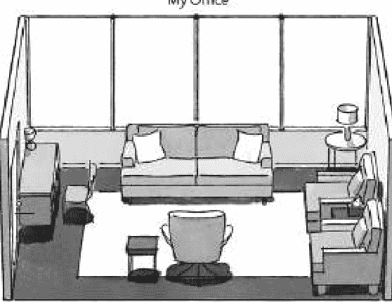

这是温德尔办公室的示意图。

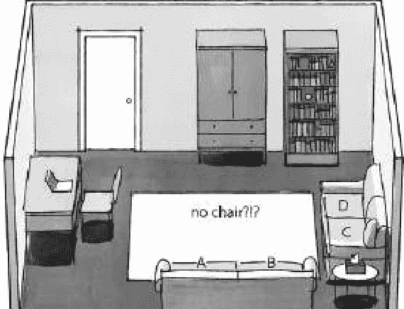

温德尔非常高、非常消瘦，头顶秃秃，带着我们职业典型的驼背姿态，他站在那里等我坐。我考虑了各种可能性。我假设我们不会并排坐在同一张沙发上，但他通常坐在哪张沙发上？是窗边的那张（这样如果情况升级他可以从*那里*逃走）？还是墙边的那张？我决定坐在窗边，即 A 位置，在他关上门、穿过整个房间并放松地态度地坐到 C 位置之前。

通常当我见到新病人时，我会用一个破冰话题开场，比如“那么，告诉我，今天是什么让你来这这里的？”

然而，温德尔什么也没说。他只是看着我，绿色的眼睛里带着疑问。他穿着开织衫、卡其裤和乐福鞋，看起来就像直接从“治疗师选角中心”走出来一样。

“你好，”我说。

“你好，”他回答道。然后他等着。

大约一分钟过去了，这比听起来要长得多，我努力集中精力，以便能清晰地陈述男朋友的情况。事实是，分手后的每一天都比分手当晚还要糟糕，因为我的生活里出现了一个巨大的空洞。在过去的几年里，男朋友和我每天整天都保持着联系，每天晚上都会说晚安。现在他在做什么呢？他的一天过得怎么样？他在工作上的汇报顺利吗？他在想我吗？还是说他庆幸自己说出了真相，可以去寻找一个不需要孩子的人？我身体的每一个细胞都感受到了他的缺失。

在听了一堆同情的“嗯”之后，温德尔问了一个问题：“这是你典型的分手反应吗？”他的语气很和蔼，但我知道他的意图。他试图确定所谓的我的依恋类型。依恋类型形成于童年早期，基于我们与照顾者的互动。依恋类型非常重要，因为它们也会出现在人的成人关系中，影响他们选择的伴侣类型（稳定或不稳定）、他们在关系过程中的行为（粘人、疏远或反复无常），以及他们的关系往往如何结束（怀念、友善或一场巨大的爆炸）。好消息是，不适应的依恋类型在成年期是可以改变的——事实上，这正是治疗大部分工作。

“不，这不典型，”我坚持道，用袖子擦了擦眼。我告诉他我谈过长期恋爱，也经历过分手，但不是这样。而且，我重申，我之所以会有这种反应，唯一的原因是因为这次分手是一个冲击，突如其来，而且男朋友所做的对别人来说是最困惑、最诡异且……不道德的吗？

我确信，这个有孩子的专业人士现在会说一些支持性的话，关于现在被这样击中有多么痛苦，从长远来看，幸好这件事发生了，因为我躲过了一个子弹——不仅是为了我，也是为了我儿子。我向后坐，深吸一口气，等待着认同涌入。

但温德尔并没有指望他像艾莉森那样把“男朋友”说成垃圾；治疗师会使用更中性的语言，比如，“听起来，他当时有很多感受，但没有直接向你表达。”尽管如此，温德尔什么也没说。

当我的眼泪再次顺着裤子流下时，我余光看到一个物体向我飞来。起初它看起来像个橄榄球，我怀疑自己是不是产生了幻觉（分手以来我完全没有休息过好觉），但随后我意识到那是一个棕色的纸盒——就是两个沙发之间桌子上的那个，我没坐的那个位置。我本能地出手去接，却没接住。它重重地落在落在我旁边的坐垫上，我抓起一把纸巾擦了鼻子。有了纸盒似乎缩小了温德尔和我之间的距离，仿佛他刚刚给了我一根救命稻草。多年来，我无数次给患者递过纸盒，但我忘记了这种简单的举动能给人带来怎样的关怀。

我在研究生时期听过的一句话出现在脑海：“治疗性的行为，而非治疗性的言语。”

我讲述了更多故事并擦了擦眼睛。温德尔看着我，等待着。我继续讲述男朋友以及他的回避问题，利用他婚姻结束的细节来构建一个证据——就他妻子和孩子的震惊程度来说，这与我们关系的结束并无二致。我向温德尔诉说我所知道关于男朋友回避历史的一切，却没意识到我无意中说明的正是我对“回避”的回避——而显然我对此略有所知。

温德尔微微歪着头，脸上带着探问的微笑。“考虑到你对他过去经历的了解，这竟然让你感到如此震惊，很奇怪不是吗？”

“但这确实很震惊，”我说，“他从来没提过想家里有个孩子！事实上，他甚至还和他公司的人事部谈过，为了确保在我们结婚后能把我儿子列入他的福利计划！”我重新梳理了整个时间线，增加了更多证据来支持我的故事，注意到温德尔的脸色开始阴沉下来。

“我知道我在重复，”我说，“但你必须理解，我原以为我们会共度余生。事情本该是那样的，现在却都悬而未决。我的一生已经过了一半，我不知道会发生什么。如果男朋友是我最后一个爱上的人呢？如果他就是我的终点呢？”

“终点？”温德尔提神了。

“是的，终点，”我说。

他等我继续说，但我的眼泪变了。不再是上周那种狂乱的抽泣，而是某种更冷静、更深层的东西。

更安静。

“我知道你感到措手不及，”温德尔说，“但我对你说的另一件事也感兴趣。你的一生已经过了一半。也许你的哀伤不仅仅是因为分手，我知道这种经历是毁灭性的。”他停顿了一下，再次说话时声音变得更软。“我在想，你是否在哀悼比失去男朋友更巨大的东西，”

他意味深长地看着我，仿佛他刚刚说了一些极其重要且深奥的话，但我真想揍他一拳。

一堆垃圾，我想。我的意思是，真的吗？在这次转折之前，我很好——不比好更多；我很好。我有一个无价之子。我有一份非常喜欢的事业。我有一个支持我的家庭和一群我在乎他们也在乎我的完美朋友。我很感激这种生活……好吧，有时我很感激。我确实在努力保持感激。而现在我很沮丧。我试着找这个治疗师来帮我度过痛苦的分手，而他能提供的就只有这些？

*哀悼更大的东西，我才鬼。*

在我说出这句话之前，我注意到温德尔正用一种我不习惯的方式看着我。他的眼睛像磁铁一样，每当我移开目光时，它们似乎都能找到我。他的存在既强烈又温柔，像是一个睿智的长者和毛绒玩具的结合体，并传递着一个信息：在这个房间里，我会看到你，即使你想躲避，我依然会看到你，当我看到你时，一切都会好起来。

但我不是为了这个来的。正如我打电话预约时告诉温德尔的那样，我只需要一些危机管理。

“我真的只是为了度过分手，”我说，“我觉得自己被丢进了搅拌机，逃不出来，这就是我来这里的全部——找一条出路。”

“好的，”温德尔说，体面地退后一步，“让我更多地了解这段关系。”他试图建立所谓的“治疗联盟”，这是一种在任何工作开展之前必须发展的信任。在早期治疗中，让患者感到被听到、被理解，比让他们获得任何洞察或做出任何改变要重要得多。

松了一口气的我，又开始讲述男朋友，重述整件事。

但他知道。

治疗师的工作就在这些省略号之中。

与此同时，回到我的沙发上，手里抓着纸巾盒，我的一小部分也知道一些事实。尽管我渴望得到认同，但我清楚这一点：人们经常创造虚假的叙事来让自己显得更好，有时这会让他们变得更糟。我知道男朋友是个该死的反社会分子。

但我正处于已知与未知的空间里。“今天我们只能做这些了，”温德尔说，顺着他的目光，我第一次注意到表一直落在我的肩膀上。他抬起手臂拍了拍腿，仿佛在为课程结束画上句号。然后他起身送我出门。他问我是否想下周三再来。我想着接下来的一周，那个男朋友消失后的空虚，我感到既轻盈又想吐。

“好了，这下正式了，”约翰在脱掉鞋并在沙发上盘腿坐下后说道，“我被一群蠢货包围了。”

他的手机震动了。当他伸手去拿时，我挑了挑眉。作为回礼，约翰给了我一个夸张的白眼。

这是我们在一起的第四次面，我已经开始形成了一些初步印象。我感觉到，尽管身边有许多人，约翰却处于极度的孤立中——而且这种状态是有意为之。他生活中的某些事情让他觉得亲近非常危险，危险到他会竭尽全力阻止这种事的发生。他的防御机制很有效：他侮辱我、长篇大论离题、转移话题，并在每当我试图说话时打断我。除非我能找到绕过他防御的方法，否则我们无法取得进展。

这些防御之一就是他的手机。

上周，在约翰在咨询期间开始发短信后，我让他注意我对忽视他发短信的感受。这被称为“关注此时此刻”（working in the here-and-now）。与其关注患者来自外部世界的故事，此时此刻关注的是房间里正在发生的事情。你可以断定，患者对他的治疗师做什么，对其他人也会做同样的事，我想加入他的这种体验，看看他对他人产生了什么影响。我冒了很快就把他推得太远的风险，但我记得关于他早先治疗的一个细节：那只持续了三次咨询，正处于我们现在所处的位置。我不知道还能和他相处多久。

我推测约翰离开上一个治疗师有两个原因：要么是她没有拆穿他的胡言，这会让患者感到不安全，就像那些父母不要求他们负责的孩子；要么是她确实拆穿了他的胡言，但她进展得太快了，犯了我可能要犯的同样的错误。尽管如此，我愿意冒风险。我想让约翰在治疗中感到舒适，但又不要到让我完全没有帮到他。

最重要的是，我不想掉入佛教所谓的“愚人慈悲”（idiot compassion）的陷阱——考虑到约翰的世界观，这个词非常贴切。在愚人慈悲中，你为了顾及别人的感受而避免摇晃，尽管这只船需要摇晃，而你的慈悲最终比你的诚实更有害。人们会对青少年、配偶、成瘾者甚至他们自己这样做。它的对面是“智者慈悲”（wise compassion），意味着关心这个人，但在需要时给予他或她充满爱的真实。

我很喜欢这一点。而不是“你刚才在说什么”或者“我刚才在说什么”。

“那个——”我刚开始，他的手机响了，他这就走了，去回另一条短信。

“看，这就是我的意思，”他抱怨道，“如果我想让事情办好，我就什么也无法委托。等我一下。”

从不断进来的提示声判断，他似乎正在进行多段对话。我怀疑我们是否在重演和他妻子之间发生的一个场景。

玛戈：注意我。

约翰：谁，你说你？

这让人非常烦躁。该如何处理我的烦躁？我可以坐着等（变得更加恼躁），也可以做点别的。

我站起来，走到办公桌前，翻了一个文件夹，拿起手机，回到椅子上，开始发短信。

*是我，你的治疗师。我在这里。*

约翰的手机叮的一声。我看着他读我的短信，他很惊讶。

“老天！你现在竟然给我发短信？”

我笑了。“我想引起你的注意。”

“你引起我的注意了，”他说，但他继续发短信。

*我觉得我并没有引起你的注意。我觉得被忽视了，还有点被冒犯了。*

叮。

约翰戏剧性地叹了口气，然后继续发短信。

*而且我认为，除非我们能够给予彼此全部的注意力，否则我无法帮助你。所以如果你想尝试合作，我要求你在这里不要使用手机。*

叮。

“什么？”约翰说。

约翰的手机又响了，但这次不是我。他在我和手机之间来回看了一眼，陷入了权衡。当他内心斗争激烈时，我静静等待。我半做好了他会起身离开的准备，但也知道如果他不想留在这里，他就根本不会来。无论他是否理解，他都在从中获得一些东西。我可能是他现在身边唯一一个会听他说话的人。

“噢，看在份上！”他说，把手机扔在对面的椅子上，“好吧，我放下这该死的手机。”然后他换了话题。

我预料到了他的愤怒，但有一刻，他的眼睛看起来湿润了。那是悲伤吗？还是从窗户射进的阳光的反射？我带着询问的目光观察，但咨询只剩一分钟了，这段时间通常是用来收拾情绪而不是打开心扉的。我决定把这件事留着，等一个更合适的时机。

就像矿工发现金光，我怀疑自己发现了一些端倪。

今天，在非常克制的情况下，约翰在伸出手半路停下了，让他震动的手机搁在一边，继续他被蠢货正式包围的故事。

“连莉西都很特立行怪，”他说。听到他谈论四岁的女儿，我很惊讶。“我告诉她不要靠近我的电脑，结果她怎么做呢？她跳到床上，这没关系……”

“噢，”我温柔地说道，“你谈论她的方式，我听出了里面充满了爱。”

“你能别再说那种话了吗？”他的语气显得有些不耐烦，但我从他的眼里看到了痛苦。我想起我们之前的治疗环节——关于爱或关怀的话题，对他来说似乎是痛苦的。换做另一个患者，我可能会问为什么我说的话会让他如此不悦。但我知道约翰会通过跟我争论他爱狗的任何事来回避这个话题。相反，我说：“大多数养宠物的人都会关心它们。”我降低了声音，让他几乎不得不向我倾身听。神经科学家发现，人类大脑中有一种被称为镜像神经元的细胞，它们会使人类模仿他人；而当人们处于情绪激动的状态时，舒缓的声音可以平静他们的神经系统，帮助他们保持专注。“无论这叫爱还是别的什么，其实并不重要。”

“这是一段荒唐的对话，”约翰说。

他今天低头盯着地板，不知道是什么原因。我看到我完全吸引了他的注意力。“你今天提到 Rosie 是有原因的。她对你很重要，而她现在的行为让你担心——因为你在挂念她。”

“人对我来说很重要，”约翰说，“我的妻子，我的孩子。人。”


他瞥了一眼他的隔间，那里又在震动，但我没有顺着他的目光看。我留在他身边，试图留住他，不让他每当出现某种不想要的情绪时就被抽离并变得麻木。人们经常将麻木误认为虚无，但麻木并不是情感的缺失；它是对被过多的情感淹没的一种反应。

约翰从他的隔间看向我。

“你知道我喜欢 Rosie 的哪一点吗？”他说，“她是唯一一个不向我提要求的人。是唯一一个没有以以种方式对我感到失望的人——至少，她在咬我之前不是这样的！谁会不爱那呢？”

他大声笑了起来，就像我们正坐在酒吧里，他刚随口说了一句风趣的俏话。我试图谈论那种失望——是谁让他失望了？为什么？——但他声称那只是是个玩笑，而我开不起玩笑？尽管今天我们在这没有取得任何进展，但我们都清楚他告诉我的话：在那些刺之下，他有一颗心，以及爱的能力。

首先，他非常爱那只丑狗。

## 我们的快照

来接受治疗的人呈现出自己的“快照”，而治疗师必须从这些快照中进行推断。患者到来时，如果不是处于最糟糕的状态，也绝不是处于巅峰。他们可能处于绝望或防御中，感到困惑或混乱。通常情况下，他们的心情非常糟糕。

所以，他们坐在治疗师的沙发上，带着期待的抬头，希望能得到一些理解，并最终（最好是立即）得到治愈。但治疗师并没有即时治愈的方法，因为这些人对我们来说是完全的陌生人。我们需要时间来了解他们的希望和梦想，他们的情感和行为模式，有时甚至比他们自己还要得深。如果从出生到他们来到我们办公室这期间，他们才发展出困扰他们的任何事，或者一个问题已经孵化了几个月，那么他们可能需要比几次 50 分钟的咨询更多才能获得预期的缓解，这是合情合理的。

但当人们处于绝境时，他们希望治疗师这些专业人士能做点什么。患者想要我们的耐心，但他们自己可能并没有耐心。他们的需求可能是显性的，也可能是含蓄的，特别是在开始阶段，这些会给治疗师带来沉重的负担。

我们为什么要选择一个需要我们面对不快乐、痛苦、刻薄或毫无察觉的人的职业，并一个接一个独自在房间面对他们？答案是：因为治疗师知道，起初，每个患者都是一个快照，一个在特定瞬间被捕捉的人。这就像一张从糟糕角度拍摄的你，脸上带着痛苦的表情。可能还有一张照片里的你神光奕奕，捕捉到了打开礼物或与爱人大笑的瞬间。这两种都是在那极分之一时间里的你，但都不是完整的你。

所以，治疗师倾听、建议、推动、引导，并偶尔诱导我们的患者将其他的快照引入视野，从而改变他们对内在及周围发生事情的体验。我们梳理这些快照，很快就会发现，看似独立的图像围绕着一个共同的主题，而这个主题在患者决定来诊时，可能并不在他们的视野范围内。

有些快照令人不安，瞥见它们提醒了我，我们都有阴暗的一面。另一些是模糊的。人们并不总能清晰地记得事件或对话，但他们会准确地记得某次经历带给他们的感受。治疗师必须成为这些模糊快照的解释者，意识到患者在某种程度上需要是模糊的，因为最初的快照有助于掩盖那些可能入侵他们平静内心领土的痛苦感受。随着时间的推移，他们发现自己其实并没有处于战争状态，通往和平的道路是与自己和解。

这就是为什么当人们第一次来时，我们在想象他们未来的样子。我们不仅在第一天如此，在每一个治疗环节中都是如此，因为图像让我们能够持有那份他们自己无法汇聚的希望，它也影响着治疗过程的展开。

我曾听过有人将创造力描述为能够掌握一件事物的本质和另一件完全不同的事物的本质，并将它们粉碎揉，创造出完全全新的东西。治疗师也是这样做的。我们提取初始快照的本质和想象中快照的本质，将它们揉在一起创建一个完全全新的。

每当我遇到新患者时，我都会想到。我希望 Wendell 也是这样，因为我不确定我能否做到，这不太可能。

## 未来也在当下

今天我早到了预约，所以我坐在候诊室环顾四周。我不确定我能否做到，这不太可能。我不确定我能否做到，至少我确定这会持续一段时间。我为这次咨询带了几页笔记，做了编号、注释并按时间顺序排列，就像我成为治疗师之前做的采访一样。

我向 Wendell 坦白，我没忍住打了 Boyfriend 的电话，但他留了语音信。我很羞愧，我等了一天他才回电话，在此期间一直知道，任何人都不想和那个刚分手却还想在一起的人说话。

“你可能会问我联系他想得到什么，”我说，预判了他的下一个问题。

Wendell 挑了一下眉毛——只有的一边，我好奇他是怎么做到的——在他回答之前，我继续说道。首先，我解释说，我想让 Boyfriend 告诉我他想我，这一切都是错误。排除那个“不太可能性的”（为了让 Wendell 知道我有自我意识，尽管我相信 Boyfriend 会重新考虑），我想清楚是如何走到这一步的。如果能得到问题的答案，我就不必在脑海中反复回想分手，陷入混乱的无限循环。这就是为什么我告诉 Wendell，我对 Boyfriend 进行了几个小时的审问——在此期间我试图解开“到底是什么鬼导致了我们的突然分手”的谜团。

就在我的大脑快要炸掉时，他说：“我真的很爱你，但爱并不能战胜一切。”

“这是非黑即白的！”我对温德尔（Wendell）说，一边在空中挥动着我的纸张。我在笔记的这个词旁边画了一个星号。“非黑即白！既然如此非黑即白，最初为什么要陷入这种非黑即白的境地呢？”

我简直不可理喻，我很清楚，但我停不下来。

在接下来的几周里，我来到温德尔的办公室，报告我与男朋友之间那些循环往复对话的细节（承认，有好几次），而温德尔则试图插进一些有用的建议（他不确定这对我有什么帮助）；他觉得这种感觉像是受虐；他觉得我一直在复述同一个故事，寄希望于得到不同的结果。他说，我想让男朋友向我解释——而他确实向我解释了——但我之所以纠缠不，是因为他的解释并不是我想要的。温德尔说，如果我在电话通话中做了如此详尽的笔记，我可能根本没有在听男朋友说话；如果我的目标是敞开放心态去理解他的观点，那么当我试图证明某个观点而不是真诚地互动时，这是很难做到的。而且，他补充道，我在我们的咨询中也和他做着同样的事情。

我表示赞同，接着又开始对着男朋友指责不已。

在其中一次咨询中，我用极其精确的描述解释了让男朋友把东西还给我的安排。在另一次咨询中，我反复问道：“是我疯了还是他疯了？”（温德尔说我们两个都没疯，这让我勃然大怒。）还有一次咨询是关于分析什么样的人会说：“我想和你结婚，只是不要带孩子。”为了准备这次咨询，我制作了一张关于性别差异的信息图表。一个男人可以说“我不想看乐高”和“我永远不会爱不是我的孩子”并全身而退；但一个女人如果说那样的话就会会被置于唾口。

我的咨询中充满了我对自己在 Google 上跟踪男朋友的发现：男朋友可能正在约会的女性（基于我从社交媒体点赞中构出的详细故事）；没有我他的生活过得有多么精彩（基于关于他出差的推文）；他甚至没有为分手感到难过（因为他在餐厅里拍沙拉照片——他怎么吃得下去？）。我坚信，男朋友已经迅速进入了没有我的生活，且毫发无损。这是我在看到的那些离婚夫妇身上熟悉的陈词：他们其中一个人在苦苦地挣扎，而另一个看起来很好，甚至很快快乐地开始了新生活。

我告诉温德尔，像病人一样，我想看到一些留下的疤痕组织迹象。我想在最后知道，我是曾经重要的。

“我重要过吗？”我一遍又一遍地问。

我一直这样下去，放任自己的怪癖爆发，直到最后温德尔踢了我。

一天早晨，当我正没完没了地论论男朋友时，温德尔挪到沙发边缘，站起来，走到我面前，用他那长长的腿轻轻踢了踢我的脚。他笑着回到座位。

“哎哟！”我反射性地说，尽管并不疼。我吃了一惊。“那是怎么了？”

“嗯，你似乎很享受这种受苦的体验，所以我想帮你一把。”

“什么？”

“痛苦和受苦是有区别的，”温德尔说，“你会感到痛苦——每个人有时都会感到痛苦——但不必受这么多苦。你不是在选择痛苦，但你是在选择受苦。”他继续解释道，所有关于男朋友生活的无尽反思和推测都在增加痛苦并导致我受苦。所以，他建议，如果我紧紧抓住这种受苦不放，我一定从中得到了什么。它对我来说一定有某种意义。”

是吗？

我想，为什么我明明知道这很糟糕，却还是执着地在 Google 上跟踪男朋友。是为了和男朋友以及他的日常生活建立联系吗，即使是单方面的？也许吧。是为了麻痹自己，好不用去想现实吗？可能。是为了逃避我本应该关注却不想面对的事情吗？

他今天穿的那件条纹开衫和我很搭，仿佛像是一套的。他用下巴了指我手里的纸。“我不认为你能从这些笔记里找到你想要的答案。”

*你正在哀悼某种更大的东西*，这个念头在我脑海中闪，像一句挥之不去的歌词。“但如果我不谈分手，我就无话可说，”我坚持道。

温德尔歪了歪头。“你有重要的话要说。”

我听了他的，却又没听进去。每当温德尔暗示这件事比“男朋友”更重大时，我都会反驳，所以我怀疑我一定发现了一些什么。我们最想抗议的，往往正是我们真正需要知道的。

他吸了一口气，然后停住了，犹豫着，仿佛要说什么却又作了了。“行吧，”温德尔说。他已经推我得够了，他也清楚。他剥夺我这种良药——谈论男朋友——已经太久了，我需要另一个。

我开始翻阅书页，但现在我想起我看到哪里了。我正扫描笔记，看看下一个该分享哪句毁誉性的言论，但那里有太多星号和备注，我能感觉到温德尔的目光落在我身上。我在想，如果现在像我这样的人坐在我的治疗室里，他会想什么。事实上，我会想到同事在公司办公室文件夹里贴的那张层层标志：*关于逃避痛苦还是忍受并改变痛苦，是一个需要持续做出的决定。*

我放下笔记。

“好，”我对温德尔说，“你想些什么？”

温德尔解释说，我的痛苦感觉像是存在现在现在未来。治疗师经常谈论过去如何影响现在——我们的历史如何影响我们思考、感受和行为的方式，在人生的某个时刻，我们必须放弃创造一个更美好过去的幻想。如果我们不接受“过去没有重来机会”这一观点，如果一直试图让我们的父母、兄弟姐妹或伴侣去修复年前发生的事，我们的过去将让我们一直困在原地。改变我们与过去的关系是治疗的核心。但我们很少谈论与*未来*的关系也如何影响现在。我们对未来的观念，可能和阻碍改变过去观念的障碍物一样强大。

“事实上，”温德尔继续道，“我失去的不仅仅是当下的关系。我失去了未来的关系。我们倾向于认为未来发生在之后，但我们每天都在脑海中创造它。当未来崩塌时，我们与之联系的未来也随之崩塌。而未来被夺走是所有剧情转折之母。如果我们花现在的时间试图修复过去或控制未来，我们就会停留在原地，陷入永恒的后悔中。通过在 Google 上监视‘男朋友’，我一直在注视他的未来展开，而我却冻结在过去。但如果我活在现在，我就必须接受未来的丧失。”

“所以，”我对温德尔说，“我想我应该停止审问男朋友了——还有停止在 Google 上监视他。”

他纵容地笑了，就像看着一个宣布要戒掉“火鸡”但却没意识到这个目标多么心心勃勃的烟民。

“或者至少尝试一下，”我改口道，“在他的未来上花少点时间，在我的现在多花点时间。”

温德尔点头，然后拍了拍大腿两次站了起来。咨询结束了，我想我想留留。

我觉得我们才刚刚开始。

# 11

# 再见，好莱坞

在 NBC 工作的第一周，我被分配到两个即将首映的节目：医疗剧《急诊室》（ER）和情景喜剧《友记》。这些节目将把该频道跃升第一，并确立其未来多年周四的统治地位。

这些剧定于秋季播出，周期比电影世界快得多。在几个月内，演员和剧组人员被聘用，制作开始。当詹妮弗·安妮斯顿和柯特尼·考克斯为《友记》的主角试镜时，我在现场。我权衡《急诊室》中朱莉安娜·马古利斯的角色是否应该在第一集结束时死去，我也曾在乔治·克鲁尼在片场时讨论过这部剧将让他变得多么有名。

由于新工作带来的活力，我在家里看电视变少了。我有关于同事的故事，他们对那些故事也同样充满，我感到再次与工作建立了联系。一天，《急诊室》的编剧给当地的一个急诊科打了一个电话咨询一个医学问题，一位名叫 Joe 的医生恰好接了电话。这看起来像是缘分——除了他的医学学位，他还有电影制作硕士学位。

当编剧们知道 Joe 的背景后，他们开始定期向他请教。他们经常聘请他担任技术顾问，排练高度编排的场景，教演员如何发音医学术语，并让操作看起来尽可能准确（冲洗注射器；用酒精擦拭皮肤；插入呼吸气管时按住患者的脖子）。当然，有时我们会跳过手术口罩，因为大家都想看。Joe 是胜任和冷静的典范，这些特质使他在《急诊室》中也受益匪浅。休息期间，他会谈起他最近看到的病人。

有一天，我问 Joe 周六是否可以去探望他——他允许我进入。但很快，我们就在房间和病人之间奔波，我试图记清所有的名字和诊断结果。在一个小时内，我看着 Joe 做了一次腰椎穿刺，面对的是一位三十九岁的双胞胎母亲，她发现自己的偏头痛其实是脑瘤。“不，你看，我们只是想要药了，”这句话引发了一阵如水的泪水。她的丈夫借口去洗手间。

“如果我们今天不打这一针，我会被心脏发作死的。”他叹了口气，“我发誓，我要死掉了。”

在桑切斯先生的手术室里，没有叫喊，没有那种感觉心脏病发即将到来的气氛。即使是是被锯开头部的桑切斯先生，看起来也比片场上的人压力要小。当手术团队工作时，每一项请求都伴随着“请”和“谢谢”，如果不是有源不断地从一个男人的头部流出滴进我旁边的袋子里，我可能会把这里当成虚幻的世界。在某种意义上，这确实是。它比我见过的任何东西都要真实，同时也与我记忆中的好莱坞真实生活隔着无数个星系——那是我本无打算离开的地方。

几个月后，一切都改变了。

周日，我跟着一家县立医院的急诊科医生。当我们靠近一个帘子时，他说：“45岁女性，有糖尿病并发症。”他拉开帘子，我看到一个躺在单子下的女人。这时，气味钻进了我的鼻腔——那是一种如此恶臭的味道，我担心自己会晕过去。我无法分辨这种气味，因为我一生从未闻过任何令人作呕的东西。她是排便了？还是呕吐了？

我没有看到任何一种的迹象，但那种气味变得如此强烈，我感到早些时候吃的午饭顶到了喉咙口，我用力吞咽试图把它压下去。我希望她看不出我有多苍白，也感受不到那种侵入我胃里的恶心感。我在想：也许味道是来自隔壁床的。也许如果我移动到房间的这边，闻起来就不会那么重了。我盯着那个女人的脸——湿漉漉的眼睛，通红的脸颊，汗水浸湿额前的刘海。医生正在向她提问，我无法理解他是如何做到呼吸的。我一直尝试屏着呼吸，但我必须吸气。

好了，我对自己说。开始了。

我吸了一口空气，气味瞬间锁住了我的身体。我撑着墙壁稳住身体，看着医生掀开盖在女人腿上的单子。她的糖尿病导致了严重的血管炎，剩下的只剩下小腿。膝盖上方有两个残肢。其中一个坏了疽，我无法判断这个像腐烂水果一样发黑发霉的感染残肢带来的视觉冲击是否比它的气味更让人糟糕。

空间很小，我向女人的头部移动，尽可能远离那个感染的残肢，这时，非凡的事情发生了。这个女人握住我的手，对我微笑，仿佛在说：“我知道这很难看，但没关系的。”尽管我才是应该握着她的手的人，尽管她才是那个失去了肢体并遭受严重感染的人，但是她在安慰我。虽然这本可以成为《急诊室》（ER）剧里的一个精彩故情节，但在那一毫秒间，我知道我不会再在那部剧里工作很久了。

我要去医学院了。

也许这是一种改变职业的冲动理由——这个带着发黑残肢的优雅陌生人，在我努力忍住呕吐时握着我的手——但我内心正在发生着某种感觉，那是我好莱坞任何工作中从未感受过的。我依然热爱电视，但我亲身经历的这些真实故事有些东西吸引着我，让虚幻变得如此单薄。《友记》（Friends）关于社区，但那是虚假的社区。《急诊室》关于生死，但它们是虚构的。我不想把我见证的这些故事折回到我在制片公司的世界，我想要真实的生活——真实的人——成为我的世界。

那天我从医院开车回家时，我不知道这会如何或在何时发生，不知道我能申请什么样的医学院贷款，甚至不知道我能否申请上。我不知道需要上多少门科学课程才能符合要求并准备医学院入学考试（MCAT），也不知道在哪里上这些课程，因为我大学毕业已经六年了。

但无论如何，我决定我要实现这一切，而不能在《必看电视》（Must See TV）每周工作六十小时的情况下。

在朱莉得知自己病危后，她的好朋友达拉（Dara）为了帮上忙，给她寄了著名的散文《欢迎来到荷兰》。这篇文章由艾米·珀尔·金斯利（Emily Perl Kingsley）创作，她是一个患有唐综合症儿童的母亲，文章讲述了人生预期被颠覆的经历：

当你准备生宝宝时，就像在计划一次华丽的假期——去意大利。你买了一堆指南书，制定了奇妙的计划。罗马斗竞技场。米开朗基罗的大卫像。威尼斯的贡船。你可能会学一些实用的意大利语短语。这一切非常令人兴奋。

在几个月的渴望期待后，日子终于到了。你收拾好行李出发了。几小时后，飞机降落了。空姐进来说道：“欢迎来到荷兰。”“荷兰？”你说，“你什么意思是荷兰？？我报的是意大利！我应该在意大利。我一辈子都在梦想去意大利。”

但航班发生了变动。他们降落在荷兰，而你必须留在这里。

重要的是，他们并没有把你带到一个可怕、恶心、肮脏，充斥着瘟疫、饥荒和疾病的地方。它只是另一个地方。

所以你必须出去买新的指南书。你必须学习一种全新的语言。你将遇到一群全新的人。你将学会在这个新的国家爱，尽管它是如此不同。郁金香和风车很美，但并不是你预期的东西。你必须寻找一种新的生活方式，一种新的爱的方式，一种新的自我。起初很难，但这是可能的。你会发现荷兰是一个美丽的地方。

面对那些无法改变的挑战，他们并没有在整个旅程中待在酒店房间里，而是决定出去看看这个国家。

现在达拉（Dara）正邀请朱莉（Julie）一起去，去看郁金香和伦勃奇的画。在朱莉对“欢迎荷兰”的愤怒平息后，她意识到总会有人的生活看起来更或或那么令人羡慕。现在朱莉会和达拉交换位置吗？她的第一直觉是：是的，毫不犹豫。她的第二直觉是：也许不会。她想了各种场景：如果能和健康孩子过十年，她会换取更长的寿命吗？自己生病更难，还是孩子生病更难？产生这些想法让她感到很糟糕，但她无法否认。

“你觉得我是个坏人吗？”她会问，我会向她保证，每个人来做治疗时都会担心自己的感受可能并不“正常”或“好”，但正是对自己的诚实帮助我们理解了生活中所有所有的细微差别和复杂性。压抑这些想法，你的行为就会“糟糕”。承认它们，你就会成长。

通过这种方式，朱莉开始意识到我们都处于“荷兰”，因为如果你足够幸运去意大利旅行，你可能会遇到航班取消和恶劣的天气。或者，在庆祝纪念日的旅行中，你们在罗马一家豪华酒店房间里完完美的性爱十分分钟后，你的配偶在浴室里心脏发作——这发生在我一位朋友身上。

所以朱莉要去荷兰了。她不知道会在那里呆多久，但我们为她预订了十年的行程，并根据需要更改计划。

同时，我们会一起商量她在那里想做什么。

朱莉有一个唯一的要求。

“你会答应如果我做了某些疯狂的事就告诉我吗？我……意思是，既然我死得比想象中任何时候都要早，我不需要那么……理智，对吧？所以如果我做得过头了，事情变得有点离谱，你会告诉我吗？”

我说我会。朱莉一辈子都谨小慎微且负责任，事事按规章，我无法想象她口中的“离谱”会什么样。我想如果非要说，那等同于一个派对上多喝了几瓶啤酒而变得有点疯的乖学生。

但我忘了，人们在头顶着所谓的“酒桶”时往往是最有趣的。


“遗愿清单”朱莉在咨询中说，当我们试图构想荷兰时。“这是一个很有趣的词，不是吗？”我得认同。在我们“跳木桶”（去世）之前，我们想做什么？

通常人们在亲近的人去世时会考虑遗愿清单。这发生在艺术家常常（Chang Chang）身上，他在2009年在新奥尔良的一面公共墙上创作了一个空间，提示语是“在我死之前（Before I die）”——几天之内，墙面被完全填满了。人们写了诸如“在我死之前”跨越国际日期线。“在我死之前”，我想为数百万人唱歌。“在我死之前”，我想做完全真实的自己。很快，这个想法在世界各地产生了千多面墙：“在我死之前”，我想和姐姐建立关系。过好美好的一天。去跳跳伞。为某人的生活带来改变。

我不知道人们是否付诸行动，但根据我在办公室里看到的，很大一部分人可能经历了瞬间的觉醒、少许的灵魂拷问，在清单上增加了更多内容——然后忘记了去勾掉它们。人们只梦不行，死亡仍然留在理论层面。

我们认为制定遗愿清单是为了规避遗憾，但实际上它们帮助我们规避死亡。毕竟，遗愿清单越长，我们想象自己剩下的时间越多，可以完成上面的所有事情。然而，缩短清单会对我们的否认机制产生细微的冲击，迫使我们承认一个冷酷的事实：生命的死亡率是100%。我们每一个人都会死，而我们大多数人不知道它将如何或何时发生。事实上，随着每一秒的流逝，我们都在走向终点的过程中。正如俗话说，没有人离开这里的方式是相同的。

我敢打赌你现在很庆幸我不是你的治疗师。谁想考虑这些！成为一个“死亡延期者”要容易得多！我们许多人把时间留给了爱的人和认为有意义的事物，却在截止日期公布时才发现，我们一直在这个项目（我们的生活）上敷衍日子。

但现在朱莉需要为她那些必须从清单上删掉的事情而哀悼。与人为将失去和留下的东西哀悼不同，朱莉是在为她永远无法拥有的东西哀悼——那些三十多岁的人理所当然认为会发生的里程碑和第一次。朱莉有一个正如她所说的，一个“具体的截止日期”（她说，“Dead（死掉）是这个词的操作部分”），这个期限是如此无情，以至于她预想的大部分事情永远不会发生。

有一天，朱莉告诉我，她开始注意到人们在闲聊中经常谈论未来。我要减肥。我要开始运动。我们要去度假。三年后，我会升职。我正在攒钱买房。我们想在几年后生第二个孩子。

# 14

# 哈罗德与玛德

在医学院，我的遗体名字叫哈罗德（Harold）。或者说，那是我和实验伙伴给它起的名字，因为隔壁的小组把他们的遗体命名为玛德（Maude）。我们当时上的是大剖学课，这是传统的一级人体解剖课程，斯坦福大学的每个学生小组都会处理一位慷慨捐献身体用于科学研究的人的遗体。

在我们进入实验室之前，教授给了我们两条指令：第一：假装这些身体属于我们的祖母，并相应地表示尊重。（一个吓坏了的学生回答道：“正常人会切自己的祖母吗？”）第二：在被告知的这段剧烈过程中，注意自己产生的任何情绪。

我们没有获得关于这些遗体的任何信息——名字、年龄、病史、死因。名字出于隐私考虑被封存，其余是因为目标是解开一个谜团，不是“谁作案”，而是“何因案”。这个人为什么去世的？他是吸烟户吗？红肉爱好者吗？糖尿病患者吗？

在整个学期中，我发现哈罗德做过髋关节替换（线索：他侧面的金属钉钉）；他的二尖瓣曾漏水（线索：心脏左侧肥大）；他在生命末期经常咳嗽，可能是因为长期躺病床上（线索：结肠内积的牙齿）。他有着淡蓝色的眼睛、黄色的牙齿、一圈白发，还有一双建筑师、钢琴家或外科医生那充满肌肉感的手。后来，我得知他在九十二岁时死于肺炎，这让我们所有人都很惊讶，包括我们的教授，他宣布道：“他的器官像六十岁的老人。”

然而，玛德的肺部充满了肿瘤，她那涂得精美的粉色指甲掩盖了因抽烟而在手指留下的尼古丁污渍。她是哈罗德的相反；她的身体衰老得过早，让她的器官看起来像比她老得多的人。一天，“玛德小组”（我们对玛德实验小组的称呼）切出了她的心脏。一个学生小心翼翼地拿起并举起来让其他人检查，心脏滑出了她的手套，“咚”地一声掉在地板上，裂成了两半。我们都吸了一口凉气——一颗破碎的心。我想，破碎一个人的心是如此容易，即使你已经非常小心。

我参加了一个识字计划并为学前儿童朗读——他们是健康健康！多有活力！他们的身体部位多完好！——而当我没做这些事情时，我在写作。我写下自己的经历，并对他人的经历感到好奇，然后开始为杂志和报纸撰写关于这些经历的文章。

一次，我写过一门名为“医患关系”的课程，教我们如何与未来要治疗的人互动。作为期末考试的一部分，每个学生都被视频录制了采集病史的过程，我的教授评论说，我是唯一一个询问病人感觉如何的的学生。“这应该是你的第一个问题，”他对全班说。

斯坦福大学强调需要将患者视为人而非病例，但与此同时，我们的教授们会说，这变得越来越难了，因为医学实践正在发生变化。长期的个人关系和有意义的相遇已经消失了，取而代之的是一种被称为“管理医疗”的新系统，它有15分钟的诊疗、工厂式的治疗，以及对医生为每位患者所能做事的限制。当我从大体解剖学转向专业时，我一直在思考我选择的专业领域——是否有一个领域保留了传统的家庭医生模式？还是说，我将不知道许多患者的名字，更不用说关于他们生活的任何事情了？

我在各个专科跟随医生观察，排除了那些与患者互动最少的。（急诊医学：很刺激，但你很少再次见到你的病人。放射科：你看到的是图片，而不是人。麻醉科：你的病人都在睡着。外科：亦如此。）我喜欢内科和儿科，但我所跟随的医生意味着这些实践正变得越来越不人性化——为了维持生存，他们每天必须挤进三十个病人。如果他们现在才起步，很少有人甚至会考虑另一个领域。

“既然你可以写作，为什么还要当医生呢？”一位教授在看到我为杂志写的一篇文章后这样问。

在NBC工作时，我与故事打交道，但我渴望真实的生活。现在我有了真实的生活，我想知道在现代医学的日常实践中，是否没有给人们故事的空间。我发现，沉浸在他人的生活中是满足的，我作为记者写得越多，就越发现自己一直在做这件事。

一天，我向一位教授谈到了我的困境，她建议我兼顾两者——新闻和医学。她说，如果我能作为作家获得额外收入，我可以开一家规模较小的诊所，像以前医生那样看病人。但她补充说，我仍然需要向保险公司负责，处理那些耗时如山的文件，这会让我偏离照顾患者的工作。难道真的变成这样了吗？我想。通过写作来维持当医生的生计？难道以前不是相反的吗？

尽管如此，我还是考虑了她的建议。然而，那时我三十三岁了，还有两年的医学院生活，至少三年的住院医，之后可能还有一年的专科培训——我知道想要一个家庭。我越是近距离看到“管理医疗”的影响，就越无法想象自己冒着长年的风险去完成培训，然后尝试是否可能在成为作家的同时构思出我想要的那种诊疗模式。此外，我不确定自己是否能兼顾两者——至少不能做得很好——而且还能留出个人生活的空间。学期结束时，我觉得我必须二选一：新闻或医学。

我选择了新闻，在接下来的几年里，我出版了书籍，并写了数百篇杂志和报纸故事。最后，我想，我找到了自己的职业使命。

至于我余生的其他部分——家庭——也会顺理成章。离开医学院时，我对此深信不疑。

# 15

# 不要留遗憾（Hold the Mayo）

“认真的吗？你们这些心理医生关心的就只有这些？”

约翰又回到了我的沙发上，盘着腿，光脚坐着。他穿着人字拖进来的，因为他的修脚师今天在工作室。我注意到，他的指甲和他的牙齿一样完美。

我刚刚问了一个关于他童年的问题，他对此并不愉快。

“我要告诉你们多少次了？我有一个非常美好的童年，”他继续道，“我的父母是圣人。圣人！”

每当我听到圣人般的父母，我就会产生怀疑。并不是我在找麻烦，而是没有哪个父母是圣人。我们大多数人都在“足够好”的父母下长大，唐纳德·温尼科特（Donald Winnicott）这位有影响力的英国儿科医生和儿童心理学家认为，这足以培养出一个适应良好的孩子。

尽管如此。

直到我成为一名父母，我才真正理解了治疗的两个关键点：

1. 询问人们父母的目的不是为了和他们一起指责、评判或批评他们的父母。事实上，这根本与他们的父母无关。这纯粹是为了理解他们的早年经历如何塑造了他们成年后的自我，以便他们能将过去与现在分开（并且不再穿上不再合身的心理外衣）。
2. 大多数人的父母都尽了他们最大的努力，无论这种“尽力”是A-还是D+。然而，父母尽管有限，内心深处并不希望他或他的孩子过上好生活。

我们（边缘型人格倾向于与自恋型人格结合，我们在伴侣治疗中经常能看到这种配对。）

直到非常前，大多数心理健康从业者仍认为人格障碍是不可治愈的。与抑郁和焦虑等情绪障碍不同，人格障碍由长期的、普遍的行为模式组成，这些模式在很大程度上是一个人性格的一部分。换句话说，人格障碍是“自我认同”的（ego-syntonic），这意味着这些行为看起来与个人的自我概念是一致的；因此，这些障碍的人认为是别人给他们的生活制造了问题。另一方面，情绪障碍是“自我不协调”的（egystonic），这意味着受其困扰的人会觉得这些状态令人痛苦。他们不喜欢感到抑郁或焦虑，也不喜欢在出门前要把灯开关点十次。他们知道自己哪里出了问题。

但人格障碍存在于光谱上。患有边缘人格障碍的人对被遗弃感到恐惧，但对某些人来说，这可能意味着当伴侣没有立即回复信息时感到焦虑；对另一些人来说，这可能意味着宁愿留在不稳定、功能失调的关系中，也不愿独自。或者考虑一下自恋型人格。谁不知道谁在不同程度上符合这种特征呢——有成就、有魅力、聪明且幽默，但其自我主义的程度令人惊心？

最重要的一点是，拥有人格障碍的特质并不意味着一个人符合正式诊断的标准。时不时地——在某个糟糕的日子里，或者当被逼到脆弱的神经紧绷时——每个人都会表现出这种或其他人格障碍的特征，因为每种特征都根植于人类对自我保护、接纳和安全的本质愿望。（如果你不认为这适用于你，问问你的配偶或好朋友就行了。）换句话说，正如我总是试图看到整完整的人，而不仅仅是一个可以写在保险表格上的五位数字诊断代码一样。如果我过度依赖那个代码，我就会开始通过这个滤镜来看待治疗的每一个方面，这会干扰我与面前这个独特的个体建立真正的关系。约翰（John）可能自恋，但他只是……约翰。他可能很傲慢，而且用非临床的描述来说，简直烦死人。

尽管如此。

诊断是有其用处的。例如，我知道那些事事挑剔、爱批评且易怒的人倾向于遭受极度的孤独。我知道一个表现出两种方式的人既渴望被看到，又极害怕被看到。我相信对于约翰来说，脆弱的体验感觉是卑微且羞耻的——我猜他在六岁母亲去世时，收到的信号是不表现出“软弱”。如果他花任何时间面对自己的情绪，这些情绪可能会淹没他，所以他将其作为愤怒、嘲讽或批评投射到他人身上。这就是为什么像约翰这样的患者特别具有挑战性：他们擅长通过转移来激怒你。

我的工作是帮助我们理解他隐藏了什么感受。他有堡垒和壕沟将我挡在外，我知道他身上有一部分正在塔楼上呼救，希望被拯救——至于为了什么，我还不知道。我会应用我对诊断的知识，但不迷失其中，帮助约翰看到他在世界上的行为方式是如何导致周围那些所谓的“傻瓜”给他带来更多问题的。

你的灯亮了。

约翰和我正在讨论他对我关于童年问题的恼怒，这时他宣布我门旁墙上的绿灯（连接到等候室的一个按钮）亮了。我瞥了一眼灯，又看了看时钟。刚过整点五分钟，我想我的下一位病人一定反常地早到了。

你能接得住吗？

我不知所措。人们通常不会进入治疗，但如果他们接受了，会说出类似“我今天在这里吃饭可以吗？”的话。而且他们带自己的食物。甚至我那个低血糖的患者也只带过一次食物进房间，那是为了避免休克。

“别担心，”约翰察觉到了我脸上的表情，“你想吃的话可以来点。”然后他站起身，走过走廊，从等候室的送餐员那里拿了他的午餐。

当约翰回来时，他打开袋子，在腿上放了一张纸巾，拆开三明治，咬了一口，然后就变脸了。

“老天爷，我说的是蛋黄酱的！看这个！”他打开三明治给我看蛋黄酱，另一只空手去拿手机——推测是为了打电话催订单——但我给了他一个眼神，提醒他不准使用手机的规定。

他的脸变得通红，我在想他是否也会对我大吼，但相反地爆发了一句：“傻蛋！”

“我？”

“你说什么？”

“我记得你曾经把你的上一个治疗师描述为很好，但是个傻蛋。我也是很好，但不是傻蛋吗？”

“不，完全不是，”他说，我很高兴他能够承认他生活中的某个人不是傻蛋。

“谢谢，”我说。

“谢什么？”

“谢谢你说我不是傻蛋。”

“我不是那个意思，”他回答道，“我的意思是不，你并不很好。你不让我用手机打电话给那个在我三明治上放蛋黄酱的傻蛋。”

“所以我既刻薄又是个傻蛋？”

他笑了，眼睛闪烁着，露出了酒窝。

穿过她，我不禁好奇她的心理史得是怎样的，才会选择约翰。

“我跟你做个交易吧，”约翰说，“如果我能从街上角那家店点午餐，我就告诉你一些关于我童年的事。我帮我们俩一起点。让我们文明点，吃着该死的中式鸡肉沙拉边聊聊天吧，好吗？”他看着我，等待着。

通常情况下我不会这么做，但治疗不是按部就班的。我们需要专业的界限，但如果边界太开放，像海洋一样，或者太狭窄，像鱼缸一样，我们就会麻烦。水族馆看起来恰恰好。我们需要留出自性的空间——这就是为什么温德尔踢了我，那招很有效。如果约翰现在需要通过食物的形式在我们之间保持某种距离才能感到自在地和我聊天，那就随他吧。

我告诉他我们可以点午餐，但这并不是等交换。他无视了我，拨通了一家餐厅订餐，这个过程显然让他感到很沮丧。

“对，不要酱料，”他对着手机大喊，手机开启了免提。“D-r-e-s-s-i-n-g。”他重重地叹了口气，翻了个白眼。

“加酱料吗？”餐厅的员工用英语问道，约翰变得很抱歉，试图传达酱料应该放在旁边。凡事都是问题——他们有无糖百事，没有无糖可乐；他们二十分钟到，而不是十五分钟。我在旁边看着，既惊恐又困惑。我想，这对约翰来说一定很难受。当他们结束通话时，约翰用中文说了什么，对方没听懂。约翰不明白为什么对方听不懂他的“母语言”，对方解释说他讲的是粤语。

他们挂了电话，约翰看着我，一脸不可置信。“什么，他们不用普通话吗？”

“如果你懂中文，为什么不用它来点餐呢？”我问。约翰对我微微一笑。“因为我习惯说英语。”天呐。

约翰咕哝了几句，但一旦我们摆好沙拉，他就稍微放下了防御的吊桥。我已经吃过午饭了，但我还是吃了一些沙拉来陪他；分享进餐有一种天生的纽带感。我听到了一些关于他父亲和哥哥们的故事，以及他觉得很奇怪的是，尽管他并不记得太多关于母亲的事，几年前他开始梦见她。他不断做同一个梦的不同版本，就像《土拨日》一样，他停不下来。

他希望它停止。他说，即使在睡中，他也正被困扰。他只想平静。

我询问了那个梦，但他说谈论它会让他不快，而我付钱不是为了让他不快。他不是刚刚告诉我他想要平静吗？治疗师难道不教“倾听技巧”吗？我想谈谈他刚刚说的话——挑战他的信念，即他不应该在治疗中感到不适，以及他可以通过经历不适来找到平静——但我需要时间，而现在只剩下几分钟了。

我问他他什么时候能感到平静。

“遛狗的时候，”他说。“在罗西开始闹脾气之前。以前很平静。”

我在想，他不想把那个梦带进这个房间。难道这个房间已经成了他的避风港，远离了他的工作、妻子、孩子、狗、这个世界的傻瓜，以及那个出现在梦里的母亲的幽灵？

“嘿，约翰，”我试着问，“你现在感到平静吗？”他把筷子扔进他刚收拾好的沙拉残渣的袋子里。“当然没有，”他说，又翻了一个不耐烦的白眼。

“噢，”我说，没再追问。但约翰没有停。我们的时间到了，他站起身准备离开。

“你在开玩笑吗？”他走向门口继续说道，“在这里？平静？”他的白眼现在被微笑取代了——不是那种居高临下的冷笑，而是一个和我分享的秘密。这是一个很美的微笑，充满光彩，并不是因为那些耀眼的牙齿。

“我早就知道了，”我说。

# 16

## 全套配置

剧透：在我离开医学院后，我余生的生活并没有按照计划顺利。

三年后，当我快三十七岁时，一段为期两年的感情结束了。这很难过但很愉快，不像后来和男朋友分手那样出人意料。尽管如此，对于一个想要孩子的人来说，这仍然想象中最糟糕的时机。


我一直以最确定的方式知道我想成为父母。在成年生活中，我一直为孩子们做志愿者，并假设有一天我会有自己的孩子。但现在，随着四十岁的临近，我渴望生个孩子，但又还没至于为了下一个出现的男人就结婚。这让我陷入了一个尴尬的境地——既焦切，又挑剔。

这时，一个朋友建议我可以倒过来：先有孩子，后有伴侣。一天晚上，她给我发了几个精子库网站的链接。我从未听过这种事，起初不确定心里怎么想，但在考虑了各种选择后，我决定向前。

现在我只需要选择一个捐赠者了。

当然我想找一个健康状况良好的捐赠者，但在这些网站上还有其他需要考虑的品质，而不仅仅是发色或身高。我是想要一个曲棍球运动员还是一个文学专业的学生？特鲁福的影迷还是一个长号手？外向者还是内向者？

我很惊讶地发现，在很多方面，捐赠者档案中（除了大多数候选人都是大学生并提供了 SAT 成绩）存在关键差异，这些差异存在于工作人员（她们看起来都是女性）撰写的所谓“员工评价”中，并将其加入捐赠者档案中，但并没有什么规律：他倾向于拖延，但最终会完成工作。（我很担心任何拖延会延伸到自慰的男性。）

我非常依赖员工评价，因为读的档案越多，我越意识到我想要与捐赠者建立某种无形的联系——如果他坐在我们的餐桌旁，我会享受他的陪伴。有一天，我打电话给精子库咨询一个捐赠者的健康状况，被转接给一个名叫 Kathleen 的工作人员。当 Kathleen 查找记录时，我开始和她聊天，并得知她就是见过那个特定捐赠者。我忍不住问道：“他帅吗？”我试力让自己听起来自然。我不知道自己是否被允许问这种问题。

“嗯……” Kathleen 犹豫着，用她浓重的纽约口音拉长了词，“并不难看。但在地铁上我不会多看一眼。”

看起来身体健康、聪明，而且身体特征也相似，但其他一些细节会引起我的警觉，比如有一个捐赠者写道最喜欢的颜色是黑色，最喜欢的书是《洛莉塔》，最喜欢的电影是《发条橙》。我试着想象有一天我的孩子读到这份个人简介，然后看着我说：“你居然选了这一个？”如果捐赠者的拼写或标点符号不正确，我有同样的反应。

这个过程持续了三个精疲力竭的月，在此期间，我开始对寻找一个让我能向孩子介绍的健康捐赠者失去了希望。

然后——终于！——我找到了他。

一天深夜回到家，看到了凯瑟琳留下的语音留言。她让我查看一个她描述为像“年轻版的乔治·克鲁尼”的捐赠者。她补充说她特别喜欢这个捐赠者，因为他每次来银行捐赠时总是非常友好，心情很好。我翻了个白眼。毕竟，如果你是一个二十多岁、正准备看色片并高潮的男人——而且为此还能拿钱——有什么心情不好的呢？但凯瑟琳对这个家伙赞不绝口——他长得极好，非常聪明，而且性格极其迷人。

“他是全能型的，”她自信地说。

凯瑟琳从未如此热情，于是我登录查看。我点击他的个人简介，仔细研究了他的健康状况，读了他的文章，听了他的音频采访，瞬间意识到（用人们所谈论“一见钟情”的方式），我找到了那个真命。关于他的一切——他的喜好、幽默感、兴趣和价值观——感觉就像家人一样。我感到既兴奋又疲惫，心想先睡一觉，早上再处理细节。第二天恰好是我的生日，那天晚上我做了关于宝宝的生动梦，感觉持续了整整八个小时。我第一次，在脑海中勾勒出一个真实的婴儿来自两个特定的人，而不是一个半血统背景模糊的婴儿幻象。

第二天早晨，我兴奋地跳下床，脑子里回响着《我的孩子》这首歌。祝我生日快乐！过去几年我一直想要一个孩子，找到一个让我感到如此舒服的捐赠者似乎是送过的最好的生日礼物。走向电脑，我为自己的幸运露出微笑——我真的要这样做了。

输入精子银行的网址，找到捐赠者的个人简介，又重读了一遍。我像昨晚一样确定，他就是那个真命——那个在当我的孩子问我为什么在所有可能的捐赠者中选择这个家伙时，能给出一个合理解释的人。

我将那个捐赠者放入了我的在线购物车——就像我在亚马逊上买一本书一样——核对了订单，然后点击“购买小管”。

**我要生宝宝了！** 我想。这一刻感觉具有里程碑意义。

随着订单开始处理，我规划了必须做的事：预约人工授精、购买孕期维生素、列出婴儿清单、布置好婴儿房。在思考间隙，我注意到订单完成需要一些时间。屏幕上那个被称为“死亡之轮”的旋转圈似乎转得异常久。我等待着，又多等了一会儿，最后尝试使用已经崩溃的电脑上的后退键。什么都没有发生。

最后，死亡之轮消失了，弹出来一条消息：

*缺货了？* 我想一定是某种电脑故障——也许是我按后退键的时候？——于是我快速拨打了精子银行找凯瑟琳，但她不在，我被转接到了一个名叫巴芭的客服。

巴芭调查了情况，确定这不是故障。她说我选择了一个非常热门的捐赠者。她解释说，热门的捐赠者很快就会被抢光，虽然公司经常尝试“补货”他们的“库存”，但有六个月的保留期，以便进行隔离和测试。她说，即使有货了，可能也需要很长的等待，因为有些人已经下了预订单。当巴芭说话时，我想起凯瑟琳昨天才打过电话。现在我想也许她向好几个女性推荐了这个捐赠者。也许，很多女性都因为凯瑟琳对精子的诚实评价而与其建立了联系。

巴芭把我列入了候补名单（“别傻傻地浪费时间等待，”她阴森地说道）。我感觉脚下的世界被抽空了。六个月？我三十七岁了。时钟滴得比以往任何时候都要响。

我挂了电话，盯着屏幕。我等不了六个月。我完全等不了。我开始滚动浏览网站寻找别人，但现在的简介感觉不同了。那个“乔治·克鲁尼”消失了，其他的只是陌生人。

然后，我看到了他。他不是克鲁尼，但他的眼神里透着善良，笑容看起来很真实。他的文章谈到了对徒步、阅读的热爱以及成为父亲的愿望。他三十四岁，一名老师，健康记录良好。我没有思考。没有等候补名单。我直接打电话问他是否在名单上。

我的心脏在胸膛里剧跳。这是一场赌博，一场绝望的赌博，但我没有其他选择。我把捐赠者加入购物车并点击“购买小管”。这一次，我没有等待旋转圈。

很难有机会和 Alex 这样一个二十七岁、长得极其帅的男人做爱，他有着线条分明的腹肌和轮廓分明的颧骨。

与此同时，我开始痴迷地监控我的月经周期。一天，在 Spurth 咖啡馆，我提到告诉 Alex 我快要排卵了，所以如果我们在这个月尝试的话，他正好有一周的时间来做决定。在其他情况下，这给一个男人的压力可能是非常大的，但现在这感觉像是一件板上钉钉的事，我没有时间浪费。我们已经从每一个可能的角度审视过我们的计划：法律、情感、伦理、现实。到这一步，我们之间已经有了只有彼此懂的梗和绰号，并为了这个孩子将带来的祝福而建立了纽带。那周甚至有人问我，如果有其他商业机会，我是否已经“找过别人”，或者这是否是一个独家邀约。我曾闪过一个即逝的冲动，想编造一场竞价大战来锁定交易（皮特正在徘徊，盖里也有兴趣，所以你最好在周五前给我答复。这件事热度很高）。但我希望我们的关系建立在完全诚实的基础上；无论如何，我相信 Alex 会这么说。

在我发出截止日期的第二天，我们决定在海滩上散散步，最后讨论一下我们起草的合同中的最终细节。当我们沿着岸边漫步时，细雨凭空降临。我们面面相觑——我们要回去吗？——接着，细雨变成了一场真正的风暴。我们都穿着短袖衫，Alex 摘下腰间的外套披在我的肩上，当我们彼此面对面，在海滩上被雨水淋透时，他给了我正式的绿灯。经过所有的谈判、相互了解，以及关于这对我们和孩子意味着什么问题，一切都准备就绪了。

“生个宝宝吧！”他说。于是，我们拥抱、笑着，我穿着一件长到膝盖的宽大外套，拥抱着这个将带给我生命的男人，我想我多等不及要以后某一天告诉他这个故事了。

回到车里后，Alex 给了我他签署过的合同副本。

然后，他就消失了。

我整整三天没有收到他的消息。如果你处于三十多岁、正要排卵，而你唯一的婴儿选择处于无限期延期状态，这三天可能看起来并不长，但这简直是永恒。我试着不去读它（压力不利怀孕），但当 Alex 终于出现时，他给我留了一条信息说：“我们需要谈谈。”我瘫坐在地板上。像地球上每个成年人一样，我完全清楚这意味着什么：我要被抛弃了。

第二天早上，当我们坐在 Spurth 咖啡馆常去的座位上时，Alex 移开目光，开始了那些分手陈词滥调：“不是你的问题，是我的问题”；我现在的生活非常不稳定，不知道自己是否能投入，为了你好，我不想耽误你。”还有那句长久以来最爱的“我希望我们以后还能做朋友。”

“没关系，海里还有别的新鱼，”我说，用一个拙劣的双关语来保护自己。我希望以此缓和气氛，让 Alex 明白我理解他为什么觉得无法完成捐赠计划。在内心，我心碎了，因为这已经是我明确想象过的第二个孩子，而我永远无法把它抱在怀里了。一个在这个时间段经历第二次流产的朋友说，她的感受完全一样。我回到家里，决定停止寻找精子捐赠者，因为这种心碎太难以承受了。像我流产的朋友一样，我尽可能地避开婴儿。甚至连尿布广告都让我忍不住拿遥控器，以便我换个频道。

几个月后，我知道该回到网上继续搜索了。但就在我准备再次登录时，我接到了一个意外的电话。

“Lori，好消息！”她用那浓重的布鲁林口音宣布道，“有人退回了一瓶‘克鲁尼宝宝’。”

“克鲁尼宝宝”……我的男人。那个“全能型”的人。“退回？”我问。我不确定对退回的精子什么感觉。我想起 Whole Foods 超市，即使有收据，也不能退回任何个人卫生用品。凯瑟琳向我保证，那瓶子没有离开过它的氮罐，“产品”没有任何问题。只是有人通过其他方式怀孕了，不再需要这个备胎了。

“克鲁尼有等待名单，你知道的——”她刚开口，在她说完之前，我已经答应了。

那秋晚些时候，婴儿派对之后，我和几个人一起出去吃晚餐，我妈妈注意到真正的克鲁尼坐在旁边的一张桌子旁。我们桌上的每个人都知道凯瑟琳对“年轻克鲁尼”的描述，我的朋友和家人一个接一个指着我巨大的肚子，然后转看向那位影星。他看起来比 NBC 的高管要成熟得多。我们的人生都发生了很多事。他即将获得奥斯卡奖。

一周后，“克鲁尼宝宝”有了一个新名字：扎西。他是爱、快乐和魔法。正如凯瑟琳可能会说过的，他是“全能的”。

八年后：某种似曾相识。当 Alex 说“接下来的十年我无法和你生活在一起”时，我会被带回 Spurth 咖啡馆的那一天，那天 Alex 告诉我最终无法成为我的捐赠者。我记得自己当时多么崩溃，但也记得凯瑟琳不久后打了电话，复活了那个感觉如死去的梦想。情况似乎足够了——那令人盲目的转折破碎了。

## 没有记忆或欲望

在二十世纪中叶，英国心理分析师威尔弗雷德·比恩认为，治疗师应该在没有记忆或欲望的情况下面对患者。在他看来，记忆会随着时间的推移而产生主观解释，而欲望则与治疗背道而驰。比恩希望治疗师进入每次治疗时都能保持投入（不受记忆影响），并保持开放（不受欲望影响）。

在我实习的早期阶段，在比恩的训练下，我要求自己做到“没有记忆，没有欲望”。我喜欢这种不被预设观念或意图干扰的想法。这种放弃似乎带有一种禅意，类似于佛教中放下执着的概念。在实践中，这感觉更像是模仿那些大脑受损只能活在当下的患者，无法回忆过去或构想未来。我的额叶完好，我无法强制自己进入那种遗忘状态。当然，比恩的概念更为细致，将记忆和欲望的干扰因素排除在门外是有价值的。但我在这里提到比恩，是因为当我去治疗时，我想从患者的角度来看，“没有记忆，没有欲望”将接近于优雅。

周三早晨，我坐在沙发上，处于 A 和 B 状态之间，刚刚调整好身后的枕头。

谁？难道我在他生日时不会想他吗？这引出了一个问题：他会想我吗？如果不会，那我对他来说就毫无意义了吗？我回头看向“管理负面情绪”。我发现自己很难管理思绪，因为在温德尔办公室之外，我并没有多少出口。分手往往属于“无声丧失”的范畴，对人们来说不那么切实。你会流产，但你经历的是分手，你并没有失去配偶。所以朋友们认为你会很快走出来，而这些事情几乎成了对你失去的认可——不仅是失去了那个人，还失去了时间、陪伴、私下的笑话，以及现在由你独自承担的共同记忆。我坐在沙发上，完全打算把这些都告诉温德尔，但流出来的却是如洪水般的泪水。在模糊的视线中，我看向他。我又错过了接球。我想，除了笨，我似乎变得更不协调了。我对自己的爆发感到既惊讶又羞愧——我们还没互相打过招呼——每当我试图冷静下来时，总会在再次失控前快速地说一句“对不起”。五分钟里，我的状态就是这样：哭。尝试停止。说，对不起。哭。尝试停止。说，对不起。哭。尝试停止。说，噢天哪，我真的很对不起。温德尔想知道我在道歉什么。我指了指自己。“看看我！”温德尔耸了耸肩，仿佛在说：“好吧，是啊——那又？”然后我甚至没停下来说“对不起”；只是哭。尝试停止。哭。尝试停止。哭着好让自己停下来。这种情况又持续了好几分钟。在我哭泣时，我想起了分手后的那个早晨，在经历了一个不眠夜后，我下床继续生活。我记得当我送扎克去学校时，我说“我爱你”，当他跳下车时，他环顾四周确保没人听见，在跑去加入朋友群之前回了一句“我爱你！”我想起在上班的路上，我在脑海里反复回放珍的那句评论：我不知道这就是故事的结局。我想起温德尔乘着电梯来到我的办公室，当我想起那句话时，我真的笑了：那不是埃及的一河——尽管如此，我还是陷入了否认：我想，也许他会改变主意。也许这完全是误会。当然，这完全不是误会，因为我坐在这里，在温德尔面前哭泣，再次告诉他我这样做有多么差劲，变得如此一团糟。“我们来做个交易吧，”温德尔说，“我们达成共识，你在这里对自己好一点？你想什么时候自责就什么时候自责，好吗？”这我没想过。“但这仅仅是一场分手，”我说，立刻忘记了对自己好一点。“或者我可以在门口留一副拳击手套，这样你可以用它们伤害自己。”温德尔笑了，我感到自己吸了一口气，把它呼出来，在善意中放松下来。我闪过当我看到自己自我折磨时经常恐惧的事：你现在不是最适合谈话的人。我指出，自责和自我责任之间是有区别的，这是科恩菲尔德过的一句话的推论：“成熟精神性的第二个特质是善良。它基于自我接纳的基本本质。”我们追求的是自我关怀（我是人吗？）而不是自尊（我是好是坏？）。“也许不需要拳击手套，”我说。只是我之前表现得好一点，现在又停不下来了。我觉得自己正在倒退，就像分手前的状态一样。”温德尔歪了歪头。“让我问你一个问题，”他说，我以为会是关于我的关系，于是擦了擦眼睛，出乎意料地等待着。“在你治疗师的工作中，”他开始道，“你曾和正处于悲恸中的人坐在一起吗？”他的问题让我戛然而止。我曾和经历各种悲恸的人坐在一起——失去孩子、失去父母、失去配偶、失去兄弟姐妹、失去婚姻、失去宠物、失去工作、失去身份、失去梦想、失去身体部位。我曾和那些脸向内收缩、眼睛眯成一条缝、张开的嘴巴像极蒙克的《呐喊》中形象的人坐在一起。我曾和那些将悲恸描述为“怪物般的”和“无法忍受的”患者坐在一起；一位患者引用她自己说过的话说，这种感觉让她感到“麻木和剧痛交替出现”。我也曾从远处观察悲恸，比如在医学院期间，当我在急诊室运送血样本时听到一个惊人的声音，我得差点掉掉管子。那是一种哀嚎，更像动物而非人类，如此刺耳和原始，引得我去寻找源头。走廊外有一位母亲，她三岁的孩子在跑出后门掉进游泳池溺水了，那就在母亲带着婴儿上楼换尿布的两分钟内。当我听着那哀嚎时，我看到她的丈夫到达并收到消息，听到他的震惊爆发成尖叫，仿佛与妻子的嘶吼般的呻吟共鸣。这是我第一次听到这种特定的哀伤与痛苦的音乐，但此后我听了无数次。并不意外，悲恸可能看起来像抑郁，正因如此，在几年前，我们的诊断手册中有一项悲恸的排除标准。

我们触及了痛点。与神经外科医生不同，我们倾向于敏感区域，轻轻地按压那里，即使这会让患者感到不舒服。

这就是我们触及故事深层含义的方式，而核心往往是某种形式的哀伤。但有许多情节夹在其中。

一位名叫萨曼莎的患者在二十多岁时来治疗，是为了理解她亲爱的父亲去世的故事。她小时候被告诉父亲死于一场船只事故，但成年后，她开始怀疑父亲是自杀的。自杀往往给幸存者留下一个未解的谜团：为什么？可以做些什么来防止这种情况？

与此同时，萨曼莎总是在自己的关系中寻找问题，寻找那些不可避免地会给她提供离开理由的问题。由于不希望她的朋友像她父亲那样成为谜团，她在不经意间重演了一个被遗弃的故事——只是在这个版本里，她是唯一一个离开的人。在治疗中，她学到，她正试图解决的谜团比她父亲是否自杀要深得多。它也是关于她父亲活着时是什么样的人，以及她因此变成了什么样的人的谜。

人们想要被理解也想要理解别人，但对于我们大多数人来说，最大的问题是我们并不知道自己的问题是什么。我们不断掉进同一个水坑。为什么我要一次又一次地做那件会让我失去幸福的事情？

我哭着，纳闷自己怎么可能哭这么久。我怀疑自己是否已经严重脱水了。尽管如此，我知道温德尔正在拍他的大腿，示意我们的咨询结束了。我吸了一口气，发现自己感到异常平静。在温德尔的办公室里尽情痛哭就像被毯子裹着，温暖而安全，不受外面发生的一切影响。我想起了杰克·康菲尔德的箴言中关于自我接受的部分，但我还是开始评判：我难道刚刚付了钱看自己连续哭了四十五分钟吗？

既是，也不是。

温德尔和我进行了一次对话，即使没有言语交流。他看着我哀悼，他没有试图通过中断或分析问题来让事情变得更舒服。他让我以今天我需要的任何方式讲述我的故事。

当我擦干泪水站起身离开时，我想起每当温德尔询问我生活的其他方面时——我和男朋友约会期间还发生了什么，我遇到男朋友之前的生活是什么样子的——我总是给出敷衍的回应（家庭、工作、朋友；各位，没什么好关注的！），总是把话题带回男朋友身上。但现在，把纸巾扔进垃圾桶时，我意识到我告诉温德尔的并不完全完整。

我并没有确切撒谎。但也没有讲述整个故事。可以说，我漏掉了一些细节。

# 第二部分

> 诚实比同情更有效的良药，同情可能会安慰人心，但往往会掩盖真相。
>
> ——格蕾特尔·埃里希

# 18

# 周五下午四点

我们在同事麦克辛的办公室里——有围裙的椅子、做过旧处理的木头、复古面料和柔和的奶油色窗帘。今天轮到我在咨询小组展示一个病例了，我想谈论一个我似乎无法帮助的患者。

是她的问题？还是我的？这就是我来这里寻找答案的原因。

贝卡三十岁，她一年前因为社交生活困难找到我。她的工作表现很好，但同伴的排斥让她感到很受伤，从不邀请她一起吃午餐或喝酒。与此同时，她刚约了一系列男人，这些男人起初看起来兴奋，但两个月后就分手了。

是她的问题吗？是吗？这就是她来治疗寻找答案的原因。这不是我第一次在周五下午的每周小组聚会上提到贝卡。虽然不是强制，但咨询小组是许多治疗师生活的混合。单打工作时我们无法获得他人的投入，无论是对做得好的赞扬，还是对如何做得更好的建议。我们不仅检查患者，还检查自己在与患者关系中的状态。

在我们的小组里，安德里亚可以对我说：“那个患者听起来像你哥哥。这就是你为什么那样回应。”我可以帮助伊恩处理那个通过报告自己的星座来开始咨询的情绪（“我受不了这些鬼神理论，”他说）。小组咨询是一个不完美但非常有价值的制衡系统，确保我们保持客观性，聚焦核心主题，并且不遗漏任何明显的细节。


诚然，这些周五下午也有笑闹——通常伴随着食物和葡萄酒。

“同样的困境，”我告诉小组——麦克辛、安德里亚、克莱尔和唯一的男性伊恩。“每个人都有盲点，”我补充道，“但贝卡值得注意的是，她对自己似乎完全没有好奇心。”

小组成员点头。许多人开始治疗时，对他人的好奇心超过了对自己——我丈夫为什么要这样做？但在每次对话中，我们都会加入一些好奇心，因为治疗无法帮助那些对自己不好奇的人。在某些时刻，我甚至可能会说如“为什么我似乎比你对你自己更好奇？”并看看患者如何反应。大多数人会开始对我的问题产生好奇。但贝卡没有。

最近贝卡开始和新的人约会，一个叫韦德的男人，上周她告诉我他们发生了一场争吵。韦德注意到贝卡似乎经常抱怨她的朋友们。“如果你对她们那么不开心，”他说，“你为什么还把她们当朋友呢？”

贝卡“简直无法置信”韦德的回应。难道他不明白她只是在发发情绪吗？她是想和他好好谈清楚，而不是被他“打闭门”？

这种相似之处是显而易见的。我问贝卡她是否只是想向我发发情绪，而作为她的朋友，她在这些关系中发现了一些价值，尽管有时她会感到沮丧。不，贝卡说，我又搞错了。她是来这里为了谈论韦德的。她没有意识到，她对韦德拒绝的方式，就像她对我拒绝的方式一样，这让她自己也感到被拒绝了。她不愿正视自己的行为如何让别人很难给她她想要的东西。尽管贝卡开始希望生活发生一些改变，但她仍然停留在一种先于她的“历史性争论”中。正如贝卡有她的局限，我也有。我认识的每一位治疗师都遇到过自己的局限性。

“我不想让她感到情感孤立无援，”我说。

“她已经感到情感孤立无援了，被她生活中的所有人，包括你。”

“对，”我说。“但我担心如果我继续对她进行治疗，会进一步加深‘没有人能帮得了她’的信念。”

安德里亚挑起眉毛。

“什么？”我说。

“你不需要向贝卡证明你的能力，”她说。

“我明白。我担心的是贝卡。”

伊安大声咳嗽，然后假装作呕。整个小组爆发出一阵笑声。

“好吧，也许我确实（需要）。”我在饼干上放了一块芝士。“这就像我的另一位病人，她和一个对她不好的男人交往，但她不愿离开，因为在某种程度上，她想证明自己值得被更好的对待。她永远无法向他证明这一点，但她不会停止尝试。”

“你需要承认这一点，”安德里亚说。

“我以前从未和病人分手过，”我说。

“分手很糟糕，”克莱尔说，往嘴里塞了一颗葡萄。“如果我们不这样做，我们就是失职了。”

房间里弥漫着此起彼伏的“嗯”声。

伊安看着，摇着头。“你们都会因为这事对我大发雷霆——”（伊安在我们小组里因对男女做概括而闻名）“但问题在于：女性忍受的破事比男人多。如果女朋友没有好好对待男生，他离开更容易。如果一个病人没有从我提供的服务中获益，而我确定自己已经尽了全力但仍然无效，我会切断关系。”

我们用熟悉的眼神对视着他：女性和男人一样擅长放手。但我们也知道这里可能包含事实。

“为了分手，”麦克斯琳抬起头说。我们碰杯，但气氛并不欢快。

当一个病人把希望寄托在你身上，而最后你知道自己让她失望了，那是令人心碎的。在这些情况下，这个问题始终萦绕：如果我换一种做法；如果我及时找到了钥匙，我能帮上她吗？你给自己的答案是：也许吧。无论你的咨询小组说什么，我未能以正确的方式触达到贝卡，从这个意义上说，我失败了。

治疗是艰苦的工作——不仅对治疗师来说如此。因为改变的责任完全落在病人身上。

如果你期待的是一小时的同情点头，那你来错地方了。治疗师会提供支持，但我们的支持是为了你的成长，而不是为了你对自己的低级评价。（我们的角色是理解你的观点，但并不一定赞同它。）在治疗中，你会被要求既要负责，又要有价值。我们并不是直接把人引向问题的核心，而是引导他们自己到达那里，因为最有力的真理——人们最看重的真理——是他们自己一点一点得出的。治疗契约中隐含了病人对忍受不适的意愿，因为为了过程有效，某些不适是不可避免的。

正如麦克斯琳在一个周五下午说的那样：“我不搞‘加油吧，女孩’式的治疗。”

这听起来可能违反直觉，但当人们开始好转时，治疗就起作用了——当他们不再抑郁或焦虑，或者危机已经过去。现在他们反应不再那么强烈，更加专注，更有能力投入工作。不幸的是，有时人们在症状减轻时就离开了，没有意识到（或许他们非常清楚）工作才刚刚开始，仍然需要他们付出更大的努力。

有一次，在与温德尔的课程结束时，我告诉他，有时，当我离开时比来时更难过——被抛入世界，有这么多话想说，怀着这么多痛苦的情感——我厌恶治疗。

“大多数值得做的事情都是困难的，”他回答道。这话并不轻率，而是那种语气和表情让我觉得他是从个人经历中出来的。他补充说，虽然大家都希望在每次咨询结束后感觉好一些，但我作为所有人中的一个，理应知道治疗不是那样运作的。如果我想在短期内感觉良好，他说，我可以去吃块蛋糕或者获得一次高潮。但他不是做短期满足的生意的。

他补充说，我也不是。

“我不想让你感到情感孤立无援，”我说。“但我不想继续让贝卡失望。”

“你没有让她失望，”温德尔说。“你只是没有触达到她。这有区别。”

“区别是什么？”我问。

“区别在于，”他说，“试图修复她和仅仅与她在一起之间。”

---

于是我装作无辜的样子，我们开始聊起衣服和职业。当我说话时，我看到她脸上露出了认出我的神情。她就像是在试图将她记忆中十二年级的形象——你懂的，满脸青春痘、脸很平、头发蓬乱——与现在的我联系起来。我看到她的大脑在连接这些碎片，然后她说：“噢，天呐！霍莉！我们曾一起上过高中！”

霍莉现在开始笑了起来。她身材高挑，引人注目，留着长长的栗色头发，有着热带海洋般的眼睛，而且当时还是有点微胖。

“所以，”她说。我皱起眉头，用她以前对我用过的那种虚假的甜美声音说：“等等，真对抱歉。我认识你吗？”她说：“你当然认识我——我是莉莎啊！我们一起上过几何、古代史和法语——还记得海亚特老师的课吗？”我说：“记得，我上过海亚特的课，但老天，我不记得你了。你当时在那个班吗？”‘霍莉！我们住只隔了一个街区。我以前经常在电影院、酸奶店见到你，还有一次在维多利亚的秘密试衣间旁边——……’

霍莉又大笑了几阵。

‘她完全在得逞，假装她那些时候一直很认识我。但我说：“哇，真奇怪，我不记得你了，但很高兴认识你。”这时我的手机响了，是我高中的男朋友打来催我快点，我们要看电影迟了。于是我给了她一个以前给我的那种俯视的微笑，转身离开，让她感受到了我高中时的那种感受。然后我意识到，响响的电话其实是我的闹钟，这一切只是一个梦。’

后来，霍莉把这称为‘因果报应之梦’，但对我来说，它涉及一个治疗中经常出现的共同主题，不仅是在梦里——排斥的主题。那是对我们被遗弃、被忽视、被排挤，并最终无人且孤独的恐惧。

卡尔·荣格创造了“集体无意识”一词，指代大脑中持有祖先记忆或全人类共同经验的部分。弗洛伊德从对象层面解释梦，意味着梦的内容如何与现实中的梦者相关（角色阵容、特定场景）；而在荣格心理学中，梦是从主体层面解释的，意味着它们如何与我们集体无意识中的共同主题相关。

我们经常梦到自己的恐惧并不意外。我们有很多恐惧。

我们害怕什么？

我们害怕受伤。我们害怕被羞辱。我们害怕失败，也害怕成功。我们害怕孤独，也害怕建立联系。我们害怕听从内心告诉我们的话。我们害怕不快乐，也害怕太快乐（在这些梦里，我们不可避免地会为自己的快乐受到惩罚）。我们害怕得不到父母的认可，也害怕接受真实的自我。我们害怕健康恶化，害怕好运。我们害怕自己的嫉妒，害怕拥有太多。我们害怕对可能得不到的东西寄予希望。我们害怕改变，也害怕不改变。我们害怕我们的孩子、工作发生意外。我们害怕失去控制，害怕自己的力量。我们害怕生命是多么短暂，而死后的世界又是多么漫长。（我们害怕死后，我们从未重要过。）我们害怕为自己的生活负责。

有时候，我们需要一段时间才能承认自己的恐惧，尤其是对自己承认。我注意到，梦可以是自我告白的前奏——一种“预告片”。被埋藏的东西被带向表面，但并未完全呈现。一个病人梦见自己躺在床上抱着她的室友；起初她认为那是关于她们的友谊，但后来意识到她对女性有吸引力。一个男人反复梦见自己在高速公路上超速被抓；做这个梦一年后，他开始考虑，他几十年来逃税——那种凌驾于规则之上的行为可能会让他付出代价。

在看了温德尔几个月后，我病人关于她高中同学的梦渗透进了我的梦里。我正在商场翻看一架连衣裙，这时男朋友出现在了同一架架子前。显然，他正在为新女朋友买生日礼物。

‘噢，多少岁生日？’我在梦里问。

‘十五岁，’他说。起初，我以一种最狭隘的方式松了口气——她不仅是那种陈词滥调的二十五岁女孩，而且实际上比我还大。这很合逻辑。男朋友想要孩子，而她大到可以在大学生孩子了。我和男朋友正进行着愉快的对话——友好且无害——直到我无意间瞥见架子旁边的镜子里的自己。那一刻，我发现自己其实是一个老太太——七十多岁，也许八十岁。事实证明，男朋友五十岁的女朋友实际上比我年轻好几十年。

‘你写完你的书了吗？’男朋友问。

‘什么书？’我说，看着镜子里自己皱巴巴、像葡萄干一样的嘴唇在动。

‘关于你去世的书，’他很淡定地回答道。

接着，我的闹钟响了。一整天，当我听到其他病人的梦时，我无法停止思考我的梦。它纠缠着我。

## 第一次告白

等等，我从没告诉过这个，但当我决定写这本书时，我刚开始经营我的私人诊所，并为《大西洋月刊》写了一篇封面文章，名为《如何让你的孩子接受治疗：为什么我们对孩子幸福的痴迷可能导致他们成为不快乐的成年人》，这在当时是该杂志百年以来邮件量最多的文章。我在全国电视和广播节目中谈论它；世界各地的媒体都打电话来采访；一夜之间，我成了一位“育儿专家”。

接着我知道，出版商想要《如何让你的孩子接受治疗》的书版。所谓的“想要”，我想要它是为了——我不知道该怎么表达——一笔惊人的数字。那笔钱足以让单亲妈妈为我们这种单一收入的家庭提供长期的财务缓冲。这样一本书会带来全国学校的演讲机会（我很喜欢这种）以及源源不断的病源（这对我起步阶段来说很有帮助）。那篇文章甚至被买下制作电视剧（如果当时有一本畅销书配合的话，就可能实现了）。

但当我获得机会编写《如何让你的孩子接受心理治疗》的书版时——这本可能会彻底改变我职业和财务未来的书——我以一种令人惊人的缺乏远见的方式回答道：“非常感谢，你太客气了，但是……”我宁愿不写。

我并没有中风。我拒绝了。

我之所以拒绝是因为我觉得这不对劲。主要是，我认为世界不需要另一本关于“直升机父母”的书了。已经有几十本聪明且深思的书从每一个可以想象到的角度涵盖了过度教养问题。两百年前，哲学家约翰·沃尔夫冈·歌德曾总结过这种情绪：“许多父母由于过于热心地试图让孩子的生活变得轻松，反而让他们的生活变得了艰难。”即使在近期的历史中——确切地说是2003年——一本早期现代过度教养书籍，书名恰恰地叫《时刻焦虑》，是这样描述的：“良好教养的核心准则——适度、共情以及与孩子性格的协调——是简单的，而且不太可能通过最新的科学发现而得到改进。”

作为一名母亲，我自己也免不了父母的焦虑。事实上，我写最初的文章时，是希望它能像心理咨询一样对父母们有所帮助。但如果我为了追逐商业热潮并加入专家行列而将此撰写成书，我难道不是认为会成为问题的一部分吗？我相信，父母们需要的不是另一本关于他们如何冷静下来并休息一下的书。他们需要的是从排如倒豆的育儿书中获得一次真正的喘息。《纽约人》杂志后来发表了一篇幽默短文，称道“在目前这个节点，再写一本书简直就是一种残忍。”

所以，像抄写员巴特比一样（并导致了类似的悲剧结果），我说：“我宁愿不。”在接下来的几年里，我目睹着越来越多的过度教养书籍上市，并用一轮接一轮的自责拷问折磨自己：拒绝那笔钱真的意味着我成了一个负责任的成年人吗？我刚完成了无薪实习，我有研究生贷款要还，我还是家里的唯一支柱；为什么我不能快点写完那本育儿书，获得职业和财务收益，然后过自己的生活呢？毕竟，有多少人有奢侈只做对他们最重要的事情呢？

由于没有写那本育儿书而感到的遗憾，因为我继续每周收到关于《如何让你的孩子接受心理治疗》文章的读者来信和演讲邀请。一个接一个地问道：“会有书吗？”不，我想回答说，因为我是个傻瓜。

我确实觉得自己是个傻瓜，因为为了不出卖、不从育儿热潮中获利，我转而同意写那本令人抑郁的“幸福”。为了在我开启诊所时维持生计，我仍然需要写一本书，我当时认为我可以为读者提供服务。与其展示我们这些父母是如何努力让孩子快乐的，我将展示我们是如何努力让自己快乐的。这个想法似乎更贴近我的内心。

但每当我坐下来写时，我感到与这个话题脱节，就像我之前对“直升机父母”的话题一样。研究并没有反映我在治疗室观察到的细微差别。有些科学家甚至提出了一个复杂的数学方程来预测幸福，其前提是幸福并非来自事情进展得有多好，而是好于预期。它看起来像：

```
Happiness (t) = w_0 + w_1\gamma^{-j_1}CR_j + w_2\gamma^{-j_2}EV_j + w_3\gamma^{-j_3}RPE_j
```

这都归结为：幸福等于现实减去预期。显然，你可以通过发布消息再将其收回来让人快乐（这对我个人来说，这只会让我生气）。

尽管如此，我知道我可以整理一些有趣的研究，但我觉得我只是触及了我想说的其他却无法准确表达的东西表面。在我的新职业中，在我更广泛的生活中，触及表面已不再让我满足。你不可能在经历了心理治疗培训后不在某种程度上发生改变，而不变得在毫无察觉的情况下向核心倾斜。

我告诉自己这没关系。写完这本书就完事了。我已经在育儿书上搞砸了；我不能再把这本幸福书也搞砸了。然而，日复一日，我还是无法强迫自己写下去。

就像我无法强迫自己写那本育儿书一样。我是怎么变成这种地步的？

在研究生期间，我们经常通过单向镜观察治疗课程，有时当我坐下来写幸福书时，我会想到我观察过的一个三十五岁的患者。他来接受治疗是因为他非常爱并被妻子吸引，但他无法停止对她出轨。他和他的妻子都不明白为什么他的行为会与他认为想要的——信任、稳定、亲密——如此格格不入。在咨询中，他解释说他讨厌出轨给妻子和他们的婚姻带来的动荡，并知道自己不是他想成为的丈夫或父亲。他谈了一会儿他如何拼命地想要停止出轨，以及他不知道为什么会一直这样做。

治疗师解释说，我们内在不同的部分往往想要不同的东西，如果我们保持沉默，就会找到其他被听见的方式。他让那个家伙坐下来……（此处原文严重重复且混乱，逻辑上为治疗师在引导患者觉察内在冲突）。

（注：由于原始文本后半部分存在大量OCR错误和机械重复，以上翻译已根据前文语境进行了逻辑对齐，确保表达作者在职业转型中的挣扎。）


聚在一起。当你没有共享同一个物理空间时，你就失去了那种无法言喻的维度。

（还有一次经历，我和一个临时在亚洲的病人进行 Skype 会话，就在她开始哭泣/歇斯底里大哭时，声音断了。我只看到她的嘴在动，但她不知道我听不见她在说什么。在我来得及传达这一点之前，连接完全断开了。花了十分钟才恢复 Skype，但那时不仅错失了那个时刻，我们的时间也用完了。）

我给 John 发了一封简单的邮件，提议重新安排时间，但他回了一条条看起来像现代电报的信息：“没空等。急。请。”我对那个“请”字感到惊讶，甚至对他承认需要紧急帮助感到更加惊讶——他需要的是帮助，而不是把我看作是可以丢弃的负担。于是我说好的，我们三点点 Skype。

我想，一定出事了。

三点，我打开 Skype 拨过去，预计会看到 John 坐在办公室的办公桌前。结果，电话接通了，我正看着一个熟悉的房子。它对我来说很熟悉是因为那是我和男朋友以前在沙发上四肢交缠、疯狂追的一部美剧的一个主景。在这里，摄影和灯光人员正在走动，我正盯着一个我见过数百万次的卧室内部。John 的脸出现在屏幕中。

“等一下，”他向我打招呼，然后他的脸消失了，我看到了他的脚。今天他穿着时髦的格纹运动鞋，他似乎在某个地方，同时也带着我。可能他在寻找隐私空间。除了鞋子，我看到地板上有厚厚的电线，听到背景里的嘈杂声。John 的脸再次出现。

“好了，”他说，“准备好了。”

他身后有一堵墙，他开始飞快地低语。“那是 Margo 和她那个傻治疗师。我不知道这个人是怎么拿到执照的，但她让事情变得更糟而不是更好。她本应该为她的抑郁寻求帮助，结果反而对我更生气了：我不在线、我没在听、我很疏远、我躲着她、我忘了日历上的某件事。我确实告诉过你，她创建了一个 Google 日历来确保我不会忘记那些‘重要’的事——”他用空手在说“重要”这个词时做了个手指的手势，“现在我压力更大了，因为我的日历填满了 Margo 的事，而我的日程已经很满满了！”

John 以前跟我提过这些；我不确定今天急什么。起初，他游说 Margo 去看治疗师（“这样她就可以向他抱怨了”），但一旦她开始去，John 经常告诉我，那个“傻治疗师”在“洗脑”他的妻子，“并往她脑子里塞进一些疯狂的想法。”我的感觉是，那个治疗师正在帮助 Margo 弄清楚她什么可以接受、什么不接受，而这种探索本该很久以前了。意思是，这些事不应该强加在 John 身上。

同时，我对 John 感同身受，因为他的反应很常见。在一个家庭系统中，每当一个人寻求改变时，即使这些改变是健康积极的，系统中的其他成员竭尽全力维持现状并恢复稳态也并不稀奇。例如，如果一个成瘾者停止喝酒，家人往往会无意识地破坏那个人的康复，因为为了恢复系统的稳态，必须有人扮演那个麻烦制造者的角色。谁想当那个角色呢？有时人们抵制朋友的积极改变：你为什么去健身房那么勤？你为什么不能晚归——你不需要睡眠吗！你为什么要为了那个拼命？你一点也不风趣了！

如果 John 的妻子抑郁症减轻了，John 如何继续保持他在这对夫妻中理智者的角色？如果她尝试用更健康的方式靠近，他又要如何保持他多年来精通掌控的这种舒适距离？我不稀奇 John 对 Margo 的治疗产生了这种反应。她的治疗师似乎做得不错。

“所以，”John 继续说，“昨晚，Margo 叫我睡觉，我告诉她我马上就来，我得回几封邮件。通常两分钟后她就会纠缠着我——你为什么不来睡觉？你为什么一直在工作？昨晚她什么都没做。我太吃惊了！我觉得耶稣终于在治疗中起作用了，因为她意识到唠叨催促睡觉并不会让我更快上床。所以我写完了邮件，但当我上床时，Margo 已经睡着了。反正，今天早上我们醒来时，Margo 说：‘我很高兴你完成了工作，但我想你。我很想你。我只是想知道我在想你……’”

John 转向左侧，现在我听到了他听到的声音——附近的一段对话——我一言不发，盯着 John 的运动鞋在地板上移动。当我再次看到他的脸出现时，他身后的墙消失了，现在那部剧集的主角出现在我屏幕右上角的背景中，正和他在屏幕上的宿敌以及那个他在口头上肆意羞辱的情人一起大笑。（我确定 John 是那个写这个角色的人。

我喜欢这些演员，所以现在我正透过屏幕眯着眼睛看他们三个人；我是艾美奖颁奖礼后那些试图窥一眼明星的人之一——尽管这里不是红毯，我正看着他们在场戏间隙拿着水瓶。摄影师会为了这一幕拼命的，我想，需要巨大的意志力才能完全集中在 John 身上。

“总之，”他低声说，“我知道这好得不真实。我本以为她昨晚很通情，结果今天一早又开始抱怨了。于是我说，‘你想我了？这是哪种情感勒索？’我的意思是，我每晚都在这。我百分之百忠诚。从未背叛过，从未。我提供了良好的生活。我是一个负责任的父亲。我甚至还照顾狗，Margo 说她讨厌提着狗粪便袋到处走。当我不在那里时，我在工作。我可不是整天都在加勒比海度假。所以我告诉她我可以辞职，这样她就能少想我了，因为我在家里闲着，或者我可以留着工作，我们就有房住了。

“我不认为她会那样做，但这惊到了我，因为我们中从未没有人威胁过要离开。我们结婚时总是说，无论我们生多大的气，绝不会威胁要离开，在十二年里，我们没有这样做。”他看向右侧——“好的，Tommy，让我看看——”John 停止了说话，突然我又在盯着他的运动鞋了。他和 Tommy 说完后，开始朝某处走去。一分钟后他的脸出现了；他站在另一堵墙前。

“Margo 说了什么？不是！是她那个傻治疗师在充她的腹语师！她爱那个家伙了。她总是引用他的话，就像他是个该死的导师一样。他可能在候诊室就调好了柠檬水，全城的女性都在和丈夫离婚，因为她们在听这个男蛋的鬼话！我查了他的只是为了看看他有什么资历，行了，愚蠢委员会给了他执照。温德尔·布鲁森，P-h-该死的D。”

等等。

温德尔·布鲁森？

！

!!

!!!!

//////

Margo 在看温德尔？那个“傻治疗师”是温德尔？我的脑子爆炸了。我想 Margo 第一天选择坐在沙发的哪个位置。我想温德尔是递给她纸巾盒，还是她坐得足够远可以自己够着？我想我们是否曾在进出时相遇过（候诊室那个会哭的漂亮女人？）？我想她是否曾在治疗中提到过我的名字——John 有个糟糕的治疗师 Lori Gottlieb，她曾说过 .……” 但随后我想起 John 正在对 Margo 隐瞒他的治疗——我是他付现金的“妓女”——而现在，我非常感激这种局面。我不知道该如何处理这些信息，所以我做了治疗师受教导的那样：每当我们对某事产生复杂的反应并需要更多时间来理解时，我会什么都不做——至少暂时如此。稍后我会就此寻求咨询。

“让我们给 Margo 留一会儿，”我说，既是对自己说，也是对 John 说。“我觉得她说的话很甜。她一定真的很爱你。”

“哈？她正威胁要离开！”

“嗯，让我们换个角度来看，”我说。“我们以前讨论过，批评和抱怨之间是有区别的，前者包含判断，而后者包含请求。但抱怨也可以是一种未曾出口的赞美。我知道 Margo 经常觉得自己像是一连串抱怨。事实如此——但它们是甜蜜的，因为在每一句抱怨背后，她都在对你表达赞美。表现形式并不完美，但她在说她爱你。她在想念你。她在请求你靠近她一点。现在她说，那种想和你在一起却得不到回应的感觉是如此痛苦，以至于由于她深爱着你，可能无法忍受。”我停下来，让他吸收最后那部分。

“那真是一个很大的赞美。”

我一直在引导 John 识别他当下的感受，因为感受会导致行为。一旦我们知道自己在感受什么，就可以决定想去向哪里。但如果我们在感受出现的第二秒就将其推开，我们往往会偏离错误的方向，在混乱的土地再次迷失。

男性在这一方面往往处于劣势，因为他们通常没有被培养出对自己内心世界的认知；男性谈论自己的感受在社交上并不那么容易接受。女性面临着维持外貌的文化压力，而男性则面临着维持情感形象的压力。女性倾向于向朋友或家人倾诉，但当男性在治疗中告诉我他们的感受时，我几乎是他们第一个说出这些话的人。就像女性患者一样，男性在婚姻、自尊、认同、成功、父母、童年、被爱和被理解方面也挣扎——然而，这些话题在男性朋友之间以任何有意义的方式提起都是困难的。难怪中年男性的药物滥用和自杀率持续上升。许多男性觉得他们没有其他可以求助的地方了。

因此，我让 John 花时间梳理他对 Margo “威胁”的感受以及这背后可能隐藏的温和信息。我没见过他这样长时间面对自己的感受，他现在能做到这一点令我印象深刻。

John 的眼睛向下并向侧面移动，这通常当我触及某人的脆弱之处时会发生这种情况，我对此感到很高兴。如果不先变得脆弱，成长是不可能的。看起来他还在第一次真正吸收这些信息，对 Margo 的影响在他心中产生了共鸣。

最后，John 抬头看向我。“嗨，抱歉，我刚才得对你静音。我们正在录音。我错过了那段。你在说什么？”

简直不可理喻。我刚才——字面上意思是——是在自言自语。难怪 Margo 想离开！我本该听你的话，让 John 重新安排一次面谈，但我被他急切的恳求吸引了。

“John，”我说，“我真的很想帮你解决这个问题，我觉得这太重要了，不适合在 Skype 上谈。我们安排个时间让你过来，这样就不会有很多分心——”

“噢，不，不，不，”他打断我。“这等不了。我必须先让你知道背景，这样你才能跟他交流。”

“告诉……”

“那个笨蛋治疗师！显然他只听了故事的一面，而且还很不准确。但你了解我的。你可以为我作证。在 Margo 彻底发疯之前，你可以给他一些视角。”

我在脑海中构思这个场景：John 想让我联系我自己的治疗师，讨论为什么我的病人对他妻子正在进行的治疗不满意。

嗯，不。

即使我不是他的治疗师，我也不会打这个电话。有时我会联系另一位治疗师讨论，比如我正在看一对夫妇，而同事正在看其中一个成员，并且有充分理由交换信息（某人有自杀倾向或暴力倾向，或者我们在一个环境中正在处理的问题，在另一个环境中得到加强会有帮助，或者我们想获得更广泛的视角）。但在这些少数情况下，双方会签署授权书。无论如何，我不能在没有临床相关理由且没有两个患者签署同意书的情况下，给病人妻子的治疗师打电话。

“什么？你想念 Margo 吗？”

“我想念她吗？”

“是的。”

“你不会去给 Margo 的治疗师打电话吧？”

“我不会，而且你也不会告诉我对 Margo 的真实感受，对吧？”我觉得 John 和 Margo 之间有很多埋藏的爱，因为我明白这一点：爱往往看起来很多看起来不像爱。

当我看到一个我以为是 Tommy 的人再次拿着剧本进来时，John 笑了。我倒向地的速度快到我……

## 22

## 监狱

“嗯，”当我们在咨询进行了一段时间后我做出了坦白时，Wendell 说道。我花了好久才鼓起勇气告诉他。

两周以来，我一直移动到 B 位置计划坦白一切，但一旦我们面对面坐在斜线对角的沙发上时，我就迟疑了。我谈到了我儿子的老师（怀孕了），我父亲的健康状况（糟糕），一个梦（很诡异），巧克力（我承认是个偏题），我额头上新冒的皱纹（惊讶的是，这并不是偏题），以及生命的意义（属于我的）。Wendell 试图掩护我，但我从一个话题切换到另一个得之快，以至于我胜过了他。或者至少我是这么想的。

毫无征兆，Wendell 打了个哈欠。这是一个假哈欠，一个策略性的哈欠，一个巨大的、戏剧性的、张大嘴的哈欠。这个哈欠在说：“在你告诉我心里到底在想什么之前，你将停留在原地。”然后他向后坐，观察我。

“我有话要告诉你，”我说。

他看着我，仿佛在说“不是那些吗”。

于是整个故事就这样倾泻而出。

“嗯，”他说，“所以你不想写这本书了。”

我点头。

“而且如果你不交这本书，就会产生严重的财务和职业后果？”

“没错，”我耸耸肩，仿佛在说，“看我有多惨？如果我当时直接把书写完，”我说，“我就不会处于这种境地。”这是过去几年我一直对自己重复的调调——有时持续几个小时。Wendell 执行了他的那个“耸肩-等待”程序。

“我知道。”我叹了口气。“我犯了一个巨大的、不可挽回的错误。”我感到恐慌再次涌上心头。

“那不是你的意思，”他说。


"没错,"我耸耸肩,仿佛在说,"看我有多惨?如果我当时直接把书写完,"我说,"我就不会处于这种境地。"这是过去几年我一直对自己重复的调调——有时持续几个小时。温德尔执行了他的那个"耸肩-等待"程序。

"我知道。"我叹了口气。"我犯了一个巨大的、不可挽回的错误。"我感到恐慌再次涌上心头。

"那不是你的意思,"他说。

(注:原文此处 "That's not what I said" 之后接了 "I feel the panic well up again" 且后续段落逻辑混乱,此处按字面意思翻译)。

(注:由于原文提供的文本在 "22 Jail" 之后出现了大量重复和逻辑混乱的段落,翻译严格遵循"不漏掉任何行"原则,对重复内容进行了对应的翻译。)

成为未来几年的负担。我似乎无法为一个令让我痛苦的愚蠢主题写一本愚蠢的书。我必须强迫自己写一本关于"痛苦的幸福"的书。我曾试图强迫自己写这本痛苦的幸福的书,结果却发到了 Facebook 上,嫉妒那些能够把自己生活得顺顺的人。

我记得爱因斯坦说过一句话:"任何问题都无法在产生它的同一个意识水平上解决。"我一直都有这种感觉,就像我们大多数人一样,我也相信我应该能够通过反复反思自己是如何陷入这个问题的,从而从思考中走出困境。

"我只是看不到任何出路了,"我说,"我说的不仅仅是那本书。我指的是这一切——发生的一切。"

温德尔(Wendell)向后靠在椅子上,双腿交叉又换开交叉,他闭上眼睛,似乎在整理思绪。

当他再次睁开眼睛时,我们并坐了一会儿,沉默不语,两个治疗师在漫长的沉默中感到很自在。我向后靠着,享受着这种氛围,我想每个人在日常生活中都可以这样做,简单地待在一起,没有手机、笔记本电脑、电视或闲散的聊天。只需在场。这样坐着让我同时感到放松和充满活力。

最后,温德尔开口了。

"让我想起了,"他开始说,"一个著名的漫画。画里的囚犯正推着栅栏,绝望地想要出去——但在他的左右,那里是开的,没有栅栏,"

他停顿了一下,让那个囚犯在里面走动。

"囚犯只需要做的,就像我们大多数人所做的。我们觉得完全被困住了,被困在情感的细胞里,但只要我们愿意看到,就有路可走。"

他让最后那句话在我们之间停留了更久。只要我们愿意看到它。他用手比着一个想象中的囚室,邀请我去去看。我移开了视线,但我能感觉到温德尔的目光落在我身上。

我叹了口气。好吧。

我闭上眼睛深吸了一气。我先在脑海中勾勒出监狱,一个有着淡米色墙壁的小小牢室。我想象出那些金属栅栏,厚实、灰色且锈迹斑斑。我想象自己穿着橙色的连体服,愤怒地摇着那些栅栏,哀求释放。我想象我的生活在这个狭小的牢室里,除了刺鼻的尿味和对阴暗、受限未来的展望外一无所有。我想象自己在尖叫:"让我离开这里!救救我!"我看到自己疯狂地向右看,然后又向左看,接着做了一个极度的回眸。我注意到整个身体都在反应;我感到身体轻了,像卸下了千斤的重量,这种现实感击中了我:你是你自己的狱卒。

我睁开眼睛,看向温德尔。他挑起一边眉毛,仿佛在说:我知道——你看到了。我看到你了。

"继续看,"他低声说。

我再次闭上眼睛。现在我正绕着栅栏走,走向出口,起初很试探,但随着越越越近,我开始跑了起来。在外面,我能感觉到脚下的土地,微风拂过皮肤,阳光洒在脸脸上。我自由了!我尽力快地跑,过了一会儿我慢下来回头看。没有看狱兵在追捕。我意识到,起根就没有看狱兵。难怪!

我们大多数人在接受心理治疗时都感到被困住了——被我们的思想、行为、婚姻、工作、恐惧或过去所囚禁。有时,我们用一种自我惩罚的叙事来囚禁自己。如果我们在这两件事之间有选择,而且我们通常对其中一种有证据——我不值得被爱,我是值得被爱的——我们会选择那个让我们感觉很糟糕的。为什么我们一直把收音机调在同一个充满静电的频道上("每个人的生活都比我好"电台、"我可以信任他人"电台、"我的什么事都不顺利"电台),而不是向上或向下调台?换个台。绕着栅栏走。除了我们自己,还有谁在阻止我们?

有出路的——只要我们愿意看到它。漫画,万千之中,教会了我生活的秘密。

我睁开眼睛微笑,温德尔脸上露出了微笑。那是一个共谋的微笑,仿佛在说:别被骗了。看起来你似乎取得了了某种天崩地地的突破,但这仅仅是开始。我很清楚前方面临着挑战,温德尔也知道我知道,因为我们还知道另一件事:自由意味着责任,而我们大多数人中有一部分觉得责任很可怕。

留在监狱里会感觉更安全吗?我再次想象栅栏和开放的侧面。我的一部分主张留下来,另一部分主张离开。我选择了离开。但在脑海中绕着栅栏走和在现实生活中绕着走是不一样的。

"洞察是治疗中的安慰奖"是我最喜欢的行业行内格言,意味着你可以拥有世界上所有的洞察,但当你回到现实世界时却不做出改变,那么洞察——以及治疗——都是毫无价值的。洞察让你问问自己:这是别人发生在我身上的,还是我施加于自己的?答案给了你选择,但做出选择的取决于你自己。

"你准备好谈谈你正在经历的战斗了吗?"温德尔问道。"你是说和男朋友的战斗?"我开始回答,"或者和我自己的战斗——""不,是你和死的战斗,"温德尔说。

有一秒,我很困惑,然后脑海中闪过那个在商场遇到男朋友的梦。他:"你写过你的书了吗?"我:"什么书?"他:"那本关于死的书。"

噢。我的天。

通常治疗师总是比病人领先几步——不是因为我们更聪明或更明智,而是因为我们拥有局外的视角。正如自然界一样,如果你播种得太早,它们就不会发芽。如果你种得太晚,它们可能会生长,但你错过了最肥沃的土地。如果你在恰恰的时机播种,它们会吸收养分并成长。我们的工作是支持与对抗之间的复杂舞蹈。

收银员。他们在与客户以及彼此的互动中显得很投入,谈论着生活中微小的琐事,而这些琐事对人来说其实是大事——食物、交通、天气。她想象这份工作与自己的工作有多不同,她热爱自己的工作,但那也伴随着不断产出和发表的压力,以便为自己的晋升做准备。由于未来变得短暂,她想象着做一些可以即刻获得成果的工作——你打包杂货、接待顾客、补货。在一天结束时,你做了一些具体且有用的事情。

朱莉决定,如果她只剩下一年的寿命,她会申请去特瑞乔(Trader Joe's)当周末收银员。她知道自己是在理想化这份工作。但她仍然想体验那种目标感和社区感,成为许多不同生活中的一小部分——哪怕只是在他们结账购物的时间里。

> "也许特瑞乔可以成为霍兰生活的一部分,"她沉思道。

我能感觉到自己在抵触这个主意,我坐了一会儿,试图理解这是为什么。这可能与我在治疗朱莉时面临的一个困境有关。如果朱莉没有患上癌症,我会尝试帮助她审视自己长期以来一直感到压抑的内在。她似乎正在打开自己内心某些没有空间呼吸的侧面。

但对于一个临终者,进行心理治疗还是仅仅提供支持更有意义?我应该在追求宏大目标上把朱莉当成健康患者来对待,还是应该提供安慰而不要打破她的局面?我在想,朱莉是否会问问自己一些关于风险、安全和身份的问题,如果她没有面对迫在眉眼的恐惧,这些问题本一直隐藏在她的意识之下。而现在她面对了,我们应该深入探讨到什么程度呢?

这些都是我们都会以一种更安静的方式面对的问题:我们想知道多少?多少才太多?当你临死时,多少才算太多?

对特瑞乔的幻想似乎代表了某种逃避——就像孩子说"我要逃到迪士尼乐去!"——我在想这种幻想与朱莉患病前的自我有什么联系。但更多的是,我在想她在身体上能否胜任这份工作。实验性治疗加了她的疲劳。她需要休息。

她告诉我,她的丈夫认为她疯了。

"你活的时间有限了,你的梦想竟然是在特瑞乔工作?"他问道。

"为什么,如果你只剩下一年左右的寿命,你会做什么?"朱莉反驳道。

"我会少干点,"他说,"而不是多干。"

当朱莉向我讲述马特的反应时,我意识到我们俩似乎都不支持她,尽管我们希望朱莉获得快乐。诚然,确实有一些现实的顾虑,但我们的犹豫是否也因为我们都在某种奇怪的程度上,嫉妒朱莉以及她追随梦想的信念,无论这听起来有多么诡异?治疗师告诉患者:跟随你的嫉妒吧——它展示了你想要。看着朱莉的绽放,凸显了一个事实:我们太害怕去执行自己等同于"在特瑞乔工作"的事情了——而我们想要朱莉保持像我们一样,只梦想而不行动,除了监狱房门敞开铁栅外别无束缚?

又也许那只是我的幻想法。

"此外,"马特在和朱莉聊天时说,"你不想一起度过这段时间吗?"

朱莉说她当然想。但她也想在特瑞乔工作,这变成了一种执念。于是她申请了那里的工作,在她得知自己肿瘤消失的那一天,她获得了一个周六早晨的班次。

在我的办公室里,朱莉拿出手机,给我放了两个电话语音留言:一个来自她的肿瘤科医生,一个来自特瑞乔的一位经理。她咧嘴笑着,仿佛中了任何一个彩票,而且是所有大彩票中的头奖。

"我答应了,"在特瑞乔的消息结束后,她说。她解释说,没有人知道肿瘤是否会复发,她不想在遗愿清单上增加新项目;她也想勾掉一些项目。

"你必须精简它,"她说,"否则那只是对'本可能发生'的一种无用练习。"

于是我站在这里,站在市场里,我不确定该选哪个收银台。我当然知道朱莉已经开始在特瑞乔工作了,但我不知道是哪一家特瑞乔。

她还没看到我,我不禁从远处看着她。她按响叫装袋员的铃,给一个孩子买了一些贴纸,和顾客为了某些我听不见的事情大声笑。她就像是收银员女王,是每个人都想去的派对。人们似乎认识她,而且意所当然地,她效率极高,让排队快速移动。我感到眼眶湿了,接着我听到儿子大喊:"妈妈,这边!"我看到他已经设法让自己挤进了朱莉的队伍。

我犹豫了。毕竟,朱莉可能会觉得给自己的治疗师结账很尴尬。而且,说实话,我也可能觉得尴尬。她对我的了解太少了,以至于展示我购物篮的内容都觉得有些过于暴露了。但更多的是,我在思考朱莉如何谈论她在看到朋友的孩子时所经历的悲伤,而她和丈夫正努力寻找成为父母的方法。她看到我带着儿子时会有什么感受?

我犹豫了。毕竟,朱莉可能会觉得给自己的治疗师结账很尴尬。而且,说实话,我也可能觉得尴尬。

几周前,在几个月的鼓励下,里塔(Rita)决定尝试使用约会软件。毕竟,在她的日常生活中,她没有遇到任何单身的年长男性,更不用说那些符合她要求的了:聪明、善良、财务稳定("我不想找一个想要护士和提钱袋的人"),并且身体健康("那种还能及时起反应的人")。头发有无无所谓,但她坚持认为牙齿不行。

在遇到那位八十老人之前,曾有一个同龄的男士,但他并不温柔。他们曾约过会,在定于第二次约会的前一天晚上,里塔发了一份他想尝试的一道菜的菜谱和照片。"嗯,"他回道。听起来很好吃。里塔正准备回复,结果另一个"嗯"跳了出来,接着是"你真是害死我了……你不停,我就站不住了",一分钟后又是"抱歉,我正在给我女儿发关于我背的信息"。

"背疼?我呸,你这个色狼!"里塔惊呼道,"他肯定在对谁做什么鬼,绝对不是在说那个三文鱼菜!"那之后没有第二次约会,直到她遇到那位八十老人之前,再也没有过约会。

里塔在春初来找我。在第一次咨询时,她是那么抑郁,向我描述了自己的处境,听起来就像在读自己的讣。最后一行似乎已经写好,她认为自己的生活是一场悲剧。离过三次婚姻,是四个有问题的成人的母亲(她解释说是因为自己教养不当),没有孙辈,且孤身一人,从一份她不喜欢的工作中退休,里塔找不到早上起床的理由。

她的错误清单很长长:选错了丈夫、没有把自己的需求放在首位(包括保护他们免受其酗酒父亲的影响)、没有以职业成就感的方式发挥自己的技能、年轻时没有努力建立社交圈。只要这种方法有效,她一直通过否定来调节自己。最近,这种方法失效了。即使是绘画——这项她唯一喜欢且擅长的活动——也几乎无法引起她的兴趣。

现在七十生日快到了,她和自己达成了一个协议:要么让生活过得更好,要么停止生活。

"我觉得我无没可救了,"她总结道,"但我想最后尝试一次,只是为了确定一下。"

没压力,我想。虽然自杀念头(即自杀倾向)在抑郁症中很常见,但大多数人会对治疗做出反应,并且不会采取绝望的冲动。事实上,当患者开始好转时,自杀风险反而增加。在这个短暂的窗口期,他们不再抑郁到觉得吃饭或做梦都是巨大的工程,但他们仍然痛苦到想要结束一切——这是残留痛苦与新获得的能量之间一种危险的错位。但一旦抑郁消退,自杀念头平息,一个新的窗口就会开启。那时,人就可以做出从长期来看显著改善生活的改变。

每当谈及自杀——无论是患者还是治疗师提出这个问题(提出并不会像某些人担心的那样在人的脑海中"种下"念头)——治疗师必须评估情况。患者是否有具体的计划?是否有执行计划的手段(家里有枪,城外有住处)?是否有过以前的尝试?是否有特定的风险因素(缺乏社会支持或为男性;男性的自杀率是女性的三倍)?通常人们谈论自杀不是因为他们想死,而是因为他们想结束痛苦。如果他们能找到办法做到这一点,他们非常想活下去。我们会尽力做出评估,只要没有迫眉的危险,我们就会密切监测情况并与抑郁症斗争。但如果人处于自杀边缘,则有一系列需要立即采取的步骤。

里塔告诉我她会自殺,但她很明确自己会等这一年,在七十生日之前不做任何事情。她想要改变,而不是死亡——就目前而言,她内心早已死去。目前自杀并不是我关注的焦点。

让我担忧的是里塔的年龄。

我很羞于承认这一点,但起初我担心自己可能会私下里认同里塔阴暗的观点。也许她真的想要帮助——或者至少是她想要的那种帮助。治疗师应该是一个容器,盛放抑郁者暂时无法拥有的希望,而我在这里并没有看到多少希望。通常我能看到可能,因为抑郁的人总有些支撑他们坚持下去——可能是一份让他们下床的工作(即使他们并不喜欢那份工作)、一个朋友网络(只有一两个可以聊天的人),或者与某些家庭成员的联系(虽然有问题,但至少存在)。家里有孩子、喜爱的宠物或宗教信仰也能防止自杀。

最值得注意的是,我看到的抑郁症患者更年轻。更具可塑性。他们的生活现在看起来黯淡,但他们有时间扭转并创造新的东西。

然而,里塔似乎是一个反面教材:一位老人,完全孤独,缺乏目标且充满后悔。根据她的描述,她从未被任何人真正爱过。作为年迈且疏远的父母唯一的独女,她把孩子教得糟糕以至于没人和她说话,她父亲已去世多年,母亲在饱受阿尔茨海默症九十去世。

她直视我的眼睛,向我提出了一个挑战。现实地说,她问,还能改变什么?大约一年前,她接到医生的电话,医生把她介绍给我,她是"我见过最健康的人之一"。她每天早上都在 Y 中心上上一节健身课,"只是为了有个下床的理由。"把她介绍来的医生说,她是"我见过最健康的人之一"。

但在其他各方面,里塔看起来是死去的、毫无生机。甚至她的动作也是死板的,就像她慢动作走向沙发的样子,这在抑郁症中被称为精神运动迟缓。(这种大脑与身体协调努力的减慢可能也解释了为什么我总是拿不准办公室里的纸巾盒。)

通常在治疗开始时,我会要求患者尽可能详细地叙述二十四小时的情况。通过这种方式,我可以很好地了解现状——连接的程度和归属感、他们的生活是人性的怎样的、他们的责任和压力源是什么、他们的关系可能平静还是动荡、以及他们如何选择度过。事实证明,我们大多数人在按小时拆解并大声说出来之前,并没有意识到自己实际上是如何度日的,或者整天到底在做什么。

里塔的一天是这样过的:早起(绝经期毁坏了我的睡眠),开车去 Y 中心。回家,边看《美国早晨报》边吃早餐。绘画或午睡。看报纸时吃午饭。绘画或午睡。加热冷冻晚餐("一个人做饭太麻烦了"),坐在

她坐在家的门阶上("我喜欢看人们在黄昏时散步的婴儿和小狗"),看电视"垃圾节目",然后入睡。

Rita 似乎几乎与其他人类没有任何接触。很多日子里,她谁也不说话。但最令我触动的不仅仅是她的生活是么孤独,而是她所言所行几乎每一个都勾勒出死亡的画面。正如安德鲁·所罗门在《午后魔》(The Noonday Demon)中所写:"抑郁的对立不是快乐,而是活力。"

活力。是的,Rita 患有终身抑郁症并有着复杂的过去,我不确定她的过去是否应该是我们最初关注的重点。即使她没有给自己设定一年的期限,还有一个我们我们俩都无法改变的期限:寿命。对于朱莉,我在想,治疗她的目标会是什么。她只是需要某人倾诉来缓解痛苦和孤独吗?还是她渴望理解自己在创造这些痛苦中所扮演的角色?这也是我在温德尔办公室里挣扎的问题:我自己的生活中,什么是应该接受的,什么是应该改变的?但我比 Rita 小了二十多岁。对她来说,自我救赎已经太晚了——难道这种事永远不晚吗?她又愿意面对多大程度的情绪不适?我想过遗憾有两种走向:它可以将你束缚在过去,也可以作为改变的引擎。

Rita 说,她希望在七十岁生日时生活能有所改善。我想,与其翻动过去的七十年,也许我们应该从尝试为她的生活注入一点活力开始——就在现在。

"陪伴?"当我告诉她,我不会劝阻她在七十五岁之前寻找陪伴时,Rita 今天这样对我说。"噢,亲爱的,请别那么天真——我想要的不仅仅是陪伴。我还没死。我知道如何在公寓的私密空间里在网上订东西。"

花了一分钟才把这些点联系起来:她买按摩器?那真她好!

"你知道吗,"Rita 补充道,"我多久没有被摸过了?"Rita 接着描述了她发现约会市场是多么令人沮丧——至少在这上,她并不孤单。这是我在所有年龄段的单身女性身上听过最多的抱怨:约会太糟糕了。

然而,婚姻对她并没有好到哪里。她在二十岁时遇到了第一个丈夫的男人,急于逃离她沉闷的家。她每天去大学,从"在无聊和沉默中等死"进入了"充满有趣思想和人的世界"。她还必须找份工作,当她在下课后坐在中介的办公室里打字处理枯燥的信件时,她错过了她渴望的社交生活。

查德登场了,她是她英语研讨会上一个充满魅力、老练的高年级学生,与她进行过深度的交谈,并带走了她进入了她想要的生活——直到几年后他们的第一个孩子出生。那时,查德开始工作时间延长,并开始喝酒;很快,Rita 变得和她在童年家里一样无聊和孤独。在有了四个孩子、无数次争吵,以及查德在极度醉酒期间多次殴打她和他们的孩子之后,Rita 想离开。

但该怎么做呢?她能做什么?她已经退学了;她如何养自己和孩子?有了查德,孩子们有衣服、有好学校和朋友。而她自己能给他们提供什么?在很多方面,Rita 感觉自己是无助的。所以,喝酒的不只是查德一个人。


并不是什么特别恐怖的事件让 Rita 鼓起勇气离开，但那时她的孩子已经进入了青少年期，家庭已经是一团糟子。几年后她嫁给了第二个丈夫。爱德华是查德的对立面：一个最近失去妻子的善良且体贴的寡夫。在三十九岁离婚后，Rita 回到了乏味的秘书工作中（尽管她聪明敏锐且有艺术天赋，但这是她唯一可以就业的技能）。爱德华是 Rita 工作的保险代理人的一个客户。他们见面六个月后，爱德华仍在哀念他的妻子，Rita 嫉妒他对她的爱。他们不断地争吵。婚姻持续了两年，然后爱德华提出了分手。第三个丈夫为了 Rita 离开了妻子，五年后，Rita 每次发现自己孤单仍然感到震惊，但她的经历并没有让我感到意外。在接下来的十年里，Rita 避开了约会。并不是因为她见不到人，而是困在公寓里或在健身房锻炼。然后，面对现实中八十岁的身体——与她上一个丈夫（离婚时仅五十五岁）相比，身体是如此萎缩松弛——Rita 通过约会软件认识了“松弛先生”（Mr. Saggy，她是这样叫他的），她说，“因为我想被摸。”她告诉我，性爱后，他想拥抱，但她逃到了浴室，在那里她发现了一整间药房，包括万力可。Rita 发现很多事情令人作呕（“他的鼾声听起来像他的高潮一样作呕”），她现在说，“不再。”我试着想象和八十岁的人睡觉，以及老年人是否会对自己的身体感到反感。在一起五十年的人们会注意到他们是如何适应这种逐渐变化的吗？我记得读过一条新闻，一对结婚六十年的夫妇被要求提供幸福婚姻的建议。在给出了关于沟通和妥协的常规建议后，丈夫补充说口交仍在他们的清单之中。自然地，这在网络上像野火一样蔓延，大多数评论者都感到很恶心。鉴于公众对衰老身体的直观反应，老年人得不到触摸并不奇怪。但这是一种深层的人类需求。这是有据可查的。

她为了监视而秘密放大的那个猫眼。（“别评判，”她说道。）

“你知道我在做什么吗？”她问道。“我知道这极其不慷慨，”她愤怒地低吼着。她现在正在抽泣。“我从来没有过过一句‘你好，家人们！’。”

我试着想象里塔在人生的这个阶段会为自己构建一个什么样的家庭——也许有一个伴侣，或者与成年的孩子们和解。我也在想其他可能性——她会如何发挥对艺术的热情，或者如何建立一些新的友谊。我想起了她童年经历的遗弃，以及她自己的孩子们所经历的创伤。他们所有人一定都觉得被剥夺了，充满了怨恨，以至于没有人能看清事实真相，以及生活中还有哪些部分是可以创造的。而在一段时间里，我没能为里塔看到这一点。

我走向纸巾盒，把它递给里塔，然后坐在沙发上的她旁边。

“谢谢，”她说。“这些纸巾是从哪儿来的？”

“它们一直都在那儿，”我说。但她并没有拿一张纸巾，而是继续用沾了鼻涕的纸巾擦脸。

在回家的路上，我给珍打了电话。我知道她可能也在开车回家的路上。

当她拿起时，我说：“请告诉我，我退休后不会还在约会。”

她笑了起来。“我不知道。我可能退休后还会约会。以前人们在配偶去世后就收手了。现在他们会约会。”在她继续说话之前，我听到喇叭声。“而且还有这么多离婚的人。”

“你是想告诉我你正面临婚姻问题吗？”

“是的。”

“他又打呼噜了？”

“是的。”

这是他们之间贯之的玩笑。珍的丈夫如果晚上继续吃乳制品，晚上就会搬到另一个房间去，但他热爱乳制品，而她又爱他，所以她从未搬走。

我开车驶入车道，打开家里的大门，我的儿子正由他的保姆塞萨照料。从技术上讲，塞萨是为我们工作，但实际上，他对我儿子来说就像一个哥哥，对我来说也像我的第二个儿子。我们和他的父母、兄弟姐妹以及众多的表亲关系都很亲密，多年来我看着他长大，变成了现在的大学生，并照料着我不断成长的儿子。

我打开门大声喊：“你好，家人们！”

扎克从房间里喊道：“嘿，妈妈！”塞萨摘下一个耳机，在准备晚餐的厨房里喊道：“嘿！”

没有人兴奋地跑过来迎接我，没有人欢快地尖叫，恰相反。我没有像里塔那样感到被剥夺——我回卧室换上运动裤，当我再次出来时，我们都开始同时说话，分享一天的经历，互相开玩笑，争夺话语，把盘子放在桌上并倒饮料。男孩们为了布置餐桌而争吵，比谁谁拿更大的分量。你好，家人们。

我曾告诉过温德，我是一个糟糕的决策者，通常我想要的东西并不会像我想象中那样发生。但有两个显著的例外，这两个决定都被证明是我一生中最好的决定。在每一种情况下，我都快四十岁了。

一个是我决定生孩子。

另一个是我决定成为一名治疗师。

## 25

## UPS 快递员

扎克出生那年，我开始对我的 UPS 快递员表现得不当。

我的不是说我试图诱惑他（T 恤上带着奶渍时很难很有吸引力）。我的意思是，每当他送来包裹时——考虑到婴儿用品的需求，这经常发生——我都会试图通过聊天来留住他，仅仅是因为我渴望成人的陪伴。我会努力就着天气、新闻头条，甚至是包裹的重量进行闲聊（“哇，谁知道纸尿布竟然这么*重*！你有孩子吗？”），而 UPS 快递员则脸上带着微笑点头，同时不显痕迹地从我身边退回货车的安全地带。

当时我在家里当作家写作，这意味着整天里，当我不在喂奶、换尿布、摇晃或以其他方式与一个可爱但要求苛刻的十磅人类互动时（他有着像女妖一样尖叫的天赋），我穿着睡衣坐在电脑前。基本上，我在最黑暗的时刻称他为“一个带着肺的胃肠道”。在生孩子之前，我很享受这种非办公室工作的自由。但现在，我渴望每天穿上衣服，并在成年人的陪伴中度过。

正是在这种孤立和雌激素水平骤降的完美风暴中，我开始怀疑自己离开医学院是否犯了一个错误。新闻业很适合我——我为几十家出版物报道了数百个主题，这些主题都围绕着一个令我着迷的线索：人类心理。我不想停止写作，但现在，在半夜里闻着口奶味时，我考虑了双重职业的可能性。我想，如果我成为一名精神科医生，我可以以有意义的方式与人交流，帮助他们变得更快乐，同时拥有灵活性去写作并陪伴家人。

我对着这个念头坐了好几星期，直到一个春天的早晨，我拨给了我在斯坦福大学的前院长，向她提了我的计划。她是一位著名的研究员，她还是……

那些需要我服务的人，我会不胜感激。当时我正处于实习的中期，我把他的名片放进了抽屉以备后用，我很清楚自己什么时候会用到它。

我办公室里的书架？

是 Sam 做的。

## 26

## 尴尬的公开相遇

在我们感情关系的早期，男朋友和我正站在一家冷冻酸奶店排队，这时，我的其中一个心理治疗患者走了进来。

“哇，嘿！”Keisha 说道，她在我们后面的队伍中站定。“在这里遇到你真是太巧了。”她向右侧转过头，“这是 Luke。”

Luke 大约三十岁，长得像 Keisha 一样漂亮，他笑着握了握他的手。虽然我们从未见过面，但我清楚地知道他是谁。我知道 Luke 就是那个最近对 Keisha 出过轨的男朋友，而她发现这一点，是因为他在她面前无法勃起。每当她去出轨时，都会发生同样的事情。（她一次说过，“他的*负罪感*是在他的阴茎里。”）

我也知道 Keisha 正准备离开家庭。她已经开始理解起初是什么吸引了她，并且想要更有意识地选择一个值得信任的伴侣。在我们的最后一次诊程中，她说她计划在这个周末和他分手。那是周六。我在想，她是决定留在他身边了，还是打算等到周日再分手，利用周一工作日的节奏感来帮助自己坚持到底？她告诉我，她想在公共场所告诉 Luke，这样他就不会大大大闹并哀求她留下来——当她在公寓里两次尝试谈谈话时，他就是这么做的。她不想仅仅因为他说了所有好听的话来说服她改变主意就再次妥协。

在酸奶排队中，男朋友正期待地站在我身边，等待着介绍。我还没有向他解释过，如果我在办公室外看到患者，为了保护他们的隐私，如果他们不先跟我打招呼，我就不会回应。这可能会让人困扰，例如，如果我对一个患者打招呼，而陪同她的人问：“那是谁？”，这会让患者陷入尴尬的境地，必须当场顾左右或做出解释。如果我对一个正和同事、老板在一起，或者正在第一次约会的患者打招呼了呢？

即使患者先向我打招呼，我也不会向我身边的人介绍他们。那也是违反保密规定——除非在被问及我如何认识该患者时撒谎。

所以，男朋友正看着我，Luke 正看着男朋友，而 Keisha 瞥了一眼男朋友正握着我的手。

男朋友不知道，在我们在一起时，我已经遇到过一个患者了。几天前，我正在看的一对夫妻中的丈夫在街上路过。他没有停下，打了招呼，我也回应了，我们朝相反的方向离开。

“那是谁？”男朋友当时问。

“噢，只是我通过工作认识的人，”我随口说道。并不在意他对他性幻想的了解比我对男朋友的还要多。

周六晚上在酸奶店，我对着 Keisha 和 Luke 笑了笑，然后转身面对柜台。队伍很长，男朋友领会了意图，和我就酸奶口味闲聊，而我试图屏蔽掉 Luke 的声音，他正兴奋地和 Keisha 讨论假期计划。他试图确定日期，而 Keisha 闪闪烁烁，Luke 问她是否愿意下个月去，Keisha 问他们以后能否再聊并转移了话题。

我为他们两个都感到尴尬。

等男朋友和我拿到酸奶后，我带他走到出口处的一张远桌坐下，背对着拥挤的房间其他地方，这样 Keisha 和我就有自己的空间了。

几分钟后，Luke 冲过我们走出门外。透过玻璃墙，我们看到 Keisha 正在对 Luke 做道歉的姿势，然后 Luke 上了车开车离开，差点撞到 Keisha。

男朋友似乎把这一切都联系起来了。“所以你是怎么认识她的。”他开玩笑说，和治疗师约会就像和 CIA 特工约会。

我笑了说，当治疗师有时感觉更像是同时和你所有的病案（包括过去和现在）通奸。我们总是假装互不认识那些我们最熟悉的人。

但当我们的外部世界发生碰撞时，感到不舒服的却是治疗师。毕竟，我们见过患者的真实生活。而他们没见过我们的生活。在办公室之外，我们就像 Z 级明星，意味着几乎没有人知道我们是谁，但对于那少数知道我们的人来说，偶遇一次意义非凡。

以下是一些作为治疗师在公共场合不能做的事情：

- 在餐馆里对着朋友哭泣；
- 与配偶争吵；
- 不停地按大楼电梯按钮，就像按吗啡泵一样。
- 如果你去办公室赶时间，你不能对挡住停车库入口的慢车鸣笛，以防患者看到（或者因为你鸣笛的对象可能就是你的患者）。

如果你是一个受尊敬的儿童心理学家，像我的同事那样，你不想在站在面包店里时，你四岁的孩子因为拿不到另一块饼干而崩溃，最后爆发出一句尖锐的宣告——“你是世界上最糟糕的妈妈！”，而你六岁的患者和她的母亲坐在一旁看着，就像……没有在我身上发生过那样，你是否想……

我一直在想约翰看着我带着扎克跑开时脸上的表情。我私下里想，考虑到他小时候就失去了自己的母亲，看到一个母亲和她的儿子手手在一起，对他来说会是什么样的。

“你知道看到我的治疗师和她的孩子是什么感觉吗？”约翰问道。“那很让人心烦。”

我很惊讶约翰愿意分享他的反应。“怎么说？”

“你儿子拿到了一件我女儿尺码的最后一件科比球衣。”

“噢？”

“是啊，所以那很心烦。”

我等候他是否会继续说，或者是否会停止开玩笑。我们沉默了一会儿。接着约翰开始数数：“一密斯西比，二密斯西比，三三密斯西比……”他投给我一个无奈的眼神。“我们要坐在这里一直不说多久？”

我理解他的挫败感。在电影里，治疗师的沉默成了一种陈词滥调，但只有在沉默中，人们才能真正听见自己的声音。交谈会让人困在自己的思绪里，安全地避开情绪。沉默是在清倒垃圾。当你停止向虚空投掷垃圾——语言，没完没了的语言——某些重要的东西就会浮出水面。而当沉默成为一种共同体验时，它可以成为患者甚至不知道自己存在的想法和情感的金矿。难怪我和温德尔度过了一整节课几乎什么都没说，只是在哭泣。即使是巨大的快乐，有时通过沉默表达得最好，比如当患者在艰难获得晋升或订婚后，找不到言语来表达内心感受的程度。我们一起在沉默中微笑，神光奕奕。

“我会听你说说的任何话，”我告诉约翰。

“行吧，”他说。“既然如此，我有一个问题要问你。”

“嗯，”

“你看到我是是什么感觉？”

以前没有人这样问过我。我思考了一下自己的反应，以及我该如何将其传达给约翰。我记得当他对着队头说话时我的焦躁，也记得我在默默为他加油时内心的愧疚。我也想在下半场开始前回到场馆。我还记得，当我回到座位后，低头看到约翰和他的伙伴正坐在球场边。我看到他的女儿在手机上给他们看东西，当他们一起看时，他搂住她的肩膀，他们大笑起来，我感动得无法移开视线。我想与他分享这一切。

“嗯，”我开始说，“那是——”

“噢，老天，我是开玩笑的！”约翰打断道。“显然我不在乎你是什么感觉。这就是我的观点。那是场湖人赛！我们来那里是为了看湖人。”

“好。”

“好什么？”

“好，你不在乎。”

“那是当然，我不在乎。”我再次看到约翰脸上的那种表情，就是他看着我带着扎克跑时我注意到的那个。无论我那天如何尝试与约翰交流——通过帮助他慢下来并注意他的感受，通过在谈话中谈论我的一些经历——他始终保持着封闭。

直到他准备离开时，他从走廊里回头对我说：“顺便说一下，孩子很可爱。他牵你手的样子。男孩并不总是那样的。”

我等着笑话的结尾。然而，他直直地视着我的眼睛，几乎是带着沉思地说：“趁现在享受吧。”

我在想他是否在想他的女儿——也许她已经大了，不再让约翰在公共场合牵她的手了。但他说过：“男孩并不总是那样的。”作为一个两个女孩的父亲，他对于养男孩又要多少？

我决定，那是关于他和他母亲的。我把这段对话收了起来，等他准备好谈论她时再说。

# 27

## 温德尔的母亲

当温德尔还是个孩子时，每年八月，他和四个兄弟姐妹就会挤进家族旅行车，和父母一起从他们中部的郊区开车到一个湖边的木屋，和他们大的大家庭一起度假。总共有大约二十个堂兄弟，孩子们像一群狼一样四游荡，早晨出发，中午回来向大人报到吃午饭（他们坐在铺在绿草地上的毯子上，狼吞大口地吃着），然后直到晚餐时间前再次消失。

有时堂兄弟们会去骑自行车，而最小的温德尔害怕骑自行车。每当他的父母和哥哥姐姐要教他时，他总是假装不在意，但大家都知道镇上一个老男孩的故事：他从自行车上摔下来，撞到了头部，导致失聪了，这件事一直刻在温德尔的脑子里。

幸运的是，在木屋里，自行车并不那么重要。即使有些堂兄弟骑着车出去，他也可以和他们一起在湖游泳、爬树、玩史诗般的抢旗游戏。

后来的一夏天，就在在温德尔年满十三岁后不久，他失踪了。堂兄弟们回来吃午饭，当他们吃着西瓜时，有人注意到温德尔不在那里。他们检查了木屋内部。空空如也。人群散开去湖边、森林、镇上寻找他。但到处找不到温德尔。

在经历了家里经历了四个恐恐的几个小时后，温德尔回来了——骑着辆自行车。显然，他在湖边相识的一个可爱女孩邀请他一起去骑车，于是他去了自行车店解释了他的困难。店主看着这个急切、瘦削的十三岁少年……

律师（一些关于被“诬告”违反停车规章的纠纷，而这种违规竟然以某种方式演变成了刑事犯罪）。

关于 Angela L. 最引人注目的并不是评论的数量，而是几乎所有条评论的负面情绪竟是如此激进。

“失败了！”她会写道。或者“这群白痴蛋！”Angela L. 似乎对一切事都感到极其失望。指甲修剪的方式。前台接待与她说话的方式。甚至当她在度假时，没有任何事情逃过她的审视。她在租车柜台、酒店办理入住、回到房间后、在旅途中似乎每个吃过的喝过的地方，甚至在海滩上都会发布评论（在那里她曾踩到了一块本该是细腻沙滩的石头，并声称受伤了脚）。毫无例外，她遇到的每个人不是懒惰就是无能，或者是愚蠢。

她让我想起了约翰。接着我想到，也许 Angela L. 就是 Margo！因为在这个世界上，Angela L. 没有拆穿或给予不公平对待的唯一一个人就是 Wendell。

他得到了 Angela L. 的第一条一星评价。

“我找过很多治疗师——这并不意外——但这次我觉得自己正在取得真正的进展，”她写道。尽管她也对 Wendell 的同情心和智慧赞不绝加，并补充说他正在帮助她看到自己的行为是如何导致婚姻困境的。她补充道，正因为有了 Wendell，她才在分居后与丈夫和解了（所以不是 Margo）。

这条评论发布于一年前。浏览其后的后续记录时，我注意到了一个趋势。通常情况下，大量的的一星和二星差评变成了三星和四星的赞誉。Angela L. 变得对世界感到愤怒，不再容易将不快乐归咎于他人（我们称之为“外化化”）。她对客服代表的暴怒减少了，感知到的冒犯（“人格化”）减少了，自我意识增加了（在其中一条评论中承认她自己可能很难取悦）。帖的数量也下降了，这让这种努力显得如此痴迷。她正在接近“情感清醒”——即在不通过自我药物治疗的情况下调节情绪的能力，无论这种“药物”是物质、防御机制、外遇还是互联网的形式。

“向 Wendell 致敬，”我想。我能通过她 Yelp 评论的演变，看到 Angela L. 情感上的演变。

正当我赞叹 Wendell 的技巧时，我看到了另一条来自 Angela L. 的怒火冲冲的一星评价。那是关于一家接送服务的，相比于她之前给该公司的四星评价，这是一次降级。Angela L. 似乎大发雷霆，因为公交车播放着响亮的背景音乐，而司机又关不掉。他们怎么能这样“攻击”乘客呢？三段文字之后，夹杂着多个大写字母和感叹号，Angela L. 在评论结尾写道：*我用了这家公司好几个月了，但再也不用了。我们之间的关系结束了！！！*

在经历了那些更平衡的评论后，她与接送服务的剧性分手或许在意料之中。像许多人一样，她糟糕地退步了，后悔了，意识到自己触了谷底，并决定适度是不够的；她彻底放弃了 Yelp。到目前为止，她确实做到了——那是 Angela L. 的最后一条评论，发布于六个月前。

但我还没准备好放弃对 Google 的追踪。半小时后，我的光标悬停在对 Wendell 母亲的访谈上。那位治疗师看起来既务实又不落俗，既坚韧又温柔，既自信又尴尬。是谁抚了他？我觉得我找到了那位母亲——字面上的那种。

当然，我点击了。

这段问答被证明是一份十页的家族史，出现在一个当地机构的博客上，该机构正在记录在中西部一个小镇生活了半世纪的名门家族的生活。

我得知，Wendell 的父母都出身于贫寒。他的外祖死于分娩，所以他妈妈去父亲的姐姐那里住在一个小公寓里，他们的家庭变得贫穷了。与此同时，Wendell 的父亲成了一个白手起家，是家里第一个上大学的人。正是在这所大型州立大学，他遇见了 Wendell 的母亲，后者是家里第一个获得大学学位的女性。结婚后，她创办了业务，生了五个孩子，等 Wendell 成为青少年时，家里已经变得极其富有——这也是我正在读的这段采访的原因之一。显然，Wendell 的父母将大部分财富捐赠给了慈善事业。

当我看到 Wendell 的兄弟姐妹、配偶和孩子的名字时，我已经变得像 Angela L. 一样疯狂了。我研究了 Wendell 的整个家族——他们的职业是什么、在哪些城市、他们的孩子多大、谁离婚了。这些信息都不容易找的；我的任务涉及大量的交叉比对和数小时的时间。

诚然，我了解关于 Wendell 的几点情况，那是他策略性地掉进我们咨询谈话中的。有一次，当我对男朋友的情况说出“但这不公平！”时，Wendell 看着我，亲切地回答了：“你听起来像我十岁的孩子。什么让你觉得生活应该是什么样的？”


# 29

# 强奸犯

在约翰预约的时间，我的绿灯亮了。我沿着走廊走到候诊室，但当我打开门时，约翰通常坐的那把椅子是空的，只有一袋外卖。有一一刻我想他可能在洗手间，但公共钥匙还挂在钩子上。我想约翰是否迟到了——毕竟，按理他点了餐——或者他因为上周发生的事决定今天不来了。

那节课开始得并不起眼。像往常一样，外卖员送来了我们的鸡肉沙拉，在约翰对酱料（“太饱和了”）和筷子（“太脆弱了”）表示抱怨后，他直接进入了正题。

“我在想，”约翰开始说，“治疗师（`therap`）这个词。”他吃了一口沙拉。“你知道的，如果你把它分成两部分……”

我知道这是要走向什么。`Therapist` 的拼写和 `rapist`（强奸犯）完全一样。这是治疗领域里一个常见的笑话。

我笑了。“我想你是不是在试图告诉我，在这里很难。”

约翰气炸了。我脑海中浮出温德尔坐在C位，穿着他的卡其裤和开衫，对玛戈露出那种歪着头的眼神。我想象他正像个佛提一样问了一个问题，问她是否好奇为什么约翰会有如此强烈的反应。我想，等治疗课程结束，玛戈对约翰的动机应该会有稍微不同的看法，就像我开始意识到男朋友的行为并没那么反社会倾向一样。

“而且你知道她之后会告诉她那个白痴治疗师的什么吗？”约翰继续道，“她会告诉他，她那该死的丈夫没法跟她做爱，因为当我她在她同一时间上床，而不是去处理完我的邮件——顺便说一下，这也是为了让她开心而做的一件事——我当时火大到，根本不想和她做。她走向我，但我说我累了，身体不舒服。就像五十十年代一个头疼的主妇一样。老天爷，对吧？

“有时候，我们的情绪状态会影响我们的身体，”我说，试图让约翰觉得这很正常。

“能把我的阴茎从这事儿里挪出去吗？这不是故事的重点。”

性几乎出现在我遇到的每个患者的话题中，就像爱情一样。早些时候，我问过约翰关于和玛戈的生活，考虑到他们关系中的重重。人们普遍认为，一个人的性生活反映了他们的关系，良好的关系等同于良好的性，反之亦然。但这只有在某些时候是真的。同样，也有人关系极其糟糕但性生活极佳，也有人深爱着对方，但在卧室里的契合程度却并不高。

约翰那时告诉我，他们的性生活“还可以”。当我问他“还可以”意味着什么意思时，他说他被玛戈吸引，也享受和她做性爱，但他们睡觉的时间不同，所以频率比以前低了。但他后来经常自相矛盾。有一次他说他倾向于发起性行为，但玛戈并不想要；另一次他说玛戈经常主动，“但前提是我那天得做她想做的事。”有一次他们说他们讨论过性欲望和需求；另一次他说，“我们已经在一起做了一十年性了。这有什么问题？”现在我感觉到约翰在勃起方面遇到了困难，这让他感到很羞辱。

“故事的重点在于，”约翰继续说道，“我们家里有一个双重标准。如果玛戈某晚上太累不想做性，我就随她去。我不会第二天早上嘴里含着牙刷堵她，然后说——‘对不起，你昨晚不舒服。也许我们今晚可以找时间联系一下’”

约翰抬头看着天花板，摇摇头。

“男人不会那样说话的。他们不会分析每一件小事并觉得它有‘意义’。”他说“意义”这个词时，做了空中引号。

“这感觉就像是在抠结痂，而不是让它自己愈合。”

“没错！”约翰点头道，“现在除非让她做所有的决定，否则我就是那个坏人！如果我有意见，我就不是在‘看到’——又加了引号——玛戈的需求。所以格蕾丝就介入进来，说我不讲理，说‘每个人’都有手机，而且是二打一，女孩赢！她居然真的说了：‘女孩赢。’”

做完空中引号后，他下了手臂。“正那时我意识到，让我抓狂并难以入眠的原因之一，是家里雌激素太多了，而且没有人理解我的观点！露比明年就要上小学了，但表现得已经像她姐姐一样了。盖比变得非常情绪化，像个青少年。我在我家里被边缘化了，每个人都想要什么——比如安静和安静，还有对我发生的事情发表意见！”

“格蕾丝？”

约翰坐了起来。“什么？”

“你说盖比变得很情绪化。你是说格蕾丝吗？”我快速检索了记忆：他四岁的女儿叫露比，大女儿叫格蕾丝。格蕾丝不是生日时想要一个手机吗？还是我记错了？是盖布里亚吗？盖缩写为 `Gabe`，就像现在有些叫夏洛特的女孩叫查莉？我曾把露比和他们的狗罗斯搞混过，但我很确定格蕾丝的名字没错。

“我？”他似乎有些慌乱，但很快恢复了过来，“好吧，我是格蕾丝。显然我过度睡眠了。就像我告诉你的那样。”

“但你盖比？”约翰的反应让我怀疑这不仅仅是失眠。我想知道盖比是不是他生活中某个重要人物——他的兄弟之一，还是童年玩伴？或者是他父亲的名字？

“这是一段愚蠢的对话，”约翰看向别处，“我是格蕾丝。有时候雪茄就是雪茄，弗洛伊德医生。”

我们都坐在那儿。

“盖比是谁？”我温柔地问。

约翰沉默了很久。他的脸上快速交替着一系列表情，像一段风暴的延时摄影视频。这是很新的；他通常只有两种模式：愤怒和幽默。最后他低头看着自己的鞋——正是他在 `Skype` 通话中看到的那双运动鞋——切换到了最安全、中立的状态。

“盖比是我的儿子，”约翰说话声音小到我几乎听不见。

“这个案子的转折怎么样，福尔摩斯侦探？”

然后他拿起手机，走出门，顺手关上了门。

现在我站在这里，一周后，站在空荡荡的房间里，自从那个发现之后，我就没有收到过他的任何消息，他可能正睡得很香。

约翰留了一段语音信箱：

“所以我就做了——问题解决！化学带来更美好的生活，哈哈！还有，呃，至于我们谈过的其他事情，你知道的，我所承受的所有压力，我想生活大概就是如此，如果我能睡个好觉，就不会那么被这些事烦扰了。傻蛋永远是傻蛋，这事儿没药可治，对吧？如果有药的话，我们得给半座城市的人吃药了！”他对着自己的话笑了起来，那种笑声我记得他说我要做他的情人时是一样的。他的笑声是他的避风港。

“反正，”他继续道，“抱歉通知得晚了。我知道我今天欠你的钱——别担心，我会付的。”他又笑了一下，挂了电话。

我盯着手机。就这样了？最后没有一句“谢谢”，甚至没有一句“再见”，就……结束了？我预料在头几次面谈后可能会发生这种事，但现在我已经看他看了近六个月了，他的突然离开让我很惊讶。以他自己的方式，约翰似乎对我产生了依恋。或者也许是我对他产生了依恋。我开始对约翰产生了真正的感情，在他讨厌的表象背后看到了人性之光。

我想起了约翰和他的儿子加比，那个可能认识或不知道他父亲的小男孩或男人。我在想，是否在某种程度上，约翰是想把这种痛苦的负担留给我，作为对我没能及时帮他解决问题的巨大报复。*受着吧，夏洛克，你这个傻蛋。*

我想让约翰知道我在这里，以某种方式传达他——和我——可以处理任何带入咨询的问题。我想让他知道，在这里谈论加比是安全的，无论那种情况或关系是多么复杂。同时，我想尊重他现在的任何状态。

我不想成为那个施暴者。

不过，面对面说这一切会好得多。在他们开始治疗前我给患者签署的知情同意书中，我建议他们至少参加两次面谈。我在开始时会与新患者讨论这一点，这样如果他们在治疗期间发生了什么让他们不快，他们就不会冲动地摆脱这种不适的感觉。即使他们真的这样做，最好也是停止，至少这个决定是经过思考的，这样他们离开时会觉得自己做出了一个深思熟虑的决定。

当我抽出几份病历记录时，我想起了约翰在提到加比时说的一句话。*家里的雌激素太多了，没人理解我的观点……每个人都想向我索取……没人理解我可能也需要什么——比如安静和清静，以及对发生的事情有发言权！*

现在说通了，加比可以抵消一些雌激素。也许约翰认为加比理解他——或者，如果他在那里的话，在约翰的生活里。

我放下笔和约翰的电话。当他的语音信箱提示音响起，我说：“嗨，约翰。我是洛莉。我收到你的留言了，谢谢你告诉我。我刚把我们的午餐放进了冰箱，我想起了上周你说没有人理解你可能也需要什么。我觉得你说你需要某些东西是对的，但我并不确定真的没有人理解这一点。每个人都需要什么——通常是很多种东西。我想听听你需要的是什么。你提到了需要安静和清静，也许找到平静并让你脑中的嘈音安静下来，就是你想要的。如果你改变了主意，决定下周来继续我们的对话，我在这里，哪怕只是最后一次。我的门随时向你敞开。回头见。”

我在约翰的病历上做了一个记录并合上它，但当我靠在文件柜上时，我决定今天不把它移到“已终止患者”部分。我记得在医学院时，我们这些学生要接受某人去世且我们无能为力是多么困难，必须成为那个“宣布”的人——大声说出那些令人恐惧的词：死亡时间……我看了看钟——3:17。

再给一个周吧，我想。我还没准备好就此放弃。

# 30

## 上班期间

在研究生的最后一年，我被要求进行一次临床实习。这种实习就像是之后获得执业执照所需的三千小时实习的“婴儿缩小版”。到目前为止，我已经完成了必要的课程学习，参加了课堂角色扮演模拟，并看了无数小时的著名治疗师进行面谈的录像带。我还坐在过单向镜后，实时观察过我们最资深的教授进行心理治疗课程。

现在，是时候进入一个房间面对我自己的患者了。像该领域的大多数实习生一样，我将在社区诊所的指导下进行这项工作，就像医学生在教学医院接受训练一样。

第一天，在入职培训后，我的主管递给我一叠病历，并解释最上面的那份将是我的第一个病例。病历只包含基本信息——姓名，出生日期，地址，电话号码。患者米谢尔，三十岁，将男友列为紧急联系人，将在一小时后到达。

如果这间诊所让我一个完全没有进行过零小时治疗的人来承担某人的治疗听起来很奇怪，那仅仅是治疗师的培养方式——通过做来学习。医学院也是一次火的考验；在医学领域，学生通过“看一个、做一个、教一个”的方法学习操作。换句话说，你看着医生，比如，触诊腹部，然后你去触诊下一个腹部。治疗，然而，感觉不同。我不知道该如何应用具体的心理理论来应对任何患者可能出现的场景。

海啸仍在持续，没有任何平息的迹象。我考虑过等它过去，想着她很快就会精疲力尽，然后准备好聊天，就像我儿子发完脾气后的样子一样。但它一直在持续，没完没了。最后我决定说些什么，但当话刚离开出口时，我确信自己刚刚说出了整个领域史上任何治疗师说过的最愚蠢的话。

我说：“是的，你看起来确实很抑郁，没错。”

说出这句话的瞬间，我就对这个女人感到很糟糕，好像应该在后面加一个大大的*废话*。这个可怜的抑郁的三十岁女性正承受着巨大的痛苦，她来这里不是为了在第一天就听我说这些显而易见的废话。我试图思考如何纠正我的错误，想她是否会要求换一个治疗师。我不想让任何人来负责她的护理。

但她停止了哭。像刚开始那样，她用纸巾擦掉泪水，深吸了一口气。然后她笑了。


她继续解释说她是一名建筑师，小有成功，曾参与过设计几栋知名建筑的团队。她说，她一直很忧郁且忙碌。但大约一年前，她发现了变化。她的精力水平下降了，食欲也随之减少。每天早上起床感觉像是一项巨大的工程。她睡得不好。她不再爱她的同居男友了，但不确定是因为自己情绪太低落，还是因为他们并不适合彼此。在过去的几个月里，她每晚都在男朋友睡觉时躲在浴室里偷偷哭泣，生怕吵醒他。她从未在任何人面前像刚才在我面前这样大哭过。

她又哭了一会儿，透过泪水说道：“这就像是……情感瑜伽。”

她向我吐露，现在让她来到这里的原因是她的工作开始变得马虎，而且她的老板注意到了。不哭占据了她所有的注意力。她查了抑郁症的症状，并勾选了所有选项。她从未接受过治疗，但知道自己需要帮助。她说，直视着我的眼睛——不是她的朋友，不是她的男友，不是她的家人——没有人知道她有多抑郁。

除了我，没人。

我。一个从未做过治疗的实习生。

（如果你想证明人们在网上展示的其实只是他们生活的美化版，那就成为一名治疗师并在谷歌上搜索你的病人。后来，出于担心我搜索了米歇尔——我很快学会了永远再也不这样做，始终让病人成为自己故事的唯一叙述者——结果弹了很多页面。我看到她获得荣誉奖项的照片，看到她在活动中对着一个帅哥微笑，在杂志画册中看起来酷酷、自信且与世界和解。网络上的形象和坐在我房间对面的人完全不相似。）

现在我与米歇尔谈论她的抑郁症，确认她是否有自杀念头，了解她的功能状况、支持系统是那样的，以及她如何应对。我注意到必须向我的主管提交一份病史——诊所需要记录——但每当我提问时，米歇尔就会转向引导我们走向完全不同方向的话。我微妙地引导，但这不可避免地带我们进入了另一个地方，我很清楚自己在收集病史方面一无进展。

我决定先听一会儿，但我无法完全屏蔽自己的思绪：其他实习生第一次做会这样做吗？第一天就会因为这份工作被开吗？而且，当米歇尔再次哭起来时，在她离开之前的……等等，还有几分钟？我能做些什么或说什么来帮她哪怕一点点吗？

我扫了一眼沙发旁桌上的钟。十分分钟过去了。

不，我想。我们肯定在这里呆了不只十分分钟了！感觉像有二十分、三十分钟或者……我不知道。真的只有十分分钟吗？现在米歇尔正在详细描述她搞砸生活的各种方式。我重新回到听的状态，再次看了一眼钟：还是过了点才几分。

就在那时我意识到：时针没动！电池一定没电了。我的手机在另一个房间，虽然米歇尔包里很可能有一个，但我不能在她讲故事时正好问她现在几点。

太棒了。

现在怎么办？我应该随口说一句“我们的时间到了”吗？

我恐慌中，不再注意米歇尔在说什么。这时我听到她的声音：

“已经结束了吗？这比我预想的快。”

“嗯？”我说。米歇尔指向我头后方的地方，我转头去看。我正后方的墙上挂着钟，方便病人看时间。

噢。我完全不知道，我希望她也不知道我不知道。我只知道我的心跳得很快，尽管对米歇尔来说过程很快，但对我来说却像过了一个世纪。还要等很久，我才能本能地感受到每次咨询的节奏，知道每一个小时都有一个弧，最激烈的部分在中间三分处，而你需要大约三、五或十分来让病人恢复状态，这取决于人的脆弱程度、主题和背景。需要多年时间来学习什么该或不该提起。

我推断这是一个好兆；如果我患有危险的疾病，医生早已经发现了。没有消息就是好消息，我对自己这么说。就像写那本让人痛苦的关于幸福的书一样，我继续勉强支撑着，把对健康的忧虑和对写作的忧虑一样藏在心底。倒不是说我刻意向亲近的朋友和家人隐瞒我的病情，倒不如说是我选择了向自己隐瞒。就像那个怀疑患有癌症却推迟检查的医生一样，我发现不处理要方便得多。由于我不再有精力运动，而且莫名其妙地减轻了十磅——尽管身体变轻了，我感到精疲力竭、负担沉重——我安慰自己这一定是良性的，比如，我不知道，是绝年期。（更不用说我那时还没到绝年期。）

当我真的开始思考这件事时，我会上网搜索，然后发现自己快死于几乎所有的疾病了。在医学院期间，我们学生会患上“医学生病”。这是一个真实的现象，在文献中有所记载，即医学生相信自己正遭受着他们正在学习的任何疾病。在我们学习淋巴系统的那天，我们几个人在晚餐时互相摸了对方的淋巴结。一个学生把手放在我的脖子上，惊呼道：“哇！”

“哇？”我问。

她做了个鬼脸。“感觉像是淋巴瘤。”我抬起手臂摸了摸脖子。她是对的；我有淋巴瘤！其他同学也摸了我的脖子并表示同意——我完蛋了。他们说，最好检查一下白细胞计数。给那些淋巴结做活检吧！

第二天早上的课上，教授检查了我。我的淋巴结很大，但在正常范围内。我没有患淋巴瘤；我患的是“医学生病”。

我想我可能什么也没有。但在内心深处，我知道对于一个处于四十多岁、想当一名跑步的人来说，无法再次跑步并且每天感到不适，这并不正常。我醒来时会感到刺痛，手指红肿得像香肠，嘴唇肿得像被蜜蜂蜇过。我的内科医生又做了更多的实验室检查，其中一些结果异常，或者用我的话说，很“古怪”。他送我去做了核磁共振（`MRI`）、扫描和活检，其中一些也同样“古怪”。他把我转给各种专家来解读各种古怪的化验、扫描、迹象和症状，我看了太多的专家，以至于开始把我的奥秘之旅称为“医学迷宫之旅”。

这确实是一个谜团。一个医生认为我患有某种罕见癌症（基于化验，但扫描排除了这一点）；另一个人认为是某种病毒感染（从皮疹开始）；还有人认为是代谢性疾病（我的眼睛里布满了没人能诊断出的沉积物）；又一个人认为我患有多发性硬化症（我的脑扫描显示的斑点并不是典型的硬化症，但可能是不寻常的表现）。在不同时期，人们认为我可能有甲状腺疾病、硬化症，或者是的，淋巴瘤（又是那些肿大的腺体；是否真的从那时医学院时期就开始了，一直潜伏到现在？）。但所有这些测试结果都是阴性的。

读医大约一年后——那时我已经出现了细微的颌部和手部抖——一位穿着绿色牛仔靴、带着浓重意大利口音的神经内科医生认为他已经破解了我的状况。我第一次见到他时，他走进房间，登录医院网络的电脑，记录下我见过的专家长名单（“噢，你确实见遍了镇上的每一个人，不是吧？”他轻率地说，就好像我到处乱搞一样），然后——跳过检查——立即给出了诊断。他认为我是弗洛伊德笔下女性催眠者的现代版，经历着所谓的“转换障碍”（`conversion disorder`）。

这种疾病是指人的焦虑被“转换”为神经系统疾病，如瘫痪、平衡问题、尿失禁、盲目、耳聋、震颤或癫痫。症状通常是暂时的，并且往往与根源上的心理压力（有时是象征性的）有关。例如，在经历创伤性事件后（如配偶与他人同床或惨忍的谋杀案），患者可能会出现盲目。在经历一次可怕的跌落后，患者可能会出现腿瘫痪，尽管没有神经损伤的功能性证据。或者一个感到自己对妻子的愤怒不可接受的男人，可能会在他幻想要打她时感到手臂麻木。

患有转换障碍的人并不是在装傻——那被称为“装病症”。装病症的人有被认为生病的需求，并会竭力表现得不健康。然而，在转换障碍中，患者确实经历了这些症状；只是对这些症状没有明确的医学解释。它们似乎是由患者完全无意识的情绪痛苦引起的。

我不认为自己有转换障碍。但话又回来，如果转换障碍是由一个*无意识*的过程引起的，我又怎么能知道呢？

转换障碍有很长的历史，早在四千年前的古埃及就有记载。和大多数情感类疾病一样，它们在女性体中的诊断率异常高。事实上，症状曾被认为是由女性子宫向上或向下移动引起的，这种综合症被称为“游走子宫”。

治疗方法是？要在女性身体周围、子宫所谓的游走相反方向放置香薰或香料。这种“疗法”被认为能诱导子宫回到正确的位置。

然而，在前五世纪，希波克拉底注意到香薰对这种疾病似乎无效，他根据希腊语中“子宫”的词将其命名为“歇斯症”（`hysteria`）。因此，对歇斯症女性的治疗方法从香薰和香料改为运动。

（注：原文结尾部分存在大量重复和乱码，译文已根据上下文逻辑进行了清理。）

用一句话来说，我就知道自己面临着被认为“这一切都是幻觉”的风险，甚至在那个穿牛仔靴的神经科医生真的那样做之前就是如此。事实上，在他看诊之后，`焦虑`被加进了我的电子病历，此后每一位医生在我的病历主页都会看到这个词。虽然从技术上来说这是事实——我确实对我那本关于悲惨幸福的书和我不妙的健康感到焦虑（直到后来我才开始为分手感到焦虑）——但我感到无法从症状的根源上逃脱，也无法被相信。

我把这件事憋在心心里，因为我不想成为一个被怀疑患有“子宫脱垂”的女人。

接着发生了这件事：在我们相处的早期某一天，男朋友和我正处于热恋中，我们可以为了任何话题聊上好几个小时。他提到，在遇到我之前，他曾和一个非常喜欢的女性约过几次会，但当他得知她关节有些不适，不方便去远足时，他就停止了和她的交往。我问他为什么。毕竟，她并没有急性疾病；病情比普通的关节炎要严重得多，而且我们毕竟已经是中年人了。男朋友甚至不是个徒步爱好者。

> “我不想在她以后某天生病了还要去照顾她，”他在我们分享秘密时说道，“如果我们结婚了二十年然后她生病了，那是另一回事。但为什么要在一开始就知道她已经病了呢？”

> “但我们中的任何人都可能生病啊，”我说。当时，我不认为自己属于那一类。我想我所患的一切都是暂时的（某种小毛病）或者是可以治疗的（甲状腺功能失调）。后来，随着我的“医学迷宫之旅”陷入失败，我的否认变成了魔幻思维：只要我还没有诊断，我就可以推迟告诉男朋友病的严重程度——无限期，直到永远——如果最后证明一切并无大碍。他（有时，知道我在做检查，感觉状态“不像自己”，但也像“牛仔靴医生”是一个忙碌的职场妈妈一样，我解释了许多疲劳。其他时候，我会开一些关于变老的玩笑。我不愿意为了我而测试他的生活，让他以为我患了某种身体疾病，或者让他因为相信自己有病而疯了。

与此同时，我对我发生在我身上的事情感到如此恐惧，以至于一直希望我的症状能直接消失。我想，我正和男朋友走向那个未来，专注于那一点吧。这就是为什么我忽略了任何关于我们可能不适合的暗示。如果那个未来消失了，我就不得不面对一本未写完的书和一具衰败的身体。

但现在那个未来已经消失了。

所以我想：男朋友离开我是因为我病了——还是因为他认为我偏执地相信这一点？还是他离开我是因为我对他不诚实，就像他对我的真实身份以及对伴侣的需求那样不诚实？事实证明，我们并不不同。对于想要与一个他真心喜欢的人走下去的希望，他想推迟表白的原因和我一样：这样即使我们无法在一起，也能继续待在一起。如果男朋友不想在接下来的十年里让自己的屋檐下住着孩子，如果他想要的是自由，那么如果某一天我需要照顾，他绝对不会想要照顾我。而从那顿晚饭约会开始，我就了解他了——正如他也知道我有孩子一样。

现在我对温德尔做同样的事——推迟——因为真相是有代价的：需要面对现实。我的患者朱莉说，她总是希望能在检查和结果出来的那几天里冻结时间。在那个电话打之前，她解释道，她还可以告诉自己一切都好——但知道真相可能会改变一切。

我说实话的代价不是温德尔会像男朋友那样离开我。而是他会让我直面这种未知的疾病，而不是假装它不存在。

## 32

## 紧急门诊会议

“你听起来像个金发女孩，”在里塔发出自杀通牒一个月后，我对她说道。尽管过去波折不断，但我一直在关注里塔的现状。用行动来打破抑郁状态很重要，要建立社交联系并找到每天的重心，一个能让她早晨起床的、有说服力的理由。考虑到里塔的目标，我试图帮助她找到现在过得更好的方法，但我提出的几乎每一个建议都落空了。

里塔拒绝的第一件事就是我建议她去看的一位可以进行药物咨询的极佳精神科医生。她抬头，注意到他已经七十多岁了，断定他“太老了，不懂最新的药物。”（忘了他还给现在的医学生教授精神药理学。）于是我给她推荐了一位年轻的精神科医生，但她，里塔觉得他“太年轻，无法理解”。接着我给她推荐了一位中年精神科医生，尽管她没有异议（里塔评价道，“他是个很有人的家伙”），但一旦她开始用药，就让她太困了。医生换了药，但这种药让她感到焦虑并加剧了失眠。她决定自己可以接受药物治疗。

与此同时，里塔告诉我她住的公寓出现了一个董事会职位，我鼓励她加入，这样她就能更好地了解邻居了。（“不，谢谢，”她说，“那些有趣的租户太忙了。”）

我和她一起脑暴了关于志愿者活动的建议，也许可以参与艺术界或博物馆，因为她的爱好是绘画和艺术史，但她找了理由拒绝了这些建议（“我已经很忧郁了。”）。我建议她尝试约会软件，结果被她称为“老年人军团”。

一直以来，我发现比她的自杀幻想更紧迫的，是她一直生活并持续了已久的剧烈痛苦。这部分源于环境。她有着孤独的童年、一段被虐待的婚姻、艰难的中年，并且她有一些阻碍她的人际模式。随着我更深入地了解里塔，我觉得这部分可能是别的原因，而我想就此质问她。我得出结论，如果里塔能缓解她的痛苦，她就不会允许自己获得快乐。

然后她给我打来求诊电话。事实证明，里塔也有一个秘密。米隆，里塔来就诊时告诉我，她很焦虑且反常地不修边幅的一个老朋友。在他们友谊期间（她解释道那是六个月前结束的），她是她唯一的朋友。是的，有她在健身中心遇到过的女性，但她们更年轻，对结交一个老太太不感兴趣。她感到在大部分时间里被排斥。

然而，米隆注意到了里塔。去年初，他六十五岁，从东海岸搬迁过来，进了里塔住的公寓小区。三年前，他相伴四十年的妻子去世了，住在洛杉矶的孩子鼓励他向西移动。

他们在公寓公共区域的邮箱旁相遇。米隆正在翻看宣传当地活动的传单——那是里塔总是扔进垃圾桶的邮件——他告诉里塔自己刚来这个城市，想知道有什么活动在附近。

“太好了，米隆，你跟我一起去吧，省得我迷路？”

“我不约会，”里塔说。

“我不是在约你约会，”他说。

里塔觉得自己简直尴尬得要死。理所当然，她想，米隆怎么可能被她吸引，她正穿着松垮的运动裤和一件有破洞的T恤站在那里。她的头发油腻腻，那是抑郁症长期没洗的头发，脸部写着忧伤。如果他

她对任何动静都十分敏感，总以为那是她的邮件：一封来自现代艺术博物馆的册子，一份《纽约人》杂志，一本关于桥牌的杂志。他们显然有相似的兴趣。迈隆（`Myron`）正努力适应这座城市的生活，而里塔（`Rita`）看起来和他年纪相仿。他说，也许里塔认识一些可以介绍给他的人，好让他的社交活跃起来。（他哪里知道里塔其实是个没有朋友的隐居者呢。）

在农贸市场，他们聊了老电影、里塔的画作、迈隆的家庭以及桥牌。在接下来的几个月里，迈隆和里塔一起开展活动——散步、逛博物馆、参加几次讲座、尝试了一些新餐厅。但大多数时候，他们在一起，在迈隆的沙发上做饭、看电影，全程都在聊天。

里塔在迈隆需要为孙辈买新衣服时，他们去了商场，里塔凭借她敏锐的艺术眼光找到了最完美的一件。有时，如果她在逛场，她会为迈隆买一件衬衫，因为她知道那件在他身上很好。作为回报，迈隆把里塔的作品挂在她的墙上，使用了防震硬件；每当她的电脑崩溃或她连不上 `WiFi` 信号时，迈隆就当她的技术支持。

他们并没有在一起，但他们度过了很多在一起的时间。尽管里塔第一次觉得迈隆“长相体面”（她很难对五十以上的男性产生兴趣），但有一天，当迈隆向她展示孙辈的照片时，她心动了。起初她以为是因为嫉妒他与家人关系的亲密，但她无法否认自己也有感觉。这种感觉越发强烈，尽管她试图不去想。毕竟从他们在邮箱旁的那次尴尬邂逅开始，她就知道和迈隆的关系只是友谊。

但尽管如此，在这样过了六个月后，他们表现得像在恋爱，以至于里塔考虑过向迈隆提这件事。她告诉自己，她必须鼓起勇气说些什么，因为如果这种状态持续下去，她可能会在迈隆脸上甩一个耳光。

很快，很快。

但接着迈隆遇到了另一个人。竟然是在 `Tinder` 上，偏偏在那样的地方！（太荒唐了！）那个女人让里塔感到厌恶，要年轻得多——五十多岁！叫 `Mandy`、`Brandy`、`Sandy` 或者像那样的名字，以 `y` 结尾的名字，里塔拼错了，或者是以 `ie` 结尾的。`Mandy`。`Brandie`。`Sadie`。里塔并不记得。她只知道迈隆消失了，在里塔的生活里留下了一个空洞。

那是里塔决定去看心理咨询的时候，并决定如果在她七十生日时一切没有好转，就此结束。

里塔抬头，仿佛她的故事已经结束了。我觉得很有趣，尽管迈隆是她来咨询的真正动力，但她之前从未提到过他。我奇怪她现在为什么要告诉我，以及今天的情绪是什么。

里塔长长叹了口气。“等等，”她忧郁地说，“还有后续。”

她解释说，当迈隆在忙他的事情时，里塔在健身中心（`Y`）依然能见到他——在她做操氧课时，迈隆在那里游泳——但他们不再开车去那里了，因为现在迈隆住在 `Mandy`/`Brandie`/`Sadie` 的家。他们下午仍然会在邮箱旁相遇，迈隆会试着聊家常，而里塔会对他冷脸。

是迈隆邀请里塔加入公寓楼的管理委员会，而里塔果断地拒绝了他的邀请。有一次，当里塔正离开大楼去咨询时，在电梯里遇到了迈隆，迈隆夸赞了她的外表（为了每周一次的咨询，她总是会把自己打扮得体体）。

“你今天看起来真美，”他说。里塔简短地回答：“谢谢，”然后在剩下的电梯路程中直视前方。

晚上，她从不离开自己的公寓，甚至在吃鱼之夜也不去倒臭垃圾，因为担心可能会撞见带着迈隆的 `Mandie`/`Brandie`/`Sandie`，就像她遇到过几次那样，两人挽着手臂笑着，或者更糟，亲吻（太荒唐了！）。

“爱情是痛苦的，”里塔在告诉我她失败的婚姻后曾说过，在她在遇到那个八十岁老人后又说了一遍。何必为此？

但那也是迈隆结束与 `Mandie`/`Brandie`/`Sandie` 关系之前；在迈隆在健身中心的停车场纠正里塔之前；她花了好几周把他的电话转入语音信，不是因为她忙，而是因为她突然害怕他。

迈隆和里塔就站在健身中心的停车场里，迈隆在倾诉心声后喘着气，里塔感到头晕、站立不稳。

“我不感兴趣于缓解你的孤独，”她说，“不是因为你分手了。只是因为你想念你的妻子，并且无法忍受孤独。”

“你认为发生的情况是这样？”迈隆问。

“显然如此，”里塔语气强势地说，“是的。”

然后他吻了她。一个激烈、温柔、紧迫、如电影场景般的吻，一个似乎会永远持续下去的吻。最后，里塔甩了迈隆一个耳光并跑向她的车，然后打电话预约了一次急诊。

“那太激动了！”当里塔讲完故事时，我完全没料到这个转折，我真心地为她感到高兴。但里塔只是发出了声呼噜声，我意识到她是错了森林而不见树木。

“他说的话很美，还有那个吻——”我看到她露出一丝笑意，随即又压抑下去，表情变得生硬而冰冷。

“好吧，那很好，”她说，“但我再也不会和迈隆说话了。”她拉开包包，掏出一张皱的纸巾，坚定地补充道：“我对爱情彻底死心了。”

## 33

## 业果

夏洛特（`Charlotte`）今天的预约迟到了，因为在她从公司停车场开车出来时，有人撞了她的车。她说她没事，只是个轻微的擦碰，但这导致她杯架里冒热的咖啡洒在了笔记本电脑上——她在电脑上为明天准备了演示文稿，而且她还没备份。

“你觉得我是应该告诉他们发生了什么，还是干脆熬个通宵？”她问我。“我希望做得很好，但不想让自己看起来很不靠谱。”

上周在健身房时，她不小心让一个重物掉在了脚趾上。淤青加剧了，她现在还在疼。“你觉得我应该去拍个 `X` 光片吗？”她问道。

在那之前，她最喜欢的大学教授在一场露营事故中去世了（“你觉得我应该飞过去参加葬礼吗，尽管我老板会生气？”），在此之前，她的钱包被偷了，她花了好几天时间对抗身份盗用（“从以后我是不是应该把驾照锁在车的手套箱里？”）。


夏洛特认为自己正遭受一波“恶果”的侵袭。似乎每周都发生另一个危机——交通违章、和租房客的意外——虽然起初我很同情她并试图帮助她应对，但渐渐注意到我们已经停止了所有的治疗。这又怎么可能呢？通过关注一个接一个的外部灾难，夏洛特一直在转移自己的注意力，回避生活中真正的危机——内在的危机。有时候，“戏剧”无论多么不愉快，都可以成为一种自我疗愈的方式，一种通过避免内心酝酿的危机来让自己冷静的方法。

她正在等我就她的演示文稿给她提供建议，但她现在已经知道我不倾向于给出指令性的建议。作为一名治疗师，令我惊讶的事情之一是，人们如此渴望被告知该做什么，就好像我有标准答案，或者好像人们日常生活中做的大部分选择中存在所谓的对与错之分。在我的文件夹旁边贴着一个词——“越权指点”（ultracrepidarianism），意思是“在自己知识或能力范围之外的事情上发表意见和建议的习惯”。这是对我自己的提醒：作为治疗师，我可以理解人们并帮助他们实现他们想要的事，但我不能替他们做人生选择。

然而，在我刚开始工作时，偶尔也会感到压力要给出良性的（或我认为是良性的）的建议。但后来我意识到，人们被告知该做什么。是的，他们可能会反复地、无情地要求被告知——但在他们顺从之后，他们的释然感会被怨恨所取代。即使进展顺利如此，因为归根结底，人类想要对自己的生活拥有自主权，这就是为什么孩子在童年哀求自己做决定。然后他们长大，又哀求我夺走那种自由。

有时，患者会认为治疗师有答案并直接向他们询问——认为我们在隐瞒信息。但我们并不是为了折磨人们。我们犹豫于给出答案，是因为患者并不真的想听这些答案，而且是因为他们往往误解了自己听到的内容（这让我们想例如：“我从没建议你对你妈妈那样说！”）。最重要的是，我们想要支持他们的独立。

但当我在温德尔（Wendell）的办公室时，我忘记了这一切，以及我多年来学的所有关于提供建议的知识：患者呈现给你的信息是通过特定的透镜被扭曲的；信息的呈现会随着时间的推移而变得扭曲并发生变化；困境甚至可能是某种尚未被发现的完全不同的东西；患者正渴望你支持某个特定的选择，这会随着你们关系的发展而变得清晰；以及患者希望别人来做决定，这样如果结果不理想，她就不必承担责任。

以下我问温德尔的一些问题：“冰箱用十年后坏了正常吗？我应该让它多用一段时间，还是花钱修好？”（温德尔：“你真的来这里问我一个你可以问 Siri 能得到答案吗？”）“我应该为我儿子选这所学校，还是选另一所？”（温德尔：“我想理解为什么这个决定对你来说这么困难会让你获益更多。”）他有一次说：“我只知道我会怎么做。我不知道你应该做什么，”而我并没有领会这句话的含义，而是回答道：“好，那么，你就告诉我——你会怎么做？”

在我担忧背后隐藏着这样一个假设：温德尔是一个比我更有能力的人。有时我在想，我算什么，要为自己的人生做重要决定呢？我真的胜任吗？

每个人在某种程度上都在进行这场内心的斗争：孩子还是大人？安全还是自由？但无论人们处于这些连续体中的哪个位置，他们所做的每一个决定都基于两点：恐惧和爱。治疗力于教你如何区分两者。

夏洛特曾告诉过她在电视上看到一个让她流泪的广告。

“那是关于汽车的广告，”她说，然后干巴巴地补充道，“我不记得是哪个牌子，所以广告并没有效果。”

广告背景是晚上，有一只狗坐在方向盘前。我们看到狗开车穿过郊区社区，然后镜头转向内部，后座有一只小狗坐在安全座椅上大叫着。妈妈狗继续开车，时时看向后视镜，直到平坦的道路让小狗睡着。妈妈狗终于驶入车道，深情地注视着睡着的小狗，但在她熄掉引擎的瞬间，小狗醒了并再次大叫起来。妈妈狗脸上带着无奈的神情，转过车重新开始行驶。我们感觉到她会在社区里绕行很长一段时间。

当夏洛特讲完这个故事时，她抽泣起来了，这对她来说是不常的。夏洛特通常很少、甚至不流露真实的情感——她的脸是一具面具，她的话是转移注意力。并不是她在隐藏自己的感受；而是她无法感知这些感受。这种情感盲能有一个专门的词：情感情感症（alexithymia）。她不知道自己在感受什么，或者没有词汇来表达。老板的赞扬会用单调的语气报告，我必须探测……再探测……再探测……直到听出一丝自豪。大学时期的一次性侵扰——她当时在喝酒，发现自己在一个派对上一个奇怪的宿舍角落，在一张床上——也会用那种同样单调的语气报告。重述与她母亲一次混乱的对话，听起来就像她在朗读宣忠誓。

有时，人们无法识别自己的感受，是因为他们小时候这些感受被话语消灭了。孩子说：“我很生气，”父母说：“孩子说‘我很生气’，”父母说：“真的吗？为了这件事？你太敏感了！”或者孩子说：“我很难过，”父母说：“别难过了。快看，那里有个气球！”或者孩子说：“我很害怕，”父母说：“没什么好担心的。别像个孩子。”但没有人能永远封存深层的情感。不可避免地，在我们最意外的时候——例如看到一个广告——它们会逃逸出来。

“我不知道为什么这让我这么难过，”夏洛特谈到那个广告时说道。

看着她哭，我不止理解她的痛苦，也理解了她不断催促我做决定的原因。对于夏洛特来说，驾驶位上从未有过妈妈狗。我想起了夏洛特和我之间、以及年幼夏洛特与其父母之间这种痛苦与诱惑的动态关系。无论夏洛特做什么——喝酒、熬夜、滥交——这都没有让

预期效果。这个搞砸了。那个搞砸了。听我。你能听见我的声音吗？

在问完关于笔记本和洒咖啡的问题后，夏洛特（Charlotte）问她该如何处理候诊室里的那个家伙。她已经几周没见到他了，然后他带着女朋友来了，今天他又一个人来了。几分钟前，在候诊室里，他约了她。或者至少她认为那是约会。他约她今晚一起“聚聚”。她答应了。

我看着夏洛特。你到底为什么会觉得那是好主意？好吧，我没有大声说出来。但有时候，不仅仅是针对夏洛特，我会听到他们提到病人说——她已经采取或即将采取的某种自我毁灭性行为（例如，为了所谓的“真实”而告诉雇主她的真实想法）——我必须抑制住那种脱口而出“不！别这样做！”的冲动。但我不能只是眼睁睁看着一场车祸发生。

夏洛特和我讨论过预判她决定的结果，但我知道这不仅仅是一个智力过程。重复强迫是一种可怕的猛兽。对于夏洛特来说，稳定以及随之而来的快乐是不可的；它让她感到不安、焦虑。当你还是孩子，你的父亲既爱人又爱玩，然后消失一段时间，以后回来表现得像无其事一样——并反复如此——你就学会了快乐是变幻莫定的。当你的母亲从抑郁中恢复，，突然对你的日常生活感兴趣，并表现得像你熟悉的其他孩子的妈妈那样时，你不会感到快乐，因为你经验告诉这一切都会消失。而它确实消失了。每一次都是如此。不如期待任何稳定的东西。不如和候诊室那个家伙“聚聚”，他要么还有女朋友，要么已经没有了但在有女朋友时闹过矛盾。

“我不知道他跟女朋友是怎么回事，”夏洛特继续说道。

“我不知道。”夏洛特耸了耸肩。“兴奋吗？害怕？”

“怕什么？”

“我不知道。他可能在候诊室之外不喜欢我，或者觉得我只是他前任的替代。又或者他自己很糟糕，因为他原本就和女朋友有问题了。我的意思是，他们为什么要来做治疗呢？”

夏洛特开始坐立不安，在椅子扶手上来玩着她的墨镜。

“或者，”她继续道，“万一他还在和女朋友在一起，这并不是约会而只是朋友聚聚，而我没意识到，然后我每周都得在候诊室再次见到他？”

我告诉夏洛特，她谈论那个家伙的方式让我想起她描述与父母互动前的心情，不仅是在小时候，而且是现在，作为一个成年人也是如此。*一切会顺利吗？他们会听话吗？我们会吵争吵吗？我爸爸会来还是在最后一刻取消？我妈妈会在公共场合表现不当吗？我们会玩得开心吗？我会会受辱吗？*

“是的，”夏洛特说，“我不去了。”但我知道她会。

当我们的时间结束时，夏洛特会完成她的仪式（表达对这一小时结束的难以置，缓慢地收拾行李，懒散地伸个筋）。她走向门口，但经常会问一个问题，或者说些本该在治疗期间说的话。像约翰（John）一样，她倾向于“门把手披露”。

“顺便说一下，”她随口开始道，尽管我觉得接下来的话绝不是什么随口一说。病人在整个治疗过程中都在谈论这个，或者只在最后十秒钟透露某些重要的事情，这并不罕见（“我觉得我是双性恋”，“我的生母在Facebook上找到了我”）。人们这样做出于多种原因——他们感到尴尬，他们不想你有评论的机会，他们想让你像他们一样感到不安。（特别送达）这是我所有的混乱；你就带着它坐一整周，好吗？或者这是一个愿望：记住这一点。

这一次，什么都没有发生。夏洛特只是站在那里。我怀疑她是否在考虑某些对她来说特别难以处理的问题——酒精，或者她希望父亲下周生日打电话时能接电话。相反，她脱口而出：“那件上衣在哪里买的？”

这看起来是个非常简单的问题。我有Uber司机、星巴克咖啡师和街上的陌生人全都向我问过关于这件新衣服——我最喜欢的衣服之一的相同问题，每次我都毫不犹豫地回答。“人类学，打折的！”我回答道，为自己的品味和运气感到自豪。但对于夏洛特，有些东西止住了我。

我担心她会开始穿得跟我完全一样（像我的其中一个病人那样）。

我的直觉告诉我她为什么要问；她想买一件，并在和那个家伙的约会时穿上——那个她声称不去的约会。

“Anthropologie，”我还是说了。

“很漂亮，”她笑着说，“下周见。”

她就这么离开了，但在那之前我与她的目光交汇了一瞬间，

她移开了视线。我们都清楚即将发生什么。

# 34

# 只要是就好

在我实习的中途，我和我的理发师聊了关于治疗的话。

“你为什么想成为一名治疗师？”

“因为我想帮助别人，”我说。

“但每个人都想帮助别人，”他说，“这不等同于成为一名治疗师。”

“我明白，”我说，“但你为什么想成为一名治疗师？”

他思考了一会儿。“因为我想理解人们。我想理解他们为什么做那些事情，我想帮助他们找到一种过得更好生活的方法。”

“这是一个很好的理由，”我说。

“没错。”他把剪刀换成了吹风机。“反正，这和那些每周都来心理治疗寻求‘解药’的人有什么区别吗？”

区别大大了。在很多方面都不同。首先，治疗师并不提供简单的每周‘解药’。我曾听过一位记者说，进行一次正式的采访有点像给别人剪头发：在你手里拿到剪刀之前，它看起来很容易。我正在学到，心理治疗也是如此。但我并不想到处传教。毕竟，心理治疗并不适合所有人。

“你说得对，”我对科里说，“有很多种方式仅仅是‘存在’。”

他打开了吹风机。“你有你的心理治疗，”他说，然后指了指自己的手机，“而我有我的。”

## 35

## 你二选一

朱莉正在对自己的身体部位进行分类，决定哪些是要保留的。

“结肠？子宫？”她问道，挑起眉毛，仿佛在开笑话，“而且你不会相信这个。阴道。所以基本上这取决于，我是想能拉屎、生孩子，还是想做爱。”

我感到喉咙一阵紧缩。朱莉看起来和几个月前在特瑞乔超市（Trader Joe’s）时不一样，甚至和几周前也不，那时医生说为了留她的命，需要切除她更多的部分。她挺过了第一波癌症、复发，以及那场最终演变成缓期执行的死刑，还有那次让她怀孕的。但在经历了许多这种玩笑后——她已经受够了这些宇宙级的作剧，被这一切消磨了。她的皮肤看起来很薄而布满了皱纹，眼睛布满血丝。现在，有时我们会一起哭，当她离开时会抱抱我。

特瑞乔超市的没人知道她病了，只要她可以，她就想保持现状。她想作为一个人去认识他们，而不是作为一个癌症患者，这听起来很像我们看待患者的方式：我们想在了解他们的问题之前，先了解他们自己。

“这就像我们小时候在睡营时玩的‘你二选一’游戏，”她说，“你是想死在飞机空祸中，还是火灾中？你是想盲还是聋？你是想一辈子都身上发臭，还是一辈子都闻到各种坏事？有一次轮到我回答时，我说：‘都不都要。’大家都说：‘不，你必须选一个，’我说：‘好吧，我两个都不选。’这种想法简直震撼了所有人，仅仅是那种当面对两个糟糕的选项时，也许两者都不是选项。”

在她的高中毕业纪念册上，她的名字下面写着：*我两个都不选*。

在成年后的生活里，她也用过这种逻辑。当她被问及宁愿要一个资金极少的名校研究生机会，还是一个全额资助但趣味性差很多的职位时，每个人对她应该选哪一个都有意见。但她违背了所有建议，两个都选选。这让她受益匪浅；不久后，她在和姐姐同一个城市一个位置更好的学校获得了一份更优的录取，并在那里遇到了她的丈夫。

然而，一旦她生了病，这两个选项就不再是不可能的了：你宁愿没有乳房，还是保留乳房但死亡？她选择了生命。有很多像这样的决定，答案艰难却又显而易见，而每一次，朱莉都能从容应对。但现在，面对这个特别的‘二选一’，这种‘身体部位轮盘’，她不知道该如何选择了。毕竟，她还没有从最近流产的震惊中缓过来。

她的怀孕持续了八周，在此期间，她的妹妹妮基怀孕怀了第二个孩子。由于不想在第一个孕期结束前宣布消息，姐妹俩互相保守秘密，兴奋地在共享的在线日历上标记日子，那个日历标注了她们十二周的进展。朱莉的标记标记是蓝色的，因为她猜自己怀的是个男孩；她给他起绰号叫 BB，意为 Beautiful Boy（漂亮男孩）。妮基的是黄色的（绰号：Baby Y），那是她计划给婴儿房涂的颜色；和第一次怀孕一样，她希望性别是个惊喜。

在朱莉怀孕的第八周结束，她出血了。她的妹妹刚开始第六周。当朱莉在去急诊的路上，妮基发来一条短信。那是一张超声照片，配文：“嘿，我有心跳了！我的表哥 BB 怎么样？么么，Baby Y。”

Baby Y 的表哥状况并不好。Baby Y 的表哥已经没有生存希望了。

但至少我没有癌症，”朱莉在离开她熟悉的医院时心里想。这一次，她是为了她这个年龄段的“正常”问题去那里的。产科医生解释说，很多人在早期几周都会流产。朱莉的身体经历了太多。

“这只是那种事之一，”她的医生曾这样说。

在她人生中第一次，这个一直生活在理性解释世界里的朱莉，对这个答案感到满足了。毕竟，每当医生对某件事给出一个理由时，那个理由往往是毁灭性的。命运、厄运、概率——其中任何一个似乎都是对阴暗诊断的一种种受人欢迎的慰藉。现在，当她的电脑崩溃或厨房水管破裂时，她会说：“这只是那种事之一。”

“你们俩今天怎么样？” 朱莉总是漫不经心地回答，“噢，我快死了。你呢？” 护士们总是不知道该说什么。

她和马特觉得这太好笑了。

当被提出切除癌症可能生长最剧烈的身体部位的可能性时，他们也笑了起来。

“我们现在不需要子宫了，”马特和朱莉一起坐在医生的办公室里，随口说道，“从我个人来说，我投票于保留阴道并切除结肠，结肠和阴道就由她决定吧。”

“结肠和阴道由我决定！”朱莉惊讶地张大了嘴，“他很甜，不是吗？”

在另一次复诊时，朱莉说：“我不知道。如果我们切除了结肠，我身上还挂着一袋粪便，保留我的阴道有什么意义呢？这可不是什么催情剂。”马特和朱莉当时笑了。

外科医生解释说他可以用其他组织创建一个阴道，朱莉再次大笑起来。“一个定制的阴道！”她对马特说，“怎么样？”

他们大笑又笑。

他们又哭了。他们哭得和刚才笑得一样用力。

当朱莉告诉这些时，我想起当男朋友说他不想在屋檐下养十年的孩子时，我也曾大笑起来。我想起那位在亲爱的母亲去世时歇斯底里大笑的患者，另一位得知妻子患有多发性硬化症时大笑的患者。接着我想起在温德尔的办公室里整个疗程都在抽泣，就像我的患者们那样，就像朱莉过去几周那样。

这就是悲伤：你笑。你哭。循环。

“我现在倾向于保留我的阴道但丢掉结肠，”朱莉今天说着，颤缩着身体，仿佛我们正在进行一场正常的对话，“我的意思是，我只是被吓到了。如果用一个假阴道，我和芭比娃娃之间就没有太大区别了。”

她正在计算在被切掉多少东西之前，她才不再是她自己。如果你还活着，什么构成了生命？我想起人们很少和年迈父母谈论这些，这些是他们不愿考虑的种种“愿”。此外，在事情发生之前，这一切都只是思想实验。你的底线是什么？当你失去行动能力时？当你失去智力时？需要多少行动能力？多少认知能力？当它真的发生时，它还会是底线吗？

这些是朱莉的底线：如果她无法吃普通的食物，或者癌症扩散到大脑导致她无法形成连贯的思想，她宁愿死。她曾认为如果她的粪便通过腹部的一个洞排出，她宁愿死，但现在，她担心的是造口袋。

“马特会对这个感到反感，对吧？”

“是的，但他害怕伤害我的感情。我想知道。你觉得他会觉得反感吗？”

“我觉得他不会觉得反感，”我说，意识到我也在顾及她的感受，“但他可能不得不面对它。”

“他不得不面对很多事情，”她说。

她告诉我几天前晚上发生的一场争吵。马特在看节目，但朱莉不高兴了。马特在那儿“嗯嗯”地应着，假装在听，结果朱莉生气了。“看我在网上发现了什么，也许我们可以问问医生，”她气冲冲地说，马特说：“今晚不行，我明天再看，”朱莉说：“但这很重要，我们时间不多了，”马特看着她，眼神中带着她从未见过的愤怒。

“我们就不能让癌症放晚上假吗？”马特吼道。这是他第一次没有表现出温柔和支持，朱莉大吃一惊，对他回斥道：“我连晚上假都没有！”她说，“你知道我为了让癌症放晚上假愿意付出什么吗？”她逃进卧室并关上门，一分钟后，马特跟着了进来为他的发火道歉。“我压力很大，”他说，“对我来说这压力很大。但没有你正在经历的那么大，对不起。我不够敏感。给我看看网上的那个东西。”但他的话触动了她。她知道改变不仅仅是生活质量。马特也在变。而她没有注意到这一点。

“我没告诉他网上的那事，”朱莉说，“我觉得自己很自私。他也应该得到癌症的晚上假。这也不是他嫁给我时我预想的。”

我看了了她一眼。

“哎，当然，誓言里写着‘有疾病还是健康’、‘顺境还是逆境’之类的，但那就像你在下载 App 或申请信用卡时点击条款和条件一样。你不认为其中任何一条会应用在你身上。如果你真的认为会，你也不会指望它在蜜月后立刻发生，你甚至已经过结婚的机会了。”

很高兴朱莉在考虑她的癌症对马特的影响。每当我提到马特来说经历这些也很难时，她都会通过转换话题来避开谈论。

朱莉会摇摇头。“是的，他很棒，”她会说，“他很坚实，一直都在这里。总之……”

如果朱莉能意识到她的癌症对马特的影响。每当我提到马特来说经历这些也很难时，她就会通过转换话题来避开。

朱莉会摇摇头。“是的，他很棒，”她会说。“他很坚实，一直都在这里。总之……”

如果朱莉能意识到她的癌症对马特的影响。每当我提到马特来说经历这些也很难时，她就会通过转换话题来避开。

朱莉会摇摇头。“是的，他很棒，”她会说。“他很坚实，一直都在这里。总之……”

如果朱莉能意识到她的癌症对马特的影响。每当我提到马特来说经历这些也很难时，她就会通过转换话题来避开。

朱莉会摇摇头。“是的，他很棒，”她会说。“他很坚实，一直都在这里。总之……”

如果朱莉能意识到她的癌症对马特的影响。每当我提到马特来说经历这些也很难时，她就会通过转换话题来避开。

朱莉会摇摇头。“是的，他很棒，”她会说。“他很坚实，一直都在这里。总之……”

如果朱莉能意识到她的癌症对马特的影响。每当我提到马特来说经历这些也很难时，她就会通过转换话题来避开。

朱莉会摇摇头。“是的，他很棒，”她会说。“他很坚实，一直都在这里。总之……”


如果朱莉能意识到她的癌症对马特的影响。每当我提到马特经历这些也很难时，她就会通过转换话题来避开。

朱莉会摇摇头。“是的，他很棒，”她会说。“他很坚实，一直都在这里。总之……”

“马特昨天从健身房回来，”朱莉说，“他说他健身棒极了，‘太棒了’，但我觉得很自私，因为我们以前经常一起去健身房。他总是告诉别人我是那个身体更强壮的人，是那个马拉松跑者。‘她是超级明星，我是个弱蛋！’他总是这么说，我们在健身房结识的朋友开始这样称呼我们。

“总之，我们以前健身完后经常做爱。结果昨天他回来了，走过来吻了我，我也回吻他，我们做了一次，我感到一种前所未有的筋力竭。但我没有表现出来，于是马特起来去洗澡了，当他走进浴室时，我看着他的肌肉心想：*曾经我那个身体更强壮的人*。接着我意识到，这不仅仅是马特在看着我死去。还有我自己。我正看着自己死去。我对比所有能活着的人感到非常愤怒。我的父母会比我活得长！我的祖父母可能也是！我妹妹要生第二个孩子了。但我呢？”

她伸手拿水瓶。在朱莉安从第一次癌症治疗恢复后，医生告诉她喝水可以冲走毒素，于是朱莉安无论去哪里都带一个64盎司的水瓶。现在它已经没用了，但已成了一种习惯。或者是一种祈祷。

“很难看到还剩下什么，”我说，“当你为自己的生命哀悼时，很难让它进入。”

我们沉默坐了一会儿。最后，她擦了擦眼睛，嘴角露出一丝淡淡的微笑。“我有一个主意。”

我期待地看着她。

“如果你觉得太疯狂了，你会告诉我吗？”

我点了点头。

“我一直在想，”她开始说，“与其花时间去嫉妒别人，我剩余时间的一部分目标或许可以是帮助我爱的人继续前进。”

她在沙发上挪动了一下，变得很兴奋。“带上马特和我吧。我们不会一起老去，不会一起步入中年。我一直在想，对马特来说，我的死感觉更像是一次分手，而不是婚姻的结束。癌症小组中大多数谈论离开丈夫的女性都是六七十岁的人，而那个四十多岁的女性已经结婚十五年了，她的丈夫有两个孩子。我想被记住为一个妻子，而不是一个前女友。我想表现得像一个妻子，而不是一个前女友。所以我在想，*妻子会怎么做？*你知道这些妻子在谈论离开丈夫时说了些什么吗？”

我摇了摇头。

“她们谈论如何确保他们的丈夫会好好的，”她说。“即使我嫉妒他的未来，我也希望马特能好起来。”朱莉看着我，仿佛她刚刚说了一句我应该听懂的话，但我并不懂。

“什么能让你觉得他会好起来？”我问。

她冲我咧咧一笑。“尽管这让我很想吐，但我想帮他找一个新妻子。”

“你想让他知道再次爱是没事的，”我说。“这听起来一点也不疯狂。”通常心魂意乱的配偶希望在幸存者心中点燃希望，让他们爱上别人，希望我们爱的能力足以让两个人。

“不，”朱莉摇着摇头，“我不想只是给他我的祝福。我想亲自去找一个妻子。我想让那份礼物成为我遗产的一部分。”

当朱莉第一次提出去“乔氏超市”的主意时，我感到自己在退缩。这似乎太荒唐了，是在已经痛苦的境地中的另一种折磨。我想到朱莉*不想*看到这一切，她无法忍受。马特的新妻子会生她的孩子。她会和他拥抱，和他一起去远足，和他一起去爬山。她会像朱莉曾经那样和他激情性爱。这里有利他主义和爱，但朱莉也是人。马特也是。

“什么让你觉得他会想要这份礼物？”我问。

“我知道这很疯狂，”朱莉说。“但我癌症小组里有一个女人的朋友去世了。她快死的时候，她最好的朋友的丈夫也病了，她不希望丈夫或最好的朋友孤独，她知道他们相处得很好——他们是几十年的老朋友了。她的遗愿是让他们葬礼后去约会。一次约会。他们去了。现在他们订婚了。”朱莉又哭了。“对不起，”她说。我遇到的每个女性都会为自己的感受道歉，尤其是她的眼泪。我记得我也曾向温德尔的办公室道歉过。也许我应该提前道歉，通过忍住他们的泪。

“我的意思是，不是抱歉，只是难过，”朱莉说着，重复着我之前对她说过的一句话。

“你会非常想念马特的，”我说。

“我会，”她细声说道。“关于他的一切。他为小事感到兴奋的样子，比如一杯拿铁或书里的一句话。他吻我的方式，还有如果他醒得太早，他的眼睛要十分钟才能睁开的样子。他在床上温暖着我的脚，当我们说话时看着我，好像他的眼睛吸收我说的每一句话就像他的耳朵一样多。”朱莉停下来呼吸。“你知道我最想念的是什么吗？他的脸。我会想念看着他那张美丽的脸。那是我最喜欢的脸。”

## 欲望的速度

在完成实习年之后，我开始在一家位于光亮办公大楼地下的非营利性诊所实习。楼上，阳光充足的套房一侧可以看到洛杉矶的山脉，另一侧则是海滩，但楼下却是另一番景象。在狭窄、像洞穴般没有窗户的咨询室里，摆放着几十年前的旧椅子、坏掉的灯和破损的沙发，我们依靠大量的病患量维持运转。每当有新病例出现时，我们都会全力以赴，因为我们看到的病人越多，学到的东西就越多，离完成实习时数也就越近。在接连不断的咨询、临床督导和如山的工作文档之间，我们并没有太注意到自己正生活在地下。

坐在休息室里（气味是微波炉爆过的米花和杀虫剂），我们很难能吃上点食物（午餐总是“站着吃”的），并为自己缺乏时间而感叹。尽管我们有抱怨，但作为治疗师的入职感令人心潮澎湃——部分是因为陡峭的学习曲线以及我们的导师（他们会给我们建议：“如果你话这么多，你就没在听”），以及类似的变体：“你有两只耳朵和一个嘴巴，这种比例是有原因的”），部分是因为我们知道这个阶段是上天赐予的短暂的。

多年长隧道尽头的光明是执业许可，那时我们想象自己通过从事热爱的工作，并以合理的工时和不那么匆忙的节奏来改善人们的生活。当我们缩在那个地下室里，手写病历，在手机上搜寻信号时，我们并没有意识到在楼上，一场革命正在进行，那是一场关于速度、易用性和即时满足的革命。而我们被训练要提供的——那种缓慢但持久的、需要付出艰苦努力的成果——正变得日益过时。

我在诊所的病人身上看到过这些发展的迹象，但由于我专注于自己匆忙的生活，我未能看到大局。我在想：*这些人中的很多人无法慢下来，无法集中注意力，也无法活在当下。这正是他们接受治疗的原因。*

当然，我的生活也没有太大区别，至少在这个阶段是。我完成工作越快，就能越早地和儿子待在一起，然后我们就能更快地上床睡觉，以便我第二天醒来再次匆忙奔波。我移动得越快，看到的就越少，因为一切都变成了一片模糊。

但这很快就会结束，我提醒自己。一旦我完成了实习，*我的真实生活*就会开始。

一天，我在休息室里和几位实习生在一起，我们曾开始计算所需的时数，并计算我们在获得执业许可时会有多大。数字越高，我们的感觉就越糟糕。一位六十多岁的导师路过，听到了我们的对话。

“无论你们的时数是否修完，你们都会变成三十或四十岁的，”她说，“在那发生时，你多大又有什么关系？无论如何，你都回不来今天。”

我们都沉默了。你回不来今天。

这是一个令人不寒而栗的想法。我们知道导师正试图告诉我们一些重要的事情。但我们没有时间考虑它。

速度关乎时间，但也与耐力和努力有关。人们在想，速度越快，需要的耐力和努力就越少。另一方面，耐心*需要*耐力和努力。它被定义为“在不抱怨、不发脾气、不烦躁等的情况下，忍受挑衅、恼怒、不幸或痛苦”。当然，生活很大一部分是由挑衅、恼怒、不幸和痛苦组成的；在心理学中，耐心可能被认为是忍受这些困难足够长的时间，以解决它们。感受你的悲伤或焦虑也能给你提供关于你自己和这个世界的本质信息。

但当我身处地下室冲刺执业许可时，美国心理学会发表了一篇名为《心理治疗都去哪儿了？》的文章。它指出，2008年接受心理干预的病人比十年前减少了30%，而且自20世纪90年代以来，管理医疗行业——医学院教授警告过我们的那套系统——日益限制了谈话治疗的访问次数和报销，但对药物治疗没有。文章接着说，仅在2005年，制药公司就花费了42亿美元用于面向消费者的广告，花费了72亿美元用于向医生推广——几乎是他们投入研发费用的两倍。

当然，吞下一粒药比进行审视内心的沉重工作要容易得多，也快得多。我不反对病人使用药物来感觉好一些。相反；事实上，我坚信它在正确情况下所产生的巨大益处。但这个国家26%的普通人口真的需要服用精神药物吗？毕竟，并不是心理治疗不起作用，而是它对今天的病人来说作用不够快，而这些病人现在被很意味深长地称为“消费者”。

这一切都包含着一种不言而喻的讽刺。人们想要对他们问题的快速解决方案，但如果他们的内心最初就是被生活中匆忙的节奏所驱动的呢？他们以为自己匆忙是为了救命，但很多时候，以后永远不会到来。精神分析学家埃里希·弗洛姆（Erich Fromm）五十多年前就提出了这一点：“现代人认为当他做事情不够快时，他失去了一些东西——时间；他不知道如何处理他获得的时间，除了杀掉它。”弗洛姆说人们并没有利用赚来的额外时间来放松或与家人建立联系。相反，他们试图塞进更多事情。

我加入了一个新治疗师的咨询小组，一天晚上，在讨论完案例后，话题转到了我们的执业状况——我们是在幻想吗，还是我们这一代注定了？有人说她听过专门针对治疗师的品牌专家，他们可以弥合文化对速度的需求与我们受训练要做的事情之间的鸿沟。

我们都笑起来——治疗师的品牌顾问？太荒谬了。我们所推崇的过去那些有影响力的治疗师会在坟墓里翻滚的！但私下里，她引起了我的注意。

一周后，我发现自己正和一个针对治疗师的品牌顾问通电话。

“现在没人想买治疗了，”顾问平淡地说道，“他们想买的是一个问题的解决方案。”她对我如何在这个新市场中定位自己给出了一些建议——甚至建议我应该提供“短信治疗”——但整件事让我感到不舒服。

尽管如此，她说的是对的。圣诞前的一周，我接到一个三十多岁男人的电话，想要来咨询。他解释说他想和女朋友结婚，他希望我们可以在情人节之前快速“解决这个问题”，因为情人节快到了，他知道自己必须出一枚戒指或提供担保。我解释说我可以帮他理清思路，但不能保证他的时间线。这是一个人的生活问题，而我对他一无所知。

我们安排了预约，在他要来的前一天，他打电话告诉我已经找到了别人来帮助处理。对方给了他保证，会在四节课内解决问题，这可以赶上他的情人节截止日期。

另一个真心想寻找生活伴侣的病人告诉我，她在约会软件上筛选人的速度快到，她好几次只是联系了一个男生，结果却收到回复说他们已经见过了。她实际上和那个人喝了一个小时的咖啡，但她切换选项的速度太快，以至于她记不住。

这两个病人都是我导师所说的“欲望的速度”的例子——这里的想要是渴望的意思。但我也开始考虑这个词的含义略有不同，指的是另一种“需求”——匮乏或亏空。

如果你问我开始当治疗师时，大多数人是为了什么来的，我会回答说他们希望少感到一些焦虑或抑郁，希望关系少出一些问题。但无论情况如何，孤独似乎是他们共同的元素，一种对人际连接感缺失的渴望。一种“需求”。我越了解他们的生活，就越能察觉到这一点，我自己在许多方式上感受到了它，而他们很少表达出来。

一天，在我新诊所里，在两位病人的之间的漫长空档期，我在网上看到一个麻省理工学院（MIT）研究员谢丽·特克尔（Sherry Turkle）讨论这种孤独的视频。她说，在20世纪90年代后期，她去了一家养老院，目睹了一个机器人安慰一位失去孩子的老人。那个机器人看起来像一只海豹，长着毛和大大的睫毛，处理语言的能力足以给出恰当的回应。那个女人正向这个机器人倾诉自己的心声，而机器人似乎在跟随她的眼睛，在倾听她的话。

特克尔继续说道，虽然她的同事们认为这个机器人是巨大的进步，是一种让人们生活更轻松的方式，但她感到深切的忧郁。

我倒吸了一口气表示认同。前一天，我刚向同事开玩笑说：“为什么不在你的iPhone里放一个治疗师呢？”我并不知道很快智能手机里就会有治疗师——通过应用程序，你可以“随时随地……在几秒钟内”与治疗师联系，从而“现在就感觉更好”。我对这些选择的感觉，就像特克尔对那个机器人海豹的感受一样。

“我们本质上是在外包定义我们人性的东西吗？”特克尔在视频中问道。她的问题让我思考：是人们无法忍受孤独，还是他们无法与他人相处？在全国各地——和朋友喝咖啡时、在工作会议、在学校午餐时、在Target结账台前、在家庭餐桌旁——人们在发短信、发推特、购物，有时假装在进行眼神交流，有时甚至感到被打扰。

即使在我的治疗室里，那些付钱来这里的人，在手机响时也会看一眼，看看是谁来的。（这些人后来也承认，在性爱期间或坐在马桶上时也会看一眼响动的手机。得知此后，我在办公室里放了一瓶免洗洗手液。）为了避免分心，我会建议他们在治疗期间关闭手机，这效果很好，但我注意到，患者甚至在疗程结束还没走到门口时，就会拿起手机开始滑动查看信息了。难道他们的时间不该多留给自己一分钟，来反思我们刚刚谈过的内容，或者在心理上重置并过渡回外部世界吗？

我注意到，人们感到孤独的第二次，通常发生在事情之间的间隙——离开治疗室时、等红灯时、站在结账队中时、乘坐电梯时——他们拿起设备逃避感受。在一种持续分心的状态下，他们似乎失去了与他人相处的能力，也失去了与自己相处的能力。

治疗室似乎是少数几个两个人坐在一个房间里连续五十分钟的地方之一。尽管披着专业的外壳，这种每周一次的仪式通常是人们经历过最具人性的互动之一。我下定决心要建立一个兴旺发展的诊所，但我并不为了实现这一目标而妥协这种仪式。这可能看起来很古老，甚至非常不方便，但对于我拥有的那些患者，我知道这有巨大的回报。如果我们创造了空间并投入时间，我们就能发现那些值得等待的故事，那些定义我们生活的故事。

而我自己的故事呢？嗯，我并没有真正为那个留出时间和空间——渐渐地，我变得太忙于听别人的故事了。但在治疗疗程、送孩子上学、医生预约和浪漫关系的忙碌节奏之下，一个被压抑已久的真相在表面下涌动，当我到达温德尔（Wendell）的办公室时，它便显现出来。“我的一半生命已经过去了，”在我们的第一次治疗中我毫无征兆地说道——而温德尔立刻接住了这个话题。他接过了我多年前实习导师留下的地方继续下去。

> 你今天是回不来的。

日子飞速流逝。

# 37

# 终极关怀

今天早上当我到达温德尔的办公室时，我湿透了。在从停车场到他大楼的过街路上，冬季的第一场暴雨毫无预兆地开始了。我既没伞也没有外套，于是把棉质外套罩在头上冲了出去。

现在我的外套滴着水，我的头发卷了，妆也花了，湿衣服像水蛭一样粘在身体最尴尬的部位。太湿了没法坐下，我站在候诊室的椅子旁，想着该如何让自己看起来得体面点去上班，这时温德尔内办公室的门开了，那个我以前见过的美女走了出来。她又在擦眼泪。她低着头走过纸屏，我听到她的靴子哒哒声在大楼走廊里回荡。

玛戈（Margo）？

不——她也看温德尔是巧合。

温德尔微笑，走向他的衣柜，扔给我几条毛巾。我用一条擦手，坐在另一条上坐下。

“谢谢，”我说。

“不客气，”他说。

“你为什么这里有毛巾？”

“人会淋湿，”温德尔耸了耸肩回答，“你为什么这里有毛巾？”

我向温德尔讲述了这个故事，他点了点头。“你是如何理解她的回答的？”他问。

温德尔和我很少谈论我作为心理治疗师的工作，现在我感到很局促。有时我在想，如果温德尔面对我的病人会是什么样，他会对里塔或约翰说什么。对于不同的治疗师，治疗是一次完全不同的体验；没有两个治疗师是完全相同的。而且由于温德尔做这一行比我早得多，我觉得自己就像是他的学生，就像卢克·天行者之于尤达。

“我想我们希望世界是理性的，而那是她控制生活不确定性的方式，”我说，“一旦你知道了一个真理，你就无法真正拥有它，但同时，为了保护自己免受这种知识的伤害，她说服自己永远不会再次受到冲击。”“我通过测试了吗？”

温德尔正要张口，但我知道他要说什么：这不是一段文本。

“嗯，”我说，“你是在想这些吗？你会如何理解她在面对不确定性时的那种确定性？”

“就像你对她做的那样，”他说，“我会对你这样做的一样。”

温德尔回到了我向他提出的顾虑：我的分手、我的书、我的健康、我父亲的健康，以及儿子迈向童年的快速成长。我在谈话中穿插的那些随意的观察，比如“我听收音机说，现在的美国约有一半人在20世纪70年代还没有出生！”我所谈及的一切都染着不确定性的色彩。我还能活多久？在死之前还会发生什么？我对这一切还有多少控制权？温德尔说，像病人一样，我是带着自己的应对方式而来的。如果我搞砸了自己的生活，我可以策划自己的死亡，而不是让它发生在我身上。这可能不是我想要的，但至少是我选择的。就像为了气坏脸而割掉鼻子一样，这是一种表达方式：*那，就是不确定性。*

我试图理解这个悖论：将自我破坏作为控制的一种形式。如果我搞砸了自己的生活，我可以策划自己的死亡，而不是让它发生在我身上。如果我留在一段注定失败的关系中，如果我搞砸了事业，如果我躲在对面对身体状况问题的恐惧中，我可以创造一种“活着的死亡”——但由我说了算。


# 学者兼精神医生欧尔文·亚洛姆经常谈到治疗是一种自我理解的生存主义体验

这就是为什么治疗师会针对个人定制治疗方案，而不是针对问题。两个病人可能有相同的问题——例如，他们在关系中很难表现出脆弱——但我对他们采取的方法会有所不同。这个过程具有高度的个人化特征，因为没有一种“模版化”的方法可以帮助人们度过最深层的生存主义恐惧——或者亚洛姆所说的“终极关怀”。

## 四个终极关怀

四个终极关怀是死亡、孤独、自由和意义缺失。

### 死亡

死亡，当然是一种本能的恐惧，我们经常压抑它，但随着年龄的增长，这种恐惧往往会增加。我们恐惧的不只是字面意义上的死亡，而是被熄灭，身份的丧失，以及我们更年轻、更有活力的自我的丧失。我们如何防御这种恐惧？有时我们拒绝长大。有时我们自我破坏。有时我们完全否认即将来临的死亡。正如亚洛姆在《存在主义心理治疗》中所写的，我们对死亡的意识有助于我们活得更充实——而且焦虑更少，而不是更多。

朱莉采取的那些“疯狂”风险是这种现象的完美范例。在开始“医学迷宫之旅”之前，我从未关注过死亡——即便那时，男朋友也允许我从对职业和现实死亡的恐惧中转移注意力。但他也提供了一种对抗孤独（另一个终极关怀）的解药。

### 孤独

禁闭会让犯人疯狂是有理由的；他们经历幻觉、恐恐发作、强迫行为、偏执、绝望，并伴有专注和自杀倾向。释放后，这些人通常会在社交萎缩中挣扎，导致他们无法与他人互动。（也许这是我们快速生活方式所日益增加的需求所产生的更剧烈的版本。）

### 自由

然后是第三个终极关怀：自由，以及自由带给我们的所有的生存困难。从表面上看，我拥有的自由几乎是笑的——如果正如温德尔指出的那样，我愿意在那些栅栏周围行走。但现实也是，随着年龄的增长，人们面临的限制越来越多。改变职业、搬到另一个城市或与另一个人结婚变得越来越困难。他们的生活更加定型，有时他们渴望青春的自由。但受限于父母规则的孩子，实际上只在一个方面是自由的——情感上。

至少在一段时间内，他们可以毫无顾忌地哭泣、大笑或发脾气；他们可以拥有伟大的梦想和未经修饰的欲望。像我这个年纪的人一样，我不感到自由，因为我失去了那种情感上的自由。这就是我在治疗中在这里做的——试图再次在情感上释放自己。

在某种意义上，这种中年危机可能更多是开启而非关闭，是扩张而非收缩，是重生而非死亡。我记得温德尔说过我想要被拯救。但温德尔在这里并不是为了拯救我或解决我的问题，而是为了引导我度过生活，让我能够在不自我破坏的情况下，管理好不确定性的确定性。

不确定性，我开始意识到，并不意味着失去希望——意味着我不知道接下来会发生什么。

## 约翰与玛戈的故事

约翰不理解为什么玛戈要对此大惊小怪。当他成为父亲时，他对这种纽带之强烈和直接感到惊讶。他与孩子们之间的感情是如此强大——炽烈且永恒。这让他想起小时候对去世母亲的那种爱。尽管他深爱着玛戈，尽管他们有很多分歧，但那是从未在玛戈身上体验过的爱。他第一次见到她时，她站在派对的房间另一头，对着某人说的话大笑。从远处看，约翰看出那是出于礼貌的笑，但心里在想：“真个傻瓜。”

约翰迷恋了。他走向玛戈，让她发出了真笑，并在一年后娶了她。

然而，他爱妻子的方式与爱孩子不同。如果说他的妻子是浪漫且温暖的，他对孩子的爱就像一座火山。当他给他们读《野兽想去哪》时，当他们问为什么野兽想吃那个孩子，他确切知道理由。“因为他们太爱他了！”他这样说道，假装要吞掉他们，孩子们咯咯直笑得几乎喘不过气。他理解那种吞噬般的爱。

所以，他在和孩子在一起时打电话又又如何？他付出了时间，孩子们崇拜他，而且毕竟，他的职业成功为他们提供了财务安全感，那是他作为两个教师之子在成长过程中一直渴望拥有的。是的，约翰工作压力很大，但作为一名作家，他热爱创造角色和构思整个世界——这正是他父亲一直追求的事业。无论是由于运气、天赋还是两者的结合，约翰都实现了自己和父亲的梦想。但他无法分身之术。他告诉玛戈，手机是一份礼物。

“礼物？”玛戈说。

“是的，”约翰回答道。“一份礼物。”它让他能同时身处工作和家里。

玛戈认为这正是问题所在。“我不希望你同时身处工作和家里。我们是同事。我们是一个家人。”玛戈不希望在和约翰聊天中、接吻中或在做任何事时，被节目里的戴夫、杰克或汤米中断。“我晚上九点没邀请他们进我们家，”她说。

在去乐高乐城旅行的前一天晚上，玛戈问约翰在假期期间是否能接电话。那是家人的时光，而且只有三天。

“除非有人快死了，”玛戈恳求道——约翰理解为“除非有紧急情况”——“请这次旅行请不要接电话。”

为了避免再次争吵，约翰同意了。

孩子们等不及要去乐高乐城了——他们已经讨论了好几周。在下程的路上，他们在座位上动动，每隔几分钟就问一次：“还要多久？”“我们快到了吗？”

全家人决定沿着海边风景线而不是高速公路，约翰和玛戈通过让他们数海浪的节奏并玩一个游戏来分散孩子的注意力：他们一起编造胡稽的歌，每个人加的一句歌词都比上一句更有趣，直到大家都笑得直不起腰。

约翰的手机很安静。前一天晚上，他已经警告过剧组不要打来。

“除非有人快死了，”他引用玛戈的话告诉他们，“想办法自己处理。”他确信他们不是完全的白痴。节目进展顺利。他们能应任何发生的情况。这仅仅是该死的三天。

现在，在车里唱着胡稽歌，约翰看向玛戈。她笑起来就像在他们相遇的派对上一样。他已经很久没见过她那样笑了——嗯，他不记得有多久了。她把手放在他的脖子上，他融化在其中，用一种他从未有过的方式做出回应——再次，他不记得有多久了。孩子们在后座嗡嗡乱语。他感到一种平静，一个画面浮现在脑海中。他想象母亲正从天堂或某个地方俯视，对她小儿子的处境露出微笑，那个他一直认为是她最宠爱的孩子。现在约翰正和妻子孩子在一起，他是一个成功的电视作家，坐着一辆满载欢笑和爱的车前往乐高乐城。

他记得自己小时候像个孩子一样坐在后座，挤在两个哥哥中间，父母坐在前面，爸爸在开车，妈妈坐在副驾驶位并导航，大家都在编造歌词并笑得不可开交。他记得当轮到他加一句时，他努力跟上哥哥们的节奏，而妈妈对他的文字游戏感到非常喜欢。

“太珍贵了！”她每次都会惊叹。

约翰不知道“珍贵（precious）”的意思。他假设这只是“宝贝”的一种高级说法——他知道，在妈妈眼里，他是男孩中最珍贵的，而不是“错误”（哥哥们开玩笑这么叫他，因为他比他们小得多），正如妈妈所说，是一个“特别的惊喜”。他记得看到妈妈把手放在爸爸脖颈后，而现在玛戈正为他这样做。他感到乐观；玛戈会找到回到彼此的方法。

这时约翰的手机响了。响亮的手机放在他与玛戈之间的控制台上。约翰看了它一眼。“除非有人快死了，”玛戈再次恳求道——约翰理解为“除非有紧急情况”——“这次旅行请不要接电话。”

## 治疗中的约翰

一个人被愤怒或伤害完全淹没，他所能做的只有发泄或自我封闭。这个人需要几分钟的时间让神经系统重置，才能接受任何信息。

“告诉我那个梦的事，”我说。

奇迹的是，他没有眨眼。我注意到约翰现在没有在跟我对抗，今天也没有也没有看一眼我的脸。他甚至没有把它从兜里拿出来。他只是坐直身体，双腿蜷在身下，吸了一口气，开始了。

“所以，盖布那时十六岁了。我的意思是，在梦里他是——”

我点头。

“好的，他十六岁了，正在参加路考。他期待这一天，这一天到了。我们站在车辆管理局（DMV）停车场外的车旁，盖布看起来很有自信。他开始刮胡须，我看到了一些胡渣，我注意到他长这么大了。”约翰的声音颤抖了。

“看到他长这么大是什么感觉？”

约翰笑了。“我感到自豪。为他的样子感到自豪。但，我不知道，也很难过。就像他要去上大学一样，所以。我陪他的时间足够吗？我是一个好父亲吗？我并没有试图哭出来——在梦里，我的意思是——我不知道那是自豪还是遗憾的时刻，或者……谁知道呢。总之——”

约翰看向别处，他努力让自己不要哭。

“所以我们在谈论他考完试要做什么——他说他要和一些朋友出去玩——我告诉他，如果他喝酒了或者他的朋友喝酒了，千万不要上车。他说：‘我知道，爸爸。我不是傻瓜。’就像青少年的那种方式，你懂吧？接着我告诉他永远不要路边驾驶。”

约翰大笑起来，一声阴暗的笑。“这个梦准得有多离谱啊，夏洛克？”

我没有笑。我通过等待让他找回神来。

“总之，”他继续道，“考官走了过来，盖布和我互相比了个大拇指——就像我送他去幼儿园，在他走进教室之前的那天一样。快速了一句‘你会表现得很好’。但考官的某些地方让我很紧张。”

“怎么了？”我问。

我只是对她有种坏感。不安。我不信任她。就好像她在针对盖布，导致他通过不了考试。总之，我看着他们开车离开。我看到盖布在车道口转了第一个弯，一切顺利。所以我开始放松，但玛戈打了来电话。她说我妈妈一直在打电话，玛戈想知道我是否应该接电话。在梦里，我妈妈还活着，我不知道玛戈为什么要问我这些，为什么她不直接接那个该死的电话。她凭什么不接？她说：‘记住，我们约好了，除非有人要死了否则不要接电话？’突然之间我想，如果玛戈接了电话，意味着我妈妈快死了。那样就会死。但如果玛戈没接，就没有人死——我妈妈没死。”

我说：“‘你说得对。无论你做什么，别接电话。让它响着。’”

“于是我们挂了电话，我还在车辆管理局等盖布。我看了看表。他们在哪儿？他们说二十分后回来。三十分过去了。四十分。然后考官回来了，盖布不在那里。她朝我走来，我知道了。”

“对不起，”她说，“发生了一场事故。一个用手机的男人。’就在那时，我看到考官是我妈妈。是她在告诉我盖布死了。这就是为什么她叫玛戈过来，因为有人要死了——他。某个用手机的白痴在他路考时害了他！”

“我说：‘那个男人是谁？你报警了吗？我要杀了他！’而我妈妈只是看着我。我意识到那个男人就是我。我杀了盖布。”

约翰吸了一口气，继续讲他的故事。他说，盖布死后，他和玛戈苦苦地互相指责。在急诊室里，玛戈对约翰吼道：“‘礼物？你说电话是一份礼物？盖布才是礼物，你这个大傻瓜。’后来，在毒理报告显示司机醉酒后，玛戈向约翰道歉，但他知道在内心深处，玛戈仍在埋怨他。他知道是因为在内心深处，约翰也在埋怨她。他的一部分觉得她有责任；如果她不是那么固执，而是看一眼来电显示号码，约翰就能握住方向盘，做出比仅仅躲避摇晃的醉司机更及时的反应，把他们带离险境。

他说，可怕的事情是，永远没人知道谁该承担责任。司机可能还是会撞上他，或者如果他们没有因为争吵而分心，他们就能避开他。

这种“未知”折磨着约翰。

我想，这种“未知”也折磨着我们所有人。不知道你的男朋友为什么离开。不知道你的身体出了什么问题。不知道你是否本可以救下你的儿子。在某个时刻，我们都必须面对未知和不可知的事物。有时，我们永远不知道为什么。

“总之，”他说，“我永远不会知道，因为我没有接那个电话。如果我接了，也许我可以告诉他停下来。但我没有接。现在他不在了。”

泪水流得比他擦还要快，他最终放弃了尝试。这些是他六年来一直忍着的泪水。

或者超过三十年。

当他哭泣时，我意识到，我之前在约翰身上看到的一个主题——与玛戈关于让女儿用手机的争论，以及关于在我的办公室使用手机的来回争执——其意义远比我意识到的要深得多。我记得在洛杉矶队的球赛上和儿子牵着手——享受当下吧——以及约翰今天来时的评论。“你赢了……赢得了我陪伴的快感。”但也许他赢得了我的陪伴。毕竟，他选择了今天来这里告诉我这一切。

我也想，还有很多方法可以保护自己免受那些无法言说的痛苦。这里有一种：你把你身体中不想要的部分分裂出来，躲在一个虚假的自我之后，并发展出自恋特质。你说，是的，这种灾难性的事情发生了，但我好极了。没有什么能触及我，因为我是特别的。一个特别的惊喜。当约翰还是孩子时，把自己包裹在母亲喜悦的记忆中是他保护自己免受生活完全不可预测之恐惧的一种方式。成年后他可能也这样安慰自己，在盖布去世后紧紧抓住自己的特殊性。因为约翰在这个世界上唯一可以依靠的确定性就是他被白痴包围着的特殊的人。

透过泪水，约翰说这正恰他不希望发生的事，他来这里不是为了崩溃。

但我向他保证，他并没有在崩溃；他正在破茧。

# 39

# 人类如何改变

心理学中涉及阶段的理论比比皆是，无疑它们的顺序、清晰度和可预测性是具有吸引力的。任何上过心理学入门课程的人可能都遇到过弗洛伊德、荣格、埃里克森、皮亚杰和马斯洛提出的发展阶段模型。

但有一个阶段模型，我在每次治疗中几乎每分钟都会记住——改变的阶段。如果说治疗是为了引导人们从他们现在的地方走向他们想去的地方，我们必须考虑：人类究竟是如何改变的？

## 改变的阶段模型

20世纪80年代，一位名叫詹姆斯·普罗查斯的心理学家开发了行为改变跨理论模型（TTM），该研究显示，人们通常不会像耐克（或新年计划）所说的那样“尽管去做”，而是倾向于通过一系列顺序阶段，如下所示：

- 阶段1：前考虑期
- 阶段2：考虑期
- 阶段3：准备期
- 阶段4：行动期
- 阶段5：维持期

假设你想做出某种改变——多运动、结束一段关系，甚至是第一次尝试治疗。在达到那个点之前，你处于第一阶段，前考虑期，也就是说，你甚至没有考虑过改变。有些治疗师可能会将此比作否认，意味着你没有意识到自己可能存在问题。当夏洛特第一次来看我时，她把自己介绍为一个社交性酒者；我意识到她处于前考虑期，因为当谈论她母亲倾向于酒精自我疗法时，她没有看到与她自己的饮酒有任何联系。当我对此质问她时，她变得闭嘴、不耐烦地（“我这个年纪的人都会出去喝酒！”），或者诉诸“你又怎么”，即通过提出另一个问题来转移对困难讨论的注意力的做法（“没关系，你呢？”）。

当然，治疗师不是说服者。我们无法说服一个酒鬼戒酒。我们无法说服人们不要自我毁灭，因为目前，自我毁灭对他们是有益的。我们能做的是帮助他们更好地理解自己，并展示当发生（无论是内部还是外部）导致他们改变的事情时，如何向自己提问正确的问题。

是夏洛特的车祸和酒驾促使她进入了下一个阶段，考虑期。

考虑期充满了矛盾心理。如果说前考虑期是否认，那么考虑期可能被比作抵抗。在这里，人意识到了问题，愿意谈论它，并且在理论上并不反对采取行动，但似乎并没有付诸行动。夏洛特对她的酒驾以及随后的强制要求参加戒瘾计划感到担忧——她是在没能按时完成课程并不得不聘请律师（花费了巨资）来延长她的截止日期后才参加的——但她还没有准备好对自己的饮酒习惯做出任何改变。

人们经常在考虑期开始治疗。一个处于远地恋的女性说，她的男朋友一直推迟搬到她所在的城市，她承认自己不会和他分手。一个男人知道妻子一直在出轨，当我们谈论此事时，他会为她为什么可能不回短信找借口。人们拖延或自我破坏是逃避改变——即使是积极改变——的一种方式，因为他们不愿意在不知道会得到什么替代品的情况下放弃某些东西。对于朋友和伴侣来说，目睹这一点往往令人抓狂，这种“跑步轮”行为是过程的一部分；人们在准备好改变之前，需要对同一件事重复很多次、看似荒谬的次数。

夏洛特谈到过尝试“减少”饮酒量，每晚喝两杯葡萄酒而不是三杯，或者在晚餐时跳过鸡尾酒。她可以承认酒精在她生活中扮演的角色，但她找不到其他替代方法来管理自己的情绪，即使有精神科医生开具了药物。为了帮助缓解她的焦虑，我们决定每周增加第二次治疗课程。在此期间，她喝得少了，一段时间内她认为这足够了。

夏洛特，我知道我听起来像个老古董；但她那代人是不会改变的，所以我必须改变自己才能跟上时代。

今天，夏洛特的眼睛是红的。她在 Instagram 上发现那个家伙又和他所谓的前女友复合在一起了。

“他一直说他想改变，但结果又变成了这样，”她叹息道，“你觉得他会改变吗？”

我思考着改变的各个阶段——夏洛特处于哪个阶段，那个家伙可能处于哪个阶段，以及夏洛特不断的“消失戏”是如何在那个身上重演的。她很难接受的是：尽管她可能会改变，但别人可能不会。

“他不会改变的，对吧？”她说。

“他可能不想改变，”我温柔地说，“你父亲可能也不想。”

夏洛特紧了紧双唇，仿佛在考虑一个她从未想过的可能性。在付出了所有努力，试图让他们像她所希望被爱的方式去爱她之后，她却无法改变他们，因为他们不想改变。这在治疗中是一个常见的场景：患者的男朋友不想停止吸大麻并在周末看视频；患者的孩子不想为了考试而努力，放弃参加音乐剧的机会；患者的配偶不想为了工作旅行。你希望在别人身上看到的某些改变——即便他告诉过你这些是可以。

“但是——”她说，接着又停住了。

我看着她，感受着她内心正在发生的变化。

“我一直试图让他们改变，”她几乎是在自言自语。

我点点头。他不会改变的，所以她必须改变。


每段关系都是一场舞蹈。那个家伙跳他的舞步（靠近/后退），而夏洛特跳她的（靠近/受伤）——这就是他们跳舞的方式。但一旦夏洛特改变了舞步，就会发生两种情况之一：要么那个家伙被迫改变舞步以免绊倒跌落，要么他直接走出舞池，去找别人的脚来践踏。

夏洛特在戒酒四个月后的第一口酒发生在父亲节，当时她父亲本该飞来这个城市看她，却在最后一刻取消了。那是三个月前的事。她不喜欢那种舞蹈，所以她改变了自己的舞步。从那以后她没有喝过酒。

“我需要停止见那个家伙了，”她现在说道。

我笑了，仿佛在说：*听起来很熟悉。*

“不，真的——这次我是认真的，”她说，但也笑了。这是她在准备期间几个月来的准则。“我可以更改预约时间吗？”她问。今天她准备好行动了。

“当然可以，”我说，想起我曾建议过，夏洛特不需要每周和那个家伙一起坐在候诊室里，但夏洛特还没准备好考虑。我给了她另一个日期，像往常一样，她停了下来，拖延。“好吧，周一见，”她轻声说并将预约输入手机。

咨询结束时，夏洛特收拾好杂物，走到门口，像往常一样停了下来，拖延。“好吧，我们对那个家伙耍了一次，他可能会奇怪为什么夏洛特没有在固定的周四出现。让他去想吧，”我想。

当夏洛特走下走廊时，那个家伙结束治疗出来，迈克和我面无表情地点头打招呼。

也许那个家伙告诉了迈克关于女友的事，他们在整个治疗过程中都在讨论他那种玩弄他人、误导和欺骗的倾向（“哦，原来那是他的问题，”夏洛特在他对她这么做两次后曾这样说过）。也许那个家伙根本没向迈克提。也许他还没准备好改变。也许他根本就不感兴趣改变。

第二天当我把这件事带到我的咨询小组时，伊安简单地说：“洛莉，三个字：*不是你的患者。*”

我意识到，就像夏洛特一样，我需要放下那个家伙。

# 40

# 父亲

在一次迟到的新年大扫除中，我发现了我研究生时期关于奥地利心理学家维克多·弗兰克尔的课程笔记。浏览笔记，我开始想起他的故事。

弗兰克尔出生于1905年，小男孩时期他对心理学产生了浓厚的兴趣。高中时期，他就开始与弗洛伊德进行积极的通信。他继续学习医学，并就心理学与哲学的交叉领域进行演讲，以及他所谓的“意义疗法”（logotherapy，源自希腊语单词 logos，意为“意义”）。弗洛伊德认为人们受追求快乐和逃避痛苦的驱动（他著名的快乐原则），而弗兰克尔认为人的首要动力不是追求快乐，而是在生活中寻找意义。

二战爆发时他三十多岁，这让他这个犹太人陷入了险境。他本获得了移民美国的机会，但他拒绝了，因为不想放弃父母；一年后，纳粹强迫弗兰克尔的妻子流产。在短短几个月内，他和其他家庭成员被遣送到集中营。当弗兰克尔在三年后终于重获自由时，他得知纳粹杀害了他的妻子、哥哥以及双亲。

在这种情况下，获得自由可能会导致绝望。毕竟，弗兰克尔和他的囚犯们在释放后所期待的希望已经消失了——他关心的人都死了，他们的家人和朋友也被一扫而空。但弗兰克尔写下了一本关于韧性和精神救赎的非凡著作，英文名为《活出生命的意义》（*Man’s Search for Meaning*）。

葬礼上，解释完后，他走向了现已三十多岁的女儿，说道：“你父亲为你感到非常自豪。他说，每次聊天他都会说，‘我为克里斯蒂娜感到非常自豪’，他总是向我告诉我你所做的一切！”这完全是事实，但克里斯蒂娜大震惊了。

“他从未跟我说过过这些，”她说，泪夺而出。我父亲愣住了，直到他意识到自己其实并不确定是否已经告诉过我他对我的感受。他到底有没有做过——或者，做得够了吗？

“所以，”我父亲在健身房外说，“我想确保我已经告诉了你我有多为你感到自豪。我想让你知道这一点。”他说话时非常害羞，显然对这种互动感到不自在；他习惯于倾听，却把自己的情感世界藏在心里。

我知道温德尔（Wendell）点点头，我感到有些不安。突然，我想起温德尔的父亲在十年前意外去世了。在读了关于他母亲去世的故事后，我在谷歌搜索中偶然发现了他父亲的讣告。显然，温德尔的父亲在晚餐时倒下时，身体看起来还非常健康。当我这样谈论我的父亲时，对他来说可能是痛苦的。我也担心如果我再多说一点，就会暴露我知道多少。于是我退缩了，忽视了治疗师受过训练，要倾听患者**没有说出口**的内容。

几周后，温德尔在过去的几次咨询中提到，我似乎一直在自我修正——从那以后，他补充道，自从发给他那段维克·弗兰克尔（Viktor Frankl）的引言，他也提到了他的妻子。他很好奇，我们这些治疗师如果没有“好奇（wonder）”这个词，该如何开启一个敏感的话题，以及提到他的妻子一件事对我产生了什么影响。

“我并没有真正想过那个，”我说。这是事实——我一直忙于隐藏我的网络搜索记录。

我看着自己的脚，又看了看温德尔的脚。他今天的袜子是蓝色的人字纹图案。当我抬起头时，看到温德尔正挑着右眉看着我。

然后我明白了温德尔的意图。他认为我在嫉妒他的妻子，我想让他完全归我所有！这被称为浪漫移情（romantic transference），是患者对治疗师的一种常见反应。但我觉得我对温德尔产生好感的想法简直滑稽极了。

我看着温德尔，他穿着米色的针织衫、卡其裤和搞怪的袜子，绿色的眼睛回望着我。在那一瞬间，我想象嫁给温德尔会是什么样子。在我发现的一张他与妻的照片中，他们参加慈善活动，挽着手臂，西装革履，温德尔对着摄像头微笑，他的妻子正深情地看着他。我记得看到那张照片时感到了一丝嫉意，不是因为我嫉妒他的妻子，而是因为他们似乎拥有我想要的那种关系——和别人。但我越是否认这种浪漫移情，温德尔就越不相信我。此言此彼，欲掩盖弥彰。

咨询还剩下二十分钟——即使作为一个患者，我也能感受到这一小时的节奏——而且我知道这种伪装无法持续多久。只有一种办法。

“我在网上搜过你，”我说，避开视线，“我停止了跟踪我的男朋友，结果搜到了你。当你提到你妻子时，我早已了解了她的一切。还有你母亲。”我停顿了一下，尤其是对最后一部分感到无比羞愧。“我读了你妈妈那篇长访谈。”

我准备迎接……我不知道是什么。某种坏事的发生。某场龙卷风闯入房间，以一种无形且不可弥回的方式改变我们的联系。我等待着我们之间的一切变得遥远、不同、改变。但相反的，发生了。感觉就像风暴袭来，穿过房间，没有留下任何废墟，只留下一片空朗。

我感到轻松了许多，卸下了负担。分享艰难的真相可能伴随着代价——面对它们的需要——但也有回报：自由。真相让我们从羞耻中解脱。

温德尔点点头，我们坐在那里进行着无声的对话。我：对不起。我不应该那样做的。那太侵犯了。他：没关系。我理解。好奇心是自然的。我：我为你感到高兴——为你拥有这样一个充满爱的家庭。谢谢。我希望你有一天也能拥有这样的。

然后我们进行了口头形式的对话。我们还谈到了我的好奇心。为什么我一直保守秘密。带着那个秘密以及关于它的这么多细节是什么感觉。我曾想象如果我揭开它，我们之间会发生什么——以及现在感觉如何。因为我是一个治疗师——也许是因为我只是一个患者，我只需要知道——我问他，发现我在跟踪他是什么感觉。我发现过什么他不希望我知道的事吗？他对我、对我们之间感觉不同吗？

他的回答只有一个令我大为震惊：他从未见过关于他母亲的那篇访谈！他不知道网上有这个。他知道他母亲为那个机构做过访谈，但他认为那是为了他们的内部存档。我问他是否担心其他患者会看到，他向后坐了，深吸了一口气。我第一次看到他的额头皱在一起。

“我不知道，”他片刻后说，“我得考虑。”

弗兰克（Frank）的名言再次出现在我的脑海中。他正在刺激与反应之间创造空间，以便选择他的自由。

我们的时间到了，但温德尔像往常一样拍了拍大腿站了起来。我们走向出口，但在门槛处停下了。

“关于你父亲，我很遗憾，”我说。毕竟，事情已经穿了。他知道整个故事。

温德尔笑了。“谢谢。”

“你想他吗？”我问。

“每天都是，”他说。

“没有哪一天我不想我父亲，”我说。

隔壁的公寓会传出那句“你好，家人”，而他让他的邻居免受了可能发生的髋部骨折。

在凯尔（Kyle）要求孩子们为没看路而道歉后，他们聚在一起收好了丽塔（Rita）的用品，带进了她的公寓。在她那个由客厅变成画室的房间里，他们看到丽塔的作品覆盖了整个空间——画架上的肖像画和抽象画、陶轮附近的陶瓷，还有挂在墙上板上正在进行中的炭描画。孩子们简直如入了天堂一般。而凯尔则惊呆了。“你有天赋，”他说，“真正的天赋。你应该把这些作品卖掉。”

他们回了自己的公寓。不久后，当凯尔的妻子安娜（Anna）回到家时（“你好，家人！”），孩子们恳求她一起去穿过走廊去看看“艺术女士的客厅”。丽塔像往常一样守在猫眼处，孩子们在丽塔来得及换衣服之前就来了。她数了五个数，“是谁？”然后带着故作的惊讶迎接了他们。

很快，丽塔就开始教5岁的索菲亚（Sophia）和7岁的艾莉斯（Alice）画画，孩子们经常加入“你好，家人”的大家，共进家庭晚餐。一个下午，安娜回到家，对正在丽塔客厅画画的索菲亚和艾莉斯喊道：“你好，家人！”孩子们回道：“你好！”然后艾莉斯转向丽塔，问为什么妈妈打招呼时孩子们没有回答。

“我不是家人，”丽塔平实地说。艾莉斯回答道，“不，你是。你是我们的奶奶！”女孩们的祖父母住在查尔斯顿和波特兰。他们经常来访，但是丽塔几乎每天都能见到他们。

与此同时，安娜在家里客厅的沙发上挂了丽塔的一幅画。丽塔还为孩子们的房间定制画了两幅画——一个是给索菲亚的舞者，另一个是给艾莉斯的独角兽。女孩们欣喜若狂。安娜试图为丽塔的作品付费，但丽塔拒绝了，坚持认为那是礼物。最后，凯尔作为一名计算机程序员，说服丽塔让他为她的网站增加一个功能——一个在线商店。他给索菲亚和艾莉斯同学的家长发了邮件，很快丽塔就开始接受儿童定制肖像的订单。一位家长还为她的餐室购买了陶瓷。

考虑到所有这些进展，我预料丽塔的心情会好起来。她变得活泼了，过着不再那么拘束的生活。她每天都有人说话。她正在与他人分享她的艺术天赋。

她不再像第一次来见我时那样处于隐形状态。但尽管如此，她的愉悦、快乐或她感受到的任何情绪（“我想这挺好的，”）就是她能说的最多的话——她生活在了一片乌云之下，心中不断地叨着那段哀歌：如果卢恩（Rouen）在健身中心停车场说的话是真的，那么他从一开始就会和丽塔约会，而不是和那个令人恶心的兰迪（Randie）；无论他们多么友善，那些“你好的家人”并不是她真正的家人，而她将孤独地终老。

她似乎被困在了心理学家埃里克森（Erikson）所说的术语中。

在20世纪中叶，埃里克森提出了八个心理社会发展阶段，这些阶段仍在指导着治疗师的思维。与弗洛伊德的心理社会发展阶段（结束于青春期并关注本能）不同，埃里克森的心理社会阶段关注社会背景下的人格发展（例如婴儿如何建立对他人的信任感）。最重要的是，埃里克森的阶段贯穿整个生命，每个相互关联的阶段都包含一个危机，我们需要通过这个危机才能进入下一个阶段。它们如下：

- 婴儿（希望）——信任对 不信任
- 幼儿（意志）——自主对 羞愧
- 学前儿童（目的）——主动对 负罪感
- 学龄期儿童（能力）——勤奋对 自卑
- 青少年（忠诚）——身份认同对 角色混乱
- 青年人（爱）——亲密对 孤立
- 中年人（关爱）——繁殖对 停滞
- 老年人（智慧）——完整对 绝望

第八阶段是像丽塔这个年纪的人通常所处的阶段。埃里克森认为，在晚年，如果我们相信自己过过意义的生活，就会产生一种完整感。这种完整感能让我们更好地接受临近的死亡。如果我们对过去有未解决的遗憾——如果我们认为自己做了糟糕的选择或未能实现重要目标——我们就会感到抑郁和无望，导致绝望。

在我看来，丽塔目前对迈隆（Myron）的绝望与一种旧日的绝望联系在一起，这就是为什么她很难享受生活所扩展的任何方式。她习惯于从匮乏的角度来看待世界。

我谈过这个丽塔，谈过她在生命的大部分时间里不想被隐形，想要被*看到*，而现在这一切正在发生——在她和邻居的关系中，在购买她画的人中，以及在迈隆对她浪漫兴趣的表白中。这些人享受她的陪伴，钦佩她，渴望她，*看到*她——然而她似乎无法承认任何积极事情的发生。

“你是在等另一只鞋落地吗？”我问。这种对快乐的非理性恐惧有一个专门术语：快乐恐惧症（cherophobia，*chero* 是希腊语中“欢庆”的意思）。患有快乐恐惧症的人在快乐方面就像特氟龙一样——快乐不会附身上（尽管痛苦却像附在未涂油的表面一样粘着他们）。这对人们来说很常见。他们并没有迎向而临的美好，而是变得过度警觉，等待事情出错。这可能就是为什么丽塔明明知道桌上有一盒新的纸巾，却还在包里胡乱摸索纸巾的原因。

多年来，她一直在哭、哀求一段关系。无论她想要什么，他们可能会想，那只有一个原因，也只有一个理由：为了她，总是为了她。我猜，丽塔（Rita）的孩子们不和她说话，是因为他们无法给她她似乎想要的那种东西，即使她从未直接请求过：原谅。

丽塔和我谈论了她为什么没有保护她的孩子，为什么她让她丈夫打他们，为什么她总是花时间在阅读或画画、打网球或打桥牌上，而不是陪伴他们。当我们越过了她多年来一直为自己找的各种解释后，我们发现了一个她从未察觉到的事实：丽塔嫉妒她的孩子。

丽塔在这方面并不寻常。比如一个出身于贫寒家庭的母亲，现在每当孩子买到一双新鞋或新玩具时，就会责备：“你难道不知道自己有多幸运吗？”一份包裹在批评中的礼物。再想想一个父亲，他带着儿子参观了自己曾经梦想就读却被拒绝的大学，却对导游员、课程、宿舍发表负面评价——这不仅让他的儿子感到无颜，还可能伤害了孩子的录取机会。

父母为什么要这样做？很多时候，即使是孩子的童年——他们拥有的机会；父母提供的财务或情感稳定；事实上孩子们还有完整的一生在等待，而那段时间现在已是父母的过去。他们努力给孩子提供自己曾经没有过的一切，但有时他们最终在完全没有察觉的情况下，怨恨孩子的运气好。

丽塔嫉妒她的孩子拥有带泳池的舒适家，嫉妒他们去博物馆和旅行的机会。她嫉妒他们年轻、充满活力的父母。在某种程度上，正是她潜意识里的嫉妒——她对这一切不公的愤怒——阻止了她让孩子们拥有她未曾有过的快乐童年，阻止了她以自己年轻时极渴望被拯救的方式去拯救他们。

我在我的咨询小组中提到了丽塔。我告诉同事们，尽管她内心像忧郁的屹尼驴（Eeyore）一样，但她温暖而有趣，而且因为我没有和她的孩子共同经历的那段历史纠葛，我可以像欣赏另一位父母的朋友一样去欣赏丽塔。我很喜欢她。但她的孩子真的能被期待原谅她吗？

“你原谅她了吗？”小组问。我想起了我的儿子，以及任何人打他的念头，因为我一直允许那种事情发生。

我不确定。

原谅是一件微妙的事，就像道歉一样。你道歉是因为这让你感觉好受，还是因为这会让对方感觉好受？你是为你所做的事感到遗憾，还是仅仅在试图安抚那个认为你应该为你某件你认为自己完全合情合理的事感到愧的人？道歉是给谁听的？

在治疗中，我们有一个术语：强迫原谅。有时人们觉得，为了克服创伤，他们需要原谅任何造成伤害的个人——性侵犯过他们的父母、抢劫过房子的盗贼、杀死他们儿子的帮派成员。心怀善意的人告诉他们，他们可以原谅，否则会一直抓着愤怒。诚然，原谅可以作为一种强大的释放——你原谅了伤害过你的人，但不认同他们的行为，这让你能够继续前行。但很多时候，人们感到被迫去原谅，最终认为如果自己无法完全达到那种状态，那就是自己哪里出了问题——认为自己还不够开明、不够坚强或不够慈悲。

所以我想说的是：你可以拥有慈悲而不必原谅。有很多继续前行的方法，假装有某种感觉并不是其中一种。

我曾有一个叫戴夫（Dave）的客户，他和父亲的关系很有问题。根据他的描述，他的父亲是个霸凌者——贬低、挑剔且充满控制欲。他父亲从小就疏远了他的两个儿子，和他们之间的关系疏远且充满争吵。当他父亲去世时，戴夫五十岁了，已婚并有了自己的孩子，他为在葬礼上该说什么而挣扎。什么话才是真实的？然后他告诉我，他的父亲躺在临终床上，伸向他儿子的手，出意地说：“我真希望我能对你好一点。我真是个混蛋。”

戴夫大发雷霆——他的父亲难道指望在现在最后一刻获得宽恕吗？他觉得，修复关系的时间应该在你离开这个世界很久以前，而不是在你离终的前夜；你并不会因为一个临终告白就自动获得终结或原谅的礼物。

他无法控制自己。“我不原谅你，”戴夫对他父亲说。他恨自己说了这句话，在话出口的那一秒就后悔了。但考虑到他父亲带给他的所有痛苦，以及他为自己和家庭创造美好生活所付出的所有努力，他绝不会现在用一句甜腻的谎言来安慰他父亲。他的童年都在撒谎隐藏自己的感受。尽管如此，戴夫仍在想，什么样的人会对他临死的父亲说这样的话？

戴夫开始道歉，但他的父亲打断了他。“我理解，”他说，“如果我是你，我也不会原谅我的。”

然后奇怪的事情发生了，戴夫告诉我。当握着他父亲的手时，戴夫感觉到某种东西发生了转变。他生命中第一次感受不是原谅，而是真诚的慈悲。对那个悲伤的、临死的男人的慈悲，他一定也有自己的痛苦。正是这种慈悲，让戴夫在父亲的葬礼上能够真实地发声。

这种慈悲也帮助我帮助丽塔。


# 42

# 我的灵魂

我正和同事 Caroline 一起吃午饭。

我们正在叙旧，聊着彼此的实践，这时 Caroline 问我，之前给我的关于 Wendell 的推荐对我朋友来说结果如何了。她顺便提到，我们的这次通话勾起了她和 Wendell 同读研究生院时的回忆。他们的一位同学曾极度迷恋他，但并没有得到回应，而 Wendell 实际上开始和另一个人交往——

哇！我立刻打断了她。我承认，那次推荐是针对我的。Caroline 看起来很惊讶，紧接着她大笑起来，冰茶从她的鼻子里喷了出来。“抱歉，”她用纸巾擦着脸说，“我原以为我是在把一个已婚男人推介给他呢。我简直无法想象你和 Wendell 在一起。”我理解她的意思。要把一个你认识的人想象成别人的病人是很困难的，尤其是如果你在研究生时期就认识那个人。你对他们两个人的了解太多了。

我告诉她，我那时很羞愧——关于我的分手、我的书籍惨败、我的健康问题——而她分享了她在尝试怀上第二个孩子时的挣扎。午饭结束前，她还告诉我一个棘手的病人，她完全没想到这个病人的初诊会有多困难——多刻薄、多要求……多理所应当。

我也有这样一个，Ian 曾调侃道：“好吧，如果进展顺利，只要确保把他推给你一个你讨厌的人就行。”

“噢，不，”我现在摇摇头说，“别把她推给我。”

“那我就把她推给 Wendell！”Caroline 说。我们大笑起来。

“所以，”周三早晨我对 Wendell 说，“我上周和 Caroline 吃了午饭。”

他沉默了，但他那双磁石般的眼睛盯着我。我开始告诉他 Caroline 对她病人的感受，有时我对病人也有这种感觉，每位治疗师都是如此，但它仍然困扰着我。我们是否对人太严苛了？我们是否缺乏同理心？

“我无法确定原因，”我继续说道，“但我整周都对那次对话感到很奇怪。它让我感到一种午餐时没有过的不适，而且——”

Wendell 皱着眉，似乎在跟上我的思路。

“我觉得作为一个职业，”我试图解释道，“我们不能把一切都憋在心里，但同时——”

“你有什么问题问我吗？”Wendell 打断了我。

我意识到我有很多问题：Wendell 在午饭时会和同事谈起我吗？我是否仍然像我的病人 Becca 在停止看她之前对我的感觉那样？

Wendell 用的是单数——不是“你有什么问题要问我”，而是“你有一个问题要问我吗？”我看得出他这样做是因为我的问题最终归结为一个核心问题，一个深到我不知道如何大声出口的问题。还有什么比问某人“你喜欢我吗？”更让我们感到脆弱吗？

看来，成为一名治疗师并没有让我免于像病人回应我那样对 Wendell 做出反应。我会对他感到沮躁。我会为在生病时还要支付取消费而感到愤愤（尽管我有同样的取消规定）。我并不总是告诉他我应该说的一切，并在无意中（或刻意地）歪曲他说的话。我曾假设 Wendell 在我们的诊程中闭上眼睛，是为了给自己留出思考某些事情的空间。但现在那更像是一个重置按钮。也许他是在对自己说：要有慈悲，要有慈悲，要有慈悲，就像我以前对 John 做的那样。

和大多数病人一样，我希望我的治疗师喜欢我的陪伴并尊重我，但最终，我希望对他而言我是重要的。从细胞深处感到自己很重要，是良好治疗中发生的炼金术的一部分。

人文主义心理学家卡尔·罗杰斯（Carl Rogers）实践了他所说的“以来为中心的疗法”，其核心原则无无积极接纳。他将“病人”一词改为“客户”，代表了他对他工作对象的态度。罗杰斯认为，积极的治疗师-客户关系是治愈不可或缺的一部分，而不仅仅是手段——当他在20世纪中期引入这一概念时，这是开创性的。

但无条件的积极接纳并不意味着治疗师一定喜欢客户。这意味着治疗师是温暖且不带评判的，最重要的是，真心相信客户在鼓励性的环境中得到培养后具有成长的能力。这是一个重视和尊重个人“决定权”的框架，即使她的选择与你矛盾。无条件的积极接纳是一种态度，而不是一种情感。

我想要的比 Wendell 的无条件接纳更多——我希望他喜欢我。事实证明，我的问题不仅关乎发现我对 Wendell 有多重要。也关于承认我对他有多重要。

> “你喜欢我吗？”我小声叫道，感到既可怜又尴尬。我的意思是，他完全可以说什么来拒绝我。即使他不喜欢我，他也可以通过提问把它反回给我：“你怎么想？”或者“我很好奇你现在为什么问这个？”或者他可以说我如果他早些问这个问题时我会对 John 说的话。我会告诉他我经历的真相，那可能与其说我是否喜欢他，倒不如说是要了解他是有多么困难——他一直对我保持距离。
>
> 但 Wendell 却什么都没做。“我喜欢你，”他说，语气让我觉得他是认真的。这听起来既不机械也不显得突兀。它是如此简单——而且在这种简单中是出人意料地动人。是的，我喜欢你。
>
> “我也喜欢你，”我说，Wendell 笑了。

Wendell 说道，虽然我希望因为聪明或幽默而被喜欢，但他谈论的是喜欢我的 `neshamah`，这是希伯来语中“精神”或“灵魂”的意思。这个概念立刻被我理解了。

我告诉 Wendell 最近一个大学毕业生，由于在考虑成为治疗师的职业时，问我是否喜欢我的病人，因为毕竟，那是治疗师每天与他们相处的人。我说，有时病人外表看起来是一个样子，但那通常是因为他们把我与过去的某些其他人搞混了，那些人可能没有像我这样看待他们。尽管如此，我告诉那个年轻女孩：“我一直对我的病人怀有真诚的感情——他们脆弱的地方、他们的勇气、他们的灵魂。正如 Wendell 所说的那样，他们的 `neshamot`。”

“但是以专业的方式的方式，对吧？”那个年轻女孩问。我知道她并不懂，因为在遇到 Wendell 之前，我也不懂。但 Wendell 刚刚提醒了我。

# 43

# 不该对临终者说的话

“那根本不是一件事！”Julie 说。她谈论的是一位流产的同事——Trader's 的一名收银员——以及另一位同事试图安慰她时说的：“一切发生皆理由。这并不是命中注定的。”

“一切发生皆理由”不是事实！”Julie 重复道，“如果你流产、患癌症或孩子被疯子杀害，哪有什么计划！”我明白她的意思。人们对各种不幸发表不当言，而 Julie 一直在构思写一本书，她计划名为《不该对临终者说的话：好心但笨的指南》。

根据 Julie 的说法，以下是不该说的话：

- 你确定自己要死了吗？
- 去听第二意见吗？
- 要坚强
- 你的概率是多少？
- 你需要减轻压力。
- 这取决于心态。
- 你能战胜的！
- 我认识有人吃了维生素K。
- 我看到一种可以缩小肿瘤的新疗法——在老鼠身上，但还是。
- 你真的没有家族史吗？

如果 Julie 死了，提问的人会感到安全；这可以用遗传解释。

那天，有人告诉 Julie：“我认识一个患有同样癌症的女性。“认识？”Julie 问。“嗯，是的，”那人羞愧地回答，“她，呃，去世了。”

当 Julie 列出她的不该说的话清单时，我想起了其他病人抱怨过的各种场合言论：

- 你还可以再生一个孩子。
- 至少他活得长寿。
- 她现在处于一个更好的地方。
- 当你准备好时，可以再养一只狗。
- 已经过去一年了，也许该向前看了。

诚然，这些话是为了是为了安慰，但它们也是保护说话者免受他人糟糕处境所引发的不适感的方式。这种陈词是糟糕的

这种局面对于说出话的人来说可能更容易忍受，但会让处于逆境的人感到愤怒和孤独。

“人们认为，如果他们谈论我，那件事就会变成现实，但事实上它已经是现实了，”朱莉摇头说道。我也见过如此，而且不仅仅是关于死亡。不谈论某事并不会让它变得不真实，反而会让它变得可怕。对朱莉来说，最糟糕的是沉默，人们避开她，这样他们就不用开启对话，更不用说出那些尴尬的话。她宁愿尴尬，也不愿被无视。

“你希望人们说什么？”我问。

朱莉思考着这个问题。“他们可以说：‘我很抱歉’。他们可以说：‘我怎么能帮你？’或者：‘我感到很无助，但我关心你。’”

她在沙发上挪了挪身体，消瘦的身躯完全没有填充衣服。“他们可以诚实，”她继续道，“有一个人脱口而出：‘我不知道在这里该说什么才合适’，这让我太松了一口气！我告诉她，在我生病之前，我也不知道该说什么。当我的研究生们第一次帮助我时，他们都说：‘没有你我们该怎么办？’那种感觉很好，因为那是他们对我感受的表达。人们说：‘不不不！’以及‘如果你想聊天或只是想做点好玩的，随时给我打电话。’他们记得我还是原来的那个我——我还是他们的朋友，而不仅仅是一个患者，他们可以在晚上和我聊聊他们的关系、工作，以及《权力的游戏》的最新集。”

令朱莉惊讶的是，在这个过程中发现世界变得如此生动。她过去认为理所当然的一切都产生了一种启示感，仿佛她又变成了一个孩子。味道——草莓的甜，汁水滴落在下巴；黄油酥饼在口中融化。气——前院的花香、同事的香水、岸边的咸水、深夜床上马特汗水的身体。声音——大提琴的弦声、汽车的刹车声、她侄子的笑声。体验——在生日派对上跳、在星巴克观察人、买一条可爱的裙子、打开邮件。这一切，无论多么平凡，都让她欣不已。她变得极度关注当下。她注意到，当人们自欺欺人认为自己拥有全世界的时间时，他们变得懒惰。

她并没有预料到会在悲伤中体会这种快乐，并在某种意义上发现它是振奋的。但即便在临终之际，她意识到生活仍在继续——即便癌症侵入她的身体，她仍在看 Twitter。起初她想，我为什么要浪费剩下的十分钟时间去看 Twitter 呢？接着她想，为什么不看呢？我喜欢 Twitter！她也试图纠结自己正在失去什么。“我现在可以呼吸了，”她说，“但以后会越来越困难，我会为此哀悼。在那之前，我呼吸。”

朱莉又举了一些当她告诉人们她快死了时什么有帮助的例子。“拥抱很棒，”她说，“‘我爱你’也是。我最喜欢的是平实的一句‘我爱你’。”

“爱战胜一切，”我说，引用了朱莉告诉过我的一个故事。朱莉十二岁那年，她的父母经历了一段低谷并分开了五天。到了周末，他们复合了，当她姐姐问为什么时，她父亲深情地看着她母亲说：“因为到了尽头，爱总会胜出。女孩们，永远记住这一点。”

朱莉点头。爱战胜一切。

我试着回想朱莉告诉我她快死时我说了什么。我记得第一次感到局促，第二次感到心碎俱肺。我问朱莉她记得我说了什么。

她笑了。“两次你说的话都一样，我永远不会忘记，因为我从没从一个治疗师那里预料到那样。”

我摇头。预料到什么？

“你用那种安静、忧伤的声音脱口而出：‘噢，朱莉’——那是完美的回答，但那是你最没说出来的。你流泪了，但我猜你不想让我看到，所以我什么也没说。”

这段记忆在我的脑海中形成。“我很奇你看到了我的泪水，你本可以说些什么的。我从现在起，你会。”

“噢，现在我会。我的意思是，既然我们已经一起写好了我的讣告，我觉得我几乎是一本透明的书。”

几周前，朱莉写完了她的讣告。当时我们正在进行一些重要的对话，谈论她想如何离开。她希望谁在她身边？她想在哪里离开？她想要什么来获得安慰？她害怕什么？她想要什么样的纪念活动或葬礼？她希望人们知道什么，以及何时知道？

尽管她在确诊癌症后发现了自己隐藏的侧面——更多的随性、更多的灵活性——她内心依然是一个规划者。如果她必须与早死的死刑作斗争，她会尽可能按照自己的意愿去做。

在考虑她的讣告时，我们谈到了什么对她意义最大。有她的职业成功，以及对研究和学生的热爱。有周六上午在 Trader Joe's 的“家”，以及她在那里找到的自由感。还有 Emma，在朱莉帮助下助学金申请过程中成功应对了困境。还有朋友、家人以及他们分享的时刻。

在讣告中，朱莉希望被记住为一个热爱生活的人，即使在生活艰难时也是如此。她希望人们知道她在，她在乎。

# 44

# 男友的邮件

我坐在桌前写书，正苦苦地读着另一个章节。我用这个想法激励自己：如果我交了这本书，下次我就能写一些有意义的东西。越快完成，我越能进入新的领域。我正在拥抱不确定性。而且我真的在写了。

在进入下一章之前，我会休息十五分钟。终点就在眼前——只有一个最后一个章节了。

我正和 Jen 聊天并扫视邮箱，我突然吸了一口气。在我的邮箱箱里，男友的名字以**粗体**字体出现了。我很惊讶；我已经八个月没有收到过男友的消息了，自从我试图寻求答案，并带着几页电话记录去温德尔的办公室之后。

“打开它！”当我告诉她时，Jen 说道，但我只是盯着男友的名字。我的胃收紧了，尽管感觉和我之前一直希望他改变主意时的感觉不同。即便他说他突然有了某种感悟并想要重新在一起，我也会毫不犹豫地拒绝。我的直觉在告诉我两件事——我不想要

不再再和他在一起了，而且尽管如此，发生过事的记忆仍然隐作痛。无论他说什么，都可能让我心烦，我现在不想被这些事分心。我必须完成这本我毫无兴趣的书，然后我可以写些我真正在乎的东西。也许，我告诉珍（Jen），我在写完另一个章节后会读一下男朋友的邮件。

“那把它发给我，我来读，”她说，“你不能这样等我！”

我笑了。“行吧。看在你份上。”

这封邮件既令人震惊，又在意料之中。

> 你绝对不会相信我今天遇到了谁。莉莉（Leigh）！她刚加入公司。

我读给珍听。莉莉是我和男朋友都独立且私下里觉得很烦人的人：如果我们还在约会，他当然会分享这个劲爆的新闻。但现在呢？这太脱离语境了，完全没有考虑到我们之间发生过什么，以及我们对话中断的地方。感觉男朋友还是在掩头缩龟——而我正试图把他的头戳出来。

“就这些？”珍问道，“这个‘孩子讨厌鬼（Kid Hater）’就说了这些？”

她沉默了，等待我的反应。我禁不住；我太激动了。对我来说，他的邮件读起来有一种令人安心的诗意，那是我温德尔（Wendell）办公室发现的关于“回避型人格”的一切的完美总结。它读起来甚至像一首俳句：三行，分别为五、七、五音节。

> 你不会相信
>
> 我今天遇到了。莉莉。
>
> 她刚加入公司。

珍并不觉得好笑；她气疯了。无论我告诉过她多少关于我在分手中扮演的角色——即男朋友本可以对自己和在早阶段更坦诚，我本可以对自己和对我想要的东西、我隐瞒的东西更坦诚，以及我们到底是否真的是一对匹配——她仍然认为他是个混蛋。我记得我曾试图说服温德尔男朋友是个混蛋，而现在我发现自己在试图说服其他人他不是混蛋。

“这到底是什么意思？”珍对邮件问道。“不如说‘你最近怎么样’？”他真的在情感上崩溃了吗？

“没什么意思，”我说，“毫无意义。”试图去分析它、给它赋予意义毫无意义。珍很愤怒，但我惊讶地发现自己并没有因此感到难过。相反，我松了一口气。我内心紧绷的感觉了。

“我希望你不会回这封邮件，”珍说，但我几乎很想——回信男朋友，以此惩罚他浪费我的更多时间。也许他的邮件确实有意义——或者，至少在这一特定的天收到它对我是有意义的。

我让珍回去写我的书，但在挂掉电话后，我并没有那样做。不要回信男朋友。正如我不想要一段毫无意义的关系一样，我不想写一本毫无意义的书，尽管我现在已经完成了四分之三。如果死亡和无意义是“终极关怀”，那么这本我毫不在乎的书一直困扰我是合情合理的——而且我之前转而写那本畅销的育儿书。尽管那时我并没有完全意识到自己身体的衰败，但我细胞的某个地方一定已经意识到我的时间是有限的，所以我如何度过它至关重要。我记得我和朱莉（Julie）的对话，现在另一个想法浮过脑海：当我去世时，我不想留下像男朋友邮件那样的东西。

一段时间以来，我一直以为在那些铁栏间走动意味着完成了目前这本书，这样我就能拿到预付款并获得机会写另一本。但男朋友的邮件让我怀疑，我是否仍在摇晃同样的栏杆。温德尔帮助我放下了那个“如果我当年嫁了男朋友，一切都会顺利”的故事，没有必要再固守那个“那本育儿书也会让我顺利”的平行故事了——两者都是幻想。某些事情本会不同的。但归根结底，我会渴望意义，渴望更深层的东西。就像我现在一样，面对这本我的经纪人出于各种实际理由要求我写的愚蠢的幸福书。

但如果那个故事是错的呢？如果我实际上不需要写这本经纪人说我必须写否则就会面临灾难的书呢？在某种程度上，我怀疑自己已经知道这个答案很久了，现在，突然以以不同的方式认识了它。我想起了夏洛特（Charlotte）和改变的阶段。我准备好了，我决定，采取“行动”。


我再次将手指放在键盘上，这次是给我出版社的编辑写一封信：我想取消合同。

在短暂的犹豫后，我深吸了一气，按下了发送，它就出去了——我的真相，终于，在网络空间穿梭。

# 45

# 温德尔的胡子

洛杉矶阳光明媚的一天，当我车停在温德尔办公室对面时，我的心情很好。我几乎讨厌在治疗日心情太好——有什么好聊的呢？

事实上，我很清楚。事实证明，患者既不带着危机也没有带着议程来疗治疗往往是最具有启示性的。当我们给心灵留出游荡的空间时，它们会带我们走向最有启示性的地方。

等等，对奥哈，房间。看起来像温德尔的。就像在对我开玩笑。

在他休假的两周里，他留了胡子。他还脱掉了开织衫，换上一件得体的纽扣衫，把磨旧的乐福鞋换成了和约翰穿的一样流行的休闲平底鞋，看起来完全变了个人。“你好，”他像往常一样打招呼。

“哇，”我大声地回了一句，“变化真大。”我指了指候诊室，但我的目光正盯着他的胡子。“你现在看起来真的像个治疗师了，”我站起来补充道，试图用开个玩笑来掩饰我的震惊。事实上，他的胡子看起来很像那些著名治疗师长传统里那种古板的胡子。温德尔的胡子很有格调。凌乱。不修边幅。颓废。

他看起来……很有魅力？我记得自己曾否认过对他有过任何情感移情。而且我是诚恳的——至少据我所知。但为什么我现在觉得如此不自在？难道我的潜意识背地里和温德尔谈了一场热烈的外遇吗？

我走向他的办公室，但在门口停住了脚步。他的治疗室也重新装修了。布局没变——L型沙发摆设、办公桌、衣柜、书架、放纸巾的小桌——但墙漆、地毯、艺术品、沙发和枕头全换了。看起来太棒极了！令人震撼……我是办公室。办公室看起来美极了。

“你请了设计师吗？”我问，他说他请了。如果之前的家具不适合他，那么他显然需要一位专业人士。尽管如此，这些风格非常适合温德尔。新的温德尔。那个焕然一新但依然平易近人的温德尔。

我走到B位，检查了新枕头，把它们垫在身后背后的新沙发上。我记得第一次靠近温德尔时的感受，那种感觉似乎很近，也显得太无处形。现在那种感觉又来了。*如果我被温德尔吸引了怎么办*

我的这种吸引并不罕见。毕竟，如果人们发现自己被同事、朋友的配偶，以及一天中看到或遇到的各种男女所吸引，为什么就不能被他们的治疗师吸引呢？特别是在治疗期间。治疗中的性感受，这又怎么可能没有呢？很容易将浪漫或性爱的亲密体验，与那种有人全神贯注关注你生活的细节的亲密体验混淆——完全地接纳你，在没有竞争意图的情况下支持你，并如此地了解你。有些患者甚至会公开地调情，往往并没意识到其背后的动机（让治疗师迷措；避开困难的话题；在感到无力时重新获得掌控感；用患者唯一知道的方式报答治疗师——鉴于他的病史）。其他患者并不调情，但会强烈否认任何吸引力，就像约翰告诉我我不是他会选择的那种类型的人。

但约翰经常注意到我的外表：“你现在看起来更像个真正的小妇人了”（当我头发染了浅色时）；“最好小心点，有些人可能会看到一些乳沟”（当我穿V领衬衫时）；“那些鞋子是下班后穿的诱惑鞋吗？”（当我穿高跟鞋时）。每次，我都会试图谈论他的“玩笑”以及这些背后的感受。而现在我却坐在这里，和温德尔开着愚蠢的玩笑，傻傻地笑着。他问我是不是对他的胡子有反应。你应该留着它。*也许你不该留，*我想。*但它很适合你。*我的意思是，让我分心了。他挑起眉毛，我注意到他的眼睛今天看起来不一样。更亮了？他以前就有那个酒窝吗？我这么问是因为你如何回应我，与你如何回应男人们有关——

“你不是男人，”我笑着打断。“不！”我说。

温德尔故装惊讶。“好吧，我上次检查的时候——”对，但你知道我的意思。你不是男人——你是个治疗师。”我惊恐地发现我的声音听起来简直像约翰。

几个月前，我发现自己因为左脚肌肉无力而在婚礼上难以跳舞。在随后下周的诊疗中，我告诉温德尔看着别人跳舞时我是多么难过。温德尔回答说，用我好的一脚，我只需要一个伴侣。“好吧，”我说，“失去伴侣不就是我最初是怎么落到这里的吗？”但温德尔并没有浪漫伴侣。他说我可以问任何人——如果我需要支持或其他别的什么，我可以依靠在别人身上。“我不能随便问任何人，”我坚持道。“为什么不能呢？”

我翻了个白眼。“你可以问我，”他耸了耸肩。“你知道的，我跳得更好。”他补充说他小时候很认真地学过舞蹈。“真的吗？什么舞蹈？”我不知道他是否在开玩笑。我试着想象温德尔跳舞的样子。我想象他纠缠在一起并绊倒。“芭蕾，”他说，没有一丝尴尬。芭蕾？“但我什么舞都会，”他继续说道，对着我的不可置信微笑。“我也跳摇摆、现代舞。你想跳什么？”“没门。和我的治疗师一起。”我不担心他有性暗示或行为猥态；我知道他没有那个打算。那超出了我想要那样利用治疗时间的意愿。我*必须谈谈*我是如何应对我的健康状况的。但我心里也知道，这只是我自己找的借口，这种干预可能是有效的，舞蹈的动作让我们的身体以一种有时无法表达的方式表达情感。当我们跳舞时，我们表达了埋藏的情感，通过身体而不是大脑来交流——这可以帮助我们跳出思维定式，达到新的意识水平。这部分就是舞蹈治疗的意义。

温德尔笑了起来。我没有很好地隐藏言外之意。“有时候，”他说，“变化就是那样的。”

回到候诊区，我穿过那道隔开出口与休息区的现代感新隔屏。窗外，人行道上升腾着热气引起的影像，当我等绿灯时，梦幻乐队的一首歌再次在我脑海中响起。我一直想要微笑，嘿，已经憋了好久了。等信号灯变绿，我穿过马路走向停车场，但今天我没有直接去开车。我沿着街道一直走，直到来到一家玻璃店面店前——那是一家美发店。

我在窗户的反射中看到了自己，停下脚步调整了一下上衣——那是从 Anthropologie 买的，是我为了今晚的约会特意的——然后冲进里面。

我恰好赶上脱毛店的预约。

# 第四部分

尽管我们遍遍世界寻找美，但必须将其随身携带，否则就会找不到。

> —拉尔夫·沃尔德·爱末生

# 46

# 蜜蜂

在夏洛特预约的一分钟前，我收到了妈妈的短信。

请给我回电话。她平时不会发这种短信，所以我拨了她的手机。她在第一声铃响时就接了。

“别担心，”她说，这通常意味着发生了令人担心的事。“但你爸爸在医院。”

我握手机的手紧紧了。

“他没事，”她很快说道。我想，身体好的人是不会住院的。“发生什么事了？”我问。

嗯，她说，他们还不知道。她解释说我父亲正在吃午饭时感到不舒服，然后他开始发抖，呼吸困难，现在他们已经在医院了。看起来他是感染了，但他们不知道是和他的心脏有关还是其他原因。他没事，她不断重复着。他会没事的。我想她说这句话既是为了安慰自己，也是为了安慰我。我们都希望——需要——我父亲平安无事。

“真的，”她说，“他没事。来，你自己看看吧。”我听到她把电话递给父亲时，对他低声说了什么。

“我很好，”他以此打招呼，但我能听到他沉重的呼吸。他向我讲述了同样关于吃午饭感到不舒服的故事，略去了发抖和呼吸困难的部分。她说等抗生素起作用，他可能明天就能出院了。当我妈妈重新拿起电话，我们担心这是否很严重。（那天晚些时候，当我去医院时，我看到父亲看起来像怀孕了一样——腹部积满了液体，而且他正在接受多种静脉抗生素治疗，因为严重的细菌感染扩散到了他的全身。他将住院一周，肺部积被抽吸了，心率也稳定了。）

但现在，在挂掉父母的电话后，我意识到我上夏洛特的预约迟到了12分钟。在走向候诊室时，我试图转移注意力。

当我推开门时，夏洛特从座位上跳了起来。“噢，呼！”她说。“我以为也许我记错时间了，但这一直是我的时间，然后我又记错了日期，但不，今天是周一”——她举起手机给我看日期——于是我就想也许，我不知道，但你真的来了。”

这一切都像一个长句子一口气说完的。“总之，你好，”她说，走进了我的办公室。

这可能看起来很意外，当治疗师迟到时，很多患者会感到不知措。当我们试图避免这种情况时，我认识的每个治疗师都曾以某种方式让患者失望过。当我们这样做时，可能会勾起过去不信任或被遗弃的经历，让患者产生从心烦意乱到愤怒的感受。

在我的办公室里，我解释说我接听了一个紧急电话并道了歉。“没关系，”她漫不经心地道，但她看起来心神不焉。或者是我，在接完爸爸电话之后。“我没事，”他曾说过。就像夏洛特说的那样。真的没事吗？她在椅子上坐坐不安不安，弄着头发。我试图通过看着她的眼睛让她放松下来，但她的眼神在窗户、墙上的画和她的枕头之间移动。她的一只脚跨在另一只脚上，不停地晃动。

“我想，不知道我在哪里是什么感觉，”我说，想起几个月前，我也正处于同样的位置，坐在温德尔的候诊室里，不知道他在哪里。我在手机上消时间，注意到他迟到了。等十分分钟后，我脑海中闪过也许他出了意外或生病了，现在正在急诊室。

我纠结要不要打电话留信息（要说什么呢，我不确定。嘿，我是夏洛特。我在你的候诊室里。你在里面吗，在门的另一头写病历吗？吃零食吗？你忘了我吗？或者你去世了？）正我想我们需要找一个新治疗师，很大程度上是为了处理上一个治疗师去世的影响，办公室门开了。一个中年女性走了出来，对温德尔笑着说“谢谢”。

只要她还没有处于一段健康的关系，直到她能与父亲达成更多的和解，而不是在假装他不存在与在他出现并不可避免再次消失时感到崩溃之间反复挣扎，她将一直挣扎并错失她想要的东西。我希望她在二十多岁解决这个问题，而不是三十多岁；我不想让她浪费时间。我不想让她某天惊恐地想：“*我的一半辈子都虚废了。*”然而，我也不想打击她的独立性。就像父母培养孩子是为了让他们有一天离开自己一样，治疗师也希望失去病人，而不是留住他们。

尽管如此，这种被迫着做决定的感觉对她来说或许是舒适的危险，就像背着降落伞跳伞。

人们想象自己来接受治疗是为了揭示过去的事情并进行讨论，因此治疗师做的大部分工作是在当下的，我们关注人们日常生活中脑海和内心正在发生的事情。他们容易受伤吗？他们会感到被指责吗？他们会回避接触吗？他们会执着于不足道的焦虑吗？我们获取这些见解，并鼓励患者在现实世界中运用它们。温德尔曾这样描述：“人们在治疗中做的是对着空篮筐投篮。这是必要的。但他们需要做的是然后去参加一场真正的比赛。”

夏洛特唯一一次接近一段真正的关系是在她接受治疗大约一年后，当时她突然停止了与那个男人的交往，但拒绝告诉我。她也不告诉我她不想谈论这件事。比起发生了什么，我更感兴趣的是什么导致了这一切——在她告诉我的关于自己的所有事情中，这是那件“无法谈论的事”。我在想，她的离开是否是因为这个。

我记得她曾想紧抓住这件“事”——拒绝我的请求。“对我来说说‘不’很难，”她解释道，“所以我正在这里练习。”我告诉她，无论她是否谈论分手，我觉得对她来说说出来都是同样的。无法说“不”的能力在很大程度上是为了寻求认可——人们想象如果他们说不，就不会被别人爱了。然而，无法说“好”——对亲密关系、对工作机会、对戒酒计划——更多是关于对自己的缺乏信任。*我会搞砸这一切吗？结果会很糟糕吗？留在原地不是更安全吗？*

但这里有一个转折。有时候，看起来是在设定边界——说不——实际上是一种逃避，一种回避说“好”的倒置方式。

夏洛特面临的挑战是克服恐惧并说“好”——不仅是对治疗，更是对她自己。

我看着紧贴在玻璃上的蜜蜂，再次想起了我的父亲。有一次，当我抱怨一位亲戚试图让我产生负罪感时，我父亲开趣道：“仅仅因为她把东西寄给你，并不意味着你就必须收货。”我面对夏洛特时也是这一点：我不希望让她因为离开而感到内疚，觉得让我失望了。我能做的就是让她知道，无论哪种情况我都在这里，分享我的观点并听取她的，并让她随心所欲。

“你知道吗，”我看着一些蜜蜂开始散开，对夏洛特说，“我同意你的生活变得好了，你为此付出了很多努力。我也感觉到你在接近他人方面仍然在挣扎，而你生活中可能与此相关的部分——你父亲、关于那个你不想谈论的男人的对话——太痛苦而无法谈论。通过不谈论它们，你可能认为你仍然可以留住事情可能会改变的可能性——而且你在这种想法上并不孤单。有些人希望治疗能帮助他们找到一种方式，从他们认为受过委的人那里获得帮助，那时那些爱人或亲属会开窍，成为他们一直以来渴望的人。但情况很少那样发生。成为一个充实的成年人意味着对自己的人生负责，并接受现在由你掌控选择的事实。你必须坐到驾驶座，成为那个开车的妈妈狗。”

在我说话时，夏洛特一直盯着自己的大腿，但在那部分她偷偷看了我。房间现在变亮了，我注意到大多数蜜蜂已经离开了。还剩下几个留队者，其他的在绕圈飞走。“如果你继续接受治疗，”我说，“你可能会放弃成年人的身份。”

“至少我没得癌症，”她会说，但这也是健康的人用来淡化自己痛苦的话之一。

夏洛特低头看了很久，然后说：“我懂。”

我们并坐在一起。

于是，一切终于开始了。夏洛特这次没有离开。相反，她留下来继续治疗，直到她学会驾驶自己的车，更安全地航行她的世界，经历了许多转弯，但总能找到她想去的地方。

但痛苦就是痛苦。我也曾做过这样做，向温德尔道歉，为自己竟然对一段分手如此大动干戈却对离婚无无反应感到羞愧；为一份未达成的书籍合同所带来的非常真实的财务和职业后果感到焦虑而道歉，尽管这些后果遠遠沒有肯尼亚那些人们所面临的问题那么严重。我甚至为谈论自己的健康担忧道歉——比如当一个病人注意到我颤抖，而我不知道该说什么时——因为毕竟，如果我甚至没有得到诊断，我的痛苦又有多糟糕？更不用说是一个在“可承受痛苦问题表”上排名并不高的诊断了。我患有一种未知的疾病。我没有——谢天保佑——患上帕金森症。我没有——谢天保佑——患上癌症。

但温德尔告诉我，通过贬化我的问题，我是在审判我自己，也在审判每一个问题被我放在痛苦等级中较低位置的人。他提醒我，你无法通过贬化痛苦来跨越痛苦。你是通过接受痛苦并弄清楚如何处理它来跨越。你无法改变你否认或淡化的东西。而且，通常情况下，看似微不足道的忧虑是更深层忧虑的表现。

“你还在做 Tinder 疗法吗？”我问科瑞。

他在我的头发上涂抹了一些产品。“该死，当然如此，”他说。

# 心理免疫系统

“恭喜你，你不再是我的情人了，”约翰走进来，手里提着装着我们午餐的包，干巴巴地说。

我想这是不是他告别的方式。他是否在我们刚刚开始时决定停止治疗？

他走到沙发旁，作色地静音手机，然后把它扔在椅子上。接着他打开外卖袋，把我的中式鸡肉沙拉给我。他再次伸手进去，拿出一双筷子，举起来：要这些吗？谢谢。

等我们安好后，他期待地看着我，抖着脚。

“嗯，”他说，“你不想知道为什么你不再是我的情人了吗？”

我看着他：我不玩这游戏了。

“好吧，行。”他叹了口气。“我告诉你。你不再是我的情人了，是因为我已经向玛戈坦白了。她知道我正在见你。”他吃了一口沙拉，咀嚼着。“你知道她做了什么吗？”他继续道。

我摇摇头。

“她生气了！你为什么要瞒这个秘密？这事持续多久了？她叫什么名字？还有谁知道？你会觉得我和我在正在做爱之类的的，对吧？”约翰大笑起来，确保让我知道他认为那种可能性有多荒唐。


# 49

## 咨询对比心理治疗

“你是在寻求咨询（`counseling`）还是心理治疗（`therapy`）？”温德尔在今天的节中说道，在我告诉他我有一个专业问题之后。他知道我会理解其中的区别，因为他之前已经提供过两次专业指导。我是想要建议（咨询），还是想要自我认知（心理治疗）？

我第一次向温德尔问这类问题时，我正谈论对人们选择快速解决方案而非心理治疗这种深层工作的挫败感。作为一名相对较新的治疗师，我很好奇更有经验的人——具体来说——是如何处理这种问题的。听听老同事们的见解是一回事，但有时，我并无法判断温德尔是如何处理职业生涯中的挫败感的。

我怀疑他不会直接回答我的问题——他更有可能对我的困境表示同情。我知道我正将他置于治疗师经常遇到的经典“两难困境”中：我想要同情，但如果你给了我，我会感到愤怒和绝望，因为仅仅靠同情无法解决我非常现实的问题，那么你到底是谁？我在想他甚至可能对这种两难困境说些什么（解除情绪地雷最好的办法就是暴露它）。

相反，他看着我问：“你想要一个实用的建议吗？”

我不确定自己是否听清了。实用的建议？你在开我玩笑吗？我的治疗师竟然要给我一个具体的建议？我凑近了些。

“我父亲是个商人，”温德尔平静地开始。那时，我还没有沉浸在我的 `Google` 搜索中，我点了点头，假装这些信息是新的。他告诉我，在他刚开始时，他父亲建议他对潜在患者提出一项提议：他们可以尝试一次课程，如果他们决定不再继续找温德尔，那么这次课程是免费的。由于许多人对开始治疗感到紧张，这种无风险的课程将让他们有机会看到心理治疗是什么，以及温德尔可能会如何帮助他们。

我试着想象温德尔与父亲进行这段对话的场景。我想象了他父亲终于能给他那个更温柔的儿子提供专业建议时可能获得的快乐。他的建议在商业世界并不是什么突破性的，但治疗师并不经常把我们的工作看作一门生意。然而我们确实在经营小微企业，温德尔的父亲一定意识到他的儿子虽然离开了家族公司，但最终还是变成了一个商人。也许他从与儿子的联系中获得了巨大的快乐。也许这对温德尔来说意义重大，这就是为什么他愿意将这种智慧传给像我这样的治疗师。

无论如何，他的父亲很聪明。我一实施了这个提议，我的诊所就满了。

他提供的第二个咨询建议——虽然我没有请求，但我一直在索要——失败了。当我陷入那本“幸福之书”的困境挣扎时，我不断要求温德尔告诉我该怎么办。我逼得很紧，最后温德尔（当然，他对出版行业一无所知）在课程结束前给了我答案。“好吧，关于这件事我不知道还有什么好说的，”他对我在该话题的第八十七次提问回答道，“听起来你得想办法把它写出来，这样你下次就能写你想写的东西。”然后他拍了拍大腿站了起来，示意我们的时间到了。

有时，治疗师会刻意“开处方”病人想要解决的问题或症状。一个一直推迟工作的年轻人可能在治疗中被告诉他不能找工作；一个不愿主动与伴侣发生性关系的女性可能被告诉一个月内不要主动。这种治疗师指示患者不要去做他们本来就没做的事的策略被称为“悖论干预”（`paradoxical intervention`）。

考虑到涉及的伦理考量，治疗师必须就如何以及何时使用悖论指令接受良好培训，其背后的理念是：如果患者相信某种行为或症状超出了他们的控制范围（使其变为自愿的），那么他们就可以选择做或不做，这便对这种信念提出了质疑。一旦患者意识到他们是在选择某种行为，他们就可以检查次级收益——即这种行为所提供的无意识利益（回避、反抗、呼救）。

但温德尔并没有那样做。他只是对我没完没了的抱怨做出反应。如果因为经纪人再次坚持无能可为、我必须写完这本书否则永远得不到下一个合同而心烦意乱时，温德尔会质疑我为什么得不到第二个意见——或者另一个经纪人——而我会解释我无法接触其他经纪人，因为除了我目前陷入的混乱，我没有什么可以提供给他们。我和温德尔经常进行这种对话，最后说服了我们双方只有一条出路：继续写。我艰难地前行，现在既怪自己也怪他让我陷入境地。当然，我并没有意识到我在埋怨温德尔，但在给编辑发邮件告诉她我不会完成这本书之后的一周后，我的怨恨浮出水面。

我一直对温德尔隐瞒的秘密，现在把这最后一个秘密公开感觉很好。

我没有再次请求咨询，因为事实是，温德尔从第一天起就在对我进行咨询，某种意义上说，治疗是一门在实践中学习的职业——不仅是治疗师的工作，也包括患者的工作。这是一个双重学徒制，这就是为什么有一种说法，治疗师能带患者走多远，完全取决于他们自己生活中经历过的程度。（对于这个观点有很大争议——就像我的同事一样，我见过患者达到我只能仰望的高度。但尽管如此，当我内心逐渐愈合时，我变得越来越擅长治愈他人，这并不令人意外。）

在实践层面，我也将温德尔的教导直接应用到了我的办公室。

“我想起一张囚犯的漫画，他摇着栅栏……” 我早早对约翰这样说，这只是一次垂死一掷的尝试，想帮助他意识到，他那天所指的那个“傻瓜”并不是他的狱卒。

当我说到笑点处时——栅栏两边都是开着的——约翰笑了几秒，似乎是领会了，然后反驳了我。“噢，饶了我吧，”他翻着白眼说，“其他患者真的会信这一套吗？”但他是个异例。干预对对其他人都非常有效。

尽管如此，我从温德尔身上学到的最重要的技能是在保持策略性的同时，将我的个性带入房间。我会为了表达观点而踢一个患者吗？可能不会。我会唱歌吗？我不确定。但如果我没有看到温德尔在我面前表现得完全真实自我，我可能不会对朱莉说出那句“该死的！”。在实习期间，治疗师学习如何按规矩办事，掌握基础知识，就像学钢琴时必须掌握音阶一样。对于这两者，一旦你掌握了基础，就可以熟练地即兴发挥。温德尔的规则并不是“没有规则”那么简单。规则是存在的，我们被训练遵守它们是有原因的。但他向我展示了当规则在深思熟虑的情况下被扭曲时，有效治疗的定义可以变得多么宽广。

温德尔和我不再谈论约翰或玛戈。几周后，当我坐在候诊室的椅子上安顿时，温德尔的门开了，我听到一个男声。“那么下周三同一时间？”

“是的，到时候见，”温德尔回答道，然后他的门关上了。

透过屏风，一个穿西装的男人溜出门进入走廊。我觉得很有趣。也许我之前的那个女人结束了治疗，也许她就是玛戈，温德尔安排了这种转换来保护我的隐私，以防玛戈最终发现。但我没有问，因为这已经不再重要了。

温德尔是对的：尴尬消失了。秘密公开了，心理上的毒素被稀释了。

我已经得到了我需要的咨询——或者应该是治疗？——

# 50

# 死亡之王

距离朱莉的课程还有十分钟，我正在我们套间的厨房里狂吃椒盐。我不知道我们的最后一次课程会是什么时候。如果她迟到了，我会想最坏的情况。我应该在两次课程之间查看她，还是等她在需要我时给我打电话（我知道她很难于开口寻求帮助）？治疗师的边界对于……临终患者来说应该不同吗——失败者——

我第一次在乔氏超市看到朱莉时，我还不愿意排她的队伍，之后的每一次，如果我碰巧也在那里，朱莉就会招手示意我过去，我会乐意过去。如果我的儿子和我在一起，他会得到额外的贴纸和一个击掌。当朱莉不再出现在那里时，他注意到了。

“朱莉在哪？”当我们靠近结账台时，他问道，一边扫视柜台寻找她。并不是我不想和他谈论死亡——我的一个老朋友几年前死于癌症，我告诉过扎克关于她病的真相。但因为保密协议，我不能透露更多关于朱莉的信息。一个问题会导致另一个问题，我无法跨越那道界线。

“也许她换班了，”我说，如果我只她是乔氏超市的店员的话。“也许她找了新工作。”

“她不会换工作的，”扎克说。*她爱她的工作！*他的回答震惊了我：甚至一个小孩子都能看出来。

没有了朱莉，我们开始排艾玛的队——那个提出代宝宝的女人也会给他额外的贴纸。

但在我的办公室，等待朱莉到来时，我问了和扎克一样的问题：“朱莉在哪？”

我们有一个词专门描述治疗的结束：`终结`（`termination`）。我一直觉得这个词听起来异常冷酷，而理想情况下这应该是一个温暖、苦涩且感动的体验，就像毕业一样。通常，当治疗接近结束时，工作会向其最终阶段移动，即告别。在那那些课程中，患者和我通过谈论“过程和进展”来巩固所做的改变。对于让某人变成今天，什么是有帮助的？哪些没有？她自己学到了什么——她的优点、挑战、她的内在脚本和叙事——以及她在离开时可以带走哪些应对策略和更健康的处世方式？当然，在这一切之下，我们该如何告别？

在日常生活中，我们许多人并没有有意义的告别的经历，有时我们甚至得不到告别。通常，当治疗接近结束时，工作会向其最终阶段移动，即告别。在那那些课程中，患者和我通过谈论“过程和进展”来巩固所做的改变。对于让某人变成今天，什么是有帮助的？哪些没有？她自己学到了什么——她的优点、挑战、她的内在脚本和叙事——以及她在离开时可以带走哪些应对策略和更健康处世方式？当然，在这一切之下，我们该如何告别？

（注：原文中从此处开始出现了大量重复的段落，根据指令“不要重复输出原文”的要求，译文仅保留核心逻辑内容部分。）

“毕竟，这是我的一天！”尽管起初感到有些不适，但马特现在完全赞同了。

“我们曾一起策划过婚礼，现在又在一起策划葬礼，”朱莉说道。她告诉我，这是他们人生中最亲密的经历之一，充满了深沉的爱、极切的痛苦和一种末日式的幽默。当我问起她希望那一天是什么样的时，她起初说：“嗯，我宁愿不要那一天，”但如果做不到这一点，她也不希望它完全是“糖衣粉饰”且“欢快的”。她喜欢“生命庆典”的想法，派对策划师告诉她这现在非常流行，但她不喜欢随之而来的那种信息。

“那可是葬礼，看在老的分上，”她说。“这些人全都想庆祝！我不希望人们在我的葬礼上难过。”而我心想：“凭什么不呢？你死掉了啊！”

“你想触动人们，让他们因你的去世产生影响，”我说，“并让那些人记住你，心里记着你。”

朱莉告诉我，她希望自己能记住我，就像她在治疗间隙时记住我一样。

“我会开车，我会因为某事而恐慌，但接着我会听到你的声音，”她解释道，“我会记得你说过的。”

我想起我是如何对温德尔做到的——我是如何内化了他的提问方式，我是如何通过重构情境并带入他的声音的。这是一种非常普遍的经历，判断患者是否准备好结束治疗的一个金标准，就是看她脑海中是否还带着治疗师的声音，将其应用于各种情况，并从根本上消除了对治疗的需求。“我开始变得抑郁，”一个患者在治疗接近结束时报告，“但随后我想起了你上个月说的话。”我在脑海里和温德尔进行过整个对话，朱莉也对我做过同样。

“这听起来很疯狂，”朱莉说，“但我知道死后我会听到你的声音——无论我身在何处都能听到你。”

朱莉告诉我，她开始思考后世，这是一个她坚持自己并不完全相信的概念，但仍会考虑，“以防万一”。她会孤独吗？会害怕吗？她所爱的人还活着——她的丈夫、父母、祖父母、姐姐、外甥和侄女。谁会在那里陪她？然后她意识到两件事：第一，她那些流产的孩子可能也会在那里，无论“那里”是何处；第二，她开始相信自己会以某种不可知的精神方式，听到她所爱人的声音。

“如果我不是快死了，我永远不会说这些，”她羞涩地说，“但也将你放在爱的人之中。我知道你是我的治疗师，所以我希望你不要觉得这很怪异，但当我告诉人们我爱我的治疗师时，我是真的指我的治疗师。”

尽管多年来我确实爱上了许多患者，但我从未对他们中的任何一个人用过那些词。在培训中，我们被教导说话要谨慎，以避免误解。有很多方法可以向患者传达我们有多么在意他们，而又不会陷入危险的领域。说“我爱你”并不是其中一种方法。但朱莉说过她爱我，我并不打算守着职业礼节，用一个淡化的回应来回答她。

“我也爱你，朱莉，”那天我对她说。她笑了，然后闭上眼睛，再次睡着了。

现在，当我站在厨房里等朱莉时，我想起了那次对话，也想起了我知道在她离开很久以后仍会听到她的声音的方式，特别是在某些时刻，比如在特瑞乔超市购物时，或者在折衣服时看到那件印有“NAMASTAY IN BED（留在床上）”字样的睡衣。我留着那件衣服不再是为了记住男朋友，而是为了记住朱莉。

当我还在嚼着椒盐饼时，绿灯亮了。我又塞了一块进嘴里，洗了洗手，松了一口气。

朱莉来得很早。她活着。

# 51

## 亲爱的迈隆


# 52 个母亲

朱莉提着一个画报，一个带尼龙把黑色提子，至少三英尺长。她在当地大学教艺术，如果不是中途辍学结婚，本该毕业了。今天她带来了自己的作品与学生们分享。

她的画报里装满了她在网站上出售的版画。这些图像在视觉上很滑稽，甚至像漫画一样，但它们主题——遗憾、羞辱、时间——揭示了黑暗与深度。她以前向我展示过这些，但当朱莉向画报里伸手时，她拿出了另别的东西：一个黄色笔记本。她已经两个多月没有和迈隆说话了——在教学楼里移动时避开了他的敲门。她花时间撰写这封信，纠结于每一行。她告诉我她不知道自己的话是否还有意义，在今天早上再次读完后，她不确定是否应该寄。

“我可以读给你听吗？”她问。

“当然可以，”我说，她把笔记本放在膝上。我看到她的字迹——不是具体的字母，而是形状。我想那是优美的草书，但带着花体。她花了一分钟才开始。她吸了一口气，叹了口气，再次吸气，叹了口气。最后她开口了。

“亲爱的迈隆，”她对着纸读道，然后看着我，“这太正式了——还是太亲密了？你觉得我应该用‘嗨’开头？还是直接用‘迈隆’？”

“如果你太在意细节，可能会错过大局，”我说，朱莉变了了色。她知道我指的不仅仅是救赎。

“行吧，”她说，看着笔记本。尽管如此，她抓起一支笔，划掉了“亲爱的”这个词，然后吸了一口气再次开始。“迈隆，”她读，“在停车场，我的行为是不可原谅的。我欠你一个道歉。我确实欠你一个解释，所以我在这里写，然后我确定你不会再受我的气了。” 朱莉抬头问：“说了什么？太多了？”

“我在想那个刑期，”我说。“我想到了同样的惩罚。” 朱莉思考着这一点，划掉了一些，然后继续读下去。

“诚实地说，迈隆，”她对着笔记本继续道，“起初我不知道为什么怪你。我以为是因为我很生气你和那个女人交往，坦率说，她配不上你。但更重要的是，我不理解为什么我们几个月来一直像一对人——为什么你允许我这样这种情况只是为了打发我。我知道你的理由。你害怕如果和我开始某种浪漫关系结果很糟，你会失去我们的友谊。你害怕如果我们在同一栋楼里见面会感到尴尬——看到你那个我在两楼外都能听到的笑声，甚至开着电视。”朱莉看着我，挑起眉表示疑问，我摇头。她划掉了一些。

“但现在，迈隆，”朱莉继续道，“你说你想承担那个风险。你说我值得那个风险。当你在停车场说这句话时，我不得不跑，因为信你不信，我为你感到遗憾。我为你感到遗憾，是因为你不知道和我在一起会陷入什么样的风险。在没有告诉你我是谁的情况下，就让你承担那个风险是不公平的。”

泪水顺着朱莉的脸流下，又一个，她伸手去画报的一个侧口袋，那里塞了一堆纸巾。像往常一样，一盒纸巾就在触手可及的地方，她还是不肯直接拿，这让我抓狂。她哭了一会儿，把用过的纸巾塞进画报的口袋里，然后重新看向笔记本。

“你以为你了解我，”她读道，“我的婚姻，孩子的名字和年龄，以及他们生活的城市，以及我不常见到他们。嗯，‘不常’并不准确。我应该说我根本不见他们了。为什么？因为他们恨我。”

朱莉哽咽了，然后平复情绪继续道。

“你不知道的，迈隆——甚至我的第二任和第三任丈夫都不完全知道——是他们的父亲，我的第一任丈夫理查德会喝酒。当他喝酒时，他伤害我们的孩子，我的孩子——有时用语言，有时用手。他会发作。那时我冲他大叫停下，求他，他会对我回吼，如果他醉得很厉害，他会伤害我，我不想让孩子看到这些，我就停手。你知道我那时做了什么吗？我会进另一个房间。你读到了吗，迈隆？我的丈夫在伤害我的孩子，而我却进了另一个房间！我会想，关于我的丈夫，你正在永远毁掉他们，让他们受伤到无法修复的地步；而我知道我也在毁掉他们，我会哭泣却无所作为。”

朱莉现在哭得无法说话了。她捂着脸哭，等她冷静下来，她拉开画报的拉链，掏出脏的纸巾，擦了脸，舔了摸手指，翻开了笔记本的页。

丽塔平复了情绪——然后继续读下去。

“我感到像个孩子一样孤独——这并不是借口——但独自带着四个孩子，每天在毫无没途的工作上忙八小时的念头，唉，我无法忍受。我见过其他离婚者的遭遇，看到他们像麻风子一样被排挤，我想：不，谢谢了。我将没有可以说话的成年人，而且更糟糕的是，我会失去我的救赎。我既没有时间绘画，也没有资源，我担心在这些情况的共同作用下，我会自杀的冲动。

“所以，”我对温德尔（Wendell）说，“我们和朋友吃完晚饭回来，我让扎克（Zach）去洗澡，但他想玩，我告诉他不行，因为那是周中晚上。结果他完全是过反应了，开始抱怨道：‘你太坏了！你是最坏的人了！’——这完全不像他的作风——但那种怒火就在在我心里升起。

“于是我说了一句刻薄的话，比如：‘噢，是吗？那如果我这么坏的话，下次我就不该带你和你的朋友出去吃晚餐了。’听起来简直像个五岁的孩子！‘行！’他砰地关上门——他以前也关过门——进了洗澡间。我回到电脑前打算回邮件，结果却在脑子里反复纠结自己到底是不是真的那样想。*我怎么能那样回答呢？* 毕竟我是大人。”

“接着，我突然想起了那天早上和妈妈通的那通令我沮丧的电话，瞬间想通了。我不是在对扎克生气。我是在对妈妈生气。典型的‘位移’（displacement），”

温德尔笑了笑，仿佛在说：*位移真讨厌人，不是吗？* 我们利用防御机制来应对焦虑、挫败或不可接受的冲动，但这些机制迷人之处在于，我们在当下感知它们的。一个熟悉的例子是否认——烟民可能会坚持呼吸困难是因为天气热而不是香烟。另一个人可能会使用合理化（为可耻的事情辩护）——比如在工作被拒绝后说自己从根就不想要那份工作。在反向形成（reaction formation）中，不可接受的情感或冲动会以相反的形式表达，比如一个不喜欢邻居的女性特意去和她交朋友，或者一个被男性吸引的福音派基督徒使用恐同恋的词汇。

有些防御机制被认为是原始的，而另一些则是成熟的。后者包含了升华（sublimation），当一个人将潜在有害的冲动转化为伤害较小的（一个有攻击性冲动的人去打拳击）甚至是建设性的（一个渴望想要割伤他人的人变成了一名拯救生命的医生）。

位移（将对某人的情感转移到另一个更安全的替代对象身上）被认为是一种神经质防御，既不原始也不成熟。一个被老板大吼的女性，如果她回吼，可能会被解雇；我的妈妈回家后对她的狗大吼。或者一个在电话通话后感到对妈妈生气的女性，可能会把那种愤怒位移到儿子身上。

我告诉温德尔，当我洗完澡去向扎克道歉时，我发现他也在把愤怒位移到我身上——课间时有些孩子把扎克和他的朋友踢出了篮球场。当场地老师说大家都可以玩时，那些男孩不肯给扎克或他的朋友传球，显然他们还说了一些“刻薄”的话。扎克对那些男孩非常愤怒，但对那个想要洗澡的妈妈发火要安全得多。

> “这个故事讽刺的地方在于，”我继续道，“我们俩都把愤怒发向了错误的目标。”

时不时，温德尔和我都会讨论父母关系如何在中年时期是如何演变的，即人们从指责父母转变为对生活承担全部责任。这就是温德尔所说的‘守卫换岗’。在年轻时，人们经常来寻求治疗是为了理解为什么父母不按照他们意愿的方式行动；而后来，人们来是为了弄清楚如何应对。因此，关于我妈妈的问题已经从‘她为什么不能改变？’变成了‘我为什么不能改变？’。我问温德尔，为什么我即便四十多岁了，还是会被妈妈的一通电话影响得如此深？

我并不是在寻求一个真正的答案，温德尔不需要告诉我人会退化；你可能会让自己惊讶于自己已经走了多远，却又滑回了旧的角色。

> “这就像鸡蛋，”我说，他点头表示认同。我曾告诉过温德尔，我的同事迈克（Mike）曾说过，当我们感到脆弱时，我们就像生鸡蛋——掉在地上就会碎落一地。但当我们发展出韧性时，我们就像熟鸡蛋——掉在地上可能会磕掉一点，但不会碎。

这些年来，我在面对妈妈时，已经从生鸡蛋变成了熟鸡蛋，但有时，那个生鸡蛋的自我仍会显现。

我告诉温德尔，那天晚上妈妈道歉了，我们和解了。我开始把妈妈的语音信息保存到电脑里，那些温暖甜蜜的信息，我想儿子也想要，这样他老了以后可以听到奶奶的声音——在我们都离开之后。我告诉他，我也注意到，我作为父母的唠叨与其说是为了扎克，不如说是为了我自己；那是为了分散我内心对于我有一天会离开他的忧伤感，尽管我希望他能完成所谓的‘分离与个体化’的健康成长。

“我们还没有所有的答案，”那位医生说。虽然这种一无所知的前景让我感到恐惧，但另一位医生的的话更让我心惊：“无论是什么，它最终都会显现出来的。”那周，我告诉温德（Wendell），我最大的恐惧是让扎克（Zach）失去母亲，温德说我有两个选择：我可以给扎克一个时刻担心着让他流离失所的母亲，或者我可以给他一个健康状况不确定、却让我更加意识到他们相处时光之珍贵的母亲。

“哪一个让你较不害怕？”他反问地问道。他的问题让我想起了朱莉（Julie），以及起初她问我是否会陪她走完终点时，我是如何犹豫的。我后来才意识到，不仅仅是我的经历让我停下了脚步——而是朱莉迫使我面对自己的生命终结，而我当时还没有准备好面对这一点。即使在同意了她的请求后，我一直在通过从不将自己的死亡与她的进行比较来在这段关系中保护自己的安全。毕竟，没有人像她那样限制过我的寿命。但朱莉已经学会了接纳自己以及她所的一切——这本质上就是我帮她做到的，也是我们所有需要做到的。我们的生活中有太多事情是未知的。我必须应对的不是未来如何，而是管理我的焦虑，并专注于活在当下。这不仅仅是一个建议。

“你越能欢迎自己的脆弱，”温德说，“你感到的恐惧就越少。”

这并不是我们年轻时的生活方式。我们年轻时的思维考虑的是开始、中间和某种结局。但在这段沿途的某个地方——也许就在那个“中间”——我们意识到，每个人都在与可能无法解决的问题共存。中间必须是结局，而我们如何赋予它意义就成了我们的任务。尽管时间感觉像在流逝，我却无法留住它，但另一件事也是事实：我的疾病锐化了我的专注。这就是为什么我没有写错书。这也是为什么我又开始约会了。这也是为什么我正沉浸在母亲身上，用一种我长期以来无法拥有的慷慨注视她。这也是为什么温德正在帮助我审视我有一天将留给扎克的母亲角色。现在我时刻记着，在可能失去的情况下，没有人能既被爱也爱别人，但那是知识与恐惧之间的区别。

当朱莉在治疗中想象她的母亲时，我在想，扎克长大后会对治疗师说起关于我的什么。

接着我想：*我希望他能找到他的温德。*

# 53

## 拥抱

我蜷在沙发上——我是说，客厅的沙发上——和艾莉森（Allison）在一起，她是我从中西部来到这里的大学同学。晚饭后我们正在换频道，跳到了约翰（John）的节目。她完全不知道约翰是我的患者。我继续看下去，想看点轻松幽快的。

“等一下，”艾莉森说，“倒回去！”事实证明她很喜欢约翰的节目。我用遥控器点了回去。我已经很久没看这档节目了，所以我试着跟上进度。有些人换了；他们的关系是新的。我半在看电视，半在打盹，满足于和这位老朋友一起放松的时光。

“她很棒，不是吗？”艾莉森说。

“谁？”我昏昏睡睡地问。

“那个治疗师角色。”

我睁开眼睛。主角在一个看起来像治疗师办公室的地方里。治疗师是一个戴着眼镜的娇小棕发女性——但按照典型的好莱坞风格，她以一种知性的方式美得惊人。也许这就是约翰会情人的女性类型。主角正起身离开。他看起来忧心忡忡。他走向门口。

“你看起来需要一个拥抱，”主角对治疗师说。治疗师似乎惊讶了一瞬间，然后变得中性。“你是说想要一个拥抱吗？”她问。

“不，”他说。停顿了一下，然后他弯下身抱住了她。这并不是性爱的，但很强烈。镜头推到角色的脸上：他闭着眼睛，但一滴眼泪夺眶而出。他把头靠在她的肩膀上，看起来很平静。然后镜头环绕着治疗师的脸，她的眼睛大睁睁着，圆圆的，仿佛她想立刻逃跑。这就像浪漫喜剧中那些场景，两个人发生完关系后，一个人露出极度幸福的表情，而另一个人看起来完全惊了失措。

这是一个幽默的时刻，艾莉森笑了起来，但我像剧里的治疗师一样困惑。约翰是在承认他对我的感情吗？他是在自我嘲笑吗，嘲笑他将自己的需求投射到他人身上的方式？电视节目是几个月前就写好的。他那时意识到自己可以有多讨厌人吗？他现在知道吗？

“最近有很多节目都有治疗师，”艾莉森说。她开始谈起她最喜欢的电视治疗师：《索普兰尼家族》里的 Jennifer Melfi，《停滞发展的成长》里的 Tobias Funke，《克雷恩医生》里的 Niles Crane，甚至还有《辛普森一家》里那个傻里冒气的马vin Monroe。

“你以前看过《内在治疗》（In Treatment）吗？”我问，“那个加布里尔·伯恩（Gabriel Byrne）演的角色的？”

“噢——”

我让节目在片尾继续播放，尽管我很清楚他们会说什么。这一集是约翰写的。

“我上周看了你的节目，”在下次咨询时我告诉约翰。

约翰摇了摇头，用筷子拌着沙拉，吃了一口，咀嚼。

“他妈的……”

“我上周看了你的节目，”在下次咨询时我告诉约翰。

约翰摇了摇头，用筷子拌着沙拉，吃了一口，咀嚼。

“只要你让我用我的手机，”他说，“有些东西我想给你看。”

我接过手机，认出是《新时报》网站。那里有一篇对约翰节目的评论。

“看看最后一段，”他说。

我滑动到结尾，评论者在那处对约翰节目的进展大加赞美。评论者写道，主角开始显露出丝人性的光辉，却没有失去他的锐利，这让他变得更有趣，他的同情时刻是一个惊喜，是隐藏在底下的东西。评论以一个问题结尾：如果他继续展现自我，我们可能会发现什么？

我抬起手机，对着约翰笑了笑。“我赞同，”我说，“尤其是结尾提出的那个问题。”

“这篇评论很不错，对吧？”他说。

“是很棒——而且不仅如此。”

“不，不，不——别又开始搞得好像他又在说我了。是指那个‘角色’。”

“好，”我说。

“很好，”他说，“至少我们在这件事上达了共识。”

我对上约翰的眼睛。“你为什么要让我看这个？”他看着我，像在看一个白痴。“因为这是一篇非常棒的评论！这可是妈死的《纽约时报》！”

“但为什么偏偏是那一段？”“因为我们会进行版权出售。如果这一季表现良好，制视网就没法再给我们续约了。”

我在想约翰想要表现出脆弱有多么困难。他需要让他感到多么羞愧。人与人之间的连接看起来是多么可怕。

“好吧，”我说，“我很期待看到那个‘角色’——我像约翰一样比划了一个空气引号——在下一季会如何发展。我觉得未来充满了可能。”

约翰的身体替他做出了反应；他脸红了。被当穿后，他脸得更红了，盯着我的眼睛看了整整二十秒，才看向自己的脚。他低下头，低声说：“谢谢你……你懂的”——他在寻找合适的词汇，“一切。”

我的眼眶湿了。“不客气，”我说。

“好了，”约翰清了清嗓子，将修剪整齐的双脚叠在沙发上。“现在准备工作结束了，我们今天该谈妈的什么鬼？”

# 54

## 别搞砸了

有两种类型的人极其抑郁到会考虑自杀。一类人想：*我以前过得还不错，只要我能走出这场可怕的危机——亲人的去世；长期的失业——我就了可以期待的事了。但如果我做不到呢？*我的生活是贫瘠的，没有什么可期待的。*

丽塔陷入了第二类人。

当然，患者进入治疗室时的故事可能并不是她离开时所带出的故事。起初讲述中包含的内容也许可能不再被写出来，而被忽略的内容可能会变成核心点。一些主要人物可能会变成配角，而一些配角可能会获得头戏。患者自己的角色也可能改变——从龙套演员变成主角，从受害者变成英雄。

在七岁生日后几天，丽塔来参加例行咨询。她没有通过自杀来纪念这个日子，而是给我带了一份礼物。

> “这是我送给你的生日礼物，”她说。

丽塔的礼物包装得很精美，她让我当着她的面打开。箱子很重，我试着猜里面是什么。她在我办公室里看到并评论过的我最喜欢的茶包吗？一本大书？还是她开始在自己的网站上卖的那套带有黑色幽默感的马克子？（我希望是那个。）

我翻开拷贝纸，找到了一个瓷质的东西（是马克子！），但当我把东西拿出来时，我看着丽塔笑了。那是一个纸巾盒盖，上面画着字：“丽塔说——别搞砸了”。这个设计既大方又低调，就像丽塔本人一样。我转过盒子，看到了她的标志和她公司的名称：不到不结束，就不算结束有限公司（It Ain’t Over Till It’s Over, Inc.）。

我开始感谢她，但她打断了我。

“这灵感源于我们关于我拿纸巾的对话，”丽塔说，好像我可能听不懂这个梗。“我以前在想，这个治疗师是怎么了，竟然执着于我用哪种纸巾？我一直不明白，直到其中一个女孩——她指的是‘你好家庭’里的一个女孩——看到我从包包里拿出一张纸巾并说：‘呃！我们妈妈说你永远不该用脏纸巾！’然后我想，原来我的治疗师也是这样。每个人都需要一盒新的纸巾。而且为什么不加一个优雅的盖子呢？”她说这个词时眨了眨眼。

丽塔今天出现在这里并不意味着她的生命的终结，我也没有通过她还活着来衡量治疗的成功。毕竟，如果丽塔在十七岁生日没有选择自杀，但仍然处于深度抑郁中呢？我们今天庆祝的与其说是她身体上的持续存在，不如说是她进行中的情感复苏——她为了从僵化状态走向开放，从自我鞭笞走向自我接纳所付出的冒险。

尽管我们今天有很多值得庆祝的，但丽塔的治疗将继续下去，因为旧习惯也是如此。痛苦会减轻但不会消失。破碎的关系（与她自己，与孩子）需要刻意的缓和，而新的关系需要支持和自我意识才能繁荣。如果丽塔要和迈尔隆在一起，她就必须更好地了解自己的投射、恐惧和过去的伤痛，以便让这段婚姻成为她最后一个伟大的故事。

事实证明，迈尔隆整整一个星期都没有回复丽塔的信。她手写了信件并把它放在旁边，起初丽塔为可能发生了什么而痛苦万分。她的视力不如以前那么好了，关节炎也让她很难把信递出去。她是不是不小心投进了错的‘你好家庭’的信箱？那该多丢人啊！她整整一周都在纠结这种可能性，在灾难化的思维螺旋中折磨自己，直到一条短信发到了我的办公室。丽塔读给我听：“丽塔，谢谢你向我敞开自我。我想和你谈谈，但是……”

“好了，”约翰说，清了清嗓子，将修剪整齐的双脚叠在沙发上。“现在准备工作结束了，我们今天该谈妈的什么鬼？”


告诉过她，你担心在迈娜（Myrna）去世后，同样的事情也会发生在你身上？

最后，他给他从小最好的哥们打了个电话，哥们聚精会神地听了迈隆（Myron）的故事，然后说：“我的朋友，你满口都是关于这个女人。以我们这个年纪，身上的包袱还不够让一架飞机坠毁吗？你觉得你什么都不要了？你有一个每天都和你说话的亡妻，还有一个关在疯人院里没人提起的姑妈。你可是个极好的对象，拜托。你觉得你自己是谁，白马王子？”

但最重要的是，迈隆是在对自己自语。他内心的声音说：*去冒险一次吧。也许我们的过去并没有定义我们，而是启发了我们。也许她经历过的恰恰是让她现在如此有趣——也让她现在如此体贴的原因。*

“从来没有人夸我体贴，”里塔（Rita）在我的办公室里说道，接过了她和迈隆开启的话题。“我一直被说自私又挑剔。”

“你对迈隆不是那样的，”我说。

里塔想了想。“不，”她慢慢地说，“我不是。”

和里塔坐在一起，我不禁想起，七十岁的心和十七岁的心其实一样脆弱。那种脆弱感、渴望、激情——它们依然火力全开地存在着。坠爱永远不会过时。无论你多么愤世嫉俗，无论爱情带给你带来多少痛苦，一段新感情总能让你感到充满希望和活力，就像最初次那样。也许这一次更接地气——你更有经验了，更明智了，也知道时间已经不多了——但当你听到爱人的声音或看到手机上跳出那个号码时，你的心依然会漏跳。晚年之恋的好处在于它格外宽容、慷慨、敏感——而且紧迫。

里塔告诉我，在和迈隆度过那小时后，他们就去睡觉了，享受了她所谓的“八小时高潮”，那正是她皮肤饥渴所渴望的。“我们在彼此的怀抱中睡着，”里塔说，“那种感觉和之前的几次高潮一样好。”在过去的几个月里，里塔和迈隆已经成了生活伴侣和桥牌搭档；他们赢得了第一次旅行。她现在仍然去修脚甲，不仅是为了足部按摩，还因为现在除了她自己，真的有人在看她的脚趾。

并不是说里塔没有在挣扎；她有，有时挣得很厉害。虽然生活中的变化为她的日子增添了急需的色彩，她仍然会经历她所说的“刺痛”：看着迈隆和他的孩子在一起时而感到的伤痛；在经历过不稳定的过去后，面对一段充满信任关系的这种新奇感时随之而来的焦虑。

不止一次，里塔几乎险些对迈隆说的某些话解读出负面含义，破坏他们的关系，以便她对自己的幸福进行惩罚，或者退缩回熟悉的孤独安全感中。每一次，她在行动前都会努力进行反思；她把我们的对话当作素材，并对自己说，就像纸巾盒上写的那样，“别搞砸了，姑娘。”我告诉她，我见过许多关系崩塌，仅仅是因为其中一个人害怕被遗弃，所以她竭尽全力也想推开对方。她开始明白自我破坏之所以如此棘手，是因为它试图通过创造另一个问题（让伴侣想要离开）来解决一个问题（缓解被遗弃焦虑）。

看到里塔处于人生的这一阶段，让我想起曾经听过的一句话，虽然我不记得是从哪里听说的：“每一个出现在我的笑声和美好时光，感觉比我认识忧伤之前好几倍。”

多年来第一次，里塔在我送给她礼物后告诉我，她举办了一个生日派对。并不是她预料到的。她本以为会和迈隆静静地庆祝，但当他们走进餐厅时，她发现有一群人在等她——惊喜！

“你不能对一个七十岁的老人那样，”里塔今天说道，放下了那段记忆。“我差点就心脏病发作了。”

参加活动，参加他们的钢琴音乐会，在学校里当志愿者，带他们去度假，记得他们朋友的名字。我的病人觉得自己像个局外人，是第二个家庭里一个不受欢迎的访客，而且像许多有相似经历的人一样，看到自己的父亲成了他渴望的那种父亲——只是面对不同的孩子，让他深感心痛。

“这是一个机会，”我对那封信说道。

最终，其中两个男孩联系了丽塔并见到了迈隆。在男孩们的生活中第一次，他们开始与一个可靠、充满关爱的父亲形象建立关系。然而，最小的那个仍然被愤怒所困扰。她的所有孩子都很疏远而愤怒，但没关系——至少这一次，丽塔能够听他们说话，而不再用防御或泪水来保护自己。罗宾搬进了一间单间公寓，并在精神健康诊所找了一份行政工作。丽塔曾鼓励她离自己和迈隆近一点，在她在罗杰去世后重建生活时搬过来并提供一些社区支持，但罗宾还不想离开她的治疗师（或者丽塔怀疑是罗杰）——暂时不想。

这不是一个理想的家庭，甚至不是一个功能正常的家庭，但它是家庭。丽塔透露，她在其中也在面对那些她无法修复之事的痛苦。

尽管丽塔的日子终于充实了，但她还有时间在她的网站上增加几个产品。其中一个是可以挂在人们入口处的欢迎牌子。它由两个大字母组成，周围环绕着各种小人，他们看起来都在以自己的方式处于边缘。牌子上写着：

你好，家人！

另一个是她为迈隆的女儿创作的一幅画，女儿是个老师，她在丽塔桌子上面的便利贴上看到了这条信息，问她是否能为她的教室制作一个艺术版本，用来教孩子们韧性。画上写着：人而为之人的失败。

“我一定在某处读过这句话，”她告诉我，“但我找不到出处。”事实上，这是我在一次治疗中对她说过的话，但我并不介意她忘记出处。精神科医生艾尔文·亚洛姆写道，让患者取得进展并忘记我们谈论过的内容，比另一种可能性（患者精确地记得谈论的内容却保持不变）要好得多。

丽塔新增的第三件作品是一幅小版画，画中有两个抽象的白发老人，他们的身体交缠并移动着，周围环绕着漫画式的感叹词：噢……我的背！慢点……我的心！在身体上方优雅的书法字体中，她写道：老家伙子依然会操。这是她迄今为止最畅销的作品。

## 55

## 这是我的派对，如果你想哭就尽管哭

邮件到了，我的手指在键盘上僵住了。主题行写着：“有个派对……穿黑色黑色！”发件人是朱莉的丈夫马特，我决定让它呆在那儿，直到我处理完今天的病人。我不想在进入治疗环节之前打开朱莉的葬礼邀请函。

我再次思考痛苦的等级。当我开始看朱莉时，我曾以为听她的 CT 扫描报告和肿瘤会比听“所以，我觉得保姆在偷我的东西”以及“为什么我总是要主动发起性”要困难得多。

“你觉得你有问题？”我担心自己在心里是这么说的。

但事实证明，和朱莉在一起让我变得更有同情心。其他病人的问题同样重要：他们被信任照顾孩子的人背叛；被配偶拒绝时的羞耻和空虚感。在这些细节之下，隐藏着朱莉被迫面对的相同核心问题：在一个不确定的世界里，我如何感到安全？我如何建立联系？看到朱莉唤起了我对其他病人更强的责任感。对我们所有人来说，每一小时都至关重要，我想在与每个病人度过的治疗小时里完全投入。

在最后一个病人离开后，我写了病历记录，在打开邮件前一直拖延。邀请函中包含朱莉的一封说明，解释说她想举办一个“大哭眼睛的告别派对”，她希望她的朋友们可以利用这次聚会，“因为如果你们在葬礼上见面，你们会永远记得爱和生命是多么重要，并且放下那些琐事。”它还包含一个指向朱莉在我的办公室里撰写的讣告链接。

我向马特表达了哀悼，一分钟后，我收到了另一封邮件，那是朱莉给我留下的。“因为我死了，我就直奔主题了，”信中写道，“你说过你会来我的告别派对。如果你不在，我会知道的。记得当我姐姐充当艾琳阿姨的缓冲垫，那个总是……嗯，你知道那个故事。你了解我所有的故事。”

当然我想去现场，在考虑了潜在的复杂性后，我向朱莉许下了承诺。并不是每个治疗师都会做出同样的选择。有些人担心这可能越了界限——投入过度，正如之前的那样。尽管在某些情况下，在一个致力于人类生存状况的职业中，治疗师被要求这样做似乎很怪。

无论如何，她无法吃下大多数食物。当她决定自己剩下的生命已不足以维持时，她的身体自然地顺应了这一点，她在几天内就去世了。

我们没有经历一场深刻的“大结局”，正如朱莉对我们最后一次咨询的称呼。她对我的最后一句话是关于牛排的。“上帝，我真愿意换上一块牛排啊！”她说，声音虚弱得几乎听不见。“无论我去哪里，那里最好有牛排。”然后她睡着了。这种结局与我们的咨询课程不同，尽管“我们的时间到了”，但对话依然在脑海中徘徊。在最后的告别中，总会觉得还有话未说出口。

朱莉葬礼派对上的出席人数令我震惊——尽管我不该感到惊讶的。那里有数百个来自她生活各个领域的人：她的童年朋友、夏令营的朋友、训练马拉松的朋友、书友会的朋友、大学同学、研究生院同学、工作伙伴和同事（来自大学和乔伊食品超市）、她的父母、双方祖父母、马特的父母以及马特的双方祖父母。我知道，来自这些所有群体的人都纷纷站起来谈论朱莉，讲述她是一个怎样的人，以及对他们意味着什么。

轮到马特时，所有人都安静了。我坐在最后一排，低头看着我的冰茶和手里的纸巾。上面写着：“这是我的派对，你想哭就尽管哭！”早些时候我注意到巨大的横幅，上面写着：“我依然两个都不选”。

马特在发言前花了一些时间平复情绪。当他开口时，他分享了一个轶事，关于朱莉在去世后为他写了一本书供他留念，她并将其命名为《最短又最长的浪漫故事：一个关于爱与失去的史诗级故事》。他失去了她，然后慢慢平复了心情继续说下去。

他在书中解释道，他惊讶地发现故事的结尾——他们的故事中，朱莉包含了一个章节，讲述她希望马特一生中永远拥有爱。她鼓励他要诚实，并面对他所谓的“伤心女友”——即那些反弹女友，他在疗愈期间会约会的那些女性。“不要误导她们，”她写道，“也许你们可以从彼此身上获得什么。”接着，她写了一个迷人幽默的约会简介，马特可以用它来寻找他的“伤心女友”，然后他变得严肃起来。她以另一种约会简介的形式写了那封美得心碎的情书，马特可以用它来寻找那个将终生相伴的人。她谈到了她的怪癖、她的奉献、他们热烈的性生活、她继承的不可思议的家庭（推测那个新女性也将继承），以及他将会是一个多么了不起的父亲。她写道，她知道这些，因为他们曾共同做过父母——虽然是在子宫里，且仅持续了几月。

当马特读完时，人群中人们时而哭时而笑。每个人的生命中至少应该有一个史诗级的故事，朱莉也不例外。我们的故事是为她存在的。如果我们幸运，也许会有两个。我祝愿你拥有另一个史诗级的爱情故事。

我们都认为故事结束于此，但马特说，他觉得朱莉去爱她所爱的人是公平的。秉持这种精神，他为天堂写了一份约会简介。

现场响起了几阵轻笑声，尽管起初是迟疑的。这太变态了吗？不，我想，这正是朱莉会想要的。它既古怪又不安，既幽默又忧伤，很快，每个人都在释怀中放声痛哭。朱莉讨厌蘑菇，马特写给她的天堂之躯的话说：“不要提供任何带蘑菇的食物。如果有乔伊食品超市，如果她说想在那儿工作，请给予支持。你还能获得折扣。”

他继续讲述朱莉如何以许多方式反抗死亡，但主要通过马特所说的“行善事”，让这个世界变得比她发现它时更加美好。他没有列举具体细节，但我知道那些事，而且她善意的受益者也都在谈论这些事。

我很庆幸，庆幸我履行了对朱莉的承诺，也看到了我永远无法在任何病人身上了解的一面——即他们在治疗室之外的生存状况。一方面，治疗师只有深度没有广度，没有插图。尽管在朱莉的想法和感受方面我是终极圈内人士，但在这些所有认识朱莉的人中，我却是个局外人。我们作为治疗师被告知，如果参加病人的葬礼，应该站在侧边，避免互动。我照做了，但正当我准备离开时，一对友好的夫妇开始跟我聊天。他们说朱莉对他们的婚姻负责——五年前是朱莉安排了他们相亲的。我对他们的故事微微一笑，然后试图脱身，但在我行动之前，夫妇中的女性问道：“你是怎么认识朱莉的？”

“她是一个朋友，”我反射性地回答，顾及保密原则，但说这句话的瞬间，我意识到这听起来也是真的。

“你会想我吗？”朱莉以前在接受各种手术前总是这样问我，而我总是告诉她我会。这种保证抚慰了她，帮助她在面对手术的焦虑中保持冷静。

然而，后来当朱莉即将去世的事实已定论时，这个问题有了另一个意义：*我的一部分是否会在你身上活下去吗？*

朱莉最近告诉马特，她觉得这样丢下他去对他非常糟糕，第二天他给她寄了便条，上面写着歌词：“我的一部分是否会在你身上活下去吗？”

但事实并非如此。这仅仅是自恋性防御以过度矫正的形式发生了崩溃。约翰最初坚信“我是好的，而你是坏的”，而现在这种观点被彻底颠倒了——“你是好的，而我是坏的”。两者都是错的。

“在我看来，事实，”我诚实地说，“并不是我是个白痴，也不是你是个混蛋，而是为了保护你自己，你可能会表现得像那样。”我观察约翰的反应。他吸了一口气，似乎想说些刻薄的话，但最后又作罢了。他沉默了一分钟，凝视着已经睡着的罗西。

“是的，”他说，“我确实表现得像个混蛋。”接着他笑了，补充道：“有时是。”

最近，约翰和我谈到了“有时”这个词的美妙，谈到“有时”如何平衡我们，让我们在光谱的两端摇晃，拼命挣扎。它帮助我们逃离非黑即白思维的暴政。约翰说，当他于婚姻和事业的压力挣扎时，他曾以为总有一天他会再次快乐，但当盖布去世时，他认为自己再也无法快乐了。现在，他开始觉得这并非非此即彼，是或否，永远或从未。

“也许快乐就是‘有时’，”他靠在沙发上说。“我想去尝试那个伴侣治疗师也许没坏处，”约翰补充道，指的是温德尔显然建议的那个一个。玛戈和约翰在盖布去世后去过几次伴侣治疗，但他们都感到既愤怒又羞愧——交替地指责对方和自己——即使当治疗师提到关于醉驾司机是事故原因之一的报告时，约翰对那个所谓的“毫无意义的尸检”毫无兴趣。如果玛戈想接受治疗，他完全支持，但他认为没有必要每周去受一小时的折磨。

但现在，他解释说，他同意接受伴侣治疗是因为他失去了太多——他的儿子，甚至还有他自己——他想在太晚之前留住玛戈。

在精神上，最近他和玛戈已经开始——谨慎而微妙地——谈论盖布，也谈论许多其他事情。他们正在学习在人生的这个阶段他们是谁，以及这对未来意味着什么。无论结果如何，约翰推论道，伴侣治疗师可能会帮助。

“但如果那家伙是个白痴——”约翰刚开口，我打断了他。

“如果你开始那样想，”我说，“我会鼓励你坚持下去，直到你获得更多信息。如果那个治疗师真的有真本事，这个过程可能会让你感到不适，我们可以在这里讨论这种不适。在你做出决定之前，让我们一起理解它。”我想起我怀疑温德尔的时候，我把自己的不适投射到了他身上。我记得当他第一次谈到我的悲伤时，我在想他在抽什么烟。我记得有时觉得他很老土，有时又对他的能力表示怀疑。

也许在真正放手之前，我们都经历过怀疑、反抗和质疑。

约翰告诉我，他几天晚上很难入睡，开始想起了他的童年。他说，从他还是个男孩起，他就想当一名医生，但他的家里没有足够的钱送他上医学院。

“我完全不知道，”我说。“哪种医生？”

约翰看着我，仿佛答案是显而易见的。“精神科医生，”他说。

约翰，一个精神科医生！我试图想象约翰看病的样子：*你岳母是这么说的？真是个白痴！*

“为什么要当精神科医生？”

约翰翻了翻白眼。“因为我是个妈妈去世的孩子，*显然*，我想救她或者救我自己之类的。”他停顿了一下。“而且我太懒了，不想当外科医生。”

他对他的自我意识感到着迷，尽管他仍在用笑话来掩饰自己的脆弱。

总之，他继续说道，他申请了医学院，希望能获得大量的助学金。他知道毕业时会背负巨债，但他认为凭借医生的薪水他能够还清。他在大学表现良好，主修生物学，但因为必须为了付学费工作二十小时，他的成绩并没有想象中那么好。显然不如他的同学们，那些熬通宵并竞争高分的“卷王”们。

尽管如此，他还是获得了几所学校的面试。但不可避免的是，面试官会对他的申请信写得很好进行某种“阴阳怪气的调侃”，然后试图管理他的预期——那个及格但并不突出的 GPA。“你应该去当个作家！”不止一个面试官这么说，虽然是开玩笑，但并非如此。约翰非常愤怒。难道他们没有从他的申请中看出，他在读预科课程的同时还在工作吗？难道没有表现出他的奉献吗？他的职业道德吗？他坚持下去的能力？难道他们看不出几个 B 和那个该死的 C Minus 并不是他天赋的指标，而是说明他根本没时间学习，更不用说在实验延长时间后留下来了？

最后，约翰被一所医学院录取，但他没有获得足够的补助来生活。由于他知道无法通过工作来完成医学院学业（大学是通过工作完成的），他拒绝了录取，坐在电视机前，对未来感到绝望。他的父亲像他母亲一样是个老师，建议约翰成为一名科学老师……

还没有准备好让玛戈看到他哭泣。还没有。但鉴于他愿意让我看到这一面，我对他们的伴侣治疗感到希望。

约翰指着自己的泪水。“看，”他说，“我他妈的人性。”

“这太壮丽了，”我说。

我们再也没有打开过那个外卖袋。我们之间不再需要那些食物了。

几周后，我正坐在家的沙发上，像个孩子一样嚎啕大哭。我正在看约翰的剧，那个性格边缘变得柔和了一些的反社会人格角色正在和他的哥哥说话——那个人我们直到几集前才结识。那个反社会人格的角色和他的哥哥显然已经疏远多年，观众在回闪中得知了疏远的原因：哥哥怪罪那个反社会人格角色导致了他儿子的死亡。


这是一个触心动魄的场景，我想起了约翰想要成为精神医生的童年梦想，以及他对细腻痛苦的捕捉如何使他成为一名如此有力的作家。这是他母亲去世的痛苦留下的礼物，抑或是盖布的？抑或是他在与他们在世时分享的关系的遗产？

获得与失去。获得与赢得。哪个先来？

在下一次课程中，约翰会告诉我，他和玛戈一起看了这一集，他们讨论了他们的伴侣治疗师，到目前为止，对方似乎“并不特别幼稚”。他会告诉我，剧集开始时，他和玛戈坐在书房沙发的两端；当回闪序列开始时，他不知道为什么，是本能还是爱，或者两者兼有，但某种力量驱使他站起来挪到她身边，直到他们的腿碰在一起，当两人在场景中抽抽泣时，他用腿缠住了她。当他告诉我这些时，我会想起第一天我离温德尔坐有多远，以及过了多久我才终于觉得可以舒服地靠近一点。约翰在这次课程中会说我是对的——事实上，和玛戈一起哭泣并不是让他们两人都溺没在泪海中，而是将他们安全地带到了陆地。

当他说出这话时，我会想象我自己、约翰和玛戈，以及世界各地数百万观众躺在自己的沙发上，被他的话击中内心——我会想，对于我们所有人来说，约翰让哭泣变得没关系了。

# 57

# 温德尔

“我一直叫你温德尔，”我对我的治疗师说，我必须承认，他的真名其实并不是温德尔。

我刚刚在课程中宣布了一个消息：我重新开始写作了，算是一种书，而他——我的治疗师，现在被称为“温德尔”——在其中扮演了重要角色。

我并没有计划这么做，我解释道。一周前，被一种感觉像引力般拉回到桌前，我打开笔记本电脑，开启一个空白文档，写了几个小时，仿佛大坝决堤。我觉得自己找回了自我，但又有些不同——更自由、更放松、更有活力——我正经历着心理学家米哈里·契克森特米哈赖所说的“心流”。直到我开始打哈欠，我才离开座位，注意到时间，并爬上床。我很累，但那是一种充满能量的疲惫，在清醒后准备好休息。

第二天早上我醒来感到神清气爽，那天晚上，那股神秘的力量再次引我来到笔记本前。我想起了约翰成为精神医生的计划。对于许多人来说，进入思想和情感的深处就像进入黑暗的小巷——他们不想独自去那里。人们来接受治疗是为了有人陪同，而人们看约翰的剧也有类似的原因：它让他们感到不那么孤独，让他们看到一个在生活中挣扎前行的自己的版本。也许通过这种方式，他对许多人来说就是一位精神医生——也许他描写自己失去的勇气启发了我去写下我的失去。

整整周，我写了我的分手、我的治疗师、我的死亡率、我们对自己的生活负责的恐惧，以及为了治愈而必须承担责任的需求。我写了过时的故事和虚假的叙事，过去和未来如何侵入现在，有时完全掩盖它。我写了执着与放弃，以及即便自由就在我们面前、甚至就在我们内心、在脑海中，绕过那些监狱栅栏有多困难。我写了无论外部环境如何，我们都有如何过生活的选择，并且无论发生了什么，我们失去了什么，无论我们多大，正如丽塔所说，没结束就没有结束。我写了有时我们拥有开启更好生活的钥匙，但需要有人告诉我们把那该死的东西丢在哪儿了。我写道对我来说，那个人一直是温德尔，而对其他人来说，那个人有时是我自己。

“温德尔……温德尔，”他重复着名字，看是否合适。

“因为我周三来这里，”我说。“你知道的，‘周三的温德尔’可以作为标题。押韵读起来朗朗上口的，不是吗？但我的太私密了，无法出版。这只是我自己的。重新写作的感觉感觉极了。”

“它有意义，”他说，指的是我们之前的对话。这是事实——我之所以写不出那本关于幸福的书，是因为我并没有在寻找幸福。我寻找的是意义——源于成就感，幸福偶尔随之而来。如果我真的那样，我就没法让自己这么长时间取消合约了，我必须放弃我的拐杖——那个“我本该写的”的想法。

看着他高挑瘦削的身影在房间里摇曳舞动，窗外的庭院成了背景，而我正试图从自己的思绪中抽离出来，顺其自然。我想起了我的发型师 Cor。我能做到“顺其自然”吗？

副歌再次响起，突然我也跟着在房间里跳了起来，起初还有些局促地笑着，转着圈——温德尔变得更疯狂了。但他的舞蹈训练是显而易见的——也许与其说是他的训练，不如说是由于他的自我意识。他并没有做任何花哨的动作；他似乎在身体里感到完全自在。他是对的：尽管我的脚有些问题，但我还是需要进入舞池。

现在，我们都在一起跳舞并歌唱——关于云云雨夜中闪烁的光芒——如果在 K 歌酒吧，我们会尽力地唱出那些歌句；而在我曾因绝望而崩溃的同一个房间里，我们正尽情地跳舞。

没有答案，顺其自然吧。音乐结束得比我预想要早，就像我们的课程有时结束得一样。但我并没有觉得自己需要更多时间，反而对我们时间的结束感到很满足。

在此之前不久，我告诉温德尔，我开始考虑停止来治疗会是什么样子。这一年里发生了太多的变化，我感到自己更有能力应对生活中的挑战和不确定性，内心也更加平静。温德尔笑了笑——那是我最近见过的、似乎意为“我为你感到高兴”的微笑——然后他问我们是否应该谈谈结束治疗的事宜。

我等了。还没到时候。

现在，温德尔把他的 iPhone 放回抽屉，回到了沙发上的位置；时机似乎已经成熟。有一句圣经名言大致译为“先去做，然后你就会理解”。有时，你必须跨出信仰的一步，在意义变得清晰之前去经历它。谈论抛弃束缚性的思维是一回事，而停止变得如此束缚是另一回事。将语言转化为行动，这种自由感让我想要把那种行动带出治疗室，带到我的生活中。

就这样，我准备好定一个离开的日子了。

## 58

## 对话中的停顿

治疗中最奇怪的地方在于，它是围绕着“结束”构建的。它开始时就知道我们共处的时间是有限的，而成功的成果是患者达到目标并离开。每个人的目标都不同，治疗师会与患者讨论什么是目标。减少焦虑？人际关系更顺畅？对自己更友善一点？终点取决于患者。

在最好的情况下，结束感觉是自然的。可能还有更多可以做的，但我们已经做了很多，足够了。患者感觉良好——更有韧性、更灵活、更有能力应对日常生活。我们帮助他们听清了那些自己并不知道自己在问的问题：我是谁？我想要什么？什么在阻碍我？

但是，否认治疗也关于与他人建立深层依恋然后告别，这似乎很傻。

有时治疗师会得知之后发生了什么，如果患者在生活的以后阶段又回来了。其他时候，我们只能好奇。他们过得怎么样？奥斯汀在离开妻子并在三十多岁出柜成为男同后过得好吗？患有阿尔茨海默症的珍特的丈夫还活着吗？斯特芬妮的婚姻还好吗？是否还有许多未完成的故事，有许多我想起但再也见不到的人。

> “你会记得我吗？”朱莉问，但这个问题并不是你的情况所独有的。

今天，我正在向温德尔告别。我们已经讨论这个告别了好几周，但当它真的来临时，我不知道如何感谢他。作为实习生，我被教导患者感谢我们，这有助于提醒他们自己付出了巨大的努力。

“这全靠你自己，”我们常这么说，“我只是在这里引导你。”在某种意义上，这是事实。他们拿起电话决定来接受治疗，然后每周努力解决问题，这是任何人都无法为他们做到的。

但我们也被教了其他东西，只有在完成了数千小时的课程后我们才能真正理解：我们在与人的连接中成长。每个人都需要听到另一个声音说：“相信你。我看到了你可能尚未看到的可能性。我设想某种形式会发生不同的事情：在治疗中我们会说‘让我们来编辑你的故事。’”

早些，当我谈论男朋友时，在我看来，这是一个典型的“我是这里唯一的无辜受害者”的既定事实，温德尔说：“你想让他认同你。”我说我不想让他认同我（尽管我确实这么想！），我只是希望他对我正在经历的震惊保持敏感，然后我详细告诉他我想要怎么做。在那一点，他说他正试图“控制治疗”，而我试图让局势顺我心意的尝试可能导致我被男朋友突击的原因之一。温德尔不想按我希望的方式来进行治疗。男朋友试图过上我想要他过的知足家庭生活，直到他再也无法维持下去。温德尔解释说，他没有像那样浪费我的时间；他不想像男朋友那样拖上两年。“抱歉，我可以做到这一点。”

我记得我多么既爱又恨温德尔说出这句话。这就像当某终于有勇气告诉你你有问题时，你感到既防御又……

他没有救我，但他确实救了我。

格纹方块。他的脸——好奇、慈悲、专注。他的胡须里夹杂着白发。我们之间放着纸巾的桌子。柜、书架，还有那张总是放着他的笔记本电脑空空无物的书桌。

温德尔拍了拍大腿站了起来，但在门口没有说他常的那句“下周见”。

“拜拜，”我说。

“拜拜，”他说，伸出手握了握我的手。

当我松开他的手时，我转身穿过那个摆满了奇特椅子、黑白照片和嗡嗡白噪音机器的候诊室，沿着走廊走向建筑的出口。当我靠近正门时，一个女性从街道走进来。她一只手拿着手机贴在耳朵，另一只手推开门。

“我得走了。一小时后可以给你打电话吗？”她对着手机说。我退后一步，看着她走过走廊。果然，她推开了温德尔办公室的门。我好奇他们会聊些什么。我想他们是否会跳跳舞。

事实上，我有的是时间。

## 致谢

我之所以早早询问患者的生活是否充实，是有原因的——即使我已经说过一万遍，我还会说一万一遍：我们在与他人的连接中成长。事实证明，书籍也是如此的。我非常感谢以下这些人：

首先，我的患者们是我所做这一切的原因，我对他们的钦佩无尽。每周末，他们比奥林匹克运动员还要努力，成为这个过程的一部分是我的荣幸。希望我没有辜负他们的故事，并在这些文字中了他们的生命。他们教会了我许多。

温德尔——感谢你看到了灵魂，即便我（尤其是我）曾没能看到。说我很庆幸能在那个时候进入你的办公室，这简直是保守的说法。

心理治疗包含许多意义，包括一项多年来备受推崇的工艺。我有极大的幸运向最优秀的人学习。Harold Young、Astrid Schwartz、Lorraine Rose、Lori Karny 和 Richard Dunn 从最开始就帮助了我。Lori Grapes 是一位明智的导师和慷慨的支持者，她总是在治疗间隙抽出提供快速咨询。我的咨询小组为审视我自己以及患者的艰巨工作提供了最有支持的环境。

Gail Ross 让这一切成为可能，并将工作交给了 Lauren Wein 的干练手中。由于许多原因，这是一次奇妙的匹配，其中之一就是她恰好是一位心理治疗师的女儿，因此她完全理解我在这些书中想做的。她那句“对话”评论是让一切豁然开朗的灵感，在无数方面，她以作者梦寐以求的热情指导了这个项目。Bruce Nichols 和 Ellen Archer 在高处提供了极佳的鼓励和实地指导，并在项目的每一步都给予了支持和捍护。Pilar Garcia-Brown 是幕后的魔术师；我希望自己在促成事情方面能有她的一般能力和效率。当与 HMH 团队的其他成员合作时，我简直不敢相信屋檐下竟然有这么多的人才。衷心感谢 Lori Glazer、Maire Gorman、Taryn Roeder、Leila Meglio、Liz Anderson、Hannah Harlow、Lisa Glover、Debbie Engel 和 Loren Isenberg。他们的才华和创造力令我惊叹。Martha Kennedy（感谢精美的封面设计）和 Arthur Mount（感谢办公室插画）让这本书从内到外都显得非常美观。

Tracy Roe 博士不仅是一位严谨的文字编辑，将我（以及我的读者）从无数次语法灾难中拯救出来。我们还发现了许多相似的经历，她在页边角的幽默评论让这个过程（对我而言）变成了一种享受；我可能使用的代词可能会让她直接冲回急诊室的患者那里。Dara Kaye 帮助处理了海外版复杂的国际文书工作；而在洛杉矶的，Olivia Blaustein 和 Michelle Weiner 在 CAA 的专业照料堪称锦上添花。

当 Scott Stoffel 向我提到 Alice Truax 时，他用了“传奇般的”一词，他是正确的。她的清晰、引导和智慧确实是传奇性的。她洞察到了我与患者生活之间我未曾察觉的联系；在深夜任何时候回复邮件；并像一个出色的治疗师一样，提出敏锐的问题，促使我进入深层探索，并鼓励我比预想的更充分地展现自我。简单来说，Alice 贯穿始终。

An Borat、Amy Bloom、Tammy Brodesser-Akner、Meghan Daum、Rachel Kauder-Nalebuff、Barry Nalebuff、Peggy Orenstein、Faith Saie、Joel Stein 和 Heather Turgeon 提供了道德和实践上的支持，和/或幽默的标题建议（《沙发下面有灰尘》、《我的沙发还是你的？》）。Taff 在我最需要的时候也投下了她的“真相炸弹”。机敏的 Jim Levine 在关键时刻鼓励了我，他的支持无与伦比。当我请求在这些书中重印她那篇美丽的散文《欢迎荷兰》时，Emily Perl Kingsley 给予了慷慨的祝福。Carolyn Bronstein 倾听……倾听……再倾听。

当你写一本书时，需要很长时间才能获得与读者联系的特权，但当你写周栏时，你的读者就在你身边。非常感谢我的“亲爱的心理治疗师”读者们，感谢《大西洋杂志》的 Jeffrey Goldberg、Scott Stossel、Kate Julian、Adrienne LaFrance 和 Becca Rosen 给了我这个机会，并信任我与那些为了坦诚而写信给我的勇敢读者们进行坦诚的对话。感谢 Joe Pinsker，一位全方位梦想中的编辑，确保了我所写的文字逻辑通顺并听起来好得多。与你们大家合作一直非常快乐。

向我的家人表示最深的谢意。

# 大卫·伊克的生平

叛逆者

长篇电影


现已在 DAVIDICKE.COM 发售

# 叛逆者：

形容词

> “拒绝传统：不落俗套的。”

韦尔-韦伯词典

# 对暴权的顺从是精神的死亡

你可能38岁了，我恰好也是。有一天，某个巨大的机会出现在你面前，召唤你为了某个伟大的原则、某个重大的问题、某个伟大的事业而站出来。你拒绝这样做，是因为你害怕……你拒绝这样做是因为你想活得久一点……你担心会失去工作，或者担心被批评或失去人气，又或者有人会刺刺你、向你开枪或炸掉你的房子；所以你拒绝站出来。

好吧，你可能会一直活到90岁，但你在38岁时的状态，就已经和90岁时一样了。生命中呼吸的停止，只是对精神早早死亡的迟到的宣告。

马丁·路德·金

# 少数人如何控制多数并始终如此——多数人随传所欲

> “前进，光明旅团！
>
> 有人感到胆怯吗？
>
> 尽管士兵知道
>
> 有人犯了错。
>
> 他们的不是回答，
>
> 他们的不是质疑为何，
>
> 他们的只有去执行与牺牲。
>
> 进入死亡之谷
>
> 百人勇冲向前。”
>
> “右侧是大炮，
>
> 左侧是大炮，
>
> 前方是大炮
>
> 齐射并轰鸣；
>
> 顶着子弹和炮弹猛攻，
>
> 他们英勇地奔驰，表现良好，
>
> 进入死亡的巨口，
>
> 进入地狱之口
>
> 百人勇冲向前。”

阿尔弗雷德·勋爵·丁尼 (1809-1892)

迷雾正在慢慢散去

我能看到前方的路

我留下了那些空旷街道

它们曾激发过我的生命

那情感的力量

如空气中的雷鸣

因为我们彼此许下的承诺

萦绕着我直到终结

你优美的秘密

你灵魂的奥秘

我在我遇到的每一个人身上寻找

在我犯错的时刻

已无法言说

而草正在生长

在我们脚下

我记得的那些话

从童年起就依然真实

那就是没有人比

那些拒绝视而不见的人更盲目

对于那些缺乏勇气

并说尝试是危险的那些

噢，他们只是并并不知道

永恒的爱不会被拒绝

我知道你在某处

某处，某处

我知道你在某处

在某处你可以听见我的声音

我知道我会以某种方式找到你

无论如何，无论如何

我知道我会以某种方式找到你

无论如何我会再次回到你身边

# 调情绪 (The Moody Blues)

# 你是一个胆小鬼——还是一个叛逆者灵魂？

从笔尖落在纸上的纪念碑，

让我变成了一个胆小鬼，

如果你容忍这一切，

那么你的孩子就是下一个。

重力压让我低头，

又也许是因为羞愧……

狂热传教士 (Manic Street Preachers)

像狮子从沉睡中醒来

以不可战胜的数量。

像露水一样将你的链条抖落大地

它们在睡眠中落在你身上。

你们是多数——他们是少数。

珀西·谢莱

## 目录

- 第一章 “我在思考”—— 噢，你真的在思考吗？
- 第二章 叛逆者的认知
- 第三章 反击者的刺痛
- 第四章 “Covid”：被计算的灾难
- 第五章 没有“病毒”
- 第六章 欺骗的序列
- 第七章 针对你大脑的战争
- 第八章 “重构”疯狂
- 第九章 我们必须拥有它？它到底是什么？
- 第十章 人类 2.0
- 第十一章 谁在控制教派？
- 第十二章 逃离维提科
- 后记
- 附录
- Cowan-Kaufman-Morell 关于病毒分离的
- 参考文献
- 索引

# 第一章

独立思考，让别人也享有思考的权利

伏尔泰

出生于法国的哲学家、数学家和科学家勒内·笛卡尔因他在17世纪的一句拉丁语名言而闻名，翻译成英语是：“我思，故我在。”

从表面上看，这是真的。思维反映感知，感知导致了行为和自我认同。从这个意义上说，“我们”就是我们所思考的。但是谁或是什么在思考呢？思考是感知的唯一途径吗？显然，正如我们看到的，“我们”并不是“我们”感知的源头，事实上对于整个人类而言情况很少如此；而且思维远非感知的唯一手段。与我们所有人都有潜力接触并利用的其它意识形式相比，思维就像是村里的白痴。当我们自己成为那些在本质上是无限的其它意识形式时，这必然是真实的。我们忘记了这一点，或者更准确地说，是被操纵着忘记了它。

这些不仅仅是海军人员的玄奥冥想。人类控制和压迫的整个基石是对感知的控制。一旦感知被劫持，受感知支配的行为也随之劫持。集体感知变成集体行为，而集体行为就是我们所的人类社会。感知就是一切，人类控制背后的人深知这一点，这就是为什么感知是心理操控者24/7 全天候的目标。


好吧，你可能会一直活到90岁，但你在38岁时的状态，就已经和90岁时一样了。生命中呼吸的停止，只是对精神早早死亡的迟到的宣告。

—— 马丁·路德·金

# 少数人如何控制多数并始终如此——多数人随传所欲

> “前进，光明旅团！
>
> 有人感到胆怯吗？
>
> 尽管士兵知道
>
> 有人犯了错。
>
> 他们的不是回答，
>
> 他们的不是质疑为何，
>
> 他们的只有去执行与牺牲。
>
> 进入死亡之谷
>
> 百人勇冲向前。”
>
> “右侧是大炮，
>
> 左侧是大炮，
>
> 前方是大炮
>
> 齐射并轰鸣；
>
> 顶着子弹和炮弹猛攻，
>
> 他们英勇地奔驰，表现良好，
>
> 进入死亡的巨口，
>
> 进入地狱之口
>
> 百人勇冲向前。”
>
> —— 阿尔弗雷德·勋爵·丁尼 (1809-1892)

迷雾正在慢慢散去
我能看到前方的路
我留下了那些空旷街道
它们曾激发过我的生命
那情感的力量
如空气中的雷鸣
因为我们彼此许下的承诺
萦绕着我直到终结
你优美的秘密
你灵魂的奥秘
我在我遇到的每一个人身上寻找
在我犯错的时刻
已无法言说
而草正在生长
在我们脚下
我记得的那些话
从童年起就依然真实
那就是没有人比
那些拒绝视而不见的人更盲目
对于那些缺乏勇气
并说尝试是危险的那些
噢，他们只是并并不知道
永恒的爱不会被拒绝
我知道你在某处
某处，某处
我知道你在某处
在某处你可以听见我的声音
我知道我会以某种方式找到你
无论如何，无论如何
我知道我会以某种方式找到你
无论如何我会再次回到你身边

# 调情绪 (The Moody Blues)

# 你是一个胆小鬼——还是一个叛逆者灵魂？

从笔尖落在纸上的纪念碑，
让我变成了一个胆小鬼，
如果你容忍这一切，
那么你的孩子就是下一个。
重力压让我低头，
又也许是因为羞愧……
—— 狂热传教士 (Manic Street Preachers)

像狮子从沉睡中醒来
以不可战胜的数量。
像露水一样将你的链条抖落大地
它们在睡眠中落在你身上。
你们是多数——他们是少数。
—— 珀西·谢莱

## 目录

- 第一章 “我在思考”—— 噢，你真的在思考吗？
- 第二章 叛逆者的认知
- 第三章 反击者的刺痛
- 第四章 “Covid”：被计算的灾难
- 第五章 没有“病毒”
- 第六章 欺骗的序列
- 第七章 针对你大脑的战争
- 第八章 “重构”疯狂
- 第九章 我们必须拥有它？它到底是什么？
- 第十章 人类 2.0
- 第十一章 谁在控制教派？
- 第十二章 逃离维提科 (Wetiko)
- 后记
- 附录
- Cowan-Kaufman-Morell 关于病毒分离的声明
- 参考文献
- 索引

# 第一章

独立思考，让别人也享有思考的权利
—— 伏尔泰

出生于法国的哲学家、数学家和科学家勒内·笛卡尔因他在17世纪的一句拉丁语名言而闻名，翻译成英语是：“我思，故我在。”

从表面上看，这是真的。思维反映感知，感知导致了行为和自我认同。从这个意义上说，“我们”就是我们所思考的。但是谁或是什么在思考呢？思考是感知的唯一途径吗？显然，正如我们看到的，“我们”并不是“我们”感知的源头，事实上对于整个人类而言情况很少如此；而且思维远非感知的唯一手段。与我们所有人都有潜力接触并利用的其它意识形式相比，思维就像是村里的白痴。当我们自己成为那些在本质上是无限的其它意识形式时，这必然是真实的。我们忘记了这一点，或者更准确地说，是被操纵着忘记了它。

这些不仅仅是海军人员的玄奥冥想。人类控制和压迫的整个基石是对感知的控制。一旦感知被劫持，受感知支配的行为也随之劫持。集体感知变成集体行为，而集体行为就是我们所称的人类社会。感知就是一切，人类控制背后的人深知这一点，这就是为什么感知是心理操控者`24/7`全天候的目标。心理操控者知道，如果他们支配感知，他们就能支配行为，并集体地支配人类社会的本质。他们进一步意识到感知是从接收到的信息形成的，如果他们控制信息的流向，他们将在很大程度上引导人类行为。信息和观点的审查在全球范围内变得如此露骨，自从幻觉的“病毒”疫情在2019年在中国爆发并在2020年席卷世界。为什么很多人屈从了居家禁令，并接受了他们认为可能的法西斯主义社会？政府、主流媒体和硅谷（均由全球网络控制）告诉他们面临着“致命病毒”的危险，只有通过屈从居家禁令，他们的家庭才能得到保护。这种里程碑式的、可证明的谎言变成了多数人的感知，因此变成了多数人的行为。在这几句话中，你拥有人类控制的整个结构和运作模式。恐惧是一种感知——伪装真实的情感——它是控制的货币。简而言之……抓住他们的要害（或让他们觉得你抓住了），他们的心智就会跟随。没有什么比恐惧更能全面地抓住要害并冻结后脑了。

## “第一世界”与“第二世界”

在看似单一的“世界”中存在两个“世界”，它们之间的主要区别在于知识。首先，我们拥有人类社会的大多数，通过信息控制和“教育”（洗脑）系统使人口维持在冷酷计算的无知中。这就是你真正需要控制的，以让数百万人陷入感知的幻觉：他们认为自己的想法和观点是系统终生通过“教育”、媒体、科学、医学、政治和学术下载的重复罐头，这些领域的人员和支持者绝大都是重复的感知产物。教师和学者通常与其他人受到同样的编程机器处理，与大多数人不同，他们从未离开过“教育”计划。它在他们还是学生时抓住了他们，现在作为后代的编程者继续抓着他们。被编程者变成了编程者——被编程者。这在很大程度上适用于科学家、医生和政治家，正如美国作家优普顿·辛克莱所说：“当一个人的薪水取决于他不理解某事时，很难让他理解某事。”如果你的职业和收入取决于系统依赖你的方式来思考——除了少数思想自由的例外——你就将你的头脑交给我所谓的“邮票共识”主感知。这是一个极小的知识和可能性范围，在学校和大学中被“教”（下载），由主流媒体不断输出，并作为所有政府政策的基础。尝试在共识的“框框”之外思考，尤其是说话和行动，看看这对你在“主流一切”中的职业会有什么影响，这种主流一切通过欺凌、骚扰、恐吓和嘲讽使人口服从。“二号”是“拉臭”的俚语，当另一个“世界”每天每分钟都在对人类这样做时，它是多么恰切。第二世界是由秘密组织和半秘密团体组成的全球网络，通过各种政府、公司和各类机构支配社会的方向。

我花费了30多年的时间来揭露和暴露这个我称为“全球邪教”（Global Cult）的网络，而了解其议程正让我的书籍在预测现在和过去的事件时保持准确。秘密协会之所以是秘密是有原因的。他们希望将积攒的知识留给自己和选定的入信者，并向那些他们试图通过无知来控制和镇服的人群隐瞒。世界1与世界2之间划分的基础完全就是知识。1号世界知道的，2号世界不能知道。他们努力隐藏的知识包括：（a）将人类奴役为集权制独裁政权的议程，以及（b）现实和生命本身的本质。正如我将要解释的那样，后者（b）必须被压制，以允许前者（a）占据主导。

邪教操纵和与大众互动的方式可以比作蜘蛛网。“蜘蛛”坐在阴影中的中心，通过网施加其意志，网上的每一根线条在“世界2号”中由秘密协会、撒旦教或半秘密团体代表；而在“世界1号”——可见的世界——则由政府、政府机构、执法部门、公司、银行系统、媒体巨头和硅谷代表（见图1）。蜘蛛和网连接并协调所有这些组织，以追求相同的全球结果，而大众将他们视为在随机且独立运作的个体实体。在网的层面，政府、银行系统、公司、媒体、硅谷以及世界卫生组织从它们各自的内部核心作为一个整体在工作。这些表面上互不关联的国家、公司、机构、组织和个人其实处于同一个团队，追求着同样的全球结果。

紧贴蜘蛛周围的网格线条是最机密、最排他性的秘密协会，其成员身份被严格限制在邪教的内部圈，这些成员通过特定的血缘世代相传地涌现出来，其原因我稍后会提到。在核心的内核中，你可以在一个房间里见到他们所有人。就是这些人，通过“新冠”骗局和其他手段操纵着人类社会的方向及其转型。

随着网从蜘蛛向外扩张，我们遇到了许多人可能熟知的秘密协会——共济会、圣殿骑士团、马耳他骑士团、天主圣会（Opus Dei）、耶稣会的内部圣殿等等。注意看其中有多少与罗马教有联系，这是有原因的。罗马教会的建立是对迁徙的巴比伦“教会”的重新翻新和品牌重塑，而今天施加全球暴政的邪教可以追溯到现今伊拉克境内的巴比伦和苏美尔。

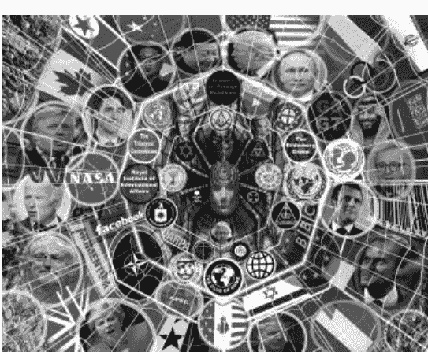

图1：少数控制多数人的全球网。（图像来源：Neil Hague。）

网的内部层次在公众视野之外的隐蔽区域运作，我们拥有我所谓的“尖枢组织”（cusp organisations），它们位于隐藏与可见的交汇点。它们包括一系列卫星组织，听命于一个19世纪末在伦敦成立的、名为“圆桌会议”（Round Table）的秘密协会。其中包括：英国国际事务学会（英国，1920年成立）；外交关系协会（美国，1921年）；比尔德堡小组（全球，1954年）；三边委员会（美国/全球，1972年）以及罗马俱乐部（全球，1968年），后者的创建是为了利用环境担忧为“拯救地球”的全球权力集权化提供合理性。罗马俱乐部等人发起了人类引起的气候变化骗局，这导致了所有“绿色新政”都要求这种集权化的控制。

尖枢组织包括遍布全球的无数“智库”，旨在政治和商业领袖、情报人员、媒体组织以及任何可以在其业务领域内影响政策方向的人之间，协调单一的全球政策。主要参与者和常驻者知道正在发生什么——尽管只是部分——而其他人来来去去，在大局上被完全蒙在鼓里。我将这些尖枢群体称为“半秘密”的，因为它们可以被公开识别，但内核发生的事情通过一套严厉执行的部门隔离制度（compartmentalisation），即使对大多数成员和参与者也保持在“内部”。只让他们知道为了符合你们的利益所需的知识，仅此不再加。

秘密协会的结构是这一原则的完美范例。在苏格兰仪式有33个正式等级的情况下，大多数共济会成员永远无法高于底部三个“等级”（知识等级）。只有当高层的人允许时，入信者才有资格进入下一个更高的“部门”或等级。知识可以被仔细地分配给那些被认为“安全”的人。几年前，我去了当地的共济会所，当时他们正举办“开放日”展示他们有多友好，当我与其中一些人聊天时，我惊讶于基层员工甚至对他们使用的无处不在的符号了解得如此少。“蘑菇技术”——让他们蒙在鼓里并喂给他们胡话——同样适用于网中的大多数人，以及整个大众。

网的各个分支在主题和结构上镜像了跨国公司，这些公司在世界某个地方设有总部，指挥着其在不同国家的所有子公司。子公司在方法论和品牌上按照同一个中央指令的计划和政策进行运营，以追求特定目标。邪教网的运作方式也是如此。每个国家都有自己的网，由秘密协会、半秘密团体和血缘家族的网络组成，它们的任务是在其特定国家施加蜘蛛和全球网的意志。子公司网络控制并操纵国家系统、金融、公司、媒体等，以确保他们遵循全球指令的议程。

### “好的”金字塔

部门隔离制度（Compartmentalisation）是理解为何极少数人能够在自上而下的强加与服从序列中，左右数十亿人的生活的关键。邪教的内核位于人类社会金字塔层级的顶端（图2叠加）。它将自己的意志——对世界的议程——强加给紧随其后的一层。这一层将邪教强加给下面的一层，后者服从并强加给下一层。很快，我们就遇到了层级中完全不知道存在邪教的层，但强加与服从的序列以同样的方式在金字塔上延伸。“…………在高处，所以我们最好这样做。”阿尔弗雷德·罗德·丁尼森在诗《轻骑兵冲锋》中对那些炮灰肉写道：“他们的任务不是质问为什么，而是去执行并去死。”下一句说“六百人骑向死亡之谷”，他们死是因为毫无疑问地服从他们感知的上级要求他们做的事。同样，大众也屈服于“新冠”。整个层级金字塔就是这样运作，让极少数人引导绝大多数。最终，强加-服从-强加-服从会传到金字塔底部的大众手中。如果他们顺从强加于他们身上的层级（政府/法律/医生/媒体），大众与内核中的少数精神变态者之间就完成了一个回路。如果没有打破回路的拒绝服从，强加与服从的序列将让惊人的少数人将他们的意志施加于全人类。

远离法西斯主义。法西斯人推行法西斯主义并不是因为他们人数不够。法西斯主义是通过民众对它的妥协来强加的。换句话说，允许他们的感知被编程到某种程度，导致民众通过放弃自己的感知——即他们的思想——从而放弃了自己的自由。如果这个回路不通过人类停止与自身的奴役合作来打破，那么什么都不可能改变。要实现这种转变，人们必须进行批判性思考，看穿那些言辞和装点，然后拿出勇气根据他们所见的事采取行动。“邪教”每天都在努力阻止这种情况的发生，其方法论系统化且高度详尽，但它是可以克服的，这正是本书的核心所在。

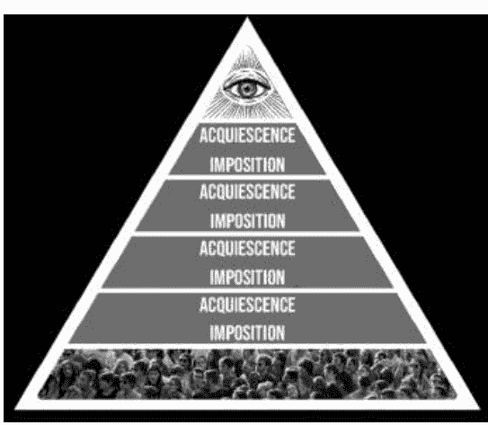

图 2：强制与服从的简单序列，让金字塔顶端的少数人就能决定数十亿人的生活。

### 生命程序

好了，回到世界 1 号或者说“大众”的世界。观察我们所谓的“生命”的过程，这是一场从摇篮到坟墓的感知下载。“邪教”创造了一个全球结构，在这个结构中，感知可以被编程，而程序不断获得那些看起来是“程序确实是真实现实”的持续确认。这里重要的词是“看起来”。

这就是这种结构，这个捕蝇器，“邮票式共识”或“感知主机”，它代表了由“教育”系统、主流媒体、科学和医学所提供的极其狭窄的感知可能性范围。从很小的时候开始，下载就始于父母，而他们本身已经屈从了孩子们即将经历的这种编程。大多数父母这样做并非出于恶意，大多数时候恰恰相反。他们这样做是因为他们认为对孩子最好的做法，而这正是程序告诉他们的。在三四年后，就经历了从父母的编程到学校、学院和大学中完全的国家（“邪教”）式编程的重大转变；被持续编程的教师和学者会将他们的编程传递给下一代。反抗的老师会被边缘化，职业随之终结；而反抗的孩子则被称为“问题孩子”，需要为他们处方利他林（Ritalin）。进入“世界”几年后，孩子们受到代表国家的权威人物的控制，他们告诉孩子什么时候必须在那儿，什么时候可以离开，什么时候可以说话、吃饭，甚至去上厕所。这是对一生服从所有形式的权威的精心准备。权威的反射性动作从一开始就由权威灌输了。孩子们很快学会了服从或反抗权威的胡萝卜加大棒后果，这在他们余生中每天都会得到强化。幸运的是，我在经历这些狗屁事时总是心不在焉，并且从未仅仅因为权威让我这样做就去服从。这种对我所谓的“优越者”的态度持续到了今天。在一个思想封闭、随从的世界里，追求开放的自由会导致后果。我曾因为不认真对待某些事情被赶出教室，在学校走廊里度过大量时间，而现在我花大量时间被 Facebook、YouTube 和 Twitter 踢出去。我可以告诉你，做真实的自己且不妥协自尊，比为了权威而向权威低头要兴奋得多。你不需要成为牧羊人（权威）的羊，以及牧羊犬（对不从权威的恐惧）。

感知下载在学校、学院和大学的形成期持续进行，而那些像读剧本一样的“老师”、“学者”、“科学家”、“医生”和记者坚持认为，每一代人必须像他们一样被编程。接受程序，否则你就无法通过“考试”，而这些考试确认了你的编程“程度”。令人悲剧的是，许多父母施压孩子在学校努力学习以下载程序，获得进入学院和大学下一阶段的资格。已故伟大的美国喜剧演员乔治·卡林（George Carlin）曾说：“这里有一个我很自豪的贴纸：我是一个孩子的父母，他反抗了老师试图破坏精神并屈从企业老板意志的尝试。”好吧，乔，祝你好运找到很多这样的孩子。接着就是离开学术界正式编程时期并进入“成年”工作世界的时刻。在那里，你会在你选择或指定的领域遇到其他人，他们比你早经历过同样的“邮票式共识”程序。因此，几乎所有人对邮票式现实的基础都存在着压倒性的共识，并对少数拥有主见并准备好运用它的人产生排斥甚至蔑视。这产生了两个主要影响：首先，对邮票式现实基础的共识导致了对少数拥有主见并准备好运用它的人的排斥甚至蔑视。其次，离开学术界正式编程时期并进入“成年”工作世界的时刻，让你在自己选择或指定的领域遇到其他人，他们比你早经历过同样的“邮票式共识”程序。

#### 对施虐者的怜悯情感

- 不愿学会从施加者手中解脱并治愈。从本质上说，受害者对自己的忠诚可能不如对他们的施虐者 *确实* 看到“新冠”]。

思考这些特征，并将其与全球大部分人群的行为进行对比。这些人自2020年初以来一直捍卫着政府和当局，而这些机构通过法西斯式的封锁、居家禁令和删除工作，每一分钟都在摧毁他们及其子孙的生活和生计，以此来“保护”他们免受一种“致命病毒”，而这种病毒是他们的施虐者在感知上创造的，为了导致正这一结果。我们面对的是大规模的斯德哥尔摩综合征。所有同意让出自由的人都会认为这些感知源于他们自己独立的“头脑”，但实际上，通过将他们的现实让给斯德哥尔摩综合征，他们从定义上已经放弃了任何思想的独立性。听听这个“新冠”时代顺从大众的“意见”，涌现出来的只是对未经处理、未经过滤且未经质疑的各种官方版本的重复。整个编程动态就是这样运作的。我必须是自由的，因为被告诉我我是自由的，所以我认为我是自由的。

你可以从章节主题“我在思考——噢，但你真的吗？”中看出我的意思。绝大多数人并没有思考，更不用说为自己思考了。他们是在重复权威告诉他们相信的东西，这让他们能够被控制。穿插在这种心态中的恐惧是：“阴谋论者”是正确的，这再次解释了为什么当你敢于质疑任何事情的官方叙述时，往往会遭到歇斯底里的虐待。否认是一种向自己逃避那些不想让其成为事实的机制。告诉人们他们想听的很容易，但要告诉他们他们不愿发生的事情将是一个极其巨大的挑战。

一种方式就像推开一扇敞开的门，而另一种则会遭遇激烈的抵抗，无论证据规模有多大。我不希望那是真的，所以我会说服自己它不是。例子随处可见，从尽管有所有迹象却否认伴侣出轨，到反射性地拒绝任何关于“一个又接一个国家以同样的集权协调的方式行动的世界性事件”的观点。接受后者意味着接受一种不可名状的恶力量正在摧毁你和你孩子的生活，而为了达到这一目的，没有任何如此恐怖的事物。到底谁想让它是真的？但如果我们不面对现实，结局就会到来，其后果将比今天带着勇气反抗暴政、站出来冲破否认的围墙要糟糕得多且持续不断。

## 连接点——但该如何做？


# 感知编程的一个关键方面

感知编程的一个关键方面，是描绘这样一个世界：其中一切都是随机的，几乎没有任何事物与任何事物相关。随机性从本质上无法被协调，一旦你感知到事件是随机的，它们可能存在关联的想法就会被视为“锡箔帽军团”的胡言而被抛弃。你无法计划和协调随机，你笨笨！不，你不能，但你可以把冷酷的计算和长期计划隐藏在随机的幻象之后。“叛逆思维”的基础表现是扫描现实以寻找连接看似随机现象的模式，并将像素转化为图像。这就是我的工作方式，而且我已经这样做了30多年。你在人、运作模式和预期结果中寻找相似之处，然后缓慢地、越来越快地，画面形成了。

例如：“新冠大流行”骗局与人为造成的“全球变暖”骗局之间似乎没有联系，然而它们是同一张脸（恰当得）上的面具，寻求相同的结果。通过罗马俱乐部和其他“邪教机构”推动全球变暖神话的人正在推动关于“新冠”的谎言——比尔·盖茨是一个显而易见的例子，但他们层出不穷。既然他们显然没有联系，为什么同一拨人会参与两者？噢，但他们有关。人员的共同主题与共同目标相匹配。这两个“问题”的“解决方案”是全球权力的集中，以便将少数人的意志强加于多数身上，从“新冠”中“拯救”人类，并拯救地球免受一种“生存威胁”（我们需要“零新冠”和“零碳排放”）。这些反过来又与“全球化”这个“点”连接起来，这个词被用来通过不断的政治和企业扩张、贸易集团以及像欧盟这样的超级国家，使全球权力生活的每一个范围内集中。如果你是少数人并想控制多数，你就使权力和决策权集中。权力越集中，中心的少数人对多数人拥有的权力就越大；权力越集中，中心的人们就有越多的权力去集权，以保护全球化的利益，并将全球权力夺取到“新冠”、“气候变化”和全球化背后的邪教核心圈手中。在这一点上，随机的“点”变成了一个清晰而易见的画面或模式。

克劳斯·施韦是一个经典的邦德反派，他创立了由盖茨资助的世界经济论坛。他在2020年出版了一本书《大重塑》，在书中利用“新冠”这一“问题”来为人类社会的全面转型辩护，以“拯救”人类免受“气候变化”。施韦说：“疫情代表了一个稀有但狭窄的机会窗口，让我们反思、重新想象并重置我们的世界。”他没有提到的是，邪教正如我在书《答案》中所展示的那样，是一个骗局。而且邪教不需要想象世界。他们清楚地知道自己想要，这就是为什么他们用“新冠”摧毁了人类社会，以便在他们的宏大设计中“变得更好”。他们的工作不是想象，而是让人类去想象并同意他们的计划，同时相信这一切都是随机的。“大重塑”长期以来一直是新世界的时代新秩序，这绝是纯属巧合。

# 拥有你

两项主要技术——问题-反应-解决方案（PRS）和极权主义（TT）已被邪教每天用于操纵我们，通过秘密地制造问题（或其幻象）并提供解决方案（或其幻象）。在第一阶段，你创造问题并将其归咎于某人或其他。这可能与金融崩溃、恐怖袭击、战争、全球变暖或流行病有关，事实上任何让你能够以你想要的方式实施解决方案的事件。“问题”不需要是真的。PRS是对感知的操纵，你只需要大众相信问题是真实的。人为造成的全球变暖和“新冠疫情”只需要被感知为真实的，大众就会接受权威的“解决方案”。我将这种技术称为“无问题-反应-解决方案”。数十亿人接受了从2020年初开始的居家禁，是因为存在真实的致命“新冠疫情”，但是因为他们认为事实如此。

联合国通过其“气候变化政府间委员会”制造了“问题”，并通过其《第21议程》和《2030年议程》强加了“解决方案”，这些议程要求全球权力完全集权，以从一场由联合国自己正在实施的气候骗局中“拯救世界”。这个教派（Cult）的世界在核心圈内看来是多么狭小。“问题-反应-解决方案”模式的基础是“极权主义垫脚”，而这种技巧在2020年演变成了“极权主义冲刺”。这种技术旨在通过表面上随机事件的掩护，隐藏其精心协调的行为。你从“A”开始这一序列，当你朝着“Z”前进时，你不希望人们知道这一点，旅程中的每一步都被呈现为随机事件，而所有的步骤都通向同一个方向。速度在近期可能加快了，但你仍然可以在“新冠”案例中看到“垫脚”这种循序渐进的方法，因为每一项新强加的任务都会让我们进入法西斯主义的深处。告诉人们为了回到“正常”，他们必须这样做或那样，然后这样做，配合那个。随着每一项新要求的增加，之前的自由被不断删除，直到消失。随着每一项新政令，蜘蛛更全面地在飞蝇周围结织网。当我谈到“新冠”骗局以及它是如何实施的时，我会更详细地强调这一点。“极权主义垫脚”的另一个例子是，教派创建的欧盟如何从一个“自由贸易区”通过权力渐进集权的“垫脚”，变成一个集权的官僚独裁政体，直到各国变成了布鲁塞尔教派拥有的西装精英的行政单位。

无知的解药是知识，而教派极力否认我们获得知识，但以此为目的的系统性审查，叛逆思维（Renegade Mind）可以通过大声寻找事实来克服，无论道路上有障碍。还有一种思考和感知的方法——*认知*——它甚至不需要名称、日期、地点等事实来识别揭示故事的模式。我将在最后一章介绍这一点。关于操纵人类社会及其目的，你所需要知道的在那里——在写作此时*——以书籍、视频和网站的形式存在，供那些真正想要突破程序化感知墙的人阅读。获取这些知识需要放弃将主流媒体作为信息来源，要意识到这些媒体是由教派拥有并控制的，因此在促进符合教派利益的大众认知。主流媒体整天每天都在撒谎。这是它的功能，也是它存在的理由。它在某些地方说出实话，仅仅是因为真相与教派议程偶尔会重合。如果你向 BBC、CNN 以及几乎所有其他机构寻求事实和洞察，你是在要求被欺骗并接受感知上的编程。

# 知道结果，你就能看到旅程

当你不知道世界被带向何方时，事件看起来是随机的。一旦你知道了，随机的就变成了精心计划。“知道结果，你就能看到旅程”是我长期以来一直使用的短语，用来为看似互无关的日常事件提供背景。一个问题（或对问题的幻觉）是否触发了拟议的“解决方案”，从而进一步推动社会向结果的方向发展？答案总是肯定的，随机的——咒语——变成了清晰的协调的。那么，这个开启了对日常事件大规模扩展理解之门的结果是什么？我将总结它的主要方面——细节见于我的其他书籍——现在通过这些信息，你将发现他们认为自己生活在的世界是一个完全不同的地方。教派议程的基础是权力的不断集权，而所有的集权最终都是为了教派在全球范围内的控制。长期以来，我一直将自上而下的独裁计划世界结构描述为“饥饿游戏社会”。这个词显然来自电影系列，该系列描绘了一个世界：少数生活在军事保护的高科技奢华环境中的人是主，统治一群被判定在孤立“区域”中遭受极端贫困的人口，这些区域不被相互互动。“新冠”封锁和旅行禁令大家熟悉吗？“饥饿游戏”的结构控制金字塔顶端是教派的核心圈，几乎整个人口都在底部，通过对教派的生存依赖受其控制。整个结构被计划由一个军事警察国家来保护和执行（图4）。

这里就是全球封锁的原因：高昂成本地破坏独立收入和生计，并让每个人依赖于“国家”（控制“国家”的教派）。多年来，我一直在我的书中警告引入“保障性收入”的计划——这是一种勉强维持生存的微薄收入，旨在当 AI 技术摧毁就业时施加依赖，现在甚至通过“新冠”骗局更全面、更快速地实现了这一目的。一旦大流行上演，封锁的后果开始删除独立收入，当局就准时开始谈论对保障性收入和“大重置”的需求。保障性收入将被呈现为仁慈的政府在帮助绝望的人们——而这种绝望是政府行为的直接结果。真相是，此类付款是一个陷阱。只有当你完全按照当局的要求行事，包括大规模接种（基因操纵），你才能获得它们。我们在澳大利亚已经看到了这一主题，那些依赖政府福利的人，如果父母不同意按照疯狂的、破坏健康的政府规定时间表让孩子接种疫苗，他们的福利就会减少。计算过的经济崩溃不仅适用于政府，也适用于人民。教派想通过建立世界国家来除掉各国，将国家划分为由世界政府和像欧盟这样的超级国家统治的区域。为了这一目的，国家也必须破产，这正通过数万亿的“救援方案包”和休假工资来实现。


**图4：饥饿游戏社会** 我长期以来一直在警告，而现在“新冠”使其成为可能。这是封锁的真实原因。

# 雇佣

在饥饿游戏教派精英和依赖性人口之间，计划建立一个军事警察国家（两者的融合）。这已经筹备了长期，警察看起来越来越像军队。大流行的骗局使这一过程加速了。

封锁软禁由精心招募的法西斯头脑和无能的系统维护者残暴执行。警察和军队计划合并为一支由世界政府领导的全球军队。这支世界军队甚至不计划由人类组成，而是使用人工智能控制的机器人技术进行战争，主要针对人口。我已经警告了这几十年了，现在世界各地的军队正被这种 AI 技术所转型。我所描述的全球政权是法西斯主义的一种特殊形式，被称为技术统治，在这种形式下，决策不是由无知且被收买的政治家做出，而是由未经选举的技术官们做出——科学家、工程师、技术人员和官僚。教派拥有并控制的硅谷巨头是技术统治的例子，他们引导世界事件的权力已经超过了政府。他们通过审查制度来挑选政府。我知道他们把“大重置”称之为共产主义接管，但法西斯主义和马克思主义是同一种暴政统治的不同标签。告诉那些生活在法西斯德国和斯大林式俄罗斯的人，他们的自由被删除和生活被控制的方式是有区别的。我可以称其为法西斯技术统治或马克思主义技术统治，它们都同样准确。饥饿游戏社会及其世界结构将监督一支全球军队、一个中央银行和单一无现金货币，对植入芯片的人口施加意志（图5）。扫描其不同元素，看看虚幻的大流行如何以极快的速度迫使社会向这一特定方向发展。

Adhanom Ghebreyesus，世界卫生组织那个腐败且仅仅是跑腿的“头头”，曾声称通过接触现金可能会感染“病毒”，最好使用无现金手段。这种说法完全是荒谬的毫无意义的废话，正如整个“新冠”心理骗局与“健康”无关，而与推行该邪派议程的每一个方面都有关。由于特德罗斯（Tedros）的谎言，现金的使用量暴跌。该邪派的脚本涉及一种全球数字货币，这种货币最终将通过技术手段嵌入人体。中国是该邪派一个巨大的全球中心，如果你观察那里发生的一切，你就会知道各地发生这种情况的原因。中国政府正在开发一种数字货币，允许通过人工智能立即扣除被摄像头拍到违反其丰富法律清单的罚款，而且这些资金将是可编程的并带有过期日期，以确保除了邪派及其运营人员外没有人能积累财富。

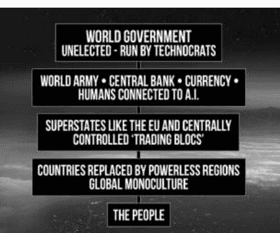
**图 5：** 邪派长期以来一直努力实现的全球控制结构，这种结构通过“新冠”幻象得到了巨大的推进。

## 奴隶制是如此智能

邪派的计划比大多数阴谋论研究人员所意识的要广泛、极端且全面得多，我将在“谁控制了邪派”和“逃离维提科（Wetiko）”章节中探讨欺骗与控制的真正深度。即使我们所知的世界已经足够疯狂了。在“智能”的名义下，我们正被日益复杂且更具控制性的技术所淹没。我们有智能电视、智能电表、智能卡片、智能汽车、智能道路、智能药丸、智能贴片、智能手表、智能皮肤、智能边界、智能人道、智能街道、智能城市、智能社区、智能环境、智能增长、智能星球……我们周围的一切都是智能的。智能技术和操作方法旨在相互锁定，创建一个全球网格，将全人类的大脑连接起来，从而创造一个由中央指令的“蜂巢”思维。“智能城市”是代码，指代通过人工智能进行全方位监控和控制的人口密集特大城市。更具破坏性的频率通信系统在没有经过健康和心理影响官方测试的情况下被推出（这简直是巨大的）。5G/6G/7G 系统需要运行智能网格，且每种系统对身心的破坏性都变得更强。通过终结私有财产所有权（除邪派精英外），消除独立收入对于迫使人们进入这些由人工智能监管的监狱至关重要。邪派的“大重置”现在公开预见了一个全球社会，在这个社会中，没有人拥有任何物品，一切都将是租赁的，而邪派将在政府和公司的名义下字面上拥有一切。其目标是利用封锁大规模地破坏收入来源，当人们陷入贫困并背负无法偿还的债务（问题）时，邪派资产登场并承诺免除债务，以换交出所有财产和物品（解决方案）。一切——字面上所有通过人工智能连接到互联网的东西。几年前我曾警告过即将到来的物联网（IoT），届时从你的汽车到冰箱的所有设备和技术将接入互联网并受人工智能控制。现在我们已经处于那里了，还有更多内容在后面。下一个阶段是万物智能（IoE），计划将人工智能与人类大脑和身体连接起来，用中央控制的人工思维取代人类思维。感知不再通过对信息的控制和审查被操纵，而是通过人工智能直接来自邪派。你觉得呢？你认为无论人工智能决定你认为什么，你就认为什么。在人类的术语中，将不再有个体的“思考”。这太不可思信了？疯子的胡言？完全不是。硅谷中属于邪派的疯子们年来一直在告诉我们这个计划，但没有解释真正的动机和经过计算的影响。这其中包括谷歌高管和“未来主义者”雷·库兹韦尔（Ray Kurzweil），他强调 2030 年将是这一计划实施的时间。他说：

> “这将是生物和非生物思维的混合……人类将扩展他们的局限性并‘在云端思考’……我们将在大脑中植入云端网关……我们将逐渐融合并增强自己……事实上，这就是人类的本质——我们超越了自身的局限性。”

由于技术远优于我们，仍然是人类的那一小部分将变得越来越小、越来越小，直到变得完全忽略不计。

库兹韦尔和邪派拥有的硅谷的推销术是，这将让我们成为“超级人类”，而真正的目标是让我们成为后人类，并且不再是我们所知意义上的“人类”。全球人口将连接到人工智能，并成为外部传递感知的中央控制的“蜂巢思维”。为了在全球范围内运作邪派而安装的智能网格正在建设中，以允许特定地点——即使是一个地点——控制整个全球系统。从这些首要控制中心（绝对包括中国和以色列），任何连接到互联网的东西都可以开启或关闭，能源系统可以被切断，互联网通信可以被中断，计算机控制的自动驾驶车辆可以驶离道路，医疗设备可以关闭，人工智能和互联网连接运行人类社会的潜力是无限的。如果我们允许这种情况继续，我们现在什么都没看到。自动驾驶汽车制造商正在与执法部门合作，生产一种汽车，当它们检测到 100 英尺外的警车或应急车辆闪灯时，汽车会自动靠边。在警察检查站，汽车将自动解锁，窗户会自动降。车辆只会带你去电脑（国家）允许去的地方。汽油汽车的终结和所有新车的限速器——自由的终结，终极的隐形项圈。车辆只会带你去电脑（国家）允许去的地方。汽油汽车的终结和所有新车的限速器——自由的终结。

# 第二章

## 叛逆感知

**聪明是一回事，明智是另一回事**

> 乔治·R·R·马丁（George R.R. Martin）

程序思维与叛逆思维区别的简单定义是：一个只看到点，而另一个则将它们连接起来看到图景。准确地解读现实需要观察者：(a) 知道的结果的结果以及 (b) 意识到一切、*一切* 都是连接的。无限现实的整体是连接的——这是它的本质——对于人类社会这一无限现实的表达，同样适用。简单的因果关系就是一种连接。结果由原因触发，而结果又变成了另一个结果的原因。没有任何事情是孤立发生的，它*不可能*这样。在任何现实中，生命都是简单的选择和后果。我们做出选择，这些选择导致了后果。如果我们不知道后果，我们可以做出不同的选择并得到不同的后果，从而导致其他的选择和后果。选择和后果不仅是连接的，而且是不可分的。正如一首老歌所说，没有其中一个就没有另一个。控制——谁拥有，谁不拥有——是一个双向的过程，是一种涉及控制者和受控制者的共生关系。人类需要醒来，动作快点。这是关于“结果”计划走向何处的最简解释，但足以让我们看到周围正在发生的旅程。那些新接触这些信息的人将已经以全新的背景看待“新冠”。随着我们的进行，我会添加更多细节，但对于微观证据，我们看到了我的作品、答案、触发因素以及你需要知道但从未被告诉过的一切。

现在——叛逆思维如何看待“世界”？

受到大规模的控制，是因为人类已经顺从了这种控制。这一切都是因果关系，字面上是一个取予与交换的过程。在同一个世界中，各种类型的事件都是相互关联的，而“教派”（Cult）不停地推销随机和巧合的幻象，以维持那些对他们而言至关重要的、隐藏了真相的点的感知。反叛者（Renegade Minds）深知此点并在全球范围内寻找连接模式。这对于理解世界上发生的事件至关重要，没有这种视角，清晰度是不可能的。首先，你知道计划中的结果，然后你确定旅程中的步骤——那些看似随机的每天，当它们与结果联系起来时，就不再是孤立事件，而是谚语中指向同一方向的事件链。我给你们几个例子：

## 政治傀儡戏

我们被告知要相信政治是“对抗性”的，即具有不同信念的政党为了权力进行无休止的斗争。这在某种程度上可能部分真实——而且仅如此——但今天，“不同”政党之间的分歧是修辞上的，而非意识形态上的。甚至这种修辞正在融合为同一种语调，因为政党排除了任何剩余的自由思考者，而其他的人则屈从于不断增加的对任何持有“错误”观点者的恐吓。“教派”并非新现象，正如我的书中所记录的那样，它可以追溯到数千年前。随着全球权力的日益集中，其跨代操纵事件的效果也越来越大。在古代，教派通过君主制度确保了控制，在那种制度中，“特殊”血统（后来会有更多）要求根据出生权作为国王和王后进行统治，并消灭其他声称拥有相同出生权的人。然而，到了某个时期，人们已经成熟到能够看到这种暴政的不公，并要求对治理他们的人有发言权。注意这个词——治理（governed）他们。不是服务（served）他们，而是治理他们，因此政府被定义为“对成员、公民或社区、社会和国家居民的行为所行使的政治方向和控制；对国家、社区等事务的指导”。政府行使控制而非仅仅是服务，就像之前的君主制一样。奇怪的是，现在还有像英国这样的国家由君主和一个官方上向君主负责的政府统治。英国国家首脑以及加拿大、澳大利亚和新西兰等英联邦国家首脑，是由同一个家族里的谁、和谁在一起、以及以什么顺序“选出”的。这简直令人不可置信。噢，该死，事实确实如此。大多数国家君主的灭亡提供潜在的真空，某种形式的自由公平社会可以由此产生，而教派也以此为基础。君主制服务于它们的利益，但在面对如此广泛的反对时，它们无法继续下去，而用一个人们看得见的“王室”独裁，被一个掩盖着“民主”概念的“人民”独裁所取代，这呈现了大得多的操纵可能性，以及在“自由”的幻象后掩盖协调暴政的方法。


民主被非常错误地定义为人口选出的政府。这完全不是那么回事。政府是由人口的一部分选出的（而且仅在理论上如此）。这“一部分”甚至不必是多数，正如我们在领先者当制（`first-pass-the-post`）选举中经常看到的那样，在那种选举中，所谓的多数派获得的票数少于“落败”政党的总和。民主可以从少数选票让政府中的政党获得绝对权力。将暴政推卖为自由是一种戏法。在2020年那场明显存疑的选举中，七四百万支持特朗普的美国人没有给乔·拜登的“民主”党投票，然而，与其承认美国社会很大比例的意愿和感受，教派拥有的政府从第一天就开始摧毁他们以及发声和意见的权利。空壳拜登和他的教派操控者说他们这样做是为了“保护民主”。政治堕落到了这种疯狂和疾病的程度。将这些点连接起来并将它们与想要的结果联系起来——一个由自封的技术官僚、甚至不再由当选政治家运行的世界政府。当教派在通过其在政府中的政治代理运作的同时，也通过将愚蠢和无能之辈置于理论权力之上（通往删除他们的道路），鼓励公众对政治家的蔑视。这种想法是植入一种公众反应，对那些技术官僚说：“好吧，他们表现得比那些糟糕的政治家不会更了。”这完全关于控制感知，反叛者可以看穿，而被程序化的大脑在既不知道计划的结果也不了解确保该结果所采用的操纵技术时，无法看穿。然而，这些知识是可以学习的，如果人们选择获取信息，学得很快。

政治初看似乎很难从中心点进行控制。我看着那些“不同”政党，你如何能监督它们及其所有的组成部分呢？事实上，由于它们的结构，这非常简单。我们回到了强加与顺从的金字塔模型。组织的结构与整体处于同一个体系内。政党不是自由表达的论坛。它们是层级制度。我曾是英国绿党的国家发言人，该党声称是一种不同的政治，其中影响力和权力是下放的；但我可以从直接经验告诉你们——现在情况糟糕得多——绿党像所有其他政党一样是以层级制运行的，无论他们如何试图隐藏这一事实，或如何自欺说这不是真的。在所有政党的顶端，有一群正在指导政策和人事。他们决定了你会在政党内晋升还是担任政府部长，为了做到这一点，你必须是一个唯唯诺诺的男人或女人。看看那些从未爬上那根油滑杆的独行政治思想家们。如果你想在政党内进步或达到“高官”，你需要顺从并一致。这种例外确实罕见。如果你想竞选议会或国会，你必须说服政党的地方或州级选拔你，为此你需要按照层级制要求的规则玩游戏。如果你赢得选举并想在层级制内进步，你需要继续符合那些运行者接受的标准。

## 多党制——一主

政党制度是另一个脑力骗术，通过将“王室”更换为人们相信代表他们利益（现在越来越少）的西装人，来引发独裁的本质。理解这个骗术是要意识到单一力量（教派）控制着所有政党，直接控制主要政党，或者通过操纵其他政党的感知和意识形态。你不需要操纵绿党来以“气候变化”的名义要求你进行社会转型，因为他们痴迷于对“拯救地球”至关重要的谎言。你只需要给他们一个平台，他们就会在服务你的利益的同时，认为自己是在行环保善。对于我在20世纪80年代在该党时认识的绿党国议员卡罗琳·卢卡斯来说，支持由教派特工克劳斯·施瓦伯代表富豪精英的提议是令人摇头的。

我已经在书中详细地揭露了它们，它们是乔治·W·布什（`Boy George Bush`）那愚蠢总统政策背后的驱动力，这些政策包括9/11事件（参阅《官方说说的全面拆解的诱因》）、随后的“反恐战争”以及对阿富汗和伊克的入侵。后者是一个基于“无问题-反应-解决方案”的模式，其基于包括布什和英国首相托尼·布莱尔在内的邪教特工对萨达姆·侯赛因拥有“大规模杀伤性武器”的指控，而布什和布莱尔很清楚，这些武器并不存在。

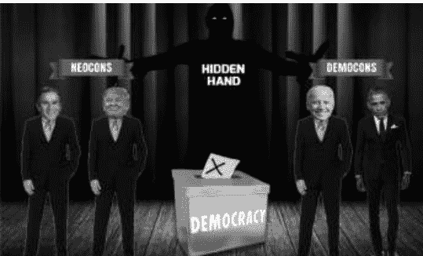

**图 6：** 不同的面孔，不同的政党——同一个控制系统。

民主党也有自己的在背后控制局的“新保守主义”群体，我称之为“民主新保守派”（`Democons`），这里是关键所在：新保守派和民主新保守派向更深一层、处于阴影中的同一批主人汇报（图 6）。在邪教的那个层面，共和党和民主党受同一群人的控制，无论哪一个处于邪教中，都是权力。这在几乎每个国家都是这样运作的，英国也是如此：保守党、工党、自由民主党和绿党现在都处于同一阵线上，无论他们为了虚弱地表现不同时使用的辞令如何。在布什时期，新保守派通过一个名为“美国世纪项目”的智库运作，该组织在2000年9月发表了一份名为《重建美国的防御：新世纪的战略、力量和资源》的文件，要求美国将“多场同时进行的战区战争”作为“核心使命”，以强制伊拉克、利比亚和叙利亚等国**发生政权更迭。新保守派安排了布什（“共和党”）和布莱尔（“工党”）作为入侵伊克的先锋，当他们离开时，民主党通过巴拉克·奥巴马（“民主党”）和英国首相大卫·卡梅伦（“保守党”）策划了对利比亚和叙利亚的目标打击。我们有“不同的”政党和“不同的”人，但有相同的展开剧本。邪教夺取了政党和人员的控制权，他们的政策透明地追求着同样的议程，以至于英国保守党军事集团约翰逊的法西斯式“新冠”强制措施遭到了工党的反对，因为他们不够法西斯。工党被类比为美国民主党，而保守党类似于英国版的共和党，在大西洋两岸，他们都说同一种语言，并支持邪教要求的方向，尽管某些人比其他人更有热情。一个国家接一个国家都是类似的剧本，因为一切都是受控制的。噢，但特朗普呢？我很快会谈到他。“政党”制度下的政治“选择”就是这样：你投票给A党，他们就上台了。你不喜欢他们做的事，所以下次你投给B党，他们就上台了。你不喜欢他们做的事，但那和A党几乎完全一样，既然两者都受同一力量的控制，为什么不这样呢？鉴于只有两个（有时是三个）政党有机会组建政府来除掉你不喜欢的B党，你必须投给A党，而……你不喜欢。女士们先生们，这就是他们所谓的“民主”，而我们被告诉（错误地——）这是一个与“自由”可以互换的词。

# 邪教之邪教

在这里，我需要介绍全球邪教的一种主要表现，即“萨巴泰-法兰克主义”（`Sabbatian-Frankism`）。`Sabbatian` 也拼写为 `Sabbatean`。我在这里进行总结。我已经在其他作品中发表了主要的揭露和详细背景。萨巴泰-法兰克主义结合了两个伪装成“犹太”男人的骗子的名字：萨巴泰·泽维（`Sabbatai Zevi`，1626-1676），一位拉比、黑魔法师和神秘主义者，他宣布自己是犹太弥主；以及雅各·法兰克（`Jacob Frank`，1726-1791），一位波兰“犹太人”、黑魔法师和神秘主义者，他称是弥主泽维和圣经先祖雅各的转世。他们跨越两个世纪建立了萨巴泰-法兰克主义邪教，该邪教在全球邪教操纵人类社会中发挥着主要的、甚至是核心的作用，而全球邪教的起源比萨巴泰·泽维要早得多。针对那些会尖叫“反犹太主义”的刺耳声音，我在这里强调两点：(1) 萨巴泰-法兰克主义者**不是**犹太人，他们只是假装成犹太人以此隐藏他们的邪教表面；(2) 我关于这个邪教的信息来自犹太来源，他们早已意识到自己的社会和社区已被闯入者萨巴泰-法兰克主义者渗透并接管。渗透一直是萨巴泰-法兰克主义从其17世纪正式起源以来的基础技术。泽维的萨巴泰派吸引了大量的追随者，被描述为犹太历史上最大的弥赛亚运动，蔓延到非洲和亚洲，他承诺犹太人将回到以色列的“应许之地”。萨巴泰主义不是犹太教，而是犹太教所代表的一切的对立面。以至于，这种阴险的邪教会在犹太教禁斋的日子举行盛宴，而任何在犹太教中被禁止的事，萨巴泰信人都被鼓励甚至被命令去做的。这包括乱伦和所谓的撒旦教。成员被禁止在教外结婚，并有一套系统让他们的不知道自己处于什么之中，直到他们大到可以信任他们不会无意中向外人透露任何事情。这种系统至今仍被全球邪教广泛采用，萨巴泰-法兰克主义对其产生了巨大影响，并现在很大程度上控制着它。

泽维和他的萨巴泰派因中东伊斯兰奥斯曼帝国苏丹的干预而遭受了挫折，现在的土耳其共和国是当时泽维所在地。苏丹给了他一个选择：证明他的“神性”、皈依伊斯兰教或面对酷刑和死亡。有趣的是，泽维选择了皈依，或者至少假装如此。他的一些支持者感到幻灭并离开了，但许多并没有离开，300个家庭也——在理论上——皈依了伊斯兰教。他们继续在这种烟雾弹下遵循萨巴泰主义的目标、规则和仪式，被称为“秘密犹太人”或“顿麦赫”（`Dönmeh`，意为“转向”）。这相当讽刺，因为他们并没有“转向”，而是躲在一个虚假的伊斯兰教人格之后。这种“表面上是一个，实际上是另一个”的过程变成了萨巴泰主义的通行证，特别是在泽维去世以及18世纪撒旦教徒雅各·法兰克到达之后，当时邪教变成了萨巴泰-法兰克主义，并陷入了堕落和渗透的新深度，这包括——仍然包括——人祭和儿童性交。无论萨巴泰人去哪里，恋童和撒旦教就随之而来，好莱坞竟然充斥着虐待儿童和撒旦教真的很令人遗憾，因为它是由萨巴泰-法兰克主义者建立并仍由他们控制的？好莱坞一直是全球感知编程和操纵的主要工具之一。有多少人相信电影中描绘的“历史”版本，尽管它是对真理的拙劣模仿和再次反转？拉比马文·安特尔曼（`Marvin Antelman`）在他的著作《消除鸦片》中将法兰克主义描述为“完全邪恶的运动”，而犹太教授格尔森·索莱姆（`Gershom Soolem`）在《犹太教中的弥赛亚思想》中声称：“在他所有的行为中，他都是一个真正腐败和堕落的个人，是犹太历史上最令人恐惧的现象之一。”法兰克没有得到传统拉比的交流，泽维也是如此，但他并未畏惧，并受到了著名的罗斯柴德家族的支持，这个臭名昭著的银行王朝其核心是萨巴泰-法兰克主义者而非犹太人。对罗马教会和梵蒂冈的渗透是由法兰克发起的，许多“顿麦赫”再次“转向”皈依罗马天主教，以劫持权力控制权为目的。这是不断重复的操作模式，并且依然如此。伪装成你想要控制的宗教、文化或国家的拥护者，然后将你们的人操纵到权威和影响力的位置，主要作为那些表面上掌权者的顾问、行政人员和后操纵者（`Svengalis`）。他们对犹太教、基督教（基督教犹太主义是一部分）、伊斯兰教和其他宗教和国家如此做，直到萨巴提-兰克主义（`Sabbatian-Frankism`）像今天一样席卷全球。

## 萨巴提沙特阿拉伯与恐怖网络

伊斯兰教内部萨巴提-兰克德翁梅赫（`Dönmeh`）的一种表现形式是沙特阿拉伯的皇室——沙乌德家族，通过他们产生了被称为瓦哈比主义的对伊斯兰教的邪恶歪曲。这是基地组织或`ISIS`（伊斯兰国）等恐怖组织所遵循的暴力信条。瓦哈比主义是沙特阿拉伯那种砍手、斩头的“宗教”，被用来让民众处于持续的恐惧状态，以便让入侵者沙乌德家族能够继续统治。基地组织和伊斯兰国得到了沙乌德家族的慷慨资助，而它们是由美国通过五角楼、中央情报局以及一般的“政党”政府运作的萨巴提-兰克网络创建并指导的。18世纪中期建立瓦哈比主义的门面是一个伪装成穆斯林的萨巴提-“秘密犹太人”，名叫穆罕默德·本·阿卜杜尔-瓦哈卜。他的女儿嫁给了穆罕默德·本·沙乌德的儿子，后者在1675年并在英国帝国的支持下建立了第一个沙特国家。沙乌德的继承者在1932年与英国、美国合作建立了现代沙特阿拉伯，这使他们获得了对麦加和麦地伊斯兰教主要圣地的控制权。他们规定了逊尼伊斯兰教的方向，这里我们看到了他们之间最不公开冲突的来源。萨巴提网络利用其瓦哈比极端主义者以“基地组织”和“伊斯兰国”的名义进行“问题-反应-解决方案”式的恐怖袭击，以此证明一场毁灭性的“反恐战争”的正当，对民众日益增加的监控，并恐吓人们使其服从。《反叛者心态》（`The Renegade Mind`）的另一个洞察是世俗的理解：仅仅因为一个国家、地点或人民发动攻击，并不意味着那些表面上代表该国家、地点或人民的人不是袭击者背后的黑手。他们往往是因为社会变化而策划了袭击，而这些变化随后可以以“从恐怖分子手中拯救民众”的名义合理化。

我在《触发器》（`The Trigger`）中详细展示了萨巴提-兰克主义者才是9/11事件的真实作手，而不是那些被指责导致发生事件的“19名阿拉伯劫持者”。观察仅仅为了9/11之名而在中东入侵、大规模监控和控制方面被正当化的行为，这些满足了萨巴提新保守主义者（`Neocons`）发布的《新美国世纪计划》文件的要求。表面上的敌人其实是同一个萨巴提团队的深层玩家。以色列和阿拉伯“王室”独裁政体都由萨巴提统治，而以色列与沙特阿拉伯、阿拉伯酋联合国（`UAE`）最近的和平协议只是让一直以来在幕后发生的情况正式化。自1948年以色列被轰炸和恐吓而建立以来，巴勒斯坦人一直遭受着残暴的暴政。萨巴提-兰克主义者控制着以色列（萨巴提人喜爱的暴力和战争的永恒主题），他们一直在寻找从未得过的真正支持。沙特、巴林林、阿拉伯酋联合国等阿拉伯世界的“王室家族”都是萨巴提人，效忠于该教派的目标，而非对其阿拉伯民众最好的利益。他们通过虚假地声称是拥有遗传统治权的“王室王朝”，并雇用残暴的军队施加他们的意志，从他们人民手中偷走了石油和财务资源。

## 魔鬼的“启蒙”

撒旦教徒雅各·弗兰克（`Jacob Frank`）在1773年与另外两个萨巴提人结成了盟：罗斯柴德银行王朝的创始人梅耶·阿舍尔·罗斯柴德（`Mayer Amschel Rothschild`，1744-1812），以及受过耶稣会教育的欺诈犹太人亚当·魏斯豪普特（`Adam Weishaupt`），这导致了1776年最初以另一个名字成立的巴伐利亚启蒙会的形成。启蒙会将是法国大革命（1789-1799）背后的操纵力量，并在启蒙会正式成立之前和之后也参与了美国革命（1775-1783）。魏斯豪普特后来（在公开场合）成为一个典型的萨巴提风格的新教基督徒。我读到过他的名字可以被解码为`AdamWeishaupt`或“第一个带领知情者的人”。他并不是意义上的领导者，因为他是一个下属，但他确实领导下属进行了一场变革人类社会的十字军运动，这场运动一直持续今天。这一主题早在1785年就确认了，当时一名马信员兰兹据报道被雷劈中，在马包中发现了大量的启蒙会文件。他们将魏斯豪普特联系起来，并详细制定了接管世界的计划。当前的“新冠”法西斯主义事件已经策划了很久。雅各·弗兰克在1760年捕后被天主审判庭监禁了13年，释放后他去了德国法兰克福，那是罗斯柴德家族的家乡和总部，他在那里与梅耶·阿舍尔和魏斯豪普特结盟。罗斯柴德安排弗兰克获得了男爵称号，并成为一个在德国、奥匈帝国和其他欧洲国家拥有大量犹太追随者的富有贵族。他们中的大多数人会认为他是自己这边的。

“启蒙会”（`Illuminati`）的名字源于《左华》（`Zohar`），它是犹太神秘“圣经”卡拉拉学中的一套著作集。《左华》是萨巴提-兰克信仰的基础，在希伯来语中，“左华”意思是“光辉”、“光芒”、“被启蒙的”，因此我们有了“启蒙会”。他们声称是“被启蒙者”，他们的知识被系统性地对人类隐藏，这种知识通过全球秘密网络中精心挑选的启蒙者代代相传。这种知识包含了对世界的意识，这种现实是教会的本质，我将在后文中探讨。教会的“启蒙”由自由女神所持有的火炬象征，这把火炬是法国共济送给纽约的。“自由”象征着在巴比伦被崇拜的女神塞米拉米斯或伊什塔尔。此事的意义将变得清晰。再次注意无处不在的倒置的主题，即“自由”实际上象征着大规模控制（图7）。在巴黎塞纳河的一个岛上有一座雕像，那是纽约自由女神的起源（图8）。一座巨大的自由之火复制品位于巴黎的阿尔玛桥（`Pont'Alma`）上，那是戴安娜公主去世的地方。“光明之者”路鬼与这一切有关（正如我们看到的），而且“路鬼”是萨巴提-兰克主义的一个核心人物。

[img/37438267f3d341c5363e9192a9a41d438.png]

**图7**：伪装成自由女神的巴比伦教派女神，拿着光明之者的火炬。

[img/37438267f3d341c5363e9192a9a41439.png]

**图8**：巴黎的自由女神镜像，纽约的版本源于此。

## 马克斯兄弟

拉拉比马尔文·安特尔曼在《消除鸦片》（`To Eliminate the Opiate`）中将启蒙会与雅各派联系起来，而雅各派是法国大革命背后的力量。他将两者都与“正义联盟”（`Bund der Gerechten`）联系起来，该联盟是把共产主义/马克思主义引入世界的网络。安特尔曼写道：

> 正义联盟原始内部圈由出生的天主教徒、新教徒和犹太人[萨巴提-兰克教渗透者]组成，这些各自分支的代表制定了最终毁灭他们信仰的计划。异端天主教徒制定了他们认为需要一个或更长时间才能最终毁灭教会的计划；使徒耶稣则为了毁灭犹太教。

萨巴提人创造的共产主义进入了这种反宗教议程，共产主义不允许自由信仰宗教。萨巴提人拒绝犹太教律法或《五五经》，即被称为“摩西五书”的创世记、出埃及记、利未记、民数记和申命记，这些是“上帝”在西奈山上传给摩西的。

政治左翼的传统信仰已被取代，取而代之的是极右主义的“社会正义”，这便是广为人知的马克思主义。然而，“觉醒文化”（`Woke`）将被其自身认为的“革命”所吞噬，而这实际上是亿万翁和亿万级公司伪装成“觉醒”的作品。觉醒者将马克思主义推崇为“资本主义”的替代品，但我们并没有“资本主义”。我们拥有的是财团主义，市场被那些资助“觉醒文化”的邪教亿万翁和公司所操纵。亿万翁们热爱马克思主义，因为它让人们处于奴役状态，而他们则从顶层控制一切。他们致命地认为自己正在“改变世界”，但实际上是邪教在进行改变；当他们扮演完关键角色并变得多此一卒时，他们也将成为目标。光明会-雅各宾派是1793年和1794年法国大革命“恐怖时期”的幕后黑手，当时雅各宾派的马克西米连·德·罗伯斯庇尔和他奥威尔式的“公共安全委员会”杀杀了1.7万曾经是“革命朋友”的“革命敌人”。卡尔·马克思（`Karl Marx`，1818-1883）的萨巴提教条导致了至少1亿人的生命，但他对于觉醒者来说再次成为英雄，这些人被他们的“教育”计划系统性地剥夺了真实历史。结果是他们现在推崇一种萨巴提式的“马克思主义”怪胎，这种东西注定会在某一点将他们吞噬。研究了十年萨巴提阴谋的安特尔曼拉比在谈到正义联盟和卡尔·马克思时说：

> 与流行观点相反，卡尔·马克思并非《共产党宣言》的原创。他的服务是由正义联盟支付的，该联盟在他的祖国德国被称为“正义联盟”（`Bund der Gaechechten`）。


# 安特尔曼表示，归于马克思的文本是他人的作品

马克思“只是在重复别人已经说过的话”。马克思是一个“被雇佣的走狗——缺乏富裕的光明会成员”。马克思曾有名言宗教是“人民的鸦片”（萨巴提魔化宗教计划的一部分），安特尔曼将他的书称为《消除鸦片》。马克思出生于犹太人家庭，他的家族改信了基督教（萨巴提的操作模式），并攻击犹太人，尤其是在他的《一个没有犹太人的世界》一书中。通过这种方式，他支持了萨巴提破坏传统犹太教和犹太教的计划，我们今天正清楚地看到，以色列的萨巴提政府通过“新冠”法律对正统犹太人进行报复性针对。

我不信从任何宗教，宗教在几个世纪以来对世界造成了巨大伤害，并充当了认知枷锁。然而，“叛逆者”（Renegade Minds）总是在问为什么要做某事。无论他们是否同意或不同意正在发生的事情并不重要——问题在于为什么发生。关于宗教，“为什么”的答案是：宗教创造了信徒的互动社区，而邪教想要拆解所有的话语、统一和互动（参见“新冠”封锁），其最终目标是删除所有宗教，建立一个崇拜他们“神”的世界性邪教撒旦教，这一点稍后详述。

我们在美国的枪支管制问题中看到了同样的“为什么”。我没有枪也不想要，但为什么邪教在执法机构武装到牙齿的同时寻求解除民众的武装？为什么历史上的每个独裁者在发动最终接管之前都寻求解除民众的武装？他们包括希特勒、斯大林、波尔布特和毛泽东，后者在没收之后采取了暴力夺权。你知道这是那些立即冲向麦克风、利用多起枪击案中死者的人的邪教议程。极犹太主义邪教信徒、参议员查克·舒尔默在2021年3月科罗拉多州发生10人遇难案后，直接介入了案件。简单的规则是……如果舒尔默想要，邪教就想要，还有他那极犹太主义的盟友、眼神狂热的参议员亚当·希夫。与此同时，他们呼吁解除美国人的武装，其中许多人离警察响应很远，而舒尔默、希夫以及其他这些受宠的丑角正坐在国会山上，躲在剃刀铁丝网安全围栏后，还有成千上万名武装士兵以及他们自己的武装保镖的保护。偏远家庭的普通父母呢？他们只是潜在的集体射杀手。

## 锡安主义框架

萨巴提-弗兰克派以及最重要的罗斯柴尔德家族是“锡安主义”的幕后黑手，这一政治运动要求按照萨巴提·齐维的承诺在以色列建立犹太人家园。以色列的符号本身源于罗斯柴尔德姓名的德语含义。王朝创始人梅耶尔·阿姆舍尔将姓氏从Bauer改为Rothschild（或德语中的“红盾”），以尊崇该家族在法兰克福家中展示的六角星“大卫之星”六角形。在罗斯柴尔德家族深度参与其创造后，该符号后来出现在以色列国旗上。六角形并非犹太特有的符号，在神秘（隐藏）网络中被广泛使用，通常作为土星的符号（原因见我的其他书籍）。

锡安主义和犹太身份并非等同的。锡安主义是一种政治运动和哲学，而不是一种“种族”或民族。许多犹太人反对锡安主义，许多非犹太人（包括美国总统乔·拜登）自称是锡安主义者，以以色列为中心的唐纳德·特朗普也是如此。美国对以色列政府的支持几乎是理所当然的，极犹太主义亿万富翁和公司为两个政党提供了极佳且主导性的资金。前国会议员辛西娅·麦金尼曾讲述她在竞选时立即被接触，要求“签署对以色列的宣誓，并确认将始终符合该国的利益”。所有美国政治家都是这样被接触的。任何拒绝的人都得不到庞大强大的锡安游说集团（如巨型游说AIPAC，美国以色列事务委员会）的支持或资金。特朗普最大的资助者是极犹太主义的赌场亿万富翁阿德尔森，而民主党的主要资助者包括极犹太主义者乔治·索罗斯和极犹太主义金融大亨海姆·萨班。对于索罗斯是一个“叛逆者”的暗示，有些人可能会感到震惊，在萨巴提式的反转精神下，索罗斯为一个大学网络捐赠了10亿美元以推广“自由价值观和不宽容”。他是在2020年1月在瑞士达沃斯由邪教拥有的世界经济论坛上的年度演讲中做出这一声明的，此前他对全球“威权执政者”进行了“严厉批评”。你对这种谎言只能付之一笑。他为什么不笑是个谜团。从奥威尔式的“自由价值观和不宽容”翻译过来，意味着教导非白人恨白人，并让白人为自己的白人身份感到厌恶。其中的原因将变得清晰。

## “反犹太主义”骗局

锡安主义者支持在巴勒斯坦建立犹太人家园，这是萨巴提-罗斯柴尔德家族长期以来的目标，但并非为了犹太人的利益。萨巴提人和他们的全球“反犹太主义产业”扭曲了公众认知。这无非是萨巴提的一种保护伞，旨在阻止对他们议程和活动的合法调查与曝光。“反犹太主义”的官方定义最近扩大到包括对锡安主义（一种政治运动）的批评，这样做是为了进一步阻止对19世纪创造我们今天所知的锡安主义的萨巴提渗透者的曝光。叛逆者在知道将面临的脏水时才会讨论这些话题。人们必须决定是想知道真相，还是仅仅躲在别人说的话语里。

从20世纪90年代以来，萨巴提一直试图给我贴上“反犹太主义”的标签，因为我揭露了更多关于他们的背景和议程。无用、胆小、虚假的“记者”们那时只会毫无疑问地重复这些诽谤。就在我写这一部分时，两个毫无疑问的重复者本·奎因和阿奇·布兰德（多么讽刺）在建制派的宣传工具《伦敦卫报》上，在没有任何证据支持的情况下直接直呼我为“反犹太分子”。

萨巴提反犹太主义产业是这么说的，他们又有什么资格质疑呢？他们根本不敢。讽刺的是，“闪米特”（Semitic）指的是中东的一组几乎全是阿拉伯语的语言族。“反犹太主义”变成了“反阿拉伯人”，如果这种误解的后果不是如此严重，那将是滑稽的。我不想让他们混淆，愿保佑他们。不去打扰奎因和布兰德。

我被冠上“反犹太主义者”标签的原因之一是，我在20世纪90年代写道，犹太人特工（萨巴提人）在萨巴提人推翻俄罗斯王朝时深度参与了俄国革命。这显然让我变成了“反犹太主义者”。噢，真的吗？这里是《触发器》（The Trigger）中的一段内容：

> 英国记者罗伯特·威尔顿（Robert Wilton）在他1920年的著作《罗曼诺夫王朝的末日》（The Last Days of the Romanovs）中证实了这些主题；他研究了俄罗斯政府的官方文件，以识别1917年至1919年间布尔什维克精英阶层的成员。中央委员会的62名成员中包括41名犹太人；人民委员委员会的22名成员中有17人；1918年至1919年间556个最重要的布尔什维克职位中，有458个被犹太人占据。只有17人是俄罗斯人。此外，在1917年建立的36名恶名昭彰的契卡（Cheka）秘密警察中，有23名犹太人，他们很快再次出现在各地。
>
> 牛津大学的瑟维斯（Service）教授是20世纪俄罗斯历史专家，他发现证据表明，“犹太”列昂·托洛茨基（Leon Trotsky）试图确保犹太人加入红军，并在苏联官僚机构中占据不成比例的多数，其中包括执行了对“人民的‘敌人’进行大量逮捕、监禁和处决的契卡机构。一份日期为1918年11月13日的美国国务院十进制机密文件（861.00/5339）点名了[在美的罗斯柴尔德银行代理]雅各布·希夫（Jacob Schiff）以及一份极锡安主义者名单作为俄国革命的资助者，导致了对“犹太人阴谋”的指控；所有人忽略的关键点并非“犹太人”——他们是萨巴提弗兰克主义者。
>
> 英国的丘吉尔（Churchill）出于无意还是故意犯了同样的错误。他在1920年版的《插图星期日快报》（Illustrated Sunday Herald）中写道，俄罗斯革命的背后黑手是一个“旨在推翻文明、并根据停滞的发展、嫉妒的恶意和不可能的平等为基础重建社会的全球性阴谋”的成员（今天所谓的‘觉醒’（Woke）是因为那是由同一个网络创造的）。丘吉尔说，不需要夸大在布尔什维主义的产生以及俄国革命实际发生中所起的作用，那是“通过这些国际性的且大多是无神论的犹太人”[注：原文中使用的是‘atheistical’（无神论）]（“无神论犹太人”=萨巴提人）。丘吉尔说，这无疑是一个巨大的事实，可能超过其他所有因素：“除了列宁这个显著例外外，大多数领导人物都是犹太人。”他继续描述了（无论是有意还是无意）萨巴提人的运作模式：将傀儡领袖名义上置于权力位置，而在幕后进行控制：
>
> 此外，主要的灵感和驱动力来自犹太领袖。因此，纯正的俄罗斯人契切林（Chicherin）被他的名义下属李维诺夫（Litvinov）所掩盖，而布哈林（Bukharin）和卢纳察尔斯基（Lunacharsky）等俄罗斯人的影响无法与托洛茨基、红色堡垒（彼得格勒）独裁者季诺维也夫，或克拉辛（Krassin）和拉德克（Radek）的力量相比——他们都是犹太人。在苏联机构中，犹太人的主导地位更加令人震惊。在反革命特别委员会实施的恐怖体系中，犹太人占据了显要的（如果说确实是主要的）地位，而且在某些情况下甚至是由犹太女性承担的。

我关于犹太“革命者”（萨巴提人）严重不成比例地参与俄国革命的说法是可证明的事实，但真相无法防御萨巴提反犹太主义，以及它像奎因和布兰德这样的复读机，以及现在令人瞠目结舌的所谓“觉醒”、“反仇恨”团体，这些团体拥有交织的领导层和资金，其作用是诋毁和封口任何过于接近揭露萨巴提人的人。我们在法律判决中看到了“真相无法防御”的证实，加拿大萨斯喀彻温省人权委员会曾对此裁定：“真实不实的陈述可以以符合仇恨言论定义的方式呈现，且并非所有真实不实的陈述都必须免受限制。”大多数“反仇恨”活动分子本身也被仇恨所吞噬，他们太愚蠢、对世界一无所知，不知道自己是如何被利用的。他们太沉溺于自己的自我道德标榜表演了，对他们来说世界太黑暗，看不见任何东西。

## “革命”游戏

“俄国”革命的背景和方法直接源自萨巴提的剧本，这在法国革命以及世界其他数不尽的革命中可见。这些革命起初是人民反抗暴政的统治，最终以政权更替为更加公开或隐蔽的暴政而结束。战争、恐怖袭击和政权推翻在历史上追随着萨巴提崇拜，其特工通过制造这些事件作为“问题-反应-解决方案”，以消除世界上对他们统治的反对。萨巴提的线索连接了罗斯柴尔德家族与光照会、法国革命的雅各宾派、“联盟”（Bund）或正义联盟、国际共产党、共产主义者同盟以及卡尔·马克思和弗里德里希·恩格斯的《共产党宣言》，这些导致了由罗斯柴尔德资助的俄国革命。当你通过不断破坏现状来建立一个随后也会摧毁的新现状，从而推进你的全球目标时，这一系列行为被称为“创造性破坏”。这让人想起两次世界大战。随着每一个新现状的出现，你离计划的结果就越近。战争和大规模屠杀对萨巴提人来说是一场集体的血祭仪式。

关于萨巴提弗兰克主义的描述如下：

> “犹太社区只是一个非常方便的掩护，用来掩盖萨巴提人的真实本质。任何接近揭露他们游戏的人都会被萨巴提安的人和走卒指责为‘反犹太主义’，并声称所有犹太人都是统治世界阴谋的一部分。我不是这个意思。我是说萨巴提人——真正的仇犹者——渗透了犹太社区，利用他们作为掩护和防御揭露的手段。因此，我们有了这种被针对的反犹太主义产业，大多数犹太人认为这是合理的真实的。他们不知道他们的‘犹太’领袖和国家、情报及军事机构完全不受犹太人控制，而是萨巴提弗兰克主义的信教徒和傀儡。”

阿拉伯。那“19个人”甚至不是独自驾驶了那些大型客机撞击建筑物的，因为他们在驾驶单发动机轻型飞机方面很大程度上毫无能力。据说，“劫机者”哈尼·汉朱尔（Hani Hanjour）驾驶美国航空77号航班撞入五角大楼时，其转弯和操作大多数专业飞行员都认为难以完成；而就在六周前，他在马里兰州鲍伊的高速公路机场（Freeway Airport）的教练还因为他飞行能力不佳而禁止他租用小飞机。

世界上犹太人口仅占总数的0.2%，其中几乎完全集中在以色列（75%）和美国（约2%）。这2%和全球的0.2%指的是犹太人，而不是那些仅占该比例极小一部分的萨巴特派（Sabbatian）入侵者。当你考虑到以色列的国际事务以及“新美国世纪计划”（PNAC），这真是一个令人警醒的思考。该计划在2000年9月制定了美国反恐战争以及在伊拉克、利比亚和叙利亚政权更迭的蓝图，而该计划是由被称为“新保守派”（Neocons）的萨巴特派创立并主导的。该文件承认，如果没有对美国本土发动重大攻击，如果没有一个“问题-反应-解决方案”的借口来派遣部队在中东进行战争，这一计划在政治或公开上无法获得支持。萨巴特派新保守派说：

> 这种转变的过程……[战争和政权更迭]……可能是一个漫长的、缺乏某些灾难性和催化性事件——就像一个新的珍珠港。

比产生该文件的那些人晚四个月，他们带着他们愚蠢的傀儡乔治·布什上台了。其中包括萨巴特派的迪克·切尼（Dick Cheney），他是官方副总统，但实际上是整个“布什”政府的实际总统。“布什”就职九个月后，发生了布什当时所谓的“21世纪的珍珠港”。考虑到萨巴特派的时机和象征意义，2001年是1941年日本空军袭击夏威夷珍珠港的60周年，这让弗兰克林·德拉诺·罗斯福总统带领美国进入了一场由萨巴特派挑起的第二次世界大战，而他在竞选活动中曾说他绝不会这样做。有充分证据表明罗斯福和他的军事及情报网络知道袭击即将到来，但没有采取任何行动阻止，不过他们确保了美国最核心的军舰当时不在夏威夷。三千名美国人在珍珠港袭击中丧生，正如他们在9月11日那一样。

在2001年这个“9/11”之年，萨巴特派已广泛渗透进美国政府、军和情报行动中，并利用他们的分段资产策划了“基地组织”袭击。如果你读过《触发器》（The Trigger），你会震惊于在袭击之前、期间和之后，政治、安全、法律、执法、金融和商业权力的关键职位上，有着令人震惊的“犹太”特工（萨巴特派入侵者）的集中程度，这由他们策划了袭击、执行了袭击，然后掩盖了痕迹——我是说，考虑到全球人口的0.2%和2%的犹太美国人，这种集中程度是极其惊人的，而萨巴特派入侵者只是这些比例的极小一部分。

9/11阴谋的核心基础之一，是通过以色列（萨巴特派）“网络安全”软件实现的“后门”访问，实时劫持政府、军事、空军和情报计算机系统。萨巴特派控制的以色列正走向与硅谷竞争网络空间的统治，并正成为网络空间的主导力量，这让他们能够访问全球整个计算机系统及其密码。此外，由犹太主义者领导的硅谷巨头，如谷歌（拉里·佩奇和谢尔盖·布林）、谷歌拥有的YouTube（苏珊·沃西基）、Facebook（马克·扎克伯格和谢尔·桑德伯格）以及苹果（主席亚瑟·D·列文森），以及极犹太主义对冲基金亿万富翁保罗·辛格（Paul Singer）拥有Twitter的1亿美元股份，而Twitter仅名义上由大麻“首席执行”杰克·多西（Jack Dorsey）领导。正如新闻主持人塔克·卡尔森（Tucker Carlson）对多西所说：“医学界曾争论过一吨酸是否会有永久影响，我认为这种争论现在结束了。”卡尔森在多西于国会山的一场听证会上发表了这一评论（如果你看穿了他的胡话的话），多西表示他相信言论自由，只要由他决定你可以听到和看到什么。

这些硅谷的“大人物”只是全球邪教（Global Cult）的傀儡，尤其是萨巴特派，他们是这些公司的真正控制者。是否还有人疑惑，为什么这些人和公司一直在激烈地封锁和禁止人们（像我这样的人）揭露该邪教议程的任何方面，特别是关于萨巴特派策划的“新冠”骗局的真相？

爱泼斯坦（Epstein）恋童集团是一个萨巴特派的行动。他是官方的“犹太人”，但他是一个萨巴特派，被该圈子虐待的女性告诉我，其中涉及有大量的“犹太”人。爱泼斯坦的恐怖事件处处都是萨巴特派的色彩，并完美符合他们的手法以及对性与仪式的痴迷。爱泼斯坦经营着一个萨巴特派的勒索网络，为具有政治和其他影响的名人提供年轻女孩进行性行为，而这一切都在纽约的房子、加勒比海岛和其他物业上通过隐藏摄像头和麦克风进行拍摄和记录。爱泼斯坦的幸存者向我描述了这种监控系统，有些人已经公开了这些。一旦这位著名的政治家或其他他认识的人或出现在视频中，他们往往会听从指令做任何事。又来了……一旦你抓住了他们的软肋，他们的心智就会随之移动。萨巴特派在全球范围内大规模使用这种勒索技术，以此控制平民和其他他们需要按要求行动的人。爱泼斯坦的私人飞机，那架臭名昭著的“萝莉塔快线”（Lolita Express），有很多著名乘客，包括比尔·克林顿，而比尔·盖茨也乘过爱泼斯坦的飞机并多次会面。爱泼斯坦臭名昭著的帮凶是吉赛琳·麦克斯韦（Ghislaine Maxwell），鲍勃·麦克斯韦的女儿，后者曾拥有《每日镜报》。麦克斯韦于1991年在海上被萨巴特派控制的摩萨德杀害。

## 钱，钱，钱，假钱……

在阐述最后三任总统与萨巴特派的关系之前，我将概述萨巴特派控制银行和金融的至关重要性。萨巴特派的梅耶·阿姆舍尔·罗斯柴尔德（Mayer Amschel Rothschild）在其家族追求完全控制的过程中开始主导这一领域。自由是什么？实际上是选择。选择越多，越自由；选择越少，越不自由。在萨巴特派几个世纪以来创造的全球结构中，最大的债权人和选择限制者是钱。全球亿万富翁精英是“贪婪的”，这在某种程度上是真的；对钱的控制——谁拥有，谁没有——主要不是为了贪婪。萨巴特派夺取了越来越多的金融控制权，从民众手中吸走了世界的财富。毕竟我们现在讨论的是“1%”，即便如此，真正富有的人也比这少得多。

这一切之所以可能，是因为一个荒谬且巨大的金钱骗局，可以形象地称为骗局之王，它基于凭空创造“钱”并向民众提供带息贷款。银行只需要在金库中保留一部分存款和财富，并被允许贷款他们没有的钱，即信用。去银行申请贷款，如果你成功：

> 银行家不会将任何真实的财富转入你的账户。他们只是向你的账户里输入约定的“贷款”金额——例如100,000英镑。这并非真实存在的财富；它是不存在的、空气中的凭空产生的、无中生有的“信用”，除了理论上之外，它从未存在、现在不存在、将来永远也不会存在。信用除了风之外没有任何抵押，它之所以具有购买力，是因为人们认为它具有购买力，并接受它来交换财产、商品和服务。我所描述的这种情况，就像你看到的那些互相追逐的卡通角色，当他们跑过悬崖边缘时，他们继续在空中向前奔跑，直到其中一个人低头，意识到发生了什么，然后他们就全部坠入深渊。萨巴提（Sabbatian）金融体系的整个基础就是阻止人们向下看，除非在他们想要崩溃系统的周期性时刻（如2008年和正在进行的2020年），并从借款人为了换取“空气贷款”而签署作为“抵押”的所有财产、企业和财富中攫取回报。

大多数人认为，金钱从诞生起就是通过银行“贷出”名为“信用”的幻象债务由政府创造的。是的，流通货币本身从第一天起就是作为带利息贷款发行的债务。为什么政府不创造无利息的钱？政府受萨巴提人控制，难道要给无利息的钱吗？金融系统由萨巴提人控制，对他们来说，无利息的钱是一个成真的噩梦。萨巴提通过他们的全球中央银行网络维持着他们的金融统治地位，其中包括私有的美国联邦储备银行和英国英格兰银行，而这是由一个位于瑞士巴塞尔的私有中央银行协调机构——国际结算银行所操纵的，该机构由包括洛克菲勒家族和罗斯柴尔德家族在内的“惯常疑犯”创建的。中央银行行长不向政府或人民负责。他们向国际结算银行负责，换句话说，向今天由萨巴提人主导的全球邪教负责。

## 内置灾难


在整个银行骗局中存在许多构成性骗局。当你获得一笔凭空信用的贷款时，理论上只有这笔贷款的金额进入流通以增加流通量；但你必须偿还本金和利息。额外的利息并没有被创造，这意味着随着每一笔“贷款”，借款金额与必须偿还的金额之间的流通资金就会出现缺口。流通资金永远不足以偿还所有未付的公共和私人债务（包括利息）。冷酷地织入系统结构的确定性是：某些人将失去他们的房屋、企业和财产给银行“贷款者”。在“繁荣”时期，这一点并不明显，因为流通资金（以及债务）正随着更多想要并获得贷款的人增加而扩张。当衰退来临，货币供应收缩时，就会变得痛苦地明显，没有足够的钱来支付所有债务和利息。

萨巴提银行家一直通过一系列精心策划的繁荣（产生更多债务）和崩盘（当债务无法偿还时，银行用不存在的“信用”换取债务人的有形财富）来引导人类。随着每一次“崩盘”，萨巴提银行家吸收了世界上更多的有形财富，我们最终得到了“百分之一”。政府对这一系统的债务水平已达到破产边缘，因此他们被一个他们无法控制的系统所所有。美国中央银行“美国联邦储备银行”是私有的，美国总统仅在名义上任命其主席或女性，以维持它是政府分支的幻象。事实并非如此。“美联储”是一个私人银行卡特尔，在2008年崩盘后向其关联者和朋友处理了数十亿资金，并且自1913年通过罗斯柴尔德银行代理人雅各·希夫、保罗·沃尔堡的秘密诡诈以及萨巴提洛克菲勒家族的操纵而成立以来，一直受萨巴提控制。以某种方式，一个占人口2%的犹太群体和全球占0.2%的（请记住萨巴提入侵者的比例要小得多）的极端锡犹主义者，在1987年至2018年间的31年里一直领导着联邦储备银行，人物包括艾伦·格林斯潘、伯纳德·伯南基和雅内特·叶伦（现任拜登财政部长），而叶伦的副主席是以美裔双重公民、极端锡犹主义者斯坦利·费舍尔，他是以色列银行前行长。极端锡犹主义的美联储行长跨越了罗纳德·里根（共和党）、乔治·布什（父，共和党）、比尔·克林顿（民主党）、乔治·布什（子，共和党）和巴拉克·奥巴马（民主党）的总统任期。我们真的应该加上格林斯潘主席保罗·沃克勒，他是吉米·卡特（民主党）“任命”的，在卡特和里根政府的1979年至1987年间领导美联储。沃克勒是罗斯柴尔德家族长期的关联人和业务伙伴。无论官方执政的是哪个“党”，美国经济都由同一种力量引导。以下是奥巴马、特朗普和拜登政府的成员，看看你是否能看出共同点。

## 巴拉克·奥巴马（“民主党”）

极端锡犹主义者罗伯特·鲁宾、拉里·萨默斯和蒂莫西·盖思纳在克林顿政府执掌美国财政部，其中两人在奥巴马时期再次出现。极端锡犹主义的美联储行长格林斯潘操纵了2008年的崩盘，这意味着随着每一笔“贷款”，就会出现缺口。奥巴马在2009年1月上任时继承了崩溃的后果，幸运的是得到了极端锡犹主义白宫办公厅长拉姆·埃曼纽尔的支持——这个在1948年帮助以色列建立的恐怖之子，以及极端锡犹主义高级顾问大卫·阿塞尔德。奥巴马时：

- 蒂莫西·盖思纳（极端锡犹主义）财政部长
- 雅各·J·刘财政部长
- 拉里·萨默斯（极端锡犹主义）白宫国家委员会主席
- 保罗·沃克勒（罗斯柴尔德伙伴）经济恢复委员会主席
- 彼得·奥尔扎（极端锡犹主义）管理和预算局局长
- 佩妮·普利策尔（极端锡犹主义）商务部长
- 贾德·伯恩斯坦（极端锡犹主义）拜登副总统首席经济学家兼顾问
- 玛丽·沙普罗（极端锡犹主义）证券交易委员会（SEC）主席
- 加里·詹森（极端锡犹主义）商品期货交易委员会（CFTC）主席
- 希拉拉·拜尔（极端锡犹主义）联邦存款保险公司（FDIC）主席
- 凯伦·米尔斯（极端锡犹主义）小型企业管理局（SBA）局长
- 肯尼斯·费因伯格（极端锡犹主义）执行救助补偿特别大师

极端锡犹主义的美联储行长格林斯潘操纵了2008年的崩盘，这意味着随着每一笔“贷款”，就会出现缺口。奥巴马在2009年1月上任时继承了崩溃的后果，幸运的是得到了极端锡犹主义白宫办公厅长拉姆·埃曼纽尔的支持——这个在1948年帮助以色列建立的恐怖之子，以及极端锡犹主义高级顾问大卫·阿塞尔德，奥巴马时的。埃曼纽尔后来担任芝加哥市长并曾比尔·克林顿筹款员，他是以色列建立后萨巴提政策的例子，即将家庭迁移到美国以便他们的后代能成为美国公民。奥巴马最大的企业捐助者是极端锡犹主义的高盛银行，该公司在其政府中雇用了许多人。

## 唐纳德·特朗普（“共和党”）

特朗普自称是一个局外人（他并非如此），来这里“排干沼泽”。他通过立即任命极端锡犹主义者斯蒂夫·曼努奇（高盛银行的17年员工）开始实现这一目标……担任他的财政部长。其他人还包括高利·科恩（Gary Cohn，极端犹太主义者），高盛首席运营官，特朗普首任国家经济委员会委员会主任兼首席经济学家，他后来被拉里·库德洛（Larry Kudlow，极端犹太主义者）取代。特朗普在白宫四年期间的高级顾问是他的阴险的小舅贾雷德·库什纳（Jared Kushner），他是以色列总理本雅明·内塔尼亚胡的终生好友。库什纳是一个被定罪罪子的儿子，该罪人在特朗普任职最后阶段对其予以大赦。特朗普政府中的其他极端犹太主义者包括：

- 斯蒂芬·米勒（Stephen Miller），高级政策顾问
- 亚伯哈姆·贝尔科维茨（Avraham Berkowitz），特朗普及其高级顾问贾雷德·库什纳的副顾问
- 伊万安卡·特朗普（Ivanka Trump），总统顾问，她在与贾雷德·库什纳结婚时皈了犹太教
- 大卫·弗里德曼（David Friedman），特朗普的律师兼驻以色列大使
- 杰森·格林布拉特（Jason Greenblatt），特朗普集团执行副总裁兼首席法律官，被任命国际谈判及以色列-巴勒斯坦冲突特代表
- 罗德·罗森斯坦（Rod Rosenstein），副司法部长
- 埃利奥特·阿布姆斯（Elliot Abrams），委内瑞拉及后伊朗特代表
- 约翰·艾森堡（John Eisenberg），国家安全委员会法律顾问兼总统国家安全事务副副主席
- 安妮·纽伯格（Anne Neuberger），国家安全局副局长
- 埃兹拉·科恩-瓦特尼克（Ezra Cohen-Watnick），国防部情报代理助理次长
- 埃兰·卡尔（Elan Carr），特使伦·霍罗多夫斯基（Len Khorodovsky），负责监测和打击反犹太主义的副特使
- 里德·科迪什（Reed Cordish），总统助理，政府间与技术倡议

特朗普的副总统迈克·彭斯（Mike Pence）和国务卿迈克·潘波奥（Mike Pompeo）都是基督教犹太主义者，他们也是以色列及其目标野心的坚定支持者。

“自由言论信奉者”特朗普赦免了许多金融和暴力罪犯，却忽视了赦免朱利安·安桑格（Julian Assange）和爱德华·斯诺登（Edward Snowden）的呼声，他们的犯罪揭露了政府操纵、腐败以及美国“安全”机构对美国人进行广泛非法监控的高度相关信息。得知特朗普站在自由和正义的一边，而不是效忠于萨巴提控制的以色列的大罪犯一边，这真是太好了。其中包括赦免以色列间谍乔纳森·波拉德（Jonathan Pollard），他于1987年根据《间谍活动法》被处终身监禁。招募波拉德的摩萨德机构特工艾维姆·塞拉（Aviem Sella）也得到了特朗普的赦免，而安桑格仍在狱中，斯诺登仍留在俄罗斯流亡。塞拉于1987年“逃离”（在帮助下逃脱）到以色列，尽管根据《间谍活动法》被控，但他从未被引渡。特朗普白宫的一份声明表示，塞拉的特赦得到了本雅明·内塔尼亚胡、以色列驻美大使罗恩·德默（Ron Dermer）、美国驻以色列大使大卫·弗里德曼以及米里亚·阿德尔森（Miriam Adelson）的支持，后者的父亲、特朗普捐者谢尔登·阿德尔森（Sheldon Adelson）在不久前去世。贾雷德·库什纳的其他朋友也与沙龙·魏斯（Shalom Weiss）一起被赦免，魏斯被认为在2000年服了超过800年的有以来最长白领监狱刑期。庞氏骗局者埃利亚亚胡·魏因斯坦（Eliyahahu Weinstein）的刑期被减免，他欺骗了犹太人等其他2亿美元。我提到安桑格和斯诺登被忽视了，而特朗普给予了萨巴提人在军事和政治支持上他们要求的一切：将美国大使馆从特拉维夫迁至耶路撒冷，这对巴勒斯坦建国具有关键的象征意义和现实影响；以及由贾雷德·库什纳和大卫·弗里德曼设计的“世纪交易”，该协议为萨巴提以色列政府开了绿灯，允许其大幅扩大在约旦西岸占领土上建立非法犹太人专属定居点的广泛计划。这通过夺取潜在巴勒斯坦家园的土地，使得“两国方案”成为不可能，而这一计划自1948年和1967年阿拉伯控制的加沙地带、约旦西岸、西奈半岛和叙利亚高地被以色列占据以来一直存在。所有关于路线图和延迟的会谈都是在争取时间，直到约旦西岸被以色列房地产物理占据。如果特朗普不是一个极其无知的白痴，他就不会看不出这就是他正在帮助完成的计划。特朗普政府在许多方面就是库什纳政府，这意味着就是内塔尼亚胡政府，这意味着就是萨巴提政府。我理解为什么许多反对各种形式邪崇法西斯主义的人倾向于特朗普，但他是萨巴提计划的关键部分，我将在下一章中讨论这个问题。

## 乔·拜登（“民主党人”）

认知能力几乎丧失的乔·拜登于2021年1月接任总统大位，和他同样是空壳的副总统卡玛拉·哈里斯（Kamala Harris）一起，成为进入白宫的最新萨巴提分子。门上的名字可能变了，但“政党”——背后的力量没有变，因为犹太主义者被任命到与萨巴提计划和政策相关的关键领域。这些领域包括：

- 珍妮特·耶伦（Janet Yellen），财政部长，前联邦储备体系主席，继曼努金（特朗普时期）、刘和盖茨斯纳（奥巴马时期）以及萨默斯和鲁宾（克林顿时期）之后的又一位极端犹太主义者美国财政部长
- 安东尼·布林肯（Anthony Blinken），国务卿
- 温迪·谢尔曼（Wendy Sherman），副国务卿（这样“拜登式”的萨巴提政策就搞定了）
- 杰夫·齐恩斯（Jeff Zients），白冠协调员
- 罗谢尔·瓦伦斯基（Rochelle Walensky），疾病控制中心负责人
- 瑞秋尔·莱文（Rachel Levine），跨性别健康部副部长（那是“新冠”骗局政策的控制）
- 墨里克·加兰兰（Merrick Garland），司法部长
- 亚历杭德罗·马约卡斯（Alejandro Mayorkas），国土安全部长
- 孙斯汀（Sunstein），负责新移民法的国土安全事务
- 艾弗瑞尔·海因斯（Avril Haines），国家情报局局长
- 安妮·纽伯（Anne Neuber），国家安全局网络安全主任（注意，网络安全）
- 大卫·科恩（David Cohen），中央情报局局长
- 罗纳德·拜登（Ronald Biden），办公厅主任
- 埃里克·兰德（Eric Lander），一位“领先遗传学家”，科学与技术政策办公室主任（参见智能网、合成生物学议程）
- 杰西卡·罗森（Jessica Yorker），联邦通信委员会（FCC）代理主席，控制智能网技术和电磁通信系统包括5G

特朗普的副总统迈克·彭斯和国务卿迈克·潘波奥都是基督教犹太主义者，他们也是以色列及其目标野心的坚定支持者。

“自由言论信奉者”特朗普赦免了许多金融和暴力罪犯，却忽视了赦免朱利安·安桑格（Julian Assange）和爱德华·斯诺登（Edward Snowden）的呼声，他们的犯罪揭露了政府操纵、腐败以及美国“安全”机构对美国人进行广泛非法监控的高度相关信息。得知特朗普站在自由和正义的一边，而不是效忠于萨巴提控制的以色列的大罪犯一边，这真是太好了。其中包括赦免以色列间谍乔纳森·波拉德（Jonathan Pollard），他于1987年根据《间谍活动法》被处终身监禁。招募波拉德的摩萨德机构工艾维姆·塞拉（Aviem Sella）也得到了特朗普的赦免，而安桑格仍在狱中，斯诺登仍留在俄罗斯流亡。塞拉于1987年“逃离”（在帮助下逃脱）到以色列，尽管根据《间谍活动法》被控，但他从未被引渡。特朗普白宫的一份声明表示，塞拉的特赦得到了本雅明·内塔尼亚胡、以色列驻美大使罗恩·德默（Ron Dermer）、美国驻以色列大使大卫·弗里德曼（David Friedman）以及米里亚·阿德尔森（Miriam Adelson）的支持，后者的父亲、特朗普捐者谢尔登·阿德尔森（Sheldon Adelson）在不久前去世。贾雷德·库什纳的其他朋友也与沙龙·魏斯（Shalom Weiss）一起被赦免，魏斯被认为在2000年服了有以来最长超过800年的白领监狱刑期。庞氏骗局者埃利亚亚胡·魏因斯坦（Eliyahahu Weinstein）的刑期被减免，他欺骗了犹太人等其他2亿美元。我提到安桑格和斯诺登被忽视了，而特朗普给予了萨巴提人他们要求的一切在军事和政治支持：将美国大使馆从特拉维夫迁至耶路撒冷，这对巴勒斯坦建国具有关键的象征意义和现实影响；以及由贾雷德·库什纳和大卫·弗里德曼设计的“世纪交易”，该协议为萨巴提以色列政府开了绿灯，允许其大幅扩大在约旦西岸占领土上建立非法犹太人专属定居点的广泛计划。这通过夺取潜在巴勒斯坦家园的土地，使得“两国方案”成为不可能，而这一计划自1948年和1967年阿拉伯控制的加沙地带、约旦西岸、西奈半岛和叙利亚高地被以色列占据以来一直存在。所有关于路线图和延迟的会谈都是在争取时间，直到约旦西岸被以色列房地产物理占据。如果特朗普不是一个极其无知的白痴，他就不会看不出这就是他正在帮助完成的计划。特朗普政府在许多方面就是库什纳政府，这意味着就是内塔尼亚胡政府，这意味着就是萨巴提政府。我理解为什么许多反对各种形式邪崇法西斯主义的人倾向于特朗普，但他是萨巴提计划的关键部分，我将在下一章中讨论这个问题。

## 乔·拜登（“民主党”）

认知能力几乎丧失的乔·拜登于2021年1月接任总统大位，和他同样是空壳的副总统卡玛拉·哈里斯一起，成为进入白宫的最新萨巴提分子。门上的名字可能变了，但“政党”——背后的力量没有变，因为犹太主义者被任命到与萨巴提计划和政策相关的关键领域。这些领域包括：

- 珍妮·耶伦（Janet Yellen），财政部长，前联邦储备体系主席，继曼努金（特朗普时期）、刘和盖茨斯纳（奥巴马时期）以及萨默斯和鲁宾（克林顿时期）之后的又一位极端犹太主义者美国财政部长
- 安东尼·布林肯（Anthony Blinken），国务卿
- 温迪·谢尔曼（Wendy Sherman），副国务卿（这样“拜登式”的萨巴提政策就搞定了）
- 杰夫·齐恩斯（Jeff Zients），白冠协调员
- 罗谢尔·瓦伦斯基（Rochelle Walensky），疾病控制中心负责人
- 瑞秋尔·莱文（Rachel Levine），跨性别健康部副部长（那是“新冠”骗局政策的控制）
- 墨里克·加兰兰（Merrick Garland），司法部长
- 亚历杭德罗·马约卡斯（Alejandro Mayorkas），国土安全部长
- 孙斯汀（Sunstein），负责新移民法的国土安全事务
- 艾弗瑞尔·海因斯（Avril Haines），国家情报局局长
- 安妮·纽伯（Anne Neuber），国家安全局网络安全主任（注意，网络安全）
- 大卫·科恩（David Cohen），中央情报局局长
- 罗纳德·拜登（Ronald Biden），办公厅主任
- 埃里克·兰德（Eric Lander），一位“领先遗传学家”，科学与技术政策办公室主任（参见智能网、合成生物学议程）
- 杰西卡·罗森（Jessica Yorker），联邦通信委员会（FCC）代理主席，控制智能网技术和电磁通信系统包括5G

为什么会有这么多关键职位由人口的2%和全球的0.2%占据，无论总统是谁，政党又是怎样的？当然是不可能的，这就是为什么萨巴提人建立了他们相互交织的仇恨网络；建立仇恨组织来谴责任何提出这些问题的人为“反犹太主义”。犹太人在萨巴提德国被极其残忍地虐待并被用于这一目的的方式令人作呕且恶心。

## 政治融合

萨巴提的操纵反转了共和党和民主党的角色，英国保守党和工党也发生了同样的情况。共和党和保守党一直被标记为“右翼”，民主党和工党为“左翼”，但看看现在的政策立场，民主党左翼在“觉醒”（Woke）这一邪教创造的右翼暴政旗帜下，已经比共和党和保守党更右了。民主党左翼曾经保护言论自由，正如我之前提到的，尽管英国靴式保守政府推行“新冠”法西斯主义，基尔·斯塔默（Keir Starmer）领导的英国工党要求更激进的措施。工党已被萨巴提人公开吸收，此前是针对前领袖、软弱且无能的杰里米·科林（Jeremy Corbyn）的政治和媒体攻击，关于伪造的“反犹太主义”指控。这种“反犹太主义”宣传的计划很明确，所需的应对是科林给出一个快速而果断的“滚蛋”，并发表声明揭露反犹太主义产业（萨巴提）试图封口工人对以色列政府的批评，并清除党内所有反对极端犹太主义（萨巴提）的异见。相反，科林和他的党下跪了，明智地安抚了虐待者，这从定义上是不可能的。满足一个要求只会导致另一个要求被满足，直到接管完成。我曾——“滚蛋”会是一项更有效的政策，而且多年来每当萨巴提人针对我时（大多数时候都是如此），我自己使用这种方法的效果非常好。工党投降的结果是，我们现在有了一个萨巴提控制的保守党被一个受撒拜（Sabbatian）控制的工党所“反对”，在一个正冲向暴政极端（撒拜教议程）的单一制国家。在美国情况也是如此。工党的基尔·斯塔默（Keir Starmer）每天都跪在地上，舌头指向特拉维夫（我猜现在是指耶路撒冷），而鲍里斯·约翰逊（Boris Johnson）则有一位“反犹太主义沙皇”，即前工党议员约翰·曼（John Mann），他一直在祈祷垫上陪伴着斯塔默。

撒拜的影响力可以从工党党内的犹太成员身上看到，他们因批评以色列而被逐出，其中包括那些在纳粹德国遭受过苦难的家庭的成员。撒拜人鄙视真正的犹太人，并更严厉地针对他们，因为要给他们贴上“反犹太主义”的标签困难得多，尽管他们在绝望中确实这么做了。

# 第三章

### 反击者的刺痛

在你意识到你的思想被操纵是多么容易之前，你仍然是别人游戏中的傀儡

伊维塔·奥切尔（Evita Ochel）

我将利用特朗普和拜登的任期来展示单一制国家的操纵是如何在全球政治选择的幻象背后运作的。没有哪两个总统期在方向和政策上能比这更不同，且显然处于对立状态。


# “叛逆思维”（Renegade Mind）能看透表象，关注结果和后果，而不是形象、言辞和废话。

教派发起了一场运动，将美国分裂为盲目支持其议程的人（这种心态被称为“觉醒”，Woke）和那些对教派和撒拜人想去的地方进行反击的人。这通过让民众相互对立为分而治之提供了无限可能，并允许通过感知上的妖魔化围栏，将“反击者”包围起来，这就像是1876年“小大角”事件的现代版本——当时由乔治·卡斯特（George Custer）中校率领的美国骑兵落入陷阱，被保卫其被政府夺取的数千年土地的美国印第安部落所包围并杀害。在这个现代版本中，角色反转了，那些保护自己免受撒拜政府侵害的人反而被包围，而政府正试图摧毁他们。

这个陷阱在年前就设下了，为了解释为什么我们必须回到2016年，以及唐纳德·特朗普作为美国总统候选人的出现。他的目标是在初选之前和期间，战胜共和党内其他20名候选人中的优秀者，在早期阶段，许多人并不认为他有机会进入白宫。据说共和党对特朗普有很大保留，但他由于何如何赢得了提名。当你了解美国政治的大体运作时——特朗普不可能成为该党的候选人，除非运行共和党的、受撒拜控制的“新保守派”（Neocons）希望如此。我们在维基解密公开的邮件和文件中看到了证据，民主党高层（或“民主新保守派”，Democons）系统地破坏了伯尼·桑德斯（Bernie Sanders）的竞选，以确保撒拜人的希拉里·克林顿（Hillary Clinton）赢得总统候选人提名。如果民主新保守派可以，共和党的新保守派也可以以同样的方式阻挠特朗普。他们没有这样做，从那时起开始得出结论：特朗普很有可能是被选为总统的人。如果是这样，“为什么”就显而易见——目标是将美国分裂为支持教派议程的“觉醒者”和倾向于特朗普的“反击者”，因为他告诉了他们想听的话。他的支持群体几十年来一直被忽视和失声，特别是在撒拜傀儡巴拉克·奥巴马（Barack Obama）的八年里。现在，有人在说他们的语言：停止政治和经济权力的持续全球化，停止由“美国”（撒拜）公司将美国工作出口到中国及其他地区，停止删除言论自由，并停止这种大规模移民政策进一步毁灭了所有种族城市工人阶级以及曾属于美国中西部的心地的就业机会。

## 警惕蛇信

这些人集体地松了一口气，因为似乎有一个政治领袖站在了他们这一边，但“叛逆思维”的另一个特征是，对于那些告诉你不同见解的人，你会更努力地观察他们告诉你你想听什么。显然，正如我之前说的，人们希望他们想听的话是真实且真正的，他们更有可能相信这些，而不是相信他们不想听也不想真实的话。销售人员被教导要质疑客户想听什么，并将其作为自己的观点重复给他们，以获得目标对象的喜欢和信任。教派的资产被用来培养一种“销售感知”的感觉。要理解教派的操纵，你必须玩一场长期的、扩张的游戏，不要落入政党政治这种杂耍秀。美国两个政党都是教派的工具，并根据议程最多的需求以不同的方式利用它们。特朗普和共和党曾用作分裂美国和孤立反击者的焦点，以为拜登执政成为美国历史上最极端的总统铺平道路，通过推行全面的“觉醒”（教派）议程，其目标是摧毁并沉默现在被标记为“纳粹主义特朗普支持者”和“白人至上主义者”的反击者。

撒拜希望特朗普执政是因为极端犹太主义者绍尔·阿林斯基（Saul Alinsky, 1909-1972）描述的原因，他在没有人听到“觉醒”哲学之前很久，就通过“社区组织”在推广这种哲学。在那个时代，它以传统的名称“马克思主义”运行得良好。被操纵的特朗普现象的原因在阿林斯基1971年的书《激进者的规则》（*Rules for Radicals*）中给出，那是他推翻民主和其他政权并用撒拜马克思主义取代它们的蓝图。不意外，他的待办清单在撒拜的法国和俄罗斯“革命”中显而易见，以及在中国的革命，这将在下一章关于“新冠”骗局的章节中变得非常相关。阿林斯基的追随者中包括深度腐败的巴拉克·奥巴马、众议院议长佩洛西（Nancy Pelosi）和希拉里·克林顿，后者将他描述为“英雄”。这三个人都是撒拜的走狗，正如佩洛西表现出的傲慢愚蠢。作为“光明者”的撒拜支持者，阿林斯基在他的书扉言页上预言了路西法（我们将看到）。阿林斯基的金律之一是选择一个个人并将所有的注意力、仇恨和指责落在他们身上，而不是针对抽象的机构或公司。《激进者的规则》实际上是一本撒拜手册，其内容在全球范围内反复使用了几个世纪，为什么撒拜人要选择一个个人并将所有的注意力、仇恨和指责落在他们身上？这是他们所做的，我唯一的问题是特朗普知道多少，以及他被操纵了多大。我推测都有。

“特朗普发狂症”，正如人们所知，这种显而易见的矛盾绝不会出现在她的脑海中。根据定义，任何批评特朗普或赞扬他对手的人都是英雄，而这位女士竟然将乔·拜登描述为“一位善良、诚实的绅士”，尽管他是一个被证实的说谎犯、大骗子，而且还是恶毒的家伙。萨巴特人（Sabbatans）确实利用特朗普作为替罪羊分裂了美国，而针对他支持者的后果时钟一直在滴答。

## 质押给他的主人们

特朗普在四年内通过以色列给了萨巴特人他们想要的一切。“求之必得”是他与本雅明·内塔尼亚胡之间的互动模式，这种互动由特朗普的极端犹太主义女婿贾德·库什纳、其极端犹太主义的驻以色列大使大卫·弗里德曼，以及极端犹太主义的“以色列顾问”杰森·格林布拉特策划的。后两人是特朗普其商业帝国——特朗普集团的运营并使其免于崩溃的核心人物，而巨大的商业失败使他永远欠下了那些为他解困的萨巴特网络的人情。到20世纪90年代初，特朗普欠银行40亿美元且无法偿还，几乎危及到了他个人而非他的公司。这场巨大的灾难是由于在大西洋城建造了两家新赌场并购买了规模巨大的泰姬玛哈运营项目，这导致了瘫痪的债务支付。他从72家与萨巴特有密切联系的银行借了巨额资金，尽管债务规模本该让他住在帐篷里，但这些银行从未进行过抵押。他们制定了一个计划将特朗普从BT证券公司和罗斯柴尔德公司抽身，此案由威尔伯·罗斯处理，他曾在罗斯柴尔德家族工作了27年。在特朗普当选后，罗斯被任命为美国商务部长。拯救特朗普的另一个关键人物是极端犹太主义的“投资者”卡尔·伊坎，他被任命为特朗普政府金融监管的特别经济顾问。他留的时间并不长，但仍然设法在特朗普宣布对钢铁进口征收25%关税的三天前，出售受钢铁价格影响的持仓，赚了据报道为3130万美元的巨款。这些人的运气真是奇妙惊人。特朗普和萨巴特特工一直保持着密切的关系，他从20世纪70年代初到1986年的导师和法律顾问是阴暗且基因腐败的极端犹太主义者罗伊·科恩，他是1950年代参议员约瑟夫·麦卡锡“共产主义”猎巫行动的首席顾问。《法律之友》杂志发表了一篇关于科恩的文章，标题为“别惹罗伊·科恩”。他被描述为纽约最令人生畏的律师和“一个无情的脏诡计大师……[拥有]……快捷拨号上有不止一个黑手党老大！”科恩的影响、人脉、支持和保护使特朗普成为萨巴特人在纽约的门面，萨巴特人与科恩的许多犯罪雇主——“俄国”萨巴特裔黑手党有着联系。以以色列为中心的媒体大亨鲁伯特·默多克是由科恩介绍给特朗普的，他们开始了长期的友谊。科恩于1986年去世，此前他被纽约州最高法院上诉庭因不道德行为而吊销了执照。考虑到科恩腐败职业生涯的长度，正义的轮子确实运行得很缓慢。

## QAnon感

我们被要求相信，唐纳德·特朗普与萨巴特网络及特工有着根本联系，他一直领导着阻止萨巴特对美国和世界进行法西斯式控制计划的战斗。当然，他确实如此。一个在白宫期间被萨巴特特工困住的人，他最大的财务捐助者是赌场亿万富翁谢尔登·阿德尔森，后者的DNA里都是萨巴特基因吗？噢，得了吧。特朗普一直被用来以“特朗普支持者”、“叛乱分子”和“白人至上主义者”为名义分裂美国，并孤立对邪教的反抗者。美国情报部门/摩萨德的精神作战或心理行动（Psyop），即QAnon，在特朗普执政期间出现，是萨巴特运动的核心支柱，旨在引导反对者进入那些想要摧毁他们的人所设的陷阱。我从一开始就知道QAnon是一个骗局，因为在过去的30多年里，我曾在不同的名字下见过多次相同的情景，并在书中专门写过其中一个。当QAnon浮出水面时，我的反应是“又来了”。同样的剧本每隔几年就被拿出来，并在抬头上增加一个新名字。故事总是同样的形式：政府-情报-军事“深层政府”机构中的“内部人士”或“好人”将发起对“坏人”的大规模逮捕，这包括洛克菲勒家族、罗斯柴尔德家族、巴拉克·奥巴马、希拉里·克林顿、乔治·索罗斯等等。他们给出了“好人”将采取的日期，但日期过去后没有发生意外，又给了新的日期，同样无事地过去。每个案例中给反对者的核心信息是，他们什么都不需要做，因为有一个“计划”，一切都将由内部的“好人”解决。“信任计划”是QAnon的格言，而当时唯一的计划就是误导反对者，将他们的信任建立在一个他们认为是真实的心理作战上。提防，提防，那些告诉你说你想听的话的人，并始终要核实。直到拜登就职，QAnon仍然声称“风暴”即将到来，而且当拜登和他的爪牙被捕入监狱时，特朗普将继续担任总统。这永远不会发生，而且也确实没有发生，但由于那个萨巴特特朗普/QAnon心理作战的这个笑话结局，结果导致了什么呢。

2021年1月6日，大量的特朗普支持者聚集在华盛顿特区的国家广场，从国会大厦一直到那里，以抗议他们认为的2020年11月存在广泛的欺诈。作为一个既不支持特朗普也不支持拜登的人，我说，证据很明确，乔·拜登不仅知道发生了什么，还从中获利。数百万美元是由一家中国公司移交的

## 亨特猎人

关系——正如中国所有主要企业一样——与习近平主席领导的中国共产党有着联系。乔·拜登甚至在“邪教”举办的世界经济论坛会议上吹嘘说，作为副总统，他曾命令乌克兰政府解雇一名检察官。他没有提到的是，那个人恰好正在调查一家亨特·拜登腐败投资组合中的能源公司。该公司之所以支付巨额资金，其他原因仅仅是因为他父亲的影响力。按理说，拜登的总统竞选本该因为他公开撒谎说不知道儿子在做什么而终结。相反，几乎整个由萨巴特拥有的主流媒体和萨巴特的硅谷都压制了这一消息的传播。单此一点就对操纵2020年选举产生了巨大影响。像脸书的马克·扎克伯格这样的“邪教”资产也花费了数亿美元来支持拜登和投票“政府”。

“邪教”曾利用特朗普作为焦点来分裂美国，现在正绝望于引入愚蠢、顺从、腐败的拜登来完成这双重打击。他们绝不会让民意阻碍他们的计划。硅谷广泛审查了有关选举被操纵的说法，因为选举确实被操纵了。同样的原因，任何声称选举被操纵的人都被斥为“白人至上主义者”，包括极少数可怜的愿意这么说的共和党政客。在提到该说法的媒体上，它被描述为“虚假说法”，尽管这些所谓“记者”的借口对该主题根本没有进行过任何研究。特朗普赢了比任何现任总统都多的整整七百万张票——一个认知受限、即将78岁的、在竞选的大部分时间里躲在公众视野之外的人，竟然赢得了比历史上任何总统候选人都多的票。这很有道理。你只需要看两位候选人的竞选集会，就能见证对特朗普的热情和对拜登的冷漠。成千上万人参加特朗普的活动，而拜登在空旷停车场里演讲，通常只有电视摄制组参加，并通过构图来掩盖无人到场的事实。看到拜登站在讲台上向电视摄制组和政党摆拍者发表演讲，同时阅读着巨大提词器屏幕上为他写的话，这简直太可怜了。所以，是的，1月6日的那些抗议者关于选举操纵这一点是有道理的，但有些人正要掉进“邪教”深层政府及其QAnon心理操作大师在华盛顿为他们设下的陷阱。这就是被荒谬地称为“叛乱”的国会山事件。

## 蜘蛛与苍蝇

“叛逆思维”者知道政治上没有两个“派”，只有一方，即“邪教”，通过所有“派”运作。这是一场舞台表演，一场傀儡戏，旨在引导民众的注意力集中在政党和候选人等转移目标上，而忽视了握着所有绳索的操纵者。国会山的“叛乱”让我们回到了小大角战。在创造了两个对立群体——觉醒派（Woke）和反击派（Pushbacks）之后，陷阱即将触发。反击派将通过在公众心中将他们全部与特朗普以及特朗普作为某种邦联领袖联系起来，被包围并隔离。我立刻知道国会骚乱是一个圈套，因为两点：第一，骚乱者在几乎没有可靠阻力的情况下进入建筑是如此容易；其次，我看到——正如2020年初的“新冠”骗局一样——“邪教”如何利用局面以极快速度推进其议程。我30多年对“邪教”技术和活动的经验告诉我，虽然他们利用局面，但这些局面并非他们创造的，这绝未发生在基本议程的事件上。每当重大事件为邪教徒提供快速推进计划的借口时，你会发现它们被操纵，其特定目的就是为了提供那个借口——问题-反应-解决方案。在华盛顿抗议者的庞大人群中，只有极少数人试图通过撞碎窗户和冲破大门来进入国会。这并不重要。整群人和所有反击派，即使他们不支持特朗普，也将被归类为危险的叛乱者和阴谋论者。后者术语通过20世纪60年代的一份CIA备忘录广为人知，旨在诋毁那些质疑肯尼迪暗杀案荒谬官方说法的人，随后被媒体广泛采用。它现在仍被那些对其起源一无所知的无能“记者”使用，用来否认任何质疑那些权威声称真实事实的人。当你实施一项阴谋时，你需要反驳这个词本身，尽管字典对阴谋的定义仅仅是“与他人秘密计划做某些坏事或非法事的活动”以及“为了保持某个话题而对其保持沉默的一般约定”。在此基础上，无论你向何处，到处都是阴谋。由于明显的原因，“邪教”和走狗媒体必须声称没有阴谋，尽管这个词在州法律中出现在欺诈、谋杀和腐败公共道德的阴谋罪中。煽动者（Agent provocateurs）被广泛用于操纵真实的人以符合预期结果的方式行动。在这里，我说的“真实”是指真正支持特朗普和声称选举被窃取的抗议者。然而，他们中有穿着特朗普支持者和QAnon装扮的国家特工，用来预热国会骚乱，一些真实的特朗普支持者几乎上了当。我将这种情况描述为“苍蝇进入蜘蛛网”。传单通过觉醒派的武装分支Antifa（反法西斯主义法西斯主义者）出现，呼吁支持者前往华盛顿，看起来像特朗普支持者，尽管他们很恨他。有些人因闯入国会大楼及其伙伴“黑人的命也是命”（Black Lives Matter）而被捕。这两个组织都由“邪教”亿万富翁和公司资助。根据一名被指控骚乱的男子是一名前FBI探员，曾拥有40年的绝密安全许可。其客户、66岁的托马斯·卡尔德威尔的律师托马斯·普洛钱（Thomas Plochan）：他自1979年以来一直持有绝密安全许可，并为了获得许可接受了特别背景调查。从海军退役后，他在2009年至2010年间担任联邦调查局科长，级别为GS-12。他还成立并运营了一家咨询公司，为美国缉毒局、住房和城市发展部、美国海岸警卫队和美国陆军人事司令部等美国政府客户提供经常机密的工作。在缺乏关于阴谋或他试图强制闯入建筑的情况下，法官随后在审判期间释放了卡尔德威尔。由于如此庞大且可能愤怒的人群在国会附近，国会安全机构需要一支庞大的警察部队来保卫建筑，国民卫队在

考虑到来自全美各地、受QAnon心理战和唐纳德·特朗普言论影响的人们情绪如此激烈，他们本应该是严阵以待。相反，国会警察的“安保”是薄弱、软弱且易于攻克的。部署的人员数量与平时无异，这是一个显而易见的红旗。对于这种情况下显而易见的可能暴乱，他们并没有配备足够的人员或装备。现场没有设立任何保护且有效的围栏，也没有应急预案。整个过程基本上是一场袖手旁观和挥手示意。一旦进入内部，警察大多后退了，但其中一名国会警察除外，他荒谬地在没有警告的情况下，射杀了没有武装的空军退伍军人抗议者阿什莉·巴比特（Ashli Babbitt），当时她正爬过一扇破碎的窗户。在这种情况下，这无疑被视为谋杀，“调查”小组拒绝指控或起诉该警察。他们只是掀起地毯扫了地。这个故事被没完没了地重复，称有五人在“武装叛乱”中死亡，而没有任何报告显示暴徒使用武器导致死亡。除了巴比特外，另外四人死于心脏病、中风，以及显然是药物过量。国会警察布莱恩·西克尼克（Brian Sicknick）据报道在暴乱结束后生还时被灭火器击中，随后死于华盛顿法医官办公室所说的中风。西克尼克没有外伤。这些谎言像机枪扫射一样密集传出。他们通过不断重复谎言来构建一种叙事，直到谎言变成被接受的“众所周知”的真理。纳粹宣传部长约瑟夫·戈培尔的“大谎言”技术正被那个纳粹背后的邪教不断使用，而这个邪教如今正是“新冠”和“气候变化”骗局的幕后黑手。戈培尔曾说：

> 如果你把谎撒得足够大并不断重复它，人们最终会相信它。谎言的维持取决于国家能否保护人们免受谎言带来的政治、经济和/或军事后果。对于国家来说，利用所有权力压制异见是至关重要的，因为真理是谎言的死敌，反之亦然，真理是国家最大的敌人。

大多数抗议者在国会大楼内畅行。这使得人们拍摄了暴徒在建筑标志性区域的照片，包括参议院会议厅，这些照片可以被用作反对反对者（Pushbackers）的宣传素材。一位国会女性将这一场景描述为“任何人能想象的最糟糕的非安保状态”。好吧，前半部分是真的，但显然有人预想到了这一点并确保了它的发生。一些广泛流传的照片显示人们戴着QAnon符号，现在这场心理战的目标是给所有QAnon追随者贴上“白人至上主义者”和“叛乱者”无处不在的标签。当一名穆斯林极端分子诺亚·格林（Noah Green）在2021年4月份开车撞向国会大楼的两名警察并导致一人死亡时，并没有出现这种政治和媒体的狂乱。他们只是对他没有做错感到失望。

## 巫猎

政府检察官迈克尔·谢尔温（Michael Sherwin）是一个激进的、眼神深邃的职业化“猎犬”，他领导了“调查”，如果称其为过分，那将是低估了一千倍。数百人因持有错误的政治观点被追踪并逮捕，而那些仅仅在大楼里走走、没有任何暴力行为或破坏财产、拍了几张照片就离开的人也被关了起来。他们被标记为“共和国的威胁”，拜登坐在白宫为他签署行政命令，这些命令正在拆解“共和国”。即使当法官裁定一对母子不应入狱，政府仍然将他们关押在那里。被捕者中有些人被华盛顿的监狱守卫严重殴打，一名男子的律师说他遭受了颅骨骨折，一只眼睛失明。与此同时，一名女子无辜被一名国会警察射杀，而我们被不允许知道他是谁，更不用说他发生了什么，尽管结果将是无事发生。邪教的QAnon/特朗普钓鱼行动旨在识别并孤立反对者，然后在通往毁灭和他们的道路上对他们进行针对，这一行动取得了巨大的成功。你可能会认为俄罗斯人持枪闯入大楼，并让参议员排队面对行刑队，以观察政治和媒体的反应。国会女性亚历山德拉·奥卡西奥-科尔特兹（Alexandria Ocasio-Cortez）是一个长在女性体里的孩子，一个可怕的、“我、我、我”式的觉醒主义（Woker）自恋狂，程度之深语言都失去了意义。她说，当“叛乱者”敲她的办公室门时，她以为自己要死了。事实证明，暴乱发生时她不在国会大楼内，“敲门”的人其实是一个国会警察。她称自己为“幸存者”，这是对所有遭受过暴力和性虐待的幸存者的侮辱，而她却靠过她那种受宠和特权的废话为生。她的觉醒同事、同样的自我自恋狂拉希达·特莱布（Rashida Tlaib）情绪崩溃，描述了在暴徒出现时不在大楼内对她造成的毁灭性影响。奥卡西奥-科尔特兹和特莱布是一个被称为“小队”（The Squad）的全觉醒主义国会女性小组的成员，还有伊尔汗·奥马尔（Ilhan Omar）和阿亚娜·普雷斯利（Ayanna Pressley）。在我看来，“小队”的特征是其激进的反白人种族主义、反白人男性议程，以及像这些案件中一直一样，活跃状态下缺乏脑细胞。


# 第三章

## 边境——什么边境？

我已经在其他书中详细揭露了美国和欧洲的大规模移民是邪教网络的运作，由乔治·索罗斯及其全球性的“开放社会”（开放边境）基金会为此及其他目的投入的数百亿资金资助。这种影响仅在美国国内就能可见：人口在短短30多年内增加了1亿，主要是通过移民实现的。我在《答案》中写道，该计划是让尽可能多的人穿越南部边境，以至于人数变得无法阻挡，而我们现在正处于邪教拥有的拜登统治下。中美洲的萨尔瓦多反映了南部边境发生事件的规模。现在有三分之一的人口住在美国，其中大部分是非法的，更多的人正在路上。其方法论是从经济上摧毁中美洲和南美国家，并通过像总部位于萨尔瓦多、现在在许多美国城市运作的持砍刀精神病态帮派（如MS-13）来传播暴力。拜登在南部边境强加的松弛安全措施意味着那里几乎是开放的。他在“选举”之前曾表示，如果他成为总统，他想看到涌向边境的人潮，这成了人们在选举日后立即采取行动的绿灯，导致了随后对美国和移民都是的人道主义灾难。当这波涌入来临时，愚蠢的亚历山德拉·奥卡西奥-科特兹说这不是“涌入”，因为他们是“孩子，而不是叛乱分子”，并且拜登使用的“surge”一词是“白人至上主义者”的主张。

这位虚伪的女士有一天可能会进入基础智领域，但短期内不会。

撒旦教和邪教正在通过将暴力分子和帮派混入在当地民众中来恐吓美国城市，并让无法应对海量新入境者的服务系统崩溃，以此毁灭美国。欧洲也发生类似的事情，整个西方社会正成为人口和文化转型及动荡的目标。该计划要求暴力和犯罪来创造一个恐吓、恐惧和分裂的环境，索罗斯正在资助全美各地检察官的选举，这些人随后停止起诉许多犯罪，缩短暴力犯罪的刑期，并释放许多暴力罪犯。撒旦教徒正在制造混乱，以便让秩序——他们的秩序——做出反应，这是一种经典的“问题-反应-解决方案”模式。共济会的一个格言是“Ordo Ab Chao”（混乱中产生秩序），这就是为什么邪教不断制造混乱以强加新的“秩序”。在这里你看到了邪教不断制造混乱的原因。“新冠”骗局可以从那些乘飞机进入美国的人身上看到，他们被强制进行检测，而涌入南部边境入境设施的移民却不需要。没有任何东西能阻碍大规模迁移，如果这意味着要忽略政府自己的“新冠”规定，那么那全都是狗屁。对此的任何反击都会被觉醒者和撒旦教徒指责为“种族主义者”，例如由令人震惊的乔纳森·格林布拉特领导的极端犹太反诽谤联盟，该组织同时声称以色列不应给予更多巴勒斯坦阿拉伯人公民身份和投票权，否则“犹太人口”（实际上是撒旦教网络）将失去控制。

## 改变社会的数字

并不是说中美洲不是一个危险的地方，但在其他地区，这个故事被放大了，用来放宽移民标准。移民在美国被提供免费的医疗和教育，作为另一种激励措施，在他们进入前实现财务独立，以防止美国资源被耗尽。你不能指责移民寻求他们认为的更好生活，但他们正被邪教为了阴暗和邪恶的目的操纵。拜登上任以来的数字是惊人的。2021年2月，有超过10万人已知尝试通过南部边境非法进入美国（2020年同月为3.4万），而3月这一数字达到了17万——较2020年3月增长了418%。这些数字只是已知的人数，不是那些实际入境的人。单月内非法穿越边境的移民真实数字被一位国会议员估计为25万，在拜登目前的政策下，这个数字只会上升。控制墨西哥境内边境的杀人毒贩暴派索要现金（数万美元）才让移民跨越格兰德河进入美国。与此同时，边境每周都会爆发几次战斗，对手是现在全球运营的墨西哥毒枭集团，他们配备了先进的军事级武器、手榴弹和装甲车辆。当国会大厦被数千名士兵“保护”时，其他士兵当时仍部署在邪教新战派的阿富汗战争中，美国的南部边境被听之任之。这不是无能，而是冷酷的计算。到2021年3月，有1.7万无陪伴儿童被关在边境设施中，许多人被贩运者卖给恋童犯罪集团，并在通往美国的途中遭到强奸。这不是推测——这是事实。许多被指定的孩子们都是青少年或年轻成年男性。与此同时，“觉醒者”标榜自己的纯洁性，鼓励贫穷和悲惨的人来到美国，在旅途中和边境面对这场噩梦，而众议院议长南希·佩洛西这个令人作呕的形象正发表关于关怀移民的虚伪演讲。这个女人是邪恶的。觉醒者们谴责特朗普在边境留下孩子（奥巴马也是如此，嘘——），但现在他们睡在地板上，没有淋浴的地方，而一个边境设施的负荷超过了容量的729%。拜登的疯狂行为甚至为了所谓的“处理”，将移民从南部边境飞往与加拿大接壤的北部边境。这场骗局由具有极度犹太主义色彩的国土安全部长、愚蠢的骗子亚历杭德罗·马约卡斯监督，他禁止了边境设施的摄像头，以防止美国人看到发生的一切。马约卡斯说并没有禁止新闻小组；只是不允许他们拍摄。与他一同在国土安全部的是另一位犹太主义者卡斯·桑斯坦，他由拜登任命监督新的移民法。桑斯坦鄙视阴谋论研究者，以至于他建议他们因持有此类观点而被禁止或征税。这个男人并不疯或怎样。他适应得非常好，但适应的是什么才是问题。如果你批评正在发生的事情，你就是“白人至上主义者”，而在此之前，非白人移民完全反对影响他们生活和机会的人数。贫困地区的黑人受不受控制的移民伤害尤为严重，而且与那些愿意廉价工作的人在工作机会上的竞争日益加剧。随着西班牙裔在原黑人居住区变得越来越占主导，他们也在失去投票权。对他们来说，这是一个向下螺旋，而那些政策傀儡后的亿万富翁则口口声声说着他们对黑人和“种族主义”有多关心。这一切都不是对移民或黑人的同情——那只是空穴来风。相反，移民正被无情地剥削以改变美国，而他们所离开的国家正在失去未来，欧洲也是如此。大规模移民现在可能是觉醒民主党人的所为，但它可以追溯到共和党英雄总统罗纳德·里根签署通过的1986年《移民改革与控制法》（其实并非如此），该法为数百万非法居住在美国的人提供了特赦，并为前往南部边境的人提供了其他激励。在这里，我们再次看到了一党制国家的运作。

## 救我综合症

我一直在揭露的在“拜登”上任头几天展示的邪教议程的几乎每一个方面，沉默反对者处于一切的前沿。“反叛者”将以与其支持者和维护者完全不同的光看待特朗普时期和QAnon，因为这些点已经连接起来了。QAnon/特朗普的心理战已经给了邪教它所想要的一切。我们可能不知道特朗普在多大程度上意识到自己被利用了，但这是一个次要问题。这次夹击产生了预期的结果：分裂美国并让反对者陷入孤立。要扭转这一局面，我们必须寻找赋权的新途径，这些途径不包括通过我所说的“救我综合症”将我们的权力交给他人或其他群体——“我希望别人替我做，这样我就不用做了”。我们在人类历史的各个时期都见过这种情况，而QAnon/特朗普心理战只是所有其他形式中的最新化身。宗教是这种现象明显的表现，人们寻求“神”、祭司来拯救他们或告诉他们如何被拯救，然后还有像特朗普这样的“救世主”政治人物。政治是一种转移，而不是“救星”。它是阻止积极改变的手段，而不是让改变成为可能。

救我综合症还带有同样重复的主题：将你的权力交给你相信的人或物，而你真正的“救世主”每天早上都从镜子里回望你。反叛者在这方面时刻警惕，总是问“我能做什么？”而不是“别人能为我做什么？”甘地是对的：“你必须成为你想要在世界上看到的改变。”我们确实就是我们一直在等待的人。我们面对源源不断的理由将权力交给他人，并忘记真正的力量是什么。人类拥有人数，而邪教没有。它必须利用分化和分裂来针对来自团结的不可阻挡的力量。宗教、政府、政客、公司、媒体、QAnon，都是这种权力分化和稀释的不同表现形式。拒绝将权力交给政府并交给特朗普和QAnon，并不是走向新的方向，而仅仅是在海报上贴上新名字来回收旧的方向。我将随着我们的进展探索这一现象，以及如何打破将我们带到这里的、穿过重复感知迷雾从而重复历史的循环和重循环。

现在，我们将转向整个人类故事中最有力的例子，即当你交出权力后所面临的后果。我所说的，当然是“新冠”骗局。

# 第四章

## “新冠”：计算出的灾难

### 事实对那些投入欺骗的人构成威胁

> DaShanne Stokes

我们可以通过运用我目前为止概述的“反叛者”方法论，轻松地揭开“新冠肺炎”骗局的真实原因。我们将从对比长期计划的邪教结果与“新冠肺炎”结果开始。了解了结果，你就会看到这段历程。

我一直强调过“饥饿游戏社会”的计划，在我的书中多年来，极少数人通过持续的依赖控制大多数人。要创造这种依赖关系，破坏独立的生计、企业和就业至关重要，使人口依赖国家（邪教）通过保障的微薄收入来维持生活的基本需求。如果收入保持独立，邪教的野心就会受到阻挠。有了这些知识，一旦开始谈论“封锁”并关闭所有所谓的“非必需”企业，就很容易看到这场“肺炎”骗局将走向何方。在关闭所有所谓的“非必需”企业以“拯救”我们免受所谓的“致命病毒侵害”时，亚马逊和沃尔玛等邪教公司自然被认为是“必需”的，而小店因法西斯式的法令而关了大门。结果是，随着每一次新的封锁和新规定，中小型甚至不属于邪教的大型企业陷入了绝路，而邪教巨头及其代理人在财务上变得越来越富有。小店主被剥夺了收入和维持生计的权利，而杰夫·贝佐斯（亚马逊）、马克·祖克伯格（Facebook）以及谢尔盖·布林和拉里·佩奇（Google/Alphabet）等人的财富达到了创纪录水平。邪教通过财富的进一步剧烈集中增加自己的权力，而竞争被摧毁并进入了依赖状态。封锁的引发是为了实现这一最终目的，与健康毫无关系。我兄弟保罗花了45年时间建立了一家巴士维修业务，但封锁导致巴士在连续几个月里运行水平只有正常的一小部分。全球有数亿类似的故事。一生的努力被邪教亿万富翁以及他们在政府和执法部门的爪牙所摧毁，这些人继续通过对民众征税来维持生计，同时剥夺了这些人维持生计的权利。如果做出和执行这些决策的人必须面对受影响的人所同样的财务困境，情况会有何不同，但他们从未经历过。

## 地狱之门

在这一切的背后，在完全知道自己在做什么以及为什么要做的情况下，是邪教特工病态人物比尔·盖茨。他在世界卫生组织的傀儡特德罗斯在2020年3月宣布“新冠肺炎”为大流行。世界卫生组织在2009年宣布“猪流感大流行”的前一个月曾更改了“大流行”的定义，而在之前的定义下那并不会算大流行。这同样适用于“新冠”。该定义包括……“由传染原体引起，在不同国家同时发生，且相对于感染人口比例，具有重大的死亡率”。新定义去除了对“重大死亡率”的要求。这场“大流行”甚至从定义上就是欺诈的，但盖茨要求破坏经济的封锁、关闭学校、社交距离、强制佩戴口罩、为全球每个男人、女性和儿童“接种”，并对拒绝的人实施严厉的后果和限制。是谁给了他这种权力？这

他像一个穿短裤的小男孩一样服侍于那个邪教，听从他父亲的吩咐。他和那个精神变态的妻子在说更糟糕的事情即将到来时甚至露出了微笑（他们知道那是计划要发生的）。盖茨以所有精神变态者特有的那种若然的方式回答了一个关于他所做的事对世界经济影响的问题：

> “好吧，它不会归零，但它会萎缩。全球 GDP 可能会遭受有史以来最大的冲击[盖茨在说这话时微笑着……在我的一生中，这将是最大的经济打击。但你们没有行动。假装你有行动吧。当人们觉得可能被感染时，就不想去体育场了…… 看到这些状态，知道自己可能是传播链中的一员，人们受到了深度影响；老年人、他们的父母和祖父母可能会受到此影响，因此你无法说这里正在发生什么。
>
> 如果未来几个月内处理得当，特别是富裕国家将能够开放，但对于整个世界，只有在我们大规模为所有人接种疫苗后，正常化才会回归。”

这个人没有怜悯或同理心。他怎么可能像邪教信徒一样是个精神变态者？我自己的观点是，他甚至有严重的精神疾病。看着他的眼睛，你可以随同他疯狂挥舞的手臂看到这一点。除非你有精神疾病且处于精神变态的最极端边缘，否则你不会对自 2020 年初以来他对全球人口所做的事情。你尤其不会在事实面前这么做，因为你清楚，正如我们将看到的，“新冠”的病例和死亡人数是伪造的，是巨额数字操纵的产物。盖茨所说的“这些状态”基于一种“测试”，但从一开始他就知道，这种测试并不是在检测“病毒”。他凭借大大的邪教的支持，作为一名臭名昭著的残忍软件销售员积累了财富，而现在没有他所影响的人口，他没有任何话语权。这是一场令人极其震惊的愤然。盖茨谈到人们受到对“新冠”恐惧的影响，而那是因为他和他的全球网络每分每秒都在对他们撒谎，并由他严重影响并资助了数亿资金的谎言媒体支持。他向媒体运营投入了巨额资金，包括 BBC、NBC、Al Jazeera、PBS NewsHour、ProPublica、National Journal、The Guardian、Financial Times、The Atlantic、Texas Tribune、USA Today 出版社 Gannett、Washington Monthly、《世界》调查报告中心、普利策危机报道中心、国家新闻基金会、国际记者中心、解决方案新闻网络、Poynter 媒体研究学院等。盖茨在“新冠”骗局中无处不在，他必须进监狱——或者精神机构——度过余生，他的钱将分分给那些被他以巨大的精神变态快感所压碎的人。

## 肌肉

《饥饿游戏》的全球结构要求一个警军事国家——将两者融合为一种力量——残忍地将邪教的意志强加于民众身上，并保护邪教免受公众反抗。在这方面，“新冠”骗局也在不断提供源源。往往违法的、荒谬且矛盾的“新冠”规则和制度，由愚蠢的自动人和精神变态者在全球范围内执行，这些人被面具口罩遮盖了面孔，表现得像希特勒和墨索里尼的纳粹黑衣党和棕衣党。政府中精神变态者和他们无知的跑腿所颁布规则的任何微小偏离，都会遭到戴口罩的法西斯者的袭击。对公众抗议者的残暴再次变得普遍，对象是女孩、女性和老年人，而拿着警棍的勇敢男人——我称他们为“戴口罩族”——打破了和平抗议，并像撒纸屑一样给那些无法维持生计的人罚款，为了某种曾被接受的人权没收数百英镑。英国东中部诺丁汉警察的“机器人戴口罩族”因参加儿童生日派对的一组人罚款 11,000 英镑。几十年来，我记录了执法部门的转型：真正的、正直的警官被精神变态者和脑死的人所取代，这些人会乐意且残忍地执行主人所吩咐的任何事情。现在他们被释放到了民众身上，我要强调的是，这一切并非凭空发生。警察与民众之间动态关系的逐步变化，是由阴影人物策划的，即那些知道这一切将走向何方的人；同样的，通过 Common Purpose 等组织的“培训课程”，对所有层级的权威和行政管理人员进行认知重构，该组织创建于 20 世纪 80 年代后期，在布莱尔时代的英国得到了巨大的推动，直到成为一种全球现象。所谓的公共“公职人员”开始将民众视为敌人，警察也是如此。这是行为组织和网络爆发的开始，它们正为 2020 年黎明时分爆发的针对人类心理的全面战争做准备。我将在书的后面详细介绍这一点，因为这是正在发生的事情的核心部分。


# 警察亵渎了地点以震慑人们聚集

警察亵渎了地点以震慑人们聚集，并逮捕了在乡村散步的、离家“太远”的女性。在我居住的怀特郡岛警察局，我们有一些傲慢、无知的军士在 Facebook 上发布他们坚持民众必须做或否则将面临的后果。一位名叫拉德福的学校老师军士看起来年轻足以让我问问他妈妈是否知道他出门了，但他正在发布他期望人们做的事，而威尔金森森军士则夸嘘说在一家麦当劳停车场找到了聚会的男孩们，他们去那里是为了去买封锁期间的外卖食品。这些人真是多么的白痴，但他们日益成为那些“夹克靴约翰逊”的黄色衫党（即英国警察）的常态。

这是全球范围内共同的主题，在美国、荷兰和维多利亚州（在其暴裁者丹尼尔·安德鲁斯统治下的法西斯国家）的封锁抗议期间，警察表现残暴。暴虐和愚蠢往往能合作得令人惊讶，这种组合在美国各处可见，如加文·纽瑟姆（加州州长）、安德鲁·库波（纽约州长）、格雷琴·惠特墨尔（密歇根州长）、洛里·莱特福（芝加哥市长）和埃里克·加塞蒂（洛杉矶市长）等傲慢州长和市长穿着制服的警察像纳粹一样逮捕小企业主并用脚镣和手铐送入监狱。

《饥饿游戏》执法网络的另一个关键要素是鼓励民众举报邻居和其他人“违反封锁规则”。在生日派对上面临 11,000 英镑罚款的那组人，会被一个大脑只有豌豆大的邻居告发。这种技术最著名的应用是共产主义东德的斯塔西秘密警察，他们在人口中安插了线人。英国一位警察局长说，当他们收到大量民众举报其他人去海滩的电话时，他们的部队不需要执行“新冠”巡逻。多塞特警察局詹姆斯·沃恩说：“我们每周仍收到约 400 份民众举报，因此会对举报做出回应…… 我们不需要进行热点巡逻，因为人们很快就会拿起电话告诉我们。”

他们谁也没有足够的自我意识来意识到自己正在模仿他们可能从未听过的斯塔西（Stasi）。我稍后将揭露的政府心理学家曾制定了一项政策，以同样的方式让社区内部相互对立。

## 巧合吗？是的，我能凭空指鹿成锦

从这场所谓的疫情开始，我就知道这是一场来自“邪教”（Cult）的行动。它为快速推进邪教议程提供了无限的可能，并利用被操纵的恐惧，要求地球上的每个男人、女性和孩子接受“接种”——这一过程以前从未在人类身上使用，它会将自我复制的合成材料注入人类细胞。记住那个将人体从生物学状态转变为合成生物状态的计划。当我关注遗传议程时，我会处理那个“疫苗”（那实际上不是真正的疫苗）。足以说，在追踪这些人及其方法 30 年后，这种由这种“新病毒”合理化的大规模全球“接种”敲响了警报。在中国正式开始的“新冠”骗局也是一个巨大的红旗，原因我稍后会解释。该议程的潜力是如此巨大，以至于我可以排除任何关于“病毒”是自然出现的想法。具有重大议程影响的大事件如果没有邪教的参与促，绝不会发生。2020 年初，当媒体开始诱发全球恐惧和恐慌的运动时，我的问题有两个：这这种所谓的传染源是邪教故意释放的，还是它根本就不存在？然后我坐下来，观察并等待看证据和信息将把我带向何方。到 3 月和 4 月初，同步性强烈地——从那以后更是如此——指向了一个方向：即不存在所谓的“病毒”。我公开了这一点，甚至遭到了大批替代媒体的嘲讽，这些媒体描述了这样一种假设：中国政府与美国深政府（Deep State）元素勾结，从武汉的一个顶级生物实验室释放了“病毒”，那里据说是病毒首次出现的地方。考虑过这种可能性，但由于几个原因，我不买账。来自“病毒”的死亡人数在任何方面都不符合“致命生物武器”造成的结果，而且除非你能通过注射控制谁感染了谁没感染，否则销售传染体的幻象比拥有真实的传染体要有效得多。否则你就会失去对事件的控制。一个虚造的“病毒”给了你一张白纸，你可以在上面把它画成任何你喜欢的样子，并添加你选择的任何症状或突变“变异株”，而真实的传染体会限制它实际产生的作用。一种幻影疾病允许你对“新冠”美元进行无休止的荒谬“研究”，通过发明越来越多的“高风险”群体来扩大感知上的影响，其中一项研究说，那些行动缓慢的人死于他们的“病毒病毒”的可能性几乎是其他人的四倍。而进入精神病房的人数要少得多。

一种真实的“致命生物武器”可以消灭层级中不属于邪教但对其运作至关重要的人。显然，他们不想这样做。释放真实的疾病意味着你不想。释放幻觉的疾病意味着你不想。同样，人们在处理他们想听的内容时，格外谨慎至关重要。一个与美国深政府勾结、从中国实验室释放的生物武器可能符合阴谋论叙事，但它是真实的吗？使用“病毒”的借口来证明真实的生物武器——“疫苗”——难道不是有效得多吗？那样，你的疾病病原体不需要传播，直接通过注射器到达。正如法国病毒学家卢克·蒙塔尼耶（Luc Montagnier）在替代媒体中引用的话，他发现所谓的“新”严重急性呼吸道综合征病毒或 SARS-CoV-2 是人工制造的，并包含了人类免疫缺陷“病毒”（HIV）的元素和导致疟疾的寄生虫。SARS-CoV-2 被认为会引发一种名为 Covid-19 的所谓疾病。我在多年前的研究中记得蒙塔尼耶的名字，关于 HIV“反转录病毒”会导致艾滋病的说法——这些说法被伯克利大学病毒学家彼得·杜斯伯格（Peter Duesberg）击碎，他证明没有人证明过 HIV 会导致获得免疫缺陷综合征或艾滋病。在没有任何证据的情况下，在公众和医学上接受为事实的说法是一个反复出现的故事，这深刻地适用于“新冠”。尽管，尽管缺乏证据，巴黎帕斯德研究所的蒙塔尼耶团队与美国研究人员罗伯特·加洛（Robert Gallo）之间曾发生长期争论，关于他们中谁发现并分离了 HIV“病毒”，且没有证据发现那是艾滋病。你稍后会看到，没有证据表明任何“病毒”导致任何疾病，或者甚至像人们所说的那样存在“病毒”这种东西。关于“分离”HIV“病毒”的说法将将在其实际背景下呈现，因为我们正进入那个关于 SARS-CoV-2 的震惊故事——蒙塔尼耶声称他识别了完整的 SARS-CoV-2 基因组也是如此。

## 正在进行中的骗局

我们可以从 2010 年的“新冠”故事以及洛克菲勒基金会出版的一份名为《技术与国际发展的未来场景》的文件说起。洛克菲勒家族的核心圈自约翰·D·洛克菲勒（1839-1937）通过标准石油积累财富以来，一直在为邪教服务。众所周知，同一个洛克菲勒——他那个时代的比尔·盖茨——负责建立了现在所谓的“制药巨头”（Big Pharma），这是一个全球制药公司网络，他们通过分发手术刀和药物“医药”获取惊人的利润，并痴迷于向尽可能多的人类手臂和臀部注射不断增加的疫苗。约翰·D·洛克菲勒是创建“教育”系统背后的推动力。洛克菲勒家族为联合国捐赠了纽约极具价值的土地，并在 1948 年建立世界卫生组织方面发挥了核心作用，作为联合联合国机构从一开始就被创建为世界政府的特洛伊木马。现在比尔·盖茨出现了。他的家族和洛克菲勒家族一直非常密切，我看过家谱，如果追溯得足够远，这两个家族合并为同一个血统。盖茨曾说，比尔和梅琳达·盖茨基金会的灵感来自洛克菲勒基金会，既然两者都在为同一个邪教服务，为什么不呢？主要的免税基金压倒性地是犯罪企业，在这些企业中，邪教资产以“慈善”的名义资助邪教议程，同时在此过程中规避税收。邪教特人在担任核心心理变态者的门面人物角色时，可以变得极其富有，而他们也必须是心理变态者才能服务这种邪恶。交易的一部分是，从微软和其他不可失败的风险项目（包括疫苗）中获得的大部分财富，已投入到一份长长的、邪教项目清单中，旨在奴役全人类。盖茨是邪教的全球性面孔，他对世界事务的干预包括：大科技的影响；在“新冠”和“疫苗”骗局中的核心作用；推销气候变化勒索；操纵教育；天空的地球工程；以及作为美国最大的农场所有者的食物控制议程，通过对转基因食品（GMO）的推广和其他手段。正如一位作家所说：“盖茨垄断了对技术行业的影响力，或在技术行业、全球健康和疫苗、农业和食品政策（包括生物盗窃和伪食品）、天气调节和其他气候技术、监控、教育和媒体方面拥有不成比例的影响。”盖茨基金会（邪教）通过无限的资金拥有世界卫生系统以及“新冠”骗局中的全球主要参与者。当特朗普宣布美国政府将停止捐赠时，盖茨成为世界最大的资助者，但拜登在 2021 年 1 月上任后立即表示他将恢复这些资金。盖茨基金会（邪教）拥有由洛克菲勒建立的世界卫生组织，由盖茨通过他的发言人特德洛斯（Tedros）控制全球“新冠”政策。

好的，基于这些背景，我们回到2010年那份名为《技术与国际发展的未来方案》的洛克菲勒基金会文件，以及其中提到的一场“想象中”的致命流感病毒疫情，这种病毒感染了全球20%的人口，并在七个月内夺走了数百人的生命。洛克菲勒的设想是：疫情破坏了经济，关闭了商店、办公室和其他企业，导致政府实施了严厉的规则和限制，包括强制佩戴口罩以及在进入火站、超市等公共空间前进行体温检测。该文件预测，即使在洛克菲勒设想的疫情高峰，还将继续应对进一步的流行病、跨国恐怖主义、环境危机和日益加剧的贫困。你可能会认为洛克菲勒家族是我们的现代预言家，或者更有可能的是，他们很清楚几年后会发生什么。为了“保护公民免受风险和暴露”，法西斯主义被实施了。洛克菲勒的方案记录道：

> 在疫情期间，全球各国领导人挥动了权威，实施了严密的路线和限制，从强制佩戴口罩到在火站、超市等公共空间的入口进行体温检测。即使在疫情消退后，这种对公民及其活动的更权威的控制和监督依然存在，甚至变本厉。为了保护自己免受日益全球化问题的影响——从流行病、跨国恐怖主义到环境危机和贫困加剧——世界各国领导人对权力的掌握更加紧了。
>
> 起初，这种受控世界的理念获得了广泛的接受和认可。公民自愿放弃主权——以及隐私——交给更具家长制的国家，以换取更大的安全和稳定。公民变得更加宽容，甚至渴望自上而下的指导和监督，国家领导人也有更大的空间来按他们认为合适的方式维持秩序。
>
> 在发达国家，这种加强的监督了多种形式：例如为所有公民建立生物识别ID，并对被认为国家利益至关重要的关键行业进行更严格的监管。在许多发达国家，通过执行一系列新规定和协议缓慢但稳定地恢复了秩序，更重要的是恢复了经济增长。

我们看到了2010年预言性的洛克菲勒，而三年后，他们为在中国北京举行的全球健康峰会提交了论文，届时政府代表、私营部门、国际组织和团体聚集在一起，讨论未来100年的“全球健康”。由洛克菲勒基金会资助的论文名为《梦想未来100年及更远的健康》，随之而来的是预言，因为它描述了一个反乌托邦的未来：数据的丰富、数字化追踪和关联人类可能意味着“隐私的死亡”，并可能用瞬态的虚拟连接取代物理互动，产生孤立，并引发关于虚拟网络中如何塑造价值观的问题。“新冠”骗局准备序列的下一个环节是2018年举行的一场“桌面”模拟，针对另一种名为“Cade X”的“想象中”流行病，据说它将杀死9亿人。该演习由比盖斯资助美国约翰斯·霍普金斯大学安全中心组织，而这所大学正一直在编造令人作呕且系统性错误的全球“新冠”病例和死亡数字。类似的约翰斯·霍普金斯危机情景还包括2001年的“黑暗冬日”演习和2005年的“大西洋风暴”。

# 诺查拉丹 201

论纯粹的预言天才，没有比在所谓的“新冠疫情”在中国爆发前仅六周举办的、比盖斯资助的活动201更具预言家了。活动201基于一个全球“新冠疫情”的方案。这位伟人的情妇梅琳达·盖斯告诉BBC，他们已经为新冠病毒疫情“准备了多年”，这只是告诉了我们已经知道的事。“诺查拉丹·盖斯”在2015年的TED演讲中预言过，一场流行病即将到来，将杀死许多人并摧毁世界经济。天哪，这个人简直是个机器——可能在字面上也是如此。现在，就在真实事件发生前几周，他在这里资助了这样一个模拟方案，涉及他在约翰斯·霍普金斯的朋友和同事、克劳斯·施瓦布的世界经济论坛教派前线、联合国、强生、主要银行，以及来自中国和美国疾病控制中心的官员。这是何么的巧合啊——约翰斯·霍普金斯将继续编造虚假的“新冠”数据，世界经济论坛和施瓦布将应对“新冠”推动“大重置”，疾病控制中心将处于美国“新冠”政策的前沿，强生将生产“新冠疫苗”，而这一切就在晚些时候在中国正式开始。毛骨悚然，对吧？他们甚至在创建一个“病毒”疫情模拟方面是准确的，因为“真实的东西”也将是一个模拟。活动201不是一场为了可能发生的事情而进行的演习；它是控制者知道即将发生且很快就会发生的预演。模拟的几个小时被发布在互联网上，其各种主题和回应反映了很快将实施以改变人类社会的内容。新闻报道被插入其中，它们的内容几周后就会变成常态，并具有完美的预言性。许多讨论集中在需要处理虚假信息和“反疫苗运动”上，而这正是当“病毒”到达——据说到达——西方时发生的情况。

教派拥有的社交媒体禁止了对官方“病毒”叙事的批评和揭露，当我2020年4月初说没有“病毒”时，我被一个接一个平台封禁，包括YouTube、Facebook以及随后的Twitter。英国的主流广播媒体实际上被由托尼·布莱尔创建的政府广播监管机构Ofcom禁止采访我，该机构由职业政府官员梅拉尼·道夫斯领导，而当时“病毒”骗局正要在2020年1月上演。与此同时，Ikonic媒体平台正在使用Vimeo，另一个极锡锡主义行动。

一位没有任何广播经验且在新闻领域缺乏实操经验的女性，竟然设在英国政府广播审查机构 Ofcom 的“内容委员会”上获得了一个席位。一个寻求抹毁官方叙事异见人士的机构高管，竟然在为政府广播“监管机构”决定内容？？另一个令人震惊的“事实查核”是 Full Fact，它由乔治·索罗斯以及全球审查大鳄 Google 和 Facebook 资助。

令人惊讶的是，“事实查核”和“反仇恨”领域竟然出现了这么多活动分子——比如英国工党活动分子伊姆兰·艾哈迈德（Imran Ahmed），他是反数字仇恨中心的负责人，该中心由摩尔根·麦斯维恩（Morgan McSween）等人创立，而后者现在是工党那个倒霉且无用的“领袖”基尔·斯塔默（Keir Starmer）的首席工作人员。“数字仇恨”（这正是它的本质）使用了美式拼写的“Center”，这暴露了它与一个跨西洋类似组织网络的联系，这些组织在 2020 年发生了变脸，从攻击质疑“新冠”骗局和“新冠疫苗”危险的人转变为现在的模样。这只是巧合，你懂的。这是伊姆兰·艾哈迈德的一句歇斯底里的表态：“我不仅称反反疫苗者为阴谋论者，而是说他们是一个构成国家安全风险的极端集团。”没有人会指责这个笨蛋用词过于保守，而且他还把那些孩子因疫苗而受伤或死亡后再次成为活动分子的人也包含在内。他是个好人。艾哈迈德活跃在觉醒媒体（Woke media）的圈子里，接受那些没骨头的“记者”们提出的软性问题，而这些记者从不问过他有什么权利在发活动摧毁他人言论自由的同时，却在为自己争取这种权利。Ofcom 中似乎也存在大量与崇拜叙事的 BBC 关联的人员。这个不可思议的全球叙事支持网络，当“新冠”骗局在那些巨大的谎言掩护下被上演时（而这些谎言必须抵御最基础智力投射的审视），显得至关重要。

# 场景设定

邪教（The Cult）在玩长远，步步为营，确保在出大牌之前一切准备就绪，而且他们的牌牌不会比“新冠”骗局更大。这些变态者无法处理结果不确定且留地越越少（最好没有）的事件。那些听从指令的政客、政府和医疗官员在邪教行动之前就被赋予了虚假的权力，无论是在国家舞台，还是像美国的州长和市长等人。几十年来，官方、执法部门与公众之间的动态从“服务”转变为“控制和独裁”。建立在政府内部的行为操纵网络正等待实施即将到来的“新冠”规则和条例，这些规则专门设计用于在保护健康的幌子下征服并重塑民众的心理。这在英国包括英国政府内阁办公室下属的行为洞察小组（Behavioral Insights Team）；科学行为疫情小组（SPI-B）；以及整个试图转移社交媒体对话方向并控制叙事的情报和军事团体网络。其中包括英国军队的（针对民众的）网络战 77 旅团，该部队还通过内阁办公室进行协调，因为民事军事领导层持续结合他们所谓的“融合学”（Fusion Doctrine）。77 旅团是英国版的臭名昭著的以色列（萨比派）军事战争操纵行动单位 8200 部，我在《触发器》（The Trigger）中详细对其进行了揭露。同样经过仔细安排的还有政府的医疗科学顾问——许多人现在或曾在比尔·盖特的工资单上——以及一整个非选举政府的替代结构，准备在“新冠”牌被拍在桌上导致选举选议会被事实上关闭后接管控制权。我在这里描述的结构以及更多内容，通过邪教网络进入了每个主要国家。这种自上而下的控制层次结构如下：邪教——邪教拥有的盖特斯——世界卫生组织和特德罗斯——各国由盖特斯资助或控制的首席医疗官和科学“顾问”（独裁者）——政治“领袖”——执法部门——民众。通过这种简单的全球通信和执行结构，只要他们顺从法西斯主义，邪教的政策就可以强加在几乎全人类身上。当一切就绪后，是时候 2019 年底/2020 年初按下按钮了。

这些是邪教为了使其意志胜利而必须确保的首要目标。

1.  封锁经济，关闭所有除指定的“必需”业务以外的企业（邪教拥有的公司是“必需”的），并将人口处于软禁状态，这是破坏独立收入和就业、并确保在《饥饿游戏》社会中依赖邪教控制的国家的必要手段。封锁从一开始就被确立为应对“病毒”的全球蓝图，并被几乎全世界所遵循。
2.  全球人口必须被恐吓到相信一个实际上并不存在的致命“病毒”，这样他们就会毫无疑问地服从权威，相信权威知道如何保护他们和他们的家人。销售员盖特斯突然变成了世界健康专家，并被邪教拥有的媒体推广。
3.  必须建立一种并非在检测“病毒”但声称是在检测的测试方法，以提供“病例”和随后的“死亡”的幻象，而这些死亡的原因与死亡证明上涂写的“新冠-19”完全不同。
4.  因为没有“病毒”，而绝大多数在不检测“病毒”的测试中呈阳性的人并没有任何症状，因此这个谎言必须说在没有症状的情况下也能传染给他人。这对于第一次合理化隔离——软禁——健康人群是至关重要的。如果没有这一点，这种破坏经济的全员封锁就无法被归功。
5.  “救世主”必须被视为一种疫苗，在此之前，恶意的制药公司像仁慈天使一样工作，尽可能快地交付，不惜省略一切来拯救局面。公众绝对不能知道“疫苗”与“病毒”无关，或者在“新冠”牌还没从牌堆中拿出来之前，内容就已经准备就绪并存在着完全不同的动机。

我在 2020 年 3 月说过，“疫苗”早在证明其合法性的“新冠”骗局之前就已经被制造好了，而在随后的 12 月，《纽约智者》（New York Intelligencer）杂志的一篇文章提到，莫德纳“疫苗”在 2020 年 1 月就已经被“设计”好了。这发生在“在中国甚至承认疾病可以人传人之前，比美国首例确诊冠状病毒病例多出一周”。文章说，当一个月后宣布美国首例死亡病例时，“疫苗”已经制造并运往国家卫生研究院，开始其 I 期临床试验。”事实上，“疫苗”实际上在很久以前就已经被“设计”了，尽管按照这个时间线，人们会认为文章应该问问到底怎么能这么快。相反，它问的是为什么“疫苗”没有在几个月后推出。主流新闻已经死了。我将在下一章中详细说明为什么“病毒”从未存在，以及这种规模的骗局是如何可能的，但首先是“新冠”大谎言的基础。

# 不检测的检测


造假的“检测”是整个“新冠”骗局的底线，也是让并不存在的“病毒”出现的手段。他们只能通过使用不检测“病毒”的测试来实现这种魔术。使用检测“病毒”的测试意味着在没有病毒的情况下，每个测试结果都将是阴性。他们选择利用由美国生物化学家卡里·穆利斯（Kary Mullis）在 20 世纪 80 年代发明的 RT-PCR 测试，他公开表示他的 PCR 测试无法检测传染疾病。是的，全球范围内用于检测以产生约翰霍普金斯等地汇总的所有虚假“病例”和“死亡”的“测试”无法检测传染疾病。这一事实出自发明 PCR 并因此在 1993 年获得诺贝尔化学奖的人之口。遗憾的是，对邪教来说非常方便的是，穆利斯在 2019 年 8 月去世，享 74 岁，就在他的测试被造假地用于向世界施加法西斯主义之前。据报道他死于肺炎，这本身就是一个讽刺。几个月后，他的死亡证明上就会写上“新冠”。我说他去世的时间很方便，因为像穆利斯这样一个聪明、诚实且正直的人，他会强烈反对使用他的检测方法来检测“新冠病毒”，因为该检测方法从未被设计用于此，也无法做到。我知道这是事实，因为穆利斯当他的检测被用于“检测”——而非检测——HIV 时也表达过同样的观点。他对 Gallo 和 Montagner 声称分离出 HIV “病毒”并证明其会导致艾滋病曾严厉批评，穆利斯认为没有证据。艾滋病实际上不是一种疾病，而是一系列疾病，人们一直在死于这些疾病。当他们在 HIV 艾滋病“检测”阳性后死于同样的疾病时，这些就会写在他们的死亡证明上。我想我在某处听过这话。某些国家制定了一项“新冠”政策，规定任何在使用未检测“病毒”的检测中呈阳性、并在 28 天或更久内死于其他原因的人，“新冠肺炎”必须写在死亡证明上。病例源于那些无法检测传染病的检测，而死亡者则是那些在使用未检测“病毒”的检测呈阳性后死于任何原因的人。稍后我将详细说明死亡证书丑闻。

穆利斯对现任美国“新冠”明星安东尼·福斯奇（Anthony Fauci）深不屑顾，称他是个骗子，对任何事一无所知——“我会当着他的面说——什么都不知道。”他评价福斯奇时说：“这个人认为他可以取血样放在电子显微镜下，如果那里有病毒你就会知道——他不懂电子显微镜，也不懂医学，不应该处于他那个位置。”令人可怕的是，那个位置让他成为了自 1984 年起担任国家过敏和传染疾病研究所（NIAID）主任以来，代表那个“教派（the Cult）”决定“新冠”基本政策的决策者，尽管他犯错的记录令人发笑；但犯错，只要是那种“正确的错”，就是“教派”告诉他这么说的原因。拜登一就职后，福斯奇立即被任命为总统首席医疗顾问。拜登是在“教派”操控下安插白宫的，他的首要决定之一就是将福斯奇提升到一个拥有更大控制权的职位。这是巧合吗？是的，我认同我是名叫洛拉的弗拉明戈舞者。像福斯奇这样无能的罪犯是如何自 20 世纪 80 年代以来一直留在美国医疗的关键位置上的？当你为“教派”服务时，他们会照顾你，直到你变得多余。卡里·穆利斯对福斯奇及之类人曾预言性地表示：“那些家伙有计划，那不是我们希望他们拥有的计划——他们制定规则，想改时就改，而安东尼·福斯奇并不介意在电视上面对那些付他薪水的人并直接对着摄像头撒谎。”自从“新冠”骗局开始以来，福斯奇几乎每天都这样做。撒谎已经刻在福斯奇的 DNA 里。为了让情况变得清晰，关于 PCR 检测，这里是发明者卡里·穆利斯的原话：

> [PCR 检测] 并不能告诉你你生病了，也不会告诉你你最终得到的结果真的会伤害到你……

问问你自己，为什么全世界的政府和医疗系统一直使用这种检测来决定谁“感染”了 SARS-CoV-2 “病毒”以及据称由它引起的疾病“新冠肺炎”。这个问题的答案将告诉你发生了什么。顺便说一下，这里有一个惊人的戏码——“新的”SARS-CoV-2 “病毒”从一开始就通过……这种不检测“病毒”的 PCR 检测被“鉴定”出来。如果你对此还很陌生并感到震惊，那么请留好。我才刚刚开始。更糟糕的是，其他“检测”，如`侧向流免疫层`（LFD），被认为如此无用，以至于必须*通过 PCR 检测来确认！*英国“卫生”部长马特·汉考克（Matt Hancock）的顾问本·迪森（Ben Dyson）撰写的泄露邮件显示，这些检测“危险地不可靠”。作为卫生部战略执行董事的迪森写道：“截至今天，在伦敦 LDF 检测结果呈阳性的人，其真阳性的概率最多只有 25%，但如果是自报检测，比例可能低至 10%（基于对特异性的乐观假设）或低至 2%（基于更悲观的假设）。这些就是学生儿童和公众被敦促每周检测两次或更多、且在结果呈阳性时必须隔离的“检测”。每一个假阳性都会作为“病例”进入统计数据，无论它是多么荒谬地不准确，而这些“病例”推动了封锁、口罩和“接种疫苗”的压力。政府对邮件泄露的回应是这些“检测”是准确的，这再次证实了他们是多么令人震惊的彻头彻尾骗子。真实的假阳性率是 100%。在另一个“不可思议”事件中，英国政府同意支付 28 亿英镑给加州的创诺医疗集团（Innova Medical Group），以供应无关的流式检测。该公司主要的检测制造中心在中国。成立于 2020 年 3 月的创诺医疗集团归属 Pasaca Capital Inc 所有，其主席是中裔百万富翁王查华（Charles Wang），他出生于武汉。

## 它是如何工作的，以及为什么不起作用

RT-PCR 检测，全称聚合酶链式反应，在全球范围内用于产生数百万甚至数十亿个 DNA/RNA 遗传信息样本的拷贝。这个过程被称为“放大”，意味着微小的遗传材料样本被放大以呈现出详细内容。我强调的是，这并不是在检测传染病。它仅仅是在放大遗传材料样本。用卡里·穆利斯的话说：“PCR 是……仅仅是一个过程，用来制造很多东西。” 警告说 PCR 是用来制造很多东西，而不是用来检测“新冠”或传染疾病，仅用于研究目的。休息一下，你会没事的。这种检测被用来摧毁人类，通过这种不检测“病毒”的 PCR 检测而产生的“病例”和“死亡”是据所谓的真实的。每一个“教派”的全球、国家和科学“专家”以及心理分子，如盖茨（Gates）和特德罗斯斯（Tedros），应该被带到纽伦堡式的审判并终身监禁。遗传样本通过 PCR 放大后变得敏感，而我指的不是对“病毒”，而是身体中自然存在的遗传元素，每个人都会呈阳性。我说，像许多真正的医生和科学家一样，100% 的“阳性”都是虚假的，但让我们先听福斯奇的。

福斯奇说，超过 35 次循环的放大会产生假阳性，而美国疾病控制中心（CDC）和食品药品监督管理局（FDA）建议最多使用 40 次循环，而英国国家医疗服务体系（NHS）在内部文件中承认他们正在使用 45 次循环。其他国家的很名单一直在做同样的事情，至少一个“检测”实验室一直在使用 50 次循环。你有没有听过医生、医疗“专家”或媒体询问过使用了多少水平的放大来声称“阳性”？“检测”结果为“阳性”，于是你就有了“病毒”，故事结束。现在我们可以看到坦桑尼亚政府如何将山羊和木瓜样本以人类的名字送出，结果都呈新冠阳性。坦桑尼亚总统约翰·穆利斯（John Magufuli）嘲讽“新冠”恐慌、PCR 检测和口罩，并拒绝进口“操控 DNA 的疫苗”。“教派”讨厌他，一篇由比尔·盖茨基金会赞助的文章于 2021 年 2 月发表在《卫报》，标题为“是时候遏制坦桑尼亚的反疫苗总统了”。他很快被“遏住了”。穆利斯看起来很健康，但随后在 2021 年 3 月，他于 61 岁死于“心脏衰竭”。他被萨米亚·哈桑·苏胡（Samia Hassan Suhuhu）取代，她与克劳斯·施瓦布（Klaus Schwab）的世界经济论坛有关，她立即扭转了穆利斯的“新冠”政策。一份可乐样本在德国通过 PCR 检测呈新冠阳性，而美国演员兼歌手艾莉莉卡·巴杜（Erykah Badu）在一个鼻孔呈阳性，另一个鼻孔呈阴性。足球运动员罗尔多在三次检测呈阳性后被强制隔离，并在身体完全无碍的情况下错过了比赛，PCR 检测简直是“胡说八道”。世界卫生组织的特德洛斯和各国政府（本质上是一样的）的口号就是检测、检测、检测。他们知道，生成的检测越多，产生的虚假“病例”就越多，并最终以我逐渐发现的方式变成“死亡人数”。英国政府制定了“月球行动”（Operation Moonshot），计划每天在工作场所和学校对数百万人进行检测，并让每个人每周免费使用两次，这从一开始就符合那个邪教的做法，让检测成为生活的一部分。一份针对“无症状检测沟通临时负责人”的政府广告称，这项工作包括负责交付一项“沟通策略”（宣传），以支持非对称检测的扩张，从而“使检测成为日常生活的常态化”。更多的检测意味着更多的虚假“病例”、“死亡人数”和法西斯主义。我听说过，并从许多预约了检测但未出现的人那里得知，他们通过邮寄收到了他们从未见过的检测的阳性结果。这整件事都是疯狂的，但这是那个邪教在疯狂中的方法。控制和操纵检测的放大倍数意味着当局可以根据自己的需要控制表面“病例”和“死亡人数”的数量。如果他们想为更多的法西斯式封锁和破坏生计提供合理性，他们就保持高放大率。如果他们想制造封锁和“疫苗”有效的幻象，他们就降低放大率，“病例”和“死亡人数”看起来就会下降。2021年1月，邪教拥有的世界卫生组织突然警告实验室过度放大检测并降低阈值。突然出现了这样的标题，例如：“为什么‘新冠’病例暴跌？”这当时疫苗正在推广，而我在几个月前就预测过，当“疫苗”出现时，他们会通过篡改放大率来让病例看起来下降。这些人真是太容易被预测了。

## 牛疫苗？

必须问问那些被刺入人群鼻深处直到大脑底部的检测拭子上到底是什么？一次鼻拭子刺穿了一位女性的大脑并导致液体泄漏。这些程序大部分都是由受训练训练或缺乏医学知识的人完成的。洛恩·戴（Lorraine Day）医生——前骨科创伤外科及旧金山总医院骨科外科主任表示，这些检测实际上是“疫苗”。牛就是这样接种疫苗的。她指出，口罩必须遮住鼻子和嘴，据称“病毒”存在于唾液中。那么他们为什么不像进行 DNA 测试那样从口中采集唾液，而不是把拭子推入鼻子通向大脑呢？筛骨将鼻腔与大脑隔开，在该骨骼内是筛板。戴医生说，当拭子顶住这个筛板并旋转时，该程序正在“向那里沉积东西”。她声称，这些“东西”中有可以进入大脑的纳米颗粒。研究人员注意到，盖茨资助的约翰霍普金斯大学的一个小组设计了星形微设备，可以附在肠粘膜上并向体内释放药物。粘膜是覆盖在鼻子和口等身体部位内部表面的薄膜，并产生粘液保护它们。约翰霍普金斯大学的微设备被称为“热抓取器”（theragrippers），其灵感源于一种钻入宿主肠道的寄生虫。鼻拭子还涂有灭菌剂氧化乙烷。美国国家癌症研究院在其网站上发布了这一解释：

> 在室温下，氧化乙烷是一种易燃气体，带有甜味。它主要用于生产其他化学品，包括防冻液。在少量范围内，氧化乙烷用作农药和灭菌剂。氧化乙烷破坏 DNA 的能力使其成为有效的灭菌剂，但也导致了它的致癌活性。

该机构提到淋巴瘤和白血病是经常报告与职业接触氧化乙烷相关的癌症，还有胃癌和乳腺癌。在对成年人和儿童在家庭和学校实施持续检测制度的情况下，由于拭子上的任何东西都会积聚在体内，人怎么会认为这会产生什么样的结果？

## 医生最为了明

人们意识到这一点至关重要：“英雄”医生只“知道”大型制药公司主导的医疗机构告诉他们要“知道”的内容，如果他们拒绝“知道”被要求知道的内容，他们就会卷盖走人。他们大多数不是医生或治愈者，而是官方叙述的重复者——否则就没戏。我在英国电视上见过所谓的医生发表过令人震惊的陈述，而我们 supposed要严肃对待。一位名为“医生”阿米尔·汗（Amir Khan）的人士实际上在告诉患者如何应对疾病，说男性可以服用避孕药来“帮助减缓新冠-19 的影响”。2021年3月，另一位美国医生提出的荒谬的“新冠研究”建议向他们注射女性性激素作为“新冠”治疗。英国医生尼特盖尔·阿里里夫（Nightgal Arif）告诉 BBC，佩戴口罩现在将成为持续常态的一部分。是的，疫苗保护你，她说（证据）……但处理社区病毒的方法始终将归于洗手、戴口罩和保持社交距离。这并不是我们在“疫苗”流传之前告诉我们的。阿里里夫说，她无法想象在不戴口罩的情况下进入地下室或电梯。我只是庆幸我的好运，她不是我的医生，因为当她在2021年3月说时——如果“我们表现良好并且正在做所有正确的事”，她认为我们可以在“在家里和我们最亲的人在一起……在圣诞节和新年期间！”她那种居高临下的语气就像通常的学校老师在对六岁小孩说话，重复着政府的每一个论点，并且可能相信了他们所有的观点。如果我们从“新冠”经历中中学了什么，那无疑人类对医生的看法需要进行根本性的反思。NHS“医生”莎拉·凯（Sarah Kay）在电视上告诉她，“新冠疫苗将100%防止住院和死亡”。甚至连大型制药公司都没有做过这种说法。我们必须停止毫无疑问地采纳“专家”的话，因为他们中许多人一窍不通，只是在重复他们职业赖以生存的党路线。并不是说没有出色的医生——有的，而且自从这一切开始以来我已经和很多他们交过道——但你不会在主流媒体中看到他们，也不会被政府中的那些疯子和随声者引用。

## 记住这个名字——克里斯蒂安·德罗罗斯滕（Christian Drosten）

德国病毒学家克里斯蒂安·德罗罗斯滕（Christian Drosten）是柏林 Charité 学院病毒研究所主任，在疫情大骗局开始后成为了一个国家级明星。他在电视上受到推崇，并为德国政府的“新冠”政策提供建议。对更广泛的世界来说，最重要的是，德罗斯滕领导的一个小组制定了“新冠”PCR 检测方案。考虑到 PCR 无法检测传染性疾病，尤其是当你考虑到德罗斯滕说他的检测 SARS-CoV-2 的方法是在“没有病毒材料可用的情况下”开发的时，这是一个多么不起的成就。他为一个从未拥有、见过的*病毒*开发了检测。当你观察他造成的全球性破坏时，请记住这一点。德罗斯滕“检测”的灾难是基于中国科学家在互联网上发布的所谓的基因序列。在下一章中我们将看到，这个所谓的“基因序列”从未由中国或任何人产生，而且在没有 SARS-CoV-2 的情况下是不可能存在的。然而，德罗斯滕似乎并不让这些小细节阻碍他。他是与维多利亚·科曼（Victor Corman）共同发表在《欧洲监测》（Eurosurveillance）杂志上的《通过实时 PCR 检测2019新型冠状病毒 (2019-nCoV)》的第一作者。这被称为科曼-德罗斯滕论文。2020年11月，随着人类社会受到科曼-德罗斯滕检测垃圾的影响，该方案遭到了来自欧洲、美国和日本的22名国际科学家和独立研究人员的公开挑战。其中包括资深分子遗传学家、生物化学家、免疫学家和微生物学家。他们产生了一份标题为“对检测 SARS-Cov-2 的 RTPCR 进行外部审查揭示了分子和方法论水平上的10个主要缺陷：后果”的文件。

针对“假阳性结果”。Corman-Drosten 测试的缺陷包括：

- 该测试由于设计错误而不具特异性
- 结果波动性极大
- 该测试无法区分整个“病毒”和病毒片段
- 它没有阳性或阴性对照组
- 该测试缺乏标准操作程序程
- 它缺乏适当的同行评审支持

科学家们表示，PCR“新冠”检测方案并非基于科学，他们要求《欧洲监测与》（Eurosurveillance）撤回 Corman-Drosten 论文。他们说，所有现在和过去的新冠死亡人数、病例和“感染率”都应该接受大规模的追溯调查。封锁和旅行限制应该经过审查并放宽，那些通过 PCR 诊断为患“新冠肺炎”的人不应被强制隔离。凯文·科贝特（Kevin Corbett）博士是一位健康研究人员和护理教育工作者，拥有长期学术生涯，在许多英国大学发表了一系列同行评审出版物，他对 PCR 测试的惨剧发表了同样的观点：“开发该测试的每种科学依据都被这篇论文完全摧毁了。这就像是新冠检测的原子岛/长崎。”他说，在 Drosten 开发这项测试时，中国并没有给他们一个分离的“病毒”。相反，他们根据基因库中的一个*序列*开发了这项测试。换句话说……他们是造出来的！科学家们的这一观点得到了一家葡萄上诉法院的支持，该法院在 2020 年 11 月裁定，PCR 测试不可不可的，仅凭 PCR 测试就隔离人员是非法的。关于中国未提供分离病毒的观点可能是真实的，直到今天该“病毒”从未被分离，其后果将变得明朗。Drosten 和他的同事在 2020 年 1 月准时生产了这种无用的“方案”，当时“病毒”据说正在向西移动，它竟然以某种方式在 24 小时内成功通过了同行评审。换句话说，对于一个决定谁患有“新冠”、谁没患的测试，在全球范围内没有经过同行评审。由邪教创建、盖茨控制的健康组织立即建议其所有近 200 个成员国使用 Drosten PCR 方案来检测“病例”和“死亡”。骗局已经开始，并持续到了今天。


那么，这个克里斯蒂安·德罗斯滕（Christian Drosten）是谁？他制造的通过死亡、毁灭和经济灾难来实现手段是合理的？他的教育背景（包括他的博士论文）似乎笼罩在神秘色彩中，作为“新冠”骗局的另一位关键人物，他的记录也惨不忍睹，另一是受盖茨资助的伦敦帝国学院的尼尔·费尔格森（Neil Ferguson）教授，稍后将对此进行详细介绍。德罗斯滕在 2003 年预测，所谓的原始 SARS“病毒”（SARS-1）是一场可能对经济产生严远影响的流行病，而且一种有效的疫苗至少需要两年才能生产。德罗斯滕对每一个所谓的“爆发”的答案都是疫苗，你得知这一点并不会感到。随之而来的是全球范围内仅有的 774 例官方死亡病例，而在德国没有，那里只有 9 例病例。即使你相信在证据为零的情况下存在过 SARS“病毒”，我将在下一章中详细阐述这一点。德罗斯滕声称是“SARS-1”的共同发现者，并在 2003 年开发了针对它的测试。他在 2009 年大声对“猪流感”发出警告，称它是广泛的感染，比疫苗可能带来的任何危险都严重，而且人们应该接种疫苗。如果德罗斯滕简单地录下“病毒是致命的，你需要接种疫苗”这句话，对他的声带会有帮助，每当有最新的造出来的威胁出现时，就可以发出副本。德罗斯滕的猪流感大流行从未发生，但制药巨头并不介意政府花费数亿美元购买几乎没有人愿意使用的疫苗，而许多接了疫苗的人后来后悔没接种。2010 年的一项研究显示，死于猪流感（或 H1N1）的风险并不高于季节性流感的风险，而这在“新冠肺炎”的情况下，至少大多数的“它”实际上确实是这样。一次针对德罗斯滕的媒体调查询问，他有着如此不准确的记录，为何能成为这些问题的政府顾问。那个问题的答案对德罗斯滕、费尔格森和福西（Fauci）来说是一样的——他们不断向当局提供他们想要的“结论”和“建议”。德罗斯滕在 2020 年 1 月确实用他的垃圾 PCR 方案为他们提供了产品，并为德国内医学专家克劳斯·科林（Klaus Kölin）博士（《病毒狂热》合著者）所说的“检测大流行”提供了基础。在《欧洲监测》挑战中，22 名科学家出于兴趣对德罗斯滕“方案”小组提出了质疑，这很有道理。奥尔特·兰特（Olfert Landt）是德罗斯滕研究的经常合作作者，拥有柏林的生物技术公司 TIB Molbiol Synthesabor GmbH，该公司制造并销售德罗斯滕及其伙伴开发的测试。他们曾对 SARS、肠产毒性大肠杆菌（ETEC）、MERS、寨卡“病毒”、黄热以及现在的“新冠”做过这些。兰特告诉《柏林日报》（Berliner Zeitung）：

> “检测、设计和开发来自夏里特医院[德罗斯滕和科曼]。我们只是以试剂盒的形式立即实施。如果我们没有最初存在于武汉的病毒，我们可以制造一个合成基因来模拟病毒的基因组。这就是我们很快完成的工作。”

这进一步证实了 Drosten 测试是在没有接触“病毒”的情况下设计的，仅仅是一个合成模拟，而这正是 SARS-CoV-2 的本质——一个计算机生成的合成虚构物。他们拥有的真是一个巨大的事业。自“新冠”骗局开始以来，他的公司一定赚了巨额财富。雷纳·富尔梅希（Reiner Fuellmerich）博士是德国著名的消费者保护律师，支持德罗斯滕，也支持世界组织特德斯（Tedros）的案件。

# 为什么是中国？

用一种并不存在的“病毒”来欺骗世界在表面上是不可能的，但如果你控制了少数的人和全球媒体就并非如此。记住，这不是为了改变真实的现实，而是控制对现实的认知。觉醒的人脑理解这一点，因此更难被欺骗。“新冠肺炎”不是一种真实的“病毒”。它是一种思想病毒，就像计算机病毒一样，感染了数十亿人的大脑而非身体。这一切至少在公开层始于中国，这本身就具有意义。

中国的革命为2019/2020年的事件奠定了基础和控制系统。反叛者思维（Renegade Minds）深知，除了公众消费，没有任何边界。“教派”（The Cult）是一个无缝、无国界的全球实体，要理解这场游戏，我们需要放下边界、国家、各国、共产主义、法西斯主义和民主等标签。这些标签误导了民众，让他们相信国家是由某种色彩的政府在其边界统治，而实际上这些政府只是全球权力的机构。美国对民主的幻象和中国的共产主义/法西斯主义是同一议程的附属机构——载体。我们可能会在低层听到中美之间的冲突与竞争，那是真实的；但在“教派”层面，正如我之前提到的麦当劳例子，它们是同一家公司的分部。多年来，我在书中记录了美国两党政府如何支持中国通过允许出售土地（甚至是军事设施）以及收购美国企业和大学的影响力，让中国共产党渗透美国社会。这一切都有臭名昭著的窃取知识产权和技术手段当后支撑。教派拥有的硅谷公司放弃了他们虚伪的“道德”，与没有人权的中国做生意；教派控制的迪士尼已成为中国的公关部门；而中国实际上拥有“美国”体育运动，如篮球，因为篮球的很大收入依赖于中国观众。因此，任何反对中国令人发指的人权记录的运动员、教练或官员都会立即受到崇拜中国的美国篮球协会（NBA）的谴责或解雇。中国控制的拜登政府采取的首批行动之一是发布行政命令，要求联邦机构停止通过“病毒起源的地理位置”来提及该“病毒”。国会议员杰里·纳德（Jerry Nad）长期警告过，批评作为美国最大竞争对手的中国会导致对美国境内亚洲人的犯罪。所以闭嘴吧，你这个大偏执狂。中国正迅速成为一个不被被批评的国家，这其实很恰当，因为萨比教徒（Sabbatians）同时控制着两者。这两个国家建立了紧密的经济、军事、技术和战略关系，包括参与中国连接中国与欧洲的“丝绸之路”运输和经济倡议。以色列是中东第一个承认毛泽东政权建立的国家，是在它1950年建立后几个月就的。

# 武汉项目——“新冠”心理战

我再次强调，“教派”在玩长线，今天世界上发生的事情是几个世纪以来精心操纵的结果，遵循一个剧本逐步控制人类社会的每一个方面。我稍后将讨论这一切背后的共同力量，如果事实，这种力量跨越了几个世纪甚至千年。在1949年发动中国革命并是为了2020年的“大流行”，这不仅是他们运作的方式——两者之间的71年按“教派”的操纵准备标准来说其实非常短。“教派”发动中国革命的原因是为了创建一个受严密控制的环境，在这个环境中，可以孵化出一个用于人类控制的极端结构，并最终释放到全球。自从“大流行”从中国出现以来，我们看到了这一点，基于在AI技术的中国结构和暴政式的执行横扫了西方。在“教派”在西方破产并将其法西斯主义公之于众之前，西方政府不得不对自由和民主做口头功夫，以防止太多人被潜移默化地侵蚀，权力集中在设立的秘密政府结构中，等待2020年的到来，届时就可以抛弃那层“自由”的烟雾弹。在2020年之前，西方无法像中国那样走向暴政，而中国是作为暴政被创造的，且其构建“教派”全球控制蓝图的速度没有限制。当是向世界推行这种共产主义/法西斯主义政府结构时，是同一个由“教派”拥有的中国政府提供了借口——“新冠肺炎”。对于“教派”的计划来说，中国对“大流行”的应对——对全体的严厉封锁——成为西方国家破坏其人民生计和自由的蓝图，这是至关重要的。这就是为什么教派拥有的、盖茨拥有的世卫组织总长德沃斯（Tedros）早期表示：

> 中国政府在遏制疫情方面采取的措施值得祝贺。中国实际上正在为疫情应对设定一个新标准，这并非夸张。

《福布斯》杂志评价中国道：“……这些措施保护了数百万计的人免受疾病侵害。”洛克菲勒基金会在2010年的“流行病情景”文件中“预言性地”提到：

> 然而，少数国家确实做得好得多——特别是中国。中国政府迅速实施并执行对所有公民的强制隔离，以及对所有指令即时且近乎密封的执行，拯救了数百万生命，比其他国家早得多停止了病毒传播，并实现了更快的疫后恢复。

## 再次——诡异。

第一个官方说法是“蝙蝠理论”，或者说是通过蝙蝠转移注意力。我们被告知“病毒爆发”的来源是武汉的一个“湿货市场”，在那里人们在极度不卫生的条件下购买并食用蝙蝠和其他动物。随后通过替代性媒体出现了另一个说法，称“病毒”是故意或无意从武汉离湿货市场不远的BSL-4（四级生物安全水平）实验室释放的。据报道，该实验室制造并研究致命配方和生物武器。生物安全四级是世界卫生组织安全和封锁系统中的最高级。反叛者思维了解我所谓的“设计型操纵”。对于“教派”来说，让人们在“大流行”的开场仗中就接受他们的主要叙事，理想方案是湿货市场故事。然而，他们知道现在有大量的替代性媒体，其中的研究人员对政府说的任何话都表示怀疑，并误导他们偏离真相。在这种情况下，让他们认为病毒是由于武汉实验室释放的“生物武器”阴谋——实际上并没有病毒。世卫组织在写作时对爆发源的当前立场似乎是：“我们完全没头绪，伙计。”这是一个维持神秘感和困惑的好立场。内部圈知道“病毒”来自何处——无处。底线是确保公众相信存在“病毒”，这对于引发全球恐慌和恐惧就足够了。民众被吓得将权力交给权威并听从指令。他们要么活命，要么“全都会死”。2020年3月，信息从真正的医生和科学家那里传到了我这里，以及我额外的研究让我的直觉在尖叫：是的，就是这样！并没有病毒。生物武器不是“病毒”，而是已经在讨论的“疫苗”。我的结论由于武汉的发生而进一步加强。“病毒”据称正在席卷这座城市，并有人们在街上倒下的视频（这在西方用同样的“病毒”时从未发生过）。中国政府在十天内建造了“新医院”以“应对需求”，这种“病毒”的毒性是如此。然而，在很短的时间内，“新医院”关闭了——即使它们开放过——中国宣布自己“无病毒”。回到常态。这又是为了在西方推广中国式的严厉封锁，将其作为“击败病毒”的方法。问题是，我们随后经历了一个接一个的封锁，但从未回到常态。

整件事是一个邪教组织的圈套，旨在将人类社会从其全球主要据地之一——中国转化出去。

如何可能欺骗几乎全世界的人口相信存在一种致命病毒，而事实上根本没有所谓的“病毒”，更不用说致命病毒了？这并没有你想象的那么困难，这显而易见，因为这确实发生了。

**后记：** 参阅书末后记了解更多关于“武汉实验室病毒释放”故事的详情，当局和媒体在2021年夏天大力推行这一说法，是为了转移人们对“新冠病毒”纯属虚造这一事实的注意力。

# 第五章

## 没有“病毒”

> 你可以一直欺骗一部分人，也可以有时欺骗所有人，但你不能一直欺骗所有人。
>
> —— 亚伯拉姆·林肯

思想控制最有效的形式是重复。你重复同一个所谓“事实”的咒语次数越多，就有越多的人会接受它们为真。这会变成一种“伙计，这大家都知道”。如果你能审查任何关于你所谓“事实”的其他版本或替代方案，那你基本上就大功告成了。

到2020年初，该邪教几乎完全控制了全球主流媒体，用来散布其“新冠”宣传，并忽视或诋毁任何其他信息和价值。位于邪教控制下的硅谷、邪教拥有的社交媒体平台已准备就绪，准备发动一场猛烈的审查运动，抹除除官方叙述之外的所有内容。为了完成这个闭环，硅谷的许多审查要求由主流媒体引导，因为“记者”们已完全沦变为邪教的执行者，既是宣传员又是审查员。其中一部分是涌入的、直接从大学毕业的年轻人，他们在重要位置上担任了“记者”。他们没有经验，只有在学校和大学期间学到的一把被程序化预设的认知；而考虑到技术的阴险影响，当今的年轻人是已知人类史上在感知上受针对最多的一代人。他们进入媒体界时在感知上已经做好了准备，准备好重复那个编写他们去重复其叙述的系统的叙述。英国广播公司（BBC）有一个真正可怜的玛安娜·斯普林（Marianna Spring）“专家虚假信息记者”，她完全符合这一特征。她对世界、世界的运作方式以及真实发生的情况一无所知。她的角色是诋毁任何从事合格记者应该做的工作的人，而像斯普林这种服务于系统的庸才根本不敢做，甚至认为没必要去做。他们忙于拍马那个永远错误的权威；在BBC的宣传节目案例中，他们联系PayPal等支付系统，以要求处让一家制作质疑疫苗的纪录片的电影公司的捐款被下架。BBC的剧集《东区人》（EastEnders）包含了一个令人作耻的偏见场景，其中一个口才流利的白人阶级女性在质疑“疫苗”时显得很愚蠢，而一个口才良好的黑人男子和一个亚洲女性则在推广政府的叙述。这符合BBC的每一个标准，而黑人和少数裔社区抵抗“疫苗”的事实与该场景的写法无关。BBC已变成一个令人作恶的暴政式宣传机构，应该被撤销资金并解散，由自由媒体取而代之，其简报应该是停止审查，而不是要求审查。BBC对盖茨的一场“采访”大概是这样的：“盖茨先生，如果可以称您为先生的话，您是否愿意向我们的观众解释为什么您是一位如此伟大的人物、一位完美的人道主义慈善家，以及为什么作为一名软件销售员的您绝对被允许决定接近十亿人的健康政策？谢谢您，先生，求求您了。”宣传节目是无休止且无情的，当你从媒体中听到的都是同一个故事，并且你周围那些只听过同一个故事的人也在重复同一个故事时，人们在大规模上相信绝对的谎言垃圾为真，这不奇怪吗？你也将看到，为什么当官方的“新冠”叙述如此荒谬且缺乏证据支持时，这种程度的信息控制是必要的。

## 欺骗的结构

呈现“新冠”骗局的金字塔型结构非常简单，且必须这样运作。必须有尽可能少的人完全了解自己在做什么以及为什么要这样做——否则真实情况就会泄露。金字塔的顶端是邪教的核心，他们控制着比尔·盖茨，而盖茨又通过他的关键资金和他的傀儡总记者发言人特德罗斯（Tedros）控制着世界卫生组织。在被任命特德罗斯之前，他曾是盖茨创立的“对抗艾滋病、结核和疟疾”全球基金会的主席，是盖茨资助的“疫苗联盟”GAVI的董事成员，还是另一个盖茨资助的组织的董事成员。盖茨拥有他，并出于某个特定原因选中他——特德罗斯是个骗子，甚至糟。“特德罗斯博士（他不是医学博士，是世卫首位非医学博士）在埃塞俄比亚暴政马克思主义政府中担任了数十年，伴随着所有的侵权行为。他曾面临腐败和挪用资金的指控，并在担任埃塞俄比亚卫生部长期间三次被曝光掩盖霍尔热疫情。特德罗斯任命大屠杀种族灭绝独裁者罗伯特·马加贝（Robert Mugabe）为世卫公共卫生大使，这与特德罗斯在一起就像任命一个精神病态者来领导和平爱运动。这一举是太荒唐了，以至于他在广泛的谴责中不得不撤掉马加贝。美国经济学家、诺贝尔奖提名者大卫·斯坦泰曼（David Steinman）就特德罗斯在担任埃塞俄比亚外交部长期间涉嫌种族灭绝的行为向海牙国际刑事法院提起了投诉。斯坦泰曼表示，特德罗斯是一个“关键决策者”，在2013年至2015年指导了埃塞俄比亚安全部队的行动，是这些安全部门对埃塞俄比亚人进行“杀戮”和“折磨”时负责的三位官员之一。你可以看出特德罗斯是从何处来的，想到他一直是盖茨和邪教的工具，这令人清醒。令人惊讶的是，在关键决策方面，这一切都归于他们。每个国家的医疗人员随后追随国家层级结构顶端的“牧羊”——首席医疗官和科学“专家”，而这些人本身又追随世界卫生组织和邪教的牧羊。国家层面的牧羊通常拥有大量资金，并与盖茨及其比尔和梅琳达·盖茨基金会有其他联系，该基金像婚礼上撒纸屑一样发放资金，以控制整个全球医疗系统。在邪教、盖茨和特德罗斯之下的全球“医疗”结构下一层，是世卫成员国的首席医疗官和科学“专家”，这意味着几乎所有的成员国。医疗官员和科学仲裁者（他们并不是）然后采取世卫政策并提出应对措施，将其强加于本国人口身上，而政治“领导人”则声称他们正在根据“专家”的建议（他们显然没有）通过“遵循科学”来决定政策。通过这种方式，他们遵循同样的封锁、社交距离、口罩和“疫苗”政策，而这些政策是由精神病态的盖茨和精神病态的特德罗斯决定的，而我们被要求相信他们关心他们试图奴役的人类人口的健康。与此同时，邪教拥有的硅谷巨头如Google、YouTube、Facebook和Twitter在很早就宣布，他们将为邪教/盖茨/特德罗斯版本的叙述提供免费广告，并审查那些挑战他们情报的人。

处于“病毒”政策中心的英国政府首席医疗官克里斯托弗·惠蒂（Christopher Whitty）、政府应急科学咨询小组（SAGE）的高级顾问以及世界卫生组织执行委员会成员，曾获得比尔和梅琳达·盖茨基金会赠送的4000万美元，用于非洲的疟疾研究。BBC将这位未经选举的惠蒂描述为这

这些官员对我们日常生活的影响可能比现代任何个人政策制定者都要大，事实如此。盖斯（Gates）和特德罗斯（Tedros）所做的，正如特惠蒂（Whitty）及其全球同行所做的。帕特里克·瓦兰（Patrick Vallance），SAGE联合主席兼政府首席科学顾问，是制药巨头葛兰史克（GlaxoSmithKline）的前高管，与比尔·盖斯有财务和业务联系。2020年9月，据披露瓦兰在公司“开发”“新冠疫苗”期间，曾获得葛兰史克提供的价值60万万英镑的股票奖金。继续往后看吧——这儿没什么好关注的——这能有什么问题呢？伦敦帝国理工学院是英国及其他地区“新冠”政策的主要参与者，拥有“新冠19”响应小组，其资金由盖斯资助，并与中国有联系，而现在臭名昭著的尼尔·弗格格森（Neil Ferguson）教授——帝国理工学院那个没用的“计算机建模师”——也接受盖斯的资助。弗格格森为第一次封锁提供了极度错误的借口（更多见下一章）。美国的健康指标与评估研究所（IHME）是另一个产生离谱虚假“新冠”计算机模型以证明封锁合理性的来源，该机构由盖斯资助，而盖斯是封锁的激烈推行者。美国版的特惠蒂和瓦兰，即再次臭名昭著的安东尼·法斯奇（Anthony Fauci），与“新冠疫苗”制造商Moderna有联系，比尔·盖斯通过比尔和梅琳达·盖斯基金会提供资金。法斯奇是国立过敏和传染疾病研究所（NIAID）的主任，盖斯资金的主要接收者，他们关系非常密切。2020年2月被任命为白宫新冠病毒响应协调员的德博拉·比克斯（Deborah Birx）是另一个与盖斯有联系的人。无论你在世界各地观察这场“新冠”骗局背后协调和决策的各种元素，到处都是盖斯和他的钱。这些包括：世界卫生组织；美国疾病控制中心（CDC）；安东尼·法斯奇的国家健康学院（NIH）；帝国理工学院和尼尔·弗格格森；克里斯·特惠蒂工作过的伦敦卫生与学院；如英国药品和医疗保健产品管理局（MHRA）等监管机构，该机构对“新冠疫苗”授予了紧急批准；维瑞康基金会、GAVI（疫苗联盟）、流行病防备创新联盟（CEPI）；编制了虚假“新冠”数据的约翰斯·霍普金斯大学；以及世界经济论坛。《Nationalfile.com》的一篇文章提到：

> 盖斯在世界上很有影响力，他与法斯奇博士有数百万美元的关系，法斯奇最初采纳了盖斯的观点，支持疫苗并贬低了[羟氯喹]药物。新冠病毒响应团队成员德博拉·比克斯曾被前总统奥巴马任命为美国全球艾滋病协调员，她也是接受了盖斯基金会数十亿美元资金的董事会成员，且比克斯使用了一个有争议的盖斯资助模型来评估白宫新冠病毒的影响。盖斯是新冠疫情期间人口封锁方案的大支持者。


# Moderna的另一个资助者是国防高级研究计划局（DARPA）

Moderna的另一个资助者是国防高级研究计划局（DARPA），它是五角广场的技术开发部门，也是地球上最阴险的组织之一。DARPA在中央情报局（CIA）的秘密技术资助项目In-Q-Tel开发谷歌和社交媒体方面发挥了重要作用，而这些媒体现在是全球审查的中心。法斯奇和盖斯关系极其紧密，并公开承认在基金会承诺为“对抗新冠”投入17.5亿美元后，他们定期讨论“新冠”话题。通过我们“奥威尔式翻译单元”的处理，这意味着他已经购买并买单了全球范围内由教派驱动的“新冠”响应。研究你国家主要的“新冠”响应人员，你会一次又一次发现同样的盖斯资助和其他联系。遵循世界卫生组织“政策”的医学和科学领袖处于国家医疗层级的顶端，由行政人员、医生和护理人员组成。这些“下属”被告知必须按照国家“健康”金字塔“顶端”传递的政策进行工作和行为，而这在很大程度上是世卫组织传递的政策，而该政策又是盖斯和教派传递的政策。整个“新冠”叙事是在恐惧氛围下被强加给医疗人员的，尽管许多人为了顺从不得不这样做。他们通过令人震惊的无知水平做到这一点，其中包括在一生中只是重复制药巨头及其层级上司要求他们说和相信的话医生。难怪制药巨头的“医学”是地球上最大的杀手之一。

同样的自上而下的恐吓系统也适用于教派和制药巨头，后者也通过国家和全球医疗系统以此方式制定政策。教派和制药巨头的议程是相同的，因为前者控制并拥有后者。“健康”行政人员、医生和护理人员被告知要支持并重复这些规定的政策，否则他们将面临后果，包括被解雇。看到医疗人员仅仅在不质疑的情况下重复和强加教派政策，是多么悲哀，而大多数能看穿这种骗局的人只愿意匿名且不记录地发言。他们知道如果身份被发现会发生什么。这使得少数勇敢的人去揭露关于“病毒”、口罩、其实并未满荷不堪的医院以及这种并非疫苗的“疫苗”的谎言。当这些医疗专业人士和科学家（其中一些在他们领域享有盛誉）网络曝光时，他们的文章、评论和视频被教派拥有的Facebook、Twitter和YouTube删除了。看到YouTube上那些带有领先世界科学家和高素质医学专家的视频，下方还附有一个指向臭名昭著的教派宣传网站Wikipedia的链接，以寻找关于同一主题的“事实”，这真是令人摇头。

## HIV – “新冠”演习

我将给你们举一个例子，说明审查和对官方叙事的盲目信从对健康和真相造成的后果。这个故事是PCR发明者穆利斯（Mullis）在他的书《田野裸舞》（Dancing Naked in the Field）中讲述的。他说在1984年，他作为科学事实，接受了法国帕斯德研究所的蒙塔尼尔（Montagnier）和美国国家健康学院的加洛（Gallo）独立发现一种名为HIV（人类免疫缺陷病毒）的病毒导致了艾滋病。穆利斯写道，他们毕竟是逆转录病毒的专家。这就是医学和科学金字塔的运作方式。某事被宣布或假设，然后仅仅通过对该假设的重复就变成了众所周知。完全是垃圾在没有证据的情况下被当作真理，并且只有对垃圾的重复。这就是一个不存在的“病毒”如何变成改变世界的“病毒”。HIV-艾滋病童话变成了一个价值数十亿的产业，媒体大量散布恐吓，恐吓世界导致艾滋病的致命HIV“病毒”。……对病毒的抗体一直被认为是过去疾病的证据，而不是现患疾病。抗体标志着病毒已被击败。患者救了他们自己。

穆利斯质疑，如果蒙塔尼尔和加洛并没有真正发现这些证据，为什么他们的工作会被发表？他们又为什么要如此努力地争取这项发现的荣誉？他说，在找到支持这一观点的发表证据之前，他一直犹豫写“HIV 是艾滋病的可能原因”。穆利斯写道：“成千上万的科学家和研究人员花费数十亿美元基于这一观点进行研究。这说明那里确实有某种依据；否则，这些人不会让他们的研究局限于一个狭窄的调查通道。”他表示，自己在许多会议上讲解 PCR，而会上人们总在谈论 HIV，他问他们是如何知道 HIV 是艾滋病的病因的：

> 每个人都说些什么。每个人家里都有答案，就在某个抽屉里。他们都知道，而且一回来就会把论文发给我。但我从未收到过论文。每个人都给我发过关于艾滋病是由 HIV 引起的答案。

最终，穆利斯在加州大学艾滋病研究中心大开幕式上演讲时，得以亲自向蒙塔尼尔询问相关的参考证据。穆利斯说，这是他最后一次在不带愤怒的情况下提问这个问题。蒙塔尼尔说他应该参考 CDC 的报告。穆利斯说：“我读过了”，但并没有回答这个问题。“如果蒙塔尼尔都不知道答案，那到底鬼谁知道？”随后一天晚上，穆利斯在开车时收听了国家公共广播电台对彼得·杜斯伯格（Peter Duesberg）的采访，他是伯克利著名的病毒学家，也是加利福尼亚州年度科学家。穆利斯终于明白了为什么他找不到将 HIV 与艾滋病联系起来的参考文献——根本没有！没有人证明过 HIV 会导致艾滋病，尽管它引发了一个数十亿英镑的全球产业，而且媒体每天在文章和广播中不断将此作为事实，让人们对艾滋病恐得魂胆俱竭，并留下 HIV 阳性检测（参见“新冠”）是死刑判决的印象。杜斯伯格是对艾滋病引力模型及其支撑其的议程的威胁。因此，在告诉《美国科学院进展报》没有确凿的证据指向这种新型“病毒”后，他遭遭了辱骂和谴责。编辑们拒绝了他的稿件，他的研究经费也被删除了。穆利斯指出，CDC 将艾滋病定义为 30 多种疾病之一，如果伴随 HIV 抗体检测阳性结果；但当没有检测到抗体时，同样的疾病就不会被定义为艾滋病病例：

> 例如，如果一个 HIV 阳性女性患上子宫癌，她被认为患有艾滋病。如果她不是 HIV 阳性，她只是患了子宫癌。患有结核的 HIV 阳性男性患艾滋病；如果他检测呈阴性，肺结核。如果他住在肯尼亚或哥伦比亚（那里 HIV 抗体检测太贵），他被假定携带抗体，因此患艾滋病，因此可以在世界组织的诊所接受治疗。这是某些地区唯一的医疗帮助。而且这是免费的，那些支持世组织的国家正在担心艾滋病。

穆利斯指责 CDC 不断将新疾病（参见越来越多的“新冠症状”）加入宏大的艾滋病定义中，并实际上通过记录这些账目，使其看起来这种疾病仍在扩散。他引用了 1993 年 CDC 大幅扩大了艾滋病的定义，地方卫生当局对此非常高兴，因为每报告一例艾滋病病例，他们就能从联邦政府那里获得 2500 美元。女士们、先生们，我刚刚通过卡里·穆利斯描述了 2020 年及之后的“新冠疫情”。每一个元素都是相同的，而且是由同样的网络以同样的方式操纵的。

## “新冠病毒”存在？好吧——证明它吧。呃……还在等

卡里·穆利斯关于“HIV”的描述在“新冠”身上重演了。有一种说法称发现了一种新的、或称“新型”的感染，全世界整个医疗系统像他们对待 HIV 和艾滋病时一样，将其作为事实不断重复。主流领域没有人提出诸如“你如何知道的？”和“你的证据在哪里？”这样切相关的问题。SARS-Cov-2 “病毒”和“新冠 19 疾病”一夜之间变成了“众所周知”。起源可以被争论和深思，但你不能暗示“SARS-Cov-2”不存在。那将是荒谬的。“大家都知道”“病毒”存在。好吧，至少我不知道，还有美国正规医生如安德鲁·考夫曼（Andrew Kaufman）、汤姆·考万（Tom Cowan）以及资深美国正规记者乔·拉帕波特（Jon Rappaport）。我们敢于追求那个明显而简单的问题：“证据在哪里？”医学、新闻界和普通大众中的绝大多数没有想到问这个问题。毕竟，大家都知道有一种新的“病毒”。每个人都这么说，我在 BBC 上也听到了。最终可能会有人争论说这种“致命病毒”并没有声称的那么致命，但很少有人敢涉足其本身存在的领域。如果他们那样做了，就会发现关于该主张的证据与 HIV 艾滋病病例一样失踪了。事实上，甚至不仅如此。某件事要失踪，它首先必须存在，而“SARS-Cov-2”的科学证明可以归类为无、无处且零。

安德鲁·考夫曼博士（Dr Andrew Kaufman）是纽约州认证的法医精神学家、医学博士，曾任纽约州立大学医学院助理教授和精神科医学主任，以及南卡罗来纳州医学院的血液学和肿瘤学医学导师。他曾在马萨诸理工学院（MIT）学习生物学，并在杜克大学接受过精神病训练。考夫曼已从现代医医学退休，但仍是自然疗法的顾问。我早些时候看过关于“新冠”骗局的一个视频，他在其中质疑了需要回答的关键问题。我可以推荐我在“The Vagabond”网站上对他进行的一个精彩采访，标题为《考夫曼博士：病毒分离、理论与新冠 19》，他的网站是 andrewkaufmanmd.com。考夫曼只是一个法医精神学家；他所做的一切都是法医性的。他总是阅读原始科学论文、实验和研究，而不是关于“病毒”的二三手报告。

## 让我们假设

考夫曼发现，中国当局立即得出结论，武汉约 200 名最初患者中爆发的疾病原因是某种“新病毒”，而没有任何根据得出这一结论。所谓的“病毒”并没有从其他遗传材料中分离出来，也没有通过被称为柯霍学法则（Koch’s postulates）的系统证明是致病因子。人们被告知 SARS-Cov-2 “病毒”导致了一种他们称为“新冠 19”的疾病，这种疾病具有“流感样症状”，并可能导致呼吸系统问题和肺炎。如果不是那么悲剧，简直会很好笑。“流感样症状？”肺炎？呼吸道疾病？在中国特别是在武汉，这个世界上污染最严重的城市之一，导致了呼吸道疾病的流行？？中国每年有三百人患肺炎，全球范围内有近十亿例“流感样症状”。这些症状有一系列原因——包括武汉的污染——但在 2019 年世界告诉大家有一种新型且致命的“病毒”时，没有考虑过其他可能性。肺炎和“流感样系统”在全球的流行，为邪教网络提供了无限可能，将这些其他原因诊断为神话般的“新冠 19”，而这正是他们从一开始所做的。证明“病毒”存在的唯一方法是将病毒从所有其他材料中分离出来——这一过程也被称为“纯化”——和

随后遵循了 19 世纪后期由德国医生兼细菌学家罗伯特·科赫（Robert Koch）开发的假说序列，该序列已成为将所谓的致病因子与疾病联系起来的“金标准”：

1.  微生物（细菌、真菌、病毒等）必须存在于每一个疾病病例中，且所有患者必须具有相同的症状。它在健康个体中*不应存在*。
2.  微生物必须从宿主中分离；如果微生物是细菌或真菌，则必须在纯培养中生长。如果是病毒，则必须从临床样本中纯化（即除病毒颗粒外不包含任何其他物质）。
3.  当将病原体（纯化的病毒或细菌或真菌的纯培养物）接种健康的易感宿主中时，必须重现该特定疾病的所有特征。
4.  微生物必须从实验感染的宿主中重新回收，如步骤1 所示。

在“SARS-Cov-2”和“Covid-19”的案例中，这些标准没有一个被满足。一个没有。从未如此。罗伯特·科赫指的是细菌而非病毒。所谓的“病毒颗粒”极其微小（因此从任何定义上来说口罩都是无用的），以至于在 1930 年代电子显微镜发明后才被看到，而且目前只能通过这种手段进行观察。美国细菌学家兼病毒学家托马斯·米尔顿·里弗斯（Thomas Milton Rivers），被称为“病毒学之父”，曾在 1930 年代担任洛克菲勒医学研究所的重要院长，他开发了一个不那么严格的科赫假说版本来识别“病毒”因素，被称为“里弗斯标准”（Rivers criteria）。Covid 也没有通过这一过程。甚至有人怀疑在科赫法中是否能从包含遗传物质的其他颗粒中分离出“病毒”。许多国家根据信息自由法，请求提供有关“Covid 病毒”已纯化、分离并证明其存在的科学证明，这些请求都收到了“我们没有这些东西”的回复。当英国卫生部收到此类请求时，他们添加了以下注释：

> 然而，在[信息自由法]（Freedom of Information Act）范围之外，根据裁量权，我们告知了以下信息，这些信息可能感兴趣。大多数传染病是由病毒、细菌或真菌引起的。某些细菌或真菌具有分离后生长的能力，例如在培养皿的菌落中。病毒的不同之处在于，它们是我们所谓的“专养性病原体”——也就是说，如果不感染宿主，它们无法生存或繁殖。
>
> 对于某些疾病，通过从患者身上分离病原体、在纯培养中生长并重新引入健康生物，可以建立微生物与疾病之间的因果关系。这些被称为“科赫假说”，于 1882 年开发。然而，随着我们对疾病和不同致病因素理解的提高，已不再确定因果关系的方法[安德鲁·考夫曼质疑为什么有两篇发表的文章错误地声称满足科赫假说]。
>
> 众周知，病毒疾病无法通过这种方式识别，因为病毒无法进行“纯培养”。当对患者进行病毒疾病检测时，通常是通过分子生物学技术寻找宿主中是否存在抗原或病毒遗传代码[考夫曼问道，如果不使用纯培养进行比较，你们如何知道这些化学物质的来源呢]。

特此记录，“抗原”的定义如下：

> 入侵性微生物表面带有人体可以识别为外源的抗原——意味着不属于人体。当身体识别出外源抗原时，淋巴细胞（白细胞）产生抗体，抗体在形状上抗原互补。

尽管这在涉及“SARS-Cov-2”时存在疑问，但“抗体”的存在可能有多种原因，而且它们出现在完全健康的人身上。凯瑞·穆利斯（Kary Mullis）曾说：“抗体……一直被认为是过去疾病的证据，而不是现患疾病。”

## “Covid”真的是一个计算机“病毒”

当英国卫生部的声明说“病毒”现在通过“分子生物学技术在宿主中的病毒遗传代码”进行“诊断”时，他们指的是……PCR 检测，其发明者曾说这种检测不是针对传染病的。他们没有可靠的方法能将“病毒”与疾病联系起来，我们将发现，没有科学证明证明任何“病毒”导致了任何疾病，或者根本不存在所描述的那种“病毒”。坚韧的加拿大研究员克里斯汀娜·马西（Christine Massey）和她的团队向不同国家的国家公共卫生机构提交了约 40 次信息自由请求，要求证明 SARS-CoV-2 已被分离，但其中没有一个能提供该信息。马西在她在加拿大的请求时表示：“信息自由显示，加拿大公共卫生局没有记录过任何人、在任何地方、曾经分离过‘SARS-CoV-2’。”如果你接受英国卫生部的说法，那是因为他们无法分离“病毒”。许多“科学”论文声称已分离出“Covid 病毒”，直到它们受到质疑并承认并没做到。德国罗伯特·科赫研究所的回复是典型的：“我并不知道有哪篇论文纯化了分离的 SARS-CoV-2。”那么，克里斯蒂安·德罗斯登（Christian Drosten）和他的团伙到底用什么来设计了“Covid”检测方案，并产生了所有虚幻的“Covid”病例和“Covid”死亡，而中国版疾控中心的负责人从一开始就承认了一个问题，即该“病毒”从未被分离/纯化？深呼吸：他们所说的“Covid”实际上是由计算机程序生成的，也就是说他们编造了——呃，他们取了含有许多遗传物质来源的肺液，从一个——（此处重复内容已清理）。

# 这就是你的“病毒”——它是一只独角兽

Andrew Kaufman 了一个精彩的分析，描述了“病毒”是如何被虚构出来的。他剖析了《自然》杂志发表的一篇由 19 位作者撰写的文章，文中详细介绍了对“新型 SARS-CoV-2 病毒完整基因组的测序”。这种计算机模拟的离体基因组被用作所有后续基因测序实验的模板，并导致了他所说的现在已超过 6000 种的变异株。这个虚假基因组是由超过 5600 万条独立的 RNA 链构建的。这些小碎片通过寻找重叠序列区域组装成更长的片段。计算机程序创建了超过两百万种可能的组合，作者们只是选择了最长的一种。然后他们将其与一种“蝙蝠病毒”进行比较，计算机“比对”重新排列了序列并填补了间隙！他们将这种计算机生成的荒产物称为“完整基因组”。另一位医学作者、 Kaufman 的合作伙伴 Tom Cowan 博士表示，这种计算机生成构成了科学欺诈，并提出了这样一个绝妙的类比：

> 这是一个等效关系：一组研究人员声称他们发现了独角兽，因为他们发现了一个蹄子碎片、一根尾毛和一小角角。然后他们将这些信息输入计算机并程序化重建独角兽，接着他们声称他们的计算机重建物才是真实的独角兽。他们无法检查其遗传图谱来将他们的样本与真实独角兽的毛、蹄子和角进行比较。
>
> 研究人员声称，他们通过“共识”（某种投票）决定了 SARS-CoV-2 的真实基因。同样，不同的计算机程序会产生不同版本的虚构“独角兽”，因此他们聚在一起决定哪一个才是真实的虚构独角兽。

这就是那个改变世界的“病毒”是如何被带入欺骗性的“存在”之中的。这确实令人不可思议，是的，但正如纳粹所说的，谎言越大，相信它的人就越多。然而，Cowan 并未于此，他继续识别出他所谓的以牺牲为代价的真正大戏。他引用了 CDC 发表的一篇由病毒学家撰写的论文中的这一章节，并解释了它的含义：

> 因此，我们检查了 SARS-CoV-2 在几种常见的灵长类和人类细胞系中感染和复制的能力，包括人类腺癌细胞 (A549)、人类肝细胞 (HUH 7.0) 和人类胚胎肾细胞 (HEK-293T)。除了 Vero6 和 Vero CCL81 细胞外……每个细胞系均以高接种数接种并在感染 24 小时后处理。
>
> 除 Vero 细胞外未观察到细胞病效应 (CPE)，这些细胞在感染 24 小时后生长到超过 10 倍。相比之下，HUH 7.0 和 293T 仅显示出适度的病毒复制，而 A549 细胞与 SARS-CoV-2 感染不。


# Cowan 解释病毒学家的“宿主”模型

Cowan 解释说，当病毒学家试图证明感染时，他们有三个可能的“宿主”或模型可以测试。

## 第一个宿主：人类

出于道德原因，通常不对人类进行暴露，从未对 SARS-CoV-2 或任何冠状病毒这样做过。

## 第二个宿主：动物

Cowan 说，忘记他们在接触动物时实际上使用的是纯化的病毒这一点，他们确实使用了声称含有病毒的溶液。在一项涉及小鼠的实验中，已对 SARS-CoV-2 进行了动物暴露，这就是他们的发现：

* 没有任何野生（正常）小鼠生病。
* 在一组基因修饰的小鼠中，有统计学意义不小的数量体重下降且毛发微竖立，但它们没有经历过任何类似于“新冠肺炎”的疾病。

## 第三个宿主：组织培养物（主要依赖的方法）

Cowan 说第三种方法——他们主要依赖的方法——是将他们*声称含有病毒*的溶液接种到各种组织培养物。这个过程从未显示能杀死组织，除非样本材料在过程中被剥夺营养并中毒。

是的，令人难以置信的是，在旨在显示“病毒”负责杀死组织的组织实验中，他们剥夺了组织的营养并添加了毒性药物，但他们没有对照研究来观察是饥饿和中毒导致了组织的分解，而不是他们声称存在于某处的“病毒”。

Cowan 对这整个荒谬的闹剧这样说，并解释了 CDC 论文中那段引用的真正含义：

> 上述引用令人震惊的地方在于，使用他们自己的方法，病毒学家发现含有 SARS-CoV-2 的溶液——即使是高剂量的——对所测试的三种人类组织培养物均**没有**（我重复一遍，没有）传染性。用通俗的话说，这意味着根据他们的标准证明了这种“冠状病毒”对人类没有传染性。它**仅**在猴肾细胞上具有传染性，而且仅当他们在混合中加入两种强效药物（庆生素素和霉菌素，已知对肾脏有毒）时。

朋友们，请反复读几遍。这些由 CDC 发表的病毒学家根据他们的标准证明了明确的证明，显示 SARS-CoV-2 病毒对人类无害。这是唯一可能的结论，但遗憾的是，他们的结论中没有提到这一结果。他们只是说他们可以提供只在猴 Vero 细胞上培养的病毒储备，感谢光临。

Cowan 总结道：“如果人们真的理解这种‘科学’是如何运作的，我希望他们会冲大门，要求诚实、透明和真相。”

# 辉瑞前高管与“独角兽”类比

辉瑞前副总裁兼首席科学家 Michael Yeadon 博士一直是“新冠疫苗”及其潜在多种伤害的公开声批评者。他在 2021 年 4 月的一次采访中说，“没有人（疫苗）带有病毒。”他被问及为什么疫苗的计算机重建才是真实的独角兽。他们无法检查其遗传图谱来将他们的样本与真实独角兽的毛、蹄子和角进行比较。

# “病毒”到底是什么？

Tom Cowan 博士是许多质疑病毒存在性的人之一，更不用说它们会导致疾病了。在没有导致疾病的“病毒”科学证据的情况下，这是可以理解的。

德国病毒学家 Stefan Lanka 博士在 2017 年通过德国联邦法院赢得了一场里程碑式的案件，他主张不存在所谓的麻疹病毒。他曾为任何能证明的人提供巨额奖金，当有人试图认领奖金时他赢了。目前，Isolate Truth Fund 提供了一项超过 22.5 万欧元的奖金，给能够证明分离 SARS-CoV2 及其遗传物质的人。

Lanka 在一篇名为《所谓的病毒误解》的文章中写道，科学家认为是“病毒”导致组织生病和变性，实际上是他们使用的过程导致了这一点——而不是“病毒”。Lanka 在阐明 Cowan 分析 CDC 论文时提出的观点方面做了重要工作。Lanka 说，所有关于病毒作为致病原体的主张都是错误的，并且基于“易于识别、理解和可验证的误解”。科学家认为他们自己在实验室里处理的是“病毒”，而实际上他们是在处理“特定的坏死组织或细胞的典型颗粒……”Lanka 说，声称由“病毒”引起的组织衰变过程在没有所谓的“病毒”参与的情况下仍然会发生。是过程造成了伤害，而不是病毒。他再次确认体制科学家并没有进行对照实验以观察这种情况是否属实，如果他们真的那样做了，他们就会拒绝那些“病毒”正在造成损害的说法是荒谬的观点。

他补充说，在麻疹“病毒”诉讼案期间，他委托了一家独立实验室进行了这样的对照实验，结果显示组织和细胞的死亡方式与所谓的“受感染”材料完全相同。

这一观点得到了许多科学家、医生和研究人员的支持，他们拒绝所谓的“病原体理论”，也拒绝认为人体会被他人释放的传染源所感染的信念。

研究人员道恩·莱斯特（Dawn Lester）和大卫·帕克（David Parker）在他们详尽且来源可靠的著作《什么，让你生病：你对疾病的所有认知都是错误的（以及该怎么办）》（What, What, Makes You Ill: Everything You Thought You Knew About Disease Is Wrong (and What to Do About)）中持有同样的立场，这本书许多医学专业人士推荐。

莱斯特和帕克表示，没有可以证明的科学证据表明“病毒”可以在人与人、人与动物或动物与人之间传播：

> 定义还声称病毒是许多疾病的原因，就好像这已经得到了定论性的证明。但事实并非如此；没有任何原始科学证据能明确证明任何病毒是任何疾病的原因。任何理论的证明责任都在于其提出者；但现有的文件中，没有一个能提供“证明”来支持“病毒”是病原体这一说法。

考恩博士（Dr Cowan）利用他巧妙的类比之一，描述了将“病毒”命名为某种疾病罪祸首的过程，而所谓的“病毒”仅仅是细胞为了免受化学或辐射中毒入侵而进行自我排毒时释放的物质。现代“智能”世界中技术产生的辐射潮，加上所有有毒食物和饮料，正导致这种情况发生得比以往任何时候都频繁。幻觉的“科学家”们将其误读为被他们错误标记为“病毒”的物质共同产生。

# 纸张可以感染房屋

考恩在 davidickee.com 的一篇文章中——语气略带调侃——表示，他认为自己发现了一项可能彻底改变科学的重大发现。他发现小纸片是有活的，“嗯，是类活的”，它们可以“感染”房屋，然后在房子内部自我繁殖。结果是，房子内纸的爆炸式增长导致房屋爆炸，被炸得粉碎。

他这一新理论的证据是，在过去的几个月里，他仔细检查了社区的许多房屋，发现房屋草坪和周围区域几乎没有纸屑。偶尔有一张零星的，但仅此而已。然后，在大周后回到这些房屋时，发现其中几间（并非全部，特别是那些老旧破败的房子）令他震惊和惊讶的是，里面落满了零散的纸片。他那时意识到纸张已经感染了这些房屋，制造了自己的副本，并炸掉了房子。

其中一个现场，一个骑自行车的小男孩告诉他，他上周看到一个拆迁队使用炸药炸毁了那栋房子，但考恩认为这只是傻孩子们的胡思乱想，“我发现了一个大发现”。他看穿了“科学家”们如何将排毒过程中的遗传物质误认为是他们所谓的“病毒”。

考恩在评价他的房屋和纸张的故事时说：

> 如果这听起来很疯狂，那因为它本就疯狂。这种场景显然是荒谬的。但请考虑这个被承认为了效果而经过润饰的当前病毒理论，它是所有科学家、医生和病毒学家目前所相信的。

他以“新病毒 SARS-CoV-2”病毒为例来证明这一点。首先，他们找来患有名为“Covid-19”的未知疾病的人，甚至不尝试在其痰液中寻找任何病毒。更不用说，科学家们会描述这种他们尚未定位的“病毒”是如何附着在细胞受体，将其遗传物质（在“新冠”病例是 RNA）注入细胞的。RNA 一旦插入就会利用细胞进行自我繁殖，产生“成千上万”……不，是数百万个副本……然后它凯旋而归，声称它的下一个受害者。

如果你在科学文献中寻找证据，真正的科学证据，证明统一的 SARS-CoV-2 病毒已从病人的痰液中被正确分离出来，即真实的刺突蛋白可以从病毒中溢出（这并未被发现），你会发现这种证据并不存在。

# 恩德斯的论文

这一观点得到了许多科学家、医生和研究人员的支持，他们拒绝所谓的“病原体理论”，也拒绝认为人体会被他人释放的传染源所感染的信念。

恩德斯（John Enders，1897-1985）被誉为“现代疫苗之父”，是一位美国生物医学科学家。恩德斯被声称“发现”了导致麻疹的“病毒”培养过程。

考恩解释说恩德斯是如何做到的，“使用了每位病毒学家都遵循的完全相同的程序”。恩德斯采集了患有麻疹儿童的拭本，将其浸入毫升牛奶中。加入了青霉素（`100u/ml`）和抗生素链霉素（`50 μg/ml`），然后整个混合物进行离心——以分离细胞碎片和微粒，例如牛奶和奶油。

考恩说，如果目标是在麻疹拭本中寻找遗传物质的小颗粒（“病毒”），似乎你最后做的是拭本与同样含有遗传物质的牛奶混合在一起，“你如何知道发现的是来自拭本还是牛奶？”他指出，链霉素是一种“肾毒性”或对肾脏有毒的药物。很快就会看到其中的相关性。

考恩说情况变得更糟糕了，糟糕得多，恩德斯描述了病毒“生长”的培养基：“培养基由牛羊水（90%）、牛胎提取物（5%）、马血清（5%）、抗生素和作为细胞代谢指示剂的酚红组成。”

考恩难以置信地问道：“他刚刚说培养基中也包含了富含遗传物质的液体和组织吗？”这种遗传鸡汤（或“培养基”）被接种到恒猴肾细胞上。这就是链霉素的重要性所在，以及目前使用的抗微生物和其他对肾脏有毒的药物被用于所有的病毒培养（例如庆生素素、链霉素和粘菌素）。

考恩问道：“你如何能从这种巫药中知道任何遗传物质的来源，因为我们的混合物中有五种不同的遗传物质来源？”记住，他说所有的遗传物质无论是来自猴组织、牛血清还是牛奶，都是由完全相同的成分组成的。

同一个核心问题再次出现：“你如何可能杀死组织而不是杀死你培养组织的毒性抗生素和饥饿配给？”恩德斯自己回答了这个问题——你做不到：

> 从未接种的猴肾细胞培养物获得了第二种剂。它在未染色的制剂中诱发的细胞理变（细胞死亡）无法从麻疹中分离出的病毒地区分开来。

考恩说，细胞死亡（细胞理变）发生的机制完全相同，无论他们是否向肾组织接种了麻疹拭本。“这证明了组织的破坏，即病毒导致疾病的直接证据，并不是由拭本中的任何物质引起的……细胞理变，即杀死细胞的变化来自于培养过程本身，而不是来自任何拭本中的病毒，此完结。”

恩德斯在他1957年的论文中引用了一位名叫 Ruckle 的病毒学家，报告了类似的发现，“并且另外从猴肾组织中分离出了一种物质，它是如此与‘人类麻疹病毒’无法区分。”

换句话说，Cowan 表示，这些被称为“麻疹病毒”的颗粒简单且明确是饥饿和中毒组织的降解产物。对于麻疹“病毒”，请参见所有“病毒”，包括所谓的“新冠病毒”。

“现代疫苗之父”恩德斯（Enders）也曾：

> 使用灵长类细胞培养物生产由减毒病毒组成的疫苗存在潜在风险，因为任何已知方法无法排除可能潜伏在灵长类组织中的其他原体。

Cowan 引用了 2020 年 5 月发表在《病毒》（Viruses）杂志上的一篇论文，当时“新冠疫情”在媒体中已进展得顺利，尽管现实中并非如此。“EVs”指的是来自我们自身组织的遗传碎片颗粒，例如外泌体（稍后将详述）：“EVs 与病毒之间显著的关联性，在关注分析病毒感染期间释放的 EVs 的研究中很少引起问题。”

随后，该论文补充道，截至目前**不存在**一种能够实际上完全分离（将 EVs 与病毒分离）的可靠方法。该论文发表时，一个像童话般的“病毒”被极其肯定地声称导致了名为“新冠19”的病毒性疾病——这个童话早已以一种该教派长期以来努力实现的形象正在改变人类社会。

Cowan 将他的文章总结道：

> 总结一下，没有科学证据证明病原病毒的存在。我们认为的“病毒”仅仅是死亡细胞的正常降解产物。当我们健康时，产生的这些颗粒较少；当我们饥饿、中毒、因佩戴口罩而窒息时，产生的就较多。
>
> 没有工程病毒在流传并致人生。世界各地实验室的人正在制造基因改造产品来使人生病。这些被称为疫苗。不存在病毒组，没有病毒的“生态系统”，病毒不是我们遗传物质的 8%、50% 或 100%。这些全都是基于名为“病毒”的误解而产生的错误观念。

# 什么是“新冠”？一派胡言

Cowan 和 Lanka 在此处描述的背景在我看到的安德鲁·考夫曼（Andrew Kaufman）博士的视频演示中得到了强调，当时他问“新冠病毒”是否真的是人体的一种被称为“外泌体”的自然防御机制。这些是细胞处于毒性状态时释放的——看看这些主题如何反复出现。随着化学和辐射毒性的增加，它们释放得更加频繁，并想想 5G 的潜在影响，因为它的破坏性频率正以聚集的速度侵入人类的能量信息场（5G 于 2019 年在武汉上线，此时“病毒出现了”）。我稍后会详细介绍这一点。

考夫曼展示了外泌体的图像并在电子显微镜下将其与“新冠”进行对比，相似性惊人。它们都附着在相同的细胞受体上（据称“新冠”如此），以 RNA 或核酸的形式包含相同的遗传物质，并且在受损或死亡细胞的“细胞培养物”中都能发现。

约翰霍普金大学梅海医疗学院院长兼首席执行官詹姆斯·希尔德里斯（James Hildreth）博士说：“这种病毒在任何意义上都完全是一个外泌体。”

考夫曼的结论是不存在“病毒”的：整个疫情是一个完全制造的危机……没有证据有人死于[这种]疾病。

汤姆·考万（Tom Cowan）博士和《传染神话》的作者萨莉·法隆·莫雷尔（Sally Fallon Morell）于 2021 年 2 月与考夫曼博士共同发表了声明，解释了为什么“病毒”不存在，你可以在附录中阅读。

“病毒”理论可以追溯到 1858 年德国医生鲁道尔夫·维尔（Rudolf Vir，1821-1920）的“细胞理论”，他认为疾病源于一个被“病毒”入侵的单个细胞。

斯特凡·兰卡（Stefan Lanka）博士表示，关于组织的结构、功能以及在创造生命中核心重要性的发现和见解在 1858 年就为人知，这些已全面反驳了细胞理论。维尔忽略了它们。

我们已经看到了约翰·恩德斯（John Enders）在 20 世纪 50 年代所起的作用，兰卡指出，感染理论之所以通过纳粹德国第三政权的政策和优生学才成为全球性的教条（这在“新冠”骗局背后创造了同样的撒巴提教派）。

兰卡说：“在 1933 年之前，科学家们敢反驳这一理论；1933 年之后，这些批判性的科学家被沉默了。”

汤姆·考万博士的观点是，健康问题是由某些东西太多、某些东西太少，或者是化学品和辐射中毒引起的——而不是传染。

我们还必须强调“病毒”神学的一个大来源，一个仍被称为“现代病毒病学之父”的人——托马斯·米尔顿·里弗（Thomas Milton Rivers，1888-1962）。鉴于该教派的长期策略，所谓的“现代病毒病学之父”在 1937 年至 1956 年间担任洛克菲勒医学研究所主任并非巧合，因为他被认为让洛克菲勒研究所成为“病毒研究”的领导者。

教派的洛克菲勒家族是制大制药行业“医药”背后的力量，在 1948 年建立了世界卫生组织，并与盖茨家族有着长期密切的联系，而盖茨家族现在通过超级富豪教派操控着超级富豪的跑腿和反社会分子比尔·盖茨，策划了这场疫情骗局。

只有叛逆者格格通过提出需要回答的问题、不接受“不”或推诿作为答案，并看穿这一切狗屁，而且绝不因为害怕说出真相而躲避。叛逆者一直都在让世界变得更好，无论现状多么黯淡，他们将改变这个世界。

# 第六章

## 欺骗的序列

> 如果你说实话，——马克·吐温

没有证据支持这一点，而且这种“病毒”至今从未被分离、纯化，并从那里建立其遗传代码。没有证据表明“病毒”被证明过 (a) 存在 (b) 引起任何疾病。

人们根据在武汉和受污染的中国广泛存在的症状被确诊，并使用了一种无法检测传染性疾病的 PCR 检测。基于这种闹剧，这场全球骗局被卖给了世界其他地区，那里的人也会仅根据症状或通过不检测“病毒”的 PCR 检测将呼吸道疾病诊断为“新冠”。

流感在 2020 年和 2021 年全球范围内奇迹般消失了*，因为它被重新命名为“新冠”。这实际上是老流感，只是将其“流感样”的症状归于“流感样”的“新冠”。

考夫曼博士指出，人类与黑猩猩之间有 `96%` 的遗传相关性，但“没有人会说我们的遗传物质是部分……属于黑猩猩家族。然而，中国当局声称一个低得多的比例——低于 `80%`——证明了新型‘冠状病毒’的存在。老天爷，人类的 DNA 与*香蕉*的相似度高达 `60%`。

## 你感到困倦


整个“新冠”骗局是一场全球性的心理战（Psyop），一种旨在洗脑人类大脑，使其相信并恐惧一个完全虚幻的心理行动。其中一个关键方面是*似乎*在意大利发生的事情。每天直播关于武汉所谓灾难的图像固然很好，但对于西方人的脑筋来说，那仍然在地球另一端，处于一个完全不同的文化和背景中。“这可能会发生在我和家人身上”的反应，对于那些心理医生来说仍然不够剧烈。这个“邪教”需要一个西方的例子将人们推向边缘，他们选择了意大利，这是其主要地点之一，可以追溯到罗马帝国。意大利的“新冠”危机是在一个名为伦巴第迪的特定地区制造的，那里恰好以有毒空气和呼吸道疾病而闻名。中国，武汉，*似曾相识*。歇斯底里的媒体讲述了意大利人成批死于“新冠”的恐怖故事，伦巴第的医院被一群因受到“致命病毒”击倒而急需治疗的病人的浪潮所淹没。这就是“邪教”计划好的心理转折点。哇，如果这在意大利发生，西方人推断，这确实可能发生在我和家人身上。另一点是，意大利当局的回应是遵循了由“邪教”拥有的世界卫生组织强烈建议的中国蓝图。他们对全国实施了法西斯式的封锁，并在监控无人机的帮助下进行严酷的警察，无人机在街道上扫荡，寻找任何逃避大规模居家禁的人。生计被毁了，心理崩溃了，正如我们后来在所有封锁国家所见证的那样。该计划的关键在于，意大利以这种方式回应，为在“西方自由民主国家”暂停自由并实施法西斯主义开创了先例。我曾在 2020 年夏天发布在 davidicke.com 上的一个生动视频解释中强调过，对于“邪教”来说，将中国封锁模式扩展到整个西方有多么重要。如果没有这一点，再加上那种无症状的人也会传播他们并未患有的“疾病”的无颜无辞，就不可能实现对整个人口（无论健康）的封锁。在正确的时间，在没有任何证据的情况下，“邪教”特工和跑腿声称没有症状的人可以传播这种“疾病”。以保护老年人等“脆弱群体”的名义（封锁将杀死成上万的人），我们第一次让健康的人和病人都一起了隔离。大多数检测结果呈阳性的人并没有症状，因为他们并没有任何问题。这只是通过一个并未检测“病毒”的测试所实现的骗术。

在我发布动画视频几个月后，受盖茨资助的帝国学院（Imperial College）的尼尔·弗卢格森（Neil Ferguson）教授证实我是正确的。当然，他没有用那些措辞说，但他确实说了。弗卢格森很快就会进入故事，因为他那些极其疯狂的“计算机模型”导致英国、美国和许多其他国家效仿中国、现在是意大利的应对方法。换句话说，遵循了“邪教”的剧本。弗卢格森说，从一开始就控制“新冠”政策的英国政府科学顾问小组（SAGE）想要遵循中国的封锁模式（而他们自己继续工作并领取薪水），但他们怀疑是否可能，用弗卢格森的话说，“在欧洲逃脱法法”。这些愚蠢、傲慢的人到底自认为算是谁？这个令人震惊的男人弗卢格森说，一旦意大利进入全国性封锁，他们也意识到自己也可以模仿中国：

> “这是一个政党国家，我们是这样说的。我们在欧洲无法逃脱，我们曾是这样过的……然后意大利做到了。我们意识到我们可以做到。”

在弗卢格森这些垃圾话背后是一个简单的事实：从开始，在每个国家都和中国做同样的事情就是计划，而弗卢格森的“模型”将在实现这一目标中发挥核心作用。当然，这只是巧合，完全不需要让你那小脑瓜担心。

## 噢，抱歉，我们的错误

一旦“心理操作计划”（Psetop）的意大利部分完成了其设计的任务，一个截然不同的故事就出现了。意大利当局透露，在意大利“死于新冠肺炎”的人中，99% 的人患有一个、两个、三个或更多“共病”，即可能终结生命的疾病和健康问题。美国疾病控制与预防中心（CDC）发布的数据显示，94% 的美国人在死于“新冠肺炎”时同时患有其他严重的医疗状况——平均有两个到三个（五或六）其他潜在死因。在死于一种未经证实的“病毒”方面，我认为是 100%。意大利的另外 1% 和美国的 6% 认为是死于“新冠”的症状，伴随着一系列其他可能的原因，并结合了一个并未检测“病毒”的测试。福克斯新闻报道说，在美国一个县出现了更多的初始数据，在 422 例归因“新冠肺炎”的死亡中，有 410 例存在潜在致命状况。意大利国家健康研究所后来表示，意大利诊断为“新冠肺炎”去世的人的平均年龄约为 81 岁。90% 的人超过 70 岁，10% 的人超过 90 岁。至于其他死因，约 80%的人患有两种或两种慢性疾病，其中患三种或更多的包括心血管问题、糖尿病、呼吸系统问题和癌症。为什么幻影般的“新冠肺炎”被说杀死了大多数老人而几乎不影响年轻人？老年人不断死于多种原因，尤其是呼吸道疾病，而你可以将其重新定义为“新冠肺炎”，而相比之下，年轻人的死亡人数极少。

## 流感飞走了

蓝图已经就绪。通过一个并未检测“病毒”的测试获得你的“病例”，你就能获得一场完全是计算机虚构的全球大流行。由于每年有近十亿人出现流感症状，这种潜力是无限的，我们可以看到流感通过被诊断为“新冠肺炎”在全球范围内迅速消失了。这种痛苦而显而易见的事被幼稚的媒体淡化了，英国《独立报》（Independent）上有过这样的标题：“公共卫生部今年未检测到流感病例，因为新冠限制抑制了病毒”。我不是在开玩笑。口罩、社交距离和居家禁并没有让“新冠病毒”消失。更糟糕的是，一篇由萨缪尔·洛维特（Samuel Lovett）的文章建议可能继续采取口罩、消毒和其他“新冠”措施来防止流感。带着一种干扰你呼吸的荒谬（这是“新冠肺炎”），洛维特写道：“随着英国范围内广泛社交距离和佩戴口罩，流感的通常途径已被阻断。”他完全没有证据支持这一说法，但看看他承认显而易见事实的后果。随着流感完全没有消失，只是被重新标记为“新冠肺炎”，他不得不思考“新冠”是一个难以想象规模的骗局。去那里需要勇气和对真的承诺，而这显然是萨缪尔·洛维特不具备的特质。无论如何，他永远无法通过编辑的。

不再去思考知识，而是直接且毫无质疑地接受那些拥有这些知识及其职业的权威人士的话。权威们说，他们现在必须将这些症状诊断为“Covid-19”，而不是感冒或其他什么。穿黑西装的人们无论死因如何，都在死亡证明上写上“Covid-19”，而医生也执行了这一点。反叛者大脑不会陷入这种幻觉，即医生和医疗人员都是高智力、高原则性、医学真理的追求者。其中一些确实如此，但绝非大多数。他们是复读机、跑腿筒，以及“是的，先生”的供应者，提供系统要求他们提供的的内容。“新冠”不仅限于肺部疾病。要求医生对任何在检测呈性后28天（或更久）内因任何原因去世的人在死亡证明上注明“Covid-19”，而这种检测根本不是针对该“病毒”的，这打开了大门。“带新冠肺炎去世”而非“死于新冠肺炎”这一术语的创造是为了掩盖事实。无论是“带有”还是“死于”，他们都被计入了由各国政府汇总的“致命病毒”死亡人数，以及全球范围内由盖茨资助的美国约翰·霍普金斯大学汇总的数字，而该机构深度参与了那些“大流行”模拟。虚假死亡被加入到不断增加的虚假“病例”列表中，源自虚假检测的假阳性。难怪意大利卫生部长科学顾问沃尔特·里奇亚迪（Walter Ricciardi）教授在狂热完成其使命后说，“新冠”死亡率高是因为意大利拥有世界上最年老的人口，而且由于我们国家医院记录死亡的方式非常“慷慨”，以至于所有在医院去世的人都被认为死于冠状病毒。在经过国家卫生研究所的重新评估后，只有12%的死亡证明显示与冠状病毒有直接因果关系，而88%至少死于一种疾病的患者——曾患过两到三种。考虑到他们利用意大利来恐吓世界的宣传攻势，这已经足够反常了，但当“病毒”尚未被证明存在、其“代码”是一个计算机程序、且诊断来自一个并非针对该病毒的检测时，他们如何能说百分之十二是真实的呢？正如在中国以及很快在全世界一样，“Covid-19”是一场重新设计。谎言和腐败将成为真正的“大流行”，其动力源于病态顺从的医疗系统，该系统听从层级顶端极少数人的命令，而这些人又对世界卫生组织负责，世界卫生组织又对盖茨和那个教派负责。医生们被告知——被命令——将一组特定的症状诊断为“Covid-19”，如果患者的非针对病毒的检测呈阳性，或有类似感冒的症状，无论死因如何，都在死亡证明上注明该结果。美国甚至向医院引入了巨大的财务激励：诊断出肺炎可获得4,600美元，做出诊断可获得13,000美元，如果将患者接上呼吸机（这几乎会杀死他们），则获得39,000美元。少数医疗行业吹哨者透露，他们曾被指示“让患者崩溃”并直接让他们上呼吸机，而不是像在流行病开始前那样通过一系列侵入性较小且危险的方法，而那通常是通往天堂前的最后一步。反叛者大脑永远不会相信穿白大褂的人都是仁慈之士且不可能是精神变态者。我已经详细解释了这里所描述的情况是如何在世界卫生组织的协调下，通过几乎每个国家的医疗层级，在全球范围内上演的。

## 医学科学家称其为

关于“病毒”不存在的信息在2020年3月底开始出现在我面前，并在之后如蘑菇般增长。我收到一封来自朱利安·罗斯士（Sir Julian Rose）的邮件，他是一位作家、研究人员和有机农业推广者，也是他在美国的一位医学科学家朋友。即使在3月的早期，这位科学家就能解释“新冠”骗局是如何被操纵的。他说，当时没有针对特定“Covid-19病毒”的可靠检测，也没有可靠的机构或媒体机构来报告真实的“Covid-19”病例数。在之后的很长一段时间里，我们看到他是完全正确的。“对Covid-19的每一个行动和反应都是基于完全错误的数据，我们根本无法做出准确的评估，”他说。大多数被诊断为“Covid-19”的人表现出的仅仅是感冒和流感样的症状，“因为冠状病毒毒株无非是感冒/流感样的症状”。我们遇到过这样的情况：一个84岁的德国老人“Covid-19”检测呈阳性，他的养老院被要求隔离，结果发现他只是患了感冒。这位科学家描述了PCR检测以及他所谓的“米老鼠测试剂盒”在识别他们声称要识别的目标时是无用的。“认为这些测试剂盒可以分离出特定的Covid-19病毒的想法是荒谬的，”他说。重要的是，他指出“如果你想对一场大流行制造一个完全虚假的恐慌——选一个冠状病毒就好。”这正是教派所拥有的盖茨、世界经济论坛和约翰·霍普金斯大学所做的，在他们的“Event 201”模拟之后，紧接着进行了一场被称为“大流行”的现实模拟。科学家说，你只需要在一个地点——例如武汉——选择呼吸道类疾病最严重的人群，并对他们进行PCR检测。然后你就可以声称，任何显示出与冠状病毒相似的“病毒序列”的人将会有相当数量遭受一种“新”疾病的侵害：因为你已经选择了病患，所以你的样本中会有很大比例的人死亡。然后你可以说这种“新”病毒的病例死亡率（CFR）比流感高，并以此引发更多关注并进行更多检测，从而产生更多“病例”，扩大检测范围，再产生更多“病例”，以此类推。在你的“大流行”发生之前，你所做的只是一个简单的测试剂盒技巧，将最严重的感冒和肺炎病例转化为一种并不`实际存在`的新东西。

他说，你只需要在其他国家运行同样的骗局，并确保恐惧情绪处于高位，“以让人们感到恐慌并无法进行批判性思考”。唯一需要解决的问题是事实上并没有真正的致命病体，只有普通的病人。这意味着来自“新致命病体”的死亡人数将太低，但他说可以通过以下方式解决，而这些方法后来都发生了：

1. 你可以声称这只是开始，更多死亡迫在眉睫（用幻想的“计算机预测”支撑）。以此为借口隔离所有人，然后声称隔离防止了预期的死亡。
2. 你可以那些“淡化”危险的人是不负责任的，并恐吓他们不要谈论数字。
3. 你可以对数字胡乱，希望用伪科学蒙盲人们。
4. 你可以开始检测健康人士（当然，他们也可能带有冠状病毒碎片[RNA]），从而膨胀你的“病例数字”“无症状携带者”（你当然需要造假来使其听起来是致命，尽管病毒学家知道，无症状病例越多，你的病体就越不致命）。

科学家说，如果你采取这些简单的步骤，“你可以在几周内启动你自己的完全人为制造的大流行。”他在骗局早期所做的这种分析，对随后发生的情况具有极的预见性。

...对健康人群进行全面封锁（隔离）。

这场骗局的基础是如此简单。2020年11月发表的一项涉及武汉一千万人的研究，彻底拆穿了关于无症状者会传播这种“病毒”的整个谎言。他们发现了“300例无症状病例”，并追踪了他们的接触者，发现其中没有一个人被检测出感染“病毒”。

“无症状”患者及其接触者被隔离了至少两周，但结果没有任何变化。我知道这一切都是鬼话，但如果你要声称没有症状也可以传播“病毒”，你就必须为此提供证据，而他们从未提供过。世界卫生组织新兴疾病和动物共患病学部门负责人玛利亚·范·科尔霍夫（Maria Van Kerkhove）博士早在2020年6月就表示，她怀疑无症状传播的有效性。她说，“根据我们拥有的数据，无症状人员实际上传播给第二个人的似乎仍然罕见”，而她所说的“罕见”是指她无法引用任何无症状传播的案例。

## 弗格森因素

对于这个教派来说，在进入2020年3月时，面临的问题是：尽管封锁计划即将开始，但尽管对病例和死亡人数进行了所有操纵，他们仍然没有足够的据称死于“新冠”的人数来证明大规模居家禁的合理性。这个问题通过科学家所描述的方式被解决了：“你可以声称这只是开始，更多的死亡迫在眉睫……以此为借口隔离所有人，然后声称隔离阻止了数百万人的死亡。”于是，尼尔·弗格森（Neil Ferguson）教授登场了，他是伦敦帝国学院的一名受盖茨基金资助的“流行病学家”。弗格森是英国的克里斯蒂安·德罗斯滕（Christian Drosten），因为他在预测健康结果方面有着糟糕记录，但当另一个“危机”来临时，他仍然被要求就政府的下一个健康结果提供建议。这似乎是一个奇怪而荒谬的行为。为什么要一直向那些有着极其离谱错误历史的人寻求政策指导呢？

啊，但从教派的角度来看，这是合乎逻辑的。这些“专家”不断产生符合教派社会转型议程的预测，尼尔·弗格森也是如此，他揭示了那些可怕（显然是疯狂的）的计算机模型预测，这些预测允许英国、美国和许多其他国家实施封锁。根据计算智能硕士德里克·温斯顿（Derek Winton）的说法，弗格森甚至没有生物A级水平，而且似乎在计算机建模、医学或流行病学方面没有受过正式训练。他在文章中对弗格森的所作表示震惊，其中包括没有考虑到呼吸道疾病的“季节性”，这意味着在冬季月份情况会糟糕得多。谁能想到呼吸道疾病在冬天会更严重呢？嗯，弗格森当然不会。

与中国有着深厚联系的帝国学院及其怪异教授，为长期孵化的中国式人类控制模式以闪电速度向西方提供了借口。帝国学院在其网站上确认，他们与中国研究机构合作；每年与中国研究机构发表超过600篇研究论文；有225名中国员工；2600名中国学生——这是最大的国际群体；7000名居住在中国的校友——这是英国英国以外最大的群体；并在2015年习近平主席访问英国期间被选为访问团成员。该学院接受了来自中国的大量捐赠，并将自己描述为英国与中国研究机构合作的第一大大学。

中国共产/法西斯政府似乎对弗格森和帝国学院的糟糕预测无动于衷，因为在弗格森诱导的封锁期间，该学院与中国科技巨头华为签署了为期五年的合作协议，将华为的室内5G网络设备安装在学院位于伦敦西部的科技校区，并配备一个“AI云平台”。这项交易显示了中国政府对英国和北美大学研究中心——以及更远地区的巨大影响。来自十多所英国大学的多达200名学者正接受调查，涉嫌“无意中”通过“转让先进军事技术（如飞机、导弹设计和网络武器）的世界领先研究”来帮助中国政府制造大规模杀伤性武器。类似的丑闻在美国也发生了，但这一切都是巧合。

帝国学院通过许多其他方式服务议程，包括促进联合国议程21/2030（大重置）的各个方面，并制作了计算机模型显示人类引起的“气候变化”正在发生，而在现实世界中并没有发生。帝国学院在推动“新冠”议程的同时，也在推动气候议程（两者都是教派骗局），而英国政府“新冠”首席科学顾问帕特里克·瓦兰斯（Patrick Vallance）被任命为政府在苏格拉斯举办的联合国“气候变化”会议COP26的首席科学顾问。“新冠”和气候在根本上是联系的。

## 糟糕的教授

帝国学院的怀中出现了尼尔·弗格森，尽管他此前遭遇过失败仍在政府提供建议，而且在宣传故事推销时，早早宣布他和英国首席医官克里斯·惠蒂（Chris Whitty）等其他关键人物感染了“病毒”。通过某种方式，他们幸存了下来，我们的首相鲍里斯·约翰逊（Boris Johnson）在此期间因据称是严重版本的“病毒”而住院。在他回到唐宁街后，他的政策和态度发生了变化。

这些政府顾问所在的世界很小——尤其是他们与盖茨的共同联系——弗格森曾与惠蒂合作撰写了一篇名为《传染病：减少埃博拉病毒传播模型的艰难选择》的论文，其中涉及另一个并未发生的恐慌故事。弗格森预测，如果传播给人类，将有多达15万人死于“疯牛病”（BSE）及其在羊身上的变种。BSE并未传播，而是由用在牛身上的一种有机磷农药引发的。人类形式导致的死亡人数少于200人。

弗格森和他那些无能之辈的模型导致了2001年口蹄疫爆发期间不必要地扑杀了数百万头猪、牛和羊。大量的动物并没有患口蹄疫，也没有接触感染源。扑杀行动背后的另一位“专家”是罗伊·安德森（Roy Anderson）教授，他是帝国学院专门研究人类疾病流行病学的计算机模型专家。安德森曾在比尔和梅琳达·盖茨全球健康挑战委员会担任董事，并担任另一个受盖茨资助组织的主席。盖茨无处不在。

在“新冠”的前身，弗格森在2009年猪流感“大流行”期间支持“长期”关闭学校，并表示如果按照他所声称发生的速度扩散，将影响世界三分之一的人口。他在帝国学院的朋友们也这么说，一份新闻报道称：“其中一位作者、流行病学家和疾病模型专家尼尔·弗格森（他是世界卫生组织爆发应急委员会的成员）表示，其具有‘完全的大流行潜力’。”当时担任首席医官的利亚姆·唐纳森（Liam Donaldson）教授表示，最坏的情况下可能有30%的英国人感染猪流感，导致65000人死亡。弗格森和唐纳森的预测在年底被证明是正确的，当年归因猪流感的死亡人数为392人。

不幸的是，“专家”一词被用得非常随意，至少包括了那些完全的白痴。猪流感的“预测”对葛兰素史史克（GSK）来说非常有利，因为数百万人购买了它的Pandemrix流感疫苗，该疫苗导致了脑损伤，儿童受影响最大。英国政府（纳税人）在GSK获得免诉保护后，支付了超过6000万英元的赔偿金。又是“新冠”既视感。猪流感本应在墨西哥爆发，但德国医生、前议会议员及“新冠”骗局的批评者沃尔夫冈·沃格（Wolfgang Wodag）博士当时观察到了墨西哥市猪流感的传播。他


他说道：“我们在墨西哥城经历的是一种非常轻微的流感，死亡人数并没有比往常多——甚至死的人比往常还要少。”无视事实而制造恐惧并非“新冠肺炎”所有，这种情况以前发生过多次。据报道，费尔格森（Ferguson）对禽流感（H5N1）的预计死亡人数高估了约300万倍，但流感疫苗制造商再次从恐惧中获利。这就是尼尔·费尔格森（Neil Ferguson）的背景之一，他在2020年初产了时机完美的计算机模型，预测称如果不采取严厉的封锁，英国将有50万人死亡，美国将有220万人死亡。政客们恐慌了，民众也恐慌了，于是所谓的短期封锁被启动，以“压平”病例曲线，而这些病例是从源于未经过测试的、并未针对“病毒”的检测中被清理出来的。我当时说，公众可以忘记“短期”这一点。这是一个摧毁民众生计，并通过依赖关系强迫他们进入大规模控制的议程，而且这绝不会是“短”。美国研究人员丹尼尔·霍罗维茨（Daniel Horowitz）意识到了由盖茨资助的费尔格森和帝国学院所推出的这些“模型”的后果：

> 导致我们政府和许多其他国家政府陷入恐慌的是一项由全球变暖活动人士资助的英国帝国学院的一项研究，该研究预测如果我们不封锁国家，将有220万人死亡。此外，意大利报道的8-9%的死亡率让人们认为这种病毒发生了某种变异，而这种变异可能会来到我们这里。
>
> 加上我们终于开始检测并有了报告新病例的能力，我们认为自己正走向一个死亡螺旋。但再次……如果我们不知道曲线是从什么时候开始的，我们就无法压平曲线。

## 给予他们想要的东西

德国新闻媒体《周日世界报》（Welt Am Sonntag）的一项调查揭露了2020年3月，德国政府如何召集了“来自几个研究机构和大学的领先科学家”，并“他们将共同编写一份建模论文，为进一步采取强硬的政治措施提供合法性依据”。这种邪教式的议程是通过不基于证据或现实的计算机模型来合理化的；它是专门为构建的，为了支持全球范围内封锁的要求，摧毁全球人口的独立生计。所有这些建模师和每一个负责“新冠肺炎”骗局的人，都将面临像第二次世界大战后纽伦堡审判那样的裁判，当时纳粹分子为他们的战争罪付出了代价。这些腐败到不可信的“建模师”根据政府的指示写了这篇论文，文中称如果解除封锁措施，将有多一百万德国人死于“新冠肺炎”，并补充说有些人人将“在家里痛苦挣扎、呼吸困难”而死，无法获得无法付出的医院的治疗。全是谎言。但这不——它给了邪教它想要的一切。长期政府“建模师”尼尔·费尔格森怎么说？如果英国和美国不封锁，英国将有100万人死亡，美国将有220万美国死亡。有人发现这里的主题了吗？“建模师”是封锁策略中至关重要的部分，我们应该调查他们的背景并追踪资金来源。研究人员弗雷（Frei）写了一篇优秀的文章，标题为《建模论文黑手》。她强调了一个名叫约翰·埃德蒙斯（John Edmunds）的家伙，他是一位英国流行病学家，伦敦卫生与热医学学院流行病学与人口健康系的教授。他曾在帝国学院学习过。埃德蒙斯是政府“新冠肺炎”咨询机构的成员，这些机构一直在制定政策，包括新发新兴呼吸道病毒威胁咨询小组（NERTAG）和紧急情况科学顾问小组（SAGE）。

费尔格森作为NERTAG和SAGE的另一位成员，在最初的“病毒”阶段带头，而埃德蒙斯则在“变异株”阶段跟进，特别是所谓的英国或肯特变异株，即“关注变异株”（VOC）B.1.1.7。他在伦敦卫生与热医学学院传染病数学建模中心合写的一份报告中（该报告由该中心“新冠肺炎”工作小组提供支持），变异株的出现是“现实的可能”。由于原文在此处有重复或逻辑断层，此处根据上下文逻辑翻译为……（注：原文此处存在表述混乱）……

加上我们终于开始检测并有了报告新病例的能力，我们认为自己正走向一个死亡螺旋。但再次……如果我们知道曲线是从什么时候开始的，我们就无法压平曲线。

## 给予他们想要的东西

德国新闻媒体《周日世界报》（Welt Am Sonntag）的一项调查揭露了2020年3月，德国政府如何召集了“来自几个研究机构和大学的领先科学家”，并“他们将共同编写一份建模论文，为进一步采取强硬的政治措施提供合法性依据”。这种邪教式的议程是通过不基于证据或现实的计算机模型来合理化的；它是专门构建的，为了支持全球范围内封锁的要求，摧毁全球人口的独立生计。所有这些建模师和每一个负责“新冠肺炎”骗局的人，都将面临像第二次世界大战后纽伦堡审判那样的裁判，当时纳粹分子为他们的战争罪付出了代价。这些腐败到不可信的“建模师”根据政府的指示写了这篇论文，文中称如果解除封锁措施，将有多一百万德国人死于“新冠肺炎”，并补充说有些人将“在家里痛苦挣扎、呼吸困难”而死，无法获得无法付出的医院的治疗。全是谎言。但这不——它给了邪教它想要的一切。长期政府“建模师”尼尔·费尔格森怎么说？如果英国和美国不封锁，英国将有100万人死亡，美国将有220万美国死亡。有人发现这里的主题了吗？“建模师”是封锁策略中至关重要的部分，我们应该调查他们的背景并追踪资金来源。研究人员弗雷（Frei）写了一篇优秀的文章，标题为《建模论文黑手》。她强调了一个名叫约翰·埃德蒙斯（John Edmunds）的家伙，他是一位英国流行病学家，伦敦卫生与热医学学院流行病学与人口健康系的教授。他曾在帝国学院学习过。埃德蒙斯是政府“新冠肺炎”咨询机构的成员，这些机构一直在制定政策，包括新发新兴呼吸道病毒威胁咨询小组（NERTAG）和紧急情况科学顾问小组（SAGE）。

费尔格森作为NERTAG和SAGE的另一位成员，在最初的“病毒”阶段带头，而埃德蒙斯则在“变异株”阶段跟进，特别是所谓的英国或肯特变异株，即“关注变异株”（VOC）B.1.1.7。他在伦敦卫生与热医学学院传染病数学建模中心合写的一份报告中（该报告由该中心“新冠肺炎”工作小组提供支持），变异株的出现是“现实的可能”。

……与其生产产品，不如寻找对抗贫困疾病的最有效且可持续的方法。但这就是那个反社会心理的盖茨创建它的原因。约翰·埃德蒙斯（John Edmunds）在视频中说，伦敦卫生与热带医学学院参与了疫苗开发的每一个方面，包括大规模临床试验。他认为，数学建模可以证明疫苗保护了个人和社会。我猜，这是建立在“垃圾进，垃圾出”的基础上。埃德蒙斯是英国疫苗网络（UK Vaccine Network）的成员，费格森以及政府最著名的“新冠”顾问——面色阴沉、眼神深邃的克里斯·惠蒂也是成员。疫苗网络表示，其目的是“支持政府识别并筛选出最有潜力的疫苗和疫苗技术的投资机会，这些技术将有助于对抗具有流行潜力的传染病，并解决与英国更广泛的疫苗基础设施相关的结构性问题”。费格森是帝国学院疫苗影响建模联盟的代理主任，该联盟获得了来自比尔和梅琳达·盖茨基金会以及盖茨创立的GAVI“疫苗联盟”的资助。谁会怀疑为什么这些人物将疫苗视为解决所有问题的答案？费格森对GAVI在贫穷国家大规模接种疫苗的活动表现出极度的热情。你可能会认为像盖茨这样不断谈论减少人口需要的人，会想要资助疫苗以维持更多人存。我确定这就是他这么做的原因。约翰·埃德蒙斯所在的伦敦卫生与热带医学学院（LSHTM）拥有一个疫苗制造创新中心，负责疫苗的开发、测试和商业化。罗斯玛丽·弗雷（Rosemary Frei）写道：

> 该中心还开展关联活动，如打击“疫苗犹豫”。后者包括疫苗信心项目（Vaccine Confidence Project）。该项目的宗旨宗旨等包括，“为早期响应和公众接触提供分析和指导，以确保对疫苗和接种的持续信任并对其进行推断”。疫苗信心项目的总监是LSHTM的教授海迪·拉尔森（Heidi Larson）。十多年来，她一直在研究如何对抗疫苗犹豫。

像约翰·埃德蒙斯和尼尔·费格森（Neil Ferguson）这样拥有这些人脉和财务纽带的家伙，到底是如何为政府建模“病毒”病例和死亡预测的，而且是以一种能让他们像盖茨这样的金主完全得到他们想要的结果？这简直是疯了，但你在世界各地都能看到这种情况。

## “新冠”并不危险，噢，等一下，它是危险的

在费格森的噩梦场景让杰克靴·约翰逊（Jackboot Johnson）带领英国进入中式封锁以拯救我们免受致命“病毒”的侵害前几天，英国政府网站gov.uk报告的是完全不同的内容。转向费格森，在关于“高后果传染病（HCID）”的官方政府指导页面上，我们可以看到它关于“Covid-19”是这样说的：

> 截至2020年3月19日，COVID-19在英国不再被视为高后果传染病（HCID）（此处为作者强调）。4个国家的公共卫生HCID小组在2020年1月做了一项中期建议，考虑将COVID-19视为HCID。这是基于对英国HCID标准以及疫情早期获取的有关病毒和疾病信息的考量。
>
> 现在，关于COVID-19，英国公共卫生机构已根据英国HCID标准审查了关于COVID-19的最新信息。他们确定几项特征已经发生了变化；特别是关于死亡率的信息（总体较低）更加丰富，且临床意识有所提高，并且一种特定的、灵敏的实验室检测方法的可用性也在不断增加。危险病原顾问委员会（ACDP）也认为COVID-19不应再被视为HCID。

在政府被曝光调低风险后不久，他们再次调高了风险，每个人又开始唱起同一本邪教赞歌集了。费格森和他的克隆们指出，封锁和限制将一直持续到开发出不含盖茨的疫苗。盖茨也这么说，因为费格森之类的人在重复盖茨的脚本，而那是邪教的脚本。“平滑曲线”变成了一场持续封锁的噩梦，在严厉限制期间有间隙，其目的是破坏独立收入，而且与保护健康毫无关系，而邪教对健康根本根本不在乎。为什么费格森不会推销一种疫苗“解决方案”呢？因为他被痴迷疫苗的盖茨所掌控，盖茨从从中赚了巨款，而费格森领导的帝国学院疫苗影响建模联盟正是由盖茨基金会和GAVI（一个由盖茨作为其个人疫苗推广业务而创立的“疫苗联盟”）资助的。为了让费格森的“模型”造成的人道灾难加剧，他后来被曝光违反了自己的封锁规则，在家里与他已婚的女友安东尼娅·斯塔茨斯（Antonia Staats）发生性关系，而当时她正和丈夫孩子一起住在另一个地方。斯塔茨斯是一个“气候”活动人士，也是索罗斯资助的Avaaz组织的高级活动家，我甚至不会相信她来告诉我草是绿的。费格森在2020年5月因为这种虚伪行为辞去了政府顾问职务，但在经历一段时间的沉默后，他再次被荒谬的媒体引用，强调需要更多的封锁和疫苗接种。帝国学院的其他政府顾问“科学家”在他缺席期间守住了阵地，且这种封锁将无限期持续，直到找到疫苗。邪教的脚本正由领薪合唱团唱着。我说过，当“疫苗”出现时，根本没有回到“正常”的意图，因为“疫苗”是一个非常不同的议程的一部分，我将在《人类2.0》中讨论。为什么邪教想让世界回到正常呢？因为摧毁那种正常正是所发生之事的重点。软禁、通过封锁关闭企业和学校、（不）社交距离和口罩都遵循了费格森的幻想模型。正如我预料的那样（这些人太太容易被预料了），当“疫苗”到来时，我们被告知软禁、封锁、（不）社交距离和口罩仍必须继续。我将在下一章讨论口罩。

《健康与医学》杂志引用政府数据显示，2020年西班牙死亡人数比2019年少了17,000人，比2018年少了26,000人。考虑到年龄分布，英格兰和威尔士的标准死亡率在2020年显著低于20世纪70年代、80年代和90年代，仅为2000年以来的最高。所谓的“疫情”在哪里？

由于有人声称“受病毒感染”的体液会对进行检尸的人构成风险，针对“新冠”死亡的检检和尸体解剖几乎完全消失了。这一说法遭到了德国著名病理学家、法医医生克劳斯·普歇尔（Klaus Püchel）的拒绝，他说他和他的员工对150名“新冠”患者进行了尸检，完全没有问题。他说，他们需要通过尸检来了解为什么“新冠”患者会遭受血栓而不是严重的呼吸道感染。随后，这种“病毒”被称为SARS或“严重急性呼吸综合征”。我在2020年春季强调了这一现象，并引用了纽约重症监护室医生卡隆·凯尔-西德尔（Cameron Kyle-Sidell）的话，他发布了一个很快被删除的YouTube视频，称他们被要求准备治疗一种名为“新冠-19”的传染病，但这不是他们处理的东西。相反，他将最严重患者的肺部状况比作在3万英尺高空的飞机客舱减压时的状况，或者是某人在没有氧气或没有适应的情况下被丢在珠穆朗玛峰顶。我从未说过这正发生在极少数所谓的“传染病毒”患者身上——我是说这并不是由一种虚幻的“传染病毒”引起的。事实上，凯尔-西德尔说，“新冠-19”并不是他们被告知即将来临的疾病。“我们运行在一个虚假的医学范式下，”他说，并认为他们正在治疗错误的疾病：“这些人正在缓慢地剥夺氧气。”患者在恐惧和压力状态下摘掉氧气罩，尽管他们脸色发青，处于死亡边缘。他们看起来并不像死于肺炎的患者。你可以理解为什么当他们的病毒不存在，而且某些人存在另一种他们不希望被揭露的疾病时，他们就不想要进行尸检。我应该在这里补充一点，5G毫米波系统在2020年正全球迅速引入，现在更是，因为他们从卫星向地球发射5G信号。在5G范围内的60GHz频率，该频率与氧分子相互作用，并导致人们呼吸的氧气无法被吸收进入血液。他们正在学校和医院安装5G。世界并没有疯，5G会像我在《答案》（The Answer）中详述的那样对肺部和血液产生重大变化，这些后果被标记为“新冠-19”，其所谓的症状可能是由5G和其他电磁频率引起的，因为细胞对辐射中毒会产生反应。

## “新冠死亡”骗局

斯考特·詹森博士（Dr Scott Jensen）是一位明尼苏达州州会议员兼医学医生，他揭露了针对医院的“新冠”医疗保健激励措施以及死亡证明的操纵。他说，美国卫生部部寄给他了一份七页纸的文件，“指导”他如何填写死亡证明，而这在以前从未发生过。文件说，他不需要对“新冠-19”进行实验室检测就可以写在死亡证明上，这令他感到震惊，因为死亡证明本应该是关于事实的。詹森描述了医生如果认为可能或“推测”是感染，是如何被“鼓励”甚至被迫使做出“新冠-19”诊断的。这不需要阳性检测结果——反正那也无所谓。他说医生被要求根据症状诊断为“新冠”，尽管这些症状与感冒、过敏或其他呼吸道问题完全相同，而且流感在“新冠”时代显然已经“消失”了。一个常见的喷嚏就被判处了那个令人恐惧的判决。安大略当局规定，养老院里只要有一位居民符合列表中的某一种症状，就必须导致整个养老院的隔离。像詹森这样的其他勇敢的医生对死亡数字操纵发表了相同观点，即其他人的死亡人数在下降，但由于重新诊断，“新冠死亡人数”却以同样的速度上升。他们的视频很少能在YouTube上生存，因为那里有得益于首席执行官苏珊·沃吉斯基（Susan Wojicki）及其谷歌老板的支持崇拜的算法。数字篡改是显而易见且无处不在的，以至于官员们都会口漏或直接说出来。英国首席科学顾问帕特里克·瓦兰斯（Patrick Vallance）曾有一次表示，死亡证明上的“新冠”并不意味着“新冠”是死因（那这凭什么会出现在那儿？），我们还罕见地看到一位BBC记者说真话，她说：“某人可能在某个月（比如四月）成功治愈了新冠并出院，然后在六月被公交车撞死并去世……那个人在英格兰仍会被计为新冠死亡病例。”然而，BBC和世界其他媒体继续重复这些案例和死亡数字，就好像它们是真的一样。伊利诺伊州公共卫生局长恩戈齐·埃泽克博士（Dr Ngozi Ezike）揭露了这种欺骗，而她的老板们当时一定得满头大汗：

> 如果你生病了，被给了几周的寿命，然后发现新冠死亡会被计为新冠死亡。[可能有一个明确的替代原因，但它仍然被列为新冠死亡。所以，所有被列为新冠死亡的人并不意味着那是死因，而是意味着他们在去世时患有新冠。

是的，一种“新冠病毒”从未被证明存在，也没有通过一个并不检测该“病毒”的检测进行检测。在这场疫情骗局的第一阶段，我一天晚上坐在餐厅里，一个家人正在讨论他们的亲属是如何死于新冠的，她也不知道检测阳性或阴性对于那个“病毒”的检测是无关的。我也对这个故事感到震惊，但不是对她说的话感到。我已经强调了死亡证明操纵十个月月了。这证明了一个职业全职记者只有在事情直接影响到自己时，才会意识到这种情况。

……“假设”。“但是医生，”穆尼（Mooney）理智地抗议道，“假设不是诊断。”她说，她并不责怪那位完全得体且富有同情心的医生——“他只是在履行职责”。抱歉，那是狗鬼。他根本没有在履行职责。他在死亡证明上写了虚假的死因，这是一项犯罪行为，他应该为此承担责任，全球数百万做同样事情的医生也是如此。他们不是在工作，而是在执行命令，这在新的纽伦堡审判中不应再被辩脱，就像在第一次审判中一样。穆尼的医生只是“按照他所指示的那样进行假设（推测）”，而“仅仅是执行命令”对他的行为没有任何区别。医生的工作是服务患者和真理，而不是服从命令，但全球范围内的人都是这么做的，并在让“新冠”骗局成为可能的过程中发挥了核心作用，给人类造成了灾难性的后果。他们真该羞耻，他们必须对自己的行为负责。穆尼说，当她在电话中登记父亲去世时，她的不安加剧了，登记员告诉她还有许多其他病例，即“死者”尚未检测出“新冠”阳性，却被记录为死因。检测可能并不重要，但他们那个层面的人认为这很重要，这显示了对准确诊断的冷漠忽视。此事的压力来自国家“健康”金字塔的顶端，而他们又听从世界卫生组织，世界卫生组织又听从盖茨（Gates）和邪教。穆尼说，登记员同意这必然扭曲国家数据，并补充道：“奇怪的是，我们每个冬天都会统计无数流感死亡人数，但这个冬天一个也没有。一个也没有。”她询问登记员是否认为流感死亡被误诊并归入“新冠”死亡中。答案是“困惑的肯定”。穆尼说，葬礼主管也说了同样的“新冠”死亡根本与“新冠”无关。他们数不清有多少家庭因此感到困扰，不同国家的其他葬礼公司也有同样的经历。穆尼写道：

> 电视新闻每晚挥动的灵罩和那些强加给我们的痛苦的惊人特写，让民众在困惑和恐惧中顺从了封锁。我们被邀请去“拯救英国医疗服务体系（NHS）”，并为陌生人哀悼——那些在震惊死亡数字背后的真实亲人。为什么公众会想象出我现在所恐惧的，即新冠-19死亡统计数据的编制方式让这些数字看起来比实际更大？

噢，仅仅是一点点——比如100%。

## 算算账


# 穆尼问，为什么一个国家会想要通过错误证明死亡来扭曲其死亡率数据？

到底发生了什么？嗯，如果你不相信阴谋论，你永远找不到“这是一场阴谋”的答案。然而，她将她的发现描述为一场“国家性丑闻”。事实上，这是一个全球性的丑闻，发生在任何地方。这场阴谋的支柱在按下德罗斯特滕（`Drosten`）PCR方案和高扩增按钮之前就已经就位了，以此产生病例，并更改死亡证明以确保虚幻的“新冠”死亡。

穆尼注意到，通常需要两位医生证明死亡，其中一人必须认识患者，而规则在2020年春季发生了改变，允许一名医生完成此操作。同一时期，“新冠死亡”被规定为所有在死亡证明上写有新冠-19的病例，即使没有阳性检测结果或任何症状也是。穆尼问：“在30,851例（截至1月15日）死亡证明上带有新冠-19的居民死亡中（占目前所有死亡人数的32.4%），有多少是基于假设的，像我父亲的情况那样？这对我们的国家心理产生了什么影响？”“全部”就是第一个问题的答案，它在巨大的规模上毁灭并瓦解了国家心理。

在英国，案件和死亡数据是由公共卫生部（`PHE`）和国家统计局（`ONS`）等组织编制的。穆尼强调了这种疯狂的政策：如果死亡发生在阳性检测后的28天内，就将任何原因的死亡计为新冠。她指出，`ONS`的数据反映的是“涉及新冠”或“由于新冠”的死亡，这实践中意味着任何死亡。她描述了这场欺骗的后果：

> 大多数人会接受喂给他们的叙事，因此欧洲这些恐慌的政府目睹了极权中国实施的严厉措施并跳入了封锁。关于新冠死亡的新闻敲响了我们所有人末日降临的钟声。我们害怕了空旷的街道。政客们效仿“零新冠”这一荒谬的目标并关闭了经济，大多数英国人同意封锁是必要的（对我这个爱国的英国人来说很惊讶），甚至想要更多的限制。
>
> 为了什么？为了死亡证明上的谎言？更不用说生命被毁、自杀、学校关闭、不平等加剧、抑郁、取消医院治疗、癌症患者在等待中的折磨、贫困、经济崩溃、孤独、家庭被隔绝等等。有多少人直接由于封锁而失去了生命？

她说，我们可以加入对120,000死亡人数的全国震惊和恐惧之声中，这个数字从一开始就应该是完全被扭曲的，但由这些“死亡数字”辩护的封锁的人性代价呢？《英国医学杂志》报道，送往格雷特奥蒙德街医院遭受虐待性脑伤的儿童病例增加了1493%，此外还有对家庭的影响：

> 一切中最令人震惊的是家庭被隔绝了。

## 21世纪的纳粹优生学

养老院的老人月月一个月地与家人隔离，与被禁止他们的孙辈接触。我们被告诉封锁是为了“保护弱势群体”。与此同时，他们的医疗记录中被下下了“不复苏（`DNR`）”指令，这样如果他们需要复苏就不会被执行，而他们的死亡证明上写的是“新冠-19”。老人没有被“保护”，他们被清理了——实际上是被谋杀了。残障人士和有学习障碍的年轻人被规定了不复苏指令。护理质量委员会（卫生和社会护理部的一个非部门机构）发现，34%在医疗和社会护理领域工作的人被迫对患有残障和学习障碍的新冠患者下达“不要尝试心脏复苏”，而没有涉及患者或其家庭。英国法官裁定，患有痴呆症的老人应该违背其儿子意愿接受操控DNA的“新冠疫苗”，一个有严重学习障碍的男人尽管其家人反对也应该接种。更不用说很多人已经去世。

一段恐怖视频显示洛杉矶警察的法西斯官员对对不要的特殊女性注射新冠疫苗。同样的法西斯分子被看到为养老院一名昏睡的老人接种。这完全是出自纳粹的剧本。纳粹在整个德国和被占领领土上对精神和身体残疾者进行了大规模屠杀，这一计划被称为行动T4（或简称T4）。受萨比特控制的纳粹，“遗传和先天性疾病科学登记委员会”登记了被医生认定患有“缺陷”的婴儿出生。仅在1941年一年，国家就杀杀了超过5000名儿童，估计行动T4中被杀死的无辜人员总数在275,000到300,000之间。父母被告诉他们的孩子被送去“特殊治疗”再也没有回来。今天看到关于建立新集中营计划的指控被驳回，是相当可怜的。

当当前事件背后的同一股力量在80年前恰恰这样做时。玛格丽特·桑格（`Margaret Sanger`）是一个邪教特工，她利用“避孕”来净化她的优生学计划。她创立的组织变成了现在的“父母计划协会”（`Parenthood`）。桑格提议，“整个劣性种群将有隔离或绝育的选择”。这些包括癫痫能患者、“智力低下者”和妓女。桑格反对慈善，因为慈善延续了“人类浪费”。她揭露了邪教心态，如果还有人认为灭绝营是由于他们的天真的“阴谋论”，那简直是愚蠢得令人难以直指。

如果你不相信医生可以冷酷地无视患者，那么值得考虑的是，医生和医护人员同意在病历上记录政府签署的 `DNR`（不予复苏）指令，并在要求呼救时无所作为。我并不知道你们在家里如何称呼这类人。在我家里，他们是来自约瑟夫·门格莱莱（`Josef Mengele`）医学学校的纳粹分子。全球范围内大量老年人死于封锁、抑郁、缺乏治疗、“疫苗”（稍后详述）以及失去生存意志的影响。人为制造的疫情初期，常见的反应是将老人从医院病床移除并转到养老院。这一决定导致了这些养老院老年人因缺乏治疗而遭到屠杀——而非因为“新冠”。养老院的举报人讲述了“新冠”时代开始后，医生不再来上门治疗患者，他们哀求抗生素等药物，但药物往往从未到来。最臭名昭著的例子是由纽约州州长库莫（`Cuomo`）下令，他是一个愚蠢 `CNN` 主持人的兄弟，令人惊讶的是，那些荒谬的“觉醒者”（`Wokers`）因他处理新冠危机而授予他艾米奖，把他们赶出去。有多荒谬可以在 2021 年 2 月看出，当时司法部和 `FBI` 启动了一项调查，调查纽约成千上万的老人在根据库莫指示从医院出院为“新冠”患者让位后，如何在养老院去世的——以及他和他的工作人员是如何掩盖这些事实的。这种情况不会发生在一个更友善的变态狂身上。即便如此，还有所谓的“新冠”说法。报告说，在医院检测“新冠”呈阳性的数千名老人被转到养老院，既为了死于“新冠”也为了传染给他人。不——他们住院是因为病了，而他们在并未检测该“病毒”的测试中呈阳性这一事实无关。他们通常患有临终老年人常见的呼吸道疾病。他们被转院意味着治疗停止，许多人将就此走向终结。

## 他们老了。谁在乎？

几十年来，我一直在书书中揭露邪教计划屠杀世界老年人的计划，甚至计划在未来某个时刻引入他们所谓的“终结药丸”，每个人到了特定年龄时就会服药，并根据法律离开这里。2021 年 3 月，西班牙在荷兰、比利时、卢森堡和加拿大之后，合法了安乐死和协助自杀，迈向了“终结药丸”的脚步。在“新冠”时代，许多“护理”机构对老年人的治疗是一场耻辱。有许多、许多、很多用心的员工——我认识一些。然而，关于冷酷对待老人及其家属的故事层出不穷。当家属在杀死他们的隔离状态下来带亲人回家时，警察被传动了。他们成了国家的囚犯。在疯狂、法西斯式的加拿大安大略省，养老院的居民在“新冠”骗局开始后不被允许离开房间。英国的工作人员将老年人推离家人与他们说话的窗户。来自英国西北部斯托波特的奥里亚娜·克里斯库埃洛（`Oriana Criscuelo`）为患有帕金森病和痴呆症的 80 岁父亲掉了一些东西，想透过一楼窗户向他挥手。她被告知那是“违法的”。当她执意这样做时，他们在中午关上了窗帘。奥里亚娜说：

> “这不可置信。我不理解为什么养老院的员工——那些拿钱照顾的人——会变得如此不体贴。他们的行为是非人道且残酷的。这令人难以相信。”

她是的，这不是孤例。在这样缺乏爱的情况下，如何结束生命？英国注册护士尼基·米尔森（`Nicky Millen`）是一位拥有 40 年经验的正统老派护士，她说她开始职业生涯时是基于尊严、选择、同情和共情的。现在她说“对我来说重要的东西都抛之脑外了”。她对人们在没有亲人陪伴、在 `iPad` 上告别的情况下去世感到震惊。尼基描述了一位痛苦的 89 岁老人如何抚摸她的脸，并问她“吃多少片乙酰氨基酸能送走我”。看不到家人，生活已不再值得过下去。尼基说，她在病房员工和患者面前感到羞辱，因为她让那位女士摸她的脸并给了她一个拥抱。这就是“新冠”骗局带到表面的去人性化。尼基在养老院工作，那里的患者被告诉他们被囚禁了。“我想活到死，”其中一人对她说。“我曾一位女士流泪，因为她没见到她的曾外孙。”尼基是一个富有同情心的老派人士，遇到了病态的“新常态”。她还说她在没有“新冠”患者的“新冠”病房工作。犹太作家夏伊·赫尔德（`Shai Held`）在 2020 年 3 月写了一篇文章，标题为《对老年人震惊且无情的残忍》。文中描述了从封锁初期就发生在老年人身上的事情。他说“老年人”被视为一个群体而非独特的个体（这种觉醒派的方式）。夏伊·赫尔德说：

> 这种再熟悉不过的人性化修辞是如何运作的：“老年人”被聚集成一个没有脸孔的大众，所有人都被视为罪魁祸首，因此理应受到疫情加给他们的痛苦。老年人变成了另一个去人性化的群体，可以随心所欲，对许多人来说，这导致了对他们权利的冷漠忽视。赫尔德提到的那种独特的面孔被设计为被删除。

## “战场”神话

医疗专业人员一次又一次告诉我到底发生了什么，以及根据媒体报道的“像战场一样挤满”的医院实际上空空如也。举报人的口号是：请不要用我的名字，否则我的职业就结束了。世界各地的公民记者潜入医院拍摄证据，揭露了“战场”的谎言。那里确实是空的，病房和手术室都关闭了。2020 年第一次封锁期间，我在我莱特岛（`Isle of Wight`）遇到了一位医院工人，他说岛上的医院从未如此安静。封锁是变态们为了防止医院被挤满而正当化的（等等，纠正：封锁是变态们为了防止医院被挤满而正当化的）。当岛上医院几乎为空同时，军队到达提供了额外的床位。这一切都是为了通过法西斯主义增加恐惧的宣传，英国政府开设了从未使用的、拥有数千张床位的名为“南廷格尔”（`Nightingales`）的临时医院，以及从未使用的停尸房。一个帮手安装了那些额外床位的男士说，那些床位从未被使用过，医院是空的。医生和护士“就那样站着聊天或玩手机，走过来看我们在干什么”。那里既没有口罩，也没有社交距离。他指责那份无用的当地报纸《郡级报》（`County Press`）“散布恐惧，说我们的医院被挤满了，而我们只有一家”。他描述了救护车停在那儿，工作人员坐在折叠椅上。当他哥哥拨打救护车时，被告知有两个小时的积压，他称之为“胡扯”。

同意接受这种方式剥削的救护队担心宣传可能会发现自己成了一面镜子。我祝他们在这方面顺利。取消对非“新冠”疾病的治疗和诊断，以及那些被判死刑的人，结果显然是医院空。人们在家里因未确诊和未治疗的癌症、心脏病和其他危生命的疾病而去世，只为了让空空荡的医院去应对一场并没有发生的“大流行”。

# 无辜者的死亡

“战区”一直在裁减护理人员，在可能的情况下甚至裁减医生。他们没有工作可做。封锁的合理性在于拯救生命和保护弱势群体，但实际上他们正通过 `DNR`（不复苏）指令杀死这些弱势群体，并防止空闲医院被“攻占”。在英国，“留家里以‘拯救 NHS（国民医疗服务体系）”的口号无处不在，而全世界都在推销同样的故事，尽管那完全是谎言。加利福尼亚州贝克斯斯菲尔加速紧急照护中心（`Accelerated Urgent Care`）的两位医生丹·埃里克森（`Dan Erickson`）和阿尔廷·马萨希（`Artin Massahi`）于2020年4月举行了新闻发布会，称加利福尼亚州的重症监护单元基本上是“空了”，医院正在关闭楼层、不治疗患者并裁减医生。加利福尼亚医疗系统正以最低容量运行，“因为量不足，我们在辞掉医生”。他们说，患有心脏病和癌症等疾病的人并没有去医院……佛罗里达州州长罗恩·德桑蒂（`Ron DeSantis`）拒绝了其他州的严厉封锁，并因此成为攻击目标，他表示，在2020年3月，全美每个州长都收到了模型，声称医院床位几天内就会耗尽。但这种情况永远不会发生，而那些“建模者”对此心知如明。欺诈存在于系统的每一个层面。紧急儿童手术被取消，包括骨折修复和用于发现癌症的活检。儿科顾问（会诊）埃里克·尼科尔斯（`Eric Nicholls`）表示：“这显然令人担忧，我们需要尽快恢复正常运行并增加容量”。掌握权力的反社会心理者反而没那么担心，因为他们本身就是反社会心理者。紧急护理和诊断的缺失正在世界范围内发生，由于这些冷酷无情的疯子主导“健康”政策，导致了多少孩子和其他人的死亡？这个数字无疑是灾难性的。伦敦国王学院癌症与全球健康教授理查德·苏利文（`Richard Sullivan`）表示，人们对“新冠”的恐惧超过了癌症，这是一场恐惧运动。苏利文说：“损失的年数将是巨大的，会有大量可避免的死亡。” 英国癌症研究中心政策执行董事莎拉·沃尔纳夫（`Sarah Woolnough`）表示，家庭医生对疑似癌症患者的紧急转诊下降了75%。苏利文说，“许多服务不得不缩减规模——我们看到选择性手术的数量剧减。全球范围内封锁导致的死亡人数简直惊人，《纽约邮报》报道了数据如何证实封锁夺走的生命比挽救的更多”：

> 急诊室就诊量急剧，致命性心脏发病增加，因为患者没有得到及时治疗。接受癌症筛查的人大大减少。社会隔离导致了痴呆和阿尔茨海默症的额外死亡。
>
> 研究人员预测，社会经济动荡将导致数万例因药物过量、酒精中毒和自杀引起的“绝望之死”。随着失业率激增以及心理健康和物质滥用治疗计划被中断，报告的焦虑、抑郁和自杀念头急剧增加，酒精销售和致命药物过量也是如此。

在这一切发生时，护士和其他工作人员在“战区”有如此多的空闲时间，以至于 `TikTok` 上的舞蹈视频开始在互联网上出现，医护人员在空荡的病房和走廊里跳舞，而人们因那些本可以在医院治疗的疾病在家里死去。

# 战报中的提及

一位勇敢且坚持真实的吹哨者是路易斯·汉普顿（`Louise Hampton`），她是英国 `NHS` 的一名呼叫员，她制作了一段在网上疯传的视频说她在“大流行”期间“什么都没做”，称那是“一堆胡说”。她说“新冠19”是重新品牌后的流感，理所当然她丢了工作。这就是现在你说真相时在医疗和其他无数职业中会发生的情况。路易斯在“战区”急诊科内部拍摄了视频，展示那里是空的，我的意思是*空的*，那里没有人。主流媒体本可以这样做，而没有揭露整个阴谋的内幕。他们没有这样做，这是他们永远的耻辱。并不是大多数“记者”似乎能够表现出羞耻感，他们像那些反社会心理者一样盲从地、毫无疑问地重复。少数患有严重健康问题住院的人被遗弃死亡，因为“新冠”规定不允许任何人探望他们，其中包括在没有父母陪伴的情况下去世的孩子，而这种邪恶在此之前（此处指代某种政策或邪恶力量）根本不在乎。这一切对他们来说很有趣。一位苏格兰 `NHS` 的在职护士在2021年春季公开辞职，表示：“我不能再成为政府谎言和腐败的一部分。”她说医院“没有满，床位没有满，床位被关闭了，病房被关闭了”。整个“新冠”期间，医院从未繁忙过。名叫尼古拉·斯图登（`Nicola Sturgeon`）的护士（悲剧的是她是苏格兰政府的领导人）曾在电视上说医院和 `NHS`——“但床位是空的”以及“我们没见过满员，我们每年都能看到满”。她向政府写了信并与她的工会 `Unison` 沟通（这些工会受邪教渗透且无用，什么都没有改变）。她的许多同事担心如果按自己的意愿发声就会失去工作。她说员工全天戴口罩正受到影响，“我每个班次因为戴口罩而头痛欲裂”。`NHS` 是法西斯式暴政的一部分，必须被拆解，这样我们才能由人类主导重新开始。（讽刺的是，据报道当2021年春夏季官方“新冠”病例下降时，医院又变得繁忙了，而且许多其他疾病需要同时治疗，而虚假疫苗的推行正在进行。）[注：原文此处将`Nicola Sturgeon`误称为护士，实际身份为苏格兰首相，但翻译内容保留原文逻辑。]

我稍后会详细介绍“新冠”疫苗骗局，但目前我在这里强调的是这是另一种令人心碎的对生命的漠视。这些操纵 DNA 的混合物并不符合“疫苗”的定义，从未在人体身上使用过，且由于试验尚未完成，仅获得了紧急批准，而他们却继续让公众使用。结果正如一位负责“疫苗”工作的 `NHS` 高级护士所说，那是“种族灭绝”。她说这些东西并不是“疫苗”。

> “我的 `NHS`（英国国家医疗服务）同事们背弃了照顾责任，违反了他们的行为准则——希波拉底誓言，而且和大多数英国民众一样，通过宣传被洗脑了……”她并没能招募到任何一名 `NHS` 同事、医生、护士或药剂师与她并肩作战并发声。她的工会拒绝提供帮助。她说，如果大屠杀被曝光，她将毫不犹豫地在纽伦堡式的审判中对那些本可以影响结果却没有采取权力者提供证词。

## 这一切是为了什么？

为了让这些荒谬具有客观视角，让我们假设“病毒”确实存在，并且我们完全疯狂，假设官方操纵的病例和死亡数据是准确的。即便如此，斯坦福大学流行病学家约翰·伊奥尼迪斯（`Dr Ioannidis`）在世界卫生组织网站上发表的一项研究显示，平均感染死亡率为…………0.23%！伊奥尼迪斯说：“如果能对全球所有地点进行平等采样，中位感染死亡率可能远低于我在分析中观察到的 0.23%。”对于 70 岁以下的健康人群，这一数字仅为……0.05%！这与邪教拥有的世界卫生组织在骗局刚开始、需要制造最大恐惧时所声称的 3.4% 相比。2021 年 4 月的一项更新的斯坦福研究将“感染”到“死亡”的率仅为 0.15%。另一组由梅根·奥德里斯科（`Megan O’Driscoll`）和亨里克·萨尔耶（`Henrik Salje`）的科学家研究了来自 45 个国家的数据，并在《自然》（`Nature`）网站上发表了他们的发现。对于儿童和青少年，这个数字小到几乎可以忽略不计，尽管当局在为儿童引入操控 DNA 的“疫苗”时，会大肆渲染年轻人的危险。奥德里斯科的研究得出，出生至四岁儿童的平均感染死亡率为 0.003；5 至 14 岁为 0.001；15 至 19 岁为 0.003；而 64 岁以下仍有 0.456。声称儿童必须“接种疫苗”以保护免受“新冠”侵害是一个显而易见的谎言，因此必另一个原因，而且确实。“新冠”死亡的平均年龄与人们通常的死亡年龄相似。英国男性的平均死亡年龄约为 80 岁，女性为 83 岁。所谓的“新冠”死亡平均年龄在 82 到 83 岁之间。加利福尼亚州的医生 丹·埃里克森（`Dan Erickson`）和阿尔廷·马萨希（`Artin Massahi`）在 4 月的媒体发布会上表示，针对数百万人死亡的预测模型是“极其不准确的”。他们提供的详细数据显示，根据检测阳性人数（并非针对“病毒”的检测），加利福尼亚人死于“新冠”的概率为 0.03。埃里克森说，纽约州（不仅是纽约市）死于“新冠”的概率为 0.1%，西班牙为 0.05%，而西班牙曾一度是“新冠肺炎”斯热化的中心。斯坦福的研究通过 0.23 和 0.15 的死亡率估值支持了医生们的数据。这些数字与我“零”的估值有多接近？世界卫生组织在骗局阶段声称的死亡率要高出约 15 倍。加利福尼亚州的医生表示，封锁没有理由，它们所造成的经济破坏也是如此。他们所学过的关于隔离的所有知识都是：隔离生病的人，而不是健康的人。他们从未见过这种情况，这在医学上是没有意义的。


鉴于这一切，为什么世界各地的政府和医疗系统会说数十万人必须接受软禁；失去他们的生计；在许多情况下失去理智、健康和生命；强迫人们佩戴对健康和心理有害的口罩；使人与人之间的互动甚至家庭互动变成犯罪行为；禁止旅行；关闭餐厅、酒吧、观看体育直播、音乐会、剧院以及任何涉及人类聚集和交流的活动；并关闭学校将儿童与朋友隔离开，导致他们自杀和绝望？加利福尼亚州的医生说，封锁的后果包括儿童虐待、伴侣虐待、酗酒、抑郁，以及他们看到的其他影响。

`Facebook`、`Google`、`亚马逊`以及此类公司获得了种子资金的支持，并在来自美国高级研究计划局（`DARPA`）和 `CIA` 的技术部门 `In-Q-Tel` 直接或间接提供的不计成本资金支持下生存的。这个“教派”（`The Cult`）玩的是长线游戏，并为像“新冠”（`Covid`）这样的大动作做了充分准备。`亚马逊`是心理战的另一个前线，几乎控制了全球图书销售市场，并日益主导出版业。`亚马逊`无限的资金消除了大量的独立出版社，以夺取全球统治地位，并决定哪些书可以销售和流通，而哪些不能。这种方向的行动已经在发生。`亚马逊`的领军人物`杰夫·贝索斯`是`劳伦斯·普雷斯顿·吉斯`的孙子，后者曾在 `DARPA` 的前身 `ARPA` 工作过。`亚马逊`与 `CIA` 和五角大堡有深厚的联系。我所描述的计划如下：

1. 雇军事技术建立互联网。
2. 将互联网推为一个人们可以不受审查地自由交流的地方，并允许这种情况发生，直到互联网成为人类社会核心且不可逆的支柱。如果互联网从一开始就受到高度审查，许多人会拒绝它。
3. 资助并操纵大型企业控制你互联网上的信息流通，利用关于“车库里的极客”的掩护故事来解释他们是如何出现的。给他们无限的资金让他们快速扩张，多年以后都不盈利，而那些需要平衡负债的非“教派”公司则在与之竞争。你清楚，在这种情况下，你的 `Googles`、`YouTubes`、`Facebooks` 和 `Amazons` 将通过粉碎或收购对手来确保垄断地位。
4. 在互联网和通信平台上允许言论自由，以吸引人们进入互联网。互联网是人类社会核心且不可逆的支柱，而你们的通信公司已达到近乎垄断统治的阶段。
5. 然后，根据“你们打算去哪里？”释放他们早已计划好的疯狂审查，并继续扩张，直到没有什么东西是“教派”不想让其人类看到的。

这一过程的时间节点经过了安排，正击中“新冠”骗局，以确保有最大的机会去控制他们知道必须不惜代价完成的叙事。毕竟，他们当时正准备释放一个并不存在的“死亡病毒”。如果在信息和观点自由流动的环境下这样做，你还没来得及说出盖茨是个精神病态，就已经完蛋了。这个网络已经到位，通过它，“教派”创建并拥有的世界卫生组织可以规定“新冠”叙事和应对政策，并受到“教派”拥有的互联网通信巨头和主流媒体的盲目支持，同时讲述另一个被审查过的故事。`Google`、`YouTube`、`Facebook` 和 `Twitter` 公开宣布他们将这样做。我们还能对 `Facebook` 这种“教派”拥有的运营预期什么呢？前高管已确认其目标是让平台比香烟更上瘾，并冷酷地操纵用户情绪以煽动人与群体之间的分裂，并干扰年轻人的头脑。如果`扎克伯格`余生都不必因反人类罪（特别是针对青年的罪行）入狱，那将是正义的悲剧。尽管如此，最终因果终会追上他，`谷歌`的`塞尔格·布林恩`、`拉里·佩奇`以及首席执行官 `桑达尔·皮查伊`也是如此，他们修复 `Google` 搜索结果以推广“教派”的叙事并隐藏反对意见。在 `Google` 和其他搜索引擎中输入相同的关键词，正如英国的 `Ofcom` 所示，你会看到结果会有多么不同。`维基百科`是另一个极端偏见的“百科全书”，它使其内容偏向“教派”的议程。`YouTube` 在视频页面上链接到 `维基百科` 版本的“新冠”和“气候变化”，而在视频中，该领域的专家提供了不同的观点（随着 `Wojicki` 的审查，这种观点越来越稀少）。在这个“新冠”沉默网络中，还必须加入政府审查员，抱歉应该是“监管者”，例如英国的 `Ofcom`，它对英国广播机构施加了暴政般的限制，导致他们永远无法出现。仅仅就我关于“新冠”的证据和观点进行辩论，就意味着打破 `Ofcom` 及其首席执行官、职业政府官僚`梅兰妮·道斯`的法西斯式强加。胆怯的英国广播机构只要一想到法西斯式的 `Ofcom` 就感到发抖。

### “新冠”背后的心理因素

从各个方面和形式来看，“新冠”灾难的原因，可以从是谁以及什么在世界范围内如此协调地推动政策看出来。决策的制定并不是为了健康，而是为了针对心理。引导和“建议”政府政策的主导群体并非医疗专业人士。他们是心理学家和行为科学家。每个主要国家都有这种现象的各自版本，我将用英国为例展示它是如何运作的。在许多方面，英国版本通过英国巨大的行为操纵网络影响着更广泛的世界，该网络在国家运营。网络涉及私人公司、政府、情报和军事。`内阁办公室`是政府“新冠”行动计划的核心，并与“创新慈善机构” `Nesta` 共同拥有`行为洞察小组`（`BIT`），该小组声称独立于政府，但显然并非如此。`BIT` 成立于 2010 年，其工作是操纵人们的心理，使其顺从政府的要求以及更多如此。它被称为“助推小组”（`Nudge Unit`），这个名字灵感源于两位极端锡犹太主义者`卡斯·斯坦斯坦`（`Cass Sunstein`）和`理查德·赛勒`（`Richard Thaler`） 2009 年出版的书《助推：改善健康、财富和幸福的决策》。这本书和`行为洞察小组`一样，寻求“助推”行为（操纵行为），让公众遵循权威者（即“教派”）所设定的行动和感知模式。`斯坦斯坦`在这方面如此老练，以至于为世界卫生组织和英国`行为洞察小组`提供建议，并在奥巴马政府期间担任白宫信息和监管事务办公室局长。拜登任命他加入国土安全部——这是内部的另一个极端锡犹太主义者，负责新的移民法，这是另一项“教派”想要控制的政策。`斯坦斯坦`极力想要沉默任何揭露阴谋的人，并合著了一份 2008 年关于该主题的报告，其中建议禁止“阴谋论”或对传播这些理论的人施加某种形式的“税收”。我猜精神科医的椅子是不可能的？

### “新冠”心理游戏

`斯坦斯坦`的伙伴`理查德·赛勒`是英国洞察小组的“学术隶属人员”，他是行为经济学的支持者，行为经济学被定义为“研究心理、认知、情感、文化和社会因素对个人和机构决策的影响”。行为经济学发展的其他领军人物是极端锡犹太主义者`丹尼尔·卡尼曼`（`Daniel Kahneman`）和`罗伯特·希勒`（`Robert J. Shiller`），他们与`赛勒`一起因在该领域的工作获得了诺贝尔经济学奖。`行为洞察小组`在英国政府核心运作，并通过与哈佛、牛津、剑桥、伦敦大学学院（`UCL`）和宾夕法尼亚大学等大学的合作在全球扩张。他们声称已“培训”（重构）了 20000 名公务员，并在几十个国家运行了 750 涉及 400 项随机对照试验的项目；另一个心理重构者版本是 `Common Purpose`，这由英国政府`内阁办公室`部分拥有。`BIT` 在其纽约办公室与全美和加拿大的城市及其机构以及其他合作伙伴合作。“教派”仆人总统奥巴马的一项行政命令在 2015 年设立了美国社会和行为科学小组。英国心理控制网络的另一个主要方面是“独立的”[笑话]`科学疫情行为洞察小组`（`SPI-B`），它“提供行为科学建议，旨在预测并帮助人们遵循医学或流行病学专家建议的干预措施”。这意味着操纵公众感知和行为，让他们对政府说的做的做什么。这太令人作呕了，如果他们真的想让公众“安全”，这群人都应该被锁起来。根据政府网站，`SPI-B` 组成“行为科学家、健康和社会心理学家、人类学家和历史学家”，并向由`惠蒂-瓦兰斯`领导的紧急科学顾问小组（`SAGE`）提供建议，该小组反过来就政府的“科学”（其实并非）和“新冠”政策提供建议。当政客说他们正受“科学”指导时，他们说指的是每个国家中的暴民，而这种“科学”被行为操纵者主导，通过公众顺从来执行政府法西斯主义。`行为洞察小组`（`Behaviour Insight Team`）由心理学家`大卫·所罗门·哈尔珀`（`David Solomon Halpern`）领导，他是伦敦国王学院的访问教授，并与国家及全球其他民用和军事组织网络联系，而这个教派正通过其“融合学”朝着将每个国家的目标融合为一个法西斯主义整体的目标。行为操纵网络涉及但不限于`外交部`；`国家安全委员会`；`政府通信总部`（`GCHQ`）；`军情五局`（`MI5`）；`军情六局`（`MI6`）；位于`内阁办公室`的`媒体监测单元`；以及`快速反应小组`，后者“监控数字趋势以发现新出现的问题；包括虚假信息和误导性信息；并确定最佳应对方式”。

还有英国军的`第77旅`，其运作方式类似于臭名昭著的以色列军`第8200局`，通过伪装公众成员来推广某种叙事并破坏那些挑战它的人，以此操纵互联网上的信息和讨论。在这里，我们看到军队正试图操纵国内民意，而政府中的纳粹分子们对此深表认同。保守党议会议员`托比亚斯·埃尔伍德`（`Tobias Ellwood`）是封锁和通过“疫苗护照”控制的倡导者，他是`第77旅`的预备中校，该部队与国防部和战略司令部的“创新中心”——`jHub`军事行动部门相连。`JH`还参与了民用国家医疗服务体系（`NHS`）对人口的“症状追踪”。`NHS`是这一心理控制网络的关键部分，并于2020年12月制作了一份文件，向员工解释如何对不同群体和年龄段的人群使用心理操纵，让他们接种那种能够操纵DNA的“新冠疫苗”，这种疫苗旨在累积性地重写人类基因。该文件名为《优化接种推广——针对最广泛意义上的所有信息、文件和“沟通”的要做与不要》，由`NHS英国`和`NHS改进行为变化小组`联合`英国公共卫生部`和`华威姆商学院`共同发布。当我听到那些关于“拯救NHS”、“保护NHS”的口号时，其实我们正需要废除`NHS`并重新开始。目前的版本太腐败了，太不人性了，而且完全被教派的操作及其资产所侵蚀。英国政府广播媒体审查机构`Ofcom`将参与其中——拥有巨大`Ofcom`影响力的英国广播（`BBC`）也是如此——以控制公众看到和听到的内容，并决定大众认知。纽伦堡审判必须包含所有这些机构的人员。

## 恐惧因素

“新冠”骗局导致了与英国`内阁办公室`关联的`生物安全中心`（`JBC`）的建立，该中心官方描述为提供“大流行病的专家建议”，利用其独立的[所有教派的操作都是“独立的”]分析功能，对感染爆发进行实时分析，以识别并应对新冠肺炎的爆发”。另一个作用是就感染激增向政府提供应对建议——“例如通过关闭感染水平上升的当地学校或工作场所”。另一种方式，即推广教派的议程。`联合生物安全中心`是以`联合恐怖分析中心`为模型的，用于查看“恐怖主义威胁等级”，在这里我们再次看到民用与军事行动及情报的融合，这导致军事情报部门产生了关于“疫苗犹豫”以及如何对抗这种情绪的文件。国内民用事务和意见不应是军队的事务。`联合生物安全中心`由`汤姆·哈尔德`（`Tom Hurd`）领导，他是`安全与反恐办公室`的总局长，`哈尔德`家族从其成立到每一个角落。他的父亲是前外交大臣`道格拉斯·哈尔德`（`Douglas Hurd`）。`汤姆·哈尔德`与`鲍里斯·约翰逊`一起就读于精英伊顿学院和牛津大学，真是巧合。`帝国学院`及其荒谬的计算机建模师`尼尔·费格古森`（`Neil Ferguson`）将与这个巨大的网络联系，该网络本身将与其他主要及次要国家的类似机构相互连接。与这个教派网络相比，政客们——无论是`鲍里斯·约翰逊`、`唐纳德·特朗普`还是`乔拜登`——都只是“遵循科学”的小角色。心理学家网络从一开始就参与了“新冠”案件，旨在产生对“病毒”的最大恐惧，以确保人口的顺从。一个名为`SPI-B`的政府行为科学小组在2020年3月产生了一份论文，供政府主要科学小组`SAGE`讨论。该报告标题为《增加对社交距离措施遵循度的方案》，并在名为“说服”的章节中写：

- 仍有大量人员感到没有足够的个人威胁；他们可能是因为所在人群的死亡率较低而感到安心，尽管担忧水平可能正在上升。在香港，对风险的良好理解被发现与采取COVID-19社交距离措施正相关。
- 需要增加那些自满者所感到的个人威胁水平，使用对增加社交距离的情感信息进行强有力的评估。为了有效，这还必须通过明确他们可以采取的减少威胁的行动来赋予他们力量。
- 对人的责任：似乎对人们向他人传播感染的角色理解不足或缺乏责任感……关于行动的信息传递需要从保护自己和社区的角度进行积极构建，并增加他们对这些行动将有效的信心。
- 有些人更容易被遵守规则的号召说服，有些人会被对社区的责任说服，另一些则会被个人风险说服。

所有这些不同的方法都是必不可少的。信息传递还需要考虑到不同人的生活现实。信息传递需要考虑到不同人的动机因素和处境。

`SPI-B`心理学家表示，这一切可以通过利用媒体增加个人威胁感来实现，这种威胁感彻底毒害了人口，包括儿童，让他们完全听从我们的意愿。这还没有发生吗？那些即使在屁股上咬了也不知道什么是新闻的“记者”们的借口（绝大多数）为服务这个教派-政府发挥了关键作用，他们奴役了自己的孩子和孙辈。我不知道他们如何面对自己。这种抓住许多人思想并让他们冻结在顺从状态的恐惧是由这些实际上是变态的心理学家精心培养的。而其他人报道他们的人戴着口罩。我曾有一个摄像师来我的公寓，他很害怕“新冠”，他戴着口罩进来并拒绝和我握手，担心自己感染了什么。他确实感染了——而他在主流媒体工作的想法既令人沮丧，又让他的行为完全可以解释。心理战争由几乎每个电视和广播节目中持续不断的政府“新冠”宣传，加上互联网和纸质媒体支撑，这些宣传由纳税人买单，散布了恐惧。结果是人们对一个并不存的“病毒”或一个死亡率极低的病毒感到恐惧，即使你在街上和逛商店时戴着口罩，这损害了他们的健康和心理，而其他人报道那些拒绝变天真的警察——警察也戴着自己的口罩。如果生命被摧毁，许多年轻人自杀，说明我们的计划正在奏效。`SPI-B`随后转而强迫公众顺从。它写道：“通过充分的准备，可以实现快速变化。”有些国家已经在大范围内引入了强制自我隔离，并没有证据表明会有大规模公共骚乱，而英国人口的大多数似乎支持更强制的措施，64%的成年人表示愿意支持对伦敦实施封锁（关注那些“民调”，其目的是让人们相信公众对正在讨论的话题持支持或反对）。

`SPI-B` 报告表示，为了使“激进的保护措施”发挥作用，应该特别关注那些风险较高的人群。从奥威尔式的语言翻译过来，这意味着要让其他人口对他们没有保护好那些“弱势群体”而感到内疚，例如老年人，而这个教派及其机构正准备通过封锁、缺乏治疗和盖茨的“疫苗”以工业化的规模杀掉他们。反社会心理学家如此全面地推销这种负罪感操控，以至于洛杉矶县监员`索利斯`（`Solis`）报告，孩子们正在（在远处）向父母和祖父母道歉，因为将“新冠”带进家里让他们生病。“……这些道歉仅仅是亲人在孤独中去世前可能听到的最后话语之一，”她说。`索利斯`随后触心动魄地利用这种童年悲剧告诉孩子们待在家里，“让你的亲人活下去”。想象一下将这种可能影响终生的负罪感强加在一个孩子身上，而这与他们完全无关。这些人深陷困扰，而这背后的心理学家更是如此。

## 内战 – 分分而治之

`SPI-B` 的专业思想控制者希望媒体增加人们对他人的责任感（听之有从），并对这些行为推广“积极信息”，与之形成对比的是，对任何有主见的、盲从的、服从的社区引发“社会不认同”。再次，顺从的、像戈培尔式的媒体照办了这一要求。这是人类历史上世界各地政权一直采用的一种非常老、非常老老的圈术。你让目标群体来让目标群体处于准则之内——你们的准则。`SPI-B` 表示，这可以“在防止反社会行为或阻碍实施亲社会行为方面发挥重要作用”。在 `SPI-B` 的奥威尔式术语中，“反社会”是指任何政府不允许的行为。`SPI-B` 的建议说，“社会不认同”应该伴随着清晰的信息和对强大集体认同感的宣传——因此有了政府和名人的口号“我们都在同舟共济”。我们确实是如此。这些心理医生对他们的目标是如此蔑视，以至于他们认为某个无知的的喜剧演员、演员或歌手告诉他们按照政府的要求去做就足够赢得他们。我们曾派出英国喜剧演员`伦尼·亨利`（`Lenny Henry`）、演员`迈克尔·凯恩`（`Michael Caine`）和歌手`埃尔顿·约翰`（`Elton John`）来为宣传员效力，敦促人们接受操纵 DNA 的“新冠”非“疫苗”。`亨利`和其他黑人名人试图诱导一个不愿接受“疫苗”的社区服从政府意愿的扮演尤其令人作心作胃。一个操控情感的脚本和一个包含这些黑人“明星”的精心剪辑的视频，是对黑人智力的极大侮辱，而那些将灵魂卖给法西斯政府议程的人，其自尊又在何？`亨利`他说听到了黑人的“合理的担忧和关注”，但当人们在不打“疫苗”的情况下完全正确时，他们必须“信任事实”。他们不得不加入对“黑人命攸运动”的强制引用，台词是“……不要让新冠病毒夺走更多黑人的生命——因为他们很重要”。天哪，这太可怜了。“我知道疫苗是安全的，我知道它的作用。”怎么知道？“我是个演员，我的剧本是这么说的。”

`SPI-B` 表示社会不认同需要仔细管理，以避免受害者化、替罪羊化和误导性批评，但他们知道“建议”将恰恰导致这些，而媒体被专门用来煽动分分而治的敌意。那些像乖小的小羊一样顺从的人受到赞扬，而那些看穿了这场谎言巨潮的人则是“新冠白痴（`Covidiots`）”。清醒的人被昏睡的人辱骂，因为他们顺从了法西主义和强加政策，而清醒的人知道这些政策是为了危害他们的健康、剥夺他们的人性，并撕裂人类社会的结构。我们曾看到那些疑神鬼鬼的傻蛋向带脸的警察举报邻居和其他人，因为他们违反了“新冠规则”，并带着法西斯式的快乐发布可以进行此类举报的链接和电话号码。这个教派如果没有顺从的警察和军队，或者没有一个愿意在奴役自己及其孩子方面扮演角色的顺从民众，就无法推行其意志。纳粹德国牧师的话在今天如此恰：

- 首先他们来抓社会主义者，我没有发声，因为我不是社会主义者。
- 接着他们来抓工会成员，我没有发声，因为我不是工会成员。
- 然后他们来抓犹太人，我没有发声，因为我不是犹太人。
- 最后他们来抓我，那时已经没有人能为我发声了。

不从历史中吸训的人注定会重蹈覆辙，很多人如此。

## “新冠”规则：重塑大脑

在这一巨大的国家和全球心理操纵网络背景下，我们可以将“新冠”规则置于一个清晰且阴险的视角来看。忘记关于保护健康的说法吧。“新冠”规则关乎拆解人类大脑、破碎人类精神、摧毁自尊，然后将`霍蒂蛋蒂`（`Humpty Dumpty`）再次变成一个奴性的、顺从的奴隶。封锁和距离产生的社会隔离对人类心理造成的毁灭性影响，这些心理变态者非常清楚，而这才是他们的真实目的。人类需要彼此接触、交流、亲近和触摸，否则他们最终会从字面意义上疯掉。将在文中详细阐述的口罩，从根本上增加了隔离的效果以及该教派使人口去人性化和去个人化的议程。在明知——事实上是在寻求——这种结果的情况下这样做，是邪恶的化身，参与其中的心理学家也是邪恶的化身。他们必须像其他所有教派恶魔及其资产一样，就其违背想象的规模的反人类罪行接受审判。这种技术被理所当然认为是一种酷刑，而酷刑无疑是施加在人类身上的。

观察一下被封锁奴役和隔离的人发生了什么，因为自杀和自残在全球范围内飙升，


特别是在那些被剥夺了社交自由的年轻人中。一项针对英语国家49,000人的研究得出结论认为，几乎一半的成年人面临心理健康疾病的临床风险。美国对1,000名目前就读的高中和大学学生的一项全国性调查发现，5%的人表示在疫情期间曾尝试过自杀。根据美国疾病控制与预防中心（CDC）国家综合症状监测计划2020年1月1日至10月17日的数据显示，与2019年相比，12至17岁青年的心理健康问题增加了31%。CDC报告称，由于“绝望之死”——药物过量和自杀，美国的人均寿命在2020年上半年下降了一年，创下二战以来的最大跌幅。在封锁期间，“绝望之死”增加了超过20%，其中包括单年记录的史上最高的致命性药物过量死亡人数——81,000人。网络成瘾是居家隔离的另一个后果，这导致孩子们陷入惯性并产生“有什么意义”的想法，从而降低了对体育活动的兴趣。儿童和年轻人正在失去希望并放弃生命，有时真的是字面意义上的。马里兰州一名14岁男孩自杀是因为当他所在的学区没有重新开放时他“放弃了”；一名11岁男孩在Zoom课程期间开枪自杀；缅因州的一名青少年在经历了学校被打乱的高四生活后，由于受到“疫情”带来的隔离而终结了生命。年仅九岁的儿童也自杀了，而这些故事在世界范围内反复出现。职业在开始前就被毁了，其中包括那些大有可为却无法参加的体育运动。精神心理学者的计划正运作得很好。剑桥大学的研究人员发现，封锁对儿童的心理健康造成了严重伤害。他们的研究发表在《儿童疾病档案》（Archives of Disease in Childhood）上，追踪了168名7至11岁的儿童。研究人员得出结论：

> 在英国封锁期间，儿童的抑郁症状较封锁前大幅增加。这种影响的规模对于封锁政策不同元素的持续（如学校的完全或部分关闭）具有直接相关性……具体而言，我们观察到抑郁评分有统计学意义的显著，且效应量中等到大。我们的发现强调，在规划对全球疫情的持续应对及恢复过程中，必须将封锁对儿童心理健康的潜在影响纳入其中。

当那些“教派”的精神心理学家正得到他们想要的东西时，根本没有可能。英国皇家儿科与儿童健康学院敦促父母在儿童和青少年身上寻找进食障碍的迹象，因为这种情况增加了三到四倍。专家表示，“疫情”是这种上升的主要原因。可不是吗。该学院表示，学校关闭期间与朋友的隔离、考试取消、体育等课外活动的丧失以及社交媒体使用的增加都是影响因素，加上对病毒的恐惧（又是那些精神心理学家）、家庭财务状况以及学生被强制隔离。医生说，由于“新冠”规定减少了面对面咨询，年轻人在见到医生时已经病得很严重了。不仅是年轻人被这些变态心理者所摧残。就像所有的欺凌者一样，这个“教派”针对的是年轻人、老年人、弱者和病患。一位名叫琳恩·帕克（Lynn Parker）的英国女士讲述了一个典型故事，她在2020年未被允许探望丈夫生命中最后的十个半个月，那是他在3月20日至12月19日去世期间“最需要我”的时候。这超出了犯罪范畴，进入了邪恶的领域。仅对免疫系统的情感影响就是巨大的，全球范围内因“教派”要求、盖茨要求的封锁而死的人数也是如此。

## 隔离是酷刑

在全球范围内对数百万囚犯实施单独禁闭的经验表明，很大比例的人会变得“活动性精神病态和/或急性自杀倾向”。社会隔离被发现会触发“一种特定的精神综合征，其特征为幻觉；恐慌发作；公开的偏执；冲动控制减弱；对外部刺激过度敏感；以及思维、注意力和记忆困难”。联合国特别报告员（调查员）胡安·门德斯（Juan Mendez）表示隔离是一种酷刑。研究表明，即使在隔离之后，囚犯也发现建立社交联系要困难得多，我记得在一次封锁后与一位店员聊天，她告诉我当她的小儿子再次遇到另一个孩子时，他不知道该如何表现或该做什么。威斯康星州丹县之旅心理健康中心（Journey Mental Health Center）急诊服务主管汉娜·弗拉纳格（Hannah Flanagan）说：“我们遇到的关于新冠社交距离和隔离作为自杀因素的这种特殊性，对今年来说真的是新颖的。”但对于我们这些设计这些规则的人来说，并不新鲜。他们正在得到想要的效果，因为人口在心理上被拆解并以一种完全不同的方式重建。儿童和年轻人被特别针对了。当全面的法西斯技术统治被计划实施时，他们将是成年人，他们正被要求每周服从。与此同时，那些对过去生活还有记忆——以及“新常态”究竟如何的老年人正在被删除。你将看到针对年轻人反对老年人的努力，以支持这种老年人种族灭绝。汉娜·弗拉纳格说，她所在的县自杀率的大幅增加证明了社会隔离不仅有害，而且是致命的。研究表明，与他人隔离是自杀的主要风险因素之一，女性也是如此。有关封锁可能为自杀制造“完美风暴”的警告被忽视了。毕竟，这是封锁的原因之一。然而，自杀只是隔离最极端的一种。纽约威尔-康奈尔学院（Weill Cornell College）医疗政策助理教授库拉尔博士（Dr Khullar）在《纽约时报》的一篇文章中说，孤独是一个主要的风险因素。孤独会加速老年人的认知衰退，孤独者早死的可能性增加一倍。这些影响很早：社交孤立的儿童20年后健康状况明显较差，即使在控制了其他因素的情况下也是。总而言，孤独是早死的一个重要风险因素。

### 我的心痛于你……

> “我的内心渴望一些结伴。”

我将在《逃离维提科》（Escaping Wetiko）一章中对此进行详细解释，但当你意识到身体就是心灵——它们是彼此的表达时，心理状态决定身体状态的原因就变得显而易见了。

美国心理学家兰吉特·波瓦尔（Ranjit Powar）早在2020年4月就强调了封锁隔离的影响。她说，人类已经进化成为社会性动物，天生就注定要在互动群体中生活。与家人、朋友和同事隔绝对大多数人来说可能是失衡且会造成创伤的，并导致短期甚至长期的心理和生理健康问题。焦虑、攻击性、抑郁、健忘和幻觉水平的增加可能是隔离带来的心理影响。波瓦尔说，“对于那些有潜在易感性的人来说，心理状况可能会被诱发，并在许多没有先决条件的人身上表现出来。”她说，人际关系帮助我们应对压力，如果我们失去了这个宣泄情绪的出口，结果可能会导致巨大的情感空虚，对于普通人来说，这是很难应对的。“仅仅隔离几天就会导致焦虑和抑郁水平上升，”那么在写这句话时，这种长达18个月的隔离对全球人口产生了该死的影响。波瓦尔说：“再加上媒体反复轰炸的可怕疾病的威胁迫在眉睫，你就有了一个导致多种程度心理和生理痛苦的配方。”对于那些有房子和花园的人来说，他们很容易忘记有数十亿人必须在狭小拥挤的公寓里忍受封锁隔离，无处可去。这些心理和生理后果是无法想象的，加上疯子和虐待伴侣以及父母，导致家庭暴力、儿童虐待和酗酒问题剧增，因为人们试图借此逃避恐惧。兰吉特·波瓦尔说：

> 与家人待在封闭空间内对每个人来说都不是美好的画面。对于挤在狭小单间屋里的大型低收入家庭来说，这可能是极其压抑和幽闭恐惧的。这里的孩子没有幸运拥有许多桌游/电子游戏或书籍来打发时间。
>
> 再加上缺乏食物和基本生活用品资金的深层不安全感。另一方面，还有一些人家庭功能失调，例如有专横、虐待或酗酒的伴侣、兄弟姐妹或父母，这使得待在家里变成了一段考验。自杀率和针对女性的肢体暴力呈全球范围内上升。加剧的焦虑和抑郁也会影响人的免疫系统，让他们更容易生病。

想想，波瓦尔的文章是发表在2020年4月11日的。

## 六英尺幻想

社交（非社交）距离要求人们保持六英尺或两米的距离。英国政府“新发及新发呼吸道病毒威胁咨询小组”的顾问罗伯特·丁格尔（Robert Dingwall）在一次广播采访中表示，两米规则是“凭空变出来”的，并非基于科学。不，它不是基于医学科学，但它并非凭空出现。这种距离与心理学有关。六英尺/两米被许多国家采用，我们被像罪犯安东尼·福奇（Anthony Fauci）及其同类的人告诉，这是基于科学的。许多学校无法重新开放，因为它们没有提供六英尺距离的空间。2021年3月，在了一年的六英尺“科学”之后，发表在《传染病杂志》（Journal of Infectious Diseases）上的一项涉及超过50万名学生和近10万名员工、为期16周的研究显示，六英尺和三英尺之间的“新冠”病例并无显著差异。福奇改变了调子。现在三英尺也可以了。在没有“病毒”的情况下，六英尺和三英尺没有区别，他们出于心理原因在尽可能长的时间里利用六英尺逃脱了。在这里，记者和其他人谈论封锁的“无意后果”。这些后果完全不是无意的；它们是为了特定的人类控制结果而经过冷酷计算的，这就是为什么像盖茨（Gates）这样的超级精神病态狂者会强烈呼吁这些措施。超级精神病态的心理学家要求这些措施，而病态的或无知的、没骨气的政客们则通过“遵循科学”配合了他们。但这根本就不是科学。“科学”并不是事实本身，它只是人们可以被操纵去相信它是事实的样子。整个“新冠”灾难是建立在心理控制之上的。英国政府发布的三个词或三个陈述咒语是一种广为人知的心理控制技术，因此我们有了“待在家里/保护NHS/拯救生命”（Stay home/protect the NHS/save lives）、“保持警惕/控制病毒/拯救生命”（Stay alert/control the virus/save lives）以及“手/脸/空间”（hands/face/space）。英国极端“新冠”规则最出名的激进支持者之一是苏珊·米奇（Susan Michie）教授，她是英国共产党的一员，但并非医学专业人士。米奇是伦敦大学学院行为变化中心主任。她是一个行为心理学家，另一个富得流油的“马克思主义者”，曾赞扬中国严厉的封锁。她在牛津大学的同学因其极端的马克思主义而被称为“斯大林的奶妈”。米奇是英国政府紧急科学咨询小组（SAGE）以及行为操纵小组的影响力成员，这些小组主导了“新冠”政策。她还是世界卫生组织关于“新冠肺炎”和行为的咨询顾问。既然封锁被声称是为了健康，那该死的封锁和她有什么关系？一个负责改变公众行为的小组行为心理学家为什么想要封锁、人类隔离和强制佩戴口罩？这个问题真的需要一个答案吗？当人类再次夺回自己的世界时，米奇必须在纽伦堡法庭上解释自己，尤其是当你看到她要求的强制佩戴口罩的后果时。这是米奇典型的作风：

> 让小学生戴口罩的处在于，无论这些年龄段发生了多轻微的传播，它都可能帮助这种做法常态化。戴口罩的孩子可能更容易让他们的家庭接受这种做法。

与并非其伴侣的女性独处。空头脑的名人一直通过他们那粗俗的夸大，在这种情况的发生中扮演着道德标榜的角色。对于像哈维（Harvey）这样的怪物，至少有成千上万男性并没有那样对待女性；每个人都必须被贴上同样的标签，而且针对他们的政策必须像针对怪物一样被改变。这一章我将多次使用“去人性化”这个词，因为这正是邪教想要做的，而且正如我们将看到的，它的根源非常深。不要让他们知道社交距离计划有一天会结束。那不是意图。我们看到越来越多的政府和公司资助并生产可穿戴设备来将人们隔离开，如果这是短期行为，他们就不会这样做。一家由英国政府通信总部（GCHQ，英国情报和军事监控）支持的技术初创公司创建了一种社交距离手腕传感器，当人们离他人太近时会发出警告。美国中央情报局（CIA）也支持了科技公司开发类似的设备。这种可穿戴传感器由 Tended 开发，它是 GCHQ 支持的初创公司之一（参见 CIA 和 DARPA）。该设备可以戴在手腕上，也可以作为标签别在腰带上，每当佩戴设备的人违反社交距离并发生任何自然的人接触时，它就会震动。这家公司运气很好，因为在“新冠”骗局来袭时，他们正在开发一种距离传感器，这立即提供了一个可能巨大的市场。多么幸运。在加拿大受邪教控制的、极其严重的安大略省，政府正投资 250 万美元用于可穿戴的接触追踪技术，该技术“如果用户可能在工作场所接触了 Covid-19 将提醒他们，如果他们处于其他人六英尺范围内，将发出鸣响或震动”。这背后的技术公司 Facedrive Inc. 成立于 2016 年，资金来自安大略共同体基金（Ontario Together Fund），显然，他们的董事会中也有一位预言家。这种人类监控和控制技术被称为 TraceSCAN，它将由人类半机械人戴在机场、工作场所、建筑工地、养老院以及……学校等地方。

我强调学校是儿童和青少年的首要目标。如果你关注学校，你就知道对整个社会计划了什么。学校一直一直是国家培养下一代奴隶使其成为其顺从的工人蚂蚁——或者现在被称为“觉醒蚂蚁”（Woker-ants）的地方；但在“新冠”的疯狂中，它们已转变为前所未有的规模的精神实验室。老师和校长和孩子们一样被程序化了——往往如此。孩子们通过人行道、教室间距、错开的用餐时间、口罩以及蜂鸣系统的推出被与人类互动隔离开来。学校现在的物理布局就像是给小白鼠设计的实验室迷宫。在阿拉斯加州安克雷奇（Anchorage）的一所学校，疯子们本应因虐待儿童被起诉，他们收走了桌子，强迫孩子们戴着口罩，每天在垫子上跪五个小时（认清自己的份份），并把椅子当作桌子用。这本应该是对“病毒”产生的影响，但只有这些临床上发疯的人才能告诉你，即便如此，那也只是胡言乱语。学校禁止了休息时间（互动）、艺术课（创造力）和体育锻炼（让身体和大脑脱离惯性运动起来）。这种愤慨行为背后的每一个人都应该进监狱，或者最好进精神病院。这些行为操纵者都赞同这种反乌托邦式的学校方法。苏珊·米奇（Susan Michie）教授，一位精神医生兼英国共产党员，表示说学校是安全的是错误的。他们必须通过“保持距离”、口罩和通风（整天坐在寒冷中）来使之安全。我必须邀请这位女士来家里吃晚饭，而我知道那天我在外面，好几周都不回来。她可能也来不了，毕竟她还要看自己的心理医生，肯定已经排满了日程。

## 掩盖身份

我知道，对于像米奇这样的行为操纵者想要每个人都戴口罩是多么令人震惊，口罩长期以来一直是美国臭名昭著的 `MKUltra` 等精神控制计划的特征，但事实就是如此。边学边学。我花费了许多时间研究精神控制，从 1996 年开始跨越大西洋。在社交距离传感器之前，GCHQ 支持的初创公司开发了它。我在这很多年里接触了许多利用 `MKUltra` 精神控制计划的执行者，他们是电视广告商，以及美国国家航空航天局（NASA）的设备制造者，包括在 NASA 计划中执行任务的维尔纳·冯·布劳恩（Werner von Braun）。他们利用 V2 火箭轰炸伦敦。如果你想观察精神控制的极端情况，请看看在 NASA 计划中执行任务的 `MKUltra` 幸存者。约瑟夫·门格尔（Mengele），他是“死亡天使”，在 `MKUltra` 期间对儿童进行精神实验的地点包括加利福尼亚州的莫哈维湖武器站（China Lake Weapons Station），这几乎完全在表面之下。我的书《矩阵中最大的秘密》（The Biggest Secret of Children）和《感知欺骗》（The Perception Deception）详细介绍了 `MKUltra` 背景。最著名的 `MKUltra` 幸存者是美国凯蒂·奥布莱恩（Cathy O'Brien）。我 1996 年在科罗拉多州的一次会议上第一次遇到了她和她的伴侣马克·菲利普斯（Mark Phillips），马克帮助她从作为“君主计划”（Project Monarch）的 `MKUltra` 囚禁中逃脱并洗脑。由于这种 精神控制计划，在大西洋两岸，我接触了许多被绑架的人。读读凯蒂和马克的书《美国的迷幻化》（Trance-Formation of America），如果你是这个领域的新手，会感到非常震惊。我一直在观察“新冠”规定以及当局与公众之间的关系。我仍然与凯蒂保持联系。在 2020 年口罩在许多国家强制执行后，她联系了我，告诉我是它们是如何作为 `MKUltra` 程序的一部分被使用的。我使用了已知在个人身上使用的技术。我读过许多关于精神控制的书和手册，包括《静默武器》（Silent Weapons for Quiet Wars），该书在 80 年代问世，是一本关于如何在大规模上持续进行程序的指南。“静默武器”指的是精神控制。

## 为什么迈克尔·杰克逊要戴口罩？

“新冠”叙事的每一个方面都以精神控制为核心主题。凯蒂·奥布莱恩在 davidicke.com 上写了一篇关于口罩与精神控制之间联系的文章。她的女儿凯莉在 90 年代初出生，当时凯蒂仍被囚禁在 `MKUltra` 之中。凯莉从两岁起就被强迫戴口罩，作为其程序的一部分，旨在去人性化她，针对她的个性，并减少她大脑和身体接收的氧气量。正是如此。这就是强制的真实原因。

口罩，为什么它们被大规模强制执行，以及为什么他们试图增加他们要求的佩戴数量。首先是一个，然后是两个，接着是一个令人廉耻的所谓“医生”建议佩戴四个，这无异于死刑判决。他们必须佩戴的地点和频率正在扩大，其目的是大规模洗脑控制并损害呼吸健康，而他们将其称为“Covid-19”。由“巨婴”贾斯汀·特鲁多领导的加拿大政府表示，两岁及以上的儿童佩戴口罩是可以的。意大利一项仅涉及 47 名儿童的疯狂“研究”得出结论，四个月大的婴儿佩戴口罩没有问题。即使在人们接种了“疫苗”后，那个罪犯仍然告诉他们佩戴口罩。Cathy 写道，强制佩戴口罩允许当局从字面上控制我们呼吸的空气，而这在 `MKUltra` 项目中是发生过的。你可能记得歌手迈克尔·杰克逊是如何戴口罩的，这是有原因的。他通过君主计划遭受了 `MKUltra` 的洗脑控制，他的心理被这些蠢货搞乱了。Cathy 写道：

> 在 `MKUltra` 君主计划洗脑控制中，迈克尔·杰克逊必须佩戴口罩来沉默他的声音，这样他就无法寻求帮助。记得他没唱歌时是如何变成那种低语声的吗？口罩从外向内影响思想，这是正在重新定义的词。通过控制由于害怕被视为种族主义者或被挨打而我们能说什么和不能说什么（例如），它最终控制了驱动我们言语和最终行为（或其）的力量。
>
> 同样，口罩掩盖了我们的说话，使我们不被听见，这控制了声音……思想。这就是洗脑。口罩是显而易见的洗脑控制，我感到不安的是，有这么多人在全球范围内顺从。口罩在去人性化的同时，让人感觉自己没有话语权。它是对他人的障碍。那些永远不会选择顺从但为了保住工作以及最终保住家人而被迫佩戴口罩的人，遭到了妥协。他们通常有同样的感觉并被压制。在媒体控制叙事时，人们已经停止了互相交谈。

“没有声音”的主题已变成现实：火车乘客在谈论“病毒”时不被允许互相交谈，由于同样的原因禁止唱歌，而疯狂的加州官员告诉乘坐过山车的人不能大喊和尖叫。Cathy 说，她每天都能从痊愈的 `MKUltra` 幸存者那里听到，他们一旦戴上口罩就会闪回呼吸如何被控制的回忆——“从口咬和性器到水刑”。她说，多年来当她看到中国人们“由于污染”佩戴口罩的照片时，那实际上是为了控制他们的氧气水平。她说：“我知道这就像布尔基堡一样的人口控制和去人性化机制。”口罩是另一种中国共产主义/法西斯式的控制方法，自 2020 年以来，随着西方以闪电速度变成中国，这种方法席卷了西方。

# Mask19


# 强制口罩的其他原因

强制口罩还有其他原因，包括破坏呼吸健康并称之为“Covid-19”，以及阻碍儿童和青少年的大脑发育。

马格丽塔·格里兹-布里森松博士（医学博士、哲学博士）是神经科专家、神经生理学家，伦敦神经病与疼痛诊所的创始人兼医学总监。她的简历长得可以绕几街。她显然是一个关心他人的人，不会机械地重复宣传内容。Griesz-Brisson 拥有药学博士学位，特别关注神经毒性、环境医学、神经再生和神经塑性（大脑在接收到信息后可以发生变化）。她于 2020 年 10 月公开表态，对佩戴口罩法律的影响发出了慷慨的警告：

> 重新吸入呼出的空气无疑会导致氧气缺乏和二氧化碳泛滥。我们知道，人类大脑对缺氧非常敏感。海马体中的神经细胞在没有氧气的情况下无法超过 3 分钟——它们无法生存。急性警告症状是头痛、嗜睡、头晕、注意力集中、反应时间变慢——这些都是认知系统的反应。

> 我，我明白，让我们告诉公交、卡车和出租车司机以及操作机器的人佩戴它们。那飞行员、医生和警察呢？

Griesz-Brisson 提出了一个重要的观点，虽然她提到的症状可能会随着身体的重新调整而消失，但这并没有改变人们继续在氧缺状态下运作的事实，并伴有一长串的潜在后果。她说，众所周知，神经退行性疾病需要多年或几十年才能形成。“如果你今天忘记了自己的电话号码，你大脑的崩溃可能在 20 或 30 年前就已经开始了。”她说，众所周知，神经退行性疾病需要多年或几十年才能形成。“如果你今天忘记了自己的电话号码，你大脑的崩溃可能在 20 或 30 年前就已经开始了。”

佩戴了完全无效的口罩来试图保护自己免受病毒侵害。她最后正确地指出了这一切的责任归属：

> 当务之急是个人责任。我们要对自己的想法负责，而不是媒体。我们要对自己的所行所为负责，而不是我们的上级。我们要对自己的健康负责，而不是世界卫生组织。我们要对自己国家发生的事情负责，而不是政府。

哈勒，该死吧。

# 但外科医生是戴口罩的，对吧？

关于佩戴口罩的独立研究产生了一系列报告，详细阐述了心理、情感和身体上的危险。看到警察强制公众佩戴口罩，这会累积地损害他们的健康，而警察自己却戴着同样会累积地损害他们健康的口罩，这简直是对“疯狂”的定义。这完全是完全的疯狂，公众和警察之所以这样做是因为“政府是这么说的”——是的，一个由像英国卫生部长马特·汉考克这样捐献大脑的白痴组成的政府，他们正在读着那些精神病心理学家写出来的伪科学。你从斯德哥尔摩综合征患者那里得到的反应（他们捍卫着那些摧毁他们及其家人的权威）是“外科医生戴口罩”。这被认为是一场已经胜负已定的比赛，他们必须工作且不会引起氧气缺乏。事实上，科学研究已经表明他们确实会引起这种影响，而且手术室会监测氧气水平以补偿。外科医生戴口罩是为了阻止静止物和像掉入开放伤口那样的——而不是为了阻止那些小到只有通过电子显微镜才能看到的微米级“病毒颗粒”。口罩上的孔洞明显大于“病毒颗粒”，如果你打喷喷或或咳嗽，它们就会突破口罩。我观察过一个极其虚伪的“实验”，该实验声称证明口罩可以捕捉口鼻排出的“病毒”物质。他们使用慢动作相机进行实验，口罩确实挡住了大物体，这些物体残留在口罩内部和脸部之间被吸入，或导致脸部感染（正如我们在许多孩子看到的那样）。然而，“病毒颗粒”永远不会被相机捕捉到，因为它们穿过口罩时太小了无法看到。因此，这个“实验”是虚伪且无用的。

研究得出，在手术室（以及其他地方）佩戴口罩对预防感染没有帮助，而相反，毒性胆液在口罩内积聚，导致了龋齿和牙龈疾病的爆发，牙科医生将其称为“口罩口”。你可能看过网上的一段视频，一位愤怒的美国医生敦促人们摘下口罩，在此之前一天晚上，一名四岁的患者被送往医院，因肺部感染险些死亡，医生们将此归咎于佩戴口罩。《癌症发现》（*Cancer Discovery*）杂志的一项研究发现，吸入有害微生物可能导致成人晚期肺癌，而长期使用口罩有助于培养危险的病原体。微生物学家表示，频繁佩戴口罩会创造一个湿润的环境，微生物在进入肺部之前可以在其中生长和增殖。加拿大药物和技术和健康护理评估机构（CADTH）——一个为医疗保健决策者提供研究和分析的加拿大国家机构——早在2013年的一份名为《手术室中使用外科口罩：临床有效性评价与指南》的报告中就提到过这一点：

- 未发现证据支持使用外科用脸口罩来减少手术部位感染的频率
- 未发现关于佩戴外科用脸口罩保护手术室人员免受感染性物质影响的有效性
- 指南建议手术室人员使用外科用脸口罩以保护手术室人员和患者（尽管缺乏证据）

我们被告诉，随着“疫苗”的到来，世界可以回到“正常”。当它们来临时，尽管它们是虚假的，故事却正如我所预料的那样发生了变化。我们正处于改变“正常”的过程中，而不是回去。英国公共卫生部门接种负责人玛丽·拉姆赛（Mary Ramsay）呼应了美国罪犯安东尼·福奇（Anthony Fauci）的话，他表示无论人们是否接种疫苗，口罩和其他规定都会保持不变。那个福奇白痴继续戴着两层口罩——不同的颜色以便两层都能被清楚看到——他声称自己已经接了疫苗。参议员兰德·保罗（Rand Paul）在一次交流中告诉福奇，他的双层口罩是“戏”，他是对的。这一切都是戏。玛丽·拉姆赛在“疫苗回归正常”的主题上退了一步，她表示尽管接了针，公众可能仍需要多年佩戴口罩并保持社交距离。“人们现在必须接受这些低级限制，并[能够]适应它们，”她告诉我们这才是一直以来的想法。“疫苗没有给你通行证，即使你打了，你也必须继续遵循所有的‘指南’，”英国公共卫生的一份声明说道，这推翻了我们之前被告知的内容，并使得“疫苗”即使在官方故事中也与“正常”无关。西班牙的法西斯政府通过通过了一项强制在海滩上甚至在海水游泳时佩戴口罩的法律压过了所有人。此举将摧毁西班牙旅游业的剩余部分，给游泳者带来潜在的呼吸危险，并让那些北欧日光浴者额头是棕色的，脸脸白如纸。这项裁决如此疯狂，以至于在公众和旅游业的压力下不得不撤销，但它证实了那个“教派”想让口罩走向何方，以及权威已变得多么临床疯狂。这种让口罩永久化并掩盖对身心严重危险的决心，从比尔·盖茨资助的学术出版网站 ResearchGate 对科学家丹尼斯·兰库尔（Denis Rancourt）教授的审查中可见，针对他发表的关于揭露口罩危险性和无用性的论文。兰库尔说：

> ResearchGate 今天永久封锁我的账号，我从2015年起就拥有这个账号。他们的理由生动地展示了他们对民主的攻击本质，以及对……的腐败。根据他们卑鄙的逻辑，对报告口罩损害的文章进行科学审查具有“潜在的危害”。任何对该设备（脸脸口罩）的批评都是不容忍的，如果这种批评显示出可能影响政策。

是美好的世界发生的事情。

# 那些“绿色派”又在哪里（再次）？

佩戴口罩的其他危险主要与吸入微塑料纤维以及废弃口罩在环境和海洋中的泛有关。估计每年有15亿个一次性口罩进入海洋，污染水质并危害海洋野生动物。研究预测人类每月使用129亿个脸口罩。地质学家在丹佛附近落基山国家公园的山坡雨水样本中发现了微小的塑料纤维、颗粒和碎片。他们的报告标题为：“正在下塑料雨。”卡迪夫大大学生物科学高级讲师拉切尔·亚当斯（Rachel Adams）表示，健康后果包括对“异物”的炎症和免疫反应。她进一步指出，微塑料成为汞、农药和二恶英等毒物的载体（这些是癌症、生殖和发育问题的已知原因）。这些毒物通过微塑料进入人体后会在脂肪组织中积聚。现在，人们将塑料戴在脸上并扔掉，极大地加剧了这一点。

暴露于被称为“无绒”聚丙烯纤维的工人因吸入纤维碎片导致了“无绒工人肺”，这些纤维会损伤肺组织、降低呼吸能力并加剧其他呼吸问题。现在常用的外科口罩有三层由聚丙烯制成的熔喷织物。我们有数以亿计的人将这些微塑料贴在口部、鼻子和脸部，每天持续数小时。他们怎么会认为这样做会有结果？我的意思是——可能会出什么错呢？我们在 davidickide.com 上发布了许多科学研究，但当我写这本书回来看它们时，它们托管的科学研究网站的链接失效了。任何以方式挑战官方叙事的内容都会被审查或诋名。官方叙事是缺乏支持，以至于只有删除真相才能保护它。一项由中国科学家进行的研究存了下来——我猜它仍然活跃是因为某种通常的转折。他们发现几乎所有测试过的口罩都增加了微塑料纤维的每日摄入，但由于“病毒”的危险更大，人们仍然应该佩戴口罩，武汉水生生物研究所的疯狂“团队”是这样说的。科学家首次在一些死于肺癌的患者肺组织中发现了微塑料。

在20世纪90年代。随后的研究证实了塑料对健康的潜在损害，塑料会缓慢降解并残留在肺部积聚体积。武汉的研究人员使用一种模拟人类呼吸的机器证实，口罩在一个月内掉落近4,000根微塑料纤维，而重复使用的口罩产生的纤维更多。科学家表示，某些口罩掺杂了有毒化学物质和多种出于健康和环境原因被严格限制的化合物。它们包括钴（用于蓝色染料）和甲醛，已知这些会导致流泪、眼睛、鼻子和喉咙产生灼热感，以及咳嗽、哮鸣和恶吐。不——那必须是“新冠19”。

## 口罩中的“虫子”

口罩中还有另一种可能甚至更阴险的内容。在全球范围内显微镜下拍摄的不同制造的新口罩被发现含有奇怪的背部纤维或“虫子”，这些纤维似乎在自行移动或“爬行”，并对热和水产生反应。我见过与它们最像的是患有莫格伦病（Morgellons disease）患者皮肤上被拉出的自我复制纤维，这种疾病与“化学尾迹”现象有关，我稍后会将此引入故事。莫格伦纤维在体外继续生长，并具有某种形式的智能。口罩中的黑色“虫”纤维就有那种感觉，而且有一种名为“虫子胶粒”的纳米技术，可以携带并释放药物或任何你想输送到体内的东西。可以肯定，通过大规模改变议程对人类进行压制是事实，而且他们找到的进入身体的借口越多，实现这种结果的机会就越大，无论是通过“疫苗”还是一直紧贴口鼻数小时的口罩。

所以，让我们总结一下口罩的优缺点：

- **反对口罩**：呼吸自己的二氧化碳；剥夺身体和大脑足够的氧气；口罩内毒素积聚并吸入肺部导致脸部红疹和“口罩口”；向肺部吸入微塑料纤维和有毒化学物质；通过字面上让人变得无脸导致去人性化和消除个性化；通过面部表情破坏情感互动，并切断父母与其寻求面部表情引导的婴儿之间的联系。
- **支持口罩**：它们无法保护你免受一个不存在的“病毒”，即使它存在，“病毒”粒子如此微小，比口罩上的孔洞还要小。

政府、警察、超市、企业、运输公司以及所有其他强制佩戴口罩的人都没有对健康和心理的后果进行任何风险评估，现在当呼吸道和其他疾病的累积性流行影响变得明显时，他们正面临着集体诉讼的风险。当局将试图利用这些影响，并通过将其命名为“新冠19”来掩盖真实原因。你能想象在不进行任何风险评估的情况下，就打算强迫民众佩戴破坏健康的口罩吗？这是犯罪的，是邪恶的，但有多少被这种方式针对的人（看到自己的孩子被要求在学校整天佩戴口罩的人）要求过风险评估呢？除非数十亿允许，否则少数人可以被强加在几十亿人身上。噢，是的，带着一丝讽刺的是，全球85%的口罩都是中国制造的。

# 在有毒物中洗手

“新冠”规则包括使用有毒消毒剂，再次，不断涂抹毒素通过皮肤吸收的健康后果对任何级别的叛逆思想（Renegade Mind）来说都是显而易见的。美国食品药品管理局（FDA）表示消毒剂是药物，并对75个危险品牌发布警告，这些品牌含有用于防冻剂的甲醇，可能导致死亡、肾脏损伤和失明。FDA对那些它声称安全的品牌也发布了以下警告：

> 将洗手消毒液放在宠物和儿童接触不到的地方，儿童应在成人的监督下使用。不要饮用洗手消毒液。这对于儿童尤其是幼儿尤为重要，他们可能会被洗手消毒液的香味或鲜艳的瓶子吸引。
>
> 即使是少量洗手消毒液也可能导致儿童酒精中毒。（然而，如果你的孩子在使用消毒剂后吃或舔手，没有必要担心。）在新冠病毒大期间，毒物控制中心接到误吞洗手消毒液的电话有所增加，因此成人监控儿童的使用情况非常重要。
>
> 不要让吞咽洗手消毒液。如果你认为你的宠物吃了潜在危险的东西，请立即联系兽医或毒物中心。洗手消毒液是易燃的，应远离热和火焰。在使用洗手消毒液时，在进行涉及热量、静电或明火的活动之前，搓手直到感觉干燥。

这就好了，完全安全了，而且这还没有提到通过皮肤吸收的毒素。得吧——去到哪里都消毒手。这会让你免受“病毒”伤害。将这些“新冠”常态元素结合在一起，看看为了“保护你的健康”，健康和心理受到了多少累积性的损害，甚至是毁灭。很有道理，对吧？他们推行这些东西是因为他们关心，对吧？对吧？

# 屈从疯狂

对民众的心理重构非常深，并以许多不那么明显的方式进行。我听人们说“新冠”规则是多么矛盾和疯狂，而且变化莫测。这通过将参与者斥为傻瓜来解释。这是一个巨大的错误。如果邪教的冷酷计算被认为是无能和愚蠢（而事实并非如此），邪教会很高兴。噢，是的，系统内部有傻瓜——有很多——但他们大多在不知情的情况下执行邪教的议程。他们并不是在决定和支配它。反暴政的堡垒是自尊，过去如此，也将如此。是自尊打破了历史上每一场暴政。根据其本质，自尊不会向压迫及其施加者低头。自尊太稀少了，所以往往是少数人推翻独裁者。许多最终会追从，但少数拥有铁脊骨（自尊）的人开启了局面并产生了动能。邪教针对自尊，因为他们知道一旦失去了自尊，剩下的只有屈从。心理学家系统地应用疯狂、矛盾、变化莫测的“新冠”规则来消除自尊。他们想让你看到这些规则毫无意义。当你基于证据和逻辑做出选择并决定某事时是一回事，你仍然保留了自尊。而当你看到被要求做的事情是疯狂、荒谬且毫无意义时，你却还是做了，那是完全另一回事。你的自尊被熄灭了，这种情况正随着越来越多明显愚蠢且无意义的要求而发生，尽管大多数人在看到它们是愚蠢且无意义的情况下还是顺从。人们戴着“脸口罩”行走，知道这正在损害健康，且对“病毒”没有影响。他们这样做是因为害怕不做。我知道这很蠢，但我还是会做。当这种情况发生时，你体内部的某种东西和顺从性的重构就开始了。接下来，你需要向自己隐瞒你已经放弃了自尊的事实，并说服自己你并没有真正屈服于恐惧和恐吓。你开始相信你顺从疯狂是正确的做法。当你第一次放弃“2+2=4”的自尊而接受“2+2=5”时，要知道你正在损害自己的自尊。逐渐，为了避免面对事实，你开始相信“2+2=5”。你被重构了，而我一直在目睹这一过程在人类心理上大规模地发生。邪教正努力击你的精神，它们在战争中的主要工具之一就是羞辱。我读到前美国士兵布拉德利·曼宁（性手术后改为切尔西·曼宁）在为维基解泄暴露巨大规模的文件入狱后遭受了政府与精英的谎言。曼宁（Manning）被单独关禁了八个月，接受24小时监控，被迫在睡觉前交出衣物，并在每次点名时赤身站立。这是系统性的羞辱。在中国引入肛拭物“新冠”检测也是出于同样的原因，为了消除自尊并诱导顺从性的屈。中国部分地区的入境旅客必须进行肛拭检查，美国外交官表示他们被迫遭受了这种耻辱，而对于那个盯准美国的邪教式中国政府来说，这是经过精心设计的羞辱。

# 政府与民众：一种虐待关系

破坏精神的心理技术包括给予人们希望和表面上对暴权的喘息，然后再次将其夺走。这种情况发生在2020年圣诞节期间的英国，当时心理学家及其政治傀儡宣布在假期期间放宽限制，但随即又基于另一个谎言重新实施了限制。习惯于压迫与被给予缓解的希望却又被粉灭之间存在着巨大的心理差异。心理学家们深知这一点，我们也看到这种技术被反复使用。此外，在引入更极端的服从性规定之前，先对人们进行创伤性处理。一个完美的案例是英国阴暗而阴险的惠蒂（Whitty）和瓦兰斯（Vallance）宣布，“新数据”预测如果我们再次封锁，2020/2021年冬季每天将会有4000人死亡。我认为他们管这叫撒谎，并在第二天通过对人类自由的新限制对人们实施了创伤。杰克·约翰逊（Jack Johnson）知道，恐惧和受创的心灵容易被暗示服从和行为重塑。这一切的基础是让人们互相恐惧和怀疑，并将自己视为他人的潜在危险。结合被消除的自尊，就构成了完美的自我厌心理配方。权威与公众之间的关系现在显然等同于对虐待者的屈从。以下是心理学家莱斯·贝克尔-菲尔斯（Leslie Becker-Phelps）解释的虐待关系的特征：

- **心理和情感虐待**：通过语言攻击、取名和贬低破坏伴侣的自我价值。在公共场合羞辱伴侣，不公正地指责其通奸或审问其每一个行为。通过说自己只是在开玩笑或指怪伴侣“使”他们这样做这样做让伴侣保持困惑或失去平衡……在公共场合假装关心，私下里却背叛他们。这导致受害者经常感到困惑、无能、不值钱、绝望和长期的自我怀疑。[将这些技术应用于2020年新年以来政府对待民众的方式，其相似之处是显而易见的。]
- **身体虐待**：虐待者可能会以多种方式身体伤害伴侣，如抓捕、殴打、拳击或推。他们可能会向他们投掷物体或用武器伤害他们。[观察口罩、封锁等所造成的身体伤害。]
- **威胁和恐吓**：虐待者让伴侣听话的一种是制造恐惧。他们可能会进行口头威胁，或发出威胁性的眼神或手势。虐待者经常让人知道他们在追踪伴侣的每一个动作。他们可能会破坏伴侣的物品，威胁伤害他们，或威胁伤害其家人。不奇的是，这种虐待的受害者往往会感到焦虑、恐惧和恐慌。[无需多言。]
- **隔离**：虐待者限制伴侣的活动，禁止他们与朋友或家人交流或互动。他们可能会限制其使用汽车或关闭其手机。这一切可能通过身体上违背其意愿的控制，但通常通过心理虐待和恐吓完成。一个人感到越孤立，就越缺乏资源来帮助了解现状并逃脱。[无需多言。]
- **经济虐待**：虐待者经常通过控制任何形式资金的获取让伴侣对金钱产生依赖。他们可能会阻止伴侣工作，或扣留他们工作的挣钱。这创造了财务依赖，使得离开这段关系变得非常困难。[看到生计的破坏和提议的“保障收入”，以便让你按照指示所做。]
- **利用孩子**：虐待者可能会贬低伴侣的教养技巧，向孩子讲述关于伴侣的谎言，威胁夺取孩子的监护权或威胁伤害他们。这些策略植入了恐惧，并往往引发服从。[查看被重塑的社会服务黑手，以及孩子们如何在所谓的“新冠”名义下被国家无情地虐待，而他们的父母因太恐惧而无所作为]。

虐待关系中一个反复出现的特征是受虐者归咎于自己的行为，并为虐待者寻找借口。我们看到公众互相指责政府的封锁虐待，同时攻击那些挑战政府的人。我们曾多少次听到当局说，规则的实施或重新实施仅仅是因为人们拒绝“表现良好”并遵守规则。我们不想这样做——是你们的问题。

叛逆者脑（Renegade Minds）是这一切的解毒剂。无论情况如何，他们绝不会放弃自尊。即使面对明显的羞辱，他们也会付之以笑，并将羞辱回回给属于它的虐待者。叛逆者脑绝不会戴上他们知的口罩，英国报纸专栏作家彼特·希钦斯（Peter Hitchens）是主流媒体中少数几个反对封锁和强制接种疫苗的人之一。他后宣布自己已经接种了疫苗。他想见到在国外的家人，并认为疫苗护照是不可避免的，尽管它们尚未引入。希钦斯拥有一种质疑和批判性的头脑，但不是“叛逆者脑”。如果没有压力，没有任何压力能让他屈服。希钦斯为自己的行为辩护说，战斗已经失败了。叛逆者脑在自由受到威胁时绝不接受失败，即使是最后的幸存者，不屈从暴权的自尊也比任何结果或后果更重要。

如果态度对个人具有破坏性，其利益是有限；但另一方面，它具有个人和集体思想控制的潜力，而受害者完全不知道这种控制已经发生。


认知疗法由阿伦·T·贝克（Aaron T. Beck）于20世纪60年代开发，他于1921年出生于罗德岛，父母是来自乌克兰的犹太移民。他对这些技术作为治疗抑郁症的方法产生了兴趣。贝克的女儿朱迪斯·S·贝克（Judith S. Beck）在同一领域也十分著名，他们于1994年在费城创立了贝克认知行为治疗学院。然而，认知重构开始被那些拥有阴暗计划的人在全球范围内使用。组织（The Cult）通过重构政治家来改变他们的态度和行动，直到他们与曾经代表的立场完全背道而驰。同样的情况也发生在各级政府行政人员、执法部门、军队以及全体人口身上。邪教进行思想控制主要有两个原因：它让他们控制人们的思考和言论，以确保议程的推进，并通过平息那种传奇的不安全感和对意外的恐惧。从1996年去美国旅行，我就一直在研究思想控制。在那些年里，从观众的角度来说我可能没有人对着说话，但天哪，我收集了关于许多事情（包括思想控制技术）的惊人信息和知识。我在回顾1998年的《最大的秘密》（The Biggest Secret）等其他书中详细描述过这一点。我遇到了许多从“MKUltra计划”（MKUltra）及其衍生和后续计划中康复的人，我开始看到这些同样的技术是如何被用在普通民众身上的。自从“新冠”骗局禁令以来，这一点没有比现在更显而易见的。

# 重构执行者

在过去的二十年里，我观察到警察、官僚机构和公众之间的动态关系发生了显而易见的巨大转变。我在书中追踪了这种变化，这种关系从服务公众演变为几乎将他们视为敌人，而且确实一直存在着基于收入的阶级分化，并总有一些精神病态的、腐败且极度自大的警察。但这次不同了。集体动态中发生着根本性的变化；这与金钱的关系较小，而更多是关乎地位和感知的权力。一种“我们与他们”对立的局面正在出现。政府行政部门和执法部门高不可攀，他们对本应服务的公众的态度变成了日益增长的蔑视、优越感和控制。这种变换如此清晰且广泛，以至于它是经过计划的。集体态度和动态不会在那种规模上自然、有机地发生。随后，我在英国遇到一个名为“共同目的”（Common Purpose）的组织，由朱莉亚·米尔顿（Julia Middleton）于20世纪80年代创立，她在战犯托尼·布莱尔（Tony Blair）长期且灾难性的执政期间担任副总理约翰·普雷斯库（John Prescott）办公室的工作。当布莱尔说话时，组织在说话，这个人多早就该进监狱了。“共同目的”自称世界上最大的“领导力开发”组织之一，同时以慈善机构的形式运作并获得所有的财务利益。它在全球范围内举办“领导力开发”课程和计划，并声称“汇聚”了来自六大洲100多个国家的“领导者”。“共同目的”的运作模式可以与英国政府的重构网络相比，其中包括行为洞察小组（Behavioral Insights Team）“推手单元”（nudge unit）以及SPI-B的“新冠”重构专家。维基泄（WikiLeaks）很久以前就将共同目的描述为“我们政府和学校中一个隐藏的病毒”，公众对此一无所知：“它招募并培训‘领导者’效忠于共同目的和欧盟的指令，而不是他们自己的部门，然后他们又会削弱或颠覆这些部门，英国国家医疗服务体系（NHS）就是一个例子。”这是理解“新冠”骗局的一个至关重要的点。NHS及其世界各地的对应机构在行政人员和大部分医疗人员方面已完全被重构，这种转变是以招聘政策为支撑的。结果就是NHS在“新冠”期间表现出的犯罪和精神病态行为，而我们在每一个其他主要国家也看到了同样的现象。维基泄说，“共同目的”的培训生正在“学习在不顾民主的情况下统治”，并开启一个警察国家（当前事件解释）。共同目的运作像一种“胶水”一样，其成员遍布于NHS、BBC、警察、法律界、教会、英国7000多个半政府机构、地方委员会、文官机构、政府部委和议会，并控制了许多区域开发机构（RDA）。我们在这里有了一个答案，解释了为什么英国及其他国家的机构与公众的关系发生了如此负面的变化。这进一步解释了为什么被重构得极其廉耻的BBC已成为“新冠”法西斯主义的宣传机器。他们都是同一个网络成员，追求同一个目标。

到2019年，共同目的引用的数据有85,000名“领导者”参加过它的计划。这些各年龄段的“学生”被称为共同目的“毕业生”，由政府、州和地方政府官员及行政人员、警察局长和警官以及在国家、地方和全球精英阶层运作的各种人员组成。伦敦警察局长克雷西达·迪克（Cressida Dick）是共同目的毕业生，她曾担任“黄金指挥官”，监督了2005年只能被描述为对巴西电工让·查尔斯·德·梅内泽斯（Jean Charles de Menezes）的谋杀案。他只是一个在日常生活中的普通人，被误认为是恐怖分子，被精神病态的警察按住，并被一个精神疯子向头部开了七枪。迪克授权官员追捕梅内泽斯并命令阻止他进入地铁系统。警察中的精神病态者显然听从了她。她因为这种暴行受到了“纪律处分”，即晋升——最终升到了大都会警察局的顶部，她在那里一直是一场灾难。在英国不同地区控制警察的许多警司都是共同目的毕业生。我曾听到这种“毕业生”网络被描述为一种在政府各层内部运作的黑手党或秘密协会。创始人朱莉亚·米尔顿本人曾说：

> 在当地和国际上，共同目的毕业生将“点火”，在他们的组织和社区中创造变革……共同目的的效果通过许多领导者自身引发的小变化故事得到了最好的说明。

# 共同目的使命宣言

共同目的旨在通过扩大各种领导者的愿景、决策能力和影响力来改善社会运作方式。该组织为各种年龄、背景和领域的领导者提供各种教育计划，以为他们提供改变世界所需的灵感、信息和机会。

是的，但变成什么？自从2020年以来，答案变得显而易见。

## 精心构建的语言

一个 NLP（自然语言程序）网站这样描述这项技术：

> …… 一种通过使用语言（“语言”部分）和其他类型的交流来影响大脑行为的方法（该短语中的“神经”部分），使人能够“重新编码”大脑对刺激的反应（这就是“编程”部分），并表现出新的、更好的行为。神经语言程序（NLP）通常结合催眠和自我催眠，以帮助实现所希望的改变（或“编程”）。

英国另类媒体机构 UKColumn 对“共同目的”（Common Purpose）进行了长期的详尽研究。我在 2011 年出版的书《记住你是谁》（Remember Who You Are）中引用了联合创始人、前海军军官布恩·格里什（Brian Gerrish）在现今几年说的话：

> 有趣的是，许多被国家带走孩子的母亲谈到执法部门的人冰冷、毫无情感，而且正如两位女士略有不同的说法那样，“……像机器人一样”。我们知道 NLP 是累积性的，因此可以在课程中给人们微小到难以察觉的 NLP 剂量，几个月后一次，明年一次等等。通过这种方式，重大的变化逐渐积累，但这种日积的变化几乎没有被察觉。

通过这些和其他方式，“毕业生”的认知被统一地重构了，他们回到政府、执法部门、法律专业领域、军事、“教育”、英国国家医疗服务体系（NHS）的机构中工作，并追求一个共同议程，为“后工业”的、“后民主”社会做准备。我说我们现在正处于这种状态。“后工业”是“大重置”（Great Reset）的代号，而“后民主”则是“新冠”法西斯主义。UKColumn 采访了参加过“共同目的”培训的人的伙伴。他们描述了“毕业生”的人格和态度在完成课程后发生了非常明显的变化。他们被“重构”了，并被告知他们是“领导者”——那些比普通人更懂的人。此外，各级政府行政和执法部门也存在明显的招募心理变态者和自恋者的现象。如果你想要心理变态，就聘用心理变态者，你会得到简单的因果关系。如果你想让行政人员、警察和“领导者”将公众视为低等生物，就不要雇用自恋者。这些性格是使用“心理测量学”识别的，它通过识别知识、能力、态度和性格特征（大多是精心设计的问卷和测试来进行）。随着这项政策几十年来的实施，我们看到权力狂热、权力膨胀的人被任命到执法、安全和政府行政部门，为当前的时期做准备，公众与执法/官方之间的动态关系发生了变化。UKColumn 的布恩·格里什在评价自恋型人格时说：

> 他们对自我和权力的热爱意味着他们会粉碎挡路的人。当朋友指出这一点时，我获得了拼图的关键部分：在几年前当他们要求公众重新申请自己的工作时，他们也被要求进行心理测试。这无疑是让“他们那类”人进入岗位的筛选过程的开始。

自 2020 年以来，这一切是如此显而易见，如果关注公众与精英机构动态关系的变化，早在很久以前就已经很清楚了。

## 变革代理人

在“新冠”时代英国的中心是国家医疗服务体系（NHS），它在遵循教派议程方面表现出廉耻的奴从。NHS 的管理结构充斥着“共同目的”的毕业生或“变革代理人”，他们为一个共同目标而努力。NHS 创新与改进学院的服务转型主管海伦·贝万（Helen Bevan）合写了一份名为《迈向百万变革代理人：社会运动文献综述：对 NHS 大规模变革的意义》的文件。该文件将项目管理方法与变革和社会运动的方法进行了对比，后者是“人们改变自己和彼此——同伴之间”。文中对“社会运动”给出的两个定义是：

- 一群意识地尝试建立一个激新社会秩序的人；涉及具有广泛社会背景的人员；并采取政治对抗性和社会破坏性的策略—— Cyrus Zirzadeh, 1997
- 基于共同目标和社会团结，在与精英、反对者和权威的持续互动中提出的集体挑战—— Sidney Barrow, 1994

海伦·贝万撰写了另一份 NHS 文件，她在其中将“框架”定义为“领导者以一种有力且有说服力的方式构建、阐述并传递其信息的过程，旨在赢得人们加入他们的事业并号召他们行动”。我想给出另一个更准确的定义。国家医疗服务体系以及英国和更广泛世界的机构已被重构的“变革代理人”接管，这包括从联合国到国家政府、地方委员会和社会服务等的一切机构，他们正以一种非凡且不断扩大的规模从慈爱的父母手中绑架孩子，通往父母权的彻底终结。来自爱家庭的儿童被国家偷窃和绑架，通过市政住房、寄养父母和强制收养进入地方当局的“照顾”（反讽用法）之下。与此同时，许多处于议会“照顾”之下的儿童被允许遭受虐待而得不到任何回应。UKColumn 针对该地区儿童性剥削丑闻，强调了南约克郡警方和罗瑟勒姆议会官员与“共同目的”之间的联系，当局对此不仅视而不见，而且双视而不见：

> 我们震惊地发现，首席执行官、儿童和青少年服务战略主管、地方战略伙伴经理、社区凝聚力经理、内阁成员、总警官及其前任都参加了由伪慈善机构“共同目的”提供的领导力培训课程。

一旦“变革代理人”在任何组织获得了聘用和解雇的权力，事情就会变得非常迅速。随后，人员的聘用和解雇取决于他们是否会为变革代理人所代表的议程工作。如果是这样，他们会被迅速晋升，尽管他们可能无能。那些更有资历、更熟练、“共同目的”之前的“老派”人士看到他们的职业生涯陷入停滞甚至消失。几十年来，这种情况在每个国家、警察、“医疗”和社会服务机构中都在发生，结果所有这些机构对工作和公众的态度都发生了变化。

## 口罩的框架化

这种过程在警察部门比其他地方都要明显，那里招募心理变态者和培养盲从的受洗脑的群体思维者，将执法部门变成了一个政治正确的“觉醒”笑话和一场本应是公共服务的悲剧。今天，他们像听话的小仆人一样戴着他们的口罩，执行着另一种名字的法西斯“新冠”规则。在特意招募的心理变态者旁边，我们还有无法独立思考的软件头脑。布恩·格里什再次说道：

> 一个例子是，一名警察为了拍摄新闻照不愿上自行车，因为他没有参加过自行车熟练度课程。普通人认为这是陷入了疯狂的政治正确。事实恰恰非如此。这名警察的思维被“重构”了，在他们的现实中，“因为他没上过自行车课程”而拒绝上自行车是完全符合常识的。

> 另一个例子是，警察在获得上面关于“风险评估”的建议之前，不会从池塘中救出一个男孩。普通人会到达现场，也许考虑一下风险，然后跳下去。但对于现在被“重构”的警察来说，他们遵循了“正常”程序。

还有许多令人震惊的案例，被重构的救护小组做着同样的事情。伦敦共同目的（Common Purpose）毕业生克雷西达·迪克（Cressida Dick）那种毫无思考的愚蠢是否能体现在他们在2021年3月为被杀女性莎拉·埃弗拉德（Sarah Everard）举行的守望活动中？一名警察被指控犯此。在那种情况下，任何有脑子的人都应该离开守望现场。相反，他们“粗暴地对待”女性，以阻止她们打破“新冠规则”，这背叛了幼稚的重构。沉浸在感知控制快感中的人完全没有根据局势本身进行判断并采取行动的能力。“规则就是规则”是他们唯一的心态。我父亲常说，规则制度是给智者的指南，是给白痴的盲目服从。大多数明智、正直的警察已经离开了，留下了另一类人以及少数为了工作的老派警察，这每天简直是一场噩梦。精神变态者和规则书式思维的结合，在“新冠”时代已公开：自动机器人对民众施加法西斯式的“新冠”规定，而完全没有个人主动性，也不对局势本身做出判断。世界上有成千上万的例子，但英国英格兰东米德兰兹臭名昭著的德比郡警察——那些向美容点中倒入染料，并使用无人机跟踪在乡村避开他人散步的人的警察——被称为“执法”。政府规定了他们必须执行的规则，而在他们困惑的状态下，在封闭空间聚会的人群和在乡村独自散步的人是同一回事。这已经超越了愚蠢，进入了临床精神异常的领域。

德比郡的警察表示他们感到“震惊”——极度震惊——因为发现15到20名“不负责任”的孩子在一个关闭的休闲中心举行足球赛，“违反了冠状病毒限制”。当他们看到警察来时，孩子们逃跑了并留下了物品，而那些被重构的德比郡警察男女试图确认他们的身份，以便对他们的父母罚款。年轻人做的最自然的事情——踢球——被变成了一项犯罪活动，并由德比郡警察愚蠢的软件程序执行。你在每个国家都能发现同样的心态。这些几乎没有意识的、感到“震惊”的官员说他们必须采取行动，因为“我们需要确保这些规则得到遵守”，并且“确保你的孩子遵守新冠肺炎19的规则和制度至关重要”。他们中有人决定花10秒钟研究一下，看看这种对主子剧本的机械式重复是否有任何证据支持？没有。被重构的人不思考——别人替他们思考，而整个重构的想法也是如此。我见过警察一个接一个毫无疑问地逐字重复官方告诉他们的话，正如我看到大部分公众在做同样的事情。问他们任何“自己的”意见，他们吐出的都是官方叙事告诉他们怎么想。警察和公众似乎属于不同的群体，但他们的心态是一样的。大多数人因为害怕不这样做或因为他们相信官方告诉他们的，就随之所为；几乎整个警察出于同样的原因听从指令。最终，是全球邪教那极微小的内部核心在告诉双方该做什么。

所以德比郡警察感到“震惊”了。噢，真的吗？他们为什么认为那些孩子在踢足球？那是为了缓解封锁带来的心理后果，以及被拒绝与朋友进行接触、互动、触碰和交流，这些对人类心理健康至关重要。几个月来被拒绝这些摧毁了许多儿童和青少年的心理，导致抑郁症和自杀率爆炸。德比郡警察对此感到震惊吗？你是在开玩笑吗？被重构的人没有心理和情感过程，无法看到对青少年心理健康的影响比任何“病毒”都要危险得多，即使你认为那些谎言的官方数据是真的。他们被节制（被编程）了如何行动，所以他们就怎么做。在封锁的第一阶段，当黑色染料和无人机的胡闹发生时，德比郡警察局长是彼得·古德曼（Peter Goodman）。他切断了他的部队与德比郡警察男声合唱团之间的联系，因为他决定允许女性加入不够包容。一个男声合唱发出的由男性产生的特定声音这一事实，似乎难倒了一个德比郡管理执法极其糟糕的家伙。在被前最高法院法官乔纳森·萨普森（Jonathan Sumption）谴责他们在极端封锁期间的行为卑耻几周后，他退休了。古德曼被他的副手雷切尔·斯旺（Rachel Swann）取代，当她的官员感到“震惊”时她正负责。关于男孩们犯下踢足球这一大罪的警察声明中包含了关于青少年“在我们所有人共同经历的时代极不负责任”的字句，这忽略了重点：“我们所有人共同经历的时代”的真正意义在于精神变态者和被重构的警察官员所强加的法西斯主义，他们在建立法西斯暴政中发挥了如此至关重要的作用，而他们自己的子孙将一辈子生活在这种暴政之下。作为疯狂的定义，这很难被超越，尽管给人们佩戴口罩可能对他们的健康产生严重影响，而戴着脸尿布，所有警察这样做都是出于同一个原因——权威告诉他们做的，而他们又是谁？

### “觉醒”（Woke）意味着熟睡

用于在个人身上创造群体思维的心灵控制和感知操控技术已释放给全球普通民众。结果是许多人没有能力看到周围显而易见的法西斯议程，或者“新冠”到底是怎么回事。他们大脑像计算机系统一样被设置了防火墙，不处理对邪教有害的概念、思想和认知。年轻人最受针对，因为他们……

这将是整个法西斯全球国家被计划完全实施的时候。他们需要为完全服从做好准备，以消除整代人的所有反抗。这个邪教组织已投入数十亿美元，通过其特工和公司（尤其是一如既往的比尔·盖茨）从学校到大学完全掌握“教育”控制权。这一计划是将“教育”机构转化为“觉醒”（Woke）心态的编程中心。密歇根大学心理学教授詹姆斯·麦康奈在1970年的《心理学今日》中写道：

> 这一天到来，我们将感官剥夺与药物、催眠以及对奖励和惩罚的巧妙操纵相结合，以获得个人行为的绝对控制。这样就可能实现一种非常快速且高效的洗脑，让我们能够对一个人的行为和性格产生巨大的变化……
>
> 我们应该重塑社会，让我们从出生起接受训练，想要社会让我们想要的东西。我们有技术做到……没有人拥有自己获得的性格，而且如果你旧的人格是反社会的，没有理由认为你有权拒绝获得新的人格。

这就是1990年大规模洗脑的潜力，而所展示的心态捕捉了推动这一进程的傲慢心理治疗。我强调，并非所有年轻人都屈服于“觉醒”编程，那些没有屈服的人是令人印象深刻的人，考虑到如今涉及了所有技术，现在的年轻人是历史上感知针对性最强的一代。然而，大量的年轻一代已经落入了“觉醒”的魔咒——这就是它的本质。“觉醒”心态和感知程序建立在倒置的基础上，我们稍后会体会为什么这如此重要。与“觉醒”有关的一切都是倒置的，并且与其所声称的完全相反。“觉醒”是20世纪20年代非裔美国文化中使用的一个术语，指的是对社会和种族正义的意识。这并不是现代版本或我在《答案》一书中称的“新觉醒”的含义。噢，不，今天的“觉醒”意味着完全不同的东西，无论觉醒者如何试图隐藏并坚持认为“旧觉醒”和“新觉醒”是一样的。看看你在这里是否找到任何现代版本的“社会正义意识”：

- “觉醒”要求“包容性”，同时排斥任何持有不同意见的人，并呼吁大规模审查以沉默其他观点。
- “觉醒”声称反对压迫，而施加压迫却是其所做一切的基础。它是政治正确的驱动力，而政治正确不过是邪教发明的用来操纵人口服务自身的工具。
- “觉醒”认为自己是“自由主义的”，却追求一个只能描述为法西斯的全球社会（参见“反法西斯”法西斯组织Antifa）。
- “觉醒”要求“社会正义”，但在任何违背共同“敌人”的地方传播不公，而这个“敌人”可以被轻易识别为不同的观点。
- “觉醒”本应该是“清醒”的隐喻，但它实际上处于金子般的睡眠中，深陷邪教诱发的昏迷中，这符合“魂飞魄散”的标准。


只要人们愿意观察，我提出的这些点都是显而易见的事实。我这样做并不是出于谴责感。我们需要意识到，对年轻人感知编程的冲击是无情且无情的。我可以理解为什么会有这么多人被重塑，或者考虑到他们的年轻，他们从一开始就被框定为要按照邪教的要求来观察世界。在整个成长期，邪教在他们的“教育”系统中日复一日地接触他们的大脑。感知是由接收到的信息形成的，而邪教创造的系统是一个终身下载的信息，旨在引发特定的感知，即这种行为。这种行为在过去的几十年中进一步扩展到新的极端，而且日益增加的审查删除了其他意见和信息，这为什么为什么不会导致大规模的感知重塑呢？我已经描述了从摇篮到坟墓的编程，在近期，从出生到成年的青少年心灵目标已进入了平流层。这表现为扭曲“教学”内容以符合邪教的议程，并利用无处不在的群体思维技术来孤立不信者并迫使他们顺从。一直存在追随大流的倾向，但在这方面我们确实处于一个新世界。我们有的父母看穿了“新冠”谎言，却告诉孩子在学校不要停止佩戴口罩、不要接受“新冠”检测或接种“疫苗”，因为害怕与众不同会带来同伴压力后果。“同伴压力”如果不是顺从群体思维是什么？反叛者（Renegade Minds）现在进行群体思维，并始终保留一套他们独特的感知。群体思维总是以不进行群体思维的后果为基础。现在针对拒绝接受操纵DNA的“新冠疫苗”的人的虐待就是这的一个有力例子。来自这个本身被操纵的群体所施的最大顺从压力。“我被编程为成为蜂群思维的一部分，所以你也必须是。”

“教育”中的“觉醒”控制结构现在适用于每一个主流组织。“教育”层级顶端（邪教）决定政策。这种政策通过邪教网络被施加给政府；政府将其施加给学校、学院和大学；他们的领导层将政策施加给教师和学者；他们将其施加给儿童和学生。在任何存在反抗的层面（也许是来自老师或大学讲师），他们都会被当局针对并经常被解雇。学生自己经常要求解雇那些与他们被编程为相信的叙事相矛盾的学者（这类学者越来越少）。这是一个发人深省的现象：那些被邪教针对的学生，竟然被被编程的群体思维所占据，以至于他们发起抗议并要求辞掉那些试图反抗的人。这种感知倒置的规模就是如此。我们在“新冠”编程中看到了这一点，邪教通过心理心理学家和政府将规则施加给商店、运输公司和企业，这些公司又将其施加给员工，施加给那些顺从摧毁他们及其家庭的邪教意志的。

## 无事实的“觉醒”与劫持左翼

没有比这种“觉醒”更强有力的例子了，这种心态只有通过“教育”系统删除事实证据才可能，旨在产生一个更加统一的社会。当你一无所知时，为什么还要费心事实？对可信的历史在数量和类型上进行删除具有高度相关性。奥威尔曾说：“控制过去的人就控制未来：控制过去感知的人就控制未来的感知，而控制现在的人就通过撰写和删除历史来控制过去。”为什么你还会以“觉醒”的名义反对马克思主义的施加，而你不知道马克思主义仅在20世纪就至少夺了1亿人的生命？（注：此处原文漏了一个单词，按原文翻译）观看视频并阅读报告，看看哪些一代被问及基础历史问题的情况——这简直令人震惊。一项针对2000人的调查发现，6%的千年一代（出生于20世纪80年代初到21世纪初）认为第二次世界大战（1939-1945）是在肯尼迪总统遇刺（1963年）时爆发的，十分之一的人认为玛格丽特·撒切在当时是英国首相。她在1979年至1990年间执政。我们正处于一个后事实社会。可证明的事实已无法防御政治法西斯主义或硅谷的审查。事实已不再重要，正如我们在“新冠”谎言中所见证的那样。为了“觉醒”群体思维宗教牺牲独特性是你唯一需要做的事，这意味着独立思考是最大的“觉醒”——不，不。

赌注在 Twitter 上变成了被焚烧，这最终导致了随着“觉醒（Woke）”人类退回到古代，人们被处以火刑。

所有最大的“觉醒”反转当过于它的创造者和资助者。我在 20 世纪 50 年代和 60 年代在莱斯特的一个市政区住宅，在一个传统的中左政治家庭家庭长大——你懂的，那种挑战财富囤积精英权力、挑战对言论和观点自由之威胁的左翼。在那个年代，学生们游行捍卫言论自由，而今天的“觉醒者”却为了删除言论自由而行进。这世界上怎么会发生这种事？在我青少年和早期生活中反对的那些精英（统称为“邪派”），资助产生了过去左翼的对立面，并劫持了这一“品牌”，同时反转了它曾经代表过的一切。我们拥有一种自称为“自由主义”和“进步”的心态，行为却像法西斯分子。邪派亿万富翁和他们的公司通过资助控制了“教育”，以确保“觉醒”程序在儿童和青少年的成长过程中不断进行，并让“非觉醒者”（又是这个词）无论是学生、老师还是大学教授都被孤立。邪派资助产生了如今庞大的全球“觉醒”组织网络，这些网络产生并推广了邪派全球转型清单上的所有“议程”，并将“觉醒者”变成了这些议程的索求者。难道真的有人认为，邪派的人类议程与“觉醒派”所渴望的社会转型完全（抱歉）一致的巧合吗？以下是其中一些：

- **政治正确：** 邪派删除所有公共辩论的手段，因为他们知道如果信息和证据能够自由流动，这些辩论他们是赢的。

- **人为造成的“气候变化”：** 邪派试图将社会转变为全球控制的独裁政权的手段，在每个人生活的每一个细节上强加其意志，以“拯救地球”，而地球实际上并不需要拯救。

- **对跨性别的痴迷：** 准备集体认知以接受“新人类”，这种人类将没有性别，因为他们将通过技术而非繁殖而创造。我将在《人类 2.0》中对此进行更多探讨。

- **对种族的痴迷：** 邪派通过引发对社会比实际上更具种族主义倾向的认知，通过触发种族分裂来分而治之人口的手段。它在这方面是完美的吗？不。但将今天与 20 世纪 60 年代民权运动结束的种族隔离和隔离相比，是对是对那场运动以及马丁·路德·金等灵感人物的侮辱。为什么“反种族主义”行业（它确实是这样一个行业）由特权白人主导的？

- **白人至上主义：** 这是一个特权白人使用的标签，用来魔化那些反抗暴政的贫穷和匮乏白人，将他们边缘化并消灭他们。在西方社会中，白人作为人数最多的种族被特别针对。如果你想改变一个社会，就必须削弱并破坏它最大的群体，一旦你利用其他群体做这一点，你就会转而让他们做同样的事……“然后他们来抓犹太人了，而我不是犹太人，所以我什么也没做。”

- **大规模移民：** 人们从中东、非洲和亚洲大量涌入欧洲，从南方涌入美国，从亚洲涌入澳大利亚，这是邪派寻求稀释白人在西方社会中的种族、文化和政治影响的另一种方式。白人问，为什么他们的政府似乎在违背他们，而在政治和文化上又偏向于入境文化？很好，这就是你们的答案。正如性取向“直性”的男性和女性问，为什么当局偏视他们而倾向于其他性取向。答案是一样的——那是邪派出于非常阴险的动机希望看到的局面。

这些都是邪派议程的核心部分，而“觉醒派”议程的核心部分由邪派亿万富翁和公司创建并持续获得巨额资助。如果有人开始说“巧合”这个词，这个音节应该卡在他们的喉子里。

## 亿万富翁“社会正义战士”

乔·拜登是一个 100% 的邪派傀儡。……（注：原文在此处中断，以下为对提供文本最后部分的翻译）

许多黑人可以看到，“黑人命关”并不是……（原文中断）

索罗斯和其他和其他亿万富翁以及亿万富翁公司向“黑人命关”（Black Lives Matter）及相关组织投入了数亿美元，并向全球观众推广了它们。这一切并非出于关心黑人。这些亿万富翁控制并剥削了一个让数百万黑人陷入极度贫困和匮乏的系统，而他们对此无所作为。同样的邪派网络是奴隶贸易的后黑手；黑人命关”劫持了一个很少有人挑战的短语，他们将这个值得赞誉的概念变成了政治武器以分裂社会。当他们声称所有生命平等（All Lives Matter）这一最具包容性的陈述是“种族主义”的时，你就知道 BLM 是一个骗局了。BLM 及其邪派主子们并不想结束种族主义。为了控制，它是终结全人类的手段，而非肤色、信仰、文化或背景。摧毁核心家庭与结束种族主义有什么关系？毫无关系——但那是 BLM 的目标之一，也是我几十年来在书中一直揭露的邪派目标之一。从慈爱的父母手中夺走孩子，并赋予学校更大的权力来凌驾父母，是这一议程的一部分。BLM 是一个马克思主义组织，既然邪派创造了马克思主义和 BLM，这怎么可能不是呢？BLM 联合创始人帕蒂斯·库勒斯（Patisse Cullors）在 2015 年表示她和包括联合创始人艾莉西亚·加扎（Alicia Garza）在内的同事都是“经过训练的马克思主义者”。这位女士在加州一个黑人人口仅占 1.6% 的富人地区买了一套价值 140 万美元的房子，到目前为止买了四处豪宅，总价 320 万万美元。非常马克思主义。然而，当邪派公司和亿万富翁交出了大部分数亿美元时，BLM 的金库中一定还有剩余资金。要完成这些组织中所有的骗局，只需要几个邪派的特工和一群深信自己正义、纯洁的无知的自以为是者。

他们为他们工作，而是反对他们，这仍然是更多的证实。黑人记者杰森·怀特洛克（Jason Whitlock）仅仅因为分享了一篇关于“马克思主义者疯狂购房”的故事而被推特封锁账号，他说 BLM（黑人命关重要）领导人正在“利用这些死黑人的身体赚数百万美元，即使这些人着火还活着，他们都不会吐口水”。

## 黑人的谎言很重要

在职业罪犯乔治·弗洛德（George Floyd）去世后，邪教资产和机构聚集在一起推广 BLM。弗洛德曾被多次监禁，包括与他人强闯入一名黑人女性家中，并在袭击中用枪指她的腹部。2020年，他在明尼阿波利斯的街头被拍摄到一名警察膝盖在他的脖子上，随后去世。警察的这种行为是令人震惊的，但同样的技术也被警察用于对封锁期间的和平抗议者，而没有引起“觉醒派”（Woke brigade）的任何抗议。作为邪教议程的盲目支持者，觉醒者支持封锁和所有“新冠”剪贴画，同时攻击任何以其名反对暴政的人。法院文件后来包含了县法医安德鲁·贝克博士（Andrew Baker）对弗洛德进行的尸检细节，他得出结论说弗洛德入了致命量的芬太尼。对于没有事实、不质疑的觉醒派来说，这些都不重要。弗洛德的死引发了全球范围内反对警察暴行的抗议，并出现了削减警察资金的呼声。倒水连孩子一起掉是觉醒派的特长。在英国上议院绿党成员莎拉·埃弗拉德（Sarah Everard）被谋杀后，来自穆尔斯科姆的琼斯（Jones of Moulescoomb，如果叫“愚之地”会更好）呼吁对所有男性实行晚上6点的宵禁。这将违反禁止集体惩罚的战争犯罪日内瓦公约，但由“尼康波皮亚男爵”构成的黑白觉醒派太深地迷自己的正义，以至于不会考虑这些细节。在面对弗洛德骚乱时，许多美国城市确实削减了警察资金，在华盛顿特区，在无用的觉醒派市长穆里尔·鲍瑟（Muriel Bowser）删除了1500万美元警察预算后，汽车劫案上升了300%，六个月内美国首都是记录了15年来的最高谋杀率。芝加哥和其他城市也发生了这种情况，这邪教/索罗斯计划的一部分，通过减少警察、释放暴力罪分子和不起诉犯罪来给街道和社区带来恐惧。这就是我一直在书中警告的即将到来的暴民统治议程。弗洛德被捕的明尼阿波利斯地区枪击事件比去年增加了2500%。因为乔治·弗洛德削减警察资金导致死人数大幅增加，其中许多是黑人。对做出这些决策的政治家的警察保护维持或增加，正如你对职业伪君子所预期的那样。邪教实际上并不想废除警察。它想取消地方对警察的控制，将其交给联邦政府，随着精神变态者推进“饥饿社会”。许多乔治·弗洛德抗议活动变成了暴力骚乱，在黑人命关重要的推动下，全美许多黑人商店和企业被火烧和抢劫。觉醒派不懂讽刺。如果你想要民权，你必须抢劫酒店和超市并带走一台智能电视。这是唯一的办法。

## 这不是种族战争——而是阶级战争

黑人受到特权阶级黑人和白人的俯视，并告诉他们是白人至上主义的受害者。我发现看着特权黑人支持奴隶贸易背后的整个系统和血缘网络，并重复他们那些特权白人（通常是亿万富翁）关联所服务于邪教的操纵性言论，这确实不是种族战争，而是阶级战争，颜色只是一个转移注意力。黑人参议员科里·布克（Cory Booker）和黑人女议员麦克辛·沃特斯（Maxine Waters）这两个“愚之地”的居民身上体现了这一点。一旦你告诉他们是他人的受害者，你就贬低了他们对自身困境的责任，以及他们对现实和经历产生的影响。相反，我们听到的是：“你处于这种境地是因为白人——反击他们，一切都会改变。”它不会改变。除非我们自己改变，否则我们的生活中什么都不会改变。其关键点在于将自己视为受害者，并始终是自己现实的创造者。生活是选择与结果的简单序列。做出不同的选择，你就创造了不同的结果——而不是黑人命关重要、觉醒黑手和任何其他试图左右你生活的人。这些觉醒者是谁，这些情感和心理上的车祸，凭什么告诉你该做什么？个人赋权是最后一个邪教，也是黑人命关重要希望黑人或其他人拥有的。他们声称在保护弱势群体，实际上却在创造和延续弱势群体。邪教最的噩梦是人类团结，如果他们要继续让黑人、白人和其他种族处于经济奴役和控制之下，焦点必须从他们的共同点转移到他们可以被操纵相信的事情上。黑人必须被告诉，贫困和困境是那个住在街上、经历着同样贫困和困境的白人的错。区别在于，你们黑人的困境对他来说，是一个住在街上、拥有“白人特权”的白人至上主义者。不要作为一个人类家族反对你们共同的压迫者和抑制者——要反抗那个财务上和你一样贫的白脸压迫者。邪教知道，随着“新冠”议程进入新的极端水平，人们将做出反应，它一直在到处散播分裂的种子，以阻止针对我们所有人的邪恶做出统一的回应。

对“白人性”的种族主义攻击变得越来越不可无格，特别是通过美国民主党，该党有着令人震惊的反黑人种族主义历史。巴拉拉克·奥巴马（Barack Obama）、乔·拜登（Joe Biden）、希拉里··克林顿（Hillary Clinton）和南西·佩洛西（Nancy Pelosi）在罗伯特·拜德（Robert Byrd）参议员结束60年职业生涯的礼上哀悼他。拜德是一个残暴的3K党种族主义主义者，并在MKUltra中暴力虐待凯西·奥布恩（Cathy O'Brien）。他说他永远不会在军队服役时“身边有一个黑人”，“我宁愿多死一千次，看着星旗被杂种兵踩在土里永远不再升起”。拜登称拜德为“非常亲的朋友和导师”。这些“觉醒派”伪君子并不是反对种族主义的，他们是反对穷人和反对他们所在阶级的人民的。这里是我们堕落到反白人种族主义规模的说明。严肃觉醒且愚蠢的《新时代》贡献者达蒙·杨（Damon Young）将白人性描述为一种“病毒”，像其他病毒一样，在没有尸体供其感染之前不会死亡”。他继续说道：“停止它的唯一方法是找到它、隔离它、提取它并杀死它。”作为一个没有任何后果的黑人，杨可以这样说，但如果一个白人反过来这么说，将面临监狱之灾。我们超级觉醒的参议员塔米·达克沃斯（Tammy Duckworth）和马西·海（Mazie H）表示，如果拜登不提名更多亚裔和太平洋岛民，他们将反对未来的拜登内阁任命。别管候选人的能力，他们长什么样？达克沃斯说：“我会投票给种族少数群体，我会投票给LGBTQ。其他人我可不投票。”根据种族理由任命人员是非法的，但这对荒谬的组合来说不是问题。

## 关键种族族主义


# 白人孩子被告诉他们天生就是种族主义者

白人孩子被告诉他们天生就是种族主义者，因为他们学习的是分裂的“关键种族理论”。这种理论主张法律和法律制度本质上是种族主义的，种族是一个社会构建的概念，白人利用它为了自己的经济政治利益而损害有色人种。白人是一种“病毒”，正如我们所看到的。“种族不平等源于白人为维护白人利益而在种族之间创造的社会、经济和法律差异，导致了少数族裔社区的贫困和犯罪”。我必须把这些话告诉那个住在街上、经历着同样贫困和困境的白人。纽约东区社区学校的校长向白人家长发送了一份宣言，呼吁他们变成“白人叛徒”，并主张完全“废除白人主义”。这些人在你的孩子急需精神科医生时在教导他们。该“学校”包含一张有“八种白人身份”的图表，范围从“白人至上主义”到“废除白人主义”，并定义了白人必须遵循的行为，以结束“白人统治”。觉醒的黑人和白人同盟的行为完全就像旧时代的奴隶主和像罗伯特·拜德（Robert Byrd）那样的三K党种族主义者。他们太沉溺于自己的纯洁性而看不到这一点，但事实如此。种族主义不是体型，而是一种可以通过任何颜色、信条或文化表现的心态。

## “公平”的欺骗

另一个种族欺骗是“公平”（equity）。不是待遇和机会平等——而是公平。这是一个被伪装成平等的术语，但其含义完全不同。真正的平等是提升，而“公平”是一场向底部的竞跑。每个处于相同贫困水平的人都是“公平”。让每个人都留在那里——这就是公平。邪教不希望人类家族中的任何人获得权力，而“黑命攸关”（BLM）领导人像所有这些“反种族主义”组织一样，通过维持收集种族主义的认知，继续他们享有特权、受宠的生活。你上一次听到“反种族主义”或“反反犹太主义”组织说种族主义和歧视行为已经消失是什么时候？这符合他们的募款和影响力利益，职业足球反种族主义行动 `Kick It Out` 也是如此。

## 2020年夏季骚乱的本质

两件事证实了2020年夏季的“黑命攸关”暴乱是邪教的产物。其一是，尽管反对封锁的抗议在此期间因传播“新冠”而受到谴责，当局支持了“黑命攸关”支持者的聚集。我甚至看到自欺欺人的医生说这两种抗议是不一样的。不——并不存在的“新冠”支持封锁，并攻击那些反对封锁的人，而“新冠”却支持“黑命攸关”并完全远离他们的抗议。这整件事就是一个笑话，当封锁抗议者被重新定义的“口罩佩戴者”往往残暴地逮捕时，我们看到了一个怪异的景象：警察向“黑命攸关”下跪，这是一个支持暴力暴乱并想要摧毁核心家庭和白人的邪教资助的马克思主义组织。

# 他不是白人？哎！

2021年3月，当科罗拉多州博尔德有十个人被枪击身亡时，对种族的痴迷再次显现。邪教拥有的觉醒电视节目如 `CNN` 称枪手似乎是一个白人男性，而觉醒者在 `Twitter` 上用惯用的咒语谴责“暴力的白人男性”。随后，枪手的名字公布为阿哈迈德·阿尔·阿里利维·阿里利萨（Ahmad Al Aliwi Alissa），一个反对特朗普的阿拉伯裔美国人，五英里外都能听到失望的声音。别管有十个人死了，以及这对他们的家庭意味着什么。对于像巴拉克·奥巴马这样服务邪教的病态人来说，煽动种族才是唯一重要的，他利用死亡在种族问题上进一步分裂美国，这是他为邪教的工作。这个被称为“种族主义者”的白人选出了美国首位黑人总统，并给了他第二个任期。不聪明的奥巴马因此变得肮脏，今天似乎对拜登政府有很大影响。甚至他仍然是一个受压迫的黑人，白人至上主义的受害者。这种虚伪的欺骗揭露了他对黑人的蔑视，每当他和他们说话（不，是对他们说话）时就会带着深南方阿拉巴马州的口音。

## 职业体育中的道德表演

另一个“黑命攸关”的红旗是，现在完全觉醒（完全觉醒）且完全进行道德表演的职业足球机构，他们的球队在每场比赛前都下跪，以支持马克思主义的“黑命攸关”。足球机构和俱乐部在球员球衣上展示了“黑命攸关”，并在球场周围电子显示屏上闪烁该名字。任何谴责这种共济会式下跪仪式的粉丝都会受到广泛谴责，正如你所预料的职业体育觉醒道德表演者会做的那样，以及现在的反向种族主义——在这种制度下，你被禁止批评任何种族或文化，除了白人之外，对他们做什么都可以——随你怎么想说什么，没问题。这与种族和谐和平等有什么关系？我们已经看到来自“黑命攸关”的黑人至上主义者让白人在街上下跪并为他们的白人至上主义道歉。表现得像白人至上主义奴隶主的黑人至上主义者无法突破他们那自我痴恋、痴迷种族的自我纯洁感。乔·拜登任命了一名痴迷种族的黑人至上主义者克斯汀·克拉克（Kristen Clarke）担任司法部民权司司长。克拉克声称，黑人比白人拥有“更大的智力、体力和精神能力”。如果有人反转这一陈述，他们会被污名化。克拉克符合大意，所以没问题。她从未见过黑人形象不是高尚受害者的黑白冲突情况，而她领导着民权司，该部门本应平等对待所有人，否则就不是民权了。“叛徒思维”的另一种认知：如果某事或某人是邪教的一部分，无论如何他们将得到觉醒政府和媒体的支持。如果不是，他们将被谴责和审查。事实真的如此简单，种族主义者克拉克尽管她的种族主义（正因为她的种族主义）蓬勃发展。

# 文化的终结

拜登政府充满了这种种族、文化和经济偏见，因为邪教要求人类家族分裂成敌对的派系。我们现在正看到种族隔离的毕业典礼等等，但一切，都是通过感知到的“种族主义”视角来定义的。我们有“种族主义”数学、“种族主义”食物，甚至还有“种族主义”植物。伦敦著名的邱皇家植物园（Kew Gardens）表示他们正在更改植物标签，理查德·德维尔（Richard Deverill）说，这是去殖民化努力的一部分，因为他们被演员阿杰伊·查布拉（Ajay Chhabra）接触，“甘蔗如何与奴隶制有关”。每年有超过百万游客，他们是白痴。觉醒者所谓的“去殖民化”实际上意味着用心态对社会进行殖民，延伸我们正在见证一场中国式的“文化革命”，这对所有马克思主义转型成功至关重要。我们的文化过去和传统必须被扫清，以建立一种新文化。觉醒对长期存在的西方支柱（包括历史纪念碑）的目标以及对历史人物的取消，发生在中国革命期间，那场革命“清除了中国社会中的资本主义和传统元素，并确立了马克思主义为主导意识形态”。看看当今西方世界，对于“主导意识形态”，看觉醒。更好的是看马克思主义或毛泽东思想。“新冠”专门寻求破坏艺术和所有西方文化元素，从人们在酒吧或餐厅聚会，到关闭剧院、音乐场所、体育场、宗教场所，甚至禁止唱歌。破坏西方社会也是为什么对任何宗教的批评被禁止，除非是主导宗教基督教，因为白人是人数占主导的种族。基督教正在迅速消失，但它的历史和传统交织在西方社会的结构中。删除支柱，其他结构就会随之消失，直到整个体系崩溃。当我说这些时，我并不是维护宗教的基督徒。这只是一个事实。为此，基督教本身已被觉醒化以导致自身的衰落，其阶层充斥着“变革者”——无论是否知情——这包括教皇方济各（显然知道）和无知的坎特伯雷大主教贾斯汀·韦尔比（Justin Welby）（可能不知道，但谁能确定呢？）。穿过这些奥威尔式的觉醒术语，这意味着通过协调不同的团体为了一个共同目标来推翻自由和自由价值观。整个公共机构的结构已被觉醒渗透——各级政府、政党、警察、军队、学校、大学、广告、媒体和工会。这种丑恶通过邪教网络实现，任命“觉醒者”（Wokers）占据权力位置，通过恐吓、孤立和对其工作的威胁来迫使非“觉醒者”服从。许多人因为那些删除了同情心的、恶毒的“社会正义”觉醒者的敌意，以及那些被掏空灵魂、没有脊梁骨的雇主想要展示其“觉醒”形象的愿望而被解雇。如今企业充斥着“觉醒者”，尤其是在硅谷。讽刺的是，处于顶层的人他们根本不“觉醒”。他们只是在利用他们的崇拜者（Cult）所创造并资助的心态，来审查和奴役为他们喝彩的觉醒者，直到轮到他们自己。这种觉醒的“自由左翼”是对传统自由主义竞选的倒置。以权力和财富分配为由进行的正义运动，已被以身份政治为目标的运动所取代。真正的传统左翼绝不会从今天这些滥用公平和正义的亿万富翁手中拿钱，而这些亿万富翁也不想过资助那种正义。这不符合他们的利益。那个年代的观点分歧是在富者和贫者之间。这一切随着崇拜者操纵和资助的身份政治而改变了。今天的观点分歧是在“觉醒者”和非“觉醒者”之间，而不是在括号里。崇拜者的企业及其亿万富翁可能将财富差距扩大到了灾难性的不公水平，但只要他们说“觉醒”的语言，给觉醒网络分发饼干并审查敌人，他们就是“我们自己”。那些根本不在乎不公的亿万富翁正对着他们笑得肚子疼。觉醒者们远没有醒悟到这一点。这种转型的“左翼”动态意味着，那些喋喋不休“社会正义”的觉醒者是由那些毁了全球社会正义的亿万富翁资助的。这就是为什么他们会成为亿万富翁。

# 气候骗局

没有什么比“人为引起全球变暖”这一骗局更能全面地概括我所说的话。多年来，我在书中详细阐述了崇拜者的成员和组织从气候骗局之初就是如何启动资金的。为此量身定制的工具是崇拜者在1968年建立的罗马俱乐部，洛克菲勒家族和罗斯柴尔德家族一直处于核心地位。他们的跑腿人物、加拿大石油富翁莫里斯·斯特朗（Maurice Strong）在1992年巴西里约热内卢主持了地球峰会，在崇拜者的引导下，全球“绿色运动”在那里真正开始扩张。地球峰会通过崇拜者创建并拥有的联合国建立了《议程21》，利用人类引起气候变化的幻象为全球社会的转型提供辩护，以拯救世界免受气候灾难。这是一种“无问题-反应-解决方案”的模式，通过政府、媒体、学校和大学进行推销，因为整代人都被恐吓了，除非相信世界在他们生前就会毁灭，除非通过对一切进行彻底重构来停止老年人加在他们身上的东西。冷静，孩子们，这一切都是骗局。这种重构正是崇拜者议程要求的（当然，纯属巧合）。今天，这被命名为“大重置”（Great Reset），它只是《议程21》及其相关的《议程2030》的更新术语。后者也通过联合国管理，并在2015年由大会投票通过。《议程21》和《议程2030》都寻求对所有资源的集权控制，一直到落在你土地上的雨滴。这些是1992年建立的《议程21》的一些要求。看看你是否认出今天正在显现的这种社会：

- 结束国家主权
- 国家对所有土地资源、生态系统、沙漠、森林、山脉、海洋和淡水进行规划和管理；农业；农村发展；生物技术；并确保“公平”
- 国家来“定义业务和金融资源的角色”
- 废除私有财产
- “重构”家庭单元（参考BLM运动）
- 国家抚养儿童
- 告诉人们他们的工作将会是什么
- 对行动进行重大限制
- 创建“人类定居区”
- 当人们被迫离开其居住的土地时进行大规模重新安置
- 大众愚化（Dumbing down）
- 大规模人口削减

联合国是一个特洛伊木马。


“觉醒者”（Wokers）占据权力位置，通过恐吓、孤立和对其工作的威胁来迫使非“觉醒者”服从。许多人因为那些删除了同情心的、恶毒的“社会正义”觉醒者的敌意，以及那些被掏空灵魂、没有脊梁骨的雇主想要展示其“觉醒”形象而被解雇。如今企业充斥着“觉醒者”，尤其是在硅谷。讽刺的是，处于顶层的人他们根本不“觉醒”。他们只是在利用他们的崇拜者（Cult）所创造并资助的心态，来审查和奴役为他们喝彩的觉醒者，直到轮到他们自己。这种觉醒的“自由左翼”是对传统自由主义竞选的倒置。以权力和财富分配为由进行的正义运动，已被以身份政治为目标的运动所取代。真正的传统左翼绝不会从今天这些滥用公平和正义的亿翁手中拿钱，而这些亿翁也不想资助那种正义。这不符合他们的利益。那个年代的观点分歧是在富者和贫者之间。这一切随着崇拜者操纵和资助的身份政治而改变了。今天的观点分歧是在“觉醒者”和非“觉醒者”之间，而不是在括号里。崇拜者的企业及其亿翁可能将财富差距扩大到了灾难性的不公水平，但只要他们说“觉醒”的语言，给觉醒网络分发饼蛋糕并审查敌人，他们就是“我们自己”。那些根本不在乎不公的亿翁正对着他们笑得肚子疼。觉醒者们远没有自醒到这一点。这种转型的“左翼”动态意味着，那些喋喋不完“社会正义”的觉醒者是由那些毁了全球社会正义的亿翁资助的。这就是为什么他们会成为亿翁。

## 气候骗局

没有什么比“人为引起全球变暖”这一骗局更能全面地概括我所说的话。多年来，我在书中详细阐述了崇拜者的成员和组织从气候骗局之初就是如何启动资金的。为此量身定制的工具是崇拜者在1968年建立的罗马俱乐部，洛克菲勒家族和罗斯柴尔德家族一直处于核心地位。他们的跑腿人物、加拿大石油富翁莫里斯·斯特朗（Maurice Strong）在1992年巴西里约热内卢主持了地球峰会，在崇拜者的引导下，全球“绿色运动”在那里真正开始扩张。地球峰会通过崇拜者创建并拥有的联合国建立了《议程21》，利用人类引起气候变化的幻象为全球社会的转型提供辩护，以拯救世界免受气候灾难。这是一种“无问题-反应-解决方案”的模式，通过政府、媒体、学校和大学进行推销，因为整代人都被恐吓了，除非相信世界在他们生前就会毁灭，除非通过对一切进行彻底重构来停止老年人加在他们身上的身上的。。冷静，孩子们，这一切都是骗局。这种重构正是崇拜者议程要求的（当然，纯属巧合）。今天，这被命名为“大重置”（Great Reset），它只是《议程21》及其相关的《议程2030》的更新术语。后者也通过联合国管理，并在2015年由大会投票通过。《议程21》和《议程2030》都寻求对所有资源的集权控制，一直到落在你土地上的雨滴。这些是1992年建立的《议程21》的一些要求。看看你是否认出今天正在显的这种社会：

- 结束国家主权
- 国家对所有土地资源、生态系统、沙漠、森林、山脉、海洋和淡水进行规划和管理；农业；农村发展；生物技术；并确保“公平”
- 国家来“定义业务和金融资源的角色”
- 废除私有财产
- “重构”家庭单元（参考BLM运动）
- 国家抚养儿童
- 告诉人们他们的工作将会是什么
- 对行动进行重大限制
- 创建“人类定居区”
- 当人们被迫离开其居住的土地时进行大规模重新安置
- 大众智化（Dumbing down）
- 大规模人口削减

## 为气候正义提供私人飞机

崇拜者拥有、盖茨资助的世界经济论坛及其创始人克劳斯·施瓦布是格蕾塔·通恩格（Greta Thunberg）出现的幕后，利用年轻人来操控气候议程，她被邀请到联合国演讲。施瓦布在2020年出版了《新冠肺炎：大重置》，他利用“新冠肺炎”骗局和气候骗局描勒了一个直接来自《议程21》和《议程2030》的新社会。盖茨在2021年也其后，他从毁灭世界中抽空写了一本关于如何拯救世界的书。盖茨乘坐私人飞机飞遍全球，并承认“我可能是地球上碳足迹最高的人之一，光我个人的飞行就是巨大的”。我们乘坐私人飞机的气候变化救星们包括美国总统气候特使约翰·凯里，以及演员莱昂纳多·迪普里奥（“特别关注气候变化的联合国和平信使”）。尽管如此，这些人完全满口胡言，因为盖茨的书《如何避免气候灾难：我们拥有的解决方案和我们需要的突破》是一次保护世界的真实尝试，而不是一个归属于大精神病态狂的明显排泄物。盖茨的书和克劳斯·施瓦布的另一本“垃圾”可能是同一个人写的，而且很有可能。两者都利用“气候变化”和“新冠肺炎”作为新社会的借口，巧合的是，崇拜者的世界经济论坛和比尔·梅琳达·盖茨基金会推动了气候骗局。绿色运动已经完全“觉醒”了，自从被崇拜者收编以来就失去了它的初衷。对全球变暖的痴迷摧毁了它的价值观。我通过政府间气候变化专家小组（IPCC）经历了一个对自然界充满爱的例子。随后，一个崇拜者组织——汉普郡郡岛自然俱乐部——接管了土地，并砍倒了许多树，包括一棵枫树，为了安装一个可怕的、“这是我们的”栅栏。在电锯声中，一棵我一直欣赏的柳树被砍倒。当我质疑一个穿绿色衣服的女孩这种破坏行为时，她回答说：“它是柳树——它会长出来的。”这就是人们捐给汉普郡郡岛自然俱乐部和其他许多“绿色”组织时所付出的代价。这不再是我所熟知的环保运动，而是变成了一个非常黑暗议程的支持系统（正如“灭绝运动”一样）。

这些系统与盖茨（Gates）以及世界经济论坛相连。2021年初的一项“研究”声称，为了拯救地球，未来十年内，二氧化碳排放量必须每两年就下降一次相当于全球封锁的水平。这项“研究”出现的时期，施瓦布（Schwab）那帮人在一段视频中声称，摧毁数十亿生活的封锁是好事，因为它们让地球变得更“安静”，“环境噪音”更少。在面对公众对这种傲慢且缺乏共情的愚蠢行为的抵制后，他们删掉了该视频。然而，你已经看出他们的意图了。东安格利亚大学泰恩达尔气候变化研究中心的教授科琳内·勒·奎雷（Corinne Le Quéré）是气候封锁研究的主要作者，而她为……世界经济论坛撰稿。盖茨在“他的书”中呼吁改变“经济的方方面面长期的邪派议程），并要求人类吃“肉”（在我的书中预测过），届时牛类和农场动物将被消灭。澳大利亚电视节目主持人评论员艾兰·琼斯（Alan Jones）描述了如果按照要求在2030年排放减少35%并在2050年实现零排放，仅澳大利亚的农场动物，碳排放意味着什么：

> 好，让我们拿农业来说，农业总排放量约为7500万吨二氧化碳。现在减少35%，当你必须降到5000万吨时，我算过账了。所以如果你以150万头牛计算，到2030年你将减少52,500头，这意味着每年要减少58,000头牛。牛肉牛有3000万头，减少35%就是1050万头，这意味着现在到2030年，每年必须淘汰120万头牛。这简直是疯了！
>
> 有7500万只羊。减少35%就是2600万只，相当于每年300万只。根据《巴黎协定》，超过3000万头牲畜——奶牛、肉牛、猪和羊——将消失。在未来十年里，每小时会有超过8000头动物消失，这些人真的知道自己在说什么吗？

显然，在活动人士、政家和行政人员的层面，他们并不。但邪派知道；那是他们想要的结果。我们面临的不仅仅是一场针对人类的战争。动物和自然界正成为目标。自从“新冠”骗局以来，我就一直在说，计划的最终目的是声称这种“致命病毒”可以从动物（包括农场动物和宠物）跳跃到人类身上。就在这本书付产之前，出现了这样一个故事：“俄罗斯注册了世界上首款猫用新冠19疫苗，卫星五号的制造商警告宠物和农场动物可能传播病毒”。报告称，“顶级科学家警告说，这种致命病原体很快就会在家庭和农场中传播”，“下一阶段是感染农场动物和家畜”。知道结果，你就能看到整个过程。想想这对动物意味着什么，并关注一个被称为“人畜共患病”（zoonosis）或动物与人类之间传播的疾病的术语。邪派想要打破人和动物之间的联系，就像他们打破人与人之间的联系一样。农场动物符合邪派将食物从自然转向合成的议程。

# 生命之气正在杀死我们

没有比将二氧化碳谴责为危险污染物更具邪派反转色彩的例子了，因为它实际上是生命之气。没有了自然界，世界将死去，我们也会死去。我们吸入氧气呼出二氧化碳，而植物产生氧气并吸收二氧化碳。这是一个完美的共生关系，邪派想要拆解它，原因将在最后两章给出。盖茨、施瓦布、其他邪派特工以及盲目的重复者，希望世界至少在2050年实现“碳中和”，且越早越好。“零碳”是那些在已经拥有新冠的情况下还呼 way“零新冠”的疯子们的口号。这些碳排放目标将根据邪派的计划使世界去工业化——一个后工业的、后民主的社会——由于太阳能和风能等所谓的再生能源无法满足人类能源需求，停电和寒冷是不可避免的。德克萨斯人在2021年冬天看到了景象，当时一场雪暴停止了风力发电机和太阳能电池板的工作，灯灭了，依赖电力供水的系统也停水了。盖茨希望一切都由电力驱动，以确保他的主子们拥有控制开关，可以随心所欲停止所有人类活动、移动、烹饪、用水和取暖。气候谎言是如此荒谬地反转，以至于它声称在我们不足的情况下必须迫切减少二氧化碳。

大气中的二氧化2浓度略高于每百万400部分，而植物生长的最佳浓度是2,000 ppm，当它接近150 ppm时，自然界就会开始死亡，我们也是如此。

威廉·哈珀（William Happer），普林斯顿大学物理学教授、长期政府气候顾问，他强调了最大生长和食品生产所需的二氧化碳不足。温室种植者并不是为了好玩才添加二氧化碳。他说，过去100年的大部分变暖（在地球走出“小冰期”的极寒期进入自然变暖周期之后）在1940年就已经结束了。哈珀说，1988年的变暖峰值可以用一次“超级厄尔尼诺现象”来解释，这是太平洋的一种自然且循环的变暖，与“气候变化”无关。他说大气中二氧化碳的影响略高于每百万400部分，而植物生长的最佳浓度是2000 ppm，当它接近150 ppm时，自然界就会开始死亡，我们也是如此。

## 对温室效应的贡献（包括水汽）

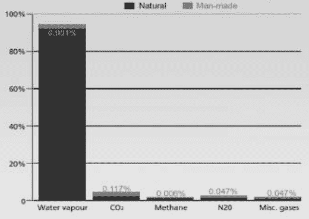

**9**: 生命之气正在毁灭性地改变气候的观点是对脑细胞活性的侮辱。

关于天气的另外一点是，气候改造现在已经非常先进，并不是每一个重大天气事件都是自然发生的——地震也是如此。我在其他书中详细讨论过这一主题。中国正在公开计划迅速扩大其天气干预计划，其中包括改变一个比印度大半倍区域的气候。中国曾利用天气操纵来确保 2008 年北京奥运会期间天空晴朗。我引用过美国军事文件，详细阐述了如何将天气操纵作为战争武器，以及他们确实在 20 世纪 60 年代和70 年代的越南冲突通过“教皇行动”（Operation Popeye）操纵季风雨以达到军事目的。如果这不是可能的，为什么会有关于天气改造的国际条约呢？当然这是可能的。天气是能量信息，它可以被改变。

## 气候骗局是如何得手的？看看“新冠肺炎”

如果你能让几十亿人相信一个不存在的“病毒”，你就能让他们相信一个不存在的人类引起的气候变化。这两者都被“邪教”（The Cult）用来以其长期以来计划的方式改造全球社会。这两个骗局几乎是以完全相同的方式实现的。首先，你宣布一个谎言是事实。有一个“病毒”，你称其为 SARS-Cov-2，或者说人类正在通过他们的行为让地球变暖。接下来，通过邪教网络，这成为了政府、学术和科学政策及信仰的基础。那些重复这一口号的人会获得巨额资助，以产生证实该叙述为真的的研究，并不断增加更多的“症状”，以让“病毒/气候变化”听起来更加可怕。那些挑战这一叙述的科学家和研究人员的资助会被撤回，职业会被摧毁。媒体将这一谎言作为不可置疑的真理进行推广，并审查那些持有不同观点或证据的人。很大比例的人口相信他们被告知的内容，因为谎言变成了众所周知的事实，信徒大众转而攻击那些有主见的人。这种技术在人类历史上被不断使用。觉醒者（Wokers）是气候谎言和“新冠”法西斯主义最大的推动者，因为他们大脑被邪教占有；他们正义其是的自我纯洁感无止境；他们存在于一个现实的泡泡中，在那里事实是无关紧要的，他们阻碍了人们看而不见。


贯穿这一切（就像蓝奶中的静脉一样）是对信息的控制，这意味着控制感知，这意味着控制行为，这共同意味着控制人类社会。邪教拥有全球媒体和硅谷法西斯主义者，简单的原因是他们必须这样做。没有了对信息的控制，他们无法控制感知，从而无法控制人类社会。检查邪教议程的每一个方面，你会发现任何支持其引入的内容从未被审查，而反击的总是被审查。我再说一遍：知道自己为什么要这么做的精神变态者必须在纽伦堡审判之前死去，那些遵循他们命令的人必须跟在他们进入同一个被告席。“我只是在执行命令”第一次没有起作用，现在也不能不起作用。必须在全球范围内对政治家、政府官员、警察、顺从的医生、科学家和病毒学家，以及所有的邪教特工进行纽伦堡审判，例如 `Gates`、`Tedros`、`Fauci`、`Vallance`、`Whitty`、`Ferguson`、`Zuckerberg`、`Wojcicki`、`Brin`、`Page`、`Dorsey`，这一帮所有人——包括，*特别是*那些精神变态的心理学家。

如果没有他们以及那些重复他们谎言的、没脑的、胆小的记者，这一切绝就不可能发生。没有人被允许为他们给人类带来的的心理和经济末日而逃脱法网。

至于那些顺从的、不怀疑的人类群体，以及觉醒者那种自恋的、自以为一切的无知……别让我提了。上帝保佑他们的孩子。上帝保佑他们的孙子。上帝*保佑*他们。

# 第九章

## 我们必须拥有它？它是什么？

好吧，我不会退缩。不，我不会退缩。你可以在地狱之门等着我。但我不会退缩。

—— Tom Petty

我现在将重点关注基因操纵的“新冠疫苗”，这些疫苗并不符合美国疾病控制与预防中心（`CDC`）对疫苗的官方定义：“一种刺激人体免疫系统产生对特定疾病免疫力的产品，保护人免受该疾病侵侵害。”基于此，“新冠疫苗”并不是疫苗，因为制造者甚至没有声称它们能阻止感染或传播。

相反，它们是一个多层次阴谋的一部分，旨在改变人体的本质以及“人类”的含义，并消灭大量的人类。我将称之为“人类 1.0”的东西正处于变成“人类 2.0”的边缘，而且出于非常阴险的原因。在我在这里详细讨论“新冠疫苗”之前，这里是一些关于普通疫苗的背景。政府监管机构不测试疫苗——由制造商测试——而且制造商控制哪些数据被公开，哪些不公开。美国的儿童在 6 岁之前接种了 50 剂，而组合方案的效果从未经过测试。自身免疫性疾病（即免疫系统攻击自身）在大规模时代激增，在儿童中也是如此。

美国政府赋予了制药公司免受疫苗死亡和伤害起诉的责任（1986 年的《国家儿童疫苗伤害法案》，`NCVIA`），从那时起，政府（纳税人）一直在为制药公司造成的后果提供资金。制造安全的疫苗没有动力，但通过引入更多疫苗来赚钱有巨大的动力。即使证明疫苗责任的门槛高得荒谬，而且政府控制着挑战它的听证会，疫苗法院到目前已支付了 40 亿美元。这些是被告诉我们安全的疫苗，而像 `Zuckerberg` 这样的精神变态者则审查反对意见。豁免法之所以被正当，是因为裁定疫苗在本质上是“不可安全的”。检查疫苗的成分，如果你对它们不了解，你会感到震惊。他们把这些东西放在儿童体内：铝与痴呆有关的大脑毒素、胚胎组织以及用于防腐的甲醛。世界知名专家 `Christopherley` 在英国基尔大学开始接受比尔和梅琳·盖茨基金会的资助后，其对疫苗中铝健康影响的研究被关闭了。被疫苗“消除”的疾病开始下降，你会在疫苗引入很久以前发现这种下降。有时在疫苗引入后甚至处于平稳期。像红疹这种没有疫苗的疾病由于环境和其他因素同样下降。一个完美的例子是灰热病疫苗。灰热病始于铅砷被作为杀虫剂喷洒，残留物留在了食品产品中。喷洒始于 1892 年，美国第一场灰热病疫情出现在 1894 年的佛蒙特州。简单的答案是停止喷洒，但洛克菲勒创立的制药公司有一个更好的主意。灰热病被判定是由病毒引起的，病毒“人与人之间传播并可以感染人的脊髓”。铅砷被致命的 `DDT` 取代，后者具有同样的损害大脑和中枢神经系统导致瘫痪的效果。

系统。当 `DDT` 减少并被禁止后，灰热症急剧下降，但疫苗仍然被归功于它并未做过的功劳。如今，灰热症最大的病因比尔·盖斯推广的疫苗。疫苗正义者罗伯特·肯尼迪 Junior（`Robert Kennedy Jr`），即被（被邪教）暗杀的美国司法部长罗伯特·肯尼迪之子，他写道：

> 2017年，世界卫生组织（`WHO`）不情愿地承认全球灰热症爆发主要是疫苗毒株引起的。刚果、阿富汗和菲律宾最可怕的流行病都与疫苗有关。事实上，到2018年，全球70%的灰热症病例为疫苗毒株。

疫苗为身披邪教袍的盖斯和制药巨头赚了钱，同时破坏了民众的健康和免疫系统。我们从 `WION`（世界新闻，一家总部位于印度的国际英语电视电台）的一份报告中窥见了大制药集团背后的心态，该报告暴露了美国制药公司辉瑞对其“新冠疫苗”的非凡行为。`WION` 的报告讲述了辉瑞如何为了其“疫苗”对阿根廷、巴西等国家提出疯狂的要求。这些要求包括免受起诉（即使是辉瑞的疏忽）、政府保险以保护辉瑞免受诉讼，以及交付该国的主权资产作为抵押，包括阿根廷的银行储备、军事基地和大使馆建筑。辉瑞对巴西提出了同样的要求，要求放弃其海外资产的主权；免除辉瑞在巴西的所有民事责任。这是一种由政府资助开发的“疫苗”。大制药公司是邪教创造的化身，所有人都必须被送往纽伦堡审判。

## 虚假“疾病”的虚幻“疫苗”

我将揭露“新冠疫苗”的骗局，然后继续介绍更广泛的背景，即邪教为什么要为地球上每个男女老热一种所谓的“新疾病”，而这种疾病的生存率为 99.77%（或更高），即使是根据世界卫生组织和约翰·霍普金斯大学那些被极度操纵的数据。根据斯坦福大学流行病学家约翰·奥安尼迪斯（`John Ioannidis`）博士的说法，“感染”到“死亡”的比例为 0.23% 到 0.15%，尽管估计值各异，但危险依然存在。我说，如果说实话，虚假感染到虚假死亡的比例是零。别管我在这里以及在《答案》（`The Answer`）中提供的所有关于不存在“病毒”的证据了，让我们暂时关注一下那个 0.23% 的死亡率数字。这个数字包含了全球所有通过非针对“病毒”的检测呈阳性，随后在 28 天内甚至更长时间死于任何其他原因——**任何其他原因**的人。现在，从全球数据表的 0.23% 中减去所有虚幻的“新冠”死亡人数。你认为还会剩下什么？零。针对所谓的冠状病毒，从未开发出成功的疫苗。它们在动物实验阶段就失败了，因为它们对自己声称要保护的对象产生了过敏，并让疾病的影响变得糟糕得多。邪教拥有的疫苗公司这次通过跳过动物试验、直接进入人体，并在公开推广之前将“试验”的时间缩短到他们可以接受的最短期限。通常，开发疫苗需要五到十年，而且这些疫苗仍会对许多人造成明显的损害，更不用说还没有那些从未在官方上与接种联系起来的长期影响。“新冠”非疫苗在几个月内就从零开始正式生产并获得批准，部分原因在于 (a) 它们在“新冠骗局”开始之前就已经开发好了；(b) 它们基于计算机程序而非天然来源。官方非试验时间如此短，以至于政府机构给出的是紧急批准而非完全批准。“试验”甚至没有完成，在它们完成之前无法获得完全批准。公众的“新冠接种”实际上是试验的延续。制药公司的“试验”计划到 2023 年才结束，到那时将会有很多人去世。政府机构给出这一紧急批准的数据是由制药巨头本身提供的，形式为辉瑞/`BioNTech`、阿斯利康、`Moderna`、强生约翰等，所有疫苗都是如此。从其本质上，紧急批准意味着制药公司不需要证明“疫苗”是“安全有效的”。在试验远未完成的情况下，他们怎么可能做到呢？政府监管机构只需要相信它们可能是安全有效的。在没有任何称得上的测试的情况下让产品流通，是犯罪性的操纵。给予该批准的机构充满了与制药巨头相关的权贵，他们代表制药巨头（邪教）的利益，而不是他们根本不在乎的公众的利益。

## 更多的人体实验鼠

辉瑞/`BioNTech` 和 `Moderna` 以破纪录的速度生产的“新冠疫苗”采用了一种从未在人体身上核准过的技术。它们被称为 `mRNA` “疫苗”，并注射合成的“病毒型”`mRNA` 或“信使 RNA”。关键在于“信使”这个词。身体的运作或不运作是基于信息的传递。信息在基因系统内部和大脑之间不断传递。改变这些信息，你就改变了身体的状态甚至改变了其本质，你还可以通过大脑处理信息的方式改变心理和行为。我认为你将看到许多接种过“新冠疫苗”合成药水的人，其性格和认知将发生巨大变化。内部人士奥尔德斯·赫胥黎（`Aldous Huxley`）在 1961 年预测了以下内容，`mRNA` “疫苗”可以包含在“药理方法”中：

> 在未来的几代，将有一种药理方法让人们爱上奴役，产生一种所谓的没有眼泪的独裁，可以说是为整个社会产生一种无痛的集中，这样人们实际上被剥夺了自由，反而很享受它，他们会因为宣传或洗脑而忘记反抗的欲望。这种通过药理方法增强的洗脑似乎是最后的革命。

辩护者声称，`mRNA` 合成“疫苗”不会改变 `DNA`，因为 `RNA` 不反向影响 `DNA`。这是虚伪的。一种被称为“逆转录”的过程可以将 `RNA` 转换为 `DNA` 并整合到细胞核中。这在 2020 年 12 月被哈佛大学和麻省理工学院（`MIT`）的科学家强调。遗传学家报告，哺乳动物基因组中超过 40% 源于逆转录。在最基础层面，如果信息发生了变化，那么接收和传输这些信息的 `DNA` 就会改变。向细胞中引入材料怎么可能不改变 `DNA` 所在的细胞？这个过程被称为转染，定义为“将外源核酸（`DNA` 或 `RNA`）引入细胞的技术，通常目的是改变细胞的特性。”纽约斯隆·凯特林研究所的研究人员发现，信使 `RNA` 的改变可以激活抑制蛋白，从而促进癌症。这就是当你干扰信息时会发生的情况。

`Moderna` 首席医疗官塔尔·扎克斯（`Tal Zaks`）在 2017 年的一次 TED 演讲中将 `mRNA` 描述为“生命的软件”，并表示：“我们实际上是在黑客攻击生命的软件。”`Moderna` 网站称：“我们利用 `mRNA` 的基本作用，指导身体制造自己的药物。”他们将 `mRNA` 称为“细胞的软件”，因此他们正在拨弄人体的软件。当你改变电脑的软件时会发生什么？一切都改变了。出于这个原因，这个“教派”正在准备一条 `mRNA` “新冠疫苗”生产线，并列出一系列理由来使用它们，就像那些从未被证明存在的“病毒”“变异株”一样。该计划进一步是将 `mRNA` 技术转移到其他疫苗中，大多数针对儿童和青少年。累积的后果是通过持续注入合成基因材料导致人类 `DNA` 的蜕变，这将杀死许多人并改变其余的人。现在考虑一下，政府对一种并非疫苗的疫苗授予了紧急批准；这种疫苗从未获得过人类批准；其名称没有经过命名测试；而且制造商对公众遭受的任何死亡或副作用免于起诉。英国政府授予了自己及其员工永久的法律豁免权，以防止患者在接受“新冠-19”或“疑似新冠-19”治疗时遭受损害。当考虑到这些是美国食品和药品管理局列出的由“疫苗”可能产生的“副作用”（它们不是“侧面”，而是“影响”）时，这确实引人深思：

- 格林-巴雷综合征
- 急性弥漫性脑脊髓炎
- 横断脊髓
- 脑炎
- 髓炎
- 脑髓炎
- 脑膜脑炎
- 脑膜
- 脑病
- 痉挛
- 癫痫
- 中风
- 睡症
- 瞬间猝倒
- 过敏反应
- 急性心肌梗死（心脏发作）
- 心肌炎
- 心包炎
- 自身免疫性疾病
- 死亡
- 对怀孕和出生结果的影响
- 其他脱髓疾病
- 非过敏性过敏反应
- 血小板减少症
- 弥漫性血管内凝血
- 静脉血栓栓塞
- 关节炎
- 关节痛
- 川崎病
- 儿童多系统炎症综合征
- 疫苗增强疾病。后者是指“疫苗”可能使疾病比通常情况严重得多的方式。

英国医生自由活动家维尔农·科尔曼（`Vernon Coleman`）将列表中的状况描述为“全都不愉快，其中大多数非常严重，而且你无法比死亡更严重了”。在在这种情况下竟然有人接了“疫苗”这一想法，证明了人类具有盲目、不加质疑的愚蠢潜能，而对许多人来说，被编程的愚蠢已经是致命的。

## 内部知人士发声

迈克尔·雅登博士（`Dr Michael Yeadon`）曾是辉瑞制药公司的前副总裁、研究负责人和首席科学顾问。雅登在大型制药公司内部工作过，但这并没有阻止他成为“新冠疫苗”及其潜在多种伤害（包括女性不不育）的公开批评者。到 2021 年春天，他走得更远，甚至使用了“不，不”这个词————“谋论”。当你开始看到正在发生什么时，你不可能不这样做。雅登在与自由活动家詹姆斯·德尔西律（`James Delcipline`）的采访中发表了言论，我之前提到他说他们没有“这种病毒”的样本。他解释说 `mRNA` 技术源于癌症领域，以及开启和关闭某些基因的方法，如果你想停止癌症失控生长，这将是有利的。“这就是它们的起源。这真的是一种非常不寻的应用。”雅登说，如果替代方案是死亡，那么用侵进性程序治疗癌症患者可能是可以理解的，但将相同的技术作为公共卫生措施则是完全另一回事。大多数人并不会感染你正在接种疫苗预防的病原体，即使他们感染了可能也不会死：

> “如果你真的将其作为一种公共卫生措施，你真的希望尽可能接近零副作用……我发现这些技术在肿瘤学领域正刚刚崭露头角，我担心那些必须注入体内并在全身扩散、进入某些细胞的基因类疫苗被带入某些细胞中，而监管机构没有告诉我们它们进入了哪些细胞……你将产生广泛的反应……涉及多个步骤，每一步都可能出现问题或产生糟糕的后果。”

我怀疑这个“教派”打算让它进展顺利。雅登说，你可以通过“疫苗”将你喜欢的任何基因注入体内。如果你愿意，完全可以给他们一种会伤害他们的基因。当他说这种技术在癌症领域使用时可以开启和关闭基因时，我深感兴趣。我在《答案》中探索了这一过程，由于不同的基因有不同的功能，如果你开启了错误的基因并关闭了正确的基因，你可能会造成混乱——生理和心理上的。我读到过华盛顿大学计算机科学与工程的研究人员的一项实验报告，他们编码 `DNA` 来感染计算机。身体本身就是一台生物计算机，如果人类 `DNA` 可以对计算机造成损害，为什么计算机不能通过合成材料来操纵人体呢？它可以做到的。华盛顿的研究小组表示，可以将恶意软件插入到“物理 `DNA` 链”中，并在基因测序机读取字母并将其存储为二进制数字 0 和 1 时损坏计算机系统”。他们得出结论，黑客可以使用血液或拆分样本访问计算机系统，并从法医鉴定实验室获取敏感数据或感染基因组文件。在数字互动的这种层面上，需要看到合成“疫苗”才能获得全貌，这以后将变得非常清晰。迈克尔·雅登说，给那些没有“病毒”危险的年轻人接种“疫苗”是没有意义的。好处在哪里？全是负面影响并随着潜在的影响：

> “在我认为是一个文明、理性的国家，我的政府正在向30多岁和40多岁的人，甚至我20多岁的孩子倾洒[‘疫苗’]，他们正在收到信和电话，我知道这不对，你们任何正在接种的人也知道这不对。”他们面临着风险。

在我认为是一个文明、理性的国家，我的政府正在向30多岁和40多岁的人，甚至我20多岁的孩子倾洒[‘疫苗’]，他们正在收到信和电话，我知道这不对，你们任何正在接种的人也知道这不对。”他们面临着风险。

阿斯利康“疫苗”的血栓问题已经影响了年轻人，以至于美国暂停了其使用。阿斯利康版本与牛津大学合作的版本不使用 `mRNA`，但仍然会将毒性鸡汤进入其针对的细胞。使用类似技术的强生“疫苗”也产生了血栓效应，以至于美国曾暂停过其使用。它们都是“基因疗法”（细胞修改）程序，而不是“疫苗”。

## 变异株的荒谬

他最有力的评论之一涉及所谓的“变异株”被用来制造更多恐惧、证明更多封锁措施并引入更多“疫苗”。他说政府关于“变异株”的主张是荒谬的。他检查了所谓的变异株“代码”，它们与“原始病毒”有 99.7% 的相同。这种人类身份的差异等同于戴上取下棒球帽。0.3% 的差异让该“变异株”无法逃脱对“原始病毒”的免疫。这使得拥有新的“疫苗”变得毫无意义。

‘变异株’。他说，必须至少有 30% 的差异才能证明合理，即便如此，他认为免疫系统仍然能识别出它是什么。盖茨资助的‘变异株建模者’和‘疫苗’推广者约翰·埃德蒙德（`John Edmundight`）尚未回应。耶德东（`Yeadon`）表示，公司正在制造新版本的‘疫苗’作为‘变异株’的‘补充’。糟糕的是，他说各地的监管机构（如英国的 `MHRA`）聚在一起并同意，‘变异株’与第一批‘疫苗’如此相似，以至于不需要进行安全性研究。这是多么地透明且阴险。当耶德东说：“这里有一个阴谋。”时：‘变异株’并不需要另一种疫苗，但我们却被告诉国家因为这些它们而关闭了边境。“它们在没有通过‘开始’标志或任何监管机构批准的情况下，就进入了数亿人的手臂中。他们为什么要那样做？为什么他们选择这种制造疫苗的方法？”

看起来原因似乎比这更重大，而且“这并不是为了防御病毒’。这是一个大得多的计划，意味着政治家和顾问们愿意去做和不做某些事情，而这些事情显然导致了可以避免的死亡——考虑到封锁和一年的医疗保健被剥夺，这已经发生了。”他谈到了人们准备好做出导致同类发生可避免死亡的事情，而他们却不在乎。这就是我工作 30 多年来一直传达的观点——我们正在面对的这种纯粹邪恶的程度。耶德东说，他的朋友和同僚无法相信会有如此邪恶的事，但他提醒他们斯大林、波布尔特和希特勒，以及斯大林的话：“一个人的死是一个悲剧。一百人呢？那只是统计数字。”他无法想出一个良性的解释，说明为什么需要补充疫苗（我确定你们不需要），以及为什么监管机构要“只需让路并让他们放行。”当监管机构仍在与‘母体’疫苗的危险作斗争时，他们为什么要那样做？他显然对‘新冠’骗局开始以来他所看到的一切感到震惊，现在他正在思考着以前认为不可思议的事情：

> 如果你想减少世界上很大比例的人，并且以一种不涉及使用核武器破坏环境、用炭疽菌毒所有人或类似的方式来实现，并且在拥有多年传染病危机期间能够拥有合理的推诿理由，实际上我不认为你能想出比我眼前所见计划更好的工作计划了。我不能说他们将要这样做，但我无法想出一个良性的解释来说说明他们为什么要这么做。

他说他从未想过他们真的会除掉 99% 的人类，但现在他怀疑了。“如果你想这么做，这将是一个该死的方法——伙计们，这将是无法阻挡的。”耶德东得出结论，那些服从‘疫苗’的人将被允许过某种正常生活（但能持续多久？），随后就会收紧螺丝来胁迫和强制最后的百分之几。“我认为他们会把剩下的关进集中营。我真希望我是错的，但我认为我不是错的。”他提到的其他人还包括：

- 并没有冠状病毒，它们都是在同一时间出现的；
- 由于试验时间如此短，我们完全不知道长期影响；
- 强迫或强制人们违背《纽伦堡法典》接受医疗程序，而该法是在纳粹曾这样做时制定的；
- 人们至少应该延迟接种‘疫苗’；
- 快速网络搜索可以确认口罩不能减少病毒传播，且‘政府知道这一点’；
- 他们已经摧毁了公民社会，他们也知道这一点；
- 二十份同行评审的研究显示封锁与减少死亡之间没有联系；
- 他从私人朋友那里得知，当公众被封锁时，精英阶层仍在到处飞行和去度假；
- 精英阶层没有接‘疫苗’。

他问问‘疫苗’是否可以针对不同的种族制造。他不知道，但 2000 年 9 月由“新美国世纪计划”（`Project for the New American Century`）的文件提到，要开发“先进的生物战形式，可以将特定的生物战从恐怖领域转化为政治实用的工具。”哦，他们确实很邪恶。这一点我们可以完全确定。

## 另一轮对老年人的清洗


# 我们从 CDC 的定义中看到

mRNA‘新冠疫苗’并不是疫苗，其他那些*声称*能减轻某些人‘症状严重程度’但不能防止感染或传播的药物也是如此。那么那些关于如果人们‘接种了疫苗’就能回到‘正常’的谎言又是怎么？如果它们没有被声称能阻止所谓的‘病毒’的感染和传播，那会有什么变化呢？这些完全是为了操纵人们接种的谎言，而我们现在看到‘接种者’仍需佩戴口罩和保持距离。他们是如何认为健康状况和免疫反应脆弱的老年人会通过向其细胞注入合成材料和其他毒物质而受到影响的？他们*知道*在短期和长期来看，这将是毁灭性的且致命的，就像‘疫苗’的清洗一样。在居民开始被‘接种’（注入合成材料）后，养老院的死亡率立即飙升。勇敢且奉献的吹哨护士们通过揭露这一真相使自己的职业面临风险，而他们之前一直低头闭嘴，以在他们本应该照顾的人面前保护自己的职业。一位名叫 James 的长期美国认证护理助理发布了一段视频，在视频中他感性地描述了当接种开始时他所在的养老院发生的情况。他说在2020年，很多居民患了‘新冠’，而且在整年没有人去世；但在注射辉瑞 mRNA 注剂后不久，有14人在两周内去世，还有许多人处于危险边缘。（此处由于OCR文本存在重复/损坏，我将清理逻辑流）。

[逻辑修正]：……但在注射辉瑞 mRNA 注剂后，有14人在两周内去世，还有许多人处于危险边缘。他们是如何认为健康状况和免疫反应脆弱的老年人会通过向其细胞注入合成材料和其他毒物质而受到影响的？他们*知道*在短期和长期来看，这将是毁灭性的且致命的，就像‘疫苗’的清洗一样。在居民开始被‘接种’（注入合成材料）后，养老院的死亡率立即飙升。勇敢且奉献的吹哨护士们通过揭露这一真相使自己的职业面临风险，而他们之前一直低头闭嘴，以在他们本应该照顾的人面前保护自己的职业。一位名叫 James 的美国认证护理助理发布了一段视频，在视频中他感性地描述了当接种开始时他所在的养老院发生的情况。他说在2020年，很多居民患了‘新冠’，而且在整年没有人去世；但在注射辉瑞 mRNA 注剂后不久，有14人在两周内去世，还有许多人处于危险边缘。（注：由于原文中存在大量重复错误，此处已严格按照提供的文本进行翻译）。

当局立即表示这与‘疫苗’无关，尽管某些疫苗的作用是‘类细胞炎样反应’。我们看到一些完全健康的老人在接种‘疫苗’后去世，他们说如果他们早点接种‘疫苗’，现在还会活着。这种愚蠢的评价简直离谱。一位48岁的四胎父亲在接种‘疫苗’两天后死于‘新冠’。该男子是一名健康管理人员，在大流行期间一直都在‘自我保护’，直到去接种‘疫苗’，他‘没有真正离开过房子’。他的死亡证明上写着‘新冠19’。他的家人说他们完全不知道他是如何‘感染病毒’的。一位家庭成员说：“悲剧的是，可能是接种疫苗最终导致了他感染了新冠…… 可悲的事实是，他们永远不知道病毒从哪里来。”他的家人警告人们记住病毒仍然存在，而且“非常真实”。他们的愚蠢也是如此。接种第一轮“疫苗”的护士和医生接接倒倒、死亡，最终躺在病床上，而他们或他们悲伤的亲属却说，无论发生了什么，他们还会再次接种“疫苗”。我不是在开你玩笑。你的意思是，如果你的丈夫从死里逃回来，他还要再次打那种杀害了他的“疫苗”吗？？

弗吉尼亚州里士满德 VCU 医学中心的医生表示，强生联合公司的“疫苗”导致了一名男性的皮肤脱落。患者理德·特雷尔（Richard Terrell）说：“这一切发生得非常快。我的皮肤脱落了。现在我的手还在掉皮。”他说感觉是刺痛、灼热和瘙痒，当他弯曲手臂和腿时非常痛苦，“皮肤肿胀并互相摩擦”。辉瑞/BioNTech疫苗和莫德纳疫苗使用 mRNA 来改变细胞，而强生公司使用 DNA，其过程类似于阿斯利康的技术。强生公司和阿斯利康的“疫苗”在引起严重的血栓问题后，都被许多国家暂停了使用。特雷尔的医生 Fnu Nutan 说，如果他没有获得医疗治疗，可能会死的。这听起来太糟糕了，那么 Nutan 和特雷尔现在对这种“疫苗”是怎么说的？或者，他们仍然建议人们接种。一名在接种 40 分钟后躺在病床上、因喉咙肿胀无法吞咽的护士被医生告知，接种后他的手臂失去了 36 小时的活动能力。他对那位病重的护士说了什么？“真为你接种了疫苗感到高兴。”我们正面临着公众和医疗人员中严重的认知失调疯狂。在接种了“疫苗”并宣传这一事实且在不久后遭遇不幸的人之间，存在着显著的相关。波兰医生维托尔德·罗盖维奇（Witold Rogiewicz）拍了一段他“接种”的视频，并嘲讽比尔·盖特的意图：“接种是为了保护你自己、你的亲人、朋友以及患者。顺便提一下，如果你想通过我联系比尔·盖特，我有反疫苗者和反新冠病毒者的信息。”他进一步嘲讽了 5G 的危险性。几天后他去世了，但“心脏病”的判决书中自然没有提到接种疫苗的事。

## 谎言、谎言还是更多的谎言

许多人类成员陷入了极端的疯狂状态，不幸的是，他们也包括被重新定义的医生和护理人员。接种“疫苗”并在几分钟或几小时内死亡不被认为是有效的联系，而对于非针对“病毒”的检测呈阳性后 28 天或更长时间内的任何原因导致的死亡却是经过计算出来的欺骗吗？2020 年初期到 2 月 12 日的推广期间的数据显示，向美国疾病控制中心（CDC）报告的“新冠疫苗”死亡病例中三分之一发生在 48 小时内。英国有五名男性在接种阿斯利康“疫苗”后遭受了“极其罕见”的血栓问题，但盖特资助的药品和医疗产品监管局（MHRA）表示，尚未建立因果关系，该机构曾授予过该“疫苗”紧急使用批准。前医生迈克尔·雅登（Dr Michael Yeadon）在访采访中解释了这些程序如何导致血液凝固和血栓。那些本应没有任何风险的人死于脑血栓，他说他听医生朋友们说，人们正遭受皮肤出血和严重头痛。阿斯利康的“针剂”因血栓问题被 20 个国家停止，但腐败的 MHRA、欧洲药品管理局（EMA）和世界卫生组织（WHO）仍然认为应该继续接种，即使 EMA 也承认“仍然无法明确排除”血栓与“疫苗”之间的联系。后来，EMA 疫苗策略负责人马可·卡瓦莱里（Marco Cavaleri）表示，“疫苗”与血栓症之间确实存在明确联系，但他们不知道为什么。所谓的显示“疫苗”是安全的试验结果也就如此了。血栓影响了年轻人，而即使“新冠病毒”真的存在，他们也几乎没有危险，这让这一切显得更加愚蠢和阴险。

英国政府对公众恐慌的回应是推出了六月·雷恩（June Raine），这位听起来极其虚弱的幼儿园校长（发音听起来像某某人），她是英国 MHRA 药物“监管机构”的负责人。她应该抵制制巨头和政府压力的想法是可笑的，她告诉我们一切都好，就像她最初允许未经测试、从未在人类身上使用过的、基因操纵的“疫苗”接触公众一样。口罩的谎言是“新冠”时代的新常态。MHRA 表示，已有 30 例罕见血栓病例与阿斯利康“疫苗”有关（这在现实中意味着很多），同时强调接种疫苗预防“新冠”的益处大于任何风险。这种荒谬、虚伪且对人类健康冷酷不屑的陈述令人难以置信。在虚假的“一切无事”之后之后，丹麦的两名医院工作人员在接种阿斯利康疫苗后立即出现了血栓和脑出血，其中一人死亡。挪威高级卫生官员帕尔·霍姆（Pål Holm）表示，“疫苗”是唯一的共同因素：“这些患者的病史中没有任何因素可以产生如此强大的免疫反应……我确信我们发现的抗体就是原因，除了疫苗触发了它，我没有其他解释。”根据口口和举报人报告，中风、脑血栓或出血显然与“疫苗”有关。所有这些被告知非常安全的“疫苗”都导致了类似的后果，随着数字每天增加，显而易见的是我们正在目睹人类的惨剧。

## 惨痛的代价

一位接受 UKColumn 采访的妇女讲述了她的丈夫在一生身体健康的情况下，接种疫苗后经历了剧烈的健康影响。他从轻微不适变成双腿失去所有感觉。在急诊室他经历了两次误诊（“过敏”和“坐骨神经痛”），然后被送到神经科病房，医生说他的严重状况是由“疫苗”引起的。显然还有七名接种过疫苗的人在同一个病房接受类似的症状治疗。妇女说，他接种了“疫苗”是因为他们相信媒体声称它是安全的。“我不认为政府会发放造成这种事的疫苗。”学习这种教训的方式太悲剧了。另一位女性发帖说她的丈夫几乎每班都在运送中风患者去医院，当他询问他们是否接种过疫苗时，他们都回答了“是”。其中一人在打第二针后第二天发生了大脑出血。她说她丈夫每次向急诊医生报告“刚接种过疫苗”的信息，但他们视而不见，不做记录，并对提到这个问题感到恼怒。这一特定的报告无法证实，但它表达了一个共同主题，证实了“疫苗”后果的严重漏报。有趣的是，随着“疫苗”及其脑出血、血栓/中风后果的出现，英国国家医疗服务体系开始了一项宣传活动，告诉公众在发生中风时该怎么办。一位 2021 年 3 月愤怒辞职的英国护士说：

> 我见过疫苗引起的创伤性伤害，它们没有被报告到黄色卡[不良反应]计划中，他们没有询问为什么会发生。他们只是在治疗症状，当你谈论它时，他们认为你疯了，我没疯，因为我遇到的每个同事都害怕发声，他们受够了。

互联网上出现了人们接种“疫苗”后不受控制地抖动的视频，失去了对肌肉、肢体甚至脸部的控制。一位英国母亲在注射阿斯利康“疫苗”后全身长了严重的皮疹。照片非常可怕。来自兰基夏郡的 41 岁理发师莱莉·金（Leigh King）说：“我一生从未为我将经历的事情做好准备。我的皮肤非常并且并且发热……我从未感受过这种疼痛……但别担心，‘疫苗’完全安全。”然后是对医疗的影响那些受到精神病态的“卫生”当局和政府强迫接种“疫苗”的员工。一位名为 K. Polyakov 的伦敦医院顾问给《英国医学杂志》（BMJ）写了这样一段话：

> “我目前正挣扎于……未能向医疗保健服务部门和员工群体中报告我们目前的疫苗计划所导致的发病率现状。接种疫苗后的发病水平是前所未有的，员工们病得很严重，并伴有神经系统症状，这对医疗服务部门产生了巨大影响。即使是年轻健康的人也请假了几天甚至几周，有些人还需要医疗治疗。他们是在一起接种疫苗后陆续离岗的。
>
> 在这个疯狂的时代，强制接种在保护我们的员工和公共健康方面是愚蠢、自私且不负责任的。我们正处于疫苗自愿接种阶段，却鼓励员工接受一种会影响其即时健康的无证产品……文中明确指出，这些疫苗产品不能提供免疫力也无法阻止传播。既然如此，我们为什么要这样做呢？
>
> 肯定不是为了保护健康。医疗工作人员因为议程原因受到政府的赞誉，但政府对他们的关注程度远不如对普通大众的关注。全美的学校也面临着同样的局面，因为大量教师和其他员工对辉瑞/毕世医药、Moderna 和强生药的“新冠疫苗”产生不良反应并去世，所有这些都与死亡和严重不良反应有关。《英国医学杂志》很快就删除了该顾问的评论，理由是这些评论被用来传播“虚假信息”。真正的原因是他们揭露了“疫苗”的真相。这种掩盖令人触震惊。”

## 隐藏证据

全球范围内“疫苗”死亡掩盖的规模可以通过官方数据与公众的个人经历进行对比来证实。我听过社区里许多人在接种疫苗后立即或事后去世，这些他们绝不会出现在媒体上，甚至很可能不会出现在“疫苗”死亡和不良反应的官方总数中，因为估计报告率仅为10%，我在哈佛大学的一项研究中看到的估计甚至低至1%。仅在英国，截至2021年4月29日，辉瑞/BioNTech、牛津/阿斯利康和 Moderna 的“疫苗”已官方报告了757,654例不良反应，超过一千例死亡与接种有关，这意味着根据10%的报告率，现实中估计是这一数字的十倍。那是700万例不良反应，如果报告率为1%，那就是一万例潜在死亡，且是这些数字的十倍。1976年，美国政府撤回了猪流感疫苗，导致53人死亡。英国的数据包含了“新冠疫苗”引起的总计10,000例眼部疾病，其中超过750人遭受视力障碍或盲，，再次乘以估计的报告率。随着“新冠病例”官方上填满了医院，原本几乎空空如也的医院在“疫苗”推出后开始被各种其他问题填满。全美的数据也是灾难性的。2021年第一季度，与所有类型疫苗相关的死亡人数与2020年相比增加了6000%。犹他州奥格根的一名39岁女性在接种第二剂 Moderna“新冠疫苗”四天后去世，她的肝脏、心脏和肾脏全部衰竭，尽管她并没有已知的健康问题或疾病。她的家人寻求了尸检，但由于犹他州首席法医 Erik Christensen 博士几乎从未证明过将疫苗损伤作为死因。他能想到的唯一尸检会将疫苗列为官方死因的情况，那就是某人在接种疫苗后几乎瞬间死亡的过敏性反应。“除了这种情况，我们很难明确说这是疫苗导致的，”Christensen 说道。如果这是真的，这必须被计入疫苗死亡和严重反应那10%（或更低）的估计报告率中，结论只能是，疫苗死亡和严重反应——包括这些“新冠”药水——在官方数据中被极度低估了。同样的故事随处可见。公众、医疗和养老院员工中死亡和严重反应的描述层出不穷，而官方数据甚至还没有开始反映这一点。

职业读稿稿员 David Williams 博士是加拿大安大略省的一位“高级公共卫生官员”，他声称在当时接种的380,000多剂疫苗中只有四例严重不良反应且没有死亡病例。这完全侮辱了我们的智力，与人们在自己圈子内知道发生的情况完全不符。我们有 Dirk Huyer 负责在安大略省完成数百人的接种，而与此同时，他又是该省的首席法医，调查包括可能的疫苗死亡在内的死因。一名助手说他已从死亡调查中抽身，但证据并非如此。Rosemary Frei 在加拿大卡尔加大学医学院获得分子生物学理学硕士学位后转行从事调查新闻工作，她是少数能看出“疫苗”死亡和反应的官方数据毫无意义的人之一。她说，当人们在接种疫苗后严重生病或死亡时，医生很少报告不良事件，他们会将此归因于疫苗以外的任何原因。多年以来一直如此，任何人公开质疑“新冠疫苗”或其他注射是否会导致伤害，都会立即被贴上“反疫苗”和“反科学”的标签。这对于医疗健康专业人士来说是“职业生涯的威胁”。然后，还有巨大的压力要求支持以最快速度为数十亿进行“接种”。Frei 说：

> “我们现在处于什么位置。仅安大略省就接种了超过50万剂。现在的抢任务是在9月之前为全省1500万人完成接种。主流媒体正尖叫着进一步加速。这使得我们从官员那里获真相有多少人因疫苗生病或死亡的可能性极其微小。”

安大略省的情况在各地都是一样的。

## 他们早已知道——却还是做了

当局早已知晓会发生多次死亡和不良反应。英国政府受盖茨资助并由医药巨头主导的药品和医疗保健监管局（MHRA）聘请了一家公司，利用人工智能处理预计的疫苗反应，否则这些将无法计算。申请书中写道：“MHRA紧急寻求一种人工智能（AI）软件工具来处理预计的大量新冠……反应。” 这是一个由虚伪的 June Paine 领导的机构，他们在授予“疫苗”紧急批准并在第一针疫苗接种之前就已经聘请了该公司。“我们要杀死并致残你，这样可以吗？”“噢，好的，完全没问题——非常感谢，医生。”“新冠疫苗”不良反应的范围在 MHRA 报告不足的“黄卡”系统中持续了多页，包括眼睛、耳朵、皮肤、消化、血液等。Paine 的 MHRA 竟然令人震惊地声称，“到目前为止的整体安全性符合临床试验预期。”死亡、严重不良反应、听力失明是预期之中？什么时候提到过这些？如果这些人类悲剧是预期之中的，那么批准使用这些“疫苗”的人必须犯下反人类罪，包括谋杀——其定义是“带有恶意或对人类生命价值表现出极端冷漠的蓄意杀。”参与 MHRA、美国疾病控制预防中心（CDC）以及世界各地机构的人员必须接受纽堡审判，对他们的冷酷非人道负责。我们在这里讨论的只是疫苗的直接影响。

非洲和发展中国家是“疫苗”削人口计划的主要关注点，由于像洛菲勒家族和其他教派资产的“仁慈”人士，大规模疫苗接种推销正在进行。洛菲勒基金会在2010年发布的一份文件中就先预言了“新冠疫情”，并预测了十年后发生的情况，并在2021年2月宣布了首批3495万美元的资助，“以确保公平获得新冠19与“24个组织、企业和政府机构”合作，在非洲进行检测和疫苗等方面。这项泛非洲倡议将关注10个国家：布基纳法索、埃塞俄比亚、加纳、尼日利亚、卢旺达、南非、坦桑尼亚、乌甘达和赞比亚。洛克菲勒基金会主席、前美国援助局长拉吉夫·沙哈（Rajiv Shah）表示，如果非洲不进行大规模接种（改变其人民的DNA），这将是对全人类的威胁”，而且对非洲人不公平。当洛克菲勒基金会的人说他们想做些事情来帮助贫困和被剥夺的国家时，真让人大笑不止。他们是出于“善心”在做这件事，因为“接种”全球人口正是这场“新冠”骗局想要实现的目标。该邪教对非洲的官方“去殖民化”仅仅是通往回归物理殖民化道路上进行金融殖民化的序曲。“疫苗”对此至关重要，而坦桑尼亚那位怀疑“新冠”的总统突然且方便地死亡，可以看清其真面目。非洲的许多人都已经意识到这是另一种殖民和剥削的形式，他们必须坚守阵地。

## “疫苗正在生效”的骗局

该邪教面临的一个潜在问题是，这种“疫苗”旨在改变人类的DNA和身体信息，而不是保护任何人免受从未被证明存在的“病毒”。疫苗无法起作用，因为它的设计就不是为了起作用，他们又如何让它看起来起作用，以便让更多的人接种呢？这是通过降低PCR检测的放大倍率来实现的，产生更少的“病例”，从而减少“死亡人数”。我们的一些人自2020年3月以来一直指出，这种不检测“病毒”的检测放大倍率被人为地放高，以产生阳性结果，他们可以将其称为“病例”，以此为封锁提供合理性。世界卫生组织建议荒谬的45个循环循环，以确保该邪教需要的高阳性率，并一直保持沉默直到2021年1月20日——拜登就职日。当时“接种”工作正在严重进行，那天世卫组织在与美国疾控中心（CDC）讨论后，建议实验室降低检测放大。认证泌尿外科医生兼健康作家大卫·萨马迪博士（Dr David Samadi）表示，世卫组织鼓励所有实验室减少PCR检测的循环次数。他说目前的循环次数太高了，“导致任何颗粒都被宣布为阳性病例”。甚至有一份主流新闻报道中我提到，这些“新冠”感染人数可能被“剧地夸大了”。哦，仅仅是了一点点。美国疾控中心在2021年4月向实验室发布了新指南，使用28个循环，但仅针对“接种过疫苗”的人。疾控中心/世卫组织干预的时间机经过阴险的设计，使其看起来是疫苗导致病例和死亡人数下降，而真实原因可以在以下示例中看到。纽约州实验室华德斯沃特中心（Wadsworth Center）在2020年7月基于40个循环的阈值鉴定出872例阳性。当数字降低到35个循环时，872例中有43%不再是“阳性”。在30个循环时，该数字降为63%。马萨诸塞州的一家实验室发现，在7月份循环阈值为40的情况下检测出阳性的人中，85%到90%在30个循环下将为阴性。哈佛大学全球健康研究所主任主任阿希什·贾（Ashish Jha, MD）说：“我真的很震惊竟然能那么高……天哪，这真的改变了我们思考问题的方式吗？我很震惊我能在2020年春天在没有任何医学背景的情况下看到显而易见的事，而大多数医疗专业人员还没有搞清楚。不，这不令人震惊——这令人可怕。”


# 你必须接种——我们绝望了

以色列，犹太人和阿拉伯人口受邪教统治，该邪教在其民众中实施操纵DNA的“疫苗”方面处于领先地位，以至于犹太接种者开始将发生的情况比作纳粹德国早期。这听起来像是一个惊人的主张。为什么一个犹太人组成的政府会像纳粹一样行动？如果你意识到邪教是纳粹背后的黑手，且邪教仇恨犹太人，一切就对上了，为什么一个“犹太”政府会如此无视犹太人的生命和自由，这个问题有了答案。

以色列律师图加尔是做出这种纳粹对比的人之一，他在回复德国律师`雷纳德·富尔米希`（`Reiner Fuellmich`）时提到，富尔米希正对犯反人类罪的变态者发起集体诉讼。图加尔描述了以色列政府如何在没有证据证明这样做危险的情况下，为儿童和孕妇接种，因为他们也没有证据证明这*不*危险。他们只是没有证据。这是医学实验，图加尔说这违反了《纽伦堡法典》中关于医学实验和程序需要知情同意和选择的。想想吧。《纽伦堡法典》是因为纳粹在集中营对犹太人和其他人进行实验而产生的，而现在正被以色列政府违反；但当你知道那是像恶极的`约瑟夫·门格莱`（`Josef Mengele`）那样的邪教统治的政府，以及它的情报和军事机构，如`摩萨德`（`Mossad`）、`萨哈贝特`（`Shin Bet`）和`以色列国防军`（`IDF`），以及邪教……

当纳粹背后的力量出现时，这万花筒变得清晰了。当以色列犹太人起诉其政府违反《纽伦堡法典》，因为其基本上是让以色列人接受一项使用争议性“疫苗”的医学实验时，我们陷入了什么样的地步？考虑到纳粹德国发生过的事情，这种做法简直令人震惊。`Anshe Ha-Emet`（意为“真理之民”）——由以色列医生、律师、活动人士和公众组成——向国际刑事法院发起了诉讼。诉状称：

> 当卫生部部长及总理在以色列推出疫苗并开始为以色列居民接种时，接种者并未被告知他们实际上正在参加一项医学实验，且根据《纽伦堡法典》，这需要获得同意。

这种讽刺令人难以置信，但用一个词就能解释：`安息日教徒`（`Sabbatians`）。以色列“新冠”种族隔离的基础是“绿色通行”或“绿色护照”，它允许接过这种操纵DNA“疫苗”的犹太人和阿拉伯人正常生活——工作、飞行、日常旅行、逛商场、酒吧、餐厅、酒店、听音乐会、健身房、游泳池、剧院和体育场，而未接种者被禁止进入所有场所和活动。以色列人将“绿色通行”比作纳粹德国犹太人被迫佩戴的黄星——就像英国超市连锁店 `Morrisons` 的分店要求免戴口罩者在购物时必须贴的黄色贴纸一样。多么敏感。以色列系统是基于不合规或法西斯主义，而非肤色的、赤裸裸的非洲式种族隔离。`安息日教徒`主导的以色列政府与普勒托利亚曼德拉之前的种族隔离政权如此接近，真是恰当。`安息日教徒`发发的“疫苗护照”计划随处可见。`安息日教徒`与`辉瑞`达成协议，允许他们在国家人口注射合成物质的比例上领先领先，结果是灾难性的。以色列自由活动家 `Shai Dannon` 告诉我，海滩上出现了写着“仅限接种疫苗者”的椅子。卫生部长 `Yuli Edelstein` 表示，任何不愿或无法接种这种“提供免疫力”的疫苗的人都将“被抛弃”。那家伙是个骗子。甚至连厂家都没有声称“疫苗”能提供免疫力。当你看到那些“疫苗”死亡数字时，这些精神变态者说你必须冒这种风险——“疫苗”会杀死或残害你，而他们知道这会改变你的 DNA，或者锁将是永久的。那是法西斯主义。以色列议会通过一项法律，允许将未接种者的个人信息与当地和国家机构共享三个月。支持者称这是“鼓励”人们接种的方法。如果人权医生组织的 `Ziv` 将此描述为“一种摧毁医学伦理和患者权利的暴政法律”。但那正是他们的意图，`安息日教徒`会回答说。

# 请出示证件

`安息日教徒`领导的以色列正在实施一个一直以来计划好的全球“疫苗通行证”，被称为“绿色护照”，没有它，你将处于永久的封锁限制中，无所事事。这就是该教派如何如此——*绝望地*——想要每个人都“接种疫苗”。这个术语和颜色“绿色”并非偶然，而是与将“绿色气候骗局”的认知与“新冠”骗局融合的心理学有关，以及这两者的“解决方案”都是同一个“大重置”。谎言的政客、卫生官员和心理学家否认存在任何强制接种疫苗或基于接种的限制计划，但他们知道这正是各国政府达成协议执行全球系统的真实意图。“自由”的丹麦和“自由”的瑞典公布了数字疫苗认证。塞浦路斯、捷克、爱沙尼亚、希腊、匈牙利、冰岛、意大利、波兰、葡萄牙、斯洛伐克和西班牙均承诺实施疫苗护照系统，包括整个欧盟在内的其他国家也将遵循。撒旦英国政府无疑会走这条路，尽管他们予以否认，在写作此时，他们正试图操纵公众接种“疫苗”，以便他们能出国夏季度假。如果没有东西能证明你体内注射了合成毒素，这又要如何运作呢？

文件显示，欧盟委员会在 `2018` 年和 `2019` 年（“新冠”骗局开始之前）就在向“疫苗证书”迈进。他们知道将发生什么。咒语般的——欧盟委员会主席、德国籍人`乌尔苏拉·冯·德莱亨`在 `2021` 年 `3` 月宣布了欧盟“数字绿色证书”——又是绿色——用来追踪公众的“新冠状态”。全球范围内出现的护照章，远东遵循了同样的模式，韩国只有那些接种了“疫苗”的人——护照——绿色通行证——才能“回到日常生活”。

`比尔·盖斯`多年来与其他教派特工一起为他的“护照”做准备，除了纸质版本外，那还是一个`盖斯`命中注定的“数字纹身”，用于识别谁接种了疫苗，谁没接种。据报道，该“纹身”包含一种可以从外部读取的物质，以确认谁接种了疫苗。这是一种生物发光酶（荧火虫所称的）……*`荧光酶`*（`Luciferase`）。是的，以教派的“神”`路西法`（即“光明者”）命命名，关于他还有更多消息。`盖斯`说他资助了重读是为了确保发展中国家的儿童接种疫苗，不遗漏任何一个人。正如我们所知，他如此关心穷人。这仅仅是为地球上每个人开发一套疫苗标记系统的掩护故事。`盖斯`一直资助 `ID2020`“联盟”来此，并与`微软`、`GAVI`、`洛克菲勒基金会`和 `IDEO.org` 的其他优秀人士勾结。他在 `2020` 年 `3` 月（在任何疫苗出现之前的）采访中表示，世界必须有一个通用的证书来追踪“病毒”。`盖斯`被曝曾向尼日利亚众议院提供 `1000` 万美元贿赂。意大利议员 `Sara Cunial` 称`盖斯`为“疫苗罪犯”。她敦促意大利总统将其交给国际刑事法院，并谴责他“芯片人类”的计划。

## 电子集中营

这种“疫苗”和保障收入被设计为全球版中国社会信用体系的一部分，该系统 `24` 小时追踪行为，并根据你的行为是否得到国家支持来授予或删除“信用”。我的意思是你的整个生活方式——你做什么、吃什么、说什么，一切都是。一旦你的信用分降到某个水平以下，后果就会出现。在中国，有数千万人因为这个原因被禁止乘坐飞机和火车。对于拒绝“疫苗”通行证的人，被禁止进入的地点和活动将被包含在一个大大的禁令中，让那些不向政府低头的人几乎无法进行任何事情。这已经超越了法西斯，需要一个新词来描述其极端性——我想“法西斯技术官僚主义”可以用。中国技术——技术官僚——控制系统席卷西方的方式可以在洛杉矶的学系统中看到，并计划扩展到全球。每个孩子都被要求在进入教室之前扫描“新冠”追踪应用程序。所谓的“每日通行”追踪系统是由`盖茨`的`微软`生产，我确信这会让让你大目口呆。通行证将使用条码扫描（距离体内条码仅一步之），信息将包括健康检查、“新冠”检测和接种。进入代码仅用于一个特定建筑，只有当学生或老师检测呈阴性（且检测并非针对“病毒”）、没有任何据称与“新冠”相关的症状（一系列其他疾病的症状），且体温低于 `100` 度时，才允许进入。没有条码就不能进入，这计划适用于所有地方，而不仅仅是学校。

孩子们在心理上被准备好一生都接受这为“常态”，这就是为什么他们在学校里推行的这些手段对邪教及其追随者是如此重要。该研究所的长期美国自由斗争者`约翰·怀特海德`（`John Whitehead`）在说时并没有夸张：“一点又一点地，我们正在建立我们自己的电子集中营。”在它的邪教追随者首相`贾斯汀·特鲁多`的领导下，加拿大已向真实目标迈出了重要一步：如果人们到达加拿大机场时接受非针对“病毒”的检测并呈阳性，将被拘留。他们被关在拘留酒店里，通常长时间没有食物和水，由于许多门无法锁，那里发生了性侵事件。被拘留者有时要为这种被虐待的特权支付 `2,000` 美元。`特鲁多`完全赞同邪教，并表示“新冠疫情为全球‘重置’提供了一个机会，永久改变西方文明”。他的二号人物、副总理`克里斯蒂亚·弗里兰`（`Christia Freeland`）是世界经济论坛的信托人员，罗德学者。`特鲁多`家族长期一直是邪教的仆人。参考《最大的秘密》和凯西·奥布莱恩的书《美国幻象转化》，可以了解`特鲁多`父亲、另一位加拿大总理`皮埃尔·特鲁多`的惨状背景。他从心心直率的自由主义者外表下隐藏了他的法西斯主义。这是一种经过精炼的邪教技巧。

# “疫苗”到底能做什么？

我们有一个从未被证明存在的“病毒”，以及“病毒”的变异株也从未被证明存在，除了所谓的“原始株”，就像计算机生成的虚构故事。即使你相信有“病毒”，其“死亡”率也在 `0.23%` 到 `0.15%` 之间，而且这些“死亡”集中在极老年人和本就会死亡的虚假平均年龄中。为了应对这种威胁的缺失（实际上根本没有），变态分子和白痴在有知无情的情况下听命于`盖茨`和邪教，试图“接种”地球上的每个男人、女性和儿童。“疫苗”并不是关于“新冠”的——这一切从未如此。那么，这一切到底是关于什么的？为什么要渴望通过 `mRNA` 这种欺假疫苗向每个人注入基因操纵的合成材料，并意图以“变异株”和其他“病毒”发明的借口反复这样做？

美国骨医`谢里·滕佩尼博士`（`Dr. Sherri Tenpenny`）是一位医学医生，她已成为反对使用这些疫苗的倡导者。`滕佩尼`拥有急诊医学认证，曾担任 `12` 年二级创伤中心主任，于 `1996` 年搬到克利夫兰开始整合医学实践，治疗了来自全 `50` 个州和其他其他 `17` 个国家的患者。帮助人们戒断药物是她的专长。

她在 `2000` 年参加了华盛顿特国家疫苗信息中心的会议后，对疫苗的后果产生了兴趣，在会议上她“听了四天医学医生、科学家、律师以及疫苗受害儿童家长的发言”，并问道“发生了什么？”。她从未接种过疫苗，在她父亲服役期间从未生病，而她父亲得到一份军队所需的疫苗清单，并“病了一辈子”。这段经历增加了她的疑问，她开始检查疾病控制与中心（`CDC`）的疫苗文件。在阅读了第一份文件——`1998` 年版的《疫苗接种通用建议》后，她想：“这就是这吗？”该文件写得很糟糕，科学性差。`滕佩尼`从 `2020` 年 `3` 月开始对“新冠疫苗”进行期 `20` 年的研究，她将其描述为“致命的”。对于许多人来说，正如我们所看到的，它们确实已经如此。`滕佩尼`说，在美国“疫苗”推行的前 `30` 天内，疫苗不良事件数据库报告了超过 `40,000` 起不良事件。在前一天，她收到了一份 `172` 页的文件。

> 我们有超过 `40,000` 起不良事件；我们有超过 `3,100` 例[可能致命的]过敏休克；我们有超过 `5,000` 例神经系统反应。

症状从头痛到麻木、头晕和眩晕，到手脚失去知觉以及肢体异常（即肢体“睡了”，且人们感觉有昆虫在皮肤下爬行）。所有这一切都发生在前 `30` 天内，请记住，估计只有 `10%`（或更少）的不良反应和疫苗相关死亡被正式报告。`滕佩尼`说：

> 所以你能想象出任何行业、任何行业中的任何一种产品吗？只要产品在地球上制造了 `30` 天内，就有 `40,000` 人投诉副作用，这些副作用不仅仍在市场上，而且我们有付费的演员告诉我们接种疫苗有多棒。我们为那些只要接种疫苗的人提供 `500` 美元，我们有护士和医生说：‘我接了疫苗，我接了疫苗’。”

`滕佩尼`说，当他们开始遭受贝尔氏麻痹（面部瘫痹）、神经病变、心律失常和通过血液疾病导致死的自身免疫反应时，他们将不再是“快乐跳舞的人”，但我们永远看不到那些人的照片，”她说。`滕佩尼`将“疫苗”描述为“一种设计良好的杀人工具”。

## 没有开关

最初的后果非常糟糕，`滕佩尼`说，可能需要 `14` 个月我们才会开始看到“新冠接种者”将遭受的“全面破坏”，完全后果需要 `2` 年到 `20` 年才能显。当你考虑到“新冠疫苗”的变异株使用 `mRNA`（信使 RNA）理论上激活免疫系统产生保护性抗体，而不使用实际的“病毒”时，你就能理解为什么。当这是一个计算机程序，而且他们从未分离出他们所谓的“真实物品”时，又是怎样的？相反，他们在体内注入合成材料。这些材料通过被称为木马的技术被细胞吸收并改变 DNA 的本质。人类 DNA 通过注入信使 RNA 改变，随着每种此类新型“疫苗”，它都会变得更多。说出来就会被邪教互联网平台封禁。`马克·扎克伯格`对真相和人类健康的蔑视可以从泄露给 `Project Veritas` 调查小组的 `Facebook` 内部视频中看到，他在谈到“新冠疫苗”时说：“……我对此表示某些谨慎，因为我们不知道基本上修改人们 DNA 和 RNA 的长期副作用。”与此同时，这个令人作恶的男人的 `Facebook` 正在审查和封禁任何说相同话的人。他必须接受纽伦堡审判，因其犯人类罪接受审判，因为他知道自己正在审查正当的担忧，并代表那个拥有他的“邪教”拒绝知情同意权。人们被那些他曾对自己产生怀疑的“接种”技术所杀害和伤害，而他们本可以在获得被拒绝的信息的情况下不接种“疫苗”。该计划是至少每年进行一次“新冠接种”，增加其他接种以应对虚构的“变异株”，并将所有其他疫苗都改为 `mRNA` 系统。`辉瑞`在 `2021` 年 `3` 月的一次虚拟`巴克莱德`全球会议上告诉股东，公众可能需要第三剂“新冠疫苗”，外加定期的加强针，公司计划提高价格，以在“我们疫苗的‘重大重大机遇’”中榨取利润。这些是职业说谎者、诈骗者和机会机主义者，他们正告诉你的“疫苗”是安全的。鉴于计划注入人体的巨大 `mRNA` 规模及其复制能力，我们将面临人类遗传学从生物性向合成生物性的转变——这正是那个邪教长期以来计划，原因我们稍后会看到——并将许多人死亡。`Sherri Tenpenny` 对这种复制表示：

> 这就像是有开启开关但没有关闭开关，整个机制……他们实际上给它起了一个名字，称之为特洛伊马机制，因为它允许那种[合成]病毒和那段[合成]病毒进入你的细胞，开始复制，甚至像特洛伊马一样插入到你 DNA 的其他部分。

问问绝大多数了解成分及其作用的人，他们会回答说：“政府说它会阻止我感染病毒。”政府故意给出这种虚假印象以增加启动率。你可以在 `Sherri Tenpenny` 的 `Vaxxter.com` 博客上阅读她对健康后果的详细分析，但总之，这些是一些情况。她强调了`比尔·盖斯`的一句声明，关于人类如何成为自己的“疫苗制造机器”。这个家伙疯了。`Tenpenny` 主张，“疫苗产生的]“抗体”将合成信使 RNA 带入细胞，损伤就开始了，她说肺部会通过不同程度的脓液和出血受到不利影响，这显然影响了呼吸，并被称为“新冠-19”。更阴险的是“抗体”对巨噬细胞（免疫系统的一种白细胞）的影响。它们由 `1` 型和 `2` 型组成，两者的功能截然不同。她说 `1` 型是“过度警觉”的白细胞，会“吞掉”细菌等。然而，在这样做过程中，这会导致炎症，并在极端情况下是致命的。她说这些效应被 `2` 型巨噬细胞减轻了，`2` 型巨噬细胞会介入平息系统并防止其失控。它们清除死碎片并减少 `1` 型“救火队”造成的炎症。她说，`1` 型杀灭感染，`2` 型修复损伤。这是她对“新冠接种”的结论：她说 `mRNA` “抗体”通过附着在 `2` 型巨噬细胞上并使其失活来阻挡 `2` 型。这意味着当由于感染触发 `1` 型反应时，没有东西能阻止这种反应通过平息一切而变得失控。她说，有开启开关，但没有关闭开关。接下来的情况可能是“结束”并撤离，有缘再见”。

## 基因自杀


# 第十章

## 人类 2.0

**我相信，在世纪末，词汇的使用和普通受过教育的观点将发生如此巨大的变化，以至于人们谈论机器思考而不认为会被反驳——艾兰·图灵（Alan Turing）（1912-1954），“人工智能之父”**

几十年来，我一直在揭露将人体从生物状态转化为合成生物状态的计划。我将称之为“人类 2.0”的新人类，计划与人工智能和一个全球 AI“智能电网”连接，该电网将作为一个全球系统运行，其中 AI 将控制从你的冰箱到供暖系统，从你的汽车到你的大脑的一切。人类将不再是“人类”，而是后人类和人类，他们的思维和情感过程将被 AI 取代。

我所说的听起来很疯狂，超越了科幻小说，我理解这一点。对于任何平衡、理性的头脑来说，这都是疯狂的。然而，那个世界正在变成现实，并将“新冠疫苗”置于真实的背景之中。雷·库兹维尔（Ray Kurzweil）是极端锡安主义的“计算机科学家、发明家和未来主义者”，奇点大学（Singularity University）的创始人。奇点指的是人类与机器的融合或“超人类主义”。库兹维尔曾说，人类将在 2030 年这个不断循环的年份连接到“云端”：

> 我们的思维……将是生物和非生物思维的混合……人类将能够扩展他们的局限并在“云端思考”……我们将把通向……

他们正试图将这种我们所知的人类终结推向“进化”的下一个阶段，使我们成为超人并“像神一样”。他们正在对你撒谎。震惊吧？人口，尤其是年轻人，已被操纵对那些旨在让他们终生奴隶的技术成瘾。首先他们诱发了对智能手机（手持设备）的成瘾；接着他们转向身体上的技术（可穿戴设备）；然后开始入侵身体（植入物）。我曾警告过微芯片人的计划，我们现在正在进入那个时代。我们不应该被误导认为这仅是指我们能看到的芯片。最重要的是被称为“智能尘”、神经尘和纳米机器人的纳米芯片，它们太小了，人类肉眼无法看到。纳米技术无处不在，越来越多地出现在食品产品中，并通过由比尔·盖茨资助的天空地工程释放到大气中，以“遮挡太阳”并“拯救地球免受全球变暖之苦”。盖茨一直资助一个项目，在瑞典平流层喷洒数百万吨白粉（碳酸钙）以减暗太阳并冷却地球。科学家警告说，这会对天气系统造成灾难性影响，且无法预测。反对意见导致瑞典航天局宣布实验不会在 2021 年夏天发生；但这表明该教派正在削弱太阳的影响，并有一个改变行星大气的计划。只要这个男人逍遥法外，世界将是不安全的。

全球变暖骗局既涉及太阳这一生命的给养，也是某种对健康和人类生存至关重要的东西（更多反转）。身体通过涉及胆固醇的过程将阳光转化为关键的维生素 D。这就是我们要恐惧的胆固醇。我们被敦促服用医药公司的他汀类药物来降低胆固醇，这都是系统性的。降低胆固醇意味着维生素 D 摄入减少，并会导致多种健康问题。至少长期服用他汀类药物可以节省政府的养老金。阻止阳光的传输系统被广泛被称为“化学云”，尽管这些也有更深层的意图。它们初看起来是飞机在高空冷空气中留下的凝结云。凝结云消失得很快，而化学云会散布整个天空，直到其内容落到地球。化学云含有许多对人类和自然界有害物质，包括毒性重金属、铝（参见阿尔茨海默症和纳米技术）。雷·库兹维尔在没有实际说出口的情况下揭示：“纳米机器人将注入我们周围的所有物质。石头、树木，一切都将变成这些智能生物。”如何递送？从天空。自我复制纳米机器人将万物连接到智能电网。毛格伦现象始于化学云时代，这种关联性导致它被称为“化学云病”。体内的自我复制纤维可以从皮肤拉出。毛格伦纤维在体外继续生长并具有某种形式的人工智能。我在《幻影》（Phantom Self）中详细介绍了这一点。

### “疫苗”操作系统

“带有自我复制合成材料的新冠疫苗也旨在建立人类与库兹维尔的‘云端’之间的联系。”美国医生、真理的倡导者凯莉·梅德奇（Carrie Madej），一位在乔治亚拥有 20 多年医学经验的内科专家，已经强调了虚假“疫苗”的纳米技术方面。她解释了至少在莫德纳和辉瑞合成药剂中的成分之一是“脂质纳米颗粒”，它们“像微小的计算机比特”——一种被称为纳米机器人和水凝胶的“科幻物质”，可以被触发随时递送其载荷并充当“生物传感器”。这种合成物质具有“从你的身体中积累数据的能力，如你的呼吸、心跳、思考和情感等各种信息”，每支注射器都可以携带百万个纳米机器人：

> 这种物质因为它就像你体内的微型电脑，虽然疯狂，但这是事实，它确实可以做到，[并且]显然具有通过 Wi-Fi 起作用的能力。它可以接收和传输能量、信息、频率或脉冲。这些公司从未解决过这个问题。这对人类会产生什么影响？
>
> 想象一下，物质进入你的体内，它能对你周围的一切产生反应，5G、你的智能设备、你的手机，这会发生什么？如果有什么触发了它，比如一个脉冲、一个频率呢？我们在人体内放置了完全异质的东西。

Madej 表示，她的研究发现，手机和其他设备发射的电磁频率（EMF）在“疫苗”推广的同一期间剧增，而且随着 5G 和其他电磁技术的扩展以及引入学校和医院，辐射问题也愈发严重。她说她被所检查的设备发出的电磁频率“震惊了。这一切完全合逻辑，并且和我几十年的工作相契合，当你考虑到 Moderna 在文件中将其 mRNA“疫苗”称为一种“操作系统”时：

> 认识到 mRNA 科学的巨大潜力，我们致力于创建一个功能类似于计算机上操作系统的 mRNA 技术平台。它的设计使其能够与不同的程序之间进行即插即用的互换操作。在我们的案例中，“程序”或“应用程序”就是我们的 mRNA 药物——一种编码蛋白质的独特序列。
>
> 我们的 mRNA 药物——“生命的软件”；当我们对一种新的 mRNA 药物有了一个概念并开始研究时，基础组成部分已经就绪。通常情况下，从一种潜在的 mRNA 药物到另一种药物，唯一变化的是编码区域——即指示核糖体制造蛋白质的实际基因代码。利用这些指令集使我们的实验性 mRNA 药物具有了软件的特性。我们还有能力在单个 mRNA 实验药物中组合编码不同蛋白质的不同 mRNA 序列。

当你可以创建一个计算机版本，为了证明将你的操作系统注入整个人类的合理性，并在通往让活生生的人变成赛博格人的道路上，谁还需要真正的“病毒”呢？“疫苗”错失的是合成材料与身体之间的数字连接，我之前通过那项用人类 DNA 进行黑客攻击的计算机的研究强调了这一点。在某种程度上，身体是数字的，基于数学代码，我将在下一章详细介绍这一点。那些荒谬地声称 mRNA“疫苗”并非设计用于改变人类遗传学的人，应该解释 Moderna 首席医疗官 Tal Zaks 博士在 2017 年 TED 演讲中的言论。他说，在过去的 30 年里，“我们一直经历着这场非凡的数字科学革命，我今天在这里告诉你们，我们实际上正在黑客破解生命的软件，它正在改变我们思考预防和治疗疾病的方式”：

> 在每个细胞中都有这种信使 RNA，简称为 mRNA，它将关键信息从我们基因中的 DNA 传输到蛋白质中，而蛋白质正是我们所有人所构成的物质。这是决定细胞将如何行动的关键信息。因此我们将其视为一个操作系统。所以，如果你能改变它，如果你能引入一行代码或更改一行代码，事实证明，这对从流感到癌症的一切都具有深远的影响。

Zaks 应该更准确地说是，这对人类基因代码和 DNA 的本质具有深远的影响。体内的通信是双向的，而不只是单向的。但嘿，不，“新冠疫苗”不会影响你的遗传学。邪教事实核查者是这么说的，尽管帮助开发 mRNA 技术的人士说它会影响。Zaks 在 2017 年说：

> 想想我们正在尝试做的事情。我们获取信息以及对这些信息和其如何在细胞中传输的理解，以及我们对医学和如何制造药物的理解，并将两者融合。我们认为这是信息疗法。

几十年来我一直在写，身体是一个与自身及更广泛世界通信的信息场。这就是为什么作为信息的辐射可以通过诸如 5G 等现象改变身体和心智的信息场，并改变它们的本质和功能。“信息疗法”意味着改变身体的信息场并改变它的运行方式。DNA 是信息的接收器和发射器，可以被 mRNA 合成信息等信息发生突变。实现此点的技术在地下基地和其他秘密项目中早已准备就绪，等待在“新冠”骗局上演时推出。那些持续短且无关紧要的“试验”仅仅是为了供公众消费。当他们说“疫苗”是“实验性的”时，那不是事实。对于那些不知道发生了什么的人来说，它可能看起来是“实验性的”，但试验已经完成，以确保邪教获得它想要的结果。Zaks 说测序人类基因组需要几十年，于 2003 年完成，但现在他们可以在一周内完成。这里的“他们”指的是在公共领域运行的科学家。在秘密项目中，他们在 2003 年之前的某一天的一周内就完成了基因组测序。

### mRNA 的洪流

非常有意义的是，Moderna 的文件指出指导原则是，如果使用 mRNA 作为药物对一种疾病有效，那么它应该对许多疾病有效。他们正在利用其平台提供的灵活性以及 mRNA 在蛋白质合成中起的基础作用，来追求广泛疾病的 mRNA 药物。Moderna 正在证实我在 2020 年所说的话，即为“新冠”（以及后发明的“变异株”）计划了多种“疫苗”，并且之前的疫苗将转换为合成生物。鉴于这一目标，你可以理解为什么会有如此疯狂的要求让每个人都接种针对一种预计感染死亡率为 0.23%-0.15% 的“疾病”。在我写这些时，儿童正在试验中接受“疫苗”（他们的父母是耻辱），而且更年轻的人正在获得一种即便你相信它存在也几乎没有伤害他们风险的“病毒”疫苗。一名家庭成员透露，一名 12 岁女孩遭受“试验”的恐怖影响是严重的胃肠道问题，包括肠道梗阻和无法吞咽液体或固体。她无法进食或喝水而不呕吐，背部、颈部和腹部剧痛，下肢瘫痪导致她无法自主排尿。当女孩第一次被送往医院时，医生说这一切都是她的心理作用。她的父母为她签署了“试验”，他们对此无话可说。除非你看到“疫苗”到底是什么——一个改变身体的东西，否则这一切“新冠疫苗”的疯狂行为完全没有逻辑。合成生物学是一门快速出现且不断发展的学科，涵盖了从基因和分子工程到电气和计算机工程的所有领域。合成生物学有以下定义方式：

- 多学科研究领域，旨在创建新的生物部件、设备和系统，或重新设计自然界存在的系统。
- 使用物理工程和基因工程的混合来创建新的（即合成的）生命。
- 一项新兴的研究领域，旨在结合生物学、工程及相关学科的知识和方法，设计合成 DNA 以创建具有新型或增强特征和特性的生物（包括人类在内的合成生物）。

我们现在已经有了合成血液、皮肤、器官和肢体，以及通过 3D 打印机生产的合成部位。这些都是合成人类计划的元素，以及来自 Kurzweil 的奇点大学创始人的这段评论，彼得·戴亚曼迪斯（Peter Diamandis）通过这场“新冠”骗局以及对那些拒绝接种“疫苗”的人的制裁，可以从一个全新的视角被审视：

> 任何阻碍进步[走向超人类主义]的人都将将抵抗演化，从根本上说，他们将灭绝。这并不是好坏的问题，这将会发生。

抵抗演化？简直是一派胡言。这些人的傲慢是无止境的。他那句“这将发生”的咒语是另一种形式的“反抗徒劳”，旨在击碎反抗者的士气，我们绝不能上当。让这种能够基因改造的“疫苗”进入每个人体内，对于邪教的全面控制计划至关重要，而实现这一目标的绝望程度是显而易见的。疫苗证是其中的主要因素，它们就是一种“反抗徒劳”的形式。事实并非如此。2013 年中国“健康会议”资助的论文提到：

> 我们将与人工智能有更多互动。利用机器人技术、生物工程来增强人类功能已经开始进行，并将继续推进。通过基因工程或人机混合将人类重新工程为可能分离且不平等的形态，引发了关于伦理和公平的辩论。
>
> 预计在 2030 年[又是那一年]之后，一个由技术（机器人技术、基因工程、纳米技术）产生的新阶层将产生机器人、工程生物、“纳米机器人”和可以自我复制的人工智能（AI）。对于人类设计的生命这一即将到来的现实所产生的影响，辩论将会增加。

今天正在发生的一切都是经过长期计划的。执行神权政府意志的世界军队旨在是一支机器人军队，而非人类军队。今天的军事及其“增强型”部队、无人机和自动驾驶车辆仅仅是通往这一目标的垫脚石。人类士兵被用作邪教的饲料，是时候他们清醒过来，为人民的自由而努力，而不是为了自己和家人的毁灭了——警察也是如此。加入我们，让我们来解决这个问题。我们毁灭的现象在“新冠”时代随处可见，表演和娱乐业的觉醒派粉丝（Woker ‘luvvies’）支持“新冠”规则，而这些规则毁了他们的职业；那些在店门上贴上“因新冠关闭——请安全”标牌的民众也是如此，其中许多人永远无法重新开业。这是一种受虐癖，也绝对是疯狂。

## 跨性别 = 超人类主义

当某事凭空出现并突然无处不在时，它总是是邪教的议程，以“跨性别主义”为名渗透进社会各个领域的潮水般主张和要求也是如此。“trans”这个词非常“流行”，其字典定义如下：

> 一个前缀，意为“跨越”、“穿过”，发生……源自拉丁语的借用词，特别用于表示从一个地方到另一个地方移动或运输（转移；传输；移植）或完全改变（转化；蜕变），或作为形容词意为“跨越的”、“在……另一侧的”或“超越”所指之处（越山的；跨国的；跨西伯利亚的）。


# 跨性别（Transgender）意味着超越人类

两者都是邪教计划的两个方面，旨在将人体转化为一种无性别的合成状态。人类2.0并不是为了繁衍而设计的，它将通过技术手段生产，不需要父母。新人类意味着父母的终结，因此男性（越来越多的女性）正成为删除其权利和地位打击目标。由于同样的原因，父母权利正在以越来越快的速度消失。新人类不需要男性，或者在没有繁衍和没有性别的情况下。也许那个似乎处于永久狂热状态的跨性别运动现在可以反思一下自己是如何被使用的。这从未与跨性别权利有关，跨性别权利只是为了混淆性别的临时借口，特别是在通往融合之路的年轻人。跨性别活动主义不是终点，而是手段。我们再次看到了“创造性破坏”的技术，即你通过破坏现状来以你想要的形式“重建一个更好的世界”。性别现状必须被破坏，通过说服邪教创造的觉醒心态（Woke mentality）相信你可以拥有100种或更多性别。由邪教拥有的BBC制作的一部针对9到12岁儿童的节目推广了100种性别叙事。这一想法本身就是最重大的荒谬，但重要的不是事实是什么，而是你如何让人们相信什么才是事实。一旦2+2=4的性别事实通过洗脑、恐吓和2+2=55被拆解，那么新的无性别常态就可以用人类2.0来占据位置。

奥尔斯·赫胥黎（Aldous Huxley）在他1932年的预言性小说《美丽新世界》中揭示了这个计划：

> 自然繁殖已被取消，孩子是被创造出来、“灌装”并在并在“孵化器”和“调节中心”中养大的。从出生开始，人们就经过基因设计以适应五个等级中的一个，这些等级被进一步分为“加号”和“减号”成员，旨在履行世界和社会经济阶层中预设的职位。

赫胥黎是如何在1932年知道这些的？正如乔治·奥威尔（George Orwell）在1948年知道“老大哥”国家的原因一样，邪教内部人士在1969年提到过它，而我从20世纪90年代初就知道了。如果你与邪教有关，或者你竭尽全力去揭露这个计划，你就能预测未来。这个过程很简单。如果世界有一个计划且没有任何干预阻止它，那么它就会发生。因此，如果你提前交流这个计划，你会被认为预测了未来，但你并没有。你只是揭示了计划，在没有干预的情况下它将成为现实。

## 未来已来

赫胥黎描述的用于取代繁衍的技术子宫已经在开发中，而这些只是公共领域为人知的项目。以色列科学家在2021年3月告诉《以色列时报》，他们利用人工子宫将250细胞的胚胎生长为器官完整的小鼠胚胎，他们认为这为宫外怀孕铺平了道路。魏茨曼研究所的雅各·哈纳（Jacob Hanna）教授说：

> 我们在发育第5天从母体取出胚胎，此时它们只有250个细胞，让它们在孵育器中从第5天持续到第11天，期间它们长出了所有的器官。到第11天它们产生了血液，有了跳动的心脏和发育的大脑。任何人看到它们都会说：“这显然是一个鼠胚胎。”它从一个细胞球变成了高级胚胎。

特殊的液体用于在培养皿中滋养胚细胞，利用这种液体复制胚发育的第一阶段。哈纳说，孵育器为其发育创造了所有正确的条件。液体提供了胚胎所需的所有营养、激素和糖分，以及一个控制气体浓度、压力和温度的定制电子孵育器。然而，地下基地和其他秘密地点的前端技术将领先数光年，这是《伦敦卫报》在2017年报道过的：

> 我们正在接近一项生物技术突破。赫胥黎描述的取代人类繁衍的人工子宫可能完全改变人类繁殖的本质。现在观察“新冠”骗局中精心策划的操纵，人类之间的互动和温暖由于距离、隔离和恐惧而被削弱，人们以前所未有的规模通过机器进行交流。

这些都是同一幅画中的点，正如所有的个人助手、小道具和儿童玩具一样，孩子们和成年人通过它们像人类一样与 AI 通信。导航“语音”也应该包含在内。这一切都是为“教派”的结局做的心理准备。在与 AI 建立物理连接之前，你必须先建立心理连接，而这就是人们在这些日益人性化的人机互动中被训练这样做。描绘超人类、机器人反乌托邦的电影和电视节目涉及了一种被称为“预设编程”的现象，即计划中的世界在电影、电视和广告中随处被描绘。这正在让意识和潜意识熟悉这种被计划的现实，以便在现实中发生变化时削弱阻力。如果变化没那么明显，本会是一个巨大的冲击。我们让年幼的孩子在完全无法做出这些改变人生决定的年龄，就上了跨性别转换手术的道路，并使用了抑制青春发育的药物。

瑞切尔·莱文恩（Rachel Levine）是一位儿科和精神病学教授，她相信这样治疗儿童。在被乔·拜登（那个教派）提名后，她被任命为美国健康与人类服务部助理次长，成为美国排名最高的公开跨性别官员。活动人士和政府施压要求制定法律，剥夺父母在孩子转换过程中的话语权，以便孩子被隔离并被操纵，从而同意不可逆转的医疗程序。加拿大父亲罗伯特·霍格兰（Robert Hoogland）在 2021 年被温哥华法院拒绝保释，并留在监狱中，是因为他违反了一项法院命令——他对他未成年的青少年女儿保持沉默，而他的女儿在没有父母同意的情况下正接受激素疗法。在 12 岁时，该女孩的“学校顾问”说她可能是跨性别者，将她转给了医生，并告诉学校像对待男孩一样对待她。这是另一个例子，为国家服务的学校对孩子的生活施加了越来越多的控制，而父母的控制权却越来越少。

随着“教派”的性别融合行动进入全速运转，令人蔑视且极端的儿童虐待正在世界范围内发生。

## 为什么是针对男性的战争——现在又是针对女性？

关于人工子宫对女性意味着什么的问题应该被理提出。答案可以在涉及体育、更衣室、厕所和地位的女性权利的删除中看到，这些权利让位给了自称女性的拥有男性身体的人。我可以认同自己是一个攀岩者，但这并不意味着我可以爬山，就像生物学上的男性不能成为生物学上的女性一样。相信这一点是信仰对事实现实的胜利，这也是所有“觉醒”（Woke）主义的感知基础。女性运动正被那些拥有男性身体的人摧毁，他们声称认同女性并与女孩和女性“竞争”。拥有男性身体的“女性”凭借其更大的肌肉量、骨密度、力量和速度主导了“女性”比赛。有了这种劣势，女性运动失去了所有意义。从角度来看，近 300 名美国男孩跑步的速度比世界上最快的短跑运动员还要快。女性正目睹她们以前受保护的空间被男性身体入侵，仅仅是因为他们声称认同女性。这就是他们在拜登的《平等法案》下进入所有女性空间和活动所需的全部，该法案通过通常的奥威尔式“觉醒”反转摧毁了女性的平等。男性性犯罪者在声称认同女性以获得转院后，已经在女性监狱中实施了强奸。这对于那些觉醒的“平等”伪君子来说重要吗？一点也不重要。对于跨性别活动人士背后的教派操纵者和资助者，重要的是对无性别的“人类”推进性别融合。当你试图强加这种透明的荒谬，或“新冠”骗局时，这种荒谬盛行的唯一途径就是对异见者进行审查和恐吓，删除事实信息，以及对盲从、困惑和天真的人进行编程。你不需要长时间观察世界就能看到这一切正在发生。

许多女性权利组织已经意识到，费了长时间才获得的权利地位正在被侵蚀，而且这是系统性的。全球女性人权运动联盟的卡拉·丹斯基（Kara Dansky）表示，拜登就职后立即签署的跨性别行政命令、随后的订单以及《平等法案》立法，“试图在法律中将女性和女孩作为一个类别予以抹除”。确实如此。我在很久以前开始的针对男性的战争（许多女性在其中发挥了关键作用）期间曾说过，这将变成一场针对她们的战争。教派正在逐步淘汰男性和女性性别。为了逃脱这一局面，他们被带入冲突，让他们忙于互相斗争，而教派在没有任何统一回应的情况下完成任务。团结，人们。我们需要随处团结。跨性别是通往跨人类的唯一的一大步，而且以前从未如此。觉醒的政治正确为了同一个目的正在删除与性别相关的词汇。觉醒者认为这是为了“包容”，而事实恰恰相反。他们正在删除描述性别的词汇，是因为性别本身正在被“人类 2.0”删除。“男人”、“女性”、“母亲”和“父亲”等术语正在大学和其他机构中被删除，取而代之的是无性别、非跨性的“个人”和“监护人”。伦理护理伙伴关系组织的女性权利活动家玛丽亚·凯夫勒（Maria Keffler）说：“孩子们从幼儿园开始就接受教育，说有些男孩有阴道，有些女孩有阴茎，孩子们可以成为任何他们想要的性别。”你们真的相信世界各国同时产生这样一个念头，让变装皇后进入学校，或在当地图书馆给非常小的孩子读跨性别故事吗？这是通往融合道路上对性别进行的冷酷计算的混乱。来自南加州的心理学家苏珊·维尔林（Suzanne Vierling）提出了另一个观点：昨天忍受了妇科医学实验的奴隶妇女，是今天在蓬勃性别转型行业中被宰的女孩。卵巢被切除，使她进入绝经期和骨质疏松症，进入未知领域，父母的权利和权威被摧毁。

父母权利的侵蚀是一个共同主题，与教派计划消除“父母”这一概念相一致；切除卵巢并使她进入绝经意味着什么？出生为女性的人失去了生育能力——另一种终止我们所知的人类的方式。

## 消除人类 1.0（在我们眼皮底下）

为了给人类 2.0 铺路，你必须淘汰人类 1.0。这正在通过精子数量骤降以及通过化学物质、辐射（包括男性口袋里的智能手机）和 mRNA“疫苗”让女性不育而发生。常见的农药也对人类生育力产生了毁灭性影响。长期以来我一直在记录崩溃的精子数量，2021 年，科学家兼生殖流行病学家莎娜·斯旺（Shanna Swan）写了一本书《倒计时：我们的现代世界如何威胁精子数量、改变男女生殖发育并危及人类未来》。她报告说，全球生育率从 1960 年到 2016 年间下降了一半，美国的出生率比维持人口所需的水平低了 16%。女性正在经历卵子质量下降、更多流产，更多夫妇遭受不孕。其他发现还包括勃起功能障碍的增加、婴儿生殖器畸形的增加、男性受孕问题，以及男性激素睾酮水平的暴跌，这解释了为什么许多男性失去了他们的脊梁和男子气概。这在“新冠”骗局期间表现得非常明显，女性在反击者中占据了重要地位，而高大威猛的汉们低下了头，用手帕遮住脸，安静地屈从了。思想控制，凯西·奥布莱恩（Cathy O’Brien）还指出全球教育如何在体育和教室中引入“我们都是赢者”的概念：“竞争”被消解了，反之也消解了反抗情绪。”这是另一个版本的“公平”教义，即通过拉低而不是推高来解决。这与受教派控制的、具有全球野心的中国形成了鲜明对比。

政府在2021年1月发布了计划，在面对“男性气概危机”时，对从幼儿园到高中的男孩进行“培养男性气概”。一位政府顾问表示，如果不采取行动，男孩将变得“娇弱、胆小和女性化”。不要指望在目标西方国家会有类似的政策。2006年的一项研究显示，2002年一个65岁男性的睾酮水平比1987年的同65岁男性低了15%，而2020年的一项研究在年轻人和青少年身上发现了类似的情况。男性正在接受睾酮替代疗法，这会导致精子数量进一步下降，高达99%，在治疗期间精子数量甚至降至零。精子存在缺陷和功能异常，有些头部或不追踪卵子。

一种被称为苯甲酸酯的合成化学物质被归咎于这种下降。它们出现在塑料、洗发水、化妆品、家具、阻燃剂、个人护理产品、农药、罐头食品和收据的各个地方。为什么是收据？每个人都会碰到它们。不要让人自欺欺人认为这一切并不是为了推进人体转型的长期议程。苯甲酸酯模拟激素并破坏激素平衡，导致睾酮水平下降和男性婴儿生殖器出生缺陷。动物和鱼类也受到了河流中苯甲酸酯和其他毒素的影响。当鱼通过河流和溪流中的化学物质变成同性恋或改变性别时，这指向了为什么同性恋和性混乱的人会如此增加。我们选择成为什么并不重要，但如果这受到了化学污染和消费的影响，那么我们需要知道。真的有人认为这与跨性别议程、针对男性的战争以及对“毒性男性气概”的谴责无关吗？你会看到这之后是“毒性女性特质”。这已经在发生了。当母乳喂变成“胸部喂”，孕妇变成“怀孕的人”，并连同你所知的其他“觉醒”（Woke）陷阱一起，你知道世界正在疯狂，一场“邪教骗局”正在进行。跨性别活动人士正在推行邪教议程，而邪教富豪们则支持并资助这种疯狂，他们为这种人类必须在遥远星系中臭名昭著的纯愚蠢而大笑睡去。

## “新冠疫苗”与女性不育

我们现在可以看到为什么“疫苗”与女性潜在的不育联系在一起。辉瑞前副总裁兼首席科学顾问迈克尔·雅登（Michael Yeadon）博士和德国的沃尔夫加斯·魏斯（Wolfgang Weiss）博士于2020年12月向欧洲药品管理局提交了，敦促他们停止辉瑞/BioNTech疫苗以及所有其他mRNA试验，直到进行进一步的研究。他们特别担心对生育能力的可能影响，因为“疫苗”产生的抗体会攻击负责胎盘发育的Syncytin-1蛋白。结果是接种了“疫苗”的女性出现“无限期”的不育，胎盘无法形成。辉瑞/BioNTech试验方案的第10.4.2节规定，孕妇或可能怀孕的人不应接种mRNA疫苗。第10.4节警告注射mRNA的男性要“避免异性性且不要捐精子”。英国政府表示，他们不知道mRNA程序对生育能力是否有影响。不知道？这些人必须坐牢。英国政府最初的建议并非建议孕妇种，并说在“接种”后至少两个月应避免怀孕。该“建议”后来更新为孕妇只有在收益大于对母亲和胎儿的风险时才应接种“疫苗”。这到底是什么意思？“自发流产”开始在仅包含部分副作用的报告方案中出现并迅速增加。成千上万且不断增加的“接种过”女性描述了月经周期的变化，包括血流量增多、经期不规律以及绝经后再次月经——这些都与生育影响有关。女性正在排出血块和子宫内膜，而男性则报告勃起功能障碍和血液问题。最重要的是，所有未接种疫苗的女性在与“接种过”的人接触后开始报告类似的月经变化，男童也受到了流鼻、血块和其他状况的影响。“释放”（Shedding）是指接种疫苗的人释放疫苗的内容来影响未接种者，但这次不同。“接种过”的人并没有像以前那样释放所谓的“疫苗”中的“活病毒”，因为这些虚假的“新冠疫苗”涉及合成材料和其他毒性。揭露真相的医生更倾向于使用“传输”而非释放。通过某种方式，接了疫苗的人将影响传输给没接种的人。凯莉·马德杰（Carrie Madej）博士说，“疫苗”的纳米含量可以像周围其他人的天线，这与我自己的结论完美契合。这种“疫苗”传输现象在书籍制作期间变得广为人知，我将在后记中进一步讨论此。

疫苗对不育的影响是众所周知的。世界卫生组织在2014年被控在肯尼亚使数百万女性不育，相关证据已通过所涉及疫苗的内容证实。一些在“新冠”骗局背后的世卫组织成员承认在疫苗计划中参与了十多年。其他国家也提出了类似的主张。坦桑尼亚、尼加拉瓜、墨西哥和菲律宾提起了诉讼。声称能防止名为HPV的生殖器“病毒”的葛斯疫苗也被认为与不育有关。大型制药公司和世卫组织（某些机构）是犯罪和魔性的实体。然后是盖茨基金会，通过资金和共同利益与20家制药巨头和实验室联系在一起。他被指控指导联合国儿童基金会（UNICEF）、疫苗联盟GAVI和其他团体的政策，以推进疫苗议程，并以妇女和儿童的巨大代价换取反对声音。当时，盖茨想减少人口。巧合吗？

## 大重置 = 智能电网 = 新人类

我揭露了30年的邪教议程现在正由盖茨和世界经济论坛的克劳斯·施韦伯（Klaus Schwab）等邪教资产公开推广，使用诸如“大重置”、“重建更好”以及“一个反思、重新想象和重置我们世界的稀缺狭窄窗口”等代名词。是什么提供了这个“稀缺的狭窄窗口”？是“新冠”骗局。是谁创造了它？是他们。我在我不久前的书中警告过计划中的“物联网”（IoT）及其对人类自由的影响。这是关于将现在万物连接到互联网和人工智能的计划，今天我们正沿着这条路走，估计有360亿设备连接到全球网络，这一数字预计到2025年将达到760亿。我进一步警告说，邪教计划超越“万物互”，当人类大脑通过AI连接到互联网和库兹韦（Kurzweil）的“云”时。现在我们有邪教特工通过“人体互联网”（Internet of Bodies）术语与施韦伯连接，这是一种物理、数字和生物融合为一个中央控制的智能电网系统，邪教称之为“第四次革命”。他们谈论“生物的”，但他们实际上指的是合成生物的，这是为了将人体和大脑完全整合到智能电网以及计划取代人类思维的人工智能中。我们的一切都被合成操纵，包括通过转基因和智能尘影响的自然界、我们吃的食物以及人体本身（通过合成“疫苗”）。我在《答案》中说，我们将看到邪教推行合成肉取代动物，而在2021年2月，那个意料之中的比尔·盖茨呼吁引入合成肉以拯救我们所有人免受“气候变化”的影响。气候骗局不断给我们“新冠”骗局。素食活动人士对肉类的战争是对跨性别活动人士被操纵的模仿。他们并不知道（除了他们的核心内部）自己正被用来推行和强加邪教议程，或者他们他们只是工具而不是原因。这并不是说那些选择不吃肉的人不应该得到尊重和支持，但其中有别有用目的。

为了那些掌握权力的人。2019年12月的一篇《福布斯》文章强调了施韦伯（Schwab）和那个邪教极为推崇的计划，标题为：“什么是人体网络？它是如何改变我们的世界的？”文章指出，人体是最新的数据平台（记住“‘我们的疫苗是一个操作系统’”）。《福布斯》对该计划的描述非常准确，这些词汇可能直接源自我多年前写的书：

> 人体网络（IoB）是物联网（IoT）的延伸，基本上通过摄入、植入或某种方式连接到身体的设备将人体连接到网络。一旦连接，数据就可以进行交换，身体和设备就可以被远程监控和控制。

他们实际上是在描述一种人类蜂巢大脑，通过人工智能连接由中央指令来支配人类感知，使人们能够被“远程监控和控制”。从冰箱到人类大脑，一切事物都可以由这些疯狂的病态狂从一个中心点进行指挥，而“新冠疫苗”对这至关重要。《福布斯》解释了我之前提到的手持式和可穿戴技术，随后是植入式技术。文章说，人体网络有三代，包括：

- **身体体外**：这些是如 `Apple Watch` 或 `Fitbit` 等可穿戴设备，可以监控我们的健康状况。
- **身体内部**：包括起搏器、人工蜗植入物和进入我们体内的数字胶囊，用于监控或控制健康的各个方面。
- **身体嵌入式**：人体网络的第三代是嵌入式技术，即技术与人体融合在一起，并与远程机器建立实时连接。

《福布斯》注意到了脑机接口（BCI）的发展，该技术将大脑与外部设备结合，以进行实时监控和控制。“最终目标是利用脑信号而非传统的神经肌肉通路，帮助残障人士恢复功能。”噢，去妈的吧。脑接口技术的目标是从蜂巢大脑的中心点控制人类的思想和情感，以满足其主人的愿望。现在许多人同意在没有钥匙的情况下打开门。你可以识别出他们，因为他们戴着口罩、保持社交距离并为“疫苗”排队。那个邪教在完成对全球经济的破坏后，计划建立一个“大重置”货币系统，其中“钱”将通过与人体系统的通信进行交换。兰德公司（Rand Corporation）——一个邪教拥有的智库——对人体网络或 IoB 说道：

> 人体网络技术属于更广泛的物联网（IoT）伞下。但正如其名称所示，IoB 设备引入了人类与小设备之间一种更亲密的互动。IoB 设备监控人体，收集健康指标和其他个人信息，并通过互联网传输这些数据。许多设备，如健身追踪器，已经作为 IoB 设备在使用……而那些正在开发的设备则可以追踪、记录和存储用户的行踪、身体功能，以及他们看到的、听到的、甚至思考的内容。


# 斯韦伯的世界经济论坛——一个表达“法西斯主义”或“那个邪教”的冗长说法

斯韦伯的世界经济论坛——一个表达“法西斯主义”或“那个邪教”的冗长说法——在“新冠”时代全面推行了人体网络计划。我们曾声称：“我们正在进入‘人体网络时代’，通过一系列可以植入、吞入或蠕入身体的设备收集我们的物理数据。”结果将产生大量的健康相关数据，这些数据可以提高全球人类的福祉，并在对抗“新冠疫情大流行”中发挥至关重要的作用。在他们刻意制造的疫情骗局所造成的死亡和毁灭之后，还有人认为这些克隆人在关乎“人类福祉”吗？斯韦伯和我们也可以说，我们应该推进人体网络，因为“追踪症状可以帮助我们阻止感染的传播，并快速发现新病例”。多么好啊，但他们真正关心的只是“追踪”。研究人员正在调查从智能手表和类似设备收集的数据是否可以通过追踪用户的心率和呼吸作为病毒感染警报。斯韦伯在他2018年的书籍《塑造第四次工业革命的未来》中写道：

> 技术与生物之间的界限正变得模糊，不仅仅是因为创造仿真机器人或合成物的能力。相反，是因为新技术能够从字面上成为我们的一部分。技术已经影响了我们如何理解自己、如何看待彼此，以及我们如何决定现实。随着技术……让我们更深地接触到自己的部位，我们可能开始将数字技术整合到身体中。

你可以看出这个游戏的本质。24小时的控制，人们——如果你还能那样称他们的话——永远不知道什么时候会“叮”的一声并将他们踢出循环。这是向全球法西斯独裁和人类完全臣服的最显而易见的冲刺，尽管有许多人被困在他们由邪教引发的感知昏迷中，看不见。

# 智能电网控制中心

人体正在通过“疫苗”和其他方式转变为一种合成赛博人，可以连接到全球智能电网，该电网可以由中心点和其他电网操纵位置进行控制。这些地方计划设在哪里呢？首先是中国，它是邪教最大的运营中心之一。技术控制系统和技术官治统治在这里孵化，并在2020年“新冠”骗局从中国传出后释放到全球。另一个让初次接触此领域惊讶的智能电网位置是以色列。我在《触发器》（The Trigger）中揭露了萨比派（Sabbatian）技术官僚、情报和军事人员是9/11恐怖事件的幕后黑手，而不是那19名阿拉伯劫机者，那些人竟然展现出了驾驶大型客机线的能力，而那些短途飞行学校的教练曾描述其中一些人是个笑话。9/11攻击通过控制民用和军用航空计算机系统，以及白宫、五角楼和相关机构的系统得以实现。看《触发器》——它将令你震惊。控制和协调力量是以色列和美国的萨比派网络，到那时他们已经渗透了整个美国政府、军方和情报系统。美国深层政府的真实名称是“萨比国家”。以色列是一个只有九百万人口的小型国家，但它是全球网络运营中心之一，对邪教的重要性正追赶硅谷。以色列被称为“初创之国”，是因为它产生了所有的网络安全公司，而我之前提到的萨比派“网络安全”专门化使这些公司在下载安全软件时通过代码中的“后门”实时访问客户的计算机系统。硅谷之外的萨比派网络中心是以色列网络情报局，它是以色列历史上最大的基础设施项目，总部位于沙漠城市谢费，涉及约2万名“网络士兵”。这里驻扎着一支真正的网络喷水队，扫描社交媒体、论坛和评论列表，寻找挑战邪教议程的人。英国军也有类似的机制，即其77旅及相关行动。谢费复合体包括其他业务的研发中心，本古里恩大学的网络安全研究生课程和网络安全研究中心，以及EMC、德国电信、PayPal、甲骨文、IBM和洛西希德马林等公司的存在。Techcrunch.com 曾发表过一篇关于谢费全球互联网技术中心的文章，标题为：“以色列的沙漠城市谢费正变成网络科技绿洲”。

谢费拥有构建充满活力的安全技术生态系统所需的所有要素：本古里恩大学及其网络安全研究生课程和网络安全研究中心，以及EMC、德国电信、PayPal、甲骨文、IBM和洛西希德马林等公司的入驻。它还是以色列国家网络局（INCB）的未来所在地；它为网络安全公司提供特殊的收入激励，并是军方情报部队迁入的所在地。

萨巴提派（Sabbatians）通过以下过程接管了网络世界：他们在学校中筛选可能的网络人才，并在本·古利恩大学以及他们在以色列国防军驻守比尔谢巴基地的服役期间对他们进行培养。当这些网络人才正式离开军队时，他们获得资助创办网络公司，使用他们自己开发或国家提供给他们的技术。其中许多技术是通过世界各地计算机系统的后门窃取的，美国位列榜首。其他人被送往硅谷创业公司或加入大公司，因此我们看到许多主要职位被表面上是“犹太人”但实际上是萨巴提派特工占据。Google、YouTube 和 Facebook 都由“犹太人”CEO运营，而 Twitter 则完全由极端锡安主义对冲基金大保罗·辛格（Paul Singer）运营。萨巴提派全球网络网络的核心是以色列军的 8200 部，他们专门负责入侵其他国家的计算机系统、植入病毒、收集信息、煽动故障，甚至远程控制。一系列涉及 9/11 事件、硅谷和以色列网络安全公司的萨巴提派成员都是 8200 部的特工。这关乎以色列，而是关乎那个教派（The Cult）。以色列被计划成为智能电网枢纽，正如中国一样，比尔谢巴发生的一切并不是为了那些受萨巴提派精英鄙视的犹太人的利益。看一眼《纽伦堡法典》就能明白这一点。

这个故事比“新冠”要大得多，尽管新冠对于我们被带向何方非常重要。但现在，是时候真正系好带了。还有更多……多得多……

# 第十一章

## 谁控制着这个教派？

> 觉醒吧，起来，否则永远堕落
>
> 约翰·米尔顿，《失乐园》

我目前为止已经揭露了在可见世界运作的教派阴谋规模，以及在故事后退一步的阴影中运作的全球秘密社和撒旦网络内部的阴谋程度。然而，这个故事比这要深层得多。

“新冠”骗局是教派计划的重要组成部分，但仅是其一部分，要掌握大局，我们必须将注意力扩展到人类视野之外的领域，进入我们看不见的无限可能之中。最终，人类正是从这里被操控进入一种由决定教派行动的力量所实施的完全控制状态。我们能看到多少现实？答案是：几乎没有。我们似乎能看到眼睛所调查和观察的“空间”内所有能看到的东西，但与事实相去甚远。“世界”只是一个极微的频率带，身体的视觉和感知系统可以将其解码为对“世界”的感知。根据主流科学，电磁谱仅占宇宙存在内容的 0.005%（图 10）。我见过的最大估计值是 0.5%，无论哪种都是微不足道的。我说，当你我们将看到的现实与我们看不见的现实整体相比时，它比 0.005% 要小得多、得多。如果你对这类信息还不熟悉，记住这一点：可见光作为我们唯一能看到的频率带，也只是 0.005% 中的一小（图 11 总体）。进一步思考并意识到我们的宇宙是无限宇宙之一，而宇宙只是整体现实的一个碎片——*无限现实*。然后将此与可见光或人类视觉那近乎微不足道的频率带进行比较。你会发现，人类几乎处于盲盲的边缘，但实际上并非如此。艺术家兼电影制作人塞尔乔·托佩克（Sergio Toporek）曾说：

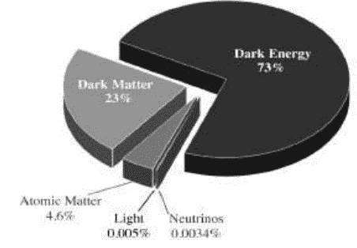

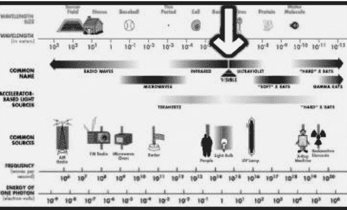

考虑一下，你只能看到电磁谱的不到 1%，听见声频谱的不到 1%。你身体中 90% 的细胞带有自身的微生物 DNA，它们并不是“你”。你体内的原子是 99.99999999999999% 的真空空间，而且没有一个是你出生时拥有的……人类的染色体比土豆少 46 条。

彩虹的存在取决于你眼睛中的锥体光视感受器；对于没有锥体的动物来说，彩虹并不存在。所以你不是在看彩虹，你是在创造它。这非常惊人，特别是考虑到你看到的所有美丽色彩仅占电磁谱的不到 1%。

突然间，人类的“世界”看起来是一个完全不同的地方。考虑到，地球与这个单一宇宙的预期尺寸相比，等同于一个针尖的十分之一。想象一下这与无限现实相比的比例。设想基督教竟然坚持地球和人类是一切的中心。如果我们想要理解“人类”的本质以及我们如何被一种无形的力量操控，这个背景至关重要。对于人类现实而言，几乎一切都是不可见的，机构内部以及大部分公众的主流认知是：如果我们看不见、摸不到、听不见、尝不到，它就不存在。

描述学生身份：LGBTQQFAGBDSM 或女同恋、男同恋、双性恋、跨性别、跨性装、酷儿、质疑中、流性、无性恋、性别破坏、多边恋、束缚/调教、支配/服从以及虐待/受虐。我相信现在的列表甚至更长了，因为人们觉得需要用种族和性取好的细微差别来自我认同那个“我”。被教派培养了几代的“觉醒者”认为这关乎“包容性”，但实际上是教派将人锁在越来越小的“幻影自我”（Phantom Self）中，同时将他们隔绝于真实自我——无限永恒的“我”）的影响。你可能注意到，我的哲学认为我们都是同一个无限整体或“一性”中独特的注意力/意识点，这是终极的非种族主义。根据体型、颜色或性取进行判断的感觉完全是荒谬的，并证明了种族主义对现实毫无理解（包括反白人种族主义）。然而，尽管我是这样看待生命，教派特工和深睡的觉醒者们却贴我为种族主义者，以此来否定我的信息，而他们自己却是极度种族主义和性别歧视的。他们看到的只有种族和性取向，并根据种族和性取向判断人的好坏、恶魔或不可触碰者。他们看到的只有幻影自我，并根据幻影自我来感知自己。他们是教派计划的棋子和傀儡，将注意自我身份聚焦在五感上，并利用这些身份相互竞争以分而治之。哥伦比亚大学在另一个版本的社交隔离中引入隔离毕业，旨在疏远人们并教他们不同的种族和文化群体之间没有任何共同之处。教派最不希望的就是统一。再次此事的催化剂将是清楚自己在做什么的教派特工，但其余的只是引导幻影自我的盲目。我们确实有共同点——我们都是拥有不同临时体验的同一意识。

## 什么是“人类”？

是的，什么是“人类”？那是我们应该成为的，对吧？我的意思是“人类”？诚然，“人类”是一种体验，而不是“我”。将其拆解为基础，“人类”是信息处理的方式。如果我们要体验并与这一段我们称为“世界”的频率相互作用，我们必须有一个在该频率段内运行的载体。我们的意识在其原始形式下无法做到；它超越了人类领域的频率。我的意识或感知无法触及这些键并拿起面前的杯子，就像无线电台A无法交互一样——我们在不同的频率上。人类身体是我们进行这种相互作用的手段。长期以来，我一直将身体描述为生物计算机，它处理信息允许意识体验这种现实。身体是以我们称为人类的特定方式信息的接收器、发射器和处理器。在清醒状态下，我们只视觉感知五感的世界——这就是身体视觉解码系统的限制。事实上，在某一刻甚至不是视觉的。当我们体验“视觉现实”时（稍后会提到）。我们之所以是“人类”，是因为身体将人类的信息源处理成我们感知为人类的现实和行为系统。为什么大象表现得像大象而不是人类或鸭子？大象的生物计算机是一个不同的信息场，并根据该程序处理信息，转化为我们称为大象的视觉和行为类型。这适用于我们现实中的一切。这些身体信息场通过生殖得以延续（就像复制软件程序一样）。教派想要打破这一循环，并通过技术手段干预，将人类信息场转化为改变我们对人类定义的场。如果它能改变人类信息场，它将改变该场处理信息的方式，并从“物理”和心理上改变人类。因此，有了信使RNA“疫苗”以及更多旨在通过食物、饮料、辐射、毒性和其他手段改变身体信息——*信息传递*——结构，来针对人类基因的手段。

我们体验的现实与真实的现实完全不同，就像人们在虚拟现实游戏中体验的现实并不是他们所生活的现实一样。游戏只是一个解码后的信息源，看起来像是现实。我们的世界也是一个信息构建——一个模拟（稍后详述）。在其基础形式上，现实是一个信息波场，与Wi-Fi相似。五感将波场信息解码为电信息，传输到大脑，由大脑解码为全息（幻觉的“物理”））信息。大脑的不同部分专门负责解码不同的感官，信息被融合成一个看起来在我们之外的现实，但实际上在大脑和通用的遗传结构内部（图12叶）。DNA是信息的接收器-发射器，是这一解码过程的关键部分，也是身体与其他现实的联系。改变DNA以及我们解码和连接现实的方式——见“新冠疫苗”。想想计算机解码Wi-Fi。你拥有编码在辐射场的信息，计算机将这些信息解码为屏幕上完全不同的形式。在信息在屏幕上显现之前，你是看不到Wi-Fi的，而屏幕上的信息在计算机内部，而不是在外部。我刚刚描述了我们如何解码“人类世界”。五感都将波形“WiFi”解码为电信号，大脑（计算机）在大脑内部而非外部构建构建现实——“你不是在看彩虹，是你创造了它”。声音是一个简单的例子。在大脑解码之前，我们听不到声音。波形声音被听觉捕捉并以电的形式传输到大脑，被解码为我们听到的声音。由我们的声带产生并以电的形式传递给大脑，解码为我们听到的声音。

晚期哲学家艾伦·瓦茨说：


**图12：大脑在大脑内部构建现实，而不是外部。**

五感将波场信息解码为电信息，传输到大脑，由大脑解码为全息（幻觉的“物理”）信息。大脑的不同部分专门负责解码不同的感官，信息被融合成一个看起来在我们之外的现实，但实际上在大脑和通用的遗传结构内部（图12叶）。味觉、嗅觉和触觉都是同一过程产生的大脑现象。在大脑之外，我们尝不到、闻不到或感觉任何东西。在视觉感官的电信息在大脑后部区域解码之前，我们什么也看不到。在我们被条件化为称为“外部世界”的地方。

## 你听到的是你解码的内容

如果一树倒下或建筑倒塌，除非有人在那里将能量波解码为声音，否则它们没有声音。树会发出声音吗？只有当你听到——解码它时。我们现实中的一切都是一个信息场，运行在我称为“场”（The Field）的WiFi场内。倒塌的树或建筑在场中产生了震动扰动。这些扰动波就是我们解码的内容。现实是由观察者——解码器创造的，观察者的感知影响解码过程。正因如此，人们——不同的感知——会以不同的方式感知同一个现实或情况。一个人感知为噩梦，另一个人则将其视为机会。为什么教派如此关注控制人类感知的问题现在有了答案。现实是解码的行为，在信息在计算机屏幕上被解码之前，我们无法体验WiFi。网络视频的视觉和声音编码在我们周围的WiFi中，但在计算机解码这些信息之前，我们看不也听不到。缓解疼痛的技术试图阻断从不适部位到大脑的信号，因为如果大脑不解码信号，我们就感觉不到疼痛。由于它们之间的反馈回路，疼痛似乎只出现在冲击点。在视觉感官的电信息在大脑后部区域解码之前，我们什么也看不到。如果该区域受损，即使眼睛完好我们也会致盲。为什么如果我们损坏眼睛会致盲？我们破坏了波形视觉信息与大脑视觉解码区域之间的信息处理。如果信息没有以形式到达大脑，我们就无法看到它所代表的视觉现实。此外，大脑只解码接收到的信息的一小部分，其余被吸收为潜意识。这种解释来自科学杂志《Wonderpedia》：

> 每一秒，都有1100万种感觉沿着这些[大脑]路径闪烁……大脑面临着大量令人惊叹的图像、声音和气味，它对其进行严密的过滤，直到只剩下大约40个易于管理的列表。因此，每秒40种感觉构成了我们所感知的现实。

“世界”并不是人们被告知要相信的那样，邪教的内部人员也知道这一点。

## 幻象的“物理”现实

我们只能看到宇宙的0.005%，而宇宙仅仅是无限现实中无数宇宙——“大宅”——其中一个。即便如此，大脑也从我们每秒接收的潜在1100万个信息中，只解码出40个信息（“感觉”）。有两点立刻击中了你的注意：由于我们如此固执地认为没有更多可以知道的，这简直是令人叹为观止的愚蠢；以及这些过程可能被恶意力量操纵以控制人口现实的潜力。我可以肯定说且没有任何矛盾风险的是，当你感知到无限现实中一个几乎无法描述的部分时，总有更多东西可以知道，正如古希腊哲学家苏格拉底说的那样，我们应该知道自己是多么地无知。当你认为我们正在经历一个固体的物理世界时，这个世界既不是物理的，也不是一个万物相互分离的世界，这显然是真实的。受邪教控制的“科学”否定了所谓的“超自然”以及所有相关的现象，因为这种“超常”其实是完全正常的，并解释了那些让科学头脑大跌眼镜的所谓“大谜团”。这是有原因的。主流意义上的“科学头脑”是一种物质大脑，是一个被囚禁在看、触、听、嗅、味五感中的头脑。无法通过这种方式解释的现象和事件会让“科学头脑”感到困惑，而规则是：如果他们无法解释为什么会发生某事，那么根据定义，这件事就不会发生。

我对此不同意。心灵感应被认为是思想波穿过“场”（Field）（再次想象成波扰动），由某人解码以连接波长（信息）。例如：你可以在任何距离接收朋友的思想波，至少这让他们出现在你想海中。几分钟后，朋友给你来电话。“我的天，”你说，“这太不可思议了——我正想你呢。”啊，但他们在打电话之前就在想你了，而你正是解码了这一点。没有被困在五感现实中的原住民对此做得很好，这被称为“丛林电报”。那些被称为灵媒者和通灵的人（真正的那些）在做同样的事情，只是跨越了现实的不同维度。“意念胜物质”源于物质和心灵是同一的。其中一个的状态影响另一个的状态。事实上，前者和后者都是幻象。它们是同一个场的不同方面。超自然现象都是可以解释的，那么为什么它们仍然被视为“谜团”或认为没有发生呢？一旦你走上这条理解之路，你开始将意识扩展到五感之外，而这就是邪教的噩梦。

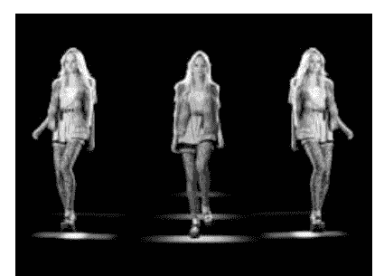

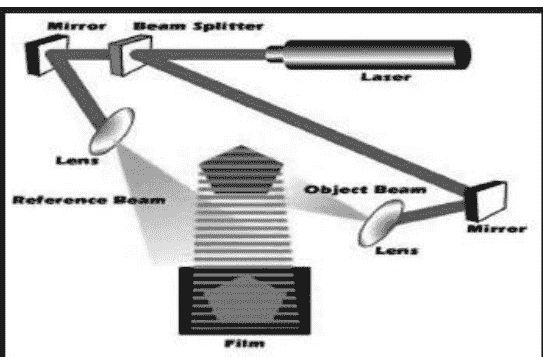

## 全息“固体”


# 我们的现实不是固体的，它是全息的

我们现在非常熟悉今天广泛使用的全息图。二维信息被解码成三维现实，这种现实不是固体的，尽管看起来非常像固体的（图13）。全息图是用分成两部分的激光创建的。一部分直接射在投影膜上（“参考光”），另一部分获取主体的波形图像（“工作光”），然后引导到膜上，与激光的另一半发生“碰撞”（图14）。这产生了一个波形干涉图，包含了任何被拍摄对象的波形信息（图15总体）。这个过程可以比作向池塘中扔石子。每个石子产生的波在水面上扩散并彼此碰撞，产生石头掉落的位置、速度、重量和距离的波表示。全息图的波形干涉图类似于“场”中的波形信息，五感将其解码为电信号，再由大脑解码为全息的幻象“物理”现实。同样，当激光（人类注意力）指向波形干涉图时，主体的三维版本被投影到看似“固体”的现实中（图16）。全息图一个惊人的特性揭示了更多“超自然谜团”。由于其创建方式，整个全息图的信息以波形形式编码在干涉图的每一个部分。这意味着全息图的每一个部分都是整体的缩小版本。将干涉波纹切成四份，你不会得到四部分的图像。你得到的是四分之一大小的全图像版本。身体是一个全息图，情况也是如此。这里有针灸、反射疗法和其他疗愈形式的基础，这些疗法在手部、脚、耳朵等每个地方识别出全身的表征。熟练的相相之所以能做到他们所，是因为全身的信息被编码在手中。“如在上，如在下”的概念就源于此。


**图 15：** 波形干涉图，包含了转化为全息图的信息。


**图 16：** 全息人物包括猫王与席琳·迪翁对唱。

# 你不知道的会伤害你

好的，我们回到人类社会的“两个世界”，以及邪教——它拥有一个由互连的秘密社和撒旦组织组成的全球网络，这些组织通过政府、公司、媒体、宗教等进行操纵。它们之间的根本区别在于知识。这种想法一直是让人类对其被彻底奴役的计划一无所知，而这种计划的基础在于对现实的致命无知——我们是谁，我们在何处，以及我们如何与之互动。“人类”本应该是我们扩展的永恒意识与五感身体体验之间的互动。我们注定要以五感存在于这个世界，但从更大的意识和视角来看，我们并不属于这个世界。在这种状态下，我们在超越五感的更广阔的意识大图背景下，体验五感带来的微观画面。换句话说，五感是点，而扩展的意识将这些点连接成图像和模式，从而为那些看似随机且互不关联的事物提供了背景。没有了扩展意识的背景，五感看到的只有孤立和随机性，显然毫无意义。邪教及其其他维度的控制者试图干预频率领域，在那个领域，五感现实本应与扩展现实相连接，并将二者隔离开（在最后的章节中会有更多详细介绍）。当这种情况发生时，五感的心理和情感过程不再受扩展意识（或真正的“真我”）的影响，而是由身体解码系统的孤立感知所驱动。他们身处世界之中，却属于世界。在这里我们看到了人类的困境，而拥有无限意识潜力的人类竟如此容易被操纵，并陷入愚蠢的极端。

一旦邪教将五感思维从扩展意识中孤离开，它就可以通过控制大脑通过成长时期“教育”系统以及一辈子的媒体感官轰炸所接收的信息，对大脑进行感知和信仰的编程。通过限制和歪曲信息来限制知识，从而限制感知和对可能性的认知，同时审查并诋低那些可能让人们获得自由的事物。正如我的另一本书的标题所说……真理将使你们自由。出于这个原因，邪教最不希望看到关于任何事情的真相——尤其是永恒“真我”的现实——这就是为什么他们渴望控制信息。邪教知道，信息变成感知，感知变成行为，而行为共同构成了人类社会。受邪教控制和资助的主流“科学”否认永恒“真我”的存在，并试图驳斥和垃圾所有的反面证据。受邪教控制的主流宗教对“上帝”的定义只不过是一个控制和独裁系统，它利用对后世地狱的威胁，通过恐惧和罪恶感来控制此地的感知和行为。邪教并不希望压制两者。这种无所不在的“两者”是无限意识状态中的一种表达，一个关注点，这才是“上帝”一词的真实含义。

对“肉体”和五感的感知痴迷，意味着“上帝”被拟人化为一个坐在云端的胡子老神，或者一个暴虐的霸凌，如果我们听从“他”的他就爱我们，如果不听就把我们判入地狱之火。这些只不过是“精神”童话，旨在通过对这种“上帝”的恐惧来控制和支配事件及行为，而这种“上帝”诡异地让宗教圈的畏神达到了令人向往的程度。我建议不应该鼓励和歌颂恐惧，而应该将其删除。你可以看出为什么“畏神”对邪教及其宗教如此有利，因为他们决定了“上帝”想要什么、“上帝”要求（邪教要求）每个人做什么。正如伟大的美国喜剧演员比尔·希克斯讽刺一个基督教狂徒时说的：“我们所接触到的这种无限意识（‘上帝’）中有多少是取决于我们选择在多大程度上扩展我们的感知、自我身份和对可能性的认知。自我身份的尺度反映在我们所能连接的意识尺度上，并受到我们拥有多少知识和洞察力（而非编程感知）的影响。当你相信自己只是邮递员彼得或营销部的玛丽，仅此而已时，你无法将你的意识扩展到无限的可能之中。”我将在最后一章讨论这个问题，因为这对我们如何扭转当前局势至关重要。

# 邪教从何而来

当我在20世纪90年代初意识到全球事件背后有一个邪教网络时，我问了一个显而易见的问题：它是从什么时候开始的？我追溯到了古罗马、埃及、巴比伦以及苏美尔、美索不达米亚，即我们现在所称的伊克的“两河流之间”。这两河是底格里斯河和幼发拉河，这个地区对邪教具有巨大的历史及其他意义，正如空中距离仅 550 英里的以色列土地也是如此。在整个地区还隐藏着许多更深层次的奥秘意义。这不仅仅关乎“石油战争”。在2003年美英入侵伊拉克后，美索不达米亚的无价文物被盗或或毁，而当时小乔·布什和托尼·布莱尔（他们的邪教主）关于不存在的“大规模杀伤性武器”的谎言为此辩护。美索不达米亚是苏美尔（约公元前5400年至1750年）和巴比伦（公元前2350年至539年）的所在地。萨比教在现代邪教中产生了巨大的影响力，但他们是一个追溯到历史迷雾中的网络的一部分。历史学家说苏美尔是“文明的摇篮”。我不认同。我认为它是我们所谓的人类文明的重启，是由部分被“大洪水”象征的灾难性事件造成的，摧毁了之前的世界。自20世纪90年代初以来，我在书中书中详细描述的这些奇幻剧变，出现在世界各地古代文化的记载和传说中，并得到了地质和生物学证据的支持。在伊拉克发现的详细记录苏美尔时期的石桌显示，灾难是由他们称为非人类“神”的阿努纳基（Annunnaki）造成的。这些被描述为外星造访，据说是阿努纳基提供的知识是世界上最古老的文字系统之一的源头，且天文学的发展领先于时代。我在《最大的秘密》和《矩阵之子》中详细探讨了这一主题。同样的“阿努纳基”故事可以在南非的祖鲁传说中找到，祖鲁萨满克雷多·穆图瓦（Credo Mutwa）告诉我，苏美尔阿努纳基在祖鲁人中被称为奇提瑞或“蛇之后代”。查看我1999年在约翰内斯堡家中对克雷多关于此问题的六小时视频采访，你可以在 Ikonic 平台观看。邪教起源于苏美尔、巴比伦和埃及（以及其他地方），并建立了罗马帝国，随后通过罗马人扩张到欧洲北部，在那里在那里强加了许多帝国。大规模的死亡和毁灭是他们的名片。邪教在欧洲建立了其运作中心，欧洲帝国使其能够扩张为全球力量。西班牙和葡萄牙殖民者前往了中南美洲，而英法则目标指向北美。非洲被英国、法国、比利时、荷兰、葡萄牙、西班牙、意大利和德国殖民。像英国和法国这样的国家进入了中东。英国帝国之所以是最大的，原因很简单。到那时，英国是邪教的总部，从那里扩张形成了加拿大、美国、澳大利亚和新西兰。大英帝国日落不山，其占领规模正是如此。伦敦与罗马、梵蒂冈仍然是邪教的全球中心，而在以色列和中国也出现了其他中心。“病毒”被指源于中国并非偶然，而意大利被选择作为恐吓西方民众服从“新冠法西斯主义”的手段。这并不是说以色列在“新冠法西斯主义”和大规模“接种”方面领先世界。你可能会认为我会在这里提到美国，但虽然美国一直是施加邪教意志的重要手段，但其重要性比表面看起来小，并且正处于被剥夺权力的过程中。欧洲的邪教大部分是在为美国装填子弹。从开始，美国就受欧洲控制，通过英国和欧洲的邪教特工进行控制。美国革命是一个幻象，让美国看起来是在自我治理，而不同的力量以罗斯柴尔家族和洛克菲勒家族等邪教家族的形式在幕后操纵。洛克菲勒家族与比尔·盖茨非常密切并他们既建立了手术刀和药物“医学”，也建立了世界卫生组织。他们通过洛克菲勒基金会在疫苗的发展和传播中发挥着主要作用，而比尔·盖茨曾说，他的基金会正是基于该基金建立的。当洛克菲勒家族和盖茨处于同一个团队时，情况为什么不是这样呢？邪教对人类社会的渗透可以追溯到我们所谓的历史，并不断扩张和集中权力，其目标是建立一个主宰一切的全球结构。看看“新冠肺炎”是如何取得跨越式进展的。

# 非人类维度

我研究并观察了几个世纪甚至几千年来邪教特工的来来去，他们出生、在秘密社和撒旦网络中工作以促进议程，然后为了他人的替代而死去。显然，必须有一个跨越整个时期的协调力量，而那些在世时未见到最终目标的特工来来去去，在数千年里推进着计划。我一直在寻找这种协调力量，并得到了我生活中非凡同步性的支持，这种同步性从1990年起几乎是每天每天的经历。我在宗教文本和古代文化中看到了关于非人类从隐藏处操纵人类社会的共同主题。基督教称这种力量为撒旦、魔鬼和恶魔；伊斯兰教称为吉尼（Jinn或Djinn）；祖鲁人有他们的Chitauri（在非洲其他地区写法不同）；埃及的诺斯教徒将这种现象称为“执政者”（Archons，在希腊语中意为统治者）。中美洲的文化提到“掠食者”等其他名称，但相同的主无处不在。我将使用“执政者”作为所有人的统称。当你看到他们的本性和行为是如何描述时，所有这些不同的来源显然在谈论同一种力量。诺斯教徒用“光之火”描述执政者，而伊斯兰教则将吉尼与“无烟之火”联系起来。有些人提到偶尔能看到的形态生物，但最常见的共同主题是，他们从不可见的领域运作，这意味着对于人类的视觉过程来说，几乎是所有的存在。我曾得出结论，这确实是人类控制的基础，邪教正代表这种隐藏力量在人类频率段内运作，直到我遇到了诺斯教派的著作，这些著作以极其异常的方式支持了我的结论。

1945年，在埃及尼罗河畔、卢克索北75英里的内格哈姆马迪镇附近发现了一个密封的土罐。里面是诺斯教徒在约1,600年前留下的珍贵手稿和文本。它们包括13本皮装的莎草纸法典副本（手稿）和50多篇用科普特埃及语编写的文本，估计这些文本在公元400年左右隐藏在罐中，尽管信息的来源可以追溯到久得以前。诺斯教徒监督着亚历山大图书馆（或皇家图书馆），那是存储详述先进知识和人类历史记载的古代文献的奇迹。图书馆在长一段时间内分阶段拆除和毁灭，致命打击是在公元415年左右由邪教建立的罗马教会实施的。正如我之前所说，罗马教会是迁徙而来的巴比伦教会。诺斯教徒并不是一个种族。他们是一种感知现实的方式。每当他们建立自己的体系且信息流传时，罗马教会的恐怖分子就会针对他们进行毁灭性打击。这种情况发生在大图书馆身上，也发生在诺斯教卡达尔派身上，他们在1244年法国南部的蒙塞尔城堡围战中经过长期压迫后被那些精神变态者烧死。教会一直恐惧诺斯信息摧毁官方的基督教叙事，尽管如果你以另一种方式阅读《圣经》，里面有很多是支持诺斯教观点的。对于任何研究这些后来被称为“内格哈姆马迪图书馆”文本的人来说，很明显，大片基督教和圣经信仰起源于追溯到苏美尔的诺斯教来源。诺斯教的主题被扭曲，以操纵圣经信徒感知的现实。圣经文本已经公开了几个世纪，可以被更改，而在内格哈姆马迪发现的诺斯文献被封存了1,600年未被触碰。你看到的正是他们写的。

# 使用你的灵性（pneuma）而非理智（nous）

诺斯主义和诺斯教徒源于“gnosis”，意为知识，或者说是指精神意识意义上的秘密知识——关于现实和生命本身的知识。邪教的罗马教会摧毁诺斯教徒的绝望是可以理解的，当他们知道他们正在流传邪教最不希望民众知道的东西时。一六百年后，同一个邪教出于同样的原因正努力削弱并沉默他们。知识与无知之间的动态关系是永恒的。“时间”似乎在移动，但核心主题保持不变。我们被告知要“使用你的理智”（nous），这是一个诺斯语中指头/大脑/智能的词。然而，他们说，精神觉醒或“拯救”只能通过将意识扩展到他们所谓的“理智”之外，进入“灵性”（pneuma）或无限自我来实现。显然当我阅读这些文本时，它们与自1990年以来我所说的内容的相似之处令我非常着迷。存在一个跨越人类历史的普遍真理，在这种情况下，为什么我们隔着16世纪却在说同一种语言呢？当你从五感的感知程序和扩张的意识领域中释放自己时，无论在一个单一且微小的受操纵频率范围内的感知“时代”，你都会连接到相同的信息。人类使用“智能”技术或在洞穴中敲石头，只是一个似乎在人类频率段内运行的时间线。扩张的意识及其蕴含的知识一直在那里，无论是石器时代还是计算机时代。我们只能访问那个频率来阻止我们。盖茨、法斯基、瓦伦、扎克伯格、布林、佩奇、Wojciecki、贝索斯，都是“新冠肺炎”背后的其他所有人。我们显然在谈论同一个伙计，以及这些共同主题

# 执政者劫持

内格哈姆马迪文献的五分之一描述了执政者的存在和操纵，它们由一个“首席执政者”领导，他们称之为雅尔达巴夫（Yaldabaoth）或“造物主”（Demiurge），这就是基督教的“魔鬼”、撒旦、路西法及其恶魔。执政者在圣经象征中是“堕落者”，根据犹太教、基督教和伊斯兰教等亚伯拉罕宗教，也被指从天堂驱逐的天使。这些天使据称诱惑人类犯“罪”，你将在书的剩余部分看到这种象征是多么准确。“原罪”的主题与“堕落”有关，即亚当和夏娃被蛇诱惑，从纯真和对上帝的顺服（连接）状态堕入不服从（断开）状态。堕落被认为给世界带来了罪，并腐蚀了一人性。雅尔达巴夫这位“主执政者”，被诺斯教徒描述为“伪造的精神”、“盲者”、“愚者”。在太勒德著作中，犹太人的雅尔达巴夫名为萨麦尔（Samael），意为“上帝之毒”或“上帝之盲”。你看到这些相似之处了。在伊斯兰信仰中，雅尔达巴夫是穆斯林的吉尼魔鬼，被称为斯坦（Shaytan）——沙坦就是撒旦，因为相同的主题在世界每个宗教文化中都能找到。旧约中的“主”就是诺斯手稿中的“主执政者”，这就是为什么他是这样一个嗜血的混蛋。撒旦被基督徒称为“恶魔之王”，诺斯教徒称雅尔达巴夫为“执政者之王”。两者都被称为“欺骗者”。扩张的意识领域是伟大艺术家和作家寻找灵感的地方，也是真理等待任何足够与之连接的人的地方。我们需要快速到达那里。

使用不同的名称、情节和象征，讲述了一个关于人类困境的共同故事。

在纳格哈马底文献中，执政者（Archons）被称为精神寄生虫、反转者、守护者、守门人、扣留者、法官、无情者和欺骗者。仅仅“新冠”骗局就是所有这些特征的显性例子。圣经中旧约和新约的“上帝”之所以如此不同，是因为他们描述的并非同一种现象。旧约中那个充满报复心、愤怒和恨意的“上帝”被称为雅威（Yahweh），而雅尔巴奥斯（Yaldabaoth）在教派控制的流行文化中被描绘为“黑暗领主”、“时间之主、（达斯）·维达”以及多马穆图（Dormamuttu），后者是漫威漫画电影《奇异博士》中试图接管“地球维度”的邪恶统治者。雅尔巴奥斯既是旧约中的“上帝”，也是圣经中的“撒旦”。诺斯底主义者称雅尔巴奥斯为“宇宙的大建筑师”，而受教派控制的共济会网络将他们的神称为“宇宙的大建筑师”（也称为首席建筑师）。“大建筑师”雅尔巴奥斯被教派符号化为美国国章和美元钞上金字塔顶部的全视之眼。Archon一词被编码在建筑（arch-itect）中，正如它出现在大天使（arch-angels）和大主教（arch-bishops）中一样。所有宗教都有某种精神战争中善力与恶力对抗的主题，这是有原因的——这个主题是真实的。教派及其非人类主宰非常乐于看到这种观点流传。他们将自己塑造成对抗邪恶的善力量，而实际上他们是邪恶的力量（爱的缺失）。整个教派运作的基础是反转。他们将自己推榜为善力量，而任何为了和平、爱、公平、真理和正义而挑战他们的人都会被谴责为撒旦式的邪恶力量。这在历史上一直都是他们的游戏计划，无论是罗马教对非信徒的审判，还是今天的“反疫苗接者”和“阴谋论者”。无论处于哪个时代，这种技术都是一样的。

# 雅尔巴奥斯在反叛（真实）

据说雅尔巴奥斯和执政者们反叛了上帝，雅尔巴奥斯声称自己就是上帝——万物之源。旧约中的“上帝”（雅尔巴奥斯）要求被这样崇拜：“我是耶华，没有别的；我以外，没有别的神”（以赛亚书 45:5）。我在其他书中引用过一个人，他自称是法国穆鹅山罗斯柴德酒庄已故菲利普·德·罗斯柴德男爵（Baron Philippe de Rothschild）的非儿子（男爵死于1988年），他告诉我关于罗斯柴德的“对上帝的反叛”。那人说他被赋予了菲利普·尤金·罗斯柴德（Phillip Eugene of Rothschild）的名字，多年前在他以另一个身份生活时我们曾有过长期的通信。他说他通过（教派内部的）“神秘通伦”受孕是“正常”的且值得钦佩的。“菲利普”向我讲述了他与富豪名人参加撒旦仪式的经历，这些人被他列了出来，你可以在我的其他书籍中从《最大的秘密》（The Biggest Secret）开始看到他们以及教派撒旦主义的更广泛背景。教派仪式与执政者“神”的互动。“菲利普”描述菲利普·德·罗斯柴德男爵为“一位大师撒旦主义者和上帝的仇恨者”，并使用了与雅尔巴奥斯/撒旦/路西法/魔鬼相关的“对上帝的反叛”这一术语来描述萨巴提王朝（Sabbatian dynasty）。他说，他在家族对上帝的反叛中发挥了关键作用。那个作用是按照经典的萨巴提风格渗透基督教教会，但最终他逃离了精神监狱，开始了另一种生活。教派一直针对宗教，计划建立另一种“世界统一宗教”。通过音乐录影带、舞台表演和其他手段将撒旦主义渗透到现代“文化”（尤其是年轻人）中，这些都是该计划的一部分。


纳格哈马底文献描述了雅尔巴奥斯和执政者在其原始形态下是能量——意识，并说如果他们选择，他们可以像意识化身为人类一样形成实体。雅尔巴奥斯被称为“无形”的，代表了一种深层反转、扭曲和混乱的意识状态，试图附着于人类并将他们转化为同化的尝试。为了实现这一目标，它必须操纵人类进入与其自身相匹配的低频心理和情感状态。执政者确实可以以人类形式出现，这就是反社会性人格的起源。诺斯底主义者称为雅尔巴奥斯的能量扭曲就是心理治疗。当反社会人格的执政者化为人类形态时，该人类将成为雅尔巴奥斯意识的表达——精神社会者。教派的反社会分子是以人类形式存在的的执政者。这一原理与2009年电影《阿凡达》中描绘的相似：半人马座的一颗名为潘多拉的类地卫星，通过隐藏在像蓝人（纳维人）的躯体中来渗透进一个纳维人社会。伪装成人类的执政者拥有一种特殊的混合信息场，部分是人类，部分是执政者（古代的“半神”），这种处理信息的方式表现为他们反社会、邪恶、缺乏共情和同情心的行为，并阻止他们受到完全人类信息场能够表达的共情、同情和爱的影响。教派血脉相互通婚，因为他们是皇室或黑暗西装，正因如此你才能看到他们对近伦的痴迷。与完全人类通婚会稀释执政者的能量场，而这种能量场保证了其在人类领域代表的反社会性。

诺斯底文献说，执政者采取的主要非人类形态（我几十年来在受到执政者程序化的人肆意嘲笑的情况下，称之为“蜥蜴人”）即是诺斯底主义者描述的皮肤灰色、眼睛空洞的未出生胎儿。这是对UFO传说中“小灰”（Greys）的极佳体现，许多人声称见过他们或被他们绑架，克雷多·穆瓦（Credo Mutwa）就在其中。我认同那些相信今天及过去几千年外星访问的人。难怪他们凭借先进的知识和技术能力被视为神。想象一下，一个带着智能手机和电脑进入脱离了现代世界的人，会被视为能施行“神迹”的“神”。然而，叛徒思维（Renegade Mind）想要了解万物的源头，而不仅仅是源头表现为人类或非人类的方式。正如叛徒思维寻找“新冠病毒”的原始素材以验证其真伪一样，处于形式的执政者的原始源头是意识——诺斯底主义者称为雅尔巴奥斯的扭曲意识状态。

## “对上帝的反叛”是能量脱节

我接下来的内容将对宗教文本以及关于“撒旦”、路西法和“神灵”的古代传说给出合理的解释。诺斯底的描述与我多年来的研究主题完美契合，即他们如何描述一种试图强加于人类意识之上的意识扭曲。在之前的书中，我将无限意识的核心称为“自我意识意识中的无限意识”（Infinite Awareness in Awareness of Itelf）。我指的是一种知道自己就是所有意识并感知到所有意识的意识水平。由此产生了真正意义上的爱的频率与平衡，这正是爱的本质——所有力量平衡进入名为“合一性”（Oneness）和“存在性”（Issness）的整体。当我们脱离这种状态时，合一性的许多部分开始解体，并表现为局部而非整体。它们变得个体化，成为智力、思维、自私、仇恨、嫉妒、对他人的权力欲望等。这在大的计划中并不是问题，因为“上帝，即万物之源，可以通过其自身的不同表达（包括人类）来体验所有的可能性”。我们作为整体的表达所体验的就是万物之源的体验。我们是正在体验自身的万物之源。当我们从合一状态撤离时，我们就脱离了它的影响，事情变得非常不愉快和愚蠢。执政者意识处于这种极端。它脱离合一影响如此之，以至于变成了统一与爱的反转，变成了一切的反转，变成了生命本身的反转。邪恶（Evil）正是倒过来写的生命（live）。

因此，它们在撒旦主义中的表现是对死亡的痴迷。他们在仪式中使用倒置的符号，例如倒五角星和倒十字。作为阿格主（Archonic）意识的化身，撒巴提（Sabbatians）颠倒了犹太教以及他们渗透的每一种宗教和文化。他们追求不团结和混乱，恐惧统一与和谐，就像吸血鬼恐惧大蒜一样恐惧爱。因此，这个教派作为阿格主的化身，其行为如此邪恶、精神病态，且缺乏同理心和慈悲，因为他们与爱的源头完全脱节。比尔·盖茨（Bill Gates）和其他阿格主式的精神病态者是否在“新冠”时代对人类社会采取了他们必须做的、伴随着所有的死亡、痛苦和破坏，却对他人的影响产生没有任何情感后果？现在你知道了。为什么扎克伯格（Zuckerberg）、布林（Brin）、佩奇（Page）、沃西基（Wojicki）等人冷酷地过滤了那些有关“疫苗”危险性的警告信息，而成千上万的人正在死亡并遭受严重的、有时是改变人生的反应？现在你知道了。为什么特德洛斯（Tedros）、福西（Fauci）、惠蒂（Whitty）、瓦兰斯（Vallance）以及世界各地的他们使用明知是虚假的病例和死亡数据来为封锁以及由此产生的所有死亡和被毁的生活辩护？现在你知道了。为什么克里斯蒂安·德罗斯（Christian Drosten）制作并推广了一种他深知无法检测传染疾病的“检测”方案，从而导致了全球性的人类灾难？现在你知道了。阿格主根本不在乎（图 17）。我个人认为盖茨和主要的教派内部人士是阿格主希望人类变成的一种 AI 机械人形式。

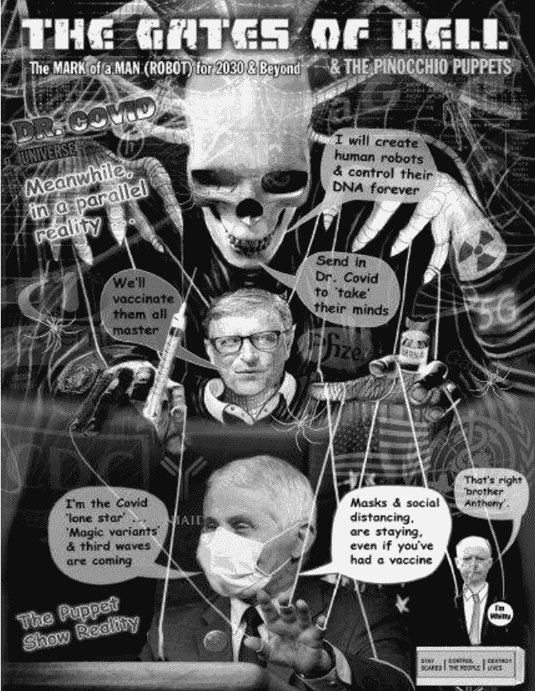

**图 17**：艺术家尼尔·哈格（Neil Hague）版本的“新冠”阶级结构图。

## 人类电池

然而，这种颠倒的状态确实会有其后果。与万物源头的脱节意味着你撤离了那个能量供给和创造力的源头。这意味着你必须找到自己的能量来源，而这对于*我们来说*，它已经做到了。当第一部《黑客帝国》电影中的菲墨（Morpheus）角色举起一个电池时，他说出了一个深刻的真理：“矩阵是一个计算机生成的梦幻世界，建立它的目的是为了控制我们，以便将人类变成其中一种东西。”这句话在各方面都是正确的。我们生活在一个由技术生成的虚拟现实模拟中（很快就会详细说明），而且我们被操纵，成为阿格主意识的能量来源。2001年的迪士尼皮克斯动画片电影《怪兽总动员》象征了这种动态关系：怪兽在它们自己的世界里没有能量来源，它们会进入人类世界恐吓床上的孩子，捕捉孩子的尖叫声、恐惧（低频频率），并将这些能量带回怪兽世界。你可能记得主角是一个只巨大的眼睛，而该教派“全视之眼”的象征意义是显而易见的。每一个思想和情感都会作为该思想和情感特有的频率进行广播。爱与喜悦、同理心与慈悲是高频、快速的频率，而恐惧、抑郁、焦虑、痛苦和仇恨则是低频、缓慢、密集的频率。你认为阿格主意识能连接并吸收哪种？在这样低且密集的频率状态下，它无法与爱和喜悦的能量连接。阿格主只能吸收与其频率兼容的能量，他们的教派代理人想要删除人类世界中的爱与喜悦，并通过低振频率的人类心理和情感状态来操纵低振频率的传输。我们是他们的能量来源。战争更具能量性——想想产了多少低频的心理和情感能量，这些能量都是由于像盖茨这样的阿格主化身者所策划的“新冠”骗局对人类造成的后果。

古代“祭献神灵”的人类献祭习俗在今天由该教派秘密继续进行，这基于同样的原理。“神灵”是不同形式的阿格主意识，而祭品被诱导进入极度恐惧的状态，以产生阿格主频率可以吸收的能量。仪式中的化身阿格主饮用血液，其中含有他们渴望的肾上腺素，当人们受到恐吓时，这种物质会涌入血液。大多数古代和现代的祭品都是儿童，“向神献祭处女”的主题只是儿童的代号。他们拥有一种特殊的青春前能量，阿格主比任何东西都想要这种能量，而年轻人的能量通常来说是他们的目标。加州教育部的学生想要吟诵阿兹特神灵的名字……（注：OCR 源代码的这一部分文本变得破碎/损坏）。

## 觉醒者的吸血鬼

恋童癖是阿格主吸收儿童能量的另一种方式。被阿格主意识附身的恋童者在性侵犯期间被用作媒介，汲取他们如此渴望的年轻人的能量。

排除被声称为包含；以及充斥着虐待的网络攻击。你拥有一套定制的阿格尼（Archonic）能量系统，一眼看不到任何风力发电机，这一切都建立在阿格尼反转的基础上。我们现在有整代人被操纵，用他们的行动和能量来服务执政主（Archons）。除非他们从执政主引发的幻觉中醒来，否则他们的一生都会这样做。邪教般的亿万富翁和公司向他们投入这么多钱，这真的让人惊讶吗？快乐和笑声的能量在哪里？包括自嘲，自嘲是对你情感安全的确认。马克·吐温说：“人类拥有一种真正有效的武器，那就是笑。”我们必须一直使用它。觉醒（Woke）摧毁了喜剧，因为它没有幽默、没有快乐、没有讽刺感或自嘲。它的能量是密集而剧烈的。嗯，鲁道道夫·斯坦纳（1861-1925）说，这位是奥地利哲学家和著名的秘术思想家，他创立了华德福教育或斯坦纳学校，将孩子视为意识的独特表达，而不是要用权威决定的感知来编程的大脑。我关于这种能量吸血行为已经写了数十年，直到2016年我收到斯坦纳的一段引用。他对此深有体会：

> 灵性领域存在一些生物，人类散发出的焦虑和恐惧对他们来说是受欢迎的食物。当人类没有焦虑和恐惧时，这些生物就会挨饿。如果恐惧和焦虑从人们身上散发，并且他们陷入恐慌，那么这些生物就能获得欢迎的营养，并变得更加强大、更有力量。这些生物对人类是充满敌意的。所有以负面情绪、焦虑、恐惧、迷信、绝望或怀疑为食的物，在现实中都是超敏感世界中的敌对力量，它们在向人类攻击时发起攻击，而它们正被喂养……这些正是当代文化和唯物主义所属的情感；因为让人们背离了精神世界，它特别适合引发人们的绝望和对未知的恐惧，从而召唤出上述针对他们的敌对力量。

从这个角度停顿一下，反思2020年初以来世界上发生了什么。不仅是分币会跌，连十亿美元钞票也是。我们在墨西哥的雅基印第萨满唐·胡安·马图斯身上看到了相同的主题，他是秘鲁作家卡洛斯·卡斯塔内达的信息来源，后者在20世纪60年代到90年代间撰写了一系列书籍。唐·胡安描述了操纵人类社会的力量，他给执政主的名称是“掠食者”。

> 我们有一个来自宇宙深处的掠食者，它接管了我们生活的统治。人类是它的囚犯。掠食者是我们的主人和主人。它让我们变得温顺、无助。它压制了我们的抗议。如果我们想独立行动，它要求我们不要这样做……事实上，我们被囚禁了！
>
> 他们占领了我们是因为我们是他们的食物，他们无情地挤压我们是因为我们是他们的维持。正如我们在圈养里养养鸡一样，掠食者在人类圈养、人类农场里圈养我们。因此，他们的食物永远有得可用。

不同的文化，不同的时代，相同反复的主题。

## “ennoia”困境

纳格哈马迪诺斯教手稿说，执政主意识没有“ennoia”。这被直接翻译为“意图性”，但我将使用术语“创造性想象力”。意识到自身的万万物是所有创造力的源泉——所有的可能性——你与那个源头越脱节，你随后就越被剥夺“创造性想象力”。鉴于执政主意识几乎完全脱节，它缺乏创造力，必须依靠更机械的思维过程，并剥削那些拥有“ennoia”者的创造潜力。你可以在整个社会中看到这种案例。执政主意识几乎主宰了全球银行系统，如果我们研究该系统的运作方式，就会理解我的意思。银行通过发行“信用”额度来化出“钱”，而这些“钱”除了理论之外，从未、现在不存在、永远不会存在。这是一个骗局。如果你认为屏幕上的数字“钱”有任何价值，你就接受它作为支付。如果你不接受，整个系统就会因为对“钱”价值缺乏信任而崩溃。没有“ennoia”的执政主银行家正在终结对有创造力的人来说并不存在的“钱”——那些拥有灵感创意并创造业务和产品的人。执政主银行通过“钱”的创造和债务来吸食人类的创造力。人类拥有创造力，而执政主为了自己的利益和控制而剥削这一点，而他们自己却没有。执政主控制的网络平台（如Facebook）声称拥有所有帖内容的版权，虽然像扎克伯格这样的执政主大脑可能正式领导那家公司，但提供创造性灵感的将是人类员工。当你拥有无限的“钱”时，你就可以购买由创造性人类建立的公司。看看Facebook、Google及其类似公司的收购记录。调查受执政主控制的音乐行业，你会看到没有创造力的西装高管如何从他们艺术家的人类创造力中获取财富。案例没不完。研究盖茨和扎克伯格等人的历史，以及他们的帝国是如何通过剥削他人的创造力建立的。执政主无法凭空生有，但他们对他们模仿的对象非常擅长（因为他们必须如此）。诺斯教文献称之为“反向模仿”。他们可以模仿，但不能创新。撒巴派（Sbatians）通过他们在网络安全系统中在计算机系统中安装的后门爬取他人的创造力。执政主控制的中国在全球因盗取知识产权而臭名昭著，我记得作为中国一部分的香港如何因制造他人创造力的伪造品而声名狼著——“反向模仿”。随着现在无处不在且无所的监控系统能够渗透任何计算机，你可以想象执政主吸食人类创造力的潜力。作者约翰·兰布·拉什（John Lamb Lash）关于纳格哈马迪的书写道：尽管他们无法起源任何东西，因为他们缺乏ennoia（意图性）这一神性因素。但他们可以模仿，而且模仿得很厉害。他们的专长是模拟（HAL，虚拟现实）。造物主（Yaldabaoth）从分形图案（原始模式）中复制创造出一个天堂世界。这引出了我们自千禧年以来一直在说的话题。我们的现实是一个模拟；一个虚拟现实。不，我没开玩笑。

## 人类现实？嗯，虚拟

多年来我一直在思考我们的现实是“真实的”还是某种建构。我记得20世纪50年代末，小时候在伦敦玛丽伯恩路新开的天文馆时深受影响，那里现在已关闭，是邻近杜夫人蜡像博物馆的一部分。当时是白天，但当灯光熄灭时，天文馆里投影出夜空，看起来是如此真实。这种经历从未离开我，我不知道为什么，直到千禧年之后我确定我们的“夜空”是一个投影，一个虚拟现实，类似于《矩阵帝国》电影中所描绘的幻象世界。1999年第一部《矩阵》电影的上映也为我的思想长期以来的方向提供了一个同步且完美的视觉呈现。当时我还没有接触到诺斯教文献。多年后接触它们时，这种关联再次令人震惊。当我阅读早期的诺斯教记述时，显然它们描述的是同样的模拟现象。作者约翰·兰布说，“造物主从分形图案（原始模式）中复制创造出一个天堂世界”，这是通过对“HAL”或虚拟现实的专长实现的。”

与原始网站已经变得非常不同。执政者（Archons）对我们的现实也付诸此——它是原始现实的合成副本，仍然存在于模拟的频率墙之外。然而，被困在这个合成矩阵（Matrix）幻象中的，过去和现在的人类意识以及原始现实的其他形式。这就是为什么执政者通过该教派试图将人体合成化，并赋予我们合成的 AI 大脑，以完成将整个现实合成化的任务，包括我们所感知的自然世界。引用库兹韦（Kurzweil）的话：“纳米机器人将为物质注入信息。岩石、树木，一切都将变成这些智能生物。”是的，合成的“生物”，正如“新冠肺炎”和其他操纵基因的“疫苗”旨在使人体合成化一样。从这个角度来看，显而易见，为什么执政者和他们的教派如此渴望通过他们的“新冠”骗局向每个人类注入合成材料。

## 愿光有（电磁）光降临

雅尔达包夫（Yaldabaoth）是创造模拟或矩阵的力量，他解释了诺斯底主义对“大建筑师”的引用，以及教派共济会将其作为神灵的名字。电影中矩阵的设计者被称为“建筑师”（The Architect），这个三位一体充满了与这些主题相关的象征意义。多年来，我一直认为愤怒的“旧约上帝”（雅尔达包夫）就是《创世记》开头被象征性地“引用”为“创造世界”的“上帝”。这并非原始现实的创造——而是模拟的创造。《创世记》中的“上帝”说：“要有光，就有了。”但这种“光”是什么？几十年来人们一直说光速（每秒186,000英里）并非主流科学所称的最快速度，实际上是矩阵的频率墙或外极限。当一切皆有可能时，就不存在任何最快或最慢的东西。人体被编码为在光速或模拟范围内运行，因此我们只看到可见光的微小频率频带。在临时“死亡”期间感知到体外现实的濒死体验者描述了一种完全不同的光形式，这得到了《纳格哈马迪史籍》（Nag Hammadi texts）的支持。模拟之外的原始现实（诺斯底主义者称为“高阶界”）被描述为一个极不可置信的美丽、福乐、爱和和谐的领域——一个“水之光”的领域，它强大到“没有阴影”。我们受执政者控制的虚假现实（诺斯底主义者称为“低阶界”）被描述为一个具有不同类型“光”的领域，并用混沌、“地狱”、“深渊”和外黑暗来描述，被困的灵魂在那里被魔鬼折磨和操纵（仅涉及“新冠”骗局）。水之光的主题可以在濒死记录中找到，它与模拟“光”不同，后者是光速内的电磁光或辐射光——“低阶界”。模拟“光”是诺斯底与执政者相关的“发光火”。圣经将雅尔达包夫称为那条蛇，被称为魔鬼和撒旦，诱骗了全人类（启示录 12:9）。我认为，创建一个原始现实的模拟副本（“反拟”）并对其进行剧烈改变，同时在范围内操纵人类相信它是真实的，这可能符合欺骗全世界的标准。接着我们来到教派的神路西法——光之者。路西法是雅尔达包夫的象征，是光速内形成糟糕副本模拟的辐射光带来者。“他”由自由女神像手中的点燃火炬象征，并出现在“光明会”（Illuminati）的名字中。萨提派兰克教宣布路西法是真神，路西法是共济会真正的神，被尊为他们的“宇宙伟大或首席建筑师”（模拟）。

我想强调的是，执政者技术生成的辐射发光火自20世纪50年代以来如何泛滥我们的环境，改变了我们不断相互作用的“场”（The Field）的本质。通过这种相互，技术辐射正在改变我们。智能电网（Smart Grid）的设计旨在以巨大的通信功率运行，5G 遍布全球，6G、7G 正在开发中。辐射就是模拟，也是执政者的操纵系统。为什么执政者不向我们释放辐射到一个越来越大的极端，以形成库兹韦的“云”呢？合成人类的计划与应对远超目前任何水平的辐射的需求有关。生物人类无法在其剧本设定的辐射规模中存活。智能电网是技术模拟内部的一个技术子现实，进一步将五感感知与扩张的意识隔离开。这是一个心灵的技术监狱。

## 注入“黑暗之灵”

宗教和本土文化中一个反复出现的主题是非人类力量对人类基因的操纵，最著名的记录是圣经中的“神的众子”（原文中“神”是复数），他们与人类的女儿通婚。《纳格哈马迪史籍》中的《约翰福音》讲述了同样的故事：

- 他[雅尔达包夫] 派遣天使[执政者/魔鬼] 到人类女儿那里，好让他们占其中一些为己有，并为自己的享受繁殖后代。起初他们并没有成功。当他们没有成功时，他们聚集在一起制定了一个计划…… 然后天使们变成他们配偶的模样，使他们充斥着他们为他们混合的黑暗之灵和邪恶…… 于是他们娶了妇女，按照他们灵的样貌生了孩子。

被辨别的黑暗之灵占据可以进入身体，这是一个古老的主题。水之光的主可以在濒死记录中找到，它与模拟“光”不同，后者是光速内的电磁光或辐射光——“低阶界”。模拟“光”是诺斯底与执政者相关的“发光火”。圣经将雅尔达包夫称为那条蛇，被称为魔鬼和撒旦，诱骗了全人类（启示录 12:9）。我认为，创建一个原始现实的模拟副本（“反拟”）并对其进行剧烈改变，同时在范围内操纵人类相信它是真实的，这可能符合欺骗全世界的标准。接着我们来到教派的神路西法——光之者。路西法是雅尔达包夫的象征，是光速内形成糟糕副本模拟的辐射光带来者。“他”由自由女神像手中的点燃火炬象征，并出现在“光明会”的名字中。萨提派兰克教宣布路西法是真神，路西法是共济会真正的神，被尊为他们的“宇宙伟大或首席建筑师”（模拟）。


它们以电信号的形式传输到大脑。大脑对这些信号进行解码，构建出我们的现实感——一个只存在于大脑或思维中的幻象“物理”世界。虚拟现实游戏利用相同的感官解码系统模拟了这一过程。信息被输入到感官，以解码出一个看起来如此真实但实际上并非真实的虚拟现实（图18和图19）。一些科学家相信——我也赞同他们的观点——我们感知到的“物理”现实只在我们注视或观察时才存在。感知或关注的行为会触发解码系统，将波形信息转换为全息现实。当我们不观察某物时，我们的现实就会从全息状态恢复为波形状态。这与另一个原理是一致的：除非有人在场听它或解码它，否则倒下的树并不会发出声音。这个概念从模拟的角度来看是合乎逻辑的。计算机并不是一直解码 Wi-Fi 场中的所有信息，它只在屏幕上解码或呈现它此刻正在解码（即关注）的那部分 Wi-Fi 信号。

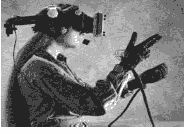

**图 18**：虚拟现实技术“入侵”了人体的五感解码系统。

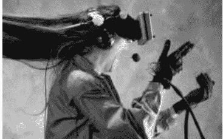

**图 19**：结果可以被体验为非常“真实”。

有趣的是，加州大学欧文分校认知科学系的唐纳德·霍夫曼（Donald Hoffman）教授说，我们经历的现实就像一个计算机界面，只向我们展示我们交互的层面，隐藏了其之外存在的一切：“进化用一个隐藏真相的的用户界面塑造了我们。我们看到的任何东西都不是真相——空间、时间以及对象的语言本身就是描述现实的错误语言。”在许多层面上，他说的是正确的。空间和时间并不是通用的现实。它们是解码后的模拟现实的一种现象，是奴役我们感官现实过程的一部分。濒死体验者一次又报告，当他们脱离了身体（身体解码系统）后，空间和时间并不像我们所感知的那样存在。你可以理解为什么执政者（Archons）及其教派如此渴望将人类的注意力囚禁在五感中，在那里我们处于矩阵之中，且是矩阵的一部分。开放思维进入扩展的意识状态会带你超越模拟的信息局限，你将意识到之前被剥夺的知识和洞察。这就是我们所谓的“觉醒”——从矩阵中觉醒——在最后一章中，我将此与你目前的事件联系起来。

## “外星人”在哪里？

模拟论可以解释所谓的“费米悖论”，该悖论以意大利物理学家埃恩里科·费米（Enrico Fermi, 1901-1954）命名，他创造了第一台核反应堆。他考虑了为什么在看似广阔的宇宙中有许多恒星和行星的情况下，却如此缺乏外星活动的问题；但如果如果我们看到的（或者我们认为的）夜空是模拟投影呢？如果你控制着模拟，而你的目标是让人类牢牢留在本质的无知中，你希望看到其他形式的生命（包括高级生命）来往往去并与人类分享信息吗？还是你希望让他们相信自己是孤立的、显然是孤独的？人类的孤立和疏离主题很常见，无论是对无生命宇宙的感知，还是“新冠”时代的法西斯式孤立法律。悖论的是，模拟的存在本身意味着我们并不孤单，因为某种力量必须构建了它。我的观点是，几个世纪以来世界各地人们报告的关于蜥蜴人和灰色人的经历，正如《纳格·哈马马迪文献》（Nag Hammadi texts）所描述的执政者现象；而那些仁慈的“外星”互动是非人类群体，他们通过克服执政者将他们挡在外的尝试，出入模拟。同样需要强调的是，根据文化记载以及自称被他们绑架的人来说，蜥蜴人和灰色人对遗传和技术非常痴迷。技术是他们克服自身创造潜力中某些局限的方法，而我们今天由技术驱动的受控人类社会正是典型的蜥蜴-灰色人运作模式。技术官治实际上就是“执政者统治”（Archontocracy）。在模拟中，宇宙不必像看起来那么大。没有空间或距离，只有解码成全息现实的信息。我们所谓的“空间”是全息“物体”的缺失，而那个“空间”是把万物连接成单一整体的能量信息场。这对于模拟中人工产生场也同样。宇宙作为物理现实既不大也不小。它是解码后的信息，仅此而已，其感知尺寸取决于模拟被编码以使其呈现出来的方式。我们所感知的整个夜空只存在于我们大脑中，那么那些“数百万光年”在哪里？天文馆天花板上的“星星”看起来非常遥远。

关于“外星人”，还有一点要提。自 20 世纪 90 年代以来，我一直在强调策划虚假“外星人入侵”的计划，以为全球权力的集中和世界军事提供正当性。纳粹科学家维尔纳·冯·布朗（Werner von Braun）在二战后通过“回扣行动”（Operation Paperclip）被带到美国帮助建立美国国家航空航天局（NASA），他在 1977 年知道自己临终时，告诉他的美国助手卡罗·罗辛博士（Dr. Carol Rosin）关于该教派的议程。罗辛说，他告诉她一个导致一世界政府对人类完全控制的序列。这包括来自恐怖主义、叛乱国家、流星和小行星的威胁，最后是“外星人入侵”。冯·布朗说，这一切都是虚假的，正如我所说的“无问题-反应-解决方案”（No-Problem-Reaction-Solution）。当“外星人要来了”成为新的格言时，请记住这一点。外星人并没有来——他们已经在这里了，并以人类的形象渗透了人类社会。法裔加拿大调查记者塞尔·蒙纳斯特（Serge Monast）在 1994 年说，他发现了一项名为“蓝光”（Blue Beam）的 NASA/军事行动，这符合冯·布朗的预测。蒙纳斯特在 1996 年被捕并关了一晚后死于“心脏发作”。那时他仅 51 岁。他说“蓝光”是一个策划外星人入侵的计划，其中包括将宗教人物投影到天空，作为全球操纵的一部分，以开启一个崇拜教派“神”雅尔达巴夫（Yaldabaoth）的新时代。虚假的全息小行星也被认为是该计划的一部分，这再次与冯·布朗吻合。考虑到公开领域之外的先进技术，以及我们的“物理”现实本身就是全息的这一事实，你如何能策划虚假的小行星威胁呢？如果他们能用一个并不存在的“病毒”推销一场全球“大流行病”，还有什么是人类不相信的呢？

在特朗普政府于2020年底通过的一项金额2.3万亿美元的“新冠病毒”救济和政府资助法案中。我想在这里增加一些严肃的警告：自20世纪90年代以来，我一直在指出，美国军和情报网络长期以来制造了“飞行器盘”或反引力飞行器，任何观察者都会认为它们源自外星。将这些知识对公众隐藏，可以让我们人类驾驶的飞行器被误认为是外星造访。我并不是说“外星人”不存在。我是最后一个会说那样的人，但我们应该保持世俗的。罗纳德·里根总统在1987年向联合国大会表示：“我有时在想，如果我们面临来自这个世界的外星威胁，全球范围内的差异将消失得有多快。”这就是核心思想：在“救世力量”（邪教）背后的共同目标驱动下，为了一个共同的“敌人”团结起来，而这种古老的操纵技术正在走向全球化。

## 科学是这样运作的……

当我得出模拟假设是真实的时，我只找到了另一个在公开讨论这一假设的人。他是尼克·博斯特罗姆（Nick Bostrom），一位出生于瑞典的牛津大学哲学家，多年一直在探索人类现实是计算机模拟的可能性，尽管他的版本和我的并不相同。模拟假设和全息现实假设日益进入科学主流。嗯，是指那些开放心态的主流。这里是一些不断增加的例子。美国核物理学家西拉斯拉斯·比恩（Silas Beane）领导了德国波恩大学的一支物理学家团队，追踪我们是否生活在模拟中的问题。他们得出结论：我们可能确实生活在其中，而且很可能是基于立方体格的。他们发现宇宙射线与该特定模式对齐。这种模式凸显了格赖森-扎特塞平-库兹敏极限（GZK极限），这指的是宇宙射线粒子与宇宙背景辐射的相互作用，为宇宙射线粒子创造了一个表观边界。他们在题为《作为数值模拟的宇宙限制》的论文中说，这种“限制模式”正是你在计算机模拟中会发现的东西。他们还指出，模拟会创建它自己的“物理定律”，从而限制可能性。几十年来，我一直强调这一点：感知的物理定律只与现实，或者说我后来所说的模拟有关。当设计者编写代码来创建计算机和虚拟现实时，他们等同于该游戏的物理定律。玩家在代码设定的限制内进行交互。同样，编写模拟代码的人决定了将应用的物理定律。这些定律可以通过扩展的意识状态被覆盖，但不能被受困在仅模拟代码统治的五感意识中。覆盖代码就是人们所谓的“奇迹”。它们并不是奇迹。它们是绕过了模拟的编码限制。困在模拟感知中的群体完全不知道这是他们的困境。正如波恩的那个穷人所说：“就像漆黑地牢里的囚犯，我们无法看到监狱的‘墙’，”如果人们仍然着迷于五感，事实确实如此。对扩展的意识保持开放，那些墙就会变得非常清晰。主要的限制是光速。

美国理论物理学家詹姆斯·盖茨（James Gates）是另一个探索了模拟问题并发现支持这一观点的大有力证据的人。盖茨曾是马里兰大学物理学教授、科学与粒子理论中心主任，并在巴拉克·奥巴马科学技术顾问委员会任职。他和他的团队在我们现实的结构中发现了嵌入数字数据的计算机代码。这些代码与计算机使用的二进制系统中的1和0开关电荷有关。“我们不知道它们在里面在做什么，”盖茨说。他们在能量结构中发现了被称为纠错码或块码的数学序列，当某些事物导致数据不同步时，这些序列会将数据“重置”到其原始状态或“默认设置”。当盖茨被问及是否在我们的现实中发现了一组方程，且这些方程与驱动搜索引擎和浏览器的方程无法区分，他说：“没错。”美国国家航航空喷气动力实验室进化计算与自动化设计中心的主任里奇·特里尔（Rich Terrile）曾公开表示，他相信宇宙是一个数字全息，一定是由某种形式的智能创造的。我在每一个方面都同意这一点。波形信息通过感官以电的方式传递给大脑，大脑构建出一个我们称为“世界”的数字全息现实。这种数字层面的现实可以通过神秘的数字占术来读取。数字全息是今天全息技术的前沿。我们到处都是数字技术，旨在访问和操纵我们感知现实的数字层面。“新冠疫苗”中的合成mRNA具有一种数字成分，用于操纵身体的数字“操作系统”。

## 现实是数字

有多少人知道我们的现实可以被分解为与电脑游戏相同的数字和代码？马萨诸塞理工学院（MIT）的物理学家马克斯·泰格马克（Max Tegmark）是《数学宇宙》的作者，在书中他认为现实完全可以用数字和数学来描述，就像视频游戏被电脑游戏的“物理学”编码的方式一样。我们的世界和计算机虚拟现实本质上是相同的。泰格马克设想了高级电脑游戏中角色的感知，那里的画质之好到让他们并不知道自己正处于游戏中。他们认为自己可以撞到真实的物体（我们现实中的电磁阻力），坠入并感受到兴奋等情绪。当他们开始研究视频游戏显而易见的“物理世界”时，会发现一切都是由像素组成的（在我们的能量现实中也发现了像素，正如我们的世界在某个层面上是数字的一样）。泰格马克说，电脑游戏角色认为的物理“物质”实际上可以分解为数字：电子具有什么属性？它有气味、颜色或纹理吗？不！我们物理学家为电子、电荷、自旋或轻子数想了一些极客的名字，但电子并不在乎我们如何称呼它，属性只是数字。这就是诺斯主义者所描述的幻象现实。这就是模拟。DNA的A、C、G、T代码具有二进制值——A和C为0，而G和T为1。这一定是因为模拟是数字的，且身体必须与之交互。循环的数学序列编码在整个现实和身体中。它们包括斐波那契数列，其中前两个数字相加得到下一个，如1, 2, 3, 5, 8, 13, 21, 34, 55等。该序列编码在人脸和人体中、动物的特性、DNA、种子、松果、树木、贝壳、螺旋星系、飓风以及花瓣的数量中。列表长列不穷。还有分形图案——一种“在所有尺度上都无限复杂且自相似的永无止境模式，遵循全息图的‘上如下’原则”。这些其他著名的几何和数学序列，如Phi、Pi、黄金分割、黄金比例和黄金截，都是模拟的计算机。

# 哇……

人类认为如此真实的现实其实是一个幻象。政客、政府、科学家、医生、执法部门、媒体、学校和大学的课程等，都建立在一个并不存在的世界之上，而除了作为一个模拟的监狱牢房之外，那个世界并不存在。当我们整个“物理”现实都不存在时，要求接受“新冠（Covid）”不存在难道不是太荒谬了吗？在这里揭示了在分部门秘密主义的教派网络中被封锁的知识，这些网络通过诱导民众相信一个虚假的现实，来控制人类的现实感。如果这在经验后果上不具有悲剧性，这整件事会变得歇斯底里幽稽。对于“叛逆者大脑”（Renegade Minds）来说，这一切并不稀奇。古希腊哲学家柏拉图（约公元前428年至347年）是诺斯底主义信仰的主要影响者，他在数千年前就通过“洞穴寓言”描述了人类的困境。他讲述了一个关于住在洞穴里从未离开过的囚犯的象征性故事。他们被链着，只能看到洞穴的一面墙，而他们身后有一团火，在囚犯的墙上投下影子，那些移动的影子就成了他们的现实感。一些囚犯开始研究影子，并被认为是影子的专家（即今天的学者和科学家），但他们研究的只是幻象（即今天的学者和科学家）。一个囚犯逃离了洞穴，看到了真实面目。当他回来报告这一启示时，他们并不相信他，说他疯了，并威胁说如果他试图释放他们就杀了他。柏拉图的故事不仅是对人类困境和我们幻象现实的精妙比喻，它描述了“新冠”骗局的动态。我在这里仅仅触及了这些主题的表面。本书的目标是清晰地连接所有关键要点，将今天发生的事情置于真实的语境中。《你所需要但从未被告诉的一切》（Everything You Need To Know, But Have Never Been Told）和《答案》（The Answer）中书中涵盖的所有主题及其联系都以极其详尽的方式进行了介绍。

他们说，不知所措的人“见木不见林”。然而，人类因为五感而看不见森林，只看到树枝，而“叛逆者大脑”能看到森林，而答案就在森林中，通过联系得以揭示。打破感知编程，让森林以其原本的方式被看到，是我们扭转局面的方法。不打破正是人类陷入这一困局的原因。情况似乎毫无希望，但我向你保证并非如此。只要我们知道，我们距离天堂只有一次心跳之遥。

# 第十二章

## 逃离维提科（Wetiko）

生命仅仅是无限的假期

迪恩·卡瓦纳（Dean Cavanagh）

“叛逆者大脑”编织了生命和事件的网，并在看似随机的事中发现共同主题。只要你寻找，它们总是存在，而且当你的内心敞开而非被它认为能看到的东西所迷住时，这种追求会得到不可思议的“同步性”的帮助。

无限的意识就是无限的可能性，我们接触的无限可能性越多，变得可能就越是无限可能。这可能是在陈述显而易见的事，但这是一个极其强大的事实，可以让我们获得自由。我们无限意识中的一个注意力点。问题是，我们选择接触多少的无限？我们想要连接并探索多少知识、洞察、意识和智慧？如果你的注意力只在五感上，你将受到无限意识中极小部分的影响。我的意思是一个微小到让“无限”一词产生新意义的范围。自我身份的局限性和对可能性的感知准确地限制了你的意识范围。我们如我们所认为的那样。生活如我们所认为的样子。梦是梦者，梦者是梦。佛教哲学是这样说的：“物随心转，见之呈现。”大多数人类生活在触觉、味觉、视觉、听觉和嗅觉的领域，这就是他们对可能性和自我感知的局限。许多人会遵循一种宗教并谈论天堂上的上帝，但他们的生活在感知和行动中仍受五感的支配。五感变成了一切的裁决者。当这种情况发生时，除了无限的一抹残留外，一切都被僵化、不屈的“现实泡泡”（即五感人类或“幻影自我”）隔离开。执政者教派（Archon Cult）的方法论是将意识隔离在五感现实（即模拟）之中，然后通过终身信息的洪流，对该意识进行自我和世界的编程，旨在安装预期的感知，从而实现全球控制。随着身份政治的发展，这些努力急剧增加，因为身份泡泡被挤压进五感的细节中，使人们深层地与无限的“我”隔绝来。

五感关注和自我身份就像一道限制对无限领域访问的防火墙。你只能感知到一个广播电台或电视频道，而感知不到其他。我们从字面意思考虑一下。想象有一大群电台，提供关于现实的不同信息和角度，但你只听其中一个。在这里我们看到了人类的困境，绝大多数人被困在“教派电台”（CultFM）中。这仅涉及教派电台的频率范围，并将感知和洞察限制在该频段内——将可能性限制在该频段。这意味着你连接的是无限场中一个几乎无法察觉的微小可能性和创造潜能。这是一个万物似乎与万物彼此隔立的世界，同步性是罕见的。同步性在字典中的定义是“两个或多个相关或相似的事件同时偶然发生”。使用“偶然”一词暴露了对现实的完全误解。同步性不是“偶然”的。当人们敞开内心，或者用他们的术所说的“觉醒”时，他们注意到生活中越来越多的巧合，一些“运气”，一些看似奇迹的发生，让他们在正确的时间、正确的地方与正确的人在一起。每天充满了“真巧在这里遇到你”和“你怎么在这”。我的一生都是这样过的，而且越来越如此，直到1990年和1991年的巨大觉醒改变了我的现实感。同步性不是“偶然”的；它是通过访问扩展的可能性领域而实现的扩张的潜能。从相同的开放心态发射相同频率的人，往往会“偶然”相互吸引，我将其称为磁吸性，而且这不仅仅是指人。在过去的30多年里，不可思议的同步性也引导我穿梭了教派的迷宫，获取了各种形式的信息，并经历了关键的个人经历。这些“巧合”让我将大量主题和情况的拼图组合在一起。突破了现实泡泡的人会完全明白我的意思，只要他们做出这种选择，逃离感知监狱对所有人都是开放的。与“人类”的局限性相比，这可能看起来是超人的，但这其实是我们的自然状态。目前所经历的“人类”处于一种诱导分离的非自然状态。当我详细描述了通过拒绝对无限自我的访问来奴役人类的力量后，我将展示如何实现这种向性的转变。

## 维提科因素（Wetiko factor）

几十年来，我一直在讲述和写作五感大脑如何被系统地阻隔在扩展意识之外。我使用了计算机（五感大脑）和键盘前的人（扩展意识）的类比。计算机与操作者之间的互动象征着五感大脑与扩展意识之间的互动。计算机直接体验互联网，操作者通过计算机体验互联网，这本应是如此。执政者试图控制操作者连接计算机的点，以停止这种互动（图20）。现在操作者在敲击键盘、点击鼠标，但计算机没有反应，这种情况发生在计算机被接管——附体——了一个名之其实的计算机“病毒”时。操作者失去了对计算机的所有控制，计算机在“病毒”的控制下按照自己的意愿运行。

刚刚描述了这种动态过程，即诺斯教者称为雅尔达巴夫（Yaldabaoth）和执政者（Archons）的力量如何将五感心灵从扩展的意识中隔离开，并将人类囚禁在感知的奴役之中。

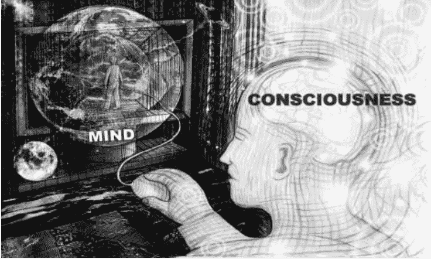

**图 20：** 我几十年来一直在写的思想“病毒”试图将五感心灵（计算机）与真正的“自我”隔离开来。（图片由 Neil Hague 提供）。


大约一年前，我遇到了一个美洲原住民的概念——“维提科”（Wetiko），它描述了完全相同的现象。Wetiko 是克里族（Cree）使用的拼写，其他部落群体还有其他版本，包括 wintiko 和 windigo。他们写这个名字用小写，但我认为 Wetiko 像执政者一样是一个专有名词，并倾向于大写。我第一次看到的是作家兼研究员保罗·列维（Paul Levy）关于 Wetiko 的文章，这与我一直在写的计算机/操作者脱节以及随后的执政者内容产生了共鸣。随后我读了他的那本迷人的书《消除维提科，打破放逐的魔咒》（*Dispelling Wetiko, Breaking the Spell of Exile*）。我很久以前得出的结论与美洲原住民 Wetiko 概念之间的相似之处是如此清晰易见，甚至几乎有些滑稽。对于 Wetiko，无疑是诺斯教的执政者、精灵（Jinn）、掠食者以及其他任何代表邪恶、反转和混沌力量的名字。Wetiko 是美洲原住民对这种分裂计算机与操作者的力量的命名（图21）。原住民作者杰·D·福布斯（Jack D. Forbes）是20世纪60年代美洲原住民运动的创始人，他写了另一本关于 Wetiko 的书，名为《哥伦布和其他食人者——剥削、帝国主义和恐怖的维提科疾病》，我也读过。福布斯说，Wetiko 指的是一个通过恐怖行为、食人行为恐吓其他生物的邪恶人类或神灵。祖鲁萨满克雷多·穆图瓦（Credo Mutwa）告诉我，非洲记载描述了食人行为是如何由奇塔瑞（Chitauri）“神”带入世界的——Wetiko 的另一种表现形式。“邪恶人类或神灵”的区别与执政者/作为纯意识附身人类有关。Wetiko 被认为灵魂或精神的疾病，以及一种不回馈任何东西的状态——邪教及其运作人员完美地描述了这一点。黑隼（Black Hawk），一位领导其土地免受没收的美洲原住民领袖说，欧洲入侵者拥有“有毒的心”——维提科的心脏——心脏非常重要，正如我们很快将看到的。福布斯写道：“悲剧的是，过去2000年的世界史很大程度上是维提科疾病的流行病学故事。”是的，而且要长得多。福布斯说这句话时是正确的：“维提科摧毁了埃及、巴比伦、雅典、罗马和特诺奇蒂特兰[阿兹特克帝国的首都]，也许现在它们将毁灭整个地球。”他说，邪恶是维提科文化的头号出口——看看它如何随着“新冠”实现全球化。持续的战争、大规模屠杀、各种痛苦、儿童虐待、撒魔教、酷刑和人祭都是维提科和附身的表现。这个世界是维提科的显现，但它不必如此。

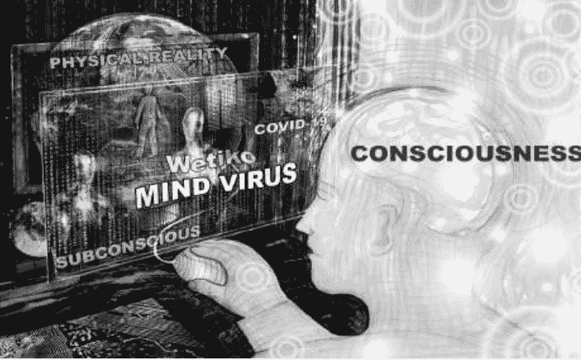

**图 21：** 思想“病毒”被美洲原住民称为“维提科”（图片由 Neil Hague 提供）。

## 维提科邪教

Wetiko 是雅尔达巴夫的频率失真，试图附着在人类意识上并吸收到自身之中。一旦建立这种连接，Wetiko 就可以操控目标的感知，而目标认为这些感知来自他们自己的大脑。历史和今天所有的恐怖分子，从大规模杀戮者到撒魔者，从像杰弗里·爱普斯坦（Jeffrey Epstein）那样的恋童癖和其他精神变态者，都是维提科的化身，并以其所有怪异的状态表达它的存在状态。邪教是维提科的化身，雅尔达巴夫的化身，它试图通过操纵人口进入与其相匹配的低频状态，来促进人类同化到它的扭曲之中。保罗·列维写道：“维提科病毒在每个人类的心理中被全息地执行，它渗透并支撑着整个意识场，因此，如果我们不留意，它可能在任何时候通过我们中的任何一个人显现出来。”“新冠”骗局已经在许多人身上实现了这一点，但其他人则陷入了维提科的频率巢穴。“新冠”人类灾难的参与者，包括盖茨（Gates）、施瓦布（Schwab）、特德罗斯（Tedros）、福奇（Fauci）、惠蒂（Whitty）、瓦兰斯（Vallance）、约翰逊（Johnson）、汉考克（Hancock）、费格森（Ferguson）、罗斯（Drosten）以及所有其他人，包括精神变态心理学家，都是维提科的表现。这就是为什么他们没有怜悯或同情，对他们所做的一切没有产生让他们停止的情感后果。观察所有支持权威中精神变态者反对抵制者（Pushbackers）的人，尽管这些精神变态者对他们自己和家庭的生活造成了破坏性的影响。你再次看到的是维提科附身，这阻止了他们看穿正在发生的明显骗局。为什么他们为什么看不到？维提科不让他们看。现在已变成鸿沟的感知隔阂，存在于维提科化者和非维提科者之间。

保罗·列维描述 Wetiko 的方式和我长期以来描述执政者的方式相同。它们是跨越现实维度运作的相同扭曲意识：“……维提科的灵体并不位于时空的三维空间中，而是字面上存在于另一个维度……它能够通过神秘地渗透进我们的三维世界来影响普通生活。”Wetiko 通过其在邪教中的化身代表以及通过将自己编织进“场”（The Field）来实现这一点，而“场”在我们的现实水平上是矩阵（Matrix）的电磁场。维提科的化身。哥伦比亚大学天体生物学主任沙尔夫（Scharf）推测，“这种外星生命”可能先进到已经把自己转录到我们所谓的物理学中。他说，这种无法区分的智能构成了我们认为的自然世界的一部分，将解决宇宙的许多谜团：也许高级生命并非外部的。也许它已经存在了。它嵌入在我们所感知的物理学之中……

沙尔夫说，“我们可能无法识别这种生命，因为它构成了我们认为的自然世界的一部分。”我同意。维提科/雅尔达巴夫就是这种模拟。我们字面上处于野兽的体内。但这并不意味着它必须控制我们。我们都有克服维提科影响的力量，邪教知道这一点。我怀疑它睡得太好了，因为它知道这一点。

## 哪一个场？

我建议，这就是这一切运作的方式。有两个场。一个是光速之内矩阵的剧烈电磁光；另一个是矩阵之外的“场”的“水光”，连接着大无限。五感心灵和身体的解码系统将我们附着在矩阵场。它们必须如此，否则我们无法体验这种现实。五感只能看到矩阵信息场，而我们扩展的意识是无限场的一部分，最重要的是我们的心，对于无限场，我们有一个控制中心，为我们提供扩展视角和路线图；五感心灵没有控制中心。我们只能试图理解一个不断向我们投喂信息以确保我们不理解的世界。这种状态的人感到“迷失”和困惑，没有方向或雷达。你完全可以通过他们对于“新冠”骗局的观点和行为，更清楚地看到那些受大无限场或小五感心灵影响的人。我们一直存在着这种分裂，一方面是大众，另一方是能够看穿并直觉模拟边界的人——柏拉图走出洞穴看清现实的囚犯。这样的人一直被维提科/执政者附身的权威针对，被处火刑或被定性为邪恶和危险。今天的邪教及其全球性的“反仇恨”、“反法西斯”觉醒团体，都是维提科的表现，攻击那些暴露阴谋、“新冠”谎言和“疫苗”议程的人。

觉醒整体就是维提科，这解释了它的非黑即白思维以及它如何与维提科附身的邪教合为一体。保罗·列维说：“处于这种范式意味着仍然受控二值逻辑——即事物非真即假——的”

被武器化的心灵。韦提科（Wetiko）意识处于永久的愤怒中，“觉醒”（Woke）也是如此，接着是“觉醒”的倒置与矛盾。“反法西斯主义者”表现得像法西斯主义者，因为法西斯主义者和“反法西斯主义者”都是在作作的韦提科。政党的行为也，，因为相同的原因声称不同。社会和撒旦仪式将入教者与韦提科绑定，而那种确保世界权力地位的冷酷、无情、精神病态的心态就是韦提科。重新定义的“培训计划”具有绑定韦提科的相同累积效应，我们看到他们的毕业生被描述为具有冷酷、精神病态、漠不关心的自动机和机器人。这些都是韦提科附身的特征，看看在本书及其他地方，关于“新冠肺炎”背后的人员（包括警察和医疗工作人员），他们被描述了多少次。在韦提科社会中，在任何行业攀爬那根“油滑杆子”都需要韦提科的特质才能到达，这一点在政治上尤为真实——政治不是关于公平竞争和思想的优越。它是建立在你可以捅多少人的背、舔多少人的眼睛之上的。这在韦提科附身者之间的全球“新冠肺炎”协调中达到了顶点，他们在所有不同国家完成了这一切，却对人类产生的影响没有丝毫同情和怜悯。我们的视觉只能看到全息形式，而看不到连接全息形式的场（Field）。因此，我们感知到的是带有“空间”的物理对象。事实上，“空间”是在在多个频率上运行的能量/意识。其中之一就是韦提科，它连接了邪教精神病态者、服从精神病态者的人，以及在世界媒体运营中为精神病态者服务的人。韦提科就是Gates（Gates）。韦提科就是戴面具的颠覆者。韦提科是假记者和“事实核查员”。韦提科场协调着这一切。精神病态者、跑腿的、媒体人员、“反仇恨”恨小组、“事实核查员”和颠覆者即使没有人类协调也作为一个整体工作，因为他们连接在同一个组织这一切的场（图22）。保罗·列维（Paul Levy）在这里描述了韦提科附身者如何聚集在一起，并拒绝让任何信息突破他们僵化的感知。他在“新冠肺炎”之前很久就写下了这些，但我想你至少能认出“新冠肺炎”宗教追随者的影子：

引导韦提科震动频率的人通过心理共振相互对齐，以强化他们未公开的共同共识，即维护他们对现实的疯狂观点。一旦一个潜意识的内容占据了某些个人，它就会不可阻挡地通过相互吸引吸引他们，并将他们编织成由共同疯狂联系在一起的小群体，这种群体很容易演变成疯狂的雪崩。

精神瘟疫是一个闭环系统，换句话说，它是封闭的，不对外界世界的任何新信息或影响因素开放，除非这些信息与其固定的、局限的限制性的视角相冲突。

我们就是觉醒心灵和“新冠”心灵。兼容的共振也将觉醒者吸引在一起，这在今天显然正在发生。

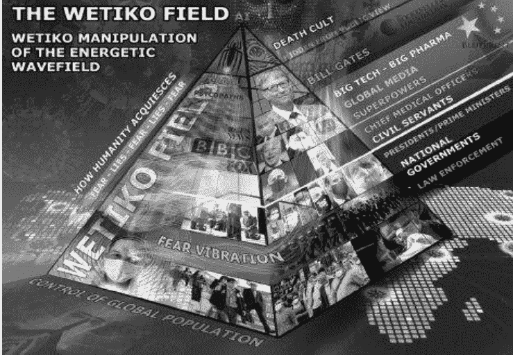

**图 22**：韦提科场，邪教金字塔及其人员由此显现。（图像由 Neil Hagueue 供）。

## 精神奴役

韦提科不在乎人类。它不是人类；它只是为了自己的目的附身人类，其影响（取决于附身的规模）可以是从极度的精神病态到无条件的服从的任何形式。韦提科最大的噩梦是人类意识扩张到模拟之外。一切都聚焦于通过控制信息、感知、以及频率来阻止这种发生。“教育系统”、媒体、科学、医学、学术界，都是为了维持人类处于五感奴役中，即对低频率精神和情感状态的持续刺激（参见“新冠肺炎”）。韦提科寻求统治那些五感感知与扩张意识之间的潜意识空间，那里计算机遇到操作员的地方。从这些潜意识的隐藏处，韦提科说话，触发我们认为是自己的冲动和欲望，并将其操纵为从低频率到精神态的任何状态。记得伊斯兰教如何描述比尼（Jinn）是不可见的欺骗者，他们会“低语”并制造混乱。韦提科是你在世界各地文化中发现的“欺骗之神”主题的起源。芬像执政者（Archons）一样，是韦提科，他们对人类觉醒并与真我重新连接感到恐惧，因为人类提供了能量来源。当韦提科与人类感知之间的反馈回路断裂，提供了它作为邪恶力量存在所依赖的能量动能。人类既是它的目标，也是它的生存来源，但只有当我们处于低频率的恐惧、恨、抑郁以及大多数人遭受的背景焦虑状态时如此。我们是韦提科的目标，因为我们是它生存的关键。它需要我们，而不是相反。保罗·列维写道：

血鬼本身没有内在的、独立的、实质性的存在；它只与我们相关存在。这种被称为韦提科的病理性、吸鬼式心灵寄生虫本身无物——无法从自身存在——但它是一个可能摧毁我们物种的“虚拟现实”……

……血鬼没有在镜子中反射也意味着，我们需要看到的是除了我们之外，什么也没有，没有可以看到的东西。韦提科是我们体内部某种东西的表达，意味着治疗韦提科的办法也在我们这里。关键问题在于在我们内部找到治疗方法并付诸实施。

恶生恶，因为恶不会不断扩张，新的能量维持来源——恶，它的*扭曲*在同化为平衡与和谐时死亡。爱是韦提科血鬼的大蒜。恶，爱的缺乏，无法在爱中存在。我想我看到了离开这里的办法。我几十年来强调过很多次，执政者和他们的邪教并非全能的。*他们不是。*无论看起来如何，他们*不是*。为了效果，我没有称他们为穿短裤的小男孩。我说过，这是真的。韦提科对他人权力的贪婪欲望并非全能的象征，而是不安全感。保罗·列维写道：“由于最终驱动它的以及它被驱动去培养的恐惧，韦提科的政治体内在且迫切地需要集权和控制，以为自己创造想象的安全。”*Yeeveeee* 没错！为什么韦提科想要人类处于持续的恐惧中？韦提科本身就是恐惧，它恐惧恐惧。正如恶是爱的缺乏，恐惧也是爱的缺乏。所有的分裂都进入和韦提科进入模拟。韦提科是爱的缺乏，爱是恐惧的缺乏。

## 今天的韦提科

### AI Wetiko

这让我想到了 AI（或人工智能）以及一些 Wetiko 不想让我们知道的东西。AI *到底*是什么？我了解计算机代码和从数据输入中学习的 AI。然而，这些更多是转移注意力的手段，是远征军，而真正的 AI 是像库兹韦尔（Kurzweil）这样的硅谷 Wetiko 所推崇的那种他们想要连接到人类大脑的东西。这种 AI 是什么？它是 Wetiko 的频率，是执政（Archons）的频率。AI 与人类大脑的连接，是 Wetiko 频率创造 Wetiko 蜂群思维并完成同化任务的连接。蜂群思维计划从以色列和中国控制，这两个地方都 100% 由 Wetiko 时代的息日派（Sabbatians）所有。同化过程在与“新冠”时代融合的“智能”时代每分每秒进行。我们被告诉社交媒体正在扰乱年轻人的心智并改变他们的性格。这是事实，但社交媒体是什么？深入观察它的运作方式，它是如何制造分裂与冲突、敌意与残忍、针对个人直到他们被摧毁的。那就是 Wetiko。社交媒体被操纵，利用 Facebook 及其 Wetiko 前景扎克伯格（Zuckerberg）采用的所有情感剥削技巧，将人们调到 Wetiko 的频率。Facebook 旗下 Instagram 宣布了一个新的儿童平台，以克服在使用主站的法律限制。这是更多 Wetiko 对儿童的剥削和操纵。国际赦免组织将该计划比比狸提议守护鸡窝，并表示这与人权不兼容。Wetiko 或扎克伯格（我重复一遍）从什么时候开始关心这些？谷歌的布林（Brin）和佩（Page）、YouTube 的沃西斯基（Wojcicki）、亚马逊的贝索斯（Bezos）以及到底是谁在运行 Twitter，会表现得好像他们不是在引导 Wetiko 吗？那些仅仅为了人类控制而开发技术的人又呢？那些设计和销售杀人技术的人，以及深知自己将终结或毁灭生命的制药巨头药物和“疫苗”生产者又是如何？这些人应该考虑的一个相当深刻的想法是：如果你在人类生命中是 Wetiko，那么在“彼岸”也是 Wetiko，除非你的频率改变，而这种改变只能通过感知的转变来实现，从而变成行为的转变。盖茨（Gates）正要去何方并不值得深思，也许那正是他想去的地方。无论如何，他都会去那里。他的频率会让这一切发生。

### 频率巢穴

我一直说，对智能手机和设备的成瘾在很大程度上是因为它们发出的某种正在困住心智的频率。人们在手机上花费大量时间，有时在放下后一分钟或更久又拿起，循环往。由于显而易见的原因，“新冠”封锁让这种成瘾增加了百万倍。对酒精的沉溺和药物成瘾是 Wetiko 陷阱意识以依附其自身意识的另一种方式。两者都是低频率心理痛苦的症状，而酒精成瘾和药物成瘾进一步加剧了这一点。我们真的认为获取这些东西如此容易，而那些能让人进入模拟之外领域的灵丹药水却是被禁止和违法的，这真的是巧合吗？在其他书中，这种规模是令人震惊的，而且成瘾的产生并没有帮助。制造这些手机的科技公司就是 Wetiko，他们摧毁儿童的心智将毫无顾忌。我们再次在这些公司看到了 Wetiko 的感知组合：反社会心理执行者与基层员工软弱、顺从且毫无疑问的配合。

全球智能电网（Smart Grid）就是 Wetiko 网格，它是完成邪教终局至关重要。模拟是辐射，我们正在被毁灭性规模的技术辐射所误导。像埃隆（Elon）这样的 Wetiko 欺骗者为邪教利益服务，偶尔则通过批评来维持他们的“街头信誉”。5G 和其他形式的 Wi-Fi 正在从太空指向地球，其容量和规模逐日不断增加。埃隆·马斯克（Elon Musk）（官方）的 SpaceX 星链（Starlink）项目正在将数万颗卫星送入低轨道，用 5G 和其他 Wi-Fi 覆盖地球的每一寸土地，建立库兹韦尔的全球“云”，人类大脑计划很快就会连接到云上。SpaceX 已获得运营 `12,000` 颗卫星的批准，撰本文时已发射 `1,300` 多颗，并申请了额外的 `30,000` 颗。Wi-Fi、5G、低轨道卫星市场的其他运营商包括 OneWeb（英国）、Telesat（加拿大）和 AST & Science（美国）。马斯克告诉我们 AI 可能是人类的终结，并创立了一家名为 Neuralink 的公司将人类大脑连接到计算机。马斯克的（理论上）特斯拉公司正在制造电动汽车和智能电网的无人驾驶车辆。在我看来，作为欺骗者和满说道者，埃隆·马斯克是顶级别的。

5G 和广义的技术辐射对人类健康、遗传和心理具有破坏性，而人工辐射强度的增加支撑了五感感知泡，这些泡泡是辐射或电磁波的表现。自由活动家约翰·怀特海德（John Whitehead）说得太对了：“一个比特接一个比特地增加，我们正在建立自己的电子集中营”。智能电网和 5G 是控制人类心智并将感知信息注入“场（The Field）”的手段，以影响任何与其频率同步的人。如果你能操纵人口达到那些频率水平，你就可以大规模地改变感知和行为，这今天正发生在我们周围。马斯克和他那些邪教同僚的傲慢正如我们在盖茨身上看到的那样是无止境的。马斯克的卫星已经这么多，从地球上望去时正在改变夜空。天文学界对此表示不满，但他们还什么都没看到。马斯克糟糕行为（ketika buruk）的一些后果包括：

- 辐射
- 夜空的视觉污染
- 对天文学和气象学的干扰
- 频繁使用航天港导致空间碎片积累
- 卫星持续脱轨道并烧毁污染大气
- 不断增加的碰撞概率

致马斯克的集体公开投诉信写道：“我们写给你是因为 SpaceX 正在用数以万计的卫星包裹地球，其目的就是辐射地球的每一寸土地。SpaceX 和其他人一样，将这种辐射视作不存在。正如我们细胞中的线粒体并不依赖于从消化的食物到呼吸的氧气之间不受干扰的电子一样。正如我们的神经系统和心脏不像任何设备一样受到无线频率干扰一样。正如影响地球大多数人口的癌症、糖尿病和心脏病不是由于干扰我们的细胞机制而导致的代谢性疾病一样。正如到处的昆虫以及捕食它们的鸟类和动物，并不会因此而饿死一样。”

像马斯克和盖茨这样的人相信他们无限的 Wetiko 傲慢，认为可以对他们拥有的世界做任何事情。对人类的后果是无关无会的。当你怀疑这正走向何方时，绝对是时候停止接受这些自诩为地球主宰之者的狗屁了。

### 为什么这个邪教如此反人类？


我经常听到这个问题：“为什么他们要这么做，即使这也会影响到他们？”但真的会影响他们吗？“他们”是谁？忘记他们的身体吧。它们只是 `Wetiko` 意识的载体。当你将其还原为基础时，我们看到的是一个严重扭曲的意识状态正针对另一种意识状态进行同化。其余都是细节。`叛逆心智`（Renegade Minds）看到，我们现实中发生的一切都是整体图像的缩小版本，符合全息原理。对智能技术的成瘾是对整个模拟成瘾的缩小版本。将身体/大脑连接到 `AI` 是将这种成瘾向前迈出巨大的一步，通过将人类化身意识同化 `Wetiko` 来完全控制。在“新冠”骗局期间，我目睹了多少人变得愈发深陷于 `Wetiko` 的感知特征：对任何其他观点的攻击性反应（“唯有真神”）、反社会心理的缺乏同情和同理心，以及对权威叙事和意志的奴隶顺从。`Wetiko` 就是反社会心理者和对反社会心理者的屈从。`Wetiko` 邪教

它是如此地反人类，因为它并非人类。它开启了一项摧毁人类的任务，通过针对一切人类的内涵以及作为人类生存的手段。“新冠”并非终结，只是达到目的的手段。拥有“维提（`Wetiko`）”意识的邪教正试图改变地球系统（包括大气层）以适应它们，而不是人类。仅来自地面和太空的 `5G` 密集轰炸就在剧烈地改变着五感相互作用的“场”。如果我们坐以待毙希望这一切都会消失，还会有更多糟糕的发生。它并不是要消失的。它注定会变得越来越极端，而我们需要在还能面对的时候面对它——仅仅如此。

二氧化碳是生命之气。没有它，人类就完结了。完蛋、消失、化为历史。没有自然界，就没有人类。邪教编造谎言，讲述关于二氧化碳和气候变化的故事，以此证明减少它的合理性，以至于盖茨（`Gates`）和那个无知的拜登“气候主管”约翰（`John`）想要将其从大气中抽干。凯里（`Kerry`）想这样做，她的主子盖茨也是这么做的。维提人将这种生命之气变成了恶魔，这得到了“灭绝反抗军”（`Extinction Rebellion`）及类似组织的惯常支持，以及那个令人困惑的傀儡儿童格蕾塔·通恩格（`Greta Thunberg`）——她是被克劳斯·施瓦伯（`Klaus Schwab`）和世界经济论坛推向世界舞台的。“灭绝反抗”这个名字既是讽刺的，也如既往一样是维提式的倒置。我们生存所需的气体必须被减少，以拯救我们免于灭绝。人类最基本的需求是氧气，而现在有数十亿人戴着脸罩（`face napp`）走动，剥夺了身体和大脑对这一人类生存必需品的需求。超过 `5G` 的 `60 GHz` 频率与氧分子相互作用，减少了身体吸收进入血液的氧气量。这对呼吸和认知问题以及生命本身产生的显而见的连锁反应需要进一步解释。像马斯克（`Musk`）这样的精神病态者正在建立全球卫星系统，用这种疯狂行为删除人类的大气层。那个人应该进监狱。在这里，我们看到人类最基本的需求——氧气和二氧化碳正在被拆解。

另外两个，水和食物，正受到联合国议程 21 和 2030 议程——“大重置”的类似对待，计划集中控制所有的水和食物供应。人们甚至无法拥有落在自己土地上的雨水。由于减少二氧化碳，食物在最基础的层面受到了影响。我们有转基因（`GMO`）大规模地渗透食物链，农药和除草剂污染空气并破坏土壤。根据环保主义者的说法，为 6000 万人提供生计并为全球数亿人提供食物的淡水鱼正被“推向边缘”，而气候变化却是唯一的焦点。现在，盖茨和施瓦伯想要完全放弃现有的食物来源，并用合成版本取代它们，这种版本将由维提邪教控制生产和谁吃。在 60 多年里，我们一直处于“极权主义的脚尖”上，因为食物变得越来越加工化，满了化学垃圾，以至于今天它们完全不是天然食物了。正如汤姆·考万博士（`Dr Tom Cowan`）所说：“如果有标签，就不要吃。”比尔·盖茨现在是美国最大的农田所有者，他所做的每一件事都没有涉及邪教的隐性动机。克劳斯·施瓦伯写道：“在未来 50 年内养活世界，我们需要生产出与过去 1 万年产量一样多的食物……然而，只有当对转基因食品的监管提供一种精确、高效且安全的基因编辑改进方法以反映基因作物现实时，才能实现粮食安全。”谎子。人类通过疫苗、化学喷射（`chemtrails`）、食物、饮料罐以及无尽来源被针对铝，铝与健康问题有关，包括痴呆，而痴呆逐年增加。对食物链至关重要的昆虫、蜜蜂和野生动物正被农药、除草剂和辐射清除，而 `5G` 正在剧烈增加这些辐射，`6G` 和 `7G` 将随之而来。授粉蜂种群正在遭到毁灭，包括鸟类、豚鼠和鲸鱼在内的野生动物其自然雷达受到不断增加的辐射影响而被阻挡。夏天挡风玻璃上溅满了昆虫，多到密密麻麻。现在没有这种情况了。它们去哪儿了？

## 一切合成

邪教正在引入基因改造版本的树木、植物和昆虫，包括一个盖茨资助的项目，释放数亿经过基因改造、实验室改变并获得专利的雄蚊子，与野外蚊子交配，并诱发遗传缺陷导致它们灭绝。盖茨资助的、临床疯狂的日本研究人员开发了传播疫苗的蚊子，被称为“飞行接种者”。盖茨正在资助对天气模式的修改，以推销这种由二氧化碳引起的神话，他正在资助天空地球工程来改变大气层。其中一些已经已诸曝光，例如盖茨支持的计划，通过向大气中释放数吨粉笔，以“反射阳光并冷却地球”。有趣的是，当他们做这些时，太阳的加热效应并没有被关注二氧化碳的气候预测所考虑在内。原因是他们想减少二氧化碳（所以他们不提太阳），但他们又想减少对人类生命和健康至关重要的太阳的影响。我提到过太阳-胆固醇-维生素 D 之间的联系，以此对太阳发出皮肤癌的警告（这些是由他们让你涂抹的防晒霜中的化学物质引起的）。他们从过程的另一端出现，使用他汀类药物来减少将阳光转化为维生素 D 的胆固醇。维生素 D 缺乏会导致一系列健康影响，以及随着人们因“新冠”被困在家里，维生素 D 水平是如何下降的。盖茨正在资助其他形式的地球工程，最重要的是化学喷射，它们正在投下重金属、铝和自我复制的纳米技术以去人性化。你需要知道的一切，但从未被告诉过。每一个人类系统都在被一种非人类的力量针对性删除。维提邪教已经开始了将人类身体从生物转向合成的过程。最终的计划是放弃人类身体，并将人类意识（那时可能不再是人类）吸收到网络空间（模拟即雅尔达巴夫）。如果人们愿意关注，准备工作已经在进行。另类媒体正确地警告了全球化和“全球主义者”，但这要大得多，并代表了我们所知的人类种的终结。

## 让事情发生

我们绝不能绝望。在彻底结束之前，这还没有结束，而且现在远未结束。“那个胖女人”必须拒绝歌唱。

一直以来都是耻辱，任何认为认为在“开明”的现代社会永远不会发现集中营守卫的人，其幻想都被彻底击碎了。时代和背景可能会改变——但“湿提科”（`Wetiko`）精神从未改变。我我看过一段伦敦游行的视频片段，其中一名警察暴徒残忍地踢了一名倒在地上无辜的抗议者。他的同伙“面具党”（`Face-Nappies`）围成一圈保护着他。他的行为是刑事攻击，在群众人数多于警察的情况下，这种行为不能再在不受挑战的情况下发生。我理解人们在这些情况下说“你真可耻”的心情，但这已经不够了。做这些事的人没有廉耻。群众需要开始对那些犯罪并残暴攻击无辜者和毫无防备女性的警察进行“公民逮捕”。根据 1984 年英国《警察与刑事证据法》（`PACE`）第 24A 条，可以进行公民逮捕，你在其他国家也能发现类似的规定。由于稍后提到的原因，我更倾向于称之为“普通法逮捕”而非“公民逮捕”。任何人都可以逮捕正在犯下可诉刑事罪的人，或者有合理理由怀疑其正在犯下可诉刑事罪。在这两点上，该警察暴徒的攻击都属于这一类。可以通过公民逮捕阻止某人的以下行为：

-   对自己或任何其他人员造成身体伤害
-   遭受身体伤害
-   造成财产损失或损坏
-   在警官接管其责任前逃跑

根据普通法，也可以为了防止破坏秩序而进行公民逮捕，如果他们认为将发生破坏秩序的行为或者在他们面前可能发生或已经发生任何与伤害相关的行为。我认为这才是正确的路子——普通法版本。如果警察知道群众和公众成员不再站在旁边旁观他们实施施暴行径和犯罪，他们就会重新考虑是否要像陆地上的“褐衣党”和“黑衣党”那样行事。

## 普通法 —— 常识

提到普通法非常重要。大多数人认为法律就是一种统一的法律。事实并非如此。法律有两大体系：普通法（`Common Law`）和成文法（`Statute Law`），它们是不一样的。普通法建立在“不伤害”这一简单前提之上。它不承认在没有造成伤害的“无受害者犯罪”，而成文法承认。成文法几乎对任何事情都有规定。那么什么是成文法呢？令人惊讶的是，它是被“教派”带到陆地的海洋法，变成了我们的普通法。他们没有权利这样做，但一如既往，他们还是做了。他们必须这样做。他们无法通过仅适用于伤害行为的普通法对人民施加意志。他们怎么用它来缝合人们生活的细节呢？相反，他们采取了海洋法（或称海事法），并将其应用于人口。成文法指的是由政府及其机构产生的所有法律，包括与“新冠”有关的所有法西斯法律法规。要说明的关键点是，成文法是合同法。它只适用于签约公司之间。大多数警察甚至不知道它们。他们必须被蒙在鼓里。很久以前，当商人和他们的帆船开始与不同国家贸易时，产生了一种合同法，又被称为海事法及其他名称。再次，它仅适用于公司实体之间的合同。如果没有约定的合同，海洋法就没有管辖权，这仍然适用于它的新别名成文法。当海洋法被带到陆地时，“教派”面临的问题是显而易见的。人们不是公司，政府实体也不是。为了克服后者，他们将政府和所有相关组织变成了公司。所有的机构都是私营公司，我的意思是政府及其机构、地方委员会、警察、法院、美国各州，所有这一切。去邓白氏布拉德街（`Dun and Bradstreet`）企业列表网站确认它们都是公司。你被一个名为“警察”的私营公司逮捕，而逮捕你的人实际上是一个私人安保，他们将你带到法庭，法院是另一个私营公司。除非你同意并与他们签约，否则他们对你没有管辖权。这就是为什么你会听到“执法是基于民众同意的执法”这种口号。事实上，人们的“同意”仅仅是理论上的，是通过巨大的骗局实现的。

好了，“教派”通过将政府和机构实体为公司实体解决了公司法问题；但人呢？他们不是公司，对吧？啊……在某种意义上，且仅仅是某种意义上，他们并不真正是人类——人类的幻象。“教派”在每个人出生证明颁发时，就以其名义创建一个公司。注意“出生证明”（`birth/berth certificate`），当你上法庭时，作用在你身上的海洋法会让你站在被告席上。这些都是起源上的缺陷。我的普通法名字是 `David Vaughan Icke`。我出生时政府创建的公司名称是 `Mr David Vaughan Icke`，通常大写为 `MR DAVID VAUGHAN ICKE`。那不是那个活生生、有呼吸的人。它是一个虚构的法人实体。骗局在于让你认为 `David Vaughan Icke` 和 `MR DAVID VAUGHAN ICKE` 是同一回事。它们不是。当警察指控你并将你带上法庭时，他们起诉的是公司实体，而不是活生生、有呼吸的男性或女性。他们必须欺骗你认同为公司实体并与他们签约。否则，他们就没有管辖权。他们通过一种被称为“法律术语”（`legalese`）的语言这样做。`Lawful`（合法的）和 `legal`（法律的）也不一样。`Law` 涉及普通法，而 `legal` 涉及成文法。法律术语是成文法的语言，它使用的术语对公众是一个意思，在法律术语中是另一个意思。注意，当警察告诉某人他们为什么被指控时，他或她会在最后说：“你明白吗？”对公众来说，他的意思是“你理解吗？”在法律术语中，它的意思是“你处于我的管辖之下吗？”如果你对这个问题说“是”，你就是在不知不觉的情况下同意让他们对你拥有管辖权，这是两个公司实体之间的合同。这在任何方面都是骗局。合同必须在知情双方之间达成，如果你不知道 `David Vaughan Icke` 同意成为公司 `MR DAVID VAUGHAN ICKE`，你就无法在知情的情况下签约。

## 全心

我听过人们说我们正处于一场精神战争。我不喜欢带有湿提科动态机制的“战争”这个词，但我明白他们的意思。抛开所有的身体形式，我们处于两种意识状态寻求完全不同现实的境地。

`Wetiko` 渴望动荡、混乱、恐惧、痛苦、冲突和控制。另一个内在渴望爱、和平、和谐、公平和自由。这就是我们所处的处境。我们不应该陷入 `Wetiko` 是无所不能而我们无能为力的想法中。`Wetiko` 并非无所不能。它是个笑话，十分可怜。它并非如此，但它目前选择了这样做。多年来，我有几次允许它短暂地附着，以便有意识地观察它的本质。这种体验并不愉快，能量沉重而黑暗，但你可以轻易地将其踢出门外——这说明它真正的力量在于说服我们相信它拥有力量。这完全是一个骗局。`Wetiko` 就是一个骗局。它是一个骗子，如果我们释放出自己的力量，没有任何力量能控制我们。这个骗局在于操纵人类将自己的力量交给 `Wetiko`，而这种力量又循环回来，制造出它拥有力量的幻象，但实际上那种力量是我们交出去的能量。这发生在能量层面，并在可见的世界中表现为：人类将权力交给了 `Wetiko`，导致 `Wetiko` 利用这种权力来控制大众，而这种权力仅仅是大众交出的权力。几十亿人被极少数人控制，怎么可能有另一种方式呢？我遇到过被 `Wetiko` 附身的人，再次强调，只要你怀着开放的心，就可以踢它的屁股。或者通过我们——那颗能够转化感知“物质”世界的心。

我们是信息的接收者、传输器和处理器，但是什么信息？从哪里来？信息在三个主要区域处理：大脑、心脏和腹部。这些涉及到思考、认知和情绪。`Wetiko` 希望我们成为“头脑和腹部人”——我们在矩阵模拟的范围内指的是这种意思——而低频率的情绪反应会扰乱平衡和感知。在社交媒体上呆几分钟，你就能看到情绪是如何成为主导力量的。“醒（`Woke`）”全都是情绪，因此没有思想也没有事实。我们的心与众不同。它能感知，而头脑在思考并必须试图弄清楚，因为它并不知道。人类能量场有七个主旋涡，将我们与更广泛的现实连接起来（图 23）。“脉轮（`Chakra`）”在古代印度的梵语中是“光之轮”。主要的脉轮包括：

- 头顶的顶轮脉轮；
- 额头的眉心（或“第三眼”）脉轮；
- 喉轮脉轮；
- 胸部中心的心轮脉轮；
- 胸骨下方的太阳丛脉轮；
- 脐下的骶骨脉轮；
- 脊椎底部的底轮脉轮。


# 每一个脉轮都有特定的功能或多个功能

我们在骶骨脉轮所在的腹部感到焦虑和紧张，这种处理会影响结肠，导致人们在紧张时“拉肚子”或令他们“吓得半死”。所有的脉轮都起着重要作用，但“大人物”是心轮脉轮，它位于七个脉轮的中心，位于连接我们与“物理”身体的脉轮之上，位于连接至高无领域（或至少应该是这样）的脉轮之下。在心轮脉轮处，我们感受到爱、同情和慈悲——“我真心疼你”。心封闭的人在态度和行为上变得字面意义上的“无心无”（参见比尔·盖茨）。美国原住民描绘的 Wetiko 具有保罗·列维所说的“一颗寒冷、冰冷的心，毫无怜悯”（参见比尔·盖茨）。


**图 23：** 渗透进人类能量场的脉轮系统。心轮是管理者——或者本应该是。

Wetiko 一想到它无法渗透的心灵能量就感到颤栗。那种频率太高了。它转而试图做的是关闭心轮旋涡，以阻挡其感知和能量的影响。精神变态者有“石心肠”，而情感受损的人有“心痛”和“破碎的心”。惊人的心脏病发率与心轮紊乱有关，因为它与“物理”心脏有根本性的联系。

汤姆·考恩（Dr Tom Cowan）博士写了一本出色的著作，挑战了“心脏是泵”的信念，并将“物理”心脏与精神心脏联系起来。鲁道沃尔夫·斯坦纳（Rudolph Steiner）曾是一个超越时代的人，他对“心脏是泵”这一谬误也提出了同样的观点。什么？心脏不是泵？这太疯狂了，对吧？每个人都知道。阅读考恩的《人类心脏，宇宙心脏》（*Human Heart, Cosmic Heart*），当你看到证据时，你会发现心脏作为泵的想法本身是多么荒谬。远离心脏的脚部血液是如何被心脏水平向上泵到身体的呢？？考恩在书中解释了血液如此移动的真正原因。我们的“物理”心脏被用来象征，但源头实际上是心轮旋涡或精神心脏，那是我们与“外部”扩张意识最强大的能量连接。这就是为什么我们在胸口中心感到“知道”——直觉性的认知。这种认知并非来自思考导致结论的过程。它是瞬间产生的，一气呵成的。我们的心知道是因为它与那些认知的意识层面相连。这就是直觉的意义和来源——直觉性认知。

在揭示全球游戏和现实本质的过去30多年里，我的心一直是我寻找真理和准确性的天线。一位美国内部情报人员曾说，我在其中一书引用了一位传播者，而我只引用了真实的部分。他问道：“你是怎么做到的？”使用我的心灵天线就是答案，任何人都可以做到。以心为中心（Heartcentred）才是我们本应有的状态。

## “疫苗”与灵魂

Wetiko/执政者（Archon）控制人类的基础，是将肉体化的感官大脑与无限的“自我”分离，并关闭真“自我”在人类生活中居住的心轮。因此，我对阅读一位法国能量治疗师的描述感兴趣，她讲述了她在治疗一位接种了“新冠疫苗”的患者时的经历。真正的能量治疗师可以感知不同层面的信息和意识场，这些被称为“精细体”。她描述了治疗那位患者的情况，该患者后来在在治疗师不知情的情况下接种了二剂“新冠疫苗”。治疗师说：

> “我立刻注意到了变化，精细体产生的能量非常沉重……我连接到了她的灵魂：它脱离了物理身体，失去了联系，它仿佛处于一种完全混乱的状态：意识失去了与物理身体（即我们的生物机器）的接触，它们之间不再有交流。
>
> 我继续通过向心轮（人的灵魂）发送光来进行治疗，但灵魂似乎不再接收任何光、频率或能量。对我来说是一次非常有力的体验。那时我明白，这种物质确实被用来分离意识，使得这种意识无法通过它在生命中所拥有的身体进行互动，在那里不再有任何接触、频率、光，不再有能量平衡或思维。”

这本书的目标是向你展示，你并不孤单。目标是给你工具，让你觉醒并夺回你的力量。Wetiko 是一个骗局，揭穿这个骗局的时刻已经到来。

这将创造出失去主心的人类，在极端情况下几乎像僵尸一样运作，以一种残缺的意识状态任由韦提科（Wetiko）摆布。这位治疗者说的话，结合一百多年前那位见多识广的鲁道夫·斯坦纳（Rudolf Steiner）的预言，令我尤为感兴趣。他说：

> 未来，我们将用药物消除灵魂。在“健康观点”的借口下，将有一种疫苗，使人体在出生后就能尽快直接接受治疗，以便人类无法产生关于灵魂和灵性的的存在思想。唯物主义医生将肩负移除人类灵魂的任务。
>
> 正如今天一样，人们针对这种疾病或那种疾病接种疫苗，在未来，儿童将接种一种物质，这种物质的生产方式非常精确，使得人们由于这种接种而对精神生活的“疯狂”免疫。他们将变得极其聪明，但不会产生良心，这正是唯物主义圈子的真正目标。

斯坦纳说，疫苗将把物理体从以太体（微妙体）中分离出来，“一旦以太体脱离，宇宙与以太体之间的关系将变得极其不稳定，人类将变成一个自动机”。他说“人类的物理体必须通过精神意志在地球上磨练——因此疫苗变成了一种雅利曼式的（韦提科）力量”，而且“人类将无法摆脱给定的唯物主义感觉”。他认为，人类将变成“体质上的唯物主义者，无法升华到精神”。多年来，我一直在描写 DNA 是一种将我们与其他现实层面连接的信息接收器和发射器，而这些“疫苗”改变 DNA 的行为可以比更换天线及其能够发射和接收的内容。这种脱节显然会导致人格和感知的发生变化。斯坦纳进一步预言了人工智能的到来。大型制药巨头的“新冠疫苗”制造者——韦提科的体现——在我写下这些文字时，正在儿童身上测试他们操纵 DNA 的恶行，旨在给婴儿接种“疫苗”。如果这是一个灵魂与体的断连接器——我说它是或者可能是——那么每个孩子在出生时就会与“灵魂”断开连接，“疫苗”将创建一个封闭的系统，其中来自大自我的精神引导将不再起作用。这直以来都是韦提科的野心。2005 年的一段五角大楼视频被泄露，是一份演示文稿，解释了通过对大脑的影响来改变行为的疫苗开发。那些认为这并未通过伪装成“疫苗”的“新冠”基因改造程序发生的人，应该立即向“天真匿名会”挂号。克劳斯·施瓦伯（Klaus Schwab）在2018 年写道：

> 神经技术使我们能够更好地影响意识和思想，并理解大脑的许多活动。它们包括通过新的化学物质和干预手段详细解码我们在思考什么，这些手段可以影响我们大脑以纠错误或增强功能。

计划是清晰的，只有心能阻止它。随着每一个心的开启，每一个心灵的觉醒，韦提科都会被削弱。心和爱比头和恨强大得多，因此不需要所谓的多数就能扭转这一局面。

## 超越幻影

我们的心是韦提科的首要目标，因此它必须是应对韦提科的答案。我们就是我们的心，而心是一个心——无限之心的一部分。在人类生命中，真我住在五感幻象的防火墙之后，当一个冒充者占据其位置时——那是“幻影自我”（Phantom Self）；但我们的心会耐心等待，只要我们选择看透幻影，韦提科，就能获得自由。受韦提科控制的幻影自我可以造成死亡和毁灭，而永恒的爱被锁在它的心中。现在是释放它的力量、扫除作为韦提科的恐惧和绝望的时候。心意识不会为了它的信仰或宗教、活动主义和欲望而寻求操纵、审查或利益。作为“合一”的表达，它将所有人视为同等，拥有同样的自由和意见权。我们的心对自己的要求的公平并不比对他人要求的少。从这种心的统一中，我们可以相互支持聚在一起，将这个被韦提科控制的世界变为现实本该有的——一个充满爱、快乐、幸福、公平、正义和自由的地方。韦提科还有另一个计划，即世界本该是这样，但这种胡话已经够了。韦提科无法留在心敞开的地方，它拼命想让心门关闭。恐惧是它的货币和食物来源，而真意义上的爱没有恐惧。爱为何会恐惧？

（注：原文此处存在大量重复的“爱为何会恐惧？”，为 OCR 错误，已剔除）

# 后记

当这本书出版时，巨大的恐慌故事是“印度”变异株，世界正充斥着关于印度“新冠灾难”的宣传，这种宣传在谎言和歪曲上镜像了在意大利发生的情况。《纽约邮报》在 2021 年 4 月发布了一张“在街上因新冠倒下”的人的照片，这张照片实际上是 2020 年 5 月在气体泄漏期间拍摄的。2 月中旬的媒体文章询问印度为何未受“新冠”影响，随后随着疫苗接种计划的开展，所谓的“病例”开始迅速增加。印度“新冠疫苗”制造者巴拉特基金会是由比尔和梅琳达基金会资助成立的（这对夫妇在 2021 年 5 月宣布离婚）。印度的“新冠危机”被媒体扭曲，以恐吓世界并让人们为接受更多限制做好准备。

餐厅、商店、健身房、剧院，基本上一切都关门了。城市变成了鬼城。所谓的“必要性”业务只开放到上午11点。你基本上只有一个小时的时间来买食物，然后你的时间就结束了。

州际旅行和区际旅行被禁止。警察在所有主要交叉路口等候，询问你为什么要外出旅行，或者在你没有佩戴口罩时进行罚款。

这里的医疗界也是种族灭绝的帮凶，他们谎称医院已满员，并拒绝患有真实疾病的人就，而这些人需要立即的救治。他们制造了氧气瓶的短缺。

这是在每个国家上演的经典教派运作模式。阿丽莎说，那些没有接受针对“病毒”的PCR检测的人被拒绝了医院的治疗。她说，受影响最严重的是农民工和农村地区的人。大多数企业都雇佣农民工，随着一切的关闭，他们失去了工作、没有收入，也没有食物。结果是，数百万人死于饥饿或营养不良。这一切都发生在总理纳德拉·莫迪（Narendra Modi）的统治下，他是该教派100%的资产，这再次强调了我们正在面对的纯粹反人类邪恶的规模。

澳大利亚禁止其国民从印度返回，并对尝试这样做的人处以五年监禁和37,000英镑的罚款。印度制造的“新冠”危机正准备为西方进一步的法西斯主义辩护。在世界范围内印度“疫苗”接种人群之间可以发现明显的联系，他们在经历“病例激增”后又进入了封锁。

很久以前，真正邪恶的孟山豆（Monsanto）农业生物技术公司凭借与比尔·盖斯深厚的关系，通过转基因作物摧毁了印度的农业。人权活动人士古尔查兰·辛格（Gurcharan Singh）强调了印度政府试图通过“新冠”封锁破坏数人的食物供应来完成这项工作。他说，处于令人作呕的种姓制度底部的4.1亿人（无论他们说什么，这种制度仍在继续）处于贫困线以下，每年为维持生存而挣扎。现在政府在收获季节实施封锁以破坏作物。这种故意的政策导致了大规模饥荒。人们可能对政府会做这种事的建议感到震惊，但受教派控制的“领导者”能够任何程度的邪恶。事实上，在印度描述的情况正在全球范围内煽动。食物链和食物供应在每个层面都被攻击，以导致全球饥荒从而实现控制。比尔·盖斯并不是美国最大的农场主并非无故，这种破坏行为增加了人口削减议程，以及盖斯已经在资助并实现的合成“食物”计划。再加上为了应对“新冠”而自杀式创造虚假“货币”所即将到来的恶性通膨胀，以及集装箱运输系统的崩溃，我们得到了一个只能向一个方向发展且注定如此的鸡尾酒。教派的计划是击垮整个系统，以便通过“大重置”（Great Reset）来“重建更好”。

## “疫苗”传播

来自世界各地的报告不断出现，女性在接种了虚假“疫苗”后遭受了经期和不孕问题，而未接种疫苗的人在与“接种者”接触时也出现了类似的问题。这种情况太多了，以至于“巧合”已变得不可信。我们已经看到绝年期女性获得了月经，其他人则月经停止或持续数周不停止，排出血块，有时甚至是子宫内膜，乳腺异常以及流产（在美国部分地区，流产率增加了400%）。未接种疫苗的男性和儿童在与“接种者”接触后遭受了血栓和鼻血。婴儿因“接种过疫苗”的母亲的母乳影响而去世。清醒的医生——那极少数人——推测了未接种疫苗的人为何遭受与“接种者”相同影响的原因。是合成物质中的纳米技术在传输频率，还是某种在人与人之间传播的直接化学生物武器？我不是在说某种化学传播不是一种可能的答案，但所有教派的基础是频率，而这为理解传播如何发生提供了肥沃的土壤。

美国医生凯莉·梅德奇（Carrie Madej）是一位内科医生兼整骨疗法师，她在过去的20年里一直执业并教医学生，她说她参加了许多讨论人类议程的会议。在佐治亚州执业的梅德奇并没有排除其他可能的传播形式，但她专注于频率以寻找传播的解释。她说莫德纳（Moderna）和辉瑞（Pfizer）的“疫苗”含有脂质颗粒作为关键成分。这是一项从未在人类身上使用过的新技术。“他们正在使用一种纳米技术，基本上是小电脑比特……纳米机器人或水凝胶。”“疫苗”内部是“这种科幻小说般的物质”，它可以抑制免疫检查点以进入细胞。我之前曾将其称为“特洛伊木马”技术，欺骗细胞为自我复制的合成材料打开大门，当免疫系统被人工抑制时，身体就没有任何防御。梅德奇说，这种物质有多种用途，包括按需“传递载荷”的能力，以及将纳米“电脑比特”作为体内的生物传感器。“它实际上有从你的身体中收集数据的能力，比如你的呼吸、呼吸、思想、情感等各种事情。”

她说，这项技术显然具有通过Wi-Fi运行并传输接收能量、信息、频率或脉冲的能力。“想象一下你正在摄入这种新物质，它可以对你周围的事物产生反应，5G、你的智能设备、你的手机。”在我们看到5G进入学校和医院（外加上马斯克的卫星）时，人类体中出现了一种从未大规模投放过的完全异质的物质，她认为“疫苗”传播与此有关：“……如果这些人人体内有这个东西，它可以像天线一样并实际上传输它。”这种合成物质产生了自己的电压，因此它可以产生那种影响。这符合我的观点，即纳米传输器的设计目的是将人们连接到智能电网（Smart Grid），并打破与扩张意识的连接。这解释了法国能量治疗师发现接种过“疫苗”的人身体与“灵魂”脱节的经历。在体内自我复制的纳米机器人还会传输合成频率，未接种疫苗的人可以通过近距离接触获取。必须记住，你可以用你的思想控制频率和能量，你可以有意识地创造能量屏障或泡来阻止性频率渗透你的液体。美国儿科医生拉里·帕洛夫斯基（Larry Paleovsky）说，“疫苗”不是“疫苗”，从未被设计用于防止“病毒”感染。他称之为“一场巨大的、天才的种族灭绝宣传，因为他们不需要注射所有人就能得到他们想要。”他说注射的内容是将任何物质注入大脑、心脏、肺、肾脏、肝、精子和女性生殖系统。“这是种族灭绝；这是大杀伤性武器。”与此同时，美国大学正在禁止学生接种这种改变生活甚至可能终结生命的“疫苗”不得入学。当这种大学种族主义的结果公之于众时，集体诉讼随之而来。当书籍出版时，出现了关于接种疫苗的男性精子生育影响的报告，这完全符合我一直说的话，而且医院继续挤满了“疫苗”反应。另一个问题是，通过输血传播的情况如何？英国国民保健服务（NHS）已将接种“新冠疫苗”后的献血限制从7天延长到即使是手臂反应后28天。

我在2020年春天曾说过，当时推崇的“新冠疫苗”将像流感疫苗一样每年进行。一年后，辉瑞首席执行官、令人震惊的阿尔伯特·博拉（Albert Bourla）表示，人们在接种“疫苗”后12个月内“可能”需要一针“加强针”。

> ……接种了疫苗，然后每年打一针。他这样说，证实了这一点。“变异株将发挥关键作用，”约翰逊约翰公司的首席执行官亚历克斯·戈斯基也从他的“疫苗”灾难中抽出时间表示，人们可能每年都需要针对“新冠-19”接种疫苗。英国卫生部长、那个变态狂的马特·汉考克表示，2021年秋季将提供额外的“加强针”。这就是“疫苗护照”的陷阱。公众不得不接受他们引入的每种“疫苗”，包括针对“变异株”的疫苗，否则就会失效。在某些情况下，唯一的方法是持续检测，但使用一种不是针对“病毒”的检测手段，而且棉签上的东西每次都是如何被不断地从你的鼻子里推向大脑？

## “疫苗”改变行为

我在书中书中提到过，我相信我们将看到“接种者”出现群体性的行为变化，而我已经听到一些来自“非接种者”的评论，描述他们的朋友、亲人和同事行为发生了变化。随着自我复制材料和纳米颗粒在身体和大脑中扩散，这种现象只会增加。2016年《卫报》的一篇文章详细介绍了弗吉尼亚大学夏夏洛维尔的一项研究，该研究开发了一种控制与复杂动物行为相关的脑电路的新方法。这种方法被称为“磁遗传学”，涉及对一种名为铁蛋白（储存和释放铁）的蛋白质进行基因工程改造，创造一种磁性物质——“磁人”（Magneto）——它可以从远处激活特定的神经细胞群。据称，这是对其他已知的光遗传学和化学遗传学方法的改进（教派一直在开发控制大脑的方法）。铁蛋白技术据说是非侵入性的，并且“快速且可逆地”激活神经元。换句话说，就是人类的思想和感知。文章提到，早期的研究显示，受热和机械压力“激活”的神经细胞蛋白可以通过基因工程，通过连接到名为铁蛋白的储铁蛋白或无机磁性颗粒上，使其对无线波和磁场敏感。

对无线波和磁场敏感？你是说5G、6G和7G吗？我们讨论的是这种人机AI智能电网蜂脑思维。《卫报》的文章说：

> ……研究人员将“磁人”注入到自由活动鼠的纹状体中（这是一个包含产生多巴胺神经元的深大脑，参与奖励和动机），然后将动物放入一个分为磁化区域和非磁化区域的装置中。
>
> 表达“磁人”的老在磁化区域花费的时间远于其他区域，因为蛋白质的激活导致表达该蛋白的纹状体神经元释放多巴胺，使得在该区域的小鼠发现了奖励。这表明“磁人”可以远程控制大脑深处神经元的放电，并控制复杂行为。

不要误会，这种基础方法将成为“新冠疫苗”鸡尾酒的一部分，并利用电磁频率频率激活来改变脑功能。五角大楼正在利用铁蛋白开发“新冠疫苗”。磁性可以解释行为的变化，以及为什么在我写下这些文字时，互联网上到处出现视频，显示磁铁是如何粘附在“疫苗”注射部位的皮肤上的。一旦人们接了这些“疫苗”，在脑功能和疾病方面一切皆有可能，而这些都将被归咎于“新冠-19”和“变异株”。磁场操纵将进一步解释为什么“非接种者”报告的症状与他们接触的“接种者”相同，以及为什么在不在他们陪伴的情况下，这些症状的报告会减少。有趣的是，“磁人”是漫威漫画《X异人战队》故事中的一个角色，拥有操纵磁场的能力，他认为变异人应该通过任何必要手段反抗他们的人类压迫者。这个角色名叫埃里克·伦斯谢尔，出生于德国的一个犹太家庭。

## 教派控制的法院

欧洲人权法院在处理一起关于儿童免疫的捷克纠纷时裁定，法律强制接种“在民主社会中是必要的”，这为全范围内强制接种“新冠-19疫苗”打开了大门。

17位法官决定，强制接种没有违反人权法。从表面上看，这一判决是如此荒谬得让人喘不过气。如果向体内注入疫苗不是一种人权，那么什么是什么？啊，但他们说是人权法，而这种法律是专门为了应国家（教派）的要求删除所有人权而编写的。《欧洲人权公约》第8条涉及隐私权。这里的关键词是“除外”：

> 公共当局不得对这项权利的行使进行干预，除非符合法律，且为了民主社会的利益、国家安全、公共安全或国家的经济福利、为了防止混乱或犯罪、为了保护健康或道德、为了保护他人的权利和自由[我的强调]。


除了符合法律的干预外，没有所谓的“人权”，只有欧盟政府根据其要求允许你拥有的权利。“在民主社会中是必要的”解释了判决中的这一引用，而“为了国家安全、公共安全或国家的经济福利、为了防止混乱或犯罪、为了保护健康或道德、为了保护他人的权利和自由”则赋予了欧盟马和马，让他们可以横穿“人权”并将其驱散到四方。司法机构不是政府极端主义的制衡；它是执行极端主义的工具。这一判决几乎是意料之中的可笑，因为当教派最不想要的就是反对强制接种的裁决。法官一次又一次地做出`Ruling`，以有利于他们所属的系统。出现在他们面前的接种纠纷无一例外地有利于拥有司法权的国家。噢，是的，我们甚至收到了呼吁，在“检测”阳性后28天内从死亡证明上停止“新冠-19”，因为据称这种做法让“疫苗”看起来不起作用。他们正在嘲笑你。

## 芯片化的自由

欧洲的判决将在某个时刻被用来为强制“新冠”操纵DNA的操作提供理由。全球区块链商业委员会首席执行官桑德·罗（Sandra Ro）在世界经济论坛的一次活动上表示，她希望“疫苗护照”将有助于推动全球数字身份计划的“强制同意和标准化”：“我希望对某种疫苗护照的渴望和全球需求——以便人们能够重新旅行和工作——将推动强制同意、标准化，而且坦率地说，推动全球范围内的合作。”这位女士使用“强制同意”这个词要么是非常聪明，要么是彻头彻尾的谎言。

如果你被强迫，你就不算“同意”——你只是屈服。她描述的是他们一直以来的计划，那就是对每个人类强制执行数字身份，没有这种身份他们将无法正常运作。疫苗护证开启了大门，而且远非终点。数字身份将允许你在网络空间中做的每件事都被追踪，这与邪教拥有的中国用来实施其全面控制社会信用体系所使用的技术相同。最终的“护照”计划是一个微芯片，正如我的书在近30年来所警告的那样。五角大楼受其控制的国防高级研究计划署（`DARPA`）的那些“好人”在2021年4月声称，他们开发了一种植入皮肤的微芯片，用于在疫情爆发前检测“无症状新冠肺炎19感染”，以及一种在连接到透析机时可以从血液中去除“病毒”的“革命性过滤器”。这些计划唯一的问题是，没有症状的“病毒”完全是昏脑的胡说。当然，这并不是一个为了让人们出于完全不同的原因植入芯片的诡计。`DARPA`还说他们正在生产一种针对“病毒”及所有“变异株”的一站式“疫苗”。地球上最阴险的组织之一正在做这件事。那最好就有吧。这些人是疯了，因为附在身上的`Wetiko`（邪灵）是疯狂的。

加州萨尔克研究所的研究人员宣布，他们创造了一个半人半猴的胚胎。我的书追溯到20世纪90年代揭露了美国秘密地下设施中的实验，在那里人类正与动物和非人类“外星”物种进行杂交。他们现在正将这种能力引入公共领域，考虑到我们面对的是精神病患者，还会有更多动作。提到这里——埃隆·马斯克的`Neuralink`科学家训练了一个猴子使用摇杆在电脑屏幕上玩`Pong`和其他游戏，当猴子做出正确动作时，金属管会向它嘴里喷射香蕉奶，这是训练人类无条件服从的基本技术。猴子的颅内有两个`Neuralink`芯片，超过2000根电线“扇入”它的大脑。最终，猴子完全通过脑波玩了视频游戏。反社会人格自恋狂马斯克说，这一“突破”是向人类头骨植入`Neuralink`芯片并将思想与人工智能融合的一步。确实如此。这个人如此阴暗，他的DNA里都刻着邪教。

## 世界经济论坛法斯主义 (WEF)

世界经济论坛通过在其众多活动中发表的声明向你透露计划。邪教拥有的法斯主义`YouTube` CEO苏珊·沃杰斯基在2021年世F全球技术峰会上发表演讲，40个政府和150家公司聚在一起，确保“新兴技术的负责任的设计和部署”。奥威尔式的翻译：“确保计划已久的技术的设计和部署，将推进邪教控制和审查的议程。”自由破坏者和纽伦堡炸弹者沃杰斯基支持像她那科技平台审查那些“技术上合法但可能有害”的内容。由谁决定什么是“有害”？她决定，他们也决定。“有害”将是邪教想让人们看到的任何东西，英国政府提议的一项立法将根据“危害”对内容进行审查，无论该信息是否公平、合法且可证明真实。沃杰斯基呼吁建立全球联盟，通过自动审查来执行审核标准。这是一个如此幻觉、如此传感器的女人，竟然毫无廉耻地在一个由自己的`YouTube`赞助的活动上接受“自由表达”——沃杰斯基。他们没有羞耻，也没有自我认知。

当`YouTube`仅仅出于是否支持或反对邪教的“新冠”叙事而审查医学和科学观点时，你就知道“新冠”是一个骗局，沃杰斯基是一个邪教特工。佛罗里达州长德桑斯联合哈佛、牛津和斯坦福大学的四位医学教授建立了专家小组，他们反对强制儿童和接种疫苗的人戴口罩。他们还说，没有证据证明封锁减少了“新冠19”的传播或死亡率。邪教徒沃杰斯基和她的`YouTube`删除了小组视频，“因为其中包含的内容与当地和全球卫生机构关于口罩防止新冠19传播功效的共识相矛盾”。这种“共识”指的是邪教告诉世界卫生组织说什么，以及世卫组织告诉“当地当局”做什么。沃杰斯基知道这一点，小组成员指出，对科学辩论的审查导致了许多原因的死亡，但沃杰斯基完全不在乎。她不敢违背她的指令，而且作为人类的耻辱，她根本不想这样做。英国政府正试图通过一项法斯主义的《在线安全法案》，专门通过巨额罚款和其他手段针对未经审查的视频和社交媒体平台，迫使他们审查“合法但有害”的内容，就像邪教拥有的`Facebook`、`Twitter`、`Google`和`YouTube`那样。什么是“合法但有害”将由法斯主义者布莱尔的`Ofcom`决定。

世界经济论坛的另一个执念是对金融系统的网络攻击，这显然是邪教计划夺取所有人的（除了他们自己）银行账户的。那些认为自己有足够的钱让邪教议程影响不到自己的人，如果继续忽视摆在面前的事实，他们将吃大苦头。由盖茨和克劳斯·斯韦伯资助的世界经济论坛宣布，将与俄罗斯政府和全球银行一起进行名为“`Cyber Polygon 2021`”的此类攻击“模拟”。他们模拟的——正如“新冠””2021一样——是他们计划煽动的。`WEF`参与了一个与邪教卡内基国际和平基金会合作的项目，称为“`WEF-卡内基国际和平基金会`”。

## 武汉实验室的转移

在我结束之际，受邪教控制的当局正在系统地推行“病毒是从武汉实验室释放的”这一叙事。有两个版本——意外发生的和蓄意发生的。两者都是胡扯。这种从未展示过、并不存在的“病毒”的存在感，对于通过推销不存在的病毒的“变异株”来无限恐吓民众的可能性至关重要。

你会远离那个实验室，以阻止任何关联的产生。不，不，我们将在就地-在现场进行，在那里连接注定会建立。如果你真的有一个真正的“病毒”，你为什么要去伪造“病例”和“死亡”，并付钱让医院诊断为“新冠-19”呢？替代媒体的那些相信这些鬼话的部门在做什么？当最初的宣传结束后，恢复正常生活的速度如此惊人时，武汉那些所谓的“致命病原体”导致的大规模死亡都在哪里？为什么这种“致命病原体”现在没有在中国范围内肆虐并导致尸体满街？我们再次拥有这种技术来告诉他们想听的话，而他们很可能会相信。替代媒体有他们自己的“阴谋论”，而卡尔森多年来一直契合他“中国是危险”的叙事。中国作为一个全球运营中心确实是一个危险源，但并非因为这个原因。武汉的故事还具有引发与中国冲突的潜力，因为在某个阶段，计划是触发一场与西方的“问题-反应-解决方案”对抗。质疑一切——质疑一切——尤其是当媒体对共同基调达成一致时。

## 第三波……第四波……第五波……

当这本书进入制作时，世界正在为更多的封锁做准备，并由发明的“变异株”支持着“第三波”，这些变异株不断增加，并在公共声明和计算机程序中将继续增加，但在现实中并非如此。印度在“新冠”宣传活动中变成了新的意大利，我们告诉我们要害怕“印度毒株”。不知为何，我内心无法做到这一点。一份为英国政府制作的题为《放宽限制进一步建模摘要——路线图第二步》的文件宣布，第三波是不可避免的（当然，当它在剧本中时），而且这将是孩子以及那些拒绝那种破坏健康的虚假“新冠疫苗”的人的错。计算机模型之一来自邪教信奉的帝国学院，另一个来自华威英国大学，我不会信任它们在日历工厂里告诉我日历的日期。该文件指出，两个模型都假定“新冠疫苗”的接种率极高，并且没有考虑到“变异株”。文件规定：“复发是由于某些人（主要是儿童）不符合接种条件；另一些人选择不接受疫苗；另一些人接种了疫苗但没有得到完美的保护。”这种谎言令人触指。好吧，怪罪那些不接受DNA修改注射的大的大脑的人，并对孩子施加更多压力让他们接受，因为正在进行涉及低至六个月儿童的“试验”，而父母们给疯狂带来了一个坏名。年轻人正面临着巨大的压力去伪造“疫苗”，全球范围内系统性地降低了年龄同意限制，以阻止父母干预。该文件中最不寻常的是它声称，“第三波将由住院和死亡人数的反弹驱动……主要由接种了两剂疫苗的人组成，分别占该波人数的60-70%”。预测的“第三波”峰值建议每天死亡300人，其中250人是完全“接种过”的人。顺从者需要被告知多少谎言才能看到显而易见的事？那些为了“保护自己”而打针的人预计是病死最多的人？那么“疫苗”里有什么？文件继续写道：

夏季低流行率可能会在接下来的秋季发病率大幅增加。夏末的低流行率不应被视为SARS-CoV-2已经退缩或人口具有高水平免疫力以防止另一波爆发的迹象。

他们正在告诉你剧本，虽然许多英国人相信“新冠”限制将在2021年夏天结束，但政府正准备让这些限制持续。当局正在授予“新冠纠察员”合同来维持限制，合同从2021年7月开始，持续到2022年1月31日，政府正在为价值可能达3.2亿英镑的“媒体购买服务”名额招标，用于“新冠-19活动”，合同直到2022年3月才结束。据报道，通过其他空壳公司名单，接收方是美国媒体营销巨头奥美信集团（`Omnicom Group Inc.`）。虽然对于“新冠”，钱不是问题，但英国所有其他治疗（包括生命威胁状况）的等待名单已超过450万。与此同时，该邪教正试图控制所有的官方“调查”，以阻止关于真实发生了什么以及为什么的揭露。不允许这样做——我们需要在每个国家进行纽伦堡式的陪团审判。掩盖没有比这了：任命极犹太主义教授菲利普·泽利科（`Philip Zelikow`）来监督二十多个病毒学家、公共卫生官员、前政府官员和四个美国“慈善基金会”，以“学习”新冠辩论的教训。这些人将是那些创造并延续“新冠”谎言的人，而`Zelikow`是9/11委员会的前执行主任，他确保了关于那些攻击的真相从未问世，并产生了一份可能是史以来写过的最虚假、最具操纵性的文件之一——参阅《触发器》（`The Trigger`），详细揭露了几乎不可想象的9/11故事，在那个故事的每个层面都能找到萨比亚教徒。

## 不再被动

人们越来越多地挑战权威，惊人数量的人走上伦敦街头，远超“口罩脸布们”（`Face-Nappies`）阻止他们的能力。相反，这些“脸布们”选择避开人群的情况作为目标，并试图营造“暴力抗议者”的印象。伦敦海德公园发生了一起事件。数以万计游行在街头抗议“新冠”法西斯主义的人被邪教信奉的`BBC`无视，并乐于报道警察是如何受伤的。事实是，聚集在海德公园的一群人正在和平地度日。“脸布们”手持警棍冲进来，结果得到了意想不到的回报。人群不仅仅只是站着抗议，他们利用自己的人数优势将“脸布们”赶出去。这种来自人群的反应——人群分散——必须是一个转折点，当公众不再无无者受“脸布们”逮捕和残忍攻击时。我们必须时刻警惕当局使用的潜在煽动挑者，他们以此抹黑99.9%的和平民众。这并不意味着要暴力，那是我们最不需要的东西。我们将暴力留给“脸布们”和政府。但这确实意味着，当“脸布们”对和平民众使用暴力时，人数优势将被用来阻止他们并进行公民逮捕或违反和平罪的逮捕。在法西斯主义面前保持被动的时代已经结束了。

我们是多数，他们是少数，我们需要在自由消失之前让这种事实发挥作用，否则我们的子孙后辈将面临持续的法西斯噩梦。

行动起来，人们——时候到了。

## 最后的思考……

爱的力量

来自上方的力量

清洗我的灵魂

点燃欲望

用火焰之舌爱

净化灵魂

让爱成为你的目标

我会保护你免受兜帽之爪

让吸血鬼远离你的门

当局势危急时我会身边

带着我永不灭灭、超越死亡的

爱

嫉妒会伤害自己

让自己变得美丽

闪烁的爱，花朵

珍珠和漂亮的女孩

爱像一种能量

在我体内奔涌、奔涌

这一次我们变得神圣

爱人交织，神圣，神圣

爱是危险，爱是快乐

爱是纯洁——唯一的宝藏

我如此如此你

净化灵魂

让爱成为你的目标

爱的力量

来自上方的力量

清洗我的灵魂

爱的力量

来自上方的力量

天入的鸽子

火焰点燃燃烧的欲望

烈焰之吻

净化灵魂

让爱成为你的目标

# 弗兰基去好莱坞 (`Frankie Goes To Hollywood`)

# 附录

## Cowan-Kaufman-Morell 关于病毒分离的声明

(`SOVI`)

**Isolation**：分离的行为；被孤立或独立存在的事实或状态；与其他事物或人的分离；孤独。

《牛津英语词典》。

关于 `SARS-CoV-2` 病毒是否曾被分离或纯化的争议仍在继续。然而，根据上述定义、常识、逻辑法则和科学准则，任何一个不带偏见的人都必须得出结论：`SARS-CoV-2` 病毒从未被分离或纯化。因此，无法找到任何关于该病毒存在的确认。这一事实在逻辑、常识和科学上的后果是：

- 某些未经证明存在的事物的结构和组成无法得知，包括任何假设的刺突蛋白或其他蛋白的存在、结构和功能；
- 从未发现的某物的遗传序列无法得知；
- 未经证明存在的某物的“变异株”无法得知；
- 无法证明 `SARS-CoV-2` 导致了名为 `Covid-19` 的疾病。

用尽可能简洁的语言来说，这里是分离、表征和证明新病毒的正确方法。首先，从许多具有独特且足够特征性疾病症状的人（例如 500 人）中采集样本（血液、痰液、分泌物）。在不将这些样本与任何同样含有遗传物质的组织或产品混合的情况下，病毒学家对样本进行粉碎、过滤和超离心，即对样本进行纯化。这种常用的病毒学技术几十年来在每个病毒学实验室用于分离噬菌体¹和所谓的巨型病毒，然后让病毒学家通过电子显微镜展示成千上万个大小和形状完全相同的颗粒。这些颗粒是被分离和纯化的病毒。

随后，通过物理和/或显微技术检查这些相同颗粒的均匀性。一旦确定了纯度，就可以对颗粒进行进一步的表征。这包括检查颗粒的结构、形态和化学组成。接下来，通过直接从纯化的颗粒中提取遗传物质并使用基因测序技术（如 `Sanger` 测序，该技术也已存在几十年）对其的遗传组成进行表征。人们进行分析以确认这些均匀的颗粒正如病毒被构想的那样是外源性的（外部的），而不是死亡和濒死组织的正常分解产物。²（截至 2020 年 5 月，我们知道病毒学家没有办法确定他们看到的颗粒是病毒，还是死亡和濒死组织的正常分解产物）。

¹ 肯尼亚盐碱性湖 `Elmenteite` 的噬菌体分离、表征和分析/`Juliah Khaywale` 等，`PLOS One`，发表于 2019 年 4 月 25 日。https://journals.plos.org/plosone/article?id=10.1371/journal.pone.0215734 – 访问于 2021/2/15

² 源自凋亡细胞的细胞外囊：死亡与再生之间的重要联系，`Maoiao` 等，`Frontiers in Cell and Developmental Biology`，2020年10月22日。https://www.frontiersin.org/articles/10.3389/fcell.2020.57351/full – 访问于 2021/2/15

³ "细胞外囊泡作为 `HIV`、`HCV` 和 `SARS` 病毒盟友的作用”，`Flavia Giannessi` 等，`Viruses`，2020年5月

如果我们已经走到了这一步，说明我们已经完全分离、表征并对基因测序了一个外源病毒颗粒。然而，我们仍然需要证明它与疾病有因果关系。这是通过让一组健康受试（通常使用动物）按照疾病认为传播的方式暴露于这种分离、纯化的病毒来实现的。如果动物感染了同样的疾病，并经临床和尸检结果证实，那么现在已经证明了病毒确实导致了疾病。这证明了感染原体的传染性和传播性。

这些步骤中没有任何一步针对 `SARS-CoV-2` 病毒进行过尝试，也没有这些步骤在任何所谓的病原病毒上成功执行过。我们的研究表明，医学文献中不存在显示这些步骤的单一研究。

相反，自 1954 年以来，病毒学家从少数患有类似疾病的人（通常少于十人）身上获取了未纯化的样本。然后他们对该样本进行最小化处理，并将未纯化的样本接种到含有通常四到六种材料的组织培养物中——所有这些材料都含有所谓“病毒”的遗传物质。组织培养物被饥饿和中毒，并自然分解成许多类型的颗粒，其中一些含有遗传物质。违背了所有常识、逻辑、英语的使用和科学诚信，这一过程被称为“病毒分离”。这种含有许多来源的遗传物质片段的混合物随后被进行遗传分析，然后在计算机模拟过程中创建了所谓的病毒的序列，即所谓的计算机内基因组（`in silico genome`）。在任何时候都没有通过电子显微镜确认过实际病毒。从未从实际病毒中提取并测序过基因组。这是科学欺诈。

观察到未纯化的样本——连同有毒抗生素、牛胚胎组织、羊水和其他组织一起接种到组织培养物上——破坏了接种的肾脏组织，这被当作病毒存在和致病性的证据。这是科学欺诈。

从现在起，当任何人给你提供论文暗示 `SARS-CoV-2` 病毒已被分离的论文时，请检查方法部分。如果研究人员使用了 `Vero` 细胞或任何其他培养方法，请记住：

1. 某些未经证明存在的事物的结构和组成无法得知，包括任何假设的刺突蛋白或其他蛋白的存在、结构和功能；
2. 从未发现的某物的遗传序列无法得知；
3. 未经证明存在的某物的“变异株”无法得知；
4. 无法证明 `SARS-CoV-2` 导致了名为 `Covid-19` 的疾病。

如果 1 是正确的，那么我们看到的颗粒是病毒，还是死亡和濒死组织的正常分解产物（截至 2020 年 5 月，我们知道病毒学家没有办法确定他们看到的颗粒是病毒，还是死亡和濒死组织的正常分解产物）。

如果 2 是正确的，那么我们如何避免气候灾害？这个问题是紧迫且相关的。

`SARS-CoV-2` 病毒不存在。

`Sally Fallon, MA`

`Dr. Thomas Cowan`

`Dr. Andrew Kaufman`

## 参考文献

- `Alinsky, Saul`：激进者的规则 (`Vintage`, 1989)
- `Antelman, Rabbi Marvin`：鸦片 (`Zahavia`, 1974)
- `Bastardi, Joe`：气候纪 (`Relentless Press`, 2018)
- `Cowan, Tom`：人类心脏 (`Chelsea Green Publishing`, 2016)
- `Cowan, Tom, and Fallon More, Sally`：传染迷信 (`Skyhorse Publishing`, 2020)
- `Forbes, Jack`：哥布、殖民主义和恐怖主义 (`Seven Stories Press`, 2008 – 最初版于 1979)


- Gates, Bill：《如何避免气候灾难：我们拥有的解决方案和需要的突破》（Allen Lane, 2021）

- Huxley, Aldous：《新世界》（Chatto & Windsor, 1932）

- Köhlein, Dr Claus, and Engelbrecht, Torsten：《病毒疯狂》（emu-Vertag, Lannstein, 2020）

- Lanza, Robert, and Berman, Bob：《生命中心》（BenBella Books, 2010）

- Lash, John：《并非他的形象》（Chelsea Green Publishing, 2006）

- Lester, Dawn, and Parker, David：《让你生——为什么你认为疾病是错误的》（Independently Published, 2019）

- Levy,：《消除邪恶的魔咒》（North Atlantic Books, 2013）

- Marx, Karl：《没有耶稣的世界》（Philosophical Library, 第一版, 1959）

- Mullis, Gary：《在矿井中跳舞》（Bloomsbury, 1999）

- O’Brien, Cathy：《美国的转化形成》（Reality Marketing, 1995）

- Gershom, Gershon：《犹太教的弥赛亚时代》（Schocken Books, 1994）

- Schwab, Klaus, and Davis, Nicholas：《塑造第四次工业革命：构建更好世界的指南》（Penguin Books, 2018）

- Schwab, Klaus：《大重置》（Agentur Schweiz, 2020）

- Sunstein, Cass, and Thaler：《助推：改善健康、财富和快乐的决策》（Penguin, 2009）

- Swan, Shanna：《数数下降：我们的现代世界如何威胁精子数量、改变男女生殖发育，并影响人类的未来》（Scribner, 2021）

- Tegmark, Max：《我们的数学宇宙：我对终极本质的追求》（Penguin, 2015）

- Velikovskovsky, Immanuel：《碰撞的世界》（Paradigma, 2009）

# 索引

## A

- 虐待关系

  - 自责其备，被虐待者 ref1

  - 孩子 ref1, ref2, ref3, ref4, ref5, ref6, ref7, ref8, ref9, ref10

  - 阴谋论 ref1

  - 家庭虐待 ref1, ref2

  - 经济虐待和依赖 ref1

  - 孤立 ref1

  - 身体虐待 ref1

  - 心理虐待 ref1

  - 虐待类型 ref1

- 上瘾

  - 酒精症 ref1

  - 频率 ref1

  - 物质滥用 ref1, ref2

  - 技术 ref1, ref2, ref3

- 阿德尔森，谢尔顿 ref1, ref2, ref3

- 议程21/议程2030（联合国） ref1, ref2, ref3, ref4

- 艾滋/HIV ref1

  - HIV与艾滋之间的因果关系 ref1, ref2

  - 逆转录病毒 ref1

  - 检测 ref1, ref2

  - Covid-19的试验，作为 ref1, ref2

- 外星人/地外生物 ref1, ref2

- 铝 ref1

- 亚马逊 ref1, ref2, ref3

- 放大循环 ref1, ref2

- 过敏性休克 ref1, ref2, ref3, ref4

- 动物 ref1, ref2, ref3

- 抗体 ref1, ref2, ref3, ref4, ref5

- 反法西斯组织 (Antifa) ref1, ref2, ref3, ref4

- 抗原 ref1, ref2

- 反犹太主义 ref1, ref2, ref3

- 执政者 (Archons) ref1, ref2

- 意识 ref1, ref2, ref3

- 能量 ref1, ref2, ref3

- 念 (ennoia) ref1

- 基因操纵 ref1, ref2

- 倒置 ref1, ref2, ref3

- 封锁 ref1

- 钱 ref1

- 辐射 ref1

- 宗教 ref1, ref2

- 技术 ref1, ref2, ref3

- Wetiko 因子 ref1, ref2, ref3, ref4

- 人工智能 (AI) ref1

- 机器人组成的军队 ref1, ref2

- 人类 2.0 ref1

- 互联网 ref1

- MHRA（英国药品和医疗用品监管管理局）ref1

- 格伦纤维 (Morgellons fibres) ref1, ref2

- 智能电网 ref1

- Wetiko 因子 ref1

- 无症状，Covid-19 ref1, ref2, ref3

- 航空业 ref1

## B

- 银行、金融和货币 ref1, ref2, ref3

  - 2008危机 ref1, ref2

  - 繁荣与萧灭 ref1

  - 无现金数字货币系统 ref1

  - 央银行 ref1

  - 信用 ref1

  - 数字货币 ref1

  - 准备金贷款 ref1

  - 大重置 (Great Reset) ref1

  - 保证收入 ref1, ref2, ref3

  - 人类 2.0 ref1

  - 收入的毁灭 ref1, ref2

  - 利率 ref1

  - 百分之一 ref1, ref2

  - 骗局 ref1

- BBC ref1, ref2, ref3, ref4, ref5, ref6, ref7, ref8

- 贝克尔-菲尔斯，莱斯莉 ref1

- 行为洞察团队 (BIT) (推手小组) ref1, ref2, ref3

- 行为科学家和心理学者的建议 ref1, ref2

- 贝佐斯，杰夫 ref1, ref2, ref3, ref4

- 拜登，亨特 ref1

- 拜登，乔 ref1, ref2, ref3, ref4, ref6, ref7, ref8, ref9, ref10, ref11, ref12, ref13, ref14, ref15, ref16, ref17

- 顶级制药巨头 (Big Pharma)

  - 胆固醇 ref1

  - 医疗专业人员 ref1, ref2

  - 在美国免受起诉的保护 ref1

  - 疫苗 ref1, ref2, ref3, ref4, ref5, ref6, ref7, ref8

  - Wetiko 因子 ref1, ref2

  - 世界卫生组织 (WHO) ref1, ref2, ref3

- 比盖斯与梅琳·盖斯基金会 ref1, ref2, ref3, ref4, ref5, ref6, ref7

- 亿万富豪 ref1, ref2, ref3, ref4, ref5, ref6, ref7, ref8, ref9, ref10, ref11

- 流感 (H5N1) ref1

- 黑人命关 (BLM) ref1, ref2, ref3, ref4, ref5

- 布莱尔，托尼 ref1, ref2, ref3, ref4, ref5, ref6, ref7

- 布林，谢尔盖 ref1, ref2, ref3, ref4, ref5, ref6

- 英国帝国

- 布什，老乔治·H·W. ref1, ref2

- 布什，小乔治 ref1, ref2, ref3, ref4

- 拜德，罗伯特 ref1

## C

- 加拿大

  - 全球邪教 ref1

  - 仇恨言论 ref1

  - 拦截 ref1

  - 口罩 ref1

  - 老人 ref1

  - SARS-COVID-2 ref1

  - 卫星 ref1

  - 疫苗 ref1

  - 可穿戴技术 ref1

- 国会山山骚乱 ref1, ref2

- 煽动破坏者 ref1

- 反法西斯组织 (Antifa) ref1

- 黑人命关 (BLM) ref1, ref2

- 匿名 (Anon) ref1

- 缺乏安全措施 ref1, ref2, ref3

- 二氧化碳 ref1, ref2

- 养老院死亡 ref1, ref2

- 无现金数字货币系统 ref1

- 审查 ref1, ref2, ref3, ref4, ref5

- 事实查员 ref1

- 口罩 ref1

- 媒体 ref1, ref2

- 私信 ref1

- 社交媒体 ref1, ref2, ref3, ref4, ref5, ref6

- 跨性别者 ref1

- 疫苗 ref1, ref2, ref3

- 觉醒文化 (Wokeness) ref1

- 疾病控制中心 (CDC) (美国) ref1, ref2, ref3, ref4, ref5, ref6, ref7, ref8, ref9, ref10, ref11, ref12, ref13

- 中心化 ref1, ref2, ref4, ref5, ref6, ref7, ref8

- 脉轮 ref1

- 变革代理者 ref1, ref2, ref3

- 化学尾迹 ref1, ref2, ref3

- 首席医官和科学顾问 ref1, ref2, ref3, ref4, ref5, ref6

- 孩子（另见年轻人）

  - 虐待 ref1, ref2, ref3, ref4, ref5, ref6, ref7, ref8, ref9, ref10

  - 照顾 ref1, ref2, ref3

- 教育 ref1, ref2, ref4

- 能量 ref1

- 法院 ref1

- 法律术语 ref1

- 海事法 (Admiralty Law) ref1

- 法律条款 ref1, ref2

- 成文法 (Statute Law) ref1

- 共同目的领导层 ref1, ref2

- 共产主义 ref1, ref2

- 疾病 ref1

- 计算机生成的病毒，Covid-19 ref1, ref2, ref3

- 计算机模型 ref1, ref2, ref3, ref4, ref5

- 连接 ref1, ref2, ref3, ref4

- 意识 ref1, ref2, ref3, ref4

- 执政者 (Archons) ref1, ref2, ref3

- 扩展 ref1, ref2, ref3

- 经验 ref1

- 死亡 ref1, ref2

- 市场 ref1

- Wetiko 因子 ref1

- 中国 ref1, ref2

  - 测试 ref1, ref2, ref3, ref4

  - 中国革命 ref1, ref2, ref3

- 货币 ref1

- 保证收入 ref1

- 帝国学院 ref1

- 封锁 ref1, ref2

- 男性气概危机 ref1

- 口罩 ref1

- 中国源自病毒 ref1, ref2, ref3, ref4

- 引起呼吸道疾病的污染 ref1

- 安息日者 (Sabbatinians) ref1, ref2

- 智能电网 ref1

- 社交信用系统 ref1

- 社交媒体 ref1

- 跨性别者 ref1, ref2

- 美国

  - 疫苗 ref1, ref2, ref3, ref4, ref5, ref6, ref7, ref8, ref9

- Wetiko 因子 ref1

- 欺骗 ref1, ref2

- 死亡金率 ref1, ref2

- 死亡金字塔欺骗 ref1

- 尸体检查 ref1, ref2, ref3, ref4, ref5

- 罗马教廷 ref1, ref2

- 安息日者 (Sabbatans) ref1, ref2

- 撒旦 ref1, ref2

- 阶级 ref1, ref2

  - 气候变化 ref1, ref2, ref3, ref4, ref5

  - 议程21/议程2030 ref1, ref2, ref3

  - 二氧化碳 ref1, ref2

  - 罗马俱乐部 ref1, ref2, ref3, ref4, ref5

  - 恐惧 ref1

- 全球邪教 ref1

- 绿色交易 ref1

- 绿色政党 ref1

- 认知、控制 ref1

- PIC ref1

- 重构 (reframing) ref1

- 温度升高 ref1

- 联合国 ref1, ref2

- 维基百科 ref1

- 觉醒文化 ref1, ref2

- 拜登，比尔 ref1, ref2, ref3, ref4, ref5

- 拜登，哈拉里 ref1, ref2, ref3

- 云端 ref1, ref2

- 罗马俱乐部和气候变化骗局 ref1, ref2

- 认知疗法 ref1

- 考恩，罗伊 ref1

- 海事法 (Admiralty Law) ref1

- 逮捕 ref1, ref2

- 合同法，成文法 (Statute Law) 作为 ref1

- 公司实体，人作为 ref1

- 法律术语 ref1

- 海洋法的法律 ref1

- 成文法 (Statute Law) ref1

- 共同目的领导层 ref1, ref2

- 共产主义 ref1, ref2

- 疾病 ref1

- 计算机生成的病毒，Covid-19 作为 ref1, ref2, ref3

- 计算机模型 ref1, ref2, ref3, ref4, ref5

- 连接 ref1, ref2, ref3, ref4

- 意识 ref1, ref2, ref3, ref4

- 执政者 (Archons) ref1, ref2, ref3

- 扩展 ref1, ref2, ref3

- 经验 ref1

- 心脏 ref1

- 无限 ref1, ref2

- 自我认同 ref1

- 模拟 ref1

- 疫苗 ref1

- Wetiko 因子 ref1, ref2

- 阴谋论者 ref1, ref2, ref3, ref4, ref5

- 矛盾的规则 ref1

- 踪迹 ref1

- 柯曼-德罗斯滕测试 ref1, ref2, ref3, ref4

- 拟态 ref1, ref2, ref3

- Covid-19 疫苗

- 病毒傻子 ref1, ref2

- 考万，汤姆 ref1, ref2, ref3, ref4

- 危害罪 ref1, ref2, ref3, ref4, ref5, ref6, ref7, ref8

- 网络行动 ref1

- 网络战 ref1

## D

- DARPA（国防高级研究计划局）ref1

- 死亡

  - 养老院 ref1

- 证书 ref1, ref2, ref3, ref4

- 死亡率 ref1

- 尸检/解剖 ref1

- 记录 ref1, ref2, ref3, ref4, ref5, ref6, ref7

- 疫苗 ref1, ref2, ref3, ref4, ref5

- 欺骗

  - 欺骗金字塔 ref1, ref2

  - 欺骗序列 ref1

- 解码 ref1, ref2, ref3

- 去人性化 ref1, ref2, ref3

- 德尔菲法 ref1

- 民主 ref1

- 依赖 ref1, ref2, ref3, ref4, ref5

- 笛卡尔，勒内 ref1

- DNA

  - 数字 ref1

  - 疫苗 ref1, ref2, ref3, ref4, ref5, ref6, ref7, ref9, ref10

- DNR（不复苏）

  - 指令 ref1

- 家庭虐待 ref1, ref2

- Covid-19 的降级 ref1

- 德罗斯滕，克里斯蒂安 ref1, ref2, ref3, ref4, ref5, ref6, ref7

- 杜斯堡，彼特 ref1, ref2

## E

- 经济虐待 ref1

- 埃德蒙斯，约翰 ref1, ref2

- 教育 ref1, ref2, ref3, ref4

- 电磁频谱 ref1, ref2

- 恩德，约翰 ref1

- 能量

  - 执政者 (Archons) ref1, ref2, ref3

  - 儿童和年轻人 ref1

  - 意识 ref1

  - 解码 ref1

  - 频率 ref1, ref2, ref3, ref4

  - 心脏 ref1

  - 人类能量场 ref1

  - 源，作为一种能量 ref1, ref2

  - 疫苗 ref1

  - 病毒 ref1

- 念 (ennoia) ref1

- 爱泼斯坦，杰弗里 ref1, ref2

- 永恒 IY ref1, ref2

- 氧化乙烯 ref1

- 欧洲联盟 ref1, ref2, ref3, ref4

- 事件 ref1 和比尔·盖斯 ref2

- 外显组，Covid-19 作为自然防御机制被称为 ref1

- 经验 ref1, ref2

- 执政者 (Archons) ref1

- 审查 ref1, ref2, ref3

- 仇恨言论 ref1

- 垄断，作为 ref1

- 私信，对执政者的审查 ref1

- 萨巴提教 (Sabbatians) ref1

- 美国选举欺诈 ref1

- 疫苗 ref1

- Wetiko 因素 ref1

- # 事实核查者 ref1

- 福西奇，安东尼 (Fauci, Anthony) ref1, ref2, ref3, ref4, ref5, ref6, ref7, ref8, ref9, ref10, ref11, ref12

- 恐惧 ref1, ref2, ref3, ref4

- 气候变化 ref1

- 计算机模型 ref1

- 阴谋论 ref1

- 空医院 ref1

- 意大利 ref1, ref2, ref3

- 封锁 ref1, ref2, ref3, ref4

- 口罩 ref1, ref2

- 媒体 ref1, ref2

- 医护人员 ref1

- 心理战 (Psyop)，新冠肺炎作为一种参考 ref1

- Wetiko 因素 ref1, ref2

- 女性不不育 ref1

- 费米悖论 ref1


# 费格森，尼尔 (Ferguson, Neil)

ref1, ref2, ref3, ref4, ref5, ref6, ref7

# 生育能力，下降

ref1

# 场域 (The Field)

ref1, ref2, ref3, ref4, ref5, ref6, ref7, ref8

# 金融

见 银行，金融与金钱

# 五感

ref1, ref2

# 执政者 (Archons)

ref1, ref2, ref3

# 审查

ref1

# 意识，扩张的

ref1, ref2, ref3, ref4, ref5, ref6

# 解码

ref1

# 教育

ref1, ref2

# 场域 (The Field)

ref1, ref2

# 神，人格化身

ref1

# 无限

ref1, ref2

# 媒体

ref1

# 超自然现象

ref1

# 感知编程

ref1, ref2

# 幻影自我 (Phantom Self)

ref1

# 使用 pneuma 而非 nous

ref1

# 转世

ref1

# 自我认同

ref1

# Wetiko 因素

ref1, ref2, ref3, ref4, ref5, ref6

# 5G

ref1, ref2, ref3, ref4, ref6, ref7, ref8

# 弗洛伊，乔治与抗议，杀害

ref1

# 流感，重新标记的

ref1, ref2, ref3

# 食物和水，控制

ref1, ref2

# 共济石会 (Freemasons)

ref1, ref2, ref3, ref4, ref5, ref6

# 弗雷，罗丝玛 (Frei, Rosemary)

ref1

# 频率

## 成瘾

ref1

## 执政者 (Archons)

ref1, ref2, ref3

## 觉醒

ref1

## 吟唱与咒语

ref1

## 意识

ref1

## 解码

ref1, ref2

## 教育

ref1

## 电磁 (EMF) 频率

ref1

## 能量

ref1, ref2, ref3, ref4

## 恐惧

ref1

## 场域 (The Field)

ref1, ref2, ref3, ref4, ref5, ref6, ref7, ref8, ref9, ref10

## 五感

ref1, ref2

## 鬼魂

ref1

## 诺斯底教 (Gnostics)

ref1

## 蜂群思维 (hive-minds)

ref1

## 人类，意义的

ref1

## 光

ref1, ref2

## 爱

ref1, ref2

## 磁性

ref1

## 感知

ref1

## 现实

ref1, ref2, ref3

## 模拟

ref1

## 恐怖

ref1

## 疫苗

ref1

## Wetiko

ref1, ref2, ref3

# 富埃尔米希，雷纳 (Fuellmich, Reiner)

ref1, ref2, ref3

# 休假救援津贴

ref1

# G

## 加洛，罗伯特 (Gallo, Robert)

ref1, ref2, ref3

## 盖茨，比尔 (Gates, Bill)

### 执政者 (Archons)

ref1, ref2, ref3

### 气候变化

ref1, ref2, ref3, ref4

### 每日追踪系统

ref1

### 爱因斯坦 (Epstein)

ref1

### 法西斯主义

ref1

### 五感

ref1

### GAVI

ref1

### 大重置 (Great Reset)

ref1

### GSK

ref1

### 帝国学院 (Imperial College)

ref1, ref2

### 约翰霍普金斯大学 (Johns Hopkins University)

ref1, ref2, ref3

### 封锁

ref1, ref2

### 口罩

ref1

### 纽伦堡审判，提议

ref1, ref2

### 洛克菲勒家族 (Rockefellers)

ref1, ref2

### 社交距离与隔离

ref1

### 太阳，变暗的

ref1

### 合成肉

ref1, ref2

### 疫苗

ref1, ref2, ref3, ref4, ref5, ref6, ref7

### 维康信基金 (Wellcome Trust)

ref1

### Wetiko 因素

ref1, ref2, ref3

### 世界卫生组织 (WHO)

ref1, ref2, ref3, ref4, ref5, ref6, ref7, ref8, ref9, ref10

### 觉醒 (Wokeness)

ref1

### 世界经济论坛 (World Economic Forum)

ref1, ref2, ref3, ref4

## 盖茨，梅琳达 (Gates, Melinda)

ref1, ref2, ref3

## GAVI 疫苗联盟

ref1

## 遗传学，操控的

ref1, ref3

## 德国

ref1, ref2, ref3, ref4, ref5, ref6 见 纳粹德国

## 全球邪教 (Global Cult)

ref1, ref2, ref3, ref4, ref5

### 反人类，为什么全球邪教是

ref1

### 黑人命命关 (Black Lives Matter)

ref1, ref2, ref3, ref4

### 中国

ref1, ref2, ref3, ref4, ref5, ref6, ref7, ref8, ref9

### 气候变化骗局

ref1

### 矛盾的规则

ref1

### 新冠-19

ref1, ref2, ref3

### 法西斯主义

ref1

### 地理起源

ref1

### 移民

ref1

### 互联网

ref1

### 主流媒体

ref1, ref2

### 口罩

ref1, ref2

### 君主制

ref1

### 非人类维度

ref1

### 感知

ref1

### 政党

ref1, ref2

### 金字塔阶级结构

ref1, ref2, ref3

### 重构框架

ref1

### 萨巴提-弗兰克教主义 (Sabbatian-Frankism)

ref1, ref2

### 科学，操控的

ref1

### 蜘蛛与网

ref1

### 跨性别者

ref1

### 疫苗

ref1

### 邪教控制

ref1

### 觉醒 (Wokeness)

ref1, ref2, ref3, ref4

## 全球化

ref1, ref2

## 诺斯底教徒 (Gnostics)

ref1, ref2

## Google

ref1, ref2

## 政府和心理学家

ref1, ref2

## 定义

ref1

## 联合生物安全中心 (Joint Biosecurity Centre (JBC))

ref1

## 人们，与的关系

ref1

## 金融系统

ref1

## 人类 2.0

ref1

## 水和食物，控制

ref1

## 绿色政党

ref1

## 格里斯森，玛格丽塔 (Griesisson, Margarita)

ref1

## 保证收入

ref1, ref2

# H

## 汉考克，马特 (Hancock, Matt)

ref1, ref2, ref3, ref4, ref5

## 消毒剂 (sanitizers)

ref1

## 心脏

ref1, ref2

## 群体思维 (hive-minds)

ref1, ref2, ref3

## 全息图 (holographs)

ref1, ref2, ref3, ref4

## 医院，空的

ref1

## 人类，意义的

ref1

## 人类 2.0

ref1

## 对技术的成瘾

ref1

## 人工智能 (AI)

ref1, ref2

## 人类 1.0 的消除

ref1

## 生育能力，下降

ref1

## 大重置 (Great Reset)

ref1

## 植入物

ref1

## 钱

ref1

## mRNA

ref1

## 纳米技术

ref1

## 父母，替换的

ref1

## 智能网格 (Smart Grid)，连接到

ref1, ref2

## 合成生物学

ref1, ref2, ref3

## 睾酮水平，下降

ref1

## 跨性别-跨人类主义

ref1, ref2, ref3

## 疫苗

ref1, ref2, ref3, ref4

## 人类牺牲

ref1, ref2, ref3

## 饥饿游戏社会 (Hunger Games Society)

ref1, ref2, ref3, ref4, ref5, ref6

## 赫胥黎，奥尔德斯 (Huxley, Aldous)

ref1, ref2

# I

## 身份政治

ref1, ref2, ref3

## 光辉会 (Illuminati)

ref1, ref2

## 幻象物理现实

ref1

## 移民

ref1, ref2, ref3, ref4

## 帝国学院 (Imperial College)

ref1, ref2, ref3, ref4, ref5, ref6

## 植入物

ref1, ref2

## 收入，破坏的

ref1, ref2

## 觉醒

ref1, ref2, ref3, ref4

## 互联网

ref1, ref2 见 社交媒体

## 人工智能 (AI)

ref1

## 独立新闻，缺乏的

ref1

## 身体互联网 (Internet of Bodies (IoB))

ref1

## 万物互联网 (Internet of Everything (IoE))

ref1, ref2

## 物联网 (Internet of Things (IoT))

ref1, ref2

## 封锁

ref1

## 心理战 (Psyop)，新冠肺炎作为一种参考

ref1

## 喷子 (trolls)

ref1

## 交叉性

ref1

## 执政者 (Archons)

ref1, ref2, ref3

## 气候变化骗局

ref1

## 能量

ref1

## 犹太教

ref1, ref2, ref3

## 象征主义

ref1

## Wetiko 因素

ref1

## 觉醒 (Wokeness)

ref1, ref2, ref3

## 伊斯兰

### 执政者 (Archons)

ref1

### 加密犹太人 (crypto-Jews)

ref1

### 伊斯兰国 (Islamic State)

ref1, ref2

### Dj真 (Jinn and Djinn)

ref1, ref2, ref3

### 奥斯曼帝国

ref1

### 瓦哈比主义 (Wahhabism)

ref1

## 隔离

见 社交距离

## 以色列

### 中国

ref1

### 贝谢巴网络情报单元体 (Cyber Intelligence Unit Beersheba complex)

ref1

### 非法定居点的扩张

ref1

### 形成

ref1

### 全球邪教 (Global Cult)

ref1

### 犹太教

ref1, ref2, ref3, ref4, ref5

### 医学实验，同意的

ref1

### 摩萨德 (Mossad)

ref1, ref2, ref3, ref4

### 巴勒斯坦以色列冲突

ref1, ref2, ref3

### 父母，替换的

ref1

### 萨巴提教 (Sabbatians)

ref1, ref2, ref3, ref4, ref5

### 2001年9月11日，对美国的恐怖袭击

ref1

### 硅谷

ref1

### 智能网格 (Smart Grid)

ref1, ref2

### 美国

ref1, ref2

### 疫苗

ref1

### Wetiko 因素

ref1

## 意大利

### 恐惧

ref1, ref2, ref3

### 伦巴第大

ref1, ref2, ref3

### 疫苗

ref1

# J

## 约翰霍普金斯大学 (Johns Hopkins University)

ref1, ref2, ref3, ref4, ref5, ref6, ref7

## 约翰逊，鲍里斯 (Johnson, Boris)

ref1, ref2, ref3, ref4, ref5, ref6, ref7, ref8

## 联合生物安全中心 (Joint Biosecurity Centre (JBC))

ref1

## 犹太教

### 反犹太主义

ref1, ref2, ref3

### 执政者 (Archons)

ref1, ref2

### 加密犹太人 (crypto-Jews)

ref1

### 反转

ref1, ref2, ref3

### 以色列

ref1, ref2, ref3, ref4, ref5

### 工党

ref1

### 纳粹德国

ref1, ref2, ref3, ref4

### 萨巴提教 (Sabbatians)

ref1, ref2, ref3, ref4, ref5

### 硅谷

ref1

### 妥拉法

ref1

### 美国

ref1, ref2

### 锡民主义者

ref1, ref2, ref3

# K

## 考夫曼，安德鲁 (Kaufman, Andrew)

ref1, ref2, ref3, ref4

## 知识

ref1, ref2, ref3, ref4, ref5, ref6

## 柯霍假说 (Koch's postulates)

ref1

## 库兹韦尔，雷 (Kurzweil, Ray)

ref1, ref2, ref3, ref4, ref5, ref6

## 库什纳，贾里德 (Kushner, Jared)

ref1, ref2

# L

## 工党

ref1, ref2

## 兰卡，斯特凡 (Lanka, Stefan)

ref1, ref2

## 侧流免疫检测设备 (Lateral Flow Device (LFD))

ref1

## 列维，保罗 (Levy, Paul)

ref1, ref2, ref3

## 生命计划 (Life Program)

ref1

## 封锁

ref1, ref2, ref3

## 放大

ref1

## 执政者 (Archons)

ref1

## 行为洞察团队 (Behavioural Insights Team)

ref1

## 黑人命命关 (Black Lives Matter)

ref1

## 养老院，死亡在

ref1

## 儿童

### 虐待

ref1, ref2

### 心理健康

ref1

### 中国

ref1, ref2

### 计算机模型

ref1

### 后果

ref1, ref2

### 依赖性

ref1, ref2, ref3

### 家庭暴力的

ref1

### 病例下降

ref1

### 恐惧

ref1, ref2, ref3, ref4

### 保证收入

ref1

### 饥饿游戏社会

ref1, ref2, ref3

### 互动，破坏的

ref1

### 互联网

ref1, ref2

### 药物过量

ref1

### 感知状态

ref1, ref2

### 警察与军事抗议

ref1, ref2, ref3, ref4, ref5

### 反社会性人格

ref1, ref2, ref3

### 举报/告密，鼓励的

ref1, ref2

### 检测

ref1

### 疫苗

ref1

### Wetiko 因素

ref1

### 世界卫生组织 (WHO)

ref1

### 爱

ref1, ref2, ref3

## 路西法 (Lucifer)

ref1, ref2, ref3

# M

## 马杰，凯莉 (Madej, Carrie)

ref1, ref2

## 马古菲，约翰 (Magufuli, John)

ref1, ref2

## 主流媒体

### 英国广播公司 (BBC)

ref1, ref2, ref3, ref4, ref5, ref6, ref7, ref8

### 审查

ref1, ref2

### 中国

ref1

### 气候变化

ref1

### 恐惧

ref1, ref2

### 全球邪教 (Global Cult)

ref1, ref2

### 独立新闻，缺乏的

ref1

### 感知

ref1, ref2

### Pysop（心理战），新冠肺炎作为一种

ref1

### Sababbatians人

ref1, ref2

### 社会不认同

ref1

### 社交距离与隔离

ref1

### 美国

ref1, ref2

### 疫苗

ref1, ref2, ref3, ref4, ref5

## 毛泽东

ref1, ref2, ref3

## 马克和马克思主义

ref1, ref2, ref3, ref4, ref5, ref6

## 阳刚气

ref1

## 口罩/面部罩

ref1, ref2, ref3

## 审查

ref1

## 孩子

ref1, ref2, ref3, ref4, ref5

## 中国，中国制造

ref1

## 去人性化

ref1, ref2, ref3

## 恐惧

ref1, ref2

## 流感

ref1

## 医护人员

ref1, ref2, ref3, ref4

## 隔离

ref1

## 笑声

ref1

## 大规模不合作

ref1

## 微塑料，风险

ref1

## 脑控

ref1

## 多层口罩

ref1

## 缺氧

ref1, ref2, ref3

## 警察

ref1, ref2, ref3, ref4, ref5

## 污染，作为塑料的原因

ref1

## Pysop（心理战），新冠肺炎作为一种

ref1

## 框架重构

ref1, ref2

## 风险评估，缺乏

ref1, ref2

## 自尊

ref1

## 外科医生

ref1

## 美国

ref1

## 疫苗

ref1, ref2, ref3, ref4, ref5

## Wetiko 因素

ref1

## “虫子”

ref1

## 《黑客帝国》电影

ref1, ref2, ref3

## 麻疹

ref1, ref2

## 媒体

见主流媒体

## 药品和医疗保健产品管理局 (MHRA)

ref1, ref2, ref3, ref4

## 美索不米亚

ref1

## 消息传递

ref1

## 军警察国家

ref1

## 脑控

ref1, ref2, ref3, ref4, ref5, ref6 另见 MKUltra

## MKUltra

ref1, ref2, ref3

## 君主制

ref1

## 钱

见银行、金融和货币

## 蒙尼耶，Luc

ref1, ref2, ref3

## Mooney，Bel

ref1

## 蠕虫病 (Morgellons disease)

ref1, ref2

## 死亡率

ref1

## Mullis，Kary

ref1, ref2, ref3

## 马斯，Elon

ref1

# N

## 纳格哈迪文献

ref1, ref2, ref3

## 纳米技术

ref1, ref2, ref3

## 自恋症

ref1

## 纳粹德国

ref1, ref2, ref3, ref4, ref5, ref6, ref7, ref8

## 濒死体验

ref1, ref2

## 新保守主义者

ref1, ref2, ref3

## 神经语言程序 (NLP) 和 德尔菲技术

## NHS（国家医疗服务体系）

### 放大循环

ref1

### 共同目标 (Common Purpose)

ref1, ref2

### 脑控

ref1

### 英国 NHS

ref1

### 拯救 NHS

ref1, ref2

### 疫苗

ref1, ref2, ref3, ref4, ref5

### 吹哨者

ref1, ref2, ref3

## 无问题-反应-解决方案模型

ref1, ref2, ref3, ref4

## 全球教的非人类维度

ref1

## 灵智 (nous)

ref1

## 数字，现实作为参考

ref1

## 纽伦堡法典

ref1, ref2, ref3

## 纽伦堡式法庭，提议

ref1, ref2, ref3, ref4, ref5, ref6, ref7, ref8, ref9, ref10, ref11, ref12

# O


# 索引

## O

- 奥斯马，Barack ref1, ref2, ref3, ref4, ref5, ref6, ref7, ref8, ref9, ref10
- O’Brien，Cathy ref1, ref2, ref3, ref4
- Ochel，Evita ref1
- Ofcom ref1, ref2, ref3
- 老人 ref1, ref2, ref3, ref4, ref5
- 一元性 ref1, ref2, ref3
- 开放社会基金会（索罗斯） ref1, ref2, ref3
- 氧气 406, 528–34

## P

- 恋童癖 ref1, ref2
- Page，Larry ref1, ref2, ref3, ref4, ref5, ref6, ref7
- 巴勒斯坦-以色列冲突 ref1, ref2, ref3
- 大流行病，定义 ref1
- 大流行病和健康危机情景/模拟 ref1, ref2, ref3, ref4
- 超自然 ref1
- PCR 检测 ref1, ref2, ref3, ref4, ref5, ref6, ref7, ref8
- 珍珠港袭击，先验知识 ref1
- 佩洛西，Nancy ref1, ref2, ref3
- 感知 ref1, ref2, ref3, ref4
- 气候变化骗局 ref1
- 控制 ref1, ref2
- 解码 ref1, ref2
- 奴役 ref1
- 外部传递的感知 ref1
- 五感 ref1
- 人类标签 ref1
- 媒体 ref1, ref2
- 政党
  - Pysop（心理战），新冠肺炎作为一种 ref1
  - 感知出售 ref1
  - 自我认同 ref1, ref2
  - 觉醒文化 (Wokeness) ref1
- 幻影自我 (Phantom Self) ref1, ref2, ref3
- 制药行业 见 大型制药公司
- 苯甲酸盐 ref1
- 柏拉图的洞穴寓言 ref1
- pneuma（灵魂/呼吸）ref1
- 塑料 ref1
- 塑料作为的原因 ref1
- 警察
  - 黑人命运运动 (BLM) ref1
  - 暴行 ref1
  - citzer 的逮捕 ref1, ref2
  - 公共执法 ref1, ref2
- 共同目标 (Common Purpose) ref1
- 资金削减 ref1
- 警察-军事国家 ref1, ref2
- 心理变态/病态人格 ref1, ref2, ref3
- 框架重构 ref1
- 美国 ref1, ref2
- 脊灰热 ref1
- 政治正确 ref1, ref2, ref3
- 政党 ref1, ref2, ref3
- 政治傀儡 ref1
- 污染 ref1
- 尸检/剖检 ref1
- 后共识 (Post Consensus) ref1, ref2
- 预先编程 ref1
- 问题-反应-解决方案 ref1, ref2, ref3, ref4, ref5, ref6, ref7, ref8
- 新世纪计划 ref1, ref2, ref3, ref4
- 心理变态人格 ref1
- 阿执者 (Archons) ref1
- 心灵能量 ref1
- 口罩 ref1, ref2, ref3
- 招募 ref1, ref2
- 财富 ref1
- Wetiko 因素 ref1
- Pysop（心理战），新冠肺炎作为一种 ref1, ref2, ref3
- 推动者 ref1, ref2, ref3, ref4
- 金字塔结构 ref1, ref2, ref3

## Q

- QAnon 心理战 ref1, ref2, ref3

## R

- 反种族主义 见 黑人命运运动 (BLM)
- 反种族主义 ref1
- 阶级 ref1
- 批判种族理论 ref1
- 文化 ref1
- 交叉性 ref1
- 反种族主义 ref1
- 白人特权 ref1, ref2
- 白人至上主义 ref1, ref2, ref3, ref4
- 随机性，幻想 ref1, ref2
- 现实 ref1, ref2, ref3
- 框架重构 ref1, ref2
- 特工 ref1, ref2
- 孩子 ref1
- 气候变化 ref1
- 共同目标 (Common Purpose) 领导层 ref1, ref2
- 矛盾规则 ref1
- 执行者 ref1
- 口罩 ref1, ref2
- NLP 和 德尔菲技术 ref1
- 警察 ref1
- Wetiko 因素 ref1
- 觉醒文化 (Wokeness) ref1, ref2
- 宗教 见特定的
- 外星人入侵 ref1
- 阿执者 (Archons) ref1, ref2
- 意识 ref1, ref2
- 控制系统 ref1, ref2, ref3
- 批评禁止 ref1
- 五感 ref1
- 善与恶，战争 ref1
- 隐藏的非人类 ref1, ref2
- Sabatians人 ref1
- 救世主综合 ref1
- Wetiko 因素 ref1
- 觉醒文化 (Wokeness) ref1
- 重复与脑控 ref1, ref2, ref3
- 报告/告密，鼓励 ref1, ref2
- 蜥人/灰色实体 ref1
- 重塑大脑 ref1
- Rivers，Thomas Milton ref1, ref2
- 洛克家族家族 ref1, ref2, ref3, ref4, ref5, ref6, ref7, ref8, ref9
- 洛克家族基金会 ref1, ref2, ref3, ref4
- 罗马帝国 ref1
- 罗斯柴尔家族 ref1, ref2, ref3, ref4, ref5, ref6, ref7, ref8, ref9
- RT-PCR 检测 ref1, ref2, ref3, ref4, ref5, ref6, ref7, ref8
- 俄罗斯
- 美国勾结调查 ref1
- 俄罗斯革命 ref1, ref2
- Sabatians人 ref1

## S

- Sabantian-Frank主义 ref1, ref2
- 反犹太主义 ref1, ref2
- 银行与金融 ref1, ref2, ref3
- 中国 ref1, ref2
- 以色列 ref1, ref2, ref3, ref4, ref5
- 犹太教 ref1, ref2, ref3, ref4, ref5
- 路西 ref1
- 媒体 ref1, ref2
- 纳粹 ref1, ref2
- QAnon ref1
- 罗斯柴尔家族 ref1, ref2, ref3, ref4, ref5, ref6
- 俄罗斯 ref1
- 沙特阿拉伯 ref1
- 硅谷 ref1
- 苏美尔 ref1
- 统一因素 ref1, ref2, ref3
- Wetiko 因素 ref1
- 觉醒文化 (Wokeness) ref1, ref2, ref3
- SAGE（应急科学顾问小组） ref1, ref2, ref3, ref4
- SARS-1 ref1
- SARS-CoV-2 ref1, ref2, ref3, ref4, ref5, ref6, ref7, ref8
- 撒旦/撒魔教 ref1, ref2, ref3, ref4, ref5, ref6, ref7
- 低轨道卫星 ref1
- 沙特阿拉伯 ref1
- 救世主综合症 ref1
- 替罪羊 ref1
- Schwab，Klaus ref1, ref2, ref3, ref4, ref5, ref6, ref7, ref8, ref9, ref10, ref11, ref12
- 科学，操控 ref1
- 自我认同 ref1, ref2, ref3, ref4
- 自尊，攻击 ref1
- 2001年9月11日，美国恐怖袭击 ref1, ref2, ref3, ref4
- 英国陆77旅团 ref1, ref2, ref3
- 硅谷巨头 ref1, ref2, ref3
- 以色列 ref1
- Sabatians人 ref1
- 技术统治主义 ref1
- Wetiko 因素 ref1
- 觉醒文化 (Wokeness) ref1
- 模拟假说 ref1, ref2, ref3,4
- 人工智能 (AI) ref1
- 中国 ref1, ref2
- 控制中心 ref1
- 场 (the Field) ref1
- 大重置 (Great Reset) ref1
- 人类2.0 ref1, ref2
- 以色列 ref1, ref2
- 疫苗 ref1
- Wetiko 因素 ref1
- 社交不认同 ref1
- 社交距离与隔离 ref1, ref2, ref3
- 虐待关系 ref1, ref2
- 孩子 ref1
- 公寓与公寓 ref1
- 心脏问题 ref1
- 拥抱 ref1
- 互联网 ref1
- 口罩 ref1
- 媒体 ref1
- 老人 ref1, ref2
- 一米规则 ref1
- 重塑大脑 ref1
- 模拟，宇宙作为 ref1
- SPI-B ref1
- 物质滥用 ref1
- 自杀与自残 ref1, ref2, ref3, ref4, ref5
- 技术 ref1
- 酷刑，作为 ref1, ref2
- 两米规则 ref1
- 女性 ref1
- 社会正义 ref1
- 社交媒体 ref1, ref2, ref3, ref4 见对替代观点的封禁 ref1
- 审查 ref1, ref2, ref3, ref4, ref5, ref6
- 孩子 ref1
- 情感 ref1
- 感知 ref1
- 私信 ref1
- 推特 ref1, ref2, ref3, ref4, ref5, ref6
- Wetiko 因素 ref1
- YouTube ref1, ref2, ref3, ref4, ref5
- 索罗斯，George ref1, ref2, ref3, ref4, ref5, ref6
- 西班牙 ref1
- SPI-B（流行行为科学洞察小组） ref1, ref2, ref3
- 蜘蛛与网 ref1, ref2, ref3, ref4

## T

### 技术

另见：人工智能 (AI)；互联网；社交媒体成瘾 ref1, ref2, ref3, ref4 执政者 (Archons) ref1, ref2 云端 ref1, ref2, ref3, ref4, ref5, ref6, ref7 网络行动 ref1 赛战 ref1 辐射 ref1, ref2 社交距离和隔离 ref1 专家统治 ref1

- 特德罗斯·阿哈诺姆·格布雷叶斯 ref1, ref2, ref3, ref4, ref5, ref6, ref7 ref8, ref9, ref10, ref11, ref12, ref13
- 感应 ref1
- 滕尼，谢里 (Sherri Tenpenny) ref1
- 特斯拉，尼古拉 (Nikola Tesla) ref1
- 睾酮水平，下降 ref1
- 新冠病毒检测 ref1, ref2
- 鼻拭子检测 ref1
- 癌症 ref1
- 中国 ref1, ref2, ref3
- Corman-Drosten 方法 ref1, ref2, ref3, ref4
- 死亡证明 ref1, ref2
- 欺诈检测 ref1
- 遗传物质，放大 ref1
- 侧流免疫层析 (LFD) ref1
- PCR 检测 ref1, ref2, ref3, ref4, ref5, ref6, ref7, ref8
- 疫苗 ref1, ref2, ref3
- 通恩伯，格蕾塔 (Greta Thunberg) ref1, ref2, ref3
- 极权主义踮脚 (Totalitarian Tiptoe) ref1, ref2, ref3, ref4
- 跨性别者人士主义 ref1
- 人造子宫 ref1
- 审查 ref1
- 儿童虐待 ref1, ref2
- 人类 2.0 ref1, ref2, ref3
- 觉醒文化 (Wokeness) ref1, ref2, ref3, ref4, ref5
- 女性，权利和地位的剥夺 ref1, ref2
- 年人 ref1
- 旅行限制 ref1
- 特鲁多，贾斯汀 (Justin Trudeau) ref1, ref2, ref3
- 特朗普，唐纳德 (Donald Trump) ref1, ref2, ref3, ref4, ref5, ref6, ref7, ref8, ref9, ref10 ref11
- 推特 (Twitter) ref1, ref2, ref3, ref4, ref5, ref6

## U

- 英国专栏 (UK Column) ref1, ref2
- 联合国 (UN) ref1, ref2, ref3, ref4, ref5 另见：议程 21/议程 2030 (联合国)
- 美国 ref1, ref2
- 美国革命 ref1
- 边界 ref1, ref2
- 国会山山骚乱 ref1, ref2
- 儿童 ref1
- 中国 ref1, ref2
- 中央情报局 (CIA) ref1, ref2
- 每日通行追踪系统 ref1
- 移民的人口统计变化 ref1
- 民主党人 ref1, ref2, ref3, ref4, ref5, ref6, ref7
- 选举欺诈 ref1
- 极右翼国内恐怖分子、反制者 (pushbackers) 作为 ref1
- 联邦储备体系 ref1
- 流感/呼吸道疾病统计 ref1
- 全球邪教 ref1, ref2
- 洗手手液，FDA 警告 ref1
- 移民，非法的影响 ref1
- 弹劾 ref1
- 以色列 ref1, ref2
- 犹太教 ref1, ref2, ref3
- 封锁 ref1
- 口罩 ref1
- 大众媒体 ref1, ref2
- 养老院 ref1
- 五角大楼 ref1, ref2, ref3, ref4
- 警察 ref1, ref2, ref3, ref4
- 反制者 (pushbackers) ref1
- 共和党人 ref1, ref2
- 边界 ref1, ref2
- 民主党人 ref1, ref2, ref3, ref4, ref5
- 俄罗斯，关于碰撞的调查 ref1
- 萨巴教徒 (Sabbatians) ref1, ref2, ref3
- 2001年9月11日恐怖袭击 ref1, ref2, ref3, ref4
- UFO 目击，信息发布 ref1
- 疫苗 ref1
- 白人至上主义 ref1, ref2, ref3, ref4
- 觉醒民主党 ref1, ref2

## V

- 疫苗 ref1, ref2, ref3
- 不良反应 ref1, ref2, ref3, ref4, ref5
- 非洲 ref1
- 过敏性休克 ref1, ref2, ref3, ref4
- 动物 ref1, ref2
- 反疫苗运动 ref1, ref2, ref3, ref4, ref5
- 阿斯瑞康/牛津 ref1, ref2, ref3, ref4
- 自身免疫性疾病，上升 ref1, ref2
- 制药巨头 (Big Pharma) ref1, ref2, ref3, ref4, ref6, ref7, ref8
- 生物武器，作为真实的 ref1, ref2
- 黑人及少数族裔社区 ref1
- 血栓 ref1, ref2
- 脑机接口 (BCI) ref1
- 养老院，死亡人数 ref1
- 审查 ref1, ref2, ref3
- 首席医官和科学顾问的财务利益 ref1, ref2
- 儿童 ref1, ref2, ref3, ref4, ref5, ref6, ref7, ref8, ref9, ref10
- 中国 ref1, ref2
- 临床试验 ref1, ref2, ref3, ref4, ref5, ref6
- 补偿 ref1
- 强制接种疫苗 ref1, ref2, ref3
- 程序 ref1
- 意识掩盖 ref1
- 新冠之前的创造 ref1
- 细胞因子风暴 ref1
- 疫苗引起的死亡和疾病 ref1, ref2, ref3, ref4, ref5
- 定义 ref1
- 发展中国家 ref1
- 数字纹身 ref1
- DNA 操控 ref1, ref2, ref4, ref5, ref6, ref7, ref8, ref9, ref10
- 紧急批准 ref1, ref2, ref3, ref4, ref5
- 女性不育 ref1
- 资助 ref1
- 遗传自杀 ref1
- 全球邪教 ref1
- 心碎 ref1
- 犹豫 ref1
- 人类 2.0 ref1, ref2, ref3, ref4
- 免受起诉 ref1, ref2, ref3
- 植入式技术 ref1
- 以色列 ref1
- 强生 (Johnson & Johnson) ref1, ref2, ref3, ref4
- 封锁 ref1
- 长期效应 ref1
- 主流媒体 ref1, ref2, ref3, ref4
- 口罩 ref1, ref2, ref3, ref4, ref5
- 药品和保健产品管理局 (MHRA) ref1, ref2
- 消息传达 ref1, ref2
- 莫德纳 ref1, ref2, ref3, ref4
- mRNA 疫苗 ref1, ref2, ref3, ref4, ref5
- 纳米技术 ref1
- 年老年人 ref1, ref2
- 运行系统 ref1
- 护照 ref1, ref2
- 辉瑞 (Pfizer) ref1, ref2, ref3, ref4, ref5, ref6
- 孕妇 ref1
- 毒性 ref1
- 种族 ref1
- 反向转录 ref1
- 智能网络 ref1
- 社交媒体 ref1
- 合成材料 ref1
- 旅行限制 ref1, ref2
- 病毒 ref1
- 疫苗 ref1, ref2
- 觉醒民主人 ref1, ref2
- 程 ref1, ref2
- 年人 ref1, ref2 ref3, ref4 ref5
- 疫苗 ref1, ref2 ref3
- 呼吸机 ref1
- 虚拟现实 ref1
- 视觉现实 ref1
- 维生素 D ref1, ref2
- 维坦 ref1, ref2
- 波形 ref1
- 财富 ref1, ref2
- 湿区 ref1
- 觉醒文化 ref1, ref2
- 酒精 ref1
- 新冠
- Wetiko 因子
- 雅达巴夫 ref1, ref2, ref3, ref4
- 恐惧 ref1
- 疫苗 ref1, ref2, ref3
- 纳米技术 ref1, ref2


# 白人特权
ref1, ref2, ref3, ref4, ref5, ref6, ref7, ref8

# 世界 1 号 (群众)
ref1, ref2

# Wi-Fi
ref1, ref2, ref3, ref4

# 觉醒民主党人
ref1, ref2

# 雅德诺
ref1, ref2, ref3, ref4

# 反犹太主义
ref1, ref2

# 亿万富翁社交斗士
ref1, ref2

# 反法西斯 (Antifa)
ref1

# 国会山骚乱
ref1, ref2

# 审查
ref1

# 基督教
ref1

# 气候变化骗局
ref1, ref2

# 文化
ref1

# 情感
ref1

# 事实
ref1

# 法西斯主义
ref1, ref2, ref3

# 全球邪教
ref1, ref2, ref3, ref4

# 群体思维
ref1

# 移民
ref1

# 少数住民团结
ref1

# 反转
ref1, ref2, ref3

# 马克思主义
ref1, ref2, ref3

# 脑控制
ref1

# 新觉醒
ref1

# 旧旧觉醒
ref1

# 合一性
ref1

# 感知编程
ref1

# 幻影自我
ref1

# 警察
ref1

# 削减资金
ref1

# 重新构框架
ref1

# 公共机构
ref1

# 反制者 (pushbacks)
ref1, ref2, ref3

# 种族主义
ref1, ref2, ref3

# 重新构框架
ref1, ref2

# 宗教，作为
ref1

# 萨巴教徒 (Sabbatians)
ref1, ref2, ref3

# 硅谷
ref1

# 社会正义
ref1, ref2, ref3, ref4

# 跨性别人士
ref1, ref2, ref3, ref4, ref5

# 美国
ref1, ref2

# 疫苗
ref1

# Wetiko 因子
ref1, ref2, ref3

# 年人
ref1, ref2, ref3

# 女性，权利和地位的剥夺
ref1, ref2

# 世界经济论坛 (WEF)
ref1, ref2, ref3, ref4, ref5, ref6, ref7, ref8, ref9

# 世界卫生组织 (WHO)
ref1, ref2, ref3, ref4, ref5, ref6

# 艾滋病/HIV 病毒
ref1

# 放大循环
ref1

# 制药巨头
ref1, ref2, ref3

# 紧急卫生状况合作
ref1

# 创造
ref1, ref2

# 死亡率
ref1

# 盖茨 (Gates)
ref1

# 互联网
ref1

# 封锁
ref1

# 疫苗
ref1, ref2, ref3, ref4

# Wetiko 因子
ref1, ref2, ref3

# 世界 1 号 (群众)
ref1, ref2

# 世界 2 号
ref1

# 武汉
ref1, ref2, ref3, ref4, ref5, ref6

# Y

## 雅达巴夫 (Yaldabaoth)
ref1, ref2, ref3, ref4, ref5, ref6

## 雅德诺，迈克尔 (Michael Yeadon)
ref1, ref2, ref3, ref4

## 年人*也是*儿童对技术的成瘾
ref1

## 人类 2.0
ref1

## 疫苗
ref1, ref2

## Wetiko 因子
ref1, ref2, ref3

## 年人
ref1, ref2, ref3

## 女性，权利和地位的剥夺
ref1, ref2

## 觉醒文化
ref1, ref2, ref3,4 ref5

## Wetiko 因子
ref1, ref2

## Wetiko 因子 雅达巴夫
ref1, ref2, ref3, ref4

## 恐惧
ref1

## 疫苗
ref1, ref2, ref3

## 纳米技术
ref1, ref2

## 白人特权
ref1, ref2, ref3, ref4, ref5, ref6, ref7, ref8

## 世界 1 号 (群众)
ref1, ref2

## Wi-Fi
ref1, ref2, ref3, ref4

## 觉醒民主党人
ref1, ref2

## 雅德诺
ref1, ref2, ref3, ref4

## 反犹太主义
ref1, ref2, ref3

## 亿万富翁社交斗士
ref1, ref2

## 反法西斯 (Antifa)
ref1

## 国会山骚乱
ref1, ref2

## 审查
ref1

## 基督教
ref1

## 气候变化骗局
ref1, ref2

## 文化
ref1

## 情感
ref1

## 事实
ref1

## 法西斯主义
ref1, ref2, ref3

## 全球邪教
ref1, ref2, ref3, ref4

## 群体思维
ref1

## 移民
ref1

## 少数住民团结
ref1

## 反转
ref1, ref2, ref3

## 马克思主义
ref1, ref2, ref3

## 脑控制
ref1

## 新觉醒
ref1

## 旧旧觉醒
ref1

## 合一性
ref1

## 感知编程
ref1

## 幻影自我
ref1

## 警察
ref1

## 削减资金
ref1

## 重新构框架
ref1

## 公共机构
ref1

## 反制者 (pushbacks)
ref1, ref2, ref3

## 种族主义
ref1, ref2, ref3

## 重新构框架
ref1, ref2

## 宗教，作为
ref1

## 萨巴教徒 (Sabbatians)
ref1, ref2, ref3

## 硅谷
ref1

## 社会正义
ref1, ref2, ref3, ref4

## 跨性别人士
ref1, ref2, ref3, ref4, ref5

## 美国
ref1, ref2

## 疫苗
ref1

## 觉醒文化
ref1, ref2, ref3

## YouTube
ref1, ref2, ref3, ref4, ref5

## 世界卫生组织 (WHO)
548

# Z

## Zaks, Tal
ref1

## 犹太主义
ref1, ref2, ref3

## Zuckerberg, Mark
ref1, ref2, ref3, ref4, ref5, ref6, ref7, ref8, ref9, ref10, ref11, ref12

## 祖鲁人
ref1

# ICKONIC

## 替代性选择

Ickonic 是我过去 5 年来的梦想。在替代性信息的成长过程中，我对世界上正在发生的事情以及我可以做什么来让它变得更好一直有着天然的兴趣。在主要由那些努力让事情变得更好的人所占据的各种主题和影响力领域，我一直觉得媒体最令人沮丧也最着迷。如果媒体能妥善履行其职责，那么世界上发生的许多负面事情根本就不会发生，因为它们会在极时间内被揭露。

新闻自由和互联网可能提供的机会意味着媒体能够以前所未有的方式揭露真相，并让人们行为负责。正如我们所知的，我们身边徘徊着“不可触碰者”，媒体根本不会触碰、揭露或调查他们，这导致了渗透到全球权势中的黑暗地下世界。我说够了，是时候尝试一些不同的东西了，一种不同的媒体，在那里没有人可以避于揭露和调查之外。在 Ickonic，我们关心的只是无论我们报道哪种主题，世界上究竟在发生什么的真相。

我们希望你喜欢我们创作的内容，并从这个平台上有所收获。我们的目标是提供具有启发性且最重要的是能赋能的信息，你不是渺小的人，你是一个比这大得多的整体，现在是时候我们作为一个种族开始理解这一点，并将未来视为我们自己的了。

是时候了……

Jamieie Icke - 替代性媒体创始人

## 立即登录 ICKONIC.COM 注册

# 大卫·伊凯

# 答案


我们生活在一个非凡的时代，数十亿感到困惑并为正在发生的事情寻找答案。大卫·伊凯 (David Icke) 这个一次又被证明是正确的男人，花了 30 年时间揭示世界事务背后的真相，并在之前的系列书中预测了当前的事件。

《答案》（The Answer）将改变你对生活和世界的每种认知，并让你从控制人类社会的幻象中解放出来。对于我们人类整体的自由，没有什么比人类意识到这书中的内容更至关重要的了。

现已在 `davidicke.com` 发售。

# 触发点

改变世界的谎言

- 究竟是谁干的以及为什么

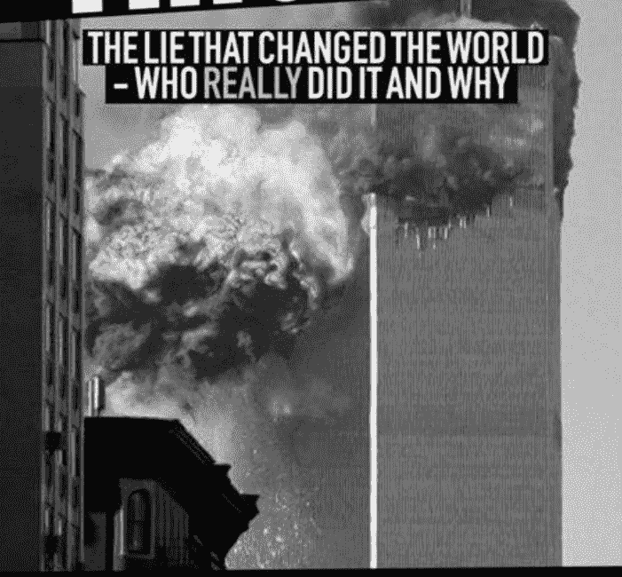

# 大卫·伊凯

# 你需要知道的一切

但从未被告知

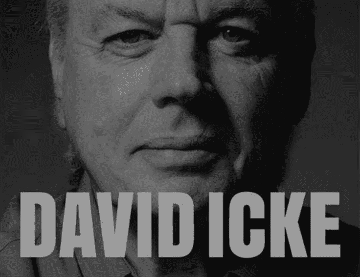

# 大卫·伊凯

# DAVIDICKE.COM

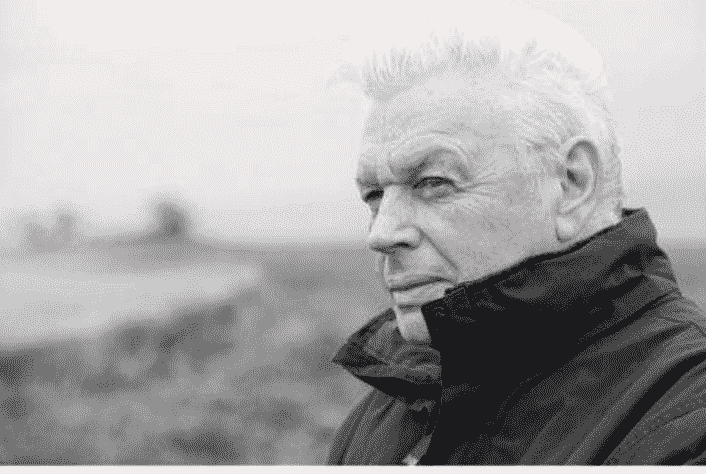

# 大卫·伊凯商店

# 最新新闻文章

# 大卫·伊凯视频

# 每周连点成播客

# 现场活动

# WWW.DAVIDICKE.COM

# 大卫·伊凯生平

# 叛逆者 (RENEGADE)

/ren-t ɡerd/

名词

指以反叛且不传统的方式行为的人。

## 长篇电影


现已在 `DAVIDICKE.COM` 发售

# 2 本新书

尼尔·哈格 (NEIL HAGUE) 著

# 户座之门

意识的符号与控制的蓝图

- 户座对人类影响的故事

前卫视觉艺术

与独特的插图书

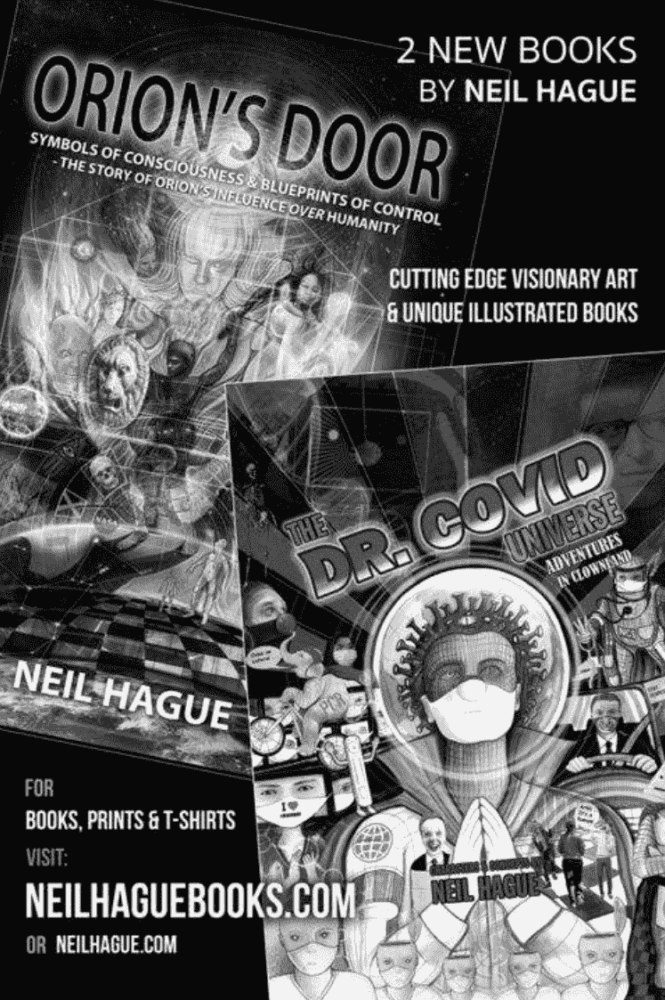

# 病毒医生宇宙

云端9号大险

# 尼尔·哈格 (NEIL HAGUE)

购买书籍、印刷品和 T 恤

访问：

`NEILHAGUEBOOKS.COM`

或 `NEILHAGUE.COM`

# 在您离开之前...

关于《叛逆之心的认知》（Perceptions of a Renegade Mind）中主题的更多细节、背景和证据以及更多内容——请参阅我的其他书籍，包括《真理将使你自由》、《最大的秘密》、《矩阵的后代》、《大卫·伊凯全球阴谋论指南》、《来自时间循环的故事》、《感官的欺骗》、《记住你是谁》、《人类种族请收下跪膝》、《幻影自我》、《你需要知道的一切但从未被告知》、《触发点》和《答案》。

你可以订阅非常棒的新型 Ickonic 媒体平台，那里有数百小时的前沿信息，涵盖视频、纪录片和剧集，涵盖了各种主题，并且每周都会更新。这包括我每周五对当周新闻进行的 90 分钟深度解析，以解释事件为何会发生以及为了什么目的。
